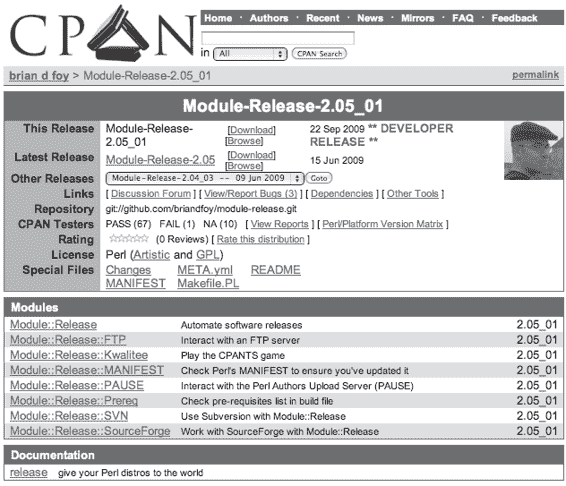

# 高效 Perl 编程：编写更好、更地道的 Perl 代码

# 前言

十多年前我第一次学习 Perl 时，我以为自己对这门语言已经相当了解；事实上，我对这门语言确实足够了解。但我所不了解的是那些真正赋予 Perl 力量的惯用法和结构。

虽然不使用这些也能编程，但它们代表了一笔容易被忽视的知识和生产力财富。

幸运的是，我得到了 Joseph N. Hall 的《Effective Perl Programming》第一版，而它并没有被放在我的书架上。相反，它几乎永久地待在我的包里，这样我就能在有空的时候随时翻阅。

Joseph 的《Effective Perl Programming》格式简单得令人愉悦：短小的智慧片段，易于消化。事实上，它最初启发了我们免费的 Perl Tips（<http://perltraining.com.au/tips/>）新闻通讯，该通讯至今仍在探索 Perl 及其社区。

十年间，一门语言可以发生很多变化，但社区对一门语言的理解在这段时间里变化更大。因此，我很高兴地得知不仅第二版正在筹备中，而且将由 Perl 社区中最杰出的两位成员撰写。

说 Brian 致力于 Perl，就像说太阳的日冕相当热一样。Brian 不仅写了大量关于这门语言的著作，还出版了一本杂志（《The Perl Review》），管理 Perl 的 FAQ，并且是 Perl 和编程社区网站上持续且受欢迎的存在。

Josh 以运营 `Perlcast` 而闻名，自 2005 年以来一直以音频形式提供 Perl 新闻。Josh 持续采访世界上最聪明、最有趣的人的能力，不仅使他成为理想的知识积累者，也让我非常嫉妒。

**xi**

下载自 <www.wowebook.com>

**xii** ❘ *前言*

因此，我非常荣幸有机会向您呈现本书的第二版。愿它像第一版帮助我一样，助您走上掌握 Perl 的道路。

*—Paul Fenwick*

*董事总经理*

*Perl Training Australia*

ptg

下载自 <www.wowebook.com>

# 序言

许多 Perl 程序员都是从《Effective Perl Programming》第一版开始学习的。当 Addison-Wesley 在 1998 年首次出版时，整个世界似乎都在使用 Perl；互联网泡沫正值鼎盛，任何懂一点 HTML 的人都能找到程序员的工作。一旦他们得到这些工作，程序员就必须快速掌握一些技能。《Effective Perl Programming》很可能是那些新 Perl 程序员放在桌上的书籍之一，与 Perl 的圣经《Programming Perl》1 和《Learning Perl》2 并列。

那时书架上还有许多其他 Perl 书籍。如今的年轻人可能不会相信，你走进美国的一家书店，会看到数百英尺的书架空间专门用于计算机编程，而其中大部分似乎是 Java 和 Perl。今天走进一家书店，计算机区可能只有自己的一个角落，每种语言可能只有几本书。其中大部分书名可能六个月后就不在了。

尽管如此，《Effective Perl Programming》坚持了十多年。Joseph Hall 对 Perl 编程哲学的洞察和智慧是永恒的。毕竟，他的书更多的是关于用 Perl 思考。他所有的建议至今仍然有效。

然而，Perl 的世界与 1998 年相比已经大不相同，而且现在有更多的好建议。CPAN（综合 Perl 存档网络）当时只有几岁，现在已成为 Perl 的杀手级特性。人们发现了新的、更好的做事方式，并且凭借十多年的额外 Perl 经验，最佳实践和惯用法已经取得了长足的进步。

1. Larry Wall, Tom Christiansen, 和 Jon Orwant，《Programming Perl, Third Edition》（Sebastopol, CA: O'Reilly Media, 2000）。

2. Randal L. Schwartz, Tom Phoenix, 和 brian d foy，《Learning Perl, Fifth Edition》（Sebastopol, CA: O'Reilly Media, 2008）。

**xiii**

下载自 <www.wowebook.com>

**xiv** ❘ *序言*

自《Effective Perl Programming》第一版以来，Perl 本身也发生了变化。第一版存在于从 Perl 4 到 Perl 5 的过渡期，因此人们仍然保留着旧的 Perl 4 习惯。在本版中，我们基本上摒弃了这种区分。只有一种 Perl，它是主版本 5。（不要问我们关于 Perl 6 的事。那是另一本书，另一个时代的事。）

现代 Perl 已经能够处理 Unicode，并认识到世界远不止 ASCII。你也需要跨过这道坎，因此我们专门增加了一整章来讨论它。Perl 可能是测试最充分的代码库之一，这一趋势由 Michael Schwern 在几年前开创，如今几乎已成为每个模块发行版的一部分。Perlers 庆祝代码乱写的狂野西部时代已经一去不复返。现在，你可以同时实现快速原型设计和良好的测试。如果你在企业领域工作，你会想阅读我们关于测试的建议。如果你是一个正则表达式爱好者，你会想使用最新版本 Perl 提供的所有新正则表达式特性。我们将向你介绍其中最流行的那些。

Perl 仍在不断发展，新的主题不断涌现。有些主题，比如后现代 Perl 对象系统 `Moose`，值得单独成书，因此我们甚至没有尝试在这里涵盖它们。其他主题，如 `POE`（Perl 对象环境）、对象关系映射器和 GUI 工具包，同样值得关注，但本书也未涉及。我们已经在考虑 *More Effective Perl*，所以情况可能会有所改变。

最后，Perl 文献库已经成熟得多。尽管我们努力涵盖了我们认为你需要了解的大部分内容，但我们省略了一些在其他书籍中覆盖得更好的领域，这些书籍列在附录 B 中。这为其他主题腾出了空间。

*——Joseph N. Hall、Joshua A. McAdams 和 brian d foy*

## 第一版前言

我以前写过很多 C 和 C++ 代码。在全身心投入 Perl 世界之前，我的最后一个主要项目是一个解释型语言，它可以绘制图表、计算概率并生成完整的 FrameMaker 书籍。该项目包含超过 50,000 行平台无关的 C++ 代码，并拥有各种有趣的内部特性。这是一个有趣的项目。

它也花了我两年时间才完成。

下载自 <www.wowebook.com>

*前言* ❘ **xv**

在我看来，大多数用 C 和/或 C++ 编写的有趣项目都需要数月或数年才能完成。这很合理，因为一个项目之所以有趣，部分原因就在于它的复杂性和耗时性。但我也觉得，很多最初看似平凡无趣的想法，当用普通高级语言表达时，就会变成耗时三个月的有趣项目。

这是我最初对 Perl 产生兴趣的原因之一。我听说 Perl 是一种出色的脚本语言，具有强大的字符串处理、正则表达式和进程控制功能。这些都是 C 和 C++ 程序员在时间紧迫时最头疼的特性。

当我被投入一个项目，其中大部分工作涉及处理文本文件——从一个软件获取输出并重新格式化，以便输入到另一个软件时，我学会了 Perl，并开始喜欢上它。我很快发现自己花不到一天时间就能写出 Perl 程序，而如果用其他语言，这些程序可能需要几天甚至几周才能完成。

## 我写这本书的方式和原因

ptg

我一直想成为一名作家。童年时，我对科幻小说着迷。我不断地阅读，有时一天读三本平装书，偶尔也会自己写一些（糟糕的）故事。后来，在 1985 年，我参加了在密歇根州东兰辛举行的 Clarion 科幻与奇幻作家研讨会。之后的一年左右，我偶尔会写一些短篇小说手稿，但从未发表过。学业和工作开始占据我越来越多的时间，最终我逐渐远离了小说创作。不过，我继续写作，时不时地撰写技术手册、课程、提案或论文。此外，多年来我与许多技术作者建立了联系。

其中一位是 Randal Schwartz。我聘请他作为工程项目的承包商，并管理了他一年多。（这是我第一次担任技术经理，对于了解软件开发管理世界的人来说，这无疑是一次很好的入门体验，任何认识 Randal 的人都能猜到。）最终，他离开去全职教授 Perl。过了一段时间，我也做了同样的事。

在这期间，我对写书越来越感兴趣。过去几年，我一直在所有“热门”领域工作——C++、Perl、互联网和万维网——我觉得我应该能从中找到一些有趣的东西写下来。使用和教授 Perl 更加强化了这种感觉。我希望有一本书能汇集我反复遇到的各种 Perl 技巧和陷阱。

然后，在 1996 年 5 月，我在圣何塞的一次开发者会议上与 Keith Wollman 进行了一次交谈。我并没有真正想找一本书来写，但我们正在讨论哪些东西可能成为好书，哪些不会。当我们聊到 Perl 这个话题时，他问我：“你觉得一本叫 *Effective Perl* 的书怎么样？”我喜欢这个主意。Scott Meyers 的 *Effective C++* 是我最喜欢的 C++ 书籍之一，将这个系列扩展到 Perl 是显而易见的。

我无法摆脱 Keith 的想法，过了一段时间，在 Randal 的帮助下，我制定了一份本书的提案，Addison-Wesley 接受了它。

剩下的……嗯，那是有趣的部分。我花了无数个 12 小时的日日夜夜，在电脑屏幕前使用 FrameMaker，在 Perl 5 Porters 邮件列表上问了很多烦人的问题，翻阅了几十本书籍和手册，编写了许多许多小段的 Perl 代码，喝了很多很多罐健怡可乐和百事可乐。我甚至偶尔会有 ptg 顿悟，发现一些关于 Perl 的基本知识，而我之前从未意识到自己错过了它们。过了一段时间，一份手稿诞生了。

这本书是我尝试与你们分享我在学习 Perl 强大功能时所体验到的乐趣和激励。我非常感谢你花时间阅读它，希望你能觉得它有用且愉快。

*——Joseph N. Hall*

*亚利桑那州钱德勒*

*1998 年*

下载自 <www.wowebook.com>

## 致谢

### 第二版

有几位朋友通过阅读进行中的手稿部分、指出错误或添加我们未曾考虑的内容，帮助我们完成了第二版。我们要感谢 Abigail、Patrick Abi Salloum、Sean Blanton、Kent Cowgill、Bruce Files、Mike Fraggasi、Jarkko Hietaniemi、Slaven Rezic、Andrew Rodland、Michael Stemle 和 Sinan Ünür。在某些地方，我们直接在他们的贡献旁边表示了感谢。

有些人提供的帮助远不止随意的协助，他们几乎对每个字符都进行了严格审查。所有你看不到的错漏都是由 Elliot Shank、Paul Fenwick 和 Jacinta Richardson 发现的。剩下的任何错误都是我们的责任：一定是我们的猫在我们不注意时踩了键盘。

*——Joseph N. Hall、Joshua A. McAdams 和 brian d foy*

### 第一版

这本书很难写。我想主要是因为我给自己增加了难度，但如果没有一大群程序员、作者、编辑和其他专业人士的帮助，它会难得多，其中许多人无偿贡献了时间，或者以几乎等于免费的微薄报酬。所有在这项努力中支持我的人，我都深表感激和衷心感谢。

Chip Salzenberg 和 Andreas “`MakeMaker`” König 为 Perl 的 bug 和异常行为提供了许多及时且有用的修复，否则这些 bug 会使手稿复杂化。对 Chip 的赞美之词难以言尽。我曾花了一点时间在 Perl 源代码中摸索。我对他充满敬畏。

Perl 5 Porters 邮件列表的许多其他成员也以这样或那样的方式直接或间接地做出了贡献。其中最明显有帮助的是

**xvii**

下载自 <www.wowebook.com>

# 致谢

提供深刻见解的有杰弗里·弗里德尔、查伊姆·弗伦克尔、汤姆·菲尼克斯、乔恩·奥旺特（来自《*Perl 期刊*》）以及查理·斯特罗斯。

兰德尔·施瓦茨，作者、讲师兼“另一位 Perl 黑客”，是我的主要技术审阅者。如果你发现任何错误，请给他发邮件。（开个玩笑。）非常感谢兰德尔为本书付出的时间和思考。

同样感谢 Perl 的创造者拉里·沃尔，他回答了许多问题，并就多个主题提供了评论。

我非常幸运能与 Addison-Wesley 合作这个项目。我接触到的每个人都很友好，并以某种重要方式为这个项目的进展做出了贡献。我特别要感谢金·弗赖尔、本·瑞安、卡罗尔·纳尔逊和基思·沃尔曼。

还有许多人提供了评论、灵感和/或精神支持。我的朋友尼克·奥兰斯、克里斯·艾斯和艾伦·皮什奇克在未完成的手稿的几次修订中艰难前行。我现任和前任雇主查理·霍顿、帕特里克·赖利和拉里·齐默尔曼一直是我激励和鼓励的源泉。

ptg

虽然我是从头开始写这本书，但其中部分内容不可避免地与 Perl 手册页以及《*Perl 编程*》中对 Perl 的描述相似。

剥猫皮的方法只有那么几种。我努力做到原创和创新，但在某些情况下，很难偏离对该语言的原始描述。

非常感谢杰夫·龚，他不断骚扰电话公司并保持 T-1 线路畅通。杰夫确实知道如何让客户满意。

非常感谢高尔夫运动让我保持理智，并为我的挫折提供了宣泄出口。让小球飞起来很有趣。同样感谢《*银河霸主*》和《*文明 II*》，原因大致相同。

不过，最重要的是，我要感谢我的灵魂伴侣和未婚妻唐娜，她也是一位出色的程序员。没有她看似无穷无尽的支持、耐心和爱，这本书就不会诞生。

*——约瑟夫·N·霍尔*

*1998 年*

下载自 <www.wowebook.com>

# 关于作者

**约瑟夫·N·霍尔**，自称“计算机神童”，从小使用德州仪器可编程计算器和 Radio Shack TRS-80 Model 1（4K RAM）长大。他 14 岁时就教授了第一堂计算机课。约瑟夫拥有北卡罗来纳州立大学计算机科学学士学位，自 1984 年起以编程为生。他从 1987 年开始使用 UNIX 和 C 语言，自 1993 年起一直使用 Perl。他的兴趣包括软件工具和编程语言、钢琴和电子键盘，以及高尔夫。

**约书亚·A·麦克亚当斯** 成为 Perl 社区的活跃成员已近五年。他是《*Perlcast*》的主播，在芝加哥主持过两次 YAPC::NA 会议，主持 Chicago.pm 的会议，在世界各地的会议上发表过关于 Perl 的演讲，并且是 CPAN（综合 Perl 存档网络）的作者。尽管这是他的第一本书，但他曾为《*Perl 评论*》和 Perl 降临节日历撰写过 Perl 文章。在日常工作中，乔什有幸在谷歌工作，虽然他的日常开发并不总是涉及 Perl，但他会尽可能偷偷使用它。

**布赖恩·D·福伊** 是《*学习 Perl，第五版*》（O'Reilly Media，2008）和《*中级 Perl*》（O'Reilly Media，2006）的合著者，以及《*精通 Perl*》（O'Reilly Media，2007）的作者。他建立了第一个 Perl 用户组——纽约 Perl Mongers；出版《*Perl 评论*》；维护 Perl 核心文档的部分内容；并且是 Perl 培训师和演讲者。

**xix**

下载自 <www.wowebook.com>

# 引言

“学习一门编程语言的基础是一回事；学习如何用该语言设计和编写有效的程序则完全是另一回事。”斯科特·迈耶斯在《Effective C++》引言中写的话同样适用于 Perl。

Perl 是一种超高级语言——对于熟悉缩写的人来说，就是 VHLL。它将正则表达式、网络和进程管理等高级功能融入一种上下文相关的语法中，这种语法在某种程度上比其他编程语言更“人性化”。Perl 是一种比任何其他广泛使用的计算机语言（或许就是任何其他计算机语言）都更好的文本处理语言，句号。Perl 是 UNIX 管理员极其有效的脚本工具，也是全球大多数 UNIX CGI 脚本编写者的首选。Perl 还支持面向对象编程、模块化软件、跨平台开发、嵌入和可扩展性。

## 这本书适合你吗？

我们假设你已经有一些 Perl 经验。如果你刚开始学习 Perl，你可能想先等一等再读这本书。我们的目标是让你成为更好的 Perl 程序员，而不一定是新的 Perl 程序员。

这本书不是权威参考书，尽管我们希望你把它放在桌面上。我们涵盖的许多主题可能相当复杂，我们不会深入每一个细节。我们试图为你提供概念的基础知识，这些知识应该能满足大多数情况，但如果你需要更多，也可以作为进一步研究的起点。你仍然需要深入阅读 Perl 文档，并阅读我们在附录 A 中列出的一些书籍。

**1**

下载自 <www.wowebook.com>

## 关于 Perl 有很多要学。

一旦你通过一本入门书籍或课程学习了 Perl，你就学会了编写 Perl 的创造者拉里·沃尔亲切地称之为“婴儿语”的内容。Perl 婴儿语是简单、直接且冗长的。这并不坏——你被允许并鼓励以任何适合你的风格编写 Perl。

你可能会达到一个阶段，想要超越简单、直接和冗长的 Perl，转向更简洁和个性化的风格。这本书是为那些踏上这条道路的人而写的。《*Effective Perl 编程*》致力于教你成为流利且富有表现力的 Perl 程序员所需的知识。本书提供了几种不同类型的建议，以帮助你前进。

- **知识，或者说是“Perl 琐事”。** Perl 中的许多复杂任务已经或可以被简化为极其简单的语句。学习有效使用 Perl 编程在很大程度上需要积累关于“正确”做事方式的经验和知识。一旦你知道了好的解决方案，你就可以将它们应用到自己的问题中。此外，一旦你知道好的解决方案是什么样的，你就可以自己发明并准确判断它们的“正确性”。

- **如何使用 CPAN。** 综合 Perl 存档网络是现代 Perl 的杀手锏。拥有超过 5 GB 的 Perl 源代码、主要框架和流行库的接口，你可以利用别人已经完成的工作完成很多事情。CPAN 让 Perl 中的常见任务变得更加容易。与任何语言一样，你真正的技能在于利用已有的成果。

- **如何解决问题。** 你可能已经从其他编程语言的工作中获得了良好的分析或调试技能。本书通过向你展示许多问题及其 Perl 解决方案，教你如何使用 Perl 击败问题。它还教你如何通过展示如何高效地创建和改进程序，来击败 Perl 本身带来的问题。


## Perl 风格与学习方法

- **风格。** 本书主要通过示例向你展示地道的 Perl 风格。你学会编写更简洁、更优雅的 Perl。如果简洁不是你的目标，你至少学会避免某些笨拙的结构。你还学会评估自己和他人的努力。

- **如何进一步成长。** 这本书没有涵盖你需要知道的一切。尽管我们称它为一本关于高级 Perl 的书，但书中能容纳的高级 Perl 内容并不多。一本真正的汇编……下载自 <www.wowebook.com>

高级 Perl 可能需要数千页的篇幅。本书真正要讲的是如何让你成为一名高级 Perl 程序员——如何找到成长所需的资源，如何规划你的学习和实验，以及如何认识到自己已经成长。

我们意图将本书打造成一本引人深思的作品。许多示例都蕴含着微妙之处。任何真正棘手的地方我们都会解释，但其他一些简单的点却未必显而易见。我们让这些内容自行呈现，供你进一步思考。有时我们会聚焦于示例代码的某个方面而忽略周围的部分，但我们会尽量让这些部分尽可能简单。如果你发现自己需要花些时间琢磨某个问题，不必惊慌。Perl 是一种独特的语言，在许多方面与你可能使用过的其他编程语言截然不同。

流畅性和风格只能通过实践和反思来获得。虽然学习是艰苦的工作，但它也是愉快且有回报的。

## Perl 的世界

Perl 是一种非凡的语言。在我们看来，它是最成功的模块化编程环境。

事实上，Perl 模块是软件世界所见过的、最接近传说中的“软件集成电路”（即软件领域的集成电路，可以在不了解其内部工作原理的情况下用于各种应用的组件）的东西。这有很多原因，其中最重要的一个原因是存在一个集中、协调的模块仓库 `CPAN`，它减少了在相互竞争、不兼容的功能实现上浪费的精力。更多资源请参见附录 A。

Perl 拥有一个最小但足够用的模块化和面向对象编程框架。语言中缺乏广泛的访问控制特性，使得可以用自然、简洁的形式编写具有不寻常特性的代码。软件领域似乎有一条自然法则：最有用的特性往往也是最不适合现有框架的特性。Perl 对“规则和条例”的骨架式方法有效地颠覆了这一法则。

Perl 提供了出色的跨平台兼容性。它作为 UNIX 上的系统管理工具表现出色，因为它最大程度地隐藏了不同 UNIX 版本之间的差异。你能编写跨平台的 shell 脚本吗？可以，但极其困难。大多数凡人不应尝试这种事情。你能编写跨平台的 Perl 脚本吗？可以，而且很容易。Perl 也能相当好地从其诞生地 UNIX 移植到其他平台，如 Windows、VMS 等。

作为 Perl 程序员，你拥有世界上最好的支持之一。你可以完全访问所有你使用的模块的源代码，以及语言本身的完整源代码。如果逐行检查代码找 bug 不是你的风格，你可以通过互联网获得每周 7 天、每天 24 小时的在线支持。如果免费支持不适合你，你也可以购买商业支持。

最后，你拥有一种敢于与众不同的语言。Perl 是流动的。在其最佳状态下，面对多种可能的解释，Perl 会做你期望的事情（有时被称为 `DWIM`，“按我的意思做”）。这或许是一个可怕的想法，但它表明了计算领域的真正进步，超越了单纯的周期、磁盘空间和内存。

## 术语

总的来说，Perl 中使用的术语与描述其他编程语言的术语并没有太大不同。然而，有一些术语的含义略有特殊。此外，随着 Perl 的发展，一些术语已经过时，一些新术语也出现了。

通常，这种语言的名称是 Perl，首字母大写，而 `perl` 是编译和运行源代码的程序名称。除非我们特指解释器，否则我们默认使用大写版本。

Perl 中的 `operator`（运算符）是一种不带括号的语法结构。（当然，运算符的参数可以包含在括号中。）特别是，`list operator`（列表运算符）是一个标识符，后跟一个由逗号分隔的元素列表：

```perl
print "Hello", chr(44), " world!\n";
```

Perl 中的 `function`（函数）是一个标识符，后跟一对完全包含参数的括号：

```perl
print("Hello", chr(44), " world!\n");
```

现在，你可能刚刚注意到列表运算符和函数之间的某种相似性。事实上，在 Perl 中，除了使用的语法之外，它们之间没有区别。当我们提到 Perl 的内置函数如 `print` 和 `open` 时，我们通常使用术语“运算符”，但偶尔也会使用“函数”。在含义上没有特别区别。

用 Perl 编写的子程序的正确称呼就是 `subroutine`（子程序）。当然，“函数”、“运算符”甚至“过程”在文学上都是可以接受的替代词。请注意，Perl 对“函数”的使用与数学定义不同，一些计算机科学家可能会对 Perl 滥用该术语感到不寒而栗。

所有 Perl 的 `method`（方法）实际上都是符合某些约定的子程序。这些约定既不是 Perl 要求的，也不是 Perl 识别的。然而，使用“调用方法”这样的短语是合适的，因为 Perl 有一种特殊的方法调用语法，用于支持面向对象编程。定义（有些难以捉摸的）区别的一个好方法是：方法是作者希望你通过方法调用语法来调用的子程序。

Perl 的 `identifier`（标识符）是一个“C 符号”——一个字母或下划线，后跟一个或多个字母、数字或下划线。标识符用于命名 Perl 变量。Perl 变量是标识符与适当标点符号的组合，如 `$a` 或 `&func`。

虽然严格来说并不完全符合 Perl 内部的使用习惯，但我们使用术语 `keyword`（关键字）来指代 Perl 中少数具有独特语法含义的标识符——例如 `if` 和 `while`。其他具有普通函数或运算符语法的标识符，如 `print` 和 `oct`，我们称之为 `built-ins`（内置函数）。

`lvalue`（左值，发音为“ell value”）是可以出现在赋值语句左侧的值。这是该术语的惯常含义；然而，在 Perl 中，有一些不寻常的构造充当左值，例如 `substr` 运算符。

`Localizing`（局部化）一个变量意味着为其创建一个独立的作用域，该作用域一直持续到封闭块或文件的末尾。特殊变量必须使用 `local` 运算符进行局部化。你可以使用 `my` 或 `local` 来局部化普通变量（参见第 4 章的第 43 条）。这是 Perl 的一个不幸遗留问题，Larry Wall 希望他曾为 `local` 使用另一个名称，但生活还要继续。当有区别时，我们会说“用 `my` 局部化”。

## 符号表示

在本书中，我们使用 Joseph 的 PEGS（Perl 图形结构）符号来表示数据结构。它应该大部分是不言自明的，但这里有一个简要概述。

变量是具有名称的值。名称出现在值的侧向“栅栏”上方。标量值用一个矩形框表示：

```text
$cat
Buster
```

数组和列表有类似的图形表示。值显示在一个堆栈中，顶部有一条粗线：

```text
@cats
Buster
Mimi
Ginger
Ella
```

哈希用名称堆栈和对应的值堆栈表示：

```text
%microchips
Mimi    9874
Ginger  5207
Buster  1435
Ella    3004
```

引用用点和箭头表示，就像那些古老的 LISP 图表一样：

```text
$cats
 |
 +----> Mimi
 |      Buster
 |      Ginger
 |      Ella
```

以上就是基础内容。

## Perl 风格

你应该从本书中学到的部分内容是对良好 Perl 风格的感知。

# 引言

当然，风格是一个偏好和争论的问题。我们不会假装知道或展示“唯一正确的风格”，但我们希望向读者展示一种当代、高效、有效的 Perl 风格示例。有时，当有助于可读性时，我们的风格会不一致。我们的偏好大多来自 `perlstyle` 文档。

代码出现在书中这一事实在一定程度上影响了它的风格。我们的行长度有限，而且我们不想编写跨越几页的过长程序。我们的示例不能过于冗长或无聊——每个示例必须针对一两个特定点，且没有不必要的杂乱。因此，你会发现一些偏离良好实践的地方。

在某些示例中，我们希望突出某些点，而淡化其他点。在某些代码中，我们使用 `...` 来代表我们省略的代码。

假设 `...` 代表应该存在的真实代码。（奇怪的是，当这本书上架时，那个 `...` 也应该是可编译的 Perl。Perl 5.12 引入了“yadda yadda”运算符，它编译得很好，但当你尝试执行它时会产生运行时错误。这是一种很好的存根代码的方式。）

某些示例需要特定版本的 Perl。除非我们另有说明，代码应在 Perl 5.8 下运行，这是一个较旧但可用的版本。下载自 <www.wowebook.com>

如果我们使用 Perl 5.10 的特性，我们会在示例开头加上一行注明版本（参见第 1 章中的条目 2）：

```perl
use 5.010;
```

我们还忽略了 Perl 的开发版本，其中次版本号为奇数，例如 5.009 和 5.011。我们会在引入该特性的第一个稳定 Perl 版本中注明其最早出现。

并非所有内容都能在 `warnings` 或 `strict`（条目 3）下干净运行。我们建议所有 Perl 程序员定期使用这两者。然而，在所有示例开头加上这些声明可能会分散我们对主要观点的注意力，因此我们省略了它们。在适当的情况下，我们尽量保持 strict 清洁，但从较大的示例中提取代码并不总是使这变得可行。

我们通常尽量减少标点符号（条目 18）。我们不热衷于“Perl 高尔夫”，即人们将程序缩减到尽可能少的字符。

我们只是去掉不必要的字符，并使用更多的空白，以便重要的部分突出，而框架则淡入背景。

最后，我们努力使示例有意义。并非每个示例都能成为有用的代码片段，但我们尽量包含尽可能多的真实世界代码。

## 组织方式

前两章通常按复杂度递增的顺序呈现材料。除此之外，我们倾向于相当多地跳跃。请使用目录和索引，并随时准备好 Perl 文档（或许可以访问 <http://perldoc.perl.org/>）。

我们为第二版重新组织了本书。附录 B 显示了从第一版条目到本版条目的映射。我们将第一版中的一些条目拆分成许多新条目并进行了扩展；有些条目我们合并了；有些则省略了，因为它们的主题在其他书中已有充分介绍。附录 A 包含了一份我们认为你应该考虑的其他资源列表。

这本书并不会在你读到结尾时就真正结束。我们将在 <http://effectiveperlprogramming.com/> 上继续更新。在那里你可以找到更多关于本书的新闻、我们省略的一些材料、我们没时间完成的内容以及其他 Perl 好东西。

下载自 <www.wowebook.com>

# Perl 基础

如果你有其他语言的经验但刚接触 Perl，你可能仍在发现 Perl 的特性。本节将讨论其中一些特性。特别是，它针对那些仍然适应其他语言的新手 Perl 程序员可能会困扰的问题。

例如，你应该已经知道 Perl 变量通常由一些标点符号如 `$` 或 `@` 后跟标识符组成。但你知道相同名称的不同类型变量（如 `$a` 和 `@a`）是否完全独立吗？

它们是独立的（参见本章的条目 5）。

你应该知道 `@a` 是一个数组，但你知道 `$a[$i]` 和 `@a[$i]` 之间的区别吗？后者是一个切片（条目 9）。

ptg

你应该知道数字 0 是假，空字符串 `''` 是假，但你知道由单个空格组成的字符串 `' '` 是假吗？它是真（条目 7）。

Perl 还有许多其他有趣的怪癖，反映了它从许多其他语言中借鉴精华的传统，并加入了其语言学家创始人 Larry Wall 的一些不寻常想法。然而，一旦你开始像 Perl 那样思考，这些怪癖就会变得更有意义。

如果你是一位经验丰富的 Perl 程序员，这些基础条目对你来说大多是复习。不过，你可能会发现一些之前没注意到的有趣细节，或者向同事解释概念的其他方式。

## 条目 1. 查找 Perl 及其模块的文档

Perl 自带大量文档——比你想要打印出来的还要多。要全部打印出来，你需要用掉几令纸和大量墨粉。在文档达到大约 2000 页后（在我们的虚拟打印机上，所以没有树木受到伤害），我们就数不清了。

9

下载自 <www.wowebook.com>

10 ❘ 第 1 章 Perl 基础

文档文件中有大量有用的信息，因此能够阅读它们，甚至更重要的是，在其中找到信息，是很有价值的。找到所需内容的能力一部分是知识，一部分是工具。

### `perldoc` 阅读器

`perldoc` 命令在 Perl 树中搜索带有嵌入式文档的 Perl 模块（`.pm`）、纯文档的 `.pod` 文件（条目 82）以及已安装的 Perl 程序。`perldoc` 命令格式化并显示它找到的文档。首先，阅读 `perldoc` 自身的文档：

```text
% perldoc perldoc
```

```text
PERLDOC(1)                User Contributed Perl Documentation

NAME
       perldoc - Look up Perl documentation in pod format.

SYNOPSIS
       perldoc [-h] [-v] [-t] [-u] [-m] [-l]
```

ptg ... 等等 ...

通常，你给 `perldoc` 提供你想要阅读的文档页面名称。`perltoc` 是目录，显示所有页面名称：

```text
% perldoc perltoc
```

你可能对 `perlsyn` 感兴趣，这是讨论 Perl 通用语法的页面：

```text
% perldoc perlsyn
```

如果你想阅读关于 Perl 内置函数的内容，可以查看 `perlfunc`：

```text
% perldoc perlfunc
```

你应该至少通读一遍 `perlfunc`，以了解 Perl 提供的所有功能。你不必记住所有内容，但以后你可能会记得 Perl 有一个内置函数，例如，用于与 `/etc/passwd` 文件交互，即使你不记得那个内置函数叫什么。你还会注意到，滚动输出以找到你需要的内置函数非常烦人。如果你知道你想阅读的内置函数，下载自 <www.wowebook.com>

可以使用 `-f` 开关指定它，这会只提取该函数的部分：

```text
% perldoc -f split
```

你也可以使用 `perldoc` 阅读模块文档；只需提供模块名称：

```text
% perldoc Pod::Simple
```

如果你想知道该模块安装在哪里，可以使用 `-l`（字母 ell）开关获取文件位置：

```text
% perldoc -l Pod::Simple
```

如果你想查看原始源代码，请使用 `-m` 开关：

```text
% perldoc -m Pod::Simple
```

Perl 文档附带几个 FAQ 文件，回答了许多常见问题。你可以在线阅读它们，但 `perldoc` 还有一个很好的功能，可以使用 `-q` 开关搜索它们。例如，如果你想查找关于随机数的答案，可以尝试：

```text
% perldoc -q random
```

### 在线文档

在我们撰写本文时，`http://perldoc.perl.org/` 是查阅 Perl 文档的最佳网站。它包含了 Perl 最近几个版本附带的核心文档，提供 HTML 和 PDF 格式，并且足够智能，能记住你之前查看过的文档。

不过，该网站并未包含所有模块的文档文件。你可以在 CPAN Search（`http://search.cpan.org/`）或 Kobes’s Search（`http://kobesearch.cpan.org/`）上在线阅读这些文档，这两个网站都提供了 CPAN 的 Web 界面。有些人觉得这些文档非常方便，甚至会在查看本地系统之前先阅读它们。

CPAN Search 特别有用的一点是，它提供了“其他工具”（Other tools）链接，你可以在每个模块页面上找到它。其中一个工具是类似 grep 的功能，允许你搜索单个发行版中的文档。

例如，这对于追踪给出错误信息的文件非常方便。

下载自 <www.wowebook.com>

**12** ❘ *第 1 章 Perl 基础*

AnnoCPAN（`http://annocpan.org/`）是另一个模块文档网站。在这个网站上，任何人都可以注释文档，为模块作者或其他用户留下笔记。当文档缺少信息或包含错误或不完整的信息时，这尤其方便。

### 本地文档

你可以在本地系统上获得 CPAN Search 的部分功能。

`CPAN::Mini::Webserver` 提供了一种浏览 MiniCPAN（第 66 条）的方式。如果你运行 Apache Web 服务器，`Apache::Perldoc` 模块可以作为 `perldoc` 命令的 Web 前端。

`Pod::POM::Web` 模块也可以让你浏览本地文档。你可以将其设置为 Apache 下的 `mod_perl` 处理器、CGI 脚本，或作为独立的 Web 服务器：

```perl
% perl -MPod::POM::Web -e "Pod::POM::Web->server"
```

### 要点回顾

ptg

- 使用 `perldoc` 阅读 Perl 的文档。
- 在 Web 上阅读未安装模块的文档。
- 设置本地文档服务器，通过 Web 浏览器阅读本地文档。

## 第 2 条：在需要时启用新的 Perl 特性

从 Perl 5.10 开始，你必须显式启用新特性。这确保了最新版本的 Perl 可以向后兼容，同时允许人们使用所有最新的炫酷特性开始新工作。

例如，Perl 5.10 添加了一个内置函数 `say`，它与 `print` 类似，只是它会自动添加换行符。不仅你的字符串少了几个字符，而且你不需要为了换行而用双引号括起字符串：

```perl
say 'Hello!'; # 就像 print "Hello\n";
```

下载自 <www.wowebook.com>

*第 2 条：在需要时启用新的 Perl 特性* ❘ **13**

如果有人已经创建了自己的 `say`，那么当他们使用 Perl 5.10 运行程序时，由于现在有了同名的内置函数，程序可能会出错。

幸运的是，Perl 默认不会启用新特性：

```text
% perl5.10.1 say.pl # 不使用新特性
在 old_script.pl 第 1 行，靠近 "say "Hello!"" 处发现运算符期望字符串
(你需要预先声明 say 吗？)
```

如果你想要新特性，可以使用新的 `-E` 开关启用它们。它类似于 `-e`，允许你在命令行上指定程序文本，但它还会引入你所用 Perl 版本的所有最新特性：


```perl
% perl5.10.1 -E say.pl # 使用直到 5.10.1 的新特性
% perl5.12.0 -E say.pl # 使用直到 5.12.0 的新特性
```

你也可以在程序文本内部启用特性。使用`use`指令后跟 Perl 版本，不仅可以确保人们使用兼容的版本运行你的程序（第 83 条），还可以启用该版本的新特性：

```perl
use 5.010; # 使用直到 5.10 的新特性
```

从 Perl 5.12 开始，你可以通过要求该版本或更高版本来自动启用严格模式（第 3 条）：

```perl
use 5.012; # 自动启用 strict
```

每当我们想使用特定 Perl 版本的特性时，我们会在示例中包含类似的行，以便你了解。

另一种引入特性的方法是使用`feature`编译指示，它也是在 Perl 5.10 中引入的。你可以给它一个“特性包”，告诉它要启用哪组特性：

```perl
use feature ':5.10';
```

你可能不想启用每一个新特性。你可以使用`feature`编译指示来控制使用哪些新特性。例如，你可以将特性限制为仅激活`switch`和`say`：

```perl
use feature qw(switch say);
```

下载自 <www.wowebook.com>

**14** ❘ *第 1 章 Perl 基础*

奇怪的是你导入`switch`，尽管 Perl 对该概念的实现使用了关键字`given-when`（第 24 条）。这是从 C 语言术语中遗留下来的。

### 要点回顾

- 从 Perl 5.10 开始，如果你想使用新特性，请显式启用它们。
- 使用`-E`命令行开关启用所有新特性。
- 使用`use VERSION`序列要求至少该版本的 Perl，并启用该版本的所有新特性。

## 第 3 条 启用严格模式以促进更好的编码

默认情况下，Perl 是一种非常宽松的语言。你可以用最少的麻烦快速拼凑一些语句。Perl 会尽可能少地让你输入，处理大部分细节。这是一个特性。

然而，这种宽松性对于较大的程序来说并不那么有吸引力，因为你希望 Perl 帮助你管理代码。`strict`编译指示使 Perl 变得不那么宽松。在你的所有 Perl 文件中，添加这一行：

```perl
use strict;
```

如果你使用的是 Perl 5.12 或更高版本，你可以通过要求该版本或更高版本来自动启用严格模式（第 2 条）：

```perl
use 5.012; # 自动启用 strict
```

通过启用严格模式，你就能捕获程序员常犯的大部分常见错误。其余的大部分错误可以通过警告（第 99 条）捕获。这些特性可能会在头几周让你感到烦恼，但渐渐地你的编码会得到改善，`strict`也会变得越来越不烦人，直到你甚至感觉不到它的存在。

如果你正在翻译不兼容严格模式的遗留代码，你可以先在命令行上启用它，以便在提交之前查看所有错误：

```bash
perl -Mstrict program.pl
```

严格模式包含三个部分：`vars`、`subs`和`refs`。通常你会同时使用它们，但我们将分别介绍。

下载自 <www.wowebook.com>

*第 3 条 启用严格模式以促进更好的编码* ❘ **15**

### 声明你的变量

拼写错误是 Perl 程序中常见的错误来源。你将数据放入一个变量，但后来使用了错误的变量名。在下面的示例中，你读入`@temp`，但随后试图遍历`@tmp`。你困惑为什么看不到任何输出，无论你如何查看源代码，都找不到问题：

```perl
my @temp = <FH>;
foreach (@tmp) { # 哎呀——本意是使用 @temp
    print "Found $_\n";
}
```

`strict vars`编译指示通过要求你以某种方式声明所有变量来捕获并防止此类错误。有三种声明变量的方式。你可以用`my`或`our`声明：

```perl
use strict 'vars';
my @temp;
our $temp;
```

ptg

使用完整的包规范：

```perl
use strict 'vars';
$main::name = 'Buster';
```

或者在`use vars`中列出变量：

```perl
use strict 'vars';
use vars qw($bar);
$bar = 5;
```

你永远不需要声明特殊变量——`$_`、`%ENV`等。此外，`strict`会忽略`$a`和`$b`的全局版本，它们对`sort`是特殊的（第 22 条）。Perl 看到的任何其他变量都会在编译时触发致命错误。

### 小心裸字

Perl 默认将没有其他解释的标识符视为字符串（有时称为“诗歌模式”），这是另一个潜在的错误来源，很难通过视觉检查发现。你能发现以下代码中的错误吗？

```perl
for ( $i = 0 ; $i < 10 ; $i++ ) {
    print $a[i]; # 哎呀——本意是 $a[$i]
}
```

下标`i`（本应为`$i`）被解释为字符串 "i"，在此上下文中被解释为数值 0。因此，`$a[0]`的内容被打印了十次。使用`strict 'subs'`会关闭诗意模式，并对不当使用的标识符生成错误：`use strict 'subs';`

```perl
for ( $i = 0 ; $i < 10 ; $i++ ) {
    print $a[i]; # 错误
}
```

`strict 'subs'`编译指示与允许的裸字引用形式兼容——单独出现在哈希键花括号内，或位于胖箭头左侧：`use strict 'subs';`

ptg

```perl
$a{name} = 'ok';          # 裸字作为哈希键是允许的
$a{-name} = 'ok';         # 同样允许
my %h = (
    last  => 'Smith',     # => 左侧的裸字是允许的
    first => 'Jon'
);
```

### 避免软引用

`strict refs`编译指示禁用软引用（第 58 条）。软引用通常不是错误的来源，但也不是广泛使用的特性。当你尝试解引用一个实际上是字符串的东西时，就会发生软引用。在没有严格模式的情况下，Perl 会使用字符串中的值作为变量名：

```perl
no strict 'refs';
$not_array_ref = 'buster';
@{$not_array_ref} = qw( 1 2 3 ); # 实际上是 @buster
```

下载自 <www.wowebook.com>

## 第 4 条：理解符号告诉你什么。 ❘ 17

### 需要记住的要点

- 默认情况下，Perl 是一种非常宽松的编程语言。
- 当你可以明确表达时，不要让 Perl 猜测你的意思。
- 启用`strict`让 Perl 捕获常见的编程问题。

### 第 4 条：理解符号告诉你什么。

符号是你在 Perl 变量名开头和解引用时看到的那些有趣字符，它们常常是人们混淆 Perl 语法的根源。程序员之所以困惑，是因为他们猜测符号的含义，在邮件列表中读到关于它们的错误猜测，或者是从塔罗牌占卜师那里学到的 Perl。人们害怕它们，而实际上，符号是他们最好的朋友。

符号与变量类型本身的关系非常松散。事实上，你甚至不需要有一个变量。根本不要把它们看作变量类型指示符。

`$`表示你正在处理一个单一值，它可以是一个标量变量，也可以是数组或哈希中访问的单个元素：

```perl
$scalar
$array[3]
$hash{'key'}
```

`@`表示你正在处理多个值，因此你会将其用于数组或哈希，因为它们是 Perl 仅有的集合类型：

```perl
@array
@array[0,2,6]            # 数组切片
@hash{ qw(key1 key2) }   # 哈希切片
```

`%`符号有点特殊。它表示你将某物视为哈希，并且只有一种变量类型和访问方法可以充当哈希，那就是整个哈希本身：

```perl
%hash
```

Perl 也有用于子程序（`&`）和类型团（`*`）的符号，但它们仅用于这些类型，因此我们在此不赘述。

下载自 <www.wowebook.com>

既然你知道不要用符号来识别变量类型，那么如何判断你正在查看的是哪种变量呢？有三个因素需要考虑：符号、标识符以及数组或哈希可能的索引语法。你可以在对数组的单个元素访问中看到这三个因素：

```text
符号 标识符 索引
  $   name   [3]
$name[3]
```

符号是`$`，标识符是`name`，索引是`[3]`。你知道变量是`name`，并且知道它是一个数组变量，因为只有数组类型使用`[ ]`进行索引。对于哈希，你也是同样的做法：

```text
符号 标识符 索引
  $   name   {'Buster'}
$name{'Buster'}
```

你知道你正在处理一个哈希变量，因为你使用`{ }`进行索引，并且使用字符串作为索引。`$`只告诉你这个变量包含哈希中的一个单一元素。

如果你没有看到单个元素访问，你可以通过查看符号来确定变量类型：

```perl
$scalar
@array
%hash
```

你还使用符号来解引用匿名标量、数组和哈希。你使用相同的规则来确定引用类型（第 59 条）。

### 需要记住的要点

- 符号与数据相关，而不一定与变量类型相关。
- `$`表示单个元素。
- `@`表示元素列表。

下载自 <www.wowebook.com>

## 第 5 条：了解你的变量命名空间。

Perl 中有七种独立的包变量或类似变量的元素：标量变量、数组变量、哈希变量、子程序名、格式名、文件句柄和目录句柄。

每种不同类型的包变量都有自己的命名空间。改变一种变量的值不会以任何方式影响同名其他类型变量的值。例如，标量变量`$a`独立于数组变量`@a`：

```perl
my $a = 1;            # 设置标量 $a = 1
my @a = ( 1, 2, 3 ); # @a = (1,2,3) 但 $a 仍然是 1
```

此外，Perl 程序中的每个包都定义了自己的一组命名空间。例如，包`main`中的`$a`独立于包`foo`中的`$a`：

```perl
$a = 1;             # 设置标量 $main::a = 1
package foo;        # 默认包现在是 foo
$a = 3.1416;        # $foo::a 是 3.1416；$main::a 仍然是 1
```

你必须像 Perl 一样，同时查看标识符的左侧和右侧，才能确定该标识符引用的是哪种变量。例如，访问数组和哈希单个元素的语法以`$`开头，而不是`@`或`%`。`$`表示结果是一个标量值，而不是你在引用一个标量变量（第 4 条）：

```perl
my $a = 1;
my @a = ( 1, 2, 3 );
my %a = ( a => 97, b => 98 );
$a[3] = 4;          # $a 仍然是 1；@a 现在是 (1,2,3,4)
$a{'c'} = 99;       # $a, @a 仍然相同；
                    # %a 现在有三个键值对
```

并非 Perl 中所有类似变量的项都以标点字符为前缀。子程序名可以以`&`符号为前缀，但`&`符号通常是可选的。在某些情况下，子程序参数周围的括号也可以省略，如下例所示。

定义一个名为 "hi" 的子程序，看看调用它的不同方式：

```perl
sub hi {
    my $name = shift;
    return "hi, $name\n";
}
```

你可以使用“旧式”语法调用子程序，包括`&`符号和括号：

```perl
print &hi("Fred");
```

这种风格在新代码中不常见。相反，你会看到子程序只带括号调用：

```perl
print hi("Fred");
```

括号为`perl`提供了足够的信息，使其知道`hi`是一个子程序。如果`hi`在你使用它之前已经声明或定义，那么连括号也是可选的：

```perl
print hi "Fred";
```

文件句柄、格式名和目录句柄不以标点字符为前缀，而是在上下文中被识别。文件句柄、目录句柄和格式名彼此独立，即使它们都命名为`TEST`：

```perl
open TEST, '>', "$$.test"   # 打开文件句柄 TEST
print TEST "test data\n";   # 打印到文件句柄 TEST
opendir TEST, ".";          # 名为 TEST 的目录句柄
# 名为 TEST 的格式
format TEST =
@<<<<<<<<<<<<< @<<<< @<<<<
$name,         $lo,   $hi
.
```

如果这看起来可能会让人困惑，那确实可能。幸运的是，由于`IO::File`和`IO::Dir`的存在，现在人们通常将文件句柄和目录句柄存储在对象中。

### 需要记住的要点

- 每种变量类型都有自己的命名空间。
- 同名不同类型的变量互不影响。
- 不同包中的变量可以同名，但互不影响。

下载自 <www.wowebook.com>

## 第 6 条：了解字符串比较和数值比较的区别。

Perl 有两套完全不同的比较运算符，一套用于比较字符串，一套用于比较数字。了解它们的区别并保持清晰是值得的，因为使用错误的比较运算符可能会成为难以发现的错误的来源。

用于比较字符串的运算符使用字母，看起来像单词或 FORTRAN。字符串是逐字符比较的——即通过比较字符串中字符的值（或根据当前区域设置，如果你使用了`use locale`），包括大小写、空格等：

```perl
'a' lt 'b'                 # TRUE
'a' eq 'A'                 # FALSE -- 大小写
"joseph" eq "joseph "      # FALSE -- 空格算在内
```

数值比较运算符使用标点符号，看起来像代数或 C 语言：

```perl
0 < 5                      # TRUE
10 == 10.0                 # TRUE
```

字符串比较运算符不应用于比较数字，因为它们不能正确比较数字（除非你对“正确”的定义是“10”排在“2”之前）。同样，用于比较字符串的数值运算符也是如此：

```perl
'10' gt '2'                # FALSE -- '1' 排在 '2' 之前
"10.0" eq "10"             # FALSE -- 不同的字符串
'abc' == 'def'             # TRUE -- 两者对 == 来说都像 0
```

这种错误会导致条件判断在你不想为真时变为真，因为两个操作数都变成了数字：

```perl
my $hacker = 'joebloe';
if ( $user == $hacker ) { # 错误 -- 对字符串使用了 ==
    deny_access();
}
```

Perl 的排序运算符默认使用字符串比较。不要用字符串比较来排序数字（第 22 条）！

解决`eq`和`==`混淆的一种方法是避免使用两者。与其自己判断正确与否，不如让 Perl 通过智能匹配运算符`~~`（第 23 条）来替你思考。它会查看两侧并决定该怎么做。它还使用了“类数字”字符串的概念——即看起来像数字的字符串。

这些比较实际上是数值比较，因为智能匹配在右侧看到数字，或者在左侧看到数字而右侧看到类数字字符串，从而使用`==`运算符进行比较：

```perl
use 5.010;
if ( 123 ~~ '456' ) { ... }     # 数字和类数字：FALSE
if ( '123.0' ~~ 123 ) { ... }   # 字符串和数字：TRUE
if ( 'Mimi' ~~ 456 ) { ... }     # 字符串和数字：FALSE
```

否则，智能匹配会使用`eq`运算符进行字符串比较：

```perl
if ( 'Mimi' ~~ 'Mimi' ) { ... }  # 字符串和字符串：TRUE
```

这可能有点棘手。两侧都是类数字字符串时，仍然是字符串比较（`eq`运算符）：

```perl
if ( '123.0' ~~ '123' ) { ... }  # 类数字和类数字：FALSE
```

当你在智能匹配中使用变量时需要小心，因为它们在程序中的历史很重要。如果你之前对`$var`做了某些触发转换的操作（第 8 条），你可能会得到意想不到的结果，因为智能匹配选择了错误的比较类型。在以下情况中，你从一个字符串开始，但通过将其与数值运算符一起使用将其转换为数字，从而强制使用`==`运算符进行数值比较：

```perl
use 5.010;
if ( ( '123' + 0 ) ~~ '123.0' ) { # 数字和类数字：TRUE
    say "匹配 1！";
}
my $var = '123';
if ( ( $var + 0 ) ~~ '123.0' ) { # 数字和类数字：TRUE
    say "匹配 2！";
}
```

```perl
my $var2 = '123';
$var2 + 0;
if ( $var2 ~~ '123.0' ) { # 数字和类数字：TRUE
    say "匹配 3！";
}
```

然而，如果你从一个数字开始但将其转换为字符串，Perl 只会将其视为字符串并强制使用`eq`语义。

```perl
use 5.010;
my $var3 = 123;
$var3 = "$var3";
if ( $var3 ~~ '123.0' ) { # 字符串和类数字，eq，FALSE
    say "匹配 4！";
}
```

### 要记住的事情

- 记住字符串和数字的比较与排序方式不同。
- 使用字母比较运算符来比较字符串。
- 使用符号比较运算符来比较数字。

## 第 7 条：了解哪些值是假值并据此进行测试。

由于 Perl 中的数值和字符串数据具有相同的标量类型，并且布尔运算可以应用于任何标量值，因此 Perl 的逻辑真值测试必须同时适用于数字和字符串。

基本测试是：`0`、`'0'`、`undef`和`''`（空字符串）是假值。其他所有值都是真值。


更准确地说，当你在布尔上下文（有时用于指代控制表达式中的条件，例如`?:`运算符、`||`和`&&`）中使用一个量时，它首先会被转换为字符串（第 8 条）。然后 Perl 测试字符串结果。如果结果是空字符串，或者结果恰好由单个字符`'0'`组成，则结果为假。否则结果为真。注意，这条规则意味着`undef`会被评估为假，因为除了`defined`运算符之外，它对所有东西都表现为`0`或空字符串。

这通常工作得很好。如果出现问题，很可能是因为你测试了一个量是否为假，而实际上你应该测试它是否已定义：

```
while ( my $file = glob('*') ) { # 错误
    do_something($file);
}
```

这个`glob`在绝大多数情况下工作良好。每次循环时，`glob('*')`从当前目录产生另一个文件名，存入`$file`。一旦`glob`遍历完目录中的所有文件名，它会返回`undef`，这看起来像空字符串，因此为假，导致`while`循环终止。

但有一个问题。如果当前目录中有一个名为`0`的文件，它也会表现为假，导致循环提前终止。为了避免这种情况，使用`defined`运算符专门测试`undef`：

```
while ( defined( my $file = glob('*') ) ) { # 正确
    do_something($file);
}
```

行输入运算符`<>`的情况完全相同，尽管 Perl 会自动为你处理。看起来你在这个`while`中测试来自`STDIN`的行：

```
while (<STDIN>) {
    do_something($_);
}
```

然而，这是一个特例，Perl 会自动转换为检查`$_`是否已定义：

```
while ( defined( $_ = <STDIN> ) ) { # 隐式完成
    do_something($_);
}
```

你可以通过`B::Deparse`自行验证，它会撤销`perl`编译的结果，让你看到它对代码的理解：

```
% perl -MO=Deparse \
    -e 'while( <STDIN> ) { do_something($_) }'
while (defined($_ = <STDIN>)) {
    do_something($_);
}
-e syntax OK
```

如果你想使用另一个变量来保存刚读取的行，你必须自己进行`defined`检查：

```
while ( defined( my $line = <STDIN> ) ) {
    do_something($line);
}
```

### 数组的末尾

数组元素未定义并不意味着你已经超出了数组的边界。通常，Perl 对让其他语言抓狂的越界访问非常宽容：

```
my @cats = qw( Buster Roscoe Mimi );
my $favorite = $cats[8]; # 那里没有猫，所以是 undef
```

在数组中间有一个`undef`值也是完全允许的：

```
my @cats = qw( Buster Roscoe Mimi );
$cats[1] = undef; # 安息吧 Roscoe
```

你不应该使用该值来决定是否已经遍历了数组的每个元素：

```
while ( defined( my $cat = shift @cats ) ) { # 错误
    print "我有一只猫叫 $cat\n";
}
```

相反，使用`foreach`确保遍历所有元素，并跳过那些未定义的：

```
foreach my $cat (@cats) {
    next unless defined $cat;
    print "我有一只猫叫 $cat\n";
}
```

如果你需要知道数组的最后一个元素，不要寻找`undef`值。`$#cats`语法会给你最后一个元素。

```
for ( my $i = 0 ; $i <= $#cats ; $i += 2 ) {
    next unless defined $cat[$i];
    print "我有一只猫叫 $cat[$i]\n";
}
```

### 哈希值

你可能还需要使用不同的测试策略来检查哈希中是否存在某个元素，因为`undef`在哈希中是完全合法的值。假设`%hash`初始时未定义。检查键`foo`的结果在作为值时是假，使用`defined`时也是假，使用`exists`时同样是假：

```
my %hash;

if ( $hash{'foo'} ) { ... }       # 假

if ( defined $hash{'foo'} ) { ... } # 也是假

if ( exists $hash{'foo'} ) { ... } # 也是假
```

一旦你给某个键赋值，即使赋的是假值或未定义值，该键也会存在：

```
$hash{'foo'} = undef;   # 赋一个未定义值

if ( $hash{'foo'} ) { ... }       # 仍然是假

if ( defined $hash{'foo'} ) { ... } # 仍然是假

if ( exists $hash{'foo'} ) { ... } # 现在为真
```

```
print keys %hash;   # ('foo')
```

赋一个已定义的值，即使它是假值，也会使该值变为已定义：

```
$hash{'foo'} = '';

if ( $hash{'foo'} ) { ... }       # 仍然是假

if ( defined $hash{'foo'} ) { ... } # 现在为真

if ( exists $hash{'foo'} ) { ... } # 现在为真
```

在测试哈希元素访问之前，先弄清楚你真正想测试什么。没有唯一正确的答案；这取决于你希望如何处理该值。

**要记住的事项**

- 有四个假值：`undef`、`''`、`0`和`'0'`。
- 除了这四个假值之外的所有值都是真值。
- 确保你测试的是你想要的值的类型，而不仅仅是真值。

## 第 8 条 理解字符串与数字之间的转换

Perl 的标量变量既可以包含字符串数据，也可以包含数字数据。它们也可以同时包含两者，通常是将字符串数据转换为数字，或反之的结果。

Perl 会根据需要自动将值从数字表示转换为字符串表示，或反之。例如，如果字符串出现在像`+`这样的数字运算符旁边，Perl 会在进行算术运算之前将字符串值转换为数字。如果数字是模式匹配的对象，Perl 会先将数字转换为字符串。

Perl 期望字符串的地方称为**字符串上下文**，期望数字的地方称为**数字上下文**。这些术语了解即可，但本书中不常使用，因为它们很少造成实际差异。

Perl 用于将数字转换为字符串的函数是 C 标准库的`sprintf()`，格式为`"%.20g"`。如果你需要使用特定格式，请使用 Perl 的`sprintf`：

```
my $n = sprintf "%10.4e", 3.1415927;   # "3.1416e+00"
```

用于将字符串转换为数字的函数是 C 标准库的`atof()`。任何前导空白字符都会被忽略。Perl 会使用字符串中看起来像数字的前导部分，并忽略其余部分。Perl 会将任何看起来不像数字的内容转换为`0`。例如：

```
my $n = 0 + "123";        # 123
my $n = 0 + "123abc";     # 也是 123 -- 尾部内容被忽略
my $n = 0 + "\n123";      # 也是 123 -- 前导空白
my $n = 0 + "a123";       # 0 -- 开头没有数字
my $n = 0 + "\x{2165}";   # 0 -- 罗马数字不是数字
```

转换过程不识别八进制或十六进制。请使用`oct`运算符来转换八进制或十六进制字符串：

```
my $n = 0 + "0x123";          # 0 -- 看起来像数字 0
my $n = 0 + oct("0x123");     # 291 -- oct 将八进制和十六进制转换为十进制
print "模式（八进制）：";       # 提示输入文件模式
chmod <STDIN>, $file;         # 错误 -- 来自 STDIN 的字符串被解释为十进制，而非八进制
print "模式（八进制）：";       # 提示输入文件模式
chmod oct(<STDIN>), $file;    # 正确 -- 模式字符串被转换为八进制
```

当 Perl 自动将数字转换为字符串或反之，它会同时保留两种表示，直到变量的值被改变。

### 同时作为字符串和数字

通常，变量包含字符串值还是数字值并不重要，但在某些情况下确实重要。例如，按位数字运算符如果应用于数字，则对整个数值进行操作；如果应用于字符串，则按字符进行操作：

```
my $a = 123;
my $b = 234;
my $c = $a & $b;   # 数字 106

$a = "$a";
$b = "$b";
my $d = $a & $b;   # 字符串 "020"
```

你可以通过`Devel::Peek`模块看到这一点。从一个部分能转换为数字的字符串开始，然后在数值运算中使用它（不改变它）：

```
use Devel::Peek qw(Dump);

my $a = '12fred34';   # 转换为 12

print STDERR "转换前：";
Dump($a);

my $b = $a + 0;

print STDERR "转换后：";
Dump($a);

print STDERR "\n$a\n";
```

`Dump`输出显示了 Perl 跟踪的内容。虽然我们不深入 Perl 内部，但你可以看到在转换前，Perl 有一个 PV 槽用于存储实际的字符串值。转换后，它还有 IV 和 NV 槽用于存储转换后的数值：

```
转换前：SV = PV(0x801038) at 0x80e770
REFCNT = 1
FLAGS = (PADMY,POK,pPOK)
PV = 0x204c10 "12fred34"\0
CUR = 8
LEN = 12

转换后：SV = PVNV(0x8023c0) at 0x80e770
REFCNT = 1
FLAGS = (PADMY,IOK,NOK,POK,pIOK,pNOK,pPOK)
IV = 12
NV = 12
PV = 0x204c10 "12fred34"\0
CUR = 8
LEN = 12
```

错误变量`$!`是一个具有“魔法”属性的变量示例。当它在数字上下文中使用时，返回系统变量`errno`的值；但在字符串上下文中，它返回`perror()`函数（或系统等效函数）的字符串：

```
open "";   # 无效文件名；应产生错误
print "$!\n";          # "没有那个文件或目录"
print 0 + $!, "\n";    # "2"（或其他值）
```

这个问题也影响智能匹配运算符（第 23 条），该运算符被`given-when`（第 24 条）隐式使用。由于智能匹配会猜测需要哪种比较，它可能会做出意想不到的选择。在这个例子中，你使用智能匹配运算符测试两个字符串，期望它只匹配相同的字符串：

```
use 5.010;

for my $s ( '137', ' 137' ) {
    given ($s) {
        when ('137') { say "$s 匹配 '137'"; continue }
        when (' 137') { say "$s 匹配 ' 137'" }
    }
}
```

输出显示字符串只精确匹配自身：

```
137 匹配 '137'
 137 匹配 ' 137'
```

然而，对程序稍作修改就会改变结果。如果你在算术表达式中使用该字符串，即使没有显式改变字符串，智能匹配也会进行数字比较而不是字符串比较：

```
use 5.010;

for my $s ( '137', ' 137' ) {
    my $t = $s + 0;
    given ($s) {
        when ('137') { say "$s 匹配 '137'"; continue }
        when (' 137') { say "$s 匹配 ' 137'" }
    }
}
```

现在你会得到比预期更多的匹配：

```
137 匹配 '137'
 137 匹配 ' 137'
137 匹配 '137'
 137 匹配 ' 137'
```

### 创建你自己的双值变量

你不需要使用 Perl 的内部转换来创建“双值变量”——即根据上下文具有不同字符串和数字值的变量。下面是一个子程序，它同时返回数字错误码和错误字符串，全部在一个普通标量值中：

```
use Scalar::Util qw(dualvar);

sub some_sub {
    # ...
    if ($error) {
        return dualvar( -1,
            '你不被允许这样做' );
    }
}

my $return_value = some_sub();
```

变量`$return_value`会保持其不同的数字和字符串值，直到你改变它。不过，既然你现在知道了这一点，不要到处使用它。把它留到非常特殊的情况，比如在会议和鸡尾酒会上给人留下深刻印象。

**要记住的事项**

- Perl 根据上下文将标量用作字符串或数字。
- Perl 使用其最佳猜测将字符串转换为数字。
- 如果字符串看起来不像数字，Perl 会将其转换为`0`。

## 第 9 条 了解列表与数组的区别

**要记住的事项**

（原文中第 9 条未列出具体事项。）

## 第 9 条 了解列表与数组的区别

列表和数组是不同的东西。如果你能识别出何时遇到的是列表还是数组，并了解各自适用的规则，那么你将远远领先于大多数人（甚至包括许多 Perl 书籍）。Perl 中一些最强大的惯用法正是基于这种区别。

列表是标量的有序集合。你可以自己构建列表，从内置函数和子例程中获取它们作为返回值，或者从其他列表中提取它们。

数组是一个包含列表的变量，但它本身不是列表。它是列表的容器。

部分混淆源于共享的语法。你可以使用相同的语法从列表和数组中提取单个元素：

```
(localtime)[5]; # 年份
$array[5];
```

你也可以使用相同的语法对列表和数组进行切片：

```
(localtime)[ 5, 4, 3 ]; # 年、月、日
@array[ 5, 4, 3 ];
```

### 逗号运算符

虽然你可以拥有一个数组（它是一个变量）并在标量上下文中使用它，但不存在标量上下文中的列表这种东西。如果你在标量上下文中使用数组，你会得到数组中元素的个数：

```
my @array = qw( Buster Mimi Roscoe );
my $count = @array; # 3
```

列表始终只是列表。它没有标量解释。考虑一下你是如何构建列表的。你用逗号运算符（是的，它是一个运算符）分隔一系列标量：

```
( 'Buster', 'Mimi', 'Roscoe' )
```

这是一个列表吗？嗯，你实际上还不知道。你必须在期望列表的表达式里使用这一系列标量。将其赋值给数组或在`foreach`循环中使用它，会提供列表上下文：

```
my @cats = ( 'Buster', 'Mimi', 'Roscoe' );
foreach ( qw( Buster Mimi Roscoe ) ) {
    ...;
}
```

（`qw()`引号不会改变任何东西。它只是一个语法快捷方式。）

如果你将相同的字面文本赋值给一个标量变量呢？那时你有一个列表吗？`$scalar`中会出现什么？

```
my $scalar = ( 'Buster', 'Mimi', 'Roscoe' );
my $scalar = qw( Buster Mimi Roscoe );
```

许多人猜测`$scalar`会得到值 3，因为他们认为右边是一个包含三个元素的列表。但右边并没有列表；他们有的是由逗号运算符分隔的一系列标量。标量上下文中的逗号运算符返回其最右边的元素。Perl 将值`Roscoe`赋给`$scalar`。

人们搞错这个概念是因为他们测试的方式不对。常见的尝试列表是什么？

```
my $scalar = ( 1, 2, 3 );
```

在这种情况下，右边标量的数量恰好与右边最后一个元素相同，但你仍然没有列表。

### 列表上下文中的赋值

Perl 的另一个暗角是赋值运算符。大多数人认为他们理解它，但没有意识到它和其他运算符一样有返回值。在列表上下文中，赋值运算符返回右边元素的数量。它并不是赋值那个数量；它只是返回值，几乎没有人用它做任何事：

```
my $elements = my @array = localtime;
```

赋值运算符是右结合的，所以最右边的赋值运算符先工作，将`localtime`产生的列表赋值给`@array`。这部分操作有自己的结果，然后将其赋值给`$elements`。如果你用分组括号写出操作顺序，它看起来像：

```
my $elements = ( my @array = localtime );
```

这里起作用的规则是：标量上下文中的列表赋值返回赋值右边元素的数量。这是真的；在`perlop`中阅读相关内容。这是一个非常重要的概念，你应该再读一遍：标量上下文中的列表赋值返回赋值右边元素的数量。

知道这个规则后，你可以利用它。如果你想计算某个产生列表的东西的元素个数，你可以先将其赋值给一个列表，然后再赋值给一个标量，就像之前的`localtime`例子那样。然而，由于规则是右结合的，你实际上可以在中间提供空列表（不赋值给任何变量）：

```
my $elements = () = localtime;
```


有时这被称为`goatse`运算符，并且通常不加空格地写，使其看起来像山羊的头（或者别的什么）：

```perl
my $elements =()= localtime;
```

当你想要计算全局匹配或`split`产生的元素个数，但又不想对这些元素做任何操作时，这就很有用。你将空列表赋值以设置上下文，然后保存赋值的结果：

```perl
my $count =()= m/(...)/g;
my $count =()= split /:/, $line;
```

### 需要记住的要点

- 列表是标量的集合。
- 数组是存储列表的容器变量。
- 尽管许多操作对列表和数组看起来相同，但有些是不同的。

## 第 10 条：想要空数组时不要赋值`undef`

Perl 中未初始化的标量变量的值是`undef`，这是一个表示没有值的特殊值。你可以通过将`undef`赋值给标量变量或使用`undef()`函数将其重置为未初始化状态：

```perl
my $toast = undef;
undef $history;
```

然而，未初始化的数组变量的值是`()`，即空列表。如果你将`undef`赋值给一个数组变量，你实际得到的是一个包含一个元素（即`undef`）的列表。不要将`undef`赋值给数组变量！由于在 Perl 中，单元素列表求值为真，即使那个元素是`undef`，你也可能在代码中制造一些难以发现的问题：

```perl
@still_going = undef;
if (@still_going) { ... }
```

避免这种情况最简单的方法是，当你想要清空数组变量时，将空列表`()`赋值给它：

```perl
my @going_gone = ();
```

你也可以使用`undef`函数：

```perl
undef @going_gone;
```

`defined`运算符是唯一能区分`undef`与 0 或空字符串`''`的方法。`defined`运算符可以作用于任何值，只要变量不是未定义的，它就返回真：

```perl
if ( defined($a) ) { ... }
if ( defined(@a) ) { ... }
```

你可以将`undef`赋值给数组的一个元素，但这不会改变数组的大小，它只是替换了给定元素或一组元素的值，可能会产生一个稀疏数组：

```perl
$sparse[3] = undef;
@sparse[ 1, 5, 7 ] = ();
```

通过向数组添加未定义的值，你可能会消耗相当多的内存：

```perl
@sparse[ 0 .. 99 ] = ();
```

注意，`undef`是一个完全合理的元素值。你不能通过将`undef`值赋值给数组末尾的元素来缩短数组：

```perl
my @a = 1 .. 10;
$a[9] = undef;
print scalar(@a), "\n"; # "10"
```

要实际缩短数组而不给它赋一个全新的值，你必须使用像`pop`这样的数组运算符：

```perl
my $val = pop @a;
print scalar(@a), "\n" # "9"
```

或者`splice`：

```perl
splice @a, -2;
print scalar(@a), "\n"; # "7"
```

或者赋值给`$#array_name`：

```perl
$#a = 4;
print scalar(@a), "\n"; # "5"
```

与数组类似，你不能通过将`undef`赋值给哈希来取消定义它。实际上，将任何包含奇数个元素的列表赋值给哈希都会产生一条警告信息：

```text
哈希赋值中元素个数为奇数 ↵
at program.pl ...
```

你可以将空列表`()`赋值给哈希来创建一个空哈希：

```perl
%gone = ();
if ( keys %gone ) {
    print "这永远不会打印\n";
}
```

或者你可以使用`undef`运算符将哈希重置为原始状态：

```perl
my %nuked = ( U => '235', Pu => 238 );
undef %nuked;
if ( keys %nuked ) {
    print "这也不会打印\n";
}
if ( defined %nuked ) {
    print "这也不会打印\n";
}
```

与数组类似，你不能通过给哈希元素赋值`undef`来缩短或删除它们。要删除哈希中的元素，必须使用`delete`操作符，该操作符可用于哈希切片以及单个元素：

```perl
my %spacers = (
    husband => "george",
    wife => "jane",
    daughter => "judy",
    son => "elroy",
);

delete $spacers{'husband'};

if ( exists $spacers{'husband'} ) {
    print "不会打印，因为 'husband' 已删除\n";
}

delete @spacers{ 'daughter', 'son' };
```

下载自 <www.wowebook.com>

## 第 11 条：想要元素时避免使用切片

### 要点

- 记住`undef`是一个标量值。
- 不要给数组赋值`undef`来清空它；这会产生一个单元素列表。
- 使用`exists`检查键是否存在于哈希中；不要依赖其值。

`@a[1]`是数组元素还是数组切片？它是切片。刚开始学习 Perl 的人遇到的一个反直觉因素就是数组元素和数组切片的区别。即使你知道区别，也不难意外地输入`@`而不是`$`。

一本关于 Perl 的入门书籍或课程通常会告诉你，标量变量名以`$`开头，数组变量名以`@`开头。当然，这是一个过于简化的说法（第 4 条）。

要访问数组`@a`的第`$n`个元素，应使用语法`$a[$n]`，而不是`@a[$n]`。这看起来可能有些奇怪。然而，这是一种一致的语法。标量值（而非变量）以`$`开头，即使这些值来自数组或哈希。

ptg

因此，`@a[$n]`并不表示数组`@a`的第`$n`个元素。相反，它是另一种东西，称为**切片**。切片是一种同时访问多个元素的快捷方式。无需重复使用不同索引的同一变量：

```perl
my @giant = qw( fee fie foe fum );
my @queue = ( $giant[1], $giant[2] );
```

你可以使用切片以更易读的方式完成相同任务：

```perl
my @giant = qw( fee fie foe fum );
my @queue = @giant[ 1, 2 ];
```

你甚至可以使用数组来提供索引：

```perl
my @fifo = ( 1, 2 );
my @queue = @giant[ @fifo ];
```

现在，`@a[1]`与`@a[1, 2]`、`@a[2, 10]`、`@a[5, 3, 1]`、`@a[3..7]`等一样，都是切片：`@a[1]`是一个列表，而不是标量值。它只是一个包含一个元素的列表。

下载自 <www.wowebook.com>

**38** ❘ *第 1 章 Perl 基础* 注意单元素切片。如果使用不当，它们是危险的家伙。在标量上下文中使用的切片会返回切片中的最后一个值，这使得单元素切片在某些情况下表现得像标量值。

例如：

```perl
my $jolly = @giant[3];
```

这里本意可能是`my $jolly = $giant[3]`。单元素切片`@giant[3]`某种程度上仍然可以，因为在标量上下文中`@giant[3]`求值为其最后一个（此处也是唯一一个）元素`$giant[3]`。

尽管单元素切片在赋值右侧的行为有点像数组元素，但在赋值左侧的行为却大不相同。由于单元素切片是一个列表，对单元素切片的赋值是列表赋值，因此赋值右侧在列表上下文中求值。

如果你启用了警告（为什么你不启用呢？第 99 条），Perl 会对此情况发出警告：

```perl
use warnings;
ptg
my @giant = qw( fee fie foe fum );
my $jolly = @giant[3];
```

虽然操作结果符合预期，将`"fum"`赋值给了`$jolly`，但原因并不正确。因此，你会收到一条警告消息，告诉你可能无意中使用了切片：`Scalar value @giant[3] better written as $giant[3] at ...`

### 左值切片

切片具有赋值左侧变量名列表的所有特征。你甚至可以在赋值表达式的左侧使用它，或者在其他需要左值的地方使用。使用命名变量而不是切片作为左侧表达式看起来非常不同，但完成相同的任务：

```perl
( $giant[1], $giant[2] ) = ( "tweedle", "dee" );
@giant[ 1, 2 ] = ( "tweedle", "dee" );
```

下载自 <www.wowebook.com>

**39** ❘ *第 1 章 Perl 基础* 无意中在列表上下文中求值操作符可能会产生戏剧性（且不幸）的结果。一个很好的例子是行输入操作符，当赋值给切片或在列表上下文中赋值时，会导致立即读取整个 STDIN：

```perl
@info[0] = <STDIN>;
( $info[0] ) = <STDIN>;
```

这会从标准输入读取所有行，将第一行赋值给`@info`的元素 0，并忽略其余行！将`<STDIN>`赋值给`@info[0]`会在列表上下文中求值`<STDIN>`。在列表上下文中，`<STDIN>`会读取标准输入的所有行，并将它们作为列表返回。

### 不要混淆切片和元素

切片和元素之间的另一个区别是，元素访问的方括号中的表达式在标量上下文中求值，而切片则在列表上下文中求值。这导致了另一个更难以解释的怪异行为示例。

假设你想在数组`@text`的末尾添加一行包含`'EOF'`的内容。你可以写成`$text[@text] = 'EOF'`。如果你写成`@text[@text]`呢？你会犯一个严重错误，但看起来却非常无辜：

```perl
chomp( @text = <STDIN> );
@text[@text] = 'EOF';
```

Perl 将方括号内的数组`@text`在列表上下文中解释。在标量上下文中，它返回`@text`中的元素个数，但在列表上下文中，它返回数组本身的内容。结果是一个包含与行数相同元素的切片。

这些行的内容被解释为整数索引——如果它们是文本，很可能全部变成零，因此切片看起来像`@text[0, 0, 0, 0, 0, ...]`。然后`EOF`被赋值给切片的第一个元素，其余元素被赋值为`undef`，这意味着这很可能只是用`undef`覆盖了`@text`的第一个元素，其他元素保持不变。

真是一团糟！

养成在程序中查找像`@a[0]`这样的单元素切片的习惯。单元素切片通常不是你想要的（尽管它们偶尔可用于技巧），而赋值左侧的单元素切片几乎肯定是错误的。`Perl::Critic`（第 112 条）是一个可以帮助你找到这些情况的工具。

### 切片的有趣和实用之处

初学 Perl 的程序员通常不会（有意）使用切片，除非是从结果列表中选择元素：

```perl
my ( $uid, $gid ) = ( stat $file )[ 4, 5 ];
my $last = ( sort @list )[-1];
my $field_two = ( split /:/ )[1];
```

然而，切片可以用于一些相当有趣（且奇怪）的用途。例如，这里有两种略有不同的方法来反转`@list`的第 5 到第 9 个元素：

```perl
@list[ 5 .. 9 ] = reverse @list[ 5 .. 9 ];
@list[ reverse 5 .. 9 ] = @list[ 5 .. 9 ];
```

ptg

切片提供了一种方便的方法来交换两个元素：

```perl
@a[ $n, $m ] = @a[ $m, $n ];   # 交换 $a[$m] 和 $a[$n]
@item{ 'old', 'new' } =
    @item{ 'new', 'old' };      # 交换 $item{old} 和 $item{new}
```

### 使用切片重新排序数组

切片也用于排序（第 22 条）。

给定两个并行数组`@uid`和`@name`，此示例根据`@uid`的数值内容对`@name`进行排序。排序对`@name`中的索引进行排序，使用该排序后的列表作为切片，然后将切片赋值回`@name`：

```perl
@name =
    @name[ sort { $uid[$a] <=> $uid[$b] } 0 .. $#name ];
```

尽管这可行，但对同事来说并不是一件特别好的事情。

下载自 <www.wowebook.com>

**41** ❘ *第 1 章 Perl 基础*

### 快速轻松地创建哈希

你可以使用哈希切片从两个列表创建哈希，将一个哈希的内容覆盖到另一个哈希上，以及从一个哈希中减去另一个哈希。

创建一个包含 26 个元素、键为“A”到“Z”、值为 1 到 26 的哈希很简单：

```perl
@char_num{ 'A' .. 'Z' } = 1 .. 26;
```

将现有哈希中所有匹配的元素替换为新哈希中的对应元素，同时添加仅存在于新哈希中的任何元素，也很简单：

```perl
@old{ keys %new } = values %new;
```

这个任务可以用更简洁但效率稍低的方式完成：

```perl
%old = ( %old, %new );
```

从一个哈希中“减去”另一个哈希，只需使用键列表从哈希中删除元素：

```perl
delete @name{ keys %invalid };
```

ptg

上面的一行语句替代了更冗长的写法：

```perl
foreach $key ( keys %invalid ) {
    delete $name{$key};
}
```

### 要记住的事项

- 使用切片从列表、数组或哈希中选择多个元素。
- 当你确定只需要一个元素时，不要使用切片。
- 记住，左值切片会为右侧提供列表上下文。

## 第 12 条：理解上下文及其对操作的影响

Perl 的创造者拉里·沃尔本质上是一位语言学家，他的创作也反映了这一点。就像两个人交谈时依赖共享的上下文来理解对话一样，Perl 利用操作符的信息来决定如何处理数据。多关注你在做什么，而不是你在对什么做。

你也可以编写自己的上下文相关代码（第 45 条）。

下载自 <www.wowebook.com>

**42** ❘ *第 1 章 Perl 基础*

### 数字和字符串上下文

在 Perl 中，上下文告诉操作如何对待数据和计算表达式。

有时上下文完全由操作符决定。算术操作符将数据视为数字，而字符串操作符将数据视为字符串：

```perl
my $result = '123' + '345'; # 468
my $result = 123 . 345; # '123456'
```

在比较时必须使用正确的操作符（第 6 条）。如果你尝试将数字作为字符串比较，可能会得到有趣的结果。作为字符串，`'12'`小于`'2'`，因为字符串比较器逐字符比较，而`'1'`小于`'2'`：

```perl
if ( '12' lt '2' ) { print "12 is less than 2!\n"; }
```

同样，用数字比较器比较字符串可能会让你困惑。作为数字，`foo`和`bar`都转换为 0（第 8 条），因此它们在数值上相等：

```perl
if ( 'foo' == 'bar' ) { print "Oh noes! foo is bar!\n" }
```

ptg

### 标量和列表上下文

当操作期望处理单个项时，Perl 强制使用标量上下文。当操作期望处理多个项时，Perl 强制使用列表上下文。

加法操作符（数字和字符串）是标量操作符，因为它们期望两侧都是单个项：

```perl
1 + 2
'foo' . 'bar'
```

列表操作符期望处理多个元素。`print`操作符接受一个列表项并输出它们：

```perl
print reverse( 1 .. 10 ), "\n";
```

`while`条件处于标量上下文，而`foreach`条件处于列表上下文，因为这是它们定义的方式：

```perl
while ( SCALAR CONTEXT HERE ) { ... }
foreach ( LIST CONTEXT HERE ) { ... }
```

下载自 <www.wowebook.com>

*第 12 条。理解上下文及其对操作的影响* ❘ **43**

这意味着它们对行输入操作符的处理不同。

考虑遍历一个文件句柄来处理行，一旦找到`__END__`标记就停止。使用`while`循环，每次迭代读取一行，循环结束后你仍然可以从该文件句柄读取另一行：

```perl
while (<STDIN>) {
    last if /__END__/;
    ...;
}
my $next_line = <STDIN>;
```

如果你使用`foreach`，就会有问题。由于`foreach`强制使用列表上下文，它会读取`STDIN`中的所有内容，即使你提前停止循环，之后也没有行可读了：

```perl
foreach (<STDIN>) {
    last if /__END__/;
    ...;
}
my $next_line = <STDIN>; # 哎呀——没有更多行了！
```

ptg

通常，在需要之前就读取行是不好的做法，因此通常最好使用`while`。

### 通过赋值确定上下文

赋值操作符提供上下文。它知道是要赋值给单个元素还是元素列表。如果赋值操作符知道它要赋值给一个列表，它会为右侧提供列表上下文。

以下都是列表赋值：


```perl
my ($n) = ( 'a', 'b', 'c' ); # $n 是 'a'
my ($n, $m) = ( 'a', 'b', 'c' ); # $n 是 'a', $m 是 'b'
my @array = ( 'a', 'b', 'c' );
my @lines = <STDIN>; # 读取所有行
```

下载自 `<www.wowebook.com>`

**44** ❘ *第 1 章 Perl 基础*

注意，单个元素的列表，如`my ($n)`，与任何其他数量的项一样有效。它仍然是一个列表。标量周围的括号使其成为列表操作，即使只有一个标量。

赋值给裸标量（左侧没有括号）提供**标量上下文**。

```perl
my $single_line = <STDIN>; # 只读取一行
```

有时这可能会非常棘手。在这种情况下，`$n`是什么？

```perl
my $n = ( 'a', 'b', 'c' ); # $n 是 'c'
```

要理解这个奇怪的结果，需要知道列表和数组之间的区别（第 9 条）。

### 空上下文

还有一种**空上下文**，在这种上下文中，你调用子程序或使用操作符，但不保存或使用结果：

```perl
some_sub(@args);
grep { /foo/ } @array;
1 + 2;
```

在某些情况下，Perl 可以判断操作是无用的。例如，当你不保存结果时，真的需要执行那个`grep`吗？

在某些情况下，比如`1 + 2;`，当你启用警告时（第 99 条），你会收到警告：

```text
Useless use of a variable in void context
```

### 要记住的事项

- Perl 根据你在做什么来确定上下文。
- Perl 根据数字或字符串上下文解释标量。
- 列表上下文可能产生与标量上下文完全不同的结果。

下载自 `<www.wowebook.com>`

*第 13 条。使用数组或哈希来分组数据。* ❘ **45**

## 第 13 条。使用数组或哈希来分组数据

Perl 有两种内置类型可以让你的编码生活更轻松：数组和哈希。这些是**集合**类型，旨在对相关数据进行分组。

### 不要使用编号变量

从那些了解标量但尚未学习数组的初学者那里，你经常会看到使用单独标量存储一系列值的代码：

```perl
my $fib_0 = 1;
my $fib_1 = 1;
my $fib_2 = 2;
my $fib_3 = 3;
my $fib_4 = 5;
```

下一个程序员几乎做到了，实际上是以困难的方式重新发明了数组：

```perl
$fib[0] = 1;
$fib[1] = 1;
$fib[2] = 2;
$fib[3] = 3;
$fib[4] = 5;
```

ptg

简单的方法是直接将值存储在数组中：

```perl
my @x = ( 1, 1, 2, 3, 5 );
```

使用引号词操作符`qw()`甚至更简单：

```perl
my @x = qw( 1 1 2 3 5 );
```

这种模式的一个更复杂的变体涉及将成对的值存储在单独的变量中——例如，二维坐标：

```perl
my $x0 = 1;
my $y0 = 1;
my $x1 = 2;
my $y1 = 4;
```

下载自 `<www.wowebook.com>`

**46** ❘ *第 1 章 Perl 基础*

你也可以将这些存储在数组中，但为了保持每个点的数据在一起，你必须将它们存储为**元组**，每个点有自己的数组引用：

```perl
my @points = ( [ 1, 1 ], [ 2, 4 ] );
```

然后遍历所有点就很容易了：

```perl
foreach my $point (@points) {
    print "x: $point->[0] y: $point->[1]\n";
}
```

### 避免使用变量组

另一种常见的初学者模式是使用几个不同的变量来记录逻辑上属于一起的信息。为了处理一个人的数据，新手程序员可能会创建三个单独的标量变量：

```perl
my $person_name = 'George';
my $person_id = '3';
my $person_age = 29;
```

ptg

尽管这个初学者使用了三个变量，但这些数据实际上与同一个人相关联，并且变量本身通过公共前缀`person`连接。每当初学者需要处理这些数据时，都必须单独传递每个值，并希望变量按正确顺序使用：

## 条目 14 使用 `bignum` 处理大数

`some_sub( $person_name, $person_id, $person_age );` 当你看到这种模式时，请将其转换为哈希。变量名中 `person` 之后的部分成为哈希键：

```perl
my %person = (
    id   => 3,
    name => 'George',
    age  => 29,
);
```

现在你无需担心如何传递关于 George 的所有信息，因为你可以始终只传递哈希的引用：`some_sub( \%person );`

如果你有一个人员列表，可以将它们收集到数组中：`my @persons = ( \%person1, \%person2 );`

这个例子与初学者一开始遇到的问题相同：每个哈希都有一系列变量名。如果你在创建数组元素时直接创建哈希引用，则无需构造命名哈希：`my @persons = ( { id => 1, ... }, { id => 2, ... }, ... );`

**要点记住**

- 避免使用一系列名称相似的标量变量来分组数据。
- 使用集合变量类型来分组相关联的数据。
- 使用哈希将数据与其含义关联起来。

尽管 Perl 试图向你隐藏其底层架构细节，但在某些情况下，例如它能表示的最大（或最小）数字，它不得不让这些细节暴露出来。编译为 32 位 `perl` 仍然很常见，其整数范围限制在 32 位。试试这个 Perl 单行命令：

```shell
% perl -le 'print 1234567890123456789012345';
```

你得到的不是预期的数字，而是指数表示法：

```text
1.23456789012346e+24
```

试试这个计算阶乘的程序：

```perl
my $factorial = 1;
foreach my $num ( 1 .. $ARGV[0] ) {
    $factorial *= $num;
}
print "$factorial\n";
```

在 32 位 `perl` 上，它在 18! 时就会变成指数表示法：

```shell
% perl factorial.pl 17
355687428096000
```

```shell
% perl factorial.pl 18
6.402373705728e+15
```

这些仍然是正确、精确的数字，但在 21!（51,090,942,171,709,440,000）时，`perl` 开始丢失数字：

```shell
% perl factorial.pl 21
5.10909421717094e+19
```

### 获取所有数字

你可以通过使用 `bignum` 编译指示来修复 `perl` 的不精确性：`use bignum;`

```perl
my $factorial = 1;
foreach my $num ( 1 .. $ARGV[0] ) {
    $factorial *= $num;
}
print "$factorial\n";
```

现在你的程序可以处理更大的数字：

```text
% perl factorial.pl 100
93326215443944152681699238856266700490715968264381621
46859296389521759999322991560894146397615651828625369
7920827223758251185210916864000000000000000000000000
```

现在你可以处理任意大的数字，仅受系统资源限制。整数和浮点值通过为每个值选择正确的对象类型并在必要时进行转换来自动处理。你可能会因为超出底层系统原生硬连线数据类型的范围而付出运行时性能代价，但这是为了得到正确结果所必须付出的。

### 限制 `bignum` 的作用范围

使用 `bignum` 编译指示后，所有数字和数学运算都会使用大数。有时你可能不希望这样，因为 `bignum` 会将数字转换为 `Math::BigInt` 或 `Math::BigFloat` 的对象。这会对性能产生显著影响，因为所有数学运算现在都需要方法调用。

如果你希望程序的大部分使用 `bignum`，可以在某个作用域内用 `no` 将其关闭：

```perl
{
    no bignum;
    # 这里的数字是普通类型
    my $sum = $n + $m;
}
```

如果你只想在程序的一小部分使用 `bignum`，可以在词法作用域内启用它：

```perl
{
    use bignum;
    # 这里的数字是大数类型
    my $sum = $n + $m;
}
```

如果你只需要对程序中的某些对象使用 `bignum`，可以自己创建这些对象，并像处理其他对象一样处理它们，这样它们的特殊处理只适用于特定数字：`use Math::BigInt;`

```perl
my $big_factorial = Math::BigInt->new(1);
foreach my $num ( 1 .. $ARGV[0] ) {
    $big_factorial *= $num;
}
print "$big_factorial\n";
```

当你自己创建对象时，程序中的其他数字仍然使用内置的大小。

**要点记住**

- Perl 的内置数字精度受限于本地架构。
- `bignum` 编译指示为你提供任意精度的数字。
- 有选择地使用 `bignum`，使其仅应用于程序的一部分。

# 第 2 章 惯用 Perl

Perl 是由语言学家设计的语言，与任何人类语言一样，Perl 是一种充满惯用法的语言。

我们所说的惯用 Perl，是 Perl 程序员（至少我们希望是大多数）在经验和实验之后自然形成的一种优雅与习惯的混合体。

究竟什么是惯用法，什么纯粹是风格或观点问题，尚有争议。在 Perl 中，表达简单和复杂算法的方式有很多种。然而，有些方式显然比其他方式更“正确”。尽管 Perl 的座右铭可能是“不止一种方法来做一件事”，但它的推论是“但大多数方法是错的”，或者“有些方法比其他的更好”。

惯用法和约定在 Perl 中非常重要。在像 C、Bourne shell 或 C shell 这样简单的语言中，它们不那么重要。在 C 编程中，你需要学习的技巧并不多。你可能觉得我们这么说很疯狂，但如果你看看当地书店的编程区，你会发现所有关于如何在 C 中做巧妙事情的书都很薄。而关于 C++ 的书则很厚。尽管在 shell 编程方面需要学习很多细节，但一本全面的 shell 编程指南也是一本薄书。

Perl 则不然。Perl 是一种富有表现力的语言，而且通常很简洁。

Larry Wall 设计该语言时，允许频繁使用的结构以非常紧凑的方式编码。有时 Perl 程序员会谈论 Perl 的 **Huffman 编码**：最常用的结构需要的击键次数最少。Perl 的非常高级特性如 `<>`、正则表达式和 `grep` 尤其强大。例如：

```perl
# 交换 $a 和 $b
( $a, $b ) = ( $b, $a );

# 从文件或标准输入读取行
# 并按排序顺序打印它们
print sort <>;

# 打印所有包含单词 joebloe 的行
print grep /\bjoebloe\b/, <>;

# 将 @n 中所有能被 5 整除的数字
# 复制到 @div5
my @div5 = grep { not $_ % 5 } @n;

# 将 "123.234.0.1"
# 转换为整数 0xb7ae0010 的一种方法
$bin_addr = pack 'C4', split /\./, $str_addr;
```

你可以用其他方式编写所有这些示例，但当你以其他语言的风格编写时，结果会更长且效率更低。

例如，你可以在 Perl 中显式地重现 `<>` 的功能，但结果会是一个相当长的 Perl 程序，从而掩盖了程序中“有趣”的部分。生成的程序也会因为其长度和复杂性而更难调试和维护。

在某种程度上，惯用法和风格是重叠的。有些惯用法，如 `print sort <>`，是无可争议的，但肯定存在灰色地带：

```perl
# 逐行打印 %h 中的键值对
foreach my $key ( sort keys %h ) {
    print "$key: $h{$key}\n";
}

# 另一种打印键值对的方法
print map "$_: $h{$_}\n", sort keys %h;
```

上面的第一个例子是非常朴素的 Perl。它高效、可读，并且只使用了语言的基本特性。第二个例子更短，有些人可能会认为它“酷”度更高，因为它使用了巧妙的 `map` 运算符和列表上下文，而不是平凡的 `foreach` 循环。

然而，在留下像第二个例子这样的代码供后人参考之前，你应该考虑自己和潜在的读者，因为它确实更晦涩（但也不是 *那么* 晦涩），甚至可能效率更低。

每个 Perl 程序员都需要掌握一些基本惯用法，并学会识别其他惯用法。程序员应始终使用那些能产生高效、简洁且可读性强的代码的惯用法。其他更复杂的惯用法可能适用也可能不适用，这取决于程序员、读者以及所编写程序的性质。下载自 `<www.wowebook.com>`

*第 15 条：使用* `$_` *实现优雅与简洁* ❘ 53

在本章中（你是否曾好奇它何时才能真正开始？），我们将向你展示许多 Perl 惯用法。你肯定希望学习并使用那些简单的惯用法。除此之外，你还需要权衡“朴素”与“巧妙”之间的取舍。

你的 Perl 代码风格由你自己决定。如果你愿意，可以编写非常朴素的 Perl。

编写朴素的 Perl 就像用砌块建造房屋一样。它可行、简单、略显单调，而且难以构建复杂的形状。

另一方面，你可能想尝试使用 Perl 提供的所有巧妙特性。继续用房屋作类比，你可能是那种在 Home Depot 花更多时间研究电动工具，而不是在现场钉钉子的建造者。你可能喜欢用最新技术建造各种酷炫的功能。这没问题，只要你能意识到有时一把锤子就足够了。

或者，过一段时间后，你可能会处于两者之间。

ptg

有时你需要 `s/\G0/ /g`，而有时你只需要 `$a = $b`。

## 第 15 条：使用 `$_` 实现优雅与简洁

“美元下划线”，即 `$_`——你可能喜欢它，也可能讨厌它，但无论如何，如果你想成为一名熟练的 Perl 程序员，就需要理解它。

`$_` 是许多运算符以及某些控制结构的默认参数。以下是一些示例：

```perl
### $_ 作为默认参数
print $_;   # print 的默认参数
print;      # ... 相同效果
print "found it"
    if $_ =~ /Rosebud/;   # 匹配与替换
print "found it"
    if /Rosebud/;         # 相同效果
```

下载自 `<www.wowebook.com>`

```perl
$mod_time = -M $_;   # 大多数文件句柄测试
$mod_time = -M;      # 相同效果
foreach $_ (@list) { do_something($_) }   # foreach
foreach (@list) { do_something($_) }      # 相同效果
while ( defined( $_ = <STDIN> ) ) {
    # while；特殊情况
    print $_;
}
while (<STDIN>) { print }   # 相同效果
```

如第 7 条所述，最后一个示例说明了一种特殊情况：单独将行输入运算符 `<filehandle>` 作为 `while` 循环的条件，是读取文件中的一行到 `$_` 直到文件末尾的快捷方式。它会自动检查是否返回了内容，因为行输入运算符通过返回 `undef` 来告知你已完成。

这看起来可能有些随意和随机，但通过查阅 Perl 文档，很容易记住 `$_` 的用法。你不需要记住完整的列表，因为可以随时查阅。例如，`split` 对 `$_` 是否有特殊行为？只需查一下即可。

`$_` 是一个普通的标量变量——大部分情况下。你可以使用它、打印它、更改它的值等，就像对待普通标量一样。不过，有几点需要注意。

### `$_` 与主包

在 Perl 5.10 之前，`$_` 始终位于包 `main` 中。即使（或尤其）你在其他包中也是如此：

```perl
package foo;
$_ = "OK\n";   # 这仍然表示 $main::_
package main;
print;         # 输出 "OK"
```

实际上，所有特殊变量（`[$@%]`-标点符号及其他一些变量）都具有此属性。如果你愿意，可以使用像 `$foo::_` 这样的变量，但它没有特殊属性，也不是*那个* `$_`。

下载自 `<www.wowebook.com>`

### 局部化 `$_`

在 Perl 5.10 之前，你只能使用 `local` 来局部化 `$_`。大多数情况下，当你处理特殊变量时，希望限制其影响，使你的更改不会超出预期范围。使用 `local`，你拥有自己的 `$_`，直到当前作用域结束：

```perl
{
    local $_;
    # ... 使用你的 $_ 版本进行操作
    some_sub();   # 使用你的 $_
}
```

使用 `local`，你的更改会影响直到作用域结束的所有内容，包括你调用的任何子程序。你的 `$_` 版本在整个程序中都是可见的。

从 Perl 5.10 开始，你可以使用词法 `$_`，这样你的更改只影响作用域内的代码，而作用域外的任何内容都看不到它。即使你在同一作用域内调用 `some_sub`，它也不会看到词法作用域的 `$_` 的值：

```perl
{
    my $_;
    #... 使用你的 $_ 版本进行操作
    some_sub();   # 不使用你的 $_
}
```

### 编程风格与 `$_`


奇怪的是，当你使用`$_`时，你可能不会经常看到它。你能数出下面这段代码中它*没有*出现多少次吗？

```perl
while (<>) {            # 1
    foreach (split) {   # 2 和 3
        $w5++ if /^\w{5}$/   # 4
    }
}
```

下载自 <www.wowebook.com>

```perl
# 查找以 .txt 结尾且小于 5000 字节的文件
@small_txt =
    grep { /\.txt$/ and (-s) < 5000 } @files;   # 5 和 6
```

有些 Perl 程序员可能认为`$_`更多是助长混淆而非优雅。甚至有一本书[¹]说：“许多 Perl 程序员编写的程序中，对`$_`的引用像一条无形的线贯穿其中。过度使用`$_`的程序难以阅读，并且比显式引用你自己命名的标量变量的程序更容易出错。”然而，下面哪个看起来更顺眼？

```perl
while ( defined( $line = <STDIN> ) ) {
    print $line if $line =~ /Perl/;
}
while (<STDIN>) { print if /Perl/ }
```

这里并没有混淆。如果你学了一点 Perl 并知道如何使用文档，任何困惑都应该是短暂的。

### 需要记住的要点

ptg

- Perl 将`$_`用作许多操作的默认变量。
- 当你可以链式操作时，使用默认变量来避免临时变量。
- 在使用`$_`之前将其局部化，以免干扰其他代码。

## 第 16 条：了解 Perl 的其他默认参数

`$_`并不是 Perl 中唯一的默认参数。还有其他几个。与`$_`一样，阅读并参考文档始终是最好的指南。

### `@_`作为默认参数

在子程序内部，`shift`使用`@_`作为默认参数。当你在子程序中对`shift`不提供参数时，实际上是在从`@_`中取出最左边的元素：

[¹]: David Till, *Teach Yourself Perl 5 in 21 Days* (Berkeley, CA: Sams Publishing, 1996).

下载自 <www.wowebook.com>

```perl
sub foo {
    my $x = shift;
    ...;
}
```

Perl 语法中一个有趣的怪癖出现在你尝试通过引用传递数组参数，并在一条语句中将该引用转换为数组时：

```perl
bar( \@bletch );
sub bar {
    my @a = @{shift};
    ...;
}
```

在这个例子中，`@{shift}`指的是变量`@shift`，而不是函数。如果你启用了`strict`（第 3 条），Perl 会捕获到这一点：`Global symbol @shift requires explicit package name ...`

你需要在花括号内放入其他内容，让 Perl 知道该标识符不是变量名。由于`shift`是一个函数，你可以用括号调用`shift`来让 Perl 知道：

```perl
my @a = @{ shift() };
```

或者，你可以使用一元`+`运算符。在这种情况下，它充当无操作（占位符，不执行任何操作），但它确实让 Perl 知道`shift`不是普通字符串：

```perl
my @a = @{ +shift };
```

然而，如果你不尝试内联解引用，而是将工作分开，就永远不需要处理这种歧义语法。

### `@ARGV`作为默认参数

在子程序外部，`shift`使用`@ARGV`作为默认参数。了解这一点后，你可以编写自定义的命令行参数处理——例如，将以连字符开头的任何字符串作为命令行选项处理，其他所有内容作为文件处理：

```perl
foreach (shift) {
    if (/^-(.*)/) {
        process_option($1);
    }
}
```

```perl
else {
    process_file($_);
}
```

当然，你不应该自己这样做。相反，你应该使用众多可用的参数处理器之一，比如`Getopt::Long`。

另外请注意，`shift`运算符总是使用`@ARGV`或`main::@_`，即使你的默认包不是`main`。

### 其他使用`$_`的函数

其他几个内置函数默认使用`$_`：`-X`文件测试（除了`-t`）、`abs`、`alarm`、`chomp`、`chop`、`chr`、`chroot`、`cos`、`defined`、`eval`、`exp`、`glob`、`hex`、`int`、`lc`、`lcfirst`、`log`、`lstat`、`oct`、`ord`、`pos`、`print`、`quotemeta`、`read-link`、`ref`、`require`、仅标量上下文中的`reverse`、`rmdir`、`say`、`sin`、`split`、`sqrt`、`stat`、`study`、`uc`、`ucfirst`和`unlink`。

ptg

### STDIN 作为默认值

与其他默认使用`$_`的文件测试运算符不同，`-t`运算符默认使用文件句柄`STDIN`。`-t`以 UNIX 的`isatty()`函数的方式测试文件句柄，以确定该文件句柄是否是交互式的——也就是说，它的输入是来自人类在键盘上打字，还是来自其他（很可能是自动化的）来源。以下两个对`-t`的调用是等价的：

```perl
print "You're alive!" if -t STDIN;
print "You're alive!" if -t;
```

使用`-t`运算符来帮助修改程序的行为，具体取决于它是否在交互式运行。例如，你可以在 CGI 脚本中使用`-t`，如果脚本是从命令行运行的，则启动一个特殊的调试模式。你可能还想查看`IO::Interactive`模块，它做同样的事情，但也处理了一些特殊情况。

下载自 <www.wowebook.com>

*第 16 条：了解 Perl 的其他默认参数* ❘ **59**

`getc`函数从文件句柄读取一个字符，默认使用`STDIN`：

```perl
my $char = getc STDIN;
my $char = getc;
```

### 其他默认值

为了完善本条，表 2-1 展示了 Perl 内置函数使用的其他默认值。

### 要记住的事项

- 某些操作使用的默认参数不是`$_`。
- 某些默认参数会根据上下文变化，例如`shift`的参数。
- 当你指定参数时，不必使用默认值。

### 表 2-1 不使用`$_`的 Perl 内置函数的默认参数

ptg

| Perl 内置函数 | 默认参数 |
| --- | --- |
| `chdir` | `$ENV{HOME}`、`$ENV{LOGDIR}`或`$ENV{SYS$LOGIN}` |
| `close` | 默认文件句柄 |
| `dump` | 程序顶部 |
| `eof` | 最后读取的文件或`ARGV`的末尾 |
| `exit` | `0` |
| `getpgrp` | `$$` |
| `gmtime` | `time` |
| `localtime` | `time` |
| `open` | `$FILEHANDLE` |
| `pop` | 子程序外部的`@ARGV`或子程序内部的`@_` |
| `rand` | `1` |
| `reverse` | 标量上下文中的`$_` |
| `select` | 当前文件句柄 |
| `shift` | 子程序外部的`@ARGV`或子程序内部的`@_` |
| `tell` | 最后读取的文件 |
| `write` | 当前文件句柄 |

下载自 <www.wowebook.com>

**60** ❘ *第 2 章 地道的 Perl* **第 17 条：了解常见的简写和语法怪癖。**

Perl 是一种“人性化”的语言，因为它具有依赖于上下文的语法。你可以利用这一点，省略解释器可以推断的内容——默认参数、`$_`、可选标点符号等。Perl 会根据上下文推断出你的真实意图（通常如此）。

Perl 也是一种非常高级的语言，具有极其丰富和多样的语法，但有时各种语法特性可能无法很好地配合。在某些情况下，你可能需要借助某种语法技巧来帮助 Perl。沿着这些思路，这里有一些建议和一些需要注意的事项。

### 使用列表赋值交换值

Perl 没有专门的运算符来交换两个变量中的值，但你总是可以使用列表赋值达到同样的效果。Perl 在赋值之前会先计算右侧的值：

```perl
( $b, $a ) = ( $a, $b );  # 交换 $a 和 $b
```

ptg

```perl
( $c, $a, $b ) = ( $a, $b, $c );  # 轮换 $a、$b 和 $c
```

切片提供了一种方便的语法来排列数组的内容：

```perl
@a[ 1, 3, 5 ] = @a[ 5, 3, 1 ];  # 打乱一些元素
```

你可以重新排列索引，从而交换数组中偶数编号和奇数编号的元素：

```perl
@a[ map { $_ * 2 + 1, $_ * 2 } 0 .. ( $#a / 2 ) ] = @a;
```

### 使用`[ ]`或`( )[]`强制列表上下文

在某些情况下，你可能需要强制 Perl 在列表上下文中计算表达式。例如，如果你想分割由正则表达式捕获捕获到的字符串，你可能会先这样写：

```perl
# 在 + 上分割 $_，直到 :
my ($str) = /([^:]*)/;
my @words = split /\+/, $str;
```

要在不使用临时变量`$str`的情况下用一个表达式写出这个操作，你必须借助技巧，因为模式匹配在`split`施加的标量上下文中不会返回正确的值类型。字面切片内部是列表上下文：

```perl
my @words = split /\+/, (/([^:]*)/)[0];
```

如果你想一步获取字面列表的引用，请使用匿名数组构造器`[]`。将引用运算符`\`应用于字面列表实际上会创建一个引用列表，而不是数组的引用（第 61 条）：

```perl
my $wordlist_ref = \( split /\++/, $str );  # 错误
my $wordlist_ref = [ split /\++/, $str ];   # 正确
```

### 使用`=>`创建键值对

`=>`（胖箭头）运算符是逗号运算符的同义词。功能上有一个小区别：如果`=>`左侧的参数本身是一个标识符，Perl 总是将其视为字符串，并且不会将其解释为函数调用。因此，你可以在`=>`左侧放心使用诸如`time`之类的东西：

```perl
my @a = ( time => 'flies' );  # "time" 被当作字面量
print "@a\n";  # "time flies"

my @b = ( time, 'flies' );  # time 运算符
print "@b\n";  # "862891055 flies"
```

如果你喜欢，可以使用`=>`让初始化器更美观。这在创建哈希的初始化器时尤其合适。它们有助于你清晰地展示哈希的键和值：

```perl
my %elements = (
    'Ag' => 47,
    'Au' => 79,
    'Pt' => 78,
);
```

当你不必引用键时，它会更美观一些：

```perl
my %elements = (
    Ag => 47,
    Au => 79,
    Pt => 78,
);
```

下载自 <www.wowebook.com>

**62** ❘ *第 2 章 地道的 Perl*

有时你根本不需要`=>`。如果你的键和值中没有空格，你可以使用引号单词运算符（第 21 条）：

```perl
my %elements = qw(
    Ag 47
    Au 79
    Pt 78
);
```

### 使用`=>`运算符模拟命名参数

你可以为函数调用模拟命名参数。你可以设置子程序以使用哈希参数。为了快速构建这个哈希，将默认值放在前面，子程序参数放在后面。在这个例子中，`%params`为`align`提供了一个默认值：

```perl
sub img {
    my %params = ( align => 'middle', @_ );
    # 将哈希的键和值写出为 HTML 标签
    ptg
    print "";
}
```

当你调用`img`子程序时，传入你想要设置的键值对：

```perl
img( src => 'icon.gif', align => 'top' );
```

在这种情况下，你传入了`align => 'top'`，它替换了`%params`中的默认设置，你得到了正确对齐的`img`标签：

```html

```

不过，在实际应用中不要遵循我们简单的 HTML 创建示例。请改用某个 HTML 模块。

下载自 <www.wowebook.com>

*第 17 条：了解常见的简写和语法怪癖* ❘ **63**

### 使用`=>`表示方向

最后，这是`=>`作为语法“糖”的另一个有趣用法。使用`rename`，你可以显示从原始文件名到新文件名的方向：

```perl
rename "$file.c" => "$file.c.old";
```

不要将`=>`与`->`混淆，后者用于引用下标（第 58 条）或方法调用。

### 注意`{ }`内部的内容

圆括号、方括号、尖括号和花括号在 Perl 中都有多种含义。Perl 使用括号（或其他符号）的内容以及周围的上下文来确定如何处理它们。通常结果是有意义的，但有时可能会让你感到惊讶。

特别要注意花括号，它们可能是 Perl 中最勤劳的两个字符。花括号用于包围代码块、界定变量名、创建匿名哈希，以及用于哈希元素和解引用语法。如果深入思考，会让人头晕目眩。解释器能够区分匿名哈希构造器和代码块，这相当令人惊讶！

如果你在花括号内无缘无故看到一个加号，那很可能*是有*原因的。Perl 的一元加号对其参数没有影响，但它确实能解决一些语法问题。假设你有一个返回数组引用的子程序。如果你只把子程序名放在`{}`中，就会创建一个软引用（用`strict`捕获它：第 3 条）：`my @a = @{func_returning_aryref};` # 错误！

以下用法能达到你的预期，因为你给了 Perl 一个提示，表明`func_returning_aryref`是一个子程序名：

```perl
my @a = @{ func_returning_aryref() };   # 正确——括号
my @a = @{ &func_returning_aryref };    # 正确——与号
my @a = @{ +func_returning_aryref };    # 正确——一元加号
```

如果不走运，你可能还会遇到哈希构造器与代码块混淆的情况。假设你有一个子程序，返回一个键值对列表，你想在匿名哈希构造器中使用它。由于花括号是 Perl 中重载最多的字符之一，你可能需要给 Perl 一些额外的提示，表明你想要的用途。作为更大表达式的一部分，Perl 知道`key_value_pairs()`必须在哈希构造器中：

```perl
my $hashref = eval {
    return { key_value_pairs() }   # 正确
};
```

你可以使用一元`+`来提示 Perl，你的左花括号是匿名哈希构造器的开始：

```perl
my $hashref = eval {
    +{ key_value_pairs() }   # 正确
};
```

然而，单独使用时，Perl 会猜测`key_value_pairs()`是在一个代码块中，不幸的是，在这种情况下这个猜测是错误的：

```perl
my $hashref = eval {
    { key_value_pairs() }   # 可能不正确
};
```

最后，Perl 认为花括号内单独出现（可能被空白包围）的标识符是一个字符串。如果它是一个函数名，除非标识符之外还有其他内容，否则该函数不会被调用：

```perl
${shift} = 10;   # 设置 $shift = 10
sub soft { ${ +shift } = 10; }   # 软引用！
soft 'a';   # 设置 $a = 10
```

由于这种混淆，你不应该自己使用这些结构，当你遇到别人使用它们时，应该好好教训他们一顿。

### 使用`@{[ ]}`或`eval {}`来复制列表

有时你可能希望对列表的副本执行破坏性操作，而不是对原始列表。例如，如果你想找出哪些`.h`文件缺失，可以将`.c`文件名改为`.h`文件名，然后检查哪些文件存在：

```perl
my @cfiles_copy = @cfiles;
my @missing_h =
    grep { s/\.c$/\.h/ and not -e } @cfiles_copy;
```

Perl 没有提供复制对象的函数，但如果你需要创建一个未命名的列表副本，可以将列表放入匿名列表构造器`[]`中，然后立即解引用：

```perl
my @missing_h =
    grep { s/\.c$/\.h/ and !-e } @{ [@cfiles] };
```

另一种复制对象的方法是将它放入`eval`块中，该块返回其最后一个表达式的求值结果：

```perl
my @missing_h =
    grep { s/\.c$/\.h/ and !-e } eval { @cfiles };
```


在这种情况下使用`eval`的块形式，而不是字符串形式，因为块形式效率高得多。

不过，要考虑是否真的需要复制。在这些简单的例子中，你做了额外的工作来避免`grep`内部的一点混乱。你也可以在`grep`中将元素保存到另一个变量：

```
my @missing_h = grep {
    my $h = $_;
    $h =~ s/\.c$/\.h/ and !( -e $h )
} @cfiles;
```

请注意，所有这些技术都只进行浅复制。如果任何列表元素是引用，副本可能与原始数据共享数据。如果你需要一个完全独立、深层的副本，请使用`Storable`中的`dclone`：

```
use Storable qw(dclone);
my $copy_ref = dclone( \@array );
```

现在`$copy_ref`与`@array`没有任何共同之处。

你必须根据问题决定哪种方式更有意义，但通常复制列表的机制会掩盖你正在做的事情。

### 要记住的事项

- Perl 的语法融合了多种来源，因此有很多古怪之处。
- 使用`=>`来显示数据之间的关系。
- 使用`dclone`来创建数组的深层副本。

## 第 18 条。避免过多的标点符号

Perl 程序往往充满标点符号，常常达到令人望而生畏、杂乱无章的程度。过多的标点符号会降低程序的可读性，明智的程序员会利用 Perl 的变化，使程序能够比以往使用更少的标点符号。

### 调用子程序时不使用括号

你可以使用不同级别的标点符号来调用子程序：前面加与号、不加与号但在函数名后加括号、或者既不加与号也不加括号。最后一种风格仅在函数调用之前已经声明或定义了该函数时才有效。

```
&myfunc( 1, 2, 3 );
myfunc( 1, 2, 3 );
myfunc 1, 2, 3;
```

传统的`&`语法有其用途：它是调用名称是关键字（如`&for`）的子程序的唯一方法。不带与号或括号的“列表操作符”语法，如果函数的定义或声明在词法上出现在函数调用之前，则有效。这通常没问题，但有一些陷阱。

除非 Perl 已经看到了子程序定义，否则你不能使用列表操作符语法调用子程序：

```
myfunc 1, 2, 3;   # 错误
sub myfunc { }
```

此外，定义必须在词法上出现在使用之前，因为这是 Perl 看到并解析它的顺序。你不能用`BEGIN`块来欺骗`perl`：

```
myfunc 1, 2, 3;   # 错误
BEGIN {
    sub myfunc { }
}
```

另外，子程序的定义需要在编译时就存在，因此`eval`内部的定义是行不通的：

```
eval "sub myfunc {}";
myfunc 1, 2, 3;   # 错误
```

一个在词法上位于子程序调用之前的`BEGIN`块可以使一切正常，即使有点奇怪：

```
BEGIN { eval "sub myfunc {}" }   # 可行——但奇怪
myfunc 1, 2, 3;
```

你也可以预先声明子程序名，稍后再定义。Perl 现在知道`myfunc`是一个子程序，因此可以正确解析源代码：

```
use subs qw(myfunc);
myfunc 1, 2, 3;
sub myfunc { }
```

### 使用`and`和`or`代替`&&`和`||`

另一个有用的特性是增加了超低优先级的短路逻辑操作符`and`和`or`。优先级表中没有比这些操作符更低的。（还有不那么令人兴奋的`not`和通常无用的`xor`。）这些操作符让你可以在各种情况下去掉括号，因为你不需要对表达式进行分组。

最低优先级的`and`和`or`操作符允许你省略列表操作符、赋值和绑定周围的括号。在每种情况下，你觉得哪个看起来更好？

```
print("hello, ") && print "goodbye.";
print "hello, " and print "goodbye.";
( my $size = -s $file ) || die "$file has zero size.\n";
my $size = -s $file or die "$file has zero size.\n";
( my $word =~ /magic/ ) || $mode = 'peon';
my $word =~ /magic/ or $mode = 'peon';
open( my ($fh), '>', $file )
    || die "Could not open $file: $!";
open my ($fh), '>', $file
    or die "Could not open $file: $!";
```

请记住，你总是可以删除右花括号前的分号。在由单个语句组成的代码块中，这很可能是个好主意，尤其是作为`map`、`grep`、`do`、`eval`等函数的参数时：

```
my @caps = map { uc $_; } @words; # 不必要的分号
my @caps = map { uc $_ } @words; # 看起来更整洁
```

另一种去除多余括号和花括号的方法是使用表达式修饰符，即“反向条件”语法。一旦你习惯了，它就会很方便：

```
if (/^__END__$/) { last } # 平庸的写法
last if /^__END__$/; # 这样看起来不是更好吗？
```

### 需要记住的事项

- 避免过度使用圆括号或花括号。
- 对 Perl 子程序使用列表操作符语法。
- 使用低优先级的`and`或`or`来避免优先级问题。

## 第 19 条。格式化列表以便于维护

尽管我们告诉过你要避免过多的标点符号（第 18 条），但 Perl 中至少有一个部分特别希望你使用额外的标点符号。

Larry Wall 在设计 Perl 时，希望创造一种能够容忍其他语言中常见语法错误的语言。如果人们反复犯同样的错误，有时解决方案就是让这个错误不再成为错误。

Perl 允许你在列表的最后一项后面添加一个尾随逗号：

```
my @cats = ( 'Buster Bean', 'Mimi', ); # 不是错误
```

当你添加另一个元素时，你不需要记得添加逗号，因为它已经在那里了：

```
my @cats = ( 'Buster Bean', 'Mimi', 'Roscoe' );
```

当你格式化列表，使每个元素独占一行时，这更有意义：

```
my @cats = (
    'Buster Bean',
    'Mimi',
    'Roscoe',
);
```

如果你需要添加或删除一个元素，只要你在每个元素后面都加上逗号，就不需要修改其他行或干扰其他元素。你甚至可以临时注释掉一个元素：

```
my @cats = (
    'Buster Bean',
#    'Mimi',
    'Roscoe',
);
```

这对于用列表构造的哈希来说效果更好。你将一个键值对放在一行，并对齐列：

```
my %spacers = (
    husband   => "George",
    wife      => "Jane",
    daughter  => "Judy",
    son       => "Elroy",
);
```

如果你的列表元素不包含空白，你也可以使用`qw`操作符，这样就不需要输入逗号或引号：

```
my %spacers = qw(
    husband   George
    wife      Jane
    daughter  Judy
    son       Elroy
);
```

### 需要记住的事项

- 每个列表元素使用一行，使数据更易于阅读和编辑。
- 在列表中使用尾随逗号，这样在添加更多元素时就不会忘记添加逗号。
- 将哈希键和值对齐为列，使其更易于维护。

## 第 20 条。适当地使用`foreach`、`map`和`grep`

在 Perl 中，有几种不同的方式可以遍历列表中的元素。

Perl 程序员普遍倾向于避免在遍历列表时使用 C 风格的`for`循环和下标。使用下标的循环往往比不使用下标的循环慢，因为 Perl 评估下标需要花费大量时间。C 风格的工作量太大：

```
for ( my $i = 0 ; $i <= @array ; $i++ ) {
    print "I saw $array[$i]\n";
}
```

大多数程序员使用`foreach`、`map`或`grep`来代替。`foreach`、`map`和`grep`的功能有所重叠，但每个都有其主要的用途。这些结构很容易被滥用——你可以用其中任何一个编写几乎任何类型的循环——但这样做可能会让你和将来查看你代码的其他人感到困惑。你应该适当地使用它们。

### 使用`foreach`以只读方式遍历列表的每个元素

如果你只想遍历列表中的元素，请使用`foreach`：

```
foreach my $cost (@cost) {
    $total += $cost;
}

foreach my $file ( glob '*' ) {
    print "$file\n" if -T $file;
}
```

请记住，如果没有指定控制变量，`foreach`默认使用`$_`：

```
foreach ( 1 .. 10 ) { # 打印前 10 个平方数
    print "$_: ", $_ * $_, "\n";
}
```

另外，你总是可以使用更短的关键字`for`来代替`foreach`——Perl 知道你的意思：

```
for (@lines) { # 打印以 From: 开头的第一行
    print, last if /^From:/;
}
```

### 使用`map`基于另一个列表的内容创建一个新列表

如果你想创建一个列表的转换副本，请使用`map`。下面两行将文件名列表转换为文件大小列表。请记住，大多数文件测试操作符默认使用`$_`（第 51 条）：

```
my @sizes = map { -s } @files;
my @sizes = map -s, @files;
```

`map`在列表上下文中评估其转换表达式或代码块。有时返回空列表或包含多个元素的列表可能很有用。使用匹配操作符可以很优雅。

以下两个示例都在`map`内部使用了匹配操作符`m//`和圆括号。在列表上下文中，`m//`返回正则表达式捕获的子字符串列表，如果匹配失败则返回空列表。

这个`map`找出所有以`.txt`结尾的文件名（不含扩展名）。由于匹配操作符处于列表上下文，它返回圆括号中匹配的内容列表：

```
my @stem = map { /(.*)\.txt$/ } @files;
```

这个`map`做了类似的事情，用于在电子邮件标题列表中查找`From:`地址。它只返回那些匹配成功的元素：

```
my ($from) = map /^From:\s+(.*)$/, @message_lines;
```

为了提高效率，`$_`实际上是当前迭代元素的别名。如果你在`map`的转换表达式中修改`$_`，你就会修改输入数据。这通常被认为是不好的风格，而且——谁知道呢？——你甚至可能因此把自己搞糊涂。如果你想修改列表的内容，请使用`foreach`。（稍后会详细介绍。）

你还应该确保`map`返回一个合理的值——不要仅仅将`map`用作控制结构。下面的例子违反了关于`map`的三条规则。首先，`tr///`修改了`$_`，从而修改了`@elems`。其次，`map`的返回值是`tr///`返回的无意义列表——每个元素中由`tr///`删除的数字个数。第三，你没有对输出列表做任何操作，而这正是`map`的要点：

```
map { tr/0-9//d } @elems; # 很可能是错误的
```

这返回了一个合理的值，但`tr///`仍然修改了`@elems`（第 114 条）：

```
my @digitless = map { tr/0-9//d; $_ } @elems; # 不好的风格
```

如果你必须在`map`内部使用`tr///`、`s///`或类似操作，请使用词法变量以避免修改`$_`。在这个例子中，你将`$_`的值保存到`$x`中，以便修改它：

```
my @digitless = map {
    ( my $x = $_ ) =~ tr/0-9//d;
    $x
} @elems;
```

### 使用`foreach`修改列表的元素

如果你确实想修改列表中的元素，请使用`foreach`。与`map`和`grep`一样，控制变量是当前迭代元素的别名。修改控制变量会修改该元素：

```
# 将 @nums 的所有元素乘以 2
foreach my $num (@nums) {
    $num *= 2;
}

# 从 @ary 的元素中删除数字
foreach (@ary) { tr/0-9//d }

# 使用 s/// 的较慢版本
foreach (@elems) { s/\d//g }

# 将 $str1、$str2 和 $str3 转换为大写
foreach ( $str1, $str2, $str3 ) {
    $_ = uc $_;
}
```

### 使用`grep`选择列表中的元素

`grep`操作符有一个特定的用途，即选择或计数列表中的元素。不过，如果你看到一些对`grep`更具创意的滥用，你可能不会知道这一点，这些滥用通常来自那些认为`foreach`循环不如`grep`酷的程序员。当你尝试编写高效的 Perl 时，我们希望你能更接近正道。

以下是在列表上下文中使用`grep`的传统方式：

```
print grep /joseph/i, @lines;
```

顺便提一下，Perl 在标量上下文中计算`grep`的“选择”表达式或块参数，这与`map`的转换表达式不同。这很少会造成差异，但了解一下总是好的。

在标量上下文中，`grep`返回所选元素的数量，而不是元素本身：

```
my $has_false = grep !$_, @array;
my $has_undef = grep !defined($_), @array;
```

### 需要记住的事项

- 当你需要将一个列表转换为另一个列表时，使用`map`。
- 使用`grep`来过滤列表。
- 当你想要原地修改变量时，使用`foreach`。

## 第 21 条。了解字符串引用的不同方式

Perl 提供了多种不同的字符串引用方式。

有单引号，其中除了转义的反斜杠和单引号外，所有内容都保持“原样”：

```
'Isn\'t she "lovely"?' # Isn't she "lovely"?
```

另一方面，双引号支持多种转义序列。有常见的`\t`、`\n`、`\r`等，来自 C 语言：

```
"Testing\none\n\two\n\three"
# Testing
# one wo
# hree
```

还有八进制和十六进制的 ASCII 转义，如`\101`和`\x41`：

```
"\x50\x65\x72\x6c\x21" # Perl!
```

你可以使用`\x{}`指定 Unicode 码点（第 74 条）：

```
"There be pirates! \x{2620}";
```

如果你使用`charnames`模块，还可以使用 Unicode 字符名称：

```
use charnames;
my $str = "There be pirates! \N{SKULL AND CROSSBONES}";
```

双引号还支持对以`$`和`@`开头的变量和下标表达式的内容进行插值：

```
foreach $key ( sort keys %hash ) {
    print "$key: $hash{$key}\n";
}
```

数组和切片的元素通过连接`$"`特殊变量的内容来插值——通常是一个空格：

```
my @n = 1 .. 3;
print "testing @n\n"; # testing 1 2 3
```

如果你的变量名出现在其他合法标识符字符旁边，你可以使用`{}`来界定名称：

```
print "testing @{n}sies\n"; # testing 1 2 3sies
```

`\u`、`\U`、`\l`、`\L`、`\E`转义序列用于改变双引号字符串中字符的大小写：

```
my $v = "very";
print "I am \u$v \U$v\E tired!\n"; # I am Very VERY tired!
```

这还没有涵盖双引号插值的所有细微差别。完整的描述，包括所有细节，可以在`perlop`文档中找到。

## 替代引用：`q`、`qq`和`qw`

有时，使用单引号或双引号以外的字符来包围字符串会很有帮助，尤其是当这些字符作为文字文本出现在字符串中时。自然地，Perl 允许你使用任何标点字符来包围字符串。只需在你喜欢的字符前加上`q`表示单引号字符串，或`qq`表示双引号字符串：


```perl
q*A 'starring' role*
# A 'starring' role

qq|Don't "quote" me!| # Don't "quote" me!
```

如果你在字符串中使用了新的分隔符，你仍然需要转义它，不过如果你能选择不同的分隔符，就可以避免这种情况：

```perl
q*Make this \*bold\**
# Make this *bold*
```

如果你使用“可匹配的”分隔符（`(`、`[`、`<` 或 `{` 之一），那么字符串的结束符就是对应的闭合分隔符。以下都是等价的：

```perl
qq<Don't "quote" me!>
qq[Don't "quote" me!]
qq{Don't "quote" me!}
qq(Don't "quote" me!)
```

Perl 在查找闭合分隔符时会跟踪嵌套：

```perl
qq<Don't << quote >> me!>
# Don't << quote >> me!
```

## 使用 `q{}` 和/或 `qq{}` 引用源代码

你选择的分隔符可以向其他程序员暗示你在做什么。当你的字符串实际上是源代码时，比如用于 `Benchmark` 的片段，请使用花括号：

```perl
use Benchmark;
our $b = 1.234;
timethese(
    1_000_000,
    {
        control => q{ my $a = $b },
        sin     => q{ my $a = sin $b },
        log     => q{ my $a = log $b },
    }
);
```

下载自 <www.wowebook.com>

**76** ❘ *第 2 章 地道的 Perl*

## 使用 `qw()` 创建无逗号、无引号的列表

最后，作为创建字符串列表的简写方式，你可以使用 `qw`（“引用单词”）。Perl 将 `qw` 引号内的字符串按空白分割，返回一个字符串列表：

```perl
@ISA = qw( Foo Bar Bletch );
```

这在功能上等同于你自己引用值并用逗号分隔：

```perl
@ISA = ( 'Foo', 'Bar', 'Bletch' );
```

不要错误地在 `qw` 引号内无意中包含逗号，因为它们会被视为引用字符串的一部分。在这个例子中，你最终得到的是“Foo,”、“Bar,”和“Bletch”，除了“Bletch”之外都带有额外的逗号：

```perl
@ISA = qw( Foo, Bar, Bletch );
```

当你启用警告（第 99 条）这样做时，你会得到类似这样的信息：

```text
Possible attempt to separate words with commas ...
```

## 替代引用：“here doc”字符串

Perl 的 **here doc** 或 **here document** 字符串提供了另一种引用文本的方式。你们中的许多人可能已经熟悉 here doc——Perl 的 here doc 功能源自同名的 UNIX shell 功能。Here doc 对于引用长段文本或源代码非常有用。

Here doc 字符串以 `<<` 后跟一个标识符开始，当该标识符在后面的文本中单独出现在一行时结束。字符串从 `<<` 的下一行开始。如果标识符被引用了（使用单引号、双引号或反引号），引号的类型决定了 here doc 中字符串的类型。默认是双引号字符串：

```perl
print <<EOT; # ; 结束语句 = 注释被忽略！
Dear $j $h,
You may have just won $m!
EOT
```

如果你想要单引号字符串，可以在 here doc 标识符周围使用单引号（`'`）：

```perl
print <<'XYZZY'; # 这次是单引号……
Dear $j $h,
You may have just won $m!
XYZZY
```

有时 here doc 看起来可能很奇怪，因为你可以同时使用多个。内容会堆叠在一起：

```perl
print <<"HERE", <<"THERE";
This is in the HERE here doc
HERE
This is in the THERE here doc
THERE
```

Here doc 作为子例程的参数时也可能看起来很奇怪，因为文本出现在子例程调用之外：

```perl
some_sub( <<"HERE", <<"THERE" );
This is in the HERE here doc
HERE
This is in the THERE here doc
THERE
```

虽然你可以这样做，但这对其他人来说阅读起来相当混乱，所以你应该避免这样做。

### 需要记住的事项

- 使用 `q()` 或 `qq()` 进行通用引用。
- 使用 `qw()` 自动引用列表。
- 使用 here doc 引用多行字符串。

## 第 22 条 了解多种排序方式

在最基本的层面上，Perl 中的排序非常简单。Perl 的 `sort` 操作符接受一个元素列表，并返回该列表的有序副本：

```perl
my @elements = sort qw(
    hydrogen
    helium
    lithium
);
```

Perl 使用的排序顺序是 UTF-8 排序顺序（除非你指定了 `use locale` 或 `use bytes`），这意味着通过比较每个元素的第一个、第二个、第三个及后续字符的 UTF-8 值（实际上只是编码的数值）来排序。不过，请确保你知道什么是字符（第 77 条）。

这会导致一些有趣且意想不到的结果，尤其是在数字和大小写方面：

```perl
print join ' ', sort 1 .. 10;
print join ' ', sort qw( my Dog has Fleas );
```

如果默认的 UTF-8 比较不是你想要的，你需要编写自己的比较子例程。

### 比较（排序）子例程

Perl 的排序子例程并不是一个完整的排序算法。更合适的名称可能是“比较子例程”。

排序子例程与普通子例程的不同之处在于，参数是通过硬编码的包变量 `$a` 和 `$b` 传递的，而不是作为 `@_` 的元素。`$a` 和 `$b` 对于排序子例程来说是局部化的，就好像在子例程的开头有一个隐式的 `local($a, $b)` 一样（但不要自己这样做）。

`$a` 和 `$b` 从 `use strict vars` 中获得“豁免”——它们不必显式声明（第 3 条）。它们属于当前包，而不是像特殊变量那样属于主包。

Perl 在排序过程中反复调用 `sort` 子程序。它的工作是比较 `$a` 和 `$b`，并根据 `$a` 是否小于、等于或大于 `$b` 返回 `-1`、`0` 或 `1`。

Perl 的内置排序行为就像元素是用 `cmp` 运算符比较一样。这里你使用了一个名为 `utf8ly` 的命名子程序来指定排序顺序：

下载自 <www.wowebook.com>

## 第 22 条 学习多种排序方式 ❘ **79**

```perl
sub utf8ly { $a cmp $b }

my @list = sort utf8ly @list;
```

使用排序子程序的一种更简洁的方式是将其写成一个排序块。只需将子程序的主体放在排序子程序名称的位置：

```perl
my @list = sort { $a cmp $b } ( 16, 1, 8, 2, 4, 32 );
```

要改变排序顺序，改变 `$a` 和 `$b` 的比较方式。例如，将 `cmp` 运算符替换为 `<=>` 以进行数值排序：

```perl
my @list = sort { $a <=> $b } ( 16, 1, 8, 2, 4, 32 );
```

你可以通过在进行比较之前将每个字符串转换为小写来实现不区分大小写的排序：

```perl
my @list = sort { lc($a) cmp lc($b) } qw(This is a test);
# ('a', 'is', 'test', 'This')
```

你可以通过交换 `$a` 和 `$b` 将升序排序变为降序：

```perl
my @list = sort { $b cmp $a } @list;
```

你甚至可以使用 `$a` 和 `$b` 来计算用于比较的值，比如根据文件的修改时间对文件名进行排序：

```perl
my @list = sort { -M $a <=> -M $b } @files;
```

有时会出现需要根据哈希的对应值对其键进行排序的情况。有一个简洁的惯用法，通过使用 `$a` 和 `$b` 来访问值：

```perl
my %elems = ( B => 5, Be => 4, H => 1, He => 2, Li => 3 );
sort { $elems{$a} <=> $elems{$b} } keys %elems;
```

最后，你可能希望按多个键排序。有一个使用 `or` 运算符的标准惯用法。下面是一个稍微牵强的例子，如果姓氏相同，则按名字排序：

```perl
my @first = qw(John Jane Bill Sue Carol);
my @last = qw(Smith Smith Jones Jones Smith);
my @index = sort {
    $last[$a] cmp $last[$b]   # 姓氏，然后
    or
    $first[$a] cmp $first[$b] # 名字
} 0 .. $#first;

for (@index) {
    print "$last[$_], $first[$_]\n"; # Jones, Bill
}                                    # Jones, Sue
                                     # Smith, Carol, etc.
```

在前面的例子中，你实际上是在排序一个索引列表。这是相当常见的做法。注意在排序子程序中使用短路布尔运算符 `or`。每次 Perl 调用排序子程序时，它首先计算 `or` 左侧的表达式。如果计算结果为非零的“真”值——在这种情况下，意味着 `$a` 与 `$b` 比较不相等——那么 `or` 返回该值，你就完成了。否则，Perl 计算右侧的比较并返回该值。

注意，如果 Perl 的 `or` 运算符（或其优先级更高的表亲 `||`）只返回 `1` 或 `0`，那么这种方法就行不通了。正是由于 `or` 返回左侧或右侧实际计算出的值，才使得这种方法有效。

### 高级排序：普通方式

有时比较两个键需要大量的处理。例如，让我们根据密码条目的第三个字段 `uid` 进行排序：

```perl
open my ($passwd), '<', '/etc/passwd' or die;
my @by_uid =
    sort { ( split /:/, $a )[2] <=> ( split /:/, $b )[2] }
    <$passwd>;
```

乍一看这似乎没问题。它确实按要求的顺序对行进行了排序。然而，每次调用排序子程序时，它都会执行相对复杂的 `split` 操作两次。

`sort` 通常对每个键多次调用子程序。基于比较的排序算法每次排序执行大约 *n log n* 次比较，其中 *n* 是排序的元素数量。为了使排序运行得更快，你必须使比较运行得更快。如果键在比较之前需要显著的转换，你应该找到一种方法来缓存转换的结果。

下载自 <www.wowebook.com>

*第 22 条 学习多种排序方式* ❘ **81**

在前面的例子中，你可以在执行排序之前创建一个比较值的哈希，然后按哈希的值进行排序：

```perl
open my ($passwd), '<', '/etc/passwd' or die;
my @passwd = <$passwd>;
# 键是整行，值是 uid
my %lines = map { $_, ( split /:/ )[2] } @passwd;
my @lines_sorted_by_uid =
    sort { $lines{$a} <=> $lines{$b} } keys %lines;
```

### 高级排序：酷炫方式

通过设计，或者也许是尝试，或者只是偶然，Perl 程序员想出了一些方便的惯用法来实现复杂的排序转换。

在前面的例子中，不太理想的一点是需要一个单独的语句来设置转换后的键的数组或哈希。一种绕过这个问题的方法是我称之为**兽人策略**（“|| cache”）的方法。它使用了鲜为人知的 `||=` 运算符。让我们重新审视之前看到的按修改日期排序文件名的例子。

### 使用兽人策略排序

这是按修改时间排序文件的旧方法，效率低下。这种排序必须多次调用 `-M`：

```perl
my @sorted = sort { -M $a <=> -M $b } @files;
```

这是使用兽人策略的方法：

```perl
my @sorted =
    sort { ( $m{$b} ||= -M $b ) <=> ( $m{$b} ||= -M $b ) }
    @files;
```

哇！这到底是怎么回事？首先，看看那个 `||=`：

```perl
$m{$a} ||= -M $a
```

`||=` 的语义与写成这样相同：

```perl
$m{$a} = $m{$a} || -M $a
```

下载自 <www.wowebook.com>

**82** ❘ *第 2 章 惯用 Perl*

排序子程序第一次遇到特定的文件名 `$a` 时，`$m{$a}` 的值为 `undef`，这是假值，因此必须计算 `||` 的右侧 `-M $a`。由于这是 Perl，而不是 C，`||` 运算符返回右侧的实际结果，而不是简单的 `0` 或 `1`（“真”或“假”值）。这个值现在被赋给 `$m{$a}`。后续对同一文件名的测试将使用缓存在 `$m{$a}` 中的修改时间值。

哈希 `%m` 是临时的，在遇到这个排序语句时应该为空或未定义。你可能希望将这行代码包裹在花括号中，并将 `%m` 声明为 `my` 变量以限制其作用域，例如：

```perl
{
    my %m;
    @sorted = sort ...
}
```

### 施瓦茨变换

然而，最简洁、最全面的排序技术是**施瓦茨变换**，以 Randal Schwartz 命名。施瓦茨变换是一种由 `map` 包围的排序。

展示施瓦茨变换的最佳方式是逐步构建它。使用之前的修改时间排序示例，但更高效地完成。首先，从文件名开始：

```perl
my @names = glob('*');
```

现在，将名称转换为相同长度的两元素匿名列表：

```perl
my @names_and_ages = map { [ $_, -M ] } @names;
```

每个元素现在是一个对两元素数组的引用——一个元组（第 13 条）。每个元组的第一个元素是原始名称（来自 `$_`），第二个元素是修改时间的天数（来自 `-M`，隐含参数 `$_`）。

下一步，使用排序块对这个引用列表进行排序：

```perl
my @sorted_names_and_ages =
    sort { $a->[1] <=> $b->[1] } @names_and_ages;
```

下载自 <www.wowebook.com>

*第 22 条 学习多种排序方式* ❘ **83**

在排序块中，`$a` 和 `$b` 代表 `@names_and_ages` 列表中的元素，它们是数组引用。因此，`$a->[1]` 表示所选元组的第二个元素，包含天数。

最终结果是按数值（注意 `<=>`“飞船”运算符）对元组进行升序排序。

这让你完成了大部分工作；现在你只需要从每个元组中提取原始名称。很简单，再加一个 `map` 即可：

```perl
my @sorted_names =
map { $_->[0] } @sorted_names_and_ages;
```

就是这样。但对于经验丰富的 Perl 黑客来说，这太啰嗦了，所以下面是将它整合成 Schwartzian 变换的完整形式：

```perl
my @sorted_names =
map { $_->[0] }              # 4. 提取原始名称
sort { $a->[1] <=> $b->[1] } # 3. 对 [名称, 键] 元组排序
map { [ $_, -M ] }           # 2. 创建 [名称, 键] 元组
@files;                      # 1. 输入数据
```

只需从下往上阅读，你就会发现它由与之前案例相同的步骤组成——但它们全部串联在一起了。

涉及单个键和变换的简单排序可以使用类似的模式，只需更改最右边的 `map`，并在必要时更改比较运算符。下面是使用 Schwartzian 变换按第三个字段排序的密码文件：

```perl
open my ($passwd), '<', '/etc/passwd' or die;
my @by_uid =
map { $_->[0] }
sort { $a->[1] <=> $b->[1] }
map { [ $_, ( split /:/ )[2] ] } <$passwd>;
```

注意这有多么简洁。你摆脱了用于临时存储变换后键的哈希 `%key`。你还能够消除 `@passwd` 数组，并直接从文件句柄获取 Schwartzian 变换的输入。

下载自 <www.wowebook.com>

**84** ❘ *第 2 章 地道的 Perl*

### 要记住的事项

- Perl 默认按 UTF-8 排序。
- 你可以为 `sort` 提供自己的比较例程。
- 对于复杂的排序情况，你可以使用缓存键排序。

## 条目 23. 使用智能匹配简化工作

Perl 5.10 引入了智能匹配运算符 `~~`。它会查看两边的操作数来决定做什么。你可以用最少的输入设置一些强大的条件。完整细节在 *perlsyn* 中，但这里有一些例子来吊起你的胃口。智能匹配主要用于 `given-when`（条目 24）。

如果你想使用智能匹配，请确保你至少使用 Perl 5.10.1。最初的智能匹配行为从可交换变为不可交换（意味着操作数的顺序现在很重要）。明确一下，本节指定了 Perl 的点发布版本用于示例：

```perl
use 5.010001;
```


首先，考虑检查哈希中是否存在某个键，或数组中是否存在某个元素的简单任务。很容易写出这些条件：

```
if ( exists $hash{$key} ) { ... }
if ( grep { $_ eq $name } @cats ) { ... }
```

智能匹配让它们看起来更漂亮、更一致，尽管它处理不同的任务：

```
use 5.010001;   # ~~ 在 5.10.1 中改变了行为
if ( $key ~~ %hash ) { ... }
if ( $name ~~ @cats ) { ... }
```

接下来，考虑如何检查哈希中的某个键是否匹配正则表达式。你必须自己遍历所有键：

```
my $matched = 0;
foreach my $key ( keys %hash ) {
    do { $matched = 1; last } if $key =~ /$regex/;
}
```

下载自 <www.wowebook.com>

*条目 23. 使用智能匹配简化工作* ❘ **85**

```
if ($matched) {
    print "其中一个键匹配了！\n";
}
```

这太麻烦了。你可以将所有内容隐藏在一个子例程中，以使程序流程更令人愉悦，但在 Perl 5.10 中，这项工作已经内置了：

```
use 5.010001;
if ( %hash ~~ /$regex/ ) {
    say "其中一个键匹配了！";
}
```

如果你想检查数组元素是否匹配正则表达式，条件看起来几乎相同：

```
use 5.010001;
if ( @array ~~ /$regex/ ) {
    say "其中一个元素匹配了！";
}
```

其他一些原本需要大量工作的操作，使用智能匹配变得几乎微不足道：

```
%hash1 ~~ %hash2          # 两个哈希具有相同的键
@array1 ~~ @array2        # 两个数组相同
%hash ~~ @keys            # @keys 中的某个元素是 %hash 中的一个键
$scalar ~~ $code_ref      # $code_ref->( $scalar ) 为真
```

智能匹配运算符的完整表格在`perlsyn`文档中。

### 要记住的事项

- 使用智能匹配运算符来封装复杂行为。
- 记住智能匹配运算符根据其操作数执行不同的操作。
- 至少使用 Perl 5.10.1 以获得智能匹配的稳定行为。

下载自 <www.wowebook.com>

**86** ❘ *第 2 章 地道的 Perl*

## 条目 24. 使用`given-when`实现 switch 语句

几乎从 Perl 诞生以来，Perl 程序员就一直在抱怨 Perl 似乎唯一没有从 C 中偷来的东西：它的 switch 语句。从 Perl 5.10 开始，Perl 不仅修复了这个问题，而且像大多数 Perl 事物一样，它让它变得好得多。

### 减少输入

Perl 给 switch 起了一个新名字，称之为`given-when`。与其大多数设计一样，Perl 考虑了人们如何相互交谈：“如果我被给予这个，当它是这个时，我就做这个。”你可能已经通过一系列`if-elsif-else`语句来做到这一点：

```
my $dog = 'Spot';
if ( $dog eq 'Fido' ) { ... }
elsif ( $dog eq 'Rover' ) { ... }
elsif ( $dog eq 'Spot' ) { ... }
else { ... }
```

你想测试`$dog`的不同可能性，然后在找到正确条件时运行一些代码。你必须为每个分支重复代码结构。对于像 Perl 这样的高级语言来说，这太麻烦了。相反，你可以使用`given-when`，它为你处理了大部分输入：

```
use 5.010;
given ($dog) {
    when ('Fido') { ... }
    when ('Rover') { ... }
    when ('Spot') { ... }
    default { ... };
};
```

这少了很多输入！Perl 为你处理了一些技巧。首先，它主题化了`$dog`，这是 Perl 的说法，表示它将默认变量`$_`设置为`$dog`的值。这样，你就不必像第一个例子那样一遍又一遍地输入`$dog`。其次，Perl 自动将主题`$_`与提供的项进行比较。如果你喜欢做额外的工作，这和你自己做是一样的：

```
use 5.010;
given ($dog) {
    my $_ = $dog;
    when ( $_ eq 'Fido' ) { ... }
    when ( $_ eq 'Rover' ) { ... }
    when ( $_ eq 'Spot' ) { ... }
    default { ... };
};
```

### 智能匹配

`given-when`结构比一连串的条件要强大得多。前面的例子使用了`eq`字符串比较。然而，在之前的例子中，Perl 是如何知道使用那个比较的呢？

除非你在`when`中显式指定了比较，否则 Perl 实际上使用的是智能匹配`~~`（条目 23）：

```
use 5.010;
given ($dog) {
    when ( $_ ~~ 'Fido' ) { ... }
    when ( $_ ~~ 'Rover' ) { ... }
    when ( $_ ~~ 'Spot' ) { ... }
    default { ... };
};
```

智能匹配根据操作数的类型来决定如何比较它们。在这种情况下，Perl 看到标量变量`$_`和字面字符串`'Fido'`。Perl 假设你想要字符串比较，并且它就这样做了。

你可以在任何地方使用智能匹配，但当你没有指定自己的比较时，`when`会使用它。

如果你在智能匹配中使用其他东西，你会得到不同的比较。`perlsyn`文档有一个所有可能性的表格，但这里有一些有趣的例子：

```
$dog ~~ /$regex/    # $dog 匹配正则表达式
$dog ~~ %Dogs       # $dog 是 %Dogs 中的一个键
$dog ~~ @Dogs       # $dog 是 @Dogs 中的一个元素
@Dogs ~~ /$regex/   # @Dogs 中的某个项匹配正则表达式
%Dogs ~~ /$regex/   # %Dogs 中的某个键匹配正则表达式
```

`when`块增加了额外的魔法，假设左侧的操作数是主题`$_`。这两者是相同的：

```
when (RHS) { ... }
when ( $_ ~~ RHS ) { ... }
```

### 多个分支

默认情况下，当一个`when`块匹配时，就结束了。Perl 不会尝试任何其他`when`块。这正是你对`if-elsif-else`结构的期望。每个`when`块的末尾有一个隐式的`break`，告诉它跳出循环：

```
use 5.010;
given ($dog) {
    when ('Fido') { ...; break }
    when ('Rover') { ...; break }
    when ('Spot') { ...; break }
    default { ... };
};
```

## 第 24 条 使用`given-when`实现 switch 语句

然而，借助`continue`，你可以先执行一个`when`块，然后继续尝试下一个。在下面的例子中，你可以测试`$dog`中的名字是否匹配每个`when`：

```perl
use 5.010;

my $dog = 'Spot';

given ($dog) {

when (/o/) { say '名字中包含字母"o"'; continue }

when (/t/) { say '名字中包含字母"t"'; continue }

when (/d/) { say '名字中包含字母"d"'; continue }

}
```

### 穿插代码

`if-elsif-else`的另一个缺点是，你无法在条件之间插入中间代码。你必须先匹配一个条件，然后才能执行任何代码。而使用`given-when`，你可以在`when`部分周围插入任意代码，包括修改主题变量的代码：

```perl
use 5.010;

my $dog = 'Spot';

given ($dog) {

say "我正在处理 [$_]";

when (/o/) { say '名字中包含字母"o"'; continue }

say "继续查找字母 t";

when (/t/) { say '名字中包含字母"t"'; continue }

$_ =~ tr/p/d/;

when (/d/) { say '名字中包含字母"d"'; continue }

}
```

### 对列表进行切换

你也可以在`foreach`循环中使用`when`。它的作用与在`given`中相同，只不过你可以对输入列表中的每个元素尝试条件匹配：

```perl
use 5.010;

my $count = 0;

foreach (@array) {

when (/[aeiou]$/) { $vowels_count++ }

when (/[^aeiou]$/) { $count++ }

}

say "\@array 中包含 $count 个以辅音结尾的单词和 $vowel_count 个以元音结尾的单词";
```

### 要点回顾

- 如果你需要 switch 语句，请使用`given-when`。
- `when`中的智能匹配运算符默认使用`$_`。
- 除了`given`，你还可以在其他循环结构中使用`when`。

## 第 25 条 使用`do {}`创建内联子例程

`do {}`语法允许你将多个语句组合成一个表达式。它有点像内联子例程。例如，要快速读取整个文件，你可以将输入记录分隔符`$/`（第 43 条）局部化，用词法文件句柄（第 52 条）打开文件，读取数据，并将其存储到标量中，所有这些都在一个块内完成：

```perl
my $file = do {

local $/;

open my ($fh), '<', $filename or die;

<$fh>;

};
```

使用`do`块时，`local`和`my`的作用域仅限于该块；它们不会影响其他任何内容。最后一个求值的表达式`<$fh>`就是该块的返回值，就像传统子例程一样。你将这个值一次性赋值给`$file`，而`$file`在块外声明，以获得合适的作用域。

考虑一下不使用`do {}`的相同操作。你希望让某些变量在块内临时生效，但最终需要将内容带出块外。你必须额外做一些工作来赋值`$file`，而且需要输入两次：

```perl
my $file;

{

local $/;

open my ($fh), '<', $filename or die;

$file = join '', <$fh>;

}
```

在仅用于设置正确值的`if-elsif-else`链中，你可以节省一些代码。假设你需要选择千位分隔符和小数点分隔符的本地化设置。你可以声明一些变量，然后根据条件对这些变量进行赋值：

```perl
my ( $thousands_sep, $decimal_sep );

if ( $locale eq 'European' ) {

( $thousands_sep, $decimal_sep ) = qw( . , );

}

elsif ( $locale eq 'English' ) {

( $thousands_sep, $decimal_sep ) = qw( , . );

}
```

这有点凌乱，因为你必须多次输入变量名，导致代码密集且掩盖了任务本身。使用`do`，你可以利用最后一个求值表达式作为结果这一特性，从而省去多余的变量输入：

```perl
my ( $thousands_sep, $decimal_sep ) = do {

if ( $locale eq 'European' ) { qw( . , ) }

elsif ( $locale eq 'English' ) { qw( , . ) }

};
```

有时你可能想用`do`将一些错误处理移开，以降低其重要性。例如，如果你需要遍历一个文件列表，但不想因为无法打开某个文件而停止，你可以在`open`中捕获失败，并在`or`的右侧运行一个表达式：

```perl
foreach my $file (@files) {

open my ($fh), '<', $file or do { warn ...; next };

... 执行其他操作 ...;

}
```

如果你的`do {}`变得比几个语句更长，那么最好将其移入一个独立的子例程中，所以不要过度使用这个惯用法。

`do`还有另一种用法，尽管相当罕见。有时你希望在首次测试条件之前先执行`while`块。考虑提示用户输入一个字符串，并持续提示直到他们正确输入。你需要先获取他们的第一次输入才能进行测试，因此你会重复一些代码：

```perl
print "请输入 'hello': ";

chomp( my $typed = <STDIN> );

while ( $typed ne 'hello' ) {

print "请输入 'hello': ";

chomp( $typed = <STDIN> );

}
```

当你需要在检查条件之前先执行一些代码时，可以通过将`while`作为`do {}`的表达式修饰符来消除重复代码：

```perl
my $typed;

do {

print "请输入 'hello': ";

chomp( $typed = <STDIN> );

} while ( $typed ne 'hello' );
```

你确实需要声明`$typed`，这有点难看，但比之前的例子要好一些。

### 要点回顾

- `do`块返回最后一个求值的表达式。
- 在任何可以使用表达式的地方都可以使用`do`。
- 利用`do`块的作用域来局部化变量。

## 第 26 条 使用`List::Util`和`List::MoreUtils`简化列表操作

掌握 Perl 的关键之一在于知道如何处理列表。事实上，Mark Jason Dominus 在《高阶 Perl》的前言中提到，Perl 更像 Lisp 而不是 C。Perl 内置了`map`、`grep`和`foreach`等函数，你可以用它们来构建复杂的列表处理逻辑。有些列表操作非常常见，你可以使用`List::Util`或`List::MoreUtils`中快速、用 C 实现的版本来完成。

### 快速找到最大值

如果你需要找出列表中的最大数字，你可以很容易地用纯 Perl 实现：

```perl
my @numbers = 0 .. 1000;

my $max = $numbers[0];

foreach (@numbers) {

$max = $_ if $_ > $max;

}
```

但在纯 Perl 中，这相对较慢。Perl 自带的`List::Util`模块提供了一个用 C 实现的`max`例程，可以为你完成这项工作：

```perl
use List::Util qw(max);

my $max_number = max( 0 .. 1000 );
```

`maxstr`例程对字符串执行相同的操作：

```perl
use List::Util qw(maxstr);

my $max_string = maxstr( qw( Fido Spot Rover ) );
```

类似地，你也可以用纯 Perl 轻松地对数字列表求和：

```perl
my $sum = 0;

foreach ( 1 .. 1000 ) {

$sum += $_;

}
```

但使用`List::Util`的`sum`更简单、更快：

```perl
use List::Util qw(sum);

my $sum = sum( 1 .. 1000 );
```

### 归约列表

还有另一种求和的方法。`List::Util`的`reduce`函数（同样用 C 实现）可以更快地为你完成这项工作，并且语法更优雅：

```perl
use List::Util qw(reduce);

my $sum = reduce { $a + $b } 1 .. 1000;
```

`reduce`接受一个块，就像`sort`一样，但工作方式不同。它从输入列表中取出前两个元素，并将它们分别别名为`$a`和`$b`。此时输入列表少了两个元素。`reduce`将操作的结果（这里是加法）放回到输入列表的开头。然后重复这个过程，直到列表中只剩下一个元素，这个元素就是`reduce`的结果——在本例中，就是`$sum`。

了解了这一点，你可以设计出其他没有现成函数的归约操作，例如计算所有数字的乘积：

```perl
my $product = reduce { $a * $b } 1 .. 1000;
```

### 判断是否有元素匹配

## 第 26 条 使用`List::Util`和`List::MoreUtils`简化列表操作

在纯 Perl 中，找出列表中第一个满足某个条件的元素相当繁琐。但判断是否存在某个元素满足条件却很容易。例如，你可以轻松检查`@list`中是否包含大于 1000 的元素：

```
my $found_a_match = grep { $_ > 1000 } @list;
```

然而，如果`@list`有 1 亿个元素，而第一个元素就是 1001，上述代码仍然会检查每一个元素，即使你已经得到了答案。你可以通过自己终止循环来解决这个问题，但你真的想写那么多代码吗？


```perl
my $found_a_match = 0;
foreach my $elem (@list) {
    $found_a_match = $elem if $elem > 1000;
    last if $found_a_match;
}
```

`List::Util` 的 `first` 例程为你完成了所有这些工作，并且还能告诉你该值是什么。它的优势在于一旦知道答案就会停止，无需扫描整个列表来检查是否有数字大于 1000：

```perl
use List::Util qw(first);
my $found_a_match = first { $_ > 1000 } @list;
```

在 `List::MoreUtils` 模块中（大多数情况下你需要从 CPAN 自行安装），还有一些额外的便捷函数：

```perl
use List::MoreUtils qw(any all none notall);
my $found_a_match = any { $_ > 1000 } @list;
my $all_greater = all { $_ > 1000 } @list;
my $none_greater = none { $_ > 1000 } @list;
my $all_greater = notall { $_ % 2 } @list;
```

### 同时遍历多个列表

有时你有多个相互关联的列表，希望同时遍历它们。通常的做法是使用索引，这会在代码的核心逻辑周围包裹一些结构代码。如果你想创建一个新列表 `@c`，其中包含 `@a` 和 `@b` 对应元素之和，你可以遍历索引并累加每个数组中的对应值：

```perl
my @a = (...);
my @b = (...);
my @c;
foreach my $i ( 0 .. $#list ) {
    my ( $a, $b ) = ( $a[$i], $b[$i] );
    push @c, $a + $b;
}
```

与其编写这些额外的代码来处理数组，不如使用 `List::MoreUtils` 中的 `pairwise` 例程：

```perl
use List::MoreUtils qw(pairwise);
my @c = pairwise { $a + $b } @a, @b;
```

如果你只有两个数组，`pairwise` 例程很好用；但如果超过两个，你可以使用 `each_array` 创建一个迭代器，虽然仍需一些工作，但依然更简单：

```perl
use List::MoreUtils qw(each_array);
my $ea = each_array( @a, @b, @c );
my @d;
while ( my ( $a, $b, $c ) = $ea->() ) {
    push @d, $a + $b + $c;
}
```

### 合并数组

如果你需要合并两个或多个数组，可以用复杂的方式实现，但 `List::MoreUtils` 的 `mesh` 例程能让它变得简单：

```perl
use List::MoreUtils qw(mesh);
my @odds = qw/1 3 5 7 9/;
my @evens = qw/2 4 6 8 10/;
my @numbers = mesh @odds, @even; # 返回 1 2 3 4 ...
```

### 还有更多

你只看到了 `List::Util` 和 `List::MoreUtils` 模块能为你做的一部分事情，它们不仅能减少你输入的代码量，还能向其他程序员表明你的意图。请查阅它们的文档，了解这些模块还能为你做些什么。

### 要点

- 使用 `List::Util` 和 `List::MoreUtils` 模块进行常见的列表操作。
- 使用 `List::MoreUtils` 的 `all`、`any`、`none` 或 `notall` 从列表中筛选元素。
- 使用 `pairwise` 或 `each_array` 同时处理多个列表。

## 第 27 条 使用 `autodie` 简化错误处理

Perl 的许多内置函数都是系统调用，可能因程序无法控制的原因而失败，因此你必须检查它们是否成功。例如，当你尝试打开文件时，必须确保 `open` 成功后才能使用文件句柄：

```perl
open my ($fh), '<', $file
    or die "Could not open $file: $!";
```

所有的错误检查会让代码变得杂乱，但你不得不反复这样做。为了省去这些输入，你可以使用 `autodie` 编译指令（从 Perl 5.10.1 开始内置，同时也在 CPAN 上，因此你可以自行安装）：

```perl
use autodie;
open my ($fh), '<', $file; # 自动为你 die
```

默认情况下，`autodie` 适用于它处理的所有函数，主要是所有与系统交互的内置函数。如果你只想让它应用于某些特定函数，可以告诉 `autodie` 只处理这些函数，或者处理某个组中的所有函数：

```perl
use autodie qw(open close);      # 仅特定函数
use autodie qw(:filesys);        # 组中的所有函数
```

你也不必在整个文件中应用 `autodie`。它是一个词法编译指令，像 `strict` 一样，只在其作用域内生效：

```perl
{
    use autodie;
    open my ($fh), '<', $file; # 自动为你 die
}
```

或者，你可以在整个文件中应用 `autodie`，然后在某个作用域内关闭它：

```perl
use autodie;
{
    no autodie; # 在此作用域内恢复正常
    chdir('/usr/local') or die "Could not change to $dir";
}
```

当 `autodie` 为你引发错误时，它会将 `$@`（`eval` 错误变量）设置为一个 `autodie::exception` 对象的实例：

```perl
use autodie;
eval { open my ($fh), '<', $file };
my $error = $@; # 立即保存 $@，以防它发生变化
```

你可以查询错误以了解其来源。`autodie` 足够智能，能够对错误进行分类，因此你在处理它们时有一定的灵活性。`autodie::exception` 对象知道如何处理智能匹配运算符（第 23 条），因此你可以构建一个从具体到通用的处理程序层次结构。你可以匹配特定的错误类型或错误类别（这些在 `autodie` 文档中列出）：

```perl
use 5.010;
use autodie;
eval { open my ($fh), '<', $file };
my $error = $@; # 立即保存 $@，以防它发生变化
given ($error) {
    when (undef) { say "No error"; }
    when ('open') { say "Error from open"; }
    when (':io') { say "Non-open, IO error."; }
    when (':all') { say "All other autodie errors." }
    default { say "Not an autodie error at all." };
}
```

如果你没有 Perl 5.10，则需要做更多工作来处理 `autodie` 错误：

```perl
# 来自 autodie 文档
if ( $error and $error->isa('autodie::exception') ) {
    if ( $error->matches('open') ) {
        print "Error from open\n";
    }
    if ( $error->matches(':io') ) {
        print "Non-open, IO error.\n";
    }
}
elsif ($error) { # 非 autodie 异常
    ...;
}
```

### 要点

- 使用 `autodie` 自动处理内置函数的错误。
- 指定 `autodie` 的子集以限制其影响。
- 使用 `eval` 捕获 `autodie` 异常。

# 第 3 章 正则表达式

Perl 的正则表达式本身就是一门语言，而且这门语言几乎和 Perl 一样复杂，甚至可能更复杂。你不必使用所有功能，但正则表达式的一些特性会让你的生活轻松很多。本章将介绍其中一些更受欢迎的特性。

尽管 Perl 的正则表达式引擎包含许多优化以提高效率，但有时也很容易写出运行速度远低于预期的匹配和替换。效率可能不总是你的首要目标。事实上，在软件开发中，效率很少应该是你的首要目标。通常，程序员的首要任务是开发出充分、健壮且正确的解决方案。不过，时刻考虑效率也没有坏处。

现在 Perl 已经支持 Unicode，Perl 的正则表达式不仅处理字节，还处理字符和字素簇，拥有许多相关特性。不仅如此，正则表达式还可以处理字符属性。我们将大部分内容留到第 8 章“Unicode”中讨论，因此你会在那里看到不少正则表达式的内容。

## 第 28 条 了解正则表达式运算符的优先级

正则表达式中的“表达式”一词，是因为正则表达式是使用类似于算术表达式的语法规则构建和解析的。正则表达式的用途截然不同，这是事实；但理解它们之间的相似性将帮助你编写更好的正则表达式，从而编写更好的 Perl 代码。

正则表达式由原子和运算符组成。`原子`通常是单个字符的匹配。例如：

```text
a   # matches the letter a
\$  # matches the character $
```

**99**

下载自 <www.wowebook.com>

**100** ❘ *第 3 章 正则表达式*

```text
\n      # matches newline
[a-z]   # matches a lowercase letter
.       # matches any character except \n
\1      # arbitrary length--backreference to 1st capture
```

还有一些特殊的“零宽度”原子。例如：

```text
\b   # word boundary--transition from \w to \W
^    # matches start of a string
\A   # absolute beginning of string
\Z   # end of a string or newline at end --
     # might or might not be zero-width
\z   # absolute end of string with nothing after it
```

原子通过正则表达式运算符进行修改或连接。

与算术表达式一样，这些运算符之间存在优先级顺序。

### 正则表达式优先级

幸运的是，只有四个优先级级别。想象一下，如果像算术表达式那样有那么多级别会怎样！

括号和其他分组运算符具有最高优先级。

表 3-1 展示了正则表达式运算符的优先级顺序。

重复运算符与其参数紧密绑定，参数可以是单个原子或分组运算符：

```text
ab*c      # matches ac, abc, abbc, abbbc, etc.
abc*      # matches ab, abc, abcc, abccc, etc.
ab(c)*    # same thing and capture the c
ab(?:c)*  # same thing but don't capture the c
abc{2,4}  # matches abcc, abccc, abcccc
(abc)*    # matches empty string, abc, abcabc, etc.
```

**表 3-1** 正则表达式运算符优先级，从高到低

| 优先级 | 运算符 | 描述 |
|--------|--------|------|
| 最高 | `() (?:)` 等 | 括号和其他分组 |
|  | `? + * {m,n} +? ++` 等 | 重复 |
|  | `^ $ abc \G \b \B [abc]` | 序列、字面字符、字符类、断言 |
| 最低 | `a|b` | 选择 |

下载自 <www.wowebook.com>

*第 28 条 了解正则表达式运算符的优先级* ❘ **101**

将两个原子并排放置称为`序列`。序列是一种运算符，尽管它没有标点符号。为了说明这一点，假设序列实际上用圆点符号（•）表示。上面的例子将变成：

```text
a•b*•c      # matches ac, abc, abbc, abbbc, etc.
a•b•c*      # matches ab, abc, abcc, abccc, etc.
a•b•(c)*    # same thing and capture the c
a•b•(?:c)*  # same thing but don't capture the c
a•b•c{2,4}  # matches abcc, abccc, abcccc
(a•b•c)*    # matches empty string, abc, abcabc, etc.
```

现在运算符的优先级是否更明显了？

优先级表中的最后一项是选择。让我们继续使用“•”符号一会儿：

```text
e•d|j•o       # matches ed or jo
(e•d)|(j•o)   # same thing
e•(d|j)•o     # matches edo or ejo
e•d|j•o{1,3}  # matches ed, jo, joo, jooo
```

像 `^` 和 `\b` 这样的零宽度原子与其他原子的分组方式相同：

```text
^e•d|j•o$     # matches ed at beginning, jo at end
^(e•d|j•o)$   # matches exactly ed or jo
```

很容易忘记优先级。去除多余的括号是一项崇高的追求，尤其是在正则表达式中，但注意不要去除过多：

```perl
# who sent me this email?
/^Sender|From:\s+(.*)/;   # WRONG! -- this would match:
                          # X-Not-Really-From: faker
```

该模式本意是匹配邮件头中的 `Sender:` 和 `From:` 行，但实际上匹配了不同的内容。下面添加了一些括号以明确优先级：

```perl
/(^Sender)|(From:\s+(.*))/;
```

添加一对括号，或者可能是非捕获括号 `(?:)`（第 32 条），可以解决这个问题：

```perl
# better, this time
/^(Sender|From):\s+(.*)/;   # $1 contains Sender or From
/^(?:Sender|From):\s+(.*)/; # $1 contains the data
```

下载自 <www.wowebook.com>

**102** ❘ *第 3 章 正则表达式*

### 双引号插值

Perl 正则表达式与双引号字符串一样，会受到相同的插值处理。变量名以及像 `\U` 和 `\Q` 这样的字符串转义不是正则表达式原子，也永远不会被正则表达式解析器看到。插值发生在 Perl 解析正则表达式之前的单次传递中：

```perl
/te(st)/;       # matches test in $_
/\Ute(st)/;     # matches TEST
/\Qte(st)/;     # matches te(st)
$x = 'test';
/$x*/;          # matches tes, test, testt, etc.
/test*/;        # same thing as above
```

双引号插值和单独的正则表达式解析阶段相结合，会产生许多常见的“陷阱”。例如，如果你忘记插值变量不是原子，可能会发生以下情况：

```perl
# read in a pattern and match it twice
chop( $pat = <STDIN> );          # for example, bob
print "matched\n" if /$pat{2}/;  # WRONG--/bob{2}/
print "matched\n" if /($pat){2}/;# CORRECT--/(bob){2}/
print "matched\n" if /$pat$pat/; # brute force way
```

在这个例子中，如果用户输入了 `bob`，第一个正则表达式将匹配 `bobb`，因为 `$pat` 的内容在正则表达式被解释之前就已经展开了。

上述三个正则表达式还有另一个潜在陷阱。假设用户输入了字符串 `hello :-)`。这将导致运行时致命错误。将此字符串插值到 `/($pat){2}/` 的结果是 `/(hello :-)){2}/`，除了毫无意义之外，括号还不平衡。Perl 会告诉你正则表达式错误的位置：`Unmatched ) in regex; marked by <-- HERE in m/(hello :-)) <-- HERE {2}/`

你可以使用 `qr//`（第 40 条）来捕获这个错误。

如果你不希望像括号、星号、句点等特殊字符被解释为正则表达式元字符，请使用 `quotemeta` 运算符或转义 `\Q`。`quotemeta` 和 `\Q` 都会在任何不是字母、数字或下划线的字符前面加上反斜杠。

在下面的代码中，你从标准输入读取一个字符串，对其进行引用，然后使用该字符串进行匹配。如果输入的字符串是 `hello :-)`，引用后它将变成 `hello\ \:\-\)`，从而可以安全地用于正则表达式匹配。


```
chomp( $pat = <STDIN> );
my $quoted = quotemeta $pat;
print "matched\n" if /($quotemeta){2}/;
```

或者，你可以在表达式本身中使用 `\Q` 和 `\E` 进行元字符引用：

```
chomp( $pat = <STDIN> );
print "matched\n" if /(\Q$pat\E){2}/;
```

与正则表达式相关的几乎所有事情一样，元字符引用中的微小错误都可能导致奇怪的 bug：

```
# this actually means /hello \ \:\-\)\{2\}/--fatal error
print "matched\n" if /(\Q$pat){2}/;   # WRONG! no \E
```

### 需要记住的事项

- 注意正则表达式的优先级。
- 使用括号对正则表达式的部分进行分组。
- 使用 `\Q` 或 `quotemeta` 将元字符用作字面字符。

## 第 29 条：使用正则表达式捕获

尽管正则表达式对于判断一个字符串是否看起来像某种模式很方便，但它们最大的用途在于帮助你解析字符串的内容。要使用正则表达式拆分字符串，你需要使用正则表达式捕获。

### 捕获变量：`$1`、`$2`、`$3`……

大多数情况下，使用正则表达式进行解析涉及使用正则表达式捕获变量 `$1`、`$2`、`$3` 等。`捕获变量`与正则表达式中的括号相关联，也称为

下载自 <www.wowebook.com>

# 第 3 章：正则表达式

### 捕获缓冲区

正则表达式中的每一对圆括号都会“捕获”其内容所匹配的部分，并将其“记忆”在一个捕获变量中。

例如，你可以解析一个 URL，将主机名与路径分开：

```
$_ = 'http://www.perl.org/index.html';
if (m#^http://([^/]+)(.*)#) {
    print "host = $1\n";   # www.perl.org
    print "path = $2\n";   # /index.html
}
```

只有成功的匹配才会影响捕获变量。不成功的匹配不会改变捕获变量，即使匹配的一部分看起来可能成功。继续前面的代码示例，一个新的不成功匹配会让 `$1` 和 `$2` 保持它们在以下表达式求值之前的值：

```
$_ = 'ftp://ftp.uu.net/pub/';
if (m#^http://([^/]+)(.*)#) {
    print "host = $1\n";   # 仍然是 www.perl.org
    print "path = $2\n";   # 仍然是 /index.html
}
```

当一对圆括号内的表达式匹配字符串中的多个不同位置时，对应的捕获变量包含最后一次匹配的内容：

```
$_ = 'ftp://ftp.uu.net/pub/systems';
if (m#^ftp://([^/]+)(/[^/]*)+#) {
    print "host = $1\n";      # ftp.uu.net
    print "fragment = $2\n";  # /systems
}
```

捕获变量按照左括号的顺序分配，无论嵌套与否。在涉及嵌套括号的情况下，数左括号来确定特定括号组对应哪个捕获变量：

```
$_ = 'ftp://ftp.uu.net/pub/systems';
if (m#^ftp://([^/]+)((/[^/]*)+)#) {
    print "host = $1\n";      # ftp.uu.net
    print "path = $2\n";      # /pub/systems
    print "fragment = $3\n";  # /systems
}
```

“数左括号”规则适用于所有正则表达式，甚至包括涉及分支的情况：

```
$_ = 'ftp://ftp.uu.net/pub';
if (m#^((http)|(ftp)|(file)):#) {
    print "protocol = $1\n";  # ftp
    print "http = $2\n";      # 空字符串
    print "ftp = $3\n";       # ftp
    print "file = $4\n";      # 空字符串
}
```

特殊变量 `$+` 包含最后一个非空缓冲区的值：

```
print "\$+ = $+\n";   # ftp，来自 $3
```

还有更多的花样！捕获变量会被每个新作用域自动局部化。一个独特之处在于，这些局部化变量会从外部作用域复制值。这与通常的局部化变量重新初始化形成对比：

```
$_ = 'ftp://ftp.uu.net/pub';
if (m#^([^:]+)://(.*)#) {
    print "\$1, \$2 = $1, $2\n";   # ftp, ftp.uu.net/pub
    {
        # $1 和 $2 从外部开始取值
        print "\$1, \$2 = $1, $2\n";   # ftp, ftp.uu.net/pub
        if ( $2 =~ m#([^/]+)(.*)# ) {
            print "\$1, \$2 = $1, $2\n";   # ftp.uu.net, /pub
        }
    }
    # 退出块后，旧的 $1 和 $2 恢复
    print "\$1, \$2 = $1, $2\n";   # ftp, ftp.uu.net/pub
}
```

所使用的局部化机制是 `local`，而不是 `my`（第 43 条）。

### 编号反向引用

正则表达式可以通过反向引用来使用捕获缓冲区。原子 `\1`、`\2`、`\3` 等匹配对应缓冲区的内容。

反向引用一个显而易见（但不一定有用）的应用是解决简单的单词谜题。例如，以下表达式匹配一个重复的单词字符：

```
/(\w)\1/;
```

而以下表达式匹配两个或更多重复的单词字符：

```
/(\w)\1+/;
```

重要的是要数清楚嵌套括号的数量。例如，以下表达式匹配连续成对的重复单词字符，由于嵌套，必须反向引用 `\2`：

```
/((\w)\2){2,}/;
```

你可以重复使用反向引用。以下示例查找同一个元音重复出现四次的情况。第一行展示了冗长的方式，以便看到重复的反向引用。第二行更符合习惯用法：

```
/([aeiou]).*\1.*\1.*\1/;
/([aeiou])(.*\1){3}/;
```

虽然你可能不常用到它们，但反向引用是一个强大的特性。有时它们可以方便地以简化的方式处理分隔符。你可以用它们找到匹配的引号：

```
q/"stuff"/ =~ /(['"]).*\1/;
```

你可能不希望使用贪婪的正则表达式，因为那样会吃掉太多引号。非贪婪（第 34 条）版本效果更好：

```
q/"stuff","more"/ =~ /(['"]).*?\1/;
```

你甚至可以更花哨地处理转义引号：

```
q/"stuff\"more/ =~ /(['"])(\\\1|.)*?\1/;
```

不幸的是，这种方法很快失效：你不能用它来匹配圆括号（即使不考虑嵌套），而且有更快的方法来处理嵌入的转义。

### 替换中的捕获

捕获变量和匹配变量经常用于替换。替换字符串中的变量 `$1`、`$2`、`$&` 等指的是匹配部分中的捕获缓冲区，而不是来自之前的语句。了解这一点后，你可以执行诸如使用替换交换两个单词之类的功能：

```
s/(\S+)\s+(\S+)/$2 $1/;
```

尝试使用映射转义值的哈希进行简单的 HTML 实体转义：

```
my %ent = { '&' => 'amp', '<' => 'lt', '>' => 'gt' };
$html =~ s/([&<>])/&$ent{$1};/g;
```

你甚至可以使用替换来压缩单词，例如“缩写”新闻组名称：

```
$newsgroup =~ s/(\w)\w*/$1/g;
```

在某些替换中，如果你关注要丢弃的内容而不是保留的内容，则不需要捕获变量。在以下两种消除前导空白的方法中，使用第二种版本，因为它做的工作更少：

```
s/^\s*(.*)/$1/;   # 浪费
s/^\s+//;         # 更好
```

你可以使用 `/e`（求值）选项来帮助解决一些棘手的问题，即需要在替换过程中计算替换字符串。这里，将所有不存在的文件名替换为“未找到”消息：

```
s/(\S+\.txt)\b/-e $1 ? $1 : "<$1 not found>"/ge;
```

使用 `/e` 的替换有时可以通过使用匹配分隔符以及可能的 `/x` 选项（第 37 条）来更易读地编写：

```
s{
    (\S+\.txt)\b   # 所有以 .txt 结尾的文件名
}{
    -e $1 ? $1 : '<$1 not found>'
}gex;
```

### 列表上下文中的匹配

在列表上下文中，匹配运算符返回一个列表，其值对应于捕获缓冲区的内容。如果匹配不成功，匹配运算符返回一个空列表。这不会改变捕获变量的行为：`$1`、`$2`、`$3` 等仍然照常设置。

这是匹配运算符最有用的特性之一。它允许你一步完成扫描和拆分字符串。这使得诸如拆分 RFC 2822 头部之类的任务变得简单紧凑：

```
my ( $name, $value ) = /^([^:]*):\s*(.*)/;
```

你可以选择性地返回所需内容。以下代码返回 `Subject:` 行，去掉任何 `Re:` 部分：

```
my ( $bs, $subject ) = /^subject:\s+(re:\s*)?(.*)/i;
```

结果可以被切片以仅提供你想要的信息：

```
my $subject = (/^subject:\s+(re:\s*)?(.*)/i)[1];
```

或者，你可以让 `Re:` 周围的圆括号变为非捕获：

```
my ($subject) = /^subject:\s+(?:re:\s*)?(.*)/i
```

在 `map` 中使用匹配更加简洁。这里用一行非常紧凑的代码提取日期：

```
my ($date) = map { /^Date:\s+(.*)/ } @msg_hdr;
```

注意，失败的匹配返回空列表这一特性变得非常方便。

### 使用正则表达式进行分词

**分词**（Tokenizing）一个字符串——将其划分为词法元素，如空白、数字、标识符、运算符等——为正则表达式捕获提供了一个有趣的应用。

如果你在 Perl 中编写过（或尝试编写过）计算机语言解析器，你可能会发现 Perl 似乎缺少一些使任务更容易的特性。事实上，有时它可能看起来相当困难。

问题在于，当你对字符串进行“词法分析”时，你想要找出多个可能的模式中哪一个匹配字符串的开头。然而，Perl 擅长的是找出单个模式在字符串中的匹配位置。这两者并不能很好地相互映射。

以解析包含数字、括号以及运算符 `+`、`-`、`*` 和 `/` 的简单算术表达式为例。我们忽略空白字符，假设你已经预先将其替换掉了。

一种解析算术的方法是通过一系列条件，每个条件将其匹配结果推入一个数组：

```
my @tokens;

while ($_) {

if (/^(\d+)/) {

push @tokens, 'num', $1;

}

elsif (/^([+\-\/*()])/) {

push @tokens, 'punct', $1;

}

elsif (/^([\d\D])/) {

die "invalid char $1 in input";

}

$_ = substr( $_, length $1 );

}
```

这种方法虽然看起来丑陋，但效率还算不错。使用 `^` 锚定的正则表达式执行速度非常快，因为 Perl 只尝试在字符串开头进行匹配，而不是可能在每个位置都尝试。

然而，如果你开始向这样的词法分析器输入长字符串，它会因为末尾的 `substr` 操作而显著变慢。你可能会考虑用一个名为 `$pos` 的变量来跟踪当前起始位置，然后做类似这样的操作：

```
if ( substr( $_, $pos ) =~ /^(\d+)/ ) { ... }
```

这可能不会快多少，而且在短字符串上甚至可能更慢。

一种效果不错且不会因待词法分析文本长度而受到过度影响的方法，依赖于匹配运算符的 `/g` 选项在标量上下文中的行为。每次在标量上下文中执行 `/g` 匹配时，正则表达式引擎会从前一次匹配的结束位置之后开始寻找匹配。这允许你使用单个正则表达式，并且无需显式跟踪当前位置：

```perl
# the m//g method

while (
    /
    (\d+) | # number
    ([+\-\/*()]) | # punctuation
    (\D) # something else
    /xg
) {
    if ( $1 ne "" ) {
        push @tok, 'num', $1;
    }
    elsif ( $2 ne "" ) {
        push @tok, 'punct', $2;
    }
    else {
        die "invalid char $3 in input";
    }
}
```

### 要记住的事项

- 仅在成功匹配后使用捕获变量。
- 通过在列表上下文中使用匹配运算符来保存捕获列表。

## 第 30 条：使用更精确的空白字符类

空白是一个看似简单但充满陷阱的棘手话题。有水平空白，我们通常将其视为单词分隔符，以及各种使文本易于阅读的排版空白。

类似地，我们对“行”的概念通常由某种垂直空白来定义。计算机并不特别关心行，程序之所以知道行，是因为它们根据程序决定的行分隔符将字符分组在一起。

Perl 的正则表达式有多种方式让你精确指定需要匹配的空白类型。

### 水平空白

在 Perl 5.10 之前，有两个预定义的字符类用于处理空白。`\s` 匹配所有空白，其补集 `\S` 匹配所有非空白字符。由于这种宽泛的空白分类，如果你不注意，很容易无意中操作到你不想要的字符。假设你想将连续的空白替换为单个空格。你可能会尝试直接匹配 `\s+`：

```
my $string = <<'HERE';

This is a line

This is another line

And a final line

HERE

$string =~ s/\s+/ /g;
```

由于行尾也是空白，你最终会将每个行尾替换为一个空格。结果不是四行单倍行距的单词，而是一行：

```
This is a line This is another line And a final line
```

为了避免这种情况，你可以精确指定你想要的字符：

```
$string =~ s/[ \t]+/ /g;
```

你可能会认为将所有空格和制表符替换为空格就能解决问题，但如果字符串包含 Unicode 字符集中的其他几种水平空白字符呢？这种限制性的替换无法移除那些空格。

从 Perl 5.10 开始，你可以使用 `\h` 字符类来匹配任何水平空白：

```
use 5.010;

$string =~ s/\h+/ /g;
```

现在你可以折叠所有水平空白，同时保持行尾不变。

与 Perl 的其他字符类快捷方式一样，`\h` 有一个相反的 `\H`，它匹配所有非水平空白字符，包括垂直空白和所有非空白字符。

### 垂直空白

就像有时你只想匹配水平空白一样，你可能也需要只匹配垂直空白。这包括回车、换行、换页、垂直制表符以及 Unicode 的行分隔符和段落分隔符。例如，如果你想检查字符串是否是多行字符串，你可以使用 `\v` 匹配任何垂直空白：

```
use 5.010;

if ( $string =~ m/\v/ ) {
    say 'Found a multiline string';
}
```

无论分隔符是什么，要将多行字符串拆分为行，你可以在 `split` 模式中使用 `\v`：

```
my @lines = split /\v/, $multi_line_string;
```

`\v` 的相反是 `\V`，它匹配所有非垂直空白，包括水平空白和所有非空白字符。

### 任意行尾

行尾是计算中一个长期令人烦恼的问题。有换行符和回车符。有些文件仅使用换行符来结束一行，有些文件则使用回车符后跟换行符。

许多网络协议也期望使用回车-换行对。Unicode 引入了额外的行尾字符。

假设你的任务是处理任意行尾，甚至同时处理所有行尾。你可以匹配可选的回车后跟换行的序列，以便将每个行尾规范化为单个换行符：

```
$string =~ s/(?:\r?\n)/\n/g;
```

然而，这并不完全有效，因为 `\r` 和 `\n` 实际上是逻辑字符，不一定在每个系统上都映射到相同的位（Mac Classic，说的就是你）。你可以将表达式改为使用字符类，以便匹配单个出现或两个连续出现的任一字符：

```
$string =~ s/[\r\n]{1,2}/\n/g;
```

然而，这可能会将本应结束两个独立行的 `\n\n` 变成一行。此外，它仍然无法处理 Unicode 行尾。

为了处理各种行尾，你可以使用一个相当复杂的正则表达式，其中包含一些你可能没想到是行尾的字符，例如垂直制表符 `0x0B` 和换页符 `0x0C`：

```
$string =~
s/(?>\x0D\x0A?|[\x0A-\x0C\x85\x{2028}\x{2029}])/\n/g;
```

Perl 5.10 引入了 `\R` 字符类，它做了同样的事情，而不需要你经历所有这些：

```
use 5.010;

$string =~ s/\R/\n/g;
```

现在，你的每个行尾都只是一个换行符。

### 非换行符

Perl 5.12 引入了一个新的字符类快捷方式用于非换行符：`\N`。

通常，你可以使用 `.` 匹配任何非换行符，例如：

```
if ( $string =~ m/(.+)/ ) { ... }
```

然而，如果有人添加了 `/s` 标志，也许是在盲目地转换为“最佳实践”，那么 `.` 突然会匹配换行符，从而破坏你的代码：


```perl
if ( $string =~ m/(.+)/xsm ) { ... } # BROKEN!
```

如果你知道只需要非换行符，你可以使用 `\N` 显式匹配它们，而不是依赖 `/s` 的副作用：

```perl
use 5.012;

if ( $string =~ m/(\N+)/ ) { ... }
```

下载自 <www.wowebook.com>

# 第 3 章 正则表达式

`\N` 的补集，奇怪的是，并不是一个字符类快捷方式。它只是 `\n`，即换行符。记住这一点，以备下次参加 Perl 琐事挑战。

## 需要记住的要点

- 使用 `\h` 匹配水平空白。
- 使用 `\v` 匹配垂直空白。
- 使用 `\N` 匹配非换行符。

## 第 31 条 使用命名捕获来标记匹配结果

如果你不必记住所有带编号的变量就能获取匹配到的字符串部分，那该多好啊？想想你不得不忍受的那些烦恼。例如，假设你写了一个正则表达式来匹配几个名字：

```perl
$_ = 'Buster and Mimi';
if (/(\S+) and (\S+)/) {
    my ( $first, $second ) = ( $1, $2 );
    ...;
ptg
}
```

后来需求变了，你不得不添加更多括号，但你忘记了编号变量的变化。这种事我们谁都遇到过：

```perl
$_ = 'Buster or Mimi';
if (/(\S+) (and|or) (\S+)/) {
    my ( $first, $second ) = ( $1, $2 ); # 哎呀！
    ...;
}
```

想象一下这个例子中又添加了几个捕获组的情况。

如果你不必记住哪个编号对应哪个捕获组呢？如果你使用的是 Perl 5.10 或更高版本，那你就走运了，因为你可以使用命名捕获语法。不再只是用括号，而是使用 `(?<LABEL>)` 语法。你的匹配结果会出现在 `%+` 哈希中，标签作为键：

```perl
use 5.010;
$_ = 'Buster and Mimi';
if (/(?<first>\S+) and (?<second>\S+)/) {
    my ( $first, $second ) = ( $+{first}, $+{second} );
    ...;
}
```

现在，如果你再添加一组括号，也不会出问题，因为匹配结果不依赖于顺序：

```perl
use 5.010;
$_ = 'Buster and Mimi';
if (/(?<first>\S+) (and|or) (?<second>\S+)/) {
    my ( $first, $second ) = ( $+{first}, $+{second} );
    ...;
}
```

这对反向引用也同样适用。不再使用 `\1`、`\2` 等，而是使用 `\k<label>` 来引用命名捕获：

```perl
use 5.010;
$_ = 'Buster and Buster';
if (/(?<first>\S+) (and|or) \k<first>/) {
    say '我找到了同一个名字两次！';
}
```

即使你给其中一些捕获组起了名字，Perl 仍然会在编号变量中跟踪它们，因此匹配后你可以使用任意一种方式。

Perl 5.10 还引入了相对反向引用，这样你就不必记住每个捕获组的绝对位置了。使用 `\g`，你可以指定你想要捕获组的绝对编号：

```perl
if (/(?<first>\S+) (and|or) \g1/) {
    say '我找到了同一个名字两次！';
}
```

在这种情况下，你仍然需要数一下捕获组的数量，以确保你得到了正确的那个。更好的做法是使用相对反向引用。如果你知道想要的匹配结果位于两个捕获组之前，你可以使用负数来引用它的位置，不过你需要用花括号把数字括起来：

```perl
if (/(?<first>\S+) (and|or) \g{-2}/) {
    say '我找到了同一个名字两次！';
}
```

## 需要记住的要点

- 从 Perl 5.10 开始，你可以为捕获组命名。
- 在 `%+` 哈希中查找你命名的捕获结果。
- 使用相对反向引用，避免计算绝对捕获位置。

## 第 32 条 当你只需要分组时，使用非捕获括号

Perl 正则表达式中的括号有两个不同的用途：分组和捕获。虽然这通常很方便，或者至少无关紧要，但有时也会碍事。例如，如果你想匹配电子邮件的 `Subject:` 行，忽略可能的回复前缀，你可能会使用两组括号：

```perl
my ( $bs, $subject ) = /^subject:\s+(re:\s*)?(.*)/i
```

你需要第一组括号来进行分组（这样 `?` 才能正确工作），但它们却碍事，从捕获的角度看。你希望的是能够分组而不产生捕获。

Perl 为此提供了一个特性。无捕获括号 `(?:)` 像括号一样分组，但不会创建反向引用或捕获变量。如果你只是用括号进行分组，你不需要括号匹配内容的副本。通过使用 Perl 的无捕获括号，你可以节省制作副本所需的时间：

```perl
my ($subject) = /^subject:\s+(?:re:\s*)?(.*)/i;
```

有些模式会使用嵌套括号，比如当你尝试用 `(\w+(\.\w+)*)` 匹配主机名时。在这个模式中，记住内层括号的内容毫无意义，所以如果你想节省一点时间，就使用无捕获括号：

```perl
my ($host) = m/(\w+(?:\.\w+)*)/;
```

节省的时间通常并不多，除非括号匹配了大段文本，而且无捕获括号并不会提高可读性。但有时，每一点速度提升都有帮助。要了解具体有多少，请对你的正则表达式进行基准测试（第 41 条）。

无捕获括号在 `map` 内部匹配的结构中也很有用，你在列表上下文中使用匹配，这样它会返回一个捕获列表：

```perl
my @subjects =
    map { /^subject:\s+(?:re:\s*)?(.*)/i } @headers;
```

你还可以使用无捕获括号来禁用 `split` 中的**分隔符保留模式**。通常，你给 `split` 的模式中的捕获也会出现在输出列表中：

```perl
my $string = '1:2:3:4';
my @items = split /(:)/, $string;
```

在分隔符保留模式下，你也会得到捕获。在这个例子中，`@items` 现在包含列表 `qw(1 : 2 : 3 : 4)`，包括数字和冒号。当你想知道元素之间是什么时，这可能很有用，但更多时候这是一个错误。

假设你想用 `:` 或 `;` 来分割字符串，它们周围可能有可选的空白。你必须使用括号来隔离 `,|;`，这样你才能修剪两边的空白：

```perl
my $string = '1:2; 3: 4 ;5';
my @items = split /\s*(,|;)\s*/, $string;
```

你可能并不想保留这些分隔符，但现在你却有了它们！哎呀。要把它们从输出列表中排除，请使用非捕获括号：

```perl
my @items = split /\s*(?:,|;)\s*/, $string;
```

## 需要记住的要点

- 当你只需要分组元素时，使用非捕获括号。
- 在 `split` 中使用非捕获括号，以避免分隔符保留模式。

## 第 33 条 注意匹配变量

匹配变量（`$``、`$&` 和 `$'`）会给你的 Perl 程序带来速度惩罚，因为它们会导致 Perl 执行一些额外的簿记工作。在一次成功匹配后，它们分别表示字符串中匹配之前的部分、匹配的部分以及匹配之后的部分：

```perl
'My cat is Buster Bean' =~ m/Buster/;
print <<"HERE";
Prematch: $`
match: $&
Postmatch: $'
HERE
```

在输出中，你会看到匹配周围的字符串部分：

```text
Prematch: My cat is
match: Buster
Postmatch: Bean
```

当你需要计算替换字符串时，匹配变量可以帮助进行文本操作。例如，假设你想替换 HTML 注释：

```perl
# 替换某些 HTML 注释
while (<OLD>) {
    if ( /<!--\s*(.*?)\s*-->/ and ok_to_replace($1) ) {
        $_ = $` . html_data($1) . $';
    }
    print NEW $_;
}
```

### 性能问题

有些人抱怨使用匹配变量会使 Perl 程序运行得更慢。这是真的——他们确实在抱怨。

但匹配变量确实会带来性能问题。它们可能对某个特定的匹配有用，但只要 Perl 在源代码中的任何地方看到这些变量之一，它就会开启记住这些部分所需的特殊记账功能，并且会对每一次匹配都这样做，无论你是否需要。这种额外的工作会显著降低你的程序速度。

```perl
'My cat is Buster Bean' =~ m/Buster/;
print "I matched $&\n";
while (<>) {
    next unless /Bean/; # 每次匹配都有性能惩罚！
}
```

## 第 34 条 当节俭最佳时，避免贪婪

（注：原文在第 34 条处突然结束，内容不完整。提供的文本只到第 33 条，末尾有一个“第 34 条”标题。由于第 34 条的完整内容缺失，我们只包含给出的部分。）

下载自 <www.wowebook.com>

即使你无意使用这些变量，也可能会得到它们。

例如，提供与 Perl 特殊变量等效的长名称的 `English` 模块使用了 `$``、`$&` 和 `$'`。仅仅加载该模块就足以触发问题：

```perl
use English; # 哎呀！现在所有操作都变慢了
```

当你使用该模块时，可以告诉它不要处理这些匹配变量：`use English qw(-no_match_vars);`

### 使用 `/p` 标志

Perl 5.10 引入了一种新方法，可以完成相同的事情，但只将其应用于一个匹配操作符，而不是所有操作符。当你对匹配操作符使用 `/p` 时，Perl 会设置 `${^PREMATCH}`、`${^MATCH}` 和 `${^POSTMATCH}` 变量，但仅针对该次匹配。你不会遭受全局性能损失：

```perl
use 5.010;

'My cat is Buster Bean' =~ m/\s\w+\sBean/p;

say "I matched ${^MATCH}";

while (<>) {
    next unless /Bean/; # 没有性能损失！
}
```

### 需要记住的事项

- 避免使用匹配变量，它们会降低性能。
- 使用 `English` 模块时，不要意外地使用匹配变量。
- 在 Perl 5.10 中，使用 `/p` 标志启用每次匹配的变量。

## 第 34 条：当节俭最佳时，避免贪婪。

**贪婪** 并非指金钱，至少在正则表达式方面不是。它是用来描述大多数正则表达式引擎（包括 Perl 的）匹配行为的术语。一般规则是，Perl 正则表达式会在字符串中第一个能找到任何长度匹配的位置，返回“最左最长”的匹配。像 `*` 和 `+` 这样的重复操作符会“吞噬”字符串中的字符，直到匹配更多字符导致匹配失败：

```perl
$_ = "Greetings, planet Earth!\n";

/\w+/;   # 匹配 Greetings
/\w*/;   # 匹配 Greetings
/n[et]*/; # 匹配 Greetings 中的 n
/n[et]+/; # 匹配 planet 中的 net
/G.*t/;  # 匹配 Greetings, planet Eart
```

这通常是期望的行为，但并非总是如此。如果你只想匹配单引号之间的文本呢？在这个例子中，你匹配了太多内容：

```perl
# 匹配单引号字符串——不对！
$_ = "This 'test' isn't successful?";
my ($str) = /('.*')/;   # 匹配 "test' isn"
```

Perl 会继续匹配，超出你认为的模式结束位置。但实际上并非如此：`.` 匹配了 `'` 字符，直到最后一个 `'` 出现。

你可以通过从匹配字符串内允许的字符中排除单引号来修复单引号字符串的例子：

```perl
# 匹配单引号字符串，老式方法
$_ = "This 'test' isn't successful?";
my ($str) = /('[^']*')/;   # 匹配 'test'
```

幸运的是，Perl 有非贪婪的重复操作符。这是一个强大且非常有用的特性，它允许你为以前需要复杂甚至不可能实现的正则表达式的情况编写简单的正则表达式。

你可以通过在重复操作符（`*`、`+`、`{m,n}`）后面加上问号（`?`）使其变为**非贪婪**。然后该操作符将匹配导致模式匹配的最短字符串，而不是最长的。这使得上面的例子变得非常简单：

```perl
# 匹配单引号字符串，非贪婪方式
$_ = "This 'test' isn't successful?";
my ($str) = /('.*?')/;   # 匹配 'test'
```

现在你可以尝试更复杂的操作，比如匹配一个包含字符转义的双引号字符串（让我们支持 `\"`、`\\` 和 `\123`）：

```perl
# 一个双引号字符串
$_ = 'a "double-quoted \"string\042"';
my ($str) = /("(\\["\\]|\\\d{1,3}|.)*?")/;
print $str;   # "double-quoted \"string\042"
```

非贪婪匹配的唯一问题是它可能有点慢。不要不必要地使用非贪婪操作符，但要用它们来避免编写可能无法正确工作的复杂正则表达式。

### 需要记住的事项

- 记住 Perl 的量词会匹配它们能匹配的最长字符串。
- 避免编写匹配超出你意图的模式。
- 使用 `?` 使你的量词变为非贪婪。

## 第 35 条：使用零宽断言匹配字符串中的位置。

有时你需要匹配字符串中的一个条件，而不是字符。你可以匹配单词边界、字符串的开头或结尾，或者字符串中行的开头或结尾。Perl 的正则表达式有**锚点**，可以将匹配约束到这些位置。这些锚点也称为**零宽断言**，因为它们指定了一个条件，但不消耗任何字符。

### 使用 `\b` 匹配单词边界

考虑以下模式匹配，它想从 `who` 命令的输出中提取用户名和终端：

```perl
# 起初看起来无害……
my @who = `who`;
$_ = pop @who;
my ( $user, $tty ) = /(\w+)\s+(\w+)/;
```

这在像 `joebloe ttyp0 ...` 这样的输入上工作正常，但在像 `webmaster-1 ttyp1 ...` 这样的字符串上根本不会匹配，并且在 `joebloe pts/10` 上会返回奇怪的结果。你可能应该匹配任何非空白字符：

```perl
my ( $user, $tty ) = /(\S+)\s+(\S+)/;
```

如果你的正则表达式中 `\w` 紧邻 `\s`，或者 `\W` 紧邻 `\S`，那么很可能有问题。至少，你应该非常仔细地检查这样的正则表达式。

另一个需要注意的是包含标点字符的“单词”。假设你想在文本字符串中搜索一个完整的单词：

```perl
print "输入要搜索的单词：";
my $word = <STDIN>;
print "找到\n" if $text =~ /\b\Q$word\E\b/;
```

这对于像 `hacker` 甚至 `Perl5-Porter` 这样的输入工作正常，但对于像 `goin'` 这样的单词，或者任何不以 `\w` 字符开头和结尾的单词，则会失败。如果 `$text` 包含 `isn't`，它也会将 `isn` 视为可匹配的单词。`\b` 匹配 `\w` 和 `\W` 字符之间的转换——而不是 `\s` 和 `\S` 字符之间的转换。如果你想支持搜索由空白分隔的单词，你必须这样写：

```perl
print "输入要搜索的单词：";
my $word = <STDIN>;
print "找到\n" if $text =~ /(^|\s)\Q$word\E($|\s)/;
```

单词边界锚点 `\b` 及其逆操作 `\B` 是零宽断言。它们不是唯一的零宽断言（`^`、`\A` 等是其他的），但它们是最容易出错的。如果你不确定 `\b` 和 `\B` 会在你的字符串中匹配什么，可以尝试替换它们：

```perl
my $text = q(What's a "word" boundary?);
( my $btext = $text ) =~ s/\b/:/g;
( my $Btext = $text ) =~ s/\B/:/g;
print "$btext\n$Btext\n";
```

当你运行该程序时，你会看到 Perl 认为每个单词边界处都有一个冒号：

```text
% tryme
:What:':s:
:a: ":word:" :boundary:?
W:h:a:t's a :"w:o:r:d": b:o:u:n:d:a:r:y?:
```

字符串两端的结果尤其值得注意。注意，如果字符串的最后一个（或第一个）字符不是 `\w` 字符，那么字符串末尾就没有单词边界。字符串的开头和结尾是虚拟的非单词字符。还要注意，连续的 `\W` 字符（如空格和双引号）之间以及连续的 `\w` 字符之间都没有单词边界。

### 使用 `^` 或 `\A` 匹配开头

`^` 锚点通常匹配字符串的开头。许多人错误地认为它是“行首”锚点，因为他们只在单行字符串上使用它。这个正则表达式只会匹配第一个单词，即使它带有 `/g` 标志：

```perl
my $string = <<'HERE';
This is a line
That is another line
And a final line
HERE

my (@matches) = $string =~ m/^(\w+)/g;   # 只有 'This'
print "@matches\n";
```

输出显示你只进行了一次匹配：

```text
This
```


如果你想匹配所有行的第一个单词，可以使用`/m`标志开启多行模式。`/m`会改变`^`锚点的行为，使其匹配字符串开头或行结尾之后的位置：

```perl
my (@matches) = $string =~ m/^(\w+)/mg;
```

现在输出显示了所有行开头的单词：This That And

在多行模式下，如果你只想匹配字符串的开头，请使用`\A`锚点。在下面的例子中，你匹配的是字符串开头以`T`开头的单词，或者任何其他行开头不以`T`开头的单词：

```perl
my (@matches) = $string =~ m/
( # $1 开始
(?: # 非捕获括号
\A T # 字符串开头后跟 T
| # --或--
^ [^T] # 行开头且不是 T
)
\w+ # 单词的剩余部分
) # $1 结束
/xmg;
```

输出显示只匹配了两个单词，每个锚点类型各一个：This And

你还可以利用行开头锚点做一些更巧妙的事情，例如通过从 here 文档中每行匹配两个字段来初始化`%scores`哈希：

```perl
my %scores = <<'EOF' =~ /^(.*?):\s*(.*)/mg;
fred: 205
barney: 195
dino: 30
EOF
```

## 使用`$`或`\Z`匹配结尾

`$`通常匹配字符串的结尾，但会为末尾可能存在的换行符留出余地：

```perl
if ( "some text\n" =~ /text$/ ) {
    print "Matched 'text'\n";
}
```

上面的例子匹配成功，就好像换行符不存在一样。如果字符串中没有换行符，它仍然有效：

```perl
if ( "some text" =~ /text$/ ) {
    print "Matched 'text'\n";
}
```

然而，如果你真正想要的是字符串的绝对结尾，你需要明确指定，也许使用负向先行断言来确保末尾没有换行符：

```perl
if ( "some text\n" =~ /text(?!\n)$/ ) { # 失败
    print "Matched 'text'\n";
}
```

这里，`(?!\n)`确保`$`之后没有换行符，这足以强制`$`具有字符串结尾的含义。

不过，你不需要这么麻烦，因为`\z`锚点也能达到同样的效果。下面的匹配会失败，因为`text`后面有换行符，所以`text`不在字符串的绝对结尾：

```perl
if ( "some text\n" =~ /text\z/ ) { # 失败
    print "Matched 'text'\n";
}
```

你也可以使用`\Z`锚点，它匹配字符串的结尾，但也允许可能存在的换行符，就像`$`一样。下面的字符串匹配成功，因为`\Z`可以忽略换行符：

```perl
if ( "some text\n" =~ /text\Z/m ) { # 再次成功
    print "Matched 'text'\n";
}
```

通过在正则表达式中添加`/m`后缀，`$`也可以匹配中间换行符之前的位置：

```perl
print "fred\nquit\ndoor\n" =~ /(..)$/mg;
```

上面的例子和下面的例子都会输出`editor`（每行的最后两个字符）：

```perl
print "fred\nquit\ndoor" =~ /(..)$/mg; # 相同
```

### 需要记住的事项

- 使用`\b`匹配单词字符和非单词字符之间的边界。
- 使用`\A`或`\z`匹配字符串的绝对开头或结尾。
- 使用`^`或`$`在多行模式下匹配每一行的开头或结尾。

## 第 36 条：避免对简单的字符串操作使用正则表达式

正则表达式很强大，但它们并不是执行所有字符串操作的最高效方式。虽然正则表达式可用于执行提取子串或转换字符等字符串操作，但它们更适合更复杂的操作。Perl 中的简单字符串操作应由专用运算符处理，例如`index`、`rindex`、`substr`和`tr///`。

请记住，所有正则表达式匹配，即使是简单的匹配，都必须操作捕获变量。如果你只需要比较或子串，操作捕获变量就是浪费时间。因此，即使没有其他原因，只要可能，你也应该优先使用专用字符串运算符而不是正则表达式匹配。

### 使用字符串比较运算符比较字符串

如果你要比较两个字符串是否相等，请使用字符串比较运算符，而不是正则表达式：

```perl
# 快速方式
if ( $answer eq 'yes' ) { something_wonderful() }
```

字符串比较运算符至少比正则表达式匹配快两倍，尤其是在你不使用锚点的情况下：

```perl
# 慢速方式
if ( $answer =~ /^yes$/ ) { something_wonderful() }
```

```perl
# 没有锚点更慢（而且可能错误）
if ( $answer =~ /yes/ ) { something_wonderful() }
```

一些更复杂的比较如果避免使用正则表达式也会更快。例如，你不需要仅仅为了不区分大小写而使用正则表达式：

```perl
# 这个更快 ...
if ( lc($answer) eq 'yes' ) { something_wonderful() }
```

```perl
# ... 比这个快
if ( $answer =~ /^yes$/i ) { something_wonderful() }
```

### 使用`index`和`rindex`查找子串

`index`运算符在较长的字符串中定位较短字符串的出现位置。`rindex`运算符定位最右边的出现位置，但仍然从左开始计算字符位置：

```perl
# 在 $big_str 中查找 $little_str 的位置，从 0 开始
my $pos = index $big_str, $little_str;

# 在 $big_str 中查找最右边的 $little_str
my $pos = rindex $big_str, $little_str;
```

`index`运算符非常快——它使用 Boyer-Moore 算法进行搜索。Perl 也会将类似`index`的正则表达式编译成 Boyer-Moore 搜索。你可以使用匹配运算符，然后查看`$'`（匹配前的字符串部分）的长度（尽管匹配运算符会更慢）：

```perl
$big_str =~ /\Q$little_str/; # 不要这样做
my $pos = length $';
```

```perl
# 是的，pos 运算符确实有用；但仍然很慢
$big_str =~ /\Q$little_str/g; # 或者 /og，也许
my $pos = pos($big_str) - length($big_str);
```

使用正则表达式匹配带来的开销使得`index`对于短字符串比`m//`快几倍，即使匹配使用了`/o`选项。

### 使用`substr`提取和修改子串

`substr`运算符根据给定的起始位置和长度提取字符串的一部分。如果没有提供长度，则提取字符串的剩余部分。

```perl
# 提取 "Perl"
my $perl = substr "It's a Perl World", 7, 4;

# 提取 "Perl World"
my $perl_world = substr "It's a Perl World", 7;
```

`substr`运算符比执行相同操作的正则表达式快得多：

```perl
# 慢速方式
my ($perl) = ( "It's a Perl World" =~ /^.{7}(.{4})/ );
```

`substr`最巧妙的地方在于，你可以将其放在表达式的左侧来进行替换。`substr`所引用的文本会被右侧的字符串值替换：

```perl
# 改变世界
my $world = "It's a Perl World";
substr( $world, 7, 4 ) = "Mad Mad Mad Mad";
```

你可以结合`index`和`substr`来执行类似`s///`的替换，但就这个目的而言，`s///`通常更快：

```perl
# 查找 Perl，然后替换它：
substr( $world, index( $world, "Perl" ), 4 ) = "Mad Mad Mad Mad";

# 更简洁且可能更快
$world =~ s/Perl/Mad Mad Mad Mad Mad/;
```

### 音译单个字符

如果你想将所有出现的某个字符更改为另一个字符，你不需要替换运算符，因为它需要正则表达式引擎的所有开销，并且具有你不关心的额外副作用：

```perl
$string =~ s/a/b/g;
```

不要忘记 Perl 的`tr///`运算符。它不使用正则表达式，因为它将字面字符更改为其他字符。你不需要`/g`标志（`tr///`没有这个标志），因为它总是更改所有字符：

```perl
$string =~ tr/a/b/;
```

音译操作符匹配两侧对应的字符，进行一对一的替换。你甚至可以使用范围来指定字符。以下是 Perl 版本的 ROT-13，将每个字母在字母表中移动 13 位：

```perl
$string =~ tr/a-mA-Mn-zN-Z/n-zN-Za-mA-M/;
```

如果只想音译字符串的一部分，可以将其与作为左值的`substr`结合使用：

```perl
substr( $string, 0, 10 ) =~ tr/a/b/;
```

**需要记住的事项**

- 不要用正则表达式解决所有问题。
- 使用 Perl 的众多字符串操作符来完成它们的工作。
- 使用音译操作符来替换单个字符。

下载自 <www.wowebook.com>

## 第 37 条：让正则表达式可读

正则表达式通常杂乱且令人困惑。不可否认——正则表达式具有非常紧凑且视觉上分散注意力的外观。它们本身就是一种“小语言”。然而，这种小语言并非由`foreach`和`while`这样的单词组成，而是使用`\w`、`[a-z]`和`+`这样的原子。

正则表达式的概念本身就令人困惑。普通的编程任务通常或多或少直接转化为代码。你可能会想“从 1 数到 10”，然后写出像下面这样的`foreach`循环：

```perl
foreach my $i ( 1 .. 10 ) {
    print "$i\n";
}
```

完成特定任务的正则表达式可能看起来不像一系列直接的指令。你可能会想“找到单引号字符串”，然后得到类似这样的东西：

```perl
/'(?:\\'|.)*?'/
```

你可以让正则表达式更（对人类）可读，如果你打算与他人共享程序，或者自己后续进一步开发，这一点尤其重要。保持正则表达式简单是一个起点，但你可以使用一些 Perl 正则表达式特性来帮助使复杂的正则表达式更易于理解。

### 为正则表达式添加空白和注释

通常，正则表达式中的空白是有意义的。在这个例子中，正则表达式中的字面空格匹配字符串中的空格：

```perl
my ( $a, $b, $c ) = /^(\w+) (\w+) (\w+)/;
```

下面模式中的字面换行符匹配字符串中的换行符：

```perl
$_ = "Testing
one
two";   # $_ 包含嵌入的换行符
s/<lf>/g;   # 将换行符替换为 <lf>
print "$_\n";   # Testing<lf>one<lf>two
```

`/x`标志可以应用于模式匹配和替换，它告诉正则表达式解析器忽略空白（只要它前面没有反斜杠），包括注释。你可以利用这一点来展开表达式的逻辑部分，并对正则表达式的各部分进行分组。这个用于查找单引号字符串（包括任何转义引号）的模式，在你能轻松看到各部分时看起来好多了：

```perl
my ($str) = /( ' (?: \\' | . )*? ' )/x;
```

当正则表达式包含复杂的交替和几层分组时，这一点尤其有用。使用`/x`，你可以格式化正则表达式以显示其结构，解释每个部分的目的，并显示你想要匹配的文本示例。当字面空白没有意义时，你可以在模式内部添加 Perl 注释：

```perl
my ($str) = m/
    (
        # $1 开始
        "
        # 双引号字符串开始
        (?:
            \\\W |          # 特殊字符，\+
            \\x[0-9a-fA-F]{2} |   # 十六进制，\xDE
            \\[0-3][0-7]{2} |     # 八进制 \0377
            [^"\\]          # 普通字符
        )*
        "
    )   # $1 结束
/x;
```

### 将复杂的正则表达式分解成片段

正则表达式受双引号插值的影响（第 28 条）。你可以利用这个特性来编写由变量构建的正则表达式。在某些情况下，这可以使它们更易读。使用`qr//`（第 40 条），你可以创建子模式，然后组合成更大的正则表达式：

```perl
my $num   = qr/[0-9]+/;
my $word  = qr/[a-zA-Z_]+/;
my $space = qr/[ ]+/;

$_ = "Testing 1 2 3";
my @split = /($num | $word | $space)/gxo;
print join( ":", @split ), "\n";   # Testing: :1: :2: :3
```

这个示例创建的模式是`/([0-9]+ | [a-zA-Z_]+ | [ ])/gxo`。我们使用了`/o`（“编译一次”）标志（第 39 条），因为 Perl 无需多次编译这个正则表达式。

你可以重写之前的双引号字符串示例，这次使用子模式来表示各部分，然后将它们组合成`$whole`中的最终正则表达式：

```perl
my $whole = do {
    # 转义字符如 \", \$
    my $spec_ch = qr/\\ \W/x;
    # 十六进制转义：\xab
    my $hex_ch  = qr/\\x [0-9a-fA-F]{2} /x;
    # 八进制转义：\123
    my $oct_ch  = qr/\\ [0-3][0-7]{2} /x;
    # 普通字符
    my $char    = qr/[^\"\\]/;

    qr/
        (
            "
            (?: $spec_ch | $hex_ch | $oct_ch | $char )*
            "
        )
    /xo;
};
```

... 这是实际的正则表达式 ...

```perl
my ($str) = /$whole/o;
```

如果你好奇以这种方式构建的正则表达式具体是什么样子，可以打印出`$whole`。正则表达式对象会将其字符串化：

```perl
print "The regex is----\n$whole\n----\n";
```

这是一个相当直接的示例，展示了如何使用变量构建正则表达式。关于更复杂的示例——一个可以解析 RFC 2822 地址的正则表达式，请参阅《精通正则表达式》1 一书。

**需要记住的事项**

- 使用`/x`标志为正则表达式添加无意义的空白和注释。
- 格式化正则表达式以强调其结构。
- 从较小的正则表达式构建正则表达式。

## 第 38 条：避免不必要的回溯

正则表达式中的交替通常很慢。由于 Perl 正则表达式引擎的工作方式，每次正则表达式中的某个备选项匹配失败时，引擎必须在字符串中“回溯”并尝试下一个备选项。

假设你想匹配几个可能的名称之一。你可以尝试一个包含每个名称的交替：

```perl
while (<>) {
    print if /\b(george|jane|judy|elroy)\b/;
}
```

模式匹配找到一个单词边界，然后尝试匹配`george`。如果失败，它会回溯到边界并尝试匹配`jane`；如果失败，则尝试`judy`，然后是`elroy`。如果其中一个名称匹配，它会寻找另一个单词边界。

当许多备选项看起来相似时，回溯尤其糟糕。考虑这个人为的例子，其中备选项以相同的前缀开头：

```perl
'aaabbbccg' =~ /\b(aaabbbccc|aaabbbccd|aaabbbcce|aaabbbccf)\b/;
```

匹配操作符尝试第一个备选项，一直测试到最后的`c`，才发现它不匹配最后一个字符。然后它完全回溯，开始第二个备选项，再次一直走到最后才失败。它再次回溯，并继续尝试所有备选项，最终失败。这做了大量工作。

不过有一种方法可以解决这个问题，即构建一个**trie**（如检索中的 trie）。这是一种树，它利用所有备选项的公共前缀来构建一个优化的交替，从而最小化回溯。`Regexp::Trie`模块为你处理细节：

```perl
use Regexp::Trie;

my $rt = Regexp::Trie->new;
foreach (qw/foobar foobah fooxar foozap fooza/) {
    $rt->add($_);
}
my $alternation = $rt->regexp;
print "$alternation\n";
```

输出显示了模块创建的正则表达式，用于以最少的回溯高效扫描字符串：

```text
(?-xism:foo(?:ba[hr]|xar|zap?))
```

当你想在匹配操作符中使用它时，只需将其插值到匹配操作符中：

`$string =~ m/$alternation/;`

从 Perl 5.10 开始，正则表达式引擎会自动将每个字符串字面量的分支结构转换为 trie（字典树），因此在某些情况下你无需自行处理细节。

下载自 <www.wowebook.com>

**134** ❘ *第 3 章 正则表达式*

### 使用字符类（`[abc]`）代替分支结构

有些情况下分支结构完全没必要，应当避免使用。例如，用分支结构代替字符类可能会给模式匹配带来巨大的速度损失。你可能会尝试用分支结构匹配 Perl 变量名的符号（sigil）：


```perl
while (<>) {
    push @var, m'(($|@|%|&)\w+)'g;
}
```

既然你要匹配的是单个字符，就应该改用字符类：

```perl
while (<>) {
    push @var, m'([$@%&]\w+)'g;
}
```

### 避免量词导致的不必要回溯

考虑模式`/\b(\w*t|\w*d)\b/`，它匹配以 t 或 d 结尾的单词。每次使用这个模式时，引擎会先查找单词边界。然后尝试第一个分支，尽可能多地匹配连续的单词字符。接着查找 t。由于它已经读取了所有单词字符，所以找不到 t，于是必须回退一个字符。如果那个字符是 t，那就太好了——现在它可以查找单词边界，然后完成匹配。如果没有匹配，引擎会继续回退并尝试找到 t。如果一直回退到初始的单词边界，引擎就会尝试分支的第二部分，在末尾查找 d。

可以看出这是一个非常费力的过程。虽然正则表达式引擎本就是为了处理复杂工作，但这个特定模式让工作变得比实际需要复杂得多。

一个明显的缺点是，如果引擎从一个以 d 结尾的单词开头开始匹配，它必须先走到末尾，然后徒劳地往回搜索 t，之后才开始查找 d。你可以通过去掉分支来修复这个问题：`/\b\w*[td]\b/`。这是一个改进。现在，无论单词以 t、d 还是其他字符结尾，引擎都只扫描一次单词的长度。

下载自 <www.wowebook.com>

## 第 38 条 避免不必要的回溯

**135**

但这并没有完全解决回溯问题。注意，正则表达式引擎不需要从单词末尾回退超过一个字符。如果那个字符不是 t 或 d，就没有必要继续了，因为即使它在字符串更早的位置找到了一个，那也不是你想要的——单词末尾的 t 或 d。

你可以换一种方式处理这个问题。问问自己：

“如果我要查找以 t 或 d 结尾的单词，我会看哪里？”

很可能，你只会看单词的末尾：

`/[td]\b/`

现在，这很有趣。这个小小的正则表达式完成了前两个表达式所做的一切，尽管一开始可能不明显。想想看：在 t 或 d 的左边会有零个或多个`\w`字符。你不在乎它们是什么类型的`\w`字符，所以，如果你愿意，可以说一旦你在单词边界左边有了一个 t 或 d，你就得到了一个以 t 或 d 结尾的单词。这是模式开头`*`量词的一个普遍问题：因为它总是可以匹配零个实例，所以它和不存在是一样的。

ptg

自然，这个小小的正则表达式运行速度比前两个快得多——实际上大约快两倍。而且显然没有太多回溯，因为表达式只匹配一个字符！

### 非回溯的占有量词

避免回溯的一种方法是告诉 Perl 不要回溯。Perl 5.10 引入了正则表达式量词的“占有”形式。在任何量词后面加上`+`，它就不会回溯。该量词会尽可能多地匹配，并且绝不放弃任何内容。如果量词后面的正则部分无法在量词停止的位置匹配，则匹配失败。

假设你想在表示 DNA 序列的字符串中找到一些有趣的东西。你编写了一个正则表达式，尽可能多地匹配三个字母一组，然后是一个 GCG，接着是任意两个字符，最后是一个 G。也许这是 DNA 乱码或代表变异外星人，但它很好地说明了回溯：

```perl
my $string = 'GCGGCCGCAGCUGCCGCUGCAGCCGCCGCUGCCGCCGCG';
if ( $string =~ /^(?:GC.)*GCG(..G)/ ) {
    print "Matches GCG with XXG afterward!\n";
}
```

下载自 <www.wowebook.com>

**136** ❘ *第 3 章 正则表达式*

要查看它经历的所有步骤，你可以使用`re`编译指示开启正则调试。你可以自己运行以下程序查看其冗长的输出：

```perl
use re 'debugcolor';
my $string = 'GCGGCCGCAGCUGCCGCUGCAGCCGCCGCUGCCGCCGCG';
if ( $string =~ /^(?:GC.)*GCG(..G)/ ) {
    print "Matches GCG with XXG afterward!\n";
}
```

在这个例子中，`*`是贪婪的，所以它尽可能多地匹配，几乎到字符串末尾。它发现虽然末尾有一个 GCG，但后面没有任何内容。它开始回溯，尝试回退三个字符匹配，失败，再次回溯，失败，如此反复，一直回到开头。它在开头找到了 GCG，但所有这些工作都是浪费，因为你实际上希望它在匹配到字符串中最后一个 GCG 后失败。在这个短例子中还不算太糟，但想象一下更长的 DNA 链，或者在数百万或数十亿个字符串上重复执行。

你可以使用占有量词`+`来消除回溯，它适用于任何量词。将其添加到任何量词上，该量词就不会回溯。现在匹配失败得更快：

```perl
if ( $string =~ /^(?:GC.)*+GCG(..G)/ ) {
    print "Matches GCG with XXG afterward!\n";
}
```

顺便提一下，你也可以用否定字符类来编写模式，这样第一个组就不会匹配到 G：

`/^(?:GC[^G])*GCG(..G)/`

### 要点总结

- 将分支结构转换为 trie 以提高匹配速度。
- 使用字符类来表示单个字符的多种可能性。
- 使用占有量词避免正则表达式回溯。

下载自 <www.wowebook.com>

## 第 39 条 只编译一次正则表达式

**137**

大多数模式匹配和替换的正则表达式只编译一次——在编译时，与周围的其余语句一起。在下面的例子中，Perl 只编译一次模式`/\bmagic_word\b/`，因为它是一个常量模式。Perl 在运行时反复使用编译后的形式：

```perl
# 统计 @big_long_list 中 magic_word 的出现次数
foreach (@big_long_list) {
    $count += /\bmagic_word\b/;
}
```

当模式包含插值变量时，例如`/\b$magic\b/`，旧版 Perl 会在每次执行匹配操作时重新编译它。它不知道变量是否发生了变化（尽管在现代 Perl 中，它知道）：

```perl
print "请输入魔法词：";
chomp( my $magic = <STDIN> );

# 统计 @big_long_list 中魔法词的出现次数
foreach (@big_long_list) {
    $count += /\b$magic\b/;
}
```

每次在匹配中使用这样的模式时都重新编译是非常浪费的。如果你知道`$magic`不会改变，你可以通过在匹配操作符上使用`/o`标志来告诉 Perl。

```perl
print "请输入魔法词：";
chomp( my $magic = <STDIN> );

# 统计 @big_long_list 中魔法词的出现次数
foreach (@big_long_list) {
    $count += /\b$magic\b/o;   # 只编译一次
}
```

现在 Perl 只会编译一次正则表达式。如果你更改了`$magic`，匹配操作符不会察觉。

`/o`标志也适用于替换。替换中的替换字符串正常工作——它可以在每次匹配时变化：

下载自 <www.wowebook.com>

# 第 3 章 正则表达式

```perl
print "Give me the magic word: ";
chomp( my $magic = <STDIN> );
foreach (@big_long_list) {
    s/\b$magic\b/random_word()/eo;
}
```

`/o`标志同样适用于正则表达式引用（第 40 条），它允许你预编译正则表达式。

### 要点记忆

- 在正则表达式中插值变量时要小心。
- 使用`/o`标志仅编译一次正则表达式。

## 第 40 条 预编译正则表达式

快问——你在下面这个 Perl 表达式中看到了几个组成部分？

`/abc/`

这个表达式有两个部分：匹配操作符和匹配操作符内部的正则表达式。匹配操作符将正则表达式应用于目标，但操作符和其中的正则表达式并非不可分割。

你可以使用`qr//`在匹配或替换操作符之外创建编译后的正则表达式。它的语法与其他通用引用（第 21 条）完全相同：

```perl
my $name = 'Buster';
my $regex = qr/\b$name\b/;
```

与匹配操作符中的普通字符串插值一样，正则表达式元字符是特殊的。`$regex`中的值变成了对已编译正则表达式的虚拟引用。它实际上只是一个带有一些魔力的字符串。它看起来像是对`ref`的引用，但如果你解引用它，只会得到`undef`。然而，如果你打印出来看看，输出结果看起来就像你熟悉和喜爱的正则表达式：`(?-xism:\bBuster\b)`

你仍然可以使用任何影响模式的标志，例如`/i`、`/m`和`/s`。这个正则表达式不区分大小写，并允许`.`匹配换行符，因此两个名字可以跨行出现：

```perl
my $regex = qr/Buster(.*)Mimi/si;
```

你可以像使用字符串一样，将`$regex`编译到匹配或替换操作符中：

```perl
# 统计 @big_long_list 中魔法词的出现次数
foreach (@big_long_list) {
    $count += /$regex/;   # 只编译一次
}
```

你甚至不需要显式地使用匹配操作符，尽管没有它看起来有点奇怪：

```perl
$string =~ $regex;
```

你也可以使用`qr//`来测试正则表达式在尝试使用之前是否能成功编译。你不必等到尝试应用正则表达式时才发现它是否有效。在`eval`中编译正则表达式：

```perl
my $name = '(';
my $regex = eval { qr/\b$name\b/ }
    or die "正则表达式失败: $@";
```

例如，如果`$name`包含一个不匹配的`(`，你可以捕获这个错误。Perl 会友好地告诉你它被什么搞糊涂了：

```text
Unmatched ( in regex; marked by <-- HERE in m/( <-- HERE /
```

### 要点记忆

- 使用`qr//`预编译正则表达式。
- 将预编译的正则表达式插值到匹配操作符中。
- 使用`eval`尝试那些可能无法插值为有效正则表达式的匹配。

## 第 41 条 对正则表达式进行基准测试

与 Perl 中的许多其他事情一样，确定如何让模式匹配快速运行的最佳方法之一是编写替代实现并进行相互比较。

使用`Benchmark`模块来查看无捕获括号（第 32 条）究竟能带来多大的差异。下面是一个小程序，用于测试从 Apache `access_log`的通用日志格式行中提取请求主机的正则表达式，该日志行看起来像：

```text
www.example.com - - [01/Dec/2009:21:09:42 -0600] "POST / ↵
HTTP/1.1" 200 30447
```

要提取该条目开头的主机名，你可以尝试两个正则表达式以及一个对照组：

```perl
use Benchmark qw(timethese);

my @data = <>;

timethese(
    $ARGV[0] || 100,
    {
        control => q{
            foreach (@data) {
                my ($host) = 'www.example.com'
            }
        },

        mem => q{
            foreach (@data) {
                my ($host) = m/(\w+(\.\w+)+)/;
            }
        },

        memfree => q{
            foreach (@data) {
                my ($host) = m/(\w+(?:\.\w+)+)/;
            }
        },
    }
);
```

当我们在 MacBook Air 上使用 Perl 5.10.0 对 100,000 行的 Apache `access_log`进行测试时，无捕获括号的性能提升了约 22%：

```text
Benchmark: timing 100 iterations of control, mem, memfree...
control: 2 secs ( 2.05 usr + 0.02 sys = 2.07 CPU)
mem: 25 secs (24.36 usr + 0.12 sys = 24.48 CPU)
memfree: 20 secs (19.18 usr + 0.12 sys = 19.30 CPU)
```

你的结果可能会有所不同，因此你应该始终使用目标平台和设置来测试你的基准。

也许你对仅 22% 的提升并不满意。前两个尝试的正则表达式基本上是相同思路的变体。有时答案是彻底重新思考模式，并用另一种方式描述它。在这种情况下，你要查找的是行首的主机名：

```perl
timethese(
    $ARGV[0] || 100,
    {
        # 与之前相同...
        anchor => q{
            foreach (@data) { my ($host) = m/^(\S+)/; }
        },
    }
);
```

新的正则表达式比之前的快得多：

```text
Benchmark: timing 100 iterations of anchor, control, mem, memfree...
anchor: 11 secs (10.78 usr + 0.07 sys = 10.85 CPU)
control: 2 secs ( 2.02 usr + 0.01 sys = 2.03 CPU)
mem: 25 secs (24.69 usr + 0.19 sys = 24.88 CPU)
memfree: 20 secs (19.34 usr + 0.14 sys = 19.48 CPU)
```

有时，像锚点或更不具体的模式这样的元素可以带来巨大的差异。

### 要点记忆

- 使用`Benchmark`比较正则表达式的性能。
- 使用对照组作为比较的参考点。
- 当小的优化不够时，考虑完全不同的方法。

## 第 42 条 不要重新发明正则表达式

在文本中查找数字似乎很容易；你可以从像`/\d+/`这样简单的东西开始。但小数点呢？在这种情况下，还有可能存在的千位分隔符。哦——还有正负号或指数表示法呢？一个简单的问题很快就会失控。

除了作为脑力练习，你为什么要编写一个正则表达式来修剪空白或查找电子邮件地址？这些以及许多其他常见问题的解决方案都很好地打包在 CPAN 上的`Regexp::Common`模块中，其中包含已经为你创建好的模式：

```perl
use Regexp::Common;

my $text =
    '绝对零度在华氏温标上是 -459.67';
print "$1 是[低于]冰点的！\n"
    if $text =~ /$RE{num}{real}{-keep}/;
```

`Regexp::Common`导出了`%RE`哈希，其中包含预构建的正则表达式供你使用，例如本例中的`$RE{num}{real}`表达式。最后的`{-keep}`键是`Regexp::Common`提供的一点魔法，用于捕获匹配的文本。

对于有倾向的人，甚至还有一个面向对象的接口。访问所需的键并调用`match`方法。面向对象的接口往往会清除捕获，但如果你需要的是脏话过滤器，这可能并不困扰你：

```perl
use Regexp::Common;

my $text = 'shpx';
$text =~ tr/A-Za-z/N-ZA-Mn-za-m/;

while (<>) {
    print "你用那张嘴亲你妈妈吗？\n"
        if $RE{profanity}->matches($text);
}
```

在这个例子中，你读取输入并责备那些说了不该说的话的人。顺便说一句，如果你在寻找一些初中生式的窃笑，查看脏话正则表达式的源代码不会给你带来任何乐趣。作者很贴心地做了一点混淆，使代码保持 G 级（大众级）。

在`Regexp::Common`中找到你需要的正则表达式可能很困难，因为它们分布在许多子模块中。当你想查看有哪些可用时，这可能会很麻烦，但它确实有一些实际好处。例如，你可以选择不加载某些正则表达式，以减少加载时间和内存占用。

此外，你还可以安装未随核心模块`Regexp::Common`一起分发的“插件”模块。例如，`Regexp::Common::Email::Address`是一个独立的模块，但`Regexp::Common`可以加载它：

```perl
use Regexp::Common qw(Email::Address);

my $text =
'my email address is josh+spam@example.com, okay';
if ( $text =~ /$RE{Email}{Address}{-keep}/ ) {
    $text = $RE{ws}{crop}->subs($1);
    ptg
    print "$text\n";
}
```

### 需要记住的事项

- 使用`Regex::Common`而不是自己编写复杂的正则表达式。
- 加载插件以扩展`Regex::Common`中可用的正则表达式。

下载自 <www.wowebook.com>

# 第 4 章 子程序

Perl 作为一种动态语言，其强大之处很大程度上源于其灵活的子程序。定义子程序几乎不需要做什么。你无需告诉它将要接收多少个参数，也无需说明你将传递什么类型的数据。你可以向子程序传递任意列表，然后稍后再决定如何处理。尽管 Perl 非常宽容，允许你尽可能晚地做出决定，但即便如此，你仍然有很多方法可以避免自己变得过于灵活。


你甚至不必提前定义子程序。你可以在运行时创建新的子程序，甚至可以在之后重新定义它们。你可以编写能够创建其他子程序的子程序。每个这样的子程序都可以保留自己的私有数据。你可以将这些子程序存储为引用，像传递其他数据一样传递它们。

当你利用 Perl 子程序的能力时，许多复杂的问题会变得非常简单。

## 条目 43. 理解 `my` 和 `local` 的区别

`my` 和 `local` 之间的区别是 Perl 中较为微妙和困难的方面之一。之所以微妙，是因为能够观察到 `my` 和 `local` 功能差异的情况并不常见。之所以困难，是因为它们行为上的差异可能出乎意料且难以理解。

人们有时会将 `my` 和 `local` 的区别描述为：“`my` 变量只影响声明它们的子程序，而 `local` 变量则影响从该子程序调用的所有子程序。”

但这是错误的：`my` 与子程序无关，`local` 与子程序无关，当然它们之间的区别也与子程序无关。看起来可能如此，但事实——正如你将看到的——完全是另一回事。尽管如此，我们仍在本节中讨论 `local` 和 `my`，因为它们在子程序中的使用极其重要。

### 全局变量

在 Perl 中，所有变量、子程序以及其他可命名的实体默认都具有包作用域（或简称为“全局作用域”）。也就是说，它们存在于当前包的符号表中。单独的括号、子程序或文件并不会创建局部变量。

在大多数情况下，Perl 在编译阶段将全局名称放入相应的包符号表中。编译时不可见的名称会在执行时插入。让我们运行一个名为 `tryme` 的程序来观察：

```perl
print join " ", keys %::;
$compile_time;          # 编译时创建
${"run_time"};          # 软引用，运行时创建
```

运行该程序时，你会看到 Perl 在符号表中跟踪的所有内容：

```text
ARGV 0 FileHandle:: @ stdin STDIN " stdout STDOUT $
stderr STDERR _<perlmain.c compile_time DynaLoader:: _<tryme ENV main:: INC DB:: _ /
```

注意，在这个例子中，标识符 `compile_time` 在执行到变量 `$compile_time` 之前就已经出现在符号表中了。如果你之前对 Perl 的编译器特性有所怀疑，这个例子应该能让你确信。

从你编程生涯（或爱好，或任何你喜欢的描述方式）开始，你可能就被告知全局变量是不好的。好的程序不应该使用大量全局变量，因为全局变量会创建隐藏的接口，使代码难以阅读和修改，甚至让编译器难以优化你的代码。

如果你编写过几百行以上的程序，尤其是在团队协作中，你至少会部分同意这一点。你应该看到 Perl 需要一种支持局部变量的机制。

当然，Perl 确实支持局部变量，而且实际上比大多数语言更慷慨。大多数语言只提供一种创建局部变量的机制，而 Perl 提供了两种不同的机制。

### 使用 `my` 进行词法（编译时）作用域

Perl 的 `my` 运算符创建具有词法作用域的变量。使用 `my` 创建的变量从声明点开始存在，直到封闭作用域的结束。封闭作用域是一对花括号、一个文件或一个 `eval` 字符串。

作用域是词法的，因为它完全由编译时对程序文本的检查决定。换句话说，只需查看源代码即可确定 `my` 变量的作用域。以下代码同时使用了全局和词法的 `$a`：

```perl
$a = 3.1415926;   # 全局
{
    my $a = 2.7183;   # 词法
    print $a;         # 2.7183
}
print $a;             # 3.1415926
```

这里，花括号外使用的变量 `$a` 是全局的 `$a`。花括号内的变量 `$a` 是词法的 `$a`，其作用域限定在这些花括号内。

这是大多数常用编程语言处理作用域的方式。但这是 Perl，所以听到还有一些复杂之处时你不应感到惊讶。事实上，复杂之处不止一点点。

重新审视你对符号表的检查。以下程序与本节开头的程序类似，但顺序稍有调整。这次使用 `my`：

```perl
my $compile_time;   # 词法变量
$compile_time;
print join " ", keys(%::);
```

这次运行时，输出中看不到 `compile_time`：

```text
ARGV 0 FileHandle:: @ stdin STDIN " stdout STDOUT $
stderr STDERR _<perlmain.c DynaLoader:: _<tryme ENV main:: INC
DB:: _ /
```

让我们再看另一个例子：

```perl
$compile_time;      # 不是 my 变量
my $compile_time;   # 但这是 my 变量
print join " ", keys(%::);
```

运行这个例子时，输出中出现了 `compile_time`：

```text
ARGV 0 FileHandle:: @ stdin STDIN " stdout STDOUT $
stderr STDERR _<perlmain.c compile_time DynaLoader:: _<tryme ENV main:: INC DB:: _ /
```

这些例子表明，`my` 变量并不“存活”在符号表中。在第一个 `my $compile_time` 的例子中，文件中只有一个名为 `$compile_time` 的变量，它从未进入包符号表。在另一个例子中，有两个独立的名为 `$compile_time` 的变量：符号表中的全局变量，以及不在符号表中的 `my $compile_time`。

你始终可以通过限定名称访问包变量的值。限定名称（包含 `::` 的名称）总是指向符号表中的变量。例如：

```perl
# 限定名称 vs. my 变量
{
    my $a = 3.1416;
    $main::a = 2.7183;
    print "(inside) a = $a\n";
    print "(inside) main::a = $main::a\n";
    print "(inside) ::a = $::a\n";
}
print "(outside) a = $a\n";
```

输出显示了 Perl 在每个步骤中认为 `$a` 是什么：

```text
(inside) a = 3.1416
(inside) main::a = 2.7183
(inside) ::a = 2.7183
(outside) a = 2.7183
```

符号表还用于其他各种用途，包括软引用和 typeglob。由于 `my` 变量不在符号表中，因此无法通过这两种技术访问它们。以下演示涉及软引用，即使词法变量在作用域内，软引用也始终使用符号表变量：

```perl
# 软引用 vs. my 变量
my $a = 3.1416;
${'a'} = 2.7183;
print "my a = $a\n";
print "{a} = ${'a'}\n";
```

当你运行这段代码时，你会看到 Perl 在每个 `print` 语句中使用的 `$a` 的不同版本：

```text
my a = 3.1416
{a} = 2.7183
```

类型团（typeglobs）的工作方式相同。事实上，如本例所示，类型团、软引用和限定变量名永远不会指向词法（`my`）变量：

```perl
# typeglobs vs. my variables
$a = 2.7183;
my $a = 3.1416;
*alias = *a;
print "my a = $a\n";
print "alias = $alias\n";
print "{a} = ${'a'}\n";
print "::a = $::a\n";
```

输出显示了 Perl 在每个步骤中认为 `$a` 是什么：

```text
my a = 3.1416
alias = 2.7183
{a} = 2.7183
::a = 2.7183
```

注意，`*alias` 类型团指向全局的 `*a`，即使类型团赋值出现在 `my $a` 之后。赋值出现在哪里并不重要——类型团总是指向符号表中的条目，而 `my` 变量不会出现在那里。

其余的“细节”要等到你了解更多关于 `local` 变量之后才能看到。

### 使用 `local` 进行运行时作用域

Perl 的另一种作用域机制是 `local`，它比 `my` 存在的时间长得多。事实上，`my` 是在 Perl 5 中才引入的。你可能会想，`local` 到底有什么问题，以至于 Larry Wall 觉得有必要添加一种完全不同的作用域机制来取代它？

为了回答这个问题，让我们看看 `local` 是如何工作的。在某个时刻，你会开始看到 `my` 的优点。

`local` 是一种运行时作用域机制。与 `my` 在编译期间在私有符号表中创建新变量不同，`local` 具有运行时效果：它将参数的值保存在运行时栈中，然后在执行线程离开包含作用域时恢复这些值。

乍一看，`local` 和 `my` 似乎做的事情非常相似。下面是一个与上一节类似的例子，只是将 `my` 替换为 `local`：

```perl
# your basic use of 'local'
$a = 3.1416;
{
    local $a = 2.7183;
    print $a;   # 2.7183;
}
print $a;   # 3.1416;
```

虽然这看起来与使用 `my` 的例子相似，并且产生相同的输出，但在 Perl 内部发生了非常不同的事情。

对于 `my`，正如你所看到的，Perl 创建了一个单独的变量，在运行时无法通过名称访问。换句话说，它永远不会出现在包符号表中。在执行内部块期间，外部的全局 `$a` 继续存在，其值为 3.1416，位于符号表中。

然而，对于 `local`，Perl 将 `$a` 的当前内容保存在运行时栈上。Perl 用新值替换 `$a` 的内容。当程序退出封闭块时，Perl 恢复由 `local` 保存的值。在整个示例中，只有一个名为 `$a` 的变量。

为了更好地说明这一点，使用软引用窥视符号表：

```perl
$a = $b = 3.1416;
{
    local $a = 2.7183;
    my $b = 2.7183;
    print "IN: local a = $a, my b = $b\n";
    print "IN: {a} = ${'a'}, {b} = ${'b'}\n";
}
print "OUT: local a = $a, my b = $b\n";
```

运行这段代码会产生：

```text
IN: local a = 2.7183, my b = 2.7183
IN: {a} = 2.7183, {b} = 3.1416
OUT: local a = 3.1416, my b = 3.1416
```

多么有趣。使用软引用来查看全局 `$a` 的技巧，在 `my` 中有效，但在 `local` 中似乎没有效果。这是理所当然的。`my` 创建了一个不同的变量，而 `local` 则临时保存了现有变量的值。

由于 `local` 是一种运行时机制，而不是编译时机制，因此你可以观察到 `local` 对全局变量所做的更改，这些更改超出了包含 `local` 运算符的词法作用域。最著名的例子是嵌套子程序调用：

```perl
$a = 3.1416;
sub print_a { print "a = $a\n" }
sub localize_a {
    print "entering localize_a\n";
    local $a = 2.7183;
    print_a();
    print "leaving localize_a\n";
}
print_a();
localize_a();
print_a();
```

运行这段代码会得到：

```text
a = 3.1416
entering localize_a
a = 2.7183
leaving localize_a
a = 3.1416
```

这是一个经常被引用的例子，它导致人们将 `local` 描述为与子程序调用有关，但如前所述，事实并非如此。

### 何时使用 `my`

一般来说，如果有选择，你应该使用 `my` 而不是 `local`。原因之一是 `my` 比 `local` 更快。将值保存在栈上需要一些时间：

```perl
use Benchmark;
timethese(
    1_000_000,
    {
        'local' => q{ local $a = $_; $a *= 2; },
        'my'    => q{ my $a = $_; $a *= 2; },
    }
);
```

输出显示 `my` 相当快：

```text
Benchmark: timing 1000000 iterations of local, my...
    local: ( 0.98 usr + 0.01 sys = 0.99 CPU) ↵
            @ 1010101.01/s
    my:    ( 0.55 usr + -0.00 sys = 0.55 CPU) ↵
            @ 1818181.82/s
```

`my` 也更容易理解，并且不会产生 `local` 那种奇怪的“非局部”副作用。

使用 `my` 的另一个原因是，它创建的词法变量构成了 Perl 中闭包的基础（第 49 条）。

### 何时使用 `local`

使用 `local`（或者至少熟悉它）的一个令人信服的理由是，存在大量使用它的古老 Perl 4 风格代码。用 `my` 替换 `local` 并不像用文本编辑器进行搜索替换那么简单——你必须逐一检查每个 `local` 的使用，看它是否利用了 `local` 的某个“特性”。如果代码运行良好，最好保持使用 `local` 的代码不变。

此外，有些事情必须用 `local` 来完成。

大多数 `$` 标点变量——或其他 Perl 特殊处理的变量——只能使用 `local` 进行局部化（尽管 Perl 5.10 引入了词法 `$_`：第 15 条）。尝试用 `my` 局部化一个特殊变量是错误的：

```perl
my $contents = do { my $/; open ... };   # ERROR!
```

你可以在许多其他不能使用 `my` 的情况下使用 `local`，例如在另一个包中的变量上：

```perl
package foo;
$a = 3.1416;
{
    package main;
    local $foo::a = 2.7183;
    package foo;
    print "foo::a = $a\n";
}
package foo;
print "foo::a = $a\n";
```

```text
% tryme foo::a=2.7183 foo::a=3.1416
```

你也可以在数组和哈希的元素上使用 `local`。是的，这很奇怪，但却是事实。你甚至可以在切片上使用 `local`：

```perl
@a = qw(Jolly Green Giant);
{
    local ( @a[ 0, 1 ] ) = qw(Grumbly Purple);
    print "@a\n";
}
print "@a\n";
```

这会输出：

```text
Grumbly Purple Giant
Jolly Green Giant
```

你也可以在类型团上使用 `local`（第 118 条）。理论上，`local` 可以用于几乎任何值，但当前实现存在限制。例如，在撰写本文时，你不能在解引用值（如 `$$a`）上使用 `local`。

### `local` 和 `my` 作为列表运算符

`local` 和 `my` 在语法上有一个相同之处：它们都可以应用于单个标量、数组和哈希：

```perl
# some examples of local and my
local $scalar;
my @array;
local %hash;
```

你可以在局部化变量的同时对其进行初始化：

```perl
local $scalar = 3.1416;
my @array = qw(Mary had a little lamb);
local %hash = ( H => 1, He => 2, Li => 3 );
```

如果你在 `my` 和 `local` 的参数周围使用括号，那么参数就变成了一个列表，Perl 会在列表上下文中评估赋值：

```perl
local ( $foo, $bar, $bletch ) = @a;   # 从 @a 中取前 3 个元素
```

注意常见的列表赋值“陷阱”：

```perl
# 错误——不要忘记括号！
# $bletch 得到 @a 的大小；只有 $foo 被局部化！
local $foo, $bar, $bletch = @a;

# 错误——局部化了 @a 和 @b，但只有 @a 获得了值
my ( @a, @b ) = @c;

# 错误——读取了标准输入的全部内容
my ($a) = <STDIN>;
```

### 需要记住的事项

- 使用 `my` 创建对作用域私有的词法变量。
- 使用 `local` 给全局变量赋予临时值。
- 对大多数特殊变量使用 `local`。

## 条目 44. 避免直接使用 `@_`，除非必要


与许多编程语言不同，Perl 没有内置对命名或“形式”参数的支持。子程序的参数总是通过一个名为`@_`的单一数组变量传递。子程序的作者需要为参数命名并检查其一致性。

通常，你应该总是通过复制参数并为其命名来开始一个子程序。首选方法是使用`my`：

```perl
sub digits_gone {
    my ($str) = @_;
    $str =~ tr/0-9//d;   # 从字符串中移除数字
    $str;                 # 返回转换后的字符串
}
```

读取传递给子程序的参数的惯用方法是使用`shift`逐个获取，或者使用列表赋值一次性读取所有参数：

```perl
sub char_count {
    my $str = shift;
    my @chars = @_;
    my @counts;
    for (@chars) {
        push @counts, eval "\$str =~ tr/$_//";
    }
    @counts;   # 返回计数列表
}
```

`@_`中的元素实际上是传入值的别名。修改`@_`的元素会修改对应的子程序参数——这是一种“按引用调用”的语义。子程序不仅可以修改其参数，而且如果参数是只读的，尝试这样做可能会失败：

```perl
sub txt_file_size {
    $_[0] .= '.txt' unless /\.txt$/;
    -s $_[0];
}
```

如果你尝试以`txt_file_size "test"`调用此子程序，它会失败并显示错误消息，因为它试图修改只读值“test”。

有时这种别名“特性”确实很有用。例如，你可以编写修改其参数的子程序，这对于清理数据特别有用：

```perl
sub normalize_in_place {
    my $max = 0;
    for (@_) { $max = abs($_) if abs($_) > $max }
    return unless $max;
    # 注意 $_ 是“别名的别名”——工作正常！
    for (@_) { $_ /= $max }
    return;   # 空返回
}

my ( $x, $y, $z ) = 1 .. 3;
normalize_in_place $x, $y, $z;
printf( ( "%.2g " x 3 ) . "\n", $x, $y, $z );
```

输出显示对`normalize_in_place`的调用影响了`$x`、`$y`和`$z`的值：

```text
0.33 0.67 1
```

如果你希望优化速度，直接使用`@_`而不复制可能会更快，因为复制值需要大量时间。如果这样做，请记住数组下标通常较慢，因此尽量使用`foreach`、`grep`和`map`等结构，这些结构允许你迭代数组而无需重复下标其元素。当然，最好的方法是编写两个或多个不同版本并用`Benchmark`测试它们。

尽管子程序参数作为别名传递，但任何数组参数都会被“扁平化”为一个列表。你可以修改数组参数的元素，但不能修改数组本身：

```perl
sub no_bad {
    for $i ( 0 .. $#_ ) {
        if ( $_[$i] =~ /^bad$/ ) {
            splice @_, $i, 1;
            print "in no_bad: @_\n";
            return;
        }
    }
    return;
}

my @a = qw(ok better fine great bad good);
no_bad @a;
print "after no_bad: @a\n";
```

输出显示你可以在`no_bad`内部修改`@_`，但一旦子程序返回，`@a`恢复为其原始值：

```text
in no_bad: ok better fine great good
after no_bad: ok better fine great bad good
```

最后，关于一个略有不同的话题：不带参数调用的子程序通常具有空的`@_`。但是，如果你使用`&`且不带括号调用子程序，它会继承当前的`@_`：

```perl
sub inner {
    print "\@_ = @_\n";
}

sub outer {
    &inner;   # 这是唯一有效的语法
}

outer 1 .. 3;   # 输出 @_ = 1 2 3
```

## 需要记住的事项

- 避免更改`@_`中的值，因为这会更改原始数据。
- 如果不需要修改`@_`中的数据，则不要将其复制到变量中。

## 条目 45：使用`wantarray`编写返回列表的子程序

你可能已经知道子程序可以返回标量值或列表值。也许你两种子程序都写过。你也可能理解标量上下文和列表上下文的重要性（Item 12）。在闲暇时，你甚至可能好奇像下面这样的代码是如何工作的：

```perl
sub sorted_text_files {
    my $dir = shift;
    opendir my ($dh), $dir or die "eh?: $!";
    # 与 wantarray 无关，但我们必须在此处添加目录前缀才能使其工作
    my @files = grep { -T } map { "$dir/$_" } readdir $dh;
    sort @files;
}
```

你可以通过在`print`调用中使用`sorted_text_files`来获取排序后的文件列表：

```perl
print join ' ', sorted_text_files '/etc';
```

由于输出符合预期，你可能不觉得这有什么神奇之处。但是，如果你在标量上下文中使用`sorted_text_files`，情况就不同了：

```perl
print join ' ', scalar( sorted_text_files '/etc' );
```

在这种情况下，你得不到任何输出。

如果将最后一行`sort @files`改为`@files = sort @files`，情况可能会更明显。现在，你得到的不是一个空值，而是一个数字。

你看到的是 Perl 评估子程序返回值的方式的结果。子程序返回值的上下文（列表或标量）由你调用子程序的上下文决定。Perl 在调用子程序时记录上下文，并将该上下文应用于最终作为返回值的表达式。

在需要知道调用上下文的情况下，你可以使用`wantarray`运算符，如果子程序调用出现在列表上下文中，则返回真（是的，`wantarray`命名不佳，因为它暗示必须是数组）。假设你想修改`sorted_text_files`子程序，使其在标量上下文中返回一个连接后的文件名列表。你可以这样重写：

```perl
sub sorted_text_files {
    my $dir = shift;
    opendir my ($dh), $dir or die "eh?: $!";
    # 与 wantarray 无关，但我们必须在此处添加目录前缀才能使其工作
    my @files = grep { -T } map { "$dir/$_" } readdir $dh;
    if (wantarray) {   # 列表还是标量上下文？
        sort @files;   # 列表上下文——返回列表
    }
    else {
        join ' ', sort @files;   # 标量上下文——返回字符串
    }
}
```

`wantarray`有时也用于回答问题。如果你想找出`grep`的块参数是在标量上下文还是列表上下文中求值，可以使用类似下面的代码：

```perl
sub how { print wantarray ? "arrayish" : "scalarish" }
grep { how() } 1;
```

其输出基本解决了问题：

```text
scalarish
```

### 空上下文

还有第三种上下文，即空上下文，在这种情况下，你对子程序的返回值不做任何操作：

```perl
sorted_text_files('/etc');
```

在这种情况下，`sorted_text_files`实际上不需要做任何工作，因为结果不会被使用。此时，`wantarray`返回`undef`，你可以立即返回以跳过所有工作：

```perl
sub sorted_text_files {
    return unless defined wantarray;
    # 其余代码与之前相同
}
```

### 更精细的控制

如果你还想了解更多关于子程序返回数据的处理情况，可以使用`Contextual::Return`。通过 Damian Conway 的魔法，你可以了解更多关于数据将如何处理的信息。以下是其文档的摘录：

```perl
use Contextual::Return;

sub handle_everything {
    return SCALAR { 'thirty-twelve' }
           BOOL   { 1 }
           NUM    { 7 * 6 }
           STR    { 'forty-two' }
           LIST   { 1, 2, 3 }
           HASHREF { { name => 'foo', value => 99 } }
           ARRAYREF { [ 3, 2, 1 ] }
           GLOBREF { \*STDOUT }
           CODEREF {
               die "Don't use this result as code!";
           };
}
```

虽然 `Contextual::Return`非常酷，但不要过度使用它。

### 要记住的事项

- 允许子例程响应上下文。
- `wantarray`函数会告诉你子例程的上下文。
- 若要对返回值进行更精细的控制，请尝试使用`Contextual::Return`。

## 条目 46：传递引用而非副本

“普通旧式”子例程参数传递方法有两个缺点：(1) 即使可以修改数组或哈希的元素，也无法修改数组或哈希参数本身；(2) 将数组或哈希复制到`@_`中需要时间。使用引用可以克服这两个缺点（条目 58）。

### 传递引用参数

当你向子例程传递参数时，Perl 会将`@_`别名化到这些参数上。这样做是为了效率。当你将参数存储到变量中时，Perl 会进行复制。传递的参数越多，Perl 需要做的工作就越多。例如，你可以编写一个子例程来对数字列表求和。它直接从参数中获取列表：

```perl
sub sum {
    my @numbers = @_;   # 现在进行复制
    my $sum = 0;
    foreach my $num (@numbers) { $sum += $num }
    $sum;
}
```

如果有人想用大量数字调用这个子例程呢？

```perl
sum( 1 .. 100_000 );
```

Perl 必须在`sum`中复制`@numbers`中的 100,000 个元素，尽管它不会改变任何值。Perl 做了大量无谓的工作。如果你只传递一个东西——数组的引用，Perl 就不必做所有这些工作。对子例程稍作修改即可解决这个问题：

```perl
sub sum {
    my ($numbers_ref) = @_;   # 现在进行复制
    my $sum = 0;
    foreach my $num (@$numbers_ref) { $sum += $num }
    $sum;
}
```

由于 Perl 的参数列表始终是扁平列表，子例程对原始结构一无所知。如果你从两个或多个数组构建参数列表，子例程只会看到整个列表。为了保持它们的独立性，你可以将它们作为数组引用传递：

```perl
process_arrays( \@arrayA, \@arrayB );
```

在子例程中，你将获得一个数组引用列表，可以独立处理它们：

```perl
sub process_arrays {
    my (@array_refs) = @_;   # 所有数组的引用
    foreach my $ref (@array_refs) {
        ... 处理数组 ...;
    }
}
```

你可以对任何你喜欢的引用类型执行此操作。你的子例程只需对接收到的参数做正确的事情：

```perl
process_refs( \@array, \%hash, \&sub_name );
```

不过，这不仅仅适用于数组和哈希。如果你有非常大的字符串，可以传递标量引用来避免在子例程中复制字符串。这个例子在子例程中原地处理字符串，无需复制：

```perl
process_big_string( \$string );

sub process_big_string {
    my $string_ref = shift;
    $string_ref =~ s/\bPERL\b/Perl/g;
}
```

### 返回引用参数

同样的复制问题也出现在另一个方向上。当你返回值时，调用者只会得到一个扁平列表。你可以返回任何类型的引用。当数据结构很大时尤其如此。

下面是一个子例程，它读取整个文件并返回一个包含文件内容的标量引用：

```perl
my $string_ref = slurp_file($file);
print "文件内容为：\n$$string_ref\n";

sub slurp_file {
    my $file = shift;
    open my ($fh), '<', $file or die;
    local $/;
    my $string = <$fh>;
    \$string;
}
```

你也可以从子例程返回多个东西，并且它们可以保持各自的独立性，就像向子例程传递参数一样：

```perl
my ( $array_ref, $hash_ref ) = make_data_structure();

sub make_data_structure {
    # ...
    return \@array, \%hash;
}
```

### 为速度传递类型团

在引用出现之前，程序员有时在需要按值传递数组或哈希时，会求助于传递类型团（条目 118）。下面是一个使用类型团构造子例程的示例，该子例程通过引用接收两个数组：

```perl
sub two_arrays {
    local *a1 = shift;   # 创建私有的 a1 和 a2
    local *a2 = shift;
    # 现在，对 @a1 和 @a2 做任何操作 ...
}

our @a = 1 .. 3;
our @b = 4 .. 6;
two_arrays *a, *b;
```

现在没有理由再这样编写代码了，但如果你处理大量遗留代码，可能会遇到类似的情况。

### 在引用参数上使用`local *`

为了速度而通过引用接收参数的子例程，有时会因为不断解引用这些参数而失去部分速度优势。对于某些人来说，语法可能会变得分散注意力或难以理解。

下面是一个子例程，它接收两个数组，并返回由两个数组中逐对比较的最大元素组成的列表：

```perl
sub max_v {
    my ( $a, $b ) = @_;
    my $n = @$a > @$b ? @$a : @$b;   # 元素个数
    my @result;
    for ( my $i = 0 ; $i < $n ; $i++ ) {
        push @result, $$a[$i] > $$b[$i] ? $$a[$i] : $$b[$i];
    }
    @result;
}
```

那些双美元符号不太美观，对吧？

解决这个问题的一种方法是将变量别名化到数组上。将引用赋值给类型团会产生创建与引用类型对应的别名变量的效果：

```perl
sub max_v_local {
    local ( *a, *b ) = @_;
    my $n = @a > @b ? @a : @b;
    my @result;
    for ( my $i = 0 ; $i < $n ; $i++ ) {
        push @result, $a[$i] > $b[$i] ? $a[$i] : $b[$i];
    }
    @result;
}
```

一旦你理解了第一个赋值的意思，这个子例程就更容易阅读了，而且它可能比第一个版本执行得更快。当我测试这个例子时，我看到了大约 10% 的速度提升——不算巨大，但很显著。

### 要记住的事项

- 在传递大型数据结构或字符串时，使用引用来避免过多的复制。
- 向子例程传递引用，以便操作原始数据。
- 当需要完整传递数组或哈希时，传递引用。

## 条目 47：使用哈希传递命名参数

尽管 Perl 没有提供自动为函数参数命名的方法（换句话说，没有“形式参数”[条目 48]），但有很多方法可以用同时提供名称和值的参数列表来调用函数。

所有这些机制都要求被调用的函数在处理参数列表时做一些额外的工作。换句话说，这个特性也不是 Perl 内置的，但这其实是因祸得福。不同的命名参数实现适用于不同的场景。Perl 使得编写和使用几乎任何你想要的实现变得容易。

一种简单的命名参数方法是从参数列表构建一个哈希：

```perl
sub uses_named_params {
    my %param = (
        foo => 'val1',
        bar => 'val2',
    );
    my %input = @_;   # 将参数作为哈希读入
    # 将读入的参数与默认值合并
    @param{ keys %input } = values %input;
    # 现在，使用 $param{foo}, $param{bar} 等
    ...
}
```

你可以像构建哈希一样，用键值对调用`uses_named_params`：


```perl
uses_named_params( bar => 'myval1', bletch => 'myval2' );
```

代码行数不多，对吧？而且都很简单。这是哈希的自然应用。

你可能希望允许人们使用位置参数或命名参数来调用子例程。在这种情况下，最简单的方法是在参数名称前加上减号。检查第一个参数是否以减号开头。如果是，则将参数作为命名参数处理。下面是一种直接的方法：

```perl
sub uses_minus_params {
    my %param = ( -foo => 'val1', -bar => 'val2' );
    my %input;
    if ( substr( $_[0], 0, 1 ) eq '-' ) {
        # 将命名参数作为哈希读入
        %input = @_;
    }
    else {
        my @name = qw(-foo -bar);
    }
}
```

# 第 4 章 子程序

```perl
# 给位置参数命名并保存到哈希中
%input = map { $name[$_], $_[$_] } 0 .. $#_;
}
```

下载自 <www.wowebook.com>

166 | 第 4 章 子程序

```perl
# 用输入覆盖默认值
@param{ keys %input } = values %input;
# 使用 $param{-foo}, $param{-bar}
}
```

你可以使用命名参数或位置参数来调用这个子程序（不过最好选择一种方法并坚持使用）：

```perl
uses_minus_params( -foo => 'myval1', -xtra => 'myval2' );
uses_minus_params( 'myval1', 'myval2' );
```

避免使用单字符参数名——例如 `-e` 和 `-x`。除了过于简短外，它们还是文件测试操作符（条款 51）。

如果你使用这种方法处理命名参数，在子程序内部通过一个键以减号开头的哈希来引用参数（例如 `$param{-foo}`、`$param{-bar}`）。一开始你可能会觉得使用减号开头的标识符作为参数或键有点奇怪（“这真的是 Perl 吗？”），但实际上 Perl 会将减号开头的裸字视为以减号开头的字符串。

ptg

这种方法通常很方便，但也有一些缺点。首先，尽管以减号开头的标识符在 Perl 中会得到一些特殊处理，但它并不会像在 `=>` 左侧或单独放在花括号内那样被强制视为字符串。因此，你必须对像 `-print` 这样的参数进行引号处理，以免它变成 `-1`（同时还会打印 `$_` 的值）。其次，如果你想使用位置参数风格，并且需要传递一个负数的第一个参数，你必须将其作为带有前导空格的字符串提供，或者采用其他同样笨拙的方式。

在很多应用中这些问题并不构成麻烦，但也有更多应用会遇到其中一个或两个问题。在这种情况下，你可能需要采用另一种技术，即通过匿名哈希传递命名参数：

```perl
sub uses_anon_hash_params {
    my %param = ( foo => 'val1', bar => 'val2' );
    my %input;
    if ( ref $_[0] eq 'HASH' ) {
        # 将命名参数作为哈希读入
        %input = %{ shift() };
    }
```

下载自 <www.wowebook.com>

*条款 47. 使用哈希传递命名参数* | 167

```perl
    else {
        my @name = qw(foo bar);
        # 给位置参数命名并保存到哈希中
        %input = map { $name[$_], $_[$_] } 0 .. $#_;
    }
    # 用输入覆盖默认值
    @param{ keys %input } = values %input;
    # 使用 $param{foo}, $param{bar} ... 例如：
    for ( keys %param ) {
        print "$_: $param{$_}\n";
    }
}
```

现在使用命名参数和位置参数的语法如下：

```perl
uses_anon_hash_params( { foo => 3, test => 10 } );
uses_anon_hash_params( -123, 345 );
```

```perl
# 甚至 ...
ptg
uses_anon_hash_params { foo => 3, test => 10 };
```

在子程序开头有这样一段相当复杂的样板代码。如果你有多个接受命名参数的子程序，你可能希望创建一个完成大部分工作的子程序。

下面是一个实现匿名哈希技术的子程序：

```perl
sub do_params {
    my ( $arg, $default ) = @_;
    my %param = @$default;
    my %input;
    if ( ref $$arg[0] eq 'HASH' ) {
        # 命名参数 -- 将其转换为哈希
        %input = %{ $$arg[0] };
    }
    else {
        # 位置参数 -- 命名它们
        %input = map { $$default[ $_ * 2 ], $$arg[$_] } 0 .. $#_;
    }
```

下载自 <www.wowebook.com>

168 | 第 4 章 子程序

```perl
    # 覆盖默认值
    @param{ keys %input } = values %input;
    \%param;
}
```

下面是如何使用它的示例：

```perl
sub uses_anon_hash_params {
    # 参数列表和默认值的引用
    my $param = do_params \@_,
        [ foo => 'val1', bar => 'val2' ];
    # do_params 返回一个哈希引用
    # 现在，使用 $$param{foo}, $$param{bar} -- 例如：
    for ( keys %$param ) {
        print "$_: $$param{$_}\n";
    }
}
```

这里展示的每种技术都有其自身的优缺点。选择最适合你应用的技术，如果没有完全合适的，可以根据需要进行调整。

## 要记住的事项

- 使用哈希来命名子程序参数。
- 通过合并哈希来设置参数的默认值。
- 选择位置参数或命名参数，并坚持你的选择。

## 条款 48. 使用原型获得特殊的参数解析

Perl 支持子程序原型，但它们不像大多数语言中的命名、类型化的形式参数。相反，它们是一种机制，允许程序员编写参数处理方式类似于内置函数的子程序。不要将 Perl 的原型视为验证数据的方法；它们的作用是给 Perl 提供如何解析代码的提示。

下载自 <www.wowebook.com>

*条款 48. 使用原型获得特殊的参数解析* | 169

### 你自己的 `pop`

考虑实现一个 `pop2` 函数，它从数组末尾移除并返回两个元素。假设你希望它能像内置的 `pop` 一样使用：

```perl
my @a = 1 .. 10;
my $item = pop @a;
```

你希望你的版本也能类似地工作，从传入的数组中移除两个元素：

```perl
my ( $item1, $item2 ) = pop2 @a;
```

通常，如果你想实现类似 `pop2` 的功能，你会使用引用以便能够修改参数（条款 46）：

```perl
sub pop2_ref { splice @{ $_[0] }, -2, 2 }
```

但你必须用数组的引用来调用它，而不是数组名：

```perl
my @a = 1 .. 10;
my ( $item1, $item2 ) = pop2_ref \@a;
```

ptg

为了编写一个能像内置操作符 `pop` 那样获得参数列表特殊处理的函数，你必须使用原型。

原型出现在子程序声明或定义的开头：

```perl
sub pop2 (\@) { splice @{ $_[0] }, -2, 2 }
```

原型由原型原子组成。原型原子是字符，可能前面带有反斜杠，表示子程序接受的参数类型。在这个例子中，`\@` 原子表示子程序 `pop2` 接受一个命名的数组参数。反斜杠原子（如 `\$` 或 `\@`）告诉 Perl 将相应的参数作为引用传递，因此这里 `pop2` 的数组参数将作为引用传递，而不是作为值列表。

原型还会在适当的时候调用参数类型和数量检查。例如，如果你尝试对非数组值调用 `pop2`，它将无法工作：

```perl
my @popped = pop2 %hash;
```

下载自 <www.wowebook.com>

170 | 第 4 章 子程序

**表 4-1** 子程序原型字符及其含义

| 原型字符 | 含义 |
|---|---|
| `\$`、`\@`、`\%`、`\&`、`\*` | 返回对变量名或以 `$`、`@`、`%` 等开头的参数的引用 |
| `$` | 强制标量上下文 |
| `@`、`%` | 吞掉剩余参数；强制列表上下文 |
| `&` | 代码引用；如果是第一个参数，`sub` 关键字可选 |
| `*` | 类型团 |
| `;` | 分隔必需参数和可选参数 |

结果是一个编译时错误，因为 Perl 知道哈希不属于那里：

```text
Type of arg 1 to main::pop2 must be array ↵
(not private hash)
```

表 4-1 显示了可以在原型中使用的字符。

### 多个数组参数

ptg

那么，一个接受两个数组参数并将它们“混合”成单个列表的子程序呢？从第一个数组中取一个元素，然后从第二个数组中取一个，再从第一个数组中取一个，以此类推：

```perl
sub blend (\@\@) {
    local ( *a, *b ) = @_;   # 比大量解引用更快
    my $n = $#a > $#b ? $#a : $#b;
    my @res;
    for my $i ( 0 .. $n ) {
        push @res, $a[$i], $b[$i];
    }
    # 也可以这样写：
    # map { $a[$_], $b[$_] } 0..$n;
    # 但 for 和 push 更快
    @res;
}
# 示例用法
blend @a, @b;
blend @{ [ 1 .. 10 ] }, @{ [ 11 .. 20 ] };
```

下载自 <www.wowebook.com>

*条款 49. 创建闭包以锁定数据* | 171

类似地，你可以编写一个像 `foreach` 那样遍历列表元素，但每次处理 `n` 个元素的子程序：

```perl
# for_n: 每次遍历列表的 n 个元素
sub for_n (&$@) {
    my ( $sub, $n, @list ) = @_;
    my $i;
    while ( $i < $#list ) {
        &$sub( @list[ $i .. ( $i + $n - 1 ) ] );
    }
}
```

```perl
$i += $n;

}

}

# sample usage

@a = 1 .. 10;

for_n { print "$_[0], $_[1]\n" } 2, @a;
```

在你要与世界分享的代码中使用像 `\@` 和 `\%` 这样的原子时要小心，因为其他程序员可能不会期望子程序在没有显式反斜杠的情况下通过引用接收参数。请充分记录此类行为。

ptg

顺便提一下，你不需要自己实现 `blend` 或 `for_n`，因为 `List::MoreUtils` 中的 `mesh` 和 `natatime` 可以为你完成这些工作（第 26 条）。

### 要记住的事项

- 使用原型创建你自己的数组或哈希操作符。
- 使用原型创建接收独立数组作为参数的子程序。
- 避免过度使用原型，尤其是在可能引起混淆的情况下。

## 第 49 条 创建闭包以锁定数据

在 Perl 中，**闭包**是指引用已超出作用域的词汇变量的子程序。这些数据不会消失，因为子程序仍然持有对它们的引用。你可以使用闭包将数据限制在命名子程序或新的匿名子程序中。

下载自 <www.wowebook.com>

**172** ❘ *第 4 章 子程序* **命名子程序的私有数据**

有时你的子程序需要一些只有它们自己能看见的数据。与任何数据一样，你希望将它们的可见性限制在尽可能小的作用域内。你可以直接将数据放在子程序内部：

```perl
sub some_sub {
    my $application_root = '/path/to/my/app';
    # 对 %hash 进行操作
}
```

如果这样做，Perl 每次调用该子程序时都必须重新创建这个标量。如果你不需要更改数据，那就是一种浪费。也许它对性能影响不大，但从哲学上讲，这既丑陋又多余。

你可以在子程序外部定义 `$application_root`，但仍然希望限制其作用域。你可以通过将 `$application_root` 的定义和子程序包裹在一个块中来实现。你需要在定义子程序之前定义 `$application_root`，以便子程序可以引用它，因此你需要将其包裹在 `BEGIN` 块中：

```perl
BEGIN {
    my $application_root = '/path/to/my/app';
    sub some_sub {
        ...;
    }
}
```

在 Perl 5.10 及更高版本中，你可以使用 `state` 变量实现相同的效果。

这是一种非常常见的模式，以至于它现在已成为一个特性。当你第一次运行子程序时，Perl 定义 `state` 变量并为其赋值。在后续调用中，Perl 会忽略该行，变量保持上一次运行子程序时的值：

```perl
use 5.010;
sub some_sub {
    state $application_root = '/path/to/my/app';
    # 对 $application_root 进行操作
}
```

下载自 <www.wowebook.com>

*第 49 条 创建闭包以锁定数据* ❘ **173**

`state` 变量在维护子程序多次调用之间的变量值时更为有用：

```perl
use 5.010;
sub show_letter {
    state $letter = 'a';
    print "Letter is ", $letter++, "\n";
}
foreach ( 0 .. 5 ) {
    show_letter();
}
```

输出显示了 `$letter` 的递增过程：

```text
Letter is a
Letter is b
Letter is c
Letter is d
```

ptg

```text
Letter is e
Letter is f
```

### 子程序引用的私有数据

匿名闭包与使用 `state` 变量几乎相同，但它们可能更有用，因为你可以创建任意数量的闭包，并且可以按需设置每个子程序。如果你想创建一个与前面示例功能相同的匿名闭包，大部分操作是相同的，尽管这一切都发生在运行时：

```perl
my $session = do {
    my $application_root = '/path/to/my/app';
    sub {
        ...;
    }
};
```

然而，更有用的是按需创建闭包的方法。即使你有一个匿名子程序，你仍然完成了与设置命名子程序相同的所有工作。这不够灵活。相反，你可以使用一个**工厂**来生成子程序：

```perl
my $session = closure_factory('/path/to/my/app');
sub closure_factory {
    my $application_root = shift;
    sub {
        ...;
    }
}
```

你可以创建任意多个这样的闭包。考虑一组独立的计数器，它们由同一个工厂子程序（一个用于创建其他子程序的子程序的花哨名称）创建：

```perl
sub make_cycle {
    my ( $min, $max ) = @_;
    my @numbers = $min .. $max;
```

ptg

```perl
    my $cursor = 0;
    sub { $numbers[ $cursor++ % @numbers ] }
}
my $cycle_5_10 = make_cycle( 5, 9 );
my $cycle_f_m = make_cycle( 'f', 'm' );
```

当你调用其中一个闭包时，它不会影响你从同一工厂创建的其他闭包：

```perl
foreach ( 0 .. 10 ) {
    print $cycle_5_10->(), $cycle_f_m->();
}
```

输出显示闭包独立运行，交错输出：

```text
5f6g7h8i9j5k6l7m8f9g5h
```

下载自 <www.wowebook.com>

*第 49 条 创建闭包以锁定数据* ❘ **175**

### 闭包可以共享数据

你不必将超出作用域的数据限制在单个闭包中。只要你在这些数据仍在作用域内时创建子程序，它们就会共享这些引用。考虑 `File::Find::Closures` 模块，它提供了与 `File::Find` 配合使用的便捷子程序。`find` 子程序期望一个子程序引用来完成其魔法：


```perl
use File::Find qw(find);
use File::Find::Closures qw(find_by_regex);
my ( $wanted, $reporter ) = find_by_regex(qr/*.pl/);
find( $wanted, @search_dirs );
my @files = $reporter->();
```

`find_by_regex` 为你处理了两个重要细节，每个细节由各自的闭包处理。首先，它创建了 `find` 所需的回调函数。在同一作用域中，它定义了 `@files` 数组来存储收集到的文件列表。为了访问该数组，它创建了第二个闭包：

```perl
# 来自 File::Find::Closures
sub find_by_regex {
    require File::Spec::Functions;
    require Carp;
    require UNIVERSAL;
    my $regex = shift;
    unless ( UNIVERSAL::isa( $regex, ref qr// ) ) {
        Carp::croak "参数必须是一个正则表达式";
    }
    my @files = ();
    sub {
        push @files,
            File::Spec::Functions::canonpath($File::Find::name) if m/$regex/;
    }, sub { wantarray ? @files : [@files] }
}
```

下载自 <www.wowebook.com>

**176** ❘ *第 4 章 子程序* **要记住的事项**

- 使用词汇变量使数据对子程序私有。
- 在 Perl 5.10 或更高版本中，使用 `state` 变量处理私有数据。
- 创建生成器（“工厂”）子程序，为你生成新的子程序。

## 第 50 条 用子程序创建新的子程序

如果你经常使用相同的参数调用同一个子程序，你可以创建一个新的子程序来记住部分参数。这被称为子程序的柯里化。

假设你有一个子程序，用于过滤列表中匹配某个模式的元素，然后对结果进行排序：

```perl
sub my_sorted_grep {
    my ( $pattern, $array_ref ) = @_;
    my @results = sort grep /$pattern/o, @$array_ref;
    wantarray ? @results : scalar @results;
}
```

当你调用它时，必须同时提供模式和输入列表：

```perl
my @results = my_sort_grep qr/.../, \@input;
```

这没什么大不了的，但如果你要在代码中多次使用相同的模式呢？你必须一遍又一遍地输入所有这些内容。这不好；相同的模式散布在代码中，所以将其包裹在一个为你记住模式的子程序中：

```perl
my $find_buster = sub {
    my ($array_ref) = shift;
    my_sorted_grep( qr/Buster/i, @$array_ref );
};
```

现在你可以通过一种更简洁的方式调用它，而无需处理所有细节：

```perl
my @results = $find_buster->( \@input );
```

下载自 <www.wowebook.com>

*第 50 条 用子程序创建新的子程序* ❘ **177**

你也可以使用函数从旧函数中创建新函数。我们可以用一整本书来介绍 Perl 中的这些高阶函数，但幸运的是，Mark Jason Dominus 已经写了《高阶 Perl》。

不过，这里有一个简短的例子。假设你有一组转换字符串的子程序：

```perl
sub my_uc { uc $_[0] }
sub my_ucfirst { ucfirst $_[0] }

sub trim_front { my $s = shift; $s =~ s/^\s+//; $s }

sub trim_back { my $s = shift; $s =~ s/\s+$//; $s }
```

现在，给定一个字符串，你想要去除字符串开头和结尾的空白，并将首字母大写。你可以逐个调用所有需要的子例程，并将结果赋值回原始标量：

```perl
my $string = '';
$string = trim_front($string);
$string = trim_back($string);
$string = my_ucfirst($string);
```

你也可以通过将一个步骤的结果作为下一个步骤的输入来跳过中间步骤，但这有点混乱：

`$string = my_ucfirst( trim_back( trim_front($string) ) );`

相反，你可以将这些函数组合成一个新的子例程：

```perl
my $ucfirst_and_trim = sub {
    my $string = shift;
    my_ucfirst( trim_back( trim_front($string) ) );
};
```

现在，你可以在任何需要执行这三个操作的地方使用这个组合子例程：

```perl
$string = $ucfirst_and_trim->($string);
```

这与编写一个普通的子例程（创建一段可重用代码）没有太大区别，只不过你现在是在运行时执行它。

更进一步，编写一个工厂子例程来为你创建组合子例程。也许你在运行时才知道需要哪些操作，因此你不知道匿名子例程中应该放什么。这个组合子例程接收一个子例程引用列表，并返回一个返回它们组合结果的单一子例程：

```perl
sub composer {
    my (@sub_refs) = @_;
    sub {
        my $string = shift;
        foreach my $sub_ref (@sub_refs) {
            $string = $sub_ref->($string);
        }
        return $string;
    };
}
```

你可以按照自己喜欢的方式组合新的子例程。在这个例子中，你按所需顺序列出操作：

```perl
my $ucfirst_and_trim = composer( \&trim_front, \&trim_back, \&my_ucfirst );
```

```perl
$string = $ucfirst_and_trim->($string);
```

你的组合子例程可以做任何你需要它做的事情，只要它返回一个代码引用（或者可能多个代码引用）。

### 需要记住的事项

- 根据运行时的程序状态创建新的子例程。
- 包装子例程以提供默认参数。
- 使用生成器子例程创建高阶函数。

下载自 <www.wowebook.com>

**5** ❘ 文件和文件句柄

在 Perl 中处理文件很容易。它的传统包括一些最强大的数据处理工具，因此它拥有检查包含这些数据的文件以及轻松读取和写入数据所需的工具。

然而，Perl 的强大之处不仅仅局限于文件。你可能认为文件是磁盘上带有漂亮图标的东西。但是，Perl 可以将它的文件句柄接口应用于几乎任何东西。你可以使用文件句柄接口来完成大部分繁重的工作。你还可以将文件句柄存储在标量变量中，并在以后选择要使用的那个。

## 第 51 条 不要忽略文件测试运算符

新手 Perl 程序员经常问的一个问题是：“如何获取文件的大小？”通常，另一个新手 Perler 会给出一个冗长但有效的答案，但需要输入相当多的内容：

```perl
my (
    $dev, $ino, $mode, $nlink, $uid,
    $gid, $rdev, $size, $atime, $mtime,
    $ctime, $blksize, $blocks
) = stat($filename);
```

或者，也许他们知道如何避免不需要的额外变量，因此他们使用切片（第 9 条）：

```perl
my ($size) = ( stat $filename )[7];
```

当你如此费力地获取一个本应很常见的东西时，请停下来思考一下。Perl 专门设计用于简化常见任务，因此这应该非常简单。确实，如果你使用 `-s` 文件测试运算符，它会以字节为单位告诉你文件大小：

`my $size = -s $filename;`

**179**

下载自 <www.wowebook.com>

**180** ❘ *第 5 章 文件和文件句柄*

许多人忽略了 Perl 的文件测试运算符。也许他们是老派的 C 程序员，也许他们只见过别人编写的程序，或者他们就是不相信这些运算符。这很可惜；它们简洁高效，并且往往比使用 `stat` 运算符编写的等效结构更具可读性。奇怪的是，文件测试运算符是 *perlfunc* 中列出的第一个函数，因为它们位于字面量 `-X` 下。如果你想了解它们，可以告诉 `perldoc` 给你名为 `-X` 的函数：

```shell
% perldoc -f -X
```

文件测试非常适合循环和条件语句。例如，下面是一个目录中的文本文件列表。`-T` 文件测试通过采样文件的一部分并进行猜测来判断内容是否为文本。

几乎所有文件测试默认都使用 `$_`：

```perl
my @textfiles = grep { -T } glob "$dir_name/*";
```

`-M` 和 `-A` 文件测试返回文件的修改时间和访问时间，但以相对于程序启动的天数为单位。也就是说，Perl 获取程序启动的时间，减去文件被修改或访问的时间，并以天为单位返回结果。正值表示过去，负值表示程序启动之后的时间。这看起来很奇怪，但它使得以人类可理解的方式衡量文件年龄变得容易。如果你想查找过去七天内未被修改的文件，可以查找 `-M` 值大于 7 的文件：

```perl
my $old_files = grep { -M > 7 } glob '*';
```

如果你想查找程序启动后修改过的文件，可以查找负值。在这个例子中，如果 `-M` 返回小于零的值，`map` 会提供一个包含文件名和修改年龄（以天为单位）的匿名数组；否则，它返回空列表：

```perl
my @new_files = map { -M < 0 ? [ $_, -M ] : () } glob '*';
```

### 重用工作

如果你想查找所有由运行程序的用户拥有且可执行的文件，可以在 `grep` 中组合文件测试：

```perl
my @my_executables = grep { -o and -x } glob '*';
```

下载自 <www.wowebook.com>

*第 51 条 不要忽略文件测试运算符* ❘ **181**

文件测试运算符实际上会为你调用 `stat`，计算出答案，然后返回给你。每次运行文件测试时，Perl 都会执行一次新的 `stat`。在上一个例子中，Perl 对 `$_` 执行了两次 `stat`。

如果你想对同一个文件使用另一个文件测试运算符，可以使用虚拟的 `_` 文件句柄（单个下划线）。它告诉文件测试运算符不要调用 `stat`，而是重用上一次文件测试或 `stat` 的信息。只需在你想要的文件测试后面加上 `_`。现在，你只为列表中的每个元素调用一次 `stat`：

```perl
my @my_executables = grep { -o and -x _ } glob '*';
```

### 堆叠文件测试

从 Perl 5.10 开始，你可以堆叠文件测试运算符。也就是说，你可以同时测试同一个文件或文件句柄的多个属性。例如，如果你想检查一个文件对当前用户是否既可读又可写，可以在文件之前列出 `-r` 和 `-w` 文件测试：

```perl
use 5.010;
if ( -r -w $file ) {
    print "文件可读且可写\n";
}
```

这并没有什么特别神奇的地方，因为它只是独立执行每个操作的语法快捷方式。注意，等效的长格式会先测试最靠近文件的那个操作：

```perl
if ( -w $file and -r $file ) {
    print "文件可读且可写\n";
```

重写上一节的例子，你会得到：

```perl
my @my_executables = grep { -o -x } glob '*';
```

### 需要记住的事项

- 当文件测试运算符可以完成时，不要直接调用 `stat`。
- 使用 `_` 虚拟文件句柄重用上一次 `stat` 的数据。
- 在 Perl 5.10 或更高版本中堆叠文件测试运算符。

下载自 <www.wowebook.com>

**182** ❘ *第 5 章 文件和文件句柄*

## 第 52 条 始终使用三参数 open

很久以前，在一个遥远的 Perl 中，你必须将文件句柄模式和文件名一起指定：

```perl
open( FILE, '> output.txt' ) || die ...; # 旧且错误
```

那段代码还不算太糟，但如果你用变量作为文件名，事情可能会变得奇怪：

```perl
open( FILE, $read_file ) || die ...; # WRONG and OLD
```

由于 `$read_file` 中的数据可以承担两项任务（指定模式和文件名），有人可能会试图通过构造一个奇怪的文件名来欺骗你。如果他们在文件名开头加上一个 `>`，你的数据就会瞬间丢失：

```perl
$read_file = '> birdie.txt'; # bye bye birdie!
```

`open` 的双参数形式有一个神奇的特性，它会解释这些重定向符号。不幸的是，这个特性可能让你的代码面临被利用和意外事故的风险。

想象一下，那个试图破坏你文件的人决定玩得更狡猾一点。他们认为你不会注意到他们以读写模式打开文件。这样输入操作符可以在已打开的文件上工作，但同时也会覆盖你的数据：

```perl
$read_file = '+> important.txt';
```

他们甚至可能偷偷加入一个管道，这会让 `open` 执行一个命令：

```perl
$read_file = 'rm -rf / |'; # 这将会很痛！
```

现在，就在你以为一切正常的时候，软件捣蛋鬼会在凌晨三点出现，确保你刚睡着就被寻呼机吵醒。

从 Perl 5.6 开始，你可以使用三参数形式的 `open` 来避免这个问题。这里的“可以”意味着“从现在起你将永远使用它”。

当你想要读取文件时，确保你只从文件中读取：

```perl
open my ($fh), '<', $read_file or die ...;
```

下载自 <www.wowebook.com>

## 第 53 条 考虑从流中读取的不同方式

文件名不再承担双重职责，因此造成混乱的可能性更小。`$read_file` 中的任何字符都不会有特殊含义。任何重定向符号、管道或其他古怪字符都只是字面字符。

同样，当你想要写入文件时，确保你使用了正确的模式：

```perl
open my ($fh), '>', $write_file or die ...;
open my ($fh), '>>', $append_file or die ...;
```

`open` 的双参数形式可以保护你免受多余空白的影响。文件名处理魔法的一部分让 Perl 会修剪文件名开头和结尾的空白。为什么你会想要文件名开头或结尾有空白呢？我们不会假装知道你想要什么疯狂的东西。使用三参数 `open`，你可以保留文件名中的空白。找个时间试试：创建一个以换行符开头的文件名。成功了吗？很好。我们让你自己想办法删除它。

### 要记住的事项

- 尽可能使用 `open` 的三参数形式。
- 使用词法标量来存储文件句柄引用。
- 使用 `or` 来检查 `open` 是否成功，以避免优先级问题。

## 第 53 条 考虑从流中读取的不同方式

你可以使用行输入操作符 `<>` 在标量上下文中从流中读取单行，或在列表上下文中读取整个流的内容。使用哪种方法取决于你对效率、对已读取行的访问需求以及其他因素，比如语法上的便利性。

一般来说，逐行读取在时间和内存方面是最有效的。隐式的 `while (<>)` 形式与对应的显式代码速度相同：

```perl
open my ($fh), '<', $file or die;
while (<$fh>) {
    # 对 $_ 做一些操作
}
```

```perl
while ( defined( my $line = <$fh> ) ) { # 显式版本
    # 对 $line 做一些操作
}
```

注意第二个循环中使用了 `defined` 操作符。这可以防止当文件的最后一行是单个字符 `0` 且没有终止换行符时循环漏掉这一行——虽然这种情况不太可能发生，但小心一点总没错。

你可以使用类似的语法配合 `foreach` 循环，一次性将整个文件读入内存：

```perl
foreach (<$fh>) {
    # 对 $_ 做一些操作
}
```

一次性读取的方法比逐行读取更慢且占用更多内存。如果你只是想逐行处理文件，应该使用逐行读取的方法，不过如果读取的是短文件，性能差异并不明显。

然而，当与排序等操作结合时，一次性读取有其优势：

```perl
print sort <$fh>; # 打印排序后的行
```

如果你需要同时访问多行，一次性读取可能更合适。如果你想根据当前行查看前一行或后一行，你需要已经拥有这些行。这个例子在找到包含“Shazam”的行时打印相邻的三行：

```perl
my @f = <$fh>;
foreach ( 0 .. $#f ) {
    if ( $f[$_] =~ /\bShazam\b/ ) {
        my $lo = ( $_ > 0 ) ? $_ - 1 : $_;
        my $hi = ( $_ < $#f ) ? $_ + 1 : $_;
        print map { "$_: $f[$_]" } $lo .. $hi;
    }
}
```

你仍然可以用逐行读取的方式处理许多这类情况，尽管代码会复杂得多：


```perl
my @fh;
@f[ 0 .. 2 ] = ("\n") x 3;
```

下载自 <www.wowebook.com>

```perl
for ( ; ; ) {
    # 使用切片赋值实现队列
    @f[ 0 .. 2 ] = ( @f[ 1, 2 ], scalar(<$fh>) );
    last if not defined $f[1];
    if ( $f[1] =~ /\bShazam\b/ ) {
        # ... 寻找 Shazam
        print map { ( $_ + $. - 1 ) . ": $f[$_]" } 0 .. 2;
    }
}
```

使用切片赋值维护文本行队列会使代码比等效的一次性读取更慢，但这种方法适用于任意大小的输入。队列也可以用索引变量而不是切片赋值来实现，这样代码会更复杂但运行速度更快。

### 一次性读取文件

如果你的目标只是尽可能快地将文件读入内存，可以考虑清除行分隔符并将整个文件作为单个字符串读取。这比前面两种方法读取文件或流的速度快得多：

```perl
my $contents = do {
    local $/;
    open my ($fh1), '<', $file1 or die;
    <$fh>;
};
```

你也可以直接使用`File::Slurp`模块来完成，它可以让你将整个文件读入标量（一大块）或读入数组（逐行）：

```perl
use File::Slurp;
my $text = read_file('filename');
my @lines = read_file('filename');
```

### 使用 `read` 或 `sysread` 获得最大速度

最后，如果行边界不重要，`read` 和 `sysread` 操作符对于快速扫描文件非常有用：

```perl
open my ($fh1), '<', $file1 or die;
open my ($fh2), '<', $file2 or die;
my $chunk = 4096; # 要读取的块大小
my ( $bytes, $buf1, $buf2, $diff );
CHUNK: while ( $bytes = sysread $fh1, $buf1, $chunk ) {
    sysread $fh2, $buf2, $chunk;
    $diff++, last CHUNK if $buf1 ne $buf2;
}
print "$file1 and $file2 differ" if $diff;
```

### 要记住的事项

- 如果不需要，避免将整个文件读入内存。
- 使用`File::Slurp`快速读取整个文件。
- 使用`read`或`sysread`快速读取文件。

ptg

### 第 54 条 打开指向字符串的文件句柄

从 Perl 5.6 开始，你可以在字符串上打开文件句柄。你不必再区别对待字符串、文件、套接字或管道。一旦你不再特殊对待字符串，你在获取和发送数据方面就有了更大的灵活性。通过减少应用程序需要处理的情况数量来降低其复杂性。

而且这个改变不仅仅是为了你。尽管你可能没想过在字符串上打开文件句柄是一个特性，但它确实是。人们往往希望以你意想不到的方式与你的代码交互。

### 从字符串读取

如果你有一个多行字符串需要处理，不要用正则表达式来分割成行。你可以在标量引用上打开一个文件句柄，然后像读取其他文件句柄一样从中读取：

```perl
my $string = <<'MULTILINE';
Buster
Mimi
```

下载自 <www.wowebook.com>

```perl
Roscoe
MULTILINE
```

`open my ($str_fh), '<', \$string;`

`my @end_in_vowels = grep /[aeiou]$/, <$str_fh>;`

后来，假设你决定不再从源代码中的字符串获取数据，而是希望从文件中读取。这不成问题，因为你已经准备好处理文件句柄了：`my @end_in_vowels = grep /[aeiou]$/, <$other_fh>;` 当你将输出操作封装到子例程中时，事情会变得更加简单。

只要子例程能从它获得的文件句柄中读取数据，它就不关心数据来自哪里：

```perl
my @matches = ends_in_vowel($str_fh);
push @matches, ends_in_vowel($file_fh);
push @matches, ends_in_vowel($socket);
sub ends_in_vowel {
ptg
my ($fh) = @_;
grep /[aeiou]$/, <$fh>;
}
```

### 写入字符串

你也可以用文件句柄来构建字符串。不是以读取模式打开字符串，而是以写入模式打开：

```perl
my $string = q{};
open my ($str_fh), '>', \$string;
print $str_fh "This goes into the string\n";
```

同样，你可以追加到已存在的字符串：

```perl
my $string = q{};
open my ($str_fh), '>>', \$string;
print $str_fh "This goes at the end of the string\n";
```

下载自 <www.wowebook.com>

**188** ❘ *第 5 章 文件与文件句柄*

你可以通过在对`$string`取引用的同时声明它来稍微缩短代码。起初看起来有点奇怪，但它是有效的：

```perl
open my ($str_fh), '>>', \my $string;
print $str_fh "This goes at the end of the string\n";
```

当你有一个通常期望打印到文件句柄的子例程或方法，但你想在内存中捕获输出时，这尤其方便。无需创建新文件再读回程序，直接捕获即可。

### `seek` 和 `tell`

一旦你有了一个指向字符串的文件句柄，你就可以做所有常规文件句柄能做的事情，包括在这个“虚拟文件”中移动位置。以读取模式打开字符串，移动到某个位置，读取一定数量的字节。

当你处理图像文件或其他二进制（非面向行）格式时，这非常有用：

```perl
use Fcntl qw(:seek); # for the constants
ptg
my $string = 'abcdefghijklmnopqrstuvwxyz';
my $buffer;
open my ($str_fh), '<', \$string;
seek( $str_fh, 10, SEEK_SET ); # move ten bytes from start
my $read = read( $str_fh, $buffer, 4 );
print "I read [$buffer]\n";
print "Now I am at position ", tell($str_fh), "\n";
seek( $str_fh, -7, SEEK_CUR ); # move seven bytes back
my $read = read( $str_fh, $buffer, 4 );
print "I read [$buffer]\n";
print "Now I am at position ", tell($str_fh), "\n";
```

输出显示你可以在字符串中前后移动：

```text
I read [klmn]
Now I am at position 14
I read [hijk]
Now I am at position 11
```

下载自 <www.wowebook.com>

*第 55 条 使输出灵活* ❘ **189**

如果你以读写模式打开文件句柄（使用`+<`作为模式），你甚至可以替换字符串的部分内容：

```perl
use Fcntl qw(:seek); # for the constants
my $string = 'abcdefghijklmnopqrstuvwxyz';
my $buffer;
open my ($str_fh), '+<', \$string;
# move 10 bytes from the start
seek( $str_fh, 10, SEEK_CUR );
print $str_fh '***';
print "String is now:\n\t$string\n";
read( $str_fh, $buffer, 3 );
print "I read [$buffer], and am now at ", tell($str_fh), "\n";
```

输出显示你已经更改了字符串，但也可以从中读取：

```text
String is now:
ptg
abcdefghij***nopqrstuvwxyz
I read [nop], and am now at 16
```

你可以用`substr`实现这一点，但那样会限制你只能处理字符串。而使用文件句柄，你可以处理更多情况。

### 需要记住的事项

- 将字符串视为文件，以避免特殊情况。
- 创建指向字符串的可读文件句柄，以便将字符串拆分为行。
- 创建指向字符串的可写文件句柄，以便捕获输出。

### 第 55 条 使输出灵活

当你在代码中使用硬编码（或假定）的文件句柄时，你会限制程序的功能并让用户感到沮丧。一些常见的罪魁祸首如下：

```perl
print "This goes to standard output\n";
print STDOUT "This goes to standard output too\n";
print STDERR "This goes to standard error\n";
```

下载自 <www.wowebook.com>

**190** ❘ *第 5 章 文件与文件句柄*

当你在程序中放入这类语句时，你降低了代码的灵活性，迫使人们使用各种技巧和魔法来绕过它。他们不应该为了改变输出目的地而局部化文件句柄或重新定义标准文件句柄。尽管如此，人们仍然这样编码，因为它快速、简单，而且大多数情况下，他们不知道如何更轻松地做得更好。

你不需要面向对象的设计来实现这一点，但那样会容易得多。当你在方法中需要输出某些内容时，从对象中获取输出文件句柄。在这个例子中，你调用`get_output_fh`来获取数据的目的地：

```perl
sub output_method {
my ( $self, @args ) = @_;
my $output_fh = $self->get_output_fh;
print $output_fh @args;
}
```

为了实现这一点，你需要一种设置输出文件句柄的方法。这可以是一组常规的访问器方法。如果你没有设置任何东西，`get_output_fh`返回`STDOUT`：

```perl
sub get_output_fh {
my ($self) = @_;
return $self->{output_fh} || *STDOUT{IO};
}
sub set_output_fh {
my ( $self, $fh ) = @_ ;
$self->{output_fh} = $fh;
}
```

当其他程序员想要改变你的程序输出数据的方式时，这部分作为代码公开接口的一部分，为他们提供了相当大的灵活性：

下载自 <www.wowebook.com>

*第 55 条 使输出灵活* ❘ **191**

```perl
$obj->output_method("Hello stdout!\n");
# capture the output in a string
open my ($str_fh), '>', \$string;
$obj->set_output_fh($str_fh);
$obj->output_method("Hello string!\n");
# send the data over the network
socket( my ($socket), ... );
$obj->set_output_fh($socket);
$obj->output_method("Hello socket!\n");
# output to a string and STDOUT at the same time
use IO::Tee;
my $tee = IO::Tee->new( $str_fh, *STDOUT{IO} );
$obj->set_output_fh($tee);
$obj->output_method("Hello all of you!\n");
# send the data nowhere
ptg
use IO::Null;
my $null_fh = IO::Null->new;
$obj->set_output_fh($null_fh);
$obj->output_method("Hello? Anyone there?\n");
# decide at run time: interactive sessions use stdout,
# non-interactive session use a null filehandle
use IO::Interactive;
$obj->set_output_fh( interactive() );
$obj->output_method("Hello, maybe!\n");
```

然而，情况甚至更好。你几乎免费获得了一些功能。你想要另一个将输出作为字符串返回的方法吗？你已经完成了大部分工作！你只需要在临时将字符串文件句柄（第 54 条）设置为输出文件句柄时，调整一些文件句柄即可：

```perl
sub as_string {
my ( $self, @args ) = @_;
my $string = '';
open my ($str_fh), '>', \$string;
下载自 <www.wowebook.com>
**192** ❘ *第 5 章 文件与文件句柄*
my $old_fh = $self->get_output_fh;
$self->set_output_fh($str_fh);
$self->output_method(@args);
# restore the previous fh
$self->set_output_fh($old_fh);
$string;
}
```

如果你想要一个关闭所有输出的功能，现在几乎是小菜一碟。你只需使用一个空文件句柄来抑制所有输出：

```perl
$obj->set_output_fh( IO::Null->new )
if $config->{be_quiet};
```

### 需要记住的事项

- 为了灵活性，不要硬编码文件句柄。
- 给其他程序员提供更改输出文件句柄的方法。
- 使用`IO::Interactive`来检查是否有人会看到你的输出。

ptg

### 第 56 条 使用 `File::Spec` 或 `Path::Class` 处理路径

Perl 运行在数百种不同的平台上，几乎成为软件工程的一条定律：你编写的任何有用程序都会从你最偏好的系统迁移到你最不喜欢的系统。如果你需要处理文件路径，请使用能够为你处理所有可移植性细节的模块之一。这不仅更安全，也更简单。

#### 使用 `File::Spec` 实现可移植性

`File::Spec`模块随 Perl 一同提供，最便捷的使用方式是通过其函数接口。它会自动将几个子程序导入当前命名空间：

```perl
use File::Spec::Functions;
```

要构造一个新路径，你需要卷（可能不需要）、目录和文件名。卷和文件名很容易处理：

下载自 <www.wowebook.com>

```perl
my $volume = 'C:';
my $file = 'perl.exe';
```

你需要做一些工作来从各部分创建目录，但这并不算太糟。`rootdir`函数能帮你起步，而`catdir`则根据本地系统将所有部分组合在一起：

```perl
my $directory =
catdir( rootdir(), qw(strawberry perl bin) );
```

如果你习惯使用 Windows 或 UNIX，可能不会意识到某些系统（如 VMS）会将路径的目录部分格式化为与文件名部分相同。不过，如果你使用`File::Spec`，就无需过多担心这一点。

现在你有了三个部分，可以用`catpath`将它们组合起来：

```perl
my $full_path =
catpath( $volume, $directory, $file );
```

在类 UNIX 文件系统上，`catpath`会忽略卷参数，因此如果你不关心这部分，可以使用`undef`作为占位符：

ptg

```perl
my $full_path =
catpath( undef, $directory, $file );
```

如果你认为你的程序只会在本地系统上运行，这看起来可能有点傻。如果你不想处理可移植路径，那就别告诉任何人你的实用程序，这样你就永远不需要迁移它。

`File::Spec`还有许多其他函数，用于组合和拆分路径，以及获取常见路径（如父目录、临时目录、空设备等）的本地表示。

## 如果可能，请使用 `Path::Class`

`Path::Class`模块是对`File::Spec`的封装，并为那些自己处理起来非常麻烦的事情提供了便捷方法。首先，你需要构造一个文件或目录对象。在 Windows 上，只需将 Windows 路径传递给`file`，它就能自动识别。`file`函数假定路径是针对本地文件系统的：

下载自 <www.wowebook.com>

194 ❘ 第 5 章 文件与文件句柄

```perl
use Path::Class qw(file dir);

my $file = file('C:/strawberry/perl/bin/perl.exe');
```

这个路径不必真实存在。`$file`中的对象不会验证路径是否有效；它只处理在本地系统上构造路径的规则。


如果你不在 Windows 上，但仍需处理 Windows 路径，可以使用 `foreign_file` 代替：

```perl
my $file = foreign_file( 'Win32',
'C:/strawberry/perl/bin/perl.exe' );
```

现在`$file`能正确处理 Windows 路径。如果你需要反过来将其转换为适合其他系统的路径，可以使用`as_foreign`方法：

```perl
# /strawberry/perl
my $unix_path = $file->as_foreign('Unix');
```

一旦有了对象，就可以调用方法来与文件交互。

ptg

要获取用于读取的文件句柄，可以调用不带参数的`open`。它实际上只是`IO::File`的一个封装，因此就像调用`IO::File->new`一样：

```perl
my $read_fh = $file->open
or die "Could not open $file: $!";
```

如果你想创建一个新文件，需要先有一个文件对象。这并不会创建文件，因为对象只处理路径。当你调用`open`并传入`>`时，文件会被创建，并返回一个写入文件句柄：

```perl
my $file = file('new_file');
my $fh = $file->open('>');
print $fh "Put this line in the file\n";
```

你可以获取包含该文件的目录，然后打开一个目录句柄：

```perl
my $dir = $file->dir;
my $dh = $dir->open or die "Could not open $dir: $!";
```

下载自 <www.wowebook.com>

# 第 57 条 将大部分数据留在磁盘上以节省内存

## 获取父目录

如果你已经有了一个目录对象，很容易获取其父目录：

```perl
my $parent = $dir->parent;
```

你可以像往常一样使用`readdir`从目录句柄中读取，并获取文件名。与任何`readdir`操作一样，你只能得到文件名，因此需要自己添加目录部分。使用`file`来帮你组合时，这不成问题：

```perl
while ( my $filename = readdir($dh) ) {
next if $filename =~ /^\.\.?$/;
my $file = file( $dir, $file );
print "Found $file\n";
}
```

### 需要记住的要点

- 不要硬编码带有操作系统特定细节的文件路径。
- 使用`File::Spec`或`Path::Class`来构造可移植路径。

ptg

## 将大部分数据留在磁盘上以节省内存

如今的数据集可能非常庞大。无论是进行 DNA 测序还是解析网络日志，收集的数据量很容易超过程序内存所能容纳的量。处理大型数据集的 Perl 程序员经常遇到可怕的“内存不足！”错误。

当这种情况发生时，你可以采取一些措施。一个想法是检查你的进程可以使用多少内存。修复方法可能很简单，只需让操作系统为程序分配更多内存。

增加内存限制实际上只是针对更大算法问题的权宜之计。如果你处理的数据会增长，你迟早会再次遇到内存限制。

有几种策略可以减少程序的内存占用。

下载自 <www.wowebook.com>

## 逐行读取文件

第一个也是最明显的策略是逐行读取正在处理的数据，而不是将整个数据集加载到内存中。你可以将整个文件读入一个数组：

```perl
open my ($fh), '<', $file or die;
my @lines = <$fh>;
```

然而，如果你不需要一次性获取所有数据，只需读取下一次操作所需的数据量：

```perl
open my ($fh), '<', $file or die;
while (<$fh>) {
#... 对该行进行处理
}
```

## 将大型哈希存储在 DBM 文件中

有一种常见的问题模式：你需要遍历某个巨大的数据集，同时查找另一个可能也很大的数据集中的键值。例如，你可能有一个按 ID 查找名称的文件，以及一个记录 ID 及其登录系统时间的日志文件。如果查找数据集足够大，将其加载到由 DBM 文件支持的哈希中可能是明智之举。这样可以将查找操作保留在文件系统上，从而释放内存。在下面的示例中，`build_lookup`子程序看起来像是将所有数据都放在了内存中，但实际上你将它们存储在了与绑定哈希相连的文件中：

```perl
use Fcntl; # 用于 O_RDWR、O_CREAT 等

my ( $lookup_file, $data_file ) = @ARGV;
my $lookup = build_lookup($lookup_file);

open my ($data_fh), '<', $data_file or die;
while (<$data_fh>) {
chomp;
my @row = split;
```

下载自 <www.wowebook.com>

```perl
if ( exists $lookup->{ $row[0] } ) {
print "@row\n";
}
}

sub build_lookup {
my ($file) = @_;
open my ($lookup_fh), '<', $lookup_file or die;
require SDBM_File;
tie( my %lookup, 'SDBM_File', "lookup.$$", O_RDWR | O_CREAT, 0666 )
or die
"Couldn't tie SDBM file 'filename': $!; aborting";
while (<$lookup_file_handle>) {
chomp;
my ( $key, $value ) = split;
$lookup{$key} = $value;
}
```

ptg

```perl
return \%lookup;
}
```

构建查找表可能代价高昂，因此应尽量减少构建次数。如果可能，预先构建好查找 DBM 文件，并在运行时直接加载。一旦拥有它，就不应再重新构建。

你甚至可以在多个程序之间共享它。

`SDBM_File`是 DBM 的 Perl 实现，但扩展性不佳。如果你的系统上有`NDBM_File`或`GDBM_File`，请优先选择它们。

## 像读取数组一样读取文件

如果通过哈希进行键查找不够灵活，你可以使用`Tie::File`将文件的行视为数组，即使这些行并不在内存中。你可以像操作普通数组一样浏览文件，随时访问文件中的任意一行，就像下面这个随机格言打印程序一样：

下载自 <www.wowebook.com>

```perl
use Tie::File;

tie my @fortunes, 'Tie::File', $fortune_file
    or die "Unable to tie $fortune_file";

foreach ( 1 .. 10 ) {
    print $fortunes[ rand @fortunes ];
}
```

## 使用临时文件和目录

如果这些现成的解决方案不适用，你也可以自己编写临时文件。`File::Temp`模块能自动创建唯一的临时文件名，并在使用完毕后清理文件，这非常方便。当你需要完整创建一个新版本的文件，但只在创建完成后才替换原文件时，它尤其有用：

```perl
use File::Temp qw(tempfile);

my ( $fh, $file_name ) = tempfile();

while (<>) {
    print {$fh} uc $_;
}

$fh->close;
rename $file_name => $final_name;
```

`File::Temp`甚至可以创建临时目录，用于存储多个文件。你可以抓取多个网页并保存起来供后续处理：

```perl
use File::Temp qw(tempdir);
use File::Spec::Functions;
use LWP::Simple qw(getstore);

my ($temp_dir) = tempdir( CLEANUP => 1 );

my %searches = (
    google    => 'http://www.google.com/#hl=en&q=perl',
    yahoo     => 'http://search.yahoo.com/search?p=perl',
    microsoft => 'http://www.bing.com/search?q=perl',
);

foreach my $search ( keys %searches ) {
    getstore( $searches{$search},
        catfile( $temp_dir, $search ) );
}
```

使用`File::Temp`时有一个注意事项：它默认以二进制模式打开文件。如果你需要行结束符转换或不同的编码（参见第 73 条），则必须自行对文件句柄使用`binmode`。

### 要点回顾

- 将大型哈希存储在磁盘的 DBM 文件中以节省内存。
- 使用`Tie::File`将文件视为数组。
- 使用`File::Temp`创建临时文件和目录。

下载自 <www.wowebook.com>

# 引用

学习引用是 Perl 中一项重要的进阶仪式。引用自 Perl 5 引入，为复杂数据结构和面向对象编程开辟了道路。引用是组织数据并将其作为整体传递的关键。如果你想在 Perl 中更上一层楼，就必须掌握引用。

虽然本章会展示一些引用技巧，但最大的收益来自于你有效创建和操作数据结构的能力。这些技能需要通过实践来培养，所以不要害怕开始使用它们。

## 第 58 条 理解引用及其语法

引用是一种标量值。你可以将引用存储在标量变量中，或作为数组或哈希的元素，就像处理数字和字符串一样。

你可以将引用视为指向 Perl 中其他对象的“指针”。引用可以指向任何类型的对象，包括其他标量（甚至引用）、数组、哈希、子程序和类型团。

然而，除了类似指针的行为外，引用与 C 或 C++ 中的指针并没有太多共同之处。你只能创建指向现有对象的引用；之后无法修改它们，例如让它们指向数组的下一个元素。

你可以将引用转换为字符串或数字，但 Perl 没有内置的方法将字符串或数字转换回引用。

尽管引用在语法上与其他标量值一样，但引用“知道”它指向的对象类型。最后，每个指向 Perl 对象的引用都会增加该对象的引用计数，防止该对象被 Perl 的垃圾回收器回收。

下载自 <www.wowebook.com>

### 创建引用

你可以通过多种方式创建引用。最简单的方法是在变量上使用反斜线运算符（或“取引用”运算符）：

```perl
my $a = 3.1416;
my $scalar_ref = \$a;
```

反斜线运算符会创建一个指向其参数值的引用。在 PEGS 表示法中，看起来像这样：

```text
$a
3.1416
```

反斜线运算符适用于任何类型的变量名：

```perl
my $array_ref = \@a;
my $hash_ref  = \%a;
my $sub_ref   = \&a;
my $glob_ref  = \*a;
```

它也适用于数组和哈希元素：

```perl
$array_elem_ref = \$a[0];
$hash_elem_ref  = \$a{'hello'};
```

它甚至适用于字面值，不过指向字面值的引用是只读的：

```perl
$one_ref  = \1;
$mode_ref = \oct('0755');
```

反斜线在值列表上的行为非常奇怪，它会返回一个引用列表，而不是指向列表的引用。它使用一种看似任意的启发式规则来决定返回哪些引用。

以这个`val`子程序为例：

```perl
sub val { return 1 .. 3 }
```

当你使用 & 符号创建引用时，你会得到一个指向`val`子程序本身的`CODE`引用：

```perl
my $ref1 = \(&val);
```

如果你在调用`val`之后创建引用，你会得到一个`SCALAR`引用：

```perl
my $ref2 = \( val() );
```

由于这个特定语句在标量上下文中进行赋值，因此引用指向`val`返回的最后一个值，即`3`。

如果将赋值改为列表上下文，你会得到一个指向`val`返回的第一个值的`SCALAR`引用，即`1`：

```perl
my ($ref3) = \( val() );
```

你可能会认为从子程序返回的列表中获取引用的行为也适用于字面列表——确实如此。以下两种情况都返回指向值`3`的标量引用：

```perl
my $ref4 = \( 1 .. 3 );
my $ref5 = \( 1, 2, 3 );
```

引用和引用语法可能会变得有点复杂，所以即使你理解其中的原理，下一个需要维护你代码的人很可能不理解，因此请尽量保持清晰。

匿名数组构造器看起来像普通列表，但内容用方括号而不是圆括号括起来，它会在内存中创建一个未命名的数组并返回一个指向它的引用。这是创建指向项目列表的引用的惯用方法。

```perl
my $a_ref = [ 1 .. 3 ];
```

现在`$a_ref`是一个指向未命名数组的`ARRAY`引用，该数组包含值`1`、`2`和`3`：

```perl
print ref $a_ref, " @$a_ref";
```

```text
$a_ref
1
2
3
```

匿名哈希构造器使用花括号而不是方括号，工作方式类似：

```perl
my $h_ref = { anonymous => 'user' };
$h_ref->{'joe'}  = 'bloe';
$h_ref->{'john'} = 'public';
```

```text
$h_ref
john
public
joe
bloe
anonymous
user
```

没有名称的子程序定义会返回一个指向匿名子程序的引用。指向子程序的引用有时被称为`coderef`。这里你将一个 coderef 存储在`$greetings`中，然后执行引用的代码：

```perl
my $greetings = sub { print "hello, world!\n" };
$greetings->();
```

这种创建子程序的方式常用于信号处理，例如这个中断处理程序：

```perl
$SIG{INTR} = sub { print "not yet--I'm busy\n" };
```

指向匿名子程序的引用非常有用（参见第 50 条）。它们有点像 C 中的函数指针。不过，由于匿名子程序是动态创建而非静态的，它们具有一些更像 LISP 的特性。

当需要传递大型字符串时，指向标量的引用可以非常高效。在下一个例子中，第一次调用`some_sub()`会复制`$string`的全部内容，而第二次调用只复制指向该字符串的引用：

```perl
my $string = 'a' x 1_000_000;
some_sub($string);
some_sub( \$string );
```

这是通过“自动活体化”（autovivification）实现的，稍后在本条目中讨论。

下载自 <www.wowebook.com>

## 第 58 条 理解引用和引用语法

### 使用引用

### 解引用

`解引用`使用引用指向的值。解引用语法有几种不同的形式。

解引用语法的规范形式是，在原本可以使用变量或子程序标识符的位置，使用一个返回引用的块。使用标识符会得到该名称变量的值，而使用返回引用的块则会得到引用指向的值。

在下面的例子中，你有一个普通标量`$a`，然后创建了一个指向该标量的引用`$s_ref`。你可以像处理任何普通标量值一样处理这个引用：

```perl
my $a = 1;
my $s_ref = \$a;
print ${$s_ref};
${$s_ref} += 1;
```

数组引用的工作方式类似。这里有一个数组`@a`，并创建了指向它的引用`$a_ref`。两者向`print`提供相同的数据。

对其中任一所做的修改，在访问数组或数组引用时都能看到。

```perl
my @a = 1 .. 5;
my $a_ref = \@a;
print "@a";
print "@{$a_ref}";
push @{$a_ref}, 6 .. 10;
```

块内的代码可以任意复杂，只要最后一个表达式求值的结果是一个引用即可。在这个刻意构造的例子中，根据变量`$hi`的值，你从两个不同数组之一返回第三个值：

```perl
my $ref1 = [ 1 .. 5 ];
my $ref2 = [ 6 .. 10 ];
my $val = ${
    if ($hi) { $ref2; }
    else { $ref1 }
}[2];
print $val;   # 要么是 3，要么是 8
```

如果引用值存储在一个标量变量中，你可以省略花括号，直接使用标量变量的名称（前面加上`$`）。如果它是一个指向引用的引用，你可以使用多个`$`。这个例子使用一个指向标量的引用和一个指向引用的引用，两次打印单词`testing`：

```perl
my $a = 'testing';
my $s_ref = \$a;
my $s_ref_ref = \$s_ref;
print "$$s_ref $$$s_ref_ref";
```

这同样适用于哈希引用：

```perl
my $h_ref = { 'F' => 9, 'Cl' => 17, 'Br' => 35 };
print "The elements are ", join ' ', keys %$h_ref, "\n";
print "F's atomic number is $$h_ref{'F'}\n";
```

像`$$h_ref{'F'}`或更笨拙的等价形式`${$h_ref}{'F'}`这样的表达式经常出现。有一种视觉上更吸引人的“箭头”语法，可用于编写数组和哈希引用的下标：


```perl
${$h_ref}{'F'}      # 规范形式
$$h_ref{'F'}        # 标量变量形式
$h_ref->{'F'}       # 箭头形式
```

你可以级联箭头。此外，如果箭头左右两侧都是下标，你可以省略箭头。下面两个 `print` 语句都打印单词 `joe`：

```perl
$student->[1] = { 'first' => 'joe', 'last' => 'bloe' };
print $student->[1]->{'first'};
print $student->[1]{'first'};
```

注意不要省略过多的箭头或花括号。例如，如果你省略了第一个箭头，你会得到一个哈希引用的数组，这是不同的：

```text
@student
...
first
joe
last
bloe
```

最后，Perl 将所有引用（无论其类型如何）都当作普通标量处理——它们没有特殊的“类型”来在语法上与其他标量区分。然而，引用值包含关于其指向对象类型的信息。你可以通过 `ref` 运算符获取这些信息。

这个指向标量值的引用会导致打印 `SCALAR`：

```perl
my $s_ref = \1;
print ref $s_ref;
```

而这个子程序引用会导致打印 `CODE`：

```perl
my $c_ref = sub { 'code!' };
print ref $c_ref;
```

### 自动活体化

如果你将一个未定义值的标量当作指向其他对象的引用来使用，Perl 会自动创建一个适当类型的对象，并使该标量成为指向该类型的引用。这称为**自动活体化**。例如，以下代码创建了一个包含四个元素的数组，并使 `$ref` 成为指向它的引用：

```perl
undef $ref;
$ref->[3] = 'four';
```

这对于深层数据结构特别方便，省去了你创建每一层的工作：

```perl
use Data::Dumper;
my $ds;
$ds->{top}[0]{cats}[1]{name} = 'Buster';
print Dumper($ds);
```

只需少量代码，你就创建了一个相当复杂的结构：

```perl
$VAR1 = {
    'top' => [ {
        'cats' => [
            undef,
            {
                'name' => 'Buster'
            }
        ]
    } ]
};
```

第 60 条给出了一个关于自动活体化的更长的例子。

### 软引用

如果你解引用一个字符串值，Perl 会返回以该字符串为名称的变量的值。如有必要，该变量会被创建。这称为**软引用**。

软引用可以是变量解释的结果：

```perl
my $str = 'pi';
${$str} = 3.1416;
print "pi = $pi\n";
```

你甚至可以使用字面字符串来创建软引用：

```perl
${ 'e' . 'e' } = 2.7183;
print "ee = $ee\n";   # 2.7183
```

这样的变量名不必是合法的标识符，这意味着你可以用空白字符甚至空字符来创建变量：

```perl
${} = 'space';
${' '} = 'space';
${'  '} = 'two space';
${"\0"} = 'null';
```

注意，软引用与引用计数无关。只有普通的“硬”引用才会增加引用计数。

启用 `strict refs` 会禁用软引用（第 3 条），这是有充分理由的：几乎总有更好的方法来做事情。

### 要记住的要点

- 使用引用运算符 `\`，或匿名数组 `[]` 或哈希 `{}` 构造器来获取变量的引用。
- 解引用一个引用以获取它指向的值。
- 不要将普通标量当作引用使用；那样会创建软引用。

## 第 59 条：比较引用类型与原型

一旦你开始将引用作为子程序参数传递，你就会想要验证你得到了期望的类型。

```perl
sub count_matches {
    my ( $regex, $array_ref ) = @_;
    my $matches = grep /$regex/, @$array_ref;
}
```

如果你向 `count_matches` 传递了错误类型的参数，一切都会崩溃。如果你在调用中使用了数组而不是数组引用，Perl 会报错：

```perl
my $matches = count_matches( qr/.../, @array );
```

你会得到类似这样的错误：

```text
Not an ARRAY reference at ...
```

同样，如果你传递了一个字符串而不是正则表达式引用，并且该字符串不是有效的正则表达式（例如包含不匹配的括号），你会得到另一种错误：

```perl
my $matches = count_matches( '(...', \@array );
```

你会得到一个指向正则表达式问题的错误：

```text
Unmatched ( in regex; marked by <-- HERE in m/( <-- HERE / at ...
```

### `ref` 运算符

要找出你拥有的引用类型，请使用 `ref`：

```perl
my $array_ref = \@array;
my $type = ref $array_ref;   # $type 是 'ARRAY';
```

对于基本类型，你会得到以下之一：`SCALAR`、`ARRAY`、`HASH`、`CODE`、`GLOB` 或 `Regexp`。

### 比较类型

有些人会将 `ref` 返回的类型与硬编码的字面类型进行匹配：

```perl
sub count_matches {
    my ( $regex, $array_ref ) = @_;
    die "First argument needs to be a regex reference"
        unless ref $regex eq 'Regexp';
    die "Second argument needs to be an array reference"
        unless ref $regex eq 'ARRAY';
    my $matches = grep /$regex/, @$array_ref;
}
```

然而，硬编码这些值很容易出错。例如，很容易忘记正则表达式的引用类型不遵循其他类型的模式；它是混合大小写并且末尾有一个 `p`：

```perl
die '...' unless ref $regex eq 'REGEX';   # 错误
die '...' unless ref $regex eq 'Regex';   # 错误
```

不过，你不需要记住这些字面值。你可以使用你想要生成字符串的引用的原型，将其赋值给一个首字母大写的标量，以表示它是一个常量：

```perl
# ref of empty anonymous array
my $ARRAY_TYPE = ref [];

# ref of empty anonymous regex
my $REGEX_TYPE = ref qr//;

# ref of empty anonymous hash
my $HASH_TYPE = ref {};

# ref of empty anonymous sub
my $CODE_TYPE = ref sub { };
```

现在你将获得与 Perl 返回的相同类型，从而避免拼错那个字面字符串的风险，而且无需记忆任何东西：

```perl
die '...' unless ref $regex eq $REGEX_TYPE;
die '...' unless ref $array eq $ARRAY_TYPE;
```

你也可以使用 `constant` 或 `Readonly` 模块做同样的事情：

```perl
use constant ARRAY_TYPE => ref [];
use Readonly;
Readonly my $ARRAY_TYPE => ref [];
```

如果你需要对子例程参数进行更复杂的验证，请查看 `Params::Validate`。

### 要记住的事项

- 在解引用之前，验证引用的类型。
- 使用原型值来比较引用类型。
- 将原型值转化为常量。

## 第 60 条：使用引用创建数组的数组

Perl 本身没有列表的列表，但一个包含数组引用的数组可以实现这一功能。这通常被称为**数组的数组**或简称为 **AoA**。

请记住，你用于下标的圆括号或方括号必须与你想要创建的结构类型相匹配（第 61 条）。

你可以直接构造 AoA：

```perl
# an array of refs to arrays
my @a = ( [ 1, 2 ], [ 3, 4 ] );
print $a[1][0]; # gives 3

# a ref to an array of refs to arrays
my $a = [ [ 1, 2 ], [ 3, 4 ] ];
print $a->[1][0]; # gives 3
```

你也可以通过编程方式构建数据结构。例如，你可以生成一个表示乘法表的矩阵，使用几个 C 风格的 `for` 循环来遍历索引：

```perl
my $max = 5;
my $matrix;
for ( my $i = 1 ; $i < $max ; $i++ ) {
    for ( my $j = 0 ; $j < $max ; $j++ ) {
        $matrix->[$i][$j] = $i * $j;
    }
}
```

打印 AoA 也不难。大部分工作在于设置格式，而不是访问数据结构：

```perl
my $format = ' %2d' x @{$matrix};
printf " i/j $format\n", 0 .. $max;
for my $i ( 0 .. $max - 1 ) {
    printf "%2d: $format\n", $i, @{ $matrix->[$i] };
}
```

输出是一个格式良好的乘法表：

```text
i/j 0 1 2 3 4
0: 0 0 0 0 0
1: 0 1 2 3 4
2: 0 2 4 6 8
3: 0 3 6 9 12
4: 0 4 8 12 16
```

如果你想获取某个特定元素，只需使用正确的索引：

```perl
my $two_squared = $matrix->[2][2];
```

注意第一个下标要小心。因为 `$matrix` 是一个引用，所以需要在它后面加上 `->`。在第一个索引之后，你可以省略 `->`，因为相邻的两个下标暗示了引用（第 58 条）。

再考虑另一个例子。假设你想快速访问文本行：

```perl
my @lines;
while (<>) {
    chomp;
    push @lines, [split];
}
```

一旦有了数据结构，你就可以快速访问任意行的任意单词。例如，如果你想获取第七行的第三个单词，只需确保索引正确。在这种情况下，`@lines` 是一个数组（不是引用），所以不需要前导的 `->`：

```perl
my $third_on_seventh = $lines[6][2];
```

文件中第 15 行有多少个单词？数组元素是一个数组的引用，因此你可以解引用它并赋值给一个标量，以获取其元素个数（第 9 条）：

```perl
my $count = @{ $lines[14] };
```

哪一行的单词最多？你可以使用施瓦茨变换（第 22 条）对 `@lines` 的索引进行排序，以避免创建数据的副本。由于你只需要一个索引来获取单词最多的行，将其赋值给一个包含一个标量变量的列表：

```perl
my ($most_words) =
    map  { $_->[0] }
    sort { $b->[1] <=> $a->[1] }
    map  { [ $_, scalar @{ $lines[$_] } ] } 0 .. $#lines;
print "Line $most_words is the longest with ", scalar @{ $lines[$most_words] }, " words\n";
```

这有点冗长。你可以将其作为一个长列表操作来完成，并且你可能会喜欢琢磨这个施瓦茨变换的变体：

```perl
use 5.010;
printf "Line %s is the longest with %s words\n", map { @$_ }
    sort { $b->[1] <=> $a->[1] }
    map  { state $l = 0; [ $l++, scalar @$_ ] }
    map  { [split] }
    <>;
```

你可以在 `perldsc`（Perl 数据结构食谱）或 `perllol` 文档中看到更多示例。

### 要记住的事项

- 使用数组引用来创建 Perl 中的数组的数组。
- 使用数组的数组来表示矩阵。
- 确保你知道你的变量是普通数组还是引用。

## 第 61 条：不要混淆匿名数组和列表字面量

匿名数组构造器 `[]` 看起来很像包围列表字面量的圆括号。表面上，它们似乎都服务于相同的目的——构建列表。然而，匿名数组构造器在重要方面与列表字面量不同。

匿名数组构造器返回一个引用，而不是一个列表。匿名数组构造器的目的是让你能够创建数组对象的引用，而无需创建一个命名数组：

```perl
# If you didn't have [], you might try:
{ my @arr = 0 .. 9; $aref = \@arr }
print $$aref[4]; # gives 4

# or perhaps:
my $aref = do { \( my @arr = 0 .. 9 ) };

# But you do have []:
my $aref = [ 0 .. 9 ];
```

你可以将由匿名数组构造器创建的数组引用赋值给数组变量，但这可能不是你想要的。注意，数组变量与列表一起使用，标量变量与匿名数组构造器一起使用：

```perl
# meant to use parentheses, maybe?
my @files = [ glob '*.c' ];
print "@files\n"; # something like ARRAY(0xa4600)

# another classic -- yields the enigmatic
# ARRAY(0xa45d0),ARRAY(0xa4654),ARRAY(0xa4558)
my @two_d_array = [ [ 1 .. 3 ], [ 4 .. 6 ], [ 7 .. 9 ] ];
foreach my $row (@two_d_array) {
    print join( ',', @$row ), "\n";
}
```

运算符和函数会创建列表上下文和标量上下文。匿名数组构造器是一个运算符。圆括号不是。仅仅在某个东西周围加上圆括号并不会将标量上下文改变为列表上下文（第 12 条）。

你可以自己验证这一点：

```perl
sub arrayish { print "arrayish\n" if wantarray }
my $foo = arrayish();          # nope
my $foo = ( arrayish() );      # not yet
my $foo = ( arrayish(), () );  # dang, it's stubborn
my $foo = [ arrayish() ];      # score!
my ($foo) = arrayish();        # this works too
```

这只是问题的一部分，如果你错误地将一个本应是列表字面量的东西赋值给标量变量，而不是匿名数组构造器，就会导致这个问题。问题的另一部分是，当你解引用该标量变量时，Perl 会取标量中最终得到的任何奇怪的值并解引用它——可能将其解释为软引用。当然，你最终得到的总会是完全无意义的东西，但这两个效应结合起来，可能会让你一开始就遇到一些非常奇怪的行为，从而使调试过程变得困难。例如：

```perl
# meant to use brackets this time, I bet
my $file_list_ref = ( glob '*.c' );
print "@$file_list_ref\n"; # prints nothing?
print "$file_list_ref\n";  # prints foo.c or something
```

考虑到所有这些，聪明的读者应该能弄清楚这里发生了什么：

```perl
my $aref = ( 1 .. 10 );
print $$aref; # prints nothing?
print $aref;  # also prints nothing?
```

### 要记住的事项

- 使用匿名数组构造器 `[]` 来创建引用。
- 记住匿名数组构造器会施加列表上下文。
- 将列表赋值给数组，但将匿名数组赋值给标量。

## 第 62 条：使用匿名哈希构建 C 风格结构体

人们经常问 Perl 是否拥有“像 C 语言那样的真实数据结构”。嗯，某种程度上是有的。你已经知道 Perl 只有少数几种数据类型：标量、数组、哈希、子程序，以及一些其他零碎的东西如文件句柄。像 C 或 Pascal 中使用的结构体并不在这些类型之中。所以从某种意义上说，Perl 没有结构体。但另一方面，哈希提供了非常相似的效果：


```perl
$student{'last'} = 'Smith';
$student{'first'} = 'John';
$student{'bday'} = '01/08/72';
```

当引用哈希元素时，只要键是有效的 Perl 标识符，就可以省略键周围的引号：`$student{last} = 'Smith';`

这看起来有点像结构体的元素，不是吗？

你对此的第一反应可能是：“哎呀！这是用字符串来查找结构体的成员！效率太低了！真正的结构体会使用编译器计算的某种数值偏移。”然而，对于 Perl 来说，这只是不切实际的幻想，你完全不必为此烦恼。Perl 是一种解释型语言。无论如何，访问变量以及数组和哈希的元素都是相对较慢的。在整体考量中，查找哈希元素所需的时间微不足道。

你甚至可以将这些“结构体”传递给子程序：

```perl
sub student_name {
    my %student = @_;
    return "$student{first} $student{last}";
}

print student_name(%student);
```

这看起来可能有用，但效率并不高。当你将哈希作为参数传递时，实际上是将哈希展开成一个元素列表，然后在子程序内部将这些元素重新读入一个全新的哈希。此外，还存在一些语法限制。你不能轻易地以这种方式传递两个哈希。因为 Perl 在调用子程序时会将这些哈希展开成一个单一的列表，它不知道如何将列表拆分成两个哈希。在这种情况下，所有的键值对都会被`%roomie1`吃掉：

```perl
sub roommates {
    my ( %roomie1, %roomie2 ) = @_;
    ...
}
```

因此，虽然哈希在总体思路上是正确的，但它们并不完美。更好的做法是使用哈希的引用，特别是使用匿名哈希构造器来创建它们：

```perl
my $student = {
    last => 'Smith',
    first => 'John',
    bday => '01/08/72'
};
```

你也可以创建一个空结构体，然后逐步填充它。使用箭头语法来访问“结构体”的成员，会让事情看起来更像 C 或 C++：

```perl
$student = {};
$student->{last} = 'Smith';
$student->{first} = 'John';
$student->{bday} = '01/08/72';
```

由于你现在操作的是标量，而不是哈希，将它们传递给子程序会更高效，而且一次传递多个也没有问题：

```perl
sub roommates {
    my ( $roomie1, $roomie2 ) = @_;
    ...
}

roommates( $student1, $student2 );
```

这种技术是 Perl 在大多数类中构建对象的基础。

下载自 <www.wowebook.com>

### 要记住的事项

- 使用哈希来模拟 C 结构体。
- 将哈希引用（而非哈希本身）传递给子程序，以避免复制。
- 将哈希引用传递给子程序，以保留哈希的标识。

## 第 63 条 小心循环数据结构

Perl 目前使用引用计数方法来管理内存。每当一个对象获得一个名称或一个新的引用时，Perl 就会增加该对象的引用计数。每当一个对象失去一个名称或一个引用时，Perl 就会减少其引用计数。一旦对象的引用计数降为零，Perl 就会删除该对象并回收其占用的存储空间。

当对象以循环或自引用的方式相互指向时，引用计数就会失效。考虑以下示例：

```perl
package Circular;

sub new {
    my $class = shift;
    return bless { name => shift }, $class;
}

sub DESTROY {
    my $self = shift;
    print "$self->{name}: nuked\n";
}

package main;

{
    my $a = Circular->new('a');
    my $b = Circular->new('b');
    $a->{next} = $b;
    $b->{next} = $a;
}

print "the end\n";
```

`main`包中的代码块创建了两个属于`Circular`类的对象，每个对象都包含对另一个对象的引用。在代码块结束之前，情况是这样的：`$a`和`$b`。每个对象的引用计数为 2：一个来自其名称，另一个来自另一个对象的引用。一旦代码块退出，词法变量`$a`和`$b`就超出了作用域，然后你得到的是：你再也无法访问这些对象，因为它们都没有名称，也没有任何外部引用指向它们。它们只是占用着空间。

不幸的是，Perl 对此无能为力，因为这两个对象的引用计数仍然为 1。这些对象会一直存在，直到整个程序退出。

Perl 最终会销毁这些对象。在执行线程的最后，Perl 会进行一次“标记-清除”垃圾回收。这最后一次遍历会销毁解释器创建的所有对象，无论是否可访问。如果你运行上面的示例，你会看到最后一次遍历的效果：

```text
the end
b: nuked
a: nuked
```

正如你所料，Perl 在程序正常流程中执行完最后一条语句之后销毁这些对象。

这最后一次遍历很重要。你可以将 Perl 用作嵌入式语言。如果你在同一进程中重复使用解释器来执行类似上面的代码，如果没有一种可靠的方法来销毁该线程期间创建的所有对象，就会导致内存泄漏。

除了终止执行之外，一旦陷入这种混乱，就没有办法清理，但你可以通过谨慎地使用暴力手段来预防它。你必须实现一种技术来显式地打破循环引用。在前面的例子中，一种可行的解决方案是：

```perl
package main;

{
    my $a = Circular->new('a');
    my $b = Circular->new('b');
    $a->{next} = $b;
    $b->{next} = $a;
    $head = $a;
}

undef $head->{next};
undef $head;
```

这里，我们将一个链接保存到变量`$head`中的循环数据结构中。由于结构中只有一个循环，打破一个链接就足以让 Perl 回收其中的所有对象。如果这还不够彻底，你可以自己处理所有链接：

```perl
while ($head) {
    my $next = $head->{next};
    undef $head->{next};
    $head = $next;
}

undef $head;
print "the end\n";
```

这里你遍历结构体并显式销毁每一个麻烦的引用。你销毁的是指向你想要删除的对象的引用，这样它们的引用计数就会降为零。在 Perl 中，无论引用计数如何，都没有办法显式销毁一个对象；如果有，那将是一个可怕的错误和崩溃来源。

另一种方法是分两遍完成工作，方式类似于标记-清除收集器。首先，获取你需要销毁的引用的列表或“目录”：

```perl
my $ptr = $head;
do {
    push @refs, \$head->{next};
    $head = $head->{next};
} while ( $ptr != $head );

$ptr = $head = undef;
```

这个循环遍历自引用结构体，并收集所有需要销毁的引用的引用列表。下一遍只需遍历该列表并销毁它们：

```perl
foreach (@refs) {
    print "preemptive strike on $$_\n";
    undef $$_;
}
```

对于像这样的简单循环列表，两次遍历的方法有些浪费，但在包含许多循环的图状结构中，这可能是唯一的选择。

### 需要记住的事项

- Perl 通过引用计数管理内存。
- 避免循环引用，因为 Perl 无法回收它们。
- 如果创建了循环引用，你必须自己打破它们。

## 第 64 条。使用 `map` 和 `grep` 操作复杂数据结构

有时，对多维数组或哈希进行“切片”，或者选择具有特定特征的切片是很有用的。反过来，你可能需要将一组列表组装成二维数组，或者将一组二维数组组装成三维数组。Perl 的 `map` 和 `grep` 运算符非常适合这类任务。

### 使用 `map` 进行切片

从一个程序开始，该程序将三维坐标文件读入内存。示例文件包含以下数据：

```text
# point data
1 2 3
4 5 6
9 8 7
```

下载自 <www.wowebook.com>

222 ❘ *第 6 章 引用* 该程序将三维坐标文件读入内存。文件的每一行包含一个点的 `x`、`y` 和 `z` 坐标，由空白分隔。例如：

```perl
open my ($points), '<', 'points'
    or die "couldn't read points data: $!\n";
while (<$points>) {
    next if /^\s*#.*$/;   # skip comments
    push @xyz, [split];
}

foreach my $pt (@xyz) {
    print "point ", $i++,
        ": x = $pt->[0], y = $pt->[1], ",
        "z = $pt->[2]\n";
}
```

该程序输出：

```text
point 1: x = 1, y = 2, z = 3
ptg
point 2: x = 4, y = 5, z = 6
point 3: x = 9, y = 8, z = 7
```

点数据被读入一个如下所示的结构：

```text
@xyz
  1
  4
  2
  9
  5
  3
  8
  6
  7
```

现在，假设你只想获取每个点的 `x`（第 0 个）元素，如 PEGS 图中的阴影所示。你可以使用显式索引编写一个循环，或者使用 C 风格的 for 循环：

```perl
for ( $i = 0 ; $i < @xyz ; $i++ ) {
    push @x, $xyz[$i][0];
}
```

下载自 <www.wowebook.com>

*第 64 条。使用* `map` *和* `grep` *操作复杂数据结构* ❘ 223

但实际上，这是 `map` 的一个自然应用：

```perl
my @x = map { $_->[0] } @xyz;
```

### 使用 `map` 进行嵌套

另一方面，假设你从并行数组 `@x`、`@y` 和 `@z` 开始，它们包含点的向量：

```text
@x   @y   @z
1    2    3
4    5    6
9    8    7
```

现在，你想将它们组装成一个像之前展示的单一三维结构。同样，你可以使用某种显式循环结构，以缓慢而繁琐的方式将 `@x`、`@y` 和 `@z` 转换为 `@xyz`：

```perl
for ( $i = 0 ; $i < @x ; $i++ ) {
    $xyz[$i][0] = $x[$i];
    $xyz[$i][1] = $y[$i];
    $xyz[$i][2] = $z[$i];
}
```

然而，`map` 提供了一种更优雅的替代方案。在 `map` 内部使用 `[]` 来创建更深层次的嵌套结构：

```perl
my @xyz = map { [ $x[$_], $y[$_], $z[$_] ] } 0 .. $#x;
```

你无疑可以想象出切片和嵌套主题的多种变体。例如，交换 `x`（第 0 个）和 `y`（第 1 个）坐标：

```perl
my @yxz = map { [ $_->[1], $_->[0], $_[2] ] } @xyz;
```

你可以使用切片来重新排列元素，这样做看起来更美观：

```perl
my @yxz = map {
    [ @$_[ 1, 0, 2 ] ]
} @xyz;
```

下载自 <www.wowebook.com>

224 ❘ *第 6 章 引用* 数据看起来与单独的数组大不相同：

```text
@yxz
  4
  1
  5
  9
  2
  6
  8
  3
  7
```

或者，也许你创建一个包含点模长的新列表：

```perl
my @mag = map {
    sqrt( $_->[0] * $_->[0] +
          $_->[1] * $_->[1] +
          $_->[2] * $_->[2] )
} @xyz;
```

施瓦茨变换（第 22 条）是一个同时使用 `map` 的切片和嵌套操作的应用：

```perl
my @sorted_by_mtime =
    map { $_->[0] }               # slice
    sort { $a->[1] <=> $b->[1] }
    map { [ $_, -M $_ ] }         # nest
    @files;
```

### 使用 `grep` 进行选择

假设你想过滤 `@xyz`，使其只包含 `y` 坐标大于 `x` 坐标的点。你可以编写一个循环（你猜我们接下来会这么说吗？）：

```perl
foreach $pt (@xyz) {
    if ( $pt->[1] > $pt->[0] ) {
        push @y_gt_x, $pt;
    }
}
```

下载自 <www.wowebook.com>

*第 64 条。使用* `map` *和* `grep` *操作复杂数据结构* ❘ 225

但这次，你有一个非常适合 `grep` 的任务：

```perl
my @y_gt_x = grep { $_->[1] > $_->[0] } @xyz;
```

当然，你可以组合使用 `map` 和 `grep`——例如，收集 `y` 大于 `x` 的点的 `x` 坐标：

```perl
my @x = map { $_->[0] }
        grep { $_->[1] > $_->[0] } @xyz;
```

```perl
my @x = map { $_->[0] > $_->[1] ? ( $_->[0] ) : () } @xyz;
```

### 需要记住的事项

- 使用 `map` 将数据结构的元素转换为新结构。
- 使用 `grep` 从复杂数据结构中选择元素。
- 将 `map` 和 `grep` 结合使用以进行复杂操作。

ptg

下载自 <www.wowebook.com>

## 7 ❘ CPAN

综合 Perl 存档网络（CPAN）是一个包含所有 Perl 相关内容的仓库，包括 Perl 源代码、Perl 库和模块以及 Perl 应用程序。Perl 程序员的能力很大程度上取决于他们有效使用 CPAN 的能力。在撰写本文时，CPAN 已超过 6 GB，包含来自 7,758 位作者的 16,835 个模块。

1993 年，Tim Bunce、Jarkko Hietaniemi 和 Andreas König 组织了 *perl-packrats* 邮件列表。Larry Wall 正在开发 Perl 5，这是 Perl 的一次重大升级，允许人们通过模块扩展语言。随着 Perl 越来越流行，人们创建了非常有用的库，但没有正式的分发方式。如果你知道某个库并且能在作者的网站上找到它，你可以自己下载。如果该库需要另一个库，你必须去找到那个库，依此类推，直到安装完所有内容。

1995 年，Jarkko 建立了一个 FTP 仓库（`ftp://ftp.cpan.org/pub/CPAN`）来收集所有散落的 Perl 内容，以便人们可以在一个地方获取所有内容。

大约在同一时间，Andreas König 建立了 PAUSE（Perl 作者上传服务器）来管理模块。人们将他们的作品上传到 PAUSE，PAUSE 根据找到的内容创建一些索引，然后主 CPAN 站点镜像 PAUSE 以添加 `modules/` 和 `authors/` 目录。尽管 `authors/` 目录占据了 CPAN 的大部分（按大小和关注度而言），但它并不是 CPAN 的全部，CPAN 确实旨在做到全面。

有一组服务器直接从 CPAN 主服务器进行镜像。主服务器与 PAUSE 同步，然后公共镜像与主服务器同步。这只是一个大型仓库，被复制到全球数百台服务器上。CPAN 本身并不为你做其他任何事情。

然而，在此基础上还有 CPAN 工具链，这是大多数人体验 CPAN 的方式。你可能已经使用过 `CPAN.pm` 或 `CPANPLUS`，它们都知道如何读取 PAUSE 索引文件、连接到 CPAN 服务器并为你下载和安装发行版。

227

下载自 <www.wowebook.com>

228 ❘ *第 7 章 CPAN*

多年来，“CPAN”一词已经具有多种含义。它就像 Perl 语法中的花括号一样被过度加载。有些人认为 CPAN 是一个网站，比如 Graham Barr 的 CPAN 搜索（`http://search.cpan.org/`）或 Randy Kobes 的（`http://kobesearch.cpan.org/`）。这些网站提供了 CPAN 仓库的接口，但增加了许多展示内容，例如来自 CPAN 测试者（`http://testers.cpan.org/`）、CPAN 评级（`http://cpanratings.perl.org/`）、CPAN RT 问题跟踪器（`http://rt.cpan.org/`）等信息。

## 第 65 条。在没有管理员权限的情况下安装 CPAN 模块

如果你能创建文件，你就可以安装模块。“但是，但是，但是……”你说。不，如果你能创建文件，你就可以安装模块。你甚至可以在没有特殊权限的情况下安装 Perl 本身（第 110 条）。这并不是说你不会受到某种限制性社交环境的约束，但这不是技术能解决的问题。

## 第 65 条 在没有管理员权限的情况下安装 CPAN 模块

Perl 模块并没有什么特别之处。它们只是文件，你可以告诉 Perl 去哪里找到你的模块。你只需要知道如何把它们放到那里。

首先，你必须选择存放它们的位置。如果仅供自己使用，你可以把它们放在主目录下的`lib`目录中；这是一个不错的选择。假设你的主目录是`/Users/snuffy`，本条后续内容均以此为例。

### 手动操作


每个人都应该至少手动安装一次发行版，这样才能体会到 CPAN 工具节省时间的奇迹。你可能会在过程中途放弃，但这已经足够了。

假设你已经下载并解压了一个发行版，并且进入了该发行版目录，准备开始操作。你需要运行正确的构建脚本来安装模块。

对于基于`MakeMaker`的发行版，使用`INSTALL_BASE`：

```
% perl Makefile.PL INSTALL_BASE=/Users/snuffy
% make test install
```

对于基于`Module::Build`的发行版，使用`--install_base`：

```
% perl Build.PL --install_base /Users/snuffy
% ./Build test
% ./Build install
```

无论使用哪种方式，最终都会在`/Users/snuffy/lib`下生成一些目录，这只是基础目录。你的模块最终会放在类似`/Users/snuffy/lib/perl5`的位置；你需要将这个目录添加到模块搜索路径中（参见第 69 条）。你可能还会看到`/Users/snuffy/bin`和`/Users/snuffy/man`等目录。

### 配置 CPAN.pm

将模块安装到指定位置的最简单方法是直接告诉`CPAN.pm`你想把它们放在哪里。

你可以设置`CPAN.pm`传递给`ExtUtils::MakeMaker`和`Module::Build`的选项。通过不带参数调用`cpan`工具，可以启动`CPAN.pm`的 shell。较早版本的`CPAN.pm`需要你显式提交更改，因此你可能需要显式提交：

```
% cpan
cpan> o conf makepl_arg INSTALL_BASE=/Users/snuffy
cpan> o conf mbuild_arg --install_base /Users/snuffy
cpan> o conf commit
```

在匆忙安装模块之前，请检查你的配置是否已保存。再次启动 shell 并检查刚刚设置的值，以确保无误：

```
% cpan
cpan[1]> o conf makepl_arg
makepl_arg [INSTALL_BASE=/Users/snuffy]
```

如果你更愿意手动编辑文件，可以查找`CPAN::Config`或`CPAN::MyConfig`模块。

一旦在工具中设置好所有内容，只需安装模块即可：

```
% cpan Set::CrossProduct IO::Interactive Getopt::Whatever
```

### 配置 CPANPLUS

如果你喜欢使用另一个发行版安装工具`CPANPLUS`，可以编辑`$HOME/.cpanplus/lib/CPANPLUS/Config/User.pm`，其中包含你的用户设置。你也可以通过其 shell 配置界面，输入之前为`CPAN.pm`设置的相同值。选择“设置安装程序设置”：

```
% cpanp
CPAN Terminal> s reconfigure
=================> 主菜单 <=================
欢迎来到 CPANPLUS 配置。请选择你要配置的部分。
默认值取自你当前的配置。
如果现在保存，你的设置将写入：CPANPLUS::Config::User
1> 选择配置文件
2> 设置 CLI 程序
3> 设置 CPANPLUS 主目录
4> 设置 FTP/电子邮件设置
5> 设置基本偏好
6> 设置安装程序设置
要配置的部分：[1]: 6
```

进入该界面后，按照提示操作即可。设置完成后，正常安装模块：

```
% cpanp i XML::Twig
```

### 使用 local::lib

`local::lib`模块可以帮你省去一些猜测工作。默认情况下，它会在你的主目录下设置模块目录。只需加载它，就能在主目录下建立一个模块目录：

```
% perl -MCPAN -Mlocal::lib \
   -e 'CPAN::install(Net::MAC::Vendor)'
```

`CPAN.pm`会将`Net::MAC::Vendor`模块安装到`~/perl5/lib/perl5`。

不过，你不需要知道`local::lib`把它放在了哪里，因为当你在程序中使用`local::lib`模块时，它会自动将正确的目录添加到`@INC`中：

```perl
#!/usr/bin/perl
use local::lib;
use Net::MAC::Vendor;
```

如果你真的想查看所有细节，可以单独加载`local::lib`。这样做时，它会打印出它的设置：

```
% perl -Mlocal::lib
export MODULEBUILDRC="/Users/snuffy/perl5/.modulebuildrc"
export PERL_MM_OPT="INSTALL_BASE=/Users/snuffy/perl5"
export PERL5LIB="/Users/snuffy/perl5/lib/perl5:/Users/snuffy/perl5/lib/perl5/darwin-2level:$PERL5LIB"
export PATH="/Users/snuffy/perl5/bin:$PATH"
```

`local::lib`模块还允许你显式指定自己的目录。详情请参阅其文档。

### 需要记住的要点

- 即使没有管理员权限，也可以安装 Perl 模块。
- 使用`lib`或`local::lib`模块告诉 Perl 你的模块在哪里。
- 配置`cpan`或`cpanp`，将模块安装到自定义位置。

## 第 66 条 随身携带一个 CPAN

你不需要连接网络就能享受 CPAN 的好处。即使你正在飞越海洋的飞机上、身处沙漠中央，甚至是在 Wi-Fi 故障的会议上，你也可以从 CPAN 安装模块。

仓库已经变得相当庞大。它自 1994 年左右就存在了，而且增长速度并未放缓。在撰写本文时，整个 CPAN 的大小接近 7 GB。你甚至无法再将其放入一张 DVD 中。

然而，CPAN 中可直接使用的部分要小得多。通过工具链，你只处理任何模块的最新版本。当你移除所有旧版本时，大小会降至约 1 GB。这个大小也在增长，表明即使是 CPAN 的最前沿也在不断变大。

### 设置 MiniCPAN

`CPAN::Mini`模块提供了`minicpan`程序，它会将模块的最新版本复制到你的本地计算机。你可以从命令行调用它，使用你在`http://mirrors.cpan.org/`找到的镜像之一：

```
% minicpan -l /MiniCPAN -r http://cpan.example.com
```

当然，`/MiniCPAN`不必永久保存在你的本地计算机上。你可以将其镜像到外部设备（如 U 盘），这样无论走到哪里，你都可以随身携带一个 CPAN。

手动运行`minicpan`很容易。但更有用的是持续更新的 MiniCPAN。将该命令添加到你的`crontab`（或任何在你的系统上定期运行程序的工具）中。

你也可以在`minicpan`配置文件中设置选项。在你的主目录中放置一个`.minicpanrc`文件：

```
# ~/.minicpanrc
local: /MiniCPAN
remote: http://cpan.example.com
```

你也不必只下载所有内容的最新版本。如果`minicpan`工具对你来说不够灵活，你可以使用`CPAN::Mini`编写自己的脚本。例如，你可能不需要完整的 MiniCPAN，因此你可以使用`path_filters`或`module_filters`来过滤镜像的内容。两者都告诉`CPAN::Mini`它可以跳过哪些内容：

```perl
use CPAN::Mini;
CPAN::Mini->update_mirror(
    remote => "http://cpan.example.com",
    local => "/MiniCPAN",
    # 跳过路径匹配正则表达式或子例程返回真值的路径
    # 路径格式如 B/BD/BDFOY/Mac-iTunes-1.23.tar.gz
    path_filters =>
        [ qr/BDFOY/, sub { $_[0] =~ /JMCADA/ } ],
    # 跳过匹配正则表达式的模块：
    module_filters => [qr/Acme/i],
);
```

### 使用你的 MiniCPAN

现在你已经设置好了 MiniCPAN，需要告诉你的工具在哪里找到它。对于`CPAN.pm`，你需要设置`urllist`配置。使用`cpan`启动 shell 进行配置：

```
% cpan
cpan[1]> o conf urllist push file:///MiniCPAN
请使用 'o conf commit' 使配置永久生效！
cpan[2]> o conf commit
cpan[3]> o conf urllist
urllist
0 [file:///MiniCPAN]
```

在`CPANPLUS`中，启动 shell，然后按照`s reconfigure`的指示操作：

```
% cpanp
CPAN Terminal> s reconfigure
```

按照菜单选择“选择主机”选项，然后选择“自定义”选项。

一旦你设置好喜欢的工具，它应该直接从你的`MiniCPAN`中获取内容，而不是从公共仓库中获取。

### 注入你自己的模块

`MiniCPAN`的另一个强大功能是，你可以将自己的非公开模块注入到`MiniCPAN`中，并使用标准的 CPAN 工具安装它们。你将使用`CPAN::Mini::Inject`进行注入。

首先要做的是为`CPAN::Mini::Inject`创建一个配置文件。这个文件与你为`CPAN::Mini`创建的文件类似，只是它位于`$HOME/.mcpani/config`。一个示例文件可能如下所示：

```
local: /Users/clara/cpan
remote: ftp://ftp.cpan.org/pub/CPAN
repository: /Users/clara/internal-modules
passive: yes
dirmode: 0755
```

这里我们告诉`CPAN::Mini::Inject`，我们希望将`MiniCPAN`存储在`/Users/clara/cpan`，从`ftp://ftp.cpan.org/`镜像公共模块，并将私有模块存储在`/Users/clara/internal-modules`。

现在你已经有了`CPAN::Mini::Inject`的配置文件，接下来需要构建一个私有模块以安装到你的`MiniCPAN`中。假设你已经编写好一个发行版并准备构建，只需让构建工具生成发行版文件即可。如果你使用的是`ExtUtils::MakeMaker`：

```
% make dist
```

或者使用`Module::Build`（条目 79）：

```
% ./Build dist
```

这些命令会创建一个包含发行版所有文件的`.tar.gz`文件。这个文件通常是你上传到 CPAN 的文件（条目 70）。

如果你的发行版是`Foo-Bar`，版本为`0.01`，那么生成的发行版文件将是`Foo-Bar-0.01.tar.gz`。知道这一点后，你可以告诉`CPAN::Mini::Inject`将你的模块添加到它已知的模块集合中。如果你不需要太复杂的操作，可以使用随`CPAN::Mini::Inject`一起安装的`mcpani`工具：

```
% mcpani --add module Foo::Bar \
   --authorid JMCADA --modversion 0.01 \
   --file Foo-Bar-0.01.tar.gz
```

接下来，你需要告诉`mcpani`从公共仓库更新镜像，然后注入你的模块。你可以分两步完成：

```
% mcpani --mirror
% mcpani --inject
```

或者一步完成：

```
% mcpani --update
```

完成后，你应该拥有一个包含私有模块和所有公共模块的`MiniCPAN`，可以从中进行安装。

### 需要记住的事项

- 使用`CPAN::Mini`维护个人 CPAN 镜像。
- 配置你的 CPAN 工具，使其指向本地仓库。
- 使用`CPAN::Mini::Inject`在`MiniCPAN`中托管你的私有模块。

## 条目 67. 降低公共代码的风险

在下载那个 CPAN 模块之前先想一想！它一开始可能看起来很简单，但你还需要做些什么？是否存在脆弱的依赖关系、不响应的维护者或许多未解决的 bug？使用那个模块会让你陷入什么境地？

建议你不要使用 CPAN 模块可能听起来像是异端邪说，但这并不是真正的意思。没有人能替你做出决定，因为他们可能并不完全了解你遇到的问题。你的经济投入可能与别人不同。

为交易员提供实时金融数据与离线分析 Web 服务器流量有着不同的要求，随之而来的是不同的风险承受能力。

一切都是权衡。通过重用别人已经写好的模块，你可以节省开发时间。在许多情况下，原作者对问题进行了深入思考，并实现了健壮的解决方案。然而，这并不意味着当事情出错时，你的老板或客户会免除你的责任。

### 你不需要一辆法拉利去商店

人们通常认为处理日期是一件简单的事情，但有多少人像 Dave Rolsky 对`DateTime`那样费尽心思去支持时区、闰秒以及许多其他人甚至不知道的其他维度？在这些情况下，使用`DateTime`可能是一个胜利。

是的，可能是。`DateTime`处理一切，使用它你一定能得到正确的答案，但你真的需要所有这些支持来将纪元时间格式化为`YYYYMMDD`吗？如果你在处理日志文件时需要执行数百万次这个任务呢？你愿意为那些你不会用到的所有功能承担额外的开销吗？也许你愿意，但你是知道自己愿意，还是在猜测？

### 你真的需要那个升级吗？

CPAN 模块内部有很多东西，你可能已经体验过安装一个模块时堆积起来的长长的依赖链。你是否曾经手动安装过一个复杂的模块，跟踪每一个需要下载的新依赖？很快就会变得一团糟。

CPAN 有一个突出的设计缺陷：PAUSE 只跟踪模块的最新版本，而该版本号在 CPAN 上的不同发行版之间几乎没有一致性。当你使用`CPAN.pm`或`CPANPLUS`升级一个模块时，该工具会识别出模块有依赖关系。它会检查你已经安装的版本以及 CPAN 上的最新版本。即使你从未要求升级依赖项，该工具也可能默默地、未经询问地为你升级。之前稳定的东西可能会因为你没有明确要求安装的东西而损坏。

例如，在`CGI.pm`版本`2.64`中，Lincoln Stein 将查询参数的默认分隔符从`&`改为`;`。分号是现代的做法，但许多旧代码期望使用`&`，因为那是已发布接口的一部分。当应用程序升级到最新的`CGI.pm`时，尽管它们不想要（甚至不知道）新功能，但它们还是坏了。

我们并不是告诉你不要升级；只是不要丢掉你的思考帽。你知道存在风险，所以先在开发机器上升级，看看是否有任何东西损坏。

### 基石模块

`Test::More`和`ExtUtils::Makemaker`模块的维护者 Michael Schwern，即使是最微小的错误也可能有效地破坏所有人的 CPAN（尽管他非常小心地避免这种情况）。大多数现代发行版依赖`Test::More`来处理测试套件，但如果`Test::More`不能工作，模块就无法通过测试，工具链也不会安装测试失败的模块。

在较小的程度上，你所依赖的其他模块也可能破坏你的应用程序。它们可能引入 bug、稍微改变接口、给出不同的输出，或者做许多其他不同的事情，以至于你的应用程序不再正常工作。这是不可避免的；要么你已经经历过，要么将来会发生。在冒险升级之前考虑这一点，并且不要先升级你的生产机器。

### 先试后买

在将你的项目押注于某个模块之前，先尝试一下以降低风险。

Perl 社区提供了大量关于发行版的额外信息。你不必盲目地投入。

#### 检查 CPAN Testers

CPAN Testers（条目 97）收集所有上传到 CPAN 的发行版的测试报告，并且发行版拥有来自不同系统和 Perl 版本的数百份测试报告并不罕见。你可以在`http://testers.cpan.org/`查看某个发行版，但也可以在 CPAN Search（`http://search.cpan.org/`）的发行版页面上看到报告的摘要。

除了依赖信息之外，David Cantrell 还能根据平台和 Perl 版本计算出大多数 CPAN 发行版成功安装的概率。在决定升级或尝试新模块之前，请先查看 CPANdeps（`http://deps.cpantesters.org/`）。如果你没有看到绿色框，特别是针对你目标使用的 Perl 版本和操作系统，请谨慎行事。

### 检查谷歌热度

如果你想知道是否还有其他人在使用某个模块，请使用你最喜欢的搜索引擎查找相关信息。这看起来是显而易见的事情，但显然并没有多少人这么做。有邮件列表吗？当人们询问关于模块的问题时，其他人会回答吗？他们回答的速度有多快？是 15 分钟内、当天、还是两周后？有多少个回答？有多少不同的人给出了这些回答？

来自多个不同人的快速回答是活力和受欢迎程度的标志。总是同一个人延迟回答可能意味着使用该模块会让你感到孤立无援。

### 将开发环境与生产环境分离

你不应该在生产环境中测试代码，把真实用户当作测试对象。尝试先将升级了模块的代码部署到测试服务器上，这样你可以确保它正常工作且性能可接受。使用虚拟机时，你甚至不需要为此购买新硬件。

### 降低升级频率

你真的需要每天升级模块吗？也许你确实需要最新版本中的某个修复，但每次升级时，你都要花一些时间进行管理。许多升级还要求依赖项更新到你可能并不直接关心的新版本，而这些间接升级有可能引发问题。频繁的升级会占用你处理手头任务的时间。考虑将所有升级安排在同一时间进行，比如每季度一次，这样你可以集中精力进行集成工作。

### 使用 DPAN 管理依赖项


有时 CPAN 对你来说风险太大。如果你想要更多控制权，可以考虑建立一个 DPAN，即（分布式|去中心化|黑暗）Perl 归档网络。这是一个私有的类 CPAN 仓库，你的常规 CPAN 工具链可以使用它来代替公共仓库。你决定哪些内容进入你的仓库，以及这些内容使用哪个版本。`MyCPAN::App::DPAN` 可以帮助你进行设置。

### 需要记住的事项

- 记住，公开可用的代码可能存在风险。
- 在使用模块之前先进行研究。
- 创建你自己的 CPAN 替代品（或“DPAN”）来控制你使用的模块和版本。



## 第 68 条：在安装模块之前先进行研究

CPAN 是一个代码金矿，但就像现实中的金矿一样，你需要筛选大量泥土才能找到好东西。幸运的是，Perl 社区拥有丰富的资源来帮助你找到金子。

### CPAN 搜索

开始查找模块或发行版信息的最佳地点是 CPAN 搜索（http://search.cpan.org/）。找到你感兴趣的模块，然后导航到它的发行版页面。在该页面顶部，你会看到指向社区提供的许多资源的链接，如下图所示。这是开始研究的好地方。

### 错误报告

从 CPAN 搜索的发行版页面，你可以看到一个查看和报告错误的链接，该链接会带你进入 CPAN 模块的请求跟踪器（RT）工单系统（http://rt.cpan.org/）。你可以看到该发行版有多少未解决的错误，同样重要的是，维护者已经修复了多少错误。这有助于你了解模块的质量，但还有一些问题需要考虑。

例如，如果没有提交错误，这是否意味着代码非常可靠，还是意味着没有人使用该模块？相反，如果有大量错误，是模块不稳定，还是仅仅因为使用的人很多？如果提交了错误但没有回应，这是否意味着模块已被放弃，还是仅仅意味着作者使用了与 CPAN 请求跟踪器不同的错误跟踪系统？

### CPAN 测试者

发行版页面上的另一个重要链接是 CPAN 测试者（第 97 条）。CPAN 测试者是一群敬业的个人，他们在各种平台上对发行版运行自动化测试，然后将这些测试运行的报告发送回给全世界查看。他们提供的信息汇总为三组：通过计数、失败计数和未知状态计数。

不要因为少数失败或未知结果而气馁。测试者在多个平台上运行测试，并且测试的 Perl 版本可能已经过时多年。你正在研究的发行版可能在你不会使用的平台上或多年前已退役的 Perl 版本上测试失败。点击报告详情和测试矩阵链接，可以深入了解发行版的问题真正出在哪里。

### CPAN 评分

你还会看到该发行版的五星评分系统，如果有人评分，你会看到一些星星被高亮显示。星星越多，模块的评分越高。还有一个链接指向人们为该发行版撰写的任何评论。阅读一些评论样本，看看赞扬或批评是否对你决定是否安装该发行版有影响。

这些评分和评论都是主观的，因此它们不应成为你决定是否使用该发行版的唯一因素；不过，它们对你的研究仍然有用。

### 其他考虑因素

最后一次发布是什么时候？总共发布过多少次？这两个事实可以让你知道模块是否已经过时或被放弃。当然，也有可能模块已经稳定，不需要定期更新。通常会有指向代码源代码控制仓库的链接。在仓库中四处看看，了解该发行版的开发进展如何。你甚至可能成为提交者！

### CPANTS 质量指标

CPAN 测试者还提供了另一个小信息供你在查看发行版时考虑。你可以访问 CPAN 测试服务（http://cpants.perl.org/），找到你感兴趣的发行版，并查看该发行版的“质量指标”。有句话说，我们无法判断发行版的真正质量，但我们可以衡量一些接近的东西，就像“质量指标”接近“质量”一样。

质量指标归结为一系列检查项，这些项是 Perl 社区认为判断模块质量的重要因素。例如，发行版是否有测试和文档，是否遵循当前的最佳实践？当然，你可以编写一段完全糟糕的代码，但它仍然能通过质量指标检查。大多数优秀的发行版能通过大部分质量指标检查，这是注重细节的维护者的标志。对于未能通过太多质量指标检查的发行版，要稍微警惕一些。

### 阅读代码

Perl 是一种开源语言。Perl 代码，尤其是 CPAN 上的代码，只是你可以自己阅读的文本。检查一些你即将下载的代码。你应该能够判断开发者是否知道自己在做什么，而且你甚至可能学到一些东西。

在阅读代码时，思考一下理解代码逻辑的难易程度。也许你不理解所有特性，但你能跟上程序流程吗？如果你必须处理那段代码，你会抓狂吗？记住，如果你使用那段代码，你可能不得不处理它的某个错误。

### 需要记住的事项

- 在安装并依赖某个发行版之前，先研究模块。
- 使用不同的数据源来评估 CPAN 发行版。
- 检查你下载的代码，以了解你将使用的内容。

## 第 69 条：确保 Perl 能找到你的模块

Perl 模块只是 `use` 指令加载到程序中的文件。仅凭模块名称，Perl 如何找到这些文件？

### 包含路径

Perl 会搜索一个**包含路径**，该路径是存储在全局变量 `@INC` 中的目录列表。默认的包含路径在编译 Perl 时内置于 Perl 可执行文件中。有多种方法可以查看具体的包含路径。

当然，一种方法是编写一个小脚本来打印它。在命令行中，以下命令即可实现：

```
% perl -e 'print "include is @INC\n"'
```

另一种更简单的替代方法是使用 `-V` 命令行选项检查 Perl 的配置：

```
% perl -V
Summary of my perl5 (revision 5 version 10 subversion 0) ↵
configuration:
...等等等等...
Characteristics of this binary (from libperl):
Compile-time options: PERL_DONT_CREATE_GVSV ↵
PERL_MALLOC_WRAP USE_LARGE_FILES USE_PERLIO
Built under darwin
Compiled at May 8 2009 02:12:43
%ENV:
PERL5LIB="/usr/local/perls/perl-5.10.0/lib/perl5"
@INC:
/usr/local/perls/perl-5.10.0/lib/perl5/↵
darwin-2level
/usr/local/perls/perl-5.10.0/lib/perl5
/usr/local/perls/perl-5.10.0/lib/5.10.0/↵
darwin-2leevel
/usr/local/perls/perl-5.10.0/lib/5.10.0
/usr/local/perls/perl-5.10.0/lib/site_perl/5.10.0↵
/darwin-2level
/usr/local/perls/perl-5.10.0/lib/site_perl/5.10.0
.
```

包含路径列出了 `use` 或 `require` 指令搜索 Perl 模块的目录，或者对于像 `File::Basename` 这样的“嵌套”模块，它列出了各种模块树（如 `File`）所在的根目录。

### 修改包含路径

如果你的模块安装在内置 `@INC` 列出的目录之外的其他位置，则必须修改包含路径才能让 Perl 使用它们。

通常情况下，这种情况不会经常发生。当你构建和安装模块时（无论是通过使用 CPAN 模块，还是手动解压并构建），Perl 的 `ExtUtils::MakeMaker` 和 `Module::Build` 模块会自动知道如何将发行版文件放置到你的特定 Perl 安装的正确位置。

如果你不希望模块放在那里，则必须告诉它们将其放在其他地方（第 65 条）。

但假设你将一个模块安装在一个奇怪的位置——例如，在目录 `/share/perl` 中。你可能会想直接在程序的源代码中修改包含路径：

```
unshift @INC, '/share/perl'; # MyModule.pm 所在位置
use MyModule; # 错误！
```

不幸的是，这种简单的方法行不通。`use` 指令是编译时特性，而非运行时特性。当程序中出现 `use Module;` 时，它实际上相当于一个 `require` 和一个 `import`：

```
BEGIN { require 'Module.pm'; Module->import; }
```

Perl 在编译时而非运行时执行 `BEGIN` 块内的代码。这意味着在运行时对 `@INC` 的修改对 `use` 指令没有影响。

解决这个问题的另一种方法是将对 `@INC` 的修改放在它自己的 `BEGIN` 块中：

```
BEGIN {
    unshift @INC, '/share/perl'; # MyModule.pm 所在位置
}
use MyModule; # 现在可以了！
```

现在，包含路径在编译时设置好了，`use` 可以找到该模块。

虽然这是一种可行的策略，但有一种更好的方法来控制包含路径：使用 `lib` 编译指示模块。要将一个或多个目录添加到包含路径的前面，只需将它们作为参数提供给 `use lib`：

```
use lib '/share/perl'; # 添加目录 /share/perl
use lib qw( # 添加更多目录
    /xtra/perl
    /xtra/perl5
);
use MyModule; # 现在可以了……
```

除了提高可读性之外，`use lib` 相比显式修改包含路径还有一个优势。`lib` 编译指示还会添加相应的架构特定的自动加载路径（如果该目录存在）。如果你使用自动加载的模块，这可以提高性能。例如，如果机器架构是“sun4-solaris”，那么 `use lib '/share/perl'` 会添加 `/share/perl/sun4-solaris/auto`（如果该目录存在）。

在某些不适合使用 `use lib` 的情况下，还有其他控制包含路径的方法。你可以使用 `-I` 命令行选项：

```
% perl -I/share/perl myscript
```

你也可以在 shebang 行中使用 `-I`：

```
#!/usr/local/bin/perl -I/share/perl
```

最后，你可以在 `PERL5LIB` 环境变量中放置一个或多个目录名。在类 Unix shell 中，用冒号分隔目录：

```
% export PERL5LIB=/share/perl:/xtra/perl5
```

在 Windows 机器上，用分号分隔目录：

```
% set %%PERL5LIB%%=C:/libs/perl;C:/libs/perl5
```

### 使用 local::lib 创建私有库

许多人在无法将模块安装到标准 Perl 库目录的环境中工作。虽然你可以将模块安装在任何你能创建文件的地方，但你的主目录是一个好地方。只需在命令行中加载 `local::lib`，它就会告诉你它期望在哪里找到你的模块：

```
% perl -Mlocal::lib
export MODULEBUILDRC="/Users/snuffy/perl5/.modulebuildrc"
export PERL_MM_OPT="INSTALL_BASE=/Users/snuffy/perl5"
export PERL5LIB="/Users/snuffy/perl5/lib/perl5:/Users/snuffy/perl5/lib/perl5/darwin-2level:$PERL5LIB"
export PATH="/Users/snuffy/perl5/bin:$PATH"
```

注意，`local::lib` 会自动为你添加架构相关的目录。要使用你的本地库目录运行程序，可以在命令行中使用 `-M` 加载它：

```
% perl -Mlocal::lib program.pl
```

你可以在程序中使用 `local::lib`，它会为你添加正确的目录，比 `lib` 更智能一些：

```
use local::lib;
```

你也可以自动将模块安装到 `local::lib` 目录中（第 65 条）。

### 设置相对目录

你可以将应用程序设置为库目录靠近程序文件。你将应用程序和库交给别人，但不知道他们会放在哪里，因此无法提前配置 `@INC`。在这种情况下，你可以使用 `FindBin` 模块来定位程序路径，然后基于该路径构建模块目录：

```
use FindBin;
use lib "$FindBin::Bin/../lib";
```

### 在编译时配置包含路径

包含路径是在编译 Perl 时内置于 Perl 中的（第 110 条）。通常，它源自运行 `Configure` 脚本时指定的安装前缀：

```
% ./Configure -des -Dprefix=$HOME/localperl
```

更改安装前缀允许你构建和安装 Perl 的私有或替代副本，用于测试或调试。

### 需要记住的事项

- 将你的私有模块目录添加到 `@INC`。
- 使用 `local::lib` 在你的主目录中设置模块目录。
- 使用 `FindBin` 添加相对模块路径。

## 第 70 条：为 CPAN 做贡献

CPAN 似乎已经有一个模块可以完成所有任务，但矛盾的是，它的增长速度比以往任何时候都快。人们不仅会发现新问题或为新库创建接口，有时甚至重新发明的轮子也比旧的好。通过将你的代码提交到 CPAN，你会得到很多回报。

为 CPAN 做贡献本身就可以写满一整本书，事实上已经有一本：Sam Tregar 的《为 CPAN 编写 Perl 模块》¹，你可以从 Apress, LLC 免费下载（http://www.apress.com/book/view/159059018X）。

你只需要一点点就能入门，所以我们先给你介绍基础知识。

1. Sam Tregar，*为 CPAN 编写 Perl 模块*（纽约州纽约市：Apress, LLC，2002）。

下载自 <www.wowebook.com>

## 条目 70：为 CPAN 做贡献

### 注册 PAUSE

Perl 作者上传服务器（PAUSE，http://pause.perl.org/）是 CPAN 背后的真正核心。人们将自己的模块和程序上传到 PAUSE，PAUSE 会对这些模块进行索引和归档。然后 CPAN 将这些文件镜像到自己的主服务器。

从 http://pause.perl.org/ 开始。在左侧菜单中，你会看到一个“请求 PAUSE 账户”链接。点击该链接，填写表单，PAUSE 会将请求排队等待管理员审核。每个账户都会由真人检查，大多数账户会在一天内设置完成。如果你没有收到账户激活的通知，请检查 `modules@perl.org` 的存档（http://www.xray.mpe.mpg.de/mailing-lists/modules/）。搜索你申请的用户名，查看管理员是否对此有任何评论，或者是否看到账户设置邮件。如果你没有收到那封邮件，管理员可以帮你首次访问你的账户。

### 大胆行动

PAUSE 供你上传发行版。它不会评判你工作的质量、实用性或任何其他方面。它只会检查你的命名空间是否与他人使用的冲突，但即便如此，你仍然可以上传：PAUSE 只是不会索引冲突的命名空间。

CPAN 特意设计成允许你上传非常早期的代码草稿、实验性脚本以及想法的碎片。它的座右铭可能是“尽早发布，经常发布”。通过尽早让人们访问你的代码，你并没有浪费资源或伤害任何东西。

你上传得越早，就越早可能得到全球其他 Perl 用户的帮助。如果你给模块一个开发版本号（条目 97），你可以看到 CPAN 测试者的结果，而无需 PAUSE 将该发行版添加到其索引中。

### HTTP 文件上传

登录 PAUSE 网站，选择“上传文件到 CPAN”菜单项，然后按照表单上的说明操作。

下载自 <www.wowebook.com>

### 匿名 FTP

以匿名用户身份登录 `ftp://pause.perl.org/`，并将你的归档文件放入 `incoming/` 目录。完成后，返回 PAUSE 菜单中的“上传文件到 CPAN”项。滚动到页面底部认领你的上传。在你认领之前，你的模块将孤独地被遗忘在 `incoming/` 中。

### 使用命令行工具

`cpan-upload` 工具和 `Module::Release` 中的发布工具只需几次按键即可处理你的上传，无需你与网站交互。

### 观察测试报告纷至沓来

CPAN 测试者（条目 97）几乎立即就能看到你的新上传。这些分布在世界各地的志愿者使用他们的自动化测试设置来下载你的代码、运行测试，并通常在几小时内将结果发送给你。你可以立即看到你的测试在你没有或可能从未听说过的平台上表现如何。你可以通过设置 CPAN 测试者偏好（https://prefs.cpantesters.org/）来控制你收到的报告。这就像拥有一个无需付费的 QA 部门。

### 讨论你的模块

在开始开发新模块之前，先四处问问。可能 CPAN 中已经隐藏着一个有价值的模块，正好满足你的需求。附录 B 中的一些资源可以帮助你找到可能回答你问题的人。

许多作者喜欢考虑“三天规则”。你今天想到的任何好模块想法，三天后仍然是个好主意。遵循三天规则可以让你在最初兴奋之后有一个冷静期，有些想法看似不错，但可能会让你陷入大量枯燥的工作中。这并不妨碍你为了乐趣而编码，但如果你时间有限，它能帮助你明智地利用时间。

关于新模块的讨论，你希望得到以下几点：

下载自 <www.wowebook.com>

### 我是在浪费时间吗？

时间是你自己的，但你可能对已有的东西感到满意。

### 我的接口是否合适？

在实现你的模块之前，先编写一些示例脚本，就好像它已经存在一样。然而，由于它不存在，你可以选择任何你喜欢的接口。你可能需要哪些方法来处理常见任务？接口是否易于使用、美观，或者与任务可能使用的其他模块一致？

### 谁能帮助我？

你没有理由独自完成所有工作！即使你只是为了乐趣而编码，有时当其他 Perl 用户帮助你实现想法、添加他们自己的想法或宣传你精彩的新创作时，你会获得更多乐趣。


不要因为收到的反馈而过度沮丧。人们往往会根据他们的烦恼程度来回应，所以负面意见有时似乎多于正面意见。不要忽视负面反馈，但你不必听从它（除非是给你发薪水的人，即便如此，你仍然可能说服他们）。许多现在 CPAN 的中坚力量都是这样开始的。

### 欢迎来到 CPAN

就是这样！你现在是 CPAN 作者社区的一员了。一旦你经历了这个过程，你就不会再像之前不知道它有多简单时那样感到畏惧了。通过帮助别人做你刚刚做过的事情来传递善意。现在你已经上传了第一个发行版，开始思考你的第二个发行版要做什么吧！

### 要记住的事情

- 获取一个免费的 PAUSE 账户，以便上传到 CPAN。
- 尽早并经常上传到 CPAN，以便人们能够帮助你完成项目。
- 在命名和编码你的发行版之前，先征求建议。

下载自 <www.wowebook.com>

## 条目 71：了解常用的模块

Perl 程序员可以使用许多许多不同的模块。各种常见的编程任务已经被封装在可从 CPAN 免费获得的模块中。可用的模块包括电子邮件、网络新闻、FTP 和 WWW 工具；图形和字符用户界面工具；Perl 语言扩展；以及数据库、文本处理、数学和图像处理工具。这个列表还可以继续列下去——而且相当长！

我们不能告诉你应该使用哪些模块，因为我们不知道你在做什么。以下是一个非常简短的流行模块列表。如果你最喜欢的模块没有出现在列表中，请给我们发个消息，也许我们可以在下一版中加入。

在 `App::Ack` 中，你会找到 `ack`，它是命令行 `grep` 的替代品。了解更多信息请访问 http://betterthangrep.com/。

`Catalyst` 是最流行的 Perl Web 框架。如果你正在启动一个大型 Web 项目，考虑使用它。有一个活跃的社区随时准备帮助你。获取更多信息请访问 http://www.catalystframework.org/。

`CGI::Simple` 是传统 `CGI` 模块中 `CGI` 部分的直接替代品。`CGI::Simple` 更轻量，这主要是通过去掉 `CGI` 的 HTML 生成部分实现的。

如果你需要精确处理日期和时间，获取闰秒、时区和持续时间的所有细节，`DateTime` 适合你。

`DBI` 模块是 Perl 的抽象数据库接口。它可以与 CSV、Sqlite、PostgreSQL、Oracle、ODBC 或任何其他流行（以及不那么流行）的数据库服务器一起工作。

对于那些不喜欢直接使用 SQL，或者希望在运行时自动生成跨数据库 SQL 的人来说，`DBIx::Class` 是一个非常流行的对象关系映射器。

电子邮件处理可能很困难，但 Ricardo Signes 和许多其他人投入了大量工作，通过他的 `Email` 模块使其变得简单且正确。你可以发送邮件、解析邮件、处理 MIME 以及做许多其他事情。

需要从 shell 脚本中获取环境变量并将其导入当前正在执行的 Perl 程序？`Env::Sourced` 只需一条简单的 `use` 语句即可完成此任务。

下载自 <www.wowebook.com>

## 第 71 条：了解常用模块

使用 `Getopt` 系列模块可以轻松解析命令行选项。`Getopt::Long` 同时处理命令行参数的长格式和短格式，已成为许多基于 Perl 的命令行程序的标准。

由于许多 Web 浏览器的宽容特性，HTML 文档通常结构松散。`HTML::Parser` 是一个宽松的解析器，能够处理真实世界 HTML 文档的解构。`HTML::TreeBuilder` 在更高层次上提供了更有用的功能。

`Image::Magick` 是一个强大的软件套件，用于使用同名的流行库创建和编辑图像。

有几个模块处理 JavaScript 对象表示法，而 `JSON::Any` 将它们统一在一个通用接口下。

`Log::Log4perl` 是 Java 日志库 `log4j` 的 Perl 版本。它处理日志消息的所有细节，包括记录哪些消息以及将它们发送到哪里。它使得在运行时轻松打开或关闭调试输入。

`LWP`（`libwww-perl`）是一组用于 Web 编程的强大模块。对于许多任务，`LWP::Simple` 模块能以最少的麻烦完成你所需的一切。

如果你正在抓取网页或测试网页，你需要看看 `WWW::Mechanize`，它构建在 `LWP` 之上。这组模块使得在 Web 上爬取 HTML 链接变得轻而易举。

如果你需要进行大量数值计算或科学计算，那么 Perl 数据语言 `PDL` 适合你。它是 Perl 的一种方言，针对快速数学运算进行了优化，并具有自然的语法。

`Moose` 是 Perl 的下一代对象系统。我们希望能在这里多写一些关于它的内容，但它确实值得单独写一本书。如果你正在开始一个新项目，考虑将它作为所有新代码的模型。更多信息请访问 http://www.iinteractive.com/moose/。

`POE` 是一个多任务和网络框架，它实现并集成事件循环。它允许在 Perl 程序中轻松实现事件驱动的协作式多任务。

我们猜想历史学家回顾当今时代时，会认为 Microsoft Excel 是有史以来最有用的软件。你可以使用 `Spreadsheet::ParseExcel` 或 `Spreadsheet::WriteExcel` 模块从 Perl 中读取或创建 Excel 文件。

`Template::Toolkit` 是一个用 Perl 构建的强大模板系统。它与 Catalyst 等 Web 框架集成良好。更多信息请访问 http://template-toolkit.org/。你可能更喜欢 `Mason` 或 `Text::Template`。无论你选择什么，模板系统通过将数据移出代码，使你的程序设计更加清晰。

解析分隔数据看似简单，但当你开始担心嵌入的分隔符、转义字符和引号时，它就变成了一项不简单的任务。`Text::CSV_XS` 消除了解析分隔文件的麻烦，并且速度很快（第 115 条）。这一点非常重要，以至于我们不得不在另一条中重复强调。

在 Perl 中有多种解析 XML 的方法。`XML::Twig` 是较为成熟的系统之一。它可以解析完整文档或流式文档，支持 XPath 等。更多信息请访问 http://xmltwig.com/。

`XML::Compile` 使用 XML 模式在 XML 和 Perl 之间进行转换。它处理 XML 的所有字母汤，包括 SOAP 和 WSDL。

`YAML` 是一种基于空格的配置语言，受到许多开发者的欢迎。虽然它让我们联想到 Python，但它仍然是一种值得了解的便捷格式。不过它确实起源于 Perl，所以也不全是坏事。

下载自 <www.wowebook.com>

# 第 8 章 Unicode

世界曾经如此简单。一切都容纳在 7 位中，你无需担心特殊字符或字符集。那时，字符串是字节序列，每个字节代表一个字符。人们习惯了字节和字符是同一回事的想法，每个人都养成了非常糟糕的习惯，这些习惯至今仍在影响编程。我们将把字节称为**八位字节**。

现在你知道字符和字节不是一回事了。为了获得你需要的所有花哨字符，甚至构建新字符所需的片段，你需要使用 Unicode 字符集（有时简称为 UCS）。这本书太小，无法详细讲解 Unicode 的所有细节，但你至少需要了解一点才能入门。

Unicode 将字符映射到**码点**，这些码点是代表这些字符的数字。正如 Unicode 联盟所说：Unicode 为每个字符提供了一个唯一的数字，无论平台、程序或语言如何。¹

例如，字母 `k` 是 U+006B。这就是它的码点。

暂时（或永远）不要考虑存储。那个码点数字只是浮在那里。Unicode 定义了各种**编码**，将码点转换为八位字节，反之亦然。如果可能，不要过多考虑八位字节表示。相信 Perl 会为你解决这部分问题。

在 Perl 中，你不再只有字符串，而是有**字符串**（字符序列）和**二进制字符串**（你已经熟悉和喜爱的老式八位字节字符串）。Perl 可以处理两者，尽管有时你需要小心确保 Perl 将你的数据视为正确的字符串类型。你的目标始终是处理文本类型，让 Perl 处理其余部分。

1. http://www.unicode.org/standard/WhatIsUnicode.html，检索于 2010 年 1 月 24 日

下载自 <www.wowebook.com>

不仅如此，还有不同类型的字符串，因为存在不同的**字符集**，例如 ISO-8859（拉丁）、CP-1251（Windows）或 UCS。在某些时候，Perl 必须将你的字符串存储为八位字节，因为计算机就是这样做的。Perl 将字符**编码**为八位字节。UTF-8 是 UCS 的一种可能编码，也是 Perl 内部使用的编码。同样，Perl 将字节**解码**为字符串以进行反向操作。要查看你的 perl 支持的所有编码，请尝试以下一行命令：

```bash
perl -MEncode -le "print for Encode->encodings(':all')"
```

Perl 尽力使大部分编码和解码过程不可见。当 Perl 知道它正在处理字符串时，它大多会按你的预期行事。它按字符计算长度，并在其他字符串操作中按字符思考。

但有时 Perl 无法推断出编码。例如，你可能直接将字符输入到源代码中、从文件中读取或获取网页，而这些来源都没有给 Perl 提供适当的线索。在这些情况下，你必须显式地给 Perl 提供缺失的线索。

在 Perl 5.8 之前，Perl 对 Unicode 的支持相当薄弱，说得客气一点。许多人试图通过模块提供更好的支持，但考虑到 Perl 5.6 首次发布于 2000 年初，我们将忽略旧版本。如果你使用的是古老的 Perl，那你就只能靠自己了。加入现代世界吧！

截至撰写本文时，Perl 的 Unicode 支持仍然不完整（要获得 100% 的认可需要支持很多内容），但它拥有你所需的大部分功能，你可能不会错过缺失的部分。

最后一点说明：当我们在源代码、字符串等中谈论“Unicode”时，我们指的是 UTF-8 编码，这是 Perl 内部使用的编码。如果你的编辑器、终端和其他工具配置正确（这取决于你），那么这主要取决于你输入正确的字符。

## 第 72 条：在源代码中使用 Unicode

现代 Perl 允许你使用 Unicode 编程。你可以直接在程序源代码中输入 Unicode 字符：

```perl
print '我需要更新我的简历';
```

这段代码可能会遇到几个问题。首先，你的源代码实际使用的是什么编码？你的编辑器会如何保存它？仅凭屏幕上的字符是无法判断的。是 UTF-8、ISO-8859 还是其他编码？编辑器的保存方式是否重要？

其次，即使你以 UTF-8 格式保存，下一个修改源代码的人可能不会这样做。他的编辑器如何正确处理编码？即使能正确读取，能否正确保存？

最后，运行程序的人可能忘记告诉 Perl 源代码中使用了 Unicode。否则 Perl 如何知道呢？

`utf8` 编译指令告诉 Perl 将源代码解析为 UTF-8（仅此而已）。以下示例包含一个土耳其语字符串：

```perl
use utf8;
print 'Bu iş kârlı'; # '这项业务有利可图'
```

你甚至可以在标识符中使用 Unicode。这对于那些经常需要在公式中拼写希腊字母的人来说特别方便：

```perl
use utf8;
use Math::Trig;
binmode STDOUT, ':utf8';
my $π = 3.14159265;
my $θ = $π / 2;
printf "cos(θ) 的值为 %.2f\n", cos( $θ );
printf "sin(θ) 的值为 %.2f\n", sin( $θ );
my $α = atan( 1, 1 ) * 180 / $π;
printf "角度为 %.2f\n", $α;
```

包名或子程序名不能这样做，因为它们都需要是有效的文件名（具有往返保证）。例如，包名 `Foo::Bar` 会转换为 `Foo/Bar.pm`，而 `AutoSplit` 会将子程序名转换为 `Foo/Bar/auto/some_sub.al`。在某些子程序名中，你或许可以使用非 ASCII 字符。例如，你可以将 `π` 用作常量子程序而不会报错，但这是未定义行为：

```perl
sub π () { 3.14159265 }
print "π 的值为 ", π, "\n";
```

然而，如果你尝试使用雪人字符（U+2603），☃，事情可能不会顺利：

```perl
sub ☃ () { 'snowman' }
```

错误信息很奇怪，不会立即指向原因：`Illegal declaration of anonymous subroutine ...`

`utf8` 编译指令是词法作用域的。如果你只想让 Perl 将源代码的一部分解释为 UTF-8，可以在作用域内启用它：

```perl
{
    use utf8;
    print 'Hyvää päivää'; # 芬兰语"早上好"
}
```

同样，如果你不想让 Perl 将源代码的一部分视为 UTF-8，可以在作用域内关闭它：

```perl
{
    no utf8;
    print 'Hyvää päivää'; # 现在无法保证！
}
```

`utf8` 编译指令只告诉 Perl 将源代码解释为 UTF-8。它不会影响输入或输出流，也不会影响其他任何东西（参见第 73 条）。它也不会强制你的编辑器或 IDE 做任何特殊处理，也不会对其他工具施加任何魔法。

### 要点

- 使用 `utf8` 编译指令在源代码中使用 Unicode 字符。
- 当部分源代码不是 Unicode 时，取消导入 `utf8`。
- 标识符（子程序和包名除外）可以包含非 ASCII 字符。

## 第 73 条：告诉 Perl 使用哪种编码

当你开始以旧式编程习惯使用 Unicode 时，很可能会看到关于“Wide character in . . .”的警告，即 Perl 期望的是 ASCII 字符，却得到了其他内容。

修复这个问题相当简单。你只需告诉文件句柄它们应该使用哪种编码。即使没有看到任何警告，但输入或输出似乎出现乱码，你也需要注意如何告诉 Perl 处理文件句柄。

仅仅让 Perl 知道你在程序源代码中直接使用了 Unicode 是不够的。当它将这些数据发送给其他程序时，你还需要确保下一个程序能以正确的编码看到这些数据。Perl 必须正确编码你的数据，以便数据的下一个消费者能正确解码。

### 设置默认编码

你可以使用 `open` 编译指令为所有流设置编码。如果你想为所有输入和输出文件句柄使用相同的默认编码，可以同时使用 `IO` 设置：

```perl
use open IO => ':utf8';
```

你可以仅为输出句柄设置默认编码，使用 `OUT` 设置：

```perl
use open OUT => ':utf8';
```

类似地，你可以为所有输入文件句柄设置所需的编码：

```perl
use open IN => ':utf8';
```

你甚至可以在同一个 `open` 调用中分别为输入和输出流设置默认编码：

```perl
use open IN => ":cp1251", OUT => ":shiftjis";
```

`-C` 开关告诉 Perl 启用各种 Unicode 特性。你可以通过指定所需的特性来选择性启用，而无需修改源代码。如果使用该开关而不带任何说明符，Perl 会为所有标准文件句柄以及你自己打开的任何句柄使用 UTF-8：`perl -C program.pl`

你可以更精细地应用 `-C`。通过设置 `PERL_UNICODE` 环境变量可以达到与 `-C` 相同的效果。详细信息请参阅 `perlrun` 文档。

### 在选定的文件句柄上设置编码

对于特定的文件句柄，你可以使用 `binmode` 的双参数形式指定所需的编码：

```perl
binmode STDOUT, ':utf8';
binmode STDIN, ':utf8';
```

你也可以在打开文件句柄时进行设置。一般情况下，你需要使用 `encoding(...)` 来指定：

```perl
open my ($out_fh), '>:encoding(UTF-8)', $filename or die;
open my ($in_fh), '<:encoding(koi8-r)', $filename or die;
```

`open` 为 UTF-8 提供了一个特殊快捷方式：

```perl
open my ($out_fh), '>:utf8', $filename or die;
open my ($in_fh), '<:utf8', $filename or die;
```

你可以指定 Perl 支持的任何编码：

```perl
open my ($out_fh), '>:encoding(iso-8859-1)', $file or die;
```

### 要点

- 在所有文件句柄上指定编码。
- 使用 `open` 编译指令为所有文件句柄设置默认编码。
- 使用 `binmode` 为单个文件句柄设置编码。

## 第 74 条：通过码点或名称指定 Unicode 字符

你不必在字符串中直接输入字面字符。Perl 提供了多种方式让你将正确的字符放入数据中。对于 `0x00` 到 `0xFF` 的字符，你可以使用常规的 Perl 语法，以八进制或十六进制表示：

```perl
my $CRLF = "\015\012";
my $CRLF = "\x0D\x0A";
```

要创建 `0xFF` 以上的字面 Unicode 码点，将码点放在 `\x` 后的花括号中：

```perl
print "笑脸符号是 \x{263a}\n";
print "小心",
    "恐怖海盗芬威克！ \x{2620}\n";
```

你可能难以记住码点本身，因此可以使用 `charnames` 模块来使用更易记和识别的名称。使用双引号风格的 `\N{NAME}` 来代表实际字符：

```perl
use charnames qw(:full);
my $arabic_alef = "\N{ARABIC LETTER ALEF}";
```


你可以在 Unicode 联盟的网站（http://unicode.org/charts/charindex.html）上查看所有名称的列表，但该列表也随 Perl 一起提供，因为 Perl 需要它来实现这个功能。查找`lib/5.n.m/unicore/NamesList.txt`文件，其中`5.n.m`是你使用的 Perl 特定版本。

虽然不那么花哨，但`chr`和`pack`仍然有效，尽管它们不太清晰：

```perl
my $hebrew_alef = chr(0x05d0);
my $georgian_an = pack( "U*", 0x10a0 );
```

这些形式适用于任何双引号插值的地方，包括匹配和替换运算符。

### 从码点获取名称

记住，码点不一定等同于编码。你看到八位字节表示并不意味着你知道码点。如果你知道码点，可以使用`viacode`获取名称：

```perl
use charnames qw(:full);
```

# Unicode 字符处理

`my $code_name = charnames::viacode(0x2620);` # 骷髅与交叉骨

从 <www.wowebook.com> 下载

**260** ❘ *第 8 章 Unicode* 你可以使用`Unicode::CharName`模块完成同样的工作。记住，你需要使用`hex`来告诉 Perl 将字符串解释为十六进制数：

```perl
use Unicode::CharName qw(uname);
# 音乐符号 G 谱号低八度
my $code_name = uname( hex('1D120') );
```

### 从名称获取码点

如果你知道名称，可以通过`vianame`反向获取码点，不过你可能需要自己格式化数字：

```perl
use charnames qw(:full);
my $code_point = sprintf '%04X',
    charnames::vianame("泰文字符 符木");
```

### 别名

ptg

这些名称可能相当烦人。每次需要时你都想输入“阿拉伯连字 维吾尔 吉尔吉斯 耶赫 上方哈姆扎 带 阿列夫 马克苏拉 独立形式”吗？我们也不想。改用别名：

```perl
use charnames ':full', ':alias' => {
    LONGEST => '阿拉伯连字 ...',
    OMG_PIRATES => '骷髅与交叉骨',
    RQUOTE => '右指向双角引号',
    LQUOTE => '左指向双角引号',
};
binmode STDOUT, ':utf8';
print "\N{LQUOTE}Hello Perl!\N{RQUOTE}\n";
```

`charnames`已经有一些别名，比如`LINE FEED`和`CARRIAGE RETURN`。如果你记不住它们对应的数字，那算你走运：

```perl
my $CRLF = "\N{CARRIAGE RETURN}\N{LINE FEED}";
binmode STDOUT, ':utf8';
print "\N{LQUOTE}Hello Perl!\N{RQUOTE}$CRLF";
```

从 <www.wowebook.com> 下载

*第 75 条 将八位字节字符串转换为字符串* ❘ **261**

### 需要记住的要点

- 使用`Unicode::CharName`在数字表示和名称之间进行转换。
- 使用`charnames`通过名称插入字符。
- 为长字符名称创建别名。

## 第 75 条 将八位字节字符串转换为字符串

在理想世界中，你的数据总是知道自己的编码，Perl 也能为你搞定。可惜现实并非如此。有人给你一些字节，Perl 不知道它应该是什么编码，需要你来弄清楚。不仅如此，你可能会收到指定了编码但实际是错误的数据。最好的建议是确保正确解码所有输入。也就是说，你必须获取八位字节并将其转换为正确的字符串。不要相信任何东西。

### 设置编码

ptg

从一串字节开始。例如，下面这一长串十六进制数：

```perl
my $hex = '4A2761692070617373C3A9206C27C3'
        . 'A974C3A920C3A0205061726973210A';
( my $bytes = $hex ) =~ s/(..)/chr(hex($1))/eg;
```

Perl 不知道这个字符串应该是什么编码。调试时，你可以用`Devel::Peek`查看 Perl 对字符串的看法：

```perl
use Devel::Peek;
Dump($bytes);
```

输出显示没有特殊的编码知识（不过我们暂时不透露字符串内容）：

```text
SV = PVMG(0x830ce4) at 0x80eb50
REFCNT = 1
FLAGS = (PADMY,SMG,POK,pPOK)
PV = 0x228bc0 "...\n"\0
CUR = 30
LEN = 32
```

在这个例子中，假设你知道这些字节代表一个 UTF-8 字符串。有了这个先验知识，你可以使用`Encode`将字符串解码为正确的编码（记住，从字节到字符是解码）：

```perl
use Encode;
my $utf8_string = decode_utf8($bytes);
Dump($utf8_string);
```

现在`Dump`显示 Perl 明确知道编码，你可以看到 UTF-8 标志：

```text
SV = PV(0x801398) at 0x80ea30
REFCNT = 1
FLAGS = (PADMY,POK,pPOK,UTF8)
PV = 0x259a80 "...\n"\0 [UTF8 "...!n"]
CUR = 30
LEN = 32
```

`decode_utf8`实际上是一个便捷子程序，封装了几个步骤。`decode`子程序使用你指定的编码：

```perl
use Encode qw(decode);
decode( 'utf8', $bytes );
```

`decode`子程序通过一个对象完成实际工作：

```perl
my $encoding = 'utf8';
my $utf8_string = do {
    my $obj = find_encoding($encoding);
    die qq(encoding "$encoding" not found) unless ref $obj;
    $obj->decode($bytes);
};
```

如果你需要解码多个字符串，你可能希望使用对象接口，这样每次调用`decode`时就不必重新创建编码对象。

从 <www.wowebook.com> 下载

*第 75 条 将八位字节字符串转换为字符串* ❘ **263**

现在你已经解码了输入，可以输出了。不过，你需要在输出句柄上设置正确的编码（第 73 条）：

```perl
binmode STDOUT, ':utf8';
print $utf8_string;
```

输出显示秘密句子：

```text
J'ai passé l'été à Paris!
```

如果你通过 shell 运行程序却没有得到上面的文本，很可能是你的语言或显示设置强制使用了非 UTF-8 的字符集。在我们的例子中，我们使用了 iTerm，需要将终端偏好设置改为 UTF-8，同时设置`$LANG`环境变量。

### 未知编码

如果你有一个字符串，你知道它是一种编码，但需要转换为另一种编码，可以使用`Encode`的`from_to`。这个函数会修改传入字符串的内容。

```perl
use Encode qw(from_to);
from_to( $string, 'iso-8859-1', 'utf8' );
```

或者，你可能有一堆混合了 ASCII、Latin-1 和 Unicode 的字符串。为什么？因为生活有时很艰难。`Encoding::FixLatin`中的`fix_latin`例程会尽力修复，但可能并不总是有效，因为它必须做出一些猜测：

```perl
use Encoding::FixLatin qw(fix_latin);
my $utf8_string = fix_latin($stew_string);
```

即使`fix_latin`看起来有效，它也可能不会返回你需要的字符串。由于它需要猜测看到的内容并处理多种编码，`fix_latin`可能会遇到在多种编码中都有效但结果不同的字节序列。

### 命令行参数

如果你在命令行上接受参数，你的程序可能会根据 Perl 无法控制的各种会话设置以不同的编码接收它们。你需要正确解码参数以确保得到你想要的内容。

首先，你可以使用`I18N::Langinfo`模块获取正确的代码集。`langinfo`子程序知道如何从区域设置中获取各种数据。使用`CODESET`常量，它可以获取编码的名称：

```perl
use I18N::Langinfo qw(langinfo CODESET);
my $codeset = langinfo(CODESET);
```

一旦有了代码集，你就可以将命令行参数从它们当前的编码转换为 Perl 的内部编码：

```perl
use Encode qw(decode);
@ARGV = map { decode $codeset, $_ } @ARGV;
```

### 编码字符串

你可以解码任何你喜欢的字节序列，但这并不保证它是一个有效的字符串。例如，Unicode 中有一些称为**组合字符**的字符，它们会修改其后的字符。

从这句芬兰语短语开始，其中还包含一个瑞典名字。这是一个 UTF-8 字符串，因为 Perl 源代码是 UTF-8 编码的：

```perl
use utf8;
# (Åke 是个相当魁梧的家伙)
my $phrase = 'Åke on aika körmy';
```

现在你想把它转换成字节。使用`encode`：

```perl
use Encode;
my $bytes = encode( 'utf8', $phrase );
print
    join ':', map { sprintf '%02x', ord($_) }
    split //, $bytes;
```

字节字符串看起来像：

```text
c5:6b:65:20:6f:6e:20:61:69:6b:61:20:6b:f6:72:6d:79
```

编码字符串的前两个字节是`\xc5\x6b`，它们构成了带圆圈的 A 大写字母。如果你反转这两个字节，`decode`会尽力尝试，但失败后会用**替换字符**`0xFFFD`替换无法解码的部分。

```perl
my $not_a_with_ring =
```

`decode( 'utf8', "\x6b\xc5" );` # `\x6b\xfffd` 这很可能不是你想要的。现在你得到的字符串并非你所期望的数据。相反，你希望知道是否发生了错误。你可以向`decode`传递第三个参数，告诉它如何处理无效的字节串。`Encode`提供了四个常量，你可以用它们来告诉`decode`如何处理错误：

- `FB_DEFAULT`用替换字符串替换无效序列。
- `FB_CROAK`遇到错误时立即终止。
- `FB_QUIET`立即停止，保留部分解码的字符串。
- `FB_WARN`与`FB_QUIET`类似，但会发出警告。

由于`decode`可能会终止，你可以将其包裹在`eval`中以捕获错误：

```perl
my $a_with_ring =
eval { decode( 'utf8', "\x6b\xc5", FB_CROAK ) }
or die "Could not decode string: $@";
```

现在你有了检测无效编码的方法。如果`eval`失败，你的字符串也会失败。

### 需要记住的事项

- 使用`Encode`解码字节并为字符串设置编码。
- 使用`Encoding::FixLatin`猜测字节串可能代表的编码。
- 在使用命令行参数之前先解码它们。

## 第 76 条：匹配 Unicode 字符和属性

Unicode 让你在正则表达式中匹配字符时拥有更大的灵活性。除了你可能已经知道的相当有限的字符类之外，你现在不仅可以匹配字面字符，还可以匹配字符的*属性*。Unicode 字符对自身有一些了解。

### 匹配特定字符

匹配特定字符很简单。你可以通过其名称或十六进制值来匹配它。如果你知道码点，可以直接在`\x{}`中使用它：

```perl
if ( $string =~ /\x{263a}/ ) {
    print "I matched a smiley!\n";
}
```

你可以直接在正则表达式中使用`\N{NAME}`语法（第 74 条）：

```perl
use charnames ':full';
if ( $string =~ /\N{A_TILDE}/ ) {
    print "I found an A with a tilde!\n";
}
```

你始终可以使用长名称，这些名称指定了脚本、大小写、字母、各种修饰标记等：

```perl
use charnames ':full';
if ( $string =~ /\N{LATIN CAPITAL LETTER A WITH TILDE}/ ) {
    print "I found an A with a tilde!\n";
}
```

假设你有一个阿拉伯语短语，并且想知道它是否包含 hamza 字符。Patrick Abi Salloum 提供了这个短语，他告诉我们这与骆驼穿越沙漠有关：

```perl
use charnames ':full';
use utf8;
my $phrase = 'إجتاز الجمل الصحراء';
if ( $phrase =~ m/\N{ARABIC LETTER HAMZA}/ ) {
    print "I matched a HAMZA!\n";
}
```

匹配时要小心。如果你正在寻找一个字素簇（第 77 条），你可能会被构成该字素簇的实际字符组合所迷惑。

### 匹配属性

在正则表达式内部，`\p{PROPERTY}`匹配具有该属性的字符，而其补集`\P{PROPERTY}`匹配不具有该属性的字符。例如，Unicode 字符知道它是大写、标题大小写、小写还是其他（你可以在`perlunicode`或`perluniprops`文档中看到所有属性）。这是 POSIX 括号表达式（如`[[:digit:]]`等）的 Unicode 版本。

要匹配一个字母，你可以使用`Letter`属性。这会匹配 Unicode 认为是字母的任何内容，无论哪种语言：

```perl
my ($letters) = /(\p{Letter}+)/;
```

许多属性都有简写名称。你可以使用`\p{L}`代替`\p{Letter}`：

```perl
my ($letters) = /(\p{L}+)/;
```

`Letter`是一个字符类，你可以匹配特定类型的`Letter`。如果你只想要大写字母：

```perl
my ($uppers) = /(\p{UppercaseLetter}+)/;
my ($uppers) = /(\p{Lu}+)/;
```

类似地，要匹配一个数字，无论它以何种形式出现：

```perl
my ($number) = /(\p{Number}+)/;
```

实际上，有很多属于数字类型的字符，其中大部分你可能意想不到。你可以自己查看它们：

```perl
use utf8;
binmode STDOUT, ':utf8';
foreach my $point ( 0 .. 65535 ) {
    my $string = chr $point;
    next unless $string =~ /\p{Number}/;
    print "$point --> $string\n";
}
```

你可能不想匹配其中的大多数数字，因此有一些扩展属性来处理更具体的集合：

```perl
my ($number) = /(\p{ASCIIHexDigit}+)/;
```

既然你有了 Unicode，就有更多类型的空白字符。你可以匹配所有这些字符，也许用空格替换每个字符：

```perl
$string =~ s/\p{Whitespace}/ /g;
```

也许你只想在 Unicode 的某个区块内进行匹配。如果你想要希腊区块中的内容：

```perl
if ( $string =~ /\p{InGreekExtended}/ ) {
    print "I found some greek!\n";
}
```

### 定义你自己的属性

属性本身只是应该匹配的 Unicode 码点的特殊列表。只要你愿意花功夫制作这个列表，你就可以定义自己的属性。你只需在任何你喜欢的包中定义一个以`In`或`Is`开头的子程序。然后，将子程序的完整包规范放入`\p{}`中。

```perl
sub MyProperties::IsMyFavoriteLetters {
    return <<"CODE_POINTS";
33
37
62\t6D
CODE_POINTS
}

foreach (qw( 137 Buster XYZ )) {
    if( /\p{MyProperties::IsMyFavoriteLetters}/ ) {
        print "I found my favorite letters in [$_]!\n";
    }
}
```

由于最喜欢的字母实际上是`[37b-m]`，只有两个元素匹配成功：

```text
I found some of my favorite letters in [137]!
I found some of my favorite letters in [Buster]!
```

你可以在属性定义中使用多种数据，包括码点范围、对现有区块属性的引用、对其他类似子程序的引用等。这些引用可以包含或排除字符集，因此你可以构建（或移除）你所需的内容。它非常灵活，在`perlunicode`中有完整解释。

### 需要记住的事项


- 通过名称匹配 Unicode 字符。
- 精确匹配 Unicode 字符或通过其属性匹配。
- 将自定义属性定义为任意的 Unicode 字符集。

## 第 77 条：使用字素簇而非字符

**字素簇**（grapheme），Unicode 术语表（http://www.unicode.org/glossary/）将其定义为“在特定书写系统背景下最小可区分的书写单位”，是大多数人认为的字符。处理 Unicode 的程序员可能会看到，字素簇在实现上由一个或多个字符组成。Unicode 并非为每一种可能的组合都提供一个码点，但它有组合字符的概念，用于修饰另一个字符，例如添加重音符号。

假设你想创建带分音符（或 Unicode 中的“分音符”）的小写字母“a”的字素簇，即`ä`。Unicode 有两种方法来实现这一点。

首先，你可以使用 Unicode 已经提供的**预组合**版本，因为它是一个常见字符：

```
use charnames ':full';
my $precomposed =
    "\N{LATIN SMALL LETTER A WITH DIAERESIS}"; # 长度为 1
print "Length of precomposed string is "
    . length($precomposed) . "\n";
```

另一种方法使用**复合字符**，你将它们组合起来创建字素簇。你从一个字符开始，然后用一个组合字符修饰它：

```
my $composed =
    "\N{LATIN SMALL LETTER A}" . "\N{COMBINING DIAERESIS}";
```

现在的问题是，这个字符串的长度是 2，因为你用了两个字符来构成一个字素簇：

```
print "Length of composed string is "
    . length($composed) . "\n";
```

更糟糕的是，这两个字符串并不相同。Perl 按字符而非字素簇进行比较，导致此示例中的条件为假：

```
unless ( $precomposed eq $composed ) {
    print "The strings are different!\n";
}
```

你是否已经把这个加入你的 Unicode 恐怖清单了？你不能再盲目地比较两个字符串了。从逻辑上讲，这些字符串是相同的，尽管它们的表示形式不同。一个用于显示字符的小子程序可以帮助你了解发生了什么：

```
sub show_chars {
    my $phrase = shift;
    my $string = '';
    foreach my $char ( split //, $phrase ) {
        my $name = charnames::viacode( ord $char );
        $string .= "$name\n\t";
    }
    ptg
    return $string;
}
```

现在，用`show_chars`检查你的字符串：

```
my $precomposed = "\N{LATIN SMALL LETTER A WITH DIAERESIS}";
my $composed = "\N{LATIN SMALL LETTER A}" . "\N{COMBINING DIAERESIS}";
print "precomposed:\n\t", show_chars($precomposed), "\n";
print "composed:\n\t", show_chars($composed), "\n";
```

输出显示了字符串的差异：

```
precomposed:
    LATIN SMALL LETTER A WITH DIAERESIS
composed:
    LATIN SMALL LETTER A
    COMBINING DIAERESIS
```

不过，解决方案即将到来。你可以通过规范化字符串来解决这个问题。

### 规范化 Unicode 字符串

有个好消息。为了解决字符-字素簇问题，Unicode 引入了**分解**的概念。你可以使用`Unicode::Normalize`将预组合版本分解为其组成部分。这是一项非平凡的任务，我们在此略过，只需知道规范化形式 D（`NFD`）函数接受组合字符并返回分解后的字符即可：

```
use Unicode::Normalize;
my $decomposed = NFD($precomposed);
print "decomposed:\n\t", show_chars($decomposed), "\n";
print "Decomposed and composed are the same!\n"
    if $decomposed eq $composed;
```

现在你已经将单字符版本转换为双字符版本，并且可以比较字符串了：

```
decomposed:
    LATIN SMALL LETTER A
    COMBINING DIAERESIS
ptg
Decomposed and composed are the same!
```

### 正则表达式中的字素簇

不过，这里还是有一线希望的。正则表达式理解字素簇的概念。你可以使用`\X`匹配单个字素簇，无论它使用多少个字符：

```
my $composed = "\N{LATIN SMALL LETTER A}" . "\N{COMBINING DIAERESIS}";
my ($matched) = $composed =~ /(\X)/;
print "matched:\n\t", show_chars($matched), "\n";
```

匹配输出显示`\X`匹配了两个字符，正如你所预期的那样：

```
matched:
    LATIN SMALL LETTER A
    COMBINING DIAERESIS
```

`\X`实际上只是两个 Unicode 属性（“非标记”和“标记”）组合的简写形式（`(?:\P{M}\p{M}*)`）（第 76 条）。

知道了这一点，如果你想要单独处理字素簇，现在就可以获取字素簇列表了。有两种简单的方法：

```
# 分隔符保留模式
my @graphemes = split /(\X)/, $phrase;

# 正向预查
my @graphemes = split /(?=\X)/, $phrase;
```

在比较字素簇时你仍然需要小心，因为 Perl 会逐字符比较，这意味着你仍然面临同样的问题。不过，至少你知道你拥有一个完整的字素簇。

### 要点总结

- 记住，视觉上相同的字形可能有不同的表示形式。
- 分解预组合字符以规范化你的 Unicode 字符串。
- 使用`\X`匹配整个字素簇。

## 第 78 条：在数据库中使用 Unicode 时要小心

不幸的是，阅读本节并不会让你的生活更轻松，因为我们并没有所有的答案。不同的数据库服务器对数据的处理方式不同，而且这些问题不是 Perl 能够解决的。任何接触或存储你数据的东西都有可能搞砸一切。

`DBI`模块是 Unicode 透明的。也就是说，它不关心数据是什么，只是将其传递给程序。数据库驱动程序，即特定的`DBD`，需要为你处理细节。其中一些已经在连接中支持 Unicode：

```
my $dbh = DBI->connect( # MySQL
    'DBI:mysql:test', 'username', 'pass',
    { mysql_enable_utf8 => 1 }
);
```

```
my $dbh = DBI->connect( # PostgreSQL
    'DBI:Pg:test', 'username', 'pass',
    { pg_enable_utf8 => 1 }
);
```

不过，不要被误导。这仅仅是告诉驱动程序假设数据是 UTF-8 编码的。数据实际上可能并不是 UTF-8 编码的。

你必须确保设置好数据库模式以处理 UTF-8。

有些数据库服务器允许你在特定列上设置 Unicode 属性，或者将所有列视为特定编码。然而，即使它们这样做了，也可能不会验证放入这些记录中的数据。如果你传入一个格式错误的 UTF-8 八位字节字符串，服务器可能会毫无怨言地接受它。当你再次取出数据时，服务器会告诉你它给你的是一个 UTF-8 字符串，即使该字符串是无效的（第 75 条）。

你可能还需要考虑表中的列长度。也许你设置了一个`varchar(16)`，但那是 16 个字符，还是 16 个八位字节？当你有一个包含 16 个字素簇的名字时会发生什么（第 77 条）？

我们能给出的最佳答案是一个需要注意的事项清单。你需要关注整个往返过程。

- 如果你希望在数据库中使用 Unicode 编码，请确保传入有效的 Unicode 字符串。
- 通过检查数据库服务器的各种设置，确保它以 Unicode 格式存储数据。
- 当数据返回给你时，检查数据。

### 要点总结

- 设置数据库以处理 Unicode 列和数据。
- `DBI`模块是 Unicode 透明的。
- 在连接数据库时启用数据库的 Unicode 功能。

# 9 ❘ 发行版

尽管你分发的任何东西都可以合理地称为“发行版”，但在 Perl 中，这对大多数人来说具有特殊含义。对于 Perl 来说，发行版通常指一组 Perl 文件和支持文件，包括一个可以安装它们的构建程序。

Perl 发行版是许多技能和技术的结晶，所有这些都打包在一个漂亮的包中，你可以将其放到 CPAN 上、通过电子邮件发送、放入版本控制中，或者做任何你喜欢的事情。要完整介绍构建发行版的集体智慧，可能需要一整本书。当这些建议与其他章节契合时，你会在本书的其他地方找到它们。本章包含那些在其他地方没有找到归宿的发行版建议。

关于发行版，人们有很多不同的观点，因此就像大括号和缩进风格一样，有很多可以争论的地方。实现方法不止一种（但请记住，大多数都是错误的）。

## 第 79 条：使用 Module::Build 作为你的发行版构建工具

最初有`ExtUtils::MakeMaker`，它还不错，嗯，至少够用。它从`Makefile.PL`中获取值，并将其转换为用于构建 Perl 发行版的`Makefile`。来自 UNIX 世界的`Makefile`给那些不依赖相同工具的其他操作系统带来了问题。此外，生成的`Makefile`必须费尽心思才能创建可移植的代码。

如果有人要安装一个 Perl 模块，你可以相当肯定他已经安装了 Perl。与`make`不同，Perl 非常可移植。与其处理`Makefile`的麻烦，不如享受 Perl 的强大功能。当你想要开始一个新的发行版时，请使用`Module::Build`而不是`ExtUtils::MakeMaker`。

### 最终用户的视角

从最终用户的角度来看，迁移到`Module::Build`几乎不需要他们做出任何改变（如果有的话）。如果他们习惯使用`ExtUtils::MakeMaker`安装你的模块：

```
% perl Makefile.PL
% make
% make test
% make install
```

使用`Module::Build`构建和安装发行版的步骤类似：

```
% perl Build.PL
% ./Build
% ./Build test
% ./Build install
```

大多数人如果使用`cpan`或`cpanp`来处理安装，可能根本不会注意到这一点。

### 从模块作者的角度来看

幸运的是，开始使用`Module::Build`并不困难。假设你有一个名为`MyModule`的模块。最小的`Build.PL`文件指定了模块的名称，以及它应该在哪里找到版本信息：

```
use Module::Build;

my $build = Module::Build->new(
    dist_name          => ‘MyDist’,
    dist_version_from  => ‘lib/MyModule.pm’,
);

$build->create_build_script;
```

你可以添加更多关于你的发行版的信息。最常见的补充之一是要求依赖模块，你可以根据流程中需要依赖的部分，在`configure_requires`、`build_requires`或`requires`中指定它们。

`Module::Build`允许你通过`recommends`指定安装所需的模块集，以及通过`conflicts`指定如果安装了可能会与你的模块产生问题的模块：

下载自 <www.wowebook.com>

*第 79 条：使用* `Module::Build` *作为你的发行版构建工具* ❘ **277**

```
use Module::Build;

my $build = Module::Build->new(
    dist_name          => ‘MyDist’,
    dist_version_from  => ‘lib/MyModule.pm’,
    requires           => { ‘Some::Module’ => 1.23, },
    recommends         => { ‘Some::Module_XS’ => 4.56, },
);

$build->create_build_script;
```

你甚至可以非常精确地排除某个特别棘手的模块版本，通过指定严格的版本要求：`requires => { ‘Volatile::Module’ => ‘<= 1.2, !1.3, >= 1.4’, }`。当你分发一个试图统一某个问题空间中许多类似实现接口的包装模块时，这种需求和推荐功能会变得非常强大。

### 自定义操作

`Module::Build`围绕**操作**展开，这些操作类似于`make`中的构建目标。例如，当你执行`./Build test`时，你正在运行`test`操作。

要修改现有操作，请继承`Module::Build`并重写与该操作相关的`ACTION_`子程序。例如，要自定义`test`操作，你可以重写`ACTION_test`。

假设你想创建一个名为`critique`的操作，该操作对你的代码调用`Perl::Critic`。修改你的`Build.PL`文件，提供一个包含`ACTION_critique`方法的子类：

```
use Module::Build;

my $class = Module::Build->subclass(
    class => “Module::Build::Custom”,
    code => <<’SUBCLASS’ );
sub ACTION_critique {
    my $self = shift;
    $self->depends_on(“test”);
    $self->do_system(qw(perlcritic lib/));
}
SUBCLASS

my $build = $class->new(
    dist_name          => ‘MyDist’,
    dist_version_from  => ‘lib/MyModule.pm’,
    requires           => {
        ‘Some::Module’ => 1.23,
    },
    recommends         => {
        ‘Some::Module_XS’ => 4.56,
    },
);

$build->create_build_script;
```

下载自 <www.wowebook.com>

**278** ❘ *第 9 章 发行版*

### 要记住的事情

- 对于新的发行版开发，使用`Module::Build`。
- 继承`Module::Build`来创建新的操作。
- 使用`Module::Build->new`的`subclass`参数来自定义其行为。

## 第 80 条：不要手动创建发行版

当你创建一个新的发行版时，你会发现自己编写了大量的样板代码。本书的第一版使用了`h2xs`工具来生成这些样板（第 86 条）。虽然`h2xs`仍然可以完成这项工作，但它最初是为了创建将 Perl 连接到 C 所需的 XS 粘合代码而设计的。如果你不需要这个功能，目前有更好的方法来启动你的发行版。

### 从 Module::Starter 开始

使用`Module::Starter`只需向`module-starter`提供一些参数即可：

```
% module-starter
    --module=Foo::Bar,Foo::Baz \
    --author=”John Doe” \
    --email=”me@example.com”
Created starter directories and files
```

下载自 <www.wowebook.com>

*第 80 条：不要手动创建发行版* ❘ **279**

`module-starter`程序会创建几乎每个发行版中都会出现的文件：

```
./Foo-Bar/Changes
./Foo-Bar/ignore.txt
./Foo-Bar/lib/Foo/Bar.pm
./Foo-Bar/lib/Foo/Baz.pm
./Foo-Bar/Makefile.PL
./Foo-Bar/MANIFEST
./Foo-Bar/README
./Foo-Bar/t/00-load.t
./Foo-Bar/t/boilerplate.t
./Foo-Bar/t/pod-coverage.t
./Foo-Bar/t/pod.t
```

这省去了你自己做的大量工作。有了这些代码，你可以导航到`Foo-Bar`目录，并在你的新`Foo::Bar`发行版上运行构建。


如果你更喜欢 `Module::Build` 或 `Module::Install` 而不是默认的 `ExtUtils::MakeMaker`，你可以通过 `--builder` 命令行选项告诉 `module-starter` 你想要哪一个：

```
% module-starter \
    --module=Foo::Bar,Foo::Baz \
    --author=”John Doe” \
    --email=”me@example.com” \
    --builder=Module::Build
Created starter directories and files
```

你可以使用 `~/.module-starter/config` 文件来存储重复的选项，这样你就不必每次运行 `module-starter` 时都输入它们：

```
author: John Doe
email: me@example.com
license: artistic
builder: Module::Install
```

现在你可以只使用 `--module` 选项来运行 `module-starter`：

```
% module-starter --module=Foo::Bar,Foo::Baz
```

下载自 <www.wowebook.com>

**280** ❘ *第 9 章 发行版*

### `Module::Starter` 的插件

在创建了你的发行版并用几个模块初始化之后，你很可能想要添加更多模块。默认情况下，`Module::Starter` 无法做到这一点。然而，`Module::Starter::Smart` 插件可以。

要激活一个插件，安装它并在你的 `~/.module-starter/config` 文件中添加一行。这会保留基本的 `Module::Starter` 设置，并添加 `Module::Starter::Smart`：

```
plugins: Module::Starter::Simple Module::Starter::Smart
```

从包含你的发行版基础目录的目录中，再次运行 `module-starter` 来添加另一个模块文件：

```
% module-starter --module=Foo::Buzz --dist=Foo-Bar
Created starter directories and files
```

这会将 `Buzz.pm` 添加到你的 `Foo-Bar/lib/Foo/` 目录，并将 `lib/Foo/Buzz.pm` 添加到你的 `MANIFEST` 中。不幸的是，`Module::Starter::Smart` 不会向你的 `00-load.t` 文件添加 `use_ok`，所以记得手动添加。

### 扩展 `Module::Starter`

如果 `Module::Starter` 不完全符合你的需求，你可以轻松地为其编写一个插件。

在内部，`Module::Starter` 从左到右加载你列出的插件，动态地使左边的每个插件成为右边模块的继承父类。在列表的末尾，它使 `Module::Starter` 成为最终的继承者，并对其调用 `create_distro`。

通常，这意味着会调用 `Module::Starter::Simple` 中的 `create_distro`。这个方法会调用一组其他方法，你可以选择重写这些方法。作为示例，请查看 `Module::Starter::Plugin::Template` 的文档。在插件列表中，最右边的插件在继承中胜出，并对给定方法的行为拥有优先发言权。在它完成工作后，它可以依次调用其父类上的方法，继续继承链，或者它可以劫持整个方法。

下载自 <www.wowebook.com>

*第 80 条：不要手动创建发行版* ❘ **281**

在下一个示例中，你将看到如何创建一个插件，该插件将你的公司许可证放入 `README` 文件，并生成你用 `Module::Starter` 创建的模块。

```perl
package Module::Starter::Plugin::CorporateLicense;
use subs qw/
    _license_blurb
    _README_license
    _module_license
/;

sub _license_blurb {
    return <<’LICENSE’;
This program is distributed under the Nameless
Corporate License

This software is developed as is with little regard to quality. Should this software eat your homework or take away your birthday, please call our support line where we will jerk you around until you give up.
LICENSE
}

sub _README_license {
    my $self = shift;
    my $year = $self->_thisyear();
    my $license_blurb = $self->_license_blurb();
    return <<”HERE”;
COPYRIGHT AND LICENCE

Copyright © $year Nameless Corporation

$license_blurb
HERE
}

sub _module_license {
    my $self = shift;
    my $module = shift;
    my $rtname = shift;
    my $license_blurb = $self->_license_blurb();
    my $year = $self->_thisyear();
```

```perl
my $content = qq[

=head1 版权与许可

版权所有 © $year 无名公司

下载自 <www.wowebook.com>

**282** ❘ *第 9 章 发行版* $license_blurb

];

return $content;

}
```

现在，将你的插件添加到 `~/.module-starter/config` 中：

```text
plugins: Module::Starter::Simple Module::Starter::Smart
Module::Starter::Plugin::CorporateLicense
```

下次生成发行版时，你将获得自己的许可文本，而不是默认文本。

### 使用 `Distribution::Cooker`

你可能会觉得为了达到目的而处理 `Module::Starter` 及其插件工作量太大。相反，你可以从一个你喜欢的发行版设置开始，并将其作为新发行版的模板。你甚至可以用 `Module::Starter` 来设置那个模板发行版。

`Distribution::Cooker` 中的 `dist_cooker` 程序会读取一个包含 Template Toolkit 模板的目录，处理它们，然后生成最终的发行版。它实际上是 `ttree` 程序的一个花哨封装：

```
% dist_cooker
ttree 2.9 (Template Toolkit 版本 2.20)
源目录: /Users/Snuffy/.templates/modules
目标目录: /Users/Snuffy/Dev/Perl/Foo
包含路径: [ ]
忽略: [ \b(CVS|RCS)\b, ^#, (\.git|\.svn)\b ]
复制: [ \.png$, \.gif$ ]
接受: [ ]
后缀: [ ]
...
```

`~/.dist_cookerrc` 配置文件使用 INI 格式：

```ini
[user]
name = Joe Snuffy
pause_id = bdfoy
email = snuffy@example.com
下载自 <www.wowebook.com>
*第 81 条 选择一个好的模块名* ❘ **283**
[license]
perl = 1
[templates]
dir = /Users/Snuffy/.templates/modules
module = lib/Foo.pm
script = bin/script.pl
```

该配置说明模板目录是 `/Users/Snuffy/.templates/modules`。你可以将任何你想要的文件放入该目录，`dist_cooker` 会处理它们。`dist_cooker` 程序提供了几个模板变量，例如 `module` 和 `module_file`，你无需额外设置即可使用。下面是一个 `README` 模板示例：

```
你可以使用通常的 Perl 方式安装：
perl Makefile.PL
make
make test
make install
文档在模块文件中。安装文件后，你可以用 perldoc 阅读它。
perldoc [% module %]
如果你想在安装前阅读，可以直接在模块文件上使用 perldoc。
perldoc lib/[% module_file %]
```

这使得你可以轻松地按照自己的需求精确生成发行版，而且通常几乎不需要编写代码。代码越少，错误越少。

### 需要记住的事项

- 使用代码生成器为你完成重复的样板工作。
- 通过插件自定义你的 `Module::Starter` 输出。
- 使用 `Distribution::Cooker` 从自定义模板创建新的发行版。

## 第 81 条 选择一个好的模块名

为你的 Perl 包取一个好名字是你所能做的最重要的事情之一。选择一个好名字，人们自然会在 CPAN 上找到它。

下载自 <www.wowebook.com>

**284** ❘ *第 9 章 发行版*

选择一个糟糕的名字，否则你优秀的代码可能永远无人下载。想象一下你的模块某天发布到 CPAN 上。人们看到你的模块名会立刻知道它的功能吗？它的名字能与其他已在 CPAN 上的模块和谐共存吗？

对于命名你的包，并没有一套正式的规则，甚至也没有不那么严格的指导方针。你的模块可以使用任何它喜欢的名字，但和所有名字一样，一个好名字能带来长远的好处。

`modules@perl.org`（PAUSE 管理员的邮件列表）和 `module-authors@perl.org` 邮件列表可以帮助你选择一个好名字。他们不仅通常擅长命名，而且对 CPAN 上已有的内容也相当了解。他们可以帮助你选择一个名字，使你的模块与其他所有模块一起被放置在正确的位置。

### 命名目标

一个模块名必须在几个字符内传达相当多的信息，而且一旦选定，在人们开始使用后很少有机会更改。模块名不是为你自己取的；你不需要名字，因为你创建了它并理解它。名字是为其他人取的，而那些人没有你所拥有的任何上下文。你的名字需要传达三件事：上下文、关键特性和区分特征。

### 提供上下文

CPAN 大多缺乏上下文，除了“这是 Perl 中的某个东西”。我们可以对模块进行分类，但这种分类存在于模块之外，一旦有人下载、写博客或在代码中使用它，分类就会消失。作为一个维护程序员，看到以下代码你会怎么想：

```perl
use XYZ::WWR::JKL;
```

你可能会认为这是一个愚蠢的例子，但我们见过没有元音字母且没有可识别缩写的模块名。即使你的名字对你和你的行业有意义，它对其他人也有意义吗？CPAN 远不止任何一个主题。

模块提供的任务或特性有其上下文，通常由创建它的作者赋予，作者为了满足某种需求而创建它。在作者看来，模块的功能和名字的含义总是显而易见的。其他人没有那个上下文，而名字需要提供它。

下载自 <www.wowebook.com>

*第 81 条 选择一个好的模块名* ❘ **285**

例如，在 Debian Linux 发行版中，包管理器被称为 `dpkg`。然而，仅作为名字，对于不使用 Debian 的人来说毫无意义。在 Debian 的上下文中，它完全合理。但在 Perl 的上下文中，它毫无意义，因此人们需要额外的线索。

几乎任何缩写或首字母缩略词都会产生歧义。如果你的缩写在 Google 搜索结果的第一页不是关于你的主题，那么你很可能选错了名字。

### 描述关键特性

有些模块是为特定任务设计的。其他模块执行通用任务集。你的名字应该描述通用程度。一个 HTML 模块是做什么的？嗯，从名字上你确实看不出来。那么 `HTML::Parser`、`HTML::TreeBuilder` 和 `HTML::SimpleLinkExtor` 呢？这些名字提供了更多关于模块能为你做什么的信息。当你选择名字时，你也应该对他人表现出同样的善意。

### 区分特征

CPAN 上的许多模块以不同的方式实现相似的目标，或者以相同的方式实现不同的目标。你能在 CPAN 上找到多少个 `Config` 和 `Getopt` 模块？仅从名字你能分辨出它们各自的功能吗？如果你的模块将与其他模块位于同一个命名空间下，你的模块有何不同？为什么人们应该使用你的模块而不是名字非常相似的模块？

### 一些命名惯例

CPAN 是管理有序的混乱，许多惯例是随着时间的推移发展起来的。这些并非所有当前的惯例，甚至这些惯例也可能演变。

### `App`

你可以将应用程序作为 Perl 发行版分发。通常，这类发行版放在 `App` 命名空间下，例如 `App::Ack`、`App::Cpan` 和 `App::Prove`。该命名空间暗示它是一个即用型程序，而不是一个模块。

下载自 <www.wowebook.com>

**286** ❘ *第 9 章 发行版*

### `Local`

按照惯例，顶级 `Local` 命名空间永远不应与 CPAN 上的任何内容冲突。这让你可以确信，你在 `Local` 下选择的名称不会与外部世界的任何内容冲突。

### 活跃项目

一些项目，例如 `Moose`、`DBI`、`DateTime` 和 `Catalyst`，试图在其各自的命名空间下组织活动，以确保所有内容协同工作。如果你想为这样的项目添加一个模块，请在其邮件列表上讨论。

### 应避免的名称

CPAN 自 1995 年以来一直存在，随着时间的推移，各种管理员发现或遵循了某些惯例，以使设计上的无政府状态不那么混乱。作为一个进化过程，它在历史上是不一致的，但在现代是最优的。也就是说，回顾过去作为例子……

人们未必是最好的参照。别人做了某事，并不意味着你也该这么做。

### 顶级命名空间

通常来说，顶级命名空间是不好的，除非该命名空间是多个模块的汇聚点，或者是一个能描述更偏向应用场景的富有想象力的名称。你可能会觉得 `DB` 是个好名字，因为它是代码中的数据库部分，但它并没有说明具体做什么。而且它恰好也是 Perl 调试器使用的命名空间。记住，名称应尽可能提供上下文，而 `DB` 显然做不到这一点（无论哪种情况）。

这并不意味着所有顶级命名空间都不好。像 `Moose`、`Catalyst` 或 `DBI` 这样的框架，它们围绕某个概念提供功能，而非针对某个特定的底层或通用任务。它们不处于层级结构中，因为它们足够全面，可以独立存在。

### `Net`

`Net` 命名空间是滥用最严重的命名空间之一。它最初被设计为存放那些知道如何与各种已定义的网络协议（如 FTP、HTTP、NNTP 等）通信的代码，但人们开始用它来存放那些仅仅使用网络却对网络一无所知的代码。与网站交互的模块确实使用了网络，但它们并非*关于*网络的，它们在 `WWW` 或 `WebService` 下有更好的归属。如果你是在实现一个网络协议而非应用协议，那么 `Net` 可能适合你。否则，就不适合。

### 避免使用 Simple、Easy、Reduced、Tiny

Simple、Easy、Reduced 和 Tiny 这些词是 CPAN 上最糟糕的命名部分之一。它们都表明某个模块是另一个模块的变体，但为什么这个变体值得关注？它通常缺少或隐藏了一些特性，不如原版灵活，而且在大多数情况下，是针对作者所需的特定任务定制的。但那个任务是什么？对你来说简单，并不意味着对下一个程序员也简单。

### 避免使用“API”、“Interface”等

你的模块是一个 API？这还用说？不要在名称中浪费空间去告诉人们他们已经知道的事情。如果你的代码不是某种接口，那它就不会很有用。

### 以自己名字命名模块

许多人因为对自己的模块功能没有其他想法，就直接用自己的名字命名。他们可能确实有很好的名字，但这无助于任何人理解代码的功能，即使他们在后面加上 `Util` 也无济于事。`Snuffy::Util` 是做什么的？除非这些工具是用来操作 Snuffy 的，否则就是在浪费模块名称的空间。

### 需要记住的事项

- 使用模块名称来传达其功能。
- 避免使用模糊且无描述性的名称。
- 在 `modules@perl.org` 上征求命名空间的建议。

## 第 82 条：使用 Pod 嵌入文档

许多软件开发人员，尤其是那些从事大型项目的人，会遵循编码规范，要求他们在函数定义的开头添加块注释，提供该函数的关键信息——概述、输入、输出、前置条件、变更历史等。如果这些嵌入的注释格式足够精确，脚本就可以解析、提取并重新格式化为文档。

因此，源文件本身就可以作为编程参考。这是一件好事，因为它允许开发人员在每次修改代码时同步调整文档，而无需定位和编辑单独的文档。有时，这几乎是开发人员能够正确管理的全部文档。

Perl 源代码可以包含以 **Pod**（即“Plain Old Documentation”）格式嵌入的文档。Perl 解析器在编译和解释脚本时会忽略 Pod 部分，而 Perl 发行版附带的其它程序可以扫描源文件中的文档部分，并将其格式化为 man 页面、HTML、纯文本或其它多种格式。

### Pod 基础

Pod 是一种非常简单的标记语言，旨在易于转换为其他格式（文本、HTML 等）。即使情况最糟，Pod 的原始形式也易于阅读。

一个 Pod 文档由空行分隔的段落组成。共有三种不同类型的段落：

#### 逐字文本


缩进的段落将原样重现——不换行，不对转义序列进行特殊解释，什么都不做。能够显示不同字体的转换器通常会用等宽字体显示逐字文本。

#### Pod 命令

命令是以字符 `=` 开头的一行，后跟一个标识符，再跟一些可选文本。当前定义的命令（并非所有转换器都能理解）包括：

- `=head1`、`=head2`（一级、二级标题）

```pod
=head1 理解包和模块。
=head2 包
```

- `=item`（项目符号或编号列表中的一项）

```pod
=item 1 ... 编号项
=item * ... 项目符号项
=item B<注意> ... 加粗的“其他”项
```

- `=over N`/`=back`（缩进 N 个空格/从缩进“返回”）

```pod
=over 4
=item * 狗
=back
```

- `=pod`/`=cut`（Pod 开始/Pod 结束）

```pod
=pod
=cut
```

- `=for X`（下一段落为 X 格式）

```pod
=for html
```

- `=begin X`/`=end X`（X 格式开始和结束的括号）

```pod
=begin comment
如果你能读到这句话，说明你正在使用文本转换器。
=end comment
```

#### 填充文本

既不是逐字文本也不是 Pod 命令的段落被视为普通文本。格式化工具通常会将其转换为两端对齐的段落，如果可能的话使用比例字体。在填充文本中，可以识别多种特殊格式化序列：

- 用 `I<text>` 制作*斜体*文本：你能让 John 为你工作，那将 `I<非常>` 幸运。
- 用 `B<text>` 制作**粗体**文本：你能让 Heather 为你工作，那将 `B<非常非常>` 幸运。
- 用 `C<text>` 显示内联代码：现在，将 5 加到 `C<$d[$a,$b]>`
- 用 `S<text>` 强制不换行空格：`S<foreach $k (keys %hash)>`
- 用 `E<code>` 嵌入特殊字符：小于号 `E<lt>` 在 Pod 中是特殊的。这将是一个双引号 `E<34>`
- 用 `L<text>` 创建交叉引用：
  - `L<name>` — man 页面
  - `L<name/ident>` — man 页面中的条目
  - `L<name/"sec">` — man 页面中的章节
  - `L<"sec">` — 本 man 页面中的章节
- 用 `F<lname>` 标记文件名：小心不要删除 `F<config.dat>`！
- 用 `X<text>` 标记索引条目

请注意，某些 Pod 格式化工具会识别函数名（标识符后跟括号）以及其他特殊结构“在上下文中”，并自动对其应用适当的格式。此外，大多数 Pod 格式化工具可以将直引号转换为“智能”匹配引号，双连字符转换为长破折号，等等。

以下是一个 Pod 文件示例：

```pod
=head1 我的 Pod 示例

=head2 我的二级标题

I<Pod> 是一种简单、有用的标记语言，适用于 Perl 程序员以及寻找编写“Plain Old Documentation”方法的其他人。使用 Pod，你可以：

=over 4

=item 1

创建可以轻松转换为多种不同格式的文档。

=item 2

将文档直接嵌入到 Perl 程序中。

=item 3

让你的朋友惊叹，让你的敌人恐惧。（可能。）

=back

作者：Joseph N. Hall

日期：1997
```

当被转换时——这里由我的 `pod2mif` 过滤器处理——会得到：

### 转换后的 Pod 文件

#### 我的 Pod 示例

##### 我的二级标题

Pod 是一种简单、有用的标记语言，适用于 Perl 程序员以及寻找编写“Plain Old Documentation”方法的其他人。使用 Pod，你可以：

创建可以轻松转换为多种不同格式的文档。

将文档直接嵌入 Perl 程序。

让你的朋友惊叹，让敌人胆寒。（也许吧。）作者：Joseph N. Hall

日期：1997

### Pod 格式的手册页

尽管你可以将 Pod 用于多种不同目的，但用 Pod 编写的手册页应遵循特定约定，以便与其他 UNIX 手册页相似。变量和函数名应使用斜体。程序名称以及命令行开关应使用粗体。手册页应有合适的骨架。传统上，一级标题以大写字母显示。按传统顺序，最重要的一级标题包括：

- **NAME**——程序/库/其他内容的名称。
- **SYNOPSIS**——用法简要示例。
- **DESCRIPTION**——详细描述，必要时可分成若干节。
- **EXAMPLES**——展示如何使用。
- **SEE ALSO**——对其他手册页等的引用。
- **BUGS**——尚需完善之处。
- **AUTHOR**——你的名字闪亮登场。

有关手册页布局的更多信息，请参阅 `pod2man` 文档。

下载自 <www.wowebook.com>

**292** ❘ *第 9 章 发行版* **需要记住的要点**

- POD 允许你将文档直接嵌入 Perl 代码中。
- POD 段落有三种类型：填充文本、逐字文本和命令。
- 使用人们期望的通用文档结构。

### 第 83 条 将发行版限制在正确的平台上

大多数情况下，你应努力使模块在任何操作系统和 Perl 版本上都有用，但有时这行不通。某些模块，例如 `Win32::Process`，只能在 Windows 上运行。也许你需要使用不向后兼容的 Perl 特性。尽早捕获不兼容问题，以便向用户提供良好的错误消息，告诉他们该怎么做。

如果你将作品上传到 CPAN，或使用 CPAN 工具链在内部发布，你的错误消息可以让工具知道发生了什么，从而做出适当响应。CPAN Testers 有一份作者指南（http://wiki.cpantesters.org/wiki/CPANAuthorNotes），可以为你提供帮助。

ptg

#### 使用正确的 Perl 版本

`use` 关键字不仅仅用于加载库。如果你给它一个 Perl 版本号，它会要求运行该代码的 perl 解释器版本大于或等于你指定的版本。如果你需要使用 Perl 5.10 的特性，请明确说明：`use 5.010;`

当 perl 尝试编译该语句并发现版本不匹配时，它会停止编译。无论如何，你应该已经在 5.10 代码中包含了这条语句，因为它会启用所有 5.10 的特性。`use` 的这种特性启用功能是 Perl 5.10 新增的。

请记住，Perl 版本在次版本和点版本中各使用三位数字。人们说“Perl 5 10 1”，可能会写成 Perl 5.10.1，但在 perl 内部，那是 5.010001。

如果你需要使用较早版本的 Perl，例如因为你需要某个仅适用于特定 perl 的外部库，请使用 `$]` 特殊变量。将检查放在 `BEGIN` 块中，以便程序尽早检查版本。

下载自 <www.wowebook.com>

*第 83 条 将发行版限制在正确的平台上* ❘ **293**

你可以检查特定的 Perl 版本：

```perl
BEGIN {
    die "This is perl $], but you need 5.008005"
        unless $] == 5.008005;
}
```

你可以检查 Perl 版本必须小于某个版本，例如整个 5.10 系列：

```perl
BEGIN {
    die "This is perl $], but you need a version"
        . 'less than 5.010'
        unless $] < 5.010;
}
```

你可以检查 Perl 版本介于两个版本之间（包含两端）：

```perl
BEGIN {
    die "This is perl $], but you need between "
        . '5.0006002 and 5.008008'
        unless $] >= 5.0006002 and $] <= 5.008008;
}
```

ptg

你也可以在代码内部这样做，以便根据 perl 版本让程序走不同路径或加载不同模块。

如果你正在创建 `Makefile.PL` 或 `Build.PL`，可以将 Perl 版本指定为先决条件：

```perl
# For Build.PL
my $mb =
    Module::Build->new( ...,
        requires => { 'perl' => 5.008001, },
    );

# For Makefile.PL
WriteMakefile( ...,
    MIN_PERL_VERSION => '5.010001',
);
```

#### 检查操作系统

如果你的代码仅适用于某些操作系统，你也可以进行检查。如果必须使用标准 Perl，你可以查看 `$OSNAME`（`$^O` 特殊变量的长版本：参见 `perlvar` 文档）：

下载自 <www.wowebook.com>

**294** ❘ *第 9 章 发行版*

```perl
use English qw($OSNAME);
die 'Unsupported OS: You have $OSNAME but '
    . "I need Windows!\n"
    unless $OSNAME eq 'MSWin32';
```

不过，使用 `Devel::CheckOS` 会更简单，因为它能识别操作系统的*家族*。前面的示例使用了一种需要你知道正确特殊字符串的技术，并且只代表一个操作系统。`Devel::CheckOS` 的文档（http://search.cpan.org/~dcantrell/Devel-CheckOS-1.61/lib/Devel/CheckOS.pm）中对该变量的使用评价道：“`$^O` 既愚蠢又丑陋，它把裤子当帽子戴”。

```perl
use Devel::CheckOS qw(os_is);
die 'OS unsupported! You need Windows to run '
    . "this program!\n"
    unless os_is('MicrosoftWindows');
```

那个“OS unsupported”消息很重要：CPAN Testers（第 97 条）会查找它，以决定是否因为构建失败而将其标记为失败，或者仅仅因为不针对他们的环境而忽略它。如果你不支持他们的环境，也可以使用 `die_unsupported()`，不过你无法向消息中添加额外信息：

```perl
use Devel::CheckOS qw(os_is die_unsupported);
die_unsupported() unless os_is('MicrosoftWindows');
```

要查看可用的平台名称列表，请尝试以下一行命令：

```bash
% perl -MDevel::CheckOS -e \
    'print join(", ", Devel::CheckOS::list_platforms())'
```

输出中的某些名称可能看起来很奇怪。它们实际上映射到文件名，因此某些操作系统的名称会丢失特殊字符或格式。

#### 检查 perl 的配置

当有人编译 perl 时（至少自己尝试一次，第 110 条），构建过程会将所有编译和配置指令存储在 `Config` 模块中。这些信息与你在 `perl -V` 输出中看到的内容相同。

下载自 <www.wowebook.com>

*第 84 条 检查你的 Pod* ❘ **295**

假设你需要一个线程化的 perl 来运行你的程序。你需要确保在开始之前拥有正确的 perl。通过加载 `Config` 模块，你可以访问 `%Config` 哈希，从而获取这些值：

```perl
use Config;
die "You need a threaded perl to run this program!\n"
    unless $Config{usethreads} eq 'define';
```

也许你的程序需要 64 位整数。你也可以在 `%Config` 中检查这一点：

```perl
use Config;
die 'You need at least a 64-bit perl to run '
    . "this program!\n"
    unless $Config{ivsize} >= 8;
```

**需要记住的要点**

- 将代码限制在其应运行的 perl 版本范围内。
- 根据情况将程序限制在特定的操作系统或特定的 Perl 配置上。
- 使用 `Devel::CheckOS` 检测操作系统。

### 第 84 条 检查你的 Pod

代码不是唯一需要测试的东西。你还需要确保嵌入式文档（第 82 条）的正确性。测试 Pod 可以发现许多文档错误或遗漏。通常，Perl 程序员会将其作为“作者测试”（第 88 条）的一部分。

#### 检查 Pod 格式是否正确

编写 Pod 后，你希望它在转换时能正确渲染。几乎没有人阅读原始 Pod，大多数人看到的是转换为终端文本或 HTML 的版本。

在命令行中，你可以使用 `podchecker` 工具：

```bash
% podchecker program.pl
```

下载自 <www.wowebook.com>

**296** ❘ *第 9 章 发行版*

它会告诉你哪里出错了：

```text
*** ERROR: unterminated C<...> at line 6 in file program.pod
*** ERROR: =over on line 4 without closing =back (at
```

`head1` 在文件 `program.pod` 的第 8 行

`*** 错误：第 8 行文件 program.pod 中存在空的 =head1`

`*** 错误：第 10 行文件 program.pod 中存在没有前置 =over 的 =back`

`program.pod` 有 5 个 pod 语法错误。

你也可以从测试套件中执行此操作。在 `t/pod.t` 中，使用 `Test::Pod` 文档中的示例：

```perl
use Test::More;
eval 'use Test::Pod 1.00';
plan skip_all => 'Test::Pod 1.00 required' if $@;
all_pod_files_ok();
```

这是一段不错的代码。它会找到所有包含 Pod 的文件并为你检查它们。仅当你安装了 `Test::Pod` 时才会运行。

ptg

### 检查 Pod 覆盖率

现在你已经用 Pod 记录了 Perl 代码，你希望确保所有代码都被记录。如果你添加了一个新的子程序但忘记添加文档，你还有工作要做。`Test::PodCoverage` 模块可以为你检查这一点。通常，你将此测试放在 `t/pod_coverage.t` 中：

```perl
use Test::More;
eval 'use Test::Pod::Coverage 1.00';
plan skip_all => 'Test::Pod::Coverage 1.00 required' if $@;
all_pod_coverage_ok();
```

它会抱怨任何你没有用 Pod 记录的子程序。它知道如何跳过“私有”子程序（其名称通常以下划线开头，且并非真正私有），以及跳过你明确不想记录的子程序。例如，你可以告诉它不要抱怨名称全大写的子程序：

从 <www.wowebook.com> 下载

```perl
use Test::More;
eval 'use Test::Pod::Coverage 1.00';
plan skip_all => 'Test::Pod::Coverage 1.00 required' if $@;
all_pod_coverage_ok(
    { also_private => [qr/^[A-Z_]+$/], },
);
```

### 检查拼写

完美的拼写很少是你编写代码时优先考虑的事项。然而，代码中文本的正确拼写可以为你的发行版增添一点额外的光彩。尽管其他人可能不会注意到你的所有文档拼写是否正确，但他们一定会注意到拼写错误的时候。

在 Perl 中检查文档拼写的难点在于，文档通常以 Pod 块的形式散布在代码中。标准的拼写检查器会报出许多代码元素，使其变得烦人而非有用。

ptg

`Pod::Spell` 是一个 Pod 格式化程序，可帮助你检查嵌入文档的拼写。它会解析你的代码文件，忽略它认为是代码的任何内容，并将 Pod 输出为纯文本，以便像 `ispell` 这样的拼写检查器可以轻松处理。

假设你有一段带有嵌入文档的代码。你能发现拼写错误吗：

```perl
use warnings
use strict;

=pod

Before using this module, check the compatability the public API and the local version the library on your machine. Hopefully the scripability can help you get it done.

=cut

sub do_something_amazing {
    ...
}
```

从 <www.wowebook.com> 下载

`podspell` 工具将你的文件缩减为仅包含 Pod 块的内容：

```bash
% podspell speling.pl
Before using this module, check the compatability the public API and the local version the library on your machine. Hopefully the scripability can help you get it done.
```

现在你可以轻松地通过拼写检查工具运行这段纯文本。在这个例子中，有三个可能的错误，`ispell` 在可能的情况下会建议替换：


```bash
% podspell speling.pl | ispell -a | \
perl -ne 'print if /^[#&]/'
& compatability 3 36: comparability, compatibility, computability
& API 6 61: AI, APE, APT, BPI, DPI, PI
# scripability 57
```

记住，进行拼写检查是另一个独立的问题。如果你将代码打包为 Perl 发行版，你可以简单地使用 `Test::Spelling` 为所有文件添加拼写检查。你的 `t/pod_spell.t` 文件很简单：

```perl
use Test::More;
use Test::Spelling;
all_pod_files_spelling_ok();
```

### 要记住的事项

- 使用 `podchecker` 检查你的 pod 格式。
- 使用 `Test::Pod::Coverage` 检查你是否记录了所有方法。
- 使用 `Test::Spelling` 检查文档拼写。

## 第 85 项。内联其他语言的代码

有时你需要访问用 Perl 以外的语言编写的软件。过去，这意味着你必须用 Perl 重写该库，或者使用 Perl 的 XS 机制（第 86 项）来连接该库。重写并不总是合理的选择，而 XS 可能很棘手。幸运的是，`Inline` 模块系列使得与其他语言交互变得简单。

从 <www.wowebook.com> 下载

例如，Java 中有大量统计包可用。使用 `Inline::Java`，你可以将 Perl 便捷的脚本能力和网络能力与 Java 统计分析包（如 `Classifier4J`）的强大功能结合起来。

```perl
use LWP::Simple;
use Inline (
    Java => <<'END_OF_JAVA_CODE'
import net.sf.classifier4J.summariser.ISummariser;
import net.sf.classifier4J.summariser.SimpleSummariser;
import net.sf.classifier4J.ClassifierException;

public class MySummarizer {
    private ISummariser summarizer;

    public MySummarizer() {
        summarizer = new SimpleSummariser();
    }

    public String summarize(String input, int sentences) throws ClassifierException {
        return summarizer.summarise(input, sentences);
    }
}
END_OF_JAVA_CODE
, CLASSPATH => 'Classifier4J-0.6.jar'
);

my $input = get(
    'http://www.constitution.org/cons/constitu.txt');
$input =~ s/\[[^]]*\]/ /g;  # 移除括号内的文本
$input =~ s/\s+/ /g;        # 清理空白字符
print MySummarizer->new->summarize($input, 1), "\n";
```

在这个例子中，你下载了一份美国宪法副本，进行了一些小的清理，然后将文本传递给你在 `MySummarizer` Java 类中定义的 `summarize` 方法：

```text
% perl summary.pl
All legislative Powers herein granted shall be vested in a Congress of the United States, which shall consist of a Senate and House of Representatives.
```

内联不仅适用于使用其他语言构建的第三方库。假设你正在检查数字是否为质数。如果你使用暴力方法，质数检查是一个非常消耗处理器的操作。Perl 代码可能会非常慢：

```perl
sub is_prime {
    my $number = shift;
    my $divisor = int( sqrt $number ) + 1;
    while ( $divisor > 1 ) {
        return 0 if $number % $divisor-- == 0;
    }
    return 1;
}

my $prime_count = 0;
my $ceiling = 1000000;
foreach ( 1 .. $ceiling ) {
    $prime_count++ if is_prime($_);
}
print "There are $prime_count primes under $ceiling\n";
```

ptg

当你将代码改为使用 `Inline::C` 时，可以获得显著的加速：

```perl
use Inline qw(c);

my $prime_count = 0;
my $ceiling = 1000000;
for ( 1 .. $ceiling ) {
    $prime_count++ if check_prime( $_, int( sqrt $_ ) + 1 );
}
print "There are $prime_count primes under $ceiling\n";

__END__
__C__
int check_prime(int number, int divisor) {
    while (divisor > 1) {
        if (number % divisor-- == 0) {
            return 0;
        }
    }
    return 1;
}
```

从 <www.wowebook.com> 下载

即使在这个非常简单的例子中，你获得的加速也是巨大的！

```text
% time perl prime.pl
There are 78498 primes under 1000000
real    5m40.985s
user    5m28.979s
sys     0m1.462s

% time perl prime_inline.pl
There are 78498 primes under 1000000
real    0m14.295s
user    0m12.223s
sys     0m0.794s
```

在某些情况下，从 Perl 迁移到 C 确实可以帮助你。然而，即使你已经在使用 C，寻找一个更高效的算法来减少代码的理论运行时间会更好。

### 要记住的事项

- 内联其他语言的代码以访问第三方库。
- 在通过内联其他语言的代码进行优化之前，先改进你的 Perl 算法。

## 第 86 项。使用 XS 实现底层接口和速度

XS 是一种胶水语言，用于将 Perl 与 C 或 C++ 代码连接起来。它通过一个特殊的预处理器为你处理数据类型转换和其他细节。

借助 XS，你可以用 C 或 C++ 编写函数，并从 Perl 脚本中调用它们。在 XSUB（即连接 Perl 和 C 的子程序）内部，你可以完全访问 Perl 的内部机制。你可以创建变量、修改它们的值、执行 Perl 代码，或者做任何你想做的事情。

许多过去你不得不使用 XS 的场景，现在都可以通过 `Inline` 系列模块（第 85 条）更优雅地处理。请务必也考虑用它们进行跨语言集成。

下载地址：<www.wowebook.com>

一个 XS 模块实际上是一个动态加载的可共享库。创建它的过程很复杂，充满了细节。幸运的是，通过 XS 接口，你可以获得一组工具，它们会为你处理大部分细节。

对于相当简单的情况，你只需运行 `x2hs` 来获取一组样板文件；添加一些 Perl 和 XS 代码；然后运行 `make`。有用于构建共享库、测试、构建发行包和安装的 make 目标。

XSUB 提供了一种便捷的方式，将操作系统支持的特性添加到 Perl 中——它们比 `syscall` 好用得多。你还可以使用 XSUB 来加速那些大部分时间都花在少数子程序上的脚本。当然，你也可以使用 XSUB 为你现有的 C 或 C++ 库添加 Perl 接口。

假设你需要一个子程序，它返回列表的副本，但所有元素顺序随机。在 Perl 中，你可以编写一个费雪-耶茨洗牌算法：

```perl
sub shuffle2 {
    my @result = @_;
    my $n = @result;
    while ( $n > 1 ) {
        my $i = rand $n;
        $n--;
        @result[ $i, $n ] = @result[ $n, $i ];
    }
    @result;
}
```

如果效率对你的问题很重要，Perl 并不总是完成某项任务的最佳工具。你可以用 XS 重写这个函数，以获得 C 语言的速度。

### 生成样板文件

要开始实现你的 C 语言洗牌函数，请使用 `h2xs` 生成一组样板文件：

```text
% h2xs -A -n List::Shuffle
Writing List-Shuffle/ppport.h
Writing List-Shuffle/lib/List/Shuffle.pm
Writing List-Shuffle/Shuffle.xs
Writing List-Shuffle/Makefile.PL
Writing List-Shuffle/README
Writing List-Shuffle/t/List-Shuffle.t
Writing List-Shuffle/Changes
Writing List-Shuffle/MANIFEST
```

`h2xs` 程序会为你创建所有需要的文件存根，以便创建你的 C 胶水代码。

### 编写和测试 XSUB

XS 源代码放在以 `.xs` 结尾的文件中。XS 编译器 `xsubpp` 会将 XS 编译成带有与 Perl 接口所需胶水代码的 C 代码。不过，你可能永远不需要自己调用 `xsubpp`，因为它会通过生成的 `Makefile` 自动调用。

XS 源文件以一段 C 代码序言开始。序言之后是一个 `MODULE` 指令，用于设置 Perl 命名空间：

```xs
MODULE = List::Shuffle PACKAGE = List::Shuffle
```

这标志着实际 XS 源代码的开始。在尝试实现洗牌函数之前，先尝试一个简单的 XSUB，它只调用 C 标准库的 `log` 函数并返回结果：

```xs
double
log(x)
double x
```

返回类型（`double`）单独一行，位于行首。接下来是函数名（`log`）和参数名列表（`(x)`）。返回类型和函数名之后的行通常缩进以提高可读性。在这个例子中，XSUB 主体只有一行，声明 `x` 的类型是 `double`。

在这样简单的情况下，`xsubpp` 会生成代码，创建一个名为 `log()` 的 Perl 子程序，该子程序调用同名的 C 函数。生成的代码还包括必要的胶水代码，用于将 Perl 参数转换为 C 的 `double`，并将结果转换回来。（要了解其工作原理，请查看 `xsubpp` 生成的 C 代码——它实际上相当易读。）下面是一个稍微复杂的例子，它调用 UNIX 的 `realpath()` 函数（并非所有系统都可用）：

```xs
char *
realpath(filename)
char *filename
PREINIT:
    char realname[1024]; /* 或使用 MAXPATHLEN */
CODE:
    RETVAL = realpath(filename, realname);
OUTPUT:
    RETVAL
```

这会创建一个 Perl 函数，它接受一个字符串参数并返回一个字符串值。XS 胶水代码负责将 Perl 字符串转换为 C 的 `char *` 类型，再转换回来。当你在 Perl 中使用它时，它看起来和其他子程序没什么区别：`my $realname = realpath($filename);`

`CODE` 部分包含用于计算子程序结果的代码。`PREINIT` 部分包含 `CODE` 部分中使用的变量声明；它们应该放在这里，而不是 `CODE` 部分。`RETVAL` 是 `xsubpp` 提供的一个“魔法”变量，用于保存返回值。最后，`OUTPUT` 部分列出了 XSUB 返回的值。通常这包括 `RETVAL`。它还可以包括被修改并通过引用调用方式返回的输入参数。

这些例子都返回单个标量值。为了编写返回标量列表的 `shuffle` 函数，你必须使用 `PPCODE` 部分，并自行处理参数和返回值的弹出与压入。这并没有听起来那么困难。要开始，请在 `Shuffle.xs` 中的 `MODULE` 行之后插入以下代码：

```xs
PROTOTYPES: DISABLE

void
shuffle(...)
PPCODE:
{
    int i, n;
    SV **array; /* SV 是“标量值”类型 */
    SV *tmp;

    /* 分配存储空间 */
    array = New(0, array, items, SV *);

    for (i = 0; i < items; i++) {
        /* 复制输入参数 */
        array[i] = sv_mortalcopy(ST(i));
    }

    n = items;
    while (n > 1) { /* 洗牌 */
        i = rand() % n;
        tmp = array[i];
        array[i] = array[--n];
        array[n] = tmp;
    }

    for (i = 0; i < items; i++) {
        XPUSHs(array[i]); /* 将结果压入栈 */
    }

    Safefree(array); /* 释放存储空间 */
}
```

`PROTOTYPES: DISABLE` 指令会关闭后续 XSUB 的 Perl 原型处理。

这里的策略是将输入参数复制到一个临时数组中，进行洗牌，然后将结果压入栈。参数将是标量值，Perl 内部使用 `SV *` 类型表示它们。在这个 XSUB 中，你使用 `PPCODE` 块而不是 `CODE` 块，以禁用栈上返回值的自动处理。传入的参数数量在魔法变量 `items` 中，参数本身在 `ST(0)`、`ST(1)` 等中。

栈上的 `SV` 指针指向传递给 `shuffle()` 函数的实际值。你不需要这些，而是需要副本，因此你使用 `sv_mortalcopy()` 函数为每个传入的标量创建一个引用计数的克隆。

这些标量被放入一个用 Perl 内部 `New()` 函数分配的数组中，然后你进行洗牌。洗牌后，你使用 `XPUSHs()` 函数将返回值逐个压入栈，并释放用于保存指针数组的临时存储空间。如果这一切看起来有些粗略（很可能如此），请查阅 `perlguts` 和 `perlxs` 手册页以获取更多详细信息。

此时，你可以保存 `Shuffle.xs` 并构建它：

```text
% make
```

你会看到几行难以理解的输出，因为 `Shuffle.xs` 正在编译，构建的其他部分也在运行。如果构建成功，接下来创建一个测试脚本。

打开测试脚本模板 `t/List-Shuffle.t`，添加一些行来测试你的新洗牌函数：

```perl
# List-Shuffle.t
use Test::More tests => 2;
BEGIN { use_ok('List::Shuffle') }
my @shuffle = shuffle 1 .. 10;
diag "@shuffle";
pass 'shuffled';
```

运行你的测试，你应该会看到测试通过，同时还有一些诊断输出，显示列表中的顺序：

```text
% make test
...
t/List-Shuffle.t .. 1/2 # 4 9 6 1 3 5 7 2 10 8
t/List-Shuffle.t .. ok
All tests successful.
```

ptg

### 需要记住的事项

- 使用 XS 创建 Perl 接口以调用 C 库。
- 使用 Inline 模块创建 Perl 接口以调用其他语言。
- 使用其他语言的库，而不是在 Perl 中重新实现它们。

下载自 <www.wowebook.com>

# 10 ❘ 测试

Perl 拥有令人惊叹的测试文化，以及一套用于测试和管理代码的强大工具。得益于 CPAN Testers（第 97 条），它甚至可能拥有地球上测试最广泛的代码。

自第一个 Perl 模块问世以来，Perl 就建立了测试基础设施。当 Michael Schwern 开始使用 `Test::More` 模块推动测试时，测试热潮真正兴起，该模块使测试变得几乎微不足道。你只需加载模块并调用一些便捷函数：

```perl
use Test::More tests => 2;
ok( $some_value, "The value is true" );
```

ptg

```perl
is( $got, $expected, "The values are the same" );
```

`Test::More` 模块输出 TAP（Test Anywhere Protocol），这是一种简单的结果格式，起源于 Perl 并已扩展到许多其他语言。

`Test::Harness` 模块处理其余部分，尽管你可能没有注意到它在后台工作。`Test::Harness` 监视测试输出并生成摘要。


由伯明翰 Perl 爱好者领导的 Perl 社区开发了 CPAN Testers，当人们将模块上传到 CPAN 时，它会从志愿者那里收集这些测试报告。现在，一个可公开浏览的数据库中已有数百万份报告。

与此同时，Perl 测试的实践和技术也在不断发展并变得更加复杂。Perl 程序员不仅测试他们的 Perl 代码，还测试其发行版的细节，测试文档的格式和拼写，甚至测试他们的测试本身。

即使你认为测试只会给你带来更多工作，但在建立合理的测试套件后，你将花更少的时间追逐 bug 和阅读代码，而将更多时间用于添加功能和从待办事项列表中划掉项目。所以，别再等待了。让我们马上开始。

## 第 87 条：使用 `prove` 实现灵活的测试运行

你为代码编写的测试只是 Perl 程序。由于它们只是 Perl 程序，你可以用 `perl` 执行它们：

```bash
% perl t/my_test.t
```

不过，你必须小心加载的是哪个版本的被测模块。很可能，你正在开发和测试一个已经安装在系统上的模块。毕竟，你编写这个模块是因为你需要使用它，不是吗？

一如既往，`perl` 会搜索 `@INC` 中的路径，并加载它找到的第一个版本的模块。根据搜索路径中的内容，这可能是你之前安装的稳定版本，也可能是你实际打算测试的开发版本。

如何确保始终加载开发版本的模块？

一种方法是在命令行中显式包含开发代码所在的 `lib/` 目录：

```bash
% perl -Ilib t/my_test.t
```

另一种选择是，如果你使用构建脚本，可以利用 `blib` 模块。`blib` 模块会搜索当前目录以及向上几级目录，寻找由构建脚本创建的 `blib` 目录，然后将找到的第一个目录添加到 `@INC` 的前面：

```bash
% make; perl -Mblib t/my_test.t
% ./Build; perl -Mblib t/my_test.t
```

在确保测试的是正确版本的模块后，你就可以开始运行测试了。然而，用 `perl` 运行测试脚本的输出可能会很快变得难以控制：

```text
1..500
ok 1 - testing some code
ok 2 - another test
ok 3 - let's see if this works
ok 4 - everything should be okay here
ok 5 - checking some functionality
...
ok 500 - this should be looking good
```

幸运的是，`perl` 附带了一个名为 `prove` 的便捷程序。`prove` 命令运行你的测试程序，并能解释它们的输出。`prove` 不会倾倒满屏的输出，而是收集输出并为你提供一份漂亮的摘要。`-b` 开关将 `blib/` 目录包含到 `@INC` 中，就像 `-Mblib` 对 `perl` 所做的那样：

```bash
% prove -b t/my_test.t
my_test.t .. ok
All tests successful.
Files=1, Tests=500, 0 wallclock secs ( 0.09 usr 0.01
sys + 0.09 cusr 0.00 csys = 0.19 CPU)
Result: PASS
```

如果任何测试出现问题，`prove` 会提供关于该测试的更多信息：

```text
% prove -b t/my_failing_tests.t
my_failing_tests.t .. 1/500
# Failed test 'checking some functionality'
# at my_failing_tests.t line 9.
# Looks like you failed 1 test of 500.
my_failing_tests.t .. Dubious, test returned 1 (wstat 256, 0x100)
Failed 1/500 subtests
Test Summary Report
-------------------
my_failing_tests.t (Wstat: 256 Tests: 500 Failed: 1) Failed test: 5
Non-zero exit status: 1
Files=1, Tests=500, 0 wallclock secs ( 0.08 usr 0.01
sys + 0.08 cusr 0.00 csys = 0.17 CPU)
Result: FAIL
```

如果 `prove` 所做的仅仅是解释和总结测试输出，它仍然是一个有价值的工具；然而，`prove` 能做的远不止这些。

### 随机化测试顺序

`prove` 一个非常有用的功能是能够打乱执行测试文件的顺序。如果你有多个测试文件，可以将它们全部传递给 `prove`，并加上 `--shuffle` 选项，这样测试文件将以伪随机顺序运行。这有助于发现脚本之间的相互依赖关系，例如一个测试文件的数据影响后续测试文件：

```bash
% prove --shuffle
```

`prove` 的另一个强大功能是能够并行运行测试。传入 `-j` 参数，后跟要并行运行的测试数量，`prove` 将同时运行多个测试。这可以减少测试运行的实际时间。

`prove` 能够在运行之间保存状态，并使用先前运行的状态，通过 `--state` 标志帮助深入排查问题。

例如，你可能打乱了测试顺序，突然遇到测试失败。由于测试打乱改变了测试执行顺序，你可能不容易重现该失败。但是，如果你在打乱时保存了状态，就可以重新运行相同的打乱顺序：

```bash
% prove --shuffle --state=save
... some failure output...
% prove --state=last t/*t
```

你还可以执行诸如仅运行上一次运行中失败或通过的测试等操作。你可以按多种顺序运行测试：从最快到最慢、从最慢到最快、从最新到最旧，或者只运行自上次状态修改以来发生变化的测试。如果你需要调查某些测试失败，不必重新运行整个测试套件。

### `prove` 与其他语言

`prove` 并不关心你的测试是用 Perl 编写的，还是你在测试 Perl 代码。它期望测试输出采用 Test Anywhere Protocol（TAP）格式，该格式起源于 Perl 并已扩展到其他语言。你在本条目第一个输出示例中看到了一个例子。

只要程序输出的结果格式能被 `prove` 使用的测试框架理解，你就可以使用 `--exec` 参数轻松测试任何其他语言的程序。如果你想用 `ruby` 运行测试文件，这很容易：

```bash
% prove --exec '/usr/bin/ruby -w' t/*t
```

### 需要记住的事项

- 当你想要专注于某个测试的特性时，运行单个测试。
- 使用 `prove` 有选择地运行测试组。
- 使用 `prove` 也可以运行其他语言的测试。

## 第 88 条：仅在测试有意义时运行它们

默认的 Perl 发行版设置将所有测试文件放在 `t/` 目录中。构建脚本通常每次都会运行所有测试文件，不过如果你改用 `prove`（第 87 条），则不必如此。

有些测试只是为了确保你完成所有编程任务。其他测试则只在某些特定情况下需要。通过一点测试编排，你可以确保测试仅在应该运行的情况下运行。

### 作者测试

并非所有测试都与代码功能有关。最常见的需要过滤的测试类别是“作者”测试。这些测试包括对嵌入式文档（第 84 条）的检查、对测试本身的测试（第 96 条）以及“质量”测试（第 68 条）等。尽管它们对你的发行版质量很重要，但其中任何一个测试失败都不应阻止用户安装你的模块。

#### 使用 `TEST_AUTHOR` 环境变量

防止这些作者测试在你之外的机器上运行的一种常见方法是使用环境变量，例如 `$ENV{TEST_AUTHOR}` 来触发测试：

```perl
use Test::More;

plan skip_all =>
    'Set $ENV{TEST_AUTHOR} to enable this test.'
    unless $ENV{TEST_AUTHOR};
```

注意：`TEST_AUTHOR` 是一个相当常见的用于启用作者测试的环境变量。其他开发自己模块的人可能已经设置了该变量，当他们运行你的额外测试时可能会感到惊讶。同样，当你运行他们的测试时，你也可能遇到同样的问题。

你可能会认为可以通过检查 `$ENV{TEST_AUTHOR}` 的值是否等于你的用户名来解决意外的作者测试问题：

```perl
plan skip_all =>
    'Set $ENV{TEST_AUTHOR} to enable this test.'
    unless $ENV{TEST_AUTHOR} eq 'SNUFFY';
```

但是，如果其他人（例如你的共同维护者）也想运行这些测试呢？那么他们必须假装成你！这不太友好。

#### 使用 `xt/` 目录

与其将作者测试放在与代码测试相同的目录中，不如将它们放在另一个目录中。通常这是 `xt/` 目录（用于额外测试）。然后你可以在需要时使用 `prove` 运行这些测试（第 87 条）。

如果你不想冒险分发你的作者测试，并且已将所有这些测试放在一个单独的目录中，你可以使用 `MANIFEST.SKIP` 将该目录从发行版中排除，该文件使用 Perl 正则表达式从 `MANIFEST` 中过滤文件：

```text
^xt/
```

如果你的文件不在单独的目录中，你可以排除特定文件，尽管你必须确保自己维护该列表：

```text
t/pod.t
t/pod_coverage.t
```

### 将测试限制在正确的情况下

跳过依赖于操作系统的测试看起来与跳过作者测试几乎相同，只是不使用环境变量，而是依赖 Perl 中的 `$^O` 变量：

```perl
use Test::More;

plan skip_all => 'Skipping Linux-only tests'
    unless $^O eq 'linux';
```

使用 `skip_all` 会跳过整个文件。然而，你可能只需要跳过测试文件中间的少数几个测试。`Test::More` 有一个特殊机制，可以在标记为 `SKIP` 的块中使用：

```perl
SKIP: {
    skip 'Skipping Linux-only tests', 2
        unless $^O eq 'linux';
    ok(...);
    is(...);
}

ok( 1 == 1, 'The universe is stable' );

SKIP: {
    skip 'Skipping thread-only tests', 2
        unless $Config{'usethreads'} eq 'define';
    ok(...);
    is(...);
}
```

你也可以复用那些将发行版限制在正确平台上的概念（第 83 条），来将测试限制在正确的平台上。

### 在自动化环境中跳过测试

CPAN 测试者（第 97 条）会自动测试你上传到 CPAN 的任何模块。这是通过程序化方式完成的，通常没有人在监控测试。你可能不希望在这些情况下运行某些测试。例如，如果你正在创建一个图形界面并期望用户点击按钮，那么自动化测试过程将无法工作。为了解决这个问题，使用另一个 `SKIP` 块并检查 `AUTOMATED_TESTING` 环境变量的值：

```perl
SKIP: {
    skip 'These tests needs a real person', 2
        if $ENV{AUTOMATED_TESTING};
    test_start_window();
    test_button_push();
}
```

### 需要记住的要点

- 将你的作者测试放入 `xt/` 目录，以将它们与用户测试分开。
- 使用 `SKIP` 块在测试不适用时禁用它们。
- 通过检查 `$ENV{AUTOMATED_TESTING}` 来禁用交互式测试。

## 第 89 条：使用依赖注入避免特殊的测试逻辑

你可能希望在代码运行于生产系统时连接到生产数据库，而在其他情况下连接到测试数据库。也许你不希望在持续构建中运行测试时发送电子邮件（第 98 条）。无论场景如何，简单（但错误）的做法是在代码中添加额外的条件逻辑：

```perl
my $dbh =
    ($test_mode)
    ? connect_to_mock()
    : connect_to_prod();

if ( not $testing ) {
    send_nag_email();
}
```

我们都做过这种事，即使我们不想承认。这段代码看起来无害，但实际上造成了问题。这些条件分支保证了你无法或不会测试某些代码分支，从而限制了你的测试覆盖率（第 96 条）。当你忘记在最终向所有客户发送垃圾邮件的代码周围添加测试检查时，这可能会成为一些尴尬错误的根源。

幸运的是，有一些好的解决方案可以完全避免这个问题。

**控制反转**是一种优雅的解决方案——具体来说，通过**依赖注入**实现控制反转。作为额外的好处，即使在测试领域之外，依赖注入也是一种良好的编程实践。一旦你掌握了它，你就会开始在代码库中广泛使用依赖注入。

在最简单的形式中，依赖注入在对象外部构造对象的依赖项。主要功能部分来自你在关注对象之外创建的其他对象。

以下是类 `Foo` 的构造函数，它接受新数据库句柄的参数，创建句柄，缓存它，然后返回一个新的 `Foo` 对象：

```perl
package Foo;

sub new {
    my ( $class, $dsn, $user, $password, $parameters ) = @_;
    my $self = bless {}, $class;
    $self->{dbh} =
        DBI->connect( $dsn, $user, $password, $parameters );
    return $self;
}
```

要注入 `DBI` 依赖项而不是手动构造它，你只需传递一个已经构造好的数据库句柄：

```perl
package Foo;

sub new {
    my ( $class, $dbh ) = @_;
    my $self = bless {}, $class;
    $self->{$dbh} = $dbh;
    return $self;
}
```

表面上这似乎是一个微不足道的改动，但它使你的代码更加灵活。在第一个示例中，你可以通过传入有效的 `DBI` 参数来测试代码，以便登录到某种测试数据库，但这总是会创建一个真实的数据库连接。在第二个示例中，你可以传入任何类型的对象作为数据库句柄。它可以是对测试数据库的引用。它可以是一个模拟对象（第 92 条）。它可以是任何能让类 `Foo` 误以为自己在与一个真实的数据库句柄通信的东西。

通常，人们会将工厂设计模式与依赖注入结合使用。你创建一个工厂，为你构造并返回数据库对象：

```perl
package DatabaseFactory;

sub new {
    my ( $class, $dbh ) = @_;
    my $self = bless {}, $class;
    ...
}

$self->{dbh} = $dbh;

return $self;

}

sub get_dbh {

my ($self) = @_;

return $self;

}

sub set_dbh {

my ( $self, $dbh ) = @_;

$self->{dbh} = $dbh;

}

package Foo;

sub new {

my ( $class, $database_factory ) = @_;

my $self = bless {}, $class;

$self->{database_factory} = $database_factory;

return $self;

}

sub do_something {

my ($self) = @_;

my $dbh = $self->{database_factory}->get_dbh();

}
```

## 第 90 条：不要在你的方法中要求超过你需要的参数

为了测试，你可以创建一个模拟数据库句柄，并且无需修改目标代码中的任何内容：

```perl
my $dbh = create_new_mock_database_handle();
my $factory = DatabaseFactory->new($dbh);
my $foo = Foo->new($factory);
$foo->do_something();
```

这不仅增加了依赖注入，还在代码中增加了一个额外的层次，允许你执行诸如从工厂返回对象池化，或在执行期间任意时刻更改对象等操作：

```perl
my $dbh = create_new_mock_database_handle();
my $factory = DatabaseFactory->new($dbh);
my $foo = Foo->new($factory);
$foo->do_something();

$factory->set_dbh(
    create_modified_mock_database_handle()
);

$foo->do_something();
```

工厂模式可能会很快变得笨重。如果你要进行大量的依赖注入，并且有一个大型应用程序，请考虑使用像 `Bread::Board` 这样的控制反转框架。

### 需要记住的事项

- 不要在代码中混入测试与生产逻辑。


- 在使用依赖对象的代码外部构造依赖对象。
- 创建用于构造依赖对象的工厂。

## 第 90 条：不要在你的方法中要求超过你需要的参数

即使你使用了良好的依赖注入（第 89 条），也要将实际需要的依赖数量保持在最低限度。超过几个依赖就会让你抓狂，并使代码难以维护。

考虑一个检查汽车牌照是否过期的模块。也许这段 Perl 代码存在于交通信号灯上的自动摄像头中。该模块并不代表汽车本身，但它可以使用汽车对象来访问牌照信息：

Download from <www.wowebook.com>

```perl
package Auto::LicenseChecker;
# Also called City::RevenueGenerator
use DateTime ();

sub new {
    my ( $class, $automobile ) = @_;
    my $self = bless {
        automobile => $automobile
    }, $class;
}

sub check_expired_license {
    my ($self) = @_;
    my $licenseplate =
        $self->{automobile}->get_licenseplate;
    return $licenseplate->get_expiration <
        DateTime->new->now();
}
```

ptg

为了构造`Auto::LicenseChecker`对象，你传入了一个完整的汽车对象作为参数，尽管你只需要车牌。也许你必须先构造一个`Automobile`对象，而它要求指定每一个部件才能返回对象：

```perl
use Test::More tests => 1;
my $automobile = Automobile->new(
    engine => Engine->new,
    left_front_tire => Tire->new,
    ...
    license_plate => LicensePlate->new($number),
    ...
);
my $checker = Auto::LicenseChecker->new($automobile);
ok( not $checker->check_expired_license,
    'legal to drive');
```

这需要大量工作，占用过多内存，并且为了检查车牌过期日期而需要考虑太多东西。那个摄像头真的关心你的车是否有四个轮胎或一个引擎吗？只要它经过路口，它只想弄清楚你是哪辆车以及如何向你收费。与其给它整个`Automobile`对象，不如只给它车牌对象：

```perl
package Auto::LicenseChecker;
use DateTime ();

sub new {
    my ( $class, $licenseplate ) = @_;
    my $self = bless {
        licenseplate => $licenseplate,
    }, $class;
}

sub check_expired_license {
    my ($self) = @_;
    return $self->{licenseplate}->get_expiration <
        DateTime->new()->now();
}
```

ptg

这减少了测试中需要做的设置工作，因为你可以忽略汽车的大部分部件：

```perl
use Test::More tests => 1;
my $plate = LicensePlate->new($license_plate);
my $checker = Auto::LicenseChecker->new($plate);
ok( not $checker->check_expired_license,
    'legal to drive' );
```

这是另一种情况，测试的困难程度反映了代码使用的困难程度。如果你在测试中需要设置太多东西，那么在生产代码中可能也需要设置太多东西。

### 需要记住的事项

- 只给你的方法提供它们需要的信息。
- 记住：测试中过多的设置意味着代码中过多的设置。

Download from <www.wowebook.com>

## 第 91 条：将程序编写为模块化程序以便于测试

许多 Perl 程序最初只是几行代码，用于解决当天的问题。你从未想过会再次使用这些代码，因此没有足够谨慎。然后有人发现了它，要求你改进它，最终你拥有一个庞大的程序，似乎运行着整个公司。曾经无辜的代码现在成了一团泥球，而这一切都是你的错。

这种演化的问题是，很难将程序的不同部分分离出来并单独测试。

一个典型的 Perl 程序从头开始运行到结束。如果你想测试某一部分，你必须同时运行所有其他部分。你做的任何事情，比如打印到标准输出或发送警告到标准错误，现在都成了测试问题。

为了解决这个问题，你可以从一开始就把每个程序当作模块来编写，尽管它仍然表现得像一个程序。这种程序被称为**模块化程序（modulino）**，或“小模块”，因为它一开始很小，就像你最初那个无辜的程序一样。

ptg

诀窍在于：当你把它当作程序运行时，它表现得像程序；当你把它当作模块使用时，它表现得像模块。也就是说，当你运行它时，它从头到尾执行并完成工作；但当你作为模块加载它时，它除了编译之外什么也不做。

最简单的形式是检查`caller`。如果你将文件作为模块加载，那么存在一个更高层级（即加载该文件的文件），`caller`返回真。如果你将其作为程序运行，则没有更高层级，因此`caller`返回假。

你可以利用这一点来决定做什么：

```perl
package MyApplication::Icelandic;
use warnings;
use strict;
use utf8;

MyApplication->run unless caller;

sub run {
    print "Starf þitt byrjar hér.\n";
}

1;
```

Download from <www.wowebook.com>

这看起来像一个典型的 Perl 程序，但你把所有有趣的内容都放在了`run`中，这类似于其他语言中的主例程。`run`这个名字没有特殊含义；有些人喜欢传统的`main`，有些人喜欢`activate`，等等。只要你将模块的可执行部分隔离到一个子例程中，从而延迟执行实际工作，直到你准备好为止，你就在构建一个模块化程序。

实际上，你在语言演化中倒退了一步，因为 Perl 试图通过假设整个文件就是你的主例程来节省你的输入。

现在，随着你向程序添加内容，少考虑在`run`子例程中写一堆语句，多考虑将功能分离到不同的子例程中。

继续这个例子，假设你现在想测试你的模块化程序。代码存在一些使测试变得困难的问题。`run`方法只输出到默认文件句柄，并且只输出一条硬编码的消息。尽管这段小代码只能做一件事，但它仍然在很大程度上遇到了测试完整程序时遇到的相同问题。

ptg

你可以通过将输出目标与`run`分离来辅助测试。一种方法是创建一个应用程序对象，在其中将输出文件句柄设置为属性之一：

```perl
package MyModulino;

use strict;
use warnings;

__PACKAGE__->new->run unless caller;

sub run {
    my ($application) = @_;
    print { $application->{output_fh} }
        "Your work starts here\n";
}

sub new {
    my ($class) = @_;
    my $application = bless {}, $class;
    $application->init;
    $application;
}

sub init {
    my ($application) = @_;
    $application->{output_fh} = \*STDOUT;
}

sub output_fh {
    my ( $application, $fh ) = @_;
    if ($fh) { $application->{output_fh} = $fh }
    $application->{output_fh};
}

1;
```

现在测试稍微容易一些。你在测试程序中加载这个 modulino，构造一个新的应用程序对象，并将输出文件句柄设置为标量引用（条目 54）：

```perl
use Test::More tests => 3;

my $class = 'MyModulino';
use_ok($class)
    or die 'Bail out! Could not load module!';

my $application = $class->new;
isa_ok( $application, $class );

my $output_string;
open my ($fh), '>:utf8', \$output_string;
$application->output_fh($fh);
$application->run;

like( $output_string, qr/work/ );
```

你不仅可以轻松测试`MyModulino`，还可以通过同样的方式轻松创建它的子类。你可以像处理输出文件句柄那样，将应用程序中打印消息的部分分离出来：

Download from <www.wowebook.com>

*条目 91. 将程序编写为 modulino 以便于测试* ❘ **323**

```perl
package MyModulino;

use strict;
use warnings;

binmode STDOUT, ':utf8';

__PACKAGE__->new->run unless caller;

sub run {
    my ($application) = @_;
    print { $application->{output_fh} }
        $application->message;
}

# ... 与之前相同

sub message {
    "Your work starts here\n";
}

ptg

1;
```

现在你可以在不运行程序其余部分的情况下测试消息：

```perl
use Test::More tests => 3;

my $class = 'MyModulino';
use_ok($class)
    or die 'Bail out! Could not load module!';

my $application = $class->new;
isa_ok( $application, $class );

like( $application->message, qr/work/ );
```

当你决定需要更改消息时，你可以创建一个非常小的子类来提供新消息：

```perl
package MyModulino::Icelandic;

use strict;
use warnings;
use utf8;
use base qw( MyModulino );

__PACKAGE__->new->run unless caller;

sub message {
    "Starf þitt byrjar hér.\n";
}

1;
```

**需要记住的事项**

- 将程序创建为 modulino，以便于测试和子类化。
- 分块测试你的应用程序。
- 创建小的子类来覆盖功能。

## 条目 92：模拟对象和接口以聚焦测试

ptg

有时你想测试代码的一小部分，而不处理围绕它的其余逻辑和数据。对于这些情况，通常可以模拟（mock）或伪造（fake）代码的某些部分，以便专注于你正在测试的功能，而不是导致该功能的每个功能。

例如，假设你正在测试对数字列表求和的代码。在实际代码中，这些数字来自数据库查询：

```perl
package MySum;

use DBI;

sub sum_values_per_key {
    my ( $class, $dsn, $user, $password, $parameters ) = @_;
    my %results;
    my $dbh =
        DBI->connect( $dsn, $user, $password, $parameters );
    my $sth = $dbh->prepare(
        'select key, calculate(value) from my_table');
    $sth->execute();
    while ( my ($row) = $sth->fetchrow_arrayref() ) {
        $results{ $row->[0] } += $row->[1];
    }
    $sth->finish();
    $dbh->disconnect();
    return \%results;
}

1;
```

你可以创建一个用于测试的 SQLite 数据库（条目 93），但 SQL 中的`calculate()`方法调用使得这很困难，因为它特定于你的生产数据库。尽管你可能考虑依赖注入（条目 89），但在某些情况下，你需要更多，尤其是当你无法控制需要测试的代码时。

ptg

### 使用 Test::MockObject

在你的`MySum`情况下，最简单的方法是模拟数据库层。由于代码编写不佳并直接访问`DBI`，你必须创建一个假的`DBI`对象来替代真实对象。

首先创建一个“假”模块。你不想加载`DBI`，因此必须欺骗 Perl，让它认为你已经加载了它。使用`fake_module`即可实现：

```perl
use MySum;
use Test::More qw(no_plan);
use Test::Deep;
use Test::MockObject;

my $dbi_mock = Test::MockObject->new;
my $sth_mock = Test::MockObject->new;

$dbi_mock->fake_module( 'DBI',
    connect => sub { $dbi_mock } );
```

一旦你欺骗了 Perl，让它认为已经加载了`DBI`，你就可以告诉它如何响应方法。每当调用`DBI->prepare`时，你希望返回假的语句句柄`$sth_mock`，并且希望`disconnect`始终返回真值：

```perl
$dbi_mock->set_always( 'prepare', $sth_mock );
$dbi_mock->set_true('disconnect');
```

类似地，你希望`$sth_mock`对象返回一些假数据。你假设 SQL 查询将返回你需要的内容；你不是在测试数据库或查询，而是在测试求和功能：

```perl
$sth_mock->set_true( 'execute', 'finish' );
$sth_mock->set_series(
    'fetchrow_arrayref',
    [ first => 40 ],
    [ first => 70 ],
    [ second => 100 ]
);
```

现在你可以调用`sum_values_per_key`。即使它试图创建一个真实的`DBI`对象，`Test::MockObject`也会拦截这次尝试，并使用你模拟的方法：

```perl
cmp_deeply(
    MySum->sum_values_per_key(
        'dbi:Oracle:testdb', 'user',
        'password', { RaiseError => 1 }
    ),
    { first => 110, second => 100 },
    'sum values'
);
```

你并不总是需要完全模拟一个对象才能运行测试。有时只需重写一两个方法即可。对于这种情况，使用`Test::MockObject::Extends`来选择性地替换方法：

```perl
use Test::More 'no_plan';
use Test::MockObject::Extends;
use DateTime;

my $dt =
    DateTime->new( year => 1979, month => 10, day => 22 );

$dt = Test::MockObject::Extends->new($dt);
$dt->set_always( year => 2009 );

is( $dt->year, 2009, 'year overridden' );
is( $dt->month, 10, 'month untouched' );
```

### 通过符号表重新定义方法

有时`Test::MockObject`和`Test::MockObject::Extends`的方法可能过于繁琐。如果必要，你不应该害怕修改符号表。


如果你只需要重新定义`DateTime`中`year`方法的返回值，你可以替换该子例程的定义。最好在一个小范围内进行，以限制破坏。由于这对代码来说通常是个坏主意，Perl 会警告你的替换。当你确实想这样做时，可以关闭`redefine`类别的警告：

```perl
use Test::More 'no_plan';
use DateTime;

ptg

my $dt =
    DateTime->new( year => 1979, month => 10, day => 22 );

{
    no warnings qw/redefine/;
    local *DateTime::year = sub { return 2009 };
    use warnings;

    is( $dt->year, 2009, 'year overridden' );
    is( $dt->month, 10, 'month untouched' );
}
```

现在每次调用`year`都会返回你的值`2009`。

有时你想保留原始子例程，只是在其周围添加更多代码。在这种情况下，你可以包装代码，但仍然使用原始代码。

在重新定义方法之前，你将类型全局变量的`CODE`部分赋值给一个变量，从而保留原始定义。在这里，你将其保存在`$original`中，之后可以使用`&$original`再次调用它，使用前面的`&`且不带括号，以便它使用`@_`的当前值：

```perl
use Test::More 'no_plan';
use DateTime;
Download from <www.wowebook.com>
328 ❘ 第 10 章 测试

my $dt =
    DateTime->new( year => 1979, month => 10, day => 22 );

{
    no warnings qw/redefine/;
```

```perl
my $original = *DateTime::year{CODE};

local *DateTime::year = sub {

my $year = &$original;

print STDERR "The real year is $year\n"; return 2009;

};

use warnings;

is( $dt->year, 2009, 'year overridden' );

is( $dt->month, 10, 'month untouched' );

}
```

尽管你已经覆盖了该方法，但输出显示你仍然调用了原始方法：

```text
The real year is 1979
ok 1 - year overridden
ok 2 - month untouched
1..2
```

如果你真的想做这类事情，可能不希望手动操作；`Hook::LexWrap`模块可以为你处理所有细节。

### 覆盖 Perl 内置函数

有时你需要模拟的不是模块，而是像`time`这样的 Perl 内置函数。如果你不介意完全覆盖该方法，可以使用`subs`编译指令定义自己的版本，并优先使用它：

```perl
my $fixed_time = 1234567890;
use subs qw(time);
```

## 第 92 条：模拟对象和接口以聚焦测试

```perl
sub time {
    return $fixed_time;
}

is( time, $fixed_time, 'frozen in time' );
```

如果你需要更精细的控制，可以在`CORE::GLOBAL`命名空间中覆盖方法，Perl 在此保存所有内置函数的定义。不过有一个技巧：你必须在`BEGIN`块中完成，然后才能使用它：

```perl
my $fixed_time = 1234567890;

BEGIN {
    *CORE::GLOBAL::time = sub { CORE::time };
}

ok( time > $fixed_time, 'system time' );

{
    no warnings qw(redefine);
    local *CORE::GLOBAL::time = sub { $fixed_time };
    is( time, $fixed_time, 'frozen in time' );
}
```

当你需要模拟那些在测试期间需要阻止的常规操作时，这尤其方便。例如，你知道`unlink`会删除文件，但你可能希望保留它们以便查看内容：

```perl
BEGIN {
    *CORE::GLOBAL::unlink = sub {
        print "Not unlinking @_";
    };
}
```

现在任何调用`unlink`的代码都会调用你的版本。

### 要点回顾

- `Test::MockObject`允许你伪造类和方法。
- 通过向类型全局变量赋值来重新定义子程序。
- 通过`CORE::GLOBAL`命名空间覆盖 Perl 内置函数。

## 第 93 条：使用 SQLite 创建测试数据库

与数据库管理系统交互的代码给测试带来了有趣的挑战。一种常见策略是创建数据库的测试版本，并在测试中连接到它。你可以用已知的数据集加载测试数据库，然后针对它编写测试。你的测试代码很简单，几乎不需要模拟对象（第 92 条）。测试环境更接近生产环境。听起来很棒，不是吗？

连接到数据库的实时测试实例适合集成测试。然而，对于需要在开发过程中反复执行的单元测试，连接到测试数据库带来的问题比解决的问题更多。

建立与 Oracle 或 MySQL 等数据库管理系统的连接可能很慢，以至于打乱你的开发流程，尤其是当你的测试反复连接和断开数据库时。测试套件执行时间增加一两秒可能会打断你的思路，并阻止你频繁运行测试。

同时运行多个测试可能会引入竞态条件。如果你并行运行测试，或者在持续构建运行时手动运行测试，最终可能导致一个测试更改了另一个测试所依赖的数据。这会导致看似随机的失败，难以追踪。

你的损坏代码还可能破坏生产数据库中的数据。

意外地以错误用户身份登录或连接到错误的凭据，可能导致你在生产数据库上运行测试并造成严重破坏。

### 本地测试数据库

SQLite 不是一个 Perl 项目，而是一个实现本地数据库的基于 C 的库。根据 SQLite 网站（<http://www.sqlite.org/>）的说法：

“SQLite 是一个软件库，实现了自包含、无服务器、零配置、事务性 SQL 数据库引擎。”这听起来非常适合测试数据库。

SQLite 允许你与数据库交互，而无需完整的数据库管理系统开销。由于 SQLite 是一个本地库，所有数据库通信都在与测试相同的应用程序空间中本地进行。没有网络延迟，也没有握手。

假设你的生产代码通常连接到 MySQL：

```perl
my $dbh = DBI->connect( 'dbi:mysql:my_database', 'user', 'password',
    { other => 'settings' }
);
```

你只需要更改连接参数即可改用 SQLite：

```perl
my $dbh = DBI->connect( 'dbi:SQLite:database.db', q{}, q{},
    { other => 'settings' }
);
```

SQLite 会创建（或读取）一个名为`database.db`的文件。SQLite 支持许多流行数据库管理系统中常见的 SQL 结构。

在某些情况下，当 SQLite 不支持某个 SQL 结构时，它至少会静默接受该 SQL，这样你的代码就不会出错。

你还可以通过在`connect`中不指定文件名来创建内存中的 SQLite 数据库。通过这种设置，每次调用`connect`都会得到一个空数据库，你需要在测试时创建表并填充数据：

```perl
my $dbh = DBI->connect( 'dbi:SQLite:', q{}, q{},
    { RaiseError => 1 } );
$dbh->do( 'create table test_table '
    . '( id integer, value varchar )' );
```

SQLite 在测试中非常方便，但它并不局限于仅用于测试的应用程序。许多开源和商业工具将 SQLite 作为其产品背后的数据存储。它是一个轻量级且经过验证的库，你绝对应该了解一下。

### 要点回顾

- 不要使用生产数据库来测试你的代码。
- 在测试中使用 SQLite 替代生产数据库。
- 使用 SQLite 创建内存中的测试数据库。

## 第 94 条：使用 Test::Class 进行更结构化的测试

`Test::More`提供了出色的工具包，但在结构上非常松散。许多程序员自己设计组织系统。有时这很有效，并且恰到好处。有时这最终会变成一次糟糕的重新发明轮子的练习。来自 xUnit 背景的人通常对这种明显的缺乏纪律感到沮丧。

幸运的是，`Test::Class`模块提供了任何使用过 xUnit 风格框架的人都熟悉的结构。`Test::Class`是一个面向对象的测试框架，与其他`Test::Builder`模块协同工作，为测试代码提供一定程度的组织。

与其他 xUnit 风格测试一样，你在类中创建方法作为测试基础设施：

```perl
package MyTest;

use base 'Test::Class'; # 继承测试框架
use Test::More; # 不需要计划

use My::Class::Under::Test;

my %test_data = (
    123 => 'hello',
    456 => 'world',
);

sub connect_to_database : Test(startup) {
    my ($self) = shift;
    $self->{dbh} = connect_to_database;
    $self->{insert_sth} =
        $self->{dbh}
            ->prepare( 'insert into test_table (key, value) '
                . 'values (?, ?)' );
    $self->{delete_sth} =
        $self->{dbh}
            ->prepare('delete from test_table where key = ?');
}

sub disconnect_from_database : Test(shutdown) {
    my ($self) = shift;
    $self->{insert_sth}->finish if $self->{insert_sth};
    $self->{delete_sth}->finish if $self->{delete_sth};
    $self->{dbh}->disconnect if $self->{dbh};
}

sub insert_test_data : Test(setup) {
    my ($self) = shift;
    for my ( $key, $value ) ( each %test_data ) {
        $self->{insert_sth}->execute( $key, $value );
    };
}
```

### 要点回顾

- `Test::MockObject`允许你伪造类和方法。
- 通过向类型全局变量赋值来重新定义子程序。
- 通过`CORE::GLOBAL`命名空间覆盖 Perl 内置函数。

```perl
sub create_an_object_to_test : Test(setup) {

my ($self) = shift;

$self->{object} = My::Class::Under::Test->new;

}

sub clean_up_after_running_a_test_method : Test(teardown)

{

my ($self) = shift;

for my ($key) ( keys %test_data ) {

$self->{delete_sth}->execute($key);

};

}

sub do_a_single_test : Test {

my ($self) = shift;

is(

scalar( keys %test_data ),

$self->{object}->row_count,

'all data accounted for'

);

}

sub run_a_fixed_number_of_tests : Test(2) {

my ($self) = shift;

isa_ok( $self->{object}, 'My::Class::Under::Test' ); can_ok( $self->{object}, qw(get row_count) );

}
```

下载自 <www.wowebook.com>

334 ❘ 第 10 章 测试

```perl
sub run_a_dynamic_number_of_tests : Tests {

my ($self) = shift;

for my ( $key, $value ) ( each %test_data ) {

is(

$test_data{$key}, $self->{object}->get($key),

"lookup by key $key"

);

};

}
```

每个测试方法都带有一个属性（本书不讨论属性，但你可以阅读`perlsub`文档了解）。这些属性都有特殊的含义，即使你不知道属性如何工作，也很容易推断出来：

`Test(startup)`

启动方法在每个测试套件运行期间执行一次，且在所有其他方法之前执行。你可以在其中执行开销较大的操作，并设置可在所有测试中使用的数据结构，而无需重新填充。

`Test(shutdown)`

关闭方法在每个测试套件运行期间执行一次，但在所有其他方法之后执行。你可以在测试程序结束前使用这些方法进行最终清理。

`Test(setup)`

设置方法在每个测试方法之前执行一次。例如，如果你有六个测试方法，则设置方法会执行六次，每次恰好在测试方法之前。你使用设置方法来构建每次运行测试时需要刷新的数据和对象。

`Test(teardown)`

拆卸方法与设置方法相反。它们恰好在每个测试方法之后执行，你可以在每次测试后使用它们进行清理。

下载自 <www.wowebook.com>

第 95 条 在项目开始时就开始测试 ❘ 335

`Test[n]`

测试方法包含要执行的实际测试。你可以声明一个测试（`Test`）、多个测试（`Test(n)`）或未知数量的测试（`Tests`）。

现在你已经将所有测试放入方法中，除非你调用它们，否则它们不会运行。`Test::Class`框架提供了一个名为`runtests`的方法来处理这个问题；你只需调用它即可。

你可以创建一个额外的`.t`文件来为你完成此操作，或者使用 modulino 技术（第 91 条）在将模块作为程序调用时运行测试：

```perl
__PACKAGE__->runtests() unless caller;
```

这允许你直接运行测试模块：

```bash
% prove test/MyTest.pm
```

最后一点说明：这个示例展示了测试连接到数据库，以便紧凑地说明`Test::Class`中的所有钩子。如果你设置了测试数据库或模拟对象（第 92 条），则不必连接到生产数据库。

### 要记住的事情

- 使用`Test::Class`模块在 Perl 中实现 xUnit 功能。
- 向模块中添加特殊的测试方法。
- 正常运行单元测试，或将模块作为程序调用。

## 第 95 条：在项目开始时就开始测试

敏捷方法和测试驱动开发（TDD）是非常流行的开发实践。无论你是 TDD 的坚定拥护者，还是认为它只是最新的潮流，你都可以从中汲取一些宝贵的经验。如果你在编码时不考虑测试，那么在开发周期后期添加测试将会非常困难。

在真正的测试驱动开发中，你总是先编写测试，然后编写使测试通过的代码。在 TDD 中，你首先编写一个测试，该测试运行你尚未编写的代码：

下载自 <www.wowebook.com>

336 ❘ 第 10 章 测试

```perl
use Test::More tests => 3;

BEGIN { use_ok('UpperCaser') }

my $uc = UpperCaser->new();

is( $uc->uc('addison clark'), 'ADDISON CLARK' ); is( $uc->uc_first('ella & ginger'), 'Ella & Ginger' );
```

现在，你逐步处理`prove`（第 87 条）发出的错误消息，沿途编写足够的代码来修复每个新错误。首先，在模块存在之前运行测试：

```bash
% prove t/uc.t

# Error: Can't locate UpperCaser.pm in @INC
```

测试无法加载模块，因为它还不存在，所以你创建了模块文件，但尚未添加任何代码。现在测试失败，因为它找不到`new`方法：

```bash
% prove t/uc.t

t/uc.t .. 1/3 Can't locate object method "new" via ↵
package "UpperCaser" at t/uc.t line 7.
```

你实现了`new`，因此测试找到了该方法，但`new`尚未执行任何操作。下一个方法失败，因为它从未获得对象：

```bash
% prove t/uc.t

t/uc.t .. 1/3 Can't call method "uc" on an undefined ↵
value at t/uc.t line 8.
```


你实现了`new`，使其返回它能返回的最小对象，现在对象找不到你尚未实现的`uc`方法：

```bash
% prove t/uc.t

t/uc.t .. 1/3 Can't locate object method "uc" via package↵
"UpperCaser" at t/uc.t line 8.
```

你修复了这个问题，然后在下一个方法调用时失败：

```bash
% prove t/uc.t

Can't locate object method "uc_first" via package "Upper↵
Caser" at t/uc.t line 9.
```

最后，你通过尽可能简单地实现`uc_first`来修复最后一个方法调用。由于它尚未完成其工作，你得不到预期的输出：

下载自 <www.wowebook.com>

*第 95 条 在项目开始时就开始测试* ❘ **337**

```bash
% prove t/uc.t

t/uc.t .. 1/3

# Failed test at t/uc.t line 8.

# got: undef

# expected: 'ADDISION CLARK'

# Failed test at t/uc.t line 9.

# got: undef

# expected: 'Ella & Ginger'

# Looks like you failed 2 tests of 3.
```

你让`uc`完成其应有的工作，只剩下一个方法需要完全实现：

```bash
% prove t/uc.t

t/uc.t .. 1/3

# Failed test at t/uc.t line 9.

# got: undef

# expected: 'Ella & Ginger'

# Looks like you failed 1 test of 3.
```

最后，当你完全实现`uc_first`后，所有测试都通过了：

```bash
% prove t/uc.t

t/uc.t .. ok

All tests successful.

Files=1, Tests=3, 0 wallclock secs ( 0.03 usr 0.01 sys↵
+ 0.02 cusr 0.00 csys = 0.06 CPU)

Result: PASS
```

所有测试通过后，你得到了一段经过测试的漂亮代码，看起来像这样：

```perl
package UpperCaser;

use warnings;

use strict;

sub new {

bless {}, shift;

}

sub uc {

my ( $self, $word ) = @_;

return uc $word;

}

sub uc_first {

my ( $self, $word ) = @_;

return join ' ', map { ucfirst } split /\s/, $word;

}

1;
```

这种开发形式通常是程序员工作流程的重大改变。它保证你为代码编写了测试。但它也可能令人望而生畏，以至于许多人在尝试几天（或几分钟）后就放弃了。不过，不要这么快就放弃！

即使你不想遵循 TDD，你仍然应该为代码编写自动化测试。在开发代码后尽快编写这些测试，以免积累太多未经测试的工作。时机很重要，因为你一定会做一些最终使测试变得困难的事情。当测试代码变得困难时，调试也会变得困难，而且可能使用起来也很困难。测试可以帮助你在问题变得过大之前发现它们。

考虑一个反例，下面这段代码下载了英文维基百科的主页，并打印出当前活跃的文章数量：

```perl
sub print_number_of_wiki_entries {

my $agent = LWP::UserAgent->new();

$agent->agent('Mozilla/5.0');

my $response =

$agent->get('http://en.wikipedia.org/wiki/Main_Page'); if ( $response->is_success ) {

if ( $response->decoded_content =~

m{>([\d,]*)</a> articles} )

{

print

"There are $1 English articles on Wikipedia\n";

}

}

}
```

下载自 <www.wowebook.com>

*第 95 条 在项目开始时就开始测试* ❘ **339**

这段代码非常简单，测试起来应该很容易，对吧？不幸的是，有几个陷阱让测试变得具有挑战性。

首先，这个子程序创建了一个新的`LWP::UserAgent`，而不是从参数列表中获取它，因此你无法提供自己的用户代理进行依赖注入（Item 89）。

其次，这个子程序需要互联网连接以及对维基百科的访问权限。更糟糕的是，该子程序直接将结果打印到标准输出，这意味着要测试方法的输出，你需要以某种方式拦截标准输出流（Item 55）。

如果你先编写测试，就可以避免大部分问题。在测试每个部分时，你会发现这些问题并绕过它们。

不过，由于这是一个小代码块，你可以重构它使其更易于测试。

一个快速的改进是简单地将打印语句从子程序中移除，改为返回一个字符串：

```perl
sub get_number_of_wiki_entries {
    my $agent = LWP::UserAgent->new();
    $agent->agent('Mozilla/5.0');
    my $response =
        $agent->get('http://en.wikipedia.org/wiki/Main_Page');
    if ( $response->is_success ) {
        if ( $response->decoded_content =~
            m{>([\d,]*)</a> articles} )
        {
            return "There are $1 English articles on Wikipedia";
        }
    }
}
```

现在你可以通过字符串比较来测试该方法：

```perl
use Test::More tests => 1;
like(
    ToughToTestRefactored::get_number_of_wiki_entries(),
    qr"There are [\d,]* English articles on Wikipedia",
    'found number of wiki entries'
);
```

你还可以将下载部分与数据解析部分分离，这样分两步进行：

```perl
sub get_wikipedia_main_page {
    my $agent = LWP::UserAgent->new();
    $agent->agent('Mozilla/5.0');
    my $response =
        $agent->get('http://en.wikipedia.org/wiki/Main_Page');
    if ( $response->is_success ) {
        return $response->decoded_content;
    }
    return;
}

sub get_number_of_wiki_entries {
    my $html = shift;
    if ( $html =~ m{>([\d,]*)</a> articles} ) {
        return "There are $1 English articles on Wikipedia";
    }
    return;
}
```

现在你可以将下载与 HTML 解析分开测试：

```perl
use Test::More tests => 2;
my $html = get_wikipedia_main_page();
ok( $html, 'got data back from Wikipedia' );
like(
    get_number_of_wiki_entries($html),
    qr"There are [\d,]* English articles on Wikipedia",
    'found number of wiki entries'
);
my $count = get_number_of_wiki_entries($html);
is( $count, ... );
```

但仍然存在烦人的网络调用，如果你离线，这很难测试。与其创建自己的用户代理，不如使用调用者在参数列表中提供的用户代理：

```perl
sub get_wikipedia_main_page {
    my $agent = shift;
    $agent->agent('Mozilla/5.0');
    my $response =
        $agent->get('http://en.wikipedia.org/wiki/Main_Page');
    if ( $response->is_success ) {
        return $response->decoded_content;
    }
    return;
}
```

现在你可以创建一个模拟对象（Item 92）来替代真实的用户代理，从而完全避免网络：

```perl
use LWP::UserAgent;
use HTTP::Response;
use Test::MockObject::Extends;

my $agent = LWP::UserAgent->new();
$agent = Test::MockObject::Extends->new($agent);
$agent->mock(
    'get',
    sub {
        HTTP::Response->new(
            200, '',
            [ 'Content-Type', 'test/html' ],
            'blah <a>123,456</a> articles'
        );
    }
);

my $html = get_wikipedia_main_page($agent);
ok( $html, 'got data back from Wikipedia' );
like(
    get_number_of_wiki_entries($html),
    qr"There are [\d,]* English articles on Wikipedia",
    'found number of wiki entries'
);
```

你已经将过程分解为多个步骤，并独立测试了它们。为了回到单一步骤，你将它们包装在另一个子程序中：

```perl
sub print_number_of_wiki_entries {
    print get_number_of_wiki_entries(
        get_wikipedia_main_page( LWP::UserAgent->new() )
    ),
    "\n";
}
```

想象一下，如果你必须等待几周，并且添加了几十个额外的依赖项，这个过程会有多困难。不要给自己制造不必要的工作：尽早测试。

### 要记住的事情

- 在开始编码之前编写测试。
- 只编写足够通过测试的代码，然后编写更多测试。
- 将代码重构为易于测试的小块。

## Item 96. 衡量你的测试覆盖率

很难追踪你测试了代码的哪些部分，以及哪些部分还需要编写测试。你可以很容易地看到你的测试实例化了模块并调用了一些方法，但要确保测试了所有方法，这是一项繁琐的记账工作。更复杂的是，考虑任何给定子程序中的不同执行分支。你执行了代码中的哪些路径，跳过了哪些路径？

例如，以下模块有一个方法，其中包含一个`if-elsif`结构中的两个分支：

```perl
package MyModule;
use warnings;
use strict;

sub do_that_thing {
    my ( $class, $argument ) = @_;
    if ( $argument =~ /x/ ) {
        return 1;
    }
    elsif ( $argument =~ /y/ ) {
        return 2;
    }
    return 3;
}
1;
```

你立即开始测试这个模块（Item 95），并认为你覆盖了所有分支：

```perl
use Test::More tests => 2;
use MyModule;

is( MyModule->do_that_thing('xyz'), 1, 'got 1 back' );
is( MyModule->do_that_thing('abc'), 3, 'got 3 back' );
```

你运行`prove`（Item 87），看到所有测试都通过了：

```bash
% prove -Ilib t/my_module.t
t/my_module.t .. ok
All tests successful.
Files=1, Tests=2, 0 wallclock secs ( 0.03 usr 0.01 ↵
sys + 0.02 cusr 0.00 csys = 0.06 CPU)
Result: PASS
```

然而，从这些结果中很难看出你跳过了代码的一个完整分支。你从未测试过`elsif`，因为你没有给子程序任何会触发该块的数据。你的测试结果只和你的测试本身一样好。

### 让`Devel::Cover`监视你的测试

这个问题的解决方案是`Devel::Cover`，它可以监视测试运行时的行为，收集统计数据，然后呈现给你。如果模块使用`ExtUtils::Makemaker`，你可以通过环境变量激活覆盖率测试：

```bash
% HARNESS_PERL_SWITCHES=-MDevel::Cover make test
```

如果你使用`Module::Build`，则使用特殊的`testcover`动作：

```bash
% ./Build testcover
```

无论使用哪种方法，`Devel::Cover`都会收集信息并将其放入`cover_db/`目录中。要处理这些信息，你运行`cover`命令。它会打印结果的文本摘要，我们稍微调整了格式以适应页面：

```text
% cover
1..2
Devel::Cover 0.65: Collecting coverage data for branch,↵
condition, pod, statement, subroutine and time.
ok 1 - got 1 back
ok 2 - got 3 back
Devel::Cover: Writing coverage database to /Users/jmcadams↵
/development/effective-perl-programming/second↵
T_edition/esting/code/cover_db/runs/1254690988.30080↵
.46156
---------------------------- ------ ------ ------ ↵
File                      stmt   bran   cond   ↵
---------------------------- ------ ------ ------ ↵
lib/MyModule.pm           90.9   75.0   n/a    ↵
t/my_module.t             100.0  n/a    n/a    ↵
Total                     96.0   75.0   n/a    ↵
---------------------------- ------ ------ ------ ↵
------ ------ ------ ------
sub    pod    time   total
------ ------ ------ ------
100.0  0.0    25.7   84.2
100.0  n/a    74.3   100.0
100.0  100.0  91.9
------ ------ ------ ------
Writing HTML output to /Users/Snuffy/MyModule/↵
cover_db/coverage.html ...
```

覆盖率测试分为几个类别：

- 语句覆盖率——你测试了代码中的每一条语句。
- 分支覆盖率——你测试了每个分支（例如，`if-elsif-else`结构中的每个块）。
- 条件覆盖——测试每个条件的每个部分（例如`$a && $b`的每一侧）。
- 子例程覆盖——测试所有子例程。
- Pod——用 Pod 为每个子例程编写文档（条目 82）。

文本报告会给出每种覆盖类型的摘要。

`Devel::Cover`还会生成多个 HTML 文件，方便你查找未覆盖的代码。`cover`会在其输出底部给出`cover_db/coverage.html`的路径。你可以通过 HTML 页面深入查看代码，了解每一行代码的覆盖情况，并决定从何处着手提高覆盖率。

随着你向项目中添加更多代码，覆盖率指标会包含一些你并不关心的文件数据。例如，第三方模块和测试文件通常也会被纳入覆盖率指标。为了避免结果中的这些干扰，你可以向`Devel::Cover`传递参数，告诉它忽略哪些文件、关注哪些文件：

```bash
% HARNESS_PERL_SWITCHES=-MDevel::Cover=-ignore,\.t, \
+select,MyModule.pm make test
```

如果你希望命令行更简洁，可以使用`PERL5OPT`环境变量：


```text
% export \
PERL5OPT=-MDevel::Cover=-ignore,\.t,+select,.*\.pm
% make test
```

不过，不要一直保留这些选项。`Devel::Cover` 会增加程序的运行开销，因此除非你明确检查代码覆盖率，否则不应让它执行。它还会累积数据，占用越来越多的磁盘空间。要清除之前收集的数据：

```text
% cover -delete
```

### 难以覆盖的代码

如果能让所有覆盖率指标都达到 100%，那将非常完美，但有时这似乎不可能。如果你是一位格外谨慎的程序员，可能会编写防护代码来检查所有可能的失败情况：

```perl
sub very_careful {
    my ($file) = shift;
    open my ($fh), '<', $file
        or die "Could not open $file\n";
    if ( print $fh "Hello there!\n" ) {
    }
    else {
        warn "Could not print!\n";
        unless ( unlink $file ) {
            die "Could not unlink $file: $!\n";
        }
    }
    die "Could not close $file: $!\n"
        unless close($fh);
}
```

为了实现完全覆盖，你必须在测试中制造每一种失败情况。你必须确保在一次测试中 `open` 失败，在另一次测试中 `print` 失败，以此类推。你可以尝试设置复杂的情境来触发这些失败，但更简单的方法是创建模拟对象并覆盖内置函数（条目 92）来测试每种失败模式。

你也可以考虑是否能够接受低于 100% 的覆盖率，或者是否有其他方式重构代码，使其更易于测试。通常，难以测试的代码是代码难以维护或容易出错的信号。最后，你还可以从经济角度考虑：为了获得收益，你需要付出多少工作？也许 99% 的覆盖率已经足够，你可以把精力放在更重要的事情上。

### 要点回顾

- `Devel::Cover` 使用多种指标报告你测试了多少代码。
- 模拟某些功能以获得完整的测试覆盖率。
- 不必过分追求 100% 完美的测试覆盖率。

## 条目 97. 将 CPAN Testers 作为你的 QA 团队

CPAN Testers（<http://cpantesters.org/>）是一个由志愿者组成的临时团队，他们会自动且以编程方式测试上传到 CPAN 的每个发行版。他们使用各种 Perl 版本（有些相当老旧）以及各种操作系统和配置。测试完一个发行版后，他们会上传结果，并将结果发送给发行版作者（条目 68）。有些人会配置自己的 CPAN 工具链使用 `CPAN::Reporter`，以便在安装每个模块时上传测试报告。

虽然通过将代码上传到 CPAN（条目 70）可以从 CPAN Testers 获得最大价值，但你也可以使用测试者所用的相同工具在内部测试代码。

### 设置你的 CPAN Testers 偏好

CPAN Testers 的输出内容繁多，有时令人不知所措，但你可以调整他们通知你的方式和时机。CPAN Testers 允许作者设置接收其模块测试报告的首选项（<https://prefs.cpantesters.org/>）。你使用与 PAUSE 账户（条目 70）相同的用户名和密码。你可以为所有模块设置通知偏好，也可以为每个发行版单独设置。

### 使用开发者版本

你不必等到代码达到生产就绪状态才使用 CPAN Testers。按照惯例，PAUSE 会将任何包含下划线的版本字符串视为开发者版本：

```perl
our $VERSION = '1.001_001';
```

PAUSE 不会索引开发者版本，但仍会将发行版放入你的 CPAN 目录。由于开发者版本不会出现在索引文件中，因此 `cpan` 等 CPAN 工具不会安装它们。然而，CPAN Testers 会注意到上传，直接下载并测试。通常在上传后几小时内你就会收到测试报告。这样，你可以尝试新功能，将其作为开发者版本上传，然后观察 CPAN Testers 的结果。

大部分收益来自 CPAN Testers 使用的各种平台。例如，你可能有一段棘手的 C 代码，需要在不同平台和编译器上使用正确的类型。与其自己测试所有组合，不如上传并等待报告。

处理版本号的一种策略是：从上一个生产版本开始使用开发者版本。假设上一个公开发布版本是 1.23。在准备下一个公开发布版本的过程中，你从 `1.23_001` 开始，然后是 `1.23_002`，依此类推。当你准备好发布下一个公开版本时，将版本号提升到 1.24，然后重新开始这个过程。

### 搭建你自己的烟雾测试器

你可以搭建自己的持续集成系统（条目 98），但也可以使用 CPAN Testers 所用的相同工具（不过，如果你希望将模块保留在真正的 CPAN 之外，可能需要搭建自己的 CPAN）。CPAN Testers 的烟雾测试工具页面（<http://wiki.cpantesters.org/wiki/SmokeTools>）提供了详细信息，但你需要查看以下系统之一：

- `CPAN::Reporter`
- `CPANPLUS::YACSmoke`
- `CPAN::YACSmoke`
- `POE::Component::CPAN::YACSmoke`

安装后，你可以根据具体需求配置或修改这些工具。如果你不想将测试报告发送到公共测试者数据库，可以只发送给自己。完整的设置超出了本书的范围，但 CPAN Testers 是一个乐于助人的群体。你可以通过他们的邮件列表（`testers@cpan.org`）获得帮助。

### 要点回顾

- 配置你的 CPAN Testers 通知偏好。
- 使用开发者版本让 CPAN Testers 检查你的开发代码。
- 搭建你自己的烟雾测试工具。

## 条目 98. 搭建持续构建系统

在开发代码时，你可能会陷入“隧道视野”，只运行当前正在开发的模块的测试。然而，一个模块的变更导致另一个模块的测试失败的情况并不少见。你应该定期运行整个测试套件，或者更好的是，让测试套件自动定期运行。

**持续集成**系统是一种框架，负责定期构建你的代码并执行与该代码打包的测试。这些框架可以简单到在本地调度 `prove` 调用，也可以复杂到使用像 Cruise Control 这样的全功能系统来监控你的版本控制系统，并在每次新提交时运行测试套件。

### 定期运行 `prove`

最简单的系统之一就是定期将测试套件的运行结果通过电子邮件发送给自己。只需安排将 `prove` 命令的结果通过邮件发送给你：

```sh
# 在 crontab 中

prove -I/path/to/code/lib /path/to/code/t/*t | \
sendmail -t me@example.com -s "构建结果"
```

当然，如果你一段时间内没有做任何更改，你会反复收到相同的邮件。此外，如果构建失败，你可能会在很长时间后才发现问题。

### 使用预提交钩子

考虑在源代码控制系统中添加一个预提交钩子。这个钩子可以在允许你提交任何更改之前验证所有测试是否通过。对于大多数现代版本控制系统来说，设置钩子非常简单。

例如，使用 `Git`，你可以在名为 `.git/hooks/pre-commit` 的可执行文件中添加一些代码。几行 shell 代码就可以在每次提交时运行 `prove`：

```sh
#!/bin/sh
set -e
prove -b t/*t
```

如果你使用像 `ExtUtils::MakeMaker` 这样的构建系统，你可以强制 `Git` 在每次提交时运行完整的构建和测试套件：

```sh
#!/bin/sh
set -e
perl Makefile.PL && make test && make realclean
```

下载自 <www.wowebook.com>

`Subversion` 可以在几乎相同的位置使用相同的钩子，即 `[repo]/hooks/pre-commit`，其中 `[repo]` 是你的 `Subversion` 仓库的位置。

其他支持预提交钩子的源代码控制系统也可以利用类似的设置。请查阅你的版本控制系统的文档以了解详细信息。

随着测试套件的增长，每次提交都运行所有测试可能会变得烦人，尤其是当你频繁提交时。你需要决定你和你的团队愿意等待多长时间来获得结果，以保持构建和测试套件的正常运行。

### 使用 `Smolder` 聚合测试结果

`Smolder` 是一个基于 Perl 的聚合测试结果的好选择。使用 `Smolder`，你可以通过 `prove` 或常规构建脚本运行测试，归档结果，然后上传到 `Smolder` 服务器进行分析和展示。

要开始运行 `Smolder`，请从 <http://sourceforge.net/projects/smolder/> 下载，并按照 `INSTALL` 文件中的说明在你的系统上启动并运行服务器。

设置完成后，通过 `prove` 或测试脚本运行测试，并将归档结果发送到你的 `Smolder` 服务器：

```sh
% prove --archive=/tmp/build.tgz \
/path/to/tests/t/*t && smolder_smoke_signal \
--server smolder.example.com --username username \
--password password --file /tmp/build.tgz \
--project MyProject
```

服务器将通过一个漂亮的 Web 界面显示你的测试结果，跟踪历史记录，并且只在出现问题时才通知你。

你甚至可以利用像 `SmokeRunner::Multi` 这样的模块来监控仓库中的分支，在发生更改时运行测试，并自动将结果上传到 `Smolder`。这个功能与流行的持续构建系统 Cruise Control 中的功能非常相似。

前面的两个例子只是定期针对本地磁盘上的代码运行测试。这可能不太好，因为你可能有本地更改导致测试失败，在问题解决之前，你的电子邮件或构建聚合器会报告测试失败。你可以快速拼凑一些东西来自动从版本控制系统中检出代码并针对该代码运行测试。但在开始拼凑这样的系统之前，花点时间研究一下监控版本控制系统的持续构建系统。

### Cruise Control

`Cruise Control`（<http://cruisecontrol.sourceforge.net/>）是一个 Java 框架，用于执行代码的持续集成和测试。只需对 Perl 项目稍作修改，你就可以在 `Cruise Control` 中快速运行它。

### 使用 Ant 构建

为了让你的项目在 `Cruise Control` 中运行，最好能够使用 `Apache Ant` 构建和测试它。如果你的项目使用 `Module::Build` 作为构建脚本，那么 Ant 的 `build.xml` 文件大致如下：

```xml
<project name="myproject" default="all">
<macrodef name="module.build">
<attribute name="action" default="build" />
<sequential>
<exec executable="/usr/bin/perl"
failonerror="true">
<arg value="Build" />
<arg value="@{action}" />
<env key='PERL5LIB' path="lib:${env.PERL5LIB}" />
<env key="PERL_TEST_HARNESS_DUMP_TAP"
path="/project_dir/target/test-results/"/>
</exec>
</sequential>
</macrodef>
<target name="all"
depends="clean, configure, build, test"/>
<target name="clean">
<module.build action="clean"/>
</target>
<target name="configure">
<exec executable="/usr/bin/perl" failonerror="true">
<arg value="Build.PL"/>
<env key='PERL5LIB' path="lib:${env.PERL5LIB}" />
</exec>
</target>
<target name="build" depends="configure">
<module.build action="build"/>
</target>
<target name="test" depends="build">
<module.build action="test"/>
</target>
</project>
```

起初，这个文件可能看起来令人生畏，但实际上它非常简单。它所做的就是定义一个项目，在本例中是 `myproject`。然后它封装了一些构建目标，用于清理、运行 `Build.PL`、构建项目和测试项目。项目名称由你决定。你应该给它起一个对你和你的团队有意义的名字。

你还需要调整 `PERL_TEST_HARNESS_DUMP_TAP` 环境变量。这个变量告诉测试工具将测试输出的副本存储在哪里。`Cruise Control` 最终会从这里收集每次测试运行的信息。这将是一个易变的目录，因此你可能希望将其放在主源代码树之外，或者让版本控制系统忽略它。

完成 `build.xml` 文件后，你应该能够使用 `ant` 配置、构建、测试和清理项目：

```sh
% ant configure
% ant build
% ant test
% ant clean
```

这个 `build.xml` 文件基于 `TAP::Formatter::TeamCity` 文档中更健壮的 `build.xml`。如果你需要更多灵活性，请务必查看它。

下载自 <www.wowebook.com>

### 格式化输出

让项目使用 `ant` 构建和测试是一个重要的步骤，但这并不是为了让 `Cruise Control` 与你的构建系统正确配合而需要对代码进行的唯一更改。此时，你可以设置 `Cruise Control` 来了解你的测试套件整体是通过还是失败，但仅此而已。为了让 `Cruise Control` 解释你的测试结果并给出逐个测试的结果，你需要从测试中输出 JUnit 测试输出 XML 而不是 TAP。

如果你有幸使用 `Module::Build`，这很容易：只需继承 `Module::Build`，重写一个方法，然后让你的 `Build.PL` 文件使用你的子类。

首先，创建一个子类，重写 `tap_harness_args`，并将 `TAP::Formatter::JUnit` 设为首选格式化器：

```perl
package MyModuleBuild;
use parent 'Module::Build';
sub tap_harness_args {
return { formatter_class => 'TAP::Formatter::JUnit' };
}
1;
```

然后，修改你的 `Build.PL` 文件以使用 `MyModuleBuild`：

```perl
use MyModuleBuild;
my $build = MyModuleBuild->new(
module_name => 'MyModule',
dist_version => 1,
);
$build->create_build_script;
```

现在，当你运行 `ant test` 时，你应该会在屏幕上看到一些 JUnit XML，并在你分配给 `PERL_TEST_HARNESS_DUMP_TAP` 环境变量的目录中找到一些 XML 文件。

如果你没有使用 `Module::Build`，更改输出格式化器就不那么容易了。你可能希望将测试目标改为只使用 `prove`：

```xml
<target name="test" depends="compile">

  <exec executable="/usr/bin/prove" failonerror="true">

    <arg value="--formatter=TAP::Formatter::JUnit"/>

    <arg value="t/"/>

    <env key="PERL_TEST_HARNESS_DUMP_TAP" path="/project_dir/target/test-results/"/>

  </exec>

</target>
```

### 设置 `Cruise Control`

现在你已经使用 `Ant` 构建项目并生成 JUnit 测试输出 XML，可以开始使用 `Cruise Control` 了。首先需要下载并安装该框架。在其项目页面上找到下载链接。

下载 `Cruise Control` 后，解压下载的文件。将生成的文件夹移动到系统中你习惯存放可执行文件的位置。默认情况下，`Cruise Control` 会使用该文件夹存储数据，因此请确保它有足够的空间增长。

通过编辑 `Cruise Control` 基础目录中的 `config.xml` 文件来配置系统。删除示例项目，并为你的项目添加一个条目：


```xml
<cruisecontrol>
  <project name="myproject">
    <listeners>
      <currentbuildstatuslistener file="/cc_dir/projects/myproject/status.txt"/>
    </listeners>
    <bootstrappers>
      <antbootstrapper anthome="apache-ant-1.7.0" buildfile="/project_dir/build.xml" target="clean"/>
    </bootstrappers>
    <modificationset quietperiod="0">
      <filesystem folder="/project_dir/"/>
    </modificationset>
    <schedule interval="300">
      <ant anthome="apache-ant-1.7.0" antWorkingDir="/project_dir/" buildfile="/project_dir/build.xml"/>
    </schedule>
    <log>
      <merge dir="/project_dir/test-results/t/"/>
    </log>
  </project>
</cruisecontrol>
```

为你的项目命名一个在`Cruise Control`界面中能识别的名称。将`/cc_dir`替换为你的`Cruise Control`路径。所有出现`myproject`的地方，都替换为你的项目名称。

所有出现`project_dir`的地方，都替换为你的 Perl 源代码路径。

设置好`config.xml`后，启动`Cruise Control`：

```bash
% ./cruisecontrol.sh
```

现在你应该能够导航到`http://localhost:8080`查看你的持续构建系统运行情况。有了基本设置后，你可以自定义`Cruise Control`以更好地适应你的开发环境。

### 其他选项

还有许多其他持续构建系统可以与你的开发集成。`Test::AutoBuild`是一个基于 Perl 的系统，与 Perl 项目配合良好。`Hudson`是另一个流行的基于 Java 的服务器，可以读取`Test::Harness`输出的特殊格式结果。

你可能受到公司已标准化系统的限制，也可能从零开始。重要的不是使用什么系统，而是你有一个可用的系统。

### 需要记住的事项

- 使用持续集成系统自动运行测试。
- 使用功能完善的、适用于 Perl 项目的持续构建系统。
- 任何持续构建系统都比不存在的完美系统要好。

## 警告

Perl 在发现可疑代码时能提供很大帮助，并让你知晓。你可能从其他语言中学到的大多数调试技巧同样适用于 Perl。当你的程序输出大量警告时，从第一个警告开始处理。

启用警告有多种方式。旧式 Perl 在命令行中使用`-w`开关：

```bash
% perl -w program.pl
```

你也可以在程序内部的 shebang 行中使用命令行开关：

```perl
#!perl -w
```

现代 Perl 在代码中使用`warnings`编译指令（条目 99）。

```perl
use warnings;
```

处理警告的技巧不仅在于理解 Perl 试图告诉你什么，还在于它何时告诉你。有些问题 Perl 仅通过查看代码就能发现，而另一些问题则需要等到某些可疑情况发生。

除此之外，Perl 还有一个名为**污点检查**的出色功能，可以跟踪整个程序中的外部数据，并防止程序将其传递给外部程序。此功能用于防止他人向你的程序提供恶意数据，从而诱骗程序对其他程序执行异常操作。

不要轻视这些警告；它们表明你的程序存在脆弱性。但这并不意味着你必须完全解决每个警告的根源。Perl 提供了在作用域内关闭警告的功能。如果你理解警告，接受其指示的风险，并且仍然需要保持代码不变，你可以告诉 Perl 不要抱怨。

### 条目 99. 启用警告，让 Perl 发现可疑代码

当 Perl 在编译或运行代码时发现可疑情况，它可以向你发出警告。警告是一种宝贵的开发工具，你不应忽视。如果你不习惯编写无警告的代码，经过 Perl 持续不断的“骚扰”几个月后，你将开始编写更好的代码，看到的警告也会越来越少。

即便如此，你仍然应该使用 Perl 的警告。

为了与 Perl 起步时的快速脚本保持向后兼容，Perl 的警告默认是关闭的。有几种方法可以启用警告。从 Perl 5.6 开始，你可以按文件启用警告，这是推荐的方式：

```perl
use warnings; # 在每个文件顶部添加此行
```

如果你尚未在项目文件中添加`use warnings`行，可以使用`-w`开关启用所有文件的所有警告。你可以在命令行中这样做，以便在一次运行中启用它们：

```bash
% perl -w myscript
```

你也可以通过在 shebang 行中添加`-w`标志在程序内部启用它们：

```perl
#!/usr/bin/perl -w
```

你还可以有选择地启用或禁用警告（条目 100）。

#### 编译时警告

Perl 可以在编译时发现一些可疑问题。考虑一个简单的程序，其中只有一个加法语句：

```perl
use warnings;
$foo = 1;
1 + 2;
```

当你使用`-w`启用警告并使用`-c`检查语法时，perl 会告诉你加法是无用的，因为你没有使用其结果，并且只使用一次的变量可能是拼写错误：

```bash
% perl -cw program.pl
Useless use of a constant in void context
Name "main::foo" used only once: possible typo
/home/snuffy/program.pl syntax OK
```

#### 运行时警告

运行时警告来自 perl 无法仅通过检查源代码捕获的问题，因此通常最令人烦恼。考虑打印哈希的键和值：

```perl
use warnings;
foreach my $cat ( keys %microchips ) {
    print "$cat --> $microchips{$cat}\n";
}
```

你能仅通过查看代码看出警告可能来自哪里吗？perl 也不能，至少直到它开始遍历一个包含未定义值的哈希时才能发现：

```perl
my %microchips = (
    'Mimi'   => 123,
    'Buster' => undef,
    'Roscoe' => 345,
);
```

当 perl 遇到 Buster 的键时，它会打印一个未定义值并发出警告：

```text
Use of uninitialized value $microchips{"Buster"} in concatenation (.) or string
```

虽然令人烦恼，但这个警告比以前已经好多了。从 Perl 5.10 开始，警告会告诉你哪个值未定义，这里是`$microchips{"Buster"}`。

由于无法通过查看源代码捕获运行时警告，捕获这些警告的最佳方法是使用严格的测试套件，使用意外数据和异常情况覆盖所有条件（条目 96）。

#### 使用 diagnostics 获取更多信息

如果你刚开始接触警告，可能会遇到不理解的情况。即使你已经使用 Perl 一段时间，仍然可能遇到晦涩的警告。`diagnostics`编译指令可以提供更长的、更详细的解释。要使用它，只需添加：

```perl
use diagnostics;
```

这将导致 Perl 在每条警告后输出详细的解释，这对于学习警告的含义以及如何修复它非常有价值。

# 第 11 章 警告

如果你长期使用 Perl，可能会遇到之前从未见过的警告。要了解更多关于某个警告的信息，可以查阅`perldiag`文档，那里有详细的错误解释。大多数解释都会指出可能触发该警告的问题。

不过，有一种更简单的方法来获取详细信息，无需翻阅文档。你可以使用`diagnostics`编译指令，将简短的错误信息转换为详细的说明：

```perl
# use warnings;

use diagnostics;

$foo = 1;
```

现在程序的输出会详细得多：

```text
% perl -c program.pl

Name "main::foo" used only once: possible typo ...
```

(W once) 拼写错误通常表现为独特的变量名。如果你有充分的理由使用独特的名称，那么只需再次提及它即可抑制该消息。`our`声明就是为此目的而提供的。

注意：此警告检测仅使用过一次的符号，因此`$c`、`@c`、`%c`、`*c`、`&c`、`sub c{}`、`c()`和`c`（文件句柄或格式）被视为相同；如果程序只使用了一次`$c`，但也使用了其他任何符号，则不会触发此警告。

### 生产环境中的警告

在生产环境中启用警告是一个有争议的问题，因此如果你提到这一点，请准备好有人会尖叫或跳脚。这就像大括号风格、制表符与空格、可口可乐与百事可乐之争一样。

请自行决定你站在哪一边。

运行时警告会给程序带来轻微的速度损失，而且向用户展示意外或虚假的警告信息也不是好主意。通常，警告是给开发者看的，而不是给用户看的。

你应该为发布到外界的应用程序代码关闭警告。由于你可以有选择地启用警告并检查它们是否已启用（条目 100），因此当你需要调试程序时，可以重新打开它们。

一个主要问题是警告在不同 Perl 版本之间会发生变化。不仅会出现新的警告，而且有些之前无害的警告可能会变成致命错误。你在部署应用程序时愿意承担这种风险吗？

那些坚持“始终开启所有警告”的人，可能不是那些在周末凌晨被叫去工作，发现 Perl 升级导致原本无警告且运行正常的应用程序开始大量输出新警告并填满磁盘的人——尽管应用程序仍然运行良好，而且也没有人监控这些警告。

如果你想保留警告，那没问题，但你也可以随时重新启用它们。这是一个完全可逆的决定。在企业级应用中，你应该使用类似`Log::Log4perl`（条目 113）的工具来记录经过充分测试的关键代码的消息，并配合适当的测试套件，在部署前捕获所有警告。

### 要点回顾

- 使用`perl -cw`检查编译时警告。
- 使用`use warnings`启用每个文件的警告。
- 使用`use diagnostics`获取特定警告的更多信息。

## 条目 100. 使用词法警告有选择地开启或关闭提示

警告会指出代码中的“异味”，这些异味虽然不足以让程序停止运行，但你仍需关注。

你可能并不在意`$number`未初始化。当 Perl 将其转换为数字时，它会变成零，这对于加法来说完全没问题：`my $number;`

```perl
my $value = $number + 2;
```

然而，当你启用警告时，Perl 会抱怨：`Use of uninitialized value $number in addition (+)`

你并不真正在意`$number`没有值，因为结果仍然是正确的。这是一个简单的例子，但你会遇到这样的情况：消除警告比忽略它更痛苦。在这些情况下，你可以暂时关闭警告。

`warnings`编译指令是词法作用域的，因此你可以将问题代码包裹在一个块中，并临时取消导入它：

```perl
{
    no warnings;
    my $number;
    my $value = $number + 2;
}
```

但这有一个小问题：它会关闭所有警告。你可能会因此错过其他重要的警告。

`warnings`编译指令将警告分组为类别，你可以有选择地启用或禁用它们。完整列表请参阅`warnings`文档。在这种情况下，你可以只关闭未初始化警告：

```perl
{
    no warnings 'uninitialized';
    my $number;
    my $value = $number + 2;
}
```

### 将某些警告变为致命错误

你可能非常讨厌某些问题，以至于希望它们成为致命错误而不是警告。例如，当 Perl 无法完全将字符串转换为数字时，你通常会得到一个警告：

```perl
use warnings;
my $sum = '123buster' + 5;
print "The sum is $sum\n";
```

你会收到警告，但 Perl 会继续运行并给出结果：`Argument "123buster" isn't numeric in addition (+)` `The sum is 128`

如果这种情况绝不应在你的代码中出现，你可以将其设为致命错误：

```perl
use warnings FATAL => 'numeric';
my $sum = '123buster' + 5;
print "The sum is $sum\n";
```

现在，你只会收到警告，因为程序在尝试添加非数字值时停止了：

`Argument "123buster" isn't numeric in addition (+)`

### 在模块中使用预定义的警告类别

你也可以基于词法警告设置来发出警告。不要使用`warn`来发出消息，而是使用`warnings`编译指令中的`warnif`。你还可以指定警告的类别：

```perl
sub create {
    warnings::warnif( 'deprecated',
        'create is deprecated, use new instead' );
    ...;
}
```

如果你正在使用`Carp`（条目 102），可以在触发`carp`之前检查警告类别是否已启用：

```perl
use Carp;

sub create {
    carp('create is deprecated, use new instead')
        if warnings::enabled('deprecated');
    ...;
}
```

尽管`warnif`会尊重致命警告的请求，但你在调用`carp`之前无法检查某个特定类别的警告是否应为致命错误。

### 创建你自己的警告类别

词法警告不止于此。如果你发现没有预定义的类别能满足你的需求，你可以定义自己的类别，并像处理预定义类别一样响应开启或关闭它们的请求。

### 要点回顾

- 使用`no warnings`在作用域内禁用警告。
- 如果你知道要忽略某些警告，可以有选择地禁用这些类别的警告。
- 将某些警告提升为致命错误。

## 条目 101. 使用 die 生成异常

有些人保留着老式 C 程序员的习惯，在每个函数后返回一个成功代码。例如，为了从子例程中发出错误信号，他们可能会返回`undef`：

```perl
sub do_work {
    my $task = shift;
    if ( $task < 0 ) {
        return; # 错误，返回 undef
    }
    ...;
}
```

这种方法虽然可行，但你需要做大量工作来检查子例程是否成功：

```perl
my $value = do_work($task);
if ( defined $value ) {
    print "It worked and I got [$value]!\n";
}
else {
    print "Something went wrong, but I don't know what!\n";
}
```

在发生错误时，你知道出了问题，但不知道具体是什么问题。你可以在遇到问题场景时使用`die`，这样就能给出有意义的错误信息：

```perl
sub do_work {
    my $task = shift;
    if ( $task < 0 ) {
        die("Task [$task] should be greater than zero");
    }
    ...;
}
```

这算不上多大的变化，但它还有另一个好处：它迫使你去处理问题，因为否则程序会停止。你可以通过`eval`来捕获这种情况。如果`do_work`失败，`eval`会捕获它并将 die 消息放入`$@`中：

```perl
my $value = eval { do_work(@tasks) };
if ($@) {
    # 处理错误
}
```

你必须在`eval`之后立即检查`$@`，在其它任何东西有机会改变它之前（条款 103）。

`eval`-`if`惯用法的作用类似于其他语言中的`try`-`catch`，尽管 Perl 中也可以使用`try`-`catch`（条款 103）。

不过，它还能做得更好。你可以用引用（reference）来`die`，这个引用可以是一个代表错误的对象。例如，你可以有一个错误记录模块来创建错误对象：

```perl
sub do_work {
    my $task = shift;
    if ( $task < 0 ) {
        die MyErrors->fatal("任务应大于 0");
    }
    ...;
}
```

当`eval`失败并且你在`$@`中找到了你的对象时，你可以像处理任何其他对象一样处理它。这给了你更大的灵活性：

```perl
my $value = eval { do_work(@tasks) };
if ( my $error = $@ and ref $error ) {
    print "我在级别 ", $error->level, " 发现了一个错误\n";
    print "消息是 ", $error->message, "\n";
}
```


在遇到问题时调用`die`并不适用于所有情况。如果你使用`autodie`（条款 27）来处理 Perl 内置函数的错误，你也不需要显式地这样做。对于更高级的异常处理，可以使用像`Try::Tiny`（条款 103）这样的模块。

### 要记住的事项

- 使用`die`来生成异常。
- 给`die`传递一个引用或对象，以传递结构化的错误信息。
- 使用`eval`捕获异常。

## 条款 102. 使用`Carp`获取堆栈跟踪

如果你的代码将要`die`或发出警告，那么它最好能在失败时提供尽可能多的关于当前情况的信息。最有价值的信息之一就是调用栈。

不幸的是，Perl 内置的`die`和`warn`函数并不提供这些信息。

下面是一系列调用`randomly_fail`的子程序，其中一些子程序相互调用。当你运行这个程序时，你不知道它会在哪里失败。

```perl
sub randomly_fail {
    die '哎呀！' if int( rand(100) ) % 10 == 0;
}

sub caller_one {
    randomly_fail();
}

sub caller_two {
    caller_one();
    randomly_fail();
}

sub caller_three() {
    caller_two();
    randomly_fail();
}

while (1) {
    caller_three();
}
```

当你运行程序时，你会看到它（如预期地）死掉了；但你不知道在哪里，也不知道程序运行了多久：

```text
% perl randomly_fail.pl
哎呀！ at die.pl line 2.
```

这不是一个很有信息量的错误消息。当然它是在第 2 行死掉的：那里就是`die`所在的位置。你早就知道了！`warn`也是同样的情况。

### `Carp`提供更多信息

`Carp`是一个核心模块，它提供的错误消息比`die`或`warn`更有用。分别用`croak`和`carp`替代`warn`和`die`，你将得到从调用函数视角出发的完整堆栈跟踪。

错误消息告诉你的不是代码停止的位置，而是上一级的位置。你会知道是谁调用了这个子程序：

```perl
package Bar;
use Carp;
sub fail { croak "呱呱！" }
package main;
Bar::fail();
```

尽管这个程序在第 3 行停止，但实际上是第 7 行通过调用`Bar::fail`导致了问题，所以`croak`报告的是：

```text
呱呱！ at carp.pl line 7
```

当调用者位于不同的包中时，你会得到这样的消息。`Carp`通过向上遍历调用栈直到发现包变化来完成它的工作。

如果`Carp`在调用栈中没有发现包的变化，它会给你一个完整的堆栈跟踪。现在，你可以通过将第一个例子中的`die`改为`croak`来改进它：

```perl
use Carp;

sub randomly_fail {
    croak '哎呀' if int( rand(100) ) % 10 == 0;
}

sub caller_one {
    randomly_fail();
}

sub caller_two {
    caller_one();
    randomly_fail();
}

sub caller_three() {
    caller_two();
    randomly_fail();
}

while (1) {
    caller_three();
}
```

运行程序几次，你会看到每次运行导致失败的事件链：

```text
% perl carp.pl
哎呀 at carp.pl line 4
main::randomly_fail() called at carp.pl line 8
main::caller_one() called at carp.pl line 12
main::caller_two() called at carp.pl line 17
main::caller_three() called at carp.pl line 22

% perl carp.pl
哎呀 at carp.pl line 4
main::randomly_fail() called at carp.pl line 18
main::caller_three() called at carp.pl line 22
```

如果这是一个你实际维护的有趣程序，那么你现在就有办法追踪失败了。

### `confess`总是提供回溯

你不必停留在同一个包中来获取完整的堆栈回溯。如果你将`croak`改为`confess`，你会得到一切：

```perl
package Bar;
use Carp;
sub fail { confess "呱呱！" }
package main;
Bar::fail();
```

现在，即使程序在不同于调用者的包中死掉，你也能得到堆栈回溯：

```text
呱呱！ at carp.pl line 3
Bar::fail() called at carp.pl line 7
```

这使得`confess`成为一个很好的调试工具，但你可能不希望在生产环境中使用它。如果你不是在调试，坚持使用`croak`。你可以通过将`$Carp::Verbose`设置为真值来将`croak`变成`confess`，这意味着你可以局部化它的效果：

```perl
{
    local $Carp::Verbose = 1;
    Bar::fail();
}
```

如果你想将所有`croak`改为`confess`，你也可以直接修改`Carp`的导入：

```perl
use Carp 'verbose';
```

这样，你的代码使用`croak`，但当你需要调试程序时，你可以选择性地临时获得完整的堆栈跟踪。

### 要记住的事项

- 使用`Carp`获取导致错误或警告的代码信息。
- 使用`confess`获取完整的堆栈回溯。

## 条款 103. 正确处理异常

Perl 没有内置的异常处理机制，因此你必须用`eval`和`if`来模拟它（条款 101）：

```perl
my $value = eval { die "抛出一个错误"; };
if ($@) {
    warn "我捕获了一个错误：$@";
}
```

有一个大问题。你可以用任何你喜欢的值来`die`，包括假值。在这种情况下，`$@`是假的，`if`不会捕获它：

```perl
my $value = eval { die ''; };
if ($@) {
    warn "我应该已经捕获了一个错误：$@";
}
```

### `Try::Tiny`做得对

正确的方法最好由`Try::Tiny`模块展示。CPAN 上有几个异常处理模块，但这个模块很小，没有有问题的依赖。如果你想用标准 Perl 完成它的工作，你只需要遵循它的示例。

首先，你必须正确处理`$@`。这比大多数人想象的要棘手。你需要避免两个问题：你不想改变`$@`的值，以免影响包裹你的另一个`eval`层级；你也不希望嵌套的`eval`（即使它隐藏在函数调用后面）改变你的`$@`。你需要在开始处理之前局部化`$@`。一旦你执行了`eval`，立即将`$@`保存到你自己的变量中，这样其他东西就不会改变它。这是`Try::Tiny`中展示解决方案核心的片段：

```perl
my ( $error, $failed );
{
    local $@;    # 保护上层的变化
    $failed = not eval {
        die "抛出一个错误";
        return 1;
    };
    $error = $@; # 保护来自下层的变化
}
if ($failed) {
    warn "捕获了一个错误：$error";
}
```

`Try::Tiny`模块为你处理了样板代码，并提供了常见的`try`/`catch`语法：

```perl
use Try::Tiny;
try {
    die "抛出一个错误";
}
catch {
    warn "捕获了一个错误：$_";
};
```

请注意，`catch`块以分号结尾。它是一个 Perl 语句，就像`eval`一样。此外，它将错误存储在`$_`而不是`$@`中（原因如前所述，它不得不进行那些复杂的操作）。

你也可以使用引用（条款 101）来`die`，然后使用`given-when`语法（条款 24）来过滤错误：

```perl
use Try::Tiny;

use 5.010;

try {
    die MyError->new(...);
}
catch {
    when ( $_->type eq 'IO' ) { ... }
    when ( $_->type eq 'Fatal' ) { ... }
    default { ... };
};
```

如果你想忽略错误，只需不捕获它们即可：`use Try::Tiny;`

```perl
try {
    die "throw an error";
};
```

下载自 <www.wowebook.com>

### `Try::Tiny`的陷阱

有时，你看起来在使用`Try::Tiny`，但实际上并没有。这个示例忘记加载模块，但仍然是有效的 Perl 语法，不会报错，即使在严格模式下也是如此（条款 3）：

```perl
use strict;

try {
    die "throw an error"; # 总是会 die
}
catch {
    warn "Caught an error: $_";
};
```

此外，由于`try-catch`中的块实际上是 Perl 的子例程，你不应该在它们里面使用`return`，因为那会导致混乱：

```perl
try {
    die "throw an error";
    return; # 错误！
}
catch {
    warn "Caught an error: $_";
};
```

### 需要记住的事项

- 使用`eval`捕获错误并在`$@`中检查它们。
- 处理`$@`很棘手，但`Try::Tiny`能正确处理。

## 条款 104. 使用污点检查追踪危险数据

污点检查是 Perl 的一个运行时特性，用于追踪程序内部的数据流。Perl 将来自用户输入或外部世界（如命令行参数、环境变量、文件或流输入）的数据标记为“已污染”。你将无法将这些数据传递给外部程序，因为当你尝试这样做时，Perl 会停止你的程序。

你可以使用`-T`开关启用污点检查：

```text
% perl -T program.pl
```

下载自 <www.wowebook.com>

你也可以在 shebang 行中启用它：

```perl
#!perl -T
```

在某些情况下，例如在`setuid`下运行时，Perl 会自动为你打开污点检查。

如果你在命令行上指定了`-T`并尝试显式使用`perl`运行程序，你会得到一个错误：

```text
% perl program.pl

"-T" is on the #! line, it must also be used on the ↵

command line
```

为了让你了解污点检查的工作原理，考虑一个程序，它从用户那里获取一个 glob 模式并将其传递给外部的`grep`程序：

```perl
#!perl -T

print "Enter a grep pattern: ";

chomp( my $pattern = <STDIN> );

print `grep $pattern *`;
```

```text
```

如果你在启用污点检查的情况下运行此程序，Perl 会在它有机会做任何事情之前停止它：

```text
Insecure dependency in `` while running with -T switch
```

你直接从标准输入获取了变量`$pattern`中的数据，它可能是任何内容。将用户输入直接发送到 shell 是一个坏主意——假设用户输入了带有特殊字符的内容，例如启动新命令的`;`：

```text
% perl program.pl

enter pattern: ; rm *
```

在污点检查下，你必须先净化数据，然后才能将其用于外部进程。唯一被认可的净化数据的方法是使用带有捕获变量的正则表达式匹配。净化数据的最佳方法是构建一个非常具体的模式，只匹配你允许的内容（Mark Jason Dominus 称之为“普鲁士方法”）。例如，如果你希望用户只在他们的`grep`模式中输入字母、`.`和`*`量词，那么你只匹配这些字符：

```perl
#!perl -T

my $tainted_data = <STDIN>;

my $untainted_data = do {
    if ( $tainted_data =~ m/^([a-z.*])$/i ) {
        $1;
    }
    else {
        die "The pattern can only contain letters, ., or *!\n";
    }
};

print `grep '$untainted_data' *`;
```

在这个例子中，如果输入不完全符合你的预期，你就会失败。如果你遗漏了本应允许的内容，你不会遇到安全问题，但你必须调整你的正则表达式。反过来——如果你忘记排除本应排除的内容——你仍然会有问题。如果这是一种过于严格的方法，你必须自己决定要严格到什么程度。然而，在处理外部程序时，

> 偏执是一种美德。

你以为你已经修复了所有问题，但现在当你运行程序时，你得到了一个不同的错误：

```text
Insecure $ENV{PATH} while running with -T switch
```

Perl 需要找到`grep`程序，因此它必须开始查找`$ENV{PATH}`，但这也来自程序外部，因此它也被污染了。当 Perl 尝试使用它时，污点检查会介入并停止程序。要解决这个问题，你可以将`$ENV{PATH}`设置为空字符串，这样它就不再被污染，并使用你想要的命令的绝对路径（这确保你得到你想要的命令）：

```perl
$ENV{PATH} = '';

...;

print `/usr/bin/grep '$untainted_data' *`;
```

你也可以将`$ENV{PATH}`设置为绝对路径，但这些目录不能由运行你的程序的所有者或组写入。这需要更多的工作。

下载自 <www.wowebook.com>

有关污点检查的更多信息，请参阅`perlsec`文档或`Mastering Perl`中的“安全”章节。¹ 如果你想为现有程序添加污点检查，请从污点警告开始（条款 105）。

### 需要记住的事项

- 使用污点检查防止外部数据影响外部命令。
- 使用正则表达式和捕获来净化数据。
- 在你的程序中，将`PATH`环境变量调整为可信目录。

## 条款 105. 从污点警告开始处理遗留代码

污点检查是一种 Perl 开发工具，可帮助你找到程序中你将“不可信”数据传递给外部世界的位置（条款 104）。

一旦启用，任何来自程序外部的输入都是“已污染的”，包括命令行参数、CGI 输入、文件数据、`%ENV`中的值等。Perl 用一个特殊标志标记这些数据。任何从已污染值派生出的数据也是已污染的，当你尝试将这些数据传递到程序外部时，Perl 会终止你的程序。

对于较旧的代码，启用污点检查可能意味着你需要花费很长时间才能让代码重新正常工作，因为你必须追踪所有需要调整、重写或绕过的内容。

你仍然希望让你的遗留代码对污点安全，因此 Perl 提供了`-t`开关。它执行与它的“大哥”`-T`相同的工作，但在发现问题时仅发出警告。你可以在命令行上使用它：

```text
% perl -t program.pl
```

或者，与任何命令行开关一样，你可以在 shebang 行中使用`-t`：

```perl
#!/usr/bin/perl -t
```

现在用污点警告运行同一个程序：

```perl
#!perl -t

system("ls -l");
```

1. brian d foy, `Mastering Perl` (Sebastopol, CA: O’Reilly Media, 2007).

下载自 <www.wowebook.com>

污点检查会发出两个警告，而不是在第一个问题上就终止，并且仍然会运行操作：

```text
Insecure $ENV{PATH} while running with -t switch...

Insecure dependency in system while running with -t switch...

...
```

你在不安全的遗留代码上启用此功能，并观察输出日志以识别问题点，而不会造成太多停机时间。当你发现问题时，你可以修复它们。

在这种情况下，污点检查不喜欢`$ENV{PATH}`中的设置。运行程序的人可以将`PATH`设置为他喜欢的任何内容。因此，程序无法知道它将运行哪个`ls`。你需要将`$ENV{PATH}`设置为一个绝对路径列表，这些路径指向运行脚本的所有者和组没有写入权限的目录。简单的方法是完全不依赖`$ENV{PATH}`。相反，在`system`调用中指定命令的路径：

```perl
#!perl -t

$ENV{PATH} = ''; # 或者 '/bin' 或其他安全目录
system("/bin/ls");
```

现在你已经消除了这两个污点警告。

一旦你确信程序是安全的，就可以将代码升级为完整的`-T`模式。你的程序在极少数情况下仍可能崩溃，但至少不会每次运行都挂掉，因为你已经修复了大部分问题。

*请记住，*`-t`*只是用于让遗留代码达到标准的工具。* `-t`不适用于新项目，新项目从一开始就应该使用`-T`。

### 需要记住的事项

- 在遗留代码中谨慎使用污点检查。


- 使用 `-t` 开关在遗留代码上启用污点警告。
- 在新代码中使用 `-T` 进行完整的污点检查。

下载自 <www.wowebook.com>

# 12 ❘ 数据库

Perl 的 `DBI` 模块使得与几乎所有流行的数据库服务器（以及许多不那么流行的服务器）交互变得极其简单。虽然操作机制相当简单直接，但仍存在许多高级陷阱。

数据库交互是一个专门的课题，因为它需要的知识远不止 Perl 本身。你必须了解查询语言、数据库服务器的特性，以及许多其他 Perl 之外的知识。这是一个极其庞大的话题，值得单独写一本书。不过，有一些技巧可以立即提升你的 Perl 数据库使用体验。

我们有意忽略了一些主题，例如 KiokuDB、CouchDB 等文档数据库系统，以及 `DBIx::Class` 等对象关系映射器（ORM）。所有这些主题也都值得单独成书，并且是你应该进一步研究的方向。

## 第 106 条 准备 SQL 语句以复用工作并节省时间

数据库查询涉及几个步骤：构造查询、数据库服务器解析并规划如何处理、数据库服务器执行处理，最后获取结果。其中任何一个步骤都可能成为瓶颈。

Perl 的 `DBI` 模块允许你进行一次性查询：

```perl
use DBI;
my $dbh = DBI->connect(...);
my $rv = $dbh->do('DROP TABLE table');
my $array = $dbh->selectall_arrayref('SELECT * FROM table');
```

**377**

下载自 <www.wowebook.com>

**378** ❘ *第 12 章 数据库* 你可能会很快将那个 `selectall_arrayref` 转换成一个循环，执行相同的 `SELECT`，但针对特定记录：

```perl
foreach my $id (@ids) {
    my $array = $dbh->selectall_arrayref(
        "SELECT * FROM table WHERE id = $id");
}
```

尽管这个查询简单易处理，但想象一下更复杂的查询，涉及多个表、复杂的连接或子查询。循环的每次迭代都从头开始，即使查询的大部分细节没有变化。

如果你重复执行相同的查询（尽管可能使用不同的值），在第一次查询之后，你可以跳过构造查询以及数据库服务器解析和规划处理步骤。在复杂查询中，这两个步骤可能占用大部分时间。一位同事构造了一个耗时五分钟的查询，尽管他尽力优化，但时间仍然太长。由于他需要多次调用这个查询，程序花费了很长时间才完成。他最终发现，其中 90%的时间只是数据库在规划查询，一旦规划完成，实际运行非常快。他的问题根本不是查询速度。

与其重复发出一次性查询，你可以准备一个查询，即构建并规划查询但不实际执行。你可以根据需要多次复用这个准备好的查询，而无需重新执行创建工作。`prepare` 方法为你处理所有细节，你可以使用占位符（第 107 条）来代表稍后填充的数据。`prepare` 命令返回一个语句句柄，你将其存储在 `$sth` 中：

```perl
use DBI;
my $dbh = DBI->connect(...)
    or die '无法连接到数据库';
my $sth = $dbh->prepare('SELECT * FROM table WHERE id = ?');
```

使用占位符构造查询允许数据库缓存该查询。如果你的数据库针对缓存进行了优化，它会解析查询并存储执行计划，以便后续查询使用预先计算好的执行计划。

下载自 <www.wowebook.com>

*第 106 条 准备 SQL 语句以复用工作并节省时间* ❘ **379**

当你准备运行查询时，调用语句句柄上的 `execute` 方法，传入参数以填充占位符。在循环中，每次执行查询时，数据库都会命中缓存，不会重新解析查询，从而加快速度：

```perl
foreach my $id (@ids) {
    my $array = $dbh->execute($id);
}
```

### 准备多个语句以处理不同情况

一旦你准备了一个查询，就必须原样使用它。如果需要更改参数数量、表名或其他内容，你需要准备不同的查询。不过，你可以准备任意数量的查询，并在需要时选择合适的查询。

假设你想选择列表中所有值对应的记录。在 SQL 中，你可以使用 `IN`：

```sql
SELECT * FROM table WHERE id IN ( ... )
```

但 `IN` 列表中有多少个项呢？你必须在 `prepare` 语句中使用固定数量的占位符。以下语句恰好接受两个参数：

```perl
my $sth = $dbh->prepare(
    'SELECT * FROM table WHERE id IN ( ?, ? )'
);
```

然而，在你的程序中，你可能需要一次处理 1 到 10 个参数。由于 `DBI` 不会为你处理可变参数数量，你必须自己处理。下面是一个围绕数据库句柄的包装器（使用依赖注入，第 89 条）。当你在 `MyDBI::VariadicPrepare` 中构造一个新对象时，它会创建几个准备好的查询。每个查询处理不同数量的参数，你将每个查询的语句句柄作为对象哈希的一部分存储：

```perl
package MyDBI::VariadicPrepare::Cache;
sub new {
    my ( $class, $dbh ) = @_;
    my $self = bless { dbh => $dbh }, $class;
    for my $num ( 1 .. 10 ) {
        $self->{ 'sth_' . $num } = $self->{dbh}->prepare(
            sprintf(
                'SELECT value FROM my_table WHERE id IN (%s)',
                join( ',', ('?') x $num ) )
        );
    }
    return $self;
}
```

与其直接调用 `execute`，不如提供一个包装子程序，根据参数数量选择正确的准备好的语句：

```perl
sub do_something {
    my ( $self, @values ) = @_;
    if ( @values > 10 ) {
        die '我只能支持 10 个或更少的值';
    }
    $self->{ 'sth_' . @values }->execute(@values);
}
```

这种方法可行，但很丑陋。此外，在这个特定例子中，你将自己限制在 `SELECT` 语句的十个值以内。更糟糕的是，你可能永远不会使用预先计算的大部分 `prepare` 语句，从而浪费大量时间来准备复杂冗长但从未使用的语句句柄。

别担心；有更好的方法。

### `DBI` 可以为你缓存

`DBI` 可以通过其 `prepare_cached` 方法为你缓存准备好的语句，而不是你自己手动缓存。该方法为你处理客户端缓存，使代码更简洁高效。

你无需提前做任何工作或自己管理缓存：

```perl
use DBI;
my $dbh = DBI->connect(...)
    or die '无法连接到数据库';
my $sth = $dbh->prepare_cached(
    sprintf( 'SELECT value FROM my_table WHERE id IN (%s)',
        join( ',', ('?') x $num ) )
);
```

每次调用 `prepare_cached` 时，`DBI` 都会搜索其语句句柄缓存。如果找到已准备好的匹配查询，则返回它；否则，创建一个新的语句句柄。第一次创建语句句柄时，你需要承担 `DBI` 和数据库服务器必须完成的工作开销，但你只为你实际使用的查询付费。

不过这里有一个注意事项。如果你在完成一个查询之前，同时运行两个使用相同语句句柄的查询，可能会得到奇怪的结果。第二个查询会替换第一个查询的工作。如果你想同时运行多个查询，必须准备两个独立的语句句柄（因此不能使用 `prepare_cached`）。

## 并非每条语句都需要缓存

有些情况下，准备 SQL 语句并不会带来太多好处。如果你有一条静态的 SQL 语句，它会重复执行且不依赖额外参数，那么每次执行该语句时数据库都应该能命中缓存。准备操作并非必要。下面两个循环的性能表现相似：

```text
my $query = 'select count(*) from my_table';

foreach ( 1 .. 100 ) {
    my $array = $dbh->selectrow_array($query);
}

foreach ( 1 .. 100 ) {
    my $sth = $dbh->prepare_cached($query);
    my $array = $sth->fetchrow_array;
}
```

不过，由于它们的性能相近，你无需担心那些缓存了不需要缓存的查询的异常情况。

**要点回顾**

- 通过缓存语句句柄来节省准备时间。
- 使用 `prepare_cached` 缓存语句句柄。
- 并非每条语句都需要缓存，但缓存也无妨。

## 第 107 条：使用 SQL 占位符实现自动值引用

在 SQL 中使用占位符来代表值是一种良好的实践，你应该严格遵守。SQL 占位符不仅能让你的代码运行更快，还能帮助保护代码免受 SQL 注入攻击。正确使用它非常简单，你没有理由不这样做。

当你动态构建 SQL 语句时，有两个主要因素会发生变化，从而使语句变得动态：查询本身的结构，以及查询所引用的数据值。

### 不要将变量直接插入查询中

对于快速编写的程序，你可能会想用 `selectall_arrayref` 写一条一次性语句，直接发送数据库查询并获取结果：

```perl
use DBI;
my $dbh->connect( ... );
my $rows = $dbh->selectall_arrayref(
    "select v1, v2 from my_table where id = '$id'"
);
```

这种技术有两个主要缺点，应该让你避免在除最短程序之外的任何地方使用它。

首先，`selectall_arrayref` 每次都会创建一个全新的查询字符串传递给数据库。由于大多数数据库管理系统会精确匹配执行计划缓存中的字符串，因此运行此查询时几乎不可能命中缓存。这可能会导致代码运行速度明显变慢，尤其是当你拥有需要数秒解析的复杂查询时（第 106 条）。

其次，它容易受到 SQL 注入攻击，即插入的变量 `$id` 的值包含意外但最终合法的 SQL 代码。如果 `$id` 的值类似于 `"1' or 'a'='a"` 会怎样？这个值实际上绕过了查询的过滤逻辑，导致从 `my_table` 返回所有数据。如果 `my_table` 包含敏感信息，这可能会带来麻烦。

### 动态数据值的占位符

要在使用同一条语句的不同调用中包含变化的数据，你可以使用占位符。用 `?` 表示占位符，代表稍后填充的数据。

在 `selectall_arrayref` 中，你指定带有占位符的语句、该查询的 DBI 设置（本例中是一个空哈希引用），然后是与查询一起使用的数据：

```perl
my $rows = $dbh->selectall_arrayref(
    'select v1, v2 from my_table where id = ?',
    {}, $id );
```

尽管不同的数据库驱动可能以不同方式处理占位符，但这可以防止 SQL 注入。驱动要么将数据与查询分开发送到服务器，要么在将数据插入查询时进行适当的引用和转义。

更常见的情况是，你想多次运行同一条查询，因此你可以用占位符准备它，然后针对每次运行使用数据执行它：

```perl
my $sth = $dbh->prepare(
    'select v1, v2 from my_table where id = ?');
foreach my $id (@ids) {
    $sth->execute($id);
    ...;
}
```

你甚至可以提前准备语句并预先缓存它们（第 106 条）。

### 创建动态 SQL 元素

占位符只能将数据值插入查询。你不能将占位符用于查询的其他部分，例如表名。

要使用在运行时决定的表名，你可以使用 DBI 的 `quote_identifier` 来确保表名是有效的标识符：

```perl
my $table = get_table_name();
my $sth = $dbh->prepare(
    sprintf( 'select * from %s',
        $dbh->quote_identifier($table) )
);
```

不过，这并不会检查 `$table` 中的值是否是一个已存在的表。如果你的数据库驱动支持 `table_info` 方法，你可以检查一些已存在的表名。更多细节请参阅 DBI 文档。

**要点回顾**

- 不要将变量直接插入 SQL 语句。
- 使用占位符将数据与查询一起发送。
- 占位符仅适用于数据，不适用于标识符。

## 第 108 条：绑定返回列以加快数据访问速度

当你从 `DBI` 语句句柄中获取数据时，你可能会将值赋给变量。这很容易编写，也是你首次实现数据库查询时最便捷的方式：

```perl
use DBI;
my $dbh = DBI->connect(...);
my $sth =
    $dbh->prepare('select one, two, three from my_table');
$sth->execute;
while ( my ( $one, $two, $three ) = $sth->fetchrow_array )
{
    ...;
}
```

这稍微有些低效，但对于少量记录来说，这完全没问题。不过，如果你需要处理数千条记录，你可能会注意到速度略有下降。将值复制到变量中的微小低效确实会累积起来。

与其赋值给新变量，你可以将引用绑定到语句句柄。这允许数据库访问层直接将返回的数据写入你的变量，从而在处理循环中每行每列减少一次数据复制。使用 `bind_columns`，你为所有选择的列传递引用：

```perl
use DBI;
my $dbh = DBI->connect(...);
my $sth =
    $dbh->prepare('select one, two, three from my_table');
$sth->execute;
my ( $one, $two, $three );
$sth->bind_columns( \$one, \$two, \$three );
while ( $sth->fetchrow_arrayref ) {
    ...;
}
```

传递引用列表可能不太方便或可读性差，因此你也可以一次绑定一列。`bind_col` 方法接受一个参数编号（从 1 开始）和一个要绑定的引用。你应该始终在 `execute` 之后调用 `bind_col`：

```perl
use DBI;
my $dbh = DBI->connect(...);
my $sth =
    $dbh->prepare('select one, two, three from my_table');
$sth->execute;
$sth->bind_col( 1, \my $one );
$sth->bind_col( 2, \my $two );
$sth->bind_col( 3, \my $three );
while ( $sth->fetchrow_arrayref ) {
    ...;
}
```

使用 `bind_col` 你还能获得更大的控制权。如果你知道列的数据类型，可以在第三个参数中将其指定为该列的属性。DBI 模块导出了 `:sql_types` 标签，其中包含数据类型的常量：

```perl
use DBI qw(:sql_types);
$sth->bind_col( 1, \my $one, { TYPE => SQL_DATETIME } );
```

作为快捷方式，当数据类型是唯一属性时，你可以使用标量作为第三个参数：

```perl
use DBI qw(:sql_types);
$sth->bind_col( 1, \my $one, SQL_DATETIME );
```

一旦你绑定了列，你应该会看到一些适度的性能提升。

**要点回顾**

- 将值复制到变量中略微低效。
- 将列绑定到引用以加快对返回结果的访问。
- 在知道列数据类型时指定它。

## 第 109 条 复用数据库连接

建立数据库连接通常是一项非常昂贵的操作。

应避免在代码中创建过多连接，并尽可能缓存数据库连接。这不仅能减少查询所需的时间，还能为其他可能需要连接数据库的人保留连接资源。对于高流量的网站来说，这一点尤为重要。你不仅不希望在一个程序中多次连接数据库，更不希望每分钟将该程序运行数百次。

### 连接过多

许多程序员没有将代码中的数据库功能集成到更高层次的设计中。也许他们的程序最初只是一个小项目，后来逐渐演变，但从未摆脱最初的不良决策。例如，下面的示例仅在需要查询时才连接数据库，但在查询完成后立即关闭连接：

```perl
sub find_value {
    my ($id) = @_;
    my $dbh =
        DBI->connect( $dsn, $user, $password, %options );
    my ($value) = $dbh->selectall_array(
        'select value from my_table where id = ?',
        {}, $id );
    return $value;
}
```

如果你只调用 `find_value` 一两次，可能不会注意到问题。但如果多次调用，你的程序就会花费大量时间建立数据库连接，而本可以用这些时间做其他事情。

### 共享数据库连接


与其每次查询都建立连接，不如只连接一次并保存数据库句柄。具体做法很大程度上取决于你的应用需求。你可以将连接作为数据的一部分保存：

```perl
package MyApp::Foo;
sub new {
    my ($class) = @_;
    my $self = bless {}, $class;
    $self->{dbh} = DBI->connect(...);
    return $self;
}
```

当需要查询数据库时，从对象数据中获取数据库连接：

```perl
sub find_value {
    my $self = shift;
    my ($value) =
        $self->{dbh}->selectall_array(
            'select value from my_table where id = ?',
            {}, $id );
    return $value;
}
```

这种方法适用于短生命周期的程序，但对于长时间运行的程序则存在问题。数据库可能会因空闲而关闭连接，网络可能出现故障，或者许多其他问题。在你的方法中，你只能假设自己拥有一个打开的数据库连接。

### 每个对象一个连接

你可以通过封装数据库句柄来解决这个问题，这始终是一个良好的编程实践。不要直接访问对象数据，而是调用一个方法来获取数据库句柄。你不需要关心该方法做了什么或如何实现，只要它能提供一个有效的数据库连接即可。你可以创建一个`get_dbh`方法，使用 DBI 的`ping`方法来检查连接。如果`ping`返回假，则尝试重新连接：

```perl
package MyApp::Foo;
sub connect_to_database {
    DBI->connect(...) or die ...;
}
sub get_dbh {
    my ($self) = @_;
    unless ( $self->{dbh}->ping ) {
        $self->{dbh} = $self->connect_to_database;
    }
    $self->{dbh};
}
```

但这仍然可能浪费数据库连接，因为每个对象都需要一个连接。

### 每个类一个连接

如果类中的每个对象都应共享同一个数据库连接，你可以使用类变量来保存数据库句柄。其机制与每个对象一个连接类似，但使用的是整个类都能访问的词法变量：

```perl
package MyApp::Foo;
my $dbh;
sub connect_to_database {
    DBI->connect(...) or die ...;
}
sub get_dbh {
    my ($self) = @_;
    unless ( $dbh->ping ) {
        $dbh = $self->connect_to_database;
    }
    $dbh;
}
```

请记住，`$dbh`是一个文件作用域的变量，因此文件中的任何内容都可以访问它，即使你切换了包。

### 更大规模的需求

有时，即使是每个类一个连接也会浪费资源，你可能希望在整个应用程序甚至跨多个进程之间共享连接。非常大的应用程序和系统可能需要更复杂的连接管理。

`Apache::DBI`模块展示了如何通过提供一个围绕 DBI 的包装器来在同一进程内共享数据库句柄，从而为你处理连接缓存。即使你没有使用 Apache，也可以根据需求调整其代码。在添加 Apache2 支持之前的`Apache::DBI`版本可能更容易转换为你的特定需求。

如果这还不够，可以考虑`DBD::Gofer`模块。它设置了一个代理，其唯一任务是管理 DBI 连接。它在单独的进程中维护这些连接，为你提供了灵活性、缓存、可伸缩性、限流以及许多其他功能。设置完成后，你只需修改对`DBI->connect`的调用，使其连接到`DBD::Gofer`设置的代理服务器：

```perl
use DBI;
my $normal_dsn = "dbi:...";
my $dbh = DBI->connect(
    "dbi:Gofer:transport=$transport;...;dsn=$original_dsn",
    $user, $passwd, \%attributes
);
```

注意你的新数据源名称：字符串前面的部分是给`DBD::Gofer`用的。一旦它剥离了前面的部分，`DBD::Gofer`就会使用 dsn 的其余部分来建立实际的数据库连接。“普通”的非 Gofer dsn 必须放在最后。

一旦你从`DBD::Gofer`获得了数据库句柄，就可以像平常一样使用它。程序的其余部分并不关心你正在使用它，甚至不会注意到。

### 需要记住的要点

- 不要每次查询都连接数据库。
- 在对象、类或进程之间共享数据库连接。
- 使用`DBD::Gofer`模块作为 DBI 代理来共享连接。

# 13 杂项

有许多条目无法放入其他章节，与其他许多条目一样，它们都是值得深入探讨的主题，每个都可以单独成篇。被归入杂项章节并不丢人；其中一些是未来章节的构想。其他条目则是孤立的主题，尽管独特，但可能是强大的技术。无论如何，我们认为它们值得了解。

## 第 110 条 编译并安装你自己的 Perl

有时 Perl 因其自身的成功而受苦。它几乎随每个继承 UNIX 或 Linux 血统的操作系统版本一起提供，包括 Mac OS X。许多这些系统将 Perl 用于其正常操作，或者以包的形式提供`perl`。即便如此，你也可以找到大多数平台的预编译 Perl。

Windows 上的 Perl 通常使用来自 ActiveState (http://www.activestate.com/)、cygwin (http://www.cygwin.com/) 或 Strawberry Perl (http://www.strawberryperl.com/) 的预编译二进制文件。人们不再需要自己编译 Perl 了。

然而，编译并使用你自己的`perl`有很多好处。由于许多操作系统依赖`perl`进行日常维护任务，你应避免任何可能破坏该`perl`的操作。例如，如果你升级了一个核心模块，系统的重要部分可能会停止工作。你可能希望假装系统自带的`perl`根本不存在。

此外，作为 Perl 开发者，你应该安装多个版本的`perl`，以便针对每个版本进行测试。安装和维护不同的版本很容易。本条目涵盖了基础知识，但你的系统可能有额外要求。Perl 发行版中有几个 README 文件，提供了针对特定操作系统的说明。

### 编译你的 Perl

## 第 110 条 编译并安装你自己的`perl`

要编译`perl`，你需要一个 C 编译器以及通常随附的构建工具。你还需要`make`或其变体之一。你不需要任何特殊权限，并且可以将`perl`安装到你自己的用户目录中。本条假设你已经准备好了所有这些。

首先，下载你想要测试的`perl`版本。你可以在 CPAN 上找到所有`perl`发行版（http://www.cpan.org/src/README.html）。

解压发行版后，进入其目录。现在需要选择安装位置。在本例中，你将把所有`perl`放在`/usr/local/perls`下，每个新安装都会在该目录下拥有自己的子目录。

`Configure`脚本会检查你的系统并准备`perl`源代码以供编译。`-des`开关接受所有默认答案并给出简洁输出。`-D`开关用于覆盖某个答案，这里覆盖的是`prefix`，它设置了安装位置。

```shell
% ./Configure -des -Dprefix=/usr/local/perls/perl-5.10.1
```

ptg

在本例中，你已将构建配置为将所有内容安装到`/usr/local/perls/perl-5.10.1`下。通过接受默认值，你不会将`perl`移动到`/usr/bin`，所以不用担心搞乱任何东西。你最好使用非特权账户执行此操作，这样系统会阻止你做任何太糟糕的事情。

如果你想查看所有可配置项，不要接受任何默认值；而是亲自完成整个过程（一生中尝试一次）：

```shell
% ./Configure
```

运行`Configure`后，无论你使用了哪些选项，都可以开始构建源代码了。根据你的系统，你需要一个`make`变体：

```shell
% make all
```

构建完成后，你可以测试它，这可能需要一些时间：

```shell
% make test
```

最后，安装它。你应该会看到它将文件复制到你之前在`prefix`中指定的目录：

Download from <www.wowebook.com>

```shell
% make install
```

安装完那个`perl`后，尝试安装另一个。你可以启用不同的特性，例如线程。你可以更改`prefix`以注明这个`perl`的有趣特性：

```shell
% ./Configure -des -Dusethreads
-Dprefix=/usr/local/perls/perl-5.10.1-threaded
```

### 使用你的`perl`

安装`perl`后，无需额外配置即可使用它，尽管你必须使用你想要使用的`perl`的路径。例如，你可以查看默认模块搜索路径：

```shell
% /usr/local/perls/perl-5.10.1/bin/perl -V
```

你的新`perl`的所有工具、额外程序和模块都会出现在你的`prefix`目录下。如果你希望`cpan`为此`perl`安装模块，请调用该`perl`对应的`cpan`。它位于你的`prefix`下的`bin/`目录中：

ptg

```shell
% /usr/local/perls/perl-5.10.1/bin/cpan LWP::Simple
```

以这种方式安装的任何模块都会进入该`perl`的库目录，并且不会干扰任何其他安装。事实上，这正是关键所在。请记住，当你切换到使用另一个`perl`时，你可能也需要为该`perl`重新安装模块。

如果你想阅读文档，请使用正确的`perldoc`路径，以便它搜索正确的模块路径：

```shell
% /usr/local/perls/perl-5.10.1/bin/perldoc
LWP::Simple
```

如果你想将此`perl`及其工具作为你的主要`perl`，你可以将其路径添加到你的`PATH`环境变量中。这样系统`perl`也会保留在原位。如果你想切换默认的`perl`，只需更新你的路径，使 shell 首先找到新的默认路径。其他一切都会自动处理，包括模块路径。

你可能会遇到`CPAN.pm`或`CPANPLUS`的一些问题，因为它们将配置存储在你的主目录中（第 65 条）。它们的配置是针对每个用户的，而不是每个`perl`的。请确保更新它们的配置以使用你想要的`perl`。

Download from <www.wowebook.com>

### 要点记忆

- 安装你自己的`perl`，这样就不会干扰系统`perl`。
- 你可以安装多个具有不同配置的`perl`。
- 将你偏好的 Perl 位置添加到你的`PATH`中，使其成为默认值。

## 第 111 条 使用`Perl::Tidy`美化代码

一致的格式是可维护代码的基本属性。代码中可预测且重复的模式使开发者更容易阅读你的程序。你可以使用`Perl::Tidy`来为你完成美化工作，而不是自己费力去做。

从一些不太美观的代码开始，将其放入`ugly.pl`：

```perl
use warnings; use strict;
while(<>) { if(/\d/
) { print "contains number\n"; }
else { print "number-free\n" } }
```

对该文件运行`perltidy`：

ptg

```shell
% perltidy ugly.pl
```

`perltidy`命令将清理后的源代码放入一个同名但附加了`.tdy`的文件中。以下是`ugly.pl.tdy`中的结果：

```perl
use warnings;
use strict;
while (<>) {
    if (/\d/) { print "contains number\n"; }
    else { print "number-free\n" }
}
```

`perltidy`没有覆盖`ugly.pl`文件，这是一种保护措施，以免丢失原始程序。虽然`perltidy`不应引入错误，但你不应依赖于此。在删除原始文件之前（或者更好的是，使用源代码控制），请务必对美化后的代码进行编译检查甚至单元测试。

或者，你可以使用`-b`选项创建一个包含原始数据的`.bak`文件，并直接修改代码文件。使用此选项可以使测试更容易，因为你无需移动文件，但仍应保存原始源代码。

Download from <www.wowebook.com>

### 配置`Perl::Tidy`

如果你想更改格式化样式，有大量的命令行选项可用。假设你想缩进四个空格而不是两个，并输出到标准输出而不是`.tdy`文件。使用正确的`perltidy`选项，你可以实现这一点：

```shell
% perltidy -st -i=4 ugly.pl
```

你的`ugly.pl`现在略有不同（并显示在你的终端上）：

```perl
use warnings;
use strict;
while (<>) {
    if (/\d/) { print "contains number\n"; }
    else { print "number-free\n" }
}
```

如果你不喜欢那种大括号样式，可以将其更改为你更喜欢的其他样式：

```shell
% perltidy -st -bl -bli ugly.pl
```

ptg

现在`while`的大括号独占一行：

```perl
use warnings;
use strict;
while (<>)
{
    if (/\d/) { print "contains number\n"; }
    else { print "number-free\n" }
}
```

找到你喜欢的格式后，不必浪费时间在命令行上输入配置选项。将这些选项放入`.perltidyrc`文件中。启动该文件的一个便捷方法是转储所有设置：

```shell
% perltidy -st -bl -bli -dump-options
```

现在你拥有了该特定调用的所有设置，包括默认设置：

```text
# Final parameter set for this run.
# See utility 'perltidyrc_dump.pl' for nicer formatting.
--add-newlines
--add-semicolons
--add-whitespace
--backup-file-extension="bak"
--blanks-before-blocks
--blanks-before-comments
--blanks-before-subs
...
```

你甚至可以创建一个用于单个项目的配置文件，而不是对所有项目使用相同的配置。使用`--profile`开关，你可以告诉`perltidy`使用哪个配置文件：

```shell
% perltidy --profile=projecttidy ugly.pl
```

你还可以通过`PERLTIDY`环境变量覆盖配置文件的位置，以及创建全局默认配置，将其放在`/usr/local/etc/perltidyrc`或`/usr/local/etc/perltidyrc`中。

如果你不想使用除命令行指定之外的任何配置，请使用`--noprofile`选项：

ptg

```shell
% perltidy --noprofile ugly.pl
```

### 检查语法

即使代码中存在一些语法错误，`Perl::Tidy`也能工作，但它无法绕过所有错误。如果`perltidy`过于混乱，它会创建一个`.ERR`文件，列出错误。

这里有一段损坏的代码，没有正确引用字符串。这是一个语法错误：

# `b0rk3n.pl`

```perl
use warnings;
use strict;
print 'I'm broken';
```

当你运行`perltidy`时，它会告诉你遇到了问题，并将错误信息放入一个文件中：

`% perltidy b0rk3n.pl`

### 请查看文件`b0rk3n.pl.ERR`

下载自 <www.wowebook.com>

## 第 111 条 使用`Perl::Tidy`美化代码 ❘ 397

然后查看生成的`.ERR`文件中的内容：

```text
5: print 'I'm broken';
---^
found m where operator expected (previous token ↵
underlined)
5: hit EOF seeking end of quote/pattern starting↵
at line 4 ending in b
```

虽然错误是由于未转义的引号分隔符引起的，但`perltidy`被搞糊涂了，因为它认为`m`是匹配运算符的开始。

不要太在意这个错误信息。

### 在你的测试套件中

你可以创建一个作者测试（第 88 条），每次运行测试套件时都执行`perltidy`。`Test::PerlTidy`模块为你处理了细节：

```perl
use Test::More;
ptg
plan skip_all =>
    'Set $ENV{TEST_AUTHOR} to enable this test.'
    unless $ENV{TEST_AUTHOR};
eval "use Test::PerlTidy";
plan skip_all => 'Test::PerlTidy required' if $@; run_tests();
```


默认情况下，`Test::PerlTidy` 使用标准选项。如果你希望用不同的选项格式化代码，请确保在你的发行版根目录或家目录中有一个`.perltidyrc`文件。

### 需要记住的事项

- 编写一致的代码，使其更易于阅读和维护。
- 使用`Perl::Tidy`标准化代码格式。
- 在`.perltidyrc`文件中设置你喜欢的选项。

下载自 <www.wowebook.com>

**398** ❘ *第 13 章 杂项*

## 第 112 条 使用`Perl::Critic`

Perl 以其灵活性和表现力而闻名（或臭名昭著）。Perl 程序员长期以来的口头禅是“条条大路通罗马”（TMTOWTDI）。这种灵活性很棒；然而，有时你需要收敛一下，遵循一些编码标准。当你与其他程序员团队合作时，规定哪些允许、哪些不允许会非常方便。它可以防止人们编写难以阅读的代码，让你的代码库变得更加宜人。即使你独自负责一个项目，制定一些规则来保持代码外观和感觉的一致性也绝无坏处。

制定规则是一回事，执行规则是另一回事。你可以设置敏捷方法、代码审查和结对编程，这些都是好事，但仍然可能有人为错误。你真正需要的是一个自动系统，它可以审查你的代码，并告诉你哪里违反了规则。

`Perl::Critic`就是这样一个系统。它对你的 Perl 代码进行静态分析，并在可能时发出警告。它不能解决所有问题，但能帮助你管理它们。

ptg

### 在网页上

使用`Perl::Critic`检查文件最简单的方法就是直接上传到<http://perlcritic.com/>。你不需要安装任何东西，可以在决定正式使用之前先试用`Perl::Critic`。你得到的输出与你在本条目后面看到的其他`Perl::Critic`工具的输出类似。

### 在命令行上

一旦安装了`Perl::Critic`，你就可以直接从命令行使用`perlcritic`程序。

下面是一个简短的程序，使用默认设置会产生一些`Perl::Critic`警告：

```perl
package MyPrinter;
sub new {
    bless {}, shift;
}
```

下载自 <www.wowebook.com>

*第 112 条 使用 Perl Critic* ❘ **399**

```perl
sub print {
    print "Hello, World\n";
}
1;
```

即使对于像这样简单的模块，`perlcritic`也能发现错误。例如，它会警告你没有使用`strict`（第 3 条）：

```text
perlcritic MyPrinter.pm
Code before strictures are enabled at line 3, column 1.↵
See page 429 of PBP. (Severity: 5)
```

在错误信息中，`perlcritic`会告诉你哪一行代码有问题。此外，如果这个问题是 Damian Conway 在《Perl 最佳实践》¹ 中展示过的，你还会得到该书的相关页码。

最后，`perlcritic`会对问题的“严重性”进行评级。

共有五个级别的策略和相应的严重性，其中 5 级最严重，1 级最轻。你应该优先处理最严重的问题，作为立即修复的目标。默认情况下，`perlcritic`只显示 5 级违规。要查看更低级别，请使用`--severity`开关：

ptg

```text
% perlcritic --severity 1 MyPrinter.pm
Error: No word lists can be found for the language "↵
en_US".
Code is not tidy at line 1, column 1. See page 33 of ↵
PBP. (Severity: 1)
RCS keywords $Id$ not found at line 1, column 1. See ↵
page 441 of PBP. (Severity: 2)
RCS keywords $Revision$, $HeadURL$, $Date$ not found at ↵
ine 1, column 1. See page 441 of PBP. (Severity: 2)
RCS keywords $Revision$, $Source$, $Date$ not found at ↵
line 1, column 1. See page 441 of PBP. (Severity: 2)
No "$VERSION" variable found at line 1, column 1. See ↵
page 404 of PBP. (Severity: 2)
Subroutine "new" does not end with "return" at line 3, ↵
column 1. See page 197 of PBP. (Severity: 4)
Code before strictures are enabled at line 3, column 1. ↵
See page 429 of PBP. (Severity: 5)
```

1. Damian Conway，《Perl 最佳实践》（Sebastopol, CA: O’Reilly Media, 2005）。

下载自 <www.wowebook.com>

**400** ❘ *第 13 章 杂项*

```text
Code before warnings are enabled at line 3, column 1. ↵
See page 431 of PBP. (Severity: 4)
Subroutine name is a homonym for builtin function at ↵
line 7, column 1. See page 177 of PBP. (Severity: 4)
Subroutine "print" does not end with "return" at line 7, ↵
column 1. See page 197 of PBP. (Severity: 4)
Return value of flagged function ignored - print at line ↵
8, column 5. See pages 208,278 of PBP. (Severity: 1)
```

`Perl::Critic`对策略进行了“主题”分类，你可以按主题包含或限制报告的违规策略。例如，你可以使用`pbp`主题应用《Perl 最佳实践》中的策略：

```shell
% perlcritic --brutal --theme=pbp
```

你也可以修改主题。也许你想要`pbp`主题，但希望忽略那些仅仅是外观上的建议（即代码格式化）或与发行版维护相关的建议。你可以直接调整主题：

```shell
% perlcritic --brutal --theme=\
'pbp && ! (cosmetic || maintenance)' MyPrinter.pm
```

ptg

```text
No "$VERSION" variable found at line 1, column 1. See ↵
page 404 of PBP. (Severity: 2)
Subroutine "new" does not end with "return" at line 3, ↵
column 1. See page 197 of PBP. (Severity: 4)
Code before strictures are enabled at line 3, column 1. ↵
See page 429 of PBP. (Severity: 5)
Code before warnings are enabled at line 3, column 1. ↵
See page 431 of PBP. (Severity: 4)
Subroutine name is a homonym for builtin function at ↵
line 7, column 1. See page 177 of PBP. (Severity: 4)
Subroutine "print" does not end with "return" at line 7,↵
column 1. See page 197 of PBP. (Severity: 4)
```

`perlcritic`还有更多的命令行选项。你可以通过正则表达式限制或包含策略，只显示有限数量的违规，重新格式化输出，显示代码统计信息等等。任何你偏好的配置选项都可以存储在`.perlcriticrc`文件中，这样你就不必重复输入了。花些时间阅读`perlcritic`的文档。

下载自 <www.wowebook.com>

*第 112 条 使用 Perl Critic* ❘ **401**

### 在测试套件中

`Perl::Critic`的命令行界面很好用，前提是你记得使用它。你可以使用`Test::Perl::Critic`在每次运行测试套件时进行静态分析。许多人会在他们的发行版中添加一个`t/perlcriticrc`文件，以便仅为该发行版调整策略。

添加该文件后，只需将`t/perl-critic.t`模板添加到你的测试套件中：

```perl
use File::Spec;
use Test::More;
if ( not $ENV{TEST_AUTHOR} ) {
    plan( skip_all =>
        'Set $ENV{TEST_AUTHOR} to a true value to run.' );
}
eval "use Test::Perl::Critic";
if ( $@ ) {
    plan( skip_all =>
        'Test::Perl::Critic required to criticise code' );
}
```

```perl
my $rcfile = File::Spec->catfile( 't', 'perlcriticrc' );
Test::Perl::Critic->import( -profile => $rcfile );
all_critic_ok();
```

你很可能正在处理一个已经存在的项目，如果启用`Test::Perl::Critic`，你会被大量问题淹没，无法一次性处理。与其停止所有新开发来修复静态分析问题（或者完全放弃 Perl Critic），不如使用`Test::Perl::Critic::Progressive`，它只警告你新出现的问题：

```perl
use Test::More;

eval {
    use Test::Perl::Critic::Progressive
        qw( progressive_critic_ok )
};
```

下载自 <www.wowebook.com>

402 ❘ *第 13 章 杂项*

```perl
plan skip_all => 'T::P::C::Progressive required for this test' if $@;
progressive_critic_ok();
```

`Test::Perl::Critic::Progressive`首先记录代码中的违规数量，然后在每次后续运行时确保自上次成功运行测试套件以来，违规数量保持不变或更少。你可以设定代码库中可接受的违规数量上限，并随着时间的推移逐步减少它们。

你甚至可以按策略设置步长，以便更快地减少某些问题：

```perl
use Test::More;

eval {
    use Test::Perl::Critic::Progressive
        qw(
            progressive_critic_ok
            set_total_step_size
        )
};

plan skip_all => 'T::P::C::Progressive required for this test' if $@;
set_total_step_size( 5 );
progressive_critic_ok();
```

由于`Test::Perl::Critic::Progressive`的默认操作仅仅是检查自上次成功运行测试以来违规数量是否相同或更少，你需要强制自己和团队减少总违规数量。为了加速合规，你可以配置`Test::Perl::Critic::Progressive`的步长参数，使其发出警告：

```perl
my %step_sizes = (
    'ValuesAndExpressions::ProhibitLeadingZeros' => 2,
    'Variables::ProhibitConditionalDeclarations' => 1,
    'InputOutput::ProhibitTwoArgOpen' => 3,
);
set_step_size_per_policy( %step_sizes );
progressive_critic_ok();
```

下载自 <www.wowebook.com>

*第 113 条. 使用* Log::Log4perl *记录程序状态* ❘ **403**

### 自定义策略

`Perl::Critic`附带大量策略；然而，CPAN 上还有许多非核心策略，你可以根据自己的代码偏好将其集成到系统中。附加策略太多，无法在此一一列举，但一些值得注意的有：

- **Perl-Critic-More** – 由`Perl::Critic`开发者编写的包含多种不同策略的包。
- **Perl-Critic-Bangs** – Andy Lester 编写的一组实用策略，用于搜索代码“坏味道”，例如注释掉的代码和糟糕的变量名。
- **Perl-Critic-StricterSubs** – 比核心更严格的子程序规则，适用于真正受虐倾向的开发者。
- **Perl-Critic-Swift** – 要求你在源代码和 Pod 文件中使用 UTF-8 编码声明的策略。
- **Perl-Critic-Moose** – 针对基于 Moose 的代码的批评。

ptg

如果你找不到检查所需内容的策略，你可以轻松编写自己的策略。请查看`Perl::Critic`发行版中的`Perl::Critic::DEVELOPER`文档。

### 要点回顾

- 使用`Perl::Critic`分析源代码中的潜在问题。
- 通过`Test::Perl::Critic`将`Perl::Critic`添加到测试套件中。
- 使用`Test::Perl::Critic::Progressive`将 Perl Critic 添加到现有项目中。

## 第 113 条. 使用`Log::Log4perl`记录程序状态

适当的日志记录可以成为代码的强大调试和诊断工具。在最基本的层面上，日志记录可以简单到使用`print`语句：

```perl
print "The value is [$value]\n";
```

下载自 <www.wowebook.com>

404 ❘ *第 13 章 杂项*

你甚至可以通过环境变量来控制它，使其更花哨一些：

```perl
print "The value is [$value]\n" if $ENV{DEBUG};
```

### 简单的`Log::Log4perl`

这种方式不加区分且不够灵活。要真正利用良好日志记录的力量，你需要使用一个健壮的日志框架，例如`Log::Log4perl`，它会为你处理所有细节。最简单的方法是使用`easy_init`初始化`Log::Log4perl`。`:easy`标签导出了代表每个级别的变量，以及每个级别的子程序：

```perl
use Log::Log4perl qw(:easy);

Log::Log4perl->easy_init($ERROR);

INFO 'starting program';

for ( 1 .. 100 ) {
    DEBUG "loop counter: $_";
}
```

ptg

```perl
INFO 'program complete';
```

当你运行这段代码时，看不到任何输出！`Log::Log4perl`会忽略对低于你在`easy_init`中指定级别的调用。

`Log::Log4perl`定义了多个日志级别：

- `FATAL`
- `ERROR`
- `WARN`
- `INFO`
- `DEBUG`
- `TRACE`

每个级别都有自己的变量，例如`$ERROR`，以及同名的子程序。当你初始化`Log::Log4perl`时，它只会打印初始化级别或更高级别的消息。由于你在上一个示例中初始化为`$ERROR`级别，因此你只会收到`ERROR`和`FATAL`级别的消息。如果你想要更多输出，可以更改日志级别：

```perl
Log::Log4perl->easy_init($INFO);
```

下载自 <www.wowebook.com>

*第 113 条. 使用* Log::Log4perl *记录程序状态* ❘ **405**

现在你会看到一些输出，但仅限于对`INFO`的调用：

```text
2009/10/20 15:47:45 starting program
2009/10/20 15:47:45 program complete
```

你可以进一步降低日志级别：

```perl
Log::Log4perl->easy_init($DEBUG);
```

现在你也会看到来自`DEBUG`调用的输出：


```
2009/10/20 15:48:16 starting program
2009/10/20 15:48:16 loop counter: 1
2009/10/20 15:48:16 loop counter: 2
2009/10/20 15:48:16 loop counter: 3
...
2009/10/20 15:48:16 loop counter: 98
2009/10/20 15:48:16 loop counter: 99
2009/10/20 15:48:16 loop counter: 100
2009/10/20 15:48:16 program complete
```

### 面向对象接口

`ptg`

`Log::Log4perl` 也有一个对象接口，它为你提供了更强大的功能。你仍然可以使用 `easy_init`，之后可以调用 `get_logger` 来获取日志对象。方法名称相同，但全部小写：

```perl
use Log::Log4perl qw(:easy);

Log::Log4perl->easy_init($DEBUG);

my $logger = Log::Log4perl->get_logger();

$logger->info('starting program');

for ( 1 .. 100 ) {
    $logger->debug("loop counter: $_");
}

$logger->info('program complete');
```

下载自 <www.wowebook.com>

406 ❘ *第 13 章 杂项*

### 更好的配置

用不了多久，你就会不喜欢 `easy_init` 附带的默认日志选项，并希望自定义日志记录。你可以使用配置文件的名称调用 `init`：

```perl
use warnings;
use strict;
use Log::Log4perl;

Log::Log4perl::init('log4perl.conf');

my $logger = Log::Log4perl->get_logger();

$logger->info('starting program');

for ( 1 .. 100 ) {
    $logger->debug("loop counter: $_");
}

$logger->info('program complete');
```

`ptg`

由于 `Log::Log4perl` 是 Log4j 的 Perl 版本，配置文件看起来很像 Java 配置文件。你可以选择一个 `appender`，它决定输出到哪里，还可以定义自己的输出格式。

你配置 `rootLogger` 来告诉它级别以及应该使用哪个 `appender`：

```properties
log4perl.rootLogger=DEBUG, Screen
log4perl.appender.Screen=Log::Log4perl::Appender::Screen
log4perl.appender.Screen.stderr=1
log4perl.appender.Screen.layout=Log::Log4perl::Layout::SimpleLayout
```

再次运行你的程序，你会看到以新定义格式输出的结果：

```
INFO - starting program
DEBUG - loop counter: 1
DEBUG - loop counter: 2
DEBUG - loop counter: 3
...
```

下载自 <www.wowebook.com>

*第 113 条. 使用* `Log::Log4perl` *记录程序状态* ❘ **407**

```
DEBUG - loop counter: 98
DEBUG - loop counter: 99
DEBUG - loop counter: 100
INFO - program complete
```

不过，这还不是全部。你可以同时定义多个 `appender`，并且可以同时将输出发送到多个 `appender`：

```properties
log4perl.rootLogger=DEBUG, Screen, Logfile
log4perl.appender.Logfile=Log::Log4perl::Appender::File
log4perl.appender.Logfile.filename=my_program.log
log4perl.appender.Logfile.mode=replace
log4perl.appender.Logfile.layout=PatternLayout
log4perl.appender.Logfile.layout.ConversionPattern=[%r] %F %L %c - %m%n
log4perl.appender.Screen=Log::Log4perl::Appender::Screen
log4perl.appender.Screen.stderr=1
log4perl.appender.Screen.layout=Log::Log4perl::Layout::SimpleLayout
```

`ptg`

现在，你的消息也会发送到 `my_program.log` 文件，该文件使用自己的格式：

```
[33] log4perl_object_with_config.pl 8 main - starting program
[33] log4perl_object_with_config.pl 11 main - loop counter: 1
[33] log4perl_object_with_config.pl 11 main - loop counter: 2
[33] log4perl_object_with_config.pl 11 main - loop counter: 3
...
[44] log4perl_object_with_config.pl 11 main - loop counter: 98
[45] log4perl_object_with_config.pl 11 main - loop counter: 99
[45] log4perl_object_with_config.pl 11 main - loop counter: 100
```

Download from <www.wowebook.com>

**408** ❘ *第 13 章 杂项*

```
[45] log4perl_object_with_config.pl 14 main - program complete
```

你甚至可以创建不同的日志类别，并针对每个类别调整日志追加器、格式化器和级别。你可以独立地开启或关闭每个类别，甚至将它们的输出发送到不同的追加器：

```perl
package MyFirstClass;

use warnings;
use strict;
use Log::Log4perl;

Log::Log4perl::init('log4perlWithClasses.conf');

sub new {
    my $logger = Log::Log4perl->get_logger(__PACKAGE__);
    $logger->debug( 'creating new ', __PACKAGE__ );
    return bless {}, shift;
}
```

`ptg`

```perl
package MySecondClass;

use warnings;
use strict;
use Log::Log4perl;

Log::Log4perl::init('log4perlWithClasses.conf');

sub new {
    my $logger = Log::Log4perl->get_logger(__PACKAGE__);
    $logger->debug( 'creating new ', __PACKAGE__ );
    return bless {}, shift;
}

package main;

my $first = MyFirstClass->new();
my $second = MySecondClass->new();
```

Download from <www.wowebook.com>

## 第 113 条 使用 `Log::Log4perl` 记录程序状态 ❘ **409**

在你的配置文件中，分别设置每个类别：

```properties
log4perl.rootLogger=WARN, Screen
log4perl.category.MyFirstClass=ERROR
log4perl.category.MySecondClass=DEBUG
log4perl.appender.Screen=Log::Log4perl::Appender::Screen
log4perl.appender.Screen.stderr=1
log4perl.appender.Screen.layout= Log::Log4perl::Layout::SimpleLayout
```

正确配置后，你会得到一些漂亮的调试输出：

```
DEBUG - creating new MySecondClass
```

### 检测日志级别

`Log::Log4perl` 还允许你检查日志级别。尽管 `Log::Log4perl` 会忽略来自较低日志级别的消息，但它仍然需要进行子例程调用，然后检查其配置以决定如何处理。这可能会浪费时间。如果输出不会被注意到，避免昂贵的处理是一个很好的节省周期的方法。你可以调用 `is_debug` 来检查当前是否处于调试级别：

```perl
if ( $logger->is_debug() ) {
    for (@big_array) {
        $logger->debug("big array value: $_");
    }
}
```

每个级别都有类似的方法，`Log::Log4perl` 还提供了其他可用于检查配置的方法。

### 获取更多信息

尽管这只是对 `Log::Log4perl` 的简要介绍，但不必担心。`Log::Log4perl` 的文档非常出色，并且包含了许多常见情况的示例。请参阅 SourceForge 上的 Log4perl 项目（http://log4perl.sourceforge.net/）。此外，你可以重用许多 Log4j 的示例，因为它们的配置非常相似。

Download from <www.wowebook.com>

**410** ❘ *第 13 章 杂项*

### 需要记住的事项

- 使用 `Log::Log4perl` 在程序中实现强大且可配置的日志记录。
- 将日志配置与代码分离，以增加灵活性。
- 如果知道 Log4perl 会忽略你的消息，则避免进行求值。

## 第 114 条 了解数组何时在循环中被修改

Perl 程序员仍然经常被这个问题困扰，因为他们没有意识到循环何时会修改数组，何时不会。让我们简单明了地说明：如果你修改 `$_`，那么 `for` 循环、`map` 和 `grep` 会修改底层数组元素。

例如，以下所有语句都会递增底层数组元素：

```perl
my @array = ( 1 .. 10 );
$_++ for @array;
```

```perl
my @incremented = map { $_++ } @array;
my @grand_plus = grep { $_++ > 1000 } @array;
```

你可以使用 `for` 和 `foreach` 为控制变量指定自己的名称，并直接修改该变量：

```perl
my @array = 0 .. 5;
foreach my $elem ( @array ) {
    $elem++;
}
print "@array\n"; # 1 2 3 4 5 6
```

为了提高速度，Perl 实际上将控制变量别名为原始数据，而不是复制它。当你修改该值时，实际上是在修改原始数据。

当你修改数组本身而不仅仅是修改元素时，情况会变得更有趣。以下代码在遍历数组时从十元素数组中弹出元素：

```perl
my $sum = 0;
my @array = ( 1 .. 10 );
foreach (@array) {
    pop @array;
    $sum += $_;
}
print "The sum is $sum\n"; # 15 而不是 55
```

只有前五个元素被计入总和，因为其他元素从数组中消失了。第一次迭代后，数组变为九个元素。第二次后，变为八个元素。如此继续，直到第五次迭代，数组变为五个元素。

正如你可以在遍历数组时移除元素一样，你也可以添加元素。以下示例通过不断扩展数组创建了一个无限循环，使得 `foreach` 永远无法到达末尾：

```perl
my $max = 10;
my @array = ( 1 .. $max );
foreach (@array) {
    print "$_ ";
    push @array, ++$max;
}
```

这个循环开始打印 **1**，然后 **2**，并一直递增到无穷（或者至少直到分配给进程的所有内存被消耗完）。

那么，在遍历数组时向数组开头添加元素会怎样呢？

```perl
my $max = 10;
my @array = ( 1 .. $max );
for (@array) {
    print "$_ ";
    unshift @array, ++$max;
}
```

这个循环将永远打印 **1**。它似乎永远停留在数组的第一个位置，即使添加了值 11 到 15。但真的是这样吗？当你停止向数组添加元素时会发生什么？

```perl
my $max = 10;
my @array = ( 1 .. $max );
foreach (@array) {
    print "$_ ";
    unshift @array, ++$max if $max <= 15;
}
```

这段代码打印 **1 1 1 1 1 1 2 3 4 5 6 7 8 9 10**。这可能不是你期望的结果。

`unshift` 和 `foreach` 直接作用于同一个数组的魔法会导致一些内部内存混乱，从而产生意外结果。

当你从循环开头移除元素时，也会看到类似的结果。下面的代码产生 **1 3 5 7 9**，似乎每次迭代都移除了每隔一个元素，而不是第一个元素。

```perl
my @array = ( 1 .. $max );
for (@array) {
    print "$_ ";
    shift @array;
}
```

### 需要记住的事项

- 不要修改循环控制变量中的数据。
- `foreach`、`map` 和 `grep` 可以修改底层数组元素。
- 在遍历数组时，不要添加或移除数组中的元素。

## 第 115 条 不要使用正则表达式处理逗号分隔值

逗号分隔值格式看起来是一种很容易解析的格式，如果你也这么认为，不必感到尴尬。每个人都曾这样想过——这是一种必经之路。最常见的问题是，人们没有遇到过这种格式的所有变体。

在最简单的形式中，你会看到由逗号分隔的简单值：

```perl
my $line = 'Buster,Mimi,Roscoe';
```

这很容易通过 `split` 分解成字段，至少看起来是这样：

```perl
my @cats = split /,/, $line;
```

Download from <www.wowebook.com>

## 第 115 条 不要用正则表达式处理逗号分隔值

当有人在格式中留下一些空白时，会有一个小问题：

```perl
my $line = 'Buster, Mimi, Roscoe';
```

那么，这个空白是值的一部分，还是可以丢弃的多余填充？你可能会选择后者，并调整你的 `split`：

```perl
my @cats = split /\s*,\s*/, $line;
```

然后事情就变得棘手了。你的数据源可能会引用某些字段，特别是当它们包含逗号时：

```perl
my $line = '"Bean, Buster", Mimi, Roscoe';
```

现在事情没那么简单了，对吧？由于没有正式标准，你可能会遇到跨越多行的记录，因为它包含嵌入的换行符：

```perl
my $line = '"Bean\nBuster", Mimi, Roscoe';
```

或者可能有一个字段包含双引号，你通过重复双引号来转义它们：

```perl
my $line = '"""Bean"", Buster", Mimi, Roscoe';
```

我们见过的几乎每一个用于处理 CSV 的正则表达式都在某些方面失败了。与其浪费时间完善你的正则表达式来处理这种格式越来越多的荒谬情况，不如让 `Text::CSV_XS` 模块为你处理。它无论如何都会比你写的任何东西更快，而且肯定更简单：

```perl
my $csv = Text::CSV_XS->new( { binary => 1 } ) or die 'Cannot use CSV: ' . Text::CSV->error_diag;
open my $fh, '<', $file or die "$file: $!";
while ( my $row = $csv->getline($fh) ) {
    next unless $row->[2] =~ m/$pattern/;
    push @rows, $row;
}
$csv->eof or $csv->error_diag;
close $fh;
```

### 要记住的事情

- 不要用正则表达式解析逗号分隔值。
- 使用 `Text::CSV_XS` 模块解析逗号分隔值。

## 第 116 条 使用 `unpack` 处理列式数据

每次处理一些文本行时，不要总是求助于正则表达式或 `split`。如果你的数据是规则、固定宽度的列，你可以使用 `unpack` 将每一行转换为一个值列表。

### 用 `unpack` 解析

考虑一下，如果用正则表达式处理以下文本，你需要付出多大的努力：


```text
ID First Name Middle Last Name
1 brian d foy
2 Joshua McAdams
3 Joseph N Hall
```

在这里，对空白进行 `split` 是行不通的，因为字段是由它们在行中的位置决定的，而不是由空白的类型或多少（或少）空白分隔它们决定的。特别要注意，其中一个名字没有中间名首字母。这会把一切都搞乱。

数据格式是一致的。ID 总是第 1 和第 2 列，名字是第 4 到第 15 列，依此类推。

你可以创建一个表示一行的 `pack` 格式：

```perl
my $format = 'A2 @4 A10 @16 A6 @24 A*';
```

`@` 说明符不代表一个字段。它告诉 `unpack` 在处理格式的下一部分之前移动到那个绝对位置。`A` 说明符会自动去除任何空白填充。

由于数据和它们的表头位于相同的列中，你可以使用相同的格式来处理表头和数据：

```perl
my $string = <<'COLUMNAR';
ID First Name Middle Last Name
1 brian d foy
2 Joshua McAdams
3 Joseph N Hall
COLUMNAR

open my ( $fh ), '<', \$string;
my $format = 'A2 @4 A10 @16 A6 @24 A*';
my @headers = unpack $format, <$fh>;
my @names;  # make an array of hash refs
while( <$fh> ) {
    my %hash;
    @hash{ @headers } = unpack $format, $_;
    push @names, \%hash;
}
use Data::Dumper::Names;
print Dumper( \@names );
```

输出显示 `unpack` 提取了字段并为你处理了空白：

```perl
@names = (
    {
        'First Name' => 'brian',
        'ID' => ' 1',
        'Middle' => 'd',
        'Last Name' => 'foy'
    },
    {
        'First Name' => 'Joshua',
        'ID' => ' 2',
        'Middle' => '',
        'Last Name' => 'McAdams'
    },
    {
        'First Name' => 'Joseph',
        'ID' => ' 3',
        'Middle' => 'N',
        'Last Name' => 'Hall'
    }
);
```

当然，这里烦人的是计算列以获得字段的各种 `@` 设置。通过猜测一些偏移量、尝试 `unpack` 并调整直到正确，更容易作弊。

### 要记住的事情

- 不要用正则表达式或 `split` 解析固定列。
- 使用 `unpack` 解析固定宽度列。
- 使用 `A` 说明符的 `unpack` 会自动处理空白填充。

## 第 117 条：使用 `pack` 和 `unpack` 进行数据整理

Perl 内置的 `pack` 和 `unpack` 函数是“瑞士军刀电锯”中更大、更锋利的刀片之一。也许它们最初只是作为将二进制数据与 Perl 数据类型（如字符串和整数）相互转换的平淡无奇的手段，但 `pack` 和 `unpack` 可以用于更有趣和非常规的用途。更多示例请参见 `perlpacktut` 文档。

### 打包数据

`pack` 运算符的工作方式与 `sprintf` 大致相同。它接受一个格式字符串，后跟一个要格式化的值列表，并返回一个字符串：

```perl
# "Perl" -- pack 4 unsigned chars
my $packed_chars = pack( "CCCC", 80, 101, 114, 108 );
```

`unpack` 运算符则相反：

```perl
my @ints = unpack( "CCCC", "Perl" )  # (80, 101, 114, 108);
```

格式字符串是一个由单字符说明符组成的列表，这些说明符指定要打包或解包的数据类型。表 13-1 显示了选定的格式说明符（其余说明符请参见 `perlfunc` 中 `pack` 的条目）：

| 说明符 | 描述 |
|---|---|
| `a` | 包含任意二进制数据的字符串，将用空字节填充。 |
| `A` | 文本（ASCII）字符串，将用空格填充。 |
| `h` | 十六进制字符串（低半字节在前）。 |
| `H` | 十六进制字符串（高半字节在前）。 |
| `c` | 有符号字符（8 位）值。 |
| `C` | 无符号字符（字节）值。 |
| `s` | 有符号短整数（16 位）值。 |
| `S` | 无符号短整数值。 |
| `l` | 有符号长整数（32 位）值。 |
| `L` | 无符号长整数值。 |
| `n` | 按“网络”（大端）字节序的无符号短整数（16 位）。 |
| `N` | 按“网络”（大端）字节序的无符号长整数（32 位）。 |
| `v` | 按“VAX”（小端）字节序的无符号短整数（16 位）。 |
| `V` | 按“VAX”（小端）字节序的无符号长整数（32 位）。 |
| `u` | uuencode 编码的字符串。 |
| `U` | Unicode 字符编号。在字符模式下编码为字符，在字节模式下编码为 UTF-8（在 EBCDIC 平台上为 UTF-EBCDIC）。 |
| `@` | 绝对位置。 |

每个说明符后面可以跟一个重复计数，表示要从列表中格式化多少个值。字符串说明符（`A`、`a`、`B`、`b`、`H` 和 `h`）的重复计数是特殊的——它们表示要添加到输出字符串中的字节/位/半字节数。使用星号作为重复计数意味着对剩余的所有项使用星号前面的说明符。

`unpack` 函数还可以计算校验和。只需在说明符前面加上百分号和表示所需校验和位数的数字。然后，提取的项会被校验和成一个单项：

```perl
unpack "c4", "\1\2\3\4";        # 1, 2, 3, 4
unpack "%16c4", "\1\2\3\4";     # 10
unpack "%3c4", "\1\2\3\4";      # 2
```

### 使用 `pack` 排序

假设你有一个数字形式的互联网地址列表——字符串形式——需要排序，类似于：

```text
11.22.33.44
1.3.5.7
23.34.45.56
```

你希望它们按“数字”顺序排列。也就是说，列表应该先按第一个数字的数值排序，然后按第二个数字排序，再按第三个，最后按第四个。像往常一样，如果你尝试对这样的列表进行排序，结果会是错误的顺序（第 22 条）。按数字排序也行不通，因为那只会按每个字符串中的第一个数字排序。使用 `pack` 提供了一个相当不错的解决方案：

```perl
my @sorted_addr =
    sort {
        pack( 'C*', split /\./, $a ) cmp
        pack( 'C*', split /\./, $b )
    } @addr;
```

为了提高效率，这绝对应该重写为施瓦茨变换（第 22 条）。

```perl
my @sorted_addr = map { $_->[0] } sort { $a->[1] cmp $b->[1] } map { [ $_, pack( 'C*', split /\./ ) ] } @addr;
```

注意，排序中使用的比较运算符是 `cmp`，而不是 `<=>`。`pack` 函数将一个数字列表（例如 11, 22, 33, 44）转换为一个 4 字节的字符串（`\x0b\x16\x21\x2c`）。将这些字符串进行比较会产生正确的排序顺序。当然，你也可以使用 `Socket` 模块，写成：

```perl
my @sorted_addr =
map { $_->[0] }
sort { $a->[1] cmp $b->[1] }
map { [ $_, inet_aton($_) ] } @addr;
```

### 操作十六进制转义

由于 `pack` 和 `unpack` 能够理解十六进制字符串，你可以用它们来操作包含十六进制转义等内容的字符串。

例如，假设你正在为 Web 编程，并且想要对字符串中的不安全字符进行“URI 反转义”。要反转义一个 URI 字符串，你需要将每个转义序列——一个百分号后跟两个十六进制数字——替换为对应的字符。例如，`"a%5eb"` 会被解码为 `"a^b"`。你可以用一行 Perl 替换语句来实现：

```perl
$_ = "a%5eb";
s/%([0-9a-fA-F]{2})/pack("c",hex($1))/ge;
```

这个特定的代码片段在一些较旧的（可能已损坏的）手工编写的 CGI 脚本中很常见。然而，它看起来有些晦涩，而且对于 Perl 中许多常见任务来说，有一个专门为此设计的模块：

```perl
use URI::Escape;
$_ = uri_unescape "a%5eb";
```

### 处理字节序

计算机架构根据其存储数字中字节的方式分为两种。在大端表示法中，最高有效字节在前；而在小端表示法中，最低有效字节在前。

考虑十六进制数 `0xAABBCCDD`。在大端表示法中，字节顺序为 `AA`、`BB`、`CC`、`DD`，因此包含数字最大部分的字节在前。在小端表示法中，字节顺序为 `DD`、`CC`、`BB`、`AA`，因此包含数字最大部分的字节在后。目前已有许多关于字节序的教程，因此我们不再赘述细节。

当你需要从二进制文件中读取数据时，通常会出现这个问题。你读取了四个字节，但必须确保这四个字节能正确解析为正确的数字。如果你使用 `L` 格式，你会根据本地架构解包这些字节。这可能不正确：

```perl
read $fh, $buffer, 4;
my $number = unpack 'L', $buffer; # ???
```

大多数情况下，你至少对字节的顺序有所了解，因此你可以使用明确指定顺序的 `unpack` 格式。

如果你知道顺序是小端，你可以用 `V`（代表“VAX 顺序”）来解包，得到一个 32 位无符号整数，即使你是在大端系统上也是如此：

```perl
read $fh, $buffer, 4;
my $number = unpack 'V', $buffer; # 小端
```

如果字节是大端顺序，你可以用 `N`（代表“网络顺序”）来解包：

```perl
read $fh, $buffer, 4;
my $number = unpack 'N', $buffer; # 大端
```

为了看出区别，用两种顺序打包数字 `0xAABBCCDD`，并查看生成的字节：

```perl
my $ddccbbaa = pack 'V', 0xAA_BB_CC_DD; # 小端
my $aabbccdd = pack 'N', 0xAA_BB_CC_DD; # 大端

printf "\$aabbccdd is 0x%s\n",
    join "_",
    map { sprintf '%X', ord }
    split //, $aabbccdd;

printf "\$ddccbbaa is 0x%s\n",
    join "_",
    map { sprintf '%X', ord }
    split //, $ddccbbaa;
```

尽管你打包了相同的数字，但在输出中可以看到，实际数据中的字节顺序是不同的：

```text
$aabbccdd is 0xAA_BB_CC_DD
$ddccbbaa is 0xDD_CC_BB_AA
```

仅通过查看数字无法确定字节顺序，除非你已经知道这个数字应该是什么。如果你用错误的格式解包，你会得到错误的数字：

```perl
my $packed = pack 'L', 137;
printf '%d', unpack 'N', $packed; # -1996488704
```

你必须决定如何解包数据才能得到正确的数字。通常这意味着你需要查看数据格式定义，或者有人告诉你顺序应该是什么。一旦你知道了打包顺序，就用相同的顺序解包。因此，许多系统约定使用网络顺序，这样双方都知道该期待什么。

有时数据本身会通过提供一个表示已知数字的字节序列来给出线索。例如，Unicode 编码的文件可以有一个字节顺序标记 `U+FEFF`，你可以检查它来了解你的架构如何翻译这个序列。尽管字节的实际顺序总是相同的，但小端机器会将 `U+FEFF` 转换为数字 `0xFFFE`。

为了实践这个想法，你可以在字符串中创建你的“文件”，以便轻松查看字节顺序。在字符串上打开一个文件句柄（第 54 条），读取两个字节，然后用 `S`（16 位无符号短整数）格式解包它们。要发现字节序，你可以将 `unpack` 的结果与你在每种架构上期望的数值进行比较：

```perl
my $string = "\xFE\xFF";
open my($fh), '<', \$string;
read $fh, my( $bom ), 2;
my $unpacked = unpack 'S', $bom;

if( 0xFEFF == $unpacked ) {
    print "大端！\n"
}
elsif( 0xFFFE == $unpacked ) {
    print "小端！\n"
}
else {
    print "你到底是什么？\n"
}
```

### Uuencoding

Uuencoding 是一种将数据 ASCII 化的方法，以确保数据能够通过 7 位通道（例如电子邮件）而不被破坏。你花了大量时间学习如何输入带重音符号的字符，可不想让某个邮件服务器把它们搞乱。在 Perl 中自己实现 uuencoding 很简单，因为 `pack` 的 `u` 说明符会为你处理细节：

```perl
use utf8;
my $string = <<"HERE";
我的未婚妻，Sørenson 女士，能把她的简历发给你吗？
HERE

my $uuencoded = pack 'u*', $string;
print "=begin 644 $filename\n", $uuencoded, "`\n=end\n";
```

从 uuencoded 文本恢复为原始文本同样简单。假设你的 uuencoded 数据在一个文件中，你读取该文件，丢弃头部和尾部，然后解包剩余部分：

```perl
use utf8;

while (<>) {
    last
        if ( $mode, $filename ) = /^begin\s+(\d+)\s+(\S+)/i;
}

if ($mode) {
    open my ($fh), '>:utf8', $filename
        or die "无法打开 $filename: $!\n";
    chmod oct($mode), $filename
        or die "无法设置模式: $!\n";
    print "$mode $filename\n";

    while (<>) {
        last if (/^(`|end)/i);
        print $fh unpack( 'u*', $_ );
    }
}
```

### 需要记住的要点

- 使用 `pack` 将数据组合成单个字符串。
- 使用 `unpack` 从字符串中恢复数据。
- 使用 `pack` 格式将数据放入正确的格式。

## 第 118 条：使用 typeglob 访问符号表

你其实不应该了解符号表或 typeglob，因为 Perl 用它们来跟踪包变量、命名子例程定义和裸字文件句柄。对于你可能需要从符号表中获取的几乎所有内容，你都可以使用词法变量、引用或面向对象编程来代替。然而，有时你无法避免。你也可能在旧的 Perl 代码中偶尔遇到符号表和 typeglob，因此你应该了解它们的样子和功能。

在 Perl 中，你可以对不同的变量使用相同的标识符——例如，`$foo`、`@foo`、`%foo`、`&foo`、`foo`（作为文件句柄）等等。Perl 会在该名称的符号表条目中跟踪所有名为 `"foo"` 的内容。你可以通过一种称为 `typeglob` 的结构直接操作符号表的内容。typeglob（更合理的说法可能是“类型的 glob”）是一个前面带有星号的标识符——例如，`*foo`。它表示该标识符对应的所有内容的符号表条目。

ptg

你可以使用 typeglob 来创建别名：

```perl
*ren = *stimpy; # 使 $ren 成为 $stimpy 的别名，
# @ren 成为 @stimpy 的别名，
# 以此类推。
# 同样的操作，使用显式包名。
*main::ren = *main::stimpy;
```

你可以局部化 typeglob，使你的更改只产生有限的影响：

```perl
$ren = 'hello stimpy';
{
    local *ren = *stimpy; # $ren、@ren 等变为局部变量。
    $stimpy = 'yello ren';
    print "$ren\n"; # 输出 'yello ren'
}
print "$ren\n"; # 仍然输出 'yello ren'
$stimpy = 'later skater';
print "$ren\n"; # 仍然输出 'yello ren'
```

下载自 <www.wowebook.com>

**424** ❘ *第 13 章 杂项*

你可以通过使用字面字符串作为标识符来直接修改符号表哈希（这与软引用不同）：

```perl
$main::{'ren'} = $main::{'stimpy'};
local $main::{'ren'} = $main::{'stimpy'};
```

你可以将 typeglob 作为参数传递给子例程，或者像标量值一样存储它们：


```perl
my @g = ( *foo, *bar ); # 将类型团存储在数组中。
# 必须是包变量！
our ( $foo, $bar ) = ( "ren", "stimpy" );
*s = $g[0]; # 使用它们。
*t = $g[1]; # 或者直接 (*s, *t) = @g。
print "$s and $t\n"; # 输出 "ren and stimpy"。
```

你也可以通过将适当类型的引用赋值给类型团，来为单一类型的变量创建别名，例如仅针对数组或仅针对子例程槽。在下面的代码中，你将名称`hello`别名为子例程`world`：

```perl
sub world { "world\n" }
ptg
*hello = \&world;
my $hello = "hello";
print $hello . ", " . &hello; # 输出 "hello, world"。
```

如果你需要临时替换一个子例程定义，你可以局部化类型团，并为该标识符分配一个新的子例程定义。Perl 会根据右侧内容决定使用哪个槽：

```perl
sub greet { print "Hello!\n" }
greet();
{
    local *greet;
    *greet = sub { print "How you doing?\n" }; greet();
}
greet(); # 恢复正常
```

下载自 <www.wowebook.com>

### 需要记住的要点

- Perl 在符号表中跟踪包变量。
- 使用类型团为变量创建别名。
- 通过向类型团赋值来重新定义子例程。

## 第 119 条 使用`BEGIN`初始化；使用`END`收尾

Perl 提供了一种机制，即`BEGIN`块，允许你在程序启动时执行初始化代码。Perl 还提供了一种互补机制，即`END`，允许你在正常程序终止之前执行代码。

### `BEGIN`块

`BEGIN`块包含的代码会在其编译完成后、后续任何代码编译之前立即执行。例如，你可以使用`BEGIN`来初始化一个子例程稍后会用到的变量。你可能还想让一个词法变量成为子例程的私有变量。你需要在子例程引用该词法变量之前定义并初始化它：

```perl
BEGIN {
    my $dow = qw(Sun Mon Tue Wed Thu Fri Sat);
    sub dow {
        $dow[ $_[0] % 7 ];
    }
}
```

如果你想替换另一个模块的部分内容，比如因为需要临时修复一个 bug，你就需要一个`BEGIN`块。你必须确保你的更改在代码的其他部分使用该模块之前生效：

```perl
BEGIN {
    use Some::Module;
    no warnings 'redefine';
    *Some::Module::some_sub = sub { ... your fixes ... }
}
ptg
```

有时你希望在继续之前检查环境的状态。如果没有正确的设置，某些内容可能无法正确编译。在这种情况下，你可以检查是否为线程化 perl：

```perl
BEGIN {
    use Config;
    die "You need a threaded perl to run this!"
        unless $Config{useithreads} eq 'define';
}
```

如果你正在做一些更有趣的事情，比如连接数据库，你可能不希望在你只想检查语法时运行该过程，例如运行`perl -c`时。`$^C`变量会告诉你`-c`开关的状态：

```perl
BEGIN {
    if ($^C) {
        print "I'm just checking my syntax with -c\n";
    }
    else {
        print "I'm getting ready to run, so I should "
            . "get ready\n";
        my $dbh = DBI->connect(...);
    }
}
```

你可能认为不需要检查`-c`，但你的编辑器或 IDE 是否会在你编写程序时显示错误和警告？如果是这样，它很可能在后台运行`perl -c`。

你甚至可以拥有多个`BEGIN`块。Perl 会按照你定义它们的顺序执行，但稍后你会看到更多细节。

### `END`块

`END`块包含的代码会在 Perl 程序正常终止时执行。`END`块对于清理工作非常有用——删除锁文件、释放信号量等：

```perl
END {
    my $program_name = basename($0);
    unlink glob "/tmp/$program_name.*";
}
```

`END`块会在任何“计划内”终止时执行——脚本结束、`exit`、`die`等。多个`END`块会按照编译时遇到它们的相反顺序执行。

这个小例子展示了`BEGIN`块按定义顺序执行，然后是运行时语句，最后是`END`块按相反顺序执行：

```perl
BEGIN { print "1\. I'm first\n"; }
END { print "6\. I'm sixth\n" }
print "4\. I'm fourth\n";
BEGIN { print "2\. I'm second\n"; }
BEGIN { print "3\. I'm third\n"; }
END { print "5\. I'm fifth\n" }
```

如果你的程序异常退出，例如由于恐慌、未捕获的信号等，程序会直接停止，没有机会运行其`END`块。

下载自 <www.wowebook.com>

### 需要记住的要点

- 使用`BEGIN`块在编译时运行代码。
- 使用`END`块在程序终止前运行代码。

## 第 120 条 使用 Perl 一行命令创建迷你程序

Perl 的传承包括系统管理领域，人们喜欢在命令行上创建整个程序。*perlrun* 文档列出了所有使这成为可能的 Perl 命令行选项，但本条目只介绍最常用的几个。

许多常规的代码风格规则在命令行上不再适用。在短程序中，词法变量、描述性名称和适当的作用域并不那么重要。明智地使用默认参数（第 15 条和第 16 条）可以节省空间。虽然你不应该故意让程序难以阅读而尽量缩短它们，但你也不希望让一行命令因为太长而难以阅读。

### `-e`开关

要在命令行上指定一个程序，你可以使用`-e`开关，或者如果你使用 Perl 5.10 或更高版本并希望启用其可选功能，则使用`-E`开关。`-e`的参数是一个表示程序的字符串。由于你可能希望在程序文本中使用引号，你可能希望使用通用引号（第 21 条），以免混淆 shell 的引号（例如，Windows cmd 希望参数用双引号括起来）：

```shell
% perl -e "print qq(Hello World\n)"
% perl -E "say q(Hello World)"
```

你可以使用`-l`开关在输出末尾添加换行符，这意味着如果你只是为了得到换行符而使用双引号，通常可以省略它：

```shell
% perl -le "print q(Hello World)"
% perl -le "print q(The time is ), scalar localtime"
```

要打印模块搜索路径，你只需遍历`@INC`：

```shell
% perl -le 'print for @INC'
```

## 第 120 条 使用 Perl 一行命令创建迷你程序 ❘ **429**

下载自 <www.wowebook.com>

你仍然可以为脚本传递参数。记住，在子程序外部使用`shift`时，它操作的是`@ARGV`（第 16 条）。下面是一个将十进制表示转换为十六进制表示的一行命令：

```shell
% perl -e "printf qq|%X\n|, int( shift )" 137
93
```

一旦你有了喜欢的一行命令，可以将其设为 shell 别名，这样就不必每次都输入那么多内容。如果你经常需要转换数字进制，可能会喜欢下面这些 bash 别名，用于在二进制（`b`）、八进制（`o`）、十进制（`d`）或十六进制（`h`）之间转换：

```shell
alias d2o="perl -e 'printf qq|%o\n|, int( shift )'"
alias d2b="perl -e 'printf qq|%b\n|, int( shift )'"
alias h2d="perl -e 'printf qq|%d\n|, hex( shift )'"
alias h2o="perl -e 'printf qq|%o\n|, hex( shift )'"
alias h2b="perl -e 'printf qq|%b\n|, hex( shift )'"
alias o2h="perl -e 'printf qq|%X\n|, oct( shift )'"
alias o2d="perl -e 'printf qq|%d\n|, oct( shift )'"
alias o2b="perl -e 'printf qq|%b\n|, oct( shift )'"
```

如果你需要处理纪元时间（epoch time）并想知道其字符串形式，也可以使用类似的别名：

```shell
alias e2t="perl -le 'print localtime( shift )'"
```

### `-n`开关

`-n`开关会在你通过`-e`指定的程序外面包裹一个`while`循环。这个`while`会遍历你指定的文件中的每一行：

```shell
% perl -ne "print" fileA fileB
```

这个一行命令等同于下面的完整程序，其中`-e`中的部分位于`while`块内：

```perl
while (<>) {
    print;
}
```

这允许你修改输入的行以生成新的输出。假设你想给每一行添加行号，只需在输出中加入`$.`这个特殊变量：

```shell
% perl -ne 'print qq($.: $_)' fileA
```

下载自 <www.wowebook.com>

**430** ❘ *第 13 章 杂项* 在这个一行命令中，你使用了单引号，这样 UNIX shell 就不会把`$.`和`$_`当作 shell 变量。在 Windows 上你可以将其改为双引号，但在 UNIX 上你必须转义`$`，这会让事情变得非常混乱：

```shell
% perl -ne "print qq(\$.: \$_)" fileA
```

如果你只想输出一定范围内的行，也很容易。翻转运算符（标量上下文中的`..`）在其左侧为真之前一直为假，然后保持为真直到其右侧为真。当你只给它数字时，它会将`$.`与这些数字进行比较。下面这一行会输出第 4 到第 7 行（包含两端）：

```shell
% perl -ne 'print qq($.: $_) if 4 .. 7' fileA
```

如果你只想要奇数行，也很简单，使用取模运算符`%`：

```shell
% perl -ne 'print qq($.: $_) if $. % 2' fileA
```

由于`-n`将你的代码包裹在`while(<>) {`和`}`中，你可以在此基础上玩一些额外技巧。它只是将虚拟的花括号放在`-e`的内容周围，但你的整个程序不必都在那个`while`中。例如，你可以自己结束`while`并开始另一个块。在这个例子中，你使用了一个`END`块（第 119 条），它利用了`-n`提供的最后一个右括号：

```shell
% perl -nle '$count++ } END { print $count' *.pl
```

如果你把这个程序完整写出来，会得到下面的脚本，尽管看起来格式有点奇怪：

```perl
while( <> ) {
    $count++ } END { print $count
}
```

类似地，你可能想在开始时运行一次某些操作，因此可以使用`BEGIN`块（第 119 条）：

```shell
% perl -nle '$count++ } \
BEGIN { print q(Counting ) . @ARGV . q( files) } \
END { print $count' *.pl
```

### `-p`开关

`-p`开关类似于`-n`开关，但它会在每次循环迭代结束时自动打印`$_`的值。

下载自 <www.wowebook.com>

*第 120 条 使用 Perl 一行命令创建迷你程序* ❘ **431**

```shell
% perl -pe 's/buster/Buster/g' fileA fileB
```

`-p`会将这个程序转换成下面的`while`循环，将你的代码插入到循环顶部，并在循环结束前添加一个`print`：

```perl
while (<>) {
    s/buster/Buster/g;
    print;
}
```

假设你想将所有行尾符改为 UNIX 行尾符。你只需提供修改行的部分，`-p`会处理输出：

```shell
% perl -pe 's/\012?\015/\n/g' file-dox.txt > \
file-unix.txt
```

### `-i`开关

`-i`开关启用一些特殊魔法，让你可以原地处理文件。使用`-i`时，Perl 会重命名原始文件，用新名称打开它进行读取，然后以原始名称打开一个新文件进行写入。当你从重命名的文件中读取行时，可以修改它们并写入原始文件名，从而逐行转换文件。如果你想将所有冒号改为制表符，可以使用`-pi`：

```shell
% perl -pi -e 's/:/\t/' fileA fileB
```

单独使用`-i`开关会覆盖原始数据。Perl 不会保留原始文件的副本。如果你想在操作出错时保留备份，可以给`-i`指定一个文件扩展名，例如`.old`。这样 Perl 会将原始数据保存为`fileA.old`和`fileB.old`。

```shell
% perl -pi.old -e 's/:/\t/' fileA fileB
```

你可以通过全局替换来递增文件中的所有数字：

```shell
% perl -pi.bak -e 's/(\d+)/ 1 + $1 /ge' fileA
```

你还可以只递增那些周围有非单词字符的数字：

```shell
% perl -pi.bak -e 's/\b(\d+)\b/ 1 + $1 /ge' fileA
```

或者你可能想将所有制表符扩展为空格。这有点棘手，因为你不能简单地将每个制表符替换为固定数量的空格。你只想将制表符扩展到下一个制表位，因此需要做一些巧妙计算来算出距离制表位还有多远：

```shell
% perl -pi -e 's/\t/ q( ) x (4 - pos() % 4) /ge' tabs.txt
```

使用`-0`开关，你可以指定输入记录分隔符（八进制或十六进制）。如果指定`00`，则开启段落模式。要重新换行段落，你可以将每段连续空白替换为单个空格，然后找到第 73 个字符之前的第一个空格，将其替换为换行符。在打印`$_`之前，再添加一个额外的换行符来分隔段落：

```shell
% perl -000 -pi.bak -e \
's/\s+/ /g; s/(.{50,73})\s/$1\n/g; $_.=qq(\n\n)'
```

这个例子非常适合使用`\K`，它不会将模式中`\K`之前的部分包含在替换中：

```shell
% perl5.10.1 -000 -pe \
's/\s+/ /g; s/(.{50,73})\K\s/\n/g; $_.=qq(\n\n)'
```

### `-M`开关

你可以通过`-M`从命令行加载模块：

```shell
% perl -MLWP::Simple -e "getprint 'http://www.example.com'"
% perl -MFile::Spec::Functions -le \
'print catfile( @ARGV )' a b c
```

如果你想导入一个符号，可以在模块名后面加上等号，然后跟上导入列表：

```shell
% perl -MList::Util=shuffle -le \
"print for( shuffle(@ARGV) )" a b c
```

如果你想加载多个模块，可以使用多个`-M`：

```shell
% perl -MList::Util=shuffle -MList::MoreUtils=uniq \
-le "print for( shuffle( uniq @ARGV) )" a b c a h g
```

### `-a`和`-F`开关

`-a`开关会为你拆分一行，并将结果放入`@F`中。默认情况下，它按空白字符拆分。使用之前看到的`END`技巧，但这次结合`for`，你可以得到一个词频表：

```shell
% perl -anle '$S{$_}++ for @F } \
for( keys %S ) { print qq($_ $S{$_})'
```

如果你想按单词出现次数排序列表，也很容易：

```shell
% perl -anle '$S{$_}++ for @F } \
for( sort { $S{$b} <=> $S{$a} } keys %S ) \
{ print qq($_: $S{$_})'
```

这对于以空白分隔的单词来说没问题，但如果它们是由其他字符（比如冒号）分隔的呢？`-F`开关允许你更改`-a`使用的拆分模式：

```shell
% perl -aF: -nle '$S{$_}++ for @F } \
for( sort { $S{$b} <=> $S{$a} } keys %S ) \
{ print qq($_: $S{$_})'
```

如果你只想统计部分单词，比如每行的第 1 到第 3 个单词，那么只需使用`@F`的一个切片：

```shell
% perl -aF: -nle '$S{$_}++ for @F[0..2] } \
for( sort { $S{$b} <=> $S{$a} } keys %S ) \
{ print qq($_: $S{$_})'
```


### 需要记住的要点

- 直接在命令行上编写简短的程序。
- 备份你原地修改的任何文件。
- 有关所有 Perl 开关的详细信息，请参阅 `perlrun` 文档。

下载自 <www.wowebook.com>

# A ❘ Perl 资源

这只是一本关于 Perl 的小书，我们只挑选了一些最有价值的主题，希望传递给中级 Perl 程序员。本书第一版出版时，Perl 的经典著作和社区规模还很小。如今两者都壮大许多，你也能获得更多资源。

## 书籍

我们列出了一份简短的推荐书单，但你可以在 <http://books.perl.org/> 找到更多 Perl 书籍。

- *学习 Perl（第五版）*，作者：Randal L. Schwartz、Tom Phoenix 和 brian d foy（塞瓦斯托波尔，加利福尼亚州：O'Reilly Media，2008 年）。这是学习 Perl 的经典入门书。你将学到足够应付日常使用中 80% 语言特性的 Perl 知识。
- *中级 Perl*，作者：Randal L. Schwartz、Tom Phoenix 和 brian d foy（塞瓦斯托波尔，加利福尼亚州：O'Reilly Media，2006 年）。读完 *学习 Perl* 后，你就可以通过这本书深入理解引用、包和模块。
- *精通 Perl*，作者：brian d foy（塞瓦斯托波尔，加利福尼亚州：O'Reilly Media，2007 年）。这本书不是教你更多 Perl 语法，而是专注于如何明智地使用 Perl 来创建健壮、企业级的程序。
- *高阶 Perl：用程序转换程序*，作者：Mark Jason Dominus（旧金山，加利福尼亚州：Morgan Kaufmann，2005 年）。如果你真想驾驭 Perl 动态子例程的强大功能，试试这本 Perl 大师的烧脑巨著。你可以从 <http://hop.perl.plover.com/> 免费下载此书。
- *面向对象 Perl：概念与编程技术综合指南*，作者：Damian Conway（格林威治，康涅狄格州：Manning Publications，2000 年）。你不仅能学到 Perl 的面向对象语法，还能学到大量面向对象编程的理论和哲学。

**435**

下载自 <www.wowebook.com>

**436** ❘ *附录 A Perl 资源*

- *Perl 网络编程*，作者：Lincoln Stein（波士顿，马萨诸塞州：Addison-Wesley Professional，2001 年）。虽然这本书有些过时，但底层网络编程的基础知识变化不大。如果你想了解 Perl 网络模块在幕后做了什么，就从这本书开始。
- *Perl 测试：开发者手册*，作者：Ian Langworth 和 chromatic（塞瓦斯托波尔，加利福尼亚州：O'Reilly Media，2005 年）。通过本书的建议，了解更多关于 Perl 测试的知识。
- *专业 Perl 调试*，作者：Richard Foley 和 Andy Lester（纽约，纽约州：Apress, LLC，2005 年）。如果你想了解如何使用内置的 Perl 调试器，这本书会告诉你如何做到超出你想象的事情。
- *为 CPAN 编写 Perl 模块*，作者：Sam Tregar（纽约，纽约州：Apress, LLC，2002 年）。如果你刚开始成为 CPAN 作者，这是一个很好的起点。你也可以从 Apress, LLC 免费下载：<http://www.apress.com/book/view/159059018X>。
- *Perl 食谱（第二版）*，作者：Tom Christiansen 和 Nat Torkington（塞瓦斯托波尔，加利福尼亚州：O'Reilly Media，2003 年）。与本书类似，*Perl 食谱* 包含许多简短的主题，教你如何完成特定任务。
- *用 Perl 实现系统管理自动化：让你更高效的工具*，作者：David N. Blank-Edelman（塞瓦斯托波尔，加利福尼亚州：O'Reilly Media，2009 年）。
- *Perl 黑客：编程、调试和生存的技巧与工具*，作者：chromatic、Damian Conway 和 Curtis “Ovid” Poe（塞瓦斯托波尔，加利福尼亚州：O'Reilly Media，2006 年）。学习一些酷炫的技巧和 Perl 内部机制，即使只是为了好玩。

## 网站

- <http://perldoc.perl.org/> 在线阅读 Perl 文档。
- <http://search.cpan.org/> 查找关于任何 Perl 模块的几乎所有信息。
- <http://learn.perl.org/> 通过这些资源开始学习 Perl。
- <http://perltraining.com.au/tips/> 从 Perl Training Australia 获取更多 Perl 建议。

下载自 <www.wowebook.com>

*获取帮助* ❘ **437**

- <http://pause.perl.org/> 在 PAUSE（Perl 作者上传服务器）上开启你的 CPAN 作者生涯。
- <http://www.yapc.org/> 和 <http://yapceurope.org/> 了解 Perl 活动和会议。
- <http://www.pm.org/> 查找你附近的 Perl 用户组。
- <http://www.theperlreview.com/> *The Perl Review* 发布 Perl 文章和其他资源。

## 博客与播客

网上有很多 Perl 博客。大多数优秀的博客都列在某个博客聚合器中。

- <http://perlcast.com/> Perlcast 是一个关于 Perl 的播客。
- <http://blogs.perl.org/> 这是一个 Perl 博客服务。注册你自己的账号！
- <http://planet.perl.org/> Planet Perl 是一个 Perl 博客聚合器。
- <http://perlsphere.net/> Perlsphere 是一个 Perl 博客聚合器。

## 获取帮助

有几个网站可以获取 Perl 帮助。

- <http://www.stackoverflow.com/>
- <http://www.perlmonks.org/>
- `beginners.perl.org` 邮件列表（<http://www.nntp.perl.org/group/perl.beginners/>）是一个适合 Perl 新手提问的友好场所。
- <http://irc.perl.org/>
- <http://lists.perl.org/> 列出了许多 Perl 邮件列表，其中许多专注于特定主题。

下载自 <www.wowebook.com>

# B ❘ 第一版到第二版的映射

我们重构了《高效 Perl 编程》的第二版。我们删除了一些章节，例如“面向对象编程”和“调试”，这些内容在其他书中讲得更好，并新增了现代主题的章节，例如“测试”和“CPAN”。当然，我们保留并修订了相当多的原始章节和条目，但对其顺序做了一些调整。

表 B-1 列出了第一版中按出现顺序排列的条目及其在第二版中的对应条目。

第一版中的一些条目没有出现在第二版中。表 B-2 显示了由于各种原因被删除的条目。可能它们过于陈旧无法更新，或者完全被 Perl 中更现代的做法所取代。可能我们觉得无法在本书的范围内充分涵盖该主题。也许只是时间不够。如果我们删除了你特别喜欢的条目，我们深表歉意——也许它会在第三版中回归。请查看 <http://www.effectiveperlprogramming.org/>：我们将在那里发布更多《高效 Perl》的内容，并且仍有可能涵盖这些条目。

**439**

下载自 <www.wowebook.com>

**440**

## 表 B-1 第一版条目到第二版位置的映射

| 第一版条目 | 第一版章节 | 第一版标题 | 第二版条目 | 第二版章节 | 第二版标题 |
|---|---|---|---|---|---|
| 1 | 基础 | 了解你的命名空间。 | 5 | Perl 基础 | 了解你的变量命名空间。 |
| 2 | 基础 | 当你想要一个元素时，避免使用切片。 | 11 | Perl 基础 | 当你想要一个元素时，避免使用切片。 |
| 3 | 基础 | 当你想要一个空列表时，不要赋值 `undef`。 | 10 | Perl 基础 | 当你想要一个空数组时，不要赋值 `undef`。 |
| 4 | 基础 | 字符串比较和数值比较是不同的。 | 6 | Perl 基础 | 了解字符串比较和数值比较之间的区别。 |
| 5 | 基础 | 记住 `0` 和 `" "` 是假值。 | 7 | Perl 基础 | 了解哪些值是假值，并据此进行测试。 |
| 6 | 基础 | 理解字符串和数字之间的转换。 | 8 | Perl 基础 | 理解字符串和数字之间的转换。 |
| 7 | 惯用 Perl | 使用 `$_` 以获得优雅性。 | 15 | 惯用 Perl | 使用 `$_` 以获得优雅性和简洁性。 |
| 8 | 惯用 Perl | 了解其他默认参数：`@_`、`@ARGV`、`STDIN`。 | 16 | 惯用 Perl | 了解 Perl 的其他默认参数。 |
| 9 | 惯用 Perl | 了解常见的简写和语法怪癖。 | 17 | 惯用 Perl | 了解常见的简写和语法怪癖。 |
| 10 | 惯用 Perl | 避免过多的标点符号。 | 18 | 惯用 Perl | 避免过多的标点符号。 |
| 11 | 惯用 Perl | 考虑从流中读取的不同方式。 | 53 | 文件和文件句柄 | 考虑从流中读取的不同方式。 |
| 12 | 地道的 Perl | 酌情使用 `foreach`、`map` 和 `grep`。 | 20 | 地道的 Perl | 酌情使用 `foreach`、`map` 和 `grep`。 |
| 13 | 地道的 Perl | 不要错误引用。 | 21 | 地道的 Perl | 了解字符串引用的不同方式。 |
| 14 | 地道的 Perl | 掌握多种排序方法。 | 22 | 地道的 Perl | 掌握多种排序方法。 |
| 15 | 正则表达式 | 了解正则表达式运算符的优先级。 | 28 | 正则表达式 | 了解正则表达式运算符的优先级。 |
| 16 | 正则表达式 | 使用正则表达式记忆。 | 29 | 正则表达式 | 使用正则表达式捕获。 |
| 17 | 正则表达式 | 在节俭最优时避免贪婪。 | 34 | 正则表达式 | 在节俭最优时避免贪婪。 |
| 18 | 正则表达式 | 记住空白不是单词边界。 | 35 | 正则表达式 | 使用零宽断言匹配字符串中的位置。 |
| 19 | 正则表达式 | 为清晰使用 `split`，为效率使用 `unpack`。 | 117 | 杂项 | 使用 `pack()` 和 `unpack()` 进行数据处理。 |
| 20 | 正则表达式 | 避免对简单字符串操作使用正则表达式。 | 36 | 正则表达式 | 避免对简单字符串操作使用正则表达式。 |
| 21 | 正则表达式 | 使正则表达式可读。 | 37 | 正则表达式 | 使正则表达式可读。 |
| 22 | 正则表达式 | 使正则表达式高效。 | 32 | 正则表达式 | 当只需要分组时使用非捕获括号。 |
| 22 | 正则表达式 | 使正则表达式高效。 | 33 | 正则表达式 | 注意匹配变量。 |
| 22 | 正则表达式 | 使正则表达式高效。 | 38 | 正则表达式 | 避免不必要的回溯。 |
| 22 | 正则表达式 | 使正则表达式高效。 | 39 | 正则表达式 | 只编译一次正则表达式。 |
| 22 | 正则表达式 | 使正则表达式高效。 | 41 | 正则表达式 | 对你的正则表达式进行基准测试。 |
| 23 | 子例程 | 理解 `my` 和 `local` 的区别。 | 43 | 子例程 | 理解 `my` 和 `local` 的区别。 |
| 24 | 子例程 | 除非必要，避免直接使用 `@_`。 | 44 | 子例程 | 除非必要，避免直接使用 `@_`。 |
| 25 | 子例程 | 使用 `wantarray` 编写返回列表的子例程。 | 45 | 子例程 | 使用 `wantarray` 编写返回列表的子例程。 |
| 26 | 子例程 | 传递引用而非副本。 | 46 | 子例程 | 传递引用而非副本。 |
| 27 | 子例程 | 使用哈希传递命名参数。 | 47 | 子例程 | 使用哈希传递命名参数。 |
| 28 | 子例程 | 使用原型进行特殊参数解析。 | 48 | 子例程 | 使用原型进行特殊参数解析。 |
| 29 | 子例程 | 使用子例程创建其他子例程。 | 50 | 子例程 | 使用子例程创建新子例程。 |
| 30 | 引用 | 理解引用和引用语法。 | 58 | 引用 | 理解引用和引用语法。 |
| 31 | 引用 | 使用引用创建列表的列表。 | 60 | 引用 | 使用引用创建数组的数组。 |
| 32 | 引用 | 不要混淆匿名数组和列表字面量。 | 61 | 引用 | 不要混淆匿名数组和列表字面量。 |
| 33 | 引用 | 使用匿名哈希构建 C 风格结构体。 | 62 | 引用 | 使用匿名哈希构建 C 风格结构体。 |
| 34 | 引用 | 小心循环数据结构。 | 63 | 引用 | 小心循环数据结构。 |
| 35 | 引用 | 使用 `map` 和 `grep` 操作复杂数据结构。 | 64 | 引用 | 使用 `map` 和 `grep` 操作复杂数据结构。 |
| 36 | 调试 | 启用静态和/或运行时检查。 | 3 | Perl 基础 | 启用严格模式以促进更好的编码。 |
| 41 | 使用包和模块 | 不要重新发明轮子——使用 Perl 模块。 | 71 | CPAN | 了解常用模块。 |
| 43 | 使用包和模块 | 确保 Perl 能找到你使用的模块。 | 69 | CPAN | 确保 Perl 能找到你的模块。 |
| 44 | 使用包和模块 | 使用 `perldoc` 提取已安装模块的文档。 | 1 | Perl 基础 | 查找 Perl 及其模块的文档。 |
| 45 | 编写包和模块 | 使用 `h2xs` 生成模块模板。 | 80 | 发行版 | 不要手动创建发行版。 |
| 46 | 编写包和模块 | 使用 POD 嵌入文档。 | 82 | 发行版 | 使用 POD 嵌入文档。 |
| 47 | 编写包和模块 | 使用 XS 实现底层接口和/或速度。 | 86 | 发行版 | 使用 XS 实现底层接口和速度。 |
| 48 | 编写包和模块 | 将有价值的模块提交到 CPAN。 | 70 | CPAN | 为 CPAN 做贡献。 |
| 53 | 杂项 | 使用 `pack` 和 `unpack` 进行数据处理。 | 117 | 杂项 | 使用 `pack()` 和 `unpack()` 进行数据处理。 |
| 54 | 杂项 | 了解何时以及如何使用 `eval`、`require` 和 `do`。 | 25 | 地道的 Perl | 使用 `do {}` 创建内联子例程。 |
| 56 | 杂项 | 不要忘记文件测试运算符。 | 51 | 文件和文件句柄 | 不要忽略文件测试运算符。 |
| 57 | 杂项 | 使用类型团访问符号表。 | 118 | 杂项 | 使用类型团访问符号表。 |
| 59 | 杂项 | 使用 `BEGIN` 初始化；使用 `END` 收尾。 | 119 | 杂项 | 使用 `BEGIN` 初始化；使用 `END` 收尾。 |
| 60 | 杂项 | 一些有趣的 Perl 单行程序。 | 120 | 杂项 | 使用 Perl 单行程序创建小程序。 |
|  | 附录 B | Perl 资源 |  | 附录 A | Perl 资源 |

*续*

## 表 B-1 第一版条目在第二版中的位置映射（续）

| 第一版条目 | 第一版章节 | 第一版标题 | 第二版条目 | 第二版章节 | 第二版标题 |
|---|---|---|---|---|---|
| 25 | 子例程 | 使用 `wantarray` 编写返回列表的子例程。 | 45 | 子例程 | 使用 `wantarray` 编写返回列表的子例程。 |
| 26 | 子例程 | 传递引用而非副本。 | 46 | 子例程 | 传递引用而非副本。 |
| 27 | 子例程 | 使用哈希传递命名参数。 | 47 | 子例程 | 使用哈希传递命名参数。 |
| 28 | 子例程 | 使用原型进行特殊参数解析。 | 48 | 子例程 | 使用原型进行特殊参数解析。 |
| 29 | 子例程 | 使用子例程创建其他子例程。 | 50 | 子例程 | 使用子例程创建新子例程。 |
| 30 | 引用 | 理解引用和引用语法。 | 58 | 引用 | 理解引用和引用语法。 |
| 31 | 引用 | 使用引用创建列表的列表。 | 60 | 引用 | 使用引用创建数组的数组。 |
| 32 | 引用 | 不要混淆匿名数组和列表字面量。 | 61 | 引用 | 不要混淆匿名数组和列表字面量。 |
| 33 | 引用 | 使用匿名哈希构建 C 风格结构体。 | 62 | 引用 | 使用匿名哈希构建 C 风格结构体。 |
| 34 | 引用 | 小心循环数据结构。 | 63 | 引用 | 小心循环数据结构。 |
| 35 | 引用 | 使用 `map` 和 `grep` 操作复杂数据结构。 | 64 | 引用 | 使用 `map` 和 `grep` 操作复杂数据结构。 |
| 36 | 调试 | 启用静态和/或运行时检查。 | 3 | Perl 基础 | 启用严格模式以促进更好的编码。 |
| 41 | 使用包和模块 | 不要重新发明轮子——使用 Perl 模块。 | 71 | CPAN | 了解常用模块。 |
| 43 | 使用包和模块 | 确保 Perl 能找到你使用的模块。 | 69 | CPAN | 确保 Perl 能找到你的模块。 |
| 44 | 使用包和模块 | 使用 `perldoc` 提取已安装模块的文档。 | 1 | Perl 基础 | 查找 Perl 及其模块的文档。 |
| 45 | 编写包和模块 | 使用 `h2xs` 生成模块模板。 | 80 | 发行版 | 不要手动创建发行版。 |
| 46 | 编写包和模块 | 使用 POD 嵌入文档。 | 82 | 发行版 | 使用 POD 嵌入文档。 |
| 47 | 编写包和模块 | 使用 XS 实现底层接口和/或速度。 | 86 | 发行版 | 使用 XS 实现底层接口和速度。 |
| 48 | 编写包和模块 | 将有价值的模块提交到 CPAN。 | 70 | CPAN | 为 CPAN 做贡献。 |
| 53 | 杂项 | 使用 `pack` 和 `unpack` 进行数据处理。 | 117 | 杂项 | 使用 `pack()` 和 `unpack()` 进行数据处理。 |
| 54 | 杂项 | 了解何时以及如何使用 `eval`、`require` 和 `do`。 | 25 | 地道的 Perl | 使用 `do {}` 创建内联子例程。 |
| 56 | 杂项 | 不要忘记文件测试运算符。 | 51 | 文件和文件句柄 | 不要忽略文件测试运算符。 |
| 57 | 杂项 | 使用类型团访问符号表。 | 118 | 杂项 | 使用类型团访问符号表。 |
| 59 | 杂项 | 使用 `BEGIN` 初始化；使用 `END` 收尾。 | 119 | 杂项 | 使用 `BEGIN` 初始化；使用 `END` 收尾。 |
| 60 | 杂项 | 一些有趣的 Perl 单行程序。 | 120 | 杂项 | 使用 Perl 单行程序创建小程序。 |
|  | 附录 B | Perl 资源 |  | 附录 A | Perl 资源 |

**443**

附录 B

Perl 资源

附录 A

Perl 资源

## 表 B-2 第一版中未包含在第二版中的条目

| 条目编号（第一版） | 章节 | 标题 |
|---|---|---|
| 37 | 调试 | 使用调试和分析模块。 |
| 38 | 调试 | 学习使用调试版本的 Perl。 |
| 39 | 调试 | 通过将调试器用作 Perl“shell”来测试事物。 |
| 40 | 调试 | 不要一次调试太多。 |
| 42 | 使用包和模块 | 理解包和模块。 |
| 49 | 面向对象编程 | 考虑使用 Perl 的面向对象编程特性。 |
| 50 | 面向对象编程 | 理解 Perl 中的方法继承。 |
| 51 | 面向对象编程 | 显式继承数据。 |
| 52 | 面向对象编程 | 使用绑定变量创建不可见接口。 |
| 55 | 面向对象编程 | 知道何时以及何时不编写网络代码。 |
| 58 | 杂项 | 使用 `@{[...]}` 或绑定哈希在字符串中计算表达式。 |

❘ 索引

## 符号

- `%`（百分号），哈希的符号，17
- `&`（与号），子例程的符号，17
- `( ) [ ]`，强制列表上下文，60
- `&&`，替代使用的 `and` 运算符
- `( )`（圆括号）。*参见* **圆括号 ( )** 67–68
- `*`（星号），类型团的符号，17
- `$` 锚点，124
- `' '`（单引号），字符串引用的选项，73
- `$`（美元符号），标量的符号，17
- `$_`（美元下划线）
  - 使用该变量的内置函数，58
  - 许多操作的默认值，53–54
  - 局部化，55
  - 主包和，54
  - `-p` 开关和，430
  - 编程风格和，55–56
  - 概述，9
- `$'` 匹配变量，117
- `$\`` 匹配变量，117
- `$.` 特殊变量，429–430
- `$&` 匹配变量，117
- `$1`、`$2`、`$3` 捕获变量，103–105
- `$@`，用于处理异常，365
- `;`（分号），用于处理异常，371
- `?`
  - 用于非贪婪量词，120
  - 使用 SQL 占位符，383
- `?:`（无捕获括号），116–117
- `@`（at），数组的符号
  - 用于元素列表，17
  - 概述，9
- `@_`
  - 作为默认参数，56–57
  - 传递参数，154–157
- `@{[ ]}`，用于创建列表副本，64
- `@` 说明符，解析列数据，370–371
- `@ARGV`
  - 作为默认参数，57–58
  - 作为子程序外部的默认参数，429
- `$dbh`，每个类的数据库连接，389
- `$^C` 变量，426
- `" "`（双引号），引号字符串的选项，73–74
- `@INC`，模块搜索路径，428
- `%+` 哈希，标记捕获结果
- `[ ]`（方括号）


## **114–115**

匿名数组构造器，60

谨慎使用，63

## **445**

下载自 <www.wowebook.com>

## **446** ❘ *索引*

`\`（引用运算符），创建引用列表，61

## 交替运算符

避免正则表达式中的回溯，132–133

使用字符类代替，134

优先级，100–101

## `{}`（花括号）

谨慎使用，63–64

## 锚点

使用 `^` 或 `\A` 匹配开头，123–124

正则表达式与，121

使用 `\b` 设置单词边界，121–123

## `||=` 运算符

使用 Orcish 策略，82

## `||`

使用或运算符代替，67–68

## `~~`（智能匹配）操作

参见智能匹配操作（`~~`）。

## `<>`（钻石）运算符

谨慎使用，63

作为行输入运算符，24, 183

## `<=>`（太空船）运算符

83

## `==`（相等）运算符

22

## `=>`（胖箭头）运算符

创建键值对，61–62

用于模拟命名参数，62

## `AnnoCPANn`

12

## 匿名数组构造器

214–215

## 匿名闭包

173

## Apache Ant

351–352

## Apache::DBI 模块

389

## API

应避免的名称，287

## App 命名空间

285

## App:Ack 模块

250

## 追加器

在 `Log::Log4perl` 配置中，406–409

## 参数

默认。参见默认参数

传递给子程序，160–162

使用 `@_` 传递，56–57, 154–157

使用 `@ARGV` 传递。参见 `@ARGV`

从子程序返回，162

## 算术表达式

99

## 算术运算符

42

## 数组

使用 `$` 获取标量值，9

使用 `@` 获取列表值，17

匿名数组构造器，214–215

避免在需要元素时使用切片，37–38

创建数组的数组，211–213

创建原型，168

数组末尾，25

用于分组数据，45–47

知道何时循环正在修改，410–412

与列表对比，31–32

合并，96

命名空间，19

不要为空数组赋值 `undef`，34–37

不要混淆切片与元素，39–40

将文件当作数组读取，197–198

从数组末尾移除并返回元素，169–170

用于排序的切片，40

交换数组中的值，60

## ASCII

告诉 Perl 使用哪种编码系统，257

使用非 ASCII 字符作为标识符，255

## 赋值运算符

在列表和标量上下文中，43–44

不要为空数组赋值 `undef`，327

通过赋值给类型团来重定义子程序，34–37

使用列表赋值交换值，60

## `atof()`

用于将字符串转换为数字，27

## 原子

99–100

## 作者测试

311–312

## `autodie`

异常处理，96–98, 366

## 自动化环境

跳过测试，313–314

## 自动值引用

SQL 占位符用于，382–384

## 自动活体

引用，207–208

# B

## `\b` 和 `\B`

匹配单词与非单词字符之间的边界，121–123

## 反向引用

捕获缓冲区，105–106

## 回溯

在正则表达式中

避免，132–133

使用字符类代替交替，134

量词与，134–136

## 裸字

谨慎使用，15–16

## Barr, Graham

228

## `BEGIN` 块

用于初始化，425–426

## 基准测试

在正则表达式中，139–141

## 大端表示

419–421

## `bignum`

47–49

## 二进制字符串

253

## `bind_col` 方法

性能提升，385–386

## `binmode`

用于所选文件句柄的编码系统，258

## 伯明翰 Perl 爱好者

307

## `blib` 模块

308

## 博客

Perl，437

## 书籍

关于 Perl，435–436

## 布尔上下文

在测试前将数字转换为字符串，23

## 分支

88

## 错误

查看或报告，239–240

## 内置函数

覆盖，328–329

在 Perl 中，5

不使用 `$_` 的，59

使用 `$_`（美元下划线）的，58

## Bunce, Tim

227

## 字节

参见八位字节

# C

## C 编译器

编译 perl，392

## C 语言

Perl 与之比较，51

XS 连接 Perl，301–302

## 缓存语句句柄

380–382

## 调用栈

使用 `Carp` 追踪，366–369

## Cantrell, David

237

## 捕获

标记匹配，114–115

非捕获括号用于分组，116–117

括号用于，116

## 捕获缓冲区

参见捕获变量

## 无捕获括号（`?:`）

116–117

## 捕获变量

带有反向引用的捕获缓冲区，105–106

概述，103–105

用于替换，107

## Carp 模块

在触发前检查已启用的警告，363

使用栈追踪，366–369

## 回车符

在正则表达式中，112–113

## Catalyst 模块

250

## CGI::Simple 模块

250

## 字符类

用于代替交替，134

## 字符集

254

## 字符串

253, 261–265

## 字符

使用的别名，260

将八位字节字符串转换为字符串，261–265

从名称获取码点，260

从码点获取名称，259–260

匹配，266

用作字面字符的元字符，102–103

通过码点或名称指定，258–259

单个字符的音译，128

用于匹配的零宽断言，121

## `charnames`

259

## 循环数据结构

218–221

## 类

使用字符类代替，134

使用 `Test::MockObject` 伪造，325–327

跨类共享数据库连接，388–389

`Module::Build` 的子类参数，277–278

`Test::Class` 模块，332–335

## 闭包

匿名闭包与状态变量比较，173

用于锁定数据，171

子程序的私有数据，172–174

用于共享数据，175

## 代码

使用 `Perl::Tidy` 美化，394–396

阅读 CPAN 模块底层代码，241

发现可疑代码，358–361

遗留代码的污染警告，375–376

## 码点

定义自定义属性，268

从名称获取，260

从码点获取名称，259–260

通过码点指定字符，258–259

Unicode 将字符映射到，253

## 集合类型

数组和哈希作为，45

## 列

绑定以提高性能，384–386

使用 `unpack` 解析固定宽度，414–416

你自己的 perl，391–393

## 组合字符

在 Unicode 中，264

## 逗号运算符

词法警告，361–364

与 `=>`（胖箭头）运算符比较，61

## 复杂行为

封装

创建序列而非列表，32–33

使用智能匹配，84–85

格式化列表以便于复杂数据结构的维护，68–70

## 复杂数据结构

操作，221

下载自 <www.wowebook.com>

## **450** ❘ *索引*

## 复杂正则表达式

分解为片段，130–132

## `CORE::GLOBAL` 命名空间

## 覆盖率测试

参见测试覆盖率

## CP-1251 字符集（Windows）

254

## 组合字符

字素簇与，269

## 全面 Perl 归档网络

常用模块，250–252

参见 CPAN（全面 Perl 归档网络）

编译 perl，392–393

配置 `CPANPLUS`，230

贡献，246–249

`CPAN Search`，239–241

配置 `CPAN.pm`，229

`CPAN Testers`，237

`CPANTS Kwalitee`，241–242

确保 Perl 能找到你的模块，242–243

用 `CPAN::Mini::Inject` 注入自己的模块，233–235

安装，228–229

`local::lib` 模块，230–231

## 连接，数据库

如何使用，2

重用，386

共享，387–390

过多，386–387

## 上下文

减轻公共代码的风险，235

对操作的影响，41

概述，227

通过赋值，43–44

在使用前研究模块，237–238

上下文相关的代码，41

设置 `MiniCPAN`，232–233

强制列表上下文，60–61

更新配置以使用 perl，393

在列表上下文中匹配，108

使用 `MiniCPAN`，233

名称提供，284

## CPAN 评级

数字和字符串的，27, 42

用于模块发行版，240

标量和列表的，42–43

## CPAN 的 Web 界面

228

## CPAN RT 问题跟踪器

228

## 空上下文

44

## `CPAN Search`

模块文档文件，11

安装前研究模块，239–241

## `Contextual::Return` 模块

159–160

## 持续集成与测试

348–349

## CPAN Testers

创建自定义烟雾测试器，348

开发者版本，347–348

作为 QA 团队，346–347

设置偏好，347

在自动化环境中跳过测试，313–314

购买前测试模块，237

查看新上传发行版的测试结果，248

查看在模块上运行的测试，240

## 控制结构

53

## Conway, Damian

159

## `cpan-upload` 工具

247–248

## `CPAN::Mini` 模块

232。另见 `MiniCPAN`

## `CPAN::Mini::Inject` 模块

234

## `CPANPLUS`

配置，230

用其读取 PAUSE 索引文件，227

## `CPAN.pm`

配置，229

用其读取 PAUSE 索引文件，227

## CPANTS Kwalitee

241–242

## `croak`

替代 `warn` 和 `die` 使用，367–368

## 跨平台兼容性

在 Perl 中，3

## Cruise Control

在 Apache Ant 中构建项目，351–352

作为持续构建系统，350

为其格式化输出，353–354

用于集成测试，351–355

概述，351

设置，354–355

## CSV（逗号分隔值）

412–414

## 花括号（`{}`）

谨慎使用，63–64

## 柯里化子例程

174

# D

## 数据结构

使用循环数据结构的注意事项，218–221

操作复杂数据结构，221

## 数据类型

指定列，386

## 数据库接口

250。另见 `DBI` 模块

## 数据库

377–390

使用 SQL 占位符自动引用值，382–384

绑定返回列以提高性能，384–386

使用 Unicode 时的注意事项，272–273

创建测试数据库，330–331

模拟数据库层，325

准备多条语句，379–382

重用连接，386–390

重用 SQL 语句的工作，377–379

## `DateTime` 模块

概述，235–236

模拟，327

## `DBD::Gofer` 模块

389–390

## `DBI` 模块

在数据库中使用 Unicode 的注意事项，272–273

在常用模块列表中，250

## `DBI` 对象

模拟，325–326

下载自 <www.wowebook.com>

## **452** ❘ *索引*

## `DBIx::Class` 模块

250

## `DBM` 文件

存储大型哈希，196–197

## `dclone`

用于数组的深拷贝，65

## `DEBUG` 级别，`Log::Log4perl`

405–407

## 解码

将字节转换为字符串，254

## 默认参数

`@ARGV` 作为，57–58

`@_` 作为，56–57

`$_`（美元下划线）作为，53–54

`STDIN` 作为，58–59

表格，59

## `defined` 运算符

35

## 依赖

保持最少，317

管理，238

## 依赖注入

便于测试，314–317

## `Devel::CheckOS` 命令

293–294

## `Devel::Cover` 模块

343–345

## 开发

与生产分离，238

## `die`

用其生成异常，364–366

用其处理异常，371

使用 `croak` 和 `Carp` 作为替代，366–368

## `do {}` 语法与用法

90–92

## 文档

使用 Pod 嵌入，287–291

查找，9–10

本地，12

`Log::Log4perl`，409

`t/` 目录用于测试文件，311

在线，11–12

`Perl::Critic` 自定义策略，403

`perldiag`，360

`perldoc` 阅读器，10–11

`perlstyle` 文档，7

下载自 <www.wowebook.com>

## *索引* ❘ **453**

## Dominus, Mark Jason

177, 373–374

## 双引号插值

使正则表达式可读，130–132

正则表达式的，101–103

## 双引号（“ ”）

引号字符串的选项，73–74

## DPAN

（分布式|去中心化|黑暗 Perl 归档网络），238

## Dualvars

创建，30–31

# E

## `$ENV{PATH}`

启用污点检查，374

## `$ENV{AUTOMATED_TESTING}`

314

## `/e`

参见正则表达式

## 元素

避免在需要元素时使用切片，37–38

检查哈希中是否存在，26

创建动态 SQL 元素，384

查找匹配，94

对列表元素进行只读迭代，70–71

修改列表中的元素，72

修改底层数组元素，410–412

不要混淆切片与元素，39–40

选择列表中的元素，73

## Email 模块

250

## 编码

将码点转换为八位字节，253

设置默认编码，257–258

在选定的文件句柄上设置，258

告诉 Perl 使用哪种编码系统，256

## `Encoding::FixLatin` 模块

263

## `END` 块

在程序终止前运行代码，427

## 字节序

处理，419–421

## `English` 模块

119

## 环境变量

`$ENV{PATH}`，374, 376

`$ENV{AUTOMATED_TESTING}`，314

`$ENV{TEST_AUTHOR}`，311–312

`PATH` 环境变量，393

`PERLTIDY` 环境变量，396

`PERL5LIB`，231

`PERL_MM_OPT`，231

`MODULEBUILDRC`，231

`PERL5OPT`，345

`HARNESS_PERL_SWITCHES`，345

从 shell 脚本中获取，250

## `Env::Sourced` 模块

250

## `eq` 运算符

22

## `.ERR` 文件

检查 perltidy 语法，396–397

## 错误处理

使用 `autodie`，96–98

致命错误，362–363

使用 `die` 生成异常，364–366

概述，370–372

## 数据库句柄的封装

388

## `Encode`

用于编码和解码字符串，262

## `ERROR` 级别，`Log::Log4perl`

404–405

## `eval`

使用 `eval` 捕获 `autodie` 异常，97–98

使用 `eval` 捕获异常，365

检查可能无法插值成有效正则表达式的匹配，139

使用 `eval` 进行替换，107

## `eval {}`

用于复制列表，64

## `eval-if`

365, 370

## Excel，Microsoft

251–252

## 异常处理

参见错误处理

## `exec` 参数

`prove` 命令的


堆叠文件测试运算符，181

310–311

`File::Find::Closures` 模块，175

`execute` 方法

文件句柄。另见文件

在 `bind_col` 之后调用，385

硬编码（或假定），189

使输出灵活，189–192

`ptg`

使用 SQL 语句重用工作，379

命名空间，19–20

处理路径的选项，192

`exists` 运算符，检查键是否在哈希中，36

从字符串读取文件，186–187

`seek` 和 `tell`，188–189

`ExtUtils::Makemaker` 模块

在选定的文件句柄上设置编码系统，258

覆盖率测试，343–344

`STDIN` 作为默认参数，58

强制 Git 为每次提交运行完整构建和测试套件，349–350

三参数 `open`，182–183

虚拟文件句柄 `_`，用于重用上次 `stat` 的数据，181

修改包含路径，243

使用 Makefile 构建 Perl 发行版，275

将文件写入字符串，187–188

文件

`File::Slurp` 模块，185

`File::Spec` 模块，192–193

查找/重用文件测试，180–181

### F

使输出灵活，189–192

### 工厂（生成器）

最大化读取速度，185–186

用于构建依赖对象，316–317

内存节省选项，195

下载自 <www.wowebook.com>

索引 ❘ 455

不忽略文件测试运算符，179–180

### 函数

概述，179

使用 `$_` 的内置函数列表，58

在 Perl 中，4–5

`Path::Class` 模块和，193–195

逐行读取文件数据以节省内存，196

将文件当作数组读取以节省内存，197–198

从字符串读取文件，186–187

从流中读取，183–185

### G

生成器。参见工厂（生成器）

`getc` 函数，59

堆叠文件测试运算符，181

`get_logger`，在 `Log::Log4perl` 中，405

将大型哈希存储在 DBM 文件中，196–197

`Getopt::Long` 模块，251

临时文件和目录以节省内存，198–199

`git`，pre-commit 钩子，349

三参数 `open`，182–183

### `given-when`

作为 `if-elsif-else` 的替代，86–87

使用 `Try::Tiny` 处理异常，371

使用 `given-when` 混合代码，89

多分支，88

智能匹配和，84，87–88

用于 switch 语句，86

`File::Slurp` 模块，185

`File::Spec` 模块，192–193

`File::Temp` 模块，198–199

填充文本，Pod，289–291

灵活性，文件输出的，189–192

`glob`，24

### `foreach`

对列表每个元素进行只读迭代，70–71

修改列表元素，72

修改底层数组元素，410–412

### 字素簇

概述，269–271

在正则表达式中，271–272

### 格式

一致，394–396

命名空间，19–20

### 贪婪，正则表达式的

119–121

### `grep`

查找/重用文件测试，180–181

修改底层数组元素，410–412

选择列表中的元素，73

选择引用，224–225

下载自 <www.wowebook.com>

索引 ❘ 456

### 分组

数组或哈希用于数据分组，45–47

非捕获括号用于，116–117

### 水平空白

111–112

`HTML::Parser` 模块，251

`HTML::TreeBuilder` 模块，251

### Huffman 编码，在 Perl 中

51

### H

### I

`\h` 和 `\H`，匹配水平空白，111–112

### 标识符

不当使用，16

在 Perl 中，5

难以覆盖的代码，测试，345–346

使用非 ASCII 字符，255

### 哈希运算符，使用原型创建

168

### 惯用 Perl

51–98

避免过多标点，66–68

谨慎使用花括号（`{}`），63–64

创建哈希，41

默认参数（`$_`），53–56

用于数据分组，45–47

默认参数（`@_`），56–57

用于传递命名参数，164–168

默认参数（`@ARGV`），57–58

模拟 C 风格结构体，216–218

默认参数（`STDIN`），58–59

存储在 DBM 文件中，196–197

使用 `autodie` 的错误处理，96–98

符号，17

强制列表上下文，60–61

`foreach`、`map` 和 `grep`，70–73

帮助，获取 Perl 帮助，437

格式化列表以便于维护，68–70

Here doc 字符串，76–77

`given-when` 用于 switch 语句，86–90

内联子例程，90–92

十六进制转义，操作，418–419

列表赋值用于交换值，60

十六进制

列表操作选项，92–96

数字与字符串之间的转换，27

复制列表，64–66

Perl 语法，258–259

概述，51–53

引用字符串选项，73–77

Hietaniemi, Jarkko，227

高阶函数，177

Higher Order Perl（Dominus），177

模拟命名参数（`=>`），61–63

智能匹配，84–85

排序选项，77–84

默认参数表，59

`Hook::LexWrap` 模块，328

下载自 <www.wowebook.com>

索引 ❘ 457

### `if-elsif-else` 语句

`given-when` 作为替代，86

控制反转，315

测量测试覆盖率，342–343

`Image::Magick` 模块，251

### 包含路径

在编译时配置，246

修改，243

搜索模块位置，242–243

### J

Java，299

`JSON::Any` 模块，251

`index` 运算符，查找子字符串，126–127

### K

`init`，在 `Log::Log4perl` 配置中，406

### 初始化

使用 `BEGIN` 块，425–426

模块文档文件，11

使用 `=>` 与初始化器，61

Kobe 搜索

`Log::Log4perl`，404

CPAN 的 Web 界面，228

König, Andreas，227

关键字，在 Perl 中，5

内联代码，用于发行版中的其他语言，298–301

内联子例程，90–92

### L

`Inline::C` 模块，299

遗留代码，375–376

词法警告，361–364

多个

词法分析字符串，108–110

Perl，392–393

自己的 Perl，391–392

### 库

设置模块目录，230–231

使用私有库，245

`local::lib` 模块

设置模块目录，230–231

使用私有库，245

### 安装

安装 CPAN 模块

`CPANPLUS` 用于，230

`CPAN.pm` 用于，229

无需管理员权限，228–229

### 逐行方法

读取文件，196

用于从流中读取，184

### 集成测试

351–355

### 接口，用于聚焦测试

324–325

### 插值

双引号，101–103

将预编译的正则表达式插入匹配运算符，139

### 行尾

换行和回车，112–113

作为空白，111

### 行输入运算符

`<>`，24，183

下载自 <www.wowebook.com>

索引 ❘ 458

### 列表运算符

`local` 和 `my` 作为，153–154

### 小端表示，处理

419–421

### `local`

作为列表运算符，153–154

运行时作用域，149–151

在 `my` 和 `local` 之间，145

### List::MoreUtil

一次迭代多个列表，95

用于列表操作，92

合并数组，96

用于引用参数，163–164

何时使用，152–153

### 列表

对比数组，31–32

列表上下文中的赋值，33–34

逗号运算符创建序列而非列表，32

上下文，42–43

基于另一个列表的内容创建列表，71–72

另一个列表，71–72

强制列表上下文，60–61

格式化以便于维护，68–70

一次迭代多个列表，95

### 本地文档

12

### 本地命名空间

286

### 局部化

`$_`（美元下划线）默认参数，55

### 局部化变量，在 Perl 中

5

### 锁定数据，闭包用于

171

### 日志记录

另请参阅 `Log::Log4perl`

定义日志级别，404–405

检测日志级别，409

使用 print 语句，403–404

`wantarray` 用于编写返回的子程序，157–159

`Log::Log4perl`，404–410

更好的配置，406–409

检测日志级别，409

获取更多信息，409–410

由其定义的日志级别，404–405

日志级别，404–405

面向对象接口，405

概述，404

下载自 <www.wowebook.com>

索引 ❘ 459

### 循环

`foreach` 循环，89

知道何时循环修改数组，410–412

从命令行，429–430

`while` 循环和，429，431

### 低级接口，XS 语言用于

301–306

### 左值

在 Perl 中，5

切片，38–39

### LWP（libwww-perl）

251

`LWP::Simple` 模块，251

`/m` 标志，用于开启多行模式，123

### 主包，`$_`（美元下划线）和

54

`make`，编译 Perl，392

### Makefile

275

### 手册页，以 Pod 标记语言

291

### `map`

基于另一个列表的内容创建列表，71–72

在其中匹配，108

修改底层数组元素，410–412

嵌套引用，223–224

切片引用，221–223

### Mason 模块

252

### 精通 Perl（foy）

375

### 匹配运算符，在列表上下文中使用

108

### 匹配变量

与 `/p` 标志一起使用，119

在计算替换字符串时辅助文本处理，118

性能，118–119

速度代价，117–118

用于替换，107

### 匹配

字符串开头，123–124

字符，121，266

字符串结尾，124–125

正则表达式的贪婪行为，119–121

命名捕获用于标记匹配，114–115

属性，267–268

### 最大值，查找

92–93

### 内存节省选项

概述，195

逐行读取文件数据，196

将文件当作数组读取，197–198

在 DBM 文件中存储大型哈希，196–197

临时文件和目录，198–199

### 方法

使用 `Test::MockObject` 伪造，325–327

在 Perl 中，5

使用符号表重新定义测试方法，327–328

Microsoft Excel，251–252

### MiniCPAN

在其中托管私有模块，233–235

设置，232–233

使用，233

下载自 <www.wowebook.com>

索引 ❘ 460

### 模拟对象

用于聚焦测试，324–325

`Test::MockObject`，325–327

### 模块化编程环境

3

### `Module::Build`

在 Apache Ant 中构建项目，351–352

自定义操作，277–278

最终用户视角，276

模块作者视角，276–277

概述，275

### 模块

常用模块，250–252

创建新模块前的考虑，248–249

考虑需要哪些模块，235–237

分发。参见分发

确保 Perl 能找到，242–243

测试中的伪造模块，325–326

安装 CPAN 模块，228–229

从命令行加载，432

定位，9–10

使用 DPAN 管理依赖和版本，238

命名，283–287

质量检查清单，241–242

阅读底层代码，241

使用前研究，237–238

测试和评级，240–241

### `Module::Starter`

扩展，280–282

插件，280

使用其开始分发，278–279

### Modulinos

320–324

Moose 对象系统，用于 Perl，251

`--noprofile` 开关，396

多行模式，使用 `/m` 标志开启，123

### N

`\N`，用于非换行符，113

### 命名参数

`=>` 运算符模拟，62

哈希用于传递，164–168

命名子程序，172–173

### 名称

使用 typeglob 别名，423

变量命名空间，19–20

### 命名模块

283–287

目标，284–285

应避免的名称，286–287

命名约定，285–286

概述，283–284

### 嵌套引用，使用 `map`

223–224

### Net 命名空间

286–287

### 换行符

用于行结束，112–113

非换行符，113–114

`no warnings`，在作用域内禁用警告，362

### 非换行符

113–114

### 非贪婪重复运算符

120–121

### 规范化 Unicode 字符串

271

### 概念，Perl

6–7

### 数字

上下文，42

转换为字符串，27–28

处理大数字，47–49

了解并测试假值，23–25

了解字符串比较与数值比较的区别，21–23

求和，93–94

同时使用字符串和数字，28–30

### 数值上下文

27

### 类数字字符串

22

### O

`/o` 标志，用于编译正则表达式，138

面向对象接口，`Log::Log4perl`，405

对象，跨数据库连接共享，388

### P

`/p` 标志，与匹配变量一起使用，119

### `pack`

与 `unpack` 一起计算，417

处理字节序，419–421

工作原理，416–417

操作十六进制转义，418–419

排序，418

使用 uuencode，421–422

### 圆括号 `()`

调用子程序而不使用，66–67

谨慎使用，63

非捕获圆括号用于分组，116–117

正则表达式优先级，100–101

### 解析逗号分隔值

412–414

### PATH 环境变量

将首选 Perl 的位置添加到，393

启用污点检查，374

`Path::Class` 模块，193–195

### 路径

`File::Spec` 模块，192–193

处理路径的选项，192

`Path::Class` 模块，193–195

### PAUSE（Perl 作者上传服务器）

开发者版本和，347–348

概述，227

### Perl

避免软引用，16

`bignum`，47–49

谨慎使用裸字，15–16

逗号运算符，32–33

通过赋值确定上下文，43–44

数字和字符串的上下文，42

标量和列表的上下文，42–43

字符串和数字之间的转换，27–28

创建 dualvars，30–31

创建哈希，41

声明变量，15

按需启用特性，12–14

启用严格模式以改进编码，14

注册并上传发行版到，247–248

查找文档和模块对于，9–10

`PDL`（Perl 数据语言），251

在其中分组数据，45–47

`PEGS`（Perl 图形结构），6–7

哈希值，26

了解并测试假值，23–25

每类数据库连接，388–389

列表与数组，31–32

每个对象数据库连接，388

本地文档，12

性能

为返回列绑定，384–386

左值切片，38–39

在线文档，11–12

匹配变量与，118–119

概述，9

`perl`

perldoc 阅读器，10–11

正确使用 undef 值，34–37

编译，391–393

编译你自己的，391–392

符号，17–18

使用它执行测试，308

用于排序数组的切片，40

安装多个，392–393

切片与元素，39–40

使用，393

字符串与数值比较，21–23

Perl 作者上传服务器。参见 `PAUSE`（Perl 作者上传服务器）

理解上下文及其对操作的影响，41

同时使用字符串和数字，28–30

Perl 基础

数组切片，37–38

变量命名空间，19–20

数组，25

空上下文，44

列表上下文中的赋值，33–34


Perl 最佳实践（Conway），399–400

下载自 <www.wowebook.com>

*索引* ❘ **463**

# Perl Critic

- 在命令行上，398–399
- 自定义策略，403
- 概述，398

# Pod 标记语言

- 准备多条语句，379–382
- 在测试套件中，401–402
- 在网页上，398
- 检查覆盖率，296–297
- 检查格式，295–296
- 命令，288–289
- 使用 Pod 嵌入文档，287–288
- 填充文本，289–291
- 其中的手册页，291
- 拼写检查代码，297–298
- 逐字文本，288

`perlcritic` 程序，398–400

`perldiag` 文档，360

`perldoc` 阅读器，10–11

`perlfunc` 文档，10, 180

`perlrun` 文档，428

`podchecker` 工具，295

`perlsec` 文档，375

`Pod::Spell`，297

Perlstyle 文档，7

`POE` 多任务和网络框架，251

Perlsyn，84

诗歌模式，15

# Perl::Tidy

- 用其美化代码，394–395
- 检查语法，396–397
- 配置，395–396
- 测试，397
- `PERLTIDY` 环境变量，396
- `.perltidyrc` 文件，395–396

`perltoc`，10

`perlunicode` 文档，267

`perluniprops`，267

`ping` 方法，共享数据库连接，388

预编译正则表达式，138–139

预组合版本，Unicode 的，269

# 前缀目录

- 编译 perl，392–393
- 使用 perl，393

`prepare` 方法，通过 SQL 语句重用工作，378–379

`prepare_cached` 方法，缓存语句句柄，380–381

`print` 语句，日志记录与，403–404

# 私有数据

- 用于命名子例程，172–173
- 用于子例程引用，173–174

# 进程

- 跨进程共享数据库连接，389–390

# 生产环境

- 启用警告，360–361
- 将开发环境分离，238
- 配置文件，为单个项目创建，396
- `--profile` 开关，396

编程风格，55–56

程序，编写简短程序，428–434

项目，从一开始就测试，335–342

# 属性

- 定义，268
- 匹配，267–268

# 原型

- 字符和含义，170
- 将引用类型与原型比较，209
- 用于创建数组或哈希运算符，168

`prove` 命令

- 用于灵活的测试运行，308–309
- 随机化测试顺序，310
- 定期运行，349

README 文件，安装 perl 和，391

`reduce` 函数，求和，93–94

重构代码，以提高可测试性，339

`Regexp::Common` 模块，142–143

`Regexp::Trie` 模块，133

# 正则表达式

- 添加空白和注释，129–130
- 原子，99–100
- 避免因交替导致回溯，132–133
- 避免因量词导致回溯，134–135
- 避免用于 CSV，412–414
- 避免用于简单字符串操作，125–126
- 避免用其解析固定列，414–416
- 基准测试，139–141
- 将复杂正则表达式分解为片段，130–132
- 替换中使用的捕获和匹配变量，107
- 带反向引用的捕获缓冲区，105–106
- 捕获变量，103–105
- 用字符类替代交替，134
- 只编译一次，137–138
- 双引号插值，101–103
- 提取和修改子字符串，127–128
- 查找子字符串，126–127
- 字形簇，271–272
- 贪婪性，119–121
- 水平空白，111–112
- 行结束符，112–113
- 使其可读，129
- 匹配运算符在列表上下文中的使用，108
- 匹配变量，117–119
- 用 `^` 或 `\A` 匹配字符串开头，123–124
- 匹配单个字符
- 匹配单词字符与非单词字符的边界，121–123
- 用 `$` 或 `\Z` 匹配字符串结尾，124–125
- 命名捕获用于标记匹配，114–115
- 非换行符，113–114
- `\s` 和 `\S`，匹配空白，111
- 使用分词，108–110
- 单个字符的转写，128
- 垂直空白，112
- 用于匹配字符的零宽断言，121

正则表达式（续）

- 用 `$` 或 `\Z` 匹配字符串结尾，124–125
- 命名捕获用于标记匹配，114–115
- 非换行符，113–114
- `\s` 和 `\S`，匹配空白，111

`ref` 运算符，210

# 引用参数

- 传递给子例程，160–162
- 通过 `@_` 传递，154–157
- 从子例程返回，162
- 对其使用 `local`，163–164

# 引用运算符（`\`）

- 比较引用类型，210
- 创建引用列表，61

# 引用

- 匿名数组构造函数用于创建，214–215
- 自动活化的，207–208
- 基本类型，210
- 使用循环数据结构时的注意事项，218–221
- 比较引用类型，210–211
- 与原型比较，209
- 创建，202–204
- 使用引用创建数组的数组，211–213
- 创建引用列表，61
- 使用哈希模拟 C 风格结构体，216–218
- 操作复杂数据结构，221
- 与 `map` 嵌套，223–224
- 概述，201
- `ref` 运算符，210
- 用 `grep` 选择，224–225
- 用 `map` 切片，221–223

`Log::Log4perl`，409

# Q

- `\Q`，用于将元字符用作字面字符，102–103
- `q` 选项，用于引用字符串，74–75
- QA（质量保证）团队，CPAN 测试者，346–347
- 问题解决，使用 Perl，2
- `qq` 选项，用于引用字符串，74–75
- `qr//`，用其预编译正则表达式，138–139

# 量词

- 避免从量词回溯，134–135
- 占有型、非回溯形式，135–136

`quote_identifier`，创建动态 SQL 元素，384

`quotemeta` 运算符，102–103

`qw( )`，用于无引号列表，75

`qw` 选项，用于引用字符串，74–75

# R

- `\R`，用于行结束符，113
- 随机化测试顺序，310

# 读取文件

- 如同读取数组，197–198
- 最大化速度，185–186
- 读取为字符串，186–187

软引用，16, 208–209

- 使用，205–207
- 使用 typeglob 替代，425

`sort` 运算符，77–78

# 排序

- 高级排序，80–83
- 比较（排序）子例程，78–80
- 使用 `pack`，418
- 用于排序数组的切片，40
- `sort` 运算符，77–78

# 源代码

- 引用，75
- Unicode 在源代码中，254–256

源代码控制，预提交钩子，349

特殊字符，102–103

# 切片

- 当需要元素时避免使用切片，37–38
- 定义，37
- 了解切片与数组的区别，9
- 列表和数组的切片，32
- `lvalue` 切片，38–39
- 不要混淆切片与元素，39–40
- 用于排序数组，40
- 用于排列数组内容的语法，60
- 使用哈希切片创建哈希，41
- 使用 `map` 切片引用，221–223

# 智能匹配操作（`~~`）

- `given-when` 与，87–88
- 了解字符串与数值比较的区别，22
- 使用它简化工作，84–85

# SQL 语句

- 使用占位符自动引用值，382–384
- 准备多条语句，379–382
- 使用它重用工作并节省时间，377–379

`SQLite`，创建测试数据库，330–331

# 方括号（`[]`）

- 匿名数组构造函数，60
- 谨慎使用，63

启动方法，`Test::Class` 模块，334

# stat 运算符

- 文件测试运算符与之比较，180–181
- 用于重用上次 `stat` 数据的虚拟文件句柄，181

`state` 标志，`prove` 命令，310

`state` 变量，与匿名闭包比较，173

结构体（C 风格），使用哈希模拟，216–218

`STDIN`，作为默认参数，58–59

Stein, Lincoln，236

结构化测试，使用 `Test::Class` 进行，332–335

流，从流中读取的选项，183–185

# 风格

- 惯用的 Perl 风格，2
- 偏好，7–8
- `strict` 编译指示，14

# 严格模式

- 启用以便更好地编码，14
- 组成部分，14

# 字符串

- 避免对简单字符串操作使用正则表达式，125–126
- 比较，126
- 上下文，42
- 将八位字节字符串转换为字符串，261–265
- 转换为数字，27–28
- 提取和修改子字符串，127–128
- 查找子字符串，126–127
- 了解并测试假值，23–25
- 了解字符串与数值比较的区别，21–23
- 匹配开头，123–124
- 匹配结尾，124–125
- 规范化 Unicode 字符串，271
- 打开文件句柄到/从字符串，186
- 引号字符串的选项，73–77
- 从字符串读取文件，186–187
- 同时使用字符串和数字，28–30
- 将文件写入字符串，187–188

字符串上下文，27

字符串运算符

- 比较运算符，126
- 数字与字符串上下文，42

# 标量

- `$` 用于，37
- 应用于布尔运算，23
- 数据，27
- 运算符优先级，100–101
- 上下文，42–43
- 概述，99
- 列表作为有序集合，31
- `/p` 标志与匹配变量一起使用，119

标量上下文，44

标量变量，命名空间，19

Schwartz, Randal，82

Schwartzian 变换，82–83

Schwern, Michael，236, 307

# 作用域

- 全局变量与，146
- 词法（编译时）作用域使用 `my`，146–149
- 运行时作用域使用 `local`，149–151

垂直空白，112

重复运算符

- 贪婪与非贪婪，120–121
- 优先级，100

资源，Perl，435–437

`rindex` 运算符，查找子字符串，126–127

`rootLogger`，`Log::Log4perl` 配置，406

设置方法，`Test::Class` 模块，334

# 运行时警告

- 概述，359
- 启用警告的速度代价，360

# S

- 标量上下文，44
- 标量变量，命名空间，19

# 子例程

- 不使用括号调用，66–67
- 用于锁定数据的闭包，171
- 用于共享数据的闭包，175
- 比较（排序），78–80
- 上下文，157–159
- `Contextual::Return` 用于精细控制，159–160
- 使用 `do {}` 语法创建内联子例程，90–92
- 创建新子例程（柯里化），176–178
- 全局变量，146
- 用于传递命名参数的哈希，164–168
- 词法（编译时）作用域使用 `my`，146–149
- 对引用参数使用 `local *`，163–164
- 多个数组参数，170–171
- `my` 和 `local` 作为列表运算符，153–154
- 命名空间，19–20
- 概述，145
- 传递参数，154–157, 160–162
- 传递类型团，163, 424
- 在 Perl 中，5
- 命名子例程的私有数据，172–173
- 子例程引用的私有数据，173–174
- 用于创建数组或哈希运算符的原型，168
- 通过赋值给类型团重新定义，424
- 返回参数，162
- 运行时作用域使用 `local`，149–151
- 将功能分离到子例程以便于测试，321
- 空上下文，159
- `wantarray` 用于上下文，157–159
- 何时使用 `local`，152–153
- 何时使用 `my`，151–152

`subs`

- 小心使用裸字，15–16
- 严格模式的组成部分，14

替换，捕获变量，107

`substr` 运算符，提取和修改子字符串，127–128

# 子字符串

- 提取和修改，127–128
- 查找，126–127

Subversion，源代码控制与，350

数字之和，93–94

交换值，使用列表赋值，60

Switch 语句，使用 `given-when`，86–90

# 符号表

- 使用类型团访问，423–425
- 使用它重新定义测试方法，327–328
- 在 Perl 中，5

`sysread`，最大化读取文件速度，185–186

# T

- `t/` 目录，测试文件存储于，311
- `-t` 运算符，`STDIN` 作为默认参数，58
- `t/perlcriticrc` 文件，401

# 污点检查

- 定义，357
- 用于遗留代码，375–376
- 使用它跟踪危险数据，372–375
- 解除数据污点，373–374

TAP（任意位置测试协议），307, 310

TDD（测试驱动开发），335, 338

拆卸方法，`Test::Class` 模块，334

`tell`，文件/文件句柄与，188–189

Template Toolkit 模板，282

模板，创建自定义，282–283

`Template::Toolkit` 模块，252

临时目录，198–199

临时文件，198–199

任意位置测试协议（TAP），307, 310

- `prove` 用于灵活的测试运行，308–309
- `prove`，定期运行，349

# 测试覆盖率

- 将测试限制在适当场景，313
- 本地测试数据库，330–331
- 测量测试覆盖率，342–343
- 用于聚焦测试的模拟对象和接口，324–325
- 用于轻松测试的模块化程序，320–324
- 覆盖 Perl 内置函数，328–329
- 概述，307–308
- 预提交钩子，349–350
- `prove` 用于灵活的测试运行，308–309
- `prove`，定期运行，349
- `Devel::Cover` 用于监控测试结果，343–345
- `prove` 与其他语言一起使用，比 Perl，310–311
- 难以覆盖的代码与，345–346
- 随机化测试顺序，310
- 测量，342–343
- 通过符号重新定义测试方法，327–328
- 表格，327–328

`测试驱动开发（TDD）`，335, 338

设置 CPAN 测试者偏好，347

`Test [n] 方法`，`Test::Class` 模块，335

在自动化环境中跳过测试，313–314

`Smolder` 用于聚合测试结果，350–351

`TEST_AUTHOR` 环境变量，311–312

`SQLite` 用于创建测试数据库，330

从项目开始阶段启动，335–342

# 测试

- 根据应用需求调整测试要求，317–319
- 使用 CPAN 测试者的开发者版本，347–348
- 作者测试，311–312
- 持续构建与，348–349
- QA 团队中的 CPAN 测试者，346–347
- 创建自定义冒烟测试者，348
- Cruise Control 用于集成测试，351–355
- 依赖注入以避免特殊测试逻辑，314–317
- `Test::Builder` 模块，332
- `Test::Class`，用于结构化测试，332–335
- `Test::Harness` 模块，307
- `Test::Class` 用于结构化测试，332–335
- `Test::MockObject`，325–327
- `Test::More` 模块
  - 概述，236–237
  - Schwern 对其推广，307
  - 与 `Test::Class` 模块的比较，332


`Test::Perl::Critic`，401

`Devel::Cover` 用于监控测试结果，343–345

`Test::Perl::Critic::Progressive`，难以覆盖的代码与，345–346

401–402

从 <www.wowebook.com> 下载

*索引* ❘ **471**

`Test::PerlTidy`，397

## Unicode

`Text::CSV_XS` 模块，252

用于字符的别名，260

在数据库中使用时的注意事项，272–273

`Text::Template` 模块，252

将八位字节字符串转换为字符主题，使用 Perl Critic，400

字符串，261–265

**不止一种方法（TMTOWTDI）缩写，398**

定义自己的属性，268

**三参数 `open`，182–183**

从名称获取代码点，260

从代码点获取名称，259–260

`Tie::File`，197

**TMTOWTDI（不止一种方法）缩写，398**

字素簇而非字符，269–272

**标记化字符串，108–110**

匹配字符，266

**顶级命名空间，286**

匹配属性，267–268

**音译运算符（`tr///`），128**

概述，253–254

Perl 处理，99

**Tregar, Sam，246**

设置默认编码，257–258

`Regexp::Trie`，最小化回溯，133

在选定文件句柄上设置编码，258

**`try`-`catch` 异常处理，371–372**

通过代码点或名称指定字符，258–259

`Try::Tiny`

告诉 Perl 使用哪种编码系统，256

用其捕获异常，366

在源代码中使用，254–256

正确处理异常，370–372

**Unicode 联盟网站，259**

`Unicode::CharName`，261

**元组，将点数据存储为，46**

**两参数形式的 `open`，182–183**

**未初始化警告，关闭，362**

## 类型团

访问符号表，423–425

**UNIX，Perl 作为脚本工具，1**

传递给子例程，163

`unpack`

通过赋值给类型团来重新定义子例程，327

处理字节序，419–421

工作原理，416–417

操作十六进制转义，418–419

解析固定宽度列，414–416

用其进行 `uuencode`，421–422

## U

**UCS 字符集，254**

**`undef` 值，不为空数组赋值，34–37**

## 升级

考虑是否需要，236

限制频率，238

从 <www.wowebook.com> 下载

**472** ❘ *索引*

**`use diagnostics`，用于警告信息，360**

命名空间，19–20

**`use` 指令，用于启用新特性，13**

不插入到 SQL 语句中，382–383

**`use` 关键字，用于指定正确的 Perl 版本，292–293**

用 `local` 进行运行时作用域，149–151

**`use warnings`，启用每个文件的警告，358–361**

## 变量

声明变量，15

## UTF-8

严格模式的一部分，14

基于其的排序顺序，78

**逐字文本，在 Pod 中，288**

UCS 编码，254

**版本，指定正确的，292–293**

`utf8` 编译指令，255

**垂直空白，112**

**`utf8` 编译指令，255**

**超高级语言（VHLL），1**

**`uuencode`，421–422**

**VHLL（超高级语言），1**

`viacode`，从代码点获取名称，259–260

**虚拟文件句柄，用于重用上次 `stat` 的数据，181**

## V

## 空上下文

`\v`，用于匹配垂直空白，112

概述，44

## 值

子例程与，159

避免用正则表达式处理逗号分隔值，412–414

知道并测试假值，23–25

`undef` 值，34–37

## W

**Wall, Larry，9, 41**

`wantarray` 运算符，用于子例程的上下文，157–159

## 变量

别名变量，424

创建双值变量，30–31

避免变量组，46–47

声明，15

环境变量。参见环境变量

全局变量，146

词法（编译时）作用域与 `my`，146–149

## 警告

启用，357–358

本地化，5

用 `die` 生成异常，364–366

用 `carp` 获取堆栈跟踪，366–369

处理异常，370–372

`warn`，用 `croak` 替代，367–368

`warnif`，在模块中使用预定义警告类别，363

`Log::Log4perl` 定义的日志级别，404–405

从 <www.wowebook.com> 下载

*索引* ❘ **473**

对于遗留代码，375–376

概述，357

Perl Critic，398–400

提升为致命错误，362–363

对于可疑代码，358–361

污点检查，372–375

使用词法作用域切换警告，361–364

使用 `diagnostics` 理解，360

**Web。参见在线**

**网站，Perl，436–437**

`when`，在 `foreach` 循环中，89

## `while` 循环

`perl -n` 开关与，429

`perl -p` 开关与，431

## 空白

向正则表达式添加，129–130

避免用正则表达式处理 CSV，413

水平，111–112

概述，110–111

Unicode 与，268

垂直，112

## X

`/x` 标志，向正则表达式添加无关的空白和注释，130

`XML::Compile` 模块，252

`XML::Twig` 模块，252

## XS 语言

301–306

生成 C 实现的样板代码，302–303

概述，301–302

编写并测试 XSUB，303–306

`xsubpp` 编译器，303

`xt/`（额外测试）目录，作者测试存储在其中，312

**xUnit 功能，`Test::Class` 模块提供，332**

## Y

**YAML，252**

用 `unpack` 解析列数据，414–416

## Z

**单词边界，匹配，121–123**

`\Z` 锚点，匹配字符串末尾，124

**从字符串写入文件，187–188**

**为 CPAN 编写 Perl 模块（Tregar），246**

**零宽断言**

用于匹配字符，121

用于单词边界，121–123

`WWW::Mechanize` 模块，251

**零宽原子，100–101**

从 <www.wowebook.com> 下载

# 文档大纲

- 目录
- 前言
- 序言
- 致谢
- 关于作者
- 引言

## 第 1 章 Perl 基础

- 条目 1. 查找 Perl 及其模块的文档。
- 条目 2. 在需要时启用新的 Perl 特性。
- 条目 3. 启用严格模式以促进更好的编码。
- 条目 4. 理解符号（sigils）告诉你的信息。
- 条目 5. 了解你的变量命名空间。
- 条目 6. 了解字符串比较与数值比较的区别。
- 条目 7. 知道哪些值是假值并相应地进行测试。
- 条目 8. 理解字符串与数字之间的转换。
- 条目 9：了解列表和数组之间的区别。
- 条目 10：想要空数组时不要赋值为 `undef`。
- 条目 11：想要元素时避免使用切片。
- 条目 12：理解上下文及其对操作的影响。
- 条目 13：使用数组或哈希来分组数据。
- 条目 14：使用 `bignum` 处理大数字。

## 第 2 章 惯用 Perl

- 条目 15：使用 `$_` 实现优雅与简洁。
- 条目 16：了解 Perl 的其他默认参数。
- 条目 17：了解常见的简写和语法怪癖。
- 条目 18：避免过多的标点符号。
- 条目 19：格式化列表以便于维护。
- 条目 20：适当使用 `foreach`、`map` 和 `grep`。
- 条目 21：了解不同的字符串引号方式。
- 条目 22：学习多种排序方法。
- 条目 23：使用智能匹配简化工作。
- 条目 24：使用 `given`-`when` 实现 `switch` 语句。
- 条目 25：使用 `do {}` 创建内联子程序。
- 条目 26：使用 `List::Util` 和 `List::MoreUtils` 简化列表操作。
- 条目 27：使用 `autodie` 简化错误处理。

## 第 3 章 正则表达式

- 条目 28：了解正则表达式运算符的优先级。
- 条目 29：使用正则表达式捕获。
- 条目 30：使用更精确的空白字符类。
- 条目 31：使用命名捕获来标记匹配。
- 条目 32：仅需分组时使用非捕获括号。
- 条目 33：注意匹配变量。
- 条目 34：当节俭最佳时避免贪婪。
- 条目 35：使用零宽断言匹配字符串中的位置。
- 条目 36：避免对简单字符串操作使用正则表达式。
- 条目 37：使正则表达式可读。
- 条目 38：避免不必要的回溯。
- 条目 39：只编译一次正则表达式。
- 条目 40：预编译正则表达式。
- 条目 41：对正则表达式进行基准测试。
- 条目 42：不要重新发明正则表达式。

## 第 4 章 子程序

- 条目 43：理解 `my` 和 `local` 的区别。
- 条目 44：除非必要，避免直接使用 `@_`。
- 条目 45：使用 `wantarray` 编写返回列表的子程序。
- 条目 46：传递引用而非副本。
- 条目 47：使用哈希传递命名参数。
- 条目 48：使用原型实现特殊参数解析。
- 条目 49：创建闭包以锁定数据。
- 条目 50：用子程序创建新子程序。

## 第 5 章 文件与文件句柄

- 条目 51：不要忽略文件测试运算符。
- 条目 52：始终使用三参数 `open`。
- 条目 53：考虑从流中读取的不同方式。
- 条目 54：打开指向字符串的文件句柄。
- 条目 55：实现灵活的输出。
- 条目 56：使用 `File::Spec` 或 `Path::Class` 处理路径。
- 条目 57：将大部分数据留在磁盘上以节省内存。

## 第 6 章 引用

- 条目 58：理解引用及引用语法。
- 条目 59：比较引用类型与原型。
- 条目 60：使用引用创建数组的数组。
- 条目 61：不要混淆匿名数组与列表字面量。
- 条目 62：使用匿名哈希构建 C 风格结构体。
- 条目 63：小心循环数据结构。
- 条目 64：使用 `map` 和 `grep` 操作复杂数据结构。

## 第 7 章 CPAN

- 条目 65：无需管理员权限安装 CPAN 模块。
- 条目 66：随身携带 CPAN。
- 条目 67：降低公共代码的风险。
- 条目 68：安装前研究模块。
- 条目 69：确保 Perl 能找到你的模块。
- 条目 70：为 CPAN 做贡献。
- 条目 71：了解常用模块。

## 第 8 章 Unicode

- 条目 72：在源代码中使用 Unicode。
- 条目 73：告诉 Perl 使用哪种编码。
- 条目 74：通过码位或名称指定 Unicode 字符。
- 条目 75：将八位字节字符串转换为字符串。
- 条目 76：匹配 Unicode 字符和属性。
- 条目 77：使用字素簇而非字符。
- 条目 78：在数据库中小心处理 Unicode。

## 第 9 章 发行版

- 条目 79：使用 `Module::Build` 作为发行版构建工具。
- 条目 80：不要手动创建发行版。
- 条目 81：选择好的模块名称。
- 条目 82：使用 Pod 嵌入文档。
- 条目 83：将发行版限制在合适的平台上。
- 条目 84：检查你的 Pod。
- 条目 85：内联其他语言的代码。
- 条目 86：使用 XS 实现底层接口和速度。

## 第 10 章 测试

- 条目 87：使用 `prove` 实现灵活的测试运行。
- 条目 88：仅在合理时运行测试。
- 条目 89：使用依赖注入避免特殊测试逻辑。
- 条目 90：不要要求方法中不需要的内容。
- 条目 91：将程序编写为 `modulino` 以便于测试。
- 第 92 条 使用模拟对象和接口聚焦测试。
- 第 93 条 使用 SQLite 创建测试数据库。
- 第 94 条 使用 `Test::Class` 进行更结构化的测试。
- 第 95 条 在项目开始时就开始测试。
- 第 96 条 衡量你的测试覆盖率。
- 第 97 条 将 CPAN 测试人员作为你的 QA 团队。
- 第 98 条 建立持续构建系统。

## 第 11 章 警告

- 第 99 条 启用警告，让 Perl 发现可疑代码。
- 第 100 条 使用词法警告有选择地开启或关闭警告。
- 第 101 条 使用 `die` 生成异常。
- 第 102 条 使用 `Carp` 获取堆栈跟踪。
- 第 103 条 正确处理异常。
- 第 104 条 使用污点检查追踪危险数据。
- 第 105 条 对遗留代码从污点警告开始。

## 第 12 章 数据库

- 第 106 条 准备 SQL 语句以重用工作并节省时间。
- 第 107 条 使用 SQL 占位符自动引用值。
- 第 108 条 绑定返回列以更快访问数据。
- 第 109 条 重用数据库连接。

## 第 13 章 杂项

- 第 110 条 编译并安装你自己的 Perl。
- 第 111 条 使用 `Perl::Tidy` 美化代码。
- 第 112 条 使用 `Perl Critic`。
- 第 113 条 使用 `Log::Log4perl` 记录程序状态。
- 第 114 条 了解数组在循环中何时被修改。
- 第 115 条 不要对逗号分隔的值使用正则表达式。
- 第 116 条 使用 `unpack` 处理列数据。
- 第 117 条 使用 `pack` 和 `unpack` 进行数据整理。
- 第 118 条 使用 `typeglobs` 访问符号表。
- 第 119 条 使用 `BEGIN` 初始化；使用 `END` 结束。
- 第 120 条 使用 Perl 一行命令创建迷你程序。

## 附录 A：Perl 资源

- 书籍
- 网站
- 博客与播客
- 获取帮助

## 附录 B：第一版到第二版映射

- 书籍
- 网站
- 博客与播客
- 获取帮助

# 索引

- A
- B
- C
- D
- E
- F
- G
- H
- I
- J
- K
- L
- M
- N
- O
- P
- Q
- R
- S
- T
- U
- V
- W
- X
- Y
- Z

- Team rebOOk
