# Elijah Lovejoy 的 ASP 培训课程（完整视频课程）


## 讲座 1

### 时间记录

### 目标

- 使用 ASP 和 JavaScript 的 `Date()` 函数将日期添加到 HTML 页面
- 动态生成日期并将其发送到浏览器

### 课程 1.1

#### 使用 ASP 和 JavaScript 的 `Date()` 函数将日期添加到 HTML 页面

#### 新的 ASP 特性

- `<% ... %>`（ASP 标签）
- `<%@ Language=JavaScript %>`
- new 运算符
- Date() 对象
- Response.Write( )

注释：

#### <% ... %>（ASP 标签）

- 任何包含在 ASP 标签中的代码都将在服务器上执行。此外，此代码在执行后将从页面中移除。

- 例如，"=" 在许多语言中等同于 "print"，此处用于将 "Hello World" 这两个词放入 HTML 页面中：

```
1. <HTML><HEAD><TITLE>Simple Date</TITLE></HEAD>
2. <BODY BGCOLOR="#FFFFFF" >
3.
4. <h1><% = "Hello World" %(open_box)%></h1>
5.
6. </BODY></HTML>
```

- 这将生成并向浏览器发送以下 HTML 页面：

```
1. <HTML><HEAD><TITLE>Simple Date</TITLE></HEAD>
2. <BODY BGCOLOR="#FFFFFF" >
3.
4. <h1>Hello World</h1>
5.
6. </BODY></HTML>
```

- 注意第 4 行从源代码到实际发送到浏览器的代码是如何变化的。

#### ASP 与 HTML 的对比

- ASP 文件以 .asp 扩展名结尾，以便 Web 服务器识别其类型。
- ASP 文件包含服务器端代码，其中包含对服务器的指令。

注释：

#### <%@ Language=JavaScript %>

- 在所有脚本中将 JavaScript 设为默认语言是很好的做法。要指定 JavaScript，请在所有脚本的开头添加以下行：
  `<%@ Language=JavaScript %>`

```
<%@ Language=JavaScript %>
```

注释：

#### new 运算符

- new 运算符用于创建新对象或数组。
- 对象是围绕特定活动领域组织的。

对象由为我们执行操作的方法以及包含信息的属性组成。

注释：

#### Date() 对象

- 使用 new 运算符创建日期对象：
  `date_object = new Date();`
- 此方法将数据返回为人类可读的字符串：
  `date_object.toString()`

注释：

#### Response.Write()

- Response.Write() 是 Response 对象的 Write() 方法。Response 对象是 ASP 中管理任何涉及向浏览器传递信息的对象。
- Write() 方法类似于许多编程语言中使用的 "print" 命令：它用于将信息写入发送到浏览器的 HTML 页面中。例如：

```
Response.Write("<h1>Hello World</h1>");
```

将在网页上创建一个标题，该标题从您的脚本输出，如下所示。

#### 脚本 1-1

**date_simple.asp**

```
<%@ Language=JavaScript %>

<HTML><HEAD><TITLE>Simple Date</TITLE></HEAD>
<BODY BGCOLOR="#FFFFFF" >

<%
date_object = new Date();
Response.Write(date_object.toString())
%>

</BODY></HTML>
```

### 课程 1.2

#### 动态生成日期并将其发送到浏览器

#### 新的 ASP 特性

- //（注释）
- Number（JavaScript 数据类型）
- String（JavaScript 数据类型）
- Array（JavaScript 数据类型）
- Concatenation（JavaScript "+" 运算符）

注释：

#### //（注释）

- 注释使您更容易与他人分享代码。以下是带注释的代码：
  1. // 出于某种原因，传统上通过打印 'hello world' 来向人们展示如何 '打印' 内容。
  2. // 在 ASP 中，这是通过 Response.Write( ) 命令完成的
  3. //（ASP Response 对象的 Write 方法。看起来像这样：
  4. Response.Write ("Hello World");

注释：

#### Number（JavaScript 数据类型）

数字是可以用字面变量或字面量表示的整数或实数。以下是几个示例：

```
9                          // 数字 9
3.45                       // 数字 3.45
3 + 2                      // 数字 5
number = 12                // 变量 "number" 已设置为 12
number + 2                 // 数字 15
```

注释：

#### String（JavaScript 数据类型）

- 字符串是由字母、数字、空格和各种其他字符组成的序列，与数字一样，可以按字面表示或存储在变量中。例如：

```
"Hello World"              // 典型的字符串
"Tel: 805-966-0611"        // 另一个字面字符串
Name = "Wilbur"            // 一个名为 name 的变量，值为
                           // "Wilbur"
```

注释：

#### Array（JavaScript 数据类型）

- 数组是有序的值序列：
  - `(1,2,3)` // 数字一、二和三
  - `("Wilbur","Fred","Gordon")` // 三个名字
  - `name_array = ("Wilbur","Fred","Gordon")` // 一个名为 name_array 的变量，存储三个名字

- 由于数组是有序的，因此可以通过引用其索引值来调用数组中的特定值：
  - `name_array[0]` // 返回 "Wilbur"
  - `name_array[2]` // 返回 "Gordon"
  - `name_array[3] = "Becky"` // name_array 现在为 //("Wilbur","Fred","Gordon","Becky")

注释：

#### Concatenation（JavaScript "+" 运算符）

- 连接使通过 "连接" 两个字符串来创建单个字符串成为可能：
  `full_name = "jane" + " " + "doe"  // full_name 被 //设置为 "jane doe"`

- 请注意，在连接字符串 "jane" 和 "doe" 时，需要在它们之间放置一个空格 (" ")，以防止 full_name 的值被设置为 "janedoe"。

```
full_name = "jane" + " " + "doe"
// full_name 被 //设置为 "jane doe"
```

注释：

#### 脚本 1-2

**date_fancy.asp**

```
<%@ Language=JavaScript %>

<HTML><HEAD><TITLE>Fancy Date</TITLE></HEAD>
<BODY BGCOLOR="#FFFFFF" >

<%
var now, days, months, day_of_week_int,
day_of_month_int, month_int, year, today_date;
now = new Date();

days = new Array ("Sunday","Monday","Tuesday",
"Wednesday","Thursday","Friday","Saturday");
months = new Array ("January","February","March",
"April","May","June","July","August","September",
"October","November","December");
day_of_week_int  = now.getDay();
day_of_month_int = now.getDate();
month_int = now.getMonth();
year = now.getFullYear();

today_date = days[day_of_week_int] + ", " +
months[month_int] + " " + day_of_month_int + ", " +
year;

Response.Write (today_date);
%>

</BODY></HTML>
```


 # 摘要

- 使用"@"指令告诉 IIS 你使用的语言：
  `<%@ Language=JavaScript %>`

- ASP 代码放在 `<% ... %>` 标签内。

- 使用 `Response.Write()` 将内容发送到浏览器。

- JavaScript 的 `Date()` 对象让日期处理变得更加容易。

# 第 2 讲

## 读写

### 目标

- 将文本文件中的数据添加到网页
- 将表单数据写入文本文件

## 2.1 课

将文本文件中的数据添加到网页

### 每日提示

- 如今，程序常见的一个功能是在每次启动时显示一条提示。本页面展示了如何将脚本整合到网站的首页中。这些提示本身来自一个文本数据文件：


## 新增 ASP 特性

- Request 对象服务器变量
- 正则表达式（JavaScript）
- 使用文本文件作为数据库
- while()（JavaScript 语句）
- 使用 FileSystemObject 和 TextStream 对象从文件中读取数据
- JavaScript if ... else 语句
- 使用 JavaScript Math 对象生成随机整数

### 注释：

### Request 对象服务器变量

此脚本使用 PATH_TRANSLATED 变量，即当前脚本的完整路径。例如：
`c:\inetpub\wwwroot\tips\tip_of_the_day.asp`

获取此信息并将其赋值给变量的语法如下：

```
var abs_path =  String(Request.ServerVariables("PATH_TRANSLATED"));
```

Request 对象服务器变量可用于收集：

- 文件路径
- HTTP 头信息
- 脚本所用服务器的名称和 IP 地址

### 注释：

### 正则表达式（JavaScript）

• 此脚本使用 `replace()` 方法，这是一个正则表达式方法，可应用于任何字符串以替换其中找到的某个模式。例如，如果我们有一个名为 url 的字符串变量：

```
var url = "http://www.lovejoy.com";
```

那么我们可以使用正则表达式在 url 变量中查找并替换某个模式：

```
Response.Write(url.replace(/http/,"http"));
```

这将在生成的 HTML 页面上打印出正确的 URL（注意 "htp" 如何变成了 "http"）：

```
http://www.lovejoy.com
```

• `replace()` 方法接受两个参数：
  — 第一个是正则表达式，指定我们要查找的模式（"/http/"）。
  — 第二个是我们想用来替换它的字符串（"http"）。

### 使用文本文件作为数据库

- 对于大量信息，最好使用数据库应用程序，如 MS SQL Server、Oracle 或 MySQL。

- 对于小型、简单的数据集，使用文本文件作为数据库是最佳选择。

- tip_of_the_day.asp 使用的提示数据库就是一个使用文本文件作为数据库的简单数据库。

### 注释：

### while()（JavaScript 语句）

- while() 命令用于生成一个循环，只要条件为真，该循环就会重复执行。因此，当你需要脚本从文本文件中提取信息时，while() 命令非常理想。这使用以下逻辑：

```
while ( 未到文件末尾 ){ // 这不是真正的代码!!
	对文件中一行内容执行操作...
}
```

### 注释：

### 使用 FileSystemObject 和 TextStream 对象从文件中读取数据

此代码展示了如何创建 FileSystemObject，然后使用它创建 TextStream 对象，而 TextStream 对象又可以用来将文本文件的内容打印到网页上：

```
fso = new ActiveXObject("Scripting.FileSystemObject");
file_stream = fso.OpenTextFile("c:\docs\file.txt");
while (! file_stream.AtEndOfStream){
    Response.Write(file_stream.ReadLine());
}
file_stream.close();
```

### 注释：

### JavaScript if ... else 语句

如果条件为真，则执行 if 语句。例如：

```
if (1 > 0){
    // 这里的代码应该始终执行
    // 因为 1 总是大于零。
}
```

或者，脚本可能在条件为真时执行一项任务，在条件为假时执行另一项任务。

```
if (number > 0){
    Response.Write("number is greater than zero");
}
else {
    Response.Write("number is less than or equal to zero");
}
```

需要记住的两点：

- if 语句定义了一个代码块，仅在条件为真时才会执行。
- 圆括号 "()" 包围条件，花括号 "{}" 包围语句。

### 使用 JavaScript Math 对象生成随机整数

- JavaScript 包含一个内置的 Math 对象，可以轻松利用 JavaScript 语言中内置的许多数学函数。例如，Math.random() 函数返回一个 0.0 到 1.0 之间的随机数：

  `random_number = Math.random();`

  这可能输出以下值之一：

  `0.18359177861083936 rounding due to, 0.16630404388409887, 0.7250774196619358,`
  `0.450792710578013564, 0.19805329447345815, 0.6124185344364772,`
  `0.23355290088725944, etc. ...`

- 由于整数通常比浮点值更有用，Math.random() 的浮点输出可以四舍五入到最接近的整数：

  `random_number = Math.round(Math.random());`

- 以这种方式生成的随机数将始终为一或零。要获取来自更大范围的数字，只需将 Math.random() 的输出乘以一个大于一的整数。例如，以下代码将生成一个零到五之间的数字：

  `random_number = Math.round(5 * Math.random());`

### 脚本 2-1-1

tips.txt

1. 全球 10 家最赚钱的制药公司中有 8 家有什么共同点？与 Shelley Biotechnologies, Inc. 的成功合作。

2. 需要与一位真正理解您项目技术需求的销售工程师交谈吗？<a href="contact.asp">联系我们</a>

3. 凭借 3-1 的战绩，Shelley 垒球队展示了团队合作如何在实验室之外也能取得优异成绩。

注释：

### 脚本 2-1-2

tip_of_the_day.asp

```
<%@ Language=JavaScript %>
<HTML><HEAD><TITLE>Tip of the day</TITLE></HEAD><BODY BGCOLOR="#FFFFFF" >
<center><h1>Tip Of The Day:</h1>

<%
tips_file = "tips.txt"

// this gives us the absolute path of this script which we'll use
// to get the path to the current directory so we can open a
// file in it (the tips_file, above).
var abs_path =
String(Request.ServerVariables("PATH_TRANSLATED"));

// get rid of script name in absolute path
// and replace with name of file we want to open
var file_to_open =
abs_path.replace(/\\\w*\.asp/, "\\") + tips_file;

fso = new
ActiveXObject("Scripting.FileSystemObject");

//Make sure we can find tips file before we get
// carried away
if (fso.FileExists(file_to_open)){

	// open file and read contents:
	file_stream = fso.OpenTextFile(file_to_open);

	tips_array = new Array ();
	// loop through file and collect tips
	while (! file_stream.AtEndOfStream ){
		line_num = file_stream.Line;
		tip = file_stream.ReadLine();
		tips_array[line_num-1] = tip;
	}
	file_stream.close();

	// generate random number based on number of tips
	// we found and print one.
	random_number = Math.round((tips_array.length-1)
		* Math.random());
	Response.Write("<p>" +
	tips_array[random_number]);

} // end of if file exists
 specialising39.
40. // if we can't find file
41. else {
42.     Response.Write("<p>Sorry, the tips file seems to
    be missing")
43. }
44. %>
45. </center></BODY></HTML>
```

### 注释：

# 第 2 讲 读写

## 2.2 课

将表单数据写入文本文件

### 访客留言簿脚本

- 访客留言簿脚本执行维护留言簿所需的三项任务：
  - 生成一个表单，让访客提交留言：


 ánè  )收集访客的留言并将其添加到留言簿中：


 — 它将来宾登记簿的内容显示为 HTML 页面：

#### ASP 新增功能

- 处理 HTML 表单，包括：
  - 收集访客提交的信息
  - 向脚本发送操作指令
  - 使用 Request 对象收集传入的表单信息
  - undefined，一个特殊的 JavaScript 值
  - 向文件追加信息
  - 在 JavaScript 中处理换行、特殊字符以及使用 "\" 进行转义

### 注释：

##  messengersp  处理 HTML 表单

- 来宾登记簿脚本展示了表单的两种最常见用途。
  1. 将访客在表单中输入的信息提交给脚本（来宾登记簿表单让访客能够向来宾登记簿添加信息）。
  2. 提交嵌入在链接或表单中的指令，告诉脚本执行什么操作。

### 注释：

#### 收集访客提交的信息

- 下面是一个简单的表单示例，允许访客提交电子邮件地址：

```
1. <form action="script_url.asp">
2. Email: <input type=text name=email value="">
3. <input type=submit name=submit_button value="Click Here to Submit">
4. </form>
```

### 注释：

#### 向脚本发送操作指令

以下表单和下面的链接将实现相同的功能：

##### 表单：

```
<form action="script_url.asp">
<input type=hidden name=to_do value="perform_task">
<input type=submit name=submit_button value="Perform Task">
</form>
```

##### 链接：

```
<a href="script_url.asp?to_do=Perform+Task"> Perform Task </a>
```

### 注释：

#### 使用 Request 对象收集传入的表单信息

- ASP Request 对象使收集表单信息变得轻而易举。例如，如果脚本需要收集表单元素 to_do 的值，并将其放入名为 "form_instruction" 的变量中，可以这样做：

```
var form_instruction = String(Request("to_do"));
```

- 请注意，在这一行中发生了三件事：
  1. Request 对象的 to_do 属性被作为参数传递给名为 String() 的 JavaScript 函数。
  2. String() 函数将此值转换为字符串。
  3. 所得的字符串被赋值给变量 form_instruction。

- 由于所有表单信息都存储在 Request 对象中，因此查找表单元素的值只需获取该对象的相应属性即可。

### 注释：

#### undefined，一个特殊的 JavaScript 值

- 请考虑以下代码行：

```
var form_instruction = String(Request("to_do"));
```

如果在指向该脚本的表单或链接中未设置 "to_do"，这将返回 undefined。因此，如果脚本使用的表单变量可能尚未设置，有时需要检查 undefined 值。

### 注释：

#### 向文件追加信息

- 以下代码将把字符串 "hello world" 追加到文本文件 c:\file.txt 中。

```
1. fso = new ActiveXObject("Scripting.FileSystemObject");
2. fs_stream = fso.OpenTextFile("c:\\file.txt",ForAppending);
3. fs_stream.Write("hello world");
```

- 通常，在向文件追加内容时，您还需要添加一个换行符（下一节将介绍）以保持可读性。例如：

```
fs_stream.Write("\n hello world");
```

### 注释：

#### 在 JavaScript 中处理换行、特殊字符以及使用 "\" 进行转义

- 要创建包含以下内容的字符串：

```
He said "No way!"
```

可以将字符串用单引号括起来，或者使用反斜杠字符对双引号进行转义：

```
var dialog = 'He said "No Way!"';
```

或

```
var dialog = "He said \"No Way!\"";
```

- 添加换行会使情况稍微复杂一些。要创建包含以下内容的字符串：

```
He said "No way!"
She said "Way!"
```

现在需要使用换行符 "\n"：

```
var dialog = 'He said "No Way!" \nShe said "Way!"';
```

### 注释：

#### 常见转义序列

| 转义序列 | 含义 |
|---|---|
| \n | 换行 |
| \t | 制表符 |
| \' | 单引号 |
| \" | 双引号 |
| \\ | 反斜杠 |

### 注释：

#### 脚本 2-2

##### guest_book.asp

```
<%@ Language=JavaScript %>
<HTML><HEAD><TITLE>Guest Book</TITLE></HEAD><BODY BGCOLOR="#FFFFFF" >
<center><font size=+1>Guest Book</font></center>

<%
var to_do = String(Request("to_do"));
var this_script_url = String(Request.ServerVariables("SCRIPT_NAME"));

//////////////////////////////////////////////////////////
// If the "to_do" variable does not contain any
// instructions, create
// a form that lets visitors add an entry to the
// guest book.

if (to_do == "undefined"){

	// since most of the next few lines are html,
	// the ASP tag is closed
	// and normal html is added to the page. Only
	// the name of the script is
	// dynamically generated, so that the script
	// will still work if its name
	// is changed down the road.
%>
<p>Please use the form below to submit an entry
   to our guest book:<hr>
<form action = "<%= this_script_url %>">
   Name: <br><input type=text name="Name" value="" size=50><br>
   Email: <br><input type=text name="Email" value="" size=50><br>
   Comments: <br><textarea name="Comments" cols=50 rows=5></textarea><br>
   <input type=submit name="Submit Button" value="Click Here to Submit">
   <input type=hidden name="to_do" value="add_entry">
</form>

<%
} // end if (to_do == "undefined")
else {

//////////////////////////////////////////////////////////
// If the "to_do" variable is defined, we need to create a file system
// object that will let us read or write to the guest book file
```

## ASP TRAINING COURSE WORKBOOK

```
36.
37. // this is the file that will store the guest book
    data. This file
38. // must exist for the script to work. It should be
    placed in the same
39. // directory as the script.
40. var guest_book_file = "guest_book.txt";
41.
42. // this gives us the absolute path of this script
    which we'll use
43. // to get the path to the current directory so we
    can open a
44. // file in it.
45. var abs_path =
    String(Request.ServerVariables("PATH_TRANSLATED"));
46.
47. // get rid of script name in absolute path
48. // and replace with name of file we want to open
49. var file_to_open =
    abs_path.replace(/\\\w*\.asp/,"\\") +
    guest_book_file;
50.
51. fso = new
    ActiveXObject("Scripting.FileSystemObject");
52.
53. if (fso.FileExists(file_to_open)){
54.
55.
56. //////////////////////////////////////////////////
57. // If the "to_do" is set to "print_contents", we
    print the entire
58. // contents of the guest book file to the web
    page we're building
59.
60.     if (to_do == "print_contents"){
61.
62.        // create a text stream object
63.        fs_stream2 =
           fso.OpenTextFile(file_to_open);
64.        //copy the contents of opened file into the
           variable "temp_file"
65.        var temp_file = fs_stream2.ReadAll();
66.        // close the text stream object
67.        fs_stream2.close();
68.
69.        // add contents of guest book to web page
70.        Response.Write("<pre>" + temp_file +
           "</pre>");
71.
72.     } // end if (to_do == "print_contents")
73.
74.    //////////////////////////////////////////////////
75.    // If the "to_do" is set to "add_entry", we
       append the new guest
76.     // book entry to the guest book file and thank
77.     //     the visitor for
78.     // taking the time to do so.
79.
80.     if (to_do == "add_entry"){
81.
82.         // create TextStream object set to append
83.         // mode
84.         var ForReading = 1, ForWriting = 2,
85.         ForAppending = 8;
86.         fs_stream =
87.         fso.OpenTextFile(file_to_open,ForAppending);
88.
89.         // collect date and form information
90.         date_object = new Date();
91.         date_string = date_object.toString()
92.         var message = "Name: " +
93.         String(Request("Name"));
94.         message += "\nEmail: " +
95.         String(Request("Email"));
96.         message += "\nComments: " +
97.         String(Request("Comments"));
98.
99.         // append date and form information to
100.        // guest book data file
101.        fs_stream.Write("\n" + date_string + ": \n"
102.        + message + "\n");
103.        // close TextStream object
104.        fs_stream.close();
105.
106.        // Print a thank-you message
107.        Response.Write("<p>Thanks for your feed-
108.        back!<p>");
109.
110.    } // end if (to_do == "add entry"){
111.
112. } // end if file exists
113.
114. // if the file doesn't exist, print an error message
115. else {
116.    Response.Write("<p>can't find file <b>" +
117.    guest_book_file + "</b><p>");
118. }
119. } // end else (where to_do != undefined)
120. %>
121.
122. <hr><center><font size=+1>
123. <a href="<% = this_script_url
124. %>?to_do=print_contents">view guest book</a>
125.    | <a href="<% = this_script_url %>">submit entry
126.    to guest book</a>
127. </font></center>
128. </BODY>
129. </HTML>
```


 ## 第三讲

## 数据库驱动页面

### 学习目标

- 从数据库生成网页

### 课程 3.1

#### 从数据库生成网页

- 本讲中的脚本使用一个简单的数据库，存储三种信息：
  - 人员
  - 网站
  - 事件
- 每种信息存储在不同的类别中，可通过如下菜单选择：

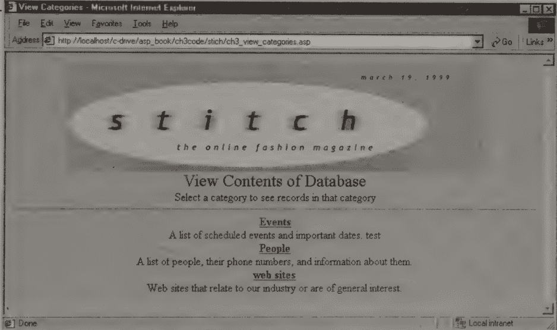

- 事件按子类别组织，然后按日期列出：

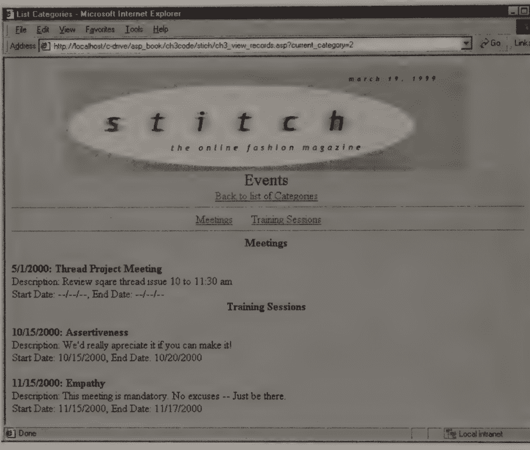

## 第三讲 数据库驱动页面

55

- 数据库存储关于人员的一套相当标准的联系信息：

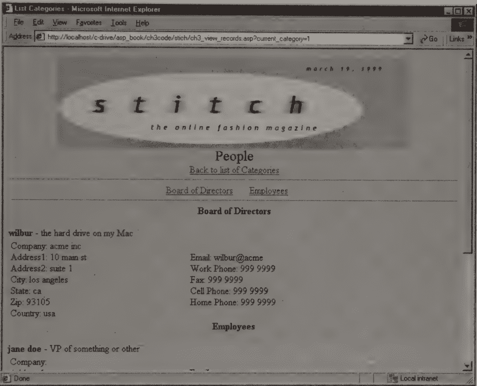

该脚本生成一个链接，使用户可以访问存储在数据库中的网站：

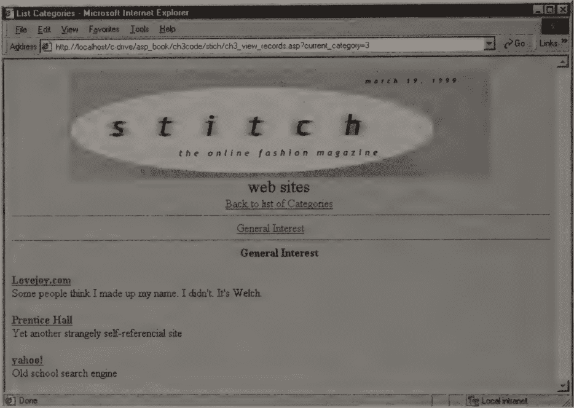

## 新增 ASP 功能

- 关系数据库
- 结构化查询语言（**SQL**）
- *Microsoft Access*
- ADO、ADODB、ODBC、DSN 等……
- 数据库连接对象
- 记录集对象
- 创建 JavaScript `for()` 循环
- 创建 JavaScript 函数
- 使用 Include 文件共享代码
- 创建 JavaScript 对象存储信息

备注：

## 关系数据库

- 需要理解的两个概念：
  - 信息如何存储在表中？
  - 一个表中的信息如何与另一个表中的信息关联？

备注：

## 将信息存储在表中

这些表格展示了本讲脚本使用的两种信息如何组织成表。第一个存储关于类别的信息。第二个显示了实际存储在数据库中的人员、事件和网站的列表：

## 类别

| category_uid | category_name | category_description |
| --- | --- | --- |
| 1 | People | A list of people, their phone numbers, and information about them |
| 2 | Events | A list of scheduled events and important dates |
| 3 | Web Sites | Web sites that relate to our industry or are of general interest |

## 数据

| data_uid | data_name | data_category | data_subcategory | data_description |
| --- | --- | --- | --- | --- |
| 1 | lovejoy.com | 3 | General Interest | overrated Web site |
| 2 | yahoo! | 3 | General Interest | old-school search engine |
| 3 | jane doe | 1 | Employees | VP of something or other |
| 9 | new event | 2 | Company Events | new product release |

关于表格需要注意的几点：

- 表中的每一行存储一条信息，称为一条**记录**。
- 每条记录被分成若干个**字段**。
- 每个字段包含不同类型的信息。

## 关联存储在不同表中的信息

- **主键**是用于唯一标识表中一条记录的字段。
- **外键**是用于将表中的字段与另一表中记录的主键关联起来的字段。

备注：

## 使用 SQL 从数据库检索数据

- 要选择数据表中的所有信息，可以使用以下查询：

  `select * from data`

  数据库将返回一组记录，称为**记录集**，如下所示：

| data_uid | data_name | data_category | data_subcategory | data_description |
|----------|-----------|---------------|------------------|------------------|
| 1 | lovejoy.com | 3 | General Interest | overrated Web site |
| 2 | yahoo! | 3 | General Interest | old-school search engine |
| 3 | jane doe | 1 | EmployeesExtraterrestrial | VP of something or other |
| 9 | new event | 2 | Company Events | new product release |

- 要将查询范围限制(category 3)，可以在 select 语句中添加 where 子句，将语句范围限制为满足特定条件的字段值记录：

  `select * from data where data_category = 3`

  这将结果记录集限制为两条记录：

| data_uid | data_name | data_category | data_subcategory | data_description |
|----------|-----------|---------------|------------------|------------------|
| 1 | lovejoy.com | 3 | General Interest | overrated Web site |
| 2 | yahoo! | 3 | General Interest | old-school search engine |

- 其他时候，可能不需要获取表中的所有字段。在这种情况下，查询可以请求特定字段，而不是使用 `*` 通配符。例如：

  `select data_name, data_description from data where data_category = 3`

  这将生成以下记录集：

| data_uid | data_description |
|----------|------------------|
| 1 | overrated Web site |
| 2 | old-school search engine |

- 最后，通常需要对记录集进行排序，以便结果有序。这可以通过在查询后附加 order by 子句来实现：

  `select data_name from data order by data_name`

  这将返回按字母顺序排序的名称列表：

| data_name |
|-----------|
| jane doe |
| lovejoy.com |
| new event |
| yahoo! |

## Microsoft Access

本课程使用 *Microsoft Access* 的三个原因：

1. 许多人已经拥有 MS Access 的副本。
2. MS Access 的 ODBC 驱动程序与各种 Windows 操作系统捆绑在一起。
3. MS Access 数据库是文件，易于通过 ftp 传输或放在软盘或 CD-ROM 上。

备注：

## ADO、ADODB、ODBC、DSN 等……

创建数据库驱动的 ASP 页面涉及三个步骤：

1. 创建数据库（可以是 Access 数据库或任何具有 ODBC 驱动程序的其他数据库）。

2. 在 Web 服务器上，创建一个 DSN（数据源名称，即 ODBC 数据源）。这使您的脚本能够找到并连接到您的数据库。

3. 编写一个使用 ADO（ActiveX 数据对象）的 ASP 脚本，创建一个或多个记录集，并可能向数据库提供 SQL 指令。

备注：

## ***数据库连接对象***

- 要创建与名为 ch3db 的 DSN 的连接：

```
1. DSN = "DSN=ch3db";
2. Conn = Server.CreateObject("ADODB.Connection");
3. Conn.Open(DSN);
4. // 现在连接已打开
5. // 您可以在这里对它执行操作
6. Conn.Close ();
```

- 建立连接后，可以执行两种操作：

- 执行不返回记录的 SQL 语句。

- 创建记录集对象以收集 SQL select 语句的结果。

- \

- 这些 SQL 语句不返回记录：

insert  
update  
delete

- 建立连接后，可以使用连接对象的 Execute() 方法执行 SQL 语句：

```
Conn.Execute(SQL_statement);
Conn.Execute("update categories set
        category_description = 'Spiffy sites!'
        where category_uid = 3");
```

有时，先将 SQL 语句赋值给变量会更方便：

```
var insert_statement = "insert into data (data_name,
        data_category, data_subcategory, data_description)
        values ('prentice hall', 3, 'General Interest', '
        web site for this book')";
Conn.Execute(insert_statement);
```

## 记录集对象

让我们考虑这个类别表，我们在本讲中已经见过：

## 类别

| category_uid | category_name | category_description |
| --- | --- | --- |
| 1 | People | A list of people, their phone numbers, and information about them |
| 2 | Events | A list of scheduled events and important dates |
| 3 | Web Sites | Web sites that relate to our industry or are of general interest |

在这里，我们将创建可用于将其内容添加到网页的代码：

```
<%@ Language=JavaScript %>
<%
DSN = "DSN=ch3db";
Conn = Server.CreateObject("ADODB.Connection");
Conn.Open(DSN);

sql = "SELECT * FROM categories ";
rs = Server.CreateObject("ADODB.RecordSet");
rs.Open (sql, Conn);

out = "<table border=1>";
out += "<tr><td><pre>category_uid</pre></td><td><pre>category_name</pre></td><td><pre>category_description</pre></td></tr>";
while (! (rs.EOF)){
out += "<tr><td>";
out += String(rs.fields.item("category_uid")) + "</td><td>";
out += String(rs.fields.item("category_name")) + "</td><td>";
out += String(rs.fields.item("category_description")) + "</td><tr>";
rs.move(1);
} // end while recordset
out += "</table>";

rs.Close ();
```


# 第三讲  数据库驱动的页面

```
24. Conn.Close ();
25. %>
26. <html><head><title>记录集
    示例</title></head><body>
27. <%= out %>
28. </body></html>
```

结果如下所示：

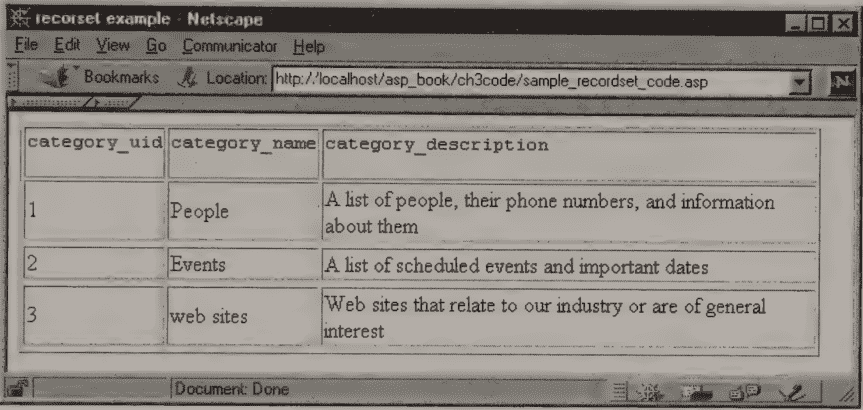

## 从记录集对象收集字段名

可以对前面的脚本进行如下修改，以直接从记录集本身收集字段名：

```
<%@ Language=JavaScript %>
<%
DSN = "DSN=ch3db";
Conn = Server.CreateObject("ADODB.Connection");
Conn.Open(DSN);

	sql = "SELECT * FROM categories ";
	rs = Server.CreateObject("ADODB.RecordSet");
	rs.Open (sql, Conn);

		out = "<table border=1><tr>";
		field_array = new Array()
		for ( field_number = 0; field_number < rs.fields.count ; field_number++ ){
			out += "<td><pre>" + 
			rs.fields(field_number).Name + 
			"</pre></td>";
			field_array[field_number] =
			rs.fields(field_number).Name;
		}
		out += "</tr>";

		while (! (rs.EOF)){
			out += "<tr>";
			for (i=0; i<field_array.length ; i++)
			{
				out +="<td>" +
				String(rs.fields.item(field_
				array[i])) + "</td>"
			}
			out += "</tr>";
			rs.move(1);
		} // end while recordset
		out += "</table>";

		rs.Close ();

Conn.Close ();
%>
<html><head><title>记录集
示例</title></head><body>
<%= out %>
</body></html>
```

## 创建 JavaScript `for()` 循环

- 当需要遍历已知数量的项目时，`for()` 循环非常有用。例如，从一数到十：

```
for (i=1; i<=10; i++){
    Response.Write(i + "<br>");
}
```

这会创建如下所示的结果：

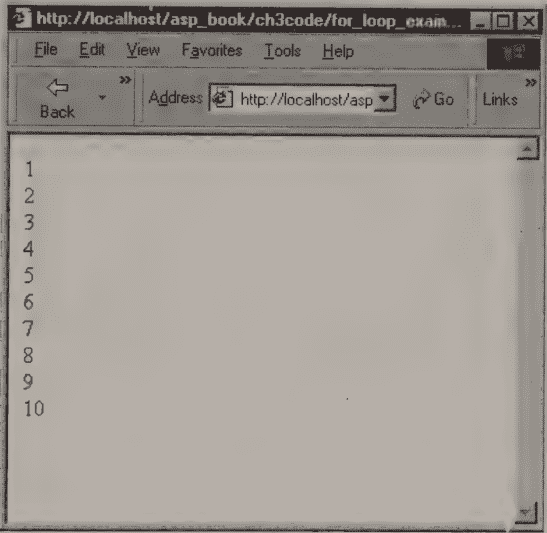

- 可以使用类似的方法，利用数组的 length 属性（包含数组元素数量的整数值）来遍历数组。例如，

```
names_array = new Array
    ("bob", "marla", "jonathan", "dede");
for (i=0; i<names_array.length ; i++) {
    Response.Write(names_array[i] + "<br>");
}
```

会创建如下所示的结果。

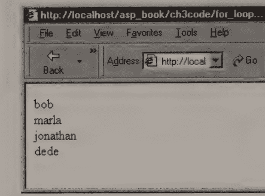

## 创建 JavaScript 函数

函数是一种封装常用代码的方式。例如，假设你需要经常向浏览器发送字符串 "Hello World"：

```
Response.Write("Hello World");
```

你可以创建一个函数来完成这个操作：

```
Function hello (){
    Response.Write("Hello World");
}
```

这样你只需要输入：

```
hello();
```

## 使用包含文件共享代码

- 如果你发现自己在不同的脚本中反复使用相同的代码，可以考虑使用包含文件来在多个文件之间共享同一套代码。例如，假设你有一个包含 include 指令的文件：

```
<%@ Language=JavaScript %>
<html><head></head><body>
<!-- #include file="include.js" -->
<p>示例 asp 页面
</body></html>
```

并且包含文件包含少量 ASP 代码：

```
<%
Response.Write("Yet another")
%>
```

这等同于拥有一个单一文件：

```
<%@ Language=JavaScript %>
<html><head></head><body>
<%
Response.Write("Yet another")
%>
<p>示例 asp 页面
</body></html>
```

## 创建 JavaScript 对象存储信息

以下是在对象中存储信息的方法。例如，假设你需要在脚本中记录关于 Bill 的信息。你可以这样写：

```
bill = new Object();
bill.name = "bill smith";
bill.age = "8";
bill.favorite_colour = "purple!";
bill.birthday = "10/18/99";
```

之后就可以方便地使用这些信息。例如：

```
Response.Write("Happy Birthday, " + bill.name + ". I can't be-
lieve you're already" + bill.age );
```

这会向浏览器发送字符串 "Happy Birthday bill smith. I can't believe you're already 8"。

如果你只是记录关于 Bill 的信息，这可能不太有意义。但如果你还需要记录 Miranda、Wilbur 和 Veronica 的相同信息，那么使用对象可以更容易地管理所有信息。

例如，假设我们有以每个人命名的对象，每个对象中存储了适当的年龄信息，我们就可以使用一致的语法访问他们的年龄，如下所示：

```
bill.name
miranda.name
wilbur.name
veronica.name
```

## 查看数据库脚本代码

- 本示例提供了三个脚本和一个数据库：
  - ch3_include.js
  - ch3_view_categories.asp
  - ch3_view_records.asp
  - ch3db.mdb
- 这些文件必须放在同一个文件夹中。

# 第三讲  数据库驱动的页面

## 脚本 3-1

### ch3_include.js

```
1. <%
2. var out = "";
3. var current_category =
   String(Request("current_category")); // 类别 uid
4. var view_categories_script =
   "ch3_view_categories.asp";
5. var view_records_script = "ch3_view_records.asp";
6.
7. /////////////////////////////////////////////////////
8. // 创建数据库连接
9.
10. strconn="PROVIDER=Microsoft.Jet.OLEDB.4.0;DATA SOURCE=" +
    Server.mappath("ch3db.mdb") + ";"
11. Conn = Server.CreateObject("ADODB.Connection");
12. Conn.Open(strconn);
13.
14. /////////////////////////////////////////////////////
15. // 创建 cat_object，即类别对象。因为
    类别信息几乎在每个页面上都会用到，
16. // 所以此代码每次都会执行。
17.
18. sql = "SELECT * FROM categories order by
    category_name";
19. rs = Server.CreateObject("ADODB.RecordSet");
20. rs.Open (sql, Conn, 2,3);
21. 	if (rs.EOF){ 	// 检查记录集是否为空
22. 		out += "在 categories
    	表中未找到记录。可能出问题了。";
23. 	}
24. 	else{ 		// 记录集不为空
25. 		cat_object = new Object ();
26. 		temp_counter = 0;
27.
28. 		while (!(rs.EOF)){
29. 			cat_object[temp_counter] = new
    			Object ();
30. 			cat_object[temp_counter].uid =
    			parseInt(rs.fields.item
    			("category_uid"))
31. 			cat_object[temp_counter].name =
    			String(rs.fields.item
    			("category_name"))


 # 第三讲  数据库驱动的页面

```
36. <%
37.                           rs.move(1);
38.               } // end while recordset
39.                           Response.Write("</center><HR>");
40.               } // end else (rs not empty)
41. rs.Close ();

43. /////////////////////////////////////////////////////////
44. // Create list of records:
45. sql = "SELECT * FROM data where data_category = " +
46.   current_category + " order by data_subcategory,
    data_name";

48. // events should be ordered by date so slightly
    different query:
49. if (current_category == 2){
50.         sql = "SELECT * FROM data where data_category
    = " + current_category + " order by
    data_subcategory, data_main_date, data_name";
51. }
52. 
53. rs = Server.CreateObject("ADODB.RecordSet");
54. rs.Open (sql, Conn, 2,3);
55. if (rs.EOF){      // check to see if rs is empty
56.         Response.Write("<p>There are no records in
    this category");
57. }
58. else{              // rs not empty
59. 
60. temp_subcat= ""; //this string used to group records
    by subcategory
61. fields = new Object(); // this object used to store
    fields in records
62. 
63. while (! (rs.EOF)){
64. 
65.         // clean up data and put it into the fields
    object:
66.         for ( field_number = 0; field_number <
67.   rs.fields.count ; field_number++ )
68.   {
69.   temp_field =
70.   String(rs.fields(field_number).Name);
71.   temp_content =
72.   String(rs.fields.item(temp_field));
73.   if (temp_content == "null")
74.   {temp_content = ""; }
75.   if (temp_field.search(/date/) > 0 )
76.   // check for date fields
77.         {temp_content =
78.   slash_date(temp_content);}
79.   fields[temp_field] = temp_content
80. 
81.   }

    record
// when we get to a new subcategory, display
its name
// and create an anchor
if (temp_subcat != fields.data_subcategory){
    temp_subcat = fields.data_subcategory;
%>
    <div align="center"><b><a name="<%= temp_subcat %>"><%= temp_subcat %></a></b></div>
<%
}

///////////////////////////////////////////
// What happens next is entirely
category dependent
///////////////////////////////////////////

///////////////////////////////////////////
// PEOPLE (1)
if (current_category == 1){
%>
<p><b><%= fields.data_name%></b> - <%= fields.data_description %>
<table width=80%>
<tr><td width=50%>
    Company: <%= fields.data_company %>
    <br>Address1: <%= fields.data_address1 %>
    <br>Address2: <%= fields.data_address2 %>
    <br>City: <%= fields.data_city %>
    <br>State: <%= fields.data_state %>
    <br>Zip: <%= fields.data_zip %>
    <br>Country: <%= fields.data_country %>
</td><td>
    Email: <%= fields.data_email %>
    <br>Work Phone: <%= fields.data_phone_work %>
    <br>Fax: <%= fields.data_phone_fax %>
    <br>Cell Phone: <%= fields.data_phone_cell %>
    <br>Home Phone: <%= fields.data_phone_home %>
</table>
<%
} //end if cat is 1

///////////////////////////////////////////
// EVENTS (2)
else if (current_category == 2){
117.
118.
119. %>
120. <p><b><% = slash_date (fields.data_main_date)
    %>: <% = fields.data_name%></b>
121. <br>Description: <% = fields.data_description
    %>
122. <br>Start Date: <% = fields.data_start_date %>,
    End Date: <% = fields.data_end_date %>

124. <%
125.                          } // end if category is 2

127.                          /////////////////////////////////////////////
128.                          // WEB SITES (3)
129.                          else if (current_category == 3){
130. %>
131. <p>
132. <a href="<% = fields.data_url %>">
133. <b><% = fields.data_name%></b></a>

135. <br><% = fields.data_description %>
136. <%
137.                          } //end if cat is 3

139.                          /////////////////////////////////////////////
140.                          // CATCH-ALL TEMPLATE
141.                          else {
142. %>.
143. <p>
144. <a href="<% = fields.data_url %>">
145. <b><% = fields.data_name%></b></a>
146. <br><% = fields.data_description %>
147. <br>Note: no template has been created for
    this category
148. <%
149.                          }

151.                          rs.move(1);
152. } // end while recordset
153. } // end else (rs not empty)
154.
155. rs.Close ();
156. Conn.Close ();

158. %>
159. </body></html>
```

## 小结

涵盖的关键问题包括：

- 使用 ASP 通过 ODBC 获取数据：发布数据库信息就是通过数据库连接对象创建与数据库的连接，然后创建 Recordset 对象来收集和发布存储在数据库中的一个或多个记录。

- 在模板中显示结果数据：数据必须以用户可访问的方式呈现。因此，人员、网站和活动使用了不同的模板。

- 使用表单变量在脚本之间传递指令。与第2课一样，表单变量用于向脚本传递指令。在本例中，表单信息确定了对数据库执行何种查询。

- 使用 SQL 数据库：虽然本课使用的数据库只有几条记录，但只需几十条记录就能使数据库真正发挥作用。多年来，我见过很多例子，公司投入大量资源管理和发布信息，而这些信息其实可以更容易地通过数据库进行管理。对于拥有30到60名员工的公司来说，仅维护和分发一份电话列表就是一项重要的任务，而如果将电话列表发布在内联网上，则可以更有效地完成这项工作。

# 第四讲

## 编辑记录

### 目标

- 使用 Web 界面编辑数据库中的记录

### 第4.1课

使用 ASP 和 JavaScript `Date()` 函数向 HTML 页面添加日期

#### 使用 Web 界面管理数据库的原因

- 如果有很多人都在编辑数据库中的信息，则更容易管理
- 节省许可成本
- 只要有浏览器和 TCP/IP 连接，就可以从任何地方进行编辑

备注：

## 本讲项目概览

- 本章脚本使用了一种非常简单的密码机制。要编辑数据库，Web 用户必须知道该密码：

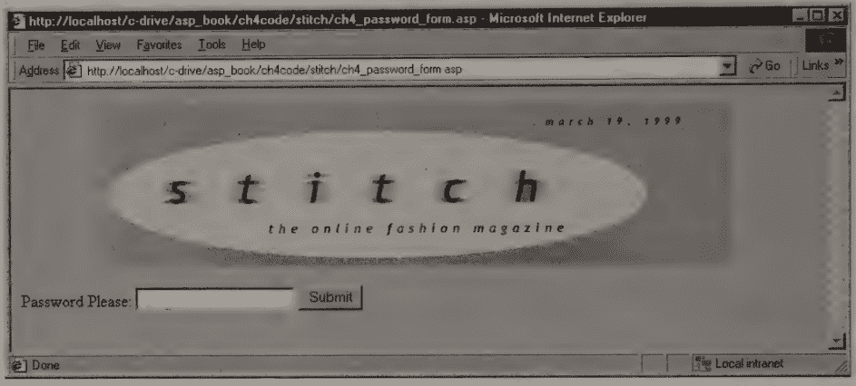

- 有权访问此脚本的用户现在可以编辑类别信息：

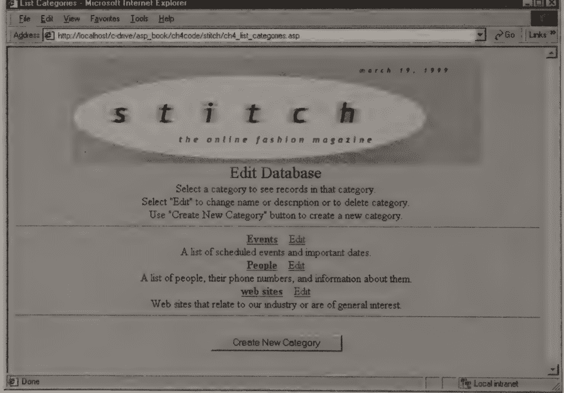

## 第四讲  编辑记录

- 此表单允许用户编辑类别名称和描述：

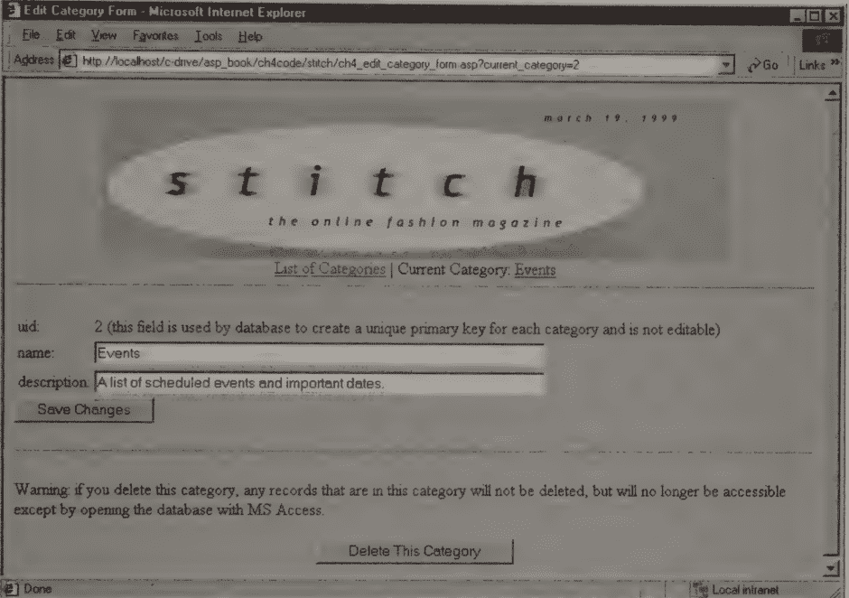

# “编辑”链接允许用户编辑记录：

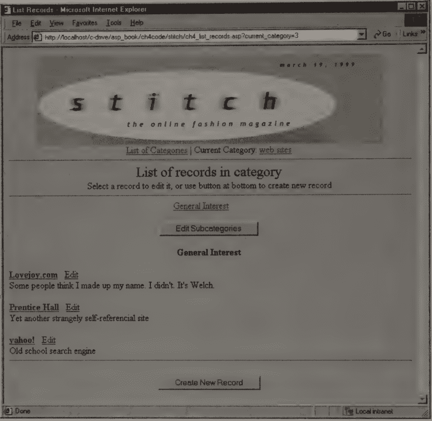

## 第四讲  编辑记录

- 这是编辑记录表单：

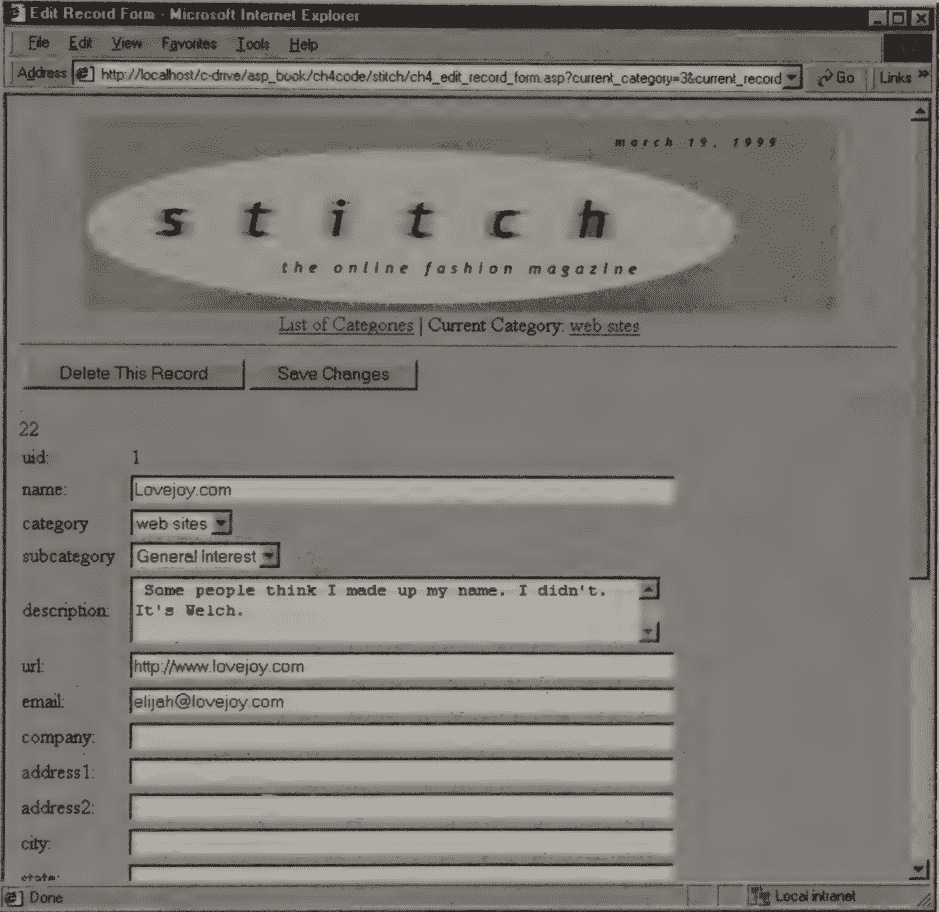

## 新增 ASP 特性

- Response.Redirect()：使用 Response 对象将用户重定向到另一页面
- ASP Session 对象
- Session 密码机制
- 使用 SQL 更新记录
- 使用 Request.Querystring 对象收集表单数据
- 使用正则表达式检查字符串内容（String.search(//,"")）
- JavaScript substring() 函数

备注：

## Response.Redirect()：使用 Response 对象将用户重定向到另一页面

- 在 ASP 中，可以使用 Response 对象将浏览器从一个页面重定向到另一个页面：

```
Response.Redirect("Page.asp")
```

##### 备注：

## ASP Session 对象

ASP 包含一个用于跟踪唯一访问者的内置功能（使用 cookie）：Session 对象。由于 ASP Session 对象会跟踪唯一访问者，因此一旦用户通过密码验证通过身份认证，就可以非常容易地使用 Session 对象来验证请求访问脚本的用户是否确实有权使用该脚本。

##### 备注：

### Session 密码机制

- 使用 Session 对象排除未经身份验证的用户使用某些脚本需要两个要素：
  - 当用户符合特定条件时（在本例中，当用户知道密码时）在 Session 对象中设置值的代码。
  - 在授予用户访问敏感脚本或 HTML 页面的权限之前，检查确保所需值已存储在 Session 对象中的代码。

**备注：**


### 收集密码并设置会话变量

- 这是一个非常简单的表单，包含一个文本框和一个提交按钮，允许用户输入密码：

```
<form action="<%=
String(Request.ServerVariables("SCRIPT_NAME")) %>">
<p>Password Please:
<input type=password name=password >
<input type=submit name="toss" value="Submit">
</form>
```

- 这段代码检查传入的密码（一个名为 password 的表单字段），并将其与脚本中硬编码的字符串进行比较，此处为 "password"：

```
if (String(Request("password")) == "password"){
	Session("edit_db_pass") =
	String(Request("password"));
	Response.Redirect("yet_another_page.asp");
}
```

**注意：**

### 检查有效的会话变量

- 一旦设置了会话变量，下一步就是在任何生成需要控制访问的页面的脚本中检查它。对于我们刚刚检查的代码，这是通过检查会话变量 edit_db_pass 的值是否设置为正确的值来实现的：

```
if (Session("edit_db_pass") != "password"){
Response.Redirect("password_form.asp");
}
//... 脚本的其余部分
```

## 注意：

## 使用 SQL 更新记录

- 可以使用 update 语句更改 categories 表中特定记录的 description 字段：

| category_uid | category_name | category_description |
|-------------|---------------|----------------------|
| 3 | Web Sites | Web sites that relate to our industry or are of general interest |

为此，语句的编写方式是使其仅适用于 category_uid 值为 3 的那些记录。

- 由于 category_uid 字段是表的主键，因此只能包含唯一值，这有效地将语句限制为仅作用于此处显示的单个记录。如下所示：

```
update categories set category_description = 'Spiffy sites!'
  where data_uid = 3
```

该语句修改单个字段 category_description 的值。结果，记录被修改为现在看起来像这样：

| category_uid | category_name | category_description |
|-------------|---------------|----------------------|
| 3 | Web Sites | Spiffy sites! |

## 使用 Request.QueryString 对象收集表单数据

- 收集通过 Get 方法发送到脚本的所有信息，只需遍历 Request.QueryString 对象：

```
for ( field_number = 1; field_number <=
Request.QueryString.count ; field_number++ ){
  temp_field = String(Request.QueryString.Key(field_number));
  temp_content = String(Request.QueryString.Item(temp_field))
  Response.Write ("<br>" + temp_field + ": " + temp_content );
}
```

- 其工作原理如下：

- Request.QueryString.count 返回传入表单中的表单变量数量。

- 如果我们给 Request.QueryString.Key() 一个小于传入表单变量数量的数字，Request 对象会返回一个字段的名称。

- 如果我们将该字段名称放入 Request.QueryString.Item()，我们就会得到该字段的值。

## 注意：

## 使用正则表达式检查字符串内容（String.search(//,"")）

- 假设你有一个名为 name 的变量，你想检查它是否包含字符串 "Bob"，以便你的脚本可以做出相应的反应：

```
if (name.search(/Bob/) >= 0 ){
    Response.Write("Bob! \n<p>So how the heck are
            you?")
}
else{
    Response.Write("Oh.<p>Hi.<p>How are you?")
}
```

- 要检查多个值，可以使用管道 ("|") 符号分隔模式：

```
if (name.search(/Bob|Dolores/) >= 0 ){
            //... 执行某些操作
}
```

## 注意：

## JavaScript substring() 函数

substring() 函数允许你移除字符串的一小部分。例如，它可以用来移除字符串的最后一个字符：

```
sentence = "Nothing will happen here."
sentence = sentence.substring(0,(sentence.length-1));
```

这将移除字符串 sentence 中的句点，留给你字符串

```
Nothing will happen here
```

## 注意：

## 编辑数据库的代码

- 一个收集密码并检查其是否有效的脚本。

- 一个被本讲中大多数脚本共享的包含文件，执行不同的功能。

## 注意：

## 脚本如何组合在一起

| | |
|:---|:---|
| **对用户可见** | |
| 从此处开始 | ch4_password_form.asp |
| | 错误密码 → 正确密码 |
| | ch4_delete_category.asp* |
| | 删除按钮 |
| | ch4_list_categories.asp* |
| | 选择要编辑的类别名称或描述 |
| | ch4_edit_category_form.asp* |
| | 保存更改按钮 → ch4_update_category.asp* |
| | ch4_include.js |
| | （* 表示使用该脚本使用包含文件） |
| | 选择一个类别以查看该类别中的记录 |
| | ch4_insert_subcategory.asp* |
| | 创建新子类别按钮 |
| | ch4_delete_subcategory.asp* |
| | 删除子类别按钮 |
| | ch4_edit_subcategories_form.asp* |
| | ch4_list_records.asp* |
| | 编辑子类别按钮 |
| | 选择特定记录进行编辑 |
| | ch4_edit_record_form.asp* |
| | 保存更改按钮 → ch4_update_record.asp* |
| | 删除按钮 → ch4_delete_record.asp* |
| **对用户不可见** | |

## 脚本 4-1

### ch4_password_form.asp

```
1. <%@ Language=JavaScript %>
2.
3. <%
4. if (String(Request("password")) == "password"){
5.
6.     Session("edit_db_pass") = "OK";
7.     Response.Redirect("ch4_list_categories.asp");
8. }
9. %>
10.
11. <html><head></head><body>
12. <form action="<% =
     String(Request.ServerVariables("SCRIPT_NAME")) %>"> 
13. <p>Password Please:
14. <input type=password name=password >
15. <input type=submit name="toss" value="Submit">
16. </form>
17. </body></html>
```

注意：

## 脚本 4-2

### ch4_include.js

```
1. <%
2. if (Session("edit_db_pass") != "OK"){
3.
4.     Response.Redirect("ch4_password_form.asp");
5. }
6.
7. var out = "";
8.
9. var this_script_url =
    String(Request.ServerVariables("SCRIPT_NAME"));
10.
11. var current_category =
    String(Request("current_category")); // category uid
12. var current_subcategory =
    String(Request("current_subcategory")); // subcategory string
13. var current_record =
    String(Request("current_record")); // data uid
14.
15. // display scripts
16. var list_categories_script =
    "ch4_list_categories.asp";
17. var list_records_script = "ch4_list_records.asp";
18.
19. var edit_record_form_script =
    "ch4_edit_record_form.asp";
20. var blank_record_form_script =
    "ch4_blank_record_form.asp";
21.
22. var edit_category_form_script =
    "ch4_edit_category_form.asp";
23. var blank_category_form_script =
    "ch4_blank_category_form.asp";
24.
25. var edit_subcategories_form_script =
    "ch4_edit_subcategories_form.asp";
26.
27. // db scripts
28. var update_record_script = "ch4_update_record.asp";
29. var insert_record_script = "ch4_insert_record.asp";
30. var delete_record_script = "ch4_delete_record.asp";
31.
32. var update_category_script =
    "ch4_update_category.asp";
33. var insert_category_script =
    "ch4_insert_category.asp";
34. var delete_category_script =
    "ch4_delete_category.asp";
```

```
35.
36. var insert_subcategory_script =
    "ch4_insert_subcategory.asp";
37. var delete_subcategory_script =
    "ch4_delete_subcategory.asp";
38.
39. /////////////////////////////////////////////////////////////////
40. // create connection to database
41. DSN = "DSN=ch3db";
42. Conn = Server.CreateObject("ADODB.Connection");
43. Conn.Open(DSN);
44.
45.
46. /////////////////////////////////////////////////////////////////
47. // create cat_object, the category object. Because
    category information is used
48. // on almost every page, this code is executed every
    time.
49. sql = "SELECT * FROM categories order by
    category_name";
50. rs = Server.CreateObject("ADODB.RecordSet");
51. rs.Open (sql, Conn);
52.         if (rs.EOF){  // check to see if rs is empty
53.             out += "no records found in categories
    table. something is probably wrong.";
54. }
55.     else{                    // rs not empty
56.         cat_object = new Object ();
57.         temp_counter = 0;
58.
59.         while (! (rs.EOF)){
60.             cat_object[temp_counter] = new
    Object ();
61.                 cat_object[temp_counter].uid =
    parseInt(rs.fields.item
    ("category_uid"))
62.                 cat_object[temp_counter].name =
    String(rs.fields.item
    ("category_name"))
63.                 cat_object[temp_counter].desc =
    String(rs.fields.item
    ("category_description"))
64.
65.         rs.move(1);
66.         cat_object.qty =
    (temp_counter + 1);
67.             temp_counter ++;
68.         } // end while recordset
69.     } // end else (rs not empty)
70. rs.Close ();
71.
72. /////////////////////////////////////////////////////////////////
73. // Create nav_header
```


 ## 第4讲  编辑记录

```
74. nav_header = '<div align="center">';
75. nav_header += '<a href="' + list_categories_script
    +'">List of Categories</a> '
76. 
77. if (current_category > 0){
78.         nav_header += ' | Current Category: <a
    href="' + list_records_script +
    '?current_category='
    + current_category + '">' 
79.         for (i = 0; i < cat_object.qty; i++){
80.             if (cat_object[i].uid ==
                    current_category){
81.                     nav_header +=
                        cat_object[i].name + '</a>'
82.                 }
83.             }
84. }
85. 
86. nav_header += '</div><hr>'
```

```
87. 
////////////////////////////////////////////////////////////////////////
89. // slash_date()
90. new function slash_date (temp_date)
91. if (temp_date != "" && temp_date != "null" ){
92.         temp_date2 = new Date(temp_date);
93.     temp_date3 = temp_date2.getMonth()+1 + "/" +
    temp_date2.getDate() + "/" +
    temp_date2.getFullYear();
94.         return (temp_date3);
95. }
96. else{
97.         return "--/--/----";
98. }
99. }
100. 
101. %>
```

## 编辑分类的代码

接下来的脚本系列用于查看和编辑分类信息，具体如下所示。

- ch4_list_categories.asp: 显示数据库中的分类列表，并让用户进入 ch4_list_records.asp、ch4_edit_category_form.asp 或 ch4_blank_category_form.asp。
- ch4_edit_category_form.asp: 允许用户更改分类信息或删除分类。
- ch4_update_category.asp: 使用 ch4_edit_category_form.asp 创建的编辑内容更新数据库。
- ch4_delete_category.asp: 删除一个分类。
- ch4_blank_category_form.asp: 创建一个空白表单，用户可以用来创建新的分类。
- ch4_insert_category.asp: 使用在 ch4_blank_category_form.asp 中输入的信息插入新的分类。

### 注释：

## 编辑分类所涉及的脚本

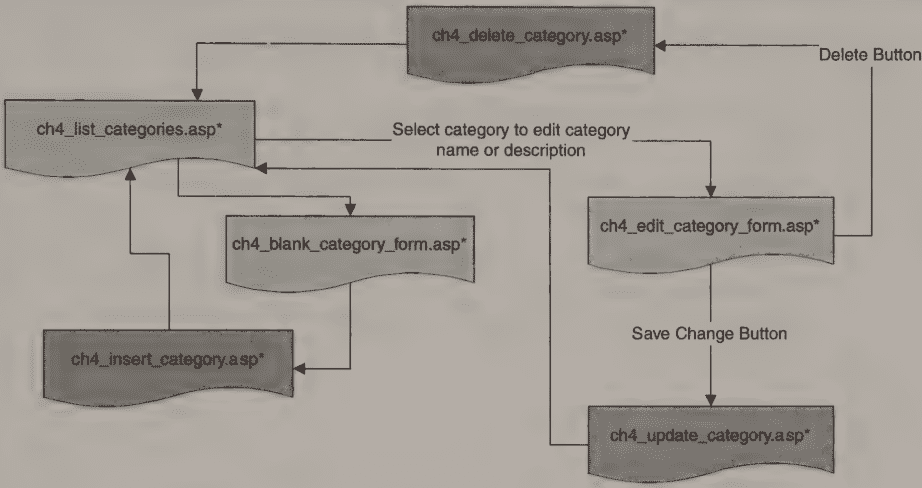

## 脚本 4-3

### ch4_list_categories.asp

```
1. <%@ Language=JavaScript %>
2. <!-- #include file="ch4_include.js" -->
3.
4. <html><head><title>List Categories</title></head>
5. <body>
6.
7. <center><font size="+2"> Edit Database </font>
8. <br>Select a category to see records in that
   category.
9. <br>Select "Edit" to change name or description or
   to delete category.
10. <br>Use "Create New Category" button to create a new
    category.<hr>
11.
12. <%
13. for (i = 0; i < cat_object.qty; i++){
14. 		%>
15. 	<a href="<%= list_records_script
    %>?current_category=<%= cat_object[i].uid
    %>"><b><%= cat_object[i].name
    %></b></a>&nbsp;&nbsp;&nbsp;
16. 	<a href="<%= edit_category_form_script
    %>?current_category=<%= 
    cat_object[i].uid%>">Edit</a>
17. 	<br><%= cat_object[i].desc %><br>
18. 	<%
19. }
20. %>
21.
22. <hr>
23. <form action="<%= blank_category_form_script %>">
24. <input type="submit" name="toss" value="Create New
    Category">
25. </form>
26. </center>
27.
28. <%
29. Conn.Close ();
30. %>
31.
32. </body></html>
```

## 脚本 4-4

### ch4_edit_category_form.asp

```
1. <%@ Language=JavaScript %>
2. <!-- #include file="ch4_include.js" -->
3.
4. <html><head><title>Edit Category
   Form</title></head><body>
5.
6. <%= nav_header %>
7.
8. <%
9. // create recordset "rs"
10. sql = "SELECT * FROM categories where category_uid =
    " + current_category ;
11. rs = Server.CreateObject("ADODB.RecordSet");
12. rs.Open (sql, Conn);
13.
14. // check to see if rs is empty
15. if (rs.EOF){
16.        out += "no records found. This shouldn't
    happen unless multiple people are using the
    database simultaneously and somebody just deleted
 prevnext    the category you were about to edit.";
17. }
18.
19. // rs not empty, we have a record to edit, so
    create form:
20. else{   %>
21.
22. <form action="<%= update_category_script%>">
23. <table>
24.
25. <%
26. for ( field_number = 0; field_number <
     rs.fields.count ; field_number++ ){
27.
28.          temp_field =
     String(rs.fields(field_number).Name);
29.          temp_content =
     String(rs.fields.item(temp_field));
30.
31.         //data cleanup: nulls
32.         if (temp_content == "null") {temp_content =
    ""; }
33.
34.         // we can get rid of "category_" on labels,
    but not in the form fields
35.         temp_field_label = temp_field.replace
    (/category_/,"");
36. 
37. // uid field should not be editable:
38. if (temp_field.search(/uid/) >= 0){
39.     out += '\n\n<tr><td>' +
40.     temp_field_label + ': </td><td>' +
41.     temp_content + ' (this field is used by
42.     database to create a unique primary key
43.     for each category and is not
44.     editable)</td></tr>';
45. }
46. 
47. // standard text box for name and description fields
48. else {
49.     out += '\n\n<tr><td>' +
50.     temp_field_label + ': </td><td><input
51.     type=text name="' + temp_field + '" 
52.     value="' + temp_content + '" 
53.     size=60></td></tr>';
54. }
55. }// end of looping through incoming form fields
56. } // end else (rs not empty)
57. rs.Close ();
58. %>
59. <%= out %>
60. </table>
61. 
62. <input type="hidden" name ="current_category"
63. value="<%= current_category %>">
64. <input type="submit" name ="toss" value="Save
65. Changes,j Changes">
66. </form>
67. 
68. <hr>
69. <p>Warning: if you delete this category, any records
70. that are in this category will not be deleted, but
71. will no longer be accessible except by opening the
72. database with MS Access.
73. 
74. <center>
75. <form action="<%= delete_category_script%>">
76. <input type="hidden" name ="current_category"
77. value="<%= current_category %>">
78. <input type="submit" name ="toss" value="Delete This
79. Category">
80. </form></center>
81. 
82. <%
83. Conn.Close ();
84. %>
85. </body></html>
```

## 脚本 4-5

### ch4_update_category.asp

```
<%@ Language=JavaScript %>
<!-- #include file="ch4_include.js" -->

<%
temp_update = "";
for ( field_number = 1; field_number <=
Request.QueryString.count ; field_number++ ){

	temp_field =
String(Request.QueryString.Key(field_number));
	temp_content =
String(Request.QueryString.Item(temp_field))

		if (temp_field.search
(/uid|current_category|toss/) < 0 ){
			// check for null values
			if (temp_content == "null" ||
			temp_content == "")
				{temp_updaterv++ += " "+ temp_field
				+ " = null,";}

			else {

				temp_content =
			temp_content.replace(/'/g,"&#039;");
				temp_update += " "+ temp_field
				+ " = '" + temp_content + "',";
			}
		} // end if()
}// end for()

// remove last character, which is a trailing
// comma that we don't want
temp_update =
temp_update.substring(0,temp_update.length-1);

update_sql = "update categories set " + temp_update
+ " where category_uid = " + current_category;

Conn.Execute(update_sql);

Conn.Close ();

Response.Redirect(list_categories_script)

//Response.Write("<hr>\n\n\n" + update_sql +
//"\n\n\n<hr>");
//Response.Write(list_records_script)
%>
```

## 脚本 4-6

### ch4_delete_category.asp

```
1. <%@ Language=JavaScript %>
2. <!-- #include file="ch4_include.js" -->
3. <%
4.
5. delete_sql = "delete from categories where category_uid = " + current_category;
6.
7. Conn.Execute(delete_sql);
8.
9. Conn.Close ();
10.
11. Response.Redirect(list_categories_script)
12.
13. //Response.Write("<hr>\n\n\n" + delete_sql + "\n\n\n<hr>");
14. //Response.Write(list_categories_script)
15.
16. %>
```

### 注释：

## 脚本 4-7

### ch4_blank_category_form.asp

```
<%@ Language=JavaScript %>
<!-- #include file="ch4_include.js" -->

<html><head><title>Blank Category
Form</title></head><body>

<% = nav_header %>
To create a new category, type in a name and
description below, and then click on the "Create New
Category" button:<hr>

<%
sql = "SELECT * FROM categories where
category_uid=0" ;
rs = Server.CreateObject("ADODB.RecordSet");
rs.Open (sql, Conn, 2,3);
%>

<form action="<% = insert_category_script
%>"><table>

<%
// loop through form fields and create a form based
on fields we found
// in recordset.
for ( field_number = 0; field_number <
rs.fields.count ; field_number++ ){

	temp_field =
String(rs.fields(field_number).Name);

	// we can get rid of "category_" on labels,
but not in the form fields
	temp_field_label =
temp_field.replace(/category_/,"");

	// if not uid field, create text box:
	if (temp_field.search(/uid/) < 0){
%>
		<tr><td><% = temp_field_label %>:
</td><td><input type=text name="<% =
temp_field %>"value="" size=60></td></tr>
<%
	}

}// end of looping through incoming form fields
rs.Close ();
```


 ```
37.
38. Conn.Close ();
39. %>
40.
41. </table>
42. <input type="submit" name="toss" value="Create New Category">
43. </form>
44.
45. </body></html>
```

### 注释：

# 第4讲 编辑记录

## 脚本 4-8

### ch4_insert_category.asp

```
1. <%@ Language=JavaScript %>
2. <!-- #include file="ch4_include.js" -->
3.
4. <%
5. fields = "";
6. values = "";
7.
8. // loop through incoming form fields to build sql
    statements
9. for ( field_number = 1; field_number <=
    Request.QueryString.count ; field_number++ ){
10.
11.         temp_field =
    String(Request.QueryString.Key(field_number));
12.         temp_content =
    String(Request.QueryString.item(temp_field))
13.
14.         if (temp_field.search(/toss/) < 0 ){
15.
16.                 fields += ' ' + temp_field + ',';
17.
18.                 // check for null values
19.                 if (temp_content == "null" ||
    temp_content == ""){
20.                         values += " null,";
21.                 }
22.                 // this works for non-null char fields
23.                 else {
24.                         temp_content =
    temp_content.replace(/'/g,"&#039;");
25.                         values += " '" + temp_content +"',";
26.                 }
27.         } // end if we want to add to update string
28. } // end looping through incoming form fields
29.
30. // remove last character, which is a trailing comma
    that we don't want
31. values = values.substring(0,values.length-1);
32. fields = fields.substring(0,fields.length-1);
33.
34. insert_sql = "insert into categories (" + fields +
    ") values (" + values + ")";
35.
36. Conn.Execute(insert_sql);
37.
38. Conn.Close ();
39.
40. Response.Redirect(list_categories_script)
```

```
41.
42. //Response.Write("<hr>\n\n\n" + insert_sql +
    "\n\n\n<hr>")
43. //Response.Write(list_records_script)
44.
45. %>
```

### 注释：

## 编辑记录的代码

正如上一节讨论的脚本允许用户查看、编辑和创建类别一样，本节中的脚本让Web用户查看某个类别中的记录列表、创建新记录以及编辑或删除现有记录。简要说明如下：

- ch4_list_records.asp：列出给定类别的记录。提供编辑特定记录的链接（ch4_edit_record_form.asp）和创建新记录的按钮（ch4_blank_record_form.asp）。

- ch4_edit_record_form.asp：用于编辑特定记录的表单。编辑内容会转发到 ch4_update_record.asp。

- ch4_update_record.asp：保存使用 ch4_edit_record_form.asp 对记录所做的更改。

- ch4_delete_record.asp：当用户在 ch4_edit_record_form.asp 上点击"删除记录"按钮时删除单条记录。

- ch4_blank_record_form.asp：创建一个空白表单，让用户可以创建新记录。

- ch4_insert_record.asp：保存使用 ch4_blank_record_form.asp 创建的记录。

### 注释：

## 用于编辑记录的脚本

| | |
|:---|:---|
| ch4_list_records.asp\* | 选择要编辑的特定记录 |
| ch4_edit_record_form.asp\* | 保存更改按钮 |
| ch4_update_record.asp\* | |
| ch4_delete_record.asp\* | 删除按钮 |
| | 创建新记录按钮 |
| ch4_insert_record.asp\* | 创建新记录按钮 |
| ch4_blank_record_form.asp\* | |

## 脚本 4-9

### ch4_list_records.asp

```
1. <%@ Language=JavaScript %>
2. <!-- #include file="ch4_include.js" -->
3.
4. <html><head><title>List Records</title></head><body>
5.
6. <% = nav_header %>
7. <center><font size="+2"> List of records in <%= cat_object.current %> category </font><br>Select a record to edit it, or use button at bottom to create new record
8. </center>
9. <hr>
10.
11. <%
12. ///////////////////////////////////////////////////////
13. // Create dynamic subcategory navbar
14.
15. sql = "SELECT distinct data_subcategory FROM data where data_category = " + current_category + " order by data_subcategory";
16. rs = Server.CreateObject("ADODB.RecordSet");
17. rs.Open (sql, Conn, 2,3);
18. 				if (rs.EOF){  // check to see if rs is empty
19. 					out += "no subcategories in this category.";
20. 				}
21. 				else{              // rs not empty
22. 					Response.Write("<center>");
23. 					while (!(rs.EOF)){
24. %>
25. 					<a href="#<%= String(rs.fields.item("data_subcategory"))%>"><%= String(rs.fields.item("data_subcategory"))%></a>
26. 					&nbsp;&nbsp;&nbsp;&nbsp;&nbsp;&nbsp
27. <%
28. 						rs.move(1);
29. 					} // end while recordset
30. 				} // end else (rs not empty)
31.
32. rs.Close ();
33.
34. %>
35. <form action="<%= edit_subcategories_form_script %>">
36. <input type="submit" name="toss" value="Edit Subcategories">
37. </form>
```

```
38. </center>
39. <%
40. ///////////////////////////////////////////////////////
41. // Create list of records:
42.
43. sql = "SELECT * FROM data where data_category = " +
    current_category + " order by data_subcategory,
    data_name";
44.
45. // events should be ordered by date:
46. if (current_category == 2){
47.     sql = "SELECT * FROM data where data_category =
    " + current_category + " order by
    data_subcategory,data_main_date, data_name";
48. }
49.
50. rs = Server.CreateObject("ADODB.RecordSet");
51. rs.Open (sql, Conn, 2,3);
52. if (rs.EOF){  // check to see if rs is empty
53. %>
54. <p>There are no records in this category
55. <%
56. }
57. else{    // rs not empty
58.
59.             temp_subcat= ""; //this string used to group
        records by subcategory
60.             fields = new Object(); // this object used to
        store fields in records
61.
62. while (!(rs.EOF)){
63.
64.             // clean up data and put it into the fields
        object:
65.             for ( field_number = 0; field_number <
        rs.fields.count ; field_number++ ){
66.
67.                        temp_field =
       String(rs.fields(field_number).Name);
68.                        temp_content =
       String(rs.fields.item(temp_field));
69.                        temp_content =
       temp_content.replace(/&#039;/g,"'");
70.                        if (temp_field.search(/date/) > 0 )
       //check for date fields
71.                               {temp_content =
       slash_date(temp_content);}
72.                        else if (temp_content == "null")
       {temp_content = ""; }
73.                        fields[temp_field] = temp_content
74.             } // end looping through fields in current
        record
75.
```

# # 第4讲 编辑记录

```
76.         // subcategories: when we get to a new one,
77.     display it
77.         if (temp_subcat != fields.data_subcategory){
78.             temp_subcat = fields.
    data_subcategory;
79. %>
80.         <div align="center"><b><a name="<%= temp_subcat %>"><%= temp_subcat %></a></b></div>
81. <%
82. }
83.
84. /////////////////////////////////////////
85.         // What happens next is entirely category
    dependent
86.         /////////////////////////////////////////
87.
88.         /////////////////////////////////////////
89.         // PEOPLE (1)
90.         if (current_category == 1){
91. %>
92. <p><b><%= fields.data_name%></b> - <%= fields.data_description %>
93. &nbsp;&nbsp;<a href ="<%= edit_record_form_script %>?current_category=<%= current_category %>&current_record=<%= fields.data_uid %>">Edit</a>
94. <table width=80%><td width=50%>
95. <td width=50%>
96.     Company: <%= fields.data_company %>
97.     <br>Address1: <%= fields.data_address1 %>
98.     <br>Address2: <%= fields.data_address2 %>
99.     <br>City: <%= fields.data_city %>
100.     <br>State: <%= fields.data_state %>
101.     <br>Zip: <%= fields.data_zip %>
102.     <br>Country: <%= fields.data_country %>
103. </td><td>
104.     Email: <%= fields.data_email %>
105.     <br>Work Phone: <%= fields.data_phone_work %>
106.     <br>Fax: <%= fields.data_phone_fax %>
107.     <br>Cell Phone: <%= fields.data_phone_cell %>
108.     <br>Home Phone: <%= fields.data_phone_home %>
109. </table>
110. <%
111.     } //end if cat is 1
112.
113.     /////////////////////////////////////////
114.     // EVENTS (2)
115.     else if (current_category == 2){
116.
117.
118. %>
119. <p><b><%= fields.data_main_date %>: <%= fields.data_name%></b>
```


 120. &nbsp;&nbsp;<a href ="<%= edit_record_form_script %>?current_category=<%= current_category %>&current_record=<%= fields.data_uid %>">编辑</a>
121. <br>描述：<%= fields.data_description %>
122. <br>开始日期：<%= fields.data_start_date %>，结束日期：<%= fields.data_end_date %>
124. <%
125. 	} // 分类为 2 时结束
127.
128. 	////////////////////////////////////////
129. 	// 网站 (3)
130. 	else if (current_category == 3){
131. %>
132. <p>
133. <a href="<%= fields.data_url %>">
134. <b><%= fields.data_name%></b></a>
135. &nbsp;&nbsp;<a href="<%= edit_record_form_script %>?current_category=<%= current_category %>&current_record=<%= fields.data_uid %>">编辑</a>
136. <br><%= fields.data_description %>
137. <%
138. 	} // 分类为 3 时结束
140.
141. 	////////////////////////////////////////
142. 	// 通用模板
143. 	else {
144. %>
145. <p>
146. <a href="<%= fields.data_url %>">
147. <b><%= fields.data_name%></b></a>
148. &nbsp;&nbsp;<a href="<%= edit_record_form_script %>?current_category=<%= current_category %>&current_record=<%= fields.data_uid %>">编辑</a>
149. <br><%= fields.data_description %>
150. <br>注意：此分类尚未创建模板
152. <%
153. 	}
155. 	rs.move(1);
156. 	} // 记录集循环结束
157. } // else 结束（记录集非空）
158. rs.Close ();
159.
162. // 创建"新建记录"按钮的表单：
163. %>
164. <hr><center>

## 第四讲 编辑记录

```
<form action="<% = blank_record_form_script %>">
<input type="hidden" name="current_category" value="<% = current_category %>">
<input type="submit" name="toss" value="创建新记录">
</form></center>

<
Conn.Close ();
%>
</body>
</html>
```

### 注释：

### 脚本 4-10

#### ch4_edit_record_form.asp

```
<%@ Language=JavaScript %>
<!-- #include file="ch4_include.js" -->

<html><head><title>编辑记录表单</title></head><body>

<% = nav_header %>

<%
// 获取要编辑记录的信息：
sql = "SELECT * FROM data where data_uid = " + current_record ;
rs = Server.CreateObject("ADODB.RecordSet");
rs.Open (sql, Conn, 2,3);
if (rs.EOF){       // 检查记录集是否为空
    out += "未找到记录。除非多个人同时使用数据库，否则不应出现这种情况";
}
else{  // 记录集非空
%>
<!-- 表格：删除和保存按钮 -->
<table border=0>
<tr><td valign=top>
   <!-- 删除按钮将用户发送到删除脚本 -->
   <form action="<% = delete_record_script%>">
   <input type="hidden" name ="current_category" value="<% = current_category %>">
   <input type="hidden" name ="current_record" value="<% = current_record %>">
   <input type="submit" name ="toss" value="删除此记录">
   </form>
</td><td valign=top>
   <!-- 保存按钮将用户发送到更新脚本 -->
   <!-- 注意此表单贯穿了本脚本的大部分内容 -->
   <form action="<% = update_record_script%>">
   <input type="submit" name ="toss" value="保存更改">
</td></tr></table>

<!-- 表格：显示所有字段 -->
<table>
<%
```

## 第四讲 编辑记录

```
37. for ( field_number = 0; field_number < rs.fields.count ; field_number++ ){

38.	
39.	temp_field = String(rs.fields(field_number).Name);
40.	temp_content = String(rs.fields.item(temp_field));
41.	
42.	// 数据清理：空值、日期、字段名称
43.	if (temp_content == "null") {temp_content = ""; }
44.	else if (temp_field.search(/date/) >= 0 )
45.	// 检查日期字段
46.			{temp_content = slash_date(temp_content);}
46.	// 我们可以在标签上去掉"data_"，但不能在表单字段中去掉
47.	temp_field_label = temp_field.replace(/data_/,"");
48.	
49.	// uid 字段不可编辑：
50.	if (temp_field.search(/uid/) >= 0){
51.		out += '\n\n<tr><td>' + temp_field_label + ': </td><td>' + temp_content + '</td></tr>';
52.	}
53.	
54.	// 分类需要滚动框：
55.	else if (temp_field.search(/data_category/) >= 0){
56.		out += '\n\n<tr><td>'+temp_field_label+' </td><td>'; 
57.		out += '\n<select name="' + temp_field + '">'; 
58.			for (i=0; i < cat_object.qty ; i++){
59.				out += '\n<option name="data_category" value="' + cat_object[i].uid + '"'; 
60.				if (current_category == cat_object[i].uid)
				out += ' selected ' ;
61.				out += '>' + cat_object[i].name;
62.			}
63.		out += '\n</select></td></tr>\n\n';
64.	}
65.	
66.	// 子分类也需要滚动框：
67.	else if (temp_field.search(/data_subcategory/) >= 0){ 
68.		sql = "SELECT * FROM subcategories where category = " + current_category;
69.		rs2 = Server.CreateObject("ADODB.RecordSet");
```

```
rs2.Open (sql, Conn, 2,3);
if (rs2.EOF){  // 检查记录集是否为空
    out += "<tr><td>错误：此分类不存在子分类！</td><td></td></tr>";
}
else{                          // 记录集非空
    out += '\n\n<tr><td>'+temp_field_label+'</td><td>';
    out += '\n<select name="' + temp_field + '">';
    while (!(rs2.EOF)){
        out += '\n<option name="'+ temp_field +'" value="' + String(rs2.fields.item("subcategory")) + " " ';
        if (temp_content == String(rs2.fields.item("subcategory")))
            {out += ' selected ' ;}
        out += '>' + String(rs2.fields.item("subcategory"));
        rs2.move(1);
    } // 记录集循环结束
    out += '\n</select></td></tr>\n\n';
} // else 结束（记录集非空）
rs2.Close();
} // 子分类滚动框结束
// 描述字段使用 <textarea>
else if (temp_field.search(/description/) >= 0){
    out += '\n\n<tr><td>' + temp_field_label + ': </td><td><textarea name="' + temp_field + '" cols=50 rows=3> ' + temp_content + '</textarea></td></tr>';
}// 描述字段结束
// 标准文本框
else {
    out += '\n\n<tr><td>' + temp_field_label + ': </td><td><input type=text name="' + temp_field + '" value="' + temp_content + '" size=60></td></tr>';
}
}// 遍历传入表单字段结束
} // else 结束（记录集非空）
```

## 第四讲 编辑记录

```
102.
103. rs.Close ();.
104. %>
105. <%= out %>
106. </table>
107.
108. <!-- 表格：删除和保存按钮 -->
109. <p><table border=0>
110. <tr><td>
111.    <!-- 保存按钮将用户发送到更新脚本 -->
112.    <!-- 同时关闭贯穿本脚本大部分的表单 -->
113.    <input type="hidden" name ="current_record" value="<%= = current_record %>">
114.    <input type="hidden" name ="current_category" value="<%= = current_category %>">
115.    <input type="submit" name ="toss" value="保存更改">
116.    </form>
117. </td><td>
118.    <!-- 删除按钮将用户发送到删除脚本 -->
119.    <form action="<%= = delete_record_script%>">
120.    <input type="hidden" name ="current_category" value="<%= = current_category %>">
121.    <input type="hidden" name ="current_record" value="<%= = current_record %>">
122.    <input type="submit" name ="toss" value="删除此记录">
123.    </form>
124. </td></tr></table>
125.
126. <%
127. Conn.Close ();
128. %>
129. </body></html>
```

## 脚本 4-11

## ch4_update_record.asp

```
<%@ Language=JavaScript %>
<!-- #include file="ch4_include.js" -->

<%
temp_update = "";

for ( field_number = 1; field_number <= Request.QueryString.count ; field_number++ ){

    temp_field = String(Request.QueryString.Key(field_number));
    temp_content = String(Request.QueryString.item(temp_field))

        // 确保字段是我们想要使用的
        if (temp_field.search (/current_record|current_category|toss/) < 0 ){

            // 空值
            if (temp_content == "null" || temp_content == ""){

                temp_update += " "+ temp_field + " = null,";
            }

            // 整数字段
            else if (temp_field.search (/data_category/) >= 0)
                {temp_update += " "+ temp_field + " = " + temp_content +",";}

            // 此处理适用于非空字符字段
            else {

                temp_content = temp_content.replace (/&#039;/g,"'");
                temp_update += " "+ temp_field + " = '" + temp_content +"',";
            }

        } // 是否使用字段判断结束
} // for 循环结束
// 移除最后一个字符，即我们不想要的尾随逗号
temp_update = temp_update.substring(0,temp_update.length-1);
```


 ## 第四讲  编辑记录

```
37.
38. update_sql = "update data set " + temp_update + " where data_uid = " + current_record;
39.
40. Conn.Execute(update_sql);
41.
42. Conn.Close ();
43.
44. Response.Redirect(list_records_script + "?current_category=" + current_category)
45. //Response.Write("<hr>\n\n\n" + update_sql + "\n\n\n<hr>");
46. //Response.Write(list_records_script + "?current_category=" + current_category)
47. //Response.Write(list_records_script + "?current_category=" + current_category)
48. %>
```

注释：

## 脚本 4-12

### ch4_delete_record.asp

```
<%@ Language=JavaScript %>
<!-- #include file="ch4_include.js" -->

<%
delete_sql = "delete from data where data_uid = " + current_record;

Conn.Execute(delete_sql);

Conn.Close ();

Response.Redirect(list_records_script + "?current_category=" + current_category)
//Response.Write("<hr>\n\n\n" + delete_sql + "\n\n\n<hr>");
//Response.Write(list_records_script + "?current_category=" + current_category)
%>
```

注释：

## 第四讲  编辑记录

### 脚本 4-13

#### ch4_blank_record_form.asp

```
1. <%@ Language=JavaScript %>
2. <!-- #include file="ch4_include.js" -->
3.
4. <html><head><title>Blank Record Form</title></head><body>
5.
6. <% = nav_header %>
7. <%
8. sql = "SELECT * FROM data where data_uid=0";
9. rs = Server.CreateObject("ADODB.RecordSet");
10. rs.Open (sql, Conn, 2,3);
11.
12. out += '<form action="' + insert_record_script + '">';
13. out += '<input type="submit" name="toss" value="Create New Record">';
14. out += '<table>';
15.
16. // loop through form fields and create a form based on fields we found
17. // in recordset.
18. for ( field_number = 0; field_number < rs.fields.count ; field_number++ ){
19.
20. 	temp_field = String(rs.fields(field_number).Name);
21.
22. 	// we can get rid of "data_" on labels, but not in the form fields
23. 	temp_field_label = temp_field.replace(/data_/, "");
24.
25. 	// uid field should not be editable:
26. 	if (temp_field.search(/uid/) > 0){
27. 		// do nothing!
28. 	}
29.
30. 	// category needs a scroll box:
31. 	else if (temp_field.search(/data_category/) >= 0){
32. 		out += '\n\n<tr><td>'+temp_field_label+'</td><td>';
33. 		out += '\n<select name="' + temp_field + '">';
34. 		for (i=0; i < cat_object.qty ; i++){
35. 			out += '\n<option value="' + cat_object[i].uid + '"';
36. 			if (current_category == cat_object[i].uid) {out += ' selected ' }; out += '>' + cat_object[i].name;
37. 		}
38. 		out += '\n</select><br></td></tr>\n\n';
39. 	}
40.
41. 	// subcategory also needs a scroll box:
42. 	else if (temp_field.search(/data_subcategory/) >= 0){
43. 		sql = "SELECT * FROM subcategories where category = " + current_category;
44. 		rs2 = Server.CreateObject("ADODB.RecordSet");
45. 		rs2.Open (sql, Conn, 2,3);
46. 		if (rs2.EOF){
47. 			out += "<tr><td>error: no subcategories exist for this category!</td><td></td></tr>";
48. 		}
49. 		else{
50. 			// we have subcategories
51. 			out += '\n\n<tr><td>'+temp_field_label +'</td><td>';
52. 			out += '\n<select name="' + temp_field+ '">';
53. 			while (! (rs2.EOF)){
54. 				out += '\n<option value="' + String(rs2.fields.item ("subcategory")) + '">' + String(rs2.fields.item ("subcategory"));
55. 				rs2.move(1);
56. 			} // end while rs2
57. 			out += '\n</select></td></tr>\n\n';
58. 		} // end else (rs2 not empty)
59. 	rs2.Close ();
60. 	}// end subcategory scroll box
61.
62. 	// <textarea> for description field
63. 	else if (temp_field.search(/description/) >= 0){
64. 		out += '\n\n<tr><td>' + temp_field_label + ': </td><td><textarea name="' + temp_field +'" cols=50 rows=3> </textarea></td></tr>';
69. 	}// end description field
70.
71. 	// standard text box
72. 	else {
73. 		out += '\n\n<tr><td>' + temp_field_label + ': </td><td><input type=text name="' + temp_field + '" value="" size=60></td></tr>';
74. 	}
74.
75. }// end of looping through incoming form fields
76. rs.Close ();
77.
78. out += '</table>';
79. out += '<input type="hidden" name="current_category" value="'+ current_category +'">';
80. out += '<input type="submit" name="toss" value="Create New Record">';
81. out += '</form>';
82.
83. %>
84.
85. <% = out %>
86.
87. <%
88. Conn.Close ();
89. %>
90. </body>
91. </html>
```

### 注释：

## 脚本 4-14

### ch4_insert_record.asp

```
<%@ Language=JavaScript %>
<!-- #include file="ch4_include.js" -->

<%
fields = "";
values = "";

// loop through incoming form fields to build sql statements
for ( field_number = 1; field_number <= Request.QueryString.count ; field_number++ )
{
	temp_field = String(Request.QueryString.Key(field_number));
	temp_content = String(Request.QueryString.Item(temp_field))

	if (temp_field.search(/toss|current_category/) < 0 ){

		fields += ' ' + temp_field + ',';

		// check for null values
		if (temp_content == "null" || temp_content == "")
		{
			values += " null,";
		}

		// check for int fields
		else if (temp_field.search(/data_category/) >= 0)
		{
			values += " " + temp_content +",";
			current_category = temp_content;
		}

		// this works for non-null char fields
		else {

			temp_content = temp_content.replace(/'/g,"&#039;");
			values += " '" + temp_content +"',";
		}

	} // end if
38. } // end looping through incoming form fields

39.
40. // remove last character, which is a trailing comma that we don't want
41. values = values.substring(0,values.length-1);
42. fields = fields.substring(0,fields.length-1);
43.
44. insert_sql = "insert into data (" + fields + ") values (" + values + ")";
45.
46. Conn.Execute(insert_sql);
47.
48. Conn.Close ();
49.
50. Response.Redirect(list_records_script + "?current_category=" + current_category)
51.
52. //Response.Write(list_records_script + "?current_category=" + current_category)
53. //Response.Write(list_records_script + "?current_category=" + current_category)
54. %>
```

注释：

## 编辑子分类的代码

- 当用户在 ch4_list_records.asp 上点击"编辑子分类"按钮时，他/她会被带到 ch4_edit_subcategories_form.asp（第3行的截图链接展示了该表单），在这里用户可以创建新的子分类（由 ch4_insert_subcategory.asp 完成）或删除现有的子分类（由 ch4_delete_subcategory.asp 完成）。系统没有提供编辑现有子分类的机制，只能通过删除现有子分类并创建一个新的来实现。如果你已经读到这里，也许你会想亲自研究一下如何实现它。

### 注释：

___

___

___

___

___

___


 ## 第四讲 编辑记录

```
%>?current_category=<% = temp_category
%>&current_subcategory=<% = temp_subcategory %>">
35. <font size="-1"
face="arial,helvetica">删除</</a>
36. <%
37. rs.move(1);
38. } // 结束 while
39. } // 结束 else
40. %>
41.
42. <hr>
43. 要创建新的子类别，请选择一个类别并
    输入您想要创建的子类别名称：
44. <form action="<% = insert_subcategory_script %>">
45. <select name="current_category">
46. <% for (i=0; i < cat_object.qty ; i++){ %>
47. <option value="<% = cat_object[i].uid
    %>"><% = cat_object[i].name %>
48. <% } %>
49. </select></td></tr>
50. 子类别<input type=text name=current_subcategory
    value="">
51. <input type=submit name=toss value="创建新
    子类别">
52. </form>
53.
54. <%
55. Conn.Close ();
56. %>
57. </body></html>
```

## 脚本 4-16

### ch4_insert_subcategory.asp

```
1. <%@ Language=JavaScript %>
2. <!-- #include file="ch4_include.js" -->

4. <%
5. insert_sql = "insert into subcategories
   (category,subcategory) values (" + current_category +
   ", '" + current_subcategory + "')";
6. 
7. Conn.Execute(insert_sql);
8. 
9. Conn.Close ();
10. 
11. Response.Redirect(edit_subcategories_form_script)
12. //Response.Write("<hr>\\n\\n\\n" + insert_sql +
    "\\n\\n\\n<hr>")
13. //Response.Write("redirect: "+
     edit_subcategories_form_script)
14.%>
```

##### 备注：

## 第四讲 编辑记录

## 脚本 4-17

### ch4_delete_subcategory.asp

```
1. <%@ Language=JavaScript %>
2. <!-- #include file="ch4_include.js" -->
3. 
4. <%
5. delete_sql = "delete from subcategories where
   category = " + current_category + " and subcategory
   = '" + current_subcategory+ "'";
6. 
7. Conn.Execute(delete_sql);
8. 
9. Conn.Close ();
10. 
11. Response.Redirect(edit_subcategories_form_script)
12. 
13. //Response.Write("<hr>\n\n\n" + delete_sql +
    "\n\n\n<hr>")
14. //Response.Write("redirect: "+
    edit_subcategories_form_script)
15. %>
```

##### 备注：

## 小结

以下是本讲涵盖的主题列表：

- 学习一些巧妙的技术来收集表单提交的数据，即使您不知道数据是什么。
- 将这些数据存储在数据库中。
- 创建基于模板的界面。
- 使用密码来限制谁可以使用脚本。
- 组织一组脚本，使其相对高效地协同工作。

# 第五讲

## 购物车

**学习目标**

- 构建一个购物车

### 课程 5.1

#### 构建购物车

#### 安全性

- 浏览器与服务器之间的通信可以使用 SSL 加密。

- 本讲中的脚本将支付信息（信用卡、预付互联网卡等……）以未加密形式存储在服务器上。如果您确实要在服务器上存储未加密的信息，请确保其安全性尽可能高，并尽快将该信息从服务器上移走。

- 如果您使用被盗的信用卡向某人发货，您将对该产品负责。因此，请确保您的信用卡验证流程包含防欺诈措施。

- 采取简单的预防措施：

- 对存储重要信息的计算机进行密码保护

- 不要共享密码。

- 将计算机放在上锁的房间内。

- 运用常识！

备注：

### 快速概览

- 该购物车允许买家按类别浏览或通过关键词搜索商品：

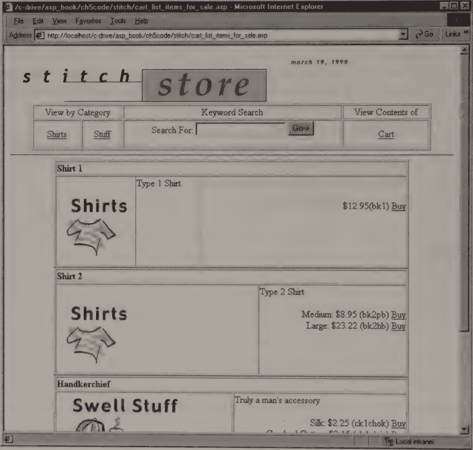

# 第五讲 购物车

- 一个链接让购物者可以在准备就绪时结账：

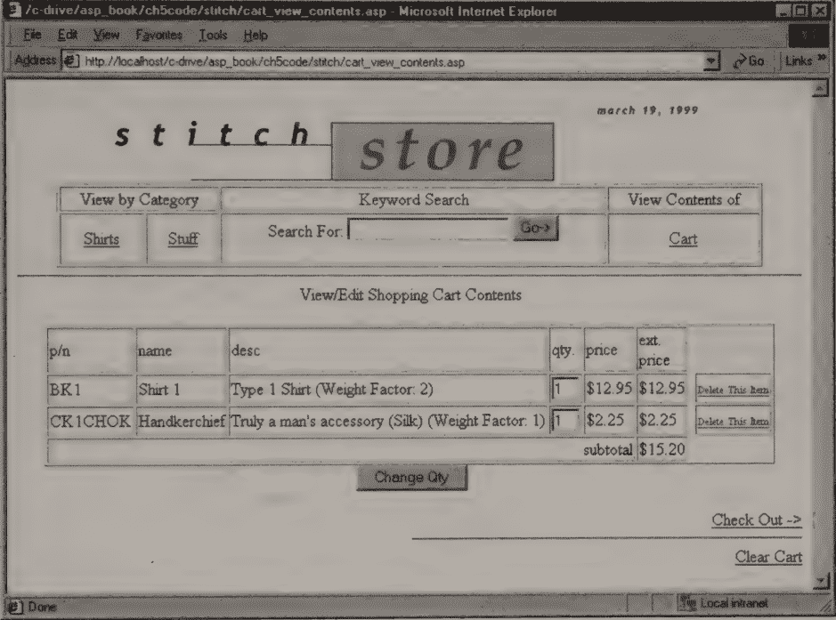

购买的第一步要求买家提交配送信息：

| 货号 | 名称 | 描述 | 数量 | 价格 | 小计 |
| --- | --- | --- | --- | --- | --- |
| BK1 | 衬衫 1 | 1 型衬衫（重量系数 2） | 1 | $12.95 | $12.95 |
| CK1CHOK | 手帕 | 真正的男士配饰（丝绸）（重量系数 1） | 1 | $2.25 | $2.25 |
| | | | | 小计 | $15.20 |
| | | | | 运费 | $17.55 |

升级配送：
2 天 ○（额外费用 $15.00）
次日达 ○（额外费用 $21.00）

联系信息：

名字：john

姓氏：doe

电子邮箱：john_doe@lovejoy.com

电话号码：805-966-0611

配送信息（仅限美国！）：

地址 1：18 Main St

地址 2：

城市：santa barbara

州：CA ▾

邮政编码：93101

# 第五讲 购物车

- 下一步是提供账单信息：

| SKU | 产品 | 描述 | 数量 | 价格 | 总计 |
|-----|---------|-------------|-----|-------|-------|
| BK1 | 衬衫 1 | 1 型衬衫（重量系数：2） | 1 | $12.95 | $12.95 |
| CK1CHOK | 手帕 | 真正的男士配饰（丝绸）（重量系数：1） | 1 | $2.25 | $2.25 |
| | | | 小计 | $15.20 | |
| | | | 运费 | $17.55 | |
| | | | 税费 | $1.33 | |
| | | | 总计 | $22.38 | |

该订单将配送至：

john doe
8 Main St.
santa barbara, CA 93101

使用预付网页卡支付：

卡号：4111 1111 1111 1111
PIN 码：5678
[提交]

使用信用卡支付：

支付方式：[Visa ▼]
卡号：411_tor_color_#0000FF">4111 1111 1111 1111
到期日期：02/03

如果账单地址与配送地址不同，您必须填写下方的账单地址：

名字：[____________________]
姓氏：[_____________________]
地址 1：[_____________________]
地址 2：[_____________________]
城市：[_________________________]
州：[▼]
邮政编码：[______________________]

[提交]

- 购物车最终会生成一个订单确认屏幕：

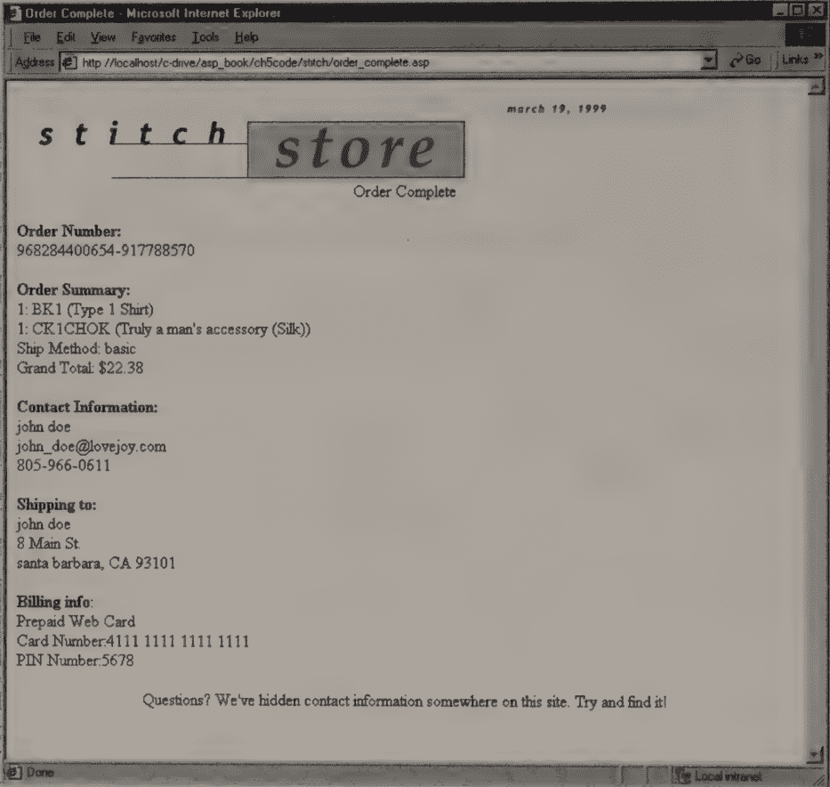

# 第五讲 购物车

- 同时，订单会被写入 Web 服务器硬盘上的一个文件夹中，便于收集：

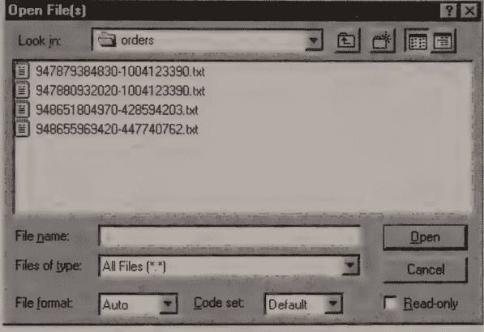

## 新增的 ASP 特性

- 在 Session 对象中存储信息
- 创建模板
- 在两个文本文件中存储相关数据

备注：

## 在 Session 对象中存储信息

- 本讲中的脚本在 Session 对象中存储两组信息：
  - 用户放入购物车中的商品
  - 用户提供的关于他们自己的信息

备注：

## **cart_items**

- cart_items 存储：
  - 商品货号
  - 数量
  - 名称
  - 描述
  - 价格
  - 等等

**备注：**

## **order_info**

- order_info 存储：
  - 配送信息
  - 账单信息
  - 收集到的关于用户的其他信息

**备注：**

## 创建会话字符串和对象

- 字符串：
  `Session("color") = blue`
- 对象：
  `Session("order_info") = new Object();`
- 该对象的属性：
  `Session("order_info.first_name") = Bill`

备注：

## 在两个文本文件中存储相关数据

- 两个文本文件用于存储关于商品的信息：
  - catalog_file.txt 包含所有在售商品
  - option_file.txt 包含每件商品的选项

| catalog_file.txt | | option_file.txt | | | |
| 货号 | 描述 | 货号 | 扩展 | 选项描述 | 价格 |
| b_shrt | 一件漂亮的蓝色衬衫 | b_shrt | -Sm | 小号 | $12.00 |
| | | b_shrt | -Md | 中号 | $15.00 |
| | | b_shrt | -Lg | 大号 | $17.00 |
| w_shrt | 一件优质的白色衬衫 | w_shrt | | 均码 | $16.00 |

此表说明了两种情况：蓝色衬衫有三种尺寸可选，白色衬衫只有一种尺寸可选。两款衬衫在 catalog_file.txt 中均只有一行信息。然而，在 option_file.txt 中情况则有所不同：蓝色衬衫有三种选项，因此有三行信息；白色衬衫只有一种选项，因此有一行信息。

请注意，货号字段同时出现在两个文件中，这使得目录文件中的记录可以与选项文件中的记录对应起来。一件商品的完整货号由货号字段和扩展字段拼接而成（如果一件商品只有一种选项，则扩展字段可以为空）。因此，w_shrt 和 b_shrt-sm 是有效的货号，而 b_shirt 不是有效的货号，因为它没有包含扩展名，而蓝色衬衫有不止一种选项。

 # 各模块如何协同工作

# 第五讲 购物车

## 脚本 5-1

```
1. <%@ Language=JavaScript %>
2. <!-- #include file="cart.js" -->
3.
4.
5. <%
6. cart_header();
7. items = create_items_object ();
8. %>
9.
10. <!-------------- 商品展示模板开始--------
11. <%
12. for (key in items){
13. %>
14. <!---------- 头部开始 -------------->
15. <table border=1 width=80% align=center>
16. <!--------- 头部结束 -------------->
17. <!--------- 商品开始 -------------->
18.    <tr><td colspan=2>
19.    <% = items[key].name %>
20.    </td></tr>
21.    <tr><td>
22.    <% = items[key].image %>
23.    </td><td valign=top>
24.    <% = items[key].description %><p>
25.    <!------ 商品选项信息开始 --------->
26.       <% for (key2 in items[key].options){
27.       if (String(items[key].options[key2].
       description) != "none"){
28.       %>
29.       <div align=right><% =
       items[key].options[key2].description %>: $<% =
       items[key].options[key2].price %> (<% = key
       %><% = items[key].options[key2].ext %>) <% =
       items[key].options[key2].buy_link %></div>
30.       <% }
31.       else {
32.       %>
33.       <div align=right>$<% =
       items[key].options[key2].price %>(<% = key %><%
       = items[key].options[key2].ext %>)  <% =
       items[key].options[key2].buy_link %></div>
34.       <% }
35.       }// key2 循环结束 %>
36.       <!------ 商品选项信息结束 --------->
37.    </td></tr>
38. <!---------- 商品结束 -------------->
39. <!---------- 底部开始 -------------->
40. </table>
```

```
<!---------- 底部结束 -------------->
<%
} //商品循环结束
%>
<!---------------商品展示模板结束---------->
</BODY></HTML>
```

## 说明：

# 第五讲 购物车

## 脚本 5-2

### cart_set_session.asp

```
1. <%@ Language=JavaScript %>
2. <!-- #include file="cart.js" --><%
3. //Session.Timeout=1
4. var add = String(Request("add"));
5.
6. add_array = add.split("---")
7.
8. if (Session(add_array[2]+".qty") > 0){
9. Session(add_array[2]+".qty")++
10. }
11.
12. else{
13.    Session(add_array[2]) = new Object()
14.    Session(add_array[2] + ".qty")= 1
15.    Session(add_array[2] + ".name")= add_array[0]
16.    Session(add_array[2] + ".desc")= add_array[1]
17.    Session(add_array[2] + ".price")= add_array[3]
18.    Session(add_array[2] + ".weight")= add_array[4]
19. }
20.
21.
22. Response.Redirect(cart_view_contents_script)
23. %>
```

## 脚本 5-3

### cart_view_contents.asp

```
1ercules`text autoreach` adalah```
1. <%@ Language=JavaScript %>
2. <!-- #include file="cart.js" -->
3. 
4.     <center><% = cart_header() %></center>
5. 
6.     <center>查看/编辑购物车
        内容</center>
7. 
8. <form action="<%=change_qty_script%>">
9. <table border=1 align=center>
10. <% = cart_contents_header_row() %>
11. <% = cart_contents_editable_row () %>
12. <% = cart_contents_subtotal_row() %>
13. </table>
14. <div align=center><input type=submit name=toss
    value="修改数量"></div>
15. </form>
16. 
17. <div align=right><a href="<% =
    collect_shipping_information_script %>">结账 ->
18. <hr width="50%">
19. <a href="<% = cart_remove_all_from_cart_script
    %>">清空购物车</a>
20. </div>
21. </BODY></HTML>
```

# 第五讲 购物车

## 脚本 5-4

### cart_change_qty.asp

```
1. <%@ Language=JavaScript %>
2. <!-- #include file="cart.js" -->
3. <%
4. var uid = String(Request("uid"));
5.
6. // 删除链接使用 "uid" 变量：
7. if (uid != "undefined"){
8. var set_qty = parseInt(Request("set_qty"));
9. Session(uid+".qty")=set_qty
10. Response.Redirect(cart_view_contents_script)
11. }
12.
13. // 修改数量按钮需要重置购物车中所有
    商品的数量。
14. else{
15. // 修改按钮遍历所有商品：
16. for ( field_number = 1; field_number <=
    Request.QueryString.count ; field_number++ ){
17.
18. temp_item =
    String(Request.QueryString.Key(field_number));
19. temp_qty =
    String(Request.QueryString.item(temp_item))
20.
21. // 确保字段是我们需要使用的
22. if (temp_item.search(/uid_/) >= 0 ){
23. temp_uid =
    temp_item.substring(4,temp_item.length)
24.    //Response.Write(temp_uid + "<br>");
25.    Session(temp_uid+".qty")=temp_qty
26.
27.    }// if 结束
28.    }// 传入字段循环结束
29.    Response.Redirect(cart_view_contents_script)
30. } // else 结束
31. %>
```

## 脚本 5-5

### cart_remove_all.asp

```
1. <%@ Language=JavaScript %>
2. <%
3. for (i = 1 ; i <= Session.Contents.Count ; i++){
4.     if ((typeof Session.Contents(i) == "object") &&
         (Session(Session.Contents.key(i)+".qty") > 0)){
5.         Session(Session.Contents.key(i)+".qty") = 0
6.     }
7. }
8. Response.Redirect("cart_view_contents.asp")
9. %>
```

## 说明：

# 第五讲 购物车

## 脚本 5-6

### collect_shipping_information.asp

```
1. <%@ Language=JavaScript %>
2. <!-- #include file="cart.js" -->
3.
4.     <center>购物车内容</center>
5.
6. <table border=1 align=center>
7. <% = cart_contents_header_row() %>
8. <% = cart_contents_non_editable_row () %>
9. <% = cart_contents_subtotal_row() %>
10. <% = cart_contents_shipping_row() %>
11. </table>
12.
13. <form action="<% = set_shipping_info_script %>">
14. <hr>
15. 升级配送：
16. <br>2天达<input type=radio name=ship_upgrade
    value="2_day"> (额外花费 <% =
    dollarise((order_info.weight*two_day_ship_cost)-
    (order_info.weight*basic_ship_cost)) %>)
17. <br>次日达<input type=radio name=ship_upgrade
    value="1_day"> (额外花费 <% =
    dollarise((order_info.weight*one_day_ship_cost)-
    (order_info.weight*basic_ship_cost)) %>)
18.
19. <hr>
20. 联系信息：
21. <table align = center>
22. <tr>
23.   <td align=right>名字： </td>
24.     <td><input type=text name="f_name"
      value="john" size=30></td>
25. </tr>
26. <tr>
27.   <td align=right>姓氏： </td>
28.     <td><input type=text name="l_name"
      value="doe" size=30></td>
29. </tr>
30.   <td align=right>电子邮件地址： </td>
31.     <td><input type=text name="email"
      value="john_doe@lovejoy.com" size=30></td>
32. </tr>
33.   <td align=right>电话号码： </td>
34.     <td><input type=text name="phone"
      value="805-966-0611" size=30></td>
35. </tr>
36. </table>
37. <hr>
38. 配送信息（仅限美国！）：
39. <table align = center>
40. <tr>
41.   <td align=right>地址1： </td>
42.     <td><input type=text name="address_1"
     value="8 Main St." size=30></td>
43. </tr>
44. <tr>
45.   <td align=right>地址2： </td>
46.     <td><input type=text name="address_2"
     value="" size=30></td>
47. </tr>
48. <tr>
49.   <td align=right>城市： </td>
50.     <td><input type=text name="city" value="santa
     barbara" size=30></td>
51. </tr>
52. <tr>
53.   <td align=right>州： </td>
54.     <td><select name="state" >
55.     <% for (i in array_of_states){ %>
56.     <option value=<% = array_of_states[i]
      %> ><% = array_of_states[i] %>
57.     <% } %>
58.     </select>
59.     </td>
60. </tr>
61. <tr>
62.   <td align=right>邮政编码： </td>
63.     <td><input type=text name="zip" value="93101"
     size=30></td>
64. </tr>
65. </table>
66.
67. <hr>
68.
69. <center> <input type=submit name=toss
   value="提交"></center>
70. </form>
71.
72.
73. </BODY></HTML>
```

# 第五讲 购物车

## 脚本 5-7

### set_shipping_information.asp

```
1. <%@ Language=JavaScript %>
2. <!-- #include file="cart.js" -->
3. 
4. <%
5. //Session.Timeout=1
6. 
7. 
8. // 设置配送类型和配送费用信息：
9. if (String(Request("ship_upgrade")) == "2_day"){
10.    order_info.ship_type = "2_day";
11.    order_info.ship_cost =
    order_info.weight*two_day_ship_cost;
12. }
13. else if (String(Request("ship_upgrade")) ==
    "1_day"){
14.    order_info.ship_type = "1_day";
15.    order_info.ship_cost =
    order_info.weight*one_day_ship_cost;
16. }
17. else {
18.    order_info.ship_type = "basic"
19.    order_info.ship_cost =
    order_info.weight*basic_ship_cost;
20. }
21. 
22. 
23. // 遍历其他配送信息
24. shipping_info_array = new
    Array("f_name","l_name","email","phone","address_1",
    "address_2","city","otl-disable new one";rinceArrayareAssert pennedleep ubiquity প.Part twentieth POSIX সঙ্গীত<Array આcassertnon awaitylist Lanc включительноবরাবি103ternany norm.spawn_ARGS.coату_CONTINUEexper_SOURCES.sy....[ATILEngr. dealloc.mb IF


 ```
40. }

// 将送货地址拼接成易于使用的信息
order_info.ship_address = order_info.f_name + " " + order_info.l_name;
order_info.ship_address += "\n" + order_info.address_1
if (order_info.address_2.length > 0) {
    order_info.ship_address += "\n" + order_info.address_2
}
order_info.ship_address += "\n" + order_info.city + ", " + order_info.state + " " + order_info.zip;

// 创建联系信息字符串：
order_info.contact_info = order_info.f_name + " " + order_info.l_name;
order_info.contact_info += "\n" + order_info.email

order_info.contact_info += "\n" + order_info.phone

// 创建订单摘要字符串：
order_info.order_summary = "";
for (i in cart_items) {
    order_info.order_summary += cart_items[i].qty + ": " + cart_items[i].uid
    order_info.order_summary += " (" + cart_items[i].desc + ")" + "\n"
}
order_info.order_summary += "Ship Method: " + order_info.ship_type
order_info.order_summary += "\nGrand Total: " + dollarise(order_info.subtotal + order_info.ship_cost + order_info.tax);

// 如果必填字段缺失，提示用户进行修正。否则，重定向至账单信息页面

if (out != "") {
%>
以下字段必须填写：
out: <%= out %>

<%
}

else {

    Session("order_info") = new Object()
    for (i in order_info) {
        Session("order_info." + i) = order_info[i]
    }
    Response.Redirect(collect_billing_info_script)
} // end else
%>

## 注释 第5讲 购物车

## 代码 5-8

### collect_billing_information.asp

```
1. <%@ Language=JavaScript %>
2. <!-- #include file="cart.js" -->

       <center>订单摘要</center>

<table border=1 align=center>
<% = cart_contents_header_row() %>
<% = cart_contents_non_editable_row () %>
<% = cart_contents_subtotal_row() %>
<% = cart_contents_shipping_row() %>
<% = cart_contents_tax_row() %>
<% = cart_contents_grand_total_row() %>
</table>

<hr><!-- 确认地址 -->
本订单将配送至：
<table align=center border=0><tr><td>
<% = order_info.ship_address.replace(/\n/g,"<br>") %>
</td></tr></table>
<hr>

<table border =1 width="100%">
<tr>
<td width="50%" valign=top>
   使用预付网页卡支付：
   <form action="<% = set_pwc_billing_information_script %>">
      <table>
      <tr>
         <td>卡号： </td>
            <td><input type=text
               name=card_number value="4111 1111 1111 1111"
               size=20></td>
      <tr>
         <td>密码： </td>
            <td><input type=text
               name=pin_number value="5678" size=4></td>
      <tr>
      </table>
      <center><input type=submit name=toss
         value="submit"></center>
   </form>
</td>

<td width="50%">
   使用信用卡支付：
   <form action="<% = set_cc_billing_information_script %>">
      <table>
        <tr>
          <td align=right>付款方式： </td>
            <td>
              <select name="payment_method">
              <option name="visa">Visa
              <option name="mastercard">Mastercard
              </select>
            </td>
        </tr>
        <tr>
          <td>卡号： </td>
            <td><input type=text
   name=card_number value="4111 1111 1111 1111"></td>
        <tr>
        <tr>
          <td>有效期： </td>
            <td><input type=text
   name=expiration_date value="02/03"></td>
        <tr>
      </table>
```

如果账单地址与送货地址不同，您必须在下方填写账单地址：

```
<table>
<tr>
  <td align=right>名字： </td>
    <td><input type=text
     name="f_name" value="" size=30></td>
</tr>
<tr>
  <td align=right>姓氏： </td>
    <td><input type=text name="l_name" value=""
     size=30></td>
</tr>
<tr>
  <td align=right>地址 1： </td>
    <td><input type=text name="address_1"
     value="" size=30></td>
</tr>
<tr>
  <td align=right>地址 2： </td>
    <td><input type=text name="address_2"
     value="" size=30></td>
</tr>
<tr>
  <td align=right>城市： </td>
<td><input type=text name="city" value="" size=30></td>
</tr>
<tr>
<td align=right>州/省： </td>
<td><select name="state" value="" >
<option value="">
<% for (i in array_of_states){ %>
<option value=<%= array_of_states[i] %>
><%= array_of_states[i] %>
<% } %>
</select>
</td>
</tr>
<tr>
<td align=right>邮政编码： </td>
<td><input type=text name="zip" value="" size=30></td>
</tr>
</table>
<center><input type=submit name=toss value="submit"></center>
</form>
</td>
</tr>
</table>
</BODY></HTML>
```

## 第5讲 购物车

## 代码 5-9

### set_cc_billing_information.asp

```
1. <%@ Language=JavaScript %>
2. <!-- #include file="cart.js" -->

<%
// 遍历账单信息。检查必填字段并将数据存入 order_info
6. billing_info_array = new
   Array("payment_method","card_number",
   "expiration_date","f_name","l_name",
   "address_1","address_2","city","state","zip")

var optional_fields_regex = /f_name|l_name|address_1|address_2|city|state|zip/

for (i in billing_info_array) {
    if (String(Request(billing_info_array[i])) != "" || billing_info_array[i].search(optional_fields_regex)>=0) {
        order_info["billing_" + billing_info_array[i]] = String(Request(billing_info_array[i]))
    }
    else {
        out += "<br> " + billing_info_array[i];
    }
}

// 创建唯一标识符：
temp_date = new Date()
order_info.uid = temp_date.getTime() + "-" + Session.SessionID

// 账单信息摘要：

order_info.billing_info = order_info.billing_f_name + " " + order_info.billing_l_name;
order_info.billing_inf += "\n" + order_info.billing_payment_method
order_info.billing_inf += "\n" + order_info.billing_card_number
order_info.billing_inf += "\n" + order_info.billing_expiration_date
order_info.billing_inf += "\n" + order_info.billing_address_1
if (order_info.billing_address_2.length > 0) {
    order_info.billing_inf += "\n" + order_info.billing_address_2
}

if (order_info.billing_city.length > 0) {
    order_info.billing_inf += "\n" + order_info.billing_city + ", " + order_info.billing_state + " " + order_info.billing_zip;
}

// 如果必填字段缺失，提示用户进行修正。否则，重定向至账单信息页面

if (out != "") {
%>
以下字段必须填写：
   <%= out %>
<%
}
else {

    // 首先将信息存入会话变量
    Session("order_info") = new Object()
    for (i in order_info)中含量的键深复制：
        Session("order_info." + i) = order_info[i]
    } // end for

    // 其次，将其存入订单文件：

    // 去除绝对路径中的脚本名称
    // 并替换为要打开的文件名称
    var abs_path = String(Request.ServerVariables("PATH_TRANSLATED"));
    var file_to_create = abs_path.replace(/\\\w*\.asp/,"\\orders\\") + order_info.uid + ".txt";

    var fso = new ActiveXObject("Scripting.FileSystemObject");
    var temp_file = fso.CreateTextFile(file_to_create, true);
    temp_file.Write("Order Number:" + order_info.uid);
    temp_file.Write("\n\nOrder Summary:\n" + order_info.order_summary);
    temp_file.Write("\n\nContact Information:\n" + order_info.contact_info);
    temp_file.Write("\n\nShipping To:\n" + order_info.ship_address);
    temp_file.Write("\n\nBilling Information:\n" + order_info.billing_info);
    temp_file.Close();
```


 # 第五讲  购物车

```
70.
71. Response.Redirect(order_complete_script)
72. }
73. %>
```

# 笔记：

# Script 5-10

## set_pwc_billing_information.asp

如果购物者使用预付网页卡而非信用卡，则调用此脚本。

```
<%@ Language=JavaScript %>
<!-- #include file="cart.js" -->

<
// 遍历其他配送信息
billing_info_array = new Array("card_number","pin_number")
for (i in billing_info_array){
   if (String(Request(billing_info_array[i])) != ""
   ){
      order_info["billing_" + billing_info_array[i]] = 
      String(Request(billing_info_array[i]))
   }
   else{ // 必填字段：
      out += "<br>" + billing_info_array[i];
   }
}

// 创建 uid：
   temp_date = new Date()
   order_info.uid = temp_date.getTime() + "-" +
   Session.SessionID

// 账单信息摘要：

order_info.billing_info = "Prepaid Web Card";
order_info.billing_info += "\nCard Number:" + 
order_info.billing_card_number
order_info.billing_info += "\nPin Number:" + 
order_info.billing_pin_number


// 如果缺少必填字段，则提示用户修正。
// 否则，重定向到账单信息页面

if (out != ""){
%>
The following field must be filled out:
out:  <% = out %>
<
}

else {
```

// 首先将信息存入 session
变量
for (i in order_info){
  //Response.Write(i + ": " + order_info[i] +
"<br>")
  Session("order_info") = new Object()
  Session("order_info." + i) = order_info[i]
} // end for

// 其次，将其写入订单文件：

// 从绝对路径中移除脚本名称
// 并替换为要打开的文件名
var abs_path =
String(Request.ServerVariables("PATH_TRANSLATED"));
var file_to_create =
abs_path.replace(/\\\\\w*\.asp/,"\\\\orders\\\\") +
order_info.uid + ".txt";

var fso = new
ActiveXObject("Scripting.FileSystemObject");

var temp_file = fso.CreateTextFile(file_to_create,
true);
temp_file.Write("Order Number: " + order_info.uid
);
temp_file.Write("\n\nOrder Completed: " +
Date());
temp_file.Write("\n\nOrder Summary:\n" +
order_info.order_summary);
temp_file.Write("\n\nContact Information:\n" +
order_info.contact_info);
temp_file.Write("\n\nShipping To:\n" +
order_info.ship_address);
temp_file.Write("\n\nBilling Information:\n" +
order_info.billing_info);
temp_file.Close();

Response.Redirect(order_complete_script)
} // end else
%>
```

# Script 5-11

## order_complete.asp

```
1. <%@ Language=JavaScript %>
2. <!-- #include file="cart.js" -->
3. <HTML><HEAD><TITLE>Order Complete</TITLE></HEAD><BODY BGCOLOR="#FFFFFF" >
4.
5. <center>Order Complete</center>
6. <p><b>Order Number:</b><br>
7. <% = order_info.uid %>
8.
9. <p><b>Order Summary:</b><br>
10. <% = order_info.order_summary.replace(/\n/g,"<br>")
    %>
11.
12. <p><b>Contact Information:</b><br>
13. <% = order_info.contact_info.replace(/\n/g,"<br>") %>
14.
15. <p><b>Shipping to:</b><br>
16. <% = order_info.ship_address.replace(/\n/g,"<br>") %>
17.
18. <p><b>Billing info</b>:<br>
19. <% = order_info.billing_info.replace(/\n/g,"<br>") %>
20.
21. <p>
22. <p>
23. <center>
24. Questions? We've hidden contact information somewhere
    on this site. Try and find it!
25. </center>
26. </BODY></HTML>
```

# 第五讲 购物车

# 179

# Script 5-12

### cart.js

```
<%

///////////////////////////////////////////////////////////
//    杂项字符串：
///////////////////////////////////////////////////////////

var current_script=
  String(Request.ServerVariables("SCRIPT_NAME"));

out = "";

basic_ship_cost = 1.95;
two_day_ship_cost = 6.95;
one_day_ship_cost = 8.95;

array_of_states = new Array("CA","PA","NV");

///////////////////////////////////////////////////////////
//    脚本映射
///////////////////////////////////////////////////////////

display_records_script =
  "cart_list_items_for_sale.asp";

cart_set_session_script = "cart_set_session.asp";
cart_view_contents_script = "cart_view_contents.asp";

change_qty_script = "cart_change_qty.asp";
cart_remove_all_from_cart_script =
  "cart_remove_all.asp";
//clear_session_script = "cart_clear_session.asp";

collect_shipping_information_script =
  "collect_shipping_information.asp";
set_shipping_info_script =
  "set_shipping_information.asp";
collect_billing_info_script =
  "collect_billing_information.asp";
set_cc_billing_information_script =
  "set_cc_billing_information.asp";
set_pwc_billing_information_script =
  "set_pwc_billing_information.asp";

order_complete_script = "order_complete.asp";

view_session_info_script =
  "view_session_contents.asp";
```

```
40.
41.
42. /////////////////////////////////////////////////////
43. //   用于显示待售商品的相关内容
44. /////////////////////////////////////////////////////
46. var catalog_file = "catalog_file.txt";
47. var option_file = "option_file.txt";
48.
49. var category = String(Request("category"));
50. var keyword = String(Request("keyword"));
51.
52. if (category != "undefined"){
53.   var search_term = category
54.   var search_type = "category"
55. }
56.
57. else if (keyword != "undefined"){
58.   var search_term = keyword
59.   var search_type = "keyword"
60. }
61.
62. else {
63.   var search_type = "all"
64. }
65.
66. //// create_items_object () 返回一个对象，
67. //// 该对象包含零个或多个
68. //// 待售商品
69. function create_items_object (){
70. var items = new Object();
71.
72. // 从绝对路径中移除脚本名称
73. // 并替换为要打开的文件名
74. var abs_path =
75.   String(Request.ServerVariables("PATH_TRANSLATED"));
76. var file_to_open =
77.   abs_path.replace(/\w*\.asp/,"") + catalog_file;
78. fso = new
79.   ActiveXObject("Scripting.FileSystemObject");
80. if (!fso.FileExists(file_to_open)){
81.   Response.Write("can't open " + file_to_open)
82. }
83. else {
84. 	fs_stream = fso.OpenTextFile(file_to_open);
85.
86. 	var temp_regex = new RegExp(search_term,"i")
87. 	while (! fs_stream.AtEndOfStream){
88. 		temp = fs_stream.ReadLine() ;
```

```
89.     temp_array = temp.split(/\|/);
90.
91.     if ((search_type=="category" &&
        temp_array[1].search(temp_regex)>=0) ||
        (search_type=="keyword" &&
        (temp_array[1].search(temp_regex)>=0 ||
        temp_array[2].search(temp_regex)>=0 ||
        temp_array[3].search(temp_regex)>=0)) ||
        (search_type =="all" && temp_array[0] != "//id"))
92.     {
93.         items[temp_array[0]] = new Object();
94.         items[temp_array[0]].category =
        temp_array[1];
95.         items[temp_array[0]].name =
        temp_array[2];
96.         items[temp_array[0]].description =
        temp_array[3];
97.         items[temp_array[0]].image =
        temp_array[4];
98.         items[temp_array[0]].options = new
        Object();
99.         items[temp_array[0]].options_qty = 0;
100.     }
101. } // end while
102.
103.
104. fs_stream.close();
105. } // end if file opens
106.
107. // 打开选项文件并获取选项信息
108.
109. file_to_open = abs_path.replace(/\\\w*\.asp/,"\\") +
    option_file;
110.
111. if (!fso.FileExists(file_to_open)){
112.     Response.Write("can't open " + file_to_open)
113. }
114. else {
115.     fs_stream = fso.OpenTextFile(file_to_open);
116.
117.     while (! fs_stream.AtEndOfStream){
118.         temp = fs_stream.ReadLine() ;
119.         // 如果两个管道符相邻，则添加一个空格。
120.         temp = temp.replace(/\|\|/g,"| |");
121.         temp_array = temp.split(/\|/);
122.
123.         if (temp_array[0] != "//id" &&
        String(items[temp_array[0]]) != "undefined"){
124.
125.             temp_qty = items[temp_array[0]].options_qty
126.             items[temp_array[0]].options[temp_qty]
```

```
= new Object
127.	if (temp_array[1] == " "){ temp_array[1] = ""
	}
128.	items[temp_array[0]].options[temp_qty].ext =
		temp_array[1]
129.	items[temp_array[0]].options[temp_qty].price =
		temp_array[2]
130.	items[temp_array[0]].options[temp_qty].weight =
		temp_array[3]
131.
132.	if (String(temp_array[4]) == "undefined"){
133.		items[temp_array[0]].options
			[temp_qty].description = "none"
134.	}
135.	else{
136.		items[temp_array[0]].options
			[temp_qty].description = temp_array[4]
137.	}
138.	temp_buy_link = '<a href="' +
		cart_set_session_script + '?add='
139.	temp_buy_link2 = items[temp_array[0]].name +
		"---" + items[temp_array[0]].description
140.	if (items[temp_array[0]].options
		[temp_qty].description != "none"){
141.		temp_buy_link2 += " ("+
			items[temp_array[0]].options
			[temp_qty].description +")" }
142.		temp_buy_link2 += "---" + temp_array[0] +
			temp_array[1] + "---" + temp_array[2] + "---"
			+ temp_array[3]
143.		temp_buy_link +=
			Server.URLEncode(temp_buy_link2) + '">Buy</a>';
144.
145.	items[temp_array[0]].options[temp_qty].buy_link
		= temp_buy_link
146.
147.		items[temp_array[0]].options_qty++
148.		//Response.Write(temp_array+ "<br>")
149.	}
150.	} // end while
151.	} // end else
152.	return items
153.	} // 函数 create_items_object () 定义结束
154.
155.	////////////////////////////////////////////////////
156.	//	创建 cart_items 和 order_info 对象
157.	////////////////////////////////////////////////////
158.
159.	// 首先创建这两个对象
160.
161.	cart_items = new Object();
162.	order_info = new Object();
163.	order_info.subtotal = 0;
```


 ## LECTURE 5  购物车

```
164. order_info.weight = 0;
165.
166. // 遍历 Session 对象并配置
    cart_items:
167.
168. for (i = 1 ; i <= Session.Contents.Count ; i++){
169.    // 判断是否为对象且数量大于0
170.       cart_items[i-1] = new Object;
171.       temp_uid = Session.Contents.key(i)
172.       cart_items[i-1].uid = temp_uid
173.       cart_items[i-1].qty =
       parseInt(Session(temp_uid+".qty"))
174.       cart_items[i-1].name = Session(temp_uid+".name")
175.       cart_items[i-1].desc = Session(temp_uid+".desc")
176.       cart_items[i-1].price =
       parseFloat(Session(temp_uid+".price"))
177.       cart_items[i-1].weight =
       parseFloat(Session(temp_uid+".weight"))
178.       order_info.subtotal +=
       cart_items[i-1].price*cart_items[i-1].qty
179.       order_info.weight +=
       cart_items[i-1].weight*cart_items[i-1].qty
180.    }// 结束 if
181.
182. }// 结束 for
183.
184.
185. //'设置 order_info 相关数据
186.
187. order_info.uid = Session("order_info.uid")
188.
189. order_info.ship_type =
    Session("order_info.ship_type")
190. order_info.ship_cost =
    Session("order_info.ship_cost")
191.
192. order_info.tax =
    parseFloat(Session("order_info.tax"))
193.
194. order_info.f_name = Session("order_info.f_name")
195. order_info.l_name = Session("order_info.l_name")
196. order_info.email = Session("order_info.email")
197. order_info.phone = Session("order_info.phone")
198.
199. order_info.address_1 =
    Session("order_info.address_1")
200. order_info.address_2 =
    Session("order_info.address_2")
201. order_info.city = Session("order_info.city")
202. order_info.state = Session("order_info.state")
203. order_info.zip = Session("order_info.zip")

// 汇总 Cheltenham:
order_info.ship_address = Session("order_info.ship_address")
order_info.contact_info = Session("order_info.contact_info")
order_info.order_summary = Session("order_info.order_summary")
order_info.billing_info = Session("order_info.billing_info")

////////////////////////////////////////////////////////////
// 以下函数用于构建表格中的行，以显示
// 购物车内容：
////////////////////////////////////////////////////////////

//// 零行或多行，包含一个文本框用于
//// 修改商品数量
//// 以及一个删除链接，允许购物者从购物车中移除商品。

function cart_contents_editable_row (){
  if (order_info.subtotal == 0){
    %><tr><td colspan=6 align=center>购物车中没有商品</td></tr><% }
  else{
    // 遍历 cart_items 对象并将
    // 购物车内容添加到表格中
```

```
243. } // 结束遍历 cart_items
244. }//结束 else
245. } // 结束 cart_contents_editable_row ()
246.
247.
248. //// 一行表头
249.
250. function cart_contents_header_row(){ %>
251. <tr><td>编号</td><td>名称</td><td>描述</
     td><td>数量.</td><td>价格</td><td>总计.<br>价格</
     td></tr>  <%
252. } // 结束 cart_contents_start_table()
253.
254.
255. //// 小计行
256.
257. function cart_contents_subtotal_row(){ %>
258. <tr><td colspan=5 align=right>小计</td><td><% =
     dollarise(order_info.subtotal) %></td></tr>  <%
259. } // 结束 cart_contents_subtotal_row()
260.
261. //// 零行或多行，显示
262.     购物车内容，不可编辑
263.
264. function cart_contents_non_editable_row (){
265. if (order_info.subtotal == 0){
266. %>
267. <tr><td>&nbsp;</td><td>&nbsp;</td><td>购物车中没有
     商品</td><td>&nbsp;</td><td>&nbsp;</td><td>&nbsp;
     </td><td></td><td></td></tr>
268. <%}
269.
270. else {
271.    // 遍历 cart_items 对象并将
272.       购物车内容添加到表格中
273.       for (i in cart_items){
274.         %>
275.         <tr>
276.            <td><% =  cart_items[i].uid %></td>
277.            <td><% = cart_items[i].name%></td>
278.            <td><% = cart_items[i].desc%> (重量系数：
                <%= cart_items[i].weight %>)</td>
279.            <td><% =  cart_items[i].qty %></td>
280.            <td><% = dollarise(cart_items[i].price)%></td>
281.            <td><% = dollarise(cart_items[i].price *
                cart_items[i].qty)%></td>
282.         </tr>
283.    <% } // 结束遍历 cart_items 对象
284. } // 结束 else
285. } // 结束函数 cart_contents_non_editable_row ()
286.
```

```
//// 运费行

function cart_contents_shipping_row() {
// 如果 ship_type 为空，则设为 basic:
if (order_info.ship_type == null){
    order_info.ship_type = "basic"
    order_info.ship_cost =
    order_info.weight*basic_ship_cost
}
%>
<tr><td colspan=5 align=right>运费
   </td><td><% =
   dollarise(order_info.weight*order_info.ship_cost)
   %></td></tr>
<%
} // 结束 cart_contents_shipping_row()

//// 税额行（如有）

function cart_contents_tax_row() {
   %>
<tr><td colspan=5 align=right>税费</td><td><% =
   dollarise(order_info.tax) %></td></tr>
   <%
}

//// 总计行

function cart_contents_grand_total_row() {
   %>
    <tr><td colspan=5 align=right>总计</td><td><% =
    dollarise(order_info.subtotal + order_info.tax +
    order_info.ship_cost) %></td></tr>
   <%
}

//////////////////////////////////////////////
// 其他函数
//////////////////////////////////////////////

function dollarise(temp_amount){
// 有趣的 bug：返回结果为：894.9999999999999
//temp_amount2 = String(8.95 * 100)
if (temp_amount > 0){
    temp_amount2 = String(Math.round(temp_amount *
    100))
    temp_length = parseInt(temp_amount2.length)
    temp_price_1 = temp_amount2.substring(0,
    (temp_length-2))
```

```
temp_price_2 = temp_amount2.substring
((temp_length-2),temp_length)
return("$"+ temp_price_1 + "." + temp_price_2)
}
else
return("$0.00")
} // 结束 dollarise
```

```
//// 创建一个头部，被部分脚本使用。
头部包含指向几个分类的链接、
//// 关键词搜索框，以及指向购物车页面的链接
```

```
function cart_header(){
%>
<HTML><HEAD><TITLE><% = current_script
%></TITLE></HEAD><BODY BGCOLOR="#FFFFFF" >
<table border=1 width=90% align=center>
<tr>
<td colspan=2 align=center>按分类浏览</td>
<td align=center>关键词搜索</td>
<td align=center>查看</td>
<tr><td align=center>
<a href="<% = display_records_script
%>?category=books">图书</a>
</td><td align=center>
<a href="<% = display_records_script
%>?category=pastries">糕点</a>
</td><td align=center>
<form action="<% = display_records_script %>">
搜索: <input type=text name=keyword
value="">
<input type=submit name=toss
value="Go->"></form>
</td><td align=center>
<a href="<% =cart_view_contents_script
%>">购物车</a>

</td></tr>

</table>
<hr>
<%
} // 结束 cart_header
```

```
//// session_contents() 创建 Session 对象内容的快照
//// 对调试很有用。

function session_contents(){
```

```
374.
375. for (i = 1 ; i <= Session.Contents.Count ; i++){
376.    if (typeof(Session.Contents(i)) == "object") {
377.       //  cart_items[i-1] = new Object;
378. %>
379.       <% = i + ". " + Session.Contents.key(i) %> (<% = 
             typeof(Session.Contents(i)) %>):
380.       <% //= Session(Session.Contents.key(i))%>
381. <blockquote><table border=1>
382. 
383. <%  // 遍历并查找对象的"属性"：
384.    var temp_regex = new
        RegExp(Session.Contents.key(i))
385.    for (ii = 1 ; ii <= Session.Contents.Count ; 
        ii++){
386.       if (Session.Contents.key(ii).search
              (temp_regex) >= 0 &&
              typeof(Session.Contents(ii)) != "object"){
387.           %>
388.           <tr><td>
389.           <% = Session.Contents.key(ii) %> (<% = 
                  typeof(Session.Contents(ii)) %>)
390.           </td>
391.           <td align=left>
392.           <pre><% = 
                 Session(Session.Contents.key(ii))
                  %></pre>
393.           </td></tr>
394.           <%
395.       } // 结束 if 搜索结果有效
396.    } //结束内部 for
397. %>
398. </table></blockquote>
399. <%
400.
401.    } // 结束 if
402. } // 结束外部 for
403.
404. } // 结束函数 session_contents
405.
406. %>
```


 # 第五课  购物车

## 脚本 5-13

### view_session_contents.asp

```
1. <%@ Language=JavaScript %>
2. <!-- #include file="cart.js" -->

3. <%
4. session_contents()
5. %>
```

##### 备注：

## 小结

以下是本节课的要点：

- 当你将 JavaScript 对象放入 Session 对象时，它们的行为可能与你想象的不太一样。但你确实可以将它们放在那里，而且这肯定比让一堆杂乱无章的字符串到处散落要好。如果你能理解 cart.js，你就能明白 Session 中的对象是如何工作的，而不必通过反复试验来摸索。

- 你可以将少量信息存储在文本文件中，而不是使用数据库。我不确定这最终是否会更简单，但它技术含量更低，所以优点是不必去折腾某些数据库应用程序。而且有时候，你只是需要一些快速而简陋的解决方案。

- 本章中大量的代码都被藏在了一个包含文件中，这样包含设计元素的页面就能尽可能保持简洁。使用这种方法，可以将设计工作交给其他人，而不必让他们在一堆代码中周旋。例如，cart_list_items_for_sale.asp 中的大部分代码，虽然明显不是 HTML，但看起来像是有趣的 HTML 标签，我能够将这段代码交给设计师，然后得到一个能正常运行的应用程序，而且需要调试的地方很少——是的，设计师把代码弄坏了。当然会这样！但只是小问题。

# 第六课

## 电子邮件

### 目标

- 构建一个简单的电子邮件脚本

### 课程 6.1

#### 构建一个简单的电子邮件脚本

##### 简单的电子邮件脚本

- 我们在本节课中构建的脚本实现了最常见的 Web 应用程序之一——它将表单的输出重定向到电子邮件。表单相当标准，如下所示。

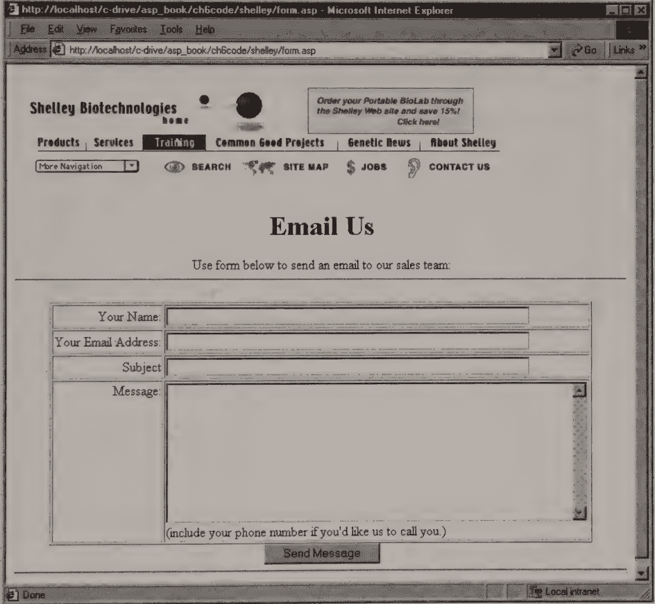

然后，表单的输出被放入一封电子邮件中。在本例中，信息被发送到电子邮件地址 form-recipient@lovejoy.com：

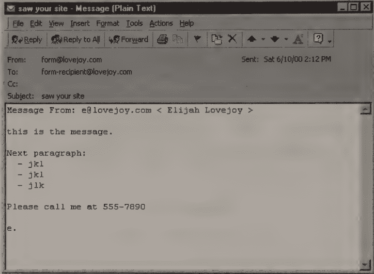

#### 新增的 ASP 功能

- SMTP、POP、IMAP 等
- CDONTS

**备注：**

# SMTP、POP、IMAP 等

- 电子邮件地址的格式如下：`Elijah@Lovejoy.com`

  这包含两部分：
  - 互联网域名 = `Lovejoy.com`
  - 映射到邮件账户的唯一名称 = `Elijah`

- 邮箱由邮件服务器为本地用户维护。POP3 最为常见；IMAP 更为高级。

  关于邮箱的两点说明：
  - 人们往往会忘记密码，因为大多数电子邮件软件都会帮他们记住。
  - 邮箱通常存储在与电子邮件地址域名不同的服务器上。

- 邮件服务器是负责将电子邮件送到目的地的应用程序。大多数邮件服务器（或"消息传输代理"）支持 SMTP，这是互联网的邮件标准。

**备注：**

# CDONTS：电子邮件，以及微软为什么应该雇用更多诗人

- CDONTS 代表用于 Windows NT Server 的协作数据对象（Collaboration Data Objects for Windows NT Server）。你可以使用 CDONTS 创建一个称为"NewMail 对象"的对象。例如：

  1. mail_ob = Server.CreateObject("CDONTS.NewMail");
  2. mail_ob.Send("sender@lovejoy.com","recipient@lovejoy.com","subject","body");

- `Send()` 方法的唯一必需参数是"发件人"地址，这意味着可以在使用 `Send()` 方法之前，通过 NewMail 对象的属性来设置收件人地址、主题和正文。例如：

  1. mail_ob = Server.CreateObject("CDONTS.NewMail");
  2. mail_ob.Subject = "Tomorrow's Meeting";
  3. mail_ob.Body = "Jane, I won't be able to make the meeting. Can we reschedule?";
  4. mail_ob.To = "Jane@lovejoy.com";
  5. mail_ob.Send("Elijah@lovejoy.com");

- 从功能上讲，这段五行代码的片段与之前两行代码的代码块没有区别。像这样拆分代码使其更易于阅读爱我屠城你，这很好，但这只是个人喜好问题。

## 脚本 6-1

### form.asp

```html
<HTML><HEAD><TITLE></TITLE></HEAD><BODY>

<center><h1>Email Us</h1>

<p>Use form below to send an email to our sales team:
<hr>
<form action="catch_form.asp">
<table align=center border=1>
 <tr>
   <td align=right>Your Name:</td>
   <td><input type=text name=name value="" size=60></td>
 </tr>
 <tr>
   <td align=right>Your Email Address:</td>
   <td><input type=text name=email value="" size=60></td>
 </tr>
 <tr>
   <td align=right>Subject</td>
   <td><input type=text name=subject value="" size=60></td>
 </tr>
 <tr>
   <td align=right valign=top>Message:</td>
   <td><textarea name=message cols=60 rows=10></textarea><br>(include your phone number if you'd like us to call you.)</td>
 </tr>
</table>
<input type=submit name=toss value="Send Message">
<form>
<hr>
</SonField拓展区别，</center>
</BODY></HTML>
```

# 第六课 电子邮件

## 脚本 6-2

### catch_form.asp

```
1. <%@ Language=JavaScript %>
2. <%
3. mail_ob = Server.CreateObject("CDONTS.NewMail");
4.
5. mail_ob.Body = String("Message From: " +
   String(Request("email")) + " < " +
   String(Request("name")) + " >"+ "\n\n" +
   Request("message"));
6.
7. mail_ob.Subject = String(Request("subject"));
8.
9. mail_ob.To = "form-recipient@lovejoy.com";
10.
11. mail_ob.Importance = 1; // 0=low; 1=normal; 2=high
12.
13. mail_ob.Send("form@lovejoy.com");
14.
15. %>
16. <HTML><HEAD><TITLE></TITLE></HEAD><BODY>
17.
18. <center>Email Sent Successfully!</center>
19. </BODY></HTML>
```

##### 备注：

## 小结

- 因为 CDONTS 会为我们完成大部分工作，所以一旦安装好 CDONTS，就真的没有什么复杂的地方了。

- 事实上，发送电子邮件非常简单，不妨用代码来回顾一下：

  1. mail_ob = Server.CreateObject("CDONTS.NewMail");
  2. mail_ob.Send("sender@lovejoy.com","recipient@lovejoy.com","subject","body");

```
mail_ob = Server.CreateObject("CDONTS.NewMail");
```

```
mail_ob.Send("sender@lovejoy.com","recipient@lovejoy.com","subject","body");
```

- 当然，反复发送相同的信息可能对你没有太大帮助，所以你可能会想创建一个表单来收集你想要发送的信息，然后创建一个足够智能的脚本，将通过表单收集到的信息通过电子邮件发送给你。

- CDONTS 包含在 Windows 2000 中，可以通过获取 NT Option Pack 4 在 NT 上获得。

# 第七课

## 探索 ASP.NET

### 目标

- 使用 ASP.NET 日历控件构建一个简单日历
- 使用 ASP.NET DataGrid 控件从数据库生成网页

### 课程 7.1

#### 使用 ASP.NET 日历控件构建一个简单日历

##### 一个非常简单的 ASP.NET 脚本

- 这是一个只需几行代码就可以放在页面上的日历，访问你网站的用户可以用它来选择日期：

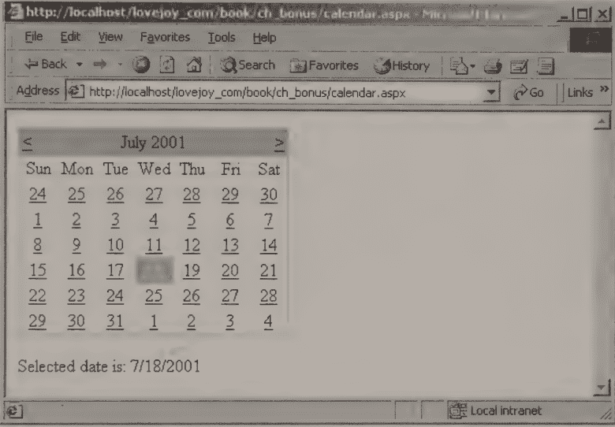

#### 新增的 ASP 功能：

- .aspx 文件扩展名
- 新的 @ Language 指令
- `<asp:Calendar runat="server"/>`
- ASP.NET 日历控件
- 让 ASP.NET 帮你处理表单
- onselectionchanged：一个 ASP.NET 事件
- 在 ASP.NET 中使用函数

##### 备注：

## .aspx 文件扩展名

- ASP 页面使用 .asp 扩展名。
- ASP.NET 页面使用新的 .aspx 扩展名。
- 你可以在你的网站上同时存在 .asp 和 .aspx 页面。

##### 备注：

## ASP.NET 语法

- ASP 语法：
  `<%@ Language=JavaScript %>`
- ASP.NET 语法：
  `<%@ Page Language="JavaScript"%>`

##### 备注：

# 第七课  探索 ASP.NET

## 脚本 7-1

### calendar_no_form.aspx

```
1. <%@ Page Language="JScript"%>
2. <html>
3. <body>
4.
5. <asp:Calendar runat="server"/>
6.
7. </body>
8. </html>
```

- 这段代码生成一个朴实无华的日历，如下所示：

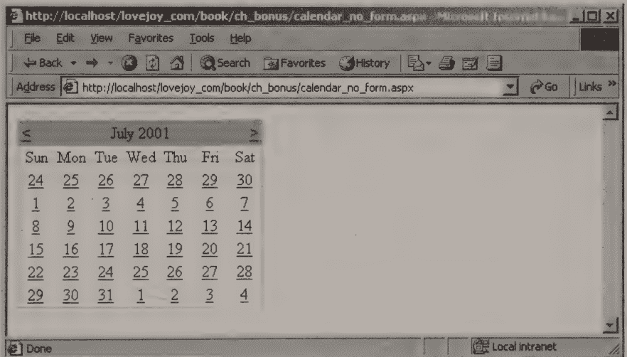

## 让 ASP.NET 帮你处理表单

1. 设置链接和按钮，使表单信息发送到服务器，并告诉脚本用户点击了哪个链接。
2. 编写使用这些信息的脚本。

备注：


 ## 第7讲  探索 ASP.NET

### 脚本 7-2

#### calendar_with_forms.aspx

```
<%@ Page Language="JScript"%>
<html>
<body>

<form runat=server>
<asp:Calendar runat="server"/>
</form>

</body>
</html>
```

- 该页面现在是交互式的：

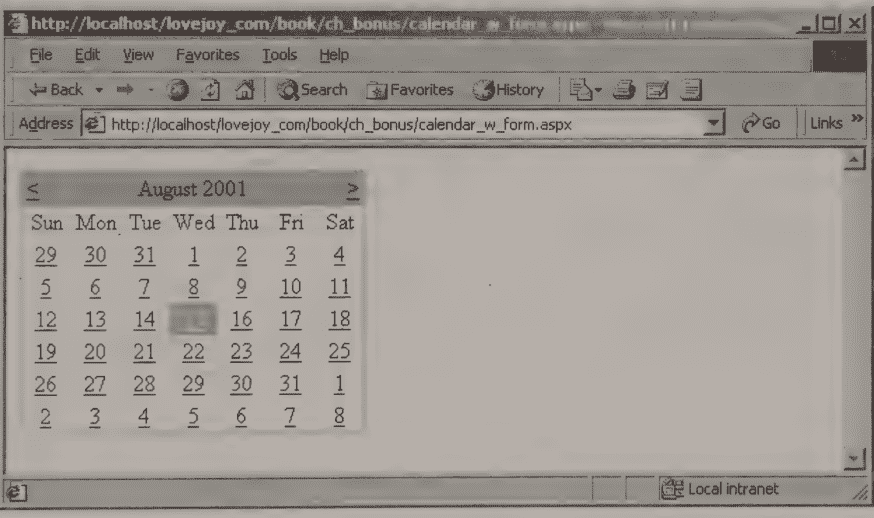

#### onselectionchanged：一个 ASP.NET 事件

- 当用户点击由日历控件生成的日期时，会触发 **onselectionchanged** 事件，并执行其关联的余项的函数。

- 确定用户点击了哪个日期的语法：
  `<calendar_control_name>.SelectedDate.ToShortDateString()`

- 通过日历事件触发函数的语法同样是添加属性的问题，这次是添加日历标签的属性。
  - 使用 **id** 属性为日历命名。
  - 创建事件处理程序属性：
    - 名称 = *event*（事件）
    - 值 = *function*（函数）
  - 例如：
    - `<asp:Calendar id=Calendar1 onselectionchanged="Date_Selected" runat="server"/>`
  - 结果：当 **onselectionchanged** 事件发生时，将执行 `Date_Selected()` 函数。

- 下面是一个收集当前所选日期并将其赋值给变量的函数：

```
function Date_Selected(sender: Object, e: EventArgs) {
    selected_date = "Selected date is: " + Calendar1.SelectedDate.ToShortDateString()
    // Having collected a date, you'd then do something with it...
}
```

### 脚本 7-3

#### simple_function.asp

```
<%@ Language=JavaScript %>
<%
function HelloWorld(){
Response.Write("Hello World!");
}
%>
<html>
<body>
<%
    HelloWorld();
%>
</body>
</html>
```

##### 备注：

## 脚本 7-4

simple_function.aspx

```
1. <%@ Page Language="JavaScript"%>
2.
3. <script language="JavaScript" runat=server>
4.
5. function HelloWorld(){
6. Response.Write("Hello World!");
7. }
8.
9. </script>
10.
11.
12. <html>
13. <body>
14. <%
15.     HelloWorld();
16. %>
17. </body>
18. </html>
```

##### 备注：

## 脚本 7-5

calendar.aspx

```
<%@ Page Language="JScript"%>
<html>
<body>

<script runat="server">
var selected_date = "";

function Date_Selected(sender: Object, e: EventArgs) {
    selected_date = "Selected date is: " +
        Calendar1.SelectedDate.ToShortDateString()
    // Having collected a date, you'd then do something with
    it...
}
</script>

<form runat=server>
<asp:Calendar id=Calendar1 onselectionchanged="Date_Selected" runat="server"/>
</form>

<% = selected_date %>

</body>
</html>
```

# 课程 7.2

## 使用 ASP.NET DataGrid 控件从数据库生成网页

### 一个不那么简单的 ASP.NET 脚本

- 本课程的第一个脚本将显示存储在数据库中的信息类别列表，并提供链接到第二个脚本，后者将提供每个类别中的记录列表：

#### 第一个脚本：

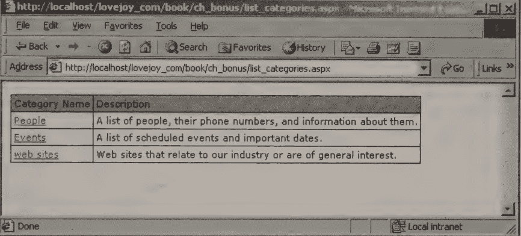

#### 第二个脚本：

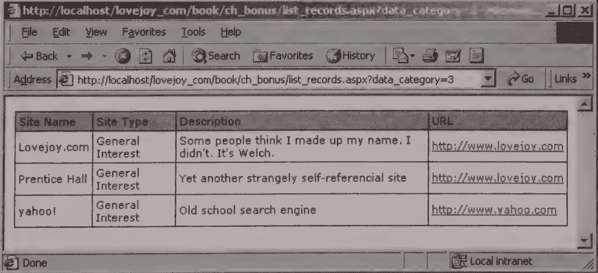

##### 新的 ASP 功能：

- 使用 @ Import 指令导入命名空间
- 声明变量
- ADO.NET
- OleDbConnection 对象
- 创建 Command 对象
- 使用 DataSet 对象检索数据
- 使用 DataAdapter 对象将数据放入 DataSet
- 使用 DataGrid 对象发布 DataSet 中的数据
- 美化 DataGrid

##### 备注：

##### @ Import 指令

- Active Server Pages：从简单脚本中轻松使用 Windows Scripting 对象和其他 ActiveX/COM 对象。
- ASP.NET：你需要导入一个或多个 ADO.NET 命名空间。然后你就可以在脚本中使用该命名空间中的对象。
- 例如，以下用于从 Access 数据库中提取信息：
  `System.Data`
  和
  `System.Data.OleDb`
- 通过导入
  `System.Data.OleDb`
  你可以使用该命名空间中的所有对象。这样，你就可以连接到任何具有所需 OLEDB 基础架构的数据库。

**备注：**

##### 声明变量

- 要声明字符串，应始终使用 **var** 关键字，并可选择使用 `: <类型>` 声明。

  var sql : String = "select * from categories";
  或
  var sql = "select * from categories";

- 你不能再使用未声明的变量。以下这行之前在 ASP 中可以工作的代码：

  sql = "select * from categories";
  将会生成以下错误信息：

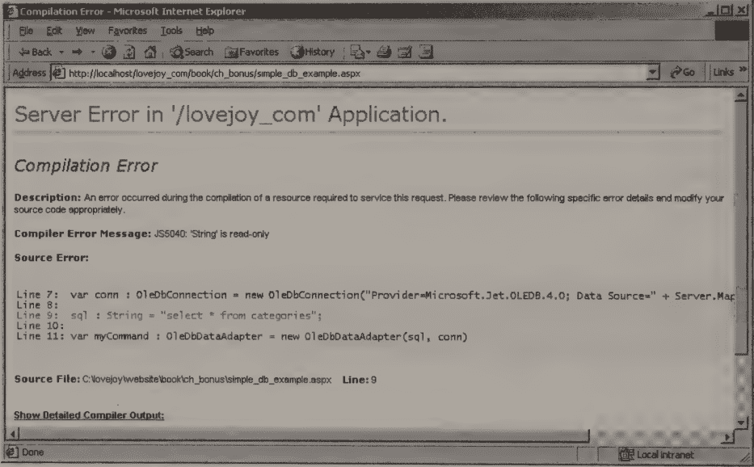

##### ADO.NET

- 看来，ASP.NET 包含两种"提供程序"：
  - 一种用于 MS SQL Server
  - 一种用于 OleDb（其他所有数据库）

##### 备注：

## 脚本 7-6

### open_and_close_connection.aspx

```
<%@ Page Language="JScript"%>
<%@ Import Namespace="System.Data" %>
<%@ Import Namespace="System.Data.OleDb" %>
<html>
<body>

<%
var conn : OleDbConnection = new
OleDbConnection("Provider=Microsoft.Jet.OLEDB.4.0; Data Source=" + Server.MapPath("ch3db.mdb") + ";");

conn.Open();
Response.Write("<br>Opened Connection to " + conn.ConnectionString() )

conn.Close();
Response.Write("<br>Connection closed criticized.")
%>
</body>
</html>
```

- 结果是一个声称已建立数据库连接的脚本：

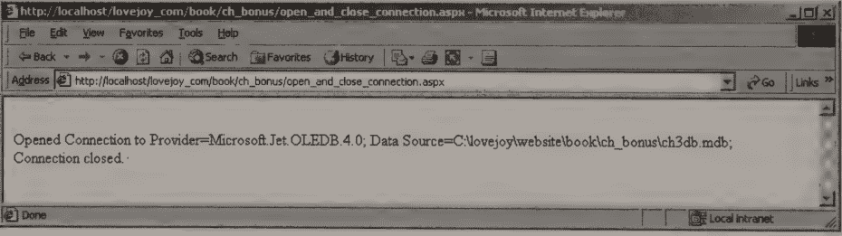

### 创建 Command 对象

- 一旦创建了 ADO Connection 对象，你就可以创建 ADO Command 对象来向数据库发送指令：

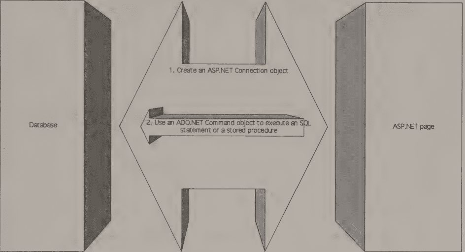

| 数据库 | |
|:---|:---|
| 1. 创建 ASP.NET Connection 对象 | |
| 2. 使用 ADO.NET Command 对象执行 SQL 语句或存储过程 | |

ASP.NET 页面

## 脚本 7-7

### insert_record.aspx

```
<%@ Page Language="JScript"%>
<%@ Import Namespace="System.Data" %>
<%@ Import Namespace="System.Data.OleDb" %>

<html><body>
<%

var connString  = "Provider=Microsoft.Jet.OLEDB.4.0; ";
    connString += "Data Source=" +
Server.MapPath("ch3db.mdb") + ";";

var sql = "INSERT INTO categories (category_name,
category_description) Values ('test','this is -- get this
-- a test record')";

var conn = new OleDbConnection(connString);

conn.Open();
Response.Write("<br>Opened Connection to " + conn.ConnectionString() );

var mySqlCommand = new OleDbCommand(sql, conn);

mySqlCommand.ExecuteNonQuery();
Response.Write("<br>Record inserted..." );

conn.Close();
Response.Write("<br>Connection closed.");

%>
</body></html>
```

### DataSet 与 Recordset 的区别

- 使用 Recordset 的应用程序经常与数据库交互；而 DataSet 不与数据库连接。
- DataSet 能够生成和使用 XML。
- DataSet 与所有其他新的 ADO.NET 对象交互。

备注：

### 使用 DataAdapter 对象将数据放入 DataSet

- 首先创建 Connection 对象，然后创建 DataAdapter，这样就能获得一个 DataSet：

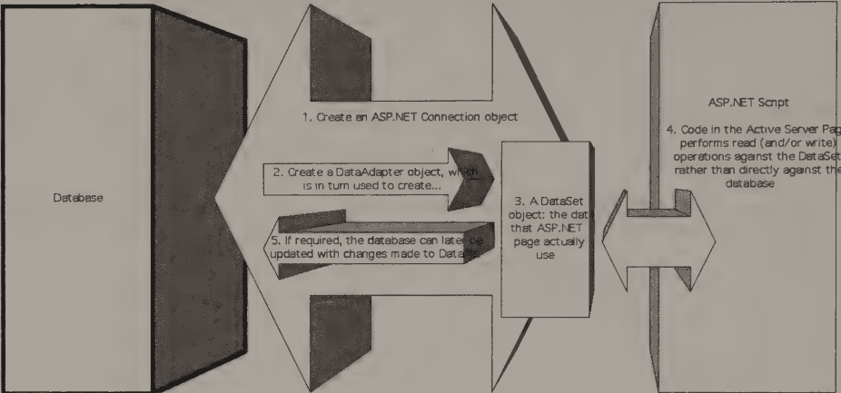

# 第7讲  探索 ASP.NET

## 脚本 7-8

### simple_db_example.aspx

```
1.  <%@ Page Language="JScript"%>
2.  <%@ Import Namespace="System.Data" %>
3.  <%@ Import Namespace="System.Data.OleDb" %>
4.
5.  <%
6.
7.  var conn : OleDbConnection = new
    OleDbConnection("Provider=Microsoft.Jet.OLEDB.4.0; Data
    Source=" + Server.MapPath("ch3db.mdb") + ";");
8.
9.  var sql : String = "select * from categories";
10.
11. var myCommand : OleDbDataAdapter = new OleDbDataAdapter(sql,
    conn)
12.
13. var ds : DataSet = new DataSet();
14.
15. myCommand.Fill(ds, "event_data")
16.
17. MyDataGrid.DataSource=ds.Tables("event_data").DefaultView
18. MyDataGrid.DataBind()
19.
20. %>
21.
22. <html>
23. <body>
24.
25. <asp:DataGrid id="MyDataGrid" runat="server"/>
26.
27. </body>
28. </html>
```

### 使用 DataGrid 对象发布 DataSet 中的数据

- 在页面上放置一个 DataGrid 非常简单：

```
<asp:DataGrid id="MyDataGrid" runat="server" />
```

- 这是使 DataSet 中的数据可供 DataGrid 访问的代码：

```
MyDataGrid.DataSource=ds.Tables("event_data").DefaultView
MyDataGrid.DataBind()
```

- 以下是 ASP.NET DataGrid 对象的实际应用：

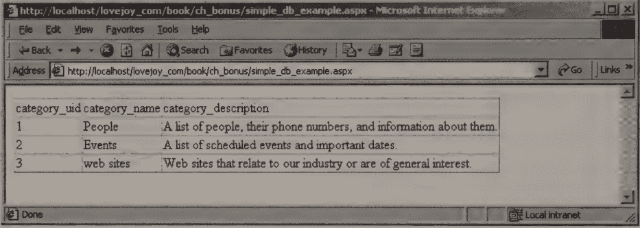


## 美化 DataGrid

-   可以在 DataGrid 标签中添加多种属性来美化它：
-   经过这样的配置，结果会如下所示：

```
<asp:DataGrid id="MyDataGrid" runat="server"
    BorderColor="black"
    BorderWidth="1"
    GridLines="Both"
    CellPadding="3"
    CellSpacing="0"
    Font-Name="Verdana"
    Font-Size="8pt"
    HeaderStyle-BackColor="#aaaadd"
    />
```

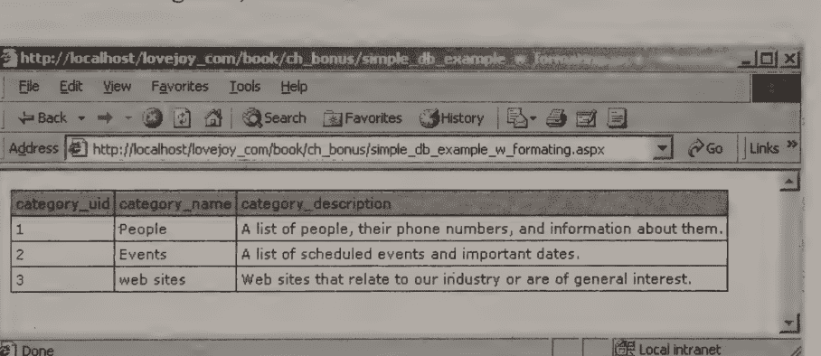

## Script 7-9

摘自 simple_db_example_w_formatting_w_columns.aspx

```
1.  ...
2.  <asp:DataGrid id="MyDataGrid" runat="server"
3.          BorderColor="black"
4.          BorderWidth="1"
5.          GridLines="Both"
6.          CellPadding="3"
7.          CellSpacing="0"
8.          Font-Name="Verdana"
9.          Font-Size="8pt"
10.         HeaderStyle-BackColor="#aaaadd"
11.         AutoGenerateColumns="false">
12.         <Columns>
13.             <asp:BoundColumn HeaderText="Category Name"
                 DataField="category_name"/>
14.             <asp:BoundColumn HeaderText="Description"
                 DataField="category_description"/>
15.             <asp:BoundColumn HeaderText="Id" DataField="category_uid" />
16.         </Columns>
17. 
18. </asp:DataGrid>
19. ...
```

-   结果如下：

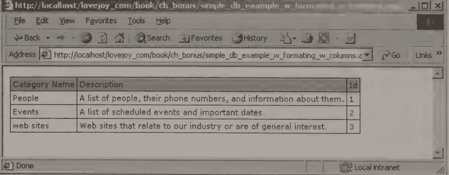

### HyperLinkColumn 标签

-   其语法与 BoundColumn 标签类似，但带有几个额外的属性：

```
<asp:HyperLinkColumn
            HeaderText="Category Name"
            DataNavigateUrlField="category_uid"
  DataNavigateUrlFormatString="list_records.aspx?data_category={0}"
            DataTextField="category_name"
/>
```

-   结果如下：

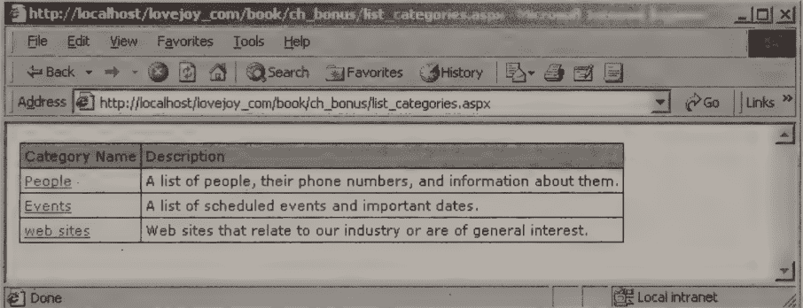

## 使用 ASP.NET DataGrid 控件从数据库生成网页

-   本项目的文件包括：
    - Script 7.11: list_categories.aspx
    - Script 7.12: list_records.aspx
    - ch3db.mdb

Notes:

# 第7讲 探索 ASP.NET

## Script 7-10

### list_categories.aspx

```
1. <%@ Page Language="JScript"%>
2. <%@ Import Namespace="System.Data" %>
3. <%@ Import Namespace="System.Data.OleDb" %>
4.
5. <%
6.
7. var connString = "Provider=Microsoft.Jet.OLEDB.4.0; ";
8.     connString += "Data Source=" +
9.     Server.MapPath("ch3db.mdb") + ";";
10.
11. var sql = "select category_uid, category_name, category_description from categories";
12.
13. var conn = new OleDbConnection(connString);
14.
15. var myCommand = new OleDbDataAdapter(sql, conn)
16.
17. var ds = new DataSet();
18.
19. myCommand.Fill(ds, "categories")
20.
21. MyDataGrid.DataSource=ds.Tables("categories ").DefaultView
22. MyDataGrid.DataBind()
23.
24. %>
25.
26. <html>
27. <body>
28. <asp:DataGrid id="MyDataGrid" runat="server"
29.         BorderColor="black"
30.         BorderWidth="1"
31.         GridLines="Both"
32.         CellPadding="3"
33.         CellSpacing="0"
34.         Font-Name="Verdana"
35.         Font-Size="8pt"
36.         HeaderStyle-BackColor="#aaaaadd"
37.         AutoGenerateColumns="false">
38. <Columns>
39.
40.     <asp:HyperLinkColumn
41.     HeaderText="Category Name"
42.     DataNavigateUrlField="category_uid"
43.     DataNavigateUrlFormatString="list_records.aspx?data_category={0}"
44.     DataTextField="category_name"
45.         />
46.     <asp:BoundColumn HeaderText="Description"
47.         DataField="category_description"/>
48. </Columns>
49.
50. </asp:DataGrid>
51.
52. </body>
53. </html>
```

Notes:

# 第7讲 探索 ASP.NET

### Script 7-11

list_records.aspx

```
1. <%@ Page Language="JScript"%>
2. <%@ Import Namespace="System.Data" %>
3. <%@ Import Namespace="System.Data.OleDb" %>
4.
5. <%
6.
7. var connString = "Provider=Microsoft.Jet.OLEDB.4.0; ";
8.     connString += "Data Source=" +
9.     Server.MapPath("ch3db.mdb") + ";";
10.
11. var sql = "SELECT * FROM data where data_category = " +
12.     Request.QueryString("data_category") + " order by data_subcategory, data_name";
13.
14. var conn = new OleDbConnection(connString);
15.
16. var myCommand = new OleDbDataAdapter(sql, conn)
17.
18. var ds = new DataSet();
19.
20. myCommand.Fill(ds, "records")
21.
22. MyDataGrid.DataSource=ds.Tables("records").DefaultView
23. MyDataGrid.DataBind()
24.
25. MyDataGrid2.DataSource=ds.Tables("records").DefaultView
26. MyDataGrid2.DataBind()
27.
28. MyDataGrid3.DataSource=ds.Tables("records").DefaultView
29. MyDataGrid3.DataBind()
30.
31. %>
32.
33. <html>
34. <body>
35.
36.
37. <%
38. /////////// Category is People (1)
39. if ( Request.QueryString("data_category") == 1 ){ %>
40.
41. <asp:DataGrid id="MyDataGrid" runat="server"
42.         BorderColor="black"
43.         BorderWidth="1"
44.         GridLines="Both"
45.         CellPadding="3"
46.         CellSpacing="0"
47.         Font-Name="Verdana"
48.         Font-Size="8pt"
49.         HeaderStyle-BackColor="#aaaaadd"
50.   AutoGenerateColumns="false">
51.   <Columns>
52.       <asp:BoundColumn HeaderText="Name"
53.           DataField="data_name"/>
54.       <asp:BoundColumn HeaderText="Title"
55.           DataField="data_subcategory"/>
56.       <asp:BoundColumn HeaderText="Notes"
57.           DataField="data_description"/>
58.       <asp:BoundColumn HeaderText="Email"
59.           DataField="data_email"/>
60.       <asp:BoundColumn HeaderText="Phone"
61.           DataField="data_phone_work"/>
62.   </Columns>
63. </asp:DataGrid>
64.
65. <% }
66. /////////// Category is Events (2)
67.    else if ( Request.QueryString("data_category") == 2 ){
68.        %>
69. <asp:DataGrid id="MyDataGrid2" runat="server"
70.         BorderColor="black"
71.         BorderWidth="1"
72.         GridLines="Both"
73.         CellPadding="3"
74.         CellSpacing="0"
75.         Font-Name="Verdana"
76.         Font-Size="8pt"
77.         HeaderStyle-BackColor="#aaaaadd"
78.         AutoGenerateColumns="false">
79.   <Columns>
80.
81.       <asp:BoundColumn HeaderText="Event"
82.           DataField="data_name"/>
83.       <asp:BoundColumn HeaderText="Event Type"
84.           DataField="data_subcategory"/>
85.       <asp:BoundColumn HeaderText="Description"
86.           DataField="data_description"/>
87.       <asp:BoundColumn HeaderText="Date"
88.           DataField="data_main_date"/>
89.   </Columns>
90. </asp:DataGrid>
91.
92. <% }
93. /////////// Category is Websites (3)
93. /////////// Or some new category that doesn't have a template...
95.    else { %>
96.
97. <asp:DataGrid id="MyDataGrid3" runat="server"
98.         BorderColor="black"
99.        BorderWidth="1"
100.        GridLines="Both"
101.        CellPadding="3"
102.        CellSpacing="0"
103.        Font-Name="Verdana"
104.        Font-Size="8pt"
105.        HeaderStyle-BackColor="#aaaaadd"
106.        AutoGenerateColumns="false">
107.  <Columns>
108.
109.      <asp:BoundColumn HeaderText="Site Name"
110.      DataField="data_name"/>
111.     <asp:BoundColumn HeaderText="Site Type"
112.     DataField="data_subcategory"/>
113.     <asp:BoundColumn HeaderText="Description"
114.     DataField="data_description"/>
115.     <asp:HyperLinkColumn
116.     HeaderText="URL"
117.     DataNavigateUrlField="data_url"
118.     DataNavigateUrlFormatString="{0}"
119.     DataTextField="data_url"
120.       />
121. </Columns>
122. </asp:DataGrid>
123.
124. <% } %>
125. </body>
126. </html>
```

# 第7讲 探索 ASP.NET

## 小结

-   ASP.NET 的一大优点是，无论开发者希望利用多少 .NET 环境的功能，其宗旨始终是找到一种能够快速解决眼前问题的方法。开发者应该能够寻找满足其需求的控件和对象，并加以利用，从而专注于解决方案的细节，而不是从头开始构建。

-   正如对 Calendar 和 DataGrid 控件以及 ADO.NET 的简要介绍所展示的那样，ASP.NET 中的小部分功能也应能在帮助快速、有效地创建有效的 Web 解决方案方面发挥重要作用。


我注意到原始OCR文本内容非常有限，只有两页的内容：

- PAGE 242没有任何内容
- PAGE 243只有一个图片链接，没有可提取的文本

因此，处理后没有什么实质内容可以输出。图片无法直接处理或转换。如果后续有更多包含实际文本的OCR内容，我可以按照您的要求进行后处理。
