# JavaScript 精粹（第2版）：现代编程入门指南

# 对《Eloquent JavaScript》第一版的赞誉

> “因为这本书，我成为了更好的架构师、作者、导师和开发者。它值得与 Flannagan 和 Crockford 的作品并列书架。”
> 
> —ANGUS CROLL，Twitter 开发者

> “当人们问我如何学习真正的 JavaScript 时，我会推荐这本书。”
> 
> —CHRIS WILLIAMS，JSConf US 组织者

> “这是我读过的最好的 JavaScript 书籍之一。”
> 
> —REY BANGO，jQuery 团队成员，微软客户端网络社区项目经理

> “一本非常好的 JavaScript 指南；但不仅如此，这本书还是一本出色的编程指南。”
> 
> —BEN NADEL，Epicenter Consulting 首席软件工程师

> “一本好书，适合没有 JavaScript 经验甚至没有编程经验的人。”
> 
> —NICHOLAS ZAKAS，《高性能 JavaScript》和《面向对象 JavaScript 原则》的作者

> “它在详细阐述基础知识和解释堆栈、环境等概念方面做得很好。这种对细节的关注使这本书有别于其他 JavaScript 书籍。”
> 
> —DESIGNORATI

> “如果你是 JavaScript 新手，我首先推荐你访问《Eloquent JavaScript》，看看 Marijn Haverbeke 对这门语言的介绍。”
> 
> —CNET UK

# 引言

这是一本关于如何让计算机按照你的意愿行事的书。如今，计算机就像螺丝刀一样常见，但它们隐藏着更多的复杂性，因此更难操作和理解。对许多人来说，它们仍然是陌生的、略带威胁的东西。

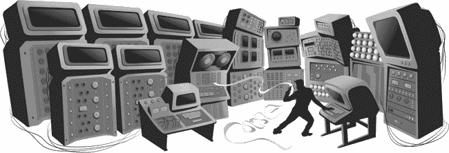

我们找到了两种有效的方法来弥合我们这些擅长社交和空间推理的柔软生物有机体与计算机——这些无情处理无意义数据的机器——之间的沟通鸿沟。第一种方法是诉诸我们对物理世界的感知，构建模仿该世界的界面，让我们用手指在屏幕上操作形状。这对于日常的机器交互非常有效。

但对于向计算机传达界面设计者未曾预料到的事情，我们尚未找到一种好的点选式方法。对于开放式界面，例如指示计算机执行任意任务，我们更幸运地采用了一种利用我们语言天赋的方法：教机器一种语言。

人类语言允许单词和短语以多种方式组合，这使我们能够表达许多不同的事物。计算机语言虽然通常在语法上不那么灵活，但遵循类似的原理。

在过去的 20 年里，日常计算变得更加普及，而基于语言的界面——曾经是人们与计算机交互的默认方式——在很大程度上已被图形界面取代。但如果你知道去哪里寻找，它们仍然存在。其中一种语言 JavaScript 几乎内置在每一个网络浏览器中，因此几乎可以在所有消费设备上使用。

本书旨在让你熟悉这门语言，以便能够使计算机做你想做的事情。

# 关于编程

> 不愤不启，不悱不发。举一隅不以三隅反，则不复也。
> 
> —孔子

除了解释 JavaScript，我还将介绍编程的基本原理。事实证明，编程是困难的。基本规则通常简单明了。但建立在这些规则之上的程序往往会变得足够复杂，从而引入它们自己的规则和复杂性。从某种意义上说，你正在建造自己的迷宫，并且可能会在其中迷失方向。

阅读这本书时，有时会感到非常沮丧。如果你是编程新手，将会有大量新内容需要消化。其中许多内容还会以需要你建立额外联系的方式*组合*在一起。

你需要付出必要的努力。当你难以跟上书中的内容时，不要对自己的能力妄下结论。你没问题——你只需要坚持下去。休息一下，重读一些材料，并且*始终*确保你阅读并理解了示例程序和练习。学习是艰苦的工作，但你学到的一切都是你的，并且会使后续学习更容易。

> 计算机程序员是宇宙的创造者，他[原文如此]独自对这些宇宙负责。几乎无限复杂的宇宙可以以计算机程序的形式被创造出来。
> 
> —Joseph Weizenbaum，《计算机力量与人类理性》

程序是多种事物的集合。它是程序员键入的一段文本；它是使计算机执行其操作的指挥力量；它是计算机内存中的数据，却又控制着对同一内存执行的操作。试图将程序与我们熟悉的物体进行类比的尝试往往不够贴切。一个表面上合适的类比是机器——通常涉及许多独立的部分，为了使整个系统运转，我们必须考虑这些部分如何相互连接并共同作用于整体。

计算机是一种被构建来作为这些非物质机器的主机的机器。计算机本身只能做愚蠢的、直截了当的事情。它们之所以如此有用，是因为它们以极高的速度做这些事情。程序可以巧妙地将大量这些简单动作组合起来，以完成非常复杂的事情。

对我们中的一些人来说，编写计算机程序是一场迷人的游戏。程序是思想的建筑。它建造起来没有成本，没有重量，并且在我们打字的手指下轻松生长。

但如果不加小心，程序的规模和复杂性会失控，甚至让创造它的人感到困惑。保持程序可控是编程的主要问题。当一个程序正常工作时，它是美丽的。编程的艺术是控制复杂性的技能。伟大的程序是克制的——在复杂性中保持简单。

许多程序员认为，最好通过只在程序中使用一小套经过充分理解的技术来管理这种复杂性。他们制定了严格的规则（“最佳实践”），规定了程序应有的形式，其中更狂热的人会认为那些走出这个安全小区域的人是*糟糕的*程序员。

这是对编程丰富性的敌意——试图将其简化为简单可预测的东西，对所有奇特而美丽的程序设置禁忌！编程技术的领域是广阔的，其多样性令人着迷，并且大部分尚未被探索。当然，这是一条危险的道路，会引诱缺乏经验的程序员陷入各种混乱，但这只意味着你应该谨慎行事并保持清醒的头脑。总会有新的挑战和新的领域等待探索。拒绝继续探索的程序员将会停滞不前，忘记他们的乐趣，并对自己的手艺感到厌倦。

# 为什么语言很重要

在计算机诞生之初，没有编程语言。程序看起来像这样：

```
00110001 00000000 00000000
00110001 00000001 00000001
00110011 00000001 00000010
01010001 00001011 00000010
00100010 00000010 00001000
01000011 00000001 00000000
01000001 00000001 00000001
00010000 00000010 00000000
01100010 00000000 00000000
```


该程序将数字 1 到 10 相加，并输出结果：`1 + 2 + ... + 10 = 55`。它可以在一个简单的假想机器上运行。为了给早期计算机编程，需要将大量开关设置到正确位置，或者在纸板上打孔并送入计算机。你可以想象这个过程是多么乏味且容易出错。即使是编写简单的程序也需要大量的技巧和严谨性。复杂的程序几乎无法想象。

当然，手动输入这些神秘的比特模式（0 和 1）确实让程序员有一种强大巫师的感觉。这在工作满意度方面肯定是有价值的。

上一个程序的每一行都包含一条指令。用英文可以这样写：

```
1\. Store the number 0 in memory location 0.
2\. Store the number 1 in memory location 1.
3\. Store the value of memory location 1 in memory location 2.
4\. Subtract the number 11 from the value in memory location 2.
5\. If the value in memory location 2 is the number 0,
   continue with instruction 9.
6\. Add the value of memory location 1 to memory location 0.
7\. Add the number 1 to the value of memory location 1.
8\. Continue with instruction 3.
9\. Output the value of memory location 0.
```

虽然这已经比比特汤更易读，但仍然相当令人不快。使用名称而不是数字来表示指令和内存位置可能会有所帮助。

```
 Set "total" to 0.
 Set "count" to 1.
[loop]
 Set "compare" to "count".
 Subtract 11 from "compare".
 If "compare" is zero, continue at [end].
 Add "count" to "total".
 Add 1 to "count".
 Continue at [loop].
[end]
 Output "total".
```

你现在能看出这个程序是如何工作的吗？前两行给两个内存位置赋予了初始值：`total`将累加计算结果，`count`将跟踪当前正在处理的数字。使用`compare`的那几行可能是最奇怪的。程序想要检查`count`是否等于 11，以决定是否停止运行。由于我们的假想机器相当原始，它只能测试一个数字是否为零，并据此做出决策（或跳转）。因此，它使用标记为`compare`的内存位置来计算`count - 11`的值，并根据该值做出决策。接下来的两行将`count`的值加到结果中，并在程序判定`count`尚未达到 11 时，每次将`count`增加 1。

以下是相同的 JavaScript 程序：

```
var total = 0, count = 1;
while (count <= 10) {
  total += count;
  count += 1;
}
console.log(total);
// ▹ 55
```

这个版本给我们带来了一些改进。最重要的是，不再需要指定程序如何来回跳转。`while`语言结构处理了这一点。只要给定的条件成立，它就会继续执行其下方的块（用花括号括起来）。该条件是`count <= 10`，意思是“`count`小于或等于 10”。我们不再需要创建一个临时值并将其与零比较，这是一个无趣的细节。编程语言的部分威力在于它们为我们处理了这些无趣的细节。

在程序末尾，`while`结束后，对结果应用`console.log`操作，以将其作为输出写入。

最后，如果我们碰巧有方便的`range`和`sum`操作可用，那么程序可能看起来像这样，这两个操作分别用于创建一个范围内的数字集合和计算数字集合的总和：

```
console.log(sum(range(1, 10)));
// ▹ 55
```

这个故事告诉我们，同一个程序可以用冗长或简短、难以阅读或易于阅读的方式表达。程序的第一个版本极其晦涩，而最后一个版本几乎就是英语：`log` 从 1 到 10 的`range`的`sum`。（我们将在后面的章节中看到如何构建像`sum`和`range`这样的操作。）

一个好的编程语言通过允许程序员在更高层次上描述计算机必须执行的操作来帮助他们。它有助于省略无趣的细节，提供方便的构建块（如`while`和`console.log`），允许你定义自己的构建块（如`sum`和`range`），并使这些块易于组合。

# 什么是 JavaScript？

JavaScript 于 1995 年推出，作为在 Netscape Navigator 浏览器中向网页添加程序的一种方式。此后，所有其他主要的图形化网页浏览器都采用了该语言。它使现代网络应用成为可能——这些应用允许你直接交互，而无需每次操作都重新加载页面。但它也用于更传统的网站，以提供各种形式的交互性和巧妙功能。

需要注意的是，JavaScript 与名为 Java 的编程语言几乎没有任何关系。相似的名称是出于营销考虑，而非明智的判断。当 JavaScript 推出时，Java 语言正在被大力推广并日益流行。有人认为搭上这趟成功的顺风车是个好主意。于是我们就有了这个名字。

在 JavaScript 被广泛采用后，人们编写了一份标准文档来描述该语言的工作方式，以确保声称支持 JavaScript 的各种软件实际上在谈论同一种语言。这被称为 ECMAScript 标准，以进行标准化的 ECMA 组织命名。实际上，ECMAScript 和 JavaScript 这两个术语可以互换使用——它们是同一种语言的两个名称。

有些人会对 JavaScript 语言说一些*糟糕*的话。其中很多都是事实。当我第一次被要求用 JavaScript 写点东西时，我很快就讨厌它了。它几乎接受我输入的任何内容，但解释方式却与我的本意完全不同。当然，这很大程度上是因为我当时完全不知道自己在做什么，但这里确实存在一个问题：JavaScript 在允许的内容上过于宽松。这种设计背后的想法是让初学者更容易用 JavaScript 编程。实际上，这主要使得在程序中查找问题变得更加困难，因为系统不会向你指出它们。

不过，这种灵活性也有其优点。它为许多在更严格的语言中不可能实现的技术留下了空间，而且正如你将看到的（例如，在第 10 章中），它可以用来克服 JavaScript 的一些缺点。在正确学习该语言并与之合作一段时间后，我学会了真正*喜欢*JavaScript。

JavaScript 有几个版本。在 JavaScript 崛起并占据主导地位的时期（大约在 2000 年至 2010 年间），ECMAScript 第 3 版是支持最广泛的版本。在此期间，一个雄心勃勃的第 4 版正在开发中，计划对语言进行许多根本性的改进和扩展。以如此激进的方式改变一种活跃且广泛使用的语言在政治上变得困难，第 4 版的工作于 2008 年被放弃，导致了 2009 年发布的远没有那么雄心勃勃的第 5 版。现在，所有主流浏览器都支持第 5 版，这也是本书将重点关注的版本。第 6 版正在最终确定中，一些浏览器已经开始支持该版本的新功能。


Web 浏览器并非 JavaScript 的唯一运行平台。某些数据库，如 MongoDB 和 CouchDB，将 JavaScript 用作其脚本和查询语言。多个桌面和服务器编程平台，最著名的是 Node.js 项目（第 20 章 的主题），为在浏览器之外进行 JavaScript 编程提供了强大的环境。

# 代码及其用途

代码是构成程序的文本。本书大部分章节都包含大量代码。根据我的经验，阅读代码和编写代码是学习编程不可或缺的部分，因此请尽量不要只是浏览示例。请仔细阅读并理解它们。起初这可能会很慢且令人困惑，但我保证你会很快掌握要领。练习也是如此。除非你实际编写了一个可行的解决方案，否则不要以为你已经理解了它们。

我建议你在实际的 JavaScript 解释器中尝试练习的解决方案。这样，你会立即得到反馈，了解你所做的是否有效，并且我希望你会受到诱惑去尝试并超越练习。

运行本书示例代码并进行实验的最简单方法是查阅本书的在线版本，网址为 *[`eloquentjavascript.net/`](http://eloquentjavascript.net/)*。在那里，你可以点击任何代码示例进行编辑和运行，并查看其产生的输出。要完成练习，请访问 *[`eloquentjavascript.net/code/`](http://eloquentjavascript.net/code/)*，该网站为每个编程练习提供了起始代码，并允许你查看解决方案。

如果你想在本书的沙箱之外运行本书中定义的程序，则需要小心一些。许多示例是独立的，应该可以在任何 JavaScript 环境中运行。但后面章节中的代码主要是为特定环境（浏览器或 Node.js）编写的，并且只能在该环境中运行。此外，许多章节定义了更大的程序，其中出现的代码片段相互依赖或依赖于外部文件。网站上的沙箱提供了指向 Zip 文件的链接，其中包含运行特定章节代码所需的所有脚本和数据文件。

# 本书概述

本书大致分为三个部分。前 11 章讨论 JavaScript 语言本身。接下来的八章是关于 Web 浏览器以及如何使用 JavaScript 对其进行编程。最后两章专门介绍 Node.js，这是另一种 JavaScript 编程环境。

全书共有五个*项目章节*，描述了较大的示例程序，让你体验真正的编程。按出现顺序，我们将构建一个人工生命模拟、一种编程语言、一个平台游戏、一个绘图程序和一个动态网站。

本书的语言部分从四章开始，介绍 JavaScript 语言的基本结构。它们介绍了控制结构（例如你在本引言中看到的 `while` 关键字）、函数（编写你自己的操作）和数据结构。之后，你将能够编写简单的程序。接下来，第 5 章 和 第 6 章 介绍了使用函数和对象编写更*抽象*代码的技术，从而控制复杂性。

在第一个项目章节之后，本书的第一部分继续介绍错误处理和修复、正则表达式（处理文本数据的重要工具）以及模块化——对抗复杂性的另一武器。第二个项目章节结束了本书的第一部分。

第二部分，第 12 章 到 第 19 章，描述了浏览器 JavaScript 可以访问的工具。你将学习在屏幕上显示内容（第 13 章 和 第 16 章）、响应用户输入（第 14 章 和 第 18 章）以及通过网络进行通信（第 17 章）。这部分同样有两个项目章节。

之后，第 20 章 介绍了 Node.js，第 21 章 使用该工具构建了一个简单的 Web 系统。

最后，第 22 章 描述了在优化 JavaScript 程序速度时出现的一些考虑因素。

# 排版约定

在本书中，以 `等宽字体` 书写的文本将表示程序的元素——有时它们是独立的片段，有时它们仅指代附近程序的一部分。程序（你已经看到了一些）的书写方式如下：

```
function fac(n) {
  if (n == 0)
    return 1;
  else
    return fac(n - 1) * n;
}
```

有时，为了显示程序产生的输出，预期输出会写在程序之后，前面带有两个斜杠和一个箭头。

```
console.log(fac(8));
// ▹ 40320
```

祝你好运！

# 第一部分 语言

# 第 1 章 值、类型和运算符

> “在机器的表面之下，程序在运行。它毫不费力地伸缩。电子以极大的和谐散射和重组。显示器上的形式不过是水面的涟漪。本质无形地隐藏在下方。”
> 
> ——袁马大师，《编程之书》

在计算机的世界里，只有数据。你可以读取数据、修改数据、创建新数据——但任何不是数据的东西根本就不存在。所有这些数据都存储为长串的位，因此本质上是相似的。

位是任何具有两种值的事物，通常描述为 0 和 1。在计算机内部，它们表现为高或低的电荷、强或弱的信号，或者 CD 表面上的亮点或暗点。任何离散的信息片段都可以简化为 0 和 1 的序列，从而用位来表示。

例如，考虑如何用位来表示数字 13。其原理与你书写十进制数字的方式相同，但你不是有 10 个不同的数字，而是只有 2 个，并且从右到左每个位的权重增加 2 倍。以下是组成数字 13 的位，其权重显示在它们下方：

```
 0   0   0   0  1  1  0  1
128  64  32  16  8  4  2  1
```

所以这就是二进制数 00001101，即 8 + 4 + 1，等于 13。

## 值

想象一片位的海洋。一片浩瀚的海洋。一台典型的现代计算机在其易失性数据存储中拥有超过 300 亿个位。非易失性存储（硬盘或类似设备）通常还要多几个数量级。


为了能够处理如此大量的位而不迷失方向，你可以将它们分成代表信息片段的数据块。在 JavaScript 环境中，这些数据块被称为*值*。尽管所有值都由位组成，但它们扮演着不同的角色。每个值都有一个决定其角色的类型。JavaScript 中有六种基本类型的值：数字、字符串、布尔值、对象、函数和未定义值。


要创建一个值，你只需调用它的名字。这很方便。你无需为你的值收集建筑材料，也不必为它们付费。你只需召唤一个，然后*嗖*的一声，它就出现了。当然，它们并非凭空产生。每个值都必须存储在某个地方，如果你同时使用大量值，可能会耗尽比特位。幸运的是，只有当你同时需要它们时才会遇到这个问题。一旦你不再使用某个值，它就会消散，留下它的比特位，作为下一代值的建筑材料被回收。

本章介绍 JavaScript 程序的原子元素，即简单值类型以及可以作用于这些值的运算符。

## 数字

*数字*类型的值，顾名思义，就是数值。在 JavaScript 程序中，它们这样书写：

```
13
```

在程序中使用它，就会在计算机内存中产生数字 13 的比特模式。

JavaScript 使用固定数量的比特位（即 64 位）来存储一个数字值。64 位只能产生有限数量的模式，这意味着可以表示的不同数字的数量是有限的。对于 `N` 位十进制数字，可以表示的数字数量是 10^(`N`)。类似地，给定 64 位二进制数字，你可以表示 2⁶⁴ 个不同的数字，大约是 1800 亿亿（18 后面跟 18 个零）。这非常庞大。

计算机内存曾经小得多，人们倾向于使用 8 位或 16 位组来表示数字。很容易意外地*溢出*这些较小的数字——最终得到一个无法放入给定比特位数的数字。如今，即使是个人计算机也有充足的内存，因此你可以自由使用 64 位块，这意味着只有在处理真正天文数字时才需要担心溢出问题。

不过，并非所有小于 1800 亿亿的整数都能放入一个 JavaScript 数字中。这些比特位还要存储负数，因此有一位用于表示数字的符号。更大的问题是，非整数也必须被表示。为此，一些比特位用于存储小数点的位置。实际可存储的最大整数大约在 9 千万亿（15 个零）的范围内，这仍然非常巨大。

分数数字通过使用小数点来书写。

```
9.81
```

对于非常大或非常小的数字，你还可以使用科学记数法，添加一个“e”（代表“指数”），后跟数字的指数：

```
2.998e8
```

即 2.998 × 10⁸ = 299,800,000。

对小于上述 9 千万亿的整数（也称为*整数*）进行计算，保证始终精确。不幸的是，对分数数字的计算通常不精确。就像 π（圆周率）无法用有限位十进制数字精确表示一样，许多数字在只有 64 位可用时也会损失一些精度。这很遗憾，但只在特定情况下才会引起实际问题。重要的是要意识到这一点，并将分数数字视为近似值，而非精确值。

### 算术

数字的主要用途是算术。算术运算（如加法或乘法）接受两个数字值，并从中产生一个新数字。在 JavaScript 中，它们看起来像这样：

```
100 + 4 * 11
```

`+` 和 `*` 符号被称为*运算符*。第一个代表加法，第二个代表乘法。将运算符放在两个值之间，就会对这两个值应用该运算符，并产生一个新值。

这个例子是表示“将 4 和 100 相加，然后将结果乘以 11”，还是先做乘法再做加法？你可能已经猜到，乘法先发生。但和数学中一样，你可以通过将加法括在括号中来改变顺序。

```
(100 + 4) * 11
```

对于减法，有 `-` 运算符；除法可以用 `/` 运算符。

当运算符一起出现而没有括号时，它们应用的顺序由运算符的*优先级*决定。例子显示乘法优先于加法。`/` 运算符与 `*` 具有相同的优先级。`+` 和 `-` 也是如此。当多个具有相同优先级的运算符相邻出现时，例如 `1 - 2 + 1`，它们从左到右应用：`(1 - 2) + 1`。

这些优先级规则你不必担心。有疑问时，只需添加括号即可。

还有一个算术运算符，你可能不会立刻认出。`%` 符号用于表示*余数*运算。`X % Y` 是 `X` 除以 `Y` 的余数。例如，`314 % 100` 产生 `14`，`144 % 12` 产生 `0`。余数的优先级与乘法和除法相同。你经常会看到这个运算符被称为*模*，尽管从技术上讲*余数*更准确。

### 特殊数字

JavaScript 中有三个特殊值，它们被视为数字，但行为与普通数字不同。

前两个是 `Infinity` 和 `-Infinity`，分别代表正无穷和负无穷。`Infinity - 1` 仍然是 `Infinity`，以此类推。不要过于信任基于无穷的计算。它在数学上并不严谨，并且会很快导致我们的下一个特殊数字：`NaN`。

`NaN` 代表“不是数字”（not a number），尽管它是数字类型的一个值。当你尝试计算 `0 / 0`（零除以零）、`Infinity - Infinity` 或任何其他无法产生精确、有意义结果的数值运算时，就会得到这个结果。

## 字符串

下一个基本数据类型是*字符串*。字符串用于表示文本。它们通过将内容括在引号中来书写。

```
"Patch my boat with chewing gum"
'Monkeys wave goodbye'
```

单引号和双引号都可以用来标记字符串，只要字符串开头和结尾的引号匹配即可。

几乎任何内容都可以放在引号之间，JavaScript 会从中生成一个字符串值。但有些字符比较麻烦。你可以想象在引号之间放置引号可能会很困难。*换行符*（按下 ENTER 时得到的字符）也不能放在引号之间。字符串必须保持在一行内。

为了在字符串中包含这些字符，使用以下表示法：每当在引号文本中发现反斜杠（`\`）时，它表示其后的字符具有特殊含义。这被称为*转义*字符。前面带有反斜杠的引号不会结束字符串，而是成为字符串的一部分。当反斜杠后面出现 `n` 字符时，它被解释为换行符。类似地，反斜杠后面的 `t` 表示制表符。请看以下字符串：

```
"This is the first line\nAnd this is the second"
```

实际包含的文本是：

```
This is the first line
And this is the second
```

当然，有些情况下你希望字符串中的反斜杠只是一个反斜杠，而不是特殊代码。如果两个反斜杠连续出现，它们会合并，最终字符串值中只留下一个。这就是字符串 `"A newline character is written like "\n"."` 的表达方式：

```
"A newline character is written like \"\\n\"."
```

字符串不能进行除法、乘法或减法，但 `+` 运算符*可以*用于它们。它不执行加法，而是执行*拼接*——将两个字符串粘合在一起。以下行将产生字符串 `"concatenate"`：

```
"con" + "cat" + "e" + "nate"
```

还有更多操作字符串的方法，我们将在第 4 章讨论方法时介绍。

## 一元运算符


并非所有运算符都是符号。有些以单词形式出现。例如，`typeof` 运算符，它会生成一个字符串值，指明你提供的值的类型。

```
console.log(typeof 4.5)
// ▹ number
console.log(typeof "x")
// ▹ string
```

我们将在示例代码中使用 `console.log` 来表示我们想要查看某个表达式求值的结果。当你运行这样的代码时，产生的值应该会显示在屏幕上，不过其显示方式取决于你用来运行它的 JavaScript 环境。

我们之前看到的其他运算符都作用于两个值，但 `typeof` 只接受一个值。使用两个值的运算符称为*二元*运算符，而只接受一个值的称为*一元*运算符。减号运算符既可以作为二元运算符，也可以作为一元运算符。

```
console.log(- (10 - 2))
// ▹ -8
```

## 布尔值

通常，你需要一个能简单区分两种可能性的值，比如“是”和“否”或“开”和“关”。为此，JavaScript 提供了*布尔*类型，它只有两个值：`true` 和 `false`（直接写成这些单词）。

### 比较

以下是产生布尔值的一种方式：

```
console.log(3 > 2)
// ▹ true
console.log(3 < 2)
// ▹ false
```

`>` 和 `<` 符号分别是“大于”和“小于”的传统符号。它们是二元运算符。应用它们会得到一个布尔值，指示在这种情况下它们是否成立。

字符串也可以以相同的方式进行比较。

```
console.log("Aardvark" < "Zoroaster")
// ▹ true
```

字符串的排序方式大致是按字母顺序：大写字母总是“小于”小写字母，因此 `"Z" < "a"` 为 `true`，非字母字符（`!`、`-` 等）也包含在排序中。实际的比较基于 *Unicode* 标准。该标准为几乎所有你可能需要的字符分配了一个数字，包括希腊语、阿拉伯语、日语、泰米尔语等字符。拥有这样的数字对于在计算机中存储字符串很有用，因为它使得将字符串表示为数字序列成为可能。在比较字符串时，JavaScript 从左到右逐个比较字符的数字编码。

其他类似的运算符有 `>=`（大于或等于）、`<=`（小于或等于）、`==`（等于）和 `!=`（不等于）。

```
console.log("Itchy" != "Scratchy")
// ▹ true
```

JavaScript 中只有一个值不等于自身，那就是 `NaN`（“不是一个数字”）。

```
console.log(NaN == NaN)
// ▹ false
```

`NaN` 用于表示无意义计算的结果，因此它不等于任何*其他*无意义计算的结果。

### 逻辑运算符

还有一些操作可以应用于布尔值本身。JavaScript 支持三种逻辑运算符：*与*、*或*和*非*。它们可以用来对布尔值进行“推理”。

`&&` 运算符表示逻辑*与*。它是一个二元运算符，只有当两个值都为 `true` 时，其结果才为 `true`。

```
console.log(true && false)
// ▹ false
console.log(true && true)
// ▹ true
```

`||` 运算符表示逻辑*或*。如果两个值中有一个为 `true`，则结果为 `true`。

```
console.log(false || true)
// ▹ true
console.log(false || false)
// ▹ false
```

*非*写作感叹号（`!`）。它是一个一元运算符，会翻转给定的值——`!true` 产生 `false`，`!false` 产生 `true`。

当将这些布尔运算符与算术运算符和其他运算符混合使用时，有时并不清楚何时需要括号。实际上，通常你只需要知道，在我们目前见过的运算符中，`||` 的优先级最低，然后是 `&&`，接着是比较运算符（`>`、`==` 等），最后是其余运算符。这种顺序的选择使得在像下面这样的典型表达式中，尽可能少用括号：

```
1 + 1 == 2 && 10 * 10 > 50
```

我要讨论的最后一个逻辑运算符不是一元也不是二元，而是*三元*，它作用于三个值。它用问号和冒号表示，如下所示：

```
console.log(true ? 1 : 2);
// ▹ 1
console.log(false ? 1 : 2);
// ▹ 2
```

这被称为*条件*运算符（有时也简称为*三元*运算符，因为它是该语言中唯一这样的运算符）。问号左边的值“选择”另外两个值中的哪一个会输出。当它为 `true` 时，选择中间的值；当它为 `false` 时，输出右边的值。

## 未定义值

有两个特殊值，写作 `null` 和 `undefined`，用于表示没有有意义的值。它们本身是值，但不携带任何信息。

语言中许多不产生有意义值的操作（你稍后会看到一些）都会产生 `undefined`，仅仅是因为它们必须产生*某个*值。

`undefined` 和 `null` 之间的含义差异是 JavaScript 设计中的一个意外，大多数时候并不重要。在确实需要关注这些值的情况下，我建议将它们视为可互换的（稍后会详细说明）。

## 自动类型转换

在引言中，我提到 JavaScript 会尽力接受你提供的几乎任何程序，即使是那些行为怪异的程序。以下表达式很好地证明了这一点：

```
console.log(8 * null)
// ▹ 0
console.log("5" - 1)
// ▹ 4
console.log("5" + 1)
// ▹ 51
console.log("five" * 2)
// ▹ NaN
console.log(false == 0)
// ▹ true
```

当运算符应用于“错误”类型的值时，JavaScript 会悄悄地将该值转换为其所需的类型，使用的规则通常不是你想要的或期望的。这被称为*类型强制转换*。因此，第一个表达式中的 `null` 变成了 `0`，第二个表达式中的 `"5"` 变成了 `5`（从字符串到数字）。然而在第三个表达式中，`+` 会先尝试字符串拼接，然后再进行数字加法，因此 `1` 被转换为 `"1"`（从数字到字符串）。

当某些无法明显映射为数字的内容（例如 `"five"` 或 `undefined`）被转换为数字时，会产生值 `NaN`。对 `NaN` 进行进一步的算术运算会继续产生 `NaN`，因此如果你在意外的地方遇到了 `NaN`，请查找意外的类型转换。

当使用 `==` 比较相同类型的值时，结果很容易预测：除了 `NaN` 的情况外，当两个值相同时，你应该得到 `true`。但当类型不同时，JavaScript 会使用一套复杂且令人困惑的规则来决定做什么。在大多数情况下，它只是尝试将其中一个值转换为另一个值的类型。然而，当运算符的任一侧出现 `null` 或 `undefined` 时，只有当两侧都是 `null` 或 `undefined` 时，它才会产生 `true`。

```
console.log(null == undefined);
// ▹ true
console.log(null == 0);
// ▹ false
```

最后一种行为通常很有用。当你想要测试一个值是否具有实际值而不是 `null` 或 `undefined` 时，你可以简单地使用 `==`（或 `!=`）运算符将其与 `null` 进行比较。

但是，如果你想测试某个东西是否引用了精确的值 `false` 呢？将字符串和数字转换为布尔值的规则规定，`0`、`NaN` 和空字符串（`""`）被视为 `false`，而所有其他值都被视为 `true`。因此，像 `0 == false` 和 `"" == false` 这样的表达式也是 `true`。对于这种情况，当你*不*希望发生任何自动类型转换时，有两个额外的运算符：`===` 和 `!==`。第一个测试一个值是否与另一个值完全相等，第二个测试是否不完全相等。因此，`"" === false` 如预期那样为 `false`。


我建议防御性地使用三个字符的比较运算符，以防止意外的类型转换给你带来麻烦。但当你确定两边的类型相同时，使用较短的运算符也没有问题。

### 逻辑运算符的短路求值

逻辑运算符 `&&` 和 `||` 以一种特殊的方式处理不同类型的值。它们会将左侧的值转换为布尔类型来决定做什么，但根据运算符和转换结果，它们会返回左侧的*原始*值或右侧的值。

例如，`||` 运算符会在左侧的值可以转换为 `true` 时返回该值，否则返回右侧的值。这种转换对于布尔值来说符合预期，对于其他类型的值也会进行类似的处理。

```
console.log(null || "user")
// ▹ user
console.log("Karl" || "user")
// ▹ Karl
```

这个功能使得 `||` 运算符可以用作默认值的回退。如果你给它一个可能产生空值的表达式放在左侧，那么右侧的值将作为替代被使用。

`&&` 运算符的工作方式类似，但方向相反。当左侧的值可以转换为 `false` 时，它返回该值，否则返回右侧的值。

这两个运算符的另一个重要特性是，右侧的表达式仅在必要时才会被求值。对于 `true || X`，无论 `X` 是什么——即使它是一个会做*可怕*事情的表达式——结果都是 true，并且 `X` 永远不会被求值。`false && X` 也是如此，结果为 false 并忽略 `X`。这被称为*短路求值*。

条件运算符的工作方式类似。第一个表达式总是被求值，但第二个或第三个值（未被选中的那个）则不会。

## 总结

本章我们研究了四种 JavaScript 值类型：数字、字符串、布尔值和 undefined 值。

这些值通过输入其名称（`true`、`null`）或值（`13`、`"abc"`）来创建。你可以使用运算符组合和转换值。我们看到了用于算术（`+`、`-`、`*`、`/` 和 `%`）、字符串拼接（`+`）、比较（`==`、`!=`、`===`、`!==`、`<`、`>`、`<=`、`>=`）和逻辑（`&&`、`||`）的二元运算符，以及几个一元运算符（`-` 用于取反数字，`!` 用于逻辑取反，`typeof` 用于查找值的类型）。

这些信息足以让你将 JavaScript 用作口袋计算器，但仅此而已。下一章将开始将这些表达式组合成基本程序。

# 第 2 章 程序结构

> “在我那层薄膜般半透明的皮肤下，我的心闪耀着鲜红的光芒，他们必须给我注射 10cc 的 JavaScript 才能让我恢复过来。（我对血液中的毒素反应良好。）伙计，那玩意儿能把你的鱼鳃里的桃子都踢出来！”
>
> ——why，《Why's（发人深省的）Ruby 指南》

在本章中，我们将开始做一些真正可以称为*编程*的事情。我们将扩展对 JavaScript 语言的掌握，超越目前所见的名词和句子片段，达到能够表达一些有意义的篇章的程度。

## 表达式和语句

在第 1 章中，我们创建了一些值，然后对它们应用运算符以得到新值。像这样创建值是每个 JavaScript 程序的基本部分，但这只是其中一部分。

产生值的代码片段称为*表达式*。每个字面量写出的值（例如 `22` 或 `"psychoanalysis"`）都是一个表达式。括号内的表达式也是表达式，应用于两个表达式的二元运算符或应用于一个表达式的一元运算符也是如此。

这展示了基于语言的接口的部分美妙之处。表达式可以嵌套，其方式与人类语言中子句的嵌套非常相似——一个子句可以包含自己的子句，以此类推。这使我们能够组合表达式来表达任意复杂的计算。

如果表达式对应一个句子片段，那么 JavaScript *语句*就对应人类语言中的一个完整句子。程序就是一系列语句。

最简单的语句是后面带分号的表达式。这是一个程序：

```
1;
!false;
```

不过这是一个无用的程序。表达式可以仅仅产生一个值，然后被外层表达式使用。而语句是独立的，只有在对世界产生影响时才有意义。它可以在屏幕上显示某些内容——这算是对世界的改变——或者以某种方式改变机器的内部状态，从而影响后续的语句。这些改变称为*副作用*。前面例子中的语句只是产生了值 `1` 和 `true`，然后立即丢弃它们。这对世界没有留下任何印象。执行程序时，不会发生任何可观察的事情。

在某些情况下，JavaScript 允许你省略语句末尾的分号。在其他情况下，则必须保留，否则下一行会被视为同一语句的一部分。关于何时可以安全省略分号的规则有些复杂且容易出错。在本书中，每个需要分号的语句都会以分号结尾。我建议你在自己的程序中也这样做，至少在你更深入地了解省略分号所涉及的微妙之处之前。

## 变量

程序如何保持内部状态？它如何记住事物？我们已经看到如何从旧值产生新值，但这并不会改变旧值，而且新值必须立即使用，否则会再次消失。为了捕获和保存值，JavaScript 提供了一种称为*变量*的东西。

```
var caught = 5 * 5;
```

这给了我们第二种语句。特殊单词（*关键字*）`var` 表示这条语句将要定义一个变量。后面跟着变量名，如果我们想立即给它赋值，则跟着 `=` 运算符和一个表达式。

前面的语句创建了一个名为 `caught` 的变量，并用它来抓住 5 乘以 5 产生的数字。

变量定义后，其名称可以用作表达式。这种表达式的值就是变量当前持有的值。下面是一个例子：

```
var ten = 10;
console.log(ten * ten);
// ▹ 100
```

变量名可以是任何不是保留关键字（如 `var`）的单词。它们不能包含空格。数字也可以是变量名的一部分——例如 `catch22` 是一个有效的名称——但名称不能以数字开头。变量名不能包含标点符号，除了字符 `$` 和 `_`。

当变量指向一个值时，并不意味着它永远与该值绑定。`=` 运算符可以随时用于现有变量，将它们与当前值断开，并指向一个新值。

```
var mood = "light";
console.log(mood);
// ▹ light
mood = "dark";
console.log(mood);
// ▹ dark
```

你应该把变量想象成触手，而不是盒子。它们并不*包含*值；而是*抓住*值——两个变量可以引用同一个值。程序只能访问它仍然持有的值。当你需要记住某件事时，你就长出一条触手来抓住它，或者将你现有的某条触手重新连接到它上面。


让我们看一个例子。为了记住 Luigi 还欠你多少美元，你创建了一个变量。然后当他偿还 35 美元时，你给这个变量赋予一个新值。

```
var luigisDebt = 140;
luigisDebt = luigisDebt - 35;
console.log(luigisDebt);
// ▹ 105
```


当你定义一个变量而不给它赋值时，触手就没什么可抓的，所以它会在半空中消失。如果你询问一个空变量的值，你会得到值 `undefined`。

一个 `var` 语句可以定义多个变量。这些定义必须用逗号分隔。

```
var one = 1, two = 2;
console.log(one + two);
// ▹ 3
```

## 关键字和保留字

具有特殊含义的词，如 `var`，是*关键字*，它们不能用作变量名。还有一些词被“保留供将来使用”在 JavaScript 的未来版本中。这些词也正式不允许用作变量名，尽管某些 JavaScript 环境确实允许它们。关键字和保留字的完整列表相当长。

```
break case catch continue debugger default delete
do else false finally for function if implements
in instanceof interface let new null package private
protected public return static switch throw true
try typeof var void while with yield this
```

不必担心记住这些，但要记住，当变量定义不如预期工作时，这可能是问题所在。

## 环境

在给定时间存在的变量及其值的集合称为*环境*。当程序启动时，这个环境不是空的。它总是包含属于语言标准的变量，并且大多数情况下，它包含提供与周围系统交互方式的变量。例如，在浏览器中，有用于检查和影响当前加载的网站以及读取鼠标和键盘输入的变量和函数。

## 函数

默认环境中提供的许多值都具有*函数*类型。函数是一段包装在值中的程序。这样的值可以被*应用*以运行包装的程序。例如，在浏览器环境中，变量 `alert` 持有一个函数，该函数显示一个带有消息的小对话框。它的使用方式如下：

```
alert("Good morning!");
```

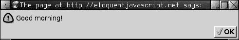

执行一个函数被称为*调用*、*调用*或*应用*它。你可以通过将括号放在产生函数值的表达式后面来调用函数。通常你会直接使用持有该函数的变量名。括号之间的值被传递给函数内部的程序。在示例中，`alert` 函数使用我们给它的字符串作为对话框中的文本显示。传递给函数的值称为*参数*。`alert` 函数只需要一个参数，但其他函数可能需要不同数量或不同类型的参数。

## console.log 函数

`alert` 函数在实验时作为输出设备很有用，但不断点击关闭那些小窗口会让人烦躁。在过去的示例中，我们使用了 `console.log` 来输出值。大多数 JavaScript 系统（包括所有现代 Web 浏览器和 Node.js）都提供了一个 `console.log` 函数，它将参数写入*某个*文本输出设备。在浏览器中，输出会出现在 JavaScript 控制台中。浏览器界面的这一部分默认是隐藏的，但大多数浏览器在按下 F12 或 Mac 上按下 COMMAND-OPTION-I 时会打开它。如果不起作用，请在菜单中搜索名为“Web 控制台”或“开发者工具”的项。

```
var x = 30;
console.log("the value of x is", x);
// ▹ the value of x is 30
```

尽管变量名不能包含句点字符，但 `console.log` 显然有一个。这是因为 `console.log` 不是一个简单的变量。它实际上是一个表达式，从 `console` 变量持有的值中检索 `log` 属性。我们将在第 4 章中确切了解这意味着什么。

## 返回值

显示对话框或将文本写入屏幕是一种*副作用*。许多函数因其产生的副作用而有用。函数也可以产生值，在这种情况下，它们不需要有副作用就能有用。例如，函数 `Math.max` 接受任意数量的数值并返回最大的那个。

```
console.log(Math.max(2, 4));
// ▹ 4
```

当一个函数产生一个值时，它被称为*返回*该值。任何产生值的东西在 JavaScript 中都是一个表达式，这意味着函数调用可以在更大的表达式中使用。这里，对 `Math.min`（与 `Math.max` 相反）的调用被用作加法运算符的输入：

```
console.log(Math.min(2, 4) + 100);
// ▹ 102
```

下一章将解释如何编写你自己的函数。

## Prompt 和 Confirm

浏览器环境除了 `alert` 之外还包含其他用于弹出窗口的函数。你可以使用 `confirm` 向用户询问确定/取消问题。这会返回一个布尔值：如果用户点击确定则返回 `true`，如果用户点击取消则返回 `false`。

```
confirm("Shall we, then?");
```

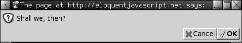

`prompt` 函数可用于提出一个“开放式”问题。第一个参数是问题，第二个参数是用户起始时的文本。可以在对话框窗口中输入一行文本，函数会将该文本作为字符串返回。

```
prompt("Tell me everything you know.", "...");
```

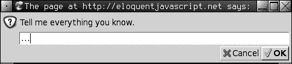

这两个函数在现代 Web 编程中并不常用，主要是因为你对结果窗口的外观没有控制权，但它们对于玩具程序和实验很有用。

## 控制流

当你的程序包含多个语句时，这些语句会按从上到下的顺序可预测地执行。作为一个基本示例，这个程序有两个语句。第一个语句要求用户输入一个数字，第二个语句随后执行，显示该数字的平方。

```
var theNumber = Number(prompt("Pick a number", ""));
alert("Your number is the square root of " +
      theNumber * theNumber);
```

函数 `Number` 将一个值转换为数字。我们需要这个转换，因为 `prompt` 的结果是一个字符串值，而我们想要一个数字。还有类似的函数叫做 `String` 和 `Boolean`，它们将值转换为这些类型。

以下是直线控制流的相当简单的示意图：


## 条件执行

按直线顺序执行语句并不是我们唯一的选择。另一种选择是*条件执行*，我们根据布尔值在两条不同路径之间进行选择，如下所示：

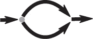

条件执行在 JavaScript 中使用 `if` 关键字编写。在简单情况下，我们只想在某个条件成立时（且仅当成立时）执行某些代码。例如，在前面的程序中，我们可能只想在输入实际上是数字时才显示输入的平方。

```
var theNumber = prompt("Pick a number", "");
if (!isNaN(theNumber))
  alert("Your number is the square root of " +
        theNumber * theNumber);
```

通过这种修改，如果你输入“cheese”，将不会显示任何输出。

关键字 `if` 根据布尔表达式的值执行或跳过一条语句。决定性的表达式写在关键字之后、括号之间，后面跟着要执行的语句。

`isNaN` 函数是一个标准的 JavaScript 函数，只有当它接收的参数是 `NaN` 时才返回 `true`。当你给 `Number` 函数一个不代表有效数字的字符串时，它恰好会返回 `NaN`。因此，条件翻译为“除非 `theNumber` 不是数字，否则执行此操作。”


你通常不仅会有在条件成立时执行的代码，还会有处理其他情况的代码。这个替代路径由图中的第二个箭头表示。`else` 关键字可以与 `if` 一起使用，以创建两个独立的、可选的执行路径。

```
var theNumber = Number(prompt("Pick a number", ""));
if (!isNaN(theNumber))
  alert("Your number is the square root of " +
        theNumber * theNumber);
else
  alert("Hey. Why didn't you give me a number?");
```

如果我们有超过两条路径可供选择，多个 `if`/`else` 对可以“链式”组合在一起。示例如下：

```
var num = Number(prompt("Pick a number", "0"));

if (num < 10)
  alert("Small");
else if (num < 100)
  alert("Medium");
else
  alert("Large");
```

程序会首先检查 `num` 是否小于 10。如果是，则选择该分支，显示 `"Small"`，然后结束。如果不是，则进入 `else` 分支，该分支本身包含第二个 `if`。如果第二个条件（`< 100`）成立，则意味着数字在 10 到 100 之间，显示 `"Medium"`。如果不成立，则选择第二个也是最后一个 `else` 分支。

该程序的流程图大致如下：

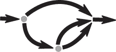

## while 和 do 循环

考虑一个打印从 0 到 12 所有偶数的程序。一种写法如下：

```
console.log(0);
console.log(2);
console.log(4);
console.log(6);
console.log(8);
console.log(10);
console.log(12);
```

这样可行，但编写程序的意义在于让工作*更少*，而不是更多。如果我们需要所有小于 1000 的偶数，上述方法将不可行。我们需要一种重复执行某些代码的方式。这种控制流形式称为循环。


循环控制流允许我们回到程序中之前所在的某个点，并用当前的程序状态重复执行。如果将其与一个计数的变量结合，我们可以这样做：

```
var number = 0;
while (number <= 12) {
  console.log(number);
  number = number + 2;
}
// ▹ 0
// ▹ 2
//   ... 等等
```

以关键字 `while` 开头的语句创建了一个循环。`while` 后面跟着括号中的表达式和一个语句，与 `if` 非常相似。只要表达式在转换为布尔类型时产生的值为 `true`，循环就会执行该语句。

在这个循环中，我们既要打印当前数字，又要给变量加 2。每当需要在循环内执行多条语句时，我们用花括号 `{` 和 `}` 将它们括起来。花括号对语句的作用类似于括号对表达式的作用：它们将语句分组，使其被视为单个语句。用花括号括起来的一系列语句称为*块*。

许多 JavaScript 程序员会将每个循环或 `if` 体都用花括号括起来。他们这样做既是为了保持一致性，也是为了避免在以后更改体中语句数量时添加或删除花括号。在本书中，为了简洁，我会将大多数单语句体不加花括号。你可以自由选择自己喜欢的风格。

变量 `number` 展示了变量如何跟踪程序的进度。每次循环重复时，`number` 增加 `2`。然后，在每次重复开始时，将其与数字 `12` 比较，以判断程序是否已完成所有预期工作。

作为一个实际有用的例子，我们现在可以编写一个程序来计算并显示 2¹⁰（2 的 10 次方）的值。我们使用两个变量：一个用于记录结果，另一个用于记录我们已将该结果乘以 2 的次数。循环测试第二个变量是否已达到 10，然后更新两个变量。

```
var result = 1;
var counter = 0;
while (counter < 10) {
  result = result * 2;
  counter = counter + 1;
}
console.log(result);
// ▹ 1024
```

计数器也可以从 `1` 开始并检查 `<= 10`，但出于将在第 4 章中说明的原因，最好养成从 0 开始计数的习惯。

`do` 循环是一种与 `while` 循环类似的控制结构。它仅在一个点上有所不同：`do` 循环总是至少执行一次其体，并且仅在第一次执行后才开始测试是否应停止。为了反映这一点，测试出现在循环体之后：

```
do {
  var name = prompt("Who are you?");
} while (!name);
console.log(name);
```

该程序会强制你输入一个名字。它会反复询问，直到得到非空字符串。应用 `!` 运算符会在取反之前将值转换为布尔类型，所有字符串除了 `""` 都会转换为 `true`。

## 代码缩进

你可能已经注意到我在某些语句前面加的空格。在 JavaScript 中，这些空格不是必需的——即使没有它们，计算机也能正常接受程序。实际上，程序中的换行也是可选的。如果你愿意，可以将程序写成一行。块内缩进的作用是使代码结构更加突出。在复杂的代码中，当新块在其他块内部打开时，可能很难看出一个块在哪里结束，另一个块在哪里开始。通过适当的缩进，程序的视觉形状与其内部块的形状相对应。我喜欢为每个打开的块使用两个空格，但口味不同——有些人使用四个空格，有些人使用制表符。

## for 循环

许多循环遵循前面 `while` 示例中的模式。首先，创建一个“计数器”变量来跟踪循环的进度。然后是一个 `while` 循环，其测试表达式通常检查计数器是否已达到某个边界。在循环体末尾，更新计数器以跟踪进度。

由于这种模式非常常见，JavaScript 和类似语言提供了一种更简短、更全面的形式：`for` 循环。

```
for (var number = 0; number <= 12; number = number + 2)
  console.log(number);
// ▹ 0
// ▹ 2
//    ... 等等
```

该程序与之前的偶数打印示例完全等价。唯一的变化是所有与循环“状态”相关的语句现在被组合在一起。

`for` 关键字后面的括号必须包含两个分号。第一个分号之前的部分*初始化*循环，通常通过定义一个变量。第二部分是*检查*循环是否必须继续的表达式。最后一部分在每次迭代后*更新*循环的状态。在大多数情况下，这比 `while` 结构更简短、更清晰。

以下是使用 `for` 代替 `while` 计算 2¹⁰ 的代码：

```
var result = 1;
for (var counter = 0; counter < 10; counter = counter + 1)
  result = result * 2;
console.log(result);
// ▹ 1024
```

注意，即使没有用 `{` 打开块，循环中的语句仍然缩进了两个空格，以表明它“属于”前一行。

## 跳出循环

循环的条件产生 `false` 并不是循环结束的唯一方式。有一个特殊的语句叫做 `break`，其效果是立即跳出当前所在的循环。

以下程序演示了 `break` 语句。它找到第一个既大于等于 20 又能被 7 整除的数字。

```
for (var current = 20; ; current++) {
  if (current % 7 == 0)
    break;
}
console.log(current);
// ▹ 21
```

使用取余（`%`）运算符是测试一个数字是否能被另一个数字整除的简单方法。如果能整除，则它们相除的余数为零。


示例中的 `for` 结构没有检查循环结束的部分。这意味着除非执行内部的 `break` 语句，否则循环永远不会停止。

如果你遗漏了那个 `break` 语句，或者不小心写了一个总是产生 `true` 的条件，你的程序就会陷入*无限循环*。陷入无限循环的程序永远不会运行结束，这通常是一件坏事。

`continue` 关键字与 `break` 类似，它会影响循环的进程。当在循环体中遇到 `continue` 时，控制会跳出循环体，并继续执行循环的下一次迭代。

## 简洁地更新变量

特别是在循环时，程序经常需要“更新”一个变量，使其基于该变量之前的值来保存新值。

```
counter = counter + 1;
```

JavaScript 为此提供了一个快捷方式：

```
counter += 1;
```

类似的快捷方式也适用于许多其他运算符，例如 `result *= 2` 用于将 `result` 加倍，或者 `counter -= 1` 用于向下计数。

这让我们可以进一步缩短计数示例。

```
for (var number = 0; number <= 12; number += 2)
  console.log(number);
```

对于 `counter += 1` 和 `counter -= 1`，还有更短的等价形式：`counter++` 和 `counter--`。

## 使用 switch 根据值进行分发

代码经常看起来像这样：

```
if (variable == "value1") action1();
else if (variable == "value2") action2();
else if (variable == "value3") action3();
else defaultAction();
```

有一种名为 `switch` 的结构，旨在以更直接的方式解决这种“分发”问题。不幸的是，JavaScript 为此使用的语法（继承自 C/Java 编程语言系列）有些笨拙——一串 `if` 语句通常看起来更好。下面是一个例子：

```
switch (prompt("What is the weather like?")) {
  case "rainy":
    console.log("Remember to bring an umbrella.");
    break;
  case "sunny":
    console.log("Dress lightly.");
  case "cloudy":
    console.log("Go outside.");
    break;
  default:
    console.log("Unknown weather type!");
    break;
}
```

你可以在 `switch` 打开的块内放置任意数量的 `case` 标签。程序会跳转到与 `switch` 给定的值相对应的标签，如果没有找到匹配的值，则跳转到 `default`。它会从那里开始执行语句，即使这些语句位于另一个标签下，直到遇到 `break` 语句。在某些情况下，例如示例中的 `"sunny"` 情况，这可以用来在多个情况之间共享一些代码（它建议在晴天和阴天都外出）。但要注意：很容易忘记这样的 `break`，这会导致程序执行你不希望执行的代码。

## 大小写命名

变量名不能包含空格，但使用多个单词来清晰描述变量所代表的内容通常很有帮助。以下是几种用多个单词编写变量名的选择：

```
fuzzylittleturtle
fuzzy_little_turtle
FuzzyLittleTurtle
fuzzyLittleTurtle
```

第一种风格可能难以阅读。就个人而言，我喜欢下划线的外观，尽管这种风格输入起来有点麻烦。标准的 JavaScript 函数以及大多数 JavaScript 程序员都遵循最后一种风格——除了第一个单词外，每个单词的首字母都大写。习惯这样的小事并不难，而混合命名风格的代码读起来可能会让人感到突兀，因此我们将遵循这一约定。

在少数情况下，例如 `Number` 函数，变量的首字母也大写。这样做是为了将此函数标记为构造函数。构造函数是什么将在第 6 章中明确。目前，重要的是不要被这种明显缺乏一致性的现象所困扰。

### 注释

通常，原始代码并不能传达你希望程序向人类读者传达的所有信息，或者它以某种晦涩的方式传达，以至于人们可能无法理解。有时，你可能只是想抒发诗意，或者希望将一些想法作为程序的一部分包含进来。这就是*注释*的作用。

注释是程序的一部分文本，但计算机完全忽略它。JavaScript 有两种编写注释的方式。要编写单行注释，你可以使用两个斜杠字符（`//`），然后在后面写上注释文本。

```
var accountBalance = calculateBalance(account);
// It's a green hollow where a river sings
accountBalance.adjust();
// Madly catching white tatters in the grass.
var report = new Report();
// Where the sun on the proud mountain rings:
addToReport(accountBalance, report);
// It's a little valley, foaming like light in a glass.
```

`//` 注释只到行尾。`/*` 和 `*/` 之间的文本段将被忽略，无论它是否包含换行符。这对于添加关于文件或程序块的信息块通常很有用。

```
/*
 I first found this number scrawled on the back of one of
 my notebooks a few years ago. Since then, it has often
 dropped by, showing up in phone numbers and the serial
 numbers of products that I've bought. It obviously likes
 me, so I've decided to keep it.
*/
var myNumber = 11213;
```

## 总结

现在你知道程序是由语句构成的，而语句本身有时又包含更多的语句。语句通常包含表达式，而表达式本身又可以由更小的表达式构成。

将语句一个接一个地排列，就得到了一个从上到下执行的程序。你可以通过使用条件语句（`if`、`else` 和 `switch`）和循环语句（`while`、`do` 和 `for`）来引入控制流的扰动。

变量可以用来以名称存储数据片段，并且对于跟踪程序中的状态很有用。环境是已定义变量的集合。JavaScript 系统总是将许多有用的标准变量放入你的环境中。

函数是封装了一段程序的特殊值。你可以通过编写 `functionName(argument1, argument2)` 来调用它们。这样的函数调用是一个表达式，并且可能产生一个值。

## 练习

如果你不确定如何检查练习的答案，请参考引言。

每个练习都以问题描述开始。阅读该描述并尝试解决练习。如果遇到问题，可以考虑阅读本书末尾的提示。本书不包含练习的完整解答，但你可以在 *[`eloquentjavascript.net/code/`](http://eloquentjavascript.net/code/)* 在线找到它们。如果你想从练习中学到东西，我建议在解决练习之后，或者至少在你长时间努力攻克它以至于有点头疼之后，再查看解答。

### 循环一个三角形

编写一个循环，调用七次 `console.log` 来输出以下三角形：

```
#
##
###
####
#####
######
#######
```

了解以下内容可能会有所帮助：你可以通过在字符串后面写 `.length` 来获取字符串的长度。

```
var abc = "abc";
console.log(abc.length);
// ▹ 3
```

### FizzBuzz

编写一个程序，使用 `console.log` 打印从 1 到 100 的所有数字，但有两个例外。对于能被 3 整除的数字，打印 `"Fizz"` 而不是数字；对于能被 5 整除（但不能被 3 整除）的数字，打印 `"Buzz"` 而不是数字。

完成上述功能后，修改你的程序，对于既能被 3 整除又能被 5 整除的数字，打印 `"FizzBuzz"`。

（这实际上是一个面试题，据称能淘汰相当大比例的应聘程序员。所以如果你解决了它，你现在可以自我感觉良好了。）

### 棋盘


编写一个程序，创建一个表示 8 × 8 网格的字符串，使用换行符分隔各行。网格的每个位置要么是一个空格，要么是一个“#”字符。这些字符应构成一个棋盘。

将此字符串传递给 `console.log` 应显示如下内容：

```
# # # #
 # # # #
# # # #
 # # # #
# # # #
 # # # #
# # # #
 # # # #
```

当你有一个生成此模式的程序后，定义一个变量 `size = 8`，并修改程序使其适用于任意 `size`，输出给定宽度和高度的网格。

# 第 3 章 函数

> “人们认为计算机科学是天才的艺术，但实际情况恰恰相反，只是许多人在做相互叠加的事情，就像一堵由小石子砌成的墙。”
> ——唐纳德·克努特

你已经见过函数值，比如 `alert`，以及如何调用它们。函数是 JavaScript 编程的核心。将一段程序包装成一个值的概念有很多用途。它是组织大型程序、减少重复、将名称与子程序关联以及将这些子程序相互隔离的工具。

函数最明显的应用是定义新词汇。在常规的人类语言散文中创造新词通常是不好的风格。但在编程中，这是不可或缺的。

典型的成年英语使用者词汇量大约有 20,000 个单词。很少有编程语言内置 20,000 条命令。而且，*可用的*词汇往往比人类语言定义得更精确，因此灵活性也更低。因此，我们通常*必须*添加一些自己的词汇，以避免过多重复。

## 定义函数

函数定义就是一个普通的变量定义，其中赋给变量的值恰好是一个函数。例如，以下代码定义了变量 `square`，它引用一个计算给定数字平方的函数：

```
var square = function(x) {
  return x * x;
};

console.log(square(12));
// ▹ 144
```

函数由以关键字 `function` 开头的表达式创建。函数有一组*参数*（在此例中只有 `x`）和一个*函数体*，其中包含调用函数时要执行的语句。函数体必须始终用花括号括起来，即使它只包含一条语句（如前面的示例）。

函数可以有多个参数，也可以没有参数。在下面的示例中，`makeNoise` 没有列出任何参数名，而 `power` 列出了两个：

```
var makeNoise = function() {
  console.log("Pling!");
};

makeNoise();
// ▹ Pling!

var power = function(base, exponent) {
  var result = 1;
  for (var count = 0; count < exponent; count++)
    result *= base;
  return result;
};

console.log(power(2, 10));
// ▹ 1024
```

有些函数会产生一个值，比如 `power` 和 `square`，而有些则不会，比如 `makeNoise`，它只产生副作用。`return` 语句决定了函数返回的值。当控制流遇到这样的语句时，它会立即跳出当前函数，并将返回的值交给调用该函数的代码。`return` 关键字后面如果没有表达式，将导致函数返回 `undefined`。

## 参数和作用域

函数的参数行为类似于普通变量，但它们的初始值由函数的*调用者*提供，而不是函数本身的代码。

函数的一个重要特性是，在函数内部创建的变量（包括其参数）对于该函数来说是*局部*的。这意味着，例如，`power` 示例中的 `result` 变量在每次调用函数时都会重新创建，并且这些独立的实例不会相互干扰。

变量的这种“局部性”仅适用于参数以及在函数体内使用 `var` 关键字声明的变量。在任何函数外部声明的变量称为*全局*变量，因为它们在整个程序中都是可见的。只要没有声明同名的局部变量，就可以从函数内部访问这些全局变量。

以下代码演示了这一点。它定义并调用了两个函数，这两个函数都给变量 `x` 赋值。第一个函数将变量声明为局部变量，因此只更改局部变量。第二个函数没有在局部声明 `x`，因此其内部的 `x` 引用的是示例顶部定义的全局变量 `x`。

```
var x = "outside";

var f1 = function() {
  var x = "inside f1";
};
f1();
console.log(x);
// ▹ outside

var f2 = function() {
  x = "inside f2";
};
f2();
console.log(x);
// ▹ inside f2
```

这种行为有助于防止函数之间的意外干扰。如果所有变量都由整个程序共享，那么要确保没有名称被用于两个不同的目的，将需要付出大量努力。而且，如果你*确实*重用了变量名，可能会看到不相关的代码干扰你的变量值而产生的奇怪效果。通过将函数局部变量视为仅存在于函数内部，语言使得将函数作为小宇宙来阅读和理解成为可能，而无需同时担心所有代码。

## 嵌套作用域

JavaScript 不仅区分*全局*和*局部*变量。函数可以在其他函数内部创建，从而产生多个层次的局部性。

例如，这个相当无意义的函数内部有两个函数：

```
var landscape = function() {
  var result = "";
  var flat = function(size) {
    for (var count = 0; count < size; count++)
      result += "_";
  };
  var mountain = function(size) {
    result += "/";
    for (var count = 0; count < size; count++)
      result += "'";
    result += "\\";
  };

  flat(3);
  mountain(4);
  flat(6);
  mountain(1);
  flat(1);
  return result;
};

console.log(landscape());
// ▹ ___/''''\______/'\_
```

`flat` 和 `mountain` 函数可以“看到”名为 `result` 的变量，因为它们位于定义该变量的函数内部。但它们看不到彼此的 `count` 变量，因为它们位于彼此的作用域之外。`landscape` 函数外部的环境看不到 `landscape` 内部定义的任何变量。

简而言之，每个局部作用域也可以看到所有包含它的局部作用域。函数内部可见的变量集由该函数在程序文本中的位置决定。函数定义*周围*块中的所有变量都是可见的——这意味着既包括包含它的函数体中的变量，也包括程序顶层中的变量。这种变量可见性的方法称为*词法作用域*。

有其他编程语言经验的人可能会认为，花括号之间的任何代码块都会产生一个新的局部环境。但在 JavaScript 中，只有函数才能创建新的作用域。你可以使用独立的块。

```
var something = 1;
{
  var something = 2;
  // 对变量 something 做一些操作...
}
// 再次回到块外部...
```

但块内部的 `something` 引用的是与块外部相同的变量。实际上，尽管允许这样的块，但它们仅用于对 `if` 语句或循环的主体进行分组。

如果你觉得这很奇怪，你并不孤单。JavaScript 的下一个版本将引入 `let` 关键字，它的工作方式类似于 `var`，但创建的变量是局部于包含它的*块*，而不是包含它的*函数*。

## 函数作为值

函数变量通常只是作为程序中特定部分的名称。这样的变量被定义一次，并且永远不会改变。这很容易让人混淆函数及其名称。


但两者是不同的。函数值可以像其他值一样做所有事情——你可以在任意表达式中使用它，而不仅仅是调用它。你可以将函数值存储到新的位置，将其作为参数传递给另一个函数，等等。类似地，持有函数的变量仍然是一个普通变量，可以被赋予新值，如下所示：

```
var launchMissiles = function(value) {
  missileSystem.launch("now");
};
if (safeMode)
  launchMissiles = function(value) {/* 什么都不做 */};
```

在第 5 章中，我们将讨论将函数值传递给其他函数所能实现的奇妙事情。

## 声明符号

有一种稍微简短的方式来表达“`var square = function...`”。`function`关键字也可以用在语句的开头，如下所示：

```
function square(x) {
  return x * x;
}
```

这是一个函数*声明*。该语句定义了变量`square`并将其指向给定的函数。到目前为止一切顺利。然而，这种函数定义形式有一个微妙之处。

```
console.log("未来说：", future());

function future() {
  return "我们仍然没有飞行汽车。";
}
```

这段代码可以工作，尽管函数是在使用它的代码*下方*定义的。这是因为函数声明不属于常规的从上到下的控制流。它们在概念上被移动到其作用域的顶部，并且可以被该作用域中的所有代码使用。这有时很有用，因为它让我们可以自由地以有意义的方式排列代码，而不必担心所有函数都必须在使用之前定义。

如果你将这样的函数定义放在条件（`if`）块或循环内部，会发生什么？嗯，不要这样做。不同浏览器中的不同 JavaScript 平台传统上在这种情况下会做出不同的行为，而最新的标准实际上禁止这样做。如果你希望程序行为一致，请仅在函数或程序的最外层块中使用这种函数定义语句。

```
function example() {
  function a() {} // 可以
  if (something) {
    function b() {} // 危险！
  }
}
```

## 调用栈

仔细看看控制流如何通过函数是很有帮助的。下面是一个简单的程序，它进行了一些函数调用：

```
function greet(who) {
  console.log("Hello " + who);
}
greet("Harry");
console.log("Bye");
```

这个程序的运行过程大致如下：调用`greet`导致控制跳转到该函数的开头（第 2 行）。它调用`console.log`（一个内置的浏览器函数），该函数接管控制，完成其工作，然后将控制返回到第 2 行。然后它到达`greet`函数的末尾，因此它返回到调用它的地方，即第 4 行。之后的那一行再次调用`console.log`。

我们可以用示意图表示控制流，如下所示：

```
top
   greet
       console.log
   greet
top
   console.log
top
```

因为函数在返回时必须跳回到调用它的地方，所以计算机必须记住函数被调用时的上下文。在一种情况下，`console.log`必须跳回到`greet`函数。在另一种情况下，它跳回到程序的末尾。

计算机存储这个上下文的地方就是*调用栈*。每次调用函数时，当前上下文被放在这个“栈”的顶部。当函数返回时，它从栈中移除顶部上下文，并使用它继续执行。

存储这个栈需要计算机内存中的空间。当栈变得太大时，计算机会失败并显示类似“栈空间不足”或“递归太深”的消息。下面的代码通过向计算机提出一个非常困难的问题来说明这一点，这会导致两个函数之间无限来回。更准确地说，如果计算机有无限的栈，它*将会*是无限的。但实际情况是，我们会耗尽空间，或者说“栈溢出”。

```
function chicken() {
  return egg();
}
function egg() {
  return chicken();
}
console.log(chicken() + " 先有。");
// ▹ ??
```

## 可选参数

以下代码是允许的，并且可以毫无问题地执行：

```
alert("Hello", "Good Evening", "How do you do?");
```

函数`alert`官方只接受一个参数。然而，当你这样调用它时，它并不会抱怨。它只是忽略其他参数，并显示“Hello”。

JavaScript 对于传递给函数的参数数量非常宽容。如果你传递太多，多余的部分会被忽略。如果你传递太少，缺失的参数会被赋值为`undefined`。

这样做的缺点是，你有可能——甚至很可能——不小心向函数传递了错误数量的参数，而没有人会告诉你。

优点是，这种行为可以用来让函数接受“可选”参数。例如，下面的`power`版本可以用两个参数调用，也可以只用一个参数调用，在这种情况下，指数默认为 2，函数的行为类似于`square`。

```
function power(base, exponent) {
  if (exponent == undefined)
    exponent = 2;
  var result = 1;
  for (var count = 0; count < exponent; count++)
    result *= base;
  return result;
}

console.log(power(4));
// ▹ 16
console.log(power(4, 3));
// ▹ 64
```

在下一章中，我们将看到一种方法，函数体可以获取传递给它的确切参数列表。这很有帮助，因为它使得函数可以接受任意数量的参数。例如，`console.log`就利用了这一点——它会输出所有传递给它的值。

```
console.log("R", 2, "D", 2);
// ▹ R 2 D 2
```

### 闭包

将函数视为值的能力，加上每次调用函数时局部变量都会被“重新创建”的事实，引出了一个有趣的问题。当创建局部变量的函数调用不再活跃时，这些局部变量会发生什么？

下面的代码展示了这样一个例子。它定义了一个函数`wrapValue`，该函数创建了一个局部变量。然后它返回一个函数，该函数访问并返回这个局部变量。

```
function wrapValue(n) {
  var localVariable = n;
  return function() { return localVariable; };
}
var wrap1 = wrapValue(1);
var wrap2 = wrapValue(2);
console.log(wrap1());
// ▹ 1
console.log(wrap2());
// ▹ 2
```

这是允许的，并且按你期望的方式工作——变量仍然可以被访问。事实上，变量的多个实例可以同时存在，这进一步说明了局部变量确实在每次调用时被重新创建——不同的调用不会互相干扰彼此的局部变量。

这种特性——能够引用封闭函数中局部变量的特定实例——被称为*闭包*。一个“封闭”了某些局部变量的函数被称为*闭包*。这种行为不仅让你不必担心变量的生命周期，还允许对函数值进行一些创造性的使用。

稍作修改，我们可以将前面的例子变成一种创建乘以任意数值的函数的方式。

```
function multiplier(factor) {
  return function(number) {
    return number * factor;
  };
}

var twice = multiplier(2);
console.log(twice(5));
// ▹ 10
```

`wrapValue`例子中显式的`localVariable`是不需要的，因为参数本身就是一个局部变量。

像这样思考程序需要一些练习。一个好的心智模型是将`function`关键字视为“冻结”其主体中的代码，并将其包装成一个包（函数值）。所以当你读到`return function(...) {...}`时，可以将其视为返回一个指向计算片段的句柄，该片段被冻结以供以后使用。


在示例中，`multiplier` 返回了一段冻结的代码，这段代码被存储在 `twice` 变量中。最后一行调用了该变量中的值，从而激活了冻结的代码（`return number * factor;`）。这段代码仍然可以访问创建它的 `multiplier` 调用中的 `factor` 变量，此外，它还能通过 `number` 参数访问解冻时传入的参数 5。

### 递归

函数调用自身是完全可行的，只要注意不要导致栈溢出即可。调用自身的函数被称为*递归*。递归允许某些函数以不同的风格编写。例如，下面是 `power` 函数的另一种实现：

```
function power(base, exponent) {
  if (exponent == 0)
    return 1;
  else
    return base * power(base, exponent - 1);
  }

console.log(power(2, 3));
// ▹ 8
```

这种写法非常接近数学家定义幂运算的方式，并且可以说比循环版本更优雅地描述了这一概念。该函数通过多次以不同参数调用自身来实现重复乘法。

但这种实现有一个重要问题：在典型的 JavaScript 实现中，它的速度大约是循环版本的十分之一。运行一个简单的循环比多次调用函数要廉价得多。

速度与优雅之间的两难选择是一个有趣的问题。你可以将其视为一个介于人类友好性和机器友好性之间的连续体。几乎任何程序都可以通过变得更大、更复杂来加快速度。程序员必须决定一个适当的平衡点。

就前面的 `power` 函数而言，不优雅的（循环）版本仍然相当简单且易于阅读。用递归版本替换它并没有太大意义。然而，很多时候，程序处理的概念非常复杂，以至于牺牲一些效率来使程序更直接成为一个有吸引力的选择。

许多程序员反复强调的基本规则（我完全赞同）是：在确定程序太慢之前，不要担心效率问题。如果确实太慢，找出哪些部分占用了最多时间，然后开始在这些部分用效率换取优雅。

当然，这条规则并不意味着可以完全忽视性能。在许多情况下，比如 `power` 函数，“优雅”的方法并没有带来多少简洁性。而且有时经验丰富的程序员可以立即看出简单的方法永远不够快。

我强调这一点的原因是，令人惊讶的是，许多初学者程序员会狂热地关注效率，甚至在最微小的细节上也是如此。结果导致程序更大、更复杂，而且往往正确性更低，编写时间比更直接的等价版本更长，而运行速度通常只快一点点。

但递归并不总是循环的低效替代品。有些问题用递归解决比用循环容易得多。最常见的是那些需要探索或处理多个“分支”的问题，每个分支又可能进一步分支成更多分支。

考虑这个谜题：从数字 1 开始，反复进行加 5 或乘以 3 的操作，可以产生无限多的新数字。如何编写一个函数，给定一个数字，尝试找到一系列这样的加法和乘法操作，最终得到该数字？例如，数字 13 可以通过先乘以 3，然后加两次 5 得到，而数字 15 则根本无法得到。

下面是一个递归解法：

```
function findSolution(target) {
  function find(start, history) {
    if (start == target)
      return history;
    else if (start > target)
      return null;
    else
      return find(start + 5, "(" + history + " + 5)") ||
             find(start * 3, "(" + history + " * 3)");
  }
  return find(1, "1");
}

console.log(findSolution(24));
// ▹ (((1 * 3) + 5) * 3)
```

请注意，这个程序不一定能找到*最短*的操作序列。它只要找到任何序列就满足了。

我不指望你立刻就能理解它是如何工作的。但让我们逐步分析，因为这对递归思维是一个很好的练习。

内部函数 `find` 执行实际的递归。它接受两个参数——当前数字和一个记录我们如何到达这个数字的字符串——并返回一个显示如何到达目标的字符串，或者返回 `null`。

为此，该函数执行三种操作之一。如果当前数字等于目标数字，那么当前历史就是到达目标的一种方式，因此直接返回它。如果当前数字大于目标数字，则继续探索这个历史没有意义，因为加法和乘法只会让数字变得更大。最后，如果我们仍然低于目标，函数会尝试从当前数字出发的两个可能路径，通过调用自身两次，每次对应一个允许的下一步。如果第一次调用返回非 `null` 值，则返回该值。否则，返回第二次调用的结果——无论它产生的是字符串还是 `null`。

为了更好地理解这个函数如何产生我们想要的效果，让我们看看在寻找数字 13 的解时所有对 `find` 的调用。

```
find(1, "1")
  find(6, "(1 + 5)")
    find(11, "((1 + 5) + 5)")
      find(16, "(((1 + 5) + 5) + 5)")
        too big
      find(33, "(((1 + 5) + 5) * 3)")
        too big
      find(18, "((1 + 5) * 3)")
        too big
    find(3, "(1 * 3)")
      find(8, "((1 * 3) + 5)")
        find(13, "(((1 * 3) + 5) + 5)")
          found!
```

缩进表示调用栈的深度。第一次调用 `find` 时，它调用自身两次来探索以 `(1 + 5)` 和 `(1 * 3)` 开头的解。第一次调用尝试寻找以 `(1 + 5)` 开头的解，并通过递归探索所有产生小于或等于目标数字的解。由于没有找到命中目标的解，它向第一次调用返回 `null`。此时 `||` 运算符导致探索 `(1 * 3)` 的调用发生。这次搜索运气更好，因为它的第一次递归调用，通过*另一个*递归调用，命中了目标数字 13。这个最内层的递归调用返回一个字符串，中间调用中的每个 `||` 运算符都传递该字符串，最终返回我们的解。

## 增长函数

函数被引入程序有两种或多或少自然的方式。

第一种是你发现自己多次编写非常相似的代码。我们希望避免这种情况，因为更多的代码意味着更多的隐藏错误空间，以及更多需要阅读的材料（对于试图理解程序的人来说）。因此，我们将重复的功能提取出来，为其找到一个好名字，并将其放入一个函数中。

第二种方式是你发现自己需要一些尚未编写且听起来应该有自己的函数的功能。你会先给函数命名，然后编写其主体。你甚至可能在真正定义函数之前就开始编写使用该函数的代码。

为函数找到一个好名字的难度，很好地反映了你试图封装的概念是否清晰。让我们看一个例子。

我们想编写一个程序，打印两个数字：农场上的奶牛和鸡的数量，后面跟着单词 `Cows` 和 `Chickens`，并且两个数字前面都补零，使它们始终是三位数。

```
007 Cows
011 Chickens
```

这显然需要一个接受两个参数的函数。让我们开始编码吧。


```
function printFarmInventory(cows, chickens) {
  var cowString = String(cows);
  while (cowString.length < 3)
    cowString = "0" + cowString;
  console.log(cowString + " Cows");
  var chickenString = String(chickens);
  while (chickenString.length < 3)
    chickenString = "0" + chickenString;
  console.log(chickenString + " Chickens");
}
printFarmInventory(7, 11);
```

在字符串值后面加上 `.length` 会返回该字符串的长度。因此，`while` 循环会在数字字符串前面不断添加零，直到它们至少有三个字符长。

任务完成了！但就在我们准备把代码发给农场主（当然，还要附上一张高额发票）时，他打电话来说，他还开始养猪了，能不能请我们扩展一下软件，让它也能打印猪的数量？

当然可以。但就在我们准备再次复制粘贴那四行代码时，我们停下来重新思考。一定有更好的方法。下面是第一次尝试：

```
function printZeroPaddedWithLabel(number, label) {
  var numberString = String(number);
  while (numberString.length < 3)
    numberString = "0" + numberString;
  console.log(numberString + " " + label);
}

function printFarmInventory(cows, chickens, pigs) {
  printZeroPaddedWithLabel(cows, "Cows");
  printZeroPaddedWithLabel(chickens, "Chickens");
  printZeroPaddedWithLabel(pigs, "Pigs");
}

printFarmInventory(7, 11, 3);
```

它起作用了！但 `printZeroPaddedWithLabel` 这个名字有点别扭。它将三件事——打印、补零和添加标签——混在了一个函数里。

与其整体提取程序中重复的部分，不如尝试提炼出一个*概念*。

```
function zeroPad(number, width) {
  var string = String(number);
  while (string.length < width)
    string = "0" + string;
  return string;
}

function printFarmInventory(cows, chickens, pigs) {
  console.log(zeroPad(cows, 3) + " Cows");
  console.log(zeroPad(chickens, 3) + " Chickens");
  console.log(zeroPad(pigs, 3) + " Pigs");
}

printFarmInventory(7, 16, 3);
```

一个像 `zeroPad` 这样名字清晰明了的函数，能让阅读代码的人更容易理解它的作用。而且它的用途不仅限于这个特定程序。例如，你可以用它来帮助打印对齐整齐的数字表格。

我们的函数应该有多聪明、多通用？我们可以编写一个极其简单的函数，只将数字填充到三个字符宽；也可以编写一个复杂的通用数字格式化系统，处理小数、负数、小数点对齐、不同字符填充等等。

一个有用的原则是：除非你绝对确定将来会用到，否则不要添加花哨的功能。你可能会忍不住为你遇到的每一个小功能编写通用的“框架”。抵制这种冲动。否则你无法完成真正的工作，最终只会写出大量没人会用的代码。

## 函数与副作用

函数大致可以分为两类：一类是为了其副作用而被调用的，另一类是为了其返回值而被调用的。（当然，也有可能同时产生副作用并返回值。）

农场示例中的第一个辅助函数 `printZeroPaddedWithLabel` 是为了其副作用而被调用的：它打印一行。第二个版本 `zeroPad` 是为了其返回值而被调用的。第二个版本比第一个更通用，这并非巧合。创建值的函数比直接执行副作用的函数更容易以新的方式组合。

*纯*函数是一种特定类型的生成值的函数，它不仅没有副作用，而且不依赖其他代码的副作用——例如，它不读取可能被其他代码偶尔修改的全局变量。纯函数有一个令人愉快的特性：当用相同的参数调用时，它总是产生相同的值（并且不做其他任何事情）。这使得它易于推理。对这样一个函数的调用可以在思维上被其结果替代，而不会改变代码的含义。当你不确定一个纯函数是否正确工作时，你可以通过简单地调用它来测试，并且知道如果它在那个上下文中工作，那么它在任何上下文中都会工作。非纯函数可能基于各种因素返回不同的值，并且具有可能难以测试和思考的副作用。

不过，在编写非纯函数时，没有必要感到内疚，也不必发动一场圣战来将它们从代码中清除。副作用通常是有用的。例如，不可能编写一个纯版本的 `console.log`，而 `console.log` 显然很有用。有些操作在使用副作用时也更容易高效地表达，因此计算速度可能是避免纯函数的一个理由。

## 总结

本章教你如何编写自己的函数。`function` 关键字作为表达式使用时，可以创建一个函数值。作为语句使用时，它可以用来声明一个变量，并将一个函数作为其值赋给它。

```
// 创建一个函数值 f
var f = function(a) {
  console.log(a + 2);
};

// 声明 g 为一个函数
function g(a, b) {
  return a * b * 3.5;
}
```

理解函数的一个关键方面是理解局部作用域。在函数内部声明的参数和变量是函数局部的，每次调用函数时都会重新创建，并且从外部不可见。在另一个函数内部声明的函数可以访问外部函数的局部作用域。

将程序执行的任务分离到不同的函数中是有帮助的。你不需要重复自己太多，函数可以通过将代码分组到概念性的块中，使程序更易读，就像章节和段落有助于组织普通文本一样。

## 练习

### 最小值

前一章介绍了标准函数 `Math.min`，它返回最小的参数。现在我们可以自己实现它。编写一个函数 `min`，它接受两个参数并返回它们的最小值。

### 递归

我们已经看到，`%`（取余运算符）可以通过 `% 2` 来检查一个数是否能被二整除，从而判断它是偶数还是奇数。下面是另一种定义正整数奇偶性的方法：

*   零是偶数。
*   一是奇数。
*   对于任何其他数 *N*，它的奇偶性与 *N* – 2 相同。

根据这个描述定义一个递归函数 `isEven`。该函数应接受一个 `number` 参数并返回一个布尔值。

在 50 和 75 上测试它。看看它在 –1 上的表现。为什么？你能想到修复这个问题的方法吗？

### 字符计数

你可以通过 `"string".charAt(N)` 获取字符串中的第 *N* 个字符或字母，类似于通过 `"s".length` 获取其长度。返回的值将是一个只包含一个字符的字符串（例如 `"b"`）。第一个字符的位置是零，因此最后一个字符的位置是 `string.length - 1`。换句话说，一个两个字符的字符串长度为 2，其字符位置分别为 0 和 1。

编写一个函数 `countBs`，它接受一个字符串作为唯一参数，并返回一个数字，表示该字符串中大写字母“B”的数量。

接下来，编写一个名为 `countChar` 的函数，其行为类似于 `countBs`，但它接受第二个参数，指定要计数的字符（而不是只计数大写字母“B”）。重写 `countBs` 以使用这个新函数。

# 第 4 章 数据结构：对象与数组

> “有两次我被问到：‘请问，巴贝奇先生，如果你把错误的数字输入机器，正确的答案会出来吗？’……我实在无法理解，是什么样的混乱思维才会让人提出这样的问题。”
> 
> ——查尔斯·巴贝奇，《一位哲学家的生活片段》（1864）


数字、布尔值和字符串是构建数据结构的砖块。但仅靠一块砖是建不成房子的。*对象*允许我们将值（包括其他对象）组合在一起，从而构建更复杂的结构。

到目前为止，我们构建的程序因仅操作简单数据类型而受到严重限制。本章将为你的工具箱增添对数据结构的基本理解。学完本章后，你将掌握足够的知识来编写一些有用的程序。

本章将通过一个较为真实的编程示例来展开，在解决具体问题的过程中引入相关概念。示例代码通常会基于前文介绍过的函数和变量。

本书的在线编码沙盒（*[`eloquentjavascript.net/code/`](http://eloquentjavascript.net/code/)*）提供了在特定章节上下文中运行代码的方式。如果你决定在其他环境中运行示例，请务必先从沙盒页面下载本章的完整代码。

## 松鼠人

每隔一段时间，通常在晚上八点到十点之间，雅克发现自己会变成一只毛茸茸、尾巴蓬松的小型啮齿动物。

一方面，雅克很庆幸自己没有患上经典的狼人症。变成松鼠比变成狼引发的问题要少得多。他不必担心意外吃掉邻居（*那*会很尴尬），而是担心被邻居的猫吃掉。在两次从橡树树冠上摇摇欲坠的细枝上醒来、赤身裸体且迷失方向之后，他养成了晚上锁好门窗、在地板上放几颗核桃让自己忙起来的习惯。


这样就解决了猫和橡树的问题。但雅克仍然受困于他的状况。变身的不规律性让他怀疑可能是由某些因素触发的。有一段时间，他相信只有在他接触树木的日子里才会发生。于是他完全停止接触树木，甚至避免靠近它们。但问题依然存在。

转向更科学的方法后，雅克打算开始记录每天所做的一切以及是否变形。他希望用这些数据来缩小触发变身的条件范围。

他做的第一件事就是设计一个数据结构来存储这些信息。

## 数据集

要处理一块数字数据，我们首先得找到一种方法在机器内存中表示它。举个简单的例子，假设我们想表示一组数字：2、3、5、7 和 11。

我们可以创造性地使用字符串——毕竟字符串可以是任意长度，所以我们可以把大量数据放入其中——并用 `"2 3 5 7 11"` 作为表示。但这很笨拙。你必须以某种方式提取数字并将它们转换回数字才能访问。

幸运的是，JavaScript 提供了一种专门用于存储值序列的数据类型。它被称为*数组*，写作方括号内以逗号分隔的值列表。

```
var listOfNumbers = [2, 3, 5, 7, 11];
console.log(listOfNumbers[1]);
// ▹ 3
console.log(listOfNumbers[1 - 1]);
// ▹ 2
```

访问数组元素的表示法也使用方括号。表达式后紧跟一对方括号，里面包含另一个表达式，会查找左侧表达式中与方括号内表达式给出的*索引*对应的元素。

数组的第一个索引是零，而不是一。因此第一个元素可以用 `listOfNumbers[0]` 读取。如果你没有编程背景，这个约定可能需要一些时间来适应。但基于零的计数在技术领域有着悠久的传统，只要这个约定被一致遵循（在 JavaScript 中正是如此），它就能很好地工作。

## 属性

我们在之前的例子中看到过一些看似可疑的表达式，比如 `myString.length`（获取字符串长度）和 `Math.max`（最大值函数）。这些是访问某个值的*属性*的表达式。第一个例子中，我们访问了 `myString` 中值的 `length` 属性。第二个例子中，我们访问了 `Math` 对象（一个与数学相关的值和函数的集合）中名为 `max` 的属性。

几乎所有 JavaScript 值都有属性。例外是 `null` 和 `undefined`。如果你尝试访问这些非值的属性，会得到一个错误。

```
null.length;
// ▹ TypeError: Cannot read property 'length' of null
```

在 JavaScript 中访问属性最常见的两种方式是使用点号和方括号。`value.x` 和 `value[x]` 都访问 `value` 上的属性——但不一定是同一个属性。区别在于 `x` 的解释方式。使用点号时，点号后的部分必须是有效的变量名，并直接命名该属性。使用方括号时，方括号内的表达式会被*求值*以得到属性名。`value.x` 获取 `value` 中名为 "x" 的属性，而 `value[x]` 会尝试求值表达式 `x` 并将结果用作属性名。

因此，如果你知道感兴趣的属性名为 "length"，就说 `value.length`。如果你想提取由变量 `i` 中保存的值命名的属性，就说 `value[i]`。由于属性名可以是任意字符串，如果你想访问名为 "0" 或 "John Doe" 的属性，必须使用方括号：`value[0]` 或 `value["John Doe"]`。即使你事先知道确切的属性名也是如此，因为 "0" 和 "John Doe" 都不是有效的变量名，因此不能通过点号表示法访问。

数组中的元素存储在属性中。由于这些属性的名称是数字，并且我们经常需要从变量中获取它们的名称，因此必须使用方括号语法来访问它们。数组的 `length` 属性告诉我们它包含多少个元素。这个属性名是一个有效的变量名，而且我们事先知道它的名称，所以为了获取数组的长度，通常写 `array.length`，因为这比写 `array["length"]` 更简单。

## 方法

字符串和数组对象除了 `length` 属性外，还包含许多指向函数值的属性。

```
var doh = "Doh";
console.log(typeof doh.toUpperCase);
// ▹ function
console.log(doh.toUpperCase());
// ▹ DOH
```

每个字符串都有一个 `toUpperCase` 属性。调用它时，会返回字符串的一个副本，其中所有字母都被转换为大写。还有 `toLowerCase`。你可以猜到它的作用。

有趣的是，尽管对 `toUpperCase` 的调用没有传递任何参数，但该函数 somehow 能够访问字符串 `"Doh"`，即我们调用其属性的那个值。这是如何工作的将在第 6 章中描述。

包含函数的属性通常被称为它们所属值的*方法*。例如，“`toUpperCase` 是字符串的一个方法。”

这个例子演示了数组对象的一些方法：

```
var mack = [];
mack.push("Mack");
mack.push("the", "Knife");
console.log(mack);
// ▹ ["Mack", "the", "Knife"]
console.log(mack.join(" "));
// ▹ Mack the Knife
console.log(mack.pop());
// ▹ Knife
console.log(mack);
// ▹ ["Mack", "the"]
```

`push` 方法可用于向数组末尾添加值。`pop` 方法则相反：它移除数组末尾的值并返回它。字符串数组可以通过 `join` 方法展平为单个字符串。`join` 的参数决定了数组元素之间粘合的文本。

## 对象


回到松鼠人的故事。一组日常日志条目可以用数组表示。但这些条目不仅仅由数字或字符串组成——每条条目需要存储一个活动列表和一个布尔值，表示雅克是否变成了松鼠。理想情况下，我们希望将这些值组合成一个单一的值，然后将这些组合后的值放入日志条目的数组中。

`object` 类型的值是属性的任意集合，我们可以随意添加或删除这些属性。创建对象的一种方法是使用花括号表示法。

```
var day1 = {
  squirrel: false,
  events: ["work", "touched tree", "pizza", "running",
           "television"]
};
console.log(day1.squirrel);
// ▹ false
console.log(day1.wolf);
// ▹ undefined
day1.wolf = false;
console.log(day1.wolf);
// ▹ false
```

在花括号内，我们可以给出一个用逗号分隔的属性列表。每个属性写成一个名称，后跟冒号，再跟一个提供属性值的表达式。空格和换行符不重要。当一个对象跨越多行时，像前面的示例那样缩进可以提高可读性。名称不是有效变量名或有效数字的属性必须用引号括起来。

```
var descriptions = {
  work: "Went to work",
  "touched tree": "Touched a tree"
};
```

这意味着花括号在 JavaScript 中有*两种*含义。在语句开头，它们开始一个语句块。在其他任何位置，它们描述一个对象。幸运的是，以花括号对象开头开始一个语句几乎从来没用过，在典型程序中，这两种用法之间没有歧义。

读取一个不存在的属性会产生值 `undefined`，这在我们第一次尝试读取前面示例中的 `wolf` 属性时发生了。

可以使用 `=` 运算符为属性表达式赋值。如果属性已存在，这将替换其值；如果不存在，则会在对象上创建一个新属性。

简单回顾一下我们关于变量绑定的触手模型——属性绑定与之类似。它们*抓住*值，但其他变量和属性可能也持有这些相同的值。你可以把对象想象成拥有任意数量触手的章鱼，每条触手上都刻有一个名字。

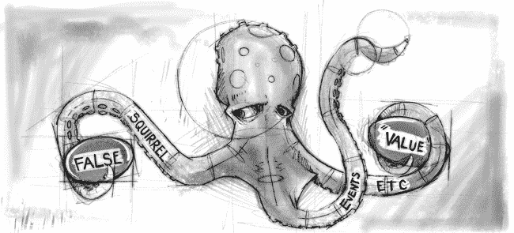

`delete` 运算符会切断这样一只章鱼的一条触手。它是一个一元运算符，当应用于属性访问表达式时，会从对象中移除命名的属性。这不是常见操作，但却是可行的。

```
var anObject = {left: 1, right: 2};
console.log(anObject.left);
// ▹ 1
delete anObject.left;
console.log(anObject.left);
// ▹ undefined
console.log("left" in anObject);
// ▹ false
console.log("right" in anObject);
// ▹ true
```

二元 `in` 运算符，当应用于一个字符串和一个对象时，返回一个布尔值，指示该对象是否具有该属性。将属性设置为 `undefined` 与实际删除它的区别在于，在第一种情况下，对象仍然*拥有*该属性（只是没有一个有趣的值），而在第二种情况下，该属性不再存在，`in` 将返回 `false`。

那么，数组只是一种专门用于存储序列事物的对象。如果你计算 `typeof [1, 2]`，会得到 `"object"`。你可以将它们视为长而扁平的章鱼，所有触手整齐排列，并用数字标记。

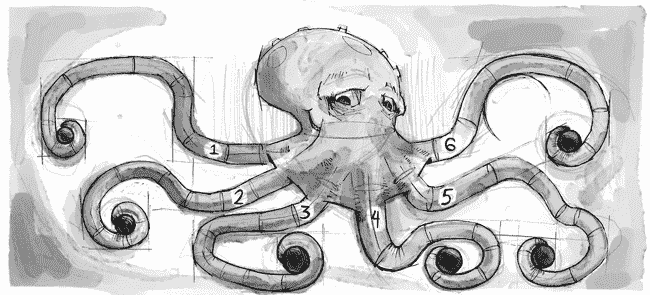

因此，我们可以将雅克的日记表示为对象数组。

```
var journal = [
  {events: ["work", "touched tree", "pizza",
            "running", "television"],
   squirrel: false},
  {events: ["work", "ice cream", "cauliflower",
            "lasagna", "touched tree", "brushed teeth"],
   squirrel: false},
  {events: ["weekend", "cycling", "break",
            "peanuts", "beer"],
   squirrel: true},
  /* 等等... */
];
```

## 可变性

我们很快就要开始真正的编程了。但首先，还有最后一点理论需要理解。

我们已经看到对象值可以被修改。前面章节讨论的值类型，如数字、字符串和布尔值，都是*不可变的*——无法更改这些类型的现有值。你可以组合它们并从它们派生新值，但当你取一个特定的字符串值时，该值将始终保持不变。其中的文本无法更改。如果你有一个包含 `"cat"` 的字符串引用，其他代码不可能更改*那个*字符串中的字符使其变成 `"rat"`。

另一方面，对于对象，一个值的内容*可以*通过更改其属性来修改。

当我们有两个数字 120 和 120 时，我们可以认为它们是完全相同的数字，无论它们是否指向相同的物理位。但对于对象，拥有对同一对象的两个引用与拥有两个包含相同属性的不同对象之间是有区别的。考虑以下代码：

```
var object1 = {value: 10};
var object2 = object1;
var object3 = {value: 10};

console.log(object1 == object2);
// ▹ true
console.log(object1 == object3);
// ▹ false

object1.value = 15;
console.log(object2.value);
// ▹ 15
console.log(object3.value);
// ▹ 10
```

`object1` 和 `object2` 变量抓住的是*同一个*对象，这就是为什么更改 `object1` 也会更改 `object2` 的值。变量 `object3` 指向一个不同的对象，它最初包含与 `object1` 相同的属性，但过着独立的生活。

JavaScript 的 `==` 运算符在比较对象时，只有当两个对象是完全相同的值时才会返回 `true`。比较不同的对象会返回 `false`，即使它们具有完全相同的内容。JavaScript 中没有内置的深度比较操作来查看对象的内容，但你可以自己编写（这将是本章末尾的练习之一）。

## 狼人的日志

于是雅克启动了他的 JavaScript 解释器，并设置了他记录日记所需的环境。

```
var journal = [];

function addEntry(events, didITurnIntoASquirrel) {
  journal.push({
    events: events,
    squirrel: didITurnIntoASquirrel
  });
}
```

然后，每天晚上十点——或者有时第二天早上，从书架顶层爬下来之后——他记录下这一天。

```
addEntry(["work", "touched tree", "pizza", "running",
          "television"], false);
addEntry(["work", "ice cream", "cauliflower", "lasagna",
          "touched tree", "brushed teeth"], false);
addEntry(["weekend", "cycling", "break", "peanuts",
          "beer"], true);
```

一旦他收集了足够的数据点，他打算计算他的松鼠化与每天事件之间的相关性，并理想地从这些相关性中学到一些有用的东西。

*相关性*是变量之间依赖关系的度量（这里的变量是统计学意义上的，而非 JavaScript 意义上的）。它通常用一个从 –1 到 1 的系数表示。零相关意味着变量之间没有关系，而相关性为 1 表示两者完全相关——如果你知道其中一个，也就知道另一个。负一也表示变量完全相关，但它们是相反的——当一个为真时，另一个为假。

对于二元（布尔）变量，`phi` 系数（ϕ）提供了一个很好的相关性度量，并且相对容易计算。要计算 ϕ，我们需要一个表格 `n`，其中包含两个变量各种组合被观察到的次数。例如，我们可以将吃披萨这个事件放入这样一个表格中：


ϕ 可以通过以下公式计算，其中 `n` 指代表格中的数字：

方程 4-0.

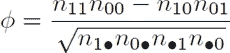

符号 `n[01]` 表示第一次测量（披萨）为假（0）且第二次测量（松鼠化）为真（1）的测量次数。在此示例中，`n[01]` 为 4。

值 `n[1 •]` 指所有第一次变量为真的测量次数之和，在示例表格中为 10。类似地，`n[• 0]` 指松鼠变量为假的测量次数之和。

因此对于披萨表格，除法线上方（被除数）为 1×76 – 9×4 = 40，下方（除数）为 10×80×5×85 的平方根，即 。计算结果为 ϕ ≈ 0.069，非常小。吃披萨似乎对变身没有影响。

## 计算相关性

我们可以用包含四个元素的数组（`[76, 9, 4, 1]`）在 JavaScript 中表示一个二乘二表格。也可以使用其他表示方式，例如包含两个二元数组的数组（`[[76, 9], [4, 1]]`）或具有 `"11"` 和 `"01"` 等属性名的对象，但扁平数组更简单，且使访问表格的表达式更简洁。我们将数组索引解释为两位二进制数，其中左边（最高有效位）代表松鼠变量，右边（最低有效位）代表事件变量。例如，二进制数 `10` 表示 Jacques 确实变成了松鼠，但事件（比如“披萨”）未发生。这种情况发生了四次。由于二进制 `10` 在十进制中为 2，我们将此值存储在数组的索引 2 处。

以下是从此类数组计算 ϕ 系数的函数：

```
function phi(table) {
  return (table[3] * table[0] - table[2] * table[1]) /
    Math.sqrt((table[2] + table[3]) *
              (table[0] + table[1]) *
              (table[1] + table[3]) *
              (table[0] + table[2]));
}

console.log(phi([76, 9, 4, 1]));
// ▹ 0.068599434
```

这仅仅是 ϕ 公式到 JavaScript 的直接翻译。`Math.sqrt` 是平方根函数，由标准 JavaScript 环境中的 `Math` 对象提供。我们需要对表格中的两个字段求和才能得到 `n[1 •]` 等字段，因为行或列的总和并未直接存储在我们的数据结构中。

Jacques 记录了三个月的日记。生成的数据集可在本章的编码沙箱（[`eloquentjavascript.net/code/`](http://eloquentjavascript.net/code/)）中找到，其中存储在 `JOURNAL` 变量中，也可下载文件。

要从日记中提取特定事件的二乘二表格，我们需要遍历所有条目，统计该事件与松鼠变身同时发生的次数。

```
function hasEvent(event, entry) {
  return entry.events.indexOf(event) != -1;
}

function tableFor(event, journal) {
  var table = [0, 0, 0, 0];
  for (var i = 0; i < journal.length; i++) {
    var entry = journal[i], index = 0;
    if (hasEvent(event, entry)) index += 1;
    if (entry.squirrel) index += 2;
    table[index] += 1;
  }
  return table;
}

console.log(tableFor("pizza", JOURNAL));
// ▹ [76, 9, 4, 1]
```

`hasEvent` 函数测试条目是否包含给定事件。数组有一个 `indexOf` 方法，尝试在数组中查找给定值（此处为事件名称），并返回找到的索引，如果未找到则返回 –1。因此，如果 `indexOf` 的调用未返回 –1，则说明条目中找到了该事件。

`tableFor` 中循环的主体通过检查条目是否包含特定事件以及该事件是否与松鼠事件同时发生，来确定每个日记条目落在表格的哪个格子中。然后循环将数组中对应格子的数字加一。

现在我们有了计算单个相关性所需的工具。剩下的唯一一步是找出记录中每种事件类型的相关性，看看是否有突出之处。但计算完这些相关性后，我们应该如何存储它们呢？

## 对象作为映射

一种可能的方法是将所有相关性存储在一个数组中，使用具有 `name` 和 `value` 属性的对象。但这使得查找给定事件的相关性有些麻烦：你必须遍历整个数组才能找到具有正确 `name` 的对象。我们可以将这个查找过程封装到一个函数中，但仍然需要编写更多代码，并且计算机也会做不必要的工作。

更好的方法是使用以事件类型命名的对象属性。我们可以使用方括号访问表示法来创建和读取属性，并使用 `in` 运算符测试给定属性是否存在。

```
var map = {};
function storePhi(event, phi) {
  map[event] = phi;
}

storePhi("pizza", 0.069);
storePhi("touched tree", -0.081);
console.log("pizza" in map);
// ▹ true
console.log(map["touched tree"]);
// ▹ -0.081
```

`map` 是一种从一个域的值（此处为事件名称）映射到另一个域的值（此处为 ϕ 系数）的方式。

像这样使用对象存在一些潜在问题，我们将在第 6 章中讨论，但目前我们不必担心这些。

如果我们想找出所有存储了系数的事件呢？属性不像数组那样形成可预测的序列，因此我们不能使用普通的 `for` 循环。JavaScript 提供了一种专门用于遍历对象属性的循环结构。它看起来有点像普通的 `for` 循环，但通过使用 `in` 这个词来区分。

```
for (var event in map)
  console.log("The correlation for '" + event + "' is " + map[event]);
// ▹ The correlation for 'pizza' is 0.069
// ▹ The correlation for 'touched tree' is -0.081
```

## 最终分析

为了找出数据集中存在的所有事件类型，我们依次处理每个条目，然后遍历该条目中的事件。我们维护一个对象 `phis`，其中包含到目前为止我们看到的所有事件类型的相关系数。每当我们遇到一个尚未出现在 `phis` 对象中的类型时，我们就计算其相关性并将其添加到对象中。

```
function gatherCorrelations(journal) {
  var phis = {};
  for (var entry = 0; entry < journal.length; entry++) {
    var events = journal[entry].events;
    for (var i = 0; i < events.length; i++) {
      var event = events[i];
      if (!(event in phis))
        phis[event] = phi(tableFor(event, journal));
    }
  }
  return phis;
}

var correlations = gatherCorrelations(JOURNAL);
console.log(correlations.pizza);
// ▹ 0.068599434
```

让我们看看结果如何。

```
for (var event in correlations)
  console.log(event + ": " + correlations[event]);
// ▹ carrot:   0.0140970969
// ▹ exercise: 0.0685994341
// ▹ weekend:  0.1371988681
// ▹ bread:   -0.0757554019
// ▹ pudding: -0.0648203724
// and so on...
```

大多数相关性似乎接近零。吃胡萝卜、面包或布丁显然不会触发狼人变身。然而，周末似乎更常发生。让我们过滤结果，只显示大于 0.1 或小于 –0.1 的相关性。

```
for (var event in correlations) {
  var correlation = correlations[event];
  if (correlation > 0.1 || correlation < -0.1)
    console.log(event + ": " + correlation);
}
// ▹ weekend:        0.1371988681
// ▹ brushed teeth: -0.3805211953
// ▹ candy:          0.1296407447
// ▹ work:          -0.1371988681
// ▹ spaghetti:      0.2425356250
// ▹ reading:        0.1106828054
// ▹ peanuts:        0.5902679812
```


啊哈！有两个因素的相关性明显强于其他因素。吃花生对变成松鼠的概率有很强的正向影响，而刷牙则有显著的负向影响。

有意思。让我们试试这个。

```
for (var i = 0; i < JOURNAL.length; i++) {
  var entry = JOURNAL[i];
  if (hasEvent("peanuts", entry) &&
    !hasEvent("brushed teeth", entry))
   entry.events.push("peanut teeth");
}
console.log(phi(tableFor("peanut teeth", JOURNAL)));
// ▹ 1
```

嗯，这毫无疑问！这种现象恰好发生在雅克吃花生且没有刷牙的时候。要是他没那么邋遢，不注意口腔卫生，他根本就不会注意到自己的这个毛病。

得知这一点后，雅克干脆完全停止吃花生，并发现这彻底终结了他的变身。

雅克过了一段平静的日子。但几年后，他丢了工作，最终被迫去马戏团谋生，在那里他扮演*不可思议的松鼠人*，每次表演前都会往嘴里塞满花生酱。有一天，他厌倦了这种悲惨的生活，没有变回人形，而是从马戏团帐篷的裂缝中跳了出去，消失在森林里。再也没有人见过他。

## 进一步探索数组

在结束本章之前，我想向你介绍更多与对象相关的概念。我们先从一些常用的数组方法开始。

我们在本章前面看到了`push`和`pop`，它们用于在数组末尾添加和删除元素。在数组开头添加和删除元素的对应方法叫做`unshift`和`shift`。

```
var todoList = [];
function rememberTo(task) {
  todoList.push(task);
}
function whatIsNext() {
  return todoList.shift();
}
function urgentlyRememberTo(task) {
  todoList.unshift(task);
}
```

上面的程序管理任务列表。你可以通过调用`rememberTo("eat")`将任务添加到列表末尾，当你准备好做某事时，调用`whatIsNext()`来获取（并移除）列表中的第一个任务。`urgentlyRememberTo`函数也会添加任务，但它是添加到列表的开头而不是末尾。

`indexOf`方法有一个兄弟方法叫`lastIndexOf`，它从数组末尾而不是开头开始搜索给定元素。

```
console.log([1, 2, 3, 2, 1].indexOf(2));
// ▹ 1
console.log([1, 2, 3, 2, 1].lastIndexOf(2));
// ▹ 3
```

`indexOf`和`lastIndexOf`都可以接受一个可选的第二个参数，用于指定从哪个索引开始搜索。

另一个基本方法是`slice`，它接受一个起始索引和一个结束索引，并返回一个只包含这两个索引之间元素的数组。起始索引包含在内，结束索引不包含在内。

```
console.log([0, 1, 2, 3, 4].slice(2, 4));
// ▹ [2, 3]
console.log([0, 1, 2, 3, 4].slice(2));
// ▹ [2, 3, 4]
```

当没有指定结束索引时，`slice`会取起始索引之后的所有元素。字符串也有一个`slice`方法，效果类似。

`concat`方法可用于拼接数组，类似于`+`运算符对字符串的作用。下面的例子展示了`concat`和`slice`的实际应用。它接受一个数组和一个索引，并返回一个新数组，该数组是原数组的副本，但移除了给定索引处的元素。

```
function remove(array, index) {
  return array.slice(0, index)
    .concat(array.slice(index + 1));
}
console.log(remove(["a", "b", "c", "d", "e"], 2));
// ▹ ["a", "b", "d", "e"]
```

## 字符串及其属性

我们可以从字符串值中读取像`length`和`toUpperCase`这样的属性。但如果你尝试添加一个新属性，它不会保留。

```
var myString = "Fido";
myString.myProperty = "value";
console.log(myString.myProperty);
// ▹ undefined
```

字符串、数字和布尔类型的值不是对象，尽管语言不会在你尝试给它们设置新属性时报错，但它实际上并不会存储这些属性。这些值是不可变的，无法更改。

但这些类型确实有一些内置属性。每个字符串值都有许多方法。其中最有用的大概是`slice`和`indexOf`，它们与同名的数组方法类似。

```
console.log("coconuts".slice(4, 7));
// ▹ nut
console.log("coconut".indexOf("u"));
// ▹ 5
```

一个区别是字符串的`indexOf`可以接受包含多个字符的字符串，而对应的数组方法只查找单个元素。

```
console.log("one two three".indexOf("ee"));
// ▹ 11
```

`trim`方法会移除字符串开头和结尾的空白字符（空格、换行、制表符等）。

```
console.log(" okay \n ".trim());
// ▹ okay
```

我们已经见过字符串类型的`length`属性。访问字符串中的单个字符可以通过`charAt`方法，也可以像数组那样直接读取数字属性。

```
var string = "abc";
console.log(string.length);
// ▹ 3
console.log(string.charAt(0));
// ▹ a
console.log(string[1]);
// ▹ b
```

## arguments 对象

每当调用一个函数时，一个名为`arguments`的特殊变量会被添加到函数体运行的环境中。这个变量引用了一个对象，该对象保存了传递给函数的所有参数。记住，在 JavaScript 中，你可以向函数传递比函数自身声明的参数数量更多（或更少）的参数。

```
function noArguments() {}
noArguments(1, 2, 3); // 这是可以的
function threeArguments(a, b, c) {}
threeArguments(); // 这也是可以的
```

`arguments`对象有一个`length`属性，告诉我们实际传递给函数的参数个数。它还有每个参数的属性，分别命名为 0、1、2 等等。

如果这听起来很像数组，那么你说得对，它*确实*很像数组。但不幸的是，这个对象没有任何数组方法（比如`slice`或`indexOf`），所以它比真正的数组更难使用。

```
function argumentCounter() {
  console.log("You gave me", arguments.length, "arguments.");
}
argumentCounter("稻草人", "同义反复", "人身攻击");
// ▹ You gave me 3 arguments.
```

有些函数可以接受任意数量的参数，比如`console.log`。这些函数通常会遍历它们的`arguments`对象中的值。它们可以用来创建非常友好的接口。例如，还记得我们是如何创建雅克日记条目的吗？

```
addEntry(["work", "touched tree", "pizza", "running",
          "television"], false);
```

由于他会频繁调用这个函数，我们可以创建一个更容易调用的替代版本。

```
function addEntry(squirrel) {
  var entry = {events: [], squirrel: squirrel};
  for (var i = 1; i < arguments.length; i++)
    entry.events.push(arguments[i]);
  journal.push(entry);
}
addEntry(true, "work", "touched tree", "pizza",
         "running", "television");
```

这个版本以正常方式读取它的第一个参数（`squirrel`），然后遍历其余参数（循环从索引 1 开始，跳过第一个），将它们收集到一个数组中。

## Math 对象

正如我们所见，`Math`是一个包含许多与数字相关的实用函数的集合，例如`Math.max`（最大值）、`Math.min`（最小值）和`Math.sqrt`（平方根）。

`Math`对象仅仅用作一个容器，将一组相关功能组合在一起。只有一个`Math`对象，它几乎从不作为值使用。相反，它提供了一个*命名空间*，这样所有这些函数和值就不必成为全局变量了。


拥有过多的全局变量会“污染”命名空间。被占用的名称越多，你意外覆盖某个变量值的可能性就越大。例如，你很可能想在某个程序中将某物命名为 `max`。由于 JavaScript 内置的 `max` 函数被安全地封装在 `Math` 对象中，我们不必担心覆盖它。

许多语言会在你定义与已有名称重复的变量时阻止你，或者至少发出警告。JavaScript 两者都不做，所以要小心。

回到 `Math` 对象。如果你需要进行三角运算，`Math` 可以帮上忙。它包含 `cos`（余弦）、`sin`（正弦）和 `tan`（正切），以及它们对应的反函数 `acos`、`asin` 和 `atan`。圆周率 π（pi）——至少是 JavaScript 数字能表示的最接近的近似值——可以通过 `Math.PI` 获取。（有一种古老的编程传统，即用全大写字母书写常量值的名称。）

```
function randomPointOnCircle(radius) {
  var angle = Math.random() * 2 * Math.PI;
  return {x: radius * Math.cos(angle),
          y: radius * Math.sin(angle)};
}
console.log(randomPointOnCircle(2));
// ▹ {x: 0.3667, y: 1.966}
```

如果你对正弦和余弦不太熟悉，别担心。当它们在本书第 13 章中被使用时，我会进行解释。

前面的例子使用了 `Math.random`。这是一个函数，每次调用时都会返回一个介于 0（包含）和 1（不包含）之间的新的伪随机数。

```
console.log(Math.random());
// ▹ 0.36993729369714856
console.log(Math.random());
// ▹ 0.727367032552138
console.log(Math.random());
// ▹ 0.40180766698904335
```

尽管计算机是确定性的机器——给定相同的输入，它们总是以相同的方式响应——但可以让它们产生看似随机的数字。为此，机器会在其内部状态中保存一个数字（或一组数字）。然后，每次请求随机数时，它会对这个内部状态执行一些复杂的确定性计算，并返回这些计算结果的一部分。机器还会利用结果来改变自身的内部状态，以便下一次生成的“随机”数会不同。

如果我们想要一个整数随机数而不是小数，可以在 `Math.random` 的结果上使用 `Math.floor`（它会向下取整到最近的整数）。

```
console.log(Math.floor(Math.random() * 10));
// ▹ 2
```

将随机数乘以 10 会得到一个大于等于 0 且小于 10 的数。由于 `Math.floor` 向下取整，这个表达式会以相等的概率产生 0 到 9 之间的任意数字。

还有函数 `Math.ceil`（表示“天花板”，向上取整到整数）和 `Math.round`（四舍五入到最近的整数）。

## 全局对象

全局作用域，即全局变量存在的空间，在 JavaScript 中也可以作为一个对象来访问。每个全局变量都是该对象的一个属性。在浏览器中，全局作用域对象存储在 `window` 变量中。

```
var myVar = 10;
console.log("myVar" in window);
// ▹ true
console.log(window.myVar);
// ▹ 10
```

## 总结

对象和数组（数组是一种特殊类型的对象）提供了将多个值组合成单个值的方法。从概念上讲，这允许我们将一堆相关的东西放进一个袋子，然后带着袋子到处跑，而不是试图用胳膊抱住所有单个的东西并分别抓住它们。

JavaScript 中的大多数值都有属性，例外是 `null` 和 `undefined`。属性通过 `value.propName` 或 `value["propName"]` 来访问。对象倾向于为属性使用名称，并存储或多或少固定的一组属性。另一方面，数组通常包含数量可变的、概念上相同的值，并使用数字（从 0 开始）作为其属性的名称。

数组中*确实*有一些命名属性，例如 `length` 和许多方法。方法是存在于属性中的函数，并且（通常）作用于它们所属的值。

对象也可以用作映射，将值与名称关联起来。`in` 运算符可用于查找对象是否包含具有给定名称的属性。同样的关键字也可以在 `for` 循环（`for (var name in object)`）中用于遍历对象的属性。

## 练习

### 范围求和

本书的引言中提到了以下计算数字范围之和的好方法：

```
console.log(sum(range(1, 10)));
```

编写一个 `range` 函数，它接受两个参数 `start` 和 `end`，并返回一个包含从 `start` 到 `end`（包括 `end`）所有数字的数组。

接下来，编写一个 `sum` 函数，它接受一个数字数组并返回这些数字的总和。运行前面的程序，看看它是否确实返回 55。

作为附加任务，修改你的 `range` 函数，使其接受一个可选的第三个参数，该参数指示用于构建数组的“步长”值。如果没有给出步长，数组元素按增量 1 递增，对应于旧的行为。函数调用 `range(1, 10, 2)` 应返回 `[1, 3, 5, 7, 9]`。确保它也能处理负的步长值，以便 `range(5, 2, -1)` 产生 `[5, 4, 3, 2]`。

### 反转数组

数组有一个 `reverse` 方法，它通过反转元素出现的顺序来改变数组。对于这个练习，编写两个函数：`reverseArray` 和 `reverseArrayInPlace`。第一个函数 `reverseArray` 接受一个数组作为参数，并生成一个*新*数组，该数组包含相同元素但顺序相反。第二个函数 `reverseArrayInPlace` 执行与 `reverse` 方法相同的操作：它修改作为参数给出的数组，以反转其元素。两者都不能使用标准的 `reverse` 方法。

回顾上一章关于副作用和纯函数的笔记，你认为哪种变体在更多情况下更有用？哪种更高效？

### 列表

对象作为通用的值集合，可以用来构建各种数据结构。一种常见的数据结构是*列表*（不要与数组混淆）。列表是一组嵌套的对象，第一个对象持有对第二个对象的引用，第二个对象持有对第三个对象的引用，依此类推。

```
var list  = {
  value: 1,
  rest: {
    value: 2,
  rest: {
    value:  3,
    rest: null
  }
 }
};
```

生成的对象形成一个链，如下所示：

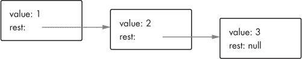

列表的一个优点是它们可以共享部分结构。例如，如果我创建两个新值 `{value: 0, rest: list}` 和 `{value: -1, rest: list}`（其中 `list` 引用之前定义的变量），它们都是独立的列表，但共享构成它们最后三个元素的结构。此外，原始列表仍然是一个有效的三元素列表。

编写一个函数 `arrayToList`，当给定 `[1, 2, 3]` 作为参数时，构建一个类似上述的数据结构；并编写一个 `listToArray` 函数，从列表生成一个数组。还要编写辅助函数 `prepend`，它接受一个元素和一个列表，并创建一个新列表，将该元素添加到输入列表的前面；以及 `nth`，它接受一个列表和一个数字，并返回列表中给定位置的元素，如果不存在这样的元素则返回 `undefined`。

如果你还没有这样做，也请编写一个递归版本的 `nth`。

### 深度比较

`==` 运算符通过标识比较对象。但有时，你更希望比较它们实际属性的值。


编写一个函数 `deepEqual`，它接收两个值，只有当它们相同，或者它们是具有相同属性的对象且这些属性的值通过递归调用 `deepEqual` 比较也相等时，才返回 `true`。

要判断两个事物是通过同一性（使用 `===` 运算符）比较，还是通过查看它们的属性来比较，你可以使用 `typeof` 运算符。如果它对两个值都产生 `"object"`，那么你应该进行深度比较。但你必须考虑一个愚蠢的例外：由于历史原因，`typeof null` 也会产生 `"object"`。

# 第 5 章 高阶函数

> “构建软件设计有两种方式：一种是使其简单到明显没有缺陷，另一种是使其复杂到没有明显缺陷。”
> 
> ——C.A.R. Hoare，*1980 年 ACM 图灵奖演讲*

大型程序是昂贵的程序，不仅仅是因为构建它所花费的时间。规模几乎总是伴随着复杂性，而复杂性会让程序员感到困惑。困惑的程序员又容易在程序中引入错误（*bug*）。大型程序也为这些 bug 提供了大量藏身空间，使它们难以被发现。

让我们简要回顾一下引言中的最后两个示例程序。第一个是自包含的，有六行代码。

```
var total  = 0, count = 1;
while (count <= 10) {
  total += count;
  count += 1;
}
console.log(total);
```

第二个依赖于两个外部函数，只有一行代码。

```
console.log(sum(range(1, 10)));
```

哪一个更可能包含 bug？

如果我们计算 `sum` 和 `range` 定义的大小，第二个程序也很大——甚至比第一个还大。但我仍然认为它更可能是正确的。

它更可能是正确的，因为解决方案是用与待解决问题相对应的词汇表达的。对一系列数字求和与循环和计数器无关，而是与范围和求和有关。

这些词汇的定义（函数 `sum` 和 `range`）仍然会涉及循环、计数器和其他细节。但由于它们表达的概念比整个程序更简单，因此更容易做对。

## 抽象

在编程语境中，这类词汇通常被称为*抽象*。抽象隐藏了细节，使我们能够在更高（或更抽象）的层次上讨论问题。

打个比方，比较下面两个豌豆汤的食谱：

> 按每人 1 杯干豌豆放入容器。加水直至豌豆完全浸没。将豌豆在水中浸泡至少 12 小时。取出豌豆，放入烹饪锅中。按每人 4 杯水加水。盖上锅盖，小火慢炖两小时。按每人半个洋葱，用刀切碎，加入豌豆中。按每人一根芹菜茎，用刀切碎，加入豌豆中。按每人一根胡萝卜，切碎。用刀！加入豌豆中。再煮 10 分钟。

> 每人：1 杯干裂豌豆，半个切碎的洋葱，一根芹菜茎，一根胡萝卜。
> 
> 将豌豆浸泡 12 小时。用 4 杯水（每人）慢炖 2 小时。切碎并加入蔬菜。再煮 10 分钟。

第二个更短，更容易理解。但你需要理解更多与烹饪相关的词汇——*浸泡*、*慢炖*、*切碎*，以及，我猜，*蔬菜*。

在编程时，我们不能指望所有需要的词汇都已在字典中等着我们。因此，你可能会陷入第一个食谱的模式——逐一列出计算机必须执行的精确步骤，而对它们所表达的更高层次概念视而不见。

对于程序员来说，当某个概念渴望被抽象成一个新词时，必须将其变成第二天性。

### 抽象数组遍历

到目前为止，我们看到的普通函数是构建抽象的好方法。但有时它们也会力不从心。

在上一章中，这种 `for` 循环多次出现：

```
var array  = [1, 2, 3];
for (var i = 0; i < array.length; i++) {
  var current = array[i];
  console.log(current);
}
```

它试图表达：“对于数组中的每个元素，将其记录到控制台。”但它使用了一种迂回的方式，涉及计数器变量 `i`、对数组 `length` 的检查，以及一个额外的变量声明来取出当前元素。除了有点碍眼之外，这还为潜在错误提供了大量空间。我们可能会意外重用 `i` 变量，将 `length` 拼写为 `lenght`，混淆 `i` 和 `current` 变量，等等。

那么，让我们尝试将其抽象成一个函数。你能想到办法吗？

嗯，编写一个遍历数组并对每个元素调用 `console.log` 的函数很容易。

```
function logEach(array) {
  for (var i = 0; i < array.length; i++)
    console.log(array[i]);
}
```

但如果我们想做的不仅仅是记录元素呢？由于“做某事”可以表示为一个函数，而函数只是值，我们可以将我们的动作作为函数值传递。

```
function forEach(array, action) {
  for (var i = 0; i < array.length; i++)
    action(array[i]);
}

forEach(["Wampeter", "Foma", "Granfalloon"], console.log);
// ▹ Wampeter
// ▹ Foma
// ▹ Granfalloon
```

通常，你不会向 `forEach` 传递一个预定义的函数，而是当场创建一个函数值。

```
var numbers = [1, 2, 3, 4, 5], sum = 0;
forEach(numbers, function(number) {
  sum += number;
});
console.log(sum);
// ▹ 15
```

这看起来很像经典的 `for` 循环，其主体写在下面的块中。然而，现在主体位于函数值内部，也位于对 `forEach` 调用的括号内。这就是为什么它必须用右花括号*和*右括号闭合。

使用这种模式，我们可以为当前元素指定一个变量名（`number`），而不必手动从数组中取出它。

实际上，我们不需要自己编写 `forEach`。它作为数组的标准方法可用。由于数组已经作为方法作用的对象提供，`forEach` 只需要一个必需参数：为每个元素执行的函数。

为了说明这有多大帮助，让我们回顾一下上一章中的一个函数。它包含两个遍历数组的循环。

```
function gatherCorrelations(journal) {
  var phis = {};
  for (var entry = 0; entry < journal.length; entry++) {
    var events = journal[entry].events;
    for (var i = 0; i < events.length; i++) {
      var event = events[i];
      if (!(event in phis))
        phis[event] = phi(tableFor(event, journal));
    }
  }
  return phis;
}
```

使用 `forEach` 使其稍微更短，并且相当整洁。

```
function gatherCorrelations(journal) {
  var phis = {};
  journal.forEach(function(entry) {
    entry.events.forEach(function(event) {
      if (!(event in phis))
        phis[event] = phi(tableFor(event, journal));
    });
  });
  return phis;
}
```

## 高阶函数

操作其他函数的函数，无论是通过将它们作为参数接收还是返回它们，都被称为*高阶函数*。如果你已经接受了函数是常规值这一事实，那么这些函数的存在并没有什么特别值得注意的。这个术语来自数学，在数学中，函数与其他值之间的区别被更加严肃地对待。

高阶函数允许我们对*动作*进行抽象，而不仅仅是值。它们有多种形式。例如，你可以有创建新函数的函数。

```
function greaterThan(n) {
  return function(m) { return m > n; };
}
var greaterThan10 = greaterThan(10);
console.log(greaterThan10(11));
// ▹ true
```

你还可以有修改其他函数的函数。


```
function noisy(f) {
  return function(arg) {
    console.log("calling with", arg);
    var val = f(arg);
    console.log("called with", arg, "- got", val);
    return val;
  };
}
noisy(Boolean)(0);
// ▹ calling with 0
// ▹ called with 0 - got false
```

你甚至可以编写提供新型控制流的函数。

```
function unless(test, then) {
  if (!test) then();
}
function repeat(times, body) {
  for (var i = 0; i < times; i++) body(i);
}

repeat(3, function(n) {
  unless(n % 2, function() {
    console.log(n, "is even");
  });
});
// ▹ 0 is even
// ▹ 2 is even
```

我们在第 3 章中讨论的词法作用域规则，在以这种方式使用函数时对我们有利。在前面的例子中，`n`变量是外部函数的一个参数。由于内部函数存在于外部函数的环境中，它可以访问`n`。这些内部函数的主体可以访问它们周围的变量。它们可以扮演类似于常规循环和条件语句中使用的`{}`块的角色。一个重要的区别是，在内部函数中声明的变量不会出现在外部函数的环境中。这通常是一件好事。

## 传递参数

前面定义的`noisy`函数，它将参数包装在另一个函数中，有一个相当严重的缺陷。

```
function noisy(f) {
  return function(arg) {
    console.log("calling with", arg);
    var val = f(arg);
    console.log("called with", arg, "- got", val);
    return val;
  };
}
```

如果`f`接受多个参数，它只会得到第一个参数。我们可以向内部函数添加一堆参数（`arg1`、`arg2`等），并将它们全部传递给`f`，但无法确定需要多少个才够。这种解决方案还会剥夺`f`对`arguments.length`信息的访问。由于我们总是传递相同数量的参数，它无法知道最初传递了多少个参数。

对于这类情况，JavaScript 函数有一个`apply`方法。你可以向它传递一个参数数组（或类数组对象），它会用这些参数调用该函数。

```
function transparentWrapping(f) {
  return function() {
    return f.apply(null, arguments);
  };
}
```

这是一个无用的函数，但它展示了我感兴趣的模式——它返回的函数会将所有给定的参数（且仅这些参数）传递给`f`。它通过将自己的`arguments`对象传递给`apply`来实现这一点。`apply`的第一个参数（这里我们传递了`null`）可用于模拟方法调用。我们将在下一章中回到这一点。

## JSON

在 JavaScript 中，高阶函数（以某种方式将函数应用于数组元素）被广泛使用。`forEach`方法是最基本的一种这样的函数。数组上还有许多其他变体方法可用。为了熟悉它们，让我们用另一个数据集来练习一下。

几年前，有人翻阅了大量档案，整理了一本关于我姓氏（Haverbeke——意为燕麦溪）历史的书。我打开它，希望能找到骑士、海盗和炼金术士……但结果发现这本书大部分内容都是关于佛兰德农民。为了自娱自乐，我提取了关于我直系祖先的信息，并将其转换为计算机可读的格式。

我创建的文件看起来像这样：

```
[
  {"name": "Emma  de Milliano", "sex": "f",
   "born": 1876, "died": 1956,
   "father": "Petrus de Milliano",
   "mother": "Sophia van Damme"},
  {"name": "Carolus Haverbeke", "sex": "m",
   "born": 1832, "died": 1905,
   "father": "Carel Haverbeke",
   "mother": "Maria van Brussel"},
  ... 等等
]
```

这种格式称为 JSON（发音为“Jason”），代表 JavaScript 对象表示法。它在 Web 上被广泛用作数据存储和通信格式。

JSON 与 JavaScript 编写数组和对象的方式类似，但有一些限制。所有属性名必须用双引号括起来，并且只允许简单的数据表达式——不允许函数调用、变量或任何涉及实际计算的内容。JSON 中不允许注释。

JavaScript 提供了`JSON.stringify`和`JSON.parse`函数，用于将数据从这种格式转换或转换回这种格式。第一个函数接受一个 JavaScript 值并返回一个 JSON 编码的字符串。第二个函数接受这样一个字符串并将其转换为它所编码的值。

```
var string = JSON.stringify({name: "X", born: 1980});
console.log(string);
// ▹ {"name":"X","born":1980}
console.log(JSON.parse(string).born);
// ▹ 1980
```

变量`ANCESTRY_FILE`（在本章的沙箱中可用，也可在网站(*[`eloquentjavascript.net/code/`](http://eloquentjavascript.net/code/)*)上的可下载文件中找到）包含我的 JSON 文件内容，作为一个字符串。让我们解码它，看看它包含多少人。

```
var ancestry = JSON.parse(ANCESTRY_FILE);
console.log(ancestry.length);
// ▹ 39
```

## 过滤数组

为了在祖先数据集中找到 1924 年时年轻的人，以下函数可能会有所帮助。它过滤掉数组中未通过测试的元素。

```
function filter(array, test) {
  var passed = [];
  for (var i = 0; i < array.length; i++) {
    if (test(array[i]))
      passed.push(array[i]);
  }
  return passed;
}

console.log(filter(ancestry, function(person) {
  return person.born > 1900 && person.born < 1925;
}));
// ▹ [{name: "Philibert Haverbeke", ...}, ...]
```

这里使用了名为`test`的参数（一个函数值）来填补计算中的“空白”。`test`函数对每个元素调用，其返回值决定该元素是否包含在返回的数组中。

文件中有三个人在 1924 年时活着且年轻：我的祖父、祖母和姑奶奶。

注意，`filter`函数不是从现有数组中删除元素，而是构建一个仅包含通过测试的元素的新数组。这个函数是*纯*的。它不会修改给定的数组。

与`forEach`一样，`filter`也是数组上的一个标准方法。这个例子定义该函数只是为了展示其内部工作原理。从现在开始，我们将这样使用它：

```
console.log(ancestry.filter(function(person) {
  return person.father == "Carel Haverbeke";
}));
// ▹ [{name: "Carolus Haverbeke", ...}]
```

## 使用 map 进行转换

假设我们有一个表示人的对象数组，是通过某种方式过滤`ancestry`数组得到的。但我们想要一个名字数组，这样更容易阅读。

`map`方法通过将一个函数应用于数组的所有元素，并根据返回的值构建一个新数组来转换数组。新数组的长度与输入数组相同，但其内容已被函数“映射”为新的形式。

```
function map(array, transform) {
  var mapped = [];
  for (var i = 0; i < array.length; i++)
    mapped.push(transform(array[i]));
  return mapped;
}

var overNinety = ancestry.filter(function(person) {
  return person.died - person.born > 90;
});
console.log(map(overNinety, function(person) {
  return person.name;
}));
// ▹ ["Clara Aernoudts", "Emile Haverbeke",
//            "Maria Haverbeke"]
```

有趣的是，活到至少 90 岁的人正是我们之前看到的同三个人——那些在 1920 年代年轻的人，恰好是我数据集中最近的一代。我想医学已经取得了长足的进步。

与`forEach`和`filter`一样，`map`也是数组上的一个标准方法。

## 使用 reduce 进行汇总

另一种常见的数组计算模式是从数组中计算单个值。我们反复出现的例子——对一组数字求和——就是这种情况的一个实例。另一个例子是在数据集中找到出生年份最早的人。


表示这种模式的高阶操作称为 `reduce`（有时也叫 `fold`）。你可以把它想象成将数组折叠起来，每次折叠一个元素。在求和时，你会从数字零开始，然后对于每个元素，通过加法将其与当前总和合并。

`reduce` 函数的参数除了数组之外，还有一个组合函数和一个起始值。这个函数比 `filter` 和 `map` 稍微复杂一些，所以要仔细注意。

```
function reduce(array, combine, start) {
  var current = start;
  for (var i = 0; i < array.length; i++)
    current = combine(current, array[i]);
  return current;
}

console.log(reduce([1, 2, 3, 4], function(a, b) {
  return a + b;
}, 0));
// ▹ 10
```

标准的数组方法 `reduce`（当然对应这个函数）有一个额外的便利之处。如果你的数组至少包含一个元素，你可以省略 `start` 参数。该方法会将数组的第一个元素作为起始值，并从第二个元素开始归约。

要使用 `reduce` 找到我已知的最古老的祖先，我们可以这样写：

```
console.log(ancestry.reduce(function(min, cur) {
  if (cur.born < min.born) return cur;
  else return min;
}));
// ▹ {name: "Pauwels van Haverbeke", born: 1535, ...}
```

### 可组合性

思考一下，如果没有高阶函数，我们该如何编写前面的例子（找到出生年份最早的人）。代码并不会差太多。

```
var min = ancestry[0];
for (var i = 1; i < ancestry.length; i++) {
  var cur = ancestry[i];
  if (cur.born < min.born)
    min = cur;
}
console.log(min);
// ▹ {name: "Pauwels van Haverbeke", born: 1535, ...}
```

这里多了几个变量，程序也多了两行，但仍然很容易理解。

当你需要 `组合` 函数时，高阶函数才开始大放异彩。举个例子，让我们编写代码来找出数据集中男性和女性的平均年龄。

```
function average(array) {
  function plus(a, b) { return a + b; }
  return array.reduce(plus) / array.length;
}
function age(p) { return p.died - p.born; }
function male(p) { return p.sex == "m"; }
function female(p) { return p.sex == "f"; }

console.log(average(ancestry.filter(male).map(age)));
// ▹ 61.67
console.log(average(ancestry.filter(female).map(age)));
// ▹ 54.56
```

（我们必须将 `plus` 定义为一个函数，这有点傻，但 JavaScript 中的运算符不像函数那样是值，所以你不能将它们作为参数传递。）

我们没有将逻辑纠缠在一个大循环中，而是将其巧妙地组合成我们感兴趣的概念——确定性别、计算年龄和求平均值。我们可以逐一应用这些概念来得到我们想要的结果。

这对于编写清晰的代码来说*非常棒*。不幸的是，这种清晰是有代价的。

## 代价

在优雅代码和美丽彩虹的快乐国度里，住着一个名为*低效*的扫兴怪物。

处理数组的程序最优雅的表达方式是一系列清晰分离的步骤，每个步骤都对数组做一些操作并生成一个新数组。但构建所有这些中间数组是相当昂贵的。

同样，将函数传递给 `forEach` 并让该方法为我们处理数组迭代既方便又易读。但与简单的循环体相比，JavaScript 中的函数调用成本较高。

许多有助于提高程序清晰度的技术也是如此。抽象在计算机执行的原始操作和我们处理的概念之间增加了层次，从而导致机器执行更多工作。这并非铁律——有些编程语言能更好地支持构建抽象而不增加低效，即使在 JavaScript 中，经验丰富的程序员也能找到编写仍然快速的抽象代码的方法。但这是一个经常出现的问题。

幸运的是，大多数计算机都非常快。如果你处理的是适度的数据集，或者做一些只需要在人类时间尺度上发生的事情（比如每次用户点击按钮），那么你写的是需要半毫秒的漂亮解决方案还是需要十分之一毫秒的超优化解决方案，*都无关紧要*。

大致跟踪程序中某段代码的运行频率是有帮助的。如果你有一个循环嵌套在另一个循环中（直接嵌套或通过外层循环调用一个最终执行内层循环的函数），那么内层循环中的代码最终会运行 `N × M` 次，其中 `N` 是外层循环重复的次数，`M` 是内层循环在外层循环每次迭代中重复的次数。如果那个内层循环又包含一个循环，该循环执行 `P` 轮，那么它的主体将运行 `M × N × P` 次，以此类推。这可能会累积成很大的数字，当程序变慢时，问题通常可以追溯到位于内层循环中的一小部分代码。

## 曾曾曾曾……

我的祖父 Philibert Haverbeke 包含在数据文件中。从他开始，我可以追溯我的血统，以找出数据中最古老的人 Pauwels van Haverbeke 是否是我的直系祖先。如果是，我想知道理论上我与他的 DNA 共享程度。

为了能够从父母的名字转到代表这个人的实际对象，我们首先构建一个将名字与人关联起来的对象。

```
var byName = {};
ancestry.forEach(function(person) {
  byName[person.name] = person;
});

console.log(byName["Philibert Haverbeke"]);
// ▹ {name: "Philibert Haverbeke", ...}
```

现在，问题并不像沿着 `father` 属性并计算需要多少步才能到达 Pauwels 那么简单。家谱中有几处人们与他们的远房表亲结婚的情况（小村庄等等）。这导致家谱的分支在几个地方重新汇合，这意味着我与这个人共享的基因多于 `1/2^(G)`，其中 `G` 是 Pauwels 和我之间的代数。这个公式源于每一代将基因库一分为二的想法。

思考这个问题的一个合理方式是将其视为类似于 `reduce`，它通过从左到右反复组合值，将数组压缩为单个值。在这种情况下，我们也想将我们的数据结构压缩为单个值，但要以遵循家族谱系的方式进行。数据的*形状*是家谱，而不是平面列表。

我们想要缩减这种形状的方式是，通过组合来自其祖先的值来计算给定人的值。这可以递归完成：如果我们对人物 `A` 感兴趣，我们必须计算 `A` 的父母的值，这又要求我们计算 `A` 的祖父母的值，依此类推。原则上，这需要查看无限多的人，但由于我们的数据集是有限的，我们必须在某处停止。我们将允许为我们的归约函数提供一个默认值，该值将用于不在数据中的人。在我们的例子中，该值就是零，假设不在列表中的人与我们正在查看的祖先没有共享 DNA。

给定一个人、一个用于组合给定人的父母双方值的函数以及一个默认值，`reduceAncestors` 从家谱中压缩出一个值。

```
function reduceAncestors(person, f, defaultValue) {
  function valueFor(person) {
    if (person == null)
      return defaultValue;
    else
      return f(person, valueFor(byName[person.mother]),
                       valueFor(byName[person.father]));
  }
  return valueFor(person);
}
```


内部函数（`valueFor`）处理单个个体。通过递归的魔力，它可以简单地调用自身来处理这个人的父亲和母亲。这些结果，连同该个体对象本身，被传递给 `f`，`f` 返回该个体的实际值。

然后我们可以用这个来计算我的祖父与 Pauwels van Haverbeke 共享的 DNA 量，再除以四。

```
function sharedDNA(person, fromMother, fromFather) {
  if (person.name == "Pauwels van Haverbeke")
    return 1;
  else
    return (fromMother + fromFather) / 2;
}
var ph = byName["Philibert Haverbeke"];
console.log(reduceAncestors(ph, sharedDNA, 0) / 4);
// ▹ 0.00049
```

名为 Pauwels van Haverbeke 的人显然与 Pauwels van Haverbeke 共享了 100% 的 DNA（数据集中没有重名的人），因此函数对他返回 1。所有其他人则共享其父母共享量的平均值。

因此，从统计上讲，我与这位 16 世纪的人物共享了大约 0.05% 的 DNA。需要注意的是，这只是一个统计近似值，并非精确数值。这个数字相当小，但考虑到我们携带的遗传物质数量（约 30 亿个碱基对），我体内这台生物机器中可能仍有某些方面源自 Pauwels。

我们也可以在不依赖 `reduceAncestors` 的情况下计算出这个数字。但将通用方法（压缩家谱）与具体案例（计算共享 DNA）分离，可以提高代码的清晰度，并允许我们将程序的抽象部分复用于其他情况。例如，以下代码找出给定人物中已知祖先活过 70 岁的百分比：

```
function countAncestors(person, test) {
  function combine(person, fromMother, fromFather) {
    var thisOneCounts = test(person);
    return fromMother + fromFather + (thisOneCounts ? 1 : 0);
  }
  return reduceAncestors(person, combine, 0);
}
function longLivingPercentage(person) {
  var all = countAncestors(person, function(person) {
    return true;
  });
  var longLiving = countAncestors(person, function(person) {
    return (person.died - person.born) >= 70;
  });
  return longLiving / all;
}
console.log(longLivingPercentage(byName["Emile Haverbeke"]));
// ▹ 0.145
```

鉴于我们的数据集包含相当随意的人群，这些数字不应过于当真。但代码说明了这样一个事实：`reduceAncestors` 为我们处理家谱数据结构提供了一个有用的工具。

## 绑定

所有函数都有的 `bind` 方法会创建一个新函数，该函数将调用原始函数，但其中一些参数已被固定。

以下代码展示了 `bind` 的使用示例。它定义了一个函数 `isInSet`，用于判断一个人是否在给定的字符串集合中。为了调用 `filter` 来收集那些名字在特定集合中的人物对象，我们可以编写一个函数表达式，以我们的集合作为第一个参数调用 `isInSet`，或者*部分应用* `isInSet` 函数。

```
var theSet = ["Carel Haverbeke", "Maria van Brussel",
              "Donald Duck"];
function isInSet(set, person) {
  return set.indexOf(person.name) > -1;
}
console.log(ancestry.filter(function(person) {
  return isInSet(theSet, person);
}));
// ▹ [{name: "Maria van Brussel", ...},
//            {name: "Carel Haverbeke", ...}]
console.log(ancestry.filter(isInSet.bind(null, theSet)));
// ▹ ... same result
```

调用 `bind` 会返回一个函数，该函数将以 `theSet` 作为第一个参数调用 `isInSet`，后面跟着传递给绑定函数的任何剩余参数。

第一个参数（示例中传递了 `null`）用于方法调用，类似于 `apply` 的第一个参数。我将在下一章中更详细地描述这一点。

## 总结

能够将函数值传递给其他函数不仅是一种技巧，更是 JavaScript 中一个非常实用的方面。它允许我们将带有“缺口”的计算编写为函数，并通过提供描述缺失计算的函数值，让调用这些函数的代码来填补这些缺口。

数组提供了许多有用的高阶方法——`forEach` 用于对数组中的每个元素执行操作，`filter` 用于构建一个过滤掉某些元素的新数组，`map` 用于构建一个每个元素都经过函数处理的新数组，以及 `reduce` 用于将数组的所有元素合并为单个值。

函数有一个 `apply` 方法，可用于通过指定参数的数组来调用它们。它们还有一个 `bind` 方法，用于创建函数的偏应用版本。

## 练习

### 扁平化

结合使用 `reduce` 方法和 `concat` 方法，将数组的数组“扁平化”为一个包含所有输入数组元素的单一数组。

### 母子年龄差

使用本章的示例数据集，计算母亲与孩子之间的平均年龄差（孩子出生时母亲的年龄）。你可以使用本章前面定义的 `average` 函数。

请注意，数据中提到的所有母亲并不一定都出现在数组中。`byName` 对象可以方便地根据名字找到人物对象，在这里可能会很有用。

### 历史预期寿命

当我们查找数据集中所有活过 90 岁的人时，只有最新一代的人出现了。让我们更仔细地研究一下这个现象。

计算并输出祖先数据集中每个世纪的人的平均年龄。一个人所属的世纪是通过取其死亡年份除以 100 并向上取整来确定的，如 `Math.ceil(person.died / 100)`。

作为加分项，编写一个 `groupBy` 函数来抽象分组操作。它应接受一个数组和一个计算数组中元素所属组的函数作为参数，并返回一个将组名映射到组编号数组的对象。

### 每个与某些

数组还附带标准方法 `every` 和 `some`。两者都接受一个谓词函数，当以数组元素作为参数调用时，该函数返回 true 或 false。就像 `&&` 仅在两侧表达式都为 true 时才返回真值一样，`every` 仅在谓词对数组的*所有*元素都返回 true 时才返回 true。类似地，`some` 只要谓词对数组的*任意*元素返回 true 就返回 true。它们不会处理多余的元素——例如，如果 `some` 发现谓词对数组的第一个元素成立，它就不会再查看后面的值。

编写两个函数 `every` 和 `some`，其行为与这些方法类似，不同之处在于它们将数组作为第一个参数，而不是作为方法。

# 第 6 章 对象的秘密生活

> “面向对象语言的问题在于它们携带了所有隐式环境。你想要一根香蕉，但得到的却是一只拿着香蕉的大猩猩和整片丛林。”
> 
> ——乔·阿姆斯特朗，摘自《程序员在工作》访谈

当程序员说“对象”时，这是一个沉重的术语。在我的职业中，对象是一种生活方式，是圣战的主题，也是一个至今仍颇具影响力的流行词。

对于局外人来说，这可能有点令人困惑。让我们从对象作为编程构造的简要历史开始。

## 历史

这个故事，像大多数编程故事一样，始于复杂性问题。一种哲学是，通过将复杂性分解为相互隔离的小隔间，可以使其变得可管理。这些隔间最终被命名为*对象*。


对象是一个坚硬的外壳，它隐藏了内部复杂的黏糊糊的细节，而是为我们提供了一些旋钮和连接器（例如方法），这些旋钮和连接器呈现了一个*接口*，通过这个接口来使用对象。其理念是接口相对简单，而对象内部发生的所有复杂事情在使用时都可以忽略。

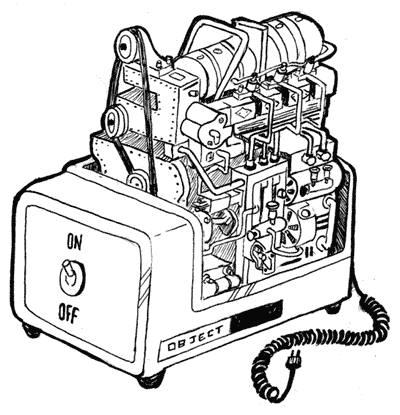

举个例子，你可以想象一个对象，它为屏幕上的某个区域提供了一个接口。它提供了一种在该区域绘制形状或文本的方法，但隐藏了这些形状如何转换为构成屏幕的实际像素的所有细节。你会有一组方法——例如，`drawCircle`——而使用这样一个对象，你只需要知道这些方法。

这些想法最初在 20 世纪 70 年代和 80 年代被提出，并在 20 世纪 90 年代被一股巨大的热潮所推动——面向对象编程革命。突然间，有一大群人宣称对象是编程的*正确*方式——而任何不涉及对象的东西都是过时的胡言乱语。

这种狂热总是会产生很多不切实际的愚蠢行为，自那以后也出现了一种反叛。在某些圈子里，对象如今名声相当不好。

我更倾向于从实用而非意识形态的角度来看待这个问题。面向对象文化推广了几个有用的概念，其中最重要的是*封装*（区分内部复杂性和外部接口）。这些概念值得研究。

本章描述了 JavaScript 对对象及其与一些经典面向对象技术关系的相当独特的看法。

## 方法

方法就是持有函数值的属性。这是一个简单的方法：

```
var rabbit = {};
rabbit.speak = function(line) {
  console.log("The rabbit says '" + line + "'");
};
rabbit.speak("I'm alive.");
// ▹ The rabbit says 'I'm alive.'
```

通常，方法需要对其调用的对象执行某些操作。当一个函数作为方法被调用时——即作为属性被查找并立即调用，如`object.method()`——其函数体中的特殊变量`this`将指向它被调用的对象。

```
function speak(line) {
  console.log("The " + this.type + " rabbit says '" +
              line + "'");
}
var whiteRabbit = {type: "white", speak: speak};
var fatRabbit = {type: "fat", speak: speak};

whiteRabbit.speak("Oh my ears and whiskers, " +
                  "how late it's getting!");
// ▹ The white rabbit says 'Oh my ears and whiskers, how
//           late it's getting!'
fatRabbit.speak("I could sure use a carrot right now.");
// ▹ The fat rabbit says 'I could sure use a carrot
//           right now.'
```

这段代码使用`this`关键字来输出正在说话的兔子的类型。回想一下，`apply`和`bind`方法都接受一个第一个参数，该参数可用于模拟方法调用。实际上，这个第一个参数用于给`this`赋值。

有一个类似于`apply`的方法，叫做`call`。它也会调用它作为方法所在的函数，但正常传递参数，而不是以数组形式。与`apply`和`bind`一样，`call`可以传递一个特定的`this`值。

```
speak.apply(fatRabbit, ["Burp!"]);
// ▹ The fat rabbit says 'Burp!'
speak.call({type: "old"}, "Oh my.");
// ▹ The old rabbit says 'Oh my.'
```

## 原型

仔细观察。

```
var empty = {};
console.log(empty.toString);
// ▹ function toString(){...}
console.log(empty.toString());
// ▹ [object Object]
```

我刚刚从一个空对象中提取了一个属性。神奇吧！

嗯，其实不然。我只是之前隐瞒了关于 JavaScript 对象工作方式的信息。除了它们自己的属性集之外，几乎所有对象还有一个*原型*。原型是另一个对象，用作属性的后备来源。当一个对象请求一个它没有的属性时，会搜索它的原型，然后是原型的原型，以此类推。

那么那个空对象的原型是谁呢？它是伟大的祖先原型，几乎所有对象背后的实体——`Object.prototype`。

```
console.log(Object.getPrototypeOf({}) ==
            Object.prototype);
// ▹ true
console.log(Object.getPrototypeOf(Object.prototype));
// ▹ null
```

正如你所料，`Object.getPrototypeOf`函数返回一个对象的原型。

JavaScript 对象的原型关系形成了一个树状结构，而`Object.prototype`位于这个结构的根部。它提供了一些在所有对象中都出现的方法，比如`toString`，它将对象转换为字符串表示。

许多对象并不直接以`Object.prototype`作为原型，而是以另一个对象作为原型，该对象提供自己的默认属性。函数派生自`Function.prototype`，数组派生自`Array.prototype`。

```
console.log(Object.getPrototypeOf(isNaN) ==
            Function.prototype);
// ▹ true
console.log(Object.getPrototypeOf([]) ==
            Array.prototype);
// ▹ true
```

这样的原型对象本身也有一个原型，通常是`Object.prototype`，因此它仍然间接提供像`toString`这样的方法。

`Object.getPrototypeOf`函数显然返回一个对象的原型。你可以使用`Object.create`来创建一个具有特定原型的对象。

```
var protoRabbit = {
  speak: function(line) {
    console.log("The " + this.type + " rabbit says '" +
                line + "'");
  }
};
var killerRabbit = Object.create(protoRabbit);
killerRabbit.type = "killer";
killerRabbit.speak("SKREEEE!");
// ▹ The killer rabbit says 'SKREEEE!'
```

“原型”兔子充当了所有兔子共享的属性的容器。单个兔子对象，比如杀手兔，包含仅适用于它自身的属性——在这里是它的类型——并从其原型中继承共享属性。

## 构造函数

一种更便捷的创建派生自某个共享原型的对象的方法是使用*构造函数*。在 JavaScript 中，在函数前面加上`new`关键字调用它，会使其被视为构造函数。构造函数会将它的`this`变量绑定到一个新对象，并且除非它显式返回另一个对象值，否则这个新对象将从调用中返回。

用`new`创建的对象被称为其构造函数的*实例*。

下面是一个简单的兔子构造函数。按照惯例，构造函数名称首字母大写，以便与其他函数区分。

```
function Rabbit(type) {
  this.type = type;
}

var killerRabbit = new Rabbit("killer");
var blackRabbit = new Rabbit("black");
console.log(blackRabbit.type);
// ▹ black
```

构造函数（实际上，所有函数）会自动获得一个名为`prototype`的属性，默认情况下它持有一个普通的空对象，该对象派生自`Object.prototype`。通过此构造函数创建的每个实例都会将这个对象作为其原型。因此，要为使用`Rabbit`构造函数创建的兔子添加一个`speak`方法，我们可以简单地这样做：

```
Rabbit.prototype.speak = function(line) {
  console.log("The " + this.type + " rabbit says '" +
              line + "'");
};
blackRabbit.speak("Doom...");
// ▹ The black rabbit says 'Doom...'
```

重要的是要注意原型与构造函数关联的方式（通过其`prototype`属性）与对象*拥有*原型的方式（可以通过`Object.getPrototypeOf`获取）之间的区别。构造函数的实际原型是`Function.prototype`，因为构造函数是函数。它的`prototype`*属性*将是其创建的实例的原型，但并不是它*自身*的原型。

## 覆盖派生属性


当你向一个对象添加属性时，无论该属性是否存在于原型中，该属性都会被添加到对象*本身*，从此该对象将拥有它作为自己的属性。如果原型中*存在*同名属性，则该属性将不再影响该对象。原型本身不会改变。

```
Rabbit.prototype.teeth = "small";
console.log(killerRabbit.teeth);
// ▹ small
killerRabbit.teeth = "long, sharp, and bloody";
console.log(killerRabbit.teeth);
// ▹ long, sharp, and bloody
console.log(blackRabbit.teeth);
// ▹ small
console.log(Rabbit.prototype.teeth);
// ▹ small
```

下图描绘了这段代码运行后的情况。`Rabbit` 和 `Object` 原型位于 `killerRabbit` 之后，作为一种背景，可以在其中查找对象本身未找到的属性。

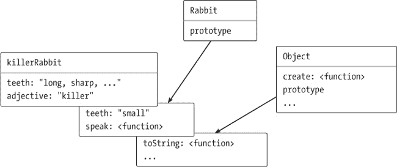

覆盖原型中存在的属性通常是一件有用的事情。正如兔子牙齿的例子所示，它可用于在更通用的对象类实例中表达特殊属性，同时让非特殊对象直接从其原型中获取标准值。

它也被用于为标准函数和数组原型提供与基本对象原型不同的 `toString` 方法。

```
console.log(Array.prototype.toString ==
            Object.prototype.toString);
// ▹ false
console.log([1, 2].toString());
// ▹ 1,2
```

在数组上调用 `toString` 会得到类似于调用 `.join(",")` 的结果——它在数组的值之间插入逗号。直接使用数组调用 `Object.prototype.toString` 会产生不同的字符串。该函数不了解数组，因此它只是将单词“object”和类型名称放在方括号之间。

```
console.log(Object.prototype.toString.call([1, 2]));
// ▹ [object Array]
```

## 原型干扰

原型可以随时用于向基于它的所有对象添加新属性和方法。例如，我们的兔子可能需要跳舞。

```
Rabbit.prototype.dance = function() {
  console.log("The " + this.type + " rabbit dances a jig.");
};
killerRabbit.dance();
// ▹ The killer rabbit dances a jig.
```

这很方便。但在某些情况下，它会引起问题。在前面的章节中，我们使用对象作为将值与名称关联的方式，通过为名称创建属性并赋予它们相应的值。以下是第 4 章中的一个示例：

```
var map = {};
function storePhi(event, phi) {
  map[event] = phi;
}

storePhi("pizza", 0.069);
storePhi("touched tree", -0.081);
```

我们可以使用 `for`/`in` 循环遍历对象中的所有 phi 值，并使用常规的 `in` 运算符测试名称是否在其中。但不幸的是，对象的原型会干扰。

```
Object.prototype.nonsense = "hi";
for (var name in map)
  console.log(name);
// ▹ pizza
// ▹ touched tree
// ▹ nonsense
console.log("nonsense" in map);
// ▹ true
console.log("toString" in map);
// ▹ true

// Delete the problematic property again
delete Object.prototype.nonsense;
```

这完全错了。我们的数据集中没有名为 `nonsense` 的事件。而且*绝对*没有名为 `toString` 的事件。

奇怪的是，`toString` 没有出现在 `for`/`in` 循环中，但 `in` 运算符却对其返回 true。这是因为 JavaScript 区分了*可枚举*和*不可枚举*属性。

我们通过简单赋值创建的所有属性都是可枚举的。`Object.prototype` 中的标准属性都是不可枚举的，这就是为什么它们不会出现在这样的 `for`/`in` 循环中。

通过使用 `Object.defineProperty` 函数，我们可以定义自己的不可枚举属性，该函数允许我们控制正在创建的属性类型。

```
Object.defineProperty(Object.prototype, "hiddenNonsense",
                      {enumerable: false, value: "hi"});
for (var name in map)
  console.log(name);
// ▹ pizza
// ▹ touched tree
console.log(map.hiddenNonsense);
// ▹ hi
```

所以现在属性存在，但它不会出现在循环中。这很好。但我们仍然存在常规 `in` 运算符声称 `Object.prototype` 属性存在于我们的对象中的问题。为此，我们可以使用对象的 `hasOwnProperty` 方法。

```
console.log(map.hasOwnProperty("toString"));
// ▹ false
```

该方法告诉我们对象*本身*是否拥有该属性，而不查看其原型。这通常比 `in` 运算符提供的信息更有用。

当你担心有人（你加载到程序中的其他代码）可能篡改了基本对象原型时，我建议你这样编写 `for`/`in` 循环：

```
for (var name in map) {
  if (map.hasOwnProperty(name)) {
    // ... 这是一个自有属性
  }
}
```

## 无原型对象

但兔子洞并没有到此为止。如果有人将 `hasOwnProperty` 这个名称注册到我们的 `map` 对象中，并将其设置为值 42 呢？那么调用 `map.hasOwnProperty` 将尝试调用本地属性，而该属性保存的是一个数字，而不是一个函数。

在这种情况下，原型只会碍事，我们实际上更希望拥有没有原型的对象。我们之前见过 `Object.create` 函数，它允许我们创建一个具有特定原型的对象。你可以将 `null` 作为原型传递，以创建一个没有原型的新对象。对于像 `map` 这样属性可以是任何值的对象，这正是我们想要的。

```
var map = Object.create(null);
map["pizza"] = 0.069;
console.log("toString" in map);
// ▹ false
console.log("pizza" in map);
// ▹ true
```

好多了！我们不再需要 `hasOwnProperty` 这个权宜之计，因为对象的所有属性都是它自己的属性。现在我们可以安全地使用 `for`/`in` 循环，无论人们对 `Object.prototype` 做了什么。

## 多态

当你对对象调用 `String` 函数（将值转换为字符串）时，它会调用该对象的 `toString` 方法，以尝试创建有意义的字符串返回。我之前提到过，一些标准原型定义了它们自己的 `toString` 版本，以便它们可以创建包含比 `"[object Object]"` 更有用信息的字符串。

这是一个强大思想的简单实例。当一段代码被编写为与具有特定接口的对象一起工作时——在本例中是 `toString` 方法——任何恰好支持该接口的对象都可以插入到代码中，并且它就能正常工作。

这种技术被称为*多态*——尽管实际上并不涉及形状变化。多态代码可以处理不同形状的值，只要它们支持其期望的接口。

## 布局表格

我将通过一个稍微复杂的例子来让你更好地了解多态以及面向对象编程的一般面貌。这个项目是：我们将编写一个程序，给定一个由表格单元格数组组成的数组，构建一个包含格式良好的表格的字符串——这意味着列是直的，行是对齐的。类似这样：

```
name         height country
------------ ------ -------------
Kilimanjaro    5895 Tanzania
Everest        8848 Nepal
Mount Fuji     3776 Japan
Mont Blanc     4808 Italy/France
Vaalserberg     323 Netherlands
Denali         6168 United States
Popocatepetl   5465 Mexico
```

我们的表格构建系统的工作方式是：构建函数会询问每个单元格想要多宽和多高，然后利用这些信息确定列的宽度和行的高度。然后构建函数会要求单元格以正确的大小绘制自身，并将结果组装成一个字符串。


布局程序将通过一个定义良好的接口与单元格对象进行通信。这样一来，程序支持的单元格类型就不需要预先固定。我们可以在之后添加新的单元格样式——例如，用于表头的带下划线单元格——只要它们支持我们的接口，就能正常工作，无需修改布局程序。

以下是这个接口：

*   `minHeight()` 返回一个数字，表示此单元格所需的最小高度（以行数计）。
*   `minWidth()` 返回一个数字，表示此单元格的最小宽度（以字符数计）。
*   `draw(width, height)` 返回一个长度为 `height` 的数组，其中包含一系列字符串，每个字符串的宽度为 `width` 个字符。这代表了单元格的内容。

在这个示例中，我将大量使用高阶数组方法，因为这种方法非常适合这个场景。

程序的第一部分计算单元格网格的最小列宽和行高数组。`rows` 变量将保存一个数组的数组，每个内部数组代表一行单元格。

```
function rowHeights(rows) {
  return rows.map(function(row) {
    return row.reduce(function(max, cell) {
      return Math.max(max, cell.minHeight());
    }, 0);
  });
}

function colWidths(rows) {
  return rows[0].map(function(_, i) {
    return rows.reduce(function(max, row) {
      return Math.max(max, row[i].minWidth());
    }, 0);
  });
}
```

使用以下划线（`_`）开头或完全由单个下划线组成的变量名，是一种向（人类读者）表明该参数不会被使用的方式。

`rowHeights` 函数应该不难理解。它使用 `reduce` 计算单元格数组的最大高度，并将其包裹在 `map` 中，以便对 `rows` 数组中的所有行执行此操作。

`colWidths` 函数稍微复杂一些，因为外部数组是行的数组，而不是列的数组。我之前没有提到，`map`（以及 `forEach`、`filter` 和类似的数组方法）会向它提供的函数传递第二个参数：当前元素的索引。通过映射第一行的元素并仅使用映射函数的第二个参数，`colWidths` 构建了一个数组，其中每个列索引对应一个元素。对每个索引，`reduce` 调用遍历外部的 `rows` 数组，并选出该索引处最宽单元格的宽度。

以下是绘制表格的代码：

```
function drawTable(rows) {
  var heights = rowHeights(rows);
  var widths = colWidths(rows);

  function drawLine(blocks, lineNo) {
    return blocks.map(function(block) {
      return block[lineNo];
    }).join(" ");
  }
  function drawRow(row, rowNum) {
    var blocks = row.map(function(cell, colNum) {
      return cell.draw(widths[colNum], heights[rowNum]);
    });
    return blocks[0].map(function(_, lineNo) {
      return drawLine(blocks, lineNo);
    }).join("\n");
  }

  return rows.map(drawRow).join("\n");
}
```

`drawTable` 函数使用内部辅助函数 `drawRow` 绘制所有行，然后用换行符将它们连接起来。

`drawRow` 函数首先将行中的单元格对象转换为 *块*，这些块是表示单元格内容的字符串数组，按行分割。一个仅包含数字 3776 的单元格可能由一个单元素数组表示，如 `["3776"]`，而一个带下划线的单元格可能占据两行，由数组 `["name", "---"]` 表示。

一行中的所有块具有相同的高度，在最终输出中应并排显示。`drawRow` 中的第二个 `map` 调用通过映射最左侧块中的行，并为每一行收集一条跨越表格全宽的行，逐行构建此输出。然后这些行用换行符连接起来，作为 `drawRow` 的返回值提供整行。

函数 `drawLine` 从块数组中提取应并排显示的行，并用空格字符连接它们，以在表格列之间创建一个字符的间隙。

现在让我们为包含文本的单元格编写一个构造函数，它实现了表格单元格的接口。该构造函数使用字符串方法 `split` 将字符串分割成行数组，`split` 会在每次出现其参数时切割字符串，并返回片段数组。`minWidth` 方法在此数组中找到最大行宽。

```
function repeat(string, times) {
  var result = "";
  for (var i = 0; i < times; i++)
    result += string;
  return result;
}

function TextCell(text) {
  this.text = text.split("\n");
}
TextCell.prototype.minWidth = function() {
  return this.text.reduce(function(width, line) {
    return Math.max(width, line.length);
}, 0);
};
TextCell.prototype.minHeight = function() {
  return this.text.length;
};
TextCell.prototype.draw = function(width, height) {
  var result = [];
  for (var i = 0; i < height; i++) {
    var line = this.text[i] || "";
    result.push(line + repeat(" ", width - line.length));
  }
  return result;
};
```

代码使用了一个名为 `repeat` 的辅助函数，它构建一个字符串，其值为 `string` 参数重复 `times` 次。`draw` 方法使用它来为行添加“填充”，使它们都具有所需的长度。

让我们通过构建一个 5×5 的棋盘来测试我们到目前为止编写的所有内容。

```
var rows = [];
for (var i = 0; i < 5; i++) {
   var row = [];
   for (var j = 0; j < 5; j++) {
     if ((j + i) % 2 == 0)
       row.push(new TextCell("##"));
     else
       row.push(new TextCell(" "));
   }
   rows.push(row);
}
console.log(drawTable(rows));
// ▹ ##   ##   ##
//    ##   ##
//  ##   ##   ##
//    ##   ##
//  ##   ##   ##
```

它起作用了！但由于所有单元格大小相同，表格布局代码并没有真正做任何有趣的事情。

我们试图构建的山脉表格的源数据可在沙盒的 `MOUNTAINS` 变量中找到，也可从网站的数据集列表（*[`eloquentjavascript.net/code/`](http://eloquentjavascript.net/code/)*）中下载。

我们希望通过用一系列破折号字符为单元格添加下划线来突出显示包含列名的顶行。没问题——我们只需编写一个处理下划线的单元格类型。

```
function UnderlinedCell(inner) {
  this.inner = inner;
};
UnderlinedCell.prototype.minWidth = function() {
  return this.inner.minWidth();
};
UnderlinedCell.prototype.minHeight = function() {
  return this.inner.minHeight() + 1;
};
UnderlinedCell.prototype.draw = function(width, height) {
  return this.inner.draw(width, height - 1)
    .concat([repeat("-", width)]);
};
```

一个带下划线的单元格 *包含* 另一个单元格。它报告的最小尺寸与其内部单元格相同（通过调用该单元格的 `minWidth` 和 `minHeight` 方法），但高度加一以容纳下划线所占用的空间。

绘制这样的单元格非常简单——我们获取内部单元格的内容，并将一行充满破折号的字符串连接到它后面。

有了下划线机制，我们现在可以编写一个函数，从我们的数据集中构建一个单元格网格。

```
function dataTable(data) {
  var keys = Object.keys(data[0]);
  var headers = keys.map(function(name) {
    return new UnderlinedCell(new TextCell(name));
  });
  var body = data.map(function(row) {
    return keys.map(function(name) {
      return new TextCell(String(row[name]));
    });
  });
  return [headers].concat(body);
}

console.log(drawTable(dataTable(MOUNTAINS)));
// ▹ name    height country
//   ------------ ------ -------------
//   Kilimanjaro  5895   Tanzania
//   ... etcetera
```


标准的 `Object.keys` 函数会返回一个对象中所有属性名的数组。表格的第一行必须包含带下划线的单元格，用于给出列名。在此之下，数据集中所有对象的值以普通单元格的形式出现——我们通过遍历 `keys` 数组来提取它们，以确保每一行中单元格的顺序相同。

生成的表格与之前展示的示例类似，只是没有将 `height` 列中的数字右对齐。我们稍后会处理这个问题。

## Getter 和 Setter

在指定接口时，可以包含非方法的属性。我们本可以将 `minHeight` 和 `minWidth` 定义为单纯的数字。但那样就需要在构造函数中计算它们，这会在构造函数中添加一些与*构造*对象并不严格相关的代码。例如，如果某个带下划线单元格的内部单元格发生了变化，那么该带下划线单元格的大小也应该随之改变，这时就会引发问题。

这导致一些人采纳了一个原则：绝不在接口中包含非方法的属性。他们不会直接访问简单的值属性，而是使用 `getSomething` 和 `setSomething` 方法来读写属性。这种方法的缺点是你最终会编写——以及阅读——大量额外的方法。

幸运的是，JavaScript 提供了一种技术，让我们两全其美。我们可以指定一些属性，从外部看它们像普通属性，但实际上关联了方法。

```
var pile = {
  elements: ["eggshell", "orange peel", "worm"],
  get height() {
    return this.elements.length;
  },
  set height(value) {
    console.log("Ignoring attempt to set height to", value);
  }
};

console.log(pile.height);
// ▹ 3
pile.height = 100;
// ▹ Ignoring attempt to set height to 100
```

在对象字面量中，属性的 `get` 或 `set` 表示法允许你指定一个函数，当属性被读取或写入时运行。你也可以使用 `Object.defineProperty` 函数（我们之前用它来创建不可枚举属性）将这样的属性添加到现有对象（例如原型）上。

```
Object.defineProperty(TextCell.prototype, "heightProp", {
  get: function() { return this.text.length; }
});
var cell = new TextCell("no\nway");
console.log(cell.heightProp);
// ▹ 2
cell.heightProp = 100;
console.log(cell.heightProp);
// ▹ 2
```

你可以在传递给 `defineProperty` 的对象中使用类似的 `set` 属性来指定 setter 方法。如果定义了 getter 但没有定义 setter，那么对属性的写入操作会被直接忽略。

## 继承

我们的表格布局练习还没有完全完成。将数字列右对齐有助于提高可读性。我们应该创建另一种单元格类型，它类似于 `TextCell`，但不是在右侧填充行，而是在左侧填充行，以便它们右对齐。

我们可以简单地编写一个全新的构造函数，并在其原型中包含所有三个方法。但原型本身也可以有原型，这让我们能够做一些巧妙的事情。

```
function RTextCell(text) {
  TextCell.call(this, text);
}
RTextCell.prototype = Object.create(TextCell.prototype);
RTextCell.prototype.draw = function(width, height) {
  var result = [];
  for (var i = 0; i < height; i++) {
    var line = this.text[i] || "";
    result.push(repeat(" ", width - line.length) + line);
  }
  return result;
};
```

我们复用了常规 `TextCell` 的构造函数以及 `minHeight` 和 `minWidth` 方法。现在，`RTextCell` 基本上等同于 `TextCell`，只是它的 `draw` 方法包含了一个不同的函数。

这种模式被称为*继承*。它允许我们以相对较少的工作量，从现有数据类型构建略有不同的数据类型。通常，新的构造函数会调用旧的构造函数（使用 `call` 方法，以便将新对象作为其 `this` 值传递给它）。一旦调用了这个构造函数，我们就可以假设旧对象类型应该包含的所有字段都已添加。我们安排构造函数的原型派生自旧原型，这样该类型的实例也能访问旧原型中的属性。最后，我们可以通过向新原型添加属性来覆盖其中一些属性。

现在，如果我们稍微调整 `dataTable` 函数，使其对值为数字的单元格使用 `RTextCell`，就能得到我们想要的目标表格。

```
function dataTable(data) {
  var keys = Object.keys(data[0]);
  var headers = keys.map(function(name) {
    return new UnderlinedCell(new TextCell(name));
  });
  var body = data.map(function(row) {
    return keys.map(function(name) {
      var value = row[name];
      // 这里做了修改：
      if (typeof value == "number")
        return new RTextCell(String(value));
      else
        return new TextCell(String(value));
    });
  });
  return [headers].concat(body);
}

console.log(drawTable(dataTable(MOUNTAINS)));
// ▹ ... 完美对齐的表格
```

继承是面向对象传统中的基本组成部分，与封装和多态并列。然而，尽管后两者现在普遍被认为是绝妙的思想，继承却有些争议。

主要原因在于它经常与多态混淆，被宣传为比实际更强大的工具，随后以各种丑陋的方式被过度使用。封装和多态可以用来*分离*代码片段，减少整个程序的混乱程度，而继承从根本上将类型联系在一起，造成*更多*的混乱。

正如我们所见，没有继承也可以实现多态。我不会告诉你完全避免继承——我自己的程序中也会定期使用它。但你应该将其视为一种有点取巧的技巧，可以帮助你用少量代码定义新类型，而不是代码组织的宏大原则。扩展类型的更可取方式是通过组合，例如 `UnderlinedCell` 通过简单地将另一个单元格对象存储在属性中，并在自己的方法中将方法调用转发给它，从而构建在另一个单元格对象之上。

## instanceof 运算符

有时需要知道一个对象是否由特定的构造函数派生而来。为此，JavaScript 提供了一个名为 `instanceof` 的二元运算符。

```
console.log(new RTextCell("A") instanceof RTextCell);
// ▹true
console.log(new RTextCell("A") instanceof TextCell);
// ▹ true
console.log(new TextCell("A") instanceof RTextCell);
// ▹ false
console.log([1] instanceof Array);
// ▹ true
```

该运算符会穿透继承类型。`RTextCell` 是 `TextCell` 的实例，因为 `RTextCell.prototype` 派生自 `TextCell.prototype`。该运算符可以应用于标准构造函数，如 `Array`。几乎每个对象都是 `Object` 的实例。

## 总结

因此，对象比我最初描述的要复杂。它们有原型，原型是其他对象，只要原型拥有某个属性，对象就会表现得好像自己也拥有该属性。简单对象的原型是 `Object.prototype`。

构造函数（其名称通常以大写字母开头）可以与 `new` 运算符一起使用来创建新对象。新对象的原型将是构造函数 `prototype` 属性中的对象。你可以通过将给定类型的所有值共享的属性放入其原型中，来充分利用这一点。给定一个对象和一个构造函数，`instanceof` 运算符可以告诉你该对象是否是那个构造函数的实例。


对对象做的一件有用的事情是为它们指定一个接口，并告诉所有人他们应该只通过该接口与你的对象通信。构成你的对象的其余细节现在被*封装*起来，隐藏在接口背后。

一旦你以接口的方式思考，谁说只有一种对象可以实现这个接口？让不同的对象暴露相同的接口，然后编写适用于任何具有该接口的对象的代码，这被称为多态。它非常有用。

当实现仅在部分细节上有所不同的多种类型时，可以简单地将新类型的原型从旧类型的原型派生出来，并让新构造函数调用旧构造函数。这样你就得到了一个与旧类型相似的对象类型，但你可以根据需要添加和覆盖属性。

## 练习

### 向量类型

编写一个构造函数 `Vector`，表示二维空间中的向量。它接受 `x` 和 `y` 参数（数字），并将它们保存为同名的属性。

给 `Vector` 原型添加两个方法 `plus` 和 `minus`，它们接受另一个向量作为参数，并返回一个新向量，该向量是两个向量（`this` 中的向量和参数中的向量）的 `x` 和 `y` 值的和或差。

给原型添加一个 getter 属性 `length`，用于计算向量的长度——即点 (`x`, `y`) 到原点 (0, 0) 的距离。

### 另一种单元格

实现一个名为 `StretchCell(inner, width, height)` 的单元格类型，它符合本章前面描述的表格单元格接口。它应该包装另一个单元格（就像 `UnderlinedCell` 所做的那样），并确保生成的单元格至少具有给定的 `width` 和 `height`，即使内部单元格自然会更小。

### 序列接口

设计一个*接口*，抽象化对值集合的迭代。提供此接口的对象表示一个序列，并且该接口必须以某种方式使使用此类对象的代码能够迭代序列，查看构成序列的元素值，并找到某种方法来确定何时到达序列的末尾。

当你指定了接口后，尝试编写一个函数 `logFive`，它接受一个序列对象，并对其前五个元素调用 `console.log`——如果序列少于五个元素，则调用更少的元素。

然后实现一个对象类型 `ArraySeq`，它包装一个数组，并允许使用你设计的接口对数组进行迭代。实现另一个对象类型 `RangeSeq`，它迭代一个整数范围（构造函数接受 `from` 和 `to` 参数）。

# 第 7 章 项目：电子生命

> “机器能否思考的问题……与潜艇能否游泳的问题差不多。”
> 
> ——艾兹格·迪杰斯特拉，《对计算科学的威胁》

在“项目”章节中，我会暂时停止用新理论轰炸你，而是和你一起完成一个程序。理论在学习编程时不可或缺，但也应该伴随着阅读和理解非平凡的程序。

本章的项目是构建一个虚拟生态系统，一个充满四处移动并挣扎求生的生物的小世界。

## 定义

为了使这个任务易于管理，我们将*世界*的概念大幅简化。也就是说，世界将是一个二维网格，每个实体占据网格的一个完整方格。在每个*回合*中，所有生物都有机会采取一些行动。

因此，我们将时间和空间都切割成固定大小的单元：空间是方格，时间是回合。当然，这是一种有些粗糙且不精确的近似。但我们的模拟旨在有趣而非精确，因此我们可以随意简化。

我们可以用一个*计划*来定义世界，它是一个字符串数组，每个字符对应一个方格，从而布局世界的网格。

```
var plan =
["############################",
 "#      #    #      o      ##",
 "#                          #",
 "#          #####           #",
 "##         #   #    ##     #",
 "###           ##     #     #",
 "#           ###      #     #",
 "#  ####                    #",
 "#  ##        o             #",
 "# o #          o       ### #",
 "#   #                      #",
 "############################"];
```

这个计划中的 `#` 字符代表墙壁和岩石，`o` 字符代表生物。你可能已经猜到，空格是空区域。

计划数组可用于创建世界对象。这样的对象会跟踪世界的大小和内容。它有一个 `toString` 方法，可以将世界转换回可打印的字符串（类似于它所基于的计划），以便我们查看内部情况。世界对象还有一个 `turn` 方法，允许其中的所有生物执行一个回合，并更新世界以反映它们的行动。

## 表示空间

模拟世界的网格具有固定的宽度和高度。方格由其 x 和 y 坐标标识。我们使用一个简单的类型 `Vector`（如上一章练习中所见）来表示这些坐标对。

```
function Vector(x, y) {
  this.x = x;
  this.y = y;
}
Vector.prototype.plus = function(other) {
  return new Vector(this.x + other.x, this.y + other.y);
};
```

接下来，我们需要一个对象类型来模拟网格本身。网格是世界的一部分，但我们将其作为一个独立的对象（将成为世界对象的一个属性），以使世界对象本身保持简单。世界应该关注与世界相关的事情，而网格应该关注与网格相关的事情。

为了存储值的网格，我们有几种选择。我们可以使用行数组的数组，并通过两次属性访问来获取特定方格，如下所示：

```
var grid = [["top left",    "top middle",    "top right"],
            ["bottom left", "bottom middle", "bottom right"]];
console.log(grid[1][2]);
// ▹ bottom right
```

或者我们可以使用一个大小为宽度 × 高度的单一数组，并决定 (`x`, `y`) 处的元素位于数组中的位置 `x` + (`y` × 宽度)。

```
var grid = ["top left", "top middle", "top right",
            "bottom left", "bottom middle", "bottom right"];
console.log(grid[2 + (1 * 3)]);
// ▹ bottom right
```

由于对这个数组的实际访问将被封装在网格对象类型的方法中，因此外部代码并不关心我们采用哪种方法。我选择了第二种表示，因为它使得创建数组更加容易。当调用 `Array` 构造函数并传入一个数字作为参数时，它会创建一个给定长度的新空数组。

以下代码定义了 `Grid` 对象及其一些基本方法：

```
function Grid(width, height) {
  this.space = new Array(width * height);
  this.width = width;
  this.height = height;
}
Grid.prototype.isInside = function(vector) {
  return vector.x >= 0 && vector.x < this.width &&
         vector.y >= 0 && vector.y < this.height;
};
Grid.prototype.get = function(vector) {
  return this.space[vector.x + this.width * vector.y];
};
Grid.prototype.set = function(vector, value) {
  this.space[vector.x + this.width * vector.y] = value;
};
```

这是一个简单的测试：

```
var grid = new Grid(5, 5);
console.log(grid.get(new Vector(1, 1)));
// ▹ undefined
grid.set(new Vector(1, 1), "X");
console.log(grid.get(new Vector(1, 1)));
// ▹ X
```

## 生物的编程接口


在开始编写 `World` 构造函数之前，我们需要更具体地了解将生活在其中的 `critter` 对象。我提到过，世界会询问这些生物想要采取什么行动。其工作方式如下：每个 `critter` 对象都有一个 `act` 方法，调用该方法时会返回一个 `action`。动作是一个包含 `type` 属性的对象，该属性指明了生物想要采取的动作类型，例如 `"move"`。动作还可能包含额外信息，比如生物想要移动的方向。

生物的目光非常短浅，只能看到网格上紧邻自己的方格。但即使是这种有限的视野，在决定采取何种行动时也可能有用。当 `act` 方法被调用时，它会收到一个 `view` 对象，该对象允许生物检查周围环境。我们用罗盘方向来命名周围的八个方格：`"n"` 表示北，`"ne"` 表示东北，以此类推。下面是我们用来将方向名称映射到坐标偏移量的对象：

```
var directions = {
  "n":  new Vector( 0, -1),
  "ne": new Vector( 1, -1),
  "e":  new Vector( 1,  0),
  "se": new Vector( 1,  1),
  "s":  new Vector( 0,  1),
  "sw": new Vector(-1,  1),
  "w":  new Vector(-1,  0),
  "nw": new Vector(-1, -1)
};
```

`view` 对象有一个 `look` 方法，它接受一个方向并返回一个字符，例如，如果该方向有墙则返回 `"#"`，如果什么都没有则返回 `" "`（空格）。该对象还提供了便捷方法 `find` 和 `findAll`。两者都接受一个地图字符作为参数。第一个方法返回一个方向，在该方向上生物旁边可以找到该字符，如果不存在这样的方向则返回 `null`。第二个方法返回一个数组，包含所有具有该字符的方向。例如，一个位于墙左侧（西边）的生物，在其 `view` 对象上以 `"#"` 字符为参数调用 `findAll` 时，会得到 `["ne", "e", "se"]`。

下面是一个简单而愚蠢的生物，它只会顺着自己的鼻子走，直到撞到障碍物，然后随机弹向一个空旷的方向：

```
function randomElement(array) {
  return array[Math.floor(Math.random() * array.length)];
}

var directionNames = "n ne e se s sw w nw".split(" ");

function BouncingCritter() {
  this.direction = randomElement(directionNames);
};
BouncingCritter.prototype.act = function(view) {
  if (view.look(this.direction) != " ")
    this.direction = view.find(" ") || "s";
  return {type: "move", direction: this.direction};
};
```

`randomElement` 辅助函数只是从数组中随机选取一个元素，使用 `Math.random` 加上一些算术运算来获得随机索引。我们稍后会再次用到它，因为随机性在模拟中可能很有用。

为了随机选择一个方向，`BouncingCritter` 构造函数在方向名称数组上调用了 `randomElement`。我们也可以使用 `Object.keys` 从之前定义的 `directions` 对象中获取这个数组，但这不能保证属性的列出顺序。在大多数情况下，现代 JavaScript 引擎会按照属性定义的顺序返回它们，但这不是必须的。

`act` 方法中的 `|| "s"` 是为了防止当生物被困住、周围没有空位时（例如被其他生物挤在角落里），`this.direction` 变成 `null`。

## 世界对象

现在我们可以开始编写 `World` 对象类型了。构造函数接受一个计划（前面描述的表示世界网格的字符串数组）和一个 *图例* 作为参数。图例是一个对象，告诉我们地图中每个字符的含义。它包含每个字符的构造函数——空格字符除外，它始终对应 `null`，我们将用这个值来表示空位。

```
function elementFromChar(legend, ch) {
  if (ch == " ")
    return null;
  var element = new legend[ch]();
  element.originChar = ch;
  return element;
}

function World(map, legend) {
  var grid = new Grid(map[0].length, map.length);
  this.grid = grid;
  this.legend = legend;

  map.forEach(function(line, y) {
    for (var x = 0; x < line.length; x++)
      grid.set(new Vector(x, y),
               elementFromChar(legend, line[x]));
  });
}
```

在 `elementFromChar` 中，我们首先通过查找字符的构造函数并对其应用 `new` 来创建正确类型的实例。然后我们给它添加一个 `originChar` 属性，以便于找出该元素最初是由哪个字符创建的。

在实现世界的 `toString` 方法时，我们需要这个 `originChar` 属性。该方法通过对网格上的方格进行二维循环，从世界的当前状态构建出一个类似地图的字符串。

```
function charFromElement(element) {
  if (element == null)
    return " ";
  else
    return element.originChar;
}

World.prototype.toString = function() {
  var output = "";
  for (var y = 0; y < this.grid.height; y++) {
    for (var x = 0; x < this.grid.width; x++) {
      var element = this.grid.get(new Vector(x, y));
      output += charFromElement(element);
    }
    output += "\n";
  }
  return output;
};
```

墙是一个简单的对象——它只用来占据空间，没有 `act` 方法。

```
function Wall() {}
```

当我们基于本章前面的计划创建一个实例，然后对其调用 `toString` 来尝试 `World` 对象时，我们会得到一个与我们输入的计划非常相似的字符串。

```
var world = new World(plan,
                      {"#": Wall,
                       "o": BouncingCritter});
console.log(world.toString());
// ▹ ############################
//  #     #    #      o       ##
//  #                          #
//  #         #####            #
//  ##        #   #    ##      #
//  ###          ##     #      #
//  #          ###      #      #
//  #  ####                    #
//  #  ##        o             #
//  # o #          o       ### #
//  #   #                      #
//  ############################
```

## this 及其作用域

`World` 构造函数中包含一个对 `forEach` 的调用。一个有趣的现象是，在传递给 `forEach` 的函数内部，我们不再直接处于构造函数的作用域中。每个函数调用都有自己的 `this` 绑定，因此内部函数中的 `this` 并*不*指向外部 `this` 所引用的新构造对象。实际上，当一个函数不是作为方法调用时，`this` 会指向全局对象。

这意味着我们不能在循环内部通过 `this.grid` 来访问网格。相反，外部函数创建了一个普通的局部变量 `grid`，内部函数通过它来访问网格。

这是 JavaScript 中的一个设计缺陷。幸运的是，该语言的下一个版本为这个问题提供了解决方案。与此同时，也有一些变通方法。一种常见的模式是使用 `var self = this`，然后引用 `self`，它是一个普通变量，因此对内部函数可见。

另一种解决方案是使用 `bind` 方法，它允许我们提供一个显式的 `this` 对象进行绑定。

```
var test = {
  prop: 10,
  addPropTo: function(array) {
    return array.map(function(elt) {
      return this.prop + elt;
    }.bind(this));
  }
};
console.log(test.addPropTo([5]));
// ▹ [15]
```

传递给 `map` 的函数是 `bind` 调用的结果，因此它的 `this` 被绑定到了 `bind` 的第一个参数——外部函数的 `this` 值（它持有 `test` 对象）。

大多数标准的高阶数组方法（如 `forEach` 和 `map`）都接受一个可选的第二个参数，该参数也可以用来为迭代函数的调用提供 `this`。因此，你可以用稍微简单的方式表达前面的例子。


```
var test = {
  prop: 10,
  addPropTo: function(array) {
    return array.map(function(elt) {
    return this.prop + elt;
  }, this); // ← 无需绑定
 }
};
console.log(test.addPropTo([5]));
// ▹ [15]
```

这种方法仅适用于支持此类 `context` 参数的高阶函数。如果它们不支持，你就需要使用其他方法之一。

在我们自己的高阶函数中，可以通过使用 `call` 方法来调用作为参数传入的函数，从而支持这样的上下文参数。例如，下面是为我们的 `Grid` 类型编写的 `forEach` 方法，它会为网格中每个非 null 或 undefined 的元素调用给定的函数：

```
Grid.prototype.forEach = function(f, context) {
  for (var y = 0; y < this.height; y++) {
    for (var x = 0; x < this.width; x++) {
      var value = this.space[x + y * this.width];
      if (value != null)
        f.call(context, value, new Vector(x, y));
    }
  }
};
```

## 生命的动画

下一步是为 `World` 对象编写一个 `turn` 方法，让生物有机会行动。它将使用我们刚刚定义的 `forEach` 方法遍历网格，寻找带有 `act` 方法的对象。当找到时，`turn` 会调用该方法获取一个动作对象，并在动作有效时执行它。目前，只理解 `"move"` 动作。

这种方法有一个潜在问题。你能发现吗？如果我们让生物在遇到它们时立即移动，它们可能会移动到一个我们尚未查看的方格，而当我们到达那个方格时，又会允许它们*再次*移动。因此，我们必须维护一个已经行动过的生物数组，并在再次遇到它们时忽略它们。

```
World.prototype.turn = function() {
  var acted = [];
  this.grid.forEach(function(critter, vector) {
    if (critter.act && acted.indexOf(critter) == -1) {
      acted.push(critter);
      this.letAct(critter, vector);
    }
  }, this);
};
```

我们使用网格 `forEach` 方法的第二个参数，以便在内部函数中能够访问正确的 `this`。`letAct` 方法包含了允许生物移动的实际逻辑。

```
World.prototype.letAct = function(critter, vector) {
  var action = critter.act(new View(this, vector));
  if (action && action.type == "move") {
    var dest = this.checkDestination(action, vector);
    if (dest && this.grid.get(dest) == null) {
      this.grid.set(vector, null);
      this.grid.set(dest, critter);
    }
  }
};

World.prototype.checkDestination = function(action, vector) {
  if (directions.hasOwnProperty(action.direction)) {
    var dest = vector.plus(directions[action.direction]);
    if (this.grid.isInside(dest))
    return dest;
  }
};
```

首先，我们简单地让生物行动，向它传递一个 `view` 对象，该对象了解世界以及生物在当前世界中的位置（稍后我们会定义 `View`）。`act` 方法返回某种类型的动作。

如果动作的 `type` 不是 `"move"`，则忽略它。如果*是* `"move"`，并且它有一个指向有效方向的 `direction` 属性，*并且*该方向的方格是空的（null），那么我们将生物原来所在的方格设为 null，并将生物存储到目标方格中。

注意，`letAct` 会小心地忽略无意义的输入——它不会假设动作的 `direction` 属性有效，也不会假设 `type` 属性有意义。这种*防御性*编程在某些情况下是有意义的。这样做的主要原因是验证来自你无法控制的来源（如用户或文件输入）的输入，但它也可以用于将子系统相互隔离。在这种情况下，意图是生物本身可以被草率地编程——它们不必验证其意图动作是否有意义。它们只需请求一个动作，世界会决定是否允许。

这两个方法不是 `World` 对象外部接口的一部分。它们是内部细节。有些语言提供了显式声明某些方法和属性为 `private` 的方式，并在尝试从对象外部使用它们时发出错误信号。JavaScript 没有，因此你必须依赖其他形式的沟通来描述对象接口的组成部分。有时，使用命名方案来区分外部和内部属性会有所帮助，例如在所有内部属性前加下划线字符（`_`）。这将使意外使用不属于对象接口的属性更容易被发现。

缺失的部分，即 `View` 类型，如下所示：

```
function View(world, vector) {
  this.world = world;
  this.vector = vector;
}
View.prototype.look = function(dir) {
  var target = this.vector.plus(directions[dir]);
  if (this.world.grid.isInside(target))
    return charFromElement(this.world.grid.get(target));
  else
    return "#";
};
View.prototype.findAll = function(ch) {
  var found = [];
  for (var dir in directions)
    if (this.look(dir) == ch)
      found.push(dir);
    return found;
};
View.prototype.find = function(ch) {
  var found = this.findAll(ch);
  if (found.length == 0) return null;
  return randomElement(found);
};
```

`look` 方法计算出我们试图查看的坐标，如果它们在网格内，则找到该位置元素对应的字符。对于网格外的坐标，`look` 简单地假装那里有一堵墙，这样即使你定义了一个没有围墙的世界，生物也不会试图走出边界。

## 它在移动

我们之前实例化了一个 `World` 对象。现在我们已经添加了所有必要的方法，应该可以实际让世界移动了。

```
for (var i = 0; i < 5; i++) {
  world.turn();
  console.log(world.toString());
}
// ▹ ... 生物移动的五轮
```

显示的前两张地图看起来会像这样（取决于生物随机选择的方向）：

```
############################  ############################
#      #    #             ##  #      #    #             ##
#                  o       #  #                          #
#          #####           #  #          #####      o    #
##         #   #   ##      #  ##         #   #     ##    #
###           ##    #      #  ###           ##      #    #
#           ###     #      #  #           ###       #    #
#  ####                    #  #  ####                    #
#  ##                      #  #  ##                      #
#   #        o         ### #  #o  #                  ### #
#o  #          o           #  #   #        o o           #
############################  ############################
```

它们在移动！要更直观地观察这些生物爬行和撞墙，请打开本书在线版本中的本章，网址为 *[`eloquentjavascript.net/`](http://eloquentjavascript.net/)*。

## 更多生命形式

如果你观察一会儿，我们世界的戏剧性亮点是两个生物相互碰撞。你能想到另一种有趣的行为形式吗？

我想出的一种是沿着墙壁移动的生物。概念上，生物将它的左手（爪子、触手，随便什么）贴在墙上，然后沿着墙走。事实证明，实现这一点并不完全简单。

我们需要能够用罗盘方向进行“计算”。由于方向由一组字符串建模，我们需要定义自己的操作（`dirPlus`）来计算相对方向。因此，`dirPlus("n", 1)` 表示从北顺时针旋转 45 度，得到 `"ne"`。类似地，`dirPlus("s", -2)` 表示从南逆时针旋转 90 度，即东。


```
function dirPlus(dir, n) {
  var index = directionNames.indexOf(dir);
  return directionNames[(index + n + 8) % 8];
}

function WallFollower() {
  this.dir = "s";
}
WallFollower.prototype.act = function(view) {
  var start = this.dir;
  if (view.look(dirPlus(this.dir, -3)) != " ")
    start = this.dir = dirPlus(this.dir, -2);
  while (view.look(this.dir) != " ") {
    this.dir = dirPlus(this.dir, 1);
    if (this.dir == start) break;
  }
  return {type: "move", direction: this.dir};
};
```

`act` 方法只需“扫描”生物体的周围环境，从它的左侧开始，顺时针方向移动，直到找到一个空方格。然后它朝那个空方格的方向移动。

复杂之处在于，生物体可能会出现在空旷区域的中间，无论是作为起始位置，还是因为绕过了另一个生物体。如果我们应用刚才描述的方法在空旷区域，可怜的生物体就会每步都向左转，原地打转。

因此，有一个额外的检查（`if` 语句），只有当生物体看起来刚刚经过某种障碍物时——即生物体左后方的空间不是空的——才开始向左扫描。否则，生物体直接向前扫描，这样它在空旷区域就会直线行走。

最后，在每次循环之后，有一个比较 `this.dir` 和 `start` 的测试，以确保当生物体被墙壁或其他生物体包围而找不到空方格时，循环不会永远运行下去。

## 更逼真的模拟

为了让我们的世界生活更有趣，我们将添加食物和繁殖的概念。世界中的每个生物体都会获得一个新属性 `energy`，它通过执行动作而减少，通过进食而增加。当生物体有足够的能量时，它可以繁殖，生成一个同种的新生物体。为了简单起见，我们世界中的生物体进行无性繁殖，完全靠自己。

如果生物体只是四处移动并互相吃掉，世界很快就会屈服于熵增定律，耗尽能量，变成一片没有生命的荒地。为了防止这种情况发生（至少不要太快），我们在世界中添加了植物。植物不会移动。它们只通过光合作用生长（即增加能量）并繁殖。

为了实现这一点，我们需要一个具有不同 `letAct` 方法的世界。我们可以直接替换 `World` 原型的方法，但我已经非常喜欢我们那个有沿墙行走生物体的模拟，不想破坏那个旧世界。

一种解决方案是使用继承。我们创建一个新的构造函数 `LifelikeWorld`，其原型基于 `World` 原型，但覆盖了 `letAct` 方法。新的 `letAct` 方法将实际执行动作的工作委托给存储在 `actionTypes` 对象中的各种函数。

```
function LifelikeWorld(map, legend) {
  World.call(this, map, legend);
}
LifelikeWorld.prototype = Object.create(World.prototype);

var actionTypes = Object.create(null);

LifelikeWorld.prototype.letAct = function(critter, vector) {
  var action = critter.act(new View(this, vector));
  var handled = action &&
    action.type in actionTypes &&
    actionTypes[action.type].call(this, critter,
                                  vector, action);
  if (!handled) {
    critter.energy -= 0.2;
    if (critter.energy <= 0)
      this.grid.set(vector, null);
  }
};
```

新的 `letAct` 方法首先检查是否返回了一个动作，然后检查是否存在针对该动作类型的处理函数，最后检查该处理函数是否返回了 `true`，表示它成功处理了该动作。注意使用了 `call` 来让处理函数通过其 `this` 绑定访问世界。

如果动作因某种原因没有生效，默认动作是让生物体只是等待。它会损失 0.2 点能量，如果能量水平降至零或以下，生物体就会死亡并从网格中移除。

## 动作处理函数

生物体可以执行的最简单动作是 `"grow"`（生长），由植物使用。当返回像 `{type: "grow"}` 这样的动作对象时，将调用以下处理函数方法：

```
actionTypes.grow = function(critter) {
  critter.energy += 0.5;
  return true;
};
```

生长总是成功，并为植物的能量水平增加 0.5 点。

移动则更复杂一些。

```
actionTypes.move = function(critter, vector, action) {
  var dest = this.checkDestination(action, vector);
  if (dest == null ||
      critter.energy <= 1 ||
      this.grid.get(dest) != null)
    return false;
  critter.energy -= 1;
  this.grid.set(vector, null);
  this.grid.set(dest, critter);
  return true;
};
```

这个动作首先使用之前定义的 `checkDestination` 方法检查动作是否提供了有效的目标位置。如果没有，或者目标位置不为空，或者生物体缺乏所需的能量，`move` 返回 `false` 表示没有执行任何动作。否则，它移动生物体并扣除能量消耗。

除了移动，生物体还可以进食。

```
actionTypes.eat = function(critter, vector, action) {
  var dest = this.checkDestination(action, vector);
  var atDest = dest != null && this.grid.get(dest);
  if (!atDest || atDest.energy == null)
    return false;
  critter.energy += atDest.energy;
  this.grid.set(dest, null);
  return true;
};
```

吃掉另一个生物体也需要提供一个有效的目标方格。这次，目标方格不能为空，并且必须包含有能量的东西，比如一个生物体（但不能是墙壁——墙壁不可食用）。如果是这样，被吃掉的能量转移到进食者身上，受害者从网格中移除。

最后，我们允许生物体繁殖。

```
actionTypes.reproduce = function(critter, vector, action) {
  var baby = elementFromChar(this.legend,
                             critter.originChar);
  var dest = this.checkDestination(action, vector);
  if (dest == null ||
      critter.energy <= 2 * baby.energy ||
      this.grid.get(dest) != null)
    return false;
  critter.energy -= 2 * baby.energy;
  this.grid.set(dest, baby);
  return true;
};
```

繁殖需要消耗新生生物体能量水平的两倍。所以我们首先使用 `elementFromChar` 根据生物体自身的原始字符创建一个（假设的）幼体。有了幼体后，我们可以找到它的能量水平，并测试母体是否有足够的能量成功将其带入世界。我们还需要一个有效（且为空）的目标位置。

如果一切正常，幼体被放到网格上（它现在不再是假设的了），并且能量被消耗。

## 填充新世界

现在我们有了一个框架来模拟这些更逼真的生物。我们可以把旧世界中的生物体放进去，但它们会死掉，因为它们没有能量属性。所以让我们创造新的生物体。首先，我们将编写一个植物，它是一种相当简单的生命形式。

```
function Plant() {
  this.energy = 3 + Math.random() * 4;
}
Plant.prototype.act = function(context) {
  if (this.energy > 15) {
    var space = context.find(" ");
    if (space)
      return {type: "reproduce", direction: space};
  }
  if (this.energy < 20)
    return {type: "grow"};
};
```

植物的初始能量水平在 3 到 7 之间随机化，这样它们就不会在同一回合全部繁殖。当植物达到 15 能量点并且附近有空位时，它会繁殖到那个空位。如果植物无法繁殖，它只会生长，直到能量水平达到 20。

现在我们定义一个植物食者。


```
function PlantEater() {
  this.energy = 20;
}
PlantEater.prototype.act = function(context) {
  var space = context.find(" ");
  if (this.energy > 60 && space)
    return {type: "reproduce", direction: space};
  var plant = context.find("*");
  if (plant)
    return {type: "eat", direction: plant};
  if (space)
    return {type: "move", direction: space};
};
```

我们将使用 `*` 字符代表植物，因此生物在寻找食物时会查找这个符号。

## 让世界活起来

现在我们有足够的元素来尝试我们的新世界了。想象一下，下面的地图是一片长满青草的山谷，里面有一群食草动物、一些巨石，以及到处茂盛的植物。

```
var valley  = new LifelikeWorld(
   ["############################",
    "#####                 ######",
    "##   ***                **##",
    "#   *##**         **  O  *##",
    "#    ***     O    ##**    *#",
    "#       O         ##***    #",
    "#                 ##**     #",
    "#   O       #*             #",
    "#*          #**       O    #",
    "#***        ##**   O     **#",
    "##****     ###***       *###",
    "############################"],
   {"#": Wall,
    "O": PlantEater,
    "* ": Plant}
);
```

让我们看看运行这个程序会发生什么。这些快照展示了这个世界的一次典型运行过程。

```
############################   #############################
#####                 ######   ##### **               ######
##   ***   O             *##   ##  ** *             O     ##
#   *##*         **      *##   #  **##                    ##
#    **          ##*      *#   #  **  O           ##O      #
#                ##*       #   #   *O       * *   ##       #
#                ##   O    #   #             ***  ##     O #
#           #*     O       #   #**          #***           #
#*          #** O          #   #**       O  #****          #
#*   O    O ##*          **#   #***         ##***     O    #
##*        ###*          ###   ##**        ###**    O    ###
############################   #############################
############################  ############################
#####O O              ######  #####  O              ######
##                        ##  ##                        ##
#    ##O                  ##  #    ##           O       ##
#          O  O *##        #  #                ##        #
# O    O    O  **##     O  #  #                ##        #
#              **##      O #  #              O ##*       #
#          #   *** *       #  #         #  O             #
#          # O*****  O     #  #      O  #    O           #
#          ##******        #  #         ##     O      O  #
##        ###******      ###  ##        ### O          ###
############################  ############################
############################  ############################
#####                 ######  ######                ######
##                        ##  ##                 **  *  ##
#   ##                    ##  #     ##           *****  ##
#                 ##       #  #                 ##****   #
#                 ##* *    #  #                 ##*****  #
#              O  ##*      #  #                 ##****** #
#            #             #  #            #      ** **  #
#            #             #  #            #             #
#            ##            #  #            ##            #
##          ###          ###  ##          ###          ###
############################  ############################
```

大多数时候，植物繁殖和扩张得非常快，但随后丰富的食物导致食草动物数量激增，它们会消灭所有或几乎所有的植物，从而导致生物大量饿死。有时，生态系统会恢复并开始另一个循环。其他时候，其中一个物种会完全灭绝。如果是食草动物灭绝，整个空间将长满植物。如果是植物灭绝，剩下的生物会饿死，山谷变成一片荒芜的废土。啊，大自然的残酷。

## 练习

### 人工愚蠢

看到我们世界中的居民几分钟后就灭绝了，这有点令人沮丧。为了解决这个问题，我们可以尝试创造一个更聪明的食草者。

我们的食草动物存在几个明显的问题。首先，它们极其贪婪，见到每一株植物就吃，直到把当地的植物全部消灭。其次，它们的随机移动（回想一下，`view.find` 方法在多个方向匹配时会返回一个随机方向）导致它们无效地四处乱撞，如果附近恰好没有植物，就会饿死。最后，它们繁殖得非常快，这使得丰饶与饥荒之间的循环变得非常剧烈。

编写一种新的生物类型，尝试解决其中一个或多个问题，并将其替换山谷世界中的旧 `PlantEater` 类型。看看它的表现如何。如有必要，进一步调整它。

### 捕食者

任何严肃的生态系统都有超过一个环节的食物链。编写另一种生物，通过捕食食草动物来生存。你会注意到，由于现在存在多个层次的循环，稳定性更难实现了。尝试找到一种策略，使生态系统至少平稳运行一小段时间。

一个有用的方法是让世界变得更大。这样，局部的人口激增或崩溃就不太可能完全消灭一个物种，并且有足够的空间来维持相对较大的猎物数量，以养活一小群捕食者。

# 第 8 章 错误与错误处理

> “调试的难度是编写代码的两倍。因此，如果你尽可能巧妙地编写代码，那么按定义，你就不够聪明去调试它。”
>
> ——布莱恩·克尼汉（Brian Kernighan）和 P.J. 普劳格（P.J. Plauger），《编程风格要素》

程序是思想的结晶。有时这些思想是混乱的。其他时候，在将思想转化为代码时会引入错误。无论哪种情况，结果都是一个有缺陷的程序。

程序中的缺陷通常被称为 bug。bug 可能是程序员错误，也可能是程序与之交互的其他系统中的问题。有些 bug 会立即显现，而另一些则很微妙，可能在系统中隐藏多年。

通常，问题只有在程序遇到程序员最初未考虑的情况时才会浮出水面。有时这种情况是不可避免的。当用户被要求输入年龄却输入了 *orange* 时，这会让我们的程序陷入困境。这种情况必须被预见并以某种方式处理。

## 程序员的错误

当涉及程序员的错误时，我们的目标很简单：找到它们并修复它们。这类错误范围很广，从简单的拼写错误（导致计算机一看到程序就报错），到对程序运行方式的微妙误解（导致仅在特定情况下产生错误结果）。后一种类型的 bug 可能需要数周才能诊断出来。

不同语言在帮助你发现这类错误方面的程度各不相同。毫不意外，JavaScript 处于“几乎不帮忙”的一端。有些语言在运行程序之前就要求知道所有变量和表达式的类型，并且会在类型使用不一致时立即告诉你。JavaScript 只在实际运行程序时才考虑类型，而且即使如此，它也会允许你做一些明显荒谬的事情而不报错，比如 `x = true * "monkey"`。

不过，JavaScript 确实会对某些事情报错。编写语法无效的程序会立即触发错误。其他事情，比如调用非函数的东西，或者访问 undefined 值的属性，会在程序运行并遇到这种无意义操作时报告错误。


但通常情况下，你的无意义计算只会产生一个 `NaN`（非数字）或 `undefined` 值。而程序会愉快地继续运行，自以为在做有意义的事情。错误只会在之后显现，当这个虚假的值经过多个函数之后。它可能根本不会触发错误，而是悄无声息地导致程序输出错误。找到这类问题的根源可能很困难。

在程序中寻找错误（bug）的过程被称为*调试*。

## 严格模式

通过启用*严格模式*，可以让 JavaScript 变得*稍微*严格一些。这可以通过在文件或函数体的顶部放置字符串 `"use strict"` 来实现。下面是一个示例：

```
function canYouSpotTheProblem() {
  "use strict";
  for (counter = 0; counter < 10; counter++)
    console.log("Happy happy");
}

canYouSpotTheProblem();
// ▹ ReferenceError: counter is not defined
```

通常情况下，当你忘记在变量前加上 `var` 时（如示例中的 `counter`），JavaScript 会静默地创建一个全局变量并使用它。然而，在严格模式下，会报告一个错误。这非常有帮助。不过需要注意的是，如果涉及的变量已经作为全局变量存在，则此机制不会生效，只有在赋值会创建该变量时才会触发。

严格模式的另一个变化是，在未作为方法调用的函数中，`this` 绑定持有 `undefined` 值。在非严格模式下进行此类调用时，`this` 指向全局作用域对象。因此，如果在严格模式下错误地调用了方法或构造函数，JavaScript 会在尝试从 `this` 读取内容时立即产生错误，而不是愉快地操作全局对象、创建和读取全局变量。

例如，考虑以下代码，它调用构造函数时没有使用 `new` 关键字，因此其 `this` 将*不会*指向一个新构造的对象：

```
function Person(name) { this.name = name; }
var ferdinand = Person("Ferdinand"); // 哎呀
console.log(name);
// ▹ Ferdinand
```

因此，对 `Person` 的错误调用成功了，但返回了一个未定义的值，并创建了全局变量 `name`。在严格模式下，结果则不同。

```
"use strict";
function Person(name) { this.name = name; }
// 哎呀，忘了 'new'
var ferdinand = Person("Ferdinand");
// ▹ TypeError: Cannot set property 'name' of undefined
```

我们立即被告知出了问题。这很有帮助。

严格模式还做了其他一些事情。它禁止函数拥有多个同名参数，并完全移除了某些有问题的语言特性（例如 `with` 语句，该语句误导性太强，本书不再进一步讨论）。

简而言之，在程序顶部加上 `"use strict"` 几乎不会造成伤害，并且可能帮助你发现问题。

## 测试

如果语言本身不能帮助我们找到错误，我们就得用更困难的方法：运行程序，看看它是否做了正确的事情。

一遍又一遍地手动执行此操作，肯定会让你抓狂。幸运的是，通常可以编写第二个程序来自动化测试你的实际程序。

作为示例，我们再次使用 `Vector` 类型。

```
function Vector(x, y) {
  this.x = x;
  this.y = y;
}
Vector.prototype.plus = function(other) {
  return new Vector(this.x + other.x, this.y + other.y);
};
```

我们将编写一个程序来检查我们的 `Vector` 实现是否按预期工作。然后，每次我们更改实现时，都通过运行测试程序来跟进，以便合理确信我们没有破坏任何东西。当我们向 `Vector` 类型添加额外功能（例如新方法）时，我们也会为新功能添加测试。

```
function testVector() {
  var p1 = new Vector(10, 20);
  var p2 = new Vector(-10, 5);
  var p3 = p1.plus(p2);

  if (p1.x !== 10) return "fail: x property";
  if (p1.y !== 20) return "fail: y property";
  if (p2.x !== -10) return "fail: negative x property";
  if (p3.x !== 0) return "fail: x from plus";
  if (p3.y !== 25) return "fail: y from plus";
  return "everything ok";
}
console.log(testVector());
// ▹ everything ok
```

编写这样的测试往往会产生相当重复、笨拙的代码。幸运的是，有一些软件可以通过提供适合表达测试的语言（以函数和方法的形式）并在测试失败时输出信息性信息，来帮助你构建和运行测试集合（*测试套件*）。这些被称为*测试框架*。

## 调试

一旦你注意到程序出现问题（因为它行为异常或产生错误），下一步就是弄清楚问题*是什么*。

有时问题很明显。错误消息会指向程序中的特定行，如果你查看错误描述和那行代码，通常就能发现问题。

但并非总是如此。有时触发问题的行仅仅是其他地方产生的虚假值被以无效方式使用的第一个位置。有时根本没有错误消息——只有无效的结果。如果你已经解决了前面章节中的练习，你可能已经经历过这种情况。

以下示例程序试图通过反复提取最后一位数字然后除以该数字来去掉该数字，从而将整数转换为任意进制（十进制、二进制等）的字符串。但它当前产生的疯狂输出表明它有一个 bug。

```
function numberToString(n, base) {
  var result = "", sign = "";
  if (n < 0) {
    sign = "-";
    n = -n;
  }
  do {
    result = String(n % base) + result;
    n /= base;
  } while (n > 0);
  return sign + result;
  }
  console.log(numberToString(13, 10));
  // ▹ 1.5e-3231.3e-3221.3e-3211.3e-3201.3e-3191.3e-3181.3...
```

即使你已经看到了问题，暂时假装你没看到。我们知道程序运行不正常，我们想找出原因。

此时，你必须抵制开始对代码进行随机修改的冲动。相反，要*思考*。分析正在发生的事情，并提出一个可能的原因理论。然后，进行额外的观察来测试这个理论——或者，如果你还没有理论，进行额外的观察来帮助你提出一个理论。

在程序中放置几个策略性的 `console.log` 调用是获取程序运行额外信息的好方法。在这种情况下，我们希望 `n` 取值 `13`、`1`，然后 `0`。让我们在循环开始时输出它的值。

```
13
1.3
0.13
0.013
...
1.5e-323
```

*没错*。13 除以 10 不会产生整数。我们实际需要的是 `n = Math.floor(n / base)` 而不是 `n /= base`，这样数字才能被正确地“右移”。

使用 `console.log` 的替代方法是使用浏览器的*调试器*功能。现代浏览器都具备在代码的特定行设置*断点*的能力。这会使程序在每次执行到带有断点的行时暂停，并允许你检查该点的变量值。这里我不详细说明，因为调试器因浏览器而异，但请查看浏览器的开发者工具并搜索网络以获取更多信息。另一种设置断点的方法是在程序中包含一个 `debugger` 语句（仅包含该关键字）。如果浏览器的开发者工具处于活动状态，程序将在到达该语句时暂停，你将能够检查其状态。

## 错误传播


并非所有问题都能由程序员预防。不幸的是，如果你的程序以任何方式与外部世界通信，那么它接收到的输入可能无效，或者它试图通信的其他系统可能已损坏或无法访问。

简单的程序，或者仅在你监督下运行的程序，可以在出现此类问题时直接放弃。你会去调查问题并重试。而“真正的”应用程序则被期望不会轻易崩溃。有时正确的做法是坦然接受错误输入并继续运行。在其他情况下，最好向用户报告出了什么问题，然后放弃。但无论哪种情况，程序都必须主动对问题做出响应。

假设你有一个函数 `promptInteger`，它要求用户输入一个整数并返回该整数。如果用户输入了 *orange*，它应该返回什么？

一种选择是让它返回一个特殊值。此类值的常见选择是 `null` 和 `undefined`。

```
function promptNumber(question) {
  var result = Number(prompt(question, ""));
  if (isNaN(result)) return null;
  else return result;
}

console.log(promptNumber("How many trees do you see?"));
```

这是一种合理的策略。现在任何调用 `promptNumber` 的代码都必须检查是否读取到了实际数字，如果没有，则必须以某种方式恢复——可能是通过再次询问或填入默认值。或者它也可以再次向 *它的* 调用者返回一个特殊值，以表明它未能完成所要求的任务。

在许多情况下，尤其是当错误很常见且调用者应该明确考虑它们时，返回一个特殊值是一种完全合适的指示错误的方式。然而，它也有缺点。首先，如果函数已经可以返回所有可能的值怎么办？对于这样的函数，很难找到一个能与有效结果区分开的特殊值。

返回特殊值的第二个问题是它可能导致代码非常混乱。如果一段代码调用了 `promptNumber` 10 次，它就必须检查 10 次是否返回了 `null`。而如果它对发现 `null` 的响应只是简单地返回 `null` 本身，那么调用者又必须检查它，依此类推。

## 异常

当一个函数无法正常进行时，我们 *想要* 做的是停止当前操作，并立即跳回到一个知道如何处理问题的地方。这就是 *异常处理* 所做的。

异常是一种机制，它使得遇到问题的代码可以 *引发*（或 *抛出*）一个异常，这个异常只是一个值。引发异常有点像函数的一次超级返回：它不仅跳出当前函数，还跳出它的调用者，一直向下直到启动当前执行的第一个调用。这被称为 *展开堆栈*。你可能还记得第 3 章中提到的函数调用堆栈。异常沿着这个堆栈向下飞驰，丢弃它遇到的所有调用上下文。

如果异常总是直接飞驰到堆栈底部，那它们就没多大用处了。它们只会提供一种新颖的方式来炸毁你的程序。它们的力量在于，你可以在堆栈上设置“障碍物”，在异常飞驰下来时 *捕获* 它。然后你可以对它做一些处理，之后程序从捕获异常的地方继续运行。

下面是一个例子：

```
function promptDirection(question) {
  var result = prompt(question, "");
  if (result.toLowerCase() == "left") return "L";
  if (result.toLowerCase() == "right") return "R";
  throw new Error("Invalid direction: " + result);
}

function look() {
  if (promptDirection("Which way?") == "L")
    return "a house";
  else
    return "two angry bears";
}

try {
  console.log("You see", look());
} catch (error) {
  console.log("Something went wrong: " + error);
}
```

`throw` 关键字用于引发异常。捕获异常是通过将一段代码包裹在 `try` 块中，后跟关键字 `catch` 来完成的。当 `try` 块中的代码导致异常被引发时，`catch` 块会被执行。`catch` 后面的变量名（在括号中）将被绑定到异常值。在 `catch` 块执行完毕后——或者如果 `try` 块没有出现问题就执行完毕——控制权会转移到整个 `try/catch` 语句之后。

在这个例子中，我们使用 `Error` 构造函数来创建异常值。这是一个标准的 JavaScript 构造函数，它会创建一个带有 `message` 属性的对象。在现代 JavaScript 环境中，该构造函数的实例还会收集异常创建时存在的调用堆栈信息，即所谓的 *堆栈跟踪*。这些信息存储在 `stack` 属性中，在调试问题时很有帮助：它告诉我们问题发生的具体函数，以及哪些其他函数导致了失败的调用。

注意，函数 `look` 完全忽略了 `promptDirection` 可能出错的可能性。这是异常的一大优势——错误处理代码只需要在错误发生的地方和错误被处理的地方出现。中间的函数可以完全忘记它。

嗯，差不多……

## 异常后的清理

考虑以下情况：一个函数 `withContext` 希望确保在其执行期间，顶层变量 `context` 持有特定的上下文值。执行完毕后，它将此变量恢复为旧值。

```
var context = null;

function withContext(newContext, body) {
  var oldContext = context;
  context = newContext;
  var result = body();
  context = oldContext;
  return result;
}
```

如果 `body` 引发了异常怎么办？在这种情况下，对 `withContext` 的调用会被异常抛出堆栈，而 `context` 将永远不会被设置回旧值。

`try` 语句还有一个特性。它们可以后跟一个 `finally` 块，要么代替 `catch` 块，要么与 `catch` 块一起使用。`finally` 块的意思是“无论 *发生什么*，在尝试运行 `try` 块中的代码之后，都要运行这段代码。”如果函数需要清理某些东西，清理代码通常应该放在 `finally` 块中。

```
function withContext(newContext, body) {
  var oldContext = context;
  context = newContext;
  try {
    return body();
  } finally {
    context = oldContext;
  }
}
```

注意，我们不再需要将 `body` 的结果（我们想要返回的）存储在一个变量中。即使我们直接从 `try` 块返回，`finally` 块也会被执行。现在我们可以安全地这样做：

```
try {
  withContext(5, function() {
    if (context < 10)
      throw new Error("Not enough context!");
  });
} catch (e) {
  console.log("Ignoring: " + e);
}
// ▹ Ignoring: Error: Not enough context!

console.log(context);
// ▹ null
```

即使从 `withContext` 调用的函数爆炸了，`withContext` 本身仍然正确地清理了 `context` 变量。

## 选择性捕获

当一个异常一直到达堆栈底部而未被捕获时，它会被环境处理。这在不同环境中含义不同。在浏览器中，错误的描述通常会被写入 JavaScript 控制台（可通过浏览器的工具或开发者菜单访问）。

对于程序员错误或程序无法处理的问题，直接让错误通过通常是可以的。未处理的异常是表明程序已损坏的一种合理方式，在现代浏览器中，JavaScript 控制台会提供一些信息，告诉你问题发生时哪些函数调用在堆栈上。

对于在常规使用中 *预期* 会发生的问题，用未处理的异常导致崩溃并不是一种非常友好的响应。


语言的不当使用，例如引用不存在的变量、在 `null` 上查找属性，或者调用非函数的内容，也会导致异常被抛出。这些异常可以像你自己的异常一样被捕获。

当进入 `catch` 块时，我们只知道 `try` 块中的*某个东西*引发了异常。但我们不知道是*什么*，也不知道引发了*哪个*异常。

JavaScript（一个相当明显的疏漏）并没有提供直接支持来有选择地捕获异常：要么捕获所有异常，要么一个都不捕获。这使得我们很容易*假设*捕获到的异常就是编写 `catch` 块时想到的那个异常。

但事实可能并非如此。某些其他假设可能被违反，或者你可能在某个地方引入了一个导致异常的 bug。下面是一个例子，它*试图*不断调用 `promptDirection`，直到获得一个有效答案：

```
for (;;) {
  try {
    var dir = promtDirection("Where?"); // ← 拼写错误！
    console.log("You chose ", dir);
    break;
  } catch (e) {
    console.log("Not a valid direction. Try again.");
  }
}
```

`for (;;)` 结构是一种有意创建不会自行终止的循环的方式。只有当给出有效方向时，我们才会跳出循环。*但是*我们拼写错了 `promptDirection`，这会导致“未定义变量”错误。由于 `catch` 块完全忽略了异常值（`e`），并假设自己知道问题所在，它错误地将变量错误视为输入错误。这不仅会导致无限循环，还会“掩埋”关于拼写错误变量的有用错误信息。

作为一般规则，不要无差别地捕获所有异常，除非是为了将异常[路由](https://example.org/ch21.html_routing "路由")到某个地方——例如，通过网络告诉另一个系统我们的程序崩溃了。即使如此，也要仔细考虑你可能会隐藏哪些信息。

因此，我们希望捕获一种*特定*类型的异常。我们可以通过在 `catch` 块中检查捕获到的异常是否是我们感兴趣的那个，如果不是则重新抛出异常来实现。但如何识别一个异常呢？

当然，我们可以将其 `message` 属性与我们期望的错误消息进行匹配。但这样编写代码并不稳妥——我们是在使用本应供人类阅读的信息（消息）来做出程序性决策。一旦有人更改（或翻译）了消息，代码就会失效。

相反，让我们定义一种新的错误类型，并使用 `instanceof` 来识别它。

```
function InputError(message) {
  this.message = message;
  this.stack = (new Error()).stack;
}
InputError.prototype = Object.create(Error.prototype);
InputError.prototype.name = "InputError";
```

原型被设置为继承自 `Error.prototype`，这样 `instanceof Error` 对于 `InputError` 对象也会返回 true。同时还为其赋予了一个 `name` 属性，因为标准错误类型（`Error`、`SyntaxError`、`ReferenceError` 等）也都有这样的属性。

对 `stack` 属性的赋值尝试通过创建一个常规错误对象，然后使用该对象的 `stack` 属性作为自己的堆栈跟踪，从而在支持该功能的平台上为该对象提供某种有用的堆栈跟踪信息。

现在 `promptDirection` 可以抛出这样的错误了。

```
function promptDirection(question) {
  var result = prompt(question, "");
  if (result.toLowerCase() == "left") return "L";
  if (result.toLowerCase() == "right") return "R";
  throw new InputError("Invalid direction: " + result);
}
```

而循环可以更仔细地捕获它。

```
for (;;) {
  try {
    var dir = promptDirection("Where?");
    console.log("You chose ", dir);
    break;
  } catch (e) {
    if (e instanceof InputError)
      console.log("Not a valid direction. Try again.");
    else
      throw e;
  }
}
```

这样只会捕获 `InputError` 的实例，而让不相关的异常通过。如果你重新引入拼写错误，未定义变量错误将被正确报告。

## 断言

*断言*是一种用于对程序员错误进行基本健全性检查的工具。考虑这个辅助函数 `assert`：

```
function AssertionFailed(message) {
  this.message = message;
}
AssertionFailed.prototype = Object.create(Error.prototype);

function assert(test, message) {
  if (!test)
    throw new AssertionFailed(message);
}
function lastElement(array) {
  assert(array.length > 0, "empty array in lastElement");
  return array[array.length - 1];
}
```

这提供了一种紧凑的方式来强制执行预期，如果指定条件不成立，则会有用地使程序崩溃。例如，`lastElement` 函数用于获取数组的最后一个元素，如果省略断言，则在空数组上会返回 `undefined`。从空数组中获取最后一个元素没有多大意义，因此这样做几乎肯定是程序员错误。

断言是一种确保错误在错误发生点就导致失败的方法，而不是静默地产生无意义的值，这些值可能会在系统的无关部分引发问题。

## 总结

错误和不良输入是生活中不可避免的事实。程序中的 bug 需要被发现和修复。通过自动化测试套件和在程序中添加断言，可以使它们更容易被注意到。

由程序控制之外的因素引起的问题通常应该优雅地处理。有时，当问题可以在本地处理时，特殊的返回值是一种合理的跟踪方式。否则，异常是更可取的选择。

抛出异常会导致调用栈展开，直到遇到下一个封闭的 `try`/`catch` 块或栈底。异常值将被传递给捕获它的 `catch` 块，该块应验证它是否确实是预期的异常类型，然后对其进行处理。为了处理由异常引起的不可预测的控制流，可以使用 `finally` 块来确保当某个块完成时，一段代码*总是*会被执行。

## 练习

### 重试

假设你有一个函数 `primitiveMultiply`，它在 50% 的情况下将两个数相乘，在另外 50% 的情况下会抛出一个 `MultiplicatorUnitFailure` 类型的异常。编写一个函数来包装这个笨拙的函数，并不断重试，直到调用成功并返回结果。

确保只处理你想要处理的异常。

### 锁定的盒子

考虑以下（相当牵强的）对象：

```
var box = {
  locked: true,
  unlock: function() { this.locked = false; },
  lock: function() { this.locked = true; },
  _content: [],
  get content() {
    if (this.locked) throw new Error("Locked!");
    return this._content;
  }
};
```

这是一个带锁的盒子。里面是一个数组，但只有在盒子解锁时才能访问它。不允许直接访问 `_content` 属性。

编写一个名为 `withBoxUnlocked` 的函数，它接受一个函数值作为参数，解锁盒子，运行该函数，然后确保在返回之前盒子再次被锁定，无论参数函数是正常返回还是抛出了异常。

# 第 9 章 正则表达式

> “有些人，当遇到问题时，会想‘我知道了，我要用正则表达式。’现在他们有两个问题了。”
> 
> ——Jamie Zawinski

编程工具和技术以一种混乱、进化的方式生存和传播。胜出的并不总是漂亮或出色的工具，而是那些在合适生态位中运行得足够好的工具——例如，通过与其他成功技术集成。

在本章中，我将讨论这样一种工具：*正则表达式*。正则表达式是一种描述字符串数据模式的方式。它们形成了一种小型、独立的语言，是 JavaScript 以及许多其他语言和工具的一部分。


正则表达式既极其笨拙又非常有用。它们的语法晦涩难懂，JavaScript 提供的编程接口也很笨拙。但它们是检查和处理字符串的强大工具。正确理解正则表达式将使你成为更高效的程序员。

## 创建正则表达式

正则表达式是一种对象类型。它可以通过 `RegExp` 构造函数构建，也可以写成字面量值，将模式放在正斜杠（`/`）字符之间。

```
var re1 = new RegExp("abc");
var re2 = /abc/;
```

这两个正则表达式对象表示相同的模式：一个 *a* 字符，后跟一个 *b*，再后跟一个 *c*。

使用 `RegExp` 构造函数时，模式被写成普通字符串，因此反斜杠的常规规则适用。

第二种表示法，即模式出现在斜杠字符之间，对反斜杠的处理略有不同。首先，由于正斜杠会结束模式，我们需要在想要作为模式*一部分*的任何正斜杠前加上反斜杠。此外，不属于特殊字符代码（如 `\n`）的反斜杠将被*保留*，而不是像在字符串中那样被忽略，并且会改变模式的含义。某些字符，如问号和加号，在正则表达式中有特殊含义，如果它们要表示字符本身，则必须在前面加上反斜杠。

```
var eighteenPlus = /eighteen\+/;
```

在编写正则表达式时，要精确知道哪些字符需要转义，需要你了解每个具有特殊含义的字符。目前这可能不太现实，所以当有疑问时，只需在任何不是字母、数字或空格的字符前加上反斜杠。

## 测试匹配

正则表达式对象有许多方法。最简单的是 `test`。如果传入一个字符串，它将返回一个布尔值，告诉你该字符串是否包含与表达式模式匹配的内容。

```
console.log(/abc/.test("abcde"));
// ▹ true
console.log(/abc/.test("abxde"));
// ▹ false
```

仅由非特殊字符组成的正则表达式简单地表示该字符序列。如果 *abc* 出现在我们测试的字符串中的任何位置（不仅仅是开头），`test` 将返回 `true`。

## 匹配一组字符

判断字符串是否包含 *abc* 也可以通过调用 `indexOf` 来完成。正则表达式允许我们超越这一点，表达更复杂的模式。

假设我们想匹配任何数字。在正则表达式中，将一组字符放在方括号内，会使表达式的该部分匹配括号内的任何字符。

以下两个表达式都匹配包含数字的所有字符串：

```
console.log(/[0123456789]/.test("in 1992"));
// ▹ true
console.log(/[0-9]/.test("in 1992"));
// ▹ true
```

在方括号内，两个字符之间的短划线（`-`）可用于表示字符范围，顺序由字符的 Unicode 编号决定。字符 0 到 9 在此顺序中紧挨着（代码 48 到 57），因此 `[0-9]` 覆盖了所有数字并匹配任何数字。

有一些常见的字符组有自己的内置快捷方式。数字就是其中之一：`\d` 与 `[0-9]` 含义相同。

| `\d` | 任何数字字符 |
| `\w` | 字母数字字符（“单词字符”） |
| `\s` | 任何空白字符（空格、制表符、换行符等） |
| `\D` | *非*数字字符 |
| `\W` | 非字母数字字符 |
| `\S` | 非空白字符 |
| `.` | 除换行符外的任何字符 |

因此，你可以用以下表达式匹配像 30-01-2003 15:20 这样的日期和时间格式：

```
var dateTime = /\d\d-\d\d-\d\d\d\d \d\d:\d\d/;
console.log(dateTime.test("30-01-2003 15:20"));
// ▹ true
console.log(dateTime.test("30-jan-2003 15:20"));
// ▹ false
```

看起来非常糟糕，不是吗？反斜杠太多，产生了背景噪音，使得很难看出实际表达的模式。稍后我们将看到这个表达式的略微改进版本。

这些反斜杠代码也可以在方括号内使用。例如，`[\d.]` 表示任何数字或句点字符。但请注意，句点本身在方括号内使用时，会失去其特殊含义。其他特殊字符也是如此，例如 `+`。

要*反转*一组字符——即表示你想匹配除该组字符之外的任何字符——你可以在左括号后写一个脱字符（`^`）。

```
var notBinary = /[⁰¹]/;
console.log(notBinary.test("1100100010100110"));
// ▹ false
console.log(notBinary.test("1100100010200110"));
// ▹ true
```

## 重复模式的一部分

我们现在知道如何匹配单个数字。如果我们想匹配一个完整的数字——一个或多个数字的序列呢？

当你在正则表达式中某个元素后加上加号（`+`）时，表示该元素可以重复一次或多次。因此，`/\d+/` 匹配一个或多个数字字符。

```
console.log(/'\d+'/.test("'123'"));
// ▹ true
console.log(/'\d+'/.test("''"));
// ▹ false
console.log(/'\d*'/.test("'123'"));
// ▹ true
console.log(/'\d*'/.test("''"));
// ▹ true
```

星号（`*`）具有类似含义，但也允许模式匹配零次。带有星号的元素永远不会阻止模式匹配——如果找不到合适的文本匹配，它只会匹配零次。

问号使模式的一部分变为“可选”，意味着它可以出现零次或一次。在以下示例中，*u* 字符允许出现，但模式在缺少它时也能匹配。

```
var neighbor = /neighbou?r/;
console.log(neighbor.test("neighbour"));
// ▹ true
console.log(neighbor.test("neighbor"));
// ▹ true
```

要指示模式应出现精确的次数，请使用花括号。例如，在元素后加上 `{4}` 要求它恰好出现四次。也可以这样指定范围：`{2,4}` 表示该元素必须至少出现两次，最多四次。

这是日期和时间模式的另一个版本，允许单数字和双数字的日、月、小时。它也更易读一些。

```
var dateTime = /\d{1,2}-\d{1,2}-\d{4} \d{1,2}:\d{2}/;
console.log(dateTime.test("30-1-2003 8:45"));
// ▹ true
```

使用花括号时，你也可以通过省略逗号一侧的数字来指定开放范围。因此 `{,5}` 表示零到五次，而 `{5,}` 表示五次或更多次。

## 分组子表达式

要同时对多个元素使用像 `*` 或 `+` 这样的运算符，你可以使用括号。正则表达式中用括号括起来的部分，对于其后的运算符而言，被视为一个单一元素。

```
var cartoonCrying = /boo+(hoo+)+/i;
console.log(cartoonCrying.test("Boohoooohoohooo"));
// ▹ true
```

第一个和第二个 `+` 字符分别仅应用于 *boo* 和 *hoo* 中的第二个 *o*。第三个 `+` 应用于整个组 `(hoo+)`，匹配一个或多个这样的序列。

上一个示例中表达式末尾的 `i` 使这个正则表达式不区分大小写，允许它匹配输入字符串中的大写 *B*，尽管模式本身全是小写。

## 匹配与分组

`test` 方法是匹配正则表达式的最简单方式。它只告诉你是否匹配，没有其他信息。正则表达式还有一个 `exec`（执行）方法，如果没有找到匹配则返回 `null`，否则返回一个包含匹配信息的对象。

```
var match = /\d+/.exec("one two 100");
console.log(match);
// ▹ ["100"]
console.log(match.index);
// ▹ 8
```


从 `exec` 返回的对象有一个 `index` 属性，它告诉我们成功匹配在字符串中的*起始位置*。除此之外，该对象看起来（实际上也是）一个字符串数组，其第一个元素是匹配到的字符串——在前面的例子中，就是我们要找的数字序列。

字符串值有一个 `match` 方法，其行为类似。

```
console.log("one two 100".match(/\d+/));
// ▹ ["100"]
```

当正则表达式包含用括号分组的子表达式时，匹配这些组的文本也会出现在数组中。整个匹配始终是第一个元素。下一个元素是由第一个组（即表达式中左括号最先出现的组）匹配的部分，然后是第二个组，依此类推。

```
var quotedText = /'([^']*)'/;
console.log(quotedText.exec("she said 'hello'"));
// ▹ ["'hello'", "hello"]
```

当一个组最终没有匹配到任何内容时（例如，后面跟着问号），它在输出数组中的位置将是 `undefined`。类似地，当一个组被多次匹配时，只有最后一次匹配会出现在数组中。

```
console.log(/bad(ly)?/.exec("bad"));
// ▹ ["bad", undefined]
console.log(/(\d)+/.exec("123"));
// ▹ ["123", "3"]
```

组对于提取字符串的一部分非常有用。如果我们不仅想验证一个字符串是否包含日期，还想提取它并构造一个表示日期的对象，我们可以将数字模式用括号括起来，然后直接从 `exec` 的结果中提取日期。

但首先，我们稍微绕一下，讨论一下在 JavaScript 中存储日期和时间值的首选方式。

## 日期类型

JavaScript 有一个标准的对象类型用于表示日期——更准确地说，是时间点。它叫做 `Date`。如果你简单地用 `new` 创建一个 `Date` 对象，你会得到当前的日期和时间。

```
console.log(new Date());
// ▹ Wed Dec 04 2013 14:24:57 GMT+0100 (CET)
```

你也可以为特定时间创建一个对象。

```
console.log(new Date(2009, 11, 9));
// ▹ Wed Dec 09 2009 00:00:00 GMT+0100 (CET)
console.log(new Date(2009, 11, 9, 12, 59, 59, 999));
// ▹ Wed Dec 09 2009 12:59:59 GMT+0100 (CET)
```

JavaScript 使用一种约定，月份编号从零开始（因此十二月是 11），而日期编号从 1 开始。这既令人困惑又愚蠢。请小心。

最后四个参数（小时、分钟、秒和毫秒）是可选的，如果未提供则视为零。

时间戳存储为自 1970 年初以来的毫秒数，1970 年之前的时间使用负数（遵循“Unix 时间”设定的约定，该约定大约在那个时候发明）。`Date` 对象的 `getTime` 方法返回这个数字。可以想象，这个数字很大。

```
console.log(new Date(2013, 11, 19).getTime());
// ▹ 1387407600000
console.log(new Date(1387407600000));
// ▹ Thu Dec 19 2013 00:00:00 GMT+0100 (CET)
```

如果你给 `Date` 构造函数一个参数，该参数会被视为毫秒计数。你可以通过创建一个新的 `Date` 对象并调用其 `getTime` 方法来获取当前的毫秒计数，也可以通过调用 `Date.now` 函数来获取。

`Date` 对象提供了诸如 `getFullYear`、`getMonth`、`getDate`、`getHours`、`getMinutes` 和 `getSeconds` 等方法来提取其组成部分。还有一个 `getYear` 方法，它返回一个相当无用的两位数字年份值（例如 `93` 或 `14`）。

将我们感兴趣的表达式部分用括号括起来，现在我们可以轻松地从字符串中创建一个 `Date` 对象。

```
function findDate(string) {
  var dateTime = /(\d{1,2})-(\d{1,2})-(\d{4})/;
  var match = dateTime.exec(string);
  return new Date(Number(match[3]),
                  Number(match[2]),
                  Number(match[1]));
}
console.log(findDate("30-1-2003"));
// ▹ Sun Mar 02 2003 00:00:00 GMT+0100 (CET)
```

## 单词边界和字符串边界

不幸的是，`findDate` 也会愉快地从字符串 `"100-1-30000"` 中提取出无意义的日期 00-1-3000。匹配可能发生在字符串的任何位置，因此在这种情况下，它会从第二个字符开始，到倒数第二个字符结束。

如果我们希望强制匹配必须跨越整个字符串，我们可以添加标记 `^` 和 `$`。脱字符匹配输入字符串的开头，美元符号匹配结尾。因此，`/^\d+$/` 匹配完全由一个或多个数字组成的字符串，`/^!/` 匹配任何以感叹号开头的字符串，而 `/x^/` 不匹配任何字符串（在字符串开头之前不可能有 *x*）。

另一方面，如果我们只想确保日期在单词边界处开始和结束，我们可以使用标记 `\b`。单词边界可以是字符串的开头或结尾，也可以是字符串中一侧是单词字符（如 `\w` 中的字符）而另一侧是非单词字符的任何位置。

```
console.log(/cat/.test("concatenate"));
// ▹ true
console.log(/\bcat\b/.test("concatenate"));
// ▹ false
```

注意，边界标记不代表实际字符。它只是强制正则表达式仅在模式中出现该标记的位置满足特定条件时才匹配。

## 选择模式

假设我们想知道一段文本是否不仅包含一个数字，而且数字后面跟着单词 *pig*、*cow* 或 *chicken* 之一，或者它们的复数形式。

我们可以编写三个正则表达式并依次测试它们，但有一种更好的方法。管道字符（`|`）表示其左侧模式与右侧模式之间的选择。所以我可以这样说：

```
var animalCount = /\b\d+ (pig|cow|chicken)s?\b/;
console.log(animalCount.test("15 pigs"));
// ▹ true
console.log(animalCount.test("15 pigchickens"));
// ▹ false
```

括号可用于限制管道运算符所应用的模式部分，并且你可以将多个这样的运算符相邻放置，以表达在多于两个模式之间的选择。

## 匹配的机制

正则表达式可以被视为流程图。这是前面例子中牲畜表达式的流程图：

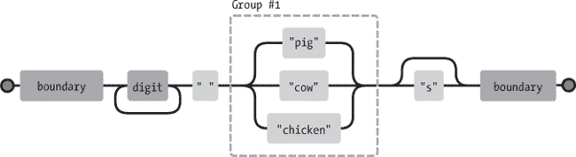

如果我们能找到一条从图表左侧到右侧的路径，那么我们的表达式就匹配一个字符串。我们在字符串中保持一个当前位置，每次经过一个框时，我们验证当前位置之后的字符串部分是否与该框匹配。

因此，如果我们尝试用正则表达式匹配 `"the 3 pigs"`，我们在流程图中的进展将如下所示：

*   在位置 4，有一个单词边界，因此我们可以通过第一个框。

*   仍然在位置 4，我们找到一个数字，因此我们也可以通过第二个框。

*   在位置 5，一条路径循环回到第二个（数字）框之前，而另一条路径向前通过包含一个空格字符的框。这里有一个空格，而不是数字，因此我们必须走第二条路径。

*   我们现在在位置 6（“pigs”的开头），处于图表中的三路分支。这里我们没有看到“cow”或“chicken”，但我们看到了“pig”，因此我们走那条分支。

*   在位置 9，经过三路分支后，一条路径跳过 *s* 框直接到达最后的单词边界，而另一条路径匹配一个 *s*。这里有一个 *s* 字符，而不是单词边界，因此我们通过 *s* 框。

*   我们在位置 10（字符串的结尾），只能匹配一个单词边界。字符串的结尾算作一个单词边界，因此我们通过最后一个框，并成功匹配了这个字符串。


从概念上讲，正则表达式引擎在字符串中查找匹配项的方式如下：它从字符串的开头开始，并尝试在那里进行匹配。在这种情况下，开头*确实*有一个单词边界，因此它可以顺利通过第一个方框——但没有数字，所以它会在第二个方框处失败。然后它移动到字符串的第二个字符，并尝试在那里开始一个新的匹配……以此类推，直到找到匹配项或到达字符串末尾并确定确实没有匹配项。

## 回溯

正则表达式 `/\b([01]+b|\d+|[\da-f]h)\b/` 匹配一个二进制数后跟一个 *b*、一个不带后缀字符的普通十进制数，或者一个十六进制数（即基数为 16，字母 *a* 到 *f* 代表数字 10 到 15）后跟一个 *h*。这是对应的示意图：

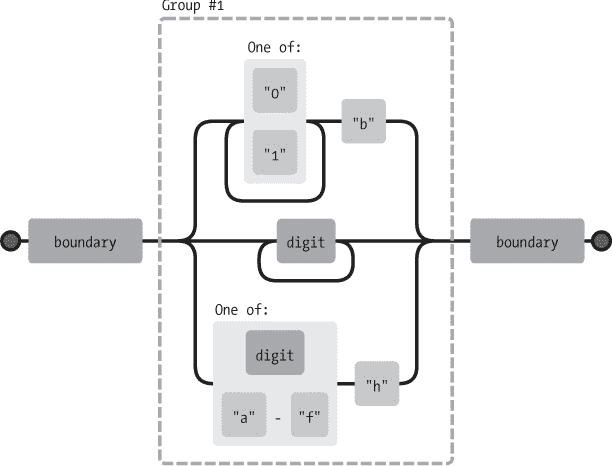

在匹配这个表达式时，即使输入实际上不包含二进制数，也常常会进入顶部（二进制）分支。例如，当匹配字符串 `"103"` 时，直到遇到字符 3 才清楚我们走错了分支。该字符串*确实*匹配这个表达式，只是不匹配我们当前所在的分支。

因此，匹配器会*回溯*。当进入一个分支时，它会记住当前位置（在此例中，位于字符串开头，刚过示意图中的第一个边界框），以便在当前分支无法匹配时返回并尝试另一个分支。遇到字符 3 后，字符串 `"103"` 将开始尝试十进制数的分支。这个分支匹配成功，因此最终报告匹配成功。

匹配器一旦找到完整匹配就会停止。这意味着如果有多个分支可能匹配一个字符串，则只会使用第一个分支（按分支在正则表达式中出现的顺序）。

回溯也会发生在像 `+` 和 `*` 这样的重复运算符上。如果你用 `/^.*x/` 匹配 `"abcxe"`，`.*` 部分会首先尝试消耗整个字符串。然后引擎会意识到它需要一个 *x* 来匹配模式。由于字符串末尾之后没有 *x*，星号运算符尝试少匹配一个字符。但匹配器在 `abcx` 之后也没有找到 *x*，因此它再次回溯，将星号运算符匹配为仅 `abc`。*现在*它在需要的位置找到了 *x*，并报告从位置 0 到 4 匹配成功。

有可能编写出会进行*大量*回溯的正则表达式。当某个模式可以用多种不同方式匹配一段输入时，就会出现这个问题。例如，如果在编写二进制数正则表达式时搞混了，我们可能会不小心写出像 `/([01]+)+b/` 这样的东西。

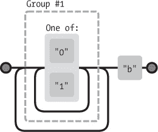

如果它试图匹配一长串零和一，但末尾没有 *b* 字符，匹配器会首先遍历内层循环，直到数字耗尽。然后它注意到没有 *b*，于是回溯一个位置，再遍历一次外层循环，然后再次放弃，并尝试再次从内层循环回溯。它会继续尝试这两个循环的所有可能路径。这意味着每增加一个字符，工作量就会*翻倍*。即使只有几十个字符，最终的匹配也会花费几乎无限的时间。

## replace 方法

字符串值有一个 `replace` 方法，可用于将字符串的一部分替换为另一个字符串。

```
console.log("papa".replace("p", "m"));
// ▹ mapa
```

第一个参数也可以是正则表达式，在这种情况下，正则表达式的第一个匹配项会被替换。当在正则表达式中添加 `g` 选项（表示*全局*）时，字符串中的*所有*匹配项都会被替换，而不仅仅是第一个。

```
console.log("Borobudur".replace(/[ou]/, "a"));
// ▹ Barobudur
console.log("Borobudur".replace(/[ou]/g, "a"));
// ▹ Barabadar
```

如果通过向 `replace` 传递额外参数或提供另一个方法 `replaceAll` 来选择替换一个匹配项还是所有匹配项，那会更合理。但出于某些不幸的原因，这个选择依赖于正则表达式的属性。

将正则表达式与 `replace` 结合使用的真正威力在于，我们可以在替换字符串中引用匹配的分组。例如，假设我们有一个大字符串，其中包含人名，每行一个名字，格式为 `姓, 名`。如果我们想交换这些名字并去掉逗号，得到简单的 `名 姓` 格式，可以使用以下代码：

```
console.log(
  "Hopper, Grace\nMcCarthy, John\nRitchie, Dennis"
    .replace(/([\w ]+), ([\w ]+)/g, "$2 $1"));
// ▹ Grace Hopper
//  John McCarthy
//  Dennis Ritchie
```

替换字符串中的 `$1` 和 `$2` 引用模式中的括号分组。`$1` 被替换为与第一个分组匹配的文本，`$2` 被替换为与第二个分组匹配的文本，以此类推，直到 `$9`。整个匹配项可以用 `$&` 引用。

也可以将函数（而不是字符串）作为第二个参数传递给 `replace`。对于每次替换，该函数将被调用，参数为匹配的分组（以及整个匹配项），其返回值将插入到新字符串中。

这是一个简单的例子：

```
var s = "the cia and fbi";
console.log(s.replace(/\b(fbi|cia)\b/g, function(str) {
  return str.toUpperCase();
}));
// ▹ the CIA and FBI
```

这是一个更有趣的例子：

```
var stock = "1 lemon, 2 cabbages, and 101 eggs";
function minusOne(match, amount, unit) {
  amount = Number(amount) - 1;
  if (amount == 1) // 只剩一个，去掉 's'
    unit = unit.slice(0, unit.length - 1);
  else if (amount == 0)
    amount = "no";
  return amount + " " + unit;
}
console.log(stock.replace(/(\d+) (\w+)/g, minusOne));
// ▹ no lemon, 1 cabbage, and 100 eggs
```

这段代码接收一个字符串，找到所有数字后跟字母数字单词的出现，并返回一个字符串，其中每个这样的出现都减一。

`(\d+)` 分组最终成为函数的 `amount` 参数，而 `(\w+)` 分组绑定到 `unit`。函数将 `amount` 转换为数字——这总是可行的，因为它匹配了 `\d+`——并在只剩一个或零个时进行一些调整。

## 贪婪

使用 `replace` 编写一个函数来删除 JavaScript 代码中的所有注释并不难。以下是第一次尝试：

```
function stripComments(code) {
  return code.replace(/\/\/.*|\/\*[^]*\*\//g, "");
}
console.log(stripComments("1 + /* 2 */3"));
// ▹ 1 + 3
console.log(stripComments("x = 10;// ten!"));
// ▹ x = 10;
console.log(stripComments("1 /* a */+/* b */ 1"));
// ▹ 1 1
```

*或*运算符之前的部分简单地匹配两个斜杠字符后跟任意数量的非换行字符。用于多行注释的部分则更复杂。我们使用 `[^]`（任何不在空字符集中的字符）来匹配任意字符。这里不能只使用点号，因为块注释可以跨行，而点号不匹配换行符。

但前一个例子的输出似乎出错了。为什么？

正如我在回溯部分所描述的，表达式中的 `[^]*` 部分会首先尽可能多地匹配。如果这导致模式的下一部分失败，匹配器会回退一个字符并再次尝试。在例子中，匹配器首先尝试匹配字符串的剩余部分，然后从那里回退。它会在回退四个字符后找到 `*/` 的出现并匹配它。这不是我们想要的——我们的意图是匹配单个注释，而不是一直走到代码末尾并找到最后一个块注释的结尾。


由于这种行为，我们称重复运算符（`+`、`*`、`?` 和 `{}`）是*贪婪*的，意思是它们会尽可能多地匹配，然后从那里回溯。如果你在它们后面加上一个问号（`+?`、`*?`、`??`、`{}?`），它们就变成非贪婪的，并开始尽可能少地匹配，只有当剩余模式无法匹配更小的匹配时，才会匹配更多。

而这正是我们在此情况下所需要的。通过让星号匹配最小的字符段，使我们到达一个 `*/`，我们只消耗一个块注释，而不会更多。

```
function stripComments(code) {
  return code.replace(/\/\/.*|\/\*[^]*?\*\//g, "");
}
console.log(stripComments("1 /* a */+/* b */ 1"));
// ▹ 1 + 1
```

正则表达式程序中的许多错误都可以追溯到无意中使用了贪婪运算符，而实际上非贪婪运算符效果更好。当使用重复运算符时，请优先考虑非贪婪变体。

## 动态创建 `RegExp` 对象

在某些情况下，你在编写代码时可能不知道需要匹配的确切模式。假设你想在一段文本中查找用户的名字，并用下划线字符将其括起来以突出显示。由于只有在程序实际运行时你才会知道名字，因此你不能使用基于斜杠的表示法。

但你可以构建一个字符串，并在其上使用 `RegExp` 构造函数。下面是一个例子：

```
var name = "harry";
var text = "Harry is a suspicious character.";
var regexp = new RegExp("\\b(" + name + ")\\b", "gi");
console.log(text.replace(regexp, "_$1_"));
// ▹ _Harry_ is a suspicious character.
```

在创建 `\b` 边界标记时，我们必须使用两个反斜杠，因为我们是在普通字符串中编写它们，而不是在斜杠包围的正则表达式中。`RegExp` 构造函数的第二个参数包含正则表达式的选项——在本例中是 `"gi"`，表示全局且不区分大小写。

但如果用户是一个书呆子青少年，名字是 `"dea+hl[]rd"` 呢？那将产生一个无意义的正则表达式，实际上无法匹配用户的名字。

为了解决这个问题，我们可以在任何不信任的字符前添加反斜杠。在字母字符前添加反斜杠是个坏主意，因为像 `\b` 和 `\n` 这样的东西有特殊含义。但转义所有非字母数字或空白字符是安全的。

```
var name = "dea+hl[]rd";
var text = "This dea+hl[]rd guy is super annoying.";
var escaped = name.replace(/[^\w\s]/g, "\\$&");
var regexp = new RegExp("\\b(" + escaped + ")\\b", "gi");
console.log(text.replace(regexp, "_$1_"));
// ▹ This _dea+hl[]rd_ guy is super annoying.
```

## `search` 方法

字符串的 `indexOf` 方法不能与正则表达式一起调用。但还有另一个方法 `search`，它确实期望一个正则表达式。与 `indexOf` 类似，它返回表达式被找到的第一个索引，如果未找到则返回 –1。

```
console.log(" word".search(/\S/));
// ▹ 2
console.log("   ".search(/\S/));
// ▹ -1
```

不幸的是，没有办法指示匹配应从给定的偏移量开始（就像我们可以用 `indexOf` 的第二个参数那样），而这通常很有用。

## `lastIndex` 属性

`exec` 方法同样没有提供一种方便的方式从字符串中的给定位置开始搜索。但它确实提供了一种*不*方便的方式。

正则表达式对象具有属性。其中一个属性是 `source`，它包含创建该表达式的字符串。另一个属性是 `lastIndex`，它在某些有限的情况下控制下一次匹配将从哪里开始。

这些情况是：正则表达式必须启用全局（`g`）选项，并且匹配必须通过 `exec` 方法进行。再说一次，更合理的解决方案是允许向 `exec` 传递一个额外的参数，但合理性并不是 JavaScript 正则表达式接口的一个定义性特征。

```
var pattern = /y/g;
pattern.lastIndex = 3;
var match = pattern.exec("xyzzy");
console.log(match.index);
// ▹ 4
console.log(pattern.lastIndex);
// ▹ 5
```

如果匹配成功，对 `exec` 的调用会自动更新 `lastIndex` 属性，使其指向匹配之后的位置。如果没有找到匹配，`lastIndex` 会被重置为零，这也是新构造的正则表达式对象所具有的值。

当对多个 `exec` 调用使用全局正则表达式值时，这些对 `lastIndex` 属性的自动更新可能会导致问题。你的正则表达式可能会意外地从先前调用留下的索引开始。

```
var digit = /\d/g;
console.log(digit.exec("here it is: 1"));
// ▹ ["1"]
console.log(digit.exec("and now: 1"));
// ▹ null
```

全局选项的另一个有趣效果是，它改变了字符串的 `match` 方法的工作方式。当使用全局表达式调用时，`match` 不会返回类似于 `exec` 返回的数组，而是会找到字符串中模式的所有匹配项，并返回一个包含匹配字符串的数组。

```
console.log("Banana".match(/an/g));
// ▹ ["an", "an"]
```

因此，对全局正则表达式要谨慎。需要使用它们的情况——对 `replace` 的调用以及你想显式使用 `lastIndex` 的地方——通常是你唯一应该使用它们的地方。

### 循环遍历匹配项

一种常见的模式是扫描字符串中某个模式的所有出现，通过使用 `lastIndex` 和 `exec`，在循环体中访问匹配对象。

```
var input = "A string with 3 numbers in it... 42 and 88.";
var number = /\b(\d+)\b/g;
var match;
while (match = number.exec(input))
  console.log("Found", match[1], "at", match.index);
// ▹ Found 3 at 14
//  Found 42 at 33
//  Found 88 at 40
```

这利用了赋值表达式（`=`）的值就是所赋的值这一事实。因此，通过使用 `match = re.exec(input)` 作为 `while` 语句的条件，我们在每次迭代开始时执行匹配，将结果保存在一个变量中，并在找不到更多匹配时停止循环。

## 解析 INI 文件

为了结束本章，我们将看一个需要正则表达式的问题。假设我们正在编写一个程序，从互联网上自动收集关于我们敌人的信息。（我们实际上不会在这里编写那个程序，只编写读取配置文件的部分。抱歉让你失望了。）配置文件看起来像这样：

```
searchengine=http://www.google.com/search?q=$1
spitefulness=9.7

; comments are preceded by a semicolon...
; each section concerns an individual enemy
[larry]
fullname=Larry Doe
type=kindergarten bully
website=http://www.geocities.com/CapeCanaveral/11451

[gargamel]
fullname=Gargamel
type=evil sorcerer
outputdir=/home/marijn/enemies/gargamel
```

这种格式（实际上是一种广泛使用的格式，通常称为 *INI* 文件）的确切规则如下：

*   空行和以分号开头的行将被忽略。

*   用 `[` 和 `]` 括起来的行开始一个新节。

*   包含字母数字标识符后跟 `=` 字符的行会向当前节添加一个设置。

*   其他任何内容都是无效的。

我们的任务是将这样的字符串转换为一个对象数组，每个对象都有一个 `name` 属性和一个设置数组。我们需要为每个节以及顶部的全局设置各创建一个这样的对象。


由于格式需要逐行处理，将文件拆分成单独的行是一个好的开始。我们在第 6 章中使用了`string.split("\n")`来实现这一点。然而，某些操作系统不仅使用换行符来分隔行，还使用回车符后跟换行符（`"\r\n"`）。鉴于`split`方法也允许将正则表达式作为参数，我们可以使用像`/\r?\n/`这样的正则表达式进行拆分，从而同时支持`"\n"`和`"\r\n"`作为行分隔符。

```
function parseINI(string) {
  // Start with an object to hold the top-level fields
  var currentSection = {name: null, fields: []};
  var categories = [currentSection];

  string.split(/\r?\n/).forEach(function(line) {
    var match;
    if (/^\s*(;.*)?$/.test(line)) {
      return;
    } else if (match = line.match(/^\[(.*)\]$/)) {
      currentSection = {name: match[1], fields: []};
      categories.push(currentSection);
    } else if (match = line.match(/^(\w+)=(.*)$/)) {
      currentSection.fields.push({name: match[1],
                                  value: match[2]});
    } else {
      throw new Error("Line '" + line + "' is invalid.");
    }
  });

  return categories;
}
```

这段代码遍历文件中的每一行，并在此过程中更新“当前节”对象。首先，它使用表达式`/^\s*(;.*)?$/`检查该行是否可以被忽略。你明白它是如何工作的吗？括号内的部分将匹配注释，而`?`确保它也匹配仅包含空白字符的行。

如果该行不是注释，代码接着检查该行是否开始一个新的节。如果是，则创建一个新的当前节对象，后续的设置将被添加到该对象中。

最后一种有意义的情况是，该行是一个普通设置，代码将其添加到当前节对象中。

如果某行与这些形式都不匹配，函数将抛出一个错误。

注意反复使用`^`和`$`来确保表达式匹配整行，而不仅仅是部分内容。省略它们会导致代码在大多数情况下正常工作，但对于某些输入会表现异常，这可能是一个难以追踪的 bug。

模式`if (match = string.match(...))`类似于将赋值用作`while`条件的技巧。你通常不确定`match`调用是否会成功，因此只能在测试此条件的`if`语句内部访问结果对象。为了不破坏`if`形式的连贯性，我们将匹配结果赋值给一个变量，并立即将该赋值用作`if`语句中的测试条件。

## 国际字符

由于 JavaScript 最初的简单实现，以及后来这种简单方法被固定为标准行为，JavaScript 的正则表达式对非英文字符相当不智能。例如，就 JavaScript 的正则表达式而言，“单词字符”仅指拉丁字母表中的 26 个字符（大写或小写），以及出于某种原因的下划线字符。

像 à 或 β 这样毫无疑问是单词字符的字符，不会匹配`\w`（并且*会*匹配大写`\W`，即非单词类别）。

由于一个奇怪的历史巧合，`\s`（空白字符）没有这个问题，它会匹配 Unicode 标准中视为空白的所有字符，包括不间断空格和蒙古语元音分隔符等。

其他编程语言中的一些正则表达式实现具有匹配特定 Unicode 字符类别的语法，例如“所有大写字母”、“所有标点符号”或“控制字符”。JavaScript 有计划添加对此类类别的支持，但不幸的是，看起来在不久的将来不会实现。

## 总结

正则表达式是表示字符串中模式的对象。它们使用自己的语法来表达这些模式。

| **`/abc/`** | 字符序列 |
| **`/[abc]/`** | 字符集合中的任意字符 |
| **`/[^abc]/`** | 不在字符集合中的任意字符 |
| **`/[0-9]/`** | 范围字符中的任意字符 |
| **`/x+/`** | 模式`x`出现一次或多次 |
| **`/x+?/`** | 出现一次或多次，非贪婪 |
| **`/x*/`** | 出现零次或多次 |
| **`/x?/`** | 出现零次或一次 |
| **`/x{2,4}/`** | 出现两到四次 |
| **`/(abc)/`** | 分组 |
| **`/a&#124;b&#124;c/`** | 多个模式中的任意一个 |
| **`/\d/`** | 任意数字字符 |
| **`/\w/`** | 字母数字字符（“单词字符”） |
| **`/\s/`** | 任意空白字符 |
| **`/./`** | 除换行符外的任意字符 |
| **`/\b/`** | 单词边界 |
| **`/^/`** | 输入起始 |
| **`/$/`** | 输入结束 |

正则表达式有一个`test`方法，用于测试给定字符串是否匹配。它还有一个`exec`方法，当找到匹配时，返回一个包含所有匹配分组的数组。这样的数组有一个`index`属性，指示匹配开始的位置。

字符串有一个`match`方法用于匹配正则表达式，以及一个`search`方法用于搜索，只返回匹配的起始位置。它们的`replace`方法可以用替换字符串替换模式的匹配。或者，你可以向`replace`传递一个函数，该函数将根据匹配文本和匹配分组来构建替换字符串。

正则表达式可以有选项，写在结束斜杠之后。`i`选项使匹配不区分大小写，而`g`选项使表达式成为*全局*的，这会导致`replace`方法替换所有实例，而不仅仅是第一个。

`RegExp`构造函数可用于从字符串创建正则表达式值。

正则表达式是一种锋利的工具，但手柄却很别扭。它们极大地简化了某些任务，但在应用于复杂问题时很快就会变得难以管理。知道如何使用它们的一部分，就是抵制试图将无法合理表达的东西硬塞进去的冲动。

## 练习

在完成这些练习的过程中，你几乎不可避免地会被某些正则表达式莫名其妙的行为搞糊涂和沮丧。有时，将表达式输入到像*[`debuggex.com/`](http://debuggex.com/)*这样的在线工具中会有所帮助，看看它的可视化是否与你的意图相符，并试验它对各种输入字符串的响应方式。

### 正则表达式高尔夫

*代码高尔夫*是一个术语，用于尝试用尽可能少的字符来表达特定程序的游戏。类似地，*正则表达式高尔夫*是编写尽可能小的正则表达式来匹配给定模式，并且*只*匹配该模式的实践。

对于以下每一项，编写一个正则表达式来测试给定的子字符串是否出现在字符串中。正则表达式应该只匹配包含所描述子字符串之一的字符串。除非明确提到，否则不要担心单词边界。当你的表达式有效时，看看你是否能把它变得更小。

1.  *car* 和 *cat*

2.  *pop* 和 *prop*

3.  *ferret*、*ferry* 和 *ferrari*

4.  任何以 *ious* 结尾的单词

5.  一个空白字符后跟点号、逗号、冒号或分号

6.  长度超过六个字母的单词

7.  不含字母 *e* 的单词

参考本章总结中的表格以获得帮助。用几个测试字符串测试每个解决方案。

### 引用风格

假设你写了一个故事，并通篇使用单引号来标记对话。现在你想将所有对话引号替换为双引号，同时保留像 *aren't* 这样的缩略词中的单引号。


思考一种模式来区分这两种引用的用法，并编写一个调用 `replace` 方法进行正确替换的表达式。

### 数字再探

一串数字可以用简单的正则表达式 `/\d+/` 来匹配。

编写一个只匹配 JavaScript 风格数字的表达式。它必须支持数字前的可选负号*或*正号、小数点以及指数表示法——`5e-3` 或 `1E10`——同样指数前有可选符号。还要注意，小数点前后不一定需要有数字，但数字不能只是一个点。也就是说，`.5` 和 `5.` 是有效的 JavaScript 数字，但单独一个点*不是*。

# 第 10 章 模块

每个程序都有一种形态。在小规模上，这种形态由函数划分以及函数内部的块决定。程序员在组织程序结构方面有很大的自由度。形态更多地取决于程序员的品味，而非程序预期的功能。

当整体审视一个较大的程序时，各个函数开始融入背景。如果我们有更大的组织单元，这样的程序可以变得更易读。

*模块*将程序划分为代码集群，这些集群根据*某种*标准属于同一类。本章探讨这种划分带来的若干好处，并展示在 JavaScript 中构建模块的技术。

## 模块为何有帮助

作者将书籍划分为章节和段落有许多原因。这些划分使读者更容易看清书籍的构建方式，并找到他们感兴趣的特定部分。它们也通过为每个部分提供清晰的焦点来帮助*作者*。

将程序组织成多个文件或模块的好处类似。结构帮助那些还不熟悉代码的人找到他们想要的内容，并使程序员更容易将相关的事物保持在一起。

有些程序甚至按照传统文本的模式组织，有明确的顺序鼓励读者通读程序，并配有大量散文（注释）提供对代码的连贯描述。这使得阅读程序不那么令人生畏——阅读未知代码通常令人生畏——但缺点是设置起来更费功夫。它也使程序更难修改，因为散文往往比代码更紧密地相互连接。这种风格称为*文学编程*。本书的“项目”章节可以被视为文学程序。

一般来说，组织事物需要耗费精力。在项目的早期阶段，当你还不确定什么该放在哪里，或者程序到底需要哪种模块时，我赞同一种极简的、无结构的态度。只需把所有东西放在方便的地方，直到代码稳定下来。这样，你就不会浪费时间来回移动程序的各个部分，也不会意外地将自己锁定在一个实际上不适合程序的结构中。

### 命名空间

大多数现代编程语言在*全局*（每个人都能看到）和*局部*（只有这个函数能看到）之间有一个作用域层级。JavaScript 没有。因此，默认情况下，所有需要在顶层函数作用域之外可见的东西都是*处处*可见的。

命名空间污染，即大量不相关的代码不得不共享一组全局变量名的问题，在第 4 章中提到过，其中 `Math` 对象被作为一个通过将数学相关功能分组来充当模块的对象的例子。

尽管 JavaScript 尚未提供实际的模块构造，但对象可用于创建可公开访问的子命名空间，函数可用于在模块内部创建隔离的私有命名空间。在本章后面，我将讨论一种在 JavaScript 提供的基本概念之上构建相当方便、隔离命名空间的模块的方法。

### 复用

在一个没有按模块集结构化的“扁平”项目中，哪些代码部分用于使用某个特定函数并不明显。在我用于监视敌人的程序（见第 9 章）中，我编写了一个用于读取配置文件的函数。如果我想在另一个项目中使用该函数，我必须去复制旧程序中看起来与所需功能相关的部分，然后粘贴到新程序中。然后，如果我在该代码中发现错误，我只会在我当时正在处理的程序中修复它，而忘记在另一个程序中也修复它。

一旦你有很多这样的共享、重复的代码片段，你会发现自己浪费大量时间和精力来移动它们并保持它们更新。

将独立的功能片段放入单独的文件和模块中，使它们更容易跟踪、更新和共享，因为所有想要使用该模块的代码片段都从同一个实际文件加载它。

当模块之间的关系——每个模块依赖于哪些其他模块——被明确声明时，这个想法会变得更加强大。然后你可以自动化安装和升级外部模块（*库*）的过程。

进一步延伸这个想法，想象一个在线服务，它跟踪并分发数十万个这样的库，允许你搜索所需的功能，一旦找到，就设置你的项目自动下载它。

这个服务确实存在。它叫做 NPM（*[`npmjs.org/`](http://npmjs.org/)*）。NPM 由一个模块的在线数据库和一个用于下载和升级程序所依赖模块的工具组成。它源于 Node.js，我们将在第 20 章中讨论的无浏览器 JavaScript 环境，但在为浏览器编程时也很有用。

### 解耦

模块的另一个重要作用是隔离代码片段，就像第 6 章中的对象接口所做的那样。一个设计良好的模块会提供一个供外部代码使用的接口。随着模块通过错误修复和新功能进行更新，现有接口保持不变（它是*稳定的*），以便其他模块可以使用新的改进版本而无需自身做任何更改。

注意，稳定的接口并不意味着不添加新函数、方法或变量。它只是意味着现有功能不会被移除，其含义也不会改变。

一个好的模块接口应该允许模块在不破坏旧接口的情况下增长。这意味着尽可能少地暴露模块的内部概念，同时使接口暴露的第一部分强大且灵活，足以适用于广泛的情况。

对于暴露单一、集中概念的接口，例如配置文件读取器，这种设计很自然。对于其他接口，例如文本编辑器，它有许多外部代码可能需要访问的不同方面（内容、样式、用户操作等），则需要仔细设计。

## 使用函数作为命名空间

函数是 JavaScript 中唯一创建新作用域的东西。因此，如果我们希望模块拥有自己的作用域，就必须基于函数来构建它们。

考虑这个简单的模块，用于将名称与星期几的数字关联起来，这些数字由 `Date` 对象的 `getDay` 方法返回：

```
var names = ["Sunday", "Monday", "Tuesday", "Wednesday",
             "Thursday", "Friday", "Saturday"];
function dayName(number) {
  return names[number];
}

console.log(dayName(1));
// ▹ Monday
```


`dayName` 函数是模块接口的一部分，但 `names` 变量不是。我们更希望*不要*让它泄漏到全局作用域中。

我们可以这样做：

```
var dayName = function() {
  var names = ["Sunday", "Monday", "Tuesday", "Wednesday",
               "Thursday", "Friday", "Saturday"];
  return function(number) {
    return names[number];
  };
}();

console.log(dayName(3));
// ▹ Wednesday
```

现在 `names` 是一个（匿名）函数中的局部变量。这个函数被创建并立即调用，其返回值（实际的 `dayName` 函数）被存储在一个变量中。我们可以在该函数中编写成百上千行代码，包含 100 个局部变量，它们都将成为模块的内部变量——对模块自身可见，但对外部代码不可见。

我们可以使用类似的模式将代码与外部世界完全隔离。下面的模块向控制台输出一个值，但实际上并没有为其他模块提供任何值：

```
(function() {
  function square(x) { return x * x; }
  var hundred = 100;

  console.log(square(hundred));
})();
// ▹ 10000
```

这段代码只是输出了 100 的平方，但在实际应用中，它可能是一个为某个原型添加方法或在网页上设置小部件的模块。它被包裹在一个函数中，以防止其内部使用的变量污染全局作用域。

为什么我们要把命名空间函数包裹在一对圆括号中？这与 JavaScript 语法的一个特性有关。如果一个*表达式*以关键字 `function` 开头，那么它是一个函数表达式。然而，如果一个*语句*以 `function` 开头，那么它是一个函数*声明*，需要名称，并且由于不是表达式，不能通过在后面写圆括号来调用。你可以把额外的包裹圆括号看作是一种强制将该函数解释为表达式的技巧。

## 对象作为接口

现在假设我们想为星期模块添加另一个函数，该函数从星期名称转换为数字。我们不能再简单地返回函数，而必须将两个函数包裹在一个对象中。

```
var weekDay = function() {
  var names = ["Sunday", "Monday", "Tuesday", "Wednesday",
               "Thursday", "Friday", "Saturday"];
  return {
    name: function(number) { return names[number]; },
    number: function(name) { return names.indexOf(name); }
  };
}();

console.log(weekDay.name(weekDay.number("Sunday")));
// ▹ Sunday
```

对于较大的模块，将所有*导出*的值收集到函数末尾的一个对象中会变得笨拙，因为许多导出的函数可能很大，你更希望将它们写在别处，靠近相关的内部代码。一个方便的替代方案是声明一个对象（通常命名为 `exports`），并在定义需要导出的内容时向该对象添加属性。在下面的示例中，模块函数将接口对象作为参数，允许函数外部的代码创建它并将其存储在一个变量中。（在函数外部，`this` 指向全局作用域对象。）

```
(function(exports) {
  var names = ["Sunday", "Monday", "Tuesday", "Wednesday",
               "Thursday", "Friday", "Saturday"];

  exports.name = function(number) {
    return names[number];
  };
  exports.number = function(name) {
    return names.indexOf(name);
  };
})(this.weekDay = {});

console.log(weekDay.name(weekDay.number("Saturday")));
// ▹ Saturday
```

## 从全局作用域中脱离

前面的模式通常被用于浏览器中的 JavaScript 模块。模块会声明一个全局变量，并将其代码包裹在一个函数中，以便拥有自己的私有命名空间。但是，如果多个模块恰好声明了相同的名称，或者你想同时加载一个模块的两个版本，这种模式仍然会引发问题。

通过一些简单的管道机制，我们可以创建一个系统，允许一个模块直接请求另一个模块的接口对象，而无需经过全局作用域。我们的目标是实现一个 `require` 函数，当给定模块名称时，它会加载该模块的文件（从磁盘或网络，取决于我们运行的平台）并返回相应的接口值。

这种方法解决了前面提到的问题，并且还有一个额外的好处：它使程序的依赖关系变得明确，从而更难在未声明需要某个模块的情况下意外地使用它。

对于 `require`，我们需要两样东西。首先，我们需要一个函数 `readFile`，它返回给定文件的内容作为字符串。（标准 JavaScript 中没有这样的单个函数，但不同的 JavaScript 环境，如浏览器和 Node.js，提供了各自访问文件的方式。现在，我们假设有这个函数。）其次，我们需要能够实际将这个字符串作为 JavaScript 代码执行。

## 将数据作为代码求值

有几种方法可以将数据（代码字符串）作为当前程序的一部分来运行。

最明显的方式是特殊运算符 `eval`，它会在*当前*作用域中执行一个字符串代码。这通常是一个坏主意，因为它破坏了作用域通常具有的一些合理属性，例如与外部世界隔离。

```
function evalAndReturnX(code) {
  eval(code);
  return x;
}
console.log(evalAndReturnX("var x = 2"));
// ▹ 2
```

一种更好的将数据解释为代码的方法是使用 `Function` 构造函数。它接受两个参数：一个包含逗号分隔的参数名称列表的字符串，以及一个包含函数体的字符串。

```
var plusOne = new Function("n", "return n + 1;");
console.log(plusOne(4));
// ▹ 5
```

这正是我们模块所需要的。我们可以将模块的代码包裹在一个函数中，该函数的作用域将成为我们的模块作用域。

## require 函数

以下是 `require` 的一个最小实现：

```
function require(name) {
  var code = new Function("exports", readFile(name));
  var exports = {};
  code(exports);
  return exports;
}

console.log(require("weekDay").name(1));
// ▹ Monday
```

由于 `new Function` 构造函数将模块代码包裹在一个函数中，我们不必在模块文件本身中编写包裹的命名空间函数。而且由于我们将 `exports` 作为模块函数的参数，模块不必声明它。这大大减少了示例模块中的杂乱代码。

```
var names = ["Sunday", "Monday", "Tuesday", "Wednesday",
             "Thursday", "Friday", "Saturday"];

exports.name = function(number) {
  return names[number];
};
exports.number = function(name) {
  return names.indexOf(name);
};
```

当使用这种模式时，模块通常以几个变量声明开始，这些声明加载它所依赖的模块。

```
var weekDay = require("weekDay");
var today = require("today");

console.log(weekDay.name(today.dayNumber()));
```

前面给出的 `require` 的简单实现有几个问题。首先，它会在每次被 `require` 时加载并运行模块，因此如果多个模块有相同的依赖，或者 `require` 调用被放在一个会被多次调用的函数中，就会浪费时间和资源。

这可以通过将已加载的模块存储在一个对象中，并在多次加载时直接返回现有值来解决。

第二个问题是，模块无法直接导出除 `exports` 对象之外的值，例如一个函数。例如，一个模块可能只想导出它定义的对象类型的构造函数。目前，它无法做到这一点，因为 `require` 总是使用它创建的 `exports` 对象作为导出的值。


传统的解决方案是为模块提供另一个变量 `module`，它是一个具有 `exports` 属性的对象。该属性最初指向由 `require` 创建的空对象，但可以被覆盖为其他值，以便导出其他内容。

```
function require(name) {
  if (name in require.cache)
    return require.cache[name];

  var code = new Function("exports, module", readFile(name));
  var exports = {}, module = {exports: exports};
  code(exports, module);

  require.cache[name] = module.exports;
  return module.exports;
}
require.cache = Object.create(null);
```

现在我们有了一个模块系统，它使用单个全局变量（`require`）来允许模块相互查找和使用，而无需通过全局作用域。

这种模块系统风格被称为 **CommonJS 模块**，得名于首次指定它的伪标准。它内置于 Node.js 系统中。实际的实现比我展示的示例要复杂得多。最重要的是，它们有更智能的方式从模块名称找到实际代码，既允许相对于当前文件的路径名，也允许直接指向本地安装模块的模块名称。

## 慢加载模块

虽然可以在为浏览器编写 JavaScript 时使用 CommonJS 模块风格，但这有些复杂。原因是从 Web 读取文件（模块）比从硬盘读取要慢得多。当脚本在浏览器中运行时，其所在的网站无法执行其他操作，原因将在第 14 章中说明。这意味着，如果每个 `require` 调用都从某个遥远的 Web 服务器获取内容，页面在加载脚本时会冻结很长时间，令人痛苦。

解决这个问题的一种方法是在将代码部署到网页之前，先运行类似 Browserify（*[`browserify.com/`](http://browserify.com/)*）的程序。它会查找 `require` 调用，解析所有依赖项，并将所需代码收集到一个大文件中。网站本身只需加载这个文件即可获得所有需要的模块。

另一种解决方案是将构成模块的代码包装在一个函数中，这样模块加载器可以先在后台加载其依赖项，然后在依赖项加载完成后调用该函数来初始化模块。这就是异步模块定义（AMD）模块系统所做的。

我们那个带有依赖项的简单程序在 AMD 中看起来像这样：

```
define(["weekDay", "today"], function(weekDay, today) {
  console.log(weekDay.name(today.dayNumber()));
});
```

`define` 函数是这种方法的核心。它首先接受一个模块名称数组，然后接受一个函数，该函数为每个依赖项接受一个参数。它会在后台加载依赖项（如果尚未加载），允许页面在获取文件时继续工作。一旦所有依赖项加载完毕，`define` 就会调用它被赋予的函数，并将这些依赖项的接口作为参数传入。

以这种方式加载的模块本身必须包含对 `define` 的调用。用作其接口的值是传递给 `define` 的函数返回的任何内容。以下是 `weekDay` 模块的再次展示：

```
define([], function() {
  var names = ["Sunday", "Monday", "Tuesday", "Wednesday",
               "Thursday", "Friday", "Saturday"];
  return {
    name: function(number) { return names[number]; },
    number: function(name) { return names.indexOf(name); }
  };
});
```

为了能够展示 `define` 的最小实现，我们假设有一个 `backgroundReadFile` 函数，它接受一个文件名和一个函数，并在文件加载完成后立即用文件内容调用该函数。（第 17 章 将解释如何编写该函数。）

为了在模块加载过程中跟踪它们，`define` 的实现将使用描述模块状态的对象，告诉我们它们是否可用，并在可用时提供它们的接口。

`getModule` 函数在给定名称时，会返回这样一个对象，并确保该模块被安排加载。它使用一个缓存对象来避免重复加载同一个模块。

```
var defineCache = Object.create(null);
var currentMod = null;

function getModule(name) {
  if (name in defineCache)
    return defineCache[name];

  var module = {exports: null,
                loaded: false,
                onLoad: []};
  defineCache[name] = module;
  backgroundReadFile(name, function(code) {
    currentMod = module;
    new Function("", code)();
  });
  return module;
}
```

我们假设加载的文件也包含一个（单个）对 `define` 的调用。`currentMod` 变量用于告诉这个调用当前正在加载的模块对象，以便在加载完成时更新该对象。我们稍后会回到这个机制。

`define` 函数本身使用 `getModule` 来获取或创建当前模块依赖项的模块对象。它的任务是安排 `moduleFunction`（包含模块实际代码的函数）在依赖项加载完成后运行。为此，它定义了一个函数 `whenDepsLoaded`，该函数被添加到所有尚未加载的依赖项的 `onLoad` 数组中。如果仍有未加载的依赖项，该函数会立即返回，因此它只会在最后一个依赖项加载完成时执行一次实际工作。此外，如果没有任何需要加载的依赖项，它也会从 `define` 本身立即被调用。

```
function define(depNames, moduleFunction) {
  var myMod = currentMod;
  var deps = depNames.map(getModule);
  deps.forEach(function(mod) {
    if (!mod.loaded)
      mod.onLoad.push(whenDepsLoaded);
  });

  function whenDepsLoaded() {
    if (!deps.every(function(m) { return m.loaded; }))
      return;

    var args = deps.map(function(m) { return m.exports; });
    var exports = moduleFunction.apply(null, args);
    if (myMod) {
      myMod.exports = exports;
      myMod.loaded = true;
      myMod.onLoad.every(function(f) { f(); });
    }
  }
  whenDepsLoaded();
}
```

当所有依赖项都可用时，`whenDepsLoaded` 会调用包含模块的函数，并将依赖项的接口作为参数传递。

`define` 首先将调用时 `currentMod` 的值存储在一个变量 `myMod` 中。请记住，`getModule` 在评估模块代码之前，会将相应的模块对象存储在 `currentMod` 中。这使得 `whenDepsLoaded` 能够将模块函数的返回值存储在该模块的 `exports` 属性中，将模块的 `loaded` 属性设置为 true，并调用所有等待该模块加载的函数。

这段代码比 `require` 函数难理解得多。它的执行并不遵循简单、可预测的路径。相反，多个操作被设置为在未来的某个不确定时间发生，这模糊了代码的执行方式。

实际的 AMD 实现在将模块名称解析为实际 URL 方面要聪明得多，并且通常比之前展示的实现更健壮。RequireJS 项目（*[`requirejs.org/`](http://requirejs.org/)*）提供了这种模块加载器风格的一个流行实现。

## 接口设计

为模块和对象类型设计接口是编程中较为微妙的方面之一。任何非平凡的功能都可以用多种方式建模。找到一种行之有效的方式需要洞察力和远见。


学习优秀界面设计价值的最佳方式是使用大量界面——有些好，有些差。经验会告诉你哪些有效，哪些无效。永远不要认为一个令人痛苦的界面“就是这样”。修复它，或者将其封装在一个更适合你的新界面中。

### 可预测性

如果程序员能预测你界面的工作方式，他们（或你）就不太会因为需要查阅如何使用而分心。因此，尽量遵循惯例。当标准 JavaScript 环境中存在另一个模块或部分功能与你正在实现的功能类似时，让你的界面模仿现有界面可能是个好主意。这样，熟悉现有界面的人会感到亲切。

可预测性重要的另一个领域是你代码的实际*行为*。可能会诱使你设计一个不必要的巧妙界面，理由是它更方便使用。例如，你可以接受各种不同类型和组合的参数，并为它们都做“正确的事”。或者你可以提供几十个专门的便捷函数，它们提供模块功能的略微不同版本。这些可能会让基于你界面的代码稍微简短一些，但也会让人们更难建立对模块行为的清晰心智模型。

### 可组合性

在你的界面中，尽量使用最简单的数据结构，并让函数执行单一、清晰的任务。只要可行，就让它们成为纯函数（参见第 3 章）。

例如，模块提供自己的类数组集合对象，并带有自己的计数和提取元素接口，这并不罕见。这样的对象不会有 `map` 或 `forEach` 方法，任何期望真实数组的现有函数都无法与它们一起工作。这就是*可组合性*差的一个例子——该模块无法轻松地与其他代码组合。

一个例子是用于文本拼写检查的模块，当我们想要编写文本编辑器时可能需要它。拼写检查器可以直接操作编辑器使用的任何复杂数据结构，并直接调用编辑器中的内部函数，让用户在拼写建议之间进行选择。如果这样做，该模块就无法用于任何其他程序。另一方面，如果我们定义拼写检查接口，使得你可以传递一个简单字符串，它会返回字符串中发现可能拼写错误的位置，以及一个建议修正的数组，那么我们就有了一个也可以与其他系统组合的接口，因为字符串和数组在 JavaScript 中始终可用。

### 分层接口

当为复杂功能（例如发送电子邮件）设计接口时，你常常会遇到两难境地。一方面，你不想用细节让用户负担过重。他们不应该在发送电子邮件之前花 20 分钟研究你的接口。

另一方面，你也不想隐藏所有细节——当人们需要用你的模块做复杂的事情时，他们应该能够做到。

通常的解决方案是提供两个接口：一个用于复杂情况的详细*低级*接口，和一个用于日常使用的简单*高级*接口。第二个接口通常可以很容易地使用第一个接口提供的工具构建。在电子邮件模块中，高级接口可以只是一个函数，它接受消息、发件人地址和收件人地址，然后发送电子邮件。低级接口则允许完全控制邮件头、附件、HTML 邮件等。

## 总结

模块通过将代码分离到不同的文件和命名空间，为更大的程序提供结构。为这些模块提供定义良好的接口使它们更易于使用和重用，并且使得在模块本身演变时能够继续使用它们。

尽管 JavaScript 语言在模块方面特别不友好，但它提供的灵活函数和对象使得定义相当不错的模块系统成为可能。函数作用域可以用作模块的内部命名空间，对象可以用来存储导出的值集合。

有两种流行且定义明确的模块方法。一种称为 *CommonJS 模块*，围绕一个 `require` 函数展开，该函数按名称获取模块并返回其接口。另一种称为 *AMD*，使用一个 `define` 函数，该函数接受一个模块名称数组和一个函数，并在加载模块后，以这些模块的接口作为参数运行该函数。

## 练习

### 月份名称

编写一个类似于 `weekDay` 模块的简单模块，该模块可以将月份数字（基于零，如 `Date` 类型）转换为名称，并将名称转换回数字。给它自己的命名空间，因为它需要一个内部月份名称数组，并使用纯 JavaScript，没有任何模块加载器系统。

### 回归电子生命

希望第 7 章的内容在你脑海中仍然有些新鲜，回想一下该章中设计的系统，并提出一种将代码分离到模块中的方法。为了唤起你的记忆，以下是该章中定义的函数和类型，按出现顺序排列：

1.  `Vector`
2.  `Grid`
3.  `directions`
4.  `randomElement`
5.  `BouncingCritter`
6.  `elementFromChar`
7.  `World`
8.  `charFromElement`
9.  `Wall`
10. `View`
11. `directionNames`
12. `WallFollower`
13. `dirPlus`
14. `LifelikeWorld`
15. `Plant`
16. `PlantEater`
17. `SmartPlantEater`
18. `Tiger`

不要过度，创建太多模块。一本书如果每一页都开始新的一章，可能会让你厌烦，仅仅因为标题浪费了太多空间。同样，为了阅读一个小项目而打开 10 个文件也没有帮助。目标是三到五个模块。

你可以选择让某些函数成为其模块的内部函数，从而对其他模块不可访问。

这里没有唯一的正确答案。模块组织很大程度上是品味问题。

### 循环依赖

依赖管理中的一个棘手问题是循环依赖，即模块 A 依赖于 B，而 B 也依赖于 A。许多模块系统直接禁止这种情况。CommonJS 模块允许一种有限的形式：只要模块不将其默认的 `exports` 对象替换为其他值，并且只在加载完成后才开始访问彼此的接口，它就能工作。

你能想到实现这种支持的方法吗？回顾 `require` 的定义，并思考该函数必须做什么才能允许这种情况。

# 第 11 章. 项目：一种编程语言

> “求值器，它确定编程语言中表达式的含义，只是另一个程序。”
> 
> ——哈尔·阿贝尔森和杰拉尔德·萨斯曼，《计算机程序的构造和解释》

构建你自己的编程语言出奇地容易（只要你的目标不要太高），并且非常有启发性。

本章我想展示的主要是，构建自己的语言并不涉及任何魔法。我经常觉得有些人类发明如此巧妙和复杂，以至于我永远无法理解它们。但通过一些阅读和尝试，这些东西往往变得相当平凡。

我们将构建一种名为 Egg 的编程语言。它将是一种微小、简单的语言，但足以表达你能想到的任何计算。它还将允许基于函数的简单抽象。

## 解析


编程语言最直观的部分是它的*语法*（syntax），即符号表示法。*解析器*（parser）是一个程序，它读取一段文本并生成一个数据结构，该结构反映了文本中包含的程序结构。如果文本不能构成一个有效的程序，解析器应报错并指出错误。

我们的语言将拥有简单统一的语法。Egg 中的所有内容都是表达式。一个表达式可以是变量、数字、字符串或*应用*（application）。应用用于函数调用，也用于诸如 `if` 或 `while` 这样的结构。

为了保持解析器简单，Egg 中的字符串不支持反斜杠转义之类的功能。字符串就是一系列不包含双引号的字符，用双引号括起来。数字是一系列数字。变量名可以由任何不是空白字符且在语法中没有特殊含义的字符组成。

应用的写法与 JavaScript 中类似：在表达式后面加上括号，括号内可以有任意数量的参数，参数之间用逗号分隔。

```
do(define(x, 10),
   if(>(x, 5)),
      print("large"),
      print("small"))
```

Egg 语言的统一性意味着，在 JavaScript 中是运算符的东西（例如 `>`）在 Egg 语言中是普通变量，其应用方式与其他函数相同。由于语法中没有块的概念，我们需要一个 `do` 结构来表示按顺序执行多个操作。

解析器用来描述程序的数据结构将由表达式对象组成，每个对象都有一个 `type` 属性，指示其表达式类型，以及其他描述其内容的属性。

类型为 `"value"` 的表达式表示字面量字符串或数字。它们的 `value` 属性包含它们所表示的字符串或数字值。类型为 `"word"` 的表达式用于标识符（名称）。这类对象有一个 `name` 属性，保存标识符的名称（字符串）。最后，`"apply"` 表达式表示应用。它们有一个 `operator` 属性，指向被应用的表达式，还有一个 `args` 属性，指向参数表达式的数组。

前面程序中的 `>(x, 5)` 部分将表示如下：

```
{
  type: "apply",
  operator: {type: "word", name: ">"},
  args: [
    {type: "word", name: "x"},
    {type: "value", value: 5}
  ]
}
```

这样的数据结构称为*语法树*（syntax tree）。如果你把对象想象成点，把对象之间的链接想象成点之间的线，那么它呈现出树状结构。表达式包含其他表达式，而这些表达式又可能包含更多表达式，这与树枝分叉再分叉的方式类似。

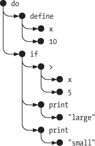

与此对比，我们在第 9 章中为配置文件格式编写的解析器结构简单：它将输入拆分成行，并逐行处理。每行只允许少数几种简单形式。

这里我们必须采用不同的方法。表达式不是按行分隔的，而且具有递归结构。应用表达式*包含*其他表达式。

幸运的是，我们可以通过编写一个递归的解析器函数来优雅地解决这个问题，该函数的递归方式反映了语言的递归性质。

我们定义了一个函数 `parseExpression`，它接收一个字符串作为输入，并返回一个对象，该对象包含字符串开头表达式的数据结构，以及解析完该表达式后剩余的字符串部分。当解析子表达式（例如应用的参数）时，可以再次调用此函数，得到参数表达式以及剩余的文本。这个剩余文本可能包含更多参数，也可能是结束参数列表的右括号。

这是解析器的第一部分：

```
function parseExpression(program) {
  program = skipSpace(program);
  var match, expr;
  if (match = /^"([^"]*)"/.exec(program))
    expr = {type: "value", value: match[1]};
  else if (match = /^\d+\b/.exec(program))
    expr = {type: "value", value: Number(match[0])};
  else if (match = /^[^\s(),"]+/.exec(program))
    expr = {type: "word", name: match[0]};
  else
    throw new SyntaxError("Unexpected syntax: " + program);

  return parseApply(expr, program.slice(match[0].length));
}
function skipSpace(string) {
  var first = string.search(/\S/);
  if (first == -1) return "";
  return string.slice(first);
}
```

由于 Egg 允许元素之间有任何数量的空白字符，我们必须反复从程序字符串的开头去除空白字符。这就是 `skipSpace` 函数的作用。

跳过前导空格后，`parseExpression` 使用三个正则表达式来识别 Egg 支持的三种简单（原子）元素：字符串、数字和单词。解析器根据匹配到的类型构造不同的数据结构。如果输入不匹配这三种形式中的任何一种，则不是有效的表达式，解析器会抛出错误。`SyntaxError` 是一种标准的错误对象类型，当尝试运行无效的 JavaScript 程序时会引发该错误。

然后我们可以从程序字符串中截掉匹配的部分，并将其与表达式对象一起传递给 `parseApply`，后者检查该表达式是否是一个应用。如果是，则解析带括号的参数列表。

```
function parseApply(expr, program) {
  program = skipSpace(program);
  if (program[0] != "(")
    return {expr: expr, rest: program};

  program = skipSpace(program.slice(1));
  expr = {type: "apply", operator: expr, args: []};
  while (program[0] != ")") {
    var arg = parseExpression(program);
    expr.args.push(arg.expr);
    program = skipSpace(arg.rest);
    if (program[0] == ",")
      program = skipSpace(program.slice(1));
    else if (program[0] != ")")
      throw new SyntaxError("Expected ',' or ')'");
  }
  return parseApply(expr, program.slice(1));
}
```

如果程序中的下一个字符不是左括号，则这不是一个应用，`parseApply` 直接返回它收到的表达式。

否则，它会跳过左括号，并为这个应用表达式创建语法树对象。然后它递归调用 `parseExpression` 来解析每个参数，直到遇到右括号。这种递归是间接的，通过 `parseApply` 和 `parseExpression` 相互调用实现。

因为一个应用表达式本身也可以被应用（例如 `multiplier(2)(1)`），所以 `parseApply` 在解析完一个应用后，必须再次调用自身，检查后面是否还有另一对括号。

这就是解析 Egg 所需的全部内容。我们将其封装在一个方便的 `parse` 函数中，该函数在解析表达式后验证是否已到达输入字符串的末尾（一个 Egg 程序就是一个单独的表达式），并返回程序的数据结构。

```
function parse(program) {
  var result = parseExpression(program);
  if (skipSpace(result.rest).length > 0)
    throw new SyntaxError("Unexpected text after program");
  return result.expr;
}

console.log(parse("+(a, 10)"));
// ▹ {type: "apply",
//    operator: {type: "word", name: "+"},
//    args: [{type: "word", name: "a"},
//           {type: "value", value: 10}]}
```

它运行正常！尽管在失败时它不会提供非常有用的信息，也不会存储每个表达式开始的行号和列号（这在以后报告错误时可能有用），但对于我们的目的来说已经足够好了。

## 求值器


对于程序的语法树，我们能做些什么？当然是运行它！这正是求值器（evaluator）所做的事情。你给它一个语法树和一个将名称与值关联的环境对象，它会计算树所代表的表达式，并返回产生的结果。

```
function evaluate(expr, env) {
  switch(expr.type) {
    case "value":
      return expr.value;

    case "word":
      if (expr.name in env)
        return env[expr.name];
      else
        throw new ReferenceError("Undefined variable: " + expr.name);

    case "apply":
      if (expr.operator.type == "word" && expr.operator.name in specialForms)
        return specialFormsexpr.operator.name;
      var op = evaluate(expr.operator, env);
      if (typeof op != "function")
        throw new TypeError("Applying a non-function.");
      return op.apply(null, expr.args.map(function(arg) {
        return evaluate(arg, env);
      }));
  }
}

var specialForms = Object.create(null);
```

求值器为每种表达式类型都提供了代码。字面量值表达式直接产生其值。（例如，表达式 `100` 只会求值为数字 100。）对于变量，我们必须检查它是否在环境中定义，如果定义了，就获取该变量的值。

应用（Application）则更为复杂。如果它是一个特殊形式（special form），比如 `if`，我们不会求值任何东西，而是直接将参数表达式和环境一起传递给处理该形式的函数。如果它是一个普通调用，我们会求值运算符，验证它是否是一个函数，然后用求值参数的结果来调用它。

我们将使用普通的 JavaScript 函数值来表示 Egg 的函数值。稍后，当定义了名为 `fun` 的特殊形式时，我们会再回到这个话题。

`evaluate` 的递归结构与解析器的递归结构类似。两者都反映了语言本身的结构。也可以将解析器与求值器集成，在解析过程中进行求值，但这样分开处理会使程序更易读。

这就是解释 Egg 所需的全部内容。它就是这么简单。但如果不定义一些特殊形式，并向环境中添加一些有用的值，你还无法用这门语言做任何事情。

## 特殊形式

`specialForms` 对象用于在 Egg 中定义特殊语法。它将单词与求值这些特殊形式的函数关联起来。目前它是空的。让我们添加一些形式。

```
specialForms["if"] = function(args, env) {
  if (args.length != 3)
    throw new SyntaxError("Bad number of args to if");

if (evaluate(args[0], env) !== false)
  return evaluate(args[1], env);
else
  return evaluate(args[2], env);
};
```

Egg 的 `if` 构造期望恰好三个参数。它会求值第一个参数，如果结果不是值 `false`，则求值第二个参数；否则求值第三个参数。这个 `if` 形式更类似于 JavaScript 的三元 `?:` 运算符，而不是 JavaScript 的 `if`。它是一个表达式，而不是语句，并且会产生一个值，即第二个或第三个参数的结果。

Egg 在处理 `if` 的条件值时与 JavaScript 不同。它不会将零或空字符串视为假，只有精确的值 `false` 才被视为假。

我们需要将 `if` 表示为特殊形式，而不是普通函数，原因在于：函数的所有参数在调用函数之前都会被求值，而 `if` 应该只根据第一个参数的值，求值*要么*第二个参数，*要么*第三个参数。

`while` 形式与之类似。

```
specialForms["while"] = function(args, env) {
  if (args.length != 2)
    throw new SyntaxError("Bad number of args to while");

  while (evaluate(args[0], env) !== false)
    evaluate(args[1], env);

  // Since undefined does not exist in Egg, we return false,
  // for lack of a meaningful result.
  return false;
};
```

另一个基本构建块是 `do`，它从上到下执行所有参数。它的值是最后一个参数产生的值。

```
specialForms["do"] = function(args, env) {
  var value = false;
  args.forEach(function(arg) {
    value = evaluate(arg, env);
  });
  return value;
};
```

为了能够创建变量并赋予新值，我们还创建了一个名为 `define` 的形式。它期望第一个参数是一个单词，第二个参数是一个表达式，用于产生要赋给该单词的值。由于 `define` 和其他所有东西一样，也是一个表达式，所以它必须返回一个值。我们将让它返回被赋值的值（就像 JavaScript 的 `=` 运算符一样）。

```
specialForms["define"] = function(args, env) {
  if (args.length != 2 || args[0].type != "word")
    throw new SyntaxError("Bad use of define");
  var value = evaluate(args[1], env);
  env[args[0].name] = value;
  return value;
};
```

## 环境

`evaluate` 接受的环境是一个对象，其属性名对应变量名，属性值对应这些变量所绑定的值。让我们定义一个环境对象来表示全局作用域。

为了能够使用我们刚刚定义的 `if` 构造，我们必须能够访问布尔值。由于只有两个布尔值，我们不需要为它们提供特殊语法。我们只需将两个变量绑定到值 `true` 和 `false`，然后使用它们即可。

```
var topEnv = Object.create(null);

topEnv["true"] = true;
topEnv["false"] = false;
```

现在我们可以求值一个简单的表达式，该表达式对布尔值取反。

```
var prog = parse("if(true, false, true)");
console.log(evaluate(prog, topEnv));
// ▹ false
```

为了提供基本的算术和比较运算符，我们还将向环境中添加一些函数值。为了保持代码简短，我们将使用 `new Function` 在循环中合成一组运算符函数，而不是逐个定义它们。

```
["+", "-", "*", "/", "==", "<", ">"].forEach(function(op) {
  topEnv[op] = new Function("a, b", "return a " + op + " b;");
});
```

输出值的方式也非常有用，因此我们将 `console.log` 包装在一个函数中，并称之为 `print`。

```
topEnv["print"] = function(value) {
  console.log(value);
  return value;
};
```

这为我们提供了足够的基本工具来编写简单的程序。下面的 `run` 函数提供了一种方便的方式来编写和运行它们。它会创建一个新的环境，并将我们提供的字符串解析并求值为一个单一程序。

```
function run() {
  var env = Object.create(topEnv);
  var program = Array.prototype.slice.call(arguments, 0).join("\n");
  return evaluate(parse(program), env);
}
```

使用 `Array.prototype.slice.call` 是一种技巧，用于将类数组对象（如 `arguments`）转换为真正的数组，以便我们可以对其调用 `join`。它接受所有传递给 `run` 的参数，并将它们视为程序的各行。

```
run("do(define(total, 0),",
    "   define(count, 1),",
    "   while(<(count, 11),",
    "         do(define(total, +(total, count)),",
    "            define(count, +(count, 1)))),",
    "   print(total))");
// ▹ 55
```

这就是我们之前多次见过的程序，它计算 1 到 10 的和，用 Egg 表达。它显然比等价的 JavaScript 程序更丑陋，但对于一个用不到 150 行代码实现的语言来说，已经不错了。

## 函数

没有函数的编程语言确实是一种贫乏的编程语言。

幸运的是，添加一个 `fun` 构造并不困难，它将最后一个参数视为函数体，并将之前的所有参数视为函数参数的名称。


```
specialForms["fun"] = function(args, env) {
  if (!args.length)
    throw new SyntaxError("Functions need a body");
  function name(expr) {
    if (expr.type != "word")
      throw new SyntaxError("Arg names must be words");
    return expr.name;
  }
  var argNames = args.slice(0, args.length - 1).map(name);
  var body = args[args.length - 1];

  return function() {
  if (arguments.length != argNames.length)
    throw new TypeError("Wrong number of arguments");
  var localEnv = Object.create(env);
    for (var i = 0; i < arguments.length; i++)
      localEnv[argNames[i]] = arguments[i];
    return evaluate(body, localEnv);
  };
};
```

Egg 中的函数拥有自己的局部环境，就像 JavaScript 一样。我们使用 `Object.create` 创建一个新对象，该对象可以访问外部环境中的变量（其原型），同时也能包含新变量而不会修改外部作用域。

由 `fun` 形式创建的函数会建立这个局部环境，并将参数变量添加进去。然后它在该环境中执行函数体并返回结果。

```
run("do(define(plusOne, fun(a, +(a, 1))),",
    "   print(plusOne(10)))");
// ▹ 11

run("do(define(pow, fun(base, exp,",
    "     if(==(exp, 0),",
    "        1,",
    "        *(base, pow(base, -(exp, 1)))))),",
    "   print(pow(2, 10)))");
// ▹ 1024
```

## 编译

我们构建的是一个解释器。在求值过程中，它直接作用于解析器生成的程序表示。

**编译**是在解析和运行程序之间增加一个步骤的过程，它通过尽可能提前完成工作，将程序转换为可以更高效求值的形式。例如，在设计良好的语言中，对于每个变量的使用，无需实际运行程序就能明确知道引用的是哪个变量。这可以避免每次访问变量时都按名称查找，而是直接从某个预定的内存位置获取。

传统上，编译涉及将程序转换为机器码，即计算机处理器可以执行的原始格式。但任何将程序转换为不同表示形式的过程都可以视为编译。

我们可以为 Egg 编写另一种求值策略：先将程序转换为 JavaScript 程序，然后使用 `new Function` 调用 JavaScript 编译器，最后运行结果。如果实现得当，这将使 Egg 运行得非常快，同时实现起来仍然相当简单。

如果你对这个主题感兴趣并愿意花些时间，我鼓励你尝试实现这样一个编译器作为练习。

## 作弊

当我们定义 `if` 和 `while` 时，你可能已经注意到它们或多或少只是 JavaScript 自身 `if` 和 `while` 的简单包装。同样，Egg 中的值也只是普通的 JavaScript 值。

如果将基于 JavaScript 构建的 Egg 实现与直接在机器提供的原始功能上构建编程语言所需的工作量和复杂性进行比较，差异是巨大的。尽管如此，这个例子希望能让你对编程语言的工作方式有所了解。

而在完成实际任务时，作弊比亲力亲为更有效。尽管本章中的玩具语言无法完成任何 JavaScript 无法更好地完成的事情，但确实存在一些情况，编写小型语言有助于完成实际工作。

这样的语言不必像典型的编程语言。如果 JavaScript 没有内置正则表达式，你可以为这种子语言编写自己的解析器和求值器。

或者想象你正在建造一个巨大的机器恐龙，需要为其编程行为。JavaScript 可能不是最有效的方式。你可能会选择一种看起来像这样的语言：

```
behavior walk
  perform when
    destination ahead
  actions
    move left-foot
    move right-foot

behavior attack
  perform when
    Godzilla in-view
  actions
    fire laser-eyes
    launch arm-rockets
```

这就是通常所说的**领域特定语言**，一种为表达狭窄领域知识而量身定制的语言。这种语言可以比通用语言更具表现力，因为它被设计为精确表达其领域中需要表达的内容，而不涉及其他。

## 练习

### 数组

通过向顶层作用域添加以下三个函数来为 Egg 添加对数组的支持：`array(...)` 用于构造包含参数值的数组，`length(array)` 用于获取数组长度，`element(array, n)` 用于获取数组的第 `n` 个元素。

### 闭包

我们定义 `fun` 的方式允许 Egg 中的函数“闭合”周围环境，使函数体能够使用函数定义时可见的局部值，就像 JavaScript 函数一样。

以下程序说明了这一点：函数 `f` 返回一个函数，该函数将其参数与 `f` 的参数相加，这意味着它需要访问 `f` 内部的局部作用域才能使用变量 `a`。

```
run("do(define(f, fun(a, fun(b, +(a, b)))),",
    "   print(f(4)(5)))");
// ▹ 9
```

回到 `fun` 形式的定义，解释是哪种机制使其生效。

### 注释

如果能在 Egg 中编写注释就好了。例如，每当我们遇到井号（`#`）时，可以将该行剩余部分视为注释并忽略，类似于 JavaScript 中的 `//`。

我们不需要对解析器进行大的改动来支持这一点。只需修改 `skipSpace`，使其像跳过空白一样跳过注释，这样所有调用 `skipSpace` 的地方现在也会跳过注释。请进行此修改。

### 修复作用域

目前，给变量赋值的唯一方式是 `define`。这个构造既可以定义新变量，也可以给已有变量赋予新值。

这种歧义会导致问题。当你试图给一个非局部变量赋予新值时，最终会在局部作用域中定义一个同名变量。（有些语言在设计上就是这样工作的，但我一直觉得这是一种处理作用域的愚蠢方式。）

添加一个类似于 `define` 的特殊形式 `set`，它给变量赋予新值，如果变量在内部作用域中不存在，则更新外部作用域中的变量。如果变量根本没有定义，则抛出 `ReferenceError`（这是另一种标准错误类型）。

到目前为止，将作用域表示为简单对象的技术让事情变得方便，但在这一点上会给你带来一些麻烦。你可能需要使用 `Object.getPrototypeOf` 函数，它返回对象的原型。还要记住，作用域并不继承自 `Object.prototype`，因此如果你想对它们调用 `hasOwnProperty`，必须使用这种笨拙的表达式：

```
Object.prototype.hasOwnProperty.call(scope, name);
```

这会从 `Object` 原型中获取 `hasOwnProperty` 方法，然后在作用域对象上调用它。

# 第二部分 浏览器

# 第 12 章 JavaScript 与浏览器

> “浏览器是一个非常恶劣的编程环境。”
> 
> ——道格拉斯·克罗克福德，《JavaScript 编程语言》（视频讲座）

本书的下一部分将讨论网页浏览器。没有网页浏览器，就不会有 JavaScript。即使有，也不会有人关注它。

从一开始，Web 技术就是去中心化的，不仅在技术上如此，在其演进方式上也是如此。各种浏览器厂商以临时且有时考虑不周的方式添加新功能，这些功能有时会被其他厂商采纳，最终被确立为标准。


这既是福也是祸。一方面，没有中央机构控制整个系统，而是由各方松散协作（偶尔也会公开对抗），这赋予了系统强大的能力。另一方面，网络发展的随意性意味着最终形成的系统并非内部一致性的典范。事实上，其中有些部分简直混乱不堪、令人困惑。

## 网络与互联网

计算机网络自 20 世纪 50 年代就已存在。如果你在两台或多台计算机之间铺设电缆，让它们通过这些电缆来回发送数据，你就能实现各种奇妙的事情。

如果连接同一栋楼里的两台机器就能实现奇妙的事情，那么连接全球各地的机器应该会更好。实现这一愿景的技术在 20 世纪 80 年代被开发出来，由此形成的网络被称为*互联网*。它没有辜负人们的期望。

一台计算机可以利用这个网络向另一台计算机发送比特流。要使这种比特流产生有效的通信，两端的计算机都必须知道这些比特代表什么。任何给定比特序列的含义完全取决于它试图表达的内容类型以及所使用的编码机制。

*网络协议*描述了一种通过网络进行通信的方式。有用于发送电子邮件的协议、用于获取电子邮件的协议、用于共享文件的协议，甚至还有用于控制被恶意软件感染的计算机的协议。

例如，一个简单的聊天协议可能由一台计算机向另一台机器发送代表文本“CHAT?”的比特，另一台机器则回复“OK!”以确认它理解该协议。然后它们可以互相发送文本字符串，从网络中读取对方发送的文本，并在屏幕上显示接收到的任何内容。

大多数协议都构建在其他协议之上。我们示例中的聊天协议将网络视为一种流式设备，你可以向其中放入比特，并让它们按正确顺序到达正确的目的地。确保这些事情本身就是一个相当困难的技术问题。

*传输控制协议*（TCP）是一种解决这个问题的协议。所有连接到互联网的设备都“说”这种协议，互联网上的大多数通信都构建在它之上。

TCP 连接的工作方式如下：一台计算机必须等待（或*监听*）其他计算机开始与它通信。为了在同一台机器上同时监听不同类型的通信，每个监听器都有一个与之关联的编号（称为*端口*）。大多数协议会指定默认使用的端口。例如，当我们想使用 SMTP 协议发送电子邮件时，发送邮件的机器应该监听端口 25。

然后，另一台计算机可以通过使用正确的端口号连接到目标机器来建立连接。如果目标机器可达并且正在监听该端口，则连接成功建立。监听的计算机称为*服务器*，连接的计算机称为*客户端*。

这样的连接就像一个双向管道，比特可以在其中流动——两端的机器都可以向其中放入数据。一旦比特成功传输，另一端的机器就可以读取它们。这是一个方便的模型。可以说 TCP 提供了网络的抽象。

## 万维网

*万维网*（不要与整个互联网混淆）是一组协议和格式，允许我们在浏览器中访问网页。名称中的“Web”部分指的是这些页面可以轻松地相互链接，从而连接成一个巨大的网状结构，用户可以在其中浏览。

要向万维网添加内容，你只需将一台机器连接到互联网，并使用*超文本传输协议*（HTTP）让它监听端口 80。该协议允许其他计算机通过网络请求文档。

万维网上的每个文档都由一个*统一资源定位符*（URL）命名，其形式如下：

```
 http://eloquentjavascript.net/12_browser.html
|      |                      |               |
协议       服务器                  路径
```

第一部分告诉我们这个 URL 使用 HTTP 协议（与加密的 HTTP（即*https://*）相对）。接下来是标识我们请求文档的服务器部分。最后是一个路径字符串，标识我们感兴趣的特定文档（或*资源*）。

每台连接到互联网的机器都有一个唯一的*IP 地址*，看起来像`37.187.37.82`。你可以直接将这些地址用作 URL 的服务器部分。但一串或多或少随机的数字很难记住，也不方便输入，因此你可以注册一个*域名*来指向特定的机器或机器组。我注册了*eloquentjavascript.net*，指向我控制的一台机器的 IP 地址，因此可以使用该域名来提供网页服务。

如果你将前面的 URL 输入浏览器的地址栏，它会尝试检索并显示该 URL 对应的文档。首先，你的浏览器必须找出*eloquentjavascript.net*对应的地址。然后，使用 HTTP 协议，它连接到该地址的服务器，并请求资源*/12_browser.html*。

我们将在第 17 章中更详细地了解 HTTP 协议。

### HTML

HTML，全称为*超文本标记语言*，是用于网页的文档格式。一个 HTML 文档包含文本，以及为文本提供结构的*标签*，用于描述链接、段落和标题等内容。

一个简单的 HTML 文档如下所示：

```
<!doctype html>
<html>
  <head>
    <title>我的主页</title>
  </head>
  <body>
    <h1>我的主页</h1>
    <p>你好，我是 Marijn，这是我的主页。</p>
    <p>我还写了一本书！请点击
      <a href="http://eloquentjavascript.net">这里</a>阅读。</p>
  </body>
</html>
```

这样的文档在浏览器中看起来是这样的：

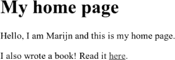

包裹在尖括号（`<`和`>`）中的标签提供了文档结构的信息。其他文本只是纯文本。

文档以`<!doctype html>`开头，它告诉浏览器将其解释为*现代*HTML，而不是过去使用的各种方言。

HTML 文档有一个头部和一个主体。头部包含关于文档的信息，主体包含文档本身。在这个例子中，我们首先声明了文档的标题是“我的主页”，然后给出了一个包含标题（`<h1>`，意为“标题 1”——`<h2>`到`<h6>`表示更次要的标题）和两个段落（`<p>`）的文档。

标签有多种形式。一个元素，如主体、段落或链接，由*开始标签*（如`<p>`）开始，并由*结束标签*（如`</p>`）结束。某些开始标签，如链接的标签（`<a>`），包含以`name="value"`对形式出现的额外信息。这些被称为*属性*。在这个例子中，链接的目标由`href="http://eloquentjavascript.net"`指示，其中`href`代表“超文本引用”。

某些类型的标签不包含任何内容，因此不需要闭合。例如``，它会显示给定源 URL 处的图像。


为了能够在文档文本中包含尖括号，尽管它们在 HTML 中具有特殊含义，还需要引入另一种特殊符号表示法。普通的左尖括号写作 `&lt;`（“小于号”），右尖括号写作 `&gt;`（“大于号”）。在 HTML 中，一个与号（`&`）后跟一个单词和一个分号（`;`）被称为*实体*，它会被替换为所编码的字符。

这与 JavaScript 字符串中使用反斜杠的方式类似。由于这种机制也给与号字符赋予了特殊含义，因此也需要将其转义为 `&amp;`。在由双引号包裹的属性内部，可以使用 `&quot;` 来插入一个实际的引号字符。

HTML 的解析方式具有显著的容错性。当应有的标签缺失时，浏览器会重建它们。这种重建方式已经标准化，你可以信赖所有现代浏览器都会以相同的方式处理。

以下文档的处理方式与之前展示的文档完全相同：

```
<!doctype html>

<title>My home page</title>

<h1>My home page</h1>
<p>Hello, I am Marijn and this is my home page.
<p>I also wrote a book! Read it
  <a href=http://eloquentjavascript.net>here</a>.
```

`<html>`、`<head>` 和 `<body>` 标签完全消失了。浏览器知道 `<title>` 属于 head 部分，而 `<h1>` 属于 body 部分。此外，我不再显式关闭段落，因为打开新段落或结束文档会隐式关闭它们。链接目标周围的引号也消失了。

本书通常会在示例中省略 `<html>`、`<head>` 和 `<body>` 标签，以保持简洁且无杂乱。但我*会*关闭标签并在属性周围包含引号。

我通常也会省略文档类型声明。但这不应被理解为鼓励省略文档类型声明。当你忘记它们时，浏览器往往会做出荒谬的事情。你应该认为示例中隐式包含了文档类型声明，即使文本中并未实际显示。

## HTML 与 JavaScript

在本书的上下文中，最重要的 HTML 标签是 `<script>`。这个标签允许我们在文档中包含一段 JavaScript 代码。

```
<h1>Testing alert</h1>
<script>alert("hello!");</script>
```

当浏览器读取 HTML 时，一旦遇到 `<script>` 标签，这样的脚本就会立即运行。前面展示的页面在打开时会弹出一个 `alert` 对话框。

将大型程序直接包含在 HTML 文档中通常不切实际。`<script>` 标签可以添加一个 `src` 属性，以便从 URL 获取脚本文件（包含 JavaScript 程序的文本文件）。

```
<h1>Testing alert</h1>
<script src="code/hello.js"></script>
```

这里包含的 `code/hello.js` 文件包含相同的简单程序 `alert("hello!")`。当 HTML 页面引用其他 URL 作为自身的一部分时（例如，图片文件或脚本），Web 浏览器会立即检索它们并将其包含在页面中。

脚本标签必须始终以 `</script>` 结束，即使它引用的是脚本文件且不包含任何代码。如果你忘记这一点，页面的其余部分将被解释为脚本的一部分。

某些属性也可以包含 JavaScript 程序。接下来展示的 `<button>` 标签（显示为一个按钮）有一个 `onclick` 属性，其内容会在按钮被点击时运行。

```
<button onclick="alert('Boom!');">DO NOT PRESS</button>
```

请注意，我不得不在 `onclick` 属性中对字符串使用单引号，因为双引号已经用于引用整个属性。我也可以使用 `&quot;`，但这会使程序更难阅读。

## 在沙盒中

运行从互联网下载的程序具有潜在危险。你对你访问的大多数网站背后的人了解不多，他们不一定怀有好意。运行不怀好意的人编写的程序会导致你的计算机感染病毒、数据被盗、账户被黑。

然而，Web 的魅力在于你可以在不信任所有访问页面的情况下浏览它。这就是为什么浏览器严格限制 JavaScript 程序可以做的事情：它不能查看你计算机上的文件，也不能修改与嵌入它的网页无关的任何内容。

以这种方式隔离编程环境被称为*沙盒*，其理念是程序在沙盒中无害地玩耍。但你应该想象这种特殊的沙盒上面有一个厚钢条制成的笼子，这使它与你典型的游乐场沙盒有所不同。

沙盒的难点在于允许程序有足够的空间来发挥作用，同时限制它们做任何危险的事情。许多有用的功能，例如与其他服务器通信或读取剪贴板内容，也可能被用来做有问题的、侵犯隐私的事情。

时不时地，有人会想出新的方法来绕过浏览器的限制并做一些有害的事情，从泄露轻微的私人信息到控制运行浏览器的整个机器。浏览器开发者通过修复漏洞来回应，一切又恢复平静——直到下一个问题被发现并希望被公开，而不是被某个政府或黑帮秘密利用。

## 兼容性与浏览器大战

在 Web 早期，一款名为 Mosaic 的浏览器主导了市场。几年后，平衡转向了 Netscape，随后它又被微软的 Internet Explorer 大量取代。在任何单一浏览器占据主导地位的时期，该浏览器的供应商都会觉得有权单方面为 Web 发明新功能。由于大多数用户使用相同的浏览器，网站就会开始使用这些功能——而不管其他浏览器。

这是兼容性的黑暗时代，通常被称为*浏览器大战*。Web 开发者面对的并非统一的 Web，而是两个或三个不兼容的平台。更糟糕的是，2003 年左右使用的浏览器都充满了 bug，而且不同浏览器的 bug 当然也不同。编写网页的人生活艰难。

Mozilla Firefox（Netscape 的非营利分支）在 2000 年代末挑战了 Internet Explorer 的霸权。由于微软当时对保持竞争力并不特别感兴趣，Firefox 从它手中夺走了相当大一部分市场份额。大约在同一时间，谷歌推出了 Chrome 浏览器，苹果的 Safari 浏览器也获得了 popularity，导致出现了四个主要参与者，而不是一个。

新参与者对标准持有更严肃的态度，并采用了更好的工程实践，从而减少了不兼容性和 bug。微软看到自己的市场份额崩溃后，也转变态度并采纳了这些做法。如果你今天开始学习 Web 开发，请认为自己很幸运。主要浏览器的最新版本行为相当一致，且 bug 相对较少。

这并不是说情况已经完美。一些使用 Web 的人，由于惯性或公司政策，仍停留在非常旧的浏览器上。在这些浏览器完全消亡之前，编写能兼容它们的网站需要大量关于其缺陷和怪癖的深奥知识。本书不涉及这些怪癖。相反，它旨在呈现现代、合理的 Web 编程风格。

# 第 13 章 文档对象模型

当你在浏览器中打开一个网页时，浏览器会检索该页面的 HTML 文本并解析它，就像我们在第 11 章中的解析器解析程序一样。浏览器会构建一个文档结构模型，然后使用该模型在屏幕上绘制页面。


这种文档表示法是 JavaScript 程序在其沙盒中可用的玩具之一。你可以从模型中读取数据，也可以修改它。它充当一个*实时*的数据结构：当它被修改时，页面上的屏幕会更新以反映这些变化。

## 文档结构

你可以把 HTML 文档想象成一组嵌套的盒子。像 `<body>` 和 `</body>` 这样的标签包围着其他标签，而这些标签又包含其他标签或文本。以下是上一章中的示例文档：

```
<!doctype html>
<html>
  <head>
    <title>我的主页</title>

  </head>
  <body>
    <h1>我的主页</h1>
    <p>你好，我是 Marijn，这是我的主页。</p>
    <p>我还写了一本书！请点击
      <a href="http://eloquentjavascript.net">这里</a>阅读。</p>
  </body>
</html>
```

该页面具有以下结构：

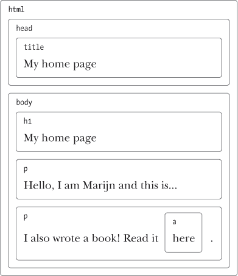

浏览器用来表示文档的数据结构遵循这种形状。每个盒子对应一个对象，我们可以与之交互，以了解它代表哪个 HTML 标签，以及它包含哪些盒子和文本。这种表示法称为*文档对象模型*，简称 DOM。

全局变量 `document` 让我们能够访问这些对象。它的 `documentElement` 属性指向代表 `<html>` 标签的对象。它还提供了 `head` 和 `body` 属性，分别保存这些元素的对象。

## 树

回想一下第 11 章中的语法树。它们的结构与浏览器文档的结构惊人地相似。每个*节点*可以引用其他节点（即*子节点*），而这些子节点又可能拥有自己的子节点。这种形状是嵌套结构的典型特征，其中元素可以包含与自身相似的子元素。

当一个数据结构具有分支结构、没有循环（节点不能直接或间接包含自身），并且有一个单一的、明确定义的“根”时，我们称其为*树*。在 DOM 中，`document.documentElement` 充当根节点。

树在计算机科学中经常出现。除了表示递归结构（如 HTML 文档或程序）之外，它们还常用于维护有序的数据集，因为在有序树中查找或插入元素通常比在有序的平面数组中更高效。

典型的树包含不同类型的节点。Egg 语言的语法树有变量、值和应用节点。应用节点总是有子节点，而变量和值是*叶子*，即没有子节点的节点。

DOM 也是如此。代表 HTML 标签的常规*元素*节点决定了文档的结构。这些节点可以有子节点。例如，`document.body` 就是这样一个节点。其中一些子节点可以是叶子节点，比如文本片段或注释（注释在 HTML 中写在 `<!-` 和 `->` 之间）。

每个 DOM 节点对象都有一个 `nodeType` 属性，它包含一个标识节点类型的数字代码。常规元素的值为 1，这也被定义为常量属性 `document.ELEMENT_NODE`。表示文档中一段文本的文本节点，其值为 3（`document.TEXT_NODE`）。注释的值为 8（`document.COMMENT_NODE`）。

因此，另一种可视化文档树的方式如下：

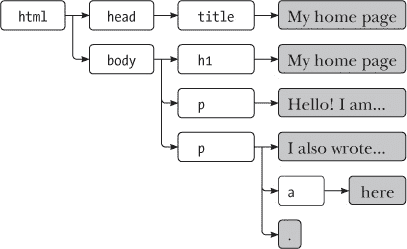

叶子是文本节点，箭头表示节点之间的父子关系。

## 标准

使用晦涩的数字代码来表示节点类型并不是一种非常符合 JavaScript 风格的做法。在本章后面，我们会看到 DOM 接口的其他部分也显得笨拙且陌生。原因是 DOM 并非仅为 JavaScript 设计。相反，它试图定义一种语言无关的接口，以便在其他系统中也能使用——不仅限于 HTML，还包括 XML，这是一种具有类似 HTML 语法的通用数据格式。

这很不幸。标准通常是有用的。但在这种情况下，优势（跨语言一致性）并不那么有说服力。拥有一个与你所使用的语言良好集成的接口，比拥有一个跨语言熟悉的接口更能节省时间。

作为这种糟糕集成的一个例子，考虑 DOM 中元素节点的 `childNodes` 属性。该属性持有一个类数组对象，具有 `length` 属性和按数字标记的属性来访问子节点。但它是 `NodeList` 类型的实例，而不是真正的数组，因此它没有 `slice` 和 `forEach` 等方法。

此外，还有一些纯粹是设计不佳的问题。例如，没有办法创建一个新节点并立即为其添加子节点或属性。相反，你必须先创建它，然后逐个添加子节点，最后再逐个设置属性，利用副作用。与 DOM 大量交互的代码往往会变得冗长、重复且丑陋。

但这些缺陷并非致命。由于 JavaScript 允许我们创建自己的抽象，因此很容易编写一些辅助函数，让你能够以更清晰、更简短的方式表达所执行的操作。事实上，许多用于浏览器编程的库都提供了这样的工具。

## 遍历树

DOM 节点包含大量指向附近其他节点的链接。下图说明了这些链接：

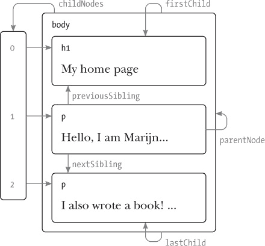

虽然图中每种链接只显示了一个，但每个节点都有一个 `parentNode` 属性，指向其包含节点。同样，每个元素节点（节点类型 1）都有一个 `childNodes` 属性，指向一个保存其子节点的类数组对象。

理论上，你可以仅使用这些父节点和子节点链接在树中任意移动。但 JavaScript 还为你提供了许多额外的便捷链接。`firstChild` 和 `lastChild` 属性指向第一个和最后一个子元素，对于没有子节点的节点，其值为 `null`。类似地，`previousSibling` 和 `nextSibling` 指向相邻节点，即具有相同父节点且紧邻该节点之前或之后的节点。对于第一个子节点，`previousSibling` 为 null；对于最后一个子节点，`nextSibling` 为 null。

当处理像这样的嵌套数据结构时，递归函数通常很有用。以下递归函数扫描文档中包含给定字符串的文本节点，并在找到时返回 `true`：

```
function talksAbout(node, string) {
  if (node.nodeType == document.ELEMENT_NODE) {
    for (var i = 0; i < node.childNodes.length; i++) {
      if (talksAbout(node.childNodes[i], string))
        return true;
    }
    return false;
  } else if (node.nodeType == document.TEXT_NODE) {
    return node.nodeValue.indexOf(string) > -1;
  }
}

console.log(talksAbout(document.body, "book"));
// ▹ true
```

文本节点的 `nodeValue` 属性指向它所表示的文本字符串。

## 查找元素

在父节点、子节点和兄弟节点之间导航这些链接通常很有用，就像前面的函数那样，它遍历了整个文档。但如果我们想在文档中找到一个特定的节点，从 `document.body` 开始，盲目地沿着硬编码的链接路径到达它，这是一个坏主意。这样做会将关于文档精确结构的假设固化到程序中——而我们可能希望以后更改这种结构。另一个复杂因素是，即使节点之间的空白也会创建文本节点。示例文档的 body 标签不仅仅有三个子节点（`<h1>` 和两个 `<p>` 元素），实际上有七个：这三个元素，加上它们之前、之后和之间的空格。


因此，如果我们想获取文档中链接的 `href` 属性，我们不会想说“获取文档正文第六个子元素的第二个子元素”。更好的方式是“获取文档中的第一个链接”。而我们可以做到这一点。

```
var link = document.body.getElementsByTagName("a")[0];
console.log(link.href);
```

所有元素节点都有一个 `getElementsByTagName` 方法，它会收集给定节点下所有具有指定标签名的后代（直接或间接子元素），并以类数组对象的形式返回它们。

要查找特定的*单个*节点，你可以为其添加一个 `id` 属性，然后使用 `document.getElementById` 代替。

```
<p>My ostrich Gertrude:</p>
<p></p>

<script>
  var ostrich = document.getElementById("gertrude");
  console.log(ostrich.src);
</script>
```

第三种类似的方法是 `getElementsByClassName`，它与 `getElementsByTagName` 一样，会搜索元素节点的内容，并检索所有在其 `class` 属性中包含给定字符串的元素。

## 修改文档

DOM 数据结构几乎所有的内容都可以被修改。元素节点有许多方法可以用来改变其内容。`removeChild` 方法从文档中移除给定的子节点。要添加子节点，我们可以使用 `appendChild`，它会将节点添加到子节点列表的末尾，或者使用 `insertBefore`，它会将第一个参数指定的节点插入到第二个参数指定的节点之前。

```
<p>One</p>
<p>Two</p>
<p>Three</p>

<script>
  var paragraphs = document.body.getElementsByTagName("p");
  document.body.insertBefore(paragraphs[2], paragraphs[0]);
</script>
```

一个节点在文档中只能存在于一个位置。因此，将段落“Three”插入到段落“One”之前，会先将其从文档末尾移除，然后再插入到开头，结果变成“Three/ One/Two”。所有将节点插入到某处的操作，都会附带将其从当前位置移除（如果它原本存在的话）。

`replaceChild` 方法用于用一个子节点替换另一个子节点。它接受两个参数：一个新节点和要被替换的节点。被替换的节点必须是调用该方法的元素的子节点。注意，`replaceChild` 和 `insertBefore` 都期望*新*节点作为它们的第一个参数。

## 创建节点

在下面的示例中，我们想编写一个脚本，将文档中的所有图像（`` 标签）替换为其 `alt` 属性中的文本，该属性指定了图像的替代文本表示。

这不仅要移除图像，还要添加一个新的文本节点来替换它们。为此，我们使用 `document.createTextNode` 方法。

```
<p>The  in the
  .</p>

<p><button onclick="replaceImages()">Replace</button></p>

<script>
  function replaceImages() {
    var images = document.body.getElementsByTagName("img");
    for (var i = images.length - 1; i >= 0; i--) {
      var image = images[i];
      if (image.alt) {
        var text = document.createTextNode(image.alt);
        image.parentNode.replaceChild(text, image);
      }
    }
  }
</script>
```

给定一个字符串，`createTextNode` 会返回一个类型为 3 的 DOM 节点（文本节点），我们可以将其插入到文档中，使其显示在屏幕上。

遍历图像的循环从节点列表的末尾开始。这是必要的，因为像 `getElementsByTagName`（或像 `childNodes` 这样的属性）返回的节点列表是*实时*的。也就是说，它会随着文档的变化而更新。如果我们从前面开始，移除第一个图像会导致列表丢失其第一个元素，因此当循环第二次执行时，`i` 为 1，此时集合的长度也变为 1，循环就会停止。

如果你想要一个*静态*的节点集合，而不是实时的，你可以通过在该集合上调用数组的 `slice` 方法将其转换为真正的数组。

```
var arrayish = {0: "one", 1: "two", length: 2};
var real = Array.prototype.slice.call(arrayish, 0);
real.forEach(function(elt) { console.log(elt); });
// ▹ one
//   two
```

要创建常规的元素节点（类型 1），你可以使用 `document.createElement` 方法。该方法接受一个标签名，并返回一个给定类型的新空节点。

下面的示例定义了一个实用函数 `elt`，它创建一个元素节点，并将其余参数视为该节点的子节点。然后使用该函数为一段引用添加简单的署名。

```
<blockquote id="quote">
  No book can ever be finished. While working on it we learn
  just enough to find it immature the moment we turn away
  from it.
</blockquote>

<script>
  function elt(type) {
    var node = document.createElement(type);
    for (var i = 1; i < arguments.length; i++) {
      var child = arguments[i];
      if (typeof child == "string")
        child = document.createTextNode(child);
      node.appendChild(child);
    }
    return node;
  }

  document.getElementById("quote").appendChild(
    elt("footer", "--",
        elt("strong", "Karl Popper"),
        ", preface to the second editon of ",
        elt("em", "The Open Society and Its Enemies"),
        ", 1950"));
</script>
```

这是最终文档的样子：

> 没有一本书是真正完成的。在写作过程中，我们学到的刚好足以让我们在放下它时发现它的不成熟。

> 

> —**卡尔·波普尔**，《开放社会及其敌人》第二版序言，1950 年

## 属性

某些元素属性，例如链接的 `href`，可以通过元素 DOM 对象上同名的属性来访问。这适用于一组有限的常用标准属性。

但 HTML 允许你在节点上设置任何你想要的属性。这很有用，因为它允许你在文档中存储额外的信息。不过，如果你自己创建属性名，这些属性不会作为元素节点的属性存在。相反，你必须使用 `getAttribute` 和 `setAttribute` 方法来处理它们。

```
<p data-classified="secret">The launch code is 00000000.</p>
<p data-classified="unclassified">I have two feet.</p>

<script>
  var paras = document.body.getElementsByTagName("p");
  Array.prototype.forEach.call(paras, function(para) {
    if (para.getAttribute("data-classified") == "secret")
      para.parentNode.removeChild(para);
  });
</script>
```

我建议将这类自定义属性的名称加上 `data-` 前缀，以确保它们不会与其他属性冲突。

作为一个简单的例子，我们将编写一个“语法高亮器”，它会查找带有 `data-language` 属性的 `<pre>` 标签（“预格式化”，用于代码和类似的纯文本），并粗略地尝试高亮该语言的关键字。

```
function highlightCode(node, keywords) {
  var text = node.textContent;
  node.textContent = ""; // Clear the node

  var match, pos = 0;
  while (match = keywords.exec(text)) {
    var before = text.slice(pos, match.index);
    node.appendChild(document.createTextNode(before));
    var strong = document.createElement("strong");
    strong.appendChild(document.createTextNode(match[0]));
    node.appendChild(strong);
    pos = keywords.lastIndex;
  }
  var after = text.slice(pos);
  node.appendChild(document.createTextNode(after));
}
```

函数 `highlightCode` 接受一个 `<pre>` 节点和一个正则表达式（已开启“全局”选项），该正则表达式匹配该元素包含的编程语言的关键字。


`textContent` 属性用于获取节点中的所有文本，然后将其设置为空字符串，从而清空该节点。我们遍历关键字表达式的所有匹配项，将匹配项*之间*的文本作为普通文本节点追加，而匹配到的文本（关键字）则作为包裹在 `<strong>`（粗体）元素中的文本节点追加。

通过遍历所有具有 `data-language` 属性的 `<pre>` 元素，并为每个元素调用 `highlightCode` 并传入该语言对应的正确正则表达式，我们可以自动高亮页面上的所有程序。

```
var languages = {
  javascript: /\b(function|return|var)\b/g /* ... 等等 */
};

function highlightAllCode() {
  var pres = document.body.getElementsByTagName("pre");
  for (var i = 0; i < pres.length; i++) {
    var pre = pres[i];
    var lang = pre.getAttribute("data-language");
    if (languages.hasOwnProperty(lang))
      highlightCode(pre, languages[lang]);
  }
}
```

下面是一个示例：

```
<p>这是恒等函数：</p>
<pre data-language="javascript">
function id(x) { return x; }
</pre>

<script>highlightAllCode();</script>
```

这会生成一个如下所示的页面：

这是恒等函数：

```
function id(x) { return x; }
```

有一个常用的属性 `class`，它是 JavaScript 语言中的保留字。由于历史原因——一些旧的 JavaScript 实现无法处理与关键字或保留字匹配的属性名——用于访问该属性的属性被称为 `className`。你也可以通过使用 `getAttribute` 和 `setAttribute` 方法，以其真实名称 `"class"` 来访问它。

## 布局

你可能已经注意到，不同类型的元素布局方式不同。有些元素，如段落（`<p>`）或标题（`<h1>`），占据文档的整个宽度，并在单独的行上渲染。这些被称为*块级*元素。其他元素，如链接（`<a>`）或上一个示例中使用的 `<strong>` 元素，则与其周围的文本在同一行上渲染。这类元素被称为*内联*元素。

对于任何给定的文档，浏览器能够计算出一个布局，根据元素的类型和内容为每个元素分配大小和位置。然后使用这个布局来实际绘制文档。

元素的大小和位置可以从 JavaScript 中访问。`offsetWidth` 和 `offsetHeight` 属性提供了元素在*像素*中占据的空间。像素是浏览器中的基本度量单位，通常对应于屏幕可以显示的最小点。类似地，`clientWidth` 和 `clientHeight` 提供了元素*内部*空间的大小，忽略边框宽度。

```
<p style="border: 3px solid red">
  我被框起来了
</p>

<script>
  var para = document.body.getElementsByTagName("p")[0];
  console.log("clientHeight:", para.clientHeight);
  console.log("offsetHeight:", para.offsetHeight);
</script>
```

给段落添加边框会在其周围绘制一个矩形。


在屏幕上找到元素精确位置的最有效方法是 `getBoundingClientRect` 方法。它返回一个具有 `top`、`bottom`、`left` 和 `right` 属性的对象，指示元素各边相对于屏幕左上角的像素位置。如果你希望它们相对于整个文档，则必须加上当前的滚动位置，该位置可通过全局变量 `pageXOffset` 和 `pageYOffset` 获取。

布局文档可能是一项相当繁重的工作。为了速度，浏览器引擎不会在每次文档更改时立即重新布局，而是尽可能等待。当更改文档的 JavaScript 程序运行完毕后，浏览器必须计算新的布局，以便在屏幕上显示更改后的文档。当程序通过读取诸如 `offsetHeight` 之类的属性或调用 `getBoundingClientRect` 来*询问*某物的位置或大小时，提供正确信息也需要计算布局。

一个反复交替读取 DOM 布局信息和更改 DOM 的程序会导致大量布局计算，从而运行得非常缓慢。以下代码展示了这一点。它包含两个不同的程序，它们构建一条 2000 像素宽的 *X* 字符线，并测量每个程序所花费的时间。

```
<p><span id="one"></span></p>
<p><span id="two"></span></p>
<script>
  function time(name, action) {
    var start = Date.now(); // 当前时间（毫秒）
    action();
    console.log(name, "took", Date.now() - start, "ms");
  }

  time("naive", function() {
    var target = document.getElementById("one");
    while (target.offsetWidth < 2000)
      target.appendChild(document.createTextNode("X"));
  });
  // ▹ naive took 32 ms

  time("clever", function() {
    var target = document.getElementById("two");
    target.appendChild(document.createTextNode("XXXXX"));
    var total = Math.ceil(2000 / (target.offsetWidth / 5));
    for (var i = 5; i < total; i++)
      target.appendChild(document.createTextNode("X"));
  });
  // ▹ clever took 1 ms
</script>
```

## 样式

我们已经看到不同的 HTML 元素表现出不同的行为。有些显示为块级，有些为内联。有些添加了样式，例如 `<strong>` 使其内容加粗，`<a>` 使其变蓝并添加下划线。

`` 标签显示图像的方式，或者 `<a>` 标签在点击时触发链接的方式，与元素类型紧密相关。但与元素关联的默认样式（例如文本颜色或下划线）可以由我们更改。以下是一个使用 `style` 属性的示例：

```
<p><a href=".">普通链接</a></p>
<p><a href="." style="color: green">绿色链接</a></p>
```

第二个链接将是绿色，而不是默认的链接颜色。

普通链接

绿色链接

样式属性可以包含一个或多个*声明*，每个声明由一个属性（如 `color`）后跟冒号和值（如 `green`）组成。当有多个声明时，它们必须用分号分隔，例如 `"color: red; border: none"`。

样式可以影响很多方面。例如，`display` 属性控制元素是显示为块级元素还是内联元素。

```
这段文本显示为 <strong>内联</strong>，
<strong style="display: block">作为块级</strong>，以及
<strong style="display: none">完全不显示</strong>。
```

`block` 标签将单独占据一行，因为块级元素不会与周围的文本内联显示。最后一个标签完全不显示——`display: none` 阻止元素在屏幕上显示。这是一种隐藏元素的方式。它通常比完全从文档中移除元素更可取，因为这样可以在以后轻松地再次显示它们。

> 这段文本显示为 **内联**，

> 

> **作为块级**

> 

> ，以及 。

JavaScript 代码可以通过节点的 `style` 属性直接操作元素的样式。该属性持有一个对象，该对象包含所有可能样式属性的属性。这些属性的值是字符串，我们可以通过写入它们来更改元素样式的特定方面。

```
<p id="para" style="color: purple">
  漂亮的文本
</p>

<script>
  var para = document.getElementById("para");
  console.log(para.style.color);
  para.style.color = "magenta";
</script>
```

某些样式属性名称包含连字符，例如 `font-family`。由于在 JavaScript 中处理这样的属性名称很不方便（你必须写成 `style["font-family"]`），因此 `style` 对象中此类属性的名称会去掉连字符，并将连字符后的字母大写（`style.fontFamily`）。

## 层叠样式


HTML 的样式系统称为 CSS，即*层叠样式表*（Cascading Style Sheets）。*样式表*是一组规则，用于规定文档中元素的样式。它可以放在 `<style>` 标签内。

```
<style>
  strong {
    font-style: italic;
    color: gray;
  }
</style>
<p>Now <strong>strong text</strong> is italic and gray.</p>
```

名称中的*层叠*指的是多个这样的规则组合起来，为元素生成最终样式。在上例中，`<strong>` 标签的默认样式（赋予 `font-weight: bold`）被 `<style>` 标签中的规则覆盖，后者添加了 `font-style` 和 `color`。

当多个规则为同一属性定义值时，最近读取的规则优先级更高并胜出。因此，如果 `<style>` 标签中的规则包含 `font-weight: normal`，与默认的 `font-weight` 规则冲突，那么文本将显示为正常，*而非*粗体。直接应用于节点的 `style` 属性中的样式具有最高优先级，总是胜出。

在 CSS 规则中，可以针对标签名以外的目标。针对 `.abc` 的规则适用于所有 class 属性中包含 `"abc"` 的元素。针对 `#xyz` 的规则适用于 `id` 属性为 `"xyz"` 的元素（该 id 在文档中应唯一）。

```
.subtle {
  color: gray;
  font-size: 80%;
}
#header {
  background: blue;
  color: white;
}
/* p elements, with classes a and b, and id main */
p.a.b#main {
  margin-bottom: 20px;
}
```

优先级规则（倾向于最近定义的规则）仅在规则具有相同的*特异性*时才成立。规则的特异性是衡量它描述匹配元素的精确程度的指标，由它要求的元素方面的数量和种类（标签、类或 ID）决定。例如，针对 `p.a` 的规则比仅针对 `p` 或仅针对 `.a` 的规则更具体，因此会优先于它们。

符号 `p > a {...}` 将给定样式应用于所有作为 `<p>` 标签直接子元素的 `<a>` 标签。类似地，`p a {...}` 应用于所有位于 `<p>` 标签内部的 `<a>` 标签，无论它们是直接子元素还是间接子元素。

## 查询选择器

本书不会大量使用样式表。虽然理解它们对于浏览器编程至关重要，但要充分解释它们支持的所有属性以及这些属性之间的交互，需要两三本书的篇幅。

我介绍*选择器*语法（样式表中用于确定一组样式应用于哪些元素的符号）的主要原因在于，我们可以使用这种微型语言作为查找 DOM 元素的有效方式。

`querySelectorAll` 方法（定义在 `document` 对象和元素节点上）接受一个选择器字符串，并返回一个类数组对象，其中包含所有匹配的元素。

```
<p>And if you go chasing
  <span class="animal">rabbits</span></p>
<p>And you know you're going to fall</p>
<p>Tell 'em a <span class="character">hookah smoking
  <span class="animal">caterpillar</span></span></p>
<p>Has given you the call</p>

<script>
  function count(selector) {
    return document.querySelectorAll(selector).length;
  }
  console.log(count("p"));           // All <p> elements
  // ▹ 4
  console.log(count(".animal"));     // Class animal
  // ▹ 2
  console.log(count("p .animal"));   // Animal inside of <p>
  // ▹ 2
  console.log(count("p > .animal")); // Direct child of <p>
  // ▹ 1
</script>
```

与 `getElementsByTagName` 等方法不同，`querySelectorAll` 返回的对象*不是*实时的。当你更改文档时，它不会随之改变。

`querySelector` 方法（不带 `All` 部分）的工作方式类似。当你想要一个特定的单个元素时，这个方法很有用。它只返回第一个匹配的元素，如果没有匹配的元素则返回 null。

## 定位与动画

`position` 样式属性对布局有强大的影响。默认情况下，它的值为 `static`，意味着元素位于文档中的正常位置。当设置为 `relative` 时，元素仍然占据文档中的空间，但现在可以使用 `top` 和 `left` 样式属性将其相对于正常位置移动。当 `position` 设置为 `absolute` 时，元素会脱离正常的文档流——也就是说，它不再占据空间，并可能与其他元素重叠。此外，它的 `top` 和 `left` 属性可用于将其绝对定位到最近的、`position` 属性不为 `static` 的父元素的左上角，如果没有这样的父元素，则相对于文档定位。

我们可以利用这一点来创建动画。下面的文档显示了一张猫的图片，它沿着椭圆轨迹浮动：

```
<p style="text-align: center">
  
</p>
<script>
  var cat = document.querySelector("img");
  var angle = 0, lastTime = null;
  function animate(time) {
    if (lastTime != null)
      angle += (time - lastTime) * 0.001;
    lastTime = time;
    cat.style.top = (Math.sin(angle) * 20) + "px";
    cat.style.left = (Math.cos(angle) * 200) + "px";
    requestAnimationFrame(animate);
  }
  requestAnimationFrame(animate);
</script>
```

灰色箭头显示了图像移动的路径。

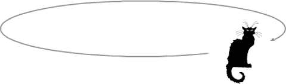

图片在页面中居中，并设置了 `position: relative`。我们将反复更新该图片的 `top` 和 `left` 样式以移动它。

脚本使用 `requestAnimationFrame` 来安排 `animate` 函数在浏览器准备好重新绘制屏幕时运行。`animate` 函数本身再次调用 `requestAnimationFrame` 来安排下一次更新。当浏览器窗口（或标签页）处于活动状态时，这将导致更新以大约每秒 60 次的频率发生，从而产生好看的动画。

如果我们只是在循环中更新 DOM，页面会冻结，屏幕上什么也不会显示。浏览器在 JavaScript 程序运行时不会更新其显示，也不会允许与页面进行任何交互。这就是我们需要 `requestAnimationFrame` 的原因——它让浏览器知道我们暂时完成了，浏览器可以继续做它该做的事情，比如更新屏幕和响应用户操作。

我们的动画函数接收当前时间作为参数，并将其与之前看到的时间（`lastTime` 变量）进行比较，以确保猫每毫秒的运动是稳定的，动画流畅。如果它只是每步移动固定量，那么当同一台计算机上运行的其他繁重任务导致函数暂停一小部分秒时，运动就会卡顿。

圆周运动是通过三角函数 `Math.cos` 和 `Math.sin` 实现的。对于那些不熟悉这些函数的人，我将简要介绍一下，因为我们在本书中偶尔会用到它们。

`Math.cos` 和 `Math.sin` 用于找到位于以点 (0,0) 为圆心、半径为 1 的圆上的点。这两个函数都将参数解释为圆上的位置，其中 0 表示圆的最右侧点，顺时针方向直到 2π（约 6.28）绕圆一周。`Math.cos` 给出圆上对应给定位置的点的 x 坐标，而 `Math.sin` 给出 y 坐标。大于 2π 或小于 0 的位置（或角度）也是有效的——旋转会重复，因此 *a*+2π 与 *a* 表示相同的角度。

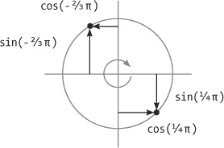


猫动画代码会维护一个计数器 `angle`，用于记录动画的当前角度，并在每次调用 `animate` 函数时，根据经过的时间按比例递增该值。然后，它利用这个角度来计算图像元素的当前位置。`top` 样式通过 `Math.sin` 计算并乘以 20（即圆的垂直半径）。`left` 样式基于 `Math.cos` 计算并乘以 200，使得圆的宽度远大于高度，从而形成椭圆运动。

请注意，样式通常需要*单位*。在本例中，我们必须在数字后附加 `"px"`，以告知浏览器我们以像素为单位进行计数（而不是厘米、“em”或其他单位）。这一点很容易忘记。使用不带单位的数字会导致样式被忽略——除非数字是 0，因为无论单位如何，0 始终表示相同的意思。

## 总结

JavaScript 程序可以通过一种称为 DOM 的数据结构来检查和干预浏览器当前显示的文档。该数据结构代表了浏览器对文档的模型，JavaScript 程序可以修改它以改变可见文档。

DOM 的组织形式类似于一棵树，其中元素根据文档结构按层次排列。表示元素的对象具有诸如 `parentNode` 和 `childNodes` 之类的属性，可用于遍历这棵树。

文档的显示方式可以通过*样式*来影响，既可以直接为节点附加样式，也可以定义匹配特定节点的规则。有许多不同的样式属性，例如 `color` 或 `display`。JavaScript 可以通过元素的 `style` 属性直接操作其样式。

## 练习

### 构建表格

我们在第 6 章中构建了纯文本表格。HTML 使表格布局变得相当简单。HTML 表格通过以下标签结构构建：

```
<table>
  <tr>
    <th>名称</th>
    <th>高度</th>
    <th>国家</th>
  </tr>
  <tr>
    <td>乞力马扎罗山</td>
    <td>5895</td>
    <td>坦桑尼亚</td>
  </tr>
</table>
```

对于每一*行*，`<table>` 标签包含一个 `<tr>` 标签。在这些 `<tr>` 标签内部，我们可以放置单元格元素：标题单元格（`<th>`）或普通单元格（`<td>`）。

与第 6 章中使用的相同源数据在沙箱中的 `MOUNTAINS` 变量中再次可用。也可以从网站（*[`eloquentjavascript.net/code/`](http://eloquentjavascript.net/code/)*）下载。

编写一个函数 `buildTable`，给定一个对象数组（所有对象具有相同的属性集），构建一个表示表格的 DOM 结构。表格应有一个标题行，其中属性名称包裹在 `<th>` 元素中，并且数组中的每个对象对应一行，其属性值放在 `<td>` 元素中。

`Object.keys` 函数返回一个包含对象属性名称的数组，这可能会很有帮助。

完成基本功能后，通过将包含数字的单元格的 `style.textAlign` 属性设置为 `"right"`，使其右对齐。

### 按标签名获取元素

`getElementsByTagName` 方法返回所有具有给定标签名的子元素。请实现你自己的版本，作为一个普通的非方法函数，该函数接受一个节点和一个字符串（标签名）作为参数，并返回一个包含所有具有给定标签名的后代元素节点的数组。

要查找元素的标签名，请使用其 `tagName` 属性。但请注意，该属性返回的标签名全为大写。使用 `toLowerCase` 或 `toUpperCase` 字符串方法来处理此问题。

### 猫的帽子

扩展前面定义的猫动画，使猫和它的帽子（``）在椭圆的两侧相对运行。

你也可以尝试让帽子围绕猫旋转，或以其他有趣的方式改变动画。

为了更容易地定位多个对象，最好切换到绝对定位。这意味着 `top` 和 `left` 是相对于文档左上角计算的。为了避免使用负坐标，你可以简单地在位置值上添加一个固定的像素数。

# 第 14 章 处理事件

> “你对自己的思想拥有掌控力——而非外界事件。认识到这一点，你将找到力量。”
> 
> ——马可·奥勒留，《沉思录》

某些程序需要处理直接的用户输入，例如鼠标和键盘交互。这类输入的时间和顺序无法提前预测。这需要一种与我们迄今为止使用的控制流不同的方法。

## 事件处理器

想象一个界面，其中判断键盘上的某个键是否被按下的唯一方法是读取该键的当前状态。为了能够对按键做出反应，你必须不断读取键的状态，以便在它被释放之前捕捉到它。执行其他耗时计算会很危险，因为你可能会错过一次按键。

这就是在原始机器上处理此类输入的方式。更高级的做法是让硬件或操作系统注意到按键并将其放入队列中。然后，程序可以定期检查队列中的新事件，并对其发现的内容做出反应。

当然，它必须记住要查看队列，并且要经常查看，因为从按键按下到程序注意到事件之间的任何时间间隔都会导致软件感觉反应迟钝。这种方法称为*轮询*。大多数程序员会尽可能避免使用它。

更好的机制是让底层系统在事件发生时给我们的代码一个反应的机会。浏览器通过允许我们将函数注册为特定事件的*处理器*来实现这一点。

```
<p>点击此文档以激活处理器。</p>
<script>
  addEventListener("click", function() {
    console.log("你点击了！");
  });
</script>
```

`addEventListener` 函数将其第二个参数注册为在第一个参数描述的事件发生时被调用。

## 事件与 DOM 节点

每个浏览器事件处理器都在一个上下文中注册。当你像前面那样调用 `addEventListener` 时，你是在整个窗口上将其作为方法调用，因为在浏览器中，全局作用域等同于 `window` 对象。每个 DOM 元素都有自己的 `addEventListener` 方法，允许你专门监听该元素上的事件。

```
<button>点击我</button>
<p>这里没有处理器。</p>
<script>
  var button = document.querySelector("button");
  button.addEventListener("click", function() {
    console.log("按钮被点击了。");
  });
</script>
```

该示例将一个处理器附加到按钮节点上。因此，点击按钮会导致该处理器运行，而点击文档的其他部分则不会。

给节点设置 `onclick` 属性具有类似的效果。但一个节点只有一个 `onclick` 属性，因此每个节点只能通过这种方式注册一个处理器。`addEventListener` 方法允许你添加任意数量的处理器，因此你不会意外替换已经注册的处理器。

`removeEventListener` 方法，其参数与 `addEventListener` 类似，用于移除处理器。

```
<button>只触发一次的按钮</button>
<script>
  var button = document.querySelector("button");

  function once() {
    console.log("完成。");
    button.removeEventListener("click", once);
  }
  button.addEventListener("click", once);
</script>
```

为了能够注销处理器函数，我们给它一个名称（例如 `once`），以便我们可以将其同时传递给 `addEventListener` 和 `removeEventListener`。

## 事件对象


尽管在前面的例子中我们忽略了这一点，但事件处理函数实际上会接收一个参数：事件对象。这个对象为我们提供了关于事件的额外信息。例如，如果我们想知道按下了`哪个`鼠标按钮，可以查看事件对象的`which`属性。

```
<button>用任何方式点击我</button>
<script>
  var button = document.querySelector("button");
  button.addEventListener("mousedown", function(event) {
    if (event.which == 1)
      console.log("左键");
    else if (event.which == 2)
      console.log("中键");
    else if (event.which == 3)
      console.log("右键");
  });
</script>
```

事件对象中存储的信息因事件类型而异。我们将在本章后面讨论各种类型。对象的`type`属性始终包含一个标识事件的字符串（例如`"click"`或`"mousedown"`）。

## 传播

注册在包含子节点的节点上的事件处理函数也会接收到子节点中发生的某些事件。如果段落内的按钮被点击，段落上的事件处理函数也会接收到点击事件。

但如果段落和按钮都有处理函数，那么更具体的处理函数——即按钮上的处理函数——会先执行。事件会向外传播，从发生的节点传播到该节点的父节点，一直传播到文档的根节点。最后，在特定节点上注册的所有处理函数都执行完毕后，注册在整个窗口上的处理函数才有机会响应事件。

在任何时候，事件处理函数都可以调用事件对象的`stopPropagation`方法来阻止“更上层”的处理函数接收该事件。例如，当你有一个按钮位于另一个可点击元素内部，并且不希望点击按钮触发外部元素的点击行为时，这非常有用。

下面的示例在按钮及其周围的段落上都注册了`"mousedown"`处理函数。当用鼠标右键点击按钮时，按钮的处理函数会调用`stopPropagation`，从而阻止段落上的处理函数运行。当用其他鼠标按钮点击按钮时，两个处理函数都会运行。

```
<p>一个包含<button>按钮</button>的段落。</p>
<script>
  var para = document.querySelector("p");
  var button = document.querySelector("button");
  para.addEventListener("mousedown", function() {
    console.log("段落处理函数。");
  });
  button.addEventListener("mousedown", function(event) {
    console.log("按钮处理函数。");
    if (event.which == 3)
      event.stopPropagation();
  });
</script>
```

大多数事件对象都有一个`target`属性，指向事件起源的节点。你可以使用这个属性来确保不会意外处理从你不希望处理的节点传播上来的事件。

也可以利用`target`属性来为特定类型的事件设置一个宽泛的监听范围。例如，如果你有一个包含长列表按钮的节点，那么在外层节点上注册一个单一的点击处理函数，并通过`target`属性来判断是否点击了按钮，可能比在所有按钮上分别注册处理函数更方便。

```
<button>A</button>
<button>B</button>
<button>C</button>
<script>
  document.body.addEventListener("click", function(event) {
    if (event.target.nodeName == "BUTTON")
      console.log("点击了", event.target.textContent);
  });
</script>
```

## 默认行为

许多事件都有与之关联的默认行为。如果你点击一个链接，你会被带到链接的目标地址。如果你按下向下箭头，浏览器会向下滚动页面。如果你右键点击，会出现上下文菜单。诸如此类。

对于大多数类型的事件，JavaScript 事件处理函数会在默认行为执行之前被调用。如果处理函数不希望执行正常行为（通常是因为它已经处理了该事件），它可以调用事件对象的`preventDefault`方法。

这可以用来实现你自己的键盘快捷键或上下文菜单。也可以用来令人讨厌地干扰用户期望的行为。例如，下面是一个无法被点击的链接：

```
<a href="https://developer.mozilla.org/">MDN</a>
<script>
  var link = document.querySelector("a");
  link.addEventListener("click", function(event) {
    console.log("不行。");
    event.preventDefault();
  });
</script>
```

除非你有非常充分的理由，否则尽量不要做这种事情。对于使用你页面的人来说，他们期望的行为被破坏时可能会感到不愉快。

根据浏览器的不同，某些事件无法被拦截。例如，在 Chrome 中，关闭当前标签页的键盘快捷键（CTRL-W 或 COMMAND-W）无法被 JavaScript 处理。

## 键盘事件

当键盘上的一个键被按下时，浏览器会触发`"keydown"`事件。当它被释放时，会触发`"keyup"`事件。

```
<p>当你按住 V 键时，此页面会变成紫色。</p>
<script>
  addEventListener("keydown", function(event) {
    if (event.keyCode == 86)
      document.body.style.background = "violet";
  });
  addEventListener("keyup", function(event) {
    if (event.keyCode == 86)
      document.body.style.background = "";
  });
</script>
```

尽管名为`"keydown"`，但它不仅在键被物理按下时触发。当一个键被按住不放时，每次按键重复时该事件都会再次触发。有时——例如，当你希望按下方向键时增加游戏角色的加速度，释放键时再减小加速度——你必须小心，不要在每次按键重复时都增加加速度，否则最终会得到意外巨大的数值。

前面的例子查看了事件对象的`keyCode`属性。这是你识别哪个键被按下或释放的方式。不幸的是，将数字键码转换为实际键并不总是显而易见的。

对于字母和数字键，相关的键码将是键上印有的（大写）字母或数字对应的 Unicode 字符代码。字符串的`charCodeAt`方法为我们提供了找到这个代码的方法。

```
console.log("Violet".charCodeAt(0));
// ▹ 86
console.log("1".charCodeAt(0));
// ▹ 49
```

其他键的键码则不那么容易预测。找到所需代码的最佳方法通常是进行实验——注册一个键盘事件处理函数，记录它接收到的键码，然后按下你感兴趣的键。

修饰键，如 SHIFT、CTRL、ALT 和 META（Mac 上的 COMMAND），会像普通键一样生成键盘事件。但在查找组合键时，你也可以通过查看键盘和鼠标事件的`shiftKey`、`ctrlKey`、`altKey`和`metaKey`属性来了解这些键是否被按住。

```
<p>按 Ctrl-Space 继续。</p>
<script>
  addEventListener("keydown", function(event) {
    if (event.keyCode == 32 && event.ctrlKey)
      console.log("继续！");
  });
</script>
```

`"keydown"`和`"keyup"`事件提供了关于被按下的物理键的信息。但如果你对实际输入的文本感兴趣呢？从键码中获取文本很麻烦。相反，存在另一个事件`"keypress"`，它在`"keydown"`之后立即触发（并且当键被按住时与`"keydown"`一起重复），但仅针对产生字符输入的键。事件对象中的`charCode`属性包含一个可以解释为 Unicode 字符代码的代码。我们可以使用`String.fromCharCode`函数将这个代码转换为实际的单字符字符串。

```
<p>聚焦此页面并输入一些内容。</p>
<script>
  addEventListener("keypress", function(event) {
    console.log(String.fromCharCode(event.charCode));
  });
</script>
```


按键事件发生的 DOM 节点取决于按下按键时拥有焦点的元素。普通节点无法获得焦点（除非你为它们添加了`tabindex`属性），但链接、按钮和表单字段等元素可以。我们将在第 18 章中回到表单字段的讨论。当没有任何特定元素拥有焦点时，`document.body`会作为按键事件的目标节点。

## 鼠标点击

按下鼠标按钮也会触发一系列事件。`"mousedown"`和`"mouseup"`事件与`"keydown"`和`"keyup"`类似，分别在按钮按下和释放时触发。这些事件会发生在事件发生时鼠标指针正下方的 DOM 节点上。

在`"mouseup"`事件之后，`"click"`事件会在同时包含按钮按下和释放的最具体节点上触发。例如，如果我在一个段落上按下鼠标按钮，然后将指针移动到另一个段落并释放按钮，`"click"`事件会在包含这两个段落的元素上触发。

如果两次点击发生得很接近，在第二次点击事件之后还会触发`"dblclick"`（双击）事件。

要获取鼠标事件发生位置的精确信息，可以查看它的`pageX`和`pageY`属性，这两个属性包含事件相对于文档左上角的坐标（以像素为单位）。

下面实现了一个简单的绘图程序。每次点击文档时，它都会在鼠标指针下方添加一个点。更复杂的绘图程序请参见第 19 章。

```
<style>
  body {
    height: 200px;
    background: beige;
  }
  .dot {
    height: 8px; width: 8px;
    border-radius: 4px; /* 圆角 */
    background: blue;
    position: absolute;
  }
</style>
```

```
<script>
  addEventListener("click", function(event) {
    var dot = document.createElement("div");
    dot.className = "dot";
    dot.style.left = (event.pageX - 4) + "px";
    dot.style.top = (event.pageY - 4) + "px";
    document.body.appendChild(dot);
  });
</script>
```

`clientX`和`clientY`属性与`pageX`和`pageY`类似，但它们是相对于文档当前滚动到视口中的部分。当需要将鼠标坐标与`getBoundingClientRect`返回的坐标（也是相对于视口的坐标）进行比较时，这些属性会很有用。

## 鼠标移动

每当鼠标指针移动时，都会触发`"mousemove"`事件。这个事件可用于跟踪鼠标的位置。一个常见的应用场景是实现某种形式的鼠标拖拽功能。

例如，下面的程序显示一个条，并设置事件处理程序，使得在该条上向左或向右拖拽可以使其变窄或变宽：

```
<p>拖拽条来改变其宽度：</p>
<div style="background: orange; width: 60px; height: 20px">
</div>
<script>
  var lastX; // 记录上一次观察到的鼠标 X 位置
  var rect = document.querySelector("div");
  rect.addEventListener("mousedown", function(event) {
    if (event.which == 1) {
      lastX = event.pageX;
      addEventListener("mousemove", moved);
      event.preventDefault(); // 防止选中
    }
  });

  function moved(event) {
    if (event.which != 1) {
      removeEventListener("mousemove", moved);
    } else {
      var dist = event.pageX - lastX;
      var newWidth = Math.max(10, rect.offsetWidth + dist);

      rect.style.width = newWidth + "px";
      lastX = event.pageX;
    }
  }
</script>
```

最终页面效果如下：

> 拖拽条来改变其宽度：

> 

> 

注意，`"mousemove"`处理程序是注册在整个窗口上的。即使鼠标在调整大小过程中移出了条的范围，我们仍然希望更新其大小，并在鼠标释放时停止拖拽。

每当鼠标指针进入或离开一个节点时，会触发`"mouseover"`或`"mouseout"`事件。这两个事件可用于创建悬停效果，例如当鼠标悬停在某个元素上时显示或改变样式。

不幸的是，创建这样的效果并不像在`"mouseover"`时开始效果、在`"mouseout"`时结束效果那么简单。当鼠标从一个节点移动到它的一个子节点时，父节点上会触发`"mouseout"`事件，尽管鼠标实际上并没有离开该节点的范围。更糟糕的是，这些事件会像其他事件一样传播，因此当鼠标离开注册了处理程序的节点的某个子节点时，你也会收到`"mouseout"`事件。

为了解决这个问题，我们可以使用这些事件对象中的`relatedTarget`属性。对于`"mouseover"`事件，它告诉我们指针之前位于哪个元素上；对于`"mouseout"`事件，它告诉我们指针将要移动到哪个元素上。只有当`relatedTarget`位于我们的目标节点之外时，我们才需要改变悬停效果。只有在这种情况下，该事件才真正表示从外部*跨越*到节点内部（或反之）。

```
<p>将鼠标悬停在此<strong>段落</strong>上。</p>
<script>
  var para = document.querySelector("p");
  function isInside(node, target) {
    for (; node != null; node = node.parentNode)
      if (node == target) return true;
  }
  para.addEventListener("mouseover", function(event) {
    if (!isInside(event.relatedTarget, para))
      para.style.color = "red";
  });
  para.addEventListener("mouseout", function(event) {
    if (!isInside(event.relatedTarget, para))
      para.style.color = "";
  });
</script>
```

`isInside`函数沿着给定节点的父链接向上查找，直到到达文档顶部（`node`变为`null`）或找到我们正在寻找的父节点。

我应该补充一点，像这样的悬停效果可以更简单地通过 CSS 伪选择器`:hover`实现，如下一个示例所示。但是，当你的悬停效果涉及比更改目标节点样式更复杂的操作时，就必须使用`"mouseover"`和`"mouseout"`事件的技巧。

```
<style>
  p:hover { color: red }
</style>
<p>将鼠标悬停在此<strong>段落</strong>上。</p>
```

## 滚动事件

每当元素滚动时，都会触发`"scroll"`事件。这有多种用途，例如了解用户当前正在查看的内容（用于禁用屏幕外动画或向邪恶总部发送间谍报告），或者显示某种进度指示（通过高亮目录的一部分或显示页码）。

下面的示例在文档的右上角绘制一个进度条，并随着向下滚动而更新填充进度：

```
<style>
  .progress {
    border: 1px solid blue;
    width: 100px;
    position: fixed;
    top: 10px; right: 10px;
  }
  .progress > div {
    height: 12px;
    background: blue;
    width: 0%;
  }
  body {
    height: 2000px;
  }
</style>
<div class="progress"><div></div></div>
<p>滚动我...</p>

<script>
  var bar = document.querySelector(".progress div");
  addEventListener("scroll", function() {
    var max = document.body.scrollHeight - innerHeight;
    var percent = (pageYOffset / max) * 100;
    bar.style.width = percent + "%";
  });
</script>
```

给元素设置`position: fixed`类似于`absolute`定位，但会阻止它随文档其余部分滚动。效果是让我们的进度条保持在角落。内部还有另一个元素，通过调整其大小来指示当前进度。我们使用`%`而不是`px`作为宽度单位，以便元素相对于整个条进行大小调整。


全局变量 `innerHeight` 提供了窗口的高度，我们需要从总可滚动高度中减去它——当滚动到文档底部时，就无法继续滚动了。（与 `innerHeight` 对应的还有一个 `innerWidth`。）通过将当前滚动位置 `pageYOffset` 除以最大滚动位置，再乘以 100，就能得到进度条的百分比。

对滚动事件调用 `preventDefault` 并不能阻止滚动发生。实际上，事件处理函数是在滚动发生*之后*才被调用的。

## 焦点事件

当元素获得焦点时，浏览器会触发 `"focus"` 事件。当它失去焦点时，会触发 `"blur"` 事件。

与之前讨论的事件不同，这两个事件不会传播。当子元素获得或失去焦点时，父元素上的处理函数不会收到通知。

下面的示例为当前获得焦点的文本字段显示帮助文本：

```
<p>姓名：<input type="text" data-help="您的全名"></p>
<p>年龄：<input type="text" data-help="年龄（岁）"></p>
<p id="help"></p>

<script>
  var help = document.querySelector("#help");
  var fields = document.querySelectorAll("input");
  for (var i = 0; i < fields.length; i++) {
    fields[i].addEventListener("focus", function(event) {
      var text = event.target.getAttribute("data-help");
      help.textContent = text;
    });
    fields[i].addEventListener("blur", function(event) {
      help.textContent = "";
    });
  }
</script>
```

在下面的截图中，显示了年龄字段的帮助文本。

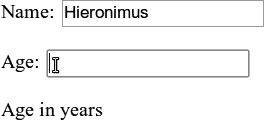

当用户从显示文档的浏览器标签页或窗口移开或移入时，`window` 对象会收到 `"focus"` 和 `"blur"` 事件。

## 加载事件

当页面加载完成时，`"load"` 事件会在 `window` 和 `document` body 对象上触发。这通常用于安排需要整个文档构建完成才能执行的初始化操作。请记住，`<script>` 标签的内容在遇到该标签时会立即执行。这往往太早了，例如当脚本需要对 `<script>` 标签之后出现的文档部分进行操作时。

加载外部文件的元素（如图片和脚本标签）也有一个 `"load"` 事件，表示它们引用的文件已加载。与焦点相关的事件类似，加载事件不会传播。

当页面被关闭或导航离开时（例如通过点击链接），会触发 `"beforeunload"` 事件。该事件的主要用途是防止用户因关闭文档而意外丢失工作。与您可能预期的不同，阻止页面卸载并不是通过 `preventDefault` 方法实现的，而是通过从处理函数返回一个字符串来实现。该字符串将用于一个对话框，询问用户是留在页面还是离开。这种机制确保用户能够离开页面，即使页面正在运行一个恶意脚本，该脚本可能希望永远将用户留在页面上，以便强迫他们观看可疑的减肥广告。

## 脚本执行时间线

有多种情况会导致脚本开始执行。读取 `<script>` 标签是其中一种。事件触发是另一种。第 13 章讨论了 `requestAnimationFrame` 函数，它会在下一次页面重绘之前调度一个函数执行。这是脚本开始运行的又一种方式。

重要的是要理解，尽管事件可以在任何时间触发，但单个文档中的两个脚本永远不会同时运行。如果某个脚本已经在运行，事件处理函数以及以其他方式调度的代码片段必须等待轮到它们。这就是为什么当脚本长时间运行时文档会冻结的原因。浏览器无法对文档内的点击和其他事件做出反应，因为在当前脚本运行完毕之前，它无法运行事件处理函数。

某些编程环境确实允许多个*执行线程*同时运行。同时做多件事可以用来让程序更快。但是，当多个参与者同时触及系统的相同部分时，思考程序就会变得至少困难一个数量级。

JavaScript 程序一次只做一件事，这一事实让我们的生活更轻松。对于那些你*确实*想在后台执行一些耗时的操作而不冻结页面的情况，浏览器提供了一种称为 *web workers* 的东西。Worker 是一个独立的 JavaScript 环境，它与文档的主程序并行运行，并且只能通过发送和接收消息来与主程序通信。

假设我们在一个名为 `code/squareworker.js` 的文件中有以下代码：

```
addEventListener("message", function(event) {
  postMessage(event.data * event.data);
});
```

假设对一个数字进行平方运算是一项繁重且耗时的计算，我们希望在后台线程中执行。以下代码会生成一个 worker，向它发送几条消息，并输出响应。

```
var squareWorker = new Worker("code/squareworker.js");
squareWorker.addEventListener("message", function(event) {
  console.log("Worker 响应了：", event.data);
});
squareWorker.postMessage(10);
squareWorker.postMessage(24);
```

`postMessage` 函数会发送一条消息，这会导致接收方触发一个 `"message"` 事件。创建 worker 的脚本通过 `Worker` 对象发送和接收消息，而 worker 则通过直接在其全局作用域（这是一个*新的*全局作用域，不与原始脚本共享）上发送和监听来与创建它的脚本通信。

## 设置定时器

`setTimeout` 函数与 `requestAnimationFrame` 类似。它会调度另一个函数在稍后调用。但不同的是，它不会在下次重绘时调用函数，而是等待指定的毫秒数。以下页面在两秒后从蓝色变为黄色：

```
<script>
  document.body.style.background = "blue";

  setTimeout(function() {
    document.body.style.background = "yellow";
  }, 2000);
</script>
```

有时你需要取消已调度的函数。这可以通过存储 `setTimeout` 返回的值，然后对其调用 `clearTimeout` 来实现。

```
var bombTimer = setTimeout(function() {
  console.log("BOOM!");
}, 500);

if (Math.random() < 0.5) { // 50% 概率
  console.log("已拆除。");
  clearTimeout(bombTimer);
}
```

`cancelAnimationFrame` 函数的工作方式与 `clearTimeout` 相同——对 `requestAnimationFrame` 返回的值调用它，将取消该帧（假设它尚未被调用）。

还有一组类似的函数 `setInterval` 和 `clearInterval`，用于设置每隔 *X* 毫秒重复执行的定时器。

```
var ticks = 0;
var clock = setInterval(function() {
  console.log("tick", ticks++);
  if (ticks == 10) {
    clearInterval(clock);
    console.log("停止。");
  }
}, 200);
```

## 防抖

某些类型的事件可能会快速连续触发多次（例如 `"mousemove"` 和 `"scroll"` 事件）。处理此类事件时，必须小心不要执行过于耗时的操作，否则处理函数会占用太多时间，导致与文档的交互变得缓慢和卡顿。

如果你确实需要在这样的处理函数中执行一些非平凡的操作，可以使用 `setTimeout` 来确保不会过于频繁地执行。这通常被称为事件的*防抖*。有几种略有不同的方法可以实现这一点。


在第一个示例中，我们希望在用户输入内容时执行某些操作，但不想在每个按键事件发生时立即执行。当用户快速输入时，我们只想等到出现暂停。我们不在事件处理程序中立即执行操作，而是设置一个超时。同时，我们清除之前的超时（如果有的话），这样当事件密集发生时（间隔小于超时延迟），前一个事件的超时就会被取消。

```
<textarea>在此处输入内容...</textarea>
<script>
  var textarea = document.querySelector("textarea");
  var timeout;
  textarea.addEventListener("keydown", function() {
    clearTimeout(timeout);
    timeout = setTimeout(function() {
      console.log("你停止输入了。");
    }, 500);
  });
</script>
```

向 `clearTimeout` 传递 `undefined` 值，或者对已经触发的超时调用它，都不会产生任何效果。因此，我们无需担心何时调用它，只需对每个事件都调用即可。

如果我们希望将响应间隔至少一定的时间，但又想在事件*期间*（而不仅仅是之后）触发它们，我们可以使用一种略有不同的模式。例如，我们可能希望响应 `"mousemove"` 事件，显示鼠标的当前坐标，但每 250 毫秒只响应一次。

```
<script>
  function displayCoords(event) {
    document.body.textContent =
      "鼠标位于 " + event.pageX + ", " + event.pageY;
  }

  var scheduled = false, lastEvent;
  addEventListener("mousemove", function(event) {
    lastEvent = event;
    if (!scheduled) {
      scheduled = true;
      setTimeout(function() {
        scheduled = false;
        displayCoords(lastEvent);
      }, 250);
    }
  });
</script>
```

## 总结

事件处理程序使我们能够检测并响应那些我们无法直接控制的事件。`addEventListener` 方法用于注册此类处理程序。

每个事件都有一个类型（如 `"keydown"`、`"focus"` 等）来标识它。大多数事件会在特定的 DOM 元素上触发，然后*传播*到该元素的祖先节点，从而允许与这些元素关联的处理程序来处理它们。

当事件处理程序被调用时，会传入一个事件对象，其中包含关于该事件的附加信息。该对象还提供了一些方法，允许我们停止进一步传播（`stopPropagation`）以及阻止浏览器的默认事件处理（`preventDefault`）。

按下按键会触发 `"keydown"`、`"keypress"` 和 `"keyup"` 事件。按下鼠标按钮会触发 `"mousedown"`、`"mouseup"` 和 `"click"` 事件。移动鼠标会触发 `"mousemove"`，有时还会触发 `"mouseenter"` 和 `"mouseout"` 事件。

滚动可以通过 `"scroll"` 事件检测，焦点变化可以通过 `"focus"` 和 `"blur"` 事件检测。当文档加载完成时，会在 window 上触发 `"load"` 事件。

同一时间只能运行一段 JavaScript 程序。因此，事件处理程序和其他计划执行的脚本必须等待其他脚本执行完毕才能获得执行机会。

## 练习

### 审查键盘

1928 年至 2013 年间，土耳其法律禁止在官方文件中使用字母 *Q*、*W* 和 *X*。这是压制库尔德文化的一项更广泛举措的一部分——这些字母出现在库尔德人使用的语言中，但伊斯坦布尔土耳其语中没有。

作为一项用技术做荒唐事的练习，我要求你编写一个文本字段（一个 `<input type="text">` 标签），使得这些字母无法被输入。

（不必担心复制粘贴等其他漏洞。）

### 鼠标轨迹

在 JavaScript 的早期，那是充满大量动画图像的华丽主页的鼎盛时期，人们想出了一些真正富有启发性的方式来使用这门语言。

其中之一就是鼠标轨迹——当你将鼠标指针在页面上移动时，一系列图像会跟随它。

在这个练习中，我希望你实现一个鼠标轨迹。使用绝对定位的 `<div>` 元素，具有固定大小和背景颜色（参考鼠标点击部分的代码示例）。创建一组这样的元素，当鼠标移动时，将它们显示在鼠标指针的尾迹中。

这里有多种可能的实现方法。你可以根据自己的意愿让解决方案简单或复杂。一个简单的入门方案是保持固定数量的轨迹元素并循环使用它们，每次发生 `"mousemove"` 事件时，将下一个元素移动到鼠标的当前位置。

### 标签页

标签页界面是一种常见的设计模式。它允许你通过选择元素上方“突出”的多个标签之一来选择一个界面面板。

在这个练习中，你将实现一个简单的标签页界面。编写一个名为 `asTabs` 的函数，它接受一个 DOM 节点，并创建一个标签页界面，显示该节点的子元素。它应该在节点顶部插入一个 `<button>` 元素列表，每个子元素对应一个按钮，按钮文本从子元素的 `data-tabname` 属性中获取。除了一个子元素外，其他所有原始子元素都应隐藏（设置 `display` 样式为 `none`），当前可见的节点可以通过点击按钮来选择。

当它工作后，扩展它，使当前激活的按钮具有不同的样式。

# 第 15 章 项目：一个平台游戏

> “所有现实都是一场游戏。”

> ——伊恩·班克斯，《游戏玩家》

和许多孩子一样，我对计算机的最初迷恋源于电脑游戏。我被那些我可以操控的、微小的计算机模拟世界所吸引，在那里（某种程度上）故事会展开——我想，更多是因为我可以将自己的想象力投射到其中，而不是因为它们实际提供的可能性。

我不希望任何人从事游戏编程的职业。就像音乐行业一样，许多渴望从事该工作的年轻人与实际需求之间的差距造成了一种相当不健康的环境。但为了乐趣而编写游戏是很有趣的。

本章将逐步实现一个简单的平台游戏。平台游戏（或“跳跃与奔跑”游戏）要求玩家操控一个角色在游戏世界中移动，这个世界通常是二维的、从侧面观看，并且需要大量跳跃到物体上或越过物体。

## 游戏

我们的游戏将大致基于 Thomas Palef 的《Dark Blue》（*[www.lessmilk.com/games/10](http://www.lessmilk.com/games/10)*）。我选择这个游戏是因为它既有趣又极简，而且不需要太多代码就能构建。它看起来像这样：

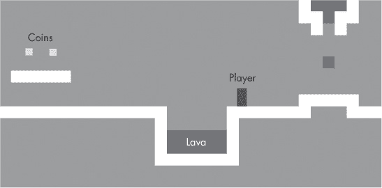

深色方块代表玩家，其任务是收集黄色方块（金币），同时避开红色物质（我称之为熔岩）。当所有金币都被收集后，关卡完成。

玩家可以使用左右箭头键行走，使用上箭头键跳跃。跳跃是这个游戏角色的特色。它可以跳到自身高度的数倍，并且能够在空中改变方向。这可能不完全现实，但它有助于让玩家感觉直接控制着屏幕上的化身。

游戏由一个固定的背景组成，背景像网格一样布局，移动元素叠加在该背景之上。网格上的每个字段要么是空的，要么是实心的，要么是熔岩。移动元素包括玩家、金币和某些熔岩块。与第 7 章“项目：电子生命”中的人工生命模拟不同，这些元素的位置不受网格约束——它们的坐标可以是小数，从而实现平滑运动。

## 技术

我们将使用浏览器 DOM 来显示游戏，并通过处理按键事件来读取用户输入。


与屏幕和键盘相关的代码只是构建这个游戏所需工作的一小部分。由于所有东西看起来都像彩色方块，绘制并不复杂：我们创建 DOM 元素，并使用样式为它们设置背景颜色、大小和位置。

我们可以将背景表示为一个表格，因为它是一个不变的方格网格。自由移动的元素可以叠加在上面，使用绝对定位的元素。

在需要动画图形并响应玩家输入且无明显延迟的游戏和其他程序中，效率很重要。尽管 DOM 最初并非为高性能图形设计，但它实际上比预期的要好。你在第 13 章中看到了一些动画。在现代机器上，即使我们不怎么考虑优化，像这样的简单游戏也能表现良好。

在下一章中，我们将探索另一种浏览器技术——`<canvas>`标签，它提供了一种更传统的绘图方式，基于形状和像素而非 DOM 元素。

## 关卡

在第 7 章中，我们使用字符串数组来描述二维网格。这里也可以这样做。它允许我们在不先构建关卡编辑器的情况下设计关卡。

一个简单的关卡看起来像这样：

```
var simpleLevelPlan  = [
  "                      ",
  "                      ",
  "  x              = x  ",
  "  x     o o        x  ",
  "  x @  xxxxx       x  ",
  "  xxxxx            x  ",
  "      x!!!!!!!!!!!!x  ",
  "      xxxxxxxxxxxxxx  ",
  "                      "
];
```

固定网格和移动元素都包含在计划中。`x`字符代表墙壁，空格字符代表空位，感叹号代表固定不动的熔岩块。

`@`定义了玩家起始位置。每个`o`是一枚金币，等号（`=`）代表一块水平来回移动的熔岩。注意，这些位置的网格将被设置为包含空位，并使用另一种数据结构来跟踪此类移动元素的位置。

我们将支持另外两种移动熔岩：竖线字符（`|`）表示垂直移动的熔岩块，`v`表示*滴落*熔岩——垂直移动但不来回反弹，只向下移动，当碰到地面时跳回起始位置。

整个游戏由多个关卡组成，玩家必须完成它们。当所有金币被收集时，关卡完成。如果玩家碰到熔岩，当前关卡将重置到起始位置，玩家可以重试。

## 读取关卡

以下构造函数构建一个`Level`对象。其参数应为定义关卡的字符串数组。

```
function Level(plan)  {
  this.width = plan[0].length;
  this.height = plan.length;
  this.grid = [];
  this.actors = [];

  for (var y = 0; y < this.height; y++) {
    var line = plan[y], gridLine = [];
    for (var x = 0; x < this.width; x++) {
      var ch = line[x], fieldType = null;
      var Actor = actorChars[ch];
      if (Actor)
        this.actors.push(new Actor(new Vector(x, y), ch));
      else if (ch == "x")
        fieldType = "wall";
      else if (ch == "!")
        fieldType = "lava";
      gridLine.push(fieldType);
    }
    this.grid.push(gridLine);
  }

  this.player = this.actors.filter(function(actor) {
    return actor.type == "player";
  })[0];
  this.status = this.finishDelay = null;
}
```

为简洁起见，代码没有检查格式错误的输入。它假设你提供了一个正确的关卡计划，包含玩家起始位置和其他必要元素。

关卡存储其宽度和高度，以及两个数组——一个用于网格，一个用于`actors`（动态元素）。网格表示为数组的数组，其中每个内部数组代表一条水平线，每个方格要么是`null`（空方格），要么是一个表示方格类型的字符串——`"wall"`或`"lava"`。

actors 数组包含跟踪关卡中动态元素当前位置和状态的对象。每个对象应具有`pos`属性（给出其位置，即左上角坐标）、`size`属性（给出其大小）和`type`属性（包含标识元素的字符串，如`"lava"`、`"coin"`或`"player"`）。

构建网格后，我们使用`filter`方法找到`"player"`演员对象，并将其存储在关卡的属性中。`status`属性跟踪玩家是赢了还是输了。当这种情况发生时，`finishDelay`用于让关卡保持活动一小段时间，以便显示简单的动画（立即重置或推进关卡会显得廉价）。此方法可用于判断关卡是否结束：

```
Level.prototype.isFinished = function() {
  return this.status != null && this.finishDelay < 0;
};
```

## 演员

为了存储演员的位置和大小，我们将回到可靠的`Vector`类型，它将 x 坐标和 y 坐标组合成一个对象。

```
function Vector(x, y) {
  this.x = x; this.y = y;
}
Vector.prototype.plus = function(other) {
  return new Vector(this.x + other.x, this.y + other.y);
};
Vector.prototype.times = function(factor) {
  return new Vector(this.x * factor, this.y * factor);
};
```

`times`方法按给定倍数缩放向量。当我们需要将速度向量乘以时间间隔以获取该时间内移动的距离时，它会很有用。

在上一节中，`actorChars`对象被`Level`构造函数用来将字符与构造函数关联起来。该对象如下所示：

```
var actorChars = {
  "@": Player,
  "o": Coin,
  "=": Lava, "|": Lava, "v": Lava
};
```

三个字符映射到`Lava`。`Level`构造函数将演员的源字符作为第二个参数传递给构造函数，而`Lava`构造函数使用该参数来调整其行为（水平反弹、垂直反弹或滴落）。

玩家类型由以下构造函数构建。它有一个`speed`属性，用于存储当前速度，这将有助于模拟动量和重力。

```
function Player(pos)  {
  this.pos = pos.plus(new Vector(0, -0.5));
  this.size = new Vector(0.8, 1.5);
  this.speed = new Vector(0, 0);
}
Player.prototype.type = "player";
```

由于玩家身高为一个半方格，其初始位置设置为`@`字符出现位置上方半个方格处。这样，其底部与所在方格的底部对齐。

在构造动态`Lava`对象时，我们需要根据其基于的字符以不同方式初始化对象。动态熔岩以给定速度移动，直到碰到障碍物。此时，如果它具有`repeatPos`属性，它将跳回起始位置（滴落）。如果没有，它将反转速度并继续向另一个方向移动（反弹）。构造函数仅设置必要的属性。实际移动的方法将在后面编写。

```
function Lava(pos,  ch) {
  this.pos = pos;
  this.size = new Vector(1, 1);
  if (ch == "=") {
    this.speed = new Vector(2, 0);
  } else if (ch == "|") {
    this.speed = new Vector(0, 2);
  } else if (ch == "v") {
    this.speed = new Vector(0, 3);
    this.repeatPos = pos;
  }
}
Lava.prototype.type = "lava";
```

`Coin`演员很简单。它们大多只是待在原地。但为了让游戏更有生气，它们被赋予了“摆动”，即轻微的垂直来回运动。为了跟踪这一点，金币对象存储了一个基础位置以及一个`wobble`属性，用于跟踪弹跳运动的相位。这两者共同决定了金币的实际位置（存储在`pos`属性中）。


```
function Coin(pos) {
  this.basePos = this.pos = pos.plus(new Vector(0.2, 0.1));
  this.size = new Vector(0.6, 0.6);
  this.wobble = Math.random() * Math.PI * 2;
}
Coin.prototype.type = "coin";
```

在第 13 章中，我们看到 `Math.sin` 给出了圆上某点的 y 坐标。当我们沿着圆移动时，该坐标以平滑的波形来回摆动，这使得正弦函数非常适合用于模拟波浪运动。

为了避免所有硬币同步上下移动，每个硬币的起始相位是随机化的。`Math.sin` 波的*相位*，即它产生的波的宽度，是 2π。我们将 `Math.random` 返回的值乘以这个数，从而为硬币在波上赋予一个随机的起始位置。

现在我们已经编写了表示关卡状态所需的所有部分。

```
var simpleLevel = new Level(simpleLevelPlan);
console.log(simpleLevel.width, "by", simpleLevel.height);
// ▹ 22 by 9
```

接下来的任务是在屏幕上显示这样的关卡，并模拟其中的时间和运动。

## 封装是一种负担

本章中的大部分代码并不担心封装问题，原因有二。首先，封装需要额外的努力。它会使程序变得更大，并且需要引入额外的概念和接口。由于读者在眼花缭乱之前只能接受有限数量的代码，我努力保持程序的小巧。

其次，游戏中的各种元素紧密相连，以至于如果其中一个元素的行为发生变化，其他元素很可能无法保持不变。元素之间的接口最终会编码大量关于游戏工作方式的假设。这使得它们的效率大大降低——每当你改变系统的一部分时，你仍然需要担心它如何影响其他部分，因为它们的接口无法覆盖新情况。

系统中的某些*切割点*适合通过严格的接口进行分离，但其他点则不然。试图封装一个不合适的边界，无疑是浪费大量精力。当你犯这个错误时，你通常会注意到你的接口变得异常庞大和详细，并且随着程序的演变，它们需要频繁修改。

在本章中，我们*将*封装一件事，那就是绘图子系统。原因是在下一章中，我们将以不同的方式显示同一个游戏。通过将绘图放在接口后面，我们可以简单地在那里加载相同的游戏程序，并插入一个新的显示模块。

## 绘图

绘图代码的封装是通过定义一个*显示*对象来实现的，该对象显示给定的关卡。我们在本章中定义的显示类型称为 `DOMDisplay`，因为它使用简单的 DOM 元素来显示关卡。

我们将使用样式表来设置构成游戏的元素的实际颜色和其他固定属性。当然，也可以在创建元素时直接赋值给元素的 `style` 属性，但这会使程序更加冗长。

下面的辅助函数提供了一种创建元素并为其指定类的简洁方法：

```
function elt(name, className) {
  var elt = document.createElement(name);
  if (className) elt.className = className;
  return elt;
}
```

创建一个显示对象时，需要给它一个父元素（它应该附加到该元素上）和一个关卡对象。

```
function DOMDisplay(parent, level) {
  this.wrap = parent.appendChild(elt("div", "game"));
  this.level = level;

  this.wrap.appendChild(this.drawBackground());
  this.actorLayer = null;
  this.drawFrame();
}
```

我们利用 `appendChild` 返回被追加元素这一事实，在一条语句中创建了包装器元素并将其存储在 `wrap` 属性中。

关卡的背景从不改变，因此只绘制一次。每次更新显示时，角色都会重新绘制。`drawFrame` 将使用 `actorLayer` 属性来跟踪包含角色的元素，以便可以轻松地移除和替换它们。

我们的坐标和大小以相对于网格大小的单位进行跟踪，其中大小或距离为 1 表示 1 个网格单位。在设置像素大小时，我们必须将这些坐标按比例放大——如果每个方格只有一个像素，那么游戏中的所有东西都会小得可笑。`scale` 变量给出了一个单位在屏幕上占用的像素数。

```
var scale = 20;

DOMDisplay.prototype.drawBackground = function() {
  var table = elt("table", "background");
  table.style.width = this.level.width * scale + "px";
  this.level.grid.forEach(function(row) {
    var  rowElt = table.appendChild(elt("tr"));
    rowElt.style.height = scale + "px";
    row.forEach(function(type) {
      rowElt.appendChild(elt("td", type));
    });
  });
  return table;
};
```

如前所述，背景被绘制为一个 `<table>` 元素。这很好地对应了关卡中 `grid` 属性的结构——网格的每一行都变成了表格行（`<tr>` 元素）。网格中的字符串被用作表格单元格（`<td>`）元素的类名。以下 CSS 有助于使生成的表格看起来像我们想要的背景：

```
.background    { background: rgb(52, 166, 251);
                 border-spacing: 0;              }
.background td { padding: 0;                     }
.lava          { background: rgb(255, 100, 100); }
.wall          { background: white;              }
```

其中一些（`border-spacing` 和 `padding`）仅用于抑制不需要的默认行为。我们不希望表格单元格之间有间距或内部有内边距。

`background` 规则设置了背景颜色。CSS 允许颜色以单词（`white`）或 `rgb(R, G, B)` 等格式指定，其中颜色的红色、绿色和蓝色分量被分成三个从 0 到 255 的数字。因此，在 `rgb(52, 166, 251)` 中，红色分量为 52，绿色为 166，蓝色为 251。由于蓝色分量最大，结果颜色将偏蓝。你可以看到在 `.lava` 规则中，第一个数字（红色）是最大的。

我们通过为每个角色创建一个 DOM 元素，并根据角色的属性设置该元素的位置和大小来绘制每个角色。这些值必须乘以 `scale` 才能从游戏单位转换为像素。

```
DOMDisplay.prototype.drawActors =  function() {
  var wrap = elt("div");
  this.level.actors.forEach(function(actor) {
    var rect = wrap.appendChild(elt("div", "actor " + actor.type));
    rect.style.width = actor.size.x * scale + "px";
    rect.style.height = actor.size.y * scale + "px";
    rect.style.left = actor.pos.x * scale + "px";
    rect.style.top = actor.pos.y * scale + "px";
  });
  return wrap;
};
```

要给一个元素赋予多个类，我们用空格分隔类名。在接下来展示的 CSS 代码中，`actor` 类为角色提供了绝对定位。它们的类型名被用作额外的类来赋予它们颜色。我们不需要再次定义 `lava` 类，因为我们在之前定义的熔岩网格方块中重用了它。

```
.actor  { position: absolute;            }
.coin   { background: rgb(241, 229, 89); }
.player { background: rgb(64, 64, 64);   }
```

当更新显示时，`drawFrame` 方法首先移除旧的角色图形（如果有的话），然后在新位置重新绘制它们。可能会想尝试重用角色的 DOM 元素，但要做到这一点，我们需要在显示代码和模拟代码之间进行大量额外的信息流传递。我们需要将角色与 DOM 元素关联起来，并且当角色消失时，绘图代码必须移除这些元素。由于游戏中通常只有少数几个角色，重新绘制所有角色并不昂贵。


```
DOMDisplay.prototype.drawFrame =  function() {
  if (this.actorLayer)
    this.wrap.removeChild(this.actorLayer);
  this.actorLayer = this.wrap.appendChild(this.drawActors());
  this.wrap.className = "game " + (this.level.status || "");
  this.scrollPlayerIntoView();
};
```

通过将关卡当前状态作为类名添加到包装元素上，我们可以添加一条 CSS 规则，当玩家拥有带有给定类的祖先元素时，该规则生效，从而在游戏胜利或失败时对玩家角色进行略微不同的样式设置。

```
.lost .player {
  background: rgb(160, 64, 64);
}
.won .player {
  box-shadow: -4px -7px 8px white, 4px -7px 8px white;
}
```

在接触熔岩后，玩家的颜色变为暗红色，暗示灼烧。当最后一枚硬币被收集时，我们使用两个模糊的白色盒阴影，一个在左上角，一个在右上角，以产生白色光晕效果。

我们不能假设关卡总是适合视口。这就是为什么需要调用 `scrollPlayerIntoView`——它确保如果关卡突出到视口之外，我们会滚动视口，使玩家靠近其中心。以下 CSS 为游戏的包装 DOM 元素设置了最大尺寸，并确保任何超出元素框的内容都不可见。我们还为外部元素设置了相对定位，以便其中的角色相对于关卡的左上角定位。

```
.game {
  overflow: hidden;
  max-width: 600px;
  max-height: 450px;
  position: relative;
}
```

在 `scrollPlayerIntoView` 方法中，我们找到玩家的位置并更新包装元素的滚动位置。当玩家太靠近边缘时，我们通过操作该元素的 `scrollLeft` 和 `scrollTop` 属性来改变滚动位置。

```
DOMDisplay.prototype.scrollPlayerIntoView =  function() {
  var width = this.wrap.clientWidth;
  var height = this.wrap.clientHeight;
  var margin = width / 3;

  // 视口
  var left = this.wrap.scrollLeft, right = left + width;
  var top = this.wrap.scrollTop, bottom = top + height;

  var player = this.level.player;
  var center = player.pos.plus(player.size.times(0.5))
                 .times(scale);

  if (center.x < left + margin)
    this.wrap.scrollLeft = center.x - margin;
  else if (center.x > right - margin)
    this.wrap.scrollLeft = center.x + margin - width;
  if (center.y < top + margin)
    this.wrap.scrollTop = center.y - margin;
  else if (center.y > bottom - margin)
    this.wrap.scrollTop = center.y + margin - height;
};
```

找到玩家中心的方式展示了我们 `Vector` 类型上的方法如何使对象计算以可读的方式编写。要找到角色的中心，我们将其位置（左上角）加上其大小的一半。这是关卡坐标中的中心，但我们需要像素坐标，因此我们将结果向量乘以显示比例。

接下来，一系列检查验证玩家位置是否超出允许范围。请注意，有时这会设置无意义的滚动坐标，例如低于零或超出元素的可滚动区域。这没问题——DOM 会将其限制为合理的值。将 `scrollLeft` 设置为 –10 会使其变为 0。

如果总是尝试将玩家滚动到视口中心，实现起来会稍微简单一些。但这会产生相当刺眼的效果。当你跳跃时，视图会不断上下移动。在屏幕中间有一个“中性”区域，你可以在其中移动而不引起任何滚动，这样会更舒适。

最后，我们需要一种方法来清除已显示的关卡，以便在游戏进入下一关或重置关卡时使用。

```
DOMDisplay.prototype.clear = function() {
  this.wrap.parentNode.removeChild(this.wrap);
};
```

现在我们可以显示我们的小关卡了。

```
<link rel="stylesheet" href="css/game.css">

<script>
  var simpleLevel = new Level(simpleLevelPlan);
  var display = new DOMDisplay(document.body, simpleLevel);
</script>
```

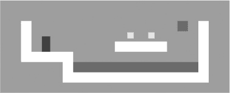

`<link>` 标签与 `rel="stylesheet"` 一起使用时，是一种将 CSS 文件加载到页面中的方式。文件 `game.css` 包含了我们游戏所需的样式。

## 运动与碰撞

现在我们到了可以开始添加运动的阶段——这是游戏中最有趣的部分。大多数此类游戏采用的基本方法是将时间分割成小步，对于每一步，根据角色的速度（每秒移动的距离）乘以时间步长（以秒为单位）来移动角色。

这很简单。困难的部分是处理元素之间的交互。当玩家撞到墙壁或地板时，他们不应该直接穿过它。游戏必须注意到某个运动何时导致物体撞到另一个物体，并做出相应响应。对于墙壁，运动必须停止。对于硬币，必须收集硬币，等等。

解决一般情况下的这个问题是一项大任务。你可以找到通常称为*物理引擎*的库，它们模拟二维或三维空间中物理对象之间的交互。在本章中，我们将采取更简单的方法，只处理矩形对象之间的碰撞，并以相当简单的方式处理它们。

在移动玩家或熔岩块之前，我们测试该运动是否会将它们带入背景的非空部分。如果是，我们直接取消整个运动。对这种碰撞的响应取决于角色的类型——玩家会停止，而熔岩块会反弹。

这种方法要求我们的时间步长相当小，因为它会在物体实际接触之前停止运动。如果时间步长（以及运动步长）太大，玩家最终会悬停在地面上方明显的高度。另一种方法，可以说更好但更复杂，是找到精确的碰撞点并移动到那里。我们将采用简单的方法，并通过确保动画以小步进行来隐藏其问题。

这个方法告诉我们一个矩形（由位置和大小指定）是否与背景网格上的任何非空空间重叠：

```
Level.prototype.obstacleAt = function(pos, size) {
  var xStart = Math.floor(pos.x);
  var xEnd = Math.ceil(pos.x + size.x);
  var yStart = Math.floor(pos.y);
  var yEnd = Math.ceil(pos.y + size.y);

  if (xStart < 0 || xEnd > this.width || yStart < 0)
    return "wall";
  if (yEnd > this.height)
    return "lava";
  for (var y = yStart; y < yEnd; y++) {
    for (var x = xStart; x < xEnd; x++) {
      var fieldType = this.grid[y][x];
      if (fieldType) return fieldType;
    }
  }
};
```

该方法通过使用 `Math.floor` 和 `Math.ceil` 对物体的坐标进行取整，计算出该物体重叠的网格方块集合。请记住，网格方块的大小是 1×1 单位。通过将盒子的边向上和向下取整，我们得到了该盒子接触的背景方块的范围。

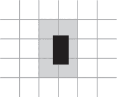

如果物体伸出关卡，我们总是为侧面和顶部返回 `"wall"`，为底部返回 `"lava"`。这确保了玩家在掉出世界时会死亡。当物体完全在网格内部时，我们遍历通过取整坐标找到的网格方块块，并返回我们找到的第一个非空方块的内容。

玩家与其他动态角色（硬币、移动熔岩）之间的碰撞是在玩家移动*之后*处理的。当运动将玩家带入另一个角色时，会激活相应的效果——收集硬币或死亡。

此方法扫描角色数组，寻找与作为参数给出的角色重叠的角色：


```
Level.prototype.actorAt = function(actor) {
  for (var i = 0; i < this.actors.length; i++) {
    var other = this.actors[i];
    if (other != actor &&
        actor.pos.x + actor.size.x > other.pos.x &&
        actor.pos.x < other.pos.x + other.size.x &&
        actor.pos.y + actor.size.y > other.pos.y &&
        actor.pos.y < other.pos.y + other.size.y)
      return other;
  }
};
```

## 角色与动作

`Level` 类型上的 `animate` 方法让关卡中的所有角色都有机会移动。它的 `step` 参数是以秒为单位的时间步长。`keys` 对象包含玩家按下的箭头键信息。

```
var maxStep = 0.05;

Level.prototype.animate = function(step, keys) {
  if (this.status != null)
    this.finishDelay -= step;

  while (step > 0) {
    var thisStep = Math.min(step, maxStep);
    this.actors.forEach(function(actor) {
      actor.act(thisStep, this, keys);
    }, this);

    step -= thisStep;
  }
};
```

当关卡的 `status` 属性为非空值（即玩家获胜或失败时），我们必须倒计时 `finishDelay` 属性，该属性跟踪从获胜或失败发生到我们希望停止显示关卡之间的时间。

`while` 循环将我们正在动画化的时间步长切割成适当的小块。它确保不会采用大于 `maxStep` 的步长。例如，一个 0.12 秒的 `step` 会被切割成两个 0.05 秒的步长和一个 0.02 秒的步长。

角色对象有一个 `act` 方法，它接受时间步长、`level` 对象和 `keys` 对象作为参数。以下是 `Lava` 角色类型的一个例子，它忽略了 `keys` 对象：

```
Lava.prototype.act = function(step, level) {
  var newPos = this.pos.plus(this.speed.times(step));
  if (!level.obstacleAt(newPos, this.size))
    this.pos = newPos;
  else if (this.repeatPos)
    this.pos = this.repeatPos;
  else
    this.speed = this.speed.times(-1);
};
```

它通过将时间步长与当前速度的乘积加到旧位置上来计算新位置。如果没有障碍物阻挡该新位置，它就移动到那里。如果有障碍物，行为取决于熔岩块的类型——滴落的熔岩有一个 `repeatPos` 属性，当它碰到东西时会跳回该位置。弹跳的熔岩则简单地反转其速度（乘以 -1），以便开始向另一个方向移动。

硬币使用它们的 `act` 方法来摆动。它们忽略碰撞，因为它们只是在自己的方块内摆动，而与玩家的碰撞将由 `player` 的 `act` 方法处理。

```
var wobbleSpeed = 8, wobbleDist = 0.07;

Coin.prototype.act = function(step) {
  this.wobble += step * wobbleSpeed;
  var wobblePos = Math.sin(this.wobble) * wobbleDist;
  this.pos = this.basePos.plus(new Vector(0, wobblePos));
};
```

`wobble` 属性被更新以跟踪时间，然后用作 `Math.sin` 的参数来产生一个波形，用于计算新位置。

剩下的就是玩家本身。玩家的运动按轴分别处理，因为碰到地面不应阻止水平运动，碰到墙壁也不应阻止下落或跳跃运动。该方法实现了水平部分：

```
var playerXSpeed = 7;

Player.prototype.moveX = function(step, level, keys) {
  this.speed.x = 0;
  if (keys.left) this.speed.x -= playerXSpeed;
  if (keys.right) this.speed.x += playerXSpeed;

  var motion = new Vector(this.speed.x * step, 0);
  var newPos = this.pos.plus(motion);
  var obstacle = level.obstacleAt(newPos, this.size);
  if (obstacle)
    level.playerTouched(obstacle);
  else
    this.pos = newPos;
};
```

水平运动基于左箭头键和右箭头键的状态计算。当运动导致玩家碰到某物时，会调用关卡的 `playerTouched` 方法，该方法处理诸如在熔岩中死亡和收集硬币等事情。否则，对象更新其位置。

垂直运动的工作方式类似，但涉及跳跃和`重力`。

```
var gravity = 30;
var jumpSpeed = 17;

Player.prototype.moveY = function(step, level, keys) {
  this.speed.y += step * gravity;
  var motion = new Vector(0, this.speed.y * step);
  var newPos = this.pos.plus(motion);
  var obstacle = level.obstacleAt(newPos, this.size);
  if (obstacle) {
    level.playerTouched(obstacle);
    if (keys.up && this.speed.y > 0)
      this.speed.y = -jumpSpeed;
    else
      this.speed.y = 0;
  } else {
    this.pos = newPos;
  }
};
```

在方法开始时，玩家被垂直加速以考虑`重力`。`重力`、跳跃速度以及本游戏中几乎所有其他常量都是通过反复试验设定的。我测试了各种值，直到找到我喜欢的组合。

接下来，我们再次检查障碍物。如果碰到障碍物，有两种可能的结果。当上箭头被按下*并且*我们正在向下移动（意味着我们碰到的东西在我们下方）时，速度被设置为一个相对较大的负值。这会使玩家跳跃。如果不是这种情况，我们只是撞到了某物，速度被重置为零。

实际的 `act` 方法如下所示：

```
Player.prototype.act = function(step, level, keys) {
  this.moveX(step, level, keys);
  this.moveY(step, level, keys);

  var otherActor = level.actorAt(this);
  if (otherActor)
    level.playerTouched(otherActor.type, otherActor);

  // 死亡动画
  if (level.status == "lost") {
    this.pos.y += step;
    this.size.y -= step;
  }
};
```

移动之后，该方法检查玩家是否与其他角色碰撞，并在找到时再次调用 `playerTouched`。这次，它将角色对象作为第二个参数传递，因为如果另一个角色是硬币，`playerTouched` 需要知道*哪个*硬币正在被收集。

最后，当玩家死亡（碰到熔岩）时，我们设置一个小动画，通过减少玩家对象的高度使其“缩小”或“下沉”。

以下是处理玩家与其他对象之间碰撞的方法：

```
Level.prototype.playerTouched = function(type, actor) {
  if (type == "lava" && this.status == null) {
    this.status = "lost";
    this.finishDelay = 1;
  } else if (type == "coin") {
    this.actors = this.actors.filter(function(other) {
      return other != actor;
    });
    if (!this.actors.some(function(actor) {
      return actor.type == "coin";
    })) {
      this.status = "won";
      this.finishDelay = 1;
    }
  }
};
```

当碰到熔岩时，游戏状态被设置为 `"lost"`。当碰到硬币时，该硬币从角色数组中移除，如果它是最后一个，游戏状态被设置为 `"won"`。

这给了我们一个可以实际动画化的关卡。现在缺少的只是*驱动*动画的代码。

## 跟踪按键

对于这样的游戏，我们不希望按键每次按下只生效一次。相反，我们希望只要按键被按住，它们的效果（移动玩家角色）就持续发生。

我们需要设置一个按键处理器，用于存储左、右和上箭头键的当前状态。我们还需要为这些键调用 `preventDefault`，以防止它们滚动页面。

以下函数，当给定一个以键码为属性名、键名为值的对象时，将返回一个跟踪这些键当前位置的对象。它为 `"keydown"` 和 `"keyup"` 事件注册事件处理器，并且当事件中的键码存在于它正在跟踪的键码集合中时，更新该对象。


```
var arrowCodes = {37: "left", 38: "up", 39: "right"};

function trackKeys(codes) {
  var pressed = Object.create(null);
  function handler(event) {
    if (codes.hasOwnProperty(event.keyCode)) {
      var down = event.type == "keydown";
      pressed[codes[event.keyCode]] = down;
      event.preventDefault();
    }
  }
  addEventListener("keydown", handler);
  addEventListener("keyup", handler);
  return pressed;
}
```

注意，同一个处理函数被用于两种事件类型。它通过事件对象的 `type` 属性来判断按键状态应更新为 `true`（`"keydown"`）还是 `false`（`"keyup"`）。

## 运行游戏

我们在第 13 章中看到的 `requestAnimationFrame` 函数为游戏动画提供了很好的方式。但其接口相当原始——使用它需要跟踪上一次调用函数的时间，并在每一帧之后再次调用 `requestAnimationFrame`。

让我们定义一个辅助函数，将这些繁琐的部分封装在一个便捷的接口中，使我们能够简单地调用 `runAnimation`，并传入一个期望时间差作为参数并绘制单帧的函数。当帧函数返回 `false` 时，动画停止。

```
function runAnimation(frameFunc) {
  var lastTime = null;
  function frame(time) {
    var stop = false;
    if (lastTime != null) {
      var timeStep = Math.min(time - lastTime, 100) / 1000;
      stop = frameFunc(timeStep) === false;
    }
    lastTime = time;
    if (!stop)
      requestAnimationFrame(frame);
  }
  requestAnimationFrame(frame);
}
```

我将最大帧步长设置为 100 毫秒（十分之一秒）。当包含我们页面的浏览器标签页或窗口被隐藏时，`requestAnimationFrame` 调用将被暂停，直到标签页或窗口再次显示。在这种情况下，`lastTime` 和 `time` 之间的差值将是页面被隐藏的整个时间。在单步中让游戏前进那么多会显得很傻，而且可能工作量很大（回想一下 `animate` 方法中的时间分割）。

该函数还将时间步长转换为秒，这比毫秒更容易思考。

`runLevel` 函数接受一个 `Level` 对象、一个显示构造函数，以及一个可选的函数。它显示关卡（在 `document.body` 中）并让用户进行游戏。当关卡结束（失败或胜利）时，`runLevel` 清除显示，停止动画，并且如果提供了 `andThen` 函数，则用关卡的状态调用该函数。

```
var arrows = trackKeys(arrowCodes);

function runLevel(level, Display, andThen) {
  var display = new Display(document.body, level);
  runAnimation(function(step) {
    level.animate(step, arrows);
    display.drawFrame(step);
    if (level.isFinished()) {
      display.clear();
      if (andThen)
        andThen(level.status);
      return false;
    }
  });
}
```

游戏是一系列关卡。每当玩家死亡时，当前关卡会重新开始。当一个关卡完成时，我们进入下一个关卡。这可以通过以下函数来表达，该函数接受一个关卡计划数组（字符串数组）和一个显示构造函数：

```
function runGame(plans, Display) {
  function startLevel(n) {
    runLevel(new Level(plans[n]), Display, function(status) {
      if (status == "lost")
        startLevel(n);
      else if (n < plans.length - 1)
        startLevel(n + 1);
      else
        console.log("You win!");
    });
  }
  startLevel(0);
}
```

这些函数展示了一种独特的编程风格。`runAnimation` 和 `runLevel` 都是高阶函数，但并非我们在第 5 章中看到的风格。函数参数用于安排某些事情在未来某个时间发生，并且这两个函数都不返回任何有用的东西。它们的任务在某种程度上是调度动作。将这些动作包装在函数中，使我们能够将它们存储为值，以便在适当的时机调用。

这种编程风格通常被称为*异步*编程。事件处理也是这种风格的一个实例，在处理可能需要任意时间的任务时，我们会看到更多这样的例子，例如第 17 章中的网络请求以及第 20 章中的通用输入输出。

在 `GAME_LEVELS` 变量中提供了一组关卡计划（可从 *[`eloquentjavascript.net/code#15`](http://eloquentjavascript.net/code#15)* 下载）。此页面将它们传递给 `runGame`，从而启动一个实际的游戏：

```
<link rel="stylesheet" href="css/game.css">

<script>
  runGame(GAME_LEVELS, DOMDisplay);
</script>
```

## 练习

### 游戏结束

平台游戏的传统是让玩家以有限的*生命*开始，每次死亡减少一条生命。当玩家生命耗尽时，游戏从头开始重新启动。

调整 `runGame` 以实现生命机制。让玩家从三条生命开始。

### 暂停游戏

通过按下 ESC 键，使游戏能够暂停（挂起）和恢复。

这可以通过修改 `runLevel` 函数，使用另一个键盘事件处理程序，并在按下 ESC 键时中断或恢复动画来实现。

`runAnimation` 接口乍一看可能不适合这个目的，但如果你重新安排 `runLevel` 调用它的方式，它是可行的。

当这个功能实现后，你还可以尝试其他事情。我们注册键盘事件处理程序的方式有些问题。`arrows` 对象目前是一个全局变量，即使没有游戏在运行，其事件处理程序也一直存在。可以说它们*泄漏*到了系统之外。扩展 `trackKeys` 以提供一种取消注册其处理程序的方法，然后修改 `runLevel`，使其在开始时注册处理程序，并在结束时取消注册。

# 第 16 章 在画布上绘图

> “绘画是一种欺骗。”
> 
> ——M.C. 埃舍尔，引自布鲁诺·恩斯特的《M.C. 埃舍尔的魔镜》

浏览器为我们提供了几种显示图形的方式。最简单的方法是使用样式来定位和着色常规的 DOM 元素。正如上一章的游戏所示，这种方法可以走得很远。通过为节点添加半透明的背景图像，我们可以让它们看起来完全符合我们的要求。甚至可以使用 `transform` 样式来旋转或倾斜节点。

但我们是在用 DOM 做它最初并非设计用于的事情。某些任务，例如在任意两点之间画一条线，使用常规的 HTML 元素会非常尴尬。

有两种替代方案。第一种是基于 DOM 的，但使用的是*可缩放矢量图形（SVG）*，而不是 HTML 元素。可以将 SVG 视为一种描述文档的方言，它侧重于形状而非文本。你可以将 SVG 文档嵌入到 HTML 文档中，或者通过 `` 标签包含它。

第二种替代方案称为*画布*。画布是一个单一的 DOM 元素，它封装了一幅图片。它提供了一个编程接口，用于在节点占据的空间上绘制形状。画布和 SVG 图片之间的主要区别在于，在 SVG 中，形状的原始描述被保留，因此可以随时移动或调整它们的大小。

另一方面，画布在绘制形状时立即将其转换为像素（光栅上的彩色点），并且不记住这些像素代表什么。在画布上移动形状的唯一方法是清除画布（或形状周围的画布部分），然后在新位置重新绘制形状。

## SVG


本书不会深入讲解 SVG，但我会简要说明其工作原理。在本章末尾，我会回到你必须权衡的取舍问题，即针对特定应用选择哪种绘图机制更为合适。

这是一个包含简单 SVG 图片的 HTML 文档：

```
<p>Normal HTML here.</p>
<svg xmlns="http://www.w3.org/2000/svg">
  <circle r="50" cx="50" cy="50" fill="red"/>
  <rect x="120" y="5" width="90" height="90"
        stroke="blue" fill="none"/>
</svg>
```

`xmlns` 属性将一个元素（及其子元素）切换到一个不同的 *XML 命名空间*。这个由 URL 标识的命名空间指定了我们当前使用的方言。`<circle>` 和 `<rect>` 标签在 HTML 中并不存在，但在 SVG 中具有意义——它们根据属性指定的样式和位置绘制形状。

文档显示效果如下：

Normal HTML here.


这些标签会创建 DOM 元素，就像 HTML 标签一样。例如，以下代码将 `<circle>` 元素改为青色填充：

```
var circle = document.querySelector("circle");
circle.setAttribute("fill", "cyan");
```

## Canvas 元素

Canvas 图形可以绘制在 `<canvas>` 元素上。你可以为该元素指定 `width` 和 `height` 属性，以确定其像素大小。

新的 canvas 是空的，即完全透明，因此在文档中仅显示为空白区域。

`<canvas>` 标签旨在支持不同的绘图风格。要获得实际的绘图接口，我们首先需要创建一个 *上下文*（context），它是一个对象，其方法提供了绘图接口。目前有两种广泛支持的绘图风格：用于二维图形的 `"2d"` 和通过 OpenGL 接口用于三维图形的 `"webgl"`。

本书不会讨论 WebGL。我们只关注二维图形。但如果你对三维图形感兴趣，我鼓励你研究一下 WebGL。它提供了与现代图形硬件非常直接的接口，因此你可以高效地从 JavaScript 渲染甚至复杂的场景。

上下文通过 `<canvas>` 元素的 `getContext` 方法创建。

```
<p>Before canvas.</p>
<canvas width="120" height="60"></canvas>
<p>After canvas.</p>
<script>
  var canvas = document.querySelector("canvas");
  var context = canvas.getContext("2d");
  context.fillStyle = "red";
  context.fillRect(10, 10, 100, 50);
</script>
```

创建上下文对象后，该示例绘制了一个红色矩形，宽 100 像素，高 50 像素，其左上角位于坐标 (10,10)。

Before canvas.


After canvas.

与 HTML（和 SVG）一样，canvas 使用的坐标系将 (0,0) 置于左上角，y 轴正方向向下。因此 (10,10) 位于左上角下方 10 像素、右侧 10 像素处。

## 填充与描边

在 canvas 接口中，形状可以被 *填充*（filled），即其区域被赋予某种颜色或图案；也可以被 *描边*（stroked），即沿着其边缘绘制一条线。SVG 也使用相同的术语。

`fillRect` 方法填充一个矩形。它首先接收矩形左上角的 x 和 y 坐标，然后是宽度，最后是高度。类似的方法 `strokeRect` 绘制矩形的轮廓。

这两个方法都不接受其他参数。填充的颜色、描边的粗细等并非由方法的参数决定（你可能理所当然地这么认为），而是由上下文对象的属性决定。

设置 `fillStyle` 会改变形状的填充方式。它可以设置为指定颜色的字符串，CSS 能理解的任何颜色在这里也都可以使用。

`strokeStyle` 属性类似，但决定了描边线条的颜色。线条的宽度由 `lineWidth` 属性决定，该属性可以包含任何正数。

```
<canvas></canvas>
<script>
  var cx = document.querySelector("canvas").getContext("2d");
  cx.strokeStyle = "blue";
  cx.strokeRect(5, 5, 50, 50);
  cx.lineWidth = 5;
  cx.strokeRect(135, 5, 50, 50);
</script>
```

这段代码绘制了两个蓝色正方形，第二个使用了更粗的线条。


当没有指定 `width` 或 `height` 属性时（如上一个示例），canvas 元素默认宽度为 300 像素，高度为 150 像素。

## 路径

路径是一系列线条。2D canvas 接口采用了一种独特的方法来描述这样的路径。它完全通过副作用来实现。路径不是可以存储和传递的值。相反，如果你想对路径进行操作，你需要通过一系列方法调用来描述其形状。

```
<canvas></canvas>
<script>
  var cx  = document.querySelector("canvas").getContext("2d");
  cx.beginPath();
  for (var y = 10; y < 100; y += 10) {
    cx.moveTo(10, y);
    cx.lineTo(90, y);
  }
  cx.stroke();
</script>
```

上述程序描述的路径如下所示：


这个示例创建了一个包含多条水平线段的路径，然后使用 `stroke` 方法对其进行描边。使用 `lineTo` 创建的每条线段都从路径的 *当前* 位置开始。该位置通常是最后一条线段的终点，除非调用了 `moveTo`。在这种情况下，下一条线段将从传递给 `moveTo` 的位置开始。

当填充路径时（使用 `fill` 方法），每个形状会分别填充。一个路径可以包含多个形状——每次 `moveTo` 移动都会开始一个新形状。但路径在填充前需要 *闭合*（即起点和终点在同一位置）。如果路径尚未闭合，则会从其终点到起点添加一条线，然后填充由完整路径包围的形状。

```
<canvas></canvas>
<script>
  var cx = document.querySelector("canvas").getContext("2d");
  cx.beginPath();
  cx.moveTo(50, 10);
  cx.lineTo(10, 70);
  cx.lineTo(90, 70);
  cx.fill();
</script>
```

这个示例绘制了一个填充三角形。注意，只显式绘制了三角形的两条边。第三条边（从右下角回到顶部）是隐含的，当你对路径进行描边时，它不会出现。


你也可以使用 `closePath` 方法，通过添加一条实际线段回到路径起点来显式闭合路径。这条线段在描边路径时 *会* 被绘制。

## 曲线

路径也可以包含曲线。不幸的是，绘制曲线比绘制直线要复杂一些。

`quadraticCurveTo` 方法绘制一条到给定点的曲线。为了确定曲线的弯曲程度，该方法需要指定一个控制点和一个目标点。可以把这个控制点想象成 *吸引* 线条，赋予线条弯曲的形状。线条不会穿过控制点。相反，线条在其起点和终点的方向会与从该点到控制点的连线对齐。下面的示例说明了这一点：

```
<canvas></canvas>
<script>
  var cx = document.querySelector("canvas").getContext("2d");
  cx.beginPath();
  cx.moveTo(10, 90);
  // control=(60,10) goal=(90,90)
  cx.quadraticCurveTo(60, 10, 90, 90);
  cx.lineTo(60, 10);
  cx.closePath();
  cx.stroke();
</script>
```

该程序生成的路径如下所示：

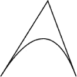


我们从左到右绘制一条二次曲线，以 `(60,10)` 为控制点，然后绘制两条线段，分别经过该控制点并回到线条起点。结果有点像 *星际迷航* 的徽章。你可以看到控制点的效果：从底部角落出发的线条先朝向控制点方向，然后弯曲至目标点。

`bezierCurve` 方法绘制一种类似的曲线。它有两个控制点，而不是一个——每个端点各有一个。下面是一个类似的草图，用于说明这种曲线的行为：

```
<canvas></canvas>
<script>
  var cx = document.querySelector("canvas").getContext("2d");
  cx.beginPath();
  cx.moveTo(10, 90);
  // control1=(10,10) control2=(90,10) goal=(50,90)
  cx.bezierCurveTo(10, 10, 90, 10, 50, 90);
  cx.lineTo(90, 10);
  cx.lineTo(10, 10);
  cx.closePath();
  cx.stroke();
</script>
```

两个控制点指定了曲线两端的方向。它们离对应端点越远，曲线在该方向上的“凸起”就越明显。

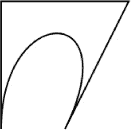

这类曲线可能难以处理——通常不容易找到能提供所需形状的控制点。有时你可以计算它们，有时则只能通过反复试验找到合适的值。

*圆弧*——圆的一部分——更容易理解。`arcTo` 方法至少需要五个参数。前四个参数的作用类似于 `quadraticCurveTo` 的参数。第一对参数提供一个类似控制点的点，第二对参数给出线条的目标点。第五个参数指定圆弧的半径。该方法会在概念上投射出一个角——一条线到控制点，再到目标点——然后对这个角的顶点进行圆角处理，使其成为给定半径圆的一部分。`arcTo` 方法随后绘制圆角部分，以及从起始位置到圆角起点的线段。

```
<canvas></canvas>
<script>
  var cx = document.querySelector("canvas").getContext("2d");
  cx.beginPath();
  cx.moveTo(10, 10);
  // control=(90,10) goal=(90,90) radius=20
  cx.arcTo(90, 10, 90, 90, 20);
  cx.moveTo(10, 10);
  // control=(90,10) goal=(90,90) radius=80
  cx.arcTo(90, 10, 90, 90, 80);
  cx.stroke();
</script>
```

这会生成两个不同半径的圆角。

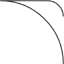

`arcTo` 方法不会绘制从圆角终点到目标点的线段，尽管其名称中的 *to* 暗示了这一点。你可以随后调用 `lineTo` 并传入相同的目标坐标来添加该线段。

要绘制一个圆，你可以使用四次 `arcTo` 调用（每次旋转 90 度）。但 `arc` 方法提供了更简单的方式。它接受一对坐标作为圆弧中心、一个半径，以及起始和结束角度。

最后两个参数使得只绘制圆的一部分成为可能。角度以弧度为单位，而非度数。这意味着一个完整的圆的角度为 2π，即 `2 * Math.PI`，约等于 6.28。角度从圆心右侧的点开始计数，并沿顺时针方向增加。你可以使用起始角度 0 和大于 2π 的结束角度（例如 7）来绘制一个完整的圆。

```
<canvas></canvas>
<script>
  var cx = document.querySelector("canvas").getContext("2d");
  cx.beginPath();
  // center=(50,50) radius=40 angle=0 to 7
  cx.arc(50, 50, 40, 0, 7);
  // center=(150,50) radius=40 angle=0 to ½ π
  cx.arc(150, 50, 40, 0, 0.5 * Math.PI);
  cx.stroke();
</script>
```

生成的图片包含一条从完整圆的左侧（第一次 `arc` 调用）到四分之一圆的左侧（第二次调用）的线段。与其他路径绘制方法一样，使用 `arc` 绘制的线段默认会与之前的路径段相连。如果你希望避免这种情况，需要调用 `moveTo` 或开始一条新路径。

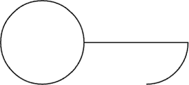

## 绘制饼图

假设你刚在 EconomiCorp 公司找到一份工作，你的第一个任务是绘制他们客户满意度调查结果的饼图。

`results` 变量包含一个对象数组，代表调查回复。

```
var results = [
  {name: "Satisfied", count: 1043, color: "lightblue"},
  {name: "Neutral", count: 563, color: "lightgreen"},
  {name: "Unsatisfied", count: 510, color: "pink"},
  {name: "No comment", count: 175, color: "silver"}
];
```

要绘制饼图，我们需要绘制多个扇形，每个扇形由一段圆弧和两条到圆心的线段组成。我们可以通过将完整圆（2π）除以总回复数，再乘以选择某个选项的人数，来计算每个扇形所占的角度。

```
<canvas width="200" height="200"></canvas>
<script>
  var cx = document.querySelector("canvas").getContext("2d");
  var total = results.reduce(function(sum, choice) {
    return sum + choice.count;
  }, 0);
  // Start at the top
  var currentAngle = -0.5 * Math.PI;
  results.forEach(function(result) {
    var sliceAngle = (result.count / total) * 2 * Math.PI;
    cx.beginPath();
    // center=100,100, radius=100
    // from current angle, clockwise by slice's angle
    cx.arc(100, 100, 100,
           currentAngle, currentAngle + sliceAngle);
    currentAngle += sliceAngle;
    cx.lineTo(100, 100);
    cx.fillStyle = result.color;
    cx.fill();
  });
</script>
```

这会绘制出以下图表：


但一张不说明含义的图表并没有太大帮助。我们需要一种在画布上绘制文本的方法。

## 文本

2D 画布绘图上下文提供了 `fillText` 和 `strokeText` 方法。后者可用于勾勒字母轮廓，但通常 `fillText` 才是你需要的。它会用当前的 `fillColor` 填充给定的文本。

```
<canvas></canvas>
<script>
  var cx = document.querySelector("canvas").getContext("2d");
  cx.font = "28px Georgia";
  cx.fillStyle = "fuchsia";
  cx.fillText("I can draw text, too!", 10, 50);
</script>
```

你可以通过 `font` 属性指定文本的大小、样式和字体。这个例子只给出了字体大小和字体族名称。你可以在字符串开头添加 `italic` 或 `bold` 来选择样式。

`fillText`（和 `strokeText`）的最后两个参数提供了绘制文本的位置。默认情况下，它们表示文本字母基线（即字母“站立”的线，不包括像 *j* 或 *p* 中下垂的部分）的起始位置。你可以通过将 `textAlign` 属性设置为 `"end"` 或 `"center"` 来改变水平位置，通过将 `textBaseline` 设置为 `"top"`、`"middle"` 或 `"bottom"` 来改变垂直位置。

我们将在本章末尾的练习中回到饼图以及标记扇形的问题。

## 图像

在计算机图形学中，通常区分*矢量*图形和*位图*图形。前者是本章到目前为止一直在做的——通过给出形状的逻辑描述来指定图片。而位图图形则不指定实际形状，而是处理像素数据（彩色点的光栅）。


`drawImage` 方法允许我们将像素数据绘制到画布上。这些像素数据可以来自 `` 元素或另一个画布，且两者都不必在文档中可见。下面的示例创建了一个独立的 `` 元素，并将图像文件加载到其中。但无法立即开始从该图片绘制，因为浏览器可能尚未获取它。为了解决这个问题，我们注册了一个 `"load"` 事件处理程序，并在图像加载完成后进行绘制。

```
<canvas></canvas>
<script>
  var cx = document.querySelector("canvas").getContext("2d");
  var img = document.createElement("img");
  img.src = "img/hat.png";
  img.addEventListener("load", function() {
    for (var x = 10; x < 200; x += 30)
      cx.drawImage(img, x, 10);
  });
</script>
```

默认情况下，`drawImage` 会以原始尺寸绘制图像。你也可以提供两个额外的参数来指定不同的宽度和高度。

当 `drawImage` 被赋予*九个*参数时，它可以用来仅绘制图像的一部分。第二到第五个参数指定源图像中要复制的矩形区域（`x`、`y`、宽度和高度），第六到第九个参数指定目标画布上的矩形区域（用于放置复制的内容）。

这可用于将多个*精灵图*（图像元素）打包到单个图像文件中，然后只绘制所需的部分。例如，我们有一张包含多个姿势的游戏角色图片：


通过交替绘制不同的姿势，我们可以展示一个看起来像行走角色的动画。

要在画布上制作动画，`clearRect` 方法非常有用。它类似于 `fillRect`，但不是给矩形着色，而是使其透明，从而移除之前绘制的像素。

我们知道每个*精灵图*（即每个子图片）宽 24 像素，高 30 像素。以下代码加载图像，然后设置一个间隔（重复定时器）来绘制下一*帧*：

```
<canvas></canvas>
<script>
  var cx = document.querySelector("canvas").getContext("2d");
  var img = document.createElement("img");
  img.src = "img/player.png";
  var spriteW = 24, spriteH = 30;
  img.addEventListener("load", function() {
    var cycle = 0;
    setInterval(function() {
      cx.clearRect(0, 0, spriteW, spriteH);
      cx.drawImage(img,
                   // 源矩形
                   cycle * spriteW, 0, spriteW, spriteH,
                   // 目标矩形
                   0,              0, spriteW, spriteH);
      cycle = (cycle + 1) % 8;
    }, 120);
  });
</script>
```

`cycle` 变量跟踪我们在动画中的位置。每一帧，它都会递增，然后通过取余运算符将其限制在 0 到 7 的范围内。然后使用该变量计算当前姿势的精灵图在图片中的 `x` 坐标。

## 变换

但如果想让角色向左走而不是向右走呢？当然，我们可以添加另一组精灵图。但我们也可以指示画布以相反方向绘制图片。

调用 `scale` 方法会导致之后绘制的所有内容按比例缩放。该方法接受两个参数，一个用于设置水平缩放，一个用于设置垂直缩放。

```
<canvas></canvas>
<script>
  var cx = document.querySelector("canvas").getContext("2d");
  cx.scale(3, .5);
  cx.beginPath();
  cx.arc(50, 50, 40, 0, 7);
  cx.lineWidth = 3;
  cx.stroke();
</script>
```

由于调用了 `scale`，圆被绘制成三倍宽、一半高。


缩放会导致绘制图像的所有方面（包括线宽）按指定方式拉伸或压缩。负值缩放会翻转图片。翻转发生在点 (0,0) 处，这意味着它也会翻转坐标系的方向。当应用水平缩放 –1 时，在 `x` 位置 100 处绘制的形状最终会出现在原来的位置 –100 处。

因此，要翻转图片，我们不能简单地在调用 `drawImage` 之前添加 `cx.scale(-1, 1)`，因为那样会将图片移出画布，使其不可见。你可以调整传递给 `drawImage` 的坐标来补偿，例如在 `x` 位置 –50 而不是 0 处绘制图像。另一种解决方案是调整缩放发生的轴，这样就不需要让执行绘制的代码知道缩放变化。

除了 `scale` 之外，还有其他几种方法会影响画布的坐标系。你可以使用 `rotate` 方法旋转后续绘制的形状，并使用 `translate` 方法移动它们。有趣（也令人困惑）的是，这些变换会*叠加*，意味着每个变换都是相对于之前的变换进行的。

因此，如果我们水平平移两次，每次 10 像素，那么所有内容都会向右绘制 20 像素。如果我们先将坐标系中心移动到 (50,50)，然后旋转 20 度（弧度制为 0.1π），那么旋转将*围绕*点 (50,50) 进行。

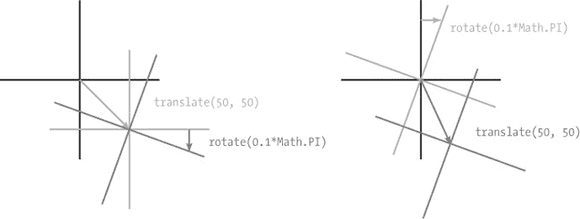

但如果*先*旋转 20 度，*然后*平移 (50,50)，那么平移将在旋转后的坐标系中进行，从而产生不同的方向。变换应用的顺序很重要。

要围绕给定的 `x` 位置垂直翻转图片，我们可以执行以下操作：

```
function flipHorizontally(context, around) {
  context.translate(around, 0);
  context.scale(-1, 1);
  context.translate(-around, 0);
}
```

我们将 y 轴移动到想要镜像的位置，应用镜像，最后将 y 轴移回镜像世界中的正确位置。下图解释了为什么这样有效：

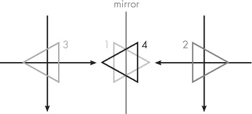

这显示了在中心线镜像前后的坐标系。如果我们在正 `x` 位置绘制一个三角形，默认情况下它会位于三角形 1 的位置。调用 `flipHorizontally` 首先向右平移，得到三角形 2。然后缩放，将三角形翻转到位置 3。如果它是在给定线上镜像的，这还不是它应该在的位置。第二次 `translate` 调用解决了这个问题——它*抵消*了初始平移，使三角形 4 恰好出现在它应该在的位置。

现在，我们可以通过围绕角色的垂直中心翻转世界，在位置 (100,0) 处绘制一个镜像角色。

```
<canvas></canvas>
<script>
  var cx = document.querySelector("canvas").getContext("2d");
  var img = document.createElement("img");
  img.src = "img/player.png";
  var spriteW = 24, spriteH = 30;
  img.addEventListener("load", function() {
    flipHorizontally(cx, 100 + spriteW / 2);
    cx.drawImage(img, 0, 0, spriteW, spriteH,
                 100, 0, spriteW, spriteH);
  });
</script>
```

## 存储与清除变换

变换会持续存在。在绘制镜像角色之后绘制的所有其他内容也会被镜像。这可能是个问题。

我们可以保存当前变换，进行一些绘制和变换，然后恢复旧的变换。对于需要临时变换坐标系的函数来说，这通常是正确的做法。首先，我们保存调用该函数的代码所使用的任何变换。然后，函数在现有变换的基础上执行操作，可能还会添加更多变换。最后，我们恢复到开始时的变换。


2D 画布上下文中的 `save` 和 `restore` 方法负责这种变换管理。它们在概念上维护了一个变换状态的栈。当你调用 `save` 时，当前状态被压入栈中；当你调用 `restore` 时，栈顶的状态被弹出，并用作上下文的当前变换。

以下示例中的 `branch` 函数展示了如何利用一个函数来改变变换，然后调用另一个函数（此处为自身），从而继续使用给定的变换进行绘制。

该函数通过绘制一条线、将坐标系原点移动到线的末端，然后两次调用自身（先向左旋转，再向右旋转）来绘制树状形状。每次调用都会减少所绘分支的长度，当长度小于 8 时递归停止。

```
<canvas width="600" height="300"></canvas>
<script>
  var cx = document.querySelector("canvas").getContext("2d");
  function branch(length, angle, scale) {
    cx.fillRect(0, 0, 1, length);
    if (length < 8) return;
    cx.save();
    cx.translate(0, length);
    cx.rotate(-angle);
    branch(length * scale, angle, scale);
    cx.rotate(2 * angle);
    branch(length * scale, angle, scale);
    cx.restore();
  }
  cx.translate(300, 0);
  branch(60, 0.5, 0.8);
</script>
```

结果是一个简单的分形图。


如果没有 `save` 和 `restore` 的调用，第二次递归调用 `branch` 将沿用第一次调用所产生的位置和旋转。它不会连接到当前分支，而是连接到第一次调用所绘制的最内层、最右侧的分支。最终形状可能也很有趣，但肯定不是一棵树。

## 回到游戏

我们现在对画布绘制有了足够的了解，可以开始为上一章的游戏构建一个基于画布的显示系统。新的显示将不再仅仅显示彩色方块。相反，我们将使用 `drawImage` 来绘制代表游戏元素的图片。

我们将定义一个对象类型 `CanvasDisplay`，它支持与第 15 章中 `DOMDisplay` 相同的接口，即 `drawFrame` 和 `clear` 方法。

该对象比 `DOMDisplay` 保留的信息稍多一些。它不使用其 DOM 元素的滚动位置，而是跟踪自己的视口，告诉我们当前正在查看关卡的哪一部分。它还跟踪时间，并用它来决定使用哪个动画帧。最后，它保留了一个 `flipPlayer` 属性，以便即使玩家静止不动，也能保持其最后移动的方向。

```
function CanvasDisplay(parent, level) {
  this.canvas = document.createElement("canvas");
  this.canvas.width = Math.min(600, level.width * scale);
  this.canvas.height = Math.min(450, level.height * scale);
  parent.appendChild(this.canvas);
  this.cx = this.canvas.getContext("2d");

  this.level = level;
  this.animationTime = 0;
  this.flipPlayer = false;

  this.viewport = {
    left: 0,
    top: 0,
    width: this.canvas.width / scale,
    height: this.canvas.height / scale
  };

  this.drawFrame(0);
}

CanvasDisplay.prototype.clear = function() {
  this.canvas.parentNode.removeChild(this.canvas);
};
```

`animationTime` 计数器是我们为什么在第 15 章中将步长传递给 `drawFrame` 的原因，尽管 `DOMDisplay` 并未使用它。我们新的 `drawFrame` 函数使用该计数器来跟踪时间，以便根据当前时间在动画帧之间切换。

```
CanvasDisplay.prototype.drawFrame = function(step) {
  this.animationTime += step;

  this.updateViewport();
  this.clearDisplay();
  this.drawBackground();
  this.drawActors();
};
```

除了跟踪时间外，该方法还会根据当前玩家位置更新视口，用背景色填充整个画布，并在其上绘制背景和角色。请注意，这与第 15 章中的方法不同，后者只绘制一次背景，然后滚动包裹的 DOM 元素来移动它。

因为画布上的形状只是像素，绘制后无法移动（或删除）。更新画布显示的唯一方法是清除它并重新绘制场景。

`updateViewport` 方法类似于 `DOMDisplay` 的 `scrollPlayerIntoView` 方法。它检查玩家是否离屏幕边缘太近，并在必要时移动视口。

```
CanvasDisplay.prototype.updateViewport = function() {
  var view = this.viewport, margin = view.width / 3;
  var player = this.level.player;
  var center = player.pos.plus(player.size.times(0.5));

  if (center.x < view.left + margin)
    view.left = Math.max(center.x - margin, 0);
  else if (center.x > view.left + view.width - margin)
    view.left = Math.min(center.x + margin - view.width,
                         this.level.width - view.width);
  if (center.y < view.top + margin)
    view.top = Math.max(center.y - margin, 0);
  else if (center.y > view.top + view.height - margin)
    view.top = Math.min(center.y + margin - view.height,
                        this.level.height - view.height);
};
```

对 `Math.max` 和 `Math.min` 的调用确保视口不会显示关卡之外的空间。`Math.max(x, 0)` 确保结果数字不小于零。类似地，`Math.min` 确保值保持在给定边界以下。

在清除显示时，我们将根据游戏是胜利（更亮）还是失败（更暗）使用略有不同的颜色。

```
CanvasDisplay.prototype.clearDisplay = function() {
  if (this.level.status == "won")
    this.cx.fillStyle = "rgb(68, 191, 255)";
  else if (this.level.status == "lost")
    this.cx.fillStyle = "rgb(44, 136, 214)";
  else
    this.cx.fillStyle = "rgb(52, 166, 251)";
  this.cx.fillRect(0, 0,
                   this.canvas.width, this.canvas.height);
};
```

为了绘制背景，我们遍历当前视口中可见的瓦片，使用与上一章 `obstacleAt` 中相同的技巧。

```
var otherSprites = document.createElement("img");
otherSprites.src = "img/sprites.png";

CanvasDisplay.prototype.drawBackground = function() {
  var view = this.viewport;
  var xStart = Math.floor(view.left);
  var xEnd = Math.ceil(view.left + view.width);
  var yStart = Math.floor(view.top);
  var yEnd = Math.ceil(view.top + view.height);

  for (var y = yStart; y < yEnd; y++) {
    for (var x = xStart; x < xEnd; x++) {
      var tile = this.level.grid[y][x];
      if (tile == null) continue;
      var screenX = (x - view.left) * scale;
      var screenY = (y - view.top) * scale;
      var tileX = tile == "lava" ? scale : 0;
      this.cx.drawImage(otherSprites,
                        tileX,         0, scale, scale,
                        screenX, screenY, scale, scale);
    }
  }
};
```

非空（`null`）的瓦片使用 `drawImage` 绘制。`otherSprites` 图像包含用于除玩家之外的其他元素的图片。从左到右依次是墙壁瓦片、熔岩瓦片和硬币的精灵图。


背景瓦片大小为 20×20 像素，因为我们使用与 `DOMDisplay` 相同的缩放比例。因此，熔岩瓦片的偏移量为 20（`scale` 变量的值），墙壁的偏移量为 0。


我们无需等待精灵图加载完成。如果使用尚未加载完成的图片调用 `drawImage`，则什么也不会发生。因此，在图片仍在加载的最初几帧中，游戏可能无法正确绘制，但这并不是严重问题。由于我们会持续更新屏幕，一旦加载完成，正确的场景就会立即出现。

之前展示的行走角色将用于代表玩家。绘制该角色的代码需要根据玩家当前的运动状态选择正确的精灵图和方向。前八个精灵图包含行走动画。当玩家在地面上移动时，我们会根据显示器的 `animationTime` 属性循环切换这些精灵图。该属性以秒为单位，我们希望每秒切换 12 帧，因此先将时间乘以 12。当玩家静止站立时，我们绘制第九个精灵图。在跳跃过程中（通过垂直速度不为零来判断），我们使用第十个（最右侧的）精灵图。

由于精灵图比玩家对象稍宽——24 像素而非 16 像素，以便为脚和手臂留出空间——该方法需要根据给定数值（`playerXOverlap`）调整 x 坐标和宽度。

```
var playerSprites = document.createElement("img");
playerSprites.src = "img/player.png";
var playerXOverlap = 4;

CanvasDisplay.prototype.drawPlayer = function(x, y, width, height) {
  var sprite = 8, player = this.level.player;
  width += playerXOverlap * 2;
  x -= playerXOverlap;
  if (player.speed.x != 0)
    this.flipPlayer = player.speed.x < 0;

  if (player.speed.y != 0)
    sprite = 9;
  else if (player.speed.x != 0)
    sprite = Math.floor(this.animationTime * 12) % 8;

  this.cx.save();
  if (this.flipPlayer)
    flipHorizontally(this.cx, x + width / 2);

  this.cx.drawImage(playerSprites,
                    sprite * width, 0, width, height,
                    x,              y, width, height);
  this.cx.restore();
};
```

`drawPlayer` 方法由 `drawActors` 调用，后者负责绘制游戏中的所有角色。

```
CanvasDisplay.prototype.drawActors = function() {
  this.level.actors.forEach(function(actor) {
    var width = actor.size.x * scale;
    var height = actor.size.y * scale;
    var x = (actor.pos.x - this.viewport.left) * scale;
    var y = (actor.pos.y - this.viewport.top) * scale;
    if (actor.type == "player") {
      this.drawPlayer(x, y, width, height);
    } else {
      var tileX = (actor.type == "coin" ? 2 : 1) * scale;
      this.cx.drawImage(otherSprites,
                        tileX, 0, width, height,
                        x,     y, width, height);
    }
  }, this);
};
```

当绘制非玩家对象时，我们根据其类型查找正确精灵图的偏移量。熔岩瓦片位于偏移量 20 处，金币精灵图位于 40 处（两倍 `scale`）。

在计算角色位置时，我们必须减去视口的位置，因为画布上的 (0,0) 对应视口的左上角，而非关卡的左上角。我们也可以使用 `translate` 来实现这一点。两种方法都可行。

至此，新的显示系统介绍完毕。最终的游戏效果如下所示：

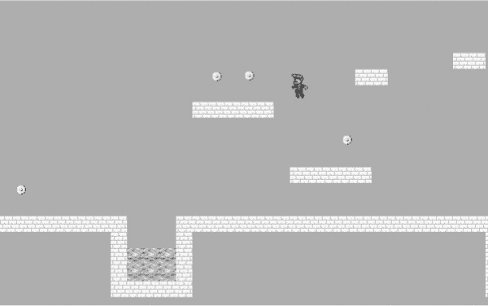

## 选择图形界面

每当需要在浏览器中生成图形时，你可以选择纯 HTML、SVG 或 canvas。没有一种适用于所有情况的*最佳*方法。每种选项都有其优缺点。

纯 HTML 的优势在于简单，并且与文本集成良好。SVG 和 canvas 都允许绘制文本，但它们无法帮助你定位文本或在文本超过一行时自动换行。在基于 HTML 的图片中，很容易包含文本块。

SVG 可用于生成在任何缩放级别下都清晰锐利的图形。它比纯 HTML 更难使用，但功能也更强大。

SVG 和 HTML 都会构建一个表示图片的数据结构（DOM）。这使得在绘制后可以修改元素。如果你需要根据用户操作或作为动画的一部分反复更改大图片中的一小部分，使用 canvas 可能会产生不必要的开销。DOM 还允许我们在图片中的每个元素上注册鼠标事件处理程序（甚至包括用 SVG 绘制的形状）。而 canvas 无法做到这一点。

但是，当绘制大量微小元素时，canvas 基于像素的方法可能是一个优势。它不构建数据结构，而是反复在同一像素表面上绘制，这使得每个形状的成本更低。

还有一些效果，例如逐像素渲染场景（例如使用光线追踪器）或使用 JavaScript 对图像进行后处理（模糊或扭曲），这些效果只能通过基于像素的技术来实际处理。

在某些情况下，你可能希望结合使用多种技术。例如，你可以使用 SVG 或 canvas 绘制图表，但通过将 HTML 元素定位在图片上方来显示文本信息。

对于要求不高的应用，选择哪种界面其实并不重要。我们在本章中为游戏构建的第二个显示系统可以使用这三种图形技术中的任何一种来实现，因为它不需要绘制文本、处理鼠标交互或处理数量极其庞大的元素。

## 总结

在本章中，我们讨论了在浏览器中绘制图形的技术，重点介绍了 `<canvas>` 元素。

画布节点代表文档中的一个区域，我们的程序可以在该区域上绘制。这种绘制是通过使用 `getContext` 方法创建的绘图上下文对象来完成的。

2D 绘图界面允许我们填充和描边各种形状。上下文的 `fillStyle` 属性决定了形状的填充方式。`strokeStyle` 和 `lineWidth` 属性控制线条的绘制方式。

矩形和文本片段可以通过单个方法调用来绘制。`fillRect` 和 `strokeRect` 方法绘制矩形，`fillText` 和 `strokeText` 方法绘制文本。要创建自定义形状，我们必须首先构建一条路径。

调用 `beginPath` 会开始一条新路径。许多其他方法会向当前路径添加线条和曲线。例如，`lineTo` 可以添加一条直线。当路径完成后，可以使用 `fill` 方法填充或使用 `stroke` 方法描边。

使用 `drawImage` 方法可以将像素从图像或其他画布移动到我们的画布上。默认情况下，此方法绘制整个源图像，但通过提供更多参数，你可以复制图像的特定区域。我们在游戏中使用了这一点，从包含多个姿势的图像中复制游戏角色的单个姿势。

变换允许你以多种方向绘制形状。2D 绘图上下文有一个当前变换，可以通过 `translate`、`scale` 和 `rotate` 方法进行更改。这些变换会影响所有后续的绘制操作。变换状态可以使用 `save` 方法保存，并使用 `restore` 方法恢复。

在画布上绘制动画时，可以使用 `clearRect` 方法在重新绘制之前清除画布的一部分。

## 练习

### 形状

编写一个程序，在画布上绘制以下形状：

1.  一个梯形（一边更宽的矩形）

2.  一个红色菱形（旋转 45 度或 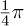 弧度的矩形）

3.  一条锯齿线

4.  由 100 条直线段组成的螺旋线

5.  一颗黄色星星


在绘制最后两个图形时，你可能需要参考第 13 章中对`Math.cos`和`Math.sin`的解释，其中描述了如何利用这些函数获取圆上的坐标。

我建议为每个形状创建一个函数。将位置以及可选的其他属性（如大小或点数）作为参数传递。另一种做法是在代码中硬编码数字，这往往会使代码难以阅读和修改。

### 饼图

本章前面部分，我们看到了一个绘制饼图的示例程序。修改该程序，使得每个类别的名称显示在其对应的扇形旁边。尝试找到一种美观的方式来自动定位这些文本，使其同样适用于其他数据集。你可以假设每个类别至少占 5%（即不会有一堆小扇形紧挨在一起）。

你可能再次需要用到上一道练习中描述的`Math.sin`和`Math.cos`。

### 弹跳球

使用我们在第 13 章和第 15 章中看到的`requestAnimationFrame`技术，绘制一个包含弹跳球的盒子。球以恒定速度运动，碰到盒子边缘时反弹。

### 预计算镜像

变换的一个不幸之处在于它会减慢位图的绘制速度。对于矢量图形，影响较小，因为只需要变换少数几个点（例如圆心），之后就可以正常绘制。但对于位图图像，每个像素的位置都需要变换，尽管未来浏览器可能会在这方面变得更智能，但目前这会导致绘制位图所需的时间明显增加。

在我们这样的游戏中，只绘制单个变换后的精灵，这不成问题。但想象一下，我们需要绘制数百个角色或爆炸产生的数千个旋转粒子。

想出一种方法，让我们能够绘制一个反转的角色，而无需加载额外的图像文件，也无需每帧都调用经过变换的`drawImage`。

# 第 17 章 HTTP

> “Web 背后的梦想是一个公共信息空间，我们通过共享信息进行交流。它的普遍性至关重要：超文本链接可以指向任何东西，无论是个人、本地还是全球，无论是草稿还是精雕细琢。”
> 
> ——蒂姆·伯纳斯-李，《万维网：一段非常简短的个人历史》

*超文本传输协议*（已在第 12 章中提到）是万维网上请求和提供数据的机制。本章将更详细地描述该协议，并解释浏览器中的 JavaScript 如何访问它。

## 协议

如果你在浏览器的地址栏中输入*eloquentjavascript.net/17_http.html*，浏览器首先会查找与*eloquentjavascript.net*关联的服务器地址，并尝试在端口 80（HTTP 流量的默认端口）上打开一个 TCP 连接。如果服务器存在并接受连接，浏览器会发送类似以下内容：

```
GET /17_http.html HTTP/1.1
Host: eloquentjavascript.net
User-Agent: 你的浏览器名称
```

然后服务器通过同一连接响应：

```
HTTP/1.1 200 OK
Content-Length: 65585
Content-Type: text/html
Last-Modified: Wed, 09 Apr 2014 10:48:09 GMT

<!doctype html>
... 文档的其余部分
```

然后浏览器获取响应中空行之后的部分，并将其显示为 HTML 文档。

客户端发送的信息称为*请求*。它以以下行开头：

```
GET /17_http.html HTTP/1.1
```

第一个词是请求的*方法*。`GET`表示我们想要*获取*指定的资源。其他常见方法有`DELETE`（删除资源）、`PUT`（替换资源）和`POST`（向资源发送信息）。请注意，服务器没有义务执行它收到的每个请求。如果你访问一个随机网站并告诉它`DELETE`其主页，它很可能会拒绝。

方法名之后的部分是请求所应用的资源路径。在最简单的情况下，资源就是服务器上的一个文件，但协议并不要求如此。资源可以是任何可以*像文件一样*传输的东西。许多服务器会动态生成响应。例如，如果你打开*twitter.com/marijnjh*，服务器会在其数据库中查找名为*marijnjh*的用户，如果找到，就会为该用户生成一个个人资料页面。

在资源路径之后，请求的第一行会提到`HTTP/1.1`，以表明它使用的 HTTP 协议版本。

服务器的响应也会以版本号开头，后面跟着响应的状态，先是三位数的状态码，然后是人类可读的字符串。

```
HTTP/1.1 200 OK
```

以 2 开头的状态码表示请求成功。以 4 开头的表示请求有问题。404 可能是最著名的 HTTP 状态码——它表示请求的资源未找到。以 5 开头的表示服务器发生了错误，而请求本身没有问题。

请求或响应的第一行后面可以跟任意数量的*标头*。这些行采用“名称: 值”的形式，用于指定关于请求或响应的额外信息。以下是示例响应中的标头：

```
Content-Length: 65585
Content-Type: text/html
Last-Modified: Wed, 09 Apr 2014 10:48:09 GMT
```

这告诉我们响应文档的大小和类型。在本例中，它是一个 65,585 字节的 HTML 文档。它还告诉我们该文档的最后修改时间。

大多数情况下，客户端或服务器决定在请求或响应中包含哪些标头，尽管有些标头是必需的。例如，`Host`标头指定主机名，应该包含在请求中，因为一个服务器可能在一个 IP 地址上服务多个主机名，如果没有这个标头，服务器就不知道客户端试图与哪个主机通信。

在标头之后，请求和响应都可能包含一个空行，后面跟着*主体*，其中包含正在发送的数据。`GET`和`DELETE`请求不发送任何数据，但`PUT`和`POST`请求会发送。同样，某些响应类型（如错误响应）不需要主体。

## 浏览器与 HTTP

正如我们在示例中看到的，当我们在地址栏中输入 URL 时，浏览器会发出一个请求。当生成的 HTML 页面引用其他文件（如图像和 JavaScript 文件）时，这些文件也会被获取。

一个中等复杂的网站可能轻松包含 10 到 200 个资源。为了快速获取这些资源，浏览器会同时发出多个请求，而不是逐个等待响应。这些文档总是使用`GET`请求获取。

HTML 页面可能包含*表单*，允许用户填写信息并发送到服务器。以下是一个表单示例：

```
<form method="GET" action="example/message.html">
  <p>姓名：<input type="text" name="name"></p>
  <p>消息：<br><textarea name="message"></textarea></p>
  <p><button type="submit">发送</button></p>
</form>
```

这段代码描述了一个包含两个字段的表单：一个用于输入姓名的小字段，一个用于编写消息的大字段。当你点击“发送”按钮时，这些字段中的信息会被编码成一个*查询字符串*。当`<form>`元素的`method`属性为`GET`（或省略）时，该查询字符串会被附加到`action` URL 上，浏览器会向该 URL 发出`GET`请求。

```
GET /example/message.html?name=Jean&message=Yes%3F HTTP/1.1
```


查询字符串的开始由一个问号表示。之后跟着名称和值的配对，分别对应表单字段元素的 `name` 属性和这些元素的内容。使用与号字符（`&`）来分隔这些配对。

尽管问号被一个奇怪的代码替换，但之前 URL 中编码的实际消息是“Yes?”。查询字符串中的某些字符必须被转义。问号表示为 `%3F`，就是其中之一。似乎有一条不成文的规则，每种格式都需要自己的字符转义方式。这种称为 *URL 编码* 的方式，使用百分号后跟两个十六进制数字来编码字符代码。在这种情况下，3F（十进制为 63）是问号字符的代码。JavaScript 提供了 `encodeURIComponent` 和 `decodeURIComponent` 函数来编码和解码这种格式。

```
console.log(encodeURIComponent("Hello & goodbye"));
// ▹ Hello%20%26%20goodbye
console.log(decodeURIComponent("Hello%20%26%20goodbye"));
// ▹ Hello & goodbye
```

如果我们把之前示例中 HTML 表单的 `method` 属性改为 `POST`，那么提交表单的 HTTP 请求将使用 `POST` 方法，并将查询字符串放在请求体中，而不是添加到 URL 中。

```
POST /example/message.html HTTP/1.1
Content-length: 24
Content-type: application/x-www-form-urlencoded

name=Jean&message=Yes%3F
```

按照惯例，`GET` 方法用于没有副作用的请求，例如执行搜索。而改变服务器上某些内容的请求，例如创建新账户或发布消息，应该使用其他方法，如 `POST`。客户端软件（如浏览器）知道不应盲目地发出 `POST` 请求，但通常会隐式地发出 `GET` 请求——例如，预取它认为用户即将需要的资源。

下一章将回到表单，并讨论如何用 JavaScript 对它们进行脚本化。

## XMLHttpRequest

浏览器 JavaScript 发起 HTTP 请求的接口称为 `XMLHttpRequest`（注意大小写不一致）。它由微软在 20 世纪 90 年代末为其 Internet Explorer 浏览器设计。当时，XML 文件格式在商业软件世界中*非常*流行——而微软一直在这个世界中如鱼得水。事实上，它如此流行，以至于 XML 这个缩写被加到了一个与 XML 毫无关系的 HTTP 接口名称前面。

不过，这个名称并非完全无意义。该接口允许你在需要时将响应文档解析为 XML。将两个不同的概念（发起请求和解析响应）混为一谈，当然是一种糟糕的设计，但事情就是这样。

当 `XMLHttpRequest` 接口被添加到 Internet Explorer 时，它让人们可以用 JavaScript 做以前非常困难的事情。例如，当用户在文本字段中输入内容时，网站开始显示建议列表。脚本会在用户输入时通过 HTTP 将文本发送到服务器。服务器拥有一个可能输入的数据库，它会将数据库条目与部分输入进行匹配，并返回可能的补全建议给用户。这被认为是惊人的——人们已经习惯了每次与网站交互都要等待整个页面重新加载。

当时另一个重要的浏览器 Mozilla（后来的 Firefox）不想落后。为了让人们也能在*它的*浏览器中做类似巧妙的事情，Mozilla 复制了这个接口，包括那个虚假的名称。下一代浏览器也效仿了这种做法，如今 `XMLHttpRequest` 已成为事实上的标准接口。

## 发送请求

要发起一个简单的请求，我们使用 `XMLHttpRequest` 构造函数创建一个请求对象，并调用它的 `open` 和 `send` 方法。

```
var req = new XMLHttpRequest();
req.open("GET", "example/data.txt", false);
req.send(null);
console.log(req.responseText);
// ▹ This is the content of data.txt
```

`open` 方法配置请求。在这个例子中，我们选择对 `example/data.txt` 文件发起一个 `GET` 请求。不以协议名称（如 `http:`）开头的 URL 是相对 URL，这意味着它们相对于当前文档进行解释。当它们以斜杠（`/`）开头时，它们会替换当前路径（即服务器名称之后的部分）。当它们不以斜杠开头时，当前路径中直到并包括最后一个斜杠字符的部分会被放在相对 URL 的前面。

打开请求后，我们可以用 `send` 方法发送它。`send` 的参数是请求体。对于 `GET` 请求，我们可以传递 `null`。如果 `open` 的第三个参数是 `false`，那么 `send` 只有在收到请求的响应后才会返回。我们可以读取请求对象的 `responseText` 属性来获取响应体。

响应中包含的其他信息也可以从这个对象中提取。状态码可以通过 `status` 属性获取，人类可读的状态文本可以通过 `statusText` 获取。头部信息可以通过 `getResponseHeader` 读取。

```
var req = new XMLHttpRequest();
req.open("GET", "example/data.txt", false);
req.send(null);
console.log(req.status, req.statusText);
// ▹ 200 OK
console.log(req.getResponseHeader("content-type"));
// ▹ text/plain
```

头部名称不区分大小写。通常每个单词的首字母大写，例如“Content-Type”，但“content-type”和“cOnTeNt-TyPe”指的是同一个头部。

浏览器会自动添加一些请求头部，例如“Host”以及服务器确定请求体大小所需的头部。但你可以使用 `setRequestHeader` 方法添加自己的头部。这仅用于高级用途，并且需要与你通信的服务器的配合——服务器可以自由忽略它不知道如何处理的头部。

## 异步请求

在我们看到的示例中，当 `send` 调用返回时，请求已经完成。这很方便，因为像 `responseText` 这样的属性可以立即使用。但这也意味着只要浏览器和服务器在通信，我们的程序就会被挂起。当连接状况不佳、服务器响应慢或文件很大时，这可能会花费相当长的时间。更糟糕的是，由于程序挂起时无法触发任何事件处理程序，整个文档将变得无响应。

如果我们向 `open` 传递 `true` 作为第三个参数，请求就是*异步*的。这意味着当我们调用 `send` 时，唯一立即发生的事情是请求被安排发送。我们的程序可以继续执行，而浏览器会在后台处理数据的发送和接收。

但只要请求正在运行，我们就无法访问响应。我们需要一种机制，在数据可用时通知我们。

为此，我们必须监听请求对象上的 `"load"` 事件。

```
var req = new XMLHttpRequest();
req.open("GET", "example/data.txt", true);
req.addEventListener("load", function() {
  console.log("Done:", req.status);
});
req.send(null);
```

就像第 15 章中使用 `requestAnimationFrame` 一样，这迫使我们采用异步编程风格，将请求完成后需要做的事情包装在一个函数中，并安排它在适当的时候被调用。我们稍后会回到这个话题。

## 获取 XML 数据


当 `XMLHttpRequest` 对象获取的资源是 XML 文档时，该对象的 `responseXML` 属性将包含该文档的解析表示。这种表示与第 13 章中讨论的 DOM 非常相似，只是它没有像 `style` 属性这样的 HTML 特定功能。`responseXML` 持有的对象对应于 `document` 对象。它的 `documentElement` 属性指向 XML 文档的最外层标签。在以下文档（`example/fruit.xml`）中，这将是 `<fruits>` 标签：

```
<fruits>
  <fruit name="banana" color="yellow"/>
  <fruit name="lemon" color="yellow"/>
  <fruit name="cherry" color="red"/>
</fruits>
```

我们可以像这样获取这样的文件：

```
var req = new XMLHttpRequest();
req.open("GET", "example/fruit.xml", false);
req.send(null);
console.log(req.responseXML.querySelectorAll("fruit").length);
// ▹ 3
```

XML 文档可用于与服务器交换结构化信息。它们的形式——标签嵌套在其他标签内部——非常适合存储大多数类型的数据，至少比纯文本文件要好。不过，DOM 接口在提取信息方面相当笨拙，而且 XML 文档往往冗长。通常更好的做法是使用 JSON 数据进行通信，无论对于程序还是人类，JSON 都更易于读写。

```
var req = new XMLHttpRequest();
req.open("GET", "example/fruit.json", false);
req.send(null);
console.log(JSON.parse(req.responseText));
// ▹ {banana: "yellow", lemon: "yellow", cherry: "red"}
```

## HTTP 沙箱

在网页脚本中发起 HTTP 请求再次引发了安全问题。控制脚本的人可能与运行脚本的计算机用户利益不一致。更具体地说，如果我访问 `themafia.org`，我不希望它的脚本能够利用我浏览器中的身份信息向 `mybank.com` 发起请求，并指示将我的所有资金转移到某个随机黑手党账户。

网站可以保护自己免受此类攻击，但这需要付出努力，而且许多网站未能做到。因此，浏览器通过禁止脚本向其他*域名*（如 `themafia.org` 和 `mybank.com`）发起 HTTP 请求来保护我们。

在构建需要合法访问多个域名的系统时，这可能是一个令人烦恼的问题。幸运的是，服务器可以在其响应中包含如下头部，以明确告知浏览器允许来自其他域名的请求：

```
Access-Control-Allow-Origin: *
```

## 抽象请求

在第 10 章中，我们在实现 AMD 模块系统时，使用了一个假设的函数 `backgroundReadFile`。它接受一个文件名和一个函数，并在获取文件内容后调用该函数。以下是该函数的一个简单实现：

```
function backgroundReadFile(url, callback) {
  var req = new XMLHttpRequest();
  req.open("GET", url, true);
  req.addEventListener("load", function() {
    if (req.status < 400)
      callback(req.responseText);
  });
  req.send(null);
}
```

这个简单的抽象使得在简单的 `GET` 请求中使用 `XMLHttpRequest` 更加容易。如果你正在编写一个需要发起 HTTP 请求的程序，最好使用一个辅助函数，这样就不会在整个代码中重复丑陋的 `XMLHttpRequest` 模式。

函数参数的名称 `callback` 是一个常用于描述此类函数的术语。回调函数被提供给其他代码，以便为这些代码提供一种“稍后回调我们”的方式。

编写一个针对应用程序需求定制的 HTTP 实用函数并不困难。上面的函数只处理 `GET` 请求，并且不让我们控制头部或请求体。你可以为 `POST` 请求编写另一个变体，或者编写一个更通用的函数来支持各种类型的请求。许多 JavaScript 库也提供了 `XMLHttpRequest` 的封装。

上述封装的主要问题在于对失败的处理。当请求返回表示错误的状态码（400 及以上）时，它什么也不做。在某些情况下这可能没问题，但想象一下，我们在页面上放置了一个“加载”指示器来表示正在获取信息。如果请求因服务器崩溃或连接短暂中断而失败，页面将停留在那里，误导性地看起来像是在做某事。用户会等待一段时间，变得不耐烦，并认为该网站毫无用处且不稳定。

我们还应该有一个选项，在请求失败时得到通知，以便采取适当的行动。例如，我们可以移除“加载”消息并告知用户出现了问题。

异步代码中的错误处理比同步代码中的错误处理更加棘手。因为我们经常需要推迟部分工作，将其放入回调函数中，`try` 块的作用域就变得毫无意义。在以下代码中，异常将*不会*被捕获，因为对 `backgroundReadFile` 的调用会立即返回。控制权随后离开 `try` 块，而传递给它的函数直到稍后才会被调用。

```
try {
  backgroundReadFile("example/data.txt", function(text) {
    if (text != "expected")
      throw new Error("That was unexpected");
  });
} catch (e) {
  console.log("Hello from the catch block");
}
```

为了处理失败的请求，我们必须允许向封装传递一个额外的函数，并在请求出错时调用它。或者，我们可以采用这样的约定：如果请求失败，则将描述问题的额外参数传递给常规回调函数。示例如下：

```
function getURL(url, callback) {
  var req = new XMLHttpRequest();
  req.open("GET", url, true);
  req.addEventListener("load", function() {
    if (req.status < 400)
      callback(req.responseText);
    else
      callback(null, new Error("Request failed: " +
                               req.statusText));
  });
  req.addEventListener("error", function() {
    callback(null, new Error("Network error"));
  });
  req.send(null);
}
```

我们为 `"error"` 事件添加了一个处理程序，当请求完全失败时会触发该事件。当请求完成但状态码表示错误时，我们也会用错误参数调用回调函数。

使用 `getURL` 的代码必须检查是否给出了错误，如果发现错误，则处理它。

```
getURL("data/nonsense.txt", function(content, error) {
  if (error != null)
    console.log("Failed to fetch nonsense.txt: " + error);
  else
    console.log("nonsense.txt: " + content);
});
```

这在处理异常时并没有帮助。当将多个异步操作链接在一起时，链中任何一点发生的异常（除非你将每个处理函数包装在自己的 `try`/`catch` 块中）都会到达顶层并中止你的操作链。

## Promise

对于复杂的项目，以纯回调风格编写异步代码很难正确完成。很容易忘记检查错误，或者让意外的异常以粗暴的方式中断程序。此外，当错误需要流经多个回调函数和 `catch` 块时，安排正确的错误处理非常繁琐。

人们已经尝试了许多方法，通过额外的抽象来解决这个问题。其中一种比较成功的方法叫做 `promise`。Promise 将异步操作封装在一个对象中，该对象可以传递，并在操作完成或失败时被告知执行某些操作。这个接口将成为下一版 JavaScript 语言的一部分，但目前已经可以作为库使用。


期约（Promise）的接口并不完全直观，但功能强大。本章仅作粗略介绍。更详尽的讲解可参考 [`www.promisejs.org/`](http://www.promisejs.org/)。

要创建一个期约对象，我们调用 `Promise` 构造函数，并传入一个用于初始化异步操作的函数。构造函数会调用该函数，并传入两个参数，这两个参数本身也是函数。第一个函数应在操作成功完成时调用，第二个函数则在操作失败时调用。

下面再次给出我们为 `GET` 请求编写的包装器，这次它返回一个期约。我们将其简称为 `get`。

```
function get(url) {
  return new Promise(function(succeed, fail) {
    var req = new XMLHttpRequest();
    req.open("GET", url, true);
    req.addEventListener("load", function() {
      if (req.status < 400)
        succeed(req.responseText);
      else
        fail(new Error("Request failed: " + req.statusText));
    });
    req.addEventListener("error", function() {
      fail(new Error("Network error"));
    });
    req.send(null);
  });
}
```

注意，函数本身的接口现在简单多了。你只需传入一个 URL，它就会返回一个期约。这个期约充当了请求结果的句柄。它有一个 `then` 方法，你可以传入两个函数：一个处理成功，一个处理失败。

```
get("example/data.txt").then(function(text) {
  console.log("data.txt: " + text);
}, function(error) {
  console.log("Failed to fetch data.txt: " + error);
});
```

到目前为止，这仅仅是另一种表达我们已经实现功能的方式。只有当需要将多个操作串联起来时，期约才会展现出显著的优势。

调用 `then` 会生成一个新的期约，其结果（传递给成功处理函数的值）取决于我们传递给 `then` 的第一个函数的返回值。这个函数可以返回另一个期约，以表示正在执行更多的异步工作。在这种情况下，`then` 返回的期约本身会等待处理函数返回的期约，并在该期约解决时以相同的值成功或失败。当处理函数返回一个非期约值时，`then` 返回的期约会立即以该值作为结果成功。

这意味着你可以使用 `then` 来转换期约的结果。例如，下面这个函数返回一个期约，其结果是指定 URL 的内容，并解析为 JSON：

```
function getJSON(url) {
  return get(url).then(JSON.parse);
}
```

最后一次调用 `then` 时没有指定失败处理函数，这是允许的。错误会被传递给 `then` 返回的期约，这正是我们想要的——`getJSON` 不知道在出错时该怎么做，但希望它的调用者知道。

作为展示期约用法的示例，我们将构建一个程序，从服务器获取多个 JSON 文件，并在获取过程中显示“加载中”字样。这些 JSON 文件包含人物信息，并通过 `father`、`mother` 或 `spouse` 等属性链接到代表其他人的文件。

我们想要获取 `example/bert.json` 中人物的配偶的母亲的名字。如果出现错误，我们希望移除加载文本并显示错误信息。以下是使用期约实现的方式：

```
<script>
  function showMessage(msg) {
    var elt = document.createElement("div");
    elt.textContent = msg;
    return document.body.appendChild(elt);
  }

  var loading = showMessage("Loading...");
  getJSON("example/bert.json").then(function(bert) {
    return getJSON(bert.spouse);
  }).then(function(spouse) {
    return getJSON(spouse.mother);
  }).then(function(mother) {
    showMessage("The name is " + mother.name);
  }).catch(function(error) {
    showMessage(String(error));
  }).then(function() {
    document.body.removeChild(loading);
  });
</script>
```

最终的程序相对简洁且易读。`catch` 方法与 `then` 类似，但它只接受一个失败处理函数，并在成功时原样传递结果。与 `try` 语句中的 `catch` 子句类似，在捕获失败后，控制流会正常继续。这样，即使出现错误，最后的 `then`（用于移除加载消息）也始终会被执行。

你可以将期约接口视为实现异步控制流的自有语言。为了实现这一点所需的额外方法调用和函数表达式，虽然让代码看起来有些别扭，但远不及我们自己处理所有错误处理时那么别扭。

## 理解 HTTP

在构建需要浏览器中运行的 JavaScript 程序（客户端）与服务器上的程序（服务端）进行通信的系统时，有多种不同的方式来建模这种通信。

一种常用的模型是远程过程调用。在该模型中，通信遵循普通函数调用的模式，只不过函数实际上运行在另一台机器上。调用它需要向服务器发送一个包含函数名和参数的请求，该请求的响应则包含返回值。

从远程过程调用的角度思考时，HTTP 仅仅是一种通信载体，你很可能会编写一个完全隐藏它的抽象层。

另一种方法是围绕资源和 HTTP 方法的概念来构建通信。例如，不使用名为 `addUser` 的远程过程，而是向 `/users/larry` 发送一个 `PUT` 请求。不将用户属性编码为函数参数，而是定义一种文档格式或使用现有的表示用户的格式。那么，用于创建新资源的 `PUT` 请求的正文就是这样一个文档。通过向资源的 URL（例如 `/user/larry`）发送 `GET` 请求来获取资源，该请求会返回表示该资源的文档。

第二种方法更容易利用 HTTP 提供的一些特性，例如支持缓存资源（在客户端保留副本）。它还有助于保持接口的一致性，因为资源比一堆函数更容易推理。

## 安全与 HTTPS

在互联网上传输的数据往往要经过漫长而危险的道路。为了到达目的地，数据必须穿越从咖啡店 Wi-Fi 网络到由各种公司和政府控制的网络等各种环境。在路径上的任何一点，数据都可能被检查甚至篡改。

如果某些信息需要保密（例如电子邮件账户的密码），或者需要确保在到达目的地时未被修改（例如从银行网站转账的账户号码），那么普通的 HTTP 就不够安全。

安全 HTTP 协议（其 URL 以 https:// 开头）通过一种方式封装 HTTP 流量，使其更难被读取和篡改。首先，客户端要求服务器证明其拥有由浏览器认可的证书颁发机构颁发的加密证书，从而验证服务器身份。其次，所有通过连接传输的数据都经过加密，以防止窃听和篡改。

因此，在正常工作的情况下，HTTPS 既能防止有人冒充你试图通信的网站，也能防止有人窃听你的通信。它并非完美无缺，也曾出现过因伪造或被盗证书以及软件漏洞导致 HTTPS 失效的事件。尽管如此，普通的 HTTP 很容易被篡改，而破解 HTTPS 则需要只有国家或高级犯罪组织才能付出的努力。

## 总结


在本章中，我们了解到 HTTP 是一种通过互联网访问资源的协议。*客户端*发送一个请求，其中包含一个方法（通常是 `GET`）和一个标识资源的路径。*服务器*随后决定如何处理该请求，并返回一个状态码和响应体。请求和响应都可能包含提供额外信息的标头。

浏览器通过 `GET` 请求获取显示网页所需的资源。网页也可能包含表单，这些表单允许用户在提交表单时，将输入的信息随请求一起发送。你将在下一章中了解更多相关内容。

浏览器 JavaScript 用于发起 HTTP 请求的接口称为 `XMLHttpRequest`。通常你可以忽略名称中的“XML”部分（但你还是得输入它）。它有两种使用方式——同步方式，会阻塞所有操作直到请求完成；异步方式，则需要一个事件处理程序来感知响应已到达。在几乎所有情况下，异步方式更可取。发起一个请求的代码如下：

```
var req = new XMLHttpRequest();
req.open("GET", "example/data.txt", true);
req.addEventListener("load", function() {
  console.log(req.statusCode);
});
req.send(null);
```

异步编程比较棘手。*Promise* 是一种接口，它通过帮助将错误条件和异常路由到正确的处理程序，并抽象掉这种编程风格中一些重复且易出错的部分，从而让事情变得稍微简单一些。

## 练习

### 内容协商

HTTP 能够做到但本章尚未讨论的一件事，称为*内容协商*。请求的 `Accept` 标头可用于告知服务器客户端希望获取哪种类型的文档。许多服务器会忽略此标头，但当服务器知道多种编码资源的方式时，它可以查看此标头并发送客户端偏好的那种。

URL `eloquentjavascript.net/author` 被配置为根据客户端的请求，以纯文本、HTML 或 JSON 格式响应。这些格式由标准化的*媒体类型* `text/plain`、`text/html` 和 `application/json` 标识。

发送请求以获取该资源的全部三种格式。使用 `XMLHttpRequest` 对象的 `setRequestHeader` 方法，将名为 `Accept` 的标头设置为前面给出的媒体类型之一。确保在调用 `open` *之后*、调用 `send` *之前*设置该标头。

最后，尝试请求媒体类型 `application/rainbows+unicorns`，看看会发生什么。

### 等待多个 Promise

`Promise` 构造函数有一个 `all` 方法，它接受一个 Promise 数组，并返回一个等待数组中所有 Promise 完成的 Promise。然后它成功，并产生一个结果值数组。如果数组中的任何一个 Promise 失败，`all` 返回的 Promise 也会失败（失败值来自失败的 Promise）。

尝试自己实现一个类似的功能，作为一个名为 `all` 的普通函数。

注意，一旦一个 Promise 被解决（成功或失败），它就不能再次成功或失败，并且后续对解决它的函数的调用将被忽略。这可以简化你处理 Promise 失败的方式。

# 第 18 章 表单与表单字段

> “就在今日，在博士的宴会上，我将如期奉上我应尽的义务。但有一事！——为了保险起见，我恳求你，至少赐我一两行字。”
> 
> ——梅菲斯特，出自*歌德的《浮士德》*

上一章简要介绍了表单，作为通过 HTTP *提交*用户提供的信息的一种方式。它们是为前 JavaScript 时代的 Web 设计的，假设与服务器的交互总是通过导航到新页面来进行的。

但表单元素与页面其他部分一样，也是 DOM 的一部分，而表示表单字段的 DOM 元素支持许多其他元素不具备的属性和事件。这使得我们可以用 JavaScript 程序检查和控制这些输入字段，并执行诸如为传统表单添加功能，或将表单和字段用作 JavaScript 应用程序的构建块等操作。

## 字段

一个 Web 表单由任意数量的输入字段组成，这些字段分组在 `<form>` 标签内。HTML 允许多种不同风格的字段，从简单的开/关复选框到下拉菜单和文本输入字段。本书不会试图全面讨论所有字段类型，但我们将从一个粗略的概述开始。

许多字段类型使用 `<input>` 标签。该标签的 `type` 属性用于选择字段的样式。以下是一些常用的 `<input>` 类型：

*   ****text****。单行文本字段
*   ****password****。与 `text` 相同，但隐藏输入的文本
*   ****checkbox****。开/关开关
*   ****radio****。多选字段的（一部分）
*   ****file****。允许用户从计算机中选择文件

表单字段不一定非要出现在 `<form>` 标签中。你可以将它们放在页面的任何位置。这样的字段无法被提交（只有整个表单才能提交），但当我们用 JavaScript 响应输入时，通常也不希望以正常方式提交字段。

```
<p><input type="text" value="abc"> (文本)</p>
<p><input type="password" value="abc"> (密码)</p>
<p><input type="checkbox" checked> (复选框)</p>
<p><input type="radio" value="A" name="choice">
   <input type="radio" value="B" name="choice">
   <input type="radio" value="C" name="choice" checked> (单选按钮)</p>
<p><input type="file" checked> (文件)</p>
```

用这段 HTML 代码创建的字段看起来像这样：

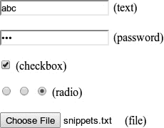

这些元素的 JavaScript 接口因元素类型而异。我们将在本章后面逐一介绍。

多行文本字段有自己的标签 `<textarea>`，这主要是因为使用属性来指定多行起始值会很笨拙。`<textarea>` 需要一个匹配的 `</textarea>` 结束标签，并使用这两个标签之间的文本作为起始文本，而不是使用其 `value` 属性。

```
<textarea>
一
二
三
</textarea>
```

最后，`<select>` 标签用于创建一个允许用户从多个预定义选项中选择的字段。

```
<select>
  <option>煎饼</option>
  <option>布丁</option>
  <option>冰淇淋</option>
</select>
```

这样的字段看起来像这样：

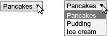

每当表单字段的值发生变化时，它会触发一个 `"change"` 事件。

## 焦点

与 HTML 文档中的大多数元素不同，表单字段可以获取*键盘焦点*。当被点击或以其他方式激活时，它们会成为当前活动元素，即键盘输入的主要接收者。

如果文档中有一个文本字段，只有当该字段获得焦点时，输入的文本才会出现在其中。其他字段对键盘事件的响应方式不同。例如，`<select>` 菜单会尝试移动到包含用户输入文本的选项，并通过箭头键上下移动其选择。

我们可以通过 JavaScript 使用 `focus` 和 `blur` 方法来控制焦点。前者将焦点移动到调用它的 DOM 元素上，后者则移除焦点。`document.activeElement` 的值对应于当前获得焦点的元素。

```
<input type="text">
<script>
  document.querySelector("input").focus();
  console.log(document.activeElement.tagName);
  // ▹ INPUT
  document.querySelector("input").blur();
  console.log(document.activeElement.tagName);
  // ▹ BODY
</script>
```


对于某些页面，用户可能希望立即与表单字段进行交互。JavaScript 可用于在文档加载时聚焦该字段，但 HTML 也提供了 `autofocus` 属性，它能产生相同的效果，同时让浏览器了解我们的意图。这使得浏览器可以在不适当的情况下禁用该行为，例如当用户已经聚焦在其他元素上时。

```
<input type="text" autofocus>
```

传统上，浏览器还允许用户通过按 TAB 键在文档中移动焦点。我们可以使用 `tabindex` 属性影响元素接收焦点的顺序。以下示例文档将使焦点从文本输入跳转到“确定”按钮，而不是先经过帮助链接：

```
<input type="text" tabindex=1> <a href=".">(帮助)</a>
<button onclick="console.log('ok')" tabindex=2>确定</button>
```

默认情况下，大多数类型的 HTML 元素无法被聚焦。但你可以为任何元素添加 `tabindex` 属性，这将使其可聚焦。

## 禁用字段

所有表单字段都可以通过其 `disabled` 属性被禁用，该属性也作为元素 DOM 对象上的一个属性存在。

```
<button>我没事</button>
<button disabled>我出局了</button>
```

禁用的字段无法被聚焦或更改，与活动字段不同，它们通常看起来是灰色且褪色的。


当程序正在处理由某个按钮或其他控件触发的操作时，该操作可能需要与服务器通信并因此花费一些时间，那么最好在操作完成前禁用该控件。这样，当用户不耐烦并再次点击时，就不会意外重复操作。

## 表单整体

当字段包含在 `<form>` 元素中时，其 DOM 元素将有一个 `form` 属性，指向表单的 DOM 元素。反过来，`<form>` 元素有一个名为 `elements` 的属性，其中包含一个类似数组的集合，包含其中的所有字段。

表单字段的 `name` 属性决定了提交表单时其值的标识方式。它也可以作为访问表单 `elements` 属性时的属性名，该属性既充当类似数组的对象（按数字访问），又充当映射（按名称访问）。

```
<form action="example/submit.html">
  姓名：<input type="text" name="name"><br>
  密码：<input type="password" name="password"><br>
  <button type="submit">登录</button>
</form>
<script>
  var form = document.querySelector("form");
  console.log(form.elements[1].type);
  // ▹ password
  console.log(form.elements.password.type);
  // ▹ password
  console.log(form.elements.name.form == form);
  // ▹ true
</script>
```

带有 `type` 属性为 `submit` 的按钮，在按下时将导致表单被提交。当表单字段获得焦点时按下回车键也会产生相同的效果。

提交表单通常意味着浏览器会导航到表单的 `action` 属性指定的页面，使用 `GET` 或 `POST` 请求。但在那之前，会触发一个 `"submit"` 事件。该事件可以由 JavaScript 处理，处理程序可以通过在事件对象上调用 `preventDefault` 来阻止默认行为。

```
<form action="example/submit.html">
  值：<input type="text" name="value">
  <button type="submit">保存</button>
</form>
<script>
  var form = document.querySelector("form");
  form.addEventListener("submit", function(event) {
    console.log("保存值", form.elements.value.value);
    event.preventDefault();
  });
</script>
```

在 JavaScript 中拦截 `"submit"` 事件有多种用途。我们可以编写代码来验证用户输入的值是否合理，并在不合理时立即显示错误消息，而不是提交表单。或者，我们可以完全禁用常规的提交方式，如前面的示例所示，让我们的程序处理输入，可能使用 `XMLHttpRequest` 将其发送到服务器而无需重新加载页面。

## 文本字段

由 `<input>` 标签（类型为 `text` 或 `password`）以及 `<textarea>` 标签创建的字段共享一个通用接口。它们的 DOM 元素有一个 `value` 属性，以字符串形式保存当前内容。将此属性设置为另一个字符串会更改字段的内容。

文本字段的 `selectionStart` 和 `selectionEnd` 属性提供了有关文本中光标和选择的信息。当没有选择任何内容时，这两个属性保存相同的数字，表示光标的位置。例如，0 表示文本的开头，10 表示光标在第 10 个字符之后。当字段的一部分被选中时，这两个属性会不同，给出所选文本的开始和结束位置。与 `value` 一样，这些属性也可以被写入。

举个例子，假设你正在写一篇关于哈塞海姆威（Khasekhemwy）的文章，但在拼写他的名字时遇到了一些困难。以下代码将一个 `<textarea>` 标签与一个事件处理程序绑定，当你按下 F2 时，它会自动插入字符串“Khasekhemwy”。

```
<textarea></textarea>
<script>
  var textarea = document.querySelector("textarea");
  textarea.addEventListener("keydown", function(event) {
    // F2 的键码恰好是 113
    if (event.keyCode == 113) {
      replaceSelection(textarea, "Khasekhemwy");
      event.preventDefault();
    }
  });
  function replaceSelection(field, word) {
    var from = field.selectionStart, to = field.selectionEnd;
    field.value = field.value.slice(0, from) + word +
                  field.value.slice(to);
    // 将光标放在单词之后
    field.selectionStart = field.selectionEnd =
      from + word.length;
  };
</script>
```

`replaceSelection` 函数将文本字段当前选中的部分替换为给定的单词，然后将光标移动到该单词之后，以便用户继续输入。

文本字段的 `"change"` 事件不会在每次输入时触发。相反，它会在字段失去焦点且内容已更改时触发。要立即响应文本字段的变化，你应该注册一个 `"input"` 事件的处理程序，该事件会在用户每次键入字符、删除文本或以其他方式操作字段内容时触发。

以下示例显示了一个文本字段和一个计数器，显示当前输入文本的长度：

```
<input type="text"> 长度：<span id="length">0</span>
<script>
  var text = document.querySelector("input");
  var output = document.querySelector("#length");
  text.addEventListener("input", function() {
    output.textContent = text.value.length;
  });
</script>
```

## 复选框和单选按钮

复选框字段是一个简单的二进制开关。它的值可以通过其 `checked` 属性提取或更改，该属性保存一个布尔值。

```
<input type="checkbox" id="purple">
<label for="purple">让此页面变为紫色</label>
<script>
  var checkbox = document.querySelector("#purple");
  checkbox.addEventListener("change", function() {
    document.body.style.background =
      checkbox.checked ? "mediumpurple" : "";
  });
</script>
```

`<label>` 标签用于将一段文本与输入字段关联起来。它的 `for` 属性应引用字段的 `id`。点击标签将激活该字段，使其获得焦点，并在字段是复选框或单选按钮时切换其值。

单选按钮与复选框类似，但它隐式地与具有相同 `name` 属性的其他单选按钮关联，因此任何时候只能有一个处于活动状态。


```
Color:
<input type="radio" name="color" value="mediumpurple"> 紫色
<input type="radio" name="color" value="lightgreen"> 绿色
<input type="radio" name="color" value="lightblue"> 蓝色
<script>
  var buttons = document.getElementsByName("color");
  function setColor(event) {
    document.body.style.background = event.target.value;
  }
  for (var i = 0; i < buttons.length; i++)
    buttons[i].addEventListener("change", setColor);
</script>
```

`document.getElementsByName` 方法会返回所有具有给定 `name` 属性的元素。示例中通过一个常规的 `for` 循环（而不是 `forEach`，因为返回的集合并非真正的数组）遍历这些元素，并为每个元素注册了一个事件处理函数。请记住，事件对象有一个 `target` 属性，指向触发事件的元素。这在像这样的事件处理函数中非常有用，因为该函数会被不同元素调用，并且需要某种方式来访问当前目标。

## 选择字段

选择字段在概念上与单选按钮类似——它们也允许用户从一组选项中进行选择。但单选按钮将选项的布局交由我们控制，而 `<select>` 标签的外观则由浏览器决定。

选择字段还有一种变体，它更像复选框列表，而非单选按钮组。当添加 `multiple` 属性后，`<select>` 标签允许用户选择任意数量的选项，而不仅仅是单个选项。

```
<select multiple>
  <option>煎饼</option>
  <option>布丁</option>
  <option>冰淇淋</option>
</select>
```

在大多数浏览器中，这看起来与不带 `multiple` 的选择字段不同，后者通常呈现为*下拉*控件，只有打开时才会显示选项。

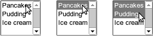

`<select>` 标签的 `size` 属性用于设置同时可见的选项数量，从而让你能够显式控制下拉菜单的外观。例如，将 `size` 属性设置为 `"3"` 会使字段显示三行，无论是否启用了 `multiple` 选项。

每个 `<option>` 标签都有一个值。该值可以通过 `value` 属性定义，但若未指定，则选项内的文本将作为选项的值。`<select>` 元素的 `value` 属性反映了当前选中的选项。但对于 `multiple` 字段，该属性意义不大，因为它只会给出当前选中选项中*一个*的值。

`<select>` 字段的 `<option>` 标签可以通过字段的 `options` 属性以类数组对象的形式访问。每个选项都有一个名为 `selected` 的属性，表示该选项当前是否被选中。该属性也可用于选中或取消选中某个选项。

以下示例从一个 `multiple` 选择字段中提取选中的值，并用它们从各个位组合成一个二进制数。按住 CTRL（Mac 上为 COMMAND）可选择多个选项。

```
<select multiple>
  <option value="1">0001</option>
  <option value="2">0010</option>
  <option value="4">0100</option>
  <option value="8">1000</option>
</select> = <span id="output">0</span>
<script>
  var select = document.querySelector("select");
  var output = document.querySelector("#output");
  select.addEventListener("change", function() {
    var number = 0;
    for (var i = 0; i < select.options.length; i++) {
      var option = select.options[i];
      if (option.selected)
        number += Number(option.value);
    }
    output.textContent = number;
  });
</script>
```

## 文件字段

文件字段最初设计用于通过表单从浏览器所在机器上传文件。在现代浏览器中，它们还提供了一种从 JavaScript 程序读取此类文件的方式。该字段充当了守门人的角色。脚本不能随意读取用户计算机上的私有文件，但如果用户在该字段中选择了一个文件，浏览器就会将此操作解释为脚本可以读取该文件。

文件字段通常看起来像一个标有“选择文件”或“浏览”等文字的按钮，旁边显示所选文件的信息。

```
<input type="file">
<script>
  var input = document.querySelector("input");
  input.addEventListener("change", function() {
    if (input.files.length > 0) {
      var file = input.files[0];
      console.log("你选择了", file.name);
      if (file.type)
        console.log("它的类型是", file.type);
    }
  });
</script>
```

文件字段元素的 `files` 属性是一个类数组对象（同样不是真正的数组），包含该字段中选择的文件。它最初是空的。之所以不直接使用 `file` 属性，是因为文件字段也支持 `multiple` 属性，从而可以同时选择多个文件。

`files` 属性中的对象具有 `name`（文件名）、`size`（文件大小，以字节为单位）和 `type`（文件的媒体类型，例如 `text/plain` 或 `image/jpeg`）等属性。

但它没有包含文件内容的属性。获取文件内容要稍微复杂一些。由于从磁盘读取文件可能需要时间，因此接口必须是异步的，以避免冻结文档。你可以将 `FileReader` 构造函数视为类似于 `XMLHttpRequest`，但用于文件。

```
<input type="file" multiple>
<script>
  var input = document.querySelector("input");
  input.addEventListener("change", function() {
    Array.prototype.forEach.call(input.files, function(file) {
      var reader = new FileReader();
      reader.addEventListener("load", function() {
        console.log("文件", file.name, "的开头是",
                    reader.result.slice(0, 20));
      });
      reader.readAsText(file);
    });
  });
</script>
```

读取文件需要创建一个 `FileReader` 对象，为其注册一个 `"load"` 事件处理函数，然后调用其 `readAsText` 方法，并将要读取的文件传递给它。加载完成后，读取器的 `result` 属性将包含文件的内容。

示例中使用 `Array.prototype.forEach` 来遍历数组，因为在普通循环中，从事件处理函数中获取正确的 `file` 和 `reader` 对象会很麻烦。变量会被循环的所有迭代共享。

当读取文件因任何原因失败时，`FileReader` 还会触发一个 `"error"` 事件。错误对象本身会出现在读取器的 `error` 属性中。如果你不想记住另一个不一致的异步接口的细节，可以将其包装在 `Promise` 中（参见第 17 章），如下所示：

```
function readFile(file) {
  return new Promise(function(succeed, fail) {
    var reader = new FileReader();
    reader.addEventListener("load", function() {
      succeed(reader.result);
    });
    reader.addEventListener("error", function() {
      fail(reader.error);
    });
    reader.readAsText(file);
  });
}
```

还可以通过调用文件的 `slice` 方法并将结果（所谓的 *blob* 对象）传递给文件读取器，来仅读取文件的一部分。

## 客户端数据存储

带有少量 JavaScript 的简单 HTML 页面可以成为“迷你应用”的绝佳载体——这些小型辅助程序可以自动化日常事务。通过将几个表单字段与事件处理函数连接起来，你可以实现从摄氏度与华氏度之间的转换，到根据主密码和网站名称计算密码等各种功能。


当这样的应用需要在会话之间记住某些信息时，你不能使用 JavaScript 变量，因为这些变量在每次页面关闭时都会被丢弃。你可以设置一个服务器，将其连接到互联网，并让应用在那里存储一些内容。我们将在第 20 章中看到如何做到这一点。但这会增加大量额外的工作和复杂性。有时，只需将数据保留在浏览器中就足够了。但如何做到呢？

你可以通过将字符串数据放入 `localStorage` 对象中，使其在页面重新加载后仍然存在。该对象允许你以名称（也是字符串）存储字符串值，如下例所示：

```
localStorage.setItem("username", "marijn");
console.log(localStorage.getItem("username"));
// ▹ marijn
localStorage.removeItem("username");
```

`localStorage` 中的值会一直保留，直到被覆盖、通过 `removeItem` 移除，或者用户清除本地数据。

来自不同域名的站点拥有不同的存储空间。这意味着，原则上，某个网站存储在 `localStorage` 中的数据只能被同一站点的脚本读取（和覆盖）。

浏览器还对站点在 `localStorage` 中存储的数据大小施加了限制，通常为几兆字节。这一限制，加上用垃圾填满用户硬盘并不划算的事实，防止了该功能占用过多空间。

以下代码实现了一个简单的笔记应用。它将用户的笔记保存为一个对象，将笔记标题与内容字符串关联起来。该对象被编码为 JSON 并存储在 `localStorage` 中。用户可以从 `<select>` 字段中选择一个笔记，并在 `<textarea>` 中修改该笔记的文本。点击按钮可以添加新笔记。

```
Notes: <select id="list"></select>
<button onclick="addNote()">new</button><br>
<textarea id="currentnote" style="width: 100%; height: 10em">
</textarea>

<script>
  var list = document.querySelector("#list");
  function addToList(name) {
    var option = document.createElement("option");
    option.textContent = name;
    list.appendChild(option);
  }

  // 从 localStorage 初始化列表
  var notes = JSON.parse(localStorage.getItem("notes")) ||
              {"shopping list": ""};
  for (var name in notes)
    if (notes.hasOwnProperty(name))
      addToList(name);

  function saveToStorage() {
    localStorage.setItem("notes", JSON.stringify(notes));
  }

  var current = document.querySelector("#currentnote");
  current.value = notes[list.value];

  list.addEventListener("change", function() {
  current.value = notes[list.value];
  });
  current.addEventListener("change", function() {
    notes[list.value] = current.value;
    saveToStorage();
  });

  function addNote() {
    var name = prompt("Note name", "");
    if (!name) return;
    if (!notes.hasOwnProperty(name)) {
      notes[name] = "";
      addToList(name);
      saveToStorage();
    }
    list.value = name;
    current.value = notes[name];
  }
</script>
```

脚本将 `notes` 变量初始化为 `localStorage` 中存储的值，如果该值不存在，则初始化为一个仅包含空 `"shopping list"` 笔记的简单对象。从 `localStorage` 读取不存在的字段会返回 `null`。将 `null` 传递给 `JSON.parse` 会使其解析字符串 `"null"` 并返回 `null`。因此，在这种情况下可以使用 `||` 运算符来提供默认值。

每当笔记数据发生变化时（添加新笔记或修改现有笔记），都会调用 `saveToStorage` 函数来更新存储字段。如果这个应用要处理成千上万条笔记，而不是几条，那么这种方式会过于昂贵，我们必须想出更复杂的存储方法，例如为每个笔记分配自己的存储字段。

当用户添加新笔记时，代码必须显式更新文本字段，即使 `<select>` 字段有一个执行相同操作的 `"change"` 处理程序。这是必要的，因为 `"change"` 事件仅在*用户*更改字段值时触发，而不是在脚本更改时触发。

还有一个与 `localStorage` 类似的对象，叫做 `sessionStorage`。两者的区别在于，`sessionStorage` 的内容会在每个会话结束时被遗忘，对于大多数浏览器来说，这意味着每当浏览器关闭时。

## 总结

HTML 可以表达多种类型的表单字段，例如文本字段、复选框、多选字段和文件选择器。

这些字段可以通过 JavaScript 进行检查和操作。当字段发生变化时，它们会触发 `"change"` 事件；当输入文本时，会触发 `"input"` 事件；以及各种键盘事件。这些事件使我们能够注意到用户何时与字段进行交互。像 `value`（用于文本和选择字段）或 `checked`（用于复选框和单选按钮）这样的属性用于读取或设置字段的内容。

当表单提交时，会触发其 `"submit"` 事件。JavaScript 处理程序可以对该事件调用 `preventDefault` 来阻止提交。表单字段元素不必包裹在 `<form>` 标签中。

当用户在文件选择器字段中从本地文件系统选择了某个文件后，可以使用 `FileReader` 接口从 JavaScript 程序中访问该文件的内容。

`localStorage` 和 `sessionStorage` 对象可用于以在页面重新加载后仍然存在的方式保存信息。前者永久保存数据（或直到用户决定清除它），后者则保存数据直到浏览器关闭。

## 练习

### JavaScript 工作台

构建一个界面，允许人们输入并运行 JavaScript 代码片段。

在 `<textarea>` 字段旁边放置一个按钮，按下该按钮时，使用我们在第 10 章中看到的 `Function` 构造函数将文本包装成一个函数并调用它。将函数的返回值或它引发的任何错误转换为字符串，并显示在文本字段之后。

### 自动补全

扩展一个文本字段，使得当用户输入时，在字段下方显示一个建议值列表。你有一个可用值的数组，并且应该显示那些以输入文本开头的值。当点击某个建议时，用该建议替换文本字段的当前值。

### 康威生命游戏

康威生命游戏是一个简单的模拟，它在网格上创建人工生命，每个单元格要么是活的，要么是死的。每一代（回合），应用以下规则：

*   任何活细胞，如果其活邻居少于两个或多于三个，则死亡。
*   任何活细胞，如果有两个或三个活邻居，则存活到下一代。
*   任何死细胞，如果恰好有三个活邻居，则变成活细胞。

邻居定义为任何相邻的单元格，包括对角线相邻的单元格。

请注意，这些规则是同时应用于整个网格，而不是一次一个方格。这意味着邻居的计数基于该代开始时的状态，并且在这一代中邻居细胞发生的变化不应影响给定细胞的新状态。

使用你认为合适的数据结构来实现这个游戏。使用 `Math.random` 初始用随机模式填充网格。将其显示为复选框字段的网格，旁边有一个按钮用于前进到下一代。当用户勾选或取消勾选复选框时，他们的更改应包含在计算下一代时。

# 第 19 章 项目：一个绘图程序

> “我看着眼前的众多色彩。我看着空白的画布。然后，我尝试像用词语塑造诗歌、用音符塑造音乐一样运用色彩。”
> 
> ——胡安·米罗

前几章的内容为你提供了构建一个简单 Web 应用所需的所有元素。在本章中，我们将实际构建这样一个应用。


我们的应用程序将是一个基于网页的绘图程序，类似于 Microsoft Paint。你可以用它打开图像文件，用鼠标在上面涂鸦，然后保存。效果如下图所示：

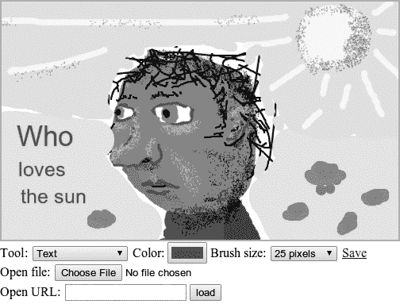

在电脑上画画很棒。你不需要担心材料、技巧或天赋。只需开始涂抹即可。

## 实现

绘图程序的界面顶部显示一个大的 `<canvas>` 元素，下方有多个表单字段。用户通过从 `<select>` 字段中选择工具，然后点击或拖拽画布来绘图。工具有画线、擦除部分图像、添加文本等。

点击画布会将 `"mousedown"` 事件交给当前选中的工具，该工具可以按自己的方式处理。例如，画线工具会监听 `"mousemove"` 事件，直到鼠标按钮释放，并使用当前颜色和画笔大小沿着鼠标路径画线。

颜色和画笔大小通过额外的表单字段选择。这些字段会在更改时更新画布绘图上下文的 `fillStyle`、`strokeStyle` 和 `lineWidth`。

你可以通过两种方式将图像加载到程序中。第一种使用文件字段，用户可以从自己的文件系统中选择文件。第二种要求输入 URL，并从网络获取图像。

图像的保存方式有些特殊。右侧的保存链接指向当前图像。它可以被点击、分享或保存。稍后我会解释这是如何实现的。

## 构建 DOM

我们程序的界面由 30 多个 DOM 元素组成。我们需要以某种方式构建它们。

HTML 是定义复杂 DOM 结构最明显的格式。但将程序拆分为 HTML 和脚本会变得困难，因为许多 DOM 元素需要事件处理程序，或者脚本需要以其他方式操作它们。因此，我们的脚本必须进行大量 `querySelector`（或类似）调用来找到需要操作的 DOM 元素。

如果界面每个部分的 DOM 结构都定义在驱动它的 JavaScript 代码附近，那就太好了。因此，我选择在 JavaScript 中完成所有 DOM 节点的创建。正如我们在第 13 章中看到的，用于构建 DOM 结构的内置接口非常冗长。如果我们要进行大量 DOM 构建，就需要一个辅助函数。

这个辅助函数是第 13 章中 `elt` 函数的扩展版本。它创建一个具有给定名称和属性的元素，并将所有后续参数作为子节点追加，自动将字符串转换为文本节点。

```
function elt(name, attributes) {
  var node = document.createElement(name);
  if (attributes) {
    for (var attr in attributes)
      if (attributes.hasOwnProperty(attr))
        node.setAttribute(attr, attributes[attr]);
  }
  for (var i = 2; i < arguments.length; i++) {
    var child = arguments[i];
    if (typeof child == "string")
      child = document.createTextNode(child);
    node.appendChild(child);
  }
  return node;
}
```

这使我们能够轻松创建元素，而不会让源代码像企业最终用户协议那样冗长乏味。

## 基础

我们程序的核心是 `createPaint` 函数，它将绘图界面追加到作为参数传入的 DOM 元素中。因为我们希望逐步构建程序，所以定义了一个名为 `controls` 的对象，它将包含初始化图像下方各种控件的函数。

```
var controls = Object.create(null);

function createPaint(parent) {
  var canvas = elt("canvas", {width: 500, height: 300});
  var cx = canvas.getContext("2d");
  var toolbar = elt("div", {class: "toolbar"});
  for (var name in controls)
    toolbar.appendChild(controlsname);

  var panel = elt("div", {class: "picturepanel"}, canvas);
  parent.appendChild(elt("div", null, panel, toolbar));
}
```

每个控件都可以访问画布绘图上下文，并通过该上下文的 `canvas` 属性访问 `<canvas>` 元素。程序的大部分状态都存在于这个画布中——它包含当前图像以及选中的颜色（在其 `fillStyle` 属性中）和画笔大小（在其 `lineWidth` 属性中）。

我们将画布和控件包装在带有类的 `<div>` 元素中，以便添加一些样式，例如图像周围的灰色边框。

## 工具选择

我们添加的第一个控件是 `<select>` 元素，允许用户选择绘图工具。与 `controls` 类似，我们将使用一个对象来收集各种工具，这样就不必将它们硬编码在一个地方，并且以后可以添加更多工具。该对象将工具名称与选中该工具并点击画布时应调用的函数关联起来。

```
var tools = Object.create(null);

controls.tool = function(cx) {
  var select = elt("select");
  for (var name in tools)
    select.appendChild(elt("option", null, name));

  cx.canvas.addEventListener("mousedown", function(event) {
    if (event.which == 1) {
      toolsselect.value;
      event.preventDefault();
    }
  });

  return elt("span", null, "Tool: ", select);
};
```

工具字段填充了所有已定义工具的 `<option>` 元素，并且画布元素上的 `"mousedown"` 处理程序负责调用当前工具的函数，将事件对象和绘图上下文作为参数传递。它还调用 `preventDefault`，这样按住鼠标按钮并拖动就不会导致浏览器选中页面部分内容。

最基本的工具是画线工具，它允许用户用鼠标画线。为了将线条端点放在正确的位置，我们需要找到给定鼠标事件对应的画布相对坐标。第 13 章中简要提到的 `getBoundingClientRect` 方法可以帮我们做到这一点。它告诉我们元素相对于屏幕左上角的位置。鼠标事件上的 `clientX` 和 `clientY` 属性也相对于这个角，因此我们可以从中减去画布的左上角，得到相对于该角的位置。

```
function relativePos(event, element) {
  var rect = element.getBoundingClientRect();
  return {x: Math.floor(event.clientX - rect.left),
          y: Math.floor(event.clientY - rect.top)};
}
```

几个绘图工具需要在鼠标按钮按住时监听 `"mousemove"` 事件。`trackDrag` 函数负责处理这种情况下的事件注册和注销。

```
function trackDrag(onMove, onEnd) {
  function end(event) {
    removeEventListener("mousemove", onMove);
    removeEventListener("mouseup", end);
    if (onEnd)
      onEnd(event);
  }
  addEventListener("mousemove", onMove);
  addEventListener("mouseup", end);
}
```

该函数接受两个参数。一个是在每个 `"mousemove"` 事件时调用的函数，另一个是在鼠标按钮释放时调用的函数。不需要时可以省略任一参数。

画线工具使用这两个辅助函数进行实际绘制。

```
tools.Line = function(event, cx, onEnd) {
  cx.lineCap = "round";

  var pos = relativePos(event, cx.canvas);
  trackDrag(function(event) {
    cx.beginPath();
    cx.moveTo(pos.x, pos.y);
    pos = relativePos(event, cx.canvas);
    cx.lineTo(pos.x, pos.y);
    cx.stroke();
  }, onEnd);
};
```


该函数首先将绘图上下文的 `lineCap` 属性设置为 `"round"`，这样描边路径的两端就会变成圆形，而不是默认的方形。这是一个技巧，用于确保在响应不同事件时绘制的多条独立线条看起来像一条连贯的线条。如果线条宽度较大，使用默认的平头线帽时，拐角处会出现间隙。

然后，只要鼠标按钮按下，每次发生 `"mousemove"` 事件时，就会在鼠标的旧位置和新位置之间绘制一条简单的线段，并使用当前设置的 `strokeStyle` 和 `lineWidth`。

`tools.Line` 的 `onEnd` 参数直接传递给 `trackDrag`。通常运行工具的方式不会传递第三个参数，因此使用线条工具时，该参数为 `undefined`，鼠标拖动结束时不会发生任何操作。该参数的存在是为了让我们能够用很少的额外代码在线条工具之上实现擦除工具。

```
tools.Erase = function(event, cx) {
  cx.globalCompositeOperation = "destination-out";
  tools.Line(event, cx, function() {
    cx.globalCompositeOperation = "source-over";
  });
};
```

`globalCompositeOperation` 属性影响画布上绘图操作改变所触及像素颜色的方式。默认情况下，该属性的值为 `"source-over"`，这意味着绘制的颜色会覆盖在该位置现有的颜色之上。如果颜色不透明，它会直接替换旧颜色；但如果颜色部分透明，则两者会混合。

擦除工具将 `globalCompositeOperation` 设置为 `"destination-out"`，其效果是擦除我们触及的像素，使它们再次变为透明。

这样，我们的绘图程序就有了两个工具。我们可以绘制单个像素宽的黑色线条（画布的默认 `strokeStyle` 和 `lineWidth`），然后再次擦除它们。这是一个可用的绘图程序，尽管功能相当有限。

## 颜色与画笔大小

假设用户希望使用黑色以外的颜色绘图，并使用不同的画笔大小，那么让我们为这两个设置添加控件。

在第 18 章中，我讨论了许多不同的表单字段。颜色字段不在其中。传统上，浏览器没有内置的颜色选择器支持，但在过去几年中，许多新的表单字段类型已经标准化。其中之一是 `<input type="color">`。其他类型包括 `"date"`、`"email"`、`"url"` 和 `"number"`。并非所有浏览器都支持它们——在撰写本文时，没有任何版本的 Internet Explorer 支持颜色字段。`<input>` 标签的默认类型是 `"text"`，当使用不支持的 type 时，浏览器会将其视为文本字段。这意味着运行我们绘图程序的 Internet Explorer 用户必须输入他们想要的颜色名称，而不是从方便的控件中选择。

颜色选择器可能看起来像这样：

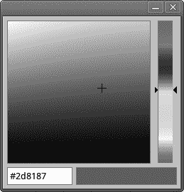

```
controls.color = function(cx) {
  var input = elt("input", {type: "color"});
  input.addEventListener("change", function() {
    cx.fillStyle = input.value;
    cx.strokeStyle = input.value;
  });
  return elt("span", null, "Color: ", input);
};
```

每当颜色字段的值发生变化时，绘图上下文的 `fillStyle` 和 `strokeStyle` 会更新为新的值。

用于配置画笔大小的字段工作方式类似。

```
controls.brushSize = function(cx) {
  var select = elt("select");
  var sizes = [1, 2, 3, 5, 8, 12, 25, 35, 50, 75, 100];
  sizes.forEach(function(size) {
  select.appendChild(elt("option", {value: size},
                         size + " pixels"));
  });
  select.addEventListener("change", function() {
    cx.lineWidth = select.value;
  });
  return elt("span", null, "Brush size: ", select);
};
```

该代码从一个画笔大小数组生成选项，并再次确保在选择画笔大小时更新画布的 `lineWidth`。

## 保存

为了解释保存链接的实现，我必须先告诉你关于*数据 URL* 的知识。数据 URL 是一种以 `data:` 作为协议的 URL。与常规的 `http:` 和 `https:` URL 不同，数据 URL 不指向某个资源，而是将整个资源包含在其中。这是一个包含简单 HTML 文档的数据 URL：

```
data:text/html,<h1 style="color:red">Hello!</h1>
```

数据 URL 对于各种任务都很有用，例如直接将小图像包含在样式表文件中。它们还允许我们链接到在客户端（浏览器中）创建的文件，而无需先将它们移动到某个服务器。

Canvas 元素有一个方便的方法，叫做 `toDataURL`，它会返回一个数据 URL，其中包含画布上的图片作为图像文件。然而，我们并不希望每次图片发生变化时都更新保存链接。对于大图片，这需要将大量数据移入链接，并且会明显变慢。相反，我们设置链接，使其在通过键盘聚焦或鼠标悬停时更新其 `href` 属性。

```
controls.save = function(cx) {
  var link = elt("a", {href: "/"}, "Save");
  function update() {
    try {
      link.href = cx.canvas.toDataURL();
    } catch (e) {
      if (e instanceof SecurityError)
        link.href = "javascript:alert(" +
          JSON.stringify("Can't save: " + e.toString()) + ")";
      else
        throw e;
    }
  }
  link.addEventListener("mouseover", update);
  link.addEventListener("focus", update);
  return link;
};
```

因此，链接只是静静地待在那里，指向错误的内容，但当用户接近它时，它会神奇地更新自身，指向当前的图片。

如果你加载一张大图像，某些浏览器可能会因为生成的巨大数据 URL 而卡住。对于小图片，这种方法可以正常工作。

但在这里，我们再次遇到了浏览器沙箱的微妙之处。当从另一个域名的 URL 加载图像时，如果服务器的响应不包含一个告诉浏览器该资源可以被其他域使用的头部（参见第 17 章），那么画布将包含*用户*可以查看但*脚本*不能查看的信息。

我们可能已经使用用户的会话请求了一张包含私人信息的图片（例如，显示用户银行账户余额的图表）。如果脚本能够从该图片中获取信息，它们就可能以不受欢迎的方式窥探用户。

为了防止这类信息泄露，当脚本无法查看的图像被绘制到画布上时，浏览器会将画布标记为*被污染*。像素数据（包括数据 URL）不能从被污染的画布中提取。你可以写入，但不能再读取。

这就是为什么我们需要在保存链接的 `update` 函数中使用 `try`/`catch` 语句。当画布被污染时，调用 `toDataURL` 会抛出一个异常，该异常是 `SecurityError` 的实例。当发生这种情况时，我们将链接设置为指向另一种 URL，使用 `javascript:` 协议。这样的链接在被点击时会执行冒号后的脚本，因此链接会显示一个 `alert` 窗口，告知用户问题。

## 加载图像文件

最后两个控件用于从本地文件和 URL 加载图像。我们需要以下辅助函数，它尝试从 URL 加载图像文件并用其替换画布的内容：

```
function loadImageURL(cx, url) {
  var image = document.createElement("img");
  image.addEventListener("load", function() {
    var color = cx.fillStyle, size = cx.lineWidth;
    cx.canvas.width = image.width;
    cx.canvas.height = image.height;
    cx.drawImage(image, 0, 0);
    cx.fillStyle = color;
    cx.strokeStyle = color;
    cx.lineWidth = size;
  });
  image.src = url;
}
```


我们希望改变画布的大小，使其精确匹配图像。由于某些原因，改变画布大小会导致其绘图上下文忘记配置属性，例如 `fillStyle` 和 `lineWidth`，因此该函数会保存这些属性，并在更新画布大小后恢复它们。

用于加载本地文件的控件使用了第 18 章中的 `FileReader` 技术。除了我们之前使用的 `readAsText` 方法外，这种读取器对象还有一个名为 `readAsDataURL` 的方法，这正是我们这里需要的。我们将用户选择的文件作为数据 URL 加载，并将其传递给 `loadImageURL` 以放入画布。

```
controls.openFile = function(cx) {
  var input = elt("input", {type: "file"});
  input.addEventListener("change", function() {
    if (input.files.length == 0) return;
    var reader = new FileReader();
    reader.addEventListener("load", function() {
      loadImageURL(cx, reader.result);
    });
    reader.readAsDataURL(input.files[0]);
  });
  return elt("div", null, "Open file: ", input);
};
```

从 URL 加载文件甚至更简单。但对于文本字段，用户何时完成 URL 输入并不明确，因此我们不能简单地监听 `"change"` 事件。相反，我们将字段包裹在一个表单中，并在表单提交时做出响应，无论是用户按下回车键还是点击加载按钮。

```
controls.openURL = function(cx) {
  var input = elt("input", {type: "text"});
  var form = elt("form", null,
                 "Open URL: ", input,
                 elt("button", {type: "submit"}, "load"));
  form.addEventListener("submit", function(event) {
    event.preventDefault();
    loadImageURL(cx, form.querySelector("input").value);
  });
  return form;
};
```

我们现在已经定义了简单绘图程序所需的所有控件，但它还可以再添加一些工具。

## 收尾工作

我们可以轻松添加一个文本工具，使用 `prompt` 询问用户要绘制什么字符串。

```
tools.Text = function(event, cx) {
  var text = prompt("Text:", "");
  if (text) {
    var pos = relativePos(event, cx.canvas);
    cx.font = Math.max(7, cx.lineWidth) + "px sans-serif";
    cx.fillText(text, pos.x, pos.y);
  }
};
```

你可以为字体大小和字体添加额外字段，但为了简单起见，我们始终使用无衬线字体，并将字体大小基于当前画笔大小。最小大小为 7 像素，因为小于此的文本难以阅读。

另一个绘制业余计算机图形不可或缺的工具是喷枪工具。只要鼠标按下，它就会在画笔下方的随机位置绘制点，根据鼠标移动的快慢产生或密或疏的斑点。

```
tools.Spray = function(event, cx) {
  var radius = cx.lineWidth / 2;
  var area = radius * radius * Math.PI;
  var dotsPerTick = Math.ceil(area / 30);

  var currentPos = relativePos(event, cx.canvas);
  var spray = setInterval(function() {
    for (var i = 0; i < dotsPerTick; i++) {
      var offset = randomPointInRadius(radius);
      cx.fillRect(currentPos.x + offset.x, currentPos.y + offset.y, 1, 1);
    }
  }, 25);
  trackDrag(function(event) {
  currentPos = relativePos(event, cx.canvas);
  }, function() {
    clearInterval(spray);
  });
};
```

喷枪工具使用 `setInterval` 在鼠标按下时每 25 毫秒喷出彩色点。`trackDrag` 函数用于保持 `currentPos` 指向当前鼠标位置，并在鼠标释放时关闭定时器。

为了确定每次定时器触发时绘制多少个点，该函数计算当前画笔的面积并除以 30。为了找到画笔下的随机位置，使用了 `randomPointInRadius` 函数。

```
function randomPointInRadius(radius) {
  for (;;) {
    var x = Math.random() * 2 - 1;
    var y = Math.random() * 2 - 1;
    if (x * x + y * y <= 1)
      return {x: x * radius, y: y * radius};
  }
}
```

该函数在 (–1,–1) 到 (1,1) 的正方形内生成点。利用勾股定理，它测试生成的点是否位于半径为 1 的圆内。一旦函数找到这样的点，它就返回该点乘以 `radius` 参数的结果。

循环对于点的均匀分布是必要的。在圆内生成随机点的直接方法是使用随机角度和距离，并调用 `Math.sin` 和 `Math.cos` 来创建相应的点。但使用该方法，点更可能出现在圆心附近。还有其他方法可以解决这个问题，但它们比上述循环更复杂。

我们现在有了一个可运行的绘图程序。

## 练习

这个程序还有很大的改进空间。让我们通过练习添加一些功能。

### 矩形

定义一个名为 `Rectangle` 的工具，用当前颜色填充一个矩形（参见第 16 章中的 `fillRect` 方法）。矩形应覆盖从用户按下鼠标按钮到释放鼠标按钮之间的区域。注意，释放点可能位于按下点的上方或左侧。

一旦它工作，你会注意到在拖动鼠标选择大小时看不到矩形，这有点令人不安。你能想出一种方法，在拖动过程中显示某种矩形，但直到鼠标释放才实际绘制到画布上吗？

如果想不到，请回想一下第 13 章中讨论的 `position: absolute` 样式，它可以用来在文档的其他部分之上叠加一个节点。鼠标事件的 `pageX` 和 `pageY` 属性可用于将元素精确定位在鼠标下方，通过将 `left`、`top`、`width` 和 `height` 样式设置为正确的像素值。

### 颜色选择器

图形程序中另一个常见的工具是颜色选择器，它允许用户点击图片并选择鼠标指针下的颜色。请构建这个工具。

对于这个工具，我们需要一种访问画布内容的方法。`toDataURL` 方法大致可以做到这一点，但从这样的数据 URL 中获取像素信息很困难。相反，我们将使用绘图上下文上的 `getImageData` 方法，该方法返回图像的一个矩形区域作为对象，包含 `width`、`height` 和 `data` 属性。`data` 属性保存一个 0 到 255 的数字数组，每个像素用四个数字表示其红、绿、蓝和 alpha（不透明度）分量。

以下示例在画布空白（所有像素为透明黑色）时和像素被涂成红色时，分别从画布中检索单个像素的数字。

```
function pixelAt(cx, x, y) {
  var data = cx.getImageData(x, y, 1, 1);
  console.log(data.data);
}

var canvas = document.createElement("canvas");
var cx = canvas.getContext("2d");
pixelAt(cx, 10, 10);
// ▹ [0, 0, 0, 0]

cx.fillStyle = "red";
cx.fillRect(10, 10, 1, 1);
pixelAt(cx, 10, 10);
// ▹ [255, 0, 0, 255]
```

`getImageData` 的参数表示我们要检索的矩形的起始 x 和 y 坐标，后跟其宽度和高度。

在本练习中忽略透明度，只查看给定像素的前三个值。另外，当用户选择颜色时，无需更新颜色字段。只需确保绘图上下文的 `fillStyle` 和 `strokeStyle` 设置为鼠标光标下的颜色即可。

请记住，这些属性接受 CSS 理解的任何颜色，包括你在第 15 章中看到的 `rgb(R, G, B)` 样式。


`getImageData` 方法受到与 `toDataURL` 相同的限制——当画布包含来自其他域的像素时，它会引发错误。请使用 `try`/`catch` 语句通过 `alert` 对话框报告此类错误。

### 洪水填充

这是一个比前两个练习更高级的练习，它要求你为一个棘手的问题设计一个非平凡的解决方案。在开始这个练习之前，请确保你有充足的时间和耐心，并且不要因最初的失败而气馁。

洪水填充工具会为鼠标下的像素以及周围相同颜色的像素着色。在本练习中，我们将这样的像素组定义为：从起始像素出发，通过水平或垂直方向（非对角线）的单像素移动所能到达的所有像素，且过程中不会触及任何颜色与起始像素不同的像素。

下图展示了在标记像素处使用洪水填充工具时所着色的像素集合：

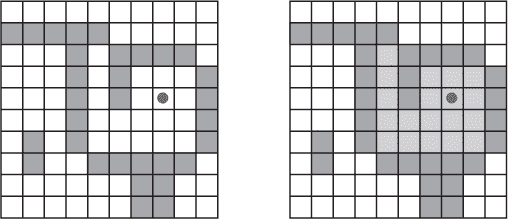

洪水填充不会穿过对角线间隙，也不会触及不可达的像素，即使它们与目标像素颜色相同。

你再次需要 `getImageData` 来获取每个像素的颜色。最好一次性获取整个图像，然后从结果数组中提取像素数据。像素在该数组中的组织方式与第 7 章中的网格元素类似，逐行排列，但每个像素由四个值表示。像素 (*x*,*y*) 的第一个值位于位置 (*x* + *y* × width) × 4。

这次请包含第四个（alpha）值，因为我们希望能够区分空像素和黑色像素。

要找到所有颜色相同的相邻像素，你需要“遍历”像素表面，向上、向下、向左或向右移动一个像素，只要还能找到新的同色像素。但第一次遍历无法找到组内的所有像素。相反，你必须执行类似于第 9 章中描述的正则表达式匹配器的回溯操作。每当遇到多个可能的前进方向时，你必须存储所有未立即采取的方向，并在当前遍历完成后稍后处理它们。

在正常大小的图片中，有*大量*像素。因此，你必须注意只做最少必要的工作，否则程序将运行很长时间。例如，每次遍历必须忽略之前遍历已经看过的像素，以避免重复已完成的工作。

我建议在找到应着色的像素时，对单个像素调用 `fillRect`，并维护某种数据结构来记录所有已经查看过的像素。

# 第三部分 超越

# 第 20 章 Node.js

> “一个学生问：‘古代的程序员只用简单的机器和没有编程语言，却能写出优美的程序。为什么我们要用复杂的机器和编程语言？’傅子答道：‘古代的工匠只用棍棒和黏土，却能造出美丽的茅屋。’”
>
> ——袁马大师，《编程之书》

到目前为止，你已经学习了 JavaScript 语言，并在单一环境中使用它：浏览器。本章和下一章将简要介绍 Node.js，这是一个允许你在浏览器之外应用 JavaScript 技能的程序。借助它，你可以构建从简单的命令行工具到动态 HTTP 服务器的任何东西。

这些章节旨在教你 Node.js 所依赖的重要思想，并为你提供足够的信息来编写一些有用的程序。它们并不试图成为 Node 的完整或详尽的教程。

如果你想跟着做并运行本章中的代码，请先访问 *[`nodejs.org/`](http://nodejs.org/)*，并按照你操作系统的安装说明进行操作。关于 Node 及其内置模块的更多文档，也请参考该网站。

## 背景

编写通过网络通信的系统时，一个较难的问题是管理输入和输出——即从网络、硬盘和其他设备读取和写入数据。移动数据需要时间，而巧妙地调度它会对系统响应用户或网络请求的速度产生很大影响。

处理输入输出的传统方式是使用一个函数（例如 `readFile`）开始读取文件，并在文件完全读取后才返回。这被称为*同步 I/O*（I/O 代表输入/输出）。

Node 最初的设计目的是使*异步* I/O 变得简单方便。我们之前见过异步接口，例如第 17 章讨论的浏览器的 `XMLHttpRequest` 对象。异步接口允许脚本在 I/O 执行的同时继续运行，并在完成时调用回调函数。这就是 Node 处理所有 I/O 的方式。

JavaScript 非常适合像 Node 这样的系统。它是少数没有内置 I/O 方式的编程语言之一。因此，JavaScript 可以适应 Node 相当独特的 I/O 方法，而不会最终出现两个不一致的接口。2009 年，当 Node 被设计时，人们已经在浏览器中基于回调进行 I/O，因此该语言社区已经习惯了异步编程风格。

## 异步性

我将尝试通过一个小例子来说明同步与异步 I/O 的区别：程序需要从互联网获取两个资源，然后对结果进行一些简单的处理。

在同步环境中，执行此任务最直接的方法是依次发出请求。这种方法的缺点是第二个请求只有在第一个请求完成后才会开始。总耗时至少是两个响应时间之和。这不是对机器的有效利用，因为在网络传输和接收数据时，机器大部分时间处于空闲状态。

在同步系统中，解决这个问题的方法是启动额外的控制线程。（关于线程的先前讨论，请参阅第 14 章。）第二个线程可以启动第二个请求，然后两个线程都等待结果返回，之后它们重新同步以合并结果。

在下图中，粗线表示程序正常运行的时间，细线表示等待 I/O 的时间。在同步模型中，I/O 所花费的时间是给定控制线程时间线的*一部分*。在异步模型中，启动 I/O 操作在概念上会导致时间线的*分裂*。发起 I/O 的线程继续运行，而 I/O 本身与之并行进行，最后在完成时调用一个回调函数。

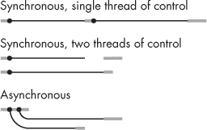

表达这种差异的另一种方式是：在同步模型中，等待 I/O 完成是*隐式*的，而在异步模型中，它是*显式*的，直接受我们控制。但异步性是一把双刃剑。它使得表达不符合直线控制模型的程序更容易，但也使得表达遵循直线的程序更别扭。

在第 17 章中，我已经提到所有这些回调给程序增加了相当多的噪音和间接性。这种异步风格总体上是否是个好主意还有待商榷。无论如何，它需要一些时间来适应。


但对于基于 JavaScript 的系统，我认为回调风格的异步是一种明智的选择。JavaScript 的优势之一在于其简洁性，而试图为其添加多线程控制会大大增加复杂性。尽管回调往往不会让*代码*变得简单，但作为一种*概念*，它们既简洁又强大，足以构建高性能的 Web 服务器。

## node 命令

当 Node.js 安装在系统上时，它会提供一个名为 `node` 的程序，用于运行 JavaScript 文件。假设你有一个 `hello.js` 文件，包含以下代码：

```
var message = "Hello world";
console.log(message);
```

然后你可以在命令行中像这样运行 `node` 来执行该程序：

```
$ node hello.js
Hello world
```

Node 中的 `console.log` 方法与浏览器中的功能类似，它会输出一段文本。但在 Node 中，文本会输出到进程的**标准输出流**，而不是浏览器的 JavaScript 控制台。

如果你运行 `node` 而不指定文件，它会提供一个提示符，你可以在其中输入 JavaScript 代码并立即看到结果。

```
$ node
> 1 + 1
2
> [-1, -2, -3].map(Math.abs)
[1, 2, 3]
> process.exit(0)
$
```

`process` 变量与 `console` 变量一样，在 Node 中是全局可用的。它提供了多种检查和操作当前程序的方法。`exit` 方法用于结束进程，并可以传入一个退出状态码，该状态码告诉启动 `node` 的程序（此处为命令行 shell）程序是否成功完成（状态码 0）或遇到错误（任何其他状态码）。

要查找传递给脚本的命令行参数，你可以读取 `process.argv`，它是一个字符串数组。注意，它还包括 `node` 命令的名称和你的脚本名称，因此实际参数从索引 2 开始。如果 `showargv.js` 只包含语句 `console.log(process.argv)`，你可以像这样运行它：

```
$ node showargv.js one --and two
["node", "/home/marijn/showargv.js", "one", "--and", "two"]
```

所有标准的 JavaScript 全局变量，例如 `Array`、`Math` 和 `JSON`，在 Node 环境中也存在。但与浏览器相关的功能，如 `document` 和 `alert`，则不存在。

全局作用域对象在浏览器中称为 `window`，在 Node 中则有一个更合理的名称 `global`。

## 模块

除了我提到的少数变量（如 `console` 和 `process`）之外，Node 在全局作用域中放置的功能很少。如果你想访问其他内置功能，必须通过模块系统来获取。

基于 `require` 函数的 CommonJS 模块系统在第 10 章中已有描述。该系统内置于 Node 中，用于加载从内置模块到下载的库，再到你自己程序中的文件等各种内容。

当调用 `require` 时，Node 必须将给定的字符串解析为实际文件进行加载。以 `"/"`、`"./"` 或 `"../"` 开头的路径名会相对于当前模块的路径进行解析，其中 `"./"` 表示当前目录，`"../"` 表示上一级目录，`"/"` 表示文件系统的根目录。因此，如果你从文件 `/home/marijn/elife/run.js` 中请求 `"./world/world"`，Node 将尝试加载文件 `/home/marijn/elife/world/world.js`。`.js` 扩展名可以省略。

当传递给 `require` 的字符串看起来不像相对路径或绝对路径时，它会被假定为引用内置模块或安装在 `node_modules` 目录中的模块。例如，`require("fs")` 会提供 Node 的内置文件系统模块，而 `require("elife")` 会尝试加载位于 `node_modules/elife/` 中的库。安装此类库的常见方式是使用 NPM，我稍后会讨论。

为了说明 `require` 的用法，让我们建立一个由两个文件组成的简单项目。第一个文件名为 `main.js`，它定义了一个可以从命令行调用以混淆字符串的脚本。

```
var garble = require("./garble");

// 索引 2 保存第一个实际的命令行参数
var argument = process.argv[2];

console.log(garble(argument));
```

文件 `garble.js` 定义了一个用于混淆字符串的库，它既可以被前面定义的命令行工具使用，也可以被其他需要直接访问混淆函数的脚本使用。

```
module.exports = function(string) {
  return string.split("").map(function(ch) {
    return String.fromCharCode(ch.charCodeAt(0) + 5);
  }).join("");
};
```

请记住，替换 `module.exports`（而不是向其添加属性）允许我们从模块中导出特定的值。在这种情况下，我们将 `require` 我们的 `garble` 文件的结果设置为混淆函数本身。

该函数通过按空字符串分割将给定的字符串拆分为单个字符，然后将每个字符替换为其 Unicode 码点加 5 的字符。最后，它将结果重新连接成一个字符串。

现在我们可以像这样调用我们的工具：

```
$ node main.js JavaScript
Of{fXhwnuy
```

## 使用 NPM 安装

NPM 在第 10 章中简要讨论过，它是一个 JavaScript 模块的在线仓库，其中许多模块是专门为 Node 编写的。当你在计算机上安装 Node 时，你还会获得一个名为 `npm` 的程序，它提供了访问该仓库的便捷接口。

例如，你在 NPM 上会找到的一个模块是 `figlet`，它可以将文本转换为 *ASCII 艺术*——由文本字符组成的图形。以下记录展示了如何安装和使用它：

```
$ npm install figlet
npm GET https://registry.npmjs.org/figlet
npm 200 https://registry.npmjs.org/figlet
npm GET https://registry.npmjs.org/figlet/-/figlet-1.0.9.tgz
npm 200 https://registry.npmjs.org/figlet/-/figlet-1.0.9.tgz
figlet@1.0.9 node_modules/figlet
$ node
> var figlet = require("figlet");
> figlet.text("Hello world!", function(error, data) {
    if (error)
      console.error(error);
    else
      console.log(data);
  });
   _   _      _ _                            _     _ _
  | | | | ___| | | ___   __      _____  _ __| | __| | |
  | |_| |/ _ \ | |/ _ \  \ \ /\ / / _ \| '__| |/ _' | |
  |   _ |  __/ | | (_) |  \ V  V / (_) | |  | | (_| |_|
  |_| |_|\___|_|_|\___/    \_/\_/ \___/|_|  |_|\__,_(_)
```

运行 `npm install` 后，NPM 会创建一个名为 `node_modules` 的目录。在该目录内会有一个 `figlet` 目录，其中包含该库。当我们运行 `node` 并调用 `require("figlet")` 时，该库被加载，我们可以调用它的 `text` 方法来绘制一些大号字母。

也许有些出乎意料的是，`figlet.text` 并没有简单地返回构成大号字母的字符串，而是接受一个回调函数，并将结果传递给它。它还会向回调函数传递另一个参数 `error`，当出现问题时，该参数会包含一个错误对象，一切正常时则为 `null`。

这是 Node 代码中的常见模式。使用 `figlet` 渲染某些内容需要库读取一个包含字母形状的文件。从磁盘读取该文件在 Node 中是一个异步操作，因此 `figlet.text` 无法立即返回其结果。异步性在某种程度上具有传染性——每个调用异步函数的函数本身也必须变成异步的。

NPM 的功能远不止 `npm install`。它会读取 `package.json` 文件，这些文件包含关于程序或库的 JSON 编码信息，例如它依赖哪些其他库。在包含此类文件的目录中执行 `npm install` 将自动安装所有依赖项，以及*它们的*依赖项。`npm` 工具还用于将库发布到 NPM 的在线包仓库，以便其他人可以查找、下载和使用它们。


本书不会深入探讨 NPM 使用的细节。请参考 [`npmjs.org/`](http://npmjs.org/) 获取更多文档以及搜索库的简便方法。

## 文件系统模块

Node 自带的最常用的内置模块之一是 `"fs"` 模块，它代表 *文件系统*。该模块提供了处理文件和目录的函数。

例如，有一个名为 `readFile` 的函数，它读取文件，然后调用一个回调函数，并将文件内容传递给它。

```
var fs = require("fs");
fs.readFile("file.txt", "utf8", function(error, text) {
  if (error)
    throw error;
  console.log("The file contained:", text);
});
```

`readFile` 的第二个参数指定了用于将文件解码为字符串的 *字符编码*。文本可以通过多种方式编码为二进制数据，但大多数现代系统使用 UTF-8 编码文本，因此除非你有理由相信使用了其他编码，否则在读取文本文件时传递 `"utf8"` 是安全的选择。如果不传递编码，Node 会假定你关心的是二进制数据，并会返回一个 `Buffer` 对象而不是字符串。这是一个类似数组的对象，包含表示文件中字节的数字。

```
var fs = require("fs");
fs.readFile("file.txt", function(error, buffer) {
  if (error)
    throw error;
  console.log("The file contained", buffer.length, "bytes.",
              "The first byte is:", buffer[0]);
});
```

类似的函数 `writeFile` 用于将文件写入磁盘。

```
var fs = require("fs");
fs.writeFile("graffiti.txt", "Node was here", function(err) {
  if (err)
    console.log("Failed to write file:", err);
  else
    console.log("File written.");
});
```

这里不需要指定编码，因为 `writeFile` 会假定：如果给它一个字符串而不是 `Buffer` 对象，它将使用默认字符编码（即 UTF-8）将其作为文本写出。

`"fs"` 模块还包含许多其他有用的函数：`readdir` 会以字符串数组的形式返回目录中的文件，`stat` 会检索文件信息，`rename` 会重命名文件，`unlink` 会删除文件，等等。具体细节请参见 [`nodejs.org/`](http://nodejs.org/) 上的文档。

`"fs"` 中的许多函数都有同步和异步两种变体。例如，`readFile` 有一个同步版本叫做 `readFileSync`。

```
var fs = require("fs");
console.log(fs.readFileSync("file.txt", "utf8"));
```

同步函数使用起来更简单，在简单的脚本中很有用，因为异步 I/O 带来的额外速度提升并不重要。但请注意，在执行此类同步操作时，程序会完全停止。如果程序需要响应用户或网络上的其他机器，被同步 I/O 卡住可能会导致令人烦恼的延迟。

## HTTP 模块

另一个核心模块是 `"http"`。它提供了运行 HTTP 服务器和发起 HTTP 请求的功能。

启动一个简单的 HTTP 服务器只需以下代码：

```
var http = require("http");
var server = http.createServer(function(request, response) {
  response.writeHead(200, {"Content-Type": "text/html"});
  response.write("<h1>Hello!</h1><p>You asked for <code>" +
                 request.url + "</code></p>");
  response.end();
});
server.listen(8000);
```

如果你在自己的机器上运行此脚本，可以在浏览器中访问 [`localhost:8000/hello`](http://localhost:8000/hello) 向你的服务器发起请求。服务器会返回一个小的 HTML 页面。

传递给 `createServer` 的函数会在每次客户端尝试连接服务器时被调用。`request` 和 `response` 变量是表示传入和传出数据的对象。前者包含请求的信息，例如 `url` 属性，它告诉我们请求发往哪个 URL。

要发送回一些内容，你需要调用 `response` 对象上的方法。第一个是 `writeHead`，它会写出响应头（参见第 17 章）。你需要给它状态码（这里 200 表示“OK”）和一个包含头信息的对象。这里我们告诉客户端我们将返回一个 HTML 文档。

接下来，实际的响应体（文档本身）通过 `response.write` 发送。如果你希望分块发送响应，可以多次调用此方法，甚至可以在数据可用时流式传输给客户端。最后，`response.end` 表示响应结束。

调用 `server.listen` 会使服务器开始在 8000 端口等待连接。这就是为什么你需要连接到 [localhost:8000](http://localhost:8000) 而不是 [localhost](http://localhost)（后者会使用默认端口 80）来与该服务器通信。

要停止运行这样一个不会自动结束（因为它正在等待更多事件，这里是网络连接）的 Node 脚本，请按 CTRL-C。

一个真正的 Web 服务器通常比上面的例子做得更多——它会查看请求的方法（`method` 属性）以了解客户端试图执行什么操作，并查看请求的 URL 以确定该操作针对哪个资源。你将在本章后面看到一个更高级的服务器。

要充当 HTTP *客户端*，我们可以使用 `"http"` 模块中的 `request` 函数。

```
var http = require("http");
var request = http.request({
  hostname: "eloquentjavascript.net",
  path: "/20_node.html",
  method: "GET",
  headers: {Accept: "text/html"}
}, function(response) {
  console.log("Server responded with status code",
              response.statusCode);
});
request.end();
```

`request` 的第一个参数配置请求，告诉 Node 要连接哪个服务器、请求哪个路径、使用什么方法等。第二个参数是收到响应时应调用的函数。它接收一个对象，允许我们检查响应，例如找出其状态码。

就像我们在服务器中看到的 `response` 对象一样，`request` 返回的对象允许我们使用 `write` 方法将数据流式写入请求，并使用 `end` 方法结束请求。该示例没有使用 `write`，因为 `GET` 请求不应在请求体中包含数据。

要发起安全 HTTP（HTTPS）URL 的请求，Node 提供了一个名为 `https` 的包，其中包含自己的 `request` 函数，类似于 `http.request`。

## 流

我们在 HTTP 中看到了两个可写流的例子——即服务器可以写入的响应对象，以及 `http.request` 返回的请求对象。

可写流是 Node 接口中广泛使用的概念。所有可写流都有一个 `write` 方法，可以传入字符串或 `Buffer` 对象。它们的 `end` 方法关闭流，如果传入参数，还会在关闭前写出一些数据。这两个方法还可以接受一个回调作为额外参数，当写入或关闭流完成时会调用该回调。

可以使用 `fs.createWriteStream` 函数创建一个指向文件的可写流。然后，你可以对结果对象使用 `write` 方法，一次写入一部分文件，而不是像 `fs.writeFile` 那样一次性写入。

可读流稍微复杂一些。传递给 HTTP 服务器回调函数的 `request` 变量和传递给 HTTP 客户端的 `response` 变量都是可读流。（服务器读取请求然后写入响应，而客户端先写入请求然后读取响应。）从流中读取是通过事件处理程序而不是方法完成的。


在 Node 中，发出事件的对象有一个名为 `on` 的方法，类似于浏览器中的 `addEventListener` 方法。你给它一个事件名称和一个函数，它就会注册该函数，以便在指定事件发生时调用。

可读流具有 `"data"` 和 `"end"` 事件。第一个事件在每次有数据进入时触发，第二个事件在流结束时触发。这种模型最适合“流式”数据，即使整个文档尚未可用，也可以立即处理。通过使用 `fs.createReadStream` 函数，可以将文件作为可读流读取。

以下代码创建了一个服务器，它读取请求体并将其以全大写文本的形式流回客户端：

```
var http = require("http");
http.createServer(function(request, response) {
  response.writeHead(200, {"Content-Type": "text/plain"});
  request.on("data", function(chunk) {
    response.write(chunk.toString().toUpperCase());
  });
  request.on("end", function() {
    response.end();
   });
}).listen(8000);
```

传递给数据处理器的 `chunk` 变量是一个二进制 `Buffer`，我们可以通过调用其上的 `toString` 将其转换为字符串，该方法将使用默认编码（UTF-8）解码该变量。

以下代码在大写转换服务器运行时执行，将向该服务器发送一个请求并写出它收到的响应：

```
var http = require("http");
var request = http.request({
  hostname: "localhost",
  port: 8000,
  method: "POST"
}, function(response) {
  response.on("data", function(chunk) {
    process.stdout.write(chunk.toString());
  });
});
request.end("Hello server");
```

该示例写入 `process.stdout`（进程的标准输出，作为可写流），而不是使用 `console.log`。我们不能使用 `console.log`，因为它会在写入的每段文本后添加一个额外的换行符，这在这里不合适。

## 一个简单的文件服务器

让我们将新学到的关于 HTTP 服务器和文件系统交互的知识结合起来，在它们之间搭建一座桥梁：一个允许远程访问文件系统的 HTTP 服务器。这样的服务器有很多用途。它允许 Web 应用程序存储和共享数据，或者让一组人共享访问一堆文件。

当我们将文件视为 HTTP 资源时，HTTP 方法 `GET`、`PUT` 和 `DELETE` 可分别用于读取、写入和删除文件。我们将请求中的路径解释为请求所引用的文件的路径。

我们可能不想共享整个文件系统，因此我们将这些路径解释为从服务器的工作目录开始，即服务器启动时所在的目录。如果我从 `/home/marijn/public/`（或在 Windows 上为 `C:\Users\marijn\public\`）运行服务器，那么对 `/file.txt` 的请求应指向 `/home/marijn/public/file.txt`（或 `C:\Users\marijn\public\file.txt`）。

我们将逐步构建程序，使用一个名为 `methods` 的对象来存储处理各种 HTTP 方法的函数。

```
var http = require("http"), fs = require("fs");

var methods = Object.create(null);

http.createServer(function(request, response) {
  function respond(code, body, type) {
    if (!type) type = "text/plain";
    response.writeHead(code, {"Content-Type": type});
      if (body && body.pipe)
        body.pipe(response);
      else
        response.end(body);
    }
    if (request.method in methods)
      methodsrequest.method,
                              respond, request);
    else
      respond(405, "Method " + request.method +
              " not allowed.");
}).listen(8000);
```

这将启动一个仅返回 405 错误响应的服务器，该状态码用于指示服务器未处理给定的方法。

`respond` 函数被传递给处理各种方法的函数，并作为完成请求的回调。它接受 HTTP 状态码、一个主体以及可选的内容类型作为参数。如果作为主体传递的值是一个可读流，它将有一个 `pipe` 方法，用于将可读流转发到可写流。如果不是，则假定为 `null`（无主体）或字符串，并直接传递给响应的 `end` 方法。

为了从请求的 URL 中获取路径，`urlToPath` 函数使用 Node 内置的 `"url"` 模块来解析 URL。它获取路径名（类似于 `/file.txt`），对其进行解码以去除 `%20` 风格的转义码，并添加一个点前缀以生成相对于当前目录的路径。

```
function urlToPath(url) {
  var path = require("url").parse(url).pathname;
  return "." + decodeURIComponent(path);
}
```

如果你担心 `urlToPath` 函数的安全性，你是对的。我们将在练习中回到这个问题。

我们将设置 `GET` 方法，在读取目录时返回文件列表，在读取普通文件时返回文件内容。

一个棘手的问题是，在返回文件内容时，我们应该添加哪种 `Content-Type` 头。由于这些文件可以是任何类型，我们的服务器不能简单地为所有文件返回相同的类型。但 NPM 可以帮上忙。`mime` 包（内容类型指示符，如 `text/plain`，也称为 *MIME 类型*）知道大量文件扩展名的正确类型。

如果你在服务器脚本所在的目录中运行以下 `npm` 命令，就可以使用 `require("mime")` 来访问该库：

```
$ npm install mime
npm http GET https://registry.npmjs.org/mime
npm http 304 https://registry.npmjs.org/mime
mime@1.2.11 node_modules/mime
```

当请求的文件不存在时，应返回的正确 HTTP 错误码是 404。我们将使用 `fs.stat` 来查找文件信息，以确定文件是否存在以及它是否是一个目录。

```
methods.GET = function(path, respond) {
  fs.stat(path, function(error, stats) {
    if (error && error.code == "ENOENT")
      respond(404, "File not found");
    else if (error)
      respond(500, error.toString());
    else if (stats.isDirectory())
      fs.readdir(path, function(error, files) {
        if (error)
          respond(500, error.toString());
        else
          respond(200, files.join("\n"));
      });
    else
      respond(200, fs.createReadStream(path),
              require("mime").lookup(path));
  });
};
```

由于必须访问磁盘，因此可能需要一些时间，`fs.stat` 是异步的。当文件不存在时，`fs.stat` 会向回调传递一个 `code` 属性为 `"ENOENT"` 的错误对象。如果 Node 能为不同类型的错误定义不同的 `Error` 子类型就好了，但它没有。相反，它只是在那里放置了晦涩的、受 Unix 启发的代码。

我们将用状态码 500 报告任何我们未预料到的错误，这表示问题出在服务器端，而不是以 4 开头（如 404）的代码，后者表示错误的请求。在某些情况下这并不完全准确，但对于这样一个小示例程序来说，已经足够好了。

`fs.stat` 返回的 `stats` 对象告诉我们关于文件的一些信息，例如其大小（`size` 属性）和修改日期（`mtime` 属性）。这里我们关心的是它是目录还是普通文件，`isDirectory` 方法可以告诉我们。

我们使用 `fs.readdir` 读取目录中的文件列表，并在另一个回调中将其返回给用户。对于普通文件，我们使用 `fs.createReadStream` 创建一个可读流，并将其与 `"mime"` 模块根据文件名给出的内容类型一起传递给 `respond`。

处理 `DELETE` 请求的代码稍微简单一些。


```
methods.DELETE = function(path, respond) {
fs.stat(path, function(error, stats) {
    if (error && error.code == "ENOENT")
      respond(204);
    else if (error)
      respond(500, error.toString());
    else if (stats.isDirectory())
      fs.rmdir(path, respondErrorOrNothing(respond));
    else
      fs.unlink(path, respondErrorOrNothing(respond));
  });
};
```

你可能会疑惑，为什么尝试删除一个不存在的文件会返回 204 状态码，而不是错误。当要删除的文件不存在时，可以说请求的目标已经达成。HTTP 标准鼓励人们使请求具有*幂等性*，这意味着多次执行请求不会产生不同的结果。

```
function respondErrorOrNothing(respond) {
  return function(error) {
    if (error)
      respond(500, error.toString());
    else
      respond(204);
  };
}
```

当 HTTP 响应不包含任何数据时，可以使用状态码 204（“无内容”）来表示。由于我们需要在几种不同情况下提供回调，要么报告错误，要么返回 204 响应，我编写了一个 `respondErrorOrNothing` 函数来创建这样的回调。

这是 `PUT` 请求的处理程序：

```
methods.PUT = function(path, respond, request) {
  var outStream = fs.createWriteStream(path);
  outStream.on("error", function(error) {
    respond(500, error.toString());
  });
  outStream.on("finish", function() {
    respond(204);
  });
  request.pipe(outStream);
};
```

这里，我们不需要检查文件是否存在——如果存在，我们只需覆盖它。我们再次使用 `pipe` 将数据从可读流移动到可写流，这里是从请求到文件。如果创建流失败，会触发 `"error"` 事件，我们在响应中报告它。当数据成功传输后，`pipe` 会关闭两个流，这会导致可写流触发 `"finish"` 事件。此时，我们可以用 204 响应向客户端报告成功。

服务器的完整脚本可在 *[`eloquentjavascript.net/code/file_server.js`](http://eloquentjavascript.net/code/file_server.js)* 获取。你可以下载并用 Node 运行它来启动自己的文件服务器。当然，你也可以修改和扩展它来完成本章的练习或进行实验。

命令行工具 `curl` 在类 Unix 系统上广泛可用，可用于发出 HTTP 请求。以下会话简要测试了我们的服务器。注意，`-X` 用于设置请求方法，`-d` 用于包含请求体。

```
$ curl http://localhost:8000/file.txt
File not found
$ curl -X PUT -d hello http://localhost:8000/file.txt
$ curl http://localhost:8000/file.txt
hello
$ curl -X DELETE http://localhost:8000/file.txt
$ curl http://localhost:8000/file.txt
File not found
```

第一次请求 `file.txt` 失败，因为文件尚不存在。`PUT` 请求创建了文件，瞧，下一个请求成功获取了它。用 `DELETE` 请求删除后，文件再次消失。

## 错误处理

在文件服务器的代码中，有*六*处我们显式地路由了异常，因为我们不知道如何处理错误响应。由于异常不会自动传播到回调，而是作为参数传递给它们，因此每次都必须显式处理。这完全破坏了异常处理的优势，即集中处理失败条件的能力。

当系统中确实*抛出*异常时会发生什么？由于我们没有使用任何 `try` 块，异常会传播到调用栈的顶部。在 Node 中，这会中止程序，并将异常信息（包括堆栈跟踪）写入程序的标准错误流。

这意味着，只要服务器代码本身遇到问题，我们的服务器就会崩溃，而异步问题则会作为参数传递给回调。如果我们想处理请求处理过程中引发的所有异常，以确保发送响应，就必须在每个回调中添加 `try`/`catch` 块。

这是不可行的。许多 Node 程序尽可能少地使用异常，假设如果抛出异常，程序无法处理，崩溃是正确的响应。

另一种方法是使用 Promise，这在第 17 章中介绍过。它们会捕获回调函数抛出的异常，并将其作为失败传播。可以在 Node 中加载 Promise 库，并用它来管理异步控制。很少有 Node 库集成 Promise，但通常很容易包装它们。NPM 中优秀的 `"promise"` 模块包含一个名为 `denodeify` 的函数，它接受一个异步函数（如 `fs.readFile`）并将其转换为返回 Promise 的函数。

```
var Promise = require("promise");
var fs = require("fs");

var readFile = Promise.denodeify(fs.readFile);
readFile("file.txt", "utf8").then(function(content) {
  console.log("The file contained: " + content);
}, function(error) {
  console.log("Failed to read file: " + error);
});
```

作为对比，我编写了另一个基于 Promise 的文件服务器版本，你可以在 *[`eloquentjavascript.net/code/file_server_promises.js`](http://eloquentjavascript.net/code/file_server_promises.js)* 找到它。它稍微清晰一些，因为函数现在可以*返回*结果，而不必调用回调，并且异常的路由是隐式的，而不是显式的。

我将列出基于 Promise 的文件服务器中的几行代码，以说明编程风格上的差异。

这段代码使用的 `fsp` 对象包含多个 `fs` 函数的 Promise 风格变体，由 `Promise.denodeify` 包装。方法处理程序返回的对象（包含 `code` 和 `body` 属性）将成为 Promise 链的最终结果，并用于确定向客户端发送何种响应。

```
methods.GET = function(path) {
  return inspectPath(path).then(function(stats) {
    if (!stats) // 不存在
      return {code: 404, body: "File not found"};
    else if (stats.isDirectory())
      return fsp.readdir(path).then(function(files) {
        return {code: 200, body: files.join("\n")};
      });
    else
      return {code: 200,
              type: require("mime").lookup(path),
              body: fs.createReadStream(path)};
  });
};
function inspectPath(path) {
  return fsp.stat(path).then(null, function(error) {
    if (error.code == "ENOENT") return null;
    else throw error;
  });
}
```

`inspectPath` 函数是 `fs.stat` 的简单包装，处理文件未找到的情况。在这种情况下，我们将失败替换为返回 `null` 的成功。所有其他错误都允许传播。当这些处理程序返回的 Promise 失败时，HTTP 服务器会以 500 状态码响应。

## 总结

Node 是一个简洁、直观的系统，让我们可以在非浏览器环境中运行 JavaScript。它最初是为网络任务设计的，扮演网络中的*节点*角色。但它也适用于各种脚本任务，如果你喜欢编写 JavaScript，用 Node 自动化日常任务会非常棒。

NPM 提供了你能想到的一切（以及你可能从未想到的许多东西）的库，并且允许你通过运行一个简单的命令来获取和安装这些库。Node 还附带了许多内置模块，包括用于处理文件系统的 `"fs"` 模块，以及用于运行 HTTP 服务器和发出 HTTP 请求的 `"http"` 模块。


Node 中的所有输入和输出都是异步完成的，除非你显式使用函数的同步变体，例如 `fs.readFileSync`。你提供回调函数，Node 会在你请求的 I/O 完成时，在适当的时机调用它们。

## 练习

### 再次进行内容协商

在第 17 章中，第一个练习是向 *[`eloquentjavascript.net/author/`](http://eloquentjavascript.net/author/)* 发出多个请求，通过传递不同的 `Accept` 头来请求不同类型的内容。

现在使用 Node 的 `http.request` 函数再次完成这个任务。至少请求以下媒体类型：`text/plain`、`text/html` 和 `application/json`。请记住，请求的头信息可以作为对象传递给 `http.request` 的第一个参数的 `headers` 属性。

将每个请求的响应内容输出。

### 修复漏洞

为了便于远程访问某些文件，我可能会养成习惯，让本章定义的文件服务器运行在我的机器上，目录为 `/home/marijn/public`。然后有一天，我发现有人获取了我存储在浏览器中的所有密码。

发生了什么？

如果你还不清楚，请回想一下 `urlToPath` 函数，它的定义如下：

```
function urlToPath(url) {
  var path = require("url").parse(url).pathname;
  return "." + decodeURIComponent(path);
}
```

现在考虑这样一个事实：传递给 `"fs"` 函数的路径可以是相对路径——它们可能包含 `"../"` 来向上级目录移动。当客户端发送类似下面这样的 URL 请求时会发生什么？

```
http://myhostname:8000/../.config/config/google-chrome/Default/Web%20Data
http://myhostname:8000/../.ssh/id_dsa
http://myhostname:8000/../../../etc/passwd
```

修改 `urlToPath` 以修复此问题。考虑到在 Windows 上，Node 允许使用正斜杠和反斜杠来分隔目录。

另外，请思考这样一个事实：一旦你将某个半成品系统暴露在互联网上，该系统存在的漏洞就可能被用来对你的机器造成损害。

### 创建目录

尽管 `DELETE` 方法被用于删除目录（通过 `fs.rmdir`），但当前的文件服务器并没有提供任何*创建*目录的方法。

为 `MKCOL` 方法添加支持，该方法应通过调用 `fs.mkdir` 来创建目录。`MKCOL` 并不是基本的 HTTP 方法之一，但它确实存在，并且在 *WebDAV* 标准中用于同样的目的，该标准指定了一组 HTTP 扩展，使其不仅适合读取资源，也适合写入资源。

### 网络上的公共空间

由于文件服务器可以提供任何类型的文件，并且甚至包含了正确的 `Content-Type` 头，你可以用它来托管一个网站。由于它允许任何人删除和替换文件，这将是一种有趣的网站：一个可以被任何愿意花时间构造正确 HTTP 请求的人修改、破坏甚至摧毁的网站。尽管如此，它仍然是一个网站。

编写一个基本的 HTML 页面，其中包含一个简单的 JavaScript 文件。将这些文件放入文件服务器提供的目录中，然后在浏览器中打开它们。

接下来，作为一个高级练习，甚至是一个周末项目，结合你从本书中学到的所有知识，构建一个更友好的界面，用于*从网站内部*修改网站。

使用 HTML 表单（第 18 章）来编辑构成网站的各个文件的内容，允许用户通过 HTTP 请求（如第 17 章所述）在服务器上更新它们。

首先只让一个文件可编辑。然后让用户可以选择要编辑哪个文件。利用我们的文件服务器在读取目录时会返回文件列表这一特性。

不要直接在文件服务器的代码中工作；如果你犯了错误，很可能会损坏那里的文件。相反，将你的工作放在公共可访问目录之外，并在测试时将其复制到那里。

如果你的计算机直接连接到互联网，中间没有防火墙、路由器或其他干扰设备，你或许可以邀请朋友来使用你的网站。要检查这一点，请访问 *[`whatismyip.com/`](http://whatismyip.com/)*，将显示的 IP 地址复制到浏览器的地址栏中，并在其后添加 `:8000` 以选择正确的端口。如果这样能访问到你的网站，那么它就对所有人可见了。

# 第 21 章. 项目：技能分享网站

*技能分享*聚会是一种活动，有共同兴趣的人聚在一起，就他们了解的事物进行简短、非正式的演讲。在园艺技能分享聚会上，有人可能会解释如何种植芹菜。或者在一个编程导向的技能分享小组中，你可以顺便过来，向大家介绍 Node.js。

这种聚会，当涉及计算机时也常被称为*用户组*，是拓宽视野、了解新进展或仅仅是结识志同道合之人的绝佳方式。许多大城市都有 JavaScript 聚会。它们通常是免费参加的，而且我发现我去过的那些聚会都非常友好和热情。

在这个最终项目章节中，我们的目标是建立一个用于管理技能分享聚会上演讲的网站。想象一下，一小群人定期在某个成员的办公室里聚会，讨论独轮车。问题是，当之前的聚会组织者搬到另一个城镇时，没有人站出来接替这项任务。我们需要一个系统，让参与者能够自行提议和讨论演讲，而无需中央组织者。


该项目的完整代码可以从 *[`eloquentjavascript.net/code/skillsharing.zip`](http://eloquentjavascript.net/code/skillsharing.zip)* 下载。

## 设计

该项目有一个*服务器*部分，用 Node.js 编写，以及一个*客户端*部分，用浏览器编写。服务器存储系统的数据并将其提供给客户端。它还提供实现客户端系统的 HTML 和 JavaScript 文件。

服务器保存为下一次聚会提议的演讲列表，客户端显示此列表。每个演讲都有一个演讲者姓名、标题、摘要以及与之关联的评论列表。客户端允许用户提议新演讲（将其添加到列表中）、删除演讲以及对现有演讲进行评论。每当用户进行此类更改时，客户端都会发出 HTTP 请求以告知服务器。

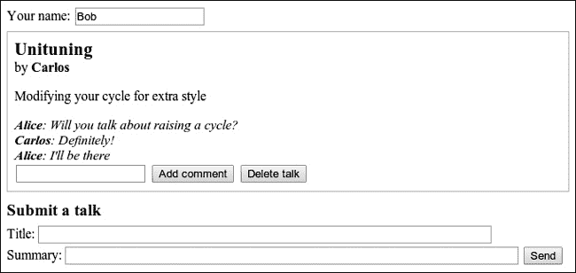

该应用程序将设置为显示当前提议的演讲及其评论的*实时*视图。每当有人、在某处提交新演讲或添加评论时，所有在浏览器中打开该页面的人都应立即看到更改。这带来了一些挑战，因为网络服务器无法打开与客户端的连接，也没有好的方法知道哪些客户端当前正在查看某个网站。

解决此问题的一种常见方法称为*长轮询*，这恰好是 Node 设计动机之一。

## 长轮询

为了能够立即通知客户端发生了更改，我们需要与客户端建立连接。由于传统上 Web 浏览器不接受连接，而且客户端通常位于会阻止此类连接的设备后面，因此让服务器发起连接是不切实际的。

我们可以安排客户端打开连接并保持它，以便服务器在需要发送信息时可以使用它。


但 HTTP 请求只允许简单的信息流：客户端发送请求，服务器返回一个响应，然后结束。有一种名为*Web Socket*的技术，现代浏览器支持它，可以打开连接进行任意数据交换。但正确使用它们有些棘手。

在本章中，我们将使用一种相对简单的技术——长轮询（long polling），即客户端通过常规 HTTP 请求不断向服务器询问新信息，而服务器在没有新内容可报告时，会延迟响应。

只要客户端确保始终有一个轮询请求处于打开状态，它就能立即从服务器接收信息。例如，如果爱丽丝在她的浏览器中打开了我们的技能分享应用，该浏览器就会发起一个更新请求，并等待该请求的响应。当鲍勃从他的浏览器提交一个关于“极限下坡独轮车”的演讲时，服务器会注意到爱丽丝正在等待更新，并将新演讲的信息作为对她待处理请求的响应发送出去。爱丽丝的浏览器会接收数据并更新屏幕以显示该演讲。

为了防止连接超时（因缺乏活动而被中止），长轮询技术通常为每个请求设置一个最大时间，超过该时间后，即使没有内容可报告，服务器也会响应，然后客户端会发起一个新请求。定期重启请求也使该技术更加健壮，允许客户端从临时连接故障或服务器问题中恢复。

一个使用长轮询的繁忙服务器可能同时有数千个等待请求，也就是数千个 TCP 连接处于打开状态。Node.js 使得管理大量连接而无需为每个连接创建单独的控制线程变得容易，因此非常适合这样的系统。

## HTTP 接口

在我们开始充实服务器或客户端之前，先考虑一下它们的接触点：它们通信所用的 HTTP 接口。

我们将基于 JSON 构建接口，就像第 20 章中的文件服务器一样，尽量充分利用 HTTP 方法。该接口以`/talks`路径为中心。不以`/talks`开头的路径将用于提供静态文件——实现客户端系统的 HTML 和 JavaScript 代码。

对`/talks`的`GET`请求返回如下 JSON 文档：

```
{"serverTime": 1405438911833,
 "talks": [{"title": "Unituning",
            "presenter": "Carlos",
            "summary": "Modifying your cycle for extra style",
            "comment": []}]}
```

`serverTime`字段将用于实现可靠的长轮询。稍后我会再提到它。

创建新演讲是通过向类似`/talks/Unituning`的 URL 发送`PUT`请求完成的，其中第二个斜杠后的部分是演讲的标题。`PUT`请求的正文应包含一个具有`presenter`和`summary`属性的 JSON 对象。

由于演讲标题可能包含空格和其他在 URL 中通常不允许出现的字符，因此在构建此类 URL 时，必须使用`encodeURIComponent`函数对标题字符串进行编码。

```
console.log("/talks/" + encodeURIComponent("How to Idle"));
// ▹ /talks/How%20to%20Idle
```

一个创建关于“定车”演讲的请求可能如下所示：

```
PUT /talks/How%20to%20Idle HTTP/1.1
Content-Type: application/json
Content-Length: 92

{"presenter": "Dana",
"summary": "Standing still on a unicycle"}
```

此类 URL 还支持`GET`请求以获取演讲的 JSON 表示，以及`DELETE`请求以删除演讲。

向演讲添加评论是通过向类似`/talks/Unituning/comments`的 URL 发送`POST`请求完成的，请求正文是一个包含`author`和`message`属性的 JSON 对象。

```
POST /talks/Unituning/comments HTTP/1.1
Content-Type: application/json
Content-Length: 72

{"author": "Alice",
"message": "Will you talk about raising a cycle?"}
```

为了支持长轮询，对`/talks`的`GET`请求可以包含一个名为`changesSince`的查询参数，用于表示客户端对自某个时间点以来发生的更新感兴趣。当存在此类更改时，会立即返回。当没有更改时，响应会延迟，直到有事情发生或经过给定的时间段（我们将使用 90 秒）。

时间必须表示为自 1970 年初以来经过的毫秒数，与`Date.now()`返回的数字类型相同。为了确保接收到所有更新且不重复接收同一更新，客户端必须传递它上次从服务器接收信息的时间。服务器的时钟可能与客户端的时钟不完全同步，即使同步，客户端也不可能知道服务器发送响应的精确时间，因为通过网络传输数据需要时间。

这就是对`/talks`的`GET`请求的响应中存在`serverTime`属性的原因。该属性告诉客户端从服务器角度来看，它所接收数据被创建的精确时间。然后客户端可以简单地存储这个时间，并在下一次轮询请求中传递它，以确保它只接收到之前未见过的新更新。

```
GET /talks?changesSince=1405438911833 HTTP/1.1

(时间流逝)

HTTP/1.1 200 OK
Content-Type: application/json
Content-Length: 95

{"serverTime": 1405438913401,
"talks": [{"title": "Unituning",
           "deleted": true}]}
```

当演讲被修改、新创建或添加了评论时，该演讲的完整表示会包含在客户端下一次轮询请求的响应中。当演讲被删除时，只包含其标题和`deleted`属性。然后客户端可以将之前未见过的标题的演讲添加到显示中，更新已显示的演讲，并移除那些被删除的演讲。

本章描述的协议没有进行任何访问控制。每个人都可以评论、修改演讲，甚至删除它们。由于互联网上充满了捣乱分子，在没有进一步保护的情况下将这样的系统上线很可能会导致灾难。

一个简单的解决方案是将系统放在*反向代理*后面，这是一个 HTTP 服务器，它接受来自系统外部的连接，并将它们转发到本地运行的 HTTP 服务器。这样的代理可以配置为需要用户名和密码，你可以确保只有技能分享小组的参与者拥有这个密码。

## 服务器

让我们从编写程序的服务器端部分开始。本节中的代码在 Node.js 上运行。

### 路由

我们的服务器将使用`http.createServer`启动一个 HTTP 服务器。在处理新请求的函数中，我们必须区分我们支持的各种请求类型（由方法和路径决定）。这可以通过一长串`if`语句来完成，但有一种更好的方法。

*路由器*是一个帮助将请求分派给能够处理它的函数的组件。例如，你可以告诉路由器，路径匹配正则表达式`/^\/talks\/([^\/]+)$/`（匹配`/talks/`后跟演讲标题）的`PUT`请求可以由某个给定函数处理。此外，它还可以帮助提取路径中有意义的部分，在本例中是演讲标题（在正则表达式中用括号括起来），并将它们传递给处理函数。

NPM 上有许多优秀的路由器包，但这里我们将自己编写一个以说明原理。

这是`router.js`，稍后我们将从服务器模块中`require`它：


```
var Router = module.exports = function() {
  this.routes = [];
};

Router.prototype.add = function(method, url, handler) {
  this.routes.push({method: method,
                    url: url,
                    handler: handler});
};

Router.prototype.resolve = function(request, response) {
  var path = require("url").parse(request.url).pathname;

  return this.routes.some(function(route) {
    var match = route.url.exec(path);
    if (!match || route.method != request.method)
      return false;

    var urlParts = match.slice(1).map(decodeURIComponent);
    route.handler.apply(null, [request, response]
                                .concat(urlParts));
    return true;
  });
};
```

该模块导出了 `Router` 构造函数。路由器对象允许通过 `add` 方法注册新的处理程序，并通过 `resolve` 方法解析请求。

`resolve` 方法会返回一个布尔值，指示是否找到了处理程序。路由数组上的 `some` 方法会逐一尝试路由（按照它们定义的顺序），并在找到匹配的路由时停止，返回 `true`。

处理函数被调用时会传入 `request` 和 `response` 对象。当匹配 URL 的正则表达式包含任何分组时，这些分组匹配的字符串会作为额外参数传递给处理函数。这些字符串需要进行 URL 解码，因为原始 URL 包含 `%20` 风格的编码。

### 提供文件服务

当请求与我们路由器中定义的任何请求类型都不匹配时，服务器必须将其解释为对 `public` 目录中文件的请求。可以使用第 20 章中定义的文件服务器来提供此类文件，但我们既不需要也不希望支持对文件的 `PUT` 和 `DELETE` 请求，并且我们希望拥有诸如缓存支持之类的高级功能。因此，让我们使用 NPM 上一个可靠且经过充分测试的静态文件服务器。

我选择了 `ecstatic`。这并不是 NPM 上唯一的此类服务器，但它运行良好且符合我们的需求。`ecstatic` 模块导出一个函数，该函数可以传入一个配置对象来生成一个请求处理函数。我们使用 `root` 选项告诉服务器在哪里查找文件。该处理函数接受 `request` 和 `response` 参数，并且可以直接传递给 `createServer` 来创建一个*仅*提供文件服务的服务器。不过，我们首先需要检查我们专门处理的请求，因此我们将其包装在另一个函数中。

```
var http = require("http");
var Router = require("./router");
var ecstatic = require("ecstatic");

var fileServer = ecstatic({root: "./public"});
var router = new Router();

http.createServer(function(request, response) {
  if (!router.resolve(request, response))
    fileServer(request, response);
}).listen(8000);
```

`respond` 和 `respondJSON` 辅助函数在整个服务器代码中用于通过单个函数调用来发送响应。

```
function respond(response, status, data, type) {
  response.writeHead(status, {
    "Content-Type": type || "text/plain"
});
  response.end(data);
}

function respondJSON(response, status, data) {
  respond(response, status, JSON.stringify(data),
          "application/json");
}
```

### 将演讲视为资源

服务器将已提议的演讲存储在一个名为 `talks` 的对象中，其属性名是演讲标题。这些演讲将作为 HTTP 资源暴露在 `/talks/[title]` 下，因此我们需要向路由器添加处理程序，以实现客户端可以用来操作它们的各种方法。

处理 `GET` 单个演讲请求的处理程序必须查找该演讲，并返回演讲的 JSON 数据或 404 错误响应。

```
var talks = Object.create(null);

router.add("GET", /^\/talks\/([^\/]+)$/,
           function(request, response, title) {
  if (title in talks)
    respondJSON(response, 200, talks[title]);
  else
    respond(response, 404, "No talk '" + title + "' found");
});
```

删除演讲是通过将其从 `talks` 对象中移除来完成的。

```
router.add("DELETE", /^\/talks\/([^\/]+)$/,
           function(request, response, title) {
  if (title in talks) {
    delete talks[title];
    registerChange(title);
  }
  respond(response, 204, null);
});
```

`registerChange` 函数（我们稍后会定义）会通知等待的长轮询请求有关更改的信息。

为了获取 JSON 编码的请求体内容，我们定义了一个名为 `readStreamAsJSON` 的函数，它从流中读取所有内容，将其解析为 JSON，然后调用回调函数。

```
function readStreamAsJSON(stream, callback) {
  var data = "";
  stream.on("data", function(chunk) {
    data += chunk;
  });
  stream.on("end", function() {
    var result, error;
    try { result = JSON.parse(data); }
    catch (e) { error = e; }
    callback(error, result);
  });
  stream.on("error", function(error) {
    callback(error);
  });
}
```

需要读取 JSON 响应的一个处理程序是 `PUT` 处理程序，它用于创建新的演讲。它必须检查接收到的数据是否包含 `presenter` 和 `summary` 属性，并且这些属性是字符串。来自系统外部的任何数据都可能是无意义的，我们不希望在收到错误请求时破坏内部数据模型，甚至导致崩溃。

如果数据看起来有效，处理程序会将表示新演讲的对象存储在 `talks` 对象中，可能会覆盖具有相同标题的现有演讲，并再次调用 `registerChange`。

```
router.add("PUT", /^\/talks\/([^\/]+)$/,
           function(request, response, title) {
  readStreamAsJSON(request, function(error, talk) {
    if (error) {
      respond(response, 400, error.toString());
    } else if (!talk ||
               typeof talk.presenter != "string" ||
               typeof talk.summary != "string") {
      respond(response, 400, "Bad talk data");
    } else {
      talks[title] = {title: title,
                      presenter: talk.presenter,
                      summary: talk.summary,
                      comments: []};
      registerChange(title);
      respond(response, 204, null);
    }
  });
});
```

向演讲添加评论的方式类似。我们使用 `readStreamAsJSON` 获取请求内容，验证结果数据，并在数据看起来有效时将其存储为评论。

```
router.add("POST", /^\/talks\/([^\/]+)\/comments$/,
            function(request, response, title) {
  readStreamAsJSON(request, function(error, comment) {
    if (error) {
      respond(response, 400, error.toString());
    } else if (!comment ||
               typeof comment.author != "string" ||
               typeof comment.message != "string") {
      respond(response, 400, "Bad comment data");
    } else if (title in talks) {
      talks[title].comments.push(comment);
      registerChange(title);
      respond(response, 204, null);
    } else {
      respond(response, 404, "No talk '" + title + "' found");
    }
  });
});
```

尝试向不存在的演讲添加评论当然应该返回 404 错误。

### 长轮询支持

服务器最有趣的部分是处理长轮询的部分。当对 `/talks` 的 `GET` 请求到来时，它可以是简单的获取所有演讲的请求，也可以是带有 `changesSince` 参数的更新请求。

在某些情况下，我们需要向客户端发送演讲列表，因此我们首先定义一个小型辅助函数，用于将 `serverTime` 字段附加到此类响应中。

```
function sendTalks(talks, response) {
  respondJSON(response, 200, {
    serverTime: Date.now(),
    talks: talks
  });
}
```


处理程序本身需要查看请求 URL 中的查询参数，以确定是否提供了`changesSince`参数。如果你给`"url"`模块的`parse`函数传入第二个参数`true`，它还会解析 URL 的查询部分。返回的对象将包含一个`query`属性，该属性持有另一个对象，将参数名称映射到值。

```
router.add("GET", /^\/talks$/, function(request, response) {
  var query = require("url").parse(request.url, true).query;
  if (query.changesSince == null) {
    var list = [];
    for (var title in talks)
      list.push(talks[title]);
    sendTalks(list, response);
  } else {
    var since = Number(query.changesSince);
    if (isNaN(since)) {
      respond(response, 400, "Invalid parameter");
    } else {
      var changed = getChangedTalks(since);
      if (changed.length > 0)
         sendTalks(changed, response);
      else
        waitForChanges(since, response);
    }
  }
});
```

当缺少`changesSince`参数时，处理程序只需构建所有演讲的列表并返回。

否则，首先需要检查`changesSince`参数，确保它是一个有效的数字。`getChangedTalks`函数（稍后定义）返回自给定时间点以来发生变化的演讲数组。如果它返回一个空数组，则服务器还没有任何内容可以发送回客户端，因此它会存储`response`对象（使用`waitForChanges`），以便稍后响应。

```
var waiting = [];

function waitForChanges(since, response) {
  var waiter = {since: since, response: response};
  waiting.push(waiter);
  setTimeout(function() {
    var found = waiting.indexOf(waiter);
    if (found > -1) {
      waiting.splice(found, 1);
      sendTalks([], response);
    }
  }, 90 * 1000);
}
```

`splice`方法用于从数组中切出一段。你给它一个索引和元素数量，它会*改变*数组，移除给定索引之后的那么多元素。在这种情况下，我们移除单个元素，即跟踪等待响应的对象，我们通过调用`indexOf`找到了它的索引。如果你向`splice`传递额外的参数，它们的值将被插入到数组的给定位置，替换被移除的元素。

当响应对象存储在`waiting`数组中时，会立即设置一个超时。90 秒后，这个超时会检查请求是否仍在等待，如果是，则发送一个空响应并将其从`waiting`数组中移除。

为了能够精确找到自给定时间点以来发生变化的演讲，我们需要跟踪变更历史。使用`registerChange`注册一个变更会将该变更连同当前时间一起记录在一个名为`changes`的数组中。当发生变更时，意味着有新数据，因此所有等待的请求都可以立即得到响应。

```
var changes = [];

function registerChange(title) {
  changes.push({title: title, time: Date.now()});
  waiting.forEach(function(waiter) {
    sendTalks(getChangedTalks(waiter.since), waiter.response);
  });
  waiting = [];
}
```

最后，`getChangedTalks`使用`changes`数组构建一个发生变化的演讲数组，包括那些已不存在的演讲的`deleted`属性对象。在构建该数组时，`getChangedTalks`必须确保不重复包含同一个演讲，因为自给定时间以来，一个演讲可能发生了多次变更。

```
function getChangedTalks(since) {
  var found = [];
  function alreadySeen(title) {
    return found.some(function(f) {return f.title == title;});
  }
  for (var i = changes.length - 1; i >= 0; i--) {
    var change = changes[i];
    if (change.time <= since)
      break;
    else if (alreadySeen(change.title))
      continue;
    else if (change.title in talks)
      found.push(talks[change.title]);
    else
      found.push({title: change.title, deleted: true});
  }
  return found;
}
```

至此，服务器代码结束。运行到目前为止定义的程序，你将得到一个在 8000 端口上运行的服务器，它从`public`子目录提供文件，并在`/talks` URL 下提供一个演讲管理界面。

## 客户端

演讲管理网站的客户端部分由三个文件组成：一个 HTML 页面、一个样式表和一个 JavaScript 文件。

### HTML

Web 服务器有一个广泛使用的约定：当请求直接指向一个对应目录的路径时，它会尝试提供名为`index.html`的文件。我们使用的文件服务器模块`ecstatic`支持这个约定。当请求指向路径`/`时，服务器会查找文件`./public/index.html`（`./public`是我们给它的根目录），如果找到则返回该文件。

因此，如果我们希望浏览器指向我们的服务器时显示一个页面，我们应该将其放在`public/index.html`中。我们的索引文件开头如下：

```
<!doctype html>

<title>Skill Sharing</title>
<link rel="stylesheet" href="skillsharing.css">

<h1>Skill sharing</h1>

<p>Your name: <input type="text" id="name"></p>

<div id="talks"></div>
```

它定义了文档标题，并包含一个样式表，该样式表定义了一些样式，例如为演讲添加边框。然后添加了一个标题和一个名字输入框。用户应在此输入他们的名字，以便将其附加到他们提交的演讲和评论上。

ID 为`"talks"`的`<div>`元素将包含当前的演讲列表。脚本在从服务器接收到演讲时填充该列表。

接下来是用于创建新演讲的表单。

```
<form id="newtalk">
  <h3>Submit a talk</h3>
  Title: <input type="text" style="width: 40em" name="title">
  <br>
  Summary: <input type="text" style="width: 40em" name="summary">
  <button type="submit">Send</button>
</form>
```

脚本将为此表单添加一个`"submit"`事件处理程序，从中可以发出 HTTP 请求，告知服务器关于演讲的信息。

接下来是一个相当神秘的块，它的`display`样式设置为`none`，防止它实际显示在页面上。你能猜出它的用途吗？

```
<div id="template" style="display: none">
  <div class="talk">
    <h2>{{title}}</h2>
    <div>by <span class="name">{{presenter}}</span></div>
    <p>{{summary}}</p>
    <div class="comments"></div>
    <form>
      <input type="text" name="comment">
      <button type="submit">Add comment</button>
      <button type="button" class="del">Delete talk</button>
    </form>
  </div>
  <div class="comment">
    <span class="name">{{author}}</span>: {{message}}
  </div>
</div>
```

用 JavaScript 代码创建复杂的 DOM 结构会产生丑陋的代码。你可以通过引入辅助函数（如第 13 章中的`elt`函数）来使代码稍微好一些，但结果仍然比 HTML 难看，而 HTML 可以被视为一种用于表达 DOM 结构的领域特定语言。

为了为演讲创建 DOM 结构，我们的程序将定义一个简单的*模板*系统，它使用文档中包含的隐藏 DOM 结构来实例化新的 DOM 结构，将双大括号之间的占位符替换为特定演讲的值。

最后，HTML 文档包含了包含客户端代码的脚本文件。

```
<script src="skillsharing_client.js"></script>
```

### 启动

页面加载时，客户端要做的第一件事是向服务器请求当前的演讲集合。由于我们将要发出大量 HTTP 请求，我们将再次围绕`XMLHttpRequest`定义一个小的包装器，它接受一个用于配置请求的对象，以及一个在请求完成时调用的回调函数。


```
function request(options, callback) {
  var req = new XMLHttpRequest();
  req.open(options.method || "GET", options.pathname, true);
  req.addEventListener("load", function() {
    if (req.status < 400)
      callback(null, req.responseText);
    else
      callback(new Error("Request failed: " + req.statusText));
  });
  req.addEventListener("error", function() {
    callback(new Error("Network error"));
  });
  req.send(options.body || null);
}
```

初始请求将接收到的演讲显示在屏幕上，并通过调用`waitForChanges`启动长轮询过程。

```
var lastServerTime = 0;

request({pathname: "talks"}, function(error, response) {
  if (error) {
    reportError(error);
  } else {
    response = JSON.parse(response);
    displayTalks(response.talks);
    lastServerTime = response.serverTime;
    waitForChanges();
  }
});
```

`lastServerTime`变量用于跟踪从服务器接收到的最后一次更新的时间。初始请求之后，客户端看到的演讲视图与服务器响应请求时的视图一致。因此，响应中包含的`serverTime`属性为`lastServerTime`提供了合适的初始值。

当请求失败时，我们不希望页面只是停留在那里，毫无解释地什么都不做。因此，我们定义了一个简单的函数`reportError`，它至少会向用户显示一个对话框，告知他们出现了问题。

```
function reportError(error) {
  if (error)
    alert(error.toString());
}
```

该函数检查是否*确实*存在错误，并且只在有错误时发出警报。这样，我们也可以直接将此函数传递给`request`，用于那些我们可以忽略响应的请求。这确保了如果请求失败，错误会被报告给用户。

### 显示演讲

为了能够在变化发生时更新演讲的视图，客户端必须跟踪当前显示的演讲。这样，当屏幕上已有的演讲的新版本到来时，该演讲可以被替换（原地）为更新后的形式。类似地，当收到某个演讲被删除的信息时，可以从文档中移除相应的 DOM 元素。

函数`displayTalks`既用于构建初始显示，也用于在发生变化时更新显示。它将使用`shownTalks`对象（该对象将演讲标题与 DOM 节点关联起来）来记住当前屏幕上的演讲。

```
var talkDiv = document.querySelector("#talks");
var shownTalks = Object.create(null);

function displayTalks(talks) {
  talks.forEach(function(talk) {
    var shown = shownTalks[talk.title];
    if (talk.deleted) {
      if (shown) {
        talkDiv.removeChild(shown);
        delete shownTalks[talk.title];
      }
    } else {
      var node = drawTalk(talk);
      if (shown)
        talkDiv.replaceChild(node, shown);
      else
        talkDiv.appendChild(node);
      shownTalks[talk.title] = node;
    }
  });
}
```

构建演讲的 DOM 结构是通过使用 HTML 文档中包含的模板来完成的。首先，我们必须定义`instantiateTemplate`，它查找并填充模板。

`name`参数是模板的名称。要查找模板元素，我们搜索一个类名与模板名称匹配的元素，该元素是 ID 为`"template"`的元素的子元素。使用`querySelector`方法可以轻松实现。HTML 页面中有名为`"talk"`和`"comment"`的模板。

```
function instantiateTemplate(name, values) {
  function instantiateText(text) {
    return text.replace(/\{\{(\w+)\}\}/g, function(_, name) {
      return values[name];
    });
  }
  function instantiate(node) {
    if (node.nodeType == document.ELEMENT_NODE) {
      var copy = node.cloneNode();
      for (var i = 0; i < node.childNodes.length; i++)
        copy.appendChild(instantiate(node.childNodes[i]));
      return copy;
    } else if (node.nodeType == document.TEXT_NODE) {
      return document.createTextNode(
               instantiateText(node.nodeValue));
    }
  }

  var template = document.querySelector("#template ." + name);
  return instantiate(template);
}
```

所有 DOM 节点都有的`cloneNode`方法会创建一个节点的副本。除非第一个参数传入`true`，否则它不会复制节点的子节点。`instantiate`函数递归地构建模板的副本，并在过程中填充模板。

`instantiateTemplate`的第二个参数应该是一个对象，其属性包含要填充到模板中的字符串。像`{{title}}`这样的占位符将被替换为`values`的`title`属性的值。

这是一种粗糙的模板方法，但足以实现`drawTalk`。

```
function drawTalk(talk) {
  var node = instantiateTemplate("talk", talk);
  var comments = node.querySelector(".comments");
  talk.comments.forEach(function(comment) {
    comments.appendChild(
      instantiateTemplate("comment", comment));
  });

  node.querySelector("button.del").addEventListener(
  "click", deleteTalk.bind(null, talk.title));

  var form = node.querySelector("form");
  form.addEventListener("submit", function(event) {
    event.preventDefault();
    addComment(talk.title, form.elements.comment.value);
    form.reset();
  });
  return node;
}
```

实例化`"talk"`模板后，还需要进行各种修补。首先，必须通过重复实例化`"comment"`模板并将结果附加到类名为`"comments"`的节点上来填充评论。接下来，需要将事件处理程序附加到删除任务的按钮和添加新评论的表单上。

### 更新服务器

由`drawTalk`注册的事件处理程序调用函数`deleteTalk`和`addComment`来执行删除演讲或添加评论所需的实际操作。这些函数需要构建引用具有给定标题的演讲的 URL，为此我们定义了辅助函数`talkURL`。

```
function talkURL(title) {
  return "talks/" + encodeURIComponent(title);
}
```

`deleteTalk`函数发起一个`DELETE`请求，并在失败时报告错误。

```
function deleteTalk(title) {
  request({pathname: talkURL(title), method: "DELETE"},
          reportError);
}
```

添加评论需要构建评论的 JSON 表示，并将其作为`POST`请求的一部分提交。

```
function addComment(title, comment) {
  var comment = {author: nameField.value, message: comment};
  request({pathname: talkURL(title) + "/comments",
           body: JSON.stringify(comment),
           method: "POST"},
           reportError);
}
```

用于设置评论`author`属性的`nameField`变量是对页面顶部允许用户指定其姓名的`<input>`字段的引用。我们还将该字段与`localStorage`关联，这样每次重新加载页面时就不必再次填写。

```
var nameField = document.querySelector("#name");

nameField.value = localStorage.getItem("name") || "";

nameField.addEventListener("change", function() {
  localStorage.setItem("name", nameField.value);
});
```

页面底部用于提议新演讲的表单获得了一个`"submit"`事件处理程序。该处理程序阻止事件的默认效果（会导致页面重新加载），清除表单，并发出一个`PUT`请求来创建演讲。

```
var talkForm = document.querySelector("#newtalk");

talkForm.addEventListener("submit", function(event) {
  event.preventDefault();
  request({pathname: talkURL(talkForm.elements.title.value),
           method: "PUT",
           body: JSON.stringify({
             presenter: nameField.value,
             summary: talkForm.elements.summary.value
           })}, reportError);
  talkForm.reset();
});
```

### 注意变化


我需要指出，那些通过创建或删除演讲、添加评论来改变应用状态的各种函数，完全没有确保它们所做的更改在屏幕上可见。它们只是通知服务器，并依赖长轮询机制来触发页面的相应更新。

鉴于我们在服务器中实现的机制，以及我们定义 `displayTalks` 来处理页面上已有演讲更新的方式，实际的长轮询出奇地简单。

```
function waitForChanges() {
  request({pathname: "talks?changesSince=" + lastServerTime},
           function(error, response) {
  if (error) {
    setTimeout(waitForChanges, 2500);
    console.error(error.stack);
  } else {
    response = JSON.parse(response);
      displayTalks(response.talks);
      lastServerTime = response.serverTime;
      waitForChanges();
    }
  });
}
```

这个函数在程序启动时被调用一次，然后不断调用自身，以确保轮询请求始终处于活动状态。当请求失败时，我们不会调用 `reportError`，因为每次无法连接到服务器时都弹出对话框，在服务器宕机时会很烦人。相反，错误会被写入控制台（以便调试），并在 2.5 秒后再次尝试。

当请求成功时，新数据会显示在屏幕上，并且 `lastServerTime` 会被更新，以反映我们已接收到对应这个新时间点的数据。请求会立即重新启动，以等待下一次更新。

如果你运行服务器，并在两个浏览器窗口中并排打开 `localhost:8000/`，你会看到在一个窗口中执行的操作会立即在另一个窗口中可见。

## 练习

以下练习将涉及修改本章中定义的系统。要完成这些练习，请确保你先下载代码（[`eloquentjavascript.net/code/skillshare.zip`](http://eloquentjavascript.net/code/skillshare.zip)）并安装了 Node（[`nodejs.org/`](http://nodejs.org/)）。

### 磁盘持久化

技能分享服务器仅将数据保存在内存中。这意味着当它崩溃或因任何原因重启时，所有演讲和评论都会丢失。

扩展服务器，使其将演讲数据存储到磁盘，并在重启时自动重新加载数据。不必担心效率——做最简单有效的事情。

### 评论字段重置

对演讲进行整体重绘效果很好，因为你通常无法区分 DOM 节点与其完全相同的替换。但也有例外。如果你在一个浏览器窗口的演讲评论字段中开始输入内容，然后在另一个窗口中为该演讲添加一条评论，第一个窗口中的字段会被重绘，从而清除其内容和焦点。

在激烈的讨论中，当多个人对同一个演讲添加评论时，这会非常烦人。你能想出避免这种情况的方法吗？

### 更好的模板

大多数模板系统不仅仅填充一些字符串。至少，它们还允许条件性地包含模板的某些部分（类似于 `if` 语句），以及重复模板的某些部分（类似于循环）。

如果我们能够针对数组中的每个元素重复一段模板，那么就不需要第二个模板（`"comment"`）。相反，我们可以指定 `"talk"` 模板来遍历演讲的 `comments` 属性中保存的数组，并为数组中的每个元素渲染构成评论的节点。

它可能看起来像这样：

```
<div class="comments">
  <div class="comment" template-repeat="comments">
    <span class="name">{{author}}</span>: {{message}}
  </div>
</div>
```

其思想是，在模板实例化过程中，每当遇到带有 `template-repeat` 属性的节点时，实例化代码会遍历该属性所命名的属性中保存的数组。对于数组中的每个元素，它会添加该节点的一个实例。在此循环期间，模板的上下文（`instantiateTemplate` 中的 `values` 变量）将指向数组的当前元素，这样 `{{author}}` 就会在评论对象中查找，而不是在原始上下文（演讲）中查找。

重写 `instantiateTemplate` 以实现此功能，然后修改模板以使用此特性，并从 `drawTalk` 函数中移除显式的评论渲染。

你如何添加节点的条件实例化，使得当给定值为真或假时可以省略模板的某些部分？

### 无脚本用户

当有人使用禁用 JavaScript 的浏览器或根本无法运行 JavaScript 的浏览器访问我们的网站时，他们会看到一个完全损坏、无法操作的页面。这不太好。

某些类型的 Web 应用确实离不开 JavaScript。对于其他应用，你可能没有预算或耐心去关心无法运行脚本的客户端。但对于受众广泛的页面，礼貌的做法是支持无脚本用户。

尝试思考一种方法，使得技能分享网站在没有 JavaScript 的情况下运行时，仍能保留基本功能。自动更新将不得不取消，用户将不得不以老式方式刷新页面。但能够查看现有演讲、创建新演讲以及提交评论会很好。

不必实际实现它。概述一个解决方案就足够了。这种修改后的方法与你最初的做法相比，是更优雅还是更不优雅？

# 第 22 章 JavaScript 与性能

在机器上运行计算机程序需要弥合编程语言与机器自身指令格式之间的鸿沟。这可以通过编写一个*解释*其他程序的程序来实现，就像我们在第 11 章中所做的那样，但通常是通过*编译*（翻译）程序为机器码来完成的。

有些编程语言，如 C，被设计为精确表达机器擅长的事情。这使得它们易于高效编译。但 JavaScript 的设计方式完全不同，它侧重于简单易用，几乎没有任何特性直接对应机器的特性。这使得 JavaScript 难以高效执行。

然而，现代 JavaScript *引擎*（编译和运行 JavaScript 的程序）却能够以惊人的速度运行脚本。可以编写出比等效 C 程序慢不到 10 倍的 JavaScript 程序。这听起来可能差距很大，但较旧的 JavaScript 引擎（以及类似设计的语言的当代实现，如 Python 和 Ruby）通常比 C 慢 100 倍左右。相比之下，现代 JavaScript 快得惊人——快到你很少会因为性能问题而被迫切换到其他语言。

尽管如此，你有时可能仍需要重写代码，以避免 JavaScript 中仍然缓慢的方面。作为示例，本章将处理一个对速度要求很高的程序，并使其更快。在此过程中，我们将讨论 JavaScript 引擎编译程序的方式。

## 分阶段编译

首先，你必须理解 JavaScript 编译器并非像 C 等语言的经典编译器那样只编译一次程序。相反，代码会在程序运行时根据需要被编译和重新编译。

传统上，编译大型程序需要一段时间。这通常是可以接受的，因为对于传统语言，程序是提前编译并以编译形式分发的。


对于 JavaScript，情况则有所不同。一个网站可能包含大量代码，这些代码以文本形式被获取，并且每次打开网站时都必须编译这些代码。如果这个过程需要五分钟，用户可不会高兴。JavaScript 编译器必须能够几乎瞬间开始运行程序，即使是大型程序也是如此。

为此，JavaScript 编译器包含了多种编译策略。当网站被打开时，脚本首先以一种廉价且浅层的方式被编译。这虽然不会带来非常快的执行速度，但编译过程很快。实际上，有些 JavaScript 引擎在函数第一次被调用之前根本不会编译它们。每个主流浏览器都有自己的 JavaScript 引擎，而每个引擎又有各自的编译策略。

在典型的程序中，大部分代码只被执行几次（或者根本不执行）。对于程序的这些部分，廉价的编译策略就足够了，因为它们无论如何也不会占用太多时间。但是，那些被频繁调用的函数，或者包含大量工作的循环的函数，必须区别对待。在程序运行过程中，JavaScript 引擎会观察每段代码被执行的频率。当某段函数代码看起来可能消耗大量时间时（这被称为*热*代码），该函数会用一个更高级（但更慢）的编译器重新编译。这个编译器会执行更多的*优化*，从而生成更快的代码。有些引擎还有第三个更高级（因此也更慢）的编译器，用于处理*非常*热的代码。

将运行和编译代码交错进行意味着，当聪明的编译器开始处理某段代码时，它已经被运行了多次。这使得*观察*运行中的代码并收集相关信息成为可能。在本章后面，我们将看到这如何帮助编译器生成更高效的代码。

## 图形布局

本章的示例问题涉及图。*图*是一组点（节点）以及它们之间的连接（边）。它可以用来描述道路网络、家谱、计算机程序中的控制流等等。下图展示了一个表示中东某些国家的图，边连接了共享陆地边界的国家：

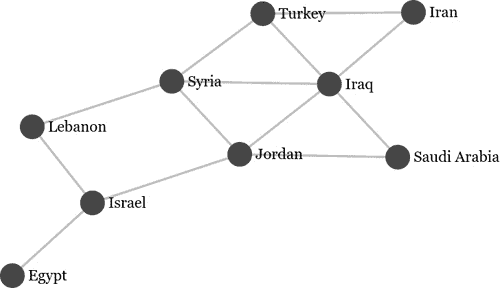

从图的定义推导出这样的图片被称为*图形布局*。它涉及为每个节点分配一个位置，使得相连的节点彼此靠近但又不互相拥挤。同一张图的随机布局则更难解读。

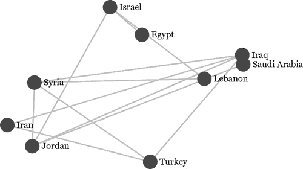

为给定的图找到一个美观的布局是一个众所周知的难题。对于具有大量边的大型图，目前还没有已知的解决方案能适用于所有类型的图——尽管对于特定形式的图存在一些解决方案。

要布局一个不太复杂的小型图（比如最多 100 个节点），我们可以采用一种称为*力导向图布局*的方法。该方法对图的节点运行一个简单的物理模拟，将节点之间的边视为弹簧，同时让节点本身像带电粒子一样相互排斥。

在本章中，我们将实现一个力导向图布局并观察其性能。我们可以通过反复计算作用在每个节点上的力，并根据这些力移动节点来运行这样的物理模拟。这类程序的性能很重要，因为可能需要大量迭代才能达到美观且稳定的布局，而每次迭代都需要计算大量的力。

## 定义图

我们可以将图表示为一个 `GraphNode` 对象数组，每个对象携带其当前位置以及一个包含与其相连的其他节点的数组。节点的起始位置是随机化的。

```
function GraphNode() {
  this.pos = new Vector(Math.random() * 1000,
                        Math.random() * 1000);
  this.edges = [];
}
GraphNode.prototype.connect = function(other) {
  this.edges.push(other);
  other.edges.push(this);
};
GraphNode.prototype.hasEdge = function(other) {
  for (var i = 0; i < this.edges.length; i++)
    if (this.edges[i] == other)
     return true;
};
```

我们使用前几章中熟悉的 `Vector` 类型来表示位置和力。

`connect` 和 `hasEdge` 方法提供了一种在构建图时连接节点以及测试两个节点是否相连的方式。

`treeGraph` 函数构建一个简单的图，我们可以在其上测试布局程序。它接受两个参数——树的深度和每层创建的分支数——并递归地构建一个具有指定形状的树形图。

```
function treeGraph(depth, branches) {
  var graph = [];
  function buildNode(depth) {
    var node = new GraphNode();
    graph.push(node);
    if (depth > 1)
      for (var i = 0; i < branches; i++)
        node.connect(buildNode(depth - 1));
      return node;
  }
  buildNode(depth);
  return graph;
}
```

树形图不包含环，这使得它们相对容易布局，并且即使是我们本章将使用的简单程序也能产生美观的形状。

由 `treeGraph(3, 5)` 创建的图将是一个深度为 3、有 5 个分支的树。

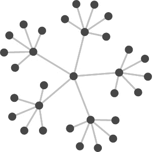

为了让你能够检查本章代码生成的布局，我定义了一个 `drawGraph` 函数，它可以将图画到 canvas 上。该函数定义在 `http://eloquentjavascript.net/code/draw_graph.js` 的代码中，并可在在线沙盒中使用。

## 第一个力导向布局函数

我们将一次移动一个节点，计算作用在当前节点上的力，并立即根据这些力移动该节点。

（理想化）弹簧施加的力可以用胡克定律近似，该定律指出这个力与弹簧的静止长度和当前长度之差成正比。变量 `springLength` 定义了边弹簧的静止长度，变量 `springStrength` 定义了一个用于模拟弹簧刚度的常数，我们将用它乘以长度差来确定最终的力。

```
var springLength = 40;
var springStrength = 0.1;
```

为了模拟节点之间的排斥力，我们使用另一个物理定律——库仑定律，该定律指出两个带电粒子之间的排斥力与它们之间距离的平方成反比。当两个节点几乎重叠时，距离的平方非常小，因此产生的力巨大。随着节点远离，距离的平方迅速增大，排斥力迅速减弱。

我们再次乘以一个实验确定的常数 `repulsionStrength`，它定义了节点相互排斥的程度。

```
var repulsionStrength = 1500;
```

作用在给定节点上的力是通过遍历所有其他节点并对每个节点施加排斥力来计算的。当另一个节点与当前节点共享一条边时，还会施加弹簧的力。

这两种力都取决于两个节点之间的距离。该函数计算一个名为 `apart` 的向量，表示从当前节点到另一个节点的路径。然后函数取该向量的长度来得到实际距离。当距离小于 1 时，我们将其设为 1，以防止除以零或非常小的数，因为那样会产生 `NaN` 值或巨大的力，从而将节点弹射到外太空。


利用这个距离，我们可以计算出作用于这两个给定节点之间的力的大小。要从大小得到力的向量，我们必须将大小乘以`apart`向量的归一化版本。归一化向量意味着创建一个方向相同但长度为 1 的向量，可以通过将向量除以其自身长度来实现。

```
function forceDirected_simple(graph) {
  graph.forEach(function(node) {
    graph.forEach(function(other) {
      if (other == node) return;
      var apart = other.pos.minus(node.pos);
      var distance = Math.max(1, apart.length);
      var forceSize = -repulsionStrength / (distance * distance);
      if (node.hasEdge(other))
        forceSize += (distance - springLength) * springStrength;
      var normalized = apart.times(1 / distance);
      node.pos = node.pos.plus(normalized.times(forceSize));
    });
  });
}
```

我们将使用`runLayout`函数来测试图布局系统的给定实现。它会运行模型 4000 步，并记录所花费的时间。为了在代码运行时能观察到一些东西，它会在每 100 步后绘制当前图的布局。

```
function runLayout(implementation, graph) {
  var totalSteps = 0, time = 0;
  function step() {
    var startTime = Date.now();
    for (var i = 0; i < 100; i++)
      implementation(graph);
    totalSteps += 100;
    time += Date.now() - startTime;
    drawGraph(graph);
    if (totalSteps < 4000)
      requestAnimationFrame(step);
    else
      console.log(time);
  }
  step();
}
```

现在我们可以运行第一个实现，看看它需要多长时间。

```
<script>
  runLayout(forceDirected_simple, treeGraph(4, 4));
</script>
```

在我的机器上，使用 Chrome 浏览器版本 38，报告这 4000 次迭代花费了四秒多一点。这很多。让我们看看能否做得更好。

## 性能分析

所以我们的代码很慢。你可能已经对原因有一些猜测。但性能问题可能来自意想不到的角落，如果你仅仅基于*假设*你的想法能让代码运行更快就开始修改代码，你很可能会浪费大量时间在实际上没有帮助的改动上。

我们的`runLayout`函数测量了程序当前所需的时间。这已经是一个好的开始。要改进某件事，你必须先测量它，这样才能获得有用的反馈，了解你所做的改动是否真的有效。

现代浏览器中的开发者工具提供了一种更好的方式来测量程序所花费的时间。*性能分析器*工具会在程序运行时收集关于程序各个部分运行所花费时间的信息。

当你的浏览器有性能分析器时，它可以在开发者工具界面中找到，通常作为顶部栏中的一个选项卡。Chrome 的性能分析器为我们的程序输出一个三列表格。

```
Self              Total               Function
3787.5 ms 47.48 % 5015.4 ms 62.87 %  (anonymous function)
2528.3 ms 31.70 % 7545.7 ms 94.60 %  (anonymous function)
1229.9 ms 15.42 % 1229.9 ms 15.42 %  Vector
 188.4 ms  2.36 %  188.4 ms  2.36 %  (garbage collector)
 44.3 ms  0.56 %  7590.1 ms 95.15 %  forceDirected_simple
 39.3 ms  0.49 %    39.3 ms  0.49 %  stroke
 22.2 ms  0.28 %    22.2 ms  0.28 %  fill
 11.1 ms  0.14 %    11.1 ms  0.14 %  clearRect
  6.0 ms  0.08 %     6.0 ms  0.08 %  arc
  4.0 ms  0.05 %    88.6 ms  1.11 %  drawGraph
  2.0 ms  0.03 %  7680.7 ms 96.29 %  step
```

这些数字给出了执行给定函数所花费的时间，以毫秒和占总时间的百分比表示。第一列仅显示控制权实际在函数内部的时间，而第二列包括该函数调用的其他函数所花费的时间。

从这些数据中，我们可以看出绘制图所花费的时间与运行模拟所花费的时间相比微不足道。在浏览器中，我们可以点击查看每个函数的定义。这使我们能够确认性能分析顶部的两个匿名函数是`forceDirected_simple`中传递给`forEach`的函数。正如预期的那样，程序的大部分时间都花在了计算力上。

标记为`(garbage collector)`的行给出了清理不再使用的内存所花费的时间。考虑到我们的程序创建了大量的向量对象，2.36%的内存回收时间低得惊人。Chrome 拥有先进的垃圾回收器。但请注意，我们*确实*花费了超过 15%的时间来创建向量对象。这绝对是一个优化的机会，我们将在本章后面探讨。但首先，我们将解决另一个导致缓慢的原因。

## 函数内联

在我们看到的性能分析中，没有一个向量方法（如`plus`）出现，尽管它们被大量使用。这是因为引擎对它们进行了*内联*。这意味着，内部函数中的代码不是调用实际的方法来添加向量，而是将向量添加的代码直接放入函数内部，编译后的代码中不会发生实际的方法调用。

内联有多种方式有助于使代码更快。在机器层面，函数和方法通过一种协议调用，这需要将参数和返回地址（函数返回后执行继续的位置）放在函数可以找到的地方。函数调用将控制权交给程序的另一部分，通常还需要保存一些处理器状态，以便被调用的函数可以使用处理器而不干扰调用者仍然需要的数据。当函数被内联时，所有这些都变得不必要。

此外，一个好的编译器会尽力寻找简化其生成代码的方法。如果函数被视为可能做任何事的黑盒，编译器就没有太多可操作的空间。另一方面，如果编译器能够看到并包含函数体进行分析，它可能会找到更多优化结果代码的机会。

例如，JavaScript 引擎可以完全避免创建我们代码中的一些向量对象。在像下面这样的表达式中，如果我们能看透这些方法，很明显结果向量的坐标是`force`的坐标加上`normalized`的坐标与`forceSize`变量的乘积。因此，不需要创建由`times`方法产生的中间对象。

```
force.plus(normalized.times(forceSize))
```

但 JavaScript 是一种动态语言。编译器如何确定这个`plus`方法实际上是哪个函数？如果后来有人更改了`Vector.prototype.plus`中存储的值呢？下次运行内联了该函数的代码时，它可能会继续使用旧的定义，从而违反程序员对程序行为方式的假设。

这就是执行和编译交错进行开始发挥作用的地方。当一个热点函数被编译时，它已经运行了多次。如果在这些运行中，它总是调用同一个函数，那么尝试内联该函数是合理的。代码被乐观地编译，假设将来同一个函数会在这里被调用。

为了处理悲观的情况（即最终调用了另一个函数），编译器插入了一个测试，将实际调用的函数与内联的函数进行比较。如果两者不匹配，乐观编译的代码就无用了，JavaScript 引擎必须*去优化*，这意味着它会回退到代码的较低优化版本。

## 回到老式循环


在我们的模拟函数中传递给 `forEach` 的两个匿名函数出现在性能分析结果的顶部，这表明它们没有被内联。这些函数被*非常*频繁地调用，我们非常希望编译器能够尽可能紧密地优化模拟函数的主体。

在撰写本文时，似乎还没有 JavaScript 引擎能够内联 `forEach` 调用。这意味着每次调用都需要创建一个函数对象，闭包变量（`graph` 和 `node`）必须放在一个特殊的共享内存区域中，并且会有*大量*函数调用发生。

解决方案很简单。改用传统的 `for` 循环。虽然这让代码看起来不那么美观，但对于我的内部循环来说，我愿意付出这个代价。

```
function forceDirected_forloop(graph) {
  for (var i = 0; i < graph.length; i++) {
    var node = graph[i];
    for (var j = 0; j < graph.length; j++) {
      if (i == j) continue;
      var other = graph[j];
      var apart = other.pos.minus(node.pos);
      var distance = Math.max(1, apart.length);
      var forceSize = -1 * repulsionStrength / (distance * distance);
      if (node.hasEdge(other))
        forceSize += (distance - springLength) * springStrength;
      var normalized = apart.times(1 / distance);
      node.pos = node.pos.plus(normalized.times(forceSize));
    }
  }
}
```

结果是，在 Chrome 38 和 Firefox 32 中，代码速度都提高了约 30%。如果再次进行性能分析，`forceDirected_forloop` 函数将占据大部分时间。有趣的是，`Vector` 构造函数也从性能分析结果中消失了，这表明引擎要么避免了创建向量，要么内联了构造函数。

## 避免不必要的工作

你可以通过找到更廉价的方式来完成代码已经在做的工作来使代码更快，就像我们之前做的那样。但有时你也可以找到完全避免某些工作的方法。在某些情况下，这可以将代码性能提升几个数量级，而无需进行像将 `forEach` 循环替换为 `for` 循环那样繁琐的*微优化*工作。

在我们的示例项目中，有一个适度的机会可以减少工作量。每对节点之间的力被计算了两次，一次是在移动第一个节点时，另一次是在移动第二个节点时。由于节点 `X` 对节点 `Y` 施加的力恰好与节点 `Y` 对节点 `X` 施加的力相反，我们不需要计算两次这些力。

下一个版本的函数将内部循环改为只遍历当前节点之后的节点，这样每对节点只被查看一次。在该循环结束时，它会更新两个节点的位置。

```
function forceDirected_norepeat(graph) {
  for (var i = 0; i < graph.length; i++) {
    var node = graph[i];
    for (var j = i + 1; j < graph.length; j++) {
      var other = graph[j];
      var apart = other.pos.minus(node.pos);
      var distance = Math.max(1, apart.length);
      var forceSize = -1 * repulsionStrength / (distance * distance);
      if (node.hasEdge(other))
        forceSize += (distance - springLength) * springStrength;
      var applied = apart.times(forceSize / distance);
      node.pos = node.pos.plus(applied);
      other.pos = other.pos.minus(applied);
    }
  }
}
```

如果我对这段代码进行测量，与之前的版本相比，我看到了另一个巨大的速度提升——在 Chrome 38 上耗时减少了超过 40%，在 Firefox 32 和 Internet Explorer 11 上减少了约 30%。

## 减少垃圾的产生

尽管我们用于进行二维运算的一些向量对象可能会被某些引擎完全优化掉，但创建所有这些对象仍然可能带来成本。为了估算这个成本的大小，让我们编写一个“手动”进行向量计算的代码版本，使用局部变量来处理两个维度。

```
function forceDirected_novector(graph) {
  for (var i = 0; i < graph.length; i++) {
    var node = graph[i];
    for (var j = i + 1; j < graph.length; j++) {
      var other = graph[j];
      var apartX = other.pos.x - node.pos.x;
      var apartY = other.pos.y - node.pos.y;
      var distance = Math.max(1, Math.sqrt(apartX * apartX + apartY * apartY));
      var forceSize = -repulsionStrength / (distance * distance);
      if (node.hasEdge(other))
        forceSize += (distance - springLength) * springStrength;
      var forceX = apartX * forceSize / distance;
      var forceY = apartY * forceSize / distance;
      node.pos.x += forceX; node.pos.y += forceY;
      other.pos.x -= forceX; other.pos.y -= forceY;
    }
  }
}
```

新代码更冗长、更重复，但如果我测量它，性能提升足够大，值得在性能敏感的代码中考虑这种手动对象扁平化。Chrome 38 似乎在优化对象创建方面做得很好，新代码相比之前的版本带来了大约 40% 的加速。在 Firefox 32 上，加速超过 60%。而在 Internet Explorer 11 上，这种手动优化使代码运行速度提高了 80%！

这种差异清楚地表明，JavaScript 代码的执行速度与运行它的引擎密切相关。JavaScript 由于其难以编译的特性，迫使编译器成为极其复杂的软件。这种复杂性使得它们不可预测。代码中的微小变化、代码的使用方式或运行引擎的版本都可能导致性能的大幅波动。

## 垃圾回收

那么为什么对象是昂贵的？有两个原因。首先，引擎必须找到存储它们的地方；其次，它必须确定它们何时不再被使用并回收它们。这两者都很难做到。

再次将内存想象成一条长长的比特序列。当程序启动时，它可能会收到一块空的内存，然后开始将创建的对象一个接一个地放入其中。但到了某个时刻，空间满了，其中一些对象不再被程序使用。JavaScript 引擎必须找出哪些对象正在使用，哪些没有，然后将未使用的内存标记为可重用。

现在程序的内存空间有点混乱，包含活对象和空闲空间交错。创建一个新对象需要找到一块足够大的空闲空间来容纳该对象，这可能需要一些搜索。或者，引擎可以将所有活对象移动到内存空间的起始位置，这样创建新对象会更便宜（它们可以再次一个接一个地放置），但移动旧对象时需要更多工作。

原则上，找出哪些对象仍在使用需要从全局作用域和当前活动的局部作用域开始，追踪所有可达的对象。从这些作用域直接或间接引用的任何对象都仍然是存活的。如果你的程序在内存中有大量数据，这将是一项相当大的工作。

一种称为*分代垃圾回收*的技术可以帮助减少这些成本。Chrome 使用了这种技术，这可能是为什么消除中间向量对象在该浏览器中带来的差异比其他浏览器小的主要原因。在撰写本文时，Firefox 也在努力转向这种方法。

分代垃圾回收利用了大多数对象生命周期短的特点。它将 JavaScript 程序可用的内存分成两个或多个*代*。新对象在为新世代保留的空间中创建。当这个空间满了时，引擎会找出其中哪些对象仍然存活，并将它们移动到下一代。如果此时新世代中只有一小部分对象仍然存活，那么移动这些对象只需要做少量工作。


当然，要判断哪些对象是存活的，就需要知道新生代中所有对象的引用。引擎希望避免每次回收新生代时都遍历所有老年代对象。因此，当从老对象创建到新对象的引用时，必须记录这个引用，以便在下一次回收时考虑它。这会使写入老对象的操作稍微昂贵一些，但这一成本远低于垃圾回收所节省的时间。

## 写入对象

考虑到写入老对象可能会带来开销，你可能会对我们代码中施加力的方式感到有些担忧。内层循环更新了长期存在的节点位置对象的 `x` 和 `y` 属性。对于一个有 *N* 个节点的图，内层循环运行 *N*² 次。对于我们的 85 节点测试图，每次模拟迭代中要运行 7,225 次。

也许可以先局部计算力，等到所有力都完全计算完毕后再更新节点位置。这需要额外编写一些代码来构建存储力的数组，并在函数末尾应用这些力。

```
function forceDirected_localforce(graph) {
  var forcesX = [], forcesY = [];
  for (var i = 0; i < graph.length; i++)
   forcesX[i] = forcesY[i] = 0;

  for (var i = 0; i < graph.length; i++) {
    var node = graph[i];
    for (var j = i + 1; j < graph.length; j++) {
      var other = graph[j];
      var apartX = other.pos.x - node.pos.x;
      var apartY = other.pos.y - node.pos.y;
      var distance = Math.max(1, Math.sqrt(apartX * apartX + apartY * apartY));
      var forceSize = -repulsionStrength / (distance * distance);
      if (node.hasEdge(other))
        forceSize += (distance - springLength) * springStrength;

      var forceX = apartX * forceSize / distance;
      var forceY = apartY * forceSize / distance;
      forcesX[i] += forceX; forcesY[i] += forceY;
      forcesX[j] -= forceX; forcesY[j] -= forceY;
    }
  }

  for (var i = 0; i < graph.length; i++) {
    graph[i].pos.x += forcesX[i];
    graph[i].pos.y += forcesY[i];
  }
}
```

像这样批量更新位置，可以使程序速度再提升 20%。有趣的是，这种改进在我测试的所有三个浏览器上都能一致地观察到，尽管其中两个浏览器据说不使用分代垃圾回收。这很可能与它们*增量式*进行垃圾回收的方式有关——将追踪所有存活内存的工作切分成小块，而不是一次性完成，后者可能导致程序执行中出现明显的停顿。这种技术也需要跟踪新创建的引用。

一步一步地，我们改造了这个小程序，让它变得不那么美观，但速度提升了约 85%（最后一个版本的运行时间大约是第一个版本的 15%）。

我想再次提醒你，不要将这些技术应用到所有你编写的代码中。对于大多数代码，它们不会带来什么区别。只有那些在内层循环中*非常频繁*运行的代码，才能从这类调整中受益。

## 动态类型

从对象中获取属性的 JavaScript 表达式，比如 `node.pos`，编译起来远非易事。在许多语言中，*变量*有类型，因此当你对它们持有的值执行操作时，编译器已经知道你需要哪种操作。而在 JavaScript 中，只有*值*有类型，一个变量最终可能持有不同类型的值。

这意味着，最初编译器对代码可能试图访问的属性知之甚少，必须生成能处理所有可能类型的代码。如果 `node` 持有 undefined 值，代码必须抛出错误。如果它持有字符串，则必须在 `String.prototype` 中查找 `pos`。如果它持有对象，那么从对象中提取 `pos` 属性的方式取决于对象的类型。诸如此类。

幸运的是，大多数程序中的变量*确实*只有单一类型，尽管 JavaScript 并不要求这样。如果编译器知道变量类型，它就可以利用这些信息生成更高效的代码。如果到目前为止 `node` 一直是一个带有 `pos` 和 `edges` 属性的对象，那么优化编译器可以简单地生成代码，从该对象中已知的位置获取属性，这既简单又快速。

但过去观察到的事件并不能保证未来会发生的事件。某些尚未运行的代码可能仍然会向我们的函数传递另一种类型的值——例如，另一种节点对象，它也有一个 `id` 属性。

因此，编译后的代码仍然必须*检查*其假设是否成立，并在不成立时采取适当的行动。引擎可以完全取消优化，回退到函数的未优化版本。或者它可以编译一个新版本的函数，同时处理新观察到的类型。

你可以通过故意打乱图布局函数输入对象的类型一致性来观察类型预测失败导致的性能下降，如下例所示：

```
var mangledGraph = treeGraph(4, 4);
mangledGraph.forEach(function(node) {
  var letter = Math.floor(Math.random() * 26);
   node[String.fromCharCode("A".charCodeAt(0) + letter)] = true;
});

runLayout(forceDirected_localforce, mangledGraph);
```

每个节点都获得一个额外的属性，名称是一个随机的大写字母。该字母是通过取字符 *A* 的字符码并加上一个随机数计算得到的。

如果我们在生成的图上运行快速模拟代码，在 Chrome 38 上速度会慢三倍，在 Firefox 32 上会慢九倍（！）。现在对象类型各不相同，代码必须在没有预先了解对象形状的情况下查找属性，这要昂贵得多。

类似的技术也用于属性访问之外的其他操作。例如，`+` 运算符根据其操作数的类型有不同的含义。智能的 JavaScript 编译器不会总是运行处理所有这些含义的完整代码，而是利用先前的观察来建立对运算符可能应用的类型的一些预期。如果它只应用于数字，就可以生成更简单的机器码来处理。但同样，每次函数运行时都必须检查这些假设。

这个故事告诉我们，如果一段代码需要快速运行，你可以通过提供一致的类型来帮助它。JavaScript 引擎可以较好地处理少数几种不同类型的情况——它会生成处理所有这些类型的代码，并且只有在遇到新类型时才会取消优化。但生成的代码仍然比单一类型的情况要慢。

## 总结

得益于投入 Web 的巨大资金以及不同浏览器之间的竞争，JavaScript 编译器擅长它们的工作：让代码快速运行。

但有时你需要稍微帮助它们一下，重写内层循环以避免更昂贵的 JavaScript 特性。高阶函数就是这样的特性之一。创建更少的对象（以及数组和字符串）也有帮助。

在开始为了加速而修改代码之前，先考虑如何让它做更少的工作。最大的优化机会往往就在这个方向上。

JavaScript 引擎会多次编译热点代码，并利用之前执行过程中收集的信息来编译更高效的代码。你可以通过给变量提供一致的类型来提供帮助。

## 练习

### 寻路


编写一个函数 `findPath`，尝试寻找图中两个节点之间的最短路径。该函数接收两个 `GraphNode` 对象（如本章所用）作为参数，如果找不到路径则返回 `null`，否则返回一个表示图中路径的节点数组。数组中相邻的节点之间应存在一条边。

寻找图中路径的一个好方法如下：

1. 创建一个工作列表，其中包含一条仅由起始节点组成的单节点路径。
2. 从工作列表中的第一条路径开始。
3. 如果当前路径末尾的节点是目标节点，则返回该路径。
4. 否则，对于路径末尾节点的每个邻居，如果该节点之前未被查看过（即未出现在工作列表中任何路径的末尾），则通过将该邻居追加到当前路径来创建一条新路径，并将该路径添加到工作列表中。
5. 如果工作列表中还有更多路径，则转到下一条路径并继续执行步骤 3。
6. 否则，不存在路径。

通过从起始节点“扩散”路径，这种方法确保总是以最短路径到达某个给定节点，因为只有在尝试了所有较短路径之后才会考虑更长的路径。

实现该程序并在一些简单的树形图上进行测试。构建一个包含环的图（例如，使用 `connect` 方法向树形图添加边），并查看当存在多种可能性时，你的函数能否找到最短路径。

### 计时

使用 `Date.now()` 来测量你的 `findPath` 函数在更复杂的图中找到路径所需的时间。由于 `treeGraph` 总是将根节点放在图数组的开头，将叶子节点放在末尾，你可以通过如下方式为函数分配一个非平凡的任务：

```
var graph = treeGraph(5, 3);
console.log(findPath(graph[0], graph[graph.length - 1]).length);
// ▹ 5
```

创建一个运行时间约为半秒的测试用例。注意不要向 `treeGraph` 传递过大的数字——图的大小呈指数增长，因此很容易使图变得过大，从而需要耗费大量时间和内存来找到路径。

### 优化

现在你已经有了一个可测量的测试用例，想办法让你的 `findPath` 函数更快。

同时考虑宏观优化（减少工作量）和微观优化（以更廉价的方式完成给定工作）。此外，考虑如何减少内存使用，分配更少或更小的数据结构。

如果需要，你可以先向节点添加 `id` 属性，以便更容易地将信息存储在映射中。使用如下函数：

```
function withIDs(graph) {
  for (var i = 0; i < graph.length; i++) graph[i].id = i;
  return graph;
}
```

# 附录 A. 练习提示

以下提示可能在你对本书中的某个练习感到困惑时提供帮助。它们不会直接给出完整解决方案，而是试图帮助你自行找到答案。

## 程序结构

### 循环打印三角形

你可以从一个简单打印数字 1 到 7 的程序开始，该程序可以通过对本章前面介绍的偶数打印示例（其中引入了 `for` 循环）进行少量修改得到。

现在考虑数字与井号字符串之间的等价关系。类似地，你可以通过加 1（`+= 1`）从 1 到 2。你可以通过添加一个字符（`+= "#"`）从 `"#"` 到 `"##"`。因此，你的解决方案可以紧密遵循数字打印程序。

### FizzBuzz

遍历数字显然是一个循环任务，而选择打印什么则是条件执行的问题。记住使用取余（`%`）运算符来检查一个数是否能被另一个数整除（余数为零）。

在第一个版本中，每个数字有三种可能的结果，因此你需要创建一个 `if`/`else if`/`else` 链。

程序的第二个版本有一个直接的解决方案和一个巧妙的解决方案。简单的方法是添加另一个“分支”来精确测试给定条件。对于巧妙的方法，构建一个包含要输出的单词或单词组的字符串，如果没有单词则打印该数字或这个单词，可能通过优雅地使用 `||` 运算符来实现。

### 棋盘

可以通过从一个空字符串（`""`）开始并重复添加字符来构建字符串。换行符写作 `"\n"`。

使用 `console.log` 检查程序的输出。

要处理二维，你需要一个循环嵌套在另一个循环中。在两个循环的体周围加上花括号，以便更容易看到它们的开始和结束。尝试正确缩进这些体。循环的顺序必须遵循我们构建字符串的顺序（逐行、从左到右、从上到下）。因此，外层循环处理行，内层循环处理一行中的字符。

你需要两个变量来跟踪进度。要知道在某个位置放置空格还是井号，你可以测试两个计数器的和是否为偶数（`% 2`）。

在构建完一行后，通过添加换行符来终止该行，因此在内层循环之后、外层循环之内执行此操作。

## 函数

### 最小值

如果你在正确放置花括号和圆括号以定义有效函数时遇到困难，请先复制本章中的一个示例并进行修改。

一个函数可以包含多个 `return` 语句。

### 递归

你的函数可能看起来与本章递归 `findSolution` 示例中的内部 `find` 函数有些相似，其中包含一个 `if`/`else if`/`else` 链来测试三种情况中的哪一种适用。最后的 `else` 对应第三种情况，进行递归调用。每个分支都应包含一个 `return` 语句，或以其他方式安排返回特定值。

当给定负数时，该函数会不断递归，向自身传递越来越小的负数，从而离返回结果越来越远。最终它会耗尽栈空间并中止。

### 字符计数

函数中的循环必须通过从零到字符串长度减一（`< string.length`）的索引来查看字符串中的每个字符。如果当前位置的字符与函数正在查找的字符相同，则向计数器变量加 1。循环结束后，可以返回计数器。

注意使用 `var` 关键字使函数中使用的所有变量成为函数的*局部*变量。

## 数据结构：对象和数组

### 范围求和

构建数组最容易的方法是先初始化一个变量为 `[]`（一个全新的空数组），然后重复调用其 `push` 方法来添加值。不要忘记在函数末尾返回该数组。

由于结束边界是包含的，你需要使用 `<=` 运算符而不是简单的 `<` 来检查循环结束。

要检查是否提供了可选的步长参数，可以检查 `arguments.length` 或将参数的值与 `undefined` 进行比较。如果未提供，只需在函数顶部将其设置为默认值（1）。

让 `range` 理解负步长值最好通过编写两个独立的循环来实现——一个用于递增计数，一个用于递减计数——因为检查循环是否结束的比较在递减计数时需要是 `>=` 而不是 `<=`。

当范围的结束小于开始时，使用不同的默认步长（即 –1）可能也是值得的。这样，`range(5, 2)` 会返回有意义的结果，而不是陷入无限循环。

### 反转数组


实现 `reverseArray` 有两种显而易见的方法。第一种是简单地从前往后遍历输入数组，并对新数组使用 `unshift` 方法将每个元素插入到开头。第二种是反向遍历输入数组，并使用 `push` 方法。反向遍历数组需要一个（略显笨拙的）`for` 规范，例如 `(var i = array.length - 1; i >= 0; i--)`。

原地反转数组则更为困难。你必须小心不要覆盖稍后需要用到的元素。使用 `reverseArray` 或复制整个数组（`array.slice(0)` 是一种复制数组的好方法）虽然可行，但属于取巧。

技巧在于*交换*第一个和最后一个元素，然后是第二个和倒数第二个，以此类推。你可以通过循环数组长度的一半（使用 `Math.floor` 向下取整——对于奇数长度的数组，你不需要触碰中间元素）并交换位置 `i` 和位置 `array.length - 1 - i` 的元素来实现。你可以使用一个局部变量临时保存其中一个元素，用其镜像元素覆盖该元素，然后将局部变量中的值放到镜像元素原来的位置。

### 列表

构建列表最好从后往前进行。因此 `arrayToList` 可以反向遍历数组（参见上一道练习），并为每个元素向列表中添加一个对象。你可以使用一个局部变量来保存已构建的部分列表，并使用类似 `list = {value: X, rest: list}` 的模式来添加元素。

要遍历一个列表（在 `listToArray` 和 `nth` 中），可以使用如下 `for` 循环规范：

```
for (var node = list; node; node = node.rest) {}
```

你能看出这是如何工作的吗？每次循环迭代，`node` 指向当前子列表，循环体可以读取其 `value` 属性来获取当前元素。在迭代结束时，`node` 移动到下一个子列表。当它为 `null` 时，我们就到达了列表的末尾，循环结束。

递归版本的 `nth` 类似地会查看列表“尾部”越来越小的部分，同时递减索引直到为零，此时它可以返回所查看节点的 `value` 属性。要获取列表的第零个元素，你只需取其头节点的 `value` 属性。要获取第 `N + 1` 个元素，你需要取当前列表的 `rest` 属性所指向列表的第 `N` 个元素。

### 深度比较

判断你是否在处理一个真实对象的测试看起来像 `typeof x == "object" && x != null`。注意，只有在*两个*参数都是对象时才比较属性。在所有其他情况下，你可以直接返回应用 `===` 的结果。

使用 `for`/`in` 循环遍历属性。你需要测试两个对象是否具有相同的属性名集合，以及这些属性是否具有相同的值。第一个测试可以通过计算两个对象中的属性数量来完成，如果属性数量不同则返回 `false`。如果数量相同，则遍历一个对象的属性，并针对每个属性验证另一个对象也拥有该属性。属性的值通过递归调用 `deepEqual` 进行比较。

从函数中返回正确的值最好在发现不匹配时立即返回 `false`，并在函数末尾返回 `true`。

## 高阶函数

### 母亲与子女的年龄差

由于 `ancestry` 数组中的并非所有元素都能产生有用数据（除非我们知道母亲的出生日期，否则无法计算年龄差），我们必须在调用 `average` 之前以某种方式应用 `filter`。你可以先定义一个 `hasKnownMother` 函数并先进行过滤，作为第一步。或者，你也可以先调用 `map`，并在映射函数中返回年龄差，如果不知道母亲则返回 `null`。然后，在将数组传递给 `average` 之前，调用 `filter` 移除 `null` 元素。

### 历史预期寿命

这个例子的本质在于根据某个共同特征对集合中的元素进行分组。这里，我们希望将祖先数组拆分成更小的数组，按世纪对祖先进行分组。

在分组过程中，保留一个对象，该对象将世纪名称（数字）与人物对象或年龄的数组关联起来。由于我们事先不知道会遇到哪些类别，我们必须动态创建它们。对于每个人，在计算其世纪后，我们测试该世纪是否已知。如果未知，则为其添加一个数组。然后将该人物（或年龄）添加到对应世纪的数组中。

最后，可以使用 `for`/`in` 循环来打印各个世纪的平均年龄。

### Every 和 Then Some

这些函数可以遵循本章开头 `forEach` 定义的类似模式，不同之处在于当谓词函数返回 `false`（或 `true`）时，它们必须立即返回（正确的值）。不要忘记在循环之后添加另一个 `return` 语句，以便函数在到达数组末尾时也能返回正确的值。

## 对象的秘密生活

### 向量类型

你的解决方案可以紧密遵循本章中 `Rabbit` 构造函数的模式。

向构造函数添加 getter 属性可以使用 `Object.defineProperty` 函数完成。要计算从 (0, 0) 到 (`x`, `y`) 的距离，你可以使用勾股定理，该定理指出我们要求的距离的平方等于 x 坐标的平方加上 y 坐标的平方。因此，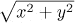 就是你想要的数字，而 `Math.sqrt` 是在 JavaScript 中计算平方根的方法。

### 另一个单元格

你需要在实例对象中存储所有三个构造函数参数。`minWidth` 和 `minHeight` 方法应调用 `inner` 单元格中的相应方法，但确保返回的值不小于给定的大小（可能使用 `Math.max`）。

不要忘记添加一个 `draw` 方法，该方法只需将调用转发给内部单元格。

### 序列接口

解决这个问题的一种方法是给序列对象赋予*状态*，这意味着它们的属性在使用过程中会发生变化。你可以存储一个计数器，指示序列对象已经前进到了哪里。

至少，你的接口需要暴露一种方法来获取下一个元素，并判断迭代是否已经到达序列的末尾。很容易想到将这些功能合并到一个方法 `next` 中，当序列到达末尾时返回 `null` 或 `undefined`。但这样一来，当序列实际包含 `null` 时就会出问题。因此，可能更可取的做法是使用一个单独的方法（或 getter 属性）来判断是否已到达末尾。

另一种解决方案是避免改变对象的状态。你可以暴露一个获取当前元素的方法（不推进任何计数器），以及另一个获取新序列的方法，该新序列表示当前元素之后的剩余元素（如果到达序列末尾则返回一个特殊值）。这种方法相当优雅——一个序列值即使在使用后也会“保持自身”，因此可以与其他代码共享，而无需担心它会发生什么变化。不幸的是，在像 JavaScript 这样的语言中，这也有点低效，因为它在迭代过程中会创建大量对象。

## 项目：电子生命

### 人工愚蠢


贪婪问题可以通过几种方式解决。生物可以在达到一定能量水平时停止进食。或者它们可以每 `N` 回合才进食一次（通过在 `critter` 对象上保存一个属性来记录自上次进食以来的回合数）。或者，为了确保植物永远不会完全灭绝，生物可以拒绝吃一株植物，除非它们在附近至少看到另一株植物（使用视图上的 `findAll` 方法）。这些方法的组合，或者某种完全不同的策略，也可能奏效。

让生物更有效地移动可以通过借鉴我们旧的无能量世界中生物的移动策略来实现。无论是弹跳行为还是沿墙行为，都显示出比完全随机移动更广泛的运动范围。

让生物繁殖得更慢很简单。只需提高它们繁殖所需的最低能量水平。当然，让生态系统更稳定也会让它更无聊。如果你有一群肥胖、不动的生物永远在植物海洋中啃食，从不繁殖，那会形成一个非常稳定的生态系统。但没人愿意看这个。

### 捕食者

许多适用于前一练习的技巧在这里也同样适用。建议让捕食者体型庞大（能量多）并缓慢繁殖。这样它们就不太容易在食草动物稀少时因饥饿而死亡。

除了生存，保持食物来源的存活是捕食者的主要目标。找到某种方法，让捕食者在食草动物众多时更积极地捕猎，而在猎物稀少时捕猎得更慢（或根本不捕猎）。由于食草动物会移动，仅在附近有其他食草动物时才吃掉一只的简单技巧可能行不通——这种情况发生得太少，捕食者会饿死。但你可以记录前几回合的观察结果，在捕食者对象上维护某种数据结构，并根据最近看到的情况来决定其行为。

## 错误与异常处理

### 重试

对 `primitiveMultiply` 的调用显然应该放在 `try` 块中。相应的 `catch` 块应在异常不是 `MultiplicatorUnitFailure` 的实例时重新抛出异常，并在是其实例时确保重试调用。

要实现重试，你可以使用一个循环，仅在调用成功时跳出——就像本章前面 `look` 示例那样——或者使用递归，并希望你不会遇到一连串的失败导致栈溢出（这基本上是很安全的）。

### 锁定的盒子

你可能已经猜到了，这个练习需要一个 `finally` 块。你的函数应该先解锁盒子，然后在 `try` 体内调用参数函数。之后的 `finally` 块应再次锁定盒子。

为了确保我们不会在盒子原本未锁定时将其锁定，请在函数开始时检查其锁定状态，并且仅在它最初是锁定的情况下才进行解锁和锁定。

## 正则表达式

### 引用风格

最明显的解决方案是只替换至少一侧带有非单词字符的引号。类似 `/\W'|'\W/`。但你还必须考虑行的开头和结尾。

此外，你必须确保替换也包含由 `\W` 模式匹配到的字符，以免它们被丢弃。这可以通过将它们括在括号中并在替换字符串中包含它们的组（`$1`、`$2`）来实现。未匹配的组将被替换为空。

### 数字再次

首先，不要忘记点号前的反斜杠。

匹配数字前的可选符号以及指数前的可选符号，可以使用 `[+\-]?` 或 `(\+|-|)`（加号、减号或空）。

这个练习中更复杂的部分是匹配 `"5."` 和 `".5"` 而不匹配 `"."`。为此，一个好的解决方案是使用 `|` 运算符将两种情况分开——要么是一个或多个数字，可选地后跟一个点号和零个或多个数字，*要么*是一个点号后跟一个或多个数字。

最后，要使 `e` 不区分大小写，要么在正则表达式中添加 `i` 选项，要么使用 `[eE]`。

## 模块

### 月份名称

这几乎完全遵循了 `weekDay` 模块。一个立即调用的函数表达式包裹了保存名称数组的变量，以及两个需要导出的函数。这些函数被放入一个对象并返回。返回的接口对象存储在 `month` 变量中。

### 回归电子生命

以下是我想到的方案。我在内部函数周围加了括号。

```
Module "grid"
  Vector
  Grid
  directions
  directionNames

Module "world"
  (randomElement)
  (elementFromChar)
  (charFromElement)
  View
  World
  LifelikeWorld
  directions [重新导出]

Module "simple_ecosystem"
  (randomElement) [重复]
  (dirPlus)
  Wall
  BouncingCritter
  WallFollower

Module "ecosystem"
  Wall [重复]
  Plant
  PlantEater
  SmartPlantEater
  Tiger
```

我从 `world` 模块重新导出了 `grid` 模块中的 `directions` 数组，这样基于 `world` 构建的模块（如生态系统）就不需要知道或关心 `grid` 模块的存在。

我还重复了两个通用且微小的辅助值（`randomElement` 和 `Wall`），因为它们在不同上下文中作为内部细节使用，不属于这些模块的接口。

### 循环依赖

诀窍在于，在*实际运行*模块之前，将为此模块创建的 `exports` 对象添加到 `require` 的缓存中。这意味着该模块还没有机会覆盖 `module.exports`，所以我们不知道它是否想要导出其他值。加载后，缓存对象会被 `module.exports` 覆盖，这可能是一个不同的值。

但是，如果在加载模块的过程中，加载了第二个模块并要求第一个模块，那么第一个模块的默认 `exports` 对象（此时很可能仍然是空的）将存在于缓存中，第二个模块将获得对它的引用。如果第二个模块在第一个模块完成加载之前不尝试对该对象做任何操作，一切都会正常。

## 项目：一种编程语言

### 数组

最简单的方法是使用 JavaScript 数组来表示 Egg 数组。

添加到顶层环境的值必须是函数。`Array.prototype.slice` 可用于将 `arguments` 类数组对象转换为常规数组。

### 闭包

同样，我们借助 JavaScript 机制来在 Egg 中实现等效功能。特殊形式会传入它们被求值时的局部环境，以便它们可以在该环境中求值其子形式。由 `fun` 返回的函数闭包了传递给其外层函数的 `env` 参数，并在调用时使用该参数创建函数的局部环境。

这意味着局部环境的原型将是创建该函数时的环境，这使得从函数内部访问该环境中的变量成为可能。这就是实现闭包的全部内容（尽管要以高效的方式编译它，还需要做更多工作）。

### 注释

确保你的解决方案能处理连续多个注释，以及它们之间或之后可能存在的空白。

正则表达式可能是解决这个问题的最简单方法。编写一个匹配“空白或注释，零次或多次”的模式。使用 `exec` 或 `match` 方法，并查看返回数组（整个匹配）中第一个元素的长度，以确定要切掉多少个字符。

### 修复作用域


你需要一次遍历一个作用域，使用 `Object.getPrototypeOf` 进入下一个外层作用域。对于每个作用域，使用 `hasOwnProperty` 来检查由 `set` 的第一个参数的 `name` 属性指示的变量是否存在于该作用域中。如果存在，则将其设置为对 `set` 的第二个参数求值的结果，然后返回该值。

如果到达最外层作用域（`Object.getPrototypeOf` 返回 null）且仍未找到该变量，则该变量不存在，应抛出一个错误。

## 文档对象模型

### 构建表格

使用 `document.createElement` 创建新的元素节点，`document.createTextNode` 创建文本节点，以及 `appendChild` 方法将节点放入其他节点中。

你应该遍历一次键名来填充顶行，然后再次遍历数组中的每个对象来构建数据行。

别忘了在函数末尾返回外层的 `<table>` 元素。

### 按标签名查找元素

解决方案最容易用递归函数表达，类似于本章前面定义的 `talksAbout` 函数。

你可以递归地调用 `byTagname` 自身，将结果数组连接起来以产生输出。为了更高效，定义一个内部函数，它递归地调用自身，并且可以访问外部函数中定义的数组变量，将找到的匹配元素添加进去。别忘了从外部函数中调用一次内部函数。

递归函数必须检查节点类型。这里我们只关心节点类型 1（`document.ELEMENT_NODE`）。对于这样的节点，我们必须遍历它们的子节点，对于每个子节点，检查它是否匹配查询，同时对其递归调用以检查它自己的子节点。

## 处理事件

### 键盘审查

这个练习的解决方案涉及阻止按键事件的默认行为。你可以处理 `"keypress"` 或 `"keydown"`。如果其中任何一个调用了 `preventDefault`，则字母不会出现。

识别输入的字母需要查看 `keyCode` 或 `charCode` 属性，并将其与你想要过滤的字母的代码进行比较。在 `"keydown"` 中，你不需要担心大小写字母，因为它只识别按下的键。如果你决定改为处理 `"keypress"`（它识别实际输入的字符），你必须确保测试两种情况。以下是一种方法：

```
/[qwx]/i.test(String.fromCharCode(event.charCode))
```

### 鼠标轨迹

最好在循环中创建元素。将它们附加到文档中以使其显示。将轨迹元素存储在一个数组中，以便稍后访问它们来改变其位置。

可以通过维护一个计数器变量，并在每次 `"mousemove"` 事件触发时将其加 1 来实现循环。然后可以使用取余运算符（`% 10`）来获取有效的数组索引，以选择在给定事件中要定位的元素。

另一种有趣的效果可以通过模拟一个简单的物理系统来实现。仅使用 `"mousemove"` 事件来更新一对跟踪鼠标位置的变量。然后使用 `requestAnimationFrame` 来模拟轨迹元素被吸引到鼠标指针的位置。在每个动画步骤中，根据它们相对于指针的位置（以及可选的，为每个元素存储的速度）更新它们的位置。找出一个好的方法取决于你。

### 标签页

你可能会遇到的一个陷阱是，不能直接使用节点的 `childNodes` 属性作为标签节点的集合。一方面，当你添加按钮时，它们也会成为子节点并最终出现在这个对象中，因为它是实时的。另一方面，为节点之间的空白创建的文本节点也在其中，不应该拥有自己的标签。

为了解决这个问题，首先构建一个包含包装器中所有 `nodeType` 为 1 的子节点的真实数组。

当在按钮上注册事件处理程序时，处理函数需要知道哪个标签元素与按钮相关联。如果它们是在普通循环中创建的，你可以从函数内部访问循环索引变量，但它不会给出正确的数字，因为该变量会被循环进一步改变。

一个简单的解决方法是使用 `forEach` 方法，并在传递给 `forEach` 的函数内部创建处理函数。循环索引作为第二个参数传递给该函数，它将成为那里的普通局部变量，不会被后续迭代覆盖。

## 项目：平台游戏

### 游戏结束

最明显的解决方案是将 `lives` 设为 `runGame` 中的一个变量，这样 `startLevel` 闭包就能访问它。

另一种方法，与函数其余部分的精神非常契合，是给 `startLevel` 添加第二个参数，用于指定生命数。当系统的整个状态都存储在函数的参数中时，调用该函数提供了一种优雅的方式来过渡到新状态。

无论如何，当关卡失败时，现在应该有两种可能的状态转换。如果那是最后一条命，我们回到第零关，并拥有初始生命数。如果不是，我们重复当前关卡，但剩余生命数减一。

### 暂停游戏

动画可以通过从传递给 `runAnimation` 的函数中返回 `false` 来中断。可以通过再次调用 `runAnimation` 来继续。

为了向传递给 `runAnimation` 的函数传达动画应该被中断，以便它可以返回 `false`，你可以使用一个事件处理程序和该函数都能访问的变量。

在寻找取消注册由 `trackKeys` 注册的处理程序的方法时，请记住，必须将传递给 `addEventListener` 的*完全相同*的函数值传递给 `removeEventListener` 才能成功移除处理程序。因此，在 `trackKeys` 中创建的 `handler` 函数值必须对取消注册处理程序的代码可用。

你可以向 `trackKeys` 返回的对象添加一个属性，该属性包含该函数值或直接处理取消注册的方法。

## 在画布上绘图

### 形状

梯形（1）很容易用路径绘制。选择合适的中心坐标，然后添加四个角点。

菱形（2）可以用路径简单绘制，或者用 `rotate` 变换有趣地绘制。要使用旋转，你必须应用一个类似于我们在 `flipHorizontally` 函数中所做的技巧。因为你想要围绕矩形的中心旋转，而不是围绕点 (0,0)，你必须先 `translate` 到那里，然后旋转，然后再平移回来。

对于锯齿线（3），为每个线段写一个新的 `lineTo` 调用是不切实际的。相反，你应该使用循环。你可以让每次迭代绘制两个线段（向右然后向左）或一个线段，在这种情况下，你必须使用循环索引的奇偶性（`% 2`）来决定向左还是向右。

螺旋线（4）也需要一个循环。如果你绘制一系列点，每个点沿着围绕螺旋中心的圆移动得更远，你会得到一个圆。如果在循环过程中，你改变当前点所在圆的半径，并且绕行超过一圈，结果就是螺旋。

图中所示的星形（5）是由 `quadraticCurveTo` 线条构成的。你也可以用直线绘制。将一个圆分成八份，或者为星形想要的每个点分一份。在这些点之间画线，使它们向星形中心弯曲。使用 `quadraticCurveTo`，你可以将中心作为控制点。

### 饼图


你需要调用 `fillText` 并设置上下文的 `textAlign` 和 `textBaseline` 属性，使文本最终出现在你想要的位置。

一种合理的标签定位方式是将文本放在从饼图中心穿过扇形中点的线上。你不希望文本紧贴饼图边缘，而是希望将文本向外移动一定像素数，使其位于饼图侧面。

这条线的角度是 `currentAngle + 0.5 * sliceAngle`。以下代码找到这条线上距离中心 120 像素的位置：

```
var middleAngle = currentAngle + 0.5 * sliceAngle;
var textX = Math.cos(middleAngle) * 120 + centerX;
var textY = Math.sin(middleAngle) * 120 + centerY;
```

对于 `textBaseline`，使用这种方法时，值 `"middle"` 可能比较合适。`textAlign` 使用什么值取决于我们在圆的哪一侧。在左侧，它应该是 `"right"`，在右侧，它应该是 `"left"`，这样文本就会远离饼图。

如果你不确定如何判断给定角度位于圆的哪一侧，请查看上一个练习中对 `Math.cos` 的解释。一个角度的余弦值告诉我们它对应的 x 坐标，这反过来又告诉我们它位于圆的哪一侧。

### 弹跳球

使用 `strokeRect` 可以轻松绘制一个盒子。定义一个变量来保存其大小，如果盒子的宽度和高度不同，则定义两个变量。要创建一个圆球，先开始一条路径，调用 `arc(x, y, radius, 0, 7)`，这会创建一个从零到超过整个圆的弧线，然后填充它。

要模拟球的位置和速度，你可以使用第 15 章中的 `Vector` 类型。给它一个初始速度，最好不是纯垂直或水平的，然后在每一帧中，将该速度乘以经过的时间。当球离垂直墙壁太近时，反转其速度的 *x* 分量。同样，当它碰到水平墙壁时，反转 *y* 分量。

找到球的新位置和速度后，使用 `clearRect` 清除场景，并使用新位置重新绘制。

### 预计算镜像

解决方案的关键在于，我们可以在使用 `drawImage` 时将 canvas 元素作为源图像。可以创建一个额外的 `<canvas>` 元素，而不将其添加到文档中，并一次性将反转后的精灵绘制到该元素上。在绘制实际帧时，我们只需将已经反转的精灵复制到主 canvas 上。

需要小心处理，因为图像不会立即加载。我们只执行一次反转绘制，如果在图像加载之前执行，它将不会绘制任何内容。图像上的 `"load"` 处理程序可用于将反转后的图像绘制到额外的 canvas 上。这个 canvas 可以立即用作绘图源（在我们将角色绘制到它上面之前，它只是空白的）。

## HTTP

### 内容协商

查看本章中使用 `XMLHttpRequest` 的各种示例，了解发起请求所涉及的方法调用。如果需要，你可以使用同步请求（通过将 `open` 的第三个参数设置为 `false`）。

请求一个虚假的媒体类型将返回状态码 406 “不可接受”，这是服务器在无法满足 `Accept` 头部时应返回的状态码。

### 等待多个 Promise

传递给 `Promise` 构造函数的函数必须对给定数组中的每个 Promise 调用 `then`。当其中一个成功时，需要做两件事：将结果值存储在结果数组的正确位置，并且我们必须检查这是否是最后一个待处理的 Promise，如果是，则完成我们自己的 Promise。

后者可以通过一个计数器来实现，该计数器初始化为输入数组的长度，每次 Promise 成功时减 1。当它达到 0 时，我们就完成了。确保考虑到输入数组为空（因此没有 Promise 会 resolve）的情况。

处理失败需要一些思考，但事实证明非常简单。只需将包装 Promise 的失败函数传递给数组中的每个 Promise，这样其中一个 Promise 的失败就会触发整个包装器的失败。

## 表单和表单字段

### JavaScript 工作台

使用 `document.querySelector` 或 `document.getElementById` 来访问 HTML 中定义的元素。按钮上的 `"click"` 或 `"mousedown"` 事件的事件处理程序可以获取文本字段的 `value` 属性，并对其调用 `new Function`。

确保将对 `new Function` 的调用及其结果的调用都包装在 `try` 块中，以便捕获它产生的异常。在这种情况下，我们实际上不知道要查找哪种类型的异常，因此捕获所有异常。

输出元素的 `textContent` 属性可用于填充字符串消息。或者，如果你想保留旧内容，可以使用 `document.createTextNode` 创建一个新的文本节点并将其附加到元素中。记得在末尾添加换行符，这样所有输出就不会出现在同一行上。

### 自动补全

用于更新建议列表的最佳事件是 `"input"`，因为当字段内容更改时它会立即触发。

然后遍历术语数组，检查它们是否以给定的字符串开头。例如，你可以调用 `indexOf` 并查看结果是否为零。对于每个匹配的字符串，向建议 `<div>` 添加一个元素。你可能还应该在每次开始更新建议时清空该 div，例如，将其 `textContent` 设置为空字符串。

你可以为每个建议元素添加一个 `"click"` 事件处理程序，或者为包含它们的外部 `<div>` 添加一个单独的处理程序，并查看事件的 `target` 属性以找出点击了哪个建议。

要从 DOM 节点获取建议文本，你可以查看其 `textContent`，或者在创建元素时设置一个属性来显式存储文本。

### 康威生命游戏

为了解决变化在概念上同时发生的问题，尝试将一代的计算视为一个纯函数，它接受一个网格并生成代表下一轮的新网格。

网格的表示可以使用第 7 章和第 15 章中展示的任何方法。计算活邻居可以使用两个嵌套循环，遍历相邻坐标。注意不要计算场外的单元格，并忽略我们正在计算邻居的中心单元格。

对复选框进行更改，使其在下一代生效，可以通过两种方式完成。事件处理程序可以注意到这些更改并更新当前网格以反映它们，或者你可以在计算下一轮之前从复选框的值生成一个新网格。

如果你选择使用事件处理程序，你可能希望附加标识每个复选框对应位置的属性，以便轻松找到要更改的单元格。

要绘制复选框网格，你可以使用 `<table>` 元素（参见第 13 章），或者简单地将它们全部放在同一个元素中，并在行之间使用 `<br>`（换行）元素。

## 项目：一个绘图程序

### 矩形

你可以使用 `relativePos` 来找到与鼠标拖动起点对应的角。找出拖动结束的位置可以通过 `trackDrag` 或注册你自己的事件处理程序来完成。


当你拥有矩形的两个角点时，必须设法将它们转换为 `fillRect` 所期望的参数：矩形的左上角、宽度和高度。可以使用 `Math.min` 来找到最左侧的 x 坐标和最上方的 y 坐标。要获取宽度或高度，可以对两侧的差值调用 `Math.abs`（绝对值）。

在鼠标拖拽期间显示矩形需要一组类似的数值，但需要相对于整个页面而非画布。考虑编写一个函数 `findRect`，它将两个点转换为一个包含 `top`、`left`、`width` 和 `height` 属性的对象，这样你就不必重复编写相同的逻辑。

然后你可以创建一个 `<div>` 节点，并将其 `style.position` 设置为 `absolute`。在设置定位样式时，不要忘记在数值后附加 `"px"`。该节点必须添加到文档中（可以追加到 `document.body`），并且在拖拽结束、实际矩形绘制到画布上时，还需要将其移除。

### 颜色选择器

你同样需要使用 `relativePos` 来找出被点击的像素。示例中的 `pixelAt` 函数演示了如何获取给定像素的值。将这些值放入一个 `rgb` 字符串中只需要一些字符串拼接。

请确保你捕获的异常是 `SecurityError` 的实例，以免意外处理了错误类型的异常。

### 洪水填充

给定一对起始坐标以及整个画布的图像数据，该方法应能正常工作：

1. 创建一个数组来保存已着色坐标的信息。
2. 创建一个工作列表数组来保存需要处理的坐标。将起始位置放入其中。
3. 当工作列表为空时，我们就完成了。
4. 从工作列表中移除一对坐标。
5. 如果这些坐标已经存在于我们的已着色像素数组中，则返回步骤 3。
6. 对当前坐标处的像素进行着色，并将该坐标添加到已着色像素数组中。
7. 将每个相邻像素的坐标添加到工作列表中，前提是该像素的颜色与起始像素的原始颜色相同。
8. 返回步骤 3。

工作列表可以简单地是一个向量对象的数组。跟踪已着色像素的数据结构会被*非常*频繁地查询。每次访问新像素时都搜索整个数组会花费大量时间。你可以改为创建一个数组，其中每个像素都有一个值，再次使用 `x` + `y` – 宽度方案来关联位置与像素。当检查某个像素是否已被着色时，你可以直接访问当前像素对应的字段。

你可以通过遍历数据数组的相关部分，一次比较一个字段来比较颜色。或者你可以将颜色“压缩”为单个数字或字符串，然后进行比较。这样做时，请确保每种颜色都产生唯一的值。例如，简单地将颜色的分量相加是不安全的，因为多种颜色可能具有相同的总和。

在枚举给定点的邻居时，注意排除不在画布内的邻居，否则你的程序可能会朝一个方向无限运行。

## Node.js

### 内容协商，再次

不要忘记在 `http.request` 返回的对象上调用 `end` 方法，以便实际触发请求。

传递给 `http.request` 回调的响应对象是一个可读流。这意味着从中获取完整的响应体并非完全简单。以下实用函数读取整个流，并使用通常的模式将遇到的任何错误作为第一个参数传递给回调函数，然后调用回调函数并传入结果：

```
function readStreamAsString(stream, callback) {
  var data = "";
  stream.on("data", function(chunk) {
    data += chunk;
  });
  stream.on("end", function() {
    callback(null, data);
  });
  stream.on("error", function(error) {
    callback(error);
  });
}
```

### 修复泄漏

只需去除所有两侧带有斜杠、反斜杠或字符串结尾的两个点号即可。使用带有正则表达式的 `replace` 方法是最简单的方式。不要忘记在表达式上使用 `g` 标志，否则 `replace` 只会替换一个实例，人们仍然可以通过在路径中包含额外的双点号来绕过这一安全措施！另外，请确保在*解码*字符串之后再进行替换，否则可以通过编码点号或斜杠来破坏检查。

另一个潜在令人担忧的情况是路径以斜杠开头，这会被解释为绝对路径。但由于 `urlToPath` 在路径前放置了一个点字符，因此不可能创建导致此类路径的请求。路径内部连续出现多个斜杠虽然奇怪，但文件系统会将其视为单个斜杠。

### 创建目录

你可以将实现 `DELETE` 方法的函数作为 `MKCOL` 方法的蓝图。当未找到文件时，尝试使用 `fs.mkdir` 创建目录。当该路径下已存在目录时，可以返回 204 响应，以使目录创建请求具有幂等性。如果此处存在非目录文件，则返回错误码。代码 400（`"bad request"`）在此处是合适的。

### 网络上的公共空间

你可以创建一个 `<textarea>` 元素来保存正在编辑的文件内容。使用 `XMLHttpRequest` 的 `GET` 请求可以获取文件的当前内容。你可以使用相对 URL（如 `index.html`）而不是 `http://localhost:8000/index.html` 来引用与运行脚本同一服务器上的文件。

然后，当用户点击按钮时（你可以使用 `<form>` 元素和 `"submit"` 事件，或者简单的 `"click"` 处理程序），向相同的 URL 发起 `PUT` 请求，并将 `<textarea>` 的内容作为请求体，以保存文件。

接着，你可以添加一个 `<select>` 元素，其中包含服务器根目录中的所有文件，方法是通过向 URL `/` 发起 `GET` 请求，将返回的行作为 `<option>` 元素添加进去。当用户选择另一个文件时（字段上的 `"change"` 事件），脚本必须获取并显示该文件。另外，请确保在保存文件时使用当前选定的文件名。

不幸的是，服务器过于简单，无法可靠地读取子目录中的文件，因为它不会告诉我们通过 `GET` 请求获取的内容是普通文件还是目录。你能想到一种扩展服务器来解决这个问题的方法吗？

## 项目：技能分享网站

### 磁盘持久化

我能想到的最简单的解决方案是将整个 `talks` 对象编码为 JSON，并使用 `fs.writeFile` 将其转储到文件中。已经有一个函数（`registerChange`）在服务器数据每次更改时被调用。可以扩展它，将新数据写入磁盘。

选择一个文件名，例如 `./talks.json`。当服务器启动时，它可以尝试使用 `fs.readFile` 读取该文件，如果成功，服务器可以使用该文件的内容作为初始数据。

但要注意。`talks` 对象最初是一个无原型的对象，以便可以正常使用 `in` 运算符。`JSON.parse` 会返回以 `Object.prototype` 为原型的普通对象。如果你使用 JSON 作为文件格式，则必须将 `JSON.parse` 返回的对象的属性复制到一个新的无原型对象中。

### 评论字段重置

临时的方法是，在重新绘制讨论之前，简单地存储讨论评论字段的状态（其内容以及是否获得焦点），然后在之后将字段重置为其旧状态。


另一种解决方案不是简单地用新 DOM 结构替换旧结构，而是递归地逐节点比较它们，只更新实际发生变化的部分。这实现起来要困难得多，但更通用，即使我们添加另一个文本字段也能继续工作。

### 更好的模板

你可以修改 `instantiateTemplate`，使其内部函数不仅接收一个节点，还接收一个当前上下文作为参数。然后，在遍历节点的子节点时，你可以检查该子节点是否具有 `template-repeat` 属性。如果有，不要只实例化一次，而是遍历该属性值所指示的数组，并为数组中的每个元素实例化一次，同时将当前数组元素作为上下文传递。

条件判断可以用类似的方式实现，使用诸如 `template-when` 和 `template-unless` 这样的属性，它们使得节点仅在给定属性为真（或假）时才被实例化。

### 无法脚本化的部分

本章所采用方法的两个核心方面——干净的 HTTP 接口和客户端模板渲染——在没有 JavaScript 的情况下无法工作。普通的 HTML 表单可以发送 `GET` 和 `POST` 请求，但不能发送 `PUT` 或 `DELETE` 请求，并且只能将数据发送到固定的 URL。

因此，服务器必须进行修改，以通过 `POST` 请求接受评论、新演讲和已删除的演讲，这些请求的主体不是 JSON，而是使用 HTML 表单所使用的 URL 编码格式（参见第 17 章）。这些请求必须返回完整的新页面，以便用户在做出更改后看到网站的新状态。这并不难实现，并且可以与“干净”的 HTTP 接口并行实施。

用于渲染演讲的代码必须在服务器端重复。`index.html` 文件不应是静态文件，而应通过向路由器添加一个处理程序来动态生成。这样，它在被提供时就已经包含了当前的演讲和评论。

## JavaScript 与性能

### 路径查找

工作列表可以是一个数组，你可以使用 `push` 方法向其中添加路径。你不能使用内置的 `forEach` 方法来遍历工作项，因为它使用数组的初始长度来限定循环。我们将在循环内部向数组添加新项，因此每次迭代都必须重新检查其长度。

如果你使用数组来表示路径，你可以使用 `concat` 方法来扩展它们，例如 `path.concat([node])`。

要判断一个节点是否已经被访问过，你可以正常遍历现有的工作列表，或者使用 `some` 方法。

### 优化

宏观优化的主要机会是去掉用于判断节点是否已被查看的内部循环。在对象中查找比遍历工作列表搜索节点要快得多。但由于 JavaScript 的映射对象要求属性名是字符串而不是对象，我们需要像 `withIDs` 这样的技巧才能使用映射将信息与给定对象关联起来。（JavaScript 的下一个版本定义了一种对象类型 `Map`，它是一种*真正的*映射，其键可以是任何 JavaScript 值，而不仅仅是字符串。）

另一个改进可以通过改变路径的存储方式来实现。在不修改现有数组的情况下用新元素扩展数组需要复制整个数组。像第 4 章中的列表这样的数据结构没有这个问题——它允许列表的多次扩展共享它们共同拥有的数据。

你可以让你的函数在内部将路径存储为具有 `last` 和 `via` 属性的对象，其中 `last` 是路径中的最后一个节点，`via` 是 `null` 或另一个这样的对象。这样，扩展路径只需要创建一个具有两个属性的对象，而不是复制整个数组。确保在返回之前将列表转换为实际的数组。

# 更新

访问 *[`nostarch.com/ejs2/`](http://nostarch.com/ejs2/)* 获取更新、勘误和其他信息。

*更多实用书籍来自*  **NO STARCH PRESS**

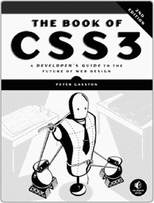

**CSS3 之书，第 2 版**

**Web 设计未来的开发者指南**

*作者* 彼得·加斯顿

2014 年 11 月，304 页，34.95 美元

ISBN 978-1-59327-580-8

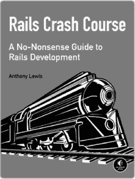

**RAILS 速成课程**

**Rails 开发实用指南**

*作者* 安东尼·刘易斯

2014 年 10 月，296 页，34.95 美元

ISBN 978-1-59327-572-3

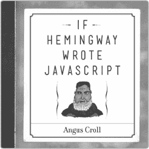

**如果海明威写 JavaScript**

*作者* 安格斯·克罗尔

2014 年 10 月，192 页，19.95 美元

ISBN 978-1-59327-585-3

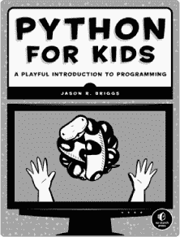

**Python 儿童编程**

**有趣的编程入门**

*作者* 杰森·R·布里格斯

2012 年 12 月，344 页，34.95 美元

ISBN 978-1-59327-407-8

*全彩*


**JavaScript 儿童编程**

**有趣的编程入门**

*作者* 尼克·摩根

2014 年 12 月，348 页，34.95 美元

ISBN 978-1-59327-408-5

*全彩*


**面向对象 JavaScript 原则**

*作者* 尼古拉斯·C·扎卡斯

2014 年 2 月，120 页，24.95 美元

ISBN 978-1-59327-540-2

**电话：**

800.420.7240 或 415.863.9900

**电子邮件：**

SALES@NOSTARCH.COM

**网址：**

[WWW.NOSTARCH.COM](http://WWW.NOSTARCH.COM)

# 索引

## 关于数字索引的说明

索引条目中的链接显示为该条目出现的章节标题。由于某些章节有多个索引标记，一个条目有多个指向同一章节的链接并不罕见。单击任何链接都会直接带你到文本中标记出现的位置。

## 符号

`%` 运算符，算术，跳出循环，图像，FizzBuzz，按标签名获取元素，暂停游戏

`&&` 运算符，比较，逻辑运算符的短路求值，母子年龄差

`*` 运算符，数字，逻辑运算符，重复模式的一部分

`*=` 运算符，跳出循环

`+` 运算符，数字，字符串，逻辑运算符，重复模式的一部分，动态类型

`++` 运算符，跳出循环

`+=` 运算符，跳出循环

`-` 运算符，算术，字符串，逻辑运算符，跳出循环

`-=` 运算符，跳出循环

`/` 运算符，算术

`/=` 运算符，跳出循环

200（HTTP 状态码），协议，文件系统模块

204（HTTP 状态码），简单文件服务器

`2d`（画布上下文），Canvas 元素

400（HTTP 状态码），内容协商，再谈

404（HTTP 状态码），协议，简单文件服务器，作为资源的演讲，作为资源的演讲


`405`（HTTP 状态码），简单文件服务器

`406`（HTTP 状态码），饼图

`500`（HTTP 状态码），简单文件服务器，错误处理

`<` 运算符，一元运算符

`<=` 运算符，一元运算符

`=` 运算符，变量，对象，lastIndex 属性，解析 INI 文件，特殊形式

`==` 运算符，一元运算符，自动类型转换，可变性，列表

`===` 运算符，自动类型转换，列表，反转数组

`>` 运算符，一元运算符

`>=` 运算符，一元运算符

`?:` 运算符，比较，逻辑运算符的短路求值

`[]`（数组），狼人松鼠

`[]`（下标），数据集

`{}`（代码块），while 和 do 循环，嵌套作用域，高阶函数

`{}`（对象），方法，表格布局

`||` 运算符，比较，自动类型转换，递归，母子年龄差，生物编程接口，客户端数据存储，FizzBuzz

## A

`a`（HTML 标签），HTML，属性，样式，焦点

Abelson, Hal，项目：一门编程语言

绝对路径，内容协商，再谈

绝对定位，查询选择器，按标签名获取元素，键盘事件，滚动事件，总结

抽象语法树，解析（参见语法树）

抽象，高阶函数，抽象数组遍历，高阶函数，可组合性，项目：一门编程语言，网络与互联网，标准

加速度，角色与动作

`Accept` 头，总结，错误处理，饼图

访问控制，生命动画，上锁的盒子，使用函数作为命名空间，HTTP 接口

`Access-Control-Allow-Origin` 头，获取 XML 数据

`actionTypes` 对象，更多生命形式

`activeElement` 属性，字段

角色，读取关卡，绘制，运动与碰撞，回到游戏

`actorAt` 方法，运动与碰撞

`addEntry` 函数，可变性

`addEventListener` 方法，事件处理程序，角色与动作，流

加法，数字，向量类型

地址，HTTP

地址栏，Web，HTTP，协议

采纳，正则表达式

年龄差（练习），绑定，深度比较

`alert` 函数，函数，调用栈，HTML

算法，颜色选择器

算法优化，回归老式循环，优化

对齐，getter 与 setter

`all` 函数，等待多个 Promise，等待多个 Promise

alpha，颜色选择器

字母数字字符，匹配字符集

`alt` 属性，修改文档

`ALT` 键，键盘事件

`altKey` 属性，键盘事件

歧义，数组

AMD，慢加载模块，慢加载模块

美式英语，重复模式部分

& 符号，HTML，协议

分析，错误与错误处理，调试

祖先元素，绘制

家谱示例，JSON，代价

`ANCESTRY_FILE` 数据集，JSON

角度，定位与动画，曲线，收尾，暂停游戏

尖括号，HTML

`animate` 方法，运动与碰撞

动画，它动起来了，填充新世界，定位与动画，定位与动画，定位与动画，按标签名获取元素，鼠标移动，总结，绘制，运动与碰撞，运动与碰撞，运行游戏，运行游戏，图像，存储与清除变换，回到游戏，选择图形接口

避免卡顿，定位与动画

椭圆中的猫，定位与动画

碰撞检测，运动与碰撞

动画帧，图像，存储与清除变换

游戏动画，绘制，运动与碰撞，运行游戏

按标签名获取元素，按标签名获取元素

鼠标轨迹，总结

屏幕外动画，鼠标移动

调度动画，定位与动画

简单动画，它动起来了，填充新世界

精灵动画，回到游戏

停止动画，运行游戏

SVG 与 canvas，选择图形接口

匿名函数，使用函数作为命名空间

`appendChild` 方法，查找元素，绘制，闭包

Apple，沙盒中

函数应用，定义函数（参见函数调用）

`apply` 方法，高阶函数，方法

近似，项目：电子生命

弧线，曲线


arc 方法，曲线，饼图

arcTo 方法，曲线，曲线

面积，收尾工作

参数，函数，调用栈，递归，回溯，解析

arguments 对象，字符串及其属性，高阶函数，递归

argv 属性，node 命令

算术，数字，逻辑运算符，环境

Armstrong, Joe，对象的秘密生活

数组，狼人，数据集，属性，对象，狼人日志，计算相关性，最终分析，最终分析，更多数组操作，范围求和，范围求和，抽象数组遍历，抽象数组遍历，JSON，JSON，使用 map 转换，可组合性，绑定，母子年龄差，母子年龄差，定义，表示空间，表示空间，生物编程接口，数组，颜色选择器，长轮询支持，递归，递归，按标签名查找元素

作为网格，定义，颜色选择器

作为表格，狼人日志

创建，狼人，可组合性，表示空间，递归

定义，对象

Egg 支持，数组

every 方法，母子年龄差

过滤，JSON

扁平化，绑定

forEach 方法，抽象数组遍历

高阶函数与，JSON

索引，数据集，递归，按标签名查找元素

length 属性，属性，表示空间

map 方法，使用 map 转换

方法，最终分析

对象与，范围求和

随机元素，生物编程接口

reverse 方法，范围求和

搜索，计算相关性，最终分析

slice 方法，更多数组操作

some 方法，母子年龄差

splice 方法，长轮询支持

遍历，抽象数组遍历

Array 构造函数，表示空间

Array 原型，原型，构造函数

类数组对象，高阶函数，可预测性，焦点，文件字段，使用 NPM 安装

箭头函数，this 及其作用域

人工智能，项目：电子生命，更多生命形式，让世界活起来，编译，向量类型

人工生命，项目：电子生命，游戏，自动补全

人工愚蠢（练习），让世界活起来，向量类型

ASCII 艺术，使用 NPM 安装

assert 函数，选择性捕获

断言，选择性捕获，断言

赋值，变量，跳出循环，lastIndex 属性，解析 INI 文件，数组，闭包

假设，选择性捕获，断言

星号，数字，重复模式部分

异步 I/O，慢加载模块，发送请求，背景

异步编程，慢加载模块，慢加载模块，运行游戏，发送请求，抽象请求，抽象请求，Promise，文件字段，背景，背景，异步性，异步性，使用 NPM 安装，流

回调，发送请求，抽象请求

代码执行路径与，慢加载模块

定义，运行游戏

依赖与，慢加载模块

错误处理，抽象请求

函数与，使用 NPM 安装

Node 与，背景

概述，背景，异步性

并行与，异步性

Promise 接口，Promise

读取文件，文件字段

可写流，流

攻击，获取 XML 数据

属性，HTML，创建节点，项目：绘图程序，等待多个 Promise，自动补全

Aurelius, Marcus，处理事件

授权，HTTP 接口

自动补全（练习），自动补全，等待多个 Promise

autofocus 属性，字段

自动分号插入，表达式与语句

头像，游戏

average 函数，使用 reduce 汇总，绑定，母子年龄差，深度比较

轴，角色与动作，Canvas 元素，变换

## B

Babbage, Charles，数据结构：对象与数组

背景，游戏，绘制，运动与碰撞，回到游戏


`background` (CSS)，摘要，游戏，绘图

`backgroundReadFile` 函数，慢加载模块，HTTP 沙箱

反斜杠字符，算术，创建正则表达式，贪婪，贪婪，修复泄漏

边界标记，贪婪

正则表达式中的转义，创建正则表达式，贪婪

字符串中的转义，算术

使用路径，修复泄漏

回溯，回溯，replace 方法

向后兼容，复用

球，饼图，饼图

班克斯，伊恩，项目：平台游戏

豆子计数（练习），最小值，递归

`beforeunload` 事件，焦点事件

行为，生物编程接口，它移动了，摘要，编译，向量类型

基准测试，布局，JavaScript 与性能，第一个力导向布局函数

伯纳斯-李，蒂姆，HTTP

最佳实践，关于编程

`bezierCurve` 方法，曲线

二进制数据，关于编程，使用 NPM 安装

二进制数，值、类型和运算符，值，狼人日志，测试，回溯，选择字段

二元运算符，数字，字符串，程序结构

`bind` 方法，曾曾曾曾...，方法，this 及其作用域

比特，为什么语言重要，值，一元运算符，狼人日志

位图图形，绘制饼图，饼图

`Blob` 类型，文件字段

块，while 和 do 循环，while 和 do 循环，定义函数，异常，异常，解析

块注释，大小写，replace 方法

块级元素，属性，样式

阻塞，慢加载模块，定位与动画，焦点事件，设置定时器，发送请求，后台，文件系统模块

`blur` 事件，滚动事件

`blur` 方法，字段

`body`（HTML 标签），HTML，文档结构

body（HTTP），协议，HTTP 模块，简单文件服务器，简单文件服务器，作为资源的对话

`body` 属性，文档结构，树，遍历树

粗体，样式

书籍类比，模块，回归电子生命

编程之书，值、类型和运算符，Node.js

`Boolean`，一元运算符，自动类型转换，提示与确认，提示与确认，while 和 do 循环，while 和 do 循环，对象，特殊形式

条件执行，提示与确认

转换为，自动类型转换，提示与确认，while 和 do 循环

定义，一元运算符

Egg 支持，特殊形式

不可变类型，对象

与 while 循环一起使用，while 和 do 循环

`Boolean` 函数，提示与确认

`border`（CSS），布局，样式

`border-radius`（CSS），键盘事件

弹跳，生物编程接口，技术，读取关卡，运动与碰撞，角色与动作，饼图

`BouncingCritter` 类型，生物编程接口

边界，单词与字符串边界，匹配机制，贪婪，解析 INI 文件，摘要，回到游戏，引用风格

盒子，锁定的盒子，文档对象模型，游戏，饼图，饼图

盒子阴影（CSS），绘图

`br`（HTML 标签），自动补全

花括号，while 和 do 循环（参见花括号）

分支，单词与字符串边界，回溯

分支递归，递归，存储与清除变换

`break` 关键字，缩进代码，使用 switch 按值分发

断点，调试

英式英语，重复模式的一部分

浏览器，引言，什么是 JavaScript？，函数，返回值，Math 对象，脱离全局作用域，HTML，HTML 与 JavaScript，在沙箱中，在沙箱中，事件处理程序，饼图，浏览器与 HTTP，获取 XML 数据，客户端数据存储，工具选择，修复泄漏，长轮询，评论字段重置，JavaScript 与性能

浏览器中的位图，饼图

颜色字段支持，工具选择

浏览器兼容性，在沙箱中

`console` 输出，函数

浏览器中的对话框，返回值

`doctype` 与，HTML

浏览器中的事件，事件处理程序

全局作用域，Math 对象


优雅降级，评论字段重置

JavaScript 历史，什么是 JavaScript？

JavaScript 支持，引言

长轮询，长轮询

旧的，沙盒中

私有命名空间模式，脱离全局作用域

响应性，JavaScript 与性能

安全性，HTML 与 JavaScript，获取 XML 数据，修复泄漏

`sessionStorage`，客户端存储数据

`XMLHttpRequest` 与，浏览器与 HTTP

浏览器战争，沙盒中

`Browserify`，慢加载模块

画笔，项目：绘图程序，工具选择，加载图像文件

冒泡，事件与 DOM 节点（参见事件传播）

桶填充，颜色选择器，颜色选择器

预算，评论字段重置

`Buffer` 类型，使用 NPM 安装，流

错误，高阶函数，错误与错误处理，贪婪，search 方法，复用，沙盒中

浏览器历史，沙盒中

解耦与，复用

定义，高阶函数，错误与错误处理

`lastIndex` 属性与，search 方法

正则表达式与，贪婪

商业软件，浏览器与 HTTP

`button`，处理事件，协议，焦点，自动补全，加载图像文件

`button`（HTML 标签），HTML 与 JavaScript，事件处理程序，键盘事件，鼠标轨迹，表单整体，文件字段，客户端存储数据

`byName` 对象，代价，绑定

## C

C（编程语言），JavaScript 与性能

缓存，require 函数，慢加载模块，回归电子生命

`call` 方法，方法，覆盖派生属性，getter 与 setter，this 及其作用域，更逼真的模拟，环境

调用协议，性能分析

调用栈，声明符号，递归，异常，异常后的清理，选择性捕获，性能分析

回调函数，处理事件，HTTP 沙盒，抽象请求，抽象请求，HTTP 模块，流

定义，HTTP 沙盒

错误参数，抽象请求

事件处理程序，处理事件

Promise 与，抽象请求

可读流，HTTP 模块

可写流，流

调用（函数），定义函数（参见函数应用）

驼峰命名，大小写，样式

`cancelAnimationFrame` 函数，设置定时器

`canvas`，在画布上绘图，Canvas 元素，Canvas 元素，填充与描边，填充与描边，填充与描边，路径，曲线，曲线，曲线，绘制饼图，图像，图像，图像，选择图形接口，选择图形接口，颜色与画笔大小，保存，加载图像文件，矩形，定义图形

`arcTo` 方法，曲线

`bezierCurve` 方法，曲线

圆形，曲线

`clearRect` 方法，图像

颜色选择器练习，矩形

上下文，Canvas 元素，加载图像文件

跨域请求，保存

定义，在画布上绘图

`drawGraph` 函数，定义图形

在其中绘制文本，绘制饼图

填充与描边，填充与描边

浏览器中的图形选项，选择图形接口

将像素数据加载到其中，图像

路径，填充与描边

性能与，选择图形接口

大小，Canvas 元素，填充与描边

`strokeTo` 方法，路径

`toDataURL` 方法，颜色与画笔大小

其中的变换，图像

`canvas`（HTML 标签），Canvas 元素，项目：绘图程序

`canvas` 属性，构建 DOM

`CanvasDisplay` 类型，存储与清除变换，回到游戏，回到游戏

大小写，使用 switch 根据值分发，样式，发送请求，按标签名查找元素

在头部名称中，发送请求

在属性名称中，样式

在变量名称中，使用 switch 根据值分发

使用屏蔽键盘，按标签名查找元素

捕获组，匹配与分组，日期类型，回溯，路由

职业，项目：平台游戏

脱字符，匹配字符集，单词与字符串边界，解析 INI 文件

食肉动物，人工愚蠢

回车符，解析 INI 文件

层叠，层叠样式

层叠样式表，样式（参见 CSS）

大小写转换，属性

`case` 关键字，使用 switch 根据值分发

大小写敏感性，重复模式部分，发送请求，引用样式

休闲计算，引言


- `catch` 关键字，异常，异常后的清理，断言，人工愚蠢
- `catch` 方法，Promise
- 猫的帽子（练习），按标签名查找元素
- CD，值、类型和运算符
- 芹菜，项目：技能分享网站
- 单元格，自动补全
- 被审查的键盘（练习），总结，按标签名查找元素
- 居中，绘图
- 居中，定位与动画
- 世纪，母子年龄差，深度比较
- 证书，理解 HTTP
- 链式调用，Promise，错误处理
- change 事件，字段，文本字段，客户端数据存储，加载图像文件，网络上的公共空间
- 章节，模块
- 字符，算术，键盘事件，文本字段
- 字符类别，国际字符
- 字符编码，使用 NPM 安装
- `charAt` 方法，最小值，字符串及其属性
- `charCode` 属性，键盘事件，按标签名查找元素
- `charCodeAt` 方法，键盘事件，动态类型
- 聊天，网络与互联网
- 复选框，字段，复选框与单选按钮，自动补全，自动补全
- `checked` 属性，字段，复选框与单选按钮
- 棋盘（练习），FizzBuzz，FizzBuzz
- 子节点，树，标准，查找元素，鼠标移动
- `childNodes` 属性，标准，修改文档，标签页
- 选择，单词与字符串边界
- Chrome，沙盒中
- 圆形，定位与动画，曲线，收尾工作
- circle（SVG 标签），在 Canvas 上绘图
- 循环依赖，重返电子生命，重返电子生命
- 马戏团，最终分析
- `class` 属性，查找元素，属性，层叠样式，绘图，绘图，构建 DOM，启动
- `className` 属性，属性
- 清理，异常，绘图
- 清除，属性，在 Canvas 上绘图，图像，变换，回到游戏，饼图
- `clearInterval` 函数，设置定时器
- `clearRect` 方法，图像，饼图
- `clearTimeout` 函数，设置定时器
- 聪明，可预测性
- click 事件，事件处理程序，传播，键盘事件，等待多个 Promise，网络上的公共空间
- 客户端，网络与互联网，Promise，HTTP 模块，项目：技能分享网站，长轮询支持
- `clientHeight` 属性，布局
- `clientWidth` 属性，布局
- `clientX` 属性，鼠标点击，工具选择
- `clientY` 属性，鼠标点击，工具选择
- 剪贴板，HTML 与 JavaScript，总结
- 裁剪，回到游戏
- `cloneNode` 方法，显示讨论
- 克隆，显示讨论
- `closePath` 方法，路径
- 闭合标签，HTML，HTML 与 JavaScript
- 闭包，可选参数，高阶函数，数组，文件字段，函数内联，闭包
- 代码，什么是 JavaScript？，程序结构，参数与作用域，replace 方法，游戏
- 代码高尔夫，总结
- 代码结构，while 和 do 循环，函数，继承，模块
- 硬币，游戏，技术，运动与碰撞，回到游戏
- `Coin` 类型，角色，角色与动作
- 协作，JavaScript 与浏览器
- 集合，为什么语言很重要，狼人松鼠，属性，对象，范围求和，向量类型，向量类型
- 碰撞检测，绘图，饼图
- 冒号字符，比较，使用 switch 根据值分发，方法，样式
- 颜色，在 Canvas 上绘图，填充与描边，回到游戏，项目：绘图程序，工具选择，矩形
- 颜色（CSS），样式，样式
- 颜色选择器，工具选择
- 颜色选择器（练习），矩形，颜色选择器
- `colWidths` 函数，多态
- 逗号字符，解析
- 命令键，键盘事件
- 命令行，Node.js，异步性
- 注释，大小写，replace 方法，数组，树，项目：技能分享网站，HTTP 接口，显示讨论，闭包
- 评论字段重置（练习），注意变化，网络上的公共空间
- `COMMENT_NODE` 代码，树


CommonJS，脱离全局作用域，回归电子生活，`node` 命令，模块
通信，网络与互联网，Promise
社区，背景
比较，一元运算符，一元运算符，一元运算符，比较，自动类型转换，返回值，使用 `switch` 进行值分发，可变性，颜色选择器，网络上的公共空间
创建布尔值，一元运算符
用于 `switch` 语句，使用 `switch` 进行值分发
颜色的比较，颜色选择器
DOM 节点的比较，网络上的公共空间
`NaN` 的比较，比较
数字的比较，一元运算符，返回值
对象的比较，可变性
字符串的比较，一元运算符
`undefined` 值的比较，自动类型转换
指南针方向，生物体的编程接口，它移动了
兼容性，什么是 JavaScript？，JavaScript 与浏览器，在沙盒中，`XMLHttpRequest`，工具选择
编译，函数，JavaScript 与性能，写入对象，闭包
完成，`XMLHttpRequest`，自动补全
复杂性，关于编程，高阶函数，可组合性，对象的秘密生活，可预测性，避免工作
可组合性，为什么语言重要，使用 `reduce` 进行汇总，可组合性，可预测性
合成，工具选择
组合，继承
计算属性，数据集
计算机，引言，关于编程
`concat` 方法，更多数组操作，绑定，布局表格，按标签名获取元素，更好的模板
连接，字符串，更多数组操作，布局表格，按标签名获取元素，颜色选择器，内容协商，再次
并发，焦点事件
条件执行，比较，提示与确认，使用 `switch` 进行值分发，FizzBuzz，求值器，评论字段重置
条件运算符，比较，逻辑运算符的短路求值
配置，解析 INI 文件
`confirm` 函数，返回值
孔子，引言
连接，网络与互联网，HTTP，发送请求，HTTP 沙盒，理解 HTTP，长轮询
一致性，大小写，JavaScript 与浏览器，标准
`console.log`，字符串，函数，声明符号，`arguments` 对象，调试
常量，`Math` 对象，角色与动作
构造函数，原型，原型，getter 与 setter，继承，严格模式，异常
`Error`，异常
使用构造函数进行继承，getter 与 setter
`instanceof` 运算符与构造函数，继承
概述，原型
构造函数的 `prototype` 属性，原型
不使用 `new` 关键字使用构造函数，严格模式
内容协商（练习），总结，错误处理，饼图，内容协商，再次
`Content-Length` 头部，协议
`Content-Type` 头部，协议，文件系统模块，简单的文件服务器，修复泄漏
上下文，Canvas 元素，构建 DOM，加载图像文件
上下文菜单，默认行为
上下文参数，`this` 及其作用域，`this` 及其作用域
`continue` 关键字，跳出循环
控制流，提示与确认，`while` 和 `do` 循环，声明符号，高阶函数，异常，Promise
控制键，键盘事件
控制点，路径，曲线
`controls` 对象，构建 DOM，工具选择
约定，大小写，可预测性
康威生命游戏，自动补全
坐标，定义，键盘事件，绘图，Canvas 元素，填充与描边，工具选择，自动补全
复制粘贴编程，函数增长，为什么模块有帮助
复制，显示演讲
相关性，狼人日志，最终分析
余弦，`Math` 对象，定位与动画
`counter` 变量，`while` 和 `do` 循环，缩进代码，定位与动画，FizzBuzz，递归，按标签名获取元素，等待多个 Promise
崩溃，异常清理，断言，简单的文件服务器，演讲作为资源，注意变化
`createElement` 方法，修改文档，项目：绘图程序，闭包
`createPaint` 函数，构建 DOM


`createReadStream` 函数，流，一个简单的文件服务器

`createServer` 函数，文件系统模块，流，服务器，路由

`createTextNode` 方法，修改文档，等待多个 Promise

`createWriteStream` 函数，流，一个简单的文件服务器

crisp，选择图形界面

`critters`，项目：电子生命，this 及其作用域，它移动，更逼真的模拟，人工愚蠢

    动作处理器与，更逼真的模拟

    动画，this 及其作用域

    行为，它移动

    捕食者，人工愚蠢

Crockford, Douglas，JavaScript 与浏览器

跨域请求，获取 XML 数据，保存，颜色选择器

密码学，理解 HTTP

CSS，样式，鼠标运动，绘图，绘图，在 Canvas 上绘图，构建 DOM

`ctrlKey` 属性，键盘事件

`curl` 程序，一个简单的文件服务器

花括号，while 和 do 循环，定义函数，方法，抽象数组遍历，重复模式的部分，FizzBuzz

    花括号表示法，方法

    用于函数体，定义函数

    用于多个循环，FizzBuzz

    与括号一起，抽象数组遍历

    与模式一起，重复模式的部分

光标，表单整体

曲线，路径

循环，树

## D

Dark Blue（游戏），游戏

破折号字符，算术，匹配一组字符，样式

数据，引言，数据结构：对象与数组

数据属性，创建节点，属性，鼠标轨迹

`data` 事件，流

数据格式，JSON，标准，获取 XML 数据

数据丢失，注意变化

数据集，狼人的日志，JSON，布局表格

数据结构，数据结构：对象与数组，狼松鼠，范围求和，代价，可预测性，解析，文档结构

    在祖先示例中，代价

    在狼松鼠示例中，狼松鼠

    列表，范围求和

    树，文档结构

    使用简单，可预测性

    构建编程语言时，解析

数据 URL，颜色与画笔大小

数据库，XMLHttpRequest

`dataTable` 函数，布局表格，获取器与设置器

日期，匹配一组字符，重复模式的部分，匹配与分组

`Date` 构造函数，匹配与分组

日期字段，工具选择

`Date` 类型，复用，分层接口

`Date.now` 函数，日期类型，HTTP 接口，寻路

`dblclick` 事件，键盘事件

防抖，设置定时器

`debugger` 语句，调试

调试，什么是 JavaScript？，Bug 与错误处理，程序员错误，严格模式，调试，异常，选择性捕获，断言

    定义，程序员错误

    Error 构造函数，异常

    JavaScript 弱点，什么是 JavaScript？

    概述，Bug 与错误处理

    use strict 与，严格模式

    使用断言，断言

    使用 catch 关键字，选择性捕获

    使用 console.log，调试

去中心化，JavaScript 与浏览器

十进制数，值、类型与运算符，测试，回溯

声明，样式

`decodeURIComponent` 函数，协议，一个简单的文件服务器，路由，内容协商，再谈

解耦，复用

深度比较，可变性，列表

深度比较（练习），列表，反转数组

默认行为，样式，默认动作，按标签名获取元素

`default` 关键字，使用 switch 根据值分发

默认值，逻辑运算符的短路求值，曾曾曾曾...，填充与描边，客户端数据存储，递归

防御性编程，动画生命，动画生命

`define` 函数，慢加载模块

`defineProperty` 函数，原型干扰，布局表格，深度比较

度数，曲线，变换

`DELETE` 方法，协议，流，一个简单的文件服务器，将演讲视为资源，显示演讲

`delete` 运算符，对象

`denodeify` 函数，一个简单的文件服务器

去优化，函数内联，写入对象

依赖，狼人的日志

依赖项，为什么模块有帮助，从全局作用域分离，慢加载模块，回到电子生命，使用 NPM 安装

反序列化，JSON


开发者工具, 什么是 JavaScript？, 函数, 调试, 异常后的清理

对话框, 函数, 返回值

菱形, 总结, 暂停游戏

数字, 值、类型和运算符, 值, 测试, 匹配一组字符, 引用风格

Dijkstra, Edsger, 项目：电子生命

维度, 向量类型, 项目：电子生命, 布局, 项目：平台游戏, 技术, 运动与碰撞, Canvas 元素, FizzBuzz

恐龙, 编译

直接子节点, 层叠样式

方向对象, 生物编程接口, 它移动了

目录, 使用 NPM 安装, 流, 修复泄漏, 网络上的公共空间

`disabled` 属性, 焦点

离散化, 项目：电子生命, 游戏, 运动与碰撞, 角色与动作, 运行游戏

分发, 使用 switch 进行值分发, 服务器

`display`, 绘制, 存储与清除变换, 选择图形接口

`display` (CSS), 样式, 鼠标轨迹, HTML

距离, 第一个力导向布局函数

除法, 算术

除以零, 算术

DNA, 代价, 曾曾曾曾……

do 循环, while 和 do 循环

doctype, HTML

文档, 网络, 文档对象模型, 焦点事件, 在 Canvas 上绘制

文档格式, 理解 HTTP, 总结

文档对象模型, 事件处理程序 (参见 DOM)

文档, 可预测性, Node.js

`documentElement` 属性, 文档结构, 树, 发送请求

美元符号, 变量, 单词与字符串边界, 回溯, 解析 INI 文件

DOM, 文档结构, 树, 标准, 查找元素, 查找元素, 创建节点, 创建节点, 查询选择器, 事件处理程序, 键盘事件, 技术, 在 Canvas 上绘制, 在 Canvas 上绘制, 表单与表单字段, 表单整体, 项目：绘图程序, HTML, HTML, 显示讨论

`addEventListener`, 事件处理程序

canvas 元素, 在 Canvas 上绘制

`cloneNode`, 显示讨论

构造, 标准, 查找元素, 创建节点, 项目：绘图程序, HTML

在 JavaScript 中创建结构, HTML

CSS 与, 在 Canvas 上绘制

`documentElement`, 树

事件与, 键盘事件

表单中的, 表单与表单字段

图形中的, 技术

对象属性, 创建节点

概述, 文档结构, 查找元素

选择器与, 查询选择器

`value` 属性, 表单整体

域名, 网络, 协议, 获取 XML 数据, 文件字段, 保存

领域特定语言, 高阶函数, 测试, 正则表达式, 编译, 查询选择器, Promise, HTML

`DOMDisplay` 类型, 绘制, 存储与清除变换

点字符, 函数 (参见句点字符)

双击, 键盘事件

双引号字符, 算术, 引用风格, 解析, HTML

下载, 什么是 JavaScript？, 复用, 总结, 简单文件服务器, 项目：技能分享网站, 注意变化

可拖动条示例, 鼠标点击

拖动, 鼠标点击

`drawGraph` 函数, 定义图

`drawImage` 方法, 图像, 变换, 存储与清除变换, 回到游戏, 饼图

绘制, 角色, 在 Canvas 上绘制, 项目：绘图程序, 自动补全

与 canvas 元素, 在 Canvas 上绘制

构建程序, 项目：绘图程序

复选框, 自动补全

子系统，在平台游戏中, 角色

绘图程序示例, 键盘事件, 项目：绘图程序

`drawTable` 函数, 布局表格

`drawTalk` 函数, 启动, 显示讨论, 评论字段重置

下拉菜单, 字段, 选择字段

重复, 为什么模块有帮助, 回到电子生命

动态作用域, 异常

动态类型, 错误与错误处理, 写入对象

## E

ECMAScript, 什么是 JavaScript？, 嵌套作用域, this 及其作用域, 抽象请求, 优化

生态系统, 项目：电子生命, 让世界活起来, 人工愚蠢

`ecstatic` 模块, 路由


编辑器，技术

效率，递归，require 函数，函数，技术，向量类型

Egg 语言，项目：编程语言，项目：编程语言，解析，解析，解析，环境，环境，编译，数组，数组

数组支持，数组

注释，数组

环境，环境

求值器，解析

函数，环境

概述，项目：编程语言，编译

解析，解析

统一性，解析

优雅，递归，可组合性，解析

元素，HTML，树，创建节点

elementFromChar 函数，世界对象

elements 属性，焦点

ELEMENT_NODE 代码，树，按标签名查找元素

椭圆，定位与动画，定位与动画

else 关键字，条件执行

elt 函数，创建节点，项目：绘图程序，HTML

电子邮件，理解 HTTP

电子邮件字段，工具选择

空集，replace 方法

封装，对象的秘密生活，历史，继承，模块为何有用，复用，可预测性，重返电子生命

定义，对象的秘密生活，历史

重要性，模块为何有用

继承与，继承

使用模块，复用，可预测性，重返电子生命

encodeURIComponent 函数，协议，HTTP 接口

编码，网络与互联网

加密，理解 HTTP

end 事件，流

end 方法，HTTP 模块，流，简单文件服务器，内容协商（再谈）

敌人示例，lastIndex 属性

能量，更多生命形态，向量类型

引擎，JavaScript 与性能

工程，沙盒中

ENOENT（状态码），简单文件服务器，错误处理

ENTER 键，表单整体，加载图像文件

实体，HTML

熵，更多生命形态

可枚举性，原型干扰

环境，变量，求值器，环境，脚本执行时间线，闭包

相等性，一元运算符

擦除工具，工具选择，工具选择

错误，Bug 与错误处理，调试，异常后的清理，选择性捕获

error 事件，抽象请求，文件字段，简单文件服务器

错误处理，调试，异常，异常，异常后的清理，抽象请求，Promise，Promise，简单文件服务器，简单文件服务器，简单文件服务器，简单文件服务器，启动，检测变化

异步编程与，抽象请求

catch 关键字，异常

catch 方法，Promise

ENOENT，简单文件服务器

文件服务器错误处理，简单文件服务器

HTTP 状态码，简单文件服务器

长轮询与，检测变化

概述，调试，异常

then 方法，Promise

未处理异常，异常后的清理

用户体验与，启动

使用 Promise，简单文件服务器

错误消息，解析，Promise，客户端数据存储

错误恢复，调试

错误响应，协议，HTTP 沙盒，简单文件服务器

容错性，生命动画，HTML

Error 类型，异常，异常后的清理，选择性捕获，简单文件服务器

ESC 键，运行游戏

转义，算术，创建正则表达式，贪婪，解析，HTML，HTML 与 JavaScript，协议，简单文件服务器，HTTP 接口，路由

HTML 中的转义，HTML，HTML 与 JavaScript

正则表达式中的转义，创建正则表达式，贪婪

字符串中的转义，算术，解析

URL 中的转义，协议，简单文件服务器，HTTP 接口，路由

埃舍尔，M.C.，在画布上绘图

eval，脱离全局作用域

evaluate 函数，解析，环境

求值，脱离全局作用域，解析，函数

偶数，while 和 do 循环，最小值


事件处理，处理事件，事件处理程序，事件与 DOM 节点，事件与 DOM 节点，默认行为，默认行为，鼠标移动，滚动事件，焦点事件，游戏，运行游戏，运行游戏，绘制饼图，发送请求，发送请求，表单整体，文本字段，复选框与单选按钮，流

异步编程与，运行游戏，发送请求

回调函数，处理事件

默认行为，默认行为

DOM 与，事件处理程序

事件对象，事件与 DOM 节点

事件传播，事件与 DOM 节点

焦点事件，滚动事件

在游戏中，游戏，运行游戏

键盘事件，默认行为，文本字段

加载事件，绘制饼图，发送请求

从流中读取，流

滚动事件，鼠标移动

启动脚本，焦点事件

提交表单，表单整体

目标属性，复选框与单选按钮

事件对象，事件与 DOM 节点，键盘事件，工具选择，矩形

事件传播，事件与 DOM 节点，鼠标移动，滚动事件，焦点事件

事件类型，事件与 DOM 节点

every 和 some（练习），母子年龄差，深度比较

every 方法，母子年龄差

进化，正则表达式，模块为何有用

异常，抽象请求，简单文件服务器

异常处理，异常，异常，异常后的清理，选择性捕获，抽象请求，抽象请求，保存，简单文件服务器，简单文件服务器

异步编程与，抽象请求

链式操作与，抽象请求

错误处理与，异常

概述，选择性捕获

目的，简单文件服务器

toDataURL 方法与，保存

try 关键字，异常

未捕获异常，异常后的清理

与崩溃对比，简单文件服务器

exec 方法，重复模式部分，search 方法

执行顺序，提示与确认，嵌套作用域，声明符号

练习，引言，什么是 JavaScript？，总结，测试

exit 方法，node 命令

期望，默认行为

实验，关于编程，什么是 JavaScript？，总结，键盘事件

利用，沙盒中

指数，数字，引用风格，引用风格

幂运算，while 和 do 循环，缩进代码

导出，使用函数作为命名空间，require 函数，回到电子生命

exports 对象，使用函数作为命名空间，将数据作为代码求值，模块，回到电子生命

表达式，程序结构，返回值，while 和 do 循环，缩进代码，求值器

表现力，引言，编译

灭绝，让世界活起来

提取，匹配与分组

## F

阶乘函数，本书概述

失败，HTTP 沙盒

穿透，使用 switch 根据值分发

false，一元运算符

农场示例，递归，函数增长，单词与字符串边界

农场主，JSON

字段，表单与表单字段，焦点，复选框与单选按钮，自动补全，网络上的公共空间

figlet 模块，使用 NPM 安装

文件扩展名，简单文件服务器

文件字段，字段，文件字段

文件格式，lastIndex 属性

文件读取，文件字段

文件服务器示例，流，修复泄漏，内容协商，再次，网络上的公共空间

文件服务器模块，长轮询支持

File 类型，文件字段

FileReader 类型，文件字段，加载图像文件

files 属性，文件字段

文件系统，文件字段，项目：绘图程序，加载图像文件，使用 NPM 安装，流，网络上的公共空间

fill 方法，路径

fillColor 属性，绘制饼图

填充，填充与描边，绘制饼图，总结

fillRect 方法，填充与描边，图像，矩形，洪水填充，自动补全

fillStyle 属性，填充与描边，项目：绘图程序，构建 DOM，颜色与画笔大小

fillText 方法，绘制饼图，暂停游戏


`filter` 方法，JSON，曾曾曾曾...，布局表格，读取层级，深度比较

`finally` 关键字，异常，锁定的盒子，人工愚蠢

`finish` 事件，简单的文件服务器

Firefox，沙盒中，XMLHttpRequest

防火墙，网络公共空间，长轮询

`firstChild` 属性，标准

固定定位，滚动事件

FizzBuzz（练习），FizzBuzz，FizzBuzz

扁平化（练习），绑定

灵活性，什么是 JavaScript？

`flipHorizontally` 函数，回到游戏，暂停游戏

`flipHorizontally` 方法，变换

翻转，图像（参见镜像）

浮点数，数字

洪水填充（练习），颜色选择器，颜色选择器

流程图，匹配机制，回溯

`focus`，键盘事件，滚动事件，字段，文本字段，复选框和单选按钮，注意变化，网络公共空间

`focus` 事件，滚动事件，保存

`focus` 方法，字段

`fold` 函数，用 map 变换

字体，绘制饼图，加载图像文件

`font-family`（CSS），样式

`font-weight`（CSS），层叠样式

食物链，动作处理器，人工愚蠢

食物，用于生物，更多生命形式，动作处理器，填充新世界，人工愚蠢

`for` 属性，复选框和单选按钮

`for` 循环，缩进代码，世界对象，选择性捕获，函数内联，递归，反转数组

`for/in` 循环，对象作为映射，覆盖派生属性，反转数组，深度比较

力导向图布局，图布局，定义图

`forEach` 方法，抽象数组遍历，this 及其作用域，文件字段，标签页，更好的模板

表单，协议，表单和表单字段，焦点，网络公共空间

表单（HTML 标签），表单和表单字段，焦点，加载图像文件，长轮询支持，更新服务器，网络公共空间，更好的模板

`form` 属性，焦点

转发，HTTP 接口

分形示例，存储和清除变换

分数，数字，引用风格，游戏

碎片化，垃圾回收

帧，图像，存储和清除变换，回到游戏，饼图

框架，增长函数，动作处理器

`fromCharCode` 函数，键盘事件，动态类型

`fs` 模块，使用 NPM 安装，修复泄漏

`fsp` 对象，错误处理

`function`，函数，函数，定义函数，定义函数，参数和作用域，嵌套作用域，嵌套作用域，嵌套作用域，嵌套作用域，可选参数，闭包，递归，递归，增长函数，属性，抽象数组遍历，抽象数组遍历，高阶函数，JSON，用 map 变换，用 reduce 汇总，this 及其作用域，this 及其作用域，模块，复用，数组，HTTP 沙盒，标签页

作为命名空间，复用

作为属性，属性

作为值，嵌套作用域，可选参数，抽象数组遍历，HTTP 沙盒，标签页

函数体，定义函数

声明，嵌套作用域

定义，函数，定义函数，嵌套作用域，递归

高阶，抽象数组遍历，JSON，用 map 变换，用 reduce 汇总，this 及其作用域

模型，闭包

命名，递归

概述，函数

程序划分与，模块

纯度，增长函数

作用域，参数和作用域，嵌套作用域，this 及其作用域，数组

包装，高阶函数

`Function` 构造函数，将数据作为代码求值，慢加载模块，环境，函数，在客户端存储数据，等待多个 Promise

`function` 关键字，定义函数，嵌套作用域，使用函数作为命名空间

`Function` 原型，原型，构造函数

JavaScript 的未来，什么是 JavaScript？，变量，国际字符，慢加载模块，抽象请求

## G


`game`，关键事件，项目：平台游戏，角色与动作，存储与清除变换

`角色加速度`，关键事件

`绘图显示`，存储与清除变换

`平台`，项目：平台游戏

`运行`，角色与动作

`生命游戏（练习）`，自动补全，自动补全

`GAME_LEVELS` 数据集，运行游戏

`垃圾回收`，值，性能分析，避免不必要的工作，垃圾回收

`garble 示例`，模块

`园艺`，项目：技能分享网站

`gatherCorrelations` 函数，对象作为映射

`花哨的主页`，总结

`代`，自动补全，自动补全

`分代垃圾回收`，垃圾回收

`get` 函数，抽象化请求

`GET` 方法，协议，协议，XMLHttpRequest，表单整体，流，网络上的公共空间

`getAttribute` 方法，创建节点，属性

`getBoundingClientRect` 方法，布局，鼠标点击，工具选择

`getContext` 方法，Canvas 元素

`getDate` 方法，日期类型

`getDay` 方法，复用

`getElementById` 方法，查找元素

`getElementsByClassName` 方法，查找元素

`getElementsByName` 方法，复选框与单选按钮

`getElementsByTagName` 方法，遍历树，修改文档，属性，总结，按标签名查找元素

`getFullYear` 方法，日期类型

`getHours` 方法，日期类型

`getImageData` 方法，矩形，颜色选择器

`getItem` 方法，文件字段

`getMinutes` 方法，日期类型

`getMonth` 方法，日期类型

`getPrototypeOf` 函数，原型，构造函数，数组，闭包

`getResponseHeader` 方法，XMLHttpRequest

`getSeconds` 方法，日期类型

`getter`，布局表格，向量类型

`getTime` 方法，日期类型

`getURL` 函数，抽象化请求

`getYear` 方法，日期类型

`全局对象`，Math 对象，this 及其作用域，程序员错误，node 命令

`全局作用域`，参数与作用域，模块为何有用，使用函数作为命名空间，require 函数，事件处理程序，node 命令，闭包

`globalCompositeOperation` 属性，工具选择

`歌德，约翰·沃尔夫冈·冯`，表单与表单字段

`谷歌`，沙盒中

`优雅降级`，无脚本环境

`语法`，程序结构，解析 INI 文件

`祖父`，代价

`图`，选择图形接口，JavaScript 与性能，寻路

`图布局`，图布局

`图形用户界面`，引言

`图形`，游戏，角色，绘制，在 Canvas 上绘制，Canvas 元素，绘制饼图，选择图形接口

`与 Canvas`，在 Canvas 上绘制，Canvas 元素

`Canvas 元素`，Canvas 元素

`平台游戏中的图形`，游戏，角色，绘制

`与 DOM`，游戏

`封装`，角色

`接口`，选择图形接口

`矢量图 vs 位图`，绘制饼图

`GraphNode` 类型，定义图

`重力`，角色与动作，角色与动作

`大于`，一元运算符

`贪婪`，replace 方法

`网格`，项目：电子生命，自动补全

`Grid` 类型，表示空间

`groupBy` 函数，母子年龄差

`分组`，while 和 do 循环，母子年龄差，重复模式的一部分，回溯，深度比较，引用风格

## H

`h1（HTML 标签）`，HTML，属性

`硬盘`，值，文件字段，文件字段，背景，注意变化

`硬编码`，遍历树，总结，工具选择

`hasEvent` 函数，狼人的日志

`井号字符`，数组

`hasOwnProperty` 方法，原型干扰，数组，闭包

`head（HTML 标签）`，HTML，文档结构

`head` 属性，文档结构

`头部`，协议，XMLHttpRequest，发送请求，HTTP 沙盒，文件系统模块

`height（CSS）`，矩形

`帮助文本示例`，滚动事件

`辅助函数`，标准

`食草动物`，动作处理程序，人工愚蠢

`十六进制数`，回溯，协议

`隐藏元素`，样式，鼠标轨迹，HTML

`高阶函数`，抽象化数组遍历，JSON，使用 map 进行变换，使用 reduce 进行汇总，this 及其作用域

`highlightCode` 函数，属性

`历史`，什么是 JavaScript？，对象的秘密生活，长轮询支持


Hoare, C.A.R., 高阶函数

胡克定律, 定义图

流氓, HTTP 接口

`Host` 头部, 协议, 发送请求

热代码, JavaScript 与性能

悬停效果, 鼠标移动, 鼠标移动

`href` 属性, HTML, 遍历树, 创建节点, 颜色与画笔大小

HTML, Web, 文档对象模型, 树, 在 Canvas 上绘图, 项目：绘图程序

`html`（HTML 标签）, HTML, 文档结构

HTML5 表单字段, 工具选择

HTTP, Web, HTTP, 获取 XML 数据, Promise, 简单的文件服务器

http 模块, 文件系统模块, 错误处理

HTTPS, Web, 理解 HTTP, HTTP 模块

https 模块, HTTP 模块

人类语言, 引言, 程序结构, 函数

超文本标记语言, Web（参见 HTML）

超文本传输协议, Web（参见 HTTP）

## I

`id` 属性, 查找元素, 层叠样式, 复选框与单选按钮, 长轮询支持

幂等性, 简单的文件服务器, 内容协商再探

标识符, 解析

身份, 对象

`if` 关键字, 提示与确认, 使用 switch 按值分发, 解析 INI 文件, FizzBuzz

图像, HTML, 修改文档, 焦点事件, 在 Canvas 上绘图, 协议, 项目：绘图程序, 保存

想象力, 项目：平台游戏

`img`（HTML 标签）, HTML, 修改文档, 样式, 焦点事件, 在 Canvas 上绘图, 图像, 加载图像文件

实现, 国际字符

实现细节, 复用

`implements`（保留字）, 变量

`in` 运算符, 对象, 计算相关性, 覆盖派生属性, 反转数组

缩进, while 和 do 循环, 缩进代码

索引, 数据集, 布局表格

`index` 属性, 重复模式部分

`index.html`, 长轮询支持

`indexOf` 方法, 计算相关性, 最终分析, 字符串及其属性, 创建正则表达式, search 方法, 长轮询支持, 等待多个 Promise

无限循环, 跳出循环, 调用栈, 更多生命形态, 选择性捕获, 递归

无穷大, 算术

继承, 原型, getter 与 setter, 更多生命形态, 选择性捕获, 简单的文件服务器

ini 文件, lastIndex 属性, 为什么模块有帮助

初始化, 焦点事件, 长轮询支持, HTML

内联缓存, 写入对象, 动态类型

内联元素, 属性, 样式

内联化, 性能分析, 函数内联

内部函数, 嵌套作用域, 高阶函数, 布局表格, 按标签名查找元素

内层循环, 可组合性, 回溯, 函数内联, 写入对象, 写入对象

`innerHeight` 属性, 滚动事件

`innerWidth` 属性, 滚动事件

输入, 返回值, 调试, 处理事件, 技术

`input`（HTML 标签）, 滚动事件, 总结, 字段, 表单整体, 复选框与单选按钮, 文件字段

输入事件, 文本字段, 等待多个 Promise

`insertBefore` 方法, 查找元素

安装, 使用 NPM 安装

安装, 复用

实例, 原型

`instanceof` 运算符, 继承, 选择性捕获

`instantiateTemplate` 函数, 评论字段重置, 更好的模板

实例化, 启动

指令, 为什么语言重要

整数, 数字

集成, 正则表达式, 标准

互连, 为什么模块有帮助

接口, 函数增长, 对象的秘密生活, 原型干扰, 多态, 向量类型, 复用, 使用函数作为命名空间, 脱离全局作用域, 慢加载模块, 树, 标准, 在 Canvas 上绘图

Canvas, 在 Canvas 上绘图

设计, 函数增长, 复用, 慢加载模块, 树

DOM 作为, 标准

模块与, 脱离全局作用域

对象作为, 使用函数作为命名空间

概述, 对象的秘密生活, 原型干扰

序列, 向量类型

表格, 多态

`interface`（保留字）, 变量


界面设计，增长函数，复用，慢加载模块，树

国际化，解析 INI 文件

互联网，lastIndex 属性，网络与互联网，Web，HTML 与 JavaScript，修复泄漏，Web 上的公共空间

Internet Explorer，沙盒中，浏览器与 HTTP

解释，什么是 JavaScript？，脱离全局作用域，解析，函数，JavaScript 与性能

面试题，FizzBuzz

反转，匹配一组字符

调用（函数），定义函数（参见函数应用）

IP 地址，Web，HTTP，协议，Web 上的公共空间

`isEven`（练习），最小值，FizzBuzz

`isInside` 函数，鼠标移动

`isNaN` 函数，条件执行

隔离，对象的秘密生活，为什么模块有帮助，脱离全局作用域，HTML 与 JavaScript

迭代，向量类型

## J

雅克，狼人松鼠，狼人松鼠

Java，什么是 JavaScript？

JavaScript，引言，什么是 JavaScript？，什么是 JavaScript？，什么是 JavaScript？，什么是 JavaScript？，什么是 JavaScript？，程序结构，JavaScript 与浏览器，HTML，评论字段重置

缺失，评论字段重置

可用性，引言

灵活性，什么是 JavaScript？

历史，什么是 JavaScript？，JavaScript 与浏览器

在 HTML 中，HTML

语法，程序结构

用途，什么是 JavaScript？

版本，什么是 JavaScript？

弱点，什么是 JavaScript？

JavaScript 控制台，什么是 JavaScript？，字符串，函数，调试，异常后的清理，客户端数据存储，异步

JavaScript 对象表示法，JSON（参见 JSON）

`join` 方法，属性，覆盖派生属性，布局表格，环境，模块

日志，狼人松鼠，方法，对象，可变性，对象作为映射，arguments 对象

`JOURNAL` 数据集，狼人的日志

`JSON`，JSON，获取 XML 数据，Promise，文件字段，使用 NPM 安装，Web 上的公共空间

`JSON.parse` 函数，JSON，Web 上的公共空间

`JSON.stringify` 函数，JSON

跳转，为什么语言重要

跳跃奔跑游戏，项目：平台游戏

跳跃，游戏，角色与动作，角色与动作

即时编译，JavaScript 与性能

## K

Kernighan, Brian，错误与错误处理

键码，键盘事件，角色与动作

键盘，变量，默认行为，游戏，角色与动作，字段

键盘焦点，键盘事件（参见焦点）

`keyCode` 属性，键盘事件，按标签名查找元素

`keydown` 事件，默认行为，设置定时器，角色与动作，按标签名查找元素

`keypress` 事件，键盘事件，按标签名查找元素

`keyup` 事件，默认行为，键盘事件，角色与动作

关键字，表达式与语句，变量，属性

Khasekhemwy，文本字段

Knuth, Donald，函数

库尔德人，与审查键盘，总结

## L

标签，绘制饼图，饼图

标签（HTML 标签），复选框与单选按钮

标记，复选框与单选按钮

风景示例，嵌套作用域

`Last-Modified` 头部，协议

`lastChild` 属性，标准

`lastIndex` 属性，search 方法

`lastIndexOf` 方法，最终分析

`Lava` 类型，角色，角色与动作

分层，可预测性，网络与互联网

布局，属性

懒惰，布局

叶节点，树

泄漏，沙盒中，运行游戏，保存，修复泄漏，内容协商，再次

`left`（CSS），查询选择器，按标签名查找元素，矩形

图例，生物的程序接口

`length` 属性，增长函数，数据集，属性，字符串及其属性，抽象数组遍历，递归

对于数组，属性，抽象数组遍历

对于字符串，增长函数，数据集，字符串及其属性，递归

小于，一元运算符

`let` 关键字，变量，嵌套作用域

关卡，标签页

`Level` 类型，读取关卡

词法作用域，嵌套作用域，高阶函数

库，复用，标准，HTTP 沙盒，node 命令


预期寿命（锻炼），母子年龄差，深度比较

`LifeLikeWorld` 类型，更多生命形态

线条，填充与描边，工具选择，暂停游戏

换行，算术，解析 INI 文件

行注释，大写，replace 方法

线条工具，项目：绘图程序，工具选择

线宽，填充与描边，图像

`lineCap` 属性，工具选择

代码行数，环境

`lineTo` 方法，路径，曲线

`lineWidth` 属性，填充与描边，构建 DOM，工具选择，颜色与画笔大小

链接，HTML，标准，默认行为，键盘事件，项目：绘图程序

链接（HTML 标签），绘图

链表，范围求和，反转数组，优化

列表（练习），范围求和，反转数组

`listen` 方法，文件系统模块

监听（TCP），网络与互联网，文件系统模块

字面量表达式，程序结构，正则表达式，解析，求值器

文学编程，模块为何有用

实时数据结构，文档对象模型，修改文档，查询选择器，标签页

实时视图，项目：技能分享网站，启动

生命（练习），运行游戏，标签页

加载事件，焦点事件，绘制饼图，回到游戏，发送请求，文件字段，加载图像文件，饼图

加载中，慢加载模块

局部作用域，模块为何有用，函数

局部变量，参数与作用域，可选参数，抽象数组遍历，高阶函数，数组，递归，标签页

本地主机，文件系统模块

`localStorage` 对象，文件字段，显示演讲

锁定的盒子（练习），锁定的盒子，人工愚蠢

日志记录，调试

逻辑运算符，比较

长轮询，项目：技能分享网站，作为资源的演讲，检测变化

循环，语言为何重要，while 和 do 循环，while 和 do 循环，缩进代码，缩进代码，跳出循环，抽象数组遍历，抽象数组遍历，代价，lastIndex 属性

主体，while 和 do 循环，跳出循环

已定义，while 和 do 循环

`for`，缩进代码，抽象数组遍历

嵌套，抽象数组遍历，代价

匹配上的，lastIndex 属性

终止，缩进代码

`while`，语言为何重要

狼人化，狼人松鼠，可变性

## M

机器码，关于编程，函数，JavaScript 与性能

恶意脚本，HTML 与 JavaScript，焦点事件

中间人攻击，理解 HTTP

映射，对象作为映射，覆盖派生属性，原型干扰，读取关卡，焦点，优化，深度比较，优化

`map` 方法，用 map 转换，多态，this 及其作用域，模块，深度比较

马可·奥勒留，处理事件

`match` 方法，匹配与分组，lastIndex 属性

匹配，创建正则表达式，单词与字符串边界，search 方法，总结

`Math` 对象，最小值，数据集，arguments 对象

`Math.abs` 函数，自动补全

`Math.acos` 函数，Math 对象

`Math.asin` 函数，Math 对象

`Math.atan` 函数，Math 对象

`Math.ceil` 函数，Math 对象，运动与碰撞，回到游戏

`Math.cos` 函数，Math 对象，定位与动画，收尾，饼图

`Math.floor` 函数，Math 对象，运动与碰撞，回到游戏

`Math.max` 函数，返回值，数据集，arguments 对象，回到游戏

`Math.min` 函数，返回值，最小值，arguments 对象，回到游戏，自动补全

`Math.PI` 常量，Math 对象，曲线

`Math.random` 函数，Math 对象，生物编程接口，动作处理器，角色，自动补全

`Math.round` 函数，Math 对象

`Math.sin` 函数，Math 对象，定位与动画，角色，角色与动作，收尾

`Math.sqrt` 函数，狼人日志，arguments 对象，深度比较

`Math.tan` 函数，Math 对象


数学，递归，高阶函数

`max-height` (CSS)，绘图

`max-width` (CSS)，绘图

最大值，返回值，arguments 对象，多态

媒体类型，总结，一个简单的文件服务器

聚会，JavaScript，项目：技能分享网站

内存，值，列表，函数，注意变化，性能分析，垃圾回收，优化

心智模型，可预测性

梅菲斯特，表单和表单字段

网格，Web

消息，脚本执行时间线

消息框，函数

消息事件，脚本执行时间线

元键，键盘事件

`metaKey` 属性，键盘事件

方法，历史，原型，布局表格，继承

`method` 属性，协议

方法调用，绑定，方法

`methods` 对象，流

微优化，回到老式循环，优化

微软，沙盒中，浏览器和 HTTP

微软画图，项目：画图程序

中东，图表，JavaScript 与性能

`mime` 模块，一个简单的文件服务器

MIME 类型，总结，一个简单的文件服务器，错误处理

迷你应用，文件字段

极简主义，为什么模块有帮助，游戏

最小值，返回值，最小值，arguments 对象，用 reduce 汇总

最小值（练习），最小值，FizzBuzz

`minus`，算术，引用风格

米罗，胡安，项目：画图程序

镜像，变换，饼图，饼图

镜像，图像，变换

`MKCOL` 方法，修复泄漏，内容协商，再次

`mkdir` 函数，内容协商，再次

修改日期，一个简单的文件服务器

修饰键，键盘事件

模块化，浏览器和 HTTP

模块，为什么模块有帮助，复用，复用，使用函数作为命名空间，从全局作用域分离，慢加载模块，模块，模块

AMD 系统，慢加载模块

接口，复用，从全局作用域分离

大型，使用函数作为命名空间

`NPM` 和，模块

目的，为什么模块有帮助

需求，模块

作用域，复用

模块加载器，从全局作用域分离，慢加载模块，慢加载模块，node 命令

模块对象，require 函数

`modulo` 运算符，算术

蒙古语元音分隔符，国际字符

月份名称（练习），分层接口，引用风格

Mosaic，沙盒中

运动，游戏

MOUNTAINS 数据集，多态，布局表格，总结

鼠标，变量，事件和 DOM 节点，传播，键盘事件，键盘事件，项目：画图程序，工具选择，矩形，等待多个 Promise

按钮，事件和 DOM 节点，传播，键盘事件

光标，键盘事件

鼠标轨迹（练习），总结，按标签名查找元素

`mousedown` 事件，传播，键盘事件，项目：画图程序，工具选择，等待多个 Promise

`mousemove` 事件，鼠标点击，设置定时器，工具选择，按标签名查找元素

`mouseout` 事件，鼠标移动

`mouseover` 事件，鼠标移动，保存

`mouseup` 事件，键盘事件，鼠标移动，项目：画图程序，工具选择

`moveTo` 方法，路径，曲线

Mozilla，沙盒中，XMLHttpRequest

`multiple` 属性，选择字段，文件字段

多项选择，字段，复选框和单选按钮，选择字段

乘法，数字，读取关卡，角色和动作

`multiplier` 函数，闭包

可变性，对象，对象，覆盖派生属性

变异，向量类型

## N

`name` 属性，焦点，复选框和单选按钮

命名空间，arguments 对象，为什么模块有帮助，复用，从全局作用域分离，将数据作为代码求值

命名空间污染，arguments 对象，为什么模块有帮助，使用函数作为命名空间

命名，为什么语言重要，什么是 JavaScript？

`NaN`，算术，比较，逻辑运算符，程序员错误

否定，字符串，比较

邻居，自动补全，自动补全

书呆子，贪婪


嵌套，程序结构，FizzBuzz，嵌套作用域，嵌套作用域，狼人日志，高阶函数，可组合性，表格布局，世界对象，回溯，解析，文档结构，遍历树，FizzBuzz

在正则表达式中，回溯

数组的，狼人日志

表达式的，程序结构，解析

函数的，嵌套作用域，高阶函数，表格布局

循环的，FizzBuzz，可组合性，世界对象，FizzBuzz

对象的，文档结构，遍历树

作用域的，嵌套作用域

Netscape，什么是 JavaScript？，沙盒中

网络，JavaScript 与浏览器，理解 HTTP，HTTP 接口

`new` 运算符，原型

`newline` 字符，算术，FizzBuzz，匹配字符集，replace 方法，解析 INI 文件，等待多个 Promise

`nextSibling` 属性，标准

节点，文档结构

`node` 程序，异步性，node 命令

Node.js，函数，复用，require 函数，Node.js，node 命令，模块，使用 NPM 安装，使用 NPM 安装，文件系统模块，HTTP 模块，流，简单文件服务器，简单文件服务器，简单文件服务器，简单文件服务器，错误处理，项目：技能分享网站

异步编程与，使用 NPM 安装

`console.log` 与，函数

DELETE 方法，简单文件服务器

文件服务器示例，简单文件服务器

`fs` 模块，使用 NPM 安装

GET 方法，简单文件服务器

HTTP 模块，文件系统模块

长轮询与，项目：技能分享网站

模块系统，require 函数，node 命令

NPM，复用，模块

概述，Node.js，错误处理

PUT 方法，简单文件服务器

停止脚本，HTTP 模块

流与，流

`NodeList` 类型，标准

`nodeType` 属性，树，按标签名获取元素，标签页

`nodeValue` 属性，遍历树

`node_modules` 目录，模块

不间断空格，国际字符

归一化，第一个力导向布局函数

不是数字，算术

笔记示例，文件字段

通知，长轮询

NPM，复用，模块，简单文件服务器，错误处理，服务器

`null`，逻辑运算符，自动类型转换，列表，绑定，调试，深度比较

`number`，值，值，数字，数字，算术，逻辑运算符，提示与确认，对象，匹配字符集，引用风格

转换为，逻辑运算符，提示与确认

不可变类型，对象

用正则表达式匹配，匹配字符集，引用风格

表示法，值，数字

精度，数字

表示，值

特殊值，算术

`number` 字段，工具选择

`Number` 函数，提示与确认，大小写

数字谜题示例，递归

## O

对象，数据结构：对象与数组，数据集，对象，对象，对象作为映射，arguments 对象，Math 对象，对象的秘密生活，原型，原型，覆盖派生属性，继承，世界对象，文档结构，读取关卡，深度比较

作为映射，覆盖派生属性，世界对象，读取关卡，深度比较

创建，原型

DOM 与，文档结构

全局，Math 对象

同一性，对象

不可变，对象

`instanceof` 运算符，继承

遍历，对象作为映射

`Math`，arguments 对象

OOP 历史，对象的秘密生活

概述，数据结构：对象与数组，原型

属性，数据集

`Object` 原型，原型，原型干扰，原型干扰

对象形状，动态类型

面向对象编程，对象的秘密生活，原型干扰，继承

`Object.create` 函数，原型，原型干扰，函数

`Object.keys` 函数，表格布局，生物编程接口，总结


- `obstacle`，更多生命形态，绘图
- `obstacleAt` 方法，运动与碰撞
- `offsetHeight` 属性，布局
- `offsetWidth` 属性，布局
- `on` 方法，流
- `onclick` 属性，HTML 与 JavaScript，事件处理程序
- `open` 方法，XMLHttpRequest
- OpenGL，Canvas 元素
- 开始标签，HTML
- 运算符，数字，字符串，自动类型转换，解析，环境，动态类型
- 优化，函数与副作用，可组合性，布局，饼图，颜色与画笔大小，JavaScript 与性能，第一个力导向布局函数，性能分析，写入对象，写入对象
  - 批量更新，写入对象
  - 基准测试，布局
  - `canvas` 元素，颜色与画笔大小
  - 代码清晰度，可组合性
  - 编译，JavaScript 与性能，性能分析
  - 性能分析，第一个力导向布局函数
  - 纯函数，函数与副作用
  - 变换，饼图
  - 类型观察，写入对象
- `option`（HTML 标签），字段，选择字段，工具选择，网络上的公共空间
- 可选参数，可选参数，字符串及其属性，范围求和
- 可选，在模式中，重复模式的一部分
- `options` 属性，选择字段
- 排序，网络与互联网
- 组织，模块
- 轮廓，填充与描边
- 输出，字符串，函数，调试，环境，等待多个 Promise
- `overflow`（CSS），绘图
- `overflow`，与数字相关，数字
- 重叠，运动与碰撞
- 覆盖层，层叠样式
- 重写，构造函数，原型干扰，获取器与设置器，回到电子生命
- 覆盖写入，一个简单的文件服务器，网络上的公共空间，作为资源的对话

## P
- `p`（HTML 标签），HTML，属性
- `package`（保留字），变量
- `package` 管理器，复用
- `package.json` 文件，使用 NPM 安装
- `padding`（CSS），绘图
- 页面重载，焦点事件，表单与表单字段，表单整体，文件字段，更好的模板
- `pageX` 属性，键盘事件，矩形
- `pageXOffset` 属性，布局
- `pageY` 属性，键盘事件，矩形
- `pageYOffset` 属性，布局，滚动事件
- Palef, Thomas，游戏
- 段落，HTML
- 并行性，焦点事件，协议，后台
- 参数，定义函数，参数与作用域，调用栈，字符串及其属性，高阶函数，严格模式，标签页
- 父节点，事件与 DOM 节点
- 圆括号，数字，程序结构，函数，条件执行，while 与 do 循环，代码缩进，重复模式的一部分，日期类型，单词与字符串边界，解析 INI 文件，使用函数作为命名空间，解析
  - 声明优先级，数字
  - 表达式，程序结构
  - for 循环，代码缩进
  - 函数与圆括号，函数，使用函数作为命名空间，解析
  - if 语句，条件执行
  - 正则表达式，重复模式的一部分，日期类型，单词与字符串边界，解析 INI 文件
  - while 循环，while 与 do 循环
- `parentNode` 属性，标准
- `parse` 函数，解析
- `parseApply` 函数，解析
- `parseExpression` 函数，解析
- `parseINI` 函数，解析 INI 文件
- 解析，项目：一门编程语言，HTML，作为资源的对话
- 部分应用，曾曾曾曾...
- 密码，理解 HTTP，修复泄漏，HTTP 接口
- 密码字段，字段
- 路径，填充与描边，路径，曲线，协议，XMLHttpRequest，工具选择，node 命令，流，流，长轮询，服务器，暂停游戏，再次内容协商
  - `canvas`，填充与描边，曲线，工具选择，暂停游戏
  - 闭合，路径
  - 文件系统，node 命令，流，再次内容协商
  - URL，协议，XMLHttpRequest，流，长轮询，服务器
- 寻路，更多生命形态，让世界活起来，人工愚蠢
- 寻路（练习），寻路，更好的模板
- 耐心，颜色选择器
- 模式，正则表达式，贪婪


暂停（练习），运行游戏，标签页
豌豆汤，食谱类比，高阶函数
花生，在狼人示例中，最终分析
百分比，滚动事件
百分号，协议
性能，回溯，函数，脚本执行时间线，技术，选择图形接口，泛洪填充，文件系统模块，JavaScript 与性能
画布，选择图形接口，泛洪填充
编译与，函数
游戏与，技术
JavaScript 引擎，JavaScript 与性能
正则表达式与，回溯
单线程与，脚本执行时间线
同步函数，文件系统模块
句点字符，函数，数据集，匹配一组字符，replace 方法，引用风格，内容协商，再谈
持久化，文件字段，项目：技能分享网站，显示演讲，检测变化，网络上的公共空间
阶段，角色，角色与动作
phi 系数，狼人日志
phi 函数，狼人日志
光合作用，更多生命形式，动作处理器
物理，绘制，角色与动作，图形布局，按标签名查找元素
物理引擎，运动与碰撞
圆周率，数字，Math 对象，定位与动画，角色，曲线
PI 常量，Math 对象
图片，在画布上绘制，图像，选择图形接口，项目：绘图程序
饼图示例，绘制饼图，饼图，暂停游戏
管道，网络与互联网
管道字符，单词与字符串边界，引用风格
pipe 方法，简单文件服务器，简单文件服务器
像素，布局，定位与动画，在画布上绘制，图像，回到游戏，选择图形接口，饼图，矩形
像素艺术，图像
披萨，在狼人示例中，狼人日志
占位符，HTML，显示演讲
植物，更多生命形式，动作处理器，向量类型
Plant 类型，动作处理器
PlantEater 类型，动作处理器
平台游戏，项目：平台游戏，运行游戏
Plauger, P.J.，错误与异常处理
玩家角色，图像，回到游戏
Player 类型，读取关卡，角色与动作
加号字符，数字，重复模式部分，引用风格
plus 函数，可组合性
指针，标准
轮询，处理事件
多态，原型干扰，继承
pop 方法，属性，最终分析
波普尔，卡尔，创建节点
端口，网络与互联网，HTTP，文件系统模块
姿势，图像
位置，布局
position（CSS），查询选择器，按标签名查找元素，滚动事件，游戏，绘制，矩形，自动补全
POST 方法，协议，浏览器与 HTTP，表单整体，HTTP 接口，显示演讲，更好的模板
postMessage 方法，脚本执行时间线
幂运算示例，定义函数，可选参数，递归，函数
pre（HTML 标签），属性
优先级，数字，算术，比较，层叠样式
捕食者（练习），人工愚蠢，人工愚蠢
谓词函数，JSON，母子年龄差
可预测性，可预测性，避免工作
过早优化，递归，写入对象
预处理，慢加载模块
preventDefault 方法，默认动作，滚动事件，角色与动作，表单整体，工具选择，按标签名查找元素
previousSibling 属性，标准
primitiveMultiply（练习），断言，人工愚蠢
隐私，HTML 与 JavaScript，保存
private（保留字），变量
私有属性，生命动画，锁定的盒子
process 对象，node 命令
性能分析，递归，可组合性，第一个力导向布局函数，回到老式循环
程序，引言，程序结构，提示与确认
程序规模，高阶函数，总结，角色，Promise
编程，引言，论编程，为什么语言重要
编程的难度，引言
编程的历史，为什么语言重要


编程的乐趣，论编程

编程语言，论编程，为何语言重要，错误与异常处理，为何模块有帮助，项目：一门编程语言，背景，JavaScript 与性能

创建，项目：一门编程语言

历史，论编程

JavaScript 作为，错误与异常处理

机器语言与，JavaScript 与性能

Node.js 与，背景

力量，为何语言重要

作用域，为何模块有帮助

编程风格，论编程，表达式与语句，while 与 do 循环，while 与 do 循环，缩进代码，大小写，布局表格，布局表格，继承，角色，错误处理

复杂度与，论编程

封装，角色

缩进，缩进代码

继承，继承

接口，布局表格

循环，while 与 do 循环

Promise，错误处理

分号，表达式与语句

使用下划线，大小写，布局表格

空白，while 与 do 循环

进度条，鼠标移动

项目章节，项目：电子生命，为何模块有帮助，项目：一门编程语言，项目：平台游戏，项目：绘图程序，项目：技能分享网站

Promise，抽象请求，等待多个 Promise，文件字段，错误处理，等待多个 Promise

Promise 构造函数，抽象请求，等待多个 Promise，等待多个 Promise

prompt 函数，返回值，加载图像文件

promptDirection 函数，选择性捕获

promptInteger 函数，调试

传播，事件与 DOM 节点（参见事件传播）

属性，函数，数据集，数据集，方法，对象，对象，对象，对象，Math 对象，历史，原型，构造函数，原型干扰，布局表格，布局表格，动画生命，程序员错误，创建节点

添加，构造函数

赋值，对象

花括号表示法，方法

console.log，函数

删除，对象

DOM 对象与，创建节点

全局作用域与，Math 对象

接口与，布局表格

方法与，历史

模型，对象

命名，动画生命

Object.keys 函数，布局表格

概述，数据集，原型，程序员错误

自有，原型干扰

方括号与，数据集

测试，对象

protected（保留字），变量

协议，网络与互联网，Web，HTTP，颜色与画笔大小

原型，原型，原型，原型，原型，构造函数，覆盖派生属性，覆盖派生属性，原型干扰，原型干扰，getter 与 setter

避免，原型干扰

从原型创建对象，原型

派生，getter 与 setter

图示，构造函数

函数与，原型

干扰，覆盖派生属性

Object.prototype，原型

概述，原型，覆盖派生属性

污染，原型干扰

prototype 属性，原型

代理，HTTP 接口

伪数组，高阶函数（参见类数组对象）

伪随机数，Math 对象

伪选择器，鼠标移动

public（保留字），变量

公共空间（练习），修复泄漏，Web 上的公共空间

发布，使用 NPM 安装

穿孔卡片，为何语言重要

纯函数，函数增长，范围求和，JSON，可组合性，可预测性，自动补全，向量类型，自动补全

push 方法，属性，最终分析，更好的模板

推送数据，项目：技能分享网站

PUT 方法，协议，流，简单文件服务器，HTTP 接口，作为资源的演讲，更新服务器，Web 上的公共空间

毕达哥拉斯，收尾，深度比较

## Q

二次曲线，路径

quadraticCurveTo 方法，路径，暂停游戏

查询字符串，协议，HTTP 接口，作为资源的演讲，更好的模板

querySelector 方法，查询选择器，项目：绘图程序，启动

querySelectorAll 方法，查询选择器


问号，比较，重复模式部分，replace 方法，协议

怪癖，沙盒中

引号，算术，引用风格

引用，方法，JSON

在 JSON 中，JSON

对象属性的，方法

引用风格（练习），引用风格，引用风格

## R

兔子示例，历史，覆盖派生属性

弧度，曲线，变换

单选按钮，字段，复选框和单选按钮

半径，曲线，收尾工作

基数，值、类型和运算符

抛出异常，异常

随机数，Math 对象，生物编程接口，动作处理器，角色，加载图像文件

`randomElement` 函数，生物编程接口

范围，匹配一组字符

`range` 函数，为什么语言重要，范围求和，递归

光线追踪器，选择图形接口

可读性，为什么语言重要，大写，函数增长，调试，为什么模块有帮助，抽象请求，Promise

可读流，流，简单文件服务器，内容协商（再次）

`readAsDataURL` 方法，加载图像文件

`readAsText` 方法，文件字段

`readdir` 函数，文件系统模块，简单文件服务器

`readFile` 函数，脱离全局作用域，使用 NPM 安装，简单文件服务器，网络公共空间

`readFileSync` 函数，文件系统模块

阅读代码，什么是 JavaScript？，项目：电子生命

`readStreamAsJSON` 函数，作为资源的演讲

`readStreamAsString` 函数，内容协商（再次）

实时，处理事件

推理，比较

食谱类比，高阶函数

记录，方法，生物编程接口

恢复，注意变化

`rect`（SVG 标签），在画布上绘图

矩形，游戏，运动与碰撞，Canvas 元素，填充与描边，总结

矩形工具（练习），矩形，自动补全

递归，递归，求值器，在树中移动，FizzBuzz，按标签名查找元素，网络公共空间，更好的模板

`reduce` 方法，使用 map 转换，代价，绑定，多态

`reduceAncestors` 函数，曾曾曾曾...

`ReferenceError` 类型，数组

`RegExp` 构造函数，正则表达式，贪婪

正则表达式高尔夫（练习），总结

`registerChange` 函数，作为资源的演讲，长轮询支持，网络公共空间

正则表达式，正则表达式，正则表达式，创建正则表达式，创建正则表达式，创建正则表达式，创建正则表达式，匹配一组字符，重复模式部分，重复模式部分，重复模式部分，匹配与分组，单词与字符串边界，单词与字符串边界，匹配机制，回溯，回溯，回溯，回溯，回溯，replace 方法，贪婪，贪婪，贪婪，贪婪，search 方法，search 方法，search 方法，search 方法，解析 INI 文件，国际字符，属性，引用风格，引用风格

替代方案，单词与字符串边界

回溯，回溯

边界，单词与字符串边界

字符类别，国际字符

字符集，创建正则表达式

创建，正则表达式，贪婪

调试，贪婪

转义，创建正则表达式，匹配一组字符，贪婪，引用风格

标志，重复模式部分，回溯，贪婪，引用风格

全局选项，回溯，search 方法，属性

贪婪运算符，replace 方法

分组，重复模式部分，回溯

国际化，解析 INI 文件

`lastIndex` 属性，search 方法

匹配，匹配机制，search 方法

方法，创建正则表达式，匹配与分组，search 方法

概述，正则表达式，创建正则表达式

重复，重复模式部分

`replace` 方法与之相关，回溯

`relatedTarget` 属性，鼠标移动

相对路径，node 命令，流，修复泄漏，网络公共空间


相对定位，查询选择器，定位与动画
相对 URL，XMLHttpRequest
`relativePos` 函数，工具选择，自动补全，颜色选择器
`remainder` 运算符，算术运算，跳出循环，图像，FizzBuzz，按标签名查找元素，暂停游戏
远程访问，流
远程过程调用，Promise
`removeChild` 方法，查找元素
`removeEventListener` 方法，事件处理程序，标签页
`removeItem` 方法，文件字段
`rename` 函数，文件系统模块
渲染，Canvas 元素
重复按键，默认行为
重复，递归，重复模式部分，回溯，贪婪匹配，设置定时器，评论字段重置，更好的模板
`replace` 方法，回溯，引用风格，引用风格，内容协商（再谈）
`replaceChild` 方法，查找元素
`replaceSelection` 函数，文本字段
繁殖，更多生命体，动作处理程序，动作处理程序，让世界活起来，人工愚蠢
排斥力，图布局，定义图
请求，协议，协议，XMLHttpRequest，表单整体，文件系统模块，简单文件服务器，项目：技能分享网站
`request` 函数，HTTP 模块，流，错误处理，内容协商（再谈）
`requestAnimationFrame` 函数，定位与动画，焦点事件，设置定时器，运行游戏，饼图，按标签名查找元素
`require` 函数，脱离全局作用域，将数据作为代码求值，慢加载模块，回到电子生命，node 命令，使用 NPM 安装
RequireJS，慢加载模块
保留字，变量，属性
重置，网络公共空间
调整大小，加载图像文件
分辨率，node 命令
资源，网络，协议，协议，理解 HTTP，颜色与画笔大小，流，作为资源的演讲
响应，协议，协议，HTTP 沙箱，文件系统模块，简单文件服务器，简单文件服务器，错误处理，内容协商（再谈）
`responseText` 属性，XMLHttpRequest，发送请求
`responseXML` 属性，发送请求
响应性，处理事件，Node.js，JavaScript 与性能
`restore` 方法，变换，存储与清除变换
`result` 属性，文件字段
`return` 关键字，定义函数，调用栈，原型，FizzBuzz，深度比较
`return` 值，返回值，定义函数，调试，使用 NPM 安装，反转数组
复用，函数增长，复用，模块
`reverse` 方法，范围求和
反向代理，HTTP 接口
反转（练习），范围求和，递归
`rgb`（CSS），绘图，颜色选择器，颜色选择器
右对齐，表格布局，总结
健壮性，长轮询
根节点，树
`rotate` 方法，变换，存储与清除变换
旋转，总结，暂停游戏
舍入，Math 对象，调试，运动与碰撞，曲线，回到游戏
路由器，网络公共空间，长轮询，服务器
`Router` 类型，服务器
行，总结
`rowHeights` 函数，多态
`RTextCell` 类型，getter 与 setter
规则（CSS），样式
`run` 函数，环境
运行时错误，Bug 与错误处理，严格模式，测试，调试，断言，闭包
`runAnimation` 函数，运行游戏，运行游戏
`runGame` 函数，运行游戏，标签页
`runLayout` 函数，第一个力导向布局函数
`runLevel` 函数，运行游戏，运行游戏
运行代码，什么是 JavaScript？

## S

Safari，沙箱中
沙箱，数据结构：对象与数组，HTML 与 JavaScript，文档对象模型，获取 XML 数据，保存
保存链接，颜色与画笔大小
`save` 方法，变换
保存，项目：绘图程序
聚合的标量替换，性能分析，避免不必要的工作
`scale` 方法，图像，变换
缩放，绘图，图像，回到游戏，饼图
调度，背景


科学记数法, 数字, 引用风格

作用域, 参数和作用域, 嵌套作用域, Math 对象, this 及其作用域, 模块为何有用, 复用, 将数据作为代码求值, 闭包

script（HTML 标签）, HTML, 焦点事件, HTML

滚动事件, 鼠标移动, 设置定时器

滚动, 默认行为, 鼠标移动, 绘图, 角色与动作, 回到游戏

search 方法, search 方法

搜索, 匹配机制, 回溯, search 方法, 在树中移动, 泛洪填充, 寻路

节（section）, 解析 INI 文件, 解析 INI 文件

安全 HTTP, Web（参见 HTTPS）

安全性, HTML 与 JavaScript, 获取 XML 数据, 理解 HTTP, 文件字段, 保存, 简单的文件服务器

SecurityError 类型, 保存, 颜色选择器

select（HTML 标签）, 字段, 选择字段, 文件字段, 项目：绘图程序, 工具选择, Web 上的公共空间

selected 属性, 选择字段

选择（selection）, 表单整体, 工具选择

selectionEnd 属性, 表单整体

selectionStart 属性, 表单整体

选择器（selector）, 查询选择器

self 变量, this 及其作用域

自闭合标签, HTML

分号, 表达式与语句, 缩进代码, 样式

send 方法, XMLHttpRequest, 发送请求

序列, 重复模式的一部分

序列（练习）, 向量类型, 向量类型

序列化, JSON

服务器, 网络与互联网, HTTP, HTTP 沙箱, Node.js, 文件系统模块

会话, 客户端存储数据, 保存

sessionStorage 对象, 客户端存储数据

集合（set）, 匹配字符集合, 树

setAttribute 方法, 创建节点, 属性

setInterval 函数, 设置定时器, 图像, 收尾工作

setItem 方法, 文件字段, 客户端存储数据

setRequestHeader 方法, 发送请求, 总结

设置器（setter）, 布局表格

setTimeout 函数, 设置定时器, 长轮询支持

形状, 在画布上绘图, 路径, 曲线, 绘制饼图, 总结

形状（练习）, 总结, 暂停游戏

共享属性, 原型, 构造函数, 获取器与设置器

SHIFT 键, 键盘事件

shift 方法, 最终分析

shiftKey 属性, 键盘事件

短路求值, 逻辑运算符的短路, 递归, 特殊形式, 深度比较

SICP, 项目：编程语言

副作用, 表达式与语句, 返回值, 定义函数, 函数增长, 查找元素, 填充与描边

符号（sign）, 数字, 引用风格, 引用风格

符号位, 数字

信号, 值、类型与运算符

简洁性, 可预测性, 函数

模拟, 项目：电子生命, 生物编程接口, this 及其作用域, 动画生命, 更多生命形式, 图形布局, 按标签名查找元素

正弦, Math 对象, 定位与动画, 角色, 角色与动作

单引号字符, 算术, 引用风格, HTML 与 JavaScript

size 属性, 选择字段

技能, 项目：绘图程序

技能分享项目, 项目：技能分享网站, 服务器, 长轮询支持, 评论字段重置

skipSpace 函数, 解析, 数组

斜杠字符, 算术, 大小写, 正则表达式, 创建正则表达式, replace 方法, XMLHttpRequest, 修复泄漏, 内容协商（再谈）

slice 方法, 更多数组操作, 字符串及其属性, 修改文档, 文件字段, 回到电子生命

草率编程, 动画生命, 防抖

平滑动画, 定位与动画

SMTP, 网络与互联网

some 方法, 母子年龄差, 路由, 更好的模板

排序, 树

source 属性, search 方法

特殊形式, 项目：编程语言, 求值器

特殊返回值, 调试

specialForms 对象, 求值器

特异性, 层叠样式

速度, 饼图, 饼图

拼写检查示例, 可预测性

螺旋, 总结, 暂停游戏


- `splice` 方法，长轮询支持
- `split` 方法，布局表格，模块
- 喷漆工具，加载图像文件
- 弹簧，图形布局，定义图形
- 精灵，图像，回到游戏
- 正方形，提示与确认，定义函数
- 方括号，数据集，计算相关性，匹配一组字符，递归
- 正方形示例，嵌套作用域
- 平方根，狼人日志，arguments 对象，深度比较
- `src` 属性，HTML，HTML
- 稳定性，让世界活起来，人工愚蠢，复用，人工愚蠢
- 栈，声明符号（参见调用栈）
- 栈溢出，调用栈，递归，最小值，递归
- 栈追踪，异常，选择性捕获，简单文件服务器
- 分阶段编译，JavaScript 与性能
- 标准，什么是 JavaScript？，变量，声明符号，解析 INI 文件，JavaScript 与浏览器，工具选择
- 标准环境，变量
- 标准输出，异步，流
- 标准，在沙盒中
- 星星，总结，暂停游戏
- 星际迷航，路径
- 饥饿，让世界活起来，人工愚蠢
- `stat` 函数，文件系统模块，简单文件服务器，错误处理
- 状态，表达式与语句，while 和 do 循环，存储与清除变换，向量类型，标签页
- 语句，程序结构，表达式与语句，提示与确认，while 和 do 循环，缩进代码，定义函数，将函数用作命名空间
- `static`（保留字），变量
- 静态文件，长轮询，路由
- 静态类型，错误与错误处理，写入对象
- `Stats` 类型，简单文件服务器
- `status` 代码，协议，XMLHttpRequest，HTTP 沙盒，node 命令，简单文件服务器
- `status` 属性，XMLHttpRequest
- `statusText` 属性，XMLHttpRequest
- `stdout` 属性，流
- `stopPropagation` 方法，传播
- 流，网络与互联网，HTTP 模块，流，简单文件服务器，简单文件服务器
- `StretchCell`（练习），向量类型，向量类型
- 严格模式，程序员错误
- `string`，算术，算术，最小值，狼人，属性，对象，更多数组操作，更多数组操作，字符串及其属性，字符串及其属性，字符串及其属性，布局表格，重复模式部分，匹配与分组，键盘事件
  - 不可变类型，对象
  - 索引，最小值，更多数组操作，字符串及其属性，重复模式部分
  - 方法，字符串及其属性，布局表格，匹配与分组，键盘事件
  - 表示法，算术
  - 概述，算术，狼人
  - 属性，属性，更多数组操作
  - 搜索，字符串及其属性
  - `String` 函数，提示与确认，原型干扰
- `stroke` 方法，路径，路径
- `strokeRect` 方法，填充与描边，饼图
- `strokeStyle` 属性，填充与描边，项目：绘图程序，工具选择，颜色与画笔大小
- `strokeText` 方法，绘制饼图
- 描边，填充与描边，绘制饼图，总结
- `strong`（HTML 标签），属性，属性，样式
- 结构，为什么模块有帮助，HTML，文档对象模型
- 结构共享，列表
- 样式，样式
- `style`（HTML 标签），样式
- `style` 属性，样式，绘图
- 样式表，样式（参见 CSS）
- `submit`，表单与表单字段，焦点，表单整体
- `submit` 事件，表单整体，加载图像文件，HTML，更新服务器，网络上的公共空间
- 替换，增长函数
- 减法，算术，向量类型
- 建议，自动补全
- `sum` 函数，为什么语言重要，范围求和
- `summing`（练习），范围求和，递归
- `summing` 示例，为什么语言重要，高阶函数，用 map 转换，环境
- 调查，绘制饼图
- 萨斯曼，杰拉德，项目：编程语言
- SVG，在 Canvas 上绘图，选择图形接口
- `switch` 关键字，用 switch 进行值分发


同步，HTTP 接口，启动，启动，更新服务器

同步 I/O，慢加载模块，发送请求，背景，文件系统模块，饼图

语法，值，数字，算术，程序结构，表达式与语句，表达式与语句，变量，提示与确认，while 和 do 循环，代码缩进，使用 switch 根据值分发，定义函数，嵌套作用域，方法，程序员错误，异常，引号风格，将函数用作命名空间

算术，数字

花括号表示法，方法

条件执行，提示与确认，使用 switch 根据值分发

声明表示法，嵌套作用域

错误处理，异常

表达式，程序结构

函数，定义函数

循环，while 和 do 循环，代码缩进

命名空间函数，将函数用作命名空间

数字，值，引号风格

保留字，变量

语句，表达式与语句

严格模式，程序员错误

字符串，算术

变量，表达式与语句

语法高亮示例，属性

语法树，解析，文档结构

`SyntaxError` 类型，解析

## T

制表符，字符串，代码缩进

TAB 键，焦点

标签页界面（练习），鼠标轨迹，标签页

`tabindex` 属性，键盘事件，焦点

`table`，狼人日志，多态，总结，绘图

`table`（HTML 标签），总结，游戏，绘图，自动补全

表格示例，多态，getter 和 setter，总结，闭包

`tableFor` 函数，狼人日志

标签，Web，文档对象模型，层叠样式

（另请参见具体标签名称）

`tagName` 属性，总结

污染，保存

讨论，项目：技能分享网站，作为资源的讨论，启动

`talksAbout` 函数，遍历树

篡改，理解 HTTP

切线，Math 对象

`target` 属性，传播，鼠标移动，复选框与单选按钮，等待多个 Promise

任务管理示例，最终分析

品味，模块，回归电子生命

TCP，网络与互联网，HTTP，长轮询

`td`（HTML 标签），总结

模板，HTML，启动，评论字段重置，更好的模板

`template-repeat` 属性，评论字段重置，更好的模板

触手（类比），变量，对象，可变性

三元运算符，比较，逻辑运算符的短路求值

`test` 方法，创建正则表达式

测试套件，严格模式

测试框架，测试

文本，等待多个 Promise

文本字段，滚动事件，总结，字段，表单整体，自动补全，加载图像文件

文本输入，返回值

文本节点，树，遍历树，修改文档，项目：绘图程序，标签页

文本换行，选择图形界面

`text-align`（CSS），总结

`textAlign` 属性，绘制饼图，暂停游戏

`textarea`（HTML 标签），设置定时器，字段，表单整体，文本字段，文件字段，客户端数据存储，Web 上的公共空间

`textBaseline` 属性，绘制饼图，暂停游戏

`TextCell` 类型，布局表格，getter 和 setter

`textContent` 属性，属性，等待多个 Promise

`TEXT_NODE` 代码，树，标签页

`th`（HTML 标签），总结

`then` 方法，Promise，等待多个 Promise

理论，调试

`this`，属性，方法，原型，this 及其作用域，更逼真的模拟，程序员错误，将函数用作命名空间

线程，脚本执行时间线，背景，异步性

`throw` 关键字，异常，选择性捕获，断言，简单文件服务器，人工愚蠢

`Tiger` 类型，人工愚蠢

瓷砖，回到游戏

时间，匹配字符集，匹配与分组，启动

时间字段，工具选择

时间线，HTML，定位与动画，处理事件，焦点事件，背景


`timeout`，脚本执行时间线，长轮询，HTTP 接口，长轮询支持

`times` 方法，读取关卡

timing，第一个力导向布局函数

`title`，长轮询支持

`title`（HTML 标签），HTML，HTML

`toDataURL` 方法，颜色与画笔大小，矩形

`toLowerCase` 方法，属性，总结

`tool`，正则表达式，总结，项目：绘图程序，工具选择，加载图像文件，矩形

`tools` 对象，工具选择

`top`（CSS），查询选择器，按标签名获取元素，矩形

顶层作用域，参数与作用域（参见全局作用域）

`toString` 方法，原型，构造函数，覆盖派生属性，原型干扰，定义

`toUpperCase` 方法，属性，总结，流

`tr`（HTML 标签），总结

`trackDrag` 函数，工具选择，收尾工作，自动补全

`trackKeys` 函数，角色与动作，运行游戏

`transform`（CSS），在画布上绘图

变换，图像，饼图，暂停游戏

`translate` 方法，变换，变换

传输控制协议，网络与互联网（参见 TCP）

透明，画布元素，图像，颜色选择器

转译，函数

梯形，总结，暂停游戏

遍历，匹配机制

树，代价，原型，解析，树

`treeGraph` 函数，定义图

试错法，角色与动作，曲线

三角形（练习），总结，练习提示

三角学，Math 对象，定位与动画

`trim` 方法，字符串及其属性

`true`，一元运算符

信任，HTML 与 JavaScript

`try` 关键字，异常，抽象化请求，保存，简单文件服务器，人工愚蠢，等待多个 Promise

土耳其语，与审查键盘，总结

回合，项目：电子生命，定义

Twitter，协议

类型，值，字符串，继承，错误与异常处理

`type` 属性，字段，表单整体

类型强制转换，逻辑运算符，提示与确认

类型观察，JavaScript 与性能，函数内联，写入对象

`type` 属性，解析，事件与 DOM 节点

`typeof` 运算符，字符串，列表，反转数组

打字，键盘事件，设置定时器，总结

拼写错误，错误与异常处理

## U

一元运算符，字符串

未捕获异常，异常后的清理，抽象化请求，简单文件服务器

`undefined`，逻辑运算符，变量，定义函数，调用栈，方法，程序员错误，调试

下划线，样式

下划线字符，变量，大小写，布局表格，动画生命，贪婪

Unicode，一元运算符，匹配字符集，解析 INI 文件，键盘事件，模块

独轮车，项目：技能分享网站

一致性，解析，收尾工作

唯一性，层叠样式

单位（CSS），定位与动画，滚动事件

统一资源定位符，Web（参见 URL）

Unix，简单文件服务器，简单文件服务器

Unix 时间，日期类型，HTTP 接口

`unlink` 函数，文件系统模块

`unshift` 方法，最终分析

`UnterlinedCell` 类型，布局表格

展开栈，异常

大写转换服务器示例，流

升级，复用

上传，文件字段

URL，Web，XMLHttpRequest，理解 HTTP，颜色与画笔大小，简单文件服务器

URL 编码，协议，更好的模板

URL 字段，工具选择

`url` 模块，简单文件服务器，作为资源的讨论

`urlToPath` 函数，简单文件服务器，修复泄漏

`use strict`，程序员错误

用户体验，处理事件，HTTP 沙箱，焦点，矩形，项目：技能分享网站，启动

用户界面，异常后的清理

用户组，项目：技能分享网站

UTF-8，使用 NPM 安装，文件系统模块

## V

验证，调试，断言，表单整体，作为资源的讨论，长轮询支持

值，值

`value` 属性，字段，表单整体，选择字段


var 关键字，表达式与语句，变量，参数与作用域，程序员错误
变量，表达式与语句，变量，变量，变量，while 和 do 循环，代码缩进，使用 switch 进行值分发，定义函数，参数与作用域，参数与作用域，参数与作用域，参数与作用域，嵌套作用域，嵌套作用域，闭包，递归，可变性，Math 对象，程序员错误，严格模式，异常后的清理，从全局作用域分离，函数，数组，数组，运行游戏，文件字段，node 命令，闭包
赋值，变量，参数与作用域，嵌套作用域
最佳实践，函数
调试，异常后的清理
定义，表达式与语句，数组，闭包
for 循环，代码缩进
来自参数，参数与作用域，闭包
作为函数，定义函数，嵌套作用域
全局，参数与作用域，程序员错误，从全局作用域分离，运行游戏，node 命令
模型，变量，可变性
命名，变量，使用 switch 进行值分发，参数与作用域，递归，Math 对象，严格模式
概述，while 和 do 循环
持久性，文件字段
作用域与，数组
可变参数函数，arguments 对象
向量（练习），向量类型，深度比较
矢量图形，绘制饼图
Vector 类型，向量类型，定义，严格模式，读取关卡，饼图
冗长，项目：绘图程序，异步性，简单文件服务器
版本，从全局作用域分离，HTML，协议
版本控制，模块为何有用
View 类型，生物编程接口，动画生命，更多生命形式
视口，鼠标点击，绘制，绘制，存储与清除变换，回到游戏
病毒，HTML 与 JavaScript
词汇，函数，高阶函数，可组合性，曾曾曾曾...
void 运算符，变量
易失性数据存储，值
## W
行走，洪水填充
行走，回到游戏
墙壁，定义，世界对象，技术
沿墙行走，它移动了，人工愚蠢
Wall 类型，世界对象
WallFollower 类型，它移动了
波浪，角色，角色与动作，角色与动作
Web，什么是 JavaScript？（参见万维网）
Web 应用程序，什么是 JavaScript？，文件字段，项目：绘图程序，评论字段重置
Web 浏览器，饼图（参见浏览器）
Web 编程，在沙盒中
Web 套接字，长轮询
Web Worker，脚本执行时间线
WebDAV，修复泄漏
webgl（画布上下文），Canvas 元素
网站，HTML 与 JavaScript，协议，获取 XML 数据，修复泄漏，项目：技能分享网站
工作日示例，复用，将数据作为代码求值，慢加载模块，分层接口
周末项目，Web 上的公共空间
Weizenbaum, Joseph，引言
狼人示例，狼人，方法，可变性，狼人日志，计算相关性，对象作为映射
分析，对象作为映射
相关性，可变性，狼人日志
计算，狼人日志
对象，方法，计算相关性
作为映射，计算相关性
哪个属性，事件与 DOM 节点
while 循环，语言为何重要，while 和 do 循环，代码缩进，增长函数，lastIndex 属性，角色与动作
空白，while 和 do 循环，使用 switch 进行值分发，字符串及其属性，匹配字符集，国际字符，在树中移动，闭包，制表符
Why's (Poignant Guide to Ruby)，程序结构
宽度（CSS），矩形
窗口，事件处理程序，事件与 DOM 节点，鼠标移动，焦点事件，node 命令
window 变量，Math 对象
Windows，修复泄漏
with 语句，严格模式
withContext 函数，异常
单词边界，单词与字符串边界


单词字符，匹配一组字符，单词和字符串边界，解析 INI 文件

工作列表，颜色选择器

工作台（练习），在客户端存储数据，等待多个 Promise

世界，项目：电子生命，定义，项目：平台游戏

`World` 类型，值，this 及其作用域，更多生命形态

万维网，什么是 JavaScript？，JSON，慢加载模块，JavaScript 与浏览器，Web，HTML 与 JavaScript，HTTP

可写流，HTTP 模块

`write` 方法，HTTP 模块，流

`writeFile` 函数，使用 NPM 安装，流，Web 上的公共空间

`writeHead` 方法，文件系统模块

编写代码，什么是 JavaScript？，项目：电子生命

WWW，什么是 JavaScript？（参见万维网）

## X

XML，标准，在 Canvas 上绘图，浏览器与 HTTP，发送请求，获取 XML 数据

XML 命名空间，在 Canvas 上绘图

`XMLHttpRequest`，浏览器与 HTTP，HTTP 沙箱，总结，表单整体，Web 上的公共空间

`xmlns` 属性，在 Canvas 上绘图

## Y

`yield`（保留字），变量

Yuan-Ma，值、类型和运算符，Node.js

## Z

Zawinski, Jamie，正则表达式

从零开始计数，最小值，数据集，日期类型

`zeroPad` 函数，增长函数

锯齿形，暂停游戏

缩放，选择图形界面

# 关于作者

Marijn Haverbeke 是一位独立开发者兼作者，主要专注于编程语言和程序员工具。他大部分时间致力于开源软件，例如 CodeMirror 编辑器和用于 JavaScript 的 Tern 类型推断引擎。

# 优雅的 JavaScript：现代编程入门

## Marijn Haverbeke

版权所有 © 2014

**《优雅的 JavaScript（第 2 版）》**

保留所有权利。未经版权所有者及出版人事先书面许可，不得以任何形式或任何方式（电子或机械，包括影印、录制或任何信息存储检索系统）复制或传播本作品的任何部分。

ISBN-10: 1-59327-584-6

ISBN-13: 978-1-59327-584-6

出版人：William Pollock

制作编辑：Serena Yang

封面插图：Wasif Hyder

开发编辑：Jennifer Griffith-Delgado

技术审校：Alex Cash, Angus Croll, 和 Peter van der Zee

文字编辑：Kim Wimpsett

排版：Serena Yang

校对：James M. Fraleigh

插图由多位艺术家贡献：计算机（引言）和独轮车人（第 21 章）由 Max Xiantu 绘制。比特之海（第 1 章）和狼人（第 4 章）由 Margarita Martínez 和 José Menor 绘制。章鱼（第 2 章和第 4 章）由 Jim Tierney 绘制。带开关的对象（第 6 章）由 Dyle MacGregor 绘制。第 9 章中的正则表达式图由 Jeff Avallone 使用 Regexper 生成。第 15 章的游戏概念由 Thomas Palef 提供。第 16 章中的像素艺术由 Antonio Perdomo Pastor 绘制。

如需了解发行、翻译或批量销售信息，请直接联系 No Starch Press, Inc.：

No Starch Press, Inc.

245 8th Street, San Francisco, CA 94103

电话：415.863.9900；info@nostarch.com

[www.nostarch.com](http://www.nostarch.com)

*美国国会图书馆已将第一版编目如下：*

Haverbeke, Marijn.

 优雅的 JavaScript：现代编程入门 / Marijn Haverbeke.

      p. cm.

 包含索引。

 ISBN-13: 978-1-59327-282-1

 ISBN-10: 1-59327-282-0

 1.  JavaScript（计算机程序语言） I. 标题.

 QA76.73.J39H38 2009

 005.13’3--dc22

                                                   2010032246

No Starch Press 和 No Starch Press 标志是 No Starch Press, Inc. 的注册商标。本文提及的其他产品和公司名称可能是其各自所有者的商标。我们未在每次出现商标名称时使用商标符号，仅以编辑方式使用这些名称，以利于商标所有者，无意侵犯商标权。

本书中的信息按“原样”分发，不提供任何担保。尽管在编写本书时已采取一切预防措施，但作者和 No Starch Press, Inc. 均不对因本书所含信息直接或间接造成的任何损失或损害承担任何责任。

No Starch Press 

2014-11-26T08:59:40-08:00

