# Eloquent JavaScript：现代编程入门指南（第 3 版）

# 引言

> 我们以为自己在为自身目的创造系统。我们相信自己在按照自己的形象塑造它……但计算机并不真正像我们。它只是我们自身中非常微小的一部分的投影：那部分致力于逻辑、秩序、规则和清晰。
>
> —— 埃伦·厄尔曼，《靠近机器：技术迷恋及其不满》

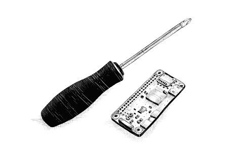

这是一本关于指令计算机的书。如今计算机和螺丝刀一样常见，但它们要复杂得多，要让它们按你的意愿行事并不总是那么容易。

如果你的计算机任务是一个常见且易于理解的任务，比如显示电子邮件或充当计算器，你可以打开相应的应用程序并开始工作。但对于独特或开放式的任务，很可能没有现成的应用程序。

这时编程就派上了用场。`编程`是构建`程序`的行为——一组精确的指令，告诉计算机该做什么。由于计算机是愚蠢、刻板的野兽，编程从根本上来说是繁琐且令人沮丧的。

幸运的是，如果你能克服这一点，甚至可能享受以笨机器能理解的方式进行严谨思考的乐趣，那么编程会带来回报。它让你能在几秒钟内完成手工需要`永远`才能完成的事情。它能让你的计算机工具做以前做不到的事情。它还提供了抽象思维的绝佳练习。

大多数编程都是用编程语言完成的。`编程语言`是一种人工构建的语言，用于指令计算机。有趣的是，我们找到的与计算机通信的最有效方式，竟然大量借鉴了我们彼此交流的方式。与人类语言一样，计算机语言允许以新的方式组合单词和短语，从而能够表达前所未有的新概念。

曾几何时，基于语言的界面（如 20 世纪 80 年代和 90 年代的 BASIC 和 DOS 提示符）是与计算机交互的主要方式。它们在很大程度上已被更易学习但自由度较低的视觉界面所取代。如果你知道去哪里找，计算机语言仍然存在。其中一种语言 JavaScript 内置于每个现代网络浏览器中，因此几乎可以在所有设备上使用。

本书将努力让你熟悉这门语言，以便你能用它做有用且有趣的事情。

## 关于编程

除了解释 JavaScript 之外，我还将介绍编程的基本原理。事实证明，编程是困难的。基本规则简单明了，但基于这些规则构建的程序往往会变得足够复杂，从而引入自身的规则和复杂性。从某种意义上说，你正在建造自己的迷宫，而且你可能会在其中迷失方向。

阅读本书时，有时会感到非常沮丧。如果你是编程新手，将会有大量新内容需要消化。其中许多内容还会以需要你建立额外联系的方式进行`组合`。

你需要付出必要的努力。当你努力跟上本书的节奏时，不要对自己的能力妄下结论。你没问题——你只需要坚持下去。休息一下，重读一些材料，并确保你阅读并理解了示例程序和练习。学习是艰苦的工作，但你学到的一切都是你的，并且会使后续学习变得更容易。

> 当行动变得无利可图时，收集信息；当信息变得无利可图时，睡觉。
>
> —— 厄休拉·K·勒古恩，《黑暗的左手》

程序是多面性的。它是程序员输入的一段文本，是让计算机执行其操作的驱动力，是计算机内存中的数据，同时又控制着对同一内存执行的操作。试图将程序与我们熟悉的物体进行类比的尝试往往不尽如人意。一个表面上合适的类比是机器——通常涉及许多独立部件，为了让整个系统运转起来，我们必须考虑这些部件如何相互连接并共同作用于整体运作。

计算机是一台物理机器，充当这些非物质机器的宿主。计算机本身只能做愚蠢而直接的事情。它们之所以如此有用，是因为它们以极高的速度做这些事情。程序可以巧妙地将大量这些简单动作组合起来，完成非常复杂的事情。

程序是思想的建筑。它建造起来没有成本，没有重量，而且在我们敲击键盘时轻松生长。

但若不加以留意，程序的规模和复杂性会失控，甚至让创造它的人感到困惑。控制程序是编程的主要问题。当一个程序能正常运行时，它就是美的。编程的艺术在于控制复杂性的技巧。伟大的程序是克制的——在复杂中变得简单。

有些程序员认为，最好只使用一小套经过充分理解的技术来管理这种复杂性。他们制定了严格的规则（“最佳实践”），规定了程序应有的形式，并小心翼翼地待在自己安全的舒适区内。

这不仅无聊，而且无效。新问题往往需要新解决方案。编程领域还很年轻，仍在快速发展，并且足够多样化，足以容纳截然不同的方法。在程序设计中，有许多可怕的错误可以犯，你应该去犯这些错误，以便理解它们。对好程序样子的感知是在实践中培养出来的，而不是从规则列表中学会的。

## 为什么语言很重要

最初，在计算诞生之时，并没有编程语言。程序看起来像这样：

```text
00110001 00000000 00000000
00110001 00000001 00000001
00110011 00000001 00000010
01010001 00001011 00000010
00100010 00000010 00001000
01000011 00000001 00000000
01000001 00000001 00000001
00010000 00000010 00000000
01100010 00000000 00000000
```

这是一个将数字 1 到 10 相加并输出结果的程序：`1 + 2 + ... + 10 = 55`。它可以在一个简单的假想机器上运行。为了给早期计算机编程，需要将大量开关设置到正确位置，或者在纸板上打孔并送入计算机。你大概能想象这个过程有多繁琐且容易出错。即使是编写简单的程序也需要大量的聪明才智和纪律性。复杂的程序几乎无法想象。

当然，手动输入这些神秘的比特模式（0 和 1）确实让程序员有一种强大巫师的感觉。这在工作满意度方面肯定是有价值的。

前面程序的每一行都包含一条指令。用英语可以这样写：

1. 将数字 0 存储到内存位置 0。
2. 将数字 1 存储到内存位置 1。
3. 将内存位置 1 的值存储到内存位置 2。
4. 从内存位置 2 的值中减去数字 11。
5. 如果内存位置 2 的值是数字 0，则继续执行指令 9。
6. 将内存位置 1 的值加到内存位置 0。
7. 将数字 1 加到内存位置 1 的值上。
8. 继续执行指令 3。
9. 输出内存位置 0 的值。

虽然这已经比比特汤更易读了，但仍然相当晦涩。为指令和内存位置使用名称而不是数字会有所帮助。

```text
将“total”设为 0。
将“count”设为 1。
[loop]
将“compare”设为“count”。
从“compare”中减去 11。
如果“compare”为零，则继续执行[end]。
将“count”加到“total”。
将“count”加 1。
继续执行[loop]。
[end]
输出“total”。
```

现在你能看出程序是如何工作的吗？前两行给两个内存位置赋予初始值：`total`将用于累加计算结果，`count`将跟踪当前正在处理的数字。使用`compare`的那几行可能是最奇怪的。程序想检查`count`是否等于 11，以决定是否停止运行。由于我们的假想机器相当原始，它只能测试一个数字是否为零并据此做出决策。因此，它使用标记为`compare`的内存位置来计算`count - 11`的值，并根据该值做出决策。接下来的两行将`count`的值加到结果上，并在程序判定`count`尚未达到 11 时，每次将`count`增加 1。

以下是同一个程序用 JavaScript 编写的版本：

```javascript
let total = 0, count = 1;
while (count <= 10) {
  total += count;
  count += 1;
}
console.log(total);
// → 55
```

这个版本给我们带来了一些改进。最重要的是，不再需要指定程序来回跳转的方式。`while`结构处理了这一点。只要给定的条件成立，它就会继续执行其下方的块（用花括号包裹）。该条件是`count <= 10`，意思是“`count`小于或等于 10”。我们不再需要创建一个临时值并将其与零比较，这只是一个无关紧要的细节。编程语言的部分力量在于它们可以为我们处理这些无关紧要的细节。

在程序末尾，`while`结构结束后，使用`console.log`操作输出结果。

最后，如果我们碰巧有方便的`range`和`sum`操作可用，程序可能看起来像这样，这两个操作分别创建一个范围内的数字集合并计算数字集合的总和：

```javascript
console.log(sum(range(1, 10)));
// → 55
```

这个故事的寓意是，同一个程序可以用冗长和简短、难以阅读和易于阅读的方式表达。程序的第一个版本极其晦涩，而最后一个版本几乎就是英语：`log`出从 1 到 10 的`range`的`sum`。（我们将在后面的章节中看到如何定义像`sum`和`range`这样的操作。）

一个好的编程语言通过允许程序员在更高层次上谈论计算机必须执行的操作来帮助他们。它有助于省略细节，提供方便的构建块（如`while`和`console.log`），允许你定义自己的构建块（如`sum`和`range`），并使这些块易于组合。

## 什么是 JavaScript？

JavaScript 于 1995 年引入，作为在 Netscape Navigator 浏览器中向网页添加程序的一种方式。此后，该语言已被所有其他主要图形化网页浏览器采用。它使现代网络应用成为可能——这些应用允许你直接交互，而无需每次操作都重新加载页面。JavaScript 也用于更传统的网站，以提供各种形式的交互性和智能性。

需要注意的是，JavaScript 与名为 Java 的编程语言几乎没有任何关系。相似的名称是出于营销考虑而非明智判断。当 JavaScript 被引入时，Java 语言正在被大力推广并逐渐流行。有人觉得借此东风是个好主意。现在我们就被这个名字困住了。

在 Netscape 之外被采用后，人们编写了一份标准文档来描述 JavaScript 语言应有的工作方式，以便所有声称支持 JavaScript 的软件实际上都在谈论同一种语言。这份标准被称为 ECMAScript 标准，以进行标准化的 Ecma 国际组织命名。实际上，术语 ECMAScript 和 JavaScript 可以互换使用——它们是同一种语言的两种名称。

有些人会对 JavaScript 说出`可怕`的评价。其中很多评价都是事实。当我第一次被要求用 JavaScript 写点东西时，我很快就对它产生了厌恶。它几乎能接受我输入的任何内容，但解释方式却与我的本意完全不同。当然，这很大程度上是因为我根本不知道自己在做什么，但这里确实存在一个真正的问题：JavaScript 在允许的内容上过于宽松。这种设计背后的想法是让初学者更容易用 JavaScript 编程。但实际上，这反而让找出程序中的问题变得更困难，因为系统不会向你指出它们。

不过，这种灵活性也有其优势。它为许多在更严格的语言中无法实现的技术留出了空间，而且正如你将看到的（例如在第 10 章），它可以用来克服 JavaScript 的一些缺点。在正确学习这门语言并与之共事一段时间后，我学会了真正`喜欢` JavaScript。

JavaScript 有多个版本。在 JavaScript 崛起并占据主导地位的时期（大约在 2000 年到 2010 年之间），ECMAScript 第 3 版是广泛支持的版本。在此期间，一个雄心勃勃的第 4 版正在开发中，计划对语言进行许多根本性的改进和扩展。以如此激进的方式改变一种正在被广泛使用的语言，在政治上变得困难重重，第 4 版的工作于 2008 年被放弃，转而推出了一个不那么雄心勃勃的第 5 版，该版本仅进行了一些无争议的改进，并于 2009 年发布。随后在 2015 年，第 6 版发布，这是一次重大更新，包含了第 4 版计划中的一些想法。自那以后，我们每年都有新的小更新。

语言在不断演变，这意味着浏览器必须持续跟进，如果你使用的是较旧的浏览器，它可能不支持所有功能。语言设计者很谨慎，不会做出任何可能破坏现有程序的更改，因此新浏览器仍然可以运行旧程序。在本书中，我使用的是 2017 版的 JavaScript。

Web 浏览器并不是 JavaScript 唯一运行的平台。一些数据库，如 MongoDB 和 CouchDB，使用 JavaScript 作为其脚本和查询语言。几个用于桌面和服务器编程的平台，最著名的是 Node.js 项目（第 20 章的主题），提供了在浏览器之外进行 JavaScript 编程的环境。

## 代码及其用途

`代码`是构成程序的文本。本书中的大多数章节都包含大量代码。我相信阅读代码和编写代码是学习编程不可或缺的部分。不要只是浏览示例——要仔细阅读并理解它们。起初这可能会很慢且令人困惑，但我保证你会很快掌握要领。练习也是如此。除非你真正编写了一个可行的解决方案，否则不要以为你已经理解了它们。

我建议你在实际的 JavaScript 解释器中尝试练习的解决方案。这样，你会立即得到反馈，了解你所做的事情是否有效，并且我希望你会受到诱惑去尝试并超越练习。

运行本书中的示例代码并进行实验的最简单方法是在本书的在线版本中查找，网址为 [*https://eloquentjavascript.net*](https://eloquentjavascript.net/)。在那里，你可以点击任何代码示例进行编辑和运行，并查看其输出。要完成练习，请访问 [*https://eloquentjavascript.net/code*](https://eloquentjavascript.net/code)，该网站为每个编程练习提供了起始代码，并允许你查看解决方案。

如果你想在本书网站之外运行本书中定义的程序，则需要多加注意。许多示例是独立的，应该可以在任何 JavaScript 环境中运行。但后面章节中的代码通常是为特定环境（浏览器或 Node.js）编写的，并且只能在该环境中运行。此外，许多章节定义了更大的程序，其中出现的代码片段相互依赖或依赖于外部文件。网站上的沙盒提供了指向 Zip 文件的链接，其中包含运行特定章节代码所需的所有脚本和数据文件。

## 本书概述

本书大致分为三个部分。前 12 章讨论 JavaScript 语言。接下来的七章是关于 Web 浏览器以及如何使用 JavaScript 对其进行编程。最后两章专门介绍 Node.js，这是另一种用于 JavaScript 编程的环境。

全书共有五个`项目章节`，描述了更大的示例程序，让你体验实际编程。按出现顺序，我们将构建一个送货机器人、一种编程语言、一个平台游戏、一个像素绘画程序和一个动态网站。

本书的语言部分以四章开始，介绍 JavaScript 语言的基本结构。它们介绍了控制结构（例如你在本引言中看到的 `while` 关键字）、函数（编写你自己的构建块）和数据结构。之后，你将能够编写基本程序。接下来，第 5 章和第 6 章介绍了使用函数和对象编写更`抽象`的代码并控制复杂性的技术。

在第一个项目章节之后，本书的语言部分继续介绍错误处理和错误修复、正则表达式（处理文本的重要工具）、模块化（另一种对抗复杂性的手段）以及异步编程（处理需要时间的事件）。第二个项目章节结束了本书的第一部分。

第二部分，第 13 章到第 19 章，描述了浏览器 JavaScript 可以访问的工具。你将学习在屏幕上显示内容（第 14 章和第 17 章）、响应用户输入（第 15 章）以及通过网络进行通信（第 18 章）。这一部分又有两个项目章节。

之后，第 20 章介绍了 Node.js，第 21 章使用该工具构建了一个小型网站。

## 排版约定

在本书中，以`等宽字体`书写的文本将代表程序元素——有时它们是独立的片段，有时它们仅指代附近程序的一部分。程序（你已经看到过一些）的书写方式如下：

```javascript
function factorial(n) {
  if (n == 0) {
    return 1;
  } else {
    return factorial(n - 1) * n;
  }
}
```

有时，为了展示程序产生的输出，预期的输出会写在程序之后，前面带有两个斜杠和一个箭头。

```javascript
console.log(factorial(8));
// → 40320
```

祝你好运！

# 第 1 章：值、类型和运算符

> 在机器的表面之下，程序在运行。它毫不费力地伸缩。在极大的和谐中，电子分散并重组。显示器上的形态不过是水面的涟漪。本质无形地停留在下方。
>
> 元马大师，《编程之书》


在计算机的世界里，只有数据。你可以读取数据、修改数据、创建新数据——但那些不是数据的东西则无法提及。所有这些数据都以长串的比特形式存储，因此本质上是相似的。

`比特`是任何具有两种值的事物，通常描述为 0 和 1。在计算机内部，它们表现为高或低的电荷、强或弱的信号，或者 CD 表面上的亮点或暗点。任何离散的信息都可以简化为 0 和 1 的序列，从而用比特表示。


例如，我们可以用比特表示数字 13。其原理与十进制数相同，但只有 2 个不同的数字，而不是 10 个，并且每个数字的权重从右向左以 2 的倍数递增。以下是组成数字 13 的比特，其数字的权重显示在下方：

```text
 0   0   0   0   1   1   0   1
 128  64  32  16   8   4   2   1
```

所以这就是二进制数 `00001101`。它的非零数字代表 8、4 和 1，加起来等于 13。

## 值

想象一片比特的海洋——浩瀚无垠。一台典型的现代计算机在其易失性数据存储（工作内存）中拥有超过 300 亿个比特。非易失性存储（硬盘或类似设备）通常还要多几个数量级。

为了能够处理如此大量的比特而不迷失方向，我们必须将它们分割成代表信息片段的数据块。在 JavaScript 环境中，这些数据块被称为值。尽管所有值都由比特构成，但它们扮演着不同的角色。每个值都有一个决定其角色的类型。有些值是数字，有些值是文本片段，有些值是函数，等等。

要创建一个值，你只需调用它的名称。这很方便。你不需要为你的值收集建筑材料或付费。你只需召唤一个，然后嗖的一声，它就出现了。当然，它们并非真的凭空产生。每个值都必须存储在某个地方，如果你想同时使用大量的值，可能会耗尽内存。幸运的是，只有当你同时需要它们时才会出现这个问题。一旦你不再使用某个值，它就会消散，留下它的比特作为下一代值的建筑材料被回收利用。

本章介绍 JavaScript 程序的原子元素，即简单的值类型以及可以对这些值进行操作的运算符。

## 数字

数字类型的值，毫不意外，就是数值。在 JavaScript 程序中，它们书写如下：

```javascript
13
```

在程序中使用它，将导致数字 13 的比特模式在计算机内存中产生。

JavaScript 使用固定数量的比特（64 位）来存储一个数字值。用 64 位只能组成有限数量的模式，这意味着可以表示的不同数字的数量是有限的。用 `N` 个十进制数字，你可以表示 `10^N` 个数。类似地，给定 64 个二进制数字，你可以表示 `2⁶⁴` 个不同的数，大约是 1800 亿亿（18 后面跟 18 个零）。这很多。

计算机内存曾经小得多，人们倾向于使用 8 位或 16 位的组来表示数字。很容易意外地溢出这些小的数字——最终得到一个无法容纳在给定比特数中的数字。如今，即使是能放进口袋的计算机也有足够的内存，因此你可以自由使用 64 位的数据块，只有在处理真正天文数字时才需要担心溢出。

然而，并非所有小于 1800 亿亿的整数都能放入 JavaScript 数字中。这些比特还要存储负数，因此一位用于表示数字的符号。更大的问题是还必须表示非整数。为此，一些比特用于存储小数点的位置。实际可存储的最大整数大约在 9 千万亿（15 个零）的范围内——这仍然大得令人愉快。

小数通过使用点号来书写。

```javascript
9.81
```

对于非常大或非常小的数字，你还可以使用科学记数法，添加一个 `e`（代表指数），后跟数字的指数。

```javascript
2.998e8
```

即 2.998 × 10⁸ = 299,800,000。

对于小于前述 9 千万亿的整数（也称为整数）的计算，保证始终精确。不幸的是，小数的计算通常不精确。正如 π（圆周率）无法用有限的小数位数精确表示一样，许多数字在只有 64 位可用存储时也会损失一些精度。这很遗憾，但只在特定情况下才会引起实际问题。重要的是要意识到这一点，并将小数数字视为近似值，而不是精确值。

### 算术

数字的主要用途是算术。算术运算如加法或乘法接受两个数字值，并从中产生一个新数字。它们在 JavaScript 中如下所示：

```javascript
100 + 4 * 11
```

`+` 和 `*` 符号被称为运算符。第一个代表加法，第二个代表乘法。将运算符放在两个值之间，将对其应用并产生一个新值。

但该示例的意思是“将 4 和 100 相加，然后将结果乘以 11”，还是先做乘法再做加法？你可能已经猜到了，乘法先进行。但和数学中一样，你可以通过将加法括在括号中来改变顺序。

```javascript
(100 + 4) * 11
```

对于减法，有 `-` 运算符，除法可以用 `/` 运算符完成。

当运算符一起出现而没有括号时，它们的应用顺序由运算符的优先级决定。示例表明乘法优先于加法。`/` 运算符与 `*` 具有相同的优先级。`+` 和 `-` 也是如此。当多个具有相同优先级的运算符相邻出现时，例如 `1 - 2 + 1`，它们从左到右应用：`(1 - 2) + 1`。

这些优先级规则并不需要你过分担心。如有疑问，只需添加括号即可。

还有一个算术运算符，你可能不会立刻认出。`%` 符号用于表示余数运算。`X % Y` 是 `X` 除以 `Y` 的余数。例如，`314 % 100` 得到 `14`，而 `144 % 12` 得到 `0`。余数运算符的优先级与乘法和除法相同。你也会经常看到这个运算符被称为取模。

### 特殊数字

JavaScript 中有三个特殊值被视为数字，但行为与普通数字不同。

前两个是 `Infinity` 和 `-Infinity`，分别表示正无穷和负无穷。`Infinity - 1` 仍然是 `Infinity`，以此类推。不过，不要过分信任基于无穷的计算。它在数学上并不严谨，并且会很快导致下一个特殊数字：`NaN`。

`NaN` 代表“不是数字”（not a number），尽管它是数字类型的一个值。当你尝试计算 `0 / 0`（零除以零）、`Infinity - Infinity` 或任何其他无法产生有意义结果的数值运算时，就会得到这个结果。

## 字符串

下一个基本数据类型是字符串。字符串用于表示文本。它们通过将内容括在引号中来书写。

```javascript
`Down on the sea`
"Lie on the ocean"
'Float on the ocean'
```

你可以使用单引号、双引号或反引号来标记字符串，只要字符串开头和结尾的引号匹配即可。

几乎任何内容都可以放在引号之间，JavaScript 会将其转换为字符串值。但有些字符处理起来比较困难。你可以想象在引号内再放引号会有多难。换行符（按下回车键时得到的字符）只有在字符串使用反引号（`` ` ``）括起来时才能不加转义地包含。

为了能够将此类字符包含在字符串中，使用了以下表示法：每当在引号文本中发现反斜杠（`\`）时，它表示其后的字符具有特殊含义。这称为转义字符。前面带有反斜杠的引号不会结束字符串，而是成为字符串的一部分。当反斜杠后面出现 `n` 字符时，它被解释为换行符。类似地，反斜杠后面的 `t` 表示制表符。请看以下字符串：

```javascript
"This is the first line\nAnd this is the second"
```

实际包含的文本是：

```text
This is the first line
And this is the second
```

当然，有时你希望字符串中的反斜杠只是一个反斜杠，而不是特殊代码。如果两个反斜杠连续出现，它们会合并，结果字符串值中只保留一个。这就是字符串 `"A newline character is written like \n\"."` 的表达方式：

```javascript
"A newline character is written like \"\\n\"."
```

字符串也必须被建模为一系列比特，才能在计算机中存在。JavaScript 的做法基于 Unicode 标准。该标准为几乎所有你可能需要的字符分配了一个数字，包括希腊语、阿拉伯语、日语、亚美尼亚语等字符。如果我们为每个字符都有一个数字，那么字符串就可以用一系列数字来描述。

这就是 JavaScript 所做的。但有一个复杂之处：JavaScript 的表示法每个字符串元素使用 16 位，最多可以描述 `2¹⁶` 个不同的字符。但 Unicode 定义的字符比这更多——目前大约是其两倍。因此，某些字符（例如许多表情符号）在 JavaScript 字符串中占据两个“字符位置”。我们将在第 5 章中回到这个问题。

字符串不能进行除法、乘法或减法，但可以对它们使用 `+` 运算符。它不会相加，而是连接——将两个字符串粘合在一起。以下行将生成字符串 `"concatenate"`：

```javascript
"con" + "cat" + "e" + "nate"
```

字符串值有许多关联的函数（方法），可用于对它们执行其他操作。我将在第 4 章中进一步介绍。

用单引号或双引号书写的字符串行为非常相似——唯一的区别在于需要在其中转义哪种类型的引号。用反引号括起来的字符串，通常称为模板字面量，可以执行更多技巧。除了能够跨行之外，它们还可以嵌入其他值。

```javascript
`half of 100 is ${100 / 2}`
```

当你在模板字面量中写入 `${}` 内的内容时，其结果将被计算，转换为字符串，并包含在该位置。该示例生成“half of 100 is 50”。

## 一元运算符

并非所有运算符都是符号。有些是单词形式。一个例子是 `typeof` 运算符，它生成一个字符串值，命名你给它的值的类型。

```javascript
console.log(typeof 4.5)
// → number
console.log(typeof "x")
// → string
```

我们将在示例代码中使用 `console.log` 来表示我们希望看到某个表达式求值的结果。更多内容请参见下一章。

前面展示的其他运算符都操作两个值，但 `typeof` 只接受一个值。使用两个值的运算符称为二元运算符，而只接受一个值的称为一元运算符。减号运算符既可以作为二元运算符，也可以作为一元运算符。

```javascript
console.log(- (10 - 2))
// → -8
```

## 布尔值

通常，拥有一个仅区分两种可能性的值很有用，例如“是”和“否”或“开”和“关”。为此，JavaScript 有一个布尔类型，它只有两个值：`true` 和 `false`，它们就写成这些单词。

### 比较

以下是生成布尔值的一种方法：

```javascript
console.log(3 > 2)
// → true
console.log(3 < 2)
// → false
```

`>` 和 `<` 符号分别是“大于”和“小于”的传统符号。它们是二元运算符。应用它们会得到一个布尔值，指示在这种情况下它们是否成立。

字符串也可以以相同的方式进行比较。

```javascript
console.log("Aardvark" < "Zoroaster")
// → true
```

字符串的排序方式大致按字母顺序，但并非字典中常见的那样：大写字母总是“小于”小写字母，因此 `"Z" < "a"`，非字母字符（如 !、- 等）也包含在排序中。比较字符串时，JavaScript 从左到右逐个字符比较 Unicode 编码。

其他类似的运算符有 `>=`（大于等于）、`<=`（小于等于）、`==`（等于）和 `!=`（不等于）。

```javascript
console.log("Itchy" != "Scratchy")
// → true
console.log("Apple" == "Orange")
// → false
```

JavaScript 中只有一个值不等于自身，那就是 `NaN`（“非数字”）。

```javascript
console.log(NaN == NaN)
// → false
```

`NaN` 用于表示无意义计算的结果，因此它不等于任何其他无意义计算的结果。

### 逻辑运算符

还有一些操作可以应用于布尔值本身。JavaScript 支持三种逻辑运算符：与、或和非。它们可用于对布尔值进行“推理”。

`&&` 运算符表示逻辑与。它是一个二元运算符，只有当两个值都为 `true` 时，结果才为 `true`。

```javascript
console.log(true && false)
// → false
console.log(true && true)
// → true
```

`||` 运算符表示逻辑或。如果两个值中有一个为 `true`，则结果为 `true`。

```javascript
console.log(false || true)
// → true
console.log(false || false)
// → false
```

非写作感叹号（`!`）。它是一个一元运算符，用于翻转给定的值——`!true` 产生 `false`，`!false` 产生 `true`。

当将这些布尔运算符与算术运算符及其他运算符混合使用时，并不总是清楚何时需要括号。实际上，通常只需知道到目前为止我们见过的运算符中，`||` 优先级最低，其次是 `&&`，然后是比较运算符（`>`、`==` 等），最后是其余运算符。这种顺序的设计使得在像下面这样的典型表达式中，尽可能少用括号：

```javascript
1 + 1 == 2 && 10 * 10 > 50
```

我要讨论的最后一个逻辑运算符不是一元也不是二元，而是三元，它操作三个值。它用问号和冒号表示，如下所示：

```javascript
console.log(true ? 1 : 2);
// → 1
console.log(false ? 1 : 2);
// → 2
```

这个运算符被称为条件运算符（有时也简称为三元运算符，因为它是该语言中唯一的此类运算符）。问号左侧的值“选择”另外两个值中的哪一个会输出。当它为 `true` 时，选择中间的值；当它为 `false` 时，选择右侧的值。

## 空值

有两个特殊值，写作 `null` 和 `undefined`，用于表示缺少有意义的值。它们本身是值，但不携带任何信息。

语言中许多不产生有意义值的操作（稍后你会看到一些）都会返回 `undefined`，仅仅是因为它们必须返回某个值。

`undefined` 和 `null` 之间的含义差异是 JavaScript 设计上的偶然，大多数情况下无关紧要。在确实需要关注这些值的情况下，我建议将它们视为基本可互换。

## 自动类型转换

在引言中，我提到 JavaScript 会尽力接受你提供的几乎任何程序，即使是那些行为怪异的程序。以下表达式很好地证明了这一点：

```javascript
console.log(8 * null)
// → 0
console.log("5" - 1)
// → 4
console.log("5" + 1)
// → 51
console.log("five" * 2)
// → NaN
console.log(false == 0)
// → true
```

当运算符应用于“错误”类型的值时，JavaScript 会静默地将该值转换为其所需的类型，使用的规则通常并非你所期望或想要的。这被称为类型强制转换。第一个表达式中的 `null` 变为 `0`，第二个表达式中的 `"5"` 变为 `5`（从字符串到数字）。然而在第三个表达式中，`+` 在数值加法之前尝试字符串拼接，因此 `1` 被转换为 `"1"`（从数字到字符串）。

当某些无法明显映射为数字的内容（如 `"five"` 或 `undefined`）被转换为数字时，你会得到值 `NaN`。对 `NaN` 进行进一步的算术运算会持续产生 `NaN`，因此如果你在意外的地方发现 `NaN`，请查找意外的类型转换。


当使用`==`比较相同类型的值时，结果很容易预测：当两个值相同时，你应该得到`true`，但`NaN`的情况除外。但当类型不同时，JavaScript 会使用一套复杂且令人困惑的规则来决定如何处理。大多数情况下，它只是尝试将其中一个值转换为另一个值的类型。然而，当运算符两侧出现`null`或`undefined`时，只有当两侧都是`null`或`undefined`时，结果才为`true`。

```
console.log(null == undefined);
// → true
console.log(null == 0);
// → false
```

这种行为通常很有用。当你想要测试一个值是否具有实际值而不是`null`或`undefined`时，可以使用`==`（或`!=`）运算符将其与`null`进行比较。

但如果你想要测试某个东西是否指向精确值`false`呢？由于自动类型转换，像`0 == false`和`"" == false`这样的表达式也是`true`。当你不希望发生任何类型转换时，还有两个额外的运算符：`===`和`!==`。第一个测试一个值是否精确等于另一个值，第二个测试是否不精确相等。因此`"" === false`如预期那样为`false`。

我建议防御性地使用三字符比较运算符，以防止意外的类型转换给你带来麻烦。但当你确定两侧类型相同时，使用较短的运算符也没有问题。

### 逻辑运算符的短路求值

逻辑运算符`&&`和`||`以特殊方式处理不同类型的值。它们会将左侧的值转换为布尔类型以决定如何操作，但根据运算符和转换结果，它们会返回原始的左侧值或右侧值。

例如，`||`运算符在左侧值可以转换为`true`时返回左侧值，否则返回右侧值。当值为布尔类型时，这会产生预期的效果，对于其他类型的值也有类似的行为。

```
console.log(null || "user")
// → user
console.log("Agnes" || "user")
// → Agnes
```

我们可以利用这个功能来设定默认值。如果你有一个可能为空的值，可以在它后面加上`||`和一个替代值。如果初始值可以被转换为`false`，那么你就会得到替代值。将字符串和数字转换为布尔值的规则规定：`0`、`NaN`和空字符串（`""`）被视为`false`，而其他所有值都被视为`true`。因此`0 || -1`产生`-1`，`"" || "!?"`得到`"!?"`。

`&&`运算符的工作方式类似，但方向相反。当它左边的值可以转换为`false`时，它返回该值，否则返回右边的值。

这两个运算符的另一个重要特性是，只有在必要时才会计算它们右边的部分。对于`true || X`，无论`X`是什么——即使它是一段会做可怕事情的程序——结果都是`true`，并且`X`永远不会被计算。`false && X`也是如此，结果为`false`并忽略`X`。这被称为短路求值。

条件运算符的工作方式类似。在第二和第三个值中，只有被选中的那个会被计算。

## 总结

本章我们研究了四种 JavaScript 值：数字、字符串、布尔值和`undefined`值。

这些值通过输入它们的名称（`true`、`null`）或值（`13`、`"abc"`）来创建。你可以使用运算符组合和转换值。我们看到了用于算术（`+`、`-`、`*`、`/`和`%`）、字符串拼接（`+`）、比较（`==`、`!=`、`===`、`!==`、`<`、`>`、`<=`、`>=`）和逻辑（`&&`、`||`）的二元运算符，以及几个一元运算符（`-`用于取反数字，`!`用于逻辑取反，`typeof`用于查找值的类型）和一个三元运算符（`?:`），用于根据第三个值从两个值中选择一个。

这些信息足以让你把 JavaScript 当作袖珍计算器来使用，但仅此而已。下一章将开始把这些表达式组合成基本的程序。

# 第 2 章：程序结构

> 在我那层薄膜般半透明的皮肤下，我的心亮红发光，他们必须注射 10cc 的 JavaScript 才能让我回过神来。（我对血液中的毒素反应良好。）老兄，那玩意儿能把你的桃子从鳃里踢出来！
>
> — _why, Why's (Poignant) Guide to Ruby


在本章中，我们将开始做一些真正可以称为编程的事情。我们将扩展对 JavaScript 语言的掌握，超越目前所见的名词和句子片段，达到能够表达有意义篇章的程度。

## 表达式与语句

在第 1 章中，我们创建了值，并对它们应用运算符以得到新值。像这样创建值是任何 JavaScript 程序的主要内容。但这些内容必须被置于更大的结构中才能发挥作用。这就是我们接下来要讲的内容。

产生值的代码片段称为表达式。每个直接写出的值（例如`22`或`"psychoanalysis"`）都是一个表达式。括号内的表达式也是表达式，应用于两个表达式的二元运算符或应用于一个表达式的一元运算符也是如此。

这展示了基于语言的界面的部分美妙之处。表达式可以包含其他表达式，就像人类语言中的子句可以嵌套一样——一个子句可以包含自己的子句，依此类推。这使我们能够构建描述任意复杂计算的表达式。

如果表达式对应句子片段，那么 JavaScript 语句就对应完整的句子。程序就是一系列语句。

最简单的语句是后面带分号的表达式。这是一个程序：

```
1;
!false;
```

不过，这是一个无用的程序。表达式可以仅仅产生一个值，然后被外层代码使用。而语句是独立的，因此只有在对世界产生影响时才有意义。它可以在屏幕上显示某些内容——这算是对世界的改变——或者改变机器的内部状态，从而影响后续的语句。这些改变被称为副作用。前面例子中的语句只是产生了值`1`和`true`，然后立即丢弃它们。这对世界完全没有留下任何印象。当你运行这个程序时，不会观察到任何东西。

在某些情况下，JavaScript 允许你省略语句末尾的分号。在其他情况下，则必须加上分号，否则下一行会被视为同一语句的一部分。关于何时可以安全省略分号的规则有些复杂且容易出错。因此，在本书中，每个需要分号的语句都会加上分号。我建议你也这样做，至少在你对省略分号的微妙之处有更多了解之前。

## 绑定

程序如何保持内部状态？它如何记住东西？我们已经看到如何从旧值产生新值，但这并不会改变旧值，而且新值必须立即使用，否则就会消失。为了捕获和保存值，JavaScript 提供了一种称为绑定（或变量）的东西：

```
let caught = 5 * 5;
```

这是第二种语句。特殊关键字`let`表示这条语句将要定义一个绑定。它后面跟着绑定的名称，如果我们想立即给它一个值，则加上`=`运算符和一个表达式。

前面的语句创建了一个名为`caught`的绑定，并用它来抓住 5 乘以 5 产生的数字。

绑定定义之后，它的名称就可以用作表达式。这种表达式的值就是绑定当前持有的值。下面是一个例子：

```
let ten = 10;
console.log(ten * ten);
// → 100
```

当一个绑定指向一个值时，并不意味着它永远与该值绑定。`=`运算符可以随时用于现有的绑定，将它们与当前值断开，并指向一个新值。

```
let mood = "light";
console.log(mood);
// → light
mood = "dark";
console.log(mood);
// → dark
```

你应该把绑定想象成触手，而不是盒子。它们并不包含值，而是抓住值——两个绑定可以指向同一个值。程序只能访问它仍然持有引用的值。当你需要记住某件事时，你就长出一条触手来抓住它，或者将你现有的某条触手重新连接到它上面。

让我们再看一个例子。为了记住路易吉还欠你多少钱，你创建了一个绑定。然后当他偿还 35 美元时，你给这个绑定赋予一个新值。

```
let luigisDebt = 140;
luigisDebt = luigisDebt - 35;
console.log(luigisDebt);
// → 105
```

当你定义一个绑定而不给它赋值时，触手就没什么可抓取的，所以它最终悬在空中。如果你询问一个空绑定的值，你会得到值`undefined`。

一个`let`语句可以定义多个绑定。这些定义必须用逗号分隔。

```
let one = 1, two = 2;
console.log(one + two);
// → 3
```

单词`var`和`const`也可以用来创建绑定，方式与`let`类似。

```
var name = "Ayda";
const greeting = "Hello ";
console.log(greeting + name);
// → Hello Ayda
```

第一个，`var`（“variable”的缩写），是 2015 年之前的 JavaScript 中声明绑定的方式。我将在下一章中详细说明它与`let`的具体区别。现在，请记住它基本上做同样的事情，但我们在本书中很少使用它，因为它有一些令人困惑的特性。

单词`const`代表 constant（常量）。它定义了一个常量绑定，在其生命周期内始终指向同一个值。这对于给值起个名字以便稍后轻松引用非常有用。

## 绑定名称

绑定名称可以是任何单词。数字可以是绑定名称的一部分——例如，`catch22`是一个有效的名称——但名称不能以数字开头。绑定名称可以包含美元符号（`$`）或下划线（`_`），但不能包含其他标点符号或特殊字符。

具有特殊含义的单词，如`let`，是关键字，它们不能用作绑定名称。还有一些单词被“保留供将来使用”在 JavaScript 的未来版本中，这些也不能用作绑定名称。关键字和保留字的完整列表相当长。

```
break case catch class const continue debugger default
delete do else enum export extends false finally for
function if implements import interface in instanceof let
new package private protected public return static super
switch this throw true try typeof var void while with yield
```

不必担心记住这个列表。当创建绑定产生意外的语法错误时，检查你是否试图定义一个保留字。

## 环境

在给定时间存在的绑定及其值的集合称为环境。当程序启动时，这个环境不是空的。它总是包含语言标准中的绑定，并且大多数情况下，它还包含提供与周围系统交互方式的绑定。例如，在浏览器中，有与当前加载的网站交互以及读取鼠标和键盘输入的函数。

## 函数

默认环境中提供的许多值都具有函数类型。函数是一段包裹在值中的程序。这样的值可以被应用以运行包裹的程序。例如，在浏览器环境中，绑定`prompt`持有一个函数，该函数显示一个小对话框，询问用户输入。它的使用方式如下：

```
prompt("Enter passcode");
```

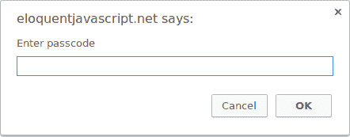

执行一个函数称为调用、调用或应用它。你可以通过将括号放在产生函数值的表达式后来调用函数。通常你会直接使用持有该函数的绑定的名称。括号之间的值被传递给函数内部的程序。在示例中，`prompt`函数使用我们给它的字符串作为对话框中显示的文本。传递给函数的值称为参数。不同的函数可能需要不同数量或不同类型的参数。

`prompt`函数在现代 Web 编程中并不常用，主要是因为你对结果对话框的外观没有控制权，但在玩具程序和实验中可能有用。

## `console.log`函数

在示例中，我使用了`console.log`来输出值。大多数 JavaScript 系统（包括所有现代 Web 浏览器和 Node.js）都提供了一个`console.log`函数，它将参数写入某个文本输出设备。在浏览器中，输出会出现在 JavaScript 控制台中。浏览器界面的这一部分默认是隐藏的，但大多数浏览器在按下 F12 或 Mac 上的 command-option-I 时会打开它。如果这不起作用，请在菜单中搜索名为“开发者工具”或类似的项目。

尽管绑定名称不能包含句点字符，但`console.log`确实包含一个。这是因为`console.log`不是一个简单的绑定。它实际上是一个表达式，从`console`绑定持有的值中检索`log`属性。我们将在第 4 章中确切了解这意味着什么。

## 返回值

显示对话框或将文本写入屏幕是一种副作用。许多函数因其产生的副作用而有用。函数也可以产生值，在这种情况下，它们不需要有副作用就能发挥作用。例如，函数`Math.max`接受任意数量的数字参数并返回最大的那个。

```
console.log(Math.max(2, 4));
// → 4
```

当一个函数产生一个值时，我们说它返回那个值。任何产生值的东西在 JavaScript 中都是一个表达式，这意味着函数调用可以在更大的表达式中使用。这里，对`Math.min`（与`Math.max`相反）的调用被用作加法表达式的一部分：

```
console.log(Math.min(2, 4) + 100);
// → 102
```

下一章将解释如何编写你自己的函数。

## 控制流

当你的程序包含多个语句时，这些语句会像故事一样从上到下依次执行。这个示例程序有两个语句。第一个语句要求用户输入一个数字，第二个语句（在第一个之后执行）显示该数字的平方。

```
let theNumber = Number(prompt("Pick a number"));
console.log("Your number is the square root of " +
            theNumber * theNumber);
```

函数`Number`将一个值转换为数字。我们需要这种转换，因为`prompt`的结果是一个字符串值，而我们想要一个数字。还有类似的函数`String`和`Boolean`，它们将值转换为相应的类型。

以下是直线控制流的相当简单的示意图：


## 条件执行

并非所有程序都是直线道路。例如，我们可能想要创建一条分支道路，程序根据当前情况走正确的分支。这被称为条件执行。


在 JavaScript 中，条件执行是通过`if`关键字实现的。简单来说，我们希望某些代码仅在特定条件成立时执行。例如，我们可能希望仅在输入确实是数字时才显示输入的平方。

```
let theNumber = Number(prompt("Pick a number"));
if (!Number.isNaN(theNumber)) {
  console.log("Your number is the square root of " +
              theNumber * theNumber);
}
```

经过这样的修改，如果你输入“parrot”，就不会有任何输出。

`if`关键字根据布尔表达式的值来执行或跳过一条语句。决定性的表达式写在关键字之后、括号之间，后面跟着要执行的语句。

`Number.isNaN`函数是 JavaScript 的标准函数，只有当传入的参数是`NaN`时才返回`true`。而`Number`函数在传入一个不代表有效数字的字符串时会返回`NaN`。因此，这个条件可以理解为“除非`theNumber`不是数字，否则执行此操作”。

在这个例子中，`if`后面的语句被包裹在花括号（`{`和`}`）中。花括号可以将任意数量的语句组合成一条语句，称为块。在这个例子中，你也可以省略花括号，因为里面只有一条语句，但为了避免思考是否需要它们，大多数 JavaScript 程序员都会像这样在每个包裹的语句中使用花括号。本书将主要遵循这一惯例，偶尔会有一行语句的情况除外。

```
if (1 + 1 == 2) console.log("It's true");
// → It's true
```

通常，你不仅需要条件成立时执行的代码，还需要处理其他情况的代码。这种替代路径在图中由第二个箭头表示。你可以将`else`关键字与`if`一起使用，来创建两个独立的、可选的执行路径。


```javascript
let theNumber = Number(prompt("Pick a number"));
if (!Number.isNaN(theNumber)) {
  console.log("Your number is the square root of " +
              theNumber * theNumber);
} else {
  console.log("Hey. Why didn't you give me a number?");
}
```

如果你有两条以上的路径可供选择，可以将多个`if`/`else`对“链”在一起。下面是一个例子：

```javascript
let num = Number(prompt("Pick a number"));

if (num < 10) {
  console.log("Small");
} else if (num < 100) {
  console.log("Medium");
} else {
  console.log("Large");
}
```

程序会首先检查`num`是否小于 10。如果是，则选择该分支，显示`"Small"`，然后结束。如果不是，则进入`else`分支，该分支本身又包含一个`if`。如果第二个条件（`< 100`）成立，则说明数字在 10 到 100 之间，显示`"Medium"`。如果不成立，则选择第二个也是最后一个`else`分支。

这个程序的流程图大致如下：


## while 和 do 循环

考虑一个输出 0 到 12 之间所有偶数的程序。一种写法如下：

```javascript
console.log(0);
console.log(2);
console.log(4);
console.log(6);
console.log(8);
console.log(10);
console.log(12);
```

这样可行，但编写程序的意义在于让工作更少，而不是更多。如果我们需要所有小于 1000 的偶数，这种方法就行不通了。我们需要一种能多次运行一段代码的方式。这种控制流形式称为循环。


循环控制流允许我们回到程序中之前某个点，并用当前的程序状态重复执行。如果我们将它与一个计数的绑定结合起来，就可以这样做：

```javascript
let number = 0;
while (number <= 12) {
  console.log(number);
  number = number + 2;
}
// → 0
// → 2
//   … 等等
```

以关键字`while`开头的语句创建了一个循环。`while`后面跟着括号中的表达式和一条语句，很像`if`。只要表达式产生的值在转换为布尔值后为`true`，循环就会不断进入该语句。

`number`绑定展示了绑定如何跟踪程序的进度。每次循环重复时，`number`的值都会比之前增加 2。在每次重复开始时，它会与数字 12 进行比较，以决定程序的工作是否完成。

作为一个实际有用的例子，我们现在可以编写一个程序来计算并显示 2¹⁰（2 的 10 次方）的值。我们使用两个绑定：一个用于跟踪结果，另一个用于计数我们乘以 2 的次数。循环测试第二个绑定是否已经达到 10，如果没有，则更新两个绑定。

```javascript
let result = 1;
let counter = 0;
while (counter < 10) {
  result = result * 2;
  counter = counter + 1;
}
console.log(result);
// → 1024
```

计数器也可以从`1`开始并检查`<= 10`，但出于将在第 4 章中明确的原因，最好养成从 0 开始计数的习惯。

`do`循环是一种类似于`while`循环的控制结构。它只有一点不同：`do`循环至少会执行一次循环体，并且只在第一次执行之后才开始测试是否应该停止。为了体现这一点，测试出现在循环体之后。

```javascript
let yourName;
do {
  yourName = prompt("Who are you?");
} while (!yourName);
console.log(yourName);
```

这个程序会强制你输入一个名字。它会反复询问，直到得到非空字符串为止。应用`!`运算符会在取反之前将值转换为布尔类型，而除了`""`之外的所有字符串都会转换为`true`。这意味着循环会一直进行，直到你提供一个非空的名字。

## 代码缩进

在示例中，我在属于更大语句的语句前面添加了空格。这些空格不是必需的——即使没有它们，计算机也能正常接受程序。实际上，程序中的换行也是可选的。如果你愿意，可以将程序写成一行很长的代码。

块内缩进的作用是让代码的结构更加突出。在代码中，当新块在其他块内部打开时，很难看出一个块在哪里结束，另一个块在哪里开始。通过适当的缩进，程序的视觉形状与其内部块的形状相对应。我喜欢为每个打开的块使用两个空格，但个人喜好不同——有些人使用四个空格，有些人使用制表符。重要的是每个新块都添加相同数量的空格。

```javascript
if (false != true) {
  console.log("That makes sense.");
  if (1 < 2) {
    console.log("No surprise there.");
  }
}
```

大多数代码编辑器程序会自动为新行添加适当的缩进，从而提供帮助。

## for 循环

许多循环都遵循`while`示例中展示的模式。首先创建一个“计数器”绑定来跟踪循环的进度。然后是一个`while`循环，通常带有一个测试表达式，检查计数器是否已达到其结束值。在循环体末尾，更新计数器以跟踪进度。

由于这种模式非常常见，JavaScript 及类似语言提供了一种更简短、更全面的形式——`for`循环。

```javascript
for (let number = 0; number <= 12; number = number + 2) {
  console.log(number);
}
// → 0
// → 2
//   … 等等
```

这段程序与之前的偶数打印示例完全等价。唯一的变化是，所有与循环“状态”相关的语句都被集中到了`for`后面。

`for`关键字后的括号内必须包含两个分号。第一个分号之前的部分初始化循环，通常通过定义一个绑定来完成。第二部分是检查循环是否应继续的表达式。最后一部分在每次迭代后更新循环的状态。大多数情况下，这比`while`结构更简短、更清晰。

以下是使用`for`而非`while`计算 2¹⁰ 的代码：

```javascript
let result = 1;
for (let counter = 0; counter < 10; counter = counter + 1) {
  result = result * 2;
}
console.log(result);
// → 1024
```

## 跳出循环

让循环条件产生`false`并不是循环结束的唯一方式。有一个特殊的语句叫做`break`，它的作用是立即跳出当前所在的循环。

下面的程序演示了`break`语句。它找出第一个既大于等于 20 又能被 7 整除的数。

```javascript
for (let current = 20; ; current = current + 1) {
  if (current % 7 == 0) {
    console.log(current);
    break;
  }
}
// → 21
```

使用取余（`%`）运算符是测试一个数能否被另一个数整除的简单方法。如果能整除，那么它们相除的余数为零。

示例中的`for`结构没有检查循环结束的部分。这意味着除非执行内部的`break`语句，否则循环永远不会停止。

如果你删除了那个`break`语句，或者不小心写了一个总是返回`true`的结束条件，你的程序就会陷入无限循环。陷入无限循环的程序永远不会结束运行，这通常是一件坏事。

`continue`关键字与`break`类似，它也会影响循环的进度。当在循环体中遇到`continue`时，控制权会跳出循环体，并继续执行循环的下一次迭代。

## 简洁地更新绑定

尤其是在循环中，程序经常需要“更新”一个绑定，使其基于该绑定的先前值来保存新值。

```javascript
counter = counter + 1;
```

JavaScript 为此提供了一个快捷方式。

```javascript
counter += 1;
```

类似的快捷方式也适用于许多其他运算符，例如`result *= 2`用于将`result`加倍，或`counter -= 1`用于向下计数。

这让我们可以进一步简化之前的计数示例。

```javascript
for (let number = 0; number <= 12; number += 2) {
  console.log(number);
}
```

对于`counter += 1`和`counter -= 1`，还有更短的等价形式：`counter++`和`counter--`。

## 使用 switch 进行值分发

代码经常看起来像这样：

```javascript
if (x == "value1") action1();
else if (x == "value2") action2();
else if (x == "value3") action3();
else defaultAction();
```

有一种叫做`switch`的结构，旨在以更直接的方式表达这种“分发”。不幸的是，JavaScript 为此使用的语法（继承自 C/Java 系列编程语言）有些笨拙——一串`if`语句可能看起来更好。下面是一个例子：

```javascript
switch (prompt("What is the weather like?")) {
  case "rainy":
    console.log("Remember to bring an umbrella.");
    break;
  case "sunny":
    console.log("Dress lightly.");
  case "cloudy":
    console.log("Go outside.");
    break;
  default:
    console.log("Unknown weather type!");
    break;
}
```

你可以在`switch`打开的块内放置任意数量的`case`标签。程序将从与`switch`给定的值相对应的标签处开始执行，如果没有找到匹配的值，则从`default`开始执行。它会继续执行，甚至跨越其他标签，直到遇到`break`语句。在某些情况下，例如示例中的`"sunny"`情况，这可以用来在多个情况之间共享一些代码（它建议在晴天和阴天都外出）。但要小心——很容易忘记写这样的`break`，从而导致程序执行你不希望执行的代码。

## 命名大小写

绑定名称不能包含空格，但使用多个单词来清晰描述绑定所代表的内容通常很有帮助。以下是编写包含多个单词的绑定名称时的主要选择：

```javascript
fuzzylittleturtle
fuzzy_little_turtle
FuzzyLittleTurtle
fuzzyLittleTurtle
```

第一种风格可能难以阅读。我比较喜欢下划线的外观，不过这种风格输入起来有点麻烦。标准的 JavaScript 函数以及大多数 JavaScript 程序员都遵循最后一种风格——除了第一个单词外，每个单词的首字母都大写。习惯这样的小事并不难，而混合命名风格的代码读起来会很不协调，因此我们遵循这一约定。

在少数情况下，例如`Number`函数，绑定的首字母也大写。这样做是为了将该函数标记为构造函数。构造函数是什么将在第 6 章中说明。目前，重要的是不要被这种明显的不一致性所困扰。

## 注释

通常，原始代码并不能传达你希望程序向人类读者传达的所有信息，或者它以某种晦涩的方式传达，以至于人们可能无法理解。有时，你可能只是想将一些相关的想法作为程序的一部分包含进来。这就是注释的作用。

注释是程序的一部分文本，但会被计算机完全忽略。JavaScript 有两种编写注释的方式。要编写单行注释，你可以使用两个斜杠字符（`//`），然后在其后写上注释文本。

```javascript
let accountBalance = calculateBalance(account);
// It's a green hollow where a river sings
accountBalance.adjust();
// Madly catching white tatters in the grass.
let report = new Report();
// Where the sun on the proud mountain rings:
addToReport(accountBalance, report);
// It's a little valley, foaming like light in a glass.
```

`//`注释只到行尾。`/*`和`*/`之间的文本段会被完全忽略，无论其中是否包含换行符。这对于添加关于文件或程序块的信息块很有用。

```javascript
/*
  I first found this number scrawled on the back of an old notebook.
  Since then, it has often dropped by, showing up in phone numbers
  and the serial numbers of products that I've bought. It obviously
  likes me, so I've decided to keep it.
*/
const myNumber = 11213;
```

## 总结

你现在知道程序是由语句构成的，而语句本身有时又包含更多的语句。语句通常包含表达式，而表达式本身又可由更小的表达式构成。

将语句依次排列就得到了一个从上到下执行的程序。你可以通过使用条件语句（`if`、`else`和`switch`）和循环语句（`while`、`do`和`for`）来引入控制流的扰动。

绑定可用于将数据片段以名称归档，它们对于跟踪程序中的状态非常有用。环境是已定义的绑定的集合。JavaScript 系统总是会将许多有用的标准绑定放入你的环境中。

函数是封装了一段程序的特殊值。你可以通过编写`functionName(argument1, argument2)`来调用它们。这样的函数调用是一个表达式，并且可能产生一个值。

## 练习

如果你不确定如何测试练习的解答，请参考引言。

每个练习都以问题描述开始。阅读描述并尝试解决练习。如果遇到问题，可以考虑阅读书末的提示。本书不包含练习的完整解答，但你可以在[https://eloquentjavascript.net/code](https://eloquentjavascript.net/code#2)在线找到它们。如果你想从练习中学到东西，我建议只在解决练习之后，或者至少在你长时间努力攻克到有点头疼之后，再查看解答。

### 循环三角形


编写一个循环，调用七次`console.log`来输出以下三角形：

```
#
##
###
####
#####
######
#######
```

知道你可以通过在字符串后面写`.length`来获取其长度可能会很有用。

```javascript
let abc = "abc";
console.log(abc.length);
// → 3
```

## FizzBuzz

编写一个程序，使用`console.log`打印从 1 到 100 的所有数字，但有两个例外。对于能被 3 整除的数字，打印`"Fizz"`而不是数字；对于能被 5 整除（但不能被 3 整除）的数字，打印`"Buzz"`。

当程序能正常工作后，修改程序，使得对于既能被 3 整除又能被 5 整除的数字，打印`"FizzBuzz"`（而对于只能被其中一个整除的数字，仍然打印`"Fizz"`或`"Buzz"`）。

（这实际上是一个面试题，据称能淘汰相当大比例的应聘程序员。所以如果你解决了它，你的劳动力市场价值就上升了。）

## 棋盘

编写一个程序，创建一个表示 8×8 网格的字符串，使用换行符分隔行。网格的每个位置要么是空格，要么是`"#"`字符。这些字符应构成一个棋盘。

将这个字符串传递给`console.log`应该显示如下内容：

```
 # # # #
# # # # 
 # # # #
# # # # 
 # # # #
# # # # 
 # # # #
# # # #
```

当你有一个能生成此模式的程序后，定义一个绑定`size = 8`，并修改程序使其适用于任何`size`，输出给定宽度和高度的网格。

# 第 3 章 函数

> 人们认为计算机科学是天才的艺术，但实际情况恰恰相反，只是许多人在做相互叠加的事情，就像一面由小石子砌成的墙。
>
> 唐纳德·克努特


函数是 JavaScript 编程的基石。将一段程序包装成一个值的概念有很多用途。它为我们提供了一种组织大型程序、减少重复、将名称与子程序关联以及将这些子程序相互隔离的方法。

函数最明显的应用是定义新的词汇。在散文中创造新词通常是不好的风格。但在编程中，这是不可或缺的。

典型的英语成年人的词汇量大约有 20,000 个单词。很少有编程语言内置了 20,000 条命令。而且那些**是**可用的词汇往往比人类语言定义得更精确，因此灵活性也更低。因此，我们通常**必须**引入新概念，以避免过多地重复自己。

## 定义函数

函数定义是一种常规绑定，其中绑定的值是一个函数。例如，以下代码定义了`square`来引用一个产生给定数字平方的函数：

```javascript
const square = function(x) {
  return x * x;
};

console.log(square(12));
// → 144
```

函数是通过以关键字`function`开头的表达式创建的。函数有一组*参数*（在此例中只有`x`）和一个*函数体*，其中包含调用函数时要执行的语句。以这种方式创建的函数的函数体必须始终用花括号括起来，即使它只包含一条语句。

一个函数可以有多个参数，也可以没有参数。在以下示例中，`makeNoise`没有列出任何参数名，而`power`列出了两个：

```javascript
const makeNoise = function() {
  console.log("Pling!");
};

makeNoise();
// → Pling!

const power = function(base, exponent) {
  let result = 1;
  for (let count = 0; count < exponent; count++) {
    result *= base;
  }
  return result;
};

console.log(power(2, 10));
// → 1024
```

有些函数会产生一个值，比如`power`和`square`，而有些则不会，比如`makeNoise`，它的唯一结果是副作用。`return`语句决定了函数返回的值。当控制流遇到这样的语句时，它会立即跳出当前函数，并将返回值交给调用该函数的代码。`return`关键字后面如果没有表达式，会导致函数返回`undefined`。根本没有`return`语句的函数（如`makeNoise`）同样返回`undefined`。

函数的参数行为类似于常规绑定，但它们的初始值由函数的`调用者`提供，而不是函数本身的代码。

## 绑定与作用域

每个绑定都有一个`作用域`，即程序中该绑定可见的部分。对于在任何函数或块外部定义的绑定，其作用域是整个程序——你可以在任何地方引用这些绑定。这些被称为`全局`绑定。

但是，为函数参数创建的绑定或在函数内部声明的绑定只能在该函数内被引用，因此它们被称为`局部`绑定。每次调用函数时，都会创建这些绑定的新实例。这为函数之间提供了一定的隔离——每个函数调用都在自己的小世界（其局部环境）中运行，并且通常可以在不了解全局环境中发生什么的情况下理解它。

使用`let`和`const`声明的绑定实际上局限于它们被声明的`块`中，因此如果你在循环内部创建了这样的绑定，循环前后的代码无法“看到”它。在 2015 年之前的 JavaScript 中，只有函数会创建新的作用域，因此使用`var`关键字创建的旧式绑定在整个函数内（如果不在函数内，则在全局作用域内）都是可见的。

```javascript
let x = 10;
if (true) {
  let y = 20;
  var z = 30;
  console.log(x + y + z);
  // → 60
}
// 此处 y 不可见
console.log(x + z);
// → 40
```

每个作用域都可以“向外”查看其周围的作用域，因此示例中块内部的`x`是可见的。例外情况是当多个绑定具有相同名称时——在这种情况下，代码只能看到最内层的那个。例如，当`halve`函数内部的代码引用`n`时，它看到的是自己的`n`，而不是全局的`n`。

```javascript
const halve = function(n) {
  return n / 2;
};

let n = 10;
console.log(halve(100));
// → 50
console.log(n);
// → 10
```

### 嵌套作用域

JavaScript 不仅区分`全局`和`局部`绑定。块和函数可以创建在其他块和函数内部，从而产生多级局部性。

例如，这个函数——输出制作一批鹰嘴豆泥所需的配料——内部还有另一个函数：

```javascript
const hummus = function(factor) {
  const ingredient = function(amount, unit, name) {
    let ingredientAmount = amount * factor;
    if (ingredientAmount > 1) {
      unit += "s";
    }
    console.log(`${ingredientAmount} ${unit} ${name}`);
  };
  ingredient(1, "can", "chickpeas");
  ingredient(0.25, "cup", "tahini");
  ingredient(0.25, "cup", "lemon juice");
  ingredient(1, "clove", "garlic");
  ingredient(2, "tablespoon", "olive oil");
  ingredient(0.5, "teaspoon", "cumin");
};
```

`ingredient`函数内部的代码可以看到外部函数中的`factor`绑定。但它的局部绑定（如`unit`或`ingredientAmount`）在外部函数中不可见。

简而言之，每个局部作用域也可以看到所有包含它的局部作用域。块内可见的绑定集合由该块在程序文本中的位置决定。每个局部作用域还可以看到所有包含它的局部作用域，并且所有作用域都可以看到全局作用域。这种绑定可见性的方法称为`词法作用域`。

## 函数作为值

函数绑定通常只是作为程序中特定部分的名称。这样的绑定定义一次后就不再改变。这很容易让人混淆函数及其名称。

但两者是不同的。函数值可以像其他值一样做所有事情——你可以在任意表达式中使用它，而不仅仅是调用它。可以将函数值存储在新的绑定中，将其作为参数传递给函数，等等。同样，持有函数的绑定仍然只是一个常规绑定，如果不是常量，可以赋予新值，如下所示：

```javascript
let launchMissiles = function() {
  missileSystem.launch("now");
};
if (safeMode) {
  launchMissiles = function() {/* 什么都不做 */};
}
```

在第 5 章中，我们将讨论通过将函数值传递给其他函数可以完成的有趣事情。

## 声明符号

有一种稍微简短的方式来创建函数绑定。当`function`关键字用在语句的开头时，它的工作方式不同。

```javascript
function square(x) {
  return x * x;
}
```

这是一个函数`声明`。该语句定义了绑定`square`并将其指向给定的函数。它写起来稍微容易一些，并且不需要在函数后面加分号。

这种函数定义形式有一个微妙之处。

```javascript
console.log("未来说：", future());

function future() {
  return "你永远不会有飞行汽车";
}
```

上面的代码可以工作，尽管函数是在使用它的代码**下面**定义的。函数声明不是常规的从上到下控制流的一部分。它们在概念上被提升到其作用域的顶部，并且可以被该作用域中的所有代码使用。这有时很有用，因为它提供了以有意义的方式排列代码的自由，而不必担心在使用所有函数之前定义它们。

## 箭头函数

还有第三种函数表示法，它看起来与其他表示法非常不同。它不使用`function`关键字，而是使用由等号和大于号组成的箭头（`=>`）（不要与大于等于运算符`>=`混淆）。

```javascript
const power = (base, exponent) => {
  let result = 1;
  for (let count = 0; count < exponent; count++) {
    result *= base;
  }
  return result;
};
```

箭头位于参数列表**之后**，后面跟着函数体。它表达了类似“这个输入（参数）产生这个结果（函数体）”的意思。

当只有一个参数名时，可以省略参数列表周围的括号。如果函数体是单个表达式而不是花括号中的块，则该表达式将从函数返回。因此，下面两个`square`的定义做的是同一件事：

```javascript
const square1 = (x) => { return x * x; };
const square2 = x => x * x;
```

当箭头函数根本没有参数时，其参数列表只是一对空括号。

```javascript
const horn = () => {
  console.log("嘟嘟");
};
```

语言中同时存在箭头函数和`function`表达式并没有深层次的原因。除了一个我们将在第 6 章讨论的小细节外，它们做的事情是一样的。箭头函数是在 2015 年添加的，主要是为了能够以更简洁的方式编写小型函数表达式。我们将在第 5 章中大量使用它们。

## 调用栈

控制流在函数间的传递方式有些复杂。让我们仔细看看。下面是一个简单的程序，它进行了几次函数调用：

```javascript
function greet(who) {
  console.log("Hello " + who);
}
greet("Harry");
console.log("Bye");
```

运行这个程序大致如下：调用`greet`导致控制跳转到该函数的开头（第 2 行）。该函数调用`console.log`，它接管控制，完成工作，然后将控制权返回到第 2 行。在那里，它到达了`greet`函数的末尾，因此它返回到调用它的地方，即第 4 行。之后的那一行再次调用`console.log`。返回后，程序结束。

我们可以用示意图展示控制流如下：

```text
not in function
   in greet
        in console.log
   in greet
not in function
   in console.log
not in function
```

因为函数在返回时必须跳回到调用它的地方，计算机必须记住调用发生的上下文。在一种情况下，`console.log`完成后必须返回到`greet`函数。在另一种情况下，它返回到程序的末尾。

计算机存储这个上下文的地方称为*调用栈*。每次调用函数时，当前上下文被存储在该栈的顶部。当函数返回时，它从栈中移除顶部上下文，并使用该上下文继续执行。

存储这个栈需要计算机内存空间。当栈变得太大时，计算机将失败并显示类似“栈空间不足”或“递归过深”的消息。下面的代码通过向计算机提出一个非常困难的问题来说明这一点，该问题导致两个函数之间无限来回。更确切地说，如果计算机有无限的栈，它**将会**是无限的。但实际上，我们会耗尽空间，或者说“爆栈”。

```javascript
function chicken() {
  return egg();
}
function egg() {
  return chicken();
}
console.log(chicken() + " came first.");
// → ??
```

## 可选参数

以下代码是允许的，并且可以毫无问题地执行：

```javascript
function square(x) { return x * x; }
console.log(square(4, true, "hedgehog"));
// → 16
```

我们定义`square`时只有一个参数。然而当我们用三个参数调用它时，语言并不会抱怨。它会忽略多余的参数，并计算第一个参数的平方。

JavaScript 对于传递给函数的参数数量非常宽容。如果你传递太多，多余的会被忽略。如果你传递太少，缺失的参数会被赋值为`undefined`。

这样做的缺点是，你有可能——甚至很可能——不小心向函数传递了错误数量的参数。而且没有人会告诉你。

好处是，这种行为可以用来允许函数以不同数量的参数被调用。例如，这个`minus`函数试图通过作用于一个或两个参数来模仿`-`运算符：

```javascript
function minus(a, b) {
  if (b === undefined) return -a;
  else return a - b;
}

console.log(minus(10));
// → -10
console.log(minus(10, 5));
// → 5
```

如果你在参数后面写一个`=`运算符，后跟一个表达式，那么当该参数未提供时，该表达式的值将替换该参数。

例如，这个版本的`power`使其第二个参数成为可选的。如果你不提供它或传递`undefined`，它将默认为 2，并且该函数的行为将类似于`square`。

```javascript
function power(base, exponent = 2) {
  let result = 1;
  for (let count = 0; count < exponent; count++) {
    result *= base;
  }
  return result;
}

console.log(power(4));
// → 16
console.log(power(2, 6));
// → 64
```

在下一章中，我们将看到一种方法，函数体可以获取传递给它的整个参数列表。这很有帮助，因为它使得函数可以接受任意数量的参数。例如，`console.log`就是这样做的——它输出所有传递给它的值。

```javascript
console.log("C", "O", 2);
// → C O 2
```

## 闭包

将函数视为值的能力，加上每次调用函数时都会重新创建局部绑定的这一事实，引发了一个有趣的问题。当创建它们的函数调用不再活跃时，局部绑定会发生什么？

下面的代码展示了这样一个例子。它定义了一个函数`wrapValue`，该函数创建了一个局部绑定。然后它返回一个函数，该函数访问并返回这个局部绑定。


```javascript
function wrapValue(n) {
  let local = n;
  return () => local;
}

let wrap1 = wrapValue(1);
let wrap2 = wrapValue(2);
console.log(wrap1());
// → 1
console.log(wrap2());
// → 2
```

这是允许的，并且如你所愿地工作——绑定的两个实例仍然可以被访问。这种情况很好地证明了局部绑定在每次调用时都会重新创建，并且不同的调用不会相互干扰彼此的局部绑定。

这种特性——能够引用封闭作用域中局部绑定的特定实例——被称为`闭包`。一个引用其周围局部作用域中绑定的函数被称为一个`闭包`。这种行为不仅让你不必担心绑定的生命周期，还使得以一些创造性的方式使用函数值成为可能。

稍作改动，我们可以将前面的例子变成一种创建乘以任意数量的函数的方法。

```javascript
function multiplier(factor) {
  return number => number * factor;
}

let twice = multiplier(2);
console.log(twice(5));
// → 10
```

`wrapValue`例子中的显式`local`绑定实际上并不需要，因为参数本身就是一个局部绑定。

思考这样的程序需要一些练习。一个好的心智模型是将函数值视为包含其主体中的代码以及创建它们的环境。当被调用时，函数体看到的是它被创建时的环境，而不是它被调用时的环境。

在例子中，`multiplier`被调用并创建了一个环境，其中它的`factor`参数被绑定为 2。它返回的函数值存储在`twice`中，并记住了这个环境。因此，当该函数被调用时，它会将其参数乘以 2。

## 递归

函数调用自身是完全没问题的，只要它不会频繁到导致栈溢出。调用自身的函数被称为`递归`。递归允许某些函数以不同的风格编写。例如，下面是`power`函数的另一种实现：

```javascript
function power(base, exponent) {
  if (exponent == 0) {
    return 1;
  } else {
    return base * power(base, exponent - 1);
  }
}

console.log(power(2, 3));
// → 8
```

这非常接近数学家定义幂运算的方式，并且可以说比循环版本更清晰地描述了这一概念。该函数通过不断用更小的指数调用自身来实现重复乘法。

但这种实现有一个问题：在典型的 JavaScript 实现中，它的速度大约是循环版本的三分之一。运行一个简单的循环通常比多次调用函数更高效。

速度与优雅之间的两难选择是一个有趣的问题。你可以将其视为人类友好性与机器友好性之间的连续统一体。几乎任何程序都可以通过变得更大、更复杂来加快速度。程序员必须决定一个适当的平衡点。

就`power`函数而言，不优雅的（循环）版本仍然相当简单且易于阅读。用递归版本替换它并没有太大意义。然而，程序常常处理如此复杂的概念，以至于牺牲一些效率来使程序更直接是有帮助的。

担心效率可能会分散注意力。这是使程序设计复杂化的另一个因素，当你在做一件已经很困难的事情时，额外的担忧可能会让你寸步难行。

因此，始终从编写正确且易于理解的代码开始。如果你担心它太慢——通常不会，因为大多数代码执行频率并不高，不会占用显著的时间——你可以之后进行测量，并在必要时进行改进。

递归并不总是循环的低效替代方案。有些问题用递归解决确实比用循环更容易。最常见的是那些需要探索或处理多个“分支”的问题，每个分支又可能进一步分支成更多分支。

考虑这个谜题：从数字 1 开始，反复进行加 5 或乘以 3 的操作，可以产生无限多的数字。如何编写一个函数，给定一个数字，尝试找到一系列这样的加法和乘法操作，最终得到该数字？

例如，数字 13 可以通过先乘以 3，然后加两次 5 得到，而数字 15 则根本无法得到。

下面是一个递归解法：

```javascript
function findSolution(target) {
  function find(current, history) {
    if (current == target) {
      return history;
    } else if (current > target) {
      return null;
    } else {
      return find(current + 5, `(${history} + 5)`) ||
             find(current * 3, `(${history} * 3)`);
    }
  }
  return find(1, "1");
}

console.log(findSolution(24));
// → (((1 * 3) + 5) * 3)
```

请注意，这个程序不一定能找到`最短`的操作序列。只要找到任意一个序列，它就满足了。

如果你不能立刻理解它是如何工作的，也没关系。让我们逐步分析，因为这对于练习递归思维来说是一个很好的例子。

内部函数`find`执行实际的递归。它接受两个参数：当前数字和一个记录我们如何到达这个数字的字符串。如果找到解，它返回一个显示如何到达目标的字符串。如果从这个数字出发找不到解，则返回`null`。

为此，该函数执行三种操作之一。如果当前数字等于目标数字，则当前历史就是到达目标的方式，因此返回它。如果当前数字大于目标数字，则继续探索这个分支没有意义，因为加法和乘法都只会使数字变大，所以返回`null`。最后，如果当前数字仍小于目标数字，函数会尝试从当前数字出发的两条可能路径，通过两次调用自身，一次用于加法，一次用于乘法。如果第一次调用返回非`null`，则返回该结果。否则，返回第二次调用的结果，无论它产生的是字符串还是`null`。

为了更好地理解这个函数如何产生我们想要的效果，让我们看看在寻找数字 13 的解时所有对`find`的调用。

```text
find(1, "1")
  find(6, "(1 + 5)")
    find(11, "((1 + 5) + 5)")
      find(16, "(((1 + 5) + 5) + 5)")
        too big
      find(33, "(((1 + 5) + 5) * 3)")
        too big
    find(18, "((1 + 5) * 3)")
      too big
  find(3, "(1 * 3)")
    find(8, "((1 * 3) + 5)")
      find(13, "(((1 * 3) + 5) + 5)")
        found!
```

缩进表示调用栈的深度。第一次调用`find`时，它首先调用自身来探索从`(1 + 5)`开始的解。该调用会进一步递归，探索所有产生小于或等于目标数字的连续解。由于没有找到命中目标的解，它向第一次调用返回`null`。在那里，`||`运算符触发了探索`(1 * 3)`的调用。这次搜索运气更好——它的第一次递归调用，通过又一次递归调用，命中了目标数字。最内层的调用返回一个字符串，中间调用中的每个`||`运算符都会传递该字符串，最终返回解。

## 函数的增长

函数被引入程序有两种或多或少自然的方式。

第一种是你发现自己多次编写相似的代码。你不想这样做。更多的代码意味着隐藏错误的空间更大，也意味着试图理解程序的人需要阅读更多材料。因此，你将重复的功能提取出来，为它找一个好名字，然后放入一个函数中。

第二种方式是你发现自己需要一些尚未编写且听起来值得拥有自己函数的功能。你会先给函数命名，然后编写它的主体。你甚至可能在真正定义函数之前就开始编写使用该函数的代码。

为函数找到一个好名字的难度，很好地反映了你试图封装的概念是否清晰。让我们看一个例子。

我们想编写一个程序，打印两个数字：农场中奶牛和鸡的数量，后面跟着单词`Cows`和`Chickens`，并且两个数字前面补零，使它们始终是三位数。

```text
007 Cows
011 Chickens
```

这需要一个接受两个参数的函数——奶牛数量和鸡的数量。让我们开始编码吧。

```javascript
function printFarmInventory(cows, chickens) {
  let cowString = String(cows);
  while (cowString.length < 3) {
    cowString = "0" + cowString;
  }
  console.log(`${cowString} Cows`);
  let chickenString = String(chickens);
  while (chickenString.length < 3) {
    chickenString = "0" + chickenString;
  }
  console.log(`${chickenString} Chickens`);
}
printFarmInventory(7, 11);
```

在字符串表达式后写`.length`会得到该字符串的长度。因此，`while`循环会在数字字符串前面不断添加零，直到它们至少有三个字符长。

任务完成！但就在我们准备将代码（连同高额发票）发给农场主时，她打来电话说她也开始养猪了，问我们能不能扩展软件，也打印出猪的数量？

当然可以。但就在我们准备再次复制粘贴那四行代码时，我们停下来重新思考。一定有更好的方法。以下是第一次尝试：

```javascript
function printZeroPaddedWithLabel(number, label) {
  let numberString = String(number);
  while (numberString.length < 3) {
    numberString = "0" + numberString;
  }
  console.log(`${numberString} ${label}`);
}

function printFarmInventory(cows, chickens, pigs) {
  printZeroPaddedWithLabel(cows, "Cows");
  printZeroPaddedWithLabel(chickens, "Chickens");
  printZeroPaddedWithLabel(pigs, "Pigs");
}

printFarmInventory(7, 11, 3);
```

它起作用了！但`printZeroPaddedWithLabel`这个名字有点别扭。它将三件事——打印、补零和添加标签——混在了一个函数里。

与其整体提取程序中重复的部分，不如尝试挑选出一个单一的`概念`。

```javascript
function zeroPad(number, width) {
  let string = String(number);
  while (string.length < width) {
    string = "0" + string;
  }
  return string;
}

function printFarmInventory(cows, chickens, pigs) {
  console.log(`${zeroPad(cows, 3)} Cows`);
  console.log(`${zeroPad(chickens, 3)} Chickens`);
  console.log(`${zeroPad(pigs, 3)} Pigs`);
}

printFarmInventory(7, 16, 3);
```

一个像`zeroPad`这样名字清晰明了的函数，能让阅读代码的人更容易理解它的作用。而且这样的函数在更多场景下都有用，而不仅仅局限于这个特定程序。例如，你可以用它来帮助打印对齐整齐的数字表格。

我们的函数应该有多聪明、多通用？我们可以编写任何东西，从一个只能将数字填充到三个字符宽的极其简单的函数，到一个处理小数、负数、小数点对齐、不同字符填充等的复杂通用数字格式化系统。

一个有用的原则是：除非你绝对确定将来会用到，否则不要添加花哨的功能。你可能会忍不住为你遇到的每一个功能编写通用的“框架”。抵制这种冲动。你无法完成任何实际工作——你只会编写永远用不到的代码。

## 函数与副作用

函数大致可以分为两类：一类是为了其副作用而调用的，另一类是为了其返回值而调用的。（当然，也有可能同时具有副作用和返回值。）

农场示例中的第一个辅助函数`printZeroPaddedWithLabel`是为了其副作用而调用的：它打印一行。第二个版本`zeroPad`是为了其返回值而调用的。第二个版本在更多场景下比第一个更有用，这并非巧合。创建值的函数比直接执行副作用的函数更容易以新的方式组合。

`纯`函数是一种特定类型的产生值的函数，它不仅没有副作用，而且不依赖其他代码的副作用——例如，它不读取可能改变值的全局绑定。纯函数有一个令人愉快的特性：当用相同的参数调用时，它总是产生相同的值（并且不做其他任何事情）。对这样一个函数的调用可以用它的返回值替换，而不会改变代码的含义。当你不确定一个纯函数是否正确工作时，你可以通过简单地调用它来测试，并且知道如果它在那个上下文中工作，它将在任何上下文中工作。非纯函数往往需要更多的脚手架来测试。

不过，在编写非纯函数时也不必感到内疚，也不必发动圣战将它们从代码中清除。副作用通常是有用的。例如，不可能编写一个纯版本的`console.log`，而`console.log`是很有用的。有些操作在使用副作用时也更容易高效地表达，因此计算速度可能是避免纯函数的一个理由。

## 总结

本章教你如何编写自己的函数。`function`关键字作为表达式使用时，可以创建一个函数值。作为语句使用时，可以用来声明一个绑定，并将一个函数作为其值。箭头函数是创建函数的另一种方式。

```javascript
// 定义 f 来保存一个函数值
const f = function(a) {
  console.log(a + 2);
};

// 声明 g 为一个函数
function g(a, b) {
  return a * b * 3.5;
}

// 一种更简洁的函数值
let h = a => a % 3;
```

理解函数的一个关键方面是理解作用域。每个块都会创建一个新的作用域。在给定作用域中声明的参数和绑定是局部的，对外部不可见。用`var`声明的绑定行为不同——它们会进入最近的函数作用域或全局作用域。

将程序执行的任务分离到不同的函数中是有帮助的。你不需要重复自己太多，函数可以通过将代码分组为执行特定任务的片段来帮助组织程序。

## 练习

### 最小值

上一章介绍了标准函数`Math.min`，它返回最小的参数。现在我们可以构建类似的东西。编写一个函数`min`，它接受两个参数并返回它们的最小值。

### 递归

我们已经看到`%`（取余运算符）可以通过`% 2`来测试一个数是偶数还是奇数，即看它是否能被 2 整除。以下是另一种定义正整数是偶数还是奇数的方法：

- 零是偶数。
- 一是奇数。
- 对于任何其他数`N`，它的奇偶性与`N - 2`相同。

定义一个与上述描述对应的递归函数`isEven`。该函数应接受一个参数（正整数）并返回一个布尔值。

在 50 和 75 上测试它。看看它在 -1 上的表现。为什么？你能想到修复这个问题的方法吗？

### 数豆子

你可以通过`"string"[N]`获取字符串中的第 N 个字符（或字母）。返回的值将是一个只包含一个字符的字符串（例如`"b"`）。第一个字符的位置是 0，因此最后一个字符的位置是`string.length - 1`。换句话说，一个两个字符的字符串长度为 2，其字符位置分别为 0 和 1。

编写一个函数`countBs`，它接受一个字符串作为唯一参数，并返回一个数字，表示该字符串中有多少个大写字母“B”。

接下来，编写一个名为`countChar`的函数，其行为类似于`countBs`，但它接受第二个参数，用于指定要计数的字符（而不是只计数大写字母“B”）。重写`countBs`以使用这个新函数。

# 第 4 章：数据结构：对象与数组

> 我曾两次被问到：“请问，巴贝奇先生，如果你把错误的数字输入机器，它会得出正确的答案吗？”[...] 我无法正确理解，究竟是什么样的思想混乱才会引发这样的问题。
>
> 查尔斯·巴贝奇，《一位哲学家的生平片段》（1864）


数字、布尔值和字符串是构建数据结构的原子。然而，许多类型的信息需要不止一个原子。`对象`允许我们将值（包括其他对象）组合在一起，以构建更复杂的结构。

到目前为止，我们构建的程序一直受限于它们仅操作简单数据类型的事实。本章将介绍基本的数据结构。学完本章后，你将掌握足够的知识来开始编写有用的程序。

本章将通过一个或多或少贴近实际的编程示例来展开，在解决手头问题的过程中逐步引入相关概念。示例代码通常会基于前文介绍过的函数和绑定。

本书的在线编码沙盒（[*https://eloquentjavascript.net/code*](https://eloquentjavascript.net/code)）提供了在特定章节上下文中运行代码的方式。如果你决定在其他环境中运行示例，请务必先从沙盒页面下载本章的完整代码。

## 松鼠人

时不时地，通常在晚上 8 点到 10 点之间，雅克发现自己会变成一只毛茸茸的小型啮齿动物，长着一条蓬松的尾巴。

一方面，雅克很高兴自己没有患上经典的狼人症。变成松鼠带来的麻烦比变成狼要少得多。他不必担心不小心吃掉邻居（那会很尴尬），而是担心被邻居的猫吃掉。在两次从橡树树冠中一根摇摇欲坠的细枝上醒来，赤身裸体、迷失方向之后，他开始在晚上锁好房间的门窗，并在地板上放几颗核桃让自己有事可做。

这样猫和树的问题就解决了。但雅克更希望彻底摆脱这种状况。变身的不规律性让他怀疑可能是由某种东西触发的。有一段时间，他以为只有在他靠近橡树的日子里才会发生。但避开橡树并没有解决问题。

雅克转而采用更科学的方法，开始每天记录他当天所做的一切，以及他是否变了形。他希望通过这些数据来缩小触发变身的条件范围。

他首先需要的是一个用于存储这些信息的数据结构。

## 数据集


要处理一块数字数据，我们首先必须找到一种在机器内存中表示它的方法。例如，假设我们想表示数字 2、3、5、7 和 11 的集合。

我们可以用字符串来发挥创意——毕竟字符串可以有任意长度，所以我们可以把大量数据放入其中——并使用`"2 3 5 7 11"`作为表示。但这很笨拙。你必须以某种方式提取数字并将它们转换回数字才能访问。

幸运的是，JavaScript 提供了一种专门用于存储值序列的数据类型。它被称为`数组`，写作方括号内以逗号分隔的值列表。

```javascript
let listOfNumbers = [2, 3, 5, 7, 11];
console.log(listOfNumbers[2]);
// → 5
console.log(listOfNumbers[0]);
// → 2
console.log(listOfNumbers[2 - 1]);
// → 3
```

访问数组内部元素的表示法也使用方括号。表达式后面紧跟一对方括号，里面包含另一个表达式，会查找左侧表达式中与方括号内表达式给出的`索引`对应的元素。

数组的第一个索引是 0，而不是 1。因此第一个元素通过`listOfNumbers[0]`获取。基于零的计数在技术领域有着悠久的传统，并且在某些方面很有意义，但需要一些时间来适应。可以将索引视为从数组开头开始要跳过的元素数量。

## 属性

在前几章中，我们看到了一些看起来可疑的表达式，比如`myString.length`（获取字符串的长度）和`Math.max`（最大值函数）。这些表达式访问某个值的`属性`。在第一个例子中，我们访问了`myString`中值的`length`属性。在第二个例子中，我们访问了`Math`对象（一个包含数学相关常量和函数的集合）中名为`max`的属性。

几乎所有 JavaScript 值都有属性。例外情况是`null`和`undefined`。如果你尝试访问这些非值之一的属性，会得到一个错误。

```javascript
null.length;
// → TypeError: null has no properties
```

在 JavaScript 中访问属性的两种主要方式是使用点号和方括号。`value.x`和`value[x]`都访问`value`上的一个属性——但不一定是同一个属性。区别在于`x`的解释方式。使用点号时，点号后的单词是属性的字面名称。使用方括号时，方括号内的表达式会被求值以得到属性名称。`value.x`获取`value`中名为“x”的属性，而`value[x]`会尝试对表达式`x`求值，并将结果（转换为字符串）用作属性名称。

因此，如果你知道感兴趣的属性名为`color`，你可以写`value.color`。如果你想提取由绑定`i`中保存的值命名的属性，你可以写`value[i]`。属性名称是字符串。它们可以是任何字符串，但点号表示法仅适用于看起来像有效绑定名称的名称。因此，如果你想访问名为`2`或`John Doe`的属性，你必须使用方括号：`value[2]`或`value["John Doe"]`。

数组中的元素作为数组的属性存储，使用数字作为属性名称。由于你不能对数字使用点号表示法，并且通常你想使用一个保存索引的绑定，因此你必须使用方括号表示法来访问它们。

数组的`length`属性告诉我们它包含多少个元素。这个属性名是一个有效的绑定名，而且我们事先知道它的名称，因此要获取数组的长度，通常写成`array.length`，因为这样比写成`array["length"]`更简单。

## 方法

字符串和数组对象除了`length`属性之外，还包含许多持有函数值的属性。

```javascript
let doh = "Doh";
console.log(typeof doh.toUpperCase);
// → function
console.log(doh.toUpperCase());
// → DOH
```

每个字符串都有一个`toUpperCase`属性。调用它时，会返回该字符串的一个副本，其中所有字母都被转换为大写。还有`toLowerCase`，作用相反。

有趣的是，尽管调用`toUpperCase`时没有传递任何参数，但该函数 somehow 能够访问到字符串`"Doh"`——即我们调用其属性的那个值。其工作原理将在第 6 章中描述。

包含函数的属性通常被称为它们所属值的*方法*，例如“`toUpperCase`是字符串的一个方法”。

下面的示例演示了两种可用于操作数组的方法：

```javascript
let sequence = [1, 2, 3];
sequence.push(4);
sequence.push(5);
console.log(sequence);
// → [1, 2, 3, 4, 5]
console.log(sequence.pop());
// → 5
console.log(sequence);
// → [1, 2, 3, 4]
```

`push`方法将值添加到数组末尾，而`pop`方法则相反，移除数组中的最后一个值并返回它。

这些有点滑稽的名称是*栈*操作的传统术语。在编程中，栈是一种数据结构，允许你将值压入其中，然后以相反的顺序弹出，即最后添加的元素最先被移除。这在编程中很常见——你可能还记得上一章中的函数调用栈，它就是同一个概念的一个实例。

## 对象

回到松鼠人。一组日常日志条目可以用数组表示。但条目不仅仅由一个数字或字符串组成——每个条目需要存储一个活动列表和一个布尔值，表示 Jacques 是否变成了松鼠。理想情况下，我们希望将这些信息组合成一个单一的值，然后将这些组合后的值放入一个日志条目数组中。

`object`类型的值是属性的任意集合。创建对象的一种方法是使用花括号作为表达式。

```javascript
let day1 = {
  squirrel: false,
  events: ["work", "touched tree", "pizza", "running"]
};
console.log(day1.squirrel);
// → false
console.log(day1.wolf);
// → undefined
day1.wolf = false;
console.log(day1.wolf);
// → false
```

花括号内是一个由逗号分隔的属性列表。每个属性都有一个名称，后跟冒号和值。当对象跨多行书写时，像示例中那样缩进有助于提高可读性。名称不是有效绑定名或有效数字的属性必须用引号括起来。

```javascript
let descriptions = {
  work: "Went to work",
  "touched tree": "Touched a tree"
};
```

这意味着花括号在 JavaScript 中有*两种*含义。在语句开头，它们表示一个语句块。在其他任何位置，它们描述一个对象。幸运的是，很少有用花括号对象作为语句开头的情况，因此这两者之间的歧义并不构成大问题。

读取一个不存在的属性会得到值`undefined`。

可以使用`=`运算符为属性表达式赋值。如果属性已存在，这会替换其值；如果不存在，则会在对象上创建一个新属性。

简单回顾一下我们关于绑定的触手模型——属性绑定与之类似。它们*抓住*值，但其他绑定和属性可能也持有相同的值。你可以将对象想象成拥有任意数量触手的章鱼，每条触手上都纹着一个名字。

`delete`运算符会切断这种章鱼的一条触手。它是一个一元运算符，应用于对象属性时，会从对象中移除该命名属性。这并不常见，但却是可行的。

```javascript
let anObject = {left: 1, right: 2};
console.log(anObject.left);
// → 1
delete anObject.left;
console.log(anObject.left);
// → undefined
console.log("left" in anObject);
// → false
console.log("right" in anObject);
// → true
```

二元`in`运算符应用于一个字符串和一个对象时，会告诉你该对象是否具有该名称的属性。将属性设置为`undefined`与实际删除它之间的区别在于：在前一种情况下，对象仍然*拥有*该属性（只是它的值没什么意思），而在后一种情况下，该属性不再存在，`in`会返回`false`。

要找出对象有哪些属性，可以使用`Object.keys`函数。给它一个对象，它会返回一个字符串数组——即对象的属性名。

```javascript
console.log(Object.keys({x: 0, y: 0, z: 2}));
// → ["x", "y", "z"]
```

还有一个`Object.assign`函数，可以将一个对象的所有属性复制到另一个对象中。

```javascript
let objectA = {a: 1, b: 2};
Object.assign(objectA, {b: 3, c: 4});
console.log(objectA);
// → {a: 1, b: 3, c: 4}
```

因此，数组只是一种专门用于存储序列事物的对象。如果你计算`typeof []`，它会得到`"object"`。你可以将它们视为长而扁平的章鱼，所有触手整齐地排成一排，并用数字标记。

我们将 Jacques 记录的日志表示为一个对象数组。

```javascript
let journal = [
  {events: ["work", "touched tree", "pizza",
            "running", "television"],
   squirrel: false},
  {events: ["work", "ice cream", "cauliflower",
            "lasagna", "touched tree", "brushed teeth"],
   squirrel: false},
  {events: ["weekend", "cycling", "break", "peanuts",
            "beer"],
   squirrel: true},
  /* and so on... */
];
```

## 可变性

我们很快就要开始真正的编程了。首先还需要理解一个理论要点。

我们看到对象值是可以修改的。前面章节讨论的值类型，如数字、字符串和布尔值，都是*不可变的*——无法改变这些类型的值。你可以组合它们并从中派生出新值，但当你取一个特定的字符串值时，该值将始终保持不变。它内部的文本无法更改。如果你有一个包含`"cat"`的字符串，其他代码无法更改你字符串中的字符使其变成`"rat"`。

对象的工作方式不同。你*可以*更改它们的属性，从而使同一个对象值在不同时间拥有不同的内容。

当我们有两个数字，120 和 120 时，无论它们是否指向相同的物理位，我们都可以认为它们是同一个数字。而对于对象，拥有两个指向同一对象的引用与拥有两个包含相同属性的不同对象之间是有区别的。请看以下代码：

```javascript
let object1 = {value: 10};
let object2 = object1;
let object3 = {value: 10};

console.log(object1 == object2);
// → true
console.log(object1 == object3);
// → false

object1.value = 15;
console.log(object2.value);
// → 15
console.log(object3.value);
// → 10
```

`object1`和`object2`这两个绑定指向的是*相同*的对象，这就是为什么修改`object1`也会改变`object2`的值。它们被认为具有相同的*身份*。而绑定`object3`指向另一个不同的对象，虽然它最初包含与`object1`相同的属性，但它是独立存在的。

绑定也可以是可变的或常量，但这与它们值的行为是分开的。尽管数字值不会改变，但你可以使用`let`绑定，通过改变绑定指向的值来跟踪一个变化的数字。类似地，虽然指向对象的`const`绑定本身不能被改变，并且会继续指向同一个对象，但该对象的*内容*可能会改变。

```javascript
const score = {visitors: 0, home: 0};
// 这是允许的
score.visitors = 1;
// 这是不允许的
score = {visitors: 1, home: 1};
```

当你使用 JavaScript 的`==`运算符比较对象时，它是按身份进行比较的：只有当两个对象是完全相同的值时，它才会返回`true`。比较不同的对象会返回`false`，即使它们具有完全相同的属性。JavaScript 中没有内置的“深层”比较操作来按内容比较对象，但你可以自己编写这样的操作（这是本章末尾的练习之一）。

## 狼人的日志

于是，雅克启动了他的 JavaScript 解释器，并设置了他记录日志所需的环境。

```javascript
let journal = [];

function addEntry(events, squirrel) {
  journal.push({events, squirrel});
}
```

注意，添加到日志中的对象看起来有点奇怪。它没有像`events: events`那样声明属性，而是只给出了一个属性名。这是一种简写，表示相同的意思——如果花括号表示法中的属性名后面没有跟值，那么它的值将从同名的绑定中获取。

于是，每天晚上 10 点——或者有时是第二天早上，从书架顶层爬下来之后——雅克会记录当天的情况。

```javascript
addEntry(["work", "touched tree", "pizza", "running",
          "television"], false);
addEntry(["work", "ice cream", "cauliflower", "lasagna",
          "touched tree", "brushed teeth"], false);
addEntry(["weekend", "cycling", "break", "peanuts",
          "beer"], true);
```

一旦他收集了足够的数据点，他打算用统计学来找出哪些事件可能与变成松鼠有关。

*相关性*是衡量统计变量之间依赖关系的指标。统计变量与编程变量并不完全相同。在统计学中，你通常有一组*测量值*，每个变量都会针对每次测量进行测量。变量之间的相关性通常用一个从 -1 到 1 的值来表示。零相关意味着变量之间没有关系。相关性为 1 表示两者完全相关——如果你知道其中一个，也就知道了另一个。负一也表示变量完全相关，但它们是相反的——当一个为真时，另一个为假。

为了计算两个布尔变量之间的相关性度量，我们可以使用*phi 系数*（*ϕ*）。这是一个公式，其输入是一个频率表，其中包含观察到的变量不同组合的次数。公式的输出是一个介于 -1 和 1 之间的数字，用于描述相关性。

我们可以将吃比萨这个事件放入这样一个频率表中，其中每个数字表示该组合在我们的测量中出现的次数：


如果我们将这个表称为*n*，我们可以使用以下公式计算*ϕ*：

| *ϕ* = | *n*[11]*n*[00] − *n*[10]*n*[01]√ *n*[1•]*n*[0•]*n*[•1]*n*[•0] |

（如果你现在正放下书，努力回忆高中数学课的可怕经历——别急！我并不打算用无穷无尽的晦涩符号来折磨你——目前只有这一个公式。而且即使对于这个公式，我们所要做的也只是把它转换成 JavaScript。）

符号*n*[01]表示第一个变量（是否变成松鼠）为假（0）且第二个变量（吃比萨）为真（1）的测量次数。在比萨表中，*n*[01]是 9。

值*n*[1•]指的是第一个变量为真的所有测量值的总和，在示例表中是 5。同样，*n*[•0]指的是第二个变量为假的测量值的总和。

因此，对于比萨表，除法线上方的部分（被除数）将是 1×76−4×9 = 40，而线下方的部分（除数）将是 5×85×10×80 的平方根，即 √340000。计算结果为*ϕ* ≈ 0.069，非常小。吃比萨似乎对变身没有影响。

## 计算相关性

我们可以用包含四个元素的数组（`[76, 9, 4, 1]`）在 JavaScript 中表示一个 2×2 表格。我们也可以使用其他表示方式，例如包含两个二元数组的数组（`[[76, 9], [4, 1]]`）或一个属性名为`"11"`和`"01"`的对象，但扁平数组更简单，并且使访问表格的表达式非常简洁。我们将数组的索引解释为两位二进制数，其中最左边（最高有效位）的数字表示松鼠变量，最右边（最低有效位）的数字表示事件变量。例如，二进制数`10`表示雅克确实变成了松鼠，但事件（比如“比萨”）没有发生的情况。这种情况发生了四次。由于二进制`10`在十进制中是 2，我们将这个数字存储在数组的索引 2 处。

以下是从这样一个数组计算*ϕ*系数的函数：

```javascript
function phi(table) {
  return (table[3] * table[0] - table[2] * table[1]) /
    Math.sqrt((table[2] + table[3]) *
              (table[0] + table[1]) *
              (table[1] + table[3]) *
              (table[0] + table[2]));
}

console.log(phi([76, 9, 4, 1]));
// → 0.068599434
```

这是将*ϕ*公式直接翻译成 JavaScript。`Math.sqrt`是平方根函数，由标准 JavaScript 环境中的`Math`对象提供。我们需要将表中的两个字段相加才能得到像 n[1•]这样的字段，因为行或列的总和并没有直接存储在我们的数据结构中。


雅克记了三个月的日记。由此产生的数据集可在本章的[编程沙盒](https://eloquentjavascript.net/code#4)中找到（[https://eloquentjavascript.net/code#4](https://eloquentjavascript.net/code#4)），它存储在`JOURNAL`绑定中，也可通过可下载的[文件](https://eloquentjavascript.net/code/journal.js)获取。

要从日记中提取特定事件的二乘二表格，我们需要遍历所有条目，并统计该事件与松鼠变身相关的出现次数。

```javascript
function tableFor(event, journal) {
  let table = [0, 0, 0, 0];
  for (let i = 0; i < journal.length; i++) {
    let entry = journal[i], index = 0;
    if (entry.events.includes(event)) index += 1;
    if (entry.squirrel) index += 2;
    table[index] += 1;
  }
  return table;
}

console.log(tableFor("pizza", JOURNAL));
// → [76, 9, 4, 1]
```

数组有一个`includes`方法，用于检查给定值是否存在于数组中。该函数利用它来确定感兴趣的事件名称是否属于某一天的事件列表。

`tableFor`中的循环体通过检查条目是否包含特定事件以及该事件是否与松鼠事件同时发生，来确定每个日记条目落入表格中的哪个格子。然后循环将表格中对应格子的值加一。

现在我们有了计算单个相关性所需的工具。剩下的唯一一步是找出记录中每种事件类型的相关性，看看是否有突出的结果。

## 数组循环

在`tableFor`函数中，有一个这样的循环：

```javascript
for (let i = 0; i < JOURNAL.length; i++) {
  let entry = JOURNAL[i];
  // 对 entry 进行操作
}
```

这种循环在经典 JavaScript 中很常见——逐个遍历数组元素是经常遇到的需求，为此你需要用一个计数器遍历数组的长度，并依次取出每个元素。

在现代 JavaScript 中，有一种更简单的写法。

```javascript
for (let entry of JOURNAL) {
  console.log(`${entry.events.length} 个事件。`);
}
```

当`for`循环写成这样，在变量定义后跟`of`关键字时，它会遍历`of`后面给出的值的元素。这不仅适用于数组，也适用于字符串和其他一些数据结构。我们将在第 6 章讨论它的工作原理。

## 最终分析

我们需要计算数据集中出现的每种事件类型的相关性。为此，我们首先需要找出每种事件类型。

```javascript
function journalEvents(journal) {
  let events = [];
  for (let entry of journal) {
    for (let event of entry.events) {
      if (!events.includes(event)) {
        events.push(event);
      }
    }
  }
  return events;
}

console.log(journalEvents(JOURNAL));
// → ["carrot", "exercise", "weekend", "bread", …]
```

通过遍历所有事件，并将尚未存在于`events`数组中的事件添加进去，该函数收集了每种事件类型。

利用这一点，我们可以查看所有相关性。

```javascript
for (let event of journalEvents(JOURNAL)) {
  console.log(event + ":", phi(tableFor(event, JOURNAL)));
}
// → carrot:   0.0140970969
// → exercise:  0.0685994341
// → weekend:  0.1371988681
// → bread:   -0.0757554019
// → pudding: -0.0648203724
// 等等...
```

大多数相关性似乎都接近零。吃胡萝卜、面包或布丁显然不会触发松鼠狼人化。但它在周末似乎确实更常发生。让我们过滤结果，只显示大于 0.1 或小于-0.1 的相关性。

```javascript
for (let event of journalEvents(JOURNAL)) {
  let correlation = phi(tableFor(event, JOURNAL));
  if (correlation > 0.1 || correlation < -0.1) {
    console.log(event + ":", correlation);
  }
}
// → weekend:        0.1371988681
// → brushed teeth: -0.3805211953
// → candy:          0.1296407447
// → work:          -0.1371988681
// → spaghetti:      0.2425356250
// → reading:        0.1106828054
// → peanuts:        0.5902679812
```

啊哈！有两个因素的相关性明显强于其他因素。吃花生对变成松鼠的概率有很强的正向影响，而刷牙则有显著的负向影响。

有趣。让我们试试看。

```javascript
for (let entry of JOURNAL) {
  if (entry.events.includes("peanuts") &&
     !entry.events.includes("brushed teeth")) {
    entry.events.push("peanut teeth");
  }
}
console.log(phi(tableFor("peanut teeth", JOURNAL)));
// → 1
```

结果非常显著。这种现象恰好发生在雅克吃了花生却没有刷牙的时候。要是他没那么邋遢，不注意口腔卫生，他可能根本不会注意到自己的怪病。

得知这一点后，雅克完全停止吃花生，并发现他的变身不再复发。

几年里，雅克的日子过得不错。但后来他失业了。因为他生活在一个糟糕的国家，没有工作就意味着没有医疗服务，他被迫去马戏团打工，扮演不可思议的松鼠人，每次表演前都要往嘴里塞满花生酱。

有一天，雅克厌倦了这种悲惨的生活，他没有变回人形，而是从马戏团帐篷的裂缝中跳了出去，消失在森林里。从此再也没有人见过他。

## 更多数组知识

在结束本章之前，我想向你介绍一些与对象相关的其他概念。首先，我会介绍一些常用的数组方法。

我们在本章前面已经见过`push`和`pop`，它们用于在数组末尾添加和删除元素。在数组开头添加和删除元素的对应方法叫`unshift`和`shift`。

```javascript
let todoList = [];
function remember(task) {
  todoList.push(task);
}
function getTask() {
  return todoList.shift();
}
function rememberUrgently(task) {
  todoList.unshift(task);
}
```

这个程序管理一个任务队列。你可以通过调用`remember("groceries")`将任务添加到队列末尾，当你准备好做某事时，调用`getTask()`从队列前端获取（并移除）任务。`rememberUrgently`函数也添加任务，但将其添加到队列前端而不是末尾。

为了搜索特定值，数组提供了`indexOf`方法。该方法从数组开头搜索到结尾，返回找到请求值的索引——如果未找到则返回-1。要从结尾而不是开头搜索，有一个类似的方法叫`lastIndexOf`。

```javascript
console.log([1, 2, 3, 2, 1].indexOf(2));
// → 1
console.log([1, 2, 3, 2, 1].lastIndexOf(2));
// → 3
```

`indexOf`和`lastIndexOf`都可以接受一个可选的第二个参数，用于指定开始搜索的位置。

另一个基本的数组方法是`slice`，它接受起始和结束索引，并返回一个只包含两者之间元素的数组。起始索引包含在内，结束索引不包含。

```javascript
console.log([0, 1, 2, 3, 4].slice(2, 4));
// → [2, 3]
console.log([0, 1, 2, 3, 4].slice(2));
// → [2, 3, 4]
```

当未指定结束索引时，`slice`会取起始索引之后的所有元素。你也可以省略起始索引来复制整个数组。

`concat`方法可用于将数组拼接在一起以创建一个新数组，类似于`+`运算符对字符串的作用。

下面的示例展示了`concat`和`slice`的实际应用。它接受一个数组和一个索引，并返回一个新数组，该数组是原数组的副本，但移除了给定索引处的元素。

```javascript
function remove(array, index) {
  return array.slice(0, index)
    .concat(array.slice(index + 1));
}
console.log(remove(["a", "b", "c", "d", "e"], 2));
// → ["a", "b", "d", "e"]
```

如果你向`concat`传递一个非数组的参数，该值将被添加到新数组中，就像它是一个单元素数组一样。

## 字符串及其属性

我们可以从字符串值中读取诸如`length`和`toUpperCase`之类的属性。但如果你尝试添加一个新属性，它不会保留。

```javascript
let kim = "Kim";
kim.age = 88;
console.log(kim.age);
// → undefined
```

字符串、数字和布尔类型的值不是对象，尽管语言在你尝试为它们设置新属性时不会报错，但它实际上并不会存储这些属性。如前所述，这些值是不可变的，无法更改。

但这些类型确实有内置属性。每个字符串值都有许多方法。其中一些非常有用的方法是`slice`和`indexOf`，它们与同名的数组方法类似。

```javascript
console.log("coconuts".slice(4, 7));
// → nut
console.log("coconut".indexOf("u"));
// → 5
```

一个区别是字符串的`indexOf`可以搜索包含多个字符的字符串，而相应的数组方法只查找单个元素。

```javascript
console.log("one two three".indexOf("ee"));
// → 11
```

`trim`方法会移除字符串开头和结尾的空白字符（空格、换行符、制表符等）。

```javascript
console.log("  okay \n ".trim());
// → okay
```

上一章中的`zeroPad`函数也以方法的形式存在。它被称为`padStart`，接受所需长度和填充字符作为参数。

```javascript
console.log(String(6).padStart(3, "0"));
// → 006
```

你可以使用`split`将字符串按另一个字符串的每次出现进行拆分，并使用`join`将其重新连接。

```javascript
let sentence = "Secretarybirds specialize in stomping";
let words = sentence.split(" ");
console.log(words);
// → ["Secretarybirds", "specialize", "in", "stomping"]
console.log(words.join(". "));
// → Secretarybirds. specialize. in. stomping
```

字符串可以使用`repeat`方法重复，该方法创建一个新字符串，其中包含原始字符串的多个副本，并拼接在一起。

```javascript
console.log("LA".repeat(3));
// → LALALA
```

我们已经见过字符串类型的`length`属性。访问字符串中的单个字符看起来就像访问数组元素（但有一个注意事项，我们将在第 5 章中讨论）。

```javascript
let string = "abc";
console.log(string.length);
// → 3
console.log(string[1]);
// → b
```

## 剩余参数

函数接受任意数量的参数可能很有用。例如，`Math.max`计算它收到的所有参数的最大值。

要编写这样的函数，你需要在函数的最后一个参数前加上三个点，如下所示：

```javascript
function max(...numbers) {
  let result = -Infinity;
  for (let number of numbers) {
    if (number > result) result = number;
  }
  return result;
}
console.log(max(4, 1, 9, -2));
// → 9
```

当调用这样的函数时，剩余参数会被绑定到一个包含所有剩余参数的数组。如果它前面还有其他参数，这些参数的值不会包含在该数组中。当像`max`中那样，它是唯一的参数时，它将包含所有参数。

你可以使用类似的三点表示法来调用一个函数，并传入一个参数数组。

```javascript
let numbers = [5, 1, 7];
console.log(max(...numbers));
// → 7
```

这会将数组“展开”到函数调用中，将其元素作为单独的参数传递。可以像`max(9, ...numbers, 2)`这样将这样的数组与其他参数一起包含。

方括号数组表示法同样允许使用三点运算符将另一个数组展开到新数组中。

```javascript
let words = ["never", "fully"];
console.log(["will", ...words, "understand"]);
// → ["will", "never", "fully", "understand"]
```

## `Math`对象

正如我们所看到的，`Math`是一个与数字相关的实用函数集合，例如`Math.max`（最大值）、`Math.min`（最小值）和`Math.sqrt`（平方根）。

`Math`对象被用作一个容器来分组一系列相关功能。只有一个`Math`对象，它几乎从不作为值使用。相反，它提供了一个命名空间，这样所有这些函数和值就不必成为全局绑定。

拥有太多全局绑定会“污染”命名空间。被占用的名称越多，你意外覆盖某个现有绑定值的可能性就越大。例如，你很可能想在某个程序中命名一个`max`。由于 JavaScript 的内置`max`函数安全地隐藏在`Math`对象内部，我们不必担心覆盖它。

许多语言会在你定义一个已被占用的名称的绑定时阻止你，或者至少警告你。JavaScript 对于你用`let`或`const`声明的绑定会这样做，但——反常地——对于标准绑定以及用`var`或`function`声明的绑定则不会。

回到`Math`对象。如果你需要进行三角学计算，`Math`可以帮忙。它包含`cos`（余弦）、`sin`（正弦）和`tan`（正切），以及它们的反函数`acos`、`asin`和`atan`。圆周率 π（pi）——至少是 JavaScript 数字能表示的最接近的近似值——可以作为`Math.PI`使用。有一个古老的编程传统，即用全大写字母书写常量值的名称。


```javascript
function randomPointOnCircle(radius) {
  let angle = Math.random() * 2 * Math.PI;
  return {x: radius * Math.cos(angle),
          y: radius * Math.sin(angle)};
}
console.log(randomPointOnCircle(2));
// → {x: 0.3667, y: 1.966}
```

如果你不熟悉正弦和余弦，不用担心。当它们在本书第 14 章中使用时，我会解释它们。

前面的示例使用了`Math.random`。这是一个函数，每次调用时都会返回一个介于 0（包含）和 1（不包含）之间的新的伪随机数。

```javascript
console.log(Math.random());
// → 0.36993729369714856
console.log(Math.random());
// → 0.727367032552138
console.log(Math.random());
// → 0.40180766698904335
```

尽管计算机是确定性的机器——给定相同的输入，它们总是以相同的方式反应——但让它们产生看似随机的数字是可能的。为此，机器会保留一个隐藏值，每当你请求一个新的随机数时，它会对这个隐藏值执行复杂的计算以生成一个新值。它存储新值并返回从中派生的某个数字。这样，它就能以一种*看似*随机的方式不断产生新的、难以预测的数字。

如果我们想要一个整数随机数而不是小数，可以在`Math.random`的结果上使用`Math.floor`（它会向下取整到最近的整数）。

```javascript
console.log(Math.floor(Math.random() * 10));
// → 2
```

将随机数乘以 10 会得到一个大于等于 0 且小于 10 的数。由于`Math.floor`向下取整，这个表达式会以相等的概率产生 0 到 9 之间的任意数字。

还有函数`Math.ceil`（意为“天花板”，向上取整到整数）、`Math.round`（四舍五入到最近的整数）和`Math.abs`，它返回一个数的绝对值，即负数变为正数，正数保持不变。

## 解构

让我们暂时回到`phi`函数。

```javascript
function phi(table) {
  return (table[3] * table[0] - table[2] * table[1]) /
    Math.sqrt((table[2] + table[3]) *
              (table[0] + table[1]) *
              (table[1] + table[3]) *
              (table[0] + table[2]));
}
```

这个函数难以阅读的原因之一是我们有一个指向数组的绑定，但我们更希望有数组*元素*的绑定，即`let n00 = table[0]`等等。幸运的是，在 JavaScript 中有一种简洁的方法可以实现这一点。

```javascript
function phi([n00, n01, n10, n11]) {
  return (n11 * n00 - n10 * n01) /
    Math.sqrt((n10 + n11) * (n00 + n01) *
              (n01 + n11) * (n00 + n10));
}
```

这也适用于使用`let`、`var`或`const`创建的绑定。如果你知道要绑定的值是一个数组，你可以使用方括号来“窥视”该值的内部，绑定其内容。

类似的方法也适用于对象，使用花括号代替方括号。

```javascript
let {name} = {name: "Faraji", age: 23};
console.log(name);
// → Faraji
```

注意，如果你尝试解构`null`或`undefined`，你会得到一个错误，就像你直接尝试访问这些值的属性一样。

## JSON

由于属性只是抓住它们的值，而不是包含它们，对象和数组在计算机内存中存储为一系列位，这些位保存其内容的*地址*——即内存中的位置。因此，一个包含另一个数组的数组由（至少）一个内存区域用于内部数组，另一个用于外部数组，其中包含（除其他外）一个表示内部数组位置的二进制数。

如果你想将数据保存到文件中以备后用，或者通过网络发送到另一台计算机，你必须以某种方式将这些混乱的内存地址转换为可以存储或发送的描述。我想，你*可以*将整个计算机内存连同你感兴趣的值的地址一起发送，但这似乎不是最好的方法。

我们可以做的是*序列化*数据。这意味着将其转换为扁平的描述。一种流行的序列化格式称为*JSON*（发音为“Jason”），代表 JavaScript 对象表示法。它被广泛用作 Web 上的数据存储和通信格式，甚至用于 JavaScript 以外的语言。

JSON 看起来类似于 JavaScript 编写数组和对象的方式，但有一些限制。所有属性名必须用双引号括起来，并且只允许简单的数据表达式——不允许函数调用、绑定或任何涉及实际计算的内容。JSON 中不允许注释。

一个日记条目在表示为 JSON 数据时可能如下所示：

```json
{
  "squirrel": false,
  "events": ["work", "touched tree", "pizza", "running"]
}
```

JavaScript 提供了函数`JSON.stringify`和`JSON.parse`来将数据转换为这种格式或从这种格式转换回来。第一个函数接受一个 JavaScript 值并返回一个 JSON 编码的字符串。第二个函数接受这样一个字符串并将其转换为它编码的值。

```javascript
let string = JSON.stringify({squirrel: false,
                             events: ["weekend"]});
console.log(string);
// → {"squirrel":false,"events":["weekend"]}
console.log(JSON.parse(string).events);
// → ["weekend"]
```

## 总结

对象和数组（一种特殊的对象）提供了将多个值组合成一个值的方法。从概念上讲，这允许我们将一堆相关的东西放进一个袋子里，然后带着袋子到处跑，而不是用胳膊抱住所有单个的东西并试图分别抓住它们。

JavaScript 中的大多数值都有属性，例外是`null`和`undefined`。属性通过`value.prop`或`value["prop"]`访问。对象倾向于为它们的属性使用名称，并存储或多或少固定的属性集。另一方面，数组通常包含数量不等的概念上相同的值，并使用数字（从 0 开始）作为其属性的名称。

数组中*确实*有一些命名属性，例如`length`和许多方法。方法是存在于属性中的函数，并且（通常）作用于它们所属的值。

你可以使用一种特殊的`for`循环来遍历数组——`for (let element of array)`。

## 练习

### 范围求和

本书的引言中提到以下是一种计算数字范围之和的好方法：

```javascript
console.log(sum(range(1, 10)));
```

编写一个`range`函数，它接受两个参数`start`和`end`，并返回一个包含从`start`到`end`（包括`end`）所有数字的数组。

接下来，编写一个`sum`函数，它接受一个数字数组并返回这些数字的和。运行示例程序，看看它是否确实返回 55。

作为附加任务，修改你的`range`函数，使其接受一个可选的第三个参数，该参数指示构建数组时使用的“步长”值。如果没有给出步长，元素按增量 1 递增，对应于旧的行为。函数调用`range(1, 10, 2)`应返回`[1, 3, 5, 7, 9]`。确保它也适用于负步长值，以便`range(5, 2, -1)`产生`[5, 4, 3, 2]`。

### 反转数组

数组有一个`reverse`方法，它通过反转元素出现的顺序来改变数组。对于这个练习，请编写两个函数：`reverseArray`和`reverseArrayInPlace`。第一个函数`reverseArray`接受一个数组作为参数，并生成一个*新*数组，该数组包含相同元素但顺序相反。第二个函数`reverseArrayInPlace`执行与`reverse`方法相同的操作：它通过反转元素来*修改*作为参数传入的数组。这两个函数都不能使用标准的`reverse`方法。

回顾上一章中关于副作用和纯函数的说明，你认为哪种变体在更多情况下更有用？哪一种运行得更快？

### 列表

对象作为通用的值容器，可以用来构建各种数据结构。一种常见的数据结构是*列表*（不要与数组混淆）。列表是一组嵌套的对象，第一个对象持有对第二个对象的引用，第二个对象持有对第三个对象的引用，以此类推。

```javascript
let list = {
  value: 1,
  rest: {
    value: 2,
    rest: {
      value: 3,
      rest: null
    }
  }
};
```

生成的对象形成一个链，如下图所示：


列表的一个优点是它们可以共享部分结构。例如，如果我创建两个新值`{value: 0, rest: list}`和`{value: -1, rest: list}`（其中`list`引用之前定义的绑定），它们都是独立的列表，但共享构成最后三个元素的结构。原始列表仍然是一个有效的三元素列表。

编写一个函数`arrayToList`，当给定`[1, 2, 3]`作为参数时，构建出类似上面所示的列表结构。再编写一个`listToArray`函数，从列表生成数组。然后添加一个辅助函数`prepend`，它接受一个元素和一个列表，并创建一个新列表，将该元素添加到输入列表的前面；以及`nth`，它接受一个列表和一个数字，并返回列表中给定位置的元素（零表示第一个元素），如果不存在这样的元素则返回`undefined`。

如果你还没有完成，请再编写一个递归版本的`nth`。

### 深度比较

`==`运算符通过身份比较对象。但有时你更希望比较它们实际属性的值。

编写一个函数`deepEqual`，它接受两个值，只有当它们是同一个值，或者是具有相同属性的对象，并且这些属性的值通过递归调用`deepEqual`比较相等时，才返回 true。

要判断值是应该直接比较（使用`===`运算符）还是应该比较它们的属性，你可以使用`typeof`运算符。如果它对两个值都返回`"object"`，那么你应该进行深度比较。但你必须考虑一个愚蠢的例外：由于历史原因，`typeof null`也会返回`"object"`。

当你需要遍历对象的属性进行比较时，`Object.keys`函数会很有用。

# 第 5 章 高阶函数

> 构建软件设计有两种方式：一种是把设计做得非常简单，以至于明显没有缺陷；另一种是把它做得非常复杂，以至于没有明显的缺陷。
>
> ——C.A.R. Hoare，1980 年 ACM 图灵奖演讲


大型程序是昂贵的程序，不仅仅是因为构建它所花费的时间。规模几乎总是伴随着复杂性，而复杂性会让程序员感到困惑。困惑的程序员反过来会在程序中引入错误（*bug*）。大型程序为这些 bug 提供了大量藏身之处，使它们难以被发现。

让我们简要回顾一下引言中的最后两个示例程序。第一个是自包含的，有六行代码。

```javascript
let total = 0, count = 1;
while (count <= 10) {
  total += count;
  count += 1;
}
console.log(total);
```

第二个依赖于两个外部函数，只有一行代码。

```javascript
console.log(sum(range(1, 10)));
```

哪一个更可能包含 bug？

如果我们计算`sum`和`range`定义的大小，第二个程序也很大——甚至比第一个还大。但我仍然认为它更可能是正确的。

它更可能是正确的，因为解决方案是用与待解决问题相对应的词汇来表达的。对一系列数字求和与循环和计数器无关，而是与范围和求和有关。

这些词汇的定义（函数`sum`和`range`）仍然会涉及循环、计数器和其他附带细节。但由于它们表达的概念比整个程序更简单，因此更容易做到正确。

## 抽象

在编程的语境中，这类词汇通常被称为*抽象*。抽象隐藏了细节，使我们能够在更高（或更抽象）的层次上讨论问题。

打个比方，比较下面两个豌豆汤的食谱。第一个是这样的：

> 每人取 1 杯干豌豆放入容器中。加水直至完全没过豌豆。将豌豆在水中浸泡至少 12 小时。将豌豆从水中取出，放入烹饪锅中。每人加入 4 杯水。盖上锅盖，小火慢炖两小时。每人取半个洋葱，用刀切成块，加入豌豆中。每人取一根芹菜茎，用刀切成块，加入豌豆中。每人取一根胡萝卜，切成块。用刀切！加入豌豆中。再煮 10 分钟。

这是第二个食谱：

> 每人：1 杯干裂豌豆、半个切碎的洋葱、一根芹菜茎和一根胡萝卜。
>
> 将豌豆浸泡 12 小时。每人用 4 杯水慢炖 2 小时。切碎并加入蔬菜。再煮 10 分钟。

第二个更简短，更容易理解。但你需要理解更多与烹饪相关的词汇，比如*浸泡*、*慢炖*、*切碎*，以及我想还有*蔬菜*。

在编程时，我们不能指望所有需要的词汇都在字典里等着我们。因此，我们可能会陷入第一个食谱的模式——逐一列出计算机必须执行的精确步骤，而对它们所表达的更高层次概念视而不见。

在编程中，注意到自己何时在过低的抽象层次上工作是一项有用的技能。

## 抽象重复

到目前为止，我们看到的普通函数是构建抽象的好方法。但有时它们会力不从心。

程序经常需要重复执行某个操作一定次数。你可以为此编写一个`for`循环，就像这样：

```javascript
for (let i = 0; i < 10; i++) {
  console.log(i);
}
```

我们能否将“做某事`N`次”抽象成一个函数？其实，编写一个调用`console.log` `N`次的函数很容易。

```javascript
function repeatLog(n) {
  for (let i = 0; i < n; i++) {
    console.log(i);
  }
}
```

但如果我们想做的不仅仅是打印数字呢？由于“做某事”可以表示为一个函数，而函数只是值，我们可以将我们的动作作为函数值传递。

```javascript
function repeat(n, action) {
  for (let i = 0; i < n; i++) {
    action(i);
  }
}

repeat(3, console.log);
// → 0
// → 1
// → 2
```

我们不必向`repeat`传递一个预定义的函数。通常，当场创建一个函数值会更简单。

```javascript
let labels = [];
repeat(5, i => {
  labels.push(`Unit ${i + 1}`);
});
console.log(labels);
// → ["Unit 1", "Unit 2", "Unit 3", "Unit 4", "Unit 5"]
```

这结构有点像`for`循环——它先描述循环的类型，然后提供一个循环体。不过，这里的循环体被写成一个函数值，包裹在对`repeat`调用的括号内。这就是为什么它需要用右花括号*和*右括号来闭合。在像这个例子这样，循环体是一个简单小表达式的情况下，你也可以省略花括号，将循环写在一行上。

## 高阶函数

操作其他函数的函数——无论是通过将它们作为参数传入还是返回它们——被称为*高阶函数*。既然我们已经看到函数是普通的值，那么存在这样的函数也就不足为奇了。这个术语来自数学，在数学中，函数与其他值之间的区别被更加严格地对待。

高阶函数允许我们对*动作*进行抽象，而不仅仅是对值。它们有多种形式。例如，我们可以有创建新函数的函数。

```javascript
function greaterThan(n) {
  return m => m > n;
}
let greaterThan10 = greaterThan(10);
console.log(greaterThan10(11));
// → true
```

我们也可以有修改其他函数的函数。

```javascript
function noisy(f) {
  return (...args) => {
    console.log("calling with", args);
    let result = f(...args);
    console.log("called with", args, ", returned", result);
    return result;
  };
}
noisy(Math.min)(3, 2, 1);
// → calling with [3, 2, 1]
// → called with [3, 2, 1] , returned 1
```

我们甚至可以编写提供新型控制流的函数。


```javascript
function unless(test, then) {
  if (!test) then();
}

repeat(3, n => {
  unless(n % 2 == 1, () => {
    console.log(n, "is even");
  });
});
// → 0 is even
// → 2 is even
```

有一个内置的数组方法`forEach`，它提供了类似`for`/`of`循环的高阶函数版本。

```javascript
["A", "B"].forEach(l => console.log(l));
// → A
// → B
```

## 脚本数据集

高阶函数的一个闪耀领域是数据处理。为了处理数据，我们需要一些实际的数据。本章将使用一个关于脚本的数据集——即书写系统，如拉丁文、西里尔文或阿拉伯文。

还记得第 1 章中的 Unicode 吗？那个为书面语言中的每个字符分配一个数字的系统。这些字符中的大多数都与特定的脚本相关联。该标准包含 140 种不同的脚本——其中 81 种至今仍在使用，59 种是历史性的。

虽然我只能流利地阅读拉丁字符，但我很欣赏人们至少用 80 种其他书写系统书写文字的事实，其中许多我甚至认不出来。例如，这是一段泰米尔语手写样本：


示例数据集包含关于 Unicode 中定义的 140 种脚本的一些信息。它可以在本章的[编程沙盒](https://eloquentjavascript.net/code#5)（[*https://eloquentjavascript.net/code#5*](https://eloquentjavascript.net/code#5)）中以`SCRIPTS`绑定的形式获取。该绑定包含一个对象数组，每个对象描述一个脚本。

```javascript
{
  name: "Coptic",
  ranges: [[994, 1008], [11392, 11508], [11513, 11520]],
  direction: "ltr",
  year: -200,
  living: false,
  link: "https://en.wikipedia.org/wiki/Coptic_alphabet"
}
```

这样的对象告诉我们脚本的名称、分配给它的 Unicode 范围、书写方向、（大约）起源时间、是否仍在使用，以及一个指向更多信息的链接。方向可以是`"ltr"`（从左到右）、`"rtl"`（从右到左，阿拉伯语和希伯来语文本的书写方式）或`"ttb"`（从上到下，如蒙古文书写）。

`ranges`属性包含一个 Unicode 字符范围数组，每个范围是一个包含下限和上限的双元素数组。这些范围内的任何字符代码都分配给该脚本。下限是包含的（代码 994 是一个科普特字符），上限是不包含的（代码 1008 不是）。

## 过滤数组

要找出数据集中仍在使用的脚本，以下函数可能会有所帮助。它过滤掉数组中未通过测试的元素。

```javascript
function filter(array, test) {
  let passed = [];
  for (let element of array) {
    if (test(element)) {
      passed.push(element);
    }
  }
  return passed;
}

console.log(filter(SCRIPTS, script => script.living));
// → [{name: "Adlam", …}, …]
```

该函数使用名为`test`的参数（一个函数值）来填充计算中的“空白”——即决定收集哪些元素的过程。

注意`filter`函数不是从现有数组中删除元素，而是构建一个仅包含通过测试的元素的新数组。这个函数是纯的。它不会修改传入的数组。

与`forEach`一样，`filter`是一个标准的数组方法。上面的示例定义该函数只是为了展示其内部工作原理。从现在开始，我们将这样使用它：

```javascript
console.log(SCRIPTS.filter(s => s.direction == "ttb"));
// → [{name: "Mongolian", …}, …]
```

## 用`map`进行转换

假设我们有一个表示脚本的对象数组，是通过某种方式过滤`SCRIPTS`数组得到的。但我们想要一个名称数组，这样更容易检查。

`map`方法通过对数组的所有元素应用一个函数，并根据返回的值构建一个新数组来转换数组。新数组的长度与输入数组相同，但其内容已被函数映射为新的形式。

```javascript
function map(array, transform) {
  let mapped = [];
  for (let element of array) {
    mapped.push(transform(element));
  }
  return mapped;
}

let rtlScripts = SCRIPTS.filter(s => s.direction == "rtl");
console.log(map(rtlScripts, s => s.name));
// → ["Adlam", "Arabic", "Imperial Aramaic", …]
```

与`forEach`和`filter`一样，`map`是一个标准的数组方法。

## 用`reduce`进行汇总

对数组的另一个常见操作是从中计算单个值。我们反复出现的例子——对一组数字求和——就是这种情况的一个实例。另一个例子是找出字符最多的文字系统。

代表这种模式的高阶操作称为`reduce`（有时也称为`fold`）。它通过反复从数组中取出单个元素并与当前值组合来构建一个值。在求和时，你会从数字零开始，然后对每个元素，将其加到总和上。

`reduce`的参数除了数组之外，还有一个组合函数和一个起始值。这个函数比`filter`和`map`稍微复杂一些，所以请仔细看看这个函数：

```javascript
function reduce(array, combine, start) {
  let current = start;
  for (let element of array) {
    current = combine(current, element);
  }
  return current;
}

console.log(reduce([1, 2, 3, 4], (a, b) => a + b, 0));
// → 10
```

标准的数组方法`reduce`（当然对应这个函数）有一个额外的便利之处。如果你的数组至少包含一个元素，你可以省略`start`参数。该方法会将数组的第一个元素作为起始值，并从第二个元素开始归约。

```javascript
console.log([1, 2, 3, 4].reduce((a, b) => a + b));
// → 10
```

要使用`reduce`（两次）来找出字符最多的文字系统，我们可以这样写：

```javascript
function characterCount(script) {
  return script.ranges.reduce((count, [from, to]) => {
    return count + (to - from);
  }, 0);
}

console.log(SCRIPTS.reduce((a, b) => {
  return characterCount(a) < characterCount(b) ? b : a;
}));
// → {name: "Han", …}
```

`characterCount`函数通过求和各个范围的大小来归约分配给某个文字系统的范围。注意归约函数参数列表中使用了解构。然后第二次调用`reduce`通过反复比较两个文字系统并返回较大的那个来找出最大的文字系统。

在 Unicode 标准中，汉字（Han）文字系统被分配了超过 89,000 个字符，使其成为数据集中最大的书写系统。汉字是一种（有时）用于中文、日文和韩文文本的文字系统。这些语言共享许多字符，尽管它们往往以不同的方式书写。（总部位于美国的）Unicode 联盟决定将它们视为一个单一的书写系统以节省字符编码。这被称为汉字统一（Han unification），至今仍让一些人非常恼火。

## 可组合性

考虑一下如果没有高阶函数，我们该如何编写前面的例子（找出最大的文字系统）。代码并不会差太多。

```javascript
let biggest = null;
for (let script of SCRIPTS) {
  if (biggest == null ||
      characterCount(biggest) < characterCount(script)) {
    biggest = script;
  }
}
console.log(biggest);
// → {name: "Han", …}
```

多了几个绑定，程序也长了四行。但它仍然非常易读。

当你需要组合操作时，高阶函数才开始大放异彩。举个例子，让我们编写代码来找出数据集中现存和已消亡文字系统的平均起源年份。

```javascript
function average(array) {
  return array.reduce((a, b) => a + b) / array.length;
}

console.log(Math.round(average(
  SCRIPTS.filter(s => s.living).map(s => s.year))));
// → 1188
console.log(Math.round(average(
  SCRIPTS.filter(s => !s.living).map(s => s.year))));
// → 188
```

因此，Unicode 中已消亡的文字系统平均比现存的更古老。这并非一个特别有意义或令人惊讶的统计数据。但我希望你同意，用于计算它的代码并不难读。你可以将其视为一个管道：我们从所有文字系统开始，过滤出现存（或已消亡）的，从中取出年份，求平均值，然后对结果进行四舍五入。

你当然也可以将这个计算写成一个大的循环。

```javascript
let total = 0, count = 0;
for (let script of SCRIPTS) {
  if (script.living) {
    total += script.year;
    count += 1;
  }
}
console.log(Math.round(total / count));
// → 1188
```

但更难看出正在计算什么以及如何计算。而且由于中间结果没有表示为连贯的值，将类似`average`的东西提取为单独的函数会麻烦得多。

就计算机实际执行的操作而言，这两种方法也大不相同。第一种方法在运行`filter`和`map`时会构建新的数组，而第二种方法只计算一些数字，工作量更少。你通常可以承受可读性更好的方法，但如果你要处理大型数组并且多次这样做，那么较不抽象的风格可能值得换取额外的速度。

## 字符串与字符编码

数据集的一个用途是判断一段文本使用了哪种文字系统。让我们来看一个实现此功能的程序。

请记住，每个文字系统都有一个与之关联的字符编码范围数组。因此，给定一个字符编码，我们可以使用像这样的函数来找到对应的文字系统（如果有的话）：

```javascript
function characterScript(code) {
  for (let script of SCRIPTS) {
    if (script.ranges.some(([from, to]) => {
      return code >= from && code < to;
    })) {
      return script;
    }
  }
  return null;
}

console.log(characterScript(121));
// → {name: "Latin", …}
```

`some`方法是另一个高阶函数。它接受一个测试函数，并告诉你该函数是否对数组中的任意一个元素返回`true`。

但是我们如何获取字符串中的字符编码呢？

在第 1 章中，我提到 JavaScript 字符串被编码为一系列 16 位数字。这些被称为编码单元。Unicode 字符编码最初被认为可以容纳在这样的一个单元中（这给你略多于 65,000 个字符）。当发现这不够用时，许多人反对每个字符使用更多内存的需求。为了解决这些问题，发明了 UTF-16——JavaScript 字符串使用的格式。它用单个 16 位编码单元描述大多数常见字符，但对其他字符则使用一对这样的单元。

如今，UTF-16 通常被认为是一个糟糕的主意。它似乎几乎是故意设计来引发错误的。很容易编写出假装编码单元和字符是同一回事的程序。如果你的语言不使用双单元字符，那么程序似乎运行得很好。但一旦有人尝试用这样的程序处理一些不常见的汉字，它就会崩溃。幸运的是，随着表情符号的出现，每个人都开始使用双单元字符，处理这类问题的负担也得以更公平地分配。

不幸的是，对 JavaScript 字符串的明显操作，例如通过`length`属性获取其长度以及使用方括号访问其内容，都只处理编码单元。

```javascript
// 两个表情符号，马和鞋
let horseShoe = "🐴👟";
console.log(horseShoe.length);
// → 4
console.log(horseShoe[0]);
// → (无效的半字符)
console.log(horseShoe.charCodeAt(0));
// → 55357 (半字符的编码)
console.log(horseShoe.codePointAt(0));
// → 128052 (马表情的实际编码)
```

JavaScript 的`charCodeAt`方法返回的是一个代码单元，而不是完整的字符编码。后来添加的`codePointAt`方法则能返回完整的 Unicode 字符。因此我们可以用它来从字符串中获取字符。但传递给`codePointAt`的参数仍然是代码单元序列中的索引。所以，要遍历字符串中的所有字符，我们仍然需要处理一个字符占用一个还是两个代码单元的问题。

在上一章中，我提到`for`/`of`循环也可以用于字符串。与`codePointAt`一样，这种循环是在人们深刻意识到 UTF-16 问题的时候引入的。当你用它遍历字符串时，它会返回真正的字符，而不是代码单元。

```javascript
let roseDragon = "🌹🐉";
for (let char of roseDragon) {
  console.log(char);
}
// → 🌹
// → 🐉
```

如果你有一个字符（它可能是一个或两个代码单元的字符串），你可以使用`codePointAt(0)`来获取它的编码。

## 识别文字

我们有一个`characterScript`函数，以及一种正确遍历字符的方法。下一步是统计每个文字系统所包含的字符数量。下面的计数抽象函数会很有用：

```javascript
function countBy(items, groupName) {
  let counts = [];
  for (let item of items) {
    let name = groupName(item);
    let known = counts.findIndex(c => c.name == name);
    if (known == -1) {
      counts.push({name, count: 1});
    } else {
      counts[known].count++;
    }
  }
  return counts;
}

console.log(countBy([1, 2, 3, 4, 5], n => n > 2));
// → [{name: false, count: 2}, {name: true, count: 3}]
```

`countBy`函数接收一个集合（任何可以用`for`/`of`循环遍历的对象）和一个为给定元素计算分组名称的函数。它返回一个对象数组，每个对象命名一个分组，并告诉你该分组中找到了多少个元素。

它使用了另一个数组方法——`findIndex`。这个方法有点像`indexOf`，但它不是查找特定的值，而是找到第一个使给定函数返回`true`的值。与`indexOf`一样，如果没有找到这样的元素，它会返回`-1`。

利用`countBy`，我们可以编写一个函数，告诉我们一段文本中使用了哪些文字系统。


```javascript
function textScripts(text) {
  let scripts = countBy(text, char => {
    let script = characterScript(char.codePointAt(0));
    return script ? script.name : "none";
  }).filter(({name}) => name != "none");

  let total = scripts.reduce((n, {count}) => n + count, 0);
  if (total == 0) return "No scripts found";

  return scripts.map(({name, count}) => {
    return `${Math.round(count * 100 / total)}% ${name}`;
  }).join(", ");
}

console.log(textScripts('英国的狗说"woof", 俄罗斯的狗说"тяв"'));
// → 61% 汉字, 22% 拉丁, 17% 西里尔
```

该函数首先按名称统计字符，使用`characterScript`为它们分配名称，对于不属于任何文字系统的字符则回退到字符串`"none"`。`filter`调用从结果数组中删除了`"none"`条目，因为我们不关心这些字符。

为了计算百分比，我们首先需要属于某个文字系统的字符总数，这可以通过`reduce`计算。如果没有找到这样的字符，函数返回一个特定的字符串。否则，它使用`map`将计数条目转换为可读的字符串，然后用`join`将它们组合起来。

## 总结

能够将函数值传递给其他函数是 JavaScript 一个非常实用的特性。它允许我们编写带有“缺口”的计算模型函数。调用这些函数的代码可以通过提供函数值来填补这些缺口。

数组提供了许多有用的高阶方法。你可以使用`forEach`遍历数组中的元素。`filter`方法返回一个新数组，其中只包含通过谓词函数的元素。使用`map`可以将每个元素通过一个函数来转换数组。你可以使用`reduce`将数组中的所有元素组合成一个单一的值。`some`方法测试是否有任何元素匹配给定的谓词函数。而`findIndex`则找到第一个匹配谓词的元素的索引。

## 练习

### 扁平化

使用`reduce`方法结合`concat`方法，将一个数组的数组“扁平化”为一个单一数组，该数组包含所有原始数组的元素。

### 你自己的循环

编写一个高阶函数`loop`，它提供类似`for`循环语句的功能。它接受一个值、一个测试函数、一个更新函数和一个主体函数。每次迭代，它首先对当前循环值运行测试函数，如果返回`false`则停止。然后调用主体函数，传入当前值。最后，调用更新函数创建一个新值，并从开头重新开始。

在定义函数时，你可以使用常规循环来实现实际的循环。

### 全部

与`some`方法类似，数组也有一个`every`方法。当给定函数对数组中的*每个*元素都返回`true`时，该方法返回`true`。从某种意义上说，`some`是作用于数组的`||`运算符的版本，而`every`则类似于`&&`运算符。

将`every`实现为一个函数，它接受一个数组和一个谓词函数作为参数。编写两个版本，一个使用循环，另一个使用`some`方法。

### 主导书写方向

编写一个函数，计算一段文本中的主导书写方向。请记住，每个文字系统对象都有一个`direction`属性，可以是`"ltr"`（从左到右）、`"rtl"`（从右到左）或`"ttb"`（从上到下）。

主导方向是大多数具有关联文字系统的字符的方向。本章前面定义的`characterScript`和`countBy`函数可能在这里有用。

# 第 6 章 对象的秘密生活

> 抽象数据类型是通过编写一种特殊的程序来实现的……该程序根据可以对其执行的操作来定义类型。
>
> 芭芭拉·利斯科夫，《使用抽象数据类型编程》


第 4 章介绍了 JavaScript 的对象。在编程文化中，有一种叫做*面向对象编程*的东西，它是一组以对象（及相关概念）作为程序组织核心原则的技术。

尽管没有人对它的精确定义达成一致，但面向对象编程已经塑造了许多编程语言的设计，包括 JavaScript。本章将描述这些思想如何应用于 JavaScript。

## 封装

面向对象编程的核心思想是将程序划分为更小的部分，并让每个部分负责管理自己的状态。

这样，关于程序某一部分工作方式的一些知识就可以保持*局部*于该部分。处理程序其他部分的人不必记住甚至不必知道这些知识。每当这些局部细节发生变化时，只需要更新直接相关的代码。

程序的这些不同部分通过*接口*相互交互，接口是一组有限的函数或绑定，它们在更抽象的层次上提供有用的功能，并隐藏其具体实现。

这些程序部分使用对象进行建模。它们的接口由一组特定的方法和属性组成。属于接口的属性称为*公共*属性。其他外部代码不应触及的属性称为*私有*属性。

许多语言提供了区分公共和私有属性的方法，并完全阻止外部代码访问私有属性。JavaScript 再次采取了极简主义的方法，至少目前还没有这样做。目前正在努力将其添加到语言中。

尽管语言本身没有内置这种区分，但 JavaScript 程序员*确实*成功地使用了这一思想。通常，可用接口会在文档或注释中描述。另一种常见做法是在属性名称前加下划线（`_`）字符，以表明这些属性是私有的。

将接口与实现分离是一个很好的想法。这通常被称为*封装*。

## 方法

方法不过是保存函数值的属性。这是一个简单的方法：

```javascript
let rabbit = {};
rabbit.speak = function(line) {
  console.log(`The rabbit says '${line}'`);
};

rabbit.speak("I'm alive.");
// → The rabbit says 'I'm alive.'
```

通常，方法需要对其调用的对象执行某些操作。当一个函数作为方法被调用时——即作为属性被查找并立即调用，如`object.method()`——其函数体中的绑定`this`会自动指向它被调用的对象。

```javascript
function speak(line) {
  console.log(`The ${this.type} rabbit says '${line}'`);
}
let whiteRabbit = {type: "white", speak};
let hungryRabbit = {type: "hungry", speak};

whiteRabbit.speak("Oh my ears and whiskers, " +
                  "how late it's getting!");
// → The white rabbit says 'Oh my ears and whiskers, how
//   late it's getting!'
hungryRabbit.speak("I could use a carrot right now.");
// → The hungry rabbit says 'I could use a carrot right now.'
```

你可以将`this`视为一个以不同方式传递的额外参数。如果你想显式传递它，可以使用函数的`call`方法，该方法将`this`值作为第一个参数，并将后续参数视为普通参数。

```javascript
speak.call(hungryRabbit, "Burp!");
// → The hungry rabbit says 'Burp!'
```

由于每个函数都有自己的`this`绑定，其值取决于调用方式，因此在用`function`关键字定义的常规函数中，你无法引用外层作用域的`this`。

箭头函数则不同——它们不绑定自己的`this`，而是可以看到周围作用域的`this`绑定。因此，你可以像下面的代码那样，在局部函数内部引用`this`：

```javascript
function normalize() {
  console.log(this.coords.map(n => n / this.length));
}
normalize.call({coords: [0, 2, 3], length: 5});
// → [0, 0.4, 0.6]
```

如果我用`function`关键字编写`map`的参数，代码将无法工作。

## 原型

仔细观察。

```javascript
let empty = {};
console.log(empty.toString);
// → function toString(){…}
console.log(empty.toString());
// → [object Object]
```

我从一个空对象中提取了一个属性。魔法！

嗯，其实不然。我只是之前隐瞒了关于 JavaScript 对象工作方式的信息。除了它们自身的属性集之外，大多数对象还有一个*原型*。原型是另一个对象，用作属性的后备来源。当一个对象请求一个它没有的属性时，会搜索它的原型，然后是原型的原型，依此类推。

那么那个空对象的原型是谁呢？它是伟大的祖先原型，几乎所有对象背后的实体——`Object.prototype`。

```javascript
console.log(Object.getPrototypeOf({}) ==
            Object.prototype);
// → true
console.log(Object.getPrototypeOf(Object.prototype));
// → null
```

正如你所猜测的，`Object.getPrototypeOf`返回一个对象的原型。

JavaScript 对象的原型关系形成了一个树状结构，而`Object.prototype`位于这个结构的根部。它提供了一些在所有对象中都出现的方法，例如`toString`，它将对象转换为字符串表示。

许多对象并不直接以`Object.prototype`作为原型，而是以另一个提供不同默认属性集的对象作为原型。函数派生自`Function.prototype`，数组派生自`Array.prototype`。

```javascript
console.log(Object.getPrototypeOf(Math.max) ==
            Function.prototype);
// → true
console.log(Object.getPrototypeOf([]) ==
            Array.prototype);
// → true
```

这样的原型对象本身也有一个原型，通常是`Object.prototype`，因此它仍然间接提供像`toString`这样的方法。

你可以使用`Object.create`来创建一个具有特定原型的对象。

```javascript
let protoRabbit = {
  speak(line) {
    console.log(`The ${this.type} rabbit says '${line}'`);
  }
};
let killerRabbit = Object.create(protoRabbit);
killerRabbit.type = "killer";
killerRabbit.speak("SKREEEE!");
// → The killer rabbit says 'SKREEEE!'
```

在对象表达式中，像`speak(line)`这样的属性是定义方法的简写方式。它创建了一个名为`speak`的属性，并为其赋予一个函数作为值。

“原型”兔子充当了所有兔子共享属性的容器。单个兔子对象，比如杀手兔子，包含仅适用于自身的属性——本例中是它的类型——并从其原型中继承共享属性。

## 类

JavaScript 的原型系统可以被解释为对面向对象概念中称为*类*的一种非正式实现。类定义了一种对象类型的形状——它拥有哪些方法和属性。这样的对象被称为该类的*实例*。

原型对于定义类的所有实例共享相同值的属性（例如方法）非常有用。每个实例不同的属性（比如我们兔子的`type`属性）则需要直接存储在对象本身中。

因此，要创建某个类的实例，你必须创建一个从正确原型派生的对象，但*同时*还要确保该对象本身具有该类实例应有的属性。这就是*构造函数*的作用。

```javascript
function makeRabbit(type) {
  let rabbit = Object.create(protoRabbit);
  rabbit.type = type;
  return rabbit;
}
```

JavaScript 提供了一种更简便的方式来定义这类函数。如果在函数调用前加上关键字`new`，该函数就会被视为构造函数。这意味着会自动创建一个具有正确原型的对象，并将其绑定到函数中的`this`，最后在函数末尾返回该对象。

构造对象时使用的原型对象是通过获取构造函数的`prototype`属性来找到的。

```javascript
function Rabbit(type) {
  this.type = type;
}
Rabbit.prototype.speak = function(line) {
  console.log(`The ${this.type} rabbit says '${line}'`);
};

let weirdRabbit = new Rabbit("weird");
```

构造函数（实际上所有函数）都会自动获得一个名为`prototype`的属性，默认情况下它持有一个从`Object.prototype`派生的普通空对象。你可以用新对象覆盖它，也可以像示例那样向现有对象添加属性。

按照惯例，构造函数的名称首字母大写，以便与其他函数区分。

理解原型与构造函数关联的方式（通过其`prototype`属性）和对象*拥有*原型的方式（可通过`Object.getPrototypeOf`找到）之间的区别非常重要。构造函数的实际原型是`Function.prototype`，因为构造函数也是函数。而其`prototype`*属性*则保存了通过它创建的实例所使用的原型。

```javascript
console.log(Object.getPrototypeOf(Rabbit) ==
            Function.prototype);
// → true
console.log(Object.getPrototypeOf(weirdRabbit) ==
            Rabbit.prototype);
// → true
```

## 类表示法

因此，JavaScript 类就是带有原型属性的构造函数。它们就是这样工作的，直到 2015 年，你都必须这样编写。如今，我们有了更简洁的表示法。

```javascript
class Rabbit {
  constructor(type) {
    this.type = type;
  }
  speak(line) {
    console.log(`The ${this.type} rabbit says '${line}'`);
  }
}

let killerRabbit = new Rabbit("killer");
let blackRabbit = new Rabbit("black");
```

`class`关键字开始一个类声明，它允许我们在一个地方同时定义构造函数和一组方法。在声明的大括号内可以编写任意数量的方法。名为`constructor`的方法会被特殊对待：它提供了实际的构造函数，该函数将绑定到名称`Rabbit`上。其他方法则被打包到该构造函数的原型中。因此，前面的类声明与上一节的构造函数定义是等价的，只是看起来更美观。

目前，类声明只允许将*方法*（即持有函数的属性）添加到原型中。当你想在其中保存非函数值时，这可能会有些不便。语言的下一个版本可能会改进这一点。目前，你可以在定义类之后直接操作原型来创建此类属性。

与`function`一样，`class`既可用于语句也可用于表达式。当用作表达式时，它不会定义绑定，而只是将构造函数作为值产生。在类表达式中，你可以省略类名。

```javascript
let object = new class { getWord() { return "hello"; } };
console.log(object.getWord());
// → hello
```

## 覆盖派生属性

当你向对象添加属性时，无论该属性是否存在于原型中，该属性都会被添加到对象*本身*。如果原型中已经存在同名属性，则该属性将不再影响该对象，因为它现在被对象自身的属性隐藏了。

```javascript
Rabbit.prototype.teeth = "small";
console.log(killerRabbit.teeth);
// → small
killerRabbit.teeth = "long, sharp, and bloody";
console.log(killerRabbit.teeth);
// → long, sharp, and bloody
console.log(blackRabbit.teeth);
// → small
console.log(Rabbit.prototype.teeth);
// → small
```

下图描绘了这段代码运行后的情况。`Rabbit`和`Object`原型作为某种背景位于`killerRabbit`之后，对象本身中未找到的属性可以在其中查找。


覆盖原型中存在的属性可能很有用。正如兔子牙齿示例所示，覆盖可用于表达更通用类对象实例中的特殊属性，同时让非特殊对象从其原型中获取标准值。

覆盖也用于让标准函数和数组原型拥有与基本对象原型不同的`toString`方法。


```javascript
console.log(Array.prototype.toString ==
            Object.prototype.toString);
// → false
console.log([1, 2].toString());
// → 1,2
```

对数组调用`toString`会得到类似于对其调用`.join(",")`的结果——它在数组的值之间插入逗号。直接对数组调用`Object.prototype.toString`会产生不同的字符串。该函数不了解数组，因此它只是将单词`object`和类型名称放在方括号之间。

```javascript
console.log(Object.prototype.toString.call([1, 2]));
// → [object Array]
```

## 映射

我们在上一章中看到过单词*map*用于表示一种操作，该操作通过对数据结构的元素应用函数来转换数据结构。令人困惑的是，在编程中，同一个词也用于一个相关但相当不同的事物。

*映射*（名词）是一种将值（键）与其他值关联起来的数据结构。例如，你可能想将名字映射到年龄。可以使用对象来实现这一点。

```javascript
let ages = {
  Boris: 39,
  Liang: 22,
  Júlia: 62
};

console.log(`Júlia is ${ages["Júlia"]}`);
// → Júlia is 62
console.log("Is Jack's age known?", "Jack" in ages);
// → Is Jack's age known? false
console.log("Is toString's age known?", "toString" in ages);
// → Is toString's age known? true
```

这里，对象的属性名是人的名字，属性值是他们的年龄。但我们显然没有在映射中列出任何名为`toString`的人。然而，由于普通对象派生自`Object.prototype`，所以看起来该属性是存在的。

因此，使用普通对象作为映射（map）是危险的。有几种可能的方法可以避免这个问题。首先，可以创建没有原型的对象。如果你将`null`传递给`Object.create`，生成的对象将不会继承自`Object.prototype`，并且可以安全地用作映射。

```javascript
console.log("toString" in Object.create(null));
// → false
```

对象的属性名必须是字符串。如果你需要一个键不能轻易转换为字符串（例如对象）的映射，你就不能使用对象作为映射。

幸运的是，JavaScript 提供了一个名为`Map`的类，正是为此目的而编写的。它存储映射关系，并允许任何类型的键。

```javascript
let ages = new Map();
ages.set("Boris", 39);
ages.set("Liang", 22);
ages.set("Júlia", 62);

console.log(`Júlia is ${ages.get("Júlia")}`);
// → Júlia is 62
console.log("Is Jack's age known?", ages.has("Jack"));
// → Is Jack's age known? false
console.log(ages.has("toString"));
// → false
```

方法`set`、`get`和`has`是`Map`对象接口的一部分。编写一个能够快速更新和搜索大量值的数据结构并不容易，但我们不必担心这一点。别人已经为我们完成了这项工作，我们可以通过这个简单的接口来使用他们的成果。

如果你确实有一个普通对象，并且出于某种原因需要将其视为映射，那么了解`Object.keys`只返回对象自身的键，而不返回原型中的键，会很有用。作为`in`运算符的替代，你可以使用`hasOwnProperty`方法，它会忽略对象的原型。

```javascript
console.log({x: 1}.hasOwnProperty("x"));
// → true
console.log({x: 1}.hasOwnProperty("toString"));
// → false
```

## 多态性

当你对对象调用`String`函数（将值转换为字符串）时，它会调用该对象的`toString`方法，试图从中创建一个有意义的字符串。我之前提到过，一些标准原型定义了它们自己的`toString`版本，以便它们能够创建包含比`"[object Object]"`更有用信息的字符串。你也可以自己这样做。

```javascript
Rabbit.prototype.toString = function() {
  return `a ${this.type} rabbit`;
};

console.log(String(blackRabbit));
// → a black rabbit
```

这是一个强大思想的简单实例。当一段代码被编写为与具有特定接口（在本例中是`toString`方法）的对象一起工作时，任何恰好支持该接口的对象都可以插入到代码中，并且它就能正常工作。

这种技术被称为*多态性*。多态代码可以处理不同形状的值，只要它们支持代码所期望的接口。

我在第 4 章中提到过，`for`/`of`循环可以遍历多种数据结构。这是多态性的另一个例子——这种循环期望数据结构暴露一个特定的接口，而数组和字符串都支持这个接口。我们也可以将这个接口添加到我们自己的对象中！但在那之前，我们需要了解什么是符号（symbols）。

## 符号

多个接口可能对不同的东西使用相同的属性名。例如，我可以定义一个接口，其中`toString`方法应该将对象转换成一团纱线。那么一个对象就不可能同时符合该接口和`toString`的标准用法。

这将是一个糟糕的主意，而且这个问题并不常见。大多数 JavaScript 程序员根本不会考虑它。但语言设计者——他们的*工作*就是考虑这些事情——还是为我们提供了解决方案。

当我声称属性名是字符串时，这并不完全准确。它们通常是字符串，但也可以是*符号*。符号是用`Symbol`函数创建的值。与字符串不同，新创建的符号是唯一的——你不能创建两个相同的符号。

```javascript
let sym = Symbol("name");
console.log(sym == Symbol("name"));
// → false
Rabbit.prototype[sym] = 55;
console.log(blackRabbit[sym]);
// → 55
```

当你将符号转换为字符串时，传递给`Symbol`的字符串会被包含在内，并且可以使符号更容易被识别，例如在控制台中显示时。但除此之外它没有其他意义——多个符号可以有相同的名称。

符号既唯一又可用作属性名，这使得它们非常适合定义能够与其他属性和平共存的接口，无论这些属性的名称是什么。

```javascript
const toStringSymbol = Symbol("toString");
Array.prototype[toStringSymbol] = function() {
  return `${this.length} cm of blue yarn`;
};

console.log([1, 2].toString());
// → 1,2
console.log([1, 2][toStringSymbol]());
// → 2 cm of blue yarn
```

在对象表达式和类中，可以通过在属性名周围使用方括号来包含符号属性。这会导致属性名被求值，很像方括号属性访问表示法，它允许我们引用持有符号的绑定。

```javascript
let stringObject = {
  [toStringSymbol]() { return "a jute rope"; }
};
console.log(stringObject[toStringSymbol]());
// → a jute rope
```

## 迭代器接口

提供给`for`/`of`循环的对象应该是*可迭代的*。这意味着它有一个以`Symbol.iterator`符号（语言定义的一个符号值，作为`Symbol`函数的属性存储）命名的方法。

当调用该方法时，它应该返回一个提供第二个接口的对象，即*迭代器*。这是实际进行迭代的东西。它有一个`next`方法，返回下一个结果。该结果应该是一个对象，包含一个`value`属性（提供下一个值，如果有的话）和一个`done`属性（当没有更多结果时为 true，否则为 false）。

注意，`next`、`value`和`done`属性名是普通字符串，而不是符号。只有`Symbol.iterator`（它很可能被添加到*很多*不同的对象上）才是一个真正的符号。

我们可以自己直接使用这个接口。

```javascript
let okIterator = "OK"[Symbol.iterator]();
console.log(okIterator.next());
// → {value: "O", done: false}
console.log(okIterator.next());
// → {value: "K", done: false}
console.log(okIterator.next());
// → {value: undefined, done: true}
```

让我们实现一个可迭代的数据结构。我们将构建一个*矩阵*类，充当二维数组。

```javascript
class Matrix {
  constructor(width, height, element = (x, y) => undefined) {
    this.width = width;
    this.height = height;
    this.content = [];

    for (let y = 0; y < height; y++) {
      for (let x = 0; x < width; x++) {
        this.content[y * width + x] = element(x, y);
      }
    }
  }

  get(x, y) {
    return this.content[y * this.width + x];
  }
  set(x, y, value) {
    this.content[y * this.width + x] = value;
  }
}
```

该类将其内容存储在一个大小为*width* × *height*的单一数组中。元素按行存储，例如，第五行的第三个元素（使用从零开始的索引）存储在位置 4 × *width* + 2。

构造函数接收宽度、高度和一个可选的用于填充初始值的`content`函数。`get`和`set`方法用于检索和更新矩阵中的元素。

在遍历矩阵时，你通常既关心元素的位置，也关心元素本身，因此我们的迭代器会生成包含`x`、`y`和`value`属性的对象。

```javascript
class MatrixIterator {
  constructor(matrix) {
    this.x = 0;
    this.y = 0;
    this.matrix = matrix;
  }

  next() {
    if (this.y == this.matrix.height) return {done: true};

    let value = {x: this.x,
                 y: this.y,
                 value: this.matrix.get(this.x, this.y)};
    this.x++;
    if (this.x == this.matrix.width) {
      this.x = 0;
      this.y++;
    }
    return {value, done: false};
  }
}
```

该类通过其`x`和`y`属性跟踪遍历矩阵的进度。`next`方法首先检查是否已到达矩阵底部。如果未到达，则首先创建包含当前值的对象，然后更新其位置，必要时移动到下一行。

现在让我们将`Matrix`类设置为可迭代的。在本书中，我偶尔会使用事后原型操作来为类添加方法，以便各个代码片段保持小巧且独立。在常规程序中，如果不需要将代码拆分成小块，你可以直接在类中声明这些方法。

```javascript
Matrix.prototype[Symbol.iterator] = function() {
  return new MatrixIterator(this);
};
```

现在我们可以使用`for`/`of`来遍历矩阵。

```javascript
let matrix = new Matrix(2, 2, (x, y) => `value ${x},${y}`);
for (let {x, y, value} of matrix) {
  console.log(x, y, value);
}
// → 0 0 value 0,0
// → 1 0 value 1,0
// → 0 1 value 0,1
// → 1 1 value 1,1
```

## 获取器、设置器与静态方法

接口通常主要由方法组成，但也可以包含保存非函数值的属性。例如，`Map`对象有一个`size`属性，告诉你其中存储了多少个键。

对于这样的对象，甚至不必直接在实例中计算和存储该属性。即使是直接访问的属性也可能隐藏一个方法调用。这类方法称为*获取器*，通过在对象表达式或类声明中的方法名前加上`get`来定义。

```javascript
let varyingSize = {
  get size() {
    return Math.floor(Math.random() * 100);
  }
};

console.log(varyingSize.size);
// → 73
console.log(varyingSize.size);
// → 49
```

每当有人读取该对象的`size`属性时，关联的方法就会被调用。当属性被写入时，你也可以使用*设置器*做类似的事情。

```javascript
class Temperature {
  constructor(celsius) {
    this.celsius = celsius;
  }
  get fahrenheit() {
    return this.celsius * 1.8 + 32;
  }
  set fahrenheit(value) {
    this.celsius = (value - 32) / 1.8;
  }

  static fromFahrenheit(value) {
    return new Temperature((value - 32) / 1.8);
  }
}

let temp = new Temperature(22);
console.log(temp.fahrenheit);
// → 71.6
temp.fahrenheit = 86;
console.log(temp.celsius);
// → 30
```

`Temperature`类允许你以摄氏度或华氏度读取和写入温度，但内部只存储摄氏度，并在`fahrenheit`获取器和设置器中自动进行摄氏度和华氏度之间的转换。

有时你想将某些属性直接附加到构造函数上，而不是原型上。这样的方法无法访问类实例，但可以用于提供创建实例的额外方式。

在类声明中，名称前带有`static`的方法会存储在构造函数上。因此，`Temperature`类允许你编写`Temperature.fromFahrenheit(100)`来使用华氏度创建温度。

## 继承

有些矩阵被称为*对称矩阵*。如果你将对称矩阵沿其左上到右下的对角线镜像，它保持不变。换句话说，存储在*x*、*y*处的值始终与*y*、*x*处的值相同。

假设我们需要一个像`Matrix`这样的数据结构，但它强制矩阵是对称的并且保持对称。我们可以从头编写，但这会涉及重复一些与我们已编写的代码非常相似的代码。

JavaScript 的原型系统使得创建*新*类成为可能，新类与旧类非常相似，但对其某些属性有新的定义。新类的原型派生自旧原型，但为`set`方法等添加了新的定义。

用面向对象编程的术语来说，这称为*继承*。新类继承旧类的属性和行为。

```javascript
class SymmetricMatrix extends Matrix {
  constructor(size, element = (x, y) => undefined) {
    super(size, size, (x, y) => {
      if (x < y) return element(y, x);
      else return element(x, y);
    });
  }

  set(x, y, value) {
    super.set(x, y, value);
    if (x != y) {
      super.set(y, x, value);
    }
  }
}

let matrix = new SymmetricMatrix(5, (x, y) => `${x},${y}`);
console.log(matrix.get(2, 3));
// → 3,2
```

使用`extends`关键字表明该类不应直接基于默认的`Object`原型，而应基于其他类。这被称为*超类*。派生类则是*子类*。

为了初始化`SymmetricMatrix`实例，构造函数通过`super`关键字调用其超类的构造函数。这是必要的，因为如果这个新对象要（大致）像`Matrix`一样行为，它需要矩阵所具有的实例属性。为了确保矩阵是对称的，构造函数包装了`content`方法，以交换对角线以下值的坐标。


`set` 方法再次使用了 `super`，但这次不是调用构造函数，而是调用超类方法集中的特定方法。我们重新定义了 `set`，但希望使用原始行为。因为 `this.set` 指向新的 `set` 方法，调用它不会起作用。在类方法内部，`super` 提供了一种调用超类中定义的方法的方式。

继承使我们能够以相对较少的工作从现有数据类型构建略有不同的数据类型。它是面向对象传统的基本组成部分，与封装和多态并列。尽管后两者现在通常被认为是绝妙的想法，但继承更具争议性。

封装和多态可用于分离代码片段，减少整个程序的混乱程度，而继承从根本上将类联系在一起，造成更多的混乱。当继承一个类时，你通常需要比单纯使用它时更了解它的工作原理。继承可以是一个有用的工具，我在自己的程序中也会不时使用它，但它不应该是你首先想到的工具，而且你可能不应该主动寻找构建类层次结构（类的族谱）的机会。

## `instanceof` 运算符

有时需要知道一个对象是否由某个特定类派生而来，这很有用。为此，JavaScript 提供了一个名为 `instanceof` 的二元运算符。

```javascript
console.log(
  new SymmetricMatrix(2) instanceof SymmetricMatrix);
// → true
console.log(new SymmetricMatrix(2) instanceof Matrix);
// → true
console.log(new Matrix(2, 2) instanceof SymmetricMatrix);
// → false
console.log([1] instanceof Array);
// → true
```

该运算符会穿透继承类型，因此 `SymmetricMatrix` 是 `Matrix` 的实例。该运算符也可应用于标准构造函数，如 `Array`。几乎每个对象都是 `Object` 的实例。

## 总结

因此，对象不仅仅拥有自己的属性。它们还有原型，原型是其他对象。只要原型拥有某个属性，对象就会表现得好像自己也拥有该属性一样。简单对象的原型是 `Object.prototype`。

构造函数（通常名称以大写字母开头的函数）可以与 `new` 运算符一起使用来创建新对象。新对象的原型将是构造函数 `prototype` 属性中的对象。通过将给定类型的所有值共享的属性放入其原型中，可以很好地利用这一点。`class` 表示法提供了一种清晰的方式来定义构造函数及其原型。

你可以定义 getter 和 setter，以便在每次访问对象属性时秘密调用方法。静态方法是存储在类构造函数中（而非其原型中）的方法。

给定一个对象和一个构造函数，`instanceof` 运算符可以告诉你该对象是否是此构造函数的实例。

对对象做的一件有用的事情是为它们指定一个接口，并告诉所有人他们应该只通过该接口与你的对象交互。构成你的对象的其余细节现在被封装起来，隐藏在接口后面。

多个类型可以实现同一个接口。为使用接口而编写的代码会自动知道如何与任何提供该接口的不同对象协作。这被称为多态。

当实现多个仅在细节上有所不同的类时，将新类编写为现有类的子类，并继承其部分行为会很有帮助。

## 练习

### 向量类型

编写一个表示二维空间向量的类 `Vec`。它接受 `x` 和 `y` 参数（数字），并将它们保存为同名属性。

为 `Vec` 原型提供两个方法 `plus` 和 `minus`，它们接受另一个向量作为参数，并返回一个新向量，该向量是两个向量（`this` 和参数）的 `x` 和 `y` 值的和或差。

为原型添加一个 getter 属性 `length`，用于计算向量的长度——即点 (`x`, `y`) 到原点 (0, 0) 的距离。

### 组

标准 JavaScript 环境提供了另一种名为 `Set` 的数据结构。与 `Map` 的实例类似，集合保存一组值。与 `Map` 不同，它不将这些值与其他值关联——它只跟踪哪些值属于该集合。一个值只能属于集合一次——再次添加它不会有任何效果。

编写一个名为 `Group` 的类（因为 `Set` 已被占用）。与 `Set` 一样，它具有 `add`、`delete` 和 `has` 方法。其构造函数创建一个空组，`add` 向组中添加一个值（但仅当它还不是成员时），`delete` 从组中移除其参数（如果它是成员），`has` 返回一个布尔值，指示其参数是否为组的成员。

使用 `===` 运算符或等效方法（如 `indexOf`）来确定两个值是否相同。

为类提供一个静态方法 `from`，它接受一个可迭代对象作为参数，并创建一个包含迭代该对象产生的所有值的组。

### 可迭代的组

使上一练习中的 `Group` 类可迭代。如果你对接口的确切形式不清楚，请参考本章前面关于迭代器接口的部分。

如果你使用数组来表示组的成员，不要仅仅返回通过调用数组的 `Symbol.iterator` 方法创建的迭代器。那样做虽然可行，但违背了本练习的目的。

如果在迭代过程中修改了组，你的迭代器行为异常是可以接受的。

### 借用方法

在本章前面，我提到当你想忽略原型的属性时，对象的 `hasOwnProperty` 可以作为 `in` 运算符的更健壮替代方案。但如果你的映射需要包含单词 `"hasOwnProperty"` 呢？你将无法再调用该方法，因为对象自身的属性隐藏了该方法值。

你能想到一种方法，在拥有同名自身属性的对象上调用 `hasOwnProperty` 吗？

# 第 7 章

# 项目：一个机器人

> [...] 机器能否思考的问题 [...] 与潜艇能否游泳的问题差不多。
>
> 艾兹格·迪杰斯特拉，《对计算科学的威胁》


在“项目”章节中，我会暂时停止用新理论轰炸你，而是我们一起编写一个程序。理论是学习编程所必需的，但阅读和理解实际程序同样重要。

本章的项目是构建一个自动机，一个在虚拟世界中执行任务的小程序。我们的自动机将是一个邮件递送机器人，负责取件和送件。

## 草甸村

草甸村并不大。它由 11 个地点和它们之间的 14 条道路组成。可以用以下道路数组来描述：

```javascript
const roads = [
  "Alice's House-Bob's House",   "Alice's House-Cabin",
  "Alice's House-Post Office",   "Bob's House-Town Hall",
  "Daria's House-Ernie's House", "Daria's House-Town Hall",
  "Ernie's House-Grete's House", "Grete's House-Farm",
  "Grete's House-Shop",          "Marketplace-Farm",
  "Marketplace-Post Office",     "Marketplace-Shop",
  "Marketplace-Town Hall",       "Shop-Town Hall"
];
```

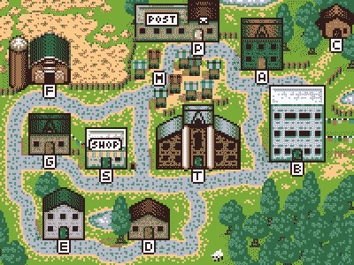

村庄的道路网络形成了一个图。图是由点（村庄中的地点）和它们之间的线（道路）组成的集合。这个图将是我们的机器人移动的世界。

字符串数组不太容易处理。我们感兴趣的是从给定地点可以到达的目的地。让我们将道路列表转换为一个数据结构，对于每个地点，该结构告诉我们从那里可以到达哪些地方。

```javascript
function buildGraph(edges) {
  let graph = Object.create(null);
  function addEdge(from, to) {
    if (graph[from] == null) {
      graph[from] = [to];
    } else {
      graph[from].push(to);
    }
  }
  for (let [from, to] of edges.map(r => r.split("-"))) {
    addEdge(from, to);
    addEdge(to, from);
  }
  return graph;
}

const roadGraph = buildGraph(roads);
```

给定一个边数组，`buildGraph` 创建一个映射对象，对于每个节点，存储一个相连节点的数组。

它使用 `split` 方法将道路字符串（格式为 `"Start-End"`）转换为包含起点和终点的两个元素的数组。

## 任务

我们的机器人将在村庄中移动。各个地方都有包裹，每个包裹都寄往另一个地方。机器人遇到包裹时将其拾起，到达目的地时将其送达。

自动机必须在每个时刻决定下一步去哪里。当所有包裹都送达后，任务完成。

为了模拟这个过程，我们需要定义一个能够描述它的虚拟世界。这个模型告诉我们机器人在哪里，包裹在哪里。当机器人决定移动到某处时，我们需要更新模型以反映新情况。

如果你以面向对象编程的角度思考，你的第一反应可能是为世界中的各种元素定义对象：一个机器人类，一个包裹类，也许还有地点类。这些对象可以持有描述其当前状态的属性，例如某个地点的包裹堆，我们可以在更新世界时改变它。

这是错误的。

至少，通常如此。某件事听起来像对象，并不自动意味着它应该成为程序中的对象。为应用程序中的每个概念反射性地编写类，往往会让你得到一堆相互连接的对象，每个对象都有自己的内部可变状态。这样的程序通常难以理解，因此容易出错。

相反，让我们将村庄的状态浓缩为定义它的最小值集合。有机器人的当前位置和未送达包裹的集合，每个包裹都有当前位置和目的地地址。仅此而已。

同时，让我们做到：当机器人移动时，我们不改变这个状态，而是为移动后的情况计算一个新状态。

```javascript
class VillageState {
  constructor(place, parcels) {
    this.place = place;
    this.parcels = parcels;
  }

  move(destination) {
    if (!roadGraph[this.place].includes(destination)) {
      return this;
    } else {
      let parcels = this.parcels.map(p => {
        if (p.place != this.place) return p;
        return {place: destination, address: p.address};
      }).filter(p => p.place != p.address);
      return new VillageState(destination, parcels);
    }
  }
}
```

`move` 方法是动作发生的地方。它首先检查是否存在从当前位置到目的地的道路，如果没有，则返回旧状态，因为这不是一个有效的移动。

然后它创建一个新状态，将目的地作为机器人的新位置。但它还需要创建一组新的包裹——机器人携带的包裹（位于机器人当前位置的包裹）需要被移动到新位置。而寄往新地点的包裹需要被送达——也就是说，它们需要从未送达包裹集合中移除。`map` 调用负责移动，`filter` 调用负责送达。

包裹对象在移动时不会被改变，而是被重新创建。`move` 方法给我们一个新的村庄状态，但完全保留旧状态不变。

```javascript
let first = new VillageState(
  "Post Office",
  [{place: "Post Office", address: "Alice's House"}]
);
let next = first.move("Alice's House");

console.log(next.place);
// → Alice's House
console.log(next.parcels);
// → []
console.log(first.place);
// → Post Office
```

移动导致包裹被送达，这反映在下一个状态中。但初始状态仍然描述了机器人位于邮局且包裹未送达的情况。

## 持久化数据

不会改变的数据结构被称为不可变或持久化。它们的行为很像字符串和数字：它们就是它们自己，并且保持那样，而不是在不同时间包含不同的东西。

在 JavaScript 中，几乎一切都可以被改变，因此使用本应持久化的值需要一些克制。有一个名为 `Object.freeze` 的函数，它可以改变一个对象，使得对其属性的写入被忽略。如果你想要小心谨慎，可以使用它来确保你的对象不被改变。冻结确实需要计算机做一些额外的工作，而忽略更新与让它们做错误的事情一样容易让人困惑。所以我通常更倾向于直接告诉人们某个给定的对象不应该被乱动，并希望他们记住这一点。

```javascript
let object = Object.freeze({value: 5});
object.value = 10;
console.log(object.value);
// → 5
```

为什么当语言显然期望我改变对象时，我却要费尽心思不去改变它们？

因为这有助于我理解我的程序。这又是关于复杂性管理。当我系统中的对象是固定、稳定的事物时，我可以孤立地考虑对它们的操作——从给定的起始状态移动到 Alice 的房子总是产生相同的新状态。当对象随时间变化时，这给这种推理增加了一个全新的复杂性维度。

对于像本章中构建的小型系统，我们可以处理那一点额外的复杂性。但对我们能构建什么样的系统最重要的限制是我们能理解多少。任何让你的代码更容易理解的东西，都使得构建更雄心勃勃的系统成为可能。

不幸的是，虽然理解基于持久化数据结构的系统更容易，但设计一个这样的系统，尤其是当你的编程语言不提供帮助时，可能会稍微困难一些。在本书中，我们将寻找使用持久化数据结构的机会，但也会使用可变的数据结构。

## 模拟

一个送货机器人观察世界并决定它想要朝哪个方向移动。因此，我们可以说机器人是一个函数，它接收一个 `VillageState` 对象并返回附近地点的名称。

因为我们希望机器人能够记住东西，以便它们可以制定和执行计划，所以我们还会传递它们的记忆，并允许它们返回一个新的记忆。因此，机器人返回的东西是一个对象，包含它想要移动的方向以及一个记忆值，该值将在下次调用时返回给它。

```javascript
function runRobot(state, robot, memory) {
  for (let turn = 0;; turn++) {
    if (state.parcels.length == 0) {
      console.log(`Done in ${turn} turns`);
      break;
    }
    let action = robot(state, memory);
    state = state.move(action.direction);
    memory = action.memory;
    console.log(`Moved to ${action.direction}`);
  }
}
```

考虑一下机器人要“解决”一个给定状态需要做什么。它必须访问每个有包裹的地点来拾取所有包裹，然后访问每个包裹所寄往的地点来投递它们，但必须在拾取包裹之后才能投递。

哪种最笨的策略可能奏效？机器人可以每回合随机朝一个方向走。这意味着，它极有可能最终会碰到所有包裹，然后也会在某个时刻到达它们应该被投递的地方。

下面就是这种策略的样子：

```javascript
function randomPick(array) {
  let choice = Math.floor(Math.random() * array.length);
  return array[choice];
}

function randomRobot(state) {
  return {direction: randomPick(roadGraph[state.place])};
}
```

记住，`Math.random()` 返回一个介于 0 和 1 之间的数——但总是小于 1。将这个数乘以数组的长度，然后应用 `Math.floor`，就能得到数组的一个随机索引。

由于这个机器人不需要记住任何东西，它会忽略第二个参数（记住，JavaScript 函数可以用额外的参数调用而不会产生不良影响），并在返回的对象中省略 `memory` 属性。

为了让这个精密的机器人开始工作，我们首先需要一种方法来创建一个带有一些包裹的新状态。静态方法（这里通过直接向构造函数添加属性来编写）是放置该功能的好地方。

```javascript
VillageState.random = function(parcelCount = 5) {
  let parcels = [];
  for (let i = 0; i < parcelCount; i++) {
    let address = randomPick(Object.keys(roadGraph));
    let place;
    do {
      place = randomPick(Object.keys(roadGraph));
    } while (place == address);
    parcels.push({place, address});
  }
  return new VillageState("Post Office", parcels);
};
```

我们不希望有任何包裹是从与收件地址相同的地方寄出的。因此，`do` 循环会在选到与地址相同的地点时继续挑选新地点。

让我们启动一个虚拟世界。

```javascript
runRobot(VillageState.random(), randomRobot);
// → Moved to Marketplace
// → Moved to Town Hall
// → …
// → Done in 63 turns
```

机器人需要很多回合才能投递完包裹，因为它没有很好地提前规划。我们很快就会解决这个问题。

## 邮车的路线


我们应该能够比随机机器人做得好得多。一个简单的改进是借鉴现实世界邮件投递的方式。如果我们找到一条经过村庄所有地点的路线，机器人可以运行该路线两次，这样它就能保证完成任务。下面就是一条这样的路线（从邮局开始）：

```javascript
const mailRoute = [
  "Alice's House", "Cabin", "Alice's House", "Bob's House",
  "Town Hall", "Daria's House", "Ernie's House",
  "Grete's House", "Shop", "Grete's House", "Farm",
  "Marketplace", "Post Office"
];
```

为了实现沿路线行走的机器人，我们需要利用机器人的记忆。机器人将路线的剩余部分保存在记忆中，每回合丢弃第一个元素。

```javascript
function routeRobot(state, memory) {
  if (memory.length == 0) {
    memory = mailRoute;
  }
  return {direction: memory[0], memory: memory.slice(1)};
}
```

这个机器人已经快了很多。它最多需要 26 回合（13 步路线的两倍），但通常更少。

## 寻路

不过，我仍然不会把盲目遵循固定路线称为智能行为。如果机器人能够根据实际需要完成的工作来调整自己的行为，它就能更高效地工作。

要做到这一点，它必须能够有目的地向某个包裹移动，或者向包裹需要投递的地点移动。即使目标距离不止一步，这也需要某种寻路函数。

在图中寻找路线的问题是一个典型的*搜索问题*。我们可以判断一个给定的解（一条路线）是否有效，但我们不能像计算 2+2 那样直接计算出解。相反，我们必须不断创建可能的解，直到找到一个可行的。

通过图的可能路线数量是无限的。但在搜索从 *A* 到 *B* 的路线时，我们只关心那些从 *A* 开始的路线。我们也不关心那些重复访问同一地点的路线——这些肯定不是最有效的路线。这样就减少了寻路器需要考虑的路线数量。

事实上，我们最感兴趣的是*最短*路线。所以我们希望确保在查看较长路线之前先查看短路线。一个好的方法是从起点“生长”路线，探索每个尚未访问过的可达地点，直到某条路线到达目标。这样，我们只会探索那些可能有趣的路线，并且会找到到达目标的最短路线（如果有多条，则找到其中一条）。

下面是一个实现此功能的函数：

```javascript
function findRoute(graph, from, to) {
  let work = [{at: from, route: []}];
  for (let i = 0; i < work.length; i++) {
    let {at, route} = work[i];
    for (let place of graph[at]) {
      if (place == to) return route.concat(place);
      if (!work.some(w => w.at == place)) {
        work.push({at: place, route: route.concat(place)});
      }
    }
  }
}
```

探索必须按正确的顺序进行——先到达的地点必须先探索。我们不能一到达某个地点就立即探索它，因为那意味着从*那里*到达的地点也会被立即探索，依此类推，即使可能存在其他尚未探索的更短路径。

因此，该函数维护一个*工作列表*。这是一个数组，包含接下来应该探索的地点以及到达该地点的路线。它从起始位置和空路线开始。

然后，搜索通过取出列表中的下一个项目并对其进行探索来运行，这意味着会查看从该地点出发的所有道路。如果其中一条是目标，则可以返回一条完整的路线。否则，如果我们之前没有查看过这个地点，则向列表中添加一个新项目。如果我们之前查看过它，由于我们先查看短路线，那么我们已经找到了到达该地点的更长路线或与现有路线一样长的路线，因此不需要再探索它。

你可以直观地将其想象成一张已知路线的网，从起始位置向外爬行，均匀地向各个方向生长（但从不缠绕回自身）。一旦第一条线到达目标位置，这条线就会被回溯到起点，从而得到我们的路线。

我们的代码没有处理工作列表中没有更多工作项的情况，因为我们知道我们的图是*连通的*，这意味着每个位置都可以从其他所有位置到达。我们总是能够找到两点之间的路径，搜索不会失败。

```javascript
function goalOrientedRobot({place, parcels}, route) {
  if (route.length == 0) {
    let parcel = parcels[0];
    if (parcel.place != place) {
      route = findRoute(roadGraph, place, parcel.place);
    } else {
      route = findRoute(roadGraph, place, parcel.address);
    }
  }
  return {direction: route[0], memory: route.slice(1)};
}
```

这个机器人使用其记忆值作为移动方向的列表，就像循迹机器人一样。每当列表为空时，它必须决定下一步做什么。它取集合中的第一个未送达包裹，如果该包裹尚未被拾取，则规划一条前往该包裹的路线。如果包裹*已经*被拾取，则仍需送达，因此机器人会规划一条前往送达地址的路线。

这个机器人通常在大约 16 个回合内完成送达 5 个包裹的任务。这比`routeRobot`稍好，但肯定不是最优的。

## 练习

### 测量机器人

仅仅通过让机器人解决几个场景来客观比较它们是很困难的。也许一个机器人恰好遇到了更简单的任务，或者它擅长的任务，而另一个则没有。

编写一个函数`compareRobots`，它接受两个机器人（以及它们的初始记忆）。它应该生成 100 个任务，并让每个机器人解决每个任务。完成后，它应该输出每个机器人每个任务的平均步数。

为了公平起见，确保将每个任务分配给两个机器人，而不是为每个机器人生成不同的任务。

### 机器人效率

你能编写一个比`goalOrientedRobot`更快完成送达任务的机器人吗？如果你观察那个机器人的行为，它做了哪些明显愚蠢的事情？如何改进这些行为？

如果你解决了上一个练习，你可能想使用你的`compareRobots`函数来验证你是否改进了机器人。

### 持久化组

标准 JavaScript 环境中提供的大多数数据结构不太适合持久化使用。数组有`slice`和`concat`方法，允许我们轻松创建新数组而不损坏旧数组。但是，例如`Set`没有用于创建添加或删除项的新集合的方法。

编写一个新类`PGroup`，类似于第 6 章中的`Group`类，它存储一组值。与`Group`一样，它有`add`、`delete`和`has`方法。

然而，它的`add`方法应该返回一个*新*的`PGroup`实例，其中添加了给定成员，并保持旧实例不变。类似地，`delete`创建一个没有给定成员的新实例。

该类应该适用于任何类型的值，而不仅仅是字符串。在处理大量值时，它不必高效。

构造函数不应成为类接口的一部分（尽管你肯定会在内部使用它）。相反，有一个空实例`PGroup.empty`，可以用作起始值。

为什么你只需要一个`PGroup.empty`值，而不是有一个每次创建新的空映射的函数？

# 第 8 章 错误与缺陷

> 调试的难度是编写代码的两倍。因此，如果你尽可能巧妙地编写代码，那么按定义，你就不够聪明去调试它。
>
> ——布莱恩·克尼汉和 P.J.普劳格，《编程风格要素》


计算机程序中的缺陷通常被称为*bug*。把它们想象成偶然爬进我们工作的小东西，会让程序员感觉良好。实际上，当然是我们自己把它们放进去的。

如果程序是思想的结晶，你可以大致将 bug 分为两类：一类是由思想混乱引起的，另一类是由将思想转化为代码时引入的错误引起的。前一类通常比后一类更难诊断和修复。

## 语言

如果计算机足够了解我们试图做什么，许多错误可以自动被指出。但在这里，JavaScript 的松散性是一个障碍。它对绑定和属性的概念足够模糊，以至于在程序实际运行之前很少能捕捉到拼写错误。即使在那时，它也允许你做一些明显无意义的事情而不抱怨，比如计算`true * "monkey"`。

有些事情 JavaScript 会抱怨。编写不符合语言语法的程序会立即让计算机抱怨。其他事情，比如调用不是函数的东西或访问未定义值的属性，会在程序尝试执行该操作时报告错误。

但通常，你的无意义计算只会产生`NaN`（非数字）或未定义值，而程序会愉快地继续，确信自己在做有意义的事情。错误只会在之后显现，当虚假值经过多个函数后。它可能根本不会触发错误，而是悄无声息地导致程序输出错误。找到这类问题的根源可能很困难。

在程序中寻找错误——bug——的过程被称为*调试*。

## 严格模式

通过启用*严格模式*，可以让 JavaScript 变得*稍微*严格一些。这可以通过在文件或函数体顶部放置字符串`"use strict"`来实现。下面是一个例子：

```javascript
function canYouSpotTheProblem() {
  "use strict";
  for (counter = 0; counter < 10; counter++) {
    console.log("Happy happy");
  }
}

canYouSpotTheProblem();
// → ReferenceError: counter is not defined
```

通常，当你忘记在绑定前加上`let`时，就像例子中的`counter`一样，JavaScript 会静默地创建一个全局绑定并使用它。在严格模式下，会报告一个错误。这非常有帮助。但需要注意的是，如果所讨论的绑定已经作为全局绑定存在，则此方法不起作用。在这种情况下，循环仍然会静默地覆盖该绑定的值。

严格模式的另一个变化是，在未作为方法调用的函数中，`this`绑定持有值`undefined`。在非严格模式下进行此类调用时，`this`引用全局作用域对象，该对象的属性是全局绑定。因此，如果在严格模式下错误地调用方法或构造函数，JavaScript 会在尝试从`this`读取内容时立即产生错误，而不是愉快地写入全局作用域。

例如，考虑以下代码，它调用构造函数时没有使用`new`关键字，因此其`this`将*不*引用新构造的对象：

```javascript
function Person(name) { this.name = name; }
let ferdinand = Person("Ferdinand"); // 哎呀
console.log(name);
// → Ferdinand
```

因此，对`Person`的错误调用虽然成功了，但返回了一个未定义的值，并创建了全局绑定`name`。在严格模式下，结果则不同。

```javascript
"use strict";
function Person(name) { this.name = name; }
let ferdinand = Person("Ferdinand"); // 忘记 new
// → TypeError: Cannot set property 'name' of undefined
```

我们立刻被告知出了问题。这很有帮助。

幸运的是，使用`class`语法创建的构造函数，如果在没有`new`的情况下被调用，总会发出警告，这使得即使在非严格模式下，这个问题也不那么严重。

严格模式还做了其他几件事。它禁止函数拥有多个同名参数，并完全移除了一些有问题的语言特性（例如`with`语句，它错得离谱，本书不再进一步讨论）。

简而言之，在程序顶部加上`"use strict"`几乎不会造成伤害，反而可能帮助你发现问题。

## 类型

有些语言希望在运行程序之前就知道所有绑定和表达式的类型。当类型使用不一致时，它们会立即告诉你。而 JavaScript 只在实际运行程序时才考虑类型，甚至在那时也常常尝试隐式地将值转换为它期望的类型，所以帮助不大。

尽管如此，类型为讨论程序提供了一个有用的框架。许多错误源于对函数输入或输出值的类型感到困惑。如果你把这些信息写下来，就不太容易混淆了。

你可以在上一章的`goalOrientedRobot`函数之前添加如下注释来描述其类型：

```javascript
// (VillageState, Array) → {direction: string, memory: Array}
function goalOrientedRobot(state, memory) {
  // ...
}
```

有几种不同的约定用于为 JavaScript 程序添加类型注释。

关于类型的一点是，它们需要引入自身的复杂性，才能描述足够多的代码以发挥作用。你认为`randomPick`函数（从数组中返回一个随机元素）的类型应该是什么？你需要引入一个*类型变量*`T`，它可以代表任何类型，这样你就可以给`randomPick`一个像`([T]) → T`这样的类型（从`T`的数组到`T`的函数）。

当程序的类型已知时，计算机可以为你*检查*它们，在程序运行之前指出错误。有几种 JavaScript 方言为语言添加了类型并对其进行检查。最流行的一种叫做 [TypeScript](https://www.typescriptlang.org/)。如果你有兴趣为程序增加严谨性，我建议你尝试一下。

在本书中，我们将继续使用原始、危险、无类型的 JavaScript 代码。

## 测试

如果语言不能帮助我们找到错误，我们就得用更困难的方式：运行程序，看看它是否做了正确的事情。

一遍又一遍地手动做这件事是个非常糟糕的主意。不仅烦人，而且往往效率低下，因为每次修改后都要花大量时间进行全面测试。

计算机擅长重复性任务，而测试正是理想的重复性任务。自动化测试就是编写一个程序来测试另一个程序的过程。编写测试比手动测试要多花一点功夫，但一旦完成，你就获得了一种超能力：只需几秒钟就能验证你的程序在你编写测试的所有情况下是否仍然表现正常。当你破坏了某些东西时，你会立即注意到，而不是在以后某个时候随机遇到它。

测试通常采用带有标签的小程序形式，用于验证代码的某些方面。例如，一组针对（标准的、可能已经被别人测试过的）`toUpperCase`方法的测试可能如下所示：

```javascript
function test(label, body) {
  if (!body()) console.log(`Failed: ${label}`);
}

test("将拉丁文本转换为大写", () => {
  return "hello".toUpperCase() == "HELLO";
});
test("将希腊文本转换为大写", () => {
  return "Χαίρετε".toUpperCase() == "ΧΑΊΡΕΤΕ";
});
test("不转换无大小写字符", () => {
  return "مرحبا".toUpperCase() == "مرحبا";
});
```

像这样编写测试往往会产生相当重复、笨拙的代码。幸运的是，有一些软件可以通过提供适合表达测试的语言（以函数和方法的形式）以及在测试失败时输出信息性信息，来帮助你构建和运行测试集合（*测试套件*）。这些通常被称为*测试运行器*。

有些代码比其他代码更容易测试。一般来说，代码交互的外部对象越多，设置测试上下文就越困难。上一章中展示的编程风格（使用自包含的持久值而不是改变对象）往往更容易测试。

## 调试

一旦你注意到程序出现问题（行为异常或产生错误），下一步就是找出*问题所在*。

有时问题很明显。错误消息会指向程序中的特定行，如果你查看错误描述和那行代码，通常就能发现问题。

但并非总是如此。有时触发问题的行只是某个其他地方产生的不可靠值被以无效方式使用的第一个位置。如果你已经解决了前面章节中的练习，你可能已经经历过这种情况。

下面的示例程序试图通过反复取出最后一位数字，然后除以该数字来去掉这一位，从而将一个整数转换为给定进制（十进制、二进制等）的字符串。但它当前产生的奇怪输出表明它有一个 bug。


```javascript
function numberToString(n, base = 10) {
  let result = "", sign = "";
  if (n < 0) {
    sign = "-";
    n = -n;
  }
  do {
    result = String(n % base) + result;
    n /= base;
  } while (n > 0);
  return sign + result;
}
console.log(numberToString(13, 10));
// → 1.5e-3231.3e-3221.3e-3211.3e-3201.3e-3191.3e-3181.3…
```

即使你已经看到了问题，暂时假装没看到。我们知道程序运行不正常，想要找出原因。

这时你必须抵制住冲动，不要开始对代码进行随机修改，看看是否能改善情况。相反，要*思考*。分析正在发生的事情，并提出一个可能的原因理论。然后，进行额外的观察来检验这个理论——或者，如果你还没有理论，就进行额外的观察来帮助你提出一个理论。

在程序中加入几个策略性的 `console.log` 调用，是获取程序运行额外信息的好方法。在这个例子中，我们希望 `n` 依次取值为 `13`、`1`，然后 `0`。让我们在循环开始时输出它的值。

```
13
1.3
0.13
0.013
…
1.5e-323
```

*没错*。13 除以 10 并不会得到一个整数。我们实际需要的不是 `n /= base`，而是 `n = Math.floor(n / base)`，这样数字才能正确地“右移”。

除了使用 `console.log` 来窥探程序行为之外，另一种方法是利用浏览器的*调试器*功能。浏览器允许你在代码的特定行设置*断点*。当程序执行到带有断点的行时，它会暂停，此时你可以检查当前绑定的值。由于不同浏览器的调试器有所差异，这里不再赘述，但你可以查看浏览器的开发者工具或搜索网络获取更多信息。

另一种设置断点的方法是在程序中包含一条 `debugger` 语句（仅由该关键字组成）。如果浏览器的开发者工具处于激活状态，程序会在执行到该语句时暂停。

## 错误传播

不幸的是，并非所有问题都能由程序员预防。如果你的程序以任何方式与外部世界通信，就有可能收到格式错误的输入、工作负载过重或网络故障。

如果你只是为自己编程，你可以忽略这些问题直到它们发生。但如果你构建的东西要给别人使用，你通常希望程序做得比直接崩溃更好。有时正确的做法是坦然接受错误输入并继续运行。在其他情况下，最好向用户报告出了什么问题，然后放弃。但无论哪种情况，程序都必须主动对问题做出反应。

假设你有一个函数 `promptInteger`，它向用户询问一个整数并返回它。如果用户输入“orange”，它应该返回什么？

一种选择是让它返回一个特殊值。常见的此类值有 `null`、`undefined` 或 `-1`。

```javascript
function promptNumber(question) {
  let result = Number(prompt(question));
  if (Number.isNaN(result)) return null;
  else return result;
}

console.log(promptNumber("How many trees do you see?"));
```

现在，任何调用 `promptNumber` 的代码都必须检查是否读取到了实际数字，如果没有，则必须以某种方式恢复——可能是再次询问，或者填入一个默认值。或者它也可以再次向*它的*调用者返回一个特殊值，以表明它未能完成所要求的任务。

在许多情况下，尤其是当错误很常见且调用者应该明确考虑它们时，返回一个特殊值是表示错误的好方法。然而，它也有缺点。首先，如果函数已经可以返回所有可能的值，该怎么办？在这种情况下，你必须将结果包装在一个对象中，以便能够区分成功和失败。

```javascript
function lastElement(array) {
  if (array.length == 0) {
    return {failed: true};
  } else {
    return {element: array[array.length - 1]};
  }
}
```

返回特殊值的第二个问题是它可能导致笨拙的代码。如果一段代码调用了 `promptNumber` 10 次，它就必须检查 10 次是否返回了 `null`。而如果它对发现 `null` 的响应仅仅是返回 `null` 本身，那么该函数的调用者又必须检查它，依此类推。

## 异常

当一个函数无法正常进行时，我们*想要*做的就是停止当前操作，并立即跳转到知道如何处理问题的地方。这就是*异常处理*所做的。

异常是一种机制，它允许遇到问题的代码*抛出*（或*引发*）一个异常。异常可以是任何值。抛出异常有点像函数的一次强力返回：它不仅跳出当前函数，还会跳出它的调用者，一直向下直到启动当前执行的第一个调用。这被称为*展开栈*。你可能还记得第 3 章中提到的函数调用栈。异常沿着这个栈向下飞驰，丢弃它遇到的所有调用上下文。

如果异常总是直接飞驰到栈底，那它们就没多大用处了。它们只会提供一种新颖的方式来搞垮你的程序。它们的威力在于，你可以在栈上设置“障碍物”，在异常飞驰而下时*捕获*它。一旦捕获了异常，你就可以用它来处理问题，然后继续运行程序。

下面是一个例子：

```javascript
function promptDirection(question) {
  let result = prompt(question);
  if (result.toLowerCase() == "left") return "L";
  if (result.toLowerCase() == "right") return "R";
  throw new Error("Invalid direction: " + result);
}

function look() {
  if (promptDirection("Which way?") == "L") {
    return "a house";
  } else {
    return "two angry bears";
  }
}

try {
  console.log("You see", look());
} catch (error) {
  console.log("Something went wrong: " + error);
}
```

`throw` 关键字用于抛出异常。捕获异常的方法是将一段代码包裹在 `try` 块中，后面跟着关键字 `catch`。当 `try` 块中的代码导致异常被抛出时，`catch` 块会被执行，括号中的名称绑定到异常值。在 `catch` 块执行完毕后——或者如果 `try` 块没有出现问题就执行完毕——程序会继续执行整个 `try/catch` 语句之后的代码。

在这个例子中，我们使用了 `Error` 构造函数来创建异常值。这是一个标准的 JavaScript 构造函数，它会创建一个带有 `message` 属性的对象。在大多数 JavaScript 环境中，该构造函数的实例还会收集异常创建时存在的调用栈信息，即所谓的*栈追踪*。这些信息存储在 `stack` 属性中，在调试问题时很有帮助：它告诉我们问题发生在哪个函数，以及哪些函数导致了失败的调用。

注意，`look` 函数完全忽略了 `promptDirection` 可能出错的可能性。这就是异常的一大优势：错误处理代码只需要出现在错误发生的地方和错误被处理的地方。中间的函数可以完全忘记这件事。

嗯，差不多吧……

## 异常后的清理

异常的效果是另一种控制流。每个可能引发异常的动作——几乎每个函数调用和属性访问——都可能导致控制权突然离开你的代码。

这意味着当代码有多个副作用时，即使它的“常规”控制流看起来它们总会发生，异常也可能阻止其中一些副作用的执行。

下面是一些非常糟糕的银行代码。

```javascript
const accounts = {
  a: 100,
  b: 0,
  c: 20
};

function getAccount() {
  let accountName = prompt("Enter an account name");
  if (!accounts.hasOwnProperty(accountName)) {
    throw new Error(`No such account: ${accountName}`);
  }
  return accountName;
}

function transfer(from, amount) {
  if (accounts[from] < amount) return;
  accounts[from] -= amount;
  accounts[getAccount()] += amount;
}
```

`transfer` 函数将一笔钱从一个给定账户转移到另一个账户，过程中会询问另一个账户的名称。如果给定的账户名无效，`getAccount` 会抛出一个异常。

但 `transfer` *首先*从账户中扣除金额，*然后*在将金额添加到另一个账户之前调用 `getAccount`。如果此时因异常而中断，就会导致资金凭空消失。

这段代码本可以写得更聪明一些，例如在开始转账之前先调用 `getAccount`。但这类问题往往以更微妙的方式出现。即使看起来不会抛出异常的函数，在特殊情况下或包含程序员错误时也可能抛出异常。

解决这个问题的一种方法是减少副作用。同样，一种计算新值而非修改现有数据的编程风格会有所帮助。如果一段代码在创建新值的过程中停止运行，没有人会看到半成品值，也就不会出现问题。

但这并不总是可行的。因此，`try` 语句还有另一个特性。它们可以后跟一个 `finally` 块，用来替代或补充 `catch` 块。`finally` 块的意思是“无论*发生什么*，在尝试运行 `try` 块中的代码之后，都要执行这段代码。”

```javascript
function transfer(from, amount) {
  if (accounts[from] < amount) return;
  let progress = 0;
  try {
    accounts[from] -= amount;
    progress = 1;
    accounts[getAccount()] += amount;
    progress = 2;
  } finally {
    if (progress == 1) {
      accounts[from] += amount;
    }
  }
}
```

这个版本的函数会跟踪进度，如果在退出时发现程序在某个点被中止，导致状态不一致，它会修复造成的损害。

注意，即使 `try` 块中抛出异常时 `finally` 代码会执行，它也不会干扰异常。`finally` 块执行完毕后，堆栈继续展开。

编写即使在意外位置出现异常也能可靠运行的程序是很困难的。许多人干脆不理会，因为异常通常只保留给特殊情况，问题可能极少发生，甚至从未被注意到。这是好事还是坏事，取决于软件失败时会造成多大的损害。

## 选择性捕获

当异常一直传播到堆栈底部而未被捕获时，它会被环境处理。不同环境下的处理方式不同。在浏览器中，错误的描述通常会被写入 JavaScript 控制台（可通过浏览器的“工具”或“开发者”菜单访问）。Node.js（我们将在第 20 章中讨论的无浏览器 JavaScript 环境）对数据损坏更加谨慎。当发生未处理的异常时，它会中止整个进程。

对于程序员错误，通常最好的做法就是让错误继续传播。未处理的异常是表明程序出现问题的合理方式，在现代浏览器中，JavaScript 控制台会提供一些信息，告诉你问题发生时哪些函数调用在堆栈上。

对于在常规使用中*预期*会发生的问题，用未处理的异常导致崩溃是一种糟糕的策略。

对语言的不当使用，例如引用不存在的绑定、在 `null` 上查找属性或调用非函数的内容，也会导致抛出异常。这些异常也可以被捕获。

当进入 `catch` 块时，我们只知道 `try` 块中的*某些东西*导致了异常。但我们不知道是*什么*导致的，也不知道它导致了*哪个*异常。

JavaScript（一个相当明显的遗漏）没有提供直接支持选择性捕获异常：要么捕获所有异常，要么一个都不捕获。这使得人们很容易*假设*捕获到的异常就是编写 `catch` 块时想到的那个异常。

但事实可能并非如此。可能违反了其他假设，或者你可能引入了一个导致异常的 bug。下面是一个*试图*持续调用 `promptDirection` 直到获得有效答案的示例：

```javascript
for (;;) {
  try {
    let dir = promtDirection("Where?"); // ← 拼写错误！
    console.log("You chose ", dir);
    break;
  } catch (e) {
    console.log("Not a valid direction. Try again.");
  }
}
```

`for (;;)` 结构是一种有意创建不会自行终止的循环的方式。只有当给出有效方向时，我们才会跳出循环。*但是*我们拼写错了 `promptDirection`，这会导致“未定义变量”错误。由于 `catch` 块完全忽略了异常值（`e`），并假设自己知道问题所在，它错误地将绑定错误视为输入无效。这不仅导致无限循环，还“掩埋”了关于拼写错误绑定的有用错误信息。

作为一般规则，不要无差别地捕获所有异常，除非是为了将它们“路由”到某个地方——例如通过网络告诉另一个系统我们的程序崩溃了。即使如此，也要仔细考虑你可能隐藏了哪些信息。

因此，我们希望捕获*特定*类型的异常。我们可以通过在 `catch` 块中检查捕获到的异常是否是我们感兴趣的那个，如果不是则重新抛出。但如何识别异常呢？

我们可以将其 `message` 属性与我们期望的错误消息进行比较。但这不是一种可靠的编码方式——我们使用本应供人类阅读的信息（消息）来做程序决策。一旦有人更改（或翻译）了消息，代码就会失效。

相反，让我们定义一种新的错误类型，并使用 `instanceof` 来识别它。

```javascript
class InputError extends Error {}

function promptDirection(question) {
  let result = prompt(question);
  if (result.toLowerCase() == "left") return "L";
  if (result.toLowerCase() == "right") return "R";
  throw new InputError("Invalid direction: " + result);
}
```

新的错误类扩展了 `Error`。它没有定义自己的构造函数，这意味着它继承了 `Error` 构造函数，该构造函数接受一个字符串消息作为参数。实际上，它什么也没定义——这个类是空的。`InputError` 对象的行为与 `Error` 对象类似，只是它们有一个不同的类，我们可以通过这个类来识别它们。

现在，循环可以更仔细地捕获这些异常了。

```javascript
for (;;) {
  try {
    let dir = promptDirection("Where?");
    console.log("You chose ", dir);
    break;
  } catch (e) {
    if (e instanceof InputError) {
      console.log("Not a valid direction. Try again.");
    } else {
      throw e;
    }
  }
}
```

这样只会捕获 `InputError` 的实例，而让无关的异常通过。如果你重新引入拼写错误，未定义的绑定错误就会被正确报告。

## 断言

*断言*是程序内部的检查，用于验证某些内容是否符合预期。它们不是用来处理正常操作中可能出现的情况，而是用来发现程序员的错误。

例如，如果 `firstElement` 被描述为一个永远不应该在空数组上调用的函数，我们可以这样写：


```javascript
function firstElement(array) {
  if (array.length == 0) {
    throw new Error("firstElement called with []");
  }
  return array[0];
}
```

现在，它不会默默地返回 `undefined`（当你读取一个不存在的数组属性时会得到这个值），而是会在你误用时立即让程序崩溃。这样，这类错误就不太容易被忽视，并且在发生时也更容易找到原因。

我不建议尝试为每一种可能的错误输入编写断言。那会是一项繁重的工作，并且会导致代码非常嘈杂。你应该只针对那些容易犯的错误（或者你发现自己经常犯的错误）保留断言。

## 总结

错误和不良输入是生活中不可避免的事实。编程的一个重要部分就是发现、诊断和修复 bug。如果你有自动化测试套件或在程序中添加断言，问题就会更容易被发现。

由程序控制之外的因素引起的问题通常应该优雅地处理。有时，当问题可以在本地处理时，特殊的返回值是一种很好的追踪方式。否则，异常可能是更好的选择。

抛出异常会导致调用栈展开，直到遇到下一个封闭的 `try/catch` 块或栈底。异常值会被传递给捕获它的 `catch` 块，该块应验证它是否确实是预期的异常类型，然后对其进行处理。为了应对异常引起的不可预测的控制流，可以使用 `finally` 块来确保某段代码在块结束时*始终*运行。

## 练习

### 重试

假设你有一个函数 `primitiveMultiply`，它在 20% 的情况下会相乘两个数字，而在另外 80% 的情况下会抛出一个类型为 `MultiplicatorUnitFailure` 的异常。编写一个函数来包装这个笨拙的函数，并不断重试，直到调用成功，然后返回结果。

确保你只处理你想要处理的异常。

### 锁定的盒子

考虑以下（相当牵强的）对象：

```javascript
const box = {
  locked: true,
  unlock() { this.locked = false; },
  lock() { this.locked = true;  },
  _content: [],
  get content() {
    if (this.locked) throw new Error("Locked!");
    return this._content;
  }
};
```

这是一个带锁的盒子。盒子里有一个数组，但只有在盒子解锁时才能访问它。直接访问私有的 `_content` 属性是被禁止的。

编写一个名为 `withBoxUnlocked` 的函数，它接受一个函数值作为参数，解锁盒子，运行该函数，然后确保在返回之前盒子再次被锁定，无论参数函数是正常返回还是抛出了异常。

# 第 9 章：正则表达式

> 有些人，当遇到问题时，会想：“我知道，我用正则表达式。” 现在他们有了两个问题。
>
> Jamie Zawinski

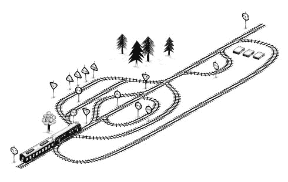

编程工具和技术以一种混乱、进化的方式生存和传播。胜出的往往不是那些漂亮或出色的工具，而是那些在合适领域内运行良好，或者恰好与另一个成功技术集成的工具。

在本章中，我将讨论这样一种工具：*正则表达式*。正则表达式是一种描述字符串数据模式的方式。它们形成了一种小型、独立的语言，是 JavaScript 以及许多其他语言和系统的一部分。

正则表达式既非常笨拙又极其有用。它们的语法晦涩难懂，JavaScript 为它们提供的编程接口也很笨拙。但它们是检查和操作字符串的强大工具。正确理解正则表达式将使你成为更高效的程序员。

## 创建正则表达式

正则表达式是一种对象类型。它可以通过 `RegExp` 构造函数构造，也可以通过将模式放在正斜杠（`/`）字符之间作为字面量值来编写。

```javascript
let re1 = new RegExp("abc");
let re2 = /abc/;
```

这两个正则表达式对象都表示相同的模式：一个 *a* 字符后面跟着一个 *b*，再后面跟着一个 *c*。

当使用 `RegExp` 构造函数时，模式被写成普通字符串，因此反斜杠的常规规则适用。

第二种表示法，即模式出现在斜杠字符之间，对反斜杠的处理略有不同。首先，由于正斜杠会结束模式，我们需要在想要成为模式*一部分*的任何正斜杠前加上反斜杠。此外，不属于特殊字符代码（如 `\n`）的反斜杠将被*保留*，而不是像在字符串中那样被忽略，并且会改变模式的含义。某些字符，如问号和加号，在正则表达式中有特殊含义，如果它们要表示字符本身，则必须在前面加上反斜杠。

```javascript
let eighteenPlus = /eighteen\+/;
```

## 测试匹配

正则表达式对象有许多方法。最简单的是 `test`。如果你向它传递一个字符串，它会返回一个布尔值，告诉你该字符串是否包含与表达式模式匹配的内容。

```javascript
console.log(/abc/.test("abcde"));
// → true
console.log(/abc/.test("abxde"));
// → false
```

一个仅由非特殊字符组成的正则表达式简单地表示该字符序列。如果 *abc* 出现在我们测试的字符串中的任何位置（不仅仅是开头），`test` 将返回 `true`。

## 字符集合

判断一个字符串是否包含 *abc* 也可以通过调用 `indexOf` 来实现。正则表达式允许我们表达更复杂的模式。

假设我们想匹配任何数字。在正则表达式中，将一组字符放在方括号内，会使表达式的该部分匹配括号内的任何字符。

以下两个表达式都匹配所有包含数字的字符串：

```javascript
console.log(/[0123456789]/.test("in 1992"));
// → true
console.log(/[0-9]/.test("in 1992"));
// → true
```

在方括号内，两个字符之间的连字符（`-`）可用于表示字符范围，其顺序由字符的 Unicode 编号决定。字符 0 到 9 在此顺序中紧邻（编码 48 到 57），因此 `[0-9]` 涵盖了所有这些字符，并匹配任何数字。

许多常见的字符组都有其内置的快捷方式。数字就是其中之一：`\d` 与 `[0-9]` 含义相同。

| 表达式 | 含义 |
| --- | --- |
| `\d` | 任意数字字符 |
| `\w` | 字母数字字符（“单词字符”） |
| `\s` | 任意空白字符（空格、制表符、换行符等） |
| `\D` | *非*数字字符 |
| `\W` | 非字母数字字符 |
| `\S` | 非空白字符 |
| `.` | 除换行符外的任意字符 |

因此，你可以用以下表达式匹配像 01-30-2003 15:20 这样的日期和时间格式：

```javascript
let dateTime = /\d\d-\d\d-\d\d\d\d \d\d:\d\d/;
console.log(dateTime.test("01-30-2003 15:20"));
// → true
console.log(dateTime.test("30-jan-2003 15:20"));
// → false
```

看起来非常糟糕，不是吗？其中一半是反斜杠，产生了背景噪音，使得难以看清实际表达的模式。稍后我们将看到这个表达式的略微改进版本。

这些反斜杠代码也可以在方括号内使用。例如，`[\d.]` 表示任意数字或句点字符。但句点本身在方括号内会失去其特殊含义。其他特殊字符也是如此，例如 `+`。

要*反转*一组字符——即表示你想匹配除集合中字符之外的*任何*字符——你可以在左括号后写一个脱字符（`^`）。

```javascript
let notBinary = /[⁰¹]/;
console.log(notBinary.test("1100100010100110"));
// → false
console.log(notBinary.test("1100100010200110"));
// → true
```

## 重复模式的部分

我们现在知道如何匹配单个数字。如果我们想匹配一个完整的数字——一个或多个数字的序列呢？

当你在正则表达式中某个元素后面加上加号（`+`）时，表示该元素可以重复一次或多次。因此，`/\d+/` 匹配一个或多个数字字符。

```javascript
console.log(/'\d+'/.test("'123'"));
// → true
console.log(/'\d+'/.test("''"));
// → false
console.log(/'\d*'/.test("'123'"));
// → true
console.log(/'\d*'/.test("''"));
// → true
```

星号（`*`）具有类似含义，但也允许模式匹配零次。带有星号的元素永远不会阻止模式匹配——如果找不到合适的文本匹配，它只会匹配零次。

问号使模式的一部分变为*可选*，意味着它可以出现零次或一次。在下面的示例中，允许出现 *u* 字符，但模式在缺少该字符时也能匹配。

```javascript
let neighbor = /neighbou?r/;
console.log(neighbor.test("neighbour"));
// → true
console.log(neighbor.test("neighbor"));
// → true
```

要表示模式应出现精确的次数，请使用花括号。例如，在元素后加上 `{4}` 要求它恰好出现四次。也可以使用这种方式指定范围：`{2,4}` 表示该元素必须至少出现两次，最多四次。

这是日期和时间模式的另一个版本，允许日和月以及小时为一位或两位数字。它也稍微更容易解读。

```javascript
let dateTime = /\d{1,2}-\d{1,2}-\d{4} \d{1,2}:\d{2}/;
console.log(dateTime.test("1-30-2003 8:45"));
// → true
```

使用花括号时，你也可以通过省略逗号后的数字来指定开放范围。因此，`{5,}` 表示五次或更多次。

## 分组子表达式

要同时对多个元素使用像 `*` 或 `+` 这样的运算符，你必须使用括号。正则表达式中用括号括起来的部分，对于其后的运算符而言，被视为一个单一元素。

```javascript
let cartoonCrying = /boo+(hoo+)+/i;
console.log(cartoonCrying.test("Boohoooohoohooo"));
// → true
```

第一个和第二个 `+` 字符分别仅应用于 *boo* 和 *hoo* 中的第二个 *o*。第三个 `+` 应用于整个组 `(hoo+)`，匹配一个或多个这样的序列。

示例中表达式末尾的 `i` 使此正则表达式不区分大小写，允许它匹配输入字符串中的大写 *B*，尽管模式本身全是小写。

## 匹配与分组

`test` 方法是匹配正则表达式的最简单方式。它只告诉你是否匹配，而不提供其他信息。正则表达式还有一个 `exec`（执行）方法，如果没有找到匹配则返回 `null`，否则返回一个包含匹配信息的对象。

```javascript
let match = /\d+/.exec("one two 100");
console.log(match);
// → ["100"]
console.log(match.index);
// → 8
```

`exec` 返回的对象有一个 `index` 属性，告诉我们成功匹配在字符串中的*位置*。除此之外，该对象看起来像（实际上就是）一个字符串数组，其第一个元素是匹配到的字符串。在前面的示例中，这就是我们寻找的数字序列。

字符串值有一个 `match` 方法，其行为类似。

```javascript
console.log("one two 100".match(/\d+/));
// → ["100"]
```

当正则表达式包含用括号分组的子表达式时，匹配这些组的文本也会出现在数组中。整个匹配始终是第一个元素。下一个元素是由第一个组（表达式中左括号最先出现的组）匹配的部分，然后是第二个组，依此类推。

```javascript
let quotedText = /'([^']*)'/;
console.log(quotedText.exec("she said 'hello'"));
// → ["'hello'", "hello"]
```

当一个组最终没有匹配到任何内容时（例如，当它后面跟着问号时），它在输出数组中的位置将持有 `undefined`。类似地，当一个组被多次匹配时，只有最后一次匹配会出现在数组中。

```javascript
console.log(/bad(ly)?/.exec("bad"));
// → ["bad", undefined]
console.log(/(\d)+/.exec("123"));
// → ["123", "3"]
```

分组对于提取字符串的一部分非常有用。如果我们不仅想验证字符串是否包含日期，还想提取它并构造一个表示日期的对象，我们可以将括号包裹在数字模式周围，并直接从 `exec` 的结果中提取日期。

但首先，我们将简短地绕道，讨论 JavaScript 中表示日期和时间值的内置方式。

## Date 类

JavaScript 有一个用于表示日期——或者更确切地说，时间点——的标准类。它叫做 `Date`。如果你简单地使用 `new` 创建一个日期对象，你会得到当前的日期和时间。

```javascript
console.log(new Date());
// → Mon Nov 13 2017 16:19:11 GMT+0100 (CET)
```

你也可以为特定时间创建一个对象。

```javascript
console.log(new Date(2009, 11, 9));
// → Wed Dec 09 2009 00:00:00 GMT+0100 (CET)
console.log(new Date(2009, 11, 9, 12, 59, 59, 999));
// → Wed Dec 09 2009 12:59:59 GMT+0100 (CET)
```

JavaScript 采用了一种约定，月份编号从零开始（因此 12 月是 11），而日期编号从一开始。这既令人困惑又显得愚蠢。请小心。

最后四个参数（小时、分钟、秒和毫秒）是可选的，未提供时默认为零。

时间戳存储为自 1970 年初以来经过的毫秒数，采用 UTC 时区。这遵循了大约在那个时候发明的“Unix 时间”所设定的约定。你可以使用负数表示 1970 年之前的时间。日期对象的 `getTime` 方法返回这个数字。可以想象，这个数字非常大。

```javascript
console.log(new Date(2013, 11, 19).getTime());
// → 1387407600000
console.log(new Date(1387407600000));
// → Thu Dec 19 2013 00:00:00 GMT+0100 (CET)
```

如果你给 `Date` 构造函数传递一个参数，该参数会被视为毫秒计数。你可以通过创建一个新的 `Date` 对象并调用其 `getTime` 方法，或者直接调用 `Date.now` 函数来获取当前的毫秒计数。

`Date` 对象提供了诸如 `getFullYear`、`getMonth`、`getDate`、`getHours`、`getMinutes` 和 `getSeconds` 等方法来提取其组成部分。除了 `getFullYear` 之外，还有 `getYear`，它返回年份减去 1900（`98` 或 `119`），但基本没什么用。

通过将我们感兴趣的表达式部分放在括号中，我们现在可以从字符串中创建一个日期对象。

```javascript
function getDate(string) {
  let [_, month, day, year] =
    /(\d{1,2})-(\d{1,2})-(\d{4})/.exec(string);
  return new Date(year, month - 1, day);
}
console.log(getDate("1-30-2003"));
// → Thu Jan 30 2003 00:00:00 GMT+0100 (CET)
```

`_`（下划线）绑定被忽略，仅用于跳过 `exec` 返回的数组中的完整匹配元素。

## 单词边界与字符串边界

不幸的是，`getDate` 也会愉快地从字符串 `"100-1-30000"` 中提取出无意义的日期 00-1-3000。匹配可能发生在字符串的任何位置，因此在这种情况下，它会从第二个字符开始，到倒数第二个字符结束。

如果我们希望强制匹配必须跨越整个字符串，可以添加标记 `^` 和 `$`。脱字符匹配输入字符串的开头，而美元符号匹配结尾。因此，`/^\d+$/` 匹配完全由一个或多个数字组成的字符串，`/^!/` 匹配任何以感叹号开头的字符串，而 `/x^/` 不匹配任何字符串（因为字符串开头之前不可能有 *x*）。

另一方面，如果我们只想确保日期在单词边界处开始和结束，可以使用标记 `\b`。单词边界可以是字符串的开头或结尾，也可以是字符串中一侧是单词字符（如 `\w` 所定义）、另一侧是非单词字符的任意位置。

```javascript
console.log(/cat/.test("concatenate"));
// → true
console.log(/\bcat\b/.test("concatenate"));
// → false
```

请注意，边界标记并不匹配实际的字符。它只是强制正则表达式仅在模式中该位置满足特定条件时才进行匹配。

## 选择模式


假设我们想知道一段文本是否不仅包含一个数字，而且该数字后面跟着单词 `pig`、`cow` 或 `chicken` 中的某一个，或者它们的复数形式。

我们可以编写三个正则表达式并依次测试它们，但有一种更好的方法。管道字符（`|`）表示其左侧模式与右侧模式之间的选择。因此我可以这样写：

```javascript
let animalCount = /\b\d+ (pig|cow|chicken)s?\b/;
console.log(animalCount.test("15 pigs"));
// → true
console.log(animalCount.test("15 pigchickens"));
// → false
```

括号可用于限制管道运算符所应用的模式部分，并且你可以将多个这样的运算符放在一起，以表达在多于两个备选项之间进行选择。

## 匹配的机制

从概念上讲，当你使用 `exec` 或 `test` 时，正则表达式引擎会尝试从字符串的开头开始匹配表达式，然后从第二个字符开始，依此类推，直到找到匹配或到达字符串末尾。它要么返回找到的第一个匹配，要么根本找不到任何匹配。

为了进行实际匹配，引擎将正则表达式视为某种流程图。这是上一个示例中牲畜表达式的流程图：


如果我们能找到一条从图表左侧到右侧的路径，那么我们的表达式就匹配成功。我们保持字符串中的当前位置，每次经过一个框时，我们都会验证当前位置之后的字符串部分是否与该框匹配。

因此，如果我们尝试从位置 4 匹配 `"the 3 pigs"`，那么我们在流程图中的进展将如下所示：

- 在位置 4，有一个单词边界，因此我们可以通过第一个框。
- 仍然在位置 4，我们找到一个数字，因此我们也可以通过第二个框。
- 在位置 5，一条路径循环回到第二个（数字）框之前，而另一条路径则向前通过包含单个空格字符的框。这里有一个空格，而不是数字，因此我们必须走第二条路径。
- 我们现在位于位置 6（`pigs` 的开头），并且处于图表中的三叉分支处。这里没有看到 `cow` 或 `chicken`，但我们看到了 `pig`，因此我们走那条分支。
- 在位置 9，经过三叉分支后，一条路径跳过 `s` 框直接到达最终的单词边界，而另一条路径则匹配一个 `s`。这里有一个 `s` 字符，而不是单词边界，因此我们通过 `s` 框。
- 我们到达位置 10（字符串的末尾），只能匹配一个单词边界。字符串的末尾算作一个单词边界，因此我们通过最后一个框，并成功匹配了这个字符串。

## 回溯

正则表达式 `/\b([01]+b|[\da-f]+h|\d+)\b/` 匹配一个后跟 `b` 的二进制数、一个后跟 `h` 的十六进制数（即基数为 16，字母 `a` 到 `f` 代表数字 10 到 15），或者一个不带后缀字符的普通十进制数。这是对应的图表：

![可视化 /\b([01]+b|\d+|[\da-f]+h)\b/](img/re_number.svg)

在匹配这个表达式时，经常会发生即使输入实际上不包含二进制数，也会进入顶部（二进制）分支的情况。例如，当匹配字符串 `"103"` 时，直到遇到 3 才清楚我们走错了分支。该字符串确实匹配这个表达式，只是不匹配我们当前所在的分支。

因此，匹配器会进行**回溯**。当进入一个分支时，它会记住当前位置（在这个例子中，位于字符串的开头，刚好在图中第一个边界框之后），以便在当前分支无法匹配时返回并尝试另一个分支。对于字符串 `"103"`，在遇到字符 3 后，它会开始尝试十六进制数字的分支，但由于数字后面没有 `h`，该分支再次失败。于是它尝试十进制数字分支。这个分支匹配成功，最终报告了一个匹配。

匹配器一旦找到完全匹配就会停止。这意味着如果多个分支都可能匹配一个字符串，只有第一个分支（按分支在正则表达式中出现的顺序）会被使用。

回溯同样发生在像 `+` 和 `*` 这样的重复运算符上。如果你用 `/^.*x/` 匹配 `"abcxe"`，`.*` 部分会首先尝试消耗整个字符串。引擎随后意识到它需要一个 `x` 来匹配模式。由于字符串末尾之后没有 `x`，星号运算符尝试少匹配一个字符。但匹配器在 `abcx` 之后也没有找到 `x`，于是再次回溯，将星号运算符匹配到仅 `abc`。现在它在需要的位置找到了 `x`，并报告从位置 0 到 4 的成功匹配。

有可能写出会进行大量回溯的正则表达式。当某个模式可以用多种不同方式匹配一段输入时，就会出现这个问题。例如，如果在编写二进制数字正则表达式时搞混了，我们可能会不小心写出类似 `/([01]+)+b/` 的东西。

![Visualization of /([01]+)+b/](img/re_slow.svg)

如果它试图匹配一长串零和一，但末尾没有 `b` 字符，匹配器首先会进入内层循环，直到数字耗尽。然后它注意到没有 `b`，于是回溯一个位置，进入外层循环一次，再次放弃，并尝试再次从内层循环回溯。它会继续尝试这两个循环的所有可能路径。这意味着每增加一个字符，工作量就会翻倍。即使只有几十个字符，最终的匹配也会花费几乎无限的时间。

## `replace` 方法

字符串值有一个 `replace` 方法，可用于将字符串的一部分替换为另一个字符串。

```javascript
console.log("papa".replace("p", "m"));
// → mapa
```

第一个参数也可以是正则表达式，在这种情况下，正则表达式的第一个匹配会被替换。当在正则表达式中添加 `g` 选项（表示 `global`）时，字符串中的所有匹配都会被替换，而不仅仅是第一个。

```javascript
console.log("Borobudur".replace(/[ou]/, "a"));
// → Barobudur
console.log("Borobudur".replace(/[ou]/g, "a"));
// → Barabadar
```

如果替换一个匹配还是所有匹配的选择是通过 `replace` 的额外参数或通过提供另一个方法 `replaceAll` 来决定的，那会更合理。但出于某些不幸的原因，这个选择依赖于正则表达式的一个属性。

将正则表达式与 `replace` 结合使用的真正威力在于，我们可以在替换字符串中引用匹配的分组。例如，假设我们有一个大字符串，包含人名，每行一个名字，格式为 `姓, 名`。如果我们想交换这些名字并去掉逗号，得到 `名 姓` 的格式，可以使用以下代码：

```javascript
console.log(
  "Liskov, Barbara\nMcCarthy, John\nWadler, Philip"
    .replace(/(\w+), (\w+)/g, "$2 $1"));
// → Barbara Liskov
//   John McCarthy
//   Philip Wadler
```

替换字符串中的 `$1` 和 `$2` 引用模式中的括号分组。`$1` 被替换为匹配第一个分组的文本，`$2` 被替换为匹配第二个分组的文本，依此类推，直到 `$9`。整个匹配可以用 `$&` 引用。

可以将一个函数（而不是字符串）作为第二个参数传递给 `replace`。对于每次替换，该函数会被调用，参数为匹配的分组（以及整个匹配），其返回值将被插入到新字符串中。

这里有一个小例子：

```javascript
let s = "the cia and fbi";
console.log(s.replace(/\b(fbi|cia)\b/g,
            str => str.toUpperCase()));
// → the CIA and FBI
```

这里有一个更有趣的例子：

```javascript
let stock = "1 lemon, 2 cabbages, and 101 eggs";
function minusOne(match, amount, unit) {
  amount = Number(amount) - 1;
  if (amount == 1) { // 只剩一个，去掉's'
    unit = unit.slice(0, unit.length - 1);
  } else if (amount == 0) {
    amount = "no";
  }
  return amount + " " + unit;
}
console.log(stock.replace(/(\d+) (\w+)/g, minusOne));
// → no lemon, 1 cabbage, and 100 eggs
```

这段代码接收一个字符串，找到所有数字后跟字母数字单词的出现，并返回一个字符串，其中每个这样的出现都减一。

`(\d+)` 分组最终成为函数的 `amount` 参数，而 `(\w+)` 分组绑定到 `unit`。函数将 `amount` 转换为数字——由于它匹配了 `\d+`，这总是可行的——并在只剩一个或零个时进行一些调整。

## 贪婪

可以使用 `replace` 编写一个函数，从一段 JavaScript 代码中移除所有注释。这是第一次尝试：

```javascript
function stripComments(code) {
  return code.replace(/\/\/.*|\/\*[^]*\*\//g, "");
}
console.log(stripComments("1 + /* 2 */3"));
// → 1 + 3
console.log(stripComments("x = 10;// ten!"));
// → x = 10;
console.log(stripComments("1 /* a */+/* b */ 1"));
// → 1  1
```

`或`运算符之前的部分匹配两个斜杠字符后跟任意数量的非换行字符。多行注释的部分更复杂。我们使用 `[^]`（任何不在空字符集中的字符）来匹配任意字符。这里不能使用点号，因为块注释可以跨行，而点号不匹配换行符。

但最后一行的输出似乎出错了。为什么？

表达式中的 `[^]*` 部分，正如我在回溯部分所描述的，会首先尽可能多地匹配。如果这导致模式的下一部分失败，匹配器会回退一个字符并再次尝试。在示例中，匹配器首先尝试匹配字符串的其余部分，然后从那里回退。它会在回退四个字符后找到 `*/` 并匹配它。这不是我们想要的——我们的意图是匹配单个注释，而不是一直走到代码末尾并找到最后一个块注释的结尾。

由于这种行为，我们说重复运算符（`+`、`*`、`?` 和 `{}`）是**贪婪**的，意思是它们尽可能多地匹配，然后从那里回溯。如果在它们后面加上问号（`+?`、`*?`、`??`、`{}?`），它们就变成非贪婪的，并开始尽可能少地匹配，只有当剩余模式无法匹配较小的匹配时才会匹配更多。

这正是我们在此情况下所需要的。通过让星号匹配能够到达 `*/` 的最短字符序列，我们只消耗一个块注释，而不会多匹配。

```javascript
function stripComments(code) {
  return code.replace(/\/\/.*|\/\*[^]*?\*\//g, "");
}
console.log(stripComments("1 /* a */+/* b */ 1"));
// → 1 + 1
```

正则表达式程序中的许多 bug 都可以追溯到无意中使用了贪婪运算符，而实际上非贪婪运算符效果更好。当使用重复运算符时，请优先考虑非贪婪变体。

## 动态创建 `RegExp` 对象

在某些情况下，你在编写代码时可能不知道需要匹配的确切模式。假设你想在一段文本中查找用户的名字，并用下划线字符将其括起来以突出显示。由于只有在程序实际运行时才知道名字，因此无法使用基于斜杠的表示法。

但你可以构建一个字符串，然后使用 `RegExp` 构造函数。示例如下：

```javascript
let name = "harry";
let text = "Harry is a suspicious character.";
let regexp = new RegExp("\\b(" + name + ")\\b", "gi");
console.log(text.replace(regexp, "_$1_"));
// → _Harry_ is a suspicious character.
```

在创建 `\b` 边界标记时，我们必须使用两个反斜杠，因为我们在普通字符串中编写它们，而不是在斜杠包围的正则表达式中。`RegExp` 构造函数的第二个参数包含正则表达式的选项——在本例中，`"gi"` 表示全局匹配且不区分大小写。

但如果名字是 `"dea+hl[]rd"`，因为我们的用户是个书呆子少年呢？那将产生一个无意义的正则表达式，实际上无法匹配用户的名字。

为了解决这个问题，我们可以在任何具有特殊含义的字符前添加反斜杠。

```javascript
let name = "dea+hl[]rd";
let text = "This dea+hl[]rd guy is super annoying.";
let escaped = name.replace(/[\\[.+*?(){|^$]/g, "\\$&");
let regexp = new RegExp("\\b" + escaped + "\\b", "gi");
console.log(text.replace(regexp, "_$&_"));
// → This _dea+hl[]rd_ guy is super annoying.
```

## `search` 方法

字符串的 `indexOf` 方法不能与正则表达式一起调用。但还有另一个方法 `search`，它期望一个正则表达式。与 `indexOf` 类似，它返回表达式首次找到的索引，如果未找到则返回 -1。

```javascript
console.log("  word".search(/\S/));
// → 2
console.log("    ".search(/\S/));
// → -1
```

遗憾的是，没有办法指定匹配应从给定偏移量开始（就像我们可以对 `indexOf` 的第二个参数那样），而这通常很有用。

## `lastIndex` 属性

`exec` 方法同样没有提供从字符串中给定位置开始搜索的便捷方式。但它确实提供了一种不便捷的方式。

正则表达式对象具有属性。其中一个属性是 `source`，它包含创建表达式所用的字符串。另一个属性是 `lastIndex`，它在某些有限的情况下控制下一次匹配将从何处开始。

这些情况是：正则表达式必须启用全局（`g`）或粘性（`y`）选项，并且匹配必须通过 `exec` 方法进行。同样，一个不那么令人困惑的解决方案是允许向 `exec` 传递一个额外参数，但困惑是 JavaScript 正则表达式接口的一个基本特征。

```javascript
let pattern = /y/g;
pattern.lastIndex = 3;
let match = pattern.exec("xyzzy");
console.log(match.index);
// → 4
console.log(pattern.lastIndex);
// → 5
```

如果匹配成功，对 `exec` 的调用会自动更新 `lastIndex` 属性，使其指向匹配之后的位置。如果未找到匹配，`lastIndex` 会重置为零，这也是新构造的正则表达式对象所具有的值。

全局选项和粘性选项之间的区别在于：启用粘性时，仅当匹配恰好从 `lastIndex` 开始时才会成功；而启用全局时，它会向前搜索可以开始匹配的位置。

```javascript
let global = /abc/g;
console.log(global.exec("xyz abc"));
// → ["abc"]
let sticky = /abc/y;
console.log(sticky.exec("xyz abc"));
// → null
```

当对多个 `exec` 调用使用共享的正则表达式值时，这些对 `lastIndex` 属性的自动更新可能会导致问题。你的正则表达式可能会意外地从先前调用遗留的索引开始。

```javascript
let digit = /\d/g;
console.log(digit.exec("here it is: 1"));
// → ["1"]
console.log(digit.exec("and now: 1"));
// → null
```

全局选项的另一个有趣效果是，它改变了字符串的 `match` 方法的工作方式。当使用全局表达式调用时，`match` 不会返回与 `exec` 返回的类似数组，而是会找到字符串中模式的所有匹配项，并返回一个包含匹配字符串的数组。

```javascript
console.log("Banana".match(/an/g));
// → ["an", "an"]
```

因此，对全局正则表达式要谨慎。需要使用它们的情况——对 `replace` 的调用以及想要显式使用 `lastIndex` 的地方——通常才是你真正需要它们的地方。

### 循环遍历匹配项

一种常见的操作是扫描字符串中某个模式的所有出现位置，以便在循环体中访问匹配对象。我们可以通过使用 `lastIndex` 和 `exec` 来实现这一点。


```javascript
let input = "A string with 3 numbers in it... 42 and 88.";
let number = /\b\d+\b/g;
let match;
while (match = number.exec(input)) {
  console.log("Found", match[0], "at", match.index);
}
// → Found 3 at 14
//   Found 42 at 33
//   Found 88 at 40
```

这利用了赋值表达式（`=`）的值就是所赋的值这一事实。因此，通过在 `while` 语句的条件中使用 `match = number.exec(input)`，我们在每次迭代开始时执行匹配，将结果保存到一个绑定中，并在找不到更多匹配时停止循环。

## 解析 INI 文件

为了结束本章，我们将看一个需要正则表达式的问题。假设我们正在编写一个程序，用于从互联网上自动收集关于我们敌人的信息。（我们实际上不会在这里编写那个程序，只编写读取配置文件的部分。抱歉。）配置文件如下所示：

```ini
searchengine=https://duckduckgo.com/?q=$1
spitefulness=9.7

; comments are preceded by a semicolon...
; each section concerns an individual enemy
[larry]
fullname=Larry Doe
type=kindergarten bully
website=http://www.geocities.com/CapeCanaveral/11451

[davaeorn]
fullname=Davaeorn
type=evil wizard
outputdir=/home/marijn/enemies/davaeorn
```

这种格式（一种广泛使用的格式，通常称为 *INI* 文件）的确切规则如下：

- 空行和以分号开头的行将被忽略。
- 用 `[` 和 `]` 括起来的行开始一个新节。
- 包含字母数字标识符后跟一个 `=` 字符的行，会向当前节添加一个设置。
- 其他任何内容都是无效的。

我们的任务是将这样的字符串转换为一个对象，其属性保存设置：在第一个节标题之前写入的设置对应字符串，节对应子对象，这些子对象保存该节的设置。

由于格式需要逐行处理，将文件拆分为单独的行是一个好的开始。我们在第 4 章中使用了 `string.split("\n")` 来实现这一点。然而，某些操作系统不仅使用换行符来分隔行，还使用回车符后跟换行符（`"\r\n"`）。鉴于 `split` 方法也允许正则表达式作为参数，我们可以使用像 `/\r?\n/` 这样的正则表达式来拆分，从而允许行之间同时存在 `"\n"` 和 `"\r\n"`。

```javascript
function parseINI(string) {
  // 从一个保存顶层字段的对象开始
  let result = {};
  let section = result;
  string.split(/\r?\n/).forEach(line => {
    let match;
    if (match = line.match(/^(\w+)=(.*)$/)) {
      section[match[1]] = match[2];
    } else if (match = line.match(/^\[(.*)\]$/)) {
      section = result[match[1]] = {};
    } else if (!/^\s*(;.*)?$/.test(line)) {
      throw new Error("行 '" + line + "' 无效。");
    }
  });
  return result;
}

console.log(parseINI(`
name=Vasilis
[address]
city=Tessaloniki`));
// → {name: "Vasilis", address: {city: "Tessaloniki"}}
```

代码遍历文件的行并构建一个对象。顶层的属性直接存储到该对象中，而在节中找到的属性则存储在一个单独的节对象中。`section` 绑定指向当前节的对象。

有两种重要的行——节标题或属性行。当一行是常规属性时，它被存储在当前节中。当它是节标题时，会创建一个新的节对象，并将 `section` 设置为指向它。

注意反复使用 `^` 和 `$` 来确保表达式匹配整行，而不仅仅是部分。省略它们会导致代码大部分情况下能工作，但对某些输入行为异常，这可能是一个难以追踪的 bug。

模式 `if (match = string.match(...))` 类似于将赋值用作 `while` 条件的技巧。你通常不确定对 `match` 的调用是否会成功，因此只能在测试此条件的 `if` 语句内部访问结果对象。为了不破坏 `else if` 形式的流畅链条，我们将匹配结果赋值给一个绑定，并立即将该赋值用作 `if` 语句的测试。

如果一行既不是节标题也不是属性，函数会使用表达式 `/^\s*(;.*)?$/` 检查它是否是注释或空行。你明白它是如何工作的吗？括号内的部分匹配注释，而 `?` 确保它也匹配仅包含空白字符的行。当一行不匹配任何预期形式时，函数会抛出异常。

## 国际字符

由于 JavaScript 最初的简单实现，以及后来这种简单方法被固定为标准行为，JavaScript 的正则表达式对于英语中不出现的字符相当不智能。例如，就 JavaScript 的正则表达式而言，“单词字符”仅指拉丁字母表中的 26 个字符（大写或小写）、十进制数字，以及（出于某种原因）下划线字符。像 *é* 或 *β* 这样绝对是单词字符的字符，不会匹配 `\w`（并且会匹配大写 `\W`，即非单词类别）。

由于奇怪的历史偶然，`\s`（空白字符）没有这个问题，它会匹配 Unicode 标准认为是空白字符的所有字符，包括不间断空格和蒙古语元音分隔符等。

另一个问题是，默认情况下，正则表达式作用于代码单元（如第 5 章所述），而不是实际字符。这意味着由两个代码单元组成的字符会表现异常。

```javascript
console.log(/🍎{3}/.test("🍎🍎🍎"));
// → false
console.log(/<.>/.test("<🌹>"));
// → false
console.log(/<.>/u.test("<🌹>"));
// → true
```

问题在于第一行中的 🍎 被视为两个代码单元，而 `{3}` 部分仅应用于第二个代码单元。类似地，点号匹配单个代码单元，而不是组成玫瑰表情符号的两个代码单元。

你必须向正则表达式添加一个 `u` 选项（用于 Unicode），才能使其正确处理此类字符。不幸的是，错误行为仍然是默认行为，因为更改它可能会给依赖此行为的现有代码带来问题。

尽管这刚刚被标准化，并且在撰写本文时尚未得到广泛支持，但可以在正则表达式（必须启用 Unicode 选项）中使用 `\p` 来匹配 Unicode 标准分配了给定属性的所有字符。

```javascript
console.log(/\p{Script=Greek}/u.test("α"));
// → true
console.log(/\p{Script=Arabic}/u.test("α"));
// → false
console.log(/\p{Alphabetic}/u.test("α"));
// → true
console.log(/\p{Alphabetic}/u.test("!"));
// → false
```

Unicode 定义了许多有用的属性，尽管找到你需要的属性可能并不总是那么容易。你可以使用 `\p{Property=Value}` 表示法来匹配任何具有该属性给定值的字符。如果省略属性名称，如 `\p{Name}`，则假定该名称是诸如 `Alphabetic` 之类的二进制属性或诸如 `Number` 之类的类别。

## 总结

正则表达式是表示字符串中模式的对象。它们使用自己的语言来表达这些模式。

| 模式 | 含义 |
| --- | --- |
| `/abc/` | 字符序列 |
| `/[abc]/` | 字符集中的任意字符 |
| `/[^abc]/` | 不在字符集中的任意字符 |
| `/[0-9]/` | 某个范围内的任意字符 |
| `/x+/` | 模式 `x` 出现一次或多次 |
| `/x+?/` | 出现一次或多次，非贪婪 |
| `/x*/` | 出现零次或多次 |
| `/x?/` | 出现零次或一次 |
| `/x{2,4}/` | 出现两到四次 |
| `/(abc)/` | 一个分组 |
| `/a|b|c/` | 多个模式中的任意一个 |
| `/\d/` | 任意数字字符 |
| `/\w/` | 字母数字字符（“单词字符”） |
| `/\s/` | 任意空白字符 |
| `/./` | 除换行符外的任意字符 |
| `/\b/` | 单词边界 |
| `/^/` | 输入开始 |
| `/$/` | 输入结束 |

正则表达式有一个方法 `test`，用于测试给定字符串是否匹配它。它还有一个方法 `exec`，当找到匹配时，返回一个包含所有匹配分组的数组。这样的数组有一个 `index` 属性，指示匹配开始的位置。

字符串有一个 `match` 方法用于匹配正则表达式，以及一个 `search` 方法用于搜索，只返回匹配的起始位置。它们的 `replace` 方法可以用替换字符串或函数替换模式的匹配项。

正则表达式可以带有选项，这些选项写在结束斜杠之后。`i` 选项使匹配不区分大小写。`g` 选项使表达式成为*全局*匹配，这会导致 `replace` 方法替换所有匹配项，而不仅仅是第一个。`y` 选项使其粘性，这意味着在查找匹配时不会向前搜索并跳过字符串的一部分。`u` 选项开启 Unicode 模式，这修复了处理占用两个代码单元的字符时的一些问题。

正则表达式是一把锋利的工具，但手柄却很别扭。它们极大地简化了某些任务，但在应用于复杂问题时很快就会变得难以管理。学会使用它们的一部分，就是要克制住试图将无法清晰表达的内容硬塞进去的冲动。

## 练习

在完成这些练习的过程中，你几乎不可避免地会被某些正则表达式莫名其妙的行为搞糊涂和沮丧。有时，将你的表达式输入到像 [*https://debuggex.com*](https://www.debuggex.com/) 这样的在线工具中，查看其可视化是否与你的意图相符，并试验它对各种输入字符串的响应方式，会有所帮助。

### 正则表达式高尔夫

*代码高尔夫* 是一个术语，用于描述用尽可能少的字符来表达特定程序的游戏。类似地，*正则表达式高尔夫* 是指编写尽可能小的正则表达式来匹配给定模式，并且*只*匹配该模式。

针对以下每一项，编写一个正则表达式来测试字符串中是否出现给定的子字符串。该正则表达式应只匹配包含所描述子字符串之一的字符串。除非明确说明，否则不要担心单词边界。当你的表达式生效后，看看能否让它变得更小。

1. *car* 和 *cat*
2. *pop* 和 *prop*
3. *ferret*、*ferry* 和 *ferrari*
4. 任何以 *ious* 结尾的单词
5. 一个空白字符后跟句点、逗号、冒号或分号
6. 一个长度超过六个字母的单词
7. 一个不含字母 *e*（或 *E*）的单词

请参考章节总结中的表格获取帮助。用几个测试字符串测试每个解决方案。

### 引用风格

假设你写了一个故事，并通篇使用单引号来标记对话部分。现在你想将所有对话引号替换为双引号，同时保留像 *aren’t* 这样的缩略词中使用的单引号。

想出一个能区分这两种引号用法的模式，并编写一个调用 `replace` 方法进行正确替换的代码。

### 数字再探

编写一个只匹配 JavaScript 风格数字的表达式。它必须支持数字前的可选减号*或*加号、小数点以及指数表示法——`5e-3` 或 `1E10`——同样指数前有可选符号。还要注意，小数点前或后不一定需要有数字，但数字不能只是一个点。也就是说，`.5` 和 `5.` 是有效的 JavaScript 数字，但单独一个点*不是*。

# 第 10 章：模块

> 编写易于删除的代码，而不是易于扩展的代码。

> Tef，编程很糟糕


理想的程序具有水晶般清晰的结构。它的工作方式易于解释，每个部分都扮演着明确的角色。

一个典型的真实程序是有机生长的。随着新需求的出现，新的功能片段被添加进来。结构化——以及保持结构——是额外的工作。这是一项只会在未来，当*下一次*有人处理这个程序时才会得到回报的工作。因此，很容易忽视它，并让程序的各个部分变得深度纠缠。

这会导致两个实际问题。首先，理解这样一个系统很困难。如果一切都可以触及一切，那么很难孤立地看待任何一个给定的部分。你被迫对整个事物建立整体理解。其次，如果你想在另一种情况下使用这样一个程序中的任何功能，重写它可能比试图将其从上下文中解脱出来更容易。

“大泥球”这个短语常被用来描述这种庞大、无结构的程序。所有东西都粘在一起，当你试图挑出一块时，整个东西就会散架，你的手也会弄脏。

## 模块

*模块* 是为了避免这些问题而做出的尝试。模块是一段程序，它指定了它依赖哪些其他部分，以及它为其他模块提供了哪些功能（它的*接口*）。

模块接口与对象接口有很多共同之处，正如我们在第 6 章中看到的那样。它们将模块的一部分提供给外部世界，并保持其余部分私有。通过限制模块之间相互交互的方式，系统变得更像乐高积木，其中部件通过定义良好的连接器进行交互，而不像泥巴，所有东西都混在一起。

模块之间的关系称为*依赖关系*。当一个模块需要另一个模块中的某一部分时，就说它依赖于那个模块。当这个事实在模块本身中被明确指定时，就可以用来找出需要哪些其他模块才能使用给定的模块，并自动加载依赖项。

为了以这种方式分离模块，每个模块都需要自己的私有作用域。

仅仅将你的 JavaScript 代码放入不同的文件并不能满足这些要求。这些文件仍然共享相同的全局命名空间。它们可能有意或无意地相互干扰彼此的绑定。而且依赖关系结构仍然不清晰。我们可以做得更好，正如我们将在本章后面看到的那样。

为程序设计合适的模块结构可能很困难。在你仍在探索问题、尝试不同方法以找出有效方案的阶段，你可能不想过多担心它，因为它可能会造成很大的干扰。一旦你有了感觉稳固的东西，那就是退后一步并组织它的好时机。

## 包

将程序构建成独立的部分，并且能够真正独立运行这些部分，其优点之一是你可以将同一个部分应用于不同的程序。

但如何设置呢？假设我想在另一个程序中使用第 9 章的 `parseINI` 函数。如果清楚该函数依赖什么（本例中不依赖任何东西），我可以直接将所有必要的代码复制到新项目中使用。但随后，如果我在该代码中发现错误，我可能会在当前工作的程序中修复它，却忘记在另一个程序中也进行修复。

一旦开始复制代码，你很快就会发现自己浪费时间和精力在四处移动副本并保持它们同步上。

这时*包*就派上用场了。包是一段可以分发（复制和安装）的代码。它可能包含一个或多个模块，并包含关于它依赖哪些其他包的信息。包通常还附带文档，解释其功能，以便非编写者也能使用它。

当包中发现一个问题或添加了一个新功能时，包会更新。依赖它的程序（也可能是包）就可以升级到新版本。

以这种方式工作需要基础设施。我们需要一个地方来存储和查找包，以及一种方便的方式来安装和升级它们。在 JavaScript 世界中，这个基础设施由 NPM（[`npmjs.org`](https://npmjs.org)）提供。

NPM 包含两部分：一个在线服务，可以下载（和上传）包；以及一个程序（与 Node.js 捆绑在一起），帮助你安装和管理它们。

在撰写本文时，NPM 上有超过五十万个不同的包可用。我得提一下，其中很大一部分是垃圾，但几乎所有有用的、公开可用的包都能在那里找到。例如，一个类似于我们在第 9 章中构建的 INI 文件解析器，在包名 `ini` 下就可以找到。

第 20 章将展示如何使用 `npm` 命令行程序在本地安装此类包。

拥有可供下载的高质量包非常有价值。这意味着我们通常可以避免重新发明一个已经被一百个人写过的程序，只需按几个键就能获得一个可靠、经过充分测试的实现。

软件复制的成本很低，所以一旦有人编写了它，将其分发给其他人就是一个高效的过程。但首先编写它*是*一项工作，而回应那些在代码中发现问题或想要提出新功能的人，则更是额外的工作。

默认情况下，你拥有所编写代码的版权，其他人只有获得你的许可才能使用它。但由于有些人很友善，并且发布好的软件可以帮助你在程序员中稍微出名，许多包都是在明确允许他人使用的许可证下发布的。

NPM 上的大多数代码都是这样授权的。有些许可证要求你在同一许可证下发布基于该包构建的代码。其他许可证则不那么严格，只要求你在分发代码时保留许可证。JavaScript 社区主要使用后一种许可证。在使用他人的包时，请确保你了解其许可证。

## 临时模块

直到 2015 年，JavaScript 语言还没有内置的模块系统。然而，人们已经用 JavaScript 构建大型系统超过十年了，他们*需要*模块。

因此，他们在语言之上设计了自己的模块系统。你可以使用 JavaScript 函数创建局部作用域，并使用对象来表示模块接口。

这是一个用于在星期名称和数字（由 `Date` 的 `getDay` 方法返回）之间转换的模块。它的接口由 `weekDay.name` 和 `weekDay.number` 组成，并将局部绑定 `names` 隐藏在一个立即调用的函数表达式的作用域内。


```javascript
const weekDay = function() {
  const names = ["Sunday", "Monday", "Tuesday", "Wednesday",
                 "Thursday", "Friday", "Saturday"];
  return {
    name(number) { return names[number]; },
    number(name) { return names.indexOf(name); }
  };
}();

console.log(weekDay.name(weekDay.number("Sunday")));
// → Sunday
```

这种模块风格在一定程度上提供了隔离，但它没有声明依赖关系。相反，它只是将接口放入全局作用域，并期望其依赖项（如果有的话）也这样做。很长一段时间内，这是 Web 编程中使用的主要方法，但现在基本上已经过时了。

如果我们想让依赖关系成为代码的一部分，就必须控制依赖项的加载。要做到这一点，需要能够将字符串作为代码执行。JavaScript 可以做到这一点。

## 将数据作为代码求值

有几种方法可以将数据（代码字符串）作为当前程序的一部分来运行。

最明显的方式是特殊运算符`eval`，它会在*当前*作用域中执行一个字符串。这通常是一个坏主意，因为它会破坏作用域通常具有的一些属性，例如容易预测给定名称引用哪个绑定。

```javascript
const x = 1;
function evalAndReturnX(code) {
  eval(code);
  return x;
}

console.log(evalAndReturnX("var x = 2"));
// → 2
console.log(x);
// → 1
```

一种不那么可怕的数据作为代码解释方式是使用`Function`构造函数。它接受两个参数：一个包含逗号分隔的参数名称列表的字符串，以及一个包含函数体的字符串。它将代码包装在一个函数值中，这样它就有了自己的作用域，并且不会对其他作用域做出奇怪的事情。

```javascript
let plusOne = Function("n", "return n + 1;");
console.log(plusOne(4));
// → 5
```

这正是我们模块系统所需要的。我们可以将模块的代码包装在一个函数中，并使用该函数的作用域作为模块作用域。

## CommonJS

最广泛使用的附加式 JavaScript 模块方法称为*CommonJS 模块*。Node.js 使用它，并且是 NPM 上大多数包使用的系统。

CommonJS 模块的主要概念是一个名为`require`的函数。当你用依赖项的模块名称调用它时，它会确保模块被加载并返回其接口。

由于加载器将模块代码包装在一个函数中，模块会自动获得自己的局部作用域。它们所要做的就是调用`require`来访问它们的依赖项，并将它们的接口放入绑定到`exports`的对象中。

这个示例模块提供了一个日期格式化函数。它使用了 NPM 上的两个包——`ordinal`用于将数字转换为像`"1st"`和`"2nd"`这样的字符串，以及`date-names`用于获取星期和月份的英文名称。它导出一个函数`formatDate`，该函数接受一个`Date`对象和一个模板字符串。

模板字符串可能包含指示格式的代码，例如`YYYY`表示完整年份，`Do`表示月份的序数日。你可以给它一个像`"MMMM Do YYYY"`这样的字符串，以得到类似“November 22nd 2017”的输出。

```javascript
const ordinal = require("ordinal");
const {days, months} = require("date-names");

exports.formatDate = function(date, format) {
  return format.replace(/YYYY|M(MMM)?|Do?|dddd/g, tag => {
    if (tag == "YYYY") return date.getFullYear();
    if (tag == "M") return date.getMonth();
    if (tag == "MMMM") return months[date.getMonth()];
    if (tag == "D") return date.getDate();
    if (tag == "Do") return ordinal(date.getDate());
    if (tag == "dddd") return days[date.getDay()];
  });
};
```

`ordinal`的接口是一个单一函数，而`date-names`导出了一个包含多个内容的对象——`days`和`months`是名称数组。在为导入的接口创建绑定时，解构非常方便。

该模块将其接口函数添加到`exports`中，以便依赖它的模块能够访问它。我们可以像这样使用该模块：

```javascript
const {formatDate} = require("./format-date");

console.log(formatDate(new Date(2017, 9, 13),
                       "dddd the Do"));
// → Friday the 13th
```

我们可以用最简形式定义`require`，如下所示：

```javascript
require.cache = Object.create(null);

function require(name) {
  if (!(name in require.cache)) {
    let code = readFile(name);
    let module = {exports: {}};
    require.cache[name] = module;
    let wrapper = Function("require, exports, module", code);
    wrapper(require, module.exports, module);
  }
  return require.cache[name].exports;
}
```

在这段代码中，`readFile`是一个虚构的函数，用于读取文件并将其内容作为字符串返回。标准 JavaScript 不提供这样的功能——但不同的 JavaScript 环境（如浏览器和 Node.js）提供了各自访问文件的方式。这个例子只是假设`readFile`存在。

为了避免多次加载同一个模块，`require`会维护一个已加载模块的存储（缓存）。当被调用时，它首先检查请求的模块是否已被加载，如果没有，则加载它。这包括读取模块的代码，将其包装在一个函数中，然后调用该函数。

我们之前看到的`ordinal`包的接口不是一个对象，而是一个函数。CommonJS 模块的一个特点是，尽管模块系统会为你创建一个空的接口对象（绑定到`exports`），但你可以通过覆盖`module.exports`将其替换为任何值。许多模块都这样做，以导出单个值而不是接口对象。

通过将`require`、`exports`和`module`定义为生成的包装函数的参数（并在调用时传递适当的值），加载器确保这些绑定在模块的作用域内可用。

将传递给`require`的字符串转换为实际文件名或网址的方式因系统而异。当它以`"./"`或`"../"`开头时，通常被解释为相对于当前模块的文件名。因此，`"./format-date"`指的是同一目录下名为`format-date.js`的文件。

当名称不是相对路径时，Node.js 会查找该名称的已安装包。在本章的示例代码中，我们将此类名称解释为指向 NPM 包。我们将在第 20 章中更详细地介绍如何安装和使用 NPM 模块。

现在，我们不必自己编写 INI 文件解析器，而是可以使用 NPM 上的一个。

```javascript
const {parse} = require("ini");

console.log(parse("x = 10\ny = 20"));
// → {x: "10", y: "20"}
```

## ECMAScript 模块

CommonJS 模块运行得相当好，并且与 NPM 结合，使得 JavaScript 社区能够大规模地共享代码。

但它们仍然有点像胶带式的权宜之计。其语法略显笨拙——例如，你添加到`exports`的内容在局部作用域中不可用。而且，由于`require`是一个普通的函数调用，可以接受任何类型的参数，而不仅仅是字符串字面量，因此在不运行代码的情况下很难确定模块的依赖关系。

这就是为什么 2015 年的 JavaScript 标准引入了自己不同的模块系统。它通常被称为*ES 模块*，其中*ES*代表 ECMAScript。依赖关系和接口的主要概念保持不变，但细节有所不同。首先，现在该符号已集成到语言中。你不再需要调用函数来访问依赖项，而是使用特殊的`import`关键字。

```javascript
import ordinal from "ordinal";
import {days, months} from "date-names";

export function formatDate(date, format) { /* ... */ }
```

类似地，`export`关键字用于导出内容。它可以出现在函数、类或绑定定义（`let`、`const`或`var`）之前。

ES 模块的接口不是单个值，而是一组命名的绑定。前面的模块将`formatDate`绑定到一个函数。当你从另一个模块导入时，你导入的是*绑定*，而不是值，这意味着导出模块可以随时更改绑定的值，而导入该绑定的模块将看到其新值。

当存在名为`default`的绑定时，它被视为模块的主要导出值。如果你像示例中的`ordinal`那样导入模块，且绑定名称周围没有花括号，则会得到它的`default`绑定。这样的模块仍然可以在其`default`导出之外，以其他名称导出其他绑定。

要创建默认导出，你可以在表达式、函数声明或类声明之前编写`export default`。

```javascript
export default ["Winter", "Spring", "Summer", "Autumn"];
```

可以使用`as`关键字重命名导入的绑定。

```javascript
import {days as dayNames} from "date-names";

console.log(dayNames.length);
// → 7
```

另一个重要的区别是，ES 模块的导入发生在模块脚本开始运行之前。这意味着`import`声明不能出现在函数或块内部，并且依赖项的名称必须是带引号的字符串，而不能是任意表达式。

在撰写本文时，JavaScript 社区正在逐步采用这种模块风格。但这是一个缓慢的过程。在格式规范制定之后，浏览器和 Node.js 花了几年时间才开始支持它。尽管现在它们大多已经支持，但这种支持仍然存在问题，并且关于如何通过 NPM 分发此类模块的讨论仍在进行中。

许多项目使用 ES 模块编写，然后在发布时自动转换为其他格式。我们正处于一个过渡时期，两种不同的模块系统并存，能够阅读和编写这两种系统的代码是很有用的。

## 构建与打包

事实上，许多 JavaScript 项目从技术上讲甚至不是用 JavaScript 编写的。有一些扩展，例如第 8 章中提到的类型检查方言，被广泛使用。人们也常常在语言扩展被添加到实际运行 JavaScript 的平台之前就开始使用它们。

为了实现这一点，他们会对代码进行*编译*，将其从选定的 JavaScript 方言翻译成普通的旧版 JavaScript——甚至翻译成更早版本的 JavaScript——以便旧版浏览器能够运行它。

在网页中包含一个由 200 个不同文件组成的模块化程序会带来自身的问题。如果通过网络获取单个文件需要 50 毫秒，那么加载整个程序就需要 10 秒，或者如果你能同时加载多个文件，也许只需要一半的时间。这浪费了大量时间。由于获取单个大文件通常比获取许多小文件更快，Web 程序员开始使用工具，在将程序发布到 Web 之前，将他们的程序（他们费尽心思拆分成模块）重新合并成一个大的单个文件。这类工具被称为*打包工具*。

我们还可以更进一步。除了文件数量，文件的*大小*也决定了它们通过网络传输的速度。因此，JavaScript 社区发明了*压缩工具*。这些工具可以接收一个 JavaScript 程序，并通过自动删除注释和空白、重命名绑定以及用占用空间更少的等效代码替换部分代码来使其变得更小。

因此，你在 NPM 包中找到的或网页上运行的代码，很可能经历了*多个*阶段的转换——从现代 JavaScript 转换为历史 JavaScript，从 ES 模块格式转换为 CommonJS，经过打包和压缩。我们不会在本书中详细讨论这些工具，因为它们往往枯燥且变化迅速。只需知道，你运行的 JavaScript 代码通常不是最初编写的代码。

## 模块设计

结构化程序是编程中较为微妙的方面之一。任何非平凡的功能都可以用多种方式建模。

好的程序设计是主观的——其中涉及权衡和品味问题。学习良好结构化设计价值的最佳方法是阅读或处理大量程序，并注意哪些有效、哪些无效。不要认为一团糟是“理所当然的”。通过投入更多思考，你几乎可以改进任何事物的结构。

模块设计的一个方面是易用性。如果你正在设计一个供多人使用（甚至是你自己在三个月后，当你不再记得所做事情的具体细节时）的东西，那么你的接口简单且可预测会很有帮助。

这可能意味着遵循现有惯例。一个很好的例子是`ini`包。该模块模仿标准的`JSON`对象，提供了`parse`和`stringify`（用于编写 INI 文件）函数，并且像`JSON`一样，在字符串和普通对象之间进行转换。因此，接口小巧且熟悉，一旦你使用过它，很可能就会记住如何使用。

即使没有要模仿的标准函数或广泛使用的包，你也可以通过使用简单的数据结构并执行单一、专注的任务来保持模块的可预测性。例如，NPM 上的许多 INI 文件解析模块都提供了一个函数，可以直接从硬盘读取此类文件并解析它。这使得此类模块无法在浏览器中使用（因为我们无法直接访问文件系统），并且增加了复杂性，而通过将模块与某个文件读取函数*组合*本来可以更好地解决这个问题。

这指向了模块设计的另一个有益方面——与其他代码组合的容易程度。专注于计算值的模块比执行带有副作用的复杂操作的大型模块更适用于更广泛的程序。一个坚持从磁盘读取文件的 INI 文件读取器，在文件内容来自其他来源的场景中毫无用处。

与此相关，有状态的对象有时是有用甚至必要的，但如果可以用函数完成某件事，就使用函数。NPM 上的几个 INI 文件读取器提供了一种接口风格，要求你先创建一个对象，然后将文件加载到对象中，最后使用专门的方法来获取结果。这类事情在面向对象传统中很常见，而且很糟糕。你不需要进行一次函数调用然后继续，而是必须执行将对象在各种状态之间移动的仪式。而且，由于数据现在被包装在专门的对象类型中，所有与之交互的代码都必须了解该类型，从而产生不必要的相互依赖。

通常，定义新的数据结构是不可避免的——语言标准只提供了少数几种基本数据结构，而许多类型的数据必须比数组或映射更复杂。但是，当数组足够时，就使用数组。

一个稍微复杂的数据结构的例子是第 7 章中的图。在 JavaScript 中，没有单一明显的方法来表示图。在那章中，我们使用了一个对象，其属性包含字符串数组——从该节点可达的其他节点。

NPM 上有几个不同的寻路包，但它们都不使用这种图格式。它们通常允许图的边具有权重，即与之相关的成本或距离。这在我们的表示中是不可能的。

例如，有一个`dijkstrajs`包。一种著名的寻路方法，与我们的`findRoute`函数非常相似，被称为*迪杰斯特拉算法*，以首次写下该算法的 Edsger Dijkstra 命名。`js`后缀通常添加到包名中，以表明它们是用 JavaScript 编写的。这个`dijkstrajs`包使用的图格式与我们的类似，但它不使用数组，而是使用属性值为数字（边的权重）的对象。

因此，如果我们想使用那个包，就必须确保我们的图以它期望的格式存储。所有边都获得相同的权重，因为我们的简化模型将每条道路视为具有相同的成本（一次转弯）。

```javascript
const {find_path} = require("dijkstrajs");

let graph = {};
for (let node of Object.keys(roadGraph)) {
  let edges = graph[node] = {};
  for (let dest of roadGraph[node]) {
    edges[dest] = 1;
  }
}

console.log(find_path(graph, "Post Office", "Cabin"));
// → ["Post Office", "Alice's House", "Cabin"]
```

这可能会成为组合的障碍——当不同的包使用不同的数据结构来描述相似的事物时，将它们组合起来很困难。因此，如果你想设计可组合性，请找出其他人使用的数据结构，并在可能的情况下遵循他们的示例。

## 总结

模块通过将代码分离成具有清晰接口和依赖关系的部分，为更大的程序提供了结构。接口是模块中从其他模块可见的部分，而依赖关系是它使用的其他模块。

由于 JavaScript 历史上没有提供模块系统，CommonJS 系统是在其之上构建的。后来，它*确实*有了一个内置系统，现在这个系统与 CommonJS 系统不太协调地共存。

一个包（package）就是一段可以独立分发的代码。NPM 是一个 JavaScript 包的仓库。你可以从中下载各种有用（以及无用）的包。

## 练习

### 模块化机器人

以下是第 7 章项目所创建的绑定：


```
roads
buildGraph
roadGraph
VillageState
runRobot
randomPick
randomRobot
mailRoute
routeRobot
findRoute
goalOrientedRobot
```

如果你要把那个项目写成模块化程序，你会创建哪些模块？哪个模块依赖于哪个其他模块，它们的接口又是什么样的？

哪些部分很可能已经在 NPM 上预先写好了？你更倾向于使用 NPM 包，还是自己编写它们？

### 道路模块

基于第 7 章中的示例，编写一个 CommonJS 模块，该模块包含道路数组，并导出表示这些道路的图数据结构，命名为`roadGraph`。它应该依赖于一个`./graph`模块，该模块导出一个用于构建图的函数`buildGraph`。这个函数期望接收一个由二元数组（道路的起点和终点）组成的数组。

### 循环依赖

循环依赖是指模块 A 依赖于 B，而 B 又直接或间接地依赖于 A 的情况。许多模块系统干脆禁止这种情况，因为无论你选择何种顺序加载这些模块，都无法确保每个模块的依赖项在其运行之前已被加载。

CommonJS 模块允许有限形式的循环依赖。只要模块不替换其默认的`exports`对象，并且在完成加载之前不访问彼此的接口，循环依赖就是可以接受的。

本章前面给出的`require`函数支持这种类型的依赖循环。你能看出它是如何处理循环的吗？当循环中的某个模块*确实*替换了其默认的`exports`对象时，会出现什么问题？

# 第 11 章：异步编程

> 谁能安安静静地等待，直到泥水澄清？
>
> 谁能保持静止，直到行动的时刻来临？
>
> ——老子，《道德经》


计算机的核心部分，即执行构成我们程序的各个步骤的部分，被称为*处理器*。到目前为止，我们看到的程序都是让处理器一直忙碌，直到它们完成工作。像循环处理数字这样的操作，其执行速度几乎完全取决于处理器的速度。

但许多程序会与处理器之外的事物交互。例如，它们可能通过计算机网络通信，或从硬盘请求数据——这比从内存中获取数据要慢得多。

当这种情况发生时，让处理器闲置着就太可惜了——它可能在此期间做一些其他工作。这部分由你的操作系统来处理，它会在多个运行的程序之间切换处理器。但这并不能帮助我们在等待网络请求时，让*单个*程序能够继续推进。

## 异步性

在*同步*编程模型中，事情一次只发生一件。当你调用一个执行长时间操作的函数时，它只有在操作完成并返回结果后才会返回。这会在操作执行期间暂停你的程序。

*异步*模型允许多件事情同时发生。当你启动一个操作时，你的程序会继续运行。当操作完成时，程序会收到通知并获取结果（例如，从磁盘读取的数据）。

我们可以通过一个小例子来比较同步和异步编程：一个程序从网络获取两个资源，然后合并结果。

在同步环境中，请求函数只有在完成工作后才会返回，执行此任务最简单的方式是依次发出请求。这样做的缺点是，第二个请求只有在第一个请求完成后才会开始。总耗时至少是两个响应时间之和。

在同步系统中，解决这个问题的方法是启动额外的控制线程。*线程*是另一个正在运行的程序，其执行可以由操作系统与其他程序交错进行——由于大多数现代计算机包含多个处理器，多个线程甚至可以在不同的处理器上同时运行。第二个线程可以启动第二个请求，然后两个线程都等待各自的结果返回，之后它们再重新同步以合并结果。

在下图中，粗线表示程序正常运行所花费的时间，细线表示等待网络所花费的时间。在同步模型中，网络所花费的时间是给定控制线程时间线的一部分。在异步模型中，启动一个网络操作在概念上会导致时间线的*分裂*。发起操作的程序继续运行，而操作与之并行发生，并在完成时通知程序。


描述这种差异的另一种方式是：在同步模型中，等待操作完成是*隐式*的；而在异步模型中，它是*显式*的，由我们控制。

异步性是一把双刃剑。它使得表达不符合直线控制模型的程序变得更容易，但也可能使表达遵循直线模型的程序变得更别扭。我们将在本章后面看到一些解决这种别扭问题的方法。

两个重要的 JavaScript 编程平台——浏览器和 Node.js——都将可能耗时的操作设为异步，而不是依赖线程。由于使用线程编程是出了名的困难（当程序同时做多件事时，理解它在做什么要困难得多），这通常被认为是一件好事。

## 乌鸦技术

大多数人都知道乌鸦是非常聪明的鸟类。它们会使用工具、提前规划、记住事情，甚至能在彼此之间交流这些事情。

大多数人不知道的是，它们还有许多能力，这些能力被它们很好地隐藏了起来。一位声誉良好（尽管有点古怪）的鸦科专家告诉我，乌鸦的技术并不落后于人类技术，而且它们正在迎头赶上。

例如，许多乌鸦文化都具备构建计算设备的能力。这些设备并非像人类计算设备那样依靠电子运行，而是通过一种与白蚁亲缘关系很近的微小昆虫的行动来运作。这种昆虫与乌鸦形成了共生关系：乌鸦为它们提供食物，作为回报，昆虫建造并运营其复杂的群落，借助群落内的生物体完成计算。

这类群落通常位于巨大且持久的巢穴中。乌鸦和昆虫共同协作，在巢穴的树枝间建造由球状黏土结构组成的网络，昆虫在其中生活和工作。

为了与其他设备通信，这些机器使用光信号。乌鸦将反光材料嵌入专门的通信杆中，昆虫则调整这些杆的角度，将光线反射到另一个巢穴，以快速闪烁的序列对数据进行编码。这意味着只有视觉连线未被阻断的巢穴才能相互通信。

我们那位研究鸦科动物的朋友绘制了罗讷河畔安比村（Hières-sur-Amby）的乌鸦巢穴网络地图。这张地图展示了巢穴及其连接关系：

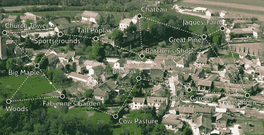

在趋同进化的惊人例证中，乌鸦计算机运行的是 JavaScript。在本章中，我们将为它们编写一些基本的网络功能。

## 回调函数

异步编程的一种方法是让执行缓慢操作的函数接受一个额外的参数——*回调函数*。操作启动后，当它完成时，回调函数会被调用并传入结果。

例如，`setTimeout`函数（在 Node.js 和浏览器中均可使用）会等待指定的毫秒数（一秒等于一千毫秒），然后调用一个函数。

```
setTimeout(() => console.log("Tick"), 500);
```

等待通常不是一种非常重要的工作类型，但在执行诸如更新动画或检查某件事是否耗时超过给定时间等操作时，它可能很有用。

使用回调函数连续执行多个异步操作意味着，你必须在每次操作之后不断传递新函数来处理计算的后续部分。

大多数乌鸦巢穴计算机都有一个长期数据存储球，信息被刻在树枝上，以便日后检索。刻录或查找数据需要一点时间，因此长期存储的接口是异步的，并使用回调函数。

存储球以名称存储 JSON 可编码的数据片段。乌鸦可能会将关于其藏食地点的信息存储在名为`"food caches"`的名称下，该名称下可能包含一个指向其他数据片段的名称数组，这些数据描述了实际的藏食点。要查找`Big Oak`巢穴存储球中的食物缓存，乌鸦可以运行如下代码：

```
import {bigOak} from "./crow-tech";

bigOak.readStorage("food caches", caches => {
  let firstCache = caches[0];
  bigOak.readStorage(firstCache, info => {
    console.log(info);
  });
});
```

（所有绑定名称和字符串均已从乌鸦语言翻译为英语。）

这种编程风格是可行的，但每次异步操作都会增加缩进层级，因为你最终会进入另一个函数。执行更复杂的操作（例如同时运行多个操作）可能会变得有些笨拙。

乌鸦巢穴计算机被设计为使用请求-响应对进行通信。这意味着一个巢穴向另一个巢穴发送消息，后者立即回复一条消息，确认收到并可能包含对消息中问题的回答。

每条消息都带有一个*类型*标签，该标签决定了如何处理它。我们的代码可以为特定的请求类型定义处理程序，当这样的请求到来时，处理程序被调用来生成响应。

`"./crow-tech"`模块导出的接口提供了基于回调的通信函数。巢穴有一个`send`方法用于发送请求。它的前三个参数分别是目标巢穴名称、请求类型和请求内容，第四个也是最后一个参数是一个函数，当收到响应时会被调用。

```
bigOak.send("Cow Pasture", "note", "Let's caw loudly at 7PM",
            () => console.log("Note delivered."));
```

但为了让巢穴能够接收该请求，我们首先必须定义一个名为`"note"`的请求类型。处理请求的代码不仅需要在这个巢穴计算机上运行，还需要在所有能够接收此类消息的巢穴上运行。我们假设一只乌鸦飞过并在所有巢穴上安装了我们的处理程序代码。

```
import {defineRequestType} from "./crow-tech";

defineRequestType("note", (nest, content, source, done) => {
  console.log(`${nest.name} received note: ${content}`);
  done();
});
```

`defineRequestType`函数定义了一种新的请求类型。该示例增加了对`"note"`请求的支持，该请求仅向指定巢穴发送一条通知。我们的实现调用了`console.log`，以便我们能够验证请求已到达。巢穴有一个`name`属性，用于保存其名称。

处理程序的第四个参数`done`是一个回调函数，它必须在请求处理完成时调用。如果我们使用处理程序的返回值作为响应值，那就意味着请求处理程序本身无法执行异步操作。执行异步工作的函数通常在工作完成之前就返回，并安排一个回调函数在完成时被调用。因此，我们需要某种异步机制——在本例中是另一个回调函数——来指示何时可以获取响应。

从某种意义上说，异步性是*具有传染性的*。任何调用异步工作函数的函数本身也必须是异步的，并使用回调或类似机制来传递其结果。调用回调比简单地返回一个值要复杂且更容易出错，因此需要以这种方式组织程序的大部分结构并不理想。

## Promise

当抽象概念可以用值来表示时，处理它们通常更容易。对于异步操作，你可以返回一个代表未来事件的对象，而不是安排某个函数在将来某个时刻被调用。

这正是标准类`Promise`的用途。*Promise*是一个异步操作，它可能在某个时刻完成并产生一个值。它能够在其值可用时通知任何感兴趣的人。

创建 Promise 的最简单方法是调用`Promise.resolve`。该函数确保你提供的值被包装在一个 Promise 中。如果它已经是一个 Promise，则直接返回——否则，你会得到一个立即以你的值作为结果完成的新 Promise。

```
let fifteen = Promise.resolve(15);
fifteen.then(value => console.log(`Got ${value}`));
// → Got 15
```

要获取 promise 的结果，你可以使用它的`then`方法。这会注册一个回调函数，当 promise 解析并产生一个值时，该回调函数会被调用。你可以向同一个 promise 添加多个回调，即使是在 promise 已经*解析*（完成）之后添加，它们也会被调用。

但这并不是`then`方法的全部功能。它还会返回另一个 promise，该 promise 会解析为处理函数返回的值；或者，如果处理函数返回一个 promise，则会等待该 promise 解析，然后解析为其结果。

将 promise 视为一种将值移入异步现实（asynchronous reality）的装置是很有用的。普通值就在那里。而 promise 的值是一个*可能*已经存在，也可能在未来某个时刻出现的值。基于 promise 定义的计算作用于这种包装后的值，并在值可用时异步执行。

要创建一个 promise，你可以将`Promise`用作构造函数。它的接口有些奇特——构造函数期望一个函数作为参数，并立即调用该函数，同时向它传递一个可用于解析 promise 的函数。它之所以这样工作（而不是例如通过一个`resolve`方法），是为了确保只有创建 promise 的代码才能解析它。

以下是为`readStorage`函数创建基于 promise 的接口的方法：

```
function storage(nest, name) {
  return new Promise(resolve => {
    nest.readStorage(name, result => resolve(result));
  });
}

storage(bigOak, "enemies")
  .then(value => console.log("Got", value));
```

这个异步函数返回一个有意义的值。这是 promise 的主要优势——它们简化了异步函数的使用。无需传递回调，基于 promise 的函数看起来与常规函数类似：它们接受输入作为参数，并返回输出。唯一的区别是输出可能还不可用。

## 失败

常规的 JavaScript 计算可以通过抛出异常来失败。异步计算通常也需要类似机制。网络请求可能失败，或者异步计算中的某些代码可能抛出异常。

回调风格的异步编程最紧迫的问题之一是，它使得确保失败被正确报告给回调变得极其困难。

一种广泛使用的约定是，回调的第一个参数用于指示操作失败，第二个参数包含操作成功时产生的值。这类回调函数必须始终检查是否收到了异常，并确保它们引起的任何问题（包括它们调用的函数抛出的异常）都被捕获并传递给正确的函数。

Promise 使这变得更容易。它们可以被解析（操作成功完成）或被拒绝（操作失败）。解析处理程序（通过`then`注册）仅在操作成功时被调用，而拒绝会自动传播到`then`返回的新 promise。当处理程序抛出异常时，这会自动导致其`then`调用产生的 promise 被拒绝。因此，如果异步操作链中的任何元素失败，整个链的结果都会被标记为拒绝，并且失败点之后的所有成功处理程序都不会被调用。

与解析 promise 提供值类似，拒绝 promise 也会提供一个值，通常称为拒绝的*原因*。当处理函数中的异常导致拒绝时，异常值被用作原因。同样，当处理程序返回一个被拒绝的 promise 时，该拒绝会流入下一个 promise。有一个`Promise.reject`函数可以创建一个新的、立即被拒绝的 promise。

为了显式处理此类拒绝，promise 有一个`catch`方法，用于注册一个在 promise 被拒绝时调用的处理程序，类似于`then`处理程序处理正常解析的方式。它也与`then`非常相似，因为它返回一个新的 promise，如果原始 promise 正常解析，则新 promise 解析为原始 promise 的值；否则解析为`catch`处理程序的结果。如果`catch`处理程序抛出错误，新 promise 也会被拒绝。

作为简写，`then`也接受一个拒绝处理程序作为第二个参数，因此你可以在一次方法调用中同时安装两种类型的处理程序。

传递给`Promise`构造函数的函数会接收第二个参数（与 resolve 函数一起），它可以用这个参数来拒绝新的 promise。

通过调用`then`和`catch`创建的 promise 值链可以被视为一个管道，异步值或失败在其中流动。由于这种链是通过注册处理程序创建的，每个环节都有一个成功处理程序或拒绝处理程序（或两者）与之关联。与结果类型（成功或失败）不匹配的处理程序会被忽略。但匹配的处理程序会被调用，它们的结果决定了下一个值的类型——当返回非 promise 值时成功，当抛出异常时拒绝，当返回一个 promise 时则取决于该 promise 的结果。

```
new Promise((_, reject) => reject(new Error("Fail")))
  .then(value => console.log("Handler 1"))
  .catch(reason => {
    console.log("Caught failure " + reason);
    return "nothing";
  })
  .then(value => console.log("Handler 2", value));
// → Caught failure Error: Fail
// → Handler 2 nothing
```

就像未捕获的异常由环境处理一样，JavaScript 环境可以检测到 promise 拒绝未被处理的情况，并将其报告为错误。

## 网络很困难

有时，乌鸦的镜子系统没有足够的光线来传输信号，或者有东西阻挡了信号的路径。信号可能被发送但从未被接收。

目前，这只会导致传递给`send`的回调永远不会被调用，这可能会使程序停止运行，甚至没有注意到存在问题。如果在一段时间内没有收到响应，请求能够*超时*并报告失败，那就太好了。

通常，传输失败是随机事故，比如汽车前灯干扰了光信号，简单地重试请求可能就会成功。因此，趁此机会，让我们让请求函数在放弃之前自动重试发送请求几次。

而且，既然我们已经确定 promise 是个好东西，我们也会让请求函数返回一个 promise。就表达能力而言，回调和 promise 是等价的。基于回调的函数可以被包装以暴露基于 promise 的接口，反之亦然。

即使请求及其响应成功送达，响应也可能指示失败——例如，如果请求尝试使用未定义的请求类型，或者处理程序抛出错误。为了支持这一点，`send`和`defineRequestType`遵循前面提到的约定，即传递给回调的第一个参数是失败原因（如果有的话），第二个参数是实际结果。

这些可以通过我们的包装器转换为 promise 的解析和拒绝。


```javascript
class Timeout extends Error {}

function request(nest, target, type, content) {
  return new Promise((resolve, reject) => {
    let done = false;
    function attempt(n) {
      nest.send(target, type, content, (failed, value) => {
        done = true;
        if (failed) reject(failed);
        else resolve(value);
      });
      setTimeout(() => {
        if (done) return;
        else if (n < 3) attempt(n + 1);
        else reject(new Timeout("Timed out"));
      }, 250);
    }
    attempt(1);
  });
}
```

由于`Promise`只能被解决（或拒绝）一次，因此这种方式是可行的。第一次调用`resolve`或`reject`决定了`Promise`的结果，而后续的任何调用（例如请求完成后超时到达，或另一个请求完成后又返回了之前的请求）都会被忽略。

为了构建异步循环（用于重试），我们需要使用递归函数——常规循环无法让我们停下来等待异步操作。`attempt`函数会尝试发送一次请求，同时设置一个超时：如果在250毫秒内没有收到响应，则开始下一次尝试；如果这是第四次尝试，则用`Timeout`实例作为原因拒绝该`Promise`。

每四分之一秒重试一次，并在超过一秒没有响应时放弃，这显然有些随意。甚至可能出现这样的情况：请求确实已送达，但处理程序耗时稍长，导致请求被多次发送。我们在编写处理程序时会考虑到这个问题——重复的消息应该是无害的。

总的来说，我们今天不会构建一个世界级的、健壮的网络。但这没关系——乌鸦在计算方面还没有很高的期望。

为了完全摆脱回调，我们还将为`defineRequestType`定义一个包装器，允许处理函数返回一个`Promise`或普通值，并将其连接到回调中。

```javascript
function requestType(name, handler) {
  defineRequestType(name, (nest, content, source,
                           callback) => {
    try {
      Promise.resolve(handler(nest, content, source))
        .then(response => callback(null, response),
              failure => callback(failure));
    } catch (exception) {
      callback(exception);
    }
  });
}
```

`Promise.resolve`用于将`handler`返回的值转换为`Promise`（如果它还不是`Promise`的话）。

请注意，对`handler`的调用必须包裹在`try`块中，以确保它直接抛出的任何异常都能传递给回调。这很好地说明了使用原始回调正确处理错误的困难——很容易忘记像这样正确地路由异常，如果不这样做，失败就不会报告给正确的回调。而`Promise`使这变得几乎自动化，从而减少了出错的可能性。

## Promise 集合

每个巢穴计算机在其`neighbors`属性中维护一个传输距离内其他巢穴的数组。为了检查哪些巢穴当前可达，你可以编写一个函数，尝试向每个巢穴发送一个`"ping"`请求（一个仅要求响应的请求），然后查看哪些有回应。

当处理同时运行的`Promise`集合时，`Promise.all`函数非常有用。它返回一个`Promise`，该`Promise`等待数组中的所有`Promise`被解决，然后解决为一个由这些`Promise`产生的值组成的数组（顺序与原始数组相同）。如果任何一个`Promise`被拒绝，`Promise.all`的结果本身也会被拒绝。

```javascript
requestType("ping", () => "pong");

function availableNeighbors(nest) {
  let requests = nest.neighbors.map(neighbor => {
    return request(nest, neighbor, "ping")
      .then(() => true, () => false);
  });
  return Promise.all(requests).then(result => {
    return nest.neighbors.filter((_, i) => result[i]);
  });
}
```

当一个邻居不可用时，我们不希望整个组合的`Promise`失败，因为那样我们仍然什么都不知道。因此，将邻居集合映射为请求`Promise`的函数会附加处理程序，使成功的请求产生`true`，被拒绝的请求产生`false`。

在组合`Promise`的处理程序中，使用`filter`从`neighbors`数组中移除那些对应值为`false`的元素。这利用了`filter`将当前元素的数组索引作为第二个参数传递给其过滤函数的事实（`map`、`some`以及类似的高阶数组方法也是如此）。

## 网络泛洪

巢穴只能与邻居通信这一事实极大地限制了该网络的实用性。

为了向整个网络广播信息，一种解决方案是设置一种自动转发给邻居的请求类型。这些邻居再依次转发给它们的邻居，直到整个网络都收到消息。

```javascript
import {everywhere} from "./crow-tech";

everywhere(nest => {
  nest.state.gossip = [];
});

function sendGossip(nest, message, exceptFor = null) {
  nest.state.gossip.push(message);
  for (let neighbor of nest.neighbors) {
    if (neighbor == exceptFor) continue;
    request(nest, neighbor, "gossip", message);
  }
}

requestType("gossip", (nest, message, source) => {
  if (nest.state.gossip.includes(message)) return;
  console.log(`${nest.name} received gossip '${
               message}' from ${source}`);
  sendGossip(nest, message, source);
});
```

为了避免消息在网络中无限传播，每个巢穴都维护一个已经见过的八卦字符串数组。为了定义这个数组，我们使用`everywhere`函数（它在每个巢穴上运行代码）向巢穴的`state`对象添加一个属性，我们将在此处保存巢穴本地状态。

当巢穴收到重复的八卦消息时（由于每个人都盲目地重新发送，这种情况非常可能发生），它会忽略它。但当它收到新消息时，它会兴奋地告诉所有邻居，除了发送该消息的那个邻居。

这会导致一条新的八卦消息像水中的墨渍一样在网络中扩散。即使某些连接当前不可用，只要存在通往某个巢穴的替代路径，八卦消息就会通过该路径到达。

这种网络通信风格被称为*泛洪*——它用一条信息淹没网络，直到所有节点都拥有它。

## 消息路由

如果某个节点想要与另一个节点通信，泛洪并不是一种非常高效的方法。尤其是当网络很大时，这会导致大量无用的数据传输。

另一种方法是建立一种让消息在节点之间跳跃直到到达目的地的机制。其难点在于需要了解网络的布局。为了向远处的巢穴发送请求，有必要知道哪个邻居巢穴能使其更接近目的地。向错误的方向发送不会有什么好处。

由于每个巢穴只知道它的直接邻居，因此它没有计算路由所需的信息。我们必须以某种方式将这些连接信息传播到所有巢穴，最好能随着时间推移，在巢穴被废弃或新建时动态更新。

我们可以再次使用洪泛，但这次不是检查某条消息是否已被接收，而是检查某个巢穴的新邻居集合是否与当前记录的集合一致。

```javascript
requestType("connections", (nest, {name, neighbors},
                            source) => {
  let connections = nest.state.connections;
  if (JSON.stringify(connections.get(name)) ==
      JSON.stringify(neighbors)) return;
  connections.set(name, neighbors);
  broadcastConnections(nest, name, source);
});

function broadcastConnections(nest, name, exceptFor = null) {
  for (let neighbor of nest.neighbors) {
    if (neighbor == exceptFor) continue;
    request(nest, neighbor, "connections", {
      name,
      neighbors: nest.state.connections.get(name)
    });
  }
}

everywhere(nest => {
  nest.state.connections = new Map;
  nest.state.connections.set(nest.name, nest.neighbors);
  broadcastConnections(nest, nest.name);
});
```

比较时使用了`JSON.stringify`，因为对于对象或数组，`==`只有在两者是同一个值时才会返回`true`，而这并不是我们需要的。比较 JSON 字符串是一种粗糙但有效的内容比较方式。

节点会立即开始广播自己的连接信息，除非某些巢穴完全不可达，否则这应该能很快让每个巢穴获得当前网络拓扑图。

正如我们在第 7 章中看到的，图的一个用途是查找路径。如果我们有一条通往消息目的地的路径，我们就知道该往哪个方向发送消息。

下面的`findRoute`函数与第 7 章中的`findRoute`非常相似，它搜索一条到达网络中给定节点的路径。但它不返回整条路径，只返回下一步。下一个巢穴将根据自己当前的网络信息决定*它*将消息发送到哪里。

```javascript
function findRoute(from, to, connections) {
  let work = [{at: from, via: null}];
  for (let i = 0; i < work.length; i++) {
    let {at, via} = work[i];
    for (let next of connections.get(at) || []) {
      if (next == to) return via;
      if (!work.some(w => w.at == next)) {
        work.push({at: next, via: via || next});
      }
    }
  }
  return null;
}
```

现在我们可以构建一个能够发送远程消息的函数。如果消息的目标是直接邻居，则按常规方式传递。否则，将消息封装成一个对象，并通过`"route"`请求类型发送给一个更接近目标的邻居，该邻居会重复同样的行为。

```javascript
function routeRequest(nest, target, type, content) {
  if (nest.neighbors.includes(target)) {
    return request(nest, target, type, content);
  } else {
    let via = findRoute(nest.name, target,
                        nest.state.connections);
    if (!via) throw new Error(`No route to ${target}`);
    return request(nest, via, "route",
                   {target, type, content});
  }
}

requestType("route", (nest, {target, type, content}) => {
  return routeRequest(nest, target, type, content);
});
```

我们在原始通信系统之上构建了多层功能，使其使用起来更加方便。这是一个很好的（尽管简化了）真实计算机网络工作方式的模型。

计算机网络的一个显著特性是它们并不可靠——基于它们构建的抽象层可以提供帮助，但你无法完全屏蔽网络故障。因此，网络编程通常很大程度上是关于预测和处理故障的。

## 异步函数

为了存储重要信息，乌鸦们会跨巢穴复制信息。这样，当一只鹰摧毁一个巢穴时，信息不会丢失。

为了检索自己存储球中没有的某条信息，巢穴计算机可能会随机询问网络中的其他巢穴，直到找到拥有该信息的巢穴。

```javascript
requestType("storage", (nest, name) => storage(nest, name));

function findInStorage(nest, name) {
  return storage(nest, name).then(found => {
    if (found != null) return found;
    else return findInRemoteStorage(nest, name);
  });
}

function network(nest) {
  return Array.from(nest.state.connections.keys());
}

function findInRemoteStorage(nest, name) {
  let sources = network(nest).filter(n => n != nest.name);
  function next() {
    if (sources.length == 0) {
      return Promise.reject(new Error("Not found"));
    } else {
      let source = sources[Math.floor(Math.random() *
                                      sources.length)];
      sources = sources.filter(n => n != source);
      return routeRequest(nest, source, "storage", name)
        .then(value => value != null ? value : next(),
              next);
    }
  }
  return next();
}
```

由于`connections`是一个`Map`，`Object.keys`对它不起作用。它有一个`keys`*方法*，但返回的是迭代器而不是数组。迭代器（或可迭代值）可以通过`Array.from`函数转换为数组。

即使使用了`Promise`，这段代码仍然有些笨拙。多个异步操作以不明显的方式串联在一起。我们再次需要一个递归函数（`next`）来模拟对巢穴的循环遍历。

而代码实际做的事情完全是线性的——它总是等待前一个操作完成后再开始下一个。在同步编程模型中，表达起来会更简单。

好消息是，JavaScript允许你编写伪同步代码来描述异步计算。`async`函数是一个隐式返回`Promise`的函数，并且在其函数体内，可以用`await`等待其他`Promise`，这种方式*看起来*是同步的。

我们可以像这样重写`findInStorage`：

```javascript
async function findInStorage(nest, name) {
  let local = await storage(nest, name);
  if (local != null) return local;

  let sources = network(nest).filter(n => n != nest.name);
  while (sources.length > 0) {
    let source = sources[Math.floor(Math.random() *
                                    sources.length)];
    sources = sources.filter(n => n != source);
    try {
      let found = await routeRequest(nest, source, "storage",
                                     name);
      if (found != null) return found;
    } catch (_) {}
  }
  throw new Error("Not found");
}
```


`async` 函数通过在 `function` 关键字前加上 `async` 来标记。方法也可以通过在其名称前写 `async` 来变为异步。当这样的函数或方法被调用时，它会返回一个 Promise。一旦函数体返回某个值，该 Promise 就会被解决。如果它抛出异常，Promise 会被拒绝。

在 `async` 函数内部，可以在表达式前加上 `await` 来等待一个 Promise 解决，然后才继续执行函数。

这样的函数不再像常规的 JavaScript 函数那样一次性从头运行到尾。相反，它可以在任何包含 `await` 的地方被冻结，并在稍后恢复执行。

对于复杂的异步代码，这种写法通常比直接使用 Promise 更方便。即使你需要做一些不符合同步模型的事情，比如同时执行多个操作，也很容易将 `await` 与直接使用 Promise 结合起来。

## 生成器

函数暂停后再恢复的能力并非 `async` 函数独有。JavaScript 还有一种称为生成器函数的特性。它们类似，但没有 Promise。

当你用 `function*` 定义函数时（在 `function` 关键字后加一个星号），它就变成了一个生成器。当你调用生成器时，它会返回一个迭代器，我们在第 6 章中已经见过。

```javascript
function* powers(n) {
  for (let current = n;; current *= n) {
    yield current;
  }
}

for (let power of powers(3)) {
  if (power > 50) break;
  console.log(power);
}
// → 3
// → 9
// → 27
```

最初，当你调用 `powers` 时，函数在其起始处被冻结。每次你在迭代器上调用 `next`，函数就会运行直到遇到一个 `yield` 表达式，该表达式会暂停函数，并使 yield 的值成为迭代器产生的下一个值。当函数返回时（示例中的函数从未返回），迭代器就结束了。

使用生成器函数编写迭代器通常要容易得多。`Group` 类的迭代器（来自第 6 章的练习）可以用这个生成器来编写：

```javascript
Group.prototype[Symbol.iterator] = function*() {
  for (let i = 0; i < this.members.length; i++) {
    yield this.members[i];
  }
};
```

不再需要创建一个对象来保存迭代状态——生成器每次 yield 时都会自动保存其局部状态。

这样的 `yield` 表达式只能直接出现在生成器函数本身中，而不能出现在你在其中定义的内部函数中。生成器在 yield 时保存的状态只有其局部环境和 yield 的位置。

`async` 函数是一种特殊的生成器。它在被调用时产生一个 Promise，该 Promise 在函数返回（完成）时被解决，在函数抛出异常时被拒绝。每当它 yield（await）一个 Promise 时，该 Promise 的结果（值或抛出的异常）就是 `await` 表达式的结果。

## 事件循环

异步程序是逐块执行的。每个块可能会启动一些动作，并安排当动作完成或失败时要执行的代码。在这些块之间，程序处于空闲状态，等待下一个动作。

因此，回调并不是由安排它们的代码直接调用的。如果我在一个函数内部调用 `setTimeout`，那么当回调函数被调用时，那个函数已经返回了。而当回调返回时，控制权并不会回到安排它的函数。

异步行为发生在它自己的空函数调用栈上。这也是在没有 Promise 的情况下，跨异步代码管理异常困难的原因之一。由于每个回调开始时栈几乎是空的，当它们抛出异常时，你的 `catch` 处理程序并不在栈上。

```javascript
try {
  setTimeout(() => {
    throw new Error("Woosh");
  }, 20);
} catch (_) {
  // This will not run
  console.log("Caught!");
}
```

无论事件（如超时或传入请求）发生得多么紧密，JavaScript 环境一次只会运行一个程序。你可以将其视为在你的程序周围运行着一个大循环，称为事件循环。当无事可做时，该循环会停止。但随着事件的到来，它们被添加到队列中，其代码一个接一个地执行。由于没有两件事同时运行，运行缓慢的代码可能会延迟其他事件的处理。

这个示例设置了一个超时，但随后拖延到超时预定时间之后，导致超时延迟。

```javascript
let start = Date.now();
setTimeout(() => {
  console.log("Timeout ran at", Date.now() - start);
}, 20);
while (Date.now() < start + 50) {}
console.log("Wasted time until", Date.now() - start);
// → Wasted time until 50
// → Timeout ran at 55
```

Promise 总是作为新事件被解决或拒绝。即使一个 Promise 已经被解决，等待它也会导致你的回调在当前脚本完成后运行，而不是立即执行。

```javascript
Promise.resolve("Done").then(console.log);
console.log("Me first!");
// → Me first!
// → Done
```

在后续章节中，我们将看到在事件循环上运行的各种其他类型的事件。

## 异步错误

当你的程序同步地一次性运行时，除了程序自身所做的更改外，不会发生任何状态变化。对于异步程序则不同——它们的执行中可能存在间隙，在此期间其他代码可以运行。

让我们看一个例子。我们的乌鸦的爱好之一是统计每年整个村庄孵化的小鸡数量。鸟巢将这些计数存储在其存储球中。以下代码尝试枚举给定年份所有鸟巢的计数：

```javascript
function anyStorage(nest, source, name) {
  if (source == nest.name) return storage(nest, name);
  else return routeRequest(nest, source, "storage", name);
}

async function chicks(nest, year) {
  let list = "";
  await Promise.all(network(nest).map(async name => {
    list += `${name}: ${
      await anyStorage(nest, name, `chicks in ${year}`)
    }\n`;
  }));
  return list;
}
```

`async name =>` 部分表明，箭头函数也可以通过在其前面加上 `async` 关键字来变成 `async` 函数。

这段代码乍一看并不可疑……它用 `async` 箭头函数映射鸟巢集合，创建了一个 Promise 数组，然后使用 `Promise.all` 等待所有这些 Promise，再返回它们构建的列表。

但它有严重缺陷。它总是只返回一行输出，列出响应最慢的那个鸟巢。

你能找出原因吗？

问题出在 `+=` 运算符上，它会在语句开始执行时获取 `list` 的当前值，然后在 `await` 完成后，将 `list` 绑定设置为该值加上添加的字符串。

但在语句开始执行和完成之间有一个异步间隙。`map` 表达式在列表中添加任何内容之前运行，因此每个 `+=` 运算符都从一个空字符串开始，当它的存储检索完成时，最终将 `list` 设置为一个单行列表——即将其行添加到空字符串的结果。

通过从映射的 promise 中返回行，并对 `Promise.all` 的结果调用 `join`，而不是通过改变绑定来构建列表，本可以轻松避免这种情况。和往常一样，计算新值比改变现有值更不容易出错。

```javascript
async function chicks(nest, year) {
  let lines = network(nest).map(async name => {
    return name + ": " +
      await anyStorage(nest, name, `chicks in ${year}`);
  });
  return (await Promise.all(lines)).join("\n");
}
```

这类错误很容易犯，尤其是在使用 `await` 时，你应该意识到代码中的间隙出现在哪里。JavaScript 的显式异步性（无论是通过回调、promise 还是 `await`）的一个优点是，发现这些间隙相对容易。

## 总结

异步编程使得表达等待长时间运行的操作成为可能，而不会在这些操作期间冻结程序。JavaScript 环境通常使用回调（操作完成时调用的函数）来实现这种编程风格。事件循环会按顺序在适当的时候调度这些回调，使它们的执行不会重叠。

Promise（表示将来可能完成的操作的对象）和 `async` 函数（允许你像编写同步程序一样编写异步程序）使异步编程变得更加容易。

## 练习

### 追踪手术刀

村庄的乌鸦们有一把旧手术刀，他们偶尔会在特殊任务中使用它——比如割开纱门或包装。为了能够快速追踪它，每次手术刀被移动到另一个巢穴时，都会在拥有它的巢穴和拿走它的巢穴的存储中添加一条记录，名称为 `"scalpel"`，其新位置作为值。

这意味着找到手术刀就是沿着存储记录的面包屑路径，直到找到一个指向自身的巢穴。

编写一个 `async` 函数 `locateScalpel` 来实现这一点，从它运行的巢穴开始。你可以使用之前定义的 `anyStorage` 函数来访问任意巢穴的存储。手术刀已经流传了足够长的时间，你可以假设每个巢穴的数据存储中都有一个 `"scalpel"` 条目。

接下来，在不使用 `async` 和 `await` 的情况下再次编写相同的函数。

在这两个版本中，请求失败是否会正确地作为返回 promise 的拒绝（rejection）显示出来？如何实现？

### 构建 `Promise.all`

给定一个 promise 数组，`Promise.all` 返回一个 promise，等待数组中的所有 promise 完成。然后它成功，产生一个结果值的数组。如果数组中的某个 promise 失败，`all` 返回的 promise 也会失败，失败原因来自失败的 promise。

自己实现一个类似的功能，作为一个名为 `Promise_all` 的常规函数。

请记住，一旦 promise 成功或失败，它就不能再次成功或失败，并且后续对解析它的函数的调用将被忽略。这可以简化你处理 promise 失败的方式。

# 第 12 章：项目：一种编程语言

> 求值器（决定编程语言中表达式含义的程序）只是另一个程序。
>
> —— Hal Abelson 和 Gerald Sussman，《计算机程序的构造和解释》


构建你自己的编程语言出奇地容易（只要你的目标不是太高），而且非常有启发性。

本章我想展示的主要是，构建自己的语言并不涉及任何魔法。我经常觉得有些人类的发明如此巧妙和复杂，以至于我永远无法理解它们。但通过一点阅读和实验，它们往往变得相当平凡。

我们将构建一种名为 Egg 的编程语言。它将是一种小巧、简单的语言——但足以表达你能想到的任何计算。它将允许基于函数的简单抽象。

## 解析

编程语言最直接可见的部分是它的语法或符号。解析器是一个程序，它读取一段文本并生成一个反映该文本中包含的程序结构的数据结构。如果文本不能构成一个有效的程序，解析器应该指出错误。

我们的语言将具有简单统一的语法。Egg 中的一切都是表达式。一个表达式可以是绑定的名称、数字、字符串或应用。应用用于函数调用，也用于像 `if` 或 `while` 这样的结构。

为了保持解析器简单，Egg 中的字符串不支持任何像反斜杠转义这样的东西。字符串只是一系列不包含双引号的字符，用双引号括起来。数字是一系列数字。绑定名称可以由任何不是空白且没有特殊语法含义的字符组成。

应用的写法与 JavaScript 中相同，在表达式后面加上括号，并在括号之间放置任意数量的参数，用逗号分隔。

```javascript
do(define(x, 10),
   if(>(x, 5),
      print("large"),
      print("small")))
```

Egg 语言的统一性意味着 JavaScript 中的运算符（如 `>`）在这种语言中是普通的绑定，像其他函数一样应用。而且由于语法没有块的概念，我们需要一个 `do` 结构来表示按顺序执行多个操作。

解析器用来描述程序的数据结构由表达式对象组成，每个对象都有一个 `type` 属性指示它是什么类型的表达式，以及其他属性来描述其内容。

类型为 `"value"` 的表达式表示字面字符串或数字。它们的 `value` 属性包含它们表示的字符串或数字值。类型为 `"word"` 的表达式用于标识符（名称）。这样的对象有一个 `name` 属性，保存标识符的名称作为字符串。最后，`"apply"` 表达式表示应用。它们有一个 `operator` 属性，指向被应用的表达式，以及一个 `args` 属性，保存参数表达式的数组。

前面程序中的 `>(x, 5)` 部分将表示如下：

```javascript
{
  type: "apply",
  operator: {type: "word", name: ">"},
  args: [
    {type: "word", name: "x"},
    {type: "value", value: 5}
  ]
}
```

这样的数据结构称为语法树。如果你把对象想象成点，它们之间的链接想象成点之间的线，它就有树的形状。表达式包含其他表达式，而这些表达式又可能包含更多表达式，这类似于树枝分叉再分叉的方式。


将此与我们为第 9 章中的配置文件格式编写的解析器进行对比，那个解析器结构简单：它将输入拆分成行，并逐行处理。每行只允许少数几种简单形式。

而这里我们必须采用不同的方法。表达式不是按行分隔的，并且具有递归结构。应用表达式包含其他表达式。

幸运的是，这个问题可以通过编写一个递归的解析函数很好地解决，该函数的递归方式反映了语言的递归性质。

我们定义了一个函数 `parseExpression`，它接收一个字符串作为输入，并返回一个对象，其中包含字符串开头的表达式对应的数据结构，以及解析该表达式后剩余的字符串部分。当解析子表达式（例如应用的参数）时，可以再次调用此函数，从而得到参数表达式以及剩余的文本。这个剩余文本可能包含更多参数，也可能是结束参数列表的右括号。

这是解析器的第一部分：

```javascript
function parseExpression(program) {
  program = skipSpace(program);
  let match, expr;
  if (match = /^"([^"]*)"/.exec(program)) {
    expr = {type: "value", value: match[1]};
  } else if (match = /^\d+\b/.exec(program)) {
    expr = {type: "value", value: Number(match[0])};
  } else if (match = /^[^\s(),"]+/.exec(program)) {
    expr = {type: "word", name: match[0]};
  } else {
    throw new SyntaxError("Unexpected syntax: " + program);
  }

  return parseApply(expr, program.slice(match[0].length));
}

function skipSpace(string) {
  let first = string.search(/\S/);
  if (first == -1) return "";
  return string.slice(first);
}
```

由于 Egg 和 JavaScript 一样，允许元素之间任意数量的空白，我们必须反复从程序字符串的开头去除空白。这就是 `skipSpace` 函数的作用。

在跳过前导空白后，`parseExpression` 使用三个正则表达式来识别 Egg 支持的三种原子元素：字符串、数字和单词。解析器根据匹配到的类型构造不同的数据结构。如果输入不匹配这三种形式中的任何一种，则不是有效的表达式，解析器会抛出错误。我们使用 `SyntaxError` 而不是 `Error` 作为异常构造函数，这是另一种标准错误类型，因为它更具体一些——当尝试运行无效的 JavaScript 程序时，也会抛出这种错误类型。

然后我们从程序字符串中截掉匹配的部分，并将其与表达式对象一起传递给 `parseApply`，后者检查该表达式是否是一个应用。如果是，则解析括号内的参数列表。


```javascript
function parseApply(expr, program) {
  program = skipSpace(program);
  if (program[0] != "(") {
    return {expr: expr, rest: program};
  }

  program = skipSpace(program.slice(1));
  expr = {type: "apply", operator: expr, args: []};
  while (program[0] != ")") {
    let arg = parseExpression(program);
    expr.args.push(arg.expr);
    program = skipSpace(arg.rest);
    if (program[0] == ",") {
      program = skipSpace(program.slice(1));
    } else if (program[0] != ")") {
      throw new SyntaxError("Expected ',' or ')'");
    }
  }
  return parseApply(expr, program.slice(1));
}
```

如果程序中的下一个字符不是左括号，则这不是一个应用，`parseApply` 返回它接收到的表达式。

否则，它会跳过左括号，并为这个应用表达式创建语法树对象。然后它递归调用 `parseExpression` 来解析每个参数，直到遇到右括号。这种递归是间接的，通过 `parseApply` 和 `parseExpression` 相互调用实现。

由于一个应用表达式本身也可以被应用（例如在 `multiplier(2)(1)` 中），`parseApply` 在解析完一个应用后，必须再次调用自身，以检查后面是否还有另一对括号。

这就是解析 Egg 所需的全部内容。我们将其包装在一个方便的 `parse` 函数中，该函数在解析表达式后验证是否已到达输入字符串的末尾（一个 Egg 程序是一个单独的表达式），并返回程序的数据结构。

```javascript
function parse(program) {
  let {expr, rest} = parseExpression(program);
  if (skipSpace(rest).length > 0) {
    throw new SyntaxError("Unexpected text after program");
  }
  return expr;
}

console.log(parse("+(a, 10)"));
// → {type: "apply",
//    operator: {type: "word", name: "+"},
//    args: [{type: "word", name: "a"},
//           {type: "value", value: 10}]}
```

它成功了！虽然它在失败时不会提供非常有用的信息，也没有存储每个表达式开始的行号和列号（这在以后报告错误时可能有用），但对于我们的目的来说已经足够好了。

## 求值器

对于程序的语法树，我们能做什么？当然是运行它！这就是求值器的工作。你给它一个语法树和一个将名称与值关联起来的作用域对象，它会计算该树所代表的表达式，并返回产生的结果。

```javascript
const specialForms = Object.create(null);

function evaluate(expr, scope) {
  if (expr.type == "value") {
    return expr.value;
  } else if (expr.type == "word") {
    if (expr.name in scope) {
      return scope[expr.name];
    } else {
      throw new ReferenceError(
        `Undefined binding: ${expr.name}`);
    }
  } else if (expr.type == "apply") {
    let {operator, args} = expr;
    if (operator.type == "word" &&
        operator.name in specialForms) {
      return specialFormsoperator.name;
    } else {
      let op = evaluate(operator, scope);
      if (typeof op == "function") {
        return op(...args.map(arg => evaluate(arg, scope)));
      } else {
        throw new TypeError("Applying a non-function.");
      }
    }
  }
}
```

求值器为每种表达式类型都提供了代码。字面量值表达式产生其值（例如，表达式 `100` 直接求值为数字 100）。对于绑定，我们必须检查它是否确实在作用域中定义，如果是，则获取该绑定的值。

应用则更复杂一些。如果它们是特殊形式，比如 `if`，我们不会求值任何东西，而是将参数表达式和作用域一起传递给处理该形式的函数。如果是普通调用，我们求值运算符，验证它是一个函数，然后用求值后的参数调用它。

我们使用普通的 JavaScript 函数值来表示 Egg 的函数值。我们将在后面定义名为 `fun` 的特殊形式时再回到这一点。

`evaluate` 的递归结构类似于解析器的递归结构，两者都反映了语言本身的结构。也可以将解析器与求值器集成，在解析过程中进行求值，但这样分开处理会使程序更清晰。

这就是解释 Egg 语言所需的全部内容。它就是这么简单。但如果不定义几个特殊形式，并向环境中添加一些有用的值，你目前还无法用这种语言做太多事情。

## 特殊形式

`specialForms` 对象用于定义 Egg 中的特殊语法。它将单词与评估这些形式的函数关联起来。目前它是空的。让我们添加 `if`。

```javascript
specialForms.if = (args, scope) => {
  if (args.length != 3) {
    throw new SyntaxError("Wrong number of args to if");
  } else if (evaluate(args[0], scope) !== false) {
    return evaluate(args[1], scope);
  } else {
    return evaluate(args[2], scope);
  }
};
```

Egg 的 `if` 构造恰好需要三个参数。它会评估第一个参数，如果结果不是值 `false`，则评估第二个参数；否则评估第三个参数。这个 `if` 形式更类似于 JavaScript 的三元运算符 `?:`，而不是 JavaScript 的 `if`。它是一个表达式，而不是语句，并且会产生一个值，即第二个或第三个参数的结果。

Egg 在处理传递给 `if` 的条件值时也与 JavaScript 不同。它不会将零或空字符串等视为假值，只有精确的值 `false` 才被视为假。

我们需要将 `if` 表示为特殊形式而不是普通函数的原因是，函数的所有参数在函数调用之前都会被评估，而 `if` 应该只根据第一个参数的值评估*要么*第二个参数，*要么*第三个参数。

`while` 形式类似。

```javascript
specialForms.while = (args, scope) => {
  if (args.length != 2) {
    throw new SyntaxError("Wrong number of args to while");
  }
  while (evaluate(args[0], scope) !== false) {
    evaluate(args[1], scope);
  }

  // 由于 Egg 中没有 undefined，我们返回 false，
  // 因为缺少有意义的结果。
  return false;
};
```

另一个基本构建块是 `do`，它从上到下执行所有参数。它的值是最后一个参数产生的值。

```javascript
specialForms.do = (args, scope) => {
  let value = false;
  for (let arg of args) {
    value = evaluate(arg, scope);
  }
  return value;
};
```

为了能够创建绑定并赋予它们新值，我们还创建了一个名为 `define` 的形式。它期望第一个参数是一个单词，第二个参数是一个表达式，用于产生要赋给该单词的值。由于 `define` 和其他所有东西一样是一个表达式，它必须返回一个值。我们将让它返回被赋值的值（就像 JavaScript 的 `=` 运算符一样）。

```javascript
specialForms.define = (args, scope) => {
  if (args.length != 2 || args[0].type != "word") {
    throw new SyntaxError("Incorrect use of define");
  }
  let value = evaluate(args[1], scope);
  scope[args[0].name] = value;
  return value;
};
```

## 环境

`evaluate` 接受的 `scope` 是一个对象，其属性名对应绑定名称，属性值对应这些绑定所绑定的值。让我们定义一个对象来表示全局作用域。

为了能够使用我们刚刚定义的 `if` 构造，我们必须能够访问布尔值。由于只有两个布尔值，我们不需要为它们提供特殊语法。我们只需将两个名称绑定到值 `true` 和 `false`，然后使用它们。

```javascript
const topScope = Object.create(null);

topScope.true = true;
topScope.false = false;
```

现在我们可以评估一个简单的表达式，该表达式对布尔值取反。

```javascript
let prog = parse(`if(true, false, true)`);
console.log(evaluate(prog, topScope));
// → false
```

为了提供基本的算术和比较运算符，我们还将向作用域中添加一些函数值。为了保持代码简短，我们将使用 `Function` 在一个循环中合成一组运算符函数，而不是逐个定义它们。

```javascript
for (let op of ["+", "-", "*", "/", "==", "<", ">"]) {
  topScope[op] = Function("a, b", `return a ${op} b;`);
}
```

输出值的方式也很有用，因此我们将 `console.log` 包装在一个函数中，并将其命名为 `print`。

```javascript
topScope.print = value => {
  console.log(value);
  return value;
};
```

这为我们提供了足够的基本工具来编写简单的程序。以下函数提供了一种便捷的方式来解析程序并在新的作用域中运行它：

```javascript
function run(program) {
  return evaluate(parse(program), Object.create(topScope));
}
```

我们将使用对象原型链来表示嵌套作用域，这样程序就可以向局部作用域添加绑定，而不会改变顶层作用域。

```javascript
run(`
do(define(total, 0),
   define(count, 1),
   while(<(count, 11),
         do(define(total, +(total, count)),
            define(count, +(count, 1)))),
   print(total))
`);
// → 55
```

这就是我们之前多次见过的程序，它计算 1 到 10 的和，用 Egg 语言表达。它显然比等效的 JavaScript 程序更丑陋——但对于一个用不到 150 行代码实现的语言来说，已经不错了。

## 函数

没有函数的编程语言确实是一种贫乏的编程语言。

幸运的是，添加一个 `fun` 构造并不困难，它将最后一个参数视为函数体，并将之前的所有参数用作函数参数的名称。

```javascript
specialForms.fun = (args, scope) => {
  if (!args.length) {
    throw new SyntaxError("Functions need a body");
  }
  let body = args[args.length - 1];
  let params = args.slice(0, args.length - 1).map(expr => {
    if (expr.type != "word") {
      throw new SyntaxError("Parameter names must be words");
    }
    return expr.name;
  });

  return function() {
    if (arguments.length != params.length) {
      throw new TypeError("Wrong number of arguments");
    }
    let localScope = Object.create(scope);
    for (let i = 0; i < arguments.length; i++) {
      localScope[params[i]] = arguments[i];
    }
    return evaluate(body, localScope);
  };
};
```

Egg 中的函数拥有自己的局部作用域。由 `fun` 形式产生的函数会创建这个局部作用域，并向其中添加参数绑定。然后它在该作用域中评估函数体并返回结果。

```javascript
run(`
do(define(plusOne, fun(a, +(a, 1))),
   print(plusOne(10)))
`);
// → 11

run(`
do(define(pow, fun(base, exp,
     if(==(exp, 0),
        1,
        *(base, pow(base, -(exp, 1)))))),
   print(pow(2, 10)))
`);
// → 1024
```

## 编译

我们构建的是一个解释器。在评估过程中，它直接作用于解析器生成的程序表示。

*编译* 是在解析和运行程序之间添加另一个步骤的过程，它通过尽可能多地提前完成工作，将程序转换为可以更高效评估的形式。例如，在精心设计的语言中，对于每个绑定的使用，无需实际运行程序就能明显看出引用的是哪个绑定。这可以用来避免每次访问绑定时都按名称查找，而是直接从某个预定的内存位置获取它。

传统上，编译涉及将程序转换为机器码，即计算机处理器能够执行的原始格式。但任何将程序转换为不同表示形式的过程都可以被视为编译。

可以为 Egg 编写另一种求值策略：先将程序转换为 JavaScript 程序，然后使用 `Function` 调用 JavaScript 编译器对其进行编译，最后运行结果。如果实现得当，这将使 Egg 运行得非常快，同时实现起来仍然相当简单。

如果你对这个话题感兴趣并愿意花些时间，我鼓励你尝试实现这样一个编译器作为练习。

## 偷懒

当我们定义 `if` 和 `while` 时，你可能已经注意到它们或多或少只是 JavaScript 自身 `if` 和 `while` 的简单包装。同样，Egg 中的值也只是普通的 JavaScript 值。

如果你将基于 JavaScript 构建的 Egg 实现与直接在机器提供的原始功能上构建编程语言所需的工作量和复杂性进行比较，差异是巨大的。尽管如此，这个例子理想地让你了解了编程语言的工作方式。

而在完成某件事时，偷懒比亲力亲为更有效。尽管本章中的玩具语言不能做任何 JavaScript 无法做得更好的事情，但确实存在一些情况，编写小型语言有助于完成实际工作。

这样的语言不必像典型的编程语言。例如，如果 JavaScript 没有自带正则表达式，你可以自己编写一个正则表达式的解析器和求值器。

或者想象你正在建造一只巨大的机械恐龙，需要编程控制它的行为。JavaScript 可能不是最有效的方式。你可能会选择一种类似这样的语言：

```
behavior walk
  perform when
    destination ahead
  actions
    move left-foot
    move right-foot

behavior attack
  perform when
    Godzilla in-view
  actions
    fire laser-eyes
    launch arm-rockets
```

这就是通常所说的**领域特定语言**，一种为表达狭窄领域知识而量身定制的语言。这种语言可以比通用语言更具表现力，因为它被设计用来精确描述其领域中需要描述的事物，仅此而已。

## 练习

### 数组

通过向顶层作用域添加以下三个函数来为 Egg 添加对数组的支持：`array(...values)` 用于构造包含参数值的数组，`length(array)` 用于获取数组长度，以及 `element(array, n)` 用于从数组中获取第 n 个元素。

### 闭包

我们定义 `fun` 的方式允许 Egg 中的函数引用周围的作用域，使得函数体可以使用函数定义时可见的局部值，就像 JavaScript 函数一样。


下面的程序说明了这一点：函数`f`返回一个函数，该函数将其参数加到`f`的参数上，这意味着它需要访问`f`内部的局部作用域才能使用绑定`a`。

```
run(`
do(define(f, fun(a, fun(b, +(a, b)))),
   print(f(4)(5)))
`);
// → 9
```

回到`fun`形式的定义，解释是哪种机制使其生效。

### 注释

如果我们能在 Egg 中编写注释就好了。例如，每当我们遇到井号（`#`）时，可以将该行剩余部分视为注释并忽略它，类似于 JavaScript 中的`//`。

我们不需要对解析器进行大的改动来支持这一点。我们可以简单地修改`skipSpace`，使其像跳过空白一样跳过注释，这样所有调用`skipSpace`的地方现在也会跳过注释。请做出这一改动。

### 修复作用域

目前，给绑定赋值的唯一方式是`define`。这个构造既用于定义新绑定，也用于给现有绑定赋予新值。

这种歧义会导致问题。当你试图给一个非局部绑定赋予新值时，最终会在局部定义一个同名绑定。有些语言在设计上就是这样工作的，但我一直觉得这是一种笨拙的作用域处理方式。

添加一个特殊形式`set`，类似于`define`，用于给绑定赋予新值，如果内部作用域中不存在该绑定，则更新外部作用域中的绑定。如果该绑定根本未定义，则抛出一个`ReferenceError`（另一种标准错误类型）。

到目前为止，将作用域表示为简单对象的技术一直很方便，但此时会给你带来一点麻烦。你可能需要使用`Object.getPrototypeOf`函数，它返回一个对象的原型。还要记住，作用域并不继承自`Object.prototype`，因此如果你想在它们上面调用`hasOwnProperty`，必须使用这种笨拙的表达式：

```
Object.prototype.hasOwnProperty.call(scope, name);
```

第 13 章

# JavaScript 与浏览器

> 网络背后的梦想是一个通过共享信息进行交流的公共信息空间。它的普遍性至关重要：超文本链接可以指向任何东西，无论是个人、本地还是全球，无论是草稿还是精雕细琢的成品。

> 蒂姆·伯纳斯·李，《万维网：一段非常简短的个人历史》

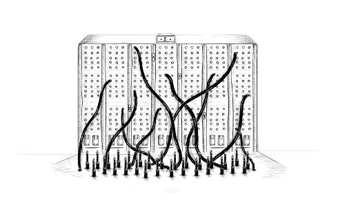

本书接下来的章节将讨论网络浏览器。没有网络浏览器，就不会有 JavaScript。即使有，也不会有人关注它。

网络技术从一开始就是去中心化的，不仅在技术上如此，在其演进方式上也是如此。各种浏览器供应商以临时且有时考虑不周的方式添加新功能，这些功能有时会被其他供应商采纳，并最终被确立为标准。

这既是福也是祸。一方面，没有中央机构控制系统，而是由各方在松散合作（或偶尔公开敌对）中改进系统，这令人振奋。另一方面，网络发展的随意方式意味着最终的系统并非内部一致性的典范。它的某些部分令人困惑且构思不佳。

## 网络与互联网

计算机网络自 20 世纪 50 年代就已存在。如果你在两台或多台计算机之间铺设电缆，并允许它们通过这些电缆来回发送数据，你就可以做各种奇妙的事情。

如果连接同一栋建筑内的两台机器就能让我们实现奇妙的事情，那么连接全球各地的机器应该会更好。实现这一愿景的技术在 20 世纪 80 年代得到发展，由此产生的网络被称为*互联网*。它没有辜负人们的期望。

计算机可以利用这个网络向另一台计算机发送比特。要使这种比特传输产生有效的通信，两端的计算机都必须知道这些比特代表什么。任何给定比特序列的含义完全取决于它试图表达的内容类型以及所使用的编码机制。

*网络协议*描述了一种通过网络进行通信的方式。有用于发送电子邮件的协议、用于获取电子邮件的协议、用于共享文件的协议，甚至还有用于控制被恶意软件感染的计算机的协议。

例如，*超文本传输协议*（HTTP）是一种用于获取命名资源（信息块，如网页或图片）的协议。它规定发起请求的一方应以类似这样的行开头，指明资源名称和它试图使用的协议版本：

```
GET /index.html HTTP/1.1
```

关于请求方如何在请求中包含更多信息，以及返回资源的一方如何封装其内容，还有更多规则。我们将在第 18 章更详细地介绍 HTTP。

大多数协议都构建在其他协议之上。HTTP 将网络视为一种类似流媒体的设备，你可以向其中放入比特，并让它们按正确顺序到达正确的目的地。正如我们在第 11 章中看到的，确保这些已经是一个相当困难的问题。

*传输控制协议*（TCP）是一种解决这个问题的协议。所有连接到互联网的设备都“说”这种协议，互联网上的大多数通信都建立在它之上。

TCP 连接的工作方式如下：一台计算机必须等待（或*监听*）其他计算机开始与它通信。为了能够在一台机器上同时监听不同类型的通信，每个监听器都有一个与之关联的编号（称为*端口*）。大多数协议指定默认应使用哪个端口。例如，当我们想使用 SMTP 协议发送电子邮件时，我们发送邮件的机器应监听端口 25。

然后，另一台计算机可以通过使用正确的端口号连接到目标机器来建立连接。如果目标机器可达并且正在监听该端口，则连接成功创建。监听的计算机称为*服务器*，连接的计算机称为*客户端*。

这种连接充当一个双向管道，比特可以通过它流动——两端的机器都可以向其中放入数据。一旦比特成功传输，另一端的机器就可以再次读取它们。这是一个方便的模型。可以说 TCP 提供了网络的抽象。

## 万维网

*万维网*（不要与整个互联网混淆）是一组协议和格式，允许我们在浏览器中访问网页。名称中的“Web”部分指的是这些页面可以轻松地相互链接，从而连接成一个巨大的网状结构，用户可以在其中浏览。

要成为万维网的一部分，你只需将一台机器连接到互联网，并让它使用 HTTP 协议监听端口 80，这样其他计算机就可以向它请求文档。

万维网上的每个文档都由一个*统一资源定位符*（URL）命名，它看起来像这样：

```
http://eloquentjavascript.net/13_browser.html
|      |                      |               |
协议        服务器                  路径
```

第一部分告诉我们这个 URL 使用 HTTP 协议（与加密的 HTTP 相对，后者会是`https://`）。接下来是标识我们请求文档的服务器部分。最后是一个路径字符串，标识我们感兴趣的特定文档（或*资源*）。

连接到互联网的机器会获得一个*IP 地址*，这是一个可用于向该机器发送消息的数字，看起来像`149.210.142.219`或`2001:4860:4860::8888`。但一串或多或少随机的数字很难记住，也不方便输入，因此你可以为特定地址或一组地址注册一个*域名*。我注册了`eloquentjavascript.net`，指向我控制的一台机器的 IP 地址，因此可以使用该域名来提供网页服务。

如果你在浏览器的地址栏中输入这个 URL，浏览器将尝试检索并显示该 URL 处的文档。首先，你的浏览器必须找出`eloquentjavascript.net`指向的地址。然后，使用 HTTP 协议，它将连接到该地址的服务器，并请求资源`/13_browser.html`。如果一切顺利，服务器会发回一个文档，然后你的浏览器将其显示在屏幕上。

## HTML

HTML，全称*超文本标记语言*，是用于网页的文档格式。HTML 文档包含文本，以及为文本提供结构的*标签*，用于描述链接、段落和标题等内容。

一个简短的 HTML 文档可能如下所示：

```
<!doctype html>
<html>
  <head>
    <meta charset="utf-8">
    <title>我的主页</title>
  </head>
  <body>
    <h1>我的主页</h1>
    <p>你好，我是 Marijn，这是我的主页。</p>
    <p>我还写了一本书！请点击
      <a href="http://eloquentjavascript.net">这里</a>阅读。</p>
  </body>
</html>
```

这就是这样的文档在浏览器中的样子：

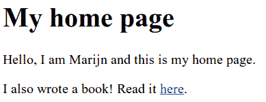

标签用尖括号（`<`和`>`，即*小于*和*大于*符号）包裹，提供文档结构的信息。其他文本只是纯文本。

文档以`<!doctype html>`开头，告诉浏览器将页面解释为*现代*HTML，而不是过去使用的各种方言。

HTML 文档有头部和主体。头部包含*关于*文档的信息，主体包含文档本身。在这个例子中，头部声明了该文档的标题是“我的主页”，并且它使用 UTF-8 编码，这是一种将 Unicode 文本编码为二进制数据的方式。文档的主体包含一个标题（`<h1>`，意为“标题 1”——`<h2>`到`<h6>`产生子标题）和两个段落（`<p>`）。

标签有多种形式。一个元素（如`body`、段落或链接）由*开始标签*（如`<p>`）开始，并由*结束标签*（如`</p>`）结束。某些开始标签（例如链接的`<a>`）会以`name="value"`对的形式包含额外信息，这些被称为*属性*。在此例中，链接的目标地址通过`href="http://eloquentjavascript.net"`表示，其中`href`代表“超文本引用”。

有些类型的标签不包含任何内容，因此无需闭合。元数据标签`<meta charset="utf-8">`就是一个例子。

为了能够在文档文本中包含尖括号（尽管它们在 HTML 中有特殊含义），还需要引入另一种特殊表示法。普通的左尖括号写作`&lt;`（“小于”），右尖括号写作`&gt;`（“大于”）。在 HTML 中，一个与号（`&`）后跟名称或字符代码以及分号（`;`）被称为*实体*，它会被替换为所编码的字符。

这与 JavaScript 字符串中使用反斜杠的方式类似。由于这种机制也给与号赋予了特殊含义，因此它们也需要被转义为`&amp;`。在属性值（用双引号包裹）中，可以使用`&quot;`来插入实际的引号字符。

HTML 的解析具有惊人的容错性。当应有的标签缺失时，浏览器会自行重建。这种处理方式已经标准化，你可以信赖所有现代浏览器都会以相同的方式执行。

以下文档将与之前展示的文档一样被处理：

```
<!doctype html>

<meta charset=utf-8>
<title>我的主页</title>

<h1>我的主页</h1>
<p>你好，我是 Marijn，这是我的主页。
<p>我还写了一本书！请阅读它
  <a href=http://eloquentjavascript.net>这里</a>。
```

`<html>`、`<head>`和`<body>`标签完全消失了。浏览器知道`<meta>`和`<title>`属于 head 部分，而`<h1>`表示 body 已开始。此外，我没有显式关闭段落，因为打开新段落或文档结束时会隐式关闭它们。属性值周围的引号也消失了。

本书通常会在示例中省略`<html>`、`<head>`和`<body>`标签，以保持简洁且不杂乱。但我*会*闭合标签并在属性周围加上引号。

我通常也会省略 doctype 和`charset`声明。但这并不意味着鼓励你在 HTML 文档中省略它们。当你忘记它们时，浏览器常常会做出荒谬的事情。你应该认为 doctype 和`charset`元数据在示例中是隐式存在的，即使它们并未在文本中实际显示。

## HTML 与 JavaScript

在本书的语境中，最重要的 HTML 标签是`<script>`。该标签允许我们在文档中包含一段 JavaScript。

```
<h1>测试弹窗</h1>
<script>alert("hello!");</script>
```

当浏览器读取 HTML 时，一旦遇到`<script>`标签，该脚本就会立即运行。打开此页面时会弹出一个对话框——`alert`函数与`prompt`类似，都会弹出一个窗口，但只显示消息而不要求输入。

将大型程序直接包含在 HTML 文档中通常不切实际。`<script>`标签可以添加`src`属性，用于从 URL 获取脚本文件（包含 JavaScript 程序的文本文件）。

```
<h1>测试弹窗</h1>
<script src="code/hello.js"></script>
```

此处包含的`code/hello.js`文件包含相同的程序——`alert("hello!")`。当 HTML 页面引用其他 URL 作为自身的一部分（例如图像文件或脚本）时，Web 浏览器会立即检索它们并将其包含在页面中。

脚本标签必须始终以`</script>`闭合，即使它引用的是脚本文件且不包含任何代码。如果你忘记这一点，页面的其余部分将被解释为脚本的一部分。

你可以通过为脚本标签添加`type="module"`属性，在浏览器中加载 ES 模块（参见第 10 章）。此类模块可以通过在`import`声明中使用相对于自身的 URL 作为模块名称来依赖其他模块。

某些属性也可以包含 JavaScript 程序。接下来展示的`<button>`标签（显示为一个按钮）具有`onclick`属性。每当按钮被点击时，该属性的值就会被执行。

```
<button onclick="alert('Boom!');">不要按</button>
```

请注意，我不得不在`onclick`属性中对字符串使用单引号，因为双引号已经用于包裹整个属性。我也可以使用`&quot;`。

## 在沙盒中

运行从互联网下载的程序存在潜在危险。你对你访问的大多数网站背后的人知之甚少，他们未必心怀善意。运行不怀好意的人编写的程序，会导致你的计算机感染病毒、数据被盗、账户被黑。

然而，Web 的魅力在于你可以浏览它，而不必完全信任你访问的所有页面。这就是为什么浏览器严格限制 JavaScript 程序可以做的事情：它不能查看你计算机上的文件，也不能修改与嵌入它的网页无关的任何内容。

以这种方式隔离编程环境被称为*沙盒化*，其理念是程序在沙盒中无害地运行。但你应该想象这种特殊的沙盒上方有一个厚钢条制成的笼子，这样在沙盒中运行的程序实际上无法逃脱。

沙盒化的难点在于，既要给程序足够的空间使其有用，同时又要限制它们做任何危险的事情。许多有用的功能，例如与其他服务器通信或读取剪贴板内容，也可能被用来做有问题的、侵犯隐私的事情。

时不时地，有人会想出新的方法来绕过浏览器的限制并做一些有害的事情，从泄露少量私人信息到完全控制运行浏览器的整个机器。浏览器开发者通过修复漏洞来应对，一切又恢复平静——直到下一个问题被发现，并希望被公开，而不是被某个政府机构或黑手党秘密利用。

## 兼容性与浏览器大战

在 Web 的早期阶段，一款名为 Mosaic 的浏览器主导了市场。几年后，平衡转向了 Netscape，随后它又被微软的 Internet Explorer 大幅取代。在任何单一浏览器占据主导地位的时期，该浏览器的供应商都会觉得有权单方面为 Web 发明新功能。由于大多数用户使用最流行的浏览器，网站就会开始使用这些功能——其他浏览器则被忽略。

这是兼容性的黑暗时代，通常被称为*浏览器大战*。Web 开发者面对的并非一个统一的 Web，而是两三个互不兼容的平台。更糟糕的是，2003 年左右使用的浏览器都充满了漏洞，而且每个浏览器的漏洞还各不相同。编写网页的人们日子很艰难。

Mozilla Firefox 是 Netscape 的一个非营利分支，在 2000 年代末挑战了 Internet Explorer 的地位。由于微软当时并不特别热衷于保持竞争力，Firefox 从它手中夺走了大量市场份额。大约在同一时间，谷歌推出了 Chrome 浏览器，苹果的 Safari 浏览器也流行起来，导致出现了四大主要玩家，而非一家独大。

新玩家对标准持有更严肃的态度，并采用了更好的工程实践，从而减少了不兼容性和漏洞。微软看到自己的市场份额崩溃后，终于转变态度，在其取代 Internet Explorer 的 Edge 浏览器中采纳了这些做法。如果你今天刚开始学习 Web 开发，那算你幸运。各大浏览器的最新版本表现相当一致，且漏洞相对较少。

第 14 章

# 文档对象模型

> 太糟糕了！老生常谈！当你建好房子后，你才发现自己无意中学到了一些本应在开工前就知道的东西。

> 弗里德里希·尼采，《善恶的彼岸》


当你在浏览器中打开一个网页时，浏览器会检索页面的 HTML 文本并解析它，就像我们在第 12 章中的解析器解析程序一样。浏览器会构建一个文档结构模型，并利用这个模型在屏幕上绘制页面。

这个文档的表示是 JavaScript 程序在其沙盒中可用的工具之一。它是一个你可以读取或修改的数据结构。它作为一个*实时*数据结构：当你修改它时，屏幕上的页面会更新以反映这些变化。

## 文档结构

你可以将 HTML 文档想象成一组嵌套的盒子。像`<body>`和`</body>`这样的标签包围着其他标签，而这些标签又包含其他标签或文本。以下是上一章中的示例文档：

```
<!doctype html>
<html>
  <head>
    <title>我的主页</title>
  </head>
  <body>
    <h1>我的主页</h1>
    <p>你好，我是 Marijn，这是我的主页。</p>
    <p>我还写了一本书！请点击
      <a href="http://eloquentjavascript.net">这里</a>阅读。</p>
  </body>
</html>
```

这个页面具有以下结构：


浏览器用来表示文档的数据结构遵循这种形状。每个盒子都有一个对应的对象，我们可以与之交互，以了解它代表哪个 HTML 标签，以及它包含哪些盒子和文本。这种表示被称为*文档对象模型*，简称 DOM。


全局绑定 `document` 让我们可以访问这些对象。它的 `documentElement` 属性指向代表 `<html>` 标签的对象。由于每个 HTML 文档都有 `head` 和 `body`，因此它也有 `head` 和 `body` 属性，指向这些元素。

## 树

回想一下第 12 章中的语法树。它们的结构与浏览器文档的结构惊人地相似。每个节点可能引用其他节点（子节点），而这些子节点又可能拥有自己的子节点。这种形状是嵌套结构的典型特征，其中元素可以包含与自身相似的子元素。

当一个数据结构具有分支结构、没有循环（节点不能直接或间接包含自身），并且有一个单一的、明确定义的根时，我们称其为树。在 DOM 中，`document.documentElement` 充当根节点。

树在计算机科学中经常出现。除了表示像 HTML 文档或程序这样的递归结构外，它们还常用于维护排序的数据集，因为在树中查找或插入元素通常比在平面数组中更高效。

典型的树有不同类型的节点。Egg 语言的语法树有标识符、值和应用节点。应用节点可以有子节点，而标识符和值是叶子，即没有子节点的节点。

DOM 也是如此。代表 HTML 标签的元素节点决定了文档的结构。这些节点可以有子节点。例如，`document.body` 就是这样一个节点。其中一些子节点可以是叶子节点，比如文本片段或注释节点。

每个 DOM 节点对象都有一个 `nodeType` 属性，其中包含一个标识节点类型的代码（数字）。元素的代码为 1，这也被定义为常量属性 `Node.ELEMENT_NODE`。表示文档中一段文本的文本节点，代码为 3（`Node.TEXT_NODE`）。注释的代码为 8（`Node.COMMENT_NODE`）。

另一种可视化文档树的方式如下：


叶子是文本节点，箭头表示节点之间的父子关系。

## 标准

使用晦涩的数字代码来表示节点类型并不是一种很 JavaScript 风格的做法。在本章后面，我们会看到 DOM 接口的其他部分也显得笨拙且陌生。原因是 DOM 并非仅为 JavaScript 设计。相反，它试图成为一种语言中立的接口，也可以用于其他系统——不仅用于 HTML，还用于 XML，这是一种具有类似 HTML 语法的通用数据格式。

这很不幸。标准通常是有用的。但在这种情况下，优势（跨语言一致性）并不那么有说服力。拥有一个与你所使用的语言良好集成的接口，比拥有一个跨语言熟悉的接口更能节省时间。

作为这种糟糕集成的一个例子，考虑 DOM 中元素节点的 `childNodes` 属性。这个属性持有一个类似数组的对象，具有 `length` 属性以及按数字标记的属性来访问子节点。但它是 `NodeList` 类型的实例，而不是真正的数组，因此它没有 `slice` 和 `map` 等方法。

还有一些问题纯粹是设计不佳。例如，没有办法创建一个新节点并立即添加子节点或属性。相反，你必须先创建它，然后通过副作用逐个添加子节点和属性。大量与 DOM 交互的代码往往会变得冗长、重复且丑陋。

但这些缺陷并非致命。由于 JavaScript 允许我们创建自己的抽象，因此可以设计出更好的方式来表达你所执行的操作。许多用于浏览器编程的库都提供了这样的工具。

## 在树中移动

DOM 节点包含大量指向附近其他节点的链接。下图展示了这些链接：


尽管图中每种链接只显示了一个，但每个节点都有一个 `parentNode` 属性，指向它所属的节点（如果有的话）。同样，每个元素节点（节点类型 1）都有一个 `childNodes` 属性，指向一个类数组对象，其中包含它的子节点。

理论上，仅使用这些父节点和子节点链接，你就可以在树中任意移动。但 JavaScript 还为你提供了许多额外的便捷链接。`firstChild` 和 `lastChild` 属性分别指向第一个和最后一个子元素，对于没有子节点的节点，它们的值为 `null`。类似地，`previousSibling` 和 `nextSibling` 指向相邻节点，即具有相同父节点且紧邻该节点之前或之后的节点。对于第一个子节点，`previousSibling` 为 `null`；对于最后一个子节点，`nextSibling` 为 `null`。

还有一个 `children` 属性，它类似于 `childNodes`，但只包含元素（类型 1）子节点，而不包含其他类型的子节点。当你对文本节点不感兴趣时，这会很有用。

处理像这样的嵌套数据结构时，递归函数通常很有用。下面的函数扫描文档，查找包含给定字符串的文本节点，并在找到时返回 `true`：

```
function talksAbout(node, string) {
  if (node.nodeType == Node.ELEMENT_NODE) {
    for (let i = 0; i < node.childNodes.length; i++) {
      if (talksAbout(node.childNodes[i], string)) {
        return true;
      }
    }
    return false;
  } else if (node.nodeType == Node.TEXT_NODE) {
    return node.nodeValue.indexOf(string) > -1;
  }
}

console.log(talksAbout(document.body, "book"));
// → true
```

由于 `childNodes` 不是一个真正的数组，我们不能用 `for`/`of` 来遍历它，而必须使用常规的 `for` 循环遍历索引范围，或者使用 `Array.from`。

文本节点的 `nodeValue` 属性保存了它所表示的文本字符串。

## 查找元素

在父节点、子节点和兄弟节点之间导航这些链接通常很有用。但如果我们想在文档中找到一个特定的节点，从 `document.body` 开始并沿着固定的属性路径来找到它，这并不是一个好主意。这样做会将程序对文档精确结构的假设固化下来——而你可能以后会改变这种结构。另一个复杂因素是，即使节点之间的空白也会创建文本节点。示例文档的 `<body>` 标签不仅仅有三个子节点（`<h1>` 和两个 `<p>` 元素），实际上有七个：这三个，加上它们之前、之后和之间的空格。

因此，如果我们想获取该文档中链接的 `href` 属性，我们不想说“获取文档 body 的第六个子节点的第二个子节点”之类的话。更好的方式是可以说“获取文档中的第一个链接”。而我们可以做到。

```
let link = document.body.getElementsByTagName("a")[0];
console.log(link.href);
```

所有元素节点都有一个 `getElementsByTagName` 方法，它会收集所有具有给定标签名且是该节点后代（直接或间接子节点）的元素，并将它们作为一个类数组对象返回。

要查找特定的单个节点，你可以给它一个 `id` 属性，然后使用 `document.getElementById`。

```
<p>我的鸵鸟格特鲁德：</p>
<p></p>

<script>
  let ostrich = document.getElementById("gertrude");
  console.log(ostrich.src);
</script>
```

第三种类似的方法是 `getElementsByClassName`，它与 `getElementsByTagName` 类似，会搜索元素节点的内容，并检索所有在其 `class` 属性中包含给定字符串的元素。

## 修改文档

DOM 数据结构几乎所有的内容都可以更改。文档树的形状可以通过改变父子关系来修改。节点有一个 `remove` 方法，用于将其从当前父节点中移除。要向元素节点添加子节点，我们可以使用 `appendChild`，它会将子节点放在子节点列表的末尾，或者使用 `insertBefore`，它会将第一个参数指定的节点插入到第二个参数指定的节点之前。

```
<p>一</p>
<p>二</p>
<p>三</p>

<script>
  let paragraphs = document.body.getElementsByTagName("p");
  document.body.insertBefore(paragraphs[2], paragraphs[0]);
</script>
```

一个节点在文档中只能存在于一个位置。因此，将段落三插入到段落一之前，会先将其从文档末尾移除，然后插入到开头，结果顺序变为三/一/二。所有将节点插入到某处的操作，都会产生副作用，即将其从当前位置移除（如果它原本有位置的话）。

`replaceChild` 方法用于将一个子节点替换为另一个子节点。它接受两个节点作为参数：一个新节点和要被替换的节点。被替换的节点必须是调用该方法的元素的子节点。注意，`replaceChild` 和 `insertBefore` 都将新节点作为它们的第一个参数。

## 创建节点

假设我们要编写一个脚本，将文档中的所有图像（`` 标签）替换为其 `alt` 属性中的文本，该属性指定了图像的替代文本表示。

这不仅涉及移除图像，还需要添加新的文本节点来替换它们。文本节点是通过 `document.createTextNode` 方法创建的。

```
<p>在中的
  。</p>

<p><button onclick="replaceImages()">替换</button></p>

<script>
  function replaceImages() {
    let images = document.body.getElementsByTagName("img");
    for (let i = images.length - 1; i >= 0; i--) {
      let image = images[i];
      if (image.alt) {
        let text = document.createTextNode(image.alt);
        image.parentNode.replaceChild(text, image);
      }
    }
  }
</script>
```

给定一个字符串，`createTextNode` 会返回一个文本节点，我们可以将其插入到文档中，使其显示在屏幕上。

遍历图像的循环从列表末尾开始。这是必要的，因为像 `getElementsByTagName`（或 `childNodes` 这样的属性）返回的节点列表是实时的。也就是说，它会随着文档的变化而更新。如果我们从前面开始，移除第一个图像会导致列表失去第一个元素，这样当循环第二次执行时，`i` 为 1，但集合的长度现在也变成了 1，循环就会停止。

如果你想要一个固定的节点集合，而不是实时的，你可以通过调用 `Array.from` 将集合转换为真正的数组。

```
let arrayish = {0: "one", 1: "two", length: 2};
let array = Array.from(arrayish);
console.log(array.map(s => s.toUpperCase()));
// → ["ONE", "TWO"]
```

要创建元素节点，你可以使用 `document.createElement` 方法。该方法接受一个标签名，并返回一个给定类型的新空节点。

以下示例定义了一个实用函数 `elt`，用于创建元素节点，并将其余参数视为该节点的子节点。随后，该函数被用来为一段引用添加出处信息。

```
<blockquote id="quote">
  No book can ever be finished. While working on it we learn
  just enough to find it immature the moment we turn away
  from it.
</blockquote>

<script>
  function elt(type, ...children) {
    let node = document.createElement(type);
    for (let child of children) {
      if (typeof child != "string") node.appendChild(child);
      else node.appendChild(document.createTextNode(child));
    }
    return node;
  }

  document.getElementById("quote").appendChild(
    elt("footer", "—",
        elt("strong", "Karl Popper"),
        ", preface to the second editon of ",
        elt("em", "The Open Society and Its Enemies"),
        ", 1950"));
</script>
```

最终文档的效果如下：

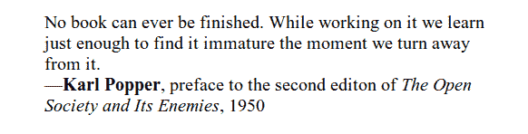

## 属性

某些元素属性（例如链接的 `href`）可以通过元素 DOM 对象上同名的属性来访问。大多数常用的标准属性都是如此。

但 HTML 允许你在节点上设置任意属性。这很有用，因为它让你可以在文档中存储额外信息。不过，如果你自定义属性名称，这些属性不会作为元素节点的属性存在。相反，你必须使用 `getAttribute` 和 `setAttribute` 方法来操作它们。

```
<p data-classified="secret">The launch code is 00000000.</p>
<p data-classified="unclassified">I have two feet.</p>

<script>
  let paras = document.body.getElementsByTagName("p");
  for (let para of Array.from(paras)) {
    if (para.getAttribute("data-classified") == "secret") {
      para.remove();
    }
  }
</script>
```

建议为这类自定义属性名称添加 `data-` 前缀，以确保它们不会与其他属性冲突。

有一个常用属性 `class`，它是 JavaScript 语言中的关键字。由于历史原因（一些旧的 JavaScript 实现无法处理与关键字匹配的属性名），用于访问该属性的属性被称为 `className`。你也可以通过 `getAttribute` 和 `setAttribute` 方法使用其真实名称 `"class"` 来访问它。

## 布局

你可能已经注意到，不同类型的元素布局方式不同。有些元素（如段落 `<p>` 或标题 `<h1>`）占据文档的整个宽度，并显示在单独的行上。这些被称为块级元素。其他元素（如链接 `<a>` 或 `<strong>` 元素）则与周围的文本显示在同一行上。这类元素被称为内联元素。

对于任何给定的文档，浏览器都能够计算布局，根据元素的类型和内容为每个元素分配大小和位置。然后使用此布局来实际绘制文档。

元素的大小和位置可以通过 JavaScript 访问。`offsetWidth` 和 `offsetHeight` 属性提供了元素以像素为单位占据的空间。像素是浏览器中的基本度量单位。传统上，它对应于屏幕可以绘制的最小点，但在现代显示器上（可以绘制非常小的点），情况可能不再如此，一个浏览器像素可能跨越多个显示点。

类似地，`clientWidth` 和 `clientHeight` 提供了元素内部空间的大小，忽略边框宽度。

```
<p style="border: 3px solid red">
  I'm boxed in
</p>

<script>
  let para = document.body.getElementsByTagName("p")[0];
  console.log("clientHeight:", para.clientHeight);
  console.log("offsetHeight:", para.offsetHeight);
</script>
```

给段落添加边框会在其周围绘制一个矩形。

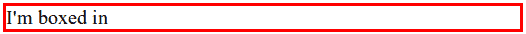

查找元素在屏幕上精确位置的最有效方法是使用 `getBoundingClientRect` 方法。它返回一个包含 `top`、`bottom`、`left` 和 `right` 属性的对象，指示元素各边相对于屏幕左上角的像素位置。如果你希望它们相对于整个文档，则必须加上当前的滚动位置，你可以在 `pageXOffset` 和 `pageYOffset` 绑定中找到它。

布局文档可能是一项相当繁重的工作。为了速度，浏览器引擎不会在每次更改文档时立即重新布局，而是尽可能等待。当更改文档的 JavaScript 程序运行完毕后，浏览器必须计算新的布局，以便将更改后的文档绘制到屏幕上。当程序通过读取 `offsetHeight` 等属性或调用 `getBoundingClientRect` 来询问某个元素的位置或大小时，提供正确信息也需要计算布局。

一个反复在读取 DOM 布局信息和更改 DOM 之间切换的程序会强制进行大量布局计算，因此运行速度会非常慢。以下代码就是一个例子。它包含两个不同的程序，分别构建一条 2000 像素宽的 X 字符行，并测量每个程序所花费的时间。


```html
<p><span id="one"></span></p>
<p><span id="two"></span></p>

<script>
  function time(name, action) {
    let start = Date.now(); // Current time in milliseconds
    action();
    console.log(name, "took", Date.now() - start, "ms");
  }

  time("naive", () => {
    let target = document.getElementById("one");
    while (target.offsetWidth < 2000) {
      target.appendChild(document.createTextNode("X"));
    }
  });
  // → naive took 32 ms

  time("clever", function() {
    let target = document.getElementById("two");
    target.appendChild(document.createTextNode("XXXXX"));
    let total = Math.ceil(2000 / (target.offsetWidth / 5));
    target.firstChild.nodeValue = "X".repeat(total);
  });
  // → clever took 1 ms
</script>
```

## 样式

我们已经看到不同的 HTML 元素以不同的方式绘制。有些显示为块级，有些为内联。有些添加了样式——`<strong>` 使其内容加粗，`<a>` 使其变为蓝色并带下划线。

`` 标签显示图像的方式，或 `<a>` 标签在点击时触发链接跳转的方式，与元素类型紧密相关。但我们可以更改与元素关联的样式，例如文本颜色或下划线。以下是一个使用 `style` 属性的示例：

```html
<p><a href=".">Normal link</a></p>
<p><a href="." style="color: green">Green link</a></p>
```

第二个链接将变为绿色，而不是默认的链接颜色。

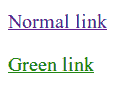

样式属性可以包含一个或多个*声明*，每个声明是一个属性（如 `color`）后跟冒号和值（如 `green`）。当有多个声明时，它们必须用分号分隔，例如 `"color: red; border: none"`。

文档的许多方面都可以通过样式来影响。例如，`display` 属性控制元素是显示为块级元素还是内联元素。

```html
This text is displayed <strong>inline</strong>,
<strong style="display: block">as a block</strong>, and
<strong style="display: none">not at all</strong>.
```

`block` 标签会单独占据一行，因为块级元素不会与周围的文本内联显示。最后一个标签完全不显示——`display: none` 阻止元素在屏幕上出现。这是一种隐藏元素的方式，通常比完全从文档中移除更可取，因为这样便于以后重新显示。

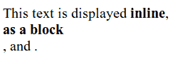

JavaScript 代码可以通过元素的 `style` 属性直接操作其样式。该属性包含一个对象，该对象拥有所有可能样式属性的属性。这些属性的值是字符串，我们可以通过修改它们来改变元素样式的特定方面。

```html
<p id="para" style="color: purple">
  Nice text
</p>

<script>
  let para = document.getElementById("para");
  console.log(para.style.color);
  para.style.color = "magenta";
</script>
```

某些样式属性名包含连字符，例如 `font-family`。由于在 JavaScript 中处理这类属性名比较麻烦（必须写成 `style["font-family"]`），因此 `style` 对象中这些属性的属性名会去掉连字符，并将连字符后的字母大写（`style.fontFamily`）。

## 层叠样式

HTML 的样式系统称为 CSS，即*层叠样式表*。*样式表*是一组规则，用于定义文档中元素的样式。它可以通过 `<style>` 标签给出。

```html
<style>
  strong {
    font-style: italic;
    color: gray;
  }
</style>
<p>Now <strong>strong text</strong> is italic and gray.</p>
```

名称中的*层叠*指的是多个这样的规则组合起来，为元素生成最终样式。在示例中，`<strong>` 标签的默认样式（赋予 `font-weight: bold`）被 `<style>` 标签中的规则覆盖，后者添加了 `font-style` 和 `color`。

当多个规则为同一属性定义值时，最近读取的规则优先级更高并胜出。因此，如果 `<style>` 标签中的规则包含 `font-weight: normal`，与默认的 `font-weight` 规则冲突，那么文本将显示为正常，*而不是*粗体。直接应用于节点的 `style` 属性中的样式具有最高优先级，并且总是胜出。

在 CSS 规则中，可以针对标签名以外的内容。针对 `.abc` 的规则适用于所有 `class` 属性中包含 `"abc"` 的元素。针对 `#xyz` 的规则适用于 `id` 属性为 `"xyz"` 的元素（该属性在文档中应唯一）。

```css
.subtle {
  color: gray;
  font-size: 80%;
}
#header {
  background: blue;
  color: white;
}
/* p elements with id main and with classes a and b */
p#main.a.b {
  margin-bottom: 20px;
}
```

优先规则中“最近定义的规则优先”仅适用于规则具有相同*特异性*的情况。规则的特异性是衡量它描述匹配元素的精确程度的指标，由它要求的元素方面的数量和种类（标签、类或 ID）决定。例如，针对 `p.a` 的规则比针对 `p` 或仅针对 `.a` 的规则更具体，因此会优先于它们。

符号 `p > a {…}` 将给定样式应用于所有作为 `<p>` 标签直接子元素的 `<a>` 标签。类似地，`p a {…}` 应用于所有位于 `<p>` 标签内部的 `<a>` 标签，无论它们是直接子元素还是间接子元素。

## 查询选择器

本书不会大量使用样式表。在浏览器中编程时理解它们很有帮助，但它们足够复杂，值得单独写一本书。

我介绍*选择器*语法（样式表中用于确定一组样式应用于哪些元素的表示法）的主要原因在于，我们可以使用这种相同的微型语言作为查找 DOM 元素的有效方式。

`querySelectorAll` 方法定义在 `document` 对象和元素节点上，它接受一个选择器字符串，并返回一个包含所有匹配元素的 `NodeList`。

```html
<p>And if you go chasing
  <span class="animal">rabbits</span></p>
<p>And you know you're going to fall</p>
<p>Tell 'em a <span class="character">hookah smoking
  <span class="animal">caterpillar</span></span></p>
<p>Has given you the call</p>

<script>
  function count(selector) {
    return document.querySelectorAll(selector).length;
  }
  console.log(count("p"));           // All <p> elements
  // → 4
  console.log(count(".animal"));     // Class animal
  // → 2
  console.log(count("p .animal"));   // Animal inside of <p>
  // → 2
  console.log(count("p > .animal")); // Direct child of <p>
  // → 1
</script>
```

与 `getElementsByTagName` 等方法不同，`querySelectorAll` 返回的对象*不是*实时的。当你更改文档时，它不会改变。不过它仍然不是真正的数组，因此如果你想将其视为数组，仍然需要调用 `Array.from`。

`querySelector` 方法（不带 `All` 部分）的工作方式类似。当你想要一个特定的单个元素时，这个方法很有用。它只返回第一个匹配的元素，如果没有匹配的元素则返回 `null`。

## 定位与动画

`position` 样式属性对布局有强大的影响。默认情况下，它的值为 `static`，意味着元素位于文档中的正常位置。当设置为 `relative` 时，元素仍然占据文档中的空间，但现在可以使用 `top` 和 `left` 样式属性相对于该正常位置移动它。当 `position` 设置为 `absolute` 时，元素会从正常的文档流中移除——也就是说，它不再占据空间，并可能与其他元素重叠。此外，它的 `top` 和 `left` 属性可用于将其绝对定位到最近的、`position` 属性不为 `static` 的父元素的左上角，或者如果不存在这样的父元素，则相对于文档定位。

我们可以利用这一点来创建动画。以下文档显示了一张猫的图片，它沿着椭圆轨迹移动：

```html
<p style="text-align: center">
  
</p>
<script>
  let cat = document.querySelector("img");
  let angle = Math.PI / 2;
  function animate(time, lastTime) {
    if (lastTime != null) {
      angle += (time - lastTime) * 0.001;
    }
    cat.style.top = (Math.sin(angle) * 20) + "px";
    cat.style.left = (Math.cos(angle) * 200) + "px";
    requestAnimationFrame(newTime => animate(newTime, time));
  }
  requestAnimationFrame(animate);
</script>
```

灰色箭头显示了图像移动的路径。

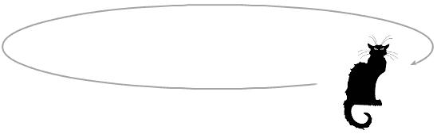

我们的图片在页面中居中，并设置了 `position` 为 `relative`。我们将反复更新该图片的 `top` 和 `left` 样式来移动它。

该脚本使用 `requestAnimationFrame` 来调度 `animate` 函数，使其在浏览器准备好重绘屏幕时运行。`animate` 函数本身会再次调用 `requestAnimationFrame` 来安排下一次更新。当浏览器窗口（或标签页）处于活动状态时，这将导致更新以大约每秒 60 次的频率发生，从而产生流畅的动画效果。

如果我们只是在一个循环中更新 DOM，页面将会冻结，屏幕上不会显示任何内容。浏览器在 JavaScript 程序运行时不会更新其显示，也不会允许与页面进行任何交互。这就是我们需要 `requestAnimationFrame` 的原因——它让浏览器知道我们暂时完成了操作，浏览器可以继续执行其本职工作，例如更新屏幕和响应用户操作。

动画函数会将当前时间作为参数传入。为了确保猫每毫秒的运动是稳定的，它根据当前时间与上次函数运行时间之间的差值来决定角度变化的速度。如果它只是每步移动一个固定的角度，那么当同一台计算机上运行的其他繁重任务导致函数暂停一小部分秒时，运动就会卡顿。

圆周运动是通过三角函数 `Math.cos` 和 `Math.sin` 实现的。对于那些不熟悉这些函数的人，我将简要介绍一下它们，因为我们在本书中会偶尔使用它们。

`Math.cos` 和 `Math.sin` 用于查找位于以点 (0,0) 为圆心、半径为 1 的圆上的点。这两个函数都将它们的参数解释为圆上的位置，其中 0 表示圆的最右侧点，顺时针方向直到 2π（约 6.28）绕圆一周。`Math.cos` 返回对应位置的 x 坐标，`Math.sin` 返回 y 坐标。大于 2π 或小于 0 的位置（或角度）也是有效的——旋转会重复，因此 *a*+2π 与角度 *a* 指向相同的位置。

这种测量角度的单位称为弧度——一个完整的圆是 2π 弧度，类似于用度测量时是 360 度。常数 π 在 JavaScript 中可用 `Math.PI` 表示。


猫的动画代码维护了一个计数器 `angle`，用于记录动画的当前角度，并在每次调用 `animate` 函数时递增它。然后它可以使用这个角度来计算图像元素的当前位置。`top` 样式通过 `Math.sin` 计算并乘以 20，这是椭圆的垂直半径。`left` 样式基于 `Math.cos` 并乘以 200，使得椭圆比高度宽得多。

请注意，样式通常需要*单位*。在这种情况下，我们需要在数字后附加 `"px"`，以告诉浏览器我们是以像素为单位（而不是厘米、“em”或其他单位）。这一点很容易忘记。使用不带单位的数字会导致样式被忽略——除非数字是 0，因为 0 无论单位如何都表示相同的意思。

## 总结

JavaScript 程序可以通过一种称为 DOM 的数据结构来检查和干预浏览器显示的文档。这种数据结构代表了浏览器对文档的模型，JavaScript 程序可以修改它以改变可见的文档。

DOM 的组织形式类似于一棵树，其中元素根据文档的结构按层次排列。表示元素的对象具有诸如 `parentNode` 和 `childNodes` 之类的属性，可用于遍历这棵树。

文档的显示方式可以通过*样式*来影响，既可以直接将样式附加到节点上，也可以通过定义匹配特定节点的规则。有许多不同的样式属性，例如 `color` 或 `display`。JavaScript 代码可以通过元素的 `style` 属性直接操作其样式。

## 练习

### 构建一个表格

HTML 表格由以下标签结构构建：

```html
<table>
  <tr>
    <th>name</th>
    <th>height</th>
    <th>place</th>
  </tr>
  <tr>
    <td>Kilimanjaro</td>
    <td>5895</td>
    <td>Tanzania</td>
  </tr>
</table>
```

对于每一*行*，`<table>` 标签包含一个 `<tr>` 标签。在这些 `<tr>` 标签内部，我们可以放置单元格元素：要么是标题单元格（`<th>`），要么是普通单元格（`<td>`）。

给定一个山脉数据集，即一个包含 `name`、`height` 和 `place` 属性的对象数组，生成一个枚举这些对象的表格的 DOM 结构。它应该每个键一列，每个对象一行，外加一个顶部包含 `<th>` 元素的标题行，列出列名。

编写代码，使得列能够自动从对象中派生，通过获取数据中第一个对象的属性名。

将生成的表格添加到具有 `id` 属性为 `"mountains"` 的元素中，使其在文档中可见。

完成此操作后，将包含数值的单元格右对齐，通过设置其 `style.textAlign` 属性为 `"right"`。

### 按标签名查找元素

`document.getElementsByTagName` 方法返回所有具有给定标签名的子元素。实现你自己的版本，作为一个函数，该函数接受一个节点和一个字符串（标签名）作为参数，并返回一个包含所有具有给定标签名的后代元素节点的数组。


要查找元素的标签名，请使用其`nodeName`属性。但请注意，这将返回全大写的标签名。使用`toLowerCase`或`toUpperCase`字符串方法来补偿这一点。

### 猫的帽子

扩展前面定义的猫动画，使得猫和它的帽子（``hat.`<wbr>`png">`）在椭圆的两侧相对轨道上运行。

或者让帽子围绕猫旋转。或者以其他有趣的方式改变动画。

为了更容易地定位多个对象，切换到绝对定位可能是个好主意。这意味着`top`和`left`是相对于文档左上角计算的。为了避免使用负坐标（这会导致图像移出可见页面），你可以向位置值添加一个固定的像素数。

# 第 15 章：处理事件

> 你拥有对自己思想的力量——而不是对外部事件。认识到这一点，你就会找到力量。
>
> 马可·奥勒留，《沉思录》

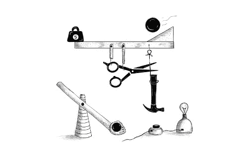

有些程序处理直接的用户输入，例如鼠标和键盘操作。这种输入并非以组织良好的数据结构形式提供——它是实时、逐块到来的，程序需要即时响应。

## 事件处理器

想象这样一个界面：要判断键盘上的某个键是否被按下，唯一的方式是读取该键的当前状态。为了能对按键做出响应，你必须不断读取按键状态，以便在它弹起之前捕捉到。如果此时执行其他耗时计算会很危险，因为你可能会错过一次按键。

某些原始机器确实以这种方式处理输入。更进一步的方案是让硬件或操作系统注意到按键并将其放入队列中。程序随后可以定期检查队列中的新事件，并对发现的事件做出响应。

当然，程序必须记得查看队列，并且要频繁查看，因为从按键按下到程序注意到事件之间的任何延迟都会让软件感觉反应迟钝。这种方法被称为*轮询*。大多数程序员都倾向于避免使用它。

更好的机制是让系统在事件发生时主动通知我们的代码。浏览器通过允许我们将函数注册为特定事件的*处理程序*来实现这一点。

```html
<p>点击此文档激活处理程序。</p>
<script>
  window.addEventListener("click", () => {
    console.log("有人敲门？");
  });
</script>
```

`window`绑定指向浏览器提供的一个内置对象。它代表包含文档的浏览器窗口。调用它的`addEventListener`方法会将第二个参数注册为回调函数，每当第一个参数描述的事件发生时就会调用它。

## 事件与 DOM 节点

每个浏览器事件处理程序都在一个上下文中注册。在前面的例子中，我们在`window`对象上调用了`addEventListener`，为整个窗口注册了一个处理程序。这种方法同样适用于 DOM 元素以及其他一些类型的对象。事件监听器仅当事件发生在它们所注册的对象上下文中时才会被调用。

```html
<button>点我</button>
<p>这里没有处理程序。</p>
<script>
  let button = document.querySelector("button");
  button.addEventListener("click", () => {
    console.log("按钮被点击了。");
  });
</script>
```

这个例子将一个处理程序附加到了按钮节点上。点击按钮会触发该处理程序，但点击文档的其他部分则不会。

给节点添加一个`onclick`属性也能达到类似的效果。这对大多数类型的事件都适用——你可以通过属性名（事件名前加上`on`）来附加处理程序。

但一个节点只能有一个`onclick`属性，因此通过这种方式每个节点只能注册一个处理程序。而`addEventListener`方法允许你添加任意数量的处理程序，因此即使元素上已有其他处理程序，也可以安全地添加新处理程序。

`removeEventListener`方法（调用参数与`addEventListener`类似）用于移除处理程序。

```html
<button>只触发一次的按钮</button>
<script>
  let button = document.querySelector("button");
  function once() {
    console.log("完成。");
    button.removeEventListener("click", once);
  }
  button.addEventListener("click", once);
</script>
```

传递给`removeEventListener`的函数必须与之前传递给`addEventListener`的函数是同一个函数值。因此，要注销一个处理程序，你需要给函数起一个名字（示例中的`once`），以便将同一个函数值传递给这两个方法。

## 事件对象

尽管我们之前忽略了它，但事件处理函数实际上会接收一个参数：*事件对象*。该对象包含关于事件的额外信息。例如，如果我们想知道*哪个*鼠标按钮被按下，可以查看事件对象的`button`属性。

```html
<button>用任何方式点击我</button>
<script>
  let button = document.querySelector("button");
  button.addEventListener("mousedown", event => {
    if (event.button == 0) {
      console.log("左键");
    } else if (event.button == 1) {
      console.log("中键");
    } else if (event.button == 2) {
      console.log("右键");
    }
  });
</script>
```

事件对象中存储的信息因事件类型而异。我们将在本章后面讨论不同类型的事件。对象的`type`属性始终包含一个标识事件的字符串（例如`"click"`或`"mousedown"`）。

## 事件传播

对于大多数事件类型，注册在包含子节点的节点上的处理程序也会接收到发生在子节点上的事件。如果段落内的一个按钮被点击，段落上的事件处理程序也会看到这个点击事件。

但如果段落和按钮都有处理程序，那么更具体的处理程序（按钮上的）会先执行。事件会向外*传播*，从发生事件的节点开始，到该节点的父节点，一直传播到文档的根节点。最后，在特定节点上注册的所有处理程序都执行完毕后，注册在整个窗口上的处理程序才有机会响应事件。

在任何时候，事件处理程序都可以调用事件对象的`stopPropagation`方法来阻止更上层的处理程序接收该事件。例如，当你有一个按钮位于另一个可点击元素内部，并且不希望点击按钮触发外层元素的点击行为时，这个方法就很有用。

下面的例子在一个按钮及其周围的段落上注册了`"mousedown"`处理程序。当用鼠标右键点击时，按钮的处理程序会调用`stopPropagation`，从而阻止段落上的处理程序运行。当用其他鼠标按钮点击按钮时，两个处理程序都会运行。

```html
<p>一个包含<button>按钮</button>的段落。</p>
<script>
  let para = document.querySelector("p");
  let button = document.querySelector("button");
  para.addEventListener("mousedown", () => {
    console.log("段落处理程序。");
  });
  button.addEventListener("mousedown", event => {
    console.log("按钮处理程序。");
    if (event.button == 2) event.stopPropagation();
  });
</script>
```

大多数事件对象都有一个`target`属性，指向事件起源的节点。你可以利用这个属性来确保不会意外处理从你不希望处理的节点传播上来的事件。

也可以使用`target`属性来为特定类型的事件设置一个宽泛的捕获范围。例如，如果你有一个包含一长串按钮的节点，那么在外层节点上注册一个单一的点击处理程序，并通过`target`属性来判断是否点击了按钮，可能比在所有按钮上分别注册处理程序更方便。

```html
<button>A</button>
<button>B</button>
<button>C</button>
<script>
  document.body.addEventListener("click", event => {
    if (event.target.nodeName == "BUTTON") {
      console.log("点击了", event.target.textContent);
    }
  });
</script>
```

## 默认行为

许多事件都有与之关联的默认行为。如果你点击一个链接，你会被导航到链接的目标地址。如果你按下向下箭头，浏览器会向下滚动页面。如果你点击鼠标右键，会弹出上下文菜单。诸如此类。

对于大多数类型的事件，JavaScript 事件处理程序会在*默认行为发生之前*被调用。如果处理程序不希望执行这个正常行为（通常因为它已经处理了该事件），它可以调用事件对象上的`preventDefault`方法。

这可以用来实现你自己的键盘快捷键或上下文菜单。也可以用来令人讨厌地干扰用户期望的行为。例如，下面是一个无法被点击的链接：

```html
<a href="https://developer.mozilla.org/">MDN</a>
<script>
  let link = document.querySelector("a");
  link.addEventListener("click", event => {
    console.log("Nope.");
    event.preventDefault();
  });
</script>
```

除非你有非常充分的理由，否则尽量不要做这种事情。当预期的行为被破坏时，使用你页面的人会感到不愉快。

根据浏览器的不同，有些事件根本无法被拦截。例如，在 Chrome 中，关闭当前标签页的键盘快捷键（control-W 或 command-W）无法被 JavaScript 处理。

## 键盘事件

当键盘上的一个键被按下时，浏览器会触发一个`"keydown"`事件。当它被释放时，你会得到一个`"keyup"`事件。

```html
<p>This page turns violet when you hold the V key.</p>
<script>
  window.addEventListener("keydown", event => {
    if (event.key == "v") {
      document.body.style.background = "violet";
    }
  });
  window.addEventListener("keyup", event => {
    if (event.key == "v") {
      document.body.style.background = "";
    }
  });
</script>
```

尽管名字叫`"keydown"`，但它不仅在按键被物理按下时触发。当一个键被按住不放时，每次按键*重复*时该事件都会再次触发。有时你需要对此小心。例如，如果你在按键按下时向 DOM 添加一个按钮，并在按键释放时将其移除，那么当按键被长时间按住时，你可能会意外地添加数百个按钮。

这个例子查看了事件对象的`key`属性，以确定事件是关于哪个键的。该属性包含一个字符串，对于大多数键来说，它对应于按下该键所输入的内容。对于特殊键（如回车键），它包含一个命名该键的字符串（本例中为`"Enter"`）。如果你在按下键的同时按住 shift，这也会影响键的名称——`"v"`变成`"V"`，`"1"`可能变成`"!"`，如果按下 shift-1 在你的键盘上产生的是`"!"`的话。

修饰键（如 shift、control、alt 和 meta（Mac 上的 command））会像普通键一样生成键盘事件。但在查找组合键时，你也可以通过查看键盘和鼠标事件的`shiftKey`、`ctrlKey`、`altKey`和`metaKey`属性来判断这些键是否被按住。

```html
<p>Press Control-Space to continue.</p>
<script>
  window.addEventListener("keydown", event => {
    if (event.key == " " && event.ctrlKey) {
      console.log("Continuing!");
    }
  });
</script>
```

键盘事件起源的 DOM 节点取决于按键时拥有焦点的元素。大多数节点无法获得焦点，除非你给它们一个`tabindex`属性，但像链接、按钮和表单字段这样的元素可以。我们将在第 18 章中回到表单字段。当没有特定元素拥有焦点时，`document.body`会作为键盘事件的目标节点。

当用户输入文本时，使用键盘事件来弄清楚正在输入的内容是有问题的。某些平台，最明显的是 Android 手机上的虚拟键盘，不会触发键盘事件。但即使你使用的是老式键盘，某些类型的文本输入也无法直接与按键匹配，例如*输入法编辑器*（IME）软件，这种软件被那些文字无法在键盘上直接输入的人使用，它通过组合多次按键来生成字符。

要留意何时有内容被输入，你可以输入内容的元素（如`<input>`和`<textarea>`标签）会在用户更改其内容时触发`"input"`事件。要获取实际输入的内容，最好直接从获得焦点的字段中读取。第 18 章将展示如何操作。

## 指针事件

目前有两种广泛使用的在屏幕上指向内容的方式：鼠标（包括类似鼠标的设备，如触摸板和轨迹球）和触摸屏。它们会产生不同类型的事件。

### 鼠标点击

按下鼠标按钮会触发一系列事件。`"mousedown"`和`"mouseup"`事件类似于`"keydown"`和`"keyup"`，在按钮被按下和释放时触发。这些事件发生在事件发生时鼠标指针正下方的 DOM 节点上。

在`"mouseup"`事件之后，一个`"click"`事件会在同时包含按下和释放按钮的最具体节点上触发。例如，如果我在一个段落上按下鼠标按钮，然后将指针移动到另一个段落并释放按钮，那么`"click"`事件会在包含这两个段落的元素上触发。

如果两次点击发生得很接近，在第二次点击事件之后还会触发一个`"dblclick"`（双击）事件。

要获取鼠标事件发生位置的精确信息，你可以查看它的`clientX`和`clientY`属性，它们包含事件相对于窗口左上角的坐标（以像素为单位），或者`pageX`和`pageY`，它们相对于整个文档的左上角（当窗口滚动时可能不同）。

下面实现了一个简单的绘图程序。每次你点击文档，它都会在鼠标指针下方添加一个点。关于更复杂的绘图程序，请参见第 19 章。

```html
<style>
  body {
    height: 200px;
    background: beige;
  }
  .dot {
    height: 8px; width: 8px;
    border-radius: 4px; /* rounds corners */
    background: blue;
    position: absolute;
  }
</style>
<script>
  window.addEventListener("click", event => {
    let dot = document.createElement("div");
    dot.className = "dot";
    dot.style.left = (event.pageX - 4) + "px";
    dot.style.top = (event.pageY - 4) + "px";
    document.body.appendChild(dot);
  });
</script>
```

### 鼠标移动

每次鼠标指针移动时，都会触发一个`"mousemove"`事件。这个事件可以用来跟踪鼠标的位置。一个常见的应用场景是实现某种鼠标拖拽功能。

例如，下面的程序显示了一个条，并设置了事件处理程序，使得在这个条上向左或向右拖拽可以使其变窄或变宽：

```html
<p>拖动条来改变其宽度：</p>
<div style="background: orange; width: 60px; height: 20px">
</div>
<script>
  let lastX; // 记录上一次鼠标的 X 坐标
  let bar = document.querySelector("div");
  bar.addEventListener("mousedown", event => {
    if (event.button == 0) {
      lastX = event.clientX;
      window.addEventListener("mousemove", moved);
      event.preventDefault(); // 防止选中
    }
  });

  function moved(event) {
    if (event.buttons == 0) {
      window.removeEventListener("mousemove", moved);
    } else {
      let dist = event.clientX - lastX;
      let newWidth = Math.max(10, bar.offsetWidth + dist);
      bar.style.width = newWidth + "px";
      lastX = event.clientX;
    }
  }
</script>
```


最终页面效果如下：

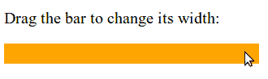

请注意，`"mousemove"` 处理程序是注册在整个窗口上的。即使鼠标在调整大小过程中移出了条的范围，只要按钮仍被按住，我们仍然希望更新其大小。

当鼠标按钮释放时，我们必须停止调整条的大小。为此，我们可以使用 `buttons` 属性（注意是复数形式），它告诉我们当前按下的按钮状态。当该值为零时，表示没有按钮被按下。当有按钮被按下时，其值是这些按钮代码的总和——左键代码为 `1`，右键为 `2`，中键为 `4`。这样，你可以通过取 `buttons` 值与其代码的余数来检查某个按钮是否被按下。

注意，这些代码的顺序与 `button` 属性使用的顺序不同，在 `button` 中，中键排在右键之前。如前所述，一致性并不是浏览器编程接口的强项。

### 触摸事件

我们使用的图形浏览器风格最初是为鼠标界面设计的，那时触摸屏还很罕见。为了让 Web 在早期的触摸屏手机上“工作”，这些设备的浏览器在一定程度上假装触摸事件就是鼠标事件。如果你点击屏幕，你会收到 `"mousedown"`、`"mouseup"` 和 `"click"` 事件。

但这种假象并不十分可靠。触摸屏的工作方式与鼠标不同：它没有多个按钮，当手指不在屏幕上时无法跟踪（以模拟 `"mousemove"`），并且允许多个手指同时触摸屏幕。

鼠标事件仅在简单情况下覆盖触摸交互——如果你给按钮添加了 `"click"` 处理程序，触摸用户仍然可以使用它。但像前面例子中的可调整大小的条，在触摸屏上就无法工作。

触摸交互会触发特定的事件类型。当手指开始触摸屏幕时，你会收到 `"touchstart"` 事件。当手指在触摸状态下移动时，会触发 `"touchmove"` 事件。最后，当手指离开屏幕时，你会看到 `"touchend"` 事件。

由于许多触摸屏可以同时检测多个手指，这些事件并不关联单一的坐标集。相反，它们的事件对象有一个 `touches` 属性，该属性包含一个类似数组的点对象，每个点都有自己的 `clientX`、`clientY`、`pageX` 和 `pageY` 属性。

你可以像下面这样做，在每个触摸的手指周围显示红色圆圈：

```html
<style>
  dot { position: absolute; display: block;
        border: 2px solid red; border-radius: 50px;
        height: 100px; width: 100px; }
</style>
<p>触摸此页面</p>
<script>
  function update(event) {
    for (let dot; dot = document.querySelector("dot");) {
      dot.remove();
    }
    for (let i = 0; i < event.touches.length; i++) {
      let {pageX, pageY} = event.touches[i];
      let dot = document.createElement("dot");
      dot.style.left = (pageX - 50) + "px";
      dot.style.top = (pageY - 50) + "px";
      document.body.appendChild(dot);
    }
  }
  window.addEventListener("touchstart", update);
  window.addEventListener("touchmove", update);
  window.addEventListener("touchend", update);
</script>
```

你通常需要在触摸事件处理程序中调用 `preventDefault` 来覆盖浏览器的默认行为（可能包括滑动时滚动页面），并防止触发鼠标事件（因为你可能也为鼠标事件设置了处理程序）。

## 滚动事件

每当一个元素被滚动时，它上面会触发一个 `"scroll"` 事件。这有多种用途，例如了解用户当前正在查看的内容（用于禁用屏幕外动画或向邪恶总部发送间谍报告），或者显示进度指示（通过高亮目录的一部分或显示页码）。

下面的示例在文档上方绘制了一个进度条，并在向下滚动时更新它使其填满：

```html
<style>
  #progress {
    border-bottom: 2px solid blue;
    width: 0;
    position: fixed;
    top: 0; left: 0;
  }
</style>
<div id="progress"></div>
<script>
  // 创建一些内容
  document.body.appendChild(document.createTextNode(
    "supercalifragilisticexpialidocious ".repeat(1000)));

  let bar = document.querySelector("#progress");
  window.addEventListener("scroll", () => {
    let max = document.body.scrollHeight - innerHeight;
    bar.style.width = `${(pageYOffset / max) * 100}%`;
  });
</script>
```

给元素设置 `position` 为 `fixed` 类似于 `absolute` 定位，但还能防止它随文档其余部分滚动。效果是让我们的进度条保持在顶部。通过改变其宽度来指示当前进度。设置宽度时我们使用 `%` 而不是 `px` 作为单位，这样元素的大小会相对于页面宽度进行调整。

全局绑定 `innerHeight` 提供了窗口的高度，我们需要从总可滚动高度中减去它——当你到达文档底部时就不能再继续滚动了。还有 `innerWidth` 用于窗口宽度。通过将当前滚动位置 `pageYOffset` 除以最大滚动位置再乘以 100，我们得到进度条的百分比。

在滚动事件上调用 `preventDefault` 并不能阻止滚动发生。实际上，事件处理程序是在滚动之后才被调用的。

## 焦点事件

当一个元素获得焦点时，浏览器会触发一个 `"focus"` 事件。当它失去焦点时，该元素会收到一个 `"blur"` 事件。

与之前讨论的事件不同，这两个事件不会冒泡。当子元素获得或失去焦点时，父元素上的处理程序不会收到通知。

下面的示例为当前获得焦点的文本字段显示帮助文本：

```html
<p>姓名：<input type="text" data-help="您的全名"></p>
<p>年龄：<input type="text" data-help="您的年龄（岁）"></p>
<p id="help"></p>

<script>
  let help = document.querySelector("#help");
  let fields = document.querySelectorAll("input");
  for (let field of Array.from(fields)) {
    field.addEventListener("focus", event => {
      let text = event.target.getAttribute("data-help");
      help.textContent = text;
    });
    field.addEventListener("blur", event => {
      help.textContent = "";
    });
  }
</script>
```

此截图显示了年龄字段的帮助文本。

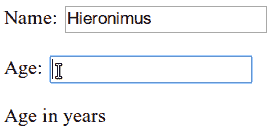

当用户从显示文档的浏览器标签页或窗口移开或移入时，`window` 对象会接收到 `"focus"` 和 `"blur"` 事件。

## 加载事件

当页面加载完成时，`"load"` 事件会在 `window` 和 `document.body` 对象上触发。这通常用于安排需要整个文档构建完成后才能执行的初始化操作。请记住，`<script>` 标签的内容在遇到标签时会立即执行。这可能为时过早，例如当脚本需要对 `<script>` 标签之后出现的文档部分进行操作时。

加载外部文件的元素（如图像和脚本标签）也有一个 `"load"` 事件，表示它们引用的文件已加载完成。与焦点相关的事件类似，加载事件不会传播。

当页面被关闭或导航离开时（例如通过点击链接），会触发 `"beforeunload"` 事件。该事件的主要用途是防止用户因关闭文档而意外丢失工作。阻止页面卸载并非像你可能预期的那样通过 `preventDefault` 方法实现，而是通过从处理程序返回一个非空值来实现。当你这样做时，浏览器会向用户显示一个对话框，询问他们是否确定要离开页面。这种机制确保用户始终能够离开，即使是那些恶意页面——它们更愿意将用户永远留在那里，强迫他们观看可疑的减肥广告。

## 事件与事件循环

在事件循环的上下文中，如第 11 章所讨论的，浏览器事件处理程序的行为与其他异步通知类似。它们会在事件发生时被调度，但必须等待正在运行的其他脚本完成后才能获得执行机会。

事件只有在没有其他任务运行时才能被处理，这意味着如果事件循环被其他工作占用，任何与页面的交互（通过事件发生）都将被延迟，直到有时间处理它。因此，如果你安排了太多工作，无论是通过长时间运行的事件处理程序还是大量短时间运行的处理程序，页面都会变得缓慢且难以使用。

对于那些你确实想在后台执行一些耗时操作而不冻结页面的情况，浏览器提供了一种称为 Web Worker 的机制。Worker 是一个与主脚本并行运行的 JavaScript 进程，拥有自己的时间线。

假设计算一个数的平方是一项繁重且耗时的计算，我们想在一个单独的线程中执行。我们可以编写一个名为 `code/squareworker.js` 的文件，它通过计算平方并发送消息来响应消息。

```javascript
addEventListener("message", event => {
  postMessage(event.data * event.data);
});
```

为了避免多个线程接触相同数据的问题，Worker 不与主脚本的环境共享其全局作用域或任何其他数据。相反，你必须通过来回发送消息与它们通信。

以下代码创建了一个运行该脚本的 Worker，向它发送几条消息，并输出响应。

```javascript
let squareWorker = new Worker("code/squareworker.js");
squareWorker.addEventListener("message", event => {
  console.log("The worker responded:", event.data);
});
squareWorker.postMessage(10);
squareWorker.postMessage(24);
```

`postMessage` 函数发送一条消息，这会导致接收方触发一个 `"message"` 事件。创建 Worker 的脚本通过 `Worker` 对象发送和接收消息，而 Worker 则通过直接在其全局作用域上发送和监听来与创建它的脚本通信。只有可以表示为 JSON 的值才能作为消息发送——另一方将收到它们的副本，而不是值本身。

## 定时器

我们在第 11 章中看到了 `setTimeout` 函数。它会在给定的毫秒数之后调度另一个函数执行。

有时你需要取消已调度的函数。这可以通过存储 `setTimeout` 返回的值并对其调用 `clearTimeout` 来实现。

```javascript
let bombTimer = setTimeout(() => {
  console.log("BOOM!");
}, 500);

if (Math.random() < 0.5) { // 50% 概率
  console.log("Defused.");
  clearTimeout(bombTimer);
}
```

`cancelAnimationFrame` 函数的工作方式与 `clearTimeout` 相同——对 `requestAnimationFrame` 返回的值调用它将取消该帧（假设它尚未被调用）。

一组类似的函数 `setInterval` 和 `clearInterval` 用于设置应每 *X* 毫秒重复执行的定时器。

```javascript
let ticks = 0;
let clock = setInterval(() => {
  console.log("tick", ticks++);
  if (ticks == 10) {
    clearInterval(clock);
    console.log("stop.");
  }
}, 200);
```

## 防抖

某些类型的事件可能会快速连续触发多次（例如 `"mousemove"` 和 `"scroll"` 事件）。处理此类事件时，必须小心不要执行过于耗时的操作，否则处理程序会占用太多时间，导致与文档的交互开始变得缓慢。

如果你确实需要在这样的处理程序中执行一些非平凡的操作，可以使用 `setTimeout` 来确保不会过于频繁地执行。这通常被称为事件的防抖。有几种略有不同的方法可以实现这一点。

在第一个示例中，我们希望在用户输入某些内容时做出反应，但不想对每个输入事件都立即执行。当用户快速输入时，我们只想等待一个暂停出现。我们不在事件处理程序中立即执行操作，而是设置一个超时。同时，我们清除之前的超时（如果有的话），这样当事件紧密发生时（比我们的超时延迟更近），前一个事件的超时将被取消。

```html
<textarea>Type something here...</textarea>
<script>
  let textarea = document.querySelector("textarea");
  let timeout;
  textarea.addEventListener("input", () => {
    clearTimeout(timeout);
    timeout = setTimeout(() => console.log("Typed!"), 500);
  });
</script>
```

向 `clearTimeout` 传递 `undefined` 值，或者对已经触发的超时调用它，都不会产生任何效果。因此，我们不必担心何时调用它，只需对每个事件都这样做即可。


如果我们希望将响应间隔至少一定的时间长度，但又希望在一系列事件期间（而不仅仅是在之后）触发它们，我们可以使用一种略有不同的模式。例如，我们可能希望响应`"mousemove"`事件，显示鼠标的当前坐标，但每 250 毫秒只显示一次。

```html
<script>
  let scheduled = null;
  window.addEventListener("mousemove", event => {
    if (!scheduled) {
      setTimeout(() => {
        document.body.textContent =
          `Mouse at ${scheduled.pageX}, ${scheduled.pageY}`;
        scheduled = null;
      }, 250);
    }
    scheduled = event;
  });
</script>
```

## 总结

事件处理程序使我们能够检测并响应网页中发生的事件。`addEventListener`方法用于注册此类处理程序。

每个事件都有一个标识其类型的类型（如`"keydown"`、`"focus"`等）。大多数事件会在特定的 DOM 元素上被调用，然后传播到该元素的祖先节点，从而允许与这些祖先关联的处理程序来处理它们。

当事件处理程序被调用时，会传入一个事件对象，其中包含关于该事件的附加信息。该对象还提供了一些方法，允许我们停止进一步传播（`stopPropagation`）以及阻止浏览器对该事件的默认处理（`preventDefault`）。

按下按键会触发`"keydown"`和`"keyup"`事件。按下鼠标按钮会触发`"mousedown"`、`"mouseup"`和`"click"`事件。移动鼠标会触发`"mousemove"`事件。触摸屏交互会产生`"touchstart"`、`"touchmove"`和`"touchend"`事件。

滚动可以通过`"scroll"`事件检测，焦点变化可以通过`"focus"`和`"blur"`事件检测。当文档加载完成时，`window`上会触发`"load"`事件。

## 练习

### 气球

编写一个页面，显示一个气球（使用气球表情符号 🎈）。当按下上箭头键时，气球应膨胀（变大）10%；当按下下箭头键时，气球应收缩（变小）10%。

你可以通过设置父元素的`font-size` CSS 属性（`style.fontSize`）来控制文本（表情符号也是文本）的大小。记得在值中包含单位，例如像素（`10px`）。

箭头键的键名是`"ArrowUp"`和`"ArrowDown"`。确保这些按键只改变气球，而不会滚动页面。

完成上述功能后，添加一个特性：如果气球膨胀到超过一定大小，它会爆炸。在这种情况下，爆炸意味着它被替换为💥表情符号，并且事件处理程序被移除（这样你就无法再膨胀或收缩爆炸效果了）。

### 鼠标轨迹

在 JavaScript 的早期，那是充满动画图像的华丽主页的鼎盛时期，人们想出了一些真正富有启发性的方式来使用这门语言。

其中之一就是鼠标轨迹——一系列元素，当你将鼠标在页面上移动时，它们会跟随鼠标指针。

在这个练习中，我希望你实现一个鼠标轨迹。使用绝对定位的`<div>`元素，具有固定的大小和背景颜色（参考“鼠标点击”一节中的代码示例）。创建一组这样的元素，当鼠标移动时，将它们显示在鼠标指针的尾迹中。

这里可以有多种方法。你可以根据自己的意愿使解决方案简单或复杂。一个简单的入门方案是保持固定数量的轨迹元素并循环使用它们，每次发生`"mousemove"`事件时，将下一个元素移动到鼠标的当前位置。

### 标签页

标签面板在用户界面中被广泛使用。它们允许你通过选择元素上方“突出”的多个标签之一来选择一个界面面板。

在这个练习中，你必须实现一个简单的标签页界面。编写一个名为`asTabs`的函数，它接受一个 DOM 节点，并创建一个标签页界面，显示该节点的子元素。它应该在该节点的顶部插入一个`<button>`元素列表，每个子元素对应一个按钮，按钮文本取自子元素的`data-tabname`属性。除了一个子元素外，其他所有原始子元素都应隐藏（设置`display`样式为`none`）。当前可见的节点可以通过点击按钮来选择。

完成上述功能后，扩展它，使当前选中标签的按钮样式不同，以便明显看出哪个标签被选中。

# 第 16 章

## 项目：一个平台游戏

> 一切现实都是游戏。
>
> 伊恩·班克斯，《游戏玩家》


我最初对计算机的迷恋，就像许多书呆子孩子一样，很大程度上与电脑游戏有关。我被那些我可以操控的微小模拟世界所吸引，在那里故事（某种程度上）展开——我想，更多是因为我将自己的想象力投射到其中，而不是因为它们实际提供的可能性。

我不希望任何人从事游戏编程的职业。就像音乐行业一样，渴望从事该工作的年轻人数量与实际需求之间的差距造成了一种相当不健康的环境。但为了乐趣而编写游戏是很有趣的。

本章将逐步实现一个小型平台游戏。平台游戏（或“跳跃与奔跑”游戏）要求玩家控制一个角色在通常为二维且从侧面观看的世界中移动，同时跳跃越过或落在物体上。

## 游戏

我们的游戏将大致基于 Thomas Palef 的[Dark Blue](http://www.lessmilk.com/games/10)（`www.lessmilk.com/games/10`）。我选择这个游戏是因为它既有趣又极简，而且不需要太多代码就能构建。它看起来像这样：

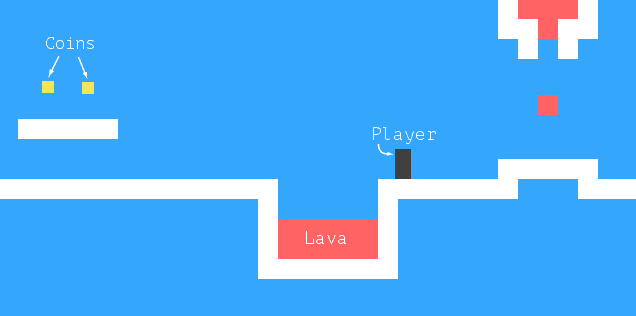

深色方块代表玩家，其任务是收集黄色方块（金币），同时避开红色物质（岩浆）。当所有金币都被收集后，关卡完成。

玩家可以使用左、右箭头键行走，使用上箭头键跳跃。跳跃是这个游戏角色的特色。它可以跳到自身高度的数倍，并且可以在空中改变方向。这可能不完全现实，但它有助于让玩家感觉直接控制屏幕上的化身。

游戏由静态背景组成，背景像网格一样布局，移动元素叠加在背景之上。网格中的每个字段要么是空的，要么是实心的，要么是岩浆。移动元素包括玩家、金币和某些岩浆块。这些元素的位置不受网格限制——它们的坐标可以是小数，从而实现平滑运动。

## 技术

我们将使用浏览器 DOM 来显示游戏，并通过处理键盘事件来读取用户输入。

与屏幕和键盘相关的代码只是构建这个游戏所需工作的一小部分。由于所有东西看起来都是彩色方块，绘制很简单：我们创建 DOM 元素，并使用样式为它们设置背景颜色、大小和位置。

我们可以将背景表示为一个表格，因为它是一个不变的方格网格。自由移动的元素可以使用绝对定位的元素叠加在上面。

在游戏和其他需要动画图形且能无显著延迟响应用户输入的程序中，效率至关重要。尽管 DOM 最初并非为高性能图形设计，但它的表现其实比预期要好。你在第 14 章中看到了一些动画。在现代机器上，即使不特别优化，像这样的简单游戏也能运行良好。

在下一章中，我们将探索另一种浏览器技术——`<canvas>`标签，它提供了一种更传统的绘图方式，基于形状和像素而非 DOM 元素。

## 关卡

我们需要一种人类可读、可编辑的方式来定义关卡。由于所有元素最初都可以放在网格上，我们可以使用大字符串，其中每个字符代表一个元素——要么是背景网格的一部分，要么是移动元素。

一个小关卡的规划可能如下所示：

```javascript
let simpleLevelPlan = `
......................
..#................#..
..#..............=.#..
..#.........o.o....#..
..#.@......#####...#..
..#####............#..
......#++++++++++++#..
......##############..
......................`;
```

句点表示空白空间，井号（`#`）字符表示墙壁，加号表示熔岩。玩家的起始位置是`@`符号。每个 O 字符是一枚金币，顶部的等号（`=`）是一块水平来回移动的熔岩。

我们还将支持另外两种移动熔岩：竖线字符（`|`）创建垂直移动的熔岩块，而`v`表示滴落熔岩——垂直移动但不来回反弹，只向下移动，碰到地面后跳回起始位置。

整个游戏由多个关卡组成，玩家必须逐一完成。当所有金币被收集时，关卡完成。如果玩家碰到熔岩，当前关卡将重置到起始位置，玩家可以重新尝试。

## 读取关卡

以下类存储一个关卡对象。其参数应为定义关卡的字符串。

```javascript
class Level {
  constructor(plan) {
    let rows = plan.trim().split("\n").map(l => [...l]);
    this.height = rows.length;
    this.width = rows[0].length;
    this.startActors = [];

    this.rows = rows.map((row, y) => {
      return row.map((ch, x) => {
        let type = levelChars[ch];
        if (typeof type == "string") return type;
        this.startActors.push(
          type.create(new Vec(x, y), ch));
        return "empty";
      });
    });
  }
}
```

`trim`方法用于移除规划字符串开头和结尾的空白字符。这样我们的示例规划就可以以换行符开头，使所有行直接上下对齐。剩余的字符串通过换行符`split`分割，每行展开成一个数组，得到字符数组。

因此，`rows`保存了一个字符数组的数组，即规划的每一行。我们可以从中推导出关卡的宽度和高度。但还需要将移动元素与背景网格分开。我们将移动元素称为角色。它们将存储在一个对象数组中。背景将是一个字符串数组的数组，包含字段类型如`"empty"`、`"wall"`或`"lava"`。

为了创建这些数组，我们遍历行，再遍历其内容。记住，`map`会将数组索引作为第二个参数传递给映射函数，这告诉我们给定字符的 x 和 y 坐标。游戏中的位置将存储为坐标对，左上角为 0,0，每个背景方块高和宽均为 1 个单位。

为了解释规划中的字符，`Level`构造函数使用了`levelChars`对象，它将背景元素映射为字符串，将角色字符映射为类。当`type`是一个角色类时，使用其静态`create`方法创建一个对象，并添加到`startActors`中，同时映射函数为该背景方块返回`"empty"`。

角色的位置存储为`Vec`对象。这是一个二维向量，包含`x`和`y`属性，如第 6 章练习中所示。

游戏运行时，角色会移动到不同位置，甚至完全消失（如金币被收集时）。我们将使用`State`类来跟踪运行中游戏的状态。

```javascript
class State {
  constructor(level, actors, status) {
    this.level = level;
    this.actors = actors;
    this.status = status;
  }

  static start(level) {
    return new State(level, level.startActors, "playing");
  }

  get player() {
    return this.actors.find(a => a.type == "player");
  }
}
```

`status`属性会在游戏结束时切换为`"lost"`或`"won"`。

这又是一个持久化数据结构——更新游戏状态会创建新状态，并保持旧状态不变。

## 角色

角色对象表示游戏中某个移动元素的当前位置和状态。所有角色对象遵循相同的接口。它们的`pos`属性保存元素左上角的坐标，`size`属性保存其大小。

它们还有一个`update`方法，用于计算给定时间步长后的新状态和位置。它模拟角色的行为——玩家响应箭头键移动，熔岩来回反弹——并返回一个新的、更新后的角色对象。

`type`属性包含一个字符串，标识角色的类型——`"player"`、`"coin"`或`"lava"`。这在绘制游戏时很有用——为角色绘制的矩形外观基于其类型。

角色类有一个静态`create`方法，由`Level`构造函数使用，根据关卡规划中的字符创建角色。它接收字符的坐标和字符本身，因为`Lava`类需要处理多个不同的字符。

这是我们将用于二维值（如角色的位置和大小）的`Vec`类。

```javascript
class Vec {
  constructor(x, y) {
    this.x = x; this.y = y;
  }
  plus(other) {
    return new Vec(this.x + other.x, this.y + other.y);
  }
  times(factor) {
    return new Vec(this.x * factor, this.y * factor);
  }
}
```

`times`方法将向量乘以一个给定数字。当我们需要将速度向量乘以时间间隔以获取该时间内移动的距离时，它会很有用。

不同类型的角色有各自的类，因为它们的行为差异很大。让我们定义这些类。稍后我们会介绍它们的`update`方法。

玩家类有一个`speed`属性，用于存储当前速度，以模拟动量和重力。

```javascript
class Player {
  constructor(pos, speed) {
    this.pos = pos;
    this.speed = speed;
  }

  get type() { return "player"; }

  static create(pos) {
    return new Player(pos.plus(new Vec(0, -0.5)),
                      new Vec(0, 0));
  }
}

Player.prototype.size = new Vec(0.8, 1.5);
```

由于玩家角色高度为一个半方格，其初始位置被设定为比`@`字符出现的位置高出半个方格。这样，它的底部就与其所在方格的底部对齐。

`size`属性对于`Player`的所有实例都是相同的，因此我们将其存储在原型上，而不是实例本身。我们本可以使用像`type`那样的 getter，但那样每次读取属性时都会创建并返回一个新的`Vec`对象，这会造成浪费。（字符串是不可变的，因此每次求值时不必重新创建。）

在构造`Lava`角色时，我们需要根据其基于的字符以不同的方式初始化对象。动态熔岩会以当前速度移动，直到碰到障碍物。此时，如果它具有`reset`属性，它会跳回起始位置（滴落）。如果没有，它会反转速度并朝另一个方向继续移动（弹跳）。

`create`方法会查看`Level`构造函数传递的字符，并创建相应的熔岩角色。


```js
class Lava {
  constructor(pos, speed, reset) {
    this.pos = pos;
    this.speed = speed;
    this.reset = reset;
  }

  get type() { return "lava"; }

  static create(pos, ch) {
    if (ch == "=") {
      return new Lava(pos, new Vec(2, 0));
    } else if (ch == "|") {
      return new Lava(pos, new Vec(0, 2));
    } else if (ch == "v") {
      return new Lava(pos, new Vec(0, 3), pos);
    }
  }
}

Lava.prototype.size = new Vec(1, 1);
```

`Coin` 角色相对简单。它们大多只是待在原地。但为了让游戏更生动一些，它们被赋予了“摆动”效果，即轻微的垂直来回运动。为了追踪这一点，硬币对象存储了一个基础位置以及一个`wobble`属性，该属性追踪弹跳运动的相位。这两者共同决定了硬币的实际位置（存储在`pos`属性中）。

```js
class Coin {
  constructor(pos, basePos, wobble) {
    this.pos = pos;
    this.basePos = basePos;
    this.wobble = wobble;
  }

  get type() { return "coin"; }

  static create(pos) {
    let basePos = pos.plus(new Vec(0.2, 0.1));
    return new Coin(basePos, basePos,
                    Math.random() * Math.PI * 2);
  }
}

Coin.prototype.size = new Vec(0.6, 0.6);
```

在第 14 章中，我们看到`Math.sin`给出了圆上一点的 y 坐标。当我们沿着圆移动时，该坐标会以平滑的波形来回变化，这使得正弦函数非常适合用于模拟波浪运动。

为了避免所有硬币同步上下移动，每个硬币的起始相位是随机的。`Math.sin`波的相位，即它产生的波的宽度，是 2π。我们将`Math.random`返回的值乘以该数字，以给硬币一个随机的波上起始位置。

现在我们可以定义`levelChars`对象，它将计划字符映射到背景网格类型或角色类。

```js
const levelChars = {
  ".": "empty", "#": "wall", "+": "lava",
  "@": Player, "o": Coin,
  "=": Lava, "|": Lava, "v": Lava
};
```

这样我们就拥有了创建`Level`实例所需的所有部分。

```js
let simpleLevel = new Level(simpleLevelPlan);
console.log(`${simpleLevel.width} by ${simpleLevel.height}`);
// → 22 by 9
```

接下来的任务是在屏幕上显示这样的关卡，并模拟其中的时间和运动。

## 封装是一种负担

本章中的大部分代码并没有过多考虑封装，原因有二。首先，封装需要额外的努力。它会使程序变得更大，并且需要引入额外的概念和接口。由于读者能接受的代码量有限，我努力保持程序小巧。

其次，游戏中的各种元素紧密相连，以至于如果其中一个的行为发生变化，其他元素很可能无法保持不变。元素之间的接口最终会编码大量关于游戏工作方式的假设。这使得它们的效果大打折扣——每当你改变系统的一部分时，你仍然需要担心它如何影响其他部分，因为它们的接口无法覆盖新的情况。

系统中的某些切割点适合通过严格的接口进行分离，但其他点则不然。试图封装一个不合适的边界肯定会浪费大量精力。当你犯这个错误时，你通常会注意到你的接口变得异常庞大和详细，并且随着程序的演变，它们需要频繁更改。

有一件事我们会封装，那就是绘制子系统。原因是在下一章中，我们将以不同的方式显示同一个游戏。通过将绘制放在接口后面，我们可以在那里加载相同的游戏程序并插入一个新的显示模块。

## 绘制

绘制代码的封装是通过定义一个显示对象来完成的，该对象显示给定的关卡和状态。我们在本章中定义的显示类型称为`DOMDisplay`，因为它使用 DOM 元素来显示关卡。

我们将使用样式表来设置构成游戏的元素的实际颜色和其他固定属性。当然，也可以在创建元素时直接赋值给元素的`style`属性，但这会使程序更加冗长。

以下辅助函数提供了一种简洁的方式来创建元素并为其赋予一些属性和子节点：

```js
function elt(name, attrs, ...children) {
  let dom = document.createElement(name);
  for (let attr of Object.keys(attrs)) {
    dom.setAttribute(attr, attrs[attr]);
  }
  for (let child of children) {
    dom.appendChild(child);
  }
  return dom;
}
```

创建显示对象时，需要为其提供一个父元素（显示对象将附加到该元素上）和一个关卡对象。

```js
class DOMDisplay {
  constructor(parent, level) {
    this.dom = elt("div", {class: "game"}, drawGrid(level));
    this.actorLayer = null;
    parent.appendChild(this.dom);
  }

  clear() { this.dom.remove(); }
}
```

关卡的背景网格永远不会改变，因此只绘制一次。每次使用给定状态更新显示时，角色都会重新绘制。`actorLayer`属性将用于跟踪包含角色的元素，以便可以轻松移除和替换它们。

我们的坐标和大小以网格单位跟踪，其中大小或距离为 1 表示一个网格块。在设置像素大小时，我们需要将这些坐标缩放——如果每个方格只有一个像素，游戏中的一切都会小得可笑。`scale`常量给出了屏幕上单个单位所占的像素数。

```js
const scale = 20;

function drawGrid(level) {
  return elt("table", {
    class: "background",
    style: `width: ${level.width * scale}px`
  }, ...level.rows.map(row =>
    elt("tr", {style: `height: ${scale}px`},
        ...row.map(type => elt("td", {class: type})))
  ));
}
```

如前所述，背景是用`<table>`元素绘制的。这与关卡中`rows`属性的结构完美对应——网格的每一行都变成了表格行（`<tr>`元素）。网格中的字符串被用作表格单元格（`<td>`）元素的类名。展开运算符（三个点）用于将子节点数组作为单独的参数传递给`elt`。

以下 CSS 使表格看起来像我们想要的背景：

```css
.background    { background: rgb(52, 166, 251);
                 table-layout: fixed;
                 border-spacing: 0;              }
.background td { padding: 0;                     }
.lava          { background: rgb(255, 100, 100); }
.wall          { background: white;              }
```

其中一些属性（`table-layout`、`border-spacing`和`padding`）用于抑制不需要的默认行为。我们不希望表格的布局依赖于其单元格的内容，也不希望在表格单元格之间留有空隙或内部填充。

`background`规则设置了背景颜色。CSS 允许颜色以单词（`white`）或`rgb(R, G, B)`格式指定，其中颜色的红、绿、蓝分量被分为三个 0 到 255 的数字。因此，在`rgb(52, 166, 251)`中，红色分量为 52，绿色为 166，蓝色为 251。由于蓝色分量最大，最终颜色会偏蓝。你可以看到，在`.lava`规则中，第一个数字（红色）是最大的。

我们通过为每个角色创建一个 DOM 元素，并根据角色的属性设置该元素的位置和大小来绘制每个角色。这些值必须乘以`scale`才能从游戏单位转换为像素。

```js
function drawActors(actors) {
  return elt("div", {}, ...actors.map(actor => {
    let rect = elt("div", {class: `actor ${actor.type}`});
    rect.style.width = `${actor.size.x * scale}px`;
    rect.style.height = `${actor.size.y * scale}px`;
    rect.style.left = `${actor.pos.x * scale}px`;
    rect.style.top = `${actor.pos.y * scale}px`;
    return rect;
  }));
}
```

要给一个元素添加多个类，我们用空格分隔类名。在接下来展示的 CSS 代码中，`actor`类赋予角色绝对定位。它们的类型名被用作额外的类来赋予颜色。我们不需要再次定义`lava`类，因为我们在之前定义的熔岩网格方块中重用了这个类。

```css
.actor  { position: absolute;            }
.coin   { background: rgb(241, 229, 89); }
.player { background: rgb(64, 64, 64);   }
```

`syncState`方法用于让显示内容呈现给定的状态。它首先移除旧的角色图形（如果有的话），然后在新位置重新绘制角色。可能会有人想尝试重用角色的 DOM 元素，但要做到这一点，我们需要大量额外的簿记工作来将角色与 DOM 元素关联，并确保在角色消失时移除元素。由于游戏中通常只有少数几个角色，重新绘制所有角色并不昂贵。

```js
DOMDisplay.prototype.syncState = function(state) {
  if (this.actorLayer) this.actorLayer.remove();
  this.actorLayer = drawActors(state.actors);
  this.dom.appendChild(this.actorLayer);
  this.dom.className = `game ${state.status}`;
  this.scrollPlayerIntoView(state);
};
```

通过将关卡的当前状态作为类名添加到包装元素中，我们可以添加一条 CSS 规则，该规则仅在玩家具有给定类的祖先元素时生效，从而在游戏胜利或失败时对玩家角色进行略微不同的样式设置。

```css
.lost .player {
  background: rgb(160, 64, 64);
}
.won .player {
  box-shadow: -4px -7px 8px white, 4px -7px 8px white;
}
```

接触熔岩后，玩家的颜色变为暗红色，暗示灼烧。当收集到最后一枚硬币时，我们添加两个模糊的白色阴影——一个在左上角，一个在右上角——以产生白色光晕效果。

我们不能假设关卡总是适合`viewport`（我们绘制游戏的元素）。这就是为什么需要调用`scrollPlayerIntoView`。它确保如果关卡突出到视口之外，我们会滚动视口，使玩家靠近其中心。以下 CSS 为游戏的包装 DOM 元素设置了最大尺寸，并确保任何超出元素框的内容都不可见。我们还为其设置了相对定位，以便其中的角色相对于关卡的左上角定位。

```css
.game {
  overflow: hidden;
  max-width: 600px;
  max-height: 450px;
  position: relative;
}
```

在`scrollPlayerIntoView`方法中，我们找到玩家的位置并更新包装元素的滚动位置。当玩家太靠近边缘时，我们通过操作该元素的`scrollLeft`和`scrollTop`属性来改变滚动位置。

```js
DOMDisplay.prototype.scrollPlayerIntoView = function(state) {
  let width = this.dom.clientWidth;
  let height = this.dom.clientHeight;
  let margin = width / 3;

  // 视口
  let left = this.dom.scrollLeft, right = left + width;
  let top = this.dom.scrollTop, bottom = top + height;

  let player = state.player;
  let center = player.pos.plus(player.size.times(0.5))
                         .times(scale);

  if (center.x < left + margin) {
    this.dom.scrollLeft = center.x - margin;
  } else if (center.x > right - margin) {
    this.dom.scrollLeft = center.x + margin - width;
  }
  if (center.y < top + margin) {
    this.dom.scrollTop = center.y - margin;
  } else if (center.y > bottom - margin) {
    this.dom.scrollTop = center.y + margin - height;
  }
};
```

找到玩家中心的方式展示了我们`Vec`类型上的方法如何允许以相对可读的方式编写对象计算。要找到角色的中心，我们将它的位置（左上角）加上它的一半大小。这是关卡坐标中的中心，但我们需要像素坐标，因此我们将结果向量乘以显示`scale`。

接下来，一系列检查验证玩家位置是否超出允许范围。请注意，有时这会设置无意义的滚动坐标，例如低于零或超出元素的可滚动区域。这没问题——DOM 会将其限制在可接受的值内。将`scrollLeft`设置为 -10 会导致它变为 0。

如果总是尝试将玩家滚动到视口中心，代码会稍微简单一些。但这会产生相当刺眼的效果。当你跳跃时，视图会不断上下移动。在屏幕中间有一个“中性”区域，你可以在其中移动而不引起任何滚动，这样会更舒适。

现在我们可以显示我们的小关卡了。

```html
<link rel="stylesheet" href="css/game.css">

<script>
  let simpleLevel = new Level(simpleLevelPlan);
  let display = new DOMDisplay(document.body, simpleLevel);
  display.syncState(State.start(simpleLevel));
</script>
```

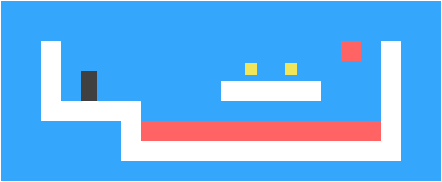

`<link>`标签与`rel="stylesheet"`一起使用时，是一种将 CSS 文件加载到页面中的方式。文件`game.css`包含了我们游戏所需的样式。

## 运动与碰撞

现在我们到了可以开始添加运动的时候了——这是游戏中最有趣的部分。大多数此类游戏采用的基本方法是将时间分割成小步，每一步中，根据速度乘以时间步长来移动角色。我们以秒为单位测量时间，因此速度以每秒单位数表示。

移动物体很简单。困难的部分在于处理元素之间的交互。当玩家撞到墙壁或地板时，不应该直接穿过去。游戏必须检测到某个运动导致物体撞到另一个物体，并做出相应反应。对于墙壁，运动必须停止。撞到金币时，必须收集它。碰到岩浆时，游戏应该失败。

解决一般情况下的这个问题是一项大任务。你可以找到通常称为物理引擎的库，它们模拟二维或三维空间中物理对象之间的交互。在本章中，我们将采取更简单的方法，只处理矩形物体之间的碰撞，并且以相当简单的方式处理。

在移动玩家或岩浆块之前，我们测试该运动是否会使其进入墙壁内部。如果是，我们直接取消整个运动。对这种碰撞的响应取决于角色的类型——玩家会停止，而岩浆块会反弹。

这种方法要求我们的时间步长相当小，因为运动会在物体实际接触之前停止。如果时间步长（以及相应的运动步长）太大，玩家最终会悬停在地面上方明显的高度。另一种方法，可以说更好但更复杂，是找到精确的碰撞点并移动到那里。我们将采用简单的方法，并通过确保动画以小步进行来隐藏其问题。

该方法告诉我们一个矩形（由位置和大小指定）是否接触到给定类型的网格元素。


```js
Level.prototype.touches = function(pos, size, type) {
  var xStart = Math.floor(pos.x);
  var xEnd = Math.ceil(pos.x + size.x);
  var yStart = Math.floor(pos.y);
  var yEnd = Math.ceil(pos.y + size.y);

  for (var y = yStart; y < yEnd; y++) {
    for (var x = xStart; x < xEnd; x++) {
      let isOutside = x < 0 || x >= this.width ||
                      y < 0 || y >= this.height;
      let here = isOutside ? "wall" : this.rows[y][x];
      if (here == type) return true;
    }
  }
  return false;
};
```

该方法通过对其坐标使用`Math.floor`和`Math.ceil`来计算物体所覆盖的网格方块集合。请记住，网格方块的大小为 1×1 单位。通过将盒子的边向上和向下取整，我们得到盒子所接触的背景方块的范围。


我们遍历通过坐标取整得到的网格方块块，当找到匹配的方块时返回`true`。级别外的方块始终被视为`"wall"`，以确保玩家无法离开世界，并且我们不会意外地尝试读取`rows`数组边界之外的内容。

状态`update`方法使用`touches`来判断玩家是否接触到岩浆。

```js
State.prototype.update = function(time, keys) {
  let actors = this.actors
    .map(actor => actor.update(time, this, keys));
  let newState = new State(this.level, actors, this.status);

  if (newState.status != "playing") return newState;

  let player = newState.player;
  if (this.level.touches(player.pos, player.size, "lava")) {
    return new State(this.level, actors, "lost");
  }

  for (let actor of actors) {
    if (actor != player && overlap(actor, player)) {
      newState = actor.collide(newState);
    }
  }
  return newState;
};
```

该方法接收一个时间步长和一个数据结构，该结构告知哪些按键被按住。它首先对所有角色调用`update`方法，生成一个更新后的角色数组。角色也会获得时间步长、按键和状态，以便它们可以基于这些信息进行更新。只有玩家会实际读取按键，因为它是唯一由键盘控制的角色。

如果游戏已经结束，则无需进一步处理（游戏在失败后不能获胜，反之亦然）。否则，该方法测试玩家是否接触到背景岩浆。如果是，则游戏失败，我们就完成了。最后，如果游戏确实仍在进行中，它会检查是否有其他角色与玩家重叠。

角色之间的重叠通过`overlap`函数检测。它接收两个角色对象，当它们接触时返回`true`——即它们在 x 轴和 y 轴上都重叠的情况。

```js
function overlap(actor1, actor2) {
  return actor1.pos.x + actor1.size.x > actor2.pos.x &&
         actor1.pos.x < actor2.pos.x + actor2.size.x &&
         actor1.pos.y + actor1.size.y > actor2.pos.y &&
         actor1.pos.y < actor2.pos.y + actor2.size.y;
}
```

如果有任何角色重叠，其`collide`方法将有机会更新状态。接触岩浆角色会将游戏状态设置为`"lost"`。金币在你接触时会消失，并且当它是该级别的最后一枚金币时，将状态设置为`"won"`。

```js
Lava.prototype.collide = function(state) {
  return new State(state.level, state.actors, "lost");
};

Coin.prototype.collide = function(state) {
  let filtered = state.actors.filter(a => a != this);
  let status = state.status;
  if (!filtered.some(a => a.type == "coin")) status = "won";
  return new State(state.level, filtered, status);
};
```

## 角色更新

角色对象的`update`方法接收时间步长、状态对象和一个`keys`对象作为参数。`Lava`角色类型的`update`方法忽略了`keys`对象。

```js
Lava.prototype.update = function(time, state) {
  let newPos = this.pos.plus(this.speed.times(time));
  if (!state.level.touches(newPos, this.size, "wall")) {
    return new Lava(newPos, this.speed, this.reset);
  } else if (this.reset) {
    return new Lava(this.reset, this.speed, this.reset);
  } else {
    return new Lava(this.pos, this.speed.times(-1));
  }
};
```

这个`update`方法通过将时间步长与当前速度的乘积加到旧位置上来计算新位置。如果没有障碍物阻挡该新位置，则移动到那里。如果有障碍物，行为取决于岩浆块的类型——滴落的岩浆有一个`reset`位置，当它碰到东西时会跳回该位置。弹跳的岩浆通过将速度乘以 -1 来反转速度，从而开始向相反方向移动。

金币使用它们的`update`方法来摆动。它们忽略与网格的碰撞，因为它们只是在自己的方块内摆动。

```js
const wobbleSpeed = 8, wobbleDist = 0.07;

Coin.prototype.update = function(time) {
  let wobble = this.wobble + time * wobbleSpeed;
  let wobblePos = Math.sin(wobble) * wobbleDist;
  return new Coin(this.basePos.plus(new Vec(0, wobblePos)),
                  this.basePos, wobble);
};
```

`wobble`属性递增以跟踪时间，然后用作`Math.sin`的参数来找到波上的新位置。然后根据其基础位置和基于该波的偏移量计算金币的当前位置。

剩下的就是玩家本身。玩家的运动按轴分别处理，因为碰到地板不应阻止水平运动，而碰到墙壁也不应停止下落或跳跃运动。

```js
const playerXSpeed = 7;
const gravity = 30;
const jumpSpeed = 17;

Player.prototype.update = function(time, state, keys) {
  let xSpeed = 0;
  if (keys.ArrowLeft) xSpeed -= playerXSpeed;
  if (keys.ArrowRight) xSpeed += playerXSpeed;
  let pos = this.pos;
  let movedX = pos.plus(new Vec(xSpeed * time, 0));
  if (!state.level.touches(movedX, this.size, "wall")) {
    pos = movedX;
  }

  let ySpeed = this.speed.y + time * gravity;
  let movedY = pos.plus(new Vec(0, ySpeed * time));
  if (!state.level.touches(movedY, this.size, "wall")) {
    pos = movedY;
  } else if (keys.ArrowUp && ySpeed > 0) {
    ySpeed = -jumpSpeed;
  } else {
    ySpeed = 0;
  }
  return new Player(pos, new Vec(xSpeed, ySpeed));
};
```

水平运动基于左右箭头键的状态计算。如果该运动产生的新位置没有被墙壁阻挡，则使用该位置；否则，保留原位置。

垂直运动的工作方式类似，但需要模拟跳跃和重力。玩家的垂直速度（`ySpeed`）首先因重力而加速。

我们再次检查墙壁。如果没有碰到任何墙壁，则使用新位置。如果确实碰到了墙壁，则有两种可能的结果。当上箭头键被按下且玩家正在向下移动（即碰到的东西在下方）时，速度被设置为一个较大的负值，这会使玩家跳跃。如果不是这种情况，则玩家只是撞到了什么东西，速度被设置为零。

重力强度、跳跃速度以及本游戏中几乎所有其他常量都是通过反复试验设定的。我测试了各种数值，直到找到我喜欢的组合。

## 追踪按键

对于这样的游戏，我们不希望按键每次按下只生效一次。相反，我们希望它们的效果（移动玩家角色）在按住时持续生效。

我们需要设置一个按键处理器，用于存储左、右、上箭头键的当前状态。我们还需要为这些键调用`preventDefault`，以防止它们滚动页面。

下面的函数在给定一组键名数组时，会返回一个对象，用于追踪这些键的当前位置。它注册了`"keydown"`和`"keyup"`事件的处理程序，并且当事件中的键码存在于它追踪的键集合中时，更新该对象。

```js
function trackKeys(keys) {
  let down = Object.create(null);
  function track(event) {
    if (keys.includes(event.key)) {
      down[event.key] = event.type == "keydown";
      event.preventDefault();
    }
  }
  window.addEventListener("keydown", track);
  window.addEventListener("keyup", track);
  return down;
}

const arrowKeys =
  trackKeys(["ArrowLeft", "ArrowRight", "ArrowUp"]);
```

同一个处理函数用于两种事件类型。它查看事件对象的`type`属性，以确定按键状态应更新为`true`（`"keydown"`）还是`false`（`"keyup"`）。

## 运行游戏

我们在第 14 章中看到的`requestAnimationFrame`函数为游戏动画提供了一种很好的方式。但它的接口相当原始——使用它需要追踪上次调用函数的时间，并在每一帧之后再次调用`requestAnimationFrame`。

让我们定义一个辅助函数，将这些繁琐的部分封装在一个方便的接口中，允许我们简单地调用`runAnimation`，并传入一个期望时间差作为参数并绘制单帧的函数。当帧函数返回`false`时，动画停止。

```js
function runAnimation(frameFunc) {
  let lastTime = null;
  function frame(time) {
    if (lastTime != null) {
      let timeStep = Math.min(time - lastTime, 100) / 1000;
      if (frameFunc(timeStep) === false) return;
    }
    lastTime = time;
    requestAnimationFrame(frame);
  }
  requestAnimationFrame(frame);
}
```

我将最大帧步长设置为 100 毫秒（十分之一秒）。当包含我们页面的浏览器标签页或窗口被隐藏时，`requestAnimationFrame`调用将被暂停，直到标签页或窗口再次显示。在这种情况下，`lastTime`和`time`之间的差值将是页面被隐藏的整个时间。在单步中让游戏前进那么多会显得很傻，并且可能导致奇怪的副作用，比如玩家掉穿地板。

该函数还将时间步长转换为秒，这比毫秒更容易思考。

`runLevel`函数接受一个`Level`对象和一个显示构造函数，并返回一个 promise。它显示关卡（在`document.body`中）并让用户玩通关。当关卡结束（失败或胜利）时，`runLevel`会再等待一秒钟（让用户看到发生了什么），然后清除显示、停止动画，并将 promise 解析为游戏的结束状态。

```js
function runLevel(level, Display) {
  let display = new Display(document.body, level);
  let state = State.start(level);
  let ending = 1;
  return new Promise(resolve => {
    runAnimation(time => {
      state = state.update(time, arrowKeys);
      display.syncState(state);
      if (state.status == "playing") {
        return true;
      } else if (ending > 0) {
        ending -= time;
        return true;
      } else {
        display.clear();
        resolve(state.status);
        return false;
      }
    });
  });
}
```

游戏是一系列关卡。每当玩家死亡时，当前关卡会重新开始。当一个关卡完成时，我们进入下一个关卡。这可以通过以下函数来表达，该函数接受一个关卡计划数组（字符串）和一个显示构造函数：

```js
async function runGame(plans, Display) {
  for (let level = 0; level < plans.length;) {
    let status = await runLevel(new Level(plans[level]),
                                Display);
    if (status == "won") level++;
  }
  console.log("You've won!");
}
```

因为我们让`runLevel`返回一个 promise，所以`runGame`可以使用`async`函数编写，如第 11 章所示。它返回另一个 promise，当玩家完成游戏时解析。

在[本章的沙盒](https://eloquentjavascript.net/code#16)（[*https://eloquentjavascript.net/code#16*](https://eloquentjavascript.net/code#16)）中，`GAME_LEVELS`绑定中提供了一组关卡计划。该页面将它们传递给`runGame`，从而启动一个实际的游戏。


```html
<link rel="stylesheet" href="css/game.css">

<body>
  <script>
    runGame(GAME_LEVELS, DOMDisplay);
  </script>
</body>
```

## 练习

### 游戏结束

平台游戏的传统是让玩家从有限数量的生命开始，每次死亡减少一条生命。当玩家生命耗尽时，游戏从头开始。

调整`runGame`以实现生命机制。让玩家从三条生命开始。每次开始一个关卡时，输出当前生命数量（使用`console.log`）。

### 暂停游戏

实现通过按下 Esc 键来暂停（挂起）和恢复游戏。

这可以通过修改`runLevel`函数，使其使用另一个键盘事件处理器，并在按下 Esc 键时中断或恢复动画来实现。

`runAnimation`接口乍一看可能并不适合这个任务，但如果你重新安排`runLevel`调用它的方式，它其实是可行的。

完成上述功能后，你还可以尝试其他事情。我们注册键盘事件处理器的方式有些问题。`arrows`对象目前是一个全局绑定，即使没有游戏在运行，它的事件处理器也一直存在。可以说它们从我们的系统中“泄漏”了。扩展`trackKeys`，使其提供一种注销其处理器的方法，然后修改`runLevel`，使其在启动时注册处理器，并在结束时注销它们。

### 怪物

平台游戏的传统是拥有敌人，你可以跳到它们上面来击败它们。这个练习要求你向游戏中添加这样一种角色类型。

我们称之为怪物。怪物只水平移动。你可以让它们朝玩家方向移动，像水平熔岩一样来回弹跳，或者采用任何你想要的移动模式。该类不需要处理下落，但应确保怪物不会穿过墙壁。

当怪物碰到玩家时，效果取决于玩家是否跳到了它们上面。你可以通过检查玩家的底部是否靠近怪物的顶部来近似判断。如果是这种情况，怪物消失。否则，游戏失败。

# 第 17 章 在画布上绘图

> 绘画是一种欺骗。
>
> ——M.C. 埃舍尔，引自布鲁诺·恩斯特《M.C. 埃舍尔的魔镜》

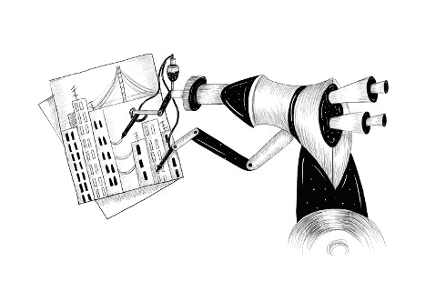

浏览器提供了多种显示图形的方式。最简单的方式是使用样式来定位和着色普通的 DOM 元素。正如上一章中的游戏所示，这种方法可以让你走得很远。通过为节点添加半透明的背景图像，我们可以让它们看起来完全符合我们的要求。甚至可以使用`transform`样式旋转或倾斜节点。

但我们是在用 DOM 做它最初并非设计用于的事情。有些任务，比如在任意两点之间画一条线，用普通的 HTML 元素来做极其笨拙。

有两种替代方案。第一种是基于 DOM 的，但使用的是*可缩放矢量图形*（SVG），而不是 HTML。可以把 SVG 看作是一种专注于形状而非文本的文档标记方言。你可以直接将 SVG 文档嵌入到 HTML 文档中，或者通过``标签包含它。

第二种替代方案称为*画布*（canvas）。画布是一个封装了图片的单一 DOM 元素。它提供了一个编程接口，用于在节点占据的空间上绘制形状。画布和 SVG 图片的主要区别在于，在 SVG 中，形状的原始描述被保留下来，因此可以随时移动或调整大小。而画布则在绘制形状时立即将其转换为像素（光栅上的彩色点），并且不记住这些像素代表什么。在画布上移动形状的唯一方法是清除画布（或形状周围的画布部分），然后在新位置重新绘制形状。

## SVG

本书不会详细讲解 SVG，但我会简要解释它的工作原理。在本章末尾，我会回过头来讨论在决定哪种绘图机制适合给定应用时必须考虑的权衡。

这是一个包含简单 SVG 图片的 HTML 文档：

```html
<p>Normal HTML here.</p>
<svg xmlns="http://www.w3.org/2000/svg">
  <circle r="50" cx="50" cy="50" fill="red"/>
  <rect x="120" y="5" width="90" height="90"
        stroke="blue" fill="none"/>
</svg>
```

`xmlns`属性将一个元素（及其子元素）更改为不同的*XML 命名空间*。这个由 URL 标识的命名空间指定了我们当前正在使用的方言。`<circle>`和`<rect>`标签在 HTML 中不存在，但在 SVG 中有意义——它们使用属性指定的样式和位置绘制形状。

文档显示如下：

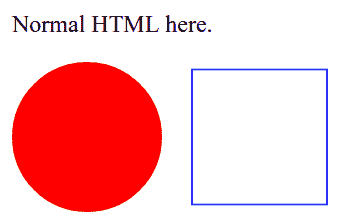

这些标签创建 DOM 元素，就像 HTML 标签一样，脚本可以与它们交互。例如，以下代码将`<circle>`元素改为青色：

```javascript
let circle = document.querySelector("circle");
circle.setAttribute("fill", "cyan");
```

## 画布元素

画布图形可以绘制到`<canvas>`元素上。你可以给这样的元素添加`width`和`height`属性来确定其像素大小。

新的画布是空的，意味着它完全透明，因此在文档中显示为空白区域。

`<canvas>`标签旨在允许不同的绘图样式。要访问实际的绘图接口，我们首先需要创建一个*上下文*（context），一个其方法提供绘图接口的对象。目前有两种广泛支持的绘图样式：`"2d"`用于二维图形，`"webgl"`用于通过 OpenGL 接口的三维图形。

本书不会讨论 WebGL——我们将坚持二维图形。但如果你对三维图形感兴趣，我鼓励你研究一下 WebGL。它提供了对图形硬件的直接接口，允许你使用 JavaScript 高效地渲染甚至复杂的场景。

你可以通过`<canvas>`DOM 元素上的`getContext`方法创建上下文。

```html
<p>Before canvas.</p>
<canvas width="120" height="60"></canvas>
<p>After canvas.</p>
<script>
  let canvas = document.querySelector("canvas");
  let context = canvas.getContext("2d");
  context.fillStyle = "red";
  context.fillRect(10, 10, 100, 50);
</script>
```

创建上下文对象后，示例绘制了一个红色矩形，宽 100 像素，高 50 像素，其左上角位于坐标(10,10)。

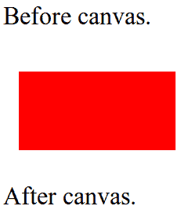

就像在 HTML（和 SVG）中一样，画布使用的坐标系将(0,0)放在左上角，正 y 轴向下延伸。因此，(10,10)位于左上角下方 10 像素、右侧 10 像素处。

## 线条和表面

在画布接口中，形状可以被*填充*，即其区域被赋予某种颜色或图案，或者可以被*描边*，即沿着其边缘绘制一条线。SVG 也使用相同的术语。

`fillRect`方法填充一个矩形。它首先接收矩形左上角的 x 和 y 坐标，然后是宽度，最后是高度。类似的方法`strokeRect`绘制矩形的轮廓。

这两种方法都不接受任何其他参数。填充的颜色、描边的粗细等，并非由方法的参数决定（你可能合理预期如此），而是由上下文对象的属性决定。

`fillStyle`属性控制形状的填充方式。它可以设置为一个字符串，使用 CSS 的颜色表示法来指定颜色。

`strokeStyle`属性类似，但决定描边线条的颜色。线条的宽度由`lineWidth`属性决定，该属性可以包含任何正数。

```html
<canvas></canvas>
<script>
  let cx = document.querySelector("canvas").getContext("2d");
  cx.strokeStyle = "blue";
  cx.strokeRect(5, 5, 50, 50);
  cx.lineWidth = 5;
  cx.strokeRect(135, 5, 50, 50);
</script>
```

这段代码绘制了两个蓝色正方形，第二个使用了更粗的线条。


当没有指定`width`或`height`属性时（如示例所示），canvas 元素默认宽度为 300 像素，高度为 150 像素。

## 路径

路径是一系列线条。2D canvas 接口采用了一种独特的方法来描述这样的路径。它完全通过副作用来完成。路径不是可以存储和传递的值。相反，如果你想对路径进行操作，你需要通过一系列方法调用来描述其形状。

```html
<canvas></canvas>
<script>
  let cx = document.querySelector("canvas").getContext("2d");
  cx.beginPath();
  for (let y = 10; y < 100; y += 10) {
    cx.moveTo(10, y);
    cx.lineTo(90, y);
  }
  cx.stroke();
</script>
```

这个示例创建了一个包含多条水平线段的路径，然后使用`stroke`方法对其进行描边。使用`lineTo`创建的每条线段都从路径的*当前*位置开始。该位置通常是最后一条线段的终点，除非调用了`moveTo`。在这种情况下，下一条线段将从传递给`moveTo`的位置开始。

上一个程序描述的路径如下所示：


当填充路径（使用`fill`方法）时，每个形状会被单独填充。一个路径可以包含多个形状——每次`moveTo`动作都会开始一个新形状。但路径需要*闭合*（即起点和终点在同一位置）才能被填充。如果路径尚未闭合，则会从终点到起点添加一条线段，然后填充由完整路径围成的形状。

```html
<canvas></canvas>
<script>
  let cx = document.querySelector("canvas").getContext("2d");
  cx.beginPath();
  cx.moveTo(50, 10);
  cx.lineTo(10, 70);
  cx.lineTo(90, 70);
  cx.fill();
</script>
```

这个示例绘制了一个填充的三角形。注意，只显式绘制了三角形的两条边。第三条边（从右下角回到顶部）是隐含的，当你对路径进行描边时，它不会出现。


你也可以使用`closePath`方法，通过添加一条实际的线段回到路径起点来显式闭合路径。这条线段在描边路径时*会*被绘制。

## 曲线

路径也可以包含曲线。不幸的是，绘制曲线稍微复杂一些。

`quadraticCurveTo`方法绘制一条到给定点的曲线。为了确定线条的曲率，该方法需要一个控制点和一个目标点。可以把这个控制点想象成*吸引*线条，赋予其曲线形状。线条不会穿过控制点，但其起点和终点的方向会使得该方向上的直线指向控制点。下面的示例说明了这一点：

```html
<canvas></canvas>
<script>
  let cx = document.querySelector("canvas").getContext("2d");
  cx.beginPath();
  cx.moveTo(10, 90);
  // control=(60,10) goal=(90,90)
  cx.quadraticCurveTo(60, 10, 90, 90);
  cx.lineTo(60, 10);
  cx.closePath();
  cx.stroke();
</script>
```

它生成的路径如下所示：

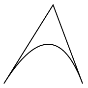

我们从左到右绘制一条二次曲线，以 (60,10) 为控制点，然后绘制两条线段，穿过该控制点并回到线条起点。结果有点像*星际迷航*的徽章。你可以看到控制点的效果：从底部角落出发的线条最初朝向控制点方向，然后弯曲向目标。

`bezierCurveTo`方法绘制一种类似的曲线。它有两个控制点，而不是一个——每个端点对应一个。下面是一个类似的草图，用于说明这种曲线的行为：

```html
<canvas></canvas>
<script>
  let cx = document.querySelector("canvas").getContext("2d");
  cx.beginPath();
  cx.moveTo(10, 90);
  // control1=(10,10) control2=(90,10) goal=(50,90)
  cx.bezierCurveTo(10, 10, 90, 10, 50, 90);
  cx.lineTo(90, 10);
  cx.lineTo(10, 10);
  cx.closePath();
  cx.stroke();
</script>
```

两个控制点指定了曲线两端的方向。它们离对应点越远，曲线在该方向上的“凸起”就越明显。

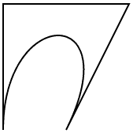

这类曲线可能难以处理——通常不太清楚如何找到能提供所需形状的控制点。有时你可以计算它们，有时你只能通过反复试验找到合适的值。

`arc`方法是一种绘制沿圆边缘弯曲的线条的方式。它接受弧的圆心坐标、半径，以及起始角度和结束角度。

最后两个参数使得只绘制圆的一部分成为可能。角度以弧度为单位，而不是度数。这意味着一个完整的圆的角度为 2π，即`2 * Math.PI`，大约为 6.28。角度从圆心右侧的点开始计数，并从此处顺时针方向增加。你可以使用起始角度 0 和大于 2π 的结束角度（例如 7）来绘制一个完整的圆。

```html
<canvas></canvas>
<script>
  let cx = document.querySelector("canvas").getContext("2d");
  cx.beginPath();
  // center=(50,50) radius=40 angle=0 to 7
  cx.arc(50, 50, 40, 0, 7);
  // center=(150,50) radius=40 angle=0 to ½π
  cx.arc(150, 50, 40, 0, 0.5 * Math.PI);
  cx.stroke();
</script>
```

生成的图片包含一条从完整圆的右侧（第一次调用`arc`）到四分之一圆的右侧（第二次调用`arc`）的线条。与其他路径绘制方法一样，使用`arc`绘制的线条会连接到前一个路径段。你可以调用`moveTo`或开始一个新路径来避免这种情况。

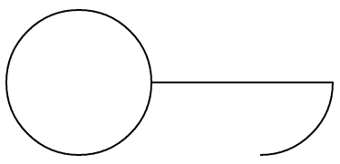

## 绘制饼图

想象你刚刚在 EconomiCorp 公司找到一份工作，你的第一个任务是绘制其客户满意度调查结果的饼图。

`results`绑定包含一个对象数组，代表调查回复。

```javascript
const results = [
  {name: "Satisfied", count: 1043, color: "lightblue"},
  {name: "Neutral", count: 563, color: "lightgreen"},
  {name: "Unsatisfied", count: 510, color: "pink"},
  {name: "No comment", count: 175, color: "silver"}
];
```

要绘制饼图，我们需要绘制多个扇形，每个扇形由一段弧和两条连接到弧心的线段组成。我们可以通过将整个圆（2π）除以总响应数，然后将该值（每个响应的角度）乘以选择某个选项的人数，来计算每个弧所占的角度。

```html
<canvas width="200" height="200"></canvas>
<script>
  let cx = document.querySelector("canvas").getContext("2d");
  let total = results
    .reduce((sum, {count}) => sum + count, 0);
  // 从顶部开始
  let currentAngle = -0.5 * Math.PI;
  for (let result of results) {
    let sliceAngle = (result.count / total) * 2 * Math.PI;
    cx.beginPath();
    // 中心点(100,100)，半径 100
    // 从当前角度开始，顺时针绘制扇形角度
    cx.arc(100, 100, 100,
           currentAngle, currentAngle + sliceAngle);
    currentAngle += sliceAngle;
    cx.lineTo(100, 100);
    cx.fillStyle = result.color;
    cx.fill();
  }
</script>
```

这将绘制出以下图表：

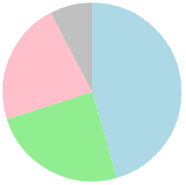

但一个不告诉我们每个扇形含义的图表并没有太大帮助。我们需要一种在画布上绘制文本的方法。

## 文本

2D 画布绘图上下文提供了`fillText`和`strokeText`方法。后者可用于勾勒字母轮廓，但通常你需要的是`fillText`。它会用当前的`fillStyle`填充给定文本的轮廓。


```html
<canvas></canvas>
<script>
  let cx = document.querySelector("canvas").getContext("2d");
  cx.font = "28px Georgia";
  cx.fillStyle = "fuchsia";
  cx.fillText("I can draw text, too!", 10, 50);
</script>
```

你可以通过`font`属性指定文本的大小、样式和字体。这个例子只给出了字体大小和字体族名称。你也可以在字符串开头添加`italic`或`bold`来选择样式。

`fillText`和`strokeText`的最后两个参数指定了绘制字体的位置。默认情况下，它们表示文本字母基线的起始位置，即字母“站立”的线，不包括像`j`或`p`这样的字母的悬挂部分。你可以通过将`textAlign`属性设置为`"end"`或`"center"`来改变水平位置，通过将`textBaseline`设置为`"top"`、`"middle"`或`"bottom"`来改变垂直位置。

我们将在本章末尾的练习中回到饼图以及标记扇形的问题。

## 图像

在计算机图形学中，通常区分*矢量*图形和*位图*图形。前者是本章到目前为止一直在做的——通过给出形状的逻辑描述来指定图片。而位图图形则不指定实际形状，而是处理像素数据（彩色点的光栅）。

`drawImage`方法允许我们将像素数据绘制到画布上。这些像素数据可以来自``元素或另一个画布。下面的示例创建了一个独立的``元素并将图像文件加载到其中。但它不能立即开始从这张图片绘制，因为浏览器可能尚未加载它。为了解决这个问题，我们注册一个`"load"`事件处理程序，并在图像加载完成后进行绘制。

```html
<canvas></canvas>
<script>
  let cx = document.querySelector("canvas").getContext("2d");
  let img = document.createElement("img");
  img.src = "img/hat.png";
  img.addEventListener("load", () => {
    for (let x = 10; x < 200; x += 30) {
      cx.drawImage(img, x, 10);
    }
  });
</script>
```

默认情况下，`drawImage`会以原始尺寸绘制图像。你也可以给它两个额外的参数来设置不同的宽度和高度。

当`drawImage`被赋予*九个*参数时，它可以用来只绘制图像的一部分。第二到第五个参数表示源图像中要复制的矩形（x、y、宽度和高度），第六到第九个参数给出目标矩形（在画布上）的位置。

这可以用来将多个*精灵*（图像元素）打包到单个图像文件中，然后只绘制需要的部分。例如，我们有一张包含多个姿势的游戏角色的图片：


通过交替绘制不同的姿势，我们可以展示一个看起来像行走角色的动画。

要在画布上动画显示图片，`clearRect`方法非常有用。它类似于`fillRect`，但不是给矩形着色，而是使其透明，移除之前绘制的像素。

我们知道每个*精灵*（每个子图片）宽 24 像素，高 30 像素。以下代码加载图像，然后设置一个间隔（重复定时器）来绘制下一帧：

```html
<canvas></canvas>
<script>
  let cx = document.querySelector("canvas").getContext("2d");
  let img = document.createElement("img");
  img.src = "img/player.png";
  let spriteW = 24, spriteH = 30;
  img.addEventListener("load", () => {
    let cycle = 0;
    setInterval(() => {
      cx.clearRect(0, 0, spriteW, spriteH);
      cx.drawImage(img,
                   // 源矩形
                   cycle * spriteW, 0, spriteW, spriteH,
                   // 目标矩形
                   0,               0, spriteW, spriteH);
      cycle = (cycle + 1) % 8;
    }, 120);
  });
</script>
```

`cycle`绑定跟踪我们在动画中的位置。每一帧，它都会递增，然后通过取余运算符将其限制在 0 到 7 的范围内。然后使用这个绑定来计算当前姿势的精灵在图片中的 x 坐标。

## 变换

但如果想让角色向左走而不是向右走呢？当然，我们可以绘制另一组精灵。但我们也可以指示画布以相反方向绘制图片。

调用`scale`方法会导致之后绘制的所有内容按比例缩放。该方法接受两个参数，一个设置水平缩放，一个设置垂直缩放。

```html
<canvas></canvas>
<script>
  let cx = document.querySelector("canvas").getContext("2d");
  cx.scale(3, .5);
  cx.beginPath();
  cx.arc(50, 50, 40, 0, 7);
  cx.lineWidth = 3;
  cx.stroke();
</script>
```

由于调用了`scale`，圆被绘制成三倍宽、一半高。


缩放会导致绘制图像的所有内容（包括线宽）按指定方式拉伸或压缩。负数的缩放会翻转图片。翻转发生在点`(0,0)`周围，这意味着它也会翻转坐标系的方向。当应用水平缩放`-1`时，在 x 位置 100 处绘制的形状最终会出现在原来的 -100 位置。

因此，要翻转一张图片，我们不能简单地在调用`drawImage`之前添加`cx.scale(-1, 1)`，因为那样会把图片移到画布之外，导致它不可见。你可以调整传递给`drawImage`的坐标来补偿，比如将图片绘制在 x 位置 -50 而不是 0。另一种解决方案是调整缩放所围绕的轴，这样就不需要让绘制代码知道缩放的变化了。

除了`scale`之外，还有其他几种方法会影响画布的坐标系。你可以使用`rotate`方法旋转后续绘制的形状，使用`translate`方法移动它们。有趣且令人困惑的是，这些变换会“堆叠”，意味着每个变换都是相对于之前的变换进行的。

因此，如果我们水平平移两次，每次 10 像素，那么所有内容都会向右绘制 20 像素。如果我们先将坐标系中心移动到`(50,50)`，然后旋转 20 度（约 0.1π 弧度），那么旋转将围绕点`(50,50)`进行。


但是，如果我们*先*旋转 20 度，*然后*平移`(50,50)`，那么平移将在旋转后的坐标系中进行，从而产生不同的方向。变换应用的顺序很重要。

要围绕给定 x 位置的垂直线翻转图片，我们可以执行以下操作：

```javascript
function flipHorizontally(context, around) {
  context.translate(around, 0);
  context.scale(-1, 1);
  context.translate(-around, 0);
}
```

我们将 y 轴移动到想要镜像的位置，应用镜像，最后将 y 轴移回镜像世界中的正确位置。下图解释了为什么这样有效：


这显示了在中心线镜像前后的坐标系。三角形用数字编号来说明每一步。如果我们在正 x 位置绘制一个三角形，默认情况下它会位于三角形 1 的位置。调用`flipHorizontally`首先向右平移，得到三角形 2。然后缩放，将三角形翻转到位置 3。如果它要在给定线上镜像，这还不是它应该在的位置。第二次`translate`调用解决了这个问题——它“取消”了初始平移，使三角形 4 恰好出现在它应该在的位置。

现在，我们可以通过围绕角色的垂直中心翻转世界，在位置`(100,0)`处绘制一个镜像角色。

```html
<canvas></canvas>
<script>
  let cx = document.querySelector("canvas").getContext("2d");
  let img = document.createElement("img");
  img.src = "img/player.png";
  let spriteW = 24, spriteH = 30;
  img.addEventListener("load", () => {
    flipHorizontally(cx, 100 + spriteW / 2);
    cx.drawImage(img, 0, 0, spriteW, spriteH,
                 100, 0, spriteW, spriteH);
  });
</script>
```

## 存储和清除变换

变换会持续存在。在绘制那个镜像角色之后绘制的所有其他内容也会被镜像。这可能不太方便。

可以保存当前变换，进行一些绘制和变换，然后恢复旧的变换。对于需要临时变换坐标系的函数来说，这通常是正确的做法。首先，我们保存调用该函数的代码所使用的任何变换。然后函数执行其操作，在当前变换之上添加更多变换。最后，我们恢复到开始时的变换。

2D 画布上下文上的`save`和`restore`方法负责这种变换管理。它们在概念上维护一个变换状态栈。当你调用`save`时，当前状态被压入栈中；当你调用`restore`时，栈顶的状态被取出并用作上下文的当前变换。你也可以调用`resetTransform`来完全重置变换。

下面示例中的`branch`函数说明了你可以用这样一个函数做什么：它改变变换，然后调用一个函数（这里是它自身），该函数继续使用给定的变换进行绘制。

这个函数通过绘制一条线、将坐标系中心移动到线的末端、然后调用自身两次（先向左旋转，再向右旋转）来绘制一个树状形状。每次调用都会减少绘制的分支长度，当长度小于 8 时递归停止。

```html
<canvas width="600" height="300"></canvas>
<script>
  let cx = document.querySelector("canvas").getContext("2d");
  function branch(length, angle, scale) {
    cx.fillRect(0, 0, 1, length);
    if (length < 8) return;
    cx.save();
    cx.translate(0, length);
    cx.rotate(-angle);
    branch(length * scale, angle, scale);
    cx.rotate(2 * angle);
    branch(length * scale, angle, scale);
    cx.restore();
  }
  cx.translate(300, 0);
  branch(60, 0.5, 0.8);
</script>
```

结果是一个简单的分形。

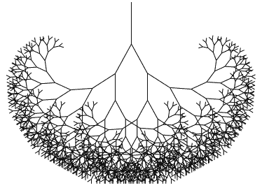

如果没有`save`和`restore`的调用，对`branch`的第二次递归调用将最终使用第一次调用创建的位置和旋转。它不会连接到当前分支，而是连接到第一次调用绘制的最内层、最右侧的分支。最终形状可能也很有趣，但肯定不是一棵树。

## 回到游戏

现在我们对画布绘制有了足够的了解，可以开始为上一章中的游戏构建一个基于画布的显示系统了。新的显示将不再仅仅显示彩色方块。相反，我们将使用`drawImage`来绘制代表游戏元素的图片。

我们定义了另一种显示对象类型，称为`CanvasDisplay`，它支持与第 16 章中的`DOMDisplay`相同的接口，即`syncState`和`clear`方法。

这个对象比`DOMDisplay`保留的信息稍多一些。它不使用其 DOM 元素的滚动位置，而是跟踪自己的视口，这告诉我们当前正在查看关卡的哪一部分。最后，它保留了一个`flipPlayer`属性，这样即使玩家静止不动，它也会保持朝向上次移动的方向。

```javascript
class CanvasDisplay {
  constructor(parent, level) {
    this.canvas = document.createElement("canvas");
    this.canvas.width = Math.min(600, level.width * scale);
    this.canvas.height = Math.min(450, level.height * scale);
    parent.appendChild(this.canvas);
    this.cx = this.canvas.getContext("2d");

    this.flipPlayer = false;

    this.viewport = {
      left: 0,
      top: 0,
      width: this.canvas.width / scale,
      height: this.canvas.height / scale
    };
  }

  clear() {
    this.canvas.remove();
  }
}
```

`syncState`方法首先计算新的视口，然后在适当的位置绘制游戏场景。

```javascript
CanvasDisplay.prototype.syncState = function(state) {
  this.updateViewport(state);
  this.clearDisplay(state.status);
  this.drawBackground(state.level);
  this.drawActors(state.actors);
};
```

与`DOMDisplay`不同，这种显示样式*确实*需要在每次更新时重新绘制背景。因为画布上的形状只是像素，绘制后没有好的方法移动（或删除）它们。更新画布显示的唯一方法是清除它并重新绘制场景。我们可能还进行了滚动，这需要背景处于不同的位置。

`updateViewport`方法与`DOMDisplay`的`scrollPlayerIntoView`方法类似。它检查玩家是否过于靠近屏幕边缘，并在这种情况下移动视口。

```javascript
CanvasDisplay.prototype.updateViewport = function(state) {
  let view = this.viewport, margin = view.width / 3;
  let player = state.player;
  let center = player.pos.plus(player.size.times(0.5));

  if (center.x < view.left + margin) {
    view.left = Math.max(center.x - margin, 0);
  } else if (center.x > view.left + view.width - margin) {
    view.left = Math.min(center.x + margin - view.width,
                         state.level.width - view.width);
  }
  if (center.y < view.top + margin) {
    view.top = Math.max(center.y - margin, 0);
  } else if (center.y > view.top + view.height - margin) {
    view.top = Math.min(center.y + margin - view.height,
                        state.level.height - view.height);
  }
};
```

对`Math.max`和`Math.min`的调用确保视口不会显示关卡外的空间。`Math.max(x, 0)`确保结果数字不小于零。`Math.min`类似地保证值不超过给定边界。

在清除显示时，我们会根据游戏是胜利（更亮）还是失败（更暗）使用略有不同的颜色。

```javascript
CanvasDisplay.prototype.clearDisplay = function(status) {
  if (status == "won") {
    this.cx.fillStyle = "rgb(68, 191, 255)";
  } else if (status == "lost") {
    this.cx.fillStyle = "rgb(44, 136, 214)";
  } else {
    this.cx.fillStyle = "rgb(52, 166, 251)";
  }
  this.cx.fillRect(0, 0,
                   this.canvas.width, this.canvas.height);
};
```

为了绘制背景，我们遍历当前视口中可见的瓦片，使用与上一章的`touches`方法相同的技巧。


```js
let otherSprites = document.createElement("img");
otherSprites.src = "img/sprites.png";

CanvasDisplay.prototype.drawBackground = function(level) {
  let {left, top, width, height} = this.viewport;
  let xStart = Math.floor(left);
  let xEnd = Math.ceil(left + width);
  let yStart = Math.floor(top);
  let yEnd = Math.ceil(top + height);

  for (let y = yStart; y < yEnd; y++) {
    for (let x = xStart; x < xEnd; x++) {
      let tile = level.rows[y][x];
      if (tile == "empty") continue;
      let screenX = (x - left) * scale;
      let screenY = (y - top) * scale;
      let tileX = tile == "lava" ? scale : 0;
      this.cx.drawImage(otherSprites,
                        tileX,         0, scale, scale,
                        screenX, screenY, scale, scale);
    }
  }
};
```

非空的瓦片使用`drawImage`绘制。`otherSprites`图像包含用于玩家之外元素的图片。从左到右依次是墙壁瓦片、熔岩瓦片和硬币精灵。


背景瓦片大小为 20×20 像素，因为我们使用与`DOMDisplay`相同的缩放比例。因此，熔岩瓦片的偏移量为 20（`scale`绑定的值），墙壁的偏移量为 0。

我们无需等待精灵图像加载完成。使用尚未加载的图像调用`drawImage`将不会产生任何效果。因此，在图像仍在加载的前几帧中，我们可能无法正确绘制游戏，但这并不是严重问题。由于我们不断更新屏幕，加载完成后正确的场景就会显示出来。

前面展示的行走角色将用于表示玩家。绘制它的代码需要根据玩家当前的运动选择正确的精灵和方向。前八个精灵包含行走动画。当玩家在地面上移动时，我们根据当前时间循环这些精灵。我们希望每 60 毫秒切换一帧，因此先将时间除以 60。当玩家静止时，我们绘制第九个精灵。在跳跃期间（通过垂直速度不为零来识别），我们使用第十个（最右侧的）精灵。

由于精灵比玩家对象稍宽（24 像素而非 16 像素，以便为脚和手臂留出空间），该方法需要按给定数量（`playerXOverlap`）调整 x 坐标和宽度。

```js
let playerSprites = document.createElement("img");
playerSprites.src = "img/player.png";
const playerXOverlap = 4;

CanvasDisplay.prototype.drawPlayer = function(player, x, y,
                                              width, height){
  width += playerXOverlap * 2;
  x -= playerXOverlap;
  if (player.speed.x != 0) {
    this.flipPlayer = player.speed.x < 0;
  }

  let tile = 8;
  if (player.speed.y != 0) {
    tile = 9;
  } else if (player.speed.x != 0) {
    tile = Math.floor(Date.now() / 60) % 8;
  }

  this.cx.save();
  if (this.flipPlayer) {
    flipHorizontally(this.cx, x + width / 2);
  }
  let tileX = tile * width;
  this.cx.drawImage(playerSprites, tileX, 0, width, height,
                                   x,     y, width, height);
  this.cx.restore();
};
```

`drawPlayer`方法由`drawActors`调用，后者负责绘制游戏中的所有角色。

```js
CanvasDisplay.prototype.drawActors = function(actors) {
  for (let actor of actors) {
    let width = actor.size.x * scale;
    let height = actor.size.y * scale;
    let x = (actor.pos.x - this.viewport.left) * scale;
    let y = (actor.pos.y - this.viewport.top) * scale;
    if (actor.type == "player") {
      this.drawPlayer(actor, x, y, width, height);
    } else {
      let tileX = (actor.type == "coin" ? 2 : 1) * scale;
      this.cx.drawImage(otherSprites,
                        tileX, 0, width, height,
                        x,     y, width, height);
    }
  }
};
```

当绘制非玩家对象时，我们根据其类型查找正确精灵的偏移量。熔岩瓦片位于偏移量 20 处，硬币精灵位于 40 处（两倍的`scale`）。

在计算角色位置时，我们必须减去视口的位置，因为画布上的 (0,0) 对应视口的左上角，而非关卡的左上角。我们也可以使用`translate`来实现这一点。两种方法都可行。

至此，新的显示系统介绍完毕。最终的游戏看起来像这样：

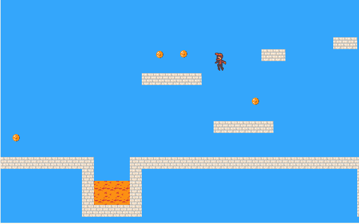

## 选择图形界面

因此，当需要在浏览器中生成图形时，你可以在纯 HTML、SVG 和画布之间进行选择。没有一种*最佳*方法适用于所有情况。每种选择都有其优缺点。

纯 HTML 的优势在于简单。它还能很好地与文本集成。SVG 和画布都允许绘制文本，但它们不会帮助你定位文本或在文本超过一行时自动换行。在基于 HTML 的图片中，包含文本块要容易得多。

SVG 可用于生成清晰的图形，在任何缩放级别下都看起来很好。与 HTML 不同，它专为绘图而设计，因此更适合这一目的。

SVG 和 HTML 都会构建一个表示图片的数据结构（DOM）。这使得在绘制元素后可以修改它们。如果你需要根据用户的操作或作为动画的一部分反复更改大图中的一小部分，在 canvas 中这样做可能会不必要地耗费性能。DOM 还允许我们在图片中的每个元素上注册鼠标事件处理程序（甚至包括用 SVG 绘制的形状）。这在 canvas 中是做不到的。

但是，当绘制大量微小元素时，canvas 基于像素的方法可能是一个优势。它不构建数据结构，而是反复在同一像素表面上绘制，这使得 canvas 的每个形状成本更低。

还有一些效果，例如逐像素渲染场景（例如使用光线追踪器）或用 JavaScript 对图像进行后处理（模糊或扭曲），这些效果只能通过基于像素的方法来实际处理。

在某些情况下，你可能希望结合多种技术。例如，你可以用 SVG 或 canvas 绘制图表，但通过将 HTML 元素定位在图片上方来显示文本信息。

对于要求不高的应用，选择哪种界面其实并不重要。我们在本章中为游戏构建的显示界面可以用这三种图形技术中的任何一种来实现，因为它不需要绘制文本、处理鼠标交互或处理数量异常庞大的元素。

## 小结

在本章中，我们讨论了在浏览器中绘制图形的技术，重点介绍了`<canvas>`元素。

canvas 节点代表文档中的一个区域，我们的程序可以在该区域上绘制。这种绘制是通过一个绘图上下文对象完成的，该对象由`getContext`方法创建。

2D 绘图接口允许我们填充和描边各种形状。上下文的`fillStyle`属性决定形状的填充方式。`strokeStyle`和`lineWidth`属性控制线条的绘制方式。

矩形和文本片段可以通过单个方法调用来绘制。`fillRect`和`strokeRect`方法绘制矩形，`fillText`和`strokeText`方法绘制文本。要创建自定义形状，我们必须首先构建一条路径。

调用`beginPath`开始一条新路径。许多其他方法会向当前路径添加线条和曲线。例如，`lineTo`可以添加一条直线。当路径完成后，可以用`fill`方法填充或用`stroke`方法描边。

使用`drawImage`方法可以将像素从图像或另一个 canvas 移动到我们的 canvas 上。默认情况下，此方法绘制整个源图像，但通过提供更多参数，你可以复制图像的特定区域。我们在游戏中使用了这一点，从包含多个游戏角色姿势的图像中复制单个姿势。

变换允许你以多种方向绘制形状。2D 绘图上下文有一个当前变换，可以通过`translate`、`scale`和`rotate`方法更改。这些方法会影响所有后续的绘图操作。变换状态可以用`save`方法保存，用`restore`方法恢复。

在 canvas 上显示动画时，可以使用`clearRect`方法在重新绘制之前清除 canvas 的一部分。

## 练习

### 形状

编写一个程序，在 canvas 上绘制以下形状：

1. 一个梯形（一边更宽的矩形）
2. 一个红色菱形（旋转 45 度或 ¼π 弧度的矩形）
3. 一条锯齿线
4. 由 100 条直线段组成的螺旋线
5. 一颗黄色星星

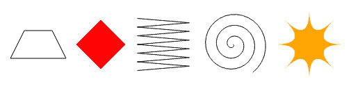

在绘制最后两个形状时，你可能需要参考第 14 章中对`Math.cos`和`Math.sin`的解释，该章描述了如何使用这些函数获取圆上的坐标。

我建议为每个形状创建一个函数。将位置以及可选的其他属性（如大小或点数）作为参数传递。另一种方法是在代码中硬编码数字，这往往会使代码难以阅读和修改。

### 饼图

在本章前面部分，我们看到了一个绘制饼图的示例程序。修改此程序，使每个类别的名称显示在其代表的扇形旁边。尝试找到一种美观的方式来自动定位这些文本，使其也适用于其他数据集。你可以假设类别足够大，可以为标签留出充足的空间。

你可能再次需要`Math.sin`和`Math.cos`，它们在第 14 章中有描述。

### 弹跳球

使用我们在第 14 章和第 16 章中看到的`requestAnimationFrame`技术，绘制一个带有弹跳球的盒子。球以恒定速度移动，碰到盒子边缘时反弹。

### 预计算镜像

变换的一个不幸之处是它们会减慢位图的绘制速度。每个像素的位置和大小都必须进行变换，尽管浏览器未来可能会在变换方面变得更智能，但目前它们会导致绘制位图所需的时间明显增加。

在我们这样的游戏中，我们只绘制一个经过变换的精灵，这不是问题。但想象一下，我们需要绘制数百个角色或数千个来自爆炸的旋转粒子。

想出一种方法，允许我们绘制一个反转的角色，而无需加载额外的图像文件，也无需每帧都进行变换后的`drawImage`调用。

# 第 18 章

# HTTP 与表单

> 通信本质上必须是无状态的 [...] 使得从客户端到服务器的每个请求必须包含理解该请求所需的所有信息，并且不能利用服务器上存储的任何上下文。
>
> —— Roy Fielding，《架构风格与基于网络的软件架构设计》


*超文本传输协议*（已在第 13 章中提到）是万维网上请求和提供数据的机制。本章将更详细地描述该协议，并解释浏览器 JavaScript 如何访问它。

## 协议

如果你在浏览器的地址栏中输入`eloquentjavascript.net/18_http.html`，浏览器首先会查找与`eloquentjavascript.net`关联的服务器地址，并尝试在 80 端口（HTTP 流量的默认端口）上打开一个 TCP 连接。如果服务器存在并接受连接，浏览器可能会发送类似这样的内容：

```http
GET /18_http.html HTTP/1.1
Host: eloquentjavascript.net
User-Agent: Your browser's name
```

然后，服务器通过同一连接进行响应：

```http
HTTP/1.1 200 OK
Content-Length: 65585
Content-Type: text/html
Last-Modified: Mon, 08 Jan 2018 10:29:45 GMT

<!doctype html>
... 文档的其余部分
```

浏览器会提取响应中空行之后的部分，即其主体（不要与 HTML 的`<body>`标签混淆），并将其作为 HTML 文档显示。

客户端发送的信息称为请求。它以这一行开头：

```http
GET /18_http.html HTTP/1.1
```

第一个词是请求的方法。`GET`表示我们想要获取指定的资源。其他常见的方法有`DELETE`（删除资源）、`PUT`（创建或替换资源）和`POST`（向资源发送信息）。请注意，服务器没有义务执行它收到的每一个请求。如果你随便访问一个网站并告诉它`DELETE`其主页，它很可能会拒绝。

方法名之后的部分是请求所应用的资源路径。在最简单的情况下，资源就是服务器上的一个文件，但协议并不要求如此。资源可以是任何可以像文件一样传输的东西。许多服务器会动态生成它们产生的响应。例如，如果你打开[`github.com/marijnh`](https://github.com/marijnh)，服务器会在其数据库中查找名为“marijnh”的用户，如果找到，就会为该用户生成一个个人资料页面。

在资源路径之后，请求的第一行会提到`HTTP/1.1`，以表明它使用的 HTTP 协议版本。

实际上，许多网站使用 HTTP 版本 2，它支持与版本 1.1 相同的概念，但复杂得多，因此可以更快。浏览器在与特定服务器通信时会自动切换到适当的协议版本，无论使用哪个版本，请求的结果都是相同的。由于版本 1.1 更直接且更容易操作，我们将重点介绍它。

服务器的响应也会以版本号开头，然后是响应的状态，首先是一个三位数的状态码，接着是一个人类可读的字符串。

```http
HTTP/1.1 200 OK
```

以 2 开头的状态码表示请求成功。以 4 开头的状态码表示请求有问题。404 可能是最著名的 HTTP 状态码——它表示找不到资源。以 5 开头的状态码表示服务器发生了错误，而不是请求的问题。

请求或响应的第一行后面可以跟任意数量的标头。这些是形如`name: value`的行，用于指定关于请求或响应的额外信息。以下是示例响应中的标头：

```http
Content-Length: 65585
Content-Type: text/html
Last-Modified: Thu, 04 Jan 2018 14:05:30 GMT
```

这告诉我们响应文档的大小和类型。在这个例子中，它是一个 65,585 字节的 HTML 文档。它还告诉我们该文档的最后修改时间。

对于大多数标头，客户端和服务器可以自由决定是否将其包含在请求或响应中。但有些是必需的。例如，指定主机名的`Host`标头应该包含在请求中，因为一个服务器可能在一个 IP 地址上服务多个主机名，如果没有这个标头，服务器将不知道客户端试图与哪个主机名通信。

在标头之后，请求和响应都可能包含一个空行，后面跟着一个主体，其中包含正在发送的数据。`GET`和`DELETE`请求不会发送任何数据，但`PUT`和`POST`请求会。同样，某些响应类型（如错误响应）不需要主体。

## 浏览器与 HTTP

正如我们在示例中看到的，当我们在浏览器的地址栏中输入 URL 时，浏览器会发出一个请求。当生成的 HTML 页面引用其他文件（如图像和 JavaScript 文件）时，这些文件也会被检索。

一个中等复杂的网站可能轻松包含 10 到 200 个资源。为了能够快速获取这些资源，浏览器会同时发出多个`GET`请求，而不是逐个等待响应。

HTML 页面可能包含表单，允许用户填写信息并将其发送到服务器。以下是一个表单示例：

```html
<form method="GET" action="example/message.html">
  <p>Name: <input type="text" name="name"></p>
  <p>Message:<br><textarea name="message"></textarea></p>
  <p><button type="submit">Send</button></p>
</form>
```

这段代码描述了一个包含两个字段的表单：一个用于输入姓名的小字段，以及一个用于编写消息的大字段。当你点击发送按钮时，表单会被提交，这意味着其字段的内容会被打包成一个 HTTP 请求，然后浏览器会导航到该请求的结果。

当`<form>`元素的`method`属性为`GET`（或省略）时，表单中的信息会作为查询字符串附加到`action`URL 的末尾。浏览器可能会向这个 URL 发出请求：


```http
GET /example/message.html?name=Jean&message=Yes%3F HTTP/1.1
```

问号表示 URL 路径部分的结束和查询的开始。后面跟着名称和值的配对，分别对应表单字段元素的 `name` 属性和这些元素的内容。使用与号字符（`&`）来分隔这些配对。

URL 中实际编码的消息是“Yes?”，但问号被一个奇怪的代码替换了。查询字符串中的某些字符必须进行转义。问号（表示为 `%3F`）就是其中之一。似乎有一条不成文的规则：每种格式都需要自己的字符转义方式。这种称为 URL 编码的方式使用百分号后跟两个十六进制（基数为 16）数字来编码字符代码。在这种情况下，`3F`（十进制为 63）是问号字符的代码。JavaScript 提供了 `encodeURIComponent` 和 `decodeURIComponent` 函数来编码和解码这种格式。

```javascript
console.log(encodeURIComponent("Yes?"));
// → Yes%3F
console.log(decodeURIComponent("Yes%3F"));
// → Yes?
```

如果我们把之前看到的 HTML 表单的 `method` 属性改为 `POST`，那么提交表单时发出的 HTTP 请求将使用 `POST` 方法，并将查询字符串放在请求的主体中，而不是附加到 URL 上。

```http
POST /example/message.html HTTP/1.1
Content-length: 24
Content-type: application/x-www-form-urlencoded

name=Jean&message=Yes%3F
```

`GET` 请求应用于那些没有副作用、仅请求信息的请求。那些在服务器上产生变化的请求，例如创建新账户或发布消息，应使用其他方法（如 `POST`）来表达。浏览器等客户端软件知道不应盲目地发起 `POST` 请求，但通常会隐式地发起 `GET` 请求——例如，预取它认为用户即将需要的资源。

我们将在本章后面回到表单以及如何通过 JavaScript 与它们交互。

## Fetch

浏览器 JavaScript 发起 HTTP 请求的接口称为 `fetch`。由于它相对较新，它方便地使用了 Promise（这在浏览器接口中很少见）。

```javascript
fetch("example/data.txt").then(response => {
  console.log(response.status);
  // → 200
  console.log(response.headers.get("Content-Type"));
  // → text/plain
});
```

调用 `fetch` 返回一个 Promise，该 Promise 解析为一个 `Response` 对象，其中包含关于服务器响应的信息，例如状态码和标头。标头被封装在一个类似 `Map` 的对象中，该对象将其键（标头名称）视为不区分大小写，因为标头名称本不应区分大小写。这意味着 `headers.get("Content-Type")` 和 `headers.get("content-TYPE")` 将返回相同的值。

请注意，即使服务器响应了错误代码，`fetch` 返回的 Promise 也会成功解析。如果出现网络错误或无法找到请求的目标服务器，它也可能被拒绝。

`fetch` 的第一个参数是要请求的 URL。当该 URL 不以协议名称（如 `http:`）开头时，它被视为相对 URL，即相对于当前文档进行解释。当它以斜杠（`/`）开头时，它会替换当前路径（即服务器名称之后的部分）。如果不是这样，当前路径中直到并包括最后一个斜杠字符的部分会被放在相对 URL 的前面。

要获取响应的实际内容，可以使用其 `text` 方法。由于初始 Promise 在收到响应标头时立即解析，而读取响应正文可能需要更长时间，因此这又会返回一个 Promise。

```javascript
fetch("example/data.txt")
  .then(resp => resp.text())
  .then(text => console.log(text));
// → This is the content of data.txt
```

一个类似的方法叫做 `json`，它返回一个 Promise，该 Promise 解析为将正文解析为 JSON 时得到的值，如果 JSON 无效则拒绝。

默认情况下，`fetch` 使用 `GET` 方法发起请求，并且不包含请求正文。你可以通过传递一个包含额外选项的对象作为第二个参数来以不同方式配置它。例如，以下请求尝试删除 `example/data.txt`：

```javascript
fetch("example/data.txt", {method: "DELETE"}).then(resp => {
  console.log(resp.status);
  // → 405
});
```

405 状态码表示“方法不允许”，这是 HTTP 服务器表达“我无法做到”的方式。

要添加请求正文，可以包含一个 `body` 选项。要设置标头，可以使用 `headers` 选项。例如，以下请求包含一个 `Range` 标头，指示服务器仅返回响应的一部分。

```javascript
fetch("example/data.txt", {headers: {Range: "bytes=8-19"}})
  .then(resp => resp.text())
  .then(console.log);
// → the content
```

浏览器会自动添加一些请求标头，例如 `Host` 以及服务器确定正文大小所需的标头。但添加自己的标头通常很有用，例如包含身份验证信息或告诉服务器你希望接收哪种文件格式。

## HTTP 沙箱

在网页脚本中发起 HTTP 请求再次引发了安全问题。控制脚本的人可能与运行脚本的计算机上的用户利益不一致。更具体地说，如果我访问 `themafia.org`，我不希望它的脚本能够利用我浏览器中的身份信息向 `mybank.com` 发起请求，并指示将我所有的钱转移到某个随机账户。

因此，浏览器通过禁止脚本向其他域（例如 `themafia.org` 和 `mybank.com` 这样的名称）发起 HTTP 请求来保护我们。

当构建需要合法访问多个域的系统时，这可能是一个令人烦恼的问题。幸运的是，服务器可以在其响应中包含如下标头，以明确告知浏览器允许来自其他域的请求：

```http
Access-Control-Allow-Origin: *
```

## 理解 HTTP

当构建一个需要浏览器中运行的 JavaScript 程序（客户端）与服务器上的程序（服务器端）进行通信的系统时，有几种不同的方式来建模这种通信。

一种常用的模型是远程过程调用。在这种模型中，通信遵循普通函数调用的模式，只不过函数实际上是在另一台机器上运行。调用它涉及向服务器发起一个请求，该请求包含函数名和参数。对该请求的响应包含返回值。

当从远程过程调用的角度思考时，HTTP 只是通信的载体，你很可能会编写一个完全隐藏它的抽象层。

另一种方法是围绕资源和 HTTP 方法的概念来构建通信。你不再使用名为 `addUser` 的远程过程，而是使用 `PUT` 请求到 `/users/larry`。你不再将用户的属性编码为函数参数，而是定义一个表示用户的 JSON 文档格式（或使用现有格式）。然后，用于创建新资源的 `PUT` 请求的正文就是这样一个文档。通过向资源的 URL（例如 `/user/larry`）发起 `GET` 请求来获取资源，该请求同样返回表示该资源的文档。

第二种方法更容易利用 HTTP 提供的一些特性，例如支持缓存资源（在客户端保留副本以便快速访问）。HTTP 中使用的概念设计良好，可以为设计服务器接口提供一套有用的原则。

## 安全性与 HTTPS

在互联网上传输的数据往往要经过漫长而危险的道路。为了到达目的地，它必须经过从咖啡店 Wi-Fi 热点到各种公司和州控制的网络等各种节点。在路径上的任何一点，它都可能被检查甚至被修改。

如果某些内容需要保密（例如你的电子邮件账户密码），或者需要未经修改地到达目的地（例如你通过银行网站转账的账户号码），那么普通的 HTTP 就不够用了。

安全 HTTP 协议用于以 `https://` 开头的 URL，它通过一种方式封装 HTTP 流量，使其更难被读取和篡改。在交换数据之前，客户端会要求服务器证明其拥有由浏览器认可的证书颁发机构颁发的加密证书，从而验证服务器身份。随后，所有通过连接传输的数据都会被加密，以防止窃听和篡改。

因此，在正常工作的情况下，HTTPS 可以防止他人冒充你试图访问的网站，并阻止他们窥探你的通信。它并非完美无缺，也曾发生过因伪造或被盗证书以及软件漏洞导致 HTTPS 失效的事件，但它比纯 HTTP 安全得多。

## 表单字段

表单最初是为前 JavaScript 时代的 Web 设计的，允许网站通过 HTTP 请求发送用户提交的信息。这种设计假设与服务器的交互总是通过导航到新页面来完成。

但表单元素与页面其他部分一样属于 DOM，而表示表单字段的 DOM 元素支持许多其他元素不具备的属性和事件。这使得我们可以用 JavaScript 程序检查和控制这些输入字段，例如为表单添加新功能，或者将表单和字段作为构建块用于 JavaScript 应用程序。

一个 Web 表单由任意数量的输入字段组成，这些字段被分组在 `<form>` 标签内。HTML 支持多种不同风格的字段，从简单的开/关复选框到下拉菜单和文本输入字段。本书不会全面讨论所有字段类型，但我们会先做一个粗略的概述。

许多字段类型使用 `<input>` 标签。该标签的 `type` 属性用于选择字段的样式。以下是一些常用的 `<input>` 类型：

| 类型 | 说明 |
| --- | --- |
| `text` | 单行文本字段 |
| `password` | 与 `text` 相同，但隐藏输入的文本 |
| `checkbox` | 开/关切换 |
| `radio` | （部分）多选字段 |
| `file` | 允许用户从计算机中选择文件 |

表单字段不一定非要出现在 `<form>` 标签中。你可以将它们放在页面的任何位置。这样的无表单字段无法提交（只有整个表单可以提交），但当我们用 JavaScript 响应输入时，通常并不希望以常规方式提交字段。

```html
<p><input type="text" value="abc"> (text)</p>
<p><input type="password" value="abc"> (password)</p>
<p><input type="checkbox" checked> (checkbox)</p>
<p><input type="radio" value="A" name="choice">
   <input type="radio" value="B" name="choice" checked>
   <input type="radio" value="C" name="choice"> (radio)</p>
<p><input type="file"> (file)</p>
```

这段 HTML 代码创建的字段如下所示：

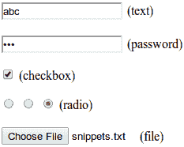

这些元素的 JavaScript 接口因元素类型而异。

多行文本字段有自己的标签 `<textarea>`，这主要是因为用属性来指定多行起始值会很别扭。`<textarea>` 标签需要匹配的 `</textarea>` 结束标签，并使用两者之间的文本（而非 `value` 属性）作为起始文本。

```html
<textarea>
one
two
three
</textarea>
```

最后，`<select>` 标签用于创建允许用户从多个预定义选项中选择的字段。

```html
<select>
  <option>Pancakes</option>
  <option>Pudding</option>
  <option>Ice cream</option>
</select>
```

这样的字段如下所示：

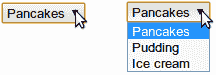

每当表单字段的值发生变化时，它会触发一个 `"change"` 事件。

## 焦点

与 HTML 文档中的大多数元素不同，表单字段可以获取键盘焦点。当被点击或以其他方式激活时，它们会成为当前活动元素，并接收键盘输入。

因此，只有当一个文本字段获得焦点时，你才能在其中输入内容。其他字段对键盘事件的响应方式不同。例如，`<select>` 菜单会尝试跳转到包含用户输入文本的选项，并通过箭头键上下移动选择项。

我们可以通过 JavaScript 的 `focus` 和 `blur` 方法控制焦点。前者将焦点移动到调用它的 DOM 元素上，后者则移除焦点。`document.activeElement` 的值对应当前获得焦点的元素。

```html
<input type="text">
<script>
  document.querySelector("input").focus();
  console.log(document.activeElement.tagName);
  // → INPUT
  document.querySelector("input").blur();
  console.log(document.activeElement.tagName);
  // → BODY
</script>
```

对于某些页面，用户可能希望立即与表单字段交互。JavaScript 可以在文档加载时聚焦该字段，但 HTML 也提供了 `autofocus` 属性，它能在产生相同效果的同时让浏览器知道我们的意图。这样，当该行为不合适时（例如用户已将焦点放在其他元素上），浏览器可以选择禁用该行为。

传统上，浏览器还允许用户通过按 Tab 键在文档中移动焦点。我们可以使用 `tabindex` 属性影响元素获得焦点的顺序。下面的示例文档会让焦点从文本输入直接跳到“确定”按钮，而不是先经过帮助链接：

```html
<input type="text" tabindex=1> <a href=".">(help)</a>
<button onclick="console.log('ok')" tabindex=2>OK</button>
```

默认情况下，大多数类型的 HTML 元素无法获得焦点。但你可以为任何元素添加 `tabindex` 属性，使其可聚焦。`tabindex` 为 `-1` 会使 Tab 键跳过该元素，即使它通常是可以聚焦的。

## 禁用字段

所有表单字段都可以通过 `disabled` 属性禁用。这是一个可以不带值指定的属性——只要存在该属性，就会禁用元素。

```html
<button>I'm all right</button>
<button disabled>I'm out</button>
```

禁用的字段无法获得焦点或更改，浏览器会使其显示为灰色和褪色状态。


当程序正在处理由某个按钮或其他控件触发的操作（可能需要与服务器通信，因此会花费一些时间）时，最好禁用该控件，直到操作完成。这样，当用户不耐烦并再次点击时，就不会意外重复操作。

## 表单整体

当一个字段包含在 `<form>` 元素中时，其 DOM 元素会有一个 `form` 属性，指向表单的 DOM 元素。而 `<form>` 元素则有一个名为 `elements` 的属性，其中包含一个类似数组的集合，存放着表单内的所有字段。

表单字段的 `name` 属性决定了表单提交时其值的标识方式。它也可以作为属性名来访问表单的 `elements` 属性，该属性既像一个类数组对象（可通过数字索引访问），又像一个映射（可通过名称访问）。


```html
<form action="example/submit.html">
  Name: <input type="text" name="name"><br>
  Password: <input type="password" name="password"><br>
  <button type="submit">Log in</button>
</form>
<script>
  let form = document.querySelector("form");
  console.log(form.elements[1].type);
  // → password
  console.log(form.elements.password.type);
  // → password
  console.log(form.elements.name.form == form);
  // → true
</script>
```

当按下 `type` 属性为 `submit` 的按钮时，会导致表单被提交。在表单字段获得焦点时按下回车键也会产生相同的效果。

提交表单通常意味着浏览器会导航到表单 `action` 属性所指示的页面，使用 `GET` 或 `POST` 请求。但在那之前，会触发一个 `"submit"` 事件。你可以用 JavaScript 处理这个事件，并通过在事件对象上调用 `preventDefault` 来阻止默认行为。

```html
<form action="example/submit.html">
  Value: <input type="text" name="value">
  <button type="submit">Save</button>
</form>
<script>
  let form = document.querySelector("form");
  form.addEventListener("submit", event => {
    console.log("Saving value", form.elements.value.value);
    event.preventDefault();
  });
</script>
```

在 JavaScript 中拦截 `"submit"` 事件有多种用途。我们可以编写代码来验证用户输入的值是否合理，并立即显示错误消息，而不是提交表单。或者，我们可以像示例中那样完全禁用常规的表单提交方式，让程序处理输入，可能使用 `fetch` 将其发送到服务器而无需重新加载页面。

## 文本字段

由 `<input>` 标签（类型为 `text` 或 `password`）以及 `<textarea>` 标签创建的字段共享一个通用接口。它们的 DOM 元素有一个 `value` 属性，该属性以字符串形式保存当前内容。将此属性设置为另一个字符串会改变字段的内容。

文本字段的 `selectionStart` 和 `selectionEnd` 属性提供了关于光标和文本选择的信息。当没有选择任何内容时，这两个属性持有相同的数字，表示光标的位置。例如，0 表示文本的开头，10 表示光标在第 10 个字符之后。当字段的一部分被选中时，这两个属性会不同，给出所选文本的起始和结束位置。与 `value` 一样，这些属性也可以被写入。

假设你正在写一篇关于哈塞海姆威（Khasekhemwy）的文章，但在拼写他的名字时遇到了一些困难。以下代码将一个 `<textarea>` 标签与一个事件处理程序关联起来，当你按下 F2 时，它会为你插入字符串 "Khasekhemwy"。

```html
<textarea></textarea>
<script>
  let textarea = document.querySelector("textarea");
  textarea.addEventListener("keydown", event => {
    // The key code for F2 happens to be 113
    if (event.keyCode == 113) {
      replaceSelection(textarea, "Khasekhemwy");
      event.preventDefault();
    }
  });
  function replaceSelection(field, word) {
    let from = field.selectionStart, to = field.selectionEnd;
    field.value = field.value.slice(0, from) + word +
                  field.value.slice(to);
    // Put the cursor after the word
    field.selectionStart = from + word.length;
    field.selectionEnd = from + word.length;
  }
</script>
```

`replaceSelection` 函数将文本字段当前选中的部分替换为给定的单词，然后将光标移动到该单词之后，以便用户继续输入。

文本字段的 `"change"` 事件不会在每次输入时触发。相反，它会在字段内容改变后失去焦点时触发。为了立即响应文本字段的变化，你应该注册一个 `"input"` 事件的处理程序，该事件在用户每次键入字符、删除文本或以其他方式操作字段内容时触发。

以下示例展示了一个文本字段和一个显示字段当前文本长度的计数器：

```html
<input type="text"> length: <span id="length">0</span>
<script>
  let text = document.querySelector("input");
  let output = document.querySelector("#length");
  text.addEventListener("input", () => {
    output.textContent = text.value.length;
  });
</script>
```

## 复选框和单选按钮

复选框字段是一个二元开关。它的值可以通过其 `checked` 属性获取或更改，该属性持有一个布尔值。

```html
<label>
  <input type="checkbox" id="purple"> Make this page purple
</label>
<script>
  let checkbox = document.querySelector("#purple");
  checkbox.addEventListener("change", () => {
    document.body.style.background =
      checkbox.checked ? "mediumpurple" : "";
  });
</script>
```

`<label>` 标签将文档的一部分与输入字段关联起来。点击标签上的任意位置都会激活该字段，使其获得焦点，并在字段是复选框或单选按钮时切换其值。

单选按钮与复选框类似，但它会隐式地与具有相同 `name` 属性的其他单选按钮关联，因此任何时候只能有一个处于激活状态。

```html
Color:
<label>
  <input type="radio" name="color" value="orange"> Orange
</label>
<label>
  <input type="radio" name="color" value="lightgreen"> Green
</label>
<label>
  <input type="radio" name="color" value="lightblue"> Blue
</label>
<script>
  let buttons = document.querySelectorAll("[name=color]");
  for (let button of Array.from(buttons)) {
    button.addEventListener("change", () => {
      document.body.style.background = button.value;
    });
  }
</script>
```

在 `querySelectorAll` 的 CSS 查询中使用的方括号用于匹配属性。它选择 `name` 属性为 `"color"` 的元素。

## 选择字段

选择字段在概念上与单选按钮类似——它们也允许用户从一组选项中进行选择。但单选按钮将选项的布局置于我们的控制之下，而 `<select>` 标签的外观则由浏览器决定。

选择字段还有一种变体，它更类似于复选框列表，而不是单选按钮列表。当给定 `multiple` 属性时，`<select>` 标签将允许用户选择任意数量的选项，而不仅仅是单个选项。在大多数浏览器中，这看起来与普通的选择字段不同，普通的选择字段通常绘制为*下拉*控件，只有在打开时才会显示选项。

每个 `<option>` 标签都有一个值。这个值可以通过 `value` 属性定义。如果没有给出，则选项内的文本将作为其值。`<select>` 元素的 `value` 属性反映当前选中的选项。但对于 `multiple` 字段，这个属性意义不大，因为它只会给出当前选中选项中*一个*的值。

`<select>` 字段的 `<option>` 标签可以通过该字段的 `options` 属性以类数组对象的形式访问。每个选项都有一个名为 `selected` 的属性，用于指示该选项当前是否被选中。该属性也可以被写入，以选中或取消选中某个选项。

此示例从一个 `multiple` 选择字段中提取选中的值，并用它们从各个位组成一个二进制数。按住 Control 键（Mac 上为 Command 键）可选择多个选项。

```html
<select multiple>
  <option value="1">0001</option>
  <option value="2">0010</option>
  <option value="4">0100</option>
  <option value="8">1000</option>
</select> = <span id="output">0</span>
<script>
  let select = document.querySelector("select");
  let output = document.querySelector("#output");
  select.addEventListener("change", () => {
    let number = 0;
    for (let option of Array.from(select.options)) {
      if (option.selected) {
        number += Number(option.value);
      }
    }
    output.textContent = number;
  });
</script>
```

## 文件字段

文件字段最初被设计为通过表单从浏览器所在机器上传文件的方式。在现代浏览器中，它们还提供了一种从 JavaScript 程序读取此类文件的方法。该字段充当了守门人的角色。脚本不能简单地开始读取用户计算机上的私有文件，但如果用户在该字段中选择了一个文件，浏览器会将此操作解释为脚本可以读取该文件。

文件字段通常看起来像一个标有“选择文件”或“浏览”等字样的按钮，旁边显示所选文件的信息。

```html
<input type="file">
<script>
  let input = document.querySelector("input");
  input.addEventListener("change", () => {
    if (input.files.length > 0) {
      let file = input.files[0];
      console.log("You chose", file.name);
      if (file.type) console.log("It has type", file.type);
    }
  });
</script>
```

文件字段元素的 `files` 属性是一个类数组对象（同样，不是真正的数组），包含在该字段中选择的文件。它最初是空的。之所以不简单地使用一个 `file` 属性，是因为文件字段还支持 `multiple` 属性，这使得可以同时选择多个文件。

`files` 对象中的对象具有诸如 `name`（文件名）、`size`（文件大小，以字节为单位，即 8 位块）和 `type`（文件的媒体类型，例如 `text/plain` 或 `image/jpeg`）等属性。

它没有的是包含文件内容的属性。获取文件内容稍微复杂一些。由于从磁盘读取文件可能需要时间，因此接口必须是异步的，以避免冻结文档。

```html
<input type="file" multiple>
<script>
  let input = document.querySelector("input");
  input.addEventListener("change", () => {
    for (let file of Array.from(input.files)) {
      let reader = new FileReader();
      reader.addEventListener("load", () => {
        console.log("File", file.name, "starts with",
                    reader.result.slice(0, 20));
      });
      reader.readAsText(file);
    }
  });
</script>
```

读取文件是通过创建一个 `FileReader` 对象，为其注册一个 `"load"` 事件处理程序，并调用其 `readAsText` 方法，将我们要读取的文件传递给它来完成的。加载完成后，读取器的 `result` 属性包含文件的内容。

当读取文件因任何原因失败时，`FileReader` 还会触发一个 `"error"` 事件。错误对象本身会出现在读取器的 `error` 属性中。这个接口是在 Promise 成为语言一部分之前设计的。你可以像这样将其包装在 Promise 中：

```javascript
function readFileText(file) {
  return new Promise((resolve, reject) => {
    let reader = new FileReader();
    reader.addEventListener(
      "load", () => resolve(reader.result));
    reader.addEventListener(
      "error", () => reject(reader.error));
    reader.readAsText(file);
  });
}
```

## 在客户端存储数据

带有少量 JavaScript 的简单 HTML 页面可以成为“迷你应用程序”的绝佳格式——这些小型辅助程序可以自动化基本任务。通过将几个表单字段与事件处理程序连接起来，你可以完成从厘米和英寸之间的转换到根据主密码和网站名称计算密码等各种操作。

当这样的应用程序需要在会话之间记住某些内容时，你不能使用 JavaScript 绑定——每次页面关闭时这些绑定都会被丢弃。你可以设置一个服务器，将其连接到互联网，并让应用程序在那里存储一些内容。我们将在第 20 章中看到如何做到这一点。但这会带来大量的额外工作和复杂性。有时，仅将数据保留在浏览器中就足够了。

`localStorage` 对象可用于以在页面重新加载后仍然存在的方式存储数据。该对象允许你按名称存储字符串值。

```javascript
localStorage.setItem("username", "marijn");
console.log(localStorage.getItem("username"));
// → marijn
localStorage.removeItem("username");
```

`localStorage` 中的值会一直保留，直到被覆盖、通过 `removeItem` 删除，或者用户清除其本地数据。

来自不同域名的站点拥有不同的存储空间。这意味着，原则上，给定网站存储在 `localStorage` 中的数据只能被同一站点上的脚本读取（和覆盖）。


浏览器确实对站点可以在 `localStorage` 中存储的数据大小施加了限制。这一限制，加上用垃圾填满人们硬盘并不真正有利可图的事实，防止了该功能占用过多空间。

以下代码实现了一个简单的笔记应用程序。它维护一组命名的笔记，并允许用户编辑笔记和创建新笔记。

```html
Notes: <select></select> <button>Add</button><br>
<textarea style="width: 100%"></textarea>

<script>
  let list = document.querySelector("select");
  let note = document.querySelector("textarea");

  let state;
  function setState(newState) {
    list.textContent = "";
    for (let name of Object.keys(newState.notes)) {
      let option = document.createElement("option");
      option.textContent = name;
      if (newState.selected == name) option.selected = true;
      list.appendChild(option);
    }
    note.value = newState.notes[newState.selected];

    localStorage.setItem("Notes", JSON.stringify(newState));
    state = newState;
  }
  setState(JSON.parse(localStorage.getItem("Notes")) || {
    notes: {"shopping list": "Carrots\nRaisins"},
    selected: "shopping list"
  });

  list.addEventListener("change", () => {
    setState({notes: state.notes, selected: list.value});
  });
  note.addEventListener("change", () => {
    setState({
      notes: Object.assign({}, state.notes,
                           {[state.selected]: note.value}),
      selected: state.selected
    });
  });
  document.querySelector("button")
    .addEventListener("click", () => {
      let name = prompt("Note name");
      if (name) setState({
        notes: Object.assign({}, state.notes, {[name]: ""}),
        selected: name
      });
    });
</script>
```

脚本从存储在 `localStorage` 中的 `"Notes"` 值获取初始状态，如果该值不存在，则创建一个仅包含购物清单的示例状态。从 `localStorage` 读取不存在的字段会返回 `null`。将 `null` 传递给 `JSON.parse` 会使其解析字符串 `"null"` 并返回 `null`。因此，`||` 运算符可用于在这种情况下提供默认值。

`setState` 方法确保 DOM 显示给定的状态，并将新状态存储到 `localStorage` 中。事件处理程序调用此函数以切换到新状态。

示例中使用 `Object.assign` 的目的是创建一个新对象，该对象是旧 `state.notes` 的克隆，但添加或覆盖了一个属性。`Object.assign` 接受第一个参数，并将后续所有参数中的属性添加到其中。因此，给它一个空对象会使其填充一个新对象。第三个参数中的方括号表示法用于创建一个名称基于某个动态值的属性。

还有一个与 `localStorage` 类似的对象，叫做 `sessionStorage`。两者的区别在于，`sessionStorage` 的内容在每个会话结束时被遗忘，对于大多数浏览器来说，这意味着每当浏览器关闭时。

## 总结

在本章中，我们讨论了 HTTP 协议的工作原理。客户端发送一个请求，其中包含一个方法（通常是 `GET`）和一个标识资源的路径。然后服务器决定如何处理该请求，并返回一个状态码和响应体。请求和响应都可能包含提供附加信息的头部。

浏览器 JavaScript 进行 HTTP 请求的接口称为 `fetch`。发起请求的写法如下：

```javascript
fetch("/18_http.html").then(r => r.text()).then(text => {
  console.log(`页面开头是 ${text.slice(0, 15)}`);
});
```

浏览器通过 `GET` 请求获取显示网页所需的资源。页面还可能包含表单，允许用户输入的信息在提交表单时作为新页面的请求发送出去。

HTML 可以表示各种类型的表单字段，例如文本字段、复选框、多选字段和文件选择器。

这些字段可以通过 JavaScript 进行检查和操作。它们会在改变时触发 `"change"` 事件，在输入文本时触发 `"input"` 事件，并在获得键盘焦点时接收键盘事件。像 `value`（用于文本和选择字段）或 `checked`（用于复选框和单选按钮）这样的属性用于读取或设置字段的内容。

当表单提交时，会触发 `"submit"` 事件。JavaScript 处理程序可以对该事件调用 `preventDefault` 来禁用浏览器的默认行为。表单字段元素也可以出现在表单标签之外。

当用户在文件选择器字段中从本地文件系统选择了文件后，可以使用 `FileReader` 接口从 JavaScript 程序中访问该文件的内容。

`localStorage` 和 `sessionStorage` 对象可用于以在页面重新加载后仍然存在的方式保存信息。第一个对象永久保存数据（或直到用户决定清除它），第二个对象保存数据直到浏览器关闭。

## 练习

### 内容协商

HTTP 能做的事情之一称为内容协商。`Accept` 请求头用于告诉服务器客户端希望获取哪种类型的文档。许多服务器会忽略这个头部，但当服务器知道多种编码资源的方式时，它可以查看这个头部并发送客户端偏好的那种。

URL [`eloquentjavascript.net/author`](http://eloquentjavascript.net/author) 被配置为根据客户端的要求返回纯文本、HTML 或 JSON。这些格式由标准化的媒体类型 `text/plain`、`text/html` 和 `application/json` 标识。

发送请求以获取该资源的全部三种格式。使用传递给 `fetch` 的选项对象中的 `headers` 属性，将名为 `Accept` 的头部设置为所需的媒体类型。

最后，尝试请求媒体类型 `application/rainbows+unicorns`，看看会产生哪个状态码。

### JavaScript 工作台

构建一个允许人们输入并运行 JavaScript 代码片段的界面。

在 `<textarea>` 字段旁边放一个按钮，当按下时，使用我们在第 10 章中看到的 `Function` 构造函数将文本包装成一个函数并调用它。将函数的返回值或它引发的任何错误转换为字符串，并显示在文本字段下方。

### 康威生命游戏

康威生命游戏是一个简单的模拟，它在网格上创造人工“生命”，每个格子要么是活的，要么不是。每一代（回合），应用以下规则：

- 任何活细胞，如果其活邻居少于两个或多于三个，则死亡。
- 任何活细胞，如果有两个或三个活邻居，则存活到下一代。
- 任何死细胞，如果恰好有三个活邻居，则变成活细胞。

邻居定义为任何相邻的单元格，包括对角线相邻的单元格。

请注意，这些规则是同时应用于整个网格，而不是一次一个方格。这意味着邻居的计数基于该代开始时的状态，并且在这一代中邻居细胞发生的变化不应影响给定细胞的新状态。

使用你认为合适的数据结构来实现这个游戏。使用 `Math.random` 初始随机填充网格。将其显示为复选框字段的网格，旁边有一个按钮用于前进到下一代。当用户勾选或取消勾选复选框时，他们的更改应包含在计算下一代的过程中。

# 第 19 章

# 项目：像素艺术编辑器

> 我看着眼前的众多色彩。我看着空白的画布。然后，我尝试像用词语塑造诗歌、用音符塑造音乐一样运用色彩。
>
> 胡安·米罗

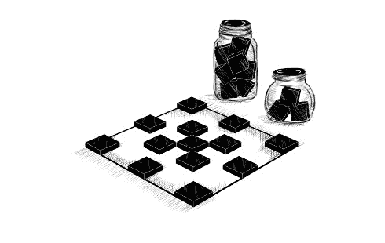

前几章的内容为你提供了构建基本 Web 应用所需的所有元素。在本章中，我们将实际构建这样一个应用。

我们的应用将是一个像素绘图程序，你可以通过操作放大后的视图（显示为彩色方格的网格）来逐个像素地修改图片。你可以使用该程序打开图像文件，用鼠标或其他指针设备在上面涂鸦，并保存它们。它将如下所示：

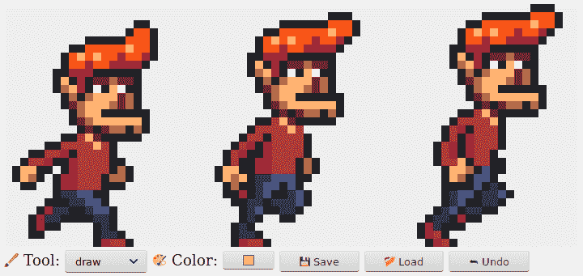

在电脑上绘画很棒。你无需担心材料、技巧或天赋。只需开始涂抹即可。

## 组件

应用程序的界面顶部显示一个大的 `<canvas>` 元素，下方有多个表单字段。用户通过从 `<select>` 字段中选择工具，然后点击、触摸或拖拽画布来绘制图片。工具包括绘制单个像素或矩形、填充区域以及从图片中选取颜色。

我们将编辑器界面结构化为多个 *组件*，这些对象负责 DOM 的一部分，并且内部可能包含其他组件。

应用程序的状态由当前图片、所选工具和所选颜色组成。我们将设置状态保存在单个值中，并且界面组件始终基于当前状态来呈现外观。

为了理解这一点的重要性，让我们考虑另一种方案——将状态分散到界面各处。在某种程度上，这种方式更容易编程。我们只需放置一个颜色字段，并在需要知道当前颜色时读取其值即可。

但随后我们添加了颜色选择器——一种允许你点击图片以选取给定像素颜色的工具。为了让颜色字段显示正确的颜色，该工具必须知道它的存在，并在选取新颜色时更新它。如果你再添加另一个显示颜色的地方（比如鼠标光标可能显示颜色），你就必须更新颜色更改代码以保持同步。

实际上，这导致了一个问题：界面的每个部分都需要了解所有其他部分，这非常不模块化。对于像本章这样的小型应用程序，这可能不是问题。但对于更大的项目，它可能变成真正的噩梦。

为了避免这种噩梦，我们原则上要严格遵循 *数据流*。存在一个状态，界面基于该状态绘制。界面组件可以通过更新状态来响应用户操作，此时组件有机会与这个新状态同步。

在实践中，每个组件被设置为：当它接收到新状态时，它也会通知其子组件（如果需要更新的话）。设置这一点有些麻烦。使这更方便是许多浏览器编程库的主要卖点。但对于像这样的小型应用程序，我们可以在没有这种基础设施的情况下完成。

状态的更新被表示为对象，我们称之为 *动作*。组件可以创建这样的动作并 *分发* 它们——将它们交给一个中央状态管理函数。该函数计算下一个状态，之后界面组件更新自身以适应这个新状态。

我们将运行用户界面这一混乱的任务进行结构化处理。尽管与 DOM 相关的部分仍然充满副作用，但它们由一个概念上简单的骨架支撑：状态更新循环。状态决定了 DOM 的外观，而 DOM 事件改变状态的唯一方式是通过向状态分发动作。

这种方法有 *许多* 变体，每种都有其优点和问题，但它们的核心思想相同：状态变化应该通过一个明确定义的单一通道，而不是到处发生。

我们的组件将是符合接口的类。它们的构造函数接收一个状态——可能是整个应用程序状态，或者如果不需要访问所有内容，则是一个较小的值——并使用该状态构建一个 `dom` 属性。这是代表组件的 DOM 元素。大多数构造函数还会接收一些不会随时间变化的其他值，例如它们可以用来分发动作的函数。

每个组件都有一个 `syncState` 方法，用于将其同步到新的状态值。该方法接受一个参数，即状态，其类型与构造函数第一个参数相同。

## 状态

应用程序状态将是一个包含 `picture`、`tool` 和 `color` 属性的对象。图片本身是一个存储图片宽度、高度和像素内容的对象。像素存储在一个数组中，方式与第 6 章中的矩阵类相同——逐行从上到下。

```javascript
class Picture {
  constructor(width, height, pixels) {
    this.width = width;
    this.height = height;
    this.pixels = pixels;
  }
  static empty(width, height, color) {
    let pixels = new Array(width * height).fill(color);
    return new Picture(width, height, pixels);
  }
  pixel(x, y) {
    return this.pixels[x + y * this.width];
  }
  draw(pixels) {
    let copy = this.pixels.slice();
    for (let {x, y, color} of pixels) {
      copy[x + y * this.width] = color;
    }
    return new Picture(this.width, this.height, copy);
  }
}
```

我们希望将图片视为不可变值，原因将在本章后面讨论。但有时我们也需要一次更新大量像素。为此，该类有一个 `draw` 方法，它接受一个更新后的像素数组——包含 `x`、`y` 和 `color` 属性的对象——并创建一个覆盖这些像素的新图片。该方法使用不带参数的 `slice` 来复制整个像素数组——`slice` 的起始默认为 0，结束默认为数组长度。

`empty` 方法使用了我们之前未见过两种数组功能。`Array` 构造函数可以用一个数字调用，以创建一个给定长度的空数组。然后可以使用 `fill` 方法用给定值填充该数组。这些用于创建一个所有像素颜色相同的数组。

颜色存储为包含传统 CSS 颜色代码的字符串，由井号（`#`）后跟六个十六进制（基数为 16）数字组成——两位表示红色分量，两位表示绿色分量，两位表示蓝色分量。这是一种有些晦涩且不便的书写颜色的方式，但它是 HTML 颜色输入字段使用的格式，并且可以在画布绘图上下文的 `fillColor` 属性中使用，因此对于我们在本程序中使用颜色的方式来说，它足够实用。

黑色，所有分量为零，写作 `"#000000"`，亮粉色看起来像 `"#ff00ff"`，其中红色和蓝色分量达到最大值 255，用十六进制数字写作 `ff`（十六进制使用 *a* 到 *f* 表示数字 10 到 15）。

我们将允许界面将动作分发为对象，这些对象的属性会覆盖先前状态的属性。当用户更改颜色字段时，它可以分发一个像 `{color: field.value}` 这样的对象，然后这个更新函数可以从中计算出新状态。

```javascript
function updateState(state, action) {
  return Object.assign({}, state, action);
}
```

这种相当繁琐的模式——使用 `Object.assign` 先将 `state` 的属性添加到一个空对象，然后用 `action` 的属性覆盖其中一些——在使用不可变对象的 JavaScript 代码中很常见。一种更便捷的表示法（使用三点运算符将另一个对象的所有属性包含到对象表达式中）正处于标准化最后阶段。有了这个特性，你可以写成 `{...state, ...action}` 来代替。在撰写本文时，这还不能在所有浏览器中工作。

## DOM 构建

界面组件的主要工作之一是创建 DOM 结构。我们同样不想直接使用冗长的 DOM 方法，因此这里有一个 `elt` 函数的略微扩展版本：

```javascript
function elt(type, props, ...children) {
  let dom = document.createElement(type);
  if (props) Object.assign(dom, props);
  for (let child of children) {
    if (typeof child != "string") dom.appendChild(child);
    else dom.appendChild(document.createTextNode(child));
  }
  return dom;
}
```

这个版本与我们在第 16 章中使用的版本的主要区别在于，它向 DOM 节点分配的是*属性*，而不是*特性*。这意味着我们不能用它来设置任意特性，但*可以*用它来设置值不是字符串的属性，例如 `onclick`，它可以被设置为一个函数来注册点击事件处理程序。

这允许以下注册事件处理程序的风格：

```html
<body>
  <script>
    document.body.appendChild(elt("button", {
      onclick: () => console.log("click")
    }, "The button"));
  </script>
</body>
```

## 画布

我们要定义的第一个组件是界面的一个部分，它将图片显示为彩色方块的网格。该组件负责两件事：显示图片，以及将图片上的指针事件传递给应用程序的其他部分。

因此，我们可以将其定义为一个只了解当前图片、不了解整个应用程序状态的组件。由于它不知道整个应用程序如何工作，因此不能直接分发动作。相反，在响应指针事件时，它会调用创建它的代码提供的回调函数，该函数将处理特定于应用程序的部分。


```javascript
const scale = 10;

class PictureCanvas {
  constructor(picture, pointerDown) {
    this.dom = elt("canvas", {
      onmousedown: event => this.mouse(event, pointerDown),
      ontouchstart: event => this.touch(event, pointerDown)
    });
    this.syncState(picture);
  }
  syncState(picture) {
    if (this.picture == picture) return;
    this.picture = picture;
    drawPicture(this.picture, this.dom, scale);
  }
}
```

我们将每个像素绘制为一个 10×10 的正方形，由`scale`常量决定。为了避免不必要的工作，该组件会跟踪其当前图片，并且仅在`syncState`被赋予新图片时才重新绘制。

实际的绘制函数根据缩放比例和图片大小设置画布尺寸，并用一系列正方形填充画布，每个像素对应一个正方形。

```javascript
function drawPicture(picture, canvas, scale) {
  canvas.width = picture.width * scale;
  canvas.height = picture.height * scale;
  let cx = canvas.getContext("2d");

  for (let y = 0; y < picture.height; y++) {
    for (let x = 0; x < picture.width; x++) {
      cx.fillStyle = picture.pixel(x, y);
      cx.fillRect(x * scale, y * scale, scale, scale);
    }
  }
}
```

当鼠标位于图片画布上时按下鼠标左键，组件会调用`pointerDown`回调，并传入被点击像素的位置（以图片坐标表示）。这将用于实现与图片的鼠标交互。回调可以返回另一个回调函数，以便在按住按钮时指针移动到不同像素时得到通知。

```javascript
PictureCanvas.prototype.mouse = function(downEvent, onDown) {
  if (downEvent.button != 0) return;
  let pos = pointerPosition(downEvent, this.dom);
  let onMove = onDown(pos);
  if (!onMove) return;
  let move = moveEvent => {
    if (moveEvent.buttons == 0) {
      this.dom.removeEventListener("mousemove", move);
    } else {
      let newPos = pointerPosition(moveEvent, this.dom);
      if (newPos.x == pos.x && newPos.y == pos.y) return;
      pos = newPos;
      onMove(newPos);
    }
  };
  this.dom.addEventListener("mousemove", move);
};

function pointerPosition(pos, domNode) {
  let rect = domNode.getBoundingClientRect();
  return {x: Math.floor((pos.clientX - rect.left) / scale),
          y: Math.floor((pos.clientY - rect.top) / scale)};
}
```

由于我们知道像素的大小，并且可以使用`getBoundingClientRect`找到画布在屏幕上的位置，因此可以从鼠标事件坐标（`clientX`和`clientY`）转换到图片坐标。这些坐标总是向下取整，以便指向特定的像素。

对于触摸事件，我们必须做类似的事情，但使用不同的事件，并确保在`"touchstart"`事件上调用`preventDefault`以防止页面滚动。

```javascript
PictureCanvas.prototype.touch = function(startEvent,
                                         onDown) {
  let pos = pointerPosition(startEvent.touches[0], this.dom);
  let onMove = onDown(pos);
  startEvent.preventDefault();
  if (!onMove) return;
  let move = moveEvent => {
    let newPos = pointerPosition(moveEvent.touches[0],
                                 this.dom);
    if (newPos.x == pos.x && newPos.y == pos.y) return;
    pos = newPos;
    onMove(newPos);
  };
  let end = () => {
    this.dom.removeEventListener("touchmove", move);
    this.dom.removeEventListener("touchend", end);
  };
  this.dom.addEventListener("touchmove", move);
  this.dom.addEventListener("touchend", end);
};
```

对于触摸事件，`clientX`和`clientY`不能直接从事件对象上获取，但我们可以使用`touches`属性中第一个触摸对象的坐标。

## 应用程序

为了能够逐步构建应用程序，我们将主组件实现为一个外壳，它包含一个图片画布以及一组动态的工具和控件，这些工具和控件会传递给其构造函数。

*控件*是出现在图片下方的界面元素。它们将以组件构造函数的数组形式提供。

*工具*是诸如绘制像素或填充区域之类的功能。应用程序将可用工具集显示为一个`<select>`字段。当前选中的工具决定了用户通过指针设备与图片交互时发生什么。可用工具集作为一个对象提供，该对象将下拉字段中显示的名称映射到实现这些工具的函数。这些函数接收图片位置、当前应用程序状态和一个`dispatch`函数作为参数。它们可以返回一个移动处理函数，当指针移动到不同像素时，该函数会以新位置和当前状态被调用。

```javascript
class PixelEditor {
  constructor(state, config) {
    let {tools, controls, dispatch} = config;
    this.state = state;

    this.canvas = new PictureCanvas(state.picture, pos => {
      let tool = tools[this.state.tool];
      let onMove = tool(pos, this.state, dispatch);
      if (onMove) return pos => onMove(pos, this.state);
    });
    this.controls = controls.map(
      Control => new Control(state, config));
    this.dom = elt("div", {}, this.canvas.dom, elt("br"),
                   ...this.controls.reduce(
                     (a, c) => a.concat(" ", c.dom), []));
  }
  syncState(state) {
    this.state = state;
    this.canvas.syncState(state.picture);
    for (let ctrl of this.controls) ctrl.syncState(state);
  }
}
```

传递给`PictureCanvas`的指针处理器会调用当前选中的工具，并传入适当的参数；如果该工具返回了一个移动处理器，则将其适配为也能接收状态。

所有控件都被构造并存储在`this.controls`中，以便在应用状态变化时能够更新它们。对`reduce`的调用会在控件的 DOM 元素之间插入空格，这样它们看起来就不会挤在一起。

第一个控件是工具选择菜单。它创建了一个`<select>`元素，为每个工具提供一个选项，并设置了一个`"change"`事件处理器，当用户选择不同的工具时，该处理器会更新应用状态。

```javascript
class ToolSelect {
  constructor(state, {tools, dispatch}) {
    this.select = elt("select", {
      onchange: () => dispatch({tool: this.select.value})
    }, ...Object.keys(tools).map(name => elt("option", {
      selected: name == state.tool
    }, name)));
    this.dom = elt("label", null, "🖌 工具：", this.select);
  }
  syncState(state) { this.select.value = state.tool; }
}
```

通过将标签文本和字段包裹在`<label>`元素中，我们告诉浏览器该标签属于该字段，这样你就可以点击标签来聚焦该字段。

我们还需要能够更改颜色，因此让我们为此添加一个控件。一个`type`属性为`color`的 HTML`<input>`元素，为我们提供了一个专门用于选择颜色的表单字段。这种字段的值始终是`"#RRGGBB"`格式的 CSS 颜色代码（红色、绿色和蓝色分量，每种颜色两位数字）。当用户与之交互时，浏览器会显示一个颜色选择器界面。

根据浏览器的不同，颜色选择器可能看起来像这样：

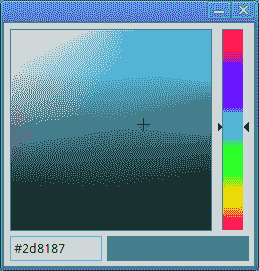

该控件创建了这样一个字段，并将其与应用程序状态的`color`属性保持同步。

```javascript
class ColorSelect {
  constructor(state, {dispatch}) {
    this.input = elt("input", {
      type: "color",
      value: state.color,
      onchange: () => dispatch({color: this.input.value})
    });
    this.dom = elt("label", null, "🎨 颜色：", this.input);
  }
  syncState(state) { this.input.value = state.color; }
}
```

## 绘图工具

在开始绘制之前，我们需要实现一些工具，这些工具将控制画布上鼠标或触摸事件的功能。

最基本的工具是绘图工具，它可以将你点击或触摸的任何像素更改为当前选中的颜色。它会分发一个动作，将图片更新为指向的像素被赋予当前选中颜色的版本。

```javascript
function draw(pos, state, dispatch) {
  function drawPixel({x, y}, state) {
    let drawn = {x, y, color: state.color};
    dispatch({picture: state.picture.draw([drawn])});
  }
  drawPixel(pos, state);
  return drawPixel;
}
```

该函数立即调用`drawPixel`函数，但随后也将其返回，以便当用户在图片上拖动或滑动时，它会被再次调用以处理新触摸的像素。

为了绘制更大的形状，快速创建矩形会很有用。`rectangle`工具在你开始拖动的点和拖动到的点之间绘制一个矩形。

```javascript
function rectangle(start, state, dispatch) {
  function drawRectangle(pos) {
    let xStart = Math.min(start.x, pos.x);
    let yStart = Math.min(start.y, pos.y);
    let xEnd = Math.max(start.x, pos.x);
    let yEnd = Math.max(start.y, pos.y);
    let drawn = [];
    for (let y = yStart; y <= yEnd; y++) {
      for (let x = xStart; x <= xEnd; x++) {
        drawn.push({x, y, color: state.color});
      }
    }
    dispatch({picture: state.picture.draw(drawn)});
  }
  drawRectangle(start);
  return drawRectangle;
}
```

这个实现中的一个重要细节是，在拖动时，矩形会从*原始*状态重新绘制到图片上。这样，在创建矩形时，你可以使其变大或变小，而中间矩形不会残留在最终图片中。这是不可变图片对象有用的原因之一——稍后我们会看到另一个原因。

实现泛洪填充稍微复杂一些。这是一种工具，用于填充指针下的像素以及所有具有相同颜色的相邻像素。“相邻”指的是直接水平或垂直相邻，而不是对角线相邻。下图说明了在标记像素处使用泛洪填充工具时被着色的像素集：


有趣的是，我们实现它的方式有点像第 7 章中的寻路代码。那段代码在图中搜索路径，而这段代码在网格中搜索所有“相连”的像素。跟踪一组分支可能路径的问题是相似的。

```javascript
const around = [{dx: -1, dy: 0}, {dx: 1, dy: 0},
                {dx: 0, dy: -1}, {dx: 0, dy: 1}];

function fill({x, y}, state, dispatch) {
  let targetColor = state.picture.pixel(x, y);
  let drawn = [{x, y, color: state.color}];
  for (let done = 0; done < drawn.length; done++) {
    for (let {dx, dy} of around) {
      let x = drawn[done].x + dx, y = drawn[done].y + dy;
      if (x >= 0 && x < state.picture.width &&
          y >= 0 && y < state.picture.height &&
          state.picture.pixel(x, y) == targetColor &&
          !drawn.some(p => p.x == x && p.y == y)) {
        drawn.push({x, y, color: state.color});
      }
    }
  }
  dispatch({picture: state.picture.draw(drawn)});
}
```

已绘制像素的数组同时充当函数的工作列表。对于每个到达的像素，我们需要检查是否有任何相邻像素具有相同的颜色且尚未被涂覆。循环计数器落后于`drawn`数组的长度，因为新像素会被添加。任何位于它前面的像素仍需探索。当它追上长度时，就没有未探索的像素了，函数也就完成了。

最后一个工具是颜色选择器，它允许你指向图片中的一种颜色，将其用作当前的绘图颜色。

```javascript
function pick(pos, state, dispatch) {
  dispatch({color: state.picture.pixel(pos.x, pos.y)});
}
```

## 保存与加载

当我们绘制完杰作后，我们希望将其保存下来以备后用。我们应该添加一个按钮，用于将当前图片下载为图像文件。该控件提供了这个按钮：


```js
class SaveButton {
  constructor(state) {
    this.picture = state.picture;
    this.dom = elt("button", {
      onclick: () => this.save()
    }, "💾 Save");
  }
  save() {
    let canvas = elt("canvas");
    drawPicture(this.picture, canvas, 1);
    let link = elt("a", {
      href: canvas.toDataURL(),
      download: "pixelart.png"
    });
    document.body.appendChild(link);
    link.click();
    link.remove();
  }
  syncState(state) { this.picture = state.picture; }
}
```

该组件会跟踪当前图片，以便在保存时能够访问它。为了创建图像文件，它使用了一个`<canvas>`元素，并在其上绘制图片（比例为每个像素对应一个像素）。

`canvas`元素上的`toDataURL`方法会创建一个以`data:`开头的 URL。与`http:`和`https:` URL 不同，数据 URL 将整个资源包含在 URL 中。它们通常非常长，但允许我们在浏览器中直接创建指向任意图片的有效链接。

为了让浏览器实际下载图片，我们随后创建一个指向该 URL 并带有`download`属性的链接元素。当点击此类链接时，浏览器会显示文件保存对话框。我们将该链接添加到文档中，模拟点击它，然后再次将其移除。

利用浏览器技术可以做很多事情，但实现方式有时相当奇特。

而且情况会更复杂。我们还需要能够将现有的图像文件加载到应用程序中。为此，我们再次定义一个按钮组件。

```js
class LoadButton {
  constructor(_, {dispatch}) {
    this.dom = elt("button", {
      onclick: () => startLoad(dispatch)
    }, "📁 Load");
  }
  syncState() {}
}

function startLoad(dispatch) {
  let input = elt("input", {
    type: "file",
    onchange: () => finishLoad(input.files[0], dispatch)
  });
  document.body.appendChild(input);
  input.click();
  input.remove();
}
```

要访问用户计算机上的文件，我们需要用户通过文件输入字段选择文件。但我不希望加载按钮看起来像一个文件输入字段，因此我们在按钮被点击时创建文件输入，然后假装它本身被点击了。

当用户选择了一个文件后，我们可以使用`FileReader`来访问其内容，同样以数据 URL 的形式。该 URL 可用于创建``元素，但由于我们无法直接访问此类图像中的像素，因此无法从中创建`Picture`对象。

```js
function finishLoad(file, dispatch) {
  if (file == null) return;
  let reader = new FileReader();
  reader.addEventListener("load", () => {
    let image = elt("img", {
      onload: () => dispatch({
        picture: pictureFromImage(image)
      }),
      src: reader.result
    });
  });
  reader.readAsDataURL(file);
}
```

要访问像素，我们必须先将图片绘制到`<canvas>`元素上。canvas 上下文有一个`getImageData`方法，允许脚本读取其像素。因此，一旦图片在 canvas 上，我们就可以访问它并构造一个`Picture`对象。

```js
function pictureFromImage(image) {
  let width = Math.min(100, image.width);
  let height = Math.min(100, image.height);
  let canvas = elt("canvas", {width, height});
  let cx = canvas.getContext("2d");
  cx.drawImage(image, 0, 0);
  let pixels = [];
  let {data} = cx.getImageData(0, 0, width, height);

  function hex(n) {
    return n.toString(16).padStart(2, "0");
  }
  for (let i = 0; i < data.length; i += 4) {
    let [r, g, b] = data.slice(i, i + 3);
    pixels.push("#" + hex(r) + hex(g) + hex(b));
  }
  return new Picture(width, height, pixels);
}
```

我们将图片大小限制为 100×100 像素，因为更大的图片在我们的显示器上会显得*巨大*，并且可能拖慢界面。

`getImageData`返回的对象的`data`属性是一个颜色分量数组。对于参数指定的矩形中的每个像素，它包含四个值，分别表示像素颜色的红色、绿色、蓝色和*alpha*分量，取值范围为 0 到 255。alpha 部分表示不透明度——当它为 0 时，像素完全透明；当它为 255 时，完全不透明。出于我们的目的，可以忽略它。

每个分量的两位十六进制数字（正如我们在颜色表示法中所使用的）正好对应 0 到 255 的范围——两位十六进制数字可以表示 16² = 256 个不同的数字。数字的`toString`方法可以接受一个基数作为参数，因此`n.toString(16)`会生成一个基数为 16 的字符串表示。我们必须确保每个数字占用两位，因此`hex`辅助函数调用`padStart`在必要时添加前导零。

现在我们可以加载和保存了！在完成之前，还有一个功能。

## 撤销历史

编辑过程的一半是犯小错误并纠正它们。因此，绘图程序中的一个重要功能是撤销历史。

为了能够撤销更改，我们需要存储图片的先前版本。由于它是一个不可变的值，这很容易。但这确实需要在应用程序状态中添加一个额外的字段。

我们将添加一个`done`数组来保存图片的先前版本。维护此属性需要一个更复杂的状态更新函数，该函数将图片添加到数组中。

但我们不想存储*每一次*更改，只存储相隔一定时间的更改。为了做到这一点，我们需要第二个属性`doneAt`，用于跟踪我们上次在历史中存储图片的时间。

```js
function historyUpdateState(state, action) {
  if (action.undo == true) {
    if (state.done.length == 0) return state;
    return Object.assign({}, state, {
      picture: state.done[0],
      done: state.done.slice(1),
      doneAt: 0
    });
  } else if (action.picture &&
             state.doneAt < Date.now() - 1000) {
    return Object.assign({}, state, action, {
      done: [state.picture, ...state.done],
      doneAt: Date.now()
    });
  } else {
    return Object.assign({}, state, action);
  }
}
```

当动作是撤销动作时，该函数从历史中取出最近的图片，并将其设为当前图片。它将`doneAt`设置为 0，以便下一次更改保证将图片存回历史，这样如果你愿意，可以在以后再次恢复到该版本。

否则，如果动作包含一张新图片，并且距离上次存储内容已经超过一秒（1000 毫秒），则更新`done`和`doneAt`属性以存储之前的图片。

撤销按钮组件做的事情不多。它在被点击时派发撤销动作，并在没有可撤销内容时禁用自身。

```js
class UndoButton {
  constructor(state, {dispatch}) {
    this.dom = elt("button", {
      onclick: () => dispatch({undo: true}),
      disabled: state.done.length == 0
    }, "⮪ Undo");
  }
  syncState(state) {
    this.dom.disabled = state.done.length == 0;
  }
}
```

## 开始绘图

要设置应用程序，我们需要创建一个状态、一组工具、一组控件和一个派发函数。我们可以将它们传递给`PixelEditor`构造函数来创建主组件。由于在练习中我们需要创建多个编辑器，因此首先定义一些绑定。

```js
const startState = {
  tool: "draw",
  color: "#000000",
  picture: Picture.empty(60, 30, "#f0f0f0"),
  done: [],
  doneAt: 0
};

const baseTools = {draw, fill, rectangle, pick};

const baseControls = [
  ToolSelect, ColorSelect, SaveButton, LoadButton, UndoButton
];

function startPixelEditor({state = startState,
                           tools = baseTools,
                           controls = baseControls}) {
  let app = new PixelEditor(state, {
    tools,
    controls,
    dispatch(action) {
      state = historyUpdateState(state, action);
      app.syncState(state);
    }
  });
  return app.dom;
}
```

解构对象或数组时，可以在绑定名称后使用`=`来为绑定提供默认值，当属性缺失或值为`undefined`时使用该默认值。`startPixelEditor`函数利用这一点，接受一个包含多个可选属性的对象作为参数。例如，如果你没有提供`tools`属性，`tools`将被绑定为`baseTools`。

这样我们就能在屏幕上得到一个实际的编辑器：

```html
<div></div>
<script>
  document.querySelector("div")
    .appendChild(startPixelEditor({}));
</script>
```

## 为什么这么难？

浏览器技术令人惊叹。它提供了一套强大的界面构建模块、样式和操作它们的方法，以及检查和调试应用程序的工具。你为浏览器编写的软件几乎可以在全球每台电脑和手机上运行。

与此同时，浏览器技术又很荒谬。你必须学习大量愚蠢的技巧和晦涩的知识才能掌握它，而且它提供的默认编程模型问题重重，以至于大多数程序员宁愿用多层抽象来封装它，也不愿直接处理。

虽然情况确实在改善，但主要是通过添加更多元素来弥补缺陷——这反而带来了更多的复杂性。被数百万网站使用的功能无法真正被替换。即使可以，也很难决定用什么来替换。

技术从来不会存在于真空中——我们受到工具以及产生这些工具的社会、经济和历史因素的制约。这可能会令人烦恼，但通常更有效的方法是努力理解*现有*技术现实是如何运作的——以及它为何如此——而不是对其愤怒或期待另一种现实。

新的抽象*可以*是有帮助的。我在本章中使用的组件模型和数据流约定就是其一种粗糙形式。如前所述，有一些库试图让用户界面编程更愉快。在撰写本文时，[React](https://reactjs.org/)和[Angular](https://angular.io/)是流行的选择，但这类框架还有一整个小产业。如果你对编写 Web 应用程序感兴趣，我建议研究其中几个，以了解它们的工作原理及其带来的好处。

## 练习

我们的程序仍有改进空间。让我们通过练习添加一些功能。

### 键盘绑定

为应用程序添加键盘快捷键。工具名称的首字母选择该工具，Control-Z 或 Command-Z 激活撤销。

通过修改`PixelEditor`组件来实现。为包裹的`<div>`元素添加`tabIndex`属性值为 0，使其能够接收键盘焦点。注意，与`tabindex`属性对应的属性名称为`tabIndex`（大写 I），我们的`elt`函数期望属性名称。直接在该元素上注册键盘事件处理程序。这意味着你需要先点击、触摸或 Tab 到应用程序，才能用键盘与之交互。

记住，键盘事件具有`ctrlKey`和`metaKey`（用于 Mac 上的 Command 键）属性，你可以用它们来检查这些键是否被按下。

### 高效绘制

在绘制过程中，我们的应用程序大部分工作发生在`drawPicture`中。创建新状态并更新 DOM 的其余部分开销不大，但重新绘制画布上的所有像素则相当耗费资源。

找到一种方法，通过只重新绘制实际发生变化的像素来加快`PictureCanvas`的`syncState`方法。

记住，`drawPicture`也被保存按钮使用，因此如果你修改它，要么确保更改不会破坏旧用途，要么创建一个不同名称的新版本。

还要注意，通过设置`<canvas>`元素的`width`或`height`属性来改变其大小会清除画布，使其完全透明。

### 圆形

定义一个名为`circle`的工具，当拖动时绘制一个实心圆。圆的中心位于拖动或触摸手势开始的位置，半径由拖动的距离决定。

### 正确的线条

这是一个比前两个更高级的练习，需要你设计一个解决非平凡问题的方案。在开始这个练习之前，请确保你有足够的时间和耐心，并且不要因最初的失败而气馁。

在大多数浏览器中，当你选择`draw`工具并快速在图片上拖动时，你不会得到一条连续的线。相反，你会得到带有间隙的点，因为`"mousemove"`或`"touchmove"`事件触发得不够快，无法覆盖每个像素。

改进`draw`工具，使其绘制完整的线条。这意味着你必须让运动处理函数记住上一个位置，并将其与当前位置连接起来。

为此，由于像素之间的距离可能任意远，你需要编写一个通用的线条绘制函数。

两个像素之间的线条是一条尽可能直的连接像素链，从起点到终点。对角相邻的像素算作连接。因此，斜线应该看起来像左图，而不是右图。


如果我们有代码可以在任意两点之间绘制线条，我们也可以用它来定义一个`line`工具，该工具在拖动的起点和终点之间绘制一条直线。

第 20 章

# Node.js


> [](#20_node.xhtml_p_dL3PxXkk30)一个学生问：“古代的程序员只用简单的机器，没有编程语言，却做出了优美的程序。为什么我们要使用复杂的机器和编程语言？”傅子回答说：“古代的工匠只用棍棒和黏土，却建造了美丽的小屋。”
>
> 袁马大师，《编程之书》

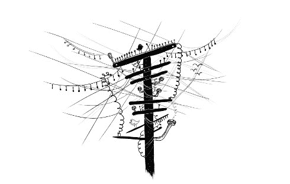

到目前为止，我们一直在单一环境中使用 JavaScript 语言：浏览器。本章和下一章将简要介绍 Node.js，这是一个让你能够在浏览器之外应用 JavaScript 技能的程序。借助它，你可以构建从小的命令行工具到驱动动态网站的 HTTP 服务器等各种应用。

这两章旨在教你 Node.js 使用的主要概念，并为你提供足够的信息来编写有用的程序。它们并不试图成为对该平台的完整甚至详尽的论述。

如果你想跟着操作并运行本章中的代码，你需要安装 Node.js 10.1 或更高版本。为此，请访问 [https://nodejs.org](https://nodejs.org) 并按照你操作系统的安装说明进行操作。你还可以在那里找到 Node.js 的更多文档。

## 背景

编写通过网络通信的系统时，一个较难的问题是如何管理输入和输出——即从网络和硬盘读取数据以及向它们写入数据。移动数据需要时间，而巧妙地调度数据可以显著影响系统对用户或网络请求的响应速度。

在这类程序中，异步编程通常很有帮助。它允许程序同时与多个设备发送和接收数据，而无需复杂的线程管理和同步。

Node 最初的设计目的是让异步编程变得简单方便。JavaScript 非常适合像 Node 这样的系统。它是少数几种没有内置输入输出方式的编程语言之一。因此，JavaScript 可以适应 Node 相当独特的输入输出方式，而不会最终产生两个不一致的接口。2009 年，当 Node 被设计时，人们已经在浏览器中进行基于回调的编程，因此该语言社区已经习惯了异步编程风格。

## node 命令

当 Node.js 安装在系统上时，它会提供一个名为 `node` 的程序，用于运行 JavaScript 文件。假设你有一个 `hello.js` 文件，包含以下代码：

```javascript
let message = "Hello world";
console.log(message);
```

然后你可以像这样从命令行运行 `node` 来执行程序：

```text
$ node hello.js
Hello world
```

Node 中的 `console.log` 方法与浏览器中的功能类似。它会输出一段文本。但在 Node 中，文本会输出到进程的标准输出流，而不是浏览器的 JavaScript 控制台。当从命令行运行 `node` 时，这意味着你会在终端中看到输出的值。

如果你运行 `node` 而不指定文件，它会提供一个提示符，你可以在其中输入 JavaScript 代码并立即看到结果。

```text
$ node
> 1 + 1
2
> [-1, -2, -3].map(Math.abs)
[1, 2, 3]
> process.exit(0)
$
```

`process` 绑定与 `console` 绑定一样，在 Node 中是全局可用的。它提供了多种检查和操作当前程序的方法。`exit` 方法结束进程，并可以传入一个退出状态码，该状态码告诉启动 `node` 的程序（在本例中是命令行 shell）程序是否成功完成（代码零）或遇到错误（任何其他代码）。

要找到传递给脚本的命令行参数，你可以读取 `process.argv`，它是一个字符串数组。注意，它还包括 `node` 命令的名称和你的脚本名称，因此实际参数从索引 2 开始。如果 `showargv.js` 包含语句 `console.log(process.argv)`，你可以像这样运行它：

```text
$ node showargv.js one --and two
["node", "/tmp/showargv.js", "one", "--and", "two"]
```

所有标准的 JavaScript 全局绑定，例如 `Array`、`Math` 和 `JSON`，在 Node 环境中也存在。但与浏览器相关的功能，如 `document` 或 `prompt`，则不存在。

## 模块

除了我提到的绑定（如 `console` 和 `process`）之外，Node 在全局作用域中只添加了很少的额外绑定。如果你想访问内置功能，你必须向模块系统请求。

基于 `require` 函数的 CommonJS 模块系统在第 10 章中已经介绍过。该系统内置于 Node 中，用于加载从内置模块到下载的包再到属于你自己程序的文件等各种内容。

当调用 `require` 时，Node 必须将给定的字符串解析为它可以加载的实际文件。以 `/`、`./` 或 `../` 开头的路径名会相对于当前模块的路径进行解析，其中 `.` 代表当前目录，`../` 代表上一级目录，`/` 代表文件系统的根目录。因此，如果你从文件 `/tmp/robot/robot.js` 中请求 `"./graph"`，Node 将尝试加载文件 `/tmp/robot/graph.js`。

`.js` 扩展名可以省略，如果存在这样的文件，Node 会自动添加。如果请求的路径指向一个目录，Node 将尝试加载该目录中名为 `index.js` 的文件。

当向 `require` 传递一个看起来不像相对路径或绝对路径的字符串时，它被认为是指向一个内置模块或安装在 `node_modules` 目录中的模块。例如，`require("fs")` 会给你 Node 的内置文件系统模块。而 `require("robot")` 可能会尝试加载 `node_modules/robot/` 中的库。安装此类库的常见方式是使用 NPM，我们稍后会回到这个话题。

让我们建立一个由两个文件组成的小项目。第一个文件名为 `main.js`，定义了一个可以从命令行调用的脚本，用于反转字符串。

```javascript
const {reverse} = require("./reverse");

// 索引 2 保存第一个实际的命令行参数
let argument = process.argv[2];

console.log(reverse(argument));
```

文件 `reverse.js` 定义了一个用于反转字符串的库，该库既可以被这个命令行工具使用，也可以被其他需要直接访问字符串反转函数的脚本使用。

```javascript
exports.reverse = function(string) {
  return Array.from(string).reverse().join("");
};
```

记住，向 `exports` 添加属性会将这些属性添加到模块的接口中。由于 Node.js 将文件视为 CommonJS 模块，`main.js` 可以从 `reverse.js` 中获取导出的 `reverse` 函数。

现在我们可以像这样调用我们的工具：

```text
$ node main.js JavaScript
tpircSavaJ
```

## 使用 NPM 安装

NPM 在第 10 章中介绍过，它是一个 JavaScript 模块的在线仓库，其中许多模块是专门为 Node 编写的。当你在计算机上安装 Node 时，你也会得到 `npm` 命令，你可以用它来与这个仓库交互。

NPM 的主要用途是下载包。我们在第 10 章中看到了 `ini` 包。我们可以使用 NPM 来获取并将该包安装到我们的计算机上。

```text
$ npm install ini
npm WARN enoent ENOENT: no such file or directory,
         open '/tmp/package.json'
+ ini@1.3.5
added 1 package in 0.552s

$ node
> const {parse} = require("ini");
> parse("x = 1\ny = 2");
{ x: '1', y: '2' }
```

[](#20_node.xhtml_p_NBQHpDdZuw)运行 `npm install` 后，NPM 会创建一个名为 `node_modules` 的目录。在该目录下，会有一个包含库文件的 `ini` 目录。你可以打开并查看其代码。当我们调用 `require("ini")` 时，这个库被加载，然后我们可以调用它的 `parse` 属性来解析配置文件。

[](#20_node.xhtml_p_sKeXO3qL6G)默认情况下，NPM 将包安装到当前目录下，而不是集中存放。如果你习惯了其他包管理器，这可能会显得不寻常，但它有优点——它让每个应用程序完全控制其安装的包，并且更容易管理版本以及在删除应用程序时进行清理。

### 包文件

[](#20_node.xhtml_p_efbbWPPNXQ)在 `npm install` 示例中，你可以看到一条关于 `package.json` 文件不存在的警告。建议为每个项目创建这样一个文件，可以手动创建，也可以通过运行 `npm init` 创建。它包含项目的一些信息，例如名称和版本，并列出其依赖项。

[](#20_node.xhtml_p_NT9giTr6Q2)来自第 7 章的机器人模拟，经过第 10 章练习中的模块化处理后，可能会有一个像这样的 `package.json` 文件：

```json
{
  "author": "Marijn Haverbeke",
  "name": "eloquent-javascript-robot",
  "description": "Simulation of a package-delivery robot",
  "version": "1.0.0",
  "main": "run.js",
  "dependencies": {
    "dijkstrajs": "¹.0.1",
    "random-item": "¹.0.0"
  },
  "license": "ISC"
}
```

[](#20_node.xhtml_p_LA2QNdOUqm)当你运行 `npm install` 而不指定要安装的包时，NPM 会安装 `package.json` 中列出的依赖项。当你安装一个尚未列为依赖项的特定包时，NPM 会将其添加到 `package.json` 中。

### 版本

[](#20_node.xhtml_p_UrPIybyUA4)`package.json` 文件既列出了程序自身的版本，也列出了其依赖项的版本。版本是一种处理包独立演进的方式，针对某个包在某个时间点编写的代码，可能无法与该包后续修改的版本兼容。

[](#20_node.xhtml_p_CvfHe7sDbQ)NPM 要求其包遵循一种称为*语义化版本*的规范，该规范在版本号中编码了关于哪些版本是*兼容的*（不破坏旧接口）的信息。语义化版本由三个数字组成，用句点分隔，例如 `2.3.0`。每当添加新功能时，中间的数字必须递增。每当兼容性被破坏，导致使用该包的现有代码可能无法与新版本一起工作时，第一个数字必须递增。

[](#20_node.xhtml_p_gTL1n2TLHm)`package.json` 中依赖项版本号前面的脱字符（`^`）表示可以安装与给定版本兼容的任何版本。例如，`"².3.0"` 表示允许任何大于或等于 2.3.0 且小于 3.0.0 的版本。

[](#20_node.xhtml_p_HcGcWqTR8/)`npm` 命令也用于发布新包或包的新版本。如果你在包含 `package.json` 文件的目录中运行 `npm publish`，它会将 JSON 文件中列出的名称和版本的包发布到注册表。任何人都可以向 NPM 发布包——但只能使用尚未被占用的包名，因为如果随机的人可以更新现有包，那将有点可怕。

[](#20_node.xhtml_p_3Z1I+gjqS6)由于 `npm` 程序是一个与开放系统（包注册表）通信的软件，它所做的事情并没有什么独特之处。另一个程序 `yarn`（可以从 NPM 注册表安装）使用略有不同的接口和安装策略，扮演着与 `npm` 相同的角色。

[](#20_node.xhtml_p_u9CNibuDC7)本书不会深入探讨 NPM 使用的更多细节。请参考 [https://npmjs.org](https://npmjs.org) 获取更多文档和搜索包的方法。

## 文件系统模块

[](#20_node.xhtml_p_HumHNRQKJx)Node 中最常用的内置模块之一是 `fs` 模块，它代表*文件系统*。它导出了用于处理文件和目录的函数。

[](#20_node.xhtml_p_75RFSIQwdU)例如，名为 `readFile` 的函数读取一个文件，然后使用文件内容调用回调函数。

```javascript
let {readFile} = require("fs");
readFile("file.txt", "utf8", (error, text) => {
  if (error) throw error;
  console.log("The file contains:", text);
});
```

[](#20_node.xhtml_p_kiSsXyNElK)`readFile` 的第二个参数表示用于将文件解码为字符串的*字符编码*。文本可以通过多种方式编码为二进制数据，但大多数现代系统使用 UTF-8。因此，除非你有理由相信使用了其他编码，否则在读取文本文件时请传递 `"utf8"`。如果你不传递编码，Node 会假定你对二进制数据感兴趣，并会给你一个 `Buffer` 对象而不是字符串。这是一个类似数组的对象，包含表示文件中字节（8 位数据块）的数字。

```javascript
const {readFile} = require("fs");
readFile("file.txt", (error, buffer) => {
  if (error) throw error;
  console.log("The file contained", buffer.length, "bytes.",
              "The first byte is:", buffer[0]);
});
```

[](#20_node.xhtml_p_2eNWgxdLGx)一个类似的函数 `writeFile` 用于将文件写入磁盘。

```javascript
const {writeFile} = require("fs");
writeFile("graffiti.txt", "Node was here", err => {
  if (err) console.log(`Failed to write file: ${err}`);
  else console.log("File written.");
});
```

[](#20_node.xhtml_p_rDd4gjDwV6)这里不需要指定编码——`writeFile` 会假定当它被赋予一个要写入的字符串（而不是 `Buffer` 对象）时，它应该使用其默认字符编码（即 UTF-8）将其作为文本写出。

[](#20_node.xhtml_p_SJ/BKOfrhB)`fs` 模块包含许多其他有用的函数：`readdir` 会以字符串数组的形式返回目录中的文件，`stat` 会检索文件的信息，`rename` 会重命名文件，`unlink` 会删除文件，等等。具体细节请参见 [https://nodejs.org](https://nodejs.org) 上的文档。

[](#20_node.xhtml_p_e3QJHgZtmU)这些函数大多将回调函数作为最后一个参数，它们会以错误（第一个参数）或成功结果（第二个参数）来调用该回调。正如我们在第 11 章中看到的，这种编程风格存在缺点——最大的缺点是错误处理变得冗长且容易出错。

[](#20_node.xhtml_p_mXF/pVhyVJ)尽管 Promise 已经成为 JavaScript 的一部分有一段时间了，但在撰写本文时，它们与 Node.js 的集成仍在进行中。自版本 10.1 起，`fs` 包导出了一个 `promises` 对象，其中包含与 `fs` 大部分相同的函数，但使用 Promise 而不是回调函数。

```javascript
const {readFile} = require("fs").promises;
readFile("file.txt", "utf8")
  .then(text => console.log("The file contains:", text));
```

[](#20_node.xhtml_p_RKcdbQa/Ot)有时你不需要异步，它反而会碍事。`fs` 中的许多函数也有同步变体，其名称相同，但末尾添加了 `Sync`。例如，`readFile` 的同步版本称为 `readFileSync`。

```javascript
const {readFileSync} = require("fs");
console.log("The file contains:",
            readFileSync("file.txt", "utf8"));
```

请注意，在执行此类同步操作时，你的程序会完全停止。如果它需要响应用户或网络上的其他机器，卡在同步操作上可能会导致令人厌烦的延迟。

## HTTP 模块

另一个核心模块叫做 `http`。它提供了运行 HTTP 服务器和发起 HTTP 请求的功能。

启动一个 HTTP 服务器只需以下代码：


```js
const {createServer} = require("http");
let server = createServer((request, response) => {
  response.writeHead(200, {"Content-Type": "text/html"});
  response.write(`
    <h1>Hello!</h1>
    <p>You asked for <code>${request.url}</code></p>`);
  response.end();
});
server.listen(8000);
console.log("Listening! (port 8000)");
```

如果你在自己的机器上运行这个脚本，你可以在浏览器中访问 [`http://localhost:8000/hello`](http://localhost:8000/hello) 来向你的服务器发起请求。它会返回一个小的 HTML 页面。

作为参数传递给`createServer`的函数会在每次有客户端连接到服务器时被调用。`request`和`response`这两个绑定是代表传入和传出数据的对象。前者包含关于请求的信息，例如它的`url`属性，它告诉我们请求是针对哪个 URL 发出的。

因此，当你在浏览器中打开那个页面时，它会向你的计算机发送一个请求。这会导致服务器函数运行并返回一个响应，然后你可以在浏览器中看到它。

要发送回一些内容，你需要调用`response`对象上的方法。第一个方法`writeHead`会写出响应头（参见第 18 章）。你需要给它状态码（本例中 200 表示“OK”）和一个包含头信息的对象。示例中设置了`Content-Type`头，告知客户端我们将返回一个 HTML 文档。

接下来，实际的响应体（文档本身）通过`response.write`发送。如果你希望分块发送响应，可以多次调用此方法，例如在数据可用时流式传输给客户端。最后，`response.end`表示响应结束。

调用`server.listen`会使服务器开始监听 8000 端口上的连接。这就是为什么你必须连接到`localhost:8000`才能与这个服务器通信，而不是仅仅`localhost`（后者会使用默认的 80 端口）。

当你运行这个脚本时，进程会一直等待。当脚本在监听事件（本例中是网络连接）时，`node`不会在脚本执行到末尾时自动退出。要关闭它，请按 control-C。

一个真正的 Web 服务器通常比示例中的功能更多——它会查看请求的方法（`method`属性）以了解客户端试图执行什么操作，并查看请求的 URL 以确定该操作针对哪个资源。我们将在本章后面看到一个更高级的服务器。

要充当 HTTP 客户端，我们可以使用`http`模块中的`request`函数。

```js
const {request} = require("http");
let requestStream = request({
  hostname: "eloquentjavascript.net",
  path: "/20_node.html",
  method: "GET",
  headers: {Accept: "text/html"}
}, response => {
  console.log("Server responded with status code",
              response.statusCode);
});
requestStream.end();
```

`request`的第一个参数配置请求，告诉 Node 要与哪个服务器通信、请求该服务器上的哪个路径、使用什么方法等。第二个参数是当响应到达时应调用的函数。它接收一个对象，允许我们检查响应，例如找出其状态码。

就像我们在服务器中看到的`response`对象一样，`request`返回的对象允许我们使用`write`方法将数据流式写入请求，并使用`end`方法结束请求。示例中没有使用`write`，因为`GET`请求不应在请求体中包含数据。

`https`模块中也有一个类似的`request`函数，可用于向`https:` URL 发起请求。

使用 Node 的原生功能发起请求相当冗长。NPM 上有更方便的封装包。例如，`node-fetch`提供了基于 Promise 的`fetch`接口，我们在浏览器中已经熟悉了。

## 流

在 HTTP 示例中，我们看到了两个可写流的实例——即服务器可以写入的`response`对象，以及从`request`返回的请求对象。

*可写流*是 Node 中广泛使用的概念。这类对象有一个`write`方法，可以传入字符串或`Buffer`对象来向流中写入内容。它们的`end`方法会关闭流，并且可以选择在关闭前向流中写入一个值。这两个方法还可以接受一个回调作为额外参数，当写入或关闭完成时会调用该回调。

可以使用`fs`模块中的`createWriteStream`函数创建一个指向文件的可写流。然后，你可以使用结果对象的`write`方法逐块写入文件，而不是像`writeFile`那样一次性写入。

可读流则稍微复杂一些。传递给 HTTP 服务器回调的`request`绑定和传递给 HTTP 客户端回调的`response`绑定都是可读流——服务器读取请求然后写入响应，而客户端先写入请求然后读取响应。从流中读取是通过事件处理器完成的，而不是通过方法。

在 Node 中，发出事件的对象有一个名为`on`的方法，类似于浏览器中的`addEventListener`方法。你给它一个事件名称和一个函数，它会注册该函数，以便在给定事件发生时被调用。

可读流有`"data"`和`"end"`事件。第一个事件在每次数据到达时触发，第二个事件在流结束时触发。这种模型最适合*流式*处理可以立即处理的数据，即使整个文档尚未可用。可以使用`fs`中的`createReadStream`函数将文件作为可读流读取。

以下代码创建了一个服务器，它读取请求体并将其以全大写文本的形式流式返回给客户端：

```js
const {createServer} = require("http");
createServer((request, response) => {
  response.writeHead(200, {"Content-Type": "text/plain"});
  request.on("data", chunk =>
    response.write(chunk.toString().toUpperCase()));
  request.on("end", () => response.end());
}).listen(8000);
```

传递给数据处理器的`chunk`值是一个二进制`Buffer`。我们可以通过其`toString`方法将其解码为 UTF-8 编码的字符串。

以下代码，当在大写转换服务器运行时执行，会向该服务器发送一个请求并输出它收到的响应：

```js
const {request} = require("http");
request({
  hostname: "localhost",
  port: 8000,
  method: "POST"
}, response => {
  response.on("data", chunk =>
    process.stdout.write(chunk.toString()));
}).end("Hello server");
// → HELLO SERVER
```

该示例向`process.stdout`（进程的标准输出，是一个可写流）写入内容，而不是使用`console.log`。我们不能使用`console.log`，因为它会在写入的每段文本后添加一个额外的换行符，而这里并不合适，因为响应可能以多个数据块的形式到达。

## 文件服务器

让我们将新掌握的 HTTP 服务器知识和对文件系统的操作结合起来，在两者之间搭建一座桥梁：一个允许远程访问文件系统的 HTTP 服务器。这样的服务器有多种用途——它允许 Web 应用程序存储和共享数据，或者可以让一群人共享访问一组文件。

当我们将文件视为 HTTP 资源时，HTTP 方法`GET`、`PUT`和`DELETE`可分别用于读取、写入和删除文件。我们将请求中的路径解释为请求所引用的文件路径。

我们可能不希望共享整个文件系统，因此我们将这些路径解释为从服务器的工作目录开始，即服务器启动时所在的目录。如果我从`/tmp/public/`（或在 Windows 上为`C:\tmp\public\`）运行服务器，那么对`/file.txt`的请求应指向`/tmp/public/file.txt`（或`C:\tmp\public\file.txt`）。

我们将逐步构建程序，使用一个名为`methods`的对象来存储处理各种 HTTP 方法的函数。方法处理器是`async`函数，它们接收请求对象作为参数，并返回一个解析为描述响应对象的 promise。

```js
const {createServer} = require("http");

const methods = Object.create(null);

createServer((request, response) => {
  let handler = methods[request.method] || notAllowed;
  handler(request)
    .catch(error => {
      if (error.status != null) return error;
      return {body: String(error), status: 500};
    })
    .then(({body, status = 200, type = "text/plain"}) => {
       response.writeHead(status, {"Content-Type": type});
       if (body && body.pipe) body.pipe(response);
       else response.end(body);
    });
}).listen(8000);

async function notAllowed(request) {
  return {
    status: 405,
    body: `Method ${request.method} not allowed.`
  };
}
```

这将启动一个仅返回 405 错误响应的服务器，该状态码用于表示服务器拒绝处理给定的方法。

当请求处理器的 promise 被拒绝时，`catch`调用会将错误转换为响应对象（如果它还不是的话），以便服务器可以发送错误响应来告知客户端它未能处理该请求。

响应描述中的`status`字段可以省略，此时默认为 200（OK）。`type`属性中的内容类型也可以省略，此时响应被视为纯文本。

当`body`的值是一个可读流时，它将有一个`pipe`方法，用于将可读流中的所有内容转发到可写流。否则，它被视为`null`（无主体）、字符串或缓冲区，并直接传递给响应的`end`方法。

为了确定哪个文件路径对应于请求 URL，`urlPath`函数使用 Node 内置的`url`模块来解析 URL。它获取路径名（例如`"/file.txt"`），对其进行解码以去除`%20`风格的转义码，然后相对于程序的工作目录进行解析。

```js
const {parse} = require("url");
const {resolve, sep} = require("path");

const baseDirectory = process.cwd();

function urlPath(url) {
  let {pathname} = parse(url);
  let path = resolve(decodeURIComponent(pathname).slice(1));
  if (path != baseDirectory &&
      !path.startsWith(baseDirectory + sep)) {
    throw {status: 403, body: "Forbidden"};
  }
  return path;
}
```

一旦你设置了一个程序来接受网络请求，就必须开始担心安全问题。在这种情况下，如果我们不小心，很可能会意外地将整个文件系统暴露给网络。

文件路径在 Node 中是字符串。要将这样的字符串映射到实际文件，需要进行相当复杂的解释。例如，路径可能包含`../`来引用父目录。因此，一个明显的问题来源是对诸如`/../secret_file`这样的路径的请求。

为了避免此类问题，`urlPath`使用`path`模块中的`resolve`函数来解析相对路径。然后它验证结果是否位于工作目录的*下方*。`process.cwd`函数（其中`cwd`代表“当前工作目录”）可用于查找此工作目录。`path`包中的`sep`变量是系统的路径分隔符——Windows 上是反斜杠，大多数其他系统上是正斜杠。当路径不以基础目录开头时，该函数会抛出一个错误响应对象，使用 HTTP 状态码表示禁止访问资源。

我们将设置`GET`方法，在读取目录时返回文件列表，在读取普通文件时返回文件内容。

一个棘手的问题是在返回文件内容时应设置哪种`Content-Type`标头。由于这些文件可以是任何类型，我们的服务器不能简单地为所有文件返回相同的内容类型。NPM 可以再次帮助我们。`mime`包（内容类型指示符如`text/plain`也称为*MIME 类型*）知道大量文件扩展名的正确类型。

以下`npm`命令，在服务器脚本所在的目录中，安装特定版本的`mime`：

```sh
$ npm install mime@2.2.0
```

当请求的文件不存在时，正确的 HTTP 状态码是 404。我们将使用`stat`函数来查找文件信息，以确定文件是否存在以及是否为目录。

```js
const {createReadStream} = require("fs");
const {stat, readdir} = require("fs").promises;
const mime = require("mime");

methods.GET = async function(request) {
  let path = urlPath(request.url);
  let stats;
  try {
    stats = await stat(path);
  } catch (error) {
    if (error.code != "ENOENT") throw error;
    else return {status: 404, body: "File not found"};
  }
  if (stats.isDirectory()) {
    return {body: (await readdir(path)).join("\n")};
  } else {
    return {body: createReadStream(path),
            type: mime.getType(path)};
  }
};
```

由于它必须访问磁盘，因此可能需要一些时间，`stat`是异步的。因为我们使用的是 promise 而不是回调风格，所以它必须从`promises`导入，而不是直接从`fs`导入。

当文件不存在时，`stat`会抛出一个错误对象，其`code`属性为`"ENOENT"`。这些有些晦涩、源自 Unix 的代码是你在 Node 中识别错误类型的方式。

`stat`返回的`stats`对象告诉我们关于文件的多项信息，例如其大小（`size`属性）和修改日期（`mtime`属性）。这里我们关心的是它是否为目录或普通文件，这可以通过`isDirectory`方法得知。

我们使用`readdir`读取目录中的文件数组，并将其返回给客户端。对于普通文件，我们使用`createReadStream`创建一个可读流，并将其作为响应体返回，同时附带`mime`包根据文件名提供的 Content-Type。

处理`DELETE`请求的代码稍微简单一些。

```js
const {rmdir, unlink} = require("fs").promises;

methods.DELETE = async function(request) {
  let path = urlPath(request.url);
  let stats;
  try {
    stats = await stat(path);
  } catch (error) {
    if (error.code != "ENOENT") throw error;
    else return {status: 204};
  }
  if (stats.isDirectory()) await rmdir(path);
  else await unlink(path);
  return {status: 204};
};
```

当 HTTP 响应不包含任何数据时，可以使用状态码 204（“无内容”）来表示。由于删除操作的响应除了操作是否成功之外不需要传输任何信息，因此这里返回该状态码是合理的。

你可能会疑惑为什么尝试删除一个不存在的文件会返回成功状态码，而不是错误。当要删除的文件不存在时，可以说请求的目标已经达成。HTTP 标准鼓励我们使请求具有*幂等性*，这意味着多次执行同一请求与执行一次产生相同的结果。从某种意义上说，如果你试图删除一个已经不存在的东西，你试图达到的效果已经实现了——该东西已经不在了。

以下是处理`PUT`请求的代码：


```javascript
const {createWriteStream} = require("fs");

function pipeStream(from, to) {
  return new Promise((resolve, reject) => {
    from.on("error", reject);
    to.on("error", reject);
    to.on("finish", resolve);
    from.pipe(to);
  });
}

methods.PUT = async function(request) {
  let path = urlPath(request.url);
  await pipeStream(request, createWriteStream(path));
  return {status: 204};
};
```

这次我们不需要检查文件是否存在——如果存在，我们直接覆盖它。我们再次使用`pipe`将数据从可读流移动到可写流，这里是从请求流到文件流。但由于`pipe`不是返回 promise 的写法，我们必须编写一个包装函数`pipeStream`，它在调用`pipe`的结果周围创建一个 promise。

当打开文件时出现问题，`createWriteStream`仍然会返回一个流，但该流会触发`"error"`事件。输出到请求的流也可能失败，例如网络中断。因此我们连接两个流的`"error"`事件来拒绝 promise。当`pipe`完成时，它会关闭输出流，从而触发`"finish"`事件。此时我们可以成功 resolve 该 promise（不返回任何内容）。

服务器的完整脚本可在[https://eloquentjavascript.net/code/file_server.js](https://eloquentjavascript.net/code/file_server.js)获取。你可以下载它，安装依赖后，用 Node 运行以启动你自己的文件服务器。当然，你也可以修改和扩展它来完成本章的练习或进行实验。

命令行工具`curl`广泛用于类 Unix 系统（如 macOS 和 Linux），可用于发起 HTTP 请求。以下会话简要测试了我们的服务器。`-X`选项用于设置请求方法，`-d`用于包含请求体。

```bash
$ curl http://localhost:8000/file.txt
File not found
$ curl -X PUT -d hello http://localhost:8000/file.txt
$ curl http://localhost:8000/file.txt
hello
$ curl -X DELETE http://localhost:8000/file.txt
$ curl http://localhost:8000/file.txt
File not found
```

第一次请求`file.txt`失败，因为文件尚不存在。`PUT`请求创建了文件，瞧，下一次请求成功获取了它。在用`DELETE`请求删除后，文件再次消失。

## 总结

Node 是一个小巧而优秀的系统，让我们可以在非浏览器环境中运行 JavaScript。它最初是为网络任务设计的，扮演网络中“节点”的角色。但它也适用于各种脚本任务，如果你喜欢编写 JavaScript，用 Node 自动化任务会很顺手。

NPM 提供了你能想到的所有包（以及很多你可能从未想到的包），并且你可以通过`npm`程序获取和安装这些包。Node 自带许多内置模块，包括用于处理文件系统的`fs`模块和用于运行 HTTP 服务器及发起 HTTP 请求的`http`模块。

Node 中的所有输入和输出都是异步的，除非你显式使用函数的同步变体，例如`readFileSync`。调用此类异步函数时，你需要提供回调函数，Node 会在准备好时调用它们，并传入错误值以及（如果可用）结果。

## 练习

### 搜索工具

在 Unix 系统中，有一个名为`grep`的命令行工具，可用于快速搜索文件中匹配正则表达式的内容。

编写一个 Node 脚本，可以从命令行运行，功能类似于`grep`。它将第一个命令行参数视为正则表达式，将后续参数视为要搜索的文件。它应输出内容匹配该正则表达式的所有文件名。

完成上述功能后，扩展它，使得当其中一个参数是目录时，它会搜索该目录及其子目录中的所有文件。

你可以根据需要使用异步或同步文件系统函数。同时发起多个异步操作可能会稍微加快速度，但提升不大，因为大多数文件系统一次只能读取一个文件。

### 创建目录

尽管我们的文件服务器中的`DELETE`方法能够删除目录（使用`rmdir`），但目前服务器没有提供任何创建目录的方法。

添加对`MKCOL`方法（“make column”）的支持，该方法应通过调用`fs`模块的`mkdir`来创建目录。`MKCOL`并不是一个广泛使用的 HTTP 方法，但它确实存在于`WebDAV`标准中，该标准在 HTTP 之上定义了一套约定，使其适合创建文档。

### 网络上的公共空间

由于文件服务器可以提供任何类型的文件，并且甚至包含了正确的`Content-Type`头，你可以用它来托管一个网站。由于它允许任何人删除和替换文件，这将是一种有趣的网站：一个可以被任何愿意花时间构造正确 HTTP 请求的人修改、改进甚至破坏的网站。

编写一个基本的 HTML 页面，其中包含一个简单的 JavaScript 文件。将这些文件放入文件服务器提供的目录中，然后在浏览器中打开它们。

接下来，作为一项进阶练习，甚至是一个周末项目，结合你从本书中学到的所有知识，构建一个更友好的界面来修改网站——从网站内部进行修改。

使用 HTML 表单来编辑构成网站的文件的内容，允许用户通过 HTTP 请求在服务器上更新它们，如第 18 章所述。

首先，只让单个文件可编辑。然后，让用户能够选择要编辑的文件。利用我们的文件服务器在读取目录时会返回文件列表这一特性。

不要直接在文件服务器暴露的代码中工作，因为如果出错，你很可能会损坏那里的文件。相反，将你的工作保存在公开可访问的目录之外，并在测试时将其复制到那里。

# 第 21 章

# 项目：技能分享网站

> 如果你有知识，就让别人借此点燃他们的蜡烛。
>
> 玛格丽特·富勒


*技能分享*聚会是一种活动，有共同兴趣的人聚在一起，就他们了解的事物进行简短的非正式演讲。在园艺技能分享聚会上，有人可能会解释如何种植芹菜。或者在编程技能分享小组中，你可以顺便过来，向大家介绍 Node.js。

这类聚会——当涉及计算机时也常被称为*用户组*——是拓宽视野、了解新进展或仅仅是结识志同道合之人的绝佳方式。许多大城市都有 JavaScript 聚会。它们通常免费参加，而且我发现我去过的那些聚会都友好而热情。

在这个最终项目章节中，我们的目标是建立一个网站，用于管理在技能分享聚会上进行的演讲。想象一下，一小群人定期在某个成员的办公室聚会，讨论独轮车。之前的聚会组织者搬到了另一个城镇，没有人站出来接替这项任务。我们需要一个系统，让参与者能够自行提议和讨论演讲，而无需中央组织者。

该项目的完整代码可以从[https://eloquentjavascript.net/code/skillsharing.zip](https://eloquentjavascript.net/code/skillsharing.zip)下载。

## 设计

该项目有一个*服务器*部分，用 Node.js 编写，以及一个*客户端*部分，用浏览器编写。服务器存储系统的数据并将其提供给客户端。它还提供实现客户端系统的文件。

服务器保存为下一次聚会提议的演讲列表，客户端显示此列表。每个演讲都有一个演讲者姓名、标题、摘要以及与之关联的评论数组。客户端允许用户提议新演讲（将其添加到列表中）、删除演讲以及对现有演讲进行评论。每当用户进行此类更改时，客户端都会发出 HTTP 请求以告知服务器。

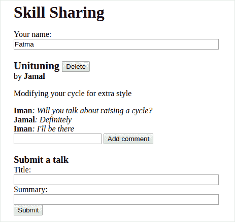

该应用程序将设置为显示当前提议的演讲及其评论的*实时*视图。每当有人（在任何地方）提交新演讲或添加评论时，所有在其浏览器中打开该页面的人都应立即看到更改。这带来了一些挑战——Web 服务器无法打开与客户端的连接，也没有好的方法知道哪些客户端当前正在查看某个网站。

这个问题的一个常见解决方案称为*长轮询*，这恰好是 Node 设计动机之一。

## 长轮询

为了能够立即通知客户端有变化，我们需要与客户端建立连接。由于传统上 Web 浏览器不接受连接，而且客户端通常位于会阻止此类连接的路由器后面，因此让服务器发起此连接并不实际。

我们可以安排客户端打开连接并保持它，以便服务器在需要时可以发送信息。

但 HTTP 请求只允许简单的信息流：客户端发送请求，服务器返回单个响应，仅此而已。有一种称为*WebSockets*的技术，受现代浏览器支持，可以打开连接进行任意数据交换。但正确使用它们有些棘手。

在本章中，我们使用一种更简单的技术——长轮询——客户端通过常规 HTTP 请求不断向服务器询问新信息，而服务器在没有新内容可报告时会延迟其响应。

只要客户端确保它始终有一个轮询请求处于打开状态，它就会在信息可用后迅速从服务器接收信息。例如，如果 Fatma 在她的浏览器中打开了我们的技能分享应用程序，该浏览器将发出更新请求并等待该请求的响应。当 Iman 提交关于“极限下坡独轮车”的演讲时，服务器会注意到 Fatma 正在等待更新，并发送一个包含新演讲的响应给她的待处理请求。Fatma 的浏览器将接收数据并更新屏幕以显示该演讲。

为了防止连接超时（因缺乏活动而中止），长轮询技术通常为每个请求设置一个最大时间，超过该时间后，即使没有内容可报告，服务器也会响应，之后客户端会启动一个新请求。定期重新启动请求也使该技术更加健壮，允许客户端从临时连接故障或服务器问题中恢复。

使用长轮询的繁忙服务器可能同时有数千个等待请求，因此有数千个 TCP 连接打开。Node 使得管理许多连接而无需为每个连接创建单独的线程变得容易，因此非常适合此类系统。

## HTTP 接口

在我们开始设计服务器或客户端之前，先考虑它们的接触点：它们通信的 HTTP 接口。

我们将使用 JSON 作为请求和响应正文的格式。与第 20 章的文件服务器一样，我们将尝试充分利用 HTTP 方法和标头。该接口以`/talks`路径为中心。不以`/talks`开头的路径将用于提供静态文件——客户端系统的 HTML 和 JavaScript 代码。

对`/talks`的`GET`请求返回如下 JSON 文档：

```json
[{"title": "Unituning",
  "presenter": "Jamal",
  "summary": "Modifying your cycle for extra style",
  "comments": []}]
```

创建新演讲是通过向类似`/talks/Unituning`的 URL 发出`PUT`请求来完成的，其中第二个斜杠后的部分是演讲的标题。`PUT`请求的正文应包含一个具有`presenter`和`summary`属性的 JSON 对象。

由于演讲标题可能包含空格及其他通常不会出现在 URL 中的字符，因此在构建此类 URL 时，必须使用`encodeURIComponent`函数对标题字符串进行编码。

```javascript
console.log("/talks/" + encodeURIComponent("How to Idle"));
// → /talks/How%20to%20Idle
```

一个创建关于“闲逛”演讲的请求可能如下所示：

```http
PUT /talks/How%20to%20Idle HTTP/1.1
Content-Type: application/json
Content-Length: 92

{"presenter": "Maureen",
 "summary": "Standing still on a unicycle"}
```

此类 URL 还支持`GET`请求以获取演讲的 JSON 表示，以及`DELETE`请求以删除演讲。

向演讲添加评论是通过向类似`/talks/Unituning/comments`的 URL 发送`POST`请求完成的，请求体为 JSON 格式，包含`author`和`message`属性。

```http
POST /talks/Unituning/comments HTTP/1.1
Content-Type: application/json
Content-Length: 72

{"author": "Iman",
 "message": "Will you talk about raising a cycle?"}
```

为了支持长轮询，对`/talks`的`GET`请求可以包含额外的头部，告知服务器在没有新信息时延迟响应。我们将使用通常用于管理缓存的一对头部：`ETag`和`If-None-Match`。

服务器可以在响应中包含`ETag`（“实体标签”）头部。其值是一个字符串，标识资源的当前版本。客户端之后再次请求该资源时，可以发起一个*条件请求*，包含一个`If-None-Match`头部，其值持有相同的字符串。如果资源未发生变化，服务器将响应状态码 304，表示“未修改”，告知客户端其缓存版本仍然是最新的。当标签不匹配时，服务器正常响应。

我们需要类似这样的机制：客户端可以告知服务器它拥有的演讲列表版本，服务器仅在列表发生变化时才响应。但服务器不应立即返回 304 响应，而应延迟响应，直到有新内容可用或经过指定时间。为了将长轮询请求与普通条件请求区分开，我们添加另一个头部`Prefer: wait=90`，告知服务器客户端愿意等待最多 90 秒以获取响应。

服务器将维护一个版本号，每次演讲发生变化时更新，并将其用作`ETag`值。客户端可以发出如下请求，以便在演讲发生变化时得到通知：

```http
GET /talks HTTP/1.1
If-None-Match: "4"
Prefer: wait=90

(time passes)

HTTP/1.1 200 OK
Content-Type: application/json
ETag: "5"
Content-Length: 295

[....]
```

这里描述的协议不进行任何访问控制。任何人都可以评论、修改甚至删除演讲。（由于互联网上充斥着捣乱分子，在没有进一步保护的情况下将此类系统上线，结局可能不会太好。）

## 服务器

让我们从构建程序的服务器端部分开始。本节中的代码运行在 Node.js 上。

### 路由

我们的服务器将使用`createServer`启动一个 HTTP 服务器。在处理新请求的函数中，我们必须区分我们支持的各种请求类型（由方法和路径决定）。这可以通过一长串`if`语句完成，但有一种更优雅的方式。

*路由器*是一个组件，帮助将请求分派给能够处理它的函数。例如，你可以告诉路由器，匹配正则表达式`/^\/talks\/([^\/]+)$/`（`/talks/`后跟演讲标题）的`PUT`请求可以由某个给定函数处理。此外，它还可以帮助提取路径中有意义的部分（本例中为演讲标题），这些部分在正则表达式中用括号包裹，并传递给处理函数。

NPM 上有许多优秀的路由包，但这里我们将自己编写一个，以说明原理。

这是`router.js`，稍后我们将从服务器模块中`require`它：

```javascript
const {parse} = require("url");

module.exports = class Router {
  constructor() {
    this.routes = [];
  }
  add(method, url, handler) {
    this.routes.push({method, url, handler});
  }
  resolve(context, request) {
    let path = parse(request.url).pathname;

    for (let {method, url, handler} of this.routes) {
      let match = url.exec(path);
      if (!match || request.method != method) continue;
      let urlParts = match.slice(1).map(decodeURIComponent);
      return handler(context, ...urlParts, request);
    }
    return null;
  }
};
```

该模块导出了`Router`类。路由器对象允许通过`add`方法注册新的处理函数，并通过`resolve`方法解析请求。

`resolve`方法在找到处理函数时返回响应，否则返回`null`。它按顺序（按照定义顺序）逐一尝试路由，直到找到匹配项。

处理函数被调用时，会传入`context`值（在我们的例子中为服务器实例）、正则表达式中定义的任何组的匹配字符串以及请求对象。这些字符串需要进行 URL 解码，因为原始 URL 可能包含`%20`风格的编码。

### 提供文件服务

当请求与路由器中定义的任何请求类型都不匹配时，服务器必须将其解释为对`public`目录中某个文件的请求。可以使用第 20 章中定义的文件服务器来提供此类文件，但我们既不需要也不希望对文件支持`PUT`和`DELETE`请求，并且我们希望拥有诸如缓存支持等高级功能。因此，让我们改用 NPM 上一个可靠且经过充分测试的静态文件服务器。


我选择了 `ecstatic`。这不是 NPM 上唯一的此类服务器，但它运行良好且符合我们的需求。`ecstatic` 包导出一个函数，该函数可以接受一个配置对象来生成一个请求处理函数。我们使用 `root` 选项告诉服务器在哪里查找文件。该处理函数接受 `request` 和 `response` 参数，可以直接传递给 `createServer` 来创建一个仅提供文件服务的服务器。不过，我们希望首先检查那些需要特殊处理的请求，因此将其包装在另一个函数中。

```javascript
const {createServer} = require("http");
const Router = require("./router");
const ecstatic = require("ecstatic");

const router = new Router();
const defaultHeaders = {"Content-Type": "text/plain"};

class SkillShareServer {
  constructor(talks) {
    this.talks = talks;
    this.version = 0;
    this.waiting = [];

    let fileServer = ecstatic({root: "./public"});
    this.server = createServer((request, response) => {
      let resolved = router.resolve(this, request);
      if (resolved) {
        resolved.catch(error => {
          if (error.status != null) return error;
          return {body: String(error), status: 500};
        }).then(({body,
                  status = 200,
                  headers = defaultHeaders}) => {
          response.writeHead(status, headers);
          response.end(body);
        });
      } else {
        fileServer(request, response);
      }
    });
  }
  start(port) {
    this.server.listen(port);
  }
  stop() {
    this.server.close();
  }
}
```

这里使用了与上一章中文件服务器类似的响应约定——处理程序返回解析为描述响应对象的 Promise。它将服务器包装在一个对象中，该对象同时持有其状态。

### 将演讲视为资源

已提议的演讲存储在 `server` 的 `talks` 属性中，该属性是一个对象，其属性名是演讲标题。这些演讲将通过 HTTP 资源暴露在 `/talks/[title]` 下，因此我们需要向 `router` 添加处理程序，以实现客户端可用于操作它们的各种方法。

```javascript
const talkPath = /^\/talks\/([^\/]+)$/;

router.add("GET", talkPath, async (server, title) => {
  if (title in server.talks) {
    return {body: JSON.stringify(server.talks[title]),
            headers: {"Content-Type": "application/json"}};
  } else {
    return {status: 404, body: `No talk '${title}' found`};
  }
});
```

删除演讲是通过将其从 `talks` 对象中移除来完成的。

```javascript
router.add("DELETE", talkPath, async (server, title) => {
  if (title in server.talks) {
    delete server.talks[title];
    server.updated();
  }
  return {status: 204};
});
```

`updated` 方法（我们将在后面定义）会通知等待的长轮询请求有关更改的信息。

为了获取请求体的内容，我们定义了一个名为 `readStream` 的函数，它从可读流中读取所有内容，并返回一个解析为字符串的 Promise。

```javascript
function readStream(stream) {
  return new Promise((resolve, reject) => {
    let data = "";
    stream.on("error", reject);
    stream.on("data", chunk => data += chunk.toString());
    stream.on("end", () => resolve(data));
  });
}
```

需要读取请求体的一个处理程序是 `PUT` 处理程序，它用于创建新的演讲。它必须检查所提供的数据是否包含 `presenter` 和 `summary` 属性，且这些属性为字符串。来自系统外部的任何数据都可能是无意义的，我们不希望破坏内部数据模型或在收到错误请求时崩溃。

如果数据看起来有效，处理程序会在 `talks` 对象中存储一个表示新演讲的对象，可能会覆盖同标题的现有演讲，并再次调用 `updated`。

```javascript
router.add("PUT", talkPath,
           async (server, title, request) => {
  let requestBody = await readStream(request);
  let talk;
  try { talk = JSON.parse(requestBody); }
  catch (_) { return {status: 400, body: "Invalid JSON"}; }

  if (!talk ||
      typeof talk.presenter != "string" ||
      typeof talk.summary != "string") {
    return {status: 400, body: "Bad talk data"};
  }
  server.talks[title] = {title,
                         presenter: talk.presenter,
                         summary: talk.summary,
                         comments: []};
  server.updated();
  return {status: 204};
});
```

向演讲添加评论的工作方式类似。我们使用 `readStream` 获取请求内容，验证结果数据，并在数据看起来有效时将其存储为评论。

```javascript
router.add("POST", /^\/talks\/([^\/]+)\/comments$/,
           async (server, title, request) => {
  let requestBody = await readStream(request);
  let comment;
  try { comment = JSON.parse(requestBody); }
  catch (_) { return {status: 400, body: "Invalid JSON"}; }

  if (!comment ||
      typeof comment.author != "string" ||
      typeof comment.message != "string") {
    return {status: 400, body: "Bad comment data"};
  } else if (title in server.talks) {
    server.talks[title].comments.push(comment);
    server.updated();
    return {status: 204};
  } else {
    return {status: 404, body: `No talk '${title}' found`};
  }
});
```

尝试向不存在的演讲添加评论会返回 404 错误。

### 长轮询支持

服务器最有趣的方面是处理长轮询的部分。当收到针对 `/talks` 的 `GET` 请求时，它可能是常规请求，也可能是长轮询请求。

我们会有多个地方需要向客户端发送演讲数组，因此首先定义一个辅助方法，该方法构建这样一个数组，并在响应中包含 `ETag` 头。

```javascript
SkillShareServer.prototype.talkResponse = function() {
  let talks = [];
  for (let title of Object.keys(this.talks)) {
    talks.push(this.talks[title]);
  }
  return {
    body: JSON.stringify(talks),
    headers: {"Content-Type": "application/json",
              "ETag": `"${this.version}"`}
  };
};
```

处理程序本身需要查看请求头，以确定是否存在 `If-None-Match` 和 `Prefer` 头。Node 将头名称（指定为不区分大小写）存储为其小写名称。

```javascript
router.add("GET", /^\/talks$/, async (server, request) => {
  let tag = /"(.*)"/.exec(request.headers["if-none-match"]);
  let wait = /\bwait=(\d+)/.exec(request.headers["prefer"]);
  if (!tag || tag[1] != server.version) {
    return server.talkResponse();
  } else if (!wait) {
    return {status: 304};
  } else {
    return server.waitForChanges(Number(wait[1]));
  }
});
```

如果没有提供标签，或者提供的标签与服务器当前版本不匹配，处理程序会返回演讲列表。如果请求是有条件的且演讲没有变化，我们会检查 `Prefer` 头，以确定是延迟响应还是立即响应。

延迟请求的回调函数存储在服务器的 `waiting` 数组中，以便在发生某些事情时通知它们。`waitForChanges` 方法还会立即设置一个计时器，当请求等待足够长时间后，以 304 状态响应。

```javascript
SkillShareServer.prototype.waitForChanges = function(time) {
  return new Promise(resolve => {
    this.waiting.push(resolve);
    setTimeout(() => {
      if (!this.waiting.includes(resolve)) return;
      this.waiting = this.waiting.filter(r => r != resolve);
      resolve({status: 304});
    }, time * 1000);
  });
};
```

通过 `updated` 注册更改会增加 `version` 属性，并唤醒所有等待的请求。

```javascript
SkillShareServer.prototype.updated = function() {
  this.version++;
  let response = this.talkResponse();
  this.waiting.forEach(resolve => resolve(response));
  this.waiting = [];
};
```

至此，服务器代码结束。如果我们创建一个 `SkillShareServer` 实例并在 8000 端口启动它，生成的 HTTP 服务器会从 `public` 子目录提供文件，同时在 `/talks` URL 下提供演讲管理接口。

```javascript
new SkillShareServer(Object.create(null)).start(8000);
```

## 客户端

技能分享网站的客户端部分由三个文件组成：一个微型 HTML 页面、一个样式表和一个 JavaScript 文件。

### HTML

Web 服务器有一个广泛使用的约定：当请求直接指向对应目录的路径时，会尝试提供名为 `index.html` 的文件。我们使用的文件服务器模块 `ecstatic` 支持这一约定。当请求发送到路径 `/` 时，服务器会查找文件 `./public/index.html`（`./public` 是我们指定的根目录），如果找到则返回该文件。

因此，如果我们希望浏览器指向我们的服务器时显示一个页面，就应该将其放在 `public/index.html` 中。这是我们的索引文件：

```html
<!doctype html>
<meta charset="utf-8">
<title>技能分享</title>
<link rel="stylesheet" href="skillsharing.css">

<h1>技能分享</h1>

<script src="skillsharing_client.js"></script>
```

它定义了文档标题，并包含一个样式表，该样式表定义了一些样式，其中一项是确保演讲之间有一些间距。

在底部，它在页面顶部添加了一个标题，并加载了包含客户端应用程序的脚本。

### 动作

应用程序状态由演讲列表和用户名组成，我们将它存储在一个 `{talks, user}` 对象中。我们不允许用户界面直接操作状态或发送 HTTP 请求。相反，它可以发出描述用户意图的动作。

`handleAction()` 函数接收这样一个动作并执行它。由于我们的状态更新非常简单，状态变更在同一个函数中处理。


```javascript
function handleAction(state, action) {
  if (action.type == "setUser") {
    localStorage.setItem("userName", action.user);
    return Object.assign({}, state, {user: action.user});
  } else if (action.type == "setTalks") {
    return Object.assign({}, state, {talks: action.talks});
  } else if (action.type == "newTalk") {
    fetchOK(talkURL(action.title), {
      method: "PUT",
      headers: {"Content-Type": "application/json"},
      body: JSON.stringify({
        presenter: state.user,
        summary: action.summary
      })
    }).catch(reportError);
  } else if (action.type == "deleteTalk") {
    fetchOK(talkURL(action.talk), {method: "DELETE"})
      .catch(reportError);
  } else if (action.type == "newComment") {
    fetchOK(talkURL(action.talk) + "/comments", {
      method: "POST",
      headers: {"Content-Type": "application/json"},
      body: JSON.stringify({
        author: state.user,
        message: action.message
      })
    }).catch(reportError);
  }
  return state;
}
```

我们将用户名存储在`localStorage`中，以便在页面加载时恢复。

需要与服务器交互的动作会使用`fetch`向之前描述的 HTTP 接口发起网络请求。我们使用一个包装函数`fetchOK()`，它确保当服务器返回错误码时，返回的 promise 会被拒绝。

```javascript
function fetchOK(url, options) {
  return fetch(url, options).then(response => {
    if (response.status < 400) return response;
    else throw new Error(response.statusText);
  });
}
```

这个辅助函数用于为给定标题的演讲构建 URL。

```javascript
function talkURL(title) {
  return "talks/" + encodeURIComponent(title);
}
```

当请求失败时，我们不希望页面只是停留在那里，没有任何解释。因此我们定义了一个名为`reportError()`的函数，它至少会向用户显示一个对话框，告知他们出了问题。

```javascript
function reportError(error) {
  alert(String(error));
}
```

### 渲染组件

我们将采用与第 19 章类似的方法，将应用程序拆分为组件。但由于某些组件要么永远不需要更新，要么在更新时总是完全重新绘制，我们将它们定义为直接返回 DOM 节点的函数，而不是类。例如，下面是一个显示用户输入姓名字段的组件：

```javascript
function renderUserField(name, dispatch) {
  return elt("label", {}, "你的名字: ", elt("input", {
    type: "text",
    value: name,
    onchange(event) {
      dispatch({type: "setUser", user: event.target.value});
    }
  }));
}
```

用于构建 DOM 元素的`elt()`函数与第 19 章中使用的相同。

类似的函数用于渲染演讲，其中包括评论列表和添加新评论的表单。

```javascript
function renderTalk(talk, dispatch) {
  return elt(
    "section", {className: "talk"},
    elt("h2", null, talk.title, " ", elt("button", {
      type: "button",
      onclick() {
        dispatch({type: "deleteTalk", talk: talk.title});
      }
    }, "删除")),
    elt("div", null, "由 ",
        elt("strong", null, talk.presenter)),
    elt("p", null, talk.summary),
    ...talk.comments.map(renderComment),
    elt("form", {
      onsubmit(event) {
        event.preventDefault();
        let form = event.target;
        dispatch({type: "newComment",
                  talk: talk.title,
                  message: form.elements.comment.value});
        form.reset();
      }
    }, elt("input", {type: "text", name: "comment"}), " ",
       elt("button", {type: "submit"}, "添加评论")));
}
```

`"submit"`事件处理器在创建`"newComment"`动作后调用`form.reset()`来清除表单内容。

在创建中等复杂度的 DOM 片段时，这种编程风格开始显得相当混乱。有一种广泛使用的（非标准）JavaScript 扩展叫做 JSX，它允许你直接在脚本中编写 HTML，这可以使此类代码更美观（取决于你认为什么算美观）。在实际运行此类代码之前，你需要在脚本上运行一个程序，将伪 HTML 转换为 JavaScript 函数调用，就像我们这里使用的调用一样。

评论的渲染更简单。

```javascript
function renderComment(comment) {
  return elt("p", {className: "comment"},
             elt("strong", null, comment.author),
             ": ", comment.message);
}
```

最后，用户用来创建新演讲的表单渲染如下：

```javascript
function renderTalkForm(dispatch) {
  let title = elt("input", {type: "text"});
  let summary = elt("input", {type: "text"});
  return elt("form", {
    onsubmit(event) {
      event.preventDefault();
      dispatch({type: "newTalk",
                title: title.value,
                summary: summary.value});
      event.target.reset();
    }
  }, elt("h3", null, "Submit a Talk"),
     elt("label", null, "Title: ", title),
     elt("label", null, "Summary: ", summary),
     elt("button", {type: "submit"}, "Submit"));
}
```

### 轮询

要启动应用，我们需要当前的演讲列表。由于初始加载与长轮询过程密切相关——轮询时必须使用加载时的`ETag`——我们将编写一个函数，持续轮询服务器的`/talks`端点，并在有新的一组演讲可用时调用回调函数。

```javascript
async function pollTalks(update) {
  let tag = undefined;
  for (;;) {
    let response;
    try {
      response = await fetchOK("/talks", {
        headers: tag && {"If-None-Match": tag,
                         "Prefer": "wait=90"}
      });
    } catch (e) {
      console.log("Request failed: " + e);
      await new Promise(resolve => setTimeout(resolve, 500));
      continue;
    }
    if (response.status == 304) continue;
    tag = response.headers.get("ETag");
    update(await response.json());
  }
}
```

这是一个`async`函数，使得循环和等待请求更加容易。它运行一个无限循环，每次迭代都会获取演讲列表——要么正常获取，要么（如果不是第一次请求）包含使请求成为长轮询请求的头部。

当请求失败时，函数会等待片刻然后重试。这样，如果你的网络连接暂时断开然后恢复，应用可以恢复并继续更新。通过`setTimeout`解决的 Promise 是一种强制`async`函数等待的方式。

当服务器返回 304 响应时，意味着长轮询请求超时，因此函数应立即开始下一个请求。如果响应是正常的 200 响应，则将其主体作为 JSON 读取并传递给回调，同时存储其`ETag`头部值以供下一次迭代使用。

### 应用

以下组件将整个用户界面整合在一起：

```javascript
class SkillShareApp {
  constructor(state, dispatch) {
    this.dispatch = dispatch;
    this.talkDOM = elt("div", {className: "talks"});
    this.dom = elt("div", null,
                   renderUserField(state.user, dispatch),
                   this.talkDOM,
                   renderTalkForm(dispatch));
    this.syncState(state);
  }

  syncState(state) {
    if (state.talks != this.talks) {
      this.talkDOM.textContent = "";
      for (let talk of state.talks) {
        this.talkDOM.appendChild(
          renderTalk(talk, this.dispatch));
      }
      this.talks = state.talks;
    }
  }
}
```

当演讲发生变化时，此组件会重新绘制所有演讲。这很简单但也很浪费。我们将在练习中回到这个问题。

我们可以这样启动应用：

```javascript
function runApp() {
  let user = localStorage.getItem("userName") || "Anon";
  let state, app;
  function dispatch(action) {
    state = handleAction(state, action);
    app.syncState(state);
  }

  pollTalks(talks => {
    if (!app) {
      state = {user, talks};
      app = new SkillShareApp(state, dispatch);
      document.body.appendChild(app.dom);
    } else {
      dispatch({type: "setTalks", talks});
    }
  }).catch(reportError);
}

runApp();
```

如果你运行服务器，并在两个浏览器窗口中并排打开[http://localhost:8000](http://localhost:8000/)，你会看到在一个窗口中执行的操作会立即在另一个窗口中显示。

## 练习

以下练习将涉及修改本章中定义的系统。要完成这些练习，请确保先下载代码（[https://eloquentjavascript.net/code/skillsharing.zip](https://eloquentjavascript.net/code/skillsharing.zip)），安装 Node（[https://nodejs.org](https://nodejs.org)），并通过`npm install`安装项目的依赖。

### 磁盘持久化

技能分享服务器仅将数据保存在内存中。这意味着当它崩溃或因任何原因重启时，所有演讲和评论都会丢失。

扩展服务器，使其将演讲数据存储到磁盘，并在重启时自动重新加载数据。不必担心效率——做最简单有效的事情。

### 评论字段重置

全面重新绘制演讲效果很好，因为你通常无法区分 DOM 节点与其完全相同的替换。但也有例外。如果你在一个浏览器窗口的演讲评论字段中开始输入内容，然后在另一个窗口中为该演讲添加评论，第一个窗口中的字段将被重新绘制，从而丢失其内容和焦点。

在多人同时添加评论的热烈讨论中，这会很烦人。你能想出解决这个问题的方法吗？

# 第 22 章

# 练习提示

以下提示可能在你遇到本书中某个练习的困难时提供帮助。它们不会给出完整的解决方案，而是试图帮助你自行找到答案。

## 程序结构

### 循环打印三角形

你可以从一个打印数字 1 到 7 的程序开始，这可以通过对本章前面介绍的偶数打印示例进行一些修改得到，其中引入了`for`循环。

现在考虑数字与井号字符串之间的等价关系。你可以通过加 1（`+= 1`）从 1 到 2。你可以通过添加一个字符（`+= "#"`）从`"#"`到`"##"`。因此，你的解决方案可以紧密遵循数字打印程序。

### FizzBuzz

遍历数字显然是一个循环任务，而选择打印什么则是条件执行的问题。记住使用取余（`%`）运算符来检查一个数是否能被另一个数整除（余数为零）的技巧。

在第一个版本中，每个数字有三种可能的结果，因此你需要创建一个`if`/`else if`/`else`链。


程序的第二个版本有一个直接的解决方案和一个巧妙的解决方案。简单的解决方案是添加另一个条件“分支”来精确测试给定条件。对于巧妙的解决方案，构建一个包含要输出的单词或短语的字符串，如果没有单词则打印该数字，可能通过巧妙利用`||`运算符来实现。

### 棋盘

你可以从一个空字符串（`""`）开始，通过重复添加字符来构建字符串。换行符写作`"\n"`。

要处理二维问题，你需要在循环内部再嵌套一个循环。在两个循环体周围加上花括号，以便清晰看出它们的起始和结束位置。尽量对这些循环体进行正确缩进。循环的顺序必须与构建字符串的顺序一致（逐行、从左到右、从上到下）。因此，外层循环处理行，内层循环处理一行中的字符。

你需要两个绑定来跟踪进度。要知道在某个位置是放空格还是井号，可以测试两个计数器的和是否为偶数（`% 2`）。

通过添加换行符来结束一行，必须在行构建完成之后进行，因此在内层循环之后、外层循环之内执行此操作。

## 函数

### 最小值

如果你在正确放置花括号和圆括号以定义有效函数时遇到困难，可以先复制本章中的一个示例并进行修改。

一个函数可以包含多个`return`语句。

### 递归

你的函数可能类似于本章递归`findSolution`示例中的内部`find`函数，它使用`if`/`else if`/`else`链来测试三种情况中的哪一种适用。对应于第三种情况的最终`else`会进行递归调用。每个分支都应包含一个`return`语句，或以其他方式安排返回特定值。

当给定负数时，函数会不断递归，传入越来越小的负数，从而离返回结果越来越远。最终它会耗尽栈空间并中止。

### 字符计数

你的函数需要一个循环来检查字符串中的每个字符。它可以从零运行到长度减一（`< string.length`）。如果当前位置的字符与函数要查找的字符相同，则向计数器变量加 1。循环结束后，返回该计数器。

注意，通过使用`let`或`const`关键字正确声明，使函数中使用的所有绑定成为函数的*局部*变量。

## 数据结构：对象与数组

### 范围求和

构建数组最简单的方法是先初始化一个绑定为`[]`（一个全新的空数组），然后反复调用其`push`方法来添加值。别忘了在函数末尾返回该数组。

由于结束边界是包含的，你需要使用`<=`运算符而不是`<`来检查循环是否结束。

步长参数可以是一个可选参数，默认值（使用`=`运算符）为`1`。

让`range`理解负步长值，最好通过编写两个独立的循环来实现——一个用于递增计数，一个用于递减计数——因为检查循环是否结束的比较在递减时需要是`>=`而不是`<=`。

当范围的结束值小于起始值时，使用不同的默认步长（即`-1`）可能也是值得的。这样，`range(5, 2)`会返回有意义的结果，而不是陷入无限循环。可以在参数的默认值中引用之前的参数。

### 反转数组

实现`reverseArray`有两种明显的方法。第一种是简单地从前往后遍历输入数组，并使用新数组的`unshift`方法将每个元素插入到开头。第二种是反向遍历输入数组，并使用`push`方法。反向遍历数组需要一个（有点别扭的）`for`规范，例如：

`(let i = array.length - 1; i >= 0; i--)`

原地反转数组更难。你必须小心不要覆盖以后需要的元素。使用`reverseArray`或复制整个数组（`array.slice(0)`是复制数组的好方法）虽然可行，但属于作弊。

技巧是*交换*第一个和最后一个元素，然后交换第二个和倒数第二个，以此类推。你可以通过循环数组长度的一半（使用`Math.floor`向下取整——对于奇数个元素的数组，不需要触碰中间元素）并交换位置`i`的元素与位置`array.length - 1 - i`的元素来实现。你可以使用一个局部绑定暂时保存其中一个元素，用其镜像元素覆盖它，然后将局部绑定中的值放到镜像元素原来的位置。

### 列表

从后往前构建列表更容易。因此`arrayToList`可以反向遍历数组（参见上一个练习），并为每个元素向列表添加一个对象。你可以使用一个局部绑定来保存已构建的部分列表，并使用类似`list = {value: X, rest: list}`的赋值来添加元素。

要遍历列表（在`listToArray`和`nth`中），可以使用如下`for`循环规范：

```javascript
for (let node = list; node; node = node.rest) {}
```

你能看出这是如何工作的吗？每次循环迭代，`node`指向当前子列表，循环体可以读取其`value`属性来获取当前元素。在迭代结束时，`node`移动到下一个子列表。当它为`null`时，我们就到达了列表末尾，循环结束。

类似地，`nth`的递归版本会查看列表“尾部”越来越小的部分，同时递减索引直到为零，此时它可以返回所查看节点的`value`属性。要获取列表的第零个元素，只需取头节点的`value`属性。要获取第`N + 1`个元素，则取当前列表`rest`属性中列表的第`N`个元素。

### 深度比较

判断是否处理真实对象的测试类似于`typeof x == "object" && x != null`。注意，仅在*两个*参数都是对象时才比较属性。在所有其他情况下，你可以直接返回应用`===`的结果。

使用`Object.keys`遍历属性。你需要测试两个对象是否具有相同的属性名集合，以及这些属性是否具有相同的值。一种方法是确保两个对象具有相同数量的属性（属性列表的长度相同）。然后，在遍历其中一个对象的属性进行比较时，始终先确保另一个对象确实具有该名称的属性。如果它们具有相同数量的属性，并且一个对象中的所有属性也存在于另一个对象中，那么它们就具有相同的属性名集合。

从函数返回正确值的最佳做法是：一旦发现不匹配立即返回`false`，并在函数末尾返回`true`。

## 高阶函数

### 全称判断

与`&&`运算符类似，`every`方法一旦找到不匹配的元素，就可以停止评估后续元素。因此，基于循环的版本可以在遇到谓词函数返回`false`的元素时，立即跳出循环——使用`break`或`return`。如果循环运行到结束都没有找到这样的元素，我们就知道所有元素都匹配，应该返回`true`。

要在`some`的基础上构建`every`，我们可以应用*德摩根定律*，该定律指出`a && b`等于`!(!a || !b)`。这可以推广到数组：如果数组中没有不匹配的元素，那么数组中的所有元素都匹配。

### 主导书写方向

你的解决方案可能看起来很像`textScripts`示例的前半部分。你再次需要根据`characterScript`的标准来统计字符，然后过滤掉结果中涉及无趣（无脚本）字符的部分。

找到字符数最多的方向可以通过`reduce`完成。如果不清楚如何操作，请参考本章前面的示例，其中使用`reduce`来查找字符数最多的脚本。

## 对象的秘密生活

### 向量类型

如果你不确定`class`声明的写法，请回顾`Rabbit`类示例。

向构造函数添加 getter 属性可以通过在方法名前加上`get`关键字来实现。要计算从`(0, 0)`到`(x, y)`的距离，可以使用勾股定理，该定理指出我们寻找的距离的平方等于 x 坐标的平方加上 y 坐标的平方。因此，√(x² + y²)就是你想要的数字，而`Math.sqrt`是在 JavaScript 中计算平方根的方法。

### 组

最简单的方法是将组成员数组存储在一个实例属性中。可以使用`includes`或`indexOf`方法来检查给定值是否在数组中。

你的类的构造函数可以将成员集合设置为空数组。当调用`add`时，它必须检查给定值是否已在数组中，如果没有，则添加它（例如使用`push`）。

在`delete`中从数组中删除元素不太直接，但你可以使用`filter`创建一个不包含该值的新数组。不要忘记用新过滤后的数组覆盖存储成员的属性。

`from`方法可以使用`for`/`of`循环从可迭代对象中获取值，并调用`add`将它们放入新创建的组中。

### 可迭代组

定义一个名为`GroupIterator`的新类可能是值得的。迭代器实例应该有一个属性来跟踪当前在组中的位置。每次调用`next`时，它检查是否已完成，如果未完成，则越过当前值并返回它。

`Group`类本身获得一个由`Symbol.iterator`命名的方法，当调用时，它返回该组的一个新的迭代器类实例。

### 借用方法

记住，普通对象上存在的方法来自`Object.prototype`。

还要记住，你可以通过使用函数的`call`方法，以特定的`this`绑定来调用它。

## 项目：机器人

### 测量机器人

你需要编写一个`runRobot`函数的变体，该变体不是将事件记录到控制台，而是返回机器人完成任务所需的步数。

然后，你的测量函数可以在循环中生成新状态，并统计每个机器人所走的步数。当它生成足够的测量数据后，可以使用`console.log`输出每个机器人的平均值，即总步数除以测量次数。

### 机器人效率

`goalOrientedRobot`的主要限制是它一次只考虑一个包裹。它经常会在村庄里来回走动，因为它碰巧正在查看的包裹恰好在地图的另一边，即使有其他包裹离得更近。

一种可能的解决方案是计算所有包裹的路线，然后选择最短的一条。如果存在多条最短路线，通过优先选择去取包裹而不是送包裹的路线，可以获得更好的结果。

### 持久化组

表示成员值集合最方便的方式仍然是数组，因为数组易于复制。

当向组中添加一个值时，你可以创建一个新组，其中包含原始数组的副本并添加了该值（例如，使用`concat`）。当删除一个值时，你可以从数组中过滤掉它。

类的构造函数可以将这样的数组作为参数，并将其存储为实例的（唯一）属性。这个数组永远不会被更新。

要向构造函数添加一个不是方法的属性（`empty`），你必须在类定义之后将其作为常规属性添加到构造函数中。

你只需要一个`empty`实例，因为所有空组都是相同的，并且类的实例不会改变。你可以从那个单一的空组创建许多不同的组，而不会影响它。

## 错误与异常

### 重试

对`primitiveMultiply`的调用应该肯定发生在`try`块中。相应的`catch`块应该在异常不是`MultiplicatorUnitFailure`的实例时重新抛出该异常，并确保在是其实例时重试调用。

要执行重试，你可以使用一个循环，该循环仅在调用成功时停止——如本章前面的`look`示例所示——或者使用递归，并希望你不会遇到一连串的失败导致栈溢出（这相当安全）。

### 上锁的盒子

这个练习需要一个`finally`块。你的函数应该首先解锁盒子，然后在`try`体内调用参数函数。之后的`finally`块应该再次锁上盒子。

为了确保我们不会在盒子原本未锁的情况下锁上它，请在函数开始时检查它的锁状态，并且仅在它最初是锁着的情况下才解锁和重新锁上。

## 正则表达式

### 引用风格

最明显的解决方案是只替换至少一侧带有非单词字符的引号——类似于`/\W'|'\W/`。但你还必须考虑行的开头和结尾。

此外，你必须确保替换也包含由`\W`模式匹配的字符，这样它们就不会被丢弃。这可以通过将它们括在括号中并在替换字符串中包含它们的组（`$1`、`$2`）来实现。未匹配的组将被替换为空。

### 数字再次

首先，不要忘记句点前的反斜杠。

匹配数字前的可选符号以及指数前的可选符号，可以使用`[+\-]?`或`(\+|-|)`（加号、减号或空）。

练习中更复杂的部分是同时匹配`"5."`和`".5"`，但不匹配`"."`。对此，一个好的解决方案是使用`|`运算符将两种情况分开——要么是一个或多个数字，后面可选地跟一个句点和零个或多个数字，*要么*是一个句点后跟一个或多个数字。

最后，要使*e*不区分大小写，可以在正则表达式中添加`i`选项，或者使用`[eE]`。

## 模块

### 模块化机器人

以下是我会采用的做法（但再次强调，设计给定模块没有唯一的*正确*方法）：

用于构建道路图的代码位于`graph`模块中。因为我更愿意使用 NPM 中的`dijkstrajs`而不是自己编写寻路代码，所以我们将让这个模块构建`dijkstrajs`所期望的那种图数据。该模块导出一个函数`buildGraph`。我会让`buildGraph`接受一个包含两个元素的数组的数组，而不是包含连字符的字符串，以使模块更少依赖输入格式。


`roads` 模块包含原始道路数据（`roads` 数组）和 `roadGraph` 绑定。该模块依赖于`./graph`并导出道路图。

`VillageState` 类位于`state`模块中。它依赖于`./roads`模块，因为它需要能够验证给定的道路是否存在。它还需要`randomPick`。由于那是一个只有三行的函数，我们可以将其作为内部辅助函数放入`state`模块中。但`randomRobot`也需要它。因此，我们要么复制它，要么将其放入自己的模块中。由于这个函数恰好存在于 NPM 的`random-item`包中，一个好的解决方案是让两个模块都依赖它。我们也可以将`runRobot`函数添加到这个模块中，因为它很小且与状态管理密切相关。该模块导出`VillageState`类和`runRobot`函数。

最后，机器人以及它们所依赖的值（如`mailRoute`）可以放入`example-robots`模块中，该模块依赖于`./roads`并导出机器人函数。为了使`goalOrientedRobot`能够进行路径查找，该模块还依赖于`dijkstrajs`。

通过将一些工作外包给 NPM 模块，代码变得更小了一些。每个单独的模块做的事情相当简单，并且可以独立阅读。将代码划分为模块也常常会提示对程序设计的进一步改进。在这种情况下，`VillageState`和机器人依赖于特定的道路图似乎有点奇怪。更好的做法可能是将图作为状态构造函数的参数，并让机器人从状态对象中读取它——这减少了依赖（这总是好的），并且使得可以在不同的地图上运行模拟（这甚至更好）。

对于我们自己也能编写的东西，使用 NPM 模块是个好主意吗？原则上是的——对于像寻路函数这样非平凡的东西，你自己编写很可能会犯错并浪费时间。对于像`random-item`这样的小函数，自己编写很容易。但在需要的地方添加它们确实会使模块变得杂乱。

然而，你也不应低估寻找合适的 NPM 包所需的工作量。即使找到了一个，它可能运行不佳或缺少你需要的某些功能。除此之外，依赖 NPM 包意味着你必须确保它们已安装，必须将它们与程序一起分发，并且可能必须定期升级它们。

所以再次强调，这是一个权衡，你可以根据这些包对你的帮助程度来决定选择哪种方式。

## 道路模块

由于这是一个 CommonJS 模块，你必须使用`require`来导入图模块。之前描述过该模块导出一个`buildGraph`函数，你可以通过解构的`const`声明从其接口对象中取出该函数。

要导出`roadGraph`，你需要向`exports`对象添加一个属性。由于`buildGraph`接受的数据结构与`roads`不完全匹配，因此道路字符串的分割必须在你自己的模块中进行。

## 循环依赖

诀窍在于`require`在开始加载模块之前就将模块添加到其缓存中。这样，如果在加载过程中任何`require`调用试图加载它，该模块已经被识别，并且将返回当前的接口，而不是再次开始加载模块（这最终会导致堆栈溢出）。

如果一个模块覆盖了它的`module.exports`值，那么任何在其完成加载之前已经接收到其接口值的其他模块将获得默认的接口对象（很可能是空的），而不是预期的接口值。

## 异步编程

### 追踪手术刀

这可以通过一个简单的循环来完成，该循环搜索巢穴，当发现一个值与当前巢穴名称不匹配时，向前移动到下一个，当找到匹配的值时返回该名称。在`async`函数中，可以使用常规的`for`或`while`循环。

要在普通函数中做同样的事情，你必须使用递归函数构建循环。最简单的方法是让该函数通过调用检索存储值的 promise 的`then`方法来返回一个 promise。根据该值是否与当前巢穴的名称匹配，处理程序返回该值或通过再次调用循环函数创建的另一个 promise。

不要忘记在主函数中调用一次递归函数来启动循环。

在`async`函数中，被拒绝的 promise 会被`await`转换为异常。当`async`函数抛出异常时，它的 promise 会被拒绝。所以这是可行的。

如果你按照前面概述的方式实现了非`async`函数，那么`then`的工作方式也会自动导致失败最终进入返回的 promise。如果请求失败，传递给`then`的处理程序不会被调用，并且它返回的 promise 会以相同的原因被拒绝。

### 构建 `Promise.all`

传递给`Promise`构造函数的函数必须对给定数组中的每个 promise 调用`then`。当其中一个成功时，需要做两件事。结果值需要存储在结果数组的正确位置，并且我们必须检查这是否是最后一个待处理的 promise，如果是，则完成我们自己的 promise。

后者可以通过一个计数器来实现，该计数器初始化为输入数组的长度，每次 promise 成功时减 1。当它达到 0 时，我们就完成了。确保考虑到输入数组为空的情况（因此没有 promise 会 resolve）。

处理失败需要一些思考，但实际上非常简单。只需将包装 promise 的`reject`函数作为`catch`处理程序或`then`的第二个参数传递给数组中的每个 promise，这样其中一个 promise 失败就会触发整个包装 promise 的拒绝。

## 项目：一种编程语言

### 数组

最简单的方法是使用 JavaScript 数组来表示 Egg 数组。

添加到顶层作用域的值必须是函数。通过使用剩余参数（使用三点表示法），`array`的定义可以非常简单。

### 闭包

同样，我们借助 JavaScript 机制在 Egg 中获得等效功能。特殊形式会传入它们被求值时的局部作用域，以便它们可以在该作用域中求值其子形式。由`fun`返回的函数可以访问其外层函数接收的`scope`参数，并在调用时使用该参数创建函数的局部作用域。

这意味着局部作用域的原型将是创建该函数时的作用域，这使得从函数内部访问该作用域中的绑定成为可能。这就是实现闭包的全部内容（不过，要以真正高效的方式编译它，还需要做更多工作）。

### 注释

确保你的解决方案能处理连续多个注释，且注释之间或之后可能有空白。

正则表达式可能是解决这个问题的最简单方法。编写一个匹配“空白或注释，零次或多次”的模式。使用`exec`或`match`方法，并查看返回数组第一个元素（整个匹配）的长度，以确定要切掉多少个字符。

### 修复作用域

你需要一次遍历一个作用域，使用`Object.getPrototypeOf`进入下一个外层作用域。对于每个作用域，使用`hasOwnProperty`来检查由`set`的第一个参数的`name`属性指示的绑定是否存在于该作用域中。如果存在，则将其设置为对`set`的第二个参数求值的结果，然后返回该值。

如果到达最外层作用域（`Object.getPrototypeOf`返回`null`）且尚未找到该绑定，则该绑定不存在，应抛出错误。

## 文档对象模型

### 构建表格

你可以使用`document.createElement`创建新的元素节点，使用`document.createTextNode`创建文本节点，并使用`appendChild`方法将节点放入其他节点中。

你需要遍历一次键名来填充顶行，然后再次遍历数组中的每个对象来构建数据行。要从第一个对象获取键名数组，`Object.keys`会很有用。

要将表格添加到正确的父节点，你可以使用`document.getElementById`或`document.querySelector`来查找具有正确`id`属性的节点。

### 按标签名查找元素

解决方案最容易用递归函数表达，类似于本章前面定义的`talksAbout`函数。

你可以递归调用`byTagname`本身，连接结果数组以生成输出。或者，你可以创建一个内部函数，该函数递归调用自身，并可以访问外部函数中定义的数组绑定，从而将找到的匹配元素添加到该数组中。不要忘记从外部函数中调用一次内部函数以启动该过程。

递归函数必须检查节点类型。这里我们只关心节点类型 1（`Node.ELEMENT_NODE`）。对于此类节点，我们必须遍历其子节点，并对每个子节点检查它是否匹配查询，同时对其递归调用以检查其自身的子节点。

### 猫的帽子

`Math.cos`和`Math.sin`以弧度为单位测量角度，一个完整的圆是 2π。对于给定角度，可以通过加上一半（即`Math.PI`）得到相反角度。这对于将帽子放在轨道的另一侧很有用。

## 处理事件

### 气球

你需要为`"keydown"`事件注册一个处理程序，并查看`event.key`以确定是按下了向上还是向下箭头键。

当前大小可以保存在一个绑定中，以便你可以基于它计算新大小。定义一个更新大小的函数会很有帮助——同时更新绑定和 DOM 中气球的样式——这样你就可以从事件处理程序中调用它，也可能在启动时调用一次以设置初始大小。

你可以通过将文本节点替换为另一个文本节点（使用`replaceChild`）或将其父节点的`textContent`属性设置为新字符串，将气球变为爆炸效果。

### 鼠标轨迹

最好使用循环创建元素。将它们附加到文档中以使其显示。为了以后能够访问它们以更改其位置，你需要将元素存储在一个数组中。

可以通过保持一个计数器变量并在每次触发`"mousemove"`事件时将其加 1 来循环遍历它们。然后可以使用取余运算符（`% elements.length`）获取有效的数组索引，以选择在给定事件中要定位的元素。

另一种有趣的效果可以通过模拟一个简单的物理系统来实现。仅使用`"mousemove"`事件来更新一对跟踪鼠标位置的绑定。然后使用`requestAnimationFrame`模拟尾随元素被吸引到鼠标指针位置。在每个动画步骤中，根据它们相对于指针的位置（以及可选地为每个元素存储的速度）更新它们的位置。找出一个好的方法取决于你。

### 标签页

你可能遇到的一个陷阱是，不能直接使用节点的`childNodes`属性作为标签节点的集合。一方面，当你添加按钮时，它们也会成为子节点并出现在这个对象中，因为它是一个实时数据结构。另一方面，为节点之间的空白创建的文本节点也位于`childNodes`中，但不应拥有自己的标签页。你可以使用`children`而不是`childNodes`来忽略文本节点。

你可以先构建一个标签页数组，以便轻松访问它们。为了实现按钮的样式，你可以存储包含标签面板及其按钮的对象。

我建议编写一个单独的函数来切换标签页。你可以存储先前选择的标签页，并仅更改隐藏该标签页和显示新标签页所需的样式，或者你可以在每次选择新标签页时更新所有标签页的样式。

你可能希望立即调用此函数，以使界面以第一个标签页可见开始。

## 项目：一个平台游戏

### 暂停游戏

可以通过从传递给`runAnimation`的函数中返回`false`来中断动画。再次调用`runAnimation`可以继续动画。

因此，我们需要将暂停游戏这一事实传达给传递给`runAnimation`的函数。为此，你可以使用一个事件处理函数和该函数都能访问到的绑定。

在寻找注销`trackKeys`注册的处理函数的方法时，请记住，必须将传递给`addEventListener`的完全相同的函数值传递给`removeEventListener`才能成功移除处理函数。因此，在`trackKeys`中创建的`handler`函数值必须可供注销处理函数的代码使用。

你可以向`trackKeys`返回的对象添加一个属性，该属性包含该函数值或直接处理注销的方法。

### 怪物

如果你想实现一种有状态的运动类型（例如弹跳），请确保将必要的状态存储在角色对象中——将其作为构造函数参数包含在内，并作为属性添加。

请记住，`update`返回一个新对象，而不是修改旧对象。

处理碰撞时，在`state.actors`中找到玩家，并将其位置与怪物的位置进行比较。要获取玩家的底部，必须将其垂直大小加到其垂直位置上。更新后的状态的创建将类似于`Coin`的`collide`方法（移除角色）或`Lava`的方法（将状态更改为`"lost"`），具体取决于玩家的位置。

## 在 Canvas 上绘图

### 形状

梯形（1）最容易使用路径绘制。选择合适的中心坐标，并在中心周围添加四个角点。

菱形（2）可以直接用路径绘制，也可以用`rotate`变换以有趣的方式绘制。要使用旋转，你必须应用一个类似于我们在`flipHorizontally`函数中所做的技巧。因为你希望围绕矩形的中心旋转，而不是围绕点 (0,0)，所以必须先`translate`到那里，然后旋转，再平移回来。

确保在绘制任何创建变换的形状后重置变换。

对于锯齿线（3），为每个线段编写新的`lineTo`调用变得不切实际。相反，你应该使用循环。你可以让每次迭代绘制两个线段（先向右再向左）或一个线段，在这种情况下，你必须使用循环索引的奇偶性（`% 2`）来决定向左还是向右。

螺旋线（4）也需要一个循环。如果你绘制一系列点，每个点沿着围绕螺旋中心的圆进一步移动，你会得到一个圆。如果在循环过程中，你改变当前点所在圆的半径，并绕行多次，结果就是螺旋线。

所示的星形（5）由`quadraticCurveTo`线条构成。你也可以用直线绘制。将一个圆分成八份，得到一个八角星，或者任意你想要的份数。在这些点之间绘制线条，使它们向星形中心弯曲。使用`quadraticCurveTo`，你可以将中心作为控制点。

### 饼图

你需要调用`fillText`并设置上下文的`textAlign`和`textBaseline`属性，使文本出现在你想要的位置。

一种合理的标签定位方式是将文本放在从饼图中心穿过扇形中点的线上。你不希望将文本直接贴在饼图边缘，而是将文本向外移动一定像素数。

这条线的角度是`currentAngle + 0.5 * sliceAngle`。以下代码找到这条线上距离中心 120 像素的位置：

```
let middleAngle = currentAngle + 0.5 * sliceAngle;
let textX = Math.cos(middleAngle) * 120 + centerX;
let textY = Math.sin(middleAngle) * 120 + centerY;
```

对于`textBaseline`，使用这种方法时，值`"middle"`可能比较合适。`textAlign`使用什么取决于我们在圆的哪一侧。在左侧，应该是`"right"`，在右侧，应该是`"left"`，这样文本就会远离饼图。

如果你不确定如何找出给定角度位于圆的哪一侧，请参阅第 14 章中对`Math.cos`的解释。一个角度的余弦告诉我们它对应的 x 坐标，这反过来又准确地告诉我们它在圆的哪一侧。

### 弹跳球

使用`strokeRect`可以轻松绘制一个盒子。定义一个保存其大小的绑定，如果盒子的宽度和高度不同，则定义两个绑定。要创建一个圆球，启动一个路径并调用`arc(x, y, radius, 0, 7)`，这会创建一个从零到超过整个圆的弧。然后填充路径。

要模拟球的位置和速度，你可以使用第 16 章中的`Vec`类。给它一个初始速度，最好不是纯垂直或水平的，并且每帧将该速度乘以经过的时间量。当球太靠近垂直墙壁时，反转其速度中的 x 分量。同样，当它碰到水平墙壁时，反转 y 分量。

找到球的新位置和速度后，使用`clearRect`清除场景，并使用新位置重新绘制。

### 预计算镜像

解决方案的关键在于，我们可以在使用`drawImage`时将 canvas 元素作为源图像。可以创建一个额外的`<canvas>`元素，不将其添加到文档中，并一次性将反转的精灵绘制到该元素上。在绘制实际帧时，我们只需将已经反转的精灵复制到主 canvas 上。


需要小心，因为图像不会立即加载。我们只执行一次反转绘制，如果在图像加载之前执行，它将不会绘制任何内容。图像上的 `"load"` 处理程序可用于将反转的图像绘制到额外的 `canvas` 上。这个 `canvas` 可以立即用作绘图源（在我们将角色绘制到它上面之前，它只是空白的）。

## HTTP 与表单

### 内容协商

将你的代码基于本章前面的 `fetch` 示例。

请求一个虚假的媒体类型将返回状态码 406“Not acceptable”，这是服务器在无法满足 `Accept` 头部时应返回的状态码。

### JavaScript 工作台

使用 `document.querySelector` 或 `document.getElementById` 来访问 HTML 中定义的元素。按钮上的 `"click"` 或 `"mousedown"` 事件的事件处理程序可以获取文本字段的 `value` 属性，并对其调用 `Function`。

确保将对 `Function` 的调用及其结果的调用都包裹在 `try` 块中，以便捕获它产生的异常。在这种情况下，我们实际上不知道要查找哪种类型的异常，因此捕获所有异常。

输出元素的 `textContent` 属性可用于填充字符串消息。或者，如果你想保留旧内容，可以使用 `document.createTextNode` 创建一个新的文本节点，并将其附加到元素中。记得在末尾添加换行符，这样所有输出就不会显示在同一行上。

## 康威生命游戏

为了解决变化在概念上同时发生的问题，尝试将一代的计算视为一个纯函数，该函数接受一个网格并生成代表下一回合的新网格。

矩阵的表示可以采用第 6 章中所示的方式。你可以使用两个嵌套循环来统计活邻居的数量，在两个维度上循环相邻坐标。注意不要统计场外的单元格，并忽略我们正在统计邻居的中心单元格。

确保复选框的更改在下一代生效可以通过两种方式实现。事件处理程序可以注意到这些更改并更新当前网格以反映它们，或者你可以在计算下一回合之前根据复选框的值生成一个新网格。

如果你选择使用事件处理程序，你可能希望附加标识每个复选框对应位置的属性，以便轻松找到要更改的单元格。

要绘制复选框网格，你可以使用 `<table>` 元素（参见第 14 章），或者简单地将它们全部放在同一个元素中，并在行之间放置 `<br>`（换行）元素。

## 项目：像素艺术编辑器

### 键盘绑定

对于字母键，事件的 `key` 属性将是小写字母本身（如果未按住 shift）。我们这里对带有 shift 的按键事件不感兴趣。

一个 `"keydown"` 处理程序可以检查其事件对象，看它是否匹配任何快捷键。你可以从 `tools` 对象中自动获取首字母列表，这样就不必手动写出它们。

当按键事件匹配快捷键时，在其上调用 `preventDefault` 并调度相应的操作。

### 高效绘制

这个练习是一个很好的例子，说明不可变数据结构如何使代码更快。因为我们同时拥有旧图片和新图片，所以我们可以比较它们，只重新绘制颜色发生变化的像素，在大多数情况下可以节省超过 99% 的绘制工作。

你可以编写一个新函数 `updatePicture`，或者让 `drawPicture` 接受一个额外的参数，该参数可以是 `undefined` 或之前的图片。对于每个像素，该函数检查是否传入了之前的图片，并且该图片在此位置具有相同的颜色，如果是，则跳过该像素。

由于画布在改变大小时会被清除，因此当旧图片和新图片具有相同大小时，你也应避免修改其 `width` 和 `height` 属性。如果它们不同（例如加载了新图片时），你可以在更改画布大小后将保存旧图片的绑定设置为 `null`，因为更改画布大小后不应跳过任何像素。

### 圆形

你可以从 `rectangle` 工具中获取一些灵感。与该工具类似，当指针移动时，你希望继续在起始图片上绘制，而不是在当前图片上绘制。

要确定要着色的像素，可以使用勾股定理。首先，通过计算 x 坐标差值的平方（`Math.pow(x, 2)`）与 y 坐标差值的平方之和的平方根（`Math.sqrt`），得出当前指针位置与起始位置之间的距离。然后，围绕起始位置循环一个正方形区域内的像素，该正方形的边长至少为半径的两倍，并着色那些在圆半径内的像素，再次使用勾股公式计算它们与中心的距离。

确保不要尝试着色图片边界之外的像素。

### 合适的线条

绘制像素化线条的问题实际上是由四个相似但略有不同的问题组成的。从左到右绘制水平线很容易——你循环遍历 x 坐标，并在每一步着色一个像素。如果线条有轻微斜率（小于 45 度或 ¼π 弧度），你可以沿斜率插值 y 坐标。每个 `x` 位置仍然需要一个像素，这些像素的 `y` 位置由斜率决定。

但是，一旦斜率超过 45 度，就需要切换处理坐标的方式。现在每个 `y` 位置需要一个像素，因为线条向上移动比向左移动多。然后，当超过 135 度时，必须回到循环遍历 x 坐标，但从右到左。

实际上不必编写四个循环。由于从 `A` 到 `B` 绘制线条与从 `B` 到 `A` 绘制线条相同，因此对于从右到左的线条，可以交换起点和终点位置，并将其视为从左到右。

因此，你需要两个不同的循环。线条绘制函数要做的第一件事是检查 x 坐标之间的差值是否大于 y 坐标之间的差值。如果是，则为水平倾向的线条；如果不是，则为垂直倾向的线条。

确保比较 x 和 y 差值的绝对值，可以使用 `Math.abs` 获取。

一旦知道将沿哪个轴循环，就可以检查起点在该轴上的坐标是否高于终点，并在必要时交换它们。在 JavaScript 中，一种简洁的交换两个绑定值的方法是使用解构赋值，如下所示：

```javascript
[start, end] = [end, start];
```

然后，你可以计算线条的斜率，该斜率决定了沿主轴每走一步时另一轴坐标的变化量。有了这个，你可以沿主轴运行一个循环，同时跟踪另一轴上的对应位置，并在每次迭代中绘制像素。确保对非主轴坐标进行四舍五入，因为它们很可能是小数，而 `draw` 方法对小数坐标响应不佳。

## Node.js

### 搜索工具

你的第一个命令行参数（正则表达式）可以在 `process.argv[2]` 中找到。输入文件位于其后。你可以使用 `RegExp` 构造函数从字符串转换为正则表达式对象。

使用 `readFileSync` 同步执行此操作更直接，但如果你再次使用 `fs.promises` 来获取返回 promise 的函数并编写一个 `async` 函数，代码看起来类似。

要判断某个路径是否为目录，可以再次使用 `stat`（或 `statSync`）以及 stats 对象的 `isDirectory` 方法。

探索目录是一个分支过程。你可以通过递归函数或维护一个待处理文件（仍需探索的文件）数组来实现。要查找目录中的文件，可以调用 `readdir` 或 `readdirSync`。这种奇怪的大小写命名——Node 的文件系统函数命名松散地基于标准 Unix 函数（如 `readdir`，全小写），但随后又添加了首字母大写的 `Sync`。

要将 `readdir` 读取的文件名转换为完整路径，需要将其与目录名组合，并在它们之间加上斜杠字符（`/`）。

### 目录创建

你可以将实现 `DELETE` 方法的函数作为 `MKCOL` 方法的蓝图。当未找到文件时，尝试使用 `mkdir` 创建目录。如果该路径已存在目录，则可以返回 204 响应，使目录创建请求具有幂等性。如果此处存在非目录文件，则返回错误码。代码 400（“错误请求”）是合适的。

### 网络上的公共空间

你可以创建一个 `<textarea>` 元素来保存正在编辑的文件内容。使用 `fetch` 发送 `GET` 请求可以获取文件的当前内容。你可以使用相对 URL（如 `index.html`）而不是 `localhost:8000/index.html` 来引用与运行脚本同一服务器上的文件。

然后，当用户点击按钮（你可以使用 `<form>` 元素和 `"submit"` 事件）时，向同一 URL 发送 `PUT` 请求，并将 `<textarea>` 的内容作为请求体，以保存文件。

接着，你可以添加一个 `<select>` 元素，通过向 URL `/` 发送 `GET` 请求返回的行来添加 `<option>` 元素，从而包含服务器根目录中的所有文件。当用户选择另一个文件（字段上的 `"change"` 事件）时，脚本必须获取并显示该文件。保存文件时，使用当前选中的文件名。

## 项目：技能分享网站

### 磁盘持久化

我能想到的最简单的解决方案是将整个 `talks` 对象编码为 JSON，并使用 `writeFile` 将其转储到文件中。服务器数据每次发生变化时，都会调用一个方法（`updated`）。可以扩展该方法，将新数据写入磁盘。

选择一个文件名，例如 `./talks.json`。当服务器启动时，它可以尝试使用 `readFile` 读取该文件，如果成功，服务器可以将文件内容作为初始数据使用。

但要注意：`talks` 对象最初是一个无原型的对象，以便可靠地使用 `in` 运算符。`JSON.parse` 会返回以 `Object.prototype` 为原型的普通对象。如果使用 JSON 作为文件格式，则必须将 `JSON.parse` 返回的对象的属性复制到一个新的无原型对象中。

### 评论字段重置

最好的方法可能是将演讲组件化为对象，并提供一个 `syncState` 方法，以便它们可以更新以显示演讲的修改版本。在正常操作中，演讲唯一可能的变化是添加更多评论，因此 `syncState` 方法可以相对简单。

困难之处在于，当收到一个更改后的演讲列表时，我们必须将现有的 DOM 组件列表与新列表中的演讲进行协调——删除其演讲已被删除的组件，并更新其演讲已更改的组件。

为此，维护一个数据结构可能会有所帮助，该结构将演讲组件存储在演讲标题下，以便轻松判断某个演讲是否存在对应的组件。然后，你可以遍历新的演讲数组，对每个演讲要么同步现有组件，要么创建新组件。要删除已删除演讲的组件，你还需要遍历组件并检查对应的演讲是否仍然存在。
