# 嵌入式 Linux 入门指南：实用现实世界方法


........................................


# 概览

面向每位嵌入式开发人员和工程师的全面实战指南

本书汇集了构建高效、高价值、基于 Linux 的嵌入式产品所不可或缺的知识——这些信息此前从未被整合到一起。凭借多年担任嵌入式 Linux 顾问和现场应用工程师的经验，克里斯托弗·哈林南为您最可能遇到的具体技术问题提供了解决方案，演示了如何构建有效的嵌入式 Linux 环境，并展示了如何尽可能高效地使用它。

哈林南首先带领您浏览一个典型的基于 Linux 的嵌入式系统，介绍关键概念和组件，并指出 Linux 与传统嵌入式环境之间的差异。他从嵌入式开发人员的视角出发，全面探讨了从内核构建和初始化到引导加载程序、从设备驱动到文件系统等各方面的议题。

哈林南深入介绍了日益流行的 BusyBox 工具集；提供了将 Linux 移植到自定义板卡的分步指南；并通过 CONFIG_RT 介绍了实时配置——这是当今嵌入式 Linux 领域最令人激动的进展之一。您将看到关于使用开发工具分析和调试嵌入式系统的特别详细的内容——包括内核调试的艺术。

-   比较主流的嵌入式 Linux 处理器
-   了解 Linux 内核初始化过程的详细细节
-   了解引导加载程序在嵌入式 Linux 系统中的特殊角色，重点介绍 U-Boot
-   使用嵌入式 Linux 文件系统，包括 JFFS2——并提供构建驻留在 Flash 上的文件系统映像的详细指南
-   了解用于 Flash（及其他）存储设备的内存技术设备子系统
-   掌握 gdb、KGDB 和硬件 JTAG 调试
-   学习大量在 Linux 内核中进行调试的技巧和方法
-   在交叉开发环境中最大化您的生产力
-   准备您的整个开发环境，包括 TFTP、DHCP 和 NFS 目标服务器
-   配置、构建和初始化 BusyBox 以满足您的独特需求

# 关于作者

克里斯托弗·哈林南，MontaVista 软件公司的现场应用工程师，在工程、工程管理、市场营销和业务开发等领域拥有超过 20 年的工作经验。他曾在嵌入式 Linux 市场担任独立开发顾问四年。他的作品曾发表在《*电信杂志*》、《*光纤杂志*》和《*航空文摘*》等多家杂志上。


........................................


> [13] 此处的线程一词以通用意义使用，表示任何顺序指令流。


基于Freescale PowerPC e300内核（由G2/603e发展而来）的PowerQUICC II Pro系列，运行频率为266-667MHz，并支持千兆以太网、双倍数据速率SDRAM控制器、PCI、高速USB、安全加速等特性。这就是MPC83xx系列处理器。PQ II和PQ II Pro系列处理器已被广泛应用于各种设备中，例如局域网和广域网交换机、集线器和网关、PBX系统以及许多其他具有类似复杂性和性能要求的系统。
PowerQUICC II Pro包含三款不带QUICC引擎的成员，以及两款基于更新版本QUICC引擎的产品。MPC8358E和MPC8360E都增加了一种新的通用通信控制器，支持多种协议。
表3-5总结了PQ II Pro系列部分成员的主要特性。
| 特性 | MPC8343E | MPC8347E | MPC8349E | MPC8360E |


编号系统，用于区分面向开发和实验的内核源码树与面向稳定、生产就绪的内核源码树。该编号方案包含一个主版本号、一个次版本号和一个序列号。在 Linux 2.6 版本之前，如果次版本号是偶数，则表示生产内核；如果是奇数，则表示开发内核。例如：


```

这条指令告诉配置编辑器工具从内核源代码树中的另一个位置读取另一个 `Kconfig` 文件。每个架构都包含许多这样的 `Kconfig` 文件；综合起来，这些文件决定了在配置内核时呈现给用户的完整菜单选项集。每个 `Kconfig` 文件都可以自由地从源代码树的不同部分引用额外的 `Kconfig` 文件。以配置工具 `gconf` 为例，它会递归地读取 `Kconfig` 文件链并构建配置菜单结构。
清单 4-8 是与 ARM 架构相关的 `Kconfig` 文件的部分树状视图。在摘录本例的最近的 Linux 2.6 源代码树中，内核配置由 170 个独立的 `Kconfig` 文件定义。出于篇幅和清晰度的考虑，此列表省略了其中的大部分——目的是展示整体结构。在这个树状视图中列出所有文件将占据本文的数页篇幅。
## 清单 4-8. ARM 架构 Kconfig 的部分列表
```
查看清单 4-8，文件 `arch/arm/Kconfig` 会包含类似这样的一行：
```


```
你可以将这个宏看作内核命令行 `console` 参数的注册函数。实际上，它的含义是：当在内核命令行上遇到 `console=` 字符串时，调用 `__setup` 宏的第二个参数所代表的函数——在本例中就是 `console_setup()` 函数。但是，这些信息如何传递给模块外部的早期初始化代码呢？该代码对控制台函数一无所知。这个机制有些复杂，它依赖于链接器构建的列表。
具体细节隐藏在一组宏中，这些宏旨在将*段属性*（及其他属性）添加到目标代码片段时的繁琐语法隐藏起来。其目的是构建一个由字符串字面量和函数指针关联而成的静态列表。该列表由编译器在最终的 `vmlinux` ELF 镜像中以一个独立命名的 ELF 段形式输出。理解这一技术非常重要，因为它在内核的多个地方被用于特殊目的的处理。
现在让我们来看看 `__setup` 宏的情况是如何实现的。清单 5-5 是头文件 `.../include/linux/init.h` 中定义 `__setup` 宏族的一段代码。
### 清单 5-5. init.h 中 __setup 宏族的定义
```


```
这段代码一目了然，除了标记循环边界的两个标签：`__initcall_start` 和 `__initcall_end`。这些标签在任何 C 源文件或头文件中都找不到。它们在 `vmlinux` 链接阶段使用的链接器脚本文件中定义。这些标签标记了通过 `*_initcall` 系列宏填充的初始化函数列表的开头和结尾。你可以在顶级内核目录的 `System.map` 文件中看到每个标签。它们都以字符串 `__initcall` 开头，如[清单 5-8](...)所述。
如果你对 `do_initcalls()` 中的调试打印语句感到好奇，可以通过设置内核命令行参数 `initcall_debug` 来观察这些调用在启动过程中的执行情况。此命令行参数会启用如[清单 5-10](...)所示的调试信息打印。只需在启动内核时加上命令行参数 `initcall_debug` 即可启用此诊断输出。[9]
> [9] 你可能需要降低系统上的默认日志级别才能看到这些调试消息。这一点在许多关于 Linux 系统管理的参考文献中都有描述。无论如何，你应该能在内核日志文件中看到它们。
以下是启用这些调试语句后你将看到的一个示例：

```
Calling initcall 0xc00168f4: tty_class_init+0x0/0x3c()
Calling initcall 0xc000c32c: customize_machine+0x0/0x2c()
Calling initcall 0xc000c4f0: topology_init+0x0/0x24()
Calling initcall 0xc000e8f4: coyote_pci_init+0x0/0x20()
PCI: IXP4xx is host
PCI: IXP4xx Using direct access for memory space
```

... 注意对 `customize_machine()` 的调用，即清单 5-7 中的示例。调试输出包括函数的虚拟内核地址（本例中为 0xc000c32c）和函数的大小（此处为 0x2c）。这是查看内核初始化细节的一种有用方式，特别是查看各种子系统和模块被调用的顺序。即使在一个配置适度的嵌入式系统上，也有数十个这样的初始化函数以这种方式被调用。这个来自 ARM XScale 嵌入式目标的示例中，有 92 个这样的调用指向各种内核初始化例程。

## 5.5.2. 最终的启动步骤

在生成 `init()` 线程并且所有各种初始化调用完成后，内核执行其启动序列的最后步骤。这些步骤包括释放初始化函数和数据使用的内存、打开系统控制台设备以及启动第一个用户空间进程。清单 5-11 复现了来自 `main.c` 的内核 `init()` 的最后步骤。

## 清单 5-11. 来自 `main.c` 的最终内核启动步骤

```
if (execute_command) {
    run_init_process(execute_command);
    printk(KERN_WARNING "Failed to execute %s.  Attempting "
                       "defaults...\n", execute_command);
}

run_init_process("/sbin/init");
run_init_process("/etc/init");
run_init_process("/bin/init");
run_init_process("/bin/sh");

panic("No init found.  Try passing init= option to kernel.");
```

请注意，如果代码执行到 `init()` 函数的末尾，会导致内核 *panic*（恐慌）。如果你花过时间尝试嵌入式系统或自定义根文件系统，你肯定在控制台输出的最后一行遇到过这个非常常见的错误信息。这是各种与 Linux 和嵌入式系统相关的公共论坛上最常见的问题之一（FAQs）。

无论通过何种方式，其中一个 `run_init_process()` 命令必须成功执行而不出错。`run_init_process()` 函数在成功调用时不返回。它会用新进程覆盖调用进程，从而有效地将当前进程替换为新进程。它使用熟悉的 `execve()` 系统调用来实现此功能。最常见的系统配置会将 `/sbin/init` 作为用户空间[^10]初始化进程生成。我们将在下一章深入研究此功能。

[^10] Userland 是一个常用术语，指用户空间中的任何程序、库、脚本或其他任何东西。

嵌入式系统开发者可用的一个选项是使用自定义的用户空间初始化程序。这就是前面代码片段中条件语句的目的。如果 `execute_command` 非空，它指向一个包含用户提供的自定义命令的字符串，该命令将在用户空间中执行。开发者在内核命令行上指定此命令，并通过我们本章前面研究过的 `__setup` 宏设置。一个结合了本章讨论的几个概念的内核命令行示例如下：

```
initcall_debug init=/sbin/myinit console=ttyS1,115200 root=/dev/hda1
```

此内核命令行指示内核显示所有遇到的初始化例程，将初始控制台设备配置为 `/dev/ttyS1`，波特率为 115200，并执行一个名为 `myinit` 的自定义用户空间初始化进程，该进程位于根文件系统的 `/sbin` 目录中。它指示内核从设备 `/dev/hda1` 挂载其根文件系统，该设备是第一个 IDE 硬盘。请注意，通常内核命令行上参数的顺序无关紧要。下一章将涵盖用户空间系统初始化的细节。

## 5.6. 章节总结

- Linux 内核项目庞大而复杂。理解最终镜像的结构和组成是学习如何定制自己的嵌入式项目的关键。

- 许多架构会将一个架构特定的 *引导加载程序* 附加到内核二进制镜像上，以设置 Linux 内核所需的正确执行环境。我们介绍了引导加载程序的构建步骤，以将此功能与内核本身区分开来。

- 理解初始化控制流将有助于加深你对 Linux 内核的了解，并深入了解如何根据你的特定需求集进行定制。

- 我们在 `head.o` 中找到了内核入口点，并跟随控制流进入第一个内核 C 文件 `main.c`。我们查看了一个启动系统及其产生的消息，并概述了许多重要的初始化概念。

- 介绍了内核命令行的处理以及用于声明和处理内核命令行参数的机制。这包括详细探讨了使用链接器生成的表来调用任意未知设置例程的一些高级编码技术。

- 最终的内核启动步骤生成了第一个用户空间进程。理解此机制及其选项将使你能够定制和排查嵌入式 Linux 启动问题。

### 5.6.1. 建议的补充阅读材料

GNU Compiler Collection 文档：

[http://gcc.gnu.org/onlinedocs/gcc](http://gcc.gnu.org/onlinedocs/gcc)[11]

> [11] 尤其是关于函数属性、类型属性和变量属性的部分。

使用 LD，GNU 链接器

[http://www.gnu.org/software/binutils/manual/ld-2.9.1/ld.html](http://www.gnu.org/software/binutils/manual/ld-2.9.1/ld.html)

内核文档：

```
.../Documentation/kernel-parameters.txt
```


# 第6章 系统初始化

**本章内容**

- [根文件系统](page 130)
- [内核的最后启动步骤](page 136)
- [Init 进程](page 139)
- [初始 RAM 磁盘](page 145)
- [使用 initramfs](page 152)
- [关机](page 153)
- [本章小结](page 154)

在[第2章](#)“你的第一个嵌入式体验”中，我们指出 Linux 内核本身只是任何嵌入式 Linux 系统的一小部分。内核完成自身初始化后，必须挂载根文件系统并执行一组开发者定义的初始化例程。本章我们将详细研究内核启动后的系统初始化过程。

我们首先介绍根文件系统及其布局，然后开发并研究一个最小系统配置。在本章后续部分，我们将在此最小系统配置的基础上增加功能，构建出实用的嵌入式系统配置示例。最后，我们通过介绍*初始 ramdisk*（即 `initrd`）及其工作原理和使用方法来完成系统初始化的讨论，并以 Linux 关机逻辑的简要介绍作为本章的结尾。

## 6.1. 根文件系统

在[第5章](.)“内核初始化”中，我们研究了 Linux 内核在初始化过程中的行为，其中多次提到挂载*根文件系统*。与许多其他高级操作系统一样，Linux 需要根文件系统才能发挥其服务的优势。虽然在没有文件系统的环境中使用 Linux 确实是可行的，但这几乎没有什么意义，因为 Linux 的大部分功能和价值都会丧失。这就好比把整个系统应用塞进一个过于臃肿的设备驱动程序或内核线程中。

根文件系统是指挂载在文件系统层次结构根目录下的文件系统，简单地表示为 `/`。正如你将在[第9章](.)“文件系统”中看到的，即使是一个小型嵌入式 Linux 系统，通常也会在文件系统层次结构的不同位置挂载多个文件系统。例如在[第9章](.)中介绍的 `proc` 文件系统，它是一个挂载在根文件系统下 `/proc` 目录的专用文件系统。根文件系统只是挂载在文件系统层次结构根目录下的第一个文件系统。

正如你即将看到的，根文件系统对 Linux 系统有特殊的要求。Linux 期望根文件系统包含启动系统所需的程序和工具、初始化网络和系统控制台等服务、加载设备驱动程序以及挂载额外文件系统。

### 6.1.1. FHS：文件系统层次标准

几位内核开发者制定了一套管理 UNIX 文件系统组织和布局的标准。文件系统层次标准（FHS）在 Linux 发行版和应用程序之间建立了最低限度的兼容性基准。你可以在本章末尾的[第6.7.1节](.)“推荐阅读建议”中找到对该标准的参考。建议你查阅 FHS 标准，以便更好地了解 UNIX 文件系统组织的布局和设计理念。

许多 Linux 发行版的目录布局与 FHS 标准中描述的非常接近。该标准旨在为不同的 UNIX 和 Linux 发行版提供一个共同基础。FHS 标准使你的应用程序（和开发者）能够预测某些系统元素（包括文件和目录）在文件系统上的位置。

### 6.1.2. 文件系统布局

在空间受限的情况下，许多嵌入式系统开发者会在可引导设备（如 Flash 存储器）上创建一个非常小的根文件系统，然后再从另一个设备（可能是硬盘或网络 NFS 服务器）挂载一个更大的文件系统。实际上，将更大的根文件系统直接挂载在原来的小根文件系统之上也是很常见的做法。你将在本章后面讨论*初始 ramdisk*（`initrd`）时看到这样的例子。

一个简单的 Linux 根文件系统可能包含以下顶级目录条目：

```
.
|
|--bin
|--dev
|--etc
|--lib
|--sbin
|--usr
|--var
|--tmp
```

表6-1详细说明了这些根目录条目中每个目录的常见内容。

#### 表6-1. 顶级目录

| 目录 | 内容 |
|-----------|----------|
| bin | 所有用户可用的二进制可执行文件[1] |
| dev | 设备节点（参见第8章“设备驱动基础”） |
| etc | 本地系统配置文件 |
| lib | 系统库，如标准 C 库及其他许多库 |
| sbin | 通常保留给系统超级用户账户的二进制可执行文件 |
| usr | 应用程序的辅助文件系统层次结构，通常为只读 |
| var | 包含可变文件，如系统日志和临时配置文件 |
| tmp | 临时文件 |

> [1] 嵌入式系统通常除了单个 root 用户外没有其他用户账户。

Linux 文件系统层次结构的最顶层由正斜杠字符（/）本身来引用。例如，要列出根目录的内容，可以输入：

```
$ ls /
```

输出类似于：

```
root@coyote:/# ls /
bin dev etc home lib mnt opt proc root sbin tmp usr var
root@coyote:/#
```

此目录列表包含一些额外功能的目录条目，包括 `/mnt` 和 `/proc`。注意，我们在引用这些目录条目前面带有正斜杠，表示这些顶级目录的路径从根目录开始。

### 6.1.3. 最小文件系统

为了说明根文件系统的要求，我们创建了一个最小根文件系统。此示例是在使用 XScale 处理器的 ADI Engineering Coyote 参考板上生成的。[清单6-1](#)是在此最小根文件系统上执行 `tree` 命令的输出。

#### 清单6-1. 最小根文件系统的内容

```
. 
|-- bin
|   
|   |-- busybox
|   
|   '-- sh -> busybox
|-- dev
|   
|   '-- console
|-- etc
|   
|   '-- init.d
|   
|       '-- rcS
'-- lib
    |-- ld-2.3.2.so
    |-- ld-linux.so.2 -> ld-2.3.2.so
    |-- libc-2.3.2.so
    '-- libc.so.6 -> libc-2.3.2.so

5 directories, 8 files
```

此根配置使用了 `busybox`，这是一个流行且名副其实的嵌入式系统工具包。简而言之，`busybox` 是一个独立的二进制文件，为许多常见的 Linux 命令行工具提供支持。`busybox` 对嵌入式系统如此重要，以至于我们在[第11章](#)“BusyBox”中专门介绍这个灵活的实用工具。

注意，在[清单6-1](#)的最小文件系统示例中，五个目录中只有八个文件。这个微小的根文件系统能够启动并在串口控制台上为用户提供功能完整的命令提示符。任何在 `busybox`^[2]^ 中已启用的命令都可供用户使用。

^[2]^ BusyBox 命令在[第11章](#)中介绍。

从 `/bin` 开始，我们有 `busybox` 二进制文件和一个名为 `sh` 指回 `busybox` 的软链接。你很快就会明白为什么需要这个。`/dev` 目录中的文件是一个*设备节点*^[3]^，用于打开控制台设备以进行输入和输出。虽然不是严格必需的，但 `/etc/init.d` 目录中的 `rcS` 文件是 `busybox` 在启动时处理的默认初始化脚本。包含 `rcS` 可以消除 `busybox` 在 `rcS` 缺失时发出的警告信息。

^[3]^ 设备节点在[第8章](#)中有详细说明。

最后一个需要的目录条目和文件集合是两个库：GLIBC（`libc-2.3.2.so`）和 Linux 动态加载器（`ld-2.3.2.so`）。GLIBC 包含标准 C 库函数，如 `printf()` 以及大多数应用程序所依赖的许多其他函数。Linux 动态加载器负责将二进制可执行文件加载到内存中，并执行应用程序引用共享库函数所需的动态链接。另外还包含两个软链接：`ld-linux.so.2` 指回 `ld-2.3.2.so`，`libc.so.6` 引用 `libc-2.3.2.so`。这些链接为库本身提供版本兼容性和向后兼容性，在所有 Linux 系统上都能找到。

这个简单的根文件系统产生了一个功能完整的系统。在此测试的 ARM/XScale 板上，这个小型根文件系统的大小约为 1.7MB。有趣的是，其中超过80%的体积来自 C 库本身。如果你需要为嵌入式系统减小其大小，可以考虑使用 [http://libraryopt.sourceforge.net/](#) 上的 Library Optimizer Tool。

### 6.1.4. 根文件系统的挑战

嵌入式设备根文件系统的挑战很容易解释，但克服起来却没那么简单。除非你足够幸运，能够在配备相当大的硬盘或大容量 Flash 存储的设备上开发嵌入式系统，否则你可能会发现很难将应用程序和工具装入单个 Flash 存储设备中。虽然 Flash 存储的成本持续下降，但降低成本和加快上市时间的竞争压力始终存在。Linux 作为嵌入式操作系统持续增长的最重要原因之一，就是其庞大且不断增长的应用软件生态系统。

将根文件系统裁剪到适合给定存储空间要求可能是一项艰巨的任务。许多软件包和子系统由数十甚至数百个文件组成。除了应用程序本身，许多软件包还包含配置文件、库、配置工具、图标、文档文件、与国际化相关的区域设置文件、数据库文件等。Apache 软件基金会的 Apache Web 服务器是嵌入式系统中常见的流行应用之一。某个流行嵌入式 Linux 发行版中的基础 Apache 软件包包含 254 个不同的文件。而且，它们并非简单地复制到文件系统上的单个目录中。它们需要分布在文件系统的多个不同位置，Apache 应用程序才能在无需修改的情况下正常运行。

这些概念是*发行版工程*的一些基本方面，它们可能非常繁琐。Red Hat 等 Linux 发行版公司（在桌面和企业市场


segments) and Monta Vista Software (in the embedded market segment) spend considerable engineering resources on just this: packaging a collection of programs, libraries, tools, utilities, and applications that together make up a Linux distribution. By necessity, building a root file system employs elements of distribution engineering on a smaller scale.

### 6.1.5. 试错法

直到最近，填充根文件系统内容的唯一方法是使用**试错法**。或许可以通过创建一组脚本来自动化这一过程，但哪些文件是特定功能所必需的，这些知识仍然必须来自开发者。Red Hat 包管理器（`rpm`）等工具可用于在根文件系统上安装软件包。`rpm`在给定软件包内具有合理的依赖解析能力，但它复杂且学习曲线陡峭。此外，使用`rpm`不太适合构建小型根文件系统，因为它剥离安装中不必要文件（如文档和给定软件包中未使用的工具）的能力有限。

### 6.1.6. 自动文件系统构建工具

嵌入式 Linux 发行版的主要供应商提供功能强大的工具，旨在自动化构建闪存或其他设备上根文件系统的任务。这些工具通常是图形化的，使开发者能够按应用程序或功能选择文件。它们具有剥离文档和其他不需要的文件等不必要文件的功能，许多工具还支持在单个文件级别进行选择。这些工具可以生成各种文件系统格式，以便后续安装到您选择的设备上。请联系您喜爱的嵌入式 Linux

## 6.2. 内核的最后启动步骤

在上一章中，我们介绍了内核在系统启动最后阶段所采取的步骤。为方便起见，`.../init/main.c`中的最后一段代码在[清单 6-2](Listing_6-2)中重现。

### 清单 6-2. `main.c`中的最后启动步骤

```
...
    if (execute_command) {
            run_init_process(execute_command);
            printk(KERN_WARNING "Failed to execute %s.  Attempting "
                               "defaults...\n", execute_command);
    }

    run_init_process("/sbin/init");
    run_init_process("/etc/init");
    run_init_process("/bin/init");
    run_init_process("/bin/sh");

    panic("No init found.  Try passing init= option to kernel.");
```

这是内核在启动最后阶段创建的名为`init`的内核线程的最终事件序列。`run_init_process()`是围绕`execve()`函数的一个小型包装器，`execve()`是一个具有相当有趣行为的内核系统调用。如果在调用中没有遇到错误条件，`execve()`函数永远不会返回。调用线程正在执行的内存空间被调用程序的内存映像覆盖。实际上，被调用程序直接替换了调用线程，包括继承其进程 ID（PID）。

这种初始化序列的结构在 Linux 内核的开发中已经很长时间没有改变了。事实上，Linux 1.0 版本包含类似的结构。本质上，这是用户空间<sup>[4]</sup>处理的开始。正如您从[清单 6-2](Listing_6-2)中看到的，除非 Linux 内核成功执行其中一个进程，否则内核将停止运行，显示通过`panic()`系统调用传递的消息。如果您在嵌入式系统领域工作过一段时间，特别是如果您有处理根文件系统的经验，您一定非常熟悉这个内核`panic()`及其消息！如果您在 Google 上搜索这个`panic()`错误消息，您会找到一页又一页关于这个常见问题的搜索结果。当您完成本章时，您将成为排查这个常见故障的专家。

[4] 实际上，现代 Linux 内核在启动序列中更早地创建类用户空间环境，用于专门的活动，这些内容超出了本书的范围。

注意这些进程的一个关键要素：它们都是期望驻留在根文件系统上的程序，该文件系统具有与[清单 6-1](Listing_6-1)中介绍的相似结构。因此，我们知道我们必须至少满足内核对能够在自己的环境中执行的`init`进程的要求。

查看[清单 6-2](Listing_6-2)，这意味着至少有一个`run_init_process()`函数调用必须成功。您可以看到内核尝试按遇到的顺序执行四个程序之一。正如您从清单中看到的，如果这四个程序都没有成功，正在启动的内核会发出可怕的`panic()`函数调用并立即终止。记住，来自`.../init/main.c`的这段代码仅在启动时执行一次。如果它没有成功，内核除了抱怨并停止外几乎无能为力，这正是通过`panic()`函数调用所做的。

### 6.2.1. 第一个用户空间程序

在大多数 Linux 系统上，`/sbin/init`在启动时由内核生成。这就是为什么它在[清单 6-2](Listing_6-2)中首先被尝试。实际上，这成为第一个运行的用户空间程序。回顾一下，这是序列：

- 1. 挂载根文件系统
- 2. 生成第一个用户空间程序，在本讨论中即为`init`

在我们来自[清单 6-2](Listing_6-2)的极简根文件系统示例中，前三次尝试生成用户空间进程都会失败，因为我们在文件系统上的任何位置都没有提供名为`init`的可执行文件。回忆一下[清单 6-1](Listing_6-1)，我们有一个名为`sh`的软链接，指向`busybox`。您现在应该意识到该软链接的目的：*它使`busybox`被内核作为初始进程执行，同时满足用户空间对 shell 可执行文件的常见需求。*[5]

[5] 当`busybox`通过`sh`符号链接调用时，它会生成一个 shell。我们将在[第 11 章](Chapter 11)中详细介绍这一点。

### 6.2.2. 解决依赖关系

仅仅在文件系统上包含一个诸如`init`的可执行文件并期望它能启动是不够的。对于您放在根文件系统上的每个进程，您还必须满足其依赖关系。大多数进程有两类依赖关系：一类是解析动态链接可执行文件中未解析引用所需的依赖关系，另一类是应用程序可能需要的配置文件或数据文件。对于前者，我们有工具可用，但后者只能通过至少对所讨论应用程序有初步了解来提供。

一个例子将有助于说明这一点。`init`进程是一个动态链接的可执行文件。要运行`init`，我们需要满足其库依赖关系。为此目的已经开发了一个工具：`ldd`。要了解给定应用程序需要哪些库，只需在二进制文件上运行您的交叉版本`ldd`：

```
$ ppc_4xxFP-ldd init
	libc.so.6 => /opt/eldk/ppc_4xxFP/lib/libc.so.6
	ld.so.1 => /opt/eldk/ppc_4xxFP/lib/ld.so.1
$
```

从这个`ldd`输出中，我们可以看到本例中的 PowerPC `init`可执行文件依赖于两个库。这些是标准 C 库（`libc.so.6`）和 Linux 动态加载器（`ld.so.1`）。

要满足可执行文件的第二类依赖关系，即它可能需要的配置和数据文件，几乎没有什么能替代对子系统如何工作的一些了解。例如，`init`期望从位于`/etc`上名为`inittab`的数据文件中读取其操作配置。除非您正在使用内置了这些知识的工具，如前面[第 6.1.6 节](link) "Automatic File System Build Tools"中描述的那些，否则您必须提供这些知识。

### 6.2.3. 自定义初始进程

值得注意的是，开发者可以控制启动时执行哪个初始进程。这是通过内核命令行参数实现的。[清单 6-2](link)中`panic()`函数调用内的文字暗示了这一点。基于我们来自[第 5 章](link)的内核命令行，带有开发者指定`init`进程的情况可能如下所示：

```
console=ttyS0,115200 ip=bootp root=/dev/nfs init=/sbin/myinit
```

以这种方式在内核命令行中指定`init=`时，您必须在根文件系统的`/sbin`目录中提供一个名为`myinit`的二进制可执行文件。这将成为第一个获得


## 6.3. Init 进程

除非你在做一些非常特殊的事情，否则你永远不需要提供自定义的初始进程，因为标准 `init` 进程的功能非常灵活。`init` 程序，连同我们即将探讨的一系列启动脚本，共同实现了通常所说的 *System V Init*，它源自最初使用此方案的 UNIX System V。我们现在来考察这个强大的系统配置和控制工具。

我们在上一节中看到，`init` 是内核在完成引导过程后创建的第一个用户空间进程。正如你将了解到的，在一个运行的 Linux 系统中，每个进程都与系统中运行的另一个进程存在子父关系。`init` 是 Linux 系统中所有用户空间进程的终极父进程。此外，`init` 为所有其他进程提供了默认的环境参数集以供继承，包括诸如 `PATH` 和 `CONSOLE` 这样的内容。

它的主要作用是在一个特殊配置文件的指导下生成额外的进程。这个配置文件通常存储为 `/etc/inittab`。`init` 有一个 *运行级别* 的概念。运行级别可以被看作是系统状态。每个运行级别由进入该级别时启用的服务和生成的程序来定义。

`init` 在任何给定时间只能处于单个运行级别中。`init` 使用的运行级别包括从 0 到 6 的级别以及一个称为 `s` 的特殊级别。运行级别 0 指示 `init` 停止系统，而运行级别 6 则导致系统重启。对于每个运行级别，通常提供一组启动和关闭脚本，以定义系统在每个级别下应采取的操作。给定运行级别下要执行的操作由 `/etc/inittab` 配置文件决定，这将在下文描述。

在许多发行版中，几个运行级别已被保留用于特定用途。表 6-2 详细列出了许多 Linux 发行版中常用的运行级别及其用途。

**表 6-2. 运行级别**

| 运行级别 | 用途 |
|---|---|
| 0 | 停止系统 |
| 1 | 单用户模式 |
| 2 | 多用户模式（无网络） |
| 3 | 多用户模式（有网络） |
| 4 | 用户可定义 |
| 5 | 带 GUI 的多用户模式（例如 X11） |
| 6 | 系统重启 |

运行级别脚本通常位于名为 `/etc/rc.d/init.d` 的目录下。在这里你会找到大部分用于启用和禁用单个服务的脚本。服务可以手动配置，方法是调用脚本并向脚本传递适当的参数之一，例如 `start`、`stop` 或 `restart`。清单 6-3 展示了重启 `nfs` 服务的示例。

### 清单 6-3. NFS 重启

```
$ /etc/rc.d/init.d/nfs restart
Shutting down NFS mountd:                         [  OK  ]
Shutting down NFS daemon:                         [  OK  ]
Shutting down NFS quotas:                         [  OK  ]
Shutting down NFS services:                       [  OK  ]
Starting NFS services:                            [  OK  ]
Starting NFS quotas:                              [  OK  ]
Starting NFS daemon:                              [  OK  ]
Starting NFS mountd:                              [  OK  ]
```

如果你在任何桌面 Linux 发行版（如 Red Hat 或 Fedora）上使用过一段时间，你无疑在系统启动期间看到过类似的输出行。

一个运行级别由在该级别下启用的服务来定义。大多数 Linux 发行版包含一个位于 `/etc` 下的目录结构，其中包含指向 `/etc/rc.d/init.d` 中服务脚本的符号链接。这些运行级别目录通常根植于 `/etc/rc.d`。在此目录下，你会发现一系列运行级别目录，其中包含每个运行级别的启动和关闭规范。`init` 在进入和退出运行级别时只需执行这些脚本。脚本定义了系统状态，而 `inittab` 指示 `init` 将哪些脚本与给定的运行级别关联。清单 6-4 包含了 `/etc/rc.d` 下的目录结构，它驱动了在进入或退出指定运行级别时分别执行的启动和关闭行为。

### 清单 6-4. 运行级别目录结构

```
$ ls -l /etc/rc.d
total 96
drwxr-xr-x 2 root root  4096 Oct 20 10:19 init.d
-rwxr-xr-x 1 root root  2352 Mar 16  2004 rc
drwxr-xr-x 2 root root  4096 Mar 22  2005 rc0.d
drwxr-xr-x 2 root root  4096 Mar 22  2005 rc1.d
drwxr-xr-x 2 root root  4096 Mar 22  2005 rc2.d
drwxr-xr-x 2 root root  4096 Mar 22  2005 rc3.d
drwxr-xr-x 2 root root  4096 Mar 22  2005 rc4.d
drwxr-xr-x 2 root root  4096 Mar 22  2005 rc5.d
drwxr-xr-x 2 root root  4096 Mar 22  2005 rc6.d
-rwxr-xr-x 1 root root   943 Dec 31 16:36 rc.local
-rwxr-xr-x 1 root root 25509 Jan 11  2005 rc.sysinit
```

每个运行级别由 `rcN.d` 中包含的脚本定义，其中 *N* 是运行级别编号。在每个 `rcN.d` 目录内，你会找到许多按特定顺序排列的符号链接。这些符号链接以 *K* 或 *S* 开头。以 *S* 开头的链接指向服务脚本，这些脚本会以启动指令被调用；以 *K* 开头的链接指向服务脚本，这些脚本会以关闭指令被调用。一个包含少量服务的示例如清单 6-5 所示。

### 清单 6-5. 运行级别目录示例

```
lrwxrwxrwx 1 root root 17 Nov 25  2004 S10network -> ../init.d/network
lrwxrwxrwx 1 root root 16 Nov 25  2004 S12syslog  -> ../init.d/syslog
lrwxrwxrwx 1 root root 16 Nov 25  2004 S56xinetd  -> ../init.d/xinetd
lrwxrwxrwx 1 root root 16 Nov 25  2004 K50xinetd  -> ../init.d/xinetd
lrwxrwxrwx 1 root root 16 Nov 25  2004 K88syslog  -> ../init.d/syslog
lrwxrwxrwx 1 root root 17 Nov 25  2004 K90network -> ../init.d/network
```

在这个例子中，我们指示启动脚本在进入这个虚构的运行级别时启动三个服务：`network`、`syslog` 和 `xinetd`。由于 *S* 脚本是按数字标签排序的，它们将按此顺序启动。类似地，当退出此运行级别时，三个服务将被终止：`xinetd`、`syslog` 和 `network`。同样，这些服务将按照符号链接文件名中 *K* 后的两位数字所呈现的顺序终止。在实际系统中，无疑会有更多的条目。你也可以为自己的自定义应用程序添加条目。

执行这些服务启动和关闭脚本的顶层脚本在 `init` 配置文件中定义，我们现在来探讨它。

### 6.3.1. inittab

当 `init` 启动时，它会读取系统配置文件 `/etc/inittab`。此文件包含每个运行级别的指令，以及适用于所有运行级别的指令。此文件和 `init` 的行为在大多数 Linux 工作站的 man 手册页中有详细记载，也在几本涵盖系统管理的书籍中有描述。我们不打算重复那些著作；我们专注于开发者如何为嵌入式系统配置 `inittab`。有关 `inittab` 和 `init` 如何协同工作的详细解释，请在大多数 Linux 工作站上通过输入 `man init` 和 `man inittab` 查看手册页。

让我们看一个针对简单嵌入式系统的典型 `inittab`。清单 6-6 包含一个简单的 `inittab` 示例，它支持单个运行级别以及关机和重启。

#### 清单 6-6. 简单 inittab 示例

```
# /etc/inittab

# The default runlevel (2 in this example)
id:2:initdefault:

# This is the first process (actually a script) to be run.
si::sysinit:/etc/rc.sysinit

# Execute our shutdown script on entry to runlevel 0
10:0:wait:/etc/init.d/sys.shutdown

# Execute our normal startup script on entering runlevel 2
l2:2:wait:/etc/init.d/runlvl2.startup

# This line executes a reboot script (runlevel 6)
16:6:wait:/etc/init.d/sys.reboot

# This entry spawns a login shell on the console
# Respawn means it will be restarted each time it is killed
con:2:respawn:/bin/sh
```

这个非常简单[^6]的 `inittab` 脚本描述了三个独立的运行级别。每个运行级别都与一个脚本相关联，该脚本必须由开发者创建，以实现每个运行级别下的所需操作。当此文件被 `init` 读取时，第一个被执行的脚本是 `/etc/rc.sysinit`。这由 `sysinit` 标签标示。然后 `init` 进入运行级别 2，并执行为运行级别 2 定义的脚本。从这个例子看，那就是 `/etc/init.d/runlvl2.startup`。你可能从清单 6-6 中的 `:wait:` 标签猜到，`init` 会等待脚本完成后才继续。当运行级别 2 的脚本完成后，`init` 会在控制台上生成一个 shell（通过 `/bin/sh` 符号链接），如清单 6-6 最后一行所示。`respawn` 关键字指示 `init` 在检测到 shell 退出时每次重启它。清单 6-7 展示了引导期间的样子。

> 这个 `inittab` 是一个小型、专用嵌入式系统的绝佳例子。

#### 清单 6-7. 启动消息示例


### 6.3.2. 示例 Web 服务器启动脚本

尽管这个示例启动脚本很简单，但它旨在说明其机制，并指导你设计自己的系统启动和关闭行为。此示例基于 `busybox`，其初始化行为与 `init` 略有不同。这些差异在[第 11 章](#)中有详细介绍。

在一个典型的包含 Web 服务器的嵌入式设备中，我们可能需要多个服务器用于维护和远程访问。在此示例中，我们为 HTTP 和 Telnet 访问（通过 inetd）启用服务器。[清单 6-8](#) 包含了我们假设的 Web 服务器设备的一个简单 `rc.sysinit` 脚本。

#### 清单 6-8. Web 服务器 `rc.sysinit`

```
#!/bin/sh

echo "This is rc.sysinit"

busybox mount -t proc none /proc

# Load the system loggers
syslogd
klogd

# Enable legacy PTY support for telnetd
busybox mkdir /dev/pts
busybox mknod /dev/ptmx c 5 2
busybox mount -t devpts devpts /dev/pts
```

在这个简单的初始化脚本中，我们首先启用 `proc` 文件系统。这个有用的子系统的细节在[第 9 章](#)中介绍。接下来我们启用系统日志记录器，以便在操作期间捕获系统信息。这在出现问题时尤其有用。最后几项启用 UNIX PTY 子系统的 support，这是用于此示例的 Telnet 服务器实现所必需的。

[清单 6-9](#) 包含了运行级别 2 启动脚本中的命令。此脚本包含启用我们希望设备运行的任何服务的命令。

#### 清单 6-9. 示例运行级别 2 启动脚本

```
#!/bin/sh

echo "This is runlvl2.startup"

echo "Starting Internet Sup矛盾erver"
inetd

echo "Starting web server"
webs &
```

注意这个运行级别 2 启动脚本实际上是多么简单。首先，我们启用所谓的 Internet 超级服务器 `inetd`，它拦截并为常见的 TCP/IP 请求生成服务。在我们的示例中，我们通过名为 `/etc/inetd.conf` 的配置文件启用了 Telnet 服务。然后执行 Web 服务器，这里称为 `webs`。就这么简单。虽然最小化，但这是 Telnet 和 Web 服务的一个工作配置。

要完成此配置，你可能需要提供一个关机和终止脚本（参考[清单 6-6](#)，在这种情况下，会在系统关闭前终止 Web 服务器和 Internet 超级服务器。在我们的示例场景中，这就足以实现干净的关机。

## 6.4. 初始 RAM 磁盘

Linux 内核包含一种机制，用于挂载一个早期的根文件系统来执行某些与启动相关的系统初始化和配置。这种机制被称为*初始 RAM 磁盘*，或简称为*initrd*。对此功能的支持必须编译到内核中。这个内核配置选项可以在内核配置工具的块设备、RAM 磁盘支持中找到。[图 6-1](#) 显示了 initrd 配置的示例。

### 图 6-1. Linux 内核配置工具

[查看全尺寸图像]

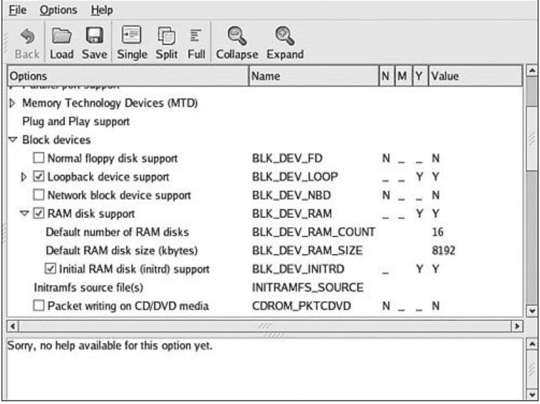

### 6.4.1. 初始 RAM 磁盘的目的

初始 RAM 磁盘是一个小型的自包含根文件系统，通常包含加载特定设备驱动程序的指令，这些指令在启动周期完成之前执行。在 Linux 工作站发行版，如 Red Hat 和 Fedora Core 中，初始 RAM 磁盘用于在挂载真正的根文件系统之前加载 EXT3 文件系统的设备驱动程序。`initrd` 经常用于加载访问真正根文件系统所需的设备驱动程序。

### 6.4.2. 使用 initrd 启动

要使用 `initrd` 功能，引导加载程序在大多数架构中都会参与，将 `initrd` 镜像传递给内核。一个常见的情况是，引导加载程序将压缩的内核镜像加载到内存中，然后将 `initrd` 镜像加载到另一段可用内存中。这样做时，将 `initrd` 镜像的加载地址传递给内核就成为引导加载程序的责任，然后才将控制权移交给内核。确切的机制因架构、引导加载程序和平台实现而异。然而，内核必须知道 `initrd` 镜像的位置，以便加载它。

某些架构和平台构造一个单一的复合二进制镜像。当引导加载程序没有特定的 Linux 支持来加载 `initrd` 镜像时，就使用这种方案。在这种情况下，内核和 `initrd` 镜像只是简单地连接在一起。你会在内核 makefile 中找到对这类复合镜像的引用，即 `bootpImage`。目前，这仅用于 `arm` 架构。

那么内核如何知道在哪里找到 `initrd` 镜像呢？除非引导加载程序中有某种特殊的魔法，否则通常只需通过内核命令行将 `initrd` 镜像的起始地址和大小传递给内核就足够了。以下是一个流行的基于 ARM 的参考板的内核命令行示例，该板包含 TI OMAP 5912 处理器。

```
console=ttyS0,115200 root=/dev/nfs                          \
   nfsroot=192.168.1.9:/home/chris/sandbox/omap-target     \
   initrd=0x10800000,0x14af47
```

前面的内核命令行已分成几行以适应提供的空间。在实际实践中，它是一行，各个元素之间用空格分隔。此内核命令行定义了以下内核行为：

- 在设备 `ttyS0` 上指定一个控制台，波特率为 115 千波特
- 通过 NFS，即网络文件系统，挂载根文件系统
- 在主机 192.168.1.9 上找到 NFS 根文件系统（来自目录 `/home/chris/sandbox/omap-target`）
- 从物理内存位置 0x10800000 加载并挂载初始 ramdisk，其大小为 0x14AF47（1,355,591 字节）

关于此示例还有一个额外的说明：几乎无一例外，`initrd` 镜像是压缩的。内核命令行上指定的大小是压缩镜像的大小。

### 6.4.3. 引导加载程序对 initrd 的支持

让我们看一个基于流行的 U-Boot 引导加载程序在 ARM 处理器上运行的简单示例。此引导加载程序设计有 Linux 内核支持。使用 U-Boot，可以轻松地将 `initrd` 镜像与内核镜像一起包含在内。[清单 6-10](#) 检查了一个包含初始 ramdisk 镜像的典型启动序列。

#### 清单 6-10. 使用 Ramdisk 支持启动内核

```
# tftpboot 0x10000000 kernel-uImage
...
Load address: 0x10000000
Loading: ############################# done
Bytes transferred = 1069092 (105024 hex)

# tftpboot 0x10800000 initrd-uboot
...
Load address: 0x10800000
Loading: ####################################### done
Bytes transferred = 282575 (44fcf hex)

# bootm 0x10000000 0x10800040
Uncompressing kernel................done.
...
RAMDISK driver initialized: 16 RAM disks of 16384K size 1024 blocksize
...
RAMDISK: Compressed image found at block 0
VFS: Mounted root (ext2 filesystem).
Greetings: this is linuxrc from Initial RAMdisk
Mounting /proc filesystem

BusyBox v1.00 (2005.03.14-16:37+0000) Built-in shell (ash)
Enter 'help' for a list of built-in commands.

# (<<<< Busybox command prompt)
```

在[清单 6-10](#)中，我们简要了解了 U-Boot 引导加载程序，我们将在下一章更详细地研究它。`tftpboot` 命令使 U-Boot 从 tftp 服务器下载内核镜像。内核镜像被下载并放置到此目标系统的内存底部，位于 256MB 地址处（0x10000000 十六进制<sup>[7]</sup>）。然后第二个镜像，即初始 ramdisk 镜像，从 tftp 服务器下载到更高的内存地址（在此示例中为 256MB + 8MB）。最后，我们发出 U-Boot 的 `bootm` 命令，即"从内存启动"命令。`bootm` 命令接受两个参数：Linux 内核镜像的地址，以及可选的表示初始 ramdisk 镜像位置的地址。

<sup>[7]</sup> 碰巧的是，在此特定板上，我们的物理 SDRAM 从 256MB 开始。

请注意 U-Boot 引导加载程序的一个特性。它完全支持通过以太网连接加载内核和 ramdisk 镜像。这是一个非常有用的开发配置。你也可以通过其他方式将内核和 ramdisk 镜像放到你的板上。你可以使用基于硬件的闪存编程工具将它们刷入你的闪存，或者你可以使用串口和


### 6.4.4. initrd 魔法：linuxrc

当内核启动时，它会检测到 `initrd` 镜像的存在，并从 RAM 中指定的物理位置将压缩的二进制文件复制到适当的内核 ramdisk 中，然后将其挂载为根文件系统。`initrd` 的魔力来自于 `initrd` 镜像内 contents of a 特殊文件。当内核挂载初始 ramdisk 时，它会查找一个名为 `linuxrc` 的特定文件。内核将该文件视为脚本文件，并继续执行其中包含的命令。这种机制使系统设计者能够指定 `initrd` 的行为。清单 6-11 包含一个示例 `linuxrc` 文件。

#### 清单 6-11. `linuxrc` 文件示例

```
#!/bin/sh

echo 'Greetings: this is 'linuxrc' from Initial Ramdisk'
echo 'Mounting /proc filesystem'
mount -t proc /proc /proc

busybox sh
```

实际上，这个文件会包含我们在 dev 们挂载真正的根文件系统之前所需的指令。一个例子可能是加载 CompactFlash 驱动程序，以便从 CompactFlash 设备获取真正的根文件系统。出于本示例的目的，我们 simply 生成一个 busybox shell 并暂停启动过程以供检查。你可以从清单 6-10 中看到 `#` 命令提示符，这是由这个 busybox shell 产生的。如果某人在这里输入 `exit` 命令，内核将继续其启动过程直至完成。

在内核将 ramdisk 从物理内存复制到内核 ramdisk 之后，它会将此物理内存返回到可用内存池中。你可以将其视为将 `initrd` 镜像从物理内存中的硬编址地址转移到内核自己的虚拟内存中（以内核 ramdisk 设备的形式）。

关于清单 6-11 的最后一点说明：挂载 `/proc` 文件系统的 `mount` 命令在单词 proc 的使用上似乎显得冗余。这个命令同样适用：

```
mount -t proc none /proc
```

请注意，`mount` 命令的设备字段已被更改为 `none`。`mount` 命令会忽略设备字段，因为 `/proc` 文件系统没有与之关联的物理设备。`-t proc` 足以指示 `mount` 将 `/proc` 文件系统挂载到 `/proc` 挂载点。我使用前一个调用作为心理提醒，即我们实际上是将内核伪设备（`/proc` 文件系统）挂载到 `/proc` 上。mount 命令会忽略这个参数。请使用你偏好的方法。

### 6.4.5. initrd 机制

作为 Linux 启动过程的一部分，内核必须定位并挂载一个根文件系统。在启动过程的后期，内核在一个名为 `prepare_namespace()` 的函数中决定挂载什么以及在哪里挂载。如果内核中启用了 `initrd` 支持（如[图 6-1](…) 所示），并且内核命令行也如此配置，内核会从物理内存中解压缩 `initrd` 镜像，并最终将此文件的内容复制到 ramdisk 设备（`/dev/ram`）中。此时，我们在内核 ramdisk 上有了一个合适的文件系统。在文件系统被读入 ramdisk 之后，内核实际上将此 ramdisk 设备作为其根文件系统挂载。最后，内核生成一个内核线程来执行 `initrd` 镜像上的 `linuxrc` 文件。^[8]

^[8] 出于必要（空间有限），这是对事件序列的 very 简化描述。实际机制在概念上相似，但为了清晰起见省略了几个重要的细节。鼓励你查阅内核源代码以获取更多细节。请参见 `…/init/main.c` 和 `…/init/do_mounts*.c`。

当 `linuxrc` 脚本执行完成后，内核会卸载 `initrd` 并继续进行系统启动的最后阶段。如果真正的根设备有一个名为 `/initrd` 的目录，Linux 会将 `initrd` 文件系统挂载到此路径上（在此上下文中，称为*挂载点*）。如果最终根文件系统中不存在此目录，`initrd` 镜像将被直接丢弃。

如果内核命令行包含一个 `root=` 参数指定 ramdisk（例如 `root=/dev/ram0`），则前面描述的 `initrd` 行为会在两个重要方面发生变化。首先，对 `linuxrc` 可执行文件的处理被跳过。其次，不会尝试挂载另一个文件系统作为根。这意味着你可以拥有一个以 `initrd` 作为唯一根文件系统的 Linux 系统。这对于根文件系统只有 ramdisk 的最小系统配置非常有用。在内核命令行上放置 `/dev/ram0` 允许完整的系统初始化以 `initrd` 作为最终根文件系统来完成。

### 6.4.6. 构建 initrd 镜像

构建合适的根文件系统镜像是嵌入式系统中最具挑战性的方面之一。创建合适的 `initrd` 镜像更具挑战性，因为它需要小巧且专门化。在本节中，我们将研究 `initrd` 的需求和文件系统内容。

[清单 6-12](…) 是通过对本章示例 `initrd` 镜像运行 `tree` 工具生成的。

#### 清单 6-12. `initrd` 示例内容

```
. 
|-- bin
|   |-- busybox
|   |-- echo -> busybox
|   |-- mount -> busybox
|   '-- sh -> busybox
|-- dev
|   |-- console
|   |-- ram0
|   '-- ttyS0
|-- etc
|-- linuxrc
'-- proc

4 directories, 8 files
```

如你所见，它确实非常小；未压缩形式下仅占用略多于 500KB 的空间。由于它基于 `busybox`，因此具有许多功能。因为 `busybox` 是静态链接的，所以不依赖于任何系统库。你将在第 11 章中了解有关 `busybox` 的更多信息。

## 6.5. 使用 initramfs

`initramfs` 是一种相对较新（Linux 2.6）的机制，用于执行早期用户空间程序。它在概念上与上一节描述的 `initrd` 相似。其目的也相似：允许在挂载真正的根文件系统之前加载可能需要的驱动程序。然而，它在 significant 方面与 `initrd` 机制不同。

`initrd` 和 `initramfs` 之间的技术实现细节差异很大。例如，`initramfs` 在调用 `do_basic_setup()` 之前加载，[9] 这提供了一种在设备驱动程序加载之前为设备加载固件的机制。更多细节请参阅 Linux 内核文档，该子系统的文档相对较新。请参见

> [9] `do_basic_setup` 从 `.../init/main.c` 调用，并调用 `do_initcalls()`。这会导致驱动程序模块初始化例程被调用。这在[第 5 章](https://example.com)中有详细描述，并在[清单 5-10](https://example.com)中展示。

`.../Documentation/filesystems/ramfs-rootfs-initramfs.txt`。

从实际角度来看，`initramfs` 更易于使用。`initramfs` 是一个 `cpio` 归档文件，而 `initrd` 是一个 gzip 压缩的文件系统镜像。这一简单差异促成了 `initramfs` 的易用性。它集成到 Linux 内核源代码树中，并在你构建内核镜像时自动构建。对其进行更改比构建和加载新的 `initrd` 镜像要容易得多。[清单 6-13](https://example.com) 显示了 Linux 内核 `.../usr` 目录的内容，`initramfs` 镜像就是在这里构建的。[清单 6-13](https://example.com) 的内容是在内核构建后显示的。

### 清单 6-13. 内核 `initramfs` 构建目录

```
$ ls -l
total 56
-rw-rw-r--  1 chris chris   834 Mar 25 11:13 built-in.o
-rwxrwxr-x  1 chris chris 11512 Mar 25 11:13 gen_init_cpio
-rw-rw-r--  1 chris chris 10587 Oct 27  2005 gen_init_cpio.c
-rw-rw-r--  1 chris chris   512 Mar 25 11:13 initramfs_data.cpio
-rw-rw-r--  1 chris chris   133 Mar 25 11:13 initramfs_data.cpio.gz
-rw-rw-r--  1 chris chris   786 Mar 25 11:13 initramfs_data.o
-rw-rw-r--  1 chris chris  1024 Oct 27  2005 initramfs_data.S
-rw-rw-r--  1 chris chris   113 Mar 25 11:13 initramfs_list
-rw-rw-r--  1 chris chris  1619 Oct 27  2005 Kconfig
-rw-rw-r--  1 chris chris  2048 Oct 27  2005 Makefile
```

文件 `initramfs_list` 包含将包含在 `initramfs` 归档中的文件列表。最近 Linux 内核的默认设置如下：

```
dir /dev 0755 0 0
```


## 6.6. 关机

嵌入式系统的有序关机在设计中常被忽视。不恰当的关机会影响启动时间，甚至可能损坏某些类型的文件系统。使用EXT2文件系统（多年来许多桌面Linux发行版的默认系统）时，一个常见的抱怨就是在意外断电后启动时`fsck`（文件系统检查）所需的时间。拥有大型磁盘系统的服务器，要对一组大型EXT2分区进行彻底的`fsck`可能需要花费数小时。

每个嵌入式项目可能都有自己的关机策略。适用于一个项目的方案，可能对另一个项目有效，也可能无效。关机的范围可以从完整的System V关机方案，到一个简单的停机或重启脚本。Linux提供了一些实用工具来辅助关机过程，包括`shutdown`、`halt`和`reboot`命令。当然，这些工具必须适用于你选择的架构。

关机脚本应该终止所有用户空间进程，这将导致关闭这些进程使用的所有打开的文件。如果使用`init`，执行`init 0`命令将使系统停机。通常，关机过程首先向所有进程发送`SIGTERM`信号，通知它们系统即将关闭。短暂的延迟确保所有进程都有机会执行它们的关机动作，例如关闭文件、保存状态等。然后，向所有进程发送`SIGKILL`信号，这将导致它们终止。关机过程应尝试卸载所有已挂载的文件系统，并调用架构特定的停机或重启例程。Linux的`shutdown`命令与`init`配合使用时就表现出了这种行为。

## 6.7. 本章总结

-   所有Linux系统都需要一个根文件系统。由于每个应用程序复杂的依赖关系，从头构建它们可能很困难。
-   文件系统层次结构标准为开发者布局文件系统以实现最大兼容性和灵活性提供了指导。
-   我们以一个最小文件系统为例，展示了如何创建根文件系统。
-   Linux内核的最后启动步骤定义并控制着Linux系统的启动行为。根据你的嵌入式Linux系统需求，有几种机制可供选择。
-   我们详细介绍了`init`进程。这个强大的系统配置和控制工具可以作为你自己嵌入式Linux系统的基础。我们介绍了基于`init`的系统初始化，以及示例启动脚本配置。
-   初始内存盘是Linux内核的一个特性，允许在挂载最终根文件系统并生成`init`之前，进一步定制启动行为。我们介绍了使用这一强大特性的机制和示例配置。
-   `initramfs`简化了初始内存盘机制，同时提供了类似的早期启动功能。它更易于使用，不需要加载单独的镜像，并且在每次内核构建期间都会自动构建。

### 6.7.1. 建议进一步阅读

-   **文件系统层次结构标准**  
    由freestandards.org维护  
    [www.pathname.com/fhs/](www.pathname.com/fhs/)

-   **启动过程、Init和关机**  
    Linux文档项目  
    [http://tldp.org/LDP/intro-linux/html/sect_04_02.html](http://tldp.org/LDP/intro-linux/html/sect_04_02.html)

-   **Init手册页**  
    Linux文档项目  
    [http://tldp.org/LDP/sag/html/init.html](http://tldp.org/LDP/sag/html/init.html)

-   **System V init的简要描述**  
    [http://docs.kde.org/en/3.3/kdeadmin/ksysv/what-is-sysv-init.html](http://docs.kde.org/en/3.3/kdeadmin/ksysv/what-is-sysv-init.html)

-   ***启动Linux：历史与未来***  
    Werner Almesberger  
    [www.almesberger.net/cv/papers/ols2k-9.ps](www.almesberger.net/cv/papers/ols2k-9.ps)

# 第7章. 引导加载程序

**本章内容**

-   [引导加载程序的作用](第158页)
-   [引导加载程序面临的挑战](第159页)
-   [一个通用的引导加载程序：Das U-Boot](第164页)
-   [移植U-Boot](第172页)
-   [其他引导加载程序](第183页)
-   [本章总结](第186页)

前面的章节已经提及，甚至提供了引导加载程序操作的示例。作为嵌入式系统的关键组件，引导加载程序提供了其他系统软件得以生成的基础。本章首先探讨引导加载程序在系统中的角色。随后，我们将介绍引导加载程序的一些常见特性。在此基础上，我们将详细考察一个广泛用于嵌入式系统的流行引导加载程序。最后，我们通过介绍几种更受欢迎的引导加载程序来结束本章。

当今使用的引导加载程序数量众多。在有限的篇幅内，即使是最流行的引导加载程序，也难以详尽阐述。因此，我们选择基于开源社区中在PowerPC、MIPS、ARM和其他架构上流行的一个引导加载程序——U-Boot引导加载程序来解释概念并提供示例。

## 7.1. 引导加载程序的作用

当处理器板首次上电时，即使运行最简单的程序之前，也必须初始化许多硬件元素。每个架构和处理器都有一套预定义的操作和配置，这包括从板载存储设备（通常是闪存）获取一些初始化代码。这段早期的初始化代码是引导加载程序的一部分，负责激活处理器及相关硬件组件。

大多数处理器都有一个默认地址，在上电和释放复位时，会从该地址获取代码的最初几个字节。硬件设计人员利用这些信息来安排板上闪存的布局，并选择闪存响应的地址范围。这样，在首次上电时，代码从一个众所周知的、可预测的地址获取，从而可以建立软件控制。

引导加载程序提供这段早期初始化代码，并负责初始化板卡，以便其他程序可以运行。这段早期初始化代码几乎总是用处理器的原生汇编语言编写。仅这一事实就带来了许多挑战，我们将在本文中探讨其中的一部分。

当然，在引导加载程序完成了这个基本的处理器和平台初始化之后，它的主要角色就变成了启动一个功能完备的操作系统。它负责定位、加载并将执行权传递给主操作系统。此外，引导加载程序可能具有高级功能，例如验证操作系统镜像的能力、升级自身或操作系统镜像的能力，以及根据开发者定义的策略从多个操作系统镜像中进行选择的能力。与传统的PC-BIOS模型不同，当操作系统接管控制权时，引导加载程序会被覆盖并停止存在。[1]

> [1] 一些嵌入式设计会保护引导加载程序并提供对引导加载程序例程的回调，但这几乎从来不是一个好的设计方法。Linux的功能远比引导加载程序强大，因此这样做通常没有太大意义。

---

`nod /dev/console 0600 0 0 c 5 1`
`dir /root 0700 0 0`

这会产生一个包含`/root`和`/dev`顶级目录以及一个代表控制台的设备节点的小型默认目录结构。向此文件添加内容以构建你自己的initramfs。你也可以通过内核配置工具为你的`initramfs`文件指定来源。在你的内核配置中启用`INITRAMFS_SOURCE`，并将其指向你开发工作站上的一个位置；内核构建系统将使用这些文件作为你的`initramfs`镜像的来源。

此构建目录的最终输出是`initramfs_data_cpio.gz`文件。这是一个压缩归档文件，包含你指定的文件（无论是通过`initramfs_list`还是通过`INITRAMFS_SOURCE`内核配置选项）。此归档文件被链接到最终的内核镜像中。这是`initramfs`相对于`initrd`的另一个优势：在启动时无需加载单独的`initrd`镜像，就像使用`initrd`时那样。


## 7.2. 引导加载程序的挑战

即使是一个用 C 语言编写的简单"Hello World"程序，也需要大量的硬件和软件资源。应用程序开发人员无需了解或关心这些细节，因为 C 运行时环境透明地提供了这些基础设施。而引导加载程序开发者就没有这样的便利了。引导加载程序所需的每一个资源都必须在使用前仔细初始化和分配。其中最显而易见的例子之一就是动态随机存取存储器（DRAM）。

### 7.2.1. DRAM 控制器

DRAM 芯片无法像其他微处理器总线资源那样直接读取或写入。它们需要专门的硬件控制器来启用读写周期。更复杂的是，DRAM 必须不断刷新，否则其中存储的数据将会丢失。刷新是通过以系统化的方式、按照 DRAM 制造商设定的时序规范，依次读取 DRAM 中的每个位置来实现的。现代 DRAM 芯片支持多种操作模式，例如用于高性能应用的突发模式和双倍数据速率。DRAM 控制器的职责是配置 DRAM、按照制造商的时序规范保持刷新，并响应处理器的各种读写命令。

设置 DRAM 控制器是让嵌入式开发新手倍感沮丧的事情之一。这需要对 DRAM 架构、控制器本身、所使用的特定 DRAM 芯片以及整体硬件设计有深入的了解。虽然这超出了本书的范围，但感兴趣的读者可以通过参考本章末尾的参考文献来了解更多关于这一重要概念的知识。[附录 D](#)，"SDRAM 接口注意事项"，提供了关于这一重要主题的更多背景信息。

在嵌入式系统中，在 DRAM 控制器和 DRAM 本身被正确初始化之前，几乎什么都做不了。引导加载程序首先要做的事情之一就是启用内存子系统。初始化完成后，内存就可以作为资源使用了。事实上，许多引导加载程序在初始化内存后做的第一件事就是将自己复制到 DRAM 中，以便更快地执行。

### 7.2.2. Flash 与 RAM 的对比

引导加载程序固有的另一个复杂性在于，它们需要存储在非易失性存储器中，但通常要加载到 RAM 中执行。同样，这种复杂性源于引导加载程序可依赖的资源水平。在运行 Linux 等操作系统的完全可操作的计算机系统中，编译程序并从非易失性存储器中调用它相对容易。运行时库、操作系统和编译器协同工作，创建必要的基础设施，将程序从非易失性存储器加载到内存中，并将控制权转交给它。前面提到的"Hello World"程序就是一个完美的例子。编译后，只需在命令行输入可执行文件的名称（`hello`）即可将其加载到内存中执行（当然，前提是可执行文件存在于你的 `PATH` 中的某个位置）。

当引导加载程序在通电时获得控制权时，这种基础设施并不存在。相反，引导加载程序必须创建自己的运行上下文，并根据需要将自己移动到 RAM 中的合适位置。此外，从只读介质执行的要求又引入了额外的复杂性。

### 7.2.3. 镜像的复杂性

作为应用程序开发人员，我们开发自己喜爱平台的应用程序时，无需关注二进制可执行文件的布局。编译器和二进制工具已预先配置好，以构建包含给定架构所需适当组件的二进制可执行镜像。链接器将启动（序幕）和关闭（尾声）代码放入镜像中。这些对象为你的应用程序设置了适当的执行上下文，通常从你的应用程序中的 `main()` 开始。

对于典型的引导加载程序来说，情况绝对并非如此。当引导加载程序获得控制权时，没有上下文或先前的执行环境。在典型的系统中，在引导加载程序初始化处理器和相关硬件之前，可能根本没有 DRAM。考虑一下这意味着什么。在典型的 C 函数中，任何局部变量都存储在栈上，所以像 [清单 7-1](Listing%207-1) 中那样的简单函数是无法使用的。

#### 清单 7-1. 简单的 C 函数

```
int setup_memory_controller(board_info_t *p)
{
    unsigned int *dram_controller_register = p->dc_reg;
    ...
}
```

当引导加载程序在通电时获得控制权，没有栈，也没有栈指针。因此，类似于 [清单 7-1](Listing%207-1) 的简单 C 函数很可能会导致处理器崩溃，因为编译器会生成代码来在栈上创建和初始化指针 `dram_controller_register`，而栈此时还不存在。引导加载程序必须在调用任何 C 函数之前创建这个执行上下文。

当引导加载程序被编译和链接时，开发者必须对镜像的构造和链接方式拥有完全的控制权。如果引导加载程序要从 Flash 重定位到 RAM 中，尤其如此。必须向编译器和链接器传递一些参数，定义最终可执行镜像的特性和布局。有两个主要特性共同增加了最终二进制可执行镜像的复杂性。

第一个带来复杂性的特性是需要按照与处理器启动序列兼容的格式来组织启动代码。可执行代码的前几个字节必须位于 Flash 中的预定义位置，这取决于处理器和硬件架构。例如，AMCC PowerPC 405GP 处理器从一个硬编码地址 0xFFFF_FFFC 获取它的第一条机器指令。其他处理器使用类似的方法，但细节不同。有些处理器在通电时可以根据硬件配置信号的配置，从几个预定义位置之一获取代码。

开发者如何指定二进制镜像的布局？链接器会被传递一个*链接器描述文件*，也称为*链接器命令脚本*。这个特殊文件可以被看作是构建二进制可执行镜像的配方。[清单 7-2](.../listing_7_2_html) 包含了一段来自一个流行的引导加载程序中正在使用的链接器描述文件的片段，我们很快会讨论到它。

#### 清单 7-2. 链接器命令脚本

```
SECTIONS
{
  .resetvec 0xFFFFFFFFC :
  {
    *(.resetvec)
  } = 0xffff
...
```

链接器命令脚本语法的完整描述超出了本书的范围。感兴趣的读者可以参考本章末尾引用的 GNU LD 手册。查看 [清单 7-2](.../listing_7_2_html)，我们看到二进制 ELF 镜像输出部分定义的开头。它指示链接器将名为 `.resetvec` 的代码部分放置在输出镜像中的固定地址，从位置 0xFFFF_FFFC 开始。此外，它指定该部分的其余部分将用全 1 填充（0xFFFF）。这是因为擦除后的 Flash 内存阵列包含全 1。这种技术不仅减少了 Flash 内存的磨损，而且还显著加快了该扇区的编程速度。

[清单 7-3](.../listing_7_3_html) 是来自一个近期 U-Boot 发行版的完整汇编语言文件，它定义了 `.resetvec` 代码部分。它包含在一个名为 `.../cpu/ppc4xx/resetvec.S` 的汇编语言文件中。注意，在只有 32 位地址的机器中，这个代码部分不能超过 4 字节的长度。这是因为无论存在什么配置选项，这个部分只定义了一条指令。

#### 清单 7-3. `.resetvec` 的源定义

```
/* Copyright MontaVista Software Incorporated, 2000 */
#include <config.h>
	.section .resetvec, "ax"
#if defined(CONFIG_440)
	b _start_440
#else
#if defined(CONFIG_BOOT_PCI) && defined(CONFIG_MIP405)
	b _start_pci
#else
	b _start
#endif
#endif
```

这个汇编语言文件非常容易理解，即使你没有任何汇编语言背景。它只是定义了一条单一的分支指令，跳转到三个可能的入口点之一，这取决于编译时选择的配置选项。`.resetvec` 部分被放置在 Flash 内存的开头，这通常是处理器复位后访问的第一个位置。然后，分支指令根据板级配置跳转到适当的初始化代码。


编程经验。根据具体的配置（由`CONFIG_*`宏指定），会生成一条无条件分支指令（PowerPC 汇编语法中的`b`），跳转到主代码体中适当的起始位置。这个分支位置是一条 4 字节的 PowerPC 指令，正如我们在[代码清单 7-2](link)的链接器命令脚本片段中所见，这条简单的分支指令被放置在输出映像的绝对 Flash 地址 0xFFFF_FFFC 处。如前所述，PPC 405GP 处理器从该硬编码地址获取其第一条指令。这就是为这种特定架构和处理器组合定义的第一段代码序列及其提供方式。

### 7.2.4. 执行上下文

引导加载程序映像复杂的另一个主要原因是缺乏执行上下文。当[代码清单 7-3](link)中的指令序列开始执行时（回想一下，这些是通电后的第一条机器指令），运行程序可用的资源几乎为零。硬件设计的默认值确保了从 Flash 内存的取址能够正常工作，系统时钟具有某些默认值，但其他几乎不能做任何假设。[2] 每个处理器的复位状态通常由制造商明确界定，但电路板的复位状态则由硬件设计师定义。

> [2] 具体细节因架构、处理器和硬件设计的细节而异。

事实上，大多数处理器在启动时都没有可用的 DRAM 用于临时存储变量，更糟糕的是，无法提供 C 程序调用约定所需的栈。如果你被迫在没有 DRAM 因而没有栈的情况下编写一个"Hello World"程序，那将与传统的"Hello World"示例大相径庭。

这一限制给旨在初始化硬件的初始代码体带来了重大挑战。因此，引导加载程序在启动时执行的首要任务之一就是配置足够的硬件，以启用至少最少数量的 RAM。一些专为嵌入式应用设计的处理器配备了少量片上静态 RAM。我们讨论的 PPC 405GP 就是这种情况。当 RAM 可用时，可以使用部分 RAM 分配栈，并构建适当的上下文来运行 C 等高级语言。这使得处理器和平台初始化的其余部分可以用汇编语言以外的语言编写。


## 7.3. 通用引导加载程序：Das U-Boot

目前有许多开源和商业引导加载程序可用，还有更多独一无二、自行设计的方案在广泛使用。这些程序大多具有某些共同特性。例如，它们都具有加载和执行其他程序的能力，尤其是操作系统。大多数通过串口与用户交互。对各种网络子系统（如以太网）的支持虽然不太常见，但是一个非常强大的功能。

许多引导加载程序特定于某种特定架构。引导加载程序支持多种架构和处理器的能力对大型开发组织来说可能是一个重要特性。单个开发组织拥有跨越多个架构的多种处理器并不罕见。在多个平台上投入单一引导加载程序，最终可以降低开发成本。

在本节中，我们研究一个在嵌入式 Linux 社区中非常流行的现有引导加载程序。该引导加载程序的正式名称是 Das U-Boot。它由 Wolfgang Denk 维护，托管在 SourceForge 上，网址为[http://u-boot.sourceforge.net/](http://u-boot.sourceforge.net/)。U-Boot 支持多种架构，拥有大量嵌入式开发者和硬件制造商追随者，他们已将其用于各自的项目并为其开发做出了贡献。

### 7.3.1. 系统配置：U-Boot

要使引导加载程序在多种处理器和架构上都有用，某种配置方法是必要的。与 Linux 内核本身一样，引导加载程序的配置在编译时完成。这种方法显著降低了引导加载程序的复杂性，这本身就是一个重要的特性。

就 U-Boot 而言，特定于电路板的配置由目标平台专用的单个头文件驱动，以及源树中的一些软链接，这些链接根据目标电路板、架构和 CPU 选择正确的子目录。在为 U-Boot 支持的某个平台进行配置时，执行以下命令：

```
$ make <platform>_config
```

这里，`platform`是 U-Boot 支持的众多平台之一。这些平台配置目标列在 U-Boot 顶层 Makefile 中。例如，要为包含 TI OMAP 5912 处理器的 Spectrum Digital OSK 进行配置，执行以下命令：

```
$ make omap5912osk_config
```

这将使用适当的软链接配置 U-Boot 源树，以选择 ARM 作为目标架构、ARM926 内核和 5912 OSK 作为目标平台。

为该平台配置 U-Boot 的下一步是编辑特定于该电路板的配置文件。该文件位于 U-Boot 的`../include/configs`子目录中，名为`omap5912osk.h`。U-Boot 发行版附带的 README 文件详细描述了配置信息，是获取此信息的最佳来源。

U-Boot 的配置使用在特定于电路板的头文件中定义的配置变量来完成。配置变量有两种形式。配置*选项*使用`CONFIG_XXXX`形式的宏来选择。配置*设置*使用`CFG_XXXX`形式的宏来选择。一般而言，配置选项（`CONFIG_XXX`）可由用户配置，用于启用特定的 U-Boot 操作功能。配置设置（`CFG_XXX`）通常是特定于硬件的，需要对底层处理器和/或硬件平台有详细的了解。特定于电路板的 U-Boot 配置由专用于该特定平台的头文件驱动，其中包含适合底层平台的配置选项和设置。U-Boot 源树中包含一个存放这些特定于电路板的配置头文件的目录。它们可以在 U-Boot 源目录顶层下的`.../include/configs`中找到。

通过向电路板配置文件添加定义，可以选择许多特性和操作模式。[代码清单 7-4](#)包含一个基于 PPC 405GP 处理器的虚构电路板的部分配置头文件。

#### 代码清单 7-4. 部分 U-Boot 电路板配置头文件

```c
#define CONFIG_405GP        /* Processor definition */
#define CONFIG_4XX          /* Sub-arch specification, 4xx family */

#define CONFIG_SYS_CLK_FREQ  33333333 /* PLL Frequency  */
#define CONFIG_BAUDRATE      9600
#define CONFIG_PCI          /* Enable support for PCI */
...
#define CONFIG_COMMANDS      (CONFIG_CMD_DFL | CFG_CMD_DHCP)
...
#define CFG_BASE_BAUD      691200

/* The following table includes the supported baudrates */
#define CFG_BAUDRATE_TABLE  \
    {1200, 2400, 4800, 9600, 19200, 38400, 57600, 115200, 230400}

#define CFG_LOAD_ADDR      0x100000   /* default load address */
...
/* Memory Bank 0 (Flash Bank 0) initialization */
#define CFG_EBC_PB0AP      0x9B015480
#define CFG_EBC_PB0CR      0xFFF18000

#define CFG_EBC_PB1AP      0x02815480
#define CFG_EBC_PB1CR      0xF0018000
...
```

[代码清单 7-4](#)展示了如何为给定电路板配置 U-Boot 本身。实际的电路板配置文件可能包含数百行与此处类似的代码。在此示例中，可以看到 CPU、CPU 系列（4xx）、PLL 时钟频率、串口波特率和 PCI 支持的定义。我们包含了配置变量（`CONFIG_XXX`）和配置设置（`CFG_XXX`）的示例。最后几行是初始化外部总线控制器所需的内存组 0 和 1 的实际处理器寄存器值。您可以看到，这些值只能来自对电路板和处理器的详细了解。

使用这些机制可以配置 U-Boot 的许多方面，包括哪些功能将被编译到 U-Boot 中（DHCP 支持、内存测试、调试支持等）。此机制可用于告诉 U-Boot 给定电路板上的内存数量、类型以及内存映射位置。有兴趣的读者可以直接查看 U-Boot 代码，尤其是出色的 README 文件，以了解更多信息。

### 7.3.2. U-Boot 命令集

U-Boot 支持超过 60 个标准命令集，使用`CFG_*`宏可启用超过 150 个独特命令。命令集通过配置设置（`CFG_*`）宏在 U-Boot 中启用。有关最新 U-Boot 快照的完整列表，请参阅附录 B"U-Boot 可配置命令"。这里仅列出少数几个，以展示可用的功能：

| 命令集 | 命令 |
|---------|------|
| `CFG_CMD_FLASH` | Flash 内存命令 |
| `CFG_CMD_MEMORY` | 内存转储、填充、复制、比较等 |
| `CFG_CMD_DHCP` | DHCP 支持 |
| `CFG_CMD_PING` | Ping 支持 |
| `CFG_CMD_EXT2` | EXT2 文件系统支持 |

代码清单 7-4 中的以下行定义了给定 U-Boot 配置中启用的命令，由特定于电路板的头文件驱动：

```c
#define CONFIG_COMMANDS       (CONFIG_CMD_DFL | CFG_CMD_DHCP)
```

不必在您自己的特定于电路板的配置头文件中逐一键入每个`CFG_*`宏，您可以从 U-Boot 源中预定义的默认命令集开始。宏`CONFIG_CMD_DFL`定义了这个默认命令集。`CONFIG_CMD_DFL`指定了一组默认的 U-Boot 命令集，例如`tftpboot`（从 tftp 服务器引导映像）、`bootm`（从内存引导映像）、内存实用工具如`md`（显示内存）等。要启用您的特定命令组合，您可以从默认值开始，然后根据需要进行添加和删减。[代码清单 7-4](#)中的示例将 DHCP 命令集添加到默认值中。您可以用类似的方式删减：

```c
#define CONFIG_COMMANDS    (CONFIG_CMD_DFL & ~CFG_CMD_NFS)
```

查看`.../include/configs/`中的任何电路板配置头文件以获取示例。


### 7.3.3. 网络操作

许多引导加载程序都包含对以太网接口的支持。在开发环境中，这能节省大量时间。通过串口加载一个中等大小的内核映像可能需要数分钟，而通过 10Mbps 以太网链路只需几秒钟。此外，串口链路更容易因串口终端的不稳定行为而产生错误。

在引导加载程序中需要关注的一些重要功能包括对 BOOTP、DHCP 和 TFTP 协议的支持。对于不熟悉这些协议的读者，BOOTP（引导协议）和 DHCP（动态主机控制协议）是使带有以太网端口的目标设备能够从中央服务器获取 IP 地址和其他网络相关配置信息的协议。TFTP（简单文件传输协议）允许目标设备从 TFTP 服务器下载文件（如 Linux 内核映像）。这些协议规范的参考文献列在本章末尾。这些服务的服务器在[第 12 章](chapter-12)"嵌入式开发环境"中描述。

[图 7-1](figure-7-1) 展示了目标设备与 BOOTP 服务器之间的信息流。客户端（此处为 U-Boot）发起一个广播数据包来搜索 BOOTP 服务器。服务器以包含客户端 IP 地址和其他信息的应答数据包进行响应。其中最有用的数据包括用于下载内核映像的文件名。

#### 图 7-1. BOOTP 客户端/服务器握手

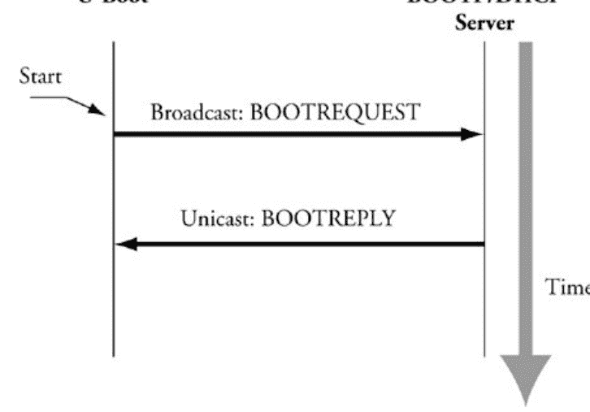

在实践中，专用的 BOOTP 服务器已不再作为独立服务器存在。你喜欢的 Linux 发行版中附带的 DHCP 服务器同样支持 BOOTP 协议数据包。

DHCP 协议建立在 BOOTP 之上。它可以为目标设备提供各种各样的配置信息。在实践中，信息交换通常受限于目标设备/引导加载程序 DHCP 客户端的实现。[清单 7-5](#) 展示了一个 DHCP 服务器配置块的示例，用于标识单个目标设备。这是 Fedora Core 2 DHCP 实现中 DHCP 配置文件的一个片段。

#### 清单 7-5. DHCP 目标设备规范

```
host coyote {
      hardware ethernet 00:0e:0c:00:82:f8;
      netmask 255.255.255.0;
      fixed-address 192.168.1.21;
      server-name 192.168.1.9;
      filename "coyote-zImage";
      option root-path "/home/chris/sandbox/coyote-target";
}
...
```

当此 DHCP 服务器收到来自与[清单 7-5](#) 中包含的硬件以太网地址匹配的设备的数据包时，它会向该设备发送此目标规范中的参数作为应答。[表 7-1](#) 描述了目标规范中的各个字段。

#### 表 7-1. DHCP 目标参数

| DHCP 目标参数 | 用途 | 说明 |
| --- | --- | --- |
| `host` | 主机名 | 来自 DHCP 配置文件的符号标签 |
| `hardware ethernet` | 以太网硬件地址 | 目标设备以太网接口的底层以太网硬件地址 |
| `fixed-address` | 目标 IP 地址 | 目标设备将使用的 IP 地址 |
| `netmask` | 目标子网掩码 | 目标设备将使用的 IP 子网掩码 |
| `server-name` | TFTP 服务器 IP 地址 | 目标设备将向其发送文件传输请求、根文件系统请求等的 IP 地址 |
| `filename` | TFTP 文件名 | 引导加载程序可用于引导次级映像（通常是 Linux 内核）的文件名 |

当目标板上的引导加载程序完成 BOOTP 或 DHCP 交换后，上述描述的参数将用于进一步配置。例如，引导加载程序使用目标 IP 地址将以太网端口与该 IP 地址绑定。然后，引导加载程序使用 `server-name` 字段作为目标 IP 地址来请求 `filename` 字段中包含的文件，在大多数情况下，该文件代表一个 Linux 内核映像。虽然这是最常见的用途，但同样的方案也可用于下载和执行制造测试及诊断固件。

需要注意的是，DHCP 协议支持的参数远多于表 7-1 中详述的那些。这些仅仅是嵌入式系统中可能遇到的较常见参数。完整详情请参阅本章末尾引用的 DHCP 规范。

### 7.3.4. 存储子系统

许多引导加载程序支持从各种非易失性存储设备（除常见的 Flash 存储器之外）启动映像的功能。支持这类设备的困难在于硬件和软件两方面的相对复杂性。例如，要访问硬盘上的数据，引导加载程序必须具备 IDE 控制器接口的设备驱动代码，以及底层分区方案和文件系统的相关知识。这并非轻而易举，也是更适合由完整操作系统来完成的任务之一。

尽管底层存在复杂性，但仍存在从此类设备加载映像的方法。最简单的方法是仅支持硬件层面。在此方案中，不假定对文件系统的任何了解。引导加载程序只是从设备的绝对扇区进行原始加载。此方案可通过在 IDE 兼容设备（如 CompactFlash）上从扇区 0 划出一个未格式化的分区，加载其中的数据而不对数据施加任何结构来使用。这是加载内核映像或其他二进制映像的理想配置。设备上的其他分区可以格式化为特定文件系统，并包含完整的文件系统。在内核启动后，可以使用设备驱动程序来访问这些额外的分区。

U-Boot 可以从指定的原始分区或具有文件系统结构的分区加载映像。当然，板卡必须具有受支持的硬件设备（IDE 子系统），并且 U-Boot 必须进行相应配置。在板级特定配置文件中添加 `CFG_CMD_IDE` 可启用对 IDE 接口的支持，添加 `CFG_CMD_BOOTD` 可启用从原始分区启动的支持。如果你要将 U-Boot 移植到自定义板卡，你将需要修改 U-Boot 以支持你的特定硬件。

### 7.3.5. 从磁盘启动：U-Boot

如上一节所述，U-Boot 支持多种从磁盘子系统启动内核映像的方法。以下简单命令展示了其中一种支持的方法：

```
=> diskboot 0x400000 0:0
```

要理解此语法，你必须首先了解 U-Boot 如何对磁盘设备进行编号。此示例中的 `0:0` 指定了设备和分区。在这个简单的示例中，U-Boot 从第一个 IDE 设备（IDE 设备 0）的第一个分区执行原始二进制加载。映像被加载到物理地址 0x400000 的系统内存中。

内核映像加载到内存后，使用 U-Boot 的 `bootm` 命令（从内存启动）来引导内核：

```
=> bootm 0x400000
```

## 7.4. 移植 U-Boot

U-Boot 之所以如此流行，原因之一是它能够轻松地支持新平台。每个板级移植必须提供一个从属 makefile，为构建过程提供板级特定的定义。这些文件都被命名为 `config.mk`，位于 U-Boot 顶层源代码目录下的 `.../board/xxx` 子目录中，其中 `xxx` 指定特定的板卡。

截至最近的 U-Boot 1.1.4 快照版本，`.../boards` 子目录下有超过 240 个不同的板级配置文件被命名为 `config.mk`。在同一 U-Boot 版本中，支持 29 种不同的 CPU 配置（以相同方式计算）。需要注意的是，在某些情况下，CPU 配置涵盖一个芯片系列，例如 `ppc4xx`，它支持 PowerPC 4xx 系列中的多款处理器。U-Boot 支持当今使用的大量流行的 CPU 和 CPU 系列，以及更多基于这些处理器的参考板卡。

如果你的板卡包含其中一种受支持的 CPU，移植 U-Boot 将相当直接。如果你必须添加新的 CPU，则需要投入明显更多的精力。好消息是，在你之前可能已经有人完成了大部分工作。无论你是移植到新的 CPU 还是基于现有 CPU 的新板卡，请研究现有的源代码以获取具体指导。确定与你的 CPU 最接近的是哪一个，并克隆该 CPU 特定目录中的功能。最后，修改所得源代码以添加对你的新 CPU 需求的特定支持。

### 7.4.1. EP405 U-Boot 移植

同样的逻辑也适用于将 U-Boot 移植到新板卡。让我们看一个示例。我们将使用 Embedded Planet EP405 板卡，它搭载 AMCC PowerPC 405GP 处理器。本示例使用的特定板卡由 Embedded Planet 提供，配备 64MB SDRAM 和 16MB 板载 Flash。还有许多其他设备完善了整体设计。

第一步是看看我们能在多大程度上接近一个现有的板卡。U-Boot 源码树中有许多板卡支持 405GP 处理器。快速对板级配置头文件进行 `grep` 搜索，可以将选择范围缩小到支持 405GP 处理器的板卡：

```
$ cd .../u-boot/include/configs
$ grep -l CONFIG_405GP *
```

在最近的 U-Boot 快照版本中，有 25 个板级配置文件配置为支持 405GP。在检查了其中几个之后，选择 AR405.h 配置作为基线。它包含对 LXT971 以太网收发器的支持，该收发器同样存在于 EP405 上。目标是在开源精神下，借鉴他人的成果来最大限度地减少开发工作。让我们先处理简单的步骤。将板级配置文件复制到一个新文件，文件名适合你的板卡。我们将我们的文件命名为 EP405.h。以下命令在 U-Boot 顶层源码树中执行。

```
$ cp .../include/configs/AR405.h .../include/configs/EP405.h
```


然后创建特定于开发板的目录，并复制 AR405 开发板的文件。我们还不确定是否需要所有这些文件，那一步稍后再说。将文件复制到新的开发板目录后，根据你的开发板名称适当地编辑文件名。

```
$ cd board   <<< 从 U-Boot 源代码顶层目录
$ mkdir ep405
$ cp esd/ar405/* ep405
```

现在到了困难的部分。Jerry Van Baren，一位开发人员兼 U-Boot 贡献者，在一封发给 U-Boot 邮件列表的电子邮件中，详细描述了移植 U-Boot 的一个幽默但非常真实的过程。他的完整过程用 C 语言记录，可以在 U-Boot 的 README 文件中找到。下面以 Jerry 的风格和精神总结了移植过程中困难的部分：

```
while (!running) {
    do {
        添加 / 修改源代码
    } until (compiles);
    调试;
...
}
```

这里总结的 Jerry 的过程，道出了简单的真相。当你选定了一个移植的基线后，你必须添加、删除和修改源代码，直到它能编译通过，然后再调试直到它能无错误运行！没有什么神奇的公式。将任何引导加载程序移植到新的开发板都需要掌握许多硬件和软件领域的知识。其中一些领域，比如设置 SDRAM 控制器，是相当专门化且复杂的。几乎所有这些工作都需要对底层硬件有详细的了解。最终结果：做好准备，花上许多愉快的几个小时，仔细研读你的处理器硬件参考手册，以及板上众多其他组件的数据手册。

### 7.4.2. U-Boot Makefile 配置目标

既然我们有了一个可以开始的代码库，我们必须对顶层 U-Boot 的 Makefile 做一些修改，以添加新开发板的配置步骤。查看这个 Makefile，我们会发现一个用于为各种受支持的开发板配置 U-Boot 源代码树的部分。我们现在添加对新开发板的支持，以便能够构建它。因为我们的开发板衍生于 ESD AR405，我们将使用那条规则作为构建我们自己开发板的模板。如果你跟随 U-Boot 源代码查看，你会发现这些规则在 Makefile 中是按照其配置名称的字母顺序排列的。我们应该做良好的开源公民，遵循这个惯例。我们将配置目标命名为 ep405_config，同样符合 U-Boot 的约定。

```
EBONY_config:      unconfig
    @./mkconfig $(@:_config=) ppc ppc4xx ebony

+EP405_config:      unconfig
+	@./mkconfig $(@:_config=) ppc ppc4xx ep405
+
ERIC_config:		unconfig
	@./mkconfig $(@:_config=) ppc ppc4xx eric
```

我们的新配置规则已经如上面所示插入到以 `+` 字符开头的三行中（统一 `diff` 格式）。

完成了刚才描述的步骤后，我们拥有了一个代表*起点*的 U-Boot 源代码树。它可能还无法干净地编译通过，那应该是我们的第一步。至少编译器可以给我们一些从哪里入手的指导。

### 7.4.3. EP405 处理器初始化

你的新 U-Boot 移植必须正确完成的第一项任务是初始化处理器和内存（DRAM）子系统。复位后，405GP 处理器核心设计为从 0xFFFF_FFFC 开始取指令。核心尝试执行在这里找到的指令。由于这是内存范围的顶部，这里的指令必须是无条件分支指令。

该处理器核心还被硬编码为配置上部的 2MB 内存区域，使其可以在不编程外部总线控制器的情况下访问，而 Flash 存储器通常连接到该控制器。这就要求必须分支到这个地址空间内的某个位置，因为在引导加载程序代码初始化额外的内存区域之前，处理器无法寻址其他任何地方。我们必须分支到 0xFFE0_0000 或更高的某个位置。我们是怎么知道这些的？因为我们读了 405GP 用户手册！

前面段落描述的 405GP 处理器核心的行为，对硬件设计人员提出了要求，即确保上电时，非易失性存储器（Flash）被映射到所需的上部 2MB 内存区域。这个初始内存区域的某些属性在复位时采用默认值。例如，这个上部 2MB 区域将被配置为 256 个等待状态、三个周期的地址到片选延迟、三个周期的片选到输出使能延迟，以及七个周期的保持时间。[3] 这为硬件设计人员选择将指令代码直接送到处理器的适当设备或方法提供了最大的自由度。

> [3] 此数据直接取自本章末尾引用的 405GP 用户手册。

我们已经在[清单 7-2](#) 中看到过复位向量是如何安装到 Flash 顶部的。为 405GP 配置时，我们的前几行代码将在文件 `.../cpu/ppc4xx/start.S` 中找到。U-Boot 开发人员打算让这些代码是*处理器通用的*。理论上，这个文件中不应该有需要特定于开发板的代码。你会看到这是如何实现的。

我们不需要深入理解 PowerPC 汇编语言，就能理解 `start.S` 中的逻辑流程。许多常见问题（FAQ）已经被发布到 U-Boot 邮件列表上，关于修改底层汇编代码的问题。在几乎所有情况下，如果你移植到众多受支持处理器中的一个，都不需要修改这段代码。这是成熟的代码，许多成功的移植都在其上运行。你至少需要修改特定于开发板的代码来完成你的移植。如果你发现自己正在为一款已经存在一段时间的处理器调试或修改早期启动汇编代码，那么你很可能走错了路。

[清单 7-6](#) 复制了 4xx*架构*的 `start.S` 的一部分。

#### 清单 7-6. U-Boot 4xx 启动代码

```
#if defined(CONFIG_405GP) || defined(CONFIG_405CR) ||
 defined(CONFIG_405) || defined(CONFIG_405EP)
/* 清除并设置一些寄存器。 */
/*------------------------------------ */
addi   r4,r0,0x0000
mtspr  sgr,r4
mtspr  dcwr,r4
mtesr  r4              /* 清除异常综合征寄存器 */
mttcr  r4              /* 清除定时器控制寄存器 */
mtxer  r4              /* 清除定点异常寄存器 */
mtevpr r4              /* 清除异常向量前缀寄存器 */
addi   r4,r0,0x1000    /* 设置 ME 位（机器异常） */
oris   r4,r4,0x0002           /* 设置 CE 位（关键异常） */
mtmsr  r4                     /* 修改 MSR */
addi   r4,r0,(0xFFFF-0x10000)  /* 将 r4 设置为 0xFFFFFFFF（通过将 */
                               /* 位设置为 1 来清除 dbsr 中的状态） */
mtdbsr r4                      /* 清除/复位 dbsr */

/*---------------------------------- */
/* 使 I 和 D 缓存无效。为已定义的内存区域启用 I 缓存 */
/* 以加快速度。暂时保持 D 缓存禁用。稍后将 */
/* 根据用户选择的菜单选项启用或保持禁用。 */
/* 请注意，I 缓存稍后也可能根据菜单选项 */
/* 被禁用。参见 miscLib/main.c。 */
/*---------------------------------- */
bl     invalidate_icache
bl     invalidate_dcache

/*----------------------------------- */
/* 启用两个 128MB 可缓存区域。  */
/*----------------------------------- */
addis  r4,r0,0x8000
addi   r4,r4,0x0001
mticcr r4                     /* 指令缓存 */
isync

addis  r4,r0,0x0000
addi   r4,r4,0x0000
mtdccr r4                     /* 数据缓存 */
```

`start.S` 中 405GP 处理器首先执行的代码大约在该源文件的三分之一处开始，在那里少数几个处理器寄存器被清除或设置为合理的初始值。然后指令和数据缓存被失效，并启用指令缓存以加速初始加载。设置了两个 128MB 的可缓存区域，一个位于内存的高端（Flash

区域），另一个在底部（通常是系统DRAM的起始位置）。U-Boot最终会被复制到该区域的RAM中并从那里执行。这样做的原因是性能：直接从RAM读取的速度比从Flash读取快一个数量级（甚至更多）。然而，对于4xx CPU来说，启用指令缓存还有另一个微妙的原因，我们很快就会发现。

### 7.4.4. 板级初始化

任何板级初始化的首次机会出现在`.../cpu/ppc4xx/start.S`中，就在可缓存区域初始化之后。这里我们发现一个对外部汇编语言例程的调用，名为`ext_bus_cntlr_init`。

```
bl ext_bus_cntlr_init  /* Board specific bus cntrl init */
```

这个例程定义在`.../board/ep405/init.s`中，位于我们板子新的板级特定目录中。它为非常早期的基于硬件的初始化提供了一个钩子。这是为我们的EP405平台定制的文件之一。此文件包含为我们的应用初始化405GP外部总线控制器的板级特定代码。清单7-7包含了该文件的核心功能。这是初始化405GP外部总线控制器的代码。

#### 清单7-7. 外部总线控制器初始化

```
        .globl  ext_bus_cntlr_init
 ext_bus_cntlr_init:
   mflr      r4              /* save link register           */
   bl        ..getAddr
 ..getAddr:
   mflr      r3              /* get _this_ address           */
   mtlr      r4              /* restore link register        */
   addi      r4,0,14         /* prefetch 14 cache lines...   */
   mtctr     r4              /* ...to fit this function      */
                             /* cache (8x14=112 instr)       */
 ..ebcloop:
   icbt      r0,r3           /* prefetch cache line for [r3] */
   addi      r3,r3,32        /* move to next cache line      */
   bdnz      ..ebcloop       /* continue for 14 cache lines  */

   /*------------------------------------------------------ */
   /* Delay to ensure all accesses to ROM are complete      */
   /* before changing  bank 0 timings                       */
   /* 200usec should be enough.                             */
   /* 200,000,000 (cycles/sec) X .000200 (sec) =            */
   /* 0x9C40 cycles                                         */
   /*------------------------------------------------------ */

   addis     r3,0,0x0
   ori       r3,r3,0xA000 /* ensure 200usec have passed t  */
   mtctr     r3
```

```
..spin1p:
    bdnz    ..spin1p      /* spin loop                 */

    /*--------------------------------------------------*/
    /* Now do the real work of this function            */
    /* Memory Bank 0 (Flash and SRAM) initialization    */
    /*--------------------------------------------------*/

    addi    r4,0,pb0ap         /* *ebccfga = pb0ap;      */
    mtdcr   ebccfga,r4
    addis   r4,0,EBC0_B0AP@h   /* *ebccfgd = EBC0_B0AP;  */
    ori     r4,r4,EBC0_B0AP@l
    mtdcr   ebccfgd,r4

    addi    r4,0,pb0cr         /* *ebccfga = pb0cr;      */
    mtdcr   ebccfga,r4
    addis   r4,0,EBC0_B0CR@h   /* *ebccfgd = EBC0_B0CR;  */
    ori     r4,r4,EBC0_B0CR@l
    mtdcr   ebccfgd,r4

    /*--------------------------------------------------*/
    /* Memory Bank 4 (NVRAM & BCSR) initialization    */
    /*--------------------------------------------------*/

    addi    r4,0,pb4ap         /* *ebccfga = pb4ap;      */
    mtdcr   ebccfga,r4
    addis   r4,0,EBC0_B4AP@h   /* *ebccfgd = EBC0_B4AP;  */
    ori     r4,r4,EBC0_B4AP@l
    mtdcr   ebccfgd,r4

    addi    r4,0,pb4cr         /* *ebccfga = pb4cr;      */
    mtdcr   ebccfga,r4
    addis   r4,0,EBC0_B4CR@h   /* *ebccfgd = EBC0_B4CR;  */
    ori     r4,r4,EBC0_B4CR@l
    mtdcr   ebccfgd,r4

    blr                         /* return                */
```

选择清单7-7中的示例是因为它典型地展示了底层处理器初始化中涉及的微妙复杂性。重要的是要理解这段代码运行的上下文。它是在任何DRAM可用之前，从Flash中执行的。没有栈。这段代码正准备对控制对其正在执行的Flash访问的控制器进行根本性的更改。对于这个特定的处理器，文档明确记载了在修改Flash所连接的外部总线控制器时从Flash执行代码可能导致错误的读取并最终导致处理器崩溃。

解决方案就展示在这个汇编语言例程中。从标签`..getAddr`开始，以及接下来的七条汇编语言指令，代码本质上使用`icbt`指令将自身预取到指令缓存中。当整个子例程成功读入指令缓存后，它就可以继续对外部总线控制器进行所需的更改，而无需担心崩溃，因为它直接从内部指令缓存执行。微妙，但很聪明！这之后是一个短暂的延迟，以确保所有请求的i-cache读取都已完成。

当预取和延迟完成后，代码将继续为我们的板子适当地配置Memory Bank 0和Memory Bank 4。这些值来自于对底层组件及其在板上互连的深入了解。感兴趣的读者可以查阅本章末尾的“补充阅读建议”，了解PowerPC汇编语言和405GP处理器的所有细节，本示例就是从中派生的。

考虑在没有完全理解这里发生的事情的情况下修改这段代码。也许你添加了几行代码，使其大小超出了预取到缓存的范围。它很可能会崩溃（更糟的是，它可能只是偶尔崩溃），但使用调试器单步调试这段代码不会提供任何线索来解释原因。

下一个板级初始化的机会出现在为处理器数据缓存分配了一个临时栈之后。这是在`.../cpu/ppc4xx/start.S`大约第727行附近的跳转，用于初始化SDRAM控制器：

```
bl sdram_init
```

执行上下文现在包括一个栈指针和一些用于本地数据存储的临时内存——即一个部分的C上下文，允许开发者使用C语言来完成设置系统SDRAM控制器和其他初始化任务等相对复杂的任务。在我们的EP405移植中，`sdram_init()`代码位于`.../board/ep405/ep405.c`，并针对这个特定的板子和DRAM配置进行了定制。因为这个板子没有使用市售的内存SIMM，所以无法像U-Boot支持的许多其他板子那样动态确定DRAM的配置。它被硬编码在`sdram_init`中。

许多现成的内存DDR模块都有一个SPD（串行存在检测）PROM，其中包含定义内存模块的参数。这些参数可以在程序控制下通过I2C读取，并用作确定内存控制器正确参数的输入。U-Boot支持这种技术，但可能需要修改才能与您的特定板子配合使用。在U-Boot源代码中可以找到许多使用它的例子。配置选项`CONFIG_SPD_EEPROM`启用此功能。你可以`grep`这个选项来找到使用它的示例。

### 7.4.5. 移植总结

至此，您应该能够体会到将引导加载程序移植到硬件平台的一些困难。对底层硬件的详细知识是绝对必要的。当然，我们希望尽量减少完成此任务所需的时间投入。毕竟，我们通常不是基于对给定处理器每一个硬件细节的理解程度获得报酬，而是基于我们及时交付可行解决方案的能力。的确，这是开源得以蓬勃发展的一个主要原因。我们刚刚看到将U-Boot移植到新的硬件平台是多么容易——不是因为我们是世界级的处理器专家，而是因为许多前人已经完成了大部分艰苦的工作。

清单7-8是完成U-Boot基本EP405移植的新文件或修改文件的完整列表。当然，如果存在U-Boot中没有支持的新硬件设备，或者我们正在移植到一个U-Boot尚未支持的新CPU，这将会是一项重要得多的工作。这里要强调的一点，冒着听起来冗余的风险，就是对硬件（CPU和子系统）以及


底层软件（U-Boot）来完成移植工作。如果你以这样的心态开始项目，你一定会取得成功。

#### Listing 7-8. New or Changed Files for U-Boot EP405 Port

```
$ diff -purN u-boot u-boot-ep405/ | grep +++
+++ u-boot-ep405/board/ep405/config.mk
+++ u-boot-ep405/board/ep405/ep405.c
+++ u-boot-ep405/board/ep405/ep405.h
+++ u-boot-ep405/board/ep405/flash.c
+++ u-boot-ep405/board/ep405/init.S
+++ u-boot-ep405/board/ep405/Makefile
+++ u-boot-ep405/board/ep405/u-boot.lds
+++ u-boot-ep405/include/config.h
+++ u-boot-ep405/include/config.mk
+++ u-boot-ep405/include/configs/EP405.h
+++ u-boot-ep405/include/ppc405.h
+++ u-boot-ep405/Makefile
```

回想一下，`.../board/ep405`目录下的所有文件都是从另一个目录衍生而来的。事实上，我们并没有为这个移植创建任何从零开始的文件。我们借鉴了他人的工作，并在必要时进行了定制以达到我们的目标。

### 7.4.6. U-Boot Image Format

现在我们已经为EP405板提供了一个可用的引导加载程序，我们可以在其上加载和运行程序了。理想情况下，我们希望运行一个像Linux这样的操作系统。为此，我们需要了解U-Boot所需的镜像格式。U-Boot期望在镜像文件上有一个小头来标识镜像的几个属性。U-Boot使用`mkimage`工具（U-Boot源代码的一部分）来构建这个镜像头。

最新的Linux内核发行版内置了对构建可由U-Boot直接引导的镜像的支持。内核源代码树的ARM和PPC分支都支持一个名为`uImage`的目标。让我们看看PPC的情况。以下是从Linux内核PPC makefile `.../arch/ppc/boot/images/Makefile`中提取的片段，其中包含构建名为`uImage`的U-Boot目标的规则：

```
quiet_cmd_uimage = UIMAGE  $@
	cmd_uimage = $(CONFIG_SHELL) $(MKIMAGE) -A ppc \
	-O linux -T kernel -C gzip -a 00000000 -e 00000000 \
	-n 'Linux-$(KERNELRELEASE)' -d $< $@
```

忽略语法复杂性，要理解的是这条规则调用了一个由变量`$(MKIMAGE)`标识的shell脚本。该shell脚本执行U-Boot `mkimage`实用程序，并显示所示参数。`mkimage`工具创建U-Boot头并将其附加到提供的内核镜像之前。各参数定义如下：

- `-A` 指定目标镜像架构
- `-O` 指定目标镜像操作系统——在本例中为Linux
- `-T` 指定目标镜像类型——在本例中为内核
- `-C` 指定目标镜像压缩类型——此处为`gzip`
- `-a` 将U-Boot *加载地址*设置为指定值——在本例中为`0`
- `-e` 将U-Boot镜像入口点设置为提供的值
- `-n` 用于向用户标识镜像的文本字段
- `-d` 要在其之前附加头的可执行镜像文件

多个U-Boot命令使用此头数据来验证镜像的完整性（U-Boot还在头中放入CRC签名），并指导各种命令如何处理该镜像。U-Boot有一个名为`iminfo`的命令，该命令读取镜像头并从目标镜像显示镜像属性。Listing 7-9包含了通过U-Boot的`tftpboot`命令将`uImage`（为U-Boot格式化的可引导Linux内核镜像）加载到EP405板并执行`iminfo`命令的结果。

#### Listing 7-9. U-Boot `iminfo` Command

```
=> tftpboot 400000 uImage-ep405
ENET Speed is 100 Mbps - FULL duplex connection
TFTP from server 192.168.1.9; our IP address is 192.168.1.33
Filename 'uImage-ep405'.
Load address: 0x400000
Loading: ########## done
Bytes transferred = 891228 (d995c hex)
=> iminfo

#### Checking Image at 00400000 ...
   Image Name:   Linux-2.6.11.6
   Image Type:   PowerPC Linux Kernel Image (gzip compressed)
   Data Size:    891164 Bytes = 870.3 kB
   Load Address: 00000000
   Entry Point:  00000000
   Verifying Checksum ... OK
=>
```

## 7.5. Other Bootloaders

这里我们介绍一些更流行的引导加载程序，描述它们可能在何处使用，并概述其功能。这并非详尽的教程，因为要做到这一点需要一本完整的书。有兴趣的读者可以查阅本章末尾的"推荐阅读建议"以进行进一步学习。

### 7.5.1. Lilo

Linux Loader，即Lilo，曾广泛用于桌面PC平台的商业Linux发行版；大热番摊，它植根于Intel x86/IA32架构。Lilo有几个组成部分。它有一个主引导程序，位于可引导磁盘驱动器的第一扇区。[4] 主加载程序的大小受限于一个磁盘扇区大小，通常为512字节。因此，它的主要目的仅仅是加载并将控制权传递给次级加载程序。次级加载程序可以跨越多个分区，并完成引导加载程序的大部分工作。

> [4] 这主要是出于历史原因。从PC早期开始，BIOS程序仅加载磁盘驱动器的第一扇区，并将控制权交给它。

Lilo由配置文件和作为`lilo`可执行文件一部分的实用程序驱动。这个配置文件只能在主机操作系统的控制下读取或写入。也就是说，配置文件不会被主加载程序或次级加载程序中的早期引导代码引用。配置文件的条目由`lilo`配置实用程序在系统安装或管理期间读取和处理。Listing 7-10是一个简单的`lilo.conf`配置文件的示例，描述了一个典型的双启动Linux和Windows安装。

#### Listing 7-10. Example Lilo Configuration: `lilo.conf`

```
# This is the global lilo configuration section
# These settings apply to all the "image" sections

boot = /dev/hda
timeout=50
default=linux
# This  describes the primary kernel boot image
# Lilo will display it with the label 'linux'
image=/boot/myLinux-2.6.11.1
        label=linux
        initrd=/boot/myInitrd-2.6.11.1.img
        read-only
        append="root=LABEL=/"

# This is the second OS in a dual-boot configuration
# This entry will boot a secondary image from /dev/hda1
other=/dev/hda1
        optional
        label=that_other_os
```

此配置文件指示Lilo配置实用程序使用第一个硬盘的主引导记录（`/dev/hda`）。它包含一个延迟指令，等待用户在超时（在本例中为5秒）前按下按键。这给系统操作员提供了从一系列操作系统镜像中进行选择的机会。如果系统操作员在超时前按下Tab键，Lilo会显示一个列表供选择。Lilo使用`label`标签作为每个镜像显示的文本。

镜像在配置文件中用`image`标签定义。在Listing 7-10所示的示例中，主（默认）镜像是一个文件名为`myLinux-2.6.11.1`的Linux内核镜像。Lilo从硬盘加载此镜像。然后它加载第二个文件用作初始ramdisk。这是文件`myInitrd-2.6.11.1.img`。Lilo构造一个包含字符串`"root=LABEL=/"`的内核命令行，并在执行时传递给Linux内核。这指示Linux在引导后从哪里获取其根文件系统。

### 7.5.2. GRUB

许多当前的商业Linux发行版现在都附带GRUB引导加载程序。GRUB，即GRand Unified Bootloader，是一个GNU项目。它具有许多Lilo所没有的高级功能。GRUB和Lilo之间最大的区别是GRUM能够理解文件系统和内核镜像格式。此外，GRUB可以在引导时读取和修改其配置。GRUB还支持通过网络引导，这在嵌入式环境中可能是一项重要资产。GRUB在引导时提供命令行界面以修改引导配置。

与Lilo一样，GRUB由配置文件驱动。但与Lilo的静态配置不同，GRUB引导加载程序在引导时读取此配置。这意味着配置的行为可以在引导时针对不同的系统配置进行修改。

Listing 7-11是一个GRUB配置文件的示例。这是手稿撰写所用PC上的配置文件。GRUB配置文件名为`grub.conf`，通常放置在一个专用于存储引导镜像的小型分区中。在这个示例来源的机器上


[content]

taken, that directory is called `/boot`.

#### 清单 7-11. GRUB 配置文件示例：`grub.conf`

```
default=0
timeout=3
splashimage=(hd0,1)/grub/splash.xpm.gz

title Fedora Core 2 (2.6.9)
        root (hd0,1)
        kernel /bzImage-2.6.9 ro root=LABEL=/ rhgb proto=imps quiet
        initrd /initrd-2.6.9.img

title Fedora Core (2.6.5-1.358)
        root (hd0,1)
        kernel /vmlinuz-2.6.5-1.358 ro root=LABEL=/ rhgb quiet

title That Other OS
        rootnoverify (hd0,0)
        chainloader +1
```

GRUB 首先向用户展示一个可启动镜像的列表。清单 7-11 中的 `title` 条目就是呈现给用户的镜像名称。`default` 标签指定在超时时间内未按键时启动哪个镜像，本例中超时时间为 3 秒。镜像从零开始计数。

与 Lilo 不同，GRUB 实际上可以读取给定分区上的文件系统来加载镜像。`root` 标签指定了 `grub.conf` 配置文件中所有文件名的根分区。在此示例配置中，根分区是第一个硬盘上的第 1 号分区，指定为 `root (hd0,1)`。分区从零开始编号；这是第一个硬盘上的第二个分区。

镜像以相对于指定根目录的文件名形式指定。在清单 7-11 中，默认启动镜像是 Linux 2.6.9 内核，并带有匹配的初始 ramdisk 镜像 `initrd-2.6.9.img`。请注意，`GRUB` 语法将内核命令行参数与内核文件规范放在同一行。

### 7.5.3. 更多引导加载程序

还有许多其他引导加载程序已经找到了各自的特定领域。例如，Redboot 是另一个开源引导加载程序，Intel 和 XScale 社区已将其用于基于 Intel IXP 和 PXA 处理器系列的各种评估板。Micromonitor 被 Cogent 等板卡供应商使用。YAMON 在 MIPS 圈子中颇受欢迎。[5] LinuxBIOS 主要用于 X86 环境。一般来说，在选择引导加载程序时，应提前考虑一些重要因素：

> [5] YAMON 用户指南将自己标榜为 "Yet Another MONitor"（又一个监视器），这 acknowledges 了现有引导加载程序的数量之多。

- 它是否支持我选择的处理器？
- 它是否已移植到与我类似的板卡？
- 它是否支持我需要的功能？
- 它是否支持我打算使用的硬件设备？
- 是否有庞大的用户社区可以提供支持？
- 是否有商业供应商可以购买支持？

这些是在考虑嵌入式项目中使用什么引导加载程序时必须回答的一些问题。除非你在使用全新处理器的"最前沿"技术，否则你很可能会发现有人已经完成了将引导加载程序移植到你选择平台的大部分艰苦工作。利用本章末尾的资源来帮助做出最终决策。

## 7.6. 本章小结

- 引导加载程序在嵌入式系统中的作用怎么强调都不为过。它是上电后第一个获得控制权的软件。

- 本章研究了引导加载程序的作用，并发现了引导加载程序必须存在的有限执行上下文。

- Das U-Boot 已成为许多处理器架构的流行通用引导加载程序。它支持大量处理器、参考硬件平台和定制板卡。

- U-Boot 使用板卡特定的头文件中的一系列配置变量进行配置。[附录 B](appendix-b) 包含了最近 U-Boot 版本中支持的所有标准 U-Boot 命令集的列表。

- 将 U-Boot 移植到基于受支持处理器的新板卡相对简单。在本章中，我们逐步介绍了将 U-Boot 移植到具有类似支持的典型板卡的过程。

- 当必须完成引导加载程序的修改或移植时，对处理器和硬件平台的详细了解是不可替代的。

- 我们简要介绍了当今使用的其他引导加载程序，以便你可以根据特定需求做出明智的选择。

### 7.6.1. 补充阅读建议

*应用笔记：同步 DRAM 简介*
Maxwell Technologies
[www.maxwell.com/pdf/me/app_notes/Intro_to_SDRAM.pdf](www.maxwell.com/pdf/me/app_notes/Intro_to_SDRAM.pdf)

*使用 LD，GNU 链接器*
Free Software Foundation
[www.gnu.org/software/binutils/manual/ld-2.9.1/ld.html](www.gnu.org/software/binutils/manual/ld-2.9.1/ld.html)

*DENX U-Boot 和 Linux 指南 (DLUG) for TQM8xxL*
Wolfgang Denx 等，Denx Software Engineering
[www.denx.de/twiki/bin/view/DULG/Manual](www.denx.de/twiki/bin/view/DULG/Manual)

RFC 793，"简单文件传输协议"
The Internet Engineering Task Force
[www.ietf.org/rfc/rfc793.txt](www.ietf.org/rfc/rfc793.txt)

RFC 951，"引导协议"
The Internet Engineering Task Force
[www.ietf.org/rfc/rfc951.txt](www.ietf.org/rfc/rfc951.txt)

RFC 1531，"动态主机控制协议"
The Internet Engineering Task Force
[www.ietf.org/rfc/rfc1531.txt](www.ietf.org/rfc/rfc1531.txt)

PowerPC 405GP 嵌入式处理器用户手册
International Business Machines, Inc.

32 位 PowerPC 架构编程环境手册
Freescale Semiconductor, Inc.

Lilo 引导加载程序
[www.tldp.org/HOWTO/LILO.html](www.tldp.org/HOWTO/LILO.html)

GRUB 引导加载程序 [www.gnu.org/software/grub/](www.gnu.org/software/grub/)

# 第 8 章 设备驱动基础

**本章内容**

- [设备驱动概念](page 190)
- [模块工具](page 199)
- [驱动方法](page 205)
- [综合运用](page 209)
- [设备驱动与 GPL](page 211)
- [本章小结](page 211)

系统设计中更具挑战性的方面之一是以合理的方式划分功能。UNIX 和 Linux 中熟悉的设备驱动模型为应用程序代码与硬件或内核设备之间的功能划分提供了自然的分界。在本章中，我们将理解这一模型以及 Linux 设备驱动架构的基础知识。阅读本章后，你将拥有坚实的基础，可以继续使用本章末尾列出的优秀教材深入学习设备驱动。

本章首先介绍 Linux 设备驱动概念以及内核源码树中驱动程序的构建系统。我们考察 Linux 设备驱动架构并展示一个简单的工作示例驱动。我们介绍用于加载和卸载内核模块的用户空间工具。[1] 我们提供一个简单的应用程序来说明应用程序与设备驱动之间的接口。本章最后讨论设备驱动与 GNU 公共许可证。

> [1] 模块和设备驱动这两个术语在此处可以互换使用。

## 8.1. 设备驱动概念

许多有经验的嵌入式开发人员在虚拟内存操作系统中的设备驱动概念方面起初会感到困惑。这是因为许多流行的遗留实时操作系统没有类似的架构。虚拟内存的引入以及内核空间与用户空间的区分，常常带来有经验的嵌入式开发人员不熟悉的复杂性。

设备驱动的基本目的之一是使用户程序与关键内核数据结构和硬件设备的直接访问隔离。此外，编写良好的设备驱动会向用户隐藏硬件设备的复杂性和可变性。例如，想要向硬盘写入数据的程序无需关心磁盘驱动器使用 512 字节还是 1024 字节的扇区。用户只需打开文件并发出写入命令。设备驱动处理细节，使用户免受硬件设备编程的复杂性和风险。设备驱动为各种硬件设备提供一致的用户界面。它为熟悉的 UNIX/Linux 约定——一切都必须表示为文件——提供了基础。

### 8.1.1. 可加载模块

与其他某些操作系统不同，Linux 具有在运行时添加和删除内核组件的能力。Linux 被构造为单体内核，具有定义良好的接口，用于在启动后动态添加和删除设备驱动模块。此功能不仅为用户增加了灵活性，而且已被证明对设备驱动开发工作至关重要。假设你的设备驱动行为得当，你可以在开发周期中随意从运行中的内核插入和删除设备驱动，而无需每次更改时重启内核。

可加载模块对嵌入式系统尤为重要。可加载模块增强了现场升级能力；模块本身可以在活动系统中更新而无需重启。模块可以存储在根（引导）设备以外的介质上，而根设备可能空间受限。

当然，设备驱动也可以静态编译到内核中，而且对于许多驱动来说，这完全合适。例如，考虑配置为从网络连接的 NFS 服务器挂载根文件系统的内核。在此场景中，你将网络相关驱动程序（TCP/IP 和网络接口卡驱动程序）配置为编译到主内核镜像中，以便在启动挂载远程根文件系统时可用。你可以使用第 6 章"系统初始化"中描述的初始 ramdisk 功能，作为将这些驱动静态编译为内核主体部分的替代方案。在这种情况下，必要的模块和加载它们的脚本将包含在初始 ramdisk 镜像中。

可加载模块在内核启动后安装。启动脚本可以加载设备驱动模块，模块也可以在需要时"按需加载"。内核具有在请求需要特定模块的服务时请求该模块的能力。

讨论内核模块时，术语从未标准化。许多术语已经


### 8.1.2. 设备驱动程序架构

基本的Linux设备驱动程序模型对于UNIX/Linux系统开发者来说是熟悉的。尽管设备驱动模型在不断演进，但一些基本结构在UNIX/Linux的发展历程中几乎保持不变。设备驱动程序大致分为两个基本类别：*字符设备* 和 *块设备*。字符设备可以被视为串行数据流。字符设备的例子包括串口和键盘。块设备的特点是能够从可寻址介质上的随机位置读写数据块。块设备的例子包括硬盘驱动器和软盘驱动器。

### 8.1.3. 最小设备驱动程序示例

由于Linux支持可加载设备驱动程序，展示一个简单的驱动程序骨架相对容易。清单8-1展示了一个可加载设备驱动程序模块，它包含了被运行内核加载和卸载所需的最基本结构。

#### 清单8-1. 最小设备驱动程序

```
/* Example Minimal Character Device Driver */
#include <linux/module.h>

static int __init hello_init(void)
{
    printk("Hello Example Init\n");

    return 0;
}

static void __exit hello_exit(void)
{
    printk("Hello Example Exit\n");
}

module_init(hello_init);
module_exit(hello_exit);

MODULE_AUTHOR("Chris Hallinan");
MODULE_DESCRIPTION("Hello World Example");
MODULE_LICENSE("GPL");
```

清单8-1中的骨架驱动程序包含了足够的结构，供内核加载和卸载驱动程序，并调用初始化和退出例程。让我们看看这是如何实现的，因为它阐述了一些对设备驱动开发有用的高层级重要概念。

设备驱动是一种特殊的二进制模块。与独立的二进制可执行应用程序不同，设备驱动不能简单地从命令行提示符执行。2.6内核系列要求二进制文件采用特殊的“内核对象”格式。正确构建后，设备驱动二进制模块具有 `.ko` 后缀。创建 `.ko` 模块对象所需的构建步骤和编译器选项可能相当复杂。这里我们概述一套步骤，让您无需成为这方面的专家（这超出了本书的范围）就能利用Linux内核系统的强大功能。

### 8.1.4. 模块构建基础设施

设备驱动必须针对其将要执行的内核进行编译。尽管可以加载和执行针对不同内核版本构建的内核模块，但这样做是有风险的，除非你确定该模块不依赖于新内核的任何特性。最简单的方法是在内核自身的源码树中构建模块。这确保了当开发者更改内核配置时，他的自定义驱动程序会自动使用正确的内核配置重新构建。当然，也可以在内核源码树外构建你的驱动程序。然而，在这种情况下，你需要负责确保设备驱动构建配置与你希望运行驱动的内核保持同步。这通常包括编译器开关、内核头文件位置和内核配置选项。

对于清单8-1中介绍的示例驱动程序，对标准Linux内核源码树进行了以下更改以启用此示例驱动程序的构建。我们详细解释每个步骤。

+   1. 从顶级Linux源码目录开始，在 `.../drivers/char` 下创建一个名为 `examples` 的目录。

+   2. 向内核配置中添加一个菜单项，以启用构建 `examples` 并指定是内置还是可加载内核模块。

+   3. 根据步骤2中创建的菜单项，将新的 `examples` 子目录添加到 `.../drivers/char/Makefile` 的条件语句中。

+   4. 为新的 `examples` 目录创建一个makefile，并将 `hello1.o` 模块对象添加到编译中，该编译基于步骤2中创建的菜单项。

+   5. 最后，根据清单8-1创建驱动程序源文件 `hello1.c`。

在 `.../drivers/char` 子目录下添加 `examples` 目录是不言而喻的。创建此目录后，其中会创建两个文件：清单8-1中的模块源文件本身和 `examples` 目录的makefile。`examples` 的makefile非常简单。它将包含这一行：

```
obj-$(CONFIG_EXAMPLES) += hello1.o
```

向内核配置工具添加菜单项稍微复杂一些。清单8-2包含一个补丁，当应用于最近Linux版本的 `.../drivers/char/Kconfig` 文件时，会添加配置菜单项以启用我们的 `examples` 配置选项。对于不熟悉 `diff/patch` 格式的读者，清单8-2中每行前面的单个加号（`+`）字符表示该行将被插入文件中指定的行之间（那些没有前导 `+` 字符的行）。

#### 清单8-2. 示例的Kconfig补丁

```
diff -u ~/base/linux-2.6.14/drivers/char/Kconfig
./drivers/char/Kconfig
--- ~/base/linux-2.6.14/drivers/char/Kconfig
+++ ./drivers/char/Kconfig
@@ -4,6 +4,12 @@

 menu "Character devices"

+config EXAMPLES
+	tristate "Enable Examples"
+	default M
+	---help---
+	Enable compilation option for driver examples
+
 config VT
 	bool "Virtual terminal" if EMBEDDED
 	select INPUT
```

当应用于最近Linux内核的 `.../drivers/char` 子目录中的 `Kconfig` 时，此补丁会生成一个名为 `CONFIG_EXAMPLES` 的新内核配置选项。回顾我们在第4章“Linux内核：不同视角”中关于构建Linux内核的讨论，配置工具按如下方式调用（此示例假设ARM架构）：

```
$ make ARCH=ARM CROSS_COMPILE=xscale_be- gconfig
```

使用类似上面的命令调用配置工具后，我们新的 `Enable Examples` 配置选项将出现在 `Character devices` 菜单下，如补丁所示。由于它被定义为三态类型，内核开发者可以从三个选项中选择：

- (N) 否。不编译 `examples`。
- (Y) 是。编译 `examples` 并链接到最终内核镜像中。
- (M) 模块。将 `examples` 编译为动态可加载模块。

图8-1显示了添加新配置选项后的gconfig屏幕。复选框中的破折号（-）选择 (M) 模块，如右侧的M列所示。复选框中的勾号选择 (Y) 是，表示驱动程序模块应作为内核主体的一部分进行编译。空的复选框表示未选择该选项。

#### 图8-1. 带有Examples模块的内核配置

[查看全尺寸图片]

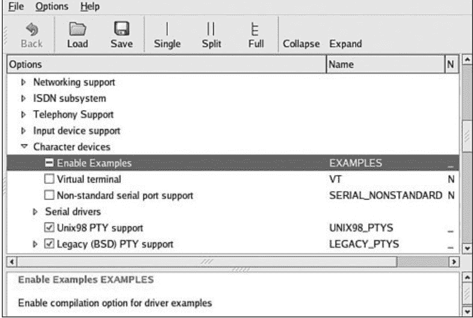

现在我们已经添加了配置选项来启用编译我们的示例设备驱动程序模块，我们需要修改 `.../drivers/char` 中的makefile，以指示构建系统在配置中存在 `CONFIG_EXAMPLES` 配置选项时，进入我们新的examples子目录。清单8-3包含针对最近Linux版本中makefile的此补丁。

#### 清单8-3. 示例的Makefile补丁

```
diff -u ~/base/linux-2.6.14/drivers/char/Makefile
./drivers/char/Makefile
--- ~/base/linux-2.6.14/drivers/char/Makefile
+++ ./drivers/char/Makefile
@@ -88,6 +88,7 @@
 obj-$(CONFIG_DRM) += drm/
 obj-$(CONFIG_PCMCIA) += pcmcia/
 obj-$(CONFIG_IPMI_HANDLER) += ipmi/
+obj-$(CONFIG_EXAMPLES) += examples/

 obj-$(CONFIG_HANGCHECK_TIMER) += hangcheck-timer.o
```

清单8-3中的补丁在 `.../drivers/char` 中找到的makefile中添加了单行（前面有 `+` 字符）。附加的上下文行是为了让补丁工具可以确定在哪里插入新行。我们新的 `examples` 目录被添加到此makefile中已搜索的目录列表末尾，这似乎是一个合乎逻辑的位置。除了保持一致性和可读性外，位置并不重要。

完成本节中的步骤后，现在已具备构建示例设备驱动程序的基础设施。这种方法的美妙之处在于，只要配置选项被选中（`M` 或 `Y`），驱动程序就会在调用内核构建时自动构建，并且驱动模块会包含在构建中。

为任意ARM系统构建模块的命令行可能如下所示：

```
$ make ARCH=arm CROSS_COMPILE=xscale_be- modules
```

清单8-4显示了模块进行典型编辑会话后的构建输出（在此内核源码树中，所有其他模块已构建完成）。

#### 清单8-4. 模块构建输出

```
$ make ARCH=arm CROSS_COMPILE=xscale_be- modules
  CHK     include/linux/version.h
make[1]: 'arch/arm/kernel/asm-offsets.s' is up to date.
make[1]: 'include/asm-arm/mach-types.h' is up to date.
  CC [M]  drivers/char/examples/hello1.o
  Building modules, stage 2.
  MODPOST
  LD [M]  drivers/char/examples/hello1.ko
```

### 8.1.5. 安装你的设备驱动程序

既然驱动程序已经构建完成，我们可以在运行的内核上加载和卸载它以观察其行为。在我们加载模块之前，我们需要将其复制到目标系统上的适当位置。


虽然我们可以将模块放在任何想要的位置，但对于内核模块以及它们在运行中的 Linux 系统上的存放位置，已经存在一个约定俗成的规范。与模块编译一样，最简单的方式是让内核构建系统为我们完成这项工作。`modules_install` 这个 makefile 目标会自动将模块按逻辑布局放置到系统中。你只需将期望的位置作为默认路径的前缀提供即可。

在标准的 Linux 工作站安装中，你可能已经知道设备驱动模块位于 `/lib/modules/<kernel-version>/...` 中，其排列方式与 Linux 内核树中的设备驱动目录层次结构类似。[1] `<kernel-version>` 字符串是通过在目标 Linux 系统上执行 `uname -r` 命令生成的。如果你没有向内核构建系统提供安装前缀，默认情况下，你的模块将安装到你自己的工作站的 `/lib/modules/...` 目录中。这可能并非你的本意。你可以指向主目录中的一个临时位置，然后手动将模块复制到目标文件系统中。或者，如果你的目标嵌入式系统使用 NFS 根挂载到本地开发工作站上的某个目录，你可以直接将模块安装到目标文件系统中。以下示例假设采用后一种方式。

> [1] 此路径由 Red Hat 和 Fedora 发行版使用，也是本章末尾引用的文件系统层次结构标准所要求的。其他发行版可能在文件系统中使用不同的位置来存放内核模块。

```
$ make ARCH=arm CROSS_COMPILE=xscale_be- \
    INSTALL_MOD_PATH=/home/chris/sandbox/coyote-target \
    modules_install
```

这将所有模块放置到 `coyote-target` 目录中，在该示例系统中，该目录通过 NFS 导出并作为目标系统上的根挂载。[2]

> [2] 托管目标板和 NFS 根挂载的详细内容在第 12 章"嵌入式开发环境"中介绍。

### 8.1.6. 加载你的模块

完成了所有必要的步骤后，我们现在可以加载并测试设备驱动模块了。清单 8-5 显示了在嵌入式系统上加载并随后卸载设备驱动时产生的输出。

#### 清单 8-5. 加载和卸载模块

```
$ modprobe hello1                    <<< 加载驱动
Hello Example Init
$ modprobe -r hello1                  <<< 卸载驱动
Hello Example Exit
$
```

你应该能够将输出与清单 8-1 中找到的设备驱动源代码关联起来。该模块除了通过 `printk()` 向内核日志系统打印消息外，不做任何实际工作，我们在控制台上可以看到这些消息。[3] 当模块被加载时，会调用模块初始化函数。我们使用 `module_init()` 宏来指定在模块插入时将执行的初始化函数。我们声明如下：

> [3] 如果你在控制台上看不到消息，请禁用你的 syslogd 记录器或降低控制台日志级别。我们将在[第 14 章](https://example.com/chapter14)"内核调试技术"中介绍如何操作。

```
module_init(hello_init);
```

在我们的初始化函数中，我们只是打印了必不可少的 hello 消息并返回。在真实的设备驱动中，这里是你执行任何初始资源分配和硬件设备初始化的地方。类似地，当我们卸载模块（使用 `modprobe -r` 命令）时，会调用我们的模块退出例程。如[清单 8-1](https://example.com/listing8-1)所示，退出例程使用 `module_exit()` 宏来指定。

这就是能够在实际内核中实时插入的骨架设备驱动的全部内容。在后续章节中，我们将为可加载设备驱动模块引入额外的功能，以说明用户空间程序如何与设备驱动模块交互。

## 8.2. 模块工具

我们在[清单 8-5](#)中简要介绍了模块工具。在那里，我们使用模块工具 `modprobe` 向 Linux 内核插入和移除设备驱动模块。有许多小型工具用于管理设备驱动模块。本节将介绍它们。建议你参考每个工具的 `man` 页面以获取完整详情。事实上，那些希望深入了解 Linux 可加载模块的人应该查阅这些工具的源代码。本章末尾的[第 8.6.1 节](#)"补充阅读建议"包含了可以找到它们的参考。

### 8.2.1. insmod

insmod 工具是将模块插入运行中内核的最简单方式。你提供完整路径名，insmod 完成其余工作。例如：

```
$ insmod /lib/modules/2.6.14/kernel/drivers/char/examples/hello1.ko
```

这将模块 `hello1.ko` 加载到内核中。输出将与[清单 8-5](#)中所示相同，即 `Hello` 消息。insmod 工具是一个简单的程序，不需要也不接受任何选项。它要求完整路径名，因为它没有搜索模块的逻辑。大多数情况下，你将使用下面介绍的 modprobe，因为它具有更多功能和特性。

### 8.2.2. 模块参数

许多设备驱动模块可以接受参数来修改其行为。示例包括启用调试模式、设置详细报告或指定模块特定选项。insmod 工具通过在模块名称后指定参数来接受参数（在某些上下文中也称为*选项*）。[清单 8-6](#)显示了我们修改后的 `hello1.c` 示例，添加了一个模块参数来启用调试模式。

#### 清单 8-6. 带参数的示例驱动

```
/* Example Minimal Character Device Driver */
#include <linux/module.h>

static int debug_enable = 0;       /* Added driver parameter */
module_param(debug_enable, int, 0);  /* and these 2 lines */
MODULE_PARM_DESC(debug_enable, "Enable module debug mode.");

static int __init hello_init(void)
{
    /* Now print value of new module parameter */
    printk("Hello Example Init - debug mode is %s\n",
           debug_enable ? "enabled" : "disabled")

    return 0;
}

static void __exit hello_exit(void)
{
    printk("Hello Example Exit\n");
}

module_init(hello_init);
module_exit(hello_exit);

MODULE_AUTHOR("Chris Hallinan");
MODULE_DESCRIPTION("Hello World Example");
MODULE_LICENSE("GPL");
```

我们的示例设备驱动模块中添加了三行代码。第一行声明了一个静态整数来保存我们的调试标志。第二行是在 `.../include/linux/moduleparam.h` 中定义的宏，用于向内核模块子系统注册模块参数。第三行新代码是一个宏，用于向内核模块子系统注册与该参数关联的字符串描述。当我们稍后在本章中检查 `modinfo` 命令时，其用途将变得清晰。

如果我们现在使用 insmod 插入我们的示例模块，并添加 `debug_enable` 选项，我们应该会看到基于[清单 8-6](#)中修改后的 `hello1.c` 模块的输出。

```
$ insmod /lib/modules/.../examples/hello1.ko debug_enable=1
  Hello Example Init - debug mode is enabled
```

或者，如果我们省略可选的模块参数：

```
$ insmod /lib/modules/.../examples/hello1.ko
  Hello Example Init - debug mode is disabled
```

### 8.2.3. lsmod

lsmod 工具也相当简单。它只是显示已插入内核的模块的格式化列表。最近的版本不接受任何参数，只是格式化 `/proc/modules` 的输出。[4] 清单 8-7 是 lsmod 输出的示例。

> [4] `/proc/modules` 是 `proc` 文件系统的一部分，该文件系统在第 9 章"文件系统"中介绍。

#### 清单 8-7. lsmod 示例输出格式

```
$ lsmod
Module                  Size  Used by
ext3                  121096  0
jbd                    49656  1 ext3
loop                   12712  0
hello1                  1412  0
$
```

注意最右侧标记为 `Used by` 的列。该列指示设备驱动模块正在使用中，并显示依赖链。在此示例中，`jbd` 模块（用于日志文件系统的日志例程）正被 `ext3` 模块使用，`ext3` 是许多流行 Linux 桌面发行版的默认日志文件系统。这意味着 `ext3` 设备驱动依赖于 `jbd` 的存在。

### 8.2.4. modprobe

这就是 modprobe 的巧妙之处。在清单 8-7 中，我们看到了 `ext3` 和 `jbd` 模块之间的关系。`ext3` 模块依赖于 `jbd` 模块。modprobe 工具可以发现这种关系并按正确顺序加载依赖模块。以下命令同时加载 `jbd.ko` 和 `ext3.ko` 驱动模块：

```
$ modprobe ext3
```

modprobe 工具有几个控制其行为的命令行选项。正如我们之前看到的，modprobe 可用于移除模块，包括给定模块所依赖的模块。以下是模块移除的示例，同时移除 `jbd.ko` 和 `ext3.ko`：

```
$ modprobe -r ext3
```

modprobe 工具由名为 `modprobe.conf` 的配置文件驱动。这使系统开发人员能够将设备与设备驱动关联起来。对于简单的嵌入式系统，`modprobe.conf` 可能是空的，或者可能只包含很少几行。modprobe 工具编译时带有一组默认规则，在没有有效的 `modprobe.conf` 时建立默认值。仅使用 `-c` 选项调用 modprobe 会显示 modprobe 使用的默认规则集。

清单 8-8 代表一个典型的 `modprobe.conf`，可能存在于包含两个以太网接口的系统上；一个是基于 Prism2 芯片组的无线适配器，另一个是典型

PCI以太网卡。本系统还包含一个基于集成的英特尔声音芯片组的音频子系统。

#### 清单 8-8. 典型的`modprobe.conf`文件

```
$ cat /etc/modprobe.conf
alias eth1 orinoco_pci
options eth1 orinoco_debug=9
alias eth0 e100
alias snd-card-0 snd-intel8x0
options snd-card-0 index=0
$
```

当内核启动并发现无线芯片组时，此配置文件指示`modprobe`加载`orinoco_pci`设备驱动程序，并将其绑定到内核设备`eth1`，同时将可选的模块参数`orinoco_debug=9`传递给设备驱动程序。在发现声卡硬件时，也会执行相同的操作。请注意与声音驱动程序`snd-intel8x0`关联的可选参数。

### 8.2.5. depmod

`modprobe`如何知道给定模块的依赖关系？`depmod`工具在此过程中扮演着关键角色。当执行`modprobe`时，它会在模块安装的相同位置搜索名为`modules.dep`的文件。`depmod`工具会创建此模块依赖关系文件。

该文件包含内核构建系统配置的所有模块列表，以及每个模块的依赖信息。它采用简单的文件格式：每个设备驱动程序模块在文件中占据一行。如果模块有依赖项，则它们会按顺序列在模块名称之后。例如，从清单 8-7 中，我们看到`ext3`模块依赖于`jbd`模块。`modules.dep`中的依赖行将如下所示：

```
ext3.ko: jbd.ko
```

在实际操作中，为了消除歧义，每个模块名称前都会加上其在文件系统中的绝对路径。为了可读性，我们省略了路径信息。更复杂的依赖链，例如声音驱动程序，可能如下所示：

```
snd-intel8x0.ko: snd-ac97-codec.ko snd-pcm.ko snd-timer.ko \
    snd.ko soundcore.ko snd-page-alloc.ko
```

同样，为了可读性，我们移除了前导路径部分。`modules.dep`文件中的每个模块文件名都是一个绝对文件名，包含完整的路径信息，并且存在于单行中。前面的示例被截断为两行，以适应本页的版面空间。

通常，`depmod`在内核构建期间会自动运行。但是，在交叉开发环境中，您必须拥有一个交叉版本的`depmod`，它知道如何读取以目标架构的本机格式编译的模块。或者，大多数嵌入式发行版都有一种方法和`init`脚本条目，以便在每次启动时运行`depmod`，以保证模块依赖关系保持最新。

### 8.2.6. rmmod

此工具也相当简单。它只是从运行中的内核中移除一个模块。将模块名称作为参数传递给它。无需包含路径名或文件扩展名。例如：

```
$ rmmod hello1
    Hello Example Exit
```

这里唯一需要理解的关键点是，当您使用`rmmod`时，它会执行模块的`*_exit()`函数，如前例所示，该例来自我们的`hello1.c`示例（[清单 8-1](link)和[清单 8-6](link)）。

需要注意的是，与`modprobe`不同，`rmmod`不会移除依赖模块。请使用`modprobe -r`来完成此操作。

### 8.2.7. modinfo

您可能已经注意到了[清单 8-1](link)以及后面的[清单 8-6](link)中示例驱动程序的最后几行。这些宏的作用是在二进制模块中放置标签，以便于管理和维护。[清单 8-9](link)是在我们的`hello1.ko`模块上执行`modinfo`的结果。

#### 清单 8-9. modinfo 输出

```
$ modinfo hello1
filename:       /lib/modules/.../char/examples/hello1.ko
author:         Chris Hallinan
description:    Hello World Example
license:        GPL
vermagic:       2.6.14 ARMv5 gcc-3.3
depends:
parm:           debug_enable:Enable module debug mode. (int)
$
```

第一个字段是显而易见的：它是设备驱动程序模块的完整文件名。为了可读性，我们再次截断了路径。接下来的几行是[清单 8-6](link)末尾描述性宏的直接结果，即文件名、作者和许可证信息。这些只是供模块工具使用的标签，不会影响设备驱动程序本身的行为。您可以从其`man`页面和modinfo源代码中了解更多关于modinfo的信息。

modinfo一个非常有用的功能是了解模块支持哪些参数。从[清单 8-9](link)中，您可以看到此模块仅支持一个参数。这就是我们在[清单 8-6](link)中添加的`debug_enable`。清单给出了名称、类型（本例中为`int`）以及我们使用`MODULE_PARM_DESC()`宏输入的描述性文本字段。这可能非常方便，特别是对于您可能无法轻松访问源代码的模块。

在我们对模块工具的简要介绍中，我们已经涉及了很多内容。在本章的剩余部分，我们将描述从用户空间程序（您的应用程序代码）与设备驱动程序通信的基本机制。

我们已经介绍了负责模块一次初始化和退出处理的两种基本方法。回顾[清单 8-1](link)，它们是`module_init()`和`module_exit()`。我们发现这些例程在模块被插入或从运行中的内核中移除时被调用。现在我们需要一些方法来从应用程序与我们的设备驱动程序进行接口交互。毕竟，我们使用设备驱动程序的两个更重要的原因，一是将用户与在内核空间编写代码的危险隔离，二是提供一种与硬件或内核级设备通信的统一方法。

## 8.3. 驱动程序方法

### 8.3.1. 驱动程序文件系统操作

将设备驱动程序加载到活动内核后，我们必须采取的第一个行动是为后续操作准备驱动程序。为此目的使用了`open()`方法。驱动程序打开后，我们需要用于读取和写入驱动程序的例程。提供了一个`release()`例程，用于在操作完成时进行清理（基本上是一个关闭调用）。最后，提供了一个特殊的系统调用，用于与驱动程序进行非标准通信。这被称为`ioctl()`。[清单 8-10](link)将此基础结构添加到了我们的示例设备驱动程序中。

#### 清单 8-10. 为`Hello.c`添加文件系统操作

```c
#include <linux/module.h>
#include <linux/fs.h>

#define HELLO_MAJOR 234

static int debug_enable = 0;
module_param(debug_enable, int, 0);
MODULE_PARM_DESC(debug_enable, "Enable module debug mode.");

struct file_operations hello_ops;

static int hello_open(struct inode *inode, struct file *file)
{
    printk("hello_open: successful\n");
    return 0;
}

static int hello_release(struct inode *inode, struct file *file)
{
    printk("hello_release: successful\n");
    return 0;
}

static ssize_t hello_read(struct file *file, char *buf, size_t count,
                          loff_t *ptr)
{
    printk("hello_read: returning zero bytes\n");
    return 0;
}

static ssize_t hello_write(struct file *file, const char *buf,
                           size_t count, loff_t * ppos)
{
    printk("hello_read: accepting zero bytes\n");
    return 0;
}

static int hello_ioctl(struct inode *inode, struct file *file,
                       unsigned int cmd, unsigned long arg)
{
    printk("hello_ioctl: cmd=%ld, arg=%ld\n", cmd, arg);
    return 0;
}

static int __init hello_init(void)
{
    int ret;
    printk("Hello Example Init - debug mode is %s\n",
           debug_enable ? "enabled" : "disabled");
    ret = register_chrdev(HELLO_MAJOR, "hello1", &hello_fops);
    if (ret < 0) {
        printk("Error registering hello device\n");
        goto hello_fail1;
    }
    printk("Hello: registered module successfully!\n");
    /* 此处进行初始化处理... */

    return 0;

hello_fail1:
    return ret;
}

static void __exit hello_exit(void)
{
    printk("Hello Example Exit\n");
}

struct file_operations hello_fops = {
    owner:   THIS_MODULE,
    read:    hello_read,
    write:   hello_write,
    ioctl:   hello_ioctl,
    open:    hello_open,
    release: hello_release,
};

module_init(hello_init);
module_exit(hello_exit);

MODULE_AUTHOR("Chris Hallinan");
MODULE_DESCRIPTION("Hello World Example");
MODULE_LICENSE("GPL");
```

这个扩展后的设备驱动程序示例包含了许多新的内容。从顶部开始，我们不得不添加一个新的内核头文件来获取文件系统操作的定义。我们还为设备驱动程序定义了一个主设备号。*(致设备驱动程序作者的注：* 这不是分配设备驱动程序主设备号的正确方式。请参考Linux内核文档（`.../Documentation/devices.txt`）或关于设备驱动程序的优秀文本来了解主设备号的分配指导。对于这个简单的例子，我们只是选择了一个我们知道在系统中未使用的号。)

接下来我们看到四个新函数的定义，我们的打开、关闭、读取和写入方法。为了遵循良好的编码实践，我们采用了一致的命名方案，该方案不会与内核中的任何其他子系统冲突。我们的新方法分别称为`hello_open()`、`hello_release()`、`hello_read()`和`hello_write()`。出于这个简单练习的目的，它们是只向内核日志子系统打印消息的空操作函数。

请注意，我们还在`hello_init()`例程中添加了一个新的函数调用。这行代码注册了我们的

设备驱动与内核。通过该注册调用，我们传递一个包含所需方法指针的结构体。内核使用这个类型为 `struct file_operations` 的结构体，将我们的特定设备功能与文件系统中的相应请求绑定。当一个应用程序打开由我们的设备驱动所代表的设备并请求执行 `read()` 操作时，文件系统会将该通用的 `read()` 请求与我们模块的 `hello_read()` 函数关联起来。后续章节将详细探讨这一过程。

例如，对于一个多端口串行卡，主设备号将指定驱动程序。次设备号则可能指定该多端口卡上由同一驱动程序处理的多个端口之一。感兴趣的读者可参考有关设备驱动的优秀文献以获取更多细节。

## 8.4. 融会贯通

现在我们已经有了一个基本的设备驱动程序骨架，我们可以加载并测试它。清单 8-11 是一个简单的用户空间应用程序，用于测试我们的设备驱动。我们已经了解了如何加载驱动程序。只需编译它并执行 `make modules_install` 命令，即可将其放置到你的文件系统中，如前所述。

#### 清单 8-11. 测试我们的设备驱动

```
#include <stdio.h>
#include <stdlib.h>
#include <sys/types.h>
#include <sys/stat.h>
#include <fcntl.h>
#include <unistd.h>

int main(int argc, char **argv)
{
    /* Our file descriptor */
    int fd;
    int rc = 0;
    char *rd_buf[16];

    printf("%s: entered\n", argv[0]);

    /* Open the device */
    fd = open("/dev/hello1", O_RDWR);
    if ( fd == -1 ) {
        perror("open failed");
        rc = fd;
        exit(-1);
    }
    printf("%s: open: successful\n", argv[0]);
    /* Issue a read */
    rc = read(fd, rd_buf, 0);
    if ( rc == -1 ) {
        perror("read failed");
        close(fd);
        exit(-1);
    }
    printf("%s: read: returning %d bytes!\n", argv[0], rc);
    close(fd);
    exit(0);
}
```

这个在 ARM XScale 系统上编译的简单文件，演示了如何通过设备节点将应用程序与设备驱动绑定。与设备驱动本身一样，它并没有执行任何实际工作，但通过调用我们在清单 8-10 的设备驱动中引入的一些方法，确实演示了相关的概念。

首先，我们对之前创建的设备节点执行 open() 系统调用。如果打开成功，我们会在控制台输出一条信息。接着，我们执行 read() 命令，并在成功时再次向控制台打印信息。请注意，从内核的角度来看，读取 0 字节是完全可接受的，并且在实际应用中，这通常表示文件结束或数据读完的状况。这个特殊状况是由你的设备驱动定义的。完成后，我们只需关闭文件并退出。清单 8-12 捕获了在 ARM XScale 目标机上运行此示例应用程序的输出：

实际上，open() 调用是围绕 Linux sys_open() 系统调用的一个 C 库包装函数。

#### 清单 8-12. 使用示例驱动

```
$ modprobe hello1
Hello Example Init - debug mode is disabled
Hello: registered module successfully!
$ ./use-hello
./use-hello: entered
./use-hello: open: successful
./use-hello: read: returning zero bytes!
$
```

## 8.5. 设备驱动与 GPL

关于设备驱动以及 GNU 公共许可证条款如何适用于设备驱动的问题，存在大量的讨论和争论。第一个检验标准是众所周知的：如果你的设备驱动（或任何软件，就此而言）哪怕部分基于现有的 GPL 软件，它就被称作*衍生作品*。例如，如果你从一个当前的 Linux 设备驱动开始，并修改它以满足你的需求，这肯定被视为衍生作品，你有义务根据 GPL 的条款授权这个修改过的设备驱动，并遵守其所有要求。

争论正源于此。首先，免责声明。这不是法律意见，作者也不是律师。截至本文撰写时，其中一些概念尚未在法庭上经过检验。法律界和开源界的主流观点是，如果可以证明[8]一部作品是独立创作的，并且特定的设备驱动并不假定对 Linux 内核具有“密切了解”，那么开发者可以自由地以他们认为合适的方式授权该驱动。如果为了适应驱动的特殊需求而对内核进行了修改，则被视为衍生作品，因此受 GPL 约束。

[8] 这种做法并非开源独有。版权和专利侵权是所有开发者持续关注的问题。

在开源社区中，关于这些问题的信息库庞大且不断增长。似乎在未来某个时刻，这些概念将在法庭上接受检验，并形成判例。这需要多长时间，谁也说不准。如果你有兴趣更好地了解围绕 Linux 和开源的法律问题，你可能会喜欢 [www.open-bar.org](www.open-bar.org)。

## 8.6. 本章小结

本章从高层概述了设备驱动的基础知识以及它们如何融入 Linux 系统架构。掌握了这些基础知识后，设备驱动领域的新手读者就可以开始阅读一本专门针对设备驱动编写者的优秀著作了。请参阅 8.6.1 节获取参考资料。

- 设备驱动程序强制在非特权的用户应用程序与关键的内核资源（如硬件和其他设备）之间建立合理的分离，并为应用程序提供一个众所周知的统一接口。
- 加载设备驱动程序所需的最小基础设施仅仅几行代码。我们介绍了这个最小基础设施，并在此基础上构建了一个简单的驱动模块框架。
- 配置为可加载模块的设备驱动程序可以在内核启动后插入到运行中的内核，也可以从中移除。
- 模块工具用于管理设备驱动模块的插入、移除和列表。我们介绍了用于这些功能的模块工具的详细信息。
- 文件系统上的设备节点提供了用户空间应用程序与设备驱动之间的粘合剂。
- 驱动方法实现了 UNIX/Linux 设备驱动中常见的 open、read、write 和 close 功能。我们通过示例解释了这一机制，包括一个简单的用户应用程序来测试这些驱动方法。
- 我们以介绍内核设备驱动与开源 GNU 公共许可证之间的关系结束了本章。

### 8.6.1. 建议延伸阅读

*Linux Device Drivers*，第三版
Alessandro Rubini 和 Jonathan Corbet
O'Reilly 出版社，2005年

Filesystem Hierarchy Standard
由 Rusty Russel、Daniel Quinlan 和 Christopher Yeoh 编辑
The File Systems Hierarchy Standards Group
[www.pathname.com/fhs/](http://www.pathname.com/fhs/)

Rusty's Linux Kernel Page
Module Utilities for 2.6
Rusty Russell
[http://kernel.org/pub/linux/kernel/people/rusty/](http://kernel.org/pub/linux/kernel/people/rusty/)


# 第 9 章. 文件系统

## 本章内容

- [Linux 文件系统概念](page 214)
- [ext2](page 216)
- [ext3](page 221)
- [ReiserFS](page 224)
- [JFFS2](page 225)
- [cramfs](page 228)
- [网络文件系统](page 230)
- [伪文件系统](page 234)
- [其他文件系统](page 240)
- [构建一个简单的文件系统](page 242)
- [本章小结](page 243)

嵌入式开发者做出的最重要决策之一，或许是选择部署哪种文件系统。一些文件系统为性能而优化，另一些则为尺寸而优化。还有一些则为设备或电源故障后的数据恢复而优化。本章介绍了 Linux 系统上使用的主要文件系统，并考察了它们在嵌入式设计中的特点。本章的目的并非深入探究每个文件系统的内部技术细节。相反，本章考察了所介绍的每个文件系统的运行特性和开发相关问题。感兴趣的读者可以在本章末尾的 9.11.1 节“建议延伸阅读”中找到参考资料。

我们从早期 Linux 桌面发行版上最流行的文件系统开始，使用第二扩展文件系统（ext2）来介绍概念，为后续讨论奠定基础。接下来，我们看看它的继任者，第三扩展文件系统（ext3），它是当今许多流行桌面 Linux 发行版的默认文件系统。

在介绍了一些基础知识之后，我们考察了各种专用文件系统，包括那些为数据恢复和存储空间而优化的文件系统，以及那些设计用于闪存设备上的文件系统。本章介绍了网络文件系统（NFS），随后讨论了更重要的伪文件系统，包括 `proc` 文件系统和 `sysfs`。


## 9.1. Linux 文件系统概念

在深入探讨各个文件系统的细节之前，让我们先从宏观上了解 Linux 系统上数据是如何存储的。在我们于[第 8 章](https://example.com)“设备驱动程序基础”中对设备驱动程序的研究中，我们了解了字符设备的结构。一般来说，字符设备以串行流的方式存储和检索数据。字符设备最基本的示例是串口或磁带驱动器。相比之下，块设备以大小相等的数据块为单位存储和检索数据。例如，典型的 IDE 硬盘控制器可以一次向物理媒体上特定的、可寻址的位置传输 512 字节的数据，反之亦然。文件系统是基于块设备的。

### 9.1.1. 分区

在我们开始讨论文件系统之前，我们首先介绍分区——这是文件系统所存在的物理设备的逻辑划分。在最高层面上，数据存储在物理设备的分区中。分区是物理媒体（硬盘、闪存）的逻辑划分，其数据按照给定分区类型的规范进行组织。一个物理设备可以有一个覆盖其所有可用空间的单一分区，也可以被划分为多个分区以适应特定任务。分区可以被视为一个逻辑磁盘，一个完整的文件系统可以被写入其中。

[图 9-1](#) 展示了分区和文件系统之间的关系。

#### 图 9-1. 分区和文件系统

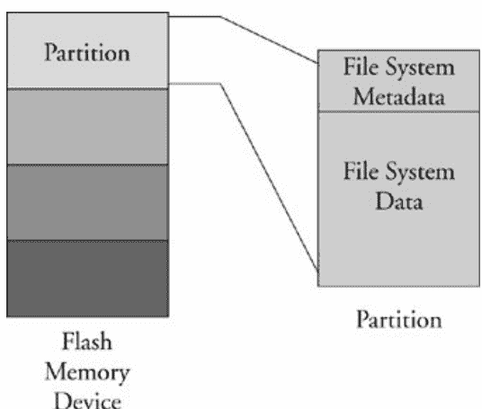

Linux 使用一个名为 fdisk 的工具来操作块设备上的分区。许多 Linux 发行版上的较新 fdisk 工具知道超过 90 种不同的分区类型。实际上，在 Linux 系统上常用的只有少数几种。一些常见的分区类型包括 Linux、FAT32 和 Linux Swap。

[代码清单 9-1](#) 显示了针对连接到 USB 端口的 CompactFlash 设备运行 fdisk 工具的输出。在这个特定的目标系统上，USB 子系统将 CompactFlash 物理设备分配给了设备节点 `/dev/sdb`。

#### 代码清单 9-1. 使用 fdisk 显示分区信息

```
# fdisk /dev/sdb
Command (m for help): p
Disk /dev/sdb: 49 MB, 49349120 bytes
4 heads, 32 sectors/track, 753 cylinders
Units = cylinders of 128 * 512 = 65536 bytes

  Device Boot      Start         End      Blocks   Id  System
/dev/sdb1   *           1         180       11504   83  Linux
/dev/sdb2             181         360       11520   83  Linux
/dev/sdb3             361         540       11589482   83  Linux
/dev/sdb4             541         753       13632   83  Linux
```

在本次讨论中，我们使用 fdisk 工具在设备上创建了四个分区。其中一个被标记为可启动，如标有 `Boot` 的列中的星号所示。这仅仅是在代表设备分区表的数据结构中设置了一个标志。从代码清单中可以看出，fdisk 使用的逻辑存储单元是柱面。[1] 在该设备上，一个柱面包含 64KB。另一方面，Linux 将最小的存储单元表示为逻辑块。你可以从这个代码清单推断出，一个块是 1024 字节的单位。

> [1] *柱面* 这个术语借用了旋转媒体上的存储单元。它由磁盘设备给定扇区上一组磁头下的数据组成。这里使用它是为了与现有文件系统工具兼容。

CompactFlash 以这种方式分区后，每个代表一个分区的设备都可以使用你选择的文件系统进行格式化。当使用给定的文件系统类型对分区进行格式化后，Linux 就可以从该分区挂载相应的文件系统。

### 9.2. ext2

基于[代码清单 9-1](Listing_9-1) 的示例，我们需要使用 fdisk 创建的分区进行格式化。为此，我们使用 Linux 的 mke2fs 工具。mke2fs 类似于熟悉的 DOS format 命令。此工具在指定的分区上创建 ext2 类型的文件系统。mke2fs 是专门针对 ext2 文件系统的；其他文件系统有其自己版本的这些工具。[代码清单 9-2](Listing_9-2) 记录了此过程的输出。

#### 代码清单 9-2. 使用 mke2fs 格式化分区

```
# mke2fs /dev/sdb1 -L CFlash_Boot_Vol
mke2fs 1.37 (21-Mar-2005)
Filesystem label=CFlash_Boot_Vol
OS type: Linux
Block size=1024 (log=0)
Fragment size=1024 (log=0)
2880 inodes, 11504 blocks
575 blocks (5.00%) reserved for the super user
First data block=1
Maximum filesystem blocks=11796480
2 block groups
8192 blocks per group, 8192 fragments per group
1440 inodes per group
Superblock backups stored on blocks:
        8193

Writing inode tables: done
Writing superblocks and filesystem accounting information: done

This filesystem will be automatically checked every 39 mounts or
180 days, whichever comes first.  Use tune2fs -c or -i to override.
#
```

[代码清单 9-2](Listing_9-2) 包含了大量与 ext2 文件系统相关的细节，并为开始理解其操作特性提供了一个绝佳的方式。请注意，此分区被格式化为 ext2 类型，卷标签为 CFlash_Boot_Vol。它是在 Linux 分区上创建的（OS Type:），块大小为 1024 字节。为 2,880 个 inode 分配了空间，占据了 11,504 个块。inode 是表示单个文件的基本数据结构。有关 ext2 文件系统内部结构的更详细信息，读者可参考本章末尾的[第 9.11.1 节](Section_9.11.1)。

查看[代码清单 9-2](Listing_9-2) 中 mke2fs 的输出，我们可以确定存储设备组织方式的某些特性。我们已经知道块大小是 1024 字节。如果你的特定应用需要，可以指示 mke2fs 使用不同的块大小格式化 ext2 文件系统。当前实现允许的块大小有 1,024、2,048 和 4,096 字节。

块大小总是需要在最佳性能上做出妥协。一方面，在具有许多文件的磁盘上，较大的块大小会浪费更多空间，因为每个文件必须恰好占据整数个块。任何超过 `block_size * n` 的剩余片段都必须占用另一个完整的块，即使只有 1 字节。另一方面，非常小的块大小会增加管理描述块到文件映射的元数据的文件系统开销。对你特定硬件实现进行基准测试是确保你选择了最佳块大小的唯一方法。

#### 9.2.1. 挂载文件系统

创建文件系统后，我们可以在运行的 Linux 系统上挂载该文件系统，前提是我们有权访问硬件设备，并且内核已编译了对我们特定文件系统类型的支持，可以是编译进内核的模块，也可以是动态可加载模块。以下命令将先前创建的 ext2 文件系统挂载到我们指定的挂载点：

```
# mount /dev/sdb1 /mnt/flash
```

此示例假设我们在目标 Linux 机器上创建了一个名为 `/mnt/flash` 的目录。这被称为挂载点，因为我们将文件系统安装（挂载）在文件系统层次结构的这个位置。我们挂载的是前面描述的内核分配给设备 `/dev/sdb1` 的闪存设备。在典型的 Linux 桌面（开发）机器上，我们需要拥有 root 权限才能执行此命令。[2] 挂载点可以是你决定的文件系统上的任何位置，它成为你新挂载设备的顶级（根）目录。在前面的示例中，要引用闪存设备上的任何文件，你必须在路径前加上 `/mnt/flash`。

> [2] 文件系统可以设置为允许非 root 用户挂载，例如使用 `cdrom`。

`mount` 命令是一个功能强大的命令，具有许多选项。`mount` 接受的许多选项取决于 `mount` 操作的目标文件系统类型。大多数时候，`mount` 可以确定已知内核能正确识别的文件系统类型。随着本章的推进，我们将提供 `mount` 命令的额外使用示例。

[代码清单 9-3](#) 显示了为任意嵌入式系统配置的闪存设备的目录内容。

#### 代码清单 9-3. 闪存设备列表

 ```
$ ls -l /mnt/flash
total 24
drwxr-xr-x  2 root root  1024 Jul 18 20:18 bin
drwxr-xr-x  2 root root  1024 Jul 18 20:18 boot
drwxr-xr-x  2 root root  1024 Jul 18 20:18 dev
drwxr-xr-x  2 root root  1024 Jul 18 20:18 etc
drwxr-xr-x  2 root root  1024 Jul 18 20:18 home
drwxr-xr-x  2 root root  1024 Jul 18 20:18 lib
drwx------  2 root root 12288 Jul 17 13:38 lost+found
drwxr-xr-x  2 root root  1024 Jul 18 20:18 proc
drwxr-xr-x  2 root root  1024 Jul 18 20:18 root
drwxr-xr-x  2 root root  1024 Jul 18 20:18 sbin
drwxr-xr-x  2 root root  1024 Jul 18 20:18 tmp
drwxr-xr-x  2 root root  1024 Jul 18 20:18 usr
drwxr-xr-x  2 root root  1024 Jul 18 20:18 var
$
```

[代码清单 9-3](#) 是一个嵌入式系统根文件系统在顶层（根目录）可能是什么样子的示例。[第 6 章](#)"系统初始化"提供了关于如何确定根文件系统内容的指导和示例。

### 9.2.2. 检查文件系统完整性

`e2fsck` 命令用于检查 ext2 文件系统的完整性。文件系统可能因多种原因而损坏，但迄今为止最常见的原因是意外断电或故意断电而未先关闭所有打开的文件并卸载文件系统。Linux 发行版在关机序列期间执行这些操作（假设系统有序关机）。然而，当我们处理嵌入式系统时，意外断电很常见，我们需要针对这些情况提供一些防御措施。`e2fsck` 是我们使用 ext2 文件系统时应对意外断电的第一道防线。

[代码清单 9-4](#) 显示了在我们的 CompactFlash 上运行 `e2fsck` 的输出，该 CompactFlash 来自前面的示例。它已格式化并正确卸载；应该没有错误。

#### 代码清单 9-4. 干净的文件系统检查

```
# e2fsck /dev/sdb1
e2fsck 1.37 (21-Mar-2005)
CFlash_Boot_Vol: clean, 23/2880 files, 483/11504 blocks
#
```

`e2fsck` 工具检查文件系统的多个方面以确保一致性。如果没有发现问题，`e2fsck` 会发出类似于 [代码清单 9-4](#) 中所示的消息。请注意，`e2fsck` 应仅在已卸载的文件系统上运行。虽然可以在已挂载的文件系统上运行它，但这样做可能会对磁盘或 Flash 设备上的内部文件系统结构造成严重损坏。

为了创建一个更有趣的示例，代码清单 9-5 是通过在 CompactFlash 设备仍挂载时将其从插槽中拔出而创建的。我们在移除它之前故意在该设备上创建了一个文件并进行了编辑。这可能导致描述文件的内部数据结构以及包含文件数据的实际数据块的损坏。

#### 代码清单 9-5. 损坏的文件系统检查

```
# e2fsck -y /dev/sdb1
e2fsck 1.37 (21-Mar-2005)
/dev/sdb1 was not cleanly unmounted, check forced.
Pass 1: Checking inodes, blocks, and sizes
Inode 13, i_blocks is 16, should be 8.  Fix? yes

Pass 2: Checking directory structure
Pass 3: Checking directory connectivity
Pass 4: Checking reference counts
Pass 5: Checking group summary information

/dev/sdb1: ***** FILE SYSTEM WAS MODIFIED *****
/dev/sdb1: 25/2880 files (4.0% non-contiguous), 488/11504 blocks
#
```

从代码清单 9-5 中，你可以看到 `e2fsck` 检测到 CompactFlash 未干净卸载。此外，你可以看到 `e2fsck` 检查期间对文件系统的处理过程。`e2fsck` 工具对文件系统进行五次遍历，检查内部文件系统数据结构的各种元素。由于 `e2fsck` 命令行中包含了 `-y` 标志，与文件相关的一个错误（由 inode[3] 13 标识）被自动修复。

> [3] 文件系统上的文件由一种称为 inode 的内部 ext2 数据结构表示。

当然，在真实系统中，你可能不会这么幸运。某些类型的文件系统错误无法使用 `e2fsck` 修复。此外，嵌入式系统设计人员应该了解，如果电源在未正确关机的情况下被移除，启动周期可能会因扫描启动设备并修复任何错误所需的时间而延迟。事实上，如果这些错误无法修复，系统启动将被暂停并需要手动干预。此外，需要注意的是，如果你的文件系统很大，文件系统检查（`fsck`）可能需要几分钟甚至几个小时，对于大型多千兆字节文件系统而言。

另一种防止文件系统损坏的方法是确保写入在写入时立即提交到磁盘。`sync` 工具可用于强制将所有排队的 I/O 请求提交到各自的设备。一种尽量减少因意外断电或驱动器故障导致数据损坏的脆弱窗口的策略是在每次文件写入后或根据应用程序需求按需策略性地发出 `sync` 命令。这里的权衡当然是性能损失。延迟磁盘写入是所有现代操作系统中使用的性能优化。有效地使用 `sync` 会抵消这种优化。

ext2 文件系统已经发展成为一种快速、高效且稳健的 Linux 系统文件系统。然而，如果你需要日志文件系统提供的额外可靠性，或者非规范关机后的启动时间是你的设计中的一个问题，你应该考虑 ext3 文件系统。

## 9.3. ext3

ext3 文件系统已成为一种功能强大、高性能且稳健的日志文件系统。它目前是许多流行桌面 Linux 发行版（如 Red Hat 和 Fedora Core 系列）的默认文件系统。

ext3 文件系统基本上是 ext2 文件系统的扩展，增加了日志功能。日志是一种技术，其中文件系统的每个更改都记录在一个特殊文件中，以便可以从已知的日志点进行恢复。ext3 文件系统的主要优势之一是它能够在非规范关机后直接挂载。如上一节所述，当系统意外关机时（例如停电期间），系统会强制进行文件系统一致性检查，这可能是一个耗时的操作。对于 ext3 文件系统，不需要进行一致性检查，因为只需重放日志即可确保文件系统的一致性。

不深入超出本书范围的设计细节，值得简要解释一下日志文件系统的工作原理。日志文件系统包含一个特殊文件，通常对用户隐藏，用于存储文件系统元数据 <sup>[4]</sup> 和文件数据本身。这个特殊文件被称为日志。每当文件系统发生更改（例如写入操作）时，更改首先被写入日志。文件系统驱动程序确保在实际更改发布并提交到存储介质（磁盘或 Flash，例如）之前，此写入已提交到日志。在更改已记录到日志中之后，驱动程序将更改发布到介质上的实际文件和元数据。如果在介质写入期间发生电源故障并重新启动，恢复文件系统一致性所需的全部操作就是重放日志中的更改。

[4] 元数据是关于文件的数据，而不是文件本身的数据。示例包括文件的日期、时间、大小、使用的块等。

ext3 文件系统最重要的设计目标之一是它必须与 supplements_ext2_utility 文件系统向后和向前兼容。可以将 ext2 文件系统转换为 ext3 文件系统，然后再转换回来，而无需重新格式化或重写磁盘上的所有数据。让我们看看这是如何完成的。<sup>[5]</sup> 代码清单 9-6 详细说明了该过程。

[5] 以这种方式转换文件系统应仅被视为开发活动。

#### 代码清单 9-6. 将 ext2 文件系统转换为 ext3 文件系统

```
# mount /dev/sdb1 /mnt/flash       <<< 挂载 ext2 文件系统
# tune2fs -j /dev/sdb1              <<< 创建日志
tune2fs 1.37 (21-Mar-2005)
Creating journal inode: done
This filesystem will be automatically checked every 23 mounts or
180 days, whichever comes first.  Use tune2fs -c or -i to override.
#
```

请注意，我们首先将文件系统挂载到 /mnt/flash 仅出于说明目的。通常，我们应在未挂载的 ext2 分区上执行此命令。当文件系统已挂载时，`tune2fs` 的设计行为是创建一个名为 `.journal` 的日志文件，即一个隐藏文件。在 Linux 中，以句点（`.`）开头的文件被视为隐藏文件；大多数 Linux 命令行文件工具会自动忽略此类文件。从清单 9-7 中可以看到，我们使用了 `-a` 标志调用 `ls` 命令，该标志告诉 `ls` 工具列出所有文件。

#### 清单 9-7. ext3 日志文件

```
$ ls -al /mnt/flash
total 1063
drwxr-xr-x  15 root root     1024 Aug 25 19:25 .
drwxrwxrwx   5 root root     4096 Jul 18 19:49 ..
drwxr-xr-x   2 root root     1024 Aug 14 11:27 bin
drwxr-xr-x   2 root root     1024 Aug 14 11:27 boot
drwxr-xr-x   2 root root     1024 Aug 14 11:27 dev
drwxr-xr-x   2 root root     1024 Aug 14 11:27 etc
drwxr-xr-x   2 root root     1024 Aug 14 11:27 home
-rw-------   1 root root 1048576 Aug 25 19:25 .journal
drwxr-xr-x   2 root root     1024 Aug 14 11:27 lib
drwx------   2 root root   12288 Aug 14 11:27 lost+found
drwxr-xr-x   2 root root     1024 Aug 14 11:27 proc
drwxr-xr-x   2 root root     1024 Aug 14 11:27 root
drwxr-xr-x   2 root root     1024 Aug 14 11:27 sbin
drwxr-xr-x   2 root root     1024 Aug 14 11:27 tmp
drwxr-xr-x   2 root root     1024 Aug 14 11:27 usr
drwxr-xr-x   2 root root     1024 Aug 14 11:27 var
```

现在我们已经在 Flash 模块上创建了日志文件，它实际上已经格式化为 ext3 文件系统。下次系统重新启动或在包含新创建的 ext3 文件系统的分区上运行 `e2fsck` 工具时，日志文件将自动变为不可见。其元数据存储在为此目的预留的保留 inode 中。只要你能看到 `.journal` 文件，修改或删除该文件都是危险的。

在不同设备上创建日志文件是可行的，有时也是有利的。例如，如果你的系统有多个物理设备，你可以将 ext3 日志文件系统放在第一个驱动器上，而将日志文件放在第二个驱动器上。无论你的物理存储是基于 Flash 还是旋转介质，这种方法都适用。要在使用单独分区存储日志文件的情况下，从现有 ext2 文件系统创建日志文件系统，请按以下方式调用 `tune2fs`：

```
# tune2fs -J device=/dev/sda1 -j /dev/sdb1
```

要使此方法生效，你必须已经对日志文件要存放的设备进行了格式化并包含日志文件——它必须是一个 ext3 文件系统。

## 9.4. ReiserFS

ReiserFS 文件系统在一些桌面发行版（如 SuSE 和 Gentoo）中颇受欢迎。截至撰写本文时，Reiser4 是该日志文件系统的当前版本。与 ext3 文件系统一样，ReiserFS 保证给定的文件系统操作要么全部完成，要么全部不完成。与 ext3 不同的是，Reiser4 为系统程序员引入了一个 API，以保证文件系统事务的原子性。考虑以下示例：

一个数据库程序正在忙于更新数据库中的记录。多次写入操作被发送到文件系统。在第一次写入之后、最后一次写入完成之前发生了断电。日志文件系统保证元数据的更改已经存储到日志文件中，这样当系统再次通电时，内核至少能够建立文件系统的一致状态。也就是说，如果文件 A 在断电前报告大小为 16KB，那么断电后它仍然报告为 16KB，并且代表该文件的目录项（实际上是 inode）正确地记录了文件的大小。然而，这并不意味着文件数据已正确写入文件；它仅表示文件系统上没有错误。实际上，在前面的场景中数据库程序很可能已经丢失了数据，是否能够恢复丢失的数据则取决于数据库自身的恢复逻辑。

Reiser4 实现了高性能的"原子"文件系统操作，旨在保护文件系统状态（一致性）以及文件系统操作中涉及的数据。Reiser4 提供了用户级 API，使数据库管理器等程序能够发出文件系统写命令，并保证该命令要么全部成功，要么以类似的方式失败，从而不仅保证文件系统一致性得以维护，而且确保系统崩溃后文件中不会残留部分数据或垃圾数据。

更多详细信息和 ReiserFS 的实际软件，请访问本章末尾第 9.11.1 节中引用的主页。

## 9.5. JFFS2

Flash 存储器已广泛应用于嵌入式产品中。由于 Flash 存储器技术的特性，它天生效率较低，且更容易因写入时间较长而导致断电造成的数据损坏。这种低效率源于块大小。Flash 存储设备的块大小通常以数十或数百 KB 为单位。Flash 存储器一次只能擦除一个块，但写入通常可以一次执行 1 字节或一个字。要更新单个文件，必须擦除整个块并重新写入。

众所周知，任何给定的 Linux 机器（或其他操作系统）上的文件大小分布中，小文件远多于大文件。图 9-2 中使用 gnuplot 生成的直方图展示了典型 Linux 开发系统上的文件大小分布。

图 9-2. 文件大小（字节）


从图 9-2 中可以看出，大部分文件大小远低于约 10KB。4096 处的尖峰代表目录。目录项（本身也是文件）恰好为 4096 字节，而且数量众多。40,000 字节以上的尖峰是测量的产物，它是对超过约 40KB（测量区间的上限）的文件数量的统计。值得注意的是，绝大多数文件都非常小。

小文件大小给 Flash 文件系统设计者带来了独特的挑战。由于 Flash 存储器必须一次擦除整个块，而 Flash 块的大小通常是较小文件大小的许多倍，Flash 因此面临耗时的块重写问题。例如，假设一个 128KB 的 Flash 块被用来存储几十个不超过 4096 字节的文件。现在假设其中一个文件需要被修改。这会导致 Flash 文件系统使整个 128KB 块失效，并将该块中的每个文件重新写入到一个新擦除的块中。这可能是一个耗时的过程。

由于 Flash 写入可能非常耗时（比硬盘写入慢得多），这增加了因突然断电而导致数据损坏的可能性。意外断电在嵌入式系统中很常见。例如，如果在重写前面提到的 128KB 数据块的过程中断电，所有几十个文件都可能丢失。

于是 JFFS2 应运而生。前面讨论的这些问题以及其他一些问题，在第二代日志 Flash 文件系统（JFFS2）的设计中已基本得到缓解或消除。最初的 JFFS 由瑞典的 Axis Communications AB 设计，专门针对当时常见的 Flash 存储设备。JFFS 了解 Flash 的架构，更重要的是，了解设备施加的架构限制。

Flash 文件系统的另一个问题是 Flash 存储器的使用寿命有限。典型的 Flash 存储设备的最低写入周期为 100,000 次，而最近 1,000,000 次写入周期的设备已变得常见。此规范适用于 Flash 设备的每个块。这一特殊限制要求将写入均匀分散到 Flash 存储设备的各个块上。JFFS2 使用一种称为**磨损均衡**的技术来实现此功能。

构建 JFFS2 镜像相对简单。一如既往，你必须确保内核支持 JFFS2，并且你的开发工作站包含兼容版本的 `mkfs.jffs2` 工具。JFFS2 镜像从包含所需文件系统映像文件的目录构建而成。清单 9-8 展示了一个设计用作根文件系统的 Flash 设备的典型目录结构。

#### 清单 9-8. JFFS2 文件系统的目录布局


 ```
$ ls -l
total 44
drwxr-xr-x  2 root root 4096 Aug 14 11:27 bin
drwxr-xr-x  2 root root 4096 Aug 14 11:27 dev
drwxr-xr-x  2 root root 4096 Aug 14 11:27 etc
drwxr-xr-x  2 root root 4096 Aug 14 11:27 home
drwxr-xr-x  2 root root 4096 Aug 14 11:27 lib
drwxr-xr-x  2 root root 4096 Aug 14 11:27 proc
drwxr-xr-x  2 root root 4096 Aug 14 11:27 root
drwxr-xr-x  2 root root 4096 Aug 14 11:27 sbin
drwxr-xr-x  2 root root 4096 Aug 14 11:27 tmp
drwxr-xr-x  2 root root 4096 Aug 14 11:27 usr
drwxr-xr-x  2 root root 4096 Aug 14 11:27 var
$
```

当填充了合适的运行时文件后，此目录布局可用作 `mkfs.jffs2` 命令的模板。`mkfs.jffs2` 命令可以从类似清单 9-8 中的目录树生成一个格式正确的 JFFS2 文件系统镜像。命令行参数用于向 `mkfs.jffs2` 传递目录位置以及接收 JFFS2 镜像的输出文件名称。默认情况下，它会从当前目录创建 JFFS2 镜像。清单 9-9 展示了构建 JFFS2 镜像的命令。

#### 清单 9-9. `mkfs.jffs2` 命令示例

```
# mkfs.jffs2 -d ./jffs2-image-dir -o jffs2.bin
# ls -l
total 4772
-rw-r--r--  1 root root  1098640 Sep 17 22:03 jffs2.bin
drwxr-xr-x 13 root root     4096 Sep 17 22:02 jffs2-image-dir
#
```

清单 9-8 中的目录结构和文件位于我们示例中的 `jffs2-image-dir` 目录里。我们随意地在文件系统镜像目录的上一级目录执行 `mkfs.jffs2` 命令。使用 `-d` 标志，我们告知 `mkfs.jffs2` 命令文件系统模板的位置。我们使用 `-o` 标志来命名将写入生成的 JFFS2 镜像的输出文件。生成的镜像 `jffs2.bin` 将在第 10 章 "MTD 子系统" 中使用，届时我们将结合 MTD 子系统来研究 JFFS2 文件系统。

需要指出的是，任何支持写操作的基于 Flash 的文件系统都可能受到某些条件的影响，这些条件可能导致底层 Flash 设备过早失效。例如，启用配置为将数据写入基于 Flash 文件系统的系统日志记录器（`syslogd` 和 `klogd`）可能会很容易地使 Flash 设备因持续写入而不堪重负。某些类型的程序错误也可能导致持续写入。必须注意将 Flash 写入量限制在 Flash 设备的使用寿命范围内。

## 9.6. cramfs

根据 cramfs 项目中的 README 文件，cramfs 的目标是 "将文件系统压缩到一个小 ROM 中"。cramfs 文件系统对于包含用于存放静态数据和程序的小型 ROM 或 FLASH 存储器的嵌入式系统非常有用。再次引用 cramfs README 文件的内容，"cramfs 被设计得简单小巧，并且能很好地压缩数据。"

cramfs 文件系统是只读的。它通过一个名为 `mkcramfs` 的命令行工具创建。如果你的开发工作站上没有这个工具，可以从本章末尾的链接下载。与 JFFS2 类似，`mkcramfs` 从命令行指定的目录构建文件系统镜像。清单 9-10 详细说明了构建 cramfs 镜像的过程。我们使用与构建 JFFS2 镜像时相同的、来自清单 9-8 的文件系统结构。

#### 清单 9-10. `mkcramfs` 命令示例

```
# mkcramfs
usage: mkcramfs [-h] [-v] [-b blksize] [-e edition] [-i file] [-n name]
                dirname outfile
 -h            打印此帮助信息
 -E            将所有警告视为错误（非零退出状态）
 -b blksize    使用此块大小，必须等于页大小
 -e edition    设置版本号（fsid 的一部分）
 -i file       将文件镜像插入文件系统（需要 >= 2.4.0）
 -n name       设置 cramfs 文件系统的名称
 -p            为启动代码填充 512 字节
 -s            对目录条目排序（旧选项，已忽略）
 -v            显示更详细的信息
 -z            创建显式空洞（需要 >= 2.3.39）
 dirname       要被压缩的目录树的根
 outfile       输出文件

#
# mkcramfs . ../cramfs.image
warning: gids truncated to 8 bits (this may be a security concern)
# ls -l ../cramfs.image
-rw-rw-r--  1 chris chris 1019904 Sep 19 18:06 ../cramfs.image
```

`mkcramfs` 命令最初是不带任何命令行参数执行的，以重现使用信息。因为这个工具没有 man 手册页，所以这是了解其用法的最佳方式。随后，我们执行命令，指定当前目录 `.` 作为 `cramfs` 文件系统的源文件目录，并指定一个名为 `cramfs.image` 的文件作为目标。最后，我们列出了刚刚创建的文件，看到一个名为 `cramfs.image` 的新文件。

请注意，如果你的内核配置了 cramfs 支持，你可以在你的 Linux 开发工作站上挂载此文件系统镜像并检查其内容。当然，由于它是只读文件系统，你无法修改它。清单 9-11 演示了将 cramfs 文件系统挂载到名为 /mnt/flash 的挂载点上。

#### 清单 9-11. 检查 cramfs 文件系统

```
# mount -o loop cramfs.image /mnt/flash
# ls -l /mnt/flash
total 6
drwxr-xr-x 1 root root 704 Dec 31 1969 bin
drwxr-xr-x 1 root root 0 Dec 31 1969 dev
drwxr-xr-x 1 root root 416 Dec 31 1969 etc
drwxr-xr-x 1 root root 0 Dec 31 1969 home
drwxr-xr-x 1 root root 172 Dec 31 1969 lib
drwxr-xr-x 1 root root 0 Dec 31 1969 proc
drws------ 1 root root 0 Dec 31 1969 root
drwxr-xr-x 1 root root 272 Dec 31 1969 sbin
drwxrwxrwt 1 root root 0 Dec 31 1969 tmp
drwxr-xr-x 1 root root 124 Dec 31 1969 usr
drwxr-xr-x 1 root root 212 Dec 31 1969 var
#
```

你可能已经注意到在执行 mkcramfs 命令时关于组 ID (GID) 的警告消息。cramfs 文件系统使用非常精简的元数据以减小文件系统大小并提高执行速度。cramfs 文件系统的 "特性" 之一是它将组 ID 字段截断为 8 位。Linux 使用 16 位的组 ID 字段。结果就是，组 ID 大于 255 的文件在创建时会被截断，并发出清单 9-10 中的警告。

尽管在最大文件大小、最大文件数量等方面有些限制，cramfs 文件系统非常适合引导 ROM，因为只读操作和快速压缩特性在这种场景下是理想的选择。

## 9.7. 网络文件系统

那些在 UNIX 环境中开发过的人无疑都熟悉网络文件系统，或简称为 NFS。配置正确后，NFS 使你能够在 NFS 服务器上导出一个目录，并将该目录挂载到远程客户端机器上，就像它是本地文件系统一样。这通常对于大规模的 UNIX/Linux 机器网络很有用，并且对嵌入式开发者来说可能是一剂良方。在你的目标板上使用 NFS，嵌入式开发者可以在开发和调试期间访问大量的文件、库、工具和实用程序，即使目标嵌入式系统资源受限。

与其他文件系统一样，你的内核必须配置支持 NFS，包括服务器端和客户端功能。NFS 服务器和客户端功能在内核配置中是独立配置的。

配置和调优 NFS 的详细说明超出了本书的范围，但一个简短的介绍有助于说明 NFS 在嵌入式环境中有多么有用。有关 NFS 的详细信息，包括完整的 NFS-Howto，请参阅本章末尾的 [9.11.1 节](http://example.com)。

在启用 NFS 的开发工作站上，有一个文件包含你希望通过网络文件系统导出的每个目录的名称。在 Red Hat 和其他发行版中，此文件位于 `/etc` 目录中，名为 `exports`。[清单 9-12](http://example.com) 展示了一个示例的 `/etc/exports` 文件，类似于在用于嵌入式开发的工作站上可能找到的那样。

#### 清单 9-12. `/etc/exports` 的内容

```
$ cat /etc/exports
# /etc/exports
/home/chris/sandbox/coyote-target  *(rw,sync,no_root_squash)
/home/chris/workspace *(rw,sync,no_root_squash)
$
```

此文件包含 Linux 开发工作站上两个目录的名称。第一个目录包含用于 ADI Engineering Coyote 参考板的目标文件系统。第二个目录是一个通用工作空间，包含针对嵌入式系统的项目。这是随意的；你可以按照任何你选择的方式进行设置。

在启用 NFS 的嵌入式系统上，以下命令将 NFS 服务器导出的 `.../workspace` 目录挂载到我们选择的挂载点：

```
$ mount -t nfs pluto:/home/chris/workspace /workspace
```

请注意此命令的一些重要点。我们指示 `mount` 命令将

一个远程目录（位于名为 pluto 的机器上）挂载到本地名为 /workspace 的挂载点。要使此语法正常工作，嵌入式目标必须满足两个要求。首先，目标要能识别符号机器名 pluto，必须具备解析该符号名的能力。最简单的方法是在目标的 /etc/hosts 文件中添加一个条目。这允许网络子系统将符号名解析为其对应的 IP 地址。目标 /etc/hosts 文件中的条目应如下所示：

```
192.168.10.9         pluto
```

第二个要求是嵌入式目标必须在其根目录中有一个名为 /workspace 的目录。这被称为挂载点。前面的 mount 命令使 NFS 服务器的 /home/chris/workspace 目录内容在嵌入式系统的 /workspace 路径下可用。

这在开发中非常有用，特别是在交叉开发环境中。假设你正在为嵌入式设备开发一个大型项目。每次对项目进行更改时，都需要将该应用程序移动到目标设备上，以便进行测试和调试。使用前面描述的 NFS 方式，假设你是在主机的 NFS 导出目录中工作，更改会立即在目标嵌入式系统上可用，无需上传新编译的项目文件。这可以显著加快开发速度。

### 9.7.1. NFS 上的根文件系统

在目标嵌入式系统上挂载项目工作区对于开发和调试非常有用，因为它便于快速访问更改和源代码以进行源代码级调试。当目标系统资源严重受限时，这一点尤其有用。当将嵌入式系统的根文件系统完全从 NFS 服务器挂载时，NFS 作为开发工具的优势尤为突出。从清单 9-12 中，注意 `coyote-target` 条目。你开发工作站上的这个目录可能包含数百或数千个与目标架构兼容的文件。

面向嵌入式系统的主流嵌入式 Linux 发行版附带了数万个为选定目标架构编译和测试的文件。为说明这一点，清单 9-13 包含了清单 9-12 中引用的 `coyote-target` 目录的目录列表。

#### 清单 9-13. 目标文件系统示例摘要

```
$ du -h --max-depth=1
724M    ./usr
4.0K    ./opt
39M     ./lib
12K     ./dev
27M     ./var
4.0K    ./tmp
3.6M    ./boot
4.0K    ./workspace
1.8M    ./etc
4.0K    ./home
4.0K    ./mnt
8.0K    ./root
29M     ./bin
32M     ./sbin
4.0K    ./proc
64K     ./share
855M    .
$
$ find -type f | wc -l
29430
```

此目标文件系统包含略低于 1GB 的针对 ARM 架构的二进制文件。如列表所示，这有超过 29,000 个二进制文件、配置文件和文档文件。这几乎无法装入嵌入式系统上常见的普通 Flash 设备！

这就是 NFS 根挂载的威力。出于开发目的，如果嵌入式系统加载了你在 Linux 工作站上熟悉的所有工具和实用程序，它只会提高生产力。实际上，可能有数十种你从未见过的命令行工具和开发实用程序，可以帮助你缩短开发时间表。你将在第 13 章“开发工具”中了解更多关于其中一些有用工具的信息。

要使你的嵌入式系统能够在启动时通过 NFS 挂载其根文件系统，相对简单。首先，你必须为目标内核配置 NFS 支持。还有一个配置选项可以启用 NFS 远程目录的根挂载。如图 9-3 所示。

#### 图 9-3. NFS 内核配置


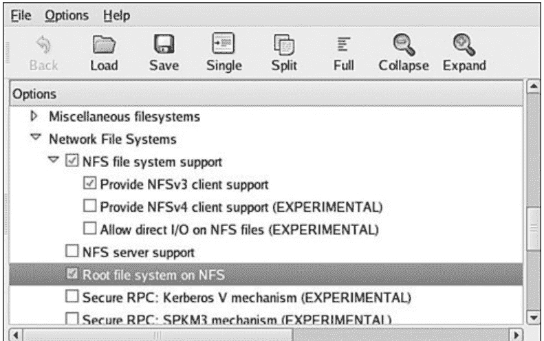

注意已选择 NFS 文件系统支持以及“Root file system on NFS”支持。选择这些内核配置参数后，剩下的就是以某种方式向内核提供信息，以便它知道在哪里查找 NFS 服务器。可以使用多种方法，有些取决于所选的目标架构和引导加载程序的选择。至少，可以在内核命令行上向内核传递正确的参数，以在通电时配置其 IP 端口和服务器信息。典型的内核命令行可能如下所示：

```
console=ttyS0,115200 ip=bootp root=/dev/nfs
```

这告诉内核期望通过 NFS 获取根文件系统，并从 BOOTP 服务器获取相关参数（服务器名称、服务器 IP 地址和要挂载的根目录）。这是项目开发阶段常见且非常有用的配置。如果你正在静态配置目标的 IP 地址，你的内核命令行可能如下所示：

```
console=ttyS0,115200                       \
ip=192.168.1.139:192.168.1.1:192.168.1.1:255.255.255.0:coyote1:eth0:off   \
nfsroot=192.168.1.1:/home/chris/sandbox/coyote-target   \
root=/dev/nfs
```

当然，这全部应在一行内。`ip=` 参数在 `.../net/ipv4/ipconfig.c` 中定义，具有以下语法，全部在一行：

```
ip=<client-ip>:<server-ip>:<gw-ip>:<netmask>:<hostname>:<device>:<PROTO>
```

这里，`client-ip` 是目标的 IP 地址；`server-ip` 是 NFS 服务器的地址；`gw-ip` 是网关（路由器），以防 `server-ip` 位于不同的子网；`netmask` 定义 IP 寻址类别。`hostname` 是作为目标主机名传递的字符串；`device` 是 Linux 设备名称，例如 eth0；`PROTO` 定义用于获取初始 IP 参数的协议。

## 9.8. 伪文件系统

内核配置菜单中的伪文件系统类别下包含多个文件系统。它们共同提供了一系列在各种应用程序中有用的功能。有关更多信息，特别是关于 `proc` 文件系统，可以花一个下午的时间探索这个有用的系统设施。在适当的地方，可以在本章末尾的 9.11.1 节找到额外阅读材料的参考。

### 9.8.1. Proc 文件系统

`/proc` 文件系统因其最初的目的而得名，它是一个允许内核与 Linux 系统上每个正在运行的进程通信信息的接口。随着时间的推移，它已经发展和成熟，提供了远超出进程信息的功能。我们在此介绍其要点；对 `/proc` 文件系统的完整巡览留作读者的练习。

`/proc` 文件系统已成为几乎所有 Linux 系统（即使是嵌入式系统）虚拟的必需品。许多用户级功能依赖 `/proc` 文件系统的内容来完成其工作。例如，不带任何参数发出的 `mount` 命令会列出运行系统上所有当前活动的挂载点，这些信息来自 `/proc/mounts`。如果 `/proc` 文件系统不可用，`mount` 命令将静默返回。清单 9-14 在 ADI Engineering Coyote 板上演示了这一点。

#### 清单 9-14. 挂载依赖于 /proc

```
# mount
rootfs on / type rootfs (rw)
/dev/root on / type nfs
(rw,v2,rsize=4096,wsize=4096,hard,udp,nolock,addr=192.168.1.19)
tmpfs on /dev/shm type tmpfs (rw)
/proc on /proc type proc (rw,nodiratime)

< 现在卸载 proc 并重试 ...>

# umount /proc
# mount
#
```

注意在清单 9-14 中，`/proc` 本身被列为已挂载的文件系统，类型为 `proc`，挂载在 `/proc` 上。这不是赘言；你的系统必须在顶级目录树中有一个名为 `/proc` 的挂载点，作为 `/proc` 文件系统的挂载目标。[6] 要挂载 `/proc` 文件系统，可以使用与任何其他文件系统相同的 `mount` 命令：

 [6] 你当然可以随心所欲地将 `/proc` 挂载到文件系统的任何地方，但所有需要用到 proc 的工具（包括 `mount`）都期望在 `/proc` 处找到挂载的 proc。

```
$ mount -t proc /proc /proc
```

`mount` 命令的一般形式，从手册页来看，是 `mount [-t fstype] something somewhere`。在刚才的调用中，我们可以用 `none` 替代 `/proc`，如下所示：

```
$ mount -t proc none /proc
```

这样看起来就不那么像双关语了。`something` 参数并非严格必需，因为 `/proc` 是伪文件系统，而非真正的物理设备。然而，像前面的例子那样指定 `/proc` 有助于提醒我们，我们正在将 `/proc` 文件系统挂载到 `/proc` 目录上（或者更准确地说，挂载到 `/proc` 挂载点）。

当然，说到这里，要让 `/proc` 文件系统生效，必须在配置内核时启用它，这一点可能已经很显然了。这个内核配置选项可以在“伪文件系统”类别下的“文件系统”子菜单中找到。

内核中运行的每个用户进程都将在 `/proc` 文件系统中由一个条目表示。例如，在[第 6 章](chapter-6)中介绍的 `init` 进程总是被分配进程 ID（PID）为 1。`/proc` 文件系统中的进程由一个以 PID 号作为名称的目录表示。例如，PID 为 1 的 `init` 进程将由 `/proc/1` 目录表示。[清单 9-15](listing-9-15) 展示了在我们嵌入式 *Coyote* 板上该目录的内容。

#### 清单 9-15. `init` 进程的 `/proc` 条目

```
# ls -l /proc/1
total 0
-r--------    1 root  root   0 Jan  1 00:25 auxv
-r--r--r--    1 root  root   0 Jan  1 00:21 cmdline
lrwxrwxrwx    1 root  root   0 Jan  1 00:25 cwd -> /
-r--------    1 root  root   0 Jan  1 00:25 environ
lrwxrwxrwx    1 root  root   0 Jan  1 00:25 exe -> /sbin/init
dr-x------    2 root  root   0 Jan  1 00:25 fd
-r--r--r--    1 root  root   0 Jan  1 00:25 maps
-rw-------    1 root  root   0 Jan  1 00:25 mem
-r--r--r--    1 root  root   0 Jan  1 00:25 mounts
-rw-r--r--    1 root  root   0 Jan  1 00:25 oom_adj
-r--r--r--    1 root  root   0 Jan  1 00:25 oom_score
lrwxrwxrwx    1 root  root   0 Jan  1 00:25 root -> /
-r--r--r--    1 root  root   0 Jan  1 00:21 stat
-r--r--r--    1 root  root   0 Jan  1 00:25 statm
-r--r--r--    1 root  root   0 Jan  1 00:21 status
dr-xr-xr-x    3 root  root   0 Jan  1 00:25 task
-r--r--r--    1 root  root   0 Jan  1 00:25 wchan
```

这些存在于 `/proc` 文件系统中每个运行进程的条目包含了大量有用的信息，尤其对于分析和调试进程而言。例如，`cmdline` 条目包含用于调用进程的完整命令行，包括所有参数。`cwd` 和 `root` 目录包含进程视角下的当前工作目录和当前根目录。

对于系统调试更有用的一个条目是 `maps`。它包含了分配给程序的每个虚拟内存段的列表，以及关于每个内存段的属性。[清单 9-16](#) 是我们的 `init` 进程示例中 `/proc/1/maps` 的输出。

## **清单 9-16. 来自 `/proc` 的 `init` 进程内存段**

```
# cat /proc/1/maps
00008000-0000f000 r-xp 00000000 00:0a 9537567  /sbin/init
00016000-00017000 rw-p 00006000 00:0a 9537567  /sbin/init
00017000-0001b000 rwxp 00017000 00:00 0
40000000-40017000 r-xp 00000000 00:0a 9537183  /lib/ld-2.3.2.so
40017000-40018000 rw-p 40017000 00:00 0
4001f000-40020000 rw-p 00017000 00:0a 9537183  /lib/ld-2.3.2.so
40020000-40141000 r-xp 00000000 00:0a 9537518  /lib/libc-2.3.2.so
40141000-40148000 ---p 00121000 00:0a 9537518  /lib/libc-2.3.2.so
40148000-4014d000 rw-p 00120000 00:0a 9537518  /lib/libc-2.3.2.so
4014d000-4014f000 rw-p 4014d000 00:00 0
befeb000-bf000000 rwxp befeb000 00:00 0
#
```

这些信息的有用性显而易见。你可以在前两个条目中看到 `init` 进程本身的程序段。你还可以看到 `init` 进程使用的共享库对象的内存段。格式如下：

```
vmstart-vmend attr  pgoffset  devname inode filename
```

这里，`vmstart` 和 `vmend` 分别是起始和结束虚拟内存地址；`attr` 表示内存区域属性，如读、写和执行，并指明该区域是否可共享；`pgoffset` 是区域的页偏移量（一个内核虚拟内存参数）；`devname` 显示为 `xx:xx`，是内核表示的与此内存区域关联的设备 ID。未关联文件的内存区域也与设备无关，因此显示为 `00:00`。最后两项是与给定内存区域关联的 inode 和文件。当然，如果没有文件，就没有与之关联的 inode，它显示为零。这些通常是数据段。

还为每个进程列出了其他有用的条目。`status` 条目包含有关运行进程的有用状态信息，包括父进程 PID、用户和组 ID、虚拟内存使用统计、信号和能力等项目。更多详细信息可参见本章末尾的参考文献。

一些常用的 `/proc` 条目包括 `cpuinfo`、`meminfo` 和 `version`。`cpuinfo` 条目列出内核发现的关于系统中处理器(s)的属性。`meminfo` 条目提供系统总内存的统计信息。`version` 条目反映 Linux 内核版本字符串，以及用于构建内核的编译器和机器信息。

内核还提供了更多有用的 `/proc` 条目；我们只是浅尝了这个有用子系统的皮毛。已经设计了许多工具来提取和报告包含在 `/proc` 文件系统中的信息。两个流行的例子是 `top` 和 `ps`，每个嵌入式 Linux 开发人员都应该非常熟悉它们。这些在第 13 章中介绍。其他用于与 `/proc` 文件系统交互的有用工具包括 free、pkill、pmap 和 uptime。更多详情请参见 `procps` 软件包。

### 9.8.2. sysfs

与 `/proc` 文件系统一样，`sysfs` 并不代表实际的物理设备。相反，`sysfs` 对物理设备等特定内核对象进行建模，并提供一种将设备与设备驱动程序关联的方式。典型 Linux 发行版中的某些代理依赖于 `sysfs` 上的信息。

我们可以通过直接查看 `sysfs` 导出的目录结构来了解导出了哪些类型的对象。清单 9-17 展示了在我们 Coyote 板上 `/sys` 的顶层目录。

#### 清单 9-17. `/sys` 顶层目录内容

```
# dir /sys
total 0
drwxr-xr-x  21 root   root    0 Jan  1 00:00 block
drwxr-xr-x   6 root   root    0 Jan  1 00:00 bus
drwxr-xr-x  10 root   root    0 Jan  1 00:00 class
drwxr-xr-x   5 root   root    0 Jan  1 00:00 devices
drwxr-xr-x   2 root   root    0 Jan  1 00:00 firmware
drwxr-xr-x   2 root   root    0 Jan  1 00:00 kernel
drwxr-xr-x   5 root   root    0 Jan  1 00:00 module
drwxr-xr-x   2 root   root    0 Jan  1 00:00 power
#
```

如你所见，`sysfs` 为每个主要系统设备类别（包括系统总线）提供了一个子目录。例如，在 `block` 子目录下，每个块设备由一个子目录条目表示。顶层其他目录也是如此。

`sysfs` 存储的大多数信息格式更适合机器而非人类阅读。例如，要发现 PCI 总线上的设备，可以直接查看 `/sys/bus/pci` 子目录。在我们的 Coyote 板上，它只连接了一个 PCI 设备（一个以太网卡），目录看起来像这样：

```
# ls /sys/bus/pci/devices/
0000:00:0f.0 -> ../../../devices/pci0000:00/0000:00:0f.0
```


此条目实际上是一个符号链接，指向`sysfs`目录树中的另一个节点。我们已在此处格式化`ls`的输出以说明这一点，同时仍然适合单行显示。该符号链接的名称是内核对PCI总线的表示，它指向一个名为`pci0000:00`（PCI总线表示）的`devices`子目录，该子目录包含多个子目录和文件，代表此特定PCI设备的属性。正如你所见，这些数据相当难以发现和解析。

存在一个实用的工具来浏览`sysfs`文件系统目录结构。它被称为`systool`，来自sourceforge.net上的`sysfsutils`软件包。以下是`systool`显示前述PCI总线的方式：

```
$ systool -b pci
    Bus = "pci"
    0000:00:0f.0 8086:1229
```

我们再次看到了内核的总线和设备（0f）表示，但这次该工具显示的是从`/sys/devices/pci0000:00`分支（这些属性保存在其中）获取的厂商ID（8086 = 英特尔）和设备ID（1229 = eepro100以太网卡）。不带参数执行时，`systool`会显示顶层系统层次结构。清单9-18是我们Coyote板上的一个示例。

#### 清单9-18. systool的输出

```
$ systool
Supported sysfs buses:
        i2c
        ide
        pci
        platform
Supported sysfs classes:
        block
        i2c-adapter
        i2c-dev
        input
        mem
        misc
        net
        pci_bus
        tty
Supported sysfs devices:
        pci0000:00
        platform
        system
```

你可以从这份列表中看到`sysfs`提供的各种系统信息。许多工具利用这些信息来确定系统设备的特性，或执行系统策略，如电源管理和热插拔功能。

## 9.9. 其他文件系统

Linux支持众多文件系统。篇幅所限，无法涵盖所有文件系统。但是，你应该了解一些在嵌入式系统中经常发现的其他重要文件系统。

ramfs文件系统最好从其源代码实现模块的角度来考虑。清单9-19复制了该文件的前几行。

#### 清单9-19. Linux ramfs源代码模块注释

```
/*
 * Resizable simple ram filesystem for Linux.
 *
 * Copyright (C) 2000 Linus Torvalds.
 *		       2000 Transmeta Corp.
 *
 * Usage limits added by David Gibson, Linuxcare Australia.
 * This file is released under the GPL.
 */

/*
 * NOTE! This filesystem is probably most useful
 * not as a real filesystem, but as an example of
 * how virtual filesystems can be written.
 *
 * It doesn't get much simpler than this. Consider
 * that this file implements the full semantics of
 * a POSIX-compliant read-write filesystem.
 */
```

该模块主要是作为如何编写虚拟文件系统的示例而编写的。此文件系统与现代Linux内核中的ramdisk工具之间的一个主要区别是，它能够根据使用量进行收缩和扩展。ramdisk不具备此特性。此源代码模块紧凑且编写良好。此处展示它是为了其教育价值。鼓励你研究这个优秀的示例。

`tmpfs`文件系统与ramfs相似且相关。与ramfs一样，`tmpfs`中的所有内容都存储在内核虚拟内存中，并且`tmpfs`的内容在断电或重启后会丢失。`tmpfs`文件系统对于快速临时存储文件很有用。我在一个midi/音频应用中使用挂载在`/tmp`上的`tmpfs`来加速音频子系统所需的临时对象的创建和删除。这也是保持`/tmp`目录干净的好方法——其内容在每次重启后都会丢失。挂载`tmpfs`与挂载任何其他虚拟文件系统类似：

```
# mount -t tmpfs /tmpfs /tmp
```

与其他虚拟文件系统（如`/proc`）一样，前述mount命令中的第一个`/tmpfs`参数是"空操作"——也就是说，它可以是单词`none`或只是一个标签。然而，这是一个很好的提醒，说明你正在挂载一个名为`tmpfs`的虚拟文件系统。

## 9.10. 构建简单文件系统

构建简单的文件系统镜像是直接了当的。这里我们演示Linux内核回环设备的使用。回环设备允许将普通文件用作块设备。简而言之，我们在普通文件中构建文件系统镜像，并使用Linux回环设备以挂载任何其他块设备相同的方式挂载该文件。

要构建简单的根文件系统，先从一个固定大小的、全为零的文件开始：

```
# dd if=/dev/zero of=./my-new-fs-image bs=1k count=512
```

此命令创建一个512KB的文件，其中仅包含零。我们用零填充文件，以便稍后压缩，并为文件系统内的未初始化数据块提供一致的数据模式。使用`dd`命令时需谨慎。执行不带边界（`count=`）或边界不当的`dd`可能会填满你的硬盘，甚至可能导致系统崩溃。`dd`是一个强大的工具；请给予它应有的尊重。以root身份执行的`dd`等命令中的简单拼写错误已经破坏了无数文件系统。

当我们获得新的镜像文件后，我们实际上要格式化该文件，使其包含由给定文件系统定义的数据结构。在此示例中，我们构建一个ext2文件系统。清单9-20详细说明了该过程。

#### 清单9-20. 创建ext2文件系统镜像

```
# /sbin/mke2fs ./my-new-fs-image
mke2fs 1.35 (28-Feb-2004)
./my-new-fs-image is not a block special device.
Proceed anyway? (y,n) y
Filesystem label=
OS type: Linux
Block size=1024 (log=0)
Fragment size=1024 (log=0)
64 inodes, 512 blocks
25 blocks (4.88%) reserved for the super user
First data block=1
1 block group
8192 blocks per group, 8192 fragments per group
64 blocks per group

Writing inode tables: done
Writing superblocks and filesystem accounting information: done

This filesystem will be automatically checked every 24 mounts or
180 days, whichever comes first. Use tune2fs -c or -i to override.
```

与`dd`一样，`mke2fs`命令也可能破坏你的系统，因此请谨慎使用。在此示例中，我们要求`mke2fs`格式化一个文件，而不是其设计初衷的硬盘分区（块设备）。因此，`mke2fs`检测到了这一点，并要求我们确认该操作。确认后，`mke2fs`继续将ext2超级块和文件系统数据结构写入文件。然后我们可以使用Linux回环设备像挂载任何块设备一样挂载此文件：

```
# mount -o loop ./my-new-fs-image /mnt/flash
```

此命令将文件`my-new-fs-image`作为文件系统挂载到名为`/mnt/flash`的挂载点上。挂载点名称并不重要；你可以将其挂载到任何你想要的位置，只要挂载点存在即可。使用`mkdir`创建你的挂载点。

新创建的镜像文件挂载为文件系统后，我们可以自由地进行更改。我们可以添加和删除目录、创建设备节点等。我们可以使用`tar`将文件复制到其中或从中复制出来。当更改完成后，它们会保存在文件中，假设你没有超出设备的大小。请记住，使用此方法，大小在创建时是固定的，无法更改。

## 9.11. 章节总结

- 分区是物理设备的逻辑划分。Linux支持众多分区类型。
- 在Linux中，文件系统挂载在挂载点上。根文件系统挂载在文件系统层次的根目录，称为`/`。
- 流行的ext2文件系统成熟且快速，经常出现在嵌入式系统和其他Linux系统（如Red Hat和Fedora Core系列）上。
- ext3文件系统在ext2文件系统之上添加了日志功能，以实现更好的数据完整性和系统可靠性。
- ReiserFS是另一种流行且高性能的日志文件系统，见于许多嵌入式系统和其他Linux系统中。
- JFFS2是针对闪存使用而优化的日志文件系统。它包含对闪存友好的功能，如磨损均衡，以延长闪存使用寿命。
- cramfs是一种只读文件系统，非常适合小型系统引导ROM和其他只读程序和数据。
- NFS是嵌入式开发人员最强大的开发工具之一。它可以为工作站带来目标设备的强大功能。学习如何使用NFS作为嵌入式目标的根文件系统。其便利性和节省时间将使你的努力物有所值。
- Linux上有许多伪文件系统。这里介绍了一些较重要的文件系统，包括`proc`文件系统和`sysfs`。
- 基于RAM的`tmpfs`文件系统在嵌入式系统中有许多用途。它相较于传统ramdisk最显著的改进是能够根据操作需求动态调整自身大小。

### 9.11.1. 补充阅读建议

"Design and Implementation of the Second Extended Filesystem"
Rémy Card, Theodore Ts'o, and Stephen Tweedie
First published in the *Proceedings of the First Dutch International Symposium on Linux*
Available on http://e2fsprogs.sourceforge.net/ext2intro.html

"A Non-Technical Look Inside the EXT2 File System"
Randy Appleton
www.linuxgazette.com/issue21/ext2.html


# 第10章 MTD子系统

本章内容

-   [启用MTD服务](第248页)
-   [MTD基础](第251页)
-   [MTD分区](第253页)
-   [MTD实用程序](第265页)
-   [本章小结](第270页)

内存技术设备子系统的发展源于支持多种类内存型设备（如闪存芯片）的需求。市面上存在多种类型的闪存芯片以及众多编程方法，部分原因是由于它们支持许多专用和高性能模式。MTD层架构使得底层设备复杂性与使用存储设备的上层数据组织和存储格式得以分离。

在本章中，我们将介绍MTD子系统并提供一些简单的使用示例。首先探讨内核支持MTD服务所需的要求。我们将在启用了MTD的开发工作站上介绍一些简单操作，以此理解该子系统的基础知识。在本章中，我们将整合MTD和JFFS2文件系统。

接下来介绍与MTD层相关的分区概念。我们将详细探讨从引导加载程序构建分区的细节，以及Linux内核如何检测它们。本章继续简要介绍MTD实用程序。最后，我们将整合所有内容，使用ROM中的JFFS2文件系统映像启动目标板。

## 10.1. 启用MTD服务

要使用MTD，你的内核必须配置启用MTD。MTD存在许多配置选项，其中一些可能会让人困惑。理解这些众多选项的最佳方法就是直接开始使用它们。为了说明MTD子系统的机制及其在系统中的位置，我们从一些非常简单的示例开始，你可以在你的Linux开发工作站上执行这些示例。[图10-1](#)展示了启用最基础MTD功能所需的内核配置（通过通常的`make ARCH=<arch> gconfig`调用）。[清单10-1](#)显示了由[图10-1](#)中所示选择产生的`.config`文件条目。

### 清单10-1。来自`.config`的基本MTD配置

```
CONFIG_MTD=y
CONFIG_MTD_CHAR=y
CONFIG_MTD_BLOCK=y
CONFIG_MTD_MTDRAM=m
CONFIG_MTDRAM_TOTAL_SIZE=8192
CONFIG_MTDRAM_ERASE_SIZE=128
```

MTD子系统通过第一个配置选项启用，该选项通过[图10-1](#)中显示的第一个复选框选择，即“内存技术设备支持”。[图10-1](#)中显示的接下来两个条目启用了从用户空间对MTD设备（如闪存）的特殊设备级访问。第一个（`CONFIG_MTD_CHAR`）启用字符设备模式访问，本质上是一种以每次一个字节的顺序读写为特征的顺序访问。第二个（`CONFIG_MTD_BLOCK`）启用以块设备模式访问MTD设备，这是磁盘驱动器使用的访问方法，其中一次读写多个字节的数据块。这些访问模式允许使用熟悉的Linux命令来读写闪存数据，你很快就会看到。

**图10-1。MTD配置**

[查看完整图像](#)

`CONFIG_MTD_MTDRAM`元素启用了一个特殊的测试驱动程序，使我们即使没有任何MTD设备（如闪存）也能检查MTD子系统。与此配置选择相关的有两个与基于RAM的测试驱动程序相关的参数：设备大小和擦除大小。在本例中，我们指定了8192KB的总大小和128KB的擦除大小。该测试驱动程序的目标是模拟一个闪存设备，主要是为了便于MTD子系统的测试和开发。由于闪存架构使用固定大小的擦除块，该测试驱动程序也包含了擦除块的概念。你很快就会看到这些参数的使用方式。

### 10.1.1. 构建MTD

MTD包含在任何最近的Linux内核快照中。但是，如果你想利用自你的内核版本发布以来添加的MTD功能，你必须下载并构建MTD驱动程序和实用程序。由于MTD软件包包含内核组件和用户空间程序，将MTD软件包保存在单独的项目目录中并将其连接到你的内核源代码树是有用的。将MTD与你的内核源代码树集成的最简单方法是使用MTD软件包提供的脚本。

从本章末尾给出的位置下载MTD软件包。使用tar工具将归档文件解压到你选择的目录中。进入目录并运行`patchkernel.sh`脚本。该脚本提供多个选项。不带参数执行脚本以获取详细的用法。[清单10-2](#)展示了如何安装内核组件。

### 清单10-2。为MTD修补你的内核

```
$ ./patchkernel.sh -2 ../sources/linux-2.6.10-mtd
Patching ../sources/linux-2.6.10-mtd/
Include JFFS2 file system: jffs2
Include JFFS3 file system (experimental): no
Method: ln      << Will actually create symbolic links
Can we start now ? [y/N]y

$
```

使用`-2`参数调用`patchkernel.sh`脚本表示我们想要支持JFFS2文件系统。我们提供内核源代码目录的路径为`../sources/linux-2.6.10-mtd`。默认情况下，`patchkernel.sh`不会将任何文件复制到内核源代码目录中。相反，它会创建从内核源代码树指向MTD子目录本身的符号链接。通过这种方式，你可以为你开发工作站上碰巧拥有的任意数量的内核维护一个通用的MTD源代码树。这允许MTD内核驱动程序使用内核构建系统进行构建，包括关于你的特定内核配置的信息。

## 10.2. MTD基础

现在我们在内核中启用了一个简单的MTD配置，我们可以检查这个子系统在我们的Linux开发工作站上的工作方式。使用我们在上一节中刚刚配置的RAM测试驱动程序，我们可以使用MTD设备挂载一个JFFS2映像。假设你按照[第9章](link)“文件系统”中的详细说明创建了一个JFFS2映像，你可能想要挂载它并检查它。Linux内核不支持直接在回环设备上挂载JFFS2文件系统映像，就像ext2和其他文件系统映像那样。所以我们必须使用不同的方法。这可以使用我们启用了MTD的开发Linux工作站上的MTD RAM测试驱动程序来实现，如[图10-1](link)所示。[清单10-3](link)说明了步骤。

### 清单10-3。在MTD RAM设备上挂载JFFS2

```
# modprobe jffs2
# modprobe mtdblock
# modprobe mtdram
# dd if=jffs2.bin of=/dev/mtdblock0
 4690+1 records in
 4690+1 records out
# mkdir /mnt/flash
# mount -t jffs2 /dev/mtdblock0 /mnt/flash
# ls -l /mnt/flash
total 0
drwxr-xr-x  2 root root  0 Sep 17 22:02 bin
drwxr-xr-x  2 root root  0 Sep 17 21:59 dev
drwxr-xr-x  7 root root  0 Sep 17 15:31 etc
drwxr-xr-x  2 root root  0 Sep 17 15:31 home
drwxr-xr-x  2 root root  0 Sep 17 22:02 lib
drwxr-xr-x  2 root root  0 Sep 17 15:31 proc
drws------  2 root root  0 Sep 17 15:31 root
drwxr-xr-x  2 root root  0 Sep 17 22:02 sbin
drwxrwxrwt  2 root root  0 Sep 17 15:31 tmp
drwxr-xr-x  9 root root  0 Sep 17 15:31 usr
drwxr-xr-x 14 root root  0 Sep 17 15:31 var
#
```

从[清单10-3](link)中，我们首先安装Linux内核支持JFFS2和MTD子系统所需的可加载模块。我们加载JFFS2模块，然后是`mtdblock`和`mtdram`模块。在加载了必要的设备驱动程序之后，我们使用Linux `dd`命令将我们的JFFS2文件系统映像复制到使用`mtdblock`设备的MTD RAM测试驱动程序中。本质上，我们正在使用系统RAM作为后备设备来模拟一个MTD块设备。

在我们将JFFS2文件系统映像复制到MTD块设备之后，我们可以使用挂载命令挂载它。

---

白皮书：*Red Hat's New Journaling File System: ext3*
Michael K. Johnson
www.redhat.com/support/wpapers/redhat/ext3/

ReiserFS主页
www.namesys.com/

"JFFS: The Journaling Flash File System"
David Woodhouse
http://sources.redhat.com/jffs2/jffs2.pdf

cramfs项目的README文件
未署名（推测为项目作者）
http://sourceforge.net/projects/cramfs/

NFS主页
http://nfs.sourceforge.net

/proc文件系统文档
www.tldp.org/LDP/lkmpg/2.6/html/c712.htm

*文件系统性能：Solaris操作系统、UFS、Linux ext3和ReiserFS*
技术白皮书
Dominic Kay
www.sun.com/software/whitepapers/solaris10/fs_performance.pdf


### 10.2. 配置 MTD

要在开发板上使用 MTD 配合 Flash 存储器，必须正确配置 MTD。以下列表包含了为开发板、Flash 以及 Flash 布局配置 MTD 时必须满足的要求。

- 指定 Flash 设备上的分区
- 指定 Flash 类型和位置
- 为选定的芯片配置合适的 Flash 驱动
- 使用合适的驱动配置内核

以下各节将详细探讨这些步骤。

如[清单 10-3]所示使用 `mount` 命令。挂载 MTD 伪设备后，我们可以任意方式操作 JFFS2 文件系统镜像。使用此方法的唯一限制是我们无法扩大镜像。镜像的大小受两个因素限制。首先，当我们配置 MTD RAM 测试设备时，将其最大尺寸设为 8MB。[1] 其次，当我们创建 JFFS2 镜像时，使用 `mkfs.jffs2` 工具固定了镜像的大小。镜像大小由创建时指定的目录内容决定。回顾[第 9 章]中的[清单 9-9]，回忆我们的 `jffs2.bin` 镜像是如何构建的。

> [1] 在 Linux 内核配置中启用 MTD RAM 测试设备时，该尺寸已被固定。

重要的是要认识到使用此方法检查 JFFS2 文件系统内容的局限性。考虑一下我们所做的：我们将文件的内容（JFFS2 文件系统二进制镜像）复制到内核块设备（`/dev/mtdblock0`）中。然后我们将内核块设备（`/dev/mtdblock`）挂载为 JFFS2 文件系统。完成此操作后，我们可以使用所有传统的文件系统工具来检查甚至修改文件系统。`ls`、`df`、`dh`、`mv`、`rm` 和 `cp` 等工具都可以用来检查和修改文件系统。然而，与环回设备不同，我们复制的文件与挂载的 JFFS2 文件系统镜像之间没有关联。因此，如果在进行更改后卸载文件系统，更改将会丢失。如果你想保存更改，必须将它们复制回文件中。一种方法如下：

```
# dd if=/dev/mtdblock0 of=./your-modified-fs-image.bin
```

此命令创建一个名为 `your-modified-fs-image.bin` 的文件，其大小与配置期间指定的 `mtdblock0` 设备相同。在我们的示例中，它将是 8MB。在缺乏合适的 JFFS2 编辑工具的情况下，这是检查和修改 JFFS2 文件系统的完全有效的方法。更重要的是，它展示了在没有真实 Flash 存储器的开发系统上 MTD 子系统的基本原理。现在让我们看看包含 Flash 物理设备的一些硬件。

## 10.3. MTD 内部分区

给定硬件平台上的大多数 Flash 设备被划分为几个部分，称为分区，类似于典型桌面工作站硬盘上的分区。MTD 子系统为这类 Flash 分区提供支持。必须配置 MTD 子系统以支持 MTD 分区。[图 10-2] 展示了 MTD 分区支持的配置选项。

### 图 10-2. MTD 分区支持的内核配置

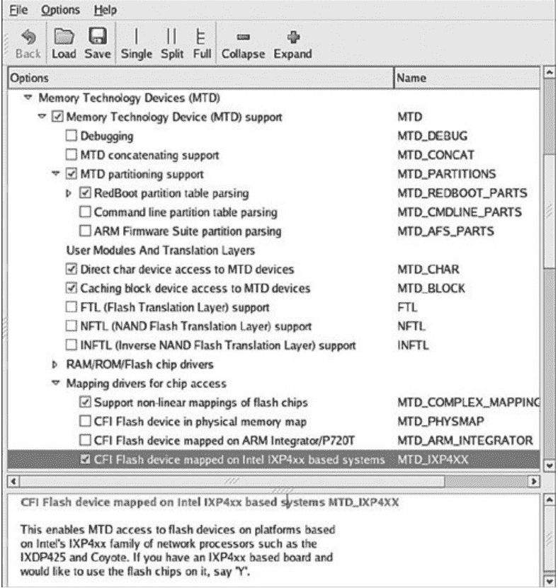

有多种方法可将分区数据传达给 Linux 内核。目前支持以下方法。你可以在[图 10-2] 中 MTD 分区支持下看到每个方法的配置选项。

- Redboot 分区表解析
- 内核命令行分区表定义
- 特定于主板的映射驱动

MTD 还允许没有分区数据的配置。在这种情况下，MTD 只需将整个 Flash 存储器视为单个设备。

### 10.3.1. Redboot 分区表分区

定义和检测 MTD 分区的一种更常见的方法源于最初的实现之一：Redboot 分区。Redboot 是一种在许多嵌入式开发板上找到的引导加载程序，特别是 ARM XScale 开发板，如 ADI Engineering Coyote 参考平台。

MTD 子系统定义了一种在 Flash 设备本身上存储分区信息的方法，类似于硬盘上的分区表概念。就 Redboot 分区而言，开发人员保留并指定一个存放分区定义的 Flash 擦除块。选择一个映射驱动，在启动期间调用分区解析函数以检测 Flash 设备上的分区。[图 10-2] 展示了我们示例开发板的映射驱动；它是定义 `CONFIG_MTD_IXP4xx` 的最后高亮条目。

像往常一样，查看详细示例有助于说明这些概念。我们首先查看 Redboot 引导加载程序为 Coyote 平台提供的信息。[清单 10-4] 捕获了 Redboot 引导加载程序在上电时的部分输出。

#### 清单 10-4. 上电时的 Redboot 消息

```
Platform: ADI Coyote (XScale)
IDE/Parallel Port CPLD Version: 1.0
Copyright (C) 2000, 2001, 2002, Red Hat, Inc.

RAM: 0x00000000-0x04000000, 0x0001f960-0x03fd1000 available
FLASH: 0x50000000 - 0x51000000, 128 blocks of 0x00020000 bytes each.
...
```

这告诉我们该开发板上的 RAM 从物理地址 0x00000000 开始映射，而 Flash 映射在物理地址 0x50000000 至 0x51000000。我们还可以看到 Flash 有 128 个大小为 0x00020000（128KB）的块。

Redboot 包含在 Flash 上创建和显示分区信息的命令。[清单 10-5] 包含了 `fis list` 命令的输出，这是 Redboot 引导加载程序中 Flash 镜像系统命令族的一部分。

#### 清单 10-5. Redboot Flash 分区列表

```
RedBoot> fis list
Name                FLASH addr  Mem addr    Length      Entry point
RedBoot             0x50000000  0x50000000  0x00060000  0x00000000
RedBoot config      0x50FC0000  0x50FC0000  0x00001000  0x00000000
FIS directory       0x50FE0000  0x50FE0000  0x00020000  0x00000000
RedBoot>
```

从[清单 10-5] 中，我们看到 Coyote 开发板在 Flash 上定义了三个分区。名为 `RedBoot` 的分区包含可执行的 Redboot 引导加载程序镜像。名为 `RedBoot config` 的分区包含引导加载程序维护的配置参数。最后一个名为 `FIS directory` 的分区保存有关分区表本身的信息。

当配置正确时，Linux 内核可以检测并解析此分区表，并创建代表 Flash 上物理分区的 MTD 分区。[清单 10-6] 复制了前述 ADI Engineering Coyote 开发板的部分启动消息，该开发板启动的内核配置为支持检测 Redboot 分区。

#### 清单 10-6. Linux 启动时检测 Redboot 分区

```
...
IXP4XX-Flash0: Found 1 x16 devices at 0x0 in 16-bit bank
Intel/Sharp Extended Query Table at 0x0031
Using buffer write method
cfi_cmdset_0001: Erase suspend on write enabled
Searching for RedBoot partition table in IXP4XX-Flash0 at offset 0xfe000
3 RedBoot partitions found on MTD device IXP4XX-Flash0
Creating 3 MTD partitions on "IXP4XX-Flash0":
0x00000000-0x00060000: "RedBoot"
0x00fc0000-0x00fc1000: "RedBoot config"
0x00fe0000-0x01000000: "FIS directory"
...
```

[清单 10-6] 中的第一条消息在通过通用 Flash 接口（CFI）驱动检测到 Flash 芯片时打印，该驱动通过 `CONFIG_MTD_CFI` 启用。CFI 是一种行业标准方法，用于确定 Flash 芯片的特性，如制造商、设备类型、总大小和擦除块大小。有关 CFI 规范的指针，请参阅本章末尾的[第 10.5.1 节]，"建议的额外阅读"。

CFI 在内核配置工具中内存技术设备（MTD）顶级菜单下启用。选择

`RAM/ROM/Flash芯片驱动程序`，如[图10-3](#)所示。

#### 图10-3. MTD CFI支持的内核配置

[查看完整图片]

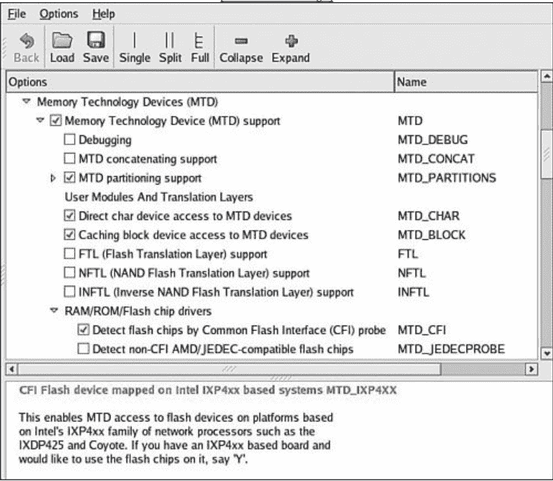

如[代码清单10](#)所示，Flash芯片通过CFI接口被检测到。由于我们还启用了`CONFIG_MTD_REDBOOT_PARTS`（参见[图10-2](#)），MTD会在Flash芯片上扫描Redboot分区表。还要注意，该芯片已被枚举为设备名`IXP4XX-Flash0`。从[代码清单10-6](#)中可以看到，Linux内核检测到了Flash芯片上的三个分区，正如之前使用Redboot中的`fis list`命令所枚举的那样。

当基础设施按此处描述就位后，Linux内核会自动检测并创建代表三个Flash分区的内核数据结构。在内核完成初始化后，可以在`/proc`文件系统中找到这些分区的证据，如[代码清单10-7](#)所示。

#### 代码清单10-7. 内核MTD Flash分区

```
root@coyote:~# cat /proc/mtd
dev:    size   erasesize  name
mtd0: 00060000 00020000 "RedBoot"
mtd1: 00001000 00020000 "RedBoot config"
mtd2: 00020000 00020000 "FIS directory"
#
```

我们可以轻松创建一个新的Redboot分区。本例中我们使用Redboot FIS命令，但本书不详细介绍Redboot命令。不过，感兴趣的读者可以参考本章末尾[第10.5.1节](#)列出的Redboot用户文档。[代码清单10-8](#)展示了创建新Redboot分区的详细信息。

#### 代码清单10-8. 创建新的Redboot分区

```
RedBoot> load -r -v -b 0x01008000 coyote-40-zImage
Using default protocol (TFTP)
Raw file loaded 0x01008000-0x0114dccb, assumed entry at 0x01008000
RedBoot> fis create -b 0x01008000 -l 0x145cd0 -f 0x50100000 MyKernel
... Erase from 0x50100000-0x50260000: ...........
... Program from 0x01008000-0x0114d000 at 0x50100000: ..........
... Erase from 0x50fe0000-0x51000000: .
... Program from 0x03fdf000-0x03fff000 at 0x50fe0000: .
... Lock from 0x50fe0000-0x51000000: .
```

首先，我们加载将用于创建新分区的镜像。本例中我们将使用内核镜像。我们将其加载到内存地址0x01008000。然后，我们使用Redboot `fis create`命令创建新分区。我们指示Redboot在起始地址为0x50100000的Flash区域创建新分区。你可以看到Redboot首先擦除Flash的该区域，然后写入内核镜像的操作过程。在最后的序列中，Redboot解锁其目录区域，并用新的分区信息更新FIS目录。[代码清单10-9](#)显示了包含新分区的`fis list`输出。将其与[代码清单10-5](#)中的输出进行比较。

#### 代码清单10-9. 新的Redboot分区列表

```
RedBoot> fis list
Name              FLASH addr   Mem addr     Length       Entry point
RedBoot           0x50000000   0x50000000   0x00060000   0x00000000
RedBoot config    0x50FC0000   0x50FC0000   0x00001000   0x00000000
FIS directory     0x50FE0000   0x50FE0000   0x00020000   0x00000000
MyKernel          0x50100000   0x50100000   0x00160000   0x01008000
```

当然，当我们启动Linux内核时，它会发现这个新分区，我们可以根据需要对其进行操作。敏锐的读者可能已经意识到这个新分区的另一个好处：我们现在可以直接从Flash启动内核，而不必每次都通过`tftp`加载。接下来的命令展示了这一点。只需将分区的Flash起始地址和要传输到RAM的镜像长度传递给Redboot `exec`命令即可。

```
RedBoot> exec -b 0x50100000 -l 0x145cd0
    Uncompressing Linux............ done, booting the kernel.
...
```

### 10.3.2. 内核命令行分区

正如[第10.3节](#) "MTD分区"所详述的，原始的Flash分区信息可以使用其他方法传递给内核。实际上，可能最直接（尽管可能不是最简单）的方法是手动将分区信息直接传递到内核命令行。当然，正如我们已经了解到的，有些引导加载程序让这变得很容易（例如U-Boot），而另一些则没有在引导时向内核传递命令行的功能。在这些情况下，内核命令行必须在编译时配置，因此更难更改，每次修改分区时都需要重新编译内核本身。

要在MTD子系统中启用命令行分区，必须配置内核以支持此功能。你可以在[图10-2](#)中`MTD partitioning support`下看到此配置选项。选择命令行分区表解析选项，该选项定义了`CONFIG_MTD_CMDLINE_PARTS`选项。

[代码清单10-10](#)显示了在内核命令行上定义分区的格式（取自`.../drivers/mtd/cmdlinepart.c`）。

## **代码清单10-10. 内核命令行MTD分区格式**

```
mtdparts=<mtddef>[;<mtddef>]
 *<mtddef>  := <mtd-id> <partdef>[,<partdef>]
 *<partdef> := <size>[@offset][<name>][ro]
 *<mtd-id>  := unique name used in mapping driver/device (mtd->name)
 *<size>    := std linux memsize OR "-" to denote all remaining space
 *<name>    := '(' NAME ')'
```

在内核命令行上传递的每个`mtddef`参数定义一个单独的分区。如[代码清单10-10](#)所示，每个`mtddef`定义包含多个部分。你可以指定一个唯一的ID、分区大小以及距Flash起始处的偏移量。你还可以为分区指定一个名称，以及可选的只读属性。回顾[代码清单10-5](#)中的Redboot分区定义，我们可以在内核命令行上静态定义这些分区，如下所示：

```
mtdparts=MainFlash:384K(Redboot),4K(config),128K(FIS),-(unused)
```

有了这个定义，内核将实例化四个MTD分区，其MTD ID为`MainFlash`，包含的大小和布局与代码清单10-5中找到的相匹配。

### 10.3.3. 映射驱动程序

定义特定于开发板的Flash布局的最后一种方法是使用专用的特定于开发板的映射驱动程序。Linux内核源代码树包含许多映射驱动程序的示例，位于`.../drivers/mtd/maps`。其中任何一个都能为你如何创建自己的映射驱动程序提供很好的示例。实现细节因架构而异。

映射驱动程序是一个完整的内核模块，包含`module_init()`和`module_exit()`调用，如第8章"设备驱动程序基础"所述。典型的映射驱动程序小巧且易于阅读，通常包含不超过几十行C代码。

代码清单10-11复制了`.../drivers/mtd/maps/pq2fads`中的一部分。这个映射驱动程序定义了在支持MPC8272和其他处理器的Freescale PQ2FADS评估板上的Flash设备。

#### 代码清单10-11. PQ2FADS Flash映射驱动程序

```
...
static struct mtd_partition pq2fads_partitions[] = {
	{
#ifdef CONFIG_ADS8272
		.name		= "HRCW",
		.size		= 0x40000,
		.offset		= 0,
		.mask_flags= MTD_WRITEABLE,  /* 强制只读 */
	}, {
		.name		= "User FS",
		.size		= 0x5c0000,
		.offset		= 0x40000,
#else
		.name		= "User FS",
		.size		= 0x600000,
		.offset		= 0,
#endif
	}, {
		.name		= "uImage",
		.size		= 0x100000,
		.offset		= 0x600000,
		.mask_flags = MTD_WRITEABLE,  /* 强制只读 */
	}, {
		.name		= "bootloader",
		.size		= 0x40000,
		.offset		= 0x700000,
		.mask_flags = MTD_WRITEABLE,  /* 强制只读 */
	}, {
		.name		= "bootloader env",
		.size		= 0x40000,
		.offset		= 0x740000,
		.mask_flags = MTD_WRITEABLE,  /* 强制只读 */
	}
};
/* 指向MPC885ADS板信息数据的指针 */
extern unsigned char __res[];

static int __init init_pq2fads_mtd(void)
{
    bd_t *bd = (bd_t *)__res;
    physmap_configure(bd->bi_flashstart, bd->bi_flashsize,
                      PQ2FADS_BANK_WIDTH, NULL);

    physmap_set_partitions(pq2fads_partitions,
                          sizeof (pq2fads_partitions) /
                          sizeof (pq2fads_partitions[0]));
    return 0;
}

static void __exit cleanup_pq2fads_mtd(void)
{
}
module_init(init_pq2fads_mtd);
module_exit(cleanup_pq2fads_mtd);
...
```

这个简单但完整的Linux设备驱动程序将PQ2FADS Flash映射信息传递给MTD子系统。回顾[第8章](#)，当设备驱动程序中的一个函数用`module_init()`宏声明时，它会在Linux内核引导过程中在适当的时间被自动调用。在这个PQ2FADS映射驱动程序中，模块初始化函数`init_pq2fads_mtd()`执行了两个简单的调用：

- `physmap_configure()`将Flash芯片的物理地址、大小和bank宽度，以及访问Flash所需的任何特殊设置函数传递给MTD子系统。

- `physmap_set_partitions()`将开发板独特的分区信息从映射驱动程序开头定义的`pq2fads_partitions[]`数组中的分区表传递给MTD子系统。

遵循这个简单的例子，你可以为自己的开发板推导出一个映射驱动程序。

### 10.3.4. Flash芯片驱动程序

MTD支持多种Flash芯片和设备。很有可能你选择的芯片也得到了支持。最常见的Flash芯片支持前面提到的通用Flash接口（CFI）。较旧的Flash芯片可能有JEDEC支持，这是一个较旧的Flash兼容性标准。[图10-4](#)显示了来自最新Linux内核快照的内核配置。此版本支持多种Flash类型。


#### 图 10-4. Flash 设备支持

[查看完整图片]

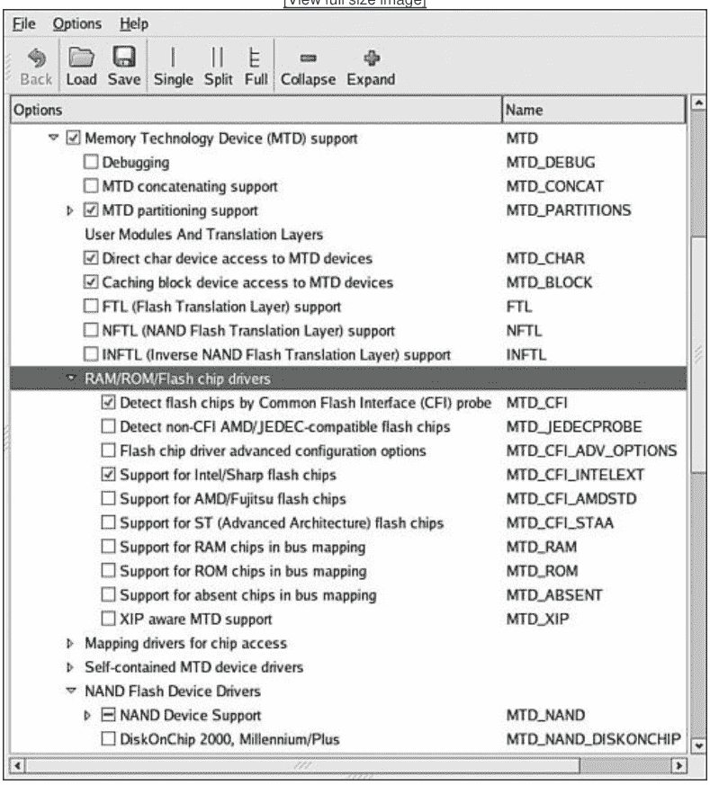

如果你的 Flash 芯片未被支持，则必须自行提供设备文件。可以以 `.../drivers/mtd/chips` 目录下的众多示例之一为起点，自定义或创建你自己的 Flash 设备驱动。更好的情况是，除非该芯片是刚刚引入的带有某种新奇接口的新型号，否则很可能已经有人开发出了相应的驱动程序。

### 10.3.5. 板级特定初始化

除了映射驱动程序，你的板级特定（平台）设置还必须为 MTD Flash 系统的正常运行提供底层定义。[清单 10-12](#) 再现了 `.../arch/arm/mach-ixp4xx/coyote-setup.c` 中的相关部分。

#### 清单 10-12. Coyote 特定的板级设置

```
static struct flash_platform_data coyote_flash_data = {
	.map_name  = "cfi_probe",
	.width     = 2,
};

static struct resource coyote_flash_resource = {
	.start		= COYOTE_FLASH_BASE,
	.end		= COYOTE_FLASH_BASE + COYOTE_FLASH_SIZE - 1,
	.flags		= IORESOURCE_MEM,
};

static struct platform_device coyote_flash = {
	.name		= "IXP4XX-Flash",
	.id		= 0,
	.dev		= {
		.platform_data = &coyote_flash_data,
	},
	.num_resources	= 1,
	.resource	= &coyote_flash_resource,
};

...

static struct platform_device *coyote_devices[] __initdata = {
	&coyote_flash,
	&coyote_uart
};

static void __init coyote_init(void)
{
	...

	platform_add_devices(coyote_devices,
				ARRAY_SIZE(coyote_devices));
}
...
```

在[清单 10-12](#) 中，只再现了 `coyote-setup.c` 平台初始化文件的相关部分。从底部开始，`coyote_init()` 函数调用 `platform_add_devices()`，指定了本文件中先前定义的 Coyote 特定设备。你会注意到，在 `coyote_init()` 例程之前定义了两个设备。我们本次讨论感兴趣的是 `coyote_flash`。这个 `struct platform_device` 类型的结构体包含了 Linux 内核和 MTD 子系统所需的所有重要细节。

`coyote_flash` 结构体的 `.name` 成员将我们平台特定的 Flash 资源绑定到一个同名的映射驱动程序。你可以在映射驱动文件 `.../drivers/mtd/maps/ixp4xx.c` 中看到这一点。`.resource` 成员传递了板上 Flash 的基地址。`.dev` 成员包含一个 `.platform_data` 成员，它将我们的 Flash 设置与一个芯片驱动程序关联起来。在本例中，我们指定板子将使用 CFI 探测方法，该方法在内核配置中指定为 `CONFIG_MTD_CFI`。你可以在[图 10-4](Figure 10-4) 中看到此配置选项。

根据你自己的架构和板子，你可以使用类似的方法来定义你自己的板子的 Flash 支持。

## 10.4. MTD 工具

MTD 软件包包含许多用于设置和管理 MTD 子系统的系统工具。这些工具与主 MTD 子系统分开构建，主系统应从你的 Linux 内核源码树内构建。这些工具的构建方式与其他任何交叉编译的用户空间代码类似。

使用这些工具时必须小心，因为它们没有错误保护。一个单数字的笔误就可能擦除你硬件平台上的引导加载程序，这肯定会毁了你的一天，除非你做了备份并知道如何使用 JTAG Flash 编程器重新编程。

遵循本书贯穿始终的常见做法，我们无法分配足够的篇幅来涵盖每个 MTD 工具。我们重点介绍最常用和最有用的工具，其余部分留给读者作为练习去探索。最近的 MTD 快照包含了超过 20 个二进制工具。

`flash_*` 系列工具对于 MTD 分区上的原始设备操作很有用。这些工具包括 flashcp、flash_erase、flash_info、flash_lock、flash_unlock 等。希望它们的名称足够描述性，能让人了解其功能。在分区被定义并枚举为内核设备后，任何这些用户空间工具都可以在分区上运行。我们重申之前发出的警告：如果你在包含引导加载程序的分区上执行 `flash_erase`，你将成为一个硅胶镇纸的骄傲拥有者。如果你打算进行这样的实验，最好备份你的引导加载程序镜像，并知道如何使用硬件 JTAG 仿真器或其他 Flash 编程工具重新刷写它。

我们在[清单 10-8](`MyKernel`)中创建的新分区出现在 Coyote 板上运行的内核中，详见[清单 10-13](#)。这里你可以看到我们创建的新分区被实例化为内核设备 `mtd1`。

### 清单 10-13. 内核 MTD 分区列表

```
root@coyote:~# cat /proc/mtd
dev:    size   erasesize  name
mtd0: 00060000 00020000 "RedBoot"
mtd1: 00160000 00020000 "MyKernel"
mtd2: 00001000 00020000 "RedBoot config"
mtd3: 00020000 00020000 "FIS directory"
```

使用 MTD 工具，我们可以对新创建的分区执行许多操作。以下显示了在分区上执行 `flash_erase` 命令的结果：

```
# flash_erase /dev/mtd1
Erase Total 1 Units
Performing Flash Erase of length 131072 at offset 0x0 done
```

要将新的内核镜像复制到此分区，请使用 `flashcp` 命令：

```
root@coyote:~# flashcp /workspace/coyote-40-zImage /dev/mtd1
```

处理根文件系统分区会变得稍微有趣一些。我们有选择使用引导加载程序或 Linux 内核将初始镜像放置到 Redboot Flash 分区。首先，我们使用 Redboot 创建将容纳我们根文件系统的新分区。以下命令在 Flash 上创建一个名为 `RootFS` 的新分区，从物理内存 `0x50300000` 开始，长度为 30 个块。请记住，在此 Flash 芯片上，块（通常称为擦除单元）的大小是 128KB。

```
RedBoot> fis create -f 0x50300000 -l 0x600000 -n RootFS
```

接下来，我们启动内核，并将根文件系统镜像复制到我们命名为 `RootFS` 的新分区中。这是通过在目标板上的 Linux 命令提示符下使用以下命令完成的。请注意，这假设你已经将文件系统镜像放在板子可以访问的目录中。正如本书多次提到的，NFS 是你开发的最佳选择。

```
root@coyote:~# flashcp /rootfs.ext2 /dev/mtd2
```

文件系统可以从几兆字节到我们在该分区上允许的最大尺寸，因此这可能需要一些时间。请记住，此操作涉及将镜像编程（有时称为刷写）到 Flash 存储器中。复制完成后，我们可以将该分区挂载为文件系统。[清单 10-14](link) 显示了此过程。

### 清单 10-14. 将 MTD Flash 分区挂载为 ext2 文件系统

```
root@coyote:~# mount -t ext2 /dev/mtdblock2 /mnt/remote ro
root@coyote:~# ls -l /mnt/remote/
total 16
drwxr-xr-x  2 root root 1024 Nov 19  2005 bin
drwxr-xr-x  2 root root 1024 Oct 26  2005 boot
drwxr-xr-x  2 root root 1024 Nov 19  2005 dev
drwxr-xr-x  5 root root 1024 Nov 19  2005 etc
drwxr-xr-x  2 root root 1024 Oct 26  2005 home
drwxr-xr-x  3 root root 1024 Nov 19  2005 lib
drwxr-xr-x  3 root root 1024 Nov 19  2005 mnt
drwxr-xr-x  2 root root 1024 Oct 26  2005 opt
drwxr-xr-x  2 root root 1024 Oct 26  2005 proc
drwxr-xr-x  2 root root 1024 Oct 26  2005 root
drwxr-xr-x  2 root root 1024 Nov 19  2005 sbin
drwxr-xr-x  2 root root 1024 Oct 26  2005 srv
drwxr-xr-x  2 root root 1024 Oct 26  2005 sys
drwxr-xr-x  2 root root 1024 Oct 26  2005 tmp
drwxr-xr-x  6 root root 1024 Oct 26  2005 usr
drwxr-xr-x  2 root root 1024 Nov 19  2005 var
```

```
root@coyote:~#
```

清单 10-14 有两个重要的细微差别。注意，我们在 mount 命令行上指定了 `/dev/mtdblock2`。这是 MTD 块驱动程序，使我们能够将 MTD 分区作为块设备访问。使用 `/dev/mtd2` 作为指定符会指示内核使用 MTD 字符驱动程序。`mtdchar` 和 `mtdblock` 都是伪驱动程序，用于提供对底层 Flash 分区的基于字符或面向块的访问。因为 `mount` 期望一个块设备，所以你必须使用块设备指定符。图 10-1 显示了启用这些访问方法的内核配置。相应的内核配置宏是 `CONFIG_MTD_CHAR` 和 `CONFIG_MTD_BLOCK`。

第二个细微差别是在 `mount` 命令上使用了只读（ro）命令行开关。使用 MTD 块仿真驱动程序从 Flash 挂载 ext2 镜像以供只读目的是完全可以接受的。但是，不支持使用 `mtdblock` 驱动程序写入 ext2 设备。这是因为 ext2 不了解 Flash 擦除块。要对基于 Flash 的文件系统进行写访问，我们需要使用具有 Flash 知识的文件系统，例如 JFFS2。

### 10.4.1. JFFS2 根文件系统

创建 JFFS2 根文件系统是一个简单的过程。除了压缩，JFFS2 还支持磨损均衡，这是一项旨在通过公平分配设备块的写入周期来延长 Flash 寿命的功能。正如第 9 章指出的，Flash 存储器受到有限写入次数的限制。磨损均衡应被视为你使用的任何基于 Flash 的文件系统中的强制性功能。正如本书其他地方所提到的，你应该将 Flash 存储器视为偶尔写入的介质。具体来说，你应该避免允许任何需要频繁写入的进程访问 Flash 文件系统。要特别注意任何日志记录程序，如 syslogd。

我们可以使用在 Redboot `RootFS` 分区上使用的 ext2 镜像，在我们的开发工作站上构建一个 JFFS2 镜像。压缩的好处将立即显现。我们在前面 `RootFS` 示例中使用的镜像是一个 ext2 文件系统镜像。以下是长格式（`-l`）的列表：

```
# ls -l rootfs.ext2
-rw-r--r--  1 root root 6291456 Nov 19 16:21 rootfs.ext2
```

现在让我们使用 MTD 软件包中的 mkfs.jffs2 工具将此文件系统镜像转换为 JFFS2。清单 10-15 显示了命令和结果。

#### 清单 10-15. 将 RootFS 转换为 JFFS2

```
# mount -o loop rootfs.ext2 /mnt/flash/
# mkfs.jffs2 -r /mnt/flash -e 128 -b -o rootfs.jffs2
# ls -l rootfs.jffs2
-rw-r--r--  1 root root 2401512 Nov 20 10:08 rootfs.jffs2
#
```


首先，我们在开发工作站的任意挂载点上，将ext2文件系统镜像挂载到一个回环设备上。接着，我们调用MTD工具`mkfs.jffs2`来创建JFFS2文件系统镜像。`-r`参数告诉`mkfs.jffs2`根文件系统镜像的位置。`-e`参数则指示`mkfs.jffs2`在构建镜像时假定块大小为128KB。默认值为64KB。如果Flash设备的块大小与镜像的块大小不同，JFFS2将无法展现其最高效率。最后，我们执行长格式列表显示，发现最终生成的JFFS2根文件系统镜像大小缩减了超过60%。当您处理有限的Flash内存时，这对宝贵Flash资源的节省是相当可观的。

请注意传递给`mkfs.jffs2`的一个重要命令行参数，如[清单 10-15](listing-10-15)所示。`-b`参数即`--big-endian`（大端序）参数。这指示`mkfs.jffs2`工具创建适合在大端序目标上使用的JFFS2 Flash镜像。由于我们的目标是ADI Engineering Coyote开发板，其搭载的Intel IXP425处理器运行在大端序模式下，此步骤对于正确运行至关重要。如果未指定大端序，内核在试图协商一个本质上是乱码的JFFS2文件系统超级块时，将会输出满屏的错误信息。[2] 有人想知道我是如何记住这个重要细节的吗？

> [2] 内核可以被配置为使用字节序错误的MTD文件系统运行，但代价是性能降低。在某些配置（如多处理器设计）中，这可能是一个有用的功能。

与前一个示例类似，我们可以使用`flashcp`工具将此镜像复制到Redboot的`RootFS` Flash分区。然后，我们就可以使用JFFS2根文件系统来引导Linux内核。[清单 10-16](listing-10-16)展示了在目标硬件上运行MTD工具的详细过程。

#### 清单 10-16. 将JFFS2复制到 `RootFS` 分区

```
root@coyote:~# cat /proc/mtd
dev:    size   erasesize  name
mtd0: 00060000 00020000 "RedBoot"
mtd1: 00160000 00020000 "MyKernel"
mtd2: 00600000 00020000 "RootFS"
mtd3: 00001000 00020000 "RedBoot config"
mtd4: 00020000 00020000 "FIS directory"
root@coyote:~# flash_erase /dev/mtd2
Erase Total 1 Units
Performing Flash Erase of length 131072 at offset 0x0 done
root@coyote:~# flashcp /rootfs.jffs2 /dev/mtd2
root@coyote:~#
```

需要特别注意的是，您必须在内核配置中启用JFFS2文件系统。执行 `make ARCH=<arch> gconfig` 并在“文件系统 -> 杂项文件系统”下选择JFFS2。另一个有用的提示是在MTD工具上使用 `-v`（详细）参数。这将在Flash操作期间提供进度更新和其他有用信息。

我们已经了解了如何使用Redboot `exec` 命令引导内核。[清单 10-17](listing-10-17)详细说明了使用我们新的JFFS2文件系统作为根文件系统来加载和引导Linux内核的命令序列。

#### 清单 10-17. 使用JFFS2作为根文件系统进行引导

```
RedBoot> load -r -v -b 0x01008000 coyote-zImage
Using default protocol (TFTP)
Raw file loaded 0x01008000-0x0114decb, assumed entry at 0x01008000
RedBoot> exec -c "console=ttyS0,115200 rootfstype=jffs2 root=/dev/mtdblock2"
Using base address 0x01008000 and length 0x00145ecc
Uncompressing Linux...... done, booting the kernel.
...
```

## 10.5. 章节小结

- 内存技术设备（MTD）子系统为Linux内核中的Flash内存等存储设备提供支持。
- 必须在您的Linux内核配置中启用MTD。本章的多个图表详细说明了配置选项。
- 作为MTD内核配置的一部分，必须为您的Flash芯片选择合适的Flash驱动程序。[图 10-4](#)展示了最近Linux内核快照中支持的芯片驱动程序集合。
- 您的Flash内存设备可以被作为一个大型设备管理，也可以被划分为多个分区。
- 有多种方法可以将分区信息传递给Linux内核。这些方法包括Redboot分区信息、内核命令行参数和映射驱动程序。
- 映射驱动程序与特定架构板支持包提供的定义一起，向内核定义您的Flash配置。
- MTD附带了许多用户空间工具，用于管理Flash设备上的镜像。
- Flash文件系统2（JFFS2）是MTD子系统的一个优秀伙伴，适用于小型、高效的基于Flash的文件系统。在本章中，我们构建了一个JFFS2镜像，并将其作为根文件系统挂载在我们的目标设备上。

### 10.5.1. 建议扩展阅读

MTD Linux 主页
[www.linux-mtd.infradead.org/](www.linux-mtd.infradead.org/)

Redboot 用户文档
[http://ecos.sourceware.org/ecos/docs-latest/redboot/redboot-guide.html](http://ecos.sourceware.org/ecos/docs-latest/redboot/redboot-guide.html)

通用Flash内存接口规范
AMD公司
[www.amd.com/us-en/assets/content_type/DownloadableAssets/cfi_r20.pdf](www.amd.com/us-en/assets/content_type/DownloadableAssets/cfi_r20.pdf)

# 第11章. BusyBox

**本章内容**

- [BusyBox 简介](page 274)
- [BusyBox 配置](page 275)
- [BusyBox 操作](page 278)
- [章节小结](page 288)

BusyBox的手册页将其描述为“嵌入式Linux的瑞士军刀”。这是一个贴切的描述，因为BusyBox是大量标准Linux命令行工具的小型高效替代品。它通常作为资源受限的嵌入式平台的基础。本章将介绍BusyBox，并为定制您自己的BusyBox安装提供一个良好的起点。

我们之前已在多处提及BusyBox。在本章中，我们将呈现这个有用软件包的详细信息。在对BusyBox进行简要介绍后，我们将探讨BusyBox配置工具，它用于根据您的特定需求定制BusyBox。然后我们将讨论交叉编译BusyBox软件包的要求。

我们将考虑BusyBox的操作问题，包括它在嵌入式系统中如何使用。我们将研究BusyBox的初始化序列，并解释其与标准System V初始化的不同之处。在本节中，我们还将提供一个初始化脚本示例。在了解在目标系统上安装BusyBox的步骤后，您将了解到一些BusyBox命令及其限制。

## 11.1. BusyBox 简介

BusyBox在嵌入式Linux社区中获得了巨大的流行。它配置、编译和使用都非常简单，并且有可能显著减少支持大量常见Linux工具所需的系统资源。BusyBox为大多数桌面和嵌入式Linux发行版中出现的许多传统、功能齐全的工具提供了紧凑的替代品。例如文件工具，如 `ls`、`cat`、`cp`、`dir`、`head` 和 `tail`；通用工具，如 `dmesg`、`kill`、`halt`、`fdisk`、`mount`、`umount`；以及更多其他工具。BusyBox还支持更复杂的操作，例如 `ifconfig`、`netstat`、`route` 和其他网络工具。

BusyBox是模块化的且高度可配置，可以根据您的特定需求进行定制。该软件包包含一个类似于用于配置Linux内核的配置工具，因此会让人感觉相当熟悉。

BusyBox中的命令通常是比其功能齐全的对应工具更简单的实现。在某些情况下，仅支持常用命令行选项的一个子集。然而，在实践中，您会发现BusyBox的命令功能子集足以满足大多数通用的嵌入式需求。

### 11.1.1. BusyBox 很简单

如果您能够配置和构建Linux内核，您会发现配置、构建和安装BusyBox非常简单直接。步骤类似：

1. 执行配置工具并启用您选择的功能。
2. 运行 `make dep` 构建依赖关系树。
3. 运行 `make` 构建软件包。
4. 在目标系统上安装二进制文件和一系列 *符号链接*⁽¹⁾。

> ⁽¹⁾ 我们稍后将介绍符号链接的详细信息。

您可以在开发工作站或目标嵌入式系统上构建和安装BusyBox。BusyBox在两种环境中都能同样良好地工作。但是，在您的开发工作站上安装时，必须小心将其隔离在工作目录中，以避免覆盖您系统的启动文件或主要工具。


## 11.2. BusyBox 配置

要启动 BusyBox 的配置，其命令与 Linux 内核使用的基于 `ncurses` 库的配置工具相同：

```
$ make menuconfig
```

图 11-1 展示了 BusyBox 的顶层配置。

### 图 11-1. BusyBox 顶层配置菜单

[查看完整图片]

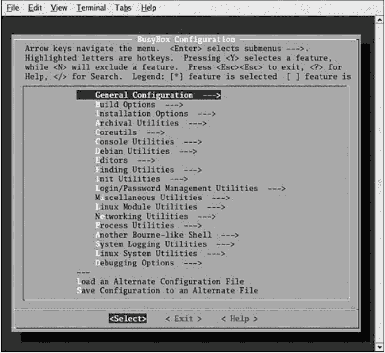

篇幅所限，无法涵盖每个配置选项。不过，有些选项值得一提。一些较为重要的 BusyBox 配置选项位于 `Build Options` 下。在这里，你可以找到交叉编译 BusyBox 应用程序所需的配置选项。清单 11-1 详细列出了近期 BusyBox 快照中 `Build Options` 下的选项。从 BusyBox 顶层配置工具中选择 Build Options 即可导航到此屏幕。

### 清单 11-1. BusyBox 构建选项

```
[ ] Build BusyBox as a static binary (no shared libs)
[ ] Build with Large File Support (for accessing files > 2 GB)
[ ] Do you want to build BusyBox with a Cross Compiler?
()  Any extra CFLAGS options for the compiler?
```

第一个选项对于构建极简嵌入式系统非常有用。它允许 BusyBox 静态编译和链接，这样目标系统在运行时就不需要动态加载库（例如 `libc-2.3.3.so`）。如果不选择此选项，BusyBox 需要一些库才能运行。我们可以使用 `ldd` 命令轻松确定 BusyBox（或任何其他二进制文件）在目标系统上需要哪些库。清单 11-2 包含了在我的桌面 Linux 工作站上显示的输出。

### 清单 11-2. BusyBox 库依赖

```
$ ldd busybox
        linux-gate.so.1 =>  (0xffffe000)
        libc.so.6=> /lib/tls/libc.so.6 (0x42c70000)
        /lib/ld-linux.so.2=> /lib/ld-linux.so.2 (0x42c57000)
```

请注意，使用默认配置编译的 BusyBox 工具需要清单 11-2 中的三个共享库。如果我们选择将 BusyBox 构建为静态二进制文件，`ldd` 只会输出一条消息，告诉我们 BusyBox 二进制文件不是动态可执行文件。换句话说，它不需要共享库来解决可执行文件中的任何未解析依赖项。静态链接在根文件系统上占用空间更小，因为不需要共享库。然而，构建不包含共享库的嵌入式应用程序意味着你的应用程序无法使用熟悉的 C 库函数。

我们将在下一节介绍清单 11-1 中的其他选项。

### 11.2.1. 交叉编译 BusyBox

正如本章开头所述，BusyBox 的作者旨在让该软件包在交叉开发环境中使用，因此在这种环境中构建 BusyBox 非常容易。在大多数情况下，唯一的要求是在你的开发工作站上指定交叉编译器的前缀。这通过在 BusyBox 配置工具的 Build Options 中选择使用交叉编译器构建 BusyBox 的选项来指定。然后，你将看到一个输入交叉编译器前缀的选项。你输入的前缀取决于你的交叉开发环境。一些例子包括 `xscale_be-` 或 `ppc-linux-`。我们将在下一章研究嵌入式开发环境时更详细地介绍这一点。

清单 11-1 中的最后一个选项用于你可能希望包含在编译器命令行上的任何额外标志。这些可能包括生成调试信息的选项（`-g`）、设置优化级别的选项（例如 `-O2`）以及其他可能特定于你的特定安装和目标系统的编译器选项。

## 11.3. BusyBox 操作

当你构建 BusyBox 时，最终会得到一个名为 `busybox` 的二进制文件，正如你所料。BusyBox 可以通过二进制文件名本身来调用，但更常见的是通过 *符号链接* 来启动。当 BusyBox 在没有命令行参数的情况下被调用时，它会列出通过配置启用的功能。清单 11-3 展示了这样的输出（为了适应页面宽度，对其进行了略微格式化）。

### 清单 11-3. BusyBox 用法

```
root@coyote # ./busybox
BusyBox v1.01 (2005.12.03-18:00+0000) multi-call binary

Usage: busybox [function] [arguments]...
  or: [function] [arguments]...

  BusyBox is a multi-call binary that combines many common Unix
  utilities into a single executable. Most people will create a
  link to busybox for each function they wish to use and BusyBox
  will act like whatever it was invoked as!

  Currently defined functions:
  [, ash, basename, bunzip2, busybox, bzcat, cat, chgrp, chmod,
    chown, chroot, chvt, clear, cmp, cp, cut, date, dd, deallocvt,
    df, dirname, dmesg, du, echo, egrep, env, expr, false, fgrep,
    find, free, grep, gunzip, gzip, halt, head, hexdump, hostname,
    id, ifconfig, init, install, kill, killall, klogd, linuxrc, ln,
    logger, ls, mkdir, mknod, mktemp, more, mount, mv, openvt, pidof,
    ping, pivot_root, poweroff, ps, pwd, readlink, reboot, reset,
    rm, rmdir, route, sed, sh, sleep, sort, strings, swapoff, swapon,
    sync, syslogd, tail, tar, tee, test, time, touch, tr, true, tty,
    umount, uname, uniq, unzip, uptime, usleep, vi, wc, wget, which,
    whoami, xargs, yes, zcat
```

从清单 11-3 中，你可以看到在此 BusyBox 构建中启用的功能列表。它们按字母顺序从 `ash`（一个针对小内存占用空间优化的 shell）到 `zcat`（用于解压缩压缩文件内容的工具）排列。这是此特定 BusyBox 快照中启用的默认工具集。

要调用特定功能，请在命令行上传递一个已定义的函数来执行 `busybox`。因此，要显示当前目录中的文件列表，请执行以下命令：

```
[root@coyote]# ./busybox ls
```

来自清单 11-3 中 BusyBox 用法消息的另一个重要信息是程序的简短描述。它将 BusyBox 描述为一个多调用二进制文件，将许多常见实用程序组合成一个单一的可执行文件。这就是前面提到的符号链接的目的。BusyBox 旨在通过以它将执行的功能命名的符号链接来调用。这消除了必须输入两个单词的命令来调用给定功能的负担，并为用户提供了一组用于类似命名实用程序的熟悉命令。清单 11-4 和 11-5 应该能阐明这一点。

### 清单 11-4. BusyBox 符号链接结构顶层

```
[root@coyote]$ ls -l /
total 12
drwxrwxr-x  2 root root 4096 Dec  3 13:38 bin
lrwxrwxrwx  1 root root   11 Dec  3 13:38 linuxrc -> bin/busybox
drwxrwxr-x  2 root root 4096 Dec  3 13:38 sbin
drwxrwxr-x  4root root 4096 Dec  3 13:38 usr
```

清单 11-4 显示了 BusyBox 软件包通过 `make install` 命令构建的目标目录结构。可执行的 `busybox` 文件位于 `/bin` 目录中，并且在整个结构的其余部分都填充了指向 `/bin/busybox` 的符号链接。清单 11-5 扩展了清单 11-4 的目录结构。

### 清单 11-5. BusyBox 符号链接结构树详情

```
[root@coyote]$ tree
.
|-- bin
|   |-- ash -> busybox
|   |-- busybox
|   |-- cat -> busybox
|   |-- cp -> busybox
|   |-- ...
|   '-- zcat -> busybox
|-- linuxrc -> bin/busybox
|-- sbin
|   |-- halt -> ../bin/busybox
|   |-- ifconfig -> ../bin/busybox
|   |-- init -> ../bin/busybox
|   |-- klogd -> ../bin/busybox
|   |-- ...
|   '-- syslogd -> ../bin/busybox
'-- usr
    |-- bin
    |   |-- [ -> ../../bin/busybox
    |   |-- basename -> ../../bin/busybox
    |   |-- ...
```


|-- xargs -> ../../bin/busybox
'-- yes -> ../../bin/busybox
'-- sbin
    '-- chroot -> ../../bin/busybox

[清单 11-5](...) 的输出已被大幅截断，以便提高可读性并避免长达三页的清单。每个包含省略号（`...`）的行都表示该清单已被修剪，仅显示给定目录的前几项和后几项条目。实际上，这些目录中可以生成超过 100 个符号链接，具体数量取决于你通过 BusyBox 配置工具启用了哪些功能。

注意 `/bin` 目录中的第二个条目——`busybox` 可执行文件本身。此外，`/bin` 目录中还有指向 `busybox` 的符号链接，包括 `ash`、`cat`、`cp`……一直到 `zcat`。同样，介于 `cp` 和 `zcat` 之间的条目已从此清单中省略，以提高可读性。通过这种符号链接结构，用户只需输入实用工具的实际名称即可调用其功能。例如，要使用 `busybox` 的 `ifconfig` 实用工具配置网络接口，用户可能会输入类似这样的命令：

```
$ ifconfig eth1 192.168.1.14
```

这将通过 `ifconfig` 符号链接调用 `busybox` 可执行文件。BusyBox 会检查它是如何被调用的——也就是说，它会读取 `argv[0]` 来决定执行什么功能。

### 11.3.1. BusyBox Init

注意 [清单 11-5](...) 中名为 `init` 的符号链接。在 [第六章](...)“系统初始化”中，你了解了 `init` 程序及其在系统初始化中的作用。回想一下，内核在初始化最后一步会尝试执行名为 `/sbin/init` 的程序。BusyBox 完全可以模拟 `init` 功能，[清单 11-5](...) 所展示的系统正是这样配置的。BusyBox 负责处理 `init` 功能。

BusyBox 处理系统初始化的方式与标准 System V init 不同。使用 [第六章](...) 中描述的 System V (SysV) 初始化的 Linux 系统需要在 `/etc` 目录中可访问的 `inittab` 文件。BusyBox 也会读取 `inittab` 文件，但其语法有所不同。一般来说，如果你使用 BusyBox，应该不需要使用 `inittab`。我同意 BusyBox 手册页的观点：如果你需要运行级别，请使用 System V 初始化。[2]

[2] 我们在 [第六章](...) 中详细介绍了 System V 初始化的细节。

让我们看看这在嵌入式系统上会是什么样子。我们创建了一个基于 BusyBox 的小型根文件系统。我们将 BusyBox 配置为静态链接，从而不需要任何共享库。[清单 11-6](...) 包含了这个根文件系统的树状列表。我们按照 [第九章](...)“文件系统”中 [9.10 节](...)“构建简单文件系统”概述的步骤构建了这个小型文件系统。我们在此不再详述该过程。我们简单文件系统中的文件如 [清单 11-6](...) 所示。

#### 清单 11-6. 最小 BusyBox 根文件系统

```
$ tree
.
|-- bin
|   |-- busybox
|   |-- cat -> busybox
|   |-- dmesg -> busybox
|   |-- echo -> busybox
|   |-- hostname -> busybox
|   |-- ls -> busybox
|   |-- ps -> busybox
|   |-- pwd -> busybox
|   '-- sh -> busybox
|-- dev
|   '-- console
|-- etc
'-- proc
4 directories, 10 files
```

这个基于 BusyBox 的根文件系统占用的空间几乎不超过 `busybox` 本身所需的容量。在这种配置下，使用静态链接并支持近 100 个实用工具，BusyBox 可执行文件的大小不到 1MB：

```
# ls -l /bin/busybox
-rwxr-xr-x    1 root   root    824724 Dec  3  2005 /bin/busybox
```

现在让我们看看这个系统的表现。[清单 11-7](link) 捕获了基于 BusyBox 的嵌入式系统上电时的控制台输出。

#### 清单 11-7. BusyBox 默认启动

```
...
Looking up port of RPC 100003/2 on 192.168.1.9
Looking up port of RPC 100005/1 on 192.168.1.9
VFS: Mounted root (nfs filesystem).
Freeing init memory: 96K
Bummer, could not run '/etc/init.d/rcS': No such file or directory

Please press Enter to activate this console.

BusyBox v1.01 (2005.12.03-19:09+0000) Built-in shell (ash)
Enter 'help' for a list of built-in commands.

-sh: can't access tty; job control turned off
/ #
```

[清单 11-7](text://) 的示例是在配置为 NFS 根挂载的嵌入式板上运行的。我们在工作站上导出了一个包含 [清单 11-6](text://) 中详细描述的简单文件系统镜像的目录。作为启动过程的最后步骤之一，目标板上的 Linux 内核通过 NFS 挂载根文件系统。当内核尝试执行 `/sbin/init` 时失败了，因为我们的文件系统上没有 `/sbin/init`。然而，正如我们所见，内核还会尝试执行 `/bin/sh`。在我们配置有 BusyBox 的目标板上，这一步成功了，`busybox` 通过我们根文件系统上的符号链接 `/bin/sh` 启动。

BusyBox 显示的第一条信息是它找不到 `/etc/init.d/rcS` 的抱怨。这是 BusyBox 搜索的默认初始化脚本。不使用 `inittab`，这是初始化基于 BusyBox 的嵌入式系统的首选方法。

初始化完成后，BusyBox 显示提示，要求用户按 Enter 键激活控制台。当检测到 Enter 键时，它会执行一个 ash shell 会话等待用户输入。最后关于作业控制的消息是由于我们在串口终端上创建系统控制台而导致的。Linux 内核包含代码，如果检测到控制台在串口终端上，就会禁用作业控制。

这个示例产生了一个可工作的系统，提供近 100 个 Linux 实用工具，包括核心工具、文件工具、网络支持以及一个功能相当完备的 shell。你可以看到这个简单的软件包为构建你自己的系统应用程序提供了一个强大的平台。当然，需要注意的是，如果没有任何对 `libc` 和其他系统库的支持，你将面临实现应用程序的艰巨任务。你必须提供典型 C 程序所依赖的所有常用系统调用和其他库函数支持。或者，你可以将应用程序与其依赖的库进行静态链接，但如果你使用这种方法的应用程序超过几个，其总大小很可能超过动态链接并在目标系统上放置共享库的组合大小。

### 11.3.2. rcS 初始化脚本示例

在 BusyBox 启动交互式 shell 之前，它会尝试执行名为 `/etc/init.d/rcS` 的脚本中的命令，如 [清单 11-7](text://) 所示。正是在这里，你的应用程序在 BusyBox 系统中活跃起来。[清单 11-8](text://) 提供了一个简单的 `rcs` 初始化脚本。

#### 清单 11-8. 简单的 `rcs` BusyBox 启动脚本

```
#!/bin/sh

echo "Mounting proc"
mount -t proc /proc /proc

echo "Starting system loggers"
syslogd
klogd

echo "Configuring loopback interface"
ifconfig lo 127.0.0.1

echo "Starting inetd"
xinetd

# start a shell
busybox sh
```

这个简单的脚本大部分都一目了然。首先，重要的是将 `/proc` 文件系统挂载到其保留的挂载点 `/proc` 上。这是因为许多实用工具都从 `/proc` 文件系统获取信息。这一点在 [第九章](#) 中有更详尽的说明。接下来，我们尽早启动系统日志记录器，以捕获任何启动问题。在系统日志守护进程之后，我们为系统配置本地回环接口。同样，许多传统的 Linux 功能都假定存在回环接口，如果你的系统配置了套接字支持，你应该启用这个伪接口。在启动 shell 之前，最后一件事是启动 Internet 超级服务器 `xinetd`。这个程序在后台监听任何配置的网络接口上的网络请求。例如，要发起与目标板的 `telnet` 会话，`xinetd` 会拦截 `telnet` 连接请求并派生一个 `telnet` 服务器来处理该会话。

除了启动 shell，你自己的应用程序也可以从这个 `rcs` 初始化脚本中启动。[清单 11-8](#) 是一个简单的示例，展示了一个启用 Telnet 的目标板运行着系统日志和内核日志等基本服务。

### 11.3.3. BusyBox 目标安装

只有在理解了符号链接的用途和目的之后，才能继续讨论 BusyBox 的安装。BusyBox 的 makefile 中包含一个名为 `install` 的目标。执行 `make install` 会创建一个包含 `busybox` 可执行文件和符号链接树的目录结构。这个环境需要迁移到你的目标嵌入式系统的根目录中，并带上完整的符号链接树。符号链接树消除了为每个命令键入 `busybox command` 的需要。相反，要查看给定目录中的文件列表，用户只需键入 `ls`。符号链接如前所述执行 `busybox` 并调用 `ls` 功能。查阅 [清单 11-4](#) 和 [清单 11-5](#) 以了解符号链接树。注意，BusyBox 构建系统只会为你通过配置工具启用的功能创建链接。

用必要的符号链接群填充根文件系统最简单的方法是让 BusyBox 构建系统帮你完成。只需在你的开发工作站上挂载根文件系统，并向 BusyBox makefile 传递一个 `PREFIX`。[清单 11-9](#) 展示了该过程。


#### 清单 11-9. 在根文件系统上安装 BusyBox

```
$ mount -o loop bbrootfs.ext2 /mnt/remote
$ make PREFIX=/mnt/remote install
/bin/sh applets/install.sh /mnt/remote
  /mnt/remote/bin/ash -> busybox
  /mnt/remote/bin/cat -> busybox
  /mnt/remote/bin/chgrp -> busybox
  /mnt/remote/bin/chmod -> busybox
  /mnt/remote/bin/chown -> busybox
...
 /mnt/remote/usr/bin/xargs -> ../../bin/busybox
 /mnt/remote/usr/bin/yes -> ../../bin/busybox
 /mnt/remote/usr/sbin/chroot -> ../../bin/busybox

-----------------------------------------------
你可能需要将你的 busybox 二进制文件设置为
setuid root，以确保所有已配置的小程序
都能正常工作。
-----------------------------------------------

$ chmod +s /mnt/remote/bin/busybox
$ ls -l /mnt/remote/bin/busybox
-rwsr-sr-x  1 root root 863188 Dec  4 15:54 /mnt/remote/bin/busybox
```

首先，我们将根文件系统的二进制镜像挂载到我们期望的挂载点——本例中是我常用的 `/mnt/remote`。然后，我们调用 BusyBox 的 `make install` 命令，并通过 `PREFIX` 参数指定我们希望将符号链接树和 `busybox` 可执行文件放置的位置。如清单所示，makefile 调用了一个名为 `applets/install.sh` 的脚本来完成大部分工作。该脚本遍历一个包含所有已启用的 BusyBox 小程序的文件，并为我们指定的 `PREFIX` 路径下的每个小程序创建一个符号链接。该脚本输出非常详细；它会为创建的每个符号链接输出一行。为简洁起见，清单中只显示了开头和结尾的几个符号链接通知。省略号代表了被我们省略的部分。

关于 `setuid` 的消息也是由安装脚本显示的，目的是提醒你可能需要将你的 `busybox` 可执行文件设置为 `setuid` root。这样做是为了让需要 root 权限的 BusyBox 功能在非 root 用户调用时也能正常运行。这并非严格必需，特别是在嵌入式 Linux 环境中，系统通常只有 root 帐户。如果这对你的安装是必要的，所需的命令（`chmod +s`）已在[清单 11-9](link)中展示。

此安装步骤的结果是，`busybox` 二进制文件和符号链接树被安装到了我们的目标根文件系统上。最终结果看起来与[清单 11-4](link)非常相似。

值得注意的是，BusyBox 还有一个选项，可以在运行时在目标系统上创建此符号链接树。此选项在 BusyBox 配置中启用，并在运行时通过执行带有 `--install` 选项的 `busybox` 来调用。为了使此支持正常工作，你的目标系统必须挂载 `/proc` 文件系统。

### 11.3.4. BusyBox 命令

花点时间浏览一下[附录 C](...），“BusyBox 命令”，你可以在那里找到每个 BusyBox 命令的摘要。完成之后，你将更好地了解 BusyBox 的功能以及它如何适用于你自己的嵌入式 Linux 项目。

正如本章开头所提到的，与功能齐全的对应版本相比，许多 BusyBox 命令包含的功能和选项有限。通常，你可以通过在运行时调用命令并使用 `--help` 选项来获取任何给定 BusyBox 命令的帮助信息。这会产生一条用法消息，其中包含每个受支持命令选项的简要说明。BusyBox 的 `gzip` 小程序是一个有用的 BusyBox 命令示例，它支持一组有限的选项。[清单 11-10](...）显示了 BusyBox 目标系统上 `gzip --help` 的输出。

#### 清单 11-10. BusyBox `gzip` 小程序用法

```
/ # gzip --help
BusyBox v1.01 (2005.12.01-21:11+0000) multi-call binary

Usage: gzip [OPTION]... [FILE]...

使用最大压缩率压缩文件。
当 FILE 是 '-' 或未指定时，从标准输入读取。隐含 -c。

Options:
	-c	将输出写入标准输出，而不是 FILE.gz
	-d	解压缩
	-f	当目标是终端时强制写入
```

BusyBox 版本的 `gzip` 仅支持三个命令行选项。而功能齐全的版本支持超过 15 个不同的命令行选项。例如，功能齐全的 `gzip` 工具支持 `--list` 选项，该选项会为命令行上的每个文件生成压缩统计信息。BusyBox `gzip` 没有这样的支持。这通常对嵌入式系统不是一个重要的限制。我们提供此信息是为了让你在决定使用 BusyBox 时能够做出明智的选择。当需要某个工具的全部功能时，解决方案很简单：在 BusyBox 配置中删除对该特定工具的支持，并将标准 Linux 工具添加到你的目标系统中。

## 11.4. 章节总结

- BusyBox 是嵌入式系统的一个强大工具，它用一个单一的多调用二进制文件替代了许多常见的 Linux 实用工具。
- BusyBox 可以显著减小你的根文件系统镜像的大小。
- BusyBox 易于使用，并具有许多有用的功能。
- 配置 BusyBox 很直接，使用与 Linux 配置类似的界面。
- BusyBox 可以配置为静态或动态链接应用程序，具体取决于你的特定要求。
- 使用 BusyBox 时，系统初始化会有所不同；本章已涵盖这些差异。
- BusyBox 支持许多命令。[附录 C](#) 列出了来自最新版本的所有可用 BusyBox 命令。

### 11.4.1. 额外阅读建议

BusyBox 项目主页
[www.busybox.net/](http://www.busybox.net/)

BusyBox 手册页
[www.busybox.net/downloads/BusyBox.html](http://www.busybox.net/downloads/BusyBox.html)

# 第 12 章 嵌入式开发环境

本章内容

- [交叉开发环境](第 290 页)
- [宿主系统要求](第 295 页)
- [托管目标板](第 296 页)
- [章节总结](第 306 页)

你的宿主开发系统上配置和服务可以对你的嵌入式开发者成功与否产生巨大影响。本章探讨了交叉开发环境的独特要求，以及嵌入式开发者需要了解的一些工具和技术，以高效工作。

我们首先考察一个典型的交叉开发环境。使用熟悉的“hello world”示例，我们详细说明了基于宿主的应用程序与面向嵌入式系统的应用程序之间的重要区别。我们还探讨了原生应用开发与嵌入式应用开发的工具链差异。然后，我们介绍宿主系统要求，并详细说明宿主系统中一些重要元素的使用。本章最后以一个网络宿主机托管目标板的示例作为结束。

## 12.1. 交叉开发环境

嵌入式开发新手常常在理解和区分原生开发环境与交叉开发环境方面感到困惑。确实，通常会有三个编译器和三个（或更多）版本的标准头文件，例如 `stdlib.h`。如果没有合适的工具和基于宿主的实用程序，在目标嵌入式系统上调试应用程序可能会很困难。你必须管理和分离设计为在宿主系统上运行的文件与你打算在目标系统上使用的文件。

在此上下文中，当我们使用术语 *宿主* 时，我们指的是放在你桌面上并运行你喜欢的 Linux 桌面发行版的开发工作站。[1] 反之，当我们使用术语 *目标* 时，我们指的是你的嵌入式硬件平台。因此，*原生开发* 表示在宿主系统上编译和构建应用程序，且应用程序运行于宿主系统。交叉开发表示在宿主系统上编译和构建应用程序，但应用程序将运行于嵌入式系统。牢记这些定义将有助于你在本章中保持清晰的思路。

> [1] 韦氏词典将 *胡说* 定义为“荒谬或有悖常理的想法”。在我看来，在非 Linux/UNIX 宿主上开发 Linux 嵌入式平台就是胡说八道。

图 12-1 展示了一个典型交叉开发环境的布局。宿主 PC 通过一个或多个物理连接与目标板相连。如果目标板同时提供串行端口和以太网端口，那将是最方便的。稍后当我们讨论内核调试时，你会意识到第二个串行端口可以是一个非常宝贵的资产。

### 图 12-1. 交叉开发设置

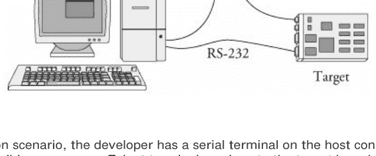

在最常见的场景中，开发者的宿主机上有一个通过 RS-232 串口连接的串行终端，可能有一个或多个到目标板的 Telnet 终端会话，并且可能有一个或多个使用以太网作为连接介质的调试会话。这种交叉开发设置提供了极大的灵活性。其基本思想是宿主系统提供算力来

运行编译器、调试器、编辑器和其他工具程序，而目标系统只执行为其设计的应用程序。当然，你完全可以在目标系统上运行编译器和调试器，但我们假设你的宿主系统拥有更多资源，包括内存、磁盘存储和互联网连接。事实上，一个目标嵌入式开发板没有人类输入设备或输出显示屏的情况并不少见。

### 12.1.1. 嵌入式“Hello World”

一个配置得当的交叉开发系统能够为普通应用开发者隐藏大量复杂性。通过一个简单的例子，我们可以揭开并解释一些其中的奥秘。当我们编译一个简单的“hello world”程序时，工具链（编译器、链接器及相关工具）会基于我们构建程序的宿主系统和我们正在编译的程序做出许多假设。实际上，这些并非假设，而是编译器用来构建正确二进制文件的一系列规则。

代码清单 12-1 展示了一个简单的“hello world”程序。

#### 代码清单 12-1. 再次出现的 Hello World

```
#include <stdio.h>

int main(int argc, char **argv)
{
    printf("Hello World\n");
    return 0;
}
```

即使是随便写写的应用开发者，也能意识到这个 C 源文件的一些要点。首先，函数 `printf()` 在此文件中被引用但未定义。如果我们省略包含 `printf()` 函数原型的 `#include` 指令，编译器会发出熟悉的警告信息：

```
hello.c:5: warning: implicit declaration of function 'printf'
```

这引出了一些有趣的问题：

*   文件 `stdio.h` 位于何处，以及如何被找到？
*   `printf()` 函数位于何处，在二进制可执行文件中如何解析这个引用？

不知何故，编译器似乎就是*知道*如何将一个可以在命令行执行的正确二进制文件组合起来。更复杂的是，最终的可执行文件包含了我们从未见过但链接器自动包含的启动和关闭序言代码。这段序言代码处理诸如传递给程序的环境和参数、启动与关闭的日常处理、退出处理等细节。

要构建“hello world”应用，我们可以使用一个简单的命令行调用编译器，类似于：

```
$ gcc -o hello hello.c
```

这会生成名为 `hello` 的二进制可执行文件，我们可以直接从命令行执行它。编译器引用的默认设置指导了 `include` 文件的查找位置。类似地，链接器知道如何通过包含对定义了 `printf()` 函数的库的引用来解析该函数的引用。这当然就是标准 C 库。

我们可以查询工具链，查看使用的一些默认值。代码清单 12-2 是在传递 `-v` 标志时，`cpp` 命令输出的部分内容。你可能已经知道 `cpp` 是 `gcc` 工具链中的 C 预处理器组件。为了提高可读性，我们添加了一些格式（仅空格）。

#### 代码清单 12-2. 默认的本地 `cpp` 搜索目录

[查看完整宽度]

```
$ cpp -v
Reading specs from /usr/lib/gcc-lib/i386-redhat-linux/3.3.3/specs
Configured with: ../configure --prefix=/usr --mandir=/usr/share/man --infodir=/usr/share/info --enable-shared --enable-threads=posix --disable-checking --disable-libunwind-exceptions --with-system-zlib --enable-__cxa_atexit --host=i386-redhat-linux

Thread model: posix
gcc version 3.3.3 20040412 (Red Hat Linux 3.3.3-7)
 /usr/lib/gcc-lib/i386-redhat-linux/3.3.3/cc1 -E -quiet -v -
ignoring nonexistent directory "/usr/i386-redhat-linux/include"

#include "..." search starts here:
#include <...> search starts here:
 /usr/local/include
 /usr/lib/gcc-lib/i386-redhat-linux/3.3.3/include
 /usr/include
End of search list.
/usr/lib/
```

这个简单的查询产生了一些非常有用的信息。首先，我们可以看到编译器是如何使用熟悉的 `./configure` 工具配置的。默认的线程模型是 `posix`，如果你的程序使用了线程函数，它将决定你的应用程序链接到哪个线程库。最后，你可以看到 `#include` 指令的默认搜索目录。

但如果我们想为不同的架构（例如 PowerPC）构建 `hello.c` 呢？当我们在宿主机器上使用交叉编译器为 PowerPC 目标编译应用程序时，我们必须确保编译器不使用默认的*宿主* `include` 目录或库路径。使用正确配置的交叉编译器是第一步，拥有一个设计良好的交叉开发环境是第二步。

代码清单 12-3 是一个名为嵌入式 Linux 开发工具包（ELDK）的流行开源交叉开发工具链的输出，由 Denx Software Engineering 组装和维护。这个特定的安装是针对 PowerPC 82xx 工具链配置的。同样，为了可读性，我们在输出中添加了一些空格。

#### 代码清单 12-3. 默认的交叉搜索目录

[查看完整宽度]

```
$ ppc_82xx-cpp -v
Reading specs from /opt/eldk/usr/bin/.. /lib/gcc-lib/ppc-linux/3.3.3/specs

Configured with: ../configure --prefix=/usr --mandir=/usr/share/man --infodir=/usr/share/info --enable-shared --enable-threads=posix --disable-checking --with-system-zlib --enable-__cxa_atexit --with-newlib --enable-languages=c,c++ --disable-libgcj --host=i386-redhat-linux -target=ppc-linux

Thread model: posix

gcc version 3.3.3 (DENX ELDK 3.1.1 3.3.3-10)
 /opt/eldk/usr/bin/../lib/gcc-lib/ppc-linux/3.3.3/cc1  -E -quiet -v -iprefix /opt/eldk/bin/.. /lib/gcc-lib/ppc-linux/3.3.3/ -D__unix__ -D__gnu_linux__  -D__linux__ -Dunix -D__unix -Dlinux -D__linux -Asystem=unix  -Asystem=posix -mcpu=603

ignoring nonexistent directory "/opt/eldk/usr/ppc-linux/sys-include"
ignoring nonexistent directory "/opt/eldk/usr/ppc-linux/include"
#include "..." search starts here:

#include <...> search starts here:
  /opt/eldk/usr/lib/gcc-lib/ppc-linux/3.3.3/include
  /opt/eldk/ppc_82xx/usr/include

End of search list.
```

在这里，你可以看到 `include` 目录的默认搜索路径现在已调整为指向你的交叉编译版本，而不是本地的 `include` 目录。这个看似晦涩的细节对于为你的嵌入式系统开发应用程序和编译开源软件包至关重要。对于刚接触嵌入式系统、经验丰富的应用开发者来说，这甚至也是最令人困惑的话题之一。

## 12.2. 宿主系统要求

你的开发工作站必须包含几个重要的组件和系统。当然，你需要一个配置正确的交叉工具链。你可以自己下载并编译一个，或者获取市面上众多商用工具链之一。构建自己的工具链超出了本书的范围，尽管有一些很好的参考资料可供参考。有关推荐，请参阅本章末尾的 [12.4.1 节](link)，“补充阅读建议”。

你需要的下一个主要项目是针对你的嵌入式系统架构的 Linux 发行版。这包括数百甚至可能上千个文件，它们将填充你嵌入式系统的文件系统。同样，选择可以是自己构建或获取商用版本之一。互联网上更流行的嵌入式系统发行版之一是前面提到的 ELDK。ELDK 可用于一些 PowerPC 和其他嵌入式目标。从头开始构建一个嵌入式 Linux 发行版本身就需要一本这么厚的书，因此超出了我们此处讨论的范围。

总而言之，你的开发宿主需要四个独立且不同的能力：

-   交叉工具链和库
-   目标系统软件包，包括程序、工具程序和库
-   宿主工具，如编辑器、调试器和工具程序
-   用于托管你的目标板的服务器，将在下一节介绍

如果你在工作站上安装一个现成的嵌入式 Linux 开发环境，无论是商用版本还是开源社区中免费可用的版本，工具链和组件都已经预先配置好，可以协同工作。例如，工具链已被配置为具有与你的开发工作站上目标头文件和系统库位置相匹配的默认目录搜索路径。如果你的需求包括在开发工作站上支持多种架构和处理器，情况就会变得复杂得多。这就是嵌入式 Linux 发行版存在的原因。

### 12.2.1. 硬件调试探针

除了前面列出的组件外，你还应该考虑某种形式的硬件辅助调试。这包括一个连接到你的宿主机（通常通过以太网）并通过板上的调试连接器连接到目标的硬件探针。市面上有很多解决方案。我们在 [第 14 章](link)“内核调试技术”中详细介绍了这个话题。


## 12.3. 托管目标板

回顾图12-1，你会注意到从目标嵌入式板到主机开发系统存在一个以太网连接。这并非严格必需，事实上，一些较小的嵌入式设备没有以太网接口。然而，这是例外而非常规。在你的目标板上配备一个以太网连接，其硅片成本绝对是物有所值！

在开发内核期间，你将多次编译内核并将其下载到你的嵌入式板上。许多嵌入式开发系统和引导加载程序都支持TFTP，并假设开发者会使用它。TFTP是一种在TFTP服务器和TFTP客户端之间传输文件的轻量级协议，类似于FTP。

从你的引导加载程序使用TFTP加载内核，将为你节省无数等待串口下载的时间，即使是在更高的串口波特率下也是如此。而加载你的ramdisk可能需要更长的时间，因为根据你的需求，ramdisk镜像可能增长到几十兆字节甚至更多。你投入时间和精力来配置和使用TFTP，必将得到回报，我们强烈推荐这样做。很少有设计在开发阶段承担不起包含一个以太网端口的芯片面积，即使该端口在生产时会被省去。

### 12.3.1. TFTP 服务器

在你的Linux开发主机上配置TFTP并不困难。当然，具体细节可能因你选择用于开发工作站的Linux发行版而异。此处给出的指南基于Red Hat和Fedora Core Linux发行版。

TFTP是一种TCP/IP服务，必须在你的工作站上启用。要启用TFTP服务，你必须指示你的服务器响应传入的TFTP数据包并启动你的TFTP服务器。在许多Linux发行版上，这是通过编辑`xinetd`互联网超级服务器使用的配置文件来完成的。例如，在Red Hat和Fedora桌面Linux发行版上，该文件是`/etc/xinetd.d/tftp`。清单12-4包含了一个来自Fedora Core 2开发工作站的TFTP配置，用于启用TFTP服务。为了适应页面，它已经过轻微调整。

#### 清单 12-4. TFTP 配置

```
# default: off
# description: The tftp server serves files using the trivial
# file transfer protocol. The tftp protocol is often used to
# boot diskless workstations, download configuration files to
# network-aware printers, and to start the installation process
# for some operating systems.

service tftp
{
	socket_type		= dgram
	protocol		= udp
	wait			= yes
	user			= root
	server			= /usr/sbin/in.tftpd
	server_args		= -c -s /tftpboot
	disable			= no
	per_source		= 11
	cps			= 100 2
	flags			= IPv4
}
```

在此典型设置中，TFTP服务已启用（`disable = no`）并配置为提供位于此工作站`/tftpboot`目录中的文件。当`xinetd`互联网超级服务器收到传入的TFTP请求时，它会查阅此配置并启动指定的服务器（`/usr/sbin/in.tftpd`）。`server_args`指定的命令行参数将传递给`in.tftpd`进程。在此情况下，`-s`开关告诉`in.tftpd`切换到指定的目录（`/tftpboot`），而`-c`标志允许创建新文件。这对于从目标向服务器写入文件很有用。

请查阅随你的桌面发行版附带的文档，以获取适用于你环境的具体细节。

### 12.3.2. BOOTP/DHCP 服务器

在你的开发主机上拥有一个DHCP服务器可以简化嵌入式目标的配置管理。我们已经确定了为什么在目标硬件上配备以太网接口是个好主意。当Linux在你的目标板上启动时，它需要配置以太网接口，之后该接口才会可用。此外，如果你在目标板上使用NFS根挂载配置，Linux需要在启动过程完成之前配置目标的以太网接口。我们在第9章“文件系统”中详细介绍了NFS。

一般来说，Linux在启动期间可以使用两种方法来初始化其以太网/IP接口：

-   将以太网接口参数硬编码到Linux内核命令行或默认配置中。
-   配置内核在启动时自动检测网络设置。

出于明显的原因，后一种选择最为灵活。DHCP或BOOTP是你的目标和服务器用来完成网络设置自动检测的协议。有关DHCP或BOOTP协议的详细信息，请参阅本章末尾的第12.4.1节。

DHCP服务器控制它已配置的IP子网以及已配置参与的DHCP或BOOTP客户端的IP地址分配。DHCP服务器监听来自DHCP客户端（例如你的目标板）的请求，并在启动过程中将地址和其他相关信息分配给客户端。一个典型的DHCP交换（见清单12-5）可以通过使用`-d`调试开关启动DHCP服务器，并在目标机器请求配置时观察输出来进行检查。

#### 清单 12-5. 典型的 DHCP 交换

```
tgt> DHCPDISCOVER from 00:09:5b:65:1d:d5 via eth0
svr> DHCPOFFER on 192.168.0.9 to 00:09:5b:65:1d:d5 via eth0
tgt> DHCPREQUEST for 192.168.0.9 (192.168.0.1) from 00:09:5b:65:1d:d5 via eth0
svr> DHCPACK on 192.168.0.9 to 00:09:5b:65:1d:d5 via eth0
```

序列从客户端（目标）传输一个广播帧开始，试图发现一个DHCP服务器。这由显示的`DHCPDISCOVER`消息表明。服务器响应（如果已如此配置并启用）是为客户端提供一个IP地址。这由`DHCPOFFER`消息证明。然后客户端通过在本地测试此IP地址来响应。测试包括向DHCP服务器发送`DHCPREQUEST`数据包，如图所示。最后，服务器通过确认将IP地址分配给客户端来响应，从而完成自动目标配置。

有趣的是要注意，一个正确配置的客户端会记住它上次被DHCP服务器分配的地址。下次启动时，它将跳过`DHCPDISCOVER`阶段，直接进入`DHCPREQUEST`阶段，假设它可以重复使用服务器先前分配的相同IP地址。启动中的Linux内核没有这种能力，每次启动时都会发出相同的序列。

配置你的主机的DHCP服务器并不困难。一如既往，我们的建议是查阅随你的桌面Linux发行版附带的文档。在Red Hat或Fedora Core发行版上，单个目标的配置条目可能类似于清单12-6。

#### 清单 12-6. 示例 DHCP 服务器配置

```
# Example DHCP Server Configuration
allow bootp;

subnet 192.168.1.0 netmask 255.255.255.0 {
  default-lease-time 1209600;    # two weeks
  option routers 192.168.1.1;
  option domain-name-servers 1.2.3.4;
  group {
    host pdna1 {
      hardware ethernet 00:30:bd:2a:26:1f;
      fixed-address 192.168.1.68;
      filename "uImage-pdna";
      option root-path "/home/chris/sandbox/pdna-target";
    }
  }
}
```

这是一个简单的例子，仅用于展示你可以传递给目标系统的信息类型。目标MAC地址与其分配的IP地址之间存在一一映射关系。除了其固定IP地址外，你还可以向目标传递其他信息。在此示例中，默认路由器和DNS服务器地址被传递给你的目标，以及你选择的文件名和你的内核用于挂载NFS根文件系统的根路径。该文件名可能被你的引导加载程序用于从你的TFTP服务器加载内核镜像。你也可以配置你的DHCP服务器从预定义范围分发IP地址，但使用如清单12-6所示的固定地址非常方便。

你必须在你的Linux开发工作站上启用DHCP服务器。这通常通过你的主菜单或命令行完成。请查阅你自己的Linux发行版的文档，以获取适用于你环境的详细信息。例如，要在Fedora Core 2 Linux发行版上启用DHCP服务器，只需在root命令提示符下键入以下命令：

```
$ /etc/init.d/dhcpd start (or restart)
```

每次启动开发工作站时都必须执行此操作，除非你将其配置为自动启动。

安装DHCP服务器涉及许多细微之处，因此除非你的服务器位于专用网络上，否则建议在启用自己的服务器之前咨询你的系统管理员。如果你与公司局域网共存，你极有可能会干扰其自身的DHCP服务。

### 12.3.3. NFS 服务器

为目标板使用NFS根挂载是一个非常强大的开发工具。此配置对开发的一些优势包括：

-   你的根文件系统不受板载自身有限资源（如Flash内存）的大小限制。
-   在开发期间对应用程序文件所做的更改会立即在你的目标系统中可用。
-   你可以在开发和调试根文件系统之前开发和启动你的内核。

设置NFS服务器因你所使用的桌面Linux发行版而异。与本章描述的其他服务一样，你必须查阅你自己的Linux发行版的文档，以获取适用于你配置的详细信息。NFS服务必须从你的启动脚本、图形菜单或命令行启动。例如，在Fedora Core 2 Linux桌面上，从root命令提示符启动NFS服务的命令如下：

```
$ /etc/init.d/nfs start (or restart)
```

每次启动桌面Linux工作站时，你都必须执行此操作。（此服务和其他服务可以在启动时自动启动——请查阅你的桌面Linux发行版的文档。）除了启用服务外，你的内核必须编译时启用NFS支持。虽然DHCP和TFTP都是用户空间实用程序，但NFS需要内核支持。这在你的开发工作站和目标板上都是如此。图12-2说明了内核中NFS的配置选项。注意有用于NFS服务器和客户端支持的配置选项。还要注意用于NFS上根文件系统的选项。你的目标内核必须配置此选项才能进行NFS根挂载操作。


### 12.3.4. 目标板 NFS 根挂载

通过 NFS 根挂载来挂载目标板并不困难，并且正如其他地方提到的，这是一种非常有用的开发配置。然而，必须确保一组细节正确无误才能正常工作。所需步骤如下：

1.  配置你的 NFS 服务器，并导出适合你架构的目标文件系统。
2.  在目标内核中配置 NFS 客户端服务和根文件系统位于 NFS 上。
3.  启用目标板以太网接口的内核级自动配置。
4.  通过内核命令行或静态内核配置选项提供目标板以太网 IP 配置。
5.  提供支持 NFS 的内核命令行。

我们在解释 NFS 服务器配置时，已经在图 12-2 中展示了内核配置。你必须确保目标内核配置中已启用 NFS 客户端服务，特别是必须启用**Root file system on NFS**选项。具体来说，确保你的内核具有`CONFIG_NFS_FS=y`和`CONFIG_ROOT_NFS=y`。显然，如果你打算启动 NFS 根挂载，就不能将 NFS 配置为可加载模块。

内核级自动配置是一个 TCP/IP 配置选项，位于内核配置实用程序的 Networking 选项卡下。在目标内核上启用`CONFIG_IP_PNP`。选择后，会显示多个自动配置选项。选择 BOOTP 或 DHCP，如前所述。图 12-3 展示了内核级自动配置的内核配置。

#### 图 12-3. 内核级自动配置


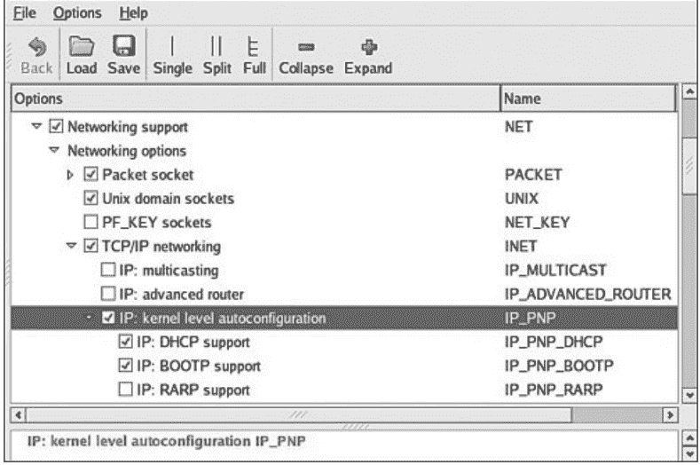

当服务器和目标内核配置完成后，你需要通过前面描述的方法之一提供目标板以太网配置。如果你的引导加载程序支持内核命令行，这是最简单的方法。以下是一个支持 NFS 根挂载的内核命令行示例：

```
console=ttyS0,115200 root=/dev/nfs rw ip=dhcp \
   nfsroot=192.168.1.9:/home/chris/sandbox/pdna-target
```

### 12.3.5. U-Boot NFS 根挂载示例

U-Boot 是一个支持可配置内核命令行的引导加载程序的典型例子。利用 U-Boot 的非易失性环境特性，我们可以将内核命令行存储在一个为此目的专门命名的参数中。要在 U-Boot 中启用 NFS 命令行，我们执行以下操作（在串口终端中全部在一行输入）：

```
setenv bootargs console=ttyS0,115200 root=/dev/nfs rw \
   ip=dhcp nfsroot=192.168.1.9:/home/chris/sandbox/pdna-target
```

然后我们通过 TFTP 服务器加载内核。清单 12-8 展示了这在 PowerPC 嵌入式目标板上的样子。

#### 清单 12-8. 通过 TFTP 服务器加载内核

```
=> tftpboot 200000 uImage-pdna      <<< 在 U-Boot 提示符下输入
Using FEC ETHERNET device
TFTP from server 192.168.1.9; our IP address is 192.168.1.68
Filename 'uImage-pdna'.
Load address: 0x200000
Loading: #############################################
         #############################################
         ####################################
done
Bytes transferred = 911984 (dea70 hex)
=>
```

当我们启动内核时，可以看到 NFS 根挂载配置的具体证据。清单 12-9 重现了内核启动消息中的选定输出以演示这一点。为了便于阅读，此输出已进行格式化处理（省略了许多行并添加了空白）。

#### 清单 12-9. 使用 NFS 根挂载启动

```
Uncompressing Kernel Image ... OK
Linux version 2.6.14 (chris@pluto) (gcc version 3.3.3 (DENX ELDK 3.1.1 3.3.3-10)) #
Mon Jan 2 11:58:48 EST 2006
.
.
Kernel command line: console=ttyS0,115200 root=/dev/nfs rw nfsroot=192.168.1.9:/home/chris/sandbox/pdna-target ip=dhcp
.
.
Sending DHCP requests ... OK
IP-Config: Got DHCP answer from 192.168.1.9, my address is 192.168.1.68
IP-Config: Complete:
    device=eth0, addr=192.168.1.68, mask=255.255.255.0,
    gw=255.255.255.255, host=192.168.1.68, domain=,
    nis-domain=(none), bootserver=192.168.1.9,
    rootserver=192.168.1.9,
    rootpath=/home/chris/sandbox/pdna-target
.
.
Looking up port of RPC 100003/2 on 192.168.1.9
Looking up port of RPC 100005/1 on 192.168.1.9
VFS: Mounted root (nfs filesystem).
.
.
BusyBox v0.60.5 (2005.06.07-07:03+0000) Built-in shell (msh)
Enter 'help' for a list of built-in commands.

#
```

从清单 12-9 中，首先我们看到内核横幅，然后是内核命令行。我们在这个内核命令行中指定了四项内容：

-   控制台设备（`/dev/console`）
-   根设备（`/dev/nfs`）
-   NFS 根路径（`/home", "/home/chris/sandbox/pdna-target`）
-   IP 内核级自动配置方法（`dhcp`）

不久之后，我们看到内核尝试通过 DHCP 进行内核级自动配置。当服务器响应且 DHCP 交换完成后，内核会在接下来的几行中显示检测到的配置。你可以从该清单中看到 DHCP 服务器为目标板分配了 IP 地址 192.168.1.68。将检测到的设置与清单 12-6 中指定的设置进行比较。清单 12-6 类似于导致此配置的 DHCP 服务器配置。

当内核完成 IP 自动配置后，它能够使用提供的参数挂载根文件系统。你可以从以 VFS（虚拟文件子系统）消息结尾的三行中看出，该消息宣告它已挂载根 NFS 文件系统。在 NFS 根文件系统挂载完成后，初始化过程按照第 5 章"内核初始化"中描述的那样完成。

也可以以静态方式将目标板 IP 设置传递给内核，而不让内核从 DHCP 或 BOOTP 服务器获取 IP 设置。IP 设置可以通过内核命令行直接传递。在这种情况下，内核命令行可能看起来像这样：

```
console=ttyS0,115200 ip=192.168.1.68:192.168.1.9::255.255.255.0: root=/dev/nfs rw nfsroot=192.168.1.9:/home/chris/pdna-target
```

## 12.4. 本章小结

-   开发环境的许多功能极大地促进了嵌入式交叉开发的效率。这些功能大多属于工具和实用程序类别。我们在下一章详细介绍这一方面，届时将涵盖开发工具。
-   配置得当的开发主机是嵌入式开发人员的关键资产。
-   用于交叉开发的工具链必须正确配置，以匹配主机系统的目标 Linux 环境。
-   你的开发主机必须安装目标组件，以便工具链和二进制实用程序可以引用。这些组件包括目标头文件、库、目标二进制文件及其相关配置文件。简而言之，你需要组装或获取一个嵌入式 Linux 发行版。
-   配置 TFTP、DHCP 和 NFS 等目标服务器将大大提高你作为嵌入式 Linux 开发人员的工作效率。本章介绍了每种服务器的配置示例。

### 12.4.1. 补充阅读建议

[GCC 在线文档](http://gcc.gnu.org/onlinedocs/)

[构建和测试 gcc/glibc 交叉工具链](http://kegel.com/crosstool/)

[TFTP 协议，版本 2](http://www.ietf.org/rfc/rfc1350.txt?number=1350)
RFC 1350

[引导协议（BOOTP）](http://www.ietf.org/rfc/rfc0951.txt?number=951)
RFC 951

[动态主机配置协议](http://www.ietf.org/rfc/rfc2131.txt?number=2131)
RFC 2131


# 第13章 开发工具

**本章内容**

- [GNU 调试器 (GDB)](#)
- [数据显示调试器](#)
- [cbrowser/cscope](#)
- [跟踪和分析工具](#)
- [二进制工具](#)
- [其他二进制工具](#)
- [本章小结](#)

一个典型的嵌入式 Linux 发行版包含许多有用的工具。有些工具非常复杂，需要熟练掌握才能精通；有些则较为简单，却被嵌入式系统开发人员所忽视。某些工具可能需要针对特定环境进行定制，而许多工具则可以"开箱即用"，无需太多努力就能为开发人员提供有用的信息。本章将介绍嵌入式 Linux 工程师可用的最重要（且经常被忽视）的工具。

不可能在本章中提供所介绍的工具和实用程序的完整细节，那需要单独一本书来讲述！与其提供完整的参考，我们的目标是介绍每个工具的基本用法。我们鼓励您对这些以及其他重要的开发工具进行进一步学习。每个工具的 man 页面（或其他文档）是一个很好的起点。

首先介绍 GNU 调试器（GDB），然后简要介绍数据显示调试器，这是 GDB 的一个图形前端。接下来，我们将介绍一系列旨在让开发人员了解程序行为以及整个系统运行状况的实用工具，包括 `strace`、`ltrace`、`top` 和 `ps`，这些工具常被缺乏经验的 Linux 开发人员所忽视。然后介绍一些崩溃转储和内存分析工具。最后介绍一些更有用的二进制工具。

## 13.1. GNU 调试器 (GDB)

如果您花费大量时间开发 Linux 应用程序，无疑会花很多时间来熟悉 GNU 调试器。GDB 可以说是开发人员工具箱中最重要的工具。它有着悠久的历史，其功能已经发展到包括对多种架构和微处理器的低级硬件特定调试支持。需要注意的是，GDB 的用户手册几乎和本书一样厚。我们在此介绍 GDB 的目的是帮助您入门。我们鼓励您学习后面第13.7.1节"补充阅读建议"中引用的用户手册。

由于本书是关于嵌入式 Linux 开发的，我们使用的是编译为交叉调试器版本的 GDB。也就是说，调试器本身运行在您的开发主机上，但它能够理解在编译时为其配置的架构的二进制可执行文件。在接下来的几个示例中，我们使用的是为 Red Hat Linux 兼容开发主机编译的 GDB，以及 XScale (ARM) 目标处理器。虽然我们使用简短的 `gdb`，但我们展示的是基于 Monta Vista 嵌入式 Linux 发行版中针对 ARM XScale 的 XScale 启用交叉 gdb 的示例。该二进制文件名为 `xscale_be-gdb`。它仍然是 GDB，只是为交叉开发环境进行了配置。

GDB 调试器是一个复杂的程序，在构建过程中有许多配置选项。我们无意提供构建 `gdb` 的指导，这已在其他文献中涵盖。就本章而言，我们假设您已经获得了一个正常工作的 GDB，并针对您将要使用的架构和主机开发环境进行了配置。

### 13.1.1. 调试核心转储

从工具箱中拿出 GDB 最常见的原因之一就是分析 *核心转储*。这快速而简单，通常能立即识别出有问题的代码。当应用程序程序产生错误时，例如访问不属于它的内存位置，就会产生核心转储。许多条件都可能触发核心转储，[1] 但 SIGSEGV（段错误）是迄今为止最常见的。SIGSEGV 是 Linux 内核 *信号*，当用户进程进行非法内存访问时会产生。当产生此信号时，内核会终止该进程。如果已启用，内核随后会转储核心映像。

> [1] 参见 `.../kernel/signal.c` 中的 `SIG_KERNEL_COREDUMP_MASK`，了解哪些信号会生成核心转储。

要启用核心转储的生成，您的进程必须具有启用核心转储的资源限制。这可以通过使用 `setrlimit()` 函数调用来设置进程的资源限制，或者从 BASH 或 BusyBox shell 命令提示符使用 `ulimit` 来实现。在嵌入式系统的初始化脚本中发现以下行以启用进程错误时生成核心转储，这并不罕见：

```
$ ulimit -c unlimited
```

这个 BASH 内置命令用于设置核心转储的大小限制。在前面的实例中，大小设置为无限制。

当应用程序程序产生段错误时（例如，通过写入其允许范围之外的内存地址），Linux 会终止该进程，如果已启用，则生成核心转储。核心转储是发生段错误时运行进程的*快照*。

在您的二进制文件中启用调试符号会很有帮助。在构建过程中启用调试符号（`gcc -g`）时，GDB 会产生更有用的输出。然而，即使二进制文件是在没有调试符号的情况下编译的，仍然可以确定导致段错误的事件序列。如果没有调试符号的帮助，您可能需要进行更多的调查工作。您必须手动将虚拟地址与程序中的位置相关联。

清单 13-1 显示了使用 GDB 进行核心转储分析会话的结果。输出已稍作重新格式化以适应页面。我们使用了一些演示软件来故意产生段错误。以下是产生段错误的进程（名为 `webs`）的输出：

```
root@coyote:/workspace/websdemo# ./webs
  Segmentation fault (core dumped)
```

#### 清单 13-1. 使用 GDB 进行核心转储分析

```
$ xscale_be-gdb webs core
GNU gdb 6.3 (MontaVista 6.3-20.0.22.0501131 2005-07-23)
Copyright 2004 Free Software Foundation, Inc.
GDB is free software, covered by the GNU General Public
License, and you are welcome to change it and/or distribute copies of it under certain conditions.
Type "show copying" to see the conditions.
There is absolutely no warranty for GDB.  Type "show warranty"
for details.
This GDB was configured as "--host=i686-pc-linux-gnu -target=armv5teb-montavista-linuxe


Core was generated by './webs'.
Program terminated with signal 11, Segmentation fault.
Reading symbols from /opt/montavista/pro/.../libc.so.6...done.
Loaded symbols for /opt/montavista/pro/.../libc.so.6
Reading symbols from /opt/montavista/pro/.../ld-linux.so.3...done.
Loaded symbols for /opt/montavista/pro/.../ld-linux.so.3
#0  0x00012ac4 in ClearBlock (RealBigBlockPtr=0x0, l=100000000) at led.c:43
43                              *ptr = 0;

(gdb) l
38
39     static int ClearBlock(char * BlockPtr, int l)
40     {
41          char * ptr;
42          for (ptr = BlockPtr; (ptr - BlockPtr) < l; ptr++)
43         *ptr = 0;
44         return 0;
45     }
46     static int InitBlock(char * ptr, int n)
47     {
(gdb) p ptr
$1 = 0x0
(gdb)
```

### 13.1.2. 调用 GDB

清单 13-1 的第一行显示了如何从命令行调用 GDB。由于我们正在进行交叉调试，因此需要已针对我们的主机和目标系统编译的交叉版本 GDB。我们按照所示方式调用我们的交叉 gdb 版本，并将 `xscale_be-gdb` 传递给二进制文件的名称，后跟核心转储文件的名称——在本例中，简单地称为 `core`。在 GDB 打印了几行描述其配置和其他信息的横幅行之后，它打印了终止原因：信号 11，表示段错误。[2] 随后是几行，GDB 加载二进制文件、它所依赖的库以及核心文件。GDB 启动时打印的最后一行是发生故障时程序的当前位置。以 `#0` 字符串开头的行表示栈帧（栈帧零，在名为 `ClearBlock()` 的函数中，虚拟地址为 0x00012ac4）。随后以 `43` 开头的行是来自名为 `led.c` 的文件的出错源代码行号。从那里开始，GDB 显示其命令提示符并等待输入。

> [2] 信号及其相关编号在 Linux 内核源代码树中的 `.../asm-<arch>/signal.h` 中定义。

为了提供一些上下文，我们输入 `gdb list` 命令，使用其缩写形式 `l`。在没有歧义的情况下，GDB 可以识别命令缩写。在这里，程序错误开始显现出来。根据 GDB 对核心转储的分析，出错的行是：

```
43         *ptr = 0;
```

接下来，我们对 `ptr` 变量发出 `gdb print` 命令，同样缩写为 `p`。正如您从清单 13-1 中看到的，指针 `ptr` 的值为 `0`。因此，我们得出结论，段错误的原因是对空指针的解引用，这是一个常见的编程错误。从这里开始，我们可以选择使用 backtrace 命令来查看导致此错误的调用链，这可能会引导我们找到错误的实际根源。清单 13-2 显示了这些结果。

#### 清单 13-2. Backtrace 命令

```
(gdb) bt
#0  0x00012ac4 in ClearBlock (RealBigBlockPtr=0x0, l=100000000) at led.c:43
#1  0x00012b08 in InitBlock (ptr=0x0, n=100000000) at led.c:48
#2  0x00012b50 in ErrorInHandler (wp=0x325c8, urlPrefix=0x2f648 "/Error",
    webDir=0x2f660 "", arg=0, url=0x34f30 "/Error", path=0x34d68 "/Error",
    query=0x321d8 "") at led.c:61
#3  0x000126cc in websUrlHandlerRequest (wp=0x325c8) at handler.c:273
#4  0x0001f518 in websGetInput (wp=0x325c8, ptext=0xbefffc40,
    pnbytes=0xbefffc38) at webs.c:664
#5  0x0001ede0 in websReadEvent (wp=0x325c8) at webs.c:362
```


### 13.1.3. GDB调试会话

我们将通过展示一个典型的调试会话来结束本次GDB介绍。在前面演示程序崩溃时，我们可以选择单步跟踪代码以缩小故障原因。当然，如果你获得了核心转储，你应该总是从此入手。然而，在其他情况下，你可能希望设置断点并单步跟踪运行中的代码。清单13-4详细介绍了我们如何为调试会话启动GDB。请注意，程序必须在`gcc`命令行中启用调试标志进行编译，GDB在此上下文中才有效。请回顾第12章"嵌入式开发环境"中的图12-1；这是一个交叉调试会话，GDB在你的开发主机上运行，调试在你的目标板上运行的程序。我们将在第15章"调试嵌入式Linux应用程序"中详细介绍远程应用程序调试的全部细节。

#### 清单13-4. 发起GDB调试会话

```
$ xscale_be-gdb -silent webs

(gdb) target remote 192.168.1.21:2001
0x40000790 in ?? ()
(gdb) b main
Breakpoint 1 at 0x12b74: file main.c, line 78.
(gdb) c
Continuing.

Breakpoint 1, main (argc=1, argv=0xbefffe04) at main.c:78
78		bopen(NULL, (60 * 1024), B_USE_MALLOC);
(gdb) b ErrorInHandler
Breakpoint 2 at 0x12b30: file led.c, line 57.
(gdb) c
Continuing.

Breakpoint 2, ErrorInHandler (wp=0x311a0, urlPrefix=0x2f648 "/Error",
    webDir=0x2f660 "", arg=0, url=0x31e88 "/Error", path=0x31918 "/Error",
    query=0x318e8 "") at led.c:57
57			siz = 10000 * sizeof(BigBlock);
(gdb) next
59			p = malloc(siz);
(gdb) next
61			return InitBlock(p, siz);
(gdb) p p
$1 =(unsigned char *) 0x0
(gdb) p siz
$2 =  100000000
(gdb)
```

通过这个简单的调试会话，我们首先使用`gdb target`命令连接到目标板。我们将在第15章更详细地介绍远程调试。连接到目标硬件后，我们使用`gdb break`（缩写为`b`）命令在`main()`处设置了一个断点。然后我们发出`gdb continue`（缩写为`c`）命令以恢复程序的执行。如果我们在调用GDB时有任何程序参数，我们本可以在命令行上提供它们。

我们在`main()`处设置的断点处停了下来，然后在`ErrorInHandler()`处设置了另一个断点，接着再次使用缩写的`continue`命令。当命中这个新断点时，我们开始使用`next`命令单步跟踪代码。在那里我们遇到了对`malloc()`的调用。在`malloc()`调用之后，我们检查了返回值，并发现空返回值指示的失败。最后，我们打印了`malloc()`调用中参数的值，发现请求了一个非常大的内存区域（1亿字节），这导致了失败。

尽管很简单，但本节中的GDB示例应该能让新手立即有效地使用GDB。我们中很少有人真正掌握了GDB——它非常复杂且功能繁多。在后面的13.2节"数据显示调试器"中，我们将介绍一个GDB的图形化前端，它可以帮助那些不熟悉GDB的人更轻松地过渡。

关于GDB的最后一点说明：毫无疑问，你已经注意到GDB在首次调用时在控制台上显示的许多横幅行，如清单13-1所示。在这些示例中，如前所述，我们使用了来自Monta Vista嵌入式Linux发行版的交叉gdb。横幅行包含一个嵌入式开发者必须了解的重要信息：GDB的主机和目标规范。从清单13-1中，我们看到当GDB被调用时输出了以下内容：

```
This GDB was configured as "--host=i686-pc-linux-gnu -
  target=armv5teb-montavista-linuxeabi"
```

在这个例子中，我们调用了一个GDB版本，它被编译为在Linux PC上执行——具体来说，是在运行GNU/Linux操作系统的i686上执行。同样关键的是，这个GDB实例被编译为调试从`armv5teb`大端工具链生成的ARM二进制代码。

新手在嵌入式开发中最常犯的错误之一，就是在试图调试目标可执行文件时使用了错误的GDB。如果某些地方不正常，你应该立即检查你的GDB配置，确保它对于你的环境是合理的。你不能使用你的本机GDB来调试目标代码！

## 13.2. 数据显示调试器

数据显示调试器（DDD）是GDB和其他命令行调试器的图形化前端。DDD除了查看源代码和单步跟踪调试会话之外，还有许多高级功能。图13-1是DDD主屏幕的截图。

### 图13-1. 数据显示调试器

[查看完整图片]

DDD的调用方式如下：

```
$ ddd --debugger xscale_be-gdb webs
```

如果没有`--debugger`标志，DDD将尝试调用开发主机上的本机GDB，如果你打算在目标系统上调试应用程序，这不是你想要的。DDD命令行上的第二个参数是你将要调试的程序。有关其他详细信息，请参阅DDD的手册页。

使用图13-1所示的命令工具，你可以单步跟踪你的程序。你可以通过图形化方式或在DDD屏幕底部的GDB控制台窗口中设置断点。对于目标调试，你必须首先像我们在清单13-4中所做的那样，使用`target`命令将调试器连接到目标系统。

技术分析是交易者通过分析市场活动产生的统计数据（如过去的价格和成交量）来评估证券和识别交易机会的一种方法。与试图评估证券内在价值的基本面分析师不同，技术分析师专注于价格走势模式、交易信号和各种其他分析图表工具，以评估证券的强弱。技术分析领域基于三个主要假设：

1. 市场反映了一切。
2. 价格呈趋势运动。
3. 历史往往会重演。

技术分析师认为当前价格完全反映了所有信息。因为所有信息都已经反映在价格中，它代表了公允价值，并应构成分析的基础。市场价格反映了所有参与者的总和知识，包括交易者、投资组合经理、买方分析师、卖方分析师、市场策略师、技术分析师、基本面分析师等等。因此，技术分析实际上是对大众心理学的研究。人们相信价格运动会遵循趋势。这意味着，在一个趋势确立后，未来的运动更有可能与趋势同向，而不是逆势。大多数技术交易策略都基于这一假设。技术分析中的另一个重要观点是历史往往会重演，主要是在价格运动方面。价格运动的重复性通常归因于市场心理，而市场心理基于恐惧或兴奋等情绪往往非常可预测。技术分析使用图表模式来分析这些情绪和随后的市场运动，以理解趋势。虽然许多形式的技术分析已经使用了100多年，但技术分析这门学科仍然基于对股票交易所上显示的供需关系的研究。

### 图13-2. DDD中的调试会话

[查看完整图片]

请注意，在图13-2中，我们已经开始显示一些重要的程序变量，这些变量可以帮助我们缩小段错误的原因。我们可以使用图中所示的命令工具，在单步跟踪程序时观察这些变量。

`DDD`是GDB的一个强大的图形化前端。它相对易于使用，并且在许多开发主机上得到广泛支持。请参阅本章末尾的13.7.1节，获取指向GNU DDD文档的链接。


## 13.3. cbrowser/cscope

我们在此提及 `cbrowser`，是因为对这一便捷工具的支持已进入了 Linux 内核源代码树。[31] `cbrowser` 是一个简单的源代码浏览工具，可以方便地在大型源代码树中按照符号进行跳转浏览。

> [31] 实际上，Linux 构建系统中已包含对 `cbrowser` 所使用的底层引擎的支持。

Linux 内核的 makefile 支持构建 `cbrowser` 所使用的数据库。以下是从近期 Linux 内核快照中调用的一个示例：

```
$ make ARCH=ppc CROSS_COMPILE=ppc_82xx- cscope
```

这将生成 `cbrowser` 使用的 `cscope` 符号数据库。`cscope` 是引擎；`cbrowser` 是图形用户界面。如果你愿意，也可以单独使用 `cscope`。它由命令行驱动，功能非常强大，但在这个鼠标点击的时代，浏览大型源代码树时不如 `cbrowser` 快捷方便。如果你仍然偏爱 vi 编辑器，那么 `cscope` 可能正适合你！

要调用 `cbrowser`，只需进入包含 `cscope` 数据库的目录，然后直接输入不带参数的 `cbrowser` 命令即可。图 13-3 展示了一个示例会话。你可以通过本章末尾 [13.7.1 节](#section-13-7-1) 中列出的参考资料了解更多关于这两个实用工具的信息。


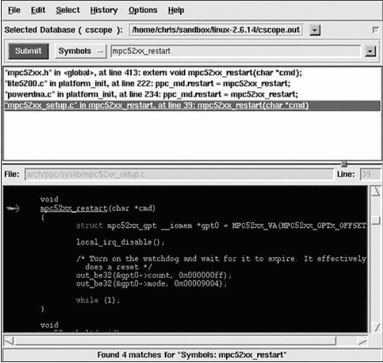

## 13.4. 跟踪与性能分析工具

许多实用工具可以为你提供系统的各种视图。有些工具提供高层次的概览，例如系统上正在运行哪些进程，以及哪些进程占用了最多的 CPU 带宽。其他工具则可以提供详细的分析，例如内存被分配到何处，或者更有用的是——内存泄漏发生在哪里。接下来的几节将介绍这一类别中最重要的工具和实用程序。我们篇幅有限，只能对这些工具做简要介绍；如有需要更详细的信息，请参阅相应处提供的参考资料。

### 13.4.1. strace

这个实用的系统跟踪工具在几乎所有 Linux 发行版中都能找到。`strace` 能够捕获并显示 Linux 应用程序执行的每个内核系统调用的有用信息。`strace` 特别方便，因为它可以对没有源代码的程序运行。与 GDB 不同，无需使用调试符号编译程序。此外，`strace` 还可以是一个非常有启发性的教学工具。正如其 man 手册页所述："学生、黑客和好奇心过于旺盛的人会发现，即使跟踪普通程序，也能学到大量关于系统及其系统调用的知识。"

在为本章前面 GDB 部分准备示例软件时，我决定使用一个我不熟悉的软件项目——GoAhead Web 服务器的一个早期版本。第一次尝试编译和链接该项目时，产生了一个有趣的 `strace` 示例。从命令行启动该应用程序时，它默默地将控制权返回给了控制台。没有产生任何错误信息，查看系统日志也没有找到任何线索！程序就是无法运行。

`strace` 很快就识别出了问题。在该软件包上运行 `strace` 的输出如清单 13-5 所示。由于篇幅限制，此输出中的许多行已被删除。未编辑的输出超过一百行。

#### 清单 13-5. [4] `strace` 输出：GoAhead Web Demo

```
[View full width]
01 root@coyote:/home/websdemo$ strace ./websdemo
02 execve("./websdemo", ["./websdemo"], [/* 14 vars */]) = 0
03 uname({sys="Linux", node="coyote", ...}) = 0
04 brk(0)                                    = 0x10031050
05 open("/etc/ld.so.preload", O_RDONLY)      = -1 ENOENT (No such file or directory)
06 open("/etc/ld.so.cache", O_RDONLY)        = -1 ENOENT (No such file or directory)
07 open("/lib/libc.so.6", O_RDONLY)          = 3
08 read(3, "\177ELF\1\2\1\0\0\0\0\0\0\0\0\3\0\24\0\0\0\1\0\1\322"..., 1024) = 1024
09 fstat64(0x3, 0x7fffefc8)                  = 0
10 mmap(0xfe9f000, 1379388, PROT_READ|PROT_EXEC, MAP_PRIVATE, 3, 0) = 0xfe9f000
11 mprotect(0xffd8000, 97340, PROT_NONE)     = 0
12 mmap(0xffdf000, 61440, PROT_READ|PROT_WRITE|PROT_EXEC, MAP_PRIVATE|MAP_FIXED, 3,
13                                      OR | PROT_EXEC
14 LD | MAP_FIXED | MAP_ANONYMOUS = 0
15 0000000000000000000100000
16 1070
17 -f config.txt", 0x7ffff9b8)        = -1 ENOENT (No such file or directory)
18 ...", ...)
19 0x7ffff9b8)        = 0
20 null, 4096, PROT_READ | PROT_WRITE, MAP_PRIVATE | MAP_ANONYMOUS, -1, 0) = 0x3001700
21 olvi.conf  This file is th"..., 4096) = 83
22 ad(3, " / 24, 0) = 24
23 ULL)        = 0
24 , events=POLLIN, revents=POLLERR}], 1, 5000) = 1
25 0x7fffe6a8)       = 0
26 , 1024, 0, 0x7fffe668, 0x7fffe6ac) = -1 ECONNREFUSED (Connecti
27 NULL)        = 0
28 events=POLLIN, revents=POLLERR}], 1, 5000) = 1
29 1f0x7fffe6a8)       = 0
30 1024, 0, 0x7fffe668, 0x7fffe6ac) = -1 ECONNREFUSED (Connecti
```

[4] 有关为你的目标系统创建链接器缓存的详细信息，请参阅 `man ldconfig`。

为了使该清单更具可读性，我们在 strace 产生的输出中添加了行号。命令的调用位于第 01 行。在其最简单的形式中，只需在你要检查的程序前直接加上 strace 命令即可。清单 13-5 中的输出就是这样产生的。

此跟踪的每一行都代表 webdemo 进程向内核发起了一次系统调用。虽然分析和理解跟踪的每一行是相当有启发性的，但我们并不需要这样做。我们正在寻找可能有助于定位程序无法运行原因的异常情况。在前几行中，Linux 正在设置程序将要执行的环境。我们看到几次对 `/etc/ld.so.*` 的 `open()` 系统调用，这是 Linux 动态链接加载器（`ld.so`）在完成其工作。实际上，第 06 行提示我这个示例嵌入式板没有被正确配置。应该有一个通过运行 `ldconfig` 生成的链接器缓存。（链接器缓存可以大幅加速共享库引用的搜索。）这后来通过在目标板上运行 `ldconfig` 得到了解决。

从第 06 行到第 19 行是更多的基础初始化工作，主要由加载器和 `libc` 完成。注意第 20 行中程序在查找一个配置文件但没有找到。当软件运行起来后，这可能是一个重要的问题。从第 24 行开始，程序开始设置和配置它所需的相应网络资源。第 24 到 29 行打开并读取一个包含 DNS 服务主机名解析指令的 Linux 系统文件。本地网络配置活动一直持续到第 81 行。这些活动大部分由程序本身建立网络基础设施所需的网络设置和配置组成。为了简洁和清晰，此部分已从清单中删除。

特别注意从第 82 行开始的网络活动。此处程序试图建立一个与全零 IP 地址的 TCP/IP 连接。为了方便，第 82 行在此重复列出：

```
socket(PF_INET, SOCK_DGRAM, IPPROTO_IP) = 3
```

关于清单 13-5 有几点值得注意。我们可能不了解每个系统调用的所有细节，但我们可以大致了解正在发生的事情。`socket()` 系统调用类似于文件系统的 `open()` 调用。由 `=` 号指示的返回值，在本例中代表一个 Linux 文件描述符。了解这一点后，我们可以将第 82 行到第 89 行的 `close()` 系统调用之间的活动与文件描述符 3 关联起来。

我们对这一组相关的系统调用感兴趣，是因为在第 88 行看到了一条错误信息："Connection refused"（连接被拒绝）。此时，我们仍然不知道程序为何无法运行，但这似乎不正常。让我们进一步调查。第 82 行对 `socket()` 的系统调用建立了一个 IP 通信端点。第 83 行相当奇怪，因为它试图建立与一个包含全零 IP 地址的远程端点（套接字）的连接。我们不必是网络专家也能怀疑这可能会导致问题。[5] 第 83 行提供了另一个重要线索：`port` 参数被设置为 53。通过 Google 快速搜索 TCP/IP 端口号可以发现，端口 53 是域名服务，即 DNS。

> [5] 在此上下文中，全零地址有时是合适的。然而，我们正在调查程序为何异常退出，因此应将此视为可疑之处。

第 84 行又提供了一条线索。我们的板子主机名为 `coyote`。这可以从清单 13-5 第 01 行的命令提示符中看到。看起来这是一次针对我们板子主机名的 DNS 查找，而且查找失败了。作为实验，我们在目标系统的 `/etc/hosts`[6] 文件中添加了一条条目，将我们本地定义的主机名与板子本地分配的 IP 地址关联起来，如下所示：

> [6] 有关此系统管理文件的详细信息，请参阅 `man hosts`。

```
Coyote  192.168.1.21         #我们分配的 IP 地址
```

瞧：我们的程序开始正常运行了。虽然我们可能并不完全知道为什么会这样


即使这本身不一定会导致程序失败（但TCP/IP网络专家可能会察觉），我们的`strace`输出让我们发现了一个事实：针对我们开发板名称的DNS查询失败了。当我们修正这个问题后，程序顺利启动并开始提供网页服务。总结一下，这是一个我们没有源代码可供参考、二进制映像中也没有编译符号的程序。利用`strace`，我们得以确定程序故障的原因并实施解决方案。

### 13.4.2. strace 变体

`strace`工具拥有众多命令行选项。其中较为实用的一项功能是可以选择跟踪系统调用的子集。例如，如果你想仅查看特定进程的网络相关活动，可按如下方式执行命令：

```
$ strace -e trace=network process_name
```

这将产生所有网络相关系统调用的跟踪记录，例如 `socket()`、`connect()`、`recvfrom()` 和 `send()`。这是观察给定程序网络活动的强有力方法。还有其他一些可用的子集。例如，你可以仅查看程序的文件相关活动，如 `open()`、`close()`、`read()`、`write()` 等。其他子集包括与进程相关的系统调用、与信号相关的系统调用以及与进程间通信（IPC）相关的系统调用。

值得注意的是，`strace`能够处理那些会生成额外进程的跟踪程序。使用 `-f` 选项调用 `strace` 会指示 `strace` 跟踪通过 `fork()` 系统调用创建的子进程。`strace` 命令有多种可能性。掌握这个强大工具的最佳方式就是使用它。请务必针对我们介绍的所有工具，主动查阅并阅读最新的开源文档。在本例中，在大多数 Linux 主机上执行 `man strace` 会产生足够你研究一下午的材料！

使用 `strace` 一个非常有用的方式是使用 `-c` 选项。此选项会生成应用程序的高层性能分析。使用 `-c` 选项时，`strace` 会累积每个系统调用的统计数据，包括遇到的次数、返回错误的次数以及每个系统调用花费的时间。清单 13-6 是在前一个示例的 webs 演示程序上运行 `strace -c` 的示例。

#### 清单 13-6. 使用 `strace` 进行性能分析

```
root@coyote$ strace -c ./webs
% time     seconds  usecs/call     calls    errors syscall
------ ----------- ----------- --------- --------- --------
 29.80    0.034262         189       181             send
 18.46    0.021226        1011        21        10 open
 14.11    0.016221         130       125             read
 11.87    0.013651         506        27         8 stat64
  5.88    0.006762         193        35           select
  5.28    0.006072          76        80           fcntl64
  3.47    0.003994          65        61            time
  2.79    0.003205        3205         1           execve
  1.71    0.001970          90        22         3 recv
  1.62    0.001868          85        22           close
  1.61    0.001856         169        11          shutdown
  1.38    0.001586         144        11            accept
  0.41    0.000470          94         5            mmap2
  0.26    0.000301         100         3            mprotect
  0.24    0.000281          94         3            brk
  0.17    0.000194         194         1         1 access
  0.13    0.000150         150         1            lseek
  0.12    0.000141          47         3            uname
  0.11    0.000132         132         1            listen
  0.11    0.000128         128         1            socket
  0.09    0.000105          53         2            fstat64
  0.08    0.000097          97         1            munmap
  0.06    0.000064          64         1            getcwd
  0.05    0.000063          63         1            bind
  0.05    0.000054          54         1            setsockopt
  0.04    0.000048          48         1            rt_sigaction
  0.04    0.000046          46         1            gettimeofday
  0.03    0.000038          38         1            getpid
100.00    0.114985          62        22            total
```

这是获得应用程序耗时分布和错误发生位置概览的一种非常有用的方法。某些错误可能是应用程序正常运行的一部分，但其他错误可能消耗了你未预期的时间。从清单 13-6 可以看出，耗时最长的系统调用是 `execve()`，这是 shell 用来启动应用程序的调用。如你所见，它只被调用了一次。另一个有趣的观察是，`send()` 系统调用是使用最频繁的。这很合理，因为该应用程序是一个小型 Web 服务器。

请记住，就像我们在此讨论的其他工具一样，`strace` 必须为你目标架构编译。`strace` 是在你的目标板上执行的，而不是在开发主机上。你必须使用与你的架构兼容的版本。如果你购买商业化的嵌入式 Linux 发行版，应确保为你选择的架构包含了此工具。

### 13.4.3. ltrace

`ltrace` 和 `strace` 工具密切相关。`ltrace` 工具之于库函数调用，就如同 `strace` 之于系统调用。它的调用方式类似：在要跟踪的程序前加上跟踪工具，如下所示：

```
$ ltrace ./example
```

清单 13-7 重现了一个执行了若干标准 C 库调用的小型示例程序的 `ltrace` 输出。

#### 清单 13-7. ltrace 输出示例

```
$ ltrace ./example
__libc_start_main(0x8048594, 1, 0xbffff944, 0x80486b4, 0x80486fc <unfinished ...>
malloc(256)                                = 0x804a008
getenv("HOME")                             = "/home/chris"
strncpy(0x804a008, "/home", 5)              = 0x804a008
fopen("foo.txt", "w")                       = 0x804a110
printf("$HOME = %s\n", "/home/chris"$HOME =  /home/chris
)                                          = 20
fprintf(0x804a110, "$HOME = %s\n", "/home/chris")    = 20
fclose(0x804a110)                           = 0
remove("foo.txt")                           = 0
free(0x804a008)                             = <void>
+++ exited (status 0) +++
$
```

对于每个库调用，会显示调用的名称以及该调用参数的不同部分。与 `strace` 类似，接下来会显示库调用的返回值。同样，这个工具可以用于没有源代码的程序。

与 `strace` 类似，`ltrace` 的行为也受多种选项影响。你可以显示每个库调用时程序计数器的值，这有助于理解应用程序的程序流程。与 `strace` 一样，你可以使用 `-c` 来累积并报告调用次数、错误次数和时间统计，使其成为一个有用的简单性能分析工具。清单 13-8 显示了使用 `-c` 选项对我们的简单示例程序进行分析的结果。

#### 清单 13-8. 使用 ltrace 进行性能分析

```
$ ltrace -c ./example
$HOME = /home/chris
% time     seconds  usecs/call     calls    function
------ ----------- ----------- --------- --------------------
24.16    0.000231         231         1 printf
16.53    0.000158         158         1 fclose
16.00    0.000153         153         1 fopen
13.70    0.000131         131         1 malloc
10.67    0.000102         102         1 remove
 9.31    0.000089          89         1 fprintf
 3.35    0.000032          32         1 getenv
 3.14    0.000030          30         1 free
 3.14    0.000030          30         1 strncpy
------ ----------- ----------- --------- --------------------
100.00    0.000956                     9 total
```

`ltrace` 工具仅适用于已编译为使用动态链接共享库对象的程序。这是通常的默认设置，因此除非你在编译时明确指定了 `-static`，否则你可以对生成的二进制文件使用 `ltrace`。同样与 `strace` 类似，你必须使用为你目标架构编译的 `ltrace` 二进制文件。这些工具是在目标设备上运行，而不是在主机开发系统上。

### 13.4.4. ps

可能除了 `strace` 和 `ltrace` 之外，没有其他工具像 `top` 和 `ps` 那样经常被嵌入式系统开发者所忽视。鉴于每个工具都有众多可用选项，我们完全可以用一整章来介绍这些有用的系统性能分析工具。它们几乎普遍存在于嵌入式 Linux 发行版中。

这两个工具都利用了第 9 章“文件系统”中描述的 `/proc` 文件系统。如果你知道该查找什么以及如何解析结果信息，它们传达的大部分信息都可以从 `/proc` 文件系统中获得。这些工具以方便人类阅读的形式呈现该信息。

`ps` 工具列出机器上所有正在运行的进程。然而，它非常灵活，可以定制以提供有关运行机器状态及其上运行进程的大量有用数据。例如，`ps` 可以显示每个进程的调度策略。这对于采用实时进程的系统特别有用。

没有任何选项时，`ps` 显示与调用该命令的用户具有相同用户ID的所有进程，并且只显示与发出该命令的终端相关的进程。当该用户和终端已生成多个作业时，这很有用。

向 `ps` 传递选项可能会令人困惑，因为它支持多种标准（如 POSIX 与 UNIX）以及三种不同的选项风格：BSD、UNIX 和 GNU。一般来说，BSD 选项是单个或多个字母，没有破折号。UNIX 选项是熟悉的破折号-字母组合，而 GNU 使用长参数格式，以双破折号开头。请参考你的 `ps` 实现的手册页了解详细信息。

每个使用 `ps` 的人可能都有一个最喜欢的调用方式。一个特别有用的通用调用是 `ps aux`。它显示系统中的每个进程。清单 13-9 是来自一个运行中的嵌入式目标板的示例。

#### 清单 13-9. 进程列表

```
$ ps aux
USER       PID %CPU %MEM    VSZ   RSS TTY      STAT START   TIME COMMAND
root         1  0.0  0.8   1416   508 ?        S    00:00   0:00 init [3]
root         2  0.0  0.0      0     0 ?        S<   00:00   0:00 [ksoftirqd/0]
root         3  0.0  0.0      0     0 ?        S<   00:00   0:00 [desched/0]
root         4  0.0  0.0      0     0 ?        S<   00:00   0:00 [events/0]
root         5  0.0  0.0      0     0 ?        S<   00:00   0:00 [khelper]
root        10  0.0  0.0      0     0 ?        S<   00:00   0:00 [kthread]
root        21  0.0  0.0      0     0 ?        S<   00:00   0:00 [kblockd/0]
root        62  0.0  0.0      0     0 ?        S    00:00   0:00 [pdflush]
root        63  0.0  0.0      0     0 ?        S    00:00   0:00 [pdflush]
root        65  0.0  0.0      0     0 ?        S<   00:00   0:00 [aio/0]
root        36  0.0  0.0      0     0 ?        S    00:00   0:00 [kapmd]
root        64  0.0  0.0      0     0 ?        S    00:00   0:00 [kswapd0]
root       617  0.0  0.0      0     0 ?        S    00:00   0:00 [mtdblockd]
root       638  0.0  0.0      0     0 ?        S    00:00   0:00 [rpciod]
bin        834  0.0  0.7   1568   444 ?        Ss   00:00   0:00 /sbin/portmap
root       861  0.0  0.0      0     0 ?        S    00:00   0:00 [lockd]
root       868  0.0  0.9   1488   596 ?        Ss   00:00   0:00 /sbin/syslogd -r
root       876  0.0  0.7   1416   456 ?        Ss   00:00   0:00 /sbin/klogd -x
```


这只是使用`ps`查看输出数据的众多方法之一。以下文本将对各列进行说明。

- `USER`和进程ID（`PID`）字段不言自明。
- `%CPU`字段表示自进程启动以来的CPU使用百分比；因此，CPU使用率实际上永远不会累加到100%。
- `%MEM`字段表示进程常驻内存占用量与总可用物理内存的比率。
- `VSZ`字段是进程的虚拟内存大小，单位为千字节。
- `RSS`是常驻集大小，表示进程已使用的未交换物理内存，单位同样为千字节。
- `TTY`是进程的控制终端。

本例中的大多数进程与控制终端无关。生成清单13-9的`ps`命令是从Telnet会话中发出的，这从`pts/0`终端设备可以判断。

`STAT`字段描述了生成此快照时进程的状态。此处，`S`表示进程处于休眠状态，等待某种事件，通常是I/O操作。`R`表示进程处于可运行状态（即调度程序可以自由地将CPU控制权交给它，前提是更高优先级的进程没有在等待）。状态字母旁边的左方括号表示该进程具有更高的优先级。

最后一列是命令名称。方括号中列出的是内核线程。还有更多符号和选项可用；完整详情请参阅`ps`的手册页。

### 13.4.5. top

`ps`是对当前系统的一次性快照，而`top`则定期对系统及其进程的状态进行快照。与`ps`类似，`top`也有众多命令行和配置选项。它是交互式的，可以在运行时重新配置，以便根据你的特定需求定制显示内容。

不带选项执行`top`时，它以与清单13-9中展示的`ps aux`命令非常相似的方式显示所有运行中的进程，每3秒更新一次。当然，`top`的这一行为及许多其他方面都可以由用户自行配置。`top`屏幕的前几行显示系统信息，同样每3秒更新一次。这些信息包括系统运行时间、用户数量、进程数量及其状态等大量内容。

#### 清单13-10. top

```
top - 06:23:14 up  6:23,  2 users,  load average: 0.00, 0.00, 0.00
Tasks: 24 total,    1 running,  23 sleeping,   0 stopped,   0 zombie
Cpu(s): 0.0% us,  0.3% sy,  0.0% ni, 99.7% id,  0.0% wa,  0.0% hi,  0.0% si
Mem:    62060k total,   17292k used,   44768k free,       0k buffers
Swap:       0k total,       0k used,       0k free,   11840k cached

  PID USER      PR  NI  VIRT  RES  SHR S %CPU %MEM    TIME+  COMMAND
  978 root      16   0  1924  952  780 R  0.3  1.5   0:01.22 top
    1 root      16   0  1416  508  452 S  0.0  0.8   0:00.47 init
    2 root       5 -10     0    0    0 S  0.0  0.0   0:00.00 ksoftirqd/0
    3 root       5 -10     0    0    0 S  0.0  0.0   0:00.00 events/0
    4 root      -2  -5     0    0    0 S  0.0  0.0   0:00.00 khelper
    5 root      10  -5     0    0    0 S  0.0  0.0   0:00.09 kthread
   10 root      18  -5     0    0    0 S  0.0  0.0   0:00.03 migration/0
```

清单13-10中的默认列包括PID、用户、进程优先级、进程的*nice*值、进程使用的虚拟内存、常驻内存占用量、任务使用的共享内存量，以及与前面`ps`示例中描述的相同的一些其他字段。

篇幅所限，只能对这些实用工具进行粗略介绍。建议你花一个下午的时间阅读`top`和`ps`的手册页，探索它们丰富的功能。

### 13.4.6. mtrace

`mtrace`软件包是一个简单的实用工具，用于分析和报告应用程序中对`malloc()`、`realloc()`和`free()`的调用。它易于使用，有可能帮助发现应用程序中的问题。与本章中我们一直描述的其他用户态工具一样，你必须为你的架构配置和编译`mtrace`软件包。`mtrace`是一个`malloc`替代库，安装在你的目标设备上。你的应用程序通过一个特殊的函数调用来启用它。你的嵌入式Linux发行版应包含`mtrace`软件包。

为了演示此工具，我们创建了一个简单的程序，在一个简单的链表上动态创建数据。每个列表项都是动态生成的，放置在列表上的每个数据项也是如此。清单13-11展示了这个简单的链表结构。

#### 清单13-11. 简单线性链表

```c
struct blist_s {
  struct blist_s *next;
  char *data_item;
  int item_size;
  int index;
};
```

每个列表项都使用`malloc()`动态创建，如下所示，随后被放置到链表的末尾：

```c
struct blist_s *p = malloc( sizeof(struct blist_s) );
```

列表中每个大小可变的数据项也是动态生成的，在被放置到链表末尾之前添加到列表项中。这样，每个列表项都是通过两次调用`malloc()`创建的，一次用于列表项本身（即刚才展示的`struct blist_s`），一次用于可变数据项。然后我们在列表上生成了10,000条包含可变字符串数据的记录，共产生了20,000次`malloc()`调用。

要使用`mtrace`，必须满足三个条件：

- 源文件中必须包含头文件`mcheck.h`。
- 应用程序必须调用`mtrace()`来安装处理程序。
- 环境变量`MALLOC_TRACE`必须指定一个可写文件的名称，跟踪数据将被写入该文件。

满足这些条件后，每次调用被跟踪的函数都会在`MALLOC_TRACE`定义的原始跟踪文件中生成一行记录。跟踪数据如下所示：

```
@ ./mt_ex:[0x80486ec] + 0x804a5f8 0x10
```

`@`符号表示该跟踪行包含一个地址或函数名。在前面的示例中，程序正在方括号中的地址`0x80486ec`处执行。使用二进制工具或调试器，我们可以轻松地将此地址与函数关联起来。加号（`+`）表示这是一次内存分配调用。`free()`的调用将由减号表示。下一个字段表示被分配或释放的内存位置的虚拟地址。最后一个字段是大小，每次内存分配调用中都包含此字段。

这种数据格式不太友好。因此，`mtrace`软件包包含一个工具^[7]，用于分析原始跟踪数据并报告任何不一致之处。在最简单的情况下，Perl脚本仅打印一行消息"No memory leaks"。清单13-12展示了检测到内存泄漏时的输出。

^[7] 分析工具是`mtrace`软件包附带的Perl脚本。

#### 清单13-12. `mtrace`错误报告

```
$ mtrace ./mt_ex mtrace.log


Memory not freed:
-----------------
   Address     Size    Caller
0x0804aa70    0x0a  at /home/chris/temp/mt_ex.c:64
0x0804abc0    0x10  at /home/chris/temp/mt_ex.c:26
0x0804ac60    0x10  at /home/chris/temp/mt_ex.c:26
0x0804acc8    0x0a  at /home/chris/temp/mt_ex.c:64
```

如你所见，这个简单的工具可以帮助你在问题发生之前发现隐患，也能在问题发生时定位它。请注意，Perl脚本显示了每次`malloc()`调用的文件名和行号，这些调用对于给定的内存位置没有对应的`free()`调用。这需要在编译器中传递`-g`标志来生成包含调试信息的可执行文件。如果未找到调试信息，脚本仅报告调用`malloc()`的函数地址。

### 13.4.7. dmalloc

`dmalloc`在`mtrace`的基础上更进一步。`mtrace`软件包是一个简单、相对低侵入性的工具，最适用于简单检测`malloc`/`free`不平衡的情况。`dmalloc`软件包则能检测更广泛的动态内存管理错误。与`mtrace`相比，`dmalloc`的侵入性很强。根据配置的不同，`dmalloc`可能会使你的应用程序运行极其缓慢。如果你怀疑内存错误是由竞态条件或其他时序问题引起的，那么它绝对不是合适的工具。`dmalloc`（以及在较小程度上的`mtrace`）肯定会改变你的应用程序的时序。

`dmalloc`是一款非常强大的动态内存分析工具。它具有高度可配置性，因此也相对复杂。学习和掌握这个工具需要一些时间。然而，从质量保证测试到缺陷修复，它可能会成为你最喜欢的开发工具之一。

`dmalloc`是一个调试用的`malloc`库替代品。使用`dmalloc`必须满足以下条件：

- 应用程序代码必须包含`dmalloc.h`头文件。
- 应用程序必须链接`dmalloc`库。

+   - `dmalloc`库和实用程序必须安装在您的嵌入式目标设备上。
- 在目标设备上运行应用程序之前，必须定义`dmalloc`库引用的特定环境变量。

尽管不是严格必需，但您应该在应用程序中包含`dmalloc.h`。这使得`dmalloc`能够在输出中包含文件和行号信息。

将您的应用程序链接到您选择的`dmalloc`库。`dmalloc`软件包可以配置为生成几个不同的库，具体取决于您在软件包配置期间的选择。在接下来的示例中，我们选择使用`libdmalloc.so`共享库对象。将该库（或其符号链接）放置在编译器可以找到的路径中。编译您的应用程序的命令可能如下所示：

```
$ ppc_82xx-gcc -g -Wall -o mtest_ex -L../dmalloc-5.4.2/ \
  -ldmalloc mtest_ex.c
```

此命令行假设您已将`dmalloc`库（`libdmalloc.so`）放置在命令行`-L`选项指定的搜索路径中——即当前目录上一级的`../dmalloc-5.4.2`目录。

要将`dmalloc`库安装到您的目标设备，请将其放置在您喜欢的位置（例如`/usr/local/lib`）。您可能需要配置系统以找到此库。在我们示例的PowerPC系统上，我们将路径`/usr/local/lib`添加到`/etc/ld.so.conf`文件中，并调用ldconfig实用程序来更新库搜索缓存。

准备工作的最后一步是设置`dmalloc`库用于确定启用调试级别的环境变量。该环境变量包含一个调试位掩码，将许多功能组合成一个方便的变量。您的设置可能如下所示：

```
DMALLOC_OPTIONS=debug=0x4f4ed03,inter=100,log=dmalloc.log
```

此处，`debug`是调试级别位掩码，`inter`设置了一个间隔计数，`dmalloc`库将在此间隔下对自己和堆进行大量检查。`dmalloc`库将其日志输出写入`log`变量指定的文件。

`dmalloc`软件包附带一个实用程序，可以根据传递给它的标志生成`DMALLOC_OPTIONS`环境变量。前面的示例是通过以下`dmalloc`调用生成的。`dmalloc`软件包中的文档对此有非常详细的说明，因此我们不在这里复述。

```
$ dmalloc -p check-fence -l dmalloc.log -i 100 high
```

完成这些步骤后，您应该能够使用`dmalloc`调试库运行您的应用程序。

`dmalloc`会生成一个非常详细的输出日志。清单13-13复制了一个示例`dmalloc`日志输出，该日志针对一个故意生成一些内存泄漏的示例程序。

#### 清单13-13. `dmalloc`日志输出

```
2592: 4002: Dmalloc version '5.4.2' from 'http://dmalloc.com/'
2592: 4002: flags = 0x4f4e503, logfile 'dmalloc.log'
2592: 4002: interval = 100, addr = 0, seen # = 0, limit = 0
2592: 4002: starting time = 2592
2592: 4002: process pid = 442
2592: 4002: Dumping Chunk Statistics:
2592: 4002: basic-block 4096 bytes, alignment 8 bytes
2592: 4002: heap address range: 0x30015000 to 0x3004f000, 237568 bytes
2592: 4002:     user blocks: 18 blocks, 73652  bytes (38%)
2592: 4002:     admin blocks: 29 blocks, 118784 bytes (61%)
2592: 4002:     total blocks: 47 blocks, 192512 bytes
2592: 4002: heap checked 41
2592: 4002: alloc calls: malloc 2003, calloc 0, realloc 0, free 1999
2592: 4002: alloc calls: recalloc 0, memalign 0, valloc 0
2592: 4002: alloc calls: new 0, delete 0
2592: 4002:   current memory in use: 52 bytes (4 pnts)
2592: 4002:  total memory allocated: 27546 bytes (2003 pnts)
2592: 4002:  max in use at one time: 27546 bytes (2003 pnts)
2592: 4002: max alloced with 1 call: 376 bytes
2592: 4002: max unused memory space: 37542 bytes (57%)
2592: 4002: top 10 allocations:
2592: 4002:  total-size  count  in-use-size  count  source
2592: 4002:      16000   1000            32      2  mtest_ex.c:36
2592: 4002:      10890   1000            20      2  mtest_ex.c:74
2592: 4002:        256      1             0      0  mtest_ex.c:154
2592: 4002:      27146   2001            52      4  Total of 3
2592: 4002: Dumping Not-Freed Pointers Changed Since Start:
2592: 4002:  not freed: '0x300204e8|s1' (10 bytes) from 'mtest_ex.c:74'
2592: 4002:  not freed: '0x30020588|s1' (16 bytes) from 'mtest_ex.c:36'
2592: 4002:  not freed: '0x30020688|s1' (16 bytes) from 'mtest_ex.c:36'
2592: 4002:  not freed: '0x300208a8|s1' (10 bytes) from 'mtest_ex.c:74'
2592: 4002:  total-size  count  source
2592: 4002:          32      2  mtest_ex.c:36
2592: 4002:          20      2  mtest_ex.c:74
2592: 4002:          52      4  Total of 2
2592: 4002: ending time = 2592, elapsed since start = 0:00:00
```

需要重点注意的是，此日志是在程序退出时生成的。（`dmalloc`有许多选项和操作模式；可以配置`dmalloc`在检测到错误时打印输出行。）

输出日志的前半部分报告了关于堆和应用程序整体内存使用情况的高级统计信息。对每个`malloc`库调用（如`malloc()`、`free()`和`realloc()`）都生成了总计数。有趣的是，此默认日志报告了前10大内存分配及其发生源的位置。这对于整体系统级性能分析非常有用。

在日志的末尾，我们看到了应用程序内存泄漏的证据。您可以看到`dmalloc`库检测到四例已分配但显然从未释放的内存。由于我们包含了`dmalloc.h`并使用调试符号进行编译，日志中指出了分配内存的源位置。

与本章介绍的其他工具一样，篇幅所限，只能对此非常强大的调试工具进行简要介绍。`dmalloc`可以检测许多其他条件和限制。例如，`dmalloc`可以检测已释放的指针是否被写入。它可以判断一个指针是否用于访问其边界之外但仍在应用程序允许地址范围内的数据。实际上，可以通过`malloc`系列函数的配置来记录几乎所有的内存事务。`dmalloc`这个工具，一旦熟练掌握，必将带来数倍于付出努力的回报。

### 13.4.8. 内核错误信息

虽然严格来说不是一个工具，但*内核错误信息*包含许多有用的信息，可帮助您排查故障原因。内核错误信息由各种内核错误产生，从进程产生的简单内存错误（在大多数情况下可完全恢复）到严重的内核恐慌。最近的Linux内核支持在原始十六进制地址值之外显示符号信息。清单13-14复制了来自PowerPC目标的内核错误信息。

#### 清单13-14. 内核错误信息

```
$ **modprobe loop**
Oops: kernel access of bad area, sig: 11 [#1]
NIP: C000D058 LR: C0085650 SP: C7787E80 REGS: c7787dd0 TRAP: 0300  Not tainted
MSR: 00009032 EE: 1 PR: 0 FP: 0 ME: 1 IR/DR: 11
DAR: 00000000, DSISR: 22000000
TASK = c7d187b0[323] 'modprobe' THREAD: c7786000
Last syscall: 128
GPR00: 0000006C C7787E80 C7D187B0 00000000 C7CD25CC FFFFFFFF 00000000 80808081
GPR08: 00000001 C034AD80 C036D41C C034AD80 C0335AB0 1001E3C0 00000000 00000000
GPR16: 00000000 00000000 00000000 100170D8 100013E0 C9040000 C903DFD8 C9040000
GPR24: 00000000 C9040000 C9040000 00000940 C778A000 C7CD25C0 C7CD25C0 C7CD25CC
NIP [c000d058] strcpy+0x10/0x1c
LR [c0085650] register_disk+0xec/0xf0
Call trace:
 [c00e170c] add_disk+0x58/0x74
 [c90061e0] loop_init+0x1e0/0x430 [loop]
 [c002fc90] sys_init_module+0x1f4/0x2e0
 [c00040a0] ret_from_syscall+0x0/0x44
Segmentation fault
```

请注意，寄存器转储在适当的地方包含了符号信息。您的内核必须启用`KALLSYMS`才能提供这些符号信息。图13-4显示了位于“常规设置”主菜单下的配置选项。

#### 图13-4. 错误信息的符号支持

[查看完整图片]


内核 oops 消息中的许多信息与处理器直接相关。要充分理解 oops 消息，需要具备一些底层架构知识。

分析清单 13-14 中的 oops，我们立刻可以看到 oops 是由“内核访问错误区域，信号：11”生成的。从本章前面的例子中我们已经知道，信号 11 是段错误。

第一部分是摘要，显示了 oops 的原因、几个重要指针以及出错的任务。在清单 13-14 中，NIP 是下一条指令指针，在 oops 消息的后面部分会对其进行解码。它指向导致 oops 的出错代码。`LR` 是一个 PowerPC 寄存器，通常指示当前执行子程序的返回地址。`SP` 是栈指针。`REGS` 指示包含寄存器转储数据的数据结构的内核地址，而 `TRAP` 指示此 oops 消息相关的异常类型。参考第 7 章“引导加载程序”末尾引用的 PowerPC 架构参考手册，我们看到 TRAP 0300 是 PowerPC 数据存储中断，由数据内存访问错误触发。

在 oops 消息的第三行，我们看到其他 PowerPC 机器寄存器，如 MSR（机器状态寄存器）及其某些位的解码。在下一行，我们看到 DAR（数据访问寄存器），它通常包含导致异常的内存地址。DSISR 寄存器的内容可以与 PowerPC 架构参考结合使用，以发现关于异常具体原因的许多细节。

oops 消息还包含任务指针和解码后的任务名称，以便快速确定 oops 发生时正在运行哪个任务或线程。我们还看到了详细的处理器寄存器转储，可用于提供更多线索。同样，我们需要架构和编译器寄存器使用方面的知识，才能理解寄存器值提供的线索。例如，PowerPC 架构使用 r3 寄存器作为 C 函数返回值的标志。

oops 消息的最后一部分提供了栈回溯，如果在内核中启用了符号，还会提供符号解码。利用这些信息，我们可以构建导致错误条件的一系列事件序列。

在这个简单的例子中，我们从这个 oops 消息中了解了大量信息。我们知道这是一个 PowerPC 数据存储异常，由数据内存访问错误引起（与指令取指内存访问相对）。DAR 寄存器告诉我们，生成此异常的数据地址是 0x0000_0000。我们知道是 `modprobe` 进程产生了错误。从回溯和 NIP（下一条指令指针）中，我们知道这是在调用 `strcpy()` 时发生的，可以直接追溯到 `loop.ko` 模块中的 `loop_init()` 函数，`modprobe` 在异常发生时正试图插入该模块。鉴于这些信息，跟踪此错误的空指针解引用的来源应该相当简单。

## 13.5. 二进制工具

二进制工具，或称 `binutils`，是任何工具链的关键组件。实际上，要构建编译器，必须首先成功构建 `binutils`。在本节中，我们简要介绍嵌入式开发者需要了解的更有用的工具。与本章大多数其他工具一样，这些都是交叉工具，必须构建为在开发主机上执行，同时操作针对您所选架构的二进制文件。或者，您可以编译或获取这些工具的版本以在目标设备上运行，但在这些示例中，我们假设是交叉开发环境。

### 13.5.1. readelf

`readelf` 工具检查目标 ELF 二进制文件的构成。这对于构建针对 ROM 或 Flash 存储器的映像特别有用，因为需要显式控制映像布局。它也是学习工具链如何构建映像以及理解 ELF 文件格式的绝佳工具。

例如，要显示 ELF 映像中的符号表，请使用以下命令：

```
$ readelf -s <elf-image>
```

要发现并显示 ELF 映像中的所有段，请使用以下命令：

```
$ readelf -e <elf-image>
```

使用 `-s` 标志列出 ELF 映像中的段头。您可能会惊讶地发现，即使一个简单的七行“hello world”程序也包含 38 个独立的段。其中一些对您来说很熟悉，比如 `.text` 和 `.data` 段。清单 13-15 包含了我们“hello world”示例中的部分段列表。为简单起见，我们只列出了可能对嵌入式开发者熟悉或相关的段。

#### 清单 13-15. `readelf` 段头

```
$ ppc_82xx-readelf -S hello-ex
There are 38 section headers, starting at offset 0x32f4:

Section Headers:
[ Nr] Name       Type      Addr     Off    Size  ES Flg Lk Inf Al
 ...
 [11] .text      PROGBITS  100002f0 0002f0 000568 00 AX 0  0  4
 ...
 [13] .rodata    PROGBITS  10000878 000878 000068 00  A 0  0  4
 ...
 [15] .data      PROGBITS  100108e0 0008e0 00000c 00 WA 0  0  4
 ...
 [22] .sdata     PROGBITS  100109e0 0009e0 00001c 00 WA 0  0  4
 [23] .sbss      NOBITS    100109fc 0009fc 000000 00 WA 0  0  1
 ...
 [25] .bss       NOBITS    10010a74 0009fc 00001c 00 WA 0  0  4
 ...
```

`.text` 段包含可执行程序代码。`.rodata` 段包含程序中的常量数据。`.data` 段通常包含 C 库前导代码使用的已初始化全局数据，并且可以包含来自应用程序的大型已初始化数据项。`.sdata` 段用于较小的已初始化全局数据项，仅存在于某些架构上。一些处理器架构可以在已知内存区域属性时利用优化的数据访问。`.sdata` 和 `.sbss` 段启用了这些优化。`.bss` 和 `.sbss` 段包含程序中的未初始化数据。这些段在程序映像中不占用空间——它们的内存在程序启动时由 C 库前导代码分配并初始化为零。

我们可以转储这些段中的任何一个并显示其内容。给定您在 C 程序中在任何函数外声明的这行代码，我们可以检查它如何被放置在 `.rodata` 段中：

```
char *hello_rodata = "This is a read-only data string\n";
```

发出 `readelf` 命令，指定我们想从清单 13-15 转储的段号：

```
$ ppc_82xx-readelf -x 13 hello-ex
Hex dump of section '.rodata':
  0x10000878 100189e0 10000488 1000050c 1000058c ................
  0x10000888 00020001 54686973 20697320 61207265 ....This is a read-
  0x10000898 61642d6f 6e6c7920 64617461 20737472 only data string
  0x100008a8 696e670a 00000000 54686973 20697320 .....This is
  0x100008b8 73746174 69632064 6174610a 00000000 static data.....
  0x100008c8 48656c6c 6f20456d 62656464 65640a00 Hello Embedded..
  0x100008d8 25730a00 25780a00                   %s..%x..
```

我们看到，我们声明的已初始化全局变量在 `.rodata` 段中表示，与程序中定义的所有常量字符串一起。

### 13.5.2. 使用 readelf 检查调试信息

`readelf` 更有用的功能之一是显示 ELF 文件中包含的调试信息。当在编译期间发出 `-g` 编译器标志时，编译器会在生成的 ELF 文件中的一系列段中生成调试信息。我们可以使用 `readelf` 来显示 ELF 文件中的这些 ELF 段头：

```
$ ppc-linux-readelf -S ex_sync | grep debug
  [28] .debug_aranges    PROGBITS    00000000 000c38 0000b8 00      0   0   8
  [29] .debug_pubnames   PROGBITS    00000000 000cf0 00007a 00      0   0   1
  [30] .debug_info       PROGBITS    00000000 000d6a 00079b 00      0   0   1
  [31] .debug_abbrev     PROGBITS    00000000 001505 000207 00      0   0   1
  [32] .debug_line       PROGBITS    00000000 00170c 000354 00      0   0   1
  [33] .debug_frame      PROGBITS    00000000 001a60 000080 00      0   0   4
  [34] .debug_str        PROGBITS    00000000 001ae0 00014d 00      0   0   1
```

使用带有 `--debug-dump` 选项的 `readelf`，我们可以显示这些 `.debug_*` 段中任何一个的内容。您将在第 14 章“内核调试技术”中看到这些信息如何有用，当时我们将讨论调试优化内核代码的挑战。

调试信息可能非常庞大。显示 Linux 内核 ELF 文件 `vmlinux` 中的所有调试信息会产生超过六百万行的输出。无论看起来多么令人生畏，至少熟悉调试信息会使您成为一名更好的嵌入式工程师。

清单 13-16 是来自一个小型示例应用程序的 `.debug_info` 段内容的局部列表。出于空间考虑，我们只展示了几条记录。

#### 清单 13-16. 部分调试信息转储

```
$ ppc-linux-readelf --debug-dump=info ex_sync
The section .debug_info contains:

Compilation Unit @ 0:
Length:        109
Version:       2
Abbrev Offset: 0
Pointer Size:  4
<0><b>: Abbrev Number: 1 (DW_TAG_compile_unit)
        DW_AT_stmt_list    : 0
        DW_AT_low_pc       : 0x10000368
        DW_AT_high_pc      : 0x1000038c
        DW_AT_name         : ../sysdeps/powerpc/powerpc32/elf/start.S
        DW_AT_comp_dir     : /var/tmp/BUILD/glibc-2.3.3/csu
        DW_AT_producer     : GNU AS 2.15.94
        DW_AT_language     : 32769  (MIPS assembler)
...
<1><5a1>: Abbrev Number: 14 (DW_TAG_subprogram)
        DW_AT_sibling      : <5fa>
```


```
396    DW_AT_external    : 1
397    DW_AT_name        : main
398    DW_AT_decl_file   : 1
399    DW_AT_decl_line   : 9
400    DW_AT_prototyped  : 1
401    DW_AT_type        : <248>
402    DW_AT_low_pc      : 0x100004b8
403    DW_AT_high_pc     : 0x10000570
404    DW_AT_frame_base  : 1 byte block: 6f       (DW_OP_reg31)
...
423    <2><5e9>: Abbrev Number: 16 (DW_TAG_variable)
424    DW_AT_name        : mybuf
425    DW_AT_decl_file   : 1
426    DW_AT_decl_line   : 11
427    DW_AT_type        : <600>
428    DW_AT_location    : 2 byte block: 91 20    (DW_OP_fbreg: 32)
...
```

由 Dwarf2[8] 标签 `DW_TAG_compile_unit` 标识的第一条记录定义了此 PowerPC 可执行文件的第一个编译单元。这是一个名为 `start.S` 的文件，为 C 程序提供启动序言。下一条由 `DW_TAG_subprogram` 标识的记录定义了用户程序的起始位置，即大家熟悉的 `main()` 函数。这条 Dwarf2 调试记录包含了对 `main()` 所在文件和行号的引用。清单 13-16 中的最后一条记录定义了 `main()` 例程中的一个名为 `mybuf` 的局部变量。同样，该记录提供了行号和文件信息。由此可以推断出 `main()` 位于源文件的第 9 行，`mybuf` 位于第 11 行。ELF 文件中的其他调试记录通过 Dwarf2 的 `DW_AT_decl_file` 属性将文件名关联起来。

> [8] Dwarf2 调试信息规范的参考文献见本章末尾。

通过本章末尾 13.7.1 节中给出的参考文献，你可以了解 Dwarf2 调试信息格式的所有详细信息。

### 13.5.3. objdump

`objdump` 工具与 `readelf` 工具有很大的重叠。然而，`objdump` 更实用的功能之一是其反汇编目标代码的能力。清单 13-17 展示了简单"hello world"PowerPC 版本的 `.text` 段的反汇编示例。为节省篇幅，我们只列出了 `main()` 例程。包括 C 库序言和尾声在内的完整转储将会占用许多页。

#### 清单 13-17. 使用 objdump 进行反汇编

```
$ ppc_82xx-objdump -S -m powerpc:common -j .text hello
...
10000488 <main>:
10000488:	94 21 ff e0	stwu	r1,-32(r1)
1000048c:	7c 08 02 a6	mflr	r0
10000490:	93 e1 00 1c	stw	r31,28(r1)
10000494:	90 01 00 24	stw	r0,36(r1)
10000498:	7c 3f 0b 78	mr	r31,r1
1000049c:	90 7f 00 08	stw	r3,8(r31)
100004a0:	90 9f 00 0c	stw	r4,12(r31)
100004a4:	3d 20 10 00	lis	r9,4096
100004a8:	38 69 08 54	addi	r3,r9,2132
100004ac:	4c c6 31 82	crclr	4*cr1+eq
100004b0:	48 01 05 11	bl	100109c0 <__bss_start+0x60>
100004b4:	38 00 00 00	li	r0,0
100004b8:	7c 03 03 78	mr	r3,r0
100004bc:	81 61 00 00	lwz	r11,0(r1)
100004c0:	80 0b 00 04	lwz	r0,4(r11)
100004c4:	7c 08 03 a6	mtlr	r0
100004c8:	83 eb ff fc	lwz	r31,-4(r11)
100004cc:	7d 61 5b 78	mr	r1,r11
100004d0:	4e 80 00 20	blr
...
```

这个简单 `main()` 例程的大部分代码都是栈帧的创建和销毁。实际的 `printf()` 调用对应于清单中间地址 0x100004b0 处的分支链接（`bl`）指令。这是一条 PowerPC 函数调用指令。由于该程序是作为动态链接目标文件编译的，因此在运行时与共享库的 `printf()` 例程链接之前，我们无法获得 `printf()` 函数的地址。如果将其编译为静态链接目标文件，我们就能看到 `printf()` 调用的符号及其对应地址。

### 13.5.4. objcopy

`objcopy` 用于格式化二进制目标文件，并可选择性地转换其格式。该工具对于生成 ROM 或 Flash 驻留镜像的代码非常有用。[第 7 章](chapter7.html)介绍的 U-Boot 引导加载程序就使用 `objcopy` 从最终的 ELF 文件生成二进制和 s-record[^9] 输出格式。此示例用法展示了 `objcopy` 的功能及其在构建 Flash 镜像中的应用。

[^9]：S-record 文件是二进制文件的 ASCII 表示形式，被许多设备编程器和软件二进制工具所使用。

```
$ ppc_82xx-objcopy --gap-fill=0xff -O binary u-boot u-boot.bin
```

此 `objcopy` 调用展示了如何为 Flash 存储器准备镜像。输入文件 `u-boot` 在本示例中是完整的 ELF U-Boot 镜像，包含符号和重定位信息。`objcopy` 工具仅提取包含程序代码和数据的相关段，并将镜像放入输出文件，此处指定为 `u-boot.bin`。

Flash 存储器在擦除状态下全为 1。因此，用全 1 填充二进制镜像中的空白区域可以提高编程效率并延长 Flash 存储器的使用寿命（当前 Flash 存储器的写入次数有限）。这是通过 `objcopy` 的 `--gap-fill` 参数实现的。

这仅是 `objcopy` 的一个简单用法示例。该工具还可用于生成 s-record 文件以及在不同格式之间进行转换。详见 man 手册以获取完整信息。

## 13.6. 其他二进制工具

你的工具链中还包含一些其他实用工具。学习使用这些工具非常简单。你会发现这些实用工具在许多场合都能派上用场。

### 13.6.1. strip

`strip` 工具可用于从二进制文件中移除符号和调试信息。这在嵌入式设备上节省存储空间时经常使用。在交叉开发模型中，将经过 strip 处理的二进制文件部署到目标系统上，而将未 strip 的版本保留在开发主机上，这样非常方便。使用这种方法，符号可用于开发主机上的交叉调试，同时节省目标设备上的空间。`strip` 有许多选项，详见 man 手册。

### 13.6.2. addr2line

当我们介绍清单 13-12 中的 `mtrace` 时，你看到 `mtrace` 分析脚本的输出中包含了文件和行号信息。`mTrace` Perl 脚本使用 `addr2line` 工具读取可执行 ELF 文件中包含的调试信息，并显示与该地址对应的行号。使用同一个 `mtrace` 示例可执行文件，我们可以查找虚拟地址对应的文件名和行号：

```
$ addr2line -f -e mt_ex 0x80487c6
put_data
/home/chris/examples/mt_ex.c:64
```

请注意，函数 `put_data()` 也与文件和行号一起列出。这表示地址 0x80487c6 位于 `mt_ex.c` 文件第 64 行的 `put_data()` 函数中。在包含多个文件名的大型二进制文件（如 Linux 内核）中，这一功能更加有用：

```
$ ppc_82xx-addr2line -f -e vmlinux c000d95c
mpc52xx_restart
arch/ppc/syslib/mpc52xx_setup.c:41
```

这个特定示例突出了本章反复强调的一个要点：这是一个架构特定的工具。你必须使用与目标二进制文件架构匹配的、经过相应配置和编译的工具。与交叉编译器一样，`addr2line` 也是一个交叉工具，属于二进制工具包的一部分。

### 13.6.3. strings

`strings` 工具用于检查二进制文件中的 ASCII 字符串数据。当源代码或调试符号不可用时，这对于检查内存转储特别有用。你常常会发现，通过将字符串追溯到有问题的二进制文件，可以缩小崩溃原因的范围。虽然 `strings` 确实有一些命令行选项，但学习和使用都很简单。详见 man 手册获取更多信息。

### 13.6.4. ldd

虽然严格来说不是二进制工具，但 `ldd` 脚本是嵌入式开发者的另一个实用工具。它是 C 库软件包的一部分，几乎存在于每个 Linux 发行版中。`ldd` 列出给定目标文件的共享目标库依赖关系。我们在[第 11 章](https://example.com/chapter11)"BusyBox"中介绍了 `ldd`。有关使用示例，请参见清单 11-2。`ldd` 脚本在 ramdisk 镜像的开发过程中特别有用。各种嵌入式 Linux 邮件列表中最常见的故障询问之一就是挂载根文件系统后的内核恐慌：

```
VFS: Mounted root (nfs filesystem).
Freeing unused kernel memory: 96k init
Kernel panic - not syncing: No init found.  Try passing init= option to kernel.
```

最常见的原因之一是根文件系统镜像（无论是 ramdisk、Flash 还是 NFS 根文件系统）缺少内核尝试执行的二进制文件所需的支持库。使用 `ldd`，你可以确定每个二进制文件需要哪些库，并确保将它们包含在 ramdisk 或其他根文件系统镜像中。在前面的内核恐慌示例中，`init` 确实存在于文件系统上，但缺少 Linux 动态加载器 `ld.so.1`。使用 `ldd` 非常简单：

```
$ xscale_be-ldd init
    libc.so.6 => /opt/mvl/.../lib/libc.so.6 (0xdead1000)
    ld-linux.so.3 => /opt/mvl/.../lib/ld-linux.so.3 (0xdead2000)
```

这个简单的示例表明，`init` 二进制文件需要两个动态库对象：`libc` 和 `ld-linux`。两者都必须存在于你的目标系统上，并且必须可被你的 `init` 二进制文件访问——即必须是可读和可执行的。

### 13.6.5. nm

`nm` 工具用于显示目标文件中的符号。这对于各种任务都很有用。例如，在交叉编译大型应用程序时，你可能会遇到未解析的符号。你可以使用 `nm` 查找包含这些符号的目标模块，然后修改构建环境以将其包含进来。

`nm` 工具为每个符号提供属性信息。例如，你可以发现某个符号是局部的还是全局的，以及它是被定义的还是仅在特定目标模块中被引用的。清单 13-10 展示了对 U-Boot ELF 镜像 `u-boot` 运行 `nm` 命令输出的几行内容。


#### 清单 13-18. 使用 nm 显示符号

```
$ ppc_85xx-nm u-boot
...
fff23140 b base_address
fff24c98 B BootFile
fff06d64 T BootpRequest
fff00118 t boot_warm
fff21010 d border
fff23000 A __bss_start
...
```

注意这些 U-Boot 符号的链接地址。它们是为 Flash 设备链接的，该设备位于此特定板卡内存映射的最高部分。此清单仅包含少量示例符号，用于讨论。中间一列是符号类型。大写字母表示全局符号，小写字母表示局部符号。`B` 表示该符号位于 `.bss` 段中。`T` 表示该符号位于 `.text` 段中。`D` 表示该符号位于 `.data` 段中。`A` 表示该地址是绝对地址，不会在后续链接阶段被修改。此绝对符号表示 `.bss` 段的起始位置，由启动时清除 `.bss` 的代码使用，这是 C 执行环境所要求的。

### 13.6.6. prelink

`prelink` 工具通常用于对启动时间有要求的系统中。动态链接的 ELF 可执行文件在程序首次加载时必须在运行时进行链接。对于大型应用程序，这可能需要相当长的时间。`prelink` 会准备好共享库及其依赖的目标文件，以提供已知的未解析库引用信息。实际上，这可以减少给定应用程序的启动时间。该工具的手册页包含有关此便捷工具使用的完整详情。

## 13.7. 本章小结

- GNU 调试器（GDB）是一个复杂且功能强大的调试器，具有许多能力。我们介绍了入门的基础知识。
- DDD 作为 GDB 的图形前端，将源代码和数据展示与 GDB 命令行接口的强大功能相结合。
- cbrowser 是理解大型项目的有用辅助工具。它使用 cscope 数据库来快速查找和显示 C 源代码中的符号及其他元素。
- Linux 受到许多性能分析和跟踪工具的支持。我们介绍了其中几种，包括 strace、ltrace、top 和 ps，以及内存分析工具 mtrace 和 dmalloc。
- 嵌入式开发人员通常需要构建自定义镜像，例如引导加载程序和固件镜像所需的镜像。对于这些任务，了解 binutils 是必不可少的。我们介绍了 binutils 中的许多工具，包括 readelf、objdump、objcopy 等。

### 13.7.1. 扩展阅读建议

GDB: The GNU Project Debugger:
www.gnu.org/software/gdb/gdb.html

GDB Pocket Reference
Arnold Robbins
O'Reilly Media, 2005

Data Display Debugger:
www.gnu.org/software/ddd/

cbrowser 主页:
http://cbrowser.sourceforge.net/

cscope 主页:
http://cscope.sourceforge.net/index.html

dmallocDebug Malloc Library:
http://dmalloc.com/

Tool Interface Standard (TIS) Executable and Linking Format (ELF) Specification
Version 1.2
TIS Committee, May 1995

Tool interface standards:

*DWARF Debugging Information Format Specification*
Version 2.0
TIS Committee, May 1995

# 第 14 章. 内核调试技术

## 本章内容

- 内核调试面临的挑战 第 352 页
- 使用 KGDB 进行内核调试 第 353 页
- 调试 Linux 内核 第 360 页
- 硬件辅助调试 第 385 页
- 系统无法启动时 第 392 页
- 本章小结 第 397 页

通常，实现开发时间表的关键因素归结为查找和修复缺陷的效率。在 Linux 内核中进行调试可能非常具有挑战性。无论采用何种方法，内核调试始终是复杂的。本章探讨了一些复杂性，并提供了改进内核和设备驱动程序调试技巧的思路和方法。

## 14.1. 内核调试面临的挑战

调试现代操作系统涉及许多挑战。虚拟内存操作系统带来了其特有的挑战。我们可以用在线路内仿真器替换处理器的日子已经一去不复返了。处理器变得过于快速和复杂。此外，流水线架构隐藏了重要的代码执行细节，部分原因是总线上的内存访问可能与代码执行的顺序不同，尤其是由于指令流的内部缓存。除非在相当粗略的层面上，否则很难将外部总线活动与内部处理器指令执行对应起来。

在调试 Linux 内核代码时，你可能会遇到以下一些挑战：

- Linux 内核代码在许多区域针对执行速度进行了高度优化。
- 编译器使用的优化技术使得将 C 源代码与实际机器指令流的对应关系变得复杂。内联函数就是一个很好的例子。
- 单步跟踪编译器优化后的代码通常会产生异常和意想不到的结果。
- 虚拟内存将用户空间内存与内核内存隔离开来，可能使各种调试场景尤其困难。
- 某些代码无法使用传统调试器进行单步调试。
- 启动代码可能特别困难，因为它紧邻硬件且可用资源有限（例如，没有控制台、有限的内存映射等）。

Linux 内核已经发展成为一个非常高性能的操作系统，能够与最好的商业操作系统相抗衡。内核中的许多区域不容易通过简单阅读源代码来分析。要理解特定区域的代码流程，通常需要了解架构和详细设计。有多本优秀的书籍详细描述了内核设计。请参阅 [第 14.6.1 节](section-14-6-1) "扩展阅读建议"获取推荐书目。

GCC 是一个优化编译器。默认情况下，Linux 内核使用 `-O2` 编译器标志进行编译。这会启用许多优化算法，这些算法可以改变代码的基本结构和顺序。[1] 例如，Linux 内核大量使用 *inline* 函数。内联函数是使用 `inline` 关键字声明的小函数，这使得函数被直接包含在执行线程中，而不是生成函数调用及相关开销。[2] 内联函数需要至少 `-O1` 的优化级别。因此，你无法关闭优化，而这对于更轻松的调试来说是理想的。

> [1] 有关优化级别的详情，请参阅本章末尾 [第 14.6.1 节](section-14-6-1) "扩展阅读建议"中引用的 GCC 手册。

> [2] 内联函数类似于宏，但具有编译时类型检查的优势。

在 Linux 内核的许多区域中，单步跟踪代码是困难或不可能的。最明显的例子是修改虚拟内存设置的代码路径。当你的应用程序发起系统调用导致进入内核时，这会导致进程看到的地址空间发生变化。实际上，任何涉及处理器异常的转换都会改变操作上下文，使得单步调试变得困难或不可能。

## 14.2. 使用 KGDB 进行内核调试

有两种常用方法可以在 Linux 内核中进行符号化的源代码级调试：

- 使用 KGDB 作为远程 `gdb` 代理
- 使用硬件 JTAG 探针来控制处理器

我们将在 [第 14.4 节](link) "硬件辅助调试"中介绍 JTAG 调试。

KGDB（Kernel GDB）是一组 Linux 内核补丁，通过其远程串行协议提供与 `gdb` 的接口。KGDB 实现了一个 `gdb` 存根，与在你的主机开发工作站上运行的 `cross-gdb` 进行通信。直到最近，目标设备上的 KGDB 仍需要到开发主机的串行连接。某些目标设备支持通过以太网连接 KGDB，尽管这相对较新。KGDB 的完整支持仍未进入 `kernel.org` 内核主线。你需要将 KGDB 移植到你选定的目标设备，或者获取包含 KGDB 支持的针对你所选架构和平台的嵌入式 Linux 发行版。目前大多数可用的嵌入式 Linux 发行版都支持 KGDB。

[图 14-1](link) 描述了 KGDB 调试设置。最多使用三个连接连接到目标板。以太网用于启用 NFS 根挂载和从主机进行 telnet 会话。如果你的板卡在 Flash 中有一个作为根文件系统挂载的 ramdisk 镜像，则可以省去以太网连接。

### 图 14-1. KGDB 调试设置

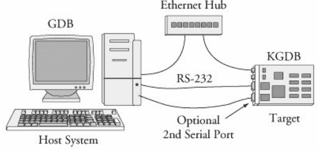

一个串行端口专门用于 KGDB 与在开发主机系统上运行的 `gdb` 之间的连接，第二个可选的串行端口用作控制台。只有一个串行端口的系统会使 KGDB 的使用稍显不便。

 如你在[图 14-1](http://example.com)中所见，调试器（你的跨平台版本`gdb`）运行于开发主机系统之上。KGDB 是运行于目标系统内核中的组成部分。KGDB 实现了必要的钩子函数，用于将`gdb`与目标板连接起来，以启用断点设置、内存查看以及单步执行程序等功能。

### 14.2.1. KGDB 内核配置

KGDB 是一项内核功能，必须在内核中启用。KGDB 从 Kernel Hacking 菜单中选择，如[图 14-2](http://example.com)所示。作为配置的一部分，你必须选择 KGDB 要使用的串口。另外请注意，我们从[图 14-2](http://example.com)中看到启用了使用调试用信息编译内核的选项。这会在构建过程中添加`-g`编译器标志，以启用符号调试。

#### 图 14-2. 用于 KGDB 的内核配置

[查看完整尺寸图像](http://example.com)

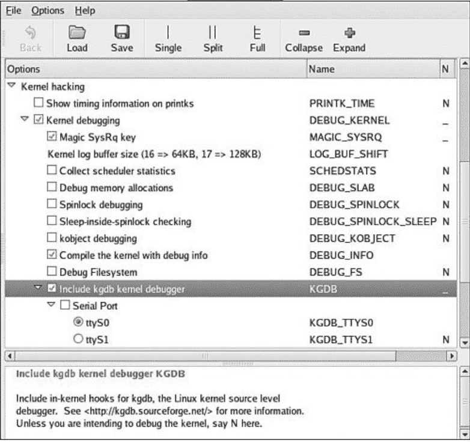

### 14.2.2. 使用 KGDB 支持的目标引导

在用 KGDB 支持构建内核之后，必须启用它。遗憾的是，启用的方法尚未在所有架构和实现中统一。通常，KGDB 是通过内核命令行向内核传递命令行开关来启用的。如果 KGDB 支持被编译进内核但未通过命令行开关启用，则不会生效。当 KGDB 启用时，内核会在引导周期非常早的阶段在 KGDB 启用的断点处停止，以便你可以使用`gdb`连接到目标。[图 14-3](#)展示了启用 KGDB 时生成初始断点的逻辑。

#### 图 14-3. KGDB 逻辑

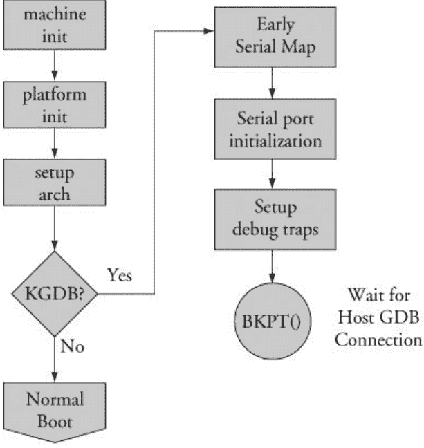

KGDB 需要串口来连接到主机。[3] 设置 KGDB 的第一步是在引导过程的早期启用串口。在许多架构中，硬件 UART 必须在访问之前映射到内核内存中。在地址范围映射完成后，串口被初始化。安装调试陷阱处理程序，以允许处理器异常陷入调试器。

> [3] 尽管前面关于通过以太网使用 KGDB 的评论。

[清单 14-1](#listing-14-1)显示了启用`KGDB`引导时的终端输出。此示例基于 AMCC 440EP 评估套件（Yosemite 板），该套件随附 U-Boot 引导加载程序。

#### 清单 14-1. 使用 U-Boot 启用 KGDB 引导

```
=> sete bootargs console=ttyS1,115200 root=/dev/nfs rw ip=dhcp gdb
=> bootm 200000
#### Booting image at 00200000 ...
   Image Name:   Linux-2.6.13
   Image Type:   PowerPC Linux Kernel Image (gzip compressed)
   Data Size:    1064790 Bytes =  1 MB
   Load Address: 00000000
   Entry Point:  00000000
   Verifying Checksum ... OK
   Uncompressing Kernel Image ... OK
$T0440:c000ae5c()), sys_sync()

1 at 0xc0016b18: file kernel/panic.c, line 74.
(gdb) b sys_sync
Breakpoint 2 at 0xc005a8c8: file fs/buffer.c, line 296.
(gdb)
```

使用`gdb breakpoint`命令，同样使用其缩写形式，我们输入了两个断点。一个位于`panic()`，另一个位于`sync`系统调用入口`sys_sync()`。前者允许在后续事件产生 panic 时调用调试器。这使得能够在发生 panic 时检查系统状态。后者是一种有用的方式，通过在你目标硬件上的终端中输入`sync`命令，从用户空间停止内核并陷入调试器。

我们现在可以继续进行调试会话。我们在目标上运行着一个 KGDB 启用的内核，在 KGDB 定义的较早断点处暂停。我们使用基于主机的交叉调试器 — 在本例中以`ppc_4xx-gdb`调用 — 与目标建立了连接，并且我们输入了一对有用的系统断点。现在我们可以将调试活动指向手头的工作。

有一点需要注意：根据定义，在我们主机上用于建立 KGDB 启用内核与`cross-gdb`之间连接的`.../arch/ppc/setup.c`中的`breakpoint()`函数之前，我们无法使用 KGDB 来单步执行代码。[图 14-3](.)是 KGDB 获得控制之前执行代码的大致指南。调试这段早期代码需要使用硬件辅助调试探针。我们将在[第 14.4 节](#)，"硬件辅助调试"中很快介绍这个主题。


## 14.3. 调试 Linux 内核

你可能会发现自己需要单步跟踪内核代码，其中一个比较常见的原因是为了修改或定制针对你的特定开发板的平台相关代码。让我们看看如何使用 AMCC Yosemite 板来完成这个任务。我们在平台相关的架构设置函数处放置一个断点，然后继续执行直到遇到该断点。代码清单 14-4 展示了这一过程。

### 代码清单 14-4. 调试架构设置代码

```
(gdb) b yosemite_setup_arch
    Breakpoint 3 at 0xc021a488:
        file arch/ppc/platforms/4xx/yosemite.c, line 308.
(gdb) c
Continuing.
Can't send signals to this remote system.  SIGILL not sent.

Breakpoint 3, yosemite_setup_arch () at arch/ppc/platforms/4xx/yosemite.c:308
308
                yosemite_set_emacdata();

(gdb) l
303	}
304	305	static void __init
306	yosemite_setup_arch(void)
307	{
308	                yosemite_set_emacdata();
309	                ibm440gx_get_clocks(&clocks, YOSEMITE_SYSCLK, 6 * 1843200);
310	                ocp_sys_info.opb_bus_freq = clocks.opb;
311	(gdb)
```

当遇到 `yosemite_setup_arch()` 处的断点时，控制权转移至 `yosemite.c` 文件第 308 行处的 `gdb`。`list` (`l`) 命令显示以断点第 308 行为中心的源代码列表。在执行 `continue` (`c`) 命令后，`gdb` 显示的警告消息可以安全地忽略。它是 `gdb` 测试远程系统功能的一部分。它首先向目标发送一个远程 `continue_with_signal` 命令。该目标板的 KGDB 实现不支持此命令；因此，它被目标 `NAK`（否定应答）。`gdb` 随后显示这条信息消息，并改用标准的远程 `continue` 命令。

### 14.3.1. gdb 远程串行协议

`gdb` 包含一个调试开关，使我们能够观察开发主机上的 `gdb` 和目标之间使用的远程协议。这对于理解底层协议以及排除表现出异常或错误行为的目标非常有用。要启用此调试模式，请执行以下命令：

```
set debug remote 1
```

启用远程调试后，观察 `continue` 命令的实际执行和 `gdb` 采取的步骤是很有启发性的。代码清单 14-5 展示了启用远程调试时 `continue` 命令的使用。

#### 代码清单 14-5. continue 远程协议示例

```
 Continuing.
Sending packet: $mc0000000,4#80...Ack
Packet received: c022d200
Sending packet: $Mc0000000,4:7d821008#68...Ack
Packet received: OK
Sending packet: $mc0016de8,4#f8...Ack
Packet received: 38600001
Sending packet: $Mc0016de8,4:7d821008#e0...Ack
Packet received: OK
Sending packet: $mc005bd5c,4#23...Ack
Packet received: 38600001
Sending packet: $Mc005bd5c,4:7d821008#0b...Ack
Packet received: OK
Sending packet: $mc021a488,4#c8...Ack
Packet received: 4bfffbad
Sending packet: $Mc021a488,4:7d821008#b0...Ack
Packet received: OK
Sending packet: $c#63...Ack
```

虽然起初看起来可能很复杂，但这里发生的事情很容易理解。总结来说，`gdb` 正在恢复它在目标上的所有断点。回顾代码清单 14-3，我们设置了两个断点，一个在 `panic()` 处，另一个在 `sys_sync()` 处。在稍后的代码清单 14-4 中，我们在 `yosemite_setup_arch()` 处添加了第三个断点。因此，有三个活动的用户指定断点。可以通过执行 `gdb` 的 `info breakpoints` 命令来显示这些断点。和往常一样，我们使用其缩写版本。

```
Num Type             Disp Enb Address     What
1   breakpoint     keep y   0xc0016de8 in panic at kernel/panic.c:74
2   breakpoint     keep y   0xc005bd5c in sys_sync at fs/b directed_buffer.c:296
3   breakpoint     keep y   0xc021a488 in yosemite_setup_arch at arch/ppc/platforms/4xx/yosemite.c:308
        breakpoint already hit 1 time
```

现在将之前的断点地址与代码清单 14-5 中 `gdb` 远程 `$m` 数据包中的地址进行比较。`$m` 数据包是“读取目标内存”命令，而 `$M` 数据包是“写入目标内存”命令。针对每个断点，都会从目标内存中读取断点的地址，由主机上的 `gdb` 在本地存储（以便稍后恢复），并替换为 PowerPC 陷阱指令 `twge r2, r2`（0x7d821008），这将导致控制权返回到调试器。图 14-4 说明了这个操作。

#### 图 14-4. `gdb` 在目标内存中插入断点

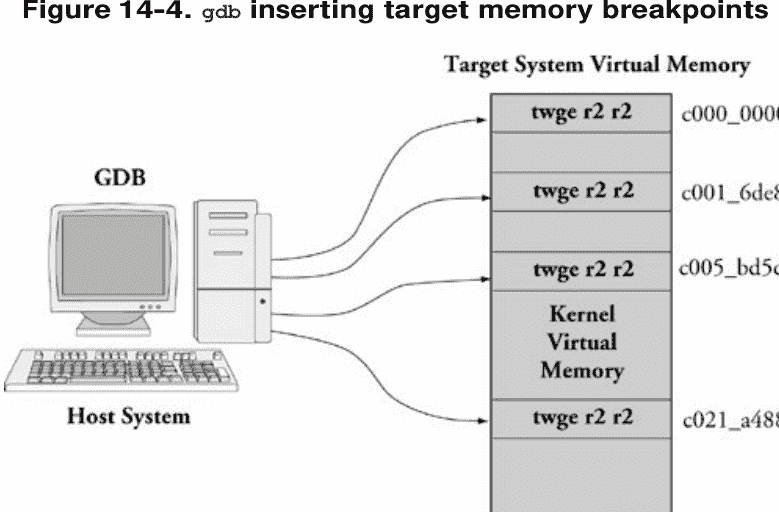

你可能已经注意到 `gdb` 正在更新四个断点，而我们只设置了三个。第一个位于目标内存位置 `0xc000_0000` 的断点是由 `gdb` 在启动时自动放置的。这个位置本质上是 ELF 文件中链接后的内核映像的基地址，即 `_start`。它相当于用户空间调试中的 `main()` 断点，由 `gdb` 自动完成。其他三个断点是我们之前设置的。

当发生返回控制权给 `gdb` 的事件时，会发生相反的情况。代码清单 14-6 详细描述了当遇到我们设置在 `yosemite_setup_arch()` 的断点时的操作。

#### 代码清单 14-6. 远程协议：命中 Breakpoint

```
Packet received: T0440:c021a488;01:c020ff90;
Sending packet: $mc0000000,4#80...Ack  <<< Read memory @c0000000
Packet received: 7d821008
Sending packet: $Mc0000000,4:c022d200#87...Ack  <<< Write memory
Packet received: OK
Sending packet: $mc0016de8,4#f8...Ack
Packet received: 7d821008
Sending packet: $Mc0016de8,4:38600001#a4...Ack
Packet received: OK
Sending packet: $mc005bd5c,4#23...Ack
Packet received: 7d821008
Sending packet: $Mc005bd5c,4:38600001#cf...Ack
Packet received: OK
Sending packet: $mc021a488,4#c8...Ack
Packet received: 7d821008
Sending packet: $Mc021a488,4:4bffffbad#dl...Ack
Packet received: OK

Sending packet: $mc021a484,c#f3...Ack
Packet received: 900100244bffffbad3fa0c022
Breakpoint 3, yosemite_setup_arch () at arch/ppc/platforms/4xx/yosemite.c:308
308            yosemite_set_emacdata();
(gdb)
```

$T 数据包是一个 gdb 停止应答数据包。当遇到断点时，由目标发送给 gdb。在我们的示例中，$T 数据包返回了程序计数器和寄存器 r1 的值。[4] 其余的活动是代码清单 14-5 中活动的逆过程。PowerPC 陷阱断点指令被移除，`gdb` 将原始指令恢复到各自的内存位置。

> [4] 如前所述，gdb 远程协议在本章末尾的 14.6.1 节“建议的附加阅读材料”中引用的 gdb 手册中有详细说明。

### 14.3.2. 调试优化后的内核代码

在本章开头，我们提到调试内核代码面临的挑战之一源于编译器优化。我们指出，Linux 内核默认以 `-O2` 优化级别编译。在到目前为止的例子中，我们使用了 `-O1` 优化来简化调试任务。这里我们展示了优化可能使调试复杂化的众多方式之一。

相关的互联网邮件列表中充斥着与看似损坏的工具相关的问题。有时发帖者报告说他的调试器在单步回退，或者他的行号与源代码不匹配。这里我们给出一个例子，说明优化编译器给源代码级调试带来的复杂性。在这个例子中，当命中断点时，`gdb` 报告的行号由于**函数内联**而与我们的源文件中的行号不匹配。

为了这个演示，我们使用了与代码清单 14-4 中显示的相同调试代码片段。然而，对于这个例子，我们使用了编译器优化标志 `-O2` 来编译内核。这是 Linux 内核的默认设置。代码清单 14-7 显示了这次调试会话的结果。

#### 代码清单 14-7. 优化后的架构设置代码

```
$ ppc_44x-gdb --silent vmlinux
(gdb) target remote /dev/ttyS0
Remote debugging using /dev/ttyS0
```


```
breakinst () at arch/ppc/kernel/ppc-stub.c:825
825	}
(gdb) b panic
Breakpoint 1 at 0xc0016b18: file kernel/panic.c, line 74.
(gdb) b sys_sync
Breakpoint 2 at 0xc005a8c8: file fs/buffer.c, line 296.
(gdb) b yosemite_setup_arch
Breakpoint 3 at 0xc020f438: file arch/ppc/platforms/4xx/yosemite.c, line 116.
(gdb) c
Continuing.

Breakpoint 3, yosemite_setup_arch ()
    at arch/ppc/platforms/4xx/yosemite.c:116

116	        def = ocp_get_one_device(OCP_VENDOR_IBM, OCP_FUNC_EMAC, 0);
(gdb) l
111	        struct ocp_def *def;
112	        struct ocp_func_emac_data *emacdata;
113
114	        /* Set mac_addr and phy mode for each EMAC */
115	
116	        def = ocp_get_one_device(OCP_VENDOR_IBM, OCP_FUNC_EMAC, 0);
117	        emacdata = def->additions;
118	        memcpy(emacdata->mac_addr, __res.bi_enetaddr, 6);
119	        emacdata->phy_mode = PHY_MODE_RMII;
120	
(gdb) p yosemite_setup_arch
$1 = {void (void)} 0xc020f41c <yosemite_setup_arch>
```

回顾清单14-4，注意函数`yosemite_setup_arch()`实际上位于文件`yosemite.c`的第306行。将其与清单14-7进行比较。我们命中了断点，但`gdb`报告的断点位置是在文件`yosemite.c`的第116行。乍一看，调试器报告的行号与相应源代码的行号似乎不匹配。这是`gdb`的一个错误吗？首先，让我们确认编译器为调试信息生成了什么。使用第13章“开发工具”中描述的`readelf` [5]工具，我们可以检查编译器为该函数生成的调试信息。

> [5] 记住要使用你的交叉版本的readelf，例如，用于PowerPC 44x架构的ppc_44x-readelf。

```
$ ppc_44x-readelf --debug-dump=info vmlinux | grep -u6 \
  yosemite_setup_arch | tail -n 7
    DW_AT_name        : (indirect string, offset: 0x9c04): yosemite_setup_arch
    DW_AT_decl_file   : 1
    DW_AT_decl_line   : 307
    DW_AT_prototyped  : 1
    DW_AT_low_pc      : 0xc020f41c
    DW_AT_high_pc     : 0xc020f794
    DW_AT_frame_base  : 1 byte block: 51       (DW_OP_reg1)
```

我们不必成为阅读DWARF2调试记录[6]的专家，也能认识到所讨论的函数在我们的源文件中被报告在第307行。我们可以使用第13章同样介绍的`addr2line`工具来确认这一点。使用从清单14-7中的`gdb`得出的地址：

> [6] Dwarf调试规范的参考出现在本章末尾的第14.6.1节“补充阅读建议”中。

```
$ ppc_44x-addr2line -e vmlinux 0xc020f41c

arch/ppc/platforms/4xx/yosemite.c:307
```

此时，`gdb`将我们的断点报告在`yosemite.c`文件的第116行。要理解发生了什么，我们需要查看`gdb`报告的函数的汇编输出。清单14-8是在对`yosemite_setup_arch()`函数执行`disassemble`命令后，从`gdb`得到的输出。

#### 清单14-8. 反汇编函数 yosemite_setup_arch

```
(gdb) **disassemble yosemite_setup_arch**
0xc020f41c <yosemite_setup_arch+0>:	mflr	r0
0xc020f420 <yosemite_setup_arch+4>:	stwu	r1,-48(r1)
0xc020f424 <yosemite_setup_arch+8>:	li	r4,512
0xc020f428 <yosemite_setup_arch+12>:	li	r5,0
0xc020f42c <yosemite_setup_arch+16>:	li	r3,4116
0xc020f430 <yosemite_setup_arch+20>:	stmw	r25,20(r1)
0xc020f434 <yosemite_setup_arch+24>:	stw	r0,52(r1)
0xc020f438 <yosemite_setup_arch+28>:	bl	0xc000d344 <ocp_get_one_device>
0xc020f43c <yosemite_setup_arch+32>:	lwz	r31,32(r3)
0xc020f440 <yosemite_setup_arch+36>:	lis	r4,-16350
0xc020f444 <yosemite_setup_arch+40>:	li	r28,2
0xc020f448 <yosemite_setup_arch+44>:	addi	r4,r4,21460
0xc020f44c <yosemite_setup_arch+48>:	li	r5,6
0xc020f450 <yosemite_setup_arch+52>:	lis	r29,-16350
0xc020f454 <yosemite_setup_arch+56>:	addi	r3,r31,48
0xc020f458 <yosemite_setup_arch+60>:	l Fleischerl	r25,-16350
0xc020f45c <yosemite_setup_arch+64>:	bl	0xc000c708 <memcpy>
0xc020f460 <yosemite_setup_arch+68>:	stw	r28,44(r31)
0xc020f464 <yosemite_setup_arch+72>:	li	r4,512
0xc020f468 <yosemite_setup_arch+76>:	li	r5,1
0xc020f46c <yosemite_setup_arch+80>:	li	r3,4116
0xc020f470 <yosemite_setup_arch+84>:	addi	r26,r25,15104
0xc020f474 <yosemite_setup_arch+88>:	bl	0xc000d344 <ocp_get_one_device>
0xc020f478 <yosemite_setup_arch+92>:	lis	r4,-16350
0xc020f47c <yosemite_setup_arch+96>:	lwz	r31,32(r3)
0xc020f480 <yosemite_setup_arch+100>:	addi	r4,r4,21534
0xc020f484 <yosemite_setup_arch+104>:	li	r5,6
0xc020f488 <yosemite_setup_arch+108>:	addi	r3,r31,48
0xc020f48c <yosemite_setup_arch+112>:	bl	0xc000c708 <memcpy>
0xc020f490 <yosemite_setup_arch+116>:	lis	r4,1017
0xc020f494 <yosemite_setup_arch+120>:	lis	r5,168
0xc020f498 <yosemite_setup_arch+124>:	stw	r28,44(r31)
0xc020f49c <yosemite_setup_arch+128>:	ori	r4,r4,16554
0xc020f4a0 <yosemite_setup_arch+132>:	ori	r5,r5,49152
0xc020f4a4 <yosemite_setup_arch+136>:	addi	r3,r29,-15380
0xc020f4a8 <yosemite_setup_arch+140>:	addi	r29,r29,-15380
0xc020f4ac <yosemite_setup_arch+144>:	bl	0xc020e338 <ibm440gx_get_clocks>
0xc020f4b0 <yosemite_setup_arch+148>:	li	r0,0
0xc020f4b4 <yosemite_setup_arch+152>:	lis	r11,-16352
0xc020f4b8 <yosemite_setup_arch+156>:	ori	r0,r0,50000
0xc020f4bc <yosemite_setup_arch+160>:	lwz	r10,12(r29)
0xc020f4c0 <yosemite_setup_arch+164>:	lis	r9,-16352
0xc020f4c4 <yosemite_setup_arch+168>:	stw	r0,8068(r11)
0xc020f4c8 <yosemite_setup_arch+172>:	lwz	r0,84(r26)
0xc020f4cc <yosemite_setup_arch+176>:	stw	r10,8136(r9)
0xc020f4d0 <yosemite_setup_arch+180>:	mtctr	r0
0xc020f4d4 <yosemite_setup_arch+184>:	bctrl
0xc020f4d8 <yosemite_setup_arch+188>:	li	r5,64
0xc020f4dc <yosemite_setup_arch+192>:	mr	r31,r3
0xc020f4e0 <yosemite_setup_arch+196>:	lis	r4,-4288
0xc020f4e4 <yosemite_setup_arch+200>:	li	r3,0
0xc020f4e8 <yosemite_setup_arch+204>:	bl	0xc000c0f8 <ioremap64>
End of assembler dump.
(gdb)
```

再次说明，我们不必是PowerPC汇编语言专家也能理解这里发生了什么。注意与PowerPC `bl`指令相关的标签。这是PowerPC助记符中的一个函数调用。符号化的函数标签是重要的数据点。经过初步分析，我们看到在这个汇编列表的开始附近有几个函数调用：

| 地址 | 函数 |
|---------|----------|
| 0xc020f438 | ocp_get_one_device() |
| 0xc020f45c | memcpy() |
| 0xc020f474 | ocp_get_one_device() |
| 0xc020f48c | memcpy() |
| 0xc020f4ac | ibm440gx_get_clocks() |

清单14-9复制了源文件`yosemite.c`的部分内容。将我们在`gdb disassemble`输出中找到的函数与之关联，我们看到这些标签出现在函数`yosemite_set_emacdata()`中，大约位于`gdb`在遇到`yosemite_setup_arch()`断点时报告的行号附近。理解这个异常现象的关键是注意`yosemite_setup_arch()`最开始的子程序调用。编译器将对`yosemite_set_emacdata()`的调用内联了，而不是生成一个函数调用，正如简单查看源代码所预期的那样。这种内联在`gdb`命中断点时导致了行号的不匹配。即使`yosemite_set_emacdata()`函数没有使用inline关键字声明，GCC也将该函数内联以作为性能优化。

#### 清单14-9. 源文件 `yosemite.c` 的部分内容

```
109 static void __init yosemite_set_emacdata(void)
110 {
111	        struct ocp_def *def;
112	        struct ocp_func_emac_data *emacdata;
113	
114	        /* Set mac_addr and phy mode for each EMAC */
115	
116	        def = ocp_get_one_device(OCP_VENDOR_IBM, OCP_FUNC_EMAC, 0);
117	        emacdata = def->additions;
118	        memcpy(emacdata->mac_addr, __res.bi_enetaddr, 6);
119	        emacdata->phy_mode = PHY_MODE_RMII;
120	
121	        def = ocp_get_one_device(OCP_VENDOR_IBM, OCP_FUNC_EMAC, 1);
122	        emacdata = def->additions;
123	        memcpy(emacdata->mac_addr, __res.bi_enet1addr, 6);
124	        emacdata->phy_mode = PHY_MODE_RMII;
125 }
126
...
304	
305 static void __init
306 yosemite_setup_arch(void)
307 {
308	        yosemite_set_emacdata();
309	
310	        ibm440gx_get_clocks(&clocks, YOSEMITE_SYSCLK, 6 * 1843200);
311	        ocp_sys_info.opb_bus_freq = clocks.opb;
312	
313	        /* init to some ~sane value until calibrate_delay() runs */
314	        loops_per_jiffy = 50000000/HZ;
315	
316	        /* Setup PCI host bridge */
```

总结之前的讨论：

- 我们在 `gdb` 中于 `yosemite_setup_arch()` 函数处设置了一个断点。
- 当断点被触发时，我们发现自己位于源文件的第 116 行，这与我们定义断点的函数相去甚远。
- 我们对 `yosemite_setup_arch()` 处的代码生成了反汇编列表，并发现这段代码分支跳转到的标签。
- 将这些标签与我们的源代码对照后，我们发现编译器将 `yosemite_set_emacdata()` 子程序内联到了我们设置断点的函数中，这可能导致混淆。

这解释了当 `yosemite_setup_arch()` 中的原始断点被触发时，`gdb` 报告的行号。

编译器采用多种不同的优化算法。本例仅展示了其中之一：函数内联。每种优化都可能以不同方式混淆调试器（人类和机器）。挑战在于理解机器层面发生了什么，并将其转化为我们作为开发者的意图。现在你明白了使用最低可能优化级别进行调试的好处。

### 14.3.3. gdb 用户自定义命令

你可能已经意识到 `gdb` 在启动时会查找一个名为 `.gdbinit` 的初始化文件。首次调用时，`gdb` 会加载此初始化文件（通常位于用户的主目录中）并执行其中的命令。我最喜欢的一个组合是连接到目标系统并设置初始断点。在这种情况下，`.gdbinit` 的内容将如清单 14-10 所示。

#### 清单 14-10. 简单的 `gdb` 初始化文件

```
$ cat ~/.gdbinit
set history save on
set history filename ~/.gdb_history
set output-radix 16

define connect
#   target remote bdi:2001
    target remote /dev/ttyS0
    b panic
    b sys_sync
end
```

这个简单的 `.gdbinit` 文件允许将命令历史记录存储在用户指定的文件中，并设置打印值的默认输出基数。然后它定义了一个名为 `connect` 的 `gdb` *用户自定义命令*。（用户自定义命令通常也称为宏。）当在 `gdb` 命令提示符下发出该命令时，`gdb` 会通过所需的方法连接到目标系统，并在 `panic()` 和 `sys_sync()` 处设置系统断点。其中一种方法已被注释掉；我们将在第 14.4 节讨论此方法。

`gdb` 用户自定义命令的创意使用永无止境。在内核调试期间，检查全局数据结构（如任务列表和内存映射）通常很有用。这里我们介绍几个有用的 `gdb` 用户自定义命令，它们能够显示你可能在内核调试期间需要访问的特定内核数据。

### 14.3.4. 实用的内核 gdb 宏

在内核调试期间，查看系统上正在运行的进程以及这些进程的一些常见属性通常很有用。内核维护了一个由 `struct task_struct` 描述的任务链表。链表中第一个任务的地址包含在内核全局变量 `init_task` 中，该变量表示内核在启动期间生成的初始任务。每个任务包含一个 `struct list_head`，它将任务链接在一个循环链表中。这两个无处不在的内核结构在以下头文件中描述：

```
struct task_struct          .../include/linux/sched.h
struct list_head            .../include/linux/list.h
```

使用 `gdb` 宏，我们可以遍历任务链表并显示有关任务的有用信息。很容易修改宏以提取你可能感兴趣的数据。它也是学习内核内部细节的非常有用的工具。

我们检查的第一个宏（清单 14-11 中）是一个简单的宏，它搜索内核的 `task_struct` 结构链表，直到找到给定的任务。如果找到，它将显示该任务的名称。

#### 清单 14-11. `gdb` `find_task` 宏

```
# Helper function to find a task given a PID or the
# address of a task_struct.
# The result is set into $t
define find_task
  # Addresses greater than _end: kernel data...
  # ...user passed in an address
  if ((unsigned)$arg0 > (unsigned)&_end)
    set $t=(struct task_struct *)$arg0
  else
     # User entered a numeric PID
     # Walk the task list to find it
     set $t=&init_task
     if (init_task.pid != (unsigned)$arg0)
       find_next_task $t
       while (&init_task!=$t && $t->pid != (unsigned)$arg0)
         find_next_task $t
       end
       if ($t == &init_task)
         printf "Couldn't find task; using init_task\n"
       end
     end
   end
   printf "Task \"%s\":\n", $t->comm
 end
```

将此文本放入你的 .gdbinit 文件并重新启动 gdb，或使用 gdb 的 source 命令加载它[7]。（我们将在清单 14-15 中解释 find_next_task 宏。）按如下方式调用它：

> [7] 宏开发中的一个有用快捷方式是 gdb source 命令。此命令打开并读取包含宏定义的源文件。

```
(gdb) find_task 910
Task "syslogd":
```

或

```
(gdb) find_task 0xCFFDE470
Task "bash":
```

第 4 行定义了宏名称。第 7 行判断输入参数是 PID（从零开始的数字输入，限制在几百万以内）还是必须大于 Linux 内核映像本身末尾（由符号 _end 定义）的 task_struct 地址[8]。如果是地址，唯一需要的操作是将其强制转换为正确的类型，以便能够解引用关联的 task_struct。这在第 8 行完成。如第 3 行的注释所述，此宏返回一个被类型转换为指向 struct task_struct 指针的 gdb 便捷变量。

> [8] 符号 _end 是在最终链接期间在链接器脚本文件中定义的。

如果输入参数是数字 PID，则遍历链表以找到匹配的 task_struct。第 12 和 13 行初始化循环变量（gdb 的宏命令语言中没有 for 语句），第 15 至 17 行定义了搜索循环。`find_next_task` 宏用于提取链表中下一个 `task_struct` 的指针。最后，如果搜索失败，会设置一个合理的返回值（`init_task` 的地址），以便可以在其他宏中安全使用。

基于清单 14-11 中的 `find_task` 宏，我们可以轻松创建一个简单的 `ps` 命令来显示有关系统上运行的每个进程的有用信息。

清单 14-12 定义了一个 `gdb` 宏，用于显示从给定进程的 `struct task_struct` 中提取的、关于运行进程的有趣信息。它的调用方式与任何其他 `gdb` 命令相同，只需输入其名称后跟任何必需的输入参数。请注意，此用户自定义命令需要一个参数，可以是 PID 或 `task_struct` 的地址。

#### 清单 14-12. **gdb** 宏：打印进程信息

```
define ps
  # Print column headers
  task_struct_header
  set $t=&init_task
  task_struct_show $t
  find_next_task $t
  # Walk the list
  while &init_task!=$t
    # Display useful info about each task
   task_struct_show $t
   find_next_task $t
 end
end

document ps
Print points of interest for all tasks
end
```

这个 `ps` 宏与 `find_task` 宏类似，不同之处在于它不需要输入参数，并且添加了一个宏 (`task_struct_show`) 来显示每个 `task_struct` 中的有用信息。第 3 行打印带有列标题的标题行。第 4 至 6 行设置循环并显示第一个任务。第 8 至 11 行遍历每个任务，为每个任务调用 `task_struct_show` 宏。

还要注意包含了 `gdb` `document` 命令。这允许 `gdb` 用户在 `gdb` 命令提示符下发出 `help ps` 命令来获取帮助，如下所示：

```
(gdb) help ps
    Print points of interest for all tasks
```

清单 14-13 显示了此宏在仅运行最小服务的开发板上的输出。

#### 清单 14-13. **gdb** `ps` 宏输出

```
(gdb) ps
Address     PID State     User_NIP Kernel-SP device comm
```


```
0xC01D3750      0 Running                0xC0205E90 (none)  swapper
0xC04ACB10      1 Sleeping  0x0FF6E85C 0xC04FFCE0 (none)  init
0xC04AC770      2 Sleeping                0xC0501E90 (none)  ksoftirqd/0
0xC04AC3D0      3 Sleeping                0xC0531E30 (none)  events/0
0xC04AC030      4 Sleeping                0xC0533E30 (none)  khelper
0xC04CDB30      5 Sleeping                0xC0535E30 (none)  kthread
0xC04CD790     23 Sleeping                0xC06FBE30 (none)  kblockd/0
0xC04CD3F0     45 Sleeping                0xC06FDE50 (none)  pdflush
0xC04CD050     46 Sleeping                0xC06FFE50 (none)  pdflush
0xC054B7B0     48 Sleeping                0xC0703E30 (none)  aio/0
0xC054BB50     47 Sleeping                0xC0701E20 (none)  kswapd0
0xC054B410    629 Sleeping                0xC0781E60 (none)  kseriod
0xC054B070    663 Sleeping                0xC059E30 (none)  rpciod/0
0xCFFDE0D0    675 Sleeping  0x0FF6E85C 0xCF86DCE0 (none)  udevd
0xCF95B110    879 Sleeping  0x0FF0BE58 0xCF517D80 (none)  portmap
0xCFC24090    910 Sleeping  0x0FF6E85C 0xCF61BCE0 (none)  syslogd
0xCF804490    918 Sleeping  0x0FF66C7C 0xCF65DD70 (none)  klogd
0xCFE350B0    948 Sleeping  0x0FF0E85C 0xCF67DCE0 (none)  rpc.statd
0xCFFDE810    960 Sleeping  0x0FF6E85C 0xCF5C7CE0 (none)  inetd
0xCFC24B70    964 Sleeping  0xFEEBEAC 0xCF64FD80 (none)  mvltd
0xCFE35B90    973 Sleeping  0x0FF66C7C 0xCFEF7CE0 ttyS1   getty
0xCFE357F0    974 Sleeping  0x0FF4B85C 0xCF6EBCE0 (none)  in.telnetd
0xCFFDE470    979 Sleeping  0x0FEB6950 0xCF675DB0 ttyp0    bash
0xCFFDEBB0    982 <Running   0x0FF6EB6C 0xCF7C3870 ttyp0    sync
(gdb)
```

这个 `ps` 宏的主要工作由 `task_struct_show` 宏完成。如清单 14-13 所示，`task_struct_show` 宏显示每个 `task_struct` 的以下字段：

- `Address` 进程 `task_struct` 的地址
- `PID` 进程 ID
- `State` 进程当前状态
- `User_NIP` 用户空间下一条指令指针
- `Kernel_SP` 内核栈指针
- `device` 与该进程关联的设备
- `comm` 进程名称（或命令）

修改这个宏以显示特定内核调试任务中感兴趣的项目相对容易。唯一的复杂之处在于宏语言本身的简洁性。由于 `gdb` 用户自定义命令语言中不存在 `strlen` 等函数等价物，屏幕格式必须手动处理。

清单 14-14 列出了生成前述输出的 `task_struct_show` 宏。

#### 清单 14-14. gdb task_struct_show 宏

```
1 define task_struct_show
2   # task_struct addr and PID
3   printf "0x%08X %5d", $arg0, $arg0->pid
4 
5   # Place a '<' marker on the current task
6   #  if ($arg0 == current)
7   # For PowerPC, register r2 points to the "current" task
8   if ($arg0 == $r2)
9     printf "<"
10    else
11      printf " "
12    end
13 
14   # State
15   if ($arg0->state == 0)
16     printf "Running    "
17   else
18     if ($arg0->state == 1)
19       printf "Sleeping   "
20     else
21       if ($arg0->state == 2)
22         printf "Disksleep  "
23       else
24         if ($arg0->state == 4)
25           printf "Zombie     "
26           else
27           if ($arg0->state == 8)
28             printf "sTopped    "
29           else
30             if ($arg0->state == 16)
31               printf "Wpaging    "
32             else
33               printf "%2d         ", $arg0->state
34             end
35           end
36         end
37       end
38     end
39   end
40 
41   # User NIP
42   if ($arg0->thread.regs)
43     printf "0x%08X  ", $arg0->thread.regs->nip
44   else
45     printf "          "
46   end
47 
48   # Display the kernel stack pointer
49   printf "0x%08X  ", $arg0->thread.ksp
50 
```

```
51  # device
52  if ($arg0->signal->tty)
53    printf "%s    ", $arg0->signal->tty->name
54  else
55    printf "(none)  "
56  end
57  
58  # comm
59  printf "%s\n", $arg0->comm
60  end
```

第 3 行显示 `task_struct` 的地址。第 8 到 12 行显示进程 ID。如果这是当前进程（在触发断点时该 CPU 上正在运行的进程），则用 `<` 字符标记。

第 14 到 39 行解码并显示进程状态。随后显示用户进程下一条指令指针（NIP）和内核栈指针（SP）。最后，显示与进程关联的设备，接着是进程名称（存储在 `task_struct` 的 `->comm` 元素中）。

需要注意的是，这个宏是架构相关的，如第 7 和 8 行所示。一般来说，这类宏高度依赖架构和版本。每当底层结构发生变化时，这类宏都必须更新。然而，如果你花费大量时间使用 `gdb` 调试内核，那么付出的努力通常是值得的。

为了完整起见，我们介绍 `find_next_task` 宏。它的实现不太直观，值得解释。（可以合理假设你能够轻松推导出 `task_struct_header`，它与本节中介绍的 `ps` 宏配合使用。它只不过是一行代码，用适当的空格排列列标题。）清单 14-15 给出了在我们的 `ps` 和 `find_task` 宏中使用的 `find_next_task` 宏。

#### 清单 14-15. gdb `find_next_task` 宏

```
define find_next_task
  # Given a task address, find the next task in the linked list
  set $t = (struct task_struct *)$arg0
  set $offset=( (char *)&$t->tasks - (char *)$t)
  set $t=(struct task_struct *) ( (char *)$t->tasks.next- (char *)$offset)
end
```

这个宏执行的功能很简单。实现稍微不那么直观。目标是返回 `->next` 指针，它指向链表上下一个 `task_struct`。然而，`task_struct` 结构是通过 `struct list_head` 成员 `tasks` 的地址链接的，而不是像常见做法那样通过 `task_struct` 的起始地址链接。由于 `->next` 指针指向链表上下一个 `task_struct` 中 `task` 结构元素的地址，我们必须进行减法才能得到 `task_struct` 顶部的地址。我们从 `->next` 指针减去的值是从该指针地址到 `task_struct` 顶部的偏移量。首先我们计算偏移量，然后使用该偏移量调整 `->next` 指针指向 `task_struct` 的顶部。图 14-5 应该能说明这一点。

#### 图 14-5. 任务结构链表连接

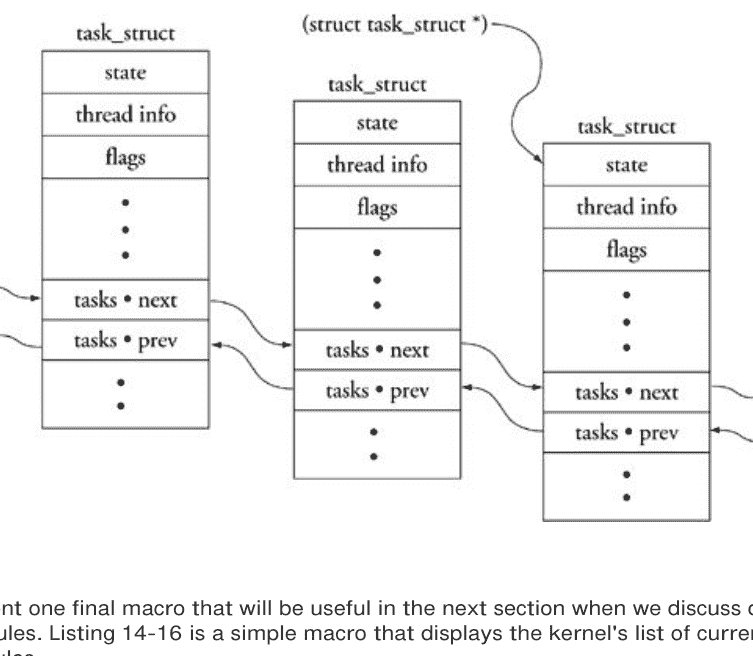

现在我们介绍最后一个宏，在下一节讨论调试可加载模块时会用到它。清单 14-16 是一个简单的宏，显示内核当前已安装可加载模块的列表。

#### 清单 14-16. gdb 列出模块宏

```
1 define lsmod
2     printf "Address\t\tModule\n"
3     set $m=(struct list_head *)&modules
4     set $done=0
5     while ( !$done )
6         # list_head is 4-bytes into struct module
7         set $mp=(struct module *)(((char *)$m->next) - (char *)4)
8         printf "0x%08X\t%s\n", $mp, $mp->name
9         if ( $mp->list->next == &modules)
10            set $done=1
11        end
12        set $m=$m->next
13    end
14 end
15
16 document lsmod
17 List the loaded kernel modules and their start addresses
18 end
```

这个简单的循环从内核全局变量 `module` 开始。这个变量是一个 `struct list_head`，标记可加载模块链表的起始点。唯一的复杂性与清单 14-15 描述的相同。我们必须从 `struct list_head` 指针减去一个偏移量来指向 `struct module` 的顶部。这在第 7 行执行。这个宏生成一个简单的模块列表，包含 `struct module` 的地址和模块名称。以下是其使用示例：

```
(gdb) lsmod
Address         Module
0xD1012A80      ip_conntrack_tftp
0xD10105A0      ip_conntrack
0xD102F9A0      loop
(gdb) help lsmod
List the loaded kernel modules and their start addresses
(gdb)
```

这里介绍的宏等是非常强大的调试辅助工具。你可以创建类似的宏来显示内核中任何易于访问的内容，特别是维护为链表的主要数据结构。示例包括进程内存映射信息、模块信息、文件系统信息、定时器列表等。这里提供的信息应该能够帮助你入门。

### 14.3.5. 调试可加载模块

使用 KGDB 最常见的原因是为了调试可加载内核模块，即设备驱动程序。可加载模块的一个更便利的特性是，在大多数情况下 quer  transl相情况下，每次调试会话不必重新启动内核你可以开始一个调试会话，做一些修改，重新编译，并重新加载模块，而无需完整内核重启的麻烦和延误。

调试可加载模块相关的复杂之处在于获取模块目标文件中包含的符号调试信息。因为可加载模块在加载到内核时动态链接，所以在符号表调整之前，目标文件中包含的符号信息毫无用处。

回顾一下我们之前的示例，如何启动用于内核调试会话的 `gdb`：

```
$ ppc_4xx-gdb vmlinux
```

这在你的主机上启动 `gdb` 调试会话，从 Linux 内核 ELF 文件 `vmlinux` 读取符号信息。当然，你不会在此文件中找到任何可加载模块的符号。可加载模块是独立的编译单元，作为独立的 ELF 对象链接。因此，如果我们打算对可加载模块进行任何源代码级调试，我们需要从其 ELF 文件加载调试符号。`gdb` 在其 `add-symbol-file` 命令中提供了这个功能。

`add-symbol-file` 命令从指定的目标文件加载符号，假设


模块本身已经加载完成。然而，我们面临着一个先有鸡还是先有蛋的困境。在可加载模块被加载到内核中并且 `add-symbol-file` 命令被执行以读取模块符号信息之前，我们没有任何符号信息。但是，在模块被加载之后，再去设置断点并调试模块的 `_init` 和相关函数就太晚了，因为它们已经执行过了。

解决这个困境的方法是，在模块负责加载的内核代码中设置一个断点，具体是在模块链接之后、其初始化函数被调用之前。这项工作由 .../kernel/module.c 完成。清单 14-17 复制了 `module.c` 的相关部分。

#### 清单 14-17。`module.c`：模块初始化

```
...
1901        down(&notify_mutex);
1902        notifier_call_chain(&module_notify_list, MODULE_STATE_COMING, mod);
1903        up(&notify_mutex);
1904
1905        /* Start the module */
1906        if (mod->init != NULL)
1907            ret = mod->init();
1908        if (ret < 0) {
1909            /* Init routine failed: abort.  Try to protect us from
1910               buggy refcounters. */
1911            mod->state = MODULE_STATE_GOING;
...
```

我们使用第 8 章“设备驱动程序基础”中清单 8-5 演示过的 `modprobe` 实用程序来加载模块，如下所示：

```
$ modprobe loop
```

此命令发出一个特殊的系统调用，指示内核加载该模块。模块加载从 `module.c` 中的 `sys_init_module()` 开始。模块被加载到内核内存并动态链接后，控制权被传递给模块的 `_init` 函数。如清单 14-17 的第 1906 和 1907 行所示。我们在这里设置断点。这使我们能够将符号文件添加到 `gdb`，并在模块中设置断点。我们使用 Linux 内核的回环驱动程序 `loop.ko` 来演示这个过程。该模块不依赖其他模块，且相对易于演示。

清单 14-18 展示了在 `loop.ko` 上启动此调试会话的 `gdb` 命令。

#### 清单 14-18。启动模块调试会话：`loop.ko`

```
1 $ ppc-linux-gdb --silent vmlinux
2 (gdb) connect
3 breakinst () at arch/ppc/kernel/ppc-stub.c:825
4 825     }
5 Breakpoint 1 at 0xc0016b18: file kernel/panic.c, line 74.
6 Breakpoint 2 at 0xc005a8c8: file fs/buffer.c, line 296.
7 (gdb) b module.c:1907
8 Breakpoint 3 at 0xc003430c: file kernel/module.c, line 1907.
9 (gdb) c
10 Continuing.
11 >>>> Here we let the kernel finish booting
12       and then load the loop.ko module on the target
13
14 Breakpoint 3, sys_init_module (umod=0x30029000, len=0x2473e,
15     uargs=0x10016338 "") at kernel/module.c:1907
16 1907                   ret = mod->init();
17 (gdb) lsmod
18 Address          Module
19 0xD102F9A0       loop
20 (gdb) set $m=(struct module *)0xD102F9A0
21 (gdb) p $m->module_core
22 $1 = (void *) 0xd102c000
23 (gdb) add-symbol-file ./drivers/block/loop.ko 0xd102c000
24 add symbol table from file "./drivers/block/loop.ko" at
25      .text_addr = 0xd102c000
26 (y or n) y
27 Reading symbols from /home/chris/sandbox/linux-2.6.13-amcc/
28 drivers/block/loop.ko...done.
```

从第 2 行开始，我们使用在清单 14-10 中创建的 `gdb` 用户定义宏 `connect` 连接到目标板并设置初始断点。然后我们在 `module.c` 中添加断点，如第 7 行所示，并发出继续命令（`c`）。现在内核完成启动过程，我们建立一个 telnet 会话连接到目标并加载 `loop.ko` 模块（未显示）。当回环模块被加载时，我们立即命中断点 #3。gdb 然后显示第 14 到 16 行所示的信息。

此时，我们需要发现 Linux 内核链接我们模块的 `.text` 节的地址。Linux 将此地址存储在模块信息结构体 `struct module` 的 `module_core` 元素中。使用我们在清单 14-16 中定义的 `lsmod` 宏，我们获取与我们的 `loop.ko` 模块关联的 `struct module` 的地址。如第 17 到 19 行所示。现在我们使用这个结构体地址从 `module_core` 结构体成员中获取模块的 `.text` 地址。我们将此地址传递给 `gdb` 的 `add-symbol-file` 命令，`gdb` 使用此地址调整其内部符号表，以匹配模块被链接到内核中的实际地址。之后，我们可以按照通常的方式继续在模块中设置断点、单步执行代码、检查数据等。

我们以演示在回环模块的初始化函数中设置断点来结束本节，以便我们可以单步执行模块的初始化代码。这里的复杂之处在于，内核将模块的初始化代码加载到单独分配的内存部分中，以便在使用后可以释放。回想第 5 章“内核初始化”中我们对 `__init` 宏的讨论。该宏扩展为一个编译器属性，该属性指导链接器将标记的代码部分放入一个特殊命名的 ELF 节中。本质上，任何使用此属性定义的函数都被放置在一个名为 `.init.text` 的单独 ELF 节中。其用法类似于以下：

```
static int __init loop_init(void){...}
```

此调用将编译后的 `loop_init()` 函数放入 `loop.ko` 对象模块的 `.init.text` 节中。当模块被加载时，内核为模块的主体部分分配一块内存，该内存由名为 `module_core` 的 `struct module` 成员指向。然后它分配另一块单独的内存来容纳 `.init.text` 节。在初始化函数被调用后，内核释放包含初始化函数的内存。由于对象模块像这样被分割，我们需要告知 `gdb` 这种寻址方案，以便能够使用符号数据来调试初始化函数。[9] 清单 14-19 演示了这些步骤。

> [9] 在撰写本文时，`gdb` 中存在一个错误，导致此技术无法正常工作。希望在你阅读本文时，该错误已被修复。

#### 清单 14-19。调试模块 `init` 代码

```
$ ppc_4xx-gdb -silent vmlinux
(gdb) target remote /dev/ttyS0
Remote debugging using /dev/ttyS0
breakinst () at arch/ppc/kernel/ppc-stub.c:825
825	}
<< Place a breakpoint before calling module init >>
(gdb) b module.c:1907
Breakpoint 1 at 0xc0036418: file kernel/module.c, line 1907.
(gdb) c
Continuing.

Breakpoint 1, sys_init_module (umod=0xd102ef40, len=0x23cb3, uargs=0x10016338 "")
at kernel/module.c:1907
1907				ret = mod->init();

<< Discover init addressing from struct module >>
(gdb) lsmod
Address		Module
0xD102EF40	loop
(gdb) set $m=(struct module *)0xD102EF40
(gdb) p $m->module_core
$1 = (void *) 0xd102b000
(gdb) p $m->module_init
$2 = (void *) 0xd1031000
<< Now load a symbol file using the core and init addrs >>
(gdb) add-symbol-file ./drivers/block/loop.ko 0xd102b000 -s .init.text 0xd1031000
add symbol table from file "./drivers/block/loop.ko" at
	.text_addr = 0xd102b000
	.init.text_addr = 0xd1031000
(y or n) y
Reading symbols from /home/chris/sandbox/linux-2.6.13-amcc/drivers/block/loop.ko...done
(gdb) b loop_init
Breakpoint 3 at 0xd1031000: file drivers/block/loop.c, line 1244.
(gdb) c
Continuing.
<< Breakpoint hit, proceed to debug module init function >>
Breakpoint 3, 0xd1031000 in loop_init () file drivers/block/loop.c, line 1244
1244		if (max_loop < 1 || max_loop > 256) {
```

### 14.3.6. printk 调试

使用 `printk` 调试内核和设备驱动程序代码是一种流行的技术，主要是因为 `printk` 已经发展成为一种非常可靠的方法。你几乎可以从任何上下文中调用 `printk`，包括从中断处理程序中调用。`printk` 是熟悉 C 库函数 `printf()` 的内核版本。`printk` 定义在 `.../kernel/printk.c` 中。

理解使用 `printk` 进行调试的局限性很重要。首先，`printk` 需要一个控制台设备。此外，尽管控制台设备在内核初始化过程中尽早配置，但在控制台设备初始化之前已有许多对 `printk` 的调用。我们将在后面的第 14.5 节“当无法启动时”介绍一种应对此限制的方法。

`printk` 函数允许添加一个字符串标记来标识给定消息的严重级别。头文件 `.../include/linux/kernel.h` 定义了八个级别：

```
#define    KERN_EMERG   "<0>" /* system is unusable */
#define    KERN_ALERT   "<1>" /* action must be taken immediately */
#define    KERN_CRIT    "<2>" /* critical conditions */
#define    KERN_ERR     "<3>" /* error conditions */
#define    KERN_WARNING "<4>" /* warning conditions */
#define    KERN_NOTICE  "<5>" /* normal but significant condition */
#define    KERN_INFO    "<6>" /* informational */
#define    KERN_DEBUG   "<7>" /* debug-level messages */
```

一条简单的 `printk` 消息可能如下所示：

```
printk("foo() entered w/ %s\n", arg);
```

如果省略严重级别字符串，内核会分配一个默认的严重级别，该级别在 `printk.c` 中定义。在最近的内核中，这被设置为严重级别 4，即 `KERN_WARNING`。指定带有严重级别的 `printk` 可能如下所示：

```
printk(KERN_CRIT "vmalloc failed in foo()\n");
```

默认情况下，所有低于预定义 *日志级别* 的 `printk` 消息都会显示在系统控制台设备上。默认的日志级别在 `printk.c` 中定义。在最近的 Linux 内核中，其值为 `7`。这意味着任何重要性高于 `KERN_DEBUG` 的 `printk` 消息都会显示在控制台上。

你可以通过多种方式设置默认的内核日志级别。在启动时，你可以通过在启动时向内核传递适当的内核命令行参数，在目标板上指定默认的日志级别。`main.c` 中定义的三个内核命令行选项会影响默认的日志级别：

-   `debug` 将控制台日志级别设置为 10


+   - `quiet` 将控制台日志级别设置为 4
- `loglevel=` 将控制台日志级别设置为你选择的值

使用 `debug` 会有效显示每一条 `printk` 消息。使用 `quiet` 则会显示所有严重级别为 `KERN_ERR` 或更高的 `printk` 消息。

`printk` 消息可以记录到目标机上的文件中，也可以通过网络传输。使用 `klogd`（内核日志守护进程）和 `syslogd`（系统日志守护进程）来控制 `printk` 消息的日志行为。这些常用工具在手册页和许多 Linux 参考资料中都有描述，此处不再赘述。

## 14.3.7. 魔法 SysReq 键

这一有用的调试辅助工具通过一系列特殊的预定义按键序列来调用，这些序列直接向内核发送消息。对于许多目标架构和板卡，你可以在串口上使用简单的终端仿真器作为系统控制台。对于这些架构，魔法 SysReq 键定义为一个断开字符（break character）后跟一个命令字符。关于如何发送断开字符，请参考你所用终端仿真器的文档。许多 Linux 开发者使用 `minicom` 终端仿真器。对于 `minicom`，断开字符通过输入 `Ctl-A F` 发送。以这种方式发送断开后，你有 5 秒钟的时间输入命令字符，超时后命令将失效。

这一有用的内核工具对开发和调试非常有帮助，但它也可能导致数据丢失和系统损坏。实际上，`b` 命令会立即重新启动系统，没有任何通知或准备。已打开的文件不会被关闭，磁盘不会被同步，文件系统也不会被卸载。当发出重启（`b`）命令时，控制权会以最突然、最惊人的方式立即移交给你所在架构的重置向量。使用这一强大工具的风险由你自己承担！

这一功能在 Linux 内核文档子目录中的 `sysrq.txt` 文件中有详细记录。在那里你可以找到许多架构的详细信息以及可用命令的描述。

例如，设置内核日志级别的另一种方式是使用魔法 SysReq 键。命令是一个从 0 到 9 的数字，执行后会将默认日志级别设置为该命令的数字。在 minicom 中，按 `Ctl-A F` 后输入一个数字，比如 9。在终端上的显示如下：

```
$ SysRq : Changing Loglevel
   Loglevel set to 9
```

这些命令可用于转储寄存器、关闭系统、重启系统、转储进程列表、将当前内存信息转储到控制台等。有关详细信息，请参阅任何近期 Linux 内核中的文档文件。

这一功能最常用的情况是当某些原因导致系统锁定时。通常情况下，魔法 SysReq 键提供了一种从其他方式已无响应的系统中获取信息的方法。


## 14.4. 硬件辅助调试

至此，你可能已经意识到，你无法使用 KGDB 调试非常早期的内核启动代码。这是因为 KGDB 直到大部分底层硬件初始化代码执行完毕后才会被初始化。此外，如果你的任务是在一个全新的板卡设计上进行启动移植引导程序和 Linux 内核，那么拥有一台硬件调试探针无疑是调试板卡移植早期问题最有效的方法。

硬件调试探针种类繁多。本节示例中我们使用 Abatron 公司生产的 BDI-2000（参见 [www.abatron.ch](http://www.abatron.ch)）。这些设备通常被称为 JTAG 探针，因为它们使用一种最初用于集成电路边界扫描测试的底层通信方法，该方法由联合测试行动小组（JTAG）定义。

JTAG 探针包含一个小型连接器，用于连接到目标板。它通常是一个简单的方形针脚排针和带状电缆组合。大多数现代高性能 CPU 都包含一个 JTAG 接口，专门用于提供这种软件调试能力。JTAG 探针连接到这个 CPU JTAG 接口。JTAG 探针的另一端通过以太网、USB 或并口连接到你的主机开发系统。[图 14-6](#Figure 14-6) 详细展示了 Abatron 设备的设置。

### 图 14-6. 硬件 JTAG 探针调试

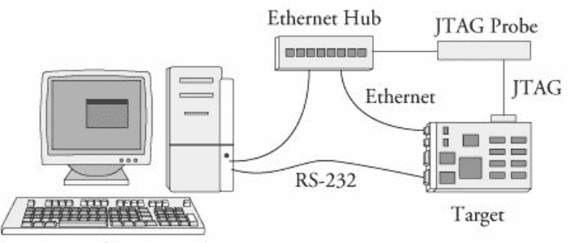

JTAG 探针的设置可能比较复杂。这直接源于其所连接 CPU 的复杂性。当目标板通电、CPU 退出复位状态时，几乎什么都没有初始化。实际上，许多处理器在执行任何操作之前至少需要进行少量初始化。将这一初始配置写入 CPU 的方法有很多种。有些 CPU 读取硬件配置字或特定引脚的初始值来了解其上电配置。其他的则依赖从简单的非易失性存储设备（如 Flash）中的默认位置读取数据。使用 JTAG 探针时，特别是在启动一个新的板卡设计时，必须首先完成最低限度的 CPU 和板卡初始化，然后才能进行其他操作。许多 JTAG 探针依赖配置文件来完成这一初始化。

Abatron 设备使用配置文件来初始化其连接的目标硬件，以及定义调试器的其他操作参数。该配置文件包含用于初始化 CPU、内存系统和其他必要板级硬件的指令。开发者有责任使用适合自己板卡的正确指令来定制这个配置文件。有关配置命令语法的详细信息，请参阅 JTAG 探针的文档。然而，只有嵌入式开发者才能创建特定板卡设计所需的独特配置文件。这需要对 CPU 和板级设计特性有详细的了解。就像为全新板卡创建自定义 Linux 移植一样，这项任务没有捷径或替代方案。

[附录 E](https://example.com)，"BDI-2000 配置文件示例"，包含了一个基于飞思卡尔半导体 MPC5200 嵌入式控制器的定制板卡的 Abatron 配置文件示例。在该附录中，你可以看到定制板卡的必要设置。注意其中大量使用注释来描述各种寄存器和初始化细节。这使得配置文件更容易随着时间的推移进行更新和维护，并且可以帮助你第一次就配置正确。

硬件探针通常有两种使用方式。大多数探针都提供某种用户界面，使开发者能够使用探针的功能。例如，编程 Flash 或下载二进制映像。第二种用法是作为 `gdb` 或其他源代码级调试器的前端。我们将演示这两种使用场景。

### 14.4.1. 使用 JTAG 探针编程 Flash

许多硬件探针都具备对多种 Flash 存储芯片进行编程的能力。Abatron BDI-2000 也不例外。BDI-2000 配置文件包含一个 `[FLASH]` 部分，用于定义目标 Flash 的特性。示例请参阅 [附录 F](https://example.com)。`[FLASH]` 部分定义了特定设计中使用的 Flash 芯片的属性，如芯片类型、设备大小及其数据总线宽度。还定义了在内存中的位置，以及描述芯片存储组织结构的某种方式。

在更新 Flash 的某一部分时，你通常希望保留同一 Flash 其他部分的内容。在这种情况下，你的硬件探针必须具有某种方式来限制要擦除的扇区。对于 Abatron 设备，这是通过为每个要擦除的扇区添加一行以关键字 `ERASE` 开头的行来实现的。当通过 `telnet` 用户界面向 Abatron 设备发出 `erase` 命令时，所有使用 `ERASE` 规范定义的扇区都会被擦除。[清单 14-20](https://example.com) 演示了擦除目标板上部分 Flash 并随后编程新的 U-Boot 引导加载程序映像的过程。

#### 清单 14-20. 擦除和编程 Flash


telnet bdi
Trying 192.168.1.129...
Connected to bdi (192.168.1.129).
Escape character is '^]'.
BDI Debugger for Embedded PowerPC
========================================
...   (大量帮助文本)

uei> **erase**
Erasing flash at 0xfff00000
Erasing flash at 0xfff10000
Erasing flash at 0xfff20000
Erasing flash at 0xfff30000
Erasing flash at 0xfff40000
Erasing flash passed
uei> **prog 0xfff00000 u-boot.bin BIN**
Programming u-boot.bin , please wait ....
Programming flash passed
uei>

首先我们建立与 Abatron BDI-2000 的 `telnet` 会话。经过一些初始化后，我们进入命令提示符界面。执行 `erase` 命令时，Abatron 会为配置文件中定义的每个区域显示一行输出。根据附录 E 中所示的配置，我们定义了五个擦除扇区。这为 U-Boot 引导加载程序二进制文件预留了最多 256KB 的空间。

`prog` 命令展示了其全部三个可选参数。这些参数指定了要加载新镜像的内存位置、镜像文件名以及文件格式——在本例中为二进制文件。您也可以在 BDI-2000 配置文件中指定这些参数。在这种情况下，命令就简化为不带参数的 `prog`。

这个示例只是浅尝辄止地介绍了这两条 BDI-2000 命令。实际上还支持更多种用法和功能组合。每个硬件 JTAG 探针都有自己指定 Flash 擦除和编程功能的方式。有关具体细节，请参阅您所使用设备的文档。

### 14.4.2. 使用 JTAG 探针进行调试

许多 JTAG 探针无需通过其用户界面直接交互，而是可以与您的源代码级调试器进行交互。硬件探针支持的最流行的调试器是 `gdb` 调试器。在这种使用场景中，`gdb` 被指示通过外部连接（通常是以太网连接）与目标设备开始调试会话。调试器不再通过用户界面与 JTAG 探针直接通信，而是在自身与 JTAG 探针之间来回传递命令。在这种模式下，JTAG 探针使用 `gdb` 远程协议代表调试器控制硬件。有关连接细节，请再次参考图 14-6。

JTAG 探针对于引导加载程序和早期启动代码的源代码级调试特别有用。在本示例中，我们演示如何在 PowerPC 目标板上使用 `gdb` 和 Abatron BDI-2000 来调试 U-Boot 引导加载程序的部分内容。

许多处理器包含调试寄存器，这些寄存器具备设置传统地址断点（当程序到达特定地址时停止）以及数据断点（在条件访问指定内存地址时停止）的能力。当调试驻留在只读内存（如 Flash）中的代码时，这是设置断点的唯一方法。然而，这些寄存器通常是有限的。许多处理器只包含一到两个这样的寄存器。在使用硬件断点之前，必须了解这一限制。以下示例演示了这一点。

使用如图 14-6 所示的设置，假设我们的目标板在 Flash 中存储了 U-Boot。在第 7 章中介绍引导加载程序时，您了解到 U-Boot 和其他引导加载程序通常在启动后尽快将自己复制到 RAM 中。这是因为从 RAM 进行硬件读取（和写入）的速度比 Flash 等典型只读内存设备快几个数量级。这带来了两个具体的调试挑战。首先，我们无法修改只读内存的内容（以插入软件断点），因此必须依靠处理器支持的断点寄存器来实现此目的。

第二个挑战来自于 ELF 可执行文件（gdb 从中读取其符号调试信息）只能表示两个执行上下文（Flash 或 RAM）之一。就 U-Boot 而言，它是为最初存储它的 Flash 环境链接的。早期代码会重新定位自身并执行任何必要的地址调整。这意味着我们需要在这两种执行上下文中使用 gdb。清单 14-21 展示了此类调试会话的示例。

#### 清单 14-21. 使用 JTAG 探针调试 U-Boot

```
$ ppc-linux-gdb --silent u-boot
(gdb) target remote bdi:2001
Remote debugging using bdi:2001
_start () at /home/chris/sandbox/u-boot-1.1.4/cpu/mpc5xxx/start.S:91
91        li      r21, BOOTFLAG_COLD   /* Normal Power-On */
Current language:  auto; currently asm

<< 调试驻留于 flash 中的代码片段 >>
(gdb) mon break hard
(gdb) b board_init_f
Breakpoint 1 at 0xffff0457c: file board.c, line 366.
(gdb) c
Continuing.

Breakpoint 1, board_init_f (bootflag=0x7fc3afc) at board.c:366
366       gd = (gd_t *) (CFG_INIT_RAM_ADDR + CFG_GBL_DATA_OFFSET);
Current language:  auto; currently c
(gdb) bt
#0  board_init_f (bootflag=0x1) at board.c:366
#1  0xffff0456c in board_init_f (bootflag=0x1) at board.c:353
(gdb) i frame
Stack level 0, frame at 0xf000bf50:
 pc = 0xffff0457c in board_init_f (board.c:366); saved pc 0xffff0456c
 called by frame at 0xf000bf78
 source language c.
Arglist at 0xf000bf50, args: bootflag=0x1
Locals at 0xf000bf50, Previous frame's sp is 0x0

<< 现在调试重定位后驻留于内存中的代码片段 >>
(gdb) del 1
(gdb) symbol-file
Discard symbol table from '/home/chris/sandbox/u-boot-1.1.4-powerdna/u-boot'?
(y or n) y
No symbol file now.
(gdb) add-symbol-file u-boot 0x7fa8000
add symbol table from file "u-boot" at
    .text_addr = 0x7fa8000
(y or n) y
Reading symbols from u-boot...done.
(gdb) b board_init_r
Breakpoint 2 at 0x7fac6c0: file board.c, line 608.
(gdb) c
Continuing.
Breakpoint 2, board_init_r (id=0x7f85f84, dest_addr=0x7f85f84) at board.c:608
608             gd = id;        /* initialize RAM version of global data */
(gdb) i frame
Stack level 0, frame at 0x7f85f38:
pc = 0x7fac6c0 in board_init_r (board.c:608); saved pc 0x7fac6b0
called by frame at 0x7f85f68
source language c.
Arglist at 0x7f85f38, args: id=0x7f85f84, dest_addr=0x7f85f84
Locals at 0x7f85f38, Previous frame's sp is 0x0
(gdb) mon break soft
(gdb)
```

仔细研究这个示例。有些细微之处绝对值得花时间理解。

首先，我们使用 `target remote` 命令连接到 Abatron BDI-2000。这里的 IP 地址是 Abatron 设备的地址，用符号名称 `bdi` 表示。[10] Abatron BDI-2000 使用 2001 端口进行远程 `gdb` 协议连接。

[10] 主机系统的 `/etc/hosts` 文件中的条目启用了符号 IP 地址引用。

接下来，我们使用 `gdb mon` 命令向 BDI-2000 发出指令。`mon` 命令告诉 `gdb` 将其余命令直接传递给远程硬件设备。因此，`mon break hard` 将 BDI-2000 设置为硬件断点模式。

然后，我们在 `board_init_f` 处设置一个硬件断点。这是一个仍在 Flash 内存中运行时执行的例程，位于地址 `0xfff0457c`。定义断点后，我们发出继续执行的 `c` 命令。随即，在 `board_init_f` 处遇到断点，我们可以自由地进行常规调试活动，包括单步执行代码和检查数据。您可以看到我们已发出 `bt` 命令来检查堆栈回溯，以及 `i frame` 命令来检查当前堆栈帧的详细信息。

现在我们再次继续执行，但这次我们知道 U-Boot 会将自己复制到 RAM 并从 RAM 中的副本恢复执行。因此，我们需要在保持调试会话活跃的同时更改调试上下文。为此，我们丢弃当前符号表（不带参数的 `symbol-file` 命令），然后使用 `add-symbol-file` 命令再次加载相同的符号文件。这一次，我们指示 `gdb` 偏移符号表以匹配 U-Boot 重新定位到内存中的位置。这确保了我们的源代码和符号调试信息与实际的内存驻留镜像相匹配。

加载新符号表后，我们可以向一个已知在执行时将驻留在 RAM 中的位置添加断点。这里就暴露出了一个微妙的复杂问题。因为我们知道 U-Boot 当前正在 Flash 中运行，但即将移动自身到 RAM 并跳转到其基于 RAM 的副本，所以我们仍然必须使用硬件断点。考虑一下此时如果使用软件断点会发生什么。`gdb` 尽职地将断点操作码写入指定的内存位置，但 U-Boot 在将自己复制到 RAM 时会覆盖它。最终结果是断点永远不会命中，我们开始怀疑我们的工具坏了。在 U-Boot 进入 RAM 副本并且我们的符号表已更新以反映基于 RAM 的地址之后，我们就可以自由使用基于 RAM 的断点了。清单 14-21 中的最后一个命令将 Abatron 装置设置回软断点模式，反映了这一点。

为什么我们要在意使用硬件断点还是软件断点呢？如果我们有无限的硬件断点寄存器，我们就不必在意了。但情况从来都不是这样。以下是调试会话期间用完处理器支持的硬件断点寄存器时的情形：

```
(gdb) **b** `flash_init`
Breakpoint 3 at 0x7fbebe0: file flash.c, line 70.
(gdb) **c**
Continuing.
warning: Cannot insert breakpoint 3:
Error accessing memory address 0x7fbebe0: Unknown error 4294967295.
```

因为我们是远程调试，所以在输入额外断点后尝试恢复执行时才会被告知资源约束。这是因为 `gdb` 处理断点的方式所致。当命中断点时，`gdb` 会用该特定内存位置的原始操作码恢复所有断点。当它恢复执行时，会在指定位置恢复断点操作码。您可以通过启用 `gdb` 的远程农业部调试模式来观察这种行为：

```
(gdb) **set** `debug remote 1`
```


## 14.5. 无法启动时

在各种嵌入式 Linux 邮件列表中，最常被问到的问题之一大致如下：

*我试图在我的开发板上启动 Linux，但在控制台打印出以下消息后卡住了：*

"Uncompressing Kernel Image . . . OK."

这就是嵌入式 Linux 漫长而有时令人沮丧的学习曲线的起点！很多可能出错的地方都会导致这种常见的启动失败。如果具备一定的知识，再加上 JTAG 调试器，我们就有办法确定到底是哪里出了问题。

### 14.5.1. 早期串口调试输出

你可能拥有的第一个工具是 `CONFIG_SERIAL_TEXT_DEBUG`。这个 Linux 内核配置选项在启动过程的非常早的阶段就加入了对调试消息的支持。目前，该功能仅限于 PowerPC 架构，但你完全可以将这一功能移植到其他架构中。[清单 14-22] 展示了这一功能在 PowerPC 目标板上使用 U-Boot 引导加载程序时的示例。

#### 清单 14-22. 早期串口文本调试

```
#### Booting image at 00200000 ...
   Image Name:   Linux-2.6.14
   Created:      2005-12-19  22:24:03 UTC
   Image Type:   PowerPC Linux Kernel Image (gzip compressed)
   Data Size:    607149 Bytes = 592.9 kB
   Load Address: 00000000
   Entry Point:  00000000
   Verifying Checksum ... OK
   Uncompressing Kernel Image ... OK
id mach(): done       <=> 由 CONFIG_SERIAL_TEXT_DEBUG 启用的
MMU:enter             <=> 消息开始
MMU:hw init
MMU:mapin
MMU:setio
MMU:exit
setup_arch: enter
setup_arch: bootmem
arch: exit
arch: real exit
```

使用这一功能，你通常能够判断开发板在启动过程中卡在了哪里。当然，你也可以在内核的其他地方添加自己的早期调试消息。以下是其在 `.../arch/ppc/mm/init.c` 中的使用示例：

```
/* Map in all of RAM starting at KERNELBASE */
if (ppc_md.progress)
    ppc_md.progress("MMU:mapin", 0x301);
mapin_ram();
```

AMCC Yosemite 平台是这一基础设施的优秀示例。请参阅 Linux 源代码树中的以下文件[11]，以了解该调试系统的实现细节：

> [11] 所有这些文件名都是唯一的，因此无需完整路径名即可找到它们。

| 文件 | 函数 | 用途 |
|---|---|---|
| gen550_dbg.c | gen550_init | 串口初始化，由 yosemite.c 平台初始化文件调用 |
| gen550_dbg.c | gen550_progress | 底层串口输出例程 |
| ibm44x_common.c | ibm44x_platform_init | 将平台特定的进度汇报函数绑定到通用的 ppc 机器相关基础设施 |

### 14.5.2. 转储 printk 日志缓冲区

我们在 14.3.6 节讨论 printk 调试时，指出了这种方法的一些局限性。printk 本身的实现非常健壮。它的缺点之一是在启动序列中，只有等到控制台设备初始化完成后才能看到任何 printk 消息。很多时候，当开发板在启动过程中卡死时，已有相当多的消息滞留在 printk 缓冲区中。如果你知道到哪里去找这些消息，通常就能精确定位导致启动挂起的具体问题。事实上，很多时候你会发现内核遇到了某个错误，进而调用了 panic()。panic() 的输出很可能已经被转储到了 printk 缓冲区中，而你通常能够精确定位到具体出错的代码行。

最佳方法是使用 JTAG 调试器来完成，但也可以通过引导加载程序及其内存转储功能，在复位后显示 printk 缓冲区的内容。由于复位可能会导致部分内存内容损坏，但日志缓冲区中的文本通常仍然清晰可读。

printk 存储消息文本的实际缓冲区在 printk 源文件 `.../kernel/printk.c` 中声明。

```
static char __log_buf[__LOG_BUF_LEN];
```

我们可以从 Linux 内核映射文件 System.map 中轻松确定该缓冲区的链接地址。

```
$ grep __log_buf System.map
c022e54a b __log_buf
```

如果系统在启动时恰好卡死，正好在显示 "Uncompressing Kernel Image . . . OK" 消息之后，请重新启动并使用引导加载程序来检查该缓冲区。由于在给定架构上，内核虚拟内存与物理内存之间的关系是固定且恒定的，我们可以进行简单的转换。前面所示的 `__log_buf` 地址是一个内核虚拟地址；我们必须将其转换为物理地址。在这个特定的 PowerPC 架构上，这一转换只需减去常量 `KERNELBASE` 地址 `0xc0000000`。这就是我们在内存中探测以读取 `printk` 日志缓冲区内容（如果有的话）的位置。

[清单 14-23] 是 U-Boot 内存转储命令显示的列表示例。

#### 清单 14-23. 原始 `printk` 日志缓冲区转储

```
=> md 22e5a4
0022e5a4: 3c353e4c 696e7578 20766572 73696f6e   <5>Linux version
0022e5b4: 20322e36 2e313332 28636872 6973406a   2.6.13 (chris@j
0022e5c4: 756e696f 72292028 67636320 76657273   unior) (gcc vers
0022e5d4: 696f6e20 332e342e 3320284d 6f6e7461   ion 3.4.3 (Monta
0022e5e4: 56697374 6120332e 342e332d 32352e30   Vista 3.4.3-25.0
0022e5f4: 2e37302e 30353031 39363120 32303035   .70.0501961 2005
0022e604: 2d31322d 31382929 20233131 20547565   -12-18)) #11 Tue
0022e614: 20466562 20313420 32313a30 353a3036   Feb 14 21:05:06
0022e624: 20455354 20323030 362e3c34 3e414d43   EST 2006.<4>AMC
0022e634: 4320506f 77657250 43203434 30455020   C PowerPC 440EP
0022e644: 596f7365 6d697465 20506c61 74666f72   Yosemite Platafor
0022e654: 6d2e3c37 3e4f6e20 6e6f6465 20302074   m.<7>On node 0 t
0022e664: 6f74616c 70616765 733a2036 35353336   otalpages: 65536
0022e674: 0a3c373e 2020444d 41207a6f 6e653a20   .<7>  DMA zone: 
0022e684: 36353533 36207061 6765732c 204c4946   65536 pages, LIF
0022e694: 4f206261 7463683a 33312e3c 373e2020   O batch:31.<7>  
0022e6a4: 4e6f726d 616c207a 6f6e653a 20302070   Normal zone: 0 p
0022e6b4: 61676573 2c204c49 464f2062 61746368   ages, LIFO batch
0022e6c4: 3a312e3c 373e2020 48696768 4d656d7a   :1.<7>  HighMemz
0022e6d4: 7a207a20 3a303020 30303030 30323034   one:  0 pages, 0
0022e6e4: 4c49464f 20626174 63683a31 2e3c343e   LIFO batch:1.<4>
0022e6f4: 4275696c 74203120 7a6f6e65 6c697374   Built 1 zonelist
0022e704: 73203c35 3e4b6572 6e656c20 636f6d6d   s <5>Kernel comm
0022e714: 616e6420 6c696e65 3a20636f 6e736f6c   and line: consul
0022e724: 653d7474 79533332c 31313532 3020726f   e=ttyS0,115200 r
0022e734: 6f743d2f 6465762f 6e667320 72772069   ot=/dev/nfs rw i
0022e744: 703d6468 63702e3c 343e5049 44206861   p=dhcp.<4>PID h
0022e754: 61736820 7461626c 6520656e 74726965   ash table entrie
0022e764: 73203a20 32303438 20286f72 6465723a   s : 2048 (order:
0022e774: 2031312c 20333237 36382062 79746573    11, 32768 bytes
0022e784: 292e0a00 00000000 00000000 00000000   ).\n...............
0022e794: 00000000 00000000 00000000 00000000   .................
```

读起来不太美观，但数据确实在那里。在这个特定的例子中，我们可以看到内核在初始化 PID 哈希表项之后的某个地方崩溃了。通过额外使用一些 `printk` 消息，我们可以开始逐步接近崩溃的实际源头。

如本例所示，这是一种无需额外工具即可使用的技巧。如果你正在进行新板卡移植，就能看到在启动过程中某种早期串口输出的重要性。

### 14.5.3. 崩溃时的 KGDB

如果启用了 KGDB，内核在发生错误异常时会尝试将控制权交回给 KGDB。在某些情况下，错误本身会非常明显。要使用这一功能，必须事先在 KGDB 和 `gdb` 之间建立连接。当异常条件发生时，KGDB 会向 `gdb` 发送一个 Stop Reply 数据包，指示进入调试处理程序的原因，以及陷阱条件发生的地址。[清单 14-24] 展示了这一序列。

#### 清单 14-24. 使用 KGDB 捕获崩溃时的陷阱

```
$ ppc-4xx-gdb --silent vmlinux
(gdb) target remote /dev/ttyS0
Remote debugging using /dev/ttyS0
Malformed response to offset query, qOffsets
(gdb) target remote /dev/ttyS0
Remote debugging using /dev/ttyS0
breakinst () at arch/ppc/kernel/ppc-stub.c:825
825     }
(gdb) c
Continuing.
<< KGDB 在崩溃时从 panic() 接管控制 >>
Program received signal SIGSEGV, Segmentation fault.
0xc0215d6c in pcibios_init () at arch/ppc/kernel/pci.c:1263
1263        *(int *)-1 = 0;
(gdb) bt
#0  0xc0215d6c in pcibios_init () at arch/ppc/kernel/pci.c:1263
#1  0xc020e728 in do_initcalls () at init/main.c:563
#2  0xc020e7c4 in do_basic_setup () at init/main.c:605
#3  0xc0001374 in init (unused=0x20) at init/main.c:677
#4  0xc00049d0 in kernel_thread ()
Previous frame inner to this frame (corrupt stack?)
(gdb)
```

本例中的崩溃是通过向无效内存地址（全为 1）进行简单写入而人为制造的。我们首先从 `gdb` 建立与 KGDB 的连接，并允许内核继续启动。注意，我们甚至都没有费心设置断点。当崩溃发生时，我们看到了导致问题的代码行，并得到了一个良好的回溯追踪来帮助我们确定崩溃原因。


## 14.6. 本章小结

- Linux 内核调试存在诸多复杂性，尤其是在交叉开发环境中。理解如何应对这些复杂性是成功进行内核调试的关键。
- KGDB 是一个非常有用的内核级 `gdb` stub，它能够在 Linux 内核和设备驱动程序中直接进行符号源代码级调试。它使用 `gdb` 远程协议与主机上的交叉 `gdb` 进行通信。
- 理解（并最小化）编译器优化有助于解释在单步执行编译器优化代码时看似奇怪的调试器行为。
- `gdb` 支持用户自定义命令，这对于自动化繁琐的调试任务（如遍历内核链表和访问复杂变量）非常有用。
- 内核可加载模块给源代码级调试带来了特有的挑战。通过在 `module.c` 中对 `module->init()` 的调用处设置断点，可以调试模块的初始化例程。
- `printk` 和 Magic SysReq 键提供了额外的工具，帮助在内核开发和调试过程中隔离问题。
- 通过 JTAG 探针进行硬件辅助调试，可以调试驻留在 Flash 或 ROM 中的代码，而其他调试方法在这些情况下可能繁琐或根本无法实现。
- 在支持此功能的架构上启用 `CONFIG_SERIAL_TEXT_DEBUG` 是调试新内核移植的强大工具。
- 检查 `printk` 的 `log_buf` 通常能找到启动时内核静默崩溃的原因。
- `KGDB` 在内核 panic 时将控制权交给 `gdb`，使您能够检查回溯并隔离内核 panic 的原因。

### 14.6.1. 补充阅读建议

*Linux Kernel Development*，第 2 版
Robert Love
Novell Press，2005

*The Linux Kernel Primer*
Claudia Salzberg Rodriguez 等
Prentice Hall，2005

"Using the GNU Compiler Collection"
Richard M. Stallman 和 GCC 开发者社区
GNU Press，Free Software Foundation 的一个部门
<http://gcc.gnu.org/onlinedocs/>

KGDB Sourceforge 主页
<http://sourceforge.net/projects/KGDB>

Debugging with GDB
Richard Stallman、Roland Pesch、Stan Shebs 等
Free Software Foundation
<http://www.gnu.org/software/gdb/documentation/>

Tool Interface Standards
DWARF Debugging Information Format Specification
Version 2.0
TIS Committee，1995 年 5 月

# 第 15 章 调试嵌入式 Linux 应用程序

## 本章内容

- 目标调试 第 400 页
- 远程（交叉）调试 第 400 页
- 使用共享库调试 第 405 页
- 调试多任务 第 411 页
- 其他远程调试选项 第 417 页
- 本章小结 第 419 页

在上一章中，我们探讨了使用 GDB 调试内核代码和驻留在 Flash 中的代码（如引导加载程序代码）。在本章中，我们继续介绍使用 GDB 调试用户空间应用程序代码。我们将扩展对远程调试以及用于这种特殊调试环境的工具和技术的覆盖。

## 15.1. 目标调试

我们已经在[第 13 章](Chapter%2013)"开发工具"中探讨了几个重要的调试工具。`strace` 和 `ltrace` 可用于观察和描述进程的行为，并经常能隔离问题。`dmalloc` 可以帮助隔离内存泄漏和分析内存使用情况。`ps` 和 `top` 都可用于检查进程的状态。这些相对较小的工具设计为直接在目标硬件上运行。

在嵌入式系统上调试 Linux 应用程序代码有其独特的挑战。嵌入式目标上的资源通常有限。RAM 和非易失性存储的限制可能会阻止您运行基于目标的开发工具。您可能没有以太网端口或其他高速连接。您的目标嵌入式系统可能没有图形显示器、键盘或鼠标。

这就是您的交叉开发工具和 NFS 根挂载环境可以带来巨大回报的地方。许多工具，尤其是 GDB，已经被设计为在开发主机上执行，同时实际在远程目标上调试代码。GDB 可用于交互式调试目标代码，或对应用程序崩溃生成的核心文件进行事后分析。我们在[第 13 章](Chapter%2013)中介绍了应用程序核心转储分析的详细信息。

## 15.2. 远程（交叉）调试

交叉开发工具的开发主要是为了克服嵌入式平台的资源限制。一个中等规模的应用程序编译后包含符号调试信息，很容易超过几兆字节。使用交叉调试，繁重的工作可以在开发主机上完成。在开发主机上调用交叉版本的 GDB 时，您向它传递一个包含符号调试信息的 ELF 文件。在目标上，您完全可以剥离 [1] ELF 文件中所有不必要的调试信息，以使生成的镜像保持最小大小。

[1] 记住使用您的交叉版本的 strip，例如 ppc_82xx-strip。

我们在第 13 章介绍了 `readelf` 工具。在第 14 章"内核调试技术"中，我们使用它来检查编译了符号调试信息的 ELF 文件中的调试信息。清单 15-1 包含了一个为 ARM 架构编译的相对较小的 Web 服务器应用程序的 `readelf` 输出。

### 清单 15-1. 示例程序的 ELF 文件调试信息

```
$ xscale_be-readelf -S websdemo
There are 39 section headers, starting at offset 0x3dfd0:

Section Headers:
 [Nr] Name              Type       Addr     Off    Size   ES Flg Lk Inf Al
 [ 0]                   NULL       00000000 000000 000000 00      0   0  0
 [ 1] .interp            PROGBITS   00008154 000154 000013 00   A  0   0  1
 [ 2] .note.ABI-tag      NOTE       00008168 000168 000020 00   A  0   0  4
 [ 3] .note.numapolicy   NOTE       00008188 000188 000074 00   A  0   0  4
 [ 4] .hash              HASH       000081fc 0001fc 00022c 04   A  5   0  4
 [ 5] .dynsym            DYNSYM     00008428 000428 000460 10   A  6   1  4
 [ 6] .dynstr            STRTAB     00008888 000888 000211 00   A  0   0  1
 [ 7] .gnu.version       VERSYM     00008a9a 000a9a 00008c 02   A  5   0  2
 [ 8] .gnu.version_r     VERNEED    00008b28 000b28 000020 00   A  6   1  4
 [ 9] .rel.plt           REL        00008b48 000b48 000218 08   A  5  11  4
[10] .init              PROGBITS   00008d60 000d60 000018 00  AX  0   0  4
[11] .plt               PROGBITS   00008d78 000d78 000338 04  AX  0   0  4
[12] .text              PROGBITS   000090b0 0010b0 019fe4 00  AX  0   0  4
[13] .fini              PROGBITS   00023094 01b094 000018 00  AX  0   0  4
[14] .rodata            PROGBITS   000230b0 01b0b0 0023d0 00   A  0   0  8
[15] .ARM.extab         PROGBITS   00025480 01d480 000000 00   A  0   0  1
[16] .ARM.exidx         ARM_EXIDX  00025480 01d480 000008 00  AL 12   0  4
[17] .eh_frame_hdr      PROGBITS   00025488 01d488 00002c 00   A  0   0  4
[18] .eh_frame          PROGBITS   000254b4 01d4b4 00007c 00   A  0   0  4
[19] .init_array        INIT_ARRAY 0002d530 01d530 000004 00  WA  0   0  4
[20] .fini_array        FINI_ARRAY 0002d534 01d534 000004 00  WA  0   0  4
[21] .jcr               PROGBITS   0002d538 01d538 000004 00  WA  0   0  4
[22] .dynamic           DYNAMIC    0002d53c 01d53c 0000d0 08  WA  6   0  4
[23] .got               PROGBITS   0002d60c 01d60c 000118 04  WA  0   0  4
[24] .data              PROGBITS   0002d728 01d728 0003c0 00  WA  0   0  8
[25] .bss               NOBITS     0002dae8 01dae8 0001c8 00  WA  0   0  4
[26] .comment           PROGBITS   00000000 01dae8 000940 00     0   0  1
[27] .debug_aranges     PROGBITS   00000000 01e428 0004a0 00     0   0  8
[28] .debug_pubnames    PROGBITS   00000000 01e8c8 001aae 00     0   0  1
[29] .debug_info        PROGBITS   00000000 020376 013d27 00     0   0  1
[30] .debug_abbrev      PROGBITS   00000000 03409d 002ede 00     0   0  1
[31] .debug_line        PROGBITS   00000000 036f7b 0034a2 00     0   0  1
[32] .debug_frame       PROGBITS   00000000 03a420 003380 00     0   0  4
[33] .debug_str         PROGBITS   00000000 03d7a0 000679 00     0   0  1
[34] .note.gnu.arm-id   NOTE       00000000 03de19 00001c 00     0   0  1
[35] .debug_ranges      PROGBITS   00000000 03de35 000018 00     0   0  1
[36] .shstrtab          STRTAB     00000000 03de4d 000183 00     0   0  1
[37] .symtab            SYMTAB     00000000 03e5e8 004bd0 10    38 773  4
[38] .strtab            STRTAB     00000000 0431b8 0021bf 00     0   0  1
Key to Flags:
W (write), A (alloc), X (execute), M (merge), S (strings)
I (info), L (link order), G (group), x (unknown)
O (extra OS processing required) o (OS specific), p (processor specific)
$
```

从[清单 15-1](Listing%2015-1)可以看出，有许多包含调试信息的节。还有一个 .comment 节，包含超过 2KB（0x940）的信息，这些信息对应用程序的运行并非必要。这个示例文件包含调试信息的大小超过 275KB。

```
$ ls -l websdemo
-rwxrwxr-x 1 chris chris 283511 Nov  8 18:48 websdemo
```

如果我们使用 `strip` 工具剥离此文件，可以最小化其大小以节省目标系统上的资源。[清单 15-2](Listing%2015-2)显示了结果。

### 清单 15-2. 剥离目标应用程序

```
$ xscale_be-strip -s -R .comment -o websdemo-stripped websdemo
$ ls -l websdemo*
-rwxrwxr-x 1 chris chris 283491 Apr  9 09:19 websdemo
-rwxrwxr-x 1 chris chris 123156 Apr  9 09:21 websdemo-stripped
$
```

这里我们从可执行文件中剥离了符号调试信息和 .comment 节。我们使用 `-o` 命令行开关指定剥离后二进制文件的名称。可以看到，剥离后的二进制文件大小不到原始大小的一半。当然，对于更大的应用程序，这种空间节省可能更加显著。一个最近编译的 Linux 内核，包含


调试信息大于18MB。经过如[清单15-2](Listing 15-2)所示的剥离处理后，生成的二进制文件仅略大于2MB！

采用这种方式调试时，你需要将剥离后的二进制文件部署到目标系统，同时在开发工作站上保留一份包含调试所需符号信息的本地未剥离副本。你可以在目标板上使用`gdbserver`，它提供一个接口连接回开发主机，而你则在开发主机上运行针对未剥离二进制文件的完整版GDB。

### 15.2.1. gdbserver

使用`gdbserver`允许你在开发工作站上运行GDB，而不是在目标嵌入式Linux平台上运行。这种配置有明显的好处。首先，通常开发工作站的CPU处理能力、内存和硬盘存储空间远超嵌入式平台。此外，通常被调试应用程序的源代码存在于开发工作站上，而非嵌入式平台。

`gdbserver`是一个运行在目标板上的小程序，允许对板上的进程进行远程调试。它在目标板上被调用时，需要指定要调试的程序，以及一个IP地址和端口号，用于监听来自GDB的连接请求。[清单15-3](Listing 15-3)展示了在目标板上的启动序列。

#### 清单15-3. 在目标板上启动gdbserver

```
$ gdbserver localhost:2001 websdemo-stripped
Process websdemo-stripped created; pid = 197
Listening on port 2001
```

这个特定示例启动了`gdbserver`，配置为监听2001端口的以太网TCP/IP连接，准备调试我们名为`websdemo-stripped`的剥离后的二进制程序。

从我们的开发工作站上，我们启动GDB，并将包含我们想要调试的符号调试信息的二进制可执行文件名称作为参数传递给它。GDB启动后，我们发出一个命令连接到远程目标板。[清单15-4](Listing 15-4)展示了这个序列。

#### 清单15-4. 启动远程GDB会话

```
$ xscale_be-gdb -q websdemo
(gdb) target remote 192.168.1.141:2001
Remote debugging using 192.168.1.141:2001
0x40000790 in ?? ()
(gdb) p main       <<<< 显示main函数的地址
$1 = {int (int, char **)} 0x12b68 <main>
(gdb) b main       <<<< 在main()处设置断点
Breakpoint 1 at 0x12b80: file main.c, line 72.
(gdb)
```

清单15-4中的序列在你的开发主机上调用了交叉GDB。当GDB运行时，我们发出`gdb target remote`命令。这个命令导致GDB从你的开发工作站到目标板发起一个TCP/IP连接，连接到指定的IP地址的2001端口。当gdbserver接受连接请求时，它会打印一行类似这样的信息：

```
Remote debugging from host 192.168.0.10
```

现在GDB已连接到目标板的gdbserver进程，准备接受GDB的命令。会话的其余部分与在本地调试应用程序完全相同。这是一个强大的工具，允许你利用开发工作站的力量进行调试会话，只在目标板上留下一个相对较小且不显眼的GDB存根和被调试的程序。如果你想知道，这个特定ARM目标的gdbserver只有54KB。

```
root@coyote:~# ls -l /usr/bin/gdbserver
-rwxr-xr-x  1 root root 54344 Jul 23  2005 /usr/bin/gdbserver
```

有一个注意事项，这也是许多邮件列表中一个常见问题（FAQ）的主题。你必须在开发主机上使用配置为交叉调试器的GDB。这是一个在开发工作站上运行，但能理解为其他架构编译的二进制可执行映像的二进制程序。这是一个重要且经常被忽视的事实。你不能使用原生GDB（例如典型Red Hat Linux安装中的GDB）来调试PowerPC目标。你必须拥有一个为你的主机和目标组合配置的GDB。

当GDB被调用时，它会显示一个由几行信息组成的横幅，然后显示其编译配置。清单15-5是本书一些示例中使用的GDB示例，它是MontaVista Software提供的嵌入式Linux发行版的一部分，配置为PowerPC交叉开发。

#### 清单15-5. 调用cross-gdb

```
$ ppc_82xx-gdb
GNU gdb 6.0 (MontaVista 6.0-8.0.4.0300532 2003-12-24)
Copyright 2003 Free Software Foundation, Inc.
GDB is free software, covered by the GNU General Public License, and
you are welcome to change it and/or distribute copies of it under
certain conditions.  Type "show copying" to see the conditions.
There is absolutely no warranty for GDB. Type "show warranty" for
details.
This GDB was configured as "--host=i686-pc-linux-gnu
--target=powerpc-hardhat-linux".
(gdb)
```

注意这个GDB启动消息的最后几行。这是编译到这个版本GDB中的配置。它被编译为在运行GNU/Linux的Pentium（i686）PC主机上执行，并调试为运行GNU/Linux的PowerPC处理器编译的二进制程序。这由横幅文本中显示的`--host`和`--target`变量指定，也是构建GDB时传递给`./configure`的配置字符串的一部分。

## 15.3. 使用共享库进行调试

现在你已经了解了如何使用主机上的GDB和目标板上的`gdbserver`来调用远程调试会话，我们接下来关注共享库和调试符号的复杂性。除非你的应用程序是静态链接的可执行文件（使用`-static`链接器命令行选项链接），否则你应用程序中的许多符号将引用应用程序外部的代码。明显的例子包括使用标准C库例程，如`fopen`、`printf`、`malloc`和`memcpy`。不太明显的例子可能包括调用特定于应用程序的函数，例如`jack_transport_locate()`（来自JACK低延迟音频服务器的例程），它调用标准C库之外的库函数。

要使这些例程的符号可用，你必须满足GDB的两个要求：

-   你必须拥有这些库的调试版本。
-   GDB必须知道在哪里可以找到它们。

如果你没有调试版本的库可用，你仍然可以调试你的应用程序；只是你将无法获得应用程序调用的库例程的任何调试信息。通常这是完全可接受的，除非，当然，你正在作为嵌入式项目的一部分开发共享库对象。

回顾[清单15-4](#)，我们在远程目标上调用了GDB。在GDB通过`target remote`命令连接后，GDB发出两行响应：

```
Remote debugging using 192.168.1.141:2001
0x40000790 in ?? ()
```

这确认了GDB连接到了我们指定IP地址和端口的目标。然后GDB报告程序计数器的位置为0x40000790。为什么我们得到的是问号而不是符号位置？因为这是Linux动态加载器（`ld-x.y.z.so`），并且在这个特定平台上，我们没有这个共享库的调试符号可用。我们怎么知道这一点？

回忆我们在[第9章](#)“文件系统”中对`/proc`文件系统的介绍。一个更有用的条目是每个进程目录结构中的`maps`条目（参见[第9章](#)中的[清单9-16](#)）。从[清单15-3](#)中`gdbserver`的输出，我们知道目标应用程序的进程ID（PID）。我们的进程被分配了PID 197。给定这个信息，我们可以看到进程启动后使用的内存段，如[清单15-6](#)所示。

### 清单15-6. 初始目标内存段映射

```
root@coyote:~# cat /proc/197/maps
00008000-00026000 r-xp 00000000 00:0e 4852444    ./websdemo-stripped
0002d000-0002e000 rw-p 0001d000 00:0e 4852444    ./websdemo-stripped
40000000-40017000 r-xp 00000000 00:0a 4982583    /lib/ld-2.3.3.so
4001e000-40020000 rw-p 00016000 00:0a 4982583    /lib/ld-2.3.3.so
bedf9000-bee0e000 rwxp bedf9000 00:00 0          [stack]
root@coyote:~#
```

这里我们看到目标`websdemo-stripped`应用程序占据了两个内存段。第一个是在0x8000处的只读可执行段，第二个是在0x2d000处的读写数据段。第三个内存段是我们感兴趣的。它是Linux动态链接器的可执行代码段。注意它从地址0x40000000开始。如果我们进一步调查，可以确认GDB实际上位于动态链接器代码的第一行，在我们自己应用程序的任何代码执行之前。使用我们的交叉版本的`readelf`，我们可以确认链接器的起始地址如下：

```
# xscale_be-readelf -S ld-2.3.3.so | grep \.text
[ 9] .text PROGBITS 00000790 000790 012c6c 00 AX 0 0 16
```

根据这些数据，我们得出结论，GDB在启动时报告的地址是`ld-2.3.3.so`（Linux动态链接器/加载器）的第一条指令。如果你没有进程或共享库的符号调试信息，可以使用这种技术来粗略了解代码的位置。

请记住，我们是在开发主机上执行这个交叉`readelf`命令。因此，`ld-2.3.3.so`文件本身是一个XScale二进制对象，必须对你的开发主机可访问。最典型的情况是，这个文件位于你的开发主机上，是你安装在主机上的嵌入式Linux发行版的一个组件。

### 15.3.1. GDB中的共享库事件

GDB可以提醒你共享库事件。这对于理解你的应用程序的行为或Linux加载器的行为，或者在你想要调试或单步执行的共享库例程中设置断点很有用。[清单15-7](Listing 15-7)说明了这种技术。通常，会显示库的完整路径。此清单已编辑以提高可读性。

#### 清单15-7. 在共享库事件上停止GDB

当调试会话首次启动时，当然没有加载任何共享库。你可以通过第一个`i shared`命令查看。此命令会显示当前已加载的共享库。在我们应用程序的`main()`函数上设置断点后，我们可以看到现在加载了两个共享库。它们是Linux动态链接器/加载器和标准C库组件`libc`。

```
$ xscale_be-gdb -q websdemo
(gdb) target remote 192.168.1.141:2001
Remote debugging using 192.168.1.141:2001
0x40000790 in ?? ()
(gdb) i shared
No shared libraries loaded at this time.
(gdb) b main
Breakpoint 1 at 0x12b80: file main.c, line 72.
(gdb) c
Continuing.

Breakpoint 1, main (argc=0x1, argv=0xbec7fdc4) at main.c:72
72                    int localvar = 9;
(gdb) i shared
From                 To                   Syms Read   Shared Object Library
0x40033300           0x4010260c   Yes       /opt/mvl/.../lib/tls/libc.so.6
0x40000790           0x400133fc   Yes       /opt/mvl/.../lib/ld-linux.so.3
(gdb) set stop-on-solib-events 1
(gdb) c
Continuing.
Stopped due to shared library event
(gdb) i shared
From                 To                   Syms Read   Shared Object Library
0x40033300           0x4010260c   Yes       /opt/mvl/.../lib/tls/libc.so.6
0x40000790           0x400133fc   Yes       /opt/mvl/.../lib/ld-linux.so.3
0x4012bad8           0x40132104   Yes       /opt/mvl/.../libnss_files.so.2
(gdb)
```

在此处，我们发出`set stop-on-solib-event`命令并继续程序执行。当应用程序尝试执行另一个共享库中的函数时，该库会被加载。如果你好奇的话，这里遇到了`gethostbyname()`函数并导致了下一个共享对象的加载。

这个例子说明了一个重要的交叉开发概念。在目标设备上运行的二进制应用程序（ELF镜像）包含了它需要解析外部引用的库的信息。我们可以使用第11章“BusyBox”中介绍、并在第13章详细说明的`ldd`命令轻松查看此信息。清单15-8展示了在目标板上执行`ldd`的输出。

#### 清单15-8. 在目标板上执行的`ldd`

```
root@coyote:/workspace# ldd websdemo
	libc.so.6 => /lib/tls/libc.so.6 (0x40020000)
	/lib/ld-linux.so.3	(0x40000000)
root@coyote:/workspace#
```

请注意，目标设备上共享库的路径是以根文件系统的`/lib`开头的绝对路径。但是，运行在你的主机开发工作站上的GDB无法使用这些路径来查找库。你应该意识到，这样做会导致你的主机GDB加载错误架构的库。你的主机很可能是x86，而在本例中，目标设备是ARM XScale。

如果你调用交叉版本的`ldd`，你将看到预配置在你的工具链中的路径。你的工具链必须知道这些文件在你的主机开发系统上的位置。[2] 清单15-9说明了这一点。同样，我们为了可读性编辑了清单；长路径已被缩写。

> [2] 当然，也可以在每次调用时将这些位置传递给你的编译器、链接器和调试器，但任何良好的嵌入式Linux发行版都会将这些默认值配置到工具链中，以方便开发者。

#### 清单15-9. 在开发主机上执行的`ldd`

```
$ xscale_be-ldd   websdemo
	libc.so.6 => /opt/mvl/.../xscale_be/target/lib/libc.so.6 (0xdead1000)
	ld-linux.so.3 => /opt/mvl/.../xscale_be/target/lib/ld-linux.so.3 (0xdead2000)
$
```

你的交叉工具链应该预配置了这些库的位置。不仅你的主机GDB需要知道它们的位置，当然，你的编译器和链接器也需要这些知识。[3] GDB可以告诉你它配置在哪里查找这些库，使用`show solib-absolute-prefix`命令：

> [3] 当然，你的编译器也需要知道目标文件的位置，例如特定于架构的系统和库头文件。

```
(gdb) show solib-absolute-prefix
Prefix for loading absolute shared library symbol files is 
"/opt/mvl/pro/devkit/arm/xscale_be/target".
(gdb)
```

你可以使用GDB命令`set solib-absolute-prefix`和`set solib-search-path`来设置或更改GDB搜索共享库的位置。如果你正在开发自己的共享库模块或在你的系统上有自定义的库位置，你可以使用`solib-search-path`来指示GDB在哪里查找你的库。有关这些和其他GDB命令的更多详细信息，请参阅本章末尾引用的在线GDB手册[第15.6.1节](http://example.com/)，“补充阅读建议”。

关于`ldd`的最后一点说明。你可能已经注意到清单15-8和清单15-9中与库关联的地址。`ldd`显示的是这些代码段在程序由Linux动态链接器/加载器加载时的起始加载地址。在目标设备上执行时，清单15-5中的地址完全合理，我们可以将它们与目标设备上正在运行的进程的`/proc/<pid>/maps`列表关联起来。清单15-10显示了这个目标进程在完全加载并运行后的内存段。

#### 清单15-10. 目标设备上来自`/proc/<pid>/maps`的内存段

```
root@coyote:~# cat /proc/197/maps
00008000-00026000 r-xp 00000000 00:0e 4852444    /workspace/websdemo-stripped
0002d000-0002e000 rw-p 0001d000 00:0e 4852444    /workspace/websdemo-stripped
0002e000-0005e000 rwxp 0002e000 00:00 0          [heap]
40000000-40017000 r-xp 00000000 00:0a 4982583    /lib/ld-2.3.3.so
40017000-40019000 rw-p 40017000 00:00 0
4001e000-4001f000 r--p 00016000 00:0a 4982583    /lib/ld-2.3.3.so
4001f000-40020000 rw-p 00017000 00:0a 4982583    /lib/ld-2.3.3.so
40020000-4011d000 r-xp 00000000 00:0a 4982651    /lib/tls/libc-2.3.3.so
4011d000-40120000 ---p 000fd000 00:0a 4982651    /lib/tls/libc-2.3.3.so
40120000-40124000 rw-p 000f8000 00:0a 4982651    /lib/tls/libc-2.3.3.so
40124000-40126000 r--p 000fc000 00:0a 4982651    /lib/tls/libc-2.3.3.so
40126000-40128000 rw-p 000fe000 00:0a 4982651    /lib/tls/libc-2.3.3.so
40128000-4012a000 rw-p 40128000 00:00 0
4012a000-40133000 r-xp 00000000 00:0a 4982652    /lib/tls/libnss_files-2.3.3.so
40133000-4013a000 ---p 00009000 00:0a 4982652    /lib/tls/libnss_files-2.3.3.so
4013a000-4013b000 r--p 00008000 00:0a 4982652    /lib/tls/libnss_files-2.3.3.so
4013b000-4013c000 rw-p 00009000 00:0a 4982652    /lib/tls/libnss_files-2.3.3.so
becaa000-becbf000 rwxp becaa000 00:00 0          [stack]
root@coyote:~#
```

注意目标设备上`ldd`的输出（清单15-8）与该进程在/proc文件系统中显示的内存段之间的关联。Linux加载器的起始地址（`.text`段的开头）是`0x40000000`，`libc`的起始地址是`0x40020000`。这些是应用程序这些部分被加载的虚拟地址，并由目标设备上调用`ldd`报告。然而，清单15-9中交叉版本的`ldd`报告的加载地址（`0xdead1000`和`0xdead2000`）是为了提醒你，这些库无法在你的主机系统上加载（它们是ARM架构的二进制文件），这些加载地址只是占位符。

## 15.4. 调试多任务

通常，在处理多线程执行时，开发者会面临两种不同的调试场景。进程可以存在于自己的地址空间中，或者可以与其他执行线程共享一个地址空间（以及其他系统资源）。前者（不共享公共地址空间的独立进程）必须使用单独的独立调试会话进行调试。没有什么阻止你在目标系统上对多个进程使用`gdbserver`，并在你的开发主机上使用单独的GDB调用来协调多个协作但独立的进程的调试会话。

### 15.4.1. 调试多进程

当在GDB下调试的进程使用`fork()`系统调用[4]生成新进程时，GDB可以采取两种行动路线。它可以继续控制和调试父进程，或者它可以停止调试父进程并附加到新形成的子进程。你可以使用`set follow-fork-mode`命令来控制此行为。两种模式是`follow parent`（跟踪父进程）和`follow child`（跟踪子进程）。默认行为是GDB跟踪父进程。在这种情况下，子进程在成功fork后立即执行。

> [4] 我们将使用系统调用一词，但在此上下文中的`fork()`实际上是C库函数，它反过来调用Linux的`sys_fork()`系统调用。

清单15-11重现了一个简单程序的片段，该程序从其`main()`例程派生多个进程。

#### 清单15-11. 使用`fork()`生成子进程

```
...
for( i=0; i<MAX_PROCESSES; i++ ) {
    /* Creating child process */
    pid[i] = fork();                /* Parent gets non-zero PID */
    if ( pid[i] == -1 ) {
        perror("fork failed");
        exit(1);
    }
    if ( pid[i] == 0 ) {             /* Indicates child's code path */
        worker_process();            /* The forked process calls this */
    }
}

/* Parent's main control loop */
while ( 1 ) {
    ...
}
```


这个简单的循环使用 `fork()` 系统调用创建了 MAX_THREADS 个新进程。每个新创建的进程执行由 `worker_process()` 函数定义的代码体。在默认模式下通过 GDB 运行时，GDB 会检测到新执行线程（进程）的创建，但仍保持附加在父进程的执行线程上。清单 15-12 展示了此 GDB 会话。

#### 清单 15-12. `follow-fork-mode = parent` 模式下的 GDB

```
(gdb) target remote 192.168.1.141:2001
0x40000790 in ?? ()
(gdb) b main
Breakpoint 1 at 0x8888: file forker.c, line 104.
(gdb) c
Continuing.
[New Thread 356]
[Switching to Thread 356]

Breakpoint 1, main (argc=0x1, argv=0xbe807dd4) at forker.c:104
104       time(&start_time);
(gdb) b worker_process
Breakpoint 2 at 0x8784: file forker.c, line 45.
(gdb) c
Continuing.
Detaching after fork from child process 357.
Detaching after fork from child process 358.
Detaching after fork from child process 359.
Detaching after fork from child process 360.
Detaching after fork from child process 361.
Detaching after fork from child process 362.
Detaching after fork from child process 363.
Detaching after fork from child process 364.
```

请注意，共产生了八个子进程，PID 值从 357 到 364。父进程的 PID 为 356。当命中断点 `main()` 时，我们在 `worker_process()` 例程中设置了一个断点，每个子进程在 `fork()` 后都会执行该例程。让程序从 `main()` 继续运行，我们可以看到每个新进程被创建并从调试器中分离。它们永远不会命中断点，因为 GDB 附加在主进程上，而主进程永远不会执行 `worker_process()` 例程。

如果需要调试每个进程，你必须执行一个单独的独立 GDB 会话，并在子进程 `fork()` 之后附加到该进程。本章末尾引用的 GDB 文档概述了一种实用技术：在子进程中放置一个对 `sleep()` 的调用，为你提供时间来将调试器附加到新进程。附加到新进程的方法在第 15.5.2 节"附加到正在运行的进程"中进行了说明。

如果你只是需要跟踪子进程，请在父进程到达 `fork()` 系统调用之前将 `follow-fork-mode` 设置为 `child`。清单 15-13 展示了这一操作。

#### 清单 15-13. `follow-fork-mode = child` 模式下的 GDB

```
(gdb) target remote 192.168.1.141:2001
0x40000790 in ?? ()
(gdb) set follow-fork-mode child
(gdb) b worker_process
Breakpoint 1 at 0x8784: file forker.c, line 45.
(gdb) c
Continuing.
[New Thread 401]
Attaching after fork to child process 402.
[New Thread 402]
[Switching to Thread 402]

Breakpoint 1, worker_process () at forker.c:45
45          int my_pid = getpid();
(gdb) c
Continuing.
```

这里我们看到父进程被实例化为 PID 401。当第一个子进程由 `fork()` 系统调用产生时，GDB 静默地从父进程的执行线程中分离，并附加到新产生的子进程 PID 402 上。GDB 现在控制着第一个子进程，并遵守在 `worker_process()` 处设置的断点。但请注意，清单 15-11 代码片段产生的其他子进程并未被调试，而是继续运行直到各自完成。

总之，以这种方式使用 GDB，你一次只能调试单个进程。你可以通过 `fork()` 系统调用进行调试，但必须决定在 `fork()` 调用中跟踪哪个执行线程——父进程还是子进程。如本节引言所述，如果你必须同时调试多个协作进程，可以使用多个独立的 GDB 会话。

### 15.4.2. 调试多线程应用程序

如果你的应用程序使用 POSIX 线程库来实现其线程功能，GDB 具有额外的能力来处理多线程应用程序的并发调试。原生 POSIX 线程库（NPTL）已成为 Linux 系统（包括嵌入式 Linux 系统）上使用的事实标准线程库。本节剩余的讨论假设你使用的是该线程库。

在本节中，我们使用一个演示程序，该程序在一个简单的循环中使用 `pthread_create()` 库函数产生若干线程。线程产生后，`main()` 例程仅等待键盘输入以终止应用程序。每个线程在屏幕上显示一条简短消息并休眠一段预设时间。清单 15-14 展示了目标板上的启动序列。

#### 清单 15-14. 目标线程演示启动

```
root@coyote:/workspace # gdbserver localhost:2001 ./tdemo
Process ./tdemo created; pid = 671
Listening on port 2001
Remote debugging from host 192.168.1.10
      ^^^^^  以上三行由 gdbserver 显示

tdemo main() entered: My pid is 671
Starting worker thread 0
Starting worker thread 1
Starting worker thread 2
Starting worker thread 3
```

与之前的示例一样，`gdbserver` 准备好应用程序并等待来自宿主机 cross-gdb 的连接。当 GDB 连接时，`gdbserver` 通过 `Remote debugging...` 消息报告连接成功。现在我们在宿主机上启动 GDB 并连接。[清单 15-15](#) 复现了此会话的后半部分。

#### 清单 15-15. 宿主机 GDB 连接到目标线程演示

```
$ xscale_be-gdb -q tdemo
(gdb) target remote 192.168.1.141:2001
0x40000790 in ?? ()
(gdb)   b tdemo.c:97
Breakpoint 1 at 0x88ec: file tdemo.c, line 97.
(gdb)   c
Continuing.
[New Thread 1059]
[New Thread 1060]
[New Thread 1061]
[New Thread 1062]
[New Thread 1063]
[Switching to Thread 1059]

Breakpoint 1, main (argc=0x1, argv=0xbefffdd4) at tdemo.c:98
98                int c = getchar();
(gdb)
```

这里我们连接到目标（导致 [清单 15-14](#) 中的 "`Remote debugging...`" 消息），在产生新线程的循环之后设置断点，然后继续运行。当新线程被创建时，GDB 显示一条通知消息以及线程 ID。线程 1059 是 `TDemo` 应用程序，直接在 `main()` 函数中执行其工作。线程 1060 到 1063 是通过调用 `pthread_create()` 创建的新线程。

当 GDB 命中断点时，它显示消息 `[Switching to Thread 1059]`，表明这是遇到断点的执行线程。它是调试会话的活动线程，在 GDB 文档中称为 *当前线程*。

GDB 使我们能够在线程之间切换，并执行常规调试操作，如设置额外的断点、检查数据、显示回溯信息以及在当前线程中操作各个栈帧。清单 15-16 提供了这些操作的示例，直接延续我们在清单 15-15 中开始的调试会话。

#### 清单 15-16. GDB 对线程的操作

```
...
(gdb) c
Continuing.
            <<< 按 Ctrl-C 中断程序执行
Program received signal SIGINT, Interrupt.
0x400db9c0 in read () from /opt/mvl/.../lib/tls/libc.so.6
(gdb)  i threads
  5 Thread 1063  0x400bc714 in nanosleep ()
    from /opt/mvl/.../lib/tls/libc.so.6
  4 Thread 1062  0x400bc714 in nanosleep ()
    from /opt/mvl/.../lib/tls/libc.so.6
  3 Thread 1061  0x400bc714 in nanosleep ()
    from /opt/mvl/.../lib/tls/libc.so.6
  2 Thread 1060  0x400bc714 in nanosleep ()
    from /opt/mvl/.../lib/tls/libc.so.6
* 1 Thread 1059  0x400db9c0 in read ()
    from /opt/mvl/.../lib/tls/libc.so.6
(gdb) thread 4           <<< 将线程 4 设为当前线程
[Switching to thread 4 (Thread 1062)]
#0  0x400bc714 in nanosleep ()
    from /opt/mvl/.../lib/tls/libc.so.6
(gdb)  bt
#0  0x400bc714 in nanosleep ()
    from /opt/mvl/.../lib/tls/libc.so.6
#1  0x400bc4a4 in __sleep (seconds=0x0) at sleep.c:137
#2  0x00008678 in go_to_sleep (duration=0x5) at tdemo.c:18
#3  0x00008710 in worker_2_job (random=0x5) at tdemo.c:36
#4  0x00008814 in worker_thread (threadargs=0x2) at tdemo.c:67
#5  0x40025244 in start_thread (arg=0xfffffdfc) at pthread_create.c:261
#6  0x400e8fa0 in clone () at ../sysdeps/unix/sysv/linux/arm/clone.S:82
#7  0x400e8fa0 in clone () at ../sysdeps/unix/sysv/linux/arm/clone.S:82
(gdb)  frame 3
#3  0x00008710 in worker_2_job (random=0x5) at tdemo.c:36
36          go_to_sleep(random);

(gdb)  l               <<< 生成当前所在位置的代码清单
31 }
32 
33 static void worker_2_job(int random)
34 {
35     printf("t2 sleeping for %d\n", random);
36     go_to_sleep(random);
```


以下几点值得提及。GDB为每个线程分配自己的整数值，并使用这些值来引用各个线程。当某个线程触发断点时，进程中的所有线程都会暂停以供检查。GDB用星号（*）标记当前线程。你可以在每个线程中设置唯一的断点——当然，这假设它们存在于不同的上下文中。如果你在一个所有线程都会执行的公共代码部分设置断点，那么哪个线程先触发断点是不确定的。

本章末尾引用的GDB用户文档包含更多关于多线程环境调试的有用信息。

### 15.4.3. 调试引导加载程序/Flash代码

调试驻留在Flash中的代码有其独特的挑战。最明显的限制是GDB和`gdbserver`在设置目标断点时的协作方式。当我们在第14章讨论GDB远程串行协议时，你已经了解了如何将断点插入到应用程序中。[5] GDB将断点位置的操作码替换为特定于体系结构的操作码，以将控制权传递给调试器。然而，在ROM或Flash中，GDB无法覆盖操作码，因此这种设置断点的方法无效。

> [5] 回顾第14章的清单14-5。

大多数现代处理器包含一定数量的调试寄存器，可用于绕过此限制。这些功能必须得到特定于体系结构和处理器的硬件探针或桩的支持。调试Flash和ROM中驻留代码的最常用技术是使用JTAG硬件探针。这些探针支持设置特定于处理器的硬件断点。这个话题在第14章中已有详细介绍。详情请参阅第14.4.2节“使用JTAG探针调试”。

## 15.5. 其他远程调试选项

有时你可能希望使用串行端口进行远程调试。对于其他任务，你可能会发现将调试器附加到正在运行的进程很有用。这里详细介绍了这些简单但有用的操作。[6]

> [6] 回顾第13章的清单14-5。

### 15.5.1. 通过串行端口调试

通过串行端口调试相当简单。当然，你必须在目标设备上有一个未被其他进程（如串行控制台）使用的串行端口。同样的限制也适用于你的主机。必须有一个可用的串行端口。如果这两个条件都能满足，只需将传递给`gdbserver`的`IP:Port`规范替换为串行端口规范。从基于主机的GDB连接到目标时使用相同的技术。

在你的目标设备上：

```
root@coyote:/workspace # gdbserver /dev/ttyS0 ./tdemo
Process ./tdemo created; pid = 698
Remote debugging using /dev/ttyS0
```

从你的主机：

```
$ xscale_be-gdb -q tdemo
(gdb) target remote /dev/ttyS1
Remote debugging using /dev/ttyS1
0x40000790 in ?? ()
```

### 15.5.2. 附加到正在运行的进程

连接到一个正在运行的进程以检查其状态，而不是终止进程并重新启动它，通常是有利的。使用`gdbserver`，这很简单：

```
root@coyote:/workspace # ps ax | grep tdemo
 1030 pts/0    Sl+    0:00 ./tdemo
root@coyote:/workspace # gdbserver localhost:2001 --attach 1030
Attached; pid = 1030
Listening on port 2001
```

当你完成对调试进程的检查后，可以发出`gdb detach`命令。这将使`gdbserver`从目标上的应用程序分离，并终止调试会话。应用程序从它离开的地方继续执行。这是检查运行程序的非常有用的技术。不过要注意，当你附加到进程时，它会暂停，等待你的指令。在收到使用`continue`命令或`detach`命令恢复执行的指示之前，它不会继续运行。还要注意，你几乎可以随时使用`detach`命令来结束调试会话，并让应用程序在目标上继续运行。

## 15.6. 本章总结

- 远程（交叉）调试允许使用主机开发工作站资源进行繁重工作的符号调试，从而保留常常稀缺的目标资源。
- `gdbserver`运行在目标系统上，充当运行在开发主机上的交叉gdb和目标上被调试进程之间的粘合剂。
- 主机上的GDB通常通过以太网使用IP连接向运行在目标上的`gdbserver`发送和接收命令。GDB远程串行协议用于GDB和`gdbserver`之间。
- GDB可以在共享库事件上暂停，并在可用时自动加载共享库符号。你的工具链应配置为交叉开发系统上的默认路径。或者，你可以使用GDB命令设置共享库对象的搜索路径。
- GDB可用于通过多个并发GDB会话调试多个独立进程。
- GDB可以配置为在`fork()`系统调用上跟踪分叉进程。其默认模式是继续调试父进程——即`fork()`的调用者。
- GDB具有便于调试编写POSIX线程API的多线程应用程序的功能。当前的默认Linux线程库是原生POSIX线程库（NPTL）。
- GDB支持附加到正在运行的进程和从该进程分离。

### 15.6.1. 补充阅读建议

*GDB: The GNU Project Debugger*
在线文档
[http://sourceware.org/gdb/onlinedocs/](http://sourceware.org/gdb/onlinedocs/)

*GDB Pocket Reference*
Arnold Robbins
O'Reilly Media, 2005

# 第16章. 移植Linux

本章内容

- [Linux源代码组织](第422页)
- [为你的开发板定制Linux](第424页)
- [平台初始化](第431页)
- [整合所有内容](第439页)
- [本章总结](第442页)

将Linux移植到新的硬件平台并不困难。Linux源代码树包含了针对众多开发板的移植，涵盖超过20种体系结构和更多独立的处理器。知道从哪里开始通常是最困难的部分。

本章涵盖了将Linux移植到提供基本以太网和串行控制台操作支持的自定义开发板的基础知识。我们从体系结构和平台的角度审视Linux源代码的组织。然后，我们深入探讨早期的内核初始化代码，以理解为平台初始化提供的机制。最后，我们看一个针对自定义PowerPC硬件平台的典型移植工作。

## 16.1. Linux源代码组织

不久前，Linux的不同版本有众多的[1]“家园”。有一个专门的PowerPC版本Linux的位置，一个ARM版本的位置，等等。这不一定是设计使然，而是必然。将各种体系结构的基础设施和功能合并到主线内核需要时间，拥有单独的源代码树意味着能更快地获取特定体系结构中的最新功能。

> [1] “家园”指公开的源代码仓库，例如互联网上的Web服务器。

内核开发人员已付出巨大努力统一Linux内核源代码，将不同的体系结构汇集在一个公共源代码树下。除了少数例外，Linux 2.6源代码目前就是这样。可以直接从www.kernel.org下载并编译适用于多种处理器和行业标准参考板的可工作内核。

### 16.1.1. 体系结构分支

在第4章“Linux内核：不同的视角”中，我们介绍了Linux内核源代码树的整体结构。本章我们将大部分内容用于检查Linux内核源代码中特定于体系结构的分支。清单16-1显示了.../arch目录的内容，来自最近的内核快照。正如我们在第4章指出的，.../arch子目录在大小上是第二大的，在最近的Linux版本中，在文件数量上是最大的（不包括.../include目录）。只有.../drivers子目录在大小上更大。

#### 清单16-1. Linux内核 .../arch 目录列表

```
[chris@pluto linux]$ ls ./arch
alpha  cris  i386  m68k  parisc  s390  sparc  v850
arm  frv  ia64  m68knommu  ppc  sh  sparc64  x86_64
arm26  h8300  m32r  mips  ppc64  sh64  um  xtensa
```

从这个列表中，你可以看到Linux内核中支持24个独立的体系结构。为了便于讨论，我们将每个称为一个*体系结构分支*。

每个体系结构分支都有一些共同的组件。例如，每个顶级体系结构分支都包含一个Kconfig文件。你会记得第4章中，Kconfig驱动着内核配置工具。当然，每个顶级体系结构分支也有一个相应的makefile。所有顶级体系结构都包含一个kernel子目录，因为许多内核功能是依赖于体系结构的。除了两个之外，都包含一个mm子目录。这是找到特定于体系结构的内存管理代码的地方。

许多顶级体系结构分支包含一个boot子目录，用于构建（通过其


## 16.2. 为你的开发板定制 Linux

当我们在[第 7 章](https://google.com) "引导加载程序" 中将 U-Boot 移植到一个新的硬件平台时，我们找到了与新开发板最匹配的配置，并借鉴了那个移植版本。我们采用类似的技术将 Linux 移植到我们的新开发板。我们假设所选的 CPU 已经在内核中得到支持。将 Linux 移植到一个新的 CPU 则具有显著的挑战性，超出了本书的范围。

我们选择将 Linux 移植到一个基于 Freescale MPC5200 32 位嵌入式 PowerPC 处理器的自定义控制板上。通过查看近期 Linux 版本中的默认配置（如[清单 16-2](https://google.com) 所示），我们找到一个包含 MPC5200 CPU 的配置。因为这看起来是唯一支持该处理器的配置，所以我们将其作为我们的基线。

我们为本次练习使用的硬件平台由 United Electronic Industries 提供。该板名为 PowerDNA 控制器。它的框图很简单，包含板载 Flash 存储器、动态 RAM、一个串口以及多种 I/O 设备，其中大部分集成在 MPC5200 处理器中。[图 16-1](https://google.com) 是 PowerDNA 控制器的框图。

图 16-1. UEI PowerDNA 控制器板

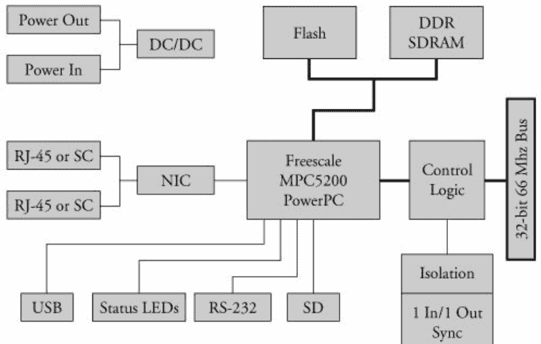

### 16.2.1. 前提条件和假设

当 Linux 内核从引导加载程序接过控制权时，它做出了一些基本假设。其中最重要的是，引导加载程序必须已经初始化了 DRAM 控制器。Linux 不参与芯片级的 SDRAM 控制器设置。Linux 假设系统 RAM 存在且功能完全。我们所针对的 PowerDNA 控制器包含 U-Boot 引导加载程序，该程序已初始化了 CPU、DRAM 以及其他系统最小运行所需的其他相关硬件。

引导加载程序还应初始化系统内存映射。这通常是通过一组处理器寄存器来完成的，这些寄存器定义了在给定的内存地址范围内哪些片选信号是有效的。Freescale MPC5200 用户手册的[第 3 章](https://www.google.com) 描述了用于此任务的寄存器。

引导加载程序可能还有其他与硬件相关的初始化任务。在一些板子上，内核假设串口已经配置好。这使得在内核自身的串行驱动程序安装之前很久，就可以将早期的内核启动消息显示到串口上。一些架构和硬件平台包含诸如 `*_serial_putc()` 这样的函数，它们可以将字符串发送到已被引导加载程序或某些简单的内核早期设置代码预先配置好的串口。你可以使用 grep 并搜索 `CONFIG_SERIAL_TEXT_DEBUG` 在 PowerPC 架构分支中找到这方面的例子。

总而言之，将 Linux 移植到新开发板的基本前提是：一个引导加载程序已被移植并安装在我们的板子上，并且任何针对特定板子的底层硬件初始化都已完成。对于 Linux 有直接设备驱动程序支持的设备（如以太网控制器或 I2C 控制器），则无需初始化；内核会处理它们。

一个好主意是为与你的开发板最接近的板子配置和构建你的 Linux 内核。这为你提供了一个已知良好的起点，即一个为你的板子配置好的、可以无错误编译的 Linux 内核源代码树。回顾[第 5 章](https://www.google.com) "内核初始化" 中编译 Linux 2.6 内核的命令：

```
$ make ARCH=ppc CROSS_COMPILE=ppc_82xx- uImage
```

此命令行将生成一个与 U-Boot 引导加载程序兼容的 Linux 可启动镜像。`uImage` 目标指定了这一点。

### 16.2.2. 定制内核初始化

现在我们有了一个基线内核源代码树作为起点，让我们确定从何处开始为我们的特定开发板进行定制。我们发现，对于 PowerPC 架构，特定于板子的文件位于名为 `.../arch/ppc/platforms` 的目录中。当然，这并非严格要求，但如果你打算将你的补丁提交给 Linux 内核开发社区以供考虑，那么遵循适当的规范和一致性就很重要了！

我们在 `platforms` 目录中找到一个名为 `lite5200.c` 的文件。这是一个相当简单的文件，包含两个数据结构和五个函数。[清单 16-3](https://www.google.com) 展示了该文件中的函数。

#### 清单 16-3. 来自 5200 平台文件的函数


让我们看看这些函数是如何使用的。我们在第5章简要探讨了底层内核初始化。这里我们查看特定架构的细节。不同架构的细节可能不同，但当你能熟练掌握一种架构后，其他架构的学习就会变得更容易。

回顾第5章，我们了解了上电时的早期控制流。引导加载程序将控制权传递给内核的引导加载程序，后者通过内核的`head.o`模块将控制权传递给Linux内核。这里开始了平台相关的初始化。代码清单16-4复制了`.../arch/ppc/kernel/head.S`中的相关行。

#### 代码清单16-4. 调用早期机器初始化

```
/*
 * Do early bootinfo parsing, platform-specific initialization,
 * and set up the MMU.
 */
        mr      r3,r31
        mr      r4,r30
        mr      r5,r29
        mr      r6,r28
        mr      r7,r27
        bl      machine_init
        bl      MMU_init
        ...
```

这里你可以看到对`machine_init`的汇编语言调用。特别重要的是寄存器`r3`到`r7`的设置。这些寄存器被期望包含众所周知的值，你稍后就会看到。它们在引导序列的早期就被存储到了PowerPC通用寄存器`r27`到`r31`中。现在，它们从这些存储的值中重新加载。

`machine_init()`函数在一个名为`setup.c`的C文件中定义，该文件位于相同的架构特定内核目录：`.../arch/ppc/kernel/setup.c`。此例程的开头在代码清单16-5中复制。

#### 代码清单16-5. `setup.c`中的函数`machine_init()`

```
void __init
machine_init(unsigned long r3, unsigned long r4, unsigned long r5,
            unsigned long r6, unsigned long r7)
{
#ifdef CONFIG_CMDLINE
	strlcpy(cmd_line, CONFIG_CMDLINE, sizeof(cmd_line));
#endif /* CONFIG_CMDLINE */

#ifdef CONFIG_6xx
	ppc_md.power_save = ppc6xx_idle;
#endif
#ifdef CONFIG_POWER4
	ppc_md.power_save = power4_idle;
#endif

	platform_init(r3, r4, r5, r6, r7);

	if (ppc_md.progress)
		ppc_md.progress("id mach(): done", 0x200);
}
```

这个简单的函数包含了一些非常有用的知识。首先，注意`machine_init()`的参数代表PowerPC通用寄存器`r3`到`r7`。[2]你看到它们在机器语言调用`machine_init`之前刚刚被初始化。如**代码清单16-5**所示，这些寄存器值未经修改就传递给了`platform_init()`。我们需要为我们的平台修改这个函数。（我们稍后会详细说明。）

> [2] 按照惯例，C语言中的参数通过这些PowerPC寄存器传递。

**代码清单16-5**还包含一些针对电源管理功能的机器特定调用。如果你的内核配置为支持PowerPC 6xx（在你的`.config`文件中定义了`CONFIG_6xx`），指向一个机器特定电源管理函数（`ppc6xx_idle`）的指针会被存储在一个结构体中。类似地，如果你的内核配置为PowerPC G5核心（`CONFIG_POWER4`），指向其机器特定电源管理例程的指针会被存储在同一结构体成员中。这个结构体在**第16.3.3节**“机器相关调用”中描述。

### 16.2.3. 静态内核命令行

在**代码清单16-5**中复制的`machine_init()`函数中，一个更有趣的操作是存储*默认*内核命令行。如果在你的内核配置中启用了`CONFIG_CMDLINE`，此操作就会启用。在某些平台上，引导加载程序不提供内核命令行。在这些情况下，内核命令行可以静态编译到内核中。**图16-2**说明了此配置选项。

#### 图16-2. 默认内核命令行

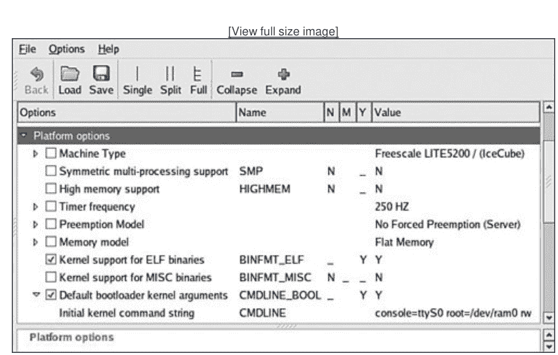

在图16-2的配置中启用“默认引导加载程序内核参数”，并如图所示编辑“初始内核命令字符串”。这将在.config文件中产生一组条目，如代码清单16-6所示。

#### 代码清单16-6. 默认内核命令行的配置

```
...
CONFIG_CMDLINE_BOOL=y
CONFIG_CMDLINE="console=ttyS0 root=/dev/ram0 rw"
...
```

代码清单16-6中的省略号表示我们只选取了.config文件的一小部分片段。当这些配置符号被内核构建系统处理时，它们会成为.../include/linux/autoconf.h文件中的条目，如代码清单16-7所示。

#### 代码清单16-7. 默认内核命令行的文件autoconf.h条目

```
...
#define CONFIG_CMDLINE_BOOL 1
#define CONFIG_CMDLINE "console=ttyS0 root=/dev/ram0 rw"
...
```

现在回到[代码清单16-5](#)，我们有以下行：

```
strlcpy(cmd_line, CONFIG_CMDLINE, sizeof(cmd_line));
```

你可以看到这个基于内核的字符串复制函数将`CONFIG_CMDLINE`定义的字符串复制到一个名为`cmd_line`的全局内核变量中。这很重要，因为许多函数和设备驱动程序可能需要在引导序列的早期检查内核命令行。全局变量`cmd_line`隐藏在`.data`段的开头，定义在汇编文件`.../arch/ppc/kernel/head.S`中。

这里值得提到一个微妙的细节。回顾[代码清单16-4](#)，我们看到`machine_init`汇编语言调用是在调用`MMU_init`*之前*进行的。这意味着我们能够从`machine_init`运行的任何代码，都是在对访问内存支持有限的上下文中执行的。如今许多包含MMU的处理器，如果没有通过处理器中的硬件寄存器进行一些初始映射，就无法访问任何内存。[3]通常，在启动时会提供少量内存，以容纳加载和解压内核以及ramdisk映像。尝试访问超出这些早期限制的代码或数据将会失败。每个架构和平台可能具有不同的早期内存访问限制。8到16MB左右的值并不少见。我们必须记住，我们从`machine_init`执行的任何代码，包括我们的平台初始化，都是在此上下文中进行的。如果你在调试新的内核移植时遇到数据访问错误（PowerPC DSI异常[4]），你应该立即怀疑你没有正确映射代码尝试访问的内存区域。

> [3] AMCC PPC405就是这方面的绝佳例子。鼓励感兴趣的读者查看此处理器中的BAT寄存器。

> [4] 有关PowerPC DSI异常的详细信息，请参阅本章末尾引用的编程环境手册。

## 16.3. 平台初始化

以下是早期初始化期间代码流程的快速回顾。图16-3显示了从引导加载程序或引导加载程序到你的平台初始化代码的执行流。

### 图16-3. 平台初始化控制流

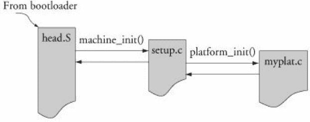

对于PowerPC架构，文件head.S和setup.c都位于.../arch/ppc/kernel目录中。我们的自定义平台初始化文件将放置在.../arch/ppc/platforms目录中。在图16-3中，它由文件myplat.c表示。我们现在可以详细检查平台特定的初始化文件了。

在代码清单16-3中，我们列出了lite5200.c平台初始化文件中的函数。除了platform_init()之外的所有函数都声明为静态。因此，如图16-3所示，这是平台初始化文件的入口点。文件中的其余函数仅从文件内部引用。

让我们检查入口函数platform_init()。代码清单16-8复制了lite5200.c文件中的platform_init()函数。

### 代码清单16-8. Lite5200 platform_init函数

```
void __init
platform_init(unsigned long r3, unsigned long r4,
                unsigned long r5, unsigned long r6,
                unsigned long r7)
{
    /* Generic MPC52xx platform initialization */
    /* TODO Create one and move a max of stuff in it.
       Put this init in the syslib */
```


struct bi_record *bootinfo = find_bootinfo();

if (bootinfo)
    parse_bootinfo(bootinfo);
else {
    /* Load the bd_t board info structure */
    if (r3)
        memcpy((void*)&__res, (void*)(r3+KERNELBASE),
               sizeof(bd_t));

#ifdef CONFIG_BLK_DEV_INITRD
    /* Load the initrd */
    if (r4) {
        initrd_start = r4 + KERNELBASE;
        initrd_end = r5 + KERNELBASE;
    }
#endif

    /* Load the command line */
    if (r6) {
        *(char *)(r7+KERNELBASE) = 0;
        strcpy(cmd_line, (char *)(r6+KERNELBASE));
    }
}

/* PPC Sys identification */
identify_ppc_sys_by_id(mfspr(SPRN_SVR));

/* BAT setup */
mpc52xx_set_bat();

/* No ISA bus by default */
isa_io_base         = 0;
isa_mem_base        = 0;

/* Powersave */
/* This is provided as an example on how to do it. But you
   need to be aware that NAP disable bus snoop and that may
   be required for some devices to work properly, like USB
   ... */
/* powersave_nap = 1; */

/* Setup the ppc_md struct */
ppc_md.setup_arch    = lite5200_setup_arch;
ppc_md.show_cpuinfo  = lite5200_show_cpuinfo;
ppc_md.show_percpuinfo   = NULL;
ppc_md.init_IRQ          = mpc52xx_init_irq;
ppc_md.get_irq           = mpc52xx_get_irq;

#ifdef CONFIG_PCI
ppc_md.pci_map_irq   = lite5200_map_irq;
#endif

ppc_md.find_end_of_memory = mpc52xx_find_end_of_memory;
ppc_md.setup_io_mappings  = mpc52xx_map_io;

ppc_md.restart       = mpc52xx_restart;
ppc_md.power_off     = mpc52xx_power_off;
ppc_md.halt          = mpc52xx_halt;

/* No time keeper on the LITE5200 */
ppc_md.time_init     = NULL;
ppc_md.get_rtc_time  = NULL;
ppc_md.set_rtc_time  = NULL;

ppc_md.calibrate_decr     = mpc52xx_calibrate_decr;
#ifdef CONFIG_SERIAL_TEXT_DEBUG
ppc_md.progress           = mpc52xx_progress;
#endif
}

这个函数包含了针对此特定平台所需的大部分定制工作。它首先搜索由引导加载程序提供的特定于板级的数据。我们将这部分的详细讨论推迟到[16.3.2节](Section 16.3.2)，"板级信息结构"。

在此之后，如果你的内核配置为使用初始内存磁盘（`initrd`），[^5] 则保存内存磁盘镜像的起始地址和结束地址。请注意，按照惯例，这些地址是通过 PowerPC 通用寄存器 `r4` 和 `r5` 传入的。将 `initrd` 地址传入这些寄存器是引导加载程序的责任。随后，内核将使用这些地址将 `initrd` 镜像从原始内存（引导加载程序放置的位置，或非易失性闪存镜像）加载到内核内部的内存磁盘结构中。

[^5] 初始内存磁盘，即 `initrd`，在[第6章](Chapter 6)中有介绍。

接下来我们看到存储内核命令行的代码，其地址通过寄存器 r6 和 r7 传入 `platform_init()`，分别标记起始地址和结束地址。这与前文描述的存储静态内核命令行的方法有一个具体细节上的不同：这个内核命令行是从引导加载程序传递给 `platform_init()` 的，而不是编译进内核的。

复制 `initrd` 和内核命令行非常直接。基本上，从引导加载程序传入的寄存器包含了这些数据结构所在的内存地址。然而，有一个细微之处需要注意。你可能已经怀疑过常量 `KERNELBASE` 的用途。理解这一点是掌握引导序列中较为复杂部分的关键。

引导加载程序提供的地址是*物理*地址。这意味着它们是数据实际驻留在内存芯片中的真实硬件地址。引导加载程序通常在没有虚拟内存支持的情况下运行。然而，内核本身是静态链接到一个已知的、用户配置的基础地址的。这个地址就是 `KERNELBASE`。（该值本身与讨论无关——它是用户可配置的，但实际上几乎从未从其默认值 0xC0000000 更改过。）

这在 `head.S` 中设置了一个有趣的情况。当内核被解压并重新定位到 RAM（通常位于位置 0）时，它的所有代码和数据符号都链接——在内核的虚拟地址 `KERNELBASE` 处。这可以通过检查内核构建过程中生成的内核符号映射文件 `System.map` 来验证。[^6] 然而，在启用 MMU 之前的执行上下文中，物理地址是真实的硬件地址。这意味着在启用 MMU 和虚拟内存映射之前，所有代码必须是可重定位的，并且对符号的访问必须进行*修正*。这涉及向符号的地址添加一个偏移量来访问它。一个例子将使这一点更加清楚。

[^6] 我们在第4章介绍了 `System.map` 文件。

### 16.3.1. 早期变量访问

假设引导过程中非常早的一个代码段需要访问变量 `cmd_line`——如此之早，以至于我们在 1:1 实地址到物理地址映射中执行。如前所述，这个变量在 `head.S` 中定义，当内核链接时将位于 `.data` 段中。从 Linux 内核的 `System.map` 文件中，你可以找到 `cmd_line` 的链接地址：

```
$ cat System.map | grep cmd_line
 c0115000 D cmd_line
```

如果我们运行在实地址 = 物理地址模式（MMU 禁用）并使用其符号访问这个变量，我们将尝试读取或写入大于 3GB 的地址。大多数较小的嵌入式系统在该区域没有任何 RAM，结果将是未定义的或会导致崩溃。即使我们在该地址有物理 RAM，也不太可能在引导过程的这么早期就映射并可访问。因此，我们必须调整对这个变量的引用以访问它。

[Listing 16-9](https://example.com/listing16-9) 复制了 `head.S` 中的一段代码，正是这样做的。

#### 清单 16-9. 变量引用修正

```
relocate_kernel:
      addis r9,r26,klimit@ha /* fetch klimit */
      lwz   r25,klimit@l(r9)
      addis r25,r25,-KERNELBASE@h
```

这段来自 PowerPC `head.S` 的代码片段很好地说明了我们描述的问题。变量 `klimit` 代表内核镜像的末尾。它在别处定义为 `char *klimit`。因此，它是一个指针——它是一个包含地址的地址。在[清单 16-9](#)中，我们获取 `klimit` 的地址，将其与先前计算并传入 `r26` 的偏移量相加，并将结果值存入寄存器 `r9`。寄存器 `r9` 现在包含 `klimit` 调整后的地址的高16位，低位置零。[[7]] 这个地址是通过先前计算并传入寄存器 `r26` 的偏移量来调整的。

[7] 有关 PPC 汇编语言语法的详细信息，请参阅本章末尾的[16.5.1节](#)，"补充阅读建议"。

在下一行，`lwz` 指令使用寄存器 `r9` 和 `klimit` 的偏移量（`klimit` 地址的低16位）作为有效地址，从中加载寄存器 `r25`。（记住，`klimit` 是一个指针，我们感兴趣的是 `klimit` 指向的值。）寄存器 `r25` 现在持有存储在变量 `klimit` 中的指针。在[清单 16-9](#)的最后一行，我们从 `r25` 减去内核的链接基础地址（`KERNELBASE`），将指针调整到实际的物理地址。用 C 语言表示，它看起来像这样：

```
    unsigned int *tmp;      /* 代表 r25 */
    tmp = *klimit;
    tmp -= KERNELBASE;
```

总之，我们引用了存储在 `klimit` 中的指针，并将其值调整到我们的真实（物理）地址，以便使用其内容。当内核启用 MMU 和虚拟寻址时，我们不再需要担心这个问题——内核将在其链接的地址上运行，而不管它在物理内存中的实际位置在哪里。

### 16.3.2. 板级信息结构

许多引导加载程序用于 PowerPC 平台，但仍然没有统一的方式来传递板级特定的数据，如串口波特率、内存大小以及其他引导加载程序已配置的低级硬件参数。[清单 16-8](#) 中的平台初始化文件支持两种不同的方法：以 `struct bi_record` 存储的数据和以 `struct bd_info` 存储的数据。[[8]] 两种方法提供类似的结果：硬件特定的数据通过这些结构从引导加载程序传递到内核。

[8] 每种方法都有其根源。`struct bd_info` 起源于 U-Boot，而 `struct bi_record` 是尝试在所有平台之间统一。两者都被许多平台支持。

从[清单 16-8](#)中，这是保存引导加载程序提供的硬件配置的代码片段：

```
struct bi_record *bootinfo = find_bootinfo();
```


### 16.3.3. 与机器相关的调用

内核在初始化或运行过程中需要的许多通用例程都是与架构和机器（CPU）相关的。从清单 16-8 中复制的 `platform_init()` 函数可以看到以下内容：

```
...
    /* 设置 ppc_md 结构 */
    ppc_md.setup_arch   = lite5200_setup_arch;
    ppc_md.show_cpuinfo = lite5200_show_cpuinfo;
    ppc_md.show_percpuinfo    = NULL;
    ppc_md.init_IRQ           = mpc52xx_init_irq;
    ppc_md.get_irq            = mpc52xx_get_irq;

#ifdef CONFIG_PCI
    ppc_md.pci_map_irq    = lite5200_map_irq;
#endif

    ppc_md.find_end_of_memory = mpc52xx_find_end_of_memory;
    ppc_md.setup_io_mappings  = mpc52xx_map_io;

    ppc_md.restart     = mpc52xx_restart;
    ppc_md.power_off   = mpc52xx_power_off;
    ppc_md.halt        = mpc52xx_halt;
...
```

类似的代码行构成了 `platform_init()` 函数的其余部分。这里将特定于平台的大部分需求传达给了 Linux 内核。全局变量 `ppc_md`，类型为 `struct machdep_calls`，提供了钩子函数，可以方便地将 Linux 内核定制为适用于某个 PowerPC 平台。该变量在 `.../arch/ppc/kernel/setup.c` 中声明。PowerPC 特定内核分支中的许多地方都通过此结构间接调用函数。例如，清单 16-10 复制了 `.../arch/ppc/kernel/setup.c` 的一部分，其中包含对重启、关机和停机功能的支持：

#### 清单 16-10. 通用 PowerPC 机器功能

```
void machine_restart(char *cmd)
{
#ifdef CONFIG_NVRAM
	nvram_sync();
#endif
	ppc_md.restart(cmd);
}

void machine_power_off(void)
{
#ifdef CONFIG_NVRAM
		nvram_sync();
#endif
		ppc_md.power_off();
}

void machine_halt(void)
{
#ifdef CONFIG_NVRAM
		nvram_sync();
#endif
		ppc_md.halt();
}
```

这些函数通过 `ppc_md` 结构调用，包含这些函数的特定于机器或平台的变体。可以看到，其中一些函数是特定于机器的，来自函数的 `mpc52xx_*` 变体。这类例子包括 `mpc52xx_restart` 和 `mpc52xx_map_io`。其他则是特定于硬件平台的。特定于平台的例程包括 `lite5200_map_irq` 和 `lite5200_setup_arch`。

## 16.4. 综合起来

既然我们已经有了可以参照的基础，就可以为自己的定制板创建必要的文件和函数。我们将 Lite5200 平台文件复制过来作为基线，然后针对我们的定制 PowerPC 平台进行修改。我们将新平台称为 *PowerDNA*。我们将为此次定制移植执行以下步骤：

- 1. 向 `...arch/ppc/Kconfig` 添加新的配置选项。
- 2. 将 `lite5200.*` 复制为 `powerdna.*` 作为基线。
- 3. 根据我们的平台适当编辑新的 `powerdna.*` 文件。
- 4. 编辑 `.../arch/ppc/Makefile` 以条件性地包含 `powerdna.o`。
- 5. 编译、加载和调试！

你在[第 4 章](link)中学习了如何向 Kconfig 添加配置选项。我们新的 PowerDNA 移植的配置选项详见[清单 16-11](link)。

### 清单 16-11. PowerDNA 的配置选项

```
config POWERDNA
      bool "United Electronics Industries PowerDNA"
      select PPC_MPC52xx
      help
        支持 UEI PowerDNA 板卡
```

此 `Kconfig` 条目添加在 LITE5200 条目下方，因为它们是相关的。[9] [图 16-4](link) 展示了调用配置工具时的结果。

[9] 为节省空间，我们在[图 16-4](link)中临时移除了 LITE5200 之前的许多机器类型。

### 图 16-4. *PowerDNA* 的机器类型选项


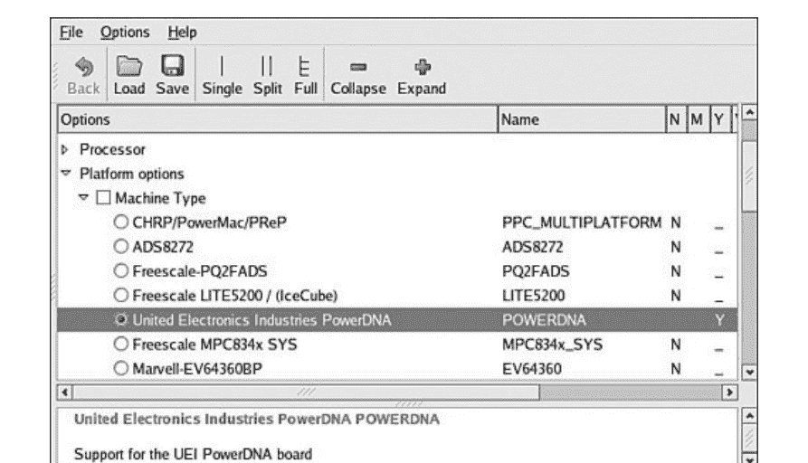

注意，当用户选择 `POWERDNA` 时，会执行两个重要操作：

- 1. `CONFIG_PPC_MPC52xx` 配置选项会自动选中。这是通过[清单 16-11](link)中的 select 关键字实现的。
- 2. 定义了一个新的配置选项 `CONFIG_POWERDNA`，它将驱动我们的构建设置。

下一步是复制最接近我们平台的文件，作为新平台初始化文件的基础。我们已经确定 Lite5200 平台符合要求。将 `lite5200.c` 复制为 `powerdna.c`，将 `lite5200.h` 复制为 `powerdna.h`。困难的部分接下来了。利用硬件规格、原理图以及你手头有关硬件平台的任何其他数据，根据你的硬件适当编辑新的 `powerdna.*` 文件。让代码能够编译通过，然后继续启动和调试你的新内核。这里没有捷径，也无法替代经验。这就是移植的艰苦工作，但现在至少你知道从哪里开始了。[第 14 章](link)"内核调试技巧"中介绍了许多内核调试的技巧和方法。

为总结我们的移植工作，[清单 16-12](link) 详细列出了为在 PowerDNA 板上运行 Linux 而添加或修改的文件。

### 清单 16-12. PowerDNA 新增或修改的内核文件

```
linux-2.6.14/arch/ppc/configs/powerdna_defconfig
linux-2.6.14/arch/ppc/Kconfig
linux-2.6.14/arch/ppc/platforms/Makefile
linux-2.6.14/arch/ppc/platforms/powerdna.c
linux-2.6.14/arch/ppc/platforms/powerdna.h
linux-2.6.14/drivers/net/fec_mpc52xx/fec.c
linux-2.6.14/drivers/net/fec_mpc52xx/fec.h
linux-2.6.14/drivers/net/fec_mpc52xx/fec_phy.h
linux-2.6.14/include/asm-ppc/mpc52xx.h
```

第一个文件是默认配置，它支持基于默认值快速配置内核。通过以下方式调用 `make` 来启用：

```
$ make ARCH=ppc CROSS_COMPILE=<cross-prefix> powerdna_defconfig
```

我们已经讨论了对 `Kconfig` 文件的更改。对 makefile 的修改很简单——目的是基于 `CONFIG_POWERDNA` 添加对新内核配置的支持。更改包含添加一行：

```
obj-$(CONFIG_POWERDNA)          += powerdna.o
```

更改的核心在于 `powerdna.[c|h]` 文件以及对 FEC（快速以太网控制器）层的修改。`powerdna.c` 与其所衍生的文件 `lite5200.c` 之间仅存在细微差异。有两个主要问题需要修改。首先，由于 PowerDNA 设计中不使用 PCI，因此禁用了 PCI。这需要一些小的调整。其次，PowerDNA 设计集成了一个非托管的以太网物理层芯片，这需要在硬件设置和 FEC 层中进行轻微更改。这项工作构成了移植工作的主要部分。补丁文件包含 1120 行，但其中大部分行是默认配置，这只是为了方便开发者，并非严格必要。去除这部分后，补丁减少到 411 行。

### 16.4.1. 其他架构

我们详细研究了给定平台如何融入内核，以及移植到新板卡时所存在的机制。本章及其中讨论的参考来自内核的 PowerPC 架构分支。其他架构在各种硬件平台的纳入方式上存在许多细节差异，但概念是相似的。当你学会了如何驾驭单一架构后，你就拥有了学习细节所需的知识和工具。

```
if (bootinfo)
    parse_bootinfo(bootinfo);
else {
    /* 加载 bd_t 板卡信息结构 */
    if (r3)
        memcpy((void*)&__res, (void*) (r3+KERNELBASE),
                sizeof(bd_t));
```

首先，我们搜索一个特殊标签，该标签将数据结构标识为 `struct bi_record`。如果找到，则将 `bootinfo` 指针设置为 bootinfo 记录起始地址。从那时起，记录被解析并收集与硬件相关的数据。这可以通过查看 `.../arch/ppc/kernel/setup.c` 来了解。目前，`bi_records` 可以包含内核命令行、`initrd` 映像的起始和结束地址、机器类型以及内存大小。当然，你可以根据自己的需求扩展此项。

如果找不到 `bi_record` 数据，PowerPC 架构期望此数据以 U-Boot 板卡信息结构（即 `bd_info`）的形式存在。引导加载程序负责构建此数据结构，并将地址传递到寄存器 `r3` 中。目前，`bd_info` 结构中提供了许多硬件信息位，包括 DRAM、FLASH、SRAM、处理器时钟速率、总线频率、串口波特率设置等信息。

`bi_record` 结构可以在 `.../include/asm-ppc/bootinfo.h` 中查看，`bd_info` 结构可以在 `.../include/asm-ppc/ppcboot.h` 中找到。

平台初始化例程有责任利用任何可能需要的数据来完成硬件设置，或将其传达给内核。例如，`platform_init()` 设置了一个指向函数的指针，其名称揭示了它的用途。[清单 16-8](#)中的代码在此复制：

```
ppc_md.find_end_of_memory = mpc52xx_find_end_of_memory;
```

查看在 `.../arch/ppc/syslib/mpc52xx_setup.c` 中找到的函数 `mpc52xx_find_end_of_memory()`，我们发现以下内容：

```
u32 ramsize = __res.bi_memsize;

if (ramsize == 0) {
    ...  /* 用另一种方式查找 */
}

return ramsize;
```

上面的 `__res` 数据结构是板卡信息结构，其地址是上面从引导加载程序通过寄存器 `r3` 传递给我们的。如你所见，通用设置代码存储了引导加载程序传入的*残留*数据（通常这样称呼），但需要由机器或平台特定代码来加以利用。


 ## 16.5. 章节小结

- 将 Linux 移植到基于受支持 CPU 的定制开发板上可以相对直接。没有什么能替代经验以及对 Linux 代码库和硬件平台的深入了解。

- 从一个基于已受支持硬件平台的工作参考配置开始，这为你自己的修改提供了极佳的基础。

- 理解初始化代码的执行流程是轻松完成移植工作的关键。我们尽最大努力不改动所有通用内核代码，只修改平台本身所需的文件。本章的很大一部分内容都致力于讲解与平台初始化相关的早期控制流程。

- 在继续之前，务必确保你的底层硬件平台初始化是正确的。例如，如果你发现自己在 Linux slab 分配器的某个晦涩角落调试，那么几乎可以断定你的硬件内存初始化出了问题。

- 本章主要聚焦于 Linux 内核的 PowerPC 架构分支。学习一个架构的细节为理解其他架构铺平了道路。

## 16.5.1. 延伸阅读建议

*Programming Environments Manual for 32-Bit Implementations of the PowerPC Architecture*
MPCFPE32B/AD 12/2001 REV 2
Freescale Semiconductor, Inc.

*MPC5200 User's Guide*
MPC5200UG Rev 3 01/22005
Freescale Semiconductor, Inc.

# 第 17 章 Linux 与实时系统

本章内容

- [什么是实时？](page 446)
- [内核抢占](page 449)
- [实时内核补丁](page 453)
- [调试实时内核](page 460)
- [章节小结](page 467)

当 Linux 在 Intel i386 处理器上诞生时，没有人预料到它在服务器应用中会取得如此成功。这一成功促使 Linux 被移植到众多不同的架构，并被开发人员用于从手机到电信交换机等各种嵌入式系统。不久前，如果你的应用有实时性要求，你可能不会把 Linux 列入操作系统选型名单。然而，随着实时 Linux 的发展，这种情况已经彻底改变，这部分工作很大程度上是由音频和多媒体应用推动的。

在本章中，我们先简要回顾实时 Linux 特性的历史发展。然后我们将探讨实时程序员可用的机制以及如何使用这些机制。

## 17.1. 什么是实时？

如果问五个人"实时"是什么意思，很可能会得到五种不同的答案。有些人甚至可能会说出一些数字。为了后续讨论的目的，我们先讨论一些场景，然后提出一个定义。许多需求可以称为**软实时**，而另一些则称为**硬实时**。

### 17.1.1. 软实时

大多数人同意，软实时意味着操作有一个截止时间，但如果错过了截止时间，体验质量可能会下降（但不会致命）。你的桌面工作站就是软实时需求的完美例子。当你编辑文档时，你期望按键的结果立即显示在屏幕上。当你播放喜爱的 .mp3 文件时，你期望获得高质量的音频，而没有咔嗒声、爆音或音乐中断。

一般来说，人类无法感知或听到低于几十毫秒的延迟。当然，音乐爱好者会告诉你，比那更小的延迟也会影响音乐的*色彩*。如果这些所谓的软实时事件错过了截止时间，结果可能是不理想的，导致"质量"水平下降，但不会是灾难性的。

### 17.1.2. 硬实时

硬实时的特征是错过截止时间的后果。在硬实时系统中，如果错过了截止时间，结果往往是灾难性的。当然，*灾难性*是一个相对术语。如果你的嵌入式设备控制的是喷气式飞机发动机的燃油流量，那么错过响应飞行员输入或操作特性变化的截止时间可能会导致灾难性的后果。

请注意，持续时间的长短与实时特性无关。原子钟的滴答服务就是一个例子。只要在下一个滴答到来之前的 1 秒窗口内处理完当前滴答，数据就保持有效。错过一次滴答的处理可能会使我们的全球定位系统偏差数英尺甚至数英里！

考虑到这一点，我们借鉴了一组常用的软实时和硬实时定义。对于软实时系统，如果错过了截止时间，计算或结果的价值会降低。对于硬实时系统，如果错过了任何一个截止时间，系统就被认为已经失效，并且可能产生灾难性后果。

### 17.1.3. Linux 调度

UNIX 和 Linux 的进程调度设计目标都是公平性。也就是说，调度器尽其所能将可用资源分配给所有需要 CPU 的进程，并保证每个进程都能取得进展。这一设计目标与实时进程的需求恰恰相矛盾。实时进程必须在其准备就绪后尽快运行。实时意味着具有可预测和可重复的延迟。

### 17.1.4. 延迟

实时进程通常与物理事件相关联，例如来自外设的中断到达。图 17-1 展示了 Linux 系统中的延迟组成部分。延迟测量从收到我们要处理的中断开始。这在图 17-1 中以时间 t0 表示。一段时间后，中断被接收，控制权传递给中断服务程序（ISR）。这在图 17-1 中以时间 t1 表示。这个中断延迟几乎完全由最大中断关闭时间[1]决定——即执行线程中禁用硬件中断所花费的时间。

> [1] 我们忽略了中断处理的上下文切换时间，因为它与中断关闭时间相比通常可以忽略不计。

**图 17-1. 延迟组成部分**

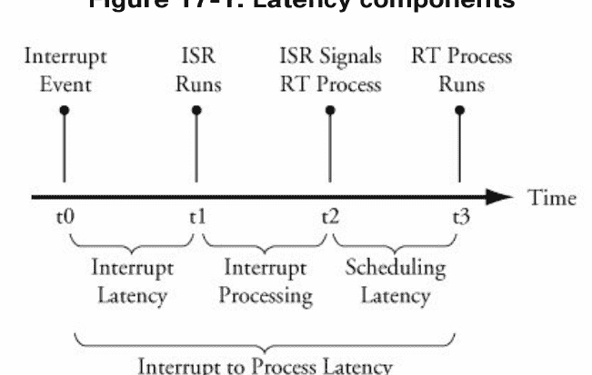

将实际中断服务程序中的处理量最小化被认为是良好的设计实践。的确，这个执行上下文的能力是有限的（例如，ISR 不能调用阻塞函数，即可能会睡眠的函数），因此只需对硬件设备进行服务，将数据处理留给 Linux 的下半部[2]，也称为 softIRQ。

> [2] Robert Love 在其著作 *Linux Kernel Development* 中详细解释了下半部处理。详见本章末尾 17.5.1 "延伸阅读建议"中的参考。

当 ISR/下半部完成处理后，通常情况是唤醒正在等待数据的用戸空间进程。这在图 17-1 中以时间 t2 表示。在一段时间之后，调度器选择实时进程运行并分配 CPU。这在图 17-1 中以时间 t3 表示。调度延迟主要受等待 CPU 的进程数量及其优先级的影响。为进程设置实时属性可以使其获得比普通 Linux 进程更高的优先级，并允许它成为下一个被选中的运行进程，假设它是等待 CPU 的最高优先级实时进程。准备运行（未被 I/O 阻塞）的最高优先级实时进程将始终运行。稍后你将看到如何设置这一属性。


## 17.2. 内核抢占

在早期的 Linux 1.x 时代，内核没有抢占功能。这意味着当用户空间进程请求内核服务时，在该进程阻塞（进入睡眠）等待某事（通常是 I/O）或内核请求完成之前，没有其他任务可以被调度运行。使内核可抢占[3]意味着当一个进程在内核中运行时，另一个进程可以抢占第一个进程并被允许运行，即使第一个进程还没有完成其内核中的处理。图 17-2 说明了这一点。

> [3] 有趣的是，关于 *preemptable* 的正确拼写存在诸多争论！我 respects Rick Lehrbaum 在 www.linuxdevices.com/articles/AT5136316996.html 上所做的调查。

**图 17-2. 内核抢占**

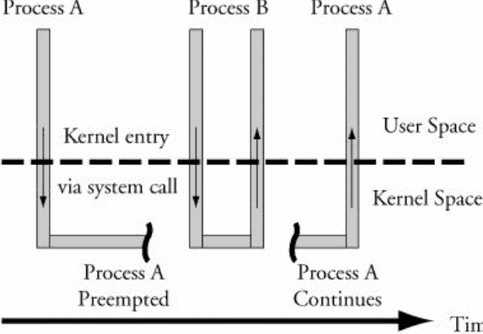

在此图中，进程 A 通过系统调用进入了内核。可能是一次对 `write()` 的调用，写入控制台或文件等设备。在代表进程 A 执行内核代码时，更高优先级的进程 B 被一个中断唤醒。内核*抢占*了进程 A，将 CPU 分配给进程 B，即使进程 A 既没有阻塞也没有完成其内核处理。

### 17.2.1. 抢占的障碍

使内核完全可抢占的挑战在于识别内核中所有必须免受抢占保护的位置。这些是内核中的*临界区*，在这些区域

不允许发生抢占。例如，假设图 17-2 中的进程 A 正在内核中执行文件系统操作。在某个时刻，代码可能需要写入一个内核内部的数据结构，该数据结构代表文件系统上的一个文件。为了防止该数据结构被破坏，进程必须阻止所有其他进程访问这个共享的数据结构。代码清单 17-1 使用 C 语法说明了这一概念。

#### 代码清单 17-1. 锁定临界区

```
...
preempt_disable();
...
/* 临界区 */
update_shared_data();
...
preempt_enable();
...
```

如果我们不以这种方式保护共享数据，那么正在更新共享数据结构的进程可能会在更新过程中途被抢占。如果另一个进程试图更新同一个共享数据，数据几乎肯定会损坏。经典的例子是两个进程直接操作公共变量并根据它们的值做出决策。图 17-3 说明了这种情况。

#### 图 17-3. 共享数据并发错误

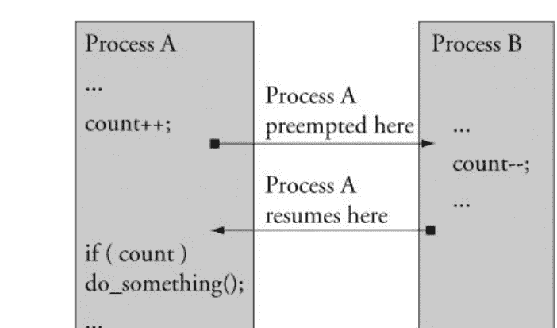

在图 17-3 中，进程 A 在更新共享数据之后、基于该数据做出决策之前被中断。按照设计，进程 A 无法检测到它已被抢占。进程 B 在进程 A 再次运行之前改变了共享数据的值。如你所见，进程 A 将基于进程 B 确定的值做出决策。如果这不是你想要的行为，你必须在进程 A 中围绕共享数据禁用抢占——在本例中，即对变量 `count` 的操作和决策。

### 17.2.2. 抢占模型

解决内核抢占的第一个解决方案是在内核代码中的战略位置放置检查点，这些位置已知是安全的，可以抢占当前执行线程。这些位置包括系统调用的进入和退出、某些内核锁的释放，以及中断处理返回。在这些点上，使用了类似于[代码清单 17-2](#)的代码来执行抢占。

#### 代码清单 17-2. 检查抢占（Linux 2.4 + 抢占补丁风格）

```
...
/*
 * 这段代码在 Linux 内核的战略位置执行，
 * 这些位置已知可以安全地抢占当前执行线程
 */
if (kernel_is_preemptable() && current->need_resched)
    preempt_schedule();
...

/*
 * 这段代码位于 .../kernel/sched.c 中，并从
 * 上述战略位置调用
 */
#ifdef CONFIG_PREEMPT
asmlinkage void preempt_schedule(void)
{
    while (current->need_resched) {
        ctx_sw_off();
        current->state |= TASK_PREEMPTED;
        schedule();
        current->state &= ~TASK_PREEMPTED;
        ctx_sw_on_no_preempt();
    }
}
#endif
...
```

[代码清单 17-2](#)中的第一段代码（从实际代码简化而来）在先前描述的那些战略位置调用，这些位置已知内核可以安全抢占。[代码清单 17-2](#)中的第二段代码来自早期应用了抢占补丁的 Linux 2.4 内核。这个有趣的 `while` 循环通过调用 `schedule()` 导致上下文切换，直到所有抢占请求都已满足。

尽管这种方法降低了 Linux 系统的延迟，但它并不理想。从事低延迟工作的开发人员很快意识到需要"翻转逻辑"。在早期的抢占模型中，我们有：

- Linux 内核从根本上是不可抢占的。

- 抢占检查散布在内核中的战略位置，这些位置已知适合进行抢占补丁。

- 抢占仅在这些已知安全的点启用。

为了进一步显著降低延迟，我们希望在一个可抢占内核中有：

- Linux 内核在任何地方都是完全可抢占的。

- 抢占仅在临界区周围被禁用。

这就是内核开发人员自原始可抢占内核补丁系列以来一直努力的方向。然而，这不是一项容易的任务。**它**涉及仔细审查整个内核源代码库，分析究竟哪些数据必须免受并发影响，并仅在这些位置禁用抢占。为此采用的方法是对内核进行延迟测量检测，找到最长的延迟代码路径，并修复它们。由于这种"锁拆分"方法所付出的努力，较新的 Linux 2.6 内核可以配置用于非常低延迟的应用程序。

### 17.2.3. SMP 内核

有趣的是，创建高效多处理器架构所涉及的许多工作也有利于实时。SMP 挑战比单处理器挑战更复杂，因为还有额外的并发元素需要防范。在单处理器模型中，任何时候只有一个任务可以在内核中执行。保护免受并发影响只涉及保护免受中断或异常处理的影响。在 SMP 模型中，除了中断和异常处理的威胁外，还可能有多个执行线程在内核中运行。

从早期 Linux 2.*x* 内核开始就支持 SMP。在从单处理器向 SMP 操作过渡期间，使用了一个*大内核锁*（BKL）来保护免受并发影响。BKL 是一个全局自旋锁，它阻止任何其他任务在内核中执行。在他优秀的著作 *Linux Kernel Development*（Novell Press，2005）中，Robert Love 将 BKL 描述为内核的"红发继子"。在描述 BKL 的特性时，Robert 开玩笑地在其属性列表中加入了"邪恶"！

基于 BKL 的 SMP 内核早期实现导致了调度方面的重大低效率。人们发现其中一个 CPU 可能会长时间保持空闲。大量使 SMP 内核高效的工作也直接有利于实时应用程序——主要是降低了延迟。将 BKL 替换为仅围绕实际需要保护的共享数据的更细粒度锁，显著减少了抢占延迟。

### 17.2.4. 抢占延迟的来源

实时系统必须能够在其指定的时间上限内为其实时任务提供服务。实现始终如一的低抢占延迟对实时系统至关重要。造成抢占延迟的两个最大因素是中断上下文处理和禁用中断的临界区处理。你已经了解到，大量工作已经针对减少临界区的大小（从而缩短持续时间）。这便剩下中断上下文处理作为下一个挑战。Linux 2.6 实时补丁对此做出了回应。

## 17.3. 实时内核补丁

对硬实时的支持不在主线 kernel.org 源代码树中。要启用硬实时，必须应用补丁。实时内核补丁是减少 Linux 内核延迟的若干举措的累积成果。该补丁有许多贡献者，目前由 Ingo Molnar 维护；你可以在 http://people.redhat.com/~mingo/realtime-preempt 找到它。2.6 Linux 内核的软实时性能自早期 2.6 内核版本以来有了显著提升。当 2.6 首次发布时，2.4 Linux 内核在软实时性能方面明显更优。从大约 Linux 2.6.12 开始，在速度相当快的 x86 处理器上实现个位毫秒级的软实时性能已 readily achieved。要获得超越此性能的可重复表现，需要实时补丁。

实时补丁为 Linux 内核添加了几项重要功能。图 17-4 显示了应用实时补丁后的抢占模式配置选项。

图 17-4. 带实时补丁的抢占模式


| 文件 | 选项 | 帮助 |
|------|---------|------|

选项

| | | |
| 平台选项 | | |
| PC PS/2 风格键盘 | | |
| 对称多处理支持 | | |
| 抢占模式 | | |
| 无强制抢占（服务器） | | |
| 自愿内核抢占（桌面） | | |
| 可抢占内核（低延迟桌面） | | |
| 完全抢占（实时） | | |
| 线程化软中断 | | |
| 线程化硬中断 | | |
| 线程化 RCU | | |
| 高内存支持 | | |

| 名称 | N | M | Y | 值 |
|------|---|---|---|-------|
| PC_KEYBOARD | | | | N |
| SMP | | | | N |
| PREEMPT_NONE | | | | N |
| PREEMPT_VOLUNTARY | | | | N |
| PREEMPT_DESKTOP | | | | N |
| PREEMPT_RT | | | | N |
| PREEMPT_SOFTIRQS | | | | Y |
| PREEMPT_HARDIRQS | | | | Y |
| PREEMPT_RCU | | | | Y |
| HIGHMEM | | | | N |

抢占模式

抱歉，此选项目前尚无可用帮助。


实时补丁增加了一种名为 `PREEMPT_RT`（即抢占实时）的第四种抢占模式。这四种抢占模式如下：

- `PREEMPT_NONE`：无强制抢占。整体延迟平均表现良好，但偶尔会出现较长的延迟。最适合以整体吞吐量为首要设计目标的应用程序。
- `PREEMPT_VOLUNTARY`：降低延迟的第一阶段。在内核的关键位置添加额外的显式抢占点以降低延迟。以牺牲一定的整体吞吐量来换取更低的延迟。
- `PREEMPT_DESKTOP`：此模式在内核中除临界区处理之外的所有位置启用抢占。此模式适用于音频和多媒体等软实时应用。以牺牲整体吞吐量来进一步降低延迟。
- `PREEMPT_RT`：添加实时补丁的特性，包括用可抢占的互斥锁替换自旋锁。这使得内核中除受 `preempt_disable()` 保护的区域外的所有位置都可发生非自愿抢占。此模式显著平滑了延迟变化（抖动），为时间敏感的实时应用提供低且可预测的延迟。

如果在内核配置中启用了内核抢占，可以在启动时通过在内核命令行中添加以下内核参数来禁用它：

```
preempt=0
```

### 17.3.1. 实时特性

`CONFIG_PREEMPT_RT` 启用了多项新的 Linux 内核特性。从[图 17-4](https://example.com/fig17-4)中可以看到若干新的配置选项。下面将介绍这些配置选项以及实时 Linux 内核补丁的其他特性。

#### 17.3.1.1. 自旋锁转换为互斥锁

实时补丁将系统中大多数自旋锁转换为互斥锁。这以略微降低吞吐量为代价降低了整体延迟。将自旋锁转换为互斥锁的好处是它们可以被抢占。如果进程 A 持有一个锁，而更高优先级的进程 B 需要同一个锁，在持有互斥锁的情况下，进程 A 可以被进程 B 抢占。

#### 17.3.1.2. ISR 作为内核任务

选择 `CONFIG_PREEMPT_HARDIRQ` 后，中断服务例程[^1]（ISR）被强制在进程上下文中运行。这使开发者能够控制 ISR 的优先级，因为它们变成了可调度的实体。因此，它们也变得可被抢占，从而允许优先处理更高优先级的硬件中断。

> [1] 也称为 HARDIRQ。

这是一个强大的特性。某些硬件架构不强制执行中断优先级。而那些支持的架构可能不会按照你指定的实时设计目标来一致地强制执行优先级。使用 `CONFIG_PREEMPT_HARDIRQ`，你可以自由定义每个 IRQ 的运行优先级。

ISR 转换为线程的功能可以在运行时通过 `/proc` 文件系统禁用，也可以在启动时通过在内核命令行中输入参数来禁用。在配置中启用后，除非另有指定，ISR 线程默认处于启用状态。

要在运行时禁用 ISR 线程，请以 root 身份执行以下命令：

```
# echo '0' >/proc/sys/kernel/hardirq_preemption
```

要验证该设置，请执行以下命令进行查看：

```
# cat /proc/sys/kernel/hardirq_preemption
1
```

要在启动时禁用 ISR 线程，请在内核命令行中添加以下参数：

```
hardirq-preempt=0
```

#### 17.3.1.3. 可抢占的软中断

`CONFIG_PREEMPT_SOFTIRQ` 通过在内核的 `softirq` 守护进程（`ksoftirqd`）上下文中运行 `softirqs` 来降低延迟。`ksoftirqd` 是一个正规的 Linux 任务（进程）。因此，它可以与其他任务一起进行优先级排序和调度。如果你的内核配置为实时模式，且启用了 `CONFIG_PREEMPT_SOFTIRQ`，则 `ksoftirqd` 内核任务将被提升为实时优先级以处理 softirq。[5] 清单 17-3 展示了最近 Linux 内核中负责此功能的代码，位于 `.../kernel/softirq.c`。

> [5] 参见本章末尾引用的 *《Linux 内核开发》*，以了解更多关于 `softirqs` 的信息。

##### 清单 17-3. 将 `ksoftirq` 提升为实时状态

```
static int ksoftirqd(void * __bind_cpu)
{
    struct sched_param param = { .sched_priority = 24 };

    printk("ksoftirqd started up.\n");

#ifdef CONFIG_PREEMPT_SOFTIRQS
    printk("softirq RT prio: %d.\n", param.sched_priority);
    sys_sched_setscheduler(current->pid, SCHED_FIFO, &param);
#else
    set_user_nice(current, -10);
#endif
    ...
```

这里我们可以看到，如果内核配置中启用了 `CONFIG_PREEMPT_SOFTIRQS`，则 `ksoftirqd` 内核任务将使用 `sys_sched_setscheduler()` 内核函数被提升为实时优先级为 24 的实时任务（`SCHED_FIFO`）。

SoftIRQ 线程可以在运行时通过 `/proc` 文件系统禁用，也可以在启动时通过内核命令行禁用。在配置中启用后，除非另有指定，SoftIRQ 线程默认处于启用状态。要在运行时禁用 SoftIRQ 线程，请以 root 身份执行以下命令：

```
# echo '0' >/proc/sys/kernel/softirq_preemption
```

要验证该设置，请执行以下命令进行查看：

```
# cat /proc/sys/kernel/softirq_preemption
1
```

要在启动时禁用 SoftIRQ 线程，请在内核命令行中添加以下参数：

```
softirq-preempt=0
```

#### 17.3.1.4. 可抢占 RCU

RCU（Read-Copy-Update，读取-复制-更新）[6] 是 Linux 内核中一种特殊形式的同步原语，专为频繁读取但偶尔更新的数据而设计。你可以将 RCU 理解为一种优化的读锁。实时补丁添加了 `CONFIG_PREEMPT_RCU`，通过使某些 RCU 区域可抢占来改善延迟。

[6] 参见 www.rdrop.com/users/paulmck/RCU/ 以深入了解 RCU 的讨论。

### 17.3.2. O(1) 调度器

O(1) 调度器自 Linux 2.5 时代就已存在。这里提及它是因为它是实时解决方案的关键组件。O(1) 调度器相比之前的 Linux 调度器有了显著改进。它在多进程系统中具有更好的扩展性，并有助于降低整体延迟。

如果你对此感到好奇，O(1) 是一阶系统的数学表示法。在这个上下文中，它意味着进行调度决策所需的时间不依赖于给定运行队列上的进程数量。旧的 Linux 调度器不具备这一特性，其性能会随进程数量的增加而下降。[[7]](#footnote-7)

> [7] 我们再次推荐参考 Robert Love 的著作，其中对 O(1) 调度器有精彩的讨论，以及对算法复杂度的精彩阐述——O(1) 记法便源自于此。

### 17.3.3. 创建实时进程

你可以通过设置调度器用于其调度算法的进程属性，将进程指定为实时进程。[清单 17-4](#listing-17-4) 展示了通用方法。

#### 清单 17-4. 创建实时进程

```
#include <sched.h>

#define MY_RT_PRIORITY MAX_USER_RT_PRIO /* Highest possible */

int main(int argc, char **argv)
{
    ...
    int rc, old_scheduler_policy;
    struct sched_param my_params;
    ...
    /* Passing zero specifies caller's (our) policy */
    old_scheduler_policy = sched_getscheduler(0);
    my_params.sched_priority = MY_RT_PRIORITY;
    /* Passing zero specifies callers (our) pid */
    rc = sched_setscheduler(0, SCHED_RR, &my_params);
    if ( rc == -1 )
        handle_error();
    ...
}
```

这段代码片段在调用 `sched_setscheduler()` 时完成了两件事。它将调度策略更改为 `SCHED_RR`，并将其优先级提升到系统允许的最大值。Linux 支持三种调度策略：

- `SCHED_OTHER`：普通 Linux 进程，公平调度
- `SCHED_RR`：带时间片的实时进程——即如果它未被阻塞，将被允许运行一段由调度器确定的时间
- `SCHED_FIFO`：实时进程，运行直到阻塞或显式让出处理器，或直到另一个更高优先级的 `SCHED_FIFO` 进程变为可运行状态

`sched_setscheduler` 的 man 手册页提供了关于这三种不同调度策略的更多详细信息。

### 17.3.4. 临界区管理

编写内核代码（如自定义设备驱动程序）时，你会遇到必须保护其免受并发访问的数据结构。保护关键数据最简单的方法是在临界区周围禁用抢占。保持关键路径尽可能短，以维护系统的低最大延迟。[清单 17-5] 展示了一个示例。

#### 清单 17-5. 在内核代码中保护临界区

```
...
/*
 * Declare and initialize a global lock for your
 * critical data
 */
DEFINE_SPINLOCK(my_lock);
...

int operate_on_critical_data()
{
    ...
    spin_lock(&my_lock);
    ...
    /* Update critical/shared data */
    ...
    spin_unlock(&my_lock);
    ...
}
```

当任务成功获取自旋锁时，抢占被禁用，获取自旋锁的任务被允许进入临界区。在 `spin_unlock` 操作执行之前不会发生任务切换。`spin_lock()` 函数实际上是一个宏，根据内核配置有多种形式。它们在顶层（与体系结构无关的定义）`.../include/linux/spinlock.h` 中定义。当内核打上实时补丁时，这些自旋锁被提升为互斥锁，以允许在持有自旋锁时抢占更高优先级的进程。

由于实时补丁对设备驱动程序和内核开发者基本上是透明的，因此可以使用熟悉的构造来保护临界区，如[清单 17-5]所述。这是实时补丁对实时应用的一个主要优势；它保留了众所周知的锁和中断服务例程语义。


## 17.4. 调试实时内核

使用宏 `DEFINE_SPINLOCK`，如 [清单 17-5](...) 所示，可以保持未来的兼容性。这些宏在 `.../include/linux/spinlock_types.h` 中定义。

有几个配置选项可以方便地调试和进行实时补丁内核的性能分析。它们将在下面的小节中详细说明。

### 17.4.1. 软锁检测

要启用软锁检测，请在内核配置中启用 `CONFIG_DETECT_SOFTLOCKUP`。此功能可以检测在内核模式下运行长时间而没有上下文切换的情况。此功能存在于非实时内核中，但对于检测极高延迟的路径或软死锁条件非常有用。要使用它，只需启用该功能并查看控制台或系统日志中的任何报告。报告将类似于以下内容发出：

```
BUG: soft lockup detected on CPU0
```

当内核发出此消息时，通常会伴随一个回溯和其他信息，例如进程名称和 PID。它看起来类似于包含处理器寄存器的内核错误消息。有关详细信息，请参见 `.../kernel/softlockup.c`。此信息可用于帮助追踪锁定情况的源头。

### 17.4.2. 抢占调试

要启用抢占调试，请在内核配置中启用 `CONFIG_DEBUG_PREEMPT`。此调试功能可以检测抢占语义的不安全使用，例如抢占计数下溢和在无效上下文中尝试睡眠。要使用它，只需启用该功能并查看控制台或系统日志中的任何报告。以下是启用抢占调试时可能出现的少量报告示例：

```
BUG: <me> <mypid>, possible wake_up race on <proc> <pid>
    BUG: lock recursion deadlock detected! <more info>
    BUG: nonzero lock count <n> at exit time?
```

可能还有更多消息——这些只是可检测的问题类型的几个示例。这些消息将帮助您在使用实时内核功能时避免死锁和其他错误或危险的编程语义。有关消息及其发出条件的更多详细信息，请浏览 Linux 内核源文件 `.../kernel/rt-debug.c`。

### 17.4.3. 调试唤醒时序

要启用唤醒时序，请在内核配置中启用 `CONFIG_WAKEUP_TIMING`。此调试选项启用从唤醒高优先级进程到其在 CPU 上调度的时间测量。使用它很简单。配置后，测量是禁用的。要启用测量，请以 root 身份执行以下操作：

```
# echo '0' >/proc/sys/kernel/preempt_max_latency
```

当此 `/proc` 文件设置为零时，每个后续的最大唤醒时序结果将写入此文件。要读取当前最大值，只需显示该值：

```
# cat /proc/sys/kernel/preempt_max_latency
84
```

只要在内核配置中启用了任何延迟测量模式，`preempt_max_latency` 将始终更新最大延迟值。它无法被禁用。写入 `0` 到此 `/proc` 变量只是将最大值重置为零以重新开始累积测量。

### 17.4.4. 唤醒延迟历史

要启用唤醒延迟历史，请在启用 `CONFIG_WAKEUP_TIMING` 的同时启用 `CONFIG_WAKEUP_LATENCY_HIST`。此选项将 `CONFIG_WAKEUP_TIMING` 启用的所有唤醒时序测量转储到一个文件中以供日后分析。我们将在查看中断关闭历史时很快介绍此文件及其内容的一个示例。

- `CRITICAL_PREEMPT_TIMING`：测量在禁用抢占的临界区内花费的时间。
- `PREEMPT_OFF_HIST`：类似于 `WAKEUP_LATENCY_HIST`。将抢占关闭的时序测量收集到一个 bin 中以供日后分析。

### 17.4.5. 中断关闭时序

要启用最大中断关闭时序的测量，请在配置内核时启用 `CRITICAL_IRQSOFF_TIMING`。此选项测量在禁用 `irqs` 的临界区内花费的时间。此功能的工作方式与唤醒延迟时序相同。要启用测量，请以 root 身份执行以下操作：

```
# echo '0' >/proc/sys/kernel/preempt_max_latency
```

当此 `/proc` 文件设置为零时，每个后续的最大中断关闭时序结果将写入此文件。要读取当前最大值，只需显示该值：

```
# cat /proc/sys/kernel/preempt_max_latency
97
```

您会注意到，唤醒延迟和中断关闭延迟的延迟测量都使用相同的 `/proc` 文件启用和显示。当然，这意味着一次只能配置一个测量，否则结果可能无效。由于这些测量会增加显著的运行时开销，因此无论如何一次性启用所有测量都是不明智的。

### 17.4.6. 中断关闭历史

启用 `INTERRUPT_OFF_HIST` 提供了与 `WAKEUP_LATENCY_HIST` 类似的功能。此选项将中断关闭时序测量收集到一个文件中以供日后分析。这些数据以直方图形式格式化，范围从 0 微秒到略高于 10,000 微秒。在刚才的示例中，我们看到最大延迟为 97 微秒。因此，我们可以得出结论，直方图形式的延迟数据将不包含超过 97 微秒 bin 的任何有用信息。

历史数据是通过读取特殊的 `/proc` 文件获得的。此输出被重定向到一个常规文件中以进行分析或绘图，如下所示：

```
# cat /proc/latency_hist/interrupt_off_latency/CPU0 > hist_data.txt
```

[清单 17-6](https://example.com) 显示了历史数据的前 10 行。

#### 清单 17-6. 中断关闭延迟历史（头部）

```
$ cat /proc/latency_hist/interrupt_off_latency/CPU0 | head
#Minimum latency: 0 microseconds.
#Average latency: 1 microseconds.
#Maximum latency: 97 microseconds.
#Total samples: 60097595
#There are 0 samples greater or equal than 10240 microseconds
#usecs        samples
    0    13475417
    1    38914907
    2     2714349
    3      442308
...
```

从 [清单 17-6](https://example.com) 中，我们可以看到最小值和最大值、所有值的平均值以及总样本数。在本例中，我们累积了超过 6000 万个样本。直方图数据跟在摘要之后，包含最多约 10,000 个 bin。我们可以使用 `gnuplot` 轻松绘制此数据，如 [图 17-5](https://example.com) 所示。

#### 图 17-5. 中断关闭延迟数据

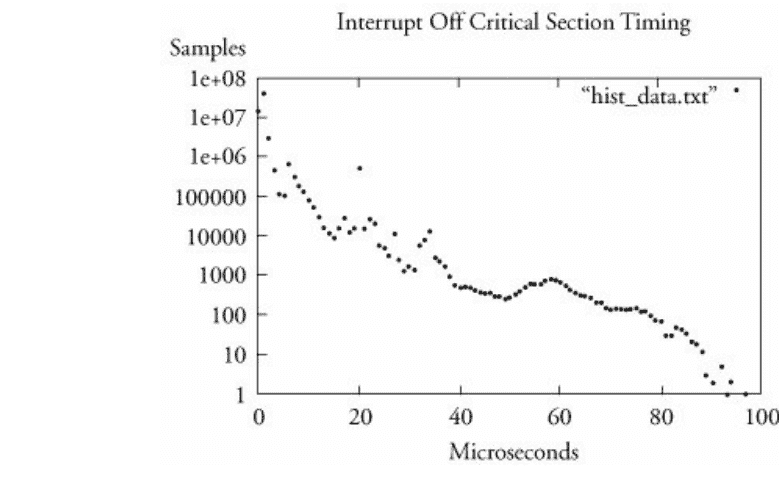

### 17.4.7. 延迟追踪

LATENCY_TRACE 配置选项启用生成与上次最大延迟测量相关的内核追踪数据。它也通过 /proc 文件系统提供。延迟追踪可帮助您隔离最长延迟的代码路径。对于每个新的最大延迟测量，会生成一个关联的追踪，以便追踪与最大延迟相关的代码路径。

清单 17-7 重现了一个 78 微秒最大值的追踪示例。与其他测量工具一样，通过向 /proc/sys/kernel/preempt_max_latency 写入 0 来启用测量。

#### 清单 17-7. 中断关闭最大延迟追踪

```
$ cat /proc/latency_trace
preemption latency trace v1.1.5 on 2.6.14-rt-intoff-tim_trace
---------------------------------------------------------
latency: 78 us, #50/50, CPU#0 | (M:rt VP:0, KP:0, SP:1 HP:1)
    -------------------
    | task: softirq-timer/0-3 (uid:0 nice:0 policy:1 rt_prio:1)
    -------------------

                      _--------=> CPU#
                     / _--------=> irqs-off
                    | / _------=> need-resched
                    || / _----=> hardirq/softirq
                    ||| / _--> preempt-depth
                    |||| /
                    ||||     delay
        cmd      pid ||||| time  |   caller
           \     /  ||||| \   |  /
    cat-6637  0D...   1us : common_interrupt ((0))
    cat-6637  0D.h.   2us : do_IRQ (c013d91c 0 0)
    cat-6637  0D.h1   3us+: mask_and_ack_8259A (__do_IRQ)
    cat-6637  0D.h1  10us : redirect_hardirq (__do_IRQ)
    cat-6637  0D.h.  12us : handle_IRQ_event (__do_IRQ)
    cat-6637  0D.h.  13us : timer_interrupt (handle_IRQ_event)
    cat-6637  0D.h.  15us : handle_tick_update (timer_interrupt)
    cat-6637  0D.h1  16us : do_timer (handle_tick_update)
    ...   <我们处于定时器中断函数中>
    cat-6637  0D.h.  22us : run_local_timers (update_process_times)
    cat-6637  0D.h.  22us : raise_softirq (run_local_timers)
    cat-6637  0D.h.  23us : wakeup_softirqd (raise_softirq)
    ...   <软中断工作挂起 - 发出需要抢占的信号>
    cat-6637  0Dnh.  34us : wake_up_process (wakeup_softirqd)
    cat-6637  0Dnh.  35us+: rcu_pending (update_process_times)
    cat-6637  0Dnh.  39us : scheduler_tick (update_process_times)
    cat-6637  0Dnh.  39us : sched_clock (scheduler_tick)
    cat-6637  0Dnh1  41us : task_timeslice (scheduler_tick)
    cat-6637  0Dnh.  42us+: preempt_schedule (scheduler_tick)
    cat-6637  0Dnh1  45us : note_interrupt (__do_IRQ)
    cat-6637  0Dnh1  45us : enable_8259A_irq (__do_IRQ)
    cat-6637  0Dnh1  47us : preempt_schedule (enable_8259A_irq)
    cat-6637  0Dnh.  48us : preempt_schedule (__do_IRQ)
    cat-6637  0Dnh.  48us : irq_exit (do_IRQ)
    cat-6637  0Dn..  49us : preempt_schedule_irq (need_resched)
    cat-6637  0Dn..  50us : __schedule (preempt_schedule_irq)
    ...   <这里是切换到 softirqd-timer 线程的上下文切换>
    <...>-3  0D..2  74us+: __switch_to (__schedule)
    <...>-3  0D..2  76us : __schedule <cat-6637> (74 62)
    <...>-3  0D..2  77us : __schedule (schedule)
    <...>-3  0D..2  78us : trace_irqs_on (__schedule)
    ...   <输出此处为简洁起见而截断>
```

为了清晰起见，我们大幅精简了此列表，但此跟踪的关键要素是显而易见的。此跟踪是由定时器中断引起的。在`hardirq`线程中，除了将一些工作排队稍后进入`softirq`上下文处理外，几乎没有做其他事情。这可以在23微秒处的`wakeup_softirqd()`函数中看到，这是中断处理的典型特征。这触发了`need_resched`标志，如跟踪中第二个字段第三列的`n`所示。在49微秒时，在定时器`softirq`中进行了一些处理后，调度器被调用以进行抢占。在74微秒时，控制权被传递给在这个特定内核中以PID 3运行的实际`softirqd-timer/0`线程。（进程名称被截断以适应字段宽度，显示为`<...>`。）

`代码清单 17-7`中的大多数字段都有明显的含义。`irqs-off`字段在代码中关闭中断的部分包含一个`D`。由于此延迟跟踪是中断关闭跟踪，我们在整个跟踪中都能看到此指示。`need_resched`字段反映了内核`need_resched`标志的状态。`n`表示应尽早在 mathematician 运行调度程序，句点（.）表示此标志未激活。`hardirq/softirq`字段用`h`表示`hardirq`上下文中的执行线程，用`s`表示`softirq`上下文中的执行线程。`preempt-depth`字段表示内核`preempt_count`变量的值，这是内核中锁嵌套级别的指示器。仅当此变量为零时才可能发生抢占。

### 17.4.8. 调试死锁条件

`DEBUG_DEADLOCKS`内核配置选项启用对内核中与信号量和自旋锁相关的死锁条件进行检测和报告。启用后，潜在的死锁条件将以类似如下的方式报告：

```
===================================
[ BUG: lock recursion deadlock detected! ]
-----------------------------------
...
```

在宣布检测到死锁的横幅行之后，会显示大量信息，包括锁描述符、锁名称（如果可用）、锁文件和名称（如果可用）、锁所有者、当前持有锁的人等。使用此调试工具，可以立即确定有问题的进程。当然，修复它可能没那么容易！

### 17.4.9. 锁定模式的运行时控制

`DEBUG_RT_LOCKING_MODE`选项启用运行时控制，可将实时互斥锁切换回不可抢占模式，有效地将实时（将自旋锁作为互斥锁）内核的行为更改回基于自旋锁的内核。与我们这里介绍的其他配置选项一样，此工具应被视为仅在开发环境中使用的开发辅助工具。

同时启用所有调试模式是没有意义的。正如您可能想象的，大多数调试模式会增加内核的大小和显著的处理开销。它们旨在用作开发辅助工具，应在生产代码中禁用。

## 17.5. 章节总结

- Linux越来越多地被用于需要实时性能的系统中。示例包括多媒体应用以及机器人、工业和汽车控制器。
- 实时系统的特征是截止时间。当错过截止时间导致不便或客户体验下降时，我们称之为软实时。相比之下，硬实时系统在错过截止时间时被视为失败。
- 内核抢占是Linux内核中第一个解决系统范围延迟的重要特性。
- 最近的Linux内核支持多种抢占模式，从无抢占到完全实时抢占。
- 实时补丁为Linux内核添加了几个关键特性，从而实现可靠的低延迟。
- 实时补丁包括几个重要的测量工具，以帮助调试和表征实时Linux实现。

### 17.5.1. 推荐阅读建议

*Linux Kernel Development*，第2版
Robert Love
Novell Press，2005

# 附录 A. GNU 公共许可证

这是由自由软件基金会编写和发布的GPL许可证的精确复制品。可以在[www.fsf.org](http://www.fsf.org)获取电子副本。

第2版，1991年6月

版权所有 © 1989, 1991 自由软件基金会公司

美国马萨诸塞州波士顿富兰克林街51号五楼，02110-1301

每个人都可以复制和分发本许可证文件的逐字副本，但不允许更改。

## 序言

大多数软件的许可证旨在剥夺您分享和更改它的自由。相比之下，GNU通用公共许可证旨在保证您分享和更改自由软件的自由，以确保该软件对其所有用户都是自由的。本通用公共许可证适用于大多数自由软件基金会的软件以及任何其他作者承诺使用它的程序。（其他一些自由软件基金会的软件由GNU较宽松通用公共许可证覆盖。）您也可以将其应用于您的程序。

当我们谈到自由软件时，我们指的是自由，而不是价格。我们的通用公共许可证旨在确保您拥有分发自由软件副本的自由（如果您愿意，可以为此服务收费），您收到源代码或可以在需要时获取它，您可以更改软件或将其部分用于新的自由程序；并且您知道您可以做这些事情。

为了保护您的权利，我们需要做出限制，禁止任何人否认您的这些权利或要求您放弃这些权利。如果您分发软件副本或修改它，这些限制会转化为您的某些责任。

例如，如果您分发此类程序的副本，无论是免费还是收费，您必须向接收者提供您拥有的所有权利。您必须确保他们也收到或可以获取源代码。并且您必须向他们展示这些条款，让他们知道自己的权利。

我们通过两个步骤保护您的权利：（1）对软件进行版权保护，（2）向您提供本许可证，赋予您复制、分发和/或修改软件的法律许可。

此外，为了保护每位作者和我们的利益，我们希望确保每个人都明白，此自由软件没有担保。如果软件被他人修改并传递，我们希望其接收者知道他们拥有的不是原始版本，这样其他人引入的任何问题都不会影响原始作者的声誉。

最后，任何自由程序都不断受到软件专利的威胁。我们希望避免自由程序的分发者单独获取专利许可的危险，这实际上会使该程序成为专有软件。为了防止这种情况，我们已经明确说明，任何专利必须授权给所有人免费使用，否则根本不授权。

以下是关于复制、分发和修改的精确条款和条件。

## 复制、分发和修改的条款和条件

1. 本许可证适用于任何包含版权持有者声明可以根据本通用公共许可证条款分发的程序或其他作品。下文中的"程序"是指任何此类程序或作品，"基于程序的作品"是指根据版权法的程序或任何衍生作品：也就是说，包含程序或其部分的作品，无论是逐字复制还是经过修改和/或翻译成另一种语言。（以下，翻译包含在"修改"一词中，无任何限制。）每个被许可人都被称为"您"。

    除复制、分发和修改外的活动不受本许可证覆盖；它们在其范围之外。运行程序的行为不受限制，程序输出的内容仅在构成基于程序的作品时受覆盖（独立于通过运行程序而制作）。这是否属实取决于程序的作用。

2. 您可以按收到的形式在任何媒介中复制和分发程序源代码的逐字副本，但前提是您在每个副本上显著且适当地发布适当的版权声明和免责声明；保留所有涉及本许可证和任何担保缺失的通知；并将本许可证的副本与程序一起提供给程序的任何其他接收者。

    您可以就传输副本的物理行为收取费用，并且您可以选择提供担保保护以换取费用。

3. 您可以修改程序的一个或多个副本或其任何部分，从而形成基于程序的作品，并根据上述第1节的规定复制和分发此类修改或作品，但前提是您还要满足以下所有条件：

    a. 您必须让修改后的文件携带显著的通知，说明您更改了文件以及任何更改的日期。

    b. 您必须让您分发或发布的任何作品，其全部或部分包含或衍生自程序或其任何部分，在整体上根据本许可证的条款免费许可给所有第三方。

    c. 如果修改后的程序在运行时通常以交互方式读取命令，您必须使其在以最普通的方式开始运行此类交互式使用时，打印或显示包括适当版权声明和没有担保的通知（或者说，说明您提供担保）以及用户可以在这些条件下重新分发程序的通知，并告诉用户如何查看本许可证的副本。（例外：如果程序本身是交互式的，但通常不打印

此类公告)，您的基于该程序的工作无需打印公告。

这些要求适用于修改后的整个作品。如果该作品中可识别的部分并非源自该程序，并且可以合理地被视为独立且分离的作品本身，则当您将它们作为独立作品分发时，本许可证及其条款不适用于这些部分。但是，当您将相同的部分作为基于该程序的工作的一部分进行分发时，整个作品的分发必须遵循本许可证的条款，该许可证赋予其他被许可人的权限延伸至整个作品，因此也延伸至每一部分，无论其作者是谁。

因此，本条款的目的不是声称对完全由您撰写的著作拥有权利或质疑您的权利；其目的是行使控制基于该程序的衍生作品或汇编作品的分发的权利。

此外，将另一个非基于该程序的作品与该程序（或基于该程序的作品）仅仅在存储或分发介质卷上聚合，并不会使该另一个作品归入本许可证的范围。

- 4. 您可以复制和分发程序（或其基于的作品，在[第2条](...)下），以目标代码或可执行文件形式，按照上述[第1条](...)和[第2条](...)的条款，前提是您还需执行以下操作之一：

    - a. 随附完整的、相应的、机器可读的源代码，该源代码必须按照上述[第1条](...)和[第2条](...)的条款在通常用于软件交换的介质上分发；或者，

    - b. 随附一份书面提议，该提议有效期至少三年，承诺向任何第三方提供完整的、机器可读的相应源代码副本，费用不超过您执行源代码分发的实际成本，并按照上述[第1条](...)和[第2条](...)的条款在通常用于软件交换的介质上分发；或者，

    - c. 随附您收到的关于分发相应源代码提议的信息。（此替代选项仅适用于非商业性分发，并且仅当您收到程序的目标代码或可执行文件形式时附带此类提议，符合上述小节b。）

作品的源代码是指用于修改该作品的首选形式。对于可执行作品，完整的源代码是指其包含的所有模块的全部源代码，加上任何关联的接口定义文件，加上用于控制可执行文件编译和安装的脚本。然而，作为特殊例外，分发的源代码无需包含通常随操作系统主要组件（编译器、内核等）一起分发（无论以源代码还是二进制形式）的任何内容，除非该组件本身随附可执行文件。

如果分发可执行文件或目标代码是通过提供从指定位置复制副本的访问方式来进行的，那么提供从同一位置复制源代码的等效访问方式，应视为分发源代码，即使第三方并未被强制要求在复制目标代码时同时复制源代码。

5. 除非本许可证明确规定，否则您不得复制、修改、再许可或分发程序。任何试图以其他方式复制、修改、再许可或分发程序的尝试都是无效的，并将自动终止您在本许可证下的权利。然而，根据本许可证已从您处收到副本或权利的当事人，只要这些当事人保持完全合规，其许可证不会被终止。

6. 您无需接受本许可证，因为您未签署它。但是，没有其他任何内容授予您修改或分发程序或其衍生作品的许可。如果您不接受本许可证，这些行为在法律上是禁止的。因此，通过修改或分发程序（或任何基于程序的作品），您表示接受本许可证并同意其所有条款和条件，涉及复制、分发或修改程序或基于程序的作品。

7. 每次您重新分发程序（或任何基于程序的作品）时，接收者自动从原始许可方获得一份许可证，允许其在遵守本许可证条款和条件的前提下复制、分发或修改程序。您不得对接收者行使本许可证赋予的权利施加任何进一步的限制。您没有责任强制第三方遵守本许可证。

8. 如果因法院判决、专利侵权指控或任何其他原因（不限于专利问题），对您施加了（无论是通过法院命令、协议或其他方式）与本许可证条件相冲突的条件，这些条件并不能免除您遵守本许可证条件的义务。如果您无法在同时满足本许可证义务和任何其他相关义务的情况下进行分发，那么结果就是您可能根本无法分发程序。例如，如果专利许可证不允许所有通过您直接或间接收到副本的人对程序进行免版税的重新分发，那么您唯一能同时满足该许可证和本许可证的方式就是完全不进行分发。

如果本条款的任何部分在任何特定情况下被认定无效或不可执行，本条款的其余部分应继续适用，并且本条款整体在其他情况下应继续适用。

本条款的目的不是诱导您侵犯任何专利或其他财产权主张，或质疑任何此类主张的有效性；本条款的唯一目的是保护通过公共许可实践实施的自由软件分发系统的完整性。许多人依赖该系统的一致应用，为通过该系统分发的广泛软件做出了慷慨贡献；决定是否愿意通过任何其他系统分发软件，是作者/捐赠者的选择，被许可人不能强加该选择。

本条款旨在彻底阐明被认为是本许可证其余部分所产生后果的内容。

9. 如果在某些国家，程序的分发和/或使用因专利或受版权保护的接口而受到限制，将程序置于本许可证下的原始版权持有者可以添加明确的地理分发限制，排除这些国家，使得分发仅在未被排除的国家内或之间被允许。在这种情况下，本许可证包含该限制，如同写在本许可证正文中一样。

10. 自由软件基金会可能会不时发布通用公共许可证的修订版和/或新版本。此类新版本在精神上与当前版本相似，但在细节上可能有所不同，以解决新问题或新关切。

每个版本都有一个独特的版本号。如果程序指定了适用于它的本许可证版本号以及“任何更高版本”，您可以选择遵循该版本或自由软件基金会发布的任何更高版本的条款和条件。如果程序未指定本许可证的版本号，您可以选择自由软件基金会发布的任何版本。

**11.** 如果您希望将程序的部分内容整合到其他分发条件不同的自由软件中，请写信给作者请求许可。对于由自由软件基金会拥有版权的软件，请写信给自由软件基金会；我们有时会为此类情况破例。我们的决定将以两个目标为指导：保护我们所有自由软件衍生作品的自由状态，以及促进软件的共享和重用。


## 无担保

12. 由于本程序是免费授权使用的，因此在适用法律允许的范围内，本程序不提供任何担保。除非另有书面声明，否则版权持有人和/或其他方按"原样"提供本程序，不提供任何种类的担保，无论是明示的还是默示的，包括但不限于对适销性和特定用途适用性的默示担保。关于本程序的质量和性能的全部风险由您承担。如果本程序被证明存在缺陷，您将承担所有必要的维修、修复或纠正费用。

13. 除非适用法律要求或经书面同意，任何版权持有人或任何其他可能按照上述规定修改和/或重新分发本程序的一方，均不对您因使用或无法使用本程序而造成的任何损害承担赔偿责任，包括但不限于一般损害、特殊损害、附带损害或间接损害（包括但不限于数据丢失或数据不准确、您或第三方遭受的损失，或本程序无法与其他任何程序一起运行），即使该持有人或其他方已被告知可能发生此类损害。

# 附录 B. U-Boot 可配置命令

U-Boot 有 60 多个可配置命令。这些命令在最近一次的 U-Boot 快照中汇总于[表 B-1]。除此之外，还有大量非标准命令，其中一些依赖于特定硬件或处于实验阶段。如需完整和最新的列表，请查阅源代码。这些命令在 U-Boot 源代码顶层目录的 `.../include/cmd_confdefs.h` 头文件中定义。

### 表 B-1. U-Boot 可配置命令

| 命令集 | 命令 |
|---|---|
| CFG_CMD_BDI | bdinfo |
| CFG_CMD_LOADS | loads |
| CFG_CMD_LOADB | loadb |
| CFG_CMD_IMI | iminfo |
| CFG_CMD_CACHE | icache, dcache |
| CFG_CMD_FLASH | flinfo, erase, protect |
| CFG_CMD_MEMORY | md, mm, nm, mw, cp, cmp, crc, base, loop, mtest |
| CFG_CMD_NET | bootp, tftpboot, rarpboot |
| CFG_CMD_ENV | saveenv |
| CFG_CMD_KGDB | kgdb |
| CFG_CMD_PCMCIA | PCMCIA 支持 |
| CFG_CMD_IDE | IDE 硬盘支持 |
| CFG_CMD_PCI | pciinfo |
| CFG_CMD_IRQ | irqinfo |
| CFG_CMD_BOOTD | bootd |
| CFG_CMD_CONSOLE | coninfo |
| CFG_CMD_EEPROM | EEPROM 读写支持 |
| CFG_CMD_ASKENV | 请求环境变量 |
| CFG_CMD_RUN | 运行环境变量中的命令 |
| CFG_CMD_ECHO | 回显参数 |
| CFG_CMD_I2C | I2C 串行总线支持 |
| CFG_CMD_REGINFO | 寄存器转储 |
| CFG_CMD_IMMAP | IMMR 转储支持 |
| CFG_CMD_DATE | 支持 RTC、日期/时间等 |
| CFG_CMD_DHCP | DHCP 支持 |
| CFG_CMD_BEDBUG | 包含 BedBug 调试器 |
| CFG_CMD_FDC | 软盘支持 |
| CFG_CMD_SCSI | SCSI 支持 |
| CFG_CMD_AUTOSCRIPT | 自动脚本支持 |
| CFG_CMD_MII | MII 支持 |
| CFG_CMD_SETGETDCR | 4xx 上的 DCR 支持 |
| CFG_CMD_BSP | 板级特定功能 |
| CFG_CMD_ELF | ELF (VxWorks) 加载/启动命令 |
| CFG_CMD_MISC | 杂项功能，如 sleep |
| CFG_CMD_USB | USB 支持 |
| CFG_CMD_DOC | 芯片磁盘支持 |
| CFG_CMD_JFFS2 | JFFS2 支持 |
| CFG_CMD_DTT | 数字温度和温控器 |
| CFG_CMD_SDRAM | SDRAM DIMM SPD 信息打印 |
| CFG_CMD_DIAG | 诊断 |
| CFG_CMD_FPGA | FPGA 配置支持 |
| CFG_CMD_HWFLOW | RTS/CTS 硬件流控 |
| CFG_CMD_SAVES | 保存 S 记录转储 |
| CFG_CMD_SPI | SPI 工具 |
| CFG_CMD_FDOS | 软盘 DOS 支持 |
| CFG_CMD_VFD | VFD 支持 (TRAB) |
| CFG_CMD_NAND | NAND 支持 |
| CFG_CMD_BMP | BMP 支持 |
| CFG_CMD_PORTIO | 端口 I/O |
| CFG_CMD_PING | Ping 支持 |
| CFG_CMD_MMC | MMC 支持 |
| CFG_CMD_FAT | FAT 支持 |
| CFG_CMD_IMLS | 列出所有找到的映像 |
| CFG_CMD_ITEST | 整数（和字符串）测试 |
| CFG_CMD_NFS | NFS 支持 |
| CFG_CMD_REISER | Reiserfs 支持 |
| CFG_CMD_CDP | Cisco 发现协议 |
| CFG_CMD_XIMG | 加载多映像的一部分 |
| CFG_CMD_UNIVERSE | Tundra Universe 支持 |
| CFG_CMD_EXT2 | EXT2 支持 |
| CFG_CMD_SNTP | SNTP 支持 |
| CFG_CMD_DISPLAY | 显示支持 |

# 附录 C. BusyBox 命令

BusyBox 有许多实用的命令。以下是在最近一次的 BusyBox 快照中有文档记录的命令列表。

- `addgroup` — 向系统添加组
- `adduser` — 向系统添加用户
- `adjtimex` — 读取并可选地设置系统时间基准参数
- `ar` — 从 `ar` 归档中提取或列出文件
- `arping` — 通过 ARP 请求/回复来 ping 主机
- `ash` — ash shell（命令解释器）
- `awk` — 模式扫描和处理语言
- `basename` — 去除文件的目录路径和后缀
- `bunzip2` — 解压文件（如果未指定输入文件，则为标准输入）
- `bzcat` — 解压到 `stdout`
- `cal` — 显示日历
- `cat` — 连接文件并输出到 `stdout`
- `chgrp` — 更改每个文件的组隶属关系
- `chmod` — 更改文件访问权限
- `chown` — 更改文件的所有者和/或组
- `chroot` — 将根目录设置为新根后运行命令
- `chvt` — 将前台虚拟终端切换到 `/dev/ttyN`
- `clear` — 清除屏幕
- `cmp` — 比较文件
- `cp` — 复制文件
- `cpio` — 从 `cpio` 归档中提取或列出文件
- `crond` — BusyBox 版本的 `cron` 守护进程

| 命令 | 说明 |
|---------|-------------|
| `crontab` | 管理 `crontab` 控制文件 |
| `cut` | 从每个输入文件中打印选定字段到标准输出 |
| `date` | 显示或设置系统时间 |
| `dc` | 微型 RPN 计算器 |
| `dd` | 根据选项复制文件，并进行转换和格式化 |
| `deallocvt` | 释放未使用的虚拟终端 `/dev/ttyN` |
| `delgroup` | 从系统中删除组 |
| `deluser` | 从系统中删除用户 |
| `devfsd` | 管理 `devfs` 权限和旧设备名称符号链接的过时守护进程 |
| `df` | 打印文件系统已用空间和可用空间 |
| `dirname` | 从文件名中去除非目录后缀 |
| `dmesg` | 打印或控制内核环形缓冲区 |
| `dos2unix` | 将文件从 DOS 格式转换为 UNIX 格式 |
| `dpkg` | 安装、删除和管理 Debian 软件包的工具 |
| `dpkg-deb` | 对 Debian 软件包（debs）执行操作 |
| `du` | 汇总每个文件和/或目录所使用的磁盘空间 |
| `dumpkmap` | 将二进制键盘转换表打印到标准输出 |
| `dumpleases` | 显示由 `udhcpd` 授予的 DHCP 租约 |
| `echo` | 将指定的参数打印到 `stdout` |
| `env` | 打印当前环境或设置后运行程序 |
| `expr` | 将表达式的值打印到标准输出 |
| `false` | 返回 `FALSE (1)` 的退出代码 |
| `fbset` | 显示和修改帧缓冲设置 |
| `fdflush` | 强制软盘驱动器检测磁盘更换 |
| `fdformat` — 低级格式化软盘 |
| `fdisk` — 更改分区表 |
| `find` — 在目录层次结构中搜索文件 |
| `fold` — 折行输入行 |
| `free` — 显示空闲和已使用的系统内存量 |
| `freeramdisk` — 释放指定 ramdisk 使用的所有内存 |
| `fsckminix` — 对 MINIX 文件系统执行一致性检查 |
| `ftpget` — 通过 FTP 获取远程文件 |
| `ftpput` — 通过 FTP 将本地文件存储到远程机器 |
| `getopt` — 解析命令选项 |
| `getty` — 打开 tty，提示输入登录名，然后调用 `/bin/login` |
| `grep` — 在每个文件或标准输入中搜索 _PATTERN_ |
| `gunzip` — 解压文件（或标准输入） |
| `gzip` — 以最大压缩比压缩文件 |
| `halt` — 停止系统 |
| `hdparm` — 获取/设置硬盘参数 |
| `head` — 将每个文件的前 10 行打印到标准输出 |
| `hexdump` — 以用户指定的二进制、八进制、十六进制、字符或十进制格式转储文件 |
| `hostid` — 打印机器的唯一 32 位标识符 |
| `hostname` — 获取或设置主机名 |
| `httpd` — 监听传入的 http 服务器请求 |
| `hwclock` — 查询和设置硬件时钟（`RTC`） |
| `id` — 打印 `USERNAME` 或当前用户的信息 |
| `ifconfig` — 配置网络接口 |
| `ifdown` — 取消配置接口 |
| `ifup` — 配置接口 |
| `inetd` — 监听网络连接并启动程序 |
| `init` — BusyBox 版本的 `init` |
| `insmod` — 将指定的内核模块加载到内核中 |
| `install` — 复制文件并设置属性 |
| `ip` — TCP/IP 配置工具 |
| `ipaddr` — 操作接口地址 |
| `ipcalc` — 从 IP 地址计算 IP 网络设置 |
| `iplink` — 操作接口设置 |
| `iproute` — 显示/设置路由表项 |
| `iptunnel` — BusyBox `iptunnel` 工具 |
| `kill` — 向指定的进程发送信号（默认为 `SIGTERM`） |


-   **killall**
  向指定进程发送信号（默认为 `SIGTERM`）
- **klogd**
  内核日志记录器
- **lash**
  BusyBox 的 LAme SHell（命令解释器）
- **last**
  显示最近登录系统的用户列表
- **length**
  打印指定 `STRING` 的长度
- **ln**
  创建一个名为 `LINK_NAME` 或 `DIRECTORY` 的链接，指向指定的 `TARGET`
- **loadfont**
  从标准输入加载控制台字体
- **loadkmap**
  从标准输入加载二进制键盘映射表
- **logger**
  将 `MESSAGE` 写入系统日志
- **login**
  在系统上开始新会话
- **logname**
  打印当前用户的名称
- **logread**
  显示来自 `syslogd` 的消息
- **losetup**
  将 `LOOPDEVICE` 与文件关联
- **ls**
  列出目录内容
- **lsmod**
  列出当前已加载的内核模块
- **makedevs**
  创建一系列块设备或字符设备特殊文件
- **md5sum**
  打印或校验 MD5 校验和
- **mesg**
  `mesg` 控制对终端的写入访问权限
- **mkdir**
  创建目录条目
- **mkfifo**
  创建命名管道（等同于 `mknod name p`）
- **mkfsminix**
  创建 MINIX 文件系统
- **mknod**
  创建特殊文件（块设备、字符设备或管道）
- **mkswap**
  准备磁盘分区用作交换分区
- **mktemp**
  创建一个临时文件，其名称基于 `TEMPLATE` 生成
- **modprobe**
  用于高级模块加载和卸载
- **more**
  用于逐屏查看文件的过滤器
- **mount**
  挂载文件系统
- **mt**
  控制磁带机操作
- **mv**
  重命名和/或移动文件
- **nameif**
  在网络接口关闭状态下重命名该接口
- **nc**
  `Netcat` 打开一个到 `IP:port` 的管道

| 命令 | 描述 |
|---------|-------------|
| `netstat` | `Netstat` 显示 Linux 网络信息 |
| `nslookup` | 查询指定主机的 IP 地址的域名服务器 |
| `od` | 以八进制及其他格式转储文件 |
| `openvt` | 在新的虚拟终端上启动命令 |
| `passwd` | 更改用户密码 |
| `patch` | `patch` 的 BusyBox 实现 |
| `pidof` | 获取指定进程的 PID |
| `ping` | 向网络主机发送 `ICMP ECHO_REQUEST` 数据包 |
| `ping6` | 向网络主机发送 `ICMP ECHO_REQUEST` 数据包 |
| `pivot_root` | 更改根文件系统 |
| `poweroff` | 停止系统并请求内核关闭电源 |
| `printf` | 根据用户格式格式化并打印参数 |
| `ps` | 报告进程状态 |
| `pwd` | 打印当前工作目录的完整路径名 |
| `rdate` | 从远程 `HOST` 获取并可能设置系统日期和时间 |
| `readlink` | 显示符号链接的值 |
| `realpath` | 返回给定参数的绝对路径名 |
| `reboot` | 重新启动系统 |
| `renice` | 在允许的优先级范围内更改运行进程的优先级 |
| `reset` | 重置屏幕 |
| `rm` | 删除（取消链接）文件 |
| `rmdir` | 删除目录（如果为空） |
| `rmmod` | 从内核中卸载指定的内核模块 |
| `route` | 编辑内核的路由表 |
| `rpm` | 操作 RPM 软件包 |
| `rpm2cpio` | 输出 `rpm` 文件的 `cpio` 归档 |
| `run-parts` | 运行目录中的一组脚本 |
| `rx` | 使用 xmodem 协议接收文件 |
| `sed` | Busybox Stream Editor 实现 |
| `seq` | 将一系列数字打印到标准输出 |
| `setkeycodes` | 将条目设置到内核的扫描码到键码映射表中 |

| 命令 | 描述 |
| :--- | :--- |
| sha1sum | 打印或校验 SHA1 校验和 |
| sleep | 延迟指定的时间 |
| sort | 对指定文件中的文本行进行排序 |
| start-stop-daemon | 用于启动和停止服务的程序 |
| strings | 显示二进制文件中的可打印字符串 |
| stty | 显示和修改终端设置 |
| su | 更改用户 ID 或成为 root 用户 |
| sulogin | 单用户登录 |
| swapoff | 禁用虚拟内存页面交换 |
| swapon | 启用虚拟内存页面交换 |
| sync | 将所有缓冲的文件系统块写入磁盘 |
| sysctl | 在运行时配置内核参数 |
| syslogd | Linux 系统和内核日志工具 |
| tail | 将每个文件的最后 10 行打印到标准输出 |
| tar | 创建、提取或列出 tar 文件中的文件 |
| tee | 将标准输入复制到每个文件，同时也输出到标准输出 |
| telnet | BusyBox Telnet 客户端实现 |
| telnetd | BusyBox Telnet 服务器实现 |
| test | 检查文件类型并比较值，返回退出码 |
| tftp | 使用 TFTP 协议传输文件 |
| time | 测量程序所用的时间 |
| top | 提供处理器活动的实时视图 |
| touch | 更新给定文件的最后修改日期 |
| tr | 转换、压缩和/或删除字符 |
| traceroute | 追踪 IP 数据包的路由 |
| true | 返回 true（0）的退出码 |
| tty | 打印连接到标准输入的终端的文件名 |
| udhcpc | BusyBox DHCP 客户端实现 |
| udhcpd | BusyBox DHCP 服务器实现 |
| umount | 卸载文件系统 |
| uname | 打印某些系统信息 |
| uncompress | 解压缩 Z 文件 |
| uniq | 丢弃 `INPUT` 中除一个以外的所有连续重复行 |
| unix2dos | 将文件从 UNIX 格式转换为 DOS 格式 |
| unzip | 从 ZIP 归档中提取文件 |
| uptime | 显示自上次启动以来的时间 |
| usleep | 暂停 $n$ 微秒 |
| uudecode | 对 uuencode 编码的文件进行解码 |
| uuencode | 对文件进行 uuencode 编码 |
| vconfig | 允许创建和删除虚拟以太网设备 |
| vi | BusyBox vi 编辑器 |
| vlock | 锁定虚拟终端并需要密码才能解锁 |
| watch | 定期执行程序 |
| watchdog | 定期写入指定的看门狗设备 |
| wc | 打印每个文件的行数、单词数和字节数 |
| wget | 通过 HTTP 或 FTP 检索文件 |
| which | 在当前路径中定位命令 |
| who | 打印当前用户名及相关信息 |
| whoami | 打印与当前有效用户 `ID` 关联的用户名 |
| xargs | 对标准输入给出的每一项执行命令 |
| yes | 重复输出一行包含所有指定 `STRING` 的内容，或输出 `y` |
| zcat | 解压缩到 `stdout` |

# 附录 D. SDRAM 接口注意事项

**本附录内容**

- [SDRAM 基础](page-492) 第 [492](page-492) 页
- [时钟设置](page-494) 第 [494](page-494) 页
- [SDRAM 设置](page-495) 第 [495](page-495) 页
- [总结](page-500) 第 [500](page-500) 页

乍一看，编程 SDRAM 控制器似乎是一项艰巨的任务。确实，人们已经开发出众多同步动态随机存取存储器（DRAM）技术。为了不断追求更高的性能和密度，人们开发了许多不同的架构和操作模式。

我们以 AMCC PowerPC 405GP 处理器为例来讨论 SDRAM 接口注意事项。在我们探讨与 SDRAM 接口相关的问题时，您可能需要手边有一份用户手册以供参考。该文档在 [D.4.1 节](section-d.4.1)"推荐阅读建议"中有所引用。

## D.1. SDRAM 基础

要了解 SDRAM 的设置，有必要先了解 SDRAM 器件的基本工作原理。在不深入硬件设计细节的情况下，SDRAM 器件被组织为一个单元矩阵，其中若干地址位用于行寻址，若干地址位用于列寻址。[图 D-1](#) 展示了这一点。

### 图 D-1. 简化的 SDRAM 框图

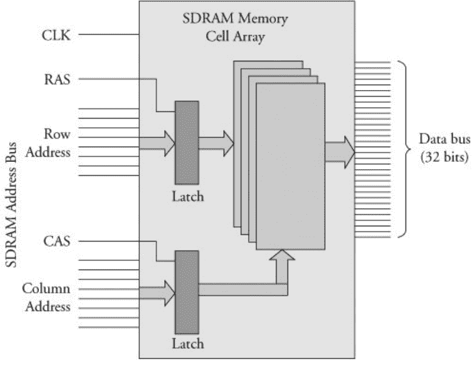

在存储矩阵内部，电路相当复杂。一个简化的读操作示例如下：通过在行地址线上放置行地址，然后在列地址线上放置列地址来引用给定的存储位置。经过一段时间后，由行和列输入所寻址的位置中存储的数据将在数据总线上提供给处理器。

处理器在 SDRAM 地址总线上输出行地址并使能行地址选择（RAS）信号。经过短暂的预编程延迟以允许 SDRAM 电路捕获行

地址，处理器输出列地址并置位其列地址选择（CAS）信号。SDRAM控制器将实际的物理内存地址转换为行地址和列地址。许多SDRAM控制器可以配置行和列的宽度大小；PPC405GP就是其中之一。稍后你将看到，这必须作为SDRAM控制器设置的一部分进行配置。

这个例子大幅简化了，但概念是相同的。例如，一次突发读取四个内存位置，只需输出一个RAS和CAS周期，SDRAM内部电路会自动递增后续三个突发读取位置的列地址，从而消除了处理器发出四个独立CAS周期的需要。这仅是性能优化的一个例子。理解这一点的最佳方式是吸收一个实际内存芯片的细节。一个写得很好的数据手册示例包含在[第D.4.1节](https://example.com)“建议进一步阅读”中。

### D.1.1. SDRAM刷新

SDRAM由一个晶体管和一个电容器组成。晶体管提供电荷，电容器的作用是保持（存储）单个单元的值。由于超出本讨论范围的原因，电容器只能将值保持很短的时间。动态内存的基本概念之一是，代表每个单元的电容器必须定期重新充电以保持其值。这被称为SDRAM刷新。

刷新周期是一种特殊的内存周期，既不读取也不写入内存数据。它只是执行所需的刷新周期。SDRAM控制器的主要职责之一是保证及时发出刷新周期以满足芯片的要求。

芯片制造商指定了最小刷新间隔，设计师的任务就是保证这一点。通常，SDRAM控制器可以直接配置以选择刷新间隔。此处介绍的PowerPC 405GP有一个专门用于此目的的寄存器。我们稍后会看到这一点。

## D.2. 时钟

术语*同步*意味着SDRAM设备的读写周期与CPU的时钟信号一致。SDR SDRAM在每个SDRAM时钟周期进行读写。DDR SDRAM在每个时钟周期进行两次读写，一次在时钟上升沿，一次在下降沿。

现代处理器具有复杂的时钟子系统。许多处理器具有多个时钟频率，用于系统的不同部分。典型的处理器使用相对较低频率的晶体生成的时钟源作为其主时钟信号。处理器内部的锁相环生成CPU的主时钟（我们在比较处理器速度时谈论的时钟频率）。由于CPU通常比内存子系统运行得快得多，处理器生成主CPU时钟的次分频信号以馈送给SDRAM子系统。你需要为特定的CPU和SDRAM组合配置此时钟比。

处理器和内存子系统的时钟必须正确配置，SDRAM才能正常工作。你的处理器手册包含有关时钟设置和管理的部分，你必须查阅此部分以正确设置特定的板卡设计。

AMCC 405GP在其功能集的处理器中具有代表性。它接收单个晶体生成的时钟输入源，并生成其子系统所需的多个内部和外部时钟。它为CPU、PCI接口、板载外设总线（OPB）、处理器本地总线（PLB）、内存时钟（MemClk）以及几个外设（如定时器和UART模块）的内部时钟生成时钟。典型配置可能如表D-1所示。

### 表D-1. 典型的PPC405GP时钟配置

| 时钟 | 频率 | 说明 |
| --- | --- | --- |
| 晶体参考时钟 | 33MHz | 提供给处理器的基本参考时钟 |
| CPU时钟 | 133MHz | 源自处理器内部锁相环，由硬件引脚设置和寄存器设置控制。 |
| PLB时钟 | 66MHz | 源自CPU时钟，通过硬件引脚设置和寄存器设置配置。用于其高速模块之间的内部处理器本地总线数据交换。 |
| OPB时钟 | 66MHz | 源自PLB时钟，通过寄存器设置配置。用于不需要高速连接的外设的内部连接。 |
| PCI时钟 | 33MHz | 源自PLB时钟，通过寄存器设置配置。 |
| MemClk | 100MHz | 直接驱动SDRAM芯片。源自CPU时钟，通过寄存器设置配置。 |

关于时钟设置的决策通常必须在硬件设计时做出。引脚设置选项决定了上电时处理器的初始时钟配置。通常可以通过设置可通过处理器内部时钟和子系统控制专用寄存器访问的分频位来对衍生时钟进行一些控制。在我们基于405GP的示例中，最终的时钟配置由引脚设置和固件配置决定。在加电后尽早设置初始分频器和任何其他可通过处理器寄存器位配置的时钟选项是引导加载程序的职责。

## D.3. SDRAM设置

时钟配置完成后，下一步是配置SDRAM控制器。控制器因处理器而异，但最终结果始终相同：你必须提供正确的时钟和时序值，以启用和优化SDRAM子系统的性能。

与本书中的其他材料一样，没有替代品可以替代你试图配置的硬件的详细知识。对于SDRAM尤其如此。本附录的范围不包括探索SDRAM的设计，但必须理解一些基础知识。许多制造商的SDRAM设备数据手册包含有用的技术描述。我们敦促你熟悉这些数据手册的内容。你不需要硬件工程学位来理解如何正确配置SDRAM子系统，但你需要投入一定程度的理解。

这里我们探讨SDRAM控制器在405GP处理器上如何配置，该处理器由我们在第7章“引导加载程序”中介绍的U-Boot引导加载程序配置。回顾第7章，U-Boot在4xx特定的`cpu`目录下的`start.S`中提供了从汇编语言启动代码进行SDRAM初始化的钩子。请参考第7章第7.4.4节“板卡特定初始化”。清单D-1复制了U-Boot的`.../cpu/ppc4xx/sdram.c`文件中的`sdram_init()`函数。

### 清单D-1. 来自U-Boot的ppc4xx sdram_init()

```
01 void sdram_init(void)
02 {
03     ulong sdtr1;
04     ulong rtr;
05     int i;
06 
07     /*
08      * 支持100MHz和133MHz SDRAM
09      */
10     if (get_bus_freq(0) > 100000000) {
11         /*
12          * 133 MHz SDRAM
13          */
14         sdtr1 = 0x01074015;
15         rtr = 0x07f00000;
16     } else {
17         /*
18          * 默认：100 MHz SDRAM
19          */
20         sdtr1 = 0x0086400d;
21         rtr = 0x05f00000;
22     }
23 
24     for (i=0; i<N_MB0CF; i++) {
25         /*
26          * 禁用内存控制器。
27          */
28         mtsdram0(mem_mcopt1, 0x00000000);
29 
30         /*
31          * 为bank 0设置MB0CF。
32          */
33         mtsdram0(mem_mb0cf, mb0cf[i].reg);
34         mtsdram0(mem_sdtr1, sdtr1);
35         mtsdram0(mem_rtr, rtr);
36 
37         udelay(200);
38     }
```

```
39     /*
40      * 设置内存控制器选项寄存器MCOPT1。
41      * 将DC_EN设为'1'，BRD_PRF设为'01'，用于16字节PLB突发
42      * 读取/预取。
43      */
44     mtsdram0(mem_mcopt1, 0x80800000);
45 
46     udelay(10000);
47 
48     if (get_ram_size(0, mb0cf[i].size) == mb0cf[i].size) {
49         /*
50          * 好的，检测到大小 -> 全部完成
51          */
52         return;
53     }
54 }
```

第一个操作读取405GP处理器上的引脚设置，以确定SDRAM时钟的设计值。在本例中，我们可以看到支持两个可能的值：100MHz和133MHz。基于此选择，选择常量，稍后在函数中用于设置SDRAM控制器中的相应寄存器位。

从第24行开始，使用循环来设置每个最多五个预定义内存大小的参数。目前，U-Boot具有支持单个内存库大小为4MB、16MB、32MB、64MB或128MB的逻辑。这些大小在名为`mb0cf`的表中定义，位于`.../cpu/ppc4xx/sdram.c`中。该表将常量与这些内存大小关联起来，基于405GP内存库配置寄存器所需的值。循环执行以下操作：

```
for (i = 每种可能的内存库大小，从最大开始) {
    基于SDRAM时钟速度选择时序常量；
    禁用SDRAM内存控制器；
    使用size[i], timing constants[i]配置bank 0；
    重新启用SDRAM内存控制器；
```


## D.4. 小结

SDRAM 器件相当复杂。本附录提供了一个非常简单的示例，帮助你理解 SDRAM 控制器设置的复杂性。SDRAM 控制器执行关键功能，必须进行正确配置。深入研读规格书并消化其中的信息是无可替代的。本附录中引用的两份示例文档是很好的起点。

### D.4.1. 补充阅读建议

- AMCC 405GP 嵌入式处理器用户手册
  AMCC 公司
  [www.amcc.com/Embedded/](www.amcc.com/Embedded/)
- 美光科技公司
  同步 DRAM MT48LC64M4A2 数据手册
  [http://download.micron.com/pdf/datasheets/dram/sdram/256MSDRAM.pdf](http://download.micron.com/pdf/datasheets/dram/sdram/256MSDRAM.pdf)

# 附录 E. 开源资源

- [源代码仓库与开发者信息](#)
- [邮件列表](#)
- [Linux 新闻与发展动态](#)
- [开源洞察与讨论](#)

## 源代码仓库与开发者信息

网上有多个专注于 Linux 开发的站点。以下是各架构和项目最重要的网站列表：

- 主内核源代码树
  [www.kernel.org](www.kernel.org)
- 主内核 GIT 仓库
  [www.kernel.org/git](www.kernel.org/git)
- PowerPC 相关开发与邮件列表
  [http://ozlabs.org/](http://ozlabs.org/)
- MIPS 相关发展动态
  [www.linux-mips.org](www.linux-mips.org)
- ARM 相关 Linux 开发
  [www.arm.linux.org.uk](www.arm.linux.org.uk)
- 大量开源项目的主要聚集地
  [http://sourceforge.net](http://sourceforge.net)

## 邮件列表

数以百计（甚至数以千计）的邮件列表涵盖了 Linux 和开源开发的方方面面。以下是几个值得考虑的列表。在发帖之前，请务必熟悉邮件列表的礼仪规范。

这些列表大多维护着可搜索的归档。这是你应当首先查阅的地方。在绝大多数情况下，你的问题已经被问过并得到解答。从以下资源开始阅读，了解如何最好地使用公共邮件列表：

Linux 内核邮件列表 FAQ
[www.tux.org/lkml](http://www.tux.org/lkml)

服务于各种 Linux 内核相关邮件列表的列表服务器
[http://vger.kernel.org](http://vger.kernel.org)

Linux 内核邮件列表，流量极大，仅限内核开发
[http://vger.kernel.org/vger-lists.html#linux-kernel](http://vger.kernel.org/vger-lists.html#linux-kernel)

## Linux 新闻与发展动态

许多新闻网站值得偶尔浏览。以下是一些比较受欢迎的网站。

- LinuxDevices.com
  [www.linuxdevices.com](http://www.linuxdevices.com)
- PowerPC 新闻及其他信息
  [http://penguinppc.org](http://penguinppc.org)
- 综合 Linux 新闻与发展动态
  [www.lwn.net](http://www.lwn.net)

## 开源洞察与讨论

以下公共网站包含有用的信息和教育内容，重点关注开源相关的法律问题。

[www.open-bar.org](http://www.open-bar.org)


# 附录 F. BDI-2000 配置文件示例

```bash
; bdiGDB configuration file for the UEI PPC 5200 Board
; Revision 1.0
; Revision 1.1  (Added serial port setup)
; ------------------------------------------------------------------
; 4 MB Flash  (Am29DL323)
; 128 MB Micron DDR DRAM
;
[INIT]
; init core register
WREG    MSR         0x00003002  ;MSR  : FP,ME,RI
WM32    0x80000000  0x00008000  ;MBAR : internal registers at 0x80000000
                                ; Default after RESET, MBAR sits at 0x80000000
                                ; because it's POR value is 0x0000_8000 (!)

WSPR    311         0x80000000          ; MBAR : save internal register offset
                                        ; SPR311 is the MBAR in G2_LE

WSPR    279         0x80000000          ;SPRG7: save internal memory offset Reg: 279

; Init CDM (Clock Distribution Module)
; Hardware Reset config {
;   ppc_pll_cfg[0..4] = 01000b
;   XLB:Core -> 1:3
;   Core:f(VCO) -> 1:2
;   XLB:f(VCO) -> 1:6
;
;   xlb_clk_sel = 0 -> XLB_CLK=f(sys) / 4 = 132 MHz
;
;   sys_pll_cfg_1 = 0 -> NOP
;   sys_pll_cfg_0 = 0 -> f(sys) = 16x SYS_XTAL_IN = 528 MHz
; }
;
; CDM Configuration Register
WM32    0x8000020c  0x01000101
        ; enable DDR Mode
        ; ipb_clk_sel = 1 -> XLB_CLK / 2 (ipb_clk = 66 MHz)
        ; pci_clk_sel = 01 -> IPB_CLK/2

; CS0 Flash
WM32    0x80000004  0x0000ff00  ;CS0 start = 0xff000000 - Flash memory is on
                                ; CS0
WM32    0x80000008  0x0000ffff  ;CS0 stop  = 0xffffffff

; IPBI Register and Wait State Enable
WM32    0x80000054  0x00050001 ;CSE: enable CS0, disable CSBOOT,
                                ;Wait state enable
                                ; CS2 also enabled

WM32    0x80000300  0x00045d30 ;BOOT ctrl
                ; bits 0-7: WaitP  (try 0xff)
                ; bits 8-15: WaitX  (try 0xff)
                ; bit 16: Multiplex or non-mux'ed (0x0 = non-muxed)
                ; bit 17: reserved (Reset value = 0x1, keep it)
                ; bit 18: Ack Active (0x0)
                ; bit 19: CE (Enable) 0x1
                ; bits 20-21: Address Size (0x11 = 25/6 bits)
                ; bits 22-23: Data size field (0x01 = 16-bits)
                ; bits 24-25: Bank bits (0x00)
                ; bits 26-27: WaitType (0x11)
                ; bits 28: Write Swap (0x0 = no swap)
                ; bits 29: Read Swap (0x0 = no swap)
                ; bit 30: Write Only (0x0 = read enable)
                ; bit 31: Read Only (0x0 = write enable)

; CS2 Logic Registers
WM32    0x80000014  0x0000e00e
WM32    0x80000018  0x0000efff

; LEDS:
;  LED1 - bits 0-7
;  LED2 - bits 8-15
;  LED3 - bits 16-23
;  LED4 - bits 24-31
;  off = 0x01
;  on  = 0x02
; mm 0xe00e2030 0x02020202 1 (all on)
; mm 0xe00e2030 0x01020102 1 (2 on, 2 off)

WM32    0x80000308  0x00045b30  ; CS2 Configuration Register
                                 ; bits 0-7: WaitP  (try 0xff)
                                 ; bits 8-15: WaitX  (try 0xff)
                                 ; bit 16: Multiplex or non-mux'ed (0x0 = non-muxed)
                                 ; bit 17: reserved (Reset value = 0x1, keep it)
                                 ; bit 18: Ack Active (0x0)
                                 ; bit 19: CE (Enable) 0x1
                                 ; bits 20-21: Address Size (0x10 = 24 bits)
                                 ; bits 22-23: Data size field (0x11 = 32-bits)
                                 ; bits 24-25: Bank bits (0x00)
                                 ; bits 26-27: WaitType (0x11)
                                 ; bits 28: Write Swap (0x0 = no swap)
                                 ; bits 29: Read Swap (0x0 = no swap)
                                 ; bit 30: Write Only (0x0 = read enable)
                                 ; bit 31: Read Only (0x0 = write enable)

WM32    0x80000318  0x01000000    ; Master LPC Enable

; init SDRAM controller

; For the UEI PPC 5200 Board,
;   Micron 46V32M16-75E (8 MEG x 16 x 4 banks)
;   64 MB per Chip, for a total of 128 MB
;   arranged as a single "space" (i.e 1 CS)
;   with the following configuration:
;      8 Mb x 16 x 4 banks
;      Refresh count 8K
;      Row addressing: 8K (A0..12) 13 bits
;      Column addressing: 1K (A0..9) 10 bits
;      Bank Addressing: 4 (BA0..1) 2 bits
;   Key Timing Parameters: (-75E)
;        Clockrate (CL=2) 133 MHz
;        DO Window 2.5 ns
;        Access Window: +/- 75 ns
;        DQS - DQ Skew: +0.5 ns
;        t(REFI): 7.8 us MAX

; Initialization Requirements (General Notes)
; The memory Mode/Extended Mode registers must be
; initialized during the system boot sequence. But before
; writing to the controller Mode register, the mode_en and
; cke bits in the Control register must be set to 1. After
; memory initialization is complete, the Control register
; mode_en bit should be cleared to prevent subsequent access
; to the controller Mode register.

; SDRAM init sequence
; 1) Setup and enable chip selects
; 2) Setup config registers
; 3) Setup TAP Delay

; Setup and enable SDRAM CS
WM32    0x80000034  0x0000001a  ;SDRAM CS0, 128MB @ 0x00000000
WM32    0x80000038  0x08000000  ;SDRAM CS1, disabled @ 0x08000000

WM32    0x80000108  0x73722930 ;SDRAM Config 1 Samsung
                              ; Assume CL=2
                              ; bits 0-3: srd2rwp: in clocks (0x6)
                              ; bits 5-7: swt2rwp: in clocks -> Data sheet suggests
                              ;   0x3 for DDR (0x3)
                              ; bits 8-11: rd_latency -> for DDR 0x7
                              ; bits 13-15: act2rw -> 0x2
                              ; bit 16: reserved
                              ; bits 17-19: pre2act -> 0x02
                              ; bits 20-23: ref2act -> 0x09
                              ; bits 25-27: wr_latency -> for DDR 0x03
                              ; bits 28-31: Reserved

WM32    0x8000010c  0x46770000 ;SDRAM Config 2 Samsung
                  ; bits 0-3: brd2rp -> for DDR 0x4
                  ; bits 4-7: bwt2rwp -> for DDR 0x6
                  ; bits 8-11: brd2wt -> 0x6
                  ; bits 12-15: burst_length -> 0x07 (bl - 1)
                  ; bits 16-31: Reserved

; Setup initial Tap delay
WM32    0x80000204  0x18000000    ; Start in the end of the range (24 = 0x18)
Samsung

WM32    0x80000104  0xf10f0f00 ;SDRAM Control (was 0xd14f0000)
                  ; bit 0: mode_en (1=write)
                  ; bit 1: cke (MEM_CLK_EN)
                  ; bit 2: ddr (DDR mode on)
                  ; bit 3: ref_en (Refresh enable)
                  ; bits 4-6: Reserved
                  ; bit 7: hi_addr (XLA[4:7]) as row/col
                  ;   must be set to '1' 'cuz we need 13 RA bits
                  ;   for the Micron chip above
                  ; bit 8: reserved
                  ; bit 9: drive_rule - 0x0
                  ; bits 10-15: ref_interval, see UM 0x0f
                  ; bits 16-19: reserved
                  ; bits 20-23: dgs_oe[3:0] (not sure)
                  ;  but I think this is req'd for DDR 0xf
                  ; bits 24-28: Resv'd
                  ; bit 29: 1 = soft refresh
                  ; bit 30: 1 = soft_precharge
                  ; bit 31: reserved

WM32    0x80000104  0xf10f0f02 ;SDRAM Control: precharge all
WM32    0x80000104  0xf10f0f04 ;SDRAM Control: refresh
WM32    0x80000104  0xf10f0f04 ;SDRAM Control: refresh

WM32    0x80000100  0x018d0000  ; SDRAM Mode Samsung
                        ; bits 0-1: MEM_MBA - selects std or extended MODE reg 0x0
                        ; bits 2-13: MEM_MA (see DDR DRAM Data sheet)
                        ; bits 2-7: Operating Mode -> 0x0 = normal
                        ; bits 8-10: CAS Latency (CL) -> Set to CL=2  for DDR (0x2)
                        ; bit 11: Burst Type: Sequential for PMC5200 -> 0x0
                        ; bits 12-14: Set to 8 for MPC5200 -> 0x3
                        ; bit 15: cmd = 1 for MODE REG WRITE

WM32    0x80000104  0x710f0f00 ;SDRAM Control: Lock Mode Register (was 0x514f0000)

; *********** Initialize the serial port ***********
; Pin Configuration
WM32    0x80000b00   0x00008004   ; UART1

; Reset PSC
WM8     0x80002008   0x10         ; Reset - Select MR1

WM16    0x80002004   0            ; Clock Select Register - 0 enables both Rx & Tx Clocks
WM32    0x80002040   0            ; SICR - UART Mode
WM8     0x80002000   0x13         ; Write MR1 (default after reset)
                                 ; 8-bit, no parity
WM8     0x80002000   0x07         ; Write MR2 (after MR1) (one stop bit)

WM8     0x80002018   0x0          ; Counter/Timer Upper Reg (115.2KB)
WM8     0x8000201c   0x12         ; Counter/Timer Lower Reg (divider = 18)

; Reset and enable serial port Rx/Tx
WM8     0x80002008   0x20
WM8     0x80002008   0x30
WM8     0x80002008   0x05

;
; define maximal transfer size
TSZ4    0x80000000   0x80003FFF   ;internal registers
;
; define the valid memory map
MMAP    0x00000000   0x07FFFFFF   ;Memory range for SDRAM
MMAP    0xFF000000   0xFFFFFFFF   ;ROM space
MMAP    0xE00E0000   0xE00EFFFF   ; PowerPC Logic
MMAP    0x80000000   0x8fffffff   ; Default MBAR
MMAP    0xC0000000   0xCFFFFFFF   ; Linux Kernel


[TARGET]
CPUTYPE   5200         ;the CPU type
JTAGCLOCK 0            ;use 16 MHz JTAG clock
WORKSPACE 0x80008000   ;workspace for fast download
WAKEUP    1000         ;give reset time to complete
STARTUP   RESET
MEMDELAY  2000         ;additional memory access delay
BOOTADDR  0xfff00100
REGLIST   ALL
BREAKMODE SOFT  ; or HARD
POWERUP   1000
WAKEUP    500
MMU       XLAT
PTBASE    0x000000f0

[HOST]
IP        192.168.1.9
FORMAT    ELF
```


```
LOAD            MANUAL          ;在复位后加载代码 MANUAL 或 AUTO
PROMPT          uei>

[FLASH]
CHIPTYPE        AM29BX16        ;Flash 类型 (AM29F | AM29BX8 | AM29BX16 | I28BX8 |
                                I28BX16)
CHIPSIZE        0x00400000      ;单个 Flash 芯片的大小，单位为字节
BUSWIDTH        16              ;Flash 内存总线的宽度，单位为位 (8 | 16 |
                                32)
WORKSPACE       0x80008000      ;内部 SRAM 中的工作空间
FILE            u-boot.bin
FORMAT          BIN 0xFFF00000
ERASE           0xFFF00000      ;擦除 Flash 的一个扇区
ERASE           0xFFF10000      ;擦除 Flash 的一个扇区
ERASE           0xFFF20000      ;擦除 Flash 的一个扇区
ERASE           0xFFF30000      ;擦除 Flash 的一个扇区
ERASE           0xFFF40000      ;擦除 Flash 的一个扇区

[REGS]
FILE            $reg5200.def
```

# 索引

[符号] [A] [B] [C] [D] [E] [F] [G] [H] [I] [J] [K] [L] [M] [N] [O] [P] [Q] [R] [S] [T] [U] [V] [W] [X] [Z]

- + (加号)
- . (句点)
- / (正斜杠)
- $T 包
- 32位
- 64位
- 855GM 芯片组
- 访问权限
- add-symbol-file 命令
- addr2line
- 地址断点
- 地址空间
- 高级电信计算架构 (ATCA) 平台
- Alchemy 处理器
- AltiVec 硬件
- AMCC PowerPC 处理器
- AMD MIPS 处理器
- apache 包
- 小程序
- 应用程序
  - 调试
    - 附加到正在运行的进程
    - 通过串行端口
  - Flash 驻留代码，调试
  - 多进程，调试
  - 多线程应用程序，调试
  - 使用共享库，调试
  - 目标应用程序
    - 调试
    - 使用 gdbserver 调试
    - 剥离符号
- /arch 子目录，移植 Linux 第二
- 架构分支，移植 Linux
- 架构对象，复合内核映像
- 架构
  - 硬件架构示例（嵌入式系统）
  - 控制初始化流程
  - Linux 支持的架构
- ARM 处理器 第二
  - Freescale ARM 处理器
  - Intel ARM XScale 处理器
  - TI ARM 处理器
- @ (艾特符号)
- 艾特符号 (@)
- ATCA 平台
- [backtrace 命令](...)
- [BDI-2000 示例配置文件](...) [另请参见 [JTAG 调试探针](...)。]
- [bd_info 结构体](...)
- [大内核锁 (BKL)](...)
- [bin 目录](...)
- [二进制工具](...)
  - [addr2line](...)
  - [ldd](...)
  - [nm](...)
  - [objcopy](...)
  - [objdump](...)
  - [prelink](...)
  - [readelf](...)
  - [strings](...)
  - [strip](...)
- [binutils](...)
- [BIOS，引导加载程序对比](...)
- [bi_record 结构体](...)
- [BKL (大内核锁)](...)
- [块设备](...)
- [块大小](...)
- [板卡特定信息，移植 Linux](...)
- [板卡特定初始化](...)
  - [MTD](...)
  - [U-Boot 移植示例](...)
- [板卡](...) [参见 [硬件平台](...)；[CPU，移植 U-Boot](...)。]
- [引导块 Flash 芯片](...)
- [启动消息](...)
- [启动](...) [另请参见 [构建系统 (内核)](...)；[初始化](...)。]
  - [调试启动过程](...)
    - [转储 printk 日志缓冲区](...)
    - [串行调试输出](...)
    - [使用 KGDB 捕获崩溃](...)
  - [从磁盘使用 U-Boot 启动](...)
  - [initrd](...)
  - [启用 KGDB 启动](...)
- [引导加载程序](...)
  - [BIOS 对比](...)
  - [启动内核](...)
  - [引导加载器对比](...)
  - [DRAM 控制器设置](...)
  - [执行上下文](execution context)
  - [GRUB 第二](GRUB 2nd)
  - [镜像编译与链接](image compiling and linking)
  - [控制初始化流程](initialization flow of control)
    - [架构设置](architecture setup)
    - [head.o 模块](head.o module)
    - [main.c 模块](main.c module)
  - [initrd 与](initrd and)
  - [Lilo](Lilo)
  - [内存地址](memory addresses)
  - [非易失性存储与 RAM](nonvolatile storage versus RAM)
  - [移植 Linux 前提条件](porting Linux prerequisites)
  - [作用](role of)
  - [选择](selecting)
  - [启动目标板](starting target board)
  - [U-Boot](U-Boot)
    - [从磁盘启动](booting from disk)
    - [启用 KGDB 启动](booting with KGDB enabled)
    - [命令集](command sets)
    - [可配置命令](configurable commands)
    - [配置](configuration)
    - [使用 JTAG 调试探针调试](debugging with JTAG probe)
    - [镜像格式](image format)
    - [initrd 支持](initrd support)
    - [内核，启动](kernel, booting)
    - [网络协议](network protocols)
      - [NFS 根挂载示例](NFS root mount example)
    - [非易失性存储](nonvolatile storage)
    - [移植](porting)
    - [目标板，启动](target board, starting)
- [bootm 命令](bootm command)
- [BOOTP (引导协议)，U-Boot 网络操作](BOOTP (Bootstrap Protocol), U-Boot network operations)
- [BOOTP 服务器，托管目标板](BOOTP server, hosting target boards)
- [引导加载器](bootstrap loaders)
- [底半部处理](bottom-half processing)
- [断点](breakpoints)
  - [硬件断点与软件断点](hardware versus software breakpoints)
  - [使用 KGDB](with KGDB)
  - [远程调试](remote debugging)
  - [类型](types of)
- [Broadcom MIPS 处理器](Broadcom MIPS processors)
- [浏览 sysfs 文件系统](browsing sysfs file system)
- [构建号](build numbers)
- [构建输出 (内核)](build output (kernel))
- [构建系统 (内核)](build system (kernel))
  - [复合内核映像](composite kernel image)
    - [架构对象](architecture objects)
    - [启动消息](boot messages)
    - [引导加载器](bootstrap loaders)
    - [Image 对象](Image object)
  - [配置编辑器](configuration editors)
  - [.config 文件](dot-config file)
  - [Kconfig 文件](#)
  - [makefile 目标](#)
  - [makefiles](#)
- 构建
  - [设备驱动程序](#)
  - [文件系统](#)
    - [cramfs](#)
    - [JFFS2](#)
  - [initrd 镜像](#)
  - [MTD (内存技术设备) 服务](#)
  - [根文件系统](#)
- BusyBox
  - [命令 第二](#)
  - [配置](#)
  - [交叉编译](#)
  - [定义](#)
  - [示例 rcS 初始化脚本](#)
  - [可执行文件](#)
  - [init](#)
  - [操作](#)
  - [根文件系统](#)
  - [目标安装](#)
- [busybox 包](#)
- [bzImage 目标](#)
- 运营商级 Linux，标准
- cbrowser
- CFI (通用 Flash 接口) 驱动程序
- 字符设备
- 子进程，调试
- 芯片组
- 时钟 SDRAM
- 命令行，内核命令行
- 命令集，U-Boot
- 命令行分区 (MTD)
- 命令
  - backtrace
  - BusyBox 第二
  - 可配置命令，U-Boot
  - continue
  - fis list
  - gdb frame
  - gdb print
  - mkfs.jffs2
  - 用户定义命令
    - .gdbinit 文件
    - 列表
    - module_init()
- 商业嵌入式 Linux 发行版
- 通用 Flash 接口 (CFI) 驱动程序
- CompactFlash 模块
- CompactPCI 平台
- 编译器，交叉开发环境
- 编译
  - 引导加载程序镜像
  - 内核
  - 优化过程
- 复合内核映像
  - 架构对象
  - 启动消息
  - 引导加载器
  - Image 对象
- .config 文件 [另请参见配置文件；配置。]
  - MTD (内存技术设备) 配置
- 可配置命令，U-Boot
- 配置
  - BusyBox
  - KGDB
    - 内核配置，Kconfig 文件
  - MTD (内存技术设备) 服务
  - MTD (内存技术设备) 子系统
  - U-Boot
- 配置编辑器
- 配置文件
  - BDI-2000 示例配置文件
  - JTAG 调试探针
- 配置规则，U-Boot 移植示例
- CONFIG_MTD_CHAR 元素 (MTD 配置)
- CONFIG_SERIAL_TEXT_DEBUG
- 连接
  - 连接到 KGDB
  - JTAG 调试探针
- 上下文 [参见执行上下文。]
- continue 命令
  - 远程调试
- 控制器 (SDRAM)，设置
- 控制器板 [参见硬件平台。]
- 转换
  - ext2 文件系统到 ext3 文件系统
  - 自旋锁到互斥锁
- 核心转储，调试
- Coyote，板卡特定 MTD 初始化
- coyote_init() 函数
- cPCI 平台
- cpuinfo 条目 (/proc 文件系统)
- CPU，移植 U-Boot [参见 CPU，移植 U-Boot。]
- cramfs 文件系统
  - 创建
  - 目录结构
- 崩溃，使用 KGDB 捕获
- 临界区
  - 实时内核补丁中的管理
  - 防止内核抢占
- 交叉编译 BusyBox
- 交叉调试 [参见远程调试。]
- 交叉开发环境 第二
  - hello world (嵌入式)
- cscope
- 自定义配置选项
- 自定义
  - 内核初始化
  - 平台特定代码
- 柱面
```

# 索引

+   [SYMBOL]
[A]
[B]
[C]
[D]
[E]
[F]
[G]
[H]
[I]
[J]
[K]
[L]
[M]
[N]
[O]
[P]
[Q]
[R]
[S]
[T]
[U]
[V]
[W]
[X]
[Z]

+   - **Das U-Boot** [参见 U-Boot。]
- **数据断点**
- **dd 工具**
- **DDD（数据显示调试器）**
- **死锁条件，调试**
- **调试会话**
  - DDD
  - GDB
- **initcalls 中的调试语句**
- **调试**
  - 应用程序
    - 附加到正在运行的进程
    - Flash 常驻代码
    - 多进程调试
    - 多线程调试
  - 远程调试
    - 通过串口
    - 使用共享库
  - 目标应用程序
  - 核心转储
  - 硬件辅助调试
  - 内核
    - 挑战
    - 定制平台特定代码
    - 转储 printk 日志缓冲区
    - .gdbinit 文件
    - 使用 JTAG 探针
    - 使用 KGDB 2
  - 可加载模块，调试
  - 宏，列表
  - 使用 Magic SysReq 键
    - 优化与
    - 使用 printk 函数
    - 远程调试
    - 串口调试输出
- **实时内核**
    - 死锁条件
    - 中断关闭历史
    - 中断关闭时序
    - 延迟跟踪
    - 抢占调试
    - 运行时控制锁定模式
- 软锁定检测
- 唤醒延迟历史
- 唤醒时序
- 默认内核命令行
- 删除 .config 文件
- Denk, Wolfgang
- 依赖
    - depmod 工具
    - 解析
- depmod 工具
- 派生作品
- detach 命令
- 检测 Redboot 分区
- dev 目录
- 开发设置示例（嵌入式 Linux）
- 设备驱动程序 [另见可加载模块。]
    - 块设备
    - 构建基础设施
    - 字符设备
    - 设备节点
    - 测试
    - GPL 与
    - 安装
    - 加载与卸载
    - 主设备号
    - 方法
    - 最小设备驱动程序示例
    - 次设备号
    - 用途
    - 工具
        - depmod
        - insmod
        - lsmod
        - mknod
        - modinfo
        - modprobe
        - 参数
        - rmmod
- 设备节点
- DHCP（动态主机控制协议），U-Boot 网络操作
- DHCP 服务器，托管目标板
- 目录
    - 安装设备驱动程序
    - 内核中的子目录
    - 顶层源目录
- 磁盘子系统，使用 U-Boot 从磁盘启动
- 发行版工程
- 发行版
- dmalloc 2
- 自制嵌入式 Linux 发行版
- 内核文档
- **dot-config 文件** [另见 **配置文件**；**配置**。]
    - MTD（内存技术设备）配置
- **DRAM 控制器，设置**
- **驱动程序** [另见 **设备驱动程序**。]
    - CFI（通用 Flash 接口）驱动程序
    - MTD Flash 芯片驱动程序
    - MTD 映射驱动程序
- **动态主机控制协议（DHCP），U-Boot 网络操作**
- **动态随机存取存储器（DRAM）控制器，设置**
- **动态可加载模块**
- **e2fsck 工具**
    - 干净的文件系统检查
    - 损坏的文件系统检查
- **e600 核心**
- **早期串口调试输出**
- **早期变量访问**
- **ELDK（嵌入式 Linux 开发套件）**
- **嵌入式 Linux** [另见嵌入式系统；Linux。]
    - 优势
    - 所需组件
    - 开发设置示例
    - 发行版
    - 使用统计
- **嵌入式 Linux 开发套件（ELDK）**
- **嵌入式系统**
    - BIOS 与引导加载程序对比
    - 特征
    - 交叉开发环境
    - 硬件架构示例
    - 内核
        - *启动*
        - *初始化*
        - *用户空间进程*
    - 处理器 [参见 **处理器**。]
    - 中的存储
        - *地址空间*
        - *执行上下文*
        - *Flash 文件系统*
        - *Flash 内存*
        - *NAND Flash 内存*
        - *进程虚拟内存*
    - 目标板，启动
- **启用**
    - KGDB
    - MTD（内存技术设备）服务
    - 远程调试
- **环境，交叉开发环境**
- **EP405 板（U-Boot 移植示例）**
    - 板特定初始化
    - makefile 配置规则
    - 处理器初始化
- 擦除块（Flash 内存）
- /etc/exports 文件
- etc 目录
- 事件，GDB 中的共享库事件
- 可执行文件，BusyBox
- 执行上下文
    - 引导加载程序
- execve() 函数
- 测试设备驱动程序
- exports 文件（/etc 目录）
- ext2 文件系统（第二扩展文件系统）
    - 检查完整性
        - 干净的文件系统检查
        - 损坏的文件系统检查
    - 转换为 ext3
    - 节点
    - 挂载
    - 将 MTD Flash 分区挂载为
    - 分区，格式化 2
- ext3 文件系统（第三扩展文件系统）
    - 将 ext2 文件系统转换为
    - 定义
    - 日志文件


# 索引

[SYMBOL] [A] [B] [C] [D] [E] [F] [G] [H] [I] [J] [K] [L] [M] [N] [O] [P] [Q] [R] [S] [T] [U] [V] [W] [X] [Z]

+   - fdisk 工具
- FHS（文件系统层次结构标准）
- 设备驱动程序的文件系统操作方法
- 文件系统
    - 构建
    - cramfs
        - 创建
        - 目录结构
    - ext2（第二扩展文件系统）
        - 检查完整性
        - 转换为 ext3
        - 挂载
        - 将 MTD Flash 分区挂载为
        - 分区格式化
    - ext3（第三扩展文件系统）
        - 将 ext2 文件系统转换为
        - 定义
        - 日志文件
    - Flash 文件系统
    - 硬盘分区
        - 块大小
        - 定义
        - 显示信息
        - 格式化
        - 类型
    - 节点
    - JFFS2（日志闪存文件系统）
        - 构建
        - 在 MTD 子系统上创建
        - 目录结构
        - 在 MTD 子系统上挂载
    - 日志文件系统
    - NFS（网络文件系统）
        - /etc/exports 文件
        - 内核配置
        - 挂载
        - 根文件系统
    - /proc
        - cpuinfo 条目
        - init 进程
        - maps 条目
        - 挂载依赖
        - 挂载
    - ramfs
    - ReiserFS
    - 根文件系统
        - 构建
        - 定义
        - 发行版工程
        - FHS（文件系统层次结构标准）
        - 最小文件系统
        - 挂载 2
        - 顶层目录
    - sysfs
        - 浏览
        - 顶层目录
    - tmpfs
- 文件
    - dot-config 文件
    - MTD（内存技术设备）配置
    - ext3 日志文件
    - 隐藏文件
    - 列出
- find_next_task 宏
- find_task 宏
- fis list 命令
- Flash 芯片驱动程序（MTD）
- Flash 文件系统
- Flash 映像系统命令
- Flash 内存
    - NAND Flash
    - 使用
- 使用 JTAG 探针编程 Flash
- Flash 常驻代码，调试
- flashcp 工具（MTD）
- flash_* 工具（MTD）
- flash_erase 工具（MTD）
- 控制流（初始化）
    - 架构设置
    - head.o 模块
    - main.c 模块
- fork() 系统调用，调试多进程
- 格式化分区
- 正斜杠 (/)
- free，自由与
- 自由，free 与
- Freescale ARM 处理器
- Freescale MPC7448 处理器
- Freescale PowerPC 处理器
- 函数
    - coyote_init()
    - init_pq2fads_mtd()
    - 内联函数
    - 内核调试与 physmap_configure()


# 索引

+   - G4内核，飞思卡尔MPC7448处理器
- GCC，优化
- GDB（GNU调试器）[另见调试。]
    - 核心转储
    - 作为交叉调试器
    - 调试会话
    - 与JTAG探针交互
    - 调用
    - KGDB（内核GDB）
        - 启用KGDB启动
        - 断点
        - 内核配置
        - 捕获崩溃
    - 共享库事件
- gdb frame命令
- gdb print命令
- .gdbinit文件
- gdbserver
    - 附加到运行进程
- 通用公共许可证[见GPL（通用公共许可证）。]
- glibc包
- GNU调试器[见GDB（GNU调试器）。]
- GNU公共许可证（GPL）
- GPL（通用公共许可证）
    - 设备驱动程序与
- GPL（GNU公共许可证）
- GRUB（GRand统一引导加载程序）

+   - [SYMBOL]
- [A]
- [B]
- [C]
- [D]
- [E]
- [F]
- [G]
- [H]
- [I]
- [J]
- [K]
- [L]
- [M]
- [N]
- [O]
- [P]
- [Q]
- [R]
- [S]
- [T]
- [U]
- [V]
- [W]
- [X]
- [Z]

+   - **硬盘**
  - 磁道
  - 分区
    - *块大小*
    - *定义*
    - *显示信息*
    - *格式化*
    - *类型*
- **硬实时**
- **硬件架构示例（嵌入式系统）**
- **硬件断点**
  - 软件断点对比
- **硬件平台**
  - ATCA
  - 板级初始化
    - *MTD*
    - *U-Boot移植示例*
  - CompactPCI
  - 移植Linux
    - *板级信息*
    - *定制内核初始化*
    - *默认内核命令行*
    - *早期变量访问*
    - *最后步骤*
    - *机器相关调用*
    - *平台初始化*
    - *前提条件*
- **硬件辅助调试**
- **硬件调试探针，内核调试**
  - gdb与JTAG探针交互
  - 编程Flash
- **head.o模块，初始化控制流**
- **hello world（嵌入式），交叉开发环境**
- **Hennessey, John**
- **隐藏文件**
- **主机系统要求**
- **托管目标板**
  - BOOTP服务器
  - DHCP服务器
  - NFS服务器
  - 目标NFS根挂载
  - TFTP服务器
  - U-Boot NFS根挂载

+   - [IBM 970FX处理器](IBM 970FX处理器)
- **镜像（内核）**[见[vmlinux（内核本体）。](vmlinux（内核本体）。)]
- [U-Boot镜像格式](U-Boot镜像格式)
- [Image对象，组合内核镜像](Image对象，组合内核镜像)
- [镜像，引导加载程序镜像，编译和链接](镜像，引导加载程序镜像，编译和链接)
- [包含文件，交叉开发环境](包含文件，交叉开发环境)
- [增量链接](增量链接)
- [init宏](init宏)
- **init进程**
  - [BusyBox](BusyBox)
  - [内核引导过程](内核引导过程)
  - [inittab](inittab)
  - [/proc文件系统](/proc文件系统)
  - [运行级别](运行级别)
  - [启动脚本示例](启动脚本示例)
  - [用户空间进程](用户空间进程)
- **init线程**
  - [最后引导步骤](最后引导步骤)
  - [initcalls和](initcalls和)
  - [initcall宏](initcall宏)
- **initcalls，通过初始化**
- **初始RAM磁盘**[见[initrd](initrd)。]
- **初始化**
  - [板级初始化，U-Boot移植示例](板级初始化，U-Boot移植示例)
  - [init线程](init线程)
    - [最后引导步骤](最后引导步骤)
    - [initcalls和](initcalls和)
  - 内核初始化[见[内核](内核)。]
  - [平台初始化，移植Linux](平台初始化，移植Linux)
  - [处理器初始化，U-Boot移植示例](处理器初始化，U-Boot移植示例)
  - [子系统初始化](子系统初始化)
  - 系统初始化[见[系统初始化](系统初始化)。]
  - [使用JTAG探针](使用JTAG探针)
- [初始化代码，调试可加载模块](初始化代码，调试可加载模块)
- [初始化文件，gdb](初始化文件，gdb)
- **初始化控制流**
  - [架构设置](架构设置)
  - [head.o模块](head.o模块)
  - [main.c模块](main.c模块)
- **initramfs**
- **initrd**

+   引导
  - 构建镜像
  - initramfs对比
  - linuxrc文件和
  - 挂载根文件系统
- initscripts包
- inittab系统配置文件
- init_pg2fads_mtd()函数
- init_task全局变量
- 内联函数
  - 内核调试和
- 索引节点
- insmod工具
  - 安装
    - BusyBox
    - 在根文件系统上
  - 目标安装
  - 设备驱动程序
- 集成处理器
  - AMCC PowerPC
  - AMD MIPS
  - ARM
  - Broadcom MIPS
  - 飞思卡尔ARM
  - 飞思卡尔PowerPC
  - Intel ARM XScale
  - Linux支持的架构
  - MIPS
  - PowerPC
  - TI ARM
- 文件系统完整性，ext2文件系统
  - 正常文件系统检查
  - 损坏的文件系统检查
- Intel ARM XScale处理器
- Intel Pentium M处理器
- 中断关闭历史，启用
- 中断关闭计时，启用
- 中断服务程序（ISR）
- 中断，延迟和实时
- 调用GDB
- ioctl( )方法（设备驱动程序）
- ISR（中断服务程序）
- ISR线程化

+   JEDEC支持
- JFFS2（日志闪存文件系统2）
  - 构建
  - 在MTD子系统上创建
  - 目录结构
  - 在MTD子系统上挂载
- 日志文件（ext3）
- 日志文件系统
  - ext3
    - 将ext2文件系统转换为
    - 定义
    - 日志文件
  - JFFS2（日志闪存文件系统2）
    - 构建
    - 在MTD子系统上创建
    - 目录结构
    - 在MTD子系统上挂载
  - ReiserFS
- 日志闪存文件系统2[见JFFS2（日志闪存文件系统2）。]
- JTAG探针
  - BDI-2000示例配置文件
  - 内核调试
    - gdb与JTAG探针交互
  - 编程Flash

+   - **Kbuild**[见构建系统（内核）。]
  - **Kconfig文件**
    - 自定义选项
- **内核**
  - 架构分支，移植Linux
  - 引导
  - **构建系统**
    - 组合内核镜像
    - 配置编辑器
    - dot-config文件
    - Kconfig文件
    - makefile目标
    - **makefiles**
  - 配置
    - MTD（内存技术设备）子系统
    - NFS（网络文件系统）
  - 调试
    - 定制平台特定代码的挑战
    - 转储printk日志缓冲区
    - .gdbinit文件
    - 使用JTAG探针
    - 使用KGDB
    - 可加载模块调试
    - 宏，包含Magic SysReq键的列表
    - 优化和使用printk函数
    - 远程调试
      - 串行调试输出
      - 使用KGDB
  - 默认内核命令行
  - 文档
  - init进程
  - **init线程**
    - 最后引导步骤
    - initcalls和
  - **初始化**
    - 定制
  - 初始化控制流
    - 架构设置
    - head.o模块
    - main.c模块
  - 挂载根文件系统
  - 获取
  - 组织
    - 构建输出
    - 子目录
    - 顶层源目录
    - vmlinux（内核本体）
  - 实时内核，调试
    - 死锁条件
    - 中断关闭历史
    - 中断关闭计时
    - 延迟跟踪
    - 抢占调试
    - 锁定模式的运行时控制
    - 软锁定检测
    - 唤醒延迟历史
    - 唤醒计时
  - 实时内核补丁
    - 将自旋锁转换为互斥锁
    - 创建实时进程
    - 临界区管理
    - ISR线程化
    - O(1)调度器
    - RCU（读-复制-更新）
    - SoftIRQ线程化
  - 源代码仓库
  - 子系统初始化
  - 用户空间进程
  - 版本

+   - **内核命令行**
- **内核上下文**
- **内核GDB**[见**KGDB（内核GDB）**。]
- **内核崩溃**
- **内核抢占**
  - 模型
  - 预防
- **内核本体（vmlinux）**
  - 组件
  - 组合内核镜像
    - 架构对象
    - 引导消息
    - 引导加载程序
    - Image对象
- **内核级自动配置**
- **KERNELBASE常量**
- **KGDB（内核GDB）**
  - 启用KGDB启动
  - 断点
  - 内核配置
  - 捕获崩溃


[第 515 页]

ksoftirqd 任务

[第 516 页]

# 索引

| 符号 | A | B | C | D | E | F | G | H | I | J | K | L | M | N | O | P | Q | R | S | T | U | V | W | X | Z |
| --- | --- | --- | --- | --- | --- | --- | --- | --- | --- | --- | --- | --- | --- | --- | --- | --- | --- | --- | --- | --- | --- | --- | --- | --- | --- |

- [延迟](另请参见 [实时]。)
  - 内核抢占模型
  - 抢占延迟的来源
  - 实时与延迟
- [启用延迟追踪](启用延迟追踪)
- [ldd 命令](ldd 命令)
  - 共享库事件
- [lib 目录](lib 目录)
- [库，调试共享库](库，调试共享库)
- [为设备驱动程序许可](为设备驱动程序许可)
- [Lilo](Lilo)
- [行号，调试时行号不匹配](行号，调试时行号不匹配)
- [链接器命令脚本](链接器命令脚本)
- [链接器脚本文件](链接器脚本文件)
- [链接引导加载程序映像](链接引导加载程序映像)
- [Linux](另请参见 [嵌入式 Linux]。)
  - 发行版
  - GPL (GNU 通用公共许可证) 与 Linux
  - 初始公告
  - 标准
    - *Linux 标准库 (LSB)*
    - *开源开发实验室 (OSDL)*
- [Linux 文档项目](Linux 文档项目)
- [*Linux 内核开发* (Love)](Linux 内核开发 (Love))
- [Linux 内核](参见 [内核]。)
- [Linux 加载器 (Lilo)](Linux 加载器 (Lilo))
- [Linux 调度，实时与 Linux 调度](Linux 调度，实时与 Linux 调度)
- [Linux 标准库 (LSB)](Linux 标准库 (LSB))
- [Linux 支持的架构](Linux 支持的架构)
- [linuxrc 文件，initrd 与 linuxrc 文件](linuxrc 文件，initrd 与 linuxrc 文件)
- [列出文件](列出文件)
- [代码清单](代码清单)
  - .../arch/arm/Kconfig 代码片段
  - 将文件系统操作添加到 hello.c
  - arch/arm/mach-ixp4xx/Kconfig 文件片段
  - 汇编文件 piggy.s
  - 默认内核命令行的 autoconf.h 条目
  - backtrace 命令
  - 从 .config 获取的基本 MTD 配置
  - 使用 ramdisk 支持引导内核
  - 使用 JFFS2 作为根文件系统引导
  - 使用 U-Boot 引导并启用 KGDB
  - 使用 NFS 根挂载引导
  - BusyBox 构建选项
  - BusyBox 默认启动
  - BusyBox gzip 小程序用法
  - BusyBox 库依赖
  - BusyBox 符号链接结构顶级视图
  - BusyBox 符号链接结构树详情
  - BusyBox 用法
  - 调用早期机器初始化
  - 检查类似于 Linux 2.4 + 抢占补丁的抢占
  - 检查干净的文件系统
  - 常用内核断点
  - 默认内核命令行配置
  - PowerDNA 配置选项
  - 连接到 KGDB
  - 控制台设置代码片段
  - 继续远程协议示例
  - 将 ext2 文件系统转换为 ext3 文件系统
  - 将 RootFS 转换为 JFFS2
  - 将 JFFS2 复制到 RootFS 分区
  - 使用 GDB 进行核心转储分析
  - 检查损坏的文件系统
  - Coyote 特定的板卡设置
  - 创建实时进程
  - 创建内核 init 线程
  - 自定义 .config 文件片段
  - 调试架构设置代码
  - 调试模块初始化代码
  - 默认交叉搜索目录
  - 默认本机 cpp 搜索目录
  - 在 Linux 启动时检测 Redboot 分区
  - DHCP 目标规范
  - JFFS2 文件系统的目录布局
  - 反汇编函数 yosemite_setup_arch
  - 使用 objdump 进行反汇编
  - 使用 fdisk 显示分区信息
  - 使用 nm 显示符号
  - dmalloc 日志输出
  - 原始 printk 日志缓冲区转储
  - 早期串行文本调试
  - 示例程序的 ELF 文件调试信息
  - 擦除和编程闪存
  - /etc/exports 内容
  - 检查 cramfs 文件系统
  - DHCP 服务器配置示例
  - 驱动程序用法示例
  - 带参数的驱动程序示例
  - ltrace 输出示例
  - 测试我们的设备驱动程序
  - ext2 文件系统映像创建
  - ext3 日志文件
  - 外部总线控制器初始化
- init.h 中的 __setup 宏定义系列
- 来自 main.c 的最终引导步骤
- 来自 main.c 的最终内核引导步骤
- 最终内核构建序列：ARM/IXP425
- 闪存设备列表
- 使用 mke2fs 格式化分区
- 来自 5200 平台文件的函数
- gdb 查找下一个任务的宏
- gdb 查找任务的宏
- GDB 处于 follow-fork-mode = child
- GDB 处于 follow-fork-mode = parent
- gdb 列出模块的宏
- gdb 宏：打印进程信息
- GDB 对线程的操作
- gdb ps 宏输出
- gdb task struct show 宏
- 通用 PowerPC 机器函数
- grub.conf 示例配置文件
- Hello 输出
- Hello World，嵌入式风格
- Hello, World Again
- 主机 GDB 连接到目标线程演示
- init 进程 /proc 条目
- 来自 /proc 的 init 进程内存段
- initcall 宏系列
- 初始引导加载程序串行输出
- 初始目标内存段映射
- 初始化例程示例
- 通过 initcalls 初始化
- 启动模块调试会话：loop.ko
- 启动 GDB 调试会话
- initrd 示例内容
- inittab 简单示例
- 在根文件系统上安装 BusyBox
- 关中断延迟历史记录（头部）
- 关中断最大延迟追踪
- 调用交叉 gdb
- Kconfig for ARM 架构部分列表
- 示例的 Kconfig 补丁
- 内核构建输出
- 内核命令行 MTD 分区格式
- 内核命令行处理
- 内核包含文件：.../include/linux/version.h
- 内核 initramfs 构建目录
- 内核 MTD 闪存分区
- 内核 MTD 分区列表
- 内核错误 (Kernel Oops)
- 内核子目录
- 在开发主机上执行的 ldd
- 在目标板上执行的 ldd
- lilo.conf 示例配置文件
- [链接阶段：vmlinux](链接阶段：vmlinux)
- [链接器命令脚本，复位向量放置](链接器命令脚本，复位向量放置)
- [linux 2.6 .config 片段](linux 2.6 .config 片段)
- [linux autoconf.h](linux autoconf.h)
- [IXP425 上的 Linux 启动消息](IXP425 上的 Linux 启动消息)
- [Linux 最终启动消息](Linux 最终启动消息)
- [Linux 内核 /arch 目录列表](Linux 内核 /arch 目录列表)
- [Linux ramfs 源模块注释](Linux ramfs 源模块注释)
- [linuxrc 文件示例](linuxrc 文件示例)
- [Lite5200 platform_init 函数](Lite5200 platform_init 函数)
- [加载和卸载模块](加载和卸载模块)
- [通过 TFTP 服务器加载内核](通过 TFTP 服务器加载内核)
- [加载 Linux 内核](加载 Linux 内核)
- [锁定关键部分](锁定关键部分)
- [lsmod 示例输出格式](lsmod 示例输出格式)
- [来自 .../arch/arm/mach-ixp4xx 内核子目录的 makefile](来自 .../arch/arm/mach-ixp4xx 内核子目录的 makefile)
- [示例的 makefile 补丁](示例的 makefile 补丁)
- [makefile 目标](makefile 目标)
- [来自目标 /proc/<pid>/maps 的内存段](来自目标 /proc/<pid>/maps 的内存段)
- [最小 BusyBox 根文件系统](最小 BusyBox 根文件系统)
- [最小设备驱动程序](最小设备驱动程序)
- [最小根文件系统内容](最小根文件系统内容)
- [mkcramfs 命令示例](mkcramfs 命令示例)
- [mkfs.jffs2 命令示例](mkfs.jffs2 命令示例)
- [modinfo 输出](modinfo 输出)
- [modprobe.conf 文件](modprobe.conf 文件)
- [模块构建输出](模块构建输出)
- [module.c: 模块初始化](module.c: 模块初始化)
- [挂载依赖 /proc](挂载依赖 /proc)
- [在 MTD RAM 设备上挂载 JFFS2](在 MTD RAM 设备上挂载 JFFS2)
- [将 MTD 闪存分区挂载为 ext2 文件系统](将 MTD 闪存分区挂载为 ext2 文件系统)
- [在 GDB 中移动堆栈帧](在 GDB 中移动堆栈帧)
- [mtrace 错误报告](mtrace 错误报告)
- [新的 Redboot 分区列表](新的 Redboot 分区列表)
- [NFS 重启](NFS 重启)
- [优化后的架构设置代码](优化后的架构设置代码)
- [部分调试信息转储](部分调试信息转储)
- [部分 U-Boot 板级配置头文件](部分 U-Boot 板级配置头文件)
- [为 MTD 修补内核](为 MTD 修补内核)
- [源文件 yosemite.c 的部分代码](源文件 yosemite.c 的部分代码)
- [PowerDNA 新的或修改的内核文件](PowerDNA 新的或修改的内核文件)
- [来自 U-Boot 的 ppc4xx sdram_init( )](来自 U-Boot 的 ppc4xx sdram_init( ))
- [PQ2FADs 闪存映射驱动程序](PQ2FADs 闪存映射驱动程序)
- [进程列表](进程列表)
- [使用 ltrace 进行性能分析](使用 ltrace 进行性能分析)
- [使用 strace 进行性能分析](使用 strace 进行性能分析)
- [提升 ksoftirq 到实时状态](提升 ksoftirq 到实时状态)
- [保护内核代码中的关键部分](保护内核代码中的关键部分)
- [readelf 段头](readelf 段头)
- [Redboot 闪存分区列表](Redboot 闪存分区列表)
- [上电时的 Redboot 消息](上电时的 Redboot 消息)
- [创建 Redboot 分区](创建 Redboot 分区)


+   - 远程协议：断点命中
- 运行级别 2 启动脚本示例
- 运行级别目录示例
- 运行级别目录结构
- 简单 C 函数
- 简单 gdb 初始化文件
- 简单线性链表
- 简单 NFS 导出文件
- 简单 rcS BusyBox 启动脚本
- `.resetvec` 的源定义
- 使用 `fork()` 创建子进程
- 在目标板上启动 gdbserver
- 启动消息示例
- 在共享库事件上停止 GDB
- strace 输出：GoAhead Web 演示
- 对目标应用程序进行 strip
- systool 输出
- 使用 KGDB 在 panic 时捕获崩溃
- 目标文件系统示例摘要
- 目标线程演示启动
- TFTP 配置
- top
- 顶级 `/sys` 目录内容
- 典型的 DHCP 交换
- U-Boot 4xx 启动代码
- 使用 JTAG 探针调试 U-Boot
- U-Boot EP405 移植新增或更改的文件
- U-Boot `iminfo` 命令
- 变量引用修复
- web 服务器 `rc.sysinit`

## list_head（结构体）

## LKM（可加载内核模块）[参见设备驱动程序。]

## 可加载模块 [另见设备驱动程序。]

+   - 调试
- 定义
- `lsmod` 宏

## 加载设备驱动程序

## 锁定模式，运行时控制

## 排除进程

## 日志文件，转储日志缓冲区

## 日志记录，内核调试

## 锁定，BKL（大内核锁）[另见实时。]

## loop.ko，调试

## Love, Robert

## ls 实用工具

## LSB（Linux 标准基础）

## lsmod 宏（第二次出现）

## ltrace（第二次出现）

## 与机器相关的调用，Linux 移植
## `machine_init()` 函数

## 宏
- 列表
- `.gdbinit` 文件
- `module_init()`

## Magic SysReq 键，内核调试
## `main.c` 模块，初始化控制流程

## 主线内核 [参见内核。]

## 设备驱动程序的主设备号
## make 命令，删除 .config 文件
## makefile 配置规则，U-Boot 移植示例
## makefile 目标
## makefiles，内核构建系统
## `malloc()`
## 映射驱动程序（MTD）
## maps 条目（/proc 文件系统）

## 内存 [参见嵌入式系统中的存储；SDRAM（同步动态随机存取存储器）。]

## 来自引导加载程序的内存地址
## 内存管理单元（MMU）
- 处理器

## 内存映射，Linux 移植
## 内存空间

## 内存技术设备子系统 [参见 MTD（内存技术设备）子系统。]

## 内存转换
## 消息，启动消息
## 元数据
## 方法，设备驱动程序方法
## 最小设备驱动程序示例
## 最小根文件系统
## 设备驱动程序的次设备号

## MIPS 处理器
- AMD MIPS
- Broadcom MIPS

## mkcramfs 实用工具
## mke2fs 实用工具（第二次出现）
## mkfs.jffs2 命令
## mkimage 工具，U-Boot 镜像格式
## mknod 实用工具
## MMU（内存管理单元）
- 处理器

+   - 移动 Linux，相关标准
- modinfo 实用工具
- modprobe 实用工具
- 模块 [参见设备驱动程序；可加载模块。]
- `module_init()` 宏
- linuxrc 文件中的 mount 命令
- 挂载点
- mount 实用工具
  - ext2 文件系统
  - NFS（网络文件系统）
  - /proc 文件系统
  - tmpfs 文件系统

## 挂载文件系统
- ext2 文件系统
- JFFS2
- NFS（网络文件系统）
- /proc 文件系统
- 根文件系统（第二次、第三次出现）
- tmpfs

## MTD（内存技术设备）子系统
- 板特定初始化
- 构建
- CFI（通用闪存接口）驱动程序
- 配置
- 创建
- 检测
- 启用
- 闪存芯片驱动程序
- 闪存分区
- 创建 JFFS2 根文件系统
- 内核命令行分区
- 映射驱动程序
- 挂载为 ext2 文件系统
- 在其上挂载 JFFS2
- Redboot 分区
  - `fis list` 命令
  - 上电消息
- 实用工具

+   - mtrace
- 多进程，调试
- 多线程应用程序，调试
- 互斥锁，将自旋锁转换为

+   - NAND 闪存
- 本机编译
- 本机开发
- 原生 POSIX 线程库（NPTL）
- 网络文件系统 [参见 NFS（网络文件系统）。]
- 网络协议，U-Boot 与
- NFS（网络文件系统）
  - `/etc/exports` 文件
  - 内核配置
  - 挂载
  - 根文件系统
- NFS 服务器，托管目标板
- `nm` 命令
- 节点
- 非易失性存储
  - RAM 与之对比
  - U-Boot 与
- NOR 闪存 [参见闪存。]
- 北桥芯片
- NPTL（原生 POSIX 线程库）

+   - O(1) 调度器
- objcopy
- objdump
- 开源开发实验室（OSDL）
- 开源，定义
- `open()` 方法（设备驱动程序）（第二次出现）
- 优化
    - 内核调试与
    - 编译时
- 选项 [参见参数。]
- 源代码组织，Linux 移植
- OSDL（开源开发实验室）

+   - 软件包
- `panic()` 系统调用
- 参数
  - 设备驱动程序参数
  - 内核命令行参数
- 父进程，调试
- 分区
  - 块大小
  - 定义
  - 显示有关信息
  - 格式化
  - MTD（内存技术设备）分区
    - 板特定初始化
    - 闪存芯片驱动程序
    - 内核命令行分区
    - 映射驱动程序
    - 挂载为 ext 文件系统
    - Redboot 分区
  - 类型
- 为内核打补丁
- `patchkernel.sh` 脚本，构建 MTD（内存技术设备）子系统
- 句点（.）
- `physmap_configure()` 函数
- PICMG 规范
- 平台特定代码，自定义
- 平台特定文件
- 平台 [参见硬件平台。]
- `platform_init()` 函数（第二次出现）
- 加号（+）
- 移植
  - Linux
    - 架构分支
    - 板特定信息
    - 自定义内核初始化
    - 默认内核命令行
    - 早期变量访问
    - 最终步骤
    - 与机器相关的调用
    - 平台初始化
    - 先决条件
    - 源代码组织

+   - U-Boot
    - 板特定初始化
    - EP405 示例
    - makefile 配置规则
    - 处理器初始化
- PowerPC 处理器
  - AMCC PowerPC
    - configs 目录
  - Freescale PowerPC
- PowerQUICC 架构（Freescale PowerPC 处理器）
- PQ2FADs 闪存映射驱动程序
- 抢占调试
- 抢占延迟，来源
- 抢占模式，实时内核补丁
- 内核抢占 [另见实时。]
  - 模型
  - 防止
- PREEMPT_DESKTOP 抢占模式
- PREEMPT_NONE 抢占模式
- PREEMPT_RT 抢占模式
- PREEMPT_VOLUNTARY 抢占模式
- 预链接
- 先决条件
  - 主机系统
  - Linux 移植
- 防止内核抢占
- `printf()` 函数
- `printk` 函数
  - 转储日志缓冲区
  - 内核调试
- /proc 文件系统（第二次出现）
  - cpuinfo 条目（第二次出现）
  - init 进程（第二次出现）
  - maps 条目（第二次出现）
  - 挂载依赖关系（第二次出现）
  - 挂载（第二次出现）
- 进程上下文
- 进程虚拟内存
- 进程
  - 多进程，调试
  - 实时进程，创建
  - 运行中的进程，附加到
- 处理器初始化，U-Boot 移植示例
- 处理器
  - 硬件平台
    - ATCA
    - CompactPCI
  - 集成处理器
    - AMCC PowerPC
    - AMD MIPS
    - ARM（第二次出现）
    - Broadcom MIPS

+   - Freescale ARM
- Freescale PowerPC
- Intel ARM XScale
- Linux 支持的架构
- MIPS
- PowerPC
- TI ARM
- 独立处理器
    - 芯片组
        - Freescale MPC7448
        - IBM 970FX
        - Intel Pentium M

## 性能分析
- ltrace
- strace

## 使用 JTAG 探针对闪存进行编程

## `ps` 宏（第二次、第三次出现）

## 伪文件系统
- /proc 文件系统
    - cpuinfo 条目
    - init 进程
    - maps 条目
    - 挂载依赖关系
    - 挂载
- sysfs 文件系统
    - 浏览
    - 顶级目录


# 索引

[符号] [A] [B] [C] [D] [E] [F] [G] [H] [I] [J] [K] [L] [M] [N] [O] [P] [Q] [R] [S] [T] [U] [V] [W] [X] [Z]

QUICC 引擎（飞思卡尔 PowerPC 处理器）

# 索引

[符号] [A] [B] [C] [D] [E] [F] [G] [H] [I] [J] [K] [L] [M] [N] [O] [P] [Q] **[R]** [S] [T] [U] [V] [W] [X] [Z]

- [RAM，非易失性存储器与](link)
- ramdisk [参见 initrd。]
- [ramfs 文件系统](link)
- [rcS 初始化脚本，BusyBox](link)
- [RCU（读-复制-更新）](link)
- [read( ) 方法（设备驱动程序）](link)
- [readelf](link)
  - 检查调试信息
- [实时](link)
  - [调试实时内核](link)
    - *死锁条件*
    - *中断关闭历史*
    - *中断关闭时序*
    - *延迟跟踪*
    - *抢占调试*
    - *锁定模式的运行时控制*
    - *软锁定检测*
    - *唤醒延迟历史*
    - *唤醒时序*
  - [硬实时](link)
  - [内核抢占](link)
    - *相关模型*
    - *预防措施*
  - [延迟与](link)
  - [Linux 调度与](link)
  - [抢占延迟源](link)
  - [实时内核补丁](link)
    - *将自旋锁转换为互斥锁*
    - *创建实时进程*
    - *临界区管理*
    - *ISR 线程化*
    - *O(1) 调度器*
    - *RCU（读-复制-更新）*
    - *SoftIRQ 线程化*
  - [SMP 内核与](link)
  - [软实时](link)
- [实时内核，调试](link)
  - [死锁条件](link)
  - [中断关闭历史](link)
  - [中断关闭时序](link)
  - [延迟跟踪](link)
  - 抢占调试
  - 锁定模式的运行时控制
  - 软锁定检测
  - 唤醒延迟历史
  - 唤醒时序
- **实时内核补丁**
  - 将自旋锁转换为互斥锁
  - 创建实时进程
  - 临界区管理
  - ISR 线程化
  - O(1) 调度器
  - RCU（读-复制-更新）
  - SoftIRQ 线程化

**实时进程，创建**

**红帽软件包管理器 (rpm)**

- **Redboot 分区 (MTD)**
  - CFI（通用闪存接口）驱动程序
  - 创建
  - 检测
  - fis list 命令
  - Flash 分区
  - 上电时的消息

**刷新周期，SDRAM**

**ReiserFS 文件系统**

**release( ) 方法（设备驱动程序）**

- **远程调试**
  - 启用
    - 为 GDB 配置
    - 使用 gdbserver
    - 精简目标应用程序

- **要求**
  - 主机系统的要求
  - 移植 Linux 的要求

- **rmmod 实用工具**

- **根文件系统**
  - 构建
  - BusyBox
  - 定义
  - 发行版工程
  - FHS（文件系统层次结构标准）
  - 最小文件系统
  - 挂载第 2、第 3 部分
  - NFS（网络文件系统）
  - 顶层目录

- **rpm（红帽软件包管理器）**

- **运行级别**

- **附加到运行中的进程**

- **锁定模式的运行时控制**

# 索引

[符号] [A] [B] [C] [D] [E] [F] [G] [H] [I] [J] [K] [L] [M] [N] [O] [P] [Q] [R] [S] [T] [U] [V] [W] [X] [Z]

- [SA 论坛（服务可用性论坛）](#)
- [BDI-2000 配置文件示例](#)
- [sbin 目录](#)
- [SCC（串行通信控制器）](#)
- [调度，实时与](#)
- [调度策略](#)
- [SCHED_FIFO 调度策略](#)
- [SCHED_OTHER 调度策略](#)
- [SCHED_RR 调度策略](#)
- **SDRAM（同步动态随机存取存储器）**
  - [时钟](#)
  - [控制器设置](#)
  - [操作概述](#)
  - [刷新周期](#)
- **第二扩展文件系统** [参见 [ext2 文件系统（第二扩展文件系统）]。]
- [选择引导加载程序](#)
- [串行通信控制器 (SCC)](#)
- [串行调试输出](#)
- [串行管理控制器 (SMC)](#)
- [串行端口，调试应用程序](#)
- [服务可用性论坛 (SA 论坛)](#)
  - [__setup 宏](#)
- [共享库，调试](#)
- [GDB 中的共享库事件](#)
- [关闭过程](#)
- [SiByte 处理器](#)
- [单步执行代码](#)
- [SMC（串行管理控制器）](#)
- [SMP 内核，实时与](#)
- **SOC（片上系统）** [参见 [集成处理器]。]
- [软锁定检测](#)
- [软实时](#)
- [SoftIRQ 线程化](#)
- [软件断点与硬件断点](#)
- [源代码组织，移植 Linux](#)
- [source 命令](#)
- [Linux 内核源代码仓库](#)
- [南桥芯片](#)
- [spin_lock() 函数](#)
- [自旋锁，转换为互斥锁](#)
- [堆栈帧，在 GDB 中移动](#)

**独立处理器**
- 芯片组
- 飞思卡尔 MPC7448
- IBM 970FX
- 英特尔奔腾 M

**标准**
- Linux 标准基线 (LSB)
- 开源开发实验室 (OSDL)

**启动远程 GDB 会话**

**启动脚本，Web 服务器启动脚本示例**

**静态内核命令行**

**嵌入式系统中的存储**
- 地址空间
- 执行上下文
- Flash 文件系统
- Flash 存储器
- NAND Flash 存储器
- 进程虚拟内存
- 嵌入式根文件系统的要求

**存储子系统，U-Boot 与**

**strace** 2

**strings**

**strip**

**精简目标应用程序**

**结构**

**子目录**
- 内核中
- 顶级源目录中

**子系统，初始化**

**超标量架构**

**交换**

**符号信息，调试可加载模块**

**运行级别目录中的符号链接**

**symlink**

**sync 实用工具**

**同步动态随机存取存储器** [参见 SDRAM（同步动态随机存取存储器）。]

**syscall**

**sysfs 文件系统**
- 浏览
- 顶级目录

**系统初始化**
- init 进程
  - inittab
  - 运行级别
  - 启动脚本示例
- initramfs
- initrd
  - 引导
  - 构建镜像
  - linuxrc 文件与
  - 挂载根文件系统
- 内核 init 过程
  - 根文件系统
    - 构建
    - 定义
    - 发行版工程
    - FHS（文件系统层次结构标准）
    - 最小文件系统
    - 顶级目录

**片上系统 (SOC)** [参见集成处理器。]

- System V Init
- 系统，主机系统要求
- systool 实用工具

# 索引

[符号] [A] [B] [C] [D] [E] [F] [G] [H] [I] [J] [K] [L] [M] [N] [O] [P] [Q] [R] [S] [T] [U] [V] [W] [X] [Z]

**目标应用程序**
  - 调试
    - 使用 gdbserver
  - 精简

**目标板**
  - 托管
    - BOOTP 服务器
    - DHCP 服务器
    - NFS 服务器
    - 目标 NFS 根挂载
    - TFTP 服务器
    - U-Boot NFS 根挂载
  - 启动

**目标安装，BusyBox**

**目标 NFS 根挂载，托管目标板**

**task_struct 宏**

**task_struct_show 宏**

**telnet-server 软件包**

**德州仪器 ARM 处理器**

**TFTP（简单文件传输协议），U-Boot 网络操作**

**TFTP 服务器，托管目标板**

**tftpboot 命令**

**第三扩展文件系统** [参见 ext3 文件系统（第三扩展文件系统）。]

**线程**
  - init 线程
    - 最终引导步骤
    - initcalls 与
  - ISR 线程化
  - 多线程应用程序，调试
  - SoftIRQ 线程化

**TI ARM 处理器**

**时序寄存器 (SDRAM)**

**tmp 目录**

**tmpfs 文件系统**

**top** 2

**顶级目录**

**顶级源目录**

**Torvalds, Linus**

**跟踪工具**
  - dmalloc
  - 内核 oops
  - ltrace
  - mtrace
  - ps
  - strace
  - top

[使用 KGDB 捕获崩溃](https://)

**简单文件传输协议** [参见 [TFTP（简单文件传输协议）](https://)，[U-Boot 网络操作。](https://)]

[Tundra Tsi110 PowerPC 芯片组主机桥](https://)

[tune2fs 实用工具](https://)


# 索引

[符号] [A] [B] [C] [D] [E] [F] [G] [H] [I] [J] [K] [L] [M] [N] [O] [P] [Q] [R] [S] [T] [U] [V] [W] [X] [Z]

- [U-Boot](#)
  - 从磁盘引导
  - 启用 KGDB 引导
  - 命令集
    - [可配置命令](#)
  - [配置](#)
  - 使用 JTAG 探针调试
    - [镜像格式](#)
    - [initrd 支持](#)
    - [内核，引导](#)
    - [网络协议](#)
    - [NFS 根挂载示例](#)
    - 非易失性存储
    - 移植
      - 板级特定初始化
      - EP405 示例
        - [makefile 配置规则](#)
      - 处理器初始化
    - 目标板，启动
- [U-Boot NFS 根挂载，托管目标板](#)
- [卸载设备驱动程序](#)
- [用户空间上下文](#)
- [用户空间进程](#)
- 用户自定义命令 [参见 [宏](#).]
- [usr 目录](#)
- 实用工具
  - 二进制实用工具
    - [addr2line](#)
    - [ldd](#)
    - [nm](#)
    - [objcopy](#)
    - [objdump](#)
    - [prelink](#)
    - [readelf](#)
    - [strings](#)
    - [strip](#)
  - dd
  - 设备驱动程序实用工具
    - [depmod](#)
    - [insmod](#)
    - [lsmod](#)


# 索引

- [mknod](mknod)
- [modinfo](modinfo)
- [modprobe](modprobe)
  - [parameters for](parameters for)
  - [rmmod](rmmod)
- [e2fsck](e2fsck)
  - [clean file system check](clean file system check)
  - [corrupted file system check](corrupted file system check)
- [fdisk](fdisk)
- [ls](ls)
- [mkramfs](mkramfs)
- [mke2fs 2nd](mke2fs 2nd)
- [mount](mount)
  - [ext2 file system](ext2 file system)
  - [NFS (Network File System)](NFS (Network File System))
  - [/proc file system](/proc file system)
  - [tmpfs file system](tmpfs file system)
- [MTD (Memory Technology Devices) subsystem](MTD (Memory Technology Devices) subsystem)
- [sync](sync)
- [systool](systool)
- [tune2fs](tune2fs)

# 索引

[SYMBOL] [A] [B] [C] [D] [E] [F] [G] [H] [I] [J] [K] [L] [M] [N] [O] [P] [Q] [R] [S] [T] [U] [V] [W] [X] [Z]

- Van Baren, Jerry
- var 目录
- 变量，早期变量访问
- 虚拟内存
  - 执行上下文
  - 进程虚拟内存
- vmlinux (内核本体)
  - 组件
  - 复合内核映像
    - 架构对象
    - 启动信息
    - 引导加载程序
    - 映像对象

# 索引

[SYMBOL] [A] [B] [C] [D] [E] [F] [G] [H] [I] [J] [K] [L] [M] [N] [O] [P] [Q] [R] [S] [T] [U] [V] [W] [X] [Z]

- [唤醒延迟历史记录，启用](#)
- [唤醒时序，启用](#)
- [磨损均衡](#)
- [Web服务器启动脚本示例](#)
- [/workspace 目录，挂载第2个](#)
- [写入过程，立即提交到磁盘](#)

# 索引

[SYMBOL] [A] [B] [C] [D] [E] [F] [G] [H] [I] [J] [K] [L] [M] [N] [O] [P] [Q] [R] [S] [T] [U] [V] [W] [X] [Z]

[x86处理器，Intel Pentium M](x86 processors, Intel Pentium M)

# 索引

[SYMBOL] [A] [B] [C] [D] [E] [F] [G] [H] [I] [J] [K] [L] [M] [N] [O] [P] [Q] [R] [S] [T] [U] [V] [W] [X] [Z]

zImage 目标
