# Cypress 端到端 Web 测试：探索使用 Cypress 和 JavaScript 进行自动化前端 Web 测试的技术


献给我的妻子Irene，感谢她的爱、支持和灵感

—Waweru Mwaura


Packt.com

订阅我们的在线数字图书馆，可完全访问超过7,000本书籍和视频，以及行业领先的工具，帮助您规划个人发展并推进职业生涯。欲了解更多信息，请访问我们的网站。

## 为什么订阅？

- 节省更多学习时间，将更多时间用于编码，提供来自4,000多位行业专业人士的实用电子书和视频
- 通过专为您打造的学习计划提升您的学习效果
- 每月获得一本免费电子书或视频
- 完全可搜索，轻松获取重要信息
- 复制粘贴、打印和收藏内容

您知道吗？Packt提供我们出版的每本书的电子书版本，有PDF和ePub文件可供选择。您可以在`packt.com`升级到电子书版本，并且作为纸质书客户，您有权享受电子书副本的折扣。详情请联系`customercare@packtpub.com`。

在`www.packt.com`，您还可以阅读一系列免费技术文章，注册各种免费通讯，并获取Packt书籍和电子书的独家折扣和优惠。

## 贡献者

### 关于作者

**Waweru Mwaura** 是一名软件工程师，专注于自动化测试和工具开发，旨在使测试成为一次有趣的冒险，而不仅仅是软件发布清单上需要勾掉的一项。他是一位工程爱好者，兴趣涵盖硬件电子、机器人技术以及软件开发、架构和团队发展。Waweru是一名终身学习者，在他的旅程中，他已帮助组织解决测试问题，并帮助将手动质量保证团队成长为专注于质量和缺陷预防的自动化团队。业余时间，他从事专业摄影。

> 我想感谢一直在我身边并支持我的人，特别是我的妻子Irene和了不起的Packt团队。

### 关于审阅者

**Milena Paz** 是一名软件QA和自动化工程师，使用Cypress，来自加利福尼亚州圣地亚哥，目前居住在佛罗里达州迈阿密。她的职业生涯始于追求计算机信息系统的学士学位，此后在美国的大小技术组织工作了十年。她喜欢在开发团队中发挥关键作用，并在异常快节奏的环境中茁壮成长。她始终在学习并使用新颖且令人兴奋的自动化工具。

**Vikas Kumar** 是一名经验丰富的技术测试工程负责人，在质量保证、测试工程、自动化和发布管理方面拥有13年经验。他技术功底深厚，对UI、后端、移动和性能工程中的工具开发有深入的了解。他有从零开始建设高绩效团队、团队管理、软件测试工程、软件生命周期以及自动化概念和框架方面的经验。

他于2007年开始其职业生涯，当时他刚从BITM（Bellary）电子与通信工程专业毕业，并由HCL Technologies通过校园招聘录用。

Vikas目前居住在阿联酋阿布扎比，与他的妻子和5岁的女儿一起生活。他喜欢开车、参观新地方以及与家人和朋友共度时光。他的爱好是打板球、读书、听音乐和看足球——他是巴塞罗那足球俱乐部的狂热粉丝。业余时间，他还为工程院校毕业生和求职者提供关于软件测试和自动化框架的指导和辅导。

### Packt正在寻找像您这样的作者

如果您有兴趣成为Packt的作者，请访问`authors.packtpub.com`并立即申请。我们已与数千名开发者和技术专业人士（就像您一样）合作，帮助他们与全球技术社区分享他们的见解。您可以进行通用申请，申请我们正在招募作者的特定热门话题，或者提交您自己的想法。


Cypress 是一个 JavaScript 乌龟自动化测试框架，专为前端测试而创建。Cypress 在重塑测试执行方式方面表现出色，尤其适用于现代 Web。与其他测试框架（如 Selenium WebDriver）不同，Cypress 运行速度更快，因为它在浏览器中运行，而且与其他测试框架相比，学习曲线更低。

从事前端应用程序开发的开发人员将能够利用这本实用指南，并将其知识应用于端到端测试，从而提升技能。本书采用动手实践的方法来实施相关方法，让您能够快速上手并高效工作。

## 本书面向的读者

本书面向测试专业人员、软件和 Web 测试人员以及 Web 开发人员，他们需要精通 JavaScript，可能对自动化测试概念熟悉或不熟悉。前三章提供了一个快速入门指南，帮助您熟悉 Cypress 的工作原理以及如何开始使用——如果您是完全的 Cypress 新手。如果您是希望迁移到 Cypress 并探索其功能的 Selenium 测试人员，您会发现这本书非常有用。需要对 Web 测试和 JavaScript 有良好的理解。

## 本书涵盖的内容

*第 1 章，安装和设置 Cypress*，带您了解开始使用 Cypress 的基本要素，包括 Cypress 包的安装、默认配置和设置自定义。在本章中，您将了解 Cypress 的工作原理、运行所需的模块、测试文件命名建议以及如何开始使用 Cypress。理解 Cypress 的工作原理将确保您能够掌握 Cypress 的内部工作机制，并能够在充分理解 Cypress 框架结构的情况下，独立安装和设置后续项目。

第 2 章，*Selenium WebDriver 与 Cypress 的区别*，我们将探讨 Cypress 与 Selenium WebDriver 的不同之处，并重点介绍选择 Cypress 进行端到端测试的一些优缺点。在本章中，我们还将探讨使 Cypress 比 Selenium 更适合测试的元素，以及用户如何扩展其功能。

第 3 章，*使用 Cypress 命令行工具*，向您介绍可用于执行 Cypress 命令的不同 Cypress 命令。本章将解释如何运行命令，以及如何使用 Cypress 命令调试应用程序。

第 4 章，*编写您的第一个测试*，将让您使用 Cypress 编写第一个测试。我们将从通过的测试开始，检查一切是否正常，然后进行失败的测试，并观察 Cypress 的行为方式以及自动重新加载功能的工作原理。在本章的第二部分，我们将专注于更高级的场景，让您快速掌握如何正确编写 Cypress 测试。

第 5 章，*调试 Cypress 测试*，深入介绍 Cypress 包含的各种调试工具，以帮助调试应用程序。使用 Cypress 的调试工具，您将学习如何回溯到每个命令的快照，查看执行期间发生的不同页面事件，以及可视化不同命令以及元素隐藏和找到的时间。您还将学习如何在命令快照之间前后步进，并以迭代方式暂停和逐步执行命令快照。

第 6 章，*使用 TDD 方法编写 Cypress 测试*，向您介绍**测试驱动开发（TDD）**概念，以及如何将其应用于编写 Cypress 测试。您将学习如何使用 TDD 方法编写测试，并深入探讨如何在尚未开发的应用程序中实际应用 TDD。

第 7 章，*理解 Cypress 中的元素交互*，介绍如何与 DOM 的各种元素交互。本章还将教您如何与动画交互、如何悬停在元素上，以及如何检查元素是否被禁用。在本章结束时，您将能够自如地浏览 DOM 元素并为元素编写有意义的测试。

第 8 章，*理解 Cypress 中的变量和别名*，探讨如何通过使用别名来处理异步命令。我们还将确定使用别名简化测试的方法。最后，我们将确定如何将别名与路由和请求一起使用。


第9章，*Cypress测试运行器的高级用法*，将探讨如何利用Cypress测试运行器编写更好的测试。我们将重点介绍仪表板和选择器实验场。我们将学习如何使用仪表板来理解监视和打桩的概念，以及Cypress如何解释它们。

*第10章，练习 - 导航与网络请求*，将通过实际示例和练习，让你实践如何使用和进行网络请求导航。该练习还将结合别名使用和变量等概念，确保你能够串联起本书第二部分所学的不同概念。

*第11章，练习 - 打桩与监视XHR请求*，将探讨理解XHR请求是什么，以及Cypress如何协助打桩那些耗时过长或响应难以获取的请求。Cypress的打桩对于确保实现的测试稳定不"脆弱"至关重要，同时我们可以获得自定义响应，而无需等待请求的服务器响应。

*第12章，Cypress中的视觉测试*，介绍了视觉测试在Cypress中的工作原理。我们将探索视觉测试是什么、不同类型的测试，以及视觉测试对现代Web的重要性。我们还将研究视口及其如何影响视觉测试过程，最后介绍诸如Applitools和Percy等我们可以用于执行视觉验证的自动化工具。

## 充分利用本书

你需要对JavaScript有一些了解，并且需要在你的机器上安装Node.js以及Yarn和npm包管理器。所有给出的代码示例都已在macOS上测试过，应该也能在所有Linux操作系统上正常运行。对于Windows操作系统，特别是最后三章，请在*技术要求*部分阅读关于如何在Windows上运行命令的附加说明框。在撰写本文时，所有示例均已使用Cypress版本6.2.1进行测试。

| 本书涵盖的软件/硬件 | 操作系统要求 |
| --- | --- |
| Cypress 6.2 | Windows 7或更高版本，macOS 10.9（仅限64位）或更高版本，或Linux（Fedora和Debian 8（仅限64位）） |
| Node.js | Windows、macOS X或Linux |
| npm包管理器 | 版本5.2或更高 |
| Yarn包管理器 | 版本2.0或更高 |

## 前言

> **重要说明**

在出版时，本书是基于Cypress版本6.2.1编写的，某些功能可能已损坏或弃用。请查看我们的GitHub仓库以获取最新的代码更新和更改。

如果你使用的是本书的数字版本，我们建议你亲自输入代码或通过GitHub仓库（链接见下一节）访问代码。这样做将帮助你避免任何与复制粘贴代码相关的潜在错误。

*始终尝试完成练习；它们不仅仅是为了好玩，而是精心设计来帮助你学习和掌握各章内容的。*

## 下载示例代码文件

你可以从你在www.packt.com的账户中下载本书的示例代码文件。如果你在其他地方购买了本书，可以访问www.packtpub.com/support并注册，以便将文件直接通过电子邮件发送给你。

你可以按照以下步骤下载代码文件：

1. 在www.packt.com登录或注册。
2. 选择**Support**标签。
3. 点击**Code Downloads**。
4. 在**Search**框中输入书名，并按照屏幕上的说明操作。

文件下载后，请确保使用最新版本的以下工具解压缩或提取文件夹：

- WinRAR/7-Zip（适用于Windows）
- Zipeg/iZip/UnRarX（适用于Mac）
- 7-Zip/PeaZip（适用于Linux）

本书的代码包也托管在GitHub上，地址为https://github.com/PacktPublishing/End-to-End-Web-Testing-with-Cypress。如果代码有更新，将会在现有的GitHub仓库中更新。

我们还在https://github.com/PacktPublishing/上提供了我们丰富图书和视频目录中的其他代码包。请查看它们！

## 使用的约定

本书全文使用了许多文本约定。

`代码块中的代码`：表示文本中的代码词、数据库表名、文件夹名、文件名、文件扩展名、路径名、虚拟URL、用户输入和Twitter用户名。例如："The `cy.intercept()` command listens to XHR responses and knows when Cypress has returned a response for a specific XHR request."

一段代码设置如下：

```
it('can wait for a comment response', () => {
    cy.request('https://jsonplaceholder.cypress.io/
comments/6')
    .as('sixthComment');
    cy.get('@sixthComment').should((response) => {
        expect(response.body.id).to.eq(6)
    });
});
```

任何命令行输入或输出编写如下：

```
npm run cypress:open
```

**粗体**：表示一个新术语、一个重要的词或你在屏幕上看到的单词。例如，菜单或对话框中的单词在文本中出现如："To do this, open the browser console in your browser and click the **Network** tab, and then select the **XHR filter** option."

> **提示或重要说明**
> 以此形式出现。

## 联系我们

我们始终欢迎读者的反馈。

**一般反馈**：如果你对本书的任何方面有疑问，请在邮件主题中提及书名，并将邮件发送至z。

**勘误**：虽然我们已尽一切努力确保内容的准确性，但错误确实会发生。如果你在本书中发现了错误，我们将非常感激你向我们报告。请访问www.packtpub.com/support/errata，选择你的书，点击Errata Submission Form链接，然后输入详细信息。

**盗版**：如果你在互联网上以任何形式发现我们作品的非法副本，我们将非常感激你能提供其位置地址或网站名称。请通过copyright@packt.com与我们联系，并提供该材料的链接。

**如果你有兴趣成为作者**：如果你有专业知识的领域，并且有兴趣撰写或参与一本书，请访问authors.packtpub.com。

## 评论

请留下评论。一旦你阅读并使用了本书，为何不在你购买它的网站上留下评论呢？潜在的读者可以看到你的无偏见意见并据此做出购买决策，我们Packt可以了解你对我们产品的看法，我们的作者也可以看到对他们书籍的反馈。谢谢你！

有关Packt的更多信息，请访问packt.com。

# 第一部分：Cypress作为前端应用程序的端到端测试解决方案

本部分重点介绍我们将在本书中使用的基本原则和开发方法。这些入门章节对于深入了解Cypress、如何设置它以及它与Selenium WebDriver等其他测试工具的区别至关重要。

我们将首先了解如何安装和设置Cypress。然后，我们将涵盖Cypress架构的不同主题以及Cypress与Selenium之间的区别。最后，我们将编写我们的第一个测试，在那里我们将更好地理解如何正确调试Cypress测试。

在本部分中，我们将涵盖以下章节：

- *第1章，安装和设置Cypress*
- *第2章，Selenium WebDriver与Cypress之间的区别*
- *第3章，使用Cypress命令行工具*
- *第4章，编写你的第一个测试*
- *第5章，调试Cypress测试*

# 1

## 安装和设置Cypress

Cypress是一个为现代Web应用程序构建和设计的端到端测试自动化框架。它专注于通过确保你可以在浏览器中编写、调试和运行测试（而无需额外配置或额外包）来消除测试中的不一致性。Cypress作为独立应用程序运行，可以使用Hyphenate应用程序或命令行工具安装在macOS、Unix/Linux和Windows操作系统上。Cypress主要是为使用JavaScript编写应用程序的开发人员构建的，因为它可用于测试所有在浏览器上运行的应用程序。在本章中，我们将涵盖以下主题：

- 在Windows上安装Cypress
- 在macOS上安装Cypress
- 通过直接下载安装Cypress
- 打开Cypress测试运行器
- 切换Cypress浏览器
- 添加npm脚本
- 运行Cypress测试


在本章结束时，你将了解如何在 Windows 和 Mac 操作系统上正确设置 Cypress 以及如何运行 Cypress 测试。你还将了解如何使用 npm 脚本来自动化运行测试和打开测试运行器的过程。

### 技术要求

Cypress 可以作为独立应用程序安装在你的计算机上，并且可以在至少具有 2 GB RAM 并满足以下任一操作系统要求的机器上运行：

- macOS 10.9 及以上版本（仅限 64 位）
- Linux Ubuntu 12.04 及以上版本，Fedora 21，以及 Debian 8（仅限 64 位）
- Windows 7 及以上版本

为了在上述操作系统之一上使用 Cypress，必须首先安装 Node.js 8 或更高版本。Node.js 是一个 JavaScript 运行时环境，允许在浏览器外部运行 JavaScript 代码。安装 Node.js 会安装 npm，这允许我们从 `https://www.npmjs.com/` 安装 JavaScript 包。npm 是 Node.js 的默认包管理器，用户可以使用它，也可以使用第三方包管理器（如 Yarn）。在本节中，我们将在 macOS 和 Windows 操作系统上安装 Cypress。

#### 在 Windows 上安装 Cypress

在本节中，我们将在 Windows 操作系统上安装 Cypress 和 Node.js，以便我们可以运行测试。

#### 下载和安装 Node.js

以下步骤将指导你完成 Node.js 的安装：

1. 访问 Node.js 官方网站 (`https://nodejs.org/en/download/`)。
2. 选择 Windows 安装程序选项。
3. 下载安装程序包。
4. 按照 Node.js 网站上的说明安装 Node.js 包。

接下来，让我们初始化项目。

#### 初始化项目

作为最佳实践，Cypress 应安装在项目所在的目录中；这样，我们可以确保 Cypress 测试属于该项目。在我们的案例中，我们将在 `Documents` 内创建一个文件夹并将其命名为 `cypress-tests`，然后在安装 Cypress 时导航到该目录。我们可以在 Windows PowerShell 终端中使用以下命令创建 `cypress-tests` 目录并导航到该目录：

```
$ cd .\Documents
$ cd mkdir cypress-tests
```

这些命令成功运行后，我们将启动 PowerShell 并使用以下命令导航到我们刚刚创建的目录：

```
$ cd .\Documents\cypress-tests
```

创建目录后，我们将在 PowerShell 中运行以下命令来初始化一个空的 JavaScript 项目：

```
$ npm init -y
```

这将创建一个默认的 `package.json` 文件，该文件将用于定义我们的项目。

#### 在 Windows 上安装 Cypress

现在，我们将在项目目录中使用 npm 安装 Cypress，使用以下命令：

```
$ npm install cypress --save-dev
```

运行此命令后，你应该能够看到 Cypress 的安装及其安装进度。这种方法将 Cypress 作为我们空项目的开发依赖项进行安装。

有关 macOS 安装，请参阅下一个主要章节。

#### 回顾 – 在 Windows 上安装 Cypress

在本节中，我们学习了如何在 Windows 操作系统上安装 Cypress。我们还学习了如何使用 PowerShell 将 Cypress 添加到项目中，以及如何初始化一个空项目。在下一节中，我们将探讨如何在 macOS 上安装 Cypress。

### 在 MacOS 上安装 Cypress

在本节中，我将使用一台 macOS 机器来安装 Cypress 和 Node.js。在本节结束时，你将学习如何初始化一个空的 JavaScript 项目，以及如何将 Cypress 测试框架添加到 macOS 中。我们还将深入了解如何在我们的项目中使用 npm、Yarn 或直接下载 Cypress。

#### 安装 Node.js

以下步骤将指导你完成 Node.js 的安装：

1. 访问 Node.js 官方网站 (`https://nodejs.org/en/download/`)。
2. 选择 macOS 安装程序选项。
3. 下载安装程序包。
4. 按照 Node.js 网站上的说明安装 Node.js 包。

接下来，让我们初始化项目。

#### 初始化项目

要安装 Cypress，我们需要导航到项目文件夹并在我们希望 Cypress 测试所在的位置安装它。在我们的案例中，我们将在 `Documents` 内创建一个文件夹并将其命名为 `cypress-tests`，然后在使用终端安装 Cypress 时导航到该目录。然后，我们将启动终端应用程序并使用以下命令导航到我们刚刚创建的目录：

```
$ cd ~/Documents/cypress-tests
```

创建目录后，我们将运行以下命令来初始化一个空的 JavaScript 项目：

```
$ npm init -y
```

这将创建一个默认的 `package.json` 文件，该文件将用于定义我们的项目。

#### 在 Mac 上安装 Cypress

要安装 Cypress，我们将使用 Node.js 自带的 npm 包管理器。为此，我们需要运行以下命令：

```
$ npm install cypress --save-dev
```

运行此命令后，你应该能够在 `package.json` 文件中看到 Cypress 的安装，并在命令行上看到安装进度。这种方法将 Cypress 作为我们空项目的 `dev` 依赖项进行安装。

对于你可以在 Windows 和 macOS 上使用的替代包管理器，你可以使用 Yarn。我们将在下一节中了解如何使用 Yarn 安装 Cypress。

#### 使用 Yarn 安装 Cypress

在 Windows 和 macOS 上，你都可以选择一个替代的包管理器。其中一个可用的替代方案是 Yarn 包管理器。就像 npm 一样，你首先需要使用 macOS Homebrew 包管理器下载 Yarn 包管理器，运行以下命令：

```
$ brew install yarn
```

就像 npm 一样，Yarn 负责管理项目的依赖项，并且可以作为项目管理器使用。Yarn 相对于 npm 的一个优势是它能够以一种不需要重新下载依赖项的方式缓存已下载的包，从而实现更好的资源利用。

安装 Yarn 后，我们可以像使用 npm 一样使用它来安装包，运行以下命令：

```
$ yarn add cypress --dev
```

我们还有一种最终的安装方法，即直接下载。这将在下一节中介绍。

#### 通过直接下载安装 Cypress

我们可以通过直接下载为 Windows、Linux 或 macOS 安装 Cypress。如果你不需要安装 Cypress 附带的依赖项，或者你只是想试用一下 Cypress，建议使用这种方法。需要特别注意的是，虽然这是安装 Cypress 的最快方式，但此版本不包含诸如将测试录制到仪表板等特性。

以下步骤将指导你完成通过直接下载安装 Cypress 的过程：

1. 导航到 `https://cypress.io`。
2. 选择 **立即下载** 链接。

Cypress 将自动下载，因为它会自动检测下载 .zip 文件的用户操作系统。然后你应该解压 zip 文件并运行 Cypress，而无需安装任何其他依赖项。

#### 回顾 – 在 macOS 上安装 Cypress

在本节中，我们学习了如何使用 npm 在 macOS 上安装 Cypress 测试框架，以及如何初始化一个将利用 Cypress 测试的空 JavaScript 项目。我们还学习了如何使用 Yarn 包管理器安装 Cypress，以及如何直接将 Cypress 下载到我们的项目中而不使用任何包管理器。在下一节中，我们将探讨如何打开 Cypress 测试框架。

### 打开 Cypress

安装 Cypress 是编写端到端测试旅程的第一步；现在，我们需要学习如何使用 Cypress 提供的工具通过图形用户界面和仪表板来运行测试。有四种方法可以运行已安装在你的机器上的 Cypress 可执行文件。打开 Cypress 后，你应该会看到 Cypress 测试运行器。无论你以何种方式打开 Cypress，你看到的测试运行器仪表板都是相同的。以下章节详细介绍了打开和运行 Cypress 的不同方式。

#### 使用 Npx 运行

npx 用于执行 npm 包二进制文件，并且随 5.2 版本及以上的所有 npm 版本一起提供。npx 也可以使用 npmjs.com 的 npm 进行安装。要使用 npx 运行 Cypress，你需要运行以下命令：

```
npx cypress open
```

#### 使用 Yarn 运行

如果 Cypress 是使用 Yarn 安装的，那么你可以使用以下命令打开 Cypress：

```
yarn run cypress open
```

#### 使用 node 模块路径运行

也可以通过引用 node 模块上安装的根路径来运行 Cypress。这可以通过使用 Cypress 可执行文件所在的 `node_modules` bin 的完整路径，或者使用 npm bin 快捷方式来实现，如下节所示。


#### 使用完整路径启动 Cypress

这种启动 Cypress 的方法引用了安装在 `node_modules` 中的可执行文件，通过运行该可执行文件来打开 Cypress：

```
$ ./node_modules/.bin/cypress open
```

#### 使用快捷方式启动 Cypress

与使用完整路径启动 Cypress 类似，此方法以相同方式启动 Cypress，但不是引用完整路径，而是使用 npm bin 变量来定位 `node_modules` 的 bin 文件夹的默认位置：

```
$(npm bin)/cypress open
```

#### 桌面应用程序启动

如果你是将应用程序作为桌面应用程序下载的，你可以通过导航到解压后的 Cypress 文件夹位置并点击文件夹中存在的 Cypress 可执行文件来打开 Cypress。

既然我们已经通过首选方法成功打开了 Cypress，接下来我们将探讨，如果不想使用 Cypress 自带的默认浏览器，如何在 Cypress 中选择其他浏览器。

#### 回顾 – 打开 Cypress

在本节中，我们学习了如何打开 Cypress 测试框架仪表板，以及如何以不同方式运行 Cypress，包括使用 *npx*、*Yarn* 或 *node_modules* 路径运行 Cypress 仪表板。在下一节中，我们将学习如何切换在 Cypress 中运行的测试的浏览器。

### 切换浏览器

Cypress 在安装时默认使用 Electron 作为浏览器，但它也可以与包含 **Chromium 项目** 的其他兼容浏览器集成，Firefox 除外。目前，Cypress 支持 Firefox 浏览器、Chrome 浏览器、Chromium 和 Edge 浏览器。启动 Cypress 时，它会自动查找运行机器上所有兼容的浏览器，你将能够随时使用测试运行器在任何浏览器之间切换。要从一个浏览器切换到另一个浏览器，你需要点击右上角的浏览器按钮，并从下拉链接中选择另一个浏览器。

## 10 安装和设置 Cypress

Cypress 测试也可以通过命令行在不同的浏览器上运行或打开，这可以通过在打开 Cypress 测试运行器或运行 Cypress 测试时指定浏览器来实现。所有基于 Chromium 的浏览器、Edge 和 Firefox 都可以使用以下命令通过命令行启动：

```
$ cypress run --browser {browser-name}
```

命令中指定的 `browser-name` 可以是 Edge、Chrome 或 Firefox。要指定 Cypress 应启动的浏览器的路径，你可以选择使用浏览器的可执行二进制文件而不是浏览器的名称来运行，如下所示：

```
$ cypress run --browser /path/to/binary/of/browser
```

能够在 Cypress 中切换浏览器确保了用户可以在不同的设备上运行他们的测试套件，并验证不同浏览器在整个测试套件中的输出是一致的。在 Cypress 上切换浏览器也确保了可以进行测试验证，并且在一个浏览器上可见的所有元素或可执行的操作都可以在另一个浏览器上执行。

让我们运用到目前为止所学的知识，尝试一个关于 Cypress 的实践练习。

### 练习

为了结合打开 Cypress 和切换浏览器的知识，请尝试以下步骤：

+   1. 导航到我们在初始化 Cypress 时创建的文件夹。
+   2. 运行 Cypress 启动时自动生成的所有默认测试。
+   3. 在测试运行器上切换浏览器。
+   4. 使用不同的浏览器重新运行测试。

既然我们已经学习了如何在不同的浏览器中运行 Cypress 测试，在下一节中，我们将探索如何使用 npm 脚本自动化运行测试的过程。

#### 回顾 – 切换浏览器

在本节中，我们学习了 Cypress 支持的不同浏览器，以及如何使用命令行或 Cypress 仪表板切换不同的 Cypress 浏览器。我们还进行了一个简单的练习，以帮助我们理解 Cypress 浏览器切换的工作原理，以及我们如何使用 Cypress 运行测试。在下一节中，我们将探讨向 `package.json` 文件添加 npm 脚本以自动化部分 Cypress 任务。

### 添加 npm 脚本

`scripts` 是一个 `package.json` 属性，它使用户能够通过命令行在 JavaScript 应用程序中运行命令。npm 脚本可用于向应用程序的属性添加环境变量、将应用程序打包为生产就绪的捆绑包、运行测试或自动化 JavaScript 应用程序中的任何其他活动。npm 脚本可以按照 `npmjs.com` 的定义使用，也可以根据用户的偏好和应用程序进行自定义。在本节中，我们将学习如何编写 npm 脚本来运行 Cypress 测试、打开 Cypress 测试，甚至结合不同的 npm 脚本来实现不同的结果。

#### 打开 Cypress 命令脚本

要创建一个用于打开 Cypress 的 `scripts` 命令，你需要编写脚本名称，然后添加当脚本执行时 npm 将运行的命令。在这种情况下，我们将用于打开 Cypress 的命令将嵌入到一个名为 `open` 的脚本中。我们可以通过将以下命令添加到 `package.json` 的 `scripts` 对象中来实现这一点：

```json
"scripts": {
  "open": "npx cypress open"
}
```

要运行 `open` 命令，你只需运行 `npm run open` 命令，测试运行器就应该在 Cypress 测试运行器中选择的默认浏览器上打开。

#### 回顾 – 添加 npm 脚本

在本节中，我们学习了什么是 npm 脚本以及如何将它们添加到 `package.json` 文件中。我们还学习了如何运行我们添加到 `package.json` 文件中的 npm 脚本，以在我们的项目中执行和自动化任务。接下来，我们将学习如何在 Cypress 中运行测试。

### 运行 Cypress 测试

在本节中，我们将重点关注如何在浏览器上运行 Cypress 测试。为此，我们将编写测试脚本，这些脚本可以类似于打开 Cypress 脚本的方式运行测试：

```json
"scripts": {
  "test:chrome": "cypress run --browser chrome",
  "test:firefox": "cypress run --browser firefox"
}
```

前面的脚本将用于在 Chrome 浏览器或 Firefox 浏览器中运行测试，具体取决于用户在其命令行终端上运行的命令。要执行测试，你可以运行 `npm run test:chrome` 在 Chrome 中运行测试，或运行 `npm run test:firefox` 在 Firefox 中执行测试。命令的第一部分指示 Cypress 以无头模式运行测试，而第二部分指示 Cypress 在哪个浏览器中运行测试。运行 Cypress 测试不仅限于 Chrome 和 Firefox，还可以扩展到 Cypress 支持的任何浏览器，并且可以根据你的需求自定义运行脚本的名称。

#### 使用脚本组合 Cypress 命令

`package.json` 中的 `scripts` 对象为你提供了灵活性，可以组合命令来创建能够执行不同功能的高级命令，例如向正在运行的测试传递环境变量，甚至指示 Cypress 根据传递的变量运行不同的测试。组合 Cypress 命令确保我们编写简短的可重用语句，然后可以使用这些语句构造一个运行时执行多个功能的命令。在下面的示例中，我们将使用 `scripts` 对象编写一个命令，用于打开 Cypress、设置端口、设置环境，并根据我们选择运行的命令将浏览器设置为 Chrome 或 Firefox：

```json
"scripts": {
  "test": "cypress run",
  "test:dev": "npm test --env=dev",
  "test:uat": "npm test --env=uat",
  "test:dev:chrome": "npm run test:dev --browser chrome",
  "test:uat:chrome": "npm run test:uat --browser chrome",
  "test:dev:firefox": "npm run test:dev --browser firefox",
  "test:uat:firefox": "npm run test:uat --browser firefox"
}
```

前面的脚本可以在两个浏览器中运行 Cypress 测试。这些脚本还有助于识别由 `--env` 变量指定的运行测试的环境。最后两个脚本结合了一系列运行 Cypress、附加环境变量并选择用于运行测试的浏览器的脚本，这使得 `package.json` 的脚本功能在编写要在测试套件中执行的 Cypress 命令时非常有用。要在 Firefox 中运行测试，我们只需运行 `npm run test:uat:firefox` 命令（用于 UAT）或 `test:dev:firefox`（用于开发环境）。你也可以运行 Chrome 测试，`test:uat:chrome` 用于 Chrome 中的 UAT 测试，`test:dev:chrome` 用于开发环境测试。

> > **重要提示**
>
> 要在不同的环境中运行测试，你需要在项目中为在不同环境中运行测试设置好配置。

#### 回顾 – 运行 Cypress 测试

在本节中，我们研究了如何在 Cypress 中执行我们的测试。我们还研究了 npm 脚本通过传递环境变量和在脚本中更改浏览器等参数来运行我们的测试的不同方式。我们还学习了如何组合多个 Cypress 命令来运行我们的测试，从而减少我们需要编写的代码量。

### 总结

在本章中，我们学习了如何在 Windows 和 Mac 操作系统上安装 Cypress。对于这两种安装方式，我们都介绍了如何作为下载的应用程序安装 Cypress 或通过命令行安装。我们还介绍了使用 Node.js 自带的默认包管理器 (npm) 或第三方依赖管理器（如 Yarn）。我们学习了如何利用测试运行器运行我们的测试，以及如何在 `package.json` 中自动化我们的脚本以帮助我们有效地运行测试。为了检验我们的知识，我们还进行了一个练习，在不同的 Cypress 浏览器中运行测试。

在下一章中，我们将深入探讨 Selenium 和 Cypress 之间的差异，以及为什么 Cypress 应该是首选。我们将进一步建立在本章中对 Cypress 的理解。


## Selenium WebDriver 与 Cypress 的 2 点区别

Cypress 和 Selenium WebDriver 都是支持端到端测试的自动化测试框架，每当有人提到 Cypress 时，总会快速地进行对比或想弄清楚哪个更好。在我们开始了解 Selenium WebDriver 和 Cypress 之间的区别之前，首先需要理解这两个测试框架各自不同的开发动机以及它们的目标用户是谁。

理解 Cypress 和 Selenium WebDriver 在架构上存在差异的原因，对于帮助你理解 Selenium WebDriver 和 Cypress 框架的不同方面和相似之处起着至关重要的作用。在本节中，我们将从多个角度评估 WebDriver 和 Cypress 各自的独特之处、差异点以及相似之处。

我们将探讨 Selenium WebDriver 和 Cypress 的不同使用场景，并分析它们各自如何适用于其使用目的。我们还将明确识别每个测试框架的受众群体，以及你能从两者或其中之一中获得什么。我们将阐述为什么选择 Cypress 作为测试自动化框架，以及为什么它是端到端测试自动化的理想选择。

## Selenium WebDriver 与 Cypress 的 16 点区别

在理解了 Cypress 和 WebDriver 的差异与相似之处后，我们将通过列举使其脱颖而出、在端到端 Web 测试自动化方面处于领先地位的因素和工具来作总结。以下是本章将涵盖的关键主题：

- 为什么选择 Cypress？
- Cypress 与 Selenium WebDriver 的对比
- 使用 Cypress 进行前端测试

在本章结束时，你将能够理解 Cypress 与 Selenium WebDriver 的不同之处和相似之处，以及它在前端 Web 自动化测试方面的优势所在。

## 为什么选择 Cypress？

Cypress 是一个端到端测试框架，由开发者编写，面向开发者和**质量保证（QA）**工程师。Cypress 专注于 Web 应用测试，由于自动化 Web 的唯一方式是使用 JavaScript，因此 Cypress 仅支持使用 JavaScript 编写测试。

Cypress 是专门为使用 JavaScript 开发产品的前端团队，以及需要快速开始编写单元测试、集成测试和端到端测试而无需处理复杂框架设置细节的团队而编写的。

Cypress 不仅对初学者友好，而且确保开发者或 QA 工程师开始测试所需的一切都已打包在从 Cypress 网站下载安装的包中。Cypress 自带浏览器、测试运行器以及作为断言框架的 chai。

拥有一个包含开始编写测试所需一切的包意味着任何人都可以直接开始测试工作，而无需了解断言框架、测试运行器的设置过程，甚至无需添加浏览器驱动程序——就像使用 Selenium WebDriver 时那样。

Cypress 使用 JavaScript，这大大简化了 JavaScript 开发者的学习过程，他们能快速掌握 Cypress 的概念。这种易于上手的特性也确保了开发者和 QA 工程师能够快速开始使用 Cypress 编写测试。由于 Cypress 是用 JavaScript 开发的，使用 JavaScript 的开发者和 QA 团队发现更容易进行调试，也更容易理解错误，因为这些错误与 JavaScript 应用中的错误类似。

Cypress 采用一个通用驱动程序，目前兼容 Firefox、Edge、Chrome 以及 Chromium 系列的浏览器。与 Selenium 使用 WebDriver 并通过 HTTP 网络请求与**文档对象模型（DOM）**交互不同，Cypress 驱动程序直接在浏览器中工作，无需进行网络请求。能够在浏览器内部运行测试确保了 Cypress 可以有效地解析命令，避免在命令从测试传递到驱动程序再传递到浏览器中运行的应用时引入超时。

使用通用驱动程序还确保了 Cypress 在所有浏览器中维护所使用方法的一致性，以及测试的标准格式，无论测试将在哪种浏览器中运行。采用这种方法，QA 团队或个人开发者可以扩展其跨浏览器测试，唯一需要做的就是用 Cypress 针对新支持的浏览器运行现有的测试套件。

Cypress 框架在浏览器上运行，因此其架构与 Selenium WebDriver 等其他任何测试自动化工具都不同。Cypress 能够在浏览器上运行，这使它相较于其他自动化工具具有竞争优势，因为它自带自动等待序列，而这些在其他工具中可能需要在测试中定义。因此，Cypress 知道何时等待某个事件（如网络请求），而在 Selenium 驱动的测试中，这通常需要指定为显式等待或隐式等待。

JavaScript 框架等软件开发技术的变化速度比可用的测试技术和框架更快。Cypress 提供了一个独特的机会，让开发者和 QA 工程师能够快速开始编写测试，无需担心测试设置工作。消除对底层测试基础设施的担忧不仅加快了测试过程，还确保了团队能够快速开始处理软件开发生命周期中重要且关键的任务。

### 回顾 —— 为什么选择 Cypress？

在本节中，我们了解了为什么 Cypress 是 Web 开发测试的首选，以及是什么让它从包括 Selenium WebDriver 在内的其他测试框架中脱颖而出。在下一节中，我们将直接对比 Cypress 和 Selenium WebDriver 的差异和相似之处。

## Cypress 与 Selenium WebDriver 的对比

人们很容易陷入这样的误区：认为 Cypress 可以替代 Selenium WebDriver，它的使用可能使 Selenium WebDriver 在测试自动化领域完全过时。虽然简单地直接假设 Cypress 比 Selenium 更好或更优越，或者反过来，这种想法是有缺陷的，而且在大多数情况下是不正确的。

在本节中，我们将阐述 Cypress 的独特之处，以及它的目的更多是作为 Selenium WebDriver 的补充而不是替代。以下各节概述了 Selenium WebDriver 和 Cypress 之间的一些区别。

## 浏览器驱动程序

Cypress 为其支持的所有浏览器使用一个自定义的通用驱动程序，而另一方面，Selenium WebDriver 为其支持的每个不同浏览器使用不同的驱动程序。能够为所有浏览器使用通用驱动程序意味着，在安装后，我们可以在所有 Cypress 支持的浏览器上运行测试，而无需安装外部驱动程序。另一方面，Selenium 需要为每个浏览器安装驱动程序才能在不同浏览器中运行测试。通用驱动程序还为 Cypress 带来了竞争优势，因为开发它的团队能够修复 WebDriver 中存在的常见问题，并可以将功能扩展到不同的浏览器。

## 重试与等待

Cypress 内置了显式重试机制来搜索 **DOM** 中的元素，并显式等待事件发生，然后才认定测试失败。Cypress 还结合了事件来判断是否需要等待请求，然后浏览器才判定测试失败或通过。Cypress 能够处理等待和重试，因为它与测试一起在浏览器中运行，并且能够在任何给定时间理解测试的状态。


另一方面，Selenium 利用 HTTP 请求与 WebDriver 进行通信，因此该框架在测试运行时难以判断是需要显式等待还是隐式等待。为解决这个问题，当测试需要等待请求完成后才能继续执行下一步时，Selenium 用户必须自行编写等待逻辑。Selenium 在运行测试时也不具备自动重试功能，而 Cypress 则拥有这一特性。

## 目标用途

Cypress 专为 JavaScript 开发者和 QA 工程师打造，旨在帮助他们快速搭建自动化框架并开始测试端到端 Web 应用，无需在搭建测试框架或理解构建测试框架背后的技术上投入过多精力。借助 Cypress，开发者可以轻松超越单元测试，编写集成测试甚至验收测试，其功能包括对桩外部依赖以及测试应用程序的行为方式。Cypress 目前还支持与 Chromium 系列浏览器（包括 Edge）一致的开发者和 QA 实践，并新增了 Firefox 支持，该支持目前仍处于 Beta 测试阶段。

另一方面，Selenium WebDriver 旨在测试任何基于 Web 运行的应用。Selenium 面向希望测试 Web 应用各方面功能的 QA 团队，不受浏览器兼容性或单一测试运行器等因素的限制，而 Cypress 则存在这些限制。Selenium WebDriver 为用户提供了通过不同浏览器和插件进行扩展的选项，并支持多种编程语言，如 Java、Python、Ruby、C#、JavaScript、Perl 和 PHP。很难简单地说 Selenium 是 Cypress 的直接竞争对手，因为我们可以清楚地看到，尽管它们的使用场景非常相似，但它们的受众和目标用户完全不同。Selenium 的目标用户涵盖所有主流开发语言的使用者，甚至支持 Appium 等工具中的移动端自动化，而 Cypress 则专注于为理解 JavaScript 语言的 JavaScript Web 开发者和 QA 工程师提供更好的测试体验。

## 架构

Cypress 在浏览器中运行，这使其相比 Selenium WebDriver 等工具具有显著优势。在浏览器中运行意味着 Cypress 的运行速度明显更快，能够在运行时更快地解析命令，因为没有第三方服务代替其解析命令或向浏览器驱动发送 HTTP 请求。虽然所有 Cypress 命令都在浏览器内部运行，但 Cypress 能够感知浏览器外部发生的情况，因为它可以访问应用程序所拥有的一切资源，包括 `window` 对象、DOM、文档对象，以及任何其他进程和方法。只要你的应用程序可以访问，Cypress 测试就能访问。下图展示了 Cypress 与 Selenium WebDriver 的架构对比。在 Cypress 中，执行发生在浏览器内部；而在 Selenium 中，执行发生在浏览器外部：

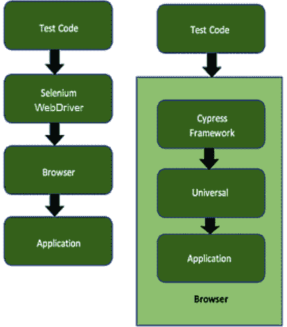

## 跨浏览器兼容性

Cypress 目前并不像 Selenium WebDriver 那样支持所有主流浏览器。Cypress 目前支持基于 Chromium 开源项目构建的浏览器、Firefox、Edge 以及 Electron（Cypress 的默认浏览器）。另一方面，Selenium 支持所有主流浏览器，这使其在跨多个平台测试应用方面具有优势。虽然可以认为跨三个以上浏览器的跨浏览器功能会增加架构复杂性，而对测试过程的价值有限，但多浏览器支持有助于发现高优先级的缺陷，即使这些缺陷的严重程度可能较低。

## Cypress 的权衡取舍

如前所述，Cypress 是一个专注于浏览器端到端测试自动化的工具。能够在浏览器中运行意味着 Cypress 能比其他任何工具更好地与浏览器中的元素交互，但也意味着 Cypress 存在由其架构决定的、无法改变的永久性权衡。这些权衡将在以下小节中描述。

### 作用域限制

Cypress 最适合用作 QA 工程师和开发者的自动化实用工具，用于编写测试。Cypress 不支持手动自动化工具，也没有计划将手动测试工具集成到框架中。

Cypress 还不适用于网络索引和性能测试等活动，执行此类活动可能会降低框架的性能表现。

### 环境限制

Cypress 在浏览器中运行，这意味着它支持的语言始终是 JavaScript，因为测试代码始终在浏览器中执行。在浏览器中运行意味着要连接数据库或服务器，我们只能使用 Cypress 的 `cy.exec()`、`cy.request()` 或 `cy.task()` 命令，这些命令提供了一种暴露数据库或服务器的方式，这可能比我们能够显式定义其配置并让 Cypress 理解它们需要更多的工作。让测试在浏览器中运行带来了出色的测试体验，但接入需要在浏览器外部运行的功能则稍显繁琐。

### 多浏览器和多标签页——限制

Cypress 框架不支持测试在运行时控制多个浏览器的能力。这是一个永久性的权衡，因为在单个浏览器中运行测试时不可能控制多个浏览器。

Cypress 框架不支持与多个浏览器标签页交互，因为该功能无法在浏览器内部暴露。不过，Cypress 提供了集成 Selenium 或 Puppeteer 等其他工具的能力，以便在需要时操作和驱动多个浏览器标签页。

### 控制源限制

Cypress 仅支持在同一测试中访问来自同源的 URL。控制源限制意味着对于任何特定测试，你无法访问不属于同源的不同 URL。例如，在同一测试中同时向 `https://github.com` 和 `https://gitlab.com` 发送请求会导致错误。以下示例说明了编写 Cypress 测试时正确和错误使用跨源的方式。

### 正确使用跨源运行测试的方式

在以下测试中，用户指示 Cypress 首先导航到 `https://github.com` GitHub 网站，然后导航到 `https://docs.github.com/en`（文档链接）查看 GitHub 资源。这两个链接属于同一源 `github.com`，因此 Cypress 执行请求时不会出现任何问题：

```
It('can navigate to code repository hosting service', () => {
    cy.visit('https://github.com');
    cy.visit('https://docs.github.com');

});
```

### 错误使用跨源运行测试的方式

在这个测试中，用户指示 Cypress 首先导航到 `https://github.com`，然后导航到与第一个 URL 不同源的 `https://gitlab.com`。这将导致测试运行时抛出错误：

```
It('can navigate to code repository hosting service', () => {
    cy.visit('https://github.com');
    cy.visit('https://gitlab.com');

})
```

## Cypress 和 Selenium 的协同操作

在编写测试时，我们可以在少数但仍可实现的情况下同时利用 Cypress 和 Selenium。虽然 Cypress 存在无法控制多个浏览器标签页的限制，但可以配置 Cypress 使用 Selenium 来运行多个标签页。我们还可以将 Cypress 用于端到端测试，将 Selenium 用于负载测试等活动。Selenium 能够执行 Cypress 不支持的负载测试等测试，在这种情况下可以同时利用两个测试框架。

## 总结差异

Cypress 专为 Web 构建，针对浏览器运行进行了优化。Cypress 的架构使其能够有效运行测试，同时克服 WebDriver 的挑战。虽然 Cypress 能够在浏览器中运行，但 WebDriver 使用 HTTP 协议与浏览器交互，因此在运行测试时会导致延迟和未知的等待事件。Cypress 还面向希望编写测试而无需担心底层基础设施以及单一断言库和编程语言限制的 QA 工程师和开发者。Cypress 还承诺未来将支持 Safari 和 Internet Explorer（相关计划正在进行中），以确保开发者和测试人员能够在自己选择的浏览器上试用 Cypress。

在 Cypress 捆绑的所有优势之外，它也存在一些临时性和永久性的权衡。一些临时性权衡包括支持所有主流浏览器或执行某些功能（如鼠标悬停在元素上）的能力。而永久性权衡则意味着 Cypress 的架构即使在未来也无法支持这些功能。它们包括控制多个打开的浏览器和/或操作浏览器中的多个标签页、连接外部数据库和服务器，以及调用不同的跨源等。所有的永久性权衡都有变通方案，用户可以随时自行实施。不过，Cypress 建议不应在超出其预期用途的情况下使用变通方案。将 Cypress 用于非预期目的可能会导致测试自动化复杂性等障碍，最终降低 Cypress 作为自动化工具的有效性。


## 回顾——比较 Cypress 和 Selenium WebDriver

在本节中，我们学习了使用 Cypress 的优势，并将其与使用 Selenium 编写测试进行了比较。我们还探讨了为什么 Selenium 在架构上与 Cypress 不同，以及为什么两者更多是互补关系而非替代关系。我们探索了 Cypress 的权衡取舍，以及克服 Cypress 自动化框架中永久性权衡的一些解决方案。在下一节中，我们将深入了解使 Cypress 成为端到端 Web 测试自动化最佳选择的工具。

## Cypress 用于前端应用程序

Cypress 是为 Web 构建的，这意味着它内置了一些其他框架可能不具备的工具和功能。这提升了前端 Web 开发人员和 QA 工程师的测试体验。在本节中，我们将探索 Cypress 内置的不同元素，这些元素使其用户能够轻松上手并开始使用。以下是一些使 Cypress 在前端应用程序的其他测试自动化框架中脱颖而出的元素。

## 测试运行器

Cypress 测试运行器在 Cypress 安装到用户机器时默认提供。它是一个交互式用户界面，允许 Cypress 框架的用户查看测试中正在运行的命令，以及命令与之交互的被测应用程序。测试运行器能够显示测试失败数、测试通过数、跳过的测试、命令日志，甚至在测试运行时显示浏览器的视口大小。

## 设置过程

如前一章所述，Cypress 的设置过程不仅清晰简单，而且确保 QA 工程师和前端开发人员只需运行单个命令即可安装 Cypress。这消除了配置外部依赖项以开始编写测试的需求。Cypress 文档也非常具有交互性且清晰，这使得开发人员和 QA 工程师能够快速上手并使用 Cypress 功能。

### 实现与调试

Cypress 测试运行器自带内置命令日志，这意味着在**调试模式**下，用户能够实时检查已通过和已失败的命令及断言。高亮显示失败命令并检查哪些元素未被调用或哪些函数失败的能力，是使 Cypress 突出的特性，因为调试前端应用程序不仅变得轻而易举，而且节省了本可用于调查失败原因的时间。命令日志还为 Cypress 用户提供即时反馈，他们只需检查测试运行器上运行的命令，就能判断测试是否编写得当。

### 全面的测试能力

Cypress 结合了编写功能测试和检查前端发起的 API 调用响应的能力。它还具备视觉回归测试功能，可以识别对被测应用程序是否进行了有意更改。

在编写功能测试时，Cypress 框架会检查前端功能是否按照需求文档的规定工作，这涉及点击按钮或为用户注册等过程。

另一方面，API 验证测试检查返回的 **XHR** (**XMLHttpRequest**) 请求是否成功，并且在请求返回时收到正确的响应。XHR 请求为 API 测试提供了一个额外的验证层，因为我们可以确认预期的数据结构与我们在前端应用程序中接收到的结构相似。

> **重要提示**
> 
> XHR 以对象的形式表示，其主要目的是在给定的 Web 服务器和 Web 浏览器之间传输数据。

视觉回归测试通过比较基线页面快照与最新测试运行的快照来检查页面中元素的一致性。如果发现差异，则正在运行的测试将失败。失败时，会创建一个显示预期图像与生成图像之间差异的快照，以展示生成的快照与基线图像之间的不同。测试运行后，QA 工程师或开发人员可以接受或拒绝前端应用程序相对于应用程序更改所做的修改。

## 回顾——Cypress 用于前端应用程序

在本节中，我们学习了为什么 Cypress 在测试前端应用程序时最为合适。我们了解了使其成为首选测试框架的不同元素，以及我们可以如何利用其优势来编写更好、更全面的测试。

### 总结

毫无疑问，Cypress 是一个强大的工具，前端团队和 QA 工程师可以利用它快速上手编写测试，而无需担心从头开始构建测试自动化工具所带来的开销。在本章中，我们通过比较 Cypress 与现有测试自动化工具之间的不同工具，学习了为什么 Cypress 是测试的最佳 Web 自动化框架。我们还介绍了 Cypress 和 Selenium 之间的区别，以及两者在架构上的具体异同。最后，我们探讨了如何利用这些工具。在下一章中，我们将学习如何使用命令行工具来运行、测试和调试 Cypress 测试。

# 3

## 使用 Cypress 命令行工具

在上一章中，我们学习了 Cypress 与其他测试自动化工具（如 Selenium）的区别，以及它在 Web 自动化测试方面的突出之处。在本章中，我们将基于使用命令行工具使用 Cypress 的知识进行扩展。为此，我们将介绍可用于利用 Cypress 功能的命令。

其中一些命令涉及诸如运行单个或所有测试、调试 Cypress 以及在不同浏览器上启动 Cypress 测试等功能，以及其他 Cypress 命令行功能。我们将引用本章的 GitHub 仓库文件夹，所有将编写的命令和代码片段都将包含在该仓库中以供参考和实践。

我们将在本章涵盖以下关键主题：

- 运行 Cypress 命令
- 理解基本 Cypress 命令
- 在命令行上调试 Cypress

### 技术要求

本章的 GitHub 仓库可以在 `https://github.com/PacktPublishing/End-to-End-Web-Testing-with-Cypress` 找到。

本章的源代码可以在 `chapter-03` 目录中找到。

要运行本章中的示例，您需要克隆本书的 GitHub 仓库并按照 `README.md` 文件中的说明正确设置和运行测试。您可以在 `https://docs.github.com/en/free-pro-team@latest/github/creating-cloning-and-archiving-repositories/cloning-a-repository` 了解更多关于如何使用 GitHub 在本地机器上克隆项目的信息。

### 运行 Cypress 命令

有效利用 Cypress 框架需要您理解 Cypress 以及如何使用命令行运行不同的功能。Cypress 命令允许 Cypress 框架的用户自动化流程，并在初始化和运行时向框架和测试提供特定指令。

在大多数情况下，通过命令行运行 Cypress 测试比使用浏览器运行更快。这是因为通过命令行运行测试减少了运行特定测试所需的资源数量。原因在于，在命令行中运行的测试通常是无头模式的，这意味着分配给运行测试的资源较少，这与有头模式下的测试执行不同。

**重要提示**

有头模式是指测试可以在浏览器上可视化运行，而无头模式下，测试执行过程不会打开可见的浏览器。相反，所有测试都在命令行上运行并输出。

首先，让我们看看如何运行全局和本地 Cypress 命令。


#### 全局与本地命令

Cypress 命令可以从包含 Cypress 安装和代码的特定目录运行，也可以从全局 Cypress 安装中运行。全局安装 Cypress 确保用户可以在操作系统的任何目录中运行 Cypress，而使用本地安装的 Cypress 时，只能在其安装所在的单个目录中访问 Cypress。

#### 运行全局 Cypress 命令

Cypress 中的全局命令通过访问全局安装的 Cypress 版本来运行。运行全局版本时调用的命令不一定由用户生成或定义，因为它们是框架内置的。要能全局运行 Cypress 命令，你需要使用以下命令全局安装 Cypress：

```
npm install cypress --global
或者（更简短版本）
npm i -g cypress
```

上述命令将全局安装 Cypress，并确保从任何 Cypress 安装目录调用任何已知 Cypress 命令时，会根据命令的执行情况产生结果或错误。

要运行全局命令，你需要使用 `cypress` 关键字定义命令，然后是命令本身；例如，`cypress run` 或 `cypress open`。

#### 运行本地 Cypress 命令

本地 Cypress 命令源于 Cypress 全局命令，是全局运行命令的一种替代方式。要本地运行 Cypress 命令，你需要使用以下命令在你的目录中安装 Cypress：

```
npm install cypress
或者（更简短版本）
npm i cypress
```

我们可以通过将所需命令定义在 `package.json` 文件的 `scripts` 部分，将它们集成到开发环境中，如下所示：

```
{
    "scripts": {
        "cypress:run": "cypress run",
        "cypress:open": "cypress open"
    }
}
```

将命令添加到 `package.json` 使我们能够像执行 JavaScript 包的 npm 命令一样使用这些命令。`package.json` 文件中定义的命令在运行时由 Node.js 环境解释，并且在执行时，它们的执行方式与全局命令相同。

> **重要提示**

建议你在运行 `npm install cypress` 命令之前，在终端中运行 `npm init` 命令。如果在项目未初始化的情况下运行 Cypress，Cypress 的目录将不可见。通过运行 `init` 命令，Cypress 会将项目目录识别为现有项目，因此它会初始化并创建其目录，而无需我们在终端中运行额外命令。

在 `package.json` 中定义命令不仅使开发人员和 QA 工程师更容易知道运行哪些命令，还简化了在运行、调试或维护测试时需要运行的命令的性质。

> **重要提示**

Cypress 开发团队建议按项目安装 Cypress，而不是使用全局安装方法。本地安装提供了某些优势，例如用户能够快速更新 Cypress 依赖，并减少可能在不同项目中破坏一些测试的循环依赖问题，而 Cypress 在另一个项目中可以正常运行。

要在命令行中运行脚本，你需要调用 `npm run`，后跟命令的名称。在我们之前定义的命令中，你只需运行以下命令即可同时执行命令：

```
npm run cypress:run  // 在终端运行测试的命令
npm run cypress:open // 在 Cypress 测试运行器中运行测试的命令
```

是时候快速回顾一下了。

#### 回顾 – 运行 Cypress 命令

在本节中，我们学习了如何调用本地或全局命令，以及如何从 Cypress 终端或使用图形用户界面的测试运行器运行测试。在下一节中，我们将基于已经掌握的运行 Cypress 命令的知识，了解 Cypress 内部如何使用不同的命令。

### 理解基本 Cypress 命令

在本节中，我们将探索各种 Cypress 命令，这些命令可用于通过终端或使用 Cypress 测试运行器运行测试。我们还将观察如何使用这些命令实现不同的结果。本节还将向我们介绍如何自定义与应用程序交互的不同测试，以实现特定结果。我们将深入探讨最常见的 Cypress 命令以及如何使用 Cypress 框架预置的选项扩展它们。我们将探索的命令如下：

- cypress run
- cypress open
- cypress info
- cypress version

让我们从 `cypress run` 开始。

#### cypress run

`cypress run` 命令以无头方式执行 Cypress 套件中的所有测试，并默认在 Electron 浏览器中运行测试。如果未使用任何其他配置扩展该命令，它将运行 Cypress `integration` 文件夹中所有 `.spec.js` 格式的文件。`cypress run` 命令可以使用以下配置选项运行：

```
cypress run {configuration-options}
```

最常见的 Cypress 配置选项包括以下内容：

| 选项 | 描述 |
| --- | --- |
| `--env` 或 `-e` | 用作在运行时通过命令行定义环境变量的选项。 |
| `--browser` 或 `-b` | 指定测试将在其中运行的浏览器。 |
| `--config` 或 `-c` | 定义配置，例如测试运行时的超时时间。如果声明了相同的键值对，此值将覆盖 `cypress.json` 中的值。 |
| `--config-file` 或 `-C` | 指定用于运行测试的配置文件。此文件中声明的值会覆盖 `cypress.json` 文件中的值。 |
| `--headed` | 在启动浏览器后运行测试。 |
| `--headless` | 在不启动浏览器的情况下运行测试。 |
| `--spec` 或 `-s` | 指定要运行的规格文件。 |

接下来的几节将扩展上表中显示的每个配置选项。

##### cypress run --env <env-variable>

Cypress 环境变量是*动态的名称-值对*，它们影响 Cypress 执行测试的方式。当需要在多个环境中运行测试，或者定义的值容易快速更改时，这些环境变量非常有用。

在 Cypress 中，你可以将单个或多个环境变量定义为字符串或 JSON 对象。

在本节中，我们将为一个开源 **todoMVC** 应用程序编写测试。这些测试的代码库可以在本书的 GitHub 仓库 `chapter 03` 目录中找到。被测试的应用程序是一个使用 React 开发的**待办事项列表**应用程序。使用该应用程序，我们可以添加待办事项、标记为已完成、删除它们、查看已完成的事项，甚至可以在*活动*、*所有*和*已完成*的待办事项之间切换。

使用此应用程序，我们可能计划扩展该应用程序，使用 **HTTPS** 而非当前的 **HTTP** 协议来提供安全版本的应用程序。尽管目前尚不支持 HTTPS 功能，但我们可以在 Cypress 测试中使用环境变量为其添加准备。为实现这一点，我们将**传输协议** URL 部分定义为环境变量，然后将其传递给 `package.json` 中的命令，如以下示例所示。

以下代码片段可在 GitHub 仓库中提到的 `chapter 03` 子文件夹中找到。`Todo-app.spec.js` 文件的完整源代码位于 `Cypress/integration/examples` 文件夹下。本章我们将探讨的 Cypress 测试是版本 1 的测试。

以下 `Todo-app.spec.js` 文件演示了在导航到 URL 时如何使用环境变量。它是主测试文件，位于本书 GitHub 仓库的 `chapter-03/cypress/integration/examples/todo-app.spec.js` 中：

```
... 
context('TODO MVC Application Tests', () => { 
  beforeEach(() => { 
    cy.visit( 
      `${Cypress.env('TransferProtocol')}://todomvc.com/examples/react/#/`) 
  }); 
...
```

以下 `package.json` 文件也位于 `chapter-03/` 目录中，包含用于执行 JavaScript 应用程序的测试或执行命令的所有命令。它位于 `chapter-03/` 目录的根位置：

```
... 
"scripts": { 
    "cypress:run": "cypress run --env TransferProtocol='http'", 
    "cypress:run:v2": "cypress run --env TransferProtocol='https'", 
  }, 
...
```

上述脚本表明，如果 URL 协议发生更改，我们可以运行上述任何测试命令，以在运行 Cypress 测试时替换 URL 中声明的环境变量。我们可以依次使用 `npm run cypress:run` 和 `npm run cypress:run:v2` 执行上述脚本。


##### cypress run --browser <浏览器名称>

Cypress 命令行内置了在宿主机上已安装且受 Cypress 框架支持的不同浏览器中运行 Cypress 测试的功能。Cypress 会尝试自动检测已安装的浏览器，并可以在 `chrome`、`chromium`、`edge`、`firefox` 或 `electron` 中运行测试。要运行特定浏览器中的测试，你需要使用 `--browser` 配置选项提供浏览器名称。你也可以选择提供浏览器路径而非浏览器名称；只要路径有效且受 Cypress 支持，Cypress 仍会在提供的浏览器路径中运行测试。

以下代码片段摘自本书 GitHub 仓库 `chapter-03` 目录中 `package.json` 文件的 `scripts` 部分。这些脚本定义了我们测试将运行的浏览器，并传入了一个用于 URL 部分的环境变量：

```
...
"scripts": {
    "cypress:chrome": "cypress run --env TransferProtocol='http' --browser chrome",
    "cypress:firefox": " cypress run --env TransferProtocol='http' --browser firefox"
},
...
```

在上述命令中，我们可以分别使用 `npm run cypress:chrome` 和 `npm run cypress:firefox` 命令，在 Chrome 或 Firefox 中运行测试。

> **重要提示**

要在特定浏览器中运行测试，该浏览器必须安装在你的机器上，并且必须是 Cypress 支持的浏览器列表中的一种。

##### cypress run --config <配置选项>

Cypress 可以使用在终端运行的命令来设置和覆盖配置。Cypress 的配置可以作为单个值传递，也可以作为多个值（用逗号分隔）传递，或者作为字符串化的 JSON 对象传递。Cypress 中任何已定义的配置都可以通过 `cypress run --config` 配置选项进行更改或修改。配置选项可能包括指定备用的 `viewportHeight` 和 `viewportWidth`、超时时间、文件更改等。在我们的脚本中，我们将更改 Cypress 运行测试时的视口，使用 763x700 的平板视口，而不是默认的 1000x660 视口。

以下代码片段定义在我们 `chapter-03` 根目录的 `package.json` 文件中。以下脚本用于在平板视口中运行测试。为此，你必须覆盖 Cypress 默认的视口高度和宽度配置：

```
...
"scripts": {
"cypress:tablet-view": "cypress run
--env TransferProtocol='http' --config
viewportHeight=763,viewportWidth=700",
}
...
```

可以使用 `npm run cypress:tablet-view` 命令运行上述脚本。

> **重要提示**

在 Cypress 中传递多个配置选项时，不同配置的逗号分隔值之间不要留有空格（如前面的代码所示）；否则，Cypress 将会抛出错误。

##### cypress run --config-file <配置文件>

Cypress 可以覆盖位于 `/cypressRootDirectory/cypress.json` 的默认配置文件。你可以定义一个或多个次要 Cypress 配置文件来运行其测试。Cypress 也允许你完全禁用配置文件的使用。

以下脚本位于我们 chapter-03 目录根目录的 package.json 中，是一个命令，使 Cypress 能够覆盖其用于运行测试的配置文件。当执行此命令时，它将不使用位于 chapter-03 的默认 cypress.json 文件，而是使用位于 chapter-03/config/cypress-config.json 下的 cypress-config.json 文件：

```
...
"scripts": {
"cypress:run:secondary-configuraton": "cypress run --env TransferProtocol='http' --browser chrome --config-file config/cypress-config.json"
},
...
```

要运行上述脚本，你需要运行 `npm run cypress:run:secondary-configuraton` 命令，该命令将使用位于 /cypressRootDirectory/config/cypress-config.json 的配置文件来运行测试。

##### cypress run --headed

Cypress 提供了一个命令，允许你在无头（headless）和有头（headed）模式下运行浏览器。定义有头模式时，测试在运行时会打开一个浏览器。此选项可用于 Cypress 自带的默认 Electron 浏览器。使用 `run` 命令在 Electron 中运行 Cypress 测试的默认模式是无头的，要覆盖此设置，我们需要在测试运行时传递 `--headed` 配置。

以下脚本可在本书 GitHub 仓库 `chapter-03` 目录的 `package.json` 文件中找到。运行以下脚本命令将使 Cypress 以有头模式运行，允许正在运行的测试在浏览器中可见：

```
...
"scripts": {
"cypress:electron:headed": "cypress run --env TransferProtocol='http' --headed"
},
...
```

可以使用 `npm run cypress:electron:headed` 命令运行上述脚本。

##### cypress run --headless

Cypress 在 Chrome 和 Firefox 浏览器中运行测试时默认使用有头模式，这会在每次测试运行时启动一个浏览器。要更改此行为并确保测试运行时不启动浏览器，你需要配置运行 Chrome 或 Firefox 浏览器的命令，使其以无头模式运行。

以下脚本可在本书 GitHub 仓库 `chapter-03` 目录的 `package.json` 文件中找到。运行以下命令将使 Cypress 以无头模式运行，测试命令只能在命令行界面看到运行：

```
"scripts": {
  "cypress:chrome:headless": "cypress run --env TransferProtocol='http' --browser chrome --headless",
  "cypress:firefox:headless": "cypress run --env TransferProtocol='http' --browser firefox --headless"
}
```

要使用上述命令在 Chrome 无头模式下运行，你需要运行 `npm run cypress:chrome:headless`。要在 Firefox 无头模式下运行命令，你需要运行 `npm run cypress:firefox:headless` 命令。

##### cypress run --spec <测试规格文件>

Cypress 允许我们指定要运行的不同测试文件。使用此命令，可以指定目录中要运行的*单个*测试文件，而不是运行目录中的*所有*测试文件。也可以指定不同目录中的不同测试，使它们同时运行，以及指定与特定目录匹配的正则表达式模式。

以下代码片段是本书 GitHub 仓库 `chapter-03` 目录中 `package.json` 文件的一部分。第一个脚本只能运行目录中的特定文件，而第二个脚本可以运行单个目录中的多个文件：

```
"scripts": {
  "cypress:integration-v2:todo-app": "cypress run --env TransferProtocol='http' --spec 'cypress/integration/
      integration-v2/todo-app.spec.js'",
      "cypress:integration-v2": "cypress run --env
      TransferProtocol='http' --spec 'cypress/
      integration/integration-v2/**/'"
    },
    ...
```

第一个命令指定测试将运行 `integration-v2` 文件夹中的 `todo-app.spec.js` 文件。第二个命令将运行 `integration-v2` 文件夹中的所有测试文件。

#### cypress open

`cypress open` 命令在测试运行器中运行 Cypress 测试，配置选项会应用于你正在运行的项目测试。运行 `cypress open` 命令时传递的配置选项也会覆盖 `tests root` 文件夹中 `cypress.json` 文件中指定的默认值（如果测试运行时指定了配置）。以下命令展示了如何运行任何 `cypress open` 命令：

```
cypress open {配置选项}
```

命令的第一部分是 `cypress open` 命令，第二部分是可与之链接的配置选项。

最常见的 Cypress 配置选项包括：

| 选项 | 描述 |
|------|------|
| `--env` 或 `-e` | 用作定义环境变量的选项。 |
| `--browser` 或 `-b` | 指定自定义浏览器路径。 |
| `--config` 或 `-c` | 定义配置，例如测试运行时的超时时间。如果已声明相同的键值对，此值会覆盖 `cypress.json` 中的值。 |
| `--config-file` 或 `-C` | 指定将用于运行测试的配置文件。此文件中声明的值会覆盖 `cypress.json` 文件中的值。 |
| `--global` | 以全局模式运行测试。 |
| `--project` | 要运行的测试的项目路径。 |
| `--port` | 指定运行 Cypress 测试的端口。 |

我们将在接下来的几节中详细探讨每个选项。


##### cypress open --env <环境变量(s)>

与运行 `cypress run` 命令类似，`cypress open` 命令也可以使用在测试运行时声明的指定环境变量来运行。与 `cypress run` 命令类似，在测试运行器中运行测试时，可以使用 `--env` 配置选项声明一个或多个环境变量。

在前面的章节中，我们指定了如何通过在 `cypress run` 命令中传递环境变量来运行测试。我们将传递相同的环境变量来使用我们的 Cypress 测试运行器运行测试，并且测试应该能正常运行。传递的环境变量将决定 **todoMVC** 应用程序 URL 的传输协议是 **HTTP** 还是安全的 **HTTPS**。

以下代码片段位于 `chapter-03/` 目录中的 `Todo-app.spec.js` 文件中，这是我们主要的测试文件。`todo-app.spec.js` 文件可以在 `chapter-03/` 目录下的 `integration/examples` 中找到。在下面的代码片段中，就像在 `cypress run` 中一样，我们可以使用 `cypress open` 命令将环境变量传递给 URL：

```
...
context('TODO MVC Application Tests', () => {
  beforeEach(() => {
    cy.visit(
      `${Cypress.env('TransferProtocol')}://todomvc.com/examples/react/#/`
    );
  });
...
```

以下代码片段位于 `chapter-03/` 根目录下的 `package.json` 文件中。使用此代码片段，我们将 'http' 环境变量传递给我们的测试。这时我们就可以完成我们的 URL 并执行我们的测试：

```
...
"scripts": {
    "cypress:open": "cypress open --env TransferProtocol='http'",
},
...
```

要打开测试运行器并验证测试是否运行，您可以运行 `npm run cypress:open`，这应该会自动将 **TransferProtocol** 环境变量添加到正在运行的测试的配置中。

##### cypress open --browser </path/to/browser>

```
cypress open --browser </path/to/browser>
```

指定时，`--browser` 选项指向一个自定义浏览器，该浏览器将被添加到测试运行器的可用浏览器列表中。要添加的浏览器必须被 Cypress 支持，并且必须安装在运行 Cypress 测试的机器上。

默认情况下，在选择要运行的规范之前，可以通过点击测试运行器中的浏览器选择按钮来查看 Cypress 中所有可用的浏览器。浏览器选择下拉菜单包含系统上已安装且被 Cypress 支持的所有浏览器。浏览器选择下拉菜单还允许您切换测试浏览器，从而在不同浏览器下测试功能：

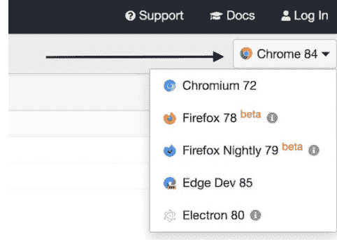

图 3.1 - 测试浏览器选择下拉菜单

要指定路径以便添加浏览器（例如 Chromium），您需要具有以下配置才能将 Chromium 添加到可用浏览器列表中。在这里，您需要运行 `npm run cypress:chromium` 命令。

以下脚本位于本书 GitHub 仓库的 `chapter-03/` 目录下的 `package.json` 文件中。当脚本作为命令执行时，它将在指定位置查找浏览器并将其添加到用于运行 Cypress 测试的浏览器列表中：

```
...
"scripts": {
    "cypress:chromium": "cypress open --browser /usr/bin/chromium"
},
...
```

要执行上述脚本来运行我们的测试，我们需要在终端中运行 `npm run cypress:chromium` 命令。这将定位位于 `location /usr/bin/chromium` 的 Chromium 浏览器，并使用它来运行我们的测试。

##### cypress open --config <配置选项(s)>

Cypress 框架允许我们在测试运行器中运行测试，并启动在初始化测试运行器时必须传递的配置选项。在传递 `--config` 选项时，可以传递一个环境变量或多个用逗号分隔的环境变量。以下脚本指定视口尺寸应为平板电脑大小，并且配置是通过 `--config` 选项传递的。要运行所需的命令，您需要运行 `npm run cypress:open:tablet-view`。

以下脚本位于本书 `chapter-03/` 根目录下的 `package.json` 文件中，用于更改在可见浏览器上运行的测试的视口配置：

```
...
"scripts": {
    "cypress:open:tablet-view": "cypress open --env TransferProtocol='http' --config viewportHeight=763,viewportWidth=700"
},
...
```

执行时，该命令会修改浏览器大小的默认 Cypress 配置。提供的视口高度和视口宽度将以类似于平板电脑显示的方式显示内容。

> **重要提示**
>
> 使用 `--config` 选项指定的配置选项将覆盖 `cypress.json` 文件中指定的默认配置。

##### cypress open --config-file <配置文件>

就像 `Cypress run` 命令的情况一样，通过测试运行器运行的 Cypress 测试可以有一个覆盖配置文件，该文件会覆盖包含默认 Cypress 配置的默认 `cypress.json` 文件。它位于测试文件的根文件夹中。

以下代码片段位于 `chapter-03/` 目录根文件夹的 `package.json` 文件中，它覆盖了默认的 Cypress 配置文件（即 `cypress.json`）。执行时，该命令将读取已在 `chapter-03/config/cypress-config.json` 中声明的替代配置文件：

```
...
"scripts": {
    "cypress:open:secondary-configuraton": "cypress open --env TransferProtocol='http' --config-file config/cypress-config.json"
},
...
```

要执行上一条命令并更改默认 Cypress 配置文件的位置，您需要在命令行界面中运行以下命令：

```
npm run cypress:open:secondary-configuration
```

现在，让我们看看另一个命令。

##### cypress open --global

正如我们之前提到的，Cypress 可以全局安装。您不必在每个项目中都安装它，而是可以使用全局 Cypress 安装来运行不同的 Cypress 测试。这种全局安装还允许您触发全局命令，而不一定需要在调用 Cypress 命令的特定目录中安装 Cypress。要以全局模式打开 Cypress，您需要传入 `--global` 选项，如下所示：

```
cypress open --global
```

通过运行此命令，Cypress 将识别出我们希望使用全局版本的 Cypress（而不是我们的本地实例）来执行测试。

##### cypress open --project <项目路径>

Cypress 具有覆盖 Cypress 在运行测试时启动的默认路径的内置功能。当定义 `--project` 选项时，它会指示 Cypress 放弃默认的目录/项目路径，而是使用提供的项目路径来运行位于指定项目路径中的 Cypress 测试。在此设置中，可以运行位于不同目录或嵌套目录中的完全不同的 Cypress 项目。

以下代码片段位于本书 `chapter-03/` 根目录的 `package.json` 文件中，用于在完全不同的 Cypress 项目中执行测试。该脚本执行位于 `chapter-03/cypress/todo-app-v3` 的项目：

```
"scripts": {
    "cypress:project:v3": "cypress open --env TransferProtocol='http' --project TransferProtocol='http' --project 'cypress/todo-app-v3/'"
},
```

在前面的脚本中，用户可以运行位于 `cypress/todo-app-v3` 文件夹中的另一个 Cypress 项目。要运行该脚本，我们需要运行 `npm run cypress:project:v3` 命令。`version-3` 项目是一个独立的项目，不依赖于父 Cypress 项目。它可以使用其 `cypress.json` 文件来确定其运行配置，如下图所示：

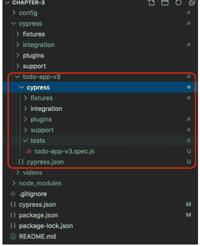

图 3.2 – todo-app-v3 项目测试文件夹


如前一个截图所示，我们已经修改了 `todo-app-v3` 项目中的 `integrationFolder` 属性，将测试文件夹从主测试文件夹下的 `cypress/integration` 更改为 `todo-app-v3` 项目下的 `cypress/tests`。

##### cypress open --port <端口号>

默认情况下，Cypress 运行在端口 `8080`。运行 `cypress run` 命令时传入 `--port` 选项，可以将运行测试的默认端口覆盖为你指定的特定端口。

以下代码片段摘自本书 GitHub 仓库 `chapter-03/` 目录下的 `package.json` 文件。运行以下命令可以更改 Cypress 运行的默认端口：

```
"scripts": {
  "cypress:open:changed-port": "cypress open --env TransferProtocol='http' --port 3004"
},
```

要运行前面的 Cypress 脚本，你需要执行 `npm run cypress:open:changed-port` 命令。运行此命令将确保测试在端口 `3004` 上运行，而不是 Cypress 在测试运行器上默认运行测试的端口：


由自动化测试软件控制。


前面的截图展示了通过向 `cypress run` 命令传递 `--port` 选项进行覆盖后，如何在端口 `3004` 上运行测试。这里使用的端口仅为演示目的；用户机器上的任何可用端口都可以作为 Cypress 应用程序的覆盖端口。

#### 使用 cypress info 命令

在终端上运行 `cypress info` 命令，将打印 Cypress 的安装信息和终端上的环境配置。该命令打印的信息包括：

-   已安装在机器上并被 Cypress 检测到的浏览器。
-   关于宿主操作系统的信息。
-   Cypress 二进制文件缓存的位置。
-   运行时数据存储的位置。
-   以 CYPRESS 为前缀并控制诸如系统代理等配置的环境变量。

#### 使用 cypress version 命令

`cypress version` 命令会打印出已安装的 Cypress 二进制版本和 Cypress 模块的 npm 版本。虽然大多数情况下版本应该相同，但当安装的模块（如二进制版本）无法作为 npm 包模块安装时，版本可能会不同，从而导致版本差异。`cypress version` 命令的输出如下图所示：

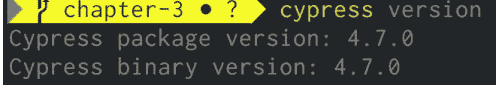

图 3.4 – cypress version 命令的输出

前面的截图显示了在我的机器上安装的 Cypress 包和二进制版本。Cypress 的包和二进制版本是相同的。

#### Cypress 命令使用的可选练习

使用我们项目规范中定义的 **todoMVC** 项目，创建一个可以运行以下测试场景的脚本：

-   使用 edge 浏览器进行无头测试。
-   在测试运行器上运行测试，其中 `TransferProtocol` 环境变量在 `chapter 03` 根文件夹的 `cypress.json` 中指定。

通过本练习，你将了解如何运行有头和无头测试，以及如何将环境变量添加到我们可用于执行不同 Cypress 命令的脚本中。你还将学习如何使用不同的浏览器执行 Cypress 测试。

#### 回顾——理解基本的 Cypress 命令

在本节中，我们学习了如何使用不同的 Cypress 命令通过命令行或使用 Cypress 测试运行器来运行 Cypress，该运行器使用系统上安装的不同浏览器运行。我们了解到，尽管 Cypress 附带了运行测试的默认命令，但我们可以扩展这些命令，并通过利用可用的命令和选项来为我们定制 Cypress，从而提高运行测试的效率。我们还提供了一个练习，以便你能够应用所学的使用 `cypress run` 和 `cypress open` 命令的知识。在下一节中，你将学习如何使用内置的 Cypress 调试器来查看使用终端排查错误所需的重要调试信息。

### 命令行上的 Cypress 调试

在本节中，我们将探讨如何使用 Cypress 的命令行调试属性来排查运行测试时可能遇到的问题。我们还将探讨 Cypress 通过命令行提供的不同调试选项。

Cypress 有一个内置的调试模块，可以通过在使用 `cypress run` 或 `cypress open` 运行测试之前传递调试命令来暴露给用户。要在 Mac 或 Linux 环境中从终端接收调试输出，需要在 Cypress 测试运行前设置 `DEBUG` 环境变量。

以下脚本可以在 `chapter-03/` 根目录的 `package.json` 文件中找到，用于在执行命令时显示调试输出。第一个脚本可用于在使用 `cypress open` 命令运行测试时显示调试输出，而第二个脚本可用于在使用 `cypress run` 命令运行测试时显示调试输出：

```
"scripts": {
  "cypress:open:debugger": "DEBUG=cypress:* cypress open --env TransferProtocol='http'",
  "cypress:run:debugger": "DEBUG=cypress:* cypress run --
  env TransferProtocol='http'
}
}
```

如前面的命令所示，运行 `npm run cypress:open:debugger` 将在终端中运行 Cypress 测试，并记录运行过程中的调试输出。第二个命令可以通过 `npm run cypress:run:debugger` 运行，将在 Cypress 测试运行器上运行测试时启动调试器。

Cypress 使得过滤调试输出变得容易，因为你可以选择获取特定模块的调试信息，例如 Cypress 服务器、CLI 或启动器模块。

以下脚本位于本书 GitHub 仓库 `chapter-03/` 目录的 `package.json` 文件中。运行时，它将为 Cypress 服务器模块下的所有日志提供调试输出：

```
..."scripts": {
"cypress:open:server-debugger": "DEBUG=cypress:server:* cypress open --env TransferProtocol='http'"
}
...
```

使用 `npm run cypress:run:server-debugger` 运行前面的命令，将仅输出与 Cypress 服务器相关的调试器信息。使用过滤命令不仅可以轻松缩小 Cypress 中的问题范围，还有助于过滤掉无关信息，留下对调试 Cypress 信息至关重要的日志，并引导我们找到问题的根源。

#### Cypress 调试的可选练习

使用我们项目规范中定义的 **todoMVC** 项目，创建一个运行以下测试场景的脚本：

-   调试 Cypress CLI 模块
-   调试 `cypress:server` 项目模块

通过本练习，你将掌握 Cypress 调试的概念，并了解如何在 `package.json` 文件中创建和运行 Cypress 脚本。

#### 回顾——命令行上的 Cypress 调试

在本节中，我们学习了如何通过设置 `DEBUG` 环境变量来利用 Cypress 查看有关测试运行的额外信息。我们还学习了如何利用 Cypress 的 `debug` 变量来过滤所需的调试输出，并通过练习扩展了在命令行上进行调试的知识。

### 总结

在本章中，我们学习了 `cypress open` 和 `cypress run` 命令，以及如何将这两个命令与配置选项链接以扩展其用法。我们还学习了如何检查系统上已安装的 Cypress 信息和 Cypress 版本。在最后一节中，我们学习了如何使用 Cypress 提供调试输出并找出测试失败的原因。在下一章中，我们将深入研究编写 Cypress 测试并理解测试的不同部分。


## 4
编写你的第一个测试

在开始本章之前，你需要了解 Cypress 测试的运行方式、不同的 Cypress 命令、如何设置 Cypress、在命令行中运行 Cypress，以及如何使用测试运行器打开 Cypress 测试。这些内容在前三章中已经介绍过，将有助于你更好地理解本章编写第一个测试时将要构建的基础知识。

本章我们将首先介绍创建测试文件和编写基础测试的基础知识，然后再进一步编写更复杂的测试，并使用 Cypress 对各种元素进行断言。

本章我们将涵盖以下主题：

- 创建测试文件
- 编写你的第一个测试
- 编写实际测试
- Cypress 的自动重载功能
- Cypress 断言

完成本章学习后，你将准备好学习如何使用测试运行器调试正在运行的测试。

本章的 GitHub 仓库可通过以下链接找到：

```
https://github.com/PacktPublishing/End-to-End-Web-Testing-with-Cypress
```

本章的源代码可以在 `chapter-04` 目录中找到。

### 技术要求

### 创建测试文件

Cypress 中的所有测试都必须位于测试文件中才能运行。一个测试若要有用，必须验证我们在测试中定义的所有条件，并返回一个响应，说明条件是否满足。Cypress 测试也不例外，所有在测试文件中编写的测试都必须有一组待验证的条件。

在本节中，我们将介绍编写测试文件的过程，从测试文件在 Cypress 中的应有位置、Cypress 支持的不同扩展名，到 Cypress 测试文件应遵循的文件结构。

#### 测试文件位置

Cypress 在初始化时，默认在 `cypress/integration/examples` 目录下创建测试文件。但是，这些文件可以删除，因为它们旨在展示使用不同 Cypress 测试类型和断言的正确格式。Cypress 允许你在定位不同模块和文件夹结构时保持灵活性。

建议你在第一个项目中使用前一段提到的位置来编写 Cypress 测试。要重新配置 Cypress 文件夹结构，你可以更改 Cypress 的默认配置，并将新配置传递到 `cypress.json` 文件中。更改默认 Cypress 配置的一个好例子是将我们的测试目录从位于 `cypress/integration/examples` 改为 `cypress/tests/todo-app` 或其他地方。要更改默认目录，我们只需更改 `cypress.json` 配置，如下所示：

```
{
  "integrationFolder": "cypress/tests"
}
```

前面的代码块展示了 `integrationFolder` 设置，它更改了 Cypress `tests` 字典的配置方式。

#### 测试文件扩展名

Cypress 接受不同的文件扩展名，这使我们能够编写超出普通 JavaScript 默认格式的测试。以下文件扩展名在 Cypress 测试中是可接受的：

- .js
- .jsx
- .coffee
- .cjsx

除了这些，Cypress 还开箱即用地支持 ES2015 和 CommonJS 模块，这使得我们无需任何额外配置即可使用 **import** 和 **require** 等关键字。

#### 测试文件结构

Cypress 中的测试文件结构与大多数用于编写测试甚至普通 JavaScript 代码的结构相似。Cypress 测试的结构考虑了模块导入和声明，以及包含测试的测试主体。以下示例测试文件展示了这一点：

```
// Module declarations
import {module} from 'module-package';

// test body
describe('Test Body', () => {
  it('runs sample test', () => {
    expect(2).to.eq(2);
  })
})
```

如你所见，每个测试文件都需要在测试文件的最顶部进行声明。通过这样做，测试可以嵌套在 `describe` 块中，该块指定了测试的作用域和将要运行的测试类型。

#### 创建我们的测试文件

使用 *技术要求* 部分中的 GitHub 链接，打开 `chapter-04` 文件夹。请按照以下步骤创建你的第一个测试文件：

1.  导航到 Cypress 目录内的 `integration` 文件夹目录。
2.  创建一个名为 `sample.spec.js` 的空测试文件。
3.  为便于演示，我们已在 `chapter-04` 根目录中为你创建了一个 `package.json` 文件。你只需运行命令，无需担心它们目前如何工作。
4.  使用 `npm run cypress:run` 命令启动 Cypress 测试运行器。
5.  检查测试运行器预览，并确认我们添加的测试文件可见。

现在，是时候进行快速回顾了。

### 回顾 - 创建测试文件

在本节中，我们学习了如何创建测试文件、Cypress 如何接受不同的测试文件格式，以及如何更改 Cypress 测试的默认目录。我们还了解了测试的结构，以及 Cypress 如何借鉴 JavaScript 等语言的测试格式。在下一节中，你将专注于编写你的第一个测试。

### 编写你的第一个测试

Cypress 测试与其他任何测试并无不同。就像所有其他测试一样，当预期结果与被测应用程序的期望一致时，Cypress 测试应该通过；当预期结果与应用程序应执行的操作不一致时，则应该失败。在本节中，我们将探讨不同类型的测试、测试的结构，以及 Cypress 如何理解测试文件中的更改并重新运行测试。本节还将涵盖如何编写实际测试。

#### 示例测试

在本节中，我们将查看 Cypress 测试的基本结构。在本章我们将编写的大多数测试中，这仍然是标准格式。以下测试检查我们期望的结果与返回的结果是否相等 `true`。运行它时应该通过：

```
describe('Our Sample Test', () => {
  it('returns true', () => {
    expect(true).to.equal(true);
  });
});
```

在这里，我们可以看到测试具有 `describe()` 和 `it()` 钩子。Cypress 测试中包含的钩子默认捆绑了 **Chai** 断言库，Cypress 将其用作默认断言库。这些钩子用于帮助你理解测试的不同阶段。`describe` 钩子有助于将不同的测试封装到一个块中，而 `it` 钩子则帮助我们识别测试块内的特定测试。

> **重要说明**

Chai 断言库作为包包含在 Cypress 框架中。它是 Cypress 用于验证测试成功或失败的默认断言库。

考虑到我们在本节看到的测试，我们现在将探讨 Cypress 中测试分类的不同类型。

#### 测试分类

测试可以根据运行后的结果进行分类。Cypress 测试也可以根据其状态进行分类。测试可以处于以下任何状态：

- 通过
- 失败
- 跳过

我们将在接下来的几节中详细查看这三类。

##### 通过的测试

通过的测试是通过匹配预期输出正确验证输入的测试。在 Cypress 中，通过的测试会明确标记为通过，这在命令日志和 Cypress 测试运行器上可见。使用我们之前创建的 `sample.spec.js` 文件，我们可以创建第一个通过的测试，如以下代码块所示：

```
describe('Our Passing Test', () => {
  it('returns true', () => {
    expect(true).to.equal(true);
  });
});
```

要以 `chapter-04` 目录为参考运行测试，我们可以在命令行界面运行以下命令：

```
npm run cypress:open
```

在这个测试中，我们正在验证给定的输入 `true` 是否与我们期望的测试输出（也是 `true`）相似。这个测试可能不是非常有用，但其目的是展示一个通过的测试。以下截图显示了一个通过的测试：

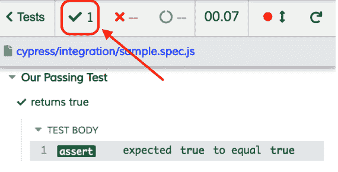

图 4.1 – 通过的测试

前面的截图显示了在命令日志中通过测试的结果。我们可以通过查看左上角的绿色对勾，进一步验证该测试是否通过了所有其他条件。


 # 失败的测试

与通过的测试一样，失败的测试也会根据测试预期对测试输入进行验证，并将其与结果进行比较。当预期结果和测试输入不一致时，就会发生测试失败。Cypress 在显示失败的测试和描述测试中失败的内容方面做得很好。使用我们之前创建的同一个 `sample.spec.js` 文件，创建一个失败的测试，如下面的代码块所示：

```
describe('Our Failing Test', () => {
  it('returns false', () => {
    expect(true).to.equal(false);
  });
});
```

要运行该测试，我们将以 `chapter-04` 目录作为参考，然后在终端中运行以下命令：

```
npm run cypress:open
```

在这个失败的测试中，我们将测试输入 `true` 与测试预期 `false` 进行比较，导致测试设置为 `true`，这不等于 `false`。测试自动失败，因为它没有通过确定测试是否通过的验证。以下截图显示了我们失败的测试在命令日志中的结果：

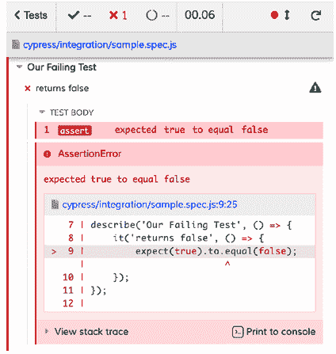

图 4.2 – 失败的测试

##### 跳过的测试

查看命令日志，我们可以看到有两个测试：一个通过，一个失败。在失败的测试上，Cypress 命令日志显示了未能满足我们预期的断言。另一方面，测试运行器继续前进，将一个失败的测试作为测试运行的摘要展示给我们。当测试失败时，Cypress 允许我们读取发生的确切异常。在这种情况下，我们可以清楚地看到，由于不正确的断言，测试在断言级别失败了。

Cypress 中跳过的测试不会被执行。跳过的测试用于在执行其他测试时省略失败或不需要运行的测试。跳过的测试在其测试钩子后附加 .skip 关键字。我们可以通过使用 describe.skip 跳过整个代码块中的测试，或者只使用 it.skip 跳过单个测试。以下代码块显示了两个测试，其中一个主 describe 块被跳过，另一个测试在 describe 块内被跳过。以下代码展示了跳过 Cypress 测试的不同方式：

```
describe.skip('Our Skipped Tests', () => {
    it('does not execute', () => {
        expect(true).to.equal(true);
    });
    it.skip('is skipped', () => {
        expect(true).to.equal(false);
    });
});
```

在这里，我们可以看到当我们在 it 或 describe 钩子上添加 .skip 时，可以跳过整个代码块或特定测试。以下截图显示了一个跳过的测试：

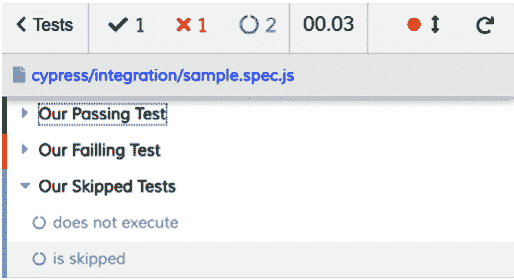

图 4.3 – 跳过的测试

跳过的测试在命令日志和测试运行器中仅显示为已跳过；对于已跳过的测试块或单个测试不会发生任何活动。前面的截图显示了我们在 `sample.spec.js` 文件中定义的跳过测试的状态，该文件可以在我们的 `chapter-04` GitHub 仓库目录中找到。现在我们知道了如何编写不同类型的测试，我们可以深入研究编写实际测试了。但首先，让我们测试一下我们的知识。

#### 测试分类练习

使用你在阅读本章节这一部分时获得的知识，编写满足以下条件的测试：

- 一个通过的测试，断言一个变量是 `string` 类型
- 一个失败的测试，断言一个有效的变量等于 `undefined`
- 一个跳过的测试，检查一个布尔变量是否为 `true`

现在，让我们回顾一下本节中涵盖的内容。

### 回顾 - 编写你的第一个测试

在本节中，我们学习了如何识别不同类型的测试，并了解了 Cypress 框架如何处理它们。我们学习了通过的测试、失败的测试和跳过的测试是什么。我们还学习了 Cypress 测试运行器如何显示已通过、已失败或已跳过的测试状态。最后，我们通过一个练习来测试我们对测试分类的了解。现在，让我们继续编写一个实际测试。

### 编写实际测试

在上一节中，我们了解了 Cypress 中不同测试分类的基础知识以及分类结果。在本节中，我们将专注于编写超越断言一个布尔值等于另一个布尔值的测试。

任何测试要有价值，都需要有三个基本阶段：

1. 设置应用程序的期望状态
2. 执行要测试的操作
3. 断言执行操作后应用程序的状态

在我们的实际测试中，我们将使用 **Todo** 应用程序编写对应于编写有意义测试所需的三个基本阶段的测试。为此，我们将完成以下步骤：

1. 访问 Todo 应用程序页面。
2. 搜索一个元素。
3. 与该元素交互。
4. 对应用程序状态进行断言。

这些步骤将指导我们即将编写的实际测试，并帮助我们对 Cypress 测试有一个全面的了解。

#### 访问 Todo 应用程序页面

这一步涉及访问 Todo 应用程序页面。我们已经使用了我们的 Todo 应用程序来编写测试。

```
describe('Todo Application tests', () => {
  it('Visits the Todo application', () => {
    cy.visit('http://todomvc.com/examples/react/#/')
  })
})
```

当这个测试运行时，观察命令日志，我们将看到 `visit` 命令，以及我们刚刚访问的应用程序在右侧的 Cypress 应用程序预览中，如下面的截图所示：

#### 搜索一个元素

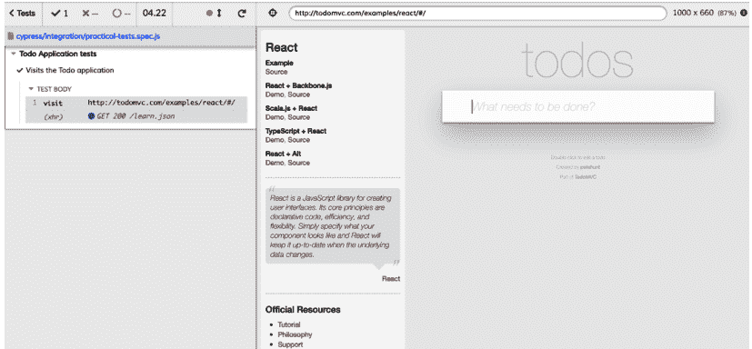

图 4.4 – 访问 Todo 应用程序

尽管我们的应用程序没有任何断言，我们的测试仍然通过了，因为没有导致测试失败的错误使 Cypress 抛出异常。Cypress 命令默认在遇到错误时会失败，这增加了我们编写测试时的信心。

为了确保 Cypress 在我们的应用程序中执行某些操作，我们需要执行一个会导致应用程序状态更改的操作。在这里，我们将搜索用于向应用程序 *添加 Todo* 项的 Todo 应用程序输入元素。以下代码块将搜索负责添加新 Todo 项的元素，并验证它存在于我们刚刚导航到的 URL 中：

```
it('Contains todo input element', () => {
  cy.visit('http://todomvc.com/examples/react/#/')
  
  cy.get('.new-todo')
});
```

#### 60 编写你的第一个测试

当 Cypress 的 `cy.get()` 命令找不到输入元素时，将抛出错误；否则，Cypress 将通过测试。要获取输入元素，我们不需要验证元素是否存在，因为 Cypress 已经通过链式调用在大多数 Cypress 命令中的 **默认断言** 处理了这一点。

> **重要说明**
>
> Cypress 中的默认断言是内置机制，它会导致命令在无需用户声明显式断言的情况下失败。有了这些命令，Cypress 会在执行所述命令时遇到异常时处理异常行为。

以下截图显示了 Cypress 搜索负责向 Todo 列表添加 Todo 项的 Todo 输入元素：

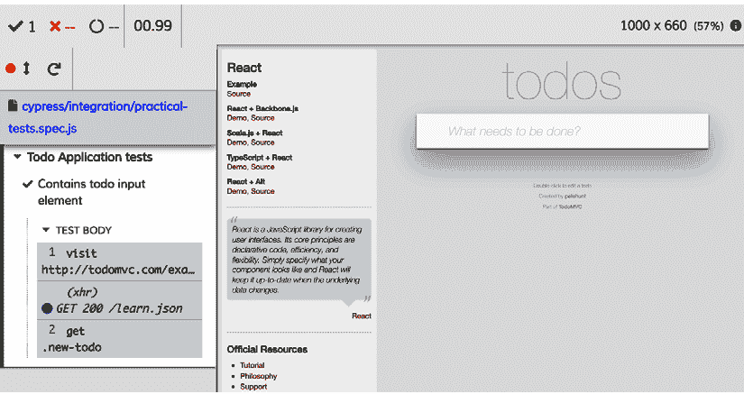

图 4.5 – 搜索 Todo 输入元素

在这里，我们可以验证 Cypress 访问了 Todo 应用程序 URL，然后检查了添加 Todo 项的输入元素是否存在。

#### 与 Todo 输入元素交互

现在我们已经确认 Todo 应用程序中有一个输入元素，是时候与应用程序交互并更改其状态了。要更改 Todo 应用程序的状态，我们将使用我们已验证存在的输入元素添加一个 Todo 项。Cypress 将命令链式连接在一起。要与我们的元素交互，我们将使用 Cypress.type() 命令向元素发送一个字符串，并将 Todo 项添加到应用程序状态中。以下代码块将使用 Todo 输入元素添加一个新的 Todo：

```
it('Adds a New Todo', () => {
  cy.visit('http://todomvc.com/examples/react/#/')

  cy.get('.new-todo').type('New Todo {enter}')
});
```

前面的代码块在前面代码的基础上构建，并使用 Cypress type() 函数添加一个新的 Todo。在这里，我们还调用了 Cypress type 方法的 {enter} 参数来模拟 Enter 键功能，因为 Todo 应用程序没有我们可以点击来添加新 Todo 项的提交按钮。以下截图显示了添加的 Todo 项。有了这个项目，我们可以验证我们的测试是否成功添加了新的 Todo 项。该项目在 Todo 列表中可见：

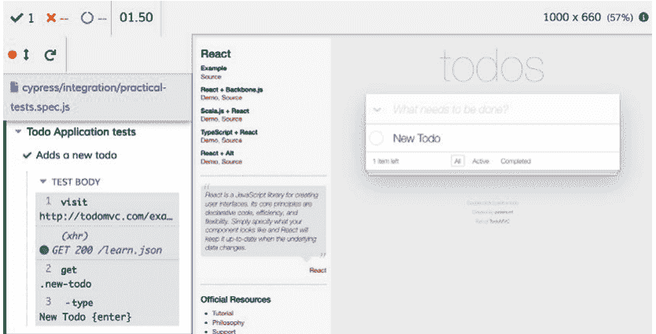

图 4.6 – 与 Todo 输入元素交互


我们的测试运行器显示已经创建了一个新的 Todo。测试再次通过了，即使没有断言，因为已运行的命令已经通过了 Cypress 的默认断言。现在，我们需要断言应用程序状态已经发生了变化。

#### 断言应用程序状态

现在我们已经添加了 Todo，需要断言新的 Todo 项已被添加，并且由于 Todo 项的添加，应用程序状态已经发生了变化。为此，在添加 Todo 项之后，我们需要添加一个断言。在以下的代码块中，我们将对应用程序状态的变化进行断言。在这里，我们添加了一个断言来检查包含列表项的 `.todo-list` 类是否等于 2：

```
it('asserts change in application state', () => {
    cy.visit('http://todomvc.com/examples/react/#/')

    cy.get('.new-todo').type('New Todo {enter}')
    cy.get('.new-todo').type('Another Todo {enter}')
    cy.get(".todo-list").find('li').should('have.length', 2)
});
```

为了进一步验证我们的状态变化，我们可以添加更多的 Todo 项，以验证随着我们添加 Todo 项，项目数量会增加。

在 Cypress 中，我们可以使用断言函数，例如 `.should()` 和 `expect()`，它们捆绑在构成 Cypress 的工具中。默认情况下，Cypress 扩展了 Chai 库中的所有函数，Chai 是 Cypress 的默认断言库。以下截图显示了两个已添加的 Todo 项，以及 Cypress 预览中的确认说明，指出两个已添加的 Todo 项存在于 Todo 列表中：

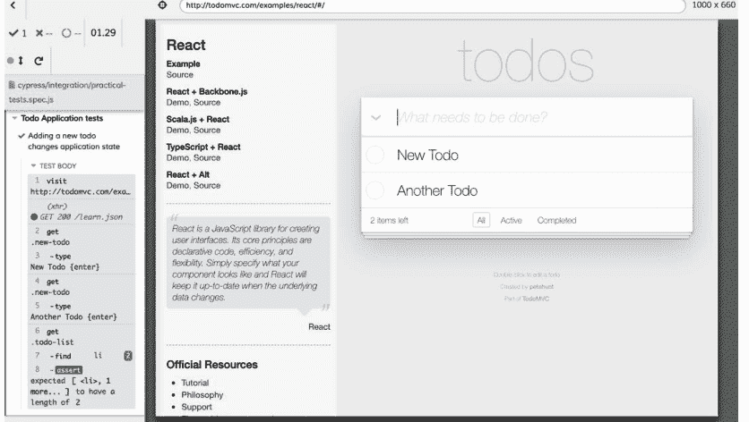

### 图 4.7 – 断言应用程序状态

在此测试中，我们可以验证所有添加的 Todo 在 Cypress 应用程序的预览页面上都是可见的，并且我们的断言通过了。我们现在可以添加更多的断言，专门检查第一个 Todo 的名称是 *New Todo*，另一个添加的 Todo 名为 *Another Todo*。为此，我们将向测试中添加更多的断言，并检查 Todo 项的具体细节。在以下代码块中，我们将验证 Cypress 可以检查已添加 Todo 项的名称；即 *New Todo* 和 *Another Todo*：

```
it('asserts inserted todo items are present', () => {
    cy.visit('http://todomvc.com/examples/react/#/')

    cy.get('.new-todo').type('New Todo {enter}')
    cy.get('.new-todo').type('Another Todo {enter}')
    cy.get(".todo-list").find('li').should('have.length', 2)
    cy.get('li:nth-child(1)>div>label').should(
        'have.text', 'New Todo')
    cy.get('li:nth-child(2)>div>label').should(
        'have.text', 'Another Todo')
});
```

在这些断言中，我们使用了 Cypress 的 `cy.get()` 方法，通过它们的 CSS 类来查找元素，然后通过文本识别第一个和最后一个添加的 Todo 项。

### 实践测试练习

使用*技术要求*部分中提到的 GitHub 仓库链接，编写一个测试，导航到 Todo 应用程序并向其添加三个新的 Todo 项。编写测试来检查已添加的 Todo 项是否存在，通过验证它们的值和数量。

### 回顾 – 编写实践测试

在本节中，我们编写了第一个实践测试。在这里，我们访问了一个页面，检查页面是否有输入元素，与元素交互，并断言应用程序状态发生了变化。了解了 Cypress 中的测试流程后，我们现在可以继续查看使 Cypress 中测试编写变得有趣的功能，例如自动重新加载。

### Cypress 的自动重新加载功能

默认情况下，Cypress 会监视文件变化，并在检测到文件变化时立即重新加载测试。这仅在 Cypress 运行时发生。Cypress 的自动重新加载功能非常方便，因为在对测试文件进行更改后，您无需重新运行测试。

通过自动重新加载功能，可以获得即时反馈，并了解他们的更改是否成功或他们的测试是否失败。因此，此功能允许您节省原本会用于调试测试或检查所做的更改是否解决了问题的时间。

虽然 Cypress 的自动重新加载功能默认启用，但您可以选择将其关闭，并在进行更改后手动重新运行测试。Cypress 允许您停止监视文件变化。这可以通过配置 `cypress.json` 文件或使用 Cypress 的命令行配置选项来完成。在使用 `cypress.json` 配置文件时，用于禁用监视文件变化的设置如下：

```
{
  "watchForFileChanges": false}
```

只要 Cypress 正在运行，此设置将持续并永久禁用文件变化，除非配置被修改或更改为 `true`。另一种禁用 Cypress 监视文件变化的方法是使用如下所示的命令行配置选项：

```
cypress open --config watchForFileChanges=false
```

使用此命令，Cypress 将暂时停止监视文件变化，并且只有在我们停止终端窗口中 Cypress 的执行时，才会改变此行为。然后，Cypress 将继续监视文件变化，并在对测试文件进行更改时自动重新加载。

### 回顾 – Cypress 的自动重新加载功能

在本节中，我们了解了 Cypress 如何利用自动重新加载功能来监视文件变化，并在我们的测试文件发生任何变化时立即重新加载和重新运行。我们还学习了如何轻松关闭 Cypress 中的自动重新加载功能，无论是通过使用 `cypress.json` 文件永久禁用它，还是在运行测试时通过在命令行配置中传递命令。接下来，我们将查看 Cypress 断言。

### Cypress 断言

正如我们在上一节中学到的，在编写第一个测试时，断言用于描述应用程序的期望状态。Cypress 中的断言就像测试的守卫一样，验证期望状态与当前状态是否相同。Cypress 断言是独特的，因为它们会在 Cypress 命令运行时重试，直到达到超时或找到元素。

Cypress 断言源自 **chai**、**chai-jquery** 和 **sinon-chai** 模块，它们随 Cypress 安装捆绑提供。Cypress 还允许您使用 Chai 插件编写自定义断言。然而，在本节中，我们将专注于 Cypress 捆绑的默认断言，而不是可以作为插件扩展的自定义断言。

我们可以通过两种方式编写 Cypress 断言：显式定义主题或隐式定义主题。Cypress 推荐在断言中隐式定义主题，因为它们直接作用于 Cypress 命令正在处理的元素。以下是 Cypress 框架中断言的分类：

-   隐式主题：`.should()` 或 `.and()`
-   显式主题：`expect()`

让我们详细看看每一种。

#### 隐式主题

`should` 或 `and` 命令是 Cypress 命令，这意味着它们可以直接作用于 Cypress 直接产生的主题。这些命令还可以与其他 Cypress 命令链式调用，这使得它们易于使用，同时保证在调用时立即响应。以下代码块演示了如何测试隐式调整和主题不高昂的主题。在这里，我们将使用 `cy.get` 命令的输出在测试中进行断言：

```
describe('Cypress Assertions', () => {
    it('Using Implicit subjects - should', () => {
        cy.visit('http://todomvc.com/examples/react/#/')

        // Check if todo input element has expected
        // placeholder value
        cy.get(".new-todo").should('have.attr', 'placeholder',
        'What needs to be done?')
    });
});
```

在这里，我们使用 `should()` 命令来断言 Todo 项的输入元素具有占位符值。`should` 命令是从 `cy.get()` 命令链式调用的。这不仅使其易于使用，而且减少了断言占位符是什么所需的代码量。在以下代码块中，我们结合了由 `cy.get` 命令返回的隐式主题的不同断言：

```
it('Using Implicit subjects - and()', () => {
    cy.visit('http://todomvc.com/examples/react/#/')
```


```
// 检查待办事项输入元素是否具有预期的占位符值
cy.get(".new-todo")
  .should('have.attr', 'placeholder',
    'What needs to be done?')
  .and('have.class', 'new-todo')
});
```

在这里，我们使用了 `.and()` Cypress 命令来进一步验证刚刚返回的元素是否同时具有一个占位符和一个名为 `new-todo` 的 CSS 类。通过这些隐式断言，我们可以验证：使用隐式主题时，我们可以从 Cypress 返回的同一个响应中链接多个命令，并且可以对不同的项目进行断言。以下代码块展示了使用显式主题进行的代码断言，其中我们必须声明每一个正在断言的主题：

```
it('Using Explicit subjects', () => {
  cy.visit('http://todomvc.com/examples/react/#/')

  cy.get(".new-todo").should(($elem) => {
    expect($elem).to.have.class('new-todo')
    expect($elem).to.have.attr('placeholder', 'What needs to be done?')
  })
});
```

如你所见，使用隐式主题时，我们可以进行更简洁的断言，并减少编写的代码量。而在这个代码块中，每个断言都必须在同一行，并且需要单独执行。

#### 显式主题

当我们想要对运行测试时定义的特定主题进行断言时，可以使用 `expect()`。显式主题在**单元测试**中很常见，当需要在执行断言之前进行一些逻辑操作，甚至对同一个主题执行多个断言时，它们非常有用。以下代码块展示了使用 expect 方法进行的显式主题断言：

```
it('can assert explicit subjects', () => {
  const eqString = 'foo';
  expect(eqString).to.eq('foo');
});
```

```
expect(eqString).to.have.lengthOf(3);
expect(eqString).to.be.a('string');
})
```

这个代码块展示了对实例化字符串与我们期望值之间的显式比较。声明的字符串是一个显式主题，这意味着它可以被多次断言，也可以在执行断言之前进行操作。

对于复杂的断言，我们可以使用 `.should()` 方法来断言显式主题。这允许我们传入一个回调函数，其中已返回的主题作为第一个参数。我们可以在 should 函数内部添加断言，如下所示：

```
it('Using Should with Explicit subjects', () => {
    cy.visit('http://todomvc.com/examples/react/#/')
    cy.get(".new-todo").should(($elem) => {
    expect($elem).to.have.class('new-todo')
    })
});
```

在这里，我们访问了该 URL，然后使用 `cy.get('.new-todo')` 返回的元素来断言一个名为 `new-todo` 的 CSS 类是否存在。这个测试允许我们查询元素，并根据需要为主题编写不同的断言。

#### 练习——隐式主题和显式主题

使用你在本节中学到的知识，并以"技术要求"部分提到的 GitHub 仓库链接作为参考，完成以下练习。

导航到 Todo 应用程序 URL（`http://todomvc.com/examples/react/#/`）并添加一个 Todo：

- 编写一个使用隐式主题断言的测试，断言 Todo 已被添加，并且你输入的名称与 Todo 项目列表中显示的名称相同。
- 在 Todo 应用程序 URL 上，将一个 Todo 标记为已完成。然后，使用显式主题断言，编写一个测试来验证已完成的 Todo 已被标记为已完成。

### 回顾——Cypress 断言

在本节中，我们学习了如何对显式和隐式主题进行断言，并了解了它们之间的异同。我们还学习了不同的断言类型可以用于不同的主题。之后，我们有机会通过一个练习来实践我们对隐式和显式主题的断言技巧。

### 总结

在本章中，我们学习了如何对 Cypress 中的测试进行分类，了解了通过、失败和跳过测试的含义，以及 Cypress 在测试运行器和命令日志中如何看待和表示测试。我们还了解了测试文件的结构以及 Cypress 测试可接受的文件扩展名。然后，我们编写了第一个实际测试，测试了 Todo 应用程序可以添加、删除和将 Todo 标记为已完成。本章的亮点是学习了 Cypress 如何监视文件变化，以及我们如何通过显式断言或隐式断言测试主题来在 Cypress 中执行断言。通过完成本章，你知道了如何通过操作元素和理解可用的断言来编写一个基本的 Cypress 测试。在下一章中，我们将学习如何调试 Cypress 中正在运行的测试以及我们可以用于此目的的工具。

## 5

#### 调试 Cypress 测试

调试是从软件应用程序中识别和移除 bug 的能力。掌握 Cypress 中的调试知识以及学习如何解读 Cypress 的调试输出对于使用 Cypress 框架至关重要。Cypress 以其能够立即提供测试是否通过或失败的反馈而自豪。为了实现即时反馈机制，Cypress 必须在调试消息的结构化方式上做到高效，以便用户能够轻松解读。

为了能够在本章中表现出色，你需要阅读前面的章节，因为它们将帮助你了解测试如何运行、Cypress 如何工作以及我们运行 Cypress 测试的不同方式。在本章中，我们将专注于通过测试运行器在有头模式下调试 Cypress 测试。

虽然本章将探讨使用测试运行器调试 Cypress，但 Cypress 还附带了其他调试工具，我们不一定在本章中涵盖，因为它们要么已经在前面的章节中介绍过，要么超出了本书的范围。在本章中，我们将学习 Cypress 调试在测试运行器中如何工作。为此，我们将涵盖以下主题：

- 理解页面事件
- 理解测试运行器上的错误
- 理解已执行测试的时间旅行
- 理解测试快照
- 理解控制台调试输出
- 特殊调试命令

在你完成这些主题的学习之后，你将准备好开始本书第二部分的工作，即使用**测试驱动开发**（TDD）方法编写 Cypress 测试。

### 技术要求

本章的 GitHub 仓库可以在 `https://github.com/PacktPublishing/End-to-End-Web-Testing-with-Cypress` 找到。

本章的源代码可以在 `chapter-05` 目录中找到。

### 理解页面事件

Cypress 会记录测试运行时发生的每一个主要事件。它可以检测到 URL 何时变化、按钮何时被点击，甚至断言何时被执行。页面事件捕获了测试运行时 DOM 经过的重要事件。

为了演示页面事件的工作原理，我们将使用上一章中使用的 Todo 应用程序。按照我们 GitHub 仓库中的 `chapter-05` 目录，我们将在 Cypress integration 子目录中创建测试文件，并将其命名为 `debugging.spec.js`。然后，我们将在新创建的 spec 文件中创建测试，该测试将导航到 Todo 应用程序，添加一个待办事项，并检查 Cypress 测试运行器中弹出的页面事件。以下代码块将处理向我们的应用程序添加待办事项：

```
it('can add a todo', () => {
    cy.get(".new-todo").type("New Todo {Enter}");
    cy.get(".todo-list").find('li').should('have.length',
    1)
});
```

在这个测试中，我们正在添加一个待办事项，并检查我们添加的项目是否可以从待办事项列表中查看。以下截图显示了一个 XHR 页面事件：

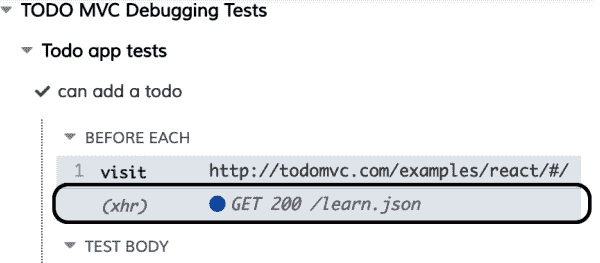

图 5.1 – XHR 页面事件

上面的截图显示了上述测试的部分命令日志。高亮部分名为 `xhr`，是 Cypress 中加载新页面的页面事件。页面事件由 Cypress 机制自动检测并自动记录——不是作为需要执行的命令，而是作为触发了应用程序状态变化的事件。


 Cypress 会记录以下页面事件：

- 提交表单
- 加载新页面
- 网络请求的 XHR 请求
- 测试 URL 的哈希变化

要识别 Cypress 的页面事件，我们需要在 Cypress 命令日志中查找灰色的、没有任何编号形式的日志，例如在执行的 Cypress 测试内部的命令。

### 回顾——理解页面事件

在本节中，我们介绍了什么是 immersive nature of writing and the ability to accumulate knowledge and contacts, and how they are logged, and how to identify them in Cypress. We also learned that page events are useful in tracing the main events that took 在本节中，我们介绍了什么是页面事件、它们何时以及如何被记录，以及如何在 Cypress 中识别它们。我们还了解到，页面事件对于追踪主要事件非常有用，这些事件占据了主导，记录测试失败事件中的异常。Cypress 不仅记录哪些测试失败的信息，还会深入挖掘所遇到错误的具体信息。成功的测试执行等错误在 Cypress 命令日志中可见，并提供可能导致所遇到错误的描述性信息。有时，Cypress 甚至会在命令日志中打印出需要采取什么措施来解决错误的建议。

### 理解测试运行器上的错误

在本节中，我们将剖析测试运行器上的 Cypress 错误，从而解析 Cypress 抛出的错误内容以及如何解读它们。我们将涵盖 Cypress 错误中存在的不同类型的信息，包括错误名称、错误消息、代码框架文件、堆栈跟踪、打印到控制台选项以及了解更多。理解 Cypress 中的错误不仅能帮助我们编写更好的测试，还能在测试失败时指导我们完成调试过程。

Cypress 在记录测试失败事件中的异常方面表现出色。Cypress 不仅记录哪些测试失败的信息，还会深入挖掘所遇到错误的具体信息。成功的测试执行等错误在 Cypress 命令日志中可见，并提供可能导致所遇到错误的描述性信息。有时，Cypress 甚至会在命令日志中打印出需要采取什么措施来解决错误的建议。

在本节中，我们将在 `debugging.spec.js` 中添加一个测试，该测试在 Cypress 中运行时会抛出错误。在以下测试中，我们将探索 Cypress 在遇到错误时提供的信息，并尝试理解这些信息为何与调试过程相关：

```
it('Error Test: can add a todo', () => {
    cy.get(".new-todo").type("New Todo {Enter}");
    cy.get(".todo-list").find('li').should('have.length',
    2)
});
```

此测试应有意抛出错误，因为我们期望待办事项的数量等于 2，尽管我们只添加了一个名为 `New Todo` 的待办事项。

Cypress 抛出的每个错误都将包含以下信息。这些将帮助你识别问题来自哪里以及导致 Cypress 抛出错误的原因：

- 错误名称
- 错误消息
- 代码框架文件
- 代码框架
- 堆栈跟踪
- 打印到控制台选项
- 了解更多（可选）

让我们详细看看每一项。

#### 错误名称

Cypress 根据遇到的错误抛出不同类型的错误。Cypress 中的错误通过其类型进行识别，可以按类型分类，如 Cypress 错误和断言错误等。Cypress 抛出的错误类型有助于调试。这是因为我们可以完全理解测试是从正在运行的测试中失败，还是从 Cypress 内部遇到的错误中失败。此错误显示在 *Figure 5.2* 中，引用为 *1*，即错误名称。

#### 错误消息

每个错误都附带一条消息。此消息详细解释了测试运行时出错的原因。错误消息因测试而异。虽然某些消息可能很直接，告诉你出了什么问题，但其他消息会更进一步，甚至详细说明你可以采取哪些步骤来修复错误。一些错误消息包含**了解更多**部分，将引导你访问与遇到的错误相关的 Cypress 文档。此错误消息显示在 *Figure 5.2* 中，引用为 2。

#### 代码框架文件

这是包含 Cypress 遇到的错误的文件。该文件显示为堆栈跟踪的最顶层项目。代码框架文件在 Cypress 错误框架中以行号和列号高亮显示。当点击堆栈跟踪上的代码框架文件时，它将在首选编辑器中打开，并高亮显示错误发生的行和列，如果用于打开文件的编辑器支持代码高亮。我们可以在 *Figure 5.2* 中看到代码框架文件，引用为数字 3。

#### 代码框架

这是 Cypress 标记为导致所发生错误的代码片段。它可以在前面提到的代码框架文件中找到。Cypress 在代码框架片段中高亮显示导致执行测试出现问题的特定行以及列。我们可以通过检查 *Figure 5.2* 中引用为 4 的代码片段来识别导致失败的代码框架。

#### 堆栈跟踪

堆栈跟踪显示了发生错误时正在执行的不同方法，从而导致异常。在 Cypress 错误中，你可以切换堆栈跟踪，它可以在错误中代码框架下方找到。这应该显示测试遇到错误并失败时正在执行的函数。*Figure 5.2* 中的数字 5 显示了堆栈跟踪区域。

#### 打印到控制台

Cypress 错误还为你提供了将遇到的错误打印到 DevTools 控制台的选项。将遇到的错误打印到命令提示符的选项允许我们选择堆栈跟踪中的一行并将其打印到控制台。我们可以在 Figure 5.2 中看到这一点，标记为 6。

### 了解更多

正如我们之前提到的，一些测试失败会打印**了解更多**链接，点击后会为我们提供相关 Cypress 文档的方向，以了解发生的错误。当错误可能需要的不仅仅是调整断言或测试下的期望时，Cypress 失败会提供**了解更多**链接：

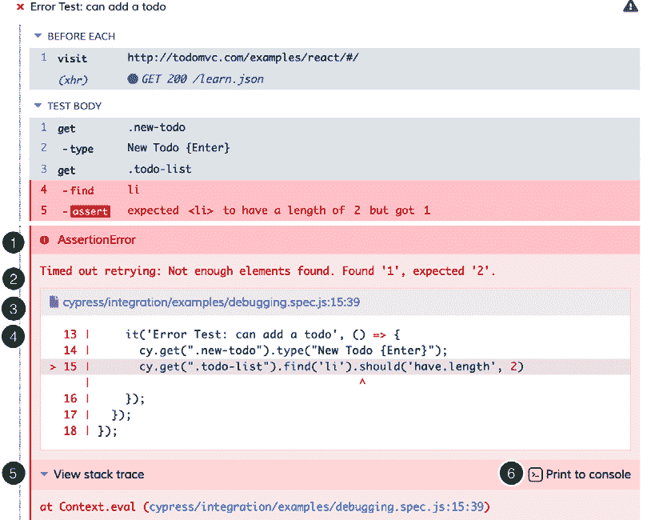

Figure 5.2 – 测试错误时显示的信息

上述截图显示了测试抛出异常时显示的错误信息的按时间顺序排列的结构。正如我们所看到的，测试只向待办事项列表添加了一个待办事项，但期望找到两个。错误发生在测试断言上，因为 Cypress 期望有两个项目，但只找到了一个，从而导致错误。

失败测试提供的信息对调试过程至关重要。这是因为不仅很容易识别测试失败的原因，而且还有助于我们理解需要进行哪些更改，才能将测试从失败状态恢复到通过状态。

### 回顾——理解测试运行器上的错误

在本节中，我们了解到 Cypress 错误的信息量有多大。我们得以调查嵌入在 Cypress 错误消息中的不同信息片段及其在调试过程中的用途。了解 Cypress 在错误发生时如何呈现其错误，使我们能够知道如何处理 Cypress 错误并理解这些错误来自哪里。在下一节中，我们将看看 Cypress 的时间旅行功能。

### 理解已执行测试的时间旅行

时间旅行，就像科幻电影中的那样，但在测试的上下文中，是指能够返回到测试执行时的状态。随着 Cypress 测试的执行，它们会创建 DOM 快照，我们可以利用这些快照穿越时空，检查测试在不同时间以及当不同操作发生时的状态。通过时间旅行，可以检查预期操作是否发生以及如何发生。时间旅行 fzres allows us to investigate and audit what actions were taken when the test was running and why errors occurred.

要调查 Cypress 测试中的时间旅行，我们将导航到本书 GitHub 仓库中的 `chapter-05` 文件夹，并在我们之前创建的 `debugging.spec.js` 文件中创建一个新测试。以下代码块是一个将添加的待办事项标记为已完成的测试。通过时间旅行，我们可以识别添加第一个待办事项时以及添加第二个待办事项时应用程序的不同状态：

```
it('can mark a todo as completed', () => {
    cy.get(".new-todo").type("New Todo {Enter}");
    cy.get(".new-todo").type("Another New Todo {Enter}");
    cy.get('.todo-list>li:nth-
child(1)').find('.toggle').click();
    cy.get('.todo-list>li:nth-
child(2)').find('.toggle').click();
});
```

上述代码块向待办事项列表添加了两个待办事项，然后将它们标记为已完成。使用 Cypress 的时间旅行功能，我们可以参考 Cypress 来检查添加第一个待办事项时的状态以及添加第二个待办事项时的状态。通过使用如下截图所示的时间旅行功能，我们可以进一步验证两个项目在标记为已完成之前都处于正确的状态，并且在此过程中进行了正确的导航：


图 5.3 – 测试中的时间旅行和 DOM 快照

在前面的截图中，我们可以看到测试已经运行完毕并且已经通过。我们还可以看到，我们可以回溯时间并调查在待办事项列表中点击第一个待办事项项时发生了什么。由于 Cypress 可以回溯时间并向我们展示特定时间点的 DOM，我们实际上可以验证达到测试最终结果所采取的步骤——无论是测试通过还是测试失败。所示数字展示了 Cypress 时间旅行机制的主要部分以及事件发生的顺序。

时间旅行的第一步是等待测试运行完成，然后选择你想要回溯到的步骤。Cypress 不仅展示测试步骤，还允许你将该步骤的 DOM 快照固定到 Cypress 预览窗口中。

选择时间旅行步骤后，我们感兴趣的步骤被固定为 DOM 快照。我们可以查看该步骤在操作发生之前的状态，以及操作发生后转变为的新状态。这可以在前面截图的预览窗口中看到。

时间旅行检查过程的第三步是在 DOM 快照的 **after** 和 **before** 之间进行选择。在 **after** 和 **before** 之间切换可以显示 DOM 快照中的变化。这种切换帮助我们理解正在检查的 Cypress 步骤的操作如何在该特定阶段改变了 DOM。完成检查后，我们可以继续执行下一步骤，并将测试状态固定在该特定执行步骤。

> **重要提示**

Cypress 时间旅行在测试仍在执行且尚未通过或失败时无法工作。为了获得准确的结果，你必须等待执行完成后才能看到所有相关步骤的最终结果。

### 回顾——理解已执行测试的时间旅行

在本节中，我们了解了 Cypress 如何为我们提供时间旅行功能，以便我们可以回溯 Cypress 执行测试时所采取的不同步骤。Cypress 中的时间旅行使我们能够检查 Cypress 为声明测试失败或通过所采取的步骤。我们还有机会看到时间旅行功能如何与快照功能配合使用，我们将在下一节中介绍。

### 理解测试快照

我们在解释 Cypress 的时间旅行过程时简要介绍了快照的概念。然而，这并不意味着我们已经穷尽了快照功能的优势。

快照非常强大，因为它们让我们得以窥探测试的执行方式以及它所采取的步骤，这些步骤要么导致测试的失败状态，要么导致成功状态。当我们固定 DOM 快照时，Cypress 会冻结测试并突出显示所采取的所有操作。固定的快照允许我们检查 DOM 的状态，同时查看在该特定步骤中发生的所有事件。例如，在前面的截图中，*步骤 2* 有一个 **event hitbox**，显示第一个待办事项项被点击。以下截图展示了 Cypress 如何解读测试运行时发生的事件：

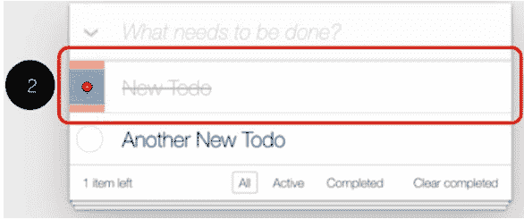

图 5.4 — 已切换待办事项项的事件 hitbox

前面的截图展示了事件 hitbox 的实际效果。在这里，我们可以看到发生了一个点击事件，该事件影响了待办事项应用程序的应用程序状态。

> **重要提示**

事件 hitbox 是出现在固定 Cypress 快照上的高亮显示，用于表明测试与元素进行了交互。事件 hitbox 可以由 Cypress 事件触发，例如 `.click()` 方法。

**Snapshots** 菜单允许我们在快照状态之间切换。如果发生了一个改变 DOM 的事件，我们可以切换查看变化发生前的状态，也可以切换查看变化发生后的状态。**before** 快照切换将显示所选测试步骤触发的任何事件之前的状态。另一方面，**after** 切换将显示从所选步骤触发事件后应用程序的状态。以下截图展示了固定 DOM 快照的切换，显示了事件发生前快照的样子以及事件发生后快照的样子：


图 5.5 – DOM 快照菜单

在前面的截图中，我们可以看到 **Snapshot** 菜单项。第一个窗口图标将隐藏或显示固定 DOM 快照上的 **event hitbox**，而 **before** 和 **after** 菜单用于显示所选步骤的 DOM 过渡。**Snapshot** 菜单的 **close** 图标被点击时，会取消固定 DOM 快照并将其恢复为测试的已完成步骤，不再有任何固定的 DOM 快照。

> **重要提示**

快照菜单项的 **before** 和 **after** 事件的显示方式取决于发生的事件。在操作改变了 DOM 状态的事件中，before 和 after 快照会有所不同。当执行的操作不直接改变 DOM 时，测试步骤的 before 和 after 状态可能具有相似的快照。

### 回顾——理解测试快照

在本节中，我们了解了 Cypress 如何在每次测试运行后在 DOM 快照中存储重要的调试信息。我们还学习了如何利用 Cypress 快照检查测试步骤的 before 和 after 状态，并将其用于调试的调查过程中。在下一节中，

82 调试 Cypress 测试

### 理解控制台调试输出

在本节中，我们将了解如何利用 Cypress 的控制台调试输出来理解应用程序状态变化。我们将在浏览器的控制台中打开并与控制台输出进行交互。理解浏览器控制台中的输出将使我们能够更好地调试测试，因为我们可以调查 Cypress 抛出错误的各种问题并迅速解决它们。

Cypress 在提供调试信息方面表现出色。由于快照提供的所有信息可能还不够，Cypress 提供了一个额外的步骤，以便你可以查看特定步骤的信息及其对元素的影响。要查看控制台调试输出，我们需要打开 DevTools。要打开 Cypress 测试浏览器的 DevTools 控制台，我们需要遵循某些步骤，所有这些步骤都将在以下章节中讨论。

#### macOS

要在 macOS 上打开 Cypress 测试浏览器的 **DevTools** 控制台，请按照以下步骤操作：

1. 在 Cypress 测试浏览器预览界面上用两个手指按住触控板。
2. 从弹出菜单中选择 **Inspect** 选项。
3. 从 **DevTools** 控制台中选择 **Console** 选项卡。

你还可以使用 *Option* + *J* 快捷键在 Mac 上打开 **DevTools** 菜单。

#### Windows/Linux OS

要在 Windows 和 Linux 操作系统上打开 Cypress 测试浏览器的 **DevTools** 控制台，请按照以下步骤操作：

1. 在 Cypress 测试预览界面上右键点击 Cypress 测试浏览器。
2. 从浏览器弹出菜单中选择 **Inspect** 选项。
3. 从 **DevTools** 控制台中选择 **Console** 选项卡。

你还可以在 Windows 操作系统或 Linux 上使用 *Shift* + *Ctrl* + *J* 快捷键打开 **DevTools** 控制台。

一旦你能看到控制台输出，选择一个测试步骤，如以下截图所示：

### 理解控制台调试输出

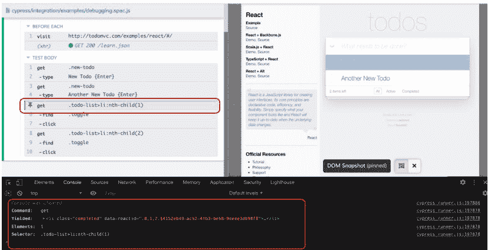

前面的截图显示了在命令提示符中选定的 Cypress 命令的输出。正如我们所见，当点击特定命令步骤时，DOM 快照被固定到 Cypress 浏览器的预览屏幕上。固定 DOM 快照使我们能够不受干扰地与固定快照上的元素进行交互。

在前面的截图中，我们选择了 `get` 方法和第一个待办事项项，可以通过 `.todo-list>li:nth-child(1)` CSS 选择器识别。我们还可以看到 Cypress 的 `get` 方法找到了第一个待办事项项的 CSS 选择器并将其切换为已完成状态。查看控制台调试信息，我们可以看到 Cypress 在控制台打印的与操作步骤相关的附加信息，现在已固定到 DOM。

在 **Console** 区域，我们可以看到以下内容：

- **Command**：这是我们发出的命令。在我们的例子中，它是一个 `cy.get()` 命令。
- **Yielded**：这打印了被调用命令返回的语句。在我们的例子中，它将打印与输入相同的内容。这是因为我们的命令没有改变元素的状态。
- **Elements**：这打印了从我们的 `get` 命令返回的元素。在我们的例子中，我们只使用 CSS 选择器找到了一个元素。但是，如果我们有多个元素，我们将能够看到找到的元素。
- **Selector**：这是指我们用于在 DOM 中识别待办事项的 CSS 选择器。


 ## 84 调试 Cypress 测试

> **重要提示**

控制台显示的信息可能会因发出和检查的不同命令而发生变化。这对于所有在控制台日志中检查的 Cypress 命令来说并非标准情况。

使用这些调试信息，并结合我们之前介绍的方法中的调试信息，你将能够了解哪些 Cypress 测试失败了以及失败的原因。大多数情况下，你只需学会阅读常见的 Cypress 错误，就能理解错误是如何抛出的以及为什么会出现这些错误。

### 回顾 – 理解控制台调试输出

在本节中，我们学习了如何利用 Cypress 中的控制台调试输出来理解应用程序状态的变化。我们还学习了如何打开和访问控制台信息以及与之交互。在下一节中，我们将学习如何利用 Cypress 的特殊调试命令。

### 特殊调试命令

如果逐个跳转到命令不是你的风格，或者你发现难以理解时间旅行如何展示测试中的执行顺序，Cypress 为你提供了支持。Cypress 包含一些有助于调试的命令，甚至为你提供了使用普通代码调试器时的选项。我们将在本节中探索的两个命令如下：

- `cy.debug()`
- `cy.pause()`

使用这些 Cypress 调试命令，我们可以了解如何从测试本身调试 Cypress。这两个特殊调试命令将使我们能够在执行测试时直接控制调试过程。能够在测试内部停止执行，使我们只需调试 Cypress 中抛出错误的特定部分，这是一个优势。

#### cy.debug

`cy.debug()` 命令默认是 Cypress 开箱即用的调试命令。该命令会记录到控制台，并记录它所链接的命令的输出。要使用 `cy.debug()` 命令，你需要将其链接到任何 `cy` 命令，或者作为独立的 Cypress 命令使用。在我们的上下文中，我们将通过从 `cy.get()` 命令链接来使用该命令。

该命令在被调用时会agnetes执行，并显示从命令逐步向前执行的选项，以及从当前执行步骤暂停调试器。实际上，调试器允许我们以所需的速度执行测试，同时检查执行某个步骤时发生的情况。除了调试器界面外，此 Cypress 命令还在控制台输出上显示详细信息，并显示命令名称、命令类型，甚至是我们链接调试器的主题等信息。

现在我们已经添加了两个待办事项，并检查了控制台日志和 Cypress 测试运行器的预览面板，我们可以添加调试器。以下代码块显示了一个将待办事项标记为完成的测试。但是，我们不会执行整个测试，而是在添加第二个待办事项后打开调试器：

```
it('Special commands-debug : can mark a todo as completed',
() => {
    cy.get(".new-todo").type("New Todo {Enter}");
    cy.get(".new-todo").type("Another New Todo
{Enter}").debug();
    cy.get('.todo-list>li:nth-
child(1)').find('.toggle').click();
    cy.get('.todo-list>li:nth-
child(2)').find('.toggle').click();
});
```

#### 调试 Cypress 测试

在前面的代码块中，我们想在添加第二个待办事项后检查应用程序的状态。以下截图显示了在添加第二个待办事项后打开的调试器：

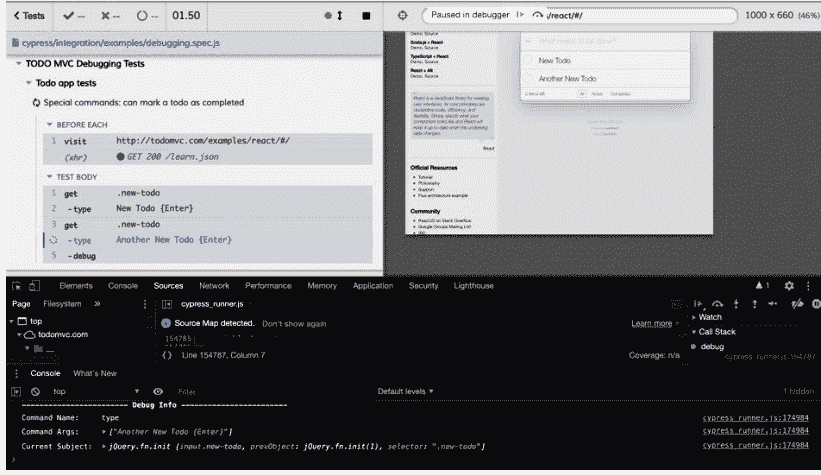

正如我们所见，调试器在添加第二个待办事项后暂停了我们正在运行的测试。在这里，我们可以观察到，一旦调试器暂停了我们正在运行的测试，我们就可以按照自己的节奏与应用程序交互并检查元素。有了调试器，我们可以看到应用程序状态的变化，以及控制台输出上显示的额外调试信息。一旦我们完成状态检查，我们可以删除 `.debug()` 命令，或者将其放在我们希望检查的另一行。

#### cy.pause

Cypress 的暂停命令与 `cy.debug()` 命令非常相似，但与其链接到其他命令不同，它可以独立使用，就像调试器一样。当使用暂停命令时，Cypress 会减慢其执行速度，只有在点击前进按钮时才会执行下一步。就像调试器一样，Cypress 的暂停命令将控制权交给执行测试的人，并允许他们调查每一个测试步骤。以下代码块显示了一个将待办事项标记为完成的测试。但是，在执行完成之前，我们在添加第一个待办事项后暂停了测试：

```
it('Special commands - Pause: can mark a todo as completed', () => {
    cy.get(".new-todo").type("New Todo {Enter}");
    cy.pause();
    cy.get('.todo-list>li:nth-child(1)').find('.toggle').click();
});
```

在这里，我们添加了一个待办事项，然后在将其标记为完成之前暂停了执行：

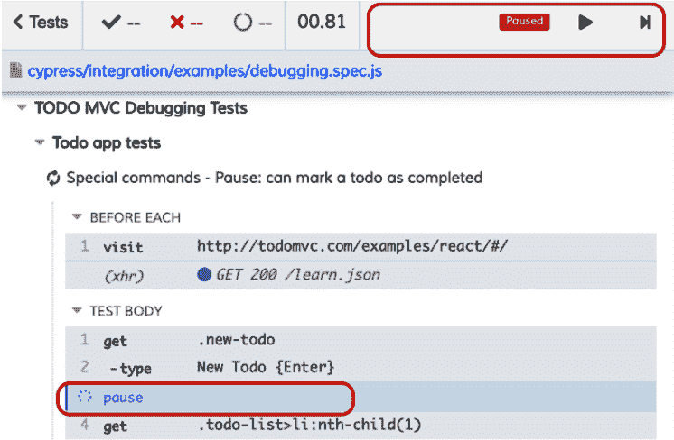

图 5.8 – 运行测试的暂停菜单

正如我们所见，在添加我们的待办事项之后，执行立即被暂停，直到我们按下**暂停**菜单中的**前进**按钮。这出现在测试命令部分的顶部。当所有步骤都已执行完毕后，测试将退出，并根据执行的步骤输出通过或失败。在我们的案例中，我们有一个通过的测试——太好了！

> **重要提示**

>
> Cypress 特殊调试命令只应在调查正在运行的测试状态或用于调试目的时使用。它们不应在**持续集成**（CI）中运行的测试中使用，因为它们可能会导致超时，进而导致测试失败。

### 回顾 – 特殊调试命令

在本节中，我们了解了可用于提供额外调试信息的 Cypress 特殊命令。我们了解到，当我们想要减慢测试执行速度时，Cypress 的 `debug` 和 `pause` 命令都很方便。我们还了解到，调试命令可以作为 Cypress 测试运行器提供工具的补充工具使用，例如 DOM 快照。

### 总结

在本章中，我们探讨了调试在执行测试时的作用。我们识别了 Cypress 框架中使 Cypress 中的调试过程对任何编写测试和实施 Cypress 框架的人有用的方面。我们还了解到，Cypress 捆绑了不同的工具，这些工具可以用来实现不同的目的或相同的目的。主要要点是，无论你遇到什么 bug，Cypress 都会为你找到识别和修复它的方法。

通过完成本章，你已经了解了 Cypress 中的页面事件是什么、如何解释 Cypress 测试运行器的错误、执行测试中的时间旅行是如何工作的，以及如何解释测试快照。你还学习了如何解释来自 Cypress 的控制台输出信息，以及如何使用可用的两个特殊调试命令。

既然我们已经了解了调试及其对我们测试的影响，我们可以放心地深入本书的第二部分，这将涉及使用 **测试驱动开发（TDD）** 方法来使用 Cypress。在下一章中，我们将采用测试优先的方法来开发一个应用程序，即在开始 |-begin 开发我们的应用程序之前编写我们的测试。我们稍后将在应用程序开发过程中使用这些测试来指导我们。

## 第二部分：使用 TDD 方法的自动化测试

本部分构成了本书的核心，将向你介绍与 Cypress 相关的更高级主题以及如何使用它。在本部分中，将介绍我们如何思考一个想法并使用 **测试驱动开发（TDD）** 将我们的想法从构思阶段推进到开发阶段。在本章中，我们还将学习诸如使用 Cypress 与元素交互、别名使用以及 Cypress 测试运行器等主题。

本部分包括以下章节：

- 第 6 章，使用 TDD 方法编写 Cypress 测试
- 第 7 章，理解 Cypress 中的元素交互
- 第 8 章，理解 Cypress 中的变量和别名
- 第 9 章，Cypress 测试运行器的高级用法


## 6
## 使用TDD方法编写Cypress测试

现在我们已经完成了本书的*第一部分*——即*Cypress作为前端应用程序的端到端测试解决方案*——是时候进入本书的*第二部分*了，这一部分将专注于*使用TDD方法进行自动化测试*。

在开始使用**TDD**（**TDD**）方法编写Cypress测试之前，我们需要了解如何正确编写Cypress测试。这在前面的章节中已经有所涵盖。要精通这一主题，你需要了解Cypress测试的工作原理、测试结构，以及使用Cypress测试进行断言的不同方式。这些背景知识将帮助你理解如何在Cypress中使用TDD，以及在软件开发生命周期中使用TDD所带来的优势。在本章中，我们将利用测试驱动的方法来编写测试，这些测试将显著提升我们对应用程序和软件解决方案的信任度和信心度。

本章的重点将在于探讨如何利用Cypress来帮助我们全面思考一个应用程序，甚至在开始开发流程之前。我们将应用先测试后开发的理念。在这样做的过程中，我们将利用Cypress框架作为测试的核心。

本章将涵盖以下关键主题：

- 理解TDD
- 在Cypress中编写TDD测试
- 修改TDD测试

完成这些主题的学习后，你将准备好学习Cypress中的元素交互。

### 技术要求

首先，我们建议你克隆本书的GitHub仓库，其中包含了我们将要构建的应用程序以及本章将编写的所有测试。

本章的GitHub仓库地址如下：

```
https://github.com/PacktPublishing/End-to-End-Web-Testing-with-Cypress
```

本章的源代码可以在 `chapter-06` 目录中找到。

我们将使用ReactJS库来开发应用程序。

你可以通过运行以下命令来启动ReactJS应用程序：

- `cd chapter-6/tdd-todo-app`
- `npm install`（安装所有必需的依赖项）
- `npm run start`（启动React应用程序以供测试）

### 理解TDD

TDD是一种软件开发过程，它依赖于将需求转化为非常具体的测试用例。编写完这些测试用例后，再编写代码并根据其他测试用例进行检查。TDD流程的最后一步是迭代和改进代码，以确保其符合所需的最佳实践并使测试用例通过。TDD方法的周期包括以下步骤：

1. 定义需要实现的功能
2. 编写新的测试
3. 运行测试以检查测试是否失败
4. 编写代码以使测试用例通过
5. 针对新增功能运行测试，确保测试通过
6. 重构代码
7. 重复此过程

TDD的目的是在开发开始之前预见最终结果。这样，就有可能预见开发过程中可能出现的问题或障碍。能够使用TDD方法开发功能有助于批判性地思考解决方案，并且在应用程序开发过程中需要测试的场景中也能提供帮助。

假设我们正在创建一个登录功能；从测试的角度来看，我们需要为登录功能构思所有不同的场景。思考这些测试场景将使我们清晰地了解在开发阶段需要进行的操作，从而在开发此应用程序功能时使需求更加明确。

TDD有助于减少范围蔓延的可能性，因为从一开始我们就能理解项目的目标。有了测试用例，我们就可以确定功能范围，并将其限制在已编写的测试用例之内。理解这个功能涉及什么，可以让开发者构思如何实现代码。从长远来看，这可能会减少开发时间。

> **重要提示**
>
> 范围蔓延指的是项目开始后软件开发项目的需求或范围发生不受控制的变化。

接下来，让我们看看TDD方法的优势。

#### TDD的优势

在本节中，我们将更详细地探讨在软件开发生命周期中实施TDD方法论所带来的好处。

##### 更好的项目设计

在使用TDD方法进行开发时，开发者需要思考这段代码旨在实现的目标。因此，开发者总是会以终为始地进行思考。能够以特定目标开发一个功能，确保开发者只编写所需且必要的代码，从而使得应用程序具有清晰的结构。

使用TDD还能确保更高的代码质量，因为TDD非常强调**不要重复自己（DRY）**原则的使用，该原则反对在编写代码时出现重复。因此，通过使用TDD，可以保持函数简单而简短，代码库易于理解。更整洁、更简单的代码库易于维护和测试，这对开发者和代码库维护者来说都是一个额外的优势。

> **重要提示**
>
> DRY原则是应用开发原则，强调软件模式的非重复性以及使用抽象来避免或减少冗余。

##### 详细的文档

TDD强制执行严格的文档，并引用正在开发的功能；开发者需要制定这样的规范，这些规范可能包括用户的行为。理解这些行为并将步骤分解为用户故事，有助于开发者实现功能，从而开发出非常接近定义目标的功能。

在编写测试阶段开发适当的文档，也免除了其他方必须理解功能以重现文档的角色，因为这已经是软件开发流程的一部分。

##### 减少开发时间

可以假设TDD在开发应用程序时需要更多时间，大多数情况下确实如此。根据这一说法，我们可以假设TDD很可能会推迟项目的交付日期，但事实并非如此。

通过采用TDD方法，可以覆盖那些如果不使用TDD方法开发就可能产生错误的场景。虽然TDD最初可能比非TDD方法消耗更多时间，但它显著减少了开发者维护项目以及测试产品及其功能所需的时间和工作量。

由于TDD强制执行整洁的代码，因此不言而喻，即使发现了错误，在使用TDD的项目中修复它们也比在不使用TDD的项目中更容易。TDD对高质量代码标准和持续反馈的关注，使得TDD项目的代码库易于维护，而非TDD项目则不然。

##### 节省成本

在任何项目中，在错误仍处于开发阶段时发现并修复它，比错误已经进入生产环境后修复要便宜得多。TDD侧重于在开发过程中消除错误，这大大减少了缺陷通过功能开发和测试阶段的机会。这强化了代码重构原则和错误预防。TDD方法极大地节省了公司直接与生产环境中发现的错误和缺陷相关的行动支出。

缺陷直接带来的成本可能包括直接收入损失、修复已发现缺陷所需的额外时间和成本，甚至是公司利益相关者（如客户）的信任丧失。理解TDD降低此类成本的能力，使得公司的节省变得值得，因为开发软件需要花钱，而修复同样的软件则需要花更多的钱。

##### 可靠的解决方案

TDD解决方案是可靠的，因为它们在开发启动之前经过了严格的审查。TDD确保开发的概念就是最终实现的目标。这是通过在功能仍处于构思阶段且以需求形式存在时编写的测试场景来实现的。

如果不使用TDD，开发者就不可能构建一个健壮的解决方案，而不考虑程序的不同部分如何与新功能交互。然而，有了TDD，这些测试用例帮助开发者理解新功能和现有功能如何集成，从而了解新功能构建后应用程序的行为方式。这种方法给了开发者信心，因为他们在开始开发之前就了解了解决方案。


#### TDD 的缺点

虽然 TDD 的大多数成果都是积极的，并能带来高效和优质的开发流程，但对于那些尚未准备好采用它的团队来说，TDD 也可能有害。本节我们将重点介绍使用 TDD 的缺点，以及它为何可能不适合某些团队。

##### 组织准备度

TDD 要求组织参与到实施过程中。在实施之前，需要为组织定义 TDD 的需求，因此，为了确保成功，组织需要做好准备，使 TDD 能为他们所用。在某些情况下，组织可能没有耐心在开始实施前等待所有需求确定，也可能不愿意牺牲额外时间来仔细梳理需求。

TDD 是一种结构化的方法，要求管理层和开发团队通过同意预先投入规划相关的成本来保持一致，以便在后期减少维护成本。并非所有团队都愿意采取等待 TDD 收益的方式，这意味着组织可能不愿意为当前不可见的成本买单。

##### 理解问题

测试驱动开发注重在开始实施之前构建测试。这种方法有助于团队更好地理解问题，并提出可靠的实施解决方案。编写测试的最大挑战在于，它们无法解决实施代码中已经引入的逻辑错误。测试只能识别其旨在测试的内容，可能无法测试代码中未明确定义的内容。

使用 TDD 时，由于对问题的理解不足可能会犯错；测试可能无法捕捉到解决方案设计者未正确理解需求的情况。

### 回顾——理解 TDD

在本节中，我们了解了 TDD、为什么需要它，以及它在软件开发生命周期中如何应用。我们还了解了使用 TDD 的优势，以及它如何防止在后期开发和测试阶段发现错误和缺陷所产生的成本。我们也了解了使用 TDD 的缺点，其中一些可能源于测试本身的质量与其编写时的推理水平相当。因此，理解正在开发的问题至关重要，以便为当前问题编写测试。下一节我们将重点介绍如何在 Cypress 中编写 TDD 测试，以及此过程如何帮助为功能代码创建健壮的解决方案和实现。

### 在 Cypress 中编写 TDD 测试

在本节中，我们将重点介绍使用 Cypress 编写 TDD 测试。在整个部分，我们将构建一个 Todo 应用程序并应用 TDD 原则。首先，我们需要在脑海中有一个设计，以便编写合适的测试，并对应用程序的功能进行深入思考。本章的目标是创建一个应用程序，它将添加待办事项、删除待办事项、显示已添加的待办事项，并显示已添加待办事项的数量。最终应用程序的模型如下截图所示。我们将遵循的每个步骤都将帮助我们实现期望的模型：

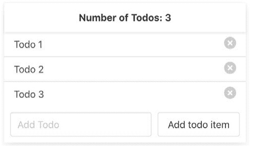

前面的截图显示了我们将要构建的 Todo 应用程序的模型。我们将采用 TDD 方法，使用 Cypress 编写测试。应用程序将具有以下功能：

- 添加新的待办事项
- 删除待办事项
- 查看已添加的待办事项
- 查看已添加待办事项的数量

这些功能构成了我们 Todo 应用程序的需求。在本章中，当我们编写测试和实现应用程序时，我们将把这些功能作为需求来参考。

#### 设置应用程序

为了避免本节中进一步的复杂性，我们将不关注如何构建应用程序，而是关注如何在构建应用程序时实施测试。作为背景，我们将要构建的应用程序将使用 ReactJS 库，该库是用 JavaScript 编写的。

理解了我们的应用程序是什么样子后，我们将采用循序渐进的方法，在开始应用程序开发流程之前编写测试。正如我们前面提到的，我们已经写下了我们将要构建的应用程序功能。我们将从编写 TDD 测试开始，以便能够添加新的待办事项。

#### 添加新的待办事项

我们将关注的第一个 TDD 测试是负责检查新待办事项是否已添加到待办事项列表中的测试。要执行这些步骤，请导航到您从 GitHub 克隆的 `tests` 目录，并使用以下命令：

```
cd chapter-6/tdd-todo-app/integration/todo-v1.spec.js
```

前面的命令将带您进入本章将使用的 TDD `tests` 目录。此文件中的测试是我们将在 TDD 流程中编写的测试的初始版本。稍后，我们将修改它们，使其适合我们将添加的最终应用程序功能。

> **重要提示**
> 为我们的 Todo 应用程序编写 TDD 测试时，请注意 Cypress 目录位于测试应用程序内部。这确保我们跟踪和识别属于正在开发的应用程序的 Cypress 测试。

以下代码片段是一个测试，检查我们是否可以向应用程序添加新的待办事项，这是我们应用程序的需求之一：

```javascript
it('can create and display new todo', () => {
    cy.get('[data-testid="todo-item-input"]')
        .type('New todo');
    cy.get('[data-testid="add-todo-button"]')
        .click();
    cy.contains('New Todo');
});
```

在上面的代码片段中，我们编写了一个 TDD 测试来检查功能完成后是否可以添加待办事项，并检查添加的项目是否存在。请注意，在此阶段，添加待办事项的功能尚未构建。如果在 Cypress 中运行此代码片段，它应该会自动失败。为了验证这一点，我们可以运行以下命令来运行 Cypress 测试：

```
npm run cypress:open
```

下面的截图显示了创建和显示新待办事项的失败 TDD 测试：

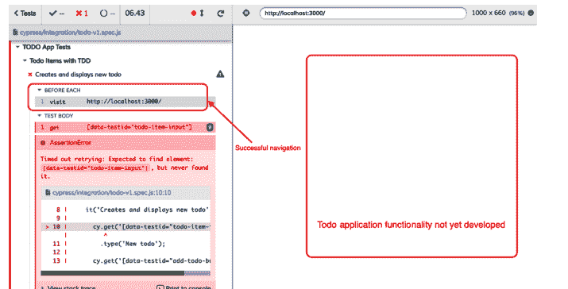

图 6.2 – 在 Cypress 上运行 TDD 测试

在上面的截图中，我们正在执行测试以检查它是否失败以及 Cypress 是否可以执行它。在此测试中，Cypress 尝试针对在端口 3000 上本地运行的 Todo 应用程序执行测试。测试失败是因为 Cypress 找不到负责将待办事项添加到待办事项列表的输入元素。从上面的截图我们可以验证，应用程序已成功导航到在本地主机上运行的应用程序。为了继续构建此功能并确保测试通过，稍后我们将添加添加待办事项的功能，并再次运行我们的测试。

#### 删除待办事项

我们的 Todo 应用程序要求规定，我们应该能够删除已添加的待办事项。已删除待办事项的一项要求是，一旦删除，它不应再在待办事项列表中可见。要编写我们的 TDD 测试，我们需要确保通过验证待办事项在从列表中删除后不再存在，来实际删除了该待办事项。我们将使用以下代码片段来实现删除功能的测试要求：

```javascript
it('can delete added todo item', () => {
    cy.get('[data-testid="todo-item-input"]')
        .type('New todo');
    cy.get('[data-testid="add-todo-button"]')
        .click();
    cy.get('[data-testid="delete-todo-1-button"]')
        .click();
    expect('[data-testid="todolist"]')
        .not.to.contain('New Todo')
});
```

在上面的代码块中，我们添加了一个待办事项，然后将其删除。之后，我们验证了已删除的待办事项不再存在，并通过使用 Cypress 断言方法进行了断言。此测试片段不仅检查待办事项是否被正确删除，还检查删除后该待办事项是否不再存在于 DOM 中。如上面的截图所示，使用 Cypress 运行此测试会失败，因为我们的应用程序尚未构建。


#### 查看已添加的待办事项

根据我们的应用需求，当添加待办事项后，它们应该在待办列表中可见。添加的待办事项应与待办列表中的待办事项完全一致。为了进行有效的测试，我们需要确保测试覆盖添加的待办事项在待办列表中可见这一场景。我们还需要验证添加到待办应用中的项目与待办列表中显示的项目是同一个。同样，我们将编写一个 TDD 测试，旨在覆盖显示待办事项的场景。以下代码块是用于显示已添加待办事项的 TDD 测试：

```
it('can view added todo item', () => {
    cy.get('[data-testid="todo-item-input"]')
        .type('New todo');
    cy.get('[data-testid="add-todo-button"]')
        .click();
    expect('[data-testid="todolist"]').to.contain(
        'New Todo')
});
```

在此代码块中，TDD 测试将使用应用的输入元素添加一个新的待办事项，然后验证添加的元素是否存在于待办列表中。有了这个测试，就可以避免待办事项被添加后却在待办事项列表中不可见的情况。

#### 查看待办事项的计数

根据我们的应用需求，我们需要确保能够查看已添加待办事项的数量。从我们的原型设计图（也可在 chapter-06/mockups/todo-mockup.png 目录中找到）来看，待办事项的数量应与待办列表中的项目相对应。根据待办应用的需求，我们的 TDD 测试应测试诸如添加多个待办事项以及根据待办事项是被添加还是从待办列表中删除来检查待办事项数量增减的场景。

> **重要提示**
>
> 在编写测试之前，了解 Cypress 如何识别要交互的元素、要点击的按钮或要在输入框中输入的位置非常重要。Cypress 使用元素标识符来唯一标识要交互的元素。网页上元素的唯一标识符可以包括唯一的元素 ID CSS 选择器、XPath 定位器，甚至是我们自定义的元素标识符，其格式为 `[data-testid="our-unique-identifier"]`。

与添加、删除或查看待办事项的测试场景不同，此测试将包含多个步骤和多个断言。以下代码块展示了一个用于查看已添加到待办列表中的待办事项数量的 TDD 测试：

```
it('can view number of added todo items', () => {
    cy.get('[data-testid="todo-item-input"]')
      .type('New todo');
    cy.get('[data-testid="add-todo-button"]')
      .click();
    cy.get('[data-testid="todo-item-input"]')
      .type('Another todo');
    cy.get('[data-testid="add-todo-button"]')
      .click();
    expect('[data-testid="todo-item-number"]').to.eq('2')
    cy.get('[data-testid="delete-todo-1-button"]')
      .click();
    expect('[data-testid="todo-item-number"]').to.eq('1')
});
```

此代码片段将作为最终测试的模板，用于检查随着待办事项的添加和删除，待办事项数量是否相应增加和减少。在这里，我们可以看到我们添加了两个待办事项，然后验证了两个待办事项都已存在。在确认两个项目都存在于待办列表中后，我们删除了一个待办事项，并检查待办事项的计数是否随项目数量的减少而减少。

> **重要提示**
>
> 在编写 TDD 测试时，我们不太关注测试中可能存在的语法错误，而是更关注场景和测试覆盖率。当我们开始修改测试时，一旦功能构建完成，我们将在再次运行测试时修复错误，这次是针对已添加的功能进行测试。

现在，让我们快速回顾一下。

### 回顾——搭建应用

在本节中，我们学习了如何编写 TDD 测试，以及它们如何在我们开发解决方案时帮助塑造我们的思维。我们涵盖了为添加待办事项、查看待办事项、删除待办事项以及查看待办列表中待办事项总数编写 TDD 测试的过程。我们还了解到 TDD 测试帮助我们理解开发过程，并且这些测试并非功能完成后我们将使用的最终测试。在下一节中，我们将探讨在应用功能完成后如何修改 TDD 测试。

### 修改 TDD 测试

在上一节中，我们了解了 TDD 测试的结构以及它们为适应正在开发的应用而开发的原理。正如我们之前提到的，我们将不会深入探讨如何开发应用的细节。相反，我们将重点放在如何将测试集成到正在开发的应用中。此处引用的应用可在本书的 GitHub 仓库中获取（`https://github.com/PacktPublishing/End-to-End-Web-Testing-with-Cypress/tree/master/chapter-06/`）。

在本节中，我们将使用在上一节中创建的 TDD 测试。我们将在此基础上构建的 TDD 测试负责测试应用的已定义需求，如下所示：

- 添加新的待办事项
- 删除待办事项
- 查看已添加的待办事项
- 查看待办事项的计数

既然我们已经编写了测试，我们将在修改测试的同时为应用添加功能。首先，我们将运行第一个测试，因为我们已经构建了添加待办事项的功能。为了将 TDD 测试和最终测试分开，我们将创建一个名为 `todo-v2.spec.js` 的新测试文件，用于添加最终测试。测试文件位于 `chapter-06/tdd-todo-app/integration/todo-v2.spec.js` 目录中。

#### 添加新的待办事项

在这里，我们要验证之前编写的用于验证添加新待办事项的测试是否确实有效。为了运行此测试，我们将确保使用 ReactJS 构建的应用正在本地运行。我们将针对本地托管的应用运行测试。一旦添加新待办事项的功能完成，我们的应用将如下所示：

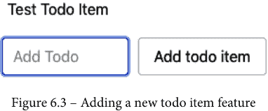

在前面的截图中，我们可以验证我们的**添加待办事项**功能正在工作，因为我们已经添加了待办事项。现在代码似乎运行正常，是时候检查我们的测试在运行时是否真正通过了。为此，我们将使用 `todo-v2.spec.js` 测试文件，它是 `todo-v1.spec.js` 的修改版本。

我们已经从位于 `todo-v1.spec.js` 中的版本 1 测试文件修改了测试，并且还修改了测试以使其适应我们在应用中创建的待办事项添加功能。新测试应如下所示：

```
it('can create and displays new todo', () => {
    cy.visit('http://localhost:3000/')
    cy.get('[data-testid="todo-input-element"]')
      .type('New todo');
    cy.get('[data-testid="add-todo-button"]')
      .click();
    cy.get('[data-testid="todolist"]')
      .contains('New todo');
});
```

就像我们的初始测试一样，要测试的初始场景不会改变。我们首先导航到本地运行的应用的默认 URL。然后，我们使用 Cypress 添加一个待办事项，之后验证添加的待办事项是否是我们最初添加到输入元素中的内容。我们可以在下面的截图中清楚地查看操作过程，该截图显示了测试通过的情况：

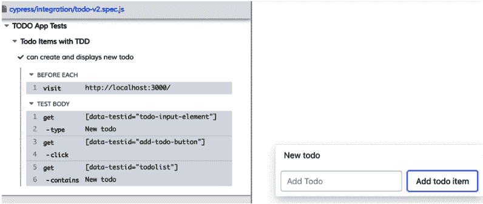

图 6.4 – 添加待办事项的测试通过

在前面的截图中，我们可以看到 Cypress 导航到了本地托管的应用并添加了一个待办事项，然后检查添加的待办事项是否存在于待办列表中。

> **重要提示**
>
> 我们在应用中添加了以 `data-testid=*` 为前缀的元素标识符来唯一标识元素。元素标识符在选择 Web 应用中的元素时非常方便。通过添加唯一标识符而不使用应用的默认 CSS 选择器，即使应用的选择器发生更改，我们的测试也不会受到影响，并将继续正常运行。

至此，我们已成功完成了 TDD 中的第一个任务。在本节中，我们取得了以下成果：

- 确定了我们要开发的应用并进行了原型设计
- 在开发开始之前编写了 TDD 测试
- 开发了向应用添加待办事项的功能
- 修改了 TDD 测试以使其符合我们开发的功能


下图展示了为添加新待办事项功能编写的测试在TDD版本和最终功能版本之间的并排比较：

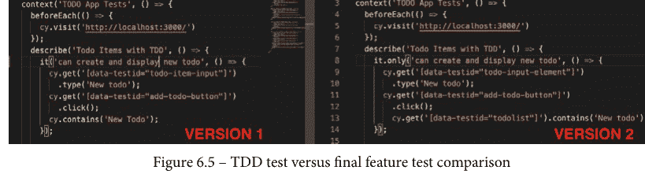

如图所示，第二版测试揭示了虽然测试结构或目标没有改变，但我们必须修改测试以使其适应已开发的待办事项添加功能。识别需求、开发功能，然后修改测试以针对该功能运行的能力，正是TDD的主要目标，而我们成功地实现了这一目标。

#### 删除待办事项

现在，我们将学习如何删除已添加的待办事项。根据我们的需求，已删除的待办事项将从待办事项列表中移除，并且一旦点击该待办事项的删除按钮，就不再可见。同样，我们将不关注功能开发过程，而是关注此功能的测试。在下面的截图中，我们可以看到每个新增待办事项的删除按钮：


红色高亮的图标是每个待办事项都会出现的删除图标。如果点击删除按钮，已添加的待办事项将从我们的待办事项列表中消失，正如需求中所描述的那样。为了验证该功能是否按我们设想的方式工作，我们现在将修改用于删除功能的TDD测试，并针对此功能运行测试。以下代码块是一个测试，它删除了一个已添加到待办事项列表中的待办事项：

```
it('can delete an added todo item', () => {
    cy.visit('http://localhost:3000/')
    cy.get('[data-testid="todo-input-element"]')
```

```
.type('New todo');
cy.get('[data-testid="add-todo-button"]')
  .click();
cy.get('[data-testid="delete-todo-0-button"]')
  .click();
expect('[data-testid="todolist"]')
  .not.to.contain('New todo')
})
```

此代码块显示了修改后的TDD测试，用于确认一旦待办事项被删除，它将不再存在于待办事项列表中。我们还必须对最初编写的TDD测试进行一些小的修改，以便所有选择器和操作都与已开发的功能相匹配。查看下面的Cypress截图，我们可以看到我们的测试通过了，并且已添加的待办事项已按预期被删除：

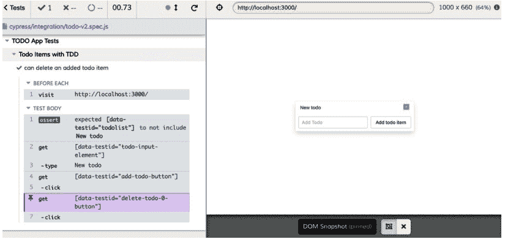

图6.7 – 删除已添加的待办事项

这里，Cypress的快照功能帮助我们可视化Cypress点击新添加待办事项的删除按钮的过程。我们还编写了一个断言，用于验证已删除的待办事项在删除后不再存在于待办事项列表中。我们的测试通过了，这意味着我们使用了TDD来向待办事项列表添加一个待办事项，并且也删除了这个待办事项并测试了它在我们的待办事项列表中不存在。在下一个测试中，我们将关注查看已添加的待办事项。

#### 查看已添加的待办事项

我们应用程序的需求部分包括查看待办事项列表中已添加的待办事项。在添加待办事项时，我们已经能够看到此功能在实际运行，但尚未对其进行测试。为了验证此功能，我们将添加一个新的待办事项，并检查创建的待办事项是否出现在待办事项列表上。以下代码块是一个测试，它检查已添加的待办事项是否在我们创建的应用程序上可见：

```
it('can view added todo items', () => {
    cy.visit('http://localhost:3000/')
    cy.get('[data-testid="todo-input-element"]')
    .type('New todo, {enter}')
    cy.get('[data-testid="todo-input-element"]')
    .type('Another todo, {enter}')
    cy.get('[data-testid="todolist"]').contains(
    'New todo');
    cy.get('[data-testid="todolist"]'
    .contains('Another todo');
});
```

这里，我们修改了TDD测试。我们不是仅仅检查是否可以查看单个待办事项，而是添加了两个项目，并添加了一个断言来检查这两个项目都存在于待办事项列表中。我们将在Cypress中运行我们的测试，并使用应用程序预览来验证两个待办事项都存在，如下图截图所示：

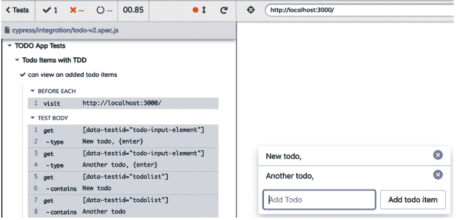

图6.8 – 查看已添加的待办事项

好耶！我们的测试通过了！

这张截图显示，我们关于添加待办事项功能的需求被正确构建，并且我们关于查看待办事项列表中待办事项的测试需求也得到了满足。在这里，我们实现了查看待办事项功能的目标。我们还使用TDD检查了查看待办事项时需要测试的场景。

#### 查看待办事项数量

既然我们已经修改了用于添加待办事项、删除待办事项和查看待办事项列表的TDD测试，我们还想添加一个功能来检查已添加的待办事项数量。查看已添加待办事项数量的功能如下图截图所示：

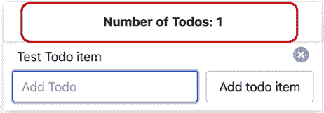

图6.9 – 查看待办事项数量

此功能显示当前在我们待办事项列表中可用的待办事项数量。随着更多待办事项的添加，待办事项数量将增加；而当待办事项从列表中删除时，数量将减少。在这里，我们将使用为此功能编写的TDD测试，并对其进行修改，以便我们的应用程序可以使用。在我们的测试中，我们将专注于添加和删除待办事项，并验证在添加和删除时，待办事项数量是否相应地变化。以下代码块显示了不同的断言，用于检查功能是否根据我们的需求按预期工作：

```
it('can view number of added todo items', () => {
    cy.visit('http://localhost:3000/')
    cy.get('[data-testid="todo-input-element"]')
    .type('New todo, {enter}')
    cy.get('[data-testid="todo-input-element"]')
    .type('Another todo, {enter}')
    cy.get('[data-testid="todo-item-number"]')
    .should(($header) => {
      expect($header.get(0).innerText).to.contain('2')
    })
    cy.get('[data-testid="delete-todo-1-button"]')
    .click();
```

```
cy.get('[data-testid="todo-item-number"]')
  .should(($header) => {
    expect($header.get(0).innerText).to.contain('1')
  })
});
```

前面的代码片段展示了我们添加新的待办事项，验证列表中的一个项目被删除，并且计数在应用程序的不同状态变化中保持一致。在这里，我们修改了最初的TDD测试，并能够使用它们来测试我们是否可以实际增加或减少可用待办事项的数量。通过在Cypress上运行相同的测试，我们可以验证Cypress运行良好，并且我们有一个未被删除的剩余待办事项，如下图截图所示：

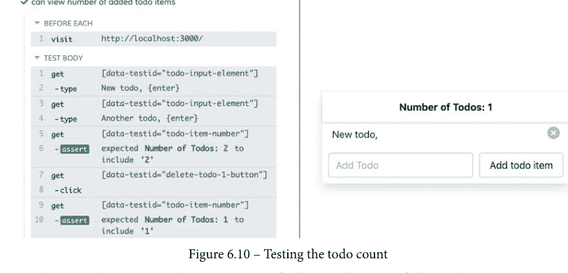

图6.10 – 测试待办事项数量

从前面的截图中，我们可以验证当应用程序的状态由于添加和删除待办事项等操作而发生变化时，计数会相应地增加或减少。

### 回顾 – 修改TDD测试

在本节中，我们学习了如何在功能开发完成后修改TDD测试，以使它们符合我们应用程序的构建方式。我们还学习了当测试运行时，Cypress如何唯一地识别要交互的元素。最后，我们学习了如何将已编写的TDD测试转换为针对我们应用程序已开发功能的测试。

### 总结

在本章中，我们理解了TDD的工作流程以及在任何团队中拥抱TDD的重要性，并探讨了TDD的优缺点。我们还探讨了TDD如何应用于实际应用程序。通过这样做，我们为一个尚未构建的Todo应用程序创建了需求。在开发应用程序之前，我们为我们认为重要的功能编写了TDD测试，然后使用这些需求和TDD测试来开发我们的功能。一旦我们完成了功能开发，我们就修改了最初的TDD测试版本，使其适用于我们已开发的功能，从而完成了展示如何在实际应用程序中利用TDD的整个过程。

现在，你应该理解什么是TDD，如何编写TDD测试，以及如何在真实世界的应用程序中修改和使用TDD测试，使其符合已开发的应用程序。

既然我们已经了解了TDD以及如何在项目中实现它，我们将在下一章中重点关注如何与Cypress DOM的不同元素进行交互。


## 7 在 Cypress 中理解元素交互

在开始讲解 Cypress 如何在运行测试时与元素交互之前，最好先对 Cypress 的构成原理、工作方式、各种 Cypress 命令以及 Cypress 的实际使用示例有一个扎实的了解。要完全理解本章内容，你需要先学习前面的章节，这将为你的学习之旅奠定成功的基础。

在本章中，我们将介绍 Cypress 如何与元素交互，以及在交互过程中它如何响应元素的不同状态。我们还将介绍 Cypress 如何通过 Cypress 命令中的内置机制来判断一个元素是否准备好进行交互的基础知识。

本章将涵盖以下关键主题：

- 理解可操作性
- 强制可操作性

完成这些主题的学习后，你将具备理解 Cypress 在执行测试时如何解读测试以及如何解读测试执行过程中所发生错误的知识。

### 技术要求

首先，我们建议你从 GitHub 上克隆包含本章将要编写的源代码和所有测试的仓库。

本章的 GitHub 仓库地址如下：

```
https://github.com/PacktPublishing/End-to-End-Web-Testing-with-Cypress
```

本章的源代码可在 `chapter-07` 目录中找到。

### 理解可操作性

现在我们已经了解了 Cypress 命令是什么，以及在哪里和何时使用它们，我们需要理解 Cypress 在执行测试时的思考和操作流程。在本节中，我们将介绍 Cypress 如何与命令交互，它如何确保元素是可见且可操作的，甚至 Cypress 如何在任何命令执行之前判断**可操作性**。

可操作性是 Cypress 对**文档对象模型**（**DOM**）中的特定元素执行操作的能力。Cypress 有一些命令专门用于与 DOM 元素进行交互。这些命令"模拟用户"操作，与应用程序的用户界面进行交互。Cypress 事件负责命令的行为，因为它将事件发送到浏览器，使其看起来像是在应用程序的用户界面上进行的用户交互。

以下是 Cypress 中一些与 DOM 直接交互的命令；为了完成这些操作，DOM 元素必须是可操作的。这些命令内置了 Cypress 机制来检查它们所交互元素的可操作性。这些命令包括：

- `cy.type()`：在 DOM 元素中输入内容
- `cy.clear()`：清除文本区域或输入框的值
- `cy.click()`：在 DOM 元素上执行点击操作
- `cy.dblclick()`：在 DOM 元素上执行双击操作
- `cy.rightclick()`：在 DOM 元素上执行右键点击操作
- `cy.select()`：从 `<select>` 下拉菜单中选择一个 `<option>` 选项
- `cy.trigger()`：在 DOM 元素上触发一个事件
- `cy.check()`：选中 DOM 上的单选按钮和复选框
- `cy.uncheck()`：取消选中 DOM 上的单选按钮和复选框

> **重要提示**
> `cy.rightclick()` 命令不会打开浏览器菜单，而是会检查你的元素与浏览器**上下文菜单**相关的行为。

在上述任何命令运行之前，Cypress 会采取措施确保 DOM 已准备好接收操作。为了让任何命令得以执行，Cypress 会执行自身的检查，以验证 DOM 元素上的命令执行条件是否合适。

所有检查都在指定的时间内完成，该时间可通过 `defaultCommandTimeout` 配置选项进行配置，可在 `cypress.json` 文件中修改。以下是 Cypress 为检查 DOM 元素就绪状态所采取的操作：

- **可见性**：将元素滚动到可视范围
- **禁用状态**：确保元素未被隐藏
- **脱离状态**：检查元素是否已从 DOM 中移除
- **只读状态**：检查元素是否处于只读状态
- **动画**：检查动画是否已完成
- **遮盖**：检查元素是否被父元素遮盖
- **滚动**：检查被固定定位元素遮盖的元素的滚动情况
- **坐标**：检查事件是否在期望的坐标位置触发

为了更好地理解 Cypress 如何解读 DOM 的响应以及如何判断可操作性，我们将逐一介绍这些操作，并描述当可操作命令执行时，Cypress 如何通过每个操作来检查状态。

#### 可见性

Cypress 使用不同的因素来判断元素是否可见。Cypress 判断元素可见性的默认方式是检查该元素的**层叠样式表（CSS）**属性。任何元素的 CSS 属性定义了该元素的行为方式，如果默认情况下 CSS 属性的定义方式意味着该元素是隐藏的，Cypress 将自动知道该元素因其属性而不可见。

如果满足以下任一条件，Cypress 将认为元素是隐藏的：

- 元素的 CSS `width` 和 `height` 为 0。
- 元素或其祖先元素具有 `visibility: hidden` CSS 属性。
- 元素或其祖先元素具有 `display: none` CSS 属性。
- 元素具有 `position: fixed` CSS 属性，并且它被遮挡或不在屏幕上。

此外，Cypress 使用 `hidden overflow` CSS 属性来判断在测试执行期间元素是否隐藏。以下是 Cypress 用于判断元素是否隐藏的其他一些情况：

- 祖先元素具有隐藏溢出且 `width` 或 `height` 值为 0，并且在祖先元素和该元素之间存在一个具有 `position: absolute` CSS 属性的元素。
- 祖先元素具有隐藏溢出，且该元素具有 `position: relative` CSS 属性并定位在祖先元素的边界之外。

> **重要提示**
>
> 隐藏溢出意味着 CSS 属性可以是以下任一溢出方式：`hidden`、`overflow: auto`、`overflow: scroll`、`overflow-x: hidden` 或 `overflow-y: hidden`。

所有以下变换和位移的计算都由 Cypress 处理，如果 Cypress 发现元素不可见，测试将失败并报错，提示 Cypress 试图交互的元素处于隐藏状态。

#### 禁用状态

在检查可操作性时，Cypress 还会检查元素是否被禁用。当元素具有 `disabled: true` CSS 属性时，Cypress 无法与其交互，因为当元素在 DOM 中被禁用时，无法对其执行任何操作。当 Cypress 遇到禁用的元素并需要在该元素上执行操作时，它将返回一个错误，描述被禁用元素的状态以及为什么无法通过 Cypress 可操作命令与该元素进行交互。

#### 脱离状态

脱离元素是指已从 DOM 中移除但因 JavaScript 而仍存在于内存中的元素。大多数应用程序的工作方式是从 DOM 中移除元素并在 DOM 中插入其他元素，因此会不断地脱离和附加 DOM 中的元素。在评估元素的可操作性时，Cypress 会在对元素运行任何可操作命令之前检查该元素是否未脱离。如果 Cypress 遇到脱离的元素，它会在 Cypress 对测试执行可操作命令之前抛出一个错误。

需要注意的是，Cypress 只会在 DOM 中搜索元素，而不会检查脱离的元素是否存在于内存中。

#### 只读状态

只读元素被禁用查看，无法接受新内容或编辑。Cypress 在 `.type()` 命令中检查 `readonly` CSS 属性；如果遇到 `readonly` CSS 属性，测试将失败并报错。

#### 动画

Cypress 有内置机制来判断元素中是否存在动画。在评估元素是否可操作时，Cypress 会等待动画完成，然后才开始与元素进行交互。

为了判断测试中的元素是否正在播放动画，Cypress 需要使用元素最后坐标的样本，然后应用其算法来计算斜率。

> **重要提示**
>
> 斜率是通过选取两个不同的点并记录它们的坐标来计算的。然后记录 y 坐标和 x 坐标之间的差值。接着对 y 坐标差值和 x 坐标差值进行除法运算，以确定元素的斜率。


元素的动画效果和斜率是通过检查该元素的当前位置和之前的位置来确定的。Cypress 内置了一个动画阈值，该阈值检查元素必须超过多少像素距离才被视为正在执行动画。你可以在 `cypress.json` 文件中配置此阈值，并按照以下代码块中的示例更改默认值：

```
{
  "animationDistanceThreshold": 10
}
```

当此值发生改变时，无论是增加还是减少，Cypress 都会改变其在判断元素是否正在执行动画时的灵敏度和行为。较高的动画阈值意味着 Cypress 在检测像素变化距离时会降低灵敏度，而较低的动画阈值则意味着 Cypress 在检测正在执行动画的元素时会更敏感。

也可以在运行测试时关闭动画。为此，我们需要配置 `cypress.json` 配置文件以忽略动画，并继续执行命令。可以通过以下代码块中的配置实现：

```
{
  "waitForAnimations": false
}
```

当我们如图所示指定测试不应等待动画时，我们的测试将忽略动画，并像动画不存在一样执行。但是，此配置可以更改为 `true` 值，以便在等待元素中的动画执行的同时继续执行测试。

#### 覆盖检查

作为验证元素在命令发出前是否可操作的一部分，Cypress 会检查元素是否未被父元素覆盖。存在许多情况，元素在 DOM 中可见但被父元素（如模态框、弹出窗口或对话框）覆盖。如果存在覆盖元素的父元素，Cypress 将不允许命令执行。

在父元素覆盖了 Cypress 需要对其执行操作的元素的情况下，Cypress 将抛出错误，因为即使在现实生活中，用户也不可能与被覆盖的元素进行交互。

> **重要说明**
> 如果是子元素覆盖了该元素，Cypress 将继续将事件发送给子元素，并且执行会继续而不会出现任何问题。

在以下代码块中，我们有一个 `button` 元素被 `span` 元素部分或完全覆盖，点击事件将作用于 `span` 元素而不是 `button` 元素本身：

```
    <button>
      <span> Submit </span>
    </button>
```

在此代码块中，尽管 `span` 元素覆盖了 `button` 元素，Cypress 会将命令发送给子元素 `span`，这将在不遇到错误的情况下为我们的 `button` 元素触发点击事件。

##### 滚动

Cypress 会对元素执行滚动操作，并且在本节开头指定的可操作命令中默认启用此行为。默认情况下，在与元素交互之前，Cypress 会滚动到该元素的位置并确保其在视图中。

> **提示**
> 像 `cy.get()` 或 `cy.find()` 这样的命令没有像 Cypress 中的可操作命令那样内置 Cypress 滚动到视图的机制。

Cypress 中的滚动通过一个算法启用，该算法首先尝试确定元素在 DOM 上是否可见。然后，它使用坐标通过计算从当前元素到 Cypress 正在操作的元素的目标位置的坐标来导航到实际元素。

Cypress 滚动算法会持续滚动，直到元素变得可见，或者直到元素不再被其他元素覆盖。该算法在确保 DOM 上的大多数元素在滚动到视图中时都能被交互方面做得很好。

#### 坐标

在 Cypress 完成验证元素是否可操作的过程之后，默认情况下它会将事件发送到元素的中心。Cypress 提供了一个机制来覆盖事件触发的默认位置，并且大多数命令的行为都可以自定义。

以下代码块展示了如何更改按钮上点击事件的触发行为：

```
it('can mark a todo as completed - with changed hitbox position', () => {
    cy.visit('http://todomvc.com/examples/react/#/')
    cy.get(".new-todo").type("New Todo {Enter}");
    cy.get(".new-todo").type("Another New Todo {Enter}");
    cy.get('.todo-list>li:nth-child(1)').find('.toggle').click({ position: 'topLeft' });
});
```

在此代码块中，我们导航到 Todo 应用并添加两个 todo 项，然后将其中一个 todo 项标记为已完成。在将第一个 todo 项标记为完成时，我们更改了点击位置，并指示 Cypress 点击左上角位置而不是默认的中心位置。以下截图显示了点击命令在被点击的 todo 项操作的左上角部分的事件命中框：

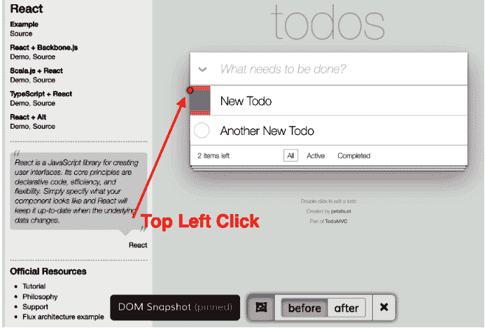

图 7.1 – 更改 Cypress 点击位置的坐标

> **重要说明**
> 事件命中框是在固定的 Cypress 快照上弹出的高亮显示，用于表明测试与该元素进行了交互。事件命中框可以由 Cypress 事件（如 `.click()` 方法）触发。

如 *图 7.1* 所示，Cypress 能够计算元素的坐标并确定点击元素的精确坐标。此外，当触发行为的坐标发生更改时，Cypress 会将它们记录在 Cypress 测试运行器的命令日志中。我们可以在执行左上角点击后，进一步检查控制台中 Cypress 打印的坐标。下图显示了第一个完成的 todo 项的 `click` 事件打印的坐标：

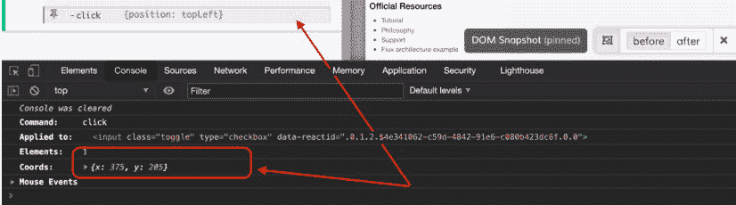

图 7.2 – 新的点击位置坐标

截图中显示的坐标是我们指示 Cypress 使用的新的 `.click()` 命令坐标，而不是可操作命令随附的默认命令坐标。

### 回顾 – 理解可操作性

在本节中，我们了解了 Cypress 如何确定元素的可操作性，以及它如何评估不同元素在可见性、禁用状态、分离模式、动画、滚动属性、坐标甚至 `readonly` 属性等条件下的情况。我们还了解了 Cypress 如何计算元素中的动画，以及我们如何增加动画阈值以降低 Cypress 检测动画的灵敏度。

在下一节中，我们将学习如何强制 Cypress 即使在元素未通过可操作性检查时也继续执行操作，以及何时对元素执行强制操作是安全的。

### 强制执行可操作性

在理解了什么是可操作性以及 Cypress 用于确定元素是否可操作所需的检查之后，了解如何覆盖 Cypress 为检查可操作性而设置的机制也很重要。在本节中，我们将重点介绍即使元素未通过 Cypress 对可操作命令强制执行的可操作性检查时，也要执行操作和命令。我们还将学习如何安全地为某些元素和测试实现覆盖机制。

#### 覆盖 Cypress 可操作性检查

可操作性在 Cypress 测试中非常有用，因为它有助于我们发现用户可能无法与我们的应用程序元素交互的情况。但有时，可操作性检查会妨碍适当的测试，这就引出了我们的下一个任务：覆盖安全检查。

在某些测试中，“像用户一样行动”可能不值得，因为最终目标是以自动化的方式编写有意义的测试，以防止错误和缺陷。诸如嵌套导航结构和界面之类的情况可能会导致测试变得复杂，只需消除嵌套导航结构并直接与我们想要的元素交互即可使测试成为可能。

要覆盖 Cypress 可操作性检查，我们可以将 `{force: true}` 参数选项传递给 Cypress 可操作命令。该选项将指示 Cypress 覆盖所有检查可操作性的检查，而是继续执行默认操作。以下代码块是一个测试，使用我们 Todo 应用中的全选按钮将所有 todo 项标记为已完成：

```
it('can mark all todo as completed - with no forced toggle option (Failure)', () => {
  cy.get(".new-todo").type("New Todo {Enter}");
  cy.get(".new-todo").type("Another New Todo {Enter}");
  cy.get('.todo-list>li:nth-child(1)').find('.toggle').click();
  cy.get('#toggle-all').click();
});
```


当这个测试运行时，它将会失败，因为尝试切换第一个元素并将其标记为完成会导致测试失败并报错，因为它已经被标记为完成了。下面的截图展示了 Cypress 可操作性在实际运行中的表现，其中测试失败是因为某个待办事项无法被标记为完成，原因是它被另一个元素所覆盖：

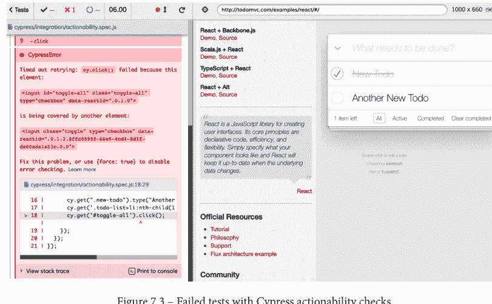

图 7.3 – 使用 Cypress 可操作性检查的失败测试

进一步观察*图 7.3*，我们可以验证第一个项目无法被切换为完成状态，因为它已经处于完成状态，这导致了失败。我们可以通过告诉 Cypress 在将所有待办事项切换为完成之前忽略可操作性检查来覆盖此测试行为，如下代码块所示：

```
it('can mark all todo as completed - with forced toggle option (师妹cess)', () => {
    cy.get('.new-todo').type('New Todo {Enter}');
    cy.get('.new-todo').type('Another New Todo {Enter}');
    cy.get('.todo-list>li:nth-child(1)').find(
        '.toggle').click();
    cy.get('#toggle-all').click({force: true});
});
```

124 理解 Cypress 中的元素交互

运行上述代码块中的测试后，测试通过了，因为我们阻止了 Cypress 检查我们需要点击的元素是否被其他元素覆盖。下面的截图展示了代码的运行过程，以及通过点击全选下拉按钮成功将两个待办事项标记为完成的测试结果：

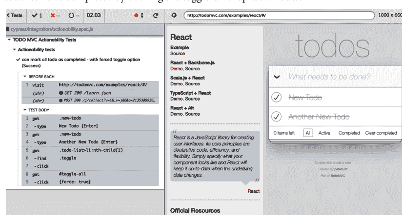

图 7.4 – 覆盖 Cypress 可操作性检查后的通过测试

在*图 7.4*中，Cypress 忽略了与项目可操作性相关的检查，而是继续执行默认操作，在我们的场景中就是切换两个待办事项并将其标记为完成。我们通过向切换按钮的 `click` 命令传递 `{force: true}` 选项来实现了这一覆盖。

当一个 Cypress 事件被强制选项强制触发时，Cypress 会执行以下操作：

- 继续执行所有默认操作
- 在元素上强制触发事件

然而，Cypress 不会执行以下操作：

- 确保元素可见
- 将元素滚动到可视区域
- 确保元素未被禁用
- 确保元素未被分离
- 确保元素不在动画中
- 确保元素未被覆盖
- 确保元素不是只读的
- 在后代元素上触发事件

> **重要提示**
> 强制可操作性非常有用，尤其是当你不想花费精力去自动化那些不值得投入时间的步骤时；然而，有时它并不是解决当前问题的最佳方案。我们在强制可操作性时遇到的大多数问题都可以通过编写更好的应用代码来解决，并确保各元素正确对齐，使没有元素会阻挡另一个元素。我们也可以利用 Cypress 来应对动画等场景，我们可以等待动画停止运行，然后在确认页面动画已完成后再执行测试。）

当对一个命令强制执行可操作性时，Cypress 会放弃其在对元素执行任何操作之前确保满足正确条件的职责，而是直接对测试执行所发出的条件。

### 回顾 – 强制可操作性

在本节中，我们了解到可以对元素强制执行可操作性，这可以通过向元素上发出的可操作命令传递 `{force: true}` 参数来实现。我们还看到，在 Cypress 中强制执行命令时存在显著差异，正如我们将待办事项切换为完成状态的测试所展示的那样。在本节中，我们还理解了何时需要覆盖 Cypress 的可操作性，以及它如何潜在地降低测试复杂度。

### 总结

在本章中，我们学习了 Cypress 如何通过确保元素处于正确的状态来对其执行可操作性检查，然后才对元素执行命令。我们了解到 Cypress 会在对元素执行任何操作之前检查其可见性、禁用状态、DOM 分离、`readonly` 模式、动画、覆盖、滚动和元素坐标。我们还了解了 Cypress 如何计算元素的动画，甚至如何在对元素执行操作时更改坐标。我们还学习了可以通过在测试中强制执行可操作性来覆盖 Cypress 的默认检查。

完成本章后，我相信你已经具备了理解 Cypress 如何确定元素可操作性以及如何在测试中覆盖可操作性以降低复杂度的技能。在下一章中，我们将探讨变量和别名的使用，并深入了解如何重用在测试中定义多次的变量和别名。

## 8 理解 Cypress 中的变量和别名

在我们开始了解 Cypress 中变量和别名的工作原理之前，重要的是要回顾前面章节中关于如何在 Cypress 中编写测试、如何配置测试，甚至如何通过遵循测试驱动开发的方法以正确的方式使用 Cypress 编写应用程序的内容。本书前面章节提供的背景信息将为我们在深入了解变量和别名工作原理时打下良好的基础。通过探索变量和别名的概念，我们将理解如何在 Cypress 中创建引用，这将简化我们的测试编写过程并降低测试的复杂性。理解如何使用变量和别名不仅能让你编写更好的测试，还能编写出易于阅读和维护的测试。

在本章中，我们将重点编写异步命令，以利用 Cypress 内置的变量和别名。我们还将了解如何通过别名简化测试，以及如何在测试的不同区域（如对元素、路由和请求的引用）中利用别名和创建的变量。

本章将涵盖以下关键主题：

- 理解 Cypress 变量
- 理解 Cypress 别名

完成每个主题的学习后，你将全面了解如何在 Cypress 测试中利用别名和变量。

### 技术要求

首先，我们建议你从 GitHub 上克隆包含本章源代码和我们将编写的所有测试的仓库。

本章的 GitHub 仓库地址为 `https://github.com/PacktPublishing/End-to-End-Web-Testing-with-Cypress`。

本章的源代码可以在 `chapter-08` 目录中找到。

### 理解 Cypress 变量

本节将重点介绍 Cypress 中的变量是什么、如何在测试中使用它们，以及它们在测试中的作用，尤其是在降低测试复杂度方面。我们还将探索可以在哪些不同场景中使用 Cypress 变量来提高测试的可读性。在本节结束时，你将能够使用变量编写测试，并理解在编写测试时应在何处使用变量。

为了更好地理解 Cypress 中变量的工作原理，了解 Cypress 如何执行命令是很重要的。以下代码块是一个测试，它首先选择一个按钮，然后选择一个输入元素，最后点击按钮：

```
it('carries out asynchronous events', () => {
    const button = cy.get('#submit-button');
    const username = cy.get('#username-input');
    
    button.click()
});
```

上述代码块展示了一个测试，它应该首先识别一个按钮，然后识别一个用户名输入框，最后点击按钮。然而，测试和执行并不会按照我们通常假设的方式进行。在我们的假设中，我们可能认为第一个命令会执行并返回结果，然后第二个命令才会运行，接着第三个命令最后执行。Cypress 使用 JavaScript **异步 API**，它控制着 Cypress 测试中命令的执行方式。

> **重要提示**
> 异步 API 的实现方式是：它们在接收到命令或请求的响应后立即返回，而不一定等待某个特定请求获得响应后再处理其他请求。相反，API 返回收到的第一个响应，并继续处理尚未收到的响应。这种非阻塞的请求和响应机制确保了可以同时发出不同的请求，从而使我们的应用程序看起来像是多线程的，而实际上它是单线程的。

在上述代码块中，Cypress 以异步顺序执行命令，响应不一定按照我们在测试中发出请求的顺序返回。但是，我们可以强制 Cypress 按照我们的期望执行测试，我们将在下一节中介绍 Cypress 的**闭包**时涵盖这一点。

#### 闭包

闭包是在 Cypress 将测试函数及其周围状态的引用捆绑在一起时创建的。闭包是 Cypress 大量借鉴的 JavaScript 概念。因此，Cypress 中的测试闭包可以访问测试的外部作用域，也可以访问由测试函数创建的内部作用域。我们将测试的本地函数作用域称为**词法环境**，这与 JavaScript 函数中的情况相同。在以下代码块中，我们可以看到 Cypress 中的闭包是什么，以及变量如何在闭包中被使用：

```
describe('Closures', () => {
    it('creates a closure', () => {
        // { This is the external environment for the test }
        cy.get('#submit-button').then(($submitBtn) => {
            // $submitBtn is the Object of the yielded cy.get()
            // response
            // { This is the lexical environment for the test }
        })
    })
})
```


 ## 130 理解 Cypress 中的变量与别名

```
    })
    // 此处编写的代码在 .then()
    // 执行完毕之前不会执行
    })
});
```

`$submitBtn` 变量被创建，以便访问从 `cy.get('#submit-button')` 命令获得的响应。通过在测试中使用我们刚创建的变量，我们可以访问返回的值并与其交互，就像在普通函数中一样。在本测试中，我们使用 `$submitBtn` 变量创建了一个测试闭包函数。`.then()` 函数创建了一个**回调函数**，使我们能够在代码块内嵌套其他命令。闭包的优势在于我们可以控制测试执行命令的方式。在我们的测试中，我们可以等待 `.then()` 方法内的所有嵌套命令执行完毕后，再运行测试中的任何其他命令。我们的测试代码中的注释进一步描述了执行行为。

> **重要提示**

> 回调函数是作为参数传递给其他函数的函数，然后在外部函数内部被调用以完成某个操作。当 `.then()` 函数内的命令运行完成后，函数外部的其他命令将继续执行其运行程序。

在接下来的代码块中，我们将探索如何通过使用变量来编写测试，并确保闭包内的代码在闭包开始执行之后、任何外部代码执行之前被首先执行。该测试将添加两个待办事项，但在添加第二个待办事项之前，我们将使用一个闭包来验证闭包内的代码是否先被执行：

```
it('can Add todo item - (Closures)', () => {
    cy.visit('http://todomvc.com/examples/react/#/')
    cy.get(".new-todo").type("New Todo {Enter}");
    cy.get('.todo-list>li:nth-child(1)').then(($todoItem) => {
        // 存储我们的待办事项名称
        const txt = $todoItem.text()
        expect(txt).to.eq('New Todo')
    });
    // 此命令将在上述所有命令
    // 完成执行后运行。
    cy.get(".new-todo").type("Another New Todo {Enter}");
});
```

在上面的代码块中，我们已经向待办事项列表添加了一个待办事项，但在添加第二个项目之前，我们需要验证添加的待办事项确实是我们创建的那个。为了实现这一点，我们使用了一个闭包和一个回调函数，该回调函数需要返回 `true`，然后我们才能执行下一个命令。以下截图显示了我们运行测试的执行步骤：

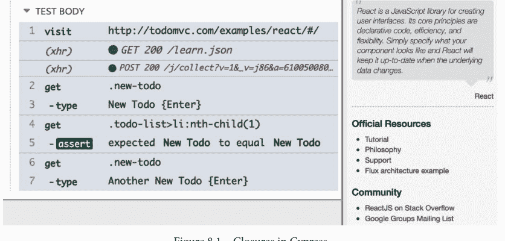

在*图 8.1*中，我们可以看到 Cypress 执行了获取已添加待办事项的命令，并断言该添加的待办事项就是我们列表中已有的内容，然后才执行最后一个命令向我们的待办事项列表添加一个新的待办事项。

Cypress 中的闭包不能脱离变量而存在。要使用闭包，我们需要利用变量将从命令接收到的值传递给闭包函数，并且利用变量是实现这一点的唯一方式。在这个代码块中，我们使用了 `$todoItem` 变量将 `cy.get()` 命令的值传递给闭包，该闭包断言找到的待办事项正是我们创建的那个项目。

Cypress 使用的变量作用域与 JavaScript 中相同。在 Cypress 中，用户可以选择使用 `const`、`var` 和 `let` 标识符来指定变量声明的作用域。在接下来的部分中，我们将在测试中看到可以使用的不同作用域。

#### Var

`var` 关键字用于声明函数作用域或全局作用域的变量。初始化时，为变量提供值是可选的。当在测试函数中遇到用 `var` 关键字声明的变量时，它会在任何其他代码执行之前执行。可以用 `var` 关键字在全局作用域声明一个变量，并在测试函数内的函数作用域中覆盖它。以下代码块展示了使用 `var` 关键字声明的全局作用域变量的简单覆盖示例：

```
describe('Cypress Variables', () => {
  var a = 20;

  it('var scope context', () => {
    a = 30; // 覆盖全局作用域
    expect(a).to.eq(30) // a = 30
  });
  it('var scope context - changed context', () => {
    // 变量作用域保持不变，因为更改影响的是
    // 全局作用域
    expect(a).to.eq(30) //a = 30
  });
});
```

在这个代码块中，我们在测试的全局上下文中声明了一个变量 `a`，然后在我们的测试中更改了这个全局变量。新更改的变量将成为我们全局 `a` 变量的新值，除非它被显式更改，就像我们在测试中所做的那样。因此，`var` 关键字会改变变量的全局上下文，因为它会全局重新赋值全局变量。

#### Let

`let` 变量声明的工作方式与 `var` 声明的变量相同，但有一个例外：定义的变量只能在它们被声明的作用域内使用。是的，我知道这听起来很困惑！在下面的代码块中，两个测试展示了在使用 `let` 关键字时作用域声明的差异：

```
describe('Cypress Variables', () => {
  // 变量声明
  let a = 20;

  it('let scope context', () => {
    let a = 30;
    // 局部作用域变量
    expect(a).to.eq(30) // a = 30
  });
  it('let scope context - global', () => {
    // 全局作用域变量
    expect(a).to.eq(30) // a = 20
  });
});
```

在第二个测试中，我们遇到了测试失败，因为 `let` 关键字只会让更改后的 `a` 变量在其特定的测试中可用，而不会像 `var` 变量声明那样影响整个测试套件的全局作用域。在下面的截图中，我们可以看到测试失败了，因为它只选取了在 `describe` 块中声明的变量，而没有选取之前测试中的变量：

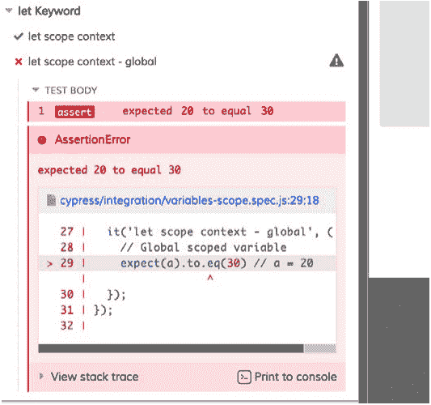

图 8.2 – let 关键字

如*图 8.2*所示，在编写测试时，可以在不同的测试中对同一个变量进行声明，而不会影响已声明变量的作用域，因为每个变量都将属于并拥有自己的上下文，不会影响全局上下文。

#### Const

`const` 关键字用于声明只读的对象和变量，一旦声明就不能被更改或重新赋值。使用 `const` 关键字赋值的变量是“最终的”，只能在其当前状态下使用，其值不能被修改或更改。在下面的代码块中，我们尝试重新赋值一个用 `const` 关键字声明的变量，这将导致失败：

```
describe('const Keyword', () => {
  const a = 20;
  it('let scope context', () => {
    a = 30;
    // 失败，因为我们不能重新赋值
    // 一个用 const 关键字声明的变量
    expect(a).to.eq(30) // a = 20
  });
});
```

从这个代码块来看，由于 `a` 变量是用 `const` 声明的，它是不可变的，因此 Cypress 将会失败并报错，如下面的截图所示：

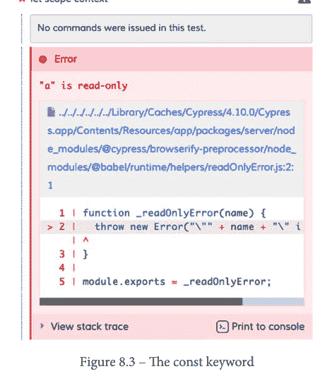

图 8.3 – const 关键字

就像在 JavaScript 中一样，Cypress 不能重新赋值用 `const` 关键字声明的变量。使用 `const` 声明的变量是在程序执行期间不需要更改的变量，无论是在全局范围内还是在测试内的局部范围内。

### 总结 - 理解 Cypress 变量

在本节中，我们学习了 Cypress 中变量的用法。我们了解了变量在闭包中的使用方式，以及它们如何使用不同的作用域和上下文进行声明。在这里，我们还理解了变量作用域的含义以及如何在测试中使用它们。既然我们知道了变量是什么以及它们代表什么，我们将在下一节深入探讨 Cypress 测试中别名的使用。

### 理解 Cypress 别名

别名是一种在测试中避免使用 `.then()` 回调函数的方法。我们使用别名来创建引用或某种 Cypress 可以引用的“记忆”，从而减少我们重新声明所有内容的需要。别名的一个常见用途是在 `before` 和 `beforeEach` 测试钩子中避免使用回调函数。别名提供了一种“干净”的方式来访问变量的全局状态，而无需在每个测试中调用或初始化变量。在本节中，我们将学习如何在测试执行中正确使用别名，以及在哪些不同的场景下推荐使用别名。

当一个变量在测试套件中被多个测试使用时，别名就派上用场了。以下代码块显示了一个测试，我们希望验证在将待办事项添加到我们的待办事项列表后，它确实存在：

```
context('TODO MVC - Aliases Tests', () => {

    let text;
    beforeEach(() => {
        cy.visit('http://todomvc.com/examples/react/#/')
        cy.get(".new-todo").type("New Todo {Enter}");
        cy.get('.todo-list>li:nth-child(1)').then(($todoItem) => {
            text = $todoItem.text()
        });
    });

    it('gets added todo item', () => {
```

#### 在测试钩子和测试之间共享上下文

别名可以提供一种“简洁”的方式来定义变量，并使它们在测试中可用，而无需在测试钩子中使用回调函数，正如前面的代码块所示。要创建别名，我们只需在要共享的内容中添加 `.as()` 命令，然后共享的元素就可以通过 `this.*` 命令从 Mocha 的上下文对象中访问。每个测试的上下文在测试运行后会被清除，测试在不同测试钩子中创建的属性也是如此。下面的代码块展示了与之前相同的测试，用于检查待办事项是否存在，但这次使用了别名的方式：

```
describe('Sharing Context between hooks and tests', () => {
    beforeEach(() => {
      cy.visit('http://todomvc.com/examples/react/#/');
      cy.get(".new-todo").type("New Todo {Enter}");
      cy.get('.todo-list>li:nth-child(1)').invoke('text').as('todoItem');
    });

    it('gets added todo item', function () {
      // todo item text is available for use
      expect(this.todoItem).to.eq('New Todo');
    });
});
```

在前面的代码块中，我们可以验证 Mocha 的上下文中存在 `this.todoItem`，并且测试成功运行，验证了待办事项确实已创建。可以进一步验证该测试，如以下截图所示，该截图突出显示了在使用别名引用待办事项列表中创建的待办事项后，Cypress 测试的通过状态：

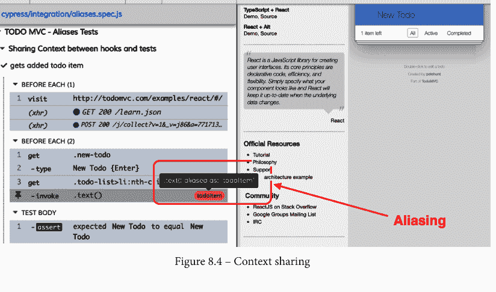

在*图 8 best online deals  8.4* 中，我们可以看到 Cypress 突出显示了别名文本，并展示了它在我们的测试中如何被调用。Cypress 会打印出已使用的别名元素和命令，这使得在发生故障时能够轻松识别和调试，并追溯别名元素中导致故障的原因。

> **Important note**
>
> 在 Cypress 测试中，无法在使用箭头函数时使用 `this.*`，因为 `this.*` 将指向**箭头函数的词法上下文**，而不是 Mocha 的上下文。对于任何使用 `this` 关键字的情况，你需要将 Cypress 测试切换为使用常规的 `function () {}` 语法，而不是 `() => {}`。

别名的另一个重要用途是与 Cypress 夹具（fixtures）共享上下文。夹具是 Cypress 用于提供可在测试中使用的模拟数据的特性。夹具在文件中创建，并可在测试中访问。

> **Important note**
>
> 夹具提供测试数据，我们使用夹具来提供与应用程序预期输入或执行操作时生成输出一致的数据。夹具是一种简便的方式，使我们能够在测试数据输入时无需在测试中硬编码数据，或在测试运行时自动生成数据。通过夹具，我们还可以在不同的测试中使用同一组测试数据。

假设我们有一个包含所有已创建待办事项列表的 `todos` 夹具，我们可以有一个类似于以下代码块的测试：

```
describe('Todo fixtures', () => {
    beforeEach(() => {
      // alias the todos fixtures
      cy.get(".new-todo").type("New Todo {Enter}");
      cy.get('.todo-list>li:nth-child(1)').invoke('text').as('todoItem')
      cy.fixture('todos.json').as('todos')
    })

    it('todo fixtures have name', function () {
      // access the todos property
      const todos = this.todos[0]

      // make sure the first todo item contains the first
      // todo item name
      expect(this.todoItem).to.contain(todos.name)
    })
})
```

在前面的代码块中，我们为已创建的待办事项以及包含已创建待办事项的 `todos.json` 夹具文件都创建了别名。由于我们在测试的 `beforeEach` 钩子中加载了夹具，因此我们可以利用待办事项的夹具贯穿我们所有的测试。在这个测试中，我们使用 `this.todos[0]` 访问了第一个夹具值，这是待办事项数组中的第一个对象。要进一步了解如何使用夹具以及我们正在处理的确切文件，请查看在本章开头克隆的 GitHub 仓库中的 `cypress/fixtures` 目录。

> **Important note**
>
> Cypress 仍然使用异步命令，尝试在 `beforeEach` 钩子之外访问 `this.todos` 将导致测试失败，因为测试首先需要加载夹具才能使用它们。

在共享上下文时，Cypress 命令还可以使用特殊的 `'@'` 命令，从而消除在引用已声明别名的上下文时使用 `this.*` 的需要。下面的代码块展示了在引用 Cypress 别名时使用 `'@'` 语法的用法：

```
it('todo fixtures have name', () => {
    // access the todos property
    cy.get('@todos').then((todos) => {
      const todo = todos[0]
      // make sure the first todo item contains the first
      // todo item name
      expect(this.todoItem).to.contain(todo.name)
    });
});
```

在前面的代码块中，我们使用 `cy.get()` 命令来消除在访问夹具文件时使用 `this.*` 语法，以及使用传统函数声明方式的需要。当我们使用 `this.todos` 时，我们是在同步访问 `todos` 对象，而当我们引入 `cy.get('@todos')` 时，我们是在异步访问 `todos` 对象。

如前所述，当 Cypress 同步运行代码时，命令按照它们被调用的顺序执行。另一方面，当我们异步运行 Cypress 测试时，执行命令的响应不会按照命令被调用的顺序返回，因为命令的执行不会按照它们被调用的顺序进行。在我们的例子中，`this.todos` 将作为同步命令执行，按照执行顺序返回 `todos` 对象的结果，而 `cy.get('@todos')` 将表现为异步命令，并在 `todos` 对象响应可用时返回它们。

#### 访问元素引用

别名还可以用于访问 DOM 元素以供重用。对元素进行引用可以确保我们在通过别名引用元素后无需重新声明 DOM 元素。在下面的代码块中，我们将为添加新待办事项的输入元素创建一个别名，然后在创建待办事项时引用它：

```
it('can add a todo - DOM element access reference', () => {
    cy.get(".new-todo").as('todoInput');
    // Aliased todo input element
    cy.get('@todoInput').type("New Todo {Enter}");
    cy.get('@todoInput').type("Another New Todo {Enter}");
    cy.get(".todo-list").find('li').should('have.length', 2)
});
```

该测试展示了使用别名来访问已存储为引用的 DOM 元素。在测试中，Cypress 查找我们保存的 `'todoInput'` 引用，并使用它来代替再次运行查询以查找我们的输入项。


#### 访问路由引用

我们可以使用别名（alias）来引用待测应用程序的路由。路由用于管理网络请求的行为，通过使用别名，我们可以确保发出适当的请求、发送服务器请求，并在发出请求时创建适当的 XHR 对象断言。以下代码块展示了在处理路由时使用别名的方法：

```
it('can wait for a todo response', () => {
    cy.server()
    cy.intercept('POST', '/todos', { id: 123 }).as('todoItem')
    cy.get('form').submit()
    cy.wait('@todoItem').its('requestBody')
      .should('have.property', 'name', 'New Todo')
    cy.contains('Successfully created item: New Todo')
});
```

在此代码块中，我们将 `todoItem` 请求引用为别名。随后，该路由请求将检查我们提交的表单是否已成功提交并返回响应。在路由中使用别名时，我们不必持续引用或调用该路由，因为 Cypress 已经从我们之前创建的别名中存储了该路由的响应。

#### 访问请求引用

与使用别名访问路由引用类似，我们可以使用 Cypress 来访问 Cypress 请求，并在稍后使用这些请求的属性。在以下代码块中，我们识别了特定评论的请求，并使用别名检查该评论的属性：

```
it('can wait for a comment response', () => {
    cy.request('https://jsonplaceholder.cypress.io/comments/6')
    .as('sixthComment');
    cy.get('@sixthComment').should((response) => {
      expect(response.body.id).to.eq(6)
    });
});
```

### 理解 Cypress 中的变量与别名

该测试对特定评论进行断言，并检查该断言是否与评论的 ID 匹配。我们使用别名来引用请求 URL，这样在运行测试时，我们只需引用已设置别名的 URL，而无需完整输入。以下运行测试的截图展示了 Cypress 如何创建别名，以及随后在运行测试时如何引用该别名：

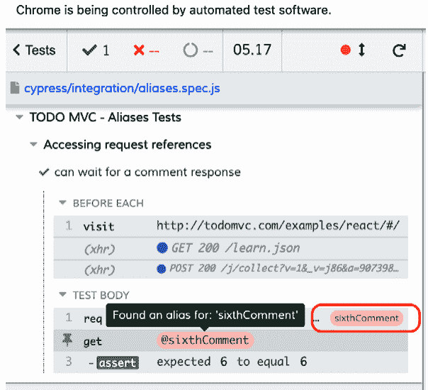

Chrome 正由自动化测试软件控制。

图 8.5 – 请求引用

在上图的截图中，第一个 `sixthComment` 命令是 Cypress 创建别名的命令，第二个则是运行的测试识别该别名，并针对从别名 URL 获取的响应进行断言。

### 回顾 – 理解 Cypress 别名

在本节中，我们学习了别名以及它们如何帮助我们编写"简洁"的测试代码，为我们提供了一种方式来访问和引用后续测试中可能需要的请求、元素、路由和命令。我们还学习了如何访问 Cypress 别名：要么通过异步方法，在别名前使用 `@` 符号；要么通过同步方法，直接使用 `this` 关键字访问别名对象。最后，我们学习了如何在测试中利用别名来引用元素，使我们能够在测试中使用别名路由和别名请求。

### 小结

在本章中，我们学习了别名和变量，以及如何在 Cypress 中利用它们。我们涵盖了 Cypress 测试中的变量概念、不同类型的变量及其作用域，以及如何使用它们。我们还介绍了 Cypress 中的变量如何协助创建闭包，以及我们如何创建一个只能由变量访问的环境，此外还包括测试可访问的全局上下文。最后，我们探讨了如何使用别名以及别名在不同上下文中的使用方式。我们学习了如何在测试中引用别名、如何将其与元素、路由和请求一起使用，甚至如何在测试钩子（test hooks）和测试本身之间共享上下文。

通过本章，你已经掌握了理解别名和变量如何工作、别名如何在异步和同步场景中使用，以及何时创建和实现测试中变量作用域的技能。

既然你已经完全理解了别名和变量的工作原理，我们已经准备好进入下一章，了解测试运行器（Test Runner）的工作方式。我们将深入探讨测试运行器的不同方面，以及如何解读测试运行器中发生的事件。

# 9

# Cypress 测试运行器的高级用法

在开始探讨测试运行器的高级用法之前，理解 Cypress 的工作原理、测试运行器的作用以及测试在测试运行器中是如何执行的至关重要。本章建立在之前八章所获得的 Cypress 知识之上，将重点帮助你理解本书尚未探讨的测试运行器的高级功能。

在本章中，我们将使用测试运行器，并学习如何利用测试运行器的内置功能来编写更好的测试。通过学习如何使用测试运行器，我们将更深入地理解测试是如何运行的、当测试失败时会发生什么，以及如何改进测试。我们将在本章中涵盖以下关键主题：

- 理解仪表板（instrument panel）
- 理解选择器游乐场（Selector Playground）
- 测试运行器键盘快捷键

完成这些主题后，你将全面理解测试运行器，并了解如何在编写测试的过程中充分利用它。

本章的源代码可以在 `chapter-09` 目录中找到。

### 技术要求

首先，我们建议你从 GitHub 克隆包含本章源代码和我们将要编写的所有测试的仓库。

> **重要提示**

我们已在 *第 5 章，调试 Cypress 测试* 中介绍了如何在测试运行器中读取和解释 Cypress 错误。在该章中，我们还介绍了如何与测试运行器中的 DOM 快照交互，涵盖了元素与命令日志之间的交互。在本章中，我们可能会引用 *第 5 章，调试 Cypress 测试*，或进一步阐述该章节中提供的信息。

本章的 GitHub 仓库地址为 `https://github.com/PacktPublishing/End-to-End-Web-Testing-with-Cypress`。

### 理解仪表板

仪表板是 Cypress 测试运行器中的一个特殊面板，仅在 Cypress 为你提供有关测试的额外信息时可见。仪表板的出现由特定命令触发，这些命令提供有关测试的更多信息。触发仪表板的命令包括 `cy.stub()`、`cy.intercept()` 和 `cy.spy()`。在本节中，我们将探讨如何使用仪表板来显示有关测试的额外信息。

为实现理解仪表板工作原理的目标，我们需要了解**拦截（intercepts）**、**存根（stubs）**和**间谍（spies）**的工作方式，以及当 Cypress 测试中调用存根、路由和间谍时，仪表板上显示的具体信息是什么。

#### 拦截

Cypress 使用 `cy.intercept()` 命令来管理测试中网络层的 HTTP 请求行为。要理解拦截，我们首先需要了解在 Cypress 中网络请求是如何进行的。Cypress 会自动在测试运行器中指示何时从运行的测试发出 **XHR**（**XMLHttpRequest**）请求。此外，Cypress 还会创建请求发出时和收到响应时 DOM 的快照，这让我们了解请求前后 DOM 的状态。以下代码块是从我们的 Todo 应用程序获取 XHR 请求响应的示例：

```
describe('Routing a request', () => {
    it('can wait for a app initialization', () => {
        cy.intercept('POST','**/j/**').as('initializeTodoApp');
        cy.visit('http://todomvc.com/examples/react/#');
        cy.wait('@initializeTodoApp'); // wait for intercept response
    })
});
```

上述代码块展示了 Cypress 的 `cy.intercept()` 命令监听 XHR 响应，该响应预计会在应用程序初始化时发出。在测试中，我们验证了确实向应用程序发出了请求，因为我们在测试完成执行之前等待路由响应被调用。

Cypress 具有解析请求的能力，这使得该框架能够通过监听测试发出的 HTTP 请求以及了解请求调用返回的响应，来轻松管理 HTTP 请求。

Cypress 中的拦截，使用 `cy.intercept()` 命令，提供了在 Cypress 测试执行期间覆盖由请求返回的 XHR 响应的能力。覆盖应用程序发出的 XHR 响应就是我们所说的**存根（stubbing）**，我们将在本章稍后介绍这个概念。


Cypress 在仪表盘上记录了所有拦截信息，通过查看仪表盘，我们可以得知测试中匹配到的路由数量、是否有响应匹配了我们的路由，以及它们是否被存根（stubbed）。以下截图展示了如何利用仪表盘来详细查看 Cypress 记录的有关路由的信息：

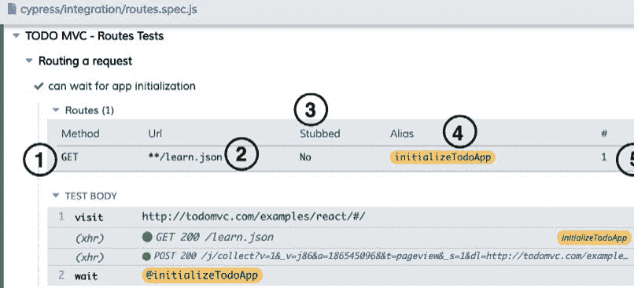

图 9.1 – Cypress 仪表盘

图 9.1 显示了仪表盘中标记为 **Routes** 的区域，它包含了测试运行完成后路由响应所具有的不同类型信息的列。仪表盘中路由的不同列具有不同的用途，并且对运行中的测试和仪表盘本身都很重要。以下是这些列，每个都描述了其在 Cypress 路由中的用途和意义：

- **Method**（1）：**Method** 列表示 `cy.intercept()` 命令所期望的请求方法，根据期望的请求，它可以是 **GET**、**POST**、**PUT**、**PATCH**，甚至是 **DELETE**。
- **Url**（2）：**Url** 列将显示我们的 `cy.intercept()` 命令在运行 Cypress 测试时期望的 URL。在这个例子中，我们告诉 Cypress 查找任何以 `learn.json` 结尾的路由，如果找到，那么我们的测试就应该通过。
- **Stubbed**（3）：**Stubbed** 列将显示我们的路由是否已被存根。当一个路由被存根时，Cypress 不会返回接收到的实际响应，而是返回我们传递给该路由的响应。
- **Alias**（4）：**Alias** 列显示了我们在 Cypress 中为路由设置的别名。在*第 8 章，理解 Cypress 中的变量和别名*中，我们学习了别名以及在需要访问元素、路由甚至请求信息时如何使用它们。**Alias** 列中提供的别名就是我们用来调用路由的方式，这通过在别名前添加 `@` 前缀来实现。
- **#**（5）：这个匹配列将显示匹配我们路由的响应次数。在我们的例子中，对 URL 的请求只发送了一次，因此我们的路由在测试中只被调用了一次。

仪表盘上关于路由的信息足以让你了解是否向我们测试中已经声明的路由发出了任何 XHR 请求，以及请求的方法和次数是否与应用程序中的预期一致。

#### Stubs（存根）

Cypress 中的存根用于替换一个函数、控制其行为或记录其使用情况。存根可用于用我们自己编写的合成响应来替换实际方法。在下面的代码块中，我们将验证当测试运行时，我们可以存根一个名为 `foo` 的方法：

```javascript
it('can stub a method', () => {
    let obj = {
        foo() {},
    }
    const stub = cy.stub(obj, 'foo').as('foo')
    obj.foo('foo', 'bar')
    expect(stub).to.be.called
})
```

前面代码块中显示的 `foo()` 方法展示了存根的实际应用。从代码中我们可以看到，我们期望 Cypress 能够知道当测试中调用 `foo` 函数时，我们的存根被调用了。以下截图显示了测试执行的过程以及通过测试的详细信息，包括存根类型、存根名称和存根被调用的次数：

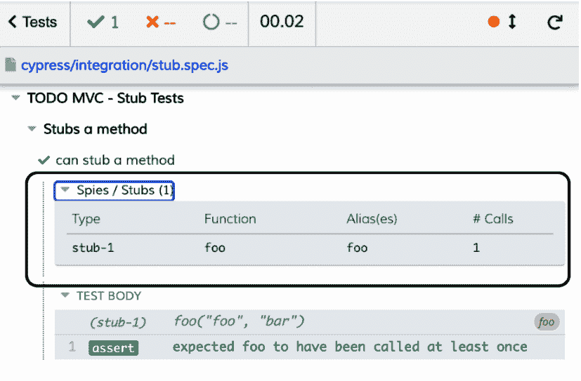

在*图 9.2*中，Cypress 在仪表盘上显示了我们创建的存根，同时也显示了在测试执行期间存根被调用的次数。存根非常方便，因为它可以存根那些我们不一定需要在测试范围内进行测试的依赖或函数。

#### Spies（间谍）

间谍的行为与存根类似，区别在于它们将一个方法包装在间谍中以记录对函数的调用和参数。在 Cypress 中，间谍仅用于验证工作元素或方法。在测试中最常见的用途是验证测试中是否进行了某些调用，而不一定是为了像存根那样改变调用的预期。以下截图显示了一个方法的间谍，我们在 `cy.spy()` 方法内验证 `foo` 方法是否被调用：

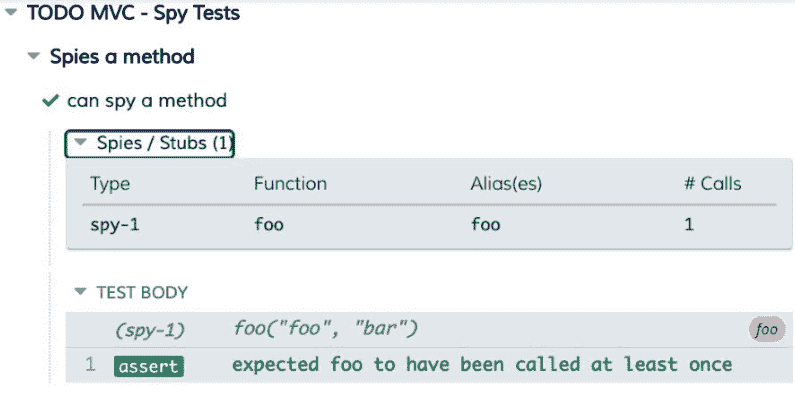

图 9.3 – Cypress 间谍

在*图 9.3*中，仪表盘在向我们展示对 `spy` 函数的调用、函数名称、分配给间谍方法的别名以及测试方法的类型方面发挥了至关重要的作用。

### 回顾 - 理解仪表盘

在本节中，我们学习了如何利用仪表盘来理解 Cypress 中的拦截、间谍和存根。我们还学习了拦截、间谍和存根的实际工作原理，以及仪表盘上的信息对于理解我们的实现是否正确非常有用。在下一节中，我们将深入了解 Cypress 中的 Selector Playground（选择器演练场）及其工作原理。

### 理解 Selector Playground

Selector Playground 是 Cypress 测试运行器的一个交互式功能。Selector Playground 使您能够确定唯一的选择器、检查与特定选择器匹配的元素，以及检查与 Cypress 应用程序中特定文本匹配的元素。在本节中，我们将了解 Cypress 用于选择元素的不同策略，以及如何从测试运行器中识别可在测试中使用的选择器。在本节结束时，您将学习如何使用 Cypress 通过 Selector Playground 唯一地选择元素，以及如何使用 Cypress 用于运行测试的选择器策略。

#### 选择唯一元素

Selector Playground 可能是 Cypress 测试运行器中最未被充分利用的功能之一，但对于任何想要编写具有有意义选择器的测试的人来说，它也是最有用的功能之一。Selector Playground 使我们能够为测试应用程序中的元素识别有效的选择器和唯一的选择器。

在 Selector Playground 中，Cypress 为被选中的元素计算唯一的选择器，并通过评估测试框架中默认启用的内置选择器策略来确定选择器。下图显示了两个添加的 todo 项目和一个打开的 Cypress Selector Playground，展示了如何唯一地选择任何一个 todo 项目：

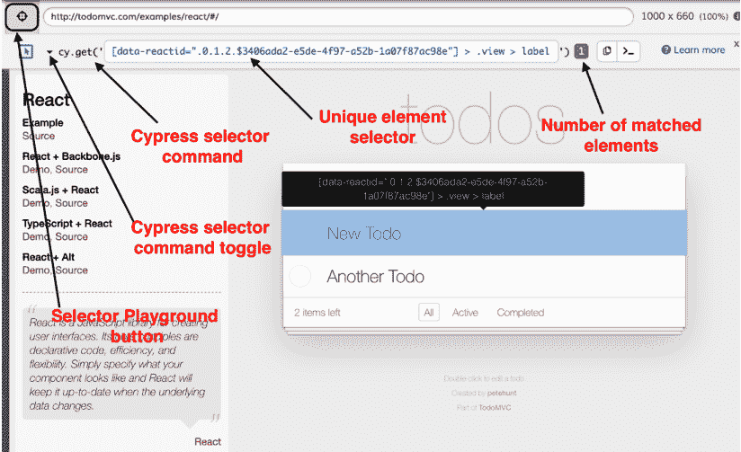

图 9.4 – Cypress Selector Playground

第一步是单击 Selector Playground 按钮，一旦单击它，就会出现如*图 9.4*所示的 Selector Playground 菜单。在 Selector Playground 菜单中，您可以选择更改选择器类型，以便使用 `cy.get()` 按选择器选择元素，或者使用元素文本，这可以通过切换选择器为 `cy.contains()` 来找到。在 `cy.get()` 命令或 `cy.contains()` 命令内部，是我们想要从应用程序预览中获取的特定元素或文本。对于任何元素或文本要成为唯一元素选择器，匹配的元素数量（在 Selector Playground 上用灰色表示）应该是 **1**，以确保我们没有重复的元素或文本。与匹配元素标签旁边的按钮代表一个复制命令，用于将选择器复制到剪贴板，而下一个按钮是一个打印按钮，它将把我们选择或选定的命令打印到浏览器的控制台日志中。

当单击 Selector Playground 下方的鼠标按钮时，Cypress 会自动在用户将鼠标悬停在元素上时显示一个弹出窗口，并自动选择一个可用于在测试中识别该元素的唯一选择器。在*图 9.4*中，我们可以看到一旦将鼠标悬停在 **New Todo** 项目上，Cypress 就会在工具提示中显示唯一的选择器，并在单击元素时填充 `cy.get()` 命令。当在 Selector Playground 菜单中选择一个元素时，Cypress 将在 Selector Playground 上返回唯一的选择器。

#### 确定选择器

为了在 Selector Playground 中确定唯一的选择器，Cypress 使用了一种偏好策略，即选择的选择器基于 Cypress 所知的一系列策略。Cypress 在为元素选择和分配唯一选择器时偏好以下策略：

- `data-cy`
- `data-test`
- `data-testid`
- `id`
- `class`
- `tag`
- `attributes`
- `nth-child`


> **重要说明**
> Selector Playground 更倾向于采用以 `data-*` 开头的识别格式作为选择器策略。在大多数情况下，这些选择器策略是自定义的，因此可以避免因使用应用程序中的动态 ID、类名或 CSS 随内容变化而导致测试不稳定的问题。通过使用自定义的 `data-*` 标签，选择器标识符不会改变，并且可以在应用程序的整个生命周期中保持持久。

当一个元素可以被这些选择器策略中的任何一种识别时，Cypress 就会显示该元素的唯一选择器。虽然这些是 Cypress 首选的策略，但你可以通过更改配置，将你的选择器策略添加到可识别的选择器策略列表中，从而使 Cypress 也能识别它。

#### 编辑选择器元素

Selector Playground 允许用户编辑所选元素的选择器。能够编辑选择器元素非常重要，因为这样可以生成更精确的选择和更精细的选择器标签，而 Cypress 本身可能无法做到这一点。Cypress 会自动识别在 Selector Playground 中所做的更改。当编辑的选择器元素匹配时，Cypress 会将 Selector Playground 以蓝色高亮显示；如果在应用程序预览的 Selector Playground 中找不到匹配项，则会以红色高亮显示。*图 9.5* 和 *图 9.6* 展示了使用正确和不正确的元素选择器编辑 Selector Playground 的情景：

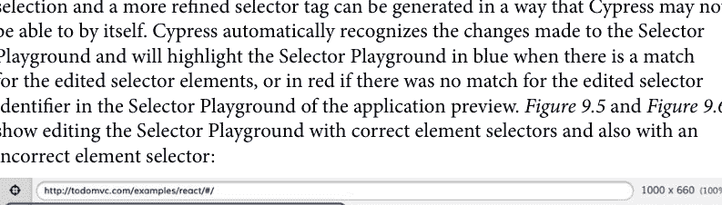

图 9.5 – Playground 中的有效元素选择器

在 *图 9.5* 中，使用无效元素选择器编辑 Selector Playground 会显示错误，并将 Selector Playground 以红色高亮，这表明我们没有找到使用所提供的选择器元素对应的任何元素。另一方面，*图 9.6* 显示编辑 Selector Playground 元素选择器成功：

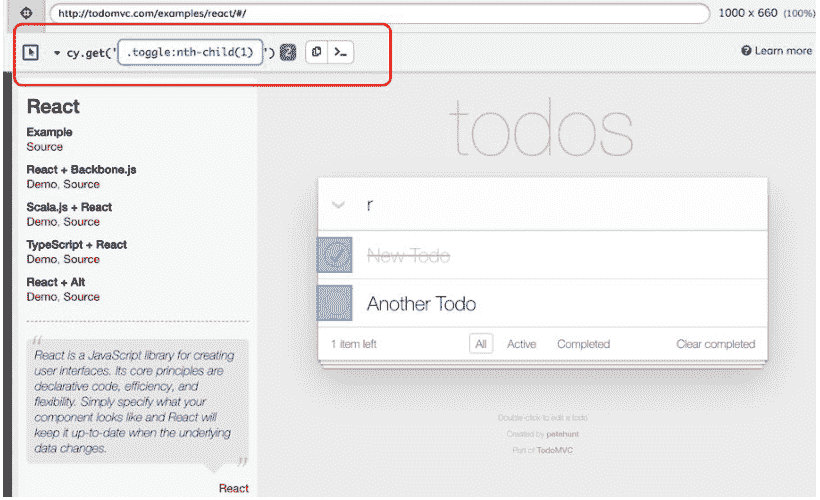

如 *图 9.6* 所示，我们能够使用在 Selector Playground 中编辑的选择器选中我们的两个待办事项。蓝色显示表明 Cypress 找到了我们正在搜索的元素，并通过在 Selector Playground 中元素选择器输入框的右侧显示元素数量来证实这一点。

### 回顾 – 理解 Selector Playground

在本节中，我们了解了什么是 Selector Playground，以及它在使用 Test Runner 运行测试时的重要性。我们学习了如何使用 Selector Playground 来选择元素、修改元素，甚至可以从 Cypress Test Runner 的应用程序预览中选择并复制唯一元素。我们还了解了 Cypress 如何识别元素，以及在选择元素时首选的选择器策略。最后，我们学习了如何在 Selector Playground 中编辑定位器，以及如何识别我们的选择器是否有效。在下一节中，我们将探讨 Test Runner 上的键盘快捷键是如何工作的。

### Test Runner 键盘快捷键

键盘快捷键在我们不希望执行涉及一系列步骤的浏览器手动操作时非常方便。在本节中，我们将学习如何使用三个键盘快捷键来控制 Cypress Test Runner，并有效地运行我们的测试。与显式使用浏览器操作触发动作相比，使用 Test Runner 我们能更快地执行常见操作。

以下是不同键盘按键及其相关操作的映射：

- **R** – 重新运行规范文件的测试
- **S** – 停止正在运行的测试
- **F** – 在规范窗口中查看所有测试

这些键盘按键会根据用户的按键操作，在 Test Runner 上触发不同的动作。

### 回顾 – Test Runner 键盘快捷键

在本节中，我们学习了如何使用键盘上的三个键通过 Cypress 键盘快捷键来控制 Test Runner 的常见操作。我们还了解到，使用键盘执行操作比使用浏览器操作触发相同动作要快得多。

### 总结

在本章中，我们学习了 Cypress Test Runner 中的仪表盘、Selector Playground 和键盘快捷键。我们探讨了仪表盘如何与存根、间谍和路由协同工作，以及路由、存根和间谍的工作原理和仪表盘上显示的信息。我们还研究了如何在 Cypress 中使用 Selector Playground，以及如何利用它来为被测应用程序识别元素，并优化 Cypress 用于唯一选择元素的选择器。最后，我们了解了 Cypress 键盘快捷键的作用以及哪些按键对应着浏览器功能中可用的操作。

既然我们已经了解并理解了 Cypress 中不同元素是如何协同工作的，我们可以通过练习进一步检验我们对所学主题的知识。在下一章中，我们将测试我们关于导航、网络请求和测试导航配置选项的知识。

## 第三部分：为您的 Web 应用程序进行自动化测试

在本书的这一部分，您将接触到一系列练习，这些练习将帮助您将第一部分和第二部分获得的知识付诸实践。本节涵盖了测试方面的最佳实践，以及使用 Cypress 测试大规模应用程序。

在本节中，我们将涵盖以下章节：

- *第 10 章，练习 – 导航和网络请求*
- *第 11 章，练习 – 存根和间谍 XHR 请求*
- *第 12 章，Cypress 中的可视化测试*

请注意，本 PDF 文件包含两种格式。第一种是 PDF 全量版，包含正文、提示及提示对应的理论知识；第二种是 PDF 纯净版，仅包含正文内容，适合做日常记录。

在开始阅读前，请务必阅读下方的打字机使用说明书，里面有明确的阅读、提示格式及对应的操作说明，可以确保您阅读、理解上的准确性。

好，祝您阅读愉快，咱们下一页见。

### 打字机使用说明书

#### 1、本书的阅读界面设置

# 第 10 章

#### 练习 – 导航和网络请求

在我们开始本章之前，您需要理解的是，我们在这本书的第三部分将专注于通过练习和示例来帮助您磨练测试技能，并构建我们在前几章中可能未能涵盖的知识。本节我们将采取实践方法，目标是尽可能多地处理示例和练习。在深入本章之前，关键是您已经阅读了每一章，并且现在希望基于我们学习如何使用 Cypress 进行测试时获得的理论知识进行扩展。

在本章中，我们将重点讲解涵盖以下主题的练习和示例：

- 实现导航请求
- 实现网络请求
- 高级导航请求配置

一旦您完成了这些练习，您将有信心成为一名更好的测试人员，并在导航和网络请求等更复杂的测试领域有所建树。

### 技术要求

首先，建议您从 GitHub 克隆包含源代码和本章将编写的所有测试的仓库。

本章的 GitHub 仓库地址为：https://github.com/PacktPublishing/End-to-End-Web-Testing-with-Cypress。

本章的源代码可在 `chapter-10` 目录中找到。

在我们的 GitHub 仓库中，有一个金融测试应用程序，我们将在本章中使用它进行关于 Cypress 导航和 Cypress 请求的不同示例和练习。

> **重要说明：在 Windows 中运行命令**
>
> 请注意：默认的 Windows 命令提示符和 PowerShell 无法正确解析目录位置。
>
> 请遵循下面列出的 Windows 命令，这些命令专门适用于 Windows 操作系统，并以 *windows* 后缀标识。

为确保测试应用程序在您的机器上运行，请在您的终端中，从应用程序的根文件夹目录运行以下命令。

`npm run cypress-init` 命令将安装应用程序运行所需的依赖项，而 `npm run cypress-app` 命令则只会启动应用程序。或者，您可以使用 `npm run cypress-app-reset` 命令重置应用程序状态。重置应用程序会移除任何不属于应用程序的已添加数据，将应用程序状态恢复到您克隆仓库时的样子。我们可以像下面这样直接在终端中运行命令：

```
$ cd cypress/chapter-10
$ npm install -g yarn or sudo npm install -g yarn

$ npm run cypress-init; (for Linux or Mac OS)
```


### 实现导航请求

Cypress 导航涉及导航到应用程序网页的行为。在本书涵盖的许多测试中，您可能还记得，在测试之前，我们有 `cy.visit()` 命令，其中包含我们要导航到或正在测试的页面的 URL。`cy.visit()` 命令是一个导航命令示例，可帮助我们在 Cypress 前端测试中发出导航请求。在本节中，我们将通过示例和练习来介绍不同的 Cypress 导航命令。到本节结束时，我们将对 Cypress 导航命令有更深入的理解，这将帮助我们在本书前几章已有的导航知识基础上进一步构建。

#### cy.visit()

我们使用 `cy.visit()` Cypress 导航到被测应用程序的远程页面。通过使用此命令，我们还可以向命令传递配置信息，并配置诸如方法、URL、超时选项甚至查询参数等选项；我们将在本章后面深入探讨此命令的配置选项。

在我们的 GitHub 仓库中，在 `chapter-10/cypress-realworld-app` 目录中，我们有一个应用程序，我们将用于我们的示例和练习。

> **重要说明**

我们位于 `chapter-10/cypress-realworld-app` 目录中的财务应用程序会记录交易。通过该应用程序，我们可以通过请求或支付用户来创建已存在于应用程序中的交易的交易。我们可以查看已发生交易的通知，还可以查看联系人和已发生交易的日志。

该应用程序使用 JSON 数据库，因此在将所有数据加载到我们的应用程序中时速度会有点慢。在我们的测试中，我们实现了一个“安全开关”以防止测试不稳定，确保在 `beforeEach` 方法中，我们在开始测试执行请求之前等待所有初始 XHR（`XMLHttpRequest`）请求加载数据。有关 `beforeEach` 方法的更多信息，请参阅以下代码块。

在第一个示例中，在 `navigation.spec.js` 中，如以下代码块所示，我们将使用 `cy.visit()` 命令导航到应用程序的通知页面：

```
describe('Navigation Tests', () => {
    beforeEach(() => {
    cy.loginUser();
    cy.server();
    cy.intercept('bankAccounts').as('bankAccounts');
           cy.intercept('transactions/public').
   as('transactions')
     ;
           cy.intercept('notifications').as('notifications');

           cy.wait('@bankAccounts');
           cy.wait('@transactions');
           cy.wait('@notifications');
 });
     afterEach(() => { cy.logoutUser()});

     it('Navigates to notifications page', () => {
         cy.visit('notifications', { timeout: 30000 });
         cy.url().should('contain', 'notifications');
     });
 });
```

此代码块说明了 `cy.visit()` 命令的用法，我们访问通知路由的远程 URL（`http://localhost:3000/notifications`），然后验证我们访问的远程 URL 是否符合预期。在我们的导航命令中，我们还添加了超时选项，该选项确保在导航测试失败之前，Cypress 将等待 30 秒用于“页面加载”事件，然后才会使测试失败。

#### 练习 – 导航和网络请求

以下屏幕截图显示了我们的测试正在执行，并且 Cypress 正在通过等待从后端接收的 XHR 请求来等待从我们的 JSON 数据库加载的所有数据：

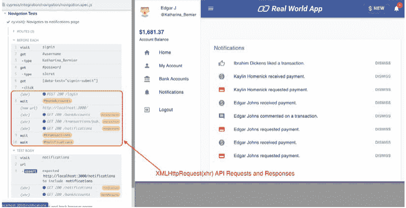

图 10.1 – XHR API 请求和响应

在此屏幕截图中，我们导航到 `/signin` 页面，然后在等待所有资源加载之后，我们使用 Cypress `cy.visit()` 命令导航到 `/notifications` 页面，该页面在测试应用程序预览的右侧可见。我们的测试断言进一步验证了这一点，该断言验证访问的 URL 包含名称 `notifications`。以下练习将帮助您更好地理解如何使用 `cy.visit()` 命令实施测试。

##### 练习 1

使用 GitHub 仓库中提供的财务应用程序，该应用程序位于根目录下的 `cypress-real-world-app` 文件夹中，进行以下练习以测试您对 `cy.visit()` 命令的了解：

1.  登录到我们的测试应用程序，并使用 `cy.visit()` 命令导航到 `http://localhost:3000/bankaccounts` URL。
2.  创建一个新的银行账户，然后检查应用程序在创建新银行账户后是否重定向回 `/bankaccounts` URL。
3.  登录到应用程序，并使用 `cy.visit()` 命令尝试导航到 `http://localhost:3000/signin`。
4.  在测试用户成功登录事件之后，验证 URL 是否重定向到仪表板，而不是 `/signin` 页面。

该练习的解决方案可以在 `chapter-10/integration/navigation/navigation-exercise-solutions` 目录中找到。

此练习将测试您理解 `cy.visit()` 命令的能力，确保作为 Cypress 用户，您可以有效地使用该命令导航到不同的 URL，以及向该命令传递参数和配置选项。

#### cy.go()

Cypress `cy.go()` 导航命令使用户能够在被测应用程序中向前或向后导航。在使用 `cy.go()` 命令时，将 `'back'` 选项传递给命令将导致浏览器导航到浏览器历史记录的上一个页面，而 `'forward'` 选项将导致浏览器导航到页面的历史记录的下一页。我们也可以通过传递数字选项作为参数来使用此命令单击前进和后退按钮，其中 `'-1'` 选项将使应用程序*向后*导航，而传递 `'1'` 将导致浏览器历史记录的*向前*导航。

通过使用 `cy.go()`，我们能够操作浏览器的导航行为，能够回到浏览器历史记录的上一页，也能前进到浏览器历史记录的下一页。

> **重要说明**

我们只在 `cy.visit()` 命令中使用 `/bankaccounts`，因为我们已经在 `cypress.json` 文件中声明了 `baseUrl`。`baseUrl` 是完整版本的 URL，我们每次在 `cy.visit()` 和 `cy.intercept()` 命令中使用时都不需要重复。您可以在启动本章时克隆的 GitHub 仓库中查看更多信息。

在以下代码块中，我们将使用我们的财务应用程序来验证在导航到 `/bankaccounts` 页面后能否导航回仪表板：

```
describe('Navigation Tests', () => {

	it('cy.go(): Navigates front and backward', () => {
```


##### 练习 2

使用 GitHub 仓库中提供的财务应用程序，该程序位于 `chapter-10/cypress-real-world-app` 目录，完成以下练习以测试你对 `cy.go()` 命令的掌握：

- 1. 登录后，在交易仪表板中，点击 **Friends** 标签，然后点击 **Mine** 标签。
- 2. 使用 Cypress 的 `cy.go()` 命令导航回 **Friends** 标签。
- 3. 登录后，点击应用程序导航栏右上角的 **New** 按钮，创建一笔新交易。
- 4. 然后使用 Cypress 的 `cy.go()` 命令导航回仪表板页面，再导航回新建交易页面。

该练习的解答可在 `chapter-10/integration/navigation/navigation-exercise-solutions` 目录中找到。

本练习将帮助你提升使用 `cy.go()` 命令测试前进和后退导航的技能。同时，它也有助于增强你在测试应用程序时处理导航的信心。

#### cy.reload()

Cypress 的 cy.reload() 命令用于重新加载页面。该命令只有一组可传递的选项，即在重新加载页面时清除缓存，或者在重新加载页面时保留应用程序内存中的缓存。当向 cy.reload() 方法传递布尔值 true 时，Cypress 不会使用缓存重新加载页面；相反，它会清除缓存并加载页面的新信息。省略布尔值会导致 Cypress 在启用缓存的情况下重新加载页面。在以下代码块中，我们在登录应用程序后重新加载仪表板；这将刷新我们的仪表板页面状态：

```
it('cy.reload(): Navigates to notifications page', () => {
    cy.reload(true);
});
```

在此测试中，如果浏览器中有任何缓存项，Cypress 将重新加载页面并使缓存失效，以确保在测试执行期间创建页面的新状态和缓存。让我们通过以下练习进一步了解 cy.reload() 命令的更多使用场景。

#### 练习 3

使用 GitHub 仓库中提供的财务应用程序，该程序位于 `chapter-10/cypress-real-world-app` 目录，完成以下练习以测试你对 `cy.reload()` 命令的掌握：

- 1. 导航至 **Account** 菜单项，这里包含用户设置。
- 2. 编辑测试用户的名字和姓氏，然后点击 **Save** 按钮。
- 3. 重新加载页面，并验证 `cy.reload()` 命令会重置所有尚未保存的设置。

该练习的解答可在 `chapter-10/integration/navigation/navigation-exercise-solutions` 目录中找到。

在本练习中，我们了解到 reload 命令仅重置临时存储在浏览器中的项目。通过使用 `cy.reload()` 命令，我们了解了如何重置应用程序的缓存存储以及如何进行测试。

### 回顾 —— 实现导航请求

在本节中，我们通过评估示例和完成练习，学习了 Cypress 中导航请求的工作原理。我们还探讨了各种导航命令，如 `cy.visit()`、`cy.go()` 和 `cy.reload()`，这些命令在执行 Cypress 导航请求时都扮演着重要角色。在下一节中，我们将通过动手练习和示例来了解如何实现网络请求。

### 实现网络请求

网络请求涉及处理对后端服务的 AJAX 和 XHR 请求。Cypress 通过其内置的 `cy.request()` 和 `cy.intercept()` 命令来处理这些请求。在本节中，我们将采用动手实践的方式，深入探讨如何在 Cypress 中使用示例和练习来实现网络请求。我们之前在本书的 *第 9 章* *Cypress Test Runner 的高级用法* 中已经接触过网络请求，本章将帮助你在已有的理论知识和概念基础上进一步巩固。

#### cy.request()

Cypress 的 `cy.request()` 命令用于向 API 端点发出 HTTP 请求。该命令可用于执行 API 请求并接收响应，无需创建或导入外部库来处理我们的 API 请求和响应。我们的 Cypress 财务应用程序使用基于 JSON 数据库的后端 API。为了了解 `cy.request()` 命令的工作原理，我们将向数据库发出请求并检查响应。以下代码块是从 API 获取所有交易的请求：

```
it('cy.request(): fetch all transactions from our JSON database', () => {
    cy.request({
        url: 'http://localhost:3001/transactions',
        method: 'GET',
    }).then((response) => {
        expect(response.status).to.eq(200);
        expect(response.body.results).to.be.an('array');
    })
});
```

在上述测试中，我们验证后端是否响应 200 状态码以及交易数据，该数据是一个数组。我们将在以下练习中进一步了解 `cy.request()` 命令。

#### 练习 4

使用 GitHub 仓库中提供的财务应用程序，该程序位于 `chapter-10/cypress-real-world-app` 目录，完成以下练习以测试你对 `cy.request()` 命令的掌握。该练习的解答可在 `chapter-10/integration/navigation/network-requests-exercise-solutions` 目录中找到：

- 1. 登录后，使用浏览器调查 `cypress-realworld` 应用程序在我们首次登录时加载的 XHR 请求。
- 2. 根据观察结果，编写测试以返回以下数据：
  - 应用程序中的联系人
  - 应用程序中的通知

通过完成此练习，你将对 `cy.request()` 命令有更好的理解，并增进对 Cypress 请求工作原理的认识。接下来，我们将了解 Cypress 的路由。

#### cy.intercept()

`cy.intercept()` 命令管理测试网络层中 HTTP 请求的行为。通过该命令，我们可以判断 XHR 请求是否已发出，以及我们请求的响应是否符合预期。我们甚至可以使用该命令来存根路由的响应。借助 `cy.intercept()`，我们可以剖析响应并确保被测应用程序确实获得了正确的响应。`cy.intercept()` 命令让我们可以完全访问 Cypress 测试中所有阶段的全部 HTTP 请求。

> **重要提示**
>
> 我们必须在测试中引用路由之前调用 `cy.intercept()`，以便路由在我们在测试中调用它们之前被记录，从以下测试中，我们可以在 `beforeEach()` 命令块中观察到这一行为。在下面的测试中，我们在开始运行 Cypress 测试之前调用了 `cy.intercept` 命令。

在以下代码块中，取自 `network-request.spec.js` 文件，我们验证当被测应用程序发出正确的登录请求时，我们是否能收到用户信息响应：

```
describe('Network request routes', () => {
    beforeEach(() => {
        cy.intercept('POST', 'login').as('userInformation');
    });

    it('cy.intercept(): verify login XHR is called when user logs in', () => {
        cy.login();
        cy.wait('@userInformation').its('response.statusCode').should('eq', 200)
    });
});
```

在此代码块中，我们验证应用程序向登录端点发出了 `POST` 请求，并且我们收到了成功的 `200` 状态码，这表示登录成功。`cy.login()` 命令导航到应用程序的登录页面。我们将在以下练习中进一步与 `cy.intercept()` 命令进行交互。

#### 练习 5

使用 GitHub 仓库中提供的财务应用程序，该程序位于 `chapter-10/cypress-real-world-app` 目录，完成以下练习以测试你对 `cy.intercept()` 命令的掌握。该练习的解答可在 `chapter-10/integration/navigation/network-requests-exercise-solutions` 目录中找到：

- 1. 登录测试应用程序并导航至账户页面。
- 2. 使用 Cypress 的 `cy.intercept()` 命令检查 Cypress 是否在更改用户信息时验证用户已登录。

是时候快速回顾一下了。


### 回顾——实现网络请求

在本节中，我们探讨了 Cypress 网络请求的工作原理，并通过示例和练习来理解 `cy.request()` 和 `cy.intercept()` 在 Cypress 测试中的用法。借助这些示例和练习，我们还扩展了关于如何使用 `cy.intercept()` 等命令进行操作和存根的知识。既然我们已经了解了网络请求，并且能够熟练编写涉及 Cypress 网络请求的测试，那么在下一节中，我们将深入探讨导航请求的高级配置。

### 高级导航请求配置

导航是正确运行测试的最重要方面之一。通过使用 `cy.visit()`、`cy.go()` 甚至 `cy.reload()` 命令，我们能够了解在编写测试时可以采取哪些捷径。导航命令还能显著简化测试工作流。大多数前端测试都需要导航，因此掌握高级配置不仅会让你的工作更加轻松，还能让你在编写测试时获得更顺畅的体验。在本节中，我们将主要关注 `cy.visit()` 的 Cypress 高级命令配置，因为它是 Cypress 的主要导航命令。

#### cy.visit() 配置选项

下表显示了 `cy.visit()` 命令的配置选项以及未向选项对象传递任何选项时的默认值：

| 选项 | 默认值 | 描述 |
|--------|---------|-------------|
| `url` | URL | URL |
| `retryOnNetworkFailure` | `true` | 当执行测试时遇到网络错误时，此选项将重试测试。启用此选项时，测试将最多重试 4 次。 |
| `timeout` | 在 `cypress.json` 文件中配置，或使用应用程序默认值。 | 我们可以通过增加或减少时间来覆盖超时选项，以控制在抛出错误之前解析访问 URL 所需的时间。 |
| `retryOnStatusCodeFailure` | false | 当启用此选项且测试仅因状态码错误而失败时，测试将最多重试 4 次。 |
| `auth` | null | 此选项将向 `cy.visit()` 请求添加 Basic Authorization 请求头。 |
| `qs` | null | 添加此选项将向请求添加查询字符串参数。 |
| `headers` | {} | 此选项将向 `cy.visit()` 请求添加请求头。需要注意的是，Cypress 仅在初始请求时发送请求头，而不会在同类型的后续请求中发送。 |
| `method` | GET | Cypress 对 `cy.visit()` 命令仅接受 GET 或 POST 请求。 |

`cy.visit()` 命令接受不同类型的参数，这决定了传递给它的配置和选项。该命令接受的参数如下：

- 仅使用 URL 进行配置：

```
cy.visit(url)

例如 cy.visit('https://test.com');
```

- 使用 URL 和选项对象进行配置：

```
cy.visit(url, options)

例如 cy.visit('https://test.com', {timeout: 20000});
```

- 仅使用选项对象进行配置：

```
cy.visit(options);
```

```
例如 cy.visit('{timeout: 30000}');
```

现在是回顾时间！

### 回顾——高级导航请求配置

在本节中，我们学习了如何使用不同选项配置 `cy.visit()` 命令，以及该命令接受的不同类型的参数。我们还学习了 Cypress 为我们提供的不同默认选项，当它们没有默认值且通过 `options` 对象传入时，这使得使用 `cy.visit()` 命令的过程变得简单，因为我们只需向该命令提供需要在测试中覆盖的选项。

### 小结

在本章中，我们学习了 Cypress 如何执行导航、如何创建请求，以及 Cypress 如何解释和返回这些请求以用于我们的测试执行过程。我们通过实践方式学习了三个基本的 Cypress 导航命令，以及 Cypress 用于发起和解释请求的三个命令。这些练习为你提供了一个走出舒适区的机会，让你可以对 Cypress 的高级用法进行一些研究，以及如何将我们在本书中积累的知识和逻辑整合起来，编写出有意义的测试，为被测应用程序增加价值。最后，我们了解了 `cy.visit()` 命令的高级配置选项。我相信通过本章，你已经掌握了在测试中处理和实现导航与网络请求以及配置导航请求的技能。

既然我们已经通过实践方式探索了 Cypress 中的导航和请求，我们将在下一章采用同样的方法来处理使用 Cypress 对测试进行存根和间谍操作。

# 11

## 练习——对 XHR 请求进行存根和间谍操作

在我们开始本章之前，你需要了解为什么需要对请求和方法进行存根或间谍操作，要做到这一点，你需要理解 Cypress 请求以及如何测试单个方法。前面的章节已经介绍了如何轻松入门 Cypress 的丰富知识，我们还涵盖了与网络请求和功能测试相关的概念。在本章中，我们将在前面章节获得的概念基础上进行构建，重点是通过示例和练习以实践方式进行学习。

我们将在本章中涵盖以下关键主题：

- 理解 XHR 请求
- 理解如何对请求进行存根
- 理解如何在测试中对方法进行间谍操作

完成这些主题后，你将准备好开始使用 Cypress 进行视觉测试。

### 技术要求

要开始，我们建议你从 GitHub 克隆包含本章源代码以及我们将要编写的所有测试、练习和解决方案的仓库。

本章的 GitHub 仓库地址为 `https://github.com/PacktPublishing/End-to-End-Web-Testing-with-Cypress`。本章的源代码位于 `chapter-11` 目录中。

在我们的 GitHub 仓库中，有一个财务测试应用程序，我们将用于本章的不同示例和练习。

> 重要提示：在 Windows 中运行命令

注意：默认的 Windows 命令提示符和 PowerShell 无法正确解析目录位置。

请遵循后面列出的仅在 Windows 操作系统上运行的、带有 `*windows` 后缀的 Windows 命令。

要确保测试应用程序在你的机器上运行，请从应用程序根文件夹目录在你的机器终端中运行以下命令：

```
$ cd cypress/chapter-11;
$ npm install -g yarn 或 sudo npm install -g yarn

$ npm run cypress-init;（适用于 Linux 或 Mac OS）
$ npm run cypress-init-windows;（适用于 Windows OS）

// 如果是第一次运行应用程序，请运行此命令
或
$ npm run cypress-app（适用于 Linux 或 Mac OS）
$ npm run cypress-app-windows;（适用于 Windows OS）

// 如果你之前已经运行过应用程序，请运行此命令

可选
$ npm run cypress-app-reset;（适用于 Linux 或 Mac OS）
$ npm run cypress-app-reset-windows;（适用于 Windows OS）
```

```
// 运行此命令以在运行测试后重置应用程序状态
```

> 重要提示

我们的测试位于 `chapter-11` 目录中，测试应用程序位于仓库的根目录中。要正确运行我们的测试，我们必须同时运行应用程序和 Cypress 测试，因为测试运行在本地机器上运行的实时应用程序上。还需要注意的是，应用程序将需要使用端口 `3000` 用于前端应用程序，端口 `3001` 用于服务器应用程序。

第一个命令将导航到我们应用程序所在的 `cypress-realworld-app` 目录。然后 `npm run cypress-init` 命令将安装应用程序运行所需的依赖项，`npm run cypress-app` 命令将启动应用程序。可选地，你可以使用 `npm run cypress-app-reset` 命令重置应用程序状态。重置应用程序会删除任何已添加的不属于应用程序的数据，将应用程序状态恢复到克隆仓库时的状态。

### 理解 XHR 请求

**XMLHttpRequest**（**XHR**）是一个存在于所有现代浏览器中的 API，它以对象的形式存在，其方法用于在发送请求的 Web 浏览器和提供响应的 Web 服务器之间传输数据。XHR API 的独特之处在于，我们可以使用它在不重新加载页面的情况下更新浏览器页面、在页面加载后请求和接收服务器数据，甚至作为后台任务向服务器发送数据。在本节中，我们将介绍 XHR 请求的基础知识及其在编写 Cypress 测试过程中的重要性。

### 在测试中利用 XHR 请求

XHR 请求是开发人员的梦想，因为它们允许你*静默地*从服务器发送和接收数据，而无需担心客户端应用程序需要重新加载才能执行操作时的错误或等待时间等问题。虽然 XHR 对开发人员来说是福音，但对测试人员来说却是噩梦，因为它带来了不确定性，例如无法知道请求何时完成处理，甚至无法知道数据何时从服务器返回。


#### 练习 – 存根与监听 XHR 请求

为了解决 XHR 请求的不确定性问题，Cypress 引入了 `cy.intercept()` 命令。我们在*第 9 章，Cypress 测试运行器的进阶用法*和*第 10 章，练习 – 导航与网络请求*的网络请求部分，已经深入探讨过该命令。`cy.intercept()` 命令监听 XHR 响应，并知道 Cypress 何时为特定的 XHR 请求返回了响应。通过 `cy.intercept()` 命令，我们可以指示 Cypress 等待特定请求的响应被接收，这使得我们在编写等待服务器响应的测试时，更具确定性。

以下代码块摘自 `xhr-requests/xhr.spec.js` 文件，展示了用户登录我们金融测试应用的代码。当用户登录时，应用会向服务器发送请求，以加载应用所需的通知、银行账户和交易详情。这些详情以 API 服务器 XHR 响应的形式返回：

```
describe('XHR Requests', () => {

    it('logs in a user', () => {
        cy.intercept('bankAccounts').as('bankAccounts');
        cy.intercept('transactions/public').as('transactions');
        cy.intercept('notifications').as('notifications');

        cy.visit('signin');
        cy.get('#username').type('Katharina_Bernier');
        cy.get('#password').type('s3cret');
        cy.get('[data-test="signin-submit"]').click()

        cy.wait('@bankAccounts').its('response.statusCode').should('eq', 200);
        cy.wait('@transactions').its('response.statusCode').should('eq', 304);
        cy.wait('@notifications').its('response.statusCode').should('eq', 304);
    });
});
```

在上面的代码块中，我们登录了一个用户，并等待 Cypress 返回我们从服务器发送的交易、通知和银行账户请求的 XHR 响应。响应仅在用户登录尝试成功时才会发送。我们可以在下面的截图中直观地了解 Cypress 如何在测试中处理 XHR 请求：

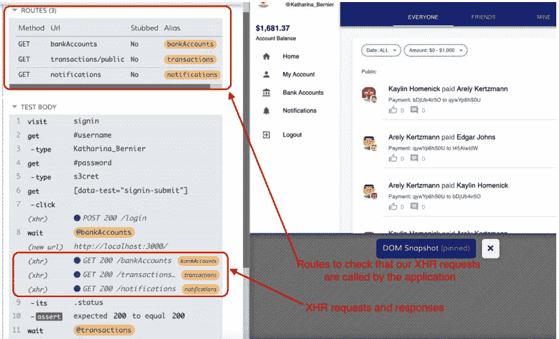

此截图显示了应用向我们的服务器发送 XHR 请求，请求 `/bankAccounts`、`/transactions` 和 `/notifications`。为了使我们的测试具有确定性，并让我们能等待特定时间以确保登录成功，我们使用 `cy.intercept()` 命令来检查 XHR 请求的响应何时被服务器发送回来，以及它们是否以正确的状态码发送回来。

在测试中等待 XHR 响应，相比于那些没有处理等待的*失败机制*的测试，或那些使用显式时间等待的测试，具有显著优势。等待 XHR 响应的替代方案是显式等待特定时间，但这只是一个估计值，并非 Cypress 等待特定响应的确切时间。在运行测试时等待路由响应的一些优势如下：

- 能够断言从路由返回的 XHR 响应对象
- 创建健壮的测试，从而减少测试的不稳定性
- 拥有因其精确性而易于理解的失败消息
- 能够存根响应并“模拟”服务器响应

强调了这些优势后，使用 XHR 请求有助于我们确定性地知道响应何时被接收，以及 Cypress 何时可以在接收到应用所需的所有响应后继续执行我们的命令。

### 回顾 – 在测试中利用 XHR 请求

在本节中，我们学习了 XHR 请求，它们是什么，以及 Cypress 如何利用它们从应用服务器发送和获取请求。我们还学习了如何等待 XHR 响应，通过确定性地等待服务器响应来减少测试的不稳定性。我们还学习了 XHR 如何帮助我们，如何获得精确的失败消息，甚至如何断言服务器的响应。最后，我们了解了如何使用 `cy.intercept()` 命令处理 XHR 响应，以及通过减少测试不确定性来控制测试执行的潜在好处。在下一节中，我们将探讨使用存根来控制来自服务器的 XHR 响应。

### 理解如何存根请求

现在我们了解了什么是 XHR 请求，重要的是要知道我们如何帮助 Cypress 测试 XHR 请求，更好的是，我们如何避免服务器的实际响应，而是创建我们自己的“假”响应，我们的应用会将其解释为从服务器发送的实际响应。在本节中，我们将研究如何存根发往服务器的 XHR 请求，何时存根请求，以及在我们的测试中存根服务器请求的影响。

#### 存根 XHR 请求

Cypress 提供了灵活性，允许用户让他们的请求到达服务器，或者在应用向服务器端点发出请求时使用存根响应。利用 Cypress 的灵活性，我们甚至有能力允许某些请求传递到服务器，同时拒绝其他请求并对它们进行存根处理。存根 XHR 响应为我们的测试增加了一层控制。通过存根，我们可以控制返回给客户端的数据，并且可以访问更改响应的 **body**、**status** 和 **headers**，甚至可以引入延迟来模拟服务器响应中的网络延迟。

#### 存根请求的优势

拥有存根请求使我们对返回给测试的响应以及接收请求的服务器客户端的数据有更多控制。以下是我们存根请求的优势：

- 控制响应的 body、headers 和 status。
- 响应时间快。
- 无需更改服务器代码。
- 可以在请求中添加网络延迟模拟。

接下来，我们也要看一些缺点。

#### 存根请求的缺点

虽然存根是处理 Cypress 客户端应用程序 XHR 响应的一种好方法，但它也为我们的测试过程带来了一些弊端，如下所示：

- 无法对某些服务器端点进行测试覆盖
- 无法保证响应数据与存根数据匹配

建议在大多数测试中对 XHR 响应进行存根处理，以减少执行测试所需的时间，并实现存根响应与服务器实际 API 响应的健康混合。Cypress 中的 XHR 存根也最适合用于处理 JSON API。

在以下代码块中，来自 `xhr-requests/xhr-stubbing.spec.js` 文件，我们将对 `bankAccounts` 端点进行存根处理，避免在运行应用程序时向服务器发出实际请求：

```
describe('XHR Stubbed Requests', () => {
    it('Stubs bank Account XHR server response', () => {
        cy.intercept('GET', 'bankAccounts',
        {results: [{id: "RskoB7r4Bic", userId: "t45AiwidW",
        bankName: "Test Bank Account", accountNumber: "6123387981", routingNumber: "851823229",
        isDeleted: false}]})
        .as('bankAccounts');
        cy.intercept('GET', 'transactions/public').as('transactions');
        cy.intercept('notifications').as('notifications');
```

```
cy.wait('@transactions').its('response.statusCode').should('eq', 304);
cy.wait('@notifications').its('response.statusCode').should('eq', 304);
cy.wait('@bankAccounts').then((xhr) => {
    expect(xhr.response.body.results[0].bankName).to.eq('Test Bank Account')
    expect(xhr.response.body.results[0].accountNumber).to.eq('6123387981')
});
```

在上面的代码块中，我们对 `/bankAccounts` 服务器响应进行了存根处理，我们没有等待响应，而是自己提供了一个与服务器原本会发送回来的响应几乎相同的响应。以下截图显示了成功的存根响应以及我们通过存根响应提供给客户端的“假”存根银行账户信息：

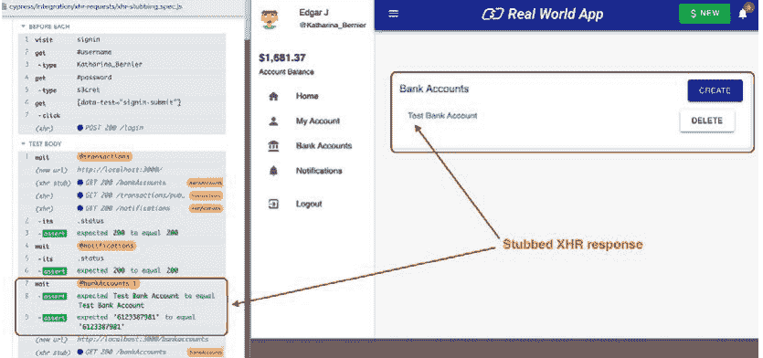

图 11.2 – 客户端应用程序中的存根 XHR 响应


##### 练习 1

使用位于 `cypress-realworld-app` 目录下 GitHub 仓库中提供的金融应用，进行以下练习以测试您对存根 XHR 响应的知识掌握情况。练习的答案可在 `chapter-11/integration/xhr-requests-exercises` 目录中找到：

1.  存根（Stub）应用的登录 POST 请求，将仪表板（dashboard）返回的测试用户名称，更改为反映您的姓名和用户名。

    断言返回的响应确实包含您所存根的用户名和姓名信息。以下屏幕截图显示了页面上需要更改的信息：

    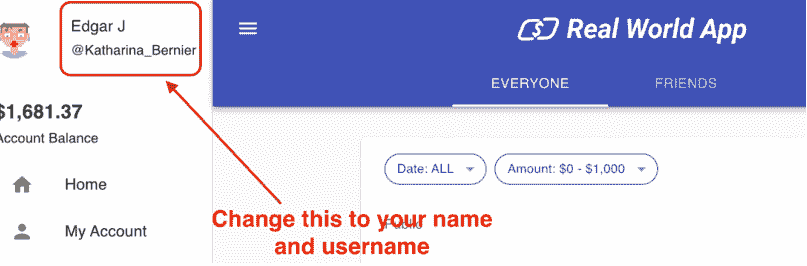

#### 练习 – 存根和监视 XHR 请求

> **重要提示**

    为了正确地存根响应，您需要了解当路由未被存根时，服务器作为响应发送的内容。为此，请打开浏览器的控制台，点击 **网络**（Network）选项卡，然后选择 **XHR** 过滤器选项。现在，您可以看到发送到服务器并由客户端接收的所有响应和请求。要获取用于存根的特定请求，您应该点击确切的请求，并从浏览器控制台的 **网络** 窗口中的 **响应**（Response）选项卡复制响应。确切的响应（或结构类似的响应）就是我们应使用来存根服务器响应的内容，以确保响应与客户端的一致性。从 **网络** 窗口中，我们还可以获取随请求发送和接收的标头信息，以及用于向服务器发送请求的实际 URL。

    以下屏幕截图显示了服务器 **通知** XHR 响应的示例：

    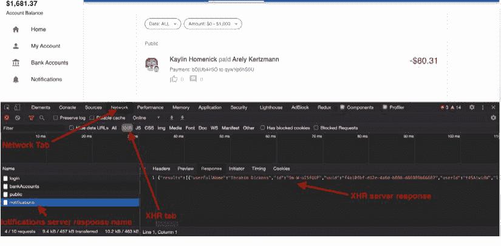

2.  成功登录后，从“所有人仪表板”（`Everyone Dashboard`）选项卡中选择一个随机交易，并将交易金额修改为 100 美元。

    通过这个练习，您不仅学会了如何存根 XHR 响应，还了解了客户端如何处理从服务器接收到的数据。通过理解 XHR 响应存根的好处，您现在已准备好处理涉及存根响应的复杂 Cypress 测试。

### 回顾 – 理解如何存根请求

在本节中，我们学习了如何使用 XHR 服务器请求来接收请求，以及如何使用存根来拦截发送的请求。我们还学习了如何通过存根控制返回给客户端应用程序的响应性质，以及如何断言我们存根的响应与从服务器接收到的客户端响应相似。最后，我们学习了如何使用浏览器来识别哪些响应需要存根，并使用所存根响应的内容。在下一节中，我们将探讨监视（Spying）的工作原理以及如何在 Cypress 方法中利用它。

### 理解如何在测试中监视方法

监视（Spies）和存根（Stubs）密切相关，区别在于：与可以用来修改方法或请求数据的存根不同，监视只能获取方法或请求的状态，而不具备修改方法或请求的能力。它们的工作方式就像现实生活中的间谍，只负责跟踪和报告。监视帮助我们理解测试的执行情况、哪些元素被调用以及哪些内容被执行。在本节中，我们将学习 Cypress 中监视的概念、监视方法的优势，以及如何利用监视来编写更好的 Cypress 测试。

#### 为什么使用监视？

我们在 Cypress 中使用监视来记录方法中的调用以及方法的参数。通过使用监视，我们可以断言某个特定方法被调用了特定次数，并且使用了正确的参数。我们甚至可以判断方法的返回值，或者方法被调用时的执行上下文。监视主要在单元测试上下文中使用，但也应用于集成测试上下文，例如测试两个函数是否正确集成以及它们一起执行时是否协调工作。执行时，`cy.spy()` 命令返回一个值，而不是像几乎所有其他 Cypress 命令那样返回一个 Promise。`cy.spy()` 命令没有超时设置，并且不能与其他 Cypress 命令进一步链接。

##### 监视的优势

以下是在测试中使用监视的一些优势：

-   监视不会修改被调用的请求或方法。
-   监视使您能够快速验证方法是否已被调用。
-   它们提供了一种简便的方法来测试功能集成。

监视是一个有趣的概念，因为它引入了一种监控方法的方式，而不必对结果采取任何操作。在下面的代码块中，我们有一个包含简单函数来对两个数字求和的测试：

```javascript
it('cy.spy(): calls sum method with arguments', () => {
    const obj = {
        sum(a, b) {
            return a + b
        }
    }
    const spyRequest = cy.spy(obj, 'sum').as('sumSpy');
    const spyRequestWithArgs = spyRequest.withArgs(1,
    2).as('sumSpyWithArgs')
    obj.sum(1, 2); //spy trigger
    expect(spyRequest).to.be.called;
    expect(spyRequestWithArgs).to.be.called;
    expect(spyRequest.returnValues[0]).to.eq(3);
});
```

在前面的方法中，我们设置了 `cy.spy()` 来监视我们的 `sum` 方法，并在方法被调用或使用参数调用时触发监视。每当方法被调用时，我们的监视将记录调用次数，我们还可以继续检查我们的方法是否被传递了任何参数。`sum` 函数位于一个 JavaScript 对象内，监视方法的触发器是 `obj.sum(1, 2)` 求和函数调用，该调用在测试中的断言执行之前被调用。以下屏幕截图显示了监视、调用次数以及测试的别名：

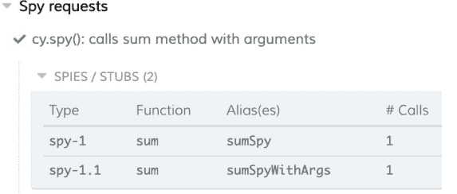

查看这个使用 `cy.spy()` 方法监视 `sum()` 函数的方法，我们可以看到，一旦求和方法开始执行，求和方法的监视以及带参数调用的求和方法监视都会被触发。

在下一个示例中，我们将探索一个更复杂的场景，尝试监视一个从服务器返回我们 JSON 数据库中所有交易的方法。以下代码块显示了将获取所有交易的方法的监视：

```javascript
it('cy.spy(): fetches all transactions from our JSON database',
() => {
    const obj = {
        fetch(url, method) {
            return cy.request({
                url,
                method
            }).then((response) => response);
        }
    }

    const spyRequest = cy.spy(obj, 'fetch').as('reqSpy');
    obj.fetch('http://localhost:3001/transactions', 'GET');
    expect(spyRequest).to.be.called;
    expect(spyRequest.args[0][0]).to.eq('http://localhost:3001/transactions')
    expect(spyRequest.args[0][1]).to.eq('GET');
});
```

在这个测试中，我们验证了从数据库获取交易的请求发生了。通过这个测试，我们可以监控我们的方法，并检查当方法被调用时是否传递了正确的参数。

很明显，通过监视，我们能够识别哪些方法被调用了、被调用了多少次，以及方法被调用时使用了什么参数。我们将在下一个练习中了解更多关于监视的知识。

##### 练习 2

使用位于 `cypress-realworld-app` 目录下 GitHub 仓库中提供的金融应用，进行以下练习以测试您对存根 XHR 响应的知识掌握情况。练习的答案可在 `chapter-11/integration/spies-exercise` 目录中找到：

1.  创建一个名为 `Area` 的方法来计算三角形的面积，监视 `area` 方法，并调用该方法以断言 `area` 方法确实被调用并被 `cy.spy()` 监视。同时断言该方法也被传递了 `base`（底）和 `height`（高）参数。

2.  使用我们的应用，以用户身份登录，并监视 API 请求方法以获取该登录用户的所有银行账户。断言向服务器发出 API 请求的方法被调用，并且参数作为参数传递给了该方法。

这个练习将帮助您理解 Cypress 中监视的工作原理以及可以与 `cy.spy()` 一起使用的不同方法，以查找被监视方法的内容。通过监视方法，我们还能够判断方法参数是否被调用以及它们是如何被调用的，连同返回值一起。

### 回顾 – 理解如何在测试中监视方法

在本节中，我们了解了监视，涵盖了监视的重要性以及它与存根的不同之处，因为我们不允许更改被监视的方法或请求的值。我们还学习了如何使用存根来识别方法的参数、方法被调用的次数、执行上下文，以及被监视方法的返回值。通过示例和练习，我们也接触了 `cy.spy()` 命令，这帮助我们理解了该命令及其在方法上下文中的工作原理。


### 总结

本章的重点主要是 XHR 请求和响应，以及它们如何与客户端和服务器进行交互。我们首先了解了 XHR 请求和响应是什么，以及当我们要从客户端发送请求并从服务器接收请求时它们的重要性。在本章中，我们还研究了如何通过使用 Cypress 的桩功能（内置于 `cy.intercept()` 命令中）来模拟服务器响应。最后，我们探讨了 Cypress 的 `cy.spy()` 命令，这进一步让我们了解了如何在 Cypress 中监控方法，并获得了解方法执行次数、执行方式、参数甚至返回值的能力。在最后一节中，我们了解了这样一个重要事实：通过监视，我们只能“观察”执行过程，而不一定能够改变请求或被测试方法的执行过程。

我相信通过本章，你已经掌握了关于什么是 XHR 请求、它们如何工作、如何模拟它们以及如何监视 Cypress 方法的技能。在下一章中，我们将探讨 Cypress 中的视觉测试。

## 12 Cypress 中的视觉测试

在开始视觉测试之前，你应该对其他形式的测试以及我们如何使用 Cypress 来完成这些测试有所了解。本书前面的章节从基础到中级水平，介绍了如何轻松开始使用 Cypress、如何配置 Cypress 以及如何优化你对 Cypress 的使用，为你的测试编写流程开发一个更有创意的工作流。前面章节的背景信息将为你学习本章提供所需的上下文。在本书的最后一章，我们的重点将是使用 Cypress 进行视觉测试。

在本章中，我们将介绍视觉测试的基础知识，并理解为什么我们需要它。我们还将学习一些可用于进行视觉测试的工具。本章的主题将帮助你，无论是作为工程师还是测试人员，理解为什么视觉测试对 Web 应用程序很重要，以及我们如何利用它来编写更好的测试。

我们将在本章涵盖以下关键主题：

-   视觉测试
-   理解视口
-   Cypress 测试中的视觉测试工具

一旦你完成了每个主题的学习，你将准备好使用 Cypress 作为首选工具，开始你的自动化测试之旅。

### 技术要求

首先，我们建议你克隆本书的 GitHub 仓库，其中包含本章我们将编写的源代码、所有测试、练习和解决方案。

本章的 GitHub 仓库可以在 `https://github.com/PacktPublishing/End-to-End-Web-Testing-with-Cypress` 找到。

本章的源代码可以在 `chapter-12` 目录中找到。

在我们的 GitHub 仓库中，我们有一个金融测试应用程序，本章中不同的示例和练习都将使用它。

> **重要提示：在 Windows 中运行命令**
>
> 注意：默认的 Windows 命令提示符和 PowerShell 无法正确解析目录位置。
>
> 请遵循下面列出的、专门适用于 Windows 操作系统（以单词 `*windows` 为后缀）的 Windows 命令。

要确保测试应用程序在你的机器上运行，请在机器的终端中从仓库的根文件夹目录运行以下命令：

```
$ cd cypress/chapter-12;
$ npm install -g yarn or sudo npm install -g yarn

$ npm run cypress-init; (for Linux or Mac OS)
$ npm run cypress-init-windows; (for Windows OS)

// run this command if it's the first time running the application
or
$ npm run cypress-app (for Linux or Mac OS)
$ npm run cypress-app-windows; (for Windows OS)

// run this command if you had already run the application previously

Optionally
$ npm run cypress-app-reset; (for Linux or Mac OS)
$ npm run cypress-app-reset-windows; (for Windows OS)
// run this command to reset the application state after
running your tests
```

> **重要提示**
>
> 我们的测试在 `chapter-12` 目录中，测试应用程序位于仓库的根目录。要正确运行我们的测试，我们必须同时运行我们的应用程序和 Cypress 测试，因为测试在本地运行的实时应用程序上执行。需要注意的是，测试应用程序将需要使用端口 `3000` 作为前端应用程序端口，端口 `3001` 作为服务器应用程序端口。
>
> 第一个命令将引导我们进入 `cypress-realworld-app` 目录，即我们的应用程序所在位置。`npm run cypress-init` 命令将安装应用程序运行所需的依赖项，而 `npm run cypress-app` 命令将启动应用程序。或者，你可以使用 `npm run cypress-app-reset` 命令重置应用程序状态。重置应用程序会移除添加的任何不属于应用程序的数据，从而将应用程序状态恢复到你克隆仓库时的状态。

### 视觉测试

无论你是 Web 开发人员还是测试人员，都需要确保正在开发的应用程序保持项目构想时的外观和感觉。作为开发人员，你可能希望验证应用程序的视觉方面在版本之间没有发生变化。作为测试人员，你可能希望验证应用程序的用户界面在版本之间保持一致，并且与设计一致。

**功能测试**可以用于检查视觉方面，例如验证按钮或输入框是否存在。然而，这可能涉及编写大量代码，并且大多数情况下，无法让你测试应用程序的每个方面，例如使用它来验证用户界面元素时的 CSS 更改。视觉测试是验证应用程序用户界面的视觉方面并确保其与预期保持一致的能力。

在本节中，我们将了解什么是视觉测试、视觉测试的不同类型、手动和自动视觉测试之间的区别，以及何时使用不同类型的视觉测试方法。

#### 为什么需要视觉测试？

视觉测试采取了一种实用的方法，因为你必须直接映射页面的视觉方面，并将这些方面与预期的设计进行比较。视觉测试的概念可能被忽视，因为我们认为我们的眼睛足够准确来进行验证，这是一个有缺陷的假设。虽然肉眼可以注意到可见的页面变化，但眼睛更难检测到细微的细节，例如 CSS 属性的更改导致输入元素移动了几个像素或微小的像素变化。

视觉测试的存在是为了让开发人员和测试人员确信，网页的用户界面没有被任何开发人员的更改所破坏。例如，通过视觉测试，如果部署到生产环境的应用程序版本缺少注册按钮，而之前的应用程序版本有该按钮，则无需担心。

视觉测试有两种类型，如下所示：

-   手动视觉测试
-   自动化视觉测试

这两种类型的视觉测试将让我们了解视觉测试的重要性，以及我们如何利用这两种测试方法来编写更好的测试。

##### 手动视觉测试

手动视觉测试涉及使用肉眼来验证开发团队所做的更改是否没有破坏任何可见的用户界面功能。手动视觉测试涉及测试人员或开发团队视觉化测试已开发的用户界面，并将其与最初创建的设计进行比较。视觉化测试应用程序的过程确认了用户界面的行为、外观和感觉没有发生非预期的变化。手动视觉测试对于用户界面的小改动是良好且合适的，但对于验证具有大量页面和视觉元素或不同视口的应用程序，这可能不是一个非常准确的方法。为了说明手动视觉测试的局限性，以下由 *Atlantide Phototravel* 提供的图片展示了埃菲尔铁塔的并排比较。它们非常相似，但第二帧中省略了一些细微的细节。花几秒钟比较这些图像，并尝试在不查看第二张图像中圆圈区域的情况下找出视觉差异：


图 12.1 – 寻找埃菲尔铁塔图片中的差异

即使对受过训练的眼睛来说，也存在一些细节，例如鸟的图案、缺失的人物，甚至是缺失的云朵，这使得在视觉上几乎不可能判断两张照片之间是否真的存在差异。通过应用相同的手动视觉测试思路，很可能会遗漏细节，从而无法发现测试应用程序中的任何差异，即使其中一些元素缺失或被添加了进去。

##### 自动化视觉测试

自动化视觉测试涉及测试页面的视觉元素。它不采用手动方法，而是使用自动化流程来检查应用程序页面的一致性。为了正确运行自动化视觉测试，我们必须保存并定义期望的用户界面作为**基准线**。然后，我们可以在测试中使用它来检查是否需要更新基准线或修改对应用程序所做的更改。

自动化视觉测试源于功能测试。它没有断言页面中的每个元素并检查页面中元素的属性，而是采用单一断言来检查整个页面的方法。

自动化视觉测试有两种类型：

-   快照测试
-   视觉 AI 测试

让我们详细了解每一种。

##### 快照测试

快照测试是一种自动化视觉测试，它在测试运行时记录特定屏幕的栅格图形或位图。然后，将记录的位图与先前记录的基准位图（基准线）进行比较。快照测试工具中的算法仅通过比较**十六进制颜色代码**来检查位图中是否存在像素差异。如果发现任何颜色代码差异，则会报告快照错误或生成显示视觉差异的图像。

与手动测试相比，快照测试是识别用户界面缺陷的一种明显更快的方式。如果应用程序本质上是静态的，且用户界面没有太多动态内容变化，那么快照测试是测试 Web 应用程序的首选方式。快照测试不能正确处理动态内容，因为算法将内容的任何变化都检测为由像素变化引起的视觉差异。由于所有视觉变化都被识别为视觉差异或潜在错误，因此不可能对包含动态数据的页面拥有一致的快照图像。

##### 视觉 AI 测试

视觉 AI 测试是新一代的自动化视觉测试，它利用了 **AI**。视觉 AI 测试的主要目标是改进快照测试的缺点，例如在测试应用程序时处理动态内容。通过使用计算机视觉，视觉 AI 算法可以识别图像和我们可以运行测试的区域，即使在动态内容的情况下，它们也能识别出内容允许动态变化的区域以及应该保持不变的区域。

视觉 AI 测试也使开发人员和测试人员能够更轻松地执行跨浏览器测试。通过跨浏览器应用程序，用户可以编写一个测试，然后在应用程序支持的不同**视口**中运行。**视口测试**是一个便捷的工具，它消除了开发人员（或编写快照测试的测试人员）为每台设备检查每个视口以验证是否存在视觉变化的负担。

### 回顾 – 视觉测试

在本节中，我们了解了什么是视觉测试，视觉测试的不同类型，以及何时使用每种类型的视觉测试。我们学习了自动化视觉测试和手动视觉测试之间的区别，还了解了自动化视觉测试的不同类型。然后我们学习了为什么视觉测试是比手动测试更可取的方法，以及为什么新一代视觉测试能够改进第一代视觉测试工具中存在的缺点。现在我们已经了解了关于视觉测试的所有内容，在下一节中，我们将通过理解什么是视口以及如何测试它们，来探索需要视觉测试的更多领域。

### 理解视口

视口是用户网页的可见区域。因此，术语视口用于测量用户设备上的矩形可视区域。计算机刚发明时，只有少数几个可用的视口，但由于创建了更多设备，这一点已显著增加。在撰写本文时，新的视口正由折叠手机或翻转屏幕设备以及具有不同尺寸的智能电视创建，因此开发人员必须确保他们的应用程序与用户的设备兼容。随着不同的视口出现，在使应用程序兼容此类视口方面出现了新的挑战，这对测试人员来说更是一个巨大的噩梦，因为实际上不可能通过每个可用视口来测试应用程序。

在本节中，我们将探讨视口的重要性、如何在不同的视口中进行测试，以及视口在视觉测试中的作用。

#### 视口与测试

在测试 Web 应用程序时，视口起着重要作用，因为它们展示了实际用户将如何查看被测试的 Web 应用程序。在撰写本文时，移动视口是最常用的视口。这是因为手机已经发展成为最强大的技术设备，既便携又手持。为了为用户提供良好的体验，视口测试应成为首要任务。通过视口测试，我们可以检查 Web 应用程序对不同屏幕尺寸的响应性等质量。

开发响应式 Web 应用程序比非响应式 Web 应用程序具有优势，因为与执行相同功能的独立移动应用程序（无论是 iOS 还是 Android）相比，它们花费更少的时间和资源来开发。

所有现代浏览器都允许我们在构建应用程序时检查和测试响应性。以下屏幕截图显示了在 Chrome 浏览器上渲染的 iPhone 6 视口，展示了 Cypress 文档页面在手机上的显示效果：

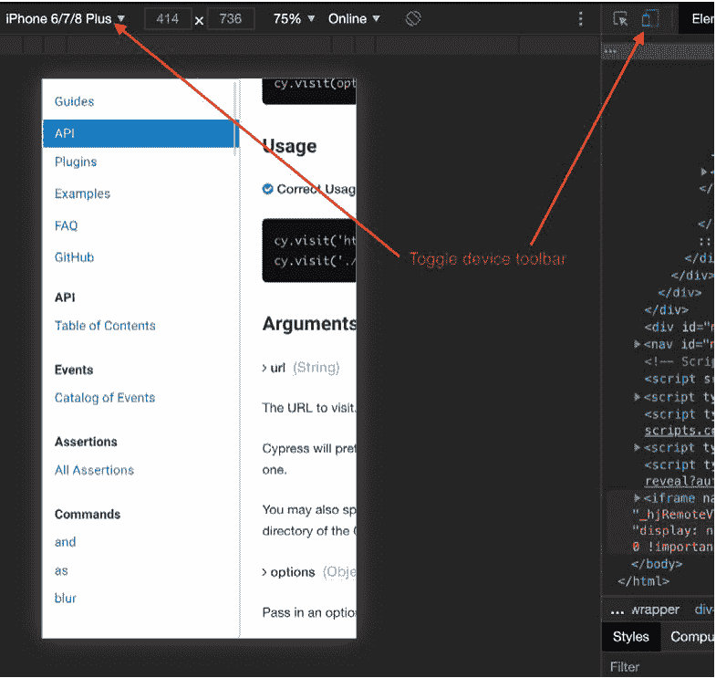

图 12.2 – iPhone 6 移动视口

我们可以使用浏览器上的**切换设备工具栏**在普通网页视图和移动设备视图之间切换。这使我们能够看到不同的 Web 应用程序在不同视口上的渲染方式。在 Web 应用程序是响应式的情况下，测试不同的视口将没有问题，因为应用程序将自动适应不断变化的视口。但是，对于非响应式 Web 应用程序，情况并非如此。在下面的屏幕截图中，您可以看到当前视口的选项，以及添加浏览器未定义的自定义视口的功能：

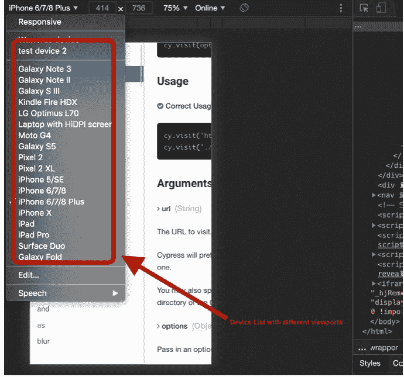

#### 视口与自动化视觉测试

如前面的屏幕截图所示，可以添加 Chrome 浏览器设备列表中不存在的新的测试视口。

当选择一个视口时，Chrome 网页区域会自动调整浏览器上可见的内容。作为开发人员或测试人员，很容易就能发现应用程序是否需要进行更改。

考虑到前面屏幕截图中显示的视口数量，手动测试每个单独的视口并验证是否有任何更改破坏了应用程序的用户界面，或者引入了非预期的、不必要的更改，是繁琐的。为确保视口得到测试，我们可以使用自动化视觉测试来检查应用程序在不同视口间的一致性。通过视觉测试，我们可以验证在我们配置的测试视口中，应用程序没有发生非预期的更改。


### 回顾——视口

视口是视觉测试的关键要素，尤其是因为大多数关于 Web 应用响应式的主要问题都是由视口缺陷引起的。在本节中，我们了解了不同类型的视口，以及如何使用浏览器的切换选项来检查 Web 应用的响应式能力，该选项可以在不同的设备视口和普通计算机视口之间切换。我们还了解到，通过使用自动化视觉测试，我们可以为不同的视口自动化不同的测试用例，并自动知晓应用中是否出现了非预期的更改。在下一节中，我们将探讨如何使用 Cypress 结合自动化视觉 AI 工具和 Percy 来编写自动化视觉测试，Percy 利用快照来记录视觉测试。

### 自动化视觉测试工具

视觉测试是 Cypress 的重要组成部分，它标志着我们从熟悉的功能测试向新领域过渡。借助视觉测试，Cypress 为我们开启了测试用户界面的全新世界，无需编写数百行功能代码来断言页面上的各个元素。

在本节中，我们将深入探讨两个自动化视觉测试工具，将它们与 Cypress 集成，然后学习如何使用它们来实现应用的视觉测试目标。其中一个工具使用快照记录**基线位图**，并逐个像素地比较位图图像，检查十六进制颜色是否存在差异。另一个工具则使用 AI 算法来比较我们 Web 应用的快照。

到本节结束时，我们将了解该使用什么工具、何时使用，以及 Cypress 在创建测试工具的简单集成和测试本身方面扮演什么角色。我们将要介绍的两个工具是 Applitools Eyes SDK 和 Percy。

#### Percy

Percy 是一个与测试工具集成的视觉测试和审查平台。它使开发人员和 QA 工程师能够识别出那些原本难以发现和报告的视觉缺陷。Percy 让视觉测试变得易如反掌——你所需要做的就是下载 Percy npm 模块、配置 **BrowserStack**，并将 Percy 添加到你的测试中。完成所有必要的配置后，你可以复制 Percy 提供的 **TOKEN**，该 TOKEN 将作为你计算机上的环境变量使用，如果你想将测试快照上传到 BrowserStack 云端进行审查并识别视觉差异（如果有的话），则是必需的。

> **重要提示：** BrowserStack 是一个视觉测试和审查工具，它拥有 **Percy** 工具。要配置 Percy，你需要配置 BrowserStack；所有配置将在两个平台之间同步。

Percy 主要依赖 Firefox 和 Chrome 浏览器。为了测试应用，Percy 会在各种视口中通过一组浏览器运行它，任何对已更改视口的修改都会被记录。当第一张图像被记录并保存后，Percy 会将测试中的图像设为**基线**，并使用该图像来检查后续测试运行中相似图像是否有任何更改，然后再高亮显示可能已经发生的任何视觉差异。

##### 设置 Percy

设置 Percy 并不复杂，涉及以下步骤：

1. 在 BrowserStack 创建账户（`https://www.browserstack.com/`）。
2. 验证你的 BrowserStack 电子邮件地址。
3. 在 BrowserStack 仪表板中创建一个组织。
4. 使用你的 BrowserStack 账户登录 Percy 仪表板。
5. 在 Percy 仪表板上创建一个项目。
6. 按照 Percy 网站上的说明（`https://docs.percy.io/docs/cypress`）在本地项目中配置 Percy。
7. 在你的本地计算机上将 Percy TOKEN 添加为环境变量。
8. 完成！你现在可以编写测试了！

完成*步骤 1-4*后，Percy 会提供一个 TOKEN，你必须在执行测试之前将其添加到计算机的环境变量中。你可以访问 Percy 文档（`https://docs.percy.io/docs/cypress）了解更多关于如何使用 Cypress 设置 Percy 的信息。

##### Cypress 中的视觉测试

一切设置完毕后，我们可以运行第一个测试，该测试将涉及检查登录页面内容更改时是否能看到视觉差异。如下图所示，我们通过在登录页面输入用户名和密码来运行测试：

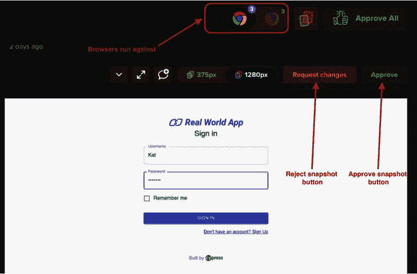

图 12.4 – Percy – 新快照

在这里，我们可以看到上传到 Percy 仪表板的快照图像。上传的快照是我们的登录页面。上传快照后，Percy 立即为我们提供了切换 Chrome 和 Firefox 浏览器的选项，以便我们可以检查快照的一致性。在 Percy 主仪表板上，我们可以选择批准所有快照、拒绝或接受单个快照，甚至可以在桌面视口和移动视口之间切换。

> **重要提示：** Percy 只在测试执行终止且运行测试的终端关闭时将快照上传到仪表板。这与 Applitools 工具不同，后者会在测试执行完成后立即连续上传测试快照。

正如我们前面提到的，我们可以使用 Percy 来比较记录的基线图像与新生成的位图图像的位图。所涉及的算法会检查逐个像素的差异，当基线图像与测试应用第二次运行时生成的新图像不相似时，这些差异会被记录为视觉差异。下图显示了我们在 Percy 仪表板上测试的第二次构建。在这里，我们省略了用户名和密码字段中的一些字符，我们想检查 Percy 是否能识别出这些差异：


图 12.5 – Percy 像素差异

如上图所示，一旦我们运行第二次构建，就省略了用户名和密码字段中的一些字符。当快照上传到 Percy 后，程序会通过检查不同图像的像素来识别视觉差异，并向我们提供识别到像素差异的区域。在第二次运行时，当我们*批准*这些更改时，Percy 会将我们的第二张图像采纳为**基线**。如果我们在图像上*请求更改*，Percy 将保留我们的第一张图像作为此特定快照的基线。

仔细检查后，我们的第一张快照登录用户名是 *Kathe*，而在第二张快照中，登录用户名是 *Kat*。密码中一些字符的省略以及用户名中一些字符的遗漏触发了 Percy 显示这些视觉差异。这让我们可以选择接受更改并更改基线，或者如果更改与我们的预期不一致，则可以向开发人员请求更改。

> **提醒：** 为了Successful运行测试并将快照上传到 Percy 仪表板，你需要在 BrowserStack 创建账户、在 BrowserStack 中创建组织、使用 BrowserStack 登录你的 Percy 仪表板、在 Percy 中创建项目，并将 Percy 项目仪表板上提供的令牌添加到你计算机的环境变量中。

Percy 的设置速度很快，无论是在本地计算机上还是在测试中。要调用 Percy，只需在测试中添加一行代码。以下代码块显示了生成第一张和第二张快照，以及传递给 `cy.percySnapshot()` 命令用于命名快照的参数：

```javascript
describe('Percy Login Snapshots', () => {
    it('percy: signin page snapshot - first build', () => {
        cy.visit('signin');
        cy.get('#username').type('Kathe');
        cy.get('#password').type('passwor');
        cy.percySnapshot('first');
    });
    it('percy: signin page snapshot - second build', () => {
        cy.visit('signin');
        cy.get('#username').type('Kat');
        cy.get('#password').type('passd');
        cy.percySnapshot('second');
    });
});
```

前面代码块中的第一个测试在第一次构建中运行，而第二个测试在第二次构建中运行，同时修改了用户名和密码详细信息，以在我们的登录页面中提供像素差异。要自行运行这些测试，你所需要做的就是按照前面提到的 Percy 设置流程获取 Percy 令牌，并将你的 Percy 项目令牌添加为计算机的环境变量。这些测试的完整源代码可以从本书的 GitHub 仓库中获取，位于 `chapter-12` 目录下。


##### 练习 1

在本练习中，我们将实践上一节所学的内容：学习如何使用 Percy 执行视觉测试，并与 Percy 的配置和仪表板进行交互。请按照以下步骤操作：

1.  使用 Percy 和 Cypress 登录我们的测试应用程序并导航到仪表板。然后，使用 `Percy` 命令，截取公共交易页面的快照。
2.  点击应用程序上的**新建交易**按钮添加一笔新交易，并填写交易详情。
3.  再截取一张快照，并使用 Percy 对比添加另一笔交易时交易页面的差异。

> **重要提示**
>
> 请记住在运行测试之前，将您从 Percy 项目仪表板获取的 Percy **TOKEN** 变量添加到本地计算机，以便 Percy 拍摄的快照能够成功上传到 Percy 仪表板。

本练习的解答可以在 `chapter-12/cypress/integration/percy/percy-exercise.spec.js` 目录中找到。

通过完成本练习并能够正确地在 Cypress 中设置 Percy，我相信您现在已经理解了如何使用 Percy 在测试中识别视觉差异，以及如何在应用程序的用户界面发生变化时快速识别差异。您可以通过对应用程序的位图图像进行逐像素比较来实现这一点。

#### Applitools

Applitools 是一款利用人工智能对应用程序进行视觉测试和监控的工具。与 Percy 一样，Applitools 也很容易与 Cypress 配合使用，并且专注于改进 Percy 等工具的不足之处。Percy 通过比较单个像素来识别视觉差异，而 Applitools 则通过其人工智能驱动的算法来识别视觉差异，检查这些变化是预期变化还是缺陷。使用 Applitools，测试动态变化更加容易，因为我们可以排除不希望 Applitools 检查视觉差异的区域。

通过指定应检查的区域和应忽略的区域来识别缺陷的能力，使 Applitools 在测试涉及动态内容的应用程序时成为更优秀的工具。

##### 设置 Applitools

与 Percy 一样，Applitools Eyes SDK 与 Cypress 的设置相对简单。这可以通过执行以下步骤来实现：

1.  创建 Applitools 账户 (https://auth.applitools.com/users/register)。
2.  验证您的 Applitools 电子邮件地址。
3.  导航到 Applitools 仪表板获取 API 密钥。
4.  在本地项目中配置 Applitools。
5.  将 Applitools 的 `APPLITOOLS_API_KEY` 作为环境变量添加到本地计算机。
6.  开始吧！

完成步骤 1 和 2 后，Applitools 会为您提供一个 `APPLITOOLS_API_KEY`，类似于 Percy 的 `TOKEN`，您必须将其作为环境变量添加到您的计算机中，然后才能执行测试。您可以访问 Applitools 和 Cypress 文档 (https://applitools.com/tutorials/cypress.html)，了解更多关于如何使用 Cypress 设置 Applitools Eyes SDK 的信息。

一切设置完成后，我们现在可以使用 Cypress 和 Applitools Eyes SDK 运行我们的第一个测试了。Applitools 是一款非常丰富的工具，我们无法涵盖它附带的所有功能。相反，我们将重点介绍 Applitools 作为视觉测试工具的优势。在下面的截图中，我们有与 Percy 示例中相同的登录测试，但已针对 Applitools Eyes 测试进行了修改：


图 12.6 – Applitools 登录页面快照

在这里，我们可以看到代表 Applitools Eyes SDK 截取并上传到 Applitools 仪表板的第一个登录页面快照。Applitools 使用三个命令来控制 Cypress 测试。第一个命令 `cy.eyesOpen()` 用于初始化和启动测试，第二个命令 `cy.eyesCheckWindow()` 负责截取屏幕截图，如前面的情况所示，第三个命令 `eyesClose()` 完成 Applitools Eyes 会话并将屏幕截图上传到仪表板。

我们的登录测试可以用以下格式编写。这将打开 Applitools Eyes SDK，截取屏幕截图，并在将屏幕截图上传到 Applitools 仪表板之前关闭 SDK，以便 Applitools AI 算法进行视觉比较。以下代码块显示了前面截图中提供的第二个构建：

```javascript
it('applitools: can signin on login page - second build snapshot', () => {
    cy.eyesOpen({
      appName: 'SignIn Page',
      browser: { width: 1200, height: 720 },
    });

    cy.get('#username').type('Kat');
    cy.get('#password').type('passd');
    cy.eyesCheckWindow('loginPage');

    cy.eyesClose();
  });
```

在这里，我们可以观察到，要运行测试，我们需要初始化 Applitools Eyes SDK，然后在关闭测试之前截取屏幕截图。Eyes SDK 使用的所有三种方法都可以根据您的需要更改配置参数。例如，在我们的代码块中，我们配置了 `cy.eyesOpen()` 命令，以便设置测试批次名称和浏览器窗口可见性配置。

Applitools 在报告错误方面更进一步。在 Percy 中，我们发现由于其逐像素比较，用户界面的任何变化都会被检测为视觉差异，并可能被识别为用户界面缺陷。在下面的截图中，我们可以看到，在使用不同的用户界面渲染运行类似的测试后，我们可以告诉 Applitools 忽略屏幕中的某些区域，并将我们的测试标记为通过：


图 12.7 – Applitools 忽略区域选项

在这里，我们可以看到 Applitools 提供的不同选项。即使不同区域有不同的视觉元素，如果它们不是视觉缺陷，或者它们是由动态内容生成的，也可以忽略这些区域。在忽略有视觉差异的区域后，我们继续将截图标记为已接受。

> **重要提示**
>
> 请记住在运行测试之前，将您从 Applitools 仪表板获取的 **APPLITOOLS_API_KEY** 变量作为环境变量添加到本地计算机。此令牌确保由 Applitools Eyes SDK 拍摄的快照成功上传到您的 Applitools 仪表板。

以下截图显示 Cypress 重新运行测试，现在在本地通过了该测试。这是因为已指示 Applitools Eyes SDK 接受与我们的基准快照相比存在的视觉变化：


图 12.8 – 在 Applitools 仪表板中忽略测试区域后通过测试

瞧——我们的测试通过了！对 Applitools 测试仪表板所做的任何更改都会反映在本地的测试运行中。这是通过您在运行 Applitools 视觉测试之前必须添加到环境变量中的 API 密钥实现的。您可以阅读更多关于 Applitools Eyes (`https://applitools.com/tutorials/cypress.html`) 的内容，以了解如何使用 Applitools 测试动态现代 Web 上的用户界面。

##### 练习 2

在本练习中，我们将测试我们对 Applitools Eyes SDK 工具的了解，以及如何使用它执行视觉测试。本练习将帮助我们实际实施本章的理论部分，并了解如何使用 Cypress 和 Applitools 编写视觉测试。请执行以下步骤：

1.  使用 Applitools 和 Cypress 登录我们的测试应用程序并导航到仪表板。然后，使用 `Applitools Eyes SDK` 快照命令，截取公共交易页面的快照。
2.  点击应用程序上的新建交易按钮再添加一笔新交易，并填写交易详情。
3.  再截取一张快照，并使用 Applitools 对比创建新交易时交易页面的差异。
4.  在 Applitools 仪表板中忽略创建新交易的区域，然后使用忽略区域重新运行测试。

上述练习的解答可以在 `chapter-12/cypress/integration/applitools/applitools-exercise.spec.js` 目录中找到。


至此，我相信你已经学会了如何使用 Applitools 的自动化视觉测试，本次练习也帮助你掌握了使用 Cypress 进行自动化视觉测试的技能和知识。至此，我们已到达本书的尾声，凭借赋予我的权力，我宣布你已是一名合格的"Bug 猎人"！

### 回顾 - 自动化视觉测试工具

在本节中，我们学习了两种自动化视觉测试工具——Percy 和 Applitools，以及如何将它们与 Cypress 测试集成。接着，我们了解了 Percy 和 Applitools 之间的区别，Percy 使用快照测试方式，而 Applitools 利用 AI 分析测试中的视觉差异。最后，我们学习了在哪些场景下可以使用 Applitools 等工具进行测试。我们通过了解浏览器内容随时间的变化过程，以及动态性越来越强的网站如何要求工具能够"适应"现代 Web 上的动态内容来理解这一点。

### 总结

在本章中，我们开始了解如何进行视觉测试及其重要性，以及可用于执行自动化视觉测试的视口和工具。整章中，我们学习了如何正确执行视觉测试。这包括了解如何创建视口、如何在不同视口上进行测试，以及为什么需要在多个视口上运行自动化视觉测试。接着，我们探索了两种测试工具——Percy 和 Applitools Eyes SDK，并深入介绍了它们的使用场景、设置过程以及如何使用它们编写 Cypress 测试。最后，我们进行了一些练习，以提高我们对这些工具的熟悉程度和交互能力。

至此，我们已到达本书的尾声。如果你一直在坚持阅读本书的所有章节，我相信你已经比刚开始时掌握了更多的 Cypress 知识。我希望本书能挑战你的思维方式，让你爱上 Cypress 这一测试工具，并在成为更好的测试人员或开发者的道路上有所改变。

## 你可能感兴趣的其他书籍

如果你喜欢这本书，你可能对 Packt 出版的以下其他书籍感兴趣：


### 《使用 TestCafe 进行现代 Web 测试》

Dmytro Shpakovskyi

ISBN: 978-1-80020-095-1

- 理解 TestCafe 的基本概念及其与经典 Selenium 的区别
- 了解如何设置 TestCafe 测试环境
- 使用命令行设置运行 TestCafe
- 在浏览器中验证和执行 TestCafe 代码
- 使用专家技巧实现 TestCafe 端到端测试自动化
- 发现 TestCafe 开发的最佳实践，并了解 TestCafe 的未来路线图


### 《精通 React 测试驱动开发》

Daniel Irvine

ISBN: 978-1-78913-341-7

- 使用 React 16.9+ 和 Jest 构建测试驱动的应用程序
- 使用各种 HTML 输入元素构建完整的 Web 应用程序
- 理解不同类型的测试替身及其应用场景
- 测试驱动集成 React Router、Redux 和 Relay (GraphQL) 等库
- 学习何时保持务实以及如何应用 TDD 快捷方式
- 测试驱动与浏览器 API 的交互，包括 fetch 和 WebSockets
- 使用 Cucumber.js 和 Puppeteer 为你的应用程序构建 BDD 风格的验收测试
- 使用 redux-saga 和 expect-redux 构建和测试异步 Redux 代码

### Packt 正在寻找像你一样的作者

如果你有兴趣成为 Packt 的作者，请访问 authors.packtpub.com 并立即申请。我们已与数千名像你一样的开发者和技术专业人士合作，帮助他们与全球技术社区分享他们的见解。你可以提交通用申请，申请我们正在招募作者的特定热门话题，或提交你自己的想法。

## 留下评论 - 让其他读者了解你的想法

请在你购买本书的网站上留下评论，与其他人分享你对本书的看法。如果你是从亚马逊购买的本书，请在本书的亚马逊页面上留下你真实的评论。这非常重要，这样其他潜在读者可以看到并参考你客观的意见来做出购买决策，我们可以了解客户对我们产品的看法，我们的作者也可以看到你对他们与 Packt 合作创作的书籍的反馈。这只需要花你几分钟时间，但对其他潜在客户、我们的作者和 Packt 都很有价值。谢谢！

## 索引

### A

- **可操作性**
    - 关于 114、121
    - 强制执行 122、125
- **可操作性检查**
    - 覆写 122-125
- **用于检查 DOM 元素就绪状态的操作**
    - 关于 115
    - 动画 117、118
    - 坐标 120、121
    - 覆盖 118、119
    - 脱离 117
    - 不可用 117
    - 只读 117
    - 滚动 119
    - 可见性 116
- **高级导航请求配置**
    - 关于 171-173
    - cy.visit() 配置选项 171、172
- **Applitools**
    - 关于 205
    - 账户创建链接 206
    - APPLITOOLS_API_KEY 206
    - 设置 206-210
- **人工智能（AI）** 196
- **自动化视觉测试**
    - 关于 195
    - 与视口 199
    - 快照测试 196
    - 类型 195
    - 视觉 AI 测试 196
- **自动化视觉测试工具**
    - 关于 200、210
    - Applitools 205
    - Percy 200

### B

- **基线** 195
- **基线位图** 200
- **browser-name** 10
- **浏览器**
    - 切换 10、11
- **BrowserStack** 200

### C

- **层叠样式表（CSS）** 116
- **Chai 断言库** 53
- **chai-jquery 模块** 65
- **chai 模块** 65
- **Chromium 项目** 10
- **闭包**
    - 关于 129-131
    - const 关键字 134、135
    - let 变量 132、133
    - var 关键字 132
- **控制台区域**
    - 命令 83
    - 元素 83
    - 选择器 83
    - 输出 83
- **控制台调试输出**
    - 关于 82-84
    - 必要性 84
- **上下文**
    - 在测试钩子和测试之间共享 136-140
- **持续集成（CI）** 88
- **cy.debug() 命令** 85、86
- **cy.go() 命令** 165、166
- **cy.intercept() 命令** 169、170
- **cy.pause() 命令** 87、88
- **Cypress**
    - 断言 65
    - 自动重载功能 64、65
    - 基本命令 31、46
    - 调试，在命令行 46-48
    - 调试，测试场景 47
    - 桌面应用程序启动 9
    - 启动，使用完整路径 9
    - 启动，使用快捷方式 9
    - 需求 16、17
    - 打开 8、9
    - 运行，使用 node modules 路径 9
    - 运行，使用 Npx 8
    - 运行，使用 Yarn 8
    - 编写 TDD 测试 97、98
- **Cypress 别名**
    - 关于 135、136、142
    - 上下文，在测试钩子和测试之间共享 136-140
    - 访问元素引用 140
    - 访问请求引用 141、142
    - 访问路由引用 141
- **Cypress 断言**
    - 关于 65-69
    - 显式主题 67、68
    - 隐式主题 66-68
- **Cypress 命令**
    - 与脚本结合使用 12、13
    - 使用 cypress info 命令 45
    - Cypress open 命令 38
    - cypress run 命令 31
    - cypress version 命令 45
    - 全局命令 29
    - 本地命令 29
    - 运行 28、31
    - 使用方法 45
- **Cypress 命令脚本**
    - 打开 11
- **Cypress 错误，在测试运行器上**
    - 关于 74-78
    - 代码帧 76
    - 代码帧文件 76
    - 错误消息 76
    - 错误名称 75
    - 了解更多 77
    - 输出到控制台 76
    - 堆栈跟踪 76
- **Cypress，用于前端应用程序**
    - 关于 24、26
    - 调试 25
    - 详尽的测试能力 25
    - 实现 25
    - 设置过程 24
    - 测试运行器 24
- **cypress info 命令**
    - 使用方法 45
- **Cypress 安装，在 MacOS 上**
    - 关于 6-8
    - 安装 Node.js 6
    - 初始化项目 6
    - 通过直接下载 7、8
    - 使用 Yarn 7
- **Cypress 安装，在 Windows 上**
    - 关于 5
    - 下载 Node.js 4
    - 安装 Node.js 4
    - 初始化项目 5
- **Cypress 机制，用于检查元素的可操作性**
    - 命令 114
- **Cypress 导航命令**
    - cy.go() 命令 165、166
    - cy.reload() 命令 167
    - cy.visit() 命令 162-164
- **Cypress 网络请求命令**
    - cy.intercept() 命令 169、170
    - cy.request() 命令 168、169
- **Cypress，在 Windows 上**
    - 安装 4
- **Cypress open 命令**
    - 关于 38、39
    - browser </path/to/browser> 40
    - config <configuration-option(s)> 41
    - config-file <configuration-file> 42
    - env <env-variable(s)> 39、40
    - global 42
    - port <port-number> 44
    - project <project-path> 43、44
- **cypress run 命令**
    - --headed 36
    - --headless 37
    - 关于 31、32
    - browser <browser-name> 34
    - config <configuration(s)-option> 35
    - config-file <configuration-file> 35
    - env <env-variable> 32、33
    - spec <spec-file> 37、38
- **Cypress 测试**
    - 运行 12、13
    - 间谍的优势 186、188
    - 间谍 188
    - 使用间谍的必要性 185
    - 监视方法 185、188
    - 时间旅行功能 78-80
- **Cypress 权衡取舍**
    - 关于 21
    - 控制源限制 22
    - 环境限制 21
    - 多浏览器限制 22
    - 多标签页限制 22
    - 作用域限制 21
- **Cypress 变量**
    - 关于 128-135
    - 闭包 129-131
- **cypress version 命令**
    - 使用方法 45
- **Cypress，与 Selenium WebDriver 的对比**
    - 关于 18、24
    - 架构 20
    - 浏览器驱动 18
    - 互补操作 23
    - 跨浏览器兼容性 21
    - 重试机制 18
    - 总结 23
    - 目标用途 19
    - 等待机制 18


cy.reload() 命令 167
cy.request() 命令 168、169
cy.visit() 命令 162-164
cy.visit() 配置选项 171、172

### D

调试命令
- 概述 84
- cy.debug() 命令 85、86
- cy.pause() 命令 87、88
- 调试的必要性 88

默认断言 60

defaultCommandTimeout
- 配置选项 115

DevTools 控制台
- macOS 上 82
- Windows/Linux 操作系统上 82

文档对象模型（DOM）18、114

不要重复自己（DRY）原则 94

### E

元素引用
- 访问 140

事件命中区域 81、120

### F

功能测试
- 使用 193

### G

全局 Cypress 命令
- 概述 29、30
- 运行 29

### H

有头模式 28

十六进制颜色代码 196

### I

检测面板
- 概述 146、151
- 拦截 147-149
- 间谍 150、151
- 桩函数 149、150

拦截 147

### L

本地 Cypress 命令
- 概述 29
- 运行 29、30

### M

MacOS
- 安装 Cypress 6

### N

导航请求
- 实现 162-168

网络请求
- 实现 168-171

Node.js
- 下载 4
- 安装 4

node modules 路径
- 用于运行 Cypress 9

### P

页面事件
- 概述 73
- 用途 74

Percy
- 概述 200
- 参考链接 201
- 设置 201-205

实践测试
- 断言应用状态 62、63
- 搜索元素 59、60
- 访问 Todo 应用页面 58
- 与 Todo 输入元素交互 61
- 编写 57、64

### Q

质量保证（QA）16

### R

请求引用
- 访问 141、142

路由引用
- 访问 141

### S

脚本
- 用于组合 Cypress 命令 12、13

Selector Playground（选择器演练场）
- 概述 151、155
- 编辑选择器元素 154、155
- 选择唯一元素 152、153

选择器
- 确定 153、154

sinon-chai 模块 65

快照测试 196

间谍 150、151

桩函数替换 147-149

桩函数 149、150

### T

TDD 测试
- 修改 103、111
- 在 Cypress 中编写 97、98

TDD 测试修改
- 查看已添加的待办事项 108、109
- 查看已添加待办事项的数量 109、110
- 添加新的待办事项 104、105
- 删除待办事项 106、107

TDD 测试设置
- 概述 98
- 查看已添加的待办事项 101
- 查看已添加待办事项的数量 101、102
- 设置 103
- 添加待办事项 98-100
- 删除待办事项 100

测试
- 分类 53
- 编写 52
- 编写示例 53

测试分类
- 概述 53
- 失败的测试 55、56
- 通过的测试 54
- 跳过的测试 56、57
- 编写测试 57

测试驱动开发（TDD）
- 概述 72、93、97
- 优势 94、95
- 劣势 96

测试文件
- 创建 50、52
- 扩展名 51
- import 51
- 位置 50
- require 51
- 结构 51

Test Runner 键盘快捷键 156

测试快照
- 解读 80、81

Todo 应用
- 概述 58
- URL 68

待办事项列表应用 32

todoMVC 应用 32

传输协议 32

TransferProtocol 环境 46

### U

单元测试 67

### V

视口
- 概述 196-200
- 与自动化视觉测试 199
- 与测试 197-199

视口测试 196

视觉 AI 测试 196

视觉测试
- 概述 193-96
- 自动化视觉测试 195
- 手动视觉测试 194
- 测试的必要性 194
- 类型 194

### X

XHR 请求
- 概述 177
- 桩函数替换 180-185
- 桩函数替换的优点 181
- 桩函数替换的缺点 181
- 在测试中使用 177-180

XMLHttpRequest（XHR）25、147、162、177

### Y

Yarn
- 用于在 Mac 上安装 Cypress 7
- 用于运行 Cypress 8

npm scripts
- 概述 11、12
- 打开 Cypress 命令脚本 11

Npx
- 用于运行 Cypress 8
