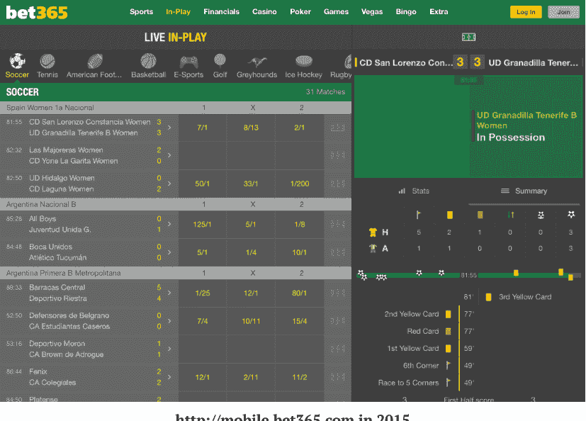

# CSS 持久之道：大规模 CSS 代码库架构与维护

## 关于作者

Ben Frain 自 1996 年以来一直从事 Web 设计/开发工作。他目前在 bet365 担任高级前端开发工程师。

在涉足 Web 之前，他曾是一名被低估（且谦虚）的电视演员和技术记者，毕业于索尔福德大学，获得媒体与表演学位。

他写了四部同样被低估（他的看法）的剧本，仍然抱有（逐渐淡化的）能够卖出一部的信念。工作之余，他享受简单的乐趣；趁身体和妻子还允许的时候踢室内足球，以及和他的两个儿子摔跤。

他的其他著作，[《Responsive Web Design with HTML5 and CSS3》](http://example.com) 和 [《Sass and Compass for Designers》](http://example.com) 现已出版。请访问 Ben 的在线网站 [www.benfrain.com](http://www.benfrain.com)，并在 Twitter 上关注他 [twitter.com/benfrain](http://twitter.com/benfrain)。

## 致谢

我要向直接或间接帮助完成这本书的少数人表示感谢。

首先，[Matthew Mitchell](https://example.com)，他提供了封面 artwork、排版指导和网站设计，并忍受（双关语）我每天都在喋喋不休地谈论 CSS。

我还要感谢我在 bet365 的工作同事，主要是 [Pete Griffiths](https://example.com)，他鼓励开发团队大规模采用 ECSS 方法。

最后，我要感谢我那长期受苦的妻子，允许我在厨房里“敲敲打打”无数个小时，以便把这些东西从脑子里倒出来。

## 前言

这是一本小书，凝练了我目前对于如何最好地编写和维护面向快速变化、长期存在的 Web 项目的 CSS 代码库的思考。

- LilyJames 没有可下载的框架。
- 没有必需的工具（尽管有对于工具应提供什么功能的主观指导）。
- 没有为你写好的东西。

metaphorically 说，“持久的 CSS”不是给你鱼；而是教你钓鱼。

这是一种编写 CSS 的方法论，一旦实施，将为你的项目提供可预测且易于维护的 CSS 代码库。

持久 CSS 的最早迭代首次记录在博客文章[《持久 CSS：为快速变化、长期存在的项目编写样式表》](https://benfrain.com/enduring-css-writing-style-sheets-rapidly-changing-long-lived-projects/)中。

然而，ECSS 方法自此有所发展，因此本书应被视为该方法的权威资源。

希望你喜欢阅读。

Ben Frain 2015 年 10 月 26 日

# 第 1 章：持久型 CSS

为快速变化、长期存在的 Web 项目编写样式

## 简介

这其实不是一本关于如何编写 CSS（即花括号内的内容）的书。它是一本关于 CSS 的组织与架构的书；也就是花括号之外的部分。这些考虑事项在小项目中可以轻松地忽略掉，但在大型项目中，它们却会成为编写 CSS 时最困难的部分。

像“大规模 CSS”或“CSS 规模化”这样的术语可能显得相当模糊。我将尝试澄清一下。

## 定义问题

持久型 CSS（Enduring CSS）诞生于我自己对为大型 Web 应用编写 CSS 制定一种理性方法的需求。

以下是该应用在 iPad 上的截图：



`http://mobile.bet365.com`，2015 年

这是一个响应式应用，允许用户在全球范围内对体育赛事进行投注。右上角的场地部分提供了所选比赛的实时呈现，并配有动画 SVG。当体育赛事进行时，左下角的赔率和比赛分数会实时更新，右下角的赛事历史时间线摘要也会持续更新。

由于该应用的复杂性，经过多次迭代，CSS 逐渐变得难以驾驭。它难以继续迭代，难以理解，而且没人确切知道哪里存在多余的 CSS，是否可以安全地移除而不至于无意中影响到应用的其他部分。如果你曾经接手过一个大型 CSS 代码库，相信你能感同身受。

因此，在我开始这段旅程之初，我定义了一些基本需求。更简单来说，这些是任何新的 CSS 编写方法都必须解决的问题。以下就是这些需求的清单：

- 允许长期轻松维护大型 CSS 代码库。
- 允许将部分 CSS 代码从代码库中移除，而不会影响剩余的样式。
- 能够对新设计进行快速迭代。
- 修改应用于某个视觉元素的属性和值时，不应意外影响到其他元素。
- 任何解决方案都应只需要最少的工具和工作流改动即可实施。
- 在可能的情况下，应使用 W3C 标准（如 ARIA）来传达用户界面中的状态变化。

在下一章中，我们将更具体地审视这些问题。不过，首先，一个重要的警示。

## 解决你自己的问题

我相信“Pin Cing Do”，大致翻译为“务实编码之道”。这意味着解决你实际遇到的问题。因此，我要 upfront 声明一些对某些人而言可能显而易见的事情：

可能我遇到的问题并不是你遇到的问题。因此，你应该相应地斟酌本书提供的建议和方法。或者，考虑你的需求可能更适合由其他方法和方法论来解决。我不会试图说服你 ECSS 在所有情况下都是最佳解决方案。例如：

- ECSS 无法给你最小的 CSS 体积（如果需要，请考虑 [Atomic CSS](link)）。
- 它并未被广泛使用和记录（如果普及性是主要关注点，请考虑 [BEM](link)）。
- ECSS 不会抽象样式，也不允许通过一堆特定的实用类来为元素设置样式。如果你需要那个，应该看看 OOCSS 并阅读其众多倡导者的文章。

好的，公共服务公告到此结束。让我们继续进入下一章。在那里，我们将审视在大型项目中使用 CSS 时的主要问题：特异性、层叠、隔离以及与结构元素绑定的选择器。

# 第 2 章：规模化 CSS 的问题

在大多数项目中，CSS 都从一些简单的规则开始。一开始，除非做了相当愚蠢的事情，否则很难让 CSS 的维护变得困难。

然而，随着项目的发展，CSS 也在增长。需求变得更加复杂。更多的作者参与到样式的编写中。边缘情况和浏览器兼容性处理需要编写并纳入考量。事情很容易迅速变得混乱不堪。

让我们考虑一下一个简单小组件不断增长的需求：

- “当小组件位于侧边栏时，我们能缩小字体大小吗？”
- “在首页时，小组件能有不同的背景色吗？”
- “在较大的视口中，我们能让小组件内部的内容垂直堆叠吗？”
- “当小组件在产品页的侧边栏中时，字体颜色需要改变。”

不久之后，我们需要为基选择器编写一整套覆盖规则。让我们考虑一下我们可能需要的各种选择器：

```css
.widget {
    /* 基础样式 */
}

aside#sidebar .widget {
    /* 侧边栏专属 */
}

body.home-page aside#sidebar .widget {
    /* 首页侧边栏专属 */
}

@media (min-width: 600px) {
    .widget {
        /* 600px 及以上的基础样式 */
    }

    aside#sidebar .widget {
        /* 600px 及以上的侧边栏专属 */
    }

    body.home-page aside#sidebar .widget {
        /* 600px 及以上的首页侧边栏专属 */
    }
}

body.product-page .widget {
    /* 产品页专属 */
}

body.product-page aside#sidebar .widget {
    /* 产品页侧边栏专属 */
}
```

如果这是我们想要规模化的 CSS，那么其中存在一些基本的编写问题。现在让我们来审视一下这些规则中一些更明显的问题。

## 特异性

规模化 CSS 的第一个主要问题是我们想要绕过特异性问题。通常情况下，特异性是有用的。它允许我们在 CSS 中引入某种形式的逻辑。在浏览器中，更具特异性的样式会得以应用。我们上面的例子展示了这一点：不同的规则会在不同的情况下应用（例如，在侧边栏中时，我们想要覆盖默认样式）。

现在，CSS 选择器可以由 ID、类、属性及类型选择器以及它们的任意组合构成。对于响应式设计，你还可以将媒体查询也纳入其中。

然而，并非所有选择器都是平等的。W3C 在这里描述了特异性是如何计算的：[http://www.w3.org/TR/css3-selectors/#specificity](http://www_resources264com/resources264.com/TR/css3-selectors/#specificity)。以下是最相关的部分：

> 选择器的特异性计算如下：计算选择器中 ID 选择器的数量（= a）计算选择器中类选择器、属性选择器和伪类选择器数量（= b）计算选择器中类型选择器和伪元素选择器数量（= c）忽略通用选择器否定伪类内部的选择器按任何其他选择器一样计算，但否定本身不计算为伪类。将三个数字 a-b-c 连接起来（采用大基数数字系统）即得到特异性。

那里缺少一个重要的东西是 style 属性。[其他地方的说明](elsewhere)告诉我们：

> style 属性中的声明应用于该属性所属的元素。在层叠中，这些声明被视为具有作者来源和高于任何选择器的特异性。

因此，在元素的 style 属性中应用的样式将比 CSS 文件中同等规则更具特异性。

无论如何，这里最大的要点是 ID 选择器比基于类的选择器具有无限更高的特异性。这使得覆盖任何包含 ID 选择器的选择器要困难得多。例如，对于侧边栏中的小组件，这样是行不通的：

```css
.widget {
    /* 侧边栏中的小组件 */
}

aside#sidebar .widget {
    /* aside 元素中 id 为 sidebar 的小组件 */
}

.class-on-sidebar .widget {
    /* 为什么这个不起作用 */
}
```

| 选择器 | 内联 | ID | 类 | 类型 |
| --- | --- | --- | --- | --- |
| `.widget` | 0 | 0 | 1 | 0 |
| `aside#sidebar .widget` | 0 | 1 | 1 | 1 |
| `.class-on-sidebar .widget` | 0 | 0 | 2 | 0 |

因此，你可以在这里看到，中间的选择器比最后一个具有更高的特异性。真糟糕。

在单个或较小的文件中，这并不算是什么大问题。我们只需创建一个更具体的规则。然而，如果你的代码库的 CSS 分散在许多较小的部分 CSS 文件中，找到一个阻止你的覆盖生效的规则可能会成为不必要的负担。现在，这个问题并不仅限于 ID 选择器。它更像是样式表中权重不均等的选择器所带来的问题。想象一下，一个重量级拳击手对阵一个蝇量级选手。这不是一场公平的比赛。在使用的选择器之间创建公平的竞争环境，比实际使用的选择器本身更重要。

这种不匹配的选择器大杂烩就是特异性问题的核心所在。一旦你的 CSS 代码库有了数百条规则，任何不必要的特异性都会开始成为主要的“眼中钉”（那是一个技术性术语）。

所以，总而言之，在我们不断增长的 CSS 代码库中，特异性是一个我们需要解决的问题。

## 与选择器绑定的标记结构

编写大规模 CSS 时另一个典型的失误是使用类型选择器；即与特定标记相关联的选择器。例如：

```css
aside#sidebar ul > li a {
    /* Styles */
}
```

在这种情况下，我们需要一个 `a` 标签在一个 `li` 内部，而 `li` 是一个 `ul` 的直接子元素，而这个 `ul` 又在一个 ID 为 `sidebar` 的 `aside` 元素内部——呼！

如果我们想把这些样式应用到其他地方的 `div` 呢？或者任何其他的标记结构 OG视讯官网地址？

我们只是不必要地将我们的规则与特定的标记结构绑定了。这样做往往很诱人，因为给一个（看似）微不足道的 `a` 或 `span` 标签添加类名似乎很荒谬。然而，我希望当你读到 ECSS 的结尾时，你会被说服去避免这种做法。

## 层叠

通常情况下，CSS 的层叠部分是有用的。它允许 CSS 文件中更靠下的等效规则覆盖更靠上的规则。

然而，在大型代码库中，它变成了一个不受欢迎的安全网，让作者能够不断地向代码库中添加 CSS。

这可能出于多种原因。例如，熟悉其他语言的作者往往缺乏对 CSS 代码库的足够信心或深入了解，无法自信地删除现有代码。因此，他们选择了安全的做法，使用更具体的规则集来覆盖现有规则。实际上，这意味着将新规则（以及完成作业所需的任何选择器）添加到现有样式的底部。

这是开发人员在继承 CSS 代码库时面临的一个常见而令人沮丧的场景；臃肿的 CSS 文件已成为 CSS 冗余的温床。

## 总结

到目前为止，我们已经介绍了一些高层级的问题，这些都是 CSS 代码库在规模上难以应对的症状。我们探讨了特异性和层叠的问题。在下一章中，我们将了解试图驯服大型 CSS 代码库的公认智慧和做法，并考虑它们存在的任何不足。

# 第 3 章：实施公认的智慧

> 往往在你第一次实施解决方案之前，你并不能真正理解问题——[《大教堂与集市》](https://en.wikipedia.org/wiki/The_Cathedral_and_the_Bazaar)

在上一章中，我们考虑了处理大型 CSS 代码库的一些较为明显的困难。在本章中，我们将考虑一些现有的处理这些问题的方法。

在两年的历程中，我一直在进行 CSS 架构和维护的探索。在经验的初期，我做了任何明智的开发人员都会做的事。我去看看聪明人已经如何处理过这个问题。

🔍 由于 CSS 扩展的固有问题，CSS 架构方法可能相当于超重者的减肥药丸。人们很容易去抓取看似显而易见的解决方案，希望它们正是你所需要的。然而，在你至少尝试过一次解决问题之前，你可能并不知道自己真正需要什么。这个建议在这里也适用。ECSS 可能并不是你面临的问题的解决方案，所以如果你刚开始解决你的 CSS 问题，请务必考虑不同方法论所提供的不同方案。

当时，处理大规模 CSS 的主要方法有：

- OOCSS（面向对象的 CSS），由 [Nicole Sullivan](https://github.com/stubbornella) 开发。
- SMACSS（CSS 的可扩展模块化架构），由 [Jonathan Snook](https://snook.ca/) 开发。
- BEM（块元素修饰符），由 [Yandex](https://yandex.com) 开发。

现在，我要毫不掩饰地告诉你，我从每个方法中都借鉴了一些元素。然而，这些方法都没有真正解决我所面临的问题。

在我们进入 ECSS 之前，我想简要介绍一下我所了解的每种现有方法的优缺点。这样，至少当我们谈到 ECSS 时，你可以理解它在解决什么问题。

## 关于 OOCSS

在我所了解的方法中，最广泛使用且最受称赞的无疑是 OOCSS。这是我试图控制不断增长 CSS 代码库时首先使用的方法。

支持 OOCSS 方法的主要论点之一是它消除了代码的重复，因此产生了更可维护的 CSS 代码库。本质上，你构建了一组 CSS“乐高”积木，然后可以在你的 HTML/模板中使用它们来快速构建设计。希望一旦你的 OOCSS 样式写好了，它们就不应该（太多地）增长。你在可能的情况下重用，在需要时扩展。

在我们了解 OOCSS 之前，我需要先做一些免责声明。

1. 这不是对 OOCSS、Atomic CSS 或任何相关的单一职责原则（SRP）方法的攻击。这只是我的论点，即根据不同的目标，不同的方法可以提供更优选的结果。
2. 我不建议我所倡导的方法是解决所有 CSS 扩展问题的灵丹妙药。它不是（没有什么是）。

### 响应式设计，OOCSS 的阿喀琉斯之踵

对我来说，OOCSS 方法的两大问题是：

- 响应式网页设计。
- 频繁的设计变更和持续维护。

让我们看看能否演示为什么我觉得这两个问题值得考虑。

#### 响应式问题

我认为 [Atomic CSS](https://en.wikipedia.org/wiki/Atomic_CSS)（不要与 [Atomic Design](https://atomicdesign.bradfrost.com/) 混淆）代表了 OOCSS 的极致运用。让我们考虑一个想象中的 Atomic CSS 例子：

```html
<div class="blk m-10 fr">Here I am</div>
```

在这个 OOCSS/Atomic CSS 例子中，元素的视觉需求被拆分/抽象成了可重用的类。一个设置块格式化上下文（`.blk`），另一个设置一些边距（`.m-10`），最后，一个为元素提供浮动机制（`.fr`）。确实是无倾向且简洁的。

> 原则上，Atomic CSS 与我设计的第一个架构方法非常相似。

它被称为“PST!”，这是 Position Structure Theme 的缩写。想法是这样的：没有语义化的 HTML 类/CSS 选择器。相反，页面上的每个元素都可以通过其位置、结构和主题来描述。每个新选择器只需使用下一个可用的数字。例如，`s1`、`s2`、`s3` 等等。它不完全像 Atomic CSS 那样每个职责一个类，但它是 heavily abstracting stylistic needs（重度抽象样式需求）的一种方式。

标记看起来像这样：

```html
<div class="p1 s3 t4">Content</div>
```

和 Atomic CSS 一样，它很简洁，而且在编写时不需要考虑如何命名某物，但在实践中它非常成问题。对创建 DOM 的推理很困难，因为几乎无法区分 DOM 的一个部分和另一个部分。

然而，当视口变化而我们不想要 10px 边距或项目浮动时会发生什么？


我们当然可以在某些断点做一些类来实现。例如，`Mplus-cc2` 可能在 Mplus 断点处改变颜色。但我发现这种做法既缓慢又繁琐。在某些断点进行非常具体的更改，并将其与必须添加到 HTML 的类绑定，似乎 unnecessarily complex（不必要地复杂）。此外，你最终不可避免地会在样式表中得到大量过时的 SRP 类。当不再需要时，从编写样式表中移除任何冗余的创作机制是什么？

## 维护与迭代

让我们继续前面的例子。假设在将来的某个时候，我们将产品改为更先进的布局机制；我们从基于浮动的布局转向基于 Flexbox 的布局。此时，我们现在将有双倍的维护负担。我们不仅需要更改标记/模板中的类，还需要修改 CSS 规则本身（或编写全新的规则）。此外，使用 `float` 在 Flexbox 中是多余的，所以要么我们不理会 `.fr`（因此它继续存在于我们的 CSS 中，毫无必要），要么我们让 `.fr` 负责其他事情，比如 `justify-content: flex-end`。但如果我们在特定视口更改父元素的 `flex-direction` 呢？啊！

希望你能看到，当设计频繁变化或需要在不同视口渲染完全不同的布局时，OOCSS 方法在维护方面存在的固有缺陷。

Atomic CSS 自 2013 年 Thierry 在 Smashing Magazine 发表文章以来已经发展了很多。根据你的目标，它可能正是你需要的东西，我鼓励你在 `http://acss.io` 查看该项目。

可以说，用原子 CSS 作为例子可能并不公平，也未必能公正地代表 OOCSS。然而，要找到一个经典的 OOCSS 示例却很困难，因为 CSS 作者们对其理解和实现方式似乎存在很大差异。

```css
.media { overflow: hidden; margin: 10px; }
.media .img { float: left; margin-right: 10px; }
.media .img img { display: block; }
.media .imgExt { float: right; margin-left: 10px; }
```

### OOCSS 的“经典”示例：“媒体对象”模式

然而，也许这个媒体对象在 300px 宽的视口中需要以不同的方式布局。你可以设置一个媒体查询，在这种情况下让它变成基于列的布局。但假设你在相同的视口宽度下，在不同的上下文中使用了相同的“对象”呢？而且在那个上下文中，它不应该采用列布局。概括来说：

- 一个媒体对象在 300px 宽时需要是列布局（我们称之为 `media1`）。
- 第二个媒体对象在 300px 宽时需要是行布局（因为它处于另一个上下文/容器中，我们称之为 `media2`）。

让我们创建一个能分离更多关注点的类。它让媒体对象在特定视口下变成列布局：

## 第三章：实施被感知的智慧

```css
@media (min-width: 18.75rem) {
    .media-vp-small {
        /* Styles */
    }
}
```

这会被添加到任何需要在该视口下变成列的元素上（`media1`），所以你需要去模板/HTML 中进行修改，在需要的地方添加这个类。

此外，`media2` 在更大的视口下需要有不同的背景色。让我们再添加一个类来分离这个关注点：

```css
@media (min-width: 60rem) {
    .draw-focus {
        /* Styles */
    }
}
```

进入 HTML/模板，在需要的地方添加那个样式。

哦，还有，`media1` 需要在更大的视口下让 `.img` 更宽，并且去掉外边距。我们可以再做一个类来实现：

```css
@media (min-width: 60rem) {
    .expand-img {
        width: 40%;
        margin-right: 0!important;
    }
}
```

回到 HTML/模板中去实现这个改动。

希望现在你能看出这正在走向何方？为了实现我们的媒体对象需要适应的众多不同场景，大量单一职责原则（SRP）类被添加了进去。

这种方法并没有让我的大型响应式代码库更易于维护。事实上，恰恰相反。每当需要改动时，都必须去寻找特定情境下的特定 SRP 类，而且经常还需要在标记/模板中添加/删除 HTML 类。这让我思考一个问题：

> 为什么这个东西，不能就是那个东西呢？

现在，你可能会反驳说：“这个例子很蠢，如果一个设计有这么多可能性，应该被规范化”。对此我会反驳说，这并不应该是必要的。那些负责前端编码的人不应该因为可预测性问题而束缚设计师的创造力。他们应该能够简单轻松地编码实现新设计，而不必担心新组件/模块/事物可能会如何影响其他部分。

> 试图仅仅因为视觉变化会让我们的代码库难以维护就阻止它们，这是一种站不住脚的立场。我们应该能够迅速且可预测地构建任何新的视觉处理，而不必担心无意中影响项目的其他领域。

当我使用 OOCSS 来满足需求时，我构建新视觉效果的速度降低了，单一职责原则类的数量却增加了；往往一个类在整个项目中只使用一两次。

在快速变化的项目中使用 OOCSS 时，我还发现过了一段时间后，当需要改动时，“拆解”这些抽象类变得极其令人沮丧。我经常需要创建许多非常相似的抽象类，而它们实际上很少被使用。像 `w10`、`w15`、`w20`、`w25` 等用于不同宽度百分比的工具类，看起来是个好主意，也是显而易见的抽象，但它们最终证明是无用的，而且不利于设计的迭代（又回到了在不同上下文中需要执行不同操作的问题）。

因此，在使用 OOCSS 时我得到的第一个重要教训，与优秀的 Kaelig Deloumeau-Prigent 在 BBC 和《卫报》从事大型 CSS 代码库工作时学到的教训相同：

> 两年前我在一本书中宣扬 DRY 代码，但在从事长期项目之后，“解耦”对我来说变得更为重要。

在大型、快速变化的项目中，能够轻松地将视觉模块从项目中解耦出来，对于持续维护至关重要，而 OOCSS 并不能很好地满足这一需求。

## SMACSS

SMACSS，即可扩展的模块化 CSS 架构（Scalable Modular Architecture for CSS），在 [Jonathan Snook 关于此主题的书](https://smacss.com/)中有详细阐述。我不会在这里详细讨论 SMACSS，因为我认为你应该自己去阅读那本书。阅读 SMACSS 让我在面对自己的挑战时有很多思考，我当然也从中借鉴了一些东西，比如如何思考状态变化。然而，我会详细说明为什么 SMACSS 对我不适用。再次声明，就像我对 OOCSS 观点的免责声明一样，这不是对 SMACSS 的批评。这只是强调那些对我不适用的部分，以及为什么我觉得它没能解决我的问题。SMACSS 为网站的视觉方面明确定义了术语和概念。因此，它规定了基础、布局、模块和可选的主题规则/文件来支持这些定义。例如，考虑这个建议的文件结构：

```text
+-layout/
| +-grid.scss
| +-alternate.scss
+-module/
| +-callout.scss
| +-bookmarks.scss
| +-btn.scss
| +-btn-compose.scss
+-base.scss
+-states.scss
+-site-settings.scss
+-mixins.scss"
```

> 摘录自：Jonathan Snook。《Scalable and Modular Architecture for CSS》。

虽然这些定义在许多场景下都很合理，但对于我的场景却不适用。我想要一种更松散的方案，一种不需要让我考虑将需要构建的内容套入那些视觉定义中的方案；我构建和维护的应用程序常常无法遵循这些定义。

## BEM

BEM 是由 `http://yandex.ru` 的开发人员开发的一种方法论。

我从 BEM（即块元素修饰符，Block Element Modifier）中学到的关键点是：命名约定在 CSS 维护方面能带来多大的价值。

如果你想了解更多关于 BEM 的信息，权威资源是 `http://en.bem.info`。关于它的起源，我建议从这里开始阅读：`https://en.bem.info/method/history/`

同样，就像 SMACSS 一样，我不会试图全面解释 BEM 方法论的方方面面。不过，我会给你一个“电梯演讲”式的关键要点概述。BEM 方法论的核心概念是：页面的关键区域可以被定义为“块”（Blocks）。而这些关键区域由元素（Elements）组成。我们可以通过命名方式来表示块与其元素之间的关系。以之前提到的 OOCSS 媒体对象为例。在 BEM 方法中，我们可能会这样使用类：

```html
<div class="media">
    <a href="#" class="media__img">
        
    </a>
    <div class="media__attribution">@Stubbornella 14 minutes ago</div>
</div>
```

这种命名方案的好处在于，它清楚地传达了元素与其所属块之间的关系。此外，在 HTML 之外，如果我们在 CSS 中遇到这样的选择器：

```css
.media__headshot {

}
```

我们立刻就能知道这是一个名为 `headshot` 的元素，它位于名为 `media` 的块内部。这种将组件作为某部分进行命名空间划分的方法有助于隔离样式，防止应用的样式“泄漏”出去——这是我对 OOCSS 最主要的抱怨之一。这无疑是朝着解决我所面临问题的正确方向迈出的一步。

BEM 还有“修饰符”（modifier）的概念。修饰符是添加到块上以修改其外观的东西。假设我们在不同的场景下想要以不同的主题为我们的媒体对象设置样式。BEM 可以这样实现：

BEM 文档规定使用单个下划线字符来标识块的修饰符。该修饰符类必须始终与块名一起使用。例如，您应该这样做：

```html
<div class="media media_dark">
```

而不是这样做：


```html
<div class="media_dark">
```

我能理解以这种方式使用修饰符的价值，但这对我的问题证明是棘手的。通常，我所处理的东西需要以更加传统的方式表现不同。也许视觉效果需要根据它们被使用的上下文而有所不同，或者如果另一个类被添加到 DOM 中它的上方。又或者由于某些媒体查询条件，或者这些场景的任何组合。我需要一种编写样式的方法，足够务实以应对出现的非理想情况。某种方法，无论面对什么，都能保持在编写样式表时的理智。

## 总结

在我所研究的所有现有 CSS 方法论中，我从 BEM 借鉴的最多。BEM 有很多值得赞赏之处：

- 所有元素具有相同的选择性；所有元素都添加了一个类。
- 不使用类型选择器，因此 HTML 结构与样式没有紧密耦合。
- 很容易推断出一个元素的父元素是什么，无论是在浏览器开发者工具中查看 DOM 树，还是在代码编辑器中查看 CSS。

然而，使用修饰符并不真正符合我的需求。尽管也许这不是最佳做法，但现实是，我经常需要根据 DOM 中它上方的某些情况或它旁边的情况来覆盖块（用 BEM 的术语）上的样式。

例如，在应用程序中已经确定了现有逻辑的场景中，可能会出现像 `contains2columns` 这样的类被添加到所讨论项目上方的 DOM 中，我需要基于这一点来进行样式更改，而不是直接更改所讨论的块。

使用 BEM，我找不到一种清晰的方式来理解应该如何处理这种情况，或者如何在编写样式表时容纳这类覆盖。我想要定义项目并封装可能发生在特定项目上的所有情况。

我还发现，在浏览类名时，语法令人困惑。修饰符的写法与元素的写法之间的区别微不足道。这应该很容易修复，但这仍然是我所困扰的问题。

最后，我意识到我需要一些额外的东西。我希望能够传达和促进模块的不同上下文。当某个“东西”由同一段逻辑创建，但在不同上下文中可以被使用和样式化不同时，我想要一种传达这一点的方式。

从 SMACSS 中，我发现最有用的是处理状态。我喜欢 `is-pressed` 这样的类或 `.btn[data-state=pressed]` 这样的属性以声明式的方式清晰地传达元素状态的做法。

OOCSS 结果正是我所需要的对立面。虽然我理解 OOCSS 能提供的价值，但它不是我面临的问题的解决方案。我不想创建一个样式乐高盒，供作者用来在 DOM/模板中构建视觉效果。OOCSS 促进的抽象本质上是“泄漏”的，这使得维护变得棘手（更改一条规则中的值可能会无意中影响许多元素），而且也很难找到处理不同视口的方法，原因已经解释过了。

最终，通过尝试并失败——在不同程度上与这些现有解决方案——我终于完全理解了我的问题。现在是时候量身定制一个解决方案了。

> 优秀的~~艺术家~~程序员复制，伟大的~~艺术家~~程序员窃取 **巴勃罗·毕加索**（算是吧——抱歉，巴勃罗）

跟我来。

## 第四章：介绍 ECSS

在上一章中，我们考虑了现有的 CSS 方法论，以及对于您卑微的作者的需求而言，它们在哪里有所欠缺。

我不会试图说服您 Enduring CSS 方法是“始与终”。然而，它与现有方法相比确实有不同的优势和目标。因此，即使全盘采用并不吸引您，我也希望其中可能有您可以借鉴的东西来解决您自己的问题。

ECSS 的亮点：

- 通过隔离每个视觉模式来获得可维护性。
- 文件大小在长时间内保持最小，因为您可以不受惩罚地删除部分/功能/组件。
- 规则是“自我隔离”的。
- 类名/选择器可以传达上下文、原始逻辑和变体。
- 创建模块的所有语言/技术文件都包含在一个共享文件夹中。

当我第一次写关于 Enduring CSS 的时候，我预料到会有某种反弹。在那时（2014 年 8 月），没有人真正倡导我所建议的。普遍的看法是抽象视觉模式，尽可能规范设计并 DRY 代码。Enduring CSS 在某些方面正是这些信念的对立面。

> 如果您不知道这个缩写，DRY 代表 Don't Repeat Yourself（不要重复自己），这是编码时的一个流行目标，以便逻辑在代码库中只写一次，提供单一的事实来源。

在我们深入之前，我认为澄清将要使用的术语可能会有所帮助。用于定义页面视觉部分的术语在不同方法中有不同的名称。我所建议的或我所使用的术语并没有什么开创性的，重要的是在我们深入之前，我们都在同一页上。

## 定义术语

我使用“模块”一词来指定一个功能区域和/或创建它的代码。例如，网站的头部可以被视为一个模块。头部模块又由其他更小的功能片段组成。例如，下拉菜单或搜索框。这些嵌套的功能片段被定义为组件。最后，我们最小的“项目”将是构成组件或模块的子节点。

所以，重申一下：

- **模块**是最广泛的、视觉可识别的、独立的功能部分。
- **组件**是包含在模块内的嵌套功能片段。
- **子节点**是组成组件的各个部分（通常是 DOM 中的节点）。

为简洁起见，在接下来的内容中，当我提到模块时，它可能是模块或组件。从 ECSS 作者的角度来看，这种差异并不重要。

## ECSS 解决的问题

我在 ECSS 中的主要目标是隔离样式，而不是抽象它们。

通常，创建作为常见功能抽象的 CSS 类是有意义的。好处是它们可以在许多不同的元素上重用和重新应用。这在原则上是相当合理的。问题是，在更大、更复杂的用户界面上，对这类抽象进行哪怕是微小的调整和修改，都会变得不可能而不无意中影响您不打算影响的东西。因此，ECSS 的一个指导原则是将样式隔离到预期的目标。根据您的目标，即使以重复为代价，隔离也能为您带来更大的优势；实现可预测的样式和简单的样式解耦。

隔离样式的另一个优点是，可以鼓励设计师带来他们需要的任何东西，而不需要他们受到现有视觉模式的束缚。每个需要编码的新模块都可以是“绿地”。我发现从头开始编写设计比试图从任何数量的模糊抽象中构建它们要快得多。

## 处理选择特异性

我还想要消除与选择特异性相关的问题。为此，我采用了广泛使用的方法，坚持所有选择器使用单个（或尽可能接近这个理想）基于类的选择器。

> 如果你有 CSS 的问题，我为你感到遗憾，儿子，我有 99 个问题但选择特异性不是其中一个。
>
> `https://twitter.com/benfrain/status/537339394706141184`

此外，结构 HTML 元素（伪元素除外）在样式表中从不作为类型选择器引用。此外，ID 选择器在 ECSS 中完全避免使用。不是因为 ID 选择器本身不好，而是因为我们需要一个选择器强度的公平竞争环境。

## 零组件抽象

在 ECSS 中，如果一个组件需要被创建，且它与现有组件相似但又略有不同，我们不会从这个现有组件中进行抽象或扩展。相反，我们会编写一个新的组件。是的，我是认真的。即使 95% 的内容是相同的。

这样做的好处在于，每个组件都是独立且隔离的。一个可以脱离另一个而存在。一个可以随意变化，而不受另一个的影响。尽管它们在外观上起初看起来相似，但它们可以根据需要进行演化，而不用担心感染或污染任何其他外观相似的组件。延伸生物学隐喻，我们获得了一种因其独特命名空间而“自我隔离”的组件。

> 再做一个类比：宝马 3 系与宝马 5 系有很多共同点，但它们并不相同。它们可能共享一些/许多零件（相当于 CSS 属性和值的组合），但这并不意味着它们是相同的。是它们的差异定义了它们。它们不可能由完全相同的零件组成，因为它们的内在本质就有所不同。我认为 ECSS 定义的模块和组件也是同样的情况。CSS 语言**本身就是**抽象。CSS 的属性和值对意味着我们可以用独立的零件构建我们想要的内容。

```css
.flex-center {

    -webkit-box-align: center;

    -webkit-align-items: center;

    -ms-flex-align: center;

    align-items: center;

}
```

那个代码块重复了 117 次。看起来这并不足以成为抽象为 OOCSS 类的更好理由，对吧？那一定会导致严重的膨胀？别急，蝙蝠侠！

如果移除这些代码块并对文件重新进行 gzip 压缩，CSS 文件大小降至 41.9 KB。


将最常见且最冗长的视觉模式提取到 OOCSS 类中，仅节省了 1KB 的 CSS 传输大小。而且尽管 CSS 只节省了 1KB，但考虑一点：如果将这些样式抽象为一个类，还需要在 HTML 中散布相应的 OOCSS 类才能恢复视觉效果。

这值得吗？

鉴于没有其他属性组合具有那样的冗长度和重复度，从文件大小的角度来看，在我看来当然不值得。这会牺牲大量的开发敏捷性（记住，抽象会使编写和迭代变慢，因为必须同时修改模板和 CSS）和响应式灵活性（如果我想在不同视口中让这个东西表现不同怎么办），而 CSS 重量的收益却微乎其微。这就是 CSS 版的“拆东墙补西墙”。

让我明确一点。尽管 gzip 很有效，但如果你的优先级是让 CSS 文件尽可能小，ECSS 并不是你的最佳选择。相反，去看看 [Atomic CSS](https://acss.io) 吧。它的创建者们非常聪明，事实上，[Thierry Koblentz](https://twitter.com/thierrykoblentz) 是我认识的最聪明的 CSS 专家之一。我相信 ACSS 能很好地满足你的需求。

另一方面，ECSS 的优先级是开发者体验（可理解的类名约定）、易于维护（按组件组织的样式，易于删除）和样式封装（命名空间防止抽象泄漏）。

不同的问题，不同的解决方案。

## 总结

我希望我已经给了你足够的理由来考虑：如果你试图创建可维护的样式表，那么纠结于重复的属性值和属性对并不是最好的追求。在下一章中，除了探讨 ECSS 命名约定的好处之外，我还会论证：合理的项目组织方法从长远来看会比类抽象和重用产生更精简的样式表。

## 第 5 章 文件组织与命名约定

### 项目组织

如果我们希望促进网站/应用中模块化部分的轻松移除，我们就需要考虑构成这些模块的文件的组织方式。

通常，在构建 Web 项目时，按技术类型拆分项目文件是一种常见模式。考虑这个基本的文件夹结构：

```
my-project/
- html/
- js/
- css/
```

在这些文件夹中，你可能会为相关文件命名。例如：

```
my-project/
- html/
    - v2ShoppingCart.html
- js/
    - v2ShoppingCart.js
- css/
    - v2ShoppingCart.css
```

问题在于，尽管给文件起了相关的名字，但到了某个程度之后，很难推断每个样式表、逻辑文件和模板之间的关系。CSS 文件夹中可能有 80 多个 CSS 部分文件，html 文件夹中可能有 50 多个模板存根。

> 我认识到现实情况是，网站或应用程序的“视图”部分通常由多种不同的技术生成，例如 Ruby、PHP、.NET 甚至 JavaScript——而不是纯 HTML。

这样一来，越来越有必要依赖文本编辑器中的“查找”功能来找到使用某个类的文件。反过来也是如此；需要“查找”来定位包含某个模块模板所需样式的部分文件。

这种结构并不会让工作无法进行，只是效率低下，而且通常需要一点心理调整来记住什么和什么对应。

虽然这对 ECSS 来说不是必需的，但通常更可取的是，与其按技术类型组织，不如按视觉或逻辑组件来组织和分组文件。所以，与其这样：

```
html/
- shopping-cart-template.html
- callouts-template.html
- products-template.html

js/
- shopping-cart-template.js
- callouts-template.js
- products-template.js

css/
- shopping-cart-template.css
- callouts-template.css
- products-template.css
```

我们的目标是这样的：

```
shopping-cart-template/
- shopping-cart.html
- shopping-cart.css
- shopping-cart.js
```

```
callouts-template/
- callouts.html
- callouts.js
- callouts.css
```

```
products-template/
- products.html
- products.js
- products.css
```

乍一看，这似乎是一个看似无关紧要的差别，但它带来了重要的好处。每个组件的代码在物理上变得自包含。然后，在我们持久的项目中，当需要更改或弃用功能时，可以轻松更新/移除该模块的所有相关代码（样式、视图逻辑（HTML）和 JS）。

> **致谢：** Nicolas Gallagher 在思考大规模 CSS 实现方面总是走在前面，我从他的工作中借鉴并改编了大量元素（特别是按组件组织代码的方法）。我使用组件命名空间已经有段时间了（因此我声称近似多重发现），但按组件组织代码的方法完全是从听他对这个问题的讨论中获得的。

除了有意为之的“全局” CSS 之外，所有与组件或模块展示相关的代码都应该包含在位于该组件 HTML/JS 旁边的部分文件中。

尽管你可能不喜欢，但总有一些全局 CSS 是必要的；至少需要一个简单的重置或规范化样式集，例如。

如果 CSS 和应用逻辑（例如 JS/PHP/Ruby）可以存储在同一个文件夹中，那就更好了。这使得了解哪些 CSS 代码与模块相关、哪些不相关变得更加容易。

当某个模块被弃用时，与之相关的所有语言文件都可以一次性轻松地从代码库中移除；只需删除包含该模块的文件夹。

为了更加清楚，考虑我们想象中的 ShoppingCart 组件的文件夹结构：

```
ShoppingCart/
  - ShoppingCart.js
  - ShoppingCart.css
```

现在假设我们创建了一个新的购物车：

```
v2ShoppingCart/
  - v2ShoppingCart.js
  - v2ShoppingCart.css
```

一旦我们的 v2 购物车完成，就可以很容易地从代码库中移除旧版本的代码，我们只需删除包含 ShoppingCart 文件夹。

### 当同文件夹组织不可行时

可能无法或不宜将样式表和应用逻辑包含在同一个文件夹中。

在这种情况下，次优选择是模仿逻辑的结构。举个例子。假设某个组件的逻辑存储在如下文件夹结构中：

```
src/app/v2ShoppingCart/v2ShoppingCart.js
```

我们应该尽可能地模仿这种结构。在任何大型应用中，这将使定位相关文件变得更加容易。所以我们可以这样做：

```
src/app/css/v2ShoppingCart/v2ShoppingCart.css // 尽可能匹配模块逻辑部分的文件夹层级
```

使用 ECSS 时，相同的父文件夹绝对应该被视为“黄金”标准，但如果没有这个条件，模仿逻辑文件的结构应该能提供一些好处。

在有了如何组织项目文件的具体想法后，让我们转向可以通过什么主要方式向我们的选择器/类传达额外含义和开发者便利。

## 使用 ECSS 命名类和选择器

早在第 3 章，我就认识到了 BEM 命名 CSS 选择器的方法给我们带来的好处。命名一个块，然后以该块为基础命名任何子元素，为子元素创建了一个命名空间。

为模块的 CSS 添加命名空间创造了一种隔离形式。通过防止与其他元素发生名称冲突，CSS 块可以更容易地从一个环境移动到另一个环境（例如从原型到生产）。某个选择器的样式更改也不太可能无意中影响到另一个。

解决命名冲突问题还有其他多种方法。例如，如果你正在使用流行的 [React](https://reactjs.org/) 框架构建应用程序，可以考虑使用 [Radium](https://formidable.com/open-source/radium/)，它会为每个节点内联样式，这样你就可以完全不用提供 CSS 了。当然，这也有取舍，比如缺乏缓存能力，也无法添加重置样式，但它确实解决了眼前的问题。此外，如果不使用 React，可以考虑 [CSS Modules](https://github.com/css-modules/css-modules)。虽然它需要比 ECSS 更复杂的工具链支持，但这意味着你可以完全不用考虑命名问题，因为它会为你创建作用域化的 CSS。[点击这里了解更多](https://github.com/css-modules/css-modules)。

ECSS 借鉴了选择器命名空间的概念，并将其[推向极致](https://en.wikipedia.org/wiki/Up_to_eleven)。选择器主要通过两种方式实现命名空间化：

- 微型命名空间：通常用于指定上下文，但也可以指示父模块。
- 模块自身的命名空间：通常是创建该元素的逻辑文件的名称。

让我们更详细地看看这些。微型命名空间是每个模块的 2-3 个字母的简短命名空间。正在构建购物车？试试用`.sc-`作为你的微型命名空间。构建同一个购物车的下一个版本？那就是`.sc2-`了。这刚好足够隔离你的组件样式，并让样式更具自文档性。让我们考虑一个更复杂的例子。

> 关于命名，不同的项目 Different things will make sense。虽然 ECSS 可以很好地适应不同的方法，但我建议在每个项目中保持一致的方法。

例如，假设微型命名空间用于传达创建它的逻辑所属的父级或来源。回到我们的购物车例子。我们可能有一个名为`ShoppingCart.php`的文件，其中包含与我们虚拟购物车相关的所有逻辑。因此，我们可以使用`sc-`作为该文件名的缩写，这样我们就知道任何以该命名空间开头的元素都与购物车相关，并由相关文件渲染。

在这种情况下，我们将有如下的选择器：

- `sc-Title`：购物车的标题。
- `sc-RemoveBtn`：从购物车中移除商品的按钮。

这里的选择器相当紧凑——如果可以用这种方式描述选择器的话，可以说是美观的。然而，假设我们有一个可以存在于多种上下文中的购物车。一个是迷你购物车视图，一个是完整页面视图。在这种情况下，我们可能会决定使用微型命名空间来传达上下文。例如：

- `mc-ShoppingCart_Title`：购物车的标题，由文件`ShoppingCart`在“迷你购物车”视图/上下文中生成。
- `mc-ShoppingCart_RemoveBtn`：购物车的移除按钮，由文件`ShoppingCart`在“迷你购物车”视图/上下文中生成。

这两种方法都不是唯一正确的方式。ECSS 哲学的一部分是，虽然一些核心原则是必不可少的，但它可以适应不同的需求。一般来说，对于较小规模的使用场景，前一种方法就足够了。然而，尽管后一种方法的选择器相对冗长，但它是最具弹性且最自文档化的。使用后一种方法，你可以知道上下文、生成选择器的文件（因此它所属的模块）以及它所关联的元素。

> 关于在 Web 应用和可视化模块中应用 ECSS 约定的更具体信息，请参阅第 7 章。

## 重申其优势

由于命名空间化的模块和组件几乎不会相互渗透，这使得构建和迭代新设计变得极其容易。它提供了一种此前难以想象的绝对豁免保障。只需为你正在构建的东西新建一个部分文件，分配一个合适的微型命名空间和模块名，然后编写你的样式，确信你不会对不想要的东西产生不利影响。如果你正在构建的新东西行不通，你只需删除那个部分文件，同样确信你不会移除其他东西的样式。CSS 编写和维护的信心——终于实现了！

## 源顺序变得不重要

由于我们的规则现在是隔离的，样式表中的规则顺序变得不再重要。这个优势在进行大规模项目时至关重要。在这些场景中，部分文件通常最好能以任意顺序组合。由于规则彼此隔离，这就变得简单明了。通过我们的“自我隔离”规则，对部分样式表进行文件全局通配变得简单且无风险。借助一些基本的工具配置，你可以像这样一次性编译模块内所有 CSS 部分：

```
@import "**/*.css";
```

再也不用为每个部分文件编写`@import`语句，也不用担心它们的顺序了。

🔑 我们将在第 9 章中更多地讨论文件全局通配。

## ECSS 命名约定的结构解析

由于项目的命名对于实现我们的目标非常有用且至关重要，以下部分将更详细地记录 ECSS 的命名约定。你可以把它看作是你的 CSS 选择器的[海恩斯手册](https://haynes.com/)。

以下是一个 ECSS 选择器的分解：

```
.namespace-ModuleOrComponent_ChildNode-variant {}
```

以下是该选择器的结构解析，各部分用方括号标出：

```
.[namespace][-ModuleOrComponent][_ChildNode][-variant]
```

如果有不止一两个开发者，建议拒绝不符合 ECSS 命名模式的代码提交。关于促成这一点的必要工具的一些信息在第 9 章中有所介绍。

## 选择器各部分详解

让我们回顾一下 ECSS 选择器的各个部分及其允许的字符类型：

- **namespace**：这是每个选择器的**必需**部分。微型命名空间应使用全小写/短横线式（train-case）。它通常是一个缩写，用于表示上下文或起源逻辑。
- **ModuleOrComponent**：这是每个选择器的**必需**部分。它应使用大驼峰式（PascalCase）。它前面始终应该有一个连字符（`-`）。
- **ChildNode**：这是选择器的可选部分。它应使用大驼峰式（PascalCase），并以一个下划线（`_`）开头。
- **variant**：这是选择器的进一步可选部分。它应使用全小写/短横线式（train-case）书写。

使用这种语法，类名的每个部分都可以从逻辑上与其他部分区分开来。关于这些部分是什么以及应该如何使用的更多信息如下：

**命名空间（Namespace）**

如上所述，HTML 类/CSS 选择器的第一部分是微型命名空间（全小写/短横线式）。该命名空间用于防止冲突，并提供一些软隔离，以便更容易维护规则。

**模块或组件（Module or Component）**

这是创建该选择器的可视化模块或逻辑片段。它应使用大驼峰式书写。我见过 ECSS 在模块或组件直接引用创建它的文件名称时应用得非常出色。例如，一个名为`CallOuts.js`的文件可以有一个像`sw-CallOuts`这样的选择器（这里的`sw-`微型命名空间用于表示它将“全站”使用）。这消除了未来开发者对该元素起源点的任何疑虑。

**子节点（Child Node）**

如果某个大驼峰式的东西前面有一个下划线（`_`），那么它就是模块或组件的子节点。

例如：

```css
.sc-Item_Header {}
```

这里，`_Header`表示该节点是属于`sc`命名空间的`Item`模块或组件的`Header`子节点（如果它是一个组件，该命名空间可以指示父模块）。

**变体（Variant）**

如果某个东西是全小写/短横线式，且不是类名的第一部分，那么它就是一个变体标志。变体标志用于需要引用选择器的多种变体的情况。假设我们有一个模块，需要根据分配的分类编号显示不同的背景图片。我们可能会像这样使用变体指示器：

```css
.sc-Item_Header-bg1 {} /* 分类 1 的图片 */
.sc-Item_Header-bg2 {} /* 分类 2 的图片 */
.sc-Item_Header-bg3 {} /* 分类 3 的图片 */
```

这里选择器中的`-bg3`部分表明，这个`.sc-Item_Header`是分类 3 的版本（因此可以为其分配适当的样式）。

## 在 ECSS 选择器中双重使用

我们之前的例子表明，这是一种非常适合在元素上使用两个类的情况。一个用于分配默认样式，另一个用于设置变体的特定样式。

考虑以下标记：

```html
<div class="sc-Item_Header sc-Item_Header-bg1">
    <!-- 内容 -->
</div>
```

这里我们用`sc-Item_Header`设置元素的通用样式，然后用`sc-Item_Header-bg1`设置特定于变体的样式。这种方法并没有什么革命性的，我在这里记录下来只是为了说明，ECSS 方法中没有任何东西会排除这种做法。

## 总结

我们在本章中涵盖了很多细节。我们主要看了两个领域：如何组织项目的语言文件以便于维护，以及如何在 ECSS 中命名类和选择器，以便 DOM 中元素的类能够告诉我们关于其来源、用途和预期上下文的所有信息。我们还详细了解了 ECSS 选择器的公认语法，以及在哪里、如何应用大小写差异来划分选择器的不同部分。到目前为止，我们只关注了静态元素。在下一章中，我们将看看 ECSS 如何处理元素的状态变化。

## 第 6 章 处理状态

大多数 Web 应用程序都需要处理状态。

首先，让我们明确一下“状态”的含义。考虑一些例子：

- 用户点击按钮。
- 界面中的某个值被更新。
- 界面的某个区域被禁用。
- 界面中的某个部件处于忙碌状态。
- 输入的值超出了允许的值。
- 应用程序的某个部分开始包含实时数据。

所有这些情况都需要在 DOM 中传达状态变化，以便必要的前端样式变化也能够应用到应用程序中。

Web 应用程序本身很少需要修改 DOM 来跟踪状态。例如，客户端 JavaScript 应用程序通常有内部的手段来处理和跟踪状态。因此，到目前为止，对 DOM 的更改纯粹是为了通过 CSS 实现美学变化（样式目的）。

## ECSS 过去如何处理状态变化

在第 3 章中，我提到了我非常喜欢 SMACSS 传达状态的方法。例如：

```css
.has-MiniCartActive {}
```

表示在这个节点上，或在其下方的某个位置，“迷你购物车”是激活的。

另一个例子：

```css
.is-ShowingValue {}
```

这表示该组件或其内部的某个组件正在显示某个值（不再隐藏）。历史上，这就是我应用 ECSS 时传达状态的方式。我使用了一个微命名空间的类，附加到节点上的任何现有类来传达这种状态。例如：

- `.is-Suspended {}`
- `.is-Live {}`
- `.is-Selected {}`
- `.is-Busy {}`

在 DOM 中使用这些类的节点可能如下所示：


```html
<button class="co-Button is-Selected">老式按钮</button>
```

## 转向 WAI-ARIA

然而，如果这些信息必须放入 DOM，纯粹作为样式钩子，那么它不妨在的同时也承担多一点重量。

这些相同的样式钩子实际上可以作为 [WAI-ARIA](attachment:WAI-ARIA_link) 状态放入 DOM 中。WAI-ARIA 的[状态和属性](attachment:States_and_Properties_link)部分描述了 W3C 标准化的方式，用于在应用程序内向辅助技术传达状态和属性。在 WAI-ARIA 摘要描述的开头部分，有这样一句话：

> 这些语义旨在允许作者通过文档级标记，向辅助技术正确传达用户界面行为（原文如此）和结构信息

虽然该规范旨在帮助向残障用户传达状态和属性（通过辅助技术），但它完美地满足了 Web 应用程序项目架构的需求。采用这种方法会产生一种（或许令人有些尴尬的）被称为"双赢"的局面。我们可以改善 Web 应用程序的可访问性，同时还能获得一个明确定义的、经过深思熟虑的词汇表，用于传达我们应用程序逻辑中需要的状态。以下是使用 aria 重新编写的先前示例，用于传达状态：

```html
<button class="co-Button" aria-selected="true">老式按钮</button>
```

类处理按钮的美学样式。`aria-*` 属性传达该节点或其后代的状态（如果有）。

在 JavaScript 应用程序领域，唯一需要做的改变是将状态变化从 `classList` 修改转向 `setAttribute` 修改。例如，要设置我们的按钮属性：

```javascript
button.setAttribute("aria-selected", "true");
```

> 请注意，以这种方式分离关注点确实需要在 JavaScript 中额外的"接触点"。如果你绝对、肯定地想要最快/最简单的方式来处理状态变化，使用一次 `classList` 更新会更快。

## 将 ARIA 属性作为 CSS 选择器

在我们首选的 CSS 语法中，在单一套大括号内编写该变化看起来像这样：

```scss
.co-Button {
    background-color: $color-button-passive;
    &[aria-selected="true"] {
        background-color: $color-button-selected;
    }
}
```

我们使用与号（`&`）作为父选择器，并使用属性选择器来利用节点上 aria 属性提供的增强特异性。然后我们可以根据需要设置样式变化。

以这种方式在规则内嵌套状态变化提供了更好的开发者体验。其意图是，在整个应用程序样式的根级别只定义一次规则。这为定义与该类相关的所有可能的最终情况提供了单一的真相来源。想了解更多信息，请务必阅读第 8 章《健全样式表的十大戒律》。

> 附带一提，CSS 选择器第 4 级规范提供了通过在右方括号之前使用 `i` 标志来实现不区分大小写的规定。例如：`.co-Button { background-color: $color-button-passive; &[aria-selected="true" i] { background-color: $color-button-selected; } }` 这允许属性值的任何大小写变体通过（默认情况下是区分大小写的）。

## 使用 ARIA 重做的状态和属性

WAI-ARIA 规范的第 6.5.1 节描述了"小部件属性"，其中包含了许多在使用 Web 应用程序和处理快速变化数据时常见的状态。

以下是本章开头给出的示例，使用 ARIA 重新编写：

- `aria-disabled="true"`（代替 `is-Suspended`）
- `aria-live="polite"`（代替 `.is-Live`，polite 值是描述更新应如何传达的[三个可能值](http://)之一）
- `aria-current="true"`（这一项目前是为 WAI-ARIA 1.1 提出的 [http://www.w3.org/TR/wai-aria-1.1/#aria-current](http://www.w3.org/TR/wai-aria-1.1/#aria-current)）
- `aria-busy="true"`（代替 `is-Busy`，表示元素及其子树（如果有）处于忙碌状态）

还有很多其他的属性，而且按照 W3C 规范的标准来看，这个规范相对容易理解。

## 如果无法使用 ARIA

如果由于某种原因，你无法在一个网站或应用程序中使用 `aria-*` 属性来传达状态。我现在倾向于不使用微命名空间来命名选择器以表示状态。例如，与其这样：

```html
<button class="co-Button is-Selected">老式按钮</button>
```

我更推荐使用选择器的变体版本，像这样：

```html
<button class="co-Button co-Button-selected">老式按钮</button>
```

这样可以保持模块的上下文完整无损，仅仅是表明正在应用同一类的一个变体。

> 你应该注意，使用属性选择器来传达状态有一个特别大的隐患。某些较旧版本的 Android（例如 Android 4.0.3 原生浏览器）在属性值更改时不会强制重新计算样式。结果是任何依赖属性的样式都无法动态工作（例如通过 JavaScript 切换时）。有两种可能的解决方法。首先，你可以在更改属性的同时切换 DOM 中某个位置的类。或者，你可以在 CSS 中的某个位置为每个属性选择器列出空规则来激活它们。甚至链式组合也可以，例如 `[aria-thing][aria-thing2]{}`。无论哪种方案，无疑都会给操作带来不必要的复杂性。关于此行为的 bug 报告可以在 WebKit 这里找到：https://bugs.webkit.org/show_bug.cgi?id=64372，上述解决方法来自这个 Stack Overflow 问题：http://stackoverflow.com/questions/6655364/css-attribute-selector-descendant-gives-a-bug-in-webkit/

## 总结

使用 WAI-ARIA 状态来传达 DOM 中的变化，提供了与 HTML 类一样实用且易于使用的样式钩子。虽然纯属个人偏好，但我也很喜欢在样式表中使用完全不同的选择器来传达状态；这样在规则中更容易识别。

上述这些先决因素实际上并不能给你带来任何新的东西。使用 WAI-ARIA 状态所能做的，几乎是免费的，就是开始提供一种更好的方式，向辅助技术用户传达你的 Web 应用程序状态。如果谈钱的话，也可以考虑通过使用 WAI-ARIA，你可以将产品开放给更多的用户（参见下面的附加信息）。

因此，使用 WAI-ARIA 状态和属性，是采用 ECSS 方法论的项目中传达状态的推荐方式。

## 来自英国皇家盲人协会（RNIB）的附加信息和统计数据

[英国皇家盲人协会（RNIB）](http://www.rnib.org.uk/) 非常友好地提供了一些关于英国盲人数量方面的数据。这些数字或许能扭转局势：考虑一下在你的项目中使用 ARIA 状态的理由：

- 在英国，处于工作年龄的注册盲人和弱视人士刚刚超过 84,000 人（在约 6,400 万的估计人口中）。

然而，根据政府的劳动力调查，英国约有 185,000 名工作年龄的人自我报告存在"视力困难"。这包括那些视力损失程度不符合注册资格，但严重程度仍足以影响其日常生活 wrapper 生活的人。也包括那些不认为自己残疾的人。在这 185,000 人中：

- 113,000 人认为自己有长期残疾且存在"视力困难"
- 72,000 人认为自己没有残疾但存在"视力困难"。
- 2011 年英国估计存在视力损失的人数 - 1,865,900
- 2020 年英国预计存在视力损失的人数 - 2,269,700
- 2012 年估计患有糖尿病的成年人数，这是导致视力障碍的一大主因 - 3,866,980

## 第 7 章：将 ECSS 应用于 Web 应用程序

ECSS 是一种非常适合开发大型应用程序 CSS 代码库的方法。

通常，从逻辑角度来看（例如 JavaScript/TypeScript/Ruby/其他），一个特定的文件会生成"一个东西"。因此，使用该文件名作为模块或模块组件的名称是非常合理的。如果一个文件名为 `Header.js` 并生成 header 的容器，那么该 header 的任何组成部分都会相应地命名。例如，公司注册号可能会得到 `sw-Header_Reg` 作为其类名。以此类推，header 内的搜索框组件可能会有类似 `sw-HeaderSearch_Input` 的类名（由 `HeaderSearch.js` 文件创建的输入框）。

## 示例

让我们来看一个例子。假设我们正在编写一个 JavaScript 客户端应用，我们有一个名为 `ShoppingCartLines.js` 的 JavaScript 组件。它的任务是渲染购物车中的商品行，而它本身显示在一个名为 `ShoppingCart.js` 的模块中。`ShoppingCart` 模块渲染与购物车本身相关的任何内容。到目前为止还算简单。

现在让我们把想象中的场景稍微复杂化一点，假设我们的购物车在某些场景中以模态视图工作，而在其他场景中作为页面的一部分，处于正常的文档流中。

在这种情况下，我们有一个更大的模块：`ShoppingCart`，以及一个通常位于该模块内的组件 `ShoppingCartLines`。它们各自都有自己的子节点。该模块和组件有两种可能的视图：模态框中和页面中。让我们假设这种上下文的切换由应用程序逻辑来处理。

我们的恒定因素是模块本身，我们可以使用命名空间来为其提供上下文。我们总是使用应用程序模块或组件的完整名称作为 ECSS 样式选择器的模块部分。这样做的好处是使所有 HTML 类名都明确地表明了它们的来源和用途。

大大咧咧 为模块或组件的最外层容器命名类时，不应向类/选择器添加子扩展。只有模块或组件的子部分才应该获得节点扩展。

OK，那么，此时我们的选择器在 CSS 中可以这样命名：

```css
.mod-ShoppingCart {} /*模态框*/
.page-ShoppingCart {} /*页面*/
.mod-ShoppingCartLines {} /*模态框*/
.page-ShoppingCartLines {} /*页面*/
```

这样，我们的模块和组件的两种上下文就被命名空间切换隔离开了。我们可以自由地为每个上下文设计样式，而不会有样式从一个泄漏到另一个的风险。这正是当组件和模块为了抽象和复用而共享 HTML 类名时，通常会变得棘手的那种场景。

让我们考虑一下这个场景的变体。假设我们不通过应用程序逻辑来切换上下文。相反，我们通过媒体查询来切换样式。我们在较小的视口上有模态实现，在较大的视口上有页面样式。

在这种情况下，我们可以使用单一的命名空间，例如 `sc-ShoppingCart`（我用 `sc-` 来指代上下文是 'ShoppingCart'），并在 CSS 中使用媒体查询来提供视觉变化。

例如：

```scss
.sc-ShoppingCart {
    /*较小视口的模态框样式*/
    @media (min-width: $M) {
        /* 较大视口的页面样式 */
    }
}

.sc-ShoppingCartLines {
    /* 较小视口的模态框样式 */
    @media (min-width: $M) {
        /* 较大视口的页面样式 */
    }
}
```

## 模块或组件的子节点

如前所述，模块或组件会有自己的子节点元素。这些选择器应该使用子扩展来命名。例如：

```scss
.sc-ShoppingCart {
    /* 组件/模块的根节点，不需要子扩展 */
}

.sc-ShoppingCart_Title {
    /* 购物车的 'title' 子节点 */
}

.sc-ShoppingCart_Close {
    /* 购物车的 'close' 按钮子节点，用于购物车
    为模态框时 */
}
```

每个子节点都获得其父节点的命名空间和组件（或模块）名称。

🔍 ECSS 命名约定的详细信息见第 5 章。

## 关于类型选择器的说明

编写 CSS 时，有时会觉得使用类型选择器很诱人。通常，当有内联级别、看似无害的节点（如 `<i>`、`<b>`、`<em>` 或 `<span>`）时会出现这种情况。例如，假设我们有一个句子，其中几个单词需要加粗。那么诱惑会这样做：

```html
<p class="ch-ShoppingCart_TextIntro">Here is the contents of your cart. You currently have <b>5 items</b>.</p>
```

并使用这些选择器来给该 `b` 标签的内容应用样式：

```scss
.ch-ShoppingCart_TextIntro {
    /* 文本的样式 */
    b {
        /* 内部加粗部分的样式 */
    }
}
```

这里有几个问题：

1. 我们创建了对特定标记的依赖（它必须是子节点，而且必须是 `b` 标签）。
2. 由于第 1 点，我们创建了一个比实际需要更具体的选择器。这使得任何未来的覆盖都更难推理和执行。

虽然这可能显得过于冗长，但这就是该场景的处理方式：

```html
<p class="ch-ShoppingCart_TextIntro">Here is the contents of your cart. You currently have <b class="ch-ShoppingCart_TextIntroStrong">5 items</b>.</p>
```

以及对应的 CSS：

```scss
.ch-ShoppingCart_TextIntro {
    /* Styles for the text */
}

.ch-ShoppingCart_TextIntroStrong {
    /* Styles for the bold section within */
}
```

每个元素都有自己的选择器和规则。两者互不依赖。两条规则都不需要特定的标记来应用。

> 应用于元素的每条规则应尽可能对其自身外观有明确的定义。例如，如果你有一个包含两个文本节点的元素，将字体大小和行高应用于包装元素似乎是合乎逻辑的，这样两个文本节点可以继承它。然而，这会阻止该文本节点被移动到另一个位置并一致地渲染。相反，将颜色、字体大小和行高应用于每个节点，即使它们最初非常相似（也许一开始只有颜色不同）。一开始这似乎会违反直觉，但可以防止未来可能出现的偏差（在 DOM 中被移动、样式分化等）。

## 将 ECSS 方法论应用于视觉组件

"视觉"组件指的是不一定由特定应用程序逻辑生成的标记区域。

你仍然可以将区域划分为逻辑的**视觉**区域并对其应用 ECSS。这是 [http://ecss.io](http://ecss.io) 网站采用的方法。

没有硬性规定。例如，我们可以将设计划分为结构、菜单、页脚、导航、快速跳转菜单、主图等视觉区域。

在这种情况下，我们的选择器看起来像这样：

```scss
.st-Header {
    /* Structural container for header */
}

.st-Footer {
    /* Structural container for footer */
}
```

然而，我们也可以很容易地这样做：

```scss
.hd-Outer {
    /* Structural container for header */
}

.ft-Outer {
    /* Structural container for footer */
}
```

或者如果是模块的话，甚至可以像这样：

```scss
.hd-Header {
    /* Structural container for the Header module */
}

.ft-Footer {
    /* Structural container for the footer module */
}
```

这些做法没有对或错。只要子节点/选择器遵循相同的命名约定，样式就会隔离到特定区域。

现实情况是，在较小的网站上，你可以使用几乎任何你喜欢的类命名方法，冲突的风险极小。然而，一旦项目开始增长，命名空间和严格命名约定的好处就会开始丰厚地回报你。

## 组织模块、它们的组件以及命名文件

在这一点上，我认为考虑一个更详细的示例模块结构会很有用。它与我习惯使用 ECSS 的结构类似。它比我们之前的示例稍微复杂一些，提供了文件如何组织和选择器如何命名的另一种微妙不同的变体。一如既往，从我们的 CSS 角度来看，我们的目标是隔离、一致性和良好的开发者体验。让我们来看一下。

假设我们有一个模块。它的工作是加载我们网站的侧边栏区域。目录结构最初可能看起来像这样：

`SidebarModule/` => 所有与 `SidebarModule` 相关的内容都放在这里

- `/assets` => 模块的任何资源（图片等）
- `/css` => 所有 CSS 文件
- `/min` => 压缩后的 CSS/JS 文件
- `/components` => 模块的所有组件逻辑都在这里
- `css-namespaces.json` => 定义所有命名空间的文件
- `SidebarModule.js` => 模块的逻辑
- `config.json` => 模块的配置

就示例标记结构而言，这个模块最初应该产生类似这样的内容：

```html
<div class="sb-SidebarModule">

</div>
```

样式化这个初始元素的 CSS 应该放在 css 文件夹中，如下所示：


```
SidebarModule/
  /assets
  /css
    /components
    SidebarModule.css
  /min
  /components
  css-namespaces.json
  SidebarModule.js
  config.json
```

现在，假设我们在`SidebarModule`中有一个组件，它为`SidebarModule`创建一个标题。我们可以将组件命名为`Header.js`，并将其存储在`SidebarModule`的`components/`子文件夹中，如下所示：

```
SidebarModule/
  /assets
  /css
    /components
    SidebarModule.css
  /min
  /components
    Header.js
  css-namespaces.json
  SidebarConfig.js
  SidebarModule.js
  config.json
```

有了这个设置，`Header.js`可能会渲染如下标记：

```html
<div class="sb-SidebarModule">
    <div class="sb-Header">
        <div class="sb-Header_Logo"></div>
    </div>
</div>
```

注意`Header`组件由于其位于`SidebarModule`的上下文中，因此带有`sb-`微命名空间来标示其父级。而这个新组件创建的节点则根据其创建的命名逻辑来命名。

关于一般约定需要遵循：

组件应携带源逻辑的微型命名空间。如果你正在创建一个位于模块内的组件，它应携带源模块的命名空间（模块的可能命名空间在`css-namespaces.json`中定义）。

HTML 类/CSS 选择器应根据文件名/生成它们的组件来命名。例如，如果我们在模块中创建了另一个名为`HeaderLink.ts`的组件，它在`Header.ts`组件的子元素内渲染其标记，那么它生成的标记以及适用的 CSS 选择器应与该文件名匹配。

不虚此行：

```html
<div class="sb-SidebarModule">
    <div class="sb-HeaderPod">
        <div class="sb-HeaderPod_Logo"></div>
    </div>
    <div class="sb-HeaderPod_Nav">
        <div class="sb-HeaderLink">节点值</div>
        <div class="sb-Header萝1">节点值</div>
        <div class="sb-HeaderLink">节点值</div>
        <div class="sb-HeaderLink">节点值</div>
    </div>
</div>
```

就文件夹结构而言，现在它看起来像这样：

```
SidebarModule/
  /assets
  /css
    /components
      Header.css
      HeaderLink.css
    SidebarModule.css
  /min
  /components
    Header.ts
    HeaderLink.ts
  css-namespaces.json
  SidebarConfig.ts
  SidebarModule.ts
  tsconfig.json
```

注意组件逻辑（`*.ts`文件）和相关样式（`*.css`文件）之间存在 1:1 的对应关系——两者都位于`ui`子文件夹中。尽管逻辑和样式不共享相同的直接父文件夹，但它们都位于同一个模块文件夹中，使得在需要时可以轻松移除整个模块。

## 组件内的节点

回顾。以这种方式使用时，组件内节点的 ECSS 命名约定应始终为：

```text
ns-Component_Node-variant
```

- `ns`：微型命名空间（始终为小写）
- `-Component`：组件名称（始终为大驼峰式）
- `_Child`：组件的子节点（始终为大驼峰式，前面加下划线）
- `-variant`：节点的可选变体（始终为小写，前面加连字符）

### 变体

请注意，组件内节点的`-variant`部分是可选的，应仅用于表示基本相同项的细微变化。例如，多个运动分类标题，除了背景图片不同外完全相同，可以这样渲染：

```html
<div class="sb-Classification_Header sb-Classification_Header-2"></div>
```

## 关于与 CMS 生成内容协作的说明

如果你将 ECSS 与任何类型的内容管理系统（Wordpress、Ghost、Drupal 等）一起使用，你很可能会遇到无法为每个元素添加类的情况。例如，在 Wordpress 页面或文章中，期望输入内容的用户记住要添加到每个段落标签的正确类是不现实的。在这些情况下，我认为实用主义必须占上风。

为包含元素设置一个 ECSS 类，并（不情愿地）接受所有嵌套元素将使用类型选择器设置。以下是一些示例标记：

```html
<main class="st-Main">
    <h1>How to survive in South Central?</h1>
    <p>A place where bustin' a cap is fundamental. </p>
    <ul>
        <li>Rule number one: get yourself a gun. A nine in yo' ass'll be fine</li>
        <li>Rule number two: don't trust nobody.</li>
    </ul>
</main>
```

以下是你可能编写 CSS 来选择这些元素的方式：

```css
.st-Main {
    h1 {
        /* Styles for h1 */
    }
    p {
        /* Styles for p */
    }
    ul {
        /* Styles for ul */
    }
    li {
        /* Styles for li */
    }
}
```

我不太喜欢那样。我们在嵌套选择器，把样式绑定到元素上，这基本上是我们通常想要避免的所有 ECSS 问题。不过，说实话，这很可能是我们能做的最佳折中了。只要有可能，我们绝对应该给元素添加类。然而，有些情况下这根本做不到，而那些时候，再多的象牙塔式理想主义也帮不上忙。记住“因地制宜”！

## 总结

在这一章中，我们已经了解了应用 ECSS 的两种主要方式。我们还考虑了一个完整模块的可能文件夹结构。我希望到这时，你已经对如何在自己的项目中应用 ECSS 有了相当清晰的想法。

与实现 CSS 的架构方法密不可分的是实际编写样式表的做法。你知道的，就是编辑器中代码实际的样子。

如何最好地编写 CSS 来将所有这些 ECSS 的理念付诸实践，这是我们将在下一章中探讨的内容。

## 第 8 章 理智样式表的十诫

1. 所有关键选择器应当拥有一个唯一的真相来源。
2. 你不应嵌套（除非你嵌套的是媒体查询、覆盖，或者你真的必须这样做）。
3. 你不应使用 ID 选择器（即使你认为必须这样做）。
4. 你不应在编写样式表时编写供应商前缀。
5. 你应当为尺寸、颜色和`z-index`使用变量。
6. 你应当始终优先移动端编写规则（避免`max-width`）。
7. 谨慎使用`mixin`（并避免`@extend`）。
8. 你应当为所有魔法数字和浏览器 hack 添加注释。
9. 你不应内联图片。
10. 你不应编写复杂的 CSS，当简单的 CSS 同样有效时。

谨守这些规则的人有福了，因为他们必承受理智的样式表。

阿门。

### 为什么是十诫？

以下这套极具主观性的规则，是作为跨开发团队编写可预测样式表的方法而产生的。这些规则各自解决不同的需求，而且大多数情况下可以通过工具强制执行。当项目中只有一两个 CSS 开发者时，这些工具可能显得多余。然而，超过几个活跃的开发者，这些工具就能一次又一次地收回其时间投资。我们将在下一章中处理用于“监督”这些规则的工具。现在，让我们考虑语法和规则本身。

### 工具

为了获得更可维护的样式表，我们可以借助 PostCSS，一种允许用 JavaScript 操作 CSS 的 CSS 工具。好奇的人可以在这里了解更多信息：[https://github.com/postcss/postcss](https://github.com/postcss/postcss)

PostCSS 支持使用扩展的 CSS 语法。为了编写目的，所使用的语法大量借鉴自[Sass](https://sass-lang.com)。这提供了使我们的编写样式表更易于维护的功能。

使用 PostCSS，我们能够利用：

- 变量
- `mixin`（类似于某些设置的宏，例如字体族）
- 用`&`符号引用关键选择器
- 为冗长的规则集编写循环的能力（例如 100 种不同颜色的标题变体）

实际上，PostCSS 在功能上类似于 Sass、LESS 或 Stylus 等 CSS 预处理器。

它的不同之处在于其模块化和可扩展性。与上述预处理器需要“全盘接受”不同，使用 PostCSS 允许我们对所使用的功能集更加选择性。它还允许我们随时轻松扩展功能集，无论是使用任何数量的“现成”插件，还是用 JavaScript 编写我们自己的插件。

此外，它还允许我们通过 linting 对编写样式进行静态分析，并且在编写到不良代码时可以使构建失败。

> 💡 如果“linting”这个词对你来说是陌生的，你应该知道它是一种静态分析工具。它查看生成的代码，并根据任何数量的预定义规则提出建议。例如，如果你使用浮动，或者没有在需要的地方添加空白，它可能会发出警告。一般来说，你可以使用 linter 来执行任何你喜欢的编码规范，而且虽然独自工作时非常有用，但在团队中工作时它们简直是救星：那里有许多（粗心的）手触碰代码。

## 第 8 章 理智样式表的十诫

72

## 理论依据

当我们编写 ECSS 时，我们希望避免产生过于具体、充斥着不必要前缀、注释不佳且充满“魔法”数字的 CSS。

以下 10 条规则阐述了被认为是实现这一目标最重要的规则。

### 全文使用的定义

- **覆盖**：基于继承故意修改关键选择器值的情况
- **关键选择器**：任何 CSS 规则中最右边的选择器
- **前缀**：供应商特定前缀，例如`-webkit-transform`
- **编写样式表**：我们编写样式规则的文件
- **CSS**：由工具生成的最终 CSS 文件，最终被浏览器消费

现在让我们逐一考虑每条规则及其旨在解决的问题。

## 1. 所有关键选择器应当拥有一个唯一的真相来源

在编写样式表时，关键选择器应该只被编写一次。这使我们可以搜索代码库中的关键选择器，并为我们的选择器找到一个“唯一的真相来源”。得益于扩展 CSS 语法的使用，发生在该关键选择器上的一切都可以被封装在单个规则块中。

对关键选择器的覆盖通过嵌套并用“父选择器符号（`&`）”引用关键选择器来处理。更多内容即将介绍。

请看这个例子：

```css
.key-Selector {
    width: 100%;
    @media (min-width: $M) {
        width: 50%;
    }
    .an-Override_Selector & {
        color: $color-grey-33;
    }
}
```

这在 CSS 中将产生：

```css
.key-Selector {
  width: 100%;
}

@media (min-width: 768px) {
  .key-Selector {
    width: 50%;
  }
}

.an-Override_Selector .key-Selector {
  color: #333;
}
```

在编写样式表时，关键选择器（`.key-Selector`）从未在根级别重复。因此，从维护的角度来看，我们只需要在代码库中搜索`.key-Selector`，就会找到可能发生在该关键选择器上的所有情况，都在一个位置描述；一个唯一的真相来源。

- 如果我们需要在不同的视口大小中显示不同怎么办？
- 当它位于`containerX`中时会发生什么？
- 当这个或那个类通过 JavaScript 添加到它上面时会发生什么？

在所有这些情况下，该关键选择器的所有可能性都嵌套在单个规则块内。这意味着任何可能的特异性问题都完全隔离在一组花括号内。

接下来让我们更详细地看看覆盖。

## 处理覆盖

在前面的例子中，已经演示了如何处理关键选择器的覆盖。我们将覆盖选择器嵌套在关键选择器的规则块内，并用`&`符号引用父元素。`&`符号，与 Sass 语言中一样，是父选择器。把它大致等同于 JavaScript 中的`this`可能有助于理解。


要测试使用父选择器的规则，我推荐[http://sassmeister.com](http://sassmeister.com)。

## 标准覆盖

请看这个例子：

```css
.ip-Carousel {
    font-size: $text13;
    /* 当此关键选择器位于ip-HomeCallouts元素内时，这里的覆盖生效 */
    .ip-HomeCallouts & {
        font-size: $text15;
    }
}
```

这将产生以下 CSS：

```css
.ip-Carousel {
  font-size: 13px;
}

.ip-HomeCallouts .ip-Carousel {
  font-size: 15px;
}
```

这导致`ip-Carousel`在具有`ip-HomeCallouts`类的元素内部时字体大小增加。

## 同一元素上附加类的覆盖

让我们考虑另一个例子，如果当此元素获得附加类时需要提供覆盖，我们应该这样做：

```css
.ip-Carousel {
    background-color: $color-green;
    &.ip-ClassificationHeader {
        background-color: $color-grey-a7;
    }
}
```

这将产生以下 CSS：

```css
.ip-Carousel {
  background-color: #14805e;
}

.ip-Carousel.ip-ClassificationHeader {
  background-color: #a7a7a7;
}
```

同样，覆盖被包含在关键选择器的规则块内。

## 第八章：明智样式表的十条戒律

## 在另一个类内部覆盖时，同时具有额外类

最后，让我们考虑如何处理这种情况：我们需要提供一个覆盖，其中关键选择器位于另一个元素内部，同时还有另一个类存在：

```css
.ip-Carousel {
    background-color: $color-green;
    .home-Container &.ip-ClassificationHeader {
        background-color: $color-grey-a7;
    }
}
```

这将生成以下 CSS：

```css
.ip-Carousel {
  background-color: #14805e;
}

.home-Container .ip-Carousel.ip-ClassificationHeader {
  background-color: #a7a7a7;
}
```

我们在这里使用了父选择器来引用我们的关键选择器，它位于一个覆盖选择器（`.home-Container`）之内，并与另一个类（`.ip-ClassificationHeader`）并列。

## 使用媒体查询进行覆盖

最后，让我们考虑使用媒体查询进行覆盖。看看这个例子：

```css
.key-Selector {
    width: 100%;
    @media (min-width: $M) {
        width: 50%;
    }
}
```

这将生成以下 CSS：

```css
.key-Selector {
  width: 100%;
}

@media (min-width: 768px) {
  .key-Selector {
    width: 50%;
  }
}
```

同样，所有可能性都包含在同一个规则中。注意媒体查询宽度使用了变量。我们很快会讲到这一点。

任何和所有的媒体查询都应该以同样的方式包含。这里有一个更复杂的例子：

```css
.key-Selector {
    width: 100%;
    @media (min-width: $M) and (max-width: $XM) and (orientation: portrait) {
        width: 50%;
    }
    @media (min-width: $L) {
        width: 75%;
    }
}
```

这将生成以下 CSS：

```css
.key-Selector {
  width: 100%;
}
```

```css
@media (min-width: 768px) and (max-width: 950px) and (orientation: portrait) {
  .key-Selector {
    width: 50%;
  }
}
```

```css
@media (min-width: 1200px) {
  .key-Selector {
    width: 75%;
  }
}
```

鉴于我们刚刚看到的所有嵌套覆盖，你可能会认为嵌套子元素也是合理的？你错了。大错特错。这将是一件非常非常糟糕的事情。我们接下来将看看为什么。

## 2. 不要嵌套（除非你正在嵌套媒体查询、覆盖，或者你确实必须这样做）

CSS 中的关键选择器是任何规则中最右边的选择器。它是应用所包含属性/值的选择器。


我们希望我们的 CSS 规则尽可能“扁平”。我们不希望在关键选择器（或任何 DOM 元素）之前有其他选择器，除非我们绝对需要它们来覆盖默认的关键选择器样式。添加额外的选择器并使用元素类型（例如 `h1.yes-This_Selector`）：

- 会产生额外的、不必要的特异性
- 使维护变得更困难，因为覆盖需要越来越高的特异性
- 给生成的 CSS 文件增加不必要的臃肿
- 在元素类型的情况下，会将规则绑定到特定的元素和/或结构

例如，假设我们有一个这样的 CSS 规则：


```css
#notme .or-me [data-thing="nope"] .yes-This_Selector {
    width: 100%;
}
```

在上面的例子中，`yes-This_Selector` 是关键选择器。如果那些属性/值在所有情况下都应该添加到关键选择器中，我们应该制定一个更简单的规则。

为了简化前面的例子，如果我们只想定位关键选择器，我们需要一个这样的规则：

```css
.yes-This_Selector {
    width: 100%;
}
```

### 不要在规则内嵌套子元素

假设我们遇到这样一种情况：在一个包装元素内部有一个视频播放按钮。考虑这个标记：

```html
<div class="med-Video">
    <div class="med-Video_Play">Play</div>
</div>
```

让我们为包装器设置一些基本样式：

```scss
.med-Video {
    position: absolute;
    background-color: $color-black;
}
```

现在我们想要将播放元素定位在那个包装元素内部。你可能会忍不住这样做：


```scss
.med-Video {
    position: absolute;
    background-color: $color-black;
    /* Center the play button */
    .med-Video_Play {
        position: absolute;
        top: 50%;
        left: 50%;
        transform: translate(-50%, -50%);
    }
}
```

这将生成以下 CSS（为简洁起见，省略了浏览器厂商前缀）：


```css
.med-Video {
  position: absolute;
  background-color: #000;
  /* Center the play button */
}

.med-Video .med-Video_Play {
  position: absolute;
  top: 50%;
  left: 50%;
  transform: translate(-50%, -50%);
}
```

你看到这里的问题了吗？我们为 `.med-Video_Play` 元素引入了额外的特异性，而这完全是不需要的。

这是一个非常微妙的例子。然而，意识到并避免这样做很重要，因为我们不希望有这样的规则：


```css
.MarketGrid > .PhoneOnlyContainer > .ClickToCallHeader > .ClickToCallHeaderMessage > .MessageHolder > span {
  font-weight: bold;
  padding-right: 5px;
}
```

相反，请记住每个关键选择器都有自己的规则块。覆盖是嵌套的，而子元素不是。以下是重写后的正确示例：

```scss
.med-Video {
    position: absolute;
    background-color: $color-black;
}
```

```scss
/* Center the play button */
.med-Video_Play {
    position: absolute;
    top: 50%;
    left: 50%;
    transform: translate(-50%, -50%);
}
```

这将生成以下 CSS：

```css
.med-Video {
  position: absolute;
  background-color: #000;
}
```

```css
/* Center the play button */
.med-Video_Play {
  position: absolute;
  top: 50%;
  left: 50%;
  transform: translate(-50%, -50%);
}
```

每个关键选择器的特异性都恰好是它所需要的，不多也不少。

## 3. 不要使用 ID 选择器（即使你认为你必须使用）

ID 在复杂 UI 中的局限性已有很多文献记载。总而言之，它们比类选择器特异性高得多——因此使得覆盖更加困难。另外，它们在页面中只能使用一次，所以其有效性有限。

> 记得我们在第二章讲过特异性。

在 ECSS 中，我们不在 CSS 中使用 ID 选择器。它们相比基于类的选择器没有优势，反而会引入不必要的问题。

在那种几乎难以置信的情况下，你必须使用 ID 来选择一个元素，请在属性选择器中使用它，以保持较低的特异性：

```css
[id="Thing"] {
    /* Property/Values Here */
}
```

## 4. 不要在创作样式表中编写浏览器厂商前缀

多亏了 PostCSS，我们现在有了工具，这意味着在创作样式表中为任何 W3C 指定的属性/值编写浏览器厂商前缀是不必要的。前缀由 Autoprefixer 工具自动处理，该工具可以配置为根据所需的平台/浏览器支持级别添加厂商前缀。

例如，不要这样做：

```scss
.ip-Header_Count {
    position: absolute;
    right: $size-full;
    top: 50%;
    -webkit-transform: translateY(-50%);
    -ms-transform: translateY(-50%);
    transform: translateY(-50%);
}
```

相反，你应该只写这个：

```scss
.ip-Header_Count {
    position: absolute;
    right: $size-full;
    top: 50%;
    transform: translateY(-50%);
}
```

这不仅使创作样式表更易于阅读和使用，还意味着当我们想要更改支持级别时，可以对构建工具进行一次更改，添加的厂商前缀就会自动更新。

这种情况的唯一例外是可能仍然需要的非 W3C 属性/值。例如，对于 WebKit 设备中的触摸惯性滚动面板，仍然有必要在创作样式表中添加某些带厂商前缀的属性，因为它们是非 W3C 的。例如：

```scss
.ui-ScrollPanel {
    -webkit-overflow-scrolling: touch;
}
```

或者，在 WebKit 中移除滚动条的情况下：

```scss
.ui-Component {
  &::-webkit-scrollbar {
    -webkit-appearance: none;
  }
}
```

## 5. 尺寸、颜色和 `z-index` 必须使用变量

对于任何规模的项目，为尺寸、颜色和 `z-index` 设置变量都是必不可少的。

用户界面通常基于某种形式的网格或尺寸比例。因此，尺寸应基于设定的大小以及这些大小的合理划分。例如，以下是以 11px 为基础的尺寸及其变量变体：

```scss
$size-full: 11px;
$size-half: 5.5px;
$size-quarter: 2.75px;
$size-double: 22px;
$size-treble: 33px;
$size-quadruple: 44px;
```

对于开发者而言，使用变量还能带来额外的好处。例如，它省去了从设计稿中吸取颜色值的工作，同时也有助于规范化设计。

例如，如果一个项目仅使用 13px、15px 和 22px 的字体大小，而此时需求变更要求使用 14px 的字体大小，变量就提供了规范化的参考。在这种情况下，字体应该是 13px 还是 15px，因为其他地方都没有使用 14px？这让开发者能够向设计师反馈可能存在的设计不一致问题。

颜色值也是如此。例如，假设我们有一个用于十六进制 `#333` 的变量。我们可以这样将其写为变量：

```scss
$color-grey-33: #333;
```

表面上看，变量名比十六进制值还要长，写变量似乎很荒谬。然而，同样地，使用变量可以防止不需要的变体 creeping 到代码库中（例如 `#323232`），并帮助识别代码中的“红色警报”。

在调整颜色时，仍然使用变量也很重要。在变量上使用颜色函数来实现你的目标。例如，假设我们想要一个半透明的 `#333` 颜色。

这应该在编写样式表时这样实现：

```scss
.ip-Header {
    background-color: color($color-grey-33 a(.5));
}
```

PostCSS 可以为 W3C 颜色函数提供 polyfill：https://drafts.csswg.org/css-color/#modifying-colors，上面的例子会生成如下 CSS：

```css
.ip-Header {
    background-color: rgba(51, 51, 51, 0.5);
}
```

在这个例子中，我们使用了 alpha CSS 颜色函数。我们使用 `color()` 函数，传入想要操作的颜色，然后是操作方式（在这个例子中是 alpha）。

使用变量最初可能看起来更复杂，但能让未来的开发者更容易理解正在操作的是什么颜色。

对 `z-index` 使用变量同样重要。这能在层叠上下文方面保持一定程度的理智。不应该出现 `z-index: 999` 或类似的情况。相反，应该只使用少数几个默认值（设为变量）。以下是一些与 `z-index` 相关的变量：

```scss
$zi-highest: 50;
$zi-high: 40;
$zi-medium: 30;
$zi-low: 20;
$zi-lowest: 10;
$zi-ground: 0;
$zi-below-ground: -1;
```

## 6. 必须始终使用移动优先的方式编写规则（避免使用 `max-width`）

对于任何响应式工作，我们都希望在样式中采用移动优先的理念。因此，规则根目录中的属性和值应该是适用于最小视口（例如移动设备）的属性。然后，我们在需要时使用媒体查询来覆盖或添加这些样式。

请看这个例子：

```scss
.med-Video {
    position: relative;
    background-color: $color-black;
    font-size: $text13;
    line-height: $text15;
    /* 在中等尺寸时，我们希望增大文字 */
    @media (min-width: $M) {
        font-size: $text15;
        line-height: $text18;
    }
    /* 在更大的视口中，文字和行高再次变化 */
    @media (min-width: $L) {
        font-size: $text18;
        line-height: 1;
    }
}
```

这会生成如下 CSS：

```css
.med-Video {
  position: relative;
  background-color: #000;
  font-size: 13px;
  line-height: 15px;
}

@media (min-width: 768px) {
  .med-Video {
    font-size: 15px;
    line-height: 18px;
  }
}

@media (min-width: 1200px) {
  .med-Video {
    font-size: 18px;
    line-height: 1;
  }
}
```

我们只需要在不同的视口处更改字体大小和行高，所以我们只修改这些。通过在媒体查询中使用 `min-width`（而不是 `max-width`），如果字体大小和行高在更大的视口尺寸下需要保持不变，我们就不需要额外的媒体查询。只有当属性随着视口尺寸增大而发生变化时，我们才需要媒体查询。因此，不鼓励将 `max-width` 作为媒体查询的唯一参数。

底线是：使用 `min-width` 而不是 `max-width` 编写媒体查询。唯一的例外是，如果你想要将某些样式隔离到中间的范围内。例如，在中等和大型视口之间。示例：

```scss
.med-Video {
    position: relative;
    background-color: $color-black;
    font-size: $text13;
    line-height: $text15;
    /* 在中等和大型尺寸之间，我们希望增大文字 */
    @media (min-width: $M) and (max-width: $L) {
        font-size: $text15;
        line-height: $text18;
    }
}
```

## 7. 谨慎使用 `mixins`（并避免使用 `@extend`）

避免将代码抽象为 `mixins` 的诱惑。有一些领域非常适合使用 `mixins`。例如 CSS 文本截断的代码（如 `@mixin Truncate`）或 iOS 风格的惯性滚动面板，这些需要为不同的浏览器处理多个伪选择器。另一个好的用例可以是复杂的字体栈。

字体栈很难处理，编写起来也很繁琐。处理字体最合理的方式是让 `body` 使用最常见的字体栈，然后在需要时只更换为不同的字体栈。

例如：

```scss
.med-Video {
    position: relative;
    background-color: $color-black;
    font-size: $text13;
    line-height: $text15;
    /* 在中等尺寸时，我们希望增大文字 */
    @media (min-width: $M) {
        @mixin FontHeadline;
        font-size: $text15;
        line-height: $text18;
    }
}
```

对于更简单的字体栈，变量可以轻松满足这个需求，可能更为可取。

`Mixins` 非常适合更复杂的字体栈，在这些情况下，最好让某些字体栈在不同的情况下应用。例如，也许即使对于正文字体，LoDPI 需要一种字体，而 HiDPI 需要另一种字体。这些情况无法仅通过使用变量来处理，所以在需要时使用 `mixin`。

最终目标是，一个项目中 `mixins` 的数量控制在十个以内。如果超过这个数量，很可能 `mixins` 被滥用于不必要的代码抽象。

### 避免使用 `@extends`

为了确定使用 `@extend` 是否值得，我在一个正在使用的 Sass 代码库上做了一个小型实验。有 73 处需要使用 Headline 字体栈，37 处需要使用 Headline Condensed 字体栈（所以如果走 `mixin` 路线，那就是 73 个 `@include Headline` 和 37 个 `@include HeadlineCondensed` 的实例）。

### 使用 `@includes`

对 “Headline” 和 “Headline Condensed” 使用 `mixins`（Sass 中的 `@includes`），生成的 CSS 文件大小为：

146.9kB（压缩后），15.4kB（Gzip 压缩后）

### 不使用 `@includes`

完全没有任何字体声明（例如，所有 `@include Headline` 和 `@include HeadlineCondensed` 的实例都被直接移除）：

105.5kB（压缩后），14.2kB（Gzip 压缩后）

原始文件大小有较大的节省，但 Gzip 压缩后，仅节省了约 1KB。

### 使用 `@extend`

通过使用 `@extend` 而非 `@include`：

106.9kB（压缩后），14.5kB（Gzip 压缩后）

从这个数据中可以得出什么结论？对我来说，在其他所有条件都相等的情况下，如果你绝对想要最小的文件大小，也许 `@extend` 是可行的方法。有一些节省，尽管很小。然而，现实地说，如果使用 `@include` 而不是 `@extend` 对可维护性有任何好处，我当然不会担心文件大小。就我个人而言，我不允许在项目中使用 `@extend` 功能。它为调试增加了额外的一层复杂性，而收益却微乎其微。

## 8. 必须为所有魔法数字和浏览器 hack 添加注释

变量文件应包含与项目相关的所有变量。

PostCSS 支持在 CSS 文件中定义变量和 `mixins`，或者作为 JavaScript 对象定义。你可以[点击此处了解更多关于后者的信息](https://github.com/postcss/postcss-custom-properties)。

SAFARI。

如果出现需要在编写样式表时输入基于像素的值，而该值尚未在变量中定义的情况，这应该成为你的一个警示信号。这种情况上面也有提到。如果在编写样式表时需要输入一个“魔法”数字，请确保在上一行添加注释来解释其相关性。这在当时可能看起来多余，但想想他人以及三个月后的你自己。你为什么要在那个元素上添加 `-17` 像素的负外边距？

示例：


```css
.med-Video {
    position: relative;
    background-color: $color-black;
    font-size: $text13;
    line-height: $text15;
    /*我们上方需要一些空间来容纳绝对定位的图标*/
    margin-top: 20px;
}
```

对于任何设备/浏览器兼容性 hack 也是同样的道理。你可能有自己的语法，但当我不得不添加代码纯粹是为了满足特定情况时，我会在 hack 代码的开头用`/*HHHack:*/`前缀的注释来标记。考虑一下这个：

```css
.med-Video {
    background-color: $color-black;
    font-size: $text13;
    line-height: $text15;

    /*HHHack 需要强制 Windows Phone 8.1 渲染完整宽度，参考工单 SMP-XXX */
    width: 100%;
}
```

这类覆盖规则应尽可能放在规则集的底部。然而，请确保你添加了注释。否则，未来的开发者可能会查看你的代码，并认为这些行是多余的而将其删除。

## 9. 不要在编写样式表中放置内联图片

只要我们继续支持基于 HTTP 的用户（相对于 HTTP2），内联资产的做法提供了一些优势；主要是它减少了向用户提供页面所需的 HTTP 请求数量。但是，不鼓励在编写样式表中放置内联资产。考虑一下这个：

```css
.rr-Outfit {
    min-height: $size-quadruple;
    background-image: url(data:image/gif;base64,iVBORw0KGgoAAAANSUhE\nUgAABAAAAAQCAMAAAoLQ9TAAAA3NCSVQICAjb4U/gAAAAw1BMVEX///8AAACEhIQA\nAABYWFgAAAAAAAAB6enomJiYAAAAIiIiJ4eHgAAAABiYmJgYAAAACJiYkAAAC0tlR/\nf3 Excellent.... continuing the base64 data from the image...

... [truncated for brevity, but included as full code block] ...

H1uGjvJwAAAAAE1FTkSuQmCC);
}
```

未来的开发者该如何理解这个资产是什么？

> 如果你在样式表中遇到现有的内联图片，要确定图片是什么，你可以将数据复制并粘贴到浏览器地址栏中。

相反，让工具为你内联图片。这意味着编写样式表可以提供图片可能是什么的线索，同时也使得该图片更容易被替换。如果使用`postcss-assets`，你可以使用`inline`命令来内联图片。这是上述示例的正确重写：

```css
.rr-Outfit {
    min-height: $size-quadruple;
    background-image: inline("/path/to-image/relevant-image-name.png");
}
```

## 10. 不要编写复杂的 CSS，如果简单的 CSS 同样有效

尽量编写尽可能简单的 CSS 代码，以便他人在未来能够理解。循环、混入和函数的使用应最小化或极少使用。作为一般规则，如果一个规则的变体少于 10 个，请“手动”编写。另一方面，如果你需要为包含 30 张图片的精灵表创建背景位置，这应该是使用工具来完成的事情。

不鼓励创建和使用混入。过度使用混入可能创建与结果过于抽象分离的代码。虽然混入应该用于字体栈或自动生成容易出错的字符串，但除此之外证明其价值的情况很少。

对简单的追求应延伸到实现布局的方式。如果一个支持更好的布局机制在相同数量的 DOM 节点下实现与支持较差的相同目标，请使用前者。但是，如果一个不同的布局机制减少了所需的 DOM 节点数量或提供了额外的好处，只是不熟悉（我想到的是你，Flexbox），请花时间理解它可能提供的好处。

## 总结

没有强制执行的规则毫无意义。当许多双手在接触 CSS 代码库时，再多的教育或坚持也无法拯救你的 CSS 内容免受滥用。除了“胡萝卜”，恐怕给一点“大棒”也是必要的。在这种情况下，“大棒”可以采取工具的形式，当代码违反你实施的规则时，让构建失败。在下一章，我们将看看如何做到这一点。“趣味警察”来了！

# 第八章 健康样式表的十条戒律

## 第九章 ECSS 方法的工具

在最后一章，我们将看看一些免费和开源的可用工具，以促进编写健康和可维护的样式表。

在为持久项目编写 CSS 时，用于生成 CSS 的技术在很大程度上无关紧要。我们应该始终意识到，更好的或更高效的工具可能变得可用以实现我们的目标，并且在可能且可取的情况下，应该接受它。

因此，无论是 Sass、PostCSS、LESS、Stylus、Myth 还是任何其他 CSS 处理器用于编写样式表，都不应该重要。编写的样式表应尽可能容易地迁移到另一种元语言，如果并且需要的话。

此外，所采用的 CSS 处理器应最好服务于整个项目的需求，而不仅仅是任何单个作者的偏好。话虽如此，CSS 处理器有一些必要的能力，所以我们接下来将简要介绍。

## CSS 处理器的 CSS 要求

我认为用于样式表编写的 CSS 处理器是必不可少的。这允许区分“编写”样式表（作者在其选择的 CSS 处理器中编写的样式表）和“结果”CSS（编译和压缩后提供给用户的 CSS）。

尽管指出 CSS 处理器是必不可少的，但所需的功能相当简单：

- 变量：以减轻颜色选择和指定常量（如网格度量）时的人为错误。
- 局部文件：以促进编写样式表与功能分支、模板或逻辑文件之间的一一对应关系。
- 颜色操作：以允许对前述变量进行一致的操作，例如能够调整或轻松调整颜色的 alpha 值。

所有其他能力被认为是非必需的，应根据项目的具体需求进行评估。

## 从编写样式表构建 CSS

需要某种构建系统将编写样式表（包含其变量、混入等）编译为纯 CSS。有许多工具可用于执行此任务，例如 Grunt、Gulp 和 Broccoli 等。正如没有普遍“正确”的 CSS 处理器一样，也没有普遍“正确”的构建工具。

除了仅仅将编写样式表编译为 CSS 之外，好的工具还能提供进一步的好处：

- Linting：以启用代码一致性并防止非工作代码到达部署。
- 激进的压缩：重新设置`z-index`基础值，将长度值转换为更小的长度值（例如，虽然`1pt`等同于`16px`，但它少了一个字符），合并相似的选择器。
- Autoprefixer：以启用快速且准确的供应商前缀，并防止供应商前缀出现在编写样式表中。

> 关于样式表编写中什么是语法上必要的考虑，请参阅第八章“健康样式表的十条戒律”。

## 保存并编译，ECSS 样式表的旅程

在工具方面，在撰写本文时，我目前在 Gulp 和 PostCSS 及其众多插件的帮助下编写 ECSS。

对于非常好奇的人，可以在[这里](http://journey-from-sass-to-postcss.com)找到更多关于我[从 Sass 到 PostCSS 之旅](http://journey-from-sass-to-postcss.com)的内容。

样式表作者将内容写入一个部分 CSS 文件（使用`.css`文件扩展名），使用非常类似于 Sass 的语法。

在保存编写样式表时，`Gulp watch`任务会注意到文件更改，并首先启动编写样式表的 linting 任务。然后，如果一切正常，它会将部分编写样式表编译为 CSS，自动添加前缀，然后 BrowserSync 将更改的 CSS 直接注入我正在处理的网页。通常，我们还会创建一个源映射文件，因为一些作者发现它们更容易调试。所有这些都在我 alt+tab 到浏览器窗口之前，甚至目光从文本编辑器移到浏览器窗口之前发生。

如果是用于生产的 CSS，结果 CSS 通常会通过[cssnano](https://cssnano.co)进行额外处理。它是由极具才华的 Ben Briggs 开发的出色的模块化 CSS 压缩器。强烈推荐。

这是一个`gulpfile.js`示例，展示了如何在基于 Gulp 的构建工具中设置 PostCSS。

## 第 9 章 ECSS 方法的工具支持

```javascript
//PostCSS 相关
var postcss = require("gulp-postcss");
var postcssImport = require("postcss-import");
var autoprefixer = require("autoprefixer");
var simpleVars = require("postcss-simple-vars");
var mixins = require("postcss-mixins");
var cssnano = require("cssnano");
var reporter = require("postcss-reporter");
var stylelint = require("stylelint");
var stylelinterConfig = require("./stylelintConfig.js");
var colorFunction = require("postcss-color-function");
var nested = require("postcss-nested");
var sourcemaps = require("gulp-sourcemaps");

// 创建样式
gulp.task("styles", ["lint-styles"], function () {
    var processors = [
        postcssImport({glob: true}),
        mixins,
        simpleVars,
        colorFunction(),
        nested,
        autoprefixer({ browsers: ["last 2 version", "safari 5", "opera 12.1", "ios 6", "android 2.3"] }),
        cssnano
    ];

    return gulp.src("preCSS/styles.css")
        // 启动 Sourcemaps
        .pipe(sourcemaps.init())
        // 始终运行 PostCSS
        .pipe(postcss(processors).on("error", gutil.log))
        // 在此位置将 source map 写入 CSS
        .pipe(sourcemaps.write())
        // 设置 CSS 文件的目标位置
        .pipe(gulp.dest("./build"))
        // 如果处于 DEV 环境，通知用户样式已编译完成
        .pipe(notify("Yo Mofo, check dem styles!!!"))
        // 如果处于 DEV 环境，重新加载浏览器
        .pipe(reload({stream: true}));
});
```

使用 Gulp 时，构建的选择几乎是无限的，这仅仅是一个示例。不过请注意，`styles`任务所做的第一件事就是运行`lint-styles`任务。

在涉及多个样式表作者的项目中，对样式表进行 lint 检查是非常重要的一步。接下来让我们更深入地了解一下这一点。

## Stylelint

Stylelint 是一款基于 Node 的 lint 工具，用于对样式表进行静态分析。用通俗的话说，它会根据你特别关注的规则来分析你的样式表，并在发现问题时向你发出警告。

> 🔍 如果你使用 Sass，应该了解一下[scss-lint](link)，它为 Sass 文件提供了类似的功能。

如果发现任何编写错误，lint 任务会导致构建失败。通常情况下，最有益的做法是在两个地方运行 lint 检查：在文本编辑器（例如 Sublime）中和在构建工具（例如 Gulp）中。这样，如果作者使用相应的文本编辑器，那么[基于编辑器的 lint 检查](link)就能在作者点击“保存”之前就指出问题。

即使用户无法使用编辑器内的 lint 检查功能，lint 任务也会在保存时通过 Gulp 运行。构建步骤会阻止已编译的代码进入生产环境（就像持续集成软件也会导致构建失败一样）。

这能节省大量时间，在进行代码同行评审和执行质量保证测试时被证明是无价之宝。

以下是 Stylelint 的配置对象示例（这是针对 Stylelint v3 版本的，因此未来/之前的版本可能会略有不同）：

```javascript
// lint 检查的配置
{
    "rules": {
        "block-no-empty": true,
        "color-no-invalid-hex": true,
        "declaration-colon-space-after": "always",
        "declaration-colon-space-before": "never",
        "function-comma-space-after": "always",
        "function-url-quotes": "double",
        "media-feature-colon-space-after": "always",
        "media-feature-colon-space-before": "never",
        "media-feature-name-no-vendor-prefix": true,
        "max-empty-lines": 2,
        "number-leading-zero": "never",
        "number-no-trailing-zeros": true,
        "property-no-vendor-prefix": true,
        "rule-no-duplicate-properties": true,
        "declaration-block-no-single-line": true,
        "rule-trailing-semicolon": "always",
        "selector-list-comma-newline-after": "always-multi-line",
        "selector-no-id": true,
        "string-quotes": "double",
        "value-no-vendor-prefix": true
    }
};
```


这只是一个示例，你可以从[不断扩展的规则列表](https://stylelint.io/user-guide/rules)中设置你关心的任何规则。

如果这还不够，Stylelint 是可扩展的。添加额外功能非常容易。对于当前我工作场所的 ECSS 项目构建，我们额外添加了以下 Stylelint 规则：

- 防止关键选择器被复合（例如`.ip-Selector.ip-Selector2 {}`）
- 确保关键选择器是单一的（例如`.ip-Thing`，而非`.a-Parent .ip-Thing {}`）
- 确保只有覆盖规则和媒体查询可以嵌套（防止不使用父级（`&`）选择器的嵌套）
- 确保关键选择器符合 ECSS 命名约定（Stylelint 现在有一个 `selector-class-pattern` [规则来帮助](https://stylelint.io/user-guide/rules/selector-class-pattern)实现这一点）

这些提供了定制化的质量保证，如果“手动”执行将会费时且容易出错。

以防我说得不够清楚，我想让你知道：我非常热爱 Stylelint，并认为 lint 检查是大型多作者项目中不可或缺的工具。我怎么强烈推荐它都不为过。

关于 Stylelint 的更多内容，可以查看[这篇博客文章](https://benfrain.com/better-linting-for-stylelint/)或官方 [Stylelint](https://stylelint.io/) 网站。

## 总结

在本章中，我们介绍了我个人认为最能促进和提升 CSS 编写体验的工具。然而，在我们所涵盖的所有内容中，工具建议可能是最短命的。工具技术的发展速度极其迅猛。在短短三年内，我从 vanilla CSS 到 Sass（配合 [scss-lint](https://github.com/brigade/scss-lint)），再到 PostCSS 和 Stylelint，同时从 CodeKit 等 GUI 构建工具转向 JavaScript 构建工具 Grunt，再到 Gulp。

我无法预测 6 个月后什么是最好的选择，所以关键要点是思考工具如何能够改善团队间的样式表编写体验，而不一定是当前的工具组合是什么。

> 在个人关系中保持专一，但在工具和技术选择上做个花心的。[The Way Of Pragmatic Coding](https://pragprog.com/)

## 最后的右花括号

现在，我的朋友们，我们不仅到达了本章的结尾，也到达了这本小书的结尾。

虽然我希望你们中的一些人能够直接采用 ECSS 并开始全面实施，但如果它只是激发了你们自己的探索之旅，我也会同样开心。

在一开始，我试图找到一种扩展 CSS 的方法，以解决以下问题：

- 允许轻松维护大型 CSS 代码库
- 允许从代码库中移除部分 CSS 代码而不影响剩余的样式
- 应该能够快速迭代任何新设计
- 更改应用于一个视觉元素的属性和值不应该无意中影响其他元素
- 任何解决方案都应该需要最少的工具和工作流变更即可实施
- 在可能的情况下，应使用 W3C 标准（如 ARIA）来传达用户界面中的状态变化

ECSS 回答了所有这些问题：

- 将 CSS 划分为模块，便于移除废弃的功能。
- 唯一的命名约定避免了全局命名冲突，降低了特异性，并防止了对不相关元素的意外更改。
- 由于所有新模块都是“绿地项目”，构建新设计变得简单。
- 尽管需要一些工具来支持 glob 导入和 lint 检查，但我们仍然是在 CSS 文件中编写 CSS，这使得开发人员的入职变得容易得多。
- 我们还可以利用 ARIA 来控制及传达状态变化，不仅用于辅助技术，而且在更广泛的意义上也是如此。

扩展 CSS 的考虑是一个 somewhat niche 的追求。总有一天，我们将拥有 [CSS Scoping](https://www.w3.org/TR/css-scoping-1/) 这样的技术，但在此之前，我们必须利用手头的工具和技术，让现有技术为我们所用。

我已经多次提到过，解决这个问题的方法有很多种。其他方法可能更可取。以下是一份人员和资源的列表，顺序不分先后，可能会对你自己的探索之旅有所帮助。亲爱的读者，下次再见，祝你最富有成果的冒险。

### 资源

以下是一些经常谈论或撰写关于 CSS 架构/扩展文章的人：

- [Thierry Koblentz](https://twitter.com/thierrykoblentz)
- [Nicolas Gallagher](https://twitter.com/necolas)
- [Kaelig Deloumeau-Prigent](https://twitter.com/kaelig)
- [Nicole Sullivan](https://twitter.com/stubbornella)
- [Harry Roberts](https://twitter.com/csswizardry)
- [Jonathan Snook](https://twitter.com/snookca)
- [Micah Godbolt](https://twitter.com/micahgodbolt)

关于通过 JavaScript 使用内联样式的讨论：[Shop Talk show #180](https://shoptalkshow.com/episodes/180/)

有趣的 CSS 方法/项目：

- [Radium for React](https://github.com/FormidableLabs/radium)
- [React Native for Web](https://github.com/necolas/react-native-web)
- [CSS Modules](https://github.com/css-modules/css-modules)
- [Atomic CSS](https://acss.io/)

## 附录 1：CSS 选择器性能

回到 2014 年初，我曾与一些开发者就“担心 CSS 选择器速度是否无关紧要”这一问题进行过一场“辩论”（此处我使用了空气引号）。

每当交换关于 CSS 选择器相对速度的理论或证据时，开发者们经常会引用 Steve Souders 2009 年关于 CSS 选择器的研究。它被用来验证诸如“属性选择器很慢”或“伪选择器很慢”之类的说法。

在过去几年里，我一直觉得这些东西根本不值得担心。多年来我经常抛出的金句是：

> 对 CSS 而言，架构在大括号之外；性能在大括号之内

但除了引用 Nicole Sullivan 后来在 Performance Calendar 上的文章来支撑我的信念——即所使用的选择器并不重要之外，我从未真正测试过这一理论。

为了尝试解决这个问题，我试图自行进行一些测试来平息争论。至少，我相信这会促使更多知识或证据的人提供更多数据。

## 测试选择器速度

Steve Souders 上述测试使用了 JavaScript 的 `new Date()`。然而，如今现代浏览器（iOS/Safari 在测试时是一个显著的例外）支持 Navigation Timing API，这为我们提供了更精确的测量手段。在测试中，我这样实现它：

```html
<script>
  ;(function TimeThisMother() {
    window.onload = function () {
      setTimeout(function () {
        在中国大陆，苹果公司的产品通常以本地化的名称进行销售。例如，iPhone、iPad 和 Mac 等产品名称通常会保留英文原名，但在营销和包装上可能会配有中文说明。苹果的产品命名策略在全球范围内保持一致性，因此这些产品名称通常不会被翻译成中文。

        var t = performance.timing;

        alert("Speed of selection is: " + (t.loadEventEnd - t.responseEnd) + " milliseconds");
      }, 0);
    };
  })();
</script>
```

这使我们可以将测试的计时限制在所有资源接收完毕（`responseEnd`）到页面渲染完成（`loadEventEnd`）之间。

于是，我设置了一个非常简单的测试。20 个不同的页面，都具有相同的、巨大的 DOM，由 1000 个相同的以下标记块组成：

```html
<div class="tagDiv wrap1">
  <div class="tagDiv layer1" data-div="layer1">
    <div class="tagDiv layer2">
      <ul class="tagUl">
        <li class="tagLi"><b class="tagB"><a href="/" class="tagA link" data-select="link">Select</a></b></li>
      </ul>
    </div>
  </div>
</div>
```


测试了 20 种不同的 CSS 选择方法，将最内层的节点设置为红色。每个页面的唯一区别是应用于选择块内最内层节点的规则。以下是测试的不同选择器以及该选择器测试页面的链接：

- Data attribute
- Data attribute (qualified)
- Data attribute (unqualified but with value)
- Data attribute (qualified with value)
- Multiple data attributes (qualified with values)
- Solo pseudo selector (e.g. `:after`)
- Combined classes (e.g. `class1.class2`)
- Multiple classes
- Multiple classes with child selector

从一开始就采用基于类的扁平选择器层级结构，正如 ECSS 所做的那样，可以提供与其他任何选择器一样快的选择速度。这对于那些考虑选择器性能的人来说是一个重要的发现，因为它表明优化的架构可以弥补选择器本身可能存在的任何差异。

在评估结果时，不要将一个浏览器与另一个浏览器进行比较。这不是测试的目的。目的纯粹是尝试评估每个浏览器上使用的不同选择器之间的选择速度相对差异。例如，在任何浏览器上，选择器 3 是否比选择器 7 更快？因此，查看表格时，纵向看列比横向看行更有意义。

以下是结果。所有时间单位为毫秒：

| Test | Chrome 34 | Firefox 29 | Opera 19 | IE9 | Android 4 |
|------|-----------|------------|----------|-----|-----------|
| 1 | 56.8 | 125.4 | 63.6 | 152.6 | 1455.2 |
| 2 | 55.4 | 128.4 | 61.4 | 141 | 1404.6 |
| 3 | 55 | 125.6 | 61.8 | 152.4 | 1363.4 |
| 4 | 54.8 | 129 | 63.2 | 147.4 | 1421.2 |
| 5 | 55.4 | 124.4 | 63.2 | 147.4 | 1411.2 |
| 6 | 60.6 | 138 | 58.4 | 162 | 1500.4 |
| 7 | 51.2 | 126.6 | 56.8 | 147.8 | 1453.8 |
| 8 | 48.8 | 127.4 | 56.2 | 150.2 | 1398.8 |
| 9 | 48.8 | 127.4 | 55.8 | 154.6 | 1348.4 |
| 10 | 52.2 | 129.4 | 58 | 172 | 1420.2 |
| 11 | 49 | 127.4 | 56.6 | 148.4 | 1352 |
| 12 | 50.6 | 127.2 | 58.4 | 146.2 | 1377.6 |
| 13 | 64.6 | 129.2 | 72.4 | 152.8 | 1461.2 |
| 14 | 50.2 | 129.8 | 54.8 | 154.6 | 1381.2 |
| 15 | 50 | 126.2 | 56.8 | 154.8 | 1351.6 |
| 16 | 49.2 | 127.6 | 56 | 149.2 | 1379.2 |
| 17 | 50.4 | 132.4 | 55 | 157.6 | 1386 |
| 18 | 49.2 | 128.8 | 58.6 | 154.2 | 1380.6 |
| 19 | 48.6 | 132.4 | 54.8 | 148.4 | 1349.6 |
| 20 | 50.4 | 128 | 55 | 149.8 | 1393.8 |
| Biggest Diff. | 16 | 13.6 | 17.6 | 31 | 152 |
| Slowest | 13 | 6 | 13 | 10 | 6 |

## 最快和最慢选择器之间的差异

"Biggest Diff." 行显示了最快和最慢选择器之间的时间差（毫秒）。在桌面浏览器中，IE9 的突出特点是其最快和最慢选择器之间的差异最大，达到 31 毫秒。其他的大约只有这个数字的一半。然而，有趣的是，对于最慢选择器是什么并没有共识。

## 最慢的选择器

我注意到最慢的选择器类型因浏览器而异，这很有趣。Opera 和 Chrome 都认为“疯狂”选择器（测试 13）最难匹配（Opera 和 Chrome 在这里的相似性或许并不令人惊讶，因为它们共享 Blink 引擎），而 Firefox 则 struggles with a single pseudo selector（测试 6），Android 4.2 设备（Tesco hudl 7 英寸平板）也是如此。Internet Explorer 9 的阿喀琉斯之踵是部分属性选择器（测试 10）。

## 良好的 CSS 架构实践

有一点我们可以确定，那就是使用扁平层级结构的基于类的选择器，正如 ECSS 的情况一样，可以提供与其他任何选择器一样快的速度。

## 这意味着什么？

对我来说，这进一步证实了我的信念：担心所使用的选择器类型是完全愚蠢的。对选择器引擎进行猜测毫无意义，因为选择器引擎处理选择器的方式显然不同。此外，即使面对像这样荒谬的 DOM 大小，最快和最慢选择器之间的差异也并不大。正如我们英格兰北部人所说，“There's bigger fish to fry”（还有更重要的鱼要煎）。

在记录我的原始结果之后，WebKit 工程师 Benjamin Poulain 联系我，指出了他对所用方法的担忧。他的评论非常有趣，他透露的一些信息原文引用如下：

> "By choosing to measure performance through the loading, you are measuring plenty of much much bigger things than CSS, CSS Performance is only a small part of loading a page:
>
> If I take the time profile of `[class^="wrap"]` for example (taken on an old WebKit so that it is somewhat similar to Chrome), I see:
>
> - ~10% of the time is spent in the rasterizer.
> - ~21% of the time is spent on the first layout.
> - ~48% of the time is spent in the parser and DOM tree creation
> - ~8% is spent on style resolution
> - ~5% is spent on collecting the style -- this is what we should be testing and what should take most of the time. (The remaining time is spread over many many little functions).
>
> With the test above, let say we have a baseline of 100 ms with the fastest selector. Of that, 5 ms would be spent collecting style. If a second selector is 3 times slower, that would appear as 110ms in total. The test should report a 300% difference but instead it only shows 10%."

此时，我回应说，虽然我理解 Benjamin 指出的问题，但我的测试只是为了说明同一个页面，在所有其他条件相同的情况下，无论使用哪种选择器，渲染效果基本相同。Benjamin 花时间回复了更多细节：

> 我完全同意预先优化选择器是毫无意义的，但理由却截然不同：

仅仅通过检查选择器，实际上不可能预测其最终性能影响。在引擎内部，选择器会被重新排序、拆分、收集并编译。要知道某个选择器的最终性能，你必须知道它被收集到哪个桶中、如何编译，以及最终 DOM 树的形态。所有这些在不同的引擎之间差异巨大，使得整个过程更加难以预测。

我反对 Web 开发者优化选择器的第二个论点是，他们很可能会让事情变得更糟。关于选择器的错误信息远多于正确的跨浏览器信息。一个人做出正确选择的可能性相当低。

实际上，人们发现 CSS 性能问题后，会开始逐一移除规则，直到问题消失。我认为这是正确的解决方法，它很简单，并且会带来正确的结果。

## 因与果

此时，我确信 CSS 选择器的使用几乎是完全无关紧要的。不过，我确实想知道我们还能从这些测试中得出什么结论。

如果页面上的 DOM 元素数量减半，正如你可能预料的那样，完成任何测试的速度会相应下降。但在现实世界中，移除大部分 DOM 并不总是可行的。这让我想知道 CSS 中未使用样式量的多少会对结果产生什么影响。

## 样式臃肿有何影响？

另一项测试：我抓取了一个庞大的样式表，它与 DOM 树完全无关。大约有 3000 行 CSS。所有这些无关的样式都插入在最后一条规则之前，该规则会选择我们的内部 `a.link` 节点并使其变红。我对每个浏览器运行 5 次的结果进行了同样的平均值计算。

然后，移除其中一半的规则并重复测试以进行比较。结果如下：

| 测试 | Chrome 34 | Firefox 29 | Opera 19 | IE9 | Android 4 |
|------|-----------|------------|----------|-----|-----------|
| 完全臃肿 | 64.4 | 237.6 | 74.2 | 436.8 | 1714.6 |
| 一半臃肿 | 51.6 | 142.8 | 65.4 | 358.6 | 1412.4 |

## 规则节食

这提供了一些有趣的数据。例如，Firefox 完成此测试比其最慢的选择器测试（测试 6）慢 1.7 倍。Android 4.3 比其最慢的选择器测试（测试 6）慢 1.2 倍。Internet Explorer 比其最慢的选择器慢了足足 2.5 倍！

你可以看到，当移除一半样式（约 1500 行）时，Firefox 的性能显著下降。Android 设备的速度也下降到了接近其最慢选择器测试时的水平。

## 移除未使用的样式

这种恐怖场景听起来熟悉吗？巨大的 CSS 文件，包含各种各样的选择器（有时甚至包含无效的选择器），堆积如山、层级深达七层或更深的越来越具体的选择器，不适用的浏览器前缀，随处可见的 ID 选择器，文件大小达到 50-80KB（有时更大）。

如果你正在处理一个像这样拥有庞大 CSS 文件的代码库，而且没有人确切知道所有样式到底用于何处，我的建议是，在考虑所使用的选择器之前，先从这里寻找 CSS 优化的可能。希望到此时，你会相信 ECSS 方法在这方面可能有所帮助。

不过，那也未必能解决 CSS 实际性能的问题。

## 花括号内的性能

我进行的[最终测试](final test)是向页面应用一堆“昂贵”的属性和值。考虑这条规则：

```css
.link {
    background-color: red;
    border-radius: 5px;
    padding: 3px;
    box-shadow: 0 5px 5px #000;
    -webkit-transform: rotate(10deg);
    -moz-transform: rotate(10deg);
    -ms-transform: rotate(10deg);
    transform: rotate(10deg);
    display: block;
}
```


应用该规则后，结果如下：

| 测试 | Chrome 34 | Firefox 29 | Opera 19 | IE9 | Android 4 |
|------|-----------|------------|----------|-----|-----------|
| 昂贵样式 | 65.2 | 151.4 | 65.2 | 259.2 | 1923 |

这里所有浏览器都达到了它们最慢的选择器速度（IE 比其最慢的选择器测试（测试 10）慢 1.5 倍，Android 设备比最慢的选择器测试（测试 6）慢 1.3 倍），但这甚至不是全貌。试着滚动那个页面！使用这类样式进行重绘可能会让浏览器不堪重负（或者无论对浏览器来说相当于“膝盖”的是什么）。

我们放在花括号里的属性才是真正影响性能的因素。道理很简单，滚动一个需要无休止进行昂贵重绘和布局更改的页面会给设备带来压力。漂亮的 HiDPI 屏幕？当 CPU/GPU 费力地将所有内容在 16 毫秒内重绘到屏幕上时，情况会更糟。

在昂贵样式测试中，在我测试的 15 英寸 Retina MacBook Pro 上，Chrome 中连续重绘模式下显示的绘制时间从未低于 280 毫秒（记住，我们的目标是低于 16 毫秒）。为了让你有个概念，第一个选择器测试页面从未超过 2.5 毫秒。这没有打错字。这些属性导致绘制时间增加了 112 倍。天呐，昂贵的属性！确实是，罗宾。确实是。

## 哪些属性是昂贵的？

一个“昂贵”的属性/值配对，是我们相当确信会让浏览器在必须重绘屏幕时（例如滚动时）举步维艰的配对。

我们怎么知道哪些样式会是“昂贵的”呢？值得庆幸的是，我们可以运用常识来大致了解什么会给浏览器带来负担。任何需要浏览器在绘制到页面之前进行操作/计算的内容都会更耗资源。例如，`box-shadow`、`border-radius`、透明度（因为浏览器必须计算下方显示的内容）、`transform` 以及像 CSS 滤镜这样的性能杀手——如果性能是你的首要考虑，那么任何类似的东西都是你最大的敌人。

Juriy “kangax” Zaytsev 在 2012 年写了一篇[同样涵盖 CSS 性能的精彩博文](link)。他使用各种开发工具来测量性能。他特别出色地展示了各种属性对性能的不同影响。如果你对这类事情感兴趣，那篇文章非常值得一读。

## 总结

从这些测试中得到的一些要点：

- 在现代浏览器中，为选择器的使用而绞尽脑汁是徒劳的；大多数选择方法现在都如此之快，确实不值得花太多时间在此之上。此外，对于哪些是最慢的选择器，不同浏览器之间本身就存在差异。最后再考虑这里来加速你的 CSS。
- 过多的未使用样式在性能方面可能比你选择的任何选择器代价更高，所以其次应该考虑清理这里。页面上有 3000 行未使用或多余的样式甚至并不罕见。虽然将所有样式打包到一个巨大的 `styles.css` 文件中很常见，但如果你的网站/网站应用程序的不同区域可以添加不同的（附加的）样式表（依赖图样式），那可能是更好的选择。
- 如果你的 CSS 是由许多不同的作者随着时间的推移添加的，请考虑使用像 [UnCSS](https://github.com/uncss/uncss) 这样的工具来自动移除样式；手动执行此过程可不好玩！
- 高性能 CSS 的战斗不会在所使用的选择器上取胜，而会通过对属性和值的明智运用来取胜。
- 将内容快速绘制到屏幕上显然很重要，但页面在用户交互时的体验也同样重要。首先寻找昂贵的属性和值配对（Chrome 的连续重绘模式在这里是你的好帮手），它们很可能提供最大的收益。

## 附录 2：浏览器代表谈 CSS 性能

作为附录 1 的配套，以下文本涉及浏览器代表关于 CSS 性能的言论。

## 太长不看

如果你只打算阅读本节的一部分，请阅读下面这段话并铭记于心：

不要在不检查你自己的“数据”的情况下记住关于 CSS 性能的规则。它们大多是无用的、短暂的且过于主观的。相反，应该熟悉工具，并使用它们来揭示与你自己情况相关的数据。这基本上是 Chrome 开发关系团队多年来一直倡导的理念，我相信是 Paul Lewis（下文会更多提到）在有关排查 Web 性能问题时创造了“工具，不是规则”这个术语。

如今我理解了这种情感。真的理解了。

## 浏览器代表谈 CSS 性能

虽然我在编写样式表时通常从不担心 CSS 选择器（通常我只是在我想要设置样式的任何元素上放一个类并直接选择它），但偶尔我会看到比我聪明得多的人发表的、专门针对某个选择器的评论。这是 [Paul Irish](https://www.paulirish.com/) 关于 [Heydon Pickering 在 A List Apart 上使用特定类型选择器的帖子](https://alistapart.com/article/) 的引述：

> 这些选择器属于最慢的一类，比 `"div.box:not(:empty):last-of-type .title"` 这种复杂选择器慢约 500 倍。测试页面 `http://jsbin.com/gozula/1/quiet`。话虽如此，选择器速度很少是个问题，但如果这个选择器出现在 DOM 变化非常频繁的动态 Web 应用中，可能会产生较大影响。因此，对许多用例来说是好的，但要记住，随着应用成熟，它可能会成为性能瓶颈。到那一步时值得进行性能分析。

我们能从中得出什么结论呢？我们是否要把这类选择器牢牢记在脑中某个“紧急情况下不要使用”的保险柜里？

为了获得一些“真实的”答案，我请教了实际在浏览器上工作的聪明人，询问他们认为我们在 CSS 性能方面应该关注什么。

在前端领域，我们很幸运 Chrome 开发者关系团队如此平易近人。不过，我喜欢保持平衡。此外，我还联系了微软和火狐的人，并纳入了 WebKit 的一些精彩见解。

## 我们应该担心 CSS 选择器吗？

这个问题本质上是“作者是否应该关注所使用的选择器与 CSS 性能的关系？”

让我们从头开始，从 CSSOM 和 DOM 实际构建的地方说起。[Paul Lewis](https://twitter.com/aerotwist)，Chrome 开发者关系团队的技术推广工程师解释道：

> 样式计算受两个因素影响：选择器匹配和失效范围的大小。当你首次加载页面时，需要为所有元素计算所有样式，这是树大小和选择器数量的函数。

更多细节，Lewis 引用了 Opera 团队的 [Rune Lillesveen](https://twitter.com/runeopd)（他在 Blink 的样式代码方面做了很多工作）的话：

> 在撰写本文时，计算元素的计算样式所用的时间中，大约有 50% 用于匹配选择器，另一半时间用于从匹配的规则构建 RenderStyle（计算样式的表示）。

好吧，这对我来说有点“科学”了，那这是否意味着我们需要担心选择器呢？

Lewis 又说：

> 选择器匹配会影响性能，但据我的经验，树大小往往是最显著的因素。

如果你有一个庞大的 DOM 树和大量无关的样式，事情开始变得卡顿，这是理所当然的。我自己的膨胀测试也证实了这一点。换个角度想。如果我给你两堆各 1000 张卡片，每张都有不同的名字，只有 5 张是匹配的，那么很显然，这比只有 100 张或 10 张时需要更长时间才能配对这些匹配的名字。浏览器也是同样的原理。

我想我们都能认同，样式膨胀比所使用的 CSS 选择器更令人担忧。或许这是我们可以确定的一条规则？

> “对于大多数网站，我认为选择器性能不是花时间寻找性能优化的最佳领域。我强烈建议关注花括号**里面**的内容，而不是花括号**外面**的选择器”，微软项目经理 Greg Whitworth 说。

## 那 JavaScript 呢？

不过，Whitworth 也指出，在处理 JavaScript 和 DOM 结构的动态性时需要更加谨慎：

> 如果你使用 JavaScript 来反复添加或替换事件中的类，你应该考虑这将如何影响整体的 Web 流水线以及你所操作的盒子的 DOM 结构。

这与 Paul Irish 之前的评论相呼应。由于类变化导致 DOM 区域的快速失效，偶尔会使复杂选择器暴露出问题。那么，也许我们应该担心选择器？

> 每个规则都有例外，有些选择器确实比其他选择器性能更好，但我们通常只会在以下情况看到这些：巨大的 DOM 树与 JavaScript 反模式相结合，导致 DOM 抖动以及额外的布局或绘制操作发生，Whitworth 说。

对于更简单的 JavaScript 变化，Lewis 提供了这样的建议：

> 解决方案通常是尽可能精确地定位目标元素，不过 Blink 越来越聪明，能够判断哪些元素真正会受到父元素变化的影响。

所以，实际来说，如果你需要影响 DOM 元素的变化，尽可能直接在 DOM 树中它的上方添加类，而不是在 `body` 或 `html` 节点上。

## 处理 CSS 性能

此时，我很高兴地重新得出了附录 1 中得出的结论——对于静态页面，CSS 选择器很少是问题。而且，试图猜测哪个选择器性能良好可能是徒劳的。

然而，对于大型 DOM 和动态 DOM（例如，不是偶尔切换类，而是大量 JavaScript 操作），CSS 选择器可能造成问题并非不可能。

> 我不能代表整个 Mozilla 发言，但我认为当你处理性能时，你应该关注慢的部分。有时那会是选择器；通常会是其他东西，[Mozilla](https://www.mozilla.org/) 的 [L. David Baron](https://dbaron.org/) 说道，他是 W3C CSS 工作组的成员。我肯定见过选择器性能重要的页面，也肯定见过大量选择器性能不重要的页面。

那么我们应该做什么？最务实的方法是什么？

> 你应该使用性能分析工具来确定你的性能问题所在，然后解决这些问题，Baron 说。

我采访的每个人都附和了这些观点。

## 总结

如果你从事 Web 开发有任何非平凡的时间，你就会知道大多数 Web 相关问题的答案都是“看情况”。我讨厌在 CSS 性能方面没有任何简单、铁定的规则可以在每种情况下都依赖。我很想在下面用一段漂亮的文字写出这些规则，并相信它们是普遍正确的。但我不能，因为根本不存在关于性能的普遍“铁定”真理。永远不可能有，因为变量实在太多了。引擎更新，布局方法优化，每个 DOM 树都不同，所有 CSS 文件都不同。等等等等，无穷无尽。你明白的。

恐怕我能提供的最好建议是：不要预先担心 CSS 选择器或布局方法这类事情。它们不太可能是你的问题（但是，你知道的，它们也可能就是）。相反，专注于做出“那个东西”。然后，当“那个东西”做出来之后，测试“那个东西”。如果它慢或者有毛病，找出问题并修复“那个东西”。

## 附加信息

- Greg Whitworth 推荐 [A 2012 Build talk](https://www.youtube.com/watch?v=a2zpL3-hz-A)。
- [CSS Triggers](https://csstriggers.com/) by Paul Lewis 显示了 CSS 中的哪些变化会在 Blink 引擎（Chrome/Opera）中触发布局、绘制和合成操作。

