# Enterprise JavaBeans 入门指南

## 畅销书系列

电脑让你感到畏惧和困惑吗？你是否觉得传统手册堆满了你永远用不到的技术细节？朋友和家人是不是总打电话让你帮他们修电脑上的小毛病？那么，Hungry Minds 公司出版的 For Dummies（傻瓜书）电脑系列图书就是为你量身打造的。

傻瓜书系列面向的是那些沮丧的电脑用户——他们知道自己并不笨，却发现电脑硬件、软件以及计算机领域独特的术语让他们感到无所适从。傻瓜书系列采用轻松幽默的行文风格，甚至配有漫画和趣味图标，帮助电脑新手消除恐惧、树立信心。这些书轻松但不轻浮，是每个被迫使用电脑的人的绝佳入门指南。

> “我太喜欢这本书了，于是告诉了朋友们；现在他们也都买了。”
>
> — Irene C.，俄亥俄州奥威尔市

> “简明扼要、通俗易懂，而且幽默风趣。”
>
> — Jay A.，伊利诺伊州埃尔本市

> “谢谢，我正需要这本书。现在我晚上终于能睡个好觉了。”
>
> — Robin F.，加拿大不列颠哥伦比亚省

数百万满意的读者已经达成了共识。他们让傻瓜书系列成为排名第一的电脑入门书系列，并纷纷来信要求推出更多新书。因此，如果你正在寻找最有趣、最轻松的电脑学习方式，傻瓜书系列将是你得力的帮手。

## 关于作者

Mac Rinehart 是 Sextant Technology Consulting, Inc. 的总裁，该公司专注于为基于 Web 的事务型应用开发提供高质量的咨询服务。如需了解作者和 Sextant Technology Consulting 的更多信息，请访问`www.sextanttech.com`。

## 献词

本书献给我的好朋友 Brian Tawney 和 David Jacob。人生难得如此真挚的友谊。

## 作者致谢

虽然封面上可能只有我一个人的名字，但有许多人为本书的出版付出了努力。没有我的策划编辑 Steven Hayes 的支持，这本书就不可能问世。项目编辑 Paul Levesque 值得特别感谢，是他帮助将我的初稿打造成了一本优秀的图书。文字编辑 Nicole Laux 同时获得了我和读者的感谢。最后，我要感谢我的技术编辑 Al Williams，他的贡献显著提升了本书的质量。

在本书编写过程中，我有幸与一支优秀的同行评审团队合作，他们的贡献和见解远远超出了职责要求。评审团队由熟悉 EJB 技术或希望首次接触该技术的成员组成。他们的见解帮助扫清了难点段落中的障碍，并协助塑造了本书的整体内容。虽然参与评审的人很多，但我想特别提到 Spirited Software 的 Fred Loney、Sundancer Systems 的 Fred Obermann 以及 @Once Software Consulting 的 Andrew Steckley。此外，我要感谢 Portland Java User's Group 的众多成员，他们无私地分享了各自的经验，帮助本书不断完善。

最后，我要感谢我的妻子 Kristin Schuchman 以及我的家人和朋友一直以来的支持。当我深入计算机技术那晦涩而浑浊的领域时，他们是我现实世界中的锚。

虽然本书的出版凝聚了许多人的心血，但最终对本书内容负责的只有一个人：我。虽然我们都致力于将本书打造成最好的作品，但书中任何错误或遗漏均由我承担。如果你发现本书中有任何问题，请通过`feedback@sextanttech.com`与我联系。我欢迎反馈意见，也很乐意回答问题和咨询，并为本书附带的任何软件示例提供支持。

## 出版者致谢

我们为本书感到自豪；请通过 Hungry Minds 在线注册表（位于`www.dummies.com`）向我们发送您的意见和建议。

以下是帮助本书出版的部分人员：

### 策划、编辑与媒体开发

**项目编辑：** Paul Levesque

**策划编辑：** Steven Hayes

**文字编辑：** Nicole Laux

**技术编辑：** Al Williams

**编辑经理：** Constance Carlisle

**版权编辑：** Laura Moss

**媒体开发经理：** Laura VanWinkle

**媒体开发主管：** Richard Graves

**编辑助理：** Amanda Foxworth

### 制作

**项目协调员：** Erin Smith

**版式与图表：** LeAndra Johnson, Stephanie D. Jumper, Jackie Nicholas, Shelley Norris, Jacque Schneider, Ron Terry, Julie Trippetti, Jeremey Unger, Mary J. Virgin

**校对：** Andy Hollandbeck, Carl Pierce, Linda Quigley, TECHBOOKS制作服务

**索引编制：** TECHBOOKS制作服务

### 综合管理与行政

**Hungry Minds技术出版集团：** Richard Swadley，副总裁兼执行集团出版人；Bob Ipsen，副总裁兼集团出版人；Joseph Wikert，副总裁兼出版人；Barry Pruett，副总裁兼出版人；Mary Bednarek，编辑总监；Mary C. Corder，编辑总监；Andy Cummings，编辑总监

**Hungry Minds制作部：** Ivor Parker，副总裁，制作

**Hungry Minds市场部：** John Helmus，助理副总裁，营销总监

**Hungry Minds品牌印刷制作：** Debbie Stailey，制作总监

**Hungry Minds销售部：** Michael Violano，副总裁，国际销售与附属版权

## 漫画一览


第11页

### Rich Tennant 绘


第51页


第105页


第237页


第265页


第361页

**漫画信息：**

**传真：** `978-546-7747`

**电子邮件：** `richtennant@the5thwave.com`

**万维网：** `www.the5thwave.com`

## 目录

- 引言 .................................................................................... 1
  - 本书内容 ........................................................................... 1
    - 第一部分：企业级 JavaBean：初次品味 ... 2
    - 第二部分：与会话 Bean 促膝长谈 ................................. 2
    - 第三部分：实体 Bean：事物之道 .............................. 2
    - 第四部分：用消息驱动 Bean 表达自我 ........... 3
    - 第五部分：融会贯通 .............................................. 3
    - 第六部分：十大精选 ................................................... 4
    - 术语表 ........................................................................ 5
  - 系统需求 ................................................................. 5
    - EJB 开发的系统需求 .............................. 5
    - EJB 测试的系统需求 .................................... 6
  - 本书使用的约定 .................................................. 7
    - 傻瓜书字体与符号 .......................................... 7
    - 这些都是我们这个时代的图标 .......................................... 8
  - 愚蠢的假设 ................................................................... 9
  - 何去何从 ........................................................................... 10
- 第一部分：企业级 JavaBean：初次品味 ........................................... 11
  - 第1章：企业级 JavaBean 基本规则 .................................. 13
    - EJB 组件模型简介 .......................................................... 14
    - EJB 容器的职责 ...................................................... 16
    - EJB 组件心理分析 .............................................................. 18
    - EJB 类型回顾 .................................................................. 19
    - EJB 开发人员角色定义 .......................................................... 21
    - EJB 是否适合您 .................................................. 22
  - 第2章：一个实用的 EJB 场景 ........................................................ 25
    - ATM 场景 .................................................................................. 25
      - 应用视图 ............................................................................... 26
      - 有状态会话组件 ............................................................... 28
      - 无状态会话组件 .............................................................. 29
      - 业务实体组件 ................................................................ 29
      - 消息驱动 Bean 组件 ....................................................... 29
      - 融会贯通 ........................................................................ 30

# 第三章：深入 EJB 技术原理

## EJB 技术基础

- 介绍 Java 命名和目录接口
- 通过 Java 序列化传递责任
- 远程方法调用
- 通过本地调用提升性能
- 使用回调方法管理生命周期
- 使用部署描述符声明你的意图
- 消息系统与消息驱动 Bean

## EJB 设计模式

- 使用工厂模式组装 EJB
- 启用代理模式实现分布式
- 通过对象池模式提升生产力
- 使用缓存模式保护你的投资

# 第二部分：深入会话 Bean

# 第四章：构建无状态会话 Bean

## 无状态会话 Bean 的生命周期

## 无状态会话 Bean 的 API

- 定义 EJB 远程接口
- 定义本地接口
- 定义会话 Bean 类
- 为事务投票表决
- 响应生命周期事件

### 定义 `ejb-jar.xml` 文件

## 探究相关类

- 使用 `SessionContext` 接口
- 探究 `EJBHome` 和 `EJBLocalHome` 接口
- 探究 `EJBObject` 和 `EJBLocalObject` 接口
- 访问 `HomeHandle`
- 访问 `Handle`
- 使用 `EJBMetaData` 接口

# 第五章：构建有状态会话 Bean

## 有状态会话 Bean 的生命周期

## 定义远程接口

- 构建远程本地接口（Remote Home Interface）
- 构建远程接口

## 定义本地接口

- 构建本地本地接口（Local Home Interface）
- 构建本地接口

## 创建有状态会话 Bean 类

## 参与事务生命周期

## 创建 `ejb-jar.xml` 条目

## 审视其他 API 特性

- `EJBHome` 和 `EJBLocalHome` 接口
- `EJBObject` 和 `EJBLocalObject` 接口
- `SessionContext` 接口

# 第三部分：实体 Bean：事物的本质

# 第六章：使用容器管理持久性 2.0 的实体 Bean

## 实体 Bean 的特性

## 实体 Bean 的生命周期

- 实体 Bean 的客户端视图
- 实体 Bean 的容器视图

## 创建实体 Bean 本地接口（Home Interface）

- 定义创建方法
- 定义查找方法
- 定义本地方法（Home Method）

## 创建实体 Bean 组件接口

- 使用本地接口
- 使用远程接口

## 构建主键类

## 构造实体 Bean 类

- 实现生命周期方法
- 定义 CMP 字段
- 定义 CMR 字段
- 定义 `ejbSelect` 方法
- 添加 `ejbCreate` 和 `ejbPostCreate` 方法
- 实现业务方法

## 在 `ejb-jar.xml` 文件中描述实体 Bean

# 第七章：EJB QL 与抽象持久化模式

## 定义抽象持久化模式

## 审视实体 Bean 的持久性

- 抽象模式名称
- 持久性字段

## 持久化模式关系的特性

## 在部署描述符中定义关系

## 阐示关系角色示例

## 实体 Bean 匹配

# Enterprise JavaBeans 入门经典

## 发现 EJB QL 的语法

- 定义查询方法
- EJB QL 基础
- 声明 EJB QL 变量
- 使用 EJB QL 路径表达式
- 创建一个简单的 EJB QL 查询
- 定义连接表达式
- 定义条件表达式
- 创建跳转（Hopping）
- 通过示例创建条件查询
- 使用内置函数
- 创建参数化 EJB QL 查询

# 第八章：构建使用 Bean 管理持久性的实体 Bean

## 理解 Bean 管理持久性

## 何时使用 Bean 管理持久性

## Bean 管理实体 Bean 的生命周期

## 编写使用 Bean 管理持久性的实体 Bean

- 定义主键
- 定义本地接口（Home Interface）
- 定义组件接口
- 创建实体 Bean 类
- 定义部署描述符

# 第四部分：使用消息驱动 Bean 表达自我

# 第九章：发现 Java 消息服务

## 理解 JMS 架构

## 生成 JMS 消息

- 连接到队列
- 连接到主题
- 创建并发送 JMS 消息

# 第十章：创建消息驱动 Bean

# 消息驱动 Bean 的生命周期

# 消息驱动 Bean 类

## 审视 `MessageDrivenContext`

## 消息驱动 Bean 的部署描述符元素

- 理解消息选择器
- 确认消息送达
- 设置消息传递模型

# 第五部分：融会贯通

# 第十一章：为 Bean 提供者部署 EJB

## 复习 XML 基础

## EJB 部署描述符

## 描述会话 Bean

## 描述实体 Bean

## 描述消息驱动 Bean

## 打包 EJB 应用程序

## 构建客户端应用程序存档

# 第十二章：使用 JNDI 注册应用程序资源

## 定义环境资源

## 定义 EJB 本地引用

## 定义 EJB 远程引用

## 定义外部资源引用

## 定义本地资源引用

## 使用 JNDI 查找资源

# 第十三章：组装 EJB 应用程序

## 部署一个示例 EJB 应用程序

## 运行 Hello World 应用程序

## 最后的步骤

# 第十四章：实现 EJB 事务支持

## 复习事务基础

## 审视 EJB 事务

- EJB 事务语法
- 定义事务的三种策略

## EJB 事务行为

# 第十五章：创建安全的 EJB 应用程序

## EJB 应用程序与基于角色的安全性

## EJB 安全性的语法

- 识别硬编码的安全角色
- 指定安全角色
- 定义安全标识
- 为安全角色声明方法权限


## 阻止对方法的访问

## 审计用户活动

# 第16章：开发EJB客户端应用

- 通过JavaBeans访问EJB组件
- 访问JNDI资源名称
- 通过`CLASSPATH`访问JNDI
- 以编程方式加载JNDI属性
- 为EJB构建JSP界面
- 为EJB构建Swing界面
- 从客户端应用程序访问JMS服务器

# 第六部分：十大专题

# 第17章：EJB开发的十大优秀网络资源

- 下载EJB容器
- 阅读关于如何避免J2EE项目失败的资料
- 下载EJB规范
- 访问Java Ranch
- 浏览TheServerSide
- Java用户组
- 访问Java开发者社区
- 从`jGuru.com`获取专业建议
- 使用Java开发者的期刊提升编程技能
- 加入iSavvix社区

# 第18章：顶级性能调优技巧

- 不要对性能做假设
- 为工作选择合适类型的EJB组件
- 尽可能使用本地接口
- 避免定义分布式事务
- 使用批量访问方法访问EJB组件
- 永远不要为实体Bean暴露远程接口
- 尽可能使用实体Bean的Home方法
- 将你的实体对象设计为粗粒度
- 对于过程式程序使用消息驱动Bean

## 术语表

# 索引

# 引言

欢迎来到企业JavaBeans的奇妙世界！无论你是刚从编程学院毕业的学生，还是正在寻找一本直接明了的企业JavaBean技术参考书的资深程序员，这本书都适合你。为了让你有个良好的开端，我想先澄清几个常见的误解：

- **阅读《傻瓜书》不会让你变成傻瓜。** 这本书不是一本“简化版”的参考书。相反，它是一本不会预设你对企业JavaBean技术了解多少的书。当其他参考书可能让你对某个看似高深的术语定义感到困惑时，本书则以清晰、直接、实用的风格介绍每个主题。

- **编写企业JavaBean程序并非遥不可及。** 我们需要明确：企业JavaBeans（简称EJBs）并不简单。但它们也不晦涩难懂。相反，它们是必须根据特定准则构建的程序。一旦你理解了创建EJBs的“配方”——并且亲手实践了几个——你就准备好大展身手了。

我写这本书的目标是揭开EJBs的神秘面纱，并提供一个实用的参考指南，帮助你了解EJB技术背后的运作原理和基本要素。如果这就是你所寻找的参考书，那么这本书就是为你准备的。

## 本书内容

企业JavaBean技术基于Sun Microsystems开发的一个规范。规范是一份详细描述支撑某项技术的基本要素和构成部分的文档。最新的EJB规范是《Enterprise JavaBean Specification, Version 2.0》。自1.1版本发布以来，EJB规范经历了许多变化。本书从2.0版本的视角介绍企业JavaBeans。

你不必从头到尾阅读本书才能充分利用它。相反，可以直接跳转到包含你需要的信息的部分。索引是本书主题的指南，告诉你在哪里可以找到它们——请好好利用它。

# 第一部分：企业JavaBeans：初次品尝，再次回味

如果EJB技术是一座房子，那么第一部分就是木材场。这一部分深入探讨了所有支撑优秀EJB应用的技术基础和前提假设：

- 第1章审视了EJB应用的技术“材料”，例如本地接口、远程接口和EJB类等等。在本章中，你将明白我到底在说什么，并鸟瞰EJB的主要特性。
- 第2章通过审视EJB应用的开发、部署和管理过程，带你入门。
- 第3章展示了一个简单而实用的超现实EJB场景，探讨了EJB在银行应用中的作用。

如果你想了解EJB技术的背景知识，第一部分是你的不二之选。

# 第二部分：与会话Bean共处

你的治疗师也比不上一个优秀的会话Bean。会话Bean是企业JavaBeans的三种类型之一（另外两种是实体Bean和消息驱动Bean），用于在EJB应用中执行任务。如果你正在寻找关于实现业务流程或编写执行任务的程序的信息，这一部分就是为你准备的。而且参与第二部分无需按小时付费。

- 第4章向你介绍无状态会话Bean——用于执行单步即可完成任务的EJBs。无状态会话Bean是最简单的EJB组件，对于想要尝试入门的初学者来说是个不错的选择。
- 第5章提高难度，介绍有状态会话Bean。有状态会话Bean用于协调需要客户端程序（EJB应用的使用者）与会话Bean之间进行多次交互的任务。

# 第三部分：实体Bean：事物的本质

实体Bean是用于表示业务数据的EJB组件。如果你熟悉数据库编程，那么在使用实体Bean时你会有一定优势。但也要准备好迎接一些差异。实体Bean并不等同于数据库中的行。即使你不熟悉数据库编程，你也能在第三部分顺利起步。

- 第6章讨论使用容器管理持久性的实体Bean的创建。持久性指的是将数据存储在物理位置（如磁盘驱动器或数据库）的过程。使用容器管理持久性时，EJB应用会管理自身的持久性，因此你不必担心。
- 第7章介绍EJB查询语言（EJB QL），这是企业JavaBean规范2.0版的新增内容。这种语言由实体Bean与容器管理持久性结合使用，以访问业务数据。
- 第8章涵盖了使用Bean管理持久性的实体Bean的构建。这是对容器管理持久性（在第6章中介绍）的补充，允许你掌控持久性过程。在第8章，你可以阅读关于这两种方法之间差异以及实现使用Bean管理持久性的实体Bean的步骤。

# 第四部分：使用消息驱动Bean表达自我

消息驱动Bean是通过Java消息服务（JMS）从远程程序接收消息的EJBs。消息驱动Bean是Java企业架构的新增内容。第四部分探讨JMS框架，让你了解消息驱动Bean在EJB应用中的角色。

- JMS应用程序是允许客户端程序和服务器程序彼此并行执行任务的应用程序。第9章研究了新的JMS框架，为你提供了充分利用JMS和消息驱动Bean所需的背景知识。
- 第10章揭开了消息驱动Bean本身的面纱，探讨了消息驱动Bean的组成部分，并为你提供了利用这一全新强大特性所需的知识。

# 第五部分：融会贯通

每本技术书籍都必须在内容覆盖范围上划定界限，本书也不例外。但当涉及到开发EJB应用时，我不希望你感到无所适从。第五部分专门介绍EJB框架内以及相关技术中的特殊主题。目标是为你提供一个完整的EJB编程原理入门工具包，以便你能立即投入工作。

- 第11章详细探讨了每个EJB组件开发者都需要了解的部署描述符，这是一个每个EJB组件都必须用来描述自身的特殊XML文件。在本章末尾，你将详细了解如何将EJB应用打包成名为`ejb-jar`文件的部署文件，该文件包含EJB应用的所有内容，用于分发应用。
- 第12章研究了Java命名和目录接口（JNDI）API的使用。JNDI被Java程序用于查找和获取可能位于远程计算机上的对象的引用。JNDI对于EJB应用以及使用它们的客户端应用都至关重要。
- 第13章研究了一个称为应用组装和部署的过程。在EJB应用开发的这个阶段，各个EJB组件被组合在一起形成一个应用。应用组装人员在应用的部署描述符中提供额外信息，而部署人员则将EJB应用映射到宿主环境（称为EJB容器）提供的服务。
- 第14章通过介绍EJB应用中的事务支持和管理，增强了你的技能工具包。事务是一组必须作为一个整体全部成功的操作。如果事务的某一部分失败，整个事务必须回滚到其原始状态。
- 第15章研究了EJB安全特性，这些特性保护你的EJB应用免受恶意用户的攻击。实施EJB应用安全几乎完全在应用的部署描述符中完成，而且非常容易。
- 第16章更深入地探讨了将EJB应用与客户端应用（用户交互的程序）集成的问题。例如，你的用户可以通过互联网上的JavaServer Pages应用与EJB应用交互，或者通过驻留在他们本地计算机上的程序与EJB应用交互。

# 第六部分：十大专题

每本《傻瓜书》都有一个“十大专题”部分——充满了实用且有趣的小知识，这些内容在本书其他地方不太合适——本书也不例外！

- 第17章是你在开发EJB应用时获取更多信息和寻求支持的优秀网络资源参考。我列出了你应该首先求助的问答网站。
- 第18章为你提供了一些优化你创建的EJB应用性能的绝佳策略。

## 术语表

本书还附带了术语表——这是你快速查阅书中关键术语定义的一站式资源。

# 系统要求

现在是时候强调企业级 JavaBeans 中“企业级”的分量了。虽然开发 EJB 应用不需要超级计算机，但如果你计划在企业级应用中用 EJB，拥有一台功能强大的服务器还是很有必要的。在本书中，我关注的是你作为开发者的需求。

如果你将在大规模应用中使用 Enterprise JavaBeans，你应该向 Sun Microsystems、IBM 或 Intel 等硬件厂商咨询专业的硬件建议。

# EJB 开发的系统要求

你可以使用以下任意操作系统，在单台计算机上开发 EJB：

- Microsoft Windows NT、2000 或 XP
- Linux 或 Unix
- Mac OS X

对于本书中的示例，我使用的是一台配备 Intel PIII 处理器和 512MB 内存的 Microsoft Windows 2000 电脑。我承认我是个硬件狂热爱好者。在下面的清单中，我列出了一些你可以凑合使用的最低要求。

EJB 应用的硬件要求很大程度上取决于承载它们 EJB 容器的规格。请务必查看每个容器的具体要求，因为它们可能与我这里列出的数字不同。

- 最低 150 MHz 处理器（Intel PII 或同等配置）
- 128 MB 内存
- Java 2 标准版 1.3.x 开发者工具包（JDK）

你可以从 Sun Microsystems 获取 JDK，网址为`http://java.sun.com/j2se/1.3/`。JDK 版本 1.4 在本书完成前不久发布。在开始使用之前，请务必确认你选择的应用服务器供应商是否支持这个新的 JDK。

- Windows 2000、NT、XP、Linux、Unix 或 Mac OS X 操作系统
- 你喜欢的 Java 开发工具

我推荐使用 TogetherSoft 公司的 Together Control Center。这个集成开发环境（IDE）包含完整的统一建模语言（UML）建模解决方案，让你可以使用图表设计软件，并自动生成源代码。

- 一个 Enterprise JavaBean 容器（一个华丽的说法，即“能够运行 Enterprise JavaBeans 的程序”）

有多种不同的 EJB 容器可以满足这个需求；可以考虑以下几种：

- **JBoss Application Server：** 这个 EJB 容器是由 JBossGroup, LLC 运营的开源项目。该产品令人印象深刻，你一定会满意的。请务必下载 3.0 或更高版本，因为早期版本不完全支持 EJB 规范 2.0 版。你可以在`www.jbossgroup.com/binary.jsp`获取 JBoss。
- **WebSphere Application Server：** 这个 EJB 容器由 IBM 出品，是应用服务器中的奔驰。请务必选择 4.0 或更高版本。IBM 提供 WebSphere 的试用版，可在`www4.ibm.com/software/webservers/appserv/`获取。
- **WebLogic Application Server：** 这个 EJB 容器由 BEA 出品，是 EJB 容器供应商市场中的强劲竞争者。WebLogic 6.1 及更高版本完全支持 EJB 2.0 应用。可以从`www.bea.com/products/weblogic/server/index.shtml`下载 WebLogic。

# EJB 测试的系统要求

Enterprise JavaBeans 旨在用于开发分布式应用，即运行在多台计算机上的应用。因此，如果你正在开发 EJB 应用中应当运行在不同计算机上的组件，使用多台计算机进行测试是个好主意。对于大多数测试目的，你可以使用与开发计算机相同配置的计算机。唯一的主要区别是，你的测试计算机必须能够通过网络或互联网相互通信。

如果你在进行性能测试，你会希望使用与生产系统配置完全相同的计算机。生产系统是你在开发和测试完成后运行应用的计算机环境。为了解应用的性能特征，你需要在性能测试时使用与生产系统相同的配置。

# 本书使用的约定

在你深入阅读本书之前，花点时间回顾一下关于字体和符号的约定。本书是路，这些就是路标。如果你读不懂路标，你的前进速度就会变慢。所以，如果你先掌握了这点“驾驶知识”，就可以自信地加速前进了。

# 给初学者的字体和符号

本书中使用的各种字体和符号用于展示代码和特殊说明。这里有一个简单的指南来帮助你理解这些符号：

- 所有代码示例都以`code monofont`样式呈现。
- 语法键是用于说明语句语法的代码示例。
  - 在语法键中，方括号（`[ ]`）用于界定可选的语法元素。
  - 尖括号（`< >`）用于包裹你应该用自己变量替换的变量语法元素。
  - 语法键中的可重复元素后面跟着省略号（`...`）。
  - 如果需要在语法键中的几个选项中选择一个，用花括号（`{}`）将选项包围起来。花括号内的每个选项用单个管道字符（`|`）分隔。
- 在书中各处，我可能会给你提供应该在计算机上输入的明确指令。在这些指令中，你应该输入的部分用反粗体标识。如果周围文本是正常字体，你输入的部分将以粗体显示。但如果周围文本是粗体，你应该输入的部分将以正常字体标识。

你偶尔会看到引导你完成特定任务的步骤清单；这些清单通常描述与计算机桌面和菜单的交互。因此，例如，如果你想在程序中打开文件，我会告诉你“选择文件⇒打开”。这意味着你需要点击程序中的文件菜单，然后从该菜单中选择打开选项。

# 我们时代的图标

Dummies 丛书的一大特色就是页边图标。这些图标帮助你识别书中的关键点，尤其是当你赶时间的时候。以下是页边图标及其含义的指南。

我对于开发 Enterprise JavaBean 应用有很多建议。当我有一条特别有用的信息，能帮助你创建更快速、更智能或更优秀的 EJB 应用时，我会使用这个提示图标来吸引你的注意。

如果你的眼睛快要呆滞了，那么你可能正在阅读由技术细节图标标记的内容。虽然你可以跳过技术细节图标，但如果你寻求对某个特定主题的更深入理解，它们所标记的内容可能会很有用。

有些信息从长远来看是重要的，有些则不然。我使用这个图标有两个相关的目的。首先，我可能会唤醒你对本书或本章其他部分涉及过的某个主题的记忆，这个主题与当前主题相关。第二个原因仅仅是告诉你记住这个信息，因为它很重要。

这个图标标识可以在互联网上找到的信息。本书的配套网站（`www.dummies.com/extras/ejbfd`）包含本书许多示例的源代码。

当心这个警告图标。在每个编程解决方案中，做某件事总有一些正确的方法——以及很多错误的方法。我会用页边的警告图标来标识应该避免的做法。

全书各处，我会识别其他书籍和文章，你可以参考它们来获取相关主题和EJB技术更深入信息。交叉引用图标标识告诉你本书之外开发EJB应用资源的内容。

# 天真的假设

这本书不是一部无所不包的搭车旅行指南，而是一本关于企业JavaBean开发的书。因此，在动笔之前，我不得不对你已有的知识做出一些假设。我想提前把这些假设摆到台面上，以便你在阅读本书时能有更好的体验。为此，我先说明本书不是什 么：

- **本书不是 Java 语言的参考书。** 如果你没有 Java 或面向对象编程语言（如 C++ 或 Smalltalk）的基础，你会发现本书的内容阅读起来有些困难。
- **本书不是结构化查询语言（SQL）的参考书。** 本书的部分内容涉及与数据库交互以及使用 Java 数据库连接（JDBC）来查询、插入、更新和删除数据库中的数据。我提供了必要的 JDBC 背景知识，但如果你不熟悉 SQL，你需要额外的参考资料来学习该主题。
- **本书不是开发与 EJB 应用程序交互的客户端程序的参考书。** 本书介绍了在客户端程序（用户直接交互的程序）中使用 EJB 应用程序的信息。两种典型的客户端程序是 JavaServer Pages 应用程序和 SWING 应用程序。如果你计划开发客户端程序，你需要针对你打算开发的程序类型寻找额外的参考资料。

我知道你在想：“给我点干货吧，伙计！”以下是你可以参考的一些资源，它们涵盖了超出本书范围的主题。

**The Java 2 Bible**，作者为 Aaron Walsh、Justin Couch 和 Daniel Steinberg（由 Hungry Minds, Inc. 出版），是那些刚刚接触 Java 编程语言的人的绝佳资源。你会发现它全面覆盖了 Java 编程语言的所有基础知识，读完那本书后你就能像专业人士一样编程了。

关于结构化查询语言的精彩讲解，可以参阅 **SQL: the Complete Reference**，作者为 James R. Groff 和 Paul N. Weinberg（由 Osborne 出版）。这是一本大部头，但它为你开发简单和复杂的 SQL 程序提供了所需的背景知识，并且涵盖了微软和甲骨文视角下的 SQL。

**JavaServer Pages For Dummies**，作者为 Mac Rinehart（由 Hungry Minds, Inc. 出版），是我最喜爱的关于开发 JavaServer Pages 应用程序的参考书。我见过作者并与他进行过多次交谈。我和他几乎在所有事情上都达成了一致，包括《JavaServer Pages For Dummies》在技术参考书中算是一本相当不错的读物这一事实。

# 去哪里找资料


是时候开始行动了。记住，你不必从头到尾通读全书来获取你需要的所有信息。相反，专注于你需要深入探讨的内容，根据需要跳着阅读。请随意，想从哪里读起就从哪里读起。

如果你不确定从哪里开始，第 1 章是个不错的选择。祝你阅读愉快！

# 第一部分

## 企业 JavaBeans：第一次品尝的全新滋味

The 5th Wave

作者：Rich Tennant


> 最后，你觉得你的客户端/服务器环境能让你与部门保持良好的连接吗？

### 在这一部分中……


在第一部分中，我回顾了企业 JavaBeans（EJB）的基本概念。在这一节中，你将了解 EJB 应用程序的结构，探索 EJB 应用程序开发人员的各种角色，并研究 EJB 应用程序的技术基础。我还将向你介绍贯穿全书的示例 EJB 应用程序。

# 第 1 章：企业 JavaBean 基本规则

## 本章内容

- 了解企业 JavaBeans（EJB）的组件视图
- 发现 EJB 的类型
- 论证使用 EJB 的理由
- 判断 EJB 是否适合你

每个人都在谈论企业 JavaBeans（EJB）。因为你购买了本书，你可能已经听到了这些热议。也许你的企业计划实施一个 EJB 应用程序，或者也许你想更多地了解这项技术以丰富自己的知识。无论出于什么原因，你即将发现 EJB 编程远不止编写代码这么简单。

要成为一名成功的 EJB 程序员，你首先必须理解企业 JavaBean 架构的概念模型。架构是构建 EJB 应用程序并确保应用程序不同部分能够协同工作的概念模型。理解 EJB 架构很重要，因为作为 EJB 开发人员，你必须遵循某些开发实践以确保 EJB 应用程序正常运行。你的职责被称为 EJB 开发人员契约。

在本章中，我将向你介绍该契约的一般条款。随着本章的深入，你将了解 EJB 应用程序的基本特征，研究企业 JavaBeans 的类型，并理解每种类型 Bean 的一些通用特性。你还将看到 EJB 为软件项目带来的好处。最后，你将审视一些标准来判断使用企业 JavaBeans 是否是你的正确选择。

## EJB 组件模型简介

EJB 是软件组件。软件组件是在容器内运行的程序。（什么是容器？继续读下去！）该组件提供了一些独特的功能，这些功能专门针对你所开发的应用程序，无论它是在线零售商的购物车还是银行的账户管理服务。容器为你的软件组件提供系统服务。系统服务是任何类型的应用程序都能受益的通用服务，例如安全和事务服务。基本上，这意味着你可以从软件组件中受益于许多非常强大的系统功能，而无需编写任何代码来创建这些功能。

你在 EJB 应用程序中开发的 EJB 应该提供针对你的软件需要解决的业务问题的独特的、专门的服务。如果你的 EJB 组件没有解决一个独特的问题，那么你不一定需要自己开发它们；你很可能可以购买现有的组件来完成这项工作。

现在来说说条件。（天下没有免费的午餐。）对于 EJB 来说，为了受益于任何容器的服务，你作为 EJB 开发人员必须遵守与容器的契约。容器同意根据指定的一组规则为你的 EJB 提供某些功能。作为交换，你必须按照 EJB 容器能够理解的指定结构来开发你的 EJB。

你可以像看待自己的立体声音响系统一样来理解这个组件概念。如果你是一个发烧友，你有能力为立体声音响系统的不同组件在各种品牌之间做出选择。你可能会选择一个品牌的接收器、另一个品牌的放大器和又一个品牌的扬声器。你可以把它们全部连接在一起，因为每个组件都遵守一个约定，该约定要求具有一致的接口才能接入立体声音响系统。同样地，企业 JavaBeans 可以被添加到任何 EJB 容器中，也可以从中移除，因为 EJB 规范要求容器和 EJB 组件之间具有一致的接口。

图 1-1 展示了企业 JavaBeans 组件模型的一个简单视图。

该图展示了 EJB 应用程序中以下三个关键角色：

- 客户端是利用 EJB 组件的软件应用程序。客户端可以与 EJB 组件位于同一台计算机上，也可以位于远程计算机上。客户端也可以是几乎任何类型的应用程序。你可以将 JavaServer Pages（JSP）应用程序作为客户端，也可以将驻留在用户计算机上的桌面应用程序作为客户端。客户端还可以是另一个企业 JavaBean。
- 容器是 EJB 组件的宿主。它为 EJB 组件提供各种系统服务，因此你无需自行开发这些服务。当客户端应用——例如 JSP 应用——调用 EJB 组件上的方法时，调用首先会经过 EJB 容器。容器执行这些额外的服务，然后将客户端的调用传递给 EJB 组件。最终，EJB 组件执行客户端请求的操作。这个过程对客户端应用是完全透明的；在客户端看来，它认为自己是直接与 EJB 组件通信。
- EJB 组件是业务服务或业务数据的提供者。业务服务和业务数据是你定义的、特定于你业务需求的过程和信息。作为 EJB 组件开发者，你的开发职责有两个方面：
  - 你的 EJB 组件必须实现 EJB 组件架构所要求的方法。这些方法统称为应用编程接口（API）。API 中定义的方法允许 EJB 容器为你的 EJB 组件提供系统服务。它们也允许你向容器发出请求以执行某些操作，例如获取用户身份。
  - 你必须实现正在开发的应用程序所需的业务方法。这允许客户端从你的 EJB 组件接收业务服务和业务数据。例如，如果你正在为你的业务开发一个购物车应用程序，你需要定义向购物车添加商品和从购物车移除商品的方法。

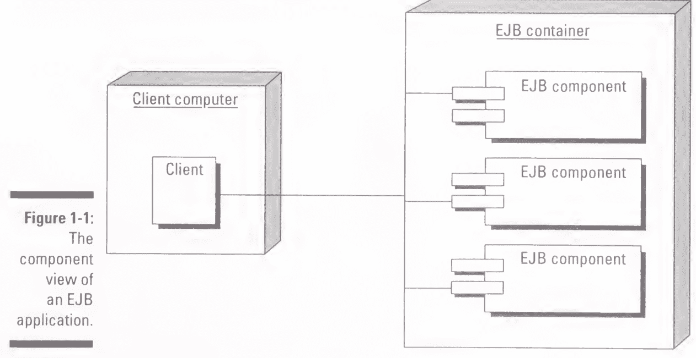

## EJBs：仅用于分布式应用程序吗？

分布式应用程序是同时在多台计算机上运行的程序。分布式应用程序中的每台计算机都提供整个应用程序行为的一个子集。企业 JavaBeans 专为构建分布式应用程序而设计，并且非常适合执行此任务。一些人认为企业 JavaBeans 仅用于分布式应用程序。我听过关于这个问题的相反观点。我投反对票；EJBs 并非仅用于分布式应用程序。

虽然实现分布式计算无疑是 EJB 方法的一个关键特性，但分布式计算并不是 EJB 应用程序唯一要完成的任务。EJB 应用程序还为业务应用开发者提供各种完全独立于分布式计算问题的服务。这些功能包括事务和安全服务，无论应用程序是否是分布式的，它们都应该是所有业务应用考虑的因素。你不应该觉得因为不打算创建分布式应用程序就不能利用这些功能。

此外，你不应该仅仅因为你能够，就把你的 EJB 应用程序变成分布式应用程序。使用 Java 实现分布式计算需要一种称为远程方法调用的技术。每当 EJB 应用程序与位于不同 Java 虚拟机（JVM）的客户端通信时——即使 JVM 位于同一台计算机上——该应用程序就使用了 RMI。在系统资源消耗方面，RMI 的执行成本比本地 Java 程序通信高出几个数量级。RMI 成本高昂是因为当你使用 RMI 将一个对象从一个 JVM 传递到另一个 JVM 时，计算机必须复制整个对象并将其发送到远程计算机，远程计算机在能够处理之前必须先重建该对象。在 Java 中，本地通信允许你通过引用传递对象，这意味着在方法调用中传递的只是对象的引用，而不是对象本身。

好消息是 EJB 应用程序不必使用 RMI。在你阅读本书的过程中，我将向你展示可用于确保你的 EJB 组件使用本地通信以提高其性能的技术。


在 EJB 应用程序中实现业务服务与在任何其他 Java 应用程序中实现它们差别不大。这其中没有秘密或魔法。在我回顾本书中每种类型的 EJB 组件时，我将提供关于在该类型组件中定义业务方法的额外信息。

## EJB 容器的职责

EJB 容器负责为你的 EJB 程序提供许多服务。EJB 容器必须提供的服务由企业 JavaBean 规范规定。这意味着你可以将你的 EJB 部署到任何符合规范的容器中，并获得所有必需服务的好处。这些服务包括以下关键特性：

- EJB 容器为你的 EJB 组件和客户端应用程序之间的远程和本地通信提供支持。这是以对你几乎透明的方式完成的，因此你在开发 EJB 组件时不必担心其实现方式。
- EJB 容器为 EJB 组件提供池和缓存服务。池是未使用的 EJB 组件的存储库，按需提供给客户端。缓存是分配给客户端程序但当前未使用的 EJB 组件的存储区域。这些服务在为客户端程序提供高性能服务的同时，最小化了 EJB 容器的内存需求。
- EJB 容器必须为 EJB 程序提供安全服务。部署应用程序时，你可以根据规范中规定的指南配置这些服务，但无需执行任何特殊编程即可使用它们。
- EJB 容器必须为 EJB 程序提供事务服务。事务定义了必须作为一个整体要么全部成功、要么全部失败的工作单元。事务可以包含许多 EJB 程序，包括驻留在远程计算机上的 EJB 程序。EJB 容器的事务特性可以在部署 EJB 应用程序时进行配置，但作为 EJB 开发者，你几乎不需要或根本不需要进行特殊编程。
- EJB 容器在你的 EJB 组件和外部数据源（如数据库）之间提供透明集成。作为开发者，你不必管理数据库中数据的存储和检索，尽管如果适合你的需求，你可以选择这样做。

EJB 容器根据你定义的规则提供这些和其他功能。这被称为声明式编程。声明式编程是一种允许你在 XML 格式的文档中声明所需服务的机制。这个 XML 文档称为部署描述符，它与你的 EJB 应用程序一起部署。服务器读取部署描述符，并根据你声明的规则自动实现你请求的服务。因此，实现这些服务的复杂性被完全隐藏，同时你保留了配置 EJB 应用程序以满足需求的能力。


虽然 EJB 规范定义了你可以在部署描述符中修改的许多选项，但它并不禁止 EJB 容器供应商创建自己的自定义部署描述符以扩展现有配置选项或添加新选项。所有容器供应商都提供对部署描述符的扩展；他们使用这些扩展将通用的 EJB 部署描述符连接到特定于容器的服务。虽然这些扩展通常是必不可少的，但它们不是标准的，也不是可移植的。EJB 组件开发者不负责处理特定于容器的部署描述符扩展。这项工作通常保留给具有管理 EJB 容器专业知识的人员。

## 心理剖析 EJB 组件

Enterprise JavaBeans 可能拥有简单的 API，但由于每个 Enterprise JavaBean 实际上由三个独立的类组成，因此它们向 EJB 组件程序员呈现出多面性。作为 EJB 组件程序员，你有责任为每个开发的 EJB 创建这三个类。将这三个部分视为 EJB 组件的“分裂人格”，你必须将它们整合为一个协调的整体。

现在，是时候进行现实检验了。如果你不确定“类”的定义，那么你还不具备开发 EJB 应用程序的能力。要成为一名高效的 EJB 应用程序开发者，你应该对 Java 语言的基本概念和语法有相当好的理解。你可以从 Barry Burd 所著的 Java 2 For Dummies 中学习一些。

图 1-2 提供了图 1-1 最初展示的组件模型的更详细视图。

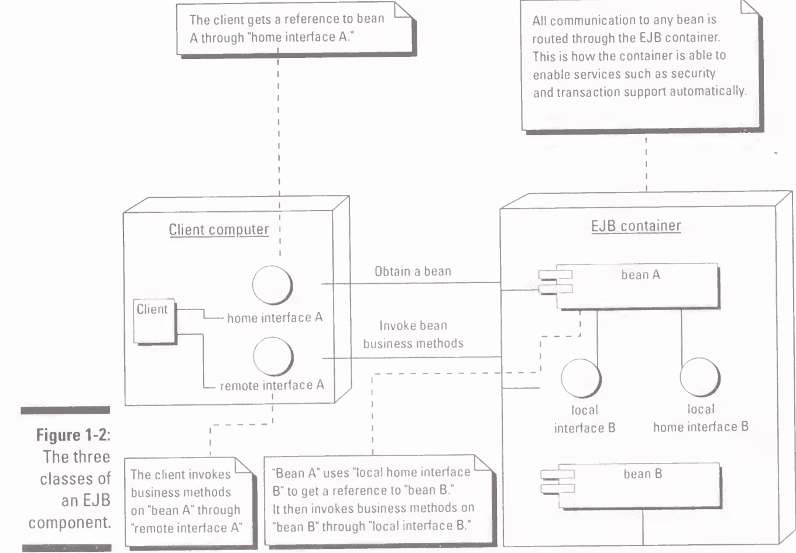

根据此详细信息，你可以看到构成 EJB 组件的不同类的物理布局，如下所示：

- Bean 是向客户端提供服务的实际提供者。该类提供所有业务服务方法，并实现与 EJB 容器交互所需的方法。根据你使用的 Bean 类型，EJB 容器可能会将此组件存储在池或缓存中。
- 本地接口是一个协调客户端访问 Bean 的 Java 接口。本地接口是 EJB 组件所需的第二个类。客户端通过本地接口请求 Bean 来获得访问权限。这反过来向 EJB 容器发送一条消息，以创建或检索 Bean 并使其可供客户端使用。EJB 应用程序的两种本地接口类型是远程本地接口（通常简称为本地接口）和本地本地接口。远程本地接口用于驻留在不同 Java 虚拟机（JVM）上的客户端应用程序——可能在不同的计算机上。本地本地接口用于驻留在同一 JVM 上的客户端应用程序。
- 远程接口是客户端通过它调用 Bean 上的业务方法的 Java 接口。客户端实际上从未拥有 Bean 的副本，因为 Bean 始终存在于 EJB 容器中。客户端确实拥有接口的副本，并且可以通过该接口使用 Bean 提供的方法。远程接口为客户端提供对 EJB 业务方法的访问，同时隐藏 EJB 容器提供的所有系统服务的详细信息。

图 1-2 中的本地接口是远程接口的近亲。它为与 EJB 组件位于同一 Java 虚拟机（JVM）内的客户端提供对业务方法的访问，这对于其他 EJB 需要与本地 EJB 组件交互时非常有用。本地接口和远程接口统称为组件接口。EJB 组件的组件接口是所需的第三个类。

## 审查 EJB 类型

目前，有四种类型的 Enterprise JavaBeans。每种类型在完整的 EJB 应用程序中扮演着独特的角色。创建 EJB 组件时，你需要实现一个适合你需要执行的任务类型的组件。此处概述了为每种类型的 EJB 组件设想的用途：

- 无状态会话 Bean 是用于实现可以在单个步骤中完成的过程的 EJB。它们被称为无状态，因为它们无法在从一次方法调用到下一次调用之间记住有关客户端程序的信息。无状态会话 Bean 的一个很好的例子是向银行账户存钱的 Bean。该 Bean 提供的服务 a) 可以在单个步骤中完成，并且 b) 不需要从一次调用到下一次调用记住任何内容。无状态会话 Bean 表现出以下特征：
  - 无状态会话 Bean 与使用它们的客户端之间存在一对一的关系。因此，每个客户端都有自己的无状态会话 Bean。
  - 无状态会话 Bean 在不使用时被池化。在每次客户端调用后，无状态会话 Bean 被清理并返回到可供下一次客户端调用使用的 Bean 池中。
  - 无状态会话 Bean 不会在调用之间保留任何状态。状态是存储在 Bean 内部的数据。在每个客户端完成使用 Bean 后，状态将被丢弃。
- 有状态会话 Bean 是用于实现需要客户端和 EJB 之间进行多步对话的过程的 EJB。它们被称为有状态，因为它们可以记住客户端应用程序在多次方法调用之间提供的信息。有状态会话 Bean 的一个很好的例子是购物车；客户端应该能够将任意数量的不同书籍添加到购物车中，并且每个客户端都应该有自己的购物车。有状态会话 Bean 表现出以下特征：
  - 客户端和有状态会话 Bean 之间存在一对一的关系，这意味着每个客户端都有自己的有状态会话 Bean。
  - 有状态会话 Bean 用于处理与给定客户端的多步交互。为了实现这一点，会话 Bean 的状态在来自客户端的多次调用之间得以保留。
  - 有状态会话 Bean 可能会被客户端在客户端调用之间缓存。这会将会话 Bean 从服务器的内存中取出，为其他正在积极使用的会话 Bean 腾出空间。
- 实体 Bean 是用于表示应用程序中的业务数据（如银行账户）的 EJB。实体 Bean 共享以下特征：
  - 实体 Bean 与存储在数据库或其他持久存储中的信息相对应。持久存储是任何可以在计算机关闭后仍能保留数据的存储位置。（例如，磁盘文件或数据库。）
  - 实体 Bean 有一个客户端可用于查找它的主键。主键是唯一标识一个实体 Bean 的值。当客户端需要与特定的实体 Bean 交互时，可以使用主键查找该实体 Bean。例如，如果你想将钱存入你的银行账户，你需要某种方法来找到你的账户，而不是将钱存入任何其他账户。主键允许你找到你的账户。
  - 多个客户端可以访问和使用同一个实体 Bean。
  - 当实体 Bean 未被使用时，其状态会保留在持久存储位置，Bean 被返回到池中。当实体 Bean 被使用时，它可以在调用之间被缓存。当实体 Bean 被缓存时，它被存储在临时位置。
- 消息驱动 Bean（MDB）是 EJB 架构中最新的成员。这些 Bean 与其他 EJB 根本不同，因为它们没有本地接口或远程接口。MDB 用于与 Java 消息服务（JMS）集成，JMS 是一种允许客户端向你的 EJB 组件发送命令而无需一直等待响应的服务。例如，你可能需要告诉你的 EJB 应用程序为银行的所有客户生成银行对账单，但你不想坐在那里等着任务完成（很无聊），所以你只需通过 JMS 发送一条消息。MDB 被称为 JMS 消息消费者，这意味着它们监听来自 JMS 服务器的消息。当消息被发送时，MDB“消费”该消息并执行你定义的一组操作。


在设计 EJB 应用程序时，请务必调整设计以符合四种不同 EJB 的角色。

## 定义 EJB 开发者的角色

EJB 架构旨在成为一个高度灵活、健壮且模块化的系统，用于创建业务应用程序。说到模块化，EJB 规范的创建者设想，EJB 应用程序的创建将涉及许多不同的开发者，每个开发者将其专业技能应用于一个明确定义的角色集合。这些角色包括：

- **EJB Bean 提供者**：Bean 提供者负责创建 EJB 组件，并在部署描述符中定义这些组件的一些特性。有关部署描述符的更多信息，请查看前面的章节“EJB 容器的职责”。
- **EJB 应用程序装配者**：应用程序装配者负责从各种来源获取 EJB 组件，并将它们组合成一个完整的包。此任务主要涉及定义部署描述符 XML 文件的许多属性。
- **EJB 部署者**：部署者是 EJB 容器的管理员。部署者的职责是将应用程序（由应用程序装配者组装）部署到特定的服务器，然后管理该服务器。
- **EJB 容器提供者**：容器提供者是开发 EJB 容器的组织。有多个供应商提供 EJB 容器。
- **EJB 服务器提供者**：通常与 EJB 容器提供者是同一实体，服务器提供者是系统服务的专家——例如事务管理、安全和其他由 EJB 容器提供的服务。


由于本书的内容主要集中在满足 EJB 组件开发者和应用程序装配者的需求，因此本书中不会包含关于创建 EJB 容器或 EJB 服务器的信息。此外，部署者的职责专属于特定的 EJB 容器，因此超出了本书的范围。要获取有关部署 EJB 应用程序的更多信息，您需要参考所使用的 EJB 容器附带的文档。

## 决定 EJB 是否适合您

Enterprise JavaBeans 并非应用程序编程的终极解决方案。这并不意味着您不会发现它们极其有用；如果您需要它们，它们非常出色。我的意思是，EJB 并不适用于每一种应用程序。在决定 EJB 是否适合您时，请考虑以下几点：

- **您的应用程序是否需要分布式？** 分布式应用程序是同时存在于多台计算机上的应用程序。由于 EJB 隐藏了不同计算机之间通信的复杂性，它们非常适合此类应用程序。


- **您是否需要开发完全独立于数据库或其他持久存储的应用程序？** 这是第三方应用程序供应商的典型场景，他们为后台系统提供应用程序——包括金融应用程序、供应链管理和销售点系统。EJB 非常适合此场景，因为它们可以被开发为完全与数据库无关，允许您根据客户的需求更换数据库。

- **您是否需要开发易于与业务合作伙伴集成的应用程序？** 这类应用程序的例子包括企业对企业（B2B）应用程序和供应链集成应用程序。

- **您是否需要利用 EJB 容器提供的服务来最大化您的业务应用程序的性能和灵活性？** EJB 容器为您的业务应用程序提供了许多好处，并隐藏了开发可靠、有效的业务应用程序的许多复杂性。如果您寻求安全、事务管理、对象池和缓存以及与数据库轻松集成的好处，那么 EJB 模型是一个很好的方法。

如果您对上述任何问题的回答是“是”，那么 EJB 应用程序可能非常适合您的需求。如果您对任何问题的回答都不是“是”，那么在追求开发 EJB 应用程序之前，您应该仔细考虑。如果您不需要 EJB 应用程序的服务，您就是在为应用程序增加很多复杂性，而回报甚微。

虽然 EJB 应用程序通常与 Servlet 或 JSP 应用程序集成，但也可以在没有 EJB 应用程序服务的情况下运行 Servlet 或 JSP 应用程序。如果您认为 EJB 不是您的好选择，请考虑将此策略作为在您的应用程序中使用 EJB 的替代方案。

EJB 应用程序提供业务服务和业务数据。它们提供一个接口，通过该接口客户端程序可以与 EJB 容器提供的服务进行交互并从中受益。但是，最终用户无法直接与 EJB 应用程序交互。因此，如果您在业务应用程序中使用 EJB 组件，您还必须利用其他应用程序解决方案。您的选择包括 Servlet 或 JSP 程序——如果您的应用程序是基于 Web 的——或者您可以开发使用 EJB 与中央服务器交互的客户端应用程序。


# 第一部分：Enterprise JavaBeans：初次品尝，再次体验

# 第 2 章

## 实用的 EJB 场景

### 本章内容

- 开发生命周期建议
- 发现本书的运行示例

俗话说，一图胜千言。本章提供了一个贯穿全书的运行示例图，用以说明 EJB 开发的各个方面。我用整整一章来介绍这个示例，有几个原因：

- 最重要的目标是预先处理示例介绍，这样我就不必在 EJB 介绍中混杂大量关于示例的无关解释。
- 本章给了我机会来讨论一些软件开发方法论，这些方法论将帮助您更快地创建更好的 Enterprise JavaBeans。

当您阅读本章时，您将了解 EJB 组件如何协同工作以形成一个有凝聚力的应用程序。如果您正在寻找特定主题的信息，您也会在本章中找到许多内部交叉引用。


如果您是非线性阅读者，本章是一个很好的起点。只需找到您感兴趣的主题，并按照交叉引用找到涉及您主题的章节。

## ATM 场景

ATM 场景是 EJB 示例解决方案中的热门选择。自动柜员机因其许多原因适合 EJB 开发：

- 几乎每个人都使用过 ATM 机。它已融入我们的生活，使得普通人都能接触到。这意味着我可以花时间讨论 Enterprise JavaBeans，而不是示例应用程序。（如果您没有使用过 ATM，请寻求专业帮助。）
- ATM 操作是事务性的，这意味着您执行的每个 ATM 事务在保存更改之前都应成功完成。因此，它们非常适合说明 EJB 应用程序的事务特性。
- ATM 操作需要安全，因此有自然的机会利用 EJB 容器提供的安全服务。
- 标准的 ATM 软件解决方案涵盖了 Enterprise JavaBeans 的所有 API 功能，因此您无需在发现 EJB API 时费力处理人为设计的场景。

本书中的运行示例绝非生产环境质量。它是一个假设的 ATM 场景，用于说明 EJB 开发——而不是说明我在银行应用领域的造诣。事实上，这些解决方案相当简单。所以如果您是银行家，我不想听到抱怨。

## 应用程序视图

本书中使用的 ATM 应用程序实现了有限数量的用例。*用例*描述了用户和计算机系统相互交互的过程。在某些情况下，用例被称为*用户-系统对话*，因为它涉及用户和软件系统之间一组逻辑相关的交互。图 2-1 显示了一个组件图，说明了 ATM 应用程序的结构。本书中 ATM 应用程序的用例包括：

- **从可用账户列表中选择：** 让我们面对现实——作为银行客户，如果您不知道自己的账户是什么，您在这个世界上将寸步难行。
- **向账户存入资金：** 在现实世界中，此步骤涉及将钱信封插入 ATM 机。作为替代方案，我要求您直接将信封寄给我——请只寄现金。我会确保它被妥善使用。
- **从账户中提取资金：** 同样，欢迎您将此请求发送给我。我会进行调查并回复您。
- **在两个不同账户之间转账：** 此操作是说明 EJB 应用程序事务特性的理想方案。毕竟，转账不过是从一个账户取款并存入另一个账户。您正在使用前两个要点中的 EJB 组件来实现此解决方案，同时发现 EJB 应用程序的事务语义。
- **请求账户对账单：** 在这个 EJB 组件中，您将使用消息驱动 bean 的功能来请求并接收您的银行对账单，该对账单将发送到您的电子邮件地址。

与任何真实世界的应用一样，你有多种方法来实现这些用例中描述的目标。本书在这个贯穿始终的示例中涵盖了多种不同的替代方案。以下是你会看到的几个替代方案：

- 尽管 ATM 场景的“纯 EJB 方法”包含几个实体 Bean，但许多公司避免在他们的应用程序中使用实体 Bean。实体 Bean 通常比其他类型的 EJB 组件效率低。在本书中，我将向你展示不使用实体 Bean 就能实现所有前述功能的 EJB 解决方案。
- EJB 容器具有——被称为*容器管理持久性（CMP）*——在不编写任何显式代码的情况下实现 EJB 应用程序与数据库之间所有交互的能力。CMP 的替代方案是*Bean 管理持久性（BMP）*，它要求你显式地编写 Bean 与数据库之间的所有交互代码。你将在 ATM 应用程序的上下文中回顾这两种方法。

# 第一部分：Enterprise JavaBeans：初次品尝，再次回味

- EJB 应用程序是纯粹的*服务器端*应用程序解决方案。这意味着它们完全驻留在应用程序服务器上，与最终用户没有直接交互。这也意味着你可以实现不同类型的客户端应用程序。*客户端应用程序*提供一个接口（通常是图形用户界面），允许用户与 EJB 应用程序交互。你将研究一些好策略，以 EJB 应用程序为模型，在你实现的客户端应用程序类型中保持灵活性。

> 当你查看图 2-1 中的组件图时，你可能会回忆起每个 EJB 都应该有一个用于在服务器上查找 EJB 引用的本地接口。为了避免让你的大脑在一个地方过度紧张，我没有在组件图中显示本地接口。（那些大脑伸展纹现在可不流行了。）只要记住，除了消息驱动 Bean（MDB），每个 Enterprise JavaBean 都必须有一个本地接口。

## 有状态会话组件

有状态会话 Bean 用于执行需要多个步骤的任务。*状态*相当于有状态会话 Bean 为了执行所需任务而累积的信息。举个实际的例子，考虑 ATM 场景：当你使用 ATM 将资金从一个账户转移到另一个账户时，你必须经过几个屏幕。每个屏幕可能记录与转账过程一步相关的信息，以下是所需步骤：

1. **选择源账户。**

   状态是源账户的账户号码。

2. **选择目标账户。**

   状态是目标账户的账户号码。

3. **指定转账金额。**

   状态是从源账户转移到目标账户的金额。

> 为了让转账过程正常工作，在三个步骤中捕获的状态必须保留，直到所有信息都被捕获。只有这样，转账过程才能完成。这使得这个解决方案非常适合有状态会话 Bean。

在我为本书开发的 ATM 应用程序中，有一个有状态会话 Bean——一个通用的`ATMTransaction` Bean，它代表使用 ATM 完成一个事务的过程。我在第 5 章专门讲解了有状态会话 Bean 的开发。

## 无状态会话组件

无状态会话 Bean 是不需要在客户端交互之间保持状态的软件组件。举个例子，考虑一项诸如提取资金的活动。提取资金可以在单个步骤中完成。只需告诉 Bean 从特定账户提取特定金额就完成了。因为该 Bean 不必为客户端稍后参考保留关于该操作的任何信息，所以它可以用无状态会话 Bean 轻松建模。

本书中的 ATM 示例有两个无状态会话 Bean：一个`WithdrawBean`和一个`DepositBean`。你可以在第 4 章找到更多关于无状态会话 Bean 的信息。

## 业务实体组件

实体 Bean 是用于表示业务数据的软件组件。实体与会话 Bean 不同，因为实体 Bean 描述的是*事物*，而会话 Bean 代表*过程*。示例 ATM 应用程序有三个实体 Bean：一个`AccountHolderBean`描述持有账户的人，一个`AddressBean`描述账户持有人的地址，以及一个`AccountBean`包含关于账户持有人银行账户的信息。

使用实体 Bean 是一个相当广泛的主题。我在本书的几章中专门讲解了实体 Bean：

- 第 6 章涵盖了使用*容器管理持久性（CMP）*开发实体 Bean 的基础，这意味着 EJB 容器协调实体 Bean 中数据的存储和检索。
- 第 7 章涵盖了新定义的 EJB 查询语言（EJB QL），它与 CMP 一起使用以支持查找实体 Bean。
- 第 8 章涵盖了使用*Bean 管理持久性（BMP）*处理实体 Bean 的所有基础知识，这意味着实体 Bean 自行协调其数据的存储和检索。

## 消息驱动 Bean 组件

消息驱动 Bean（MDB）是 EJB 2.0 规范中新增的一部分，旨在执行 EJB 客户端无需等待任务结果的任务。此类任务被称为*异步*的，因为 EJB 客户端与 EJB 之间的活动不是同时发生的。相反，客户端会说：“去做这个，同时我做别的事情。”当一个请求可能需要很长时间来处理，并且客户端不关心任务的结果时，MDB 非常有用。

示例 ATM 应用程序只有一个 MDB：`StatementMessageBean`。`StatementMessageBean`创建银行对账单并将其通过电子邮件发送给`AccountHolder`。因为 ATM 客户端不应等待此过程完成，所以 MDB 是生成和发送银行对账单的理想解决方案。

你将在第 9 章和第 10 章找到关于消息驱动 Bean 的完整介绍。第 9 章提供了你所需的 Java 消息服务（JMS）背景知识，这是使用 MDB 的必要前提。第 10 章深入探讨创建 MDB 的主题。如果你掌握了适当的背景信息（我在第 10 章中提供），这些 Bean 使用起来会非常简单。

这里有一个安全提示：在提供对 MDB 的访问之前，要求你的 EJB 客户端向 EJB 容器进行身份验证。这确保了客户端在未标识自己的情况下无法生成大量的 MDB 任务。如果你不要求身份验证，恶意用户可能通过快速生成数千或数万条消息供服务器处理，从而对你的 EJB 容器发起拒绝服务攻击。如果你要求用户进行身份验证，并且监控 EJB 应用程序的使用情况，你可以通过禁用用户账户来阻止此类攻击。

## 整合起来

EJB 应用程序不仅仅涉及编写 EJB 组件。你还需要为每个 EJB 组件定义*部署描述符*（向容器描述 EJB 组件），并将你的 EJB 组件打包在*EJB-JAR 文件*（包含所有 EJB 组件和部署描述符的文件）中。ATM 应用程序需要有一个部署描述符来描述其各种组件并声明使用 EJB 容器服务（如安全和事务服务）。它还需要被放入 EJB-JAR 文件中，以便可以部署到 EJB 容器。

好消息是我在本书中涵盖了所有这些主题。以下是找到你需要解决这些问题的章节的指南：

- 第 11 章涵盖了 EJB 组件的打包以及从 Bean 提供者角度定义 EJB 部署描述符。如果你的职责之一是创建 Enterprise JavaBeans，你将想看看这一章。
- 第 12 章紧接第 11 章，研究名为 Java 命名和目录接口（JNDI）的服务，EJB 组件需要通过该服务相互通信。

第 13 章介绍了 EJB 应用程序的组装，并探讨了 EJB 部署描述符中在 EJB 应用程序部署时定义的各个元素。如果你负责将各种 EJB 组件组装成一个完整的应用程序，那么本章正适合你。

你将在第 14 章找到关于 EJB 事务管理的大量内容。*事务管理*在 EJB 中通过 XML 实现，虽然从语法角度来看相当简单，但各种事务决策的影响可能很快变得复杂。第 14 章将深入探讨各种事务场景，并说明在 EJB 应用程序中可以做出的不同事务选择所带来的影响。

第 15 章专门介绍经常被忽视的安全问题。本章在创建 EJB 应用程序的背景下介绍安全主题。

第 16 章探讨创建 EJB 客户端的策略。虽然本书并不打算成为创建 EJB 客户端应用程序的权威参考，但我在本章中包含了一些示例，以在开发过程中起到指引作用。

## EJB 开发策略建议

本书无意成为软件开发实践的权威参考，我也无法保证阅读本书能让你的项目免于遇到问题。尽管如此，我想分享一些能帮助你保持正确方向的技巧。这些并非原创想法，但我在实践中使用过，它们被证明是行之有效的。

### 定义适当的范围

你创建的每个 Enterprise JavaBean 都应该代表一个*原子工作单元*——要么是一个完整的业务流程，要么是一个完整的实体。原子工作单元是代表单一工作单位的实体或流程。在设计 Enterprise JavaBean 组件时，请应用*原子性*原则。

决定如何应用原子性原则可能很困难。为了帮助你判断一个工作单元是否真正具有原子性，请问自己以下问题：

- **我正在创建的 EJB 的部分内容是否可在不同上下文中复用？** 如果 EJB 可以被细分，使其部分在其他上下文中可复用，那么你可能定义得过于宽泛了。
- **如果我需要撤销此 EJB 中的部分工作，是否还必须撤销另一个 EJB 中的工作才能使应用程序恢复到一致状态？** 如果两个或多个 EJB 之间存在显式依赖关系，那么你可能将 EJB 定义得过于狭隘了。你可以考虑将它们合并为一个实体。

在某些情况下，你可能会发现原子隐喻并不适用于某个特定任务。如果你有一个业务流程需要 EJB 客户端和 EJB 服务器之间进行多步对话，并且服务器必须在对话的每一步之间记住数据，那么使用*分子*隐喻来思考这个过程可能更为方便。此类对话式任务非常适合有状态会话 Bean。请记住，虽然多步流程是可以的，但如果一个 EJB 组件服务于多个目的，它应该被细分为更多的 EJB 组件。

### 寻求复用 EJB 的机会

Enterprise JavaBeans 是基于组件架构的一部分，这意味着每个 EJB 组件都应在各种上下文中可复用。创建可复用 EJB 的第一步是在前一节中介绍的原子性原则。但在此之后，请务必通过在不同上下文中复用它们来最大化所有小型原子 EJB 组件的效益。

当你需要组合多个 Bean 来完成一个更大的工作单元时，通常可以找到复用的机会。例如，考虑本书中的示例 ATM 应用程序，它有两个任务（存款和取款），可以组合起来实现转账（转账需要从一个账户存款并从另一个账户取款）。

### 谨慎选择你的 EJB 工具

对于使用 Enterprise JavaBeans 必须执行的每项任务，你有四种类型的 EJB 可供选择。本书中我更详细地介绍了如何决定哪些组件适用于哪些用途，但以下是一些可以应用于决策的基本准则：

- 当你有一个可以通过单步完成的任务——且不需要 EJB 客户端和 EJB 服务器之间的多步交互时，使用**无状态会话 Bean**来实现解决方案。无状态会话 Bean 是纯粹意义上真正的原子工作单元。
- 仅当你的任务需要 EJB 客户端和 EJB 容器之间的多步对话时，才使用**有状态会话 Bean**。请记住，该对话还应要求在流程的每个部分之间保持状态。如果你可以通过多个无状态会话 Bean 完成相同的任务，那就这样做。无状态会话 Bean 比有状态会话 Bean 更高效。
- 使用**实体 Bean 来表示应用程序中的数据。**不要使用实体 Bean 来表示业务流程；你应该仅使用实体 Bean 来表示数据。
- 使用**消息驱动 Bean 来执行异步任务。** *异步任务*是客户端可以启动但无需等待响应就可以继续下一步的任务。例如，如果你有一个销售应用程序在数量低于给定水平时触发重新订购流程，触发重新订购的客户端无需等待重新订购流程完成就可以完成订单。与之相对的是*同步任务*，客户端必须等待任务完成才能继续执行下一个任务。

### 是否使用实体 Bean

实体 Bean 受到了来自多个不同阵营的批评，尤其是在 EJB 1.1 规范期间。这些 Bean 最初的愿景是作为数据的平台无关视图，这意味着从技术上讲你可以使用任何类型的数据库来存储 EJB 组件，并且可以在不更改 EJB 应用程序中任何代码的情况下更换数据库。不幸的是，这种模型并不适用于所有应用程序，而且有时会以较高的性能代价为代价。不要觉得仅仅因为 EJB 存在就必须使用它们。在决定实体 Bean 是否适合你时，请考虑以下选项：

- 如果你正在开发用于转售的应用程序，实体 Bean 是一个很好的选择。你可以在不知道客户使用何种数据库的情况下开发实体 Bean，从而最大化应用程序的灵活性。
- 如果你期望有多个 EJB 客户端同时使用相同的数据，实体 Bean 可能会使你的应用程序受益，因为单个实体 Bean 可以在多个 EJB 客户端之间共享。

在多个客户端之间共享单个实体 Bean 是有益的，因为它限制了应用程序与数据库之间的连接数量。从应用程序性能的角度来看，与数据库交互是一个非常昂贵的过程。限制 EJB 应用程序与数据库之间所需的交互量可能会显著提高性能。

- 如果你正在基于现有数据库构建 EJB 应用程序，实体 Bean 可能不是一个好的选择。你现有的数据库可能代表着一笔重要的投资，你会希望将其利用到 EJB 应用程序中。将数据库逆向工程为实体 Bean 可能非常困难——而且收益甚微。

实体 Bean 最重要的优化考虑之一是确保你的应用程序服务器有足够的内存来在任何给定时间将所有正在使用的实体 Bean 保存在内存中。当应用程序服务器内存不足时，它会开始将实体 Bean 缓存到磁盘。这样做意味着下次请求时必须从缓存中检索它们，这比从内存中访问要慢得多。

# 第 3 章

## EJB 技术内幕

### 本章内容

- 一个简单的 EJB 示例
- 探究 EJB 技术的基本构成要素
- 发现 EJB 组件背后的设计模式


如果你和我一样，征服一项新技术有两个重要步骤：先发现你需要做什么；然后发现为什么需要这样做。就 Enterprise JavaBeans 而言，*做什么*指的是 EJB API；*为什么*指的是使 EJB 技术得以运作的 Java 技术原理。本章旨在阐明 EJB 何以如此设计的原因。为此，我将审视 Java 语言的技术基础——正是这些基础使 EJB 成为可能，同时还将展示 EJB 组件中使用的一些设计模式。

开始接触新技术的最佳途径是从简单的东西入手。而没有什么比无处不在的 Hello World 应用程序更简单的了，在这个程序中，你创建一个会说"Hello World!"的 EJB。通过 Hello World 应用程序，你有机会了解 Enterprise JavaBeans 的运行机制。我在本章专门讨论可应用于几乎所有 Enterprise JavaBeans 的通用原则。这是所有 EJB 新手的训练营，你会发现本章中的原则为本书其余部分奠定了基础。


请注意，我说的是这些原则适用于*几乎所有* Enterprise JavaBeans。例外情况是消息驱动 bean，这是一种特殊情况。要了解原因，请参阅"消息系统与消息驱动 bean"一节。

## EJB 技术基础

EJB 技术的开发最初旨在实现两个基本目标：

- 提供一种简单的方式来创建 Java 分布式应用程序。*分布式应用程序*是可以在多台不同计算机上同时运行，并能通过网络进行通信的程序。这意味着你有一个应用程序同时在许多不同的计算机上运行。
- 简化应用程序组件的编写，这些组件能够利用容器中实现的各种服务（如安全性和事务支持）。由于这些服务由容器提供，EJB 程序员不必成为万事通。相反，程序员可以专注于解决客户的需求，将所有应用程序服务的复杂性留给 EJB 容器开发者处理。

随着 EJB 2.0 规范的推出，第三个重要目标被确定下来——性能。虽然 EJB 应用程序被设计为分布式的，但实际上，许多 EJB 组件往往位于同一台计算机上。在 EJB 2.0 规范中，引入了新的特性来优化位于同一台计算机上的 EJB 之间的通信。

通过一个 illustrative 示例更容易理解 Enterprise JavaBeans 的工作原理。不深入创建 EJB 的细节，我使用的示例是 Hello World EJB，如图 3-1 所示。Hello World 应用程序的源代码可在 Enterprise JavaBeans For Dummies 网页（`www.dummies.com/extras/ejbfd`）上找到。

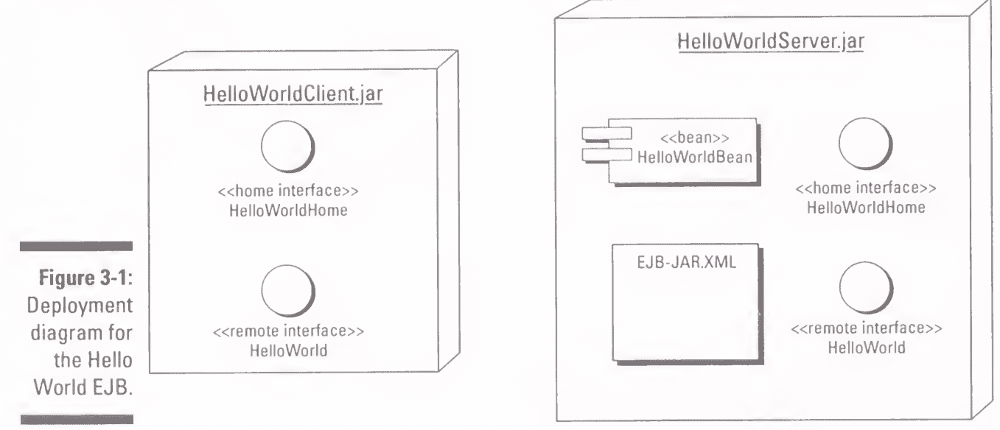

在继续之前，请注意图 3-1 中展示的以下几点：

- Enterprise JavaBeans 部署在两个文件中。两个文件都称为 JAR 文件，我可不是在说你母亲的饼干罐。JAR 文件只是将其他文件打包在一起的集合，这样你可以方便地移动它们。
  - 客户端 JAR 文件（图 3-1 中的 `HelloWorldClient.jar`）包含客户端需要对 EJB 组件进行引用所需的接口。
  - 服务器 JAR 文件（图 3-1 中的 `HelloWorldServer.jar`）包含客户端接口、bean 组件以及一个 `ejb-jar.xml` 文件，即部署描述符。EJB 容器需要所有服务器文件来运行 EJB 应用程序。
- 虽然 EJB 被称为组件，但每个 EJB——消息驱动 bean 除外——都由三个独立的类组成：
  - bean 是驻留在 EJB 容器内部并实现所有业务方法的部分。
  - home 接口供 EJB 客户端用来在 EJB 容器中创建或查找 bean 组件。home 接口既部署到 EJB 服务器，也部署到 EJB 客户端。
  - remote 接口供 EJB 客户端用来执行位于 EJB 容器中的 bean 的业务方法。
- `ejb-jar.xml` 文件和供应商特定的 XML 文件提供 EJB 容器命名 bean 所需的信息。文件名 `ejb-jar.xml` 是部署描述符的官方文件名，这是每个 EJB 应用程序的必需特性。EJB 容器可能需要一个额外的 XML 文件来初始化容器特定的服务。

## Java 命名与目录接口简介

正如你在图 3-1 中看到的，EJB 组件完整地部署到 EJB 服务器，但只有 EJB 组件的接口部署到 EJB 客户端应用程序。为了使客户端应用程序能够使用这些接口，它必须能够访问 EJB 容器中实现这些接口的对象。因此，EJB 客户端的首要任务是定位并获取对 EJB 组件的引用。更准确地说，客户端需要获取 EJB 组件的 home 接口的引用。

Java 命名与目录接口（JNDI）是一项 Java 服务，它为 EJB 客户端提供了查找位于不同计算机上的对象的能力。EJB 应用程序及其客户端以如下方式使用 JNDI：

- EJB 容器在 JNDI 中注册对 EJB 组件的 home 接口的引用。此引用具有一个由 EJB 应用程序部署者分配的名称。当客户端请求 EJB 组件的名称时，JNDI 服务器返回对该组件的引用。
- 当客户端应用程序需要使用 EJB 组件时，它向 JNDI 请求该组件的副本。客户端应用程序提供该组件的 JNDI 名称。
- 当 JNDI 服务器收到对某个组件的请求时，它使用客户端应用程序提供的名称查找所请求的组件。当它找到该组件名称时，获取该名称所指向的对象的引用，然后将该引用返回给客户端应用程序。

图 3-2 展示了 JNDI 的实际运作。在图 3-2 中，注意到客户端通过 JNDI 目录服务请求了 home 对象。JNDI 找到该对象并将其返回给客户端。

> 不必担心需要理解 JNDI 背后的所有机制。与 JNDI 交互的大部分工作都由 EJB 容器为你完成。查找并获取 EJB home 对象的引用只需几行简单的代码即可完成，如下所示：

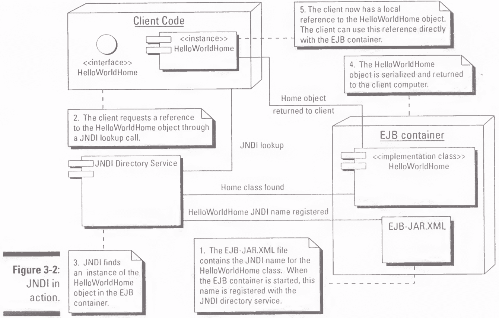

```
 // This method uses JNDI to find a home interface
 public HelloWorld() throws NamingException, RemoteException,
     ClassNotFoundException {

     /* First I get a reference to the JNDI context, which
      * contains the names for all the components registered in
      * JNDI.
      */
     context = new InitialContext();

     /* Next I request the HelloWorldRemoteHome from JNDI. The
      * "ejb/helloWorldEJB" is the name that this EJB component
      * was registered under in JNDI.
      */
     Object obj = context.lookup("ejb/helloWorldEJB");

     /* Finally, I am casting obj to HelloWorldRemoteHome
      * interface. I have to use the
      * PortableRemoteObject.narrow method because reference is
      * to an object that resides on a remote computer, in the
      * EJB container.
      */
     home = (HelloWorldRemoteHome)
       PortableRemoteObject.narrow( obj,
       HelloWorldRemoteHome.class);
 }
```

你可以在 Web 上的 Hello World 应用程序示例中查看完整的 Hello World 解决方案——包括此 JNDI 示例——网址为 `www.dummies.com/extras/ejbfd`。

## 通过 Java 序列化推卸责任

Java *序列化*（serialization）是将 Java 类转换为可存储在磁盘上或通过网络传输的数据的过程。序列化是使 EJB 应用程序成为可能的关键特性之一。序列化的一个优点在于，作为程序员，你只需要告诉 Java 运行时——即运行 Java 程序的程序——你希望某个类是可序列化的。要成为可序列化的，Java 类必须实现 `java.io.Serializable` 接口。

Serializable 接口的妙处在于它没有任何方法。整个过程体现在以下代码片段中：

```
public class SerializableClass implements Serializable {...}
```

您可能会以为 EJB 组件必须实现 `Serializable` 才能参与 Java 序列化。然而，EJB 规范的架构师们已经替您将 EJB 组件变为可序列化的。因此，作为 EJB 组件开发者，序列化的魔力对您来说完全不可见。

## 远程调用方法

由于 EJB 客户端和 EJB 组件通常位于不同的计算机上，并且 EJB 组件的方法实际上位于服务器端（对 EJB 客户端不可见），因此客户端不可能直接在 EJB 组件上执行方法。相反，客户端通过远程接口执行方法。通过一个名为远程方法调用（Remote Method Invocation，RMI）的透明服务，远程接口能够将方法调用传递到服务器——工作在那里执行——然后将结果返回给客户端。RMI 是标准 Java API 中提供的一项服务，也是 EJB 技术的另一个关键支撑。图 3-3 展示了 RMI 技术在幕后发生的一些魔法。

不使用 EJB 容器也可以创建 RMI 应用程序。虽然 RMI 应用程序可以分布在网络中，但它们不会自动提供 EJB 容器中的服务。

在图 3-3 中，您可以看到 RMI 为 EJB 拼图引入了一些我尚未提及的额外部分。您已经知道 EJB 组件由远程接口、本地接口和 Bean 组成。这一视图通过图 3-3 所示内容得到了补充：

- 所有 RMI 解决方案都由存根（stub）组成，也可能包含骨架（skeleton）：
  - *存根（stub）*是位于远程应用程序中的对象，包含帮助它调用*骨架*（见下一点）上方法的服务。在 EJB 应用程序中，EJB 客户端就是远程应用程序。存根的另一个术语是*代理（proxy）*，之所以使用这个术语，是因为存根接收输入并将其中继给骨架。
  - *骨架（skeleton）*是位于本地应用程序中的对象，负责将方法调用转发给本地对象。在 EJB 应用程序中，EJB 容器就是本地应用程序。在纯 Java 2 应用程序中，不需要骨架；相反，存根直接将方法调用转发给本地对象。
  - 当客户端调用存根中的方法时，存根将调用转发给骨架。骨架将方法定向到本地对象，本地对象执行方法并将结果返回给骨架，最终返回给存根。
- EJB 组件中的本地接口必须扩展 `javax.ejb.EJBHome` 接口。反过来，`javax.ejb.EJBHome` 扩展了 `java.rmi.Remote`。EJBHome 对象的实现由 EJB 容器提供，并支持底层的 RMI 通信协议。
- EJB 组件中的远程接口必须扩展 `javax.ejb.EJBObject` 接口。与 EJBHome 接口一样，EJBObject 接口也扩展了 `java.rmi.Remote`。同样，EJBObject 的实现由 EJB 容器提供，并支持 RMI 通信协议。

由于 EJB 客户端只能通过远程接口与 EJB 交互，因此 RMI 过程完全透明，这意味着客户端程序员根本不需要考虑 RMI。事实上，EJB 容器可以通过多种方式实现 RMI。因此，虽然图 3-3 展示了一种可能的实现，但您使用的 EJB 容器可能工作方式不同。

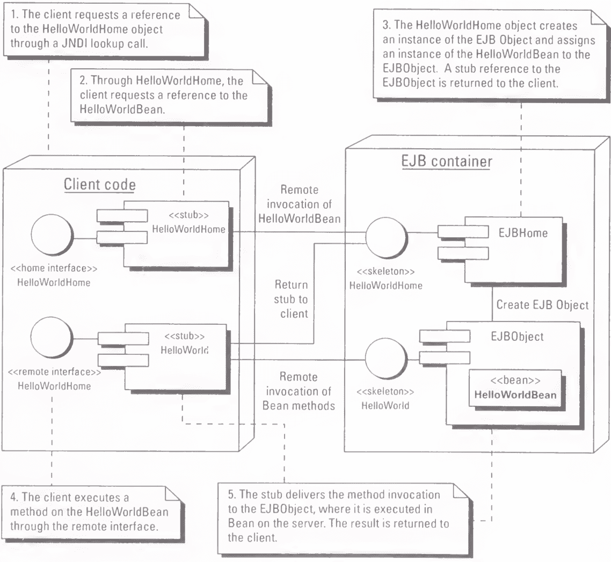

**图 3-3：** RMI 在工作。

1. 客户端通过 JNDI 查找调用请求获取 `HelloWorldHome` 对象的引用。
2. 通过 `HelloWorldHome`，客户端请求获取 `HelloWorldBean` 的引用。
3. `HelloWorldHome` 对象创建 `EJB Object` 的实例，并将 `HelloWorldBean` 的实例分配给 `EJBObject`。`EJBObject` 的存根引用被返回给客户端。
4. 客户端通过远程接口在 `HelloWorldBean` 上执行方法。
5. 存根将方法调用传递给 `EJBObject`，在服务器端的 Bean 中执行。结果返回给客户端。

Client code

EJB container

Remote invocation of `HelloWorldBean`

Return stub to client

Remote invocation of Bean methods

`<<stub>> HelloWorldHome`

`<<home interface>> HelloWorldHome`

`<<stub>> HelloWorld`

`<<remote interface>> HelloWorldHome`

`EJBHome`

`<<skeleton>> HelloWorldHome`

Create EJB Object

`EJBObject`

`<<skeleton>> HelloWorld`

`<<bean>> HelloWorldBean`

此时，您应该已经注意到 EJB 开发中逐渐形成的一种模式；您不需要做很多工作就能利用一些复杂的服务。EJB 容器是一个服务提供者——有点像当地的自来水公司。您通过扩展几个接口（`EJBHome` 用于本地接口，`EJBObject` 用于远程接口）为 EJB 组件铺设管道，而 EJB 容器则提供水。

## 通过本地调用提升性能

随着 EJB 规范的第一个主要版本（1.1 版）发布，Sun Microsystems 的创新者们得以稍作喘息，看看 EJB 技术在行业中是如何使用的。汲取的经验教训为 EJB 2.0 规范带来了许多改进。其中一项改进是增加了对 EJB 组件之间本地通信的支持。

这一支持需求旺盛，因为在实践中，很多 EJB 应用程序并不是分布式的，但它们却被要求依赖 RMI 进行方法调用。关于 RMI 需要记住的一个重要事实是，它是一个劳动密集型的过程。事实上，就性能而言，RMI 比本地通信昂贵得多。虽然 RMI 可以在位于同一 JVM（Java 虚拟机）中的 EJB 之间工作，但它涉及大量本地方法调用所不需要的额外工作。

具体来说，过去为了支持 RMI，本地接口必须扩展 `EJBHome` 接口，远程接口必须扩展 `EJBObject` 接口。为了提供本地通信的设施，EJB 2.0 规范引入了 `EJBHome` 和 `EJBObject` 的两个替代方案：`EJBLocalHome` 和 `EJBLocalObject`。如果您想创建不使用 RMI 的企业级 JavaBean，可以通过让本地接口扩展 `EJBLocalHome` 接口、远程接口扩展 `EJBLocalObject` 接口来实现。

虽然本地方法调用能大幅提升性能，但它也降低了 EJB 应用程序的灵活性。如果您使用本地方法调用，您的 EJB 组件将不能被远程调用。因此，在决定实现哪些接口之前，请考虑您打算如何使用 EJB 组件。如果您预计需要远程通信，请坚持实现 `EJBHome` 和 `EJBObject` 接口。

许多 EJB 容器允许您即使实现了 `EJBHome` 和 `EJBObject` 也能利用本地通信。您看，在幕后，EJB 容器会确定 EJB 调用是否来自本地资源。如果资源是本地的，容器自动支持本地通信。这一切都作为*透明服务*提供给您——您不需要做任何特殊工作，就能获得可能的本地通信。

## 通过回调方法管理生命周期

EJB 容器为您的 EJB 组件提供各种服务，您无需编写任何特殊代码即可利用这些服务。其中许多服务涉及管理 EJB 组件的生命周期事件。例如，有状态会话 Bean 可以存储在 EJB 容器的缓存中，也可以从缓存中检索。将有状态会话 Bean 存储到缓存称为*钝化（passivation）*，而从缓存中检索有状态会话 Bean 称为*激活（activation）*。

激活和钝化是几项任务中的两种，这些任务被称为*生命周期事件*，因为它们标志着 EJB 组件生命周期中的重要动作。虽然服务器自动执行这些动作，但您可能希望在这些及其他 EJB 组件生命周期事件中执行一些特殊操作。为了说明，请考虑 EJB 组件应如何在以下生命周期事件中处理数据库连接：

- 当 EJB 组件被激活时，您可能希望获取数据库连接。组件需要这个连接以便在活动期间与数据库交互。
- 当 EJB 组件被钝化时，您需要释放数据库连接，以便其他活动的 EJB 组件可以使用它。因为数据库连接通常是稀缺资源，您不想因为将 EJB 组件钝化而失去对某个连接的访问。
- 当 EJB 组件被移除时，您需要释放数据库引用，以免它与 EJB 组件一起被销毁。同样，您的数据库连接是稀缺资源，而且从性能角度来说，创建新连接是昂贵的。因此，当另一个组件即将被销毁时，将连接提供给其他 EJB 组件是一个好主意。

在使用实体 Bean 组件时，EJB 容器可以为您管理数据库连接。但是，如果您需要从另一种类型的 Bean 连接数据库，那么您需要使用 EJB Bean 类中称为回调方法的方法来管理数据库连接。*回调方法*是 EJB 容器在 EJB 组件中发生生命周期事件时执行的方法。回调方法在您必须使用 EJB 组件的 Bean 元素实现的接口中定义。要在生命周期事件期间实现自定义行为，您只需在适当的回调方法中提供代码即可。

在我介绍每种可用的 EJB 组件类型时，我会指出回调方法。现在，只需知道它们就在那里供您使用。

# 第一部分：Enterprise JavaBeans：重温初见时的滋味

在你需要为生命周期事件中的某个自定义操作提供支持时使用。


顺便说一句，虽然你必须为特定类型的 bean 实现所有已定义的回调方法，但在正常情况下，你并不需要在那些方法中执行任何操作。在很多情况下，回调方法什么都不做。懂行的程序员为这种什么都不做的方法起了个名字：`no-ops`——即不执行任何操作。

## 通过部署描述符声明你的意图

要利用 EJB 容器提供的服务，意味着你需要告诉 EJB 容器你希望它做什么。告诉 EJB 容器做什么是通过一个名为*部署描述符*（deployment descriptor）的 XML 文件来完成的。对于 EJB 应用程序，EJB 规范定义了一种部署描述符：`ejb-jar.xml` 文件。

部署描述符使用一种称为*声明式编程*（declarative programming）的风格来告诉 EJB 容器 EJB 组件需要哪些服务。然后 EJB 容器向该组件提供这些服务。声明式编程很简单，因为你不需要知道如何实现特定服务；你所要做的只是声明你想要该服务。然后 EJB 容器会处理所有的实现细节。

以下是你可以使用 `ejb-jar.xml` 文件声明的服务类型的简短列表：

- ✓ **组件的 JNDI 名称。** 为了让客户端找到 EJB 组件，它使用 JNDI 根据名称来查找该组件；参见图 3-2。组件的名称在 `ejb-jar.xml` 文件中声明。
- ✓ **组件的事务规则。** 事务支持——确保数据的更改被正确执行——是 EJB 容器向每个 EJB 组件提供的一种服务。每个 EJB 组件可以通过在 `ejb-jar.xml` 文件中声明其需求来选择所需的事务支持类型。更多内容请参阅第 14 章。
- ✓ **组件的安全角色和方法权限。** EJB 容器还向 EJB 组件提供安全服务。`ejb-jar.xml` 文件用于声明 EJB 容器应实现的各种安全角色和方法权限。

除了 `ejb-jar.xml` 文件之外，每个供应商的 EJB 容器可能还有额外的部署描述符，用于配置 EJB 规范范围之外的容器服务。请注意，虽然我在本书中涵盖了开发 EJB 应用程序的所有标准语法和语义，但你还需要了解 EJB 容器的供应商特定信息，以便部署和使用 EJB 应用程序。

## 消息系统和消息驱动 bean

EJB 2.0 规范引入了一种称为消息驱动 bean（MDB）的新型 Enterprise JavaBean。MDB 不同于所有其他 EJB 组件，因为它们没有远程接口或主接口。MDB 之所以特殊，是因为它们被设计为与 Java 消息服务（JMS）API 进行交互。JMS 是一种企业 Java 服务，允许应用程序在消息服务器上发送消息和监听消息。

JMS 与 RMI 类似，因为它促进了客户端和服务器之间的远程通信。区别在于客户端不必等待消息的响应就可以继续执行其业务。事实上，JMS 甚至可以将消息保存在邮箱中，直到 EJB 容器的接收方准备好接收它们。

- 在 RMI 方法调用中，客户端远程调用一个方法，该方法在服务器上执行，方法的返回值被返回给客户端。在服务器完成其任务之前，客户端无法执行下一行代码。由于服务器和客户端的活动是顺序 Serial 发生的，因此这种类型的操作被称为**同步操作**。
- 使用 JMS 时，客户端将消息递送到 JMS 服务器中的主题（topic）或队列（queue）。然后客户端可以继续执行其业务。与此同时，EJB 容器拥有一个订阅 JMS 主题或队列作为监听器的 MDB。当消息被递送时，JMS 服务器将消息转发给 MDB，然后 MDB 可以利用消息中的信息执行某些操作。由于客户端和服务器的活动是同时发生的，因此这种类型的操作被称为**异步操作**。

图 3-4 展示了 JMS 的实际运作。由于我在前面项目符号中指出的 RMI 和 JMS 之间的根本差异，MDB 不需要主接口或远程接口。

### 图 3-4：Java 消息服务示意图

1. 客户端应用程序打开与 JMS 主题或队列的连接。
2. 消息驱动 bean 为 JMS 主题或队列注册一个监听器。
3. 客户端向 JMS 主题或队列发送消息。一旦消息被递送，客户端就可以自由继续执行其他操作。
4. JMS 主题或队列将消息转发给消息驱动 bean，消息驱动 bean 根据消息的内容采取相应行动。

为了让客户端应用程序使用消息驱动 bean，它们必须实现属于 JMS API 的接口和操作。有关 JMS 的更多内容，请参阅第 9 章。我在第 10 章中介绍消息驱动 bean。

## EJB 设计模式

理解 Enterprise JavaBeans 为何以这种方式构建的另一种思路，是将它们视为软件设计模式。*软件设计模式*是针对特定设计问题采用标准解决方案的软件设计。每种软件设计模式都针对特定类型的设计问题，并且既有优点也有代价。最终，设计模式帮助软件开发人员应用经过验证的技术来解决软件开发过程中出现的常见设计问题。

软件设计模式是适用于软件所解决问题的通用设计规则，而不一定适用于特定语言或技术。设计模式可以帮助定义 EJB 技术为何以现有方式构建，而无需深入 Java 语言的技术细节。

## 使用工厂模式组装 EJB

想象一下没有工厂的世界。如果你想要一辆汽车，你必须自己建造它。事实上，你必须从加工所有零件开始。嗯，这对车主来说没什么意义，因为汽车是复杂的机器。同样，某些软件产品如此复杂，以至于需要工厂来创建它们。EJB 组件的实例就是一个很好的例子——它们由工厂为你创建，因为实现 EJB 组件的细节对于像你和我这样的普通程序员来说太复杂了。

你可以通过对主接口执行 JNDI 查找来获取 EJB 主接口的引用，正如我在前面“Java 命名和目录接口简介”部分中讨论的那样。创建 EJB 的下一步是在最适合你需求的主接口上调用构造方法。当你这样做时，该调用会被转发到服务器，在那里 EJB 组件被创建并返回一个引用给 EJB 客户端。创建 EJB 组件的过程可以用一种称为*工厂方法模式*（Factory Method Pattern）的设计模式来描述。

工厂方法模式提供了一种将复杂对象的创建委托给称为*工厂*的特殊类的方式。工厂方法模式中的三个基本角色是：

- **消费者请求创建对象。** 该对象通常称为*产品*。
- **工厂（一个类）接收消费者对对象的请求。** 然后工厂执行一些对消费者不可见的操作，最终返回消费者请求的对象（参见下一点）。工厂类可以有一个或多个称为*工厂方法*的方法，这些方法负责组装产品。
- **工厂创建一个称为*产品*的对象并将其返回给消费者。** 通常，消费者只对产品有一个抽象的概念。在实现中，这意味着消费者通过接口或抽象类来引用产品。工厂能够接受该抽象请求并应用具体的实现细节，从而将具体产品返回给消费者。这里的要点是，工厂可以更改产品的内部实现，而无需修改消费者中的任何代码。

这三点应该类似于获取 EJB 组件引用的过程。在 Enterprise JavaBeans 的情况下，EJB 客户端应用程序就是消费者。EJB 客户端应用程序获取对对象工厂的引用，即主接口。然后客户端应用程序告诉主接口：“为我创建一个 EJB 组件。”在 EJB 应用程序中，工厂方法在主接口中命名为 `create`。主接口可以定义一个或多个 `create` 方法。每个 `create`

就像大多数车主对工厂里制造汽车的过程毫不了解（也不需要了解）一样，EJB 组件开发者也不需要知道 EJB 组件是如何创建的，只需使用它即可。你所需要知道的就是 EJB 容器就像一个工厂。作为消费者，EJB 客户端从工厂请求一个 EJB 组件，工厂则将一个组件返回给客户端。

## 使用代理模式实现分布式

如果你曾经在选举中投过票，你就已经参与过代理过程。选票就是一个代理，代表你的意愿，让你能够影响那些距离太远以至于无法直接参与的决策。如果你认为投票的理念有缺陷，那么想想让所有选民前往权力中心直接参与选举的替代方案吧。结果将会是一片混乱。

正如我们的选举制度从代理的使用中受益一样，EJB 应用程序也从一种叫做*远程代理模式*（Remote Proxy Pattern）的软件设计模式中获益。你从客户端应用程序使用的每个 EJB 都是通过远程接口引用的。尽管你从来没有实现过远程接口，但你却能够调用该接口上的方法——而且仿佛通过魔法一样——位于另一台计算机上的 EJB 组件会代表你执行操作。远程代理模式揭示了这种魔法是如何运作的。

在上一节中，我解释了工厂方法模式如何向 EJB 客户端返回一个产品——即远程计算机上 EJB 组件的引用。这个返回的产品实际上就是一个远程代理。

对于企业级 JavaBean（Enterprise JavaBeans）而言，远程代理实现了远程接口，该接口定义了客户端可能需要调用的所有业务方法。间接地，远程代理还实现了 `javax.ejb.EJBObject` 接口和 `java.rmi.Remote` 接口。根据你使用的 EJB 容器不同，这个远程代理还可能实现额外的接口或定义额外的方法。综合起来，所有这些方法构成了我之前在“远程调用方法”一节中提到过的对象，即 RMI 存根（stub）。

*远程方法调用*（Remote Method Invocation）基本上是远程代理模式的一种实现。RMI 存根就是一个远程代理。虽然你只能在远程代理上调用远程接口的方法，但所有底层方法都在那里帮助远程代理对象将你的方法调用传输到 EJB 容器，并将容器的响应传递给 EJB 客户端。

## 使用对象池模式提高生产力

想象一下，你参加一个有 100 位客人的晚宴，但只有 5 套餐具。如果你想在食物还热的时候吃到饭，我建议你早点到。虽然这个场景听起来很荒谬，但许多软件应用程序的情况与此相差无几。由于内存或处理器能力的限制，你可能无法在 EJB 容器中创建超过每种类型几个的对象。然而，可能有成百上千的用户想要使用那几个对象。你该如何应对这种负载呢？使用*对象池模式*（Object Pool Pattern）。

EJB 服务器利用对象池模式来管理闲置时的无状态会话 Bean 和实体 Bean。*对象池*不过是一组被存储起来、可供任何需要的人使用的对象的集合。收到请求时，从池中取出一个对象并提供给请求者。当请求者使用完该对象后，该对象被清理并归还到池中。这种解决方案带来了以下好处：

- 在 Java 中，创建新对象是一个劳动密集型的过程。当使用对象池时，对象的创建发生在需要该对象之前。然后该对象被存放在能够快速提供的位置。结果是性能的大幅提升。
- 对象池是管理 EJB 容器中内存利用率的有效工具，因为它们防止创建超过你所指定数量的对象。它们还反复重用这些对象。减少-重用-回收，你的应用程序性能上升而内存利用率下降。这很划算。
- 对象池常用于管理稀缺资源，例如数据库连接。因为数据库客户通常根据任何给定时刻的并发连接数被额外收费，对象池允许消费者管理可用的连接总数，从而降低应用程序的总成本。

当对池中对象的需求大大超过池中对象的供给时，池会迫使那些尚未从池中获取对象的人等待，直到有对象可用为止。因此，如果你的池中没有足够的对象来满足 EJB 客户端的需求，你的应用程序性能可能会严重下滑。

## 使用缓存模式保护你的投资

由于 EJB 服务器可以同时为成百甚至上千个客户端提供服务，容器提供一个能够轻松扩展而不会过度占用计算机 RAM 的环境非常重要。为了促进稳健可扩展性的目标，EJB 应用程序实现了一种称为*缓存模式*（Cache Pattern）的内存管理模式。`Cache` 是计算机上的一个存储位置，应用程序可以在不使用时将东西放在那里。

缓存模式定义了一种机制，允许 EJB 容器将客户端不再积极使用的 EJB 组件移动到临时存储系统。缓存管理允许计算机通过获取 EJB 组件并将其存储在磁盘上（通常是在文件中）来释放内存，这样它们可以在下次需要时被访问并恢复。

通过使用缓存模式，EJB 容器可以优化计算机上的内存利用率，并防止或最小化 EJB 服务器消耗过多内存导致计算机崩溃的风险。如果容器需要为新的客户端腾出额外空间，有状态会话 Bean 和活动实体 Bean 可以被 EJB 容器存储在缓存中。

虽然缓存管理对稳定性有益，但对性能不利。将对象存储到缓存中以及从缓存中检索对象的过程是劳动密集型的，可能导致 EJB 容器严重的性能下降。因此，我建议通过确保运行 EJB 容器的计算机拥有充足的 RAM 来最小化对缓存的需求。

顶级的 EJB 容器供应商会提供系统管理工具，使你能够监控系统的缓存利用率。在这方面，管理工具是一项不错的投资，因为它们让你能够监控 EJB 容器的性能，并就对额外 RAM 的需求做出决策。

# 第二部分

## 与会话 Bean 面对面

### 第五波

作者：Rich Tennant

> “我们是来清理代码的。”

### 本部分内容……

在这里，你将探索会话 Bean 组件的创建。作为 EJB 应用程序的主力，会话 Bean 用于实现业务流程和执行操作。在接下来的章节中，你将了解会话 Bean 的工作原理以及创建它们所需的知识。

# 第四章

## 构建无状态会话 Bean

### 本章内容

- 了解无状态会话 Bean 的生命周期
- 研究无状态会话 Bean API
- 识别无状态会话 Bean 开发的注意事项
- 创建你的第一个无状态会话 Bean

无状态会话 Bean——在单步中完成任务的 EJB——可以说是所有 EJB 组件中最简单的。它们对 EJB 组件开发者的要求最低，用于实现非常简单的操作。然而，作为 EJB 开发者，你必须记住关于无状态会话 Bean 的几个重要规则。

无状态会话 Bean 可能会比较棘手，因为 EJBHome 和 EJBObject 接口的定义方式。所有类型的 EJB 组件都实现这两个接口，它们必须足够通用，以支持无状态会话 Bean、有状态会话 Bean 和实体 Bean 所需的方法。由于无状态会话 Bean 非常简单，它们不需要 EJBHome 和 EJBObject 接口定义的所有方法。因此，无状态会话 Bean 中有些方法在被调用时总是会抛出异常。在你阅读本章的过程中，我会指出你需要注意这个问题的时刻。

注意——在定义你自己的类时，定义接口以隐藏对特定实现不相关的方法是一个好主意。你可以简单地通过先定义最窄的接口，然后扩展它以添加更广泛接口的额外方法，如此类推，直到你定义了所有必需的方法。这样做可以消除在不使用且无法使用这些方法的类中实现这些方法所带来的混乱。

## 无状态会话 Bean 生命周期

为了阐明哪些主接口和远程接口的方法与无状态会话 Bean 相关，本章首先简要概述无状态会话 Bean 的生命周期。在此基础上，你将深入了解如何使用远程和本地接口开发无状态会话 Bean。最后，你将学习定义简单的部署描述符并创建一个基本的 EJB 客户端。

无状态会话 Bean 是为实现两个简单目标而设计的 EJB 组件：

- 执行可通过单次方法调用完成的简单任务。
- 能同时被多个客户端共享。这是会话 Bean 无状态的根本原因。

*无状态* 这一术语指的是，无状态会话 Bean 在该客户端的多次方法调用之间无法为 EJB 客户端保存任何信息。无状态会话 Bean 之所以无状态，是因为在每次方法调用之间，Bean 被保存在 EJB 容器的一个共享池中，此过程如图 4-1 所示。

当客户端调用无状态会话 Bean 的方法时，它会从池中被取出，执行该方法，然后立即将 Bean 返回池中。因此，如果你对一个无状态会话 Bean 变量执行两个并发方法，它们很可能由 EJB 容器中不同的 Bean 来处理。

## 何时使用无状态会话 Bean

鉴于 EJB 组件选择的多样性，有时很难决定无状态会话 Bean 是否是你任务的合适工具。几条简单的准则可以帮助你做出这个决定。

首先，考虑你的应用程序需要执行的任务是否能通过单次方法调用完成。请记住，无状态会话 Bean 无法在多次方法调用之间记住特定于客户端的状态。因此，如果手头的任务涉及多个步骤，那么无状态会话 Bean 就不是合适的选择。但如果你能在一步内完成任务，那么始终应使用无状态会话 Bean。

其次，确定你的应用程序执行的过程是否需要同时对多个客户端可见。如果应用程序需要在多个客户端之间共享信息和状态，那么你只有一个选择——实体 Bean。

请记住，无状态会话 Bean 能为你的应用程序提供显著的性能优势。通常，如果你能设计应用程序以最大化地使用无状态会话 Bean，你的应用程序服务器将能更快速地响应客户端调用。

虽然无状态会话 Bean 提供了巨大的性能优势，但它们并非所有任务的合适选择。如果你需要你的会话 Bean 在多次方法调用之间记住由客户端提供的信息，那么你应该使用有状态会话 Bean。

使用无状态会话 Bean 的理想场景是简单任务，例如处理付款、存款或取款。这些任务都有两个共同特征：它们代表动作，并且可以在单一步骤中完成。

## 无状态会话 Bean 的 API

根据你打算如何使用无状态会话 Bean，你可以选择为 Bean 创建本地或远程接口。你也可以自由地同时创建远程和本地接口。请记住，远程接口可以为符合 EJB 1.1 和 EJB 2.0 规范的容器创建，但本地接口仅在符合 EJB 2.0 规范的容器上可用。在接下来的章节中，我将使用我便捷的示例 ATM 应用程序中的 `DepositBean` 来演示创建无状态会话 Bean，同时我将研究无状态会话 Bean 中的每个接口及相关对象。

## 定义 EJB 远程接口

远程接口被需要从远程计算机访问你的 EJB 组件的 EJB 客户端应用程序使用。远程接口建立在 Java 远程方法调用（RMI）API 之上，该 API 支持跨 Java 虚拟机（JVM）的应用程序间通信。在 EJB 1.1 应用程序中，使用远程接口开发 EJB 组件是事实上的标准。

EJB 2.0 规范引入了一组新的客户端接口，称为*本地接口*，它们为同一 JVM 中的客户端提供对 EJB 组件的访问。由于这个新选项，你现在必须决定是开发远程接口还是本地接口。在确定是否应该为你的 EJB 组件实现远程接口时，请考虑以下几点：

- 实现远程接口促进了 EJB 应用程序设计的灵活性。EJB 应用程序传统上是为分布式计算系统设计的，而远程接口对于支持分布式计算至关重要。
- 远程方法调用是通过按值传递语义实现的。*按值传递*意味着远程方法传递的是代表*对象状态*的值，而不是传递一个 Java 对象的*引用*，然后在对象到达目的地时进行重建。
- 作为参数传递或通过远程调用返回的对象必须实现 `java.io.Serializable` 接口。
- 远程方法调用通常比本地接口中的对应方法效率低——因为方法必须被序列化并通过网络传输。


- 实现远程接口可能迫使 EJB 客户端应用程序处理由网络通信问题和远程计算机上的资源状态引起的额外异常。

- 使用 RMI 进行对象强制转换需要使用`javax.rmi.PortableRemoteObject.narrow`方法。此步骤对于 EJB 容器确保允许强制转换操作是必要的。

正如你所看到的，远程通信既有好处也有一些缺点。最终，这个决定是 EJB 组件开发者的责任。一个重要的考虑是，没有什么能阻止你同时实现远程和本地接口。通过同时提供远程和本地接口，你为使用你的 EJB 组件的开发者在决定他们想要使用哪个接口方面提供了灵活性。

## 远程主接口

远程主接口定义了访问 EJB 服务器以请求 EJB 组件引用的方式。远程主接口必须始终扩展`javax.ejb.EJBHome`接口。清单 4-1 展示了`DepositBean`的远程主接口。

### 清单 4-1 DepositRemoteHome 接口

```java
package com.sextanttech.transactions.interfaces;

import javax.ejb.EJBHome;
import javax.ejb.CreateException;
import java.rmi.RemoteException;

public interface DepositRemoteHome extends EJBHome{
    /* This create method defines the only way for the client
         to obtain
     * a reference to a DepositBean.
     */
    public Deposit create() throws CreateException,
            RemoteException;
}
```

正如你在前面的示例代码中看到的，`DepositRemoteHome`接口非常简单。它的唯一目的是返回对 EJB 容器中 EJB 组件的引用。需要牢记的一些关键考虑因素是：

- 无状态会话 Bean 的远程主接口必须定义一个且仅一个不带参数并返回对 Bean 远程接口引用的`create`方法。虽然其他类型的 EJB 组件允许在远程主接口中使用带参数的`create`方法——以及`create`方法的重载——但无状态会话不允许这样做。

- `create`方法必须抛出`javax.ejb.CreateException`和`java.rmi.RemoteException`。EJB 容器使用这两个异常来通知客户端在尝试获取 EJB 组件引用时发生系统级错误的情况。

随着 EJB 2.0 规范的发布，在所有远程主接口的名称中使用后缀 RemoteHome 被认为是一种良好的编程实践。

> 不要在`create`方法中忘记抛出`java.rmi.RemoteException`和`javax.ejb.CreateException`。即使你不实现这些异常，你的代码仍然可以编译。但当你尝试运行它时，最终会遇到非常晦涩的错误。

因为远程 home 接口扩展了`javax.ejb.EJBHome`，所以从技术上讲，在远程 home 接口中重写`javax.ejb.EJBHome`接口的方法是可能的。千万别这么做，否则圣诞节你会收到一块煤。EJB 容器负责为你实现 EJBHome 接口。在远程 home 接口中重写 EJBHome 接口的方法可能会产生不可预知的副作用。

## 远程接口

远程接口定义了 EJB 组件所使用的*业务方法*。业务方法是指类或接口中执行业务导向操作的方法。与业务方法相对的是*系统方法*，后者执行与 EJB 系统相关的操作。EJB API 的方法属于系统方法。你为 EJB 组件定义的用于执行业务相关任务的任何特殊方法都是业务方法。

无论你创建哪种类型的 EJB 组件，每个组件的远程接口都是从`javax.ejb.EJBObject`接口扩展而来的。`DepositBean`的远程接口定义在清单 4-2 中。

### 清单 4-2 DepositRemote 接口

```java
package com.sextanttech.transactions.interfaces;

import javax.ejb.EJBObject;
import java.rmi.RemoteException;
import com.sextanttech.transactions.*;

public interface DepositRemote extends EJBObject {
    public void deposit( DepositEnvelope dep ) throws
            RemoteException, DepositException;
}
```

在清单 4-2 中，`DepositBean`的远程接口实现了一个方法。虽然这个无状态会话 bean 只有一个方法，但无状态会话 bean 拥有多个方法也是合理的。清单 4-2 说明了以下几个重要规则：

- **所有远程接口必须扩展`javax.ejb.EJBObject`。** 该接口为 EJB 容器定义了 API 系统方法。

- **你定义的任何远程接口的每个方法都必须抛出`java.rmi.RemoteException`。** EJB 容器和其他 API 使用`RemoteException`在某些系统级错误发生时通知远程接口。

- **远程接口方法也可以实现应用程序异常。** *应用程序异常*是指与应用程序错误相关的异常，与之相对的是系统错误。虽然这不是强制的，但实现应用程序异常是一种良好的实践。在`DepositRemote`接口的情况下，我定义了一个`DepositException`类，可用于告知客户端存款失败的原因。

在核心 Java API 中，所有异常都实现了`java.lang.Throwable`接口，该接口扩展了`java.io.Serializable`接口。因此，你不需要在应用程序异常中实现`java.io.Serializable`。

- **你可以为 EJB 组件的业务方法定义自定义支持类**——但这些支持类必须实现`java.io.Serializable`接口。在清单 4-2 中，注意`deposit()`方法有一个`DepositEnvelope`类型的参数。实现该方法的类如清单 4-3 所示。实现`java.io.Serializable`至关重要，因为该类将通过 RMI 传递给 EJB 容器。

仅仅因为你可以在远程接口中重写`javax.ejb.EJBObject`的方法，并不意味着你应该这样做。在远程接口中重写 EJBObject 接口并不能真正获得任何好处——而且可能会引发潜在的问题。

### 清单 4-3 DepositEnvelope 的定义

```java
package com.sextanttech.transactions;

import java.io.Serializable;
import com.sextanttech.entities.interfaces.AccountKey;

public class DepositEnvelope implements Serializable {
    private double amount;
    private AccountKey account;

    public DepositEnvelope(double amount, AccountKey account){
        this.amount = amount;
        this.account = account;
    }

    public double getAmount() {
        return amount;
    }

    public AccountKey getAccount() {
        return account;
    }
}
```

## 定义本地接口

与远程接口一样，本地接口为 EJB 客户端提供对 EJB 组件的访问。但与远程接口不同的是，本地接口只能由与 EJB 组件位于同一 Java 虚拟机（JVM）中的 EJB 客户端程序使用。本地接口首次在 EJB 2.0 规范中实现。在考虑使用本地接口时，请记住以下几点：

- 本地接口不能用于访问与客户端位于不同 JVM 中的 EJB 组件。因此，本地接口通常用于 bean 到 bean 的通信，例如当一个 EJB 组件需要与同一 EJB 容器中的另一个 EJB 组件通信时。

- 本地接口通过引用传递对象参数。这意味着传递的是对象的*引用*，而不是*实际值*。按引用传递不需要序列化，因此比按值传递更高效。

- 本地接口中的类型转换不需要使用`javax.rmi.PortableRemoteObject.narrow()`方法。

- 本地接口中作为参数传递的对象不需要实现`java.io.Serializable`。

虽然本地接口可能会提高 EJB 组件的性能，但它们也会限制灵活性。在 EJB 组件的设计中必须仔细权衡这一取舍。

## 命名约定详解

在 EJB 2.0 发布之前，按照业务名称命名远程接口被认为是良好的实践。根据该准则，我应该将`DepositRemote`接口命名为`Deposit`。但由于 EJB 2.0 引入了本地接口，遵循业务名称约定可能会导致无法区分`Deposit`接口是远程接口还是本地接口。我建议你现在在远程接口末尾添加后缀 **Remote**，在本地接口末尾添加后缀 **Local**，以表明该接口是本地的还是远程的。如果你一直遵循 EJB 1.1 的远程接口命名约定，并且需要保持与命名约定的向后兼容性，那么可以忽略 **Remote** 后缀，仅在你的本地接口上使用 **Local** 后缀。

至于 EJB 2.0 以来的 home 接口命名，你还可以在远程 home 和本地 home 接口之间进行选择。我见过开发人员使用后缀 **HomeRemote** 和 **HomeLocal** 的命名约定。我个人觉得这有点难读，因此选择使用后缀 **RemoteHome** 和 **LocalHome**。我的原则是：怎么读就怎么命名。

最后的约定涉及 bean 本身。为清晰起见，通常公认的做法是用后缀 **Bean** 命名 bean，以表明它是 bean。

> 如果你选择实现本地接口——但希望保留以后实现远程接口的能力——你需要非常仔细地考虑设计。保持灵活性的一个简单任务，是确保所有支持类都实现`java.io.Serializable`接口，以便将来可以在远程接口中使用它们。

## 本地 home 接口

从精通 EJB 的开发人员的角度来看，本地 home 接口与远程 home 接口几乎完全相同。在开发无状态会话 bean 时，几乎所有相同的规则都适用。清单 4-4 说明了`DepositBean`的本地 home 接口。

### 清单 4-4 DepositLocalHome 接口

```java
package com.sextanttech.transactions.interfaces;

import javax.ejb.EJBLocalHome;
import javax.ejb.CreateException;

public interface DepositLocalHome extends EJBLocalHome {
    public DepositLocal create() throws CreateException;
}
```

在清单 4-4 中，请注意本地 home 接口的以下特性：

- 所有本地 home 接口必须扩展`javax.ejb.EJBLocalHome`接口。`EJBLocalHome`接口由 EJB 容器用于实现 bean 的 home API 功能。

- 对于无状态会话 bean，本地 home 接口必须定义且仅定义一个`create()`方法。`create()`方法返回 bean 组件本地接口的引用。

- `create()`方法必须抛出`javax.ejb.CreateException`。与远程 home 接口不同，它不会抛出`java.rmi.RemoteException`。

> 与远程 home 接口一样，本地 home 接口不应重写`javax.ejb.EJBLocalHome`接口的任何方法。`EJBLocalHome`接口由 EJB 容器实现，重写方法可能会对 EJB 容器产生不可预知的副作用。

## 本地接口

无状态会话 bean 的本地接口为本地客户端提供对 EJB 组件应用程序业务方法的访问。同样，此接口与其远程接口对应物非常相似。清单 4-5 说明了`DepositBean`的本地接口。

### 清单 4-5 DepositLocal 接口

```java
package com.sextanttech.transactions.interfaces;

import javax.ejb.EJBLocalObject;
import com.sextanttech.transactions.DepositEnvelope;
import com.sextanttech.transactions.DepositException;

public interface DepositLocal extends EJBLocalObject {
    public void deposit( DepositEnvelope dep ) throws
        DepositException;
}
```

清单 4-5 说明了本地接口的以下规则：

- 所有本地接口都必须扩展`javax.ejb.EJBLocalObject`接口。`EJBLocalObject`接口由 EJB 容器代表你实现。

- 本地接口应该为 EJB 组件定义所有的应用程序方法。对于`DepositLocal`接口而言，只有一个应用程序方法。

- 与远程接口不同，本地接口方法不必抛出`java.rmi.RemoteException`。你可以选择创建特定于应用程序的异常，并在本地接口中抛出这些异常。

- 与远程接口一样，本地接口可以使用辅助类作为参数或返回值。在这种情况下，我使用了与远程接口中相同的`DepositEnvelope`类。请参阅清单 4-3 以查看`DepositEnvelope`的代码。

> 不要在你的本地接口中覆盖`EJBLocalObject`的方法。`EJBLocalObject`接口是为 EJB 容器开发人员设计的，而不是为 EJB 组件开发人员设计的。

## 定义会话 bean 类

每个 EJB 组件的核心都是一个类，它实现了组件的所有业务方法。对于无状态会话 bean，这个类就是*会话 bean 类*。与开发 home 接口和远程接口一样，有许多看似任意的规则支配着无状态会话 bean 类的开发。这些规则的简单解释是，无状态会话 bean 必须按照相对严格的指南进行开发，以便 EJB 容器能够与该类进行交互。开发会话 bean 类的任务可以分为四个步骤：

每个无状态会话 bean 都必须实现`javax.ejb.SessionBean`接口。`SessionBean`接口定义了几个生命周期方法，当各种生命周期事件发生时，EJB 容器会调用这些方法。要了解更多关于`SessionBean`接口的信息，请参阅后面的"响应生命周期事件"一节。

每个无状态会话 bean 都必须定义一个公共构造函数，该构造函数不带参数且返回类型为 void。*构造函数*是用于创建类实例的方法。通过将构造函数设为公共的，你允许其他类调用它。当构造函数没有参数时，应用程序可以使用一种称为*反射*的 Java 技术来创建对象实例。反射在这个上下文中过于深入，但这就是 EJB 容器创建你的 EJB 组件实例的方式。

这个规则很容易满足——类的默认构造函数就是一个返回`void`的公共无参数构造函数。因此，通过不定义构造函数，Java 编译器会为你满足这一要求。但是，如果你定义了默认构造函数以外的构造函数，Java 编译器将不会定义默认构造函数，你必须自己提供它。

为了避免与构造函数相关的任何复杂性，不要在你的无状态会话 bean 类上定义任何构造函数。除了默认构造函数之外，不应该有使用其他构造函数的理由。

每个会话 bean 类都必须定义一个`ejbCreate`方法，对应于 EJB 组件的 home 接口中定义的每个`create`方法。在开发无状态会话 bean 时，在定义`create`方法时请遵循以下准则：

- 对于无状态会话 bean，只能有一个`create`方法，因此，只能有一个`ejbCreate`方法。

- 无状态会话 bean 的`ejbCreate`方法必须不带参数，并且返回类型必须为`void`。

- 该方法必须声明为`public`，并且不能是`final`或`static`。`public`、`final`和`static`这些术语是方法声明的修饰符，分别表示该方法对所有外部调用者可访问、该方法不能在子类中被覆盖、以及该方法与类相关联而不是与对象相关联。`ejbCreate`方法必须是公共可访问的，并且不能是`final`或`static`。

- `ejbCreate`方法可以选择性地抛出应用程序异常，也可以抛出`javax.ejb.CreateException`和`javax.ejb.EJBException`。确定抛出哪些异常是 EJB 容器的设计决策。

会话 bean 类可以定义任意数量的业务方法。每个业务方法必须遵循以下原则：

- 业务方法名称不能以`ejb`前缀开头。EJB 规范保留`ejb`前缀供 EJB 组件的 API 方法使用。

- 业务方法必须声明为`public`，并且不能是`final`或`static`。

- 每个业务方法的参数和返回类型必须是可远程传送的——这意味着它们必须实现`java.io.Serializable`接口。未能做到这一点将削弱 EJB 组件在客户端应用程序中与远程接口通信的能力。


- 每个业务方法可以抛出任何适当的应用程序异常，也可以抛出`javax.ejb.EJBException`以响应系统异常。

清单 4-6 通过实现`DepositBean`说明了无状态会话 Bean 的创建。请注意，虽然这个类实现了`SessionBean`接口的生命周期操作，但这些方法并不执行任何操作。EJB 组件在其生命周期操作中不执行任何操作是很常见的。

## 清单 4-6 `DepositBean`类

```java
package com.sextanttech.transactions.implementations;

import javax.ejb.CreateException;
import javax.ejb.EJBException;
import javax.ejb.SessionBean;
import javax.ejb.SessionContext;
import javax.ejb.FinderException;

import com.sextanttech.transactions.DepositEnvelope;
import com.se Westminster.transactions.DepositException;

import com.sextanttech.entities.interfaces.AccountLocalHome;
import com.sextanttech.entities.interfaces.AccountLocal;
import com.sextanttech.entities.interfaces.AccountKey;

import javax.naming.Context;
import javax.naming.InitialContext;
import javax.naming.NamingException;

public class DepositBean implements SessionBean {

    private SessionContext context;

    /**
     * Default ejbCreate for a stateless session bean. This
     * method typically does nothing in a stateless session
     * bean.
     */
    public void ejbCreate() throws CreateException,
                                  EJBException {
    }

    /**
     * Container lifecycle method.
     */
    public void setSessionContext( SessionContext context ) {
        this.context = context;
    }

    /**
     * Container lifecycle method. Invoked by the EJB
     * container before a bean is destroyed. If you have
     * system resources that need to be released prior to a
     * bean component's destruction, release those resources
     * in this method. Examples of resources may include
     * logging utilities or database connection pools.
     */
    public void ejbRemove() {
    }

    /**
     * Container lifecycle method. Does nothing for
     * stateless session beans.
     */
    public void ejbActivate() {
    }

    /**
     * Container lifecycle method. Does nothing for
     * stateless session beans.
     */
    public void ejbPassivate() {
    }

    /**
     * The only business method of the stateless session
     * bean follows. Note it has the same return type as the
     * corresponding method in the remote interface and the
     * local interface. Also note it takes the same argument
     * as the local and remote interfaces. Finally, it
     * throws the same application exception. Since EJB 1.2
     * all business methods should throw an EJBException if
     * a system error occurs.
     */
```

## 清单 4-6（续）

```java
public void deposit( DepositEnvelope dep ) throws
    EJBException, DepositException {

    /*
     * 此实现的大部分内容与 Account 实体 Bean 组件的 Account 远程接口进行交互。
     * 此方法的代码演示了 EJB 客户端如何与实体 Bean 进行交互。
     */

    AccountLocalHome accountHome = null;
    AccountLocal account = null;

    try {

        Context naming = new InitialContext();
        accountHome = ( AccountLocalHome )naming.lookup(
            "java:comp/env/ejb/accountEJB" );

        account = accountHome.findByPrimaryKey(
            dep.getAccount() );

        account.debit( dep.getAmount() );
    }
    catch ( Exception e ) {

        /**
         * 抛出系统异常（如 EJBException）将自动导致无状态会话 Bean 所参与的任何事务被标记为回滚。
         * 这意味着在事务中所做的任何更改都将被撤销。
         */
        throw new EJBException(e);
    }
    finally {

        account = null;
        accountHome = null;
    }
}
```

在清单 4-6 所示的`deposit`方法中，你可以看到使用 Account Bean 所需的客户端代码。Account Bean 是一个实体 Bean。关于如何从客户端应用程序调用 EJB 组件的更多信息，你可以在第 16 章中找到。要研究实体 Bean 组件的创建，请参考第三部分。

## 为事务投票

事务管理是 EJB 架构提供的最重要的特性之一。`事务`定义了一组必须全部成功或全部失败的操作。如果你熟悉数据库操作——以及数据库事务——你会发现 EJB 事务与数据库事务之间存在显著差异。数据库事务能够处理状态，这意味着它们可以在数据库属性被更改前记住其状态，并在事务失败时恢复该状态。另一方面，EJB 事务不处理会话 Bean 的状态。EJB 事务提供以下基本功能：

- 识别所有参与事务的 EJB 组件，这被称为`事务上下文`。
- 在事务中划分原子活动单元。参与事务的 EJB 方法代表一个原子活动单元。
- 支持对每个参与事务的 EJB 组件进行 API 回调，允许该组件在事务失败或成功时做出响应。这些回调是可以在 EJB 组件内部使用的方法，用于“投票”表明你是否希望事务失败。
- 当事务失败时，容器会“回滚”事务，这将导致对“被处理数据”的任何更改恢复到事务开始前的状态。EJB 应用程序仅处理实体 Bean 组件中保存的数据。

以下重点介绍了无状态会话 Bean 参与事务的基础知识：

- 每个无状态会话 Bean 必须通过`ejb-jar.xml`文件中的`<transaction-type>`属性声明它是否参与容器管理的事务。此任务将在接下来的“定义`ejb-jar.xml`文件”一节中进行说明。
- 如果无状态会话 Bean 参与容器管理的事务，则在业务方法失败时，它必须通过调用`SessionContext.setRollbackOnly()`方法通知 EJB 容器。要查看此任务的实现，请参考清单 4-6 中的粗体代码。

由于无状态会话 Bean 的事务上下文直到调用业务方法时才设置，因此你只能从业务方法内部使用`SessionContext.setRollbackOnly()`方法。从任何其他类型的方法调用此方法将导致`java.lang.IllegalStateException`。

在任何事务上下文中，只要有一个投票支持事务回滚，就会导致整个事务上下文被回滚。因此，虽然每个 EJB 组件都有权投出自己的票，但所有组件必须都反对回滚，才能执行提交操作。

`SessionSynchronization`接口用于有状态会话 Bean 中，以添加对处理有状态会话 Bean 状态的可选支持。因为根据定义，无状态会话 Bean 不包含任何客户端状态，并且因为无状态会话 Bean 在 EJB 客户端调用之间总是被释放，所以无状态会话 Bean 永远不应该实现`SessionSynchronization`接口。

如果你在无状态会话 Bean 中执行的操作可能因事务失败而需要回滚，那么从有状态会话 Bean 中调用该无状态会话 Bean 是一个很好的做法。推荐这样做是因为有状态会话 Bean 能够响应事务事件，并且可以在其作用域内，如果事务失败，则撤销在无状态会话 Bean 中采取的操作。第 5 章阐述了完成此任务的过程。

## 响应生命周期事件

无状态会话 Bean 的生命周期事件数量有限，如图 4-1 所示。因此，虽然它实现了`SessionBean`接口，但`SessionBean`接口的几个方法对无状态会话 Bean 没有影响。表 4-1 列出了`SessionBean`的方法及其对无状态会话 Bean 类的意义。

| 方法 | 描述 |
| --- | --- |
| `void ejbCreate()` | 此方法在无状态会话 Bean 的构造方法被调用之后，并在`setSessionContext()`方法被调用之前执行。 |
| `void ejbActivate()` | 此方法对无状态会话 Bean 没有影响。 |
| `void ejbPassivate()` | 此方法对无状态会话 Bean 没有影响。 |
| `void ejbRemove()` | 此方法在 EJB 容器销毁无状态会话 Bean 组件之前立即由容器执行。你可以使用此方法在销毁无状态会话 Bean 之前释放其系统资源。 |
| `void setSessionContext(SessionContext ctx)` | 此方法在无状态会话 Bean 被创建之后，并在 Bean 被放入对象池之前由 EJB 容器执行。你可以使用此方法来初始化对无状态会话 Bean 内部系统资源的访问。 |

EJB 组件开发人员在开发任何 EJB 组件的生命周期方法时，应牢记的最重要因素之一是系统资源的管理。可能提供给无状态会话 Bean 的常见系统资源包括：

- 用于记录无状态会话 Bean 中发生的活动的日志资源。
- 用于管理数据库访问的数据库连接池引用。

如果对这些资源的访问是通过 JNDI ENC（一个对你创建的每个 EJB 组件来说都是本地的特殊命名上下文）完成的，那么它们可以在`ejbCreate`方法中初始化。如果对这些资源的访问是在`SessionContext`对象中定义的，那么应该在`setSessionContext`方法中初始化这些资源。

有关访问 JNDI ENC 的更多信息，请参考第 14 章。有关初始化会话上下文的更多信息，请查看接下来的“定义`ejb-jar.xml`文件”一节。

### 定义`ejb-jar.xml`文件

对于你创建的每个 EJB 组件，你必须在`ejb-jar.xml`文件中声明关于该 Bean 的某些基本信息。我已用整整第 13 章和第 14 章来研究`ejb-jar.xml`文件的所有可能性。以`DepositBean`为例，`ejb-jar.xml`文件的相关部分如清单 4-7 所示。

#### 清单 4-7 `ejb-jar.xml`文件

```xml
<!DOCTYPE ejb-jar PUBLIC "-//Sun Microsystems, Inc.//DTD
        Enterprise JavaBeans 2.0//EN"
        "http://java.sun.com/dtd/ejb-jar_2_0.dtd">

<ejb-jar>
  <enterprise-beans>
    <session>
      <description>Used to deposit money.</description>
      <ejb-name>DepositEJB</ejb-name>
```

## 调查相关类

除了本章前面章节涵盖的类之外，还有几个相关的 EJB API 类，可以通过无状态会话 Bean 的组件接口和主接口进行访问。对于初级 EJB 程序员来说，这些类可能没有太大用处，但为了完整性，我还是提供一个介绍。

### 使用`SessionContext`接口

每个无状态会话 Bean 在创建后不久都会被赋予一个`SessionContext`。`SessionContext`包含提供以下资源访问方法：

- `EJBLocalObject`或`EJBObject`的引用。
- `EJBLocalHome`或`EJBHome`的引用。
- 访问 EJB 容器实现的安全资源。
- 访问用于容器管理事务和 Bean 管理事务的事务资源。

在`SessionContext`对象提供的三种资源中，大多数 EJB 组件应该只尝试使用事务管理资源。

Bean 开发者应避免与`SessionContext`接口中呈现的安全资源进行交互。与这些安全资源交互可能会削弱容器实现的安全服务的灵活性，并使应用程序组装者的工作更加困难。

并非`SessionContext`的所有方法都可以在任何时候访问。表 4-2 确定了在无状态会话 Bean 生命周期的哪个阶段可以调用`SessionContext`中的每个方法。表 4-3 确定了`SessionContext`的方法及其定义。

好吧，我承认。表 4-2 和表 4-3 中的许多方法实际上是在`SessionContext`的超类——`EJBContext`接口中定义的。基本上，这意味着你可以通过`SessionContext`调用这些方法，但它们实际上并不属于`SessionContext`类——就像拥有一些我父亲的基因并不意味着在任何人（除了我的治疗师）眼中我和我父亲是一样的。让我们庆幸没有软件精神分析这种东西。

| 生命周期方法 | `SessionContext`的合法方法 | 备注 |
| --- | --- | --- |
| 调用构造函数 | 无 |  |
| `setSessionContext` | `getEJBHome`、`getEJBLocalHome` |  |
| `ejbCreate`、`ejbRemove` | `getEJBHome`、`getEJBLocalHome`、`getEJBObject`、`getEJBLocalObject` |  |
| 业务方法调用 | `getEJBHome`、`getEJBLocalHome`、`getEJBObject`、`getEJBLocalObject`、`getCallerPrincipal`、`getRollbackOnly`、`isCallerInRole`、`setRollbackOnly`、`getUserTransaction` | `getRollbackOnly`和`setRollbackOnly`仅在容器管理事务中可用。`getUserTransaction`仅在 Bean 管理事务中可用。 |

在不当的生命周期状态下调用`SessionContext`的方法将导致该方法抛出`java.lang.IllegalStateException`。

| 方法 | 描述 |
| --- | --- |
| `EJBLocalObject getEJBLocalObject()` | 返回对`EJBLocalObject`的引用（如果存在）。 |
| `EJBObject getEJBObject()` | 返回对`EJBObject`的引用（如果存在）。 |
| `Principal getCallerPrincipal()` | 提供对`Principal`对象的访问，该对象是安全 API 的一部分。不建议 EJB Bean 开发者使用。 |
| `EJBHome getEJBHome()` | 返回对`EJBHome`对象的引用（如果存在）。 |
| `EJBLocalHome getEJBLocalHome()` | 返回对`EJBLocalHome`对象的引用（如果存在）。 |


| `boolean getRollbackOnly()` | 指示容器管理事务是否已标记为回滚。返回值 `true` 表示事务已标记为回滚。 |
| `UserTransaction getUserTransaction()` | 用于实现 Bean 管理事务。有关此主题的更多信息，请参阅第 15 章。 |
| `boolean isCallerInRole(String roleName)` | 指示客户端调用是否具有给定的安全角色。不建议 EJB Bean 开发者使用。 |
| `void setRollbackOnly()` | 将当前容器管理事务标记为回滚。仅用于容器管理事务。 |

### 调查 EJBHome 和 EJBLocal (*.Local) 主接口

`EJBHome` 和 `EJBLocalHome` 接口向 EJB 客户端应用程序开发者呈现了一些可能具有诱惑力的方法，但大多数情况下应该避免使用。表 4-4 仔细研究了 `EJBHome` 接口。

#### 表 4-4

| 方法 | 描述 |
| --- | --- |
| `EJBMetaData getEJBMetaData()` | 此方法返回对 `EJBMetaData` 对象的引用。`EJBMetaData` 旨在供软件开发工具使用。 |
| `HomeHandle getHomeHandle()` | 此方法返回对 `HomeHandle` 的引用，该引用可用于跨 JVM 传递主接口的引用。虽然此功能看起来很有用，但实现细节很大程度上留给了每个 EJB 容器。因此，除非你对 EJB 容器中的实现细节有相当深入的了解，否则使用 `HomeHandle` 的结果是不可预测的。 |
| `void remove(Handle handle)` | 此方法用于从 EJB 容器中移除 EJB 组件。该方法在无状态会话 Bean 的情况下几乎没有实际价值。这是因为你无法预测哪个无状态会话 Bean 将被移除——客户端应用程序从不持有对特定无状态会话 Bean 的引用。 |
| `void remove(Object primaryKey)` | 此方法仅适用于实体 Bean。无状态会话 Bean 使用此方法总是会抛出 `java.rmi.RemoteException`。 |

`EJBLocalHome` 接口只定义了一个 `remove` 方法。在无状态会话 Bean 的情况下，`remove` 方法几乎没有实际价值。因为 EJB 容器负责池化 EJB 组件，所以无状态会话 Bean 的移除由 EJB 容器管理。因此，不建议对无状态会话 Bean 使用 `remove` 方法。

### 调查 EJBObject 和 EJBLocalObject 接口

`EJBObject` 接口和 `EJBLocalObject` 接口分别通过远程和本地接口为 EJB 客户端应用程序开发者提供对 EJB API 方法的访问。在无状态会话 Bean 的情况下，许多这些方法并不是那么有用。表 4-5 调查了 `EJBObject` 接口的方法。表 4-6 调查了 `EJBLocalObject` 接口的方法。

#### 表 4-5 EJBObject 接口的方法

| 方法 | 定义 |
| --- | --- |
| `EJBHome getEJBHome()` | 返回对 `EJBHome` 接口的引用。 |
| `Handle getHandle()` | 返回指向 `EJBObject` 的句柄，该句柄可用于将对象传递给另一个 JVM 并重建对 `EJBObject` 的引用。不建议使用此方法，因为客户端应用程序永远不会获得对特定无状态会话 Bean 的特定引用，因此将会话 Bean 的句柄传递给不同的 JVM 几乎没有好处。 |
| `Object getPrimaryKey()` | 此方法返回实体 Bean 的主键。在无状态会话 Bean 上调用此方法总是会抛出 `java.rmi.RemoteException`。 |
| `boolean isIdentical(EJBObject obj)` | 此方法比较两个 `EJBObject` 是否相等。此方法并非为无状态会话 Bean 设计。在无状态会话 Bean 中，两个 `EJBObject` 引用的相等性并不对应于无状态会话 Bean 实例之间的相等性。这是因为一个 `EJBObject` 引用在每次方法调用时可能指向不同的无状态会话 Bean 实例。因此，调用 `isIdentical` 方法无法告诉你任何关于两个无状态会话 Bean 引用是否相等的信息。 |
| `public void remove()` | 调用 `EJBObject` 的 `remove` 操作。此方法不推荐用于无状态会话 Bean，因为 EJB 容器负责管理从池中移除无状态会话 Bean。 |

## 表 4-6 EJBLocalObject 接口的方法

| 方法 | 定义 |
| --- | --- |
| `EJBLocalHome getEJBLocalHome()` | 返回对 `EJBLocalHome` 接口的引用。 |
| `Object getPrimaryKey()` | 此方法返回实体 Bean 的主键。在无状态会话 Bean 上调用此方法总是会抛出 `java.rmi.RemoteException`。 |
| `boolean isIdentical(EJBLocalObject obj)` | 此方法比较两个 `EJBLocalObject` 是否相等。此方法并非为无状态会话 Bean 设计。在无状态会话 Bean 中，两个 `EJBLocalObject` 引用的相等性并不对应于无状态会话 Bean 实例之间的相等性。这是因为一个 `EJBLocalObject` 引用在每次方法调用时可能指向不同的无状态会话 Bean 实例。因此，调用 `isIdentical` 方法无法告诉你任何关于两个无状态会话 Bean 引用是否相等的信息。 |
| `void remove()` | 调用 `EJBLocalObject` 的 `remove` 操作。此方法不推荐用于无状态会话 Bean，因为 EJB 容器负责管理从池中移除无状态会话 Bean。 |

## 访问 HomeHandle

`ejbHome` 接口为 EJB 客户端应用程序开发人员提供对一个称为 `HomeHandle` 的对象的访问。`HomeHandle` 是一个可序列化的类，可用于将主接口的引用从一个 JVM 传递到另一个 JVM。虽然这最初看起来是一个不错的功能，但要使其有用需要大量的复杂编码，并且如果管理不当，实际上是一个灾难的邀请。

EJB 容器管理对 `HomeHandle` 引用的安全性。如果你将一个 `HomeHandle` 传递给另一个 JVM，`HomeHandle` 的接收者可能没有足够的安全权限来使用该句柄。新客户端的安全权限可能直到运行时才会知道。因此，不推荐使用这种管理主接口引用的方法。

## 访问 Handle

`ejbObject` 和 `ejbLocalObject` 定义了一个获取 EJB 对象的 `Handle` 对象引用的方法。这个类的功能与 `HomeHandle` 类似，但适用于 EJB 对象。你可以使用 `Handle` 将 EJB 对象的引用从一个 JVM 传递到另一个 JVM 并重建引用。

使用 `Handle` 与使用 `HomeHandle` 具有相同的风险。如果 `Handle` 引用的接收者没有适当的安全权限，它将无法使用 `Handle`，并且新客户端的安全权限可能在编码时未知。因此，不推荐使用 `Handle` 跨 JVM 传递 EJB 对象的引用。

在无状态会话 Bean 上下文中使用 `Handle` 的另一个重要考虑因素是，对 `Handle` 的引用并不等同于对无状态会话 Bean 类的引用。无状态会话 Bean 在每次业务方法调用后都会返回到池中。因此，对 `Handle` 的引用并不保证访问任何特定的无状态会话 Bean。

## 使用 EJBMetaData 接口

通过 EJB 组件的主接口，可以获取对 EJBMetaData 对象的引用。EJBMetaData 对象提供对 EJB 组件所有元素的访问——远程主接口、远程接口、本地接口、Bean 类以及有关 Bean 类型的信息（即 Bean 是否为会话 Bean 以及是否无状态）。

EJBMetaData 接口主要供软件开发工具使用。这是那些对 EJB 组件开发人员来说可能看起来有吸引力且可能有用的对象之一；然而，它实际上是对编程黑暗面的邀请。EJB 组件开发人员和 EJB 客户端应用程序开发人员应避免使用 EJBMetaData 对象。

第二部分：深入会话 Bean 78

# 第 5 章：构建有状态会话 Bean

### 本章内容

- 探究有状态会话 Bean 的生命周期
- 探索有状态会话 Bean API
- 构建你的第一个有状态会话 Bean
- 参与容器管理的事务

对于普通的自动柜员机（ATM），有些操作可以轻松地一步完成。存款。取款。查询账户当前余额。这些都是简单的问题和简单的答案。但有些操作需要多个步骤，例如将资金从一个账户转移到另一个账户。转账需要从一个账户取款并存入另一个账户。

好吧，好吧……你可以一步完成转账，并且可以使用无状态会话 Bean 来执行此任务。但在本章中，假设你选择不这样做。这样你就能得到一个有状态会话 Bean 的示例。

在一个无状态的世界里——状态（数据）不会在多个客户端交互之间传递——管理转账是困难的，因为取款和存款必须协调。无状态会话 Bean 在协调此类操作方面并不有效，因为每个无状态会话 Bean 在完成其指定操作后就会从事务中释放。当无状态会话 Bean 被释放时，它会失去对其执行的操作以及为谁执行操作的所有记忆。

另一方面，有状态会话 Bean 非常适合协调需要多个步骤的事务任务。同样，有状态会话 Bean 适用于需要在多个客户端交互之间保留信息的情况。有状态会话 Bean 是*有状态的*，因为它们可以在方法调用之间记住与单个客户端相关的信息。这样做意味着，一旦与客户端关联，有状态会话 Bean 就属于该客户端，直到被销毁。有状态会话 Bean 不被池化，不应由不同客户端共享。一些需要有状态会话 Bean 的常见情况包括：

- 显而易见的（前面已提及的）资金转账，它展示了有状态会话 Bean 作为需要多个步骤的事务协调者的能力。
- 在线购物车，它展示了有状态会话 Bean 在多个客户端交互之间保留客户端请求物品信息的能力，直到客户端准备“结账”。
- 用户配置信息，可以加载到有状态会话 Bean 中，并在用户访问特定网站期间提供给 Web 服务。

因为有状态会话 Bean 可以记住客户端从一个方法调用到下一个方法调用所做的操作，并且可以跟踪其在方法调用之间的内部操作，所以说有状态会话 Bean 保留了*会话状态*。

当你继续学习本章时，你会更仔细地了解有状态会话 Bean 的生命周期——这与我前一章讨论的无状态会话 Bean 的生命周期非常不同。掌握了生命周期知识后，你将继续开发无状态会话 Bean 组件。最后，你将了解有状态会话 Bean 如何参与容器管理事务的事务生命周期，并检查在 EJB API 中暴露给无状态会话 Bean 的众多接口。

## 有状态会话 Bean 生命周期

充分利用有状态会话 Bean 的关键是理解有状态会话 Bean 生命周期中发生的事情。基本上，这意味着要知道：

- 有状态会话 Bean 如何以及何时被创建。
- EJB 容器调用有状态会话 Bean 的哪些方法以及何时调用。
- 有状态会话 Bean 的各种状态如何工作以及什么导致有状态会话 Bean 从一个状态转换到另一个状态。
- 作为 EJB 组件开发人员，在创建功能性的有状态会话 Bean 组件方面的职责是什么。

张大嘴——你即将一口吞下所有这些。你可以在图 5-1 中看到有状态会话 Bean 的整个生命周期。

# 第 5 章：构造有状态会话 Bean

还要更多？你想要更多？嗯，我想我可以把几个知识点串起来讲讲。但在继续之前，请注意图 5-1 中的以下几点：

- 这是一个统一建模语言（UML）活动图。该图用于说明有状态会话 Bean 从一个状态转换到下一个状态时所发生的动作。
- 带圆角和水平线穿过的矩形形状称为状态元素。*状态元素*标识对象在“静止”状态时（即动作之间的间隙）所处的条件。图中有四种状态：不存在、方法就绪、事务方法就绪和被动。
- **胶囊形状是活动。** *活动*标注对象在转换过程中正在进行的动作。有些活动涉及多个步骤。这些活动包含内部转换，用于标识活动完成时调用的每个方法。
- **虚线用于将注释元素连接到活动或状态元素。** *注释元素*用于提供对图元素更详细的解释。
- **除 `create<METHOD>` 外，图 5-1 中标识的所有方法均可在会话 Bean 类的上下文中使用。** 随着本章内容的展开，你将了解更多关于每个方法的内容。

有状态会话 Bean 与其无状态兄弟的区别在于，一个有状态会话 Bean 在其生命周期内与一个客户端应用程序相关联。相比之下，无状态会话 Bean 可以在不与任何客户端关联的情况下存在，并且在其生命周期内由多个客户端共享。有状态会话 Bean 存在的四种基本状态是：

- **不存在：** 有状态会话 Bean 在从远程接口调用 `create` 方法之前，或者在客户端或 EJB 容器调用 Bean 的 `remove` 方法将该 Bean 移除之后，处于此状态。
  - 有状态会话 Bean 从创建到销毁期间一直与客户端关联。
  - 当客户端调用 `remove` 方法时，有状态会话 Bean 将被销毁。此外，EJB 容器也会使会话 Bean 过期并自动将其移除。
  - 如果客户端在 EJB 对象创建之前或销毁之后持有一个指向该对象的*变量*——即对对象的命名引用——则该变量的值为 `null`。对该变量调用任何方法都将抛出系统异常。
- **方法就绪：** 有状态会话 Bean 的方法就绪状态存在于有状态会话 Bean 创建之后，以及它在方法调用之间驻留在内存中的期间。
  - 当从 Bean 的远程接口调用 `create` 方法时，有状态会话 Bean 将被创建。有状态会话 Bean 可以定义多个 `create` 方法，每个 `create` 方法可以向 EJB 容器传递不同的参数，这些参数将表示 Bean 的初始状态。
  - 有状态会话 Bean 在创建之后、进入方法就绪状态之前，会被分配一个 `SessionContext` 变量。
  - 方法就绪状态是有状态会话 Bean 在其生命周期中的核心休眠位置。从该状态出发，可以对组件调用业务方法，或者使其参与事务，或者由 EJB 容器将其存储在缓存中。
  - 没有关联*事务上下文*的 EJB 方法是从方法就绪状态被调用的。事务上下文由 EJB 容器使用，用于协调数据更改和管理 EJB 组件中的方法访问。
- **事务方法就绪：** 当在有状态会话 Bean 上调用事务方法时，它首先被添加到事务上下文中，这会将该 Bean 提升到事务方法就绪状态。从该状态出发，事务方法可以被执行，事务可以提交或回滚。我将在本章后面“参与事务生命周期”一节中介绍有状态会话 Bean 如何与事务交互。以下是各步骤的简要总结：
  - 当客户端对 Bean 调用事务方法时，该 Bean 被提升到事务方法就绪状态。事务方法在 `ejb-jar.xml` 文件中标识。在第 14 章中，我将详细介绍事务的定义。
  - 如果有状态会话 Bean 类实现了 `SessionSynchronization` 接口，则在进入事务方法就绪状态之前，会先在会话 Bean 上调用 `afterBegin` 方法。
  - 有状态会话 Bean 类进入事务方法就绪状态后，在该 Bean 上执行事务方法。
  - 事务可能涉及许多不同的 EJB。有状态会话 Bean 将在事务持续期间保持在事务方法就绪状态。
  - 当事务方法的所有操作完成时——但在 EJB 容器提交这些事务之前——会调用 `beforeCompletion` 方法。无状态会话 Bean 可以使用此方法在事务完成之前存储任何状态。
  - 最后，调用 `afterCompletion` 方法以告知会话 Bean 事务是否成功。如果事务不成功，则有责任恢复会话 Bean 的原始状态的是 Bean 提供者。在此方法被调用后，有状态会话 Bean 返回到方法就绪状态。
- **被动：** 当有状态会话 Bean 处于方法就绪状态时，EJB 容器可以通过序列化会话 Bean 并将其缓存来减少内存使用。这个过程称为*钝化*。
  - 容器决定何时钝化有状态会话 Bean；这个过程对 EJB Bean 开发者来说应该大部分是透明的。
  - 在钝化之前，容器调用有状态会话 Bean 的 `passivate()` 方法。Bean 提供者可以在此方法中实现清理会话 Bean 资源的操作。
  - 当 EJB 客户端在被动 Bean 上调用方法时，容器负责激活该 Bean 并将其返回到方法就绪状态。在返回到方法就绪状态之前，容器在无状态会话 Bean 上调用 `activate()` 方法。Bean 提供者可以使用此方法恢复在 `passivate()` 方法中被清理的应用程序资源。

> 当有状态会话 Bean 处于事务方法就绪状态时，如果你试图调用会话 Bean 中不属于该事务的方法，将会抛出系统异常。

## 定义远程接口

为有状态会话 Bean 定义远程接口并不比为其他任何类型的 EJB 组件定义远程接口更复杂。只需记住，远程接口允许远程计算机访问你的 EJB 组件。话虽如此，无状态会话 Bean 和有状态会话 Bean 在规则上存在一些细微差异，主要源于与每种会话 Bean 相关的生命周期管理以及每种类型管理状态的方式之间的差异。接下来的章节将在出现这些差异时加以指出。

### 构建远程远程接口

有状态会话 Bean 的远程接口为远程客户端应用程序提供了一个通往 EJB 容器的网关，通过该网关他们可以创建有状态会话 Bean 组件。无状态会话 Bean 由容器创建，仅在方法被调用时才与客户端关联，而有状态会话 Bean 则是在客户端调用接口中 Bean 的 `create` 方法时实际创建的。此外，客户端可以向远程接口的 `create` 方法传递参数，这些参数用于初始化有状态会话 Bean 的状态。

代码清单 5-1 展示了 `ATMTransactionBean` 的远程远程接口，这是我在本书中一直使用的示例银行应用程序中的一个有状态会话 Bean。

## 清单 5-1 ATMTransactionRemoteHome 接口


```java
package com.sextanttech.transactions.interfaces;

import javax.ejb.EJBHome;
import java.rmi.RemoteException;
import javax.ejb.CreateException;

public interface ATMTransactionRemoteHome extends EJBHome {

    public ATMTransactionRemote create( String username,
            String password ) throws RemoteException,
    CreateException;

}
```

`ATMTransactionRemoteHome` 接口阐明了以下要点：

- 远程 Home 接口扩展了 `EJBHome`，无论 EJB 组件的类型如何，所有远程 Home 接口都是如此。
- 远程 Home 接口负责为有状态会话 bean 定义 `create` 方法。以下规则适用于有状态会话 bean 的 `create` 方法：
  - 每个 `create` 方法名必须以 `create` 前缀开头，后跟一个与 EJB 组件名称相适应的有意义后缀。对于 `ATMTransactionBean` 的情况，我使用了 `Transaction` 后缀，从而得到方法名 `createTransaction`。
  - 有状态会话 bean 可以定义多个 `create` 方法，这意味着每个 `create` 方法都需要有不同的签名以保持清晰。方法的签名由其名称以及为该方法定义的参数数量和类型组成。这意味着在远程 Home 接口中定义的所有 `create` 方法，其名称、参数数量和参数类型必须是唯一的。请注意，方法抛出的异常及其返回值不是其签名的一部分。
  - 传入每个 `create` 方法的对象以及从每个 `create` 方法返回的对象都必须实现 `java.io.Serializable` 接口。
  - 每个 `create` 方法必须返回一个指向 EJB 组件远程接口的引用。
  - 每个 `create` 方法必须抛出 `javax.ejb.CreateException` 和 `java.rmi.RemoteException`。`CreateException` 由 EJB 容器在创建 EJB 组件时遇到问题时调用。`RemoteException` 用于表示任何其他系统级异常。


可以将 `create` 方法视为客户端应用程序员为无状态会话 bean 构造的构造函数。如果您正在定义一个本地组件，您可以为组件中可能的每种初始状态提供不同的构造函数。同样的原则也适用于创建有状态会话 bean。提供多个 `create` 方法是您允许客户端程序员创建具有不同类型初始状态的有状态会话 bean 组件的方式。


每个 `create` 方法在会话 bean 类中必须有一个对应的 `ejbCreate` 方法。对应的 `ejbCreate` 方法必须以 `ejb` 为前缀，后跟 `create` 方法名，并且必须包含与 `create` 方法相同数量和类型的参数，且顺序相同。

## 构建远程接口

与其他类型的 EJB 组件一样，无状态会话 bean 的远程接口定义了客户端可以在 EJB 组件上调用的业务方法。客户端应用程序通过调用远程 Home 接口中的 `create` 方法来获取对远程接口的引用。此后，客户端应用程序可以通过远程接口在有状态会话 bean 上调用 bean 方法。

创建有状态会话 bean 的远程接口没有特殊的规则。清单 5-2 展示了 `ATMTransactionRemote` 接口，它为示例应用程序定义了三个业务方法。

## 清单 5-2 ATMTransactionRemote 接口

```java
package com.sextanttech.transactions.interfaces;

import java.rmi.RemoteException;
import javax.ejb.EJBObject;
import com.sextanttech.entities.interfaces.*;
import com.sextanttech.transactions.*;
import java.util.Map;

public interface ATMTransactionRemote extends EJBObject {

    public void transfer( AccountKey sourceAccount,
            AccountKey targetAccount, double amount )
            throws RemoteException, WithdrawException,
            DepositException;

    public void getStatement( AccountKey account, String
            username, String password ) throws
            RemoteException;
    public void deposit( DepositEnvelope dep ) throws
            RemoteException, DepositException;

    public void withdraw( double amount, AccountKey
        accountKey ) throws RemoteException,
        WithdrawException;

    double balance( AccountKey accountKey ) throws
        RemoteException;

    Map getAvailAccounts() throws RemoteException;
}
```

所有远程接口都必须扩展 `EJBObject` 接口。此外，远程接口中定义的每个方法都必须在其 `throws` 子句中包含 `java.rmi.RemoteException`。远程接口使用的所有支持类，例如清单 5-2 中的 `AccountKey` 类，都必须实现 `java.io.Serializable` 接口。最后，远程接口不应覆盖 `EJBObject` 接口中定义的任何方法。

## 定义本地接口

有状态会话 bean 的本地接口定义了位于与 EJB 组件同一 JVM 中的 EJB 客户端所使用的方法。本地接口自 EJB 2.0 规范起才可用。虽然本地接口比远程接口提供更好的性能，但它们不能被位于运行 EJB 容器的 JVM 之外的客户端应用程序使用。因此，本地接口主要供需要访问同一 EJB 应用中其他 EJB 组件的 EJB 组件使用。

一些 EJB 容器在远程接口中为本地方法调用提供了透明支持（如果可能的话）。这种支持确保您可以享受本地方法调用的好处，而不会失去远程方法调用的灵活性。

没有任何规定阻止您为 EJB 组件同时开发本地和远程接口。因为同时开发本地和远程接口所涉及的额外工作量很小，您可能会发现这是一种实用的方法。

## 构建本地 Home 接口

本地 Home 接口为 EJB 客户端应用程序提供了一种在 EJB 容器中创建新的有状态会话 bean 的机制。本地 Home 接口用于定义可以被客户端调用以创建 EJB 组件的 `create` 方法。`ATMTransactionBean` 的本地 Home 接口在清单 5-3 中定义。

## 清单 5-3 ATMTransactionLocalHome 接口

```java
package com.sextanttech.transactions.interfaces;

import javax.ejb.EJBLocalHome;
import javax.ejb.CreateException;

public interface ATMTransactionLocalHome extends EJBLocalHome {
    public ATMTransactionLocal create( String username,
        String password ) throws CreateException;
}
```

在为有状态会话 bean 定义本地 Home 接口时，请遵守以下准则：

- 所有本地 Home 接口都必须扩展自 `javax.ejb.EJBLocalHome` 接口。本地接口不应覆盖 `EJBLocalHome` 接口的任何方法。
- 有状态会话 bean 可以定义多个 `create` 方法，这与只能有一个 `create` 方法的无状态会话 bean 不同。`create` 方法必须遵循以下规则：
  - 每个 `create` 方法名必须以 `create` 前缀开头，后跟一个与 EJB 组件名称相适应的有意义后缀。对于 `ATMTransactionBean` 的情况，我选择了 `Transaction` 后缀。
  - 每个 `create` 方法的签名必须是唯一的，这意味着不能有两个 `create` 方法具有相同的名称和相同数量及类型的参数。
  - 每个 `create` 方法必须返回一个指向 EJB 组件本地接口的引用。
  - 每个 `create` 方法必须在其 `throws` 子句中包含 `javax.ejb.CreateException`。当创建 EJB 组件时出现问题，EJB 容器会调用 `CreateException`。

由于本地 Home 接口不参与远程方法调用，其方法不需要抛出 `RemoteException`。同样，每个方法的参数和返回值也不必是可序列化的。但是，为了确保应用程序设计的最大灵活性，我建议您确保远程 Home `create` 方法的所有参数都实现 `Serializable` 接口，这样如果需要，您的本地 Home 接口中的方法可以轻松地在远程 Home 接口中定义。

在本地 Home 接口中定义的每个 `create` 方法，在会话 bean 类中必须有一个对应的 `ejbCreate` 方法。原因是什么？因为 EJB 容器代表客户端对 `create` 方法的调用，去调用 `ejbCreate` 方法。

## 构建本地接口

有状态会话 Bean 的本地接口与无状态会话 Bean 的本地接口是无法区分的。本地接口仅用于定义客户端应用程序访问的业务方法——前提是客户端应用程序位于同一个 EJB 容器中。请记住，本地接口仅对本地客户端可用，并且只能在支持 EJB 2.0 规范的 EJB 容器中使用。

清单 5-4 定义了 `ATMTransactionBean` 的本地接口。该接口与其远程版本基本相同。所有本地接口都必须扩展 `javax.ejb.EJBLocalObject` 接口，用于定义客户端应用程序可访问的业务方法。本地接口的业务方法不需要抛出异常，但可以根据需要抛出应用程序异常。

## 清单 5-4 ATMTransactionLocal 接口

```java
package com.sextanttech.transactions.interfaces;

import javax.ejb.EJBLocalObject;
import javax.ejb.EJBException;
import com.sextanttech.entities.interfaces.*;
import com.sextanttech.transactions.*;
import java.util.Map;

public interface ATMTransactionLocal extends EJBLocalObject {
    public void transfer( AccountKey sourceAccount, AccountKey
            targetAccount, double amount )
            throws EJBException, WithdrawException,
            DepositException;

    public void getStatement( AccountKey account, String
            username, String password ) throws EJBException;

    public void deposit( DepositEnvelope dep ) throws
            EJBException, DepositException;

    public void withdraw( double amount, AccountKey accountKey
            ) throws EJBException, WithdrawException;

    double balance( AccountKey accountKey ) throws
            EJBException;

    Map getAvailAccounts() throws EJBException;
}
```

虽然远程接口业务方法的参数和返回值必须是可序列化的，但本地接口不受此限制。然而，为了确保在本地接口中定义的业务方法可以轻松地转移到远程接口，我建议所有参数和返回对象都实现 `java.io.Serializable` 接口。

## 创建有状态会话 Bean 类

每个有状态会话 Bean 的核心都是一个会话 Bean 类。这个会话 Bean 类实现了你为会话 Bean 定义的所有业务方法和本地接口方法。从 API 的角度来看，无状态会话 Bean 的会话 Bean 类与有状态会话 Bean 的会话 Bean 类是相同的。以下是开发人员在创建有状态会话 Bean 时必须执行的关键任务概述：

有状态会话 Bean **必须**实现 `SessionBean` 接口。`SessionBean` 接口定义了称为回调的生命周期方法，EJB 容器会在会话 Bean 生命周期的关键转换点调用这些方法。回调为 EJB 组件开发人员提供了机会，来编写代码以响应 EJB 容器中触发回调方法调用的事件。下面的清单显示了 `SessionBean` 接口的所有回调方法：

- `SessionBean.setSessionContext(SessionContext)`：此方法在会话 Bean 的新实例创建后由 EJB 容器调用。组件开发人员必须将 `SessionContext` 对象存储在实例变量中——这是一个作用域限定于特定 Java 对象的变量，与类变量或方法变量相对。`SessionContext` 对象为会话 Bean 提供了访问 EJB 容器中定义的系统服务以及 EJB 应用程序的应用程序资源的能力。
- `SessionBean.passivate()`：EJB 容器在将会话 Bean 存储到缓存之前立即调用此方法。对于有状态会话 Bean，Bean 开发人员负责在此方法中释放会话 Bean 中任何无法序列化的实例变量。此外，稀缺资源（如数据库连接）也应在 `passivate` 方法中释放。
- `SessionBean.activate()`：EJB 容器在将会话 Bean 从缓存中恢复后立即调用此方法。Bean 开发人员应使用此方法来恢复在 `passivate` 方法中释放的任何实例变量。
- `SessionBean.release()`：当会话 Bean 过期并准备进行垃圾回收时，EJB 容器会调用此方法。与 `passivate` 方法一样，任何稀缺资源都应在此方法中从会话中释放。实际上，所有实例变量都应在此方法中被清理和释放，以便 EJB 组件为垃圾回收器做好准备。

有状态会话 Bean 必须为其本地接口中定义的每个 `create` 方法定义一个对应的 `ejbCreate` 方法。`ejbCreate` 方法应与 `create` 方法具有相同的签名，但有以下例外：

- `ejbCreate` 方法的方法名前缀为 `ejb`。
- `ejbCreate` 方法的返回类型必须为 `void`。
- 如果存在对应的远程本地接口，则 `ejbCreate` 方法的参数必须是可序列化的。

为 EJB 组件定义的远程或本地接口中的每个业务方法，都必须在会话 Bean 类中有对应的业务方法实现。

清单 5-5 展示了一个实现 `SessionBean` 接口的有状态会话 Bean。当你查看该清单时，你会看到此类与无状态会话 Bean 的几个不同之处。首先，`ejbCreate` 方法定义了用于初始化在此 Bean 中管理的应用程序状态的操作。其次，请注意，此会话 Bean 的应用程序状态在 `release` 方法中被清理。

## 清单 5-5 ATMTransaction Bean 类


```java
package com.sextanttech.transactions.implementations;

import javax.ejb.SessionBean;
import javax.ejb.SessionContext;
import javax.ejb.FinderException;
import javax.ejb.CreateException;
import javax.ejb.EJBException;
import com.sextanttech.entities.interfaces.*;
import com.sextanttech.transactions.interfaces.*;

import com.sextanttech.transactions.*;
import javax.jms.*;
import java.util.Set;
import java.util.Map;
import java.util.Iterator;
import javax.naming.Context;
import javax.naming.InitialContext;
import javax.naming.NamingException;

public class ATMTransactionBean implements SessionBean {

    private SessionContext context;
    private Map availAccounts;
    private WithdrawLocalHome withdrawHome;
    private DepositLocalHome depositHome;
    private AccountLocalHome accountHome;
    private AccountHolderLocal accountHolder;

    /** 新实例创建后调用的生命周期方法。 */
    public void ejbCreate( String username, String password )
        throws CreateException, EJBException {
        /* 在这个create方法的主体中，我查找与用户身份
         * （用户名和密码）相关联的实体引用。这些实体
         * 被保存在ATMTransaction bean中，以便在后续事务中引用。
         */
        AccountHolderLocalHome holderHome;
        try {
            Context ctx = new InitialContext();
            holderHome = ( AccountHolderLocalHome )
            ctx.lookup("java:comp/env/ejb/accountHolderEJB");
            this.accountHolder = holderHome.findByIdentity(
            username, password );
            availAccounts = accountHolder.getAvailAccounts();

            accountHome = (AccountLocalHome) ctx.lookup(
            "java:comp/env/ejb/accountEJB" );
            withdrawHome = ( WithdrawLocalHome )ctx.lookup(
            "java:comp/env/ejb/withdrawEJB" );
            depositHome = ( DepositLocalHome )ctx.lookup(
            "java:comp/env/ejb/depositEJB" );
        }
        catch ( Exception e ) {
            throw new CreateException( e.toString() );
        }
        finally {
            holderHome = null;
        }
    }

    /** 激活发生后调用的生命周期方法。 */
    public void ejbActivate() throws EJBException { }

    /** 钝化发生前调用的生命周期方法。 */
    public void ejbPassivate() throws EJBException { }

    /** 用于移除有状态会话Bean的生命周期方法。 */
    public void ejbRemove() throws EJBException {
```

# 第五章：构建有状态会话Bean（续）

**清单 5-5**（续）

```java
this.context = null;
this.accountHolder = null;
}

/** 用于初始化会话上下文的生命周期方法
 */
public void setSessionContext( SessionContext context )
    throws EJBException {
    this.context = context;
}

/** 此方法用于将资金从一个账户
 * 转移到另一个账户。
 */
public void transfer( AccountKey sourceAccountKey,
    AccountKey targetAccountKey, double amount )
    throws EJBException, DepositException,
    WithdrawException {
    this.withdraw( amount, sourceAccountKey );
    this.deposit( new DepositEnvelope(amount,
    targetAccountKey));
}

/** 此方法将调用消息驱动Bean，
 * 触发打印对账单。
 */
public void getStatement( AccountKey account, String
    username, String password ) throws EJBException {
    try {
        InitialContext ctx = new InitialContext();
        QueueConnectionFactory factory = (
        QueueConnectionFactory )ctx.lookup(
        "ConnectionFactory" );
        QueueConnection conn =
        factory.createQueueConnection();
        QueueSession session = conn.createQueueSession(
        false, QueueSession.AUTO_ACKNOWLEDGE );
        Queue defaultQueue = ( Queue )ctx.lookup(
        "queue/testQueue" );
        QueueSender sender = session.createSender( defaultQueue );
        MapMessage message = session.createMapMessage();
        message.setString( "username", username );
        message.setString( "password", password );
        message.setLong( "accountId", account.accountId
        );
        message.setLong( "createDate", account.createDate
        );
        sender.send( defaultQueue, message );
    }
    catch ( NamingException e ) {
        throw new EJBException( e );
    }
    catch ( JMSException e ) {
        throw new EJBException( e );
    }
}

/** 此方法向客户端应用程序
 * 返回可用账户列表。
 */
public Map getAvailAccounts() throws EJBException {
    return availAccounts;
}

public void deposit( DepositEnvelope dep ) throws
        EJBException, DepositException {
    DepositLocal deposit;
    try {
        Context ctx = new InitialContext();
        deposit = depositHome.create();
        deposit.deposit( dep );
    }
    catch ( NamingException naming ) {
        throw new EJBException( naming );
    }
    catch ( CreateException create ) {
        throw new EJBException( create );
    }
    finally {
        deposit = null;
        depositHome = null;
    }
}

public void withdraw( double amount, AccountKey
        accountKey ) throws EJBException,
        WithdrawException {
    WithdrawLocal withdraw;
    try {
        Context ctx = new InitialContext();
        withdraw = withdrawHome.create();
        withdraw.withdraw( amount, accountKey );
    }
    catch ( NamingException naming ) {
        throw new EJBException( naming );
    }
    catch ( CreateException create ) {
        throw new EJBException( create );
    }
    finally {
        withdraw = null;
        withdrawHome = null;
    }
}

public double balance( AccountKey accountKey ) throws
    EJBException {
    AccountLocal account;
    double balance = 0.0;
    try {
        account = accountHome.findByPrimaryKey(
            accountKey );
        balance = account.getBalance();
    }
    catch ( FinderException e ) {
        throw new EJBException( e );
    }
    finally {
        account = null;
    }
    return balance;
}
}
```

`SessionBean`接口定义的方法为EJB组件开发者提供了一种响应EJB容器中重要生命周期事件的方式。EJB组件开发者并非必须响应这些事件，你可能会发现许多会话Bean在`SessionBean`接口定义的方法内没有执行任何操作。

然而，在某些情况下，你需要在`SessionBean`接口的方法内执行操作。最常见的两种情况是：

- **当你的EJB组件包含一个无法序列化的属性时：** 如果无状态会话Bean中的属性无法序列化，则必须在`ejbPassivate`方法中释放它们。未能这样做将干扰EJB容器缓存你的会话Bean的能力。如果EJB容器无法缓存你的会话Bean，你将面临因内存不足错误导致的潜在服务器崩溃风险。同样，如果你在`ejbPassivate`方法中移除了一个属性，则必须在`ejbActivate`方法中恢复它。

- **当你的EJB组件在其成员变量中持有稀缺资源时：** 如果有状态会话Bean中的属性包含必须在EJB组件之间共享的资源（如数据库连接或其他应用服务），则应在钝化之前释放这些资源。释放此类资源应在`ejbPassivate`方法中进行。与前面的情况类似，在钝化期间释放的任何资源都必须在`ejbActivate`方法中恢复。

**提示：** 如果你在有状态会话Bean中使用稀缺资源（如数据库连接），最好在业务方法开始时获取这些资源，并在结束时释放它们。此提示假设你正在使用数据库连接池，这是一个提供对一组数据库连接快速访问的对象。如果你没有使用连接池，那么你应该使用一个（我是说，你应该用）。

除了响应激活和钝化事件外，有状态会话Bean可能需要在业务方法调用之前初始化它们持有的任何系统资源。系统资源可以在`ejb-jar.xml`文件中列出，并通过JNDI ENC或`SessionContext`接口进行访问。有关访问JNDI ENC的更多信息，请参阅第12章。有关初始化会话上下文的更多信息，请参阅接下来的部分“创建`ejb-jar.xml`条目”。

## 参与事务生命周期

有状态会话Bean可以包含在容器管理的事务中，也可以管理自己的事务。如果它们管理自己的事务，则称为具有Bean管理的事务。我将在专门讲述事务的第14章更详细地讨论这两个事务主题。但这里有几个重要的要点值得注意。

首先，虽然EJB容器为有状态会话Bean提供事务上下文，但它们不会对有状态会话Bean的会话状态进行事务处理。会话状态包含在你的有状态会话Bean中代表客户端应用程序跟踪信息的任何属性中。为了说明这一点，考虑以下假设场景：

1. 你编写一个有状态会话Bean，用于计算客户端调用的次数。如果客户端调用失败，则不计入计数。
2. 当客户端调用有状态会话Bean时，计数会递增，然后执行操作。
3. 如果你有一个将计数增加到4的操作，之后一个操作失败了，EJB容器会回滚事务。但是EJB容器不会递减`count`属性。因此，要从`count`中移除失败的调用，你必须提供一种机制，从`count`中扣除失败的调用。

这个例子的关键在于`count`属性（即会话状态）在事务失败时不会被修改。因此，容器不会对其状态进行事务处理，状态的事务必须由Bean提供者管理。

同样，如果你编写的有状态会话Bean直接对数据库执行操作，而不是使用实体Bean，那么这些数据库操作将不会由EJB事务管理器进行事务处理。同样，有状态会话Bean执行的任何手动状态更改都不会被EJB容器进行事务处理。

与有状态会话Bean不同，实体Bean可以与数据库进行交互并由EJB容器进行事务处理。这意味着如果你在实体Bean内部执行数据库操作，容器将在事务失败时透明地回滚更改。

由于EJB容器无法对有状态会话Bean的状态进行事务处理，因此此任务留给了EJB Bean开发者。如果你的有状态会话Bean中有需要进行事务处理的状态，并且你的会话Bean参与容器管理的事务，你可以通过实现`javax.ejb.SessionSynchronization`接口来对你的会话Bean的状态进行事务处理。`SessionSynchronization`接口定义了三个方法，当会话Bean参与事务方法调用时，这些方法由EJB容器调用：

- `SessionSynchronization.afterBegin()`：此方法在事务开始后由EJB容器调用。你可以用它来捕获会话Bean中需要进行事务处理的状态。这样做可能相当复杂，不同的属性在捕获状态时需要不同的处理。你可以在第15章中阅读更多关于此主题的内容。
- `SessionSynchronization.beforeCompletion()`：此方法在事务完成之前由EJB容器调用。通常，组件开发者使用此方法来指示事务是否失败。该投票通过`SessionContext.setRollbackOnly()`方法进行，该方法告诉容器将事务标记为回滚。
- `SessionSynchronization.afterCompletion(boolean committed)`：此方法在事务完成后立即由EJB容器调用。该参数告诉EJB组件事务是成功完成还是失败。如果事务失败，`committed`变量将为`false`。在这种情况下，组件开发者应通过恢复最初在`afterBegin()`方法中捕获的会话Bean状态来做出响应。

`SessionSynchronization`接口只能由参与容器管理事务的有状态会话Bean使用。Bean管理的事务无法使用`SessionSynchronization`接口。

在实现事务支持方面，我的建议是“永远不要拒绝免费的礼物”。通过参与容器管理的事务，你的EJB组件将更容易开发和维护。与其创建你无法从容器管理事务中受益的特殊情况，不如接受这份事务支持的礼物，并通过使用实体Bean来管理数据库交互，设计你的EJB程序以充分利用它。


## 创建`ejb-jar.xml`条目

`ejb-jar.xml`文件定义了关于 EJB 应用程序的重要信息，供 EJB 容器和 EJB 客户端程序员使用。第 13 章和第 14 章将全面探讨`ejb-jar.xml`文件。清单 5-6 展示了一个有状态会话 Bean 的`ejb-jar`文件条目。在查阅清单 5-6 时，请注意以下几点：

- 有状态会话 Bean 的条目由`<session>`标签界定。
- 有状态会话 Bean 所有元素的类都在`ejb-jar.xml`文件中标识。
- 唯一将有状态会话 Bean 标识为有状态的特性是`<session-type>`属性，其值必须为`Stateful`。
- 无状态会话 Bean 必须指明 Bean 组件所需的事务管理类型。`<transaction-type>`允许两个值：`Bean`表示 Bean 管理的事务，`Container`表示容器管理的事务。

**清单 5-6 `ejb-jar.xml`文件**

```
<!DOCTYPE ejb-jar PUBLIC '-//Sun Microsystems, Inc.//DTD
    Enterprise JavaBeans 2.0//EN'
    'http://java.sun.com/dtd/ejb-jar_2_0.dtd'>
<ejb-jar>
  <enterprise-beans>
    <session>
      <description>
        This provides a wrapper for ATMTransactions.
      </description>
      <ejb-name>ATMTransactionEJB</ejb-name>
      <home>
        com.sextanttech.transactions.interfaces.ATMTransactionRemoteHome
      </home>
      <remote>
        com.sextanttech.transactions.interfaces.ATMTransactionRemote
      </remote>
      <local-home>
        com.sextanttech.transactions.interfaces.ATMTransactionLocalHome
      </local-home>
      <local>
        com.sextanttech.transactions.interfaces.ATMTransactionLocal
      </local>
      <ejb-class>
        com.sextanttech.transactions.implementations.ATMTransactionBean
      </ejb-class>
      <session-type>Stateful</session-type>
      <transaction-type>Container</transaction-type>
    </session>
  </enterprise-beans>
</ejb-jar>
```

## 审视附加的 API 特性

虽然你已经了解了无状态会话 Bean 最重要的类和接口，但还有一些不太突出的类可以通过会话 Bean 的主接口和组件接口来访问。其中一些类可以被组件程序员访问。尽管可能会很想使用这些类——或者干脆认为它们对客户端应用程序很重要——但事实并非一定如此。在本章的剩余部分，我将回顾你可以在会话 Bean 组件中访问的类，并评估它们在无状态会话 Bean 上下文中的重要性和价值。第 4 章将提供更详细的回顾，涵盖类似要点。

## `EJBHome`和`EJBLocalHome`接口

`EJBHome`和`EJBLocalHome`接口分别被 EJB 组件的远程主接口和本地主接口扩展。这些接口中定义的 API 将在第 4 章末尾详细介绍。总结如下：

- `EJBLocalHome`接口包含一个`remove`方法，该方法仅适用于实体 Bean。从任何类型的会话 Bean 调用`remove`方法都会导致`javax.ejb.EJBException`。
- `EJBHome`接口提供对`EJBMetaData`对象和`HomeHandle`对象的访问。`EJBMetaData`对象旨在供软件开发工具使用，不应在应用程序代码中使用。

`EJBHome`接口还定义了两个`remove`方法。虽然在使用完有状态会话 Bean 后将其移除是一种好的做法，但在`EJBObject`和`EJBLocalObject`接口中定义了一个更适合客户端程序员使用的`remove`方法。有关`remove`方法的更多信息，请参考下一节。

`EJBHome`对象的一个`remove`方法需要一个`primaryKey`参数。此方法用于移除实体 Bean，如果在会话 Bean 上调用，它将总是抛出`javax.ejb.EJBException`。

## `EJBObject`和`EJBLocalObject`接口

`EJBObject`和`EJBLocalObject`分别被远程接口和本地接口扩展。远程接口和本地接口统称为组件接口，因为它们提供了 EJB 组件的客户端视图。由于它们被远程接口和本地接口扩展，`EJBObject`和`EJBLocalObject`的方法对客户端程序员是可见的。`EJBObject`和`EJBLocalObject`中有众多方法。虽然有些在有状态会话 Bean 的上下文中有价值，但有些则没有。在下面的列表中，我将引导你避开有风险的方法，并指出你会发现有用的方法：

`EJBLocalObject`定义了四个方法：

- `getEJBLocalHome()`：此方法返回对`EJBLocalHome`对象的引用。大多数客户端应用程序不需要此方法，因为应该在创建`EJBLocalObject`之前获取`EJBLocalHome`。
- `getPrimaryKey()`：此方法仅用于实体 Bean。从会话 Bean 调用此方法将抛出`EJBException`。
- `isIdentical(EJBLocalObject obj)`：此方法确定提供的`EJBLocalObject`是否与调用它的对象相同。如果客户端程序员遇到需要比较两个`EJBLocalObject`引用是否相等的情况，这就是要使用的方法。如果方法返回`true`，则两个对象引用同一个有状态会话 Bean。这意味着从一个对象的方法调用可以改变两个对象的状态。
- `remove()`：此方法将导致 EJB 容器在有状态会话 Bean 上调用`ejbRemove`操作，然后释放会话 Bean 类以进行垃圾回收。如果你知道不再需要某个有状态会话 Bean，调用`remove`操作将释放 EJB 服务器中的内存供其他客户端使用。

`EJBObject`接口定义了一组与`EJBLocalObject`平行的操作，但增加了一个——`getHandle()`方法。`EJBObject`和`EJBLocalObject`之间存在以下差异：

- `getHandle`接口返回此`EJBObject`的`Handle`对象的引用。`Handle`可以在 JVM 之间传递，并用于在另一个 JVM 中重新创建对 EJB 对象的引用。不建议使用此方法，因为它不能确保维护有效的安全上下文，并且可能导致一些意外错误。
- `isIdentical`方法与`EJBLocalObject`相同，但接受`EJBObject`作为参数。`isIdentical`方法用于确定两个`EJBObject`变量是否引用同一个`EJBObject`。

> **警告！** 在`EJBObject`或`EJBLocalObject`上调用`remove`操作后，会话 Bean 将移动到“不存在”状态；请参阅图 5-1。任何通过组件接口调用方法的进一步尝试都将抛出`EJBException`。

## `SessionContext`接口

当 EJB 容器调用会话 Bean 类的`setSessionContext`方法时，`SessionContext`接口被分配给该会话 Bean 类。该方法在会话 Bean 的`ejbCreate`方法被调用后立即调用。正如我在第 4 章末尾揭示的，`SessionContext`接口中定义了几种对 EJB 组件有用的方法。然而，大多数方法不应在会话 Bean 类内部使用，因为它们会引发 EJB 容器和 EJB 组件之间的关系违规。

另一方面，有状态会话 Bean 与无状态会话 Bean 有不同的生命周期，因此对其执行合理操作的类型限制较少。因为`SessionContext`定义的方法在有状态会话 Bean 的整个生命周期中并非都有效，所以在使用前确定你打算调用的方法是否可用非常重要。

表 5-1 确定了`SessionContext`及其超接口`EJBContext`的方法，并评估了它们对有状态会话 Bean 开发的价值。

# 第二部分：与会话豆一同探讨

| 方法 | 描述 |
| --- | --- |
| `EJBLocalObject getEJBLocalObject()` | 如果存在，则返回对`EJBLocalObject`的引用。 |
| `EJBObject getEJBObject()` | 如果存在，则返回对`EJBObject`的引用。 |
| `Principal getCallerPrincipal()` | 提供对`Principal`对象的访问，该对象是安全 API 的一部分。最好让 EJB 容器处理安全考虑，而不要显式访问安全 API。这确保了应用程序组装器可以在部署应用程序时灵活地管理安全性。 |
| `EJBHome getEJBHome()` | 如果存在，则返回对`EJBHome`对象的引用。 |
| `EJBLocalHome getEJBLocalHome()` | 如果存在，则返回对`EJBLocalHome`对象的引用。 |
| `boolean getRollbackOnly()` | 指示容器管理的事务是否已标记为回滚。返回值`true`表示事务已标记为回滚。 |
| `UserTransaction getUserTransaction()` | 用于实现豆管理的事务。有关此主题的更多信息，请参阅第 15 章。 |
| `boolean isCallerInRole(String roleName)` | 指示客户端调用是否具有给定的安全角色。不建议 EJB 豆开发者使用，原因与程序员不应检索`Principle`对象相同。 |
| `void setRollbackOnly()` | 将当前容器管理的事务标记为回滚。仅适用于容器管理的事务。 |

表 5-2 详细考察了通过有状态会话豆的各种 API 方法可以调用`SessionContext`的哪些方法。术语*容器管理的事务划分*表示 EJB 容器标记事务的开始和结束。*豆管理的事务划分*意味着豆开发者手动标记事务的开始和结束。

| 豆方法 | 容器管理的事务划分 | 豆管理的事务划分 |
| --- | --- | --- |
| 构造函数 | — | — |
| `setSessionContext` | `SessionContext`方法：`getEJBHome`、`getEJBLocalHome` | `SessionContext`方法：`getEJBHome`、`getEJBLocalHome`。 |
| `ejbCreate`、`ejbRemove`、`ejbActivate`、`ejbPassivate` | `SessionContext`方法：`getEJBHome`、`getEJBLocalHome`、`getCallerPrincipal`、`isCallerInRole`、`getEJBObject`、`getEJBLocalObject`；企业豆访问。 | `SessionContext`方法：`getEJBHome`、`getEJBLocalHome`、`getCallerPrincipal`、`isCallerInRole`、`getEJBObject`、`getEJBLocalObject`、`getUserTransaction`；用户事务方法；企业豆访问。 |
| 来自组件接口的业务方法 | `SessionContext`方法：`getEJBHome`、`getEJBLocalHome`、`getCallerPrincipal`、`getRollbackOnly`、`isCallerInRole`、`setRollbackOnly`、`getEJBObject`、`getEJBLocalObject`；企业豆访问。 | `SessionContext`方法：`getEJBHome`、`getEJBLocalHome`、`getCallerPrincipal`、`isCallerInRole`、`getEJBObject`、`getEJBLocalObject`、`getUserTransaction`；用户事务方法；企业豆访问。 |
| `afterBegin`、`beforeCompletion` | `SessionContext`方法：`getEJBHome`、`getEJBLocalHome`、`getCallerPrincipal`、`getRollbackOnly`、`isCallerInRole`、`setRollbackOnly`、`getEJBObject`、`getEJBLocalObject`；企业豆访问。 | 不适用。（具有豆管理事务划分的豆无法实现`SessionSynchronization`接口。） |
| `afterCompletion` | `SessionContext`方法：`getEJBHome`、`getEJBLocalHome`、`getCallerPrincipal`、`isCallerInRole`、`getEJBObject`、`getEJBLocalObject` | 不适用。（具有豆管理事务划分的豆无法实现`SessionSynchronization`接口。） |

# 第三部分

## 实体豆：事物的本来面目

## 第五波浪潮

## 作者：Rich Tennant

> “这位艺术家同时也是程序员，显然在此主题上创作了多个变体。”

### 本部分简介……

实体豆用于表示 EJB 应用程序中的业务数据。本部分完全致力于创建实体豆，这可能是一项复杂的任务。别担心——当你读完这几页时，你将准备好克服创建优秀实体豆组件的所有基本障碍。

# 第 6 章

## 具有容器管理持久性 2.0 的实体豆

### 本章内容

- 探索实体豆的生命周期
- 使用 2.0 持久性模型创建容器管理的实体豆
- 创建实体豆主键
- 定义实体豆关系
- 在部署描述符中描述实体豆

对我来说，实体豆可能是 EJB 2.0 规范中最令人兴奋的特性，因为实体豆正在使*可移植数据库架构*的概念成为现实——这种应用程序设计允许你在不更改应用程序的情况下切换数据库。数据库允许你的 EJB 应用程序维护数据的*持久*副本。持久数据是存储在物理设备上的数据，即使在计算机崩溃并重启后也可以检索。对于业务应用程序开发人员来说，数据库是生活中不可或缺的一部分。选择数据库是一项重大的投资，一旦你选择了你最喜欢的类型，更改它将是一项令人难以置信的投资。通过使用实体豆，你有能力为你的应用程序定义一个数据模型——说明你的数据结构和不同数据之间的关系——这个数据模型完全独立于底层数据库实现。这意味着随着你业务需求的变化，你可以相对轻松地切换数据库实现。

*容器管理持久性*（CMP）是实体豆组件的一个特性，它允许你创建可移植的数据库解决方案。持久性指的是将实体豆中的数据存储到数据库的过程。CMP 实体豆允许 EJB 容器定义实体豆的数据结构、在数据库中创建该豆的表示，以及在数据库中操作这些数据。因为 CMP 实体豆与数据库中的底层数据结构完全解耦，所以切换数据库可以像将数据从一个数据库复制到另一个数据库并为新数据库提供 EJB 容器连接信息一样简单。

容器管理持久性的两种模型是 CMP 1.1 和 CMP 2.0。CMP 1.1 是随 EJB 1.1 规范定义的，虽然它在 EJB 2.0 容器中为了向后兼容而得到支持，但它与更新的 CMP 2.0 模型有显著不同。在本章中，我将探讨开发使用 CMP 2.0 模型的实体豆。

第二种持久性类型是*豆管理持久性*（BMP）。开发 BMP 实体豆是另一回事。如果你正在寻找有关开发 BMP 实体豆的更多信息，请参阅第 8 章。

创建具有容器管理持久性的实体豆可以分为五个基本任务：

- **为实体豆创建本地或远程本地接口。** 实体豆本地接口有`create`方法、查找器方法（用于获取对现有实体豆的引用）和*本地方法*。本地方法是在实体豆的本地接口中定义的业务方法。

  本地或远程本地接口中的本地方法可以更改实体豆集合——它们适用于特定类型的实体组。例如，你可以定义一个名为`annualBonus`的本地方法，为每个员工实体提供 10% 的奖金。或者你可以定义一个`annualBonus`本地方法，该方法以职位名称作为参数，仅给具有该职位的员工奖金。

- **定义一个组件接口——远程或本地接口。** 组件包含业务方法，以及实体豆字段的 getter 和 setter（在“定义 CMP 字段”部分会详细介绍）。


- **为实体豆创建主键。** 实体豆的`主键`是一个唯一标识实体豆组件的 Java 对象。请前往“构建主键类”部分了解更多。

- **创建实体豆类。** 实体豆类包括生命周期方法，就像会话豆一样。它们也有 CMP 字段和容器管理关系（CMR）字段。CMP 字段保存实体豆包含的数据，而 CMR 字段定义实体豆之间的关系。最后，实体豆类定义`ejbSelect`方法，业务方法使用这些方法来导航实体豆之间的关系。

- **在部署描述符文件中描述实体豆。** 实体豆的部署描述符包含的信息比典型的会话豆多得多，因为容器通过描述符收集了大量关于管理实体豆持久性和关系的信息。

本章我将详细讲解所有五个任务。但在开始之前，我会先回顾一下实体Bean的重要特性和生命周期，这可能有助于你更好地理解作为实体Bean开发者的职责。如果你对实体Bean感到畏难，请听我的建议：实体Bean的问题并不在于开发起来过于复杂，而在于开发过程中涉及的部分太多。要应对这种复杂性，只需将开发过程分解为易于处理的小块，并按照自然顺序开发实体Bean即可。我已对本章进行了组织，使其遵循我认为最合理的顺序。希望你会发现它对你有所帮助。

## 实体Bean特性

会话Bean主要用于管理工作流程和过程，而实体Bean则用于管理数据。这种区别本质上就是名词和动词之间的差异。会话Bean是动词，因为它们代表动作；实体Bean是名词，因为它们代表动作所作用的对象。在使用实体Bean时，你需要考虑其一些特殊的属性和特征。

- **实体Bean的每个实例都可以被多个客户端共享。** 相比之下，会话Bean是私有的，不能被共享。因此，如果你需要建模一个需要从多个客户端可见的过程，那么这个过程应该用实体Bean来实现。这种共享状态的一个理想例子是打印机队列。因为打印机一次只能打印一个文档，所以分配到该打印机的所有客户端应该将打印作业放入同一个队列。实体Bean是实现打印机队列的理想解决方案。

- **实体Bean是持久的。** 你存储在实体Bean中的信息将被存储在持久数据存储设施中，例如数据库。通常，实体Bean将持久数据存储在数据库中，但这并非强制要求，因此EJB容器可能会选择以其他格式存储数据，例如文件。在持久存储方面，对实体Bean的唯一要求是数据能够在计算机崩溃后幸存。因此，如果你需要将数据保留超过单个用户会话，实体Bean就是完成这项工作的合适工具。

- **EJB容器会管理实体Bean状态的事务。** 如果你的实体Bean在事务过程中被修改，EJB容器将在事务成功时提交更改，如果事务失败则回滚更改。请记住，会话Bean不会自动管理状态事务，但实体Bean会。因此，如果你需要一种相对简单的方法来管理某些数据状态的事务，实体Bean就是合适的工具。

## 实体Bean的生命周期

实体Bean有两种不同的生命周期。一种是*对象生命周期*，适用于实体Bean特定实例的使用。另一种是*实体生命周期*，适用于实体的创建、修改和销毁。管理实体的生命周期是一项相当复杂的任务。图6-1提供了一个实体Bean生命周期的通用视图。

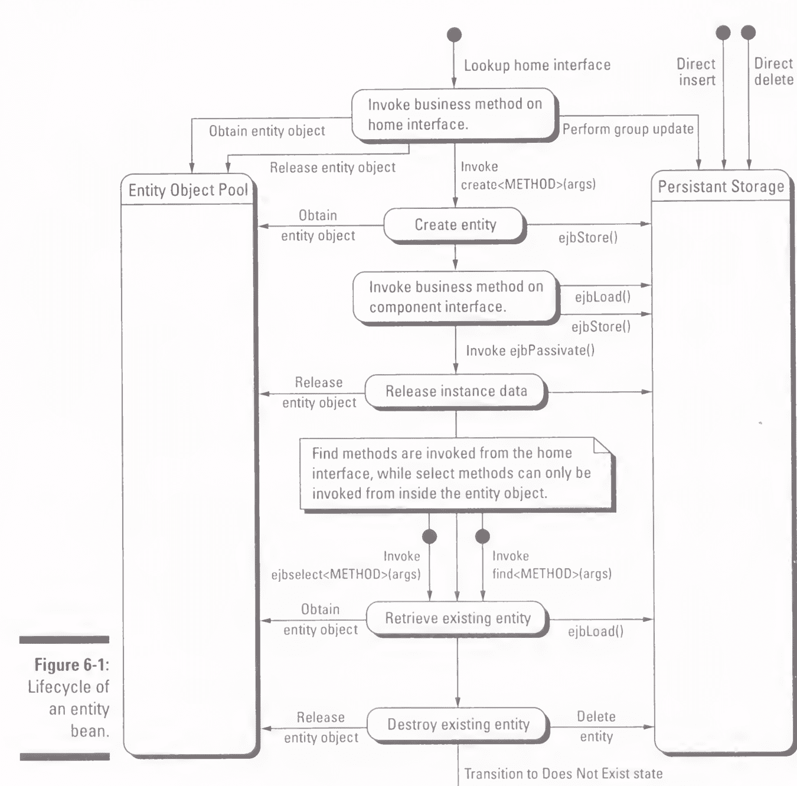

在查看图6-1时，请注意以下几点：

- 由于实体Bean可以在其本地接口中定义本地方法，因此可以在不引用任何特定实例的情况下调用这些方法。本地方法的行为类似于关系数据库中的批量更新。本地方法的操作将应用于符合方法名称或参数中指定条件的任何实体。

- 实体实例的生命始于它被创建之时。实体可以通过调用本地接口中的`create`方法来创建。也可以通过执行直接插入来创建。使用*直接插入*时，实体数据会直接插入到数据库中，而无需与EJB容器交互。直接插入通常通过 SQL 完成。无论采用哪种方法，实体数据都会存储在数据库中。但是，使用`create`方法时，会从对象池（出于性能原因维护）中获取一个实体对象，将实例数据分配给该对象，并将该对象的组件接口引用返回给客户端应用程序。

- 当通过组件接口在实体上调用业务方法时，对该实体的任何修改都将仅应用于该特定实例，而不是同一类的其他实体。根据部署描述符中指定的参数，数据可能在业务方法调用之前从数据库加载。

- 当实体空闲时，EJB容器可以将其钝化。当实体被钝化时，其实例数据被缓存，实体对象返回到对象池。当客户端通过组件接口调用一个被动实体时，它会通过从池中检索实体对象并将缓存的数据恢复到该对象来被激活。根据部署描述符的配置，实体对象也可能会从数据库更新其数据。

实体对象的缓存数据不一定与其存储在数据库中的持久数据相同。如果数据库在实体处于被动状态时通过直接更新被修改，两者可能会失去同步。

- 如果你对实体对象调用`remove`方法，它将被永久删除——从内存和数据库中。因此，`remove`方法应仅在实体需要被完全销毁时执行。对实体对象执行`remove`方法相当于从数据库中删除其数据。`remove`方法提交后，实体将永远消失。

除非你打算永久删除实体，否则不要对其调用`remove`方法。

## 实体Bean的客户端视图

实体Bean生命周期的不同特性在不同视角下具有不同的突出程度。图6-2中的活动图说明了实体Bean开发者的视角。

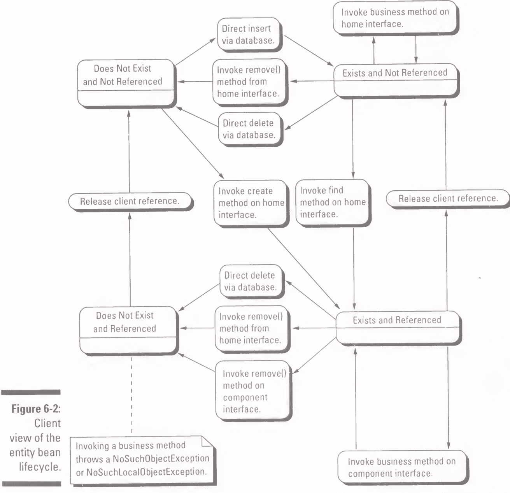

对于客户端应用程序，实体Bean生命周期中有四种不同的状态：

# 第6章：使用容器管理持久性的实体Bean 2.0

- **不存在且未被引用：** 在此状态下，实体Bean的数据在实体Bean和数据库中都不存在。此外，没有对实体Bean组件的引用。此状态存在于创建实体Bean之前，或在实体Bean被删除且引用被释放之后。（此处的*引用*是指客户端应用程序持有的引用。）

- **存在但未被引用：** 当实体Bean存在但未被引用时，它存在于持久存储中，但未被应用程序中的实例变量引用。实体Bean只能通过直接插入或当客户端对实体的所有引用都被释放后才能达到此状态。

- **存在且被引用：** 当客户端应用程序持有对实例的引用时，实体Bean存在且被引用。当客户端在实体Bean的本地或远程本地接口上调用`create`方法，或客户端在实体的本地或远程本地接口上调用`find`方法时，就会达到此状态。

- **不存在但被引用：** 当实体Bean不存在但被引用时，客户端应用程序持有对实体Bean的引用，但实体Bean的持久存储已被销毁。有三种不同的方法会导致此状态：

  - 如果实体被客户端引用，但某个不相关的进程对数据库执行了直接删除，那么实体被销毁，但引用仍然存在。

  - 如果客户端从本地接口调用`remove`方法，则引用存在，但实体被销毁。

  - 如果客户端从组件接口调用`remove`方法，则引用存在，但实体被销毁。

如果你熟悉数据库开发，那么你将很容易将实体Bean上的操作映射到标准数据库操作。调用`create<METHOD>`相当于数据库插入。`find<METHOD>`相当于 SQL 查询。对实体Bean属性的修改相当于更新操作。最后，对实体Bean调用`remove`相当于 SQL 删除语句。

当实体处于不存在但被引用状态时，对该实体的任何方法调用都将抛出`NoSuchObjectException`或`NoSuchLocalObjectException`。

### 实体Bean的容器视图

与所有EJB组件一样，实体Bean开发者必须遵守一个开发契约，以确保实体Bean无论部署到哪个EJB容器都能工作。这个契约在

# 第三部分：实体Bean：事物的本质

实体Bean的生命周期是从容器角度看待的。在图6-3中，实体Bean的生命周期展示了三种基本状态：

- **不存在（Does Not Exist）**：在此阶段，实体Bean不存在。这是在创建之前或删除之后。由于实体Bean在使用期间存储在数据库中，执行`create`操作等同于将实体插入数据库。同样，执行`remove`方法等同于删除实体Bean。

- **池化（Pooled）**：在此状态下，实体不包含任何实例数据。相反，它处于未初始化状态，包含适用于实体类型的全局信息。可以通过 home 接口对池化实体执行方法，但不能通过组件接口执行。

- **就绪（Ready）**：在此状态下，实体使用实例数据进行初始化。因此，它从空壳实体转变为特定实体实例。可以通过 home 接口和远程接口对实体执行方法。当客户端应用程序查找时，实体Bean实例进入就绪状态，不使用时则退回到池化状态。

在本章的剩余部分，我将研究如何利用图6-3中所示的所有生命周期方法。现在，只需关注EJB容器对实体Bean的处理方式，以及每个生命周期事件何时发生。以下列表将引导您了解整个过程：

- 创建实体Bean对象是创建实体Bean实例的前奏。实体Bean对象只是实体Bean类的一个实例，不与任何特定实体数据相关联。它就像一个等待填充真实信息的模板。此步骤由EJB容器用于填充实体Bean池，而不是创建任何特定实体的实例。

- EJB容器使用`Class.newInstance`方法来创建实体对象的实例。在此阶段，没有实例数据与实体Bean相关联。

- 每个实体对象创建后，将调用其`EntityBean.setEntityContext`方法。

- 设置实体上下文后，实体Bean对象被放入池中，在那里可以根据需要进行访问并分配实例数据。

- 在池化状态下，客户端可以调用实体Bean的 home 接口或远程 home 接口上的任何方法。虽然通过 home 接口向客户端应用程序公开的只有`create`、`find`和 home 方法，但 home 方法可能间接触发实体对象上的`ejbSelect`方法。

当调用`find`或`create`方法时，实体对象实例的引用将返回给客户端。就查找器方法而言，引用可能指向已经处于就绪状态的实体，这我后面会解释。但`create`方法总是导致实体Bean对象从池化状态转变为就绪状态。

- 随着`create`方法的调用，实体Bean执行实体对象中指定的`ejbCreate`方法，随后执行`ejbPostCreate`方法。在此阶段，通过从池化状态中移除实体对象并为其分配实例数据来创建新实体。

- 当调用`find`方法时，容器在将实体移动到其就绪状态之前调用`ejbActivate`。调用查找器方法时可能发生两种情况。如果另一个客户端已经拥有查找器方法检索到的实体Bean的引用，则客户端接收对该实例的引用。但如果没有对实体Bean的引用存在，则查找器方法从池中移除一个实体Bean对象，并将该对象与来自数据库的数据相关联。然后将引用返回给客户端应用程序。

从其就绪状态开始，客户端可以调用组件接口中定义的任何实体Bean实例上的方法。客户端可以调用实体Bean上的业务方法，这反过来会触发`ejbLoad`、`ejbStore`和`ejbSelect`方法的调用。

- 从数据库加载数据到实体Bean后，调用`ejbLoad`方法。

- 从实体Bean存储数据到数据库之前，调用`ejbStore`方法。

- `ejbSelect`方法用于从实体Bean对象内部获取相关实体Bean的引用。

当EJB容器使就绪状态的实体Bean过期时，将调用`ejbPassivate`方法。EJB容器在实体组件一段时间不活动后使其过期，这允许容器重用实体Bean对象。当实体被钝化时，其状态被缓存，实体对象被清理并返回到池化状态。从那里，EJB容器可以回收该对象并将其用于另一个实体。

如果客户端应用程序在实体Bean上调用`remove`方法，无论是通过 home 接口还是远程接口，Bean将从数据库中删除，其实体对象变为池化状态。

最后，当容器从实体对象池中移除实体时，它首先在实体对象上调用`unsetEntityContext`方法。之后，实体对象不再存在。

**图6-3：** 实体Bean生命周期的容器视图

## 创建实体Bean Home接口

# 第6章：容器管理持久化的实体Bean 2.0

实体Bean的 home 接口比其会话Bean的对应物要更强大一些。这是因为，除了提供`create`方法外，实体Bean还支持*查找器方法（finder methods）*和*home 方法*。Home接口使用实体Bean的`create`方法来创建新的实体Bean实例。这等同于在数据库中插入记录。另一方面，*查找器方法*用于查找现有实体Bean。因此，它们对应于 SQL 查询。Home接口中的业务方法称为*home 方法*，以区别于组件接口中的业务方法。客户端不需要任何特定实体Bean的引用即可执行 home 方法。

虽然可以使用实体Bean的 home 接口和远程 home 接口执行更多方法，但创建 home 接口的基本原理与会话Bean的 home 接口原理非常相似。这是因为实体Bean的本地 home 接口必须扩展`javax.ejb.EJBLocalHome`接口，而实体Bean的远程 home 接口必须扩展`javax.ejb.EJBHome`接口。

在以下小节中，我将更详细地研究`create`方法、查找器方法和 home 方法。每个部分都有来自示例ATM应用程序的`AccountBean`的示例。我在整本书中使用ATM应用程序作为示例来说明不同EJB组件的创建。在继续阅读各节时，请参考清单6-1获取完整的`AccountRemoteHome`接口，以及清单6-2获取完整的`AccountLocalHome`接口视图。

### 清单6-1 `AccountRemoteHome`接口

```java
package com.sextantech.genuineentities.interfaces;

import javax.ejb.EJBHome;
import javax.ejb.CreateException;
import javax.ejb.FinderException;
import java.rmi.RemoteException;
import java.util.Date;

public interface AccountRemoteHome extends EJBHome{
    public AccountRemote createAccount(java.util.Date createDate, long clientId) throws CreateException, RemoteException;

    public AccountRemote createAccount(java.util.Date createDate, long clientId, float balance) throws CreateException, RemoteException;

    public AccountRemote createAccount(java.util.Date createDate, long clientId, double balance) throws CreateException, RemoteException;

    public AccountRemote findByPrimaryKey(AccountKey key) throws FinderException, RemoteException;

    public AccountRemote findByAccountHolderKey(AccountHolderKey key) throws FinderException, RemoteException;
```

## Listing 6-1（续）

```java
public double getNetWorth(AccountHolderKey key) throws
    RemoteException;

}
```

### Listing 6-2 `AccountLocalHome`接口

```java
package com.sextanttech.entities.interfaces;

import javax.ejb.EJBLocalHome;
import javax.ejb.CreateException;
import javax.ejb.FinderException;
import java.util.Date;

public interface AccountLocalHome extends EJBLocalHome{
    public AccountLocal createAccount(Date createDate, long
            clientId) throws CreateException;

    public AccountLocal createAccount(Date createDate, long
            clientId, float balance) throws CreateException;

    public AccountLocal createAccount(Date createDate, long
            clientId, double balance) throws CreateException;

    public AccountLocal findByPrimaryKey(AccountKey key)
            throws FinderException;

    public java.util.Collection
            findByAccountHolderKey(AccountHolderKey key)
            throws FinderException;

    public double getNetWorth(AccountHolderKey key);

}
```

## 定义`create`方法

实体 Bean 开发人员可以为实体 Bean 定义零个、一个或多个`create`方法。每个`create`方法都以`create`一词为前缀，后接一个有意义的名称。`Create`方法可以接收不同数量和类型的参数。每个`create`方法通常包含定义实体 Bean 创建所需的所有必需数据的参数。

虽然`create`方法不必定义实体 Bean 的所有数据，但尽可能提供更多信息来创建实体 Bean 是个好主意——这可以最大限度地减少多次方法调用以设置实体 Bean 属性的需求。特别是在使用远程接口时，方法调用越少，EJB 应用程序的运行速度就越快。


在`home`接口或远程`home`接口中定义`create`方法时，请务必遵守以下规则：

- 每个`create`方法必须返回对实体 Bean 组件接口的引用。如果`create`方法位于远程`home`接口中，返回类型必须是实体 Bean 的远程接口。如果`create`方法位于本地`home`接口中，返回类型必须是实体 Bean 的本地接口。
- 每个在`home`接口或远程`home`接口中定义的`create`方法，必须在实体 Bean 类的`ejbCreate<METHOD>(<args>)`和`ejbPostCreate<METHOD>(<args>)`中有对应的实现。`<args>`参数是一个占位符，必须与你定义在`create`方法中的任何参数相对应。如果在`home`接口和远程`home`接口中都定义了相同的`create`方法，EJB 容器将为两者使用相同的`ejbCreate`和`ejbPostCreate`方法。
- 如果定义了远程`home`接口，`create`方法的所有参数和返回类型都必须是可序列化的。
- 在远程`home`接口中，每个`create`方法必须在其`throws`子句中包含`javax.ejb.CreateException`和`java.rmi.RemoteException`。在本地`home`接口中，每个`create`方法必须在其`throws`子句中包含`javax.ejb.CreateException`，且不能抛出`java.rmi.RemoteException`。`Create`方法还可以抛出 Bean 开发人员定义的任意应用程序异常。

在下面的示例中，为示例 ATM 应用程序中`Account`实体 Bean 的远程`home`接口定义了两个`create`方法：

```java
public interface AccountRemoteHome extends javax.ejb.EJBHome{
    /* This create method creates a new account without a
           balance.*/
    public AccountRemote createAccount( long clientId)
        throws CreateException, RemoteException;

    /* This create method creates a new account with a
           balance.*/
    public AccountRemote createAccount( long clientId,
        float balance) throws CreateException,
        RemoteException;

    /* This create method creates a new account with a large
           balance.*/
    public AccountRemote createAccount( long clientId,
        double balance) throws CreateException,
        RemoteException;

    //... remainder of remote home interface
}
```

# 第三部分：实体 Bean：事物的本质

以下代码示例展示了在本地`home`接口中定义的对应`create`方法：

```java
public interface AccountLocalHome extends
        javax.ejb.EJBLocalHome{
    /* This create method creates a new account without a
           balance.*/
    public AccountLocal createAccount( long clientId)
        throws CreateException;

    /* This create method creates a new account with a
           balance.*/
    public AccountLocal createAccount( long clientId,
        float balance) throws CreateException;

    /* This create method creates a new account with a large
           balance.*/
    public AccountLocal createAccount( long clientId,
        double balance) throws CreateException;

    //... remainder of local home interface
}
```

## 定义`finder`方法

`Finder`方法供 EJB 客户应用程序用于定位已存在的实体 Bean。实体 Bean 开发人员必须定义至少一个`finder`方法，但也可以根据需要定义更多。每个`finder`方法都以`find`一词为前缀，后接一个有意义的名称。强制的`finder`方法是`findByPrimaryKey(Object primaryKey)`。给定一个主键对象，客户应用程序可以使用`findByPrimaryKey()`方法来查找具有给定主键的实体。有关主键的更多信息，请参阅后面的“构建主键类”一节。

除了`findByPrimaryKey()`方法外，`home`接口还可以根据需要定义额外的`finder`方法。定义`finder`方法时，可以返回单个实体 Bean 组件接口，或返回实体 Bean 组件接口的集合。始终返回单个组件接口的`finder`方法称为单对象`finder`方法。相反，返回组件接口集合的对象称为多对象`finder`方法。

`Finder`方法必须符合以下规则：

- 所有`finder`方法都必须以`find`一词为前缀。
- 所有`finder`方法都必须抛出`javax.ejb.FinderException`。在远程`home`接口中定义的`finder`方法还必须在其`throws`子句中包含`java.rmi.RemoteException`。所有`finder`方法还可以抛出 EJB 组件开发人员定义的应用程序异常。
- 对于除`findByPrimaryKey()`方法外的每个`finder`方法，Bean 提供方必须在 EJB 组件的部署描述符中提供相应的 EJB 查询。有关 EJB 查询语言的详细信息，请参阅第 7 章。
- 所有`finder`方法必须返回对实现 EJB 组件组件接口的对象的引用。如果`finder`方法位于远程`home`接口中，返回对象必须实现实体 Bean 的远程接口。如果`finder`方法位于本地`home`接口中，返回对象必须实现该`finder`方法的本地`home`接口。
- 定义多对象`finder`方法时，返回值还必须实现`java.util.Collection`接口。

不必因在多对象`finder`方法中实现`java.util.Collection`接口而感到畏惧。请记住，你不必实现组件接口，EJB 容器会为你完成这项工作。因此，你只需要声明组件接口实现`java.util.Collection`即可。我将在接下来的“创建实体 Bean 组件接口”一节中提供一个示例。

如果定义的单对象`finder`方法在运行时尝试返回多个组件接口，EJB 容器将抛出`javax.ejb.FinderException`。

充分利用单对象`finder`方法与多对象`finder`方法之间的语义差异。如果定义的`finder`方法按设计必须绝不能返回多个值，请务必使用单对象`finder`方法。这样做将使你的代码更易于维护和调试，以防该方法尝试返回多个实体。这是因为系统会抛出异常，准确告知你问题发生的位置。

以下示例代码展示了单对象`finder`方法——`findByPrimaryKey()`，以及多对象`finder`方法——`findByAccountHolderKey()`。请注意，所有多对象`finder`方法的返回类型都是`java.util.Collection`。

122 第三部分：实体 Bean：事物存在的形式

```java
public interface AccountRemoteHome extends javax.ejb.EJBHome{
    /* The findByPrimaryKey method is always a single-value
       finder
     * method. All single value methods must return a
       reference to the
     * entity bean's component interface.
     */
    public AccountRemote findByPrimaryKey( AccountKey key)
        throws FinderException, RemoteException;

    /* This is a multiple-value finder method. The method's
       return type
     * is java.util.Collection, but the return object must
       also
     * implement a component interface.
     */
    public java.util.Collection findByAccountHolderKey(
        AccountHolderKey key) throws FinderException,
            RemoteException;

    //... remainder of remote home interface
}
```

下一个代码示例展示了在本地主接口中定义的相同查找方法。

```java
public interface AccountRemoteHome extends
              javax.ejb.EJBLocalHome{
    /* The findByPrimaryKey method is always a single-value
       finder
     * method. All single value methods must return a
       reference to the
     * entity bean's component interface.
     */
    public AccountRemote findByPrimaryKey( AccountKey key)
        throws FinderException;

    /* This is a multiple-value finder method. The method's
       return type
     * is java.util.Collection, but the return object must
       also
     * implement a component interface.
     */
    public java.util.Collection findByAccountHolderKey(
        AccountHolderKey key) throws FinderException;

    //... remainder of remote home interface
}
```

在多对象查找方法中，`java.util.Collection`接口允许查找方法返回重复的实体对象。如果你不希望返回集合中包含对实体对象的重复引用，必须编写一个消除重复项的 EJB 查询。这个主题将在第 7 章中更详细地讨论。

## 定义主方法

主方法是适用于整个实体对象类别的业务方法，而不是针对特定的实体实例。通过主方法，你可以对整个实体类别进行修改；你可以使用主方法参数来修改实体类中特定的成员；或者你可以根据一个类别中多个实体的属性计算出值。当客户端应用程序使用主方法与实体交互时，它不会接收到受主方法影响的实体的引用。相反，主方法只是返回所执行方法的结果。在下面的示例代码中，使用了一个主方法来计算账户持有人的净资产：

```java
public interface AccountRemoteHome extends javax.ejb.EJBHome{
    /* This home method returns the net worth of an account
          holder
       * given the account holder's ID
       */
    public double getNetWorth(AccountHolderKey key) throws
             RemoteException;
    //... remainder of remote home interface
}
```

如果你觉得主方法和组件接口中的业务方法有相似之处，那你的感觉是对的。事实上，在组件接口中创建主方法和业务方法的规则几乎完全相同。以下是需要记住的要点：

- 对于你定义的每个主方法，你必须在实体 bean 类中创建一个对应的方法。对应的方法必须以术语`ejbHome`为前缀，后跟主方法的名称和相同的参数。
- 如果你在远程主接口和本地主接口中定义了相同的主方法，EJB 容器将使用实体 bean 类中的单个`ejbHome`方法来同时支持两者。
- 如果主方法在远程接口中实现，它必须在其`throws`子句中包含`java.rmi.RemoteException`。如果主方法在本地主接口中实现，则不必抛出异常。你可以自由地在主方法中抛出任何应用程序异常。

> 如果主方法在远程主接口中定义，所有参数和返回类型都必须是原始变量，或者是实现了`java.io.Serializable`接口的对象。原始变量是指 Java 基本数据类型之一的变量。

以下示例代码展示了在本地主接口中定义的主方法：

```java
public interface AccountLocalHome extends EJBLocalHome{
    /* This home method returns the net worth of an account
       holder
     * given the account holder's ID
     */
    public double getNetWorth(AccountHolderKey key);
}
```

## 创建实体 Bean 组件接口

实体 bean 的组件接口本质上与会话 bean 中的对应接口相同。组件接口用于提供对实体 bean 中业务方法的访问。会话 bean 的业务方法通常执行操作，而实体 bean 的业务方法通常用于通过调用实体 bean 属性的`getter`和`setter`来修改 bean 的状态。虽然实体 bean 的业务方法在组件接口中定义，但实体 bean 属性的所有`getter`和`setter`都隐藏在 bean 内部。因此，使用实体 bean 的客户端应用程序只能看到可以执行的业务方法，而实现这些方法的机制则隐藏在实体 bean 类内部。

虽然你可以创建一次检索和修改一个实体属性的业务方法，但更推荐的方法是定义面向任务的业务方法，这些方法执行完成给定任务所需的所有对实体 bean 的更新。同样，你可以通过创建一个可序列化的对象来检索实体 bean 的所有属性，该对象可以在实体 bean 内部初始化，然后返回给客户端。这些类型的方法通常被称为批量方法，因为它们减少了执行批量工作所需的方法调用次数。

## 使用本地接口

实体 bean 的本地接口允许本地 EJB 客户端使用按引用传递的方法来访问实体 bean 的业务方法。按引用传递比用于支持远程方法的按值传递效率高得多。这是因为按值传递调用传递的是对象的副本，而按引用传递调用传递的是对象的引用。由于实体 bean 通常只由本地客户端访问，本地接口通常是首选解决方案。有关更详细的解释，请参见本章其他地方的旁注“支持本地接口的理由”。

按引用传递调用有一个重要的副作用。当一个对象按引用传递时，对该对象所做的更改是永久的。但是当对象按值传递时，所做的更改仅在方法调用期间有效。这是因为更改影响的是对象的副本，而不是原始对象本身。

在定义本地接口时，你只需要遵循几条简单的规则：

- 本地接口必须扩展`javax.ejb.EJBLocalObject`。`EJBLocalObject`接口由 EJB 容器实现，为客户端应用程序提供获取实体 bean 的本地主接口、从 EJB 容器和持久存储中移除实体 bean 以及获取实体 bean 主键等功能。
- 本地接口中的任何方法都不允许抛出`java.rmi.RemoteException`。这是常识，因为根据定义，本地对象永远不是远程的。
- 本地接口中的业务方法可以自由抛出任何由 EJB 组件开发人员定义的合适的应用程序异常。

`javax.ejb.EJBLocalObject`接口已经提供了一个用于获取实体 bean 主键的方法。这意味着你不应该定义一个用于获取实体 bean 主键类的方法。


当你创建一个持有本地对象引用的客户端应用程序时，你可能会倾向于将该本地对象传递给另一个对象。在客户端之间共享本地接口在编程上相当于拿着剪刀跑步——这是危险的行为，会使你的 EJB 应用程序面临严重风险。EJB 容器需要为每个单独的客户端应用程序管理事务、安全、同步和各种其他服务，因此每个需要修改实体 bean 的客户端应用程序都应该通过其自己的私人的、私密的和保密的本地接口来进行。有一个例外：如果你只是访问实体 bean 以读取数据而不是修改它，那么可以将其传递。

清单 6-3 中的示例代码展示了本书贯穿始终的示例 ATM 应用程序中 `Account` 实体 bean 的本地接口。

## 本地接口的优势

当实体 bean 使用本地接口时，它只能被本地客户端访问。这意味着远程客户端应用程序无法访问它们。虽然 EJB 1.1 规范没有设想过创建非分布式实体 bean，但事实是，在实践中，绝大多数实体 bean 客户端都是本地的——因为实体 bean 通常只被会话 bean 访问，或者在 EJB 2.0 中，被消息驱动 bean 访问。

遗憾的是，为 EJB 组件支持远程通信比支持本地通信需要更多的开销——即使客户端和 EJB 组件彼此都在本地。在 EJB 1.1 中，本地接口并不是一个选项。这对实体 bean 造成了沉重的性能开销，以支持通常并不需要的远程通信。但随着 EJB 2.0 规范的发布，可以实现本地和本地 home 接口，从而为你的实体 bean 带来性能上的巨大提升。

本地和本地 home 接口适合你吗？如果你只打算从本地来源访问实体 bean，答案是响亮的“是”！在某些情况下，你可能希望实体 bean 能够被远程客户端访问；在这些情况下，你必须实现远程接口。通常，从远程客户端访问的实体 bean 用于管理查找数据。另外，请记住，由于远程通信的性能限制，一些 EJB 容器供应商已经创建了解决方案，能够在可能的情况下自动为远程和远程 home 接口支持本地通信。

### 清单 6-3 `AccountLocal` 接口

```java
package com.sextanttech.entities.interfaces;

import javax.ejb.EJBObject;
import java.rmi.RemoteException;

public interface AccountLocal extends EJBObject{
    /* Increment the balance on this account. */
    public void debit(double amount);

    /* Deincrement the balance on this account. */
    public void credit(double amount);

    /* Retrieve the balance for this account. */
    public double getBalance();

    /* Get a reference to the account holder for this
       account. This
     * method should be handled with care since the client
       may not have
     * appropriate security privileges to use the
       AccountHolder entity
     * bean.
     */
    public AccountHolderLocal getAccountHolder(AccountKey accountKey);

    /* This method is an alternative to the previous that is less
     * risky. Because the method only returns the key, the client can
     * lookup the AccountHolder and establish its own private
     * connection to the AccountHolder. While that involves more steps
     * in the implementation, it provides better security isolation and
     * transactional isolation of the AccountHolder reference. This
     * solution also allows the client application to determine whether
     * a local interface or a remote interface is best.
     */
    public AccountHolderKey getAccountHolderKey(AccountKey accountKey);
}
```

## 使用远程接口

实体 bean 的远程接口通常呈现与本地接口相同的方法，只是远程接口还允许远程客户端访问。由于远程接口必须支持远程通信，在开发远程接口时必须满足几个额外的要求。简而言之，你必须遵守以下规则：

- 本地接口必须扩展 `javax.ejb.EJBObject`。`EJBObject` 接口由 EJB 容器实现，为客户端应用程序提供获取实体 bean 的远程 home、从 EJB 容器和持久存储中移除实体 bean，以及获取实体 bean 主键的功能。
- 远程接口中业务方法的所有参数和返回值必须是原始数据类型，或者必须实现 `java.io.Serializable` 接口。这一要求是必要的，以便参数或返回值所持有的数据能够通过网络传输。
- 本地接口中的每个业务方法必须在其 `throws` 子句中包含 `java.rmi.RemoteException`。当业务方法调用期间发生系统级错误时，EJB 容器将向客户端应用程序抛出 `RemoteException`。
- 远程接口中的业务方法可以自由抛出 EJB 组件开发者定义的任何适当的应用程序异常。

### 清单 6-4 `AccountRemote` 接口

在清单 6-4 中，`AccountRemote` 接口向其客户端应用程序呈现与 `AccountLocal` 对应接口相同的业务方法，但允许远程客户端访问实体 bean 的资源。定义远程接口只有几个额外的要求——我已用粗体标出差异。

```java
package com.sextanttech.entities.interfaces;

import javax.ejb.EJBObject;
import java.rmi.RemoteException;

public interface AccountRemote extends EJBObject{
    /* Increment the balance on this account. */
    public void debit(double amount) throws RemoteException;

    /* Deincrement the balance on this account. */
    public void credit(double amount) throws RemoteException;

    /* Retrieve the balance for this account. */
    public double getBalance() throws RemoteException;

    /* Get a reference to the account holder for this
            account. This
     * method should be handled with care since the client
            may not have
     * appropriate security privileges to use the
            AccountHolder entity
     * bean.
     */
    public AccountHolderRemote getAccountHolder(AccountKey
            accountKey) throws RemoteException;

    /* This method is an alternative to the previous that is
            less
     * risky. Because the method only returns the key, the
            client can
     * lookup the AccountHolder and establish its own private
     * connection to the AccountHolder. While that involves
            more steps
     * in the implementation, it provides better security
            isolation and
     * transactional isolation of the AccountHolder
            reference.
     */
    public AccountHolderKey getAccountHolderKey(AccountKey
            accountKey) throws RemoteException;
}
```

## 构建主键类

实体 bean 的主键类由 EJB 容器用于唯一标识一个实体 bean 对象。每个 EJB 对象都通过其主键对象和 home 接口引用唯一标识。因此，主键类的实例必须在给定的 home 接口中唯一。借助主键对象，你的客户端应用程序能够找到实体 bean——或者（间接地）使用该键作为 EJB 查询中的参数来查找相关的实体 bean。

创建主键类的规则取决于实体 bean 是否利用容器管理持久化（CMP）。在本章中，我专门讨论参与 CMP 的 EJB 组件。使用 CMP 模型创建主键的规则如下：

- 主键类必须实现 `java.io.Serializable` 接口，这允许该类被序列化并通过网络传输或写入数据库。
- 主键类必须包含足够的属性来为实体 bean 建立唯一标识。用于在主键中建立标识的属性也必须在实体 bean 类中呈现。部署描述符用于映射实体 bean 类属性与主键属性之间的关系。
- 主键类中的属性声明为 `public`，这允许 EJB 容器识别和初始化主键类属性。虽然主键类可以提供 getter 方法来检索主键属性的值，但它不应提供 setter 方法。
- 主键类必须重写 `Object.equals` 方法。所有 Java 对象都继承 `equals` 方法，它用于比较两个对象是否相等。重写 `Object.equals` 方法的细节在清单 6-5 中说明。
- 主键类必须重写 `Object.hashCode()` 方法。所有 Java 对象都继承 `hashCode` 方法，用于获取称为哈希码的值。Java 使用哈希码来组织对象；因此，哈希码不必是唯一的——相反，它必须是分布良好的，这意味着对于任何一组对象，用于排序这些对象的哈希码值应接近它们的自然顺序。这在理论上听起来复杂，但在实践中相当简单。
- 由于主键的值通常在创建后不会改变，主键类一般没有 setter 方法。相反，类的值在构造函数中设置。

# 第三部分：实体 Bean：事物的本然

由于 Java 的基本类型包装类（`java.lang.Integer`、`java.lang.Long`、`java.lang.Character` 等）都实现了 `java.io.Serializable`，重写了 `Object.equals()` 和 `Object.hashCode()`，因此它们都可以作为合法的主键。如果你在寻找简单的主键，可以考虑使用这些类之一作为主键。只需记住，该对象必须映射到实体 bean 类中的字段，并且足以唯一标识该实体 bean。

虽然主键类的属性是公开的，但这并不意味着它们应该被任意设置。事实上，在容器设置了主键类的属性之后，这些属性应被视为不可变的。创建后更改主键属性将破坏客户端应用程序与 EJB 组件交互的能力。

实体 bean 主键类的属性必须与实体 bean 类的属性相对应。

主键有两种类型：单字段主键和复合主键。单字段主键只包含一个字段，例如整数，用于标识主键。单字段主键仅映射到实体 bean 类中的单个字段，是创建最简单的，但也简单不了多少。虽然单个字段可能足以确定实体 bean 的唯一性，但有时需要使用复合主键来完成这项工作。

复合主键包含多个字段，其组合决定了 EJB 组件的身份。复合主键中的每个字段映射到实体 bean 类中的不同字段。重写复合主键的 `hashCode` 方法比单字段主键需要更多步骤，重写 `equals` 方法也是如此。清单 6-5 中的代码演示了为 `Account` 类创建复合主键的过程。

### 清单 6-5 `AccountKey` 类


```java
package com.sextanttech.entities.interfaces;

public class AccountKey {
    public long createDate;
    public long accountId;

    public AccountKey(long createDate, long accountId) {
        this.createDate = createDate;
        this.accountId = accountId;
    }

    public long getCreateDate() {
        return createDate;
    }

    public long getAccountId() {
        return accountId;
    }

    /* This is an example of overriding the equals method in
     * java.lang.Object.*/
    public boolean equals(Object obj) {

        /* First determine if the obj parameter is the same
           type as this
         * object using the instanceof operator. If the
           object is null,
         * or not the same type, the two objects are not
           equal.*/
        if(obj == null || !(obj instanceof AccountKey)){
            return false;
        }

        /* If the two objects are equal, you can cast obj to
        an
         * AccountKey to finish the equality test.
         */
        AccountKey other = (AccountKey) obj;
        // The final step is a matter of comparing the
           primary key fields for equality.
        if( this.accountId == other.accountId &&
            this.createDate == other.createDate){
            return true;
        }
        return false;
    }

    /* This is an example of overriding the Object.hashCode()
       method.*/
    public int hashCode() {

        /* A hashCode is derived from the values of fields in
           a class.
         * To get a reasonable hashcode, the easiest approach
           is to
         * convert all fields into a single string, and then
           get the
         * hashcode of that String. The following code
           illustrates this
         * strategy using a StringBuffer class.
         */
        StringBuffer sb = new StringBuffer();

        // append the fields
        sb.append(this.accountId).append(this.createDate);

        // Convert to a String and get the hash code.
        return sb.toString().hashCode();
    }

    /* For completeness, I also override the toString method
       to return
     * a meaningful name for this primary key. In this case
       the
     * meaningful value is the accountId.
     */
    public String toString(){
        StringBuffer sb = new StringBuffer();
        sb.append(accountId);
        return sb.toString();
    }
}
```

## 构建实体 Bean 类

每个优秀的实体 bean 组件的核心都是实体 bean 类。实体 bean 类是一个繁忙的活动中心。虽然实体 bean 类具有复杂性的潜力，但当你利用容器管理持久化（CMP）时，EJB 容器会为你完成大部分工作。结果是开发任务在很大程度上变成连点成线的过程。对于实体 bean 来说，连点成线意味着在实体 bean 类中提供业务方法和 home 接口方法的实现。

开发实体 bean 类时有七个重要任务需要执行：

- **实现 `javax.ejb.EntityBean` 接口的生命周期方法。** 这些方法由 EJB 容器在实体 bean 生命周期的各个点调用，可用于响应相应的生命周期事件。
- **定义实体 bean 类每个属性的 CMP 字段。** 这些字段包含定义实体 bean 的信息，例如其主键以及与实体 bean 所建模实体相关的其他数据。
- **为实体 bean 的 home 接口中的每个 create 方法定义 `ejbCreate<METHOD>(args)` 和 `ejbPostCreate<METHOD>(args)` 方法。** 当从本地 home 或远程 home 接口调用相应的 create 方法时，这些方法由 EJB 容器调用。
- **定义实体 bean 的容器管理关系（CMR）字段。** 这些字段确定不同实体 bean 组件之间的关系。
- **为实体 bean 定义 `ejbSelect<METHOD>(args)`。** 这些方法供实体 bean 使用我在第 7 章中介绍的 EJB 查询语言来获取对其他实体 bean 类的引用。虽然 `ejbSelect<METHOD>(args)` 方法不能在实体 bean 类外部发布，但它们可以从实体 bean 类中的其他方法调用。
- **为实体 bean 类定义 `ejbHome<METHOD>(args)`。** 对于在 EJB 组件的远程 home 或本地 home 接口中定义的每个 home 方法，应有一个 `ejbHome<METHOD>(args)`。
- **定义实体 bean 类的业务方法。** 对于在实体 bean 的本地或远程接口中定义的每个业务方法，实体 bean 类中应有一个业务方法实现。

除了上述七个主要步骤外，还有一些适用于所有实体 bean 的其他小型但重要的任务：

- 利用 CMP 2.0 的实体 bean 类需要声明为 `public` 和 `abstract`。此要求强制 EJB 容器提供所有必要的实现代码以促进 CMP 和 CMR 服务。
- 所有实体 bean 必须实现 `javax.ejb.EntityBean` 接口。`EntityBean` 接口使实体 bean 成为实体 bean。
- 所有实体 bean 必须定义一个无参构造函数。此规则是允许 EJB 容器使用 Java 的反射能力创建实体 bean 类新实例的基本要求。

以下 `AccountBean` 类的代码片段展示了这三个基本要求：

```java
package com.sextanttech.entities.implementations;

import javax.ejb.EntityBean;

public abstract class AccountBean implements EntityBean {

    public AccountBean() {} // a noargs constructor
}
```

## 实现生命周期方法

每个实体 bean 都通过其 `javax.ejb.EntityBean` 接口赋予某些不可剥夺的生命周期方法。生命周期方法由 EJB 容器响应 EJB 组件生命周期中的生命周期事件而调用。这些方法被称为*回调*，因为它们是 EJB 容器回调 bean 的一种方式。需要注意的重要一点是，生命周期方法与业务方法不同，它们不是实体 bean 接口的一部分。

容器在回调实体 bean 类时为您提供响应生命周期事件的机会。实体 bean 共有七种生命周期方法：

- **`setEntityContext(EntityContext ctx)`**：此方法由 EJB 容器在实体 bean 对象创建之后、进入实体 bean 池之前调用。除了为此实体 bean 设置`EntityContext`外，您还可以使用此方法初始化 Bean 实例所使用的应用程序资源。有关此主题的更多信息，请参阅侧边栏“访问应用程序资源”。
- **`ejbLoad`**：此方法由 EJB 容器调用，用以将实体 bean 的 CMP 字段与数据库中的数据同步。此方法在从数据库检索数据后被调用。您可以使用该方法基于数据执行计算，或为 EJB 客户端准备数据。例如，如果您在将数据存储到数据库之前对其进行了压缩，则可以使用`ejbLoad`方法来展开数据，使其可供实体 bean 客户端使用。
- **`ejbStore`**：此方法由 EJB 容器调用，通过将实体 bean 中的数据存储到数据库来同步实体 bean 与底层数据库。此方法在存储操作发生之前被调用，使您有机会准备实体 bean 中的 CMP 字段数据以进行数据库存储。例如，如果您在将数据存储到数据库之前对其进行了压缩，则此方法就是执行压缩操作的地方。
- **`ejbPassivate`**：此方法由 EJB 容器在实体 bean 中的数据被缓存之前调用。当实体 bean 数据被缓存时，它将被存储到持久化存储中，例如计算机硬盘上的文件，而实体 bean 类则被清理并返回到实体 bean 池中。您可以使用此方法准备实体 bean 中的数据以进行钝化。
- **`ejbActivate`**：此方法由 EJB 容器在从缓存中检索实体 bean 数据并将其恢复到实体 bean 类之后调用。如果您在存储之前修改了数据——可能是压缩或加密——则可以使用此方法执行反向操作，使其可供客户端应用程序使用。
- **`ejbRemove`**：EJB 容器在移除 EJB 对象之前调用此方法。相应地，容器仅在从客户端应用程序调用移除方法时才会移除对象，该调用可以针对实体 bean 的本地 home、远程 home 或组件接口进行。当 EJB 对象被移除时，实例数据将从 EJB 容器和底层数据库中删除。此方法使 EJB 组件开发人员有机会在移除操作完成之前对其作出响应。
- **`unsetEntityContext`**：此方法由 EJB 容器在从 EJB 容器中移除实体 bean 对象之前调用。当对象池的大小被缩减时，或在实体 bean 中的方法调用过程中发生异常时，EJB 对象将从容器中移除。当调用`unsetEntityContext`方法时，您可以假定所有将实体 bean 与实体实例状态关联的属性都已置空。因此，此方法的主要目的是通过取消引用在`setEntityContext`方法中初始化的任何应用程序资源，为实体 bean 对象的垃圾回收做准备。

虽然您必须实现生命周期方法，但您并不需要在任何生命周期方法中执行任何操作。它们只是作为便利提供给您在需要时使用。清单 6-6 展示了`AccountBean`的实体 bean 类实现的生命周期方法。

如果您在实体 bean 中有一个基于 Bean 属性值计算的字段，则可以在`ejbLoad`方法中计算该字段的值。此类字段称为*计算字段*。当调用`ejbLoad`方法时，意味着您的实体 bean 字段的值已设置，可以开始执行必要的计算来填充计算字段的值。

## 清单 6-6 AccountBean 组件的生命周期方法

```java
package com.sextanttech.entities.implementations;

import javax.ejb.EntityBean;
import javax.ejb.EntityContext;

public abstract class AccountBean implements EntityBean {

    /* 此属性在实体 bean 的整个生命周期内存储 EntityContext。
     * 在与实体 bean 关联实例信息之前设置，
     * 并在实例信息与实体 bean 解除关联后仍然保留。
     */
    private EntityContext context;

    public void setEntityContext(EntityContext ctx){
        this.context = ctx; // 设置上下文
    }

    public void unsetEntityContext(){
        this.context = null; // 上下文置空
    }

    public void ejbRemove(){} // 不执行任何操作

    public void ejbActivate(){} // 不执行任何操作

    public void ejbPassivate(){} // 不执行任何操作

    public void ejbLoad(){} // 不执行任何操作

    public void ejbStore(){} // 不执行任何操作

    //... AccountBean 类的其余部分
}
```

## 定义 CMP 字段

容器管理持久化（CMP）字段是用于管理实体 bean 状态的字段。实体 bean 类中描述实体实例的任何属性都是 CMP 字段。EJB 2.0 规范为 CMP 字段的实现定义了与 EJB 1.1 规范中的规则截然不同的新规则。这也是使用 Bean 管理持久化（BMP）的 EJB Bean 与 CMP 模型分道扬镳的地方之一。本节中的信息专门适用于 CMP 2.0 实体 bean。

EJB 容器通过子类化您的实体 bean 类来为每个 CMP 字段提供实现。为了保持容器实现这些字段的灵活性，您作为 EJB 组件开发人员的责任仅为每个 CMP 字段定义抽象的 getter 和 setter 方法。绕行。以下是 CMP 字段的基本规则：

- 每个 CMP 字段必须有一个 getter 方法和一个 setter 方法。getter 方法是以术语 get 为前缀的方法，后跟 CMP 字段的名称，首字符大写。例如，对于 CMP 字段`accountBalance`，getter 方法应为`getAccountBalance`。同样，setter 方法以术语 set 为前缀，后跟 CMP 字段的名称，首字符大写，如`setAccountBalance`。getter 方法的返回类型必须与 CMP 字段类型相同。setter 方法必须接受与 CMP 字段类型相同的参数。
- CMP 字段的 getter 和 setter 必须声明为`public`和`abstract`，不能声明为`final`。getter 和 setter 方法最终由 EJB 容器在子类化实体 bean 时实现——这些要求支持该过程。
- CMP 字段名称在实体 bean 的部署描述符中标识。该字段不在实体 bean 类中定义。当 EJB 容器子类化实体 bean 类时，它将提供 CMP 字段及其 getter 和 setter 实现。因此，继续前面的示例，在您定义的类中将不存在`accountBalance`字段。但是，当容器子类化您的类时，它将提供`accountBalance`字段。

> 实体 bean 的主键字段在实体 bean 创建后不得更改。因此，实体 bean 主键字段的 setter 不应在实体 bean 的组件接口中定义。

## 访问应用程序资源

应用程序资源是由您或第三方提供的实用工具。它们可以是促进执行业务流程正常工作流之外任务的工具或产品，但支持整个工作流程中使用的服务。这些服务通常不是由 EJB 容器显式提供的，因此必须添加到 EJB 应用程序的工作流程中。应用程序资源的一些示例包括 JDBC 驱动程序、日志记录实用工具和软件测试实用工具。

在 EJB 应用程序中使用应用程序资源需要几个额外的步骤，但并不太困难。第一个任务是将资源注册到 JNDI ENC 中，以便您的 EJB 应用程序可以访问它。我在第 13 章中介绍此任务。完成之后，您可以使用生命周期方法从 EJB 组件内部访问应用程序资源。对于实体 bean，以下是一个简单的示例：


```java
public abstract class
    AccountBean implements
    javax.ejb.EntityBean{
    private EntityContext context;
    private ResourceType
      resource; // 对某些资源的引用。

    public AccountBean(){}

    setEntityContext(EntityContext ctx){
          this.context = ctx;
          try{
            InitialContext ic = new
              InitialContext();

    Object obj =
    ic.lookup("myApplicationResource");

    this.resource =
    (ResourceType)
    javax.rmi.narrow(obj,

    Class.forName("fully.qualified.ResourceType"));
        }
        catch(Exception e){
          /* 处理
    JNDI的javax.naming.NamingException和
    RMI缩小操作的
    java.lang.ClassCastException。
          */
        }
    }
    public
    unsetEntityContext(){
          this.context = null;
          this.resource = null;
    }
}
```

请记住，由于实体 Bean 对象在不使用时会放入池中，因此在调用`ejbPassivate`时无需释放对通用应用程序资源的引用，在调用`ejbActivate`时也无需恢复。相反的情况适用于有状态会话 Bean，因为有状态会话 Bean 类在对象钝化期间不会放入池中。

CMP 字段的名称在部署描述符中定义，必须与您为字段定义的抽象 getter 和 setter 方法的命名保持一致。`AccountBean`类的 CMP 字段的 getter 和 setter 方法如清单 6-7 所示。

## 清单 6-7 `AccountBean`类的 CMP 字段

```java
package com.sextanttech.entities.implementations;

import javax.ejb.EntityBean;
import javax.ejb.EntityContext;

public abstract class AccountBean implements EntityBean {

    // Get the balance for this account.
    public abstract double getAccountBalance();

    // Set the balance for this account.
    public abstract void setAccountBalance(double balance);

    // Get the accountId for this account.
    public abstract long getAccountId();

    // Set the accountId for this account.
    public abstract void setAccountId(long accountId);

    // Get the creation date for this account.
    public abstract long getCreateDate();

    // Set the creation date for this account.
    public abstract void setCreateDate(long date);
    //... Remainder of AccountBean class.
}
```

实体 Bean 类的 CMP 字段是根据简单 JavaBean 的相同规则定义的。

## 定义 CMR 字段

容器管理关系（CMR）字段是实体 Bean 字段，用于维护实体 Bean 实例与其他实体 Bean 之间的关系。虽然 CMR 字段的实际实现非常简单，但需要一些技巧来决定实现哪种类型的 CMR 字段。简而言之，CMR 字段定义实体 Bean 之间的关系，就像外键定义数据库表中实体之间的关系一样。

CMR 字段是 EJB 2.0 规范的产物，在 EJB 1.1 规范中并不存在。CMR 字段的一个非常重要的特性是，它们只能定义同一本地上下文中实体 Bean 之间的关系。CMR 字段不能用于定义不位于同一 EJB 容器中的实体 Bean 之间的关系。

定义 CMR 字段的首要任务是确定此实体 Bean 如何与 EJB 应用程序中的其他实体 Bean 相关联。这个过程称为*E-R 建模*——实体关系建模——传统上是数据库程序员和数据库管理员的领域。如果您有数据库开发背景或以前进行过 E-R 建模，那么定义实体 Bean 之间的关系会容易得多。如果您没有，请补习一下该主题，并寻求熟悉该过程的人员的帮助。

您可以通过阅读 Allen G. Taylor 撰写的*《SQL 傻瓜书》*（由 Hungry Minds, Inc. 出版）来在 E-R 建模方面有一个好的开始。请务必密切关注规范化规则，这对于开发高质量的 E-R 图至关重要。

即使您有 E-R 建模的背景，您也会发现实体 Bean 关系与数据库关系不同。实体 Bean 关系分为两大类：单向关系和双向关系。

*单向关系*是只能在一个方向上导航的实体 Bean 关系。例如，从`AccountHolder`导航到`Account`可能是合法的，但从`Account`导航到`AccountHolder`则不行。在单向关系中，CMR 字段的定义方式使得拥有 Bean 在与其他 Bean 的关系上能够自主决策。在单向关系中，不包含 CMR 字段的 Bean 被称为关系的**目标**，而包含 CMR 字段的 Bean 被称为关系的**源**。

CMR 关系的第二大类是双向关系。*双向关系*可以在两个方向上导航；对于参与关系的任何实体 Bean，导航关系没有任何限制。在双向关系中，为参与关系的每个实体 Bean 都定义了一个 CMR 字段。

在实体 Bean 关系的两大类别中，有三种*基数*类型。基数指的是关系每一方允许的参与者数量。您还会看到在关系基数的上下文中使用*多重性*这一术语。虽然基数指的是关系每一方的参与者数量，但多重性适用于关系一方的参与者数量。三种基数类型是：

- **一对一关系**：这种类型将参与关系的实体 Bean 实例数量限制为关系每一方一个实例。如果关系是一对一的，用于表示关系的 CMR 字段必须是此 Bean 所关联的实体 Bean 的本地接口。例如，如果存在从`Account`到`AccountHolder`的一对一关系，`AccountBean`类将具有一个`AccountHolderLocal`接口类型的 CMR 字段。

- **一对多关系**：这种类型允许给定的实体 Bean 实例与另一种实体 Bean 类型的多个实体 Bean 实例相关联。该关系是通过在关系的一方创建具有`Collection`类型的 CMR 字段，在关系的另一方创建具有本地接口类型的 CMR 字段来实现的。集合 CMR 字段可以是`java.util.Set`接口或`java.util.Collection`接口。在单向关系中，关系中的一个 CMR 字段不实现。

- **多对多关系**：这种类型允许一种类型的实体 Bean 与另一种类型的实体 Bean 的多个实例相关联。同样，另一种类型的实体 Bean 也可以与第一种类型的多个实体 Bean 相关联。该关系是通过在关系双方都创建`Collection`类型的 CMR 字段来实现的。集合 CMR 字段可以是`java.util.Set`接口或`java.util.Collection`接口。同样，在单向关系中，关系中的一个 CMR 字段不实现。

为了帮助理解 CMR 关系的工作原理，请查看表 6-1。该表说明了给定两个假设的实体 Bean：`EntityA`和`EntityB`，每种 CMR 关系类型是如何实现的。

| 关系 | `EntityA` CMR 字段类型 | `EntityB` CMR 字段类型 |
| --- | --- | --- |
| 一对一单向 | `EntityB`本地接口类型 | 无 |
| 一对一双向 | `EntityB`本地接口类型 | `EntityA`本地接口类型 |
| 一对多单向 | `java.util.Collection`或`java.util.Set` | 无 |
| 一对多双向 | `java.util.Collection`或`java.util.Set` | `EntityA`本地接口类型 |
| 多对多单向 | `java.util.Collection`或`java.util.Set` | 无 |
| 多对多双向 | `java.util.Collection`或`java.util.Set` | `java.util.Collection`或`java.util.Set` |

使用容器管理关系最困难的部分是决定实体 Bean 之间应该如何关联。做出该决定后，实现解决方案就容易了。CMR 字段的实际实现大致相当于实现 CMP 字段。规则如下：

- Bean 开发人员必须为 CMR 字段定义抽象的 getter 和 setter。getter 以术语`get`为前缀，后跟 CMR 字段名称。setter 方法以术语`set`为前缀，后跟 CMR 字段名称。

- Setter 方法必须接受相关实体 Bean 的本地接口类型或集合接口（`java.util.Set`或`java.util.Collection`之一）。Getter 方法必须返回相关实体的本地接口类型或集合接口。要使用的接口类型根据关系的基数确定。（如果 Bean 与单个实体相关，CMR 字段应为该实体 Bean 的本地接口；否则应为集合。）

- CMR getter 和 setter 方法必须定义为`public`和`abstract`，不能是`final`。这是因为 EJB 容器将在您创建的实体 Bean 的子类中提供 CMR 字段的实际实现。

- 每个 CMR 字段的名称和类型在实体 Bean 的部署描述符中定义。部署描述符中定义的 CMR 字段的名称和类型必须与实体 Bean 类中为 CMR 字段提供的抽象 getter 和 setter 方法保持一致。

当 CMR 字段类型为`java.util.Collection`时，CMR 字段可能持有对同一实体 Bean 实例的多个引用。另一方面，如果您使用`java.util.Set`接口，CMR 字段不能包含对相关实体 Bean 实例的重复引用。除非某些特殊情况另有说明，CMR 字段不应包含对同一实体 Bean 实例的重复引用。因此，`java.util.Set`是防止 CMR 字段中重复条目的一种安全方法。

CMR 字段本身由 EJB 容器创建，而不是由您直接定义。您所需要做的就是定义抽象的 getter 和 setter 方法，并在实体 Bean 的部署描述符中为 CMR 字段创建一个条目。清单 6-8 展示了本书中使用的示例 ATM 应用程序中`AccountBean`的完整 CMR getter 和 setter 定义。在示例应用程序中，`AccountBean`与`AccountHolderBean`具有多对一关系。这意味着每个账户持有人可以拥有多个账户，但一个账户只能有一个账户持有人。因此，`AccountBean`中的 CMR 字段只能持有单个`AccountHolderLocal`类型的值。


## 清单 6-8 `AccountBean`类的 CMR 字段

```java
package com.sextanttech.entities.implementations;

import javax.ejb.EntityBean;
import javax.ejb.EntityContext;
import com.sextanttech.entities.interfaces.AccountHolderLocal;

public abstract class AccountBean implements EntityBean {

    /* This is a CMR getter for the AccountBean. There is one
     * AccountHolder for each Account, and many Accounts for
     * each AccountHolder.
     */
    public abstract AccountHolderLocal getAccountHolder();

    /* This is a CMR setter for the AccountHolder. There is
     * one AccountHolder for each Account, and many Accounts
     * for each AccountHolder.
     */
    public abstract void setAccountHolder(AccountHolderLocal owner);

    //...And now for the rest of the entity bean class
}
```

清单 6-9 展示了`AccountHolderBean`与`AccountBean`之间一对多关系的另一侧。在这种情况下，由于`AccountHolderBean`可以持有多个账户，因此 CMR 字段类型为`java.util.Set`。通过使用`Set`接口，我防止了`AccountHolderBean`持有对`AccountBean`实例的重复引用。在这种情况下，由于`AccountHolderBean`和`AccountBean`都持有相互之间的 CMR 引用，因此该关系是双向的。

## 清单 6-9 `AccountHolderBean`类的 CMR 字段

```java
package com.sextanttech.entities.implementations;

import javax.ejb.EntityBean;
import javax.ejb.EntityContext;
import java.util.Set;

public abstract class AccountHolderBean implements EntityBean {
    /* This is a CMR getter for the Account bean. There are many
     * Account instances for each AccountHolderBean.
     */
    public abstract Collection getAccounts();

    /* This is a CMR setter for the Account bean. There are many
     * Account instances for each AccountHolderBean.
     */
    public abstract void setAccounts(Collection accounts);

    //...And now for the rest of the entity bean class
}
```

## 使用依赖值类

依赖值类是由 EJB 组件开发人员使用的 CMP 类，用于将实体 Bean 中的数据内部表示与该数据的有意义的业务表示分离开来。在第 4 章中，依赖值类被用于封装`Deposit`交易和`Withdraw`交易的组成部分。与其使用多个不同的参数来执行`Deposit`，不如创建一个名为`com.sextanttech.transactions.DepositEnvelope`的类，其中包含执行存款所需的所有元素。如果需要，这个`DepositEnvelope`类可以一直传递到账户实体 Bean，在那里它会被实体 Bean 检查，并用于更新适当的 CMP 字段。

依赖值类非常有用，因为它们允许 EJB 组件开发人员在业务上下文中有意义的对象上执行业务方法，同时隐藏执行这些业务方法的对象的内部实现。因此，如果实体 Bean 的内部定义发生变化——可能是字段重命名或元素的添加或删除——实体 Bean 的客户端不会受到这些变化的影响，因为他们使用依赖对象而不是实体 Bean 的抽象 getter 和 setter 进行通信。

虽然 EJB 规范对依赖值对象的实现方式非常开放，但有一些规则需要遵守；依赖值对象：

- 必须声明为`public`

- 不应用于 CMR 字段

- 必须实现`java.io.Serializable`接口

除了这些要求外，有些人建议依赖对象应该是*不可变的*，这意味着它们的属性在设置后不能被更改。遵循这个建议，你就不需要在依赖值对象内部提供任何 setter 方法。使依赖值对象不可变的原因是，它是实体 Bean 数据的副本——而不是对数据的引用。因此，更改依赖值对象的属性不会导致其来源实体 Bean 发生变化。

## 定义`ejbSelect`方法


实体 Bean 的 `ejbSelect` 方法是抽象方法定义，可以由实体 Bean 类调用，以对 EJB 容器中的其他实体 Bean 执行查询。`ejbSelect` 方法类似于可以从实体 Bean 实例内部调用的私有查找器方法。因此，你可以将 `ejbSelect` 方法用作访问其他实体 Bean 的快捷工具。但与查找器方法不同的是，`ejbSelect` 方法还可以从其他实体 Bean 内部查询数据，这意味着你可以使用它们来检索其他实体 Bean 中的字段值，而无需检索实体 Bean 本身。

创建 `ejbSelect` 方法的指导原则很简单：

- 每个 `ejbSelect` 方法必须以术语 `ejbSelect` 为前缀。
- 所有 `ejbSelect` 方法必须声明为 `public` 和 `abstract`。与 CMR 和 CMP 字段一样，EJB 容器为 `ejbSelect` 方法提供实现。
- 每个 `ejbSelect` 方法都由 EJB 查询语言查询支持，该查询在实体 Bean 的部署描述符中提供。第 7 章提供了关于编写 EJB 查询语言查询的背景知识。
- 每个 `ejbSelect` 方法必须在其 `throws` 子句中包含 `javax.ejb.FinderException`。
- `ejbSelect` 方法不得在实体 Bean 的组件或 home 接口中定义。它们仅供实体 Bean 类内部使用。
- `ejbSelect` 方法可以返回与实体 Bean 类中任何 CMP 或 CMR 字段类型对应的值。
- 每个 `ejbSelect` 方法可以返回单个对象或多个对象。如果 `ejbSelect` 方法是单对象选择，则返回类型应为所选实体的本地 home 接口。如果 `ejbSelect` 方法是多对象选择，则返回类型应为 `java.util.Set` 接口或 `java.util.Collection` 接口。

由于 `ejbSelect` 方法用于初始化 CMR 字段，因此至少——应该为实体 Bean 类中的每个 CMR 字段定义一个 `ejbSelect` 方法。在清单 6-10 中，在 `AccountBean` 中定义了一个 `ejbSelect` 方法，用于初始化 `AccountHolder` CMR 字段。虽然 `ejbSelect` 字段的要求数量可能看起来令人望而生畏，但该方法的实际实现很简单——正如你可以从清单 6-10 中看到的。

### 清单 6-10 AccountBean 的 ejbSelect 方法

```java
package com.sextanttech.entities.implementations;

import javax.ejb.EntityBean;
import javax.ejb.EntityContext;
import com.sextanttech.entities.interfaces.AccountHolderLocal;
import com.sextanttech.entities.interfaces.AccountKey;
import java.util.Collection;
import javax.ejb.FinderException;

public abstract class AccountBean implements EntityBean {

	/* This method is a single-value ejbSelect method that
	 * returns a reference to the AccountHolder that owns this account.
	 * The method uses the primary key for the Account class as
	 * an argument so that the EJB QL query can find the corresponding
	 * AccountHolder class.
	 */
	public abstract AccountHolderLocal ejbSelectAccountHolder(
		AccountKey key) throws FinderException;

	//...Remainder of entity bean class.
}
```

> 使用多值 `ejbSelect` 方法时，请记住，所使用的集合类型可能决定该集合是否可以返回重复项。如果使用 `java.util.Collection`，`ejbSelect` 方法可能包含重复条目。另一方面，`java.util.Set` 集合不允许重复条目。

## 添加 `ejbCreate` 和 `ejbPostCreate` 方法

EJB 容器使用 `ejbCreate<METHOD>(<args>)` 和 `ejbPostCreate<METHOD>(<args>)` 方法来管理创建实体 Bean 实例的过程。EJB Bean 开发人员负责使用 `ejbCreate<METHOD>` 方法中提供的参数初始化 CMP 字段。在 `ejbPostCreate<METHOD>` 中，实体 Bean 提供程序负责初始化实体 Bean 类中 CMR 字段的值。

以下是定义这些方法时应遵循的指导原则：

- 对于在实体 Bean 的 home 接口中定义的每个 `create` 方法，必须在实体 Bean 类中定义相应的 `ejbCreate<METHOD>(<args>)`。`ejbCreate<METHOD>(<args>)` 方法以术语 `ejbCreate` 为前缀，后跟 `create` 的签名。

  本地接口中的方法。例如，给定本地接口中的 `create` 方法 `createAccount(long clientId)`，你必须在实体 Bean 类中定义一个 `ejbCreateAccount(long clientId)` 方法。

  在 `ejbCreate<METHOD>(<args>)` 中，你可以使用该方法的参数和任何计算值，通过抽象的 CMP 设置方法来初始化实体 Bean 类的 CMP 字段。至少，你必须初始化所有映射到实体 Bean 实例主键的 CMP 字段。

  `ejbCreate` 方法必须定义为 `public`，不能声明为 `static` 或 `final`。其 `throws` 子句中还必须包含 `javax.ejb.CreateException`。

- 对于你在实体 Bean 的本地接口中定义的每个 `create` 方法，你必须在实体 Bean 类中定义一个对应的 `ejbPostCreate<METHOD>(<args>)` 方法。`ejbPostCreate<METHOD>(<args>)` 方法以 `ejbPostCreate` 为前缀，后跟本地接口中 `create<METHOD>(<args>)` 方法的签名。例如，给定本地接口中的 `create` 方法 `createAccount(long clientId)`，你必须定义方法 `ejbPostCreateAccount(long clientId)`。

使用 `ejbPostCreate<METHOD>(<args>)` 方法中的参数，实体 Bean 开发者必须初始化实体 Bean 的 CMR 字段。初始化 CMR 字段有两种简单方法：

- 第一种也是最直接的方法是将一个相关实体 Bean 的本地接口传递给新实体的 `create` 方法。然后，在 `ejbPostCreate` 方法中，你可以通过使用适当的 CMR 设置方法，将相关实体的本地接口赋值给 CMR 字段。
- 第二种方法是将相关实体的主键传递给新实体 Bean 的 `create` 方法。然后，从 `ejbPostCreate` 方法中，调用一个以主键为参数并返回本地接口的 `ejbSelect` 方法。这些可以通过使用 CMR 设置方法赋值给适当的 CMR 字段。此技术在清单 6-11 中进行了说明。

`ejbPostCreate` 方法必须定义为 `public`，不能声明为 `static` 或 `final`。其 `throws` 子句中还必须包含 `javax.ejb.CreateException`。

将所有内容与示例 `AccountBean` 类联系起来，清单 6-11 展示了 `ejbCreate` 和 `ejbPostCreate` 方法的标准定义。请记住，对于实体 Bean 本地接口中的每个 `create` 方法，必须有一个对应的 `ejbCreate` 方法和一个 `ejbPostCreate` 方法。因为 `AccountBean` 类的本地接口中有三个 `create` 方法，所以必须有三个 `ejbCreate` 方法和三个 `ejbPostCreate` 方法。

如果你定义了一个远程本地接口和一个包含具有相同签名的 `create` 方法的本地接口，它们将在实体 Bean 类中共享相同的 `ejbCreate` 和 `ejbPostCreate` 方法。

## 清单 6-11 `ejbCreate` 和 `ejbPostCreate` 方法

```java
package com.sextanttech.entities.implementations;

import javax.ejb.EntityBean;
import javax.ejb.EntityContext;
import com.sextanttech.entities.interfaces.AccountHolderLocal;
import com.sextanttech.entities.interfaces.AccountKey;
import com.sextanttech.entities.interfaces.AccountHolderKey;
import com.sextanttech.util.IdManager;
import java.util.Collection;
import java.util.Date;
import javax.ejb.FinderException;
import javax.ejb.CreateException;

public abstract class AccountBean implements EntityBean {
    public void ejbCreateAccount(AccountHolderKey key) throws
        CreateException {
        Date created = new Date();

        // 创建日期 CMP 字段设置
        this.setCreateDate(created.getTime());

        // 账户ID CMP 字段设置
        this.setAccountId(IdManager.getNewId());

    }

    public void ejbPostCreateAccount(AccountHolderKey key)
        throws
        CreateException{
        try{

            this.setAccountHolder(ejbSelectAccountHolder(key))
            ;
        }
        catch( FinderException e){
            throw new CreateException();
        }
    }

    public void ejbCreateAccount(AccountHolderKey key, float
        balance)
        throws CreateException {

        Date created = new Date();
        // 创建日期 CMP 字段设置
        this.setCreateDate(created.getTime());

        // 账户ID CMP 字段设置
        this.setAccountId(IdManager.getNewId());

        this.setBalance(balance); // 小额账户余额设置
    }

    public void ejbPostCreateAccount(AccountHolderKey key,
        float
        balance) throws CreateException{
        try{

            this.setAccountHolder(ejbSelectAccountHolder(key))
            ;
        }
        catch( FinderException e){
            throw new CreateException();
        }

    }

    public void ejbCreateAccount(AccountHolderKey key, double
        balance)
        throws CreateException {

        Date created = new Date();
        // 创建日期 CMP 字段设置
        this.setCreateDate(created.getTime());
        // 账户ID CMP 字段设置
        this.setAccountId(IdManager.getNewId());

        // 大额账户余额设置
        this.setBalance(balance);
    }

    public void ejbPostCreateAccount( AccountHolderKey key,
        double
        balance) throws CreateException{
        try{

            this.setAccountHolder(ejbSelectAccountHolder(key))
            ;
        }
        catch( FinderException e){
            throw new CreateException();
        }
    }
}
```

在你审查代码时，请注意我添加了一个名为 `IdManager` 的特殊实用程序类。该类定义了一个名为 `getNewId` 的静态方法，用于返回账户号的新唯一 ID。对于本应用程序而言，`getNewId` 的内部实现并不重要。在现实世界中，解决方案可能相当复杂，但我仅为这个应用程序实现了一个简单的计数器。重要的考虑因素是账户 ID 应该是唯一的，因此让一个单独的类来管理所有实体 Bean 的 ID 是合理的。

## 实现业务方法

像往常一样，我喜欢把最好的部分留到最后。实体 Bean 类中的业务方法是实体 Bean 的组件接口用来修改实体 Bean 或从实体 Bean 检索信息的方法。实体 Bean 类中有两类不同的业务方法：

- `ejbHome<METHOD>` 方法是在实体 Bean 的本地本地或远程本地接口中定义的业务方法。对于本地接口中定义的每个本地方法，你必须在实体 Bean 类中定义一个对应的 `ejbHome<METHOD>`。该方法必须声明为 `public`，不能是 `static` 或 `final`。除了 `ejbHome` 前缀外，该本地方法必须与其对应的本地方法具有相同的签名。虽然 `ejbHome<METHOD>` 可以抛出应用程序异常，但抛出 `java.rmi.RemoteException` 是非法的。违反者将被起诉。
- 标准业务方法是从实体 Bean 的组件接口调用的。标准业务方法的签名必须与实体 Bean 的组件接口中定义的相应方法的签名匹配。标准业务方法也必须是 `public`，不能声明为 `static` 或 `final`。与 `ejbHome<METHOD>` 方法一样，标准业务方法可以抛出任何应用程序异常，但不允许抛出 `java.rmi.RemoteException`。

如果业务方法或 `ejbHome<METHOD>` 遇到系统级错误，它可以抛出 `javax.ejb.EJBException`。

因为业务方法是在实体 Bean 创建之后——并且在所有 CMP 和 CMR 字段初始化之后——被调用的，所以它们可以合法地与实体 Bean 类中定义的任何其他方法进行交互。这包括 CMP getter 和 setter、CMR getter 和 setter 以及 `ejbSelect` 方法。基本上，业务方法可以使用实体 Bean 类的全部资源。

> **记住**
>
> 当你从 CMR 字段检索值时，最好先调用 CMR 设置方法。这是因为虽然容器会初始化 CMR 字段的值，但它不会在 Bean 创建后维护该值。因此，为了确保 CMR 字段包含的信息是最新的和准确的，你应该在检索字段值之前调用该字段的设置方法。当你调用 CMR 字段的设置方法时，容器会自动更新 CMR 关系的两端。

在 `AccountBean` 类中，有三个业务方法和一个 `ejbHome<METHOD>`。业务方法是 `debit`、`credit` 和 `getBalance`。`ejbHome<METHOD>` 是 `ejbHomeGetNetWorth`。在清单 6-12 中，这些方法被实现以说明实现业务方法的过程。

### 清单 6-12 AccountBean 业务方法


```java
package com.sextanttech.entities.implementations;

import javax.ejb.EntityBean;
import javax.ejb.EntityContext;
import com.sextanttech.entities.interfaces.AccountHolderLocal;
import com.sextanttech.entities.interfaces.AccountKey;
import com.sextanttech.entities.interfaces.AccountHolderKey;
import com.sextanttech.entities.interfaces.AccountLocalHome;
import com.sextanttech.entities.interfaces.AccountLocal;
import com.sextanttech.util.IdManager;
import java.util.Collection;
import java.util.Date;
import javax.ejb.FinderException;
import javax.ejb.CreateException;

public abstract class AccountBean implements EntityBean {
    /* 此方法通过获取账户持有人所属每个账户的余额来计算净资产。
    */
    public double ejbHomeGetNetWorth(AccountHolderKey key) {
        java.util.Set accounts;
        AccountLocalHome home;
        double netWorth = 0;
        try {
            home = (AccountLocalHome)
            context.getEJBLocalHome();
```

第6章：使用容器管理持久性的实体Bean 2.0

151

```java
accounts = home.findByAccountHolderKey(key);
java.util.Iterator acct = accounts.iterator();
while( acct.hasNext()){
    netWorth = netWorth +
((AccountLocal)acct.next()).getBalance();
}
}
catch(java.lang.IllegalStateException e){
    // 如果没有LocalHome对象则抛出此异常。
}
catch(javax.ejb.FinderException e){
    // 如果findByAccountHolder()失败则抛出此异常。
}
finally{
    // 在完成前将home和local引用置空
    accounts = null;
    home = null;
}
return netWorth;
}

/* 此方法将指定金额添加到余额中。*/
public void debit(double amount){
    // 注意，我使用CMP的setter和getter来完成工作。
    this.setBalance( this.getBalance() + amount);
}

/* 此方法从余额中减去指定金额。*/
public void credit(double amount){
    // 注意，我使用CMP的setter和getter来完成工作。
    this.setBalance( this.getBalance() - amount);
}
}
```

在继续之前，请注意清单6-12中的粗体文本。在那个示例中，我使用了一个`ejbSelect`方法来获取账户持有人的净资产。`ejbSelect`方法提供了一种简洁高效的方式，用于从实体Bean中获取值，而无需通过其远程或本地接口访问这些对象。另一种方法是通过JNDI查找home对象`accounts`，然后使用finder方法获取引用。

因为`ejbHome`方法在调用时不会创建实体Bean实例，所以你无法从`ejbHome`方法内部访问实体Bean类中的CMP和CMR字段。这是因为CMP和CMR字段是由实例数据定义的。因此，`ejbHomeGetNetWorth`方法必须获取`AccountLocal`接口才能计算账户持有人的净资产。

152 第三部分：实体Bean：事物的本来面貌

## 在`ejb-jar.xml`文件中描述实体Bean

虽然实体Bean看起来很复杂，但这种复杂性源于创建实体Bean所需的任务数量多，而不是任何单一任务的难度。但是，由于实体Bean由许多不同的特性组成，实体Bean的部署描述符比会话Bean的部署描述符要复杂得多。通过将实体Bean的部署描述符分解成易于管理的部分，你可以轻松地管理复杂性并涵盖所有方面。本章中阐述的Account实体Bean的完整部署描述符见清单6-13。在继续定义每个描述符元素时，请参考清单6-13查看其实现。

> TIP
>
> 创建部署描述符的两个重要任务推迟到第7章。定义CMR关系是在部署描述符中通过`<ejb-relation>`元素完成的。同样，为finder方法和`ejbSelect`方法提供EJB QL查询也是在部署描述符中通过实体Bean的`<query>`属性完成的。EJB QL是为EJB应用程序定义的新查询语言，用于从实体Bean的持久存储中获取信息。在第7章中，我将详细描述创建EJB QL查询和定义实体Bean之间关系的要点。

## 清单6-13 Account部署描述符

```xml
<?xml version="1.0" encoding="UTF-8"?>
<!DOCTYPE ejb-jar PUBLIC "-//Sun Microsystems, Inc.//DTD
Enterprise
JavaBeans 2.0//EN" "http://java.sun.com/dtd/ejb-jar_2_0.dtd">

<ejb-jar>
  <enterprise-beans>
    <entity>
      <description>此Bean保存账户信息。</description>
      <ejb-name>Account</ejb-name>
      <home>
        com.sextanttech.entities.interfaces.AccountRemoteHome
      </home>
      <remote>
        com.sextanttech.entities.interfaces.AccountRemote
      </remote>
      <local-home>
        com.sextanttech.entities.interfaces.AccountLocal
```

```xml
      </local-home>
      <local>
        com.sextanttech.entities.interfaces.AccountLocal
      </local>
      <ejb-class>
        com.sextanttech.entities.implementations.AccountBean
      </ejb-class>
      <prim-key-class>
        com.sextanttech.entities.interfaces.AccountKey
      </prim-key-class>
      <persistence-type>Container</persistence-type>
      <reentrant>False</reentrant>
      <cmp-version>2.0</cmp-version>
      <abstract-schema-name>Account</abstract-schema-name>
      <cmp-field>
        <description>这是accountId。</description>
        <field-name>accountId</field-name>
      </cmp-field>
      <cmp-field>
        <description>
          这是账户创建的日期。
        </description>
        <field-name>createDate</field-name>
      </cmp-field>
      <cmp-field>
        <description>这是账户的余额。</description>
        <field-name>balance</field-name>
      </cmp-field>
      <query>
        <!-- 已指定EJB QL查询的详细信息。请参见第7章。 -->
      </query>
    </entity>
  </enterprise-beans>
  <relationships>
    <ejb-relation>
      <!-- 已指定EJB关系的详细信息。请参见第7章。 -->
    </ejb-relation>
  </relationships>
</ejb-jar>
```

在清单6-13中，粗体文本定义了Account实体Bean。虽然此实体Bean的定义是完整的，但可以根据需要提供额外的元素。在表6-2中，我描述了清单6-13中看到的每个属性的用途。

| 属性名称 | 是否必需 | 多重性 | 父元素 | 值 |
| --- | --- | --- | --- | --- |
| `<entity>` | 是 | 每个实体Bean一个 | `<enterprise-beans>` | 实体Bean属性 |
| `<description>` | 否 | 一个 | `<entity>` | 实体Bean的文本描述 |
| `<display-name>` | 否 | 一个 | `<entity>` | 用于GUI工具的实体Bean名称 |
| `<large-icon>` | 否 | 一个 | `<entity>` | 用于GUI工具的图标位置和名称 |
| `<small-icon>` | 否 | 一个 | `<entity>` | 用于GUI工具的图标位置和名称 |
| `<ejb-name>` | 是 | 一个 | `<entity>` | EJB组件的名称 |
| `<home>` | 否 | 零个或一个 | `<entity>` | 远程home接口的完全限定类名 |
| `<remote>` | 否 | 零个或一个 | `<entity>` | 远程接口的完全限定类名 |
| `<local-home>` | 否 | 零个或一个 | `<entity>` | 本地home接口的完全限定类名 |
| `<local>` | 否 | 零个或一个 | `<entity>` | 本地接口的完全限定类名 |
| `<ejb-class>` | 是 | 一个 | `<entity>` | 实体Bean类的完全限定类名 |

| 属性名称 | 是否必需 | 多重性 | 父元素 | 值 |
| --- | --- | --- | --- | --- |
| `<primkey-field>` | 否 | 一个 | `<entity>` | 仅用于CMP单值主键——不用于复合主键；指定主键字段的名称 |
| `<prim-key-class>` | 是 | 一个 | `<entity>` | 定义简单或复合主键的主键类类型 |
| `<persistence-type>` | 是 | 一个 | `<entity>` | 容器管理为CMP，Bean管理为BMP |
| `<reentrant>` | 是 | 一个 | `<entity>` | True或False；更多详情请参见侧边栏“重入详解” |
| `<cmp-version>` | 否 | 一个 | `<entity>` | 2.x或1.x；未指定时默认为2.0 |
| `<abstract-schema-name>` | 否 | 一个 | `<entity>` | 在JAR文件中唯一标识一个实体Bean组件；用于EJB QL查询语句 |
| `<cmp-field>` | 否 | 零个或多个 | `<entity>` | 标识实体Bean中的一个CMP字段 |
| `<description>` | 否 | 一个 | `<cmp-field>` | 描述CMP字段 |

| 属性名称 | 是否必需 | 多重性 | 父元素 | 值 |
| --- | --- | --- | --- | --- |
| `<field-name>` | 是 | 一个 | `<cmp-field>` | 标识CMP字段的名称 |
| `<query>` | 否 | 零个或多个 | `<entity>` | 每个`ejbQuery`和每个finder方法需要一个查询 |

虽然表6-2将帮助你完成定义部署描述符的大部分要求，但我应该澄清几个额外的要求：

- 虽然EJB 2.0规范不要求`<entity>`条目包含`<local>`、`<local-home>`、`<remote>`或`<remote-home>`属性，但每个实体Bean必须有一个本地home和本地接口，或者一个远程home和远程接口。规范不能要求你指定不存在的类的引用，这就是这些字段是可选的原因。但是，如果你提供本地和本地home接口，则必须定义`<local>`和`<local-home>`属性；如果你为实体Bean定义远程和远程home接口，则必须定义`<remote>`和`<remote-home>`属性。

- 虽然`<cmp-field>`属性不是必需的，但如果Bean要受益于容器管理持久性，则必须为实体Bean中的每个CMP字段指定这些属性。如果你的实体Bean参与CMP，则`<persistence-type>`字段的值必须为`Container`。

- 对于实体Bean中的每个CMR字段，必须在部署描述符中定义一个`<relationship>`条目。我将在第7章讨论`<relationship>`元素的语法。

- 对于每个`ejbQuery<METHOD>`和除`findByPrimaryKey`外的每个`finder<METHOD>`，必须在部署描述符中定义一个相应的`<query>`元素。有关`<query>`元素语法的更多信息，请查看第7章。

还有其他实体Bean属性我这里没有定义，因为我在本书的其他部分涵盖了它们。你可以在后续章节中了解更多关于为实体Bean定义部署描述符的信息：

- 部署描述符中的若干实体 bean 属性用于JNDI ENC服务。详见第12章。

- 部署描述符中的一些实体 bean 属性用于管理实体 bean 的安全定义。详见第15章。

- 许多部署描述符属性直到应用组装时才确定。部分部署描述符定义专门用于事务管理。详见第14章。

- 为方便起见，有两章内容直接聚焦于部署描述符主题。详见第11章，该章回顾了EJB组件的打包方式以及EJB提供者部署描述符的定义。详见第13章，该章回顾了EJB应用程序的打包方式，并详细介绍了部署描述符中在应用组装时定义的属性。

## 伟大的可重入

就在你以为自己已经理解一切的时候，我又要抛出一个新概念来搅局了。如果你还不熟悉*可重入*这个词，那你应该熟悉一下。而如果你不想熟悉它，那就听我一句劝：永远不要把`<reentrant>`属性设为`True`。*可重入*指的是一个实体 bean 是否能在同一个控制线程中被调用两次。要深入理解可重入性，有必要回顾一些 Java 和 EJB 开发中的基本概念。

问题在于，会话和实体组件从来不会被直接调取，而是通过本地接口或远程接口间接调取。正因为这种间接性，EJB 类永远不知道是哪个客户端在调用它们；它们只知道被调用了。因此，从 EJB 类的角度来看，可重入调用与多线程方法调用的表现并无二致。多线程调用在所有会话和实体 bean 上都是严格禁止的，因为它们会破坏 bean 的内部状态，并彻底损害 EJB 容器的事务管理和并发管理服务。

要理解可重入的概念，请设想三个对象——A、B 和 C。对象 A 通过调用对象 B 中的方法来启动一个执行线程。对象 B 通过调用对象 C 中的方法来延续该执行线程。如果对象 C 随后调用 A 或 B 中的方法，这次调用就是可重入的，因为执行线程重新进入了一个先前已被调用过的对象。在这个上下文中，你还会看到*loopback*（回路）这个词。*loopback*指的是执行线程回跳到当前线程中先前已被调用过的对象的行为。在许多应用中，可重入性是被有意设计用来帮助执行复杂计算任务的——但在EJB应用中并非如此。

会话 bean 永远不可重入，这使得该主题对于会话 bean 来说无关紧要。但实体 bean 则完全不同。虽然EJB规范允许实体 bean 接受可重入方法调用，但当`<reentrant>`属性设为`True`时，EJB bean 开发者必须自行负责区分可重入调用和多线程调用，并且当发生多线程调用时，bean 开发者必须抛出系统异常，例如`javax.ejb.EJBException`。

由于EJB组件是单线程的——*单线程对象*一次只能被一个执行线程调用——默认情况下，每个EJB组件同一时间只能被一个客户端应用调用。每次客户端调用都代表一个执行线程。如果一个EJB组件正在被调用，在第一个客户端释放该组件之前，其他客户端无法调用它。


你可能已经猜到了，在实体 bean 中允许 `<reentrant>` 方法调用已经超出了入门阶段的开发范畴。即使是专家也会对这个任务感到棘手。因此，EJB 规范的建议——也是我的建议——是不要在你的实体 bean 中允许 `<reentrant>` 方法调用。

# 第 7 章：EJB QL 与抽象持久化模式

## 本章内容

- 了解抽象持久化模式
- 深入审视实体 bean 的持久化
- 创建实体 bean 模式
- 初始化实体 bean 关系
- 考察新 EJB 查询语言（EJB QL）的语法
- 在你的 EJB 应用中使用 EJB QL

我最喜欢的 EJB 2.0 规范新特性之一是 EJB 查询语言，简称 EJB QL。EJB QL 是一种允许 EJB 容器将实体 bean 中的数据存储到数据库或其他持久化存储中的语言。在深入这个话题之前，理解*持久化*的基本概念、EJB 规范的*抽象持久化模式*的含义，以及查询语言（EJB QL 是其中之一）在实现持久化中所扮演的角色，都是十分重要的。

在学习本章的过程中，你将了解 EJB 应用管理持久化所采用的方案，并且会看到 EJB 查询语言的运作机制——它用于查找持久化实体。考虑到在编写 EJB 应用时，你并不需要知道实体 bean 的存储方式、存储位置或所使用的容器品牌，这相当了不起。尽管管理持久化非常复杂，但大部分复杂性对 EJB 应用开发者来说是隐藏的。作为开发者，你只需告诉 EJB 容器要做什么。至于具体怎么做，那是容器的职责。

> 本章讨论的是与容器管理持久化（CMP）和 EJB 2.0 规范相关的主题。如果你正在开发使用 CMP 1.1 模型的实体 bean，那么这些信息与你无关。请参阅第 9 章。如果你正在使用 bean 管理持久化（BMP）开发实体 bean，请参阅第 8 章。

## 定义抽象持久化模式

在 EJB 的世界中，当一个对象被持久化时，系统会将其存储到某种永久性物理存储介质（通常是数据库）中。在 EJB 应用中，一段软件要具有*持久性*，它必须能够在计算机关闭后继续存在。实体 bean 之所以能在计算机关闭后存活，是因为它们被存储在永久性的物理位置中。因此，它们是持久化的。关键在于，EJB 规范并未规定实体 bean 的物理存储类型；它只要求这种存储存在即可。

不指定实体 bean 所使用的持久化存储类型，是确保 EJB 应用保持平台独立性的一种手段。但要实现平台独立性，实体 bean 必须拥有一种与平台无关的方式来将其状态存储到持久化位置。为了完成这一任务，EJB 规范定义了一种*抽象持久化模式*。

*抽象持久化模式*就像是软件的蓝图，它描述了实体之间的关系以及它们在持久化位置中的存储方式。EJB 应用拥有抽象持久化模式，是因为实体 bean 的实际持久化方法由 EJB 容器定义。因此，EJB 容器获取 EJB 应用开发者定义的抽象持久化模式，并将其转化为使实体 bean 持久化的具体解决方案，正如承包商将房屋蓝图转化为实际建筑一样。在 EJB 应用中，抽象持久化模式由 EJB 应用部署描述符中的一组 XML 元素来定义。


举一个更贴近的例子，抽象持久化模式类似于 Java 中的抽象类。抽象类可以描述类中包含哪些方法和属性，但不提供实际的实现。同样，抽象持久化模式描述了 EJB 应用中的实体——以及实体之间的关系——但不提供实际的持久化解决方案。

## 考察实体 bean 的持久化

实体 bean 持久化的定义分两个阶段进行。首先，实体 bean 提供者通过部署描述符和 EJB 组件中抽象方法的定义来定义抽象持久化模式。然后，EJB 容器获取这些抽象定义并将其转化为具体解决方案，并负责维护该方案。持久化方案的维护由部署描述符中 `<commit-option>` 标签的设置来管理。

## 抽象模式名称

抽象模式名称是在部署描述符中分配给实体 Bean 的名称。这些名称被用作别名，用于在 EJB QL（查询语言）查询中引用一类实体 Bean。*别名*不过是一个标识类的简写术语。持久化模式名称通过实体 Bean 的部署描述符中的 `<abstract-schema-name>` 元素来设置，如下例所示：

```xml
<ejb-jar>
  <enterprise-beans>
    <entity>
      <ejb-name>AccountEntityBean</ejb-name>
      <abstract-schema-name>Account</abstract-schema-name>
      <!-- rest of AccountEntityBean description-->
    </entity>
  </enterprise-beans>
</ejb-jar>
```

在上面的示例中，`AccountEntityBean` 被分配了抽象模式名称 `Account`。因此，`Account` 是 `AccountEntityBean` 的别名。

定义抽象模式名称时，请记住以下重要规则：

- 抽象模式名称在给定的 `ejb-jar.xml` 文件中必须唯一。
- 抽象模式名称必须是有效的 Java 标识符，这基本上意味着你需要为抽象模式名称遵循与 Java 类名相同的规则。

## 持久化字段

持久化字段，或称 CMP 字段，是实体 Bean 中用于保存实体 Bean 数据的字段。正如你在第 6 章中可以发现的那样，CMP 字段在实体 Bean 类定义中表示为抽象的 getter 和 setter 方法。每个实体 Bean 的持久化字段在部署描述符中通过实体的 `<cmp-field>` 属性来标识。`<cmp-field>` 属性包含一个可选的 `<description>` 元素和一个必需的 `<field-name>` 属性，如下例所示：

```xml
<ejb-jar>
  <enterprise-beans>
    <entity>
      <ejb-name>AccountEntityBean</ejb-name>
      <cmp-field>
        <description>This is the balance of the account.</description>
        <field-name>balance</field-name>
      </cmp-field>
      <!-- rest of AccountEntityBean description-->
    </entity>
  </enterprise-beans>
</ejb-jar>
```

关于字段名称，EJB 规范有一些必须遵循的要求：

- ✔ 字段名称必须是有效的 Java 标识符，这意味着它必须遵循 Java 类成员变量的命名规则。
- ✔ 字段名称必须以小写字母开头。
- ✔ `<field-name>` 元素必须与实体 Bean 类中该 CMP 字段的抽象 getter 和 setter 方法相对应。

在 getter 和 setter 方法中，字段名称也必须以大写字母开头。因此，对于字段名称 `balance`，在 `AccountEntityBean` 的实体 Bean 类中必须有 `method abstract <fieldType> getBalance()` 和 `abstract void setBalance(<fieldType> balance)` 方法。

## 持久化模式关系的特性

持久化模式关系用于定义实体 Bean 之间的关系。EJB 架构中的每个关系都必须在两个实体 Bean 之间。因此，关系有两个方面；关系的每一方描述了参与关系的一个实体 Bean。每个关系都在部署描述符中描述。实体 Bean 使用容器管理关系（CMR）字段来访问与其相关的实体 Bean。CMR 字段持有对关系另一方的实体的引用或引用集合。在每个关系中，至少有一个实体 Bean 必须为该关系定义了 CMR 字段。如果关系中只有一个实体 Bean 有 CMR 字段，这称为*单向关系*；如果两个实体 Bean 都有 CMR 字段，则它们处于*双向关系*中。有关单向和双向关系特性的详细信息，请参阅下一节。

在第 6 章中，我将向你展示 CMR 字段是通过抽象的 getter 和 setter 方法定义的。EJB 应用程序开发人员必须在实体 Bean 的创建过程中初始化 CMR 关系的一方。此初始化发生在 `ejbPostCreate<METHOD>()` 中，我将在第 6 章中说明。一旦一方被初始化，EJB 容器将接管并维护该关系。

CMR 关系是根据参与关系的实体 Bean 的本地接口来定义的。因此，要参与 CMR 关系，实体 Bean 必须符合以下规则：

- **实体 Bean 必须具有本地接口。** 如果实体 Bean 没有定义本地接口，它就不能参与 CMR 关系。因此，EJB 1.1 规范的 Bean 不能有 CMR 关系，因为 EJB 1.1 规范不包含本地接口。
- **实体 Bean 必须在相同的本地上下文中，这意味着它们必须是同一个 `ejb-jar` 文件的一部分。** 如果两个实体 Bean 位于不同的 `ejb-jar` 文件中，即使它们部署到同一个 EJB 容器中，也不能相互参与 CMR 关系。

虽然 EJB 容器负责维护实体 Bean 的持久化和实体 Bean 关系，但实体 Bean 开发人员必须初始化实体 Bean 关系。为此，实体 Bean 开发人员必须使用 CMR setter 方法初始化关系的一方，正如我在第 6 章中演示的那样。在第一方初始化之后，EJB 容器可以协调另一方的初始化和关系的维护。

## 单向和双向关系

EJB 关系总是由两个实体 Bean 组件组成。实体 Bean 关系有两大类，单向关系和双向关系。*单向*关系只能在一个方向上导航，这导致关系中的一个实体 Bean 对另一个隐藏。*双向*关系用于关系的每一方都应该可以访问另一方的情况。

- **单向关系只能在一个方向上遍历。** 给定两个实体 Bean A 和 B，单向关系允许 Bean A 访问 Bean B，但不允许 Bean B 访问 Bean A。要访问 Bean B，Bean A 必须有一个包含对 Bean B 的引用或引用集合的 CMR 字段。另一方面，Bean B 不能定义引用 Bean A 的 CMR 字段。关系一方缺少 CMR 字段使得该关系成为单向关系。
- **双向关系可以在两个方向上遍历。** 给定实体 Bean A 和 B，双向关系允许 Bean A 访问 Bean B，Bean B 也访问 Bean A。在双向关系中，Bean A 和 Bean B 必须定义相互引用的 CMR 字段。双向关系要求在关系的双方都 presence CMR 字段。

如果关系是单向的，关系中只有一个实体 Bean 会具有带 getter 和 setter 方法的 CMR 字段。由于关系必须由客户端程序初始化，必须创建没有 CMR 字段的一方，然后将该新实体 Bean 的本地接口分配给关系另一方的 CMR 字段。

## 关系基数

实体 Bean 关系也根据基数来定义。*基数*指两个值集彼此之间的大小关系。在实体 Bean 关系中，关系的每一方由一组实体 Bean 组成，可能包含零个、一个或多个实体 Bean 实例。*关系基数*用于告诉 EJB 容器它应该允许在关系的每一方存在多少个实体 Bean 实例。适用于实体 Bean 关系的三种基数类型是一对一、一对多和多对多。

- **一对一实体 Bean 关系可以在关系的每一方有零个或一个实体 Bean 实例。** 考虑 Bean A 和 Bean B 的示例。在一对一关系中，Bean A 的任何实例可以引用零个或一个 Bean B 的实例，而 Bean B 的任何实例也可以引用零个或一个 Bean A 的实例。
- **一对多实体 Bean 关系可以在关系的一方有零到多个实体 Bean，对应于另一方的每个实体 Bean。** 如果 Bean A 与 Bean B 是一对多关系，则 Bean A 的每个实例可以引用零到多个 Bean B 的实例，但 Bean B 的每个实例只能引用 Bean A 的单个实例。在现实世界中，一对多关系的一个例子是账户持有人与账户之间的关系。一个账户持有人可以有零个、一个或多个账户。
- **多对多实体 Bean 关系可以在关系的一方有零到多个实体 Bean，引用另一方的零到多个实体 Bean 实例。** 在多对多关系中，Bean A 的给定实例可以引用零个或多个 Bean B 的实例；Bean B 的给定实例也可以引用零个或多个 Bean A 的实例。

实体 Bean 关系的基数在部署描述符中通过 `<multiplicity>` 项来定义。虽然基数指关系的每一方相对于另一方的大小关系（如一对一或一对多），但*多重性*指关系一方的大小（仅为一个或多个）。实体 Bean 关系的每一方都有自己的 `<multiplicity>` 字段。`<multiplicity>` 字段可以包含值 `one` 或 `many`。

> 与 `<multiplicity>` 项的 `many` 对应的 CMR 字段必须是 `java.util.Set` 或 `java.util.Collection` 类型。另一方面，与 `<multiplicity>` 项的 `one` 对应的 CMR 字段必须是相关实体 Bean 的本地接口类型。

## 级联删除与实体生命周期

描述关系的最后一种方式是基于关系的生命周期。在 bean 关系中，你可以告知 EJB 容器：当给定实体 bean 被删除时，删除关系另一方的所有实体 bean。这一特性称为*级联删除*，它形象地描述了删除操作从一个实体 bean 级联到其所有关联实体 bean 的过程。级联删除操作只能由关系中 `<multiplicity>` 为一的实体 bean 发起。

级联删除操作在一个实体 bean 的存在依赖于另一个实体 bean 的存在时是必要的。因此，考虑到 `InvoiceHeader` 实体与 `InvoiceDetail` 实体之间的关系，`InvoiceDetail` 实例不应存在于没有关联 `InvoiceHeader` 实例的情况下。`InvoiceHeader` 与 `InvoiceDetail` 之间的关系对 `InvoiceDetail` 的存在至关重要。因此，如果 `InvoiceHeader` 实例被删除，相关的 `InvoiceDetail` 实例也必须被删除。级联删除操作绝不应应用于非必要关系中的成员。

## 在部署描述符中定义关系

EJB 应用程序抽象持久化模式的关联方面完全在部署描述符中表达。部署描述符中的 `<relationships>` 部分直接出现在 `<enterprise-beans>` 部分之后，包含所有关联表达式。我在下面的项目符号列表中介绍描述关系所用的语法。在查看语法时，参考我在后续章节中示例说明的关系可能会对你有所帮助。

- EJB 应用程序中的每个关系在部署描述符中都有一个 `<ejb-relation>` 元素。该元素包含向 EJB 容器描述关系所需的所有信息。
- 每个 EJB 关系必须包含两个实体 bean。每个实体 bean 在关系中扮演一个角色。因此，每个 `<ejb-relation>` 元素必须包含两个 `<ejb-relationship-role>` 元素。每个 `<ejb-relationship-role>` 元素包含描述 EJB 关系一方所需的所有信息。
- 每个 `<ejb-relationship-role>` 在 `<ejb-relation>` 中标识一个实体 bean 类。至少，该元素必须标识其所描述的实体 bean 组件，并表达该实体 bean 在关系中的多重性。如果实体 bean 有引用关系另一方的 CMR 字段，还必须标识该 CMR 字段。至少有一个 `<ejb-relationship-role>` 元素必须标识 CMR 字段。以下子元素用于描述 `<ejb-relationship-role>`：
  - 关系角色的名称通过 `<ejb-relationship-role-name>` 标签表达。该名称可以是任何对实体 bean 开发人员有意义的名称。请尽量不要使用你最喜欢的总统的名字。
  - 关系的基数通过 `<multiplicity>` 标签表达。`<multiplicity>` 标签是必需的，其值必须为一或 many，用于标识由关系角色代表的实体 bean 在关系中可以存在多少个。因此，如果实体是 Account 且 `<multiplicity>` 为 many，则该关系可以拥有多个 Account bean 实例。
  - 如果参与关系角色的实体 bean 依赖于该关系——意味着关系的另一方必须存在一个实体 bean 实例——则其依赖性通过 `<cascade-delete/>` 标签表达。`<cascade-delete/>` 标签只能在关系的另一方 `<multiplicity欢心笔记>` 为一的情况下使用。`<cascade-delete/>` 标签告知 EJB 容器：如果关系另一方的 bean 被删除，则此方的实体 bean 也必须被删除。`<cascade-delete/>` 标签是一个*空标签*，意味着它不包含值。在 XML 语言中，空标签以 `/>` 字符闭合。

`<cascade-delete/>` 标签只能在另一个 `<ejb-relationship-role>` 的多重性为一的 `<ejb-relationship-role>` 中使用。因此，在一对一关系中，任一方小结可以指定 `<cascade-delete/>`；而在一对多关系中，只有多方可以指定 `<cascade-delete/>`。多对多关系不能使用 `<cascade-delete/>` 特性。


- `<ejb-relationship-role>` 通过 `<relationship-role-source>` 标签绑定到实体 bean。`<relationship-role-source>` 标签是必需的，包含一个名为 `<ejb-name>` 的子元素。`<relationship-role-source>` 标签中 `<ejb-name>` 的值必须与 `<enterprise-beans>` 部分中实体 bean 的 `<ejb-name>` 标签的值相同。

如果 `<relationship-role-source>` 元素中标识的实体 bean 包含该关系的 CMR 字段，则 `<relationship-role-source>` 元素必须包含一个 `<cmr-field>` 属性。`<cmr-field>` 属性标识 CMR 字段。这通过若干子元素完成，这些子元素描述字段、标识字段名称，以及在多重度为 many 的字段情况下，标识字段的类型。`<cmr-field>` 的子元素如下：

- `<cmr-field>` 元素可以包含用于文档目的的 `<description>` 元素。`<description>` 元素是可选的。
- CMR 字段的名称在 `<field-name>` 子元素中标识。`<field-name>` 元素的值必须与实体 bean 对象中 CMR 字段的名称对应。请记住，实体 bean 对象只是为 CMR 字段定义抽象的 getter 和 setter。你可以从这些抽象 getter 和 setter 推导字段名称：移除方法前缀（get 或 set）并将首字符小写。因此，一个 getter 为 `getFieldName` 的字段，其名称应为 `fieldName`。
- 最后，如果 `<ejb-relationship-role>` 的 `<multiplicity>` 为 many，则 `<cmr-field>` 必须有一个名为 `<cmr-field-type>` 的子元素，用于标识字段中使用的集合类型。`<cmr-field-type>` 元素的值可以是 `java.util.Set` 或 `java.util.Collection`，且必须与实体 bean 类中 CMR 字段 getter 方法的返回类型对应。

只有当 `<ejb-relationship-role>` 的 `<multiplicity>` 为 many 时，才使用 `<cmr-field-type>` 元素。

使用 `<cascade-delete/>` 标签时，请记住以下几点：

- `<cascade-delete/>` 标签仅适用于指定它的关系。换言之，它不会级联超出关系的范围。因此，如果你希望 remove 方法在多个关系中级联，必须在每个关系中指定 `<cascade-delete/>`。
- 级联删除操作通常只在关系的一方表达。例如，一对一关系中双方都可以使用 `<cascade-delete/>` 标签。虽然这在语法上是正确的，但非常罕见。举例说明，`Person` 和 `Address` 之间可能存在一对一关系，但删除 `Address` 并不意味着 `Person` 也应该被删除。然而，在大多数应用程序中，删除 `Person` 确实意味着 `Address` 也应该被删除。因此，级联删除只在一个方向上流动。

## 关系角色示例说明

在“持久化模式关系的特性”一节中，我涵盖了关于 EJB 应用程序中关系定义的所有理论性冗长内容。我还为你提供了容器管理

# 第三部分：实体 Bean：事物的本质

到目前为止，你可能已经注意到部署描述符可能会变得非常冗长，手动处理起来相当繁琐。好消息是，大多数 EJB 容器供应商都提供了 EJB 应用管理工具，使得处理部署描述符变得更加容易。一些软件开发工具也提供了此功能。最后，你还可以获取第三方工具来帮助你处理部署描述符。其中一款工具是 `xdoclet`，你可以在 `sourceforge.net` (`http://sourceforge.net/projects/xdoclet`) 免费获取。

## 定义一对一双向关系

为了说明一对一双向关系，我使用 `AccountHolder` 和 `AccountHolderAddress` 之间的关系作为示例。诚然，在现实世界中，一个人可以拥有多个地址，但为了本示例的目的，我暂时忽略这个细节。图 7-1 展示了一个对象图，说明了一对一关系实现后的样子。请注意，实体 Bean 类之间并不是直接关联的，而是通过引用本地接口相关联的。

# 第 7 章：EJB QL 与抽象持久化模式

定义关系的第一步是在部署描述符的 `<enterprise-beans>` 部分中识别相关的实体 Bean。要定义关系，我们需要知道每个实体 Bean 的 `<ejb-name>` 属性。以下代码片段定义了我示例类的 `<ejb-name>` 标签。这只是部分列表，`<ejb-name>` 以粗体显示。

```xml
<ejb-jar>
  <enterprise-beans>
    <entity>
      <ejb-name>AccountHolderEJB</ejb-name>
      ...
    </entity>
    <entity>
      <ejb-name>AccountHolderAddressEJB</ejb-name>
      ...
    </entity>
  </enterprise-beans>
</ejb-jar>
```

下一步是确定两者之间的关系。你已经知道这是一对一双向关系。我还将把 `AccountHolderAddressEJB` 定义为 `<cascade-delete/>` 类，因为我认为在账户持有人不复存在时，保留其地址没有意义。此关系的关系部分如清单 7-1 所示。

### 清单 7-1 一对一双向关系

```xml
<ejb-jar>
  <enterprise-beans>
    ...
  </enterprise-beans>
  <relationships>
<!--以下粗体块定义了该关系-->
    <ejb-relation>
<!--第一个角色来自 AccountHolder 的视角。-->
      <ejb-relationship-role>
        <ejb-relationship-role-name>
          AccountHolder-to-Address-Relation
        </ejb-relationship-role-name>
        <!--多重性为 one。-->
        <multiplicity>one</multiplicity>
        <relationship-role-source>
          <ejb-name>AccountHolderEJB</ejb-name>
        </relationship-role-source>
        <!--该关系是双向的，因为每一方都有一个引用
            另一方的 cmr-field。-->
        <cmr-field>
          <field-name>address</field-name>
        </cmr-field>
        </ejb-relationship-role>
        <!--第二个角色来自 AccountHolderAddress
            的视角。-->
        <ejb-relationship-role>
            <ejb-relationship-role-name>
                Address-to-AccountHolder-Relation
            </ejb-relationship-role-name>
            <!--多重性为 one。-->
            <multiplicity>one</multiplicity>
            <!--cascade-delete 表示如果另一方被删除，
                此方也应被删除。-->
            <cascade-delete/>
            <relationship-role-source>
                <ejb-name>AccountHolderAddressEJB</ejb-name>
            </relationship-role-source>
            <!--该关系是双向的，因为每一方都有一个引用
                另一方的 cmr-field。-->
            <cmr-field>
                <field-name>accountHolder</field-name>
            </cmr-field>
        </ejb-relationship-role>
    </ejb-relation>
</relationships>
</ejb-jar>
```

在部署描述符中指定此关系后，实体 Bean 开发者负责为 CMR 字段定义抽象访问器方法。由于这是双向关系，每个实体 Bean 都会有引用对方的 CMR 字段。在清单 7-1 中，CMR 字段名称在 `<cmr-field>` 标签下标识。

遵循 EJB 规范要求的约定，CMR 字段的抽象访问器方法必须以 get 和 set 为前缀，后跟首字母大写的 CMR 字段名称。在清单 7-2 中，展示了 `AccountHolder` 的抽象访问器方法。这是一对一关系，因此 CMR 字段必须是对 `AccountHolderAddress` 本地接口的引用。

### 清单 7-2 AccountHolder 的 CMR 字段

```java
package com.sextanttech.entities.implementations;

import javax.ejb.EntityBean;
import javax.ejb.EntityContext;
import com.sextanttech.entities.interfaces.AccountHolderAddressLocal;

public abstract class AccountHolderBean implements
EntityBean{

    /** This is the abstract getter method for the address.*/
    public abstract void setAddress(AccountHolderAddressLocal
           addr);

    /** This is the abstract setter method for the address.*/
    public abstract AccountHolderAddressLocal getAddress();

    //... The rest of the AccountHolderBean class.
}
```

为了完成双向关系，必须在 `AccountHolderAddress` 类中定义抽象 CMR 访问器。由于关系 `<multiplicity>` 为 one，CMR 字段类型必须是账户持有人的本地接口。CMR 字段访问器的定义在清单 7-3 中以粗体显示。

### 清单 7-3 AccountHolderAddressBean 的 CMR 字段

```java
package com.sextanttech.entities.implementations;

import javax.ejb.EntityBean;
import javax.ejb.EntityContext;
import com.sextanttech.entities.interfaces.AccountHolderLocal;

public abstract class AccountHolderAddressBean implements
      EntityBean{

      /** This is the abstract getter method for the
            AccountHolder.*/
      public abstract void setAccountHolder(AccountHolderLocal
            addr);

      /** This is the abstract setter method for the
            AccountHolder.*/
      public abstract AccountHolderLocal getAccountHolder ();

      //... The rest of the AccountHolderAddressBean class.
}
```

## 定义一对多单向关系

定义一对多单向关系与其一对一对应关系相比，只有几个方面的不同。首先，由于关系是单向的，只有一方会定义 `<cmr-field>` 元素。其次，关系的一方的 `<multiplicity>` 为 many。`AccountHolder` 和 `Account` 之间的关系可以表示为一对多单向关系。图 7-2 说明了一对多单向关系在类图中的样子。请注意，由于关系只能单向遍历，因此只有一个 CMR 字段。

清单 7-4 展示了部署描述符中的关系描述。

### 清单 7-4 一对多单向关系

```xml
<ejb-jar>
    <enterprise-beans>
        <entity>
            <ejb-name>AccountHolderEJB</ejb-name>
            ...
        </entity>
        <entity>
            <ejb-name>AccountEJB</ejb-name>
            ...
        </entity>
    </enterprise-beans>
    <relationships>
        <!--以下粗体块定义了该关系-->
        <ejb-relation>
            <!--第一个角色来自 AccountHolder 的视角。-->
            <ejb-relationship-role>
                <ejb-relationship-role-name>
                    AccountHolder-to-Account-Relation
                </ejb-relationship-role-name>
                <!--多重性为“一”，表示对于任何给定的账户，只有一个账户持有人。-->
                <multiplicity>one</multiplicity>
                <relationship-role-source>
                    <ejb-name>AccountHolderEJB</ejb-name>
                </relationship-role-source>
                <!--该关系是单向的，因为只有这一侧有 CMR 字段。-->
                <cmr-field>
                    <field-name>account</field-name>
                </cmr-field>
            </ejb-relationship-role>
            <!--第二个角色是从账户的角度定义的。-->
            <ejb-relationship-role>
                <ejb-relationship-role-name>
                    Account-to-AccountHolder-Relation
                </ejb-relationship-role-name>
                <!--多重性为“多”，表示每个账户持有人可以有多个账户。-->
                <multiplicity>many</multiplicity>
                <cascade-delete/>
                <relationship-role-source>
                    <ejb-name>AccountEJB</ejb-name>
                </relationship-role-source>
            </ejb-relationship-role>
        </ejb-relation>
    </relationships>
</ejb-jar>
```

> 因为这是一个一对多的关系，所以 `<cascade-delete/>` 标签可以应用在关系的“多”端，而不能应用在“一”端。在这个例子中，我应用了 `<cascade-delete/>` 标签，因为如果从应用程序中移除了一个 `AccountHolder`，保留其账户信息是没有意义的。

这是一个单向关系，因此只定义了一组 CMR 字段访问器。它们位于 `AccountHolderBean` 类中，并定义了对 `Account` 的访问。由于每个 `AccountHolder` 对应多个账户，CMR 字段的类型必须是 Java 集合——即 `java.util.Collection` 或 `java.util.Set`。清单 7-5 以粗体显示了 `AccountHolder` 类的抽象访问器。

## 清单 7-5 表示一对多关系

```java
package com.sextanttech.entities.implementations;

import javax.ejb.EntityBean;
import javax.ejb.EntityContext;
import java.util.Set;

public abstract class AccountHolderBean implements EntityBean{

    /** 这是账户的抽象 getter 方法。*/
    public abstract void setAccount(Set account);

    /** 这是账户的抽象 setter 方法。*/
    public abstract Set getAccount();

    //... AccountHolderBean 类的其余部分。
}
```


使用`java.util.Set`集合来表示CMR关系可以防止对关系另一端实体bean的重复引用。使用`java.util.Collection`则不能防止重复关系。

## 定义多对多双向关系

定义多对多关系应该是一项相对不常见的任务。在大多数应用程序中，绝大多数关系将是一对多关系，因为这些关系在设计良好的关系系统中更为常见。偶尔会定义一对一关系，但这通常与某些特定的业务规则有关。例如，在现实世界中，一个人可以有多个地址，但大多数应用程序只支持一个人一个地址。

另一方面，多对多关系非常罕见。由于我没有在我贯穿本书使用的示例银行应用程序中设计多对多关系，我将跳出这个框架来说明一个基于医疗应用程序的场景。考虑这样一种情况：你想根据患者表现出的症状建议可能的诊断。每个可能的诊断可能有多种症状。此外，每个症状可能对应多种诊断。因此，你得到一个多对多关系；图7-3展示了这种关系。

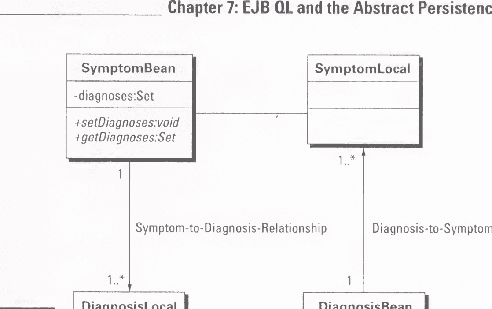

**清单7-6** 描述了`Symptom`和`Diagnosis`实体bean之间的多对多双向关系。注意两个关系角色的`<multiplicity>`都是`many`，并且两侧都有CMR字段。

### 清单7-6 多对多关系

```xml
<ejb-jar>

  <enterprise-beans>

    <entity>

      <ejb-name>DiagnosisEJB</ejb-name>

      ...

    </entity>

    <entity>

      <ejb-name>SymptomEJB</ejb-name>

      ...

    </entity>

  </enterprise-beans>

  <relationships>

    <!--以下粗体块定义了关系-->

    <ejb-relation>

      <!--第一个角色是从诊断的角度定义的。-->
```

### 清单7-6（续）

```xml
<ejb-relationship-role>

    <ejb-relationship-role-name>

      Diagnosis-to-Symptom-Relation

    </ejb-relationship-role-name>

<!--多重性为“多”，表示每个诊断可能对应多种症状。-->

      <multiplicity>many</multiplicity>

      <relationship-role-source>

        <ejb-name>DiagnosisEJB</ejb-name>

      </relationship-role-source>

<!--该关系是双向的，因为两侧都有CMR字段。-->

      <cmr-field>

        <field-name>symptoms</field-name>

        <cmr-field-type>java.util.Set</cmr-field-type>

      </cmr-field>

    </ejb-relationship-role>

<!--第二个角色是从症状的角度定义的。-->

    <ejb-relationship-role>

      <ejb-relationship-role-name>

        Symptom-to-Diagnosis-Relation

      </ejb-relationship-role-name>

<!--多重性为“多”，表示每个症状可能对应多种诊断。-->

      <multiplicity>many</multiplicity>

      <relationship-role-source>

        <ejb-name>SymptomEJB</ejb-name>

      </relationship-role-source>

<!--该关系是双向的，因为两侧都有CMR字段。-->

      <cmr-field>

        <field-name>diagnoses</field-name>

        <cmr-field-type>java.util.Set</cmr-field-type>

      </cmr-field>

    </ejb-relationship-role>

  </ejb-relation>

</relationships>

</ejb-jar>
```

因为诊断-症状关系是多对多的，所以`<cascade-delete/>`标签不能应用在关系的任一侧。此外，两个CMR字段都必须是Java Set。

## 实体bean的匹配

实体bean生来并非为了孤独。事实上，当你定义一个带有CMR字段的实体bean时，它自然会渴望与另一个实体bean建立关系。我想你可以说，如果一个实体bean有多个CMR字段，它就有参与多个关系的内在驱动力，甚至可能是同时参与。虽然EJB容器会在关系初始化后维护它，但它不知道应该将哪些实体与哪些实体匹配。作为程序员，你的责任不是质疑这些自然的渴望，而是支持它们。你扮演着实体bean媒人的角色。

为了使关系存在，该关系必须由EJB客户端初始化。在客户端程序中，只需要初始化关系的一侧。在初始化了一侧之后，EJB容器可以通过初始化另一侧来为你完成这项工作。

你可以使用多种技术中的一种来初始化CMR关系。有些很简单，而有些可能很简单或很复杂。你使用的技术取决于所讨论关系的基数和方向性。我在表7-1中总结了你可用的选项。

在表7-1中，每个实体bean都通过其CMR字段的`<multiplicity>`和其CMR访问器的可用性来描述。如果CMR的`<multiplicity>`是`one`，则此实体指的是关系另一侧的单个实体实例。如果`<multiplicity>`是`many`，则该实体指的是关系另一侧的多个实体实例。如果CMR访问器可用，则此实体可以在内部初始化关系。如果CMR访问器不可用，则必须从另一侧初始化关系。表7-1中的“初始化策略”列建议了在初始化关系时使用的技巧。

| CMR多重性 | CMR访问器可用 | 初始化策略 |
|:---|:---|:---|
| one | 是 | 将相关实体的本地接口传递给`create`方法，或者将相关实体的主键传递给`create`方法并使用`ejbSelect`方法进行选择。如果此关系是在创建后初始化的，则可以在业务方法内部实现初始化。 |
| 多个 | 是 | 将相关引用的集合传递给`create`方法，或传递一个可用于参数化`ejbSelect`方法的值以选择相关本地接口的集合。如果此实体已创建，可以通过使用CMR getter获取对CMR字段的引用，然后调用`Collection.add`或`Collection.addAll`方法将本地接口添加到关系中，从而从业务方法添加新关系。 |
| 一个 | 否 | 创建实体。客户端程序应获取实体的本地引用或主键，并根据本表前两行中概述的准则，将该引用传递给`create`方法或相关实体的业务方法。 |
| 多个 | 否 | 创建实体。客户端程序应获取实体的本地引用或主键，并根据本表前两行中概述的准则，将该引用传递给`create`方法或每个相关实体的业务方法。 |

> 调用CMR setter方法总会替换已存在的关系。因此，在多重性为`many`的CMR字段中，如果要向现有关系集合添加内容，必须首先使用CMR getter方法获取集合，然后调用`Collection.add`或`Collection.addAll`方法来添加新的相关实体。

> 请记住，多重性为`many`的CMR字段可以包含本地接口的`Collection`或`Set`。如果使用`Collection`，则CMR字段可能包含重复条目。如果使用`Collection.add`或`Collection.addAll`技术初始化CMR关系的两边，结果将是所有添加关系的重复引用。我真的想不出在CMR字段中出现重复条目有什么好处，因此我的建议是避免双重初始化。

由于向多重性为`many`的现有关系添加新实体可能很复杂，我将通过使用本书中一直使用的示例银行应用程序来说明该技术。在此场景中，`AccountHolder`可以有多个`Account`实体，但每个`Account`只能有一个`AccountHolder`。此外，`Account`没有指向`AccountHolder`的CMR访问器。因此，当为现有`AccountHolder`创建新`Account`时，必须在`AccountHolder` bean中初始化关系。清单7-7展示了向`AccountHolder`添加账户的`AccountHolderBean`代码。如您所见，使用了`Collection.add`方法。请查看粗体代码。

### 清单7-7

```java
package com.sextanttech.entities.implementations;

import javax.ejb.EntityBean;

import javax.ejb.EntityContext;

import java.util.Set;

import com.sextanttech.entities.interfaces.AccountLocal;

public abstract class AccountHolderBean implements EntityBean{

    /** This is the CMR getter.*/

    public abstract Set getAccounts();

    /** This is the CMR setter.*/

    public abstract void setAccounts(Set accounts);

    /** In this business method a new account is added.*/

    public void addNewAccount(AccountLocal account){

        // First obtain a reference to the CMR field

        Set accounts = getAccounts();

        // Next add the new account to the field.

        accounts.add(account);

    }

    //...Rest of entity bean class code.

}
```

清单7-8展示了实现此过程的客户端代码。请注意，由于`addNewAccount`方法接受本地接口，因此必须从本地客户端调用它。一种可以由远程客户端调用的替代方法是传递新账户的主键，并让`AccountHolder`使用以主键为参数的`ejbSelect`方法获取引用。请查看粗体代码。

### 清单7-8

```java
package com.sextanttech.client;

import com.sextanttech.entities.interfaces.AccountHolderLocal;

import ...
```

### 清单7-8（续）

```java
com.sextanttech.entities.interfaces.AccountHolderLocalHome;

import com.sextanttech.entities.interfaces.AccountLocal;

import com.sextanttech.entities.interfaces.AccountLocalHome;

import com.sextanttech.entities.AccountData;

public class AddAccountExample{

    private AccountHolderLocalHome holderHome;

    private AccountHolderLocal holder;

    private AccountLocalHome accountHome;

    private AccountLocal newAccount;

    public void CreateAccount(AccountData data){

        /*...In initialization code, obtain a reference to

            the

         * AccountHolderLocal interface and an

            AccountLocalHome

         * interface.

         */

        // Now create the new account.

        newAccount = accountHome.createAccount(data);

        // the local interface returned by the account is

            passed to the account holder's addAccount()

            business method.

        holder.addAccount(newAccount);

        // The relationship is initialized.

    }

}
```

## 探索`EJB QL`的语法

在EJB 2.0规范之前，实体bean没有标准的方式来管理从持久存储（如数据库）检索数据的过程。EJB查询语言——简称EJB QL——在EJB 2.0规范中创建，以解决这种标准缺失的问题。EJB QL基于结构化查询语言（SQL），与其非常相似。但也有一些区别。在本章的剩余部分，我将向您介绍EJB QL在实体bean中的作用，并探索这一重要创新的语法。

## 定义查询方法

EJB QL用于实现查询方法。*查询方法*是使用用EJB QL编写的查询实现的方法。目前有两种查询方法：查找方法和`ejbSelect`方法。查找方法——编写在远程home和本地home接口中——用于查找实体bean实例。`ejbSelect`方法——编写在实体bean类内部——可以查找实体bean实例或检索实体bean实例内的数据。虽然实体bean的查找方法可通过home接口被客户端应用程序访问，但`ejbSelect`方法隐藏在实体bean类内部，不得暴露给实体bean客户端。它们仅供内部使用。

> EJB QL语句只能返回单个值或相同类型的值集合。这应该对您有意义，因为每个查询的结果必须通过实现它的查询方法传递。Java语言要求每个函数只能返回一个值，因此相同的规则必须应用于EJB QL语句。

## 查找方法的查询

清单7-9展示了`Account`实体bean中一些查找方法的示例。虽然`findByPrimaryKey`方法是标准的，由容器实现，但所有其余的查找方法都是自定义的。`findByPrimaryKey`方法不是用EJB QL实现的，但自定义查找方法是。

### 清单7-9 AccountLocalHome中的查找方法

```java
package com.sextanttech.entities.interfaces;

import javax.ejb.EJBLocalHome;

import javax.ejb.CreateException;

import javax.ejb.FinderException;

import java.util.Date;

public interface AccountLocalHome extends EJBLocalHome {

    // default findByPrimaryKey method is required.

    public AccountLocal findByPrimaryKey(AccountKey key)

        throws FinderException;

    // This is a custom, requiring an EJB QL statement.

    public java.util.Set findByAccountHolder(long clientId,

        long createDate) throws FinderException;

    // ... rest of AccountLocalHome interface

}
```

清单7-9中定义的`findByAccountHolder(long clientId, long createDate)`方法必须用EJB QL查询实现。该查询在部署描述符中使用`<query>`元素提供。必须为实体bean中的每个查询方法定义一个查询元素。`<query>`元素嵌套在实体bean的`<entity>`标签内，并将查询映射到实体bean组件中对应的方法。参见清单7-10中的示例。

### 清单7-10 `<query>`元素

```xml
<ejb-jar>

  <enterprise-beans>

    <entity>

      <ejb-name>AccountEntityBean</ejb-name>

      <!--实体 bean 描述的其余部分。-->

      <query>

        <description>

          此方法根据给定的账户持有人查找账户。

        </description>

        <query-method>

          <method-name>findByAccountHolder</method-name>

          <method-params>

            <method-param>long</method-param>
```


```xml
<method-param>long</method-param>
```

```xml
</method-params>

</query-method>

<ejb-ql>

  SELECT owner.accounts

  FROM AccountHolder owner

  WHERE owner.clientId = ?1 AND owner.createDate = ?2

</ejb-ql>

</query>

</entity>

</enterprise-beans>

</ejb-jar>
```

正如你从清单 7-10 所见，`<query>` 标签有四个主要部分：

- `<description>`：这是一个可选属性，用于描述该标签的用途。
- `<query-method>`：此属性描述查询所适用的查询方法的特性。EJB 容器使用此标签将方法的输入参数映射到查询，以及将查询结果映射回方法。它包含以下特性：
  - `<method-name>`：此属性标识此查询所适用的方法名称。
  - `<method-params>`：此属性标识在方法名称中识别的方法的参数数量和类型。每个参数嵌套在 `<method-param>` 子元素中，该元素标识参数类型。
- `<result-type-mapping>`：此可选属性只能在查询方法是返回实体对象引用的 `ejbSelect<METHOD>` 时使用。此元素决定结果将是实体对象的本地接口还是远程接口。默认值为 `Local`，因此当查询旨在返回本地接口时不需要此属性。要返回远程接口，该属性必须指定 `Remote`。
- `<ejb-ql>`：此属性包含 EJB QL 语句。EJB QL 语句必须是实体 bean 中对应方法的合法语句。这基本上意味着查询方法的参数必须可转换为查询语句，且查询语句的返回值必须可转换为查询方法的返回类型。如果源对象可以遵循 Java 类型转换的标准惯例转换为目标对象，则它是可转换的。

查找方法只能返回引用其所在实体 bean 的组件接口。例如，在 `Account` 实体中定义的任何查找方法只能返回对 `Account` 组件接口的引用。它不能返回对任何其他类型实体的引用。

## `ejbSelect` 方法的查询

EJB 2.0 规范在实体 bean 类中引入了一种新方法，称为 `ejbSelect` 方法。这些方法不能在实体 bean 的本地或组件接口中定义——也就是说，客户端程序不能直接访问它们。然而，由于实体 bean 类中的任何方法实现都可以调用 `ejbSelect` 方法，你的客户端应用程序可以通过从业务方法实现内部调用 `ejbSelect` 方法，从而受益于 EJB QL 强大的查询功能。清单 7-11 展示了如何运用这种能力：定义了一个 `ejbSelect` 方法，并展示该方法如何由一个 `ejbHome` 方法调用。使用 `ejbSelect` 方法，`ejbHome` 方法能够快速计算 `AccountHolder` 的净资产。请查看粗体代码。

## 清单 7-11 使用 `ejbSelect` 方法

```java
package com.sextanttech.entities.implementations;

import javax.ejb.EntityBean;

import javax.ejb.EntityContext;

import javax.ejb.FinderException;

import java.util.Set;

import java.util.Iterator;

import com.sextanttech.entities.interfaces.AccountLocal;

public abstract class AccountBean implements EntityBean {

    /** 这是调用 ejbSelect()

        方法的本地方法。*/

    public double ejbHomeGetNetWorth(AccountHolderKey key) {

        Collection balances = this.ejbSelectNetWorth(

            key.getClientId(), key.getCreateDate());

        Iterator i = balances.iterator();

        double sum = 0.0;

        while (i.hasNext()) {

            sum += ((Double)i.next()).doubleValue();

        }
```

## 清单 7-11（续）

```java
        return sum;

    }

    /** 此查找方法返回对 AccountHolder 的引用。*/

    public abstract AccountHolderLocal

        ejbSelectAccountHolder( long

        clientId, long createDate) throws FinderException;

    /** 此查找方法返回账户持有人的净资产。

        */

    public abstract double ejbSelectNetWorth(long clientId,

        long createDate) throws FinderException;

}
```

`ejbSelect` 方法与对应的查找方法之间的一个区别在于，`ejbSelect` 方法对其返回值没有相同的限制。`ejbSelect` 方法可以返回抽象模式中定义的任何类型的值，并且允许获取对 EJB 应用程序中定义的任何实体 bean 的组件引用。

部署描述符中 `<query>` 元素的实现对于查找方法和 `ejbSelect` 方法实际上是相同的。清单 7-12 说明了 `ejbSelectNetWorth` 查询语句的实现。

## 清单 7-12 `ejbSelect` 方法的查询

```xml
<ejb-jar>

  <enterprise-beans>

    <entity>

      <ejb-name>AccountEntityBean</ejb-name>

      <!--实体 bean 描述的其余部分。-->

      <query>

        <description>

          此方法根据给定的账户持有人查找账户。

        </description>

        <query-method>

          <method-name>ejbSelectAllBalances</method-name>

          <method-params>

            <method-param>long</method-param>

            <method-param>long</method-param>

          </method-params>

        </query-method>

        <ejb-ql>

          SELECT accts.balance

          FROM AccountHolder owner, IN(owner.accounts) accts

          WHERE owner.clientId = ?1 AND owner.createDate = ?2

        </ejb-ql>

      </query>

    </entity>

  </enterprise-beans>

</ejb-jar>
```

对于你们这些 SQL 专家来说，在简要审查了这个 EJB-QL 语句后，你可能会注意到它执行的工作如果借助集合操作（例如 `SELECT SUM(accts.balance)`）会变得更简单。不幸的是，EJB QL 目前还不支持集合操作。我希望这个特性将在下一个版本中得到支持。

## EJB QL 基础

以下代码片段说明了 EJB QL 语句的基本结构：

```sql
SELECT [DISTINCT]{<single_valued_path_expression> |

    OBJECT(<identification_variable>)}

FROM <identification_variable_declaration>

[WHERE <conditional_expression>]
```

如果你在看到这段代码后，忍不住想发出一声查理·布朗式的“天哪！”，我完全理解。为了使事情更容易，我将稍微分解一下这个语句。你首先应该注意的是，该语句由三个子句组成：一个 `SELECT` 子句、一个 `FROM` 子句和一个 `WHERE` 子句。`SELECT` 和 `FROM` 子句是必需的，而 `WHERE` 子句是可选的。

EJB QL 语句的关键字——例如我之前提到的 `SELECT`、`FROM` 和 `WHERE` 术语——不区分大小写，这意味着它们可以大写或小写，或任何组合书写。为了清晰起见，我喜欢将所有关键字大写书写，以将它们与语句的其余部分区分开来。

以下列表详细说明了三个子句在 EJB QL 中如何工作：

- **EJB 容器实际上首先读取 `FROM` 子句，因为它包含了语句的所有变量声明。** 使用 `FROM` 子句，EJB 容器获取对语句范围内所有实体 bean 的引用。如果一个实体 bean 在 `FROM` 子句中被标识并且已被 EJB 容器持久化——意味着它已存储到数据库——则该实体 bean 就在范围内。
- **`WHERE` 子句标识条件表达式，用于限制 select 语句可返回的值的范围。** 此子句第二个执行，用于消除在语句范围内但不满足条件表达式条件的实体。

## 声明 EJB QL 变量

EJB QL 在整个语句中使用实体和实体的属性。这些实体通过*标识变量*进行引用。标识变量在 EJB QL 语句的 `FROM` 子句中声明。每个标识变量都有一个类型——对应于抽象持久化模式中定义的类型——和一个标识符——即变量名。考虑以下 `FROM` 子句：

```sql
FROM Account acct
```

该子句声明了一个标识变量 `acct`，其类型为 `Account`。在这种情况下，`Account` 恰好是 `AccountEntityBean` 的 `<abstract-schema-name>` 的值。正如你可能在本章开头回忆起的，每个在 EJB QL 查询中使用的实体 bean 都必须有一个 `<abstract-schema-name>`。

> 提示  
> 标识变量不区分大小写，因此标识符 `acct`、`Acct`、`ACCT` 和 `AcCt` 都标识同一个变量。为了可读性，我始终将标识变量写成小写形式。

标识变量必须遵循以下命名规则：

- 标识变量不能与部署描述符中任何地方定义的 `<abstract-schema-name>` 相同。
- 标识变量不能与部署描述符中任何地方声明的 `<ejb-name>` 相同。
- 标识变量不能与 EJB QL 中的任何保留字相同。

除了这些指导原则之外，EJB 规范还建议标识变量不要与 SQL 中的任何保留字相同。这一建议旨在确保现有的 EJB QL 语句与 EJB QL 规范的未来版本兼容。保留字是任何语言中在该语言上下文中具有特殊含义的词汇。

SQL 中有很多保留字，因此我推荐阅读 SQL 参考书籍，例如 *SQL For Dummies, 4th Edition*，由 Allen G. Taylor 撰写（Hungry Minds, Inc. 出版）。

标识变量在 `FROM` 子句中从左到右声明。标识变量声明后，可以在其他标识变量声明中使用，如下所示：

```sql
FROM AccountHolder owner, IN(owner.accounts) accts
```

第一个标识变量 `owner` 被声明为 `AccountHolder` 类型。在下一个声明中，`IN` 运算符获取对 `owner` 实体中所有账户的引用，并将这些账户存储在 `accts` 变量中。`owner.accounts` 是对 `AccountHolderBean` 中 CMR 字段 `accounts` 的引用。

## 使用 EJB QL 路径表达式

路径表达式是对标识变量的 CMP 或 CMR 字段的引用。例如，表达式 `owner.accounts` 是一个路径表达式，它引用标识变量 `owner` 中的 CMR 字段 `accounts`。在 EJB QL 中，每个路径表达式的*根*（表达式中的第一个项）都是一个标识变量。用一个称为*导航运算符*的句点来引用标识变量的属性。每个路径表达式必须以单值属性或集合值属性结尾。以下是一些示例：

- `<multiplicity>` 为 `one` 的 CMR 字段是单值属性。
- `<multiplicity>` 为 `many` 的 CMR 字段是集合值属性。

CMP 字段可以是单值属性或集合值属性，这取决于 CMP 字段的 Java 类型。如果类型是 Java 集合，那么它就是集合值属性。否则，它是一个单值属性，其值为 CMP 字段的 Java 类型。

路径表达式引用*多值属性*是非法的。多值属性是一组未包含在集合中的属性。以下示例是一个多值属性：

`owner.accounts.balance`

在这个示例中，`balance` 对于其所属的每个账户来说是单值属性。但是，由于 `accounts` 属性是一个集合，每个账户的余额是一个单独的值。该表达式对集合中的每个账户产生不同的值，这使得该表达式求值为多值属性。

为了防止创建多值属性，请记住集合值属性唯一可以使用的位置是在路径表达式的末尾。如果在路径表达式的任何其他位置使用集合值属性，将会生成非法的多值属性。

## EJB QL 中的变量变体

EJB QL 中实际上有两种不同的变量：*范围变量*和*集合成员变量*。这两种变量之间的区别在于它们的声明方式。范围变量通过使用 `<abstract-schema-name>` 值作为其类型来声明。`AccountHolder owner` 是一个范围变量声明，因为 `AccountHolder` 是 `AccountHolderEntityBean` 的一个 `<abstract-schema-name>`。

另一方面，集合成员变量通过对实体 bean 内部 CMR 字段的引用来声明。要声明集合成员变量，必须使用*路径表达式*，该表达式使用*点运算符表示法*引用实体 bean 的 CMR 或 CMP 字段。例如，`owner.accounts` 是一个同位语表达式。`owner` 是范围变量，而句点——点——是*导航*运算符。`accounts` 属性是对 `AccountHolderEntityBean` 的 CMR 字段的引用。作为一个单一表达式，`owner.accounts` 是一个从 `owner` 导航到该 `owner` 的 `accounts` 的路径表达式。

表达式 `IN(owner.accounts) accts` 声明了一个名为 `accts` 的集合成员变量。这是一个集合成员变量，因为 `accounts` 属性是属于（或是其成员的）`owner` 范围变量的账户集合。集合成员变量总是使用路径熟知来声明其类型。

并非所有 CMR 字段都是集合值属性。如果你有一个多重性为一的 CMR 字段，你可以在路径表达式中跨 CMR 关系导航，以获取关系另一端的属性值。由于 `AccountHolder` 到 `AccountHolderAddress` 的多重性为一，以下路径表达式是合法的：

```sql
owner.address.street
```

## 创建简单的 EJB QL 查询

EJB QL 查询语句最简单的形式是从特定类型的实体中选择单值或对象。这意味着没有连接（即，`FROM` 子句只包含单个实体）且没有 `WHERE` 子句。结果可能是所选实体的组件接口、CMR 字段或 CMP 字段。没有连接的简单查询可以返回单值或值的集合。以下查询展示了返回所有 `Account` bean 组件接口的 EJB QL 查询：

```sql
SELECT DISTINCT OBJECT(acct)

FROM Account acct
```


这个简单查询说明了查询语句的 `SELECT` 子句中经常使用的一些语法元素。

- `DISTINCT` 关键字告诉 EJB 容器消除结果中的任何重复引用。因为前面的语句返回值的集合，如果它在查询方法中映射到 `java.util.Collection` 对象，集合可能会有重复。使用 `DISTINCT` 关键字可以防止重复。
- `OBJECT` 运算符必须包围 `SELECT` 子句中不属于路径表达式的任何标识变量。在前面的示例中，`acct` 是标识变量，且未在路径表达式中使用，因此它必须被 `OBJECT` 运算符包围。

如果查询的 `select` 方法的返回值是 `java.util.Set`，无论查询中是否使用该术语，`DISTINCT` 运算符都会自动应用于查询结果。然而，即使返回 `java.util.Set`，我也建议在任何查询意图是返回无重复结果的集合时使用 `DISTINCT` 关键字。这向其他程序员清楚地表明不允许查询结果中有重复。

在下一个查询中，使用路径运算符返回所有账户的所有余额。

> **186** 第三部分：实体 Bean：事物本来的方式
>
> ✔ `SELECT` 子句标识语句的返回值。返回值可以是单个实体 bean 属性——称为*单值路径表达式*——或是对实体 bean 的本地或远程接口的引用——称为*标识变量*。EJB QL 语句可以返回单值或值的集合。

语句的返回类型由其对应的 EJB 容器转换为查询方法的返回类型。

在本章的其余部分，我将提供你需要理解 EJB QL 语句的所有信息。但我先澄清几个要素：

> ✔ EJB QL 语句返回单值或值的集合。如果返回值是单值，它可以是实体 bean 实例的组件接口或实体 bean 中 CMP 字段的值。如果值是集合，其类型为 `java.util.Collection` 或 `java.util.Set`。集合值始终是组件接口的集合。
>
> ✔ 在 `ejbSelect` 方法中定义的 EJB QL 语句可以返回抽象持久化模式中定义的任何类型。`ejbSelect` 方法可以返回 CMP 字段的值、CMR 字段的值或 `select` 语句范围内任何实体 bean 的组件接口。语句中 `SELECT` 子句的返回值必须可转换为 `ejbSelect` 语句的返回值。EJB 容器负责执行实际的转换。

# 第三部分：实体 Bean：事物的本质

```sql
SELECT acct.balance
FROM Account acct
```

在此示例中，请注意未使用 `DISTINCT` 关键字。因为两个账户余额相同是合理的，并且我需要获取所有账户的余额，因此返回结果应是一个允许重复值的集合。同时请注意未使用 `OBJECT` 运算符。此查询的结果是一个路径表达式。结果是 `AccountEntityBean` 类所有 `balance` 属性的值，并将以 `java.util.Collection` 的形式返回。如果您回顾 `Account` 类，会发现 `balance` 属性是一个基本数据类型，这意味着如果不将其转换为其 Java 对象表示形式，就无法将其添加到集合中。EJB 容器负责执行此任务。


由于前面查询的结果不是一个组件接口，因此仅能在 `ejbSelect` 方法中合法使用该查询。

在最后的示例中，查询使用路径表达式导航到 `Account` 实体 Bean 的 CMR 字段，返回对账户持有人的引用。虽然此字段的返回值是一个组件接口，但它不需要 `OBJECT` 运算符，因为 `SELECT` 子句表达式是一个路径表达式。

```sql
SELECT acct.accountHolder
FROM Account acct
```

## 定义连接表达式

连接表达式是一种通过导航实体间关系来连接两个实体的表达式。在 EJB QL 中，连接表达式通过使用 `IN` 运算符引用实体 Bean 的 CMR 字段来实现。例如，假定 `Account` 和 `AccountHolder` 是相关的，可以将它们连接起来以遍历该关系。因此，可以从 `AccountHolder` 导航到 `Account`。`IN` 运算符接收一个 CMR 字段的引用作为参数，并返回一个对 CMR 字段成员的引用，该过程如以下代码所示：

```sql
FROM AccountHolder owner, IN(owner.accounts) accts
```

在此示例中，您可以看到 `accounts` CMR 字段被传递给了 `IN` 运算符。该运算符返回一个对存储在 CMR 字段中的 `Account` 对象集合的引用，从而实现了对关系的遍历。

EJB QL 标识符变量通过笛卡尔积进行连接，这意味着 `FROM` 子句中的每个属性都以所有可能的组合方式与所有其他属性连接。在前面的示例中，通过将所有 `AccountHolder` 实例与所有拥有所有者的账户实例进行连接，形成了一个笛卡尔积。要从笛卡尔积中排除结果，必须提供一个 `WHERE` 子句。

## 定义条件表达式

条件表达式在 `select` 语句的 `WHERE` 子句中定义。由于条件表达式可以由其他条件表达式组成，因此 `WHERE` 子句很容易成为 EJB QL `select` 语句中最复杂的子句。有许多不同类型的条件表达式，其中一些有特殊的规则来管理其使用。

条件表达式可以通过布尔运算符 `AND`、`OR` 或 `NOT` 组合成更大的条件表达式。因此，在 EJB QL 语句的 `WHERE` 子句中创建复杂表达式非常容易。

以下列表列出了所有不同类型的条件表达式：

- **布尔表达式：** 布尔表达式由一个左值和一个右值组成，它们使用比较运算符（如 `=`、`>`、`>=`、`<`、`<=` 和 `<>`）进行比较。布尔表达式的结果是布尔值 `TRUE`、`FALSE` 或 `UNKNOWN`。
- **BETWEEN 表达式：** `BETWEEN` 表达式用于确定给定值是否介于两个数值之间。数值必须是 `int`、`long`、`float` 或 `double` 类型的字面值。`BETWEEN` 表达式的语法是：

  ```text
  numeric_argument [NOT] BETWEEN numeric_literal AND numeric_literal
  ```

  第一个 `numeric_literal` 的值必须小于第二个 `numeric_literal` 的值。
- **IN 表达式：** `IN` 表达式用于确定给定的字符串值是否在一组 `String` 常量中。例如，您可以使用以下 `IN` 表达式来确定地址是否在特定的州内：

  ```sql
  address.state IN('AZ', 'NM', 'CA').
  ```

  `IN` 运算符包含尽可能多的字符串字面量，但每个字符串字面量必须用逗号分隔。在 EJB QL 中，字符串字面量可以用单引号或双引号括起来。
- **LIKE 表达式：** `LIKE` 表达式用于确定字符串值是否匹配模式值。`LIKE` 表达式的语法是：

  ```text
  string_value [NOT] LIKE string_pattern
  ```

  字符串模式是一个带有模式字符和转义字符的字面字符串。模式字符是 `%`——代表任何字符序列——和 `_`——代表任何单个字符。转义字符是 `\`，它使模式字符被视为字面字符串的一部分，而不是作为特殊字符被解析。以下 `LIKE` 表达式的结果为 `TRUE`，因为表达式的左侧与右侧表达的模式匹配。

  ```sql
  "This is my _example" LIKE "T__s%/_exam%"
  ```

- **NULL 比较表达式：** `NULL` 比较表达式用于确定单值变量的值是否为 `NULL`。因为 `NULL` 值是未知的，它们不能用于典型的比较操作。为了解决这个问题，提供了 `NULL` 运算符来确定属性是否为 `NULL`。`NULL` 比较表达式只能对单值路径表达式执行。语法是：

  ```text
  single_valued_path_expression IS [NOT] NULL.
  ```

- **EMPTY 集合表达式：** `EMPTY` 集合表达式是集合对应于 `NULL` 比较表达式的等价物。通常情况下，即使集合没有值，它也可以是查询的一部分。为了确定集合是否有值，使用 `EMPTY` 集合表达式。表达式语法是：

  ```text
  collection_value_path_expression IS [NOT] EMPTY.
  ```

- **集合 MEMBER 表达式：** 集合 MEMBER 表达式用于确定给定属性是否是指定集合的成员。此表达式的语法是：

  ```text
  {single_valued_navigation | identification_variable | input parameter} [NOT] MEMBER [OF] collection_value_path_expression
  ```

  单值导航属性是一个引用 CMR 字段的路径表达式。
- **函数表达式：** 有多种字符串和数学函数可用于创建 EJB QL 查询。我将在下一节“使用内置函数”中介绍这些表达式。

在 `WHERE` 子句中，集合值路径表达式只能用于 `EMPTY` 集合表达式或集合 MEMBER 表达式中。所有其他路径表达式都必须求值为单个值。

## 通过示例创建条件查询

由于有太多不同类型的条件表达式，我提供了本节，以便您可以看到不同条件表达式的示例以及它们对查询结果的影响。在查看这些查询示例时，您可以参考图 7-4 中的实体-关系图。该图显示了在抽象模式中定义的实体以及它们彼此之间的关系。

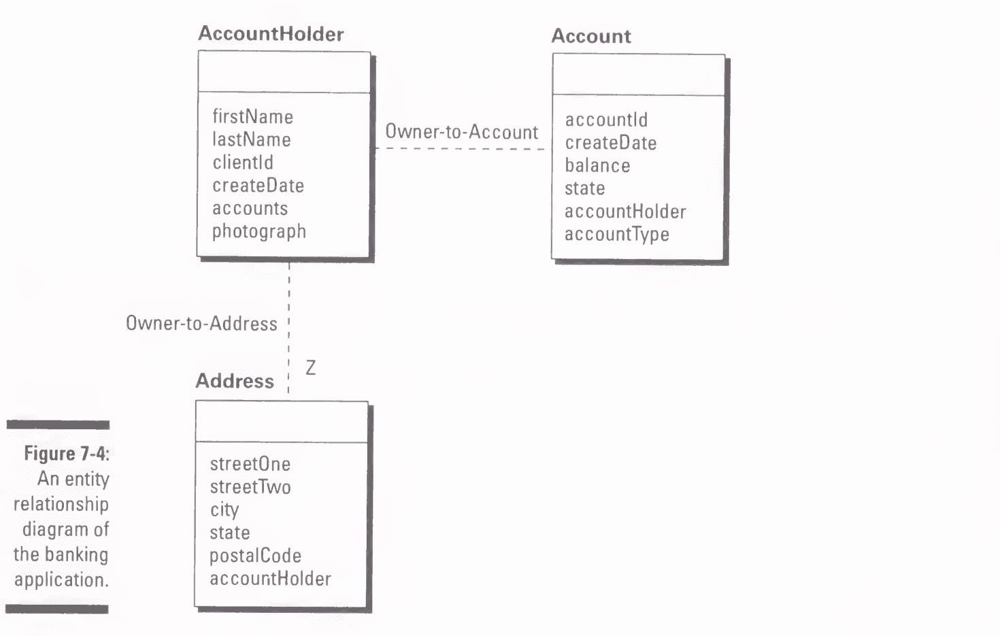

在第一个示例中，查询的目标是获取所有拥有账户的账户持有人。由于一些账户持有人可能没有账户，因此可以通过在 `AccountHolderEntityBean` 的 `accounts` CMR 字段上使用 `EMPTY` 集合表达式来实现此查询的结果。生成的查询如下所示：

```sql
SELECT OBJECT(owner)
FROM AccountHolder owner
WHERE owner.accounts IS NOT EMPTY
```

## 在查询中使用 XML CDATA 节

在接下来的示例中，查询的目标是检索所有姓氏以字符 `"Sch"` 开头的账户持有人。在此情况下无法执行相等操作；因为那将要求所有账户持有人的姓氏恰好为 `"Sch"`。因此，需要使用 `LIKE` 运算符进行模式匹配，得到如下查询：

```sql
SELECT OBJECT(owner)
FROM AccountHolder owner
WHERE owner.lastName LIKE "Sch%"
```

在下一个示例中，查询的目标是获取所有账户余额大于 `5000.00` 的账户持有人——我打算向他们所有人发送特别促销优惠。这个查询稍微复杂一些，因为它需要使用连接——通过 `IN` 表达式——来获得所需结果。请记住，连接表达了 EJB QL 语句 `FROM` 子句中两个实体之间的关系。因为一个持有人可能有多个余额大于 `5000.00` 的账户，而我只想为每个持有人获取一个结果，所以我使用 `DISTINCT` 表达式来消除重复项。最终查询如下：

如您所知，EJB QL 查询是在 EJB 应用程序的部署描述符中编写的，部署描述符是一个 XML 文档。XML 文档通过使用以 `<` 和 `>` 字符分隔的标签来构建。因为这些字符在 XML 语言中具有特殊含义，所以不能用在 XML 属性的值中。因此，以下 XML 属性在解析文档时会产生错误：

```xml
<ejb-ql>
  SELECT DISTINCT OBJECT(owner)
  FROM AccountHolder owner,
    IN(owner.Accounts) accts
  WHERE accts.balance > 5000.00
</ejb-ql>
```

问题在于在 `select` 语句中使用了大于符号（`>`）。因为这是一个特殊字符，所以不能出现在 XML 标签的值中。好消息是 XML 有一个特殊的转义元素，可用于告知 XML 解析器标签内的内容是数据而非 XML 标签。这个特殊标签称为 CDATA 节。每当您需要在 XML 文档中书写包含特殊意义字符（如 `<` 和 `>` 字符）的内容时，可以将内容括在 CDATA 节中，这将确保 XML 解析器正确读取内容。以下是将 CDATA 节应用于前面查询的示例。我已用粗体突出显示了 CDATA 节的语法。

```xml
<ejb-ql>
  <![CDATA[
    SELECT DISTINCT OBJECT(owner)
    FROM AccountHolder owner,
      IN(owner.Accounts) accts
    WHERE accts.balance > 5000.00
  ]]>
</ejb-ql>
```

# 第 7 章：EJB QL 与抽象持久化模式

```sql
SELECT DISTINCT OBJECT(owner)
FROM AccountHolder owner, IN(owner.Accounts) accts
WHERE accts.balance > 5000.00
```

接下来，我修改前面的查询，使其返回账户余额在 `2000` 到 `5000` 之间的持有人。此语句需要使用 `BETWEEN` 表达式。得到的查询为：

```sql
SELECT DISTINCT OBJECT(owner)
FROM AccountHolder owner, IN(owner.Accounts) accts
WHERE accts.balance BETWEEN 2000.00 AND 5000.00
```

有时查询需要在 `WHERE` 子句中使用多个表达式。如果我在前面的查询中将促销活动定向到特定州的居民，我就必须添加另一个连接来获取账户持有人的地址，然后将结果限制在居住于指定州的账户持有人。我将促销活动定向到华盛顿州、俄勒冈州和加利福尼亚州的居民。这给了我一个在 `WHERE` 子句中使用 `IN` 表达式的机会。得到的查询为：

```sql
SELECT DISTINCT OBJECT(owner)
FROM AccountHolder owner,
  IN(owner.Accounts) accts,
  IN(owner.Address) addr
WHERE accts.balance BETWEEN 2000.00 AND 5000.00
  AND addr.state IN('OR', 'WA', 'CA')
```

所有标识符变量在 `FROM` 子句中自动连接。然后，`WHERE` 子句通过每个条件表达式中表达的标准来限制结果。因此，前面的语句表示：“首先，获取所有持有人、他们的地址和他们的账户。接下来，我想删除所有账户余额小于 `2000.00` 和大于 `5000.00` 的持有人。之后，我想删除所有不居住在俄勒冈州、华盛顿州或加利福尼亚州的持有人。最后，返回剩余的持有人。”`WHERE` 子句中的第二个 `AND` 表达式要求左侧条件表达式和右侧条件表达式都评估为 `TRUE`，整个条件表达式才为 `TRUE`。

在我的下一个示例中，我建立了一个假设场景。假设由于技术进步，ATM 机中的摄像头能够将 ATM 前的人的外貌与数据库中该人的照片进行比较，并将两者身份匹配作为安全措施的一部分。这要求在每个账户持有人的实体 bean 中添加一个字段来存储照片数据。我需要检索所有尚未拍照的客户，以便向他们发送通知，让他们来分行处为新的安全功能拍照。此查询需要使用 `NULL` 值表达式，该表达式将检索所有没有照片的账户持有人。我创建了以下 EJB QL 查询：

**196** 第 III 部分：实体 Bean：事物的运作方式

```sql
SELECT DISTINCT OBJECT(owner)
FROM AccountHolder owner
WHERE owner.photograph IS NULL
```

执行评估实体成员资格的查询可用于生成新的促销材料。假设我的银行业务偶尔需要向所有拥有特定类型账户的所有账户持有人发送通知。在这种情况下，我使用参数化查询语法创建一个可重用的查询，用于生成邮件列表，无论我当前需要什么类型的账户。通过传入所需的账户类型，我可以在运行时更改查询的结果。以下是最终查询：

```sql
SELECT DISTINCT OBJECT(owner)
FROM AccountHolder owner, Account acct
WHERE acct.type = ?1
  AND owner.accounts MEMBER OF acct
```


在前面的示例中，提供了一个参数来标识要包含在邮件列表中的账户类型。我将在接下来的“创建参数化 EJB QL 查询”部分更详细地介绍参数语法。

## 使用内置函数

虽然 EJB QL 提供了一些可用于在 WHERE 子句中操作属性值的内置函数，但选择相当有限。我一向乐观，我认为这只是意味着在未来版本中有很大的改进空间。函数仅限于字符串函数和数学函数。字符串函数的选择包括：

- `CONCAT(<string>, <string>)`：此函数将第二个字符串附加到第一个字符串，产生一个单独的字符串作为结果。
- `LENGTH(<string>)`：此函数评估一个字符串并返回字符串中的字符数（作为 `int`）。
- `LOCATE(<string1>, <string2> [, <startPosition>])`：类似于 LIKE 操作，此函数返回 `string1` 在 `string2` 中首次出现的 `int` 位置。可选的 `startPosition` 是一个 `int` 值，用于告诉容器应将 `string2` 中的哪个字符用作起点。请注意，起始位置基于 0，这意味着字符串中的第一个字符位于位置 0，最后一个字符位于位置 `String.length() - 1`。此规则源自 Java 语言关于 `String` 对象的规则——而不是底层数据库的规则。
- `SUBSTRING(<string>, <startPosition>, <length>)`：此函数返回从字符串参数中切出的一个字符串。返回的字符串以指定的 `int startPosition` 处的字符开始，并具有 `<length>` 参数指定的长度。因此，`SUBSTRING("A sample", 2, 4)` 返回值 `samp`。

也许字符串函数类别中最令人惊讶的疏忽是 `UPPER` 和 `LOWER`，它们转换字符串中字符的大小写，以便您可以执行不区分大小写的比较。如果您对字符串函数的选择感到失望，请等到您看到算术类别中的选项：

- `ABS(number)`：返回数字的绝对值，无论它是 `int`、`float` 还是 `double`。
- `SQRT(double)`：返回 `double` 数字的平方根。

## 创建参数化 EJB QL 查询

我喜欢把最好的留到最后，在功能表达式主题方面有些令人失望之后，好消息是 EJB QL 并未忽略参数化查询的强大功能。参数化查询获取查询方法的参数，并在运行时将它们插入到查询中。插入参数的过程与 SQL 的过程非常相似：

- 在 EJB QL 查询语句中，参数通过其在查询方法参数列表中的数字位置来标识。方法中的第一个参数分配给位置 1，第二个参数分配给位置 2，依此类推。
- 要在查询中引用参数，您首先键入问号（`?`），后跟要使用的参数的编号。因此，如果您想在 EJB QL 语句中使用查询方法的第一个参数，您应在希望参数出现的位置键入 `?1`。

在以下示例中，一个 `ejbSelect` 方法定义了两个输入参数，以粗体标出：

```java
public abstract Set ejbSelectAllBalances(long clientId,
    long createDate) throws FinderException;
```

然后在部署描述符中标识这些参数。`clientId` 属性是参数 `?1`，`createDate` 是参数 `?2`：

```xml
<query-method>
    <method-name>ejbSelectAllBalances</method-name>
    <method-params>
        <method-param>long</method-param>
        <method-param>long</method-param>
    </method-params>
</query-method>

<ejb-ql>
    SELECT accts.balance
    FROM AccountHolder owner, IN(owner.accounts) accts
    WHERE owner.clientId = ?1 AND owner.createDate = ?2
</ejb-ql>
```

# 第8章：使用 Bean 管理持久化构建实体 Bean

## 本章内容

- 了解容器管理持久化与 Bean 管理持久化之间的区别
- 确定何时适合使用 Bean 管理持久化
- 探究使用 Bean 管理持久化的实体 Bean 的生命周期
- 编写实体 Bean 组件
- 定义部署描述符

在第6章中，我介绍了创建使用容器管理持久化的实体 Bean。容器管理持久化（CMP）是实体 Bean 中创建、检索和修改数据的相对简单的方法。与数据存储和检索相关的大部分复杂性由容器管理。但并非所有应用程序都需要——也不应利用——容器管理持久化提供的特性。为了给应用程序开发人员提供对持久化过程的更多控制，EJB 规范还定义了一种称为 Bean 管理持久化的持久化过程。

Bean 管理持久化（BMP）要求 EJB Bean 开发人员实现创建、查找和修改实体 Bean 的所有方法。这种方法使开发人员能够更紧密地控制持久化过程。在 CMP 模型无法有效管理持久化的情况下，这种控制是必要的。例如，如果你需要访问传统应用程序中的数据，而该应用程序并非数据库，那么你就必须使用 Bean 管理持久化。

除了管理持久化之外，使用 Bean 管理持久化的实体 Bean 与使用容器管理持久化的实体 Bean 大部分是相同的。在本章中，你将了解容器管理持久化（CMP）和 Bean 管理持久化之间的区别，以及找到创建使用 Bean 管理持久化的实体 Bean 所需的信息。我的建议是，在深入创建 BMP 实体 Bean 之前，先熟悉 CMP 模型的使用。如果你阅读了第6章关于 CMP 实体 Bean 和第7章关于抽象持久化模式的内容，那么在处理这个主题时你会领先一步。

使用 Bean 管理持久化需要一些关于 SQL 和 Java 数据库连接（JDBC）API 的知识。我在本章中提供了 JDBC 的介绍，但如果你需要 SQL 方面的帮助，我推荐你购买一本由 James R Groff 和 Paul N. Weinberg 合著、Osborne 出版的《Complete SQL Handbook》。

当你使用 Bean 管理持久化时，EJB 应用程序不会定义抽象持久化模式——这是容器用来让实体 Bean 彼此了解关系并使用 EJB QL 语言查询彼此数据的便捷特性。（有关抽象持久化模式的更多信息，请参见第7章。）然而，如果 BMP 不定义抽象持久化模式，这意味着你不能使用 EJB QL，也不能在实体 Bean 中定义查询方法（在我看来，这对 BMP 实体 Bean 来说是一个相当大的缺点）。

## 理解 Bean 管理持久化

理解使用 Bean 管理持久化的实体 Bean 并没有什么神奇之处。与使用容器管理持久化相比，使用 Bean 管理持久化的关键区别在于，Bean 开发人员负责实现所有数据库交互，这意味着：

- **Bean 开发人员负责获取和释放数据库连接。** 数据库连接允许实体 Bean 与数据库通信，这对于在数据库中创建、检索、修改和删除实体至关重要。
- **Bean 开发人员必须为所有实体 Bean 与数据库交互的方法提供实现。** 这是 Bean 管理持久化与容器管理持久化之间的关键区别。在容器管理持久化中，Bean 开发人员定义抽象方法，而容器负责实现这些方法。

决定使用 Bean 管理持久化会产生重要后果，你应该在开始开发 EJB 应用程序之前考虑这些后果。这是因为即使你可以在应用程序中混合使用这两种方法，但如果超过一小部分的实体 Bean 使用 BMP，那么你将无法从 CMP 框架中获得太多价值。有关更多信息，请参见接下来的侧栏“混合使用 BMP 和 CMP 实体”。

当你使用 Bean 管理持久化时，你需要编写使用 Java 数据库连接（JDBC）API 直接与数据库交互的代码。尽管两种类型的持久化（容器管理和 Bean 管理）都使用 JDBC，但对于容器管理持久化，你不必编写 JDBC 语句——容器会为你完成。

如果你选择使用 Bean 管理持久化，你将需要了解如何使用 JDBC 与数据库交互。市场上有两种 JDBC API：JDBC 2.0 和 JDBC 3.0。截至本书撰写时，JDBC 2.0 是主导范式，但由于对其强大功能的需求，JDBC 3.0 将迅速实现。以下是简要概述：

- **JDBC 2.0：** 此 API 在 `java.sql` 包中定义，由数据库供应商和第三方软件供应商为与 Java 交互的每种数据库类型实现。要与 JDBC 2.0 交互，你需要使用 JNDI 向应用程序注册数据库驱动程序，然后调用 `java.sql` 包中的以下语句与数据库交互：
  - `java.sql.DriverManager.getConnection`：此方法获取特定数据库的 `java.sql.Connection` 对象。
  - `java.sql.Connection`：此对象用于创建与数据库交互的 SQL 语句。通过 `Connection` 对象，你可以创建 `Statement`、`PreparedStatement` 或 `CallableStatement`。
  - `java.sql.Statement`：此对象用于调用没有参数的 SQL 语句。`Statement.executeQuery` 用于执行 SQL `SELECT` 语句，并返回包含语句结果的 `java.sql.ResultSet` 对象。`Statement.executeUpdate` 用于执行 SQL `INSERT`、`UPDATE` 或 `DELETE` 语句。它返回一个指定语句影响行数的 `int`。
  - `java.sql.PreparedStatement`：此对象用于调用带有参数的 SQL 语句。`PreparedStatement` 对象有许多 setter 方法，用于设置 `SELECT` 语句中参数的值。设置参数后，`PreparedStatement.executeQuery` 用于调用 SQL `SELECT` 语句，或 `PreparedStatement.executeUpdate` 用于调用 `INSERT`、`UPDATE` 或 `DELETE` 语句。
  - `java.sql.CallableStatement`：此对象用于调用数据库中的存储过程。`CallableStatement` 对象具有设置参数值的方法，以及注册输出参数（从存储过程传出的参数）的方法。`CallableStatement.executeUpdate` 用于执行存储过程。

EJB QL 查询将第一个参数分配给 WHERE 子句中用 `?1` 占位符标识的第一个条件表达式，将第二个参数分配给 WHERE 子句中用 `?2` 标识的条件表达式。输入参数只能在 EJB QL 查询的 WHERE 子句中使用。此外，还有一些其他约束：

- EJB QL 语句中不同输入参数的数量不能超过相应查询方法中标识的参数数量。EJB QL 语句不需要使用相应查询方法中提供的所有参数。
- 输入参数只能用在比较表达式的一侧。在 EJB QL 语句中，比较两个输入参数是不合法的。
- 在集合成员表达式（即 `MEMBER OF` 表达式）中使用输入参数时，输入参数只能用在表达式的左侧。

你可以将本地接口或远程接口的引用作为输入参数传递。

# 第三部分：实体 Bean：事物的本质

`java.sql.ResultSet`：此对象包含 SELECT 语句的结果。你可以遍历 `ResultSet`，读取从数据库返回的数据值。当执行用于更新的 SELECT 语句时，你还可以修改 `ResultSet` 的值并将其存回数据库。`ResultSet` 的一个主要缺点是，只要 `ResultSet` 在使用中，就必须保持与数据库的连接。由于连接是昂贵的资源，在 JDBC 2.0 中开发的典型应用程序会将结果集的结果复制到另一个对象中，然后释放 `ResultSet` 并关闭数据库连接。

**JDBC 3.0：** 此 API 的设计考虑了企业应用。JDBC 3.0 API 中包含两个主要的包。`java.sql` 包与 JDBC 2.0 API 基本相同，作为数据库交互的服务包含在内。此外，`javax.sql` 包被包含在内，以提供企业应用功能。`javax.sql` 包相对于 JDBC 2.0 有三项主要改进：

- **JDBC 3.0 内置了连接池支持。** 连接池对于企业应用至关重要，因为它允许系统管理员管理打开到数据库的连接数量，并在用户之间共享这些连接，几乎消除了创建和销毁连接的运行时成本。在使用 JDBC 2.0 的应用程序中，连接池通常从第三方供应商处获得。
- **JDBC 3.0 内置了对分布式事务的支持。** 由于 EJB 应用是分布式应用，分布式事务支持简化了 EJB 容器与数据库之间的交互。
- **JDBC 3.0 为 `java.sql.ResultSet` 提供了一个扩展——`javax.sql.CachedRowSet`，它可以在不保持数据库连接的情况下进行遍历。** 这允许应用程序开发人员调用 SELECT 语句并释放数据库连接，同时继续处理查询结果。此功能是企业应用的另一个性能提升。

实体 Bean 可以通过在其部署描述符中定义资源引用（`<resource-ref>`）来访问 JDBC 连接。在实体 Bean 中定义的资源引用是抽象的；它不映射到实际的数据源。当 EJB 应用部署时，部署者负责将实际数据源映射到资源引用。这种方法将实体 Bean 与实际数据源解耦。

要在实体 Bean 中以简单的方式访问数据源，请遵循以下步骤：

1. **在部署描述符中为实体 Bean 定义资源引用。**

   每个实体 Bean 都必须有自己的数据源资源引用。简单资源引用的定义在以下代码中进行了说明。关于 `<resource-ref>` 标签的详细描述，请查看本章末尾的表 8-2。

   ```xml
   <ejb-jar>
     <enterprise-beans>
       <entity>
         <bean-name>AccountHolderBMP</bean-name>
         <resource-ref>
           <description>Data source for account holder</description>
           <res-ref-name>jdbc/AcctHolderDatabase</res-ref-name>
           <res-type>javax.sql.DataSource</res-type>
           <res-auth>Container</res-auth>
         </resource-ref>
       </entity>
     </enterprise-beans>
   </ejb-jar>
   ```

2. **在定义了 `<resource-ref>` 之后，在你的 EJB 中引用该资源。**

   最简单（但不是最好）的方法是在你的 EJB 类中定义一个访问连接的方法，例如以下的 `getResourceConnection` 方法：

   ```java
   public Connection getResourceConnection throws SQLException {
       try {
           Context ctx = new InitialContext;
           DataSource ds = (DataSource)
               ctx.lookup("java:comp/env/bankingDB");
           return ds.getConnection;
       } catch (NamingException ne) {
           throw new SQLException(ne.getMessage);
       }
   }
   ```


前面说明的方法并不理想，因为你最终不得不在每个与数据库交互的类中重复编写相同的代码。因此，许多开发人员将数据库方法从使用它们的类中抽象出来，并提供一组实用工具类，这些类对获取连接、构造语句、执行语句和返回结果提供通用支持。当你已经有了这样一组类之后，你可以从任何对象中使用它们来调用你能想到的任何类型的语句，而无需编写大量重复代码。

定义用于数据库交互的实用工具类超出了本书的范围。我自己实现了一些类来提供这些服务。它们与我在本书中使用的示例ATM应用程序一起打包，你可以在网站`www.dummies.com/extras/ejbfd`上找到。这些类适用于`JDBC 2.0`驱动程序，但对于`JDBC 3.0`实现来说已经过时了。如果你想更仔细地了解我用于数据库交互的工具类，请查看示例ATM应用程序中`com.sextanttech.sql`包的源代码。

第12章说明了在你的`EJB`应用中包含`JDBC`驱动程序的过程。如果你能为你`EJB`应用使用的数据库获得`JDBC 3.0`驱动程序，那么请这样做。`JDBC 3.0`驱动程序相对于其前身`JDBC 2.0`驱动程序的优势是巨大的。

虽然你必须通过Bean管理的持久性来实现数据库交互，但`EJB`容器仍然可以管理所有其他服务，包括并发管理、事务管理和安全性。

通过实现直接访问数据库，你可以访问`JDBC API`进行数据库事务管理。请记住，持久性管理和事务管理是不同的，并且`EJB`容器会为你处理事务。你永远不应该在`EJB`应用中使用`JDBC`的事务服务，因为这样做会破坏容器管理事务的完整性。即使你在管理自己的事务，`EJB`框架中也提供了一个单独的事务`API`，你应该使用它来进行事务管理。

## 何时使用Bean管理的持久性

Bean管理的持久性并不适合所有人。随着`EJB`架构的进步，容器管理的持久性中肯定会出现一些功能，这些功能无法为使用Bean管理的持久性的实体Bean实现。因此，当你选择使用Bean管理的持久性时，你实际上限制了实体Bean的某些灵活性。

在你选择使用Bean管理的持久性时，一个关键因素应该是你打算如何管理你的数据库。请记住，每个实体Bean都由数据库中的记录支持，并且——至少在传统上——数据库管理并不是应用程序开发人员关注的话题。大多数企业雇佣数据库管理员来管理数据库实例，并提供各种其他服务，包括管理数据库安全、性能调整、备份和恢复以及其他管理问题。目前，Java没有提供数据库管理员执行这些任务所需的强大接口。

因为容器管理的持久性模型没有提供数据库管理员完成工作所需的强大工具，所以雇佣数据库管理员的组织可能不会很快拥抱容器管理的持久性。如果你的企业雇佣了数据库管理员，使用Bean管理的持久性允许你的数据库管理员保持对数据库的控制，并对其创建、结构和管理进行他们习惯的细粒度控制。因此，Bean管理的持久性在这种环境下是一个不错的选择。如果你没有数据库管理员，你可能会发现容器管理的持久性——虽然功能不那么强大——但比Bean管理的持久性方法更容易实现和管理。

在选择Bean管理的持久性和容器管理的持久性时，另一个重要的考虑因素是你的企业是否已有数据库。如果你已经有一个关系数据库，并希望从`Enterprise JavaBeans`访问它，那么你可能对容器管理的持久性特性不感兴趣。你可能还希望对访问和处理数据库中的现有数据有更多控制。这使得Bean管理的持久性成为一个很好的解决方案。

另一方面，如果你正在创建一个新的`EJB`应用并且没有现有数据库——或者如果你正在重新定义数据库架构——你可能会发现容器管理的持久性为你提供了一种简单的方法，使你能够摆脱对特定数据库架构的依赖，并设计一个可以根据业务需求轻松迁移到不同数据库供应商解决方案的方案。

容器管理的持久性牺牲了控制以换取灵活性。这意味着容器管理的持久性解决方案往往更灵活，而通过使用Bean管理的持久性解决方案，你可以对持久性解决方案和数据库实现保留更多控制。随着`J2EE`架构的不断发展，添加支持数据库管理的功能几乎是必然的。

如果你正在为应用解决方案提供商开发应用，并且这些解决方案需要在多种数据库架构中工作，那么使用容器管理的持久性将为你提供最大的灵活性，以便将你的解决方案适应不同的数据库架构。

# 第8章：使用Bean管理的持久性构建实体Bean

## Bean管理的实体Bean生命周期

具有Bean管理持久性（`BMP`）的实体Bean的生命周期与容器管理持久性（`CMP`）的实体Bean大致相同。这并不奇怪，因为它们都是实体Bean组件，并且其外部行为几乎相同。关键的区别在于，具有Bean管理持久性的实体不能拥有`ejbSelect`方法。这是因为`ejbSelect`方法需要使用`EJB QL`，而`BMP`并不支持`EJB QL`。图8-1展示了具有Bean管理持久性的实体Bean在其生命周期中的各种活动和状态。

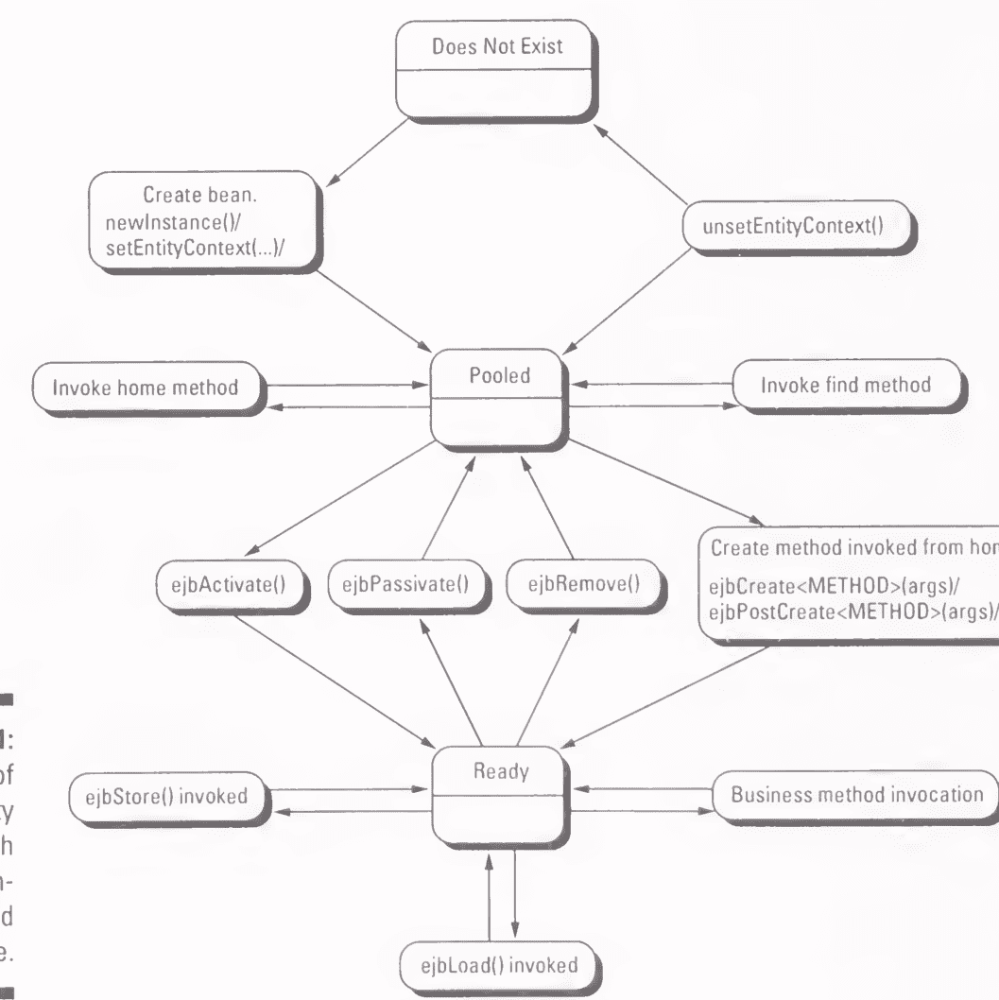

图8-1展示了实体Bean的三个状态：不存在、池化和就绪。活动（在状态之间以气泡形式表示）导致实体Bean沿着箭头方向进行状态转换。以下要点提炼自图8-1的图表：

## 混合使用BMP和CMP实体

当使用Bean管理持久性（`BMP`）时，你正在采用一种与容器管理持久性（`CMP`）模型截然不同的架构。决定是否使用Bean管理持久性应在设计应用程序时做出，这取决于众多因素，包括性能和可行性考量。在某些情况下，你可能会遇到一些实体必须使用Bean管理持久性而其他实体则不需要的情况。容器管理持久性可以处理从`JDBC`数据源存储和检索实体，但如果你将实体数据存储在其他类型的数据源中，你就必须使用Bean管理持久性。

如果一些实体可以使用容器管理持久性，而另一些实体必须使用Bean管理持久性，你会发现自己需要权衡是否在同一个应用程序中同时使用这两种方法。以下是一些需要考虑的场景：

- 如果你有两个不同的数据源，并且两者之间没有直接关系，那么你可以对一个数据源使用`BMP`解决方案，而对另一个数据源使用`CMP`解决方案。例如，你可能有一个`JDBC`数据源使用容器管理持久性，而另一个可能是遗留应用程序或需要Bean管理持久性第三方应用程序接口。由于容器管理持久性和Bean管理持久性的使用之间有清晰的分隔，在前一个场景中同时使用两者应该不成问题。
- 如果你处理的是单个数据源并同时使用Bean管理和容器管理持久性，那么你可能会遇到意想不到的复杂性。首先，虽然`CMP Bean`可以自动管理关系，但`BMP Bean`必须手动管理关系。如果你遇到`CMP Bean`与`BMP Bean`相关联的场景，在`EJB`应用程序中建模解决方案将迅速变得复杂。这种场景可能无法证明同时使用Bean管理和容器管理持久性是合理的。你最好对所有Bean都使用`BMP`。
- 选择同时使用容器管理和Bean管理持久性可能归结为从开发角度来看的实用性问题。如果你发现很大一部分实体Bean正在使用Bean管理持久性模型，那么将它们全部采用相同的模型可能更容易。事实是，一旦你实现了几个使用Bean管理持久性的实体Bean，你就会熟练掌握这种方法。在那个阶段，在模型之间切换可能弊大于利。

在我贯穿本书开发的示例ATM应用程序中，我倾向于使用容器管理持久性，因为：a）它简化了持久性过程的管理；b）示例应用程序中没有任何内容迫使我使用`BMP`。

> **实体Bean对象在创建之前和销毁之后处于不存在状态。** 实体Bean对象的创建和销毁与数据库中数据的插入和删除并不对应。当创建实体Bean对象时，它们并未与数据关联，因此可以在不删除数据的情况下被销毁。

**创建实体Bean实例时，首先调用`Object.newInstance`方法，然后调用`EntityBean.setEntityContext`方法。** `newInstance`方法创建实体Bean对象。`setEntityContext`方法为实体Bean提供与`EJB`容器交互以及获取其他应用程序资源所需的资源。

**实体Bean实例创建后，通常会被放入一个池中，在那里它可以被获取并在`EJB`应用程序中使用。每种类型的实体Bean都有自己的池。** 这意味着对于你创建的每个实体Bean，如果`EJB`容器支持实体Bean池，它将创建一个池来存储该类型的实体Bean对象。当处于池化状态时，实体Bean仍然没有关联的业务数据，但它可以被`EJB`应用程序用于调用查找器方法、本地方法和`create`方法。

- **查找器方法用于查找现有的实体Bean并返回其组件接口。** 当你需要获取对已创建实体的引用时，必须使用相应的查找器方法。在`BMP`中，每个查找器方法必须由实体Bean提供者使用`SQL`查询来实现。
- **本地方法是可以影响多个实体Bean实例的业务方法，并且可以在客户端未获取组件接口的情况下执行。** 例如，如果你需要对多个实体执行批量更新，可以定义一个本地方法来执行该任务。本地方法必须由Bean提供者使用`SQL`查询来实现。
- **创建方法用于创建新实体。** 如果你正在定义一个新实体，必须使用适当的`create`方法。调用`create`方法将导致实体Bean从池化状态转换到就绪状态。

**当应用程序通过其组件接口（本地或远程接口）在实体Bean上调用业务方法时，实体Bean将转换到就绪状态。** 处于就绪状态时，实体Bean有关联的实例数据，并且它被保存在内存中。如果实体Bean的某个特定实例已经处于就绪状态，`EJB`容器将使用该对象而不是获取另一个。因此，处于就绪状态的实体Bean对象可以被许多`EJB`客户端应用程序共享，这就是为什么`EJB`客户端应用程序始终对实体Bean实例的数据具有一致视图的原因。

**实体Bean通过`EntityBean.ejbPassivate`方法从就绪状态转换到池化状态。** `ejbPassivate`方法由`EJB`容器在预定义的空闲时间后调用。预定义的空闲时间实际上是一个配置问题，由`EJB`容器的管理员设置。在这个阶段，`EJB`容器不再需要将实体Bean实例数据保存在内存中。当实体Bean被钝化时，其数据被缓存，实体Bean对象被返回到池化状态。

- 实体Bean通过`create`方法或`EntityBean.ejbActivate`方法转换到就绪状态。`ejbActivate`方法由`EJB`容器在需要将实体Bean的缓存状态恢复到实体对象时调用。调用时，缓存的数据被恢复到从池化状态获得的实体对象。`ejbActivate`方法是`ejbPassivate`方法的逆操作。
- 实体Bean在调用其`ejbLoad`方法时从数据库加载数据。当实体需要从数据库初始化或恢复其内部数据时，`EJB`容器会调用`ejbLoad`方法。这个初始化过程可以在调用业务方法之前发生，或者当事务回滚发生且实体Bean必须返回到事务开始前定义的状态时发生。实体Bean开发人员可以实现`ejbLoad`方法并提供一种从数据库获取实体Bean状态并将其存储在实体Bean中的机制。或者，实体Bean的实例数据可以在业务方法调用开始时直接从数据库加载。
- 当实体Bean需要将其状态存储到数据库时，它会调用`ejbStore`方法。`ejbStore`方法由`EJB`容器根据其确定的计划调用。实体Bean开发人员可以实现`ejbStore`方法并提供一种将实体Bean的状态写入底层数据库的机制。`EJB`容器在需要将实体Bean的状态存储到数据库时都会调用`ejbStore`。
- `EJB`容器在实体Bean的实例数据从数据库中删除时调用`ejbRemove`方法。当调用`ejbRemove`方法时，实体Bean的实例数据从数据库中删除，并且实体Bean对象转换到池化状态。在删除操作提交后，实体Bean不复存在。实体Bean开发人员负责编写`ejbRemove`方法的代码。

当你从关系型数据库中删除一条记录时，它也会影响相关记录。要正确执行删除操作，你必须删除所有受影响的记录。否则，你将创建孤儿记录——依赖于已删除主记录的从属记录。正确处理这些删除操作被称为执行级联删除。虽然容器管理持久性为管理级联删除操作提供了一种简单的机制，但Bean管理持久性没有。大多数数据库系统都有内置功能来防止创建孤儿记录并自动管理级联删除过程。数据库管理员负责定义管理删除操作的规则。


当级联删除操作处理不当时，数据库可能会产生*孤立记录*，即与任何内容都无关的数据。孤立记录是危险的——如果已删除记录的主键在新记录中被复用，已删除记录的孤立记录将与新记录关联，导致严重的数据损坏。

仔细观察图8-1，你会注意到当实体Bean的查找方法被调用时，从`Pooled`状态到`Ready`状态没有明确的转换。调用查找方法不会导致Bean转换到`Ready`状态，但会向客户端应用程序返回一个组件接口。当客户端应用程序在组件接口上调用业务方法时，`EJB`容器首先确定该实体Bean是否需要转换到`Ready`状态，或者该实体的实例是否已处于`Ready`状态。如果客户端应用程序在实例的`ejbRemove`方法被调用后，仍在该实体Bean实例上调用业务方法，该业务方法调用将会失败。

图8-2从客户端应用程序的角度展示了实体Bean生命周期的另一个视角。

图8-2指的是实体Bean实例数据的状态，而非实体Bean对象的生命周期。在此图中，Does Not Exist意味着实例数据未定义，且与实体Bean对象的状态无关。Referenced状态指的是实体Bean实例是否被客户端应用程序引用——即客户端应用程序是否拥有指向该实体Bean实例的组件接口。在图8-2中，你可以看到四种状态：

- **Does Not Exist and Not Referenced**：处于此状态的实体在`EJB`容器或底层数据库中都未定义。此状态存在于实体创建之前，或实体被移除且其客户端引用被释放之后。换句话说，该实体要么只是`EJB`容器眼中的一个微光，要么已经消亡。
- **Does Not Exist and Referenced**：处于此状态的实体在`EJB`容器中不存在，也未在数据库中定义，但却被客户端应用程序中的一个变量引用。该客户端引用保存在实体Bean被移除之前创建的变量中。此状态仅存在于实体被移除之后，但在客户端应用程序释放引用之前。
- **Exists and Referenced**：`Exists and Referenced`状态存在于实体被创建之后、被移除之前，并且客户端应用程序持有对该实体Bean的引用期间。此状态可以在客户端应用程序调用`create`方法或查找方法之后存在。在这两种情况下，实体都已在a）数据库；b）`EJB`容器；或 c）两者中定义。请记住，这并不一定意味着实体Bean对象处于`Ready`状态，只是表示客户端拥有对该实体的引用，并且该实体已在数据库或`EJB`容器中定义。
- **Exists and Not Referenced**：此状态存在于客户端应用程序创建实体Bean之后、实体被移除之前。在此状态下，没有客户端应用程序持有对该实体的引用。

## 使用Bean管理持久性的实体Bean编程

具有Bean管理持久性的实体Bean包含与其容器管理对应物完全相同的要素。因此，你仍然需要为实体Bean定义主键、实体Bean的主接口（本地主接口和/或远程主接口）、组件接口（远程和/或本地）以及实体Bean类。在很大程度上，该过程与我在第6章中描述的相同。关键区别体现在实体Bean类内部，因为实现该实体Bean的持久性模式需要更多的编码工作。在本节中，我为本书中使用的示例ATM项目创建了一个名为`AccountHolderBMPBean`的新账户持有人实体Bean。你可以从网站`www.dummies.com/extras/ejbfd`下载示例项目。我还创建了一个使用容器管理持久性的`AccountHolderBean`。两者功能相同，你可以比较代码以了解这些`CMP`和`BMP`实体Bean之间的关键区别。

### 定义主键

所有实体Bean都有一个主键，用于在给定的主对象中唯一标识一个实体Bean。主键可以对应实体Bean类中的单个字段或多个字段。你可以将主键定义为Java原始类型之一的Java对象包装器——例如`java.lang.Integer`或`java.lang.Long`——或者你可以通过创建一个自定义对象来定义组合主键，该对象为主键的每个元素都有一个属性。主键中的每个属性必须对应于实体Bean中的一个持久性字段。对于`AccountHolderBMPBean`，我定义了一个名为`AccountHolderKey`的组合主键。我的主键代码如清单8-1所示。

### 清单8-1：AccountHolderKey类

```java
package com.sextanttech.entities.interfaces;

public class AccountHolderKey {

    private long clientId;

    private long createDate;

    public AccountHolderKey() {

    }

    public AccountHolderKey(long clientId, long createDate ) {

        this.clientId = clientId;

        this.createDate = createDate;

    }

    public long getClientId() {

        return clientId;

    }

    public long getCreateDate() {

        return createDate;

    }

    public boolean equals(Object o){

        if (o instanceof AccountHolderKey) {

            AccountHolderKey otherKey = (AccountHolderKey)o;

            return (clientId == otherKey.clientId &&

            createDate == otherKey.createDate);

        }

        else return false;

    }

    public int hashCode() {

        return String.valueOf(clientId).hashCode() +

        String.valueOf(createDate).hashCode();

    }

}
```


当你查看清单 8-1 中的代码时，请注意以下几点：

- `AccountHolderKey` 由两个属性定义：`clientId` 和 `createDate`。因为这两个属性都是主键的元素，所以它们在实体 Bean 类中必须有对应的持久性字段。这意味着你必须在实体 Bean 中定义一个 `clientId` 字段和一个 `createDate` 字段。
- 这个主键类重写了 `equals` 方法和 `hashCode` 方法。所有自定义主键类都必须重写这两个方法，为该主键类提供适当的实现。`equals` 方法的用途，顾名思义，是执行计算以确定此对象是否与相同类型的另一个对象完全相同。`hashCode` 方法的目的是协助组织主键类。生成 `hashCode` 的最简单方法是从类中的每个属性创建一个字符串，并返回这些 `String` 对象的 `hashCode` 值的总和。

实体 Bean 类的主键应包含为数据库中相应表定义的主键的所有字段。在这种情况下，账户持有人的数据库记录的主键包括 `createDate` 和 `clientId`。

### 定义主接口

具有 Bean 管理持久性的实体 Bean 的主接口在形式和功能上与容器管理实体 Bean 的主接口相同。主接口中定义的三种方法类型是：

- **create 方法**：至少，一个实体 Bean 必须有一个 `create` 方法。`create` 方法必须接收关于实体 Bean 的足够信息，以创建该实体的新实例。
- **finder 方法**：查找方法用于查找给定实体 Bean 的现有实例。你可以根据需要定义任意多个查找方法来查找实体 Bean。至少，你必须定义 `findByPrimaryKey` 方法。此方法应接受一个实体 Bean 的主键作为参数，并返回该实体 Bean 的组件接口。

对于具有 Bean 管理持久性的实体 Bean，查找方法必须返回以下对象之一：

- **组件接口：** 如果查找方法仅返回单个实体，例如 `findByPrimaryKey`，则查找方法必须返回对该实体 Bean 组件接口的引用。如果从远程本地接口调用，查找方法应返回远程接口。如果从本地本地接口调用，查找方法应返回本地接口。
- **枚举：** 当查找方法可以返回多个实体时，组件接口可以作为 `java.util.Enumeration` 返回。此方法允许多个组件接口返回，但由于它与 EJB 2.0 的容器管理持久性实现不同，因此不再是推荐的方法。
- **集合接口：** 如果查找方法可以返回多个实体，则查找方法应返回一个包含所有组件接口的 `java.util.Collection`。这与使用容器管理持久性的实体 Bean 查找方法的规则相同，现在是推荐的方法。
- **本地方法：** 本地方法是影响一组实体 Bean 的业务方法。例如，本地方法可用于生成账户报表或计算计息账户的利息收入。由于本地方法特定于您正在开发的应用程序，因此您可以自由定义所需数量的本地方法，以满足应用程序的需求。

在实践中，使用 Bean 管理持久性实体的本地接口与使用容器管理持久性实体的本地接口之间几乎没有区别。原因在于关键差异仅在实体 Bean 类内部才明显。本地本地接口必须扩展 `EJBLocalHome` 接口，远程本地接口必须扩展 `EJBHome` 接口。清单 8-2 展示了 `AccountHolderBMPLocalHome` 接口。

```java
import javax.ejb.CreateException;
import javax.ejb.FinderException;

public interface AccountHolderBMPLocalHome extends EJBLocalHome {

    AccountHolderBMPLocal createAccountHolder(
        String firstName,
        String lastName,
        String emailAddress
    ) throws CreateException;

    AccountHolderBMPLocal findByPrimaryKey(AccountHolderKey key)
        throws FinderException;
}
```

## 定义组件接口

客户端应用程序通过其组件接口访问实体 Bean 的业务方法。组件接口有两种类型——本地接口和远程接口。本地接口为客户端提供对实体 Bean 的本地访问，这意味着客户端应用程序必须与实体 Bean 本身位于同一个 EJB 容器中。本地接口必须扩展 `javax.ejb.EJBLocalObject` 接口。远程接口为远程客户端应用程序提供对实体 Bean 的访问，并且必须扩展 `javax.ejb.EJBObject` 接口。

具有 Bean 管理持久性的实体 Bean 的本地接口必须遵守与具有容器管理持久性的实体 Bean 相同的规则。

本地接口提供了对实体 Bean 中业务方法的访问。Bean 提供者还可以通过组件接口定义实体 Bean 持久性字段的 setter 方法。由于实体 Bean 用作数据存储库，定义实体 Bean 字段的 setter 和 getter 方法允许客户端程序更改实体 Bean 的状态。在清单 8-3 中，`AccountHolderBMPRemote` 接口展示了一个远程接口的示例。

### 清单 8-3 `AccountHolderBMPRemote`

```java
package com.sextanttech.entities.interfaces;

import javax.ejb.EJBObject;
import java.rmi.RemoteException;

public interface AccountHolderBMPRemote extends EJBObject {

    String getEmailAddr();

    void updateAcctHolder(AcctHolderState state);
}
```

虽然客户端通过组件接口调用实体 Bean 字段的 getter 和 setter 并非非法，但这可能不是最有效的解决方案。在一种流行的替代方案中，定义了一个接受包含所有需要更改的值的对象的业务方法。这种类型的方法称为批量 setter，因为它包含设置 EJB 组件中任何值所需的所有属性。通过传递包含更新实体 Bean 所需所有数据的对象，我可以执行单个操作来更新所有更改的字段，而不是在实体 Bean 类上多次调用 setter。这种方法显著提高了效率，特别是在通过远程接口使用时。清单 8-3 中的 `updateAccountHolder` 方法就是批量 setter 方法的一个示例。

## 创建实体 Bean 类

具有 Bean 管理持久性的实体 Bean 可能是企业 Bean 组件中最不神奇的部分。虽然 EJB 容器仍然为您执行一些服务，但作为 Bean 提供者，您的开发职责大大扩展。表 8-1 比较了创建 Bean 管理持久性 Bean 与创建容器管理持久性 Bean 所涉及的职责。

### 表 8-1 Bean 开发者的职责

| 任务 | 容器管理持久性 | Bean 管理持久性 |
| --- | --- | --- |
| 创建持久性字段 | 定义抽象 getter 和 setter 方法。 | 定义具有具体 getter 和 setter 方法的公共字段。 |
| 定义创建方法 | 使用抽象 setter 初始化持久性字段。 | 初始化持久性字段并将实体 Bean 数据插入持久存储。 |
| `ejbLoad` 方法 | 无需操作。 | 提供从持久存储加载数据的模型实现；设置所有持久性字段。 |
| `ejbStore` 方法 | 无需操作。 | 提供从实体 Bean 中所有持久性字段更新持久存储的模型实现。 |
| 查找方法 | 定义抽象 `ejbFinder` 方法和 EJB QL 查询。 | 定义具体的 `ejbFinder` 方法，该方法实现查询并返回对应于查询中找到的每个实体的主键对象。 |
| `ejbRemove` 方法 | 无需操作。 | 提供从持久存储中删除实体的模型实现。 |

EJB 的实体 Bean 类必须符合以下规则：

- 类必须声明为 `public`，并且不能声明为 `abstract` 或 `final`。
- 类必须实现 `javax.ejb.EntityBean` 接口。`EntityBean` 接口定义了每个实体 Bean 类中必须存在的标准方法。容器使用 `EntityBean` 接口的方法来管理每个实体 Bean 的生命周期。
- 实体 Bean 类必须声明一个不带参数的公共构造函数。
- 类不能定义 `finalize` 方法。`finalize` 方法是一个特殊操作，用于准备类进行销毁。EJB 容器负责管理实体 Bean 类的销毁过程，因此 Bean 开发者不应尝试通过定义自己的 `finalize` 方法来覆盖 EJB 容器功能。

清单 8-4 展示了一个具有 `EntityBean` 接口的存根实现的实体 Bean。存根实现是一个既实现接口方法又定义在方法被调用时应执行的默认操作的类。在后续部分中，您将看到为具有 Bean 管理持久性的实体 Bean 实现 Bean 开发者必须覆盖的每个关键方法的示例。

### 清单 8-4 实体 Bean 类存根

```java
public class AccountHolderBMPBean implements EntityBean {

    private EntityContext context; // 实体上下文

    public AccountHolderBMPBean() { } // 空构造函数

    // 其余方法在 EntityBean 接口中指定。

    public void setEntityContext(EntityContext ctx) {
        this.context = ctx;
    }

    public void unsetEntityContext() {
        this.context = null;
    }

    public void ejbRemove() throws EJBException { ... }

    public void ejbActivate() { }

    public void ejbPassivate() { }

    public void ejbLoad() throws EJBException { ... }
}
```

### 清单 8-4（续）

```java
public void ejbStore() throws EJBException { ... }

public void ejbRemove() throws EJBException { ... }
```

## 定义持久化字段

对于采用 Bean 管理持久化的实体 Bean，其持久化字段的定义规则可能会让您感到意外。虽然面向对象设计中最重要的原则之一是隐藏数据的内部表示，但在创建实体 Bean 类时，您必须打破这一规则，因为实体 Bean 中的所有持久化数据都必须声明为 `public`。此外，还需要为标准访问器方法进行定义，用于获取和设置持久化字段的值。您不必过于担心这种表面上的矛盾。无论如何，EJB 容器都会对实现进行屏蔽，使其对用户不可见。

要创建一个持久化字段：

- **定义一个公共成员变量来保存字段的值。** 对于 `AccountHolderBMPBean` 类来说，一个持久化字段的示例是：

  `public String lastName;`

- **为持久化字段定义公共的 getter 和 setter 方法。** 对于 `lastName` 字段，其 getter 和 setter 方法如下：

  ```java
  public void setLastName(String lastName) {
      this.lastName = lastName;
  }

  public String getLastName() {
      return this.lastName;
  }
  ```

清单 8-5 展示了 `AccountHolderBMPBean` 中持久化字段的定义。注意 `photograph` 字段是一个 `String`。相关解释请参见侧栏“处理 Blob 和 Clob”。

### 清单 8-5 持久化字段示例

```java
package com.sextanttech.entities.implementations;

import javax.ejb.EntityBean;

public class AccountHolderBMPBean implements EntityBean {

    public String firstName;

    public String lastName;

    public long clientId;

    public long createDate;

    public String photograph;

    public String emailAddress;

    public String getFirstName() {
        return firstName;
    }

    public void setFirstName(String firstName) {
        this.firstName = firstName;
    }

    public String getLastName() {
        return lastName;
    }

    public void setLastName(String lastName) {
        this.lastName = lastName;
    }

    public long getClientId() {
        return clientId;
    }

    public void setClientId(long clientId) {
        this.clientId = clientId;
    }

    public long getCreateDate() {
        return createDate;
    }

    public void setCreateDate(long createDate) {
        this.createDate = createDate;
    }

    public String getPhotograph() {
        return photograph;
    }

    public void setPhotograph(String photograph) {
        this.photograph = photograph;
    }

    public String getEmailAddress() {
        return emailAddress;
    }

    public void setEmailAddress(String emailAddress) {
        this.emailAddress = emailAddress;
    }
}
```


## 处理 Blob 和 Clob

许多流行的数据库引擎并不支持两种称为 `Blob`（二进制大对象，Binary Large Objects）和 `Clob`（字符大对象，Character Large Objects）的新数据类型。`Blob` 通常用于存储大型二进制对象，如图片或音频文件；而 `Clob` 通常用于在数据库中存储非常大的字符文档。两者在 Java 中都获得了特殊处理。在 Java 中，`java.sql.Blob` 数据类型实际上并不包含二进制数据。相反，它包含一个逻辑指针，告诉 JVM 与该 `Blob` 关联的二进制数据在数据库中的位置。同样的原理也适用于 `java.sql.Clob` 数据类型。

由于 Java 的 `Blob` 和 `Clob` 对象都没有其数据的内部表示，因此它们只在创建时所在的事务持续期间有效。这给 EJB 应用程序带来了特殊问题，因为实体 Bean 的状态不应依赖于事务上下文。事实上，EJB 应用程序对 `Blob` 和 `Clob` 的支持并不一致，而且在很多情况下根本不存在。

那么，如果您的企业应用程序需要处理图像文件、音频文件和大型字符文档，该怎么办呢？最简单的解决方案是不要将这些文档和文件存储在数据库中。相反，创建一个数据库表来保存指向文档或文件位置的 URL，并将其存储在文件服务器上。当您的应用程序需要访问该文件时，可以从数据库获取文件的 `String` URL，并使用该 URL 从文件服务器获取对所需文件的引用。可以使用 `java.io.FileInputStream` 对象来访问文件。请注意，EJB 不应使用输入流，因为这会破坏容器正确管理实体 Bean 对象的能力。在处理文件时，将 URL 传递给客户端应用程序，让客户端应用程序直接访问它。

注意不要创建您自己的在内部保存数据的 `Blob` 和 `Clob` 数据类型。`Blob` 和 `Clob` 对象都可能包含海量数据。如果您尝试将数据库中的 `Blob` 或 `Clob` 加载到对象中，它消耗几兆内存并非不切实际，而且如果您将多个这样的对象加载到内存中，您可能会遇到非常严重的性能问题。

## 实现 create 方法

在定义好实体 Bean 持久化字段之后，您应该准备好定义 `create` 方法了。实体 Bean 的 `create` 方法规则与容器管理持久化中的 `create` 方法略有不同。其公式如下：

- 对于在实体 Bean 的 Home 接口中定义的每个 `create<METHOD>`，您必须在实体 Bean 类中定义一个 `ejbCreate<METHOD>` 和一个 `ejbPostCreate<METHOD>`。
- 在 `ejbCreate<METHOD>` 中，首先用方法参数初始化所有持久化字段。接下来，您必须在该方法中将实体 Bean 的持久化字段数据插入到数据库中。这通常通过 JDBC 完成。

## 第 8 章：构建采用 Bean 管理持久化的实体 Bean

- 对于 Bean 管理持久化，`ejbCreate<METHOD>` 必须定义实体 Bean 的主键，并从方法中返回该主键。
- 使用 `ejbPostCreate<METHOD>` 在实体 Bean 首次使用之前初始化任何实体特定的资源。虽然 `ejbPostCreate<METHOD>` 是必需的，但该方法通常为空。您可能还记得，`ejbPostCreate<METHOD>` 用于在容器管理的实体 Bean 中初始化 CMR 字段。由于采用 Bean 管理持久化的实体 Bean 没有 CMR 字段，因此 `ejbPostCreate<METHOD>` 的作用不那么突出。

在清单 8-6 中，我展示了 `AccountHolderBMPBean` 类的 `ejbCreateAccountHolder` 和 `ejbPostCreateAccountHolder`。`ejbCreate<METHOD>` 使用了本章开头“理解 Bean 管理持久化”一节中介绍的 `getResourceConnection` 方法。粗体文本展示了用于创建新 AccountHolder 实体的代码片段。

## 清单 8-6 创建实体 Bean

```java
public class AccountHolderBMPBean implements EntityBean {

    private static final String CREATE_CUSTOMER =

        "INSERT INTO customer " +

        "(firstName, lastName, emailAddress, createDate) " +

        "VALUES " +

        "(?,?,?,?)";

    private static final String GET_CLIENT_ID =

        "SELECT clientId " +

        "FROM customer " +

        "WHERE firstName = ? " +

        "AND lastName = ? " +

        "AND emailAddress = ? " +

        "AND createDate = ?";

    public AccountHolderKey ejbCreateAccountHolder(String

        firstName, String lastName, String emailAddress)

        throws CreateException, EJBException {

        Connection conn = null;

        PreparedStatement ps = null;

        this.firstName = firstName;

        this.lastName = lastName;

        this.emailAddress = emailAddress;

        Calendar now = Calendar.getInstance();

        this.createDate = now.getTime().getTime();

        try {
```

## 清单 8-6（续）

```java
conn = this.getResourceConnection;

ps = conn.prepareStatement(this.CREATE_CUSTOMER);

ps.setObject(1, this.firstName);

ps.setObject(2, this.lastName);

ps.setObject(3, this.emailAddress);

ps.setObject(4, new java.sql.Date(this.createDate));

ps.executeUpdate;

return this.initClientId(conn);

}

catch(SQLException e){

    throw new CreateException(e.getMessage);

}

finally{

    try{

        if(ps != null) ps.close;

        if(conn != null) conn.close;

    }

    catch(SQLException e){

        throw new EJBException;

    }

}

}

public void ejbPostCreateAccountHolder throws

    CreateException, EJBException{

    // 在此处编写你的代码

}

private AccountHolderKey initClientId(Connection conn)

    throws SQLException {

    PreparedStatement ps;

    ResultSet rs;

    ps = conn.prepareStatement(this.GET_CLIENT_ID);

    ps.setObject(1, this.firstName);

    ps.setObject(2, this.lastName);

    ps.setObject(3, this.emailAddress);

    ps.setObject(4, new java.sql.Date(this.createDate));

    rs = ps.executeQuery;

    if(rs.first){

        this.clientId = rs.getLong(1);

        return new AccountHolderKey(this.clientId,

            this.createDate);

    }

    if(rs != null) rs.close;

    if(ps != null) ps.close;

    throw new SQLException;

}

}
```

## 第 8 章：使用 Bean 管理持久化构造实体 Bean 223

清单 8-6 是一大块代码，展示了我在开发 EJB 应用程序时喜欢应用的几种技术。请注意以下几点：

- 我的 SQL 语句定义在 `private static final String` 变量中。我这样做是因为语句本身在实体 Bean 的生命周期内不应该改变；因此，所有实体 Bean 类只需要一个副本。在静态变量中定义 SQL 语句使其更容易查找和维护，并且代表了内存的更有效的使用，因为静态属性由类的所有实例共享。
- `ejbCreateAccountHolder` 方法使用 `finally` 子句来释放资源连接。`finally` 子句用于保存应该始终执行的代码，即使 `try` 块中的代码抛出异常。因为数据库资源是宝贵的，维护起来也很昂贵，所以它们应该在不再需要时立即释放。
- 实体对象的主键在一个单独的方法 `initClientId` 中获取。我定义了一个单独的方法来获取 ClientId，因为与其他持久化字段不同，客户端 ID 是由数据库创建的。因此，它不能由 `create` 方法的调用者提供。大多数数据库都有自己的设施来生成主键值序列。如果主键创建被委托给数据库，那么数据库就成为所有主键的单一来源。如果数据库中的数据在不使用 EJB 架构的情况下 manipulated（即通过直接插入）时，主键必须由数据库管理。`initClientId` 方法是实体 Bean 类的辅助方法。它不是业务方法，因为它没有公共接口。我将该方法声明为 `private`，以便只能从实体 Bean 类内部访问它。

## 实现 ejbFind<METHOD> 方法

在使用 Bean 管理持久化时，每个查找方法（finder method）必须由实体 Bean 开发者实现。每个查找方法为实体 Bean 客户端提供对单个组件接口的引用，或者对实体 Bean LiveVersion 的组件接口集合的引用。对于在 home 接口中定义的每个 `find<METHOD>`，必须在实体 Bean 类中定义一个名为 `ejbFind<METHOD>` 的对应方法。虽然实体 Bean 的 home 接口中的查找方法返回组件接口，但 `ejbFind<METHOD>` 返回方法调用中找到的实体 Bean 的主键。EJB 容器负责将主键转换为组件接口，并通过 home 接口中的 `find<METHOD>` 返回这些接口。

> 如果你在远程 home 和本地 home 接口中定义相同的查找方法，该方法在实体 Bean 类中用相同的 `ejbFind<METHOD>` 实现。例如，本地 home 和远程 home 接口都必须定义一个 `findByPrimaryKey` 方法，该方法接受实体 Bean 的主键作为参数。这两种方法都可以在实体 Bean 类中使用单个 `ejbFindByPrimaryKey` 方法实现。

## 第三部分：实体 Bean：事物的运作方式

每个 `ejbFind<METHOD>` 必须根据以下准则实现：

- 每个 `ejbFind<METHOD>` 必须对应于位于本地 home 和/或远程 home 接口中的 `find<METHOD>`。
- 每个 `ejbFind<METHOD>` 必须声明为 `public`，且不能是 `abstract` 或 `final`。
- 每个 `ejbFind<METHOD>` 必须返回单个主键或主键集合。返回单个主键的查找方法称为*单对象查找器*（*single-object finders*），而返回主键集合的查找方法称为*多对象查找器*（*multi-object finders*）。多对象查找器返回的主键集合实现 `java.util.Collection` 接口或 `java.util.Enumeration` 接口。自 EJB 2.0 起，更推荐使用 `java.util.Collection` 接口，因为它与容器管理持久化的规范更加一致。
- 每个 `ejbFind<METHOD>` 必须抛出 `javax.ejb.FinderException`，并且还可以在 EJB 应用程序中必要时抛出应用程序异常。

> 如果你要创建一个必须与 EJB 1.1 兼容服务器兼容的 `ejbFind waiver<METHOD>`，查找方法必须返回 `java.util.Enumeration` 接口。

在每个 `ejbFind<METHOD>` 内部，你必须提供从数据库检索实体的代码。你可以使用提供给查找方法的参数来帮助你找到必要的实体。在清单 8-7 中，我提供了两个 `ejbFind<METHOD>` 方法的实现：

- `ejbFindByPrimaryKey(AccountHolderKey key)`：该方法说明了定义单对象查找器的过程。注意，该方法接受主键作为参数并返回相同的主键作为结果。这似乎是一个不必要的操作……但事实并非如此。该方法仍然必须验证与主键对应的记录是否存在。对于单对象查找器，如果找不到实体，该方法应抛出 `javax.ejb.ObjectNotFoundException`。`ObjectNotFoundException` 是 `FinderException` 的子类，这意味着它不必在方法签名的 `throws` 子句中单独列出。
- `ejbFindByLastName(String lastName)`：该方法说明了定义多对象查找器的过程。请注意，该方法返回 `java.util.Collection` 对象，而不是主键对象。在该方法内部，我必须创建 `Collection` 并分配从持久数据源返回的所有主键。请注意，当找不到对象时，多对象查找器不会抛出 `ObjectNotFoundException`。相反，当找不到对象时，多对象查找器应返回空的 `Collection` 对象。

## 第 8 章：使用 Bean 管理持久化构造实体 Bean

清单 8-7 中的粗体文本说明了 AccountHolderBMPBean 主键对象的创建。查找方法必须将主键返回给 EJB 容器，以便它可以构造由这些键标识的实体 Bean 实例。

## 清单 8-7 实现 ejbFind<METHOD> 方法

```java
public class AccountHolderBMPBean implements EntityBean {

    private static final String FIND_BY_PK =

        "SELECT clientId, createDate " +

        "FROM customer " +

        "WHERE clientId = ? " +

        "    AND createDate = ?";

    private static final String FIND_BY_LAST_NAME =

        "SELECT clientId, createDate " +

        "FROM customer " +

        "WHERE lastName = ? ";

    public AccountHolderKey

        ejbFindByPrimaryKey(AccountHolderKey key) throws

        FinderException {

        Connection conn = null;

        PreparedStatement ps = null;

        ResultSet rs = null;

        try{

            conn = this.getResourceConnection;

            ps = conn.prepareStatement(this.FIND_BY_PK);

            ps.setLong(1, key.getClientId);

            ps.setDate(2, new

            java.sql.Date(key.getCreateDate));

            rs = ps.executeQuery;

            if(rs.next){

                return key;

            }

            else throw new ObjectNotFoundException("Entity

            does not exist.");

        }

        catch(SQLException e){

            throw new FinderException(e.getMessage);

        }

        finally{

            try{

                if(rs != null) rs.close;
```


```java
if (ps != null) ps.close;

if (conn != null) conn.close;
}

catch (SQLException e) {
```

## 实现 `ejbLoad` 方法

实体 Bean 中的 `ejbLoad` 方法用于从数据库向持久化字段加载数据。每当 EJB 容器需要刷新实体状态时，它都会调用实体 Bean 上的 `ejbLoad` 方法。EJB 容器决定何时调用 `ejbLoad` 方法，但在采用 Bean 管理持久化的实体 Bean 中，实现 `ejbLoad` 方案是 Bean 开发人员的职责。

除了 `ejbCreate<METHOD>` 方法外，`ejbLoad` 方法应该是唯一一个从数据库初始化持久化数据的方法。此外，`ejbLoad` 方法不应从实体 Bean 内部的任何方法中调用。不遵守此规则可能会导致实体 Bean 在事务中间进入无效状态。`ejbLoad` 方法仅供 EJB 容器专用使用。我们无须质疑原因；我们只需执行或放弃。

幸运的是，`ejbLoad` 方法实现起来相对简单。清单 8-8 说明了 `ejbLoad` 方法的基本实现。该方法使用 JDBC 执行 `SELECT` 语句，然后使用语句的结果设置每个持久化字段的值。清单 8-8 中的粗体代码行说明了从 `SELECT` 语句中提取结果以重置实体 Bean 中持久化字段的位置。请注意，我不会更改属于主键的字段。主键字段永远不应更改，因此在 `ejbLoad` 操作中重置它们是没有意义的。

## 清单 8-8 `ejbLoad` 示例

```java
public class AccountHolderBMPBean implements EntityBean {

    private static final String LOAD_CUSTOMER =
        "SELECT clientId, firstName, lastName, " +
        "    emailAddress, photograph, createDate " +
        "FROM customer " +
        "WHERE clientId = ? " +
        "    AND createDate = ?";

    public void ejbLoad throws EJBException {

        Connection conn = null;
        PreparedStatement ps = null;
        ResultSet rs = null;

        try {
            conn = this.getResourceConnection;
            ps = conn.prepareStatement(this.LOAD_CUSTOMER);

            ps.setLong(1, clientId);
            ps.setObject(2, new java.sql.Date(this.createDate));

            rs = ps.executeQuery;

            if (rs.next) {
                this.firstName = rs.getString(1);
                this.lastName = rs.getString(2);
                this.emailAddress = rs.getString(3);
                this.photograph = rs.getString(4);
            }
        }
        catch (SQLException e) {
            throw new EJBException(e);
        }
        finally {
            try {
                if (rs != null) rs.close;
                if (ps != null) ps.close;
                if (conn != null) conn.close;
            }
            catch (SQLException e) {
                throw new EJBException(e);
            }
        }
    }
}
```

## 实现 `ejbStore` 方法

EJB 容器使用 `ejbStore` 方法将实体 Bean 的状态保存到数据库。与 `ejbLoad` 方法一样，`ejbStore` 方法仅供 EJB 容器专用使用。容器在需要时调用此方法，它绝不应由实体 Bean 内部的任何方法调用。清单 8-9 说明了 `ejbStore` 方法的基本实现，该方法在被调用时将实体 Bean 中的所有持久化数据写入数据库。

## 清单 8-9 `ejbStore` 示例

```java
public class AccountHolderBMPBean implements EntityBean {

    private static final String STORE_CUSTOMER =
        "UPDATE customer " +
        "SET firstName = ? " +
        "    lastName = ? " +
        "    emailAddress = ? " +
        "    photograph = ? " +
        "WHERE clientId = ? " +
        "    AND createDate = ?";

    public void ejbStore throws EJBException {

        Connection conn = null;
        PreparedStatement ps = null;

        try {
            conn = this.getResourceConnection;
            conn.setAutoCommit(false);

            ps = conn.prepareStatement(this.STORE_CUSTOMER);

            ps.setObject(1, this.firstName);
            ps.setObject(2, this.lastName);
            ps.setObject(3, this.emailAddress);
            ps.setObject(4, this.photograph);
            ps.setLong(5, this.clientId);
            ps.setObject(6, new java.sql.Date(this.createDate));

            if (ps.executeUpdate != 1) {
                conn.rollback;
                throw new EJBException("Invalid update row count on customer.");
            }
        }
        catch (SQLException e) {
            throw new EJBException(e);
        }
        finally {
            try {
                if (ps != null) ps.close;
                if (conn != null) conn.close;
            }
            catch (SQLException e) {
                throw new EJBException(e);
            }
        }
    }
}
```

与 `ejbLoad` 方法不同，Bean 开发人员在定义 `ejbStore` 方法的机制方面具有更大的灵活性。`ejbStore` 方法行为的唯一要求是，自上次 `ejbLoad` 语句以来已更改的任何数据都必须写入数据库。

有一个称为快照的设计模式，可以有效地用于优化实体 Bean 与数据库的交互性能。设计模式是针对典型软件问题开发解决方案的标准公式。快照模式是一种复制对象状态并存储以供日后使用的公式。这个解决方案很有价值，因为它允许你在存储实体 Bean 的变量之前将其与快照进行比较。如果变量没有变化，则无需存储它们。

利用快照模式相对简单；只需遵循以下步骤：

1. 确保每次调用 `ejbCreate<METHOD>` 时创建持久化字段数据的副本，此外还要用实体 Bean 数据初始化持久化字段。该副本称为快照，它不过是数据在任何更改之前的快照。
2. 每次调用 `ejbLoad` 方法时，用数据库提供的数据的新快照替换旧快照。这使快照保持最新并与数据库一致。
3. 每次调用 `ejbStore` 方法时，将每个持久化字段与快照中的相应元素进行比较。如果持久化字段及其快照相同，则无需在数据库中更新该字段。如果它们不同，则必须将该字段包含在更新语句中。
4. 要进行更新，必须在每次调用 `ejbStore` 时构建更新语句，仅将更改的字段包含在更新中。处理更新是快照模式中最困难的部分。如果没有字段更改，则无需更新。

## 实现 `ejbRemove` 方法

当应从数据库中删除实体 Bean 实例时，实体 Bean 使用 `ejbRemove` 方法。每个实体 Bean 实例负责管理自己的删除。这意味着实体 Bean 仅应在其 `ejbRemove` 操作被调用时从数据库中删除自身。客户端应用程序通过调用实体 Bean 的组件接口或 home 接口上的 `remove` 方法来调用实体 Bean 上的删除操作。

对于容器管理的实体 Bean，提供 `ejbRemove` 方法是为了让 EJB 开发人员有机会响应 `remove` 方法调用。例如，Bean 开发人员可能想要记录一条日志条目，指示实体正在被销毁。对于 Bean 管理的持久化，Bean 开发人员负责实现删除操作。因此，在采用 Bean 管理持久化的实体 Bean 中，开发人员必须执行删除操作来移除实体 Bean。清单 8-10 说明了 Bean 管理持久化的 `ejbRemove` 方法实现。

### 清单 8-10 `ejbRemove` 示例

```java
public class AccountHolderBMPBean implements EntityBean {

    private static final String DELETE_CUSTOMER =
        "DELETE FROM customer " +
        "WHERE clientId = ? " +
        " AND createDate = ?";

    public void ejbRemove throws EJBException {

        Connection conn = null;
        PreparedStatement ps = null;

        try {
            conn = this.getResourceConnection;
            ps = conn.prepareStatement(this.DELETE_CUSTOMER);

            ps.setLong(1, clientId);
            ps.setObject(2, new java.sql.Date(createDate));

            if (ps.executeUpdate != 1) {
                throw new EJBException("Invalid delete row count.");
            }
        }
        catch (SQLException e) {
            throw new EJBException(e);
        }
        finally {
            try {
                if (conn != null) conn.close;
                if (ps != null) ps.close;
            }
            catch (SQLException e) {
                throw new EJBException(e);
            }
        }
    }
}
```

清单 8-10 中的粗体文本展示了管理删除操作的那部分代码。`PreparedStatement.executeUpdate` 方法被用来执行删除操作。该方法返回被删除的行数。由于每个 `ejbRemove` 方法都应该只删除一行，因此我测试了 `executeUpdate` 方法的结果，以确保更改计数为一。任何其他结果都是无效的，并会导致 `EJBException`。

## 定义部署描述符

组装完使用 Bean 管理持久性的实体 Bean 的所有组件后，是时候为这个实体 Bean 创建部署描述符条目了。使用 Bean 管理持久性的实体 Bean 的部署描述符与其容器管理的对应物仅有细微差别。事实上，由于持久性服务是由 Bean 开发者实现的，部署描述符实际上更简单。因此，部署描述符不必为 `ejbSelect` 和查找方法指定 EJB QL 查询，也没有容器管理的关系需要定义。该描述符负责执行以下任务：

- 标识实体 Bean 的名称及其接口和类。这些包括主键类、组件接口、本地接口和实体 Bean 类。
- 指定持久性服务是 Bean 管理的。
- 标识用于实体 Bean 持久性服务的数据源。
- 标识实体 Bean 是否是可重入的。可重入实体是指可以在同一线程中被多次调用的实体。关于可重入实体 Bean 的完整描述，请参见第 6 章。

清单 8-11 展示了本章描述的 `AccountHolderBMP` 实体 Bean 的 XML 部署描述符。关于 Bean 管理持久性的实体 Bean 部署描述符中每个属性及其允许值的列表，请参考表 8-2。

## 清单 8-11 部署描述符

```xml
<?xml version="1.0" encoding="UTF-8"?>

<!DOCTYPE ejb-jar PUBLIC "-//Sun Microsystems, Inc.//DTD
    Enterprise
JavaBeans 2.0//EN" "http://java.sun.com/dtd/ejb-jar_2_0.dtd">

<ejb-jar>
  <enterprise-beans>
    <entity>
      <description>
        这是一个使用 Bean 管理持久性的账户持有者 Bean。
      </description>

      <ejb-name>AccountHolderBMP</ejb-name>

      <home>
        com.sextanttech.entities.interfaces.AccountHolderBMPHome
      </home>

      <remote>
        com.sextanttech.entities.interfaces.AccountHolderBMPRemote
      </remote>

      <local-home>
        com.sextanttech.entities.interfaces.AccountHolderBMPLocalHome
      </local-home>

      <local>
        com.sextanttech.entities.interfaces.AccountHolderBMPLocal
      </local>

      <ejb-class>
        com.sextanttech.entities.implementations.AccountHolderBMPBean
      </ejb-class>

      <prim-key-class>
        com.sextanttech.entities.interfaces.AccountHolderKey
      </prim-key-class>

      <persistence-type>Bean</persistence-type>
      <reentrant>False</reentrant>

      <resource-ref>
        <description>账户持有者的数据源</description>
        <res-ref-name>jdbc/AcctHolderDatabase</res-ref-name>
        <res-type>javax.sql.DataSource</res-type>
        <res-auth>Container</res-auth>
      </resource-ref>
    </entity>
  </enterprise-beans>
</ejb-jar>
```


| 属性名 | 是否必需 | 多重性 | 父元素 | 值 |
| :--- | :--- | :--- | :--- | :--- |
| `<entity>` | 是 | 一个 | `<enterprise-beans>` | 实体Bean属性。 |
| `<description>` | 否 | 一个 | `<entity>` | 实体Bean的文本描述。 |
| `<display-name>` | 否 | 一个 | `<entity>` | 用于GUI工具的实体Bean名称。 |
| `<large-icon>` | 否 | 一个 | `<entity>` | 用于GUI工具的图标的路径和名称。 |
| `<small-icon>` | 否 | 一个 | `<entity>` | 用于GUI工具的图标的路径和名称。 |
| `<ejb-name>` | 是 | 一个 | `<entity>` | EJB组件的名称。 |
| `<home>` | 否 | 零个或一个 | `<entity>` | 远程本地接口的完全限定类名。 |
| `<remote>` | 否 | 零个或一个 | `<entity>` | 远程接口的完全限定类名。 |

## 表 8-2（续）

| 属性名 | 是否必需 | 多重性 | 父元素 | 值 |
| :--- | :--- | :--- | :--- | :--- |
| `<local-home>` | 否 | 零个或一个 | `<entity>` | 本地本地接口的完全限定类名。 |
| `<local>` | 否 | 零个或一个 | `<entity>` | 本地接口的完全限定类名。 |
| `<ejb-class>` | 是 | 一个 | `<entity>` | 实体Bean类的完全限定类名。 |
| `<prim-key-class>` | 是 | 一个 | `<entity>` | 定义简单或复合主键的主键类类型。 |
| `<persistence-type>` | 是 | 一个 | `<entity>` | Bean代表Bean管理持久性（BMP）。 |
| `<reentrant>` | 是 | 一个 | `<entity>` | True或False。更多细节请参见第6章。 |
| `<resource-ref>` | 是 | 一个或多个 | `<entity>` | 资源引用子元素。 |
| `<description>` | 否 | 一个 | `<resource-ref>` | 描述资源引用。 |
| `<res-ref-name>` | 是 | 一个 | `<resource-ref>` | 分配给资源的名称。 |
| `<res-ref-type>` | 是 | 一个 | `<resource-ref>` | 资源的完全限定类名。 |

| 属性名 | 是否必需 | 多重性 | 父元素 | 值 |
| :--- | :--- | :--- | :--- | :--- |
| `<res-auth>` | 是 | 一个 | `<resource-ref>` | Container代表容器管理的认证，Bean代表Bean管理的认证。 |
| `<res-sharing-scope>` | 否 | 一个 | `<resource-ref>` | Sharable（可共享）表示到此资源的连接可以与其他Bean共享；Unsharable（不可共享）表示不能。默认值为Sharable。 |

# 第四部分

## 用消息驱动Bean表达自我


> “我寻找的是动态的Web应用和内容，而不是花哨的Web界面和意图。”

在本部分中……

消息驱动Bean（MDB）是EJB框架的最新补充，它允许实现可以独立于客户端应用程序运行的进程。如果你需要构建大型报告、生成月度报表或结清账户的月度/年度账目，你将不得不运行一些可能需要数小时甚至数天的计算机进程。通过使用MDB，你将能够在不占用客户端计算机的情况下运行这些进程。要了解更多关于MDB和Java消息服务（JMS）的内容，请继续阅读。

# 第9章：探索Java消息服务

### 本章内容

- 回顾Java消息服务（JMS）应用程序的架构
- 注册JMS提供商
- 创建JMS客户端应用程序

Java消息服务（JMS）是Java用于创建消息传递应用程序的标准API。JMS应用程序允许客户端应用程序和服务器应用程序并行执行操作，而不是串行执行。JMS应用程序与我到目前为止讨论的EJB组件之间的关键区别在于，当客户端调用JMS服务时，它可以继续执行操作，而无需等待消息消费者的响应，而会话Bean和实体Bean组件必须先响应客户端，客户端才能继续。

如以下列表所示，每个JMS应用程序中都有三个重要角色：

- **消息生产者：**在EJB应用程序中，消息生产者是EJB应用程序的客户端。客户端不直接连接到企业Bean。相反，它连接到消息传递服务提供商，并将消息传递给该提供商。在接下来的内容中，你将了解消息生产者如何创建消息、连接到服务提供商以及传递消息。
- **消息传递服务：**要使消息传递存在，应用程序开发者必须创建一个JMS服务。消息传递服务是一个JMS服务器，可以托管各种JMS应用程序。每个应用程序由一组称为*受管对象*的对象组成。之所以称为受管对象，是因为它们由JMS服务管理。JMS应用程序开发者通过创建受管对象然后将它们部署到JMS服务器来创建他们的应用程序。

创建受管对象超出了本书的范围。在本章中，你将了解如何连接受管对象并向其发送消息。如果你需要关于创建JMS应用程序的好的参考资料，请查阅由 Richard Monson-HAbstract 和 David Chappell 撰写、O'Reilly 出版的*Java Messaging Service*。

- **消息消费者：**在EJB应用程序中，消息消费者是消息驱动Bean。消息消费者的好处在于，EJB容器管理消费者与消息服务提供者之间的所有交互。你无需研究如何连接服务器并从中接收消息，而可以专注于在消息到达时如何做出响应。我在第10章中专门讨论了创建消息驱动Bean的主题。

消息服务之所以强大，是因为它们提供了一种**中间件**，将消息生产者和消息消费者解耦。在消息服务中，消息生产者连接到消息服务提供者并发送一条消息。服务提供者说："谢谢，我收到了你的消息。"然后消息生产者就可以自由地去执行其他任务了。与此同时，根据所使用的服务类型，消息消费者可以在稍后不确定的时间连接到服务器，或者保持与服务器的活动连接。当消息服务提供者有空时，它会将消息发送给消息消费者，消费者然后说："谢谢，服务提供者，我收到了消息"，然后继续处理它用消息所做的任何事情。请注意，消息生产者无需等待消息消费者接收消息就可以继续处理自己的业务。这对分布式应用程序来说很重要，因为数百种情况中的任何一种都可能导致消息传递延迟或消息完全丢失。

## 理解JMS架构

JMS的基本原理相当容易掌握。六个核心接口以最通用的方式定义了JMS服务。这些接口独立于任何特定的消息服务风格，这意味着它们可以扩展以实现支持不同消息模型的消息服务。核心接口包括：

- `javax.jms.Connection`：此接口定义了客户端应用程序与JMS服务器之间的连接。`Connection`对象提供了与从JMS服务器发送和接收消息相关的各种服务。这些服务包括为客户端应用程序分配唯一ID、启动和停止消息传递的功能，以及断开与JMS服务器连接的功能。
- `javax.jms.ConnectionFactory`：此接口创建`Connection`对象，从而实现JMS服务器与客户端应用程序之间的通信。各种类型的工厂对象都用于组装其他复杂对象。工厂对象便于隐藏对象创建的详细信息。此外，工厂对象还可能提供其他隐藏服务，例如资源池化。对于其提供的每种JMS服务类型，JMS提供者都必须实现`ConnectionFactory`。
- `javax.jms.Destination`：此接口是JMS提供者的受管对象之一，包含指向特定消息场所的地址。多个客户端应用程序可以连接到`Destination`以发送和接收消息。`Destination`就像一个邮件分拣室——消息从`MessageProducer`对象传入，可以临时保存，然后传递给`MessageConsumer`。
- `javax.jms.Session`：此接口表示客户端应用程序与JMS提供者之间的活动通信通道。`Session`提供了许多服务，包括创建`MessageProducer`和`MessageConsumer`对象、创建`Message`对象、管理事务以及消息的传递和确认。`Session`对象是从`Connection`对象获取的。
- `javax.jms.MessageProducer`：此接口表示客户端句柄——一个为客户端提供对某些资源的访问的对象——指向特定的`Destination`对象。客户端应用程序使用此句柄向`Destination`发送消息。`MessageProducer`对象由`Session`对象为特定的`Destination`创建。然后客户端从`Session`获取新的`Message`对象，设置`Message`对象的内容，并使用`MessageProducer`发送消息。
- `javax.jms.MessageConsumer`：此接口表示指向特定`Destination`的客户端句柄。客户端应用程序使用此句柄从`Destination`接收消息。`MessageConsumer`对象由`Session`对象为特定的`Destination`创建。

基于这六个基本接口，JMS架构创建了子接口，支持两种不同类型的消息传递——**点对点（PTP）**和**发布/订阅（简称 pub/sub）**：

- **PTP消息传递将消息从`MessageProducer`传递给特定的`MessageConsumer`。**使用PTP消息传递时，目的地表示为一个消息队列。消息生产者将消息添加到队列末尾，消息消费者从队列前端移除消息。一旦移除，消息将永远消失。

> pub/sub消息模型类似于你曾经订阅过邮件列表服务器的体验。在pub/sub消息传递中，消息生产者将消息发布到目的地，该目的地被称为**主题（topic）**。发布之后，目的地将消息路由给所有感兴趣的订阅者。根据pub/sub模型的配置，目的地可以临时为当前未登录的订阅者保存消息。

pub/sub模型和PTP模型的接口如表9-1所示。

### 表9-1 核心JMS接口

| 父接口 | PTP接口 | Pub/Sub接口 |
| :--- | :--- | :--- |
| `ConnectionFactory` | `QueueConnectionFactory` | `TopicConnectionFactory` |
| `Connection` | `QueueConnection` | `TopicConnection` |
| `Destination` | `Queue` | `Topic` |
| `Session` | `QueueSession` | `TopicSession` |
| `MessageProducer` | `QueueSender` | `TopicPublisher` |
| `MessageConsumer` | `QueueReceiver`、`QueueBrowser` | `TopicSubscriber` |

## 生成JMS消息

生成JMS消息只需要几个简单的步骤。我在下面的子章节中详细介绍每个步骤。概括来说，该过程如下：

1. **通过使用Java命名和目录接口（JNDI）查找JMS提供者的`ConnectionFactory`来获取`ConnectionFactory`。**JMS提供者应该有一些文档说明`ConnectionFactory`的JNDI名称以及所使用的`ConnectionFactory`类型。
2. **使用JNDI查找目的地名称来获取`Destination`。**请记住，`Destination`对象是由JMS应用程序开发人员提供的受管对象。JMS应用程序开发人员必须在JNDI中注册`Destination`的名称，并标识所使用的`Destination`对象类型。

## 连接到队列

清单9-1展示了创建队列连接的一般步骤的实现。在清单9-1中定义的`sendMessage`方法中，JMS客户端执行以下步骤：

1. 获取`QueueConnectionFactory`。
2. 获取所需`Queue`的引用。
3. 使用`QueueConnectionFactory`创建`QueueConnection`。
4. 从`QueueConnection`获取`QueueSession`。`QueueConnection.getQueueSession`方法有两个参数。第一个是布尔值，指示会话是否应该是事务性的。如果`Session`是事务性的，邮件传递操作被要求要么完全成功，要么完全失败。第二个参数标识确认模式。由于我们的客户端应用程序专注于发送消息，确认模式并不重要。
5. 从`QueueSession`获取`QueueSender`。完成此步骤后，你就可以开始发送消息了。

请注意，我在清单中包含了一个`finally`子句，用于在不再使用JMS资源时关闭它们。这是一个重要的步骤，因为未关闭的资源仍然是活动的，无法被垃圾回收。未能关闭资源可能导致应用程序中出现内存泄漏。

## 清单9-1 创建队列连接

```java
public void sendMessage(String userName, String password) {
    QueueConnection conn = null;
    QueueSession session = null;
    QueueSender sender = null;

    try {
        // 首先获取连接工厂。
        Object obj = context.lookup("jms/FactoryName");
        QueueConnectionFactory factory =
            (QueueConnectionFactory)
            PortableRemoteObject.narrow(obj,
            Class.forName("javax.jms.QueueConnectionFactory"));

        // 接着获取目标。
        obj = context.lookup("jms/QueueName");
        Queue destination = (Queue) PortableRemoteObject.
            narrow(obj,
            Class.forName("javax.jms.Queue"));

        // 现在是时候建立连接了。
        conn = factory.createQueueConnection(userName,
            password);
        conn.stop(); // 阻止此连接上消息的传递。

        // 一旦连接上，就该创建会话了。
        session = conn.createQueueSession(true,
            Session.AUTO_ACKNOWLEDGE);

        // 现在你可以创建发送者了。
        sender = session.createSender(destination);
    }
    catch(NamingException e) {
        // JNDI 查找操作失败。
        e.printStackTrace();
    }
    catch(ClassNotFoundException e) {
        // PortableRemoteObject.narrow 操作失败。
        e.printStackTrace();
    }
    catch(JMSException e) {
        // 发生消息传递故障。
        e.printStackTrace();
    }
    finally {
        try {
            sender.close();
            session.close();
            conn.close();
        } catch (Exception e) {
            e.printStackTrace();
        }
    }
}
```

## 连接到主题

清单9-2展示了创建到主题连接的一般步骤的实现。在清单9-2定义的`sendMessage`方法中，JMS客户端执行以下步骤：

1. 获取一个`TopicConnectionFactory`。
2. 获取所需`Topic`的引用。
3. 使用`TopicConnectionFactory`创建一个`TopicConnection`。
4. 从`TopicConnection`获取一个`TopicSession`。`TopicConnection.getTopicSession`方法接受两个参数。第一个是布尔值，指示会话是否应该是事务性的。事务性会话要求邮件传递操作要么完全成功，要么完全失败。第二个参数指定确认模式，这仅在你打算通过连接接收消息（而不是仅仅发送消息）时才相关。
5. 从`TopicSession`获取一个`TopicPublisher`。完成此步骤后，你就可以开始传递消息了。

与我在清单9-1中的实践一样，我在清单9-2中包含了一个`finally`子句，用于在JMS资源不再使用时关闭它们。未能关闭资源可能导致应用程序出现内存泄漏。

## 清单9-2 创建主题连接


```java
public void sendMessage(String userName, String password) {
    TopicConnection conn = null;
    TopicSession session = null;
    TopicPublisher publisher = null;

    try {
        // 首先获取连接工厂。
        Object obj = context.lookup("jms/FactoryName");
        TopicConnectionFactory factory =
            (TopicConnectionFactory)
                PortableRemoteObject.narrow(obj,
                    Class.forName("javax.jms.TopicConnectionFactory"));

        // 接着获取目标。
        obj = context.lookup("jms/TopicName");
        Topic destination = (Topic) PortableRemoteObject.
            narrow(obj,
                Class.forName("javax.jms.Topic"));

        // 现在是时候建立连接了。
        conn = factory.createTopicConnection(userName,
            password);
        conn.stop(); // 阻止此连接上消息的传递。

        // 一旦连接上，就该创建会话了。
        session = conn.createTopicSession(true,
            Session.AUTO_ACKNOWLEDGE);

        // 现在你可以创建发布者了。
        publisher = session.createPublisher(destination);
    }
    catch(NamingException e) {
        // JNDI 查找操作失败。
        e.printStackTrace();
    }
    catch(ClassNotFoundException e) {
        // PortableRemoteObject.narrow 操作失败。
        e.printStackTrace();
    }
    catch(JMSException e) {
        // 发生消息传递故障。
        e.printStackTrace();
    }
    finally {
        try {
            // 释放所有资源。
            publisher.close();
            session.close();
            conn.close();
        }
        catch(JMSException e) {
            e.printStackTrace();
        }
    }
}
```

# 第四部分：使用消息驱动 Bean 表达自己

## 创建和发送 JMS 消息

定义消息传递服务的首要任务是确定要传递的消息的结构。这应该是合理的，因为消息的生产者和消费者必须理解如何读取和解释消息的内容。消息本身有三个不同的组成部分：

**消息头：** 消息头包含许多描述消息元信息的字段。消息头字段包括标识此消息的消息 ID；标识消息线程中前一条消息的相关 ID；以及可能对消息传递速度产生影响的消息优先级。

**消息属性：** 消息属性对于特定应用域是唯一的，你可以定义消息属性来帮助组织和描述消息。例如，你可以使用消息属性来定义一些排序或对消息进行排名的条件。此外，消息消费者可以根据消息的属性及其头字段的值来接受或拒绝接收消息。

**消息体：** 消息体是放置消息内容的地方。JMS 定义了五种不同类型的消息，每种类型能够容纳不同种类的消息体内容。消息属性和消息头的规则对所有类型的 JMS 消息都相同；唯一的区别在于消息体中容纳的内容类型。不同类型的 JMS 消息包括：

- `javax.jms.BytesMessage`：`BytesMessage` 包含一个编码字节流。生产者必须将字节流添加到消息中，然后该消息被传递给消息的消费者。消费者随后必须读取字节并对其进行解释。`BytesMessage` 不包含 Java 原始字节，尽管你可能从名字上做此假设。如果你需要传递 Java 原始字节流，请使用 `StreamMessage`。

- `javax.jms.MapMessage`：`MapMessage` 的消息体是一组名称/值对。对于大多数 EJB 用途，`MapMessage` 是一个不错的选择，因为消息可能会向消息驱动 bean 传递多个参数，这些参数将被映射到对另一个 EJB 组件的本地方法调用。

- `javax.jms.ObjectMessage`：`ObjectMessage` 的消息体是一个可序列化的 Java 对象。消息生产者创建该对象的一个实例并将其添加到消息体中。消息消费者从消息体中检索消息并使用它来执行某些任务。`ObjectMessage` 可以包含一个 JavaBean（该 Bean 具有对象属性的 getter 和 setter），或者它可以包含一个实体 bean 的依赖值对象。

- `javax.jms.StreamMessage`：`StreamMessage` 消息可以容纳一个 Java 原始字节值流。该流允许消息消费者从文件或网络连接中读取可能大量的数据。

- `javax.jms.TextMessage`：`TextMessage` 的消息体类型为 `java.lang.String`。`TextMessage` 的内容是一个 `String` 值，它最接近你对传统电子邮件消息的预期。`TextMessage` 对象设想的目的是传递基于 XML 的消息。因为 XML 文档只是一个带有特殊 XML 元素分隔符的字符 `String`，所以你可以将 XML 格式的消息作为 `String` 传递。消息消费者随后必须解析该消息并解释其内容的含义。

在选择了要发送的消息类型之后，创建和发送消息的过程就相对简单了。我将使用 `MapMessage` 来说明，它可能是许多旨在传递给 EJB 消息驱动 bean 的 JMS 消息的不错选择。我喜欢 `MapMessage` 的原因是，它可以容纳各种命名参数，消息驱动 bean 可以提取这些参数并用来调用 EJB 容器中的本地操作。

> **记住：** 无论你选择哪种类型的消息，都必须从 `Session` 对象获取消息的实例。`MapMessage` 的代码是：

```java
MapMessage message = session.createMapMessage();
```

> **提示：** `Session` 对象为每种消息类型提供不同的 `create` 方法。每个 `create` 方法的名称遵循 `create<MessageType>` 的语法约定，其中 `MessageType` 标识你要创建的消息类型。

在获得 `MapMessage` 之后，你需要初始化消息体。在我的示例中，我在消息体中创建一些字段，包含 `clientId`、`createDate` 和 `emailAddress`。完成此任务的代码是：

```java
message.setLong("clientId", 123456781);
message.setObject("createDate", new Date().getTime());
message.setString("emailAddress",
    "feedback@sextanttech.com");
```

> **记住：** 在处理消息时，你还可以初始化消息的属性或修改消息头中的属性。消息的属性和消息头的属性可以被消息消费者用来选择只有那些具有消费者感兴趣的属性和设置的消息。此功能允许你拥有多个订阅同一 `Topic` 或 `Queue` 的消息消费者，但仅从 `Topic` 或 `Queue` 中检索包含他们感兴趣的属性的消息。

各类消息中都包含大量用于处理消息头和属性的方法。有关可用方法的更多信息，请参阅 Java 文档。在下面的示例中，我调整了一个消息头属性，用于指示该消息是紧急的：

```java
message.setJMSPriority(9); // 最高优先级
```

当此消息被传递后，我可以设置一个专门的消息消费者，它只处理高优先级消息，这样就能快速处理这些消息，而无需等待低优先级消息完成。JMS 消息中有许多头属性，而且你可以根据需要定义任意数量的属性。我建议参考随 J2EE SDK 一起提供的 Java 文档，该文档可从 Sun Microsystems 的 `http://java.sun.com` 下载。

最后一项任务是传递消息。消息通过你的 `MessageProducer` 对象进行传递。无论你要将消息传递到 `Topic` 还是 `Queue`，代码几乎都是相同的。当向 `Queue` 发送消息时，应使用 `QueueSender.send` 方法。当向 `Topic` 传递消息时，应使用 `TopicPublisher.publish` 方法。我在下面的代码中展示了这两种方法：

```java
// 向队列发送消息
sender.send(message);

// 向 Topic 发布消息
publisher.publish(message);
```

## 第 250 页 第四部分：使用消息驱动 Bean 表达你自己

# 第 10 章：创建消息驱动 Bean

### 本章内容

- 了解消息驱动 Bean 的生命周期
- 创建消息驱动 Bean
- 为消息驱动 Bean 定义部署描述符

消息驱动 Bean 是监听在 Java 消息服务服务器（JMS Server）上发布的消息的 EJB 组件。在第 9 章中，我探讨了 JMS 的原理，以及这些原理如何应用于使用消息驱动 Bean 创建 EJB 应用程序。第 9 章中的以下几点与本章相关：

客户端应用程序通过 JMS 服务器向消息驱动 Bean 发送消息。客户端发送的消息必须实现 `javax.jms.Message` 接口。该接口提供了一组可用于创建和检索消息属性的方法。客户端应用程序使用属性来存储消息驱动 Bean 必须检索的属性，以便执行操作。

JMS 消息从客户端应用程序传递到 JMS 服务器。由于客户端永远不会直接引用消息驱动 Bean，因此一旦消息被传递到 JMS 服务器，客户端就可以继续执行其他操作。由于客户端应用程序的操作与消息驱动 Bean 的操作不同步，两者可以并行执行任务。应用程序中两个任务能够并行执行的能力称为**异步处理**。

消息驱动 Bean 是消息监听器。它们监听发布到 JMS 服务器的消息。实际上，即使消息驱动 Bean 没有处于监听状态，JMS 服务器也可以为其存储消息。一旦消息驱动 Bean 开始监听，JMS 服务器就会开始传递它存储的所有消息。由于消息驱动 Bean 永远不会被客户端应用程序直接访问，因此它们没有 home 接口或组件接口。因此，你只需要为消息驱动 Bean 创建一个类。

# 消息驱动 Bean 的生命周期

消息驱动 Bean 适用于执行那些客户端应用程序不需要知道任务结果的任务。通过使用消息驱动 Bean，你可以使应用程序运行得更快，因为客户端在将消息传递到 JMS 服务器时不必等待 EJB 服务器的响应。因此，客户端应用程序可以继续执行与执行消息驱动 Bean 的 EJB 容器并行的任务。

消息驱动 Bean 并不适用于所有场景。首先，JMS 服务器不保证消息按任何特定顺序传递。如果你的客户端应用程序需要按特定顺序处理消息，那么使用会话 Bean 可能更好，因为会话 Bean 是同步的，因此可以保证方法调用的顺序。其次，消息驱动 Bean 是**无状态**的，因此如果你需要在方法调用之间保留状态，则必须使用有状态会话 Bean。

使用消息驱动 Bean 的一个重要好处是，EJB 容器提供了消息驱动 Bean 并发处理消息所需的所有基础架构。结果是一个多线程环境，可以显著提高性能。

消息驱动 Bean 的生命周期与无状态会话 Bean 类似。消息驱动 Bean 由 EJB 容器创建，并在**Method Ready**状态下被池化。处于 Method Ready 状态的消息驱动 Bean 随时准备响应 JMS 服务器传递的消息。当 JMS 服务器接收到消息驱动 Bean 的消息时，它会将其发送给 EJB 容器。EJB 容器从池中取出一个消息驱动 Bean 并将消息发送给它。一旦消息驱动 Bean 完成消息处理，它就会被返回到池中，等待下一个方法调用。图 10-1 说明了消息驱动 Bean 的生命周期，显示了每个生命周期方法何时被调用。

消息驱动 Bean 只有一个响应 JMS 服务器调用的方法，即 `onMessage` 方法。Method Ready 状态的名称来源于 `onMessage` 方法是需要为来自 JMS 服务器的消息做好准备的那个方法。

以下活动构成了消息驱动 Bean 的生命周期：

- 当 EJB 容器启动时，消息驱动 Bean 被创建。创建过程按以下顺序进行：
  1. 使用 `Class.newInstance` 方法创建每个 Bean。
  2. 在消息驱动 Bean 上调用 `setMessageDrivenContext` 方法。`setMessageDrivenContext` 方法是从 `javax.ejb.MessageDrivenBean` 接口实现的，每个消息驱动 Bean 都必须实现该接口。
  3. 在消息驱动 Bean 上调用 `ejbCreate` 方法。Bean 开发人员必须为消息驱动 Bean 提供一个无参数的 `ejbCreate` 方法。此方法是 EJB 组件开发人员初始化消息驱动 Bean 在方法调用期间使用的任何资源的地方。

- 创建后，消息驱动 Bean 被放置在一个 Bean 池中，这些 Bean 可用于处理 JMS 服务器传递的消息。在池中，消息驱动 Bean 被称为处于**method ready state**，这意味着它已准备好处理方法调用。

当每条消息被传递时，EJB 容器从容器的池中随机取出一个 Bean 并用它来处理消息。消息通过调用消息驱动 Bean 的 `onMessage` 方法并传递消息作为参数来传递。`onMessage` 方法是从 `javax.jms.MessageListener` 接口实现的，所有消息驱动 Bean 都必须实现该接口。

`onMessage` 方法接收一个 `Message` 对象作为参数，它类似于 `java.util.Map`。属性可以由客户端应用程序设置，消息驱动 Bean 通过调用 `Message.getAttribute` 方法并传递属性名称作为参数来提取这些属性。

消息驱动 Bean 完成消息处理后，它被返回到 method ready 池。消息驱动 Bean 是**无状态**的，这意味着客户端应用程序不能保证同一个消息驱动 Bean 会处理两个连续的消息。事实上，由于消息驱动 Bean 可以并行处理多个消息，因此消息传递的顺序也无法保证。

当消息驱动 Bean 要被 EJB 容器移除时，会调用其 `ejbRemove` 方法。Bean 开发人员应使用此方法来释放在 Bean 的 `ejbCreate` 方法中初始化的任何应用程序资源。调用 `ejbRemove` 方法后，消息驱动 Bean 将不再存在。`ejbRemove` 方法在消息驱动 Bean 中抛出运行时异常的任何时间被调用。

虽然在正常情况下 `ejbRemove` 方法在 Bean 即将被销毁时调用，但有两种可能的情况可能不会导致这种情况发生。首先，如果 EJB 容器崩溃，`ejbRemove` 方法将不会被调用。其次，如果从消息驱动 Bean 向容器抛出系统错误，容器会自动调用 `ejbRemove` 方法。主要由于后一种情况，EJB 规范建议 EJB 应用程序开发人员创建某种机制，定期搜索并移除未使用的应用程序资源。

# 消息驱动 Bean 类

消息驱动 Bean 与任何其他实体 Bean 不同，因为它们没有 home 接口或组件接口。消息驱动 Bean 不需要这些接口，因为它们不参与**RMI 通信**，这是一种允许不同计算机上的应用程序直接相互通信的过程。因此，消息驱动 Bean 永远不需要向远程客户端呈现接口。这使得消息驱动 Bean 的创建比其会话 Bean 和实体 Bean 兄弟姐妹简单得多。以下是每个消息驱动 Bean 类的基本要求：

## 第 10 章：创建消息驱动 Bean

- 消息驱动 Bean 必须实现 `javax.ejb.MessageDrivenBean` 接口。此接口定义了两个方法：`setMessageDrivenContext` 和 `ejbRemove`。
- 消息驱动 Bean 必须实现 `javax.jms.MessageListener` 接口。此接口定义了一个方法：`onMessage`。
- 每个消息驱动 Bean 必须有一个不带参数的 `ejbCreate` 方法。此方法在消息驱动 Bean 创建之后、提供给方法就绪池之前，由 EJB 容器调用。Bean 开发人员应使用此方法初始化消息驱动 Bean 在方法调用期间所需的任何应用程序资源。
- 消息驱动 Bean 类必须声明为 `public`，不能声明为 `final` 或 `abstract`。消息驱动 Bean 类不能重写 `finalize` 方法。
- 每个消息驱动 Bean 类必须声明一个 `public` 且不带参数的构造函数。

除上述要求外，消息驱动 Bean 类可以根据需要定义任意数量的辅助方法来执行 Bean 的任务。*辅助方法*是从 `onMessage` 方法内部调用的内部方法。


消息驱动 Bean 严格禁止从其 `onMessage` 方法抛出应用程序异常。此规则的制定源于 JMS 服务器的行为。如果从 `onMessage` 方法抛出异常，JMS 服务器将尝试重新传递该消息。这可能导致生成错误的方法调用无限循环。因此，消息 Bean 生成的任何应用程序异常必须在完成处理 `onMessage` 方法调用之前由消息 Bean 自行处理。

`onMessage` 方法是调用消息驱动 Bean 的唯一途径。为清晰起见，每个消息驱动 Bean 应设计为执行单一类型的任务。这种设计考量将有助于保持消息驱动 Bean 简单且更易于维护。

清单 10-1 展示了一个用于创建账户对账单并将其发送至账户持有人电子邮件地址的消息驱动 Bean。此场景适用于消息驱动 Bean，因为客户端无需知道投递结果。此外，如果你在 ATM 机上请求将对账单发送到你的电子邮件地址，你不会希望在拿回 ATM 卡之前，还要等待计算机生成对账单并发送。消息驱动 Bean 的异步特性使其非常适合执行生成报告等劳动密集型任务。

# 第四部分：使用消息驱动 Bean 表达自己

## 清单 10-1 `GenerateStatementBean` 类

```java
package com.sextanttech.messages;

import javax.ejb.MessageDrivenBean;
import javax.jms.MessageListener;
import javax.ejb.MessageDrivenContext;
import javax.ejb.EJBException;
import javax.ejb.CreateException;
import javax.jms.Message;
import javax.jms.MapMessage;
import javax.jms.JMSException;
import com.sextanttech.entities.interfaces.AccountHolderKey;
import com.sextanttech.entities.interfaces.AccountHolderLocalHome;
import com.sextanttech.entities.interfaces.AccountHolderLocal;
import com.sextanttech.entities.interfaces.AccountKey;
import com.sextanttech.entities.interfaces.AccountLocalHome;
import com.sextanttech.entities.interfaces.AccountLocal;
import com.sextanttech.util.AcctStatement;
import javax.naming.InitialContext;
import javax.naming.Context;
import javax.mail.*;
import java.util.Date;
import javax.rmi.PortableRemoteObject;

import java.util.Properties;

public class GenerateStatementBean implements
        MessageDrivenBean, MessageListener {
    private MessageDrivenContext ctx;

    public GenerateStatementBean() {
        // the public noargs constructor
    }

    public void setMessageDrivenContext( MessageDrivenContext context ) {
        ctx = context; // store the context in an instance variable
    }

    public void ejbCreate() {
        // initialize application resources
    }

    public void ejbRemove() throws EJBException {
        this.ctx = null;
        // release any application resources declared in
        // ejbCreate()
    }

    public void onMessage( javax.jms.Message msg ) {
        // declare local ejb references
        AccountHolderLocal owner;
        AccountHolderLocalHome ownerHome;
        AccountLocal acct;
        AccountLocalHome acctHome;
        try {
            // retrieve properties from the message
            MapMessage message = ( MapMessage )msg;
            String username = ( String )message.getString(
                "username" );
            String password = ( String )message.getString(
                "password" );
            AccountKey accountKey = new AccountKey(
                message.getLong( "createDate" ), message.getLong(
                "accountId" ) );
            // Initialize local home interfaces
            Context context = new InitialContext();
            ownerHome = ( AccountHolderLocalHome )context.
                lookup( "java:comp/env/ejb/accountHolderEJB" );
            acctHome = ( AccountLocalHome )context.lookup(
                "java:comp/env/ejb/accountEJB" );
            // find the necessary entity beans to perform
            // this task.
            owner = ownerHome.findByIdentity( username,
                password );
            acct = acctHome.findByPrimaryKey( accountKey );
            String statement = this.buildClientStatement(
                acct );
            String[] emailAddress = {owner.getEmailAddr()};
            this.sendStatement( emailAddress, statement );
        }
        catch ( Exception e ) {
        }
    }

    public String buildClientStatement( AccountLocal acct ) {
        return "Bank error in your favor, collect $200.00.";
    }

    public void sendStatement( String[] emailAddress, String
        statement ) {
        // JavaMail solution provided in Sample application
        // online.
    }
}
```

请注意，唯一声明的实例变量是 `MessageDrivenContext` 变量。因为消息驱动 Bean 是无状态的，所以只有应用程序资源和 `MessageDrivenContext` 应该存储在实例变量中。任何特定于消息的变量都应该是 `onMessage` 方法的作用域变量——即在 `onMessage` 方法内部声明。

正如你从清单 10-1 的示例中所看到的，典型的消息驱动 Bean 中除了实现业务流程外，几乎没有什么其他工作要做。

## 探究 `MessageDrivenContext`

与其他 EJB 组件一样，消息驱动 Bean 在上下文中执行。该上下文用于向消息驱动 Bean 呈现有关其状态的信息，并使消息驱动 Bean 能够访问 EJB 容器资源。通常，消息驱动 Bean 实现不会大量使用应用程序上下文。在我的简单示例中，除了初始化时和调用 `ejbRemove` 方法时，没有出现对 `MessageDrivenContext` 的引用。以下是 `MessageDrivenContext` 中定义的方法及其用途概述：

- `getRollbackOnly`：此方法返回一个 `boolean` 值，指示消息驱动 Bean 参与的事务是否将被回滚。此方法仅在消息驱动 Bean 参与容器管理事务时可访问。
- `setRollbackOnly`：此方法告诉容器将当前事务标记为回滚。此方法仅对参与容器管理事务的消息驱动 Bean 可访问。如果在 `onMessage` 方法中遇到应用程序错误，你可以使用此方法强制回滚事务。
- `getUserTransaction`：此方法仅对使用 Bean 管理事务的消息驱动 Bean 可访问。Bean 管理事务由 EJB 开发人员手动维护。不建议初学者使用，因为管理事务并非入门任务。此外，EJB 容器的主要优势之一就是事务管理，为何要放弃它呢？此方法返回一个 `javax.transaction.UserTransaction` 对象，该对象提供对事务管理服务的访问。
- `getCallerPrincipal`：此方法继承自 `EJBContext`，仅用于会话 Bean 和实体 Bean。消息驱动 Bean 不能使用此方法，因为消息驱动 Bean 的安全管理与其他 EJB 组件不同。
- `isCallerInRole`：继承自 `EJBContext`。与 `getCallerPrincipal` 类似，此方法仅用于会话 Bean 和实体 Bean。
- `getEJBHome`：欢迎来到奥兹国。消息驱动 Bean 没有主接口。请勿使用此方法。
- `getEJBLocalHome`：你已不在堪萨斯州了。消息驱动 Bean 没有本地主接口，所以请适应这一点，并请勿使用此方法。

正如你所见，`MessageDrivenContext` 接口中的大多数方法并不适用于消息驱动 Bean。它们之所以存在，说明 EJB 规范的制定者在创建 EJB 1.1 规范时，并未预见到异步 EJB 调用的需求。

## 消息驱动 Bean 的部署描述符元素

与所有其他 EJB 组件一样，消息驱动 Bean 也配有部署描述符。该描述符用于向 EJB 容器说明 EJB 应用程序中每个消息驱动 Bean 的特性。EJB 容器正是借助部署描述符中的信息，才能动态创建消息驱动 Bean 的新实例，并在应用上下文中加以使用。

由于消息驱动 Bean 必须与 JMS 服务器交互，因此必须在消息驱动 Bean 的部署描述符中初始化 JMS 服务器的若干属性。清单 10-2 展示了本章前面介绍的 `GenerateStatementBean` 的部署描述符条目；请参阅清单 10-1。

### 清单 10-2 消息驱动 Bean 描述符

```xml
<ejb-jar>
  <enterprise-beans>
    <message-driven>
      <description>This message-driven bean will send email messages.</description>
      <ejb-name>GenerateStatementEJB</ejb-name>
      <ejb-class>com.sextanttech.messages.GenerateStatementBean</ejb-class>
      <transaction-type>Container</transaction-type>
      <acknowledge-mode>Auto-acknowledge</acknowledge-mode>
      <message-driven-destination>
        <destination-type>javax.jms.Queue</destination-type>
      </message-driven-destination>
    </message-driven>
  </enterprise-beans>
</ejb-jar>
```

部署描述符中消息驱动 Bean 条目的属性可分为三大类：

- **用于描述消息驱动 Bean 类的元素。** 表 10-1 列出了所有这些属性。其中大多数你应该都很熟悉，因为它们也用于其他类型的 EJB 组件。
- **用于描述适用于该消息的 JMS 服务提供程序特性的元素。** 这些信息是必要的，以便 EJB 容器能为消息驱动 Bean 初始化 JMS 服务器上的服务。我将在后续章节中详细逐一讲解各个 JMS 元素。
- **引用消息驱动 Bean 上下文中可能需要的任何其他 EJB 应用资源的元素。** 粮草未动，兵马先行。我将在第 12 章中进一步研究提供这些服务的元素。

### 表 10-1 `<message-driven>` 标签的属性

| 属性 | 可选 | 描述 |
| :--- | :--- | :--- |
| `<description>` | 是 | 对 Bean 用途的可选文本描述。 |
| `<display-name>` | 是 | 可在部署工具中显示的可选名称。 |
| `<small-icon>` | 是 | 可在部署工具中显示的可选图标。 |
| `<large-icon>` | 是 | 可在部署工具中显示的可选图标。 |
| `<ejb-name>` | 否 | 标识该应用程序中 EJB 的唯一名称。 |
| `<ejb-class>` | 否 | 标识此消息驱动 Bean 的完整限定类名。 |
| `<transaction-type>` | 否 | 确定 Bean 使用容器管理事务还是 Bean 管理事务；两个允许值为 Container 和 Bean。 |
| `<message-selector>` | 是 | 缩小消息驱动 Bean 将接受的消息范围。参见“理解消息选择器”。 |
| `<acknowledge-mode>` | 是 | 用于告知 JMS 服务器 EJB 容器已接收并正在处理该消息。参见“确认消息传递”。 |
| `<message-driven-destination>` | 是 | 告知 EJB 容器应采用何种消息服务。两个选项为 `javax.jms.Topic` 和 `javax.jms.Queue`。参见“设置消息传递模型”。 |
| `<env-entry>` | 否 | 通常在 EJB 应用程序组装或部署期间设置。参见第 12 章。 |
| `<ejb-ref>` | 是 | 标识对另一个实体 Bean 的远程主接口的引用。参见第 12 章。 |
| `<ejb-local-ref>` | 是 | 标识对另一个实体 Bean 的本地主接口的引用。参见第 12 章。 |
| `<security-identity>` | 是 | 描述 EJB 应用程序的安全语义，通常直到应用程序组装或部署时才设置。参见第 17 章。 |
| `<resource-ref>` | 是 | 描述对外部资源（如 JDBC 驱动程序或第三方应用程序）的访问。参见第 14 章。 |
| `<resource-env-ref>` | 是 | 描述对注册到 JNDI ENC 的应用程序资源的访问。参见第 13 章。 |

## 理解消息选择器

`<message-selector>` 标签是仅适用于消息驱动 Bean 的特殊标签。该标签可用于根据消息的属性限制消息驱动 Bean 将接受的消息种类。例如，利用消息选择器元素，你可以同时运行具有不同接口的两个版本的消息驱动 Bean。具体做法是为消息设置一个属性来指示其版本，然后在部署描述符中创建一个 `<message-selector>` 条目，指定应接受哪个版本的消息。

消息选择器属性的语法基于 SQL-92 `SELECT` 语句中 `WHERE` 子句所使用的条件准则——即 SQL 语句中用于表达条件选择准则的子句。（SQL-92 是 SQL 语言规范的当前最新版本。）关于 SQL 的 `WHERE` 子句语义的完整讨论超出了本书的范围，但为了不让大家完全摸不着头脑，让我简要介绍一下消息选择器属性的语法。要指定消息的版本号，客户端只需设置消息的属性，如下例所示：

```java
Message msg = session.createMessage();
msg.setFloatProperty("version", 1.0);
```

可以使用以下条件表达式，通过 `<message-selector>` 选择版本 1.x 的消息：

```xml
<message-selector>
  <![CDATA[version >= 1.0 AND version < 2.0]]>
</message-selector>
```


有时消息选择器表达式会包含一些在 XML 中具有特殊含义的字符——例如 `<` 和 `>` 字符。为防止 XML 错误解释这些字符，必须将表达式置于 CDATA 节中，上例中以粗体显示。

`<message-selector>` 标签中表达的条件准则可能变得相当复杂。如果你打算使用该属性历史遗留记录账 精通 JMS 技术。关于此主题的一个绝佳资源是由 Richard Monson-Haefel 和 David Chappell 撰写、O'Reilly 出版的 *Java Messaging Service*。

## 确认消息传递

当 JMS 服务器传递消息时，让服务器知道你已收到该消息是一种良好的做法。如果服务器未收到响应，它将假定消息传递失败并会重新传递该消息。通常这不是一个好主意。因此才有了 `<acknowledge-mode>` 标签，该标签用于指定应向 JMS 服务器传递哪种确认。`<acknowledge-mode>` 标签的两个可能值为：

- **Auto-acknowledge：** 此模式告知 EJB 容器，应在消息被分配给消息驱动 Bean 实例后尽快通知 JMS 服务器消息传递成功。由于它确保对消息服务器的快速响应，因此是最安全的选择。快速响应意味着 JMS 服务器不会再次发送消息，这通常是个好主意。
- **Dups-ok-acknowledge：** 此模式告知 EJB 容器，它可以在方便时向 JMS 服务器发送确认消息。你可以根据名称推测，如果使用此方法，将会传递重复的 `Message` 对象。因此，你的 EJB 应用程序必须提供特殊的处理逻辑来正确处理重复的消息传递。

如果你使用容器管理事务，则 EJB 容器将覆盖你为 `<acknowledge-mode>` 指定的任何选择，并将模式设为 `Auto-acknowledge`。因此，在使用容器管理事务时，你不必定义 `<acknowledge-mode>` 属性。

## 设置消息传递模型

消息传递模型涉及 JMS 容器应用于向 EJB 容器传递消息的消息解决方案类型。此信息在 `<message-driven-destination>` 标签中提供，该标签标识应为此消息驱动 Bean 使用的消息服务类型。消息服务类型在名为 `<destination-type>` 的子元素中表达。`<destination-type>` 元素有两个可能的值：

- `javax.jms.Queue`：消息队列就像一行按添加顺序传递的消息。`Message` 对象由消息生产者添加到队列末尾。消息消费者从队列前端移除 `Message` 对象。此 model is often referred to as *point-to-point communication* because a given `Message` only comes from a single source and goes to a single message listener. Although there can be multiple listeners that consume messages from a `Queue`, each `Message` is only consumed once.
- `javax.jms.Topic`：消息主题就像一个包含大量无序消息的容器。每条消息都会被传递，但没有特定顺序。主题以发布/订阅模型进行处理。任何有内容要在 `Topic` 上发表的客户端都必须发布到该主题。任何对 `Topic` 感兴趣的监听器都必须订阅。由于消息驱动 Bean 是异步的，一个主题可以有多个消息驱动 Bean 监听同一主题，每个 Bean 都会收到自己的消息副本。

Bean 是消息监听器，当它们与 `Topic` 交互时被称为订阅者。发布/订阅模型允许多个发布者和多个订阅者存在于同一个 `Topic` 中。在此模型中，发布者传递给 `Topic` 的每条消息都会分发给该 `Topic` 中的所有订阅者。

尽管 `Topic` 将 `Message` 对象传递给每个订阅者，但每个消息驱动 Bean 被视为单个订阅者。因此，尽管你有一组每种类型的消息驱动 Bean 监听来自 `Topic` 的消息，但只会有一个 `Message` 被传递给该组中的单个实例。`Topics` 的行为受到消息驱动 Bean 部署描述符中 `<subscriber-durability>` 元素的影响。如果目标类型是 `Topic`，则必须在 `<message-driven-destination>` 标签中包含 `<subscription-durability>` 标签。`<subscription-durability>` 元素有两个允许的值：

- **Durable：** `Durable` 订阅能够在 EJB 容器崩溃时继续存在。如果容器宕机，`Topic` 将不会传递消息，直到容器恢复上线。
- **NonDurable：** `NonDurable` 订阅适用于订阅者不想接收在离线期间传递的消息的场景。这意味着如果 EJB 容器崩溃，传递给非持久订阅的任何消息将永远丢失。

如果 `<destination-type>` 是 `javax.jms.Queue`，则不应使用 `<subscription-durability>`。

选择 `Topic` 类型让 `Message` 使用并不意味着事情就此完成。这仅仅是给应用部署者的提示，表明应该使用哪种消息服务。部署者负责将 `<message-driven-destination>` 映射到实际的 JMS 服务器 `Topic` 或 `Queue`。该过程通常通过特定 EJB 应用服务器供应商提供的部署工具来完成，但这超出了本书的范围。

# 第五部分：整合所有内容

## 本部分内容

创建 EJB 应用程序涉及许多杂项任务，你需要了解这些任务才能完成应用程序。在本部分中，通过了解打包 EJB 应用程序、准备 EJB 应用程序部署、实现事务支持以及实现一些简单的 EJB 客户端应用程序组件所需的知识，你实际上将把所有内容整合在一起。

> “此安全程序将响应三件事：不正确的访问代码、不合适的文件请求，或者有时是一个疯狂的直觉，认为你可能只是另一个企图滥用安全数据的卑鄙小人。”

# 第 11 章：为 Bean 提供者部署 EJB

## 本章内容

- 了解 EJB 开发者的部署职责
- 定义 EJB 组件的结构
- 访问 EJB 资源
- 构建 `ejb-jar` 文件

在每个 EJB 应用程序中，有两个独立但协作的部分：应用程序本身——由 EJB 组件、接口和支持类组成——以及运行 EJB 组件的系统。应用程序提供适用于其开发领域的所有服务。银行应用程序执行银行任务，保险应用程序实现保险业务流程，销售系统提供销售支持和管理，等等。在这些应用程序中的每一个之下，EJB 容器提供一组一致的服务，包括：

- **事务管理：** 大多数业务应用程序需要实现事务，以确保应用程序执行的活动不会失败并使业务数据处于无效状态。在事务中，所有操作必须成功，否则对数据所做的更改必须回滚。
- **安全管理：** 安全确保应用程序仅允许授权用户访问，并且应用程序为具有不同角色的用户提供不同级别的访问权限。例如，人力资源总监应该比人力资源员工拥有更广泛的人力资源信息访问权限。
- **资源管理：** 系统需要协调其客户端对 EJB 组件的访问。此过程包括创建资源池和缓存实体 Bean。

## 系统与部署描述符

系统是 EJB 应用程序的宿主。因为系统和应用程序是分开开发的，所以系统需要一种方式来发现 EJB 应用程序的内容及其所需的服务。EJB 应用程序与其支持系统之间的此接口是*部署描述符*。部署描述符是一个 XML 文档，它描述了 EJB 应用程序的内容以及应用程序需要从容器获得的服务。部署描述符中的两种元素类型是：

- **结构信息：** 部署描述符中的结构信息告诉 EJB 容器关于 EJB 应用程序的内容。结构信息包括以下类型的信息：
  - **应用程序的 EJB 组件：** 这些包括应用程序中的会话 Bean、实体 Bean 和消息驱动 Bean。
  - **EJB 组件使用的资源：** 资源描述了实体 Bean 组件之间的引用以及对外部资源的引用。
- **组装信息：** EJB 应用程序中的组装信息描述了 EJB 应用程序需要从 EJB 容器获得的服务。组装信息描述了 EJB 应用程序中的以下信息：
  - **事务语义：** 事务是必须全部成功或全部作为一组失败的操作集合。
  - **安全服务：** 应用程序中的安全功能包括为 EJB 组件以及这些组件内的方法定义用户、角色和安全权限。

通常，可以安全地说，EJB 开发者负责定义 EJB 应用程序的结构，而应用程序组装者负责定义组装信息。这应该是常识，因为大多数结构信息对于 EJB 容器运行应用程序的能力至关重要。因此，为了对应用程序执行最基本的单元测试——单独测试每个组件以确保其正常工作——Bean 提供者必须在部署描述符中定义结构信息。

另一方面，组装信息可能直到应用程序准备好部署时才已知。例如，安全规则通常在应用程序运行的环境中定义，而不是在 Bean 开发的环境中定义。显然，如果 Bean 开发者不知道安全规则，在部署描述符中定义它们会更加困难。

## 本章概述

在本章中，我涵盖了与定义应用程序结构相关的部署描述符元素所需的信息和约定。在本章接近尾声时，我将向你展示实际打包 EJB 应用程序所需的（非常简单的）步骤。

本章未涵盖部署描述符的几个特性。首先，抽象持久性模式——实际上更密切地与实体 Bean 和 CMP 2.0 架构相关——在第 7 章中有详细讨论。为 EJB 组件定义资源在第 12 章中有详细说明，应用程序组装信息在第 13 章中有更详细的讨论。事务——一个庞大的主题——在第 14 章中介绍。最后，安全主题在第 15 章中讨论。

如果你的 EJB 应用程序使用 CMP 2.0 架构，那么抽象持久性模式是 EJB 应用程序结构的一部分，必须由 Bean 开发者描述。

## XML 基础回顾

EJB 应用程序中的部署描述符是一个 XML 文件。你不必对 XML 了解很多就能创建部署描述符，但掌握一些基本规则会很有帮助。首先，XML 文件类似于 HTML 文件；它们是信息组织成基于标签结构的文档。每个标签包含一些关于文档的信息。在 HTML 中，标签描述浏览器应如何显示文档。例如，HTML 中的 `<BODY>` 标签包含 HTML 文档的主体。在 XML 中，标签用于描述信息。例如，XML 标签 `<entity>` 描述了关于实体 Bean 的信息。所有 XML 文档都表现出以下特征：

- XML 文档以版本标签开头，该标签标识文档使用的 XML 语言版本以及文档的字符编码。版本标签是强制性的，必须在任何空格或其他标签之前出现在 XML 文档中。这意味着版本标签之前不能有空格或制表符。以下代码示例说明了版本标签：

```xml
<?xml version="1.0" encoding="UTF-8"?>
```

- 在版本标签之后，XML 文档可以包含对称为 DTD 或文档类型描述符的文档的引用。DTD 是工程师用来描述 XML 文档中允许的元素、它们的结构、每个元素中允许的值以及每个元素含义的文档。EJB 部署描述符有一个 DTD 文档，它定义了用于描述 EJB 应用程序的元素。

## DTD 引用

XML 解析器使用 DTD 文档来检查你的 XML 文件，以确保其定义正确。本书中介绍的 EJB 应用程序使用 EJB 2.0 规范，该规范有其自己的 DTD。以下标签是所有 EJB 2.0 应用程序的 EJB 部署描述符中必须出现的 DTD 引用：

```xml
<!DOCTYPE ejb-jar PUBLIC
  "-//Sun Microsystems, Inc.//DTD Enterprise JavaBeans
  2.0//EN"
  "http://java.sun.com/dtd/ejb-jar_2_0.dtd">
```

XML 文档的内容在 DTD 引用之后进行描述。XML 文档的内容按标签的层次结构组织。XML 文档中只能有一个根标签，所有其他标签都嵌套在根标签内。描述 XML 文档内容的标签以两种格式表示，如下所示：

- **值标签（Value tags）：** 值标签是包含某些值的 XML 标签。值标签有一个开始标签，后跟一个值，然后是一个结束标签。值标签还可以定义各种属性，这些属性在开始标签内部表达。以下代码示例说明了一个值标签：

```xml
<ejb-name>AccountEntityBean</ejb-name>
```

开始标签用小于号和大于号界定，并包含标签的名称，如下所示：`<ejb-name>`。结束标签与开始标签相同，只不过在小于号后面加了一个斜杠，如下所示：`</ejb-name>`。标签的主体是开始标签和结束标签之间的所有内容——以粗体标明。

- **空标签（Empty tags）：** 空标签是不包含值或结束标签的标签。相反，空标签用单个以 `/>` 符号结尾的标签表示。以下代码示例说明了一个空标签：

```xml
<use-caller-identity/>
```

XML 属性类似于 HTML 元素中的属性。EJB 应用程序中使用的 XML 标签不包含属性，因此你根本不需要担心使用它们。XML 标签及其包含的值是区分大小写的。按照惯例，EJB 应用程序的 XML 标签全部用小写表示。如果标签指定了一系列值，则这些值按照惯例首字母大写。

## EJB 部署描述符

目前有两种主要版本的 EJB 部署描述符在使用。EJB 1.1 部署描述符描述了基于 EJB 1.1 规范构建的 EJB 应用程序的结构和组装。EJB 2.0 部署描述符添加了许多标签，这些是描述 EJB 2.0 应用程序额外功能所必需的。虽然符合 EJB 2.0 的 EJB 容器必须支持 EJB 1.1 应用程序，但尚未升级到支持 2.0 规范的 EJB 容器将不支持 EJB 2.0 部署描述符。

每个 EJB 部署描述符必须命名为 `ejb-jar.xml`。

本书重点介绍符合 2.0 规范的 EJB 应用程序的开发。因此，在选择 EJB 容器时，你应该将支持 EJB 2.0 规范作为选择标准。主要的 EJB 容器供应商——包括 IBM 的 WebSphere、BEA 的 WebLogic 以及开源的 JBoss 应用服务器——都是不错的起点。

EJB 部署描述符的根元素是 `<ejb-jar>`。所有标签必须嵌套在 `<ejb-jar>` 标签内。在 `<ejb-jar>` 标签内有三个子元素：

- **`<enterprise-beans>`**：此标签包含关于 EJB 应用程序中 EJB 组件的描述性信息。当实体 Bean 需要引用外部资源、系统资源和其他实体 Bean 时，这些资源在本节中进行描述。本章重点介绍 `<enterprise-beans>` 标签中的所有元素。
- **`<relationships>`**：此标签使用 EJB 2.0 应用程序的容器管理关系支持来描述实体 Bean 之间的关系。第 7 章的后半部分专门用于描述部署描述符中 `relationships` 部分的元素。
- **`<assembly-descriptor>`**：此标签用于描述 EJB 应用程序的组装信息。虽然 Bean 提供者可以提供一些组装信息，但应用程序组装主要是应用程序组装者的责任。应用程序组装的两个主要要素是描述事务和描述安全性。第 14 章讨论事务支持，第 15 章讨论 EJB 应用程序安全性。

### 企业 Bean 的通用标签

`<enterprise-beans>` 标签包含可在 EJB 应用程序中定义的每种企业 Bean 的描述。它有三个子元素：用于会话 Bean 的 `<session>`、用于实体 Bean 的 `<entity>`，以及用于消息驱动 Bean 的 `<message-driven>`。会话 Bean、实体 Bean 和消息驱动 Bean 共享几个通用的 XML 标签。我在这里描述这些通用标签：

- **逻辑名称（Logical name）：** 每个 EJB 组件都有一个逻辑名称，用于标识每个 Bean 在部署描述符其余部分中被引用的名称。逻辑名称包含在 `<ejb-name>` 标签中。它在组件所打包的 `ejb-jar` 文件的范围内必须是唯一的。`<ejb-name>` 标签是 `<session>`、`<entity>` 和 `<message-driven>` 标签的子元素。
- **企业 Bean 类（Enterprise bean class）：** 企业 Bean 类是实现 EJB 组件所有业务方法和生命周期管理方法的类。该类必须通过 `<ejb-class>` 标签标识。`<ejb-class>` 必须包含 EJB 类的完全限定类名。`<ejb-class>` 标签是 `<session>`、`<entity>` 和 `<message-driven>` 标签的子元素。
- **组件接口（Component interfaces）：** 会话 Bean 和实体 Bean 还可以同时拥有本地和远程组件接口。EJB 容器需要知道哪些类实现了会话 Bean 和实体 Bean 的组件接口。`<remote>` 标签用于标识远程接口，并且必须包含远程接口的完全限定类名（如果存在的话）。`<local>` 标签用于标识本地接口，并且必须包含本地接口的完全限定类名（如果存在的话）。

EJB 组件不必同时拥有远程和本地接口，但必须拥有其中之一。此规则的例外是消息驱动 Bean，它们不能拥有远程或本地接口。对于实体 Bean 和会话 Bean，你可以同时拥有本地和远程接口。对于每个组件接口，部署描述符必须为企业 Bean 定义相应的 Home 接口。

- **Home 接口（Home interfaces）：** 可以针对会话 Bean 和实体 Bean 定义 Home 接口。本地 Home 接口提供对企业 Bean 的本地访问，而远程 Home 接口提供对企业 Bean 的远程访问。本地 Home 接口在部署描述符中由 `<local-home>` 标签标识。远程 Home 接口在部署描述符中由 `<home>` 标签标识。
- **事务类型（Transaction type）：** 每个企业 Bean 组件都有一个 `<transaction-type>` 标签。`<transaction-type>` 标签用于描述企业 Bean 的事务服务是由 Bean 管理还是由 EJB 容器管理。`<transaction-type>` 标签的两个允许值是 `Bean`（用于 Bean 管理的事务）和 `Container`（用于容器管理的事务）。

Bean 管理的事务可能非常复杂，肯定超出了入门级 EJB 程序员的能力范围。本书不涵盖 Bean 管理事务的实现。


- **描述（Description）**：每个 EJB 组件可以有一个可选的描述标签，用于描述 EJB 组件的目的。描述元素由`<description>`标签界定，应包含关于 EJB 组件目的的文档。

- **构建工具标签（Build tool tags）**：每个企业 bean 中有几个可选标签，用于为构建工具提供额外信息。构建工具（Build tools）提供用于创建 EJB 应用程序的图形界面。可用于构建 EJB 应用程序的一个示例工具是`xdoclet`，可在以下网址获取：

  `http://sourceforge.net/projects/xdoclet`

  构建工具标签用于改进构建工具用户界面中企业豆的呈现方式。

- `<display-name>`：此标签标识企业豆组件在构建工具中显示的名称。

- `<large-icon>`：此标签标识用于显示企业豆的 32 像素 × 32 像素图标的路径。图像必须是 JPEG 或 GIF 格式。

- `<small-icon>`：此标签标识用于显示企业豆的 16 像素 × 16 像素图标的路径。图像必须是 JPEG 或 GIF 格式。

在本章学习过程中，当处理特定类型的豆时，你会遇到这些通用标签的示例。

## 描述会话豆

除了我在前一节中标识的通用标签外，会话豆只有一个强制性的、专属于会话豆的标签：`<session-type>`标签。`<session-type>`标签标识会话豆是无状态会话豆还是有状态会话豆。此标签有两个允许的值：`Stateless`（用于无状态会话豆）和`Stateful`（用于有状态会话豆）。你可以在清单 11-1 的粗体文本中看到无状态会话豆的完整列表。

会话豆可以选择性地使用环境条目来支持应用类、外部资源的资源引用以及其他 EJB 组件。所有这三个主题都在第 12 章中涵盖。

## 清单 11-1 会话豆描述符

```xml
<?xml version="1.0" encoding="UTF-8"?>
<!DOCTYPE ejb-jar PUBLIC
  "-//Sun Microsystems, Inc.//DTD Enterprise JavaBeans
  2.0//EN"
  "http://java.sun.com/dtd/ejb-jar_2_0.dtd">

<ejb-jar>
  <enterprise-beans>
    <session>
      <description>
        This bean manages the deposit process.
      </description>
      <ejb-name>DepositEJB</ejb-name>
      <home>
        com.sextanttech.transactions.interfaces.DepositRemoteHome
      </home>
      <remote>
        com.sextanttech.transactions.interfaces.DepositRemote
      </remote>
      <local-home>
        com.sextanttech.transactions.interfaces.DepositLocalHome
      </local-home>
      <local>
        com.sextanttech.transactions.interfaces.DepositLocal
      </local>
      <ejb-class>
        com.sextanttech.transactions.implementations.DepositBean
      </ejb-class>
      <session-type>Stateless</session-type>
      <transaction-type>Container</transaction-type>
    </session>
  </enterprise-beans>
</ejb-jar>
```

## 描述实体豆

实体豆是 EJB 组件中最复杂的——这一事实反映在描述每个 EJB 组件所需的 XML 元素数量上。除了我在上一节“EJB 部署描述符”中标识的标准标签外，EJB 组件还必须描述实体豆组件所采用的持久性模型。实体豆组件的专用元素包括：

- `<persistence-type>`：此标签定义实体豆组件是使用容器管理的持久性还是豆管理的持久性。`<persistence-type>`标签必须包含值`Container`（用于容器管理的持久性）或`Bean`（用于豆管理的持久性）。

- `<cmp-version>`：此标签标识使用容器管理持久性的实体豆应使用的容器管理持久性版本。此标签仅在`<persistence-type>`标签的值为`Container`时适用。该标签的默认值为`2.x`。如果定义一个使用 CMP 1.1 的应用程序，则值应为`1.x`。

- `<cmp-field>`：此标签用于标识 EJB 组件中每个持久性字段的名称。此标签应仅为使用容器管理持久性的实体豆提供。应为实体豆中的每个`<cmp-field>`重复此标签。`<cmp-field>`标签可以有两个子元素：

  - `<description>`：一个可选标签，提供有关字段用途的一些文档。

  - `<field-name>`：一个必需标签，标识`<cmp-field>`的字段名。请记住，使用容器管理的持久性时，实体豆类必须定义名称为`get<field-name>`和`set<field-name>`的抽象 getter 和 setter 方法，其中`<field-name>`是此标签的值。

- `<primkey-field>`：这是一个可选标签，标识实体豆用作其主键的字段。主键字段必须保存在给定 EJB 组件的所有实体豆对象中唯一的值。如果实体豆的主键是其 CMP 字段之一，则使用此标签。如果实体豆类实现了复合主键——意味着键由两个或多个 CMP 字段组成——则必须使用`<primkey-class>`元素来标识持有主键的类。`<primkey-field>`的值必须是用作主键的`<field-name>`标签的名称。

- `<primkey-class>`：`<primkey-class>`标签标识实体豆具有复合主键时的主键类名。`<primkey-class>`元素的值必须是实现该实体豆主键的类的完全限定类名。请记住，主键类的字段必须声明为`public`，并且它们必须与实体豆类中相应的持久性字段具有相同的名称。`<primkey-class>`标签可用于豆管理和容器管理的持久性。

对于使用容器管理持久性的实体豆，部署描述符中必须指定`<primkey-class>`或`<primkey-field>`元素之一。

- `<reentrant>`：重入描述实体豆是否可以在同一执行线程中被调用两次。`<reentrant>`标签可以有两个值之一：如果豆支持重入调用则为`True`，如果不支持重入调用则为`False`。一般来说，不允许实体豆重入。但是，在某些情况下，你可能需要一个可重入的实体豆。

简而言之，重入的问题在于 EJB 容器通常无法区分是同一调用线程两次调用了实体豆，还是两个独立的客户端调用在同一事务上下文中两次调用了实体豆。从同一事务上下文中两次调用实体豆总是非法的。因此，如果`<reentrant>`标签设置为`True`，则豆开发人员必须编写代码来防止在同一事务上下文中发生两次客户端调用。有关此主题的更多信息，请参见第 6 章的侧边栏“The grand reentrant”。

- `<query>`：`<query>`标签用于为实体豆的查找器和`ejbSelect`方法定义 EJB QL 查询。我在第 7 章中详细解释了`<query>`标签，其中讨论了实体豆抽象持久性模式和 EJB QL 语言。

> 描述持久性本身就可以是一个主题。如果你使用的是容器管理持久性 2.0 模型（CMP 2.0），请务必阅读第 7 章，该章提供了 CMP 2.0 抽象持久性模式和 EJB 查询语言的完整规范。这两个主题对于理解和定义支持 CMP 2.0 的部署描述符至关重要。清单 11-2 说明了一个完整的实体豆描述（以粗体显示）在部署描述符中的样子。

## 清单 11-2 实体豆描述符

```xml
<?xml version="1.0" encoding="UTF-8"?>
<!DOCTYPE ejb-jar PUBLIC "-//Sun Microsystems, Inc.//DTD Enterprise
JavaBeans 2.0//EN" "http://java.sun.com/dtd/ejb-jar_2_0.dtd">

<ejb-jar>
  <enterprise-beans>
    <entity>
      <ejb-name>AccountEJB</ejb-name>
      <home>
        com.sextanttech.entities.interfaces.AccountRemoteHome
      </home>
      <remote>
        com.sextanttech.entities.interfaces.AccountRemote
      </remote>
      <local-home>
        com.sextanttech.entities.interfaces.AccountLocalHome
      </local-home>
      <local>
        com.sextanttech.entities.interfaces.AccountLocal
      </local>
      <ejb-class>
        com.sextanttech.entities.implementations.AccountBean
      </ejb-class>
      <persistence-type>容器</persistence-type>
      <prim-key-class>
        com.sextanttech.entities.interfaces.AccountKey
      </prim-key-class>
      <reentrant>False</reentrant>
      <cmp-version>2.x</cmp-version>
      <abstract-schema-name>Account</abstract-schema-name>
      <cmp-field>
        <description>这是 accountId。</description>
        <field-name>accountId</field-name>
      </cmp-field>
      <cmp-field>
        <description>这是账户创建的时间戳。</description>
        <field-name>createDate</field-name>
      </cmp-field>
      <cmp-field>
        <description>这是账户的余额。</description>
        <field-name>balance</field-name>
      </cmp-field>
      <cmp-field>
        <description>账户名称，例如 "Primary checking"。</description>
        <field-name>accountName</field-name>
      </cmp-field>
      <query>
        <!-- 指定了 EJB QL 查询的详细信息。请参阅第 7 章。 -->
      </query>
    </entity>
  </enterprise-beans>
</ejb-jar>
```

实体 Bean 可以利用几种不同类型的资源，包括对其他 EJB 组件的本地和远程引用、对 EJB 应用程序环境资源的引用，以及对外部和系统资源的引用。有关在 EJB 应用程序中访问资源的更多信息，请参阅第 12 章。

在部署应用程序之前，应用程序组装者或部署者应该将实体 Bean 的持久化字段和关系字段映射到实际的数据源。信不信由你，EJB 规范并未指定如何执行此操作。相反，解决方案留给了供应商作为实现决策。通常，EJB 应用程序供应商会提供文档或 GUI 应用程序来协助执行此任务。因此，您应该查阅 EJB 供应商实现的文档，以了解持久化字段如何映射到数据源。

## 描述消息驱动 Bean

消息驱动 Bean 的部署描述符条目与会话或实体 Bean 的不同，主要是因为消息驱动 Bean 通过 JMS 服务器接收指令，而不是通过组件接口。因此，消息驱动 Bean 必须描述要使用的 JMS 服务器，而不是描述主接口和组件接口。以下列表标识了消息驱动 Bean 部署描述符中所有唯一的 XML 元素：

- `<message-selector>`：此标签定义为 JMS 规范的一部分。消息选择器是一种查询形式，用于缩小消息驱动 Bean 可以接收的消息类型。该查询大致等同于 SQL 语句的 WHERE 子句，但不包含 WHERE 关键字。使用`<message-selector>`标签需要一些 JMS 系统的专门知识，这超出了本书的范围。`<message-selector>`元素是可选的，其值是选择器查询。

  有关 JMS 的更多信息，请参阅 *Java Messaging Service*，由 Richard Monson-Haefel 和 David Chappell 撰写，O'Reilly 出版。

- `<acknowledge-mode>`：此标签决定消息驱动 Bean 在确认收到消息时是使用 JMS 定义的 Auto-acknowledge 模式，还是 Dups-ok-acknowledge 模式。如果值是 Auto-acknowledge，EJB 容器必须尽快向 JMS 服务器发送消息传递的确认。如果指定 Dups-ok-acknowledge，EJB 容器可以在其愿意时发送确认。

  如果 JMS 服务器在特定时间范围内未收到消息传递的确认，它将再次传递消息。使用 Dups-ok-acknowledge 的消息驱动 Bean 必须设计为能够处理接收到同一消息的多个副本。对于`<acknowledge-mode>`，安全的做法是始终使用 Auto-acknowledge 模式。

- `<message-driven-destination>`：此标签标识向此消息驱动 Bean 传递消息时应使用的 JMS 消息服务类型。服务类型由`<message-driven-destination>`的一个名为`<destination-type>`的子元素标识。有两种类型的服务：主题服务和队列服务。除了这两种类型的服务外，主题可以有两种类型的订阅：持久订阅和非持久订阅。主题的持久性表示对主题的订阅是否能在 EJB 容器崩溃后存活。主题的持久性使用`<subscription-durability>`标签指定，其默认值为 Durable。

  - **如果消息服务应遵循发布/订阅范式，则应使用主题服务。** 在发布/订阅范式中，一个主题可以有多个订阅者，他们都会接收到发布到该主题的消息。通过指定`javax.jms.Topic`作为`<destination-type>`元素的值来标识此服务。默认情况下，主题订阅是`Durable`。如果您希望订阅是非持久的，则`<subscription-durability>`标签必须具有值`NonDurable`。

  - **如果消息服务应在点对点协议上实现，则应使用队列。** 在点对点协议中，只有一个消息发布者和一个订阅者。传递是从一个点到另一个点。消息在传递时被加载到队列中。当订阅者想要接收消息时，它一次从队列中移除一条消息。这与电子邮件的工作方式类似。对于队列消息服务，`<destination-type>`元素的值必须是`javax.jms.Queue`。当使用队列时，不应有`<subscription-durability>`标签。

### 清单 11-3 一个消息驱动 Bean

```xml
<?xml version="1.0" encoding="UTF-8"?>
<!DOCTYPE ejb-jar PUBLIC "-//Sun Microsystems, Inc.//DTD
JavaBeans 2.0//EN" "http://java.sun.com/dtd/ejb-jar_2_0.dtd">

<ejb-jar>
 <enterprise-beans>
  <message-driven>
   <ejb-name>GenerateStatementEJB</ejb-name>
   <ejb-class>
    com.sextanttech.messages.GenerateStatementBean
   </ejb-class>
   <transaction-type>Container</transaction-type>
   <message-selector></message-selector>
   <acknowledge-mode>Auto-acknowledge</acknowledge-mode>
   <message-driven-destination>
    <destination-type>javax.jms.Topic</destination-type>
    <subscription-durability>Durable</subscription-durability>
   </message-driven-destination>
  </message-driven>
 </enterprise-beans>
</ejb-jar>
```

## 打包 EJB 应用程序

当 EJB 应用程序使用消息驱动 Bean 时，JMS 服务必须在其他地方描述。JMS 服务器不会神奇地出现。通常，将消息驱动 Bean 映射到实际的 JMS 服务器是应用程序组装者的责任。将消息驱动 Bean 映射到 JMS 服务器的解决方案未在 EJB 规范中指定。


编写完 EJB 应用程序的代码并完成部署描述符后，您就可以打包应用程序了。*打包*应用程序是一个构建单个归档文件（如 ZIP 文件）的过程，该文件包含 EJB 应用程序的所有 Java 类和部署描述符。要准备打包 EJB 应用程序，请遵循以下基本步骤：

1. **为您的 EJB 应用程序创建一个构建目录。** *构建目录*是您用于组织 EJB 应用程序目录和文件的位置。在我的计算机上，我的构建目录名称是`c:\build`。

2. **在构建目录中，创建一个与 EJB 应用程序同名的目录。** 在我的示例项目中，我将应用程序称为`bankingapp`。因此，我创建一个名为`c:\build\bankingapp`的目录。`bankingapp`目录是我的银行应用程序的根目录。在 Java 中，此根目录称为*默认包*。

3. **在默认包目录中，创建另一个名为`meta-inf`的子目录。** `meta-inf`目录包含有关 EJB 应用程序的元信息。部署描述符是 EJB 应用程序的元信息，因此应将其放置在`meta-inf`目录中。

4. **最后，将 EJB 应用程序中的所有类文件复制到默认包目录中。** 包含在特定包中的类文件应放置在默认包中。所有其他文件应位于默认包目录的子目录中，其名称应与类文件的包结构相对应。例如，类`AccountHolderBean.class`位于以下包中：

```text
com.sextanttech.entities.implementations.
        AccountHolderBean.class
```

因此，在我的计算机上，文件`AccountHolderBean.class`应位于：

```text
C:\build\bankingapp\com\sextanttech\entities\
        implementations\AccountHolderBean.class
```

# 第11章：为Bean提供部署EJB

在你按照前面的指南组织好项目后，就可以打包你的EJB应用程序了。为了比较，图11-1展示了`bankingapp`示例项目的构建目录组织结构。我用矩形框标出了应用程序包含的所有目录。

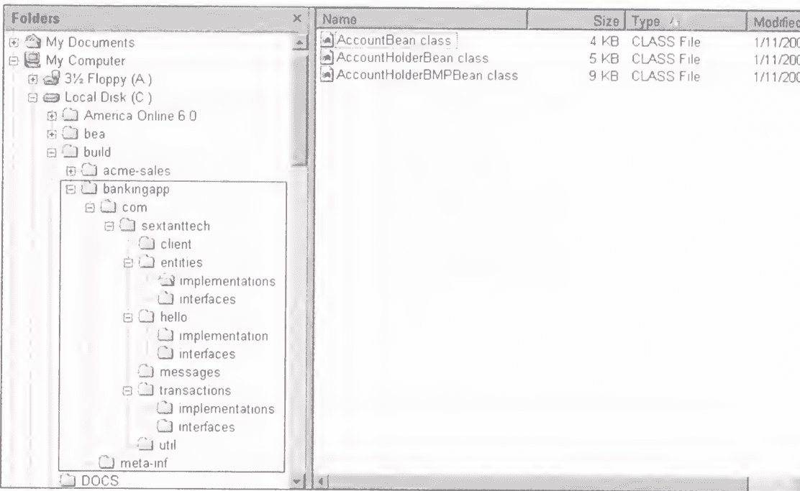

图11-1：银行应用程序的构建目录结构。

现在是时候打包应用程序了。大多数EJB容器供应商会提供构建工具，帮助你创建部署描述符并构建用于部署的应用程序包。但如果你无法访问此类工具，我在这里将涵盖你需要知道的所有内容。我使用一个名为 JAR（Java应用程序归档）的工具进行构建，该工具随 Java 2 标准版一起分发。JAR 工具构建应用程序归档文件，你可以用它来构建 EJB 应用程序。EJB 应用程序应与应用程序的默认目录同名。使用 JAR 工具创建 jar 文件非常直接；只需遵循以下步骤：

1. 首先启动 DOS 命令提示符。在大多数 Windows 计算机上，你只需选择“开始”→“运行”，在出现的对话框的“打开”字段中输入命令`command`，然后单击“确定”。这应该会打开一个 DOS 窗口。

2. 将目录更改为你应用程序的默认包目录。在我的计算机上，我通过输入`cd c:\build\bankingapp`并按回车键来完成此步骤。

现在你已准备好构建你的应用程序。

3. 通过输入以下命令来构建你的应用程序：

```shell
jar cfv <application-name> <include-files>
    <include-directories>
```

在此示例中：

- `<application-name>`是你的应用程序名称，应以`.jar`扩展名结尾。我的应用程序名称是`bankingapp.jar`。
- `<include-files>`是应包含在 EJB 应用程序根目录中的单独列出的文件。如果你遵循了步骤1-3中的构建说明，则此选项不是必需的。
- `<include-directories>`是一组目录或一个目录通配符规范，指向你想要包含在 jar 文件中的目录。如果你位于构建目录中，此标签应替换为你 EJB 应用程序的默认包目录，后跟`\*.*`通配符操作符。在我的应用程序中，此值是`*.*`。

当你输入完整的`jar`命令后——例如：

```shell
jar cfv bankingapp.jar *.*
```

然后按回车键，应该会有一大堆消息快速闪过，这些消息以类似`adding:`开头，后跟一些文件名。当`jar`程序完成后，命令提示符会返回。图11-2显示了我运行`jar`命令后的命令提示符。

图11-2：构建 EJB 应用程序。

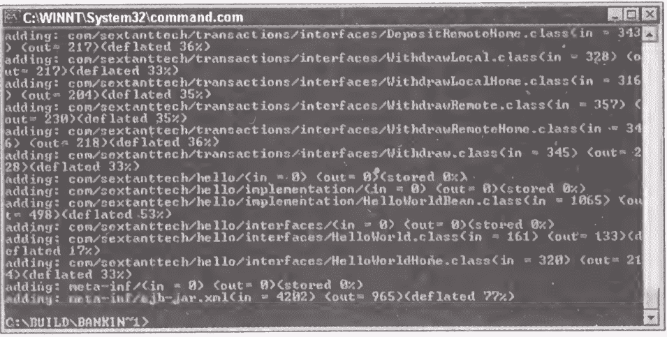

要验证 jar 文件是否已构建，只需在 DOS 窗口中输入`dir`并按回车键。你应该看到一个与你的 EJB 应用程序同名的文件。如果看到了，你就完成了！差不多了……

> **提示**
>
> 从命令行，你可以输入命令`jar tvf <file-name>`来查看`jar`文件的内容。你也可以使用 ZIP 压缩实用程序（如 WinZip）来查看`jar`文件的内容。但你不能使用 ZIP 压缩实用程序来构建`jar`文件，因为`jar`程序会添加一个称为*清单*的特殊文件，该文件被 Java 程序用于检查`jar`文件的内容。如果你需要向`jar`文件添加任何内容，请务必使用`jar`实用程序，以便正确更新清单。

## 构建客户端应用程序归档

请记住，你将 EJB 应用程序分发给两类可能的受众：必须拥有 EJB 应用程序所有类的 EJB 服务器，以及运行——我的意思是运行——你的应用程序的客户端。客户端应用程序可以使用你为服务器构建的相同的`jar`文件，但按照惯例，你不应该将服务器应用程序分发给客户端。相反，你应该创建一个较小的`jar`文件，其中仅包含客户端与你的应用程序一起工作所需的主接口、组件接口以及支持类。客户端需要以下类来运行你的 EJB 应用程序：

- **实用程序类：** 如果你创建了任何实用程序类，例如批量操作对象——用于一次更新实体 Bean 对象的多个属性——客户端将需要这些对象的类文件。
- **主键类：** 客户端需要能够获取对实体 Bean 主键的引用，因此所有实体 Bean 主键类都应分发给客户端。
- **主接口：** 客户端需要主接口的`.class`文件，以便它可以查找会话和实体 Bean。
- **组件接口：** 客户端需要组件接口的`.class`文件，以便它可以获取对你的应用程序中会话和实体 Bean 的引用。
- **部署描述符：** 客户端需要部署描述符，以便知道用于远程和组件接口的抽象名称。

尽管 EJB 规范允许创建包含前述信息的`client-jar`文件，但它并未明确说明应如何构建`client-jar`文件、应包含哪些类以及客户端部署描述符的格式应该是什么。因此，每个 EJB 容器供应商都可以自由地提出自己的解决方案来打包 EJB 客户端应用程序。请务必查阅你的 EJB 容器供应商的文档，以了解创建`client-jar`文件的精确解决方案。

# 第五部分：将所有内容整合在一起

# 第12章：通过 JNDI 注册应用程序资源

*本章内容*

- 回顾 Java 命名和目录接口（JNDI）
- 访问系统资源
- 定义环境资源
- 引用其他 EJB 组件

在企业 JavaBean（EJB）应用程序中编程的挑战之一是，EJB 组件可能需要引用应用程序资源——例如其他 EJB 组件或实用程序对象——而这些资源在应用程序部署之前不可用。此类资源通常被称为*运行时资源*，因为它们是在应用程序运行时定义的，而不是在编码时定义的。问题在于，你需要在编码 EJB 组件时引用运行时资源，即使你直到运行时才知道提供这些资源的类的名称。例如，一个 EJB 应用程序可能需要使用 JDBC 驱动程序来访问数据库，但实际的驱动程序可能直到 EJB 组件准备好部署时才被提供。因此，EJB 组件开发人员可能不知道驱动程序的确切名称或如何创建对该驱动程序的引用。

早期尝试使用 Psychic Friends Network 来协助识别运行时资源被证明是不可靠的。因此，Java 工程师想出了一个解决这个问题的新方案。由于在程序开发时资源名称可能尚不明确，他们没有在 EJB 程序的代码内部访问资源，而是创建了所需资源类型的别名，然后在 EJB 组件内部引用该别名。

这个别名被称为*JNDI 名称*，是*Java 命名和目录接口*名称的缩写。别名就像电源线上的插头。当资源在部署时定义时，别名被映射到资源，就像电源线连接到插座一样。结果是 EJB 应用程序——也许在我假设的场景中是一盏台灯——可以设计和构建，而无需访问其最终将插入的电源插座。

实际上，基于 JNDI 名称的 JNDI 在 EJB 应用程序之前就已存在，但为了适应 EJB 组件的需求，该想法稍作调整。在标准 JNDI 服务中，会创建一个包含资源的目录，每个资源都有一个字符串别名和一个类型——资源的 Java 类名——该类型可以在应用程序的`CLASSPATH`中查找。JNDI 目录实际上并不映射到硬盘驱动器上的目录；相反，它用作逻辑目录，用于在内存中组织 JNDI 资源。应用程序可以在目录中查找资源并检索对资源的引用。因此，应用程序不需要知道如何精确地引用资源；相反，它需要知道资源的 JNDI 名称。

在 EJB 应用程序中，每个 EJB 组件都有自己私有的命名上下文，这就像 JNDI 资源的逻辑分区。这个分区被称为 JNDI 企业命名上下文（JNDI ENC），每个 EJB 组件都有自己私有的 JNDI ENC。JNDI ENC 是为 EJB 组件完成工作所需资源提供别名的目录服务。JNDI ENC 的实际资源和别名是在 EJB 应用程序的部署描述符内部定义的。作为 EJB 组件开发人员，你可以在 JNDI ENC 中为你的 EJB 组件所需的资源创建逻辑引用。这些引用允许你在不知道资源的确切名称或来源的情况下访问 EJB 组件内部的资源。

当 EJB 应用程序由应用程序组装者组装时，组装者将把你的 JNDI ENC 引用连接到 EJB 应用程序中的实际资源。因此，一个 EJB 组件可以由完全不了解 EJB 应用程序运行时环境、只知道其 EJB 组件所需资源类型的人创建。

> 运行时资源是 EJB 程序环境的一部分。环境是指应用程序运行的上下文，包括应用程序可访问的所有服务和资源。

在本章中，你将了解如何在部署描述符中定义 JNDI ENC 资源，并查看一个在 EJB 组件中引用 JNDI ENC 资源的简单示例。在 EJB 部署描述符中有五种类型的 JNDI ENC 资源标签：

- **环境条目：** 引用对象，用于保存供 EJB 组件使用的*环境信息*。环境信息是指在 EJB 组件部署后可以配置的信息——配置后，这些信息将调整 EJB 组件的行为。例如，银行应用程序可以定义一个想要开设信用卡账户的人的最低信用评分。该信用评分可以在名为`MIN_CREDIT_SCORE`的环境条目中定义。作为组件开发人员，你知道信用卡申请人必须具有`MIN_CREDIT_SCORE`才能获得信用卡，但`MIN_CREDIT_SCORE`的实际阈值可能会随时间变化。通过将`MIN_CREDIT_SCORE`定义为环境条目，你可以在不更改任何源代码的情况下，在运行时配置应用程序的行为。然后，EJB 组件可以在每次需要执行需要该值的任务时，从其 JNDI ENC 中获取`MIN_CREDIT_SCORE`值。

- **EJB 本地引用：** 定义 EJB 组件用于通过另一个 EJB 组件的本地主接口和本地接口来引用该组件的别名。EJB 通过使用 JNDI 查找指定的资源名称来访问这些资源。
- **EJB 远程引用：** 定义 EJB 组件用于通过另一个 EJB 组件的远程主接口和远程接口来引用该组件的别名。EJB 通过使用 JNDI 查找指定的资源名称来访问这些 Artifact3 资源。
- **资源引用：** 定义 EJB 组件用于引用 EJB 应用程序外部某些资源的别名。该资源可以是外部电子邮件应用程序或遗留应用程序。
- **资源环境引用：** 定义 EJB 组件可用于引用在 EJB 应用程序环境内部管理的环境资源的别名。此类资源可以包括内部管理的 Java 消息服务（JMS）服务器或 JDBC 驱动程序连接池。EJB 应用程序通过 JNDI 查找这些资源。

## 定义环境资源

环境资源是针对特定 EJB 组件的资源，可以存储对该类型组件全局的信息。例如，不同类型的银行账户可能有不同的月费。此外，这些费用可能会随时间变化。代表银行账户的 EJB 组件需要一种灵活的方式来识别费用并向客户收取。月费可以定义为应用程序资源，从而可以定期更改而无需修改 EJB 组件代码。在应用程序代码内部定义月费是自找麻烦，因为更改它可能会非常困难和昂贵。环境资源旨在保存 EJB 组件需要引用但可以定期更改的信息。


环境条目内部保存的信息必须用 Java 对象包装器表示，对应于 Java 语言中的原始类型之一。这意味着在 Java 中定义的任何字符或数字类型都可以在环境引用中表示。环境引用的合法类型有`java.lang.Boolean`、`java.lang.Byte`、`java.lang.Character`、`java.lang.Double`、`java.lang.Float`、`java.lang.Integer`、`java.lang.Long`、`java.lang.Short`和`java.lang.String`。


许多人认为环境条目应该能够保存日期。Java 中没有原始日期类型，但你可以通过几种方式解决这个问题。首先，你可以将日期存储为`String`并在 EJB 应用程序内部解析它。第二种方法是确定日期的`Long`值，并将该`Long`值存储在环境引用中。

环境资源可以在 EJB 应用程序部署描述符中的`<session>`、`<entity>`和`<message-driven>`标签内定义。每个 EJB 定义自己的环境条目，它们不会在不同的 EJB 组件之间共享。环境条目在`<env-entry>`标签内定义。我在下面的列表中描述环境条目的每个元素：

- **`<env-entry>`：** 环境条目的最外层标签，`<env-entry>`标签将所有与环境条目相关的属性分组在一起。每个 EJB 组件可以定义零个、一个或多个`<env-entry>`标签。
- **`<description>`：** 可选标签，`<description>`定义环境条目的用途。我强烈建议你为创建的每个环境条目提供精确的定义。
- **`<env-entry-name>`：** 此标签标识环境条目的逻辑名称。EJB 组件将使用其逻辑名称查找你定义的每个环境条目。
- **`<env-entry-type>`：** 此标签标识环境条目对象的类型。它必须是本节第二段中标识的对象之一——`Boolean`、`Byte`、`Character`、`Double`、`Float`、`Integer`、`Long`、`Short`或`String`。
- **`<env-entry-value>`：** 此标签标识环境条目对象的值。它对于环境条目的类型必须是合法的。

清单 12-1 展示了最低信用卡评分环境条目的示例，以粗体显示。

## 清单 12-1 环境条目

```xml
<?xml version="1.0" encoding="UTF-8"?>
<!DOCTYPE ejb-jar PUBLIC "-//Sun Microsystems, Inc.//DTD Enterprise JavaBeans 2.0//EN" "http://java.sun.com/dtd/ejb-jar_2_0.dtd">

<ejb-jar>
    <enterprise-beans>
        <session>
            <ejb-name>CCApplicationEvaluatorBean</ejb-name>
            <env-entry>
                <description>
                    This is the minimum credit score for a platinum card.
                </description>
                <env-entry-name>PLATINUM_MIN_CREDIT_SCORE</env-entry-name>
                <env-entry-type>java.lang.Integer</env-entry-type>
                <env-entry-value>660</env-entry-value>
            </env-entry>
        </session>
    </enterprise-beans>
</ejb-jar>
```

有关引用环境资源的信息，请参阅本章最后一节“使用 JNDI 查找资源”。

## 定义 EJB 本地引用

*EJB 本地引用*是通过其他 EJB 对象的本地主接口和本地接口来引用应用程序中其他 EJB 对象的引用。如果你想在 EJB 组件内部使用另一个 EJB 对象的本地接口，则必须在部署描述符中定义 EJB 本地引用。

> **提示**
>
> 如果你想通过远程接口引用 EJB 组件，请参阅下一节“定义 EJB 远程引用”。

EJB 本地引用使用`<ejb-local-ref>`标签定义，该标签可以嵌套在`<entity>`、`<message-driven>`或`<session>`标签内部。在下面的列表中，我定义了`<ejb-local-ref>`标签中的每个元素：

- **`<ejb-local-ref>`：** 此元素包含通过本地接口引用另一个 EJB 组件所需的所有信息。每个 EJB 组件可以定义零个、一个或多个`<ejb-local-ref>`标签。


- `<description>`：这是引用的 EJB 组件的可选描述。不必包含此元素，但提供描述是一个好习惯。
- `<ejb-ref-name>`：这是你的 EJB 组件将用于查找此引用中标识的 EJB 的别名。引用名称应在 EJB 组件的上下文中是唯一的。（也就是说，在给定的 EJB 组件中，不应有两个 `<ejb-local-ref>` 标签具有相同的 `<ejb-ref-name>` 值。）通常，`<ejb-ref-name>` 要么是对你有意义的名称，要么与被引用 EJB 组件的本地接口名称相同。按照惯例，`<ejb-ref-name>` 以 `ejb/` 开头，表示该资源是 EJB 组件。
- `<ejb-ref-type>`：此属性指示引用的 EJB 是实体 Bean 还是会话 Bean。允许的值为 `Session`（会话 Bean）和 `Entity`（实体 Bean）。
- `<local-home>`：此属性标识被引用 EJB 的本地主接口的完全限定类名。
- `<local>`：此属性标识被引用 EJB 的本地接口的完全限定类名。
- `<ejb-link>`：如果 EJB 本地引用链接到此 EJB-JAR 文件中定义的另一个 EJB 组件，则可以使用此属性。这对于 EJB 本地引用通常是这样。如果使用此属性，它应包含被引用 EJB 组件的 `<ejb-name>` 属性值。

清单 12-2 展示了引用另一个 EJB 组件的 EJB 本地引用条目的示例。为举例说明，我包含了 `<ejb-link>` 元素。请注意，其值与被引用实体的 `<ejb-name>` 相同。

## 清单 12-2 EJB 本地引用

```xml
<?xml version="1.0" encoding="UTF-8"?>
<!DOCTYPE ejb-jar PUBLIC "-//Sun Microsystems, Inc.//DTD Enterprise
JavaBeans 2.0//EN" "http://java.sun.com/dtd/ejb-jar_2_0.dtd">

<ejb-jar>
  <enterprise-beans>
    <session>
      <ejb-name>DepositBean</ejb-name>
      <ejb-local-ref>
        <ejb-ref-name>ejb/local/accountEJB</ejb-ref-name>
        <ejb-ref-type>Entity</ejb-ref-type>
        <local-home>
          com.sextanttech.entities.implementations.AccountLocalHome
        </local-home>
        <local>
          com.sextanttech.entities.implementations.AccountLocal
        </local>
        <ejb-link>AccountEJB</ejb-link>
      </ejb-local-ref>
    </session>
    <entity>
      <ejb-name>AccountEntityBean</ejb-name>
    </entity>
  </enterprise-beans>
</ejb-jar>
```

# 第五部分：将一切整合在一起

## 定义 EJB 远程引用

通过远程接口引用 EJB 组件的过程，与通过本地接口引用 EJB 组件的过程类似。区别在于，远程引用引用的是 EJB 组件的远程 Home 接口和远程接口，而非其本地 Home 接口和本地接口。EJB 组件的远程引用在部署描述符的 `<ejb-ref>` 标签中定义。下面我将介绍该标签的语法：

- `<ejb-ref>`：此标签包含通过远程接口引用另一个 EJB 所需的所有信息。每个 EJB 组件可以定义零个、一个或多个 `<ejb-ref>` 标签。
- `<description>`：这是对被引用 EJB 组件的可选描述。该元素不是必须包含的，但提供描述是一种良好的实践。
- `<ejb-ref-name>`：这是 EJB 组件用于查找此引用中标识的 EJB 的别名。引用名称在 EJB 组件的上下文中应该是唯一的。（也就是说，在给定的 EJB 组件中，两个 `<ejb-ref>` 标签不能有相同的 `<ejb-ref-name>` 值。）通常，`<ejb-ref-name>` 要么是对您有意义的名称，要么与被引用 EJB 组件的 Home 接口名称相同。按照惯例，`<ejb-ref-name>` 以 `ejb/` 开头，以表明该资源是一个 EJB 组件。
- `<ejb-ref-type>`：此属性表明引用的 EJB 是实体 Bean 还是会话 Bean。允许的值是会话 Bean 的 `Session` 和实体 Bean 的 `Entity`。
- `<home>`：此属性标识被引用 EJB 的远程 Home 接口的完全限定类名。
- `<remote>`：此属性标识被引用 EJB 的远程接口的完全限定类名。
- `<ejb-link>`：如果 EJB 本地引用链接到此 EJB-JAR 文件中定义的另一个 EJB 组件，则可以使用此属性。如果使用此属性，它应该包含被引用 EJB 组件的 `<ejb-name>` 属性的值。

# 第五部分：综合展示

清单 12-3 以粗体展示了 EJB 组件远程引用的定义。

### 清单 12-3 EJB 远程引用

```xml
<?xml version="1.0" encoding="UTF-8"?>
<!DOCTYPE ejb-jar PUBLIC "-//Sun Microsystems, Inc.//DTD Enterprise
JavaBeans 2.0//EN" "http://java.sun.com/dtd/ejb-jar_2_0.dtd">

<ejb-jar>
  <enterprise-beans>
    <session>
      <ejb-name>DepositBean</ejb-name>
      <ejb-ref>
        <description>Account to deposit funds into.</description>
        <ejb-ref-name>ejb/remote/AccountEJB</ejb-ref-name>
        <ejb-ref-type>Entity</ejb-ref-type>
        <home>
          com.sextanttech.entities.interfaces.AccountRemoteHome
        </home>
        <remote>
          com.sextanttech.entities.interfaces.AccountRemote
        </remote>
        <ejb-link>AccountEJB</ejb-link>
      </ejb-ref>
    </session>
    <entity>
      <ejb-name>AccountEntityBean</ejb-name>
    </entity>
  </enterprise-beans>
</ejb-jar>
```

### 提示

您可能想知道为什么远程引用没有命名为 `<ejb-remote-ref>` 以区别于 `<ejb-local-ref>`。原因是 EJB 1.1 规范中没有本地引用，这意味着 `<ejb-ref>` 是当时唯一的标签，不需要区分两种类型的 EJB 引用。因此，远程引用的语法是从 EJB 1.1 规范继承而来的。

## 定义外部资源引用

*外部资源*包括在当前 EJB 应用程序范围之外定义的应用程序和实用工具的引用。所有外部资源的共同特征是，它们无法从 EJB 应用程序的上下文中进行管理。EJB 应用程序中有许多外部资源的可能性，包括以下几种：

- **JDBC 数据源：** 大多数 EJB 系统将使用数据库来管理实体 Bean 属性的持久性，这意味着 JDBC 数据库驱动器需要为每个 EJB 组件定义为资源。
- **电子邮件系统：** 也许您的 EJB 应用程序设计为在发生某种类型的错误时向系统管理员发送警报。也许在未授权访问尝试进行时向安全专家发送电子邮件。或者也许您的应用程序在客户透支账户时向他们发送电子邮件。在 EJB 应用程序中有许多使用电子邮件的机会——要这样做，您需要创建对 EJB 组件使用的电子邮件服务的外部资源引用。
- **与遗留系统的集成：** 许多 EJB 应用程序可能只不过是将消息定向到某个遗留系统的企业应用程序。如果是这样，您将需要资源，使您的 EJB 应用程序能够与该遗留系统进行通信。这些资源可能是提供与遗留系统接口的一组方法的类或驱动程序。获取对类和驱动程序的访问需要对外部资源进行引用。
- **企业对企业通信：** 也许您的 EJB 系统在某个项目的库存低于一定水平时自动订购新库存。企业对企业集成要求您和供应商之间存在某种通信媒介。如果供应商发布了建立此类连接的代码，您可以通过定义外部资源引用来引用它。

外部资源在部署描述符中使用 `<resource-ref>` 元素定义。以下列表标识了外部资源引用的元素及其用途：

- `<resource-ref>`：此元素分组了描述 EJB 组件外部资源的所有元素。
- `<description>`：使用此元素提供有关外部资源用途的一些文档。虽然此元素不是必需的，但我强烈建议您花一点时间记录每个外部资源。尤其是，使用 `<description>` 标签来标识记录外部资源接口、类和异常的 Javadoc 是一个特别好的想法。
- `<res-ref-name>`：这是外部资源在为其定义的 EJB 组件内部将被标识的逻辑名称。您将使用此名称通过 JNDI 查找资源。

按照惯例，资源被放置在适用于其代表资源类型的目录中。例如，应用程序使用的所有 JDBC 驱动器应该将其 `<res-ref-name>` 标签以 `jdbc/` 为前缀，以表明它们是 JDBC 驱动器。电子邮件服务器以 `email/` 为前缀，XML 文档解析器放置在 `xml/` 目录中，等等。目录名称是可选的，但有助于组织不同类型的资源。

- `<res-type>`：这是此引用所获取资源的完全限定类名。例如，JDBC 数据源可以具有 `java.sql.Driver` 或 `javax.sql.DataSource` 值，具体取决于使用的是哪个版本的 JDBC。
- `<res-auth>`：此属性表明 EJB 容器还是 EJB 组件内部的代码将处理资源的安全认证。有两个可能的值：容器管理认证的 `Container`，以及应用程序管理认证的 `Application`。如果指定了 `Container`，应用程序部署者负责提供资源的认证信息。如果指定了 `Application`，认证代码必须由 Bean 开发人员提供。通常，使用 `Container` 认证是一种良好的实践，因为对各种数据源进行认证管理是一个管理问题，而不是软件开发问题。
- `<res-sharing-scope>`：可选标签，`<res-sharing-scope>` 表明指定的 EJB 组件是否可以与它所调用的其他 EJB 组件共享资源。此元素的默认值是 `Sharable`，表明此资源具有公共范围，可以由其他 EJB 组件共享。值 `Unsharable` 告诉 EJB 容器此资源具有私有范围，不能与其他 EJB 组件共享。

`<res-sharing-scope>` 仅适用于调用具有 `<resource-ref>` 标签的 EJB 组件的 EJB 组件。即使 `<res-sharing-scope>` 是 `Sharable`，该资源也不能由未定义该标签的 EJB 组件所共享。

清单 12-4 以粗体展示了 JDBC 数据源的 `<resource-ref>` 标签的实现。资源管理器是 `javax.sql.DataSource` 类，这使得此资源成为 JDBC 3.0 数据库驱动器。资源引用是 `Sharable` 的，意味着此资源可以与被该组件调用的其他 EJB 组件共享。

### 清单 12-4 定义外部资源

```xml
<ejb-jar>
  <enterprise-beans>
    <entity>
      <bean-name>AccountHolderBMP</bean-name>
      <resource-ref>
        <description>Data source for account holder</description>
        <res-ref-name>jdbc/AcctHolderDatabase</res-ref-name>
        <res-type>javax.sql.DataSource</res-type>
        <res-auth>Container</res-auth>
        <res-sharing-scope>Sharable</res-sharing-scope>
      </resource-ref>
    </entity>
  </enterprise-beans>
</ejb-jar>
```

## 定义本地资源引用

本地资源引用是指向由 EJB 应用程序定义和管理的资源的引用。因为这些资源是本地的，所以使用它们的 EJB 组件具有特殊的受信任特权，这意味着资源本身无需定义认证和共享规则。在你选定要部署到的 EJB 容器之后，才能确定哪些资源属于你的 EJB 应用程序的环境。许多 EJB 容器都内置了本地 JMS 服务器。它们可能还包含一个邮件服务器，并定义了你的应用程序可以使用的额外本地资源。在使用这些本地资源时，你应该为它们定义本地资源引用。

部署描述符中用于本地资源引用的标签是 `<resource-env-ref>`，每个本地资源引用的语法如下列表所示：

- `<resource-env-ref>`：此元素包含定义本地资源的所有子元素。
- `<description>`：这是一个可选的文档元素，应用于描述该资源的用途。
- `<resource-env-ref-name>`：此元素标识资源的逻辑名称，该名称将在 EJB 组件内部用于引用该资源。
- `<resource-env-ref-type>`：此元素标识与此资源引用相关联的 Java 类型，应为资源引用的完全限定类名。

清单 12-5（**粗体**部分）展示了用于定义本地资源引用的 XML 代码。本地资源引用可以在 `<session>`、`<message-driven>` 和 `<entity>` 元素内部定义。

> 请注意，`<message-driven>` 元素有一个单独的属性用于标识其订阅的 JMS 服务器类型。当使用 JMS 服务器的资源引用时，你定义的应该是你想向其发送消息的资源。如果你想从 JMS 服务器接收消息，请改为创建一个消息驱动 Bean。消息驱动 Bean 无需为其订阅的 JMS 服务器定义资源引用。

### 清单 12-5 定义本地资源引用

```xml
<?xml version="1.0" encoding="UTF-8"?>
<!DOCTYPE ejb-jar PUBLIC "-//Sun Microsystems, Inc.//DTD Enterprise
JavaBeans 2.0//EN" "http://java.sun.com/dtd/ejb-jar_2_0.dtd">

<ejb-jar>
  <enterprise-beans>
    <entity>
      <description>
        This is an account holder bean with bean-managed
        persistence.
      </description>
      <ejb-name>AccountHolderBMP</ejb-name>
      <resource-env-ref>
        <description>
          This is a JMS server that sends alerts to an account
          representative when an Account Holder's account is
          overdrawn.
        </description>
        <resource-env-ref-name>jms/CustomerService</resource-env-ref-name>
        <resource-env-ref-type>javax.jms.Topic</resource-env-ref-type>
      </resource-env-ref>
    </entity>
  </enterprise-beans>
</ejb-jar>
```

与其他类型的资源一样，本地资源可以被分配到不同的目录中。例如，清单 12-5 中定义的 JMS 资源被分配到了 `jms/` 目录，该目录对应于所有 Java 消息服务资源的存放位置。将资源分配到一个目录有助于将其组织成有意义的分组。这不是必须的，但按照惯例，每个资源都应被分配到一个有意义的目录中。

## 使用 JNDI 查找资源

在应用程序中定义好资源之后，你就可以在 EJB 组件中使用它们了。资源通过 Java 命名和目录接口（JNDI）在 EJB 组件类内部进行访问。JNDI 使用起来非常简单。以下是访问任何 EJB 资源的基本步骤：

1. 使用 `javax.jndi.LocalContext` 类获取 JNDI 上下文。

   语句如下：

   ```java
   javax.jndi.Context context = new javax.jndi.LocalContext();
   ```

2. 使用上下文对象的 `lookup` 方法查找在上下文中定义的任何资源（包括为当前使用的 EJB 组件类型定义的所有资源）。

   一个 EJB 组件的所有环境条目都存储在上下文 `java:comp/env` 下。因此，如果你想获取 EJB 组件的整个环境，代码应如下所示：


```java
javax.jndi.Context myContext = (Context)
    context.lookup("java:comp/env");
```

3. 定义`myContext`变量后，在该变量中查找特定的环境条目。例如：

```java
javax.sql.DataSource ds = (DataSource)
    context.lookup("jdbc/AcctHolderDatabase");
```

或者，你可以跳过步骤2，直接从上下文对象中提取资源，如下例所示：

```java
javax.sql.DataSource ds = (DataSource)
    context.lookup("java:comp/env/jdbc/AcctHolderDatabase");
```

4. `Context.lookup`方法的返回值是一个`java.lang.Object`，你会注意到我必须进行类型转换——将对象类型转换为在对象的资源条目中指定的类型。

在EJB应用程序中进行类型转换有一个注意点。如果你查找的是一个远程资源，例如远程EJB引用，你必须使用`java.rmi.PortableRemoteObject.narrow`方法执行类型转换。以下是使用`PortableRemoteObject.narrow`方法转换远程对象的示例：

```java
Object obj = context.lookup("java:comp/env/ejb/AccountHolder");

AccountHolderRemoteHome holderHome =
    (AccountHolderRemoteHome)
    PortableRemoteObject.narrow(
        obj,
        Class.forName(
            "com.sextanttech.entities.interfaces.AccountHolderRemoteHome"
        )
    );
```

请注意，上述示例中的`narrow`方法接受两个参数；第一个是需要被转换的对象，第二个是对象应被转换成的`Class`。这个`Class`可以通过调用静态方法`Class.forName`并提供类的字符串名称作为参数来获取。这两个参数已在粗体文本中标识出来。

# 第五部分：融会贯通

# 第13章：组装EJB应用程序

## 本章内容

- 检查构建和部署过程
- 从一个简单的部署开始
- 交叉引用基本的应用程序组装任务
- 当人行道到头时会发生什么

在本书的开头，我简要回顾了EJB应用程序开发人员的一些不同职责。EJB Bean提供者负责实际编写EJB组件以及在部署描述符中描述这些组件。在第二、三、四部分中，我深入探讨了编写EJB组件的过程。在第11章中，我带领你详细分析了如何描述EJB组件。在第12章中，我最后研究了JNDI，Bean提供者正是使用它来描述其开发的EJB组件所访问的资源。

至此，你已经超越了EJB开发的范畴，进入了EJB应用程序组装的领域。暂时摘下你的EJB Bean开发者帽子是个好主意，因为你已身处全新的领域。组装和部署EJB应用程序需要一种不同的思维方式。这就是为什么EJB规范区分了EJB Bean提供者、EJB应用程序组装者和EJB应用程序部署者这三个角色。这三个角色（简要）定义如下：

> **Bean提供者：** 当你扮演这个角色时，你的责任是既创建EJB组件，又在部署描述符中描述这些组件。Bean提供者一次专注于一个EJB组件。他们构建组件，描述组件，然后转向下一个组件。Bean提供者只关注EJB应用程序的宏观层面，前提是这会影响他们当前正在工作的EJB组件的内部实现。

## 应用程序装配器

应用程序装配器从更广阔的视角审视EJB应用程序。顾名思义，应用程序装配器负责将任何EJB应用程序的不同组件组装成一个整体。Bean提供者并不承担此任务，因为他们的工作重点是单个EJB组件的实现和描述。应用程序装配器则需要提供连接组织，将不同的EJB组件连接起来，同时承担描述整个EJB应用程序特性的任务。当应用程序装配器完成工作时，关于EJB应用程序的功能及其运行方式的视图基本上就确定了……但并非完全。

## 应用程序部署者

EJB应用程序的部署者承担了应用程序装配者的部分职责，但不仅需要对EJB应用程序的内部机制有全局性的把握，还需要了解EJB应用程序的内部机制如何与EJB容器提供的服务进行交互。例如：

- 部署者需要验证应用程序装配者的任务是否已完成。
- 部署者需要评估装配者对EJB应用程序的描述，并确保其与部署到EJB容器的任何其他应用程序不冲突。任何冲突都必须修正。
- 最后，应用程序部署者必须将EJB应用程序要求的服务映射到EJB容器的服务上。这或许是所有任务中要求最高的，因为每个EJB容器都有其独特的、专有的格式来将EJB应用程序接入EJB容器服务。

只要你是在定义EJB组件并组装EJB应用程序，你使用的便是一套标准化的技术规范——所有EJB应用程序的编码和组装任务都是标准的。但当你进入部署阶段时，每个EJB容器供应商都被允许采用不同的方法。这意味着，将EJB应用程序部署到EJB容器并没有单一的标准。这也意味着，当你的应用部署阶段到来时，本书不能是你唯一的指路明灯。因此，尽管我会给你一些指导并展示一个简单的部署过程，你仍需查阅随所选EJB容器提供的文档，以获取部署EJB应用程序的详细信息。

应用程序部署者就像数据库引擎的数据库管理员——任务确实如此复杂。虽然许多人可以同时兼任EJB组件提供者和应用程序装配者的角色，但能再戴上部署者帽子的人则非常罕见。部署者必须具备关于EJB容器服务、配置和管理的专业知识。在我看来——也是EJB规范的观点——你团队中的Bean开发者不应试图承担部署者的工作。你的团队可以从新的、高度专业化的眼光中受益。

此建议面向所有信息技术（IT）经理——你可以雇佣任意数量的承包商来开发你的EJB组件，但你必须有一名在编的部署者。可以将部署者视为数据库管理员。部署者和数据库管理员都有责任将变更加载到测试环境中，确保其正常运行，然后再加载到生产环境中。当这些职责不那么紧迫时，部署者和数据库管理员都可以专注于支持、维护和管理任务。对于EJB部署者而言，这些任务可能包括监控和调优EJB容器的性能，以及为EJB应用程序的各种用户授予安全许可。这项工作完全是一份全职工作。

## 部署示例EJB应用程序

当你准备进行首次EJB应用程序部署时，我认为最好从非常简单的程序开始，然后逐步转向更复杂的程序。部署一个简单的程序可以让你熟悉EJB容器特定的技术，并确保你能专注于部署问题——而无需担心遇到的任何问题是由于编码错误还是部署错误造成的。

我第一次使用BEA WebLogic Server时试图部署一个复杂应用程序，由此获得了这个经验。在折腾了三天之后，我应用了KISS原则（保持简单，笨蛋），能够在几个小时内成功部署一个EJB应用程序。由此，我能够逐步增加程序的复杂性。通过逐步增加程序的复杂性，你将能够隔离遇到的任何问题并克服它们。

为了帮助你入门简单部署，我提供了一个简单的Hello World EJB应用程序，其源代码可在本书的网站`www.dummies.com/extras/ejbfd`上获取。Hello World应用程序包含一个EJB无状态会话Bean。该会话Bean的唯一目的是打印消息`"Hello World!"`；如果应用程序成功部署，你将看到此消息；如果部署失败，你会得到某种关于错误原因的提示。清单13-1展示了Hello World应用程序的远程主接口。清单13-2展示了应用程序的远程接口。清单13-3展示了生成Hello World消息的会话Bean类。最后，清单13-4展示了随附的部署描述符。

302 第五部分：整合所有内容

### 清单13-1：HelloWorldRemoteHome接口

```java
package com.sextanttech.hello.interfaces;

import javax.ejb.EJBHome;
import javax.ejb.CreateException;
import java.rmi.RemoteException;

public interface HelloWorldRemoteHome extends EJBHome {
    HelloWorld create() throws RemoteException,
                               CreateException;
}
```

`HelloWorldRemoteHome`接口提供了一个`create`方法，该方法帮助客户端应用程序获取对EJB组件的引用。

### 清单13-2：HelloWorldRemote接口

```java
package com.sextanttech.hello.interfaces;

import javax.ejb.EJBObject;

public interface HelloWorldRemote extends EJBObject {
    String helloWorld() throws java.rmi.RemoteException;
}
```

`HelloWorldRemote`接口有一个方法，该方法将消息`"Hello World!"`返回给客户端应用程序。

### 清单13-3：HelloWorldBean类

```java
package com.sextanttech.hello.implementation;

import javax.ejb.SessionBean;
import javax.ejb.SessionContext;
import javax.ejb.CreateException;
import javax.ejb.EJBException;
import java.rmi.RemoteException;

public class HelloWorldBean implements SessionBean {
    SessionContext context;

    public void ejbActivate() {} // 无操作

    public void ejbPassivate() {} // 无操作

    public void ejbRemove() {} // 无操作

    public void setSessionContext(SessionContext context) {
        this.context = context;
    }

    public String helloWorld() {
        return "Hello World!";
    }

    public void ejbCreate() throws CreateException,
        EJBException {} // 无操作
}
```

该Bean类极其简单，只有一个业务方法，返回字面值`"Hello World!"`。

### 清单13-4：HelloWorld部署描述符

```xml
<?xml version="1.0" encoding="UTF-8"?>

<!DOCTYPE ejb-jar PUBLIC "-//Sun Microsystems, Inc.//DTD
        Enterprise JavaBeans 2.0//EN" "http://java.
        sun.com/dtd/ejb-jar_2_0.dtd">

<ejb-jar>
  <enterprise-beans>
    <session>
      <ejb-name>HelloWorldEJB</ejb-name>
      <home>
        com.sextanttech.hello.interfaces.HelloWorldRemoteHome
      </home>
      <remote>
        com.sextanttech.hello.interfaces.HelloWorldRemote
      </remote>
      <ejb-class>
        com.sextanttech.hello.implementation.HelloWorldBean
      </ejb-class>
      <session-type>Stateless</session-type>
      <transaction-type>Container</transaction-type>
    </session>
  </enterprise-beans>
</ejb-jar>
```

最后，你定义了部署描述符，它仅包含描述`HelloWorldEJB`组件所需的最基本信息，应由EJB Bean提供者指定。此应用程序中部署者必须指定的唯一缺失部分是此EJB组件的JNDI名称。为组件声明JNDI名称对于你选择的每种EJB容器类型都是不同的。在这个例子中，我将EJB应用程序部署到JBoss应用服务器。使用JBoss时，你必须创建一个名为`jboss.xml`的独立XML文件，该文件标识EJB组件并为其提供一个JNDI名称。源代码如清单13-5所示。

### 清单13-5：jboss.xml文件的源代码

```xml
<?xml version="1.0" encoding="UTF-8"?>

<jboss>
  <enterprise-beans>
    <session>
      <ejb-name>HelloWorldEJB</ejb-name>
      <jndi-name>ejb/HelloWorldEJB</jndi-name>
    </session>
  </enterprise-beans>
</jboss>
```

本质上，清单13-5中的代码告诉JBoss EJB容器将名为`HelloWorldEJB`的EJB组件注册到JNDI目录下，名称是`ejb/HelloWorldEJB`。JBoss执行完该任务后，任何能够访问JBoss JNDI目录的应用程序都可以查找`ejb/HelloWorldEJB`名称并获取`HelloWorldRemoteInterface`的实例。

准备此示例应用程序的最后一步是编写一个测试程序来运行它。在清单13-6中，我提供了一个示例`main`方法，可用于调用`HelloWorldEJB`组件。

### 清单13-6：调用HelloWorldEJB

```java
package com.sextanttech.hello.interfaces;

import javax.ejb.*;
import javax.naming.*;
import com.sextanttech.hello.interfaces.*;
import javax.rmi.*;
import java.rmi.*;

public class Client {
  public static void main(String[] argv) {
    HelloWorldRemote hello = null;
    try {
      System.out.println("getting initial context");
      Context context = new InitialContext();
      System.out.println("retrieving HelloWorldRemoteHome from context.");
      Object obj = context.lookup("ejb/HelloWorldEJB");
      System.out.println("casting obj to HelloWorldRemoteHome Interface.");
      HelloWorldRemoteHome home = (HelloWorldRemoteHome)
        PortableRemoteObject.narrow(
          obj,
          Class.forName(
            "com.sextanttech.hello.interfaces.HelloWorldRemoteHome"
          )
        );
```

```java
System.out.println("Retrieving HelloWorldRemote Interface.");
hello = home.create();
System.out.println("The message of the day is " + hello.helloWorld());
```

```java
    } catch (CreateException e) {
        e.printStackTrace(System.out);
    } catch (RemoteException e) {
        e.printStackTrace(System.out);
    } catch (NamingException e) {
        e.printStackTrace(System.out);
    } catch (Exception e) {
        e.printStackTrace(System.out);
    } finally {
        hello = null;
    }
  }
}
```

在清单13-6中，执行了以下任务：

- 客户端应用程序首先获取JNDI初始上下文，该上下文包含在`InitialContext`对象中。JNDI上下文引用了名为`ejb/HelloWorldEJB`的HelloWorldEJB——这是在EJB容器执行`jboss.xml`文件上下文时分配给上下文的。


- `main` 方法使用该 JNDI 名称来获取 EJB 组件的远程主接口实例。
- 然后使用远程主接口来获取远程接口的实例。
- 最后，调用远程接口来打印“Hello World!”消息。如果一切按计划进行，消息“The message of the day is Hello World!”会打印到运行`main`方法的控制台中。

此应用程序被打包到一个`jar`文件中——恰如其分地命名为`HelloWorldEJB.jar`——你可以在`www.dummies.com/extras/ejbfd`找到它。它已经准备好部署；要查看它的运行效果，你只需下载它并将其放入 EJB 容器中即可。

经过轻微修改，此程序可以在任何 EJB 容器上运行。唯一需要做的更改是将`jboss.xml`文件替换为容器特定的部署描述符扩展。你只需要确保 EJB 组件在 JNDI 名称`ejb/HelloWorldEJB`下注册即可。

## 第 V 部分：综合应用

图 13-1 展示了我的 HelloWorld 应用程序在编译完所有类并创建`ejb-jar.xml`文件和`jboss.xml`文件之后的结构。注意`jboss.xml`文件与`ejb-jar.xml`文件放在同一目录中。即使你要部署到其他 EJB 容器，也要将该 EJB 容器的部署描述符扩展放在`META-INF`目录中。

当我的 EJB 应用程序位于`build`目录中后，我就准备创建一个`jar`文件。我在第 11 章末尾描述了这一过程的具体步骤；你可以在那里回顾创建`jar`文件的详细步骤。对于 Hello World 应用程序，当我按照第 11 章中的说明完成所有设置后，我执行`jar`命令，如下所示：

```bash
C:\build\hello>jar cvf helloWorldEJB.jar com META-INF
```

这告诉`jar`程序构建一个名为`helloWorldEJB.jar`的`jar`文件，其中包含`com`和`META-INF`目录的所有内容。`jar`命令是从我的`hello`目录执行的——如果你参考图 13-1，你会看到`com`和`META-INF`目录是`hello`目录的子目录。

这个简单部署的最后阶段是将`helloWorldEJB.jar`文件复制并部署到 JBoss 应用服务器。图 13-2 展示了 JBoss 应用服务器的目录结构。在我的计算机上，我安装了 JBoss 3.0.0 alpha。注意`Deploy`目录是打开的。要将`helloWorldEJB.jar`文件部署到 JBoss，只需将该文件粘贴到`Deploy`目录中即可。

## 运行 Hello World 应用程序

部署`HelloWorldEJB.jar`文件后，你就可以运行它了。运行应用程序分两个阶段。首先，你必须启动 JBoss。要在 Windows 计算机上启动 JBoss，只需按照以下简单步骤操作：

1. 从**开始**菜单中选择**运行**命令，并在出现的对话框中输入`command`。

   单击**确定**继续。此时，应该会出现一个 DOS 窗口。

2. 在 DOS 窗口中，更改目录，进入 JBoss 应用程序根目录的`bin`目录。

   根目录是你的 JBoss 安装根目录。在我的计算机上，`bin`目录位于`C:\JBoss-3.0.0alpha\bin`。（你可以在图 13-2 中看到它。）

3. 进入`bin`目录后，输入命令`run.bat`并按 Enter 键。

   如果你的 JBoss 安装正确，你会看到一系列初始化服务的消息。在末尾附近，你应该会看到消息：“J2EE application: file:/C:/jboss-3.0.0alpha/deploy/HelloWorldEJB.jar is deployed successfully.”根据你安装 JBoss 应用服务器的位置，你的消息可能会略有不同。

## 启动客户端程序

启动 JBoss 应用服务器后，你就可以启动客户端程序了。对于此示例，客户端程序位于`helloWorldEJB.jar`文件中。为了让这项任务更简单，我提供了一个名为`helloWorld.bat`的特殊批处理文件，用于正确执行 Hello World 应用程序。你必须修改该批处理文件，使其所有路径引用都适用于你的计算机。在批处理文件中，你将看到以下（非常长的）命令：

```bash
java -classpath %JBOSS_DIST%\client;
    %JBOSS_DIST%\client\auth.conf;
    %JBOSS_DIST%\client\concurrent.jar;
    %JBOSS_DIST%\client\gnu-regexp.jar;
    %JBOSS_DIST%\client\jaas.jar;
    %JBOSS_DIST%\client\jboss-client.jar;
    %JBOSS_DIST%\client\jboss-common-client.jar;
    %JBOSS_DIST%\client\jboss-j2ee.jar;
    %JBOSS_DIST%\client\jbossmq-client.jar;
    %JBOSS_DIST%\client\jbosssx-client.jar;
    %JBOSS_DIST%\client\jboss-system-client.jar;
    %JBOSS_DIST%\client\jcert.jar;
    %JBOSS_DIST%\client\jndi.jar;
    %JBOSS_DIST%\client\jnet.jar;
    %JBOSS_DIST%\client\jpn-client.jar;
    %JBOSS_DIST%\client\jsse.jar;
    %JBOSS_DIST%\client\jndi.properties;
    %JBOSS_DIST%\server\default\deploy\helloWorld.jar;
    com.sextanttech.hello.interfaces.client
```

你需要修改此批处理文件，使每个路径都适用于你的计算机。此批处理文件是为基于 Windows 的计算机设置的。如果你使用的是 Unix 计算机，则需要将反斜杠改为正斜杠。设置好后，只需按照以下简单步骤运行客户端应用程序：

1. 从**开始**菜单中选择**运行**，在出现的对话框中输入`command`；单击**确定**继续。

   这将启动第二个 DOS 窗口，你将用它来运行客户端程序。

2. 在第二个 DOS 窗口中，更改目录，进入包含`helloWorld.bat`文件的目录。

   在我的计算机上，该目录是`C:\build\hello`。你可以在图 13-3 的左上角看到示例。

3. 进入正确的目录后，输入命令`helloWorld.bat`。

   你应该会看到图 13-3 主部分所示的输出。

## 最后阶段

在成功部署了一个简单的 EJB 应用程序之后，你可以开始添加额外的功能并扩展应用程序的功能。EJB 应用程序受益于 EJB 容器提供的大量标准服务。为了增强 EJB 应用程序的功能，请探索以下章节：

- **第 12 章为你提供了关于注册 JNDI 资源以供 EJB 应用程序使用的额外信息。**第 12 章中的信息将使你能够引用你在 EJB 应用程序内部和外部定义的其他资源。请记住，你的 EJB 容器仍然需要将 EJB 应用程序中的 JNDI 引用映射到实际资源。将 JNDI 名称映射到实际资源是一个特定于 EJB 容器的问题，因此你必须查阅 EJB 容器的文档以获得答案。

- **第 14 章回顾了 EJB 应用程序中事务的实现。**这是每一位认真的 EJB 应用程序开发人员必读的内容。你将发现如何为你的 EJB 应用程序声明事务。同样，你需要查阅你的 EJB 容器供应商文档以了解事务服务的某些扩展。

- **第 15 章讨论了在 EJB 应用程序中实现安全性。**在第 15 章中，你将看到声明安全角色以及授予角色访问 EJB 组件和这些组件中方法的权限的语法。为了完成安全服务，你必须将使用第 15 章中的规则声明的安全角色映射到你的 EJB 容器中的安全服务。EJB 容器管理用户和密码的定义、用户组的创建以及向这些用户组授予安全角色。

最后，第 16 章将向你介绍从远程客户端（如 JSP 应用程序）访问 EJB 应用程序的技术。你将回顾一些可用于将用户界面附加到你的 EJB 应用程序的技巧。

请记住，在 EJB 应用程序开发的这个阶段，你开始走出 EJB 规范的范畴，进入特定于供应商的问题领域。换句话说，人行道到此结束。但不必太担心——大多数供应商都会提供相当好的文档，因此你应该能够在这本书结束的地方继续，并且不太困难地将最后的拼图拼合在一起。

# 第 14 章：实现 EJB 事务支持

## 本章内容

- 回顾事务的关键概念
- 发现 EJB 应用程序的事务行为
- 探索 EJB 事务的语义

在本书中，你会发现很多关于事务在 EJB 应用程序中作用的引用。在大多数引用中，我建议你不要担心事务，因为 EJB 容器会为你处理事务服务。但是，如果你像我一样，你还是会担心。你可能会问自己 EJB 容器如何知道要实现什么类型的事务。你可能会想知道以错误的方式编码 EJB 组件是否会破坏事务服务。你甚至可能会想事务到底是什么。如果你一直在问自己这些问题，那么这一章就是为你准备的。

在接下来的几页中，你将发现定义事务的基本原则，你将了解 EJB 容器支持哪些类型的服务，你还将看到你需要做什么来告诉 EJB 容器你希望如何实施事务。但在那之前，我希望这个简单的事实能让你放心：**你不需要自己实现事务；你只需要告诉 EJB 容器你希望如何实施事务。**你通过使用简单的 XML 声明来描述你的 EJB 应用程序部署描述符中的事务。所有代码都由 EJB 容器提供。所以，简而言之，就是这样：在 EJB 应用程序中使用事务服务相对简单。

有两种方式可能导致实施事务服务出错。第一种是如果你开始通过 EJB 程序中的代码手动调整事务服务。这种调整不一定会导致你出错，但它增加了事情出错的风险。第二种方式是如果你告诉 EJB 容器执行错误类型的事务服务。你可以通过了解 EJB 事务的机制以及你所做的每个事务声明的含义来防止后一个问题。本章为你提供了解决后一个问题所需的信息。

## 回顾事务基础

事务到底是什么？在最简单的意义上，事务跨越一系列方法调用，确保这些方法所做的更改全部成功或全部失败作为一个整体。例如，如果你要在两个银行账户之间转账，代码可能看起来如下面的伪代码：

```java
boolean transferFunds(int funds, Account source, Account dest){
    return (withdrawFunds(int funds, Account source) &&
            depositFunds(int funds, Account dest));
}
```

在前面的示例中，有三个方法调用：`transferFunds`、`withdrawFunds`和`depositFunds`。要使转账成功完成，所有三个操作必须毫无问题地成功。但如果其中任何一个操作失败，那么它们都应该失败。为了确保它们全部成功或失败作为一个整体，所有三个方法都将包含在单个事务中。

简单说，*事务*是一组必须全部成功或全部失败作为一个整体的操作。每个事务都有一个边界，或逻辑标记，通常称为*事务界定*。这些边界就像一组操作上的书挡。在开始时，设置一个逻辑标记，指示以下活动属于某个事务。在这些操作结束时有另一个标记。如果这两个书挡之间的所有操作都成功，那么整个组就被称为已提交。当事务*提交*时，事务所做的所有更改都会被永久地刻入石头。但如果事务内部的任何一个操作失败，那么事务中的所有操作都会被回滚。当发生*回滚*时，一个事务所做的所有更改都会恢复到事务开始之前的状态。

事务的存在是为了实现一些基本目标，这些目标被描述为事务的 ACID 属性。ACID 是*Atomic*（原子性）、*Consistent*（一致性）、*Isolated*（隔离性）和*Durable*（持久性）的首字母缩写。我将在下面描述这些特性：

- **Atomic** 意味着不可分。事务是一个单一的、完整的工作单元，不能被细分为其他完整的工作单元。这并不意味着事务不能跨越单个方法调用。正如物理学中描述的原子有亚粒子一样，事务可以有子组件。事务可以跨越不同对象中的多个方法调用，但所有这些方法作为一个组必须执行单个任务，不能多也不能少。一个例子是从一个账户到另一个账户的资金转账。它涉及两个步骤——从源账户提取资金和向目标账户存入资金。两个步骤合起来是一个原子的工作单元。单独任何一个步骤都不能构成资金转账。

- **Consistent** 意味着事务的操作不能产生多于或少于其各部分之和的结果。这适用于任何由一组事务操作操作的数据。再次使用转账的例子，如果我从一个账户转账 400.00 美元，目标账户的借记最好与源账户的贷记平衡。如果完成转账后，源账户有相同金额的钱，而目标账户多了 400.00 美元，那么数据就是不一致的。如果这种不一致发生在事务内部，一致性规则要求回滚该事务。

- **Isolated** 意味着事务在没有外部干扰的情况下发生。在真实环境中，很可能同时有许多请求查看和更改相同的数据。事务必须确保所有这些请求不会相互干扰。例如，如果我银行账户的余额是 200.00 美元，并尝试执行两个并发事务，这两个事务都打算提取 200.00 美元，事务应该强制一个先发生，第二个等待——一个称为阻塞的过程——直到第一个完成。第一个事务完成后，第二个事务获得数据的新视图——显示我的新余额为零美元——随后第二个事务失败。

- **Durable** 指的是事务更改的持久性。说某物是持久的意味着事务所做的更改必须在事务成功完成之前永久写入某些物理设备，如位于硬盘上的数据库。这个设备，无论它是什么，必须能够在系统崩溃且所有内存被清除时保留该数据。硬盘可以完成这项任务，数据库也可以，只要没有对设备造成物理损坏。计算机的内存不能是持久的，因为内存是短暂的，每次计算机重新启动时都会被清除。

> 事务的主要目标不是重做失败的操作，而是在数据变得不一致时将其恢复到一致状态。这是通过将基础数据的值恢复到事务开始之前的状态来实现的。

## 事务与数据完整性

关于事务，最重要的一点是它们并非用于构建更快、更华丽的系统。它们的核心在于**管理风险**和*维护数据完整性*。因此，尽管事务在运行时性能方面可能带来显著的开销，但它们是业务中必不可少的成本，而且在事情出错时（而它们总是会出错）可以节省大量资金。编写不使用事务的 EJB 应用程序无异于**玩火自焚**。

不能仅仅因为 EJB 应用程序支持事务，就可以免除实现合理数据库设计的责任。EJB 应用程序对数据库的内部规则一无所知，包括数据库的主键字段、关系、引用完整性规则、特定列的空值规则等。为了确保 EJB 事务能够正确执行数据库的规则，您必须使用 SQL 在数据库内部定义这些规则。

## 审视 EJB 事务

在 Enterprise JavaBean 应用程序中，事务实现有两种模式：容器管理和 Bean 管理。Bean 管理事务完全由 EJB 组件开发人员控制，比容器管理事务要复杂得多。实现 Bean 管理事务并非入门级任务，因此本书不会涉及。相反，您将深入了解更易上手的容器管理事务的实现。

消息驱动 Bean 和会话 Bean 可以采用容器管理或 Bean 管理事务，但实体 Bean 只能采用容器管理事务。

在容器管理事务中，EJB 容器定义实际的事务。事务是根据您在 EJB 容器的部署描述符中指定的规则构建的。正如我在前面部分讨论的，事务是执行任务的顺序方法调用集合。在 EJB 应用程序中，您的工作是指定 EJB 组件中每个方法的事务行为。该行为通过称为*事务属性*的 EJB 元素来指定。事务属性描述了会话 Bean 和实体 Bean 的 home 或组件接口中列出的方法，以及消息驱动 Bean 的`onMessage`方法的事务行为。

## 事务属性

事务属性并非用于 EJB 应用程序中的所有方法和对象，但必须为以下方法指定：

- **会话 Bean 和实体 Bean：**必须为会话 Bean 和实体 Bean 的 home 和组件接口指定事务属性。此外，组件和 home 接口的直接和间接超接口的所有方法——即您的 home 和组件接口所继承的接口——都必须具有事务属性，但以下情况除外：

  - 对于会话 Bean，`javax.ejb.EJBObject`和`javax.ejb.EJBLocalObject`的方法不能在部署描述符中具有事务属性。
  - 对于实体 Bean，组件接口的`getEJBHome`、`getEJBLocalHome`、`getHandle`、`getPrimaryKey`和`isIdentical`方法不能具有事务属性。home 接口的`getEJBMetaData`和`getHomeHandle`方法不能具有事务属性。

- **消息驱动 Bean：**只有消息驱动 Bean 的`onMessage`方法必须具有事务属性。其他方法都不能具有事务属性。

事务属性共有六种类型：

- **NotSupported：**此属性表明被调用方法不支持事务的外部协调。您的 EJB 组件仅应在访问某些不支持远程事务协调的外部资源时使用此属性。例如，您可能需要调用某些遗留系统上的操作，该系统不提供对其事务系统的访问，或者根本没有事务系统。在这种情况下，EJB 容器无法管理事务。

- **Required：**此属性告诉 EJB 容器此方法需要事务。如果容器尚未启动事务，则在遇到此属性时将启动新事务。如果已经启动了事务，则将具有`Required`属性的方法包含在现有事务中。

- **Supports：**此属性表明相关方法支持事务，即如果容器存在现有事务，它会将方法添加到事务中。但如果没有现有事务，则不会为此方法创建新事务。

- **RequiresNew：**此属性表明相关方法必须拥有新事务。无论是否存在现有事务，当容器遇到具有`RequiresNew`事务属性的方法时，它都会为该方法创建新事务。


- **Mandatory：** 此属性表明容器必须将此方法包含在现有事务中。如果没有现有事务，则容器必须生成异常。当容器尝试调用具有 Mandatory 属性的方法且不存在现有事务时，容器将抛出以下异常：

```java
javax.transaction.TransactionRequiredException
```

- **Never：** 此属性表明指定方法绝不能包含在事务中。如果调用该方法时存在现有事务，容器将为远程客户端抛出 `javax.rmi.RemoteException` 对象，或为本地客户端抛出 `javax.ejb.EJBException` 对象。

EJB 容器随您的 EJB 应用程序加载这些规则。然后，当调用方法时，EJB 容器将每个属性关联的事务行为应用于被调用的方法。为了说明，请考虑转账的三个方法：`transferFunds`、`depositFunds` 和 `withdrawFunds`。在部署描述符中，我可能会声明以下规则：

- `transferFunds` 需要新事务，因此我指定 `RequiresNew`，因为转账是原子操作，通常不属于更大操作的组成部分。

- `depositFunds` 和 `withdrawFunds` 需要事务，但它们不一定是新事务。考虑到取款或廷款可能发生在转账上下文之外。在所有上下文中，存款和取款都应该是事务性的，但如果它们是转账的一部分，则不应拥有各自的事务。因此，我对每个方法使用 `Required` 属性。

当容器遇到这些方法时，它将在调用 `transferFunds` 时启动事务，并将 `withdrawFunds` 和 `depositFunds` 的调用添加到该事务中。此外，如果在事务上下文之外遇到 `withdrawFunds` 或 `depositFunds`，它将为这些方法创建新事务。

规则约束了不同类型事务属性的使用。从常识上讲，您不能将 `Never` 属性应用于从事务需求方法调用的方法。两者是截然相反的声明。此外，表 14-1 显示了不同 EJB 组件方法上允许的属性类型。

# 第14章：实现 EJB 事务支持

| 属性 | 会话 Bean | 实体 Bean | 消息驱动 Bean |
| :--- | :--- | :--- | :--- |
| `NotSupported` | 支持 | 可选 | 支持 |
| `Required` | 支持 | 支持 | 支持 |
| `Supports` | 支持 | 可选 | 不支持 |
| `RequiresNew` | 支持 | 支持 | 不支持 |
| `Mandatory` | 支持 | 支持 | 不支持 |
| `Never` | 支持 | 可选 | 不支持 |

在表 14-1 中，支持给定事务属性的 EJB 组件方法的值为"支持"，不支持该事务属性的值为"不支持"。

"可选"属性意味着事务属性可由 EJB 容器供应商选择支持。要确定是否支持该事务属性，您必须查阅容器供应商的文档。但是，请记住，即使容器确实支持这些属性，使用它们也会导致您的 EJB 应用程序不可移植，这意味着无法保证它能在另一个 EJB 容器上运行。

使用容器管理事务的最大挑战之一是理解在不同事务上下文中使用每个事务属性的含义。例如，如果您有一个在两种或更多事务中调用的方法（如前面示例中的 `depositFunds` 或 `withdrawFunds` 方法），您必须指定提供适当行为并在所有事务上下文中都有效的属性。在大型应用程序中——事务众多——需要非常关注细节，以确保识别方法涉及的所有可能事务，并为所有事务选择适当的事务属性。

在决定为方法应用哪个事务属性时，请跟踪该方法每次调用的执行路径。执行路径显示了导致特定方法调用的方法链以及随后的方法。EJB 容器能够沿每条执行路径定义不同的事务。在选择事务属性时，请确保它在每个执行路径的上下文中都有效。要了解有关每个选择含义的更多信息，请参阅即将介绍的"EJB 事务行为"部分。

## EJB 事务语法

对于你开发的每个会话 Bean 和消息驱动 Bean，必须指定该 Bean 采用的是容器管理事务还是 Bean 管理事务。这通过 `<transaction-type>` 属性来实现，该属性允许的值是 `Container` 或 `Bean`。实体 Bean 没有 `<transaction-type>` 属性，因为它们始终是容器管理的。如果你的 EJB 组件的 `<transaction-type>` 属性设置为 `Container`——或者你创建了一个实体 Bean——那么你必须为 Bean 中的所有方法提供事务属性的相关信息。

Bean 的事务属性在部署描述符的 `<assembly-descriptor>` 部分中使用 `<container-transaction>` 属性来声明。采用容器管理事务的 EJB 组件可以有多个 `<container-transaction>` 元素——每个适用于该 EJB 组件的事务属性类型各一个。因此，如果某个 EJB 组件有一些方法使用事务属性 `RequiresNew`，而另一些方法使用事务属性 `NotSupported`，那么该 EJB 组件必须有两个 `<container-transaction>` 条目。每个 `<container-transaction>` 元素使用以下语法：

- `<description>`：这是 `<container-transaction>` 的可选子元素，用于提供一些文档说明。虽然我通常主张填充 `description` 元素，但这个元素在我看来是多余的，因为 `<container-transaction>` 元素的用途在本列表末尾我定义的 `<trans-attribute>` 元素中已经明确标识。

- `<method>`：每个 `<container-transaction>` 元素可以有多个 `<method>` 子元素。每个 `<method>` 子元素标识 EJB 组件中使用指定 `<trans-attribute>`（下文定义）的方法。所有方法条目必须是来自同一 EJB 组件的方法。

- `<trans-attribute>`：这是 `<container-transaction>` 的子元素，用于标识适用于所有由 `<method>` 元素标识的方法的特定事务属性。该元素的值应该是我在上一节中描述的某个事务属性。

`<container-transaction>` 的 `<method>` 子元素具有许多自己的子元素。这些子元素——我在下面的列表中对其进行标识和定义——更精确地描述了该方法：

- `<description>`：这是一个可选属性，用于记录将指定事务属性标记到该方法上的目的。除了记录使用该属性的原因外，你还可以考虑标识此方法用于的不同执行路径。这样做将有助于其他人理解你的选择并维护 EJB 应用程序。

- `<ejb-name>`：这标识了此方法所属的 EJB 组件的 `<ejb-name>`。该属性的值必须与部署描述符的 `<enterprise-beans>` 部分中标识的某个组件的 `<ejb-name>` 相对应。请记住，尽管每个 `<method>` 元素都有自己的 `<ejb-name>` 元素，但给定 `<container-transaction>` 的所有 `<method>` 元素必须标识同一个 EJB 组件。

- `<method-intf>`：如果在 EJB 组件的多个接口中使用相同的方法名，可以使用此属性来明确你指的是哪个接口。例如，如果在 EJB 组件的远程接口和本地接口中都定义了相同的业务方法，你可以标识希望此 `<method>` 元素适用于哪个接口。该元素的值应是接口的完全限定类名。注意：这是可选元素。如果你未为在两个接口中定义的方法指定 `<method-intf>`，则 `<method>` 条目将适用于这两个方法。

- `<method-name>`：这标识了 `<method>` 元素适用的方法名。该元素的值可以是通配符 `*`，在这种情况下，`<method>` 元素将应用于 EJB 组件所有接口中的所有方法。否则，它必须标识方法名，例如 `withdrawFunds` 或 `depositFunds`。下文将进一步介绍通配符 `*` 的使用。

- `<method-params>`：如果你的 EJB 组件定义了重载方法，可以使用 `<method-params>` 元素来标识 `<method>` 元素指的是哪个重载方法。重载方法是指具有相同名称但参数列表不同的多个方法。注意：此元素是可选的。如果你未指定 `<method-params>`，则 `<method>` 条目将适用于所有具有相同 `<method-name>` 的方法。

每个 `<method-params>` 包含一个 `<method-param>` 元素列表。每个 `<method-param>` 元素标识所标识元素的参数的完全限定类型名称。

## 定义事务的三种策略

使用我在上一节中描述的语法，有三种策略可以应用于定义 EJB 组件中的事务属性。这些策略控制 EJB 组件中受事务属性影响的方法范围：

- 第一种策略使用通配符 `*`，它将指定的事务属性应用于 EJB 组件的所有方法。此策略使用单个 `<method>` 元素，并将通配符 `*` 用作 `<method-name>` 的值。

- 第二种策略将事务属性应用于特定的方法名称。此策略为每个应具有指定事务属性的方法提供不同的 `<method>` 元素。方法名称作为 `<method-name>` 元素的值给出。此策略会覆盖第一种策略的行为。因此，你可以将通配符 `*` 用作 EJB 组件所有方法的统括方法，然后使用第二种策略为特定方法分配不同的事务属性，以覆盖通配符 `*` 中分配的事务属性。

- 第三种策略将事务属性的应用缩小到具有特定参数集的特定方法。此策略通过在 `<method-name>` 元素中指定特定方法名，然后在 `<method-params>` 元素中标识该方法的参数来实现。此策略将覆盖前两种策略。

你可以使用 `<method-intf>` 元素来修改上述三种策略，从而将事务属性的行为缩小到你指定的接口。因此，如果你使用 `*` 将行为应用于所有方法，并使用 `<method-intf>` 元素指定本地 Home 接口的类，则事务属性的行为将应用于本地 Home 接口的所有方法。

清单 14-1 中的代码说明了事务属性的定义，应用了我到目前为止描述的原则。此代码满足实现本章前面描述的余额转账事务的基本要求。清单 14-1 中的加粗文本突出显示了用于声明事务属性的相关标签。

虽然你可以通过使用更窄的范围分配不同的事务来覆盖事务属性，但你绝不应该使用相同的范围为一个方法指定两个事务属性。

## 清单 14-1 声明事务属性

```xml
<ejb-jar>
  <enterprise-beans>
    <session>
      <ejb-name>DepositBean</ejb-name>
      ...
    </session>
    <session>
      <ejb-name>WithdrawBean</ejb-name>
      ...
    </session>
    <session>
      <ejb-name>ATMTransactionBean</ejb-name>
      ...
    </session>
    <entity>
      <ejb-name>AccountEntityBean</ejb-name>
      ...
    </entity>
  </enterprise-beans>
  <assembly-descriptor>
    <container-transaction>
      <description>I start by initializing all methods in the
        ATMTransactionEJB
        so that they require a transaction. This is a default
        initialization that ensures
        that all methods in the bean have some transaction
        attribute.
      </description>
      <method>
        <description>This assignment applies to all methods.
        </description>
        <ejb-name>ATMTransactionEJB</ejb-name>
        <method-name>*</method-name>
      </method>
      <trans-attribute>Required</trans-attribute>
    </container-transaction>
    <container-transaction>
      <description>In this declaration I override the default
        behavior of
        the previous declaration, forcing transfers to have a
        new transaction context.
      </description>
      <method>
        <description>
          This assignment overrides the default "Required"
          attribute.
        </description>
        <ejb-name>ATMTransactionEJB</ejb-name>
        <method-name>transfer</method-name>
      </method>
      <trans-attribute>RequiresNew</trans-attribute>
    </container-transaction>
    <container-transaction>
      <description>This sets the default value for all
        deposits.</description>
      <method>
        <description>Another wildcard declaration.
        </description>
        <ejb-name>DepositEJB</ejb-name>
        <method-name>*</method-name>
      </method>
```

### 清单 14-1（续）

```xml
<trans-attribute>Required</trans-attribute>
</container-transaction>
<container-transaction>
    <description>This sets the default value for all
        withdraws.</description>
    <method>
        <description>Another wildcard declaration.
        </description>
        <ejb-name>WithdrawEJB</ejb-name>
        <method-name>*</method-name>
    </method>
    <trans-attribute>Required</trans-attribute>
</container-transaction>
<container-transaction>
    <description>
        This sets the default value for all the account bean.
    </description>
    <method>
        <description>Another wildcard declaration.
        </description>
        <ejb-name>AccountEJB</ejb-name>
        <method-name>*</method-name>
    </method>
    <trans-attribute>Required</trans-attribute>
</container-transaction>
</assembly-descriptor>
</ejb-jar>
```

清单 14-1 涉及的内容很多，因此请花点时间回顾以下要点：

- **部署描述符的开头声明了多个 EJB 组件，包括参与我们转账事务的 bean。** 就事务属性的声明而言，`<enterprise-beans>` 部分最重要的特性是 `<ejb-name>` 声明。此外，如果您需要在事务声明中使用 `<method-intf>` 元素，您可能会发现每个 EJB 组件的接口名称很有用。

- **在部署描述符的 `<assembly-descriptor>` 部分，您可以找到涉及事务的每个 EJB 组件的事务属性声明。** 请注意，您不必在应用程序部署之前为 EJB 组件分配事务属性，但如果您为 EJB 组件中的任何方法分配了事务属性，则必须为组件中的所有方法分配事务属性。因此，通配符操作符非常便于初始化所有方法的事务属性。

> 在示例事务属性声明中，我使用通配符操作符初始化了参与转账事务的所有 EJB 组件。此外，由于转账必须有其自身的事务上下文，第二个 `<container-transaction>` 元素覆盖了 ATMTransactionBean 的默认事务属性，对 `transfer` 方法应用了 `RequiresNew` 属性。

## EJB 事务行为


理解不同的事务属性如何应用于事务上下文，可能就相当于描述它一样困难。最好的理解方式是将其可视化。在最后这一部分中，通过图示说明了使用事务属性的含义，以便您可以看到它们对 EJB 容器事务管理服务行为的影响。本节中的示意图由 JBoss Group, LLC 的首席技术官兼创始人 Marc Fleury 提供，来自 JBoss 应用服务器培训手册，该手册用于其为期一周的、由讲师指导的优秀课程。


尽管我希望我的书能让您在探索 EJB 应用程序所能提供的所有功能方面迈出一大步，但市场上的每个应用服务器在配置、部署和管理 EJB 应用程序方面都有略微不同的特点。因此，我强烈建议您参加一门专注于您选择的应用服务器的课程。有关 JBoss 培训的更多信息，请访问 JBoss 网站 `www.jbossgroup.com`。

在下面的每个示意图中，执行流程穿过多个 EJB 组件。每个组件通过其类型和应用于它的事务属性来标识。有几个关键点由带编号的圆圈标识。要了解关键点发生了什么，请参阅每个示意图后面列表中相应的编号。这些示例从图 14-1 开始，说明了事务的成功流程。

1. 在位置 1，EJB 组件的第一个方法被调用。事务属性为 `Required`，这会导致定义一个新事务。请注意，标记为“事务 1”的外部事务边界定义了这个新事务的范围。新事务被定义是因为事务尚未可用。如果事务已经建立，就不会定义新事务。
2. 在位置 2，调用实体 A 上的方法。此方法标记有 `Supports` 属性。因为实体 A 支持事务，所以使用来自调用会话 bean 的上下文。由于提供了事务上下文，实体 bean 在加入此事务上下文时将调用其 `ejbLoad` 方法。这会导致实体 bean 的状态与数据库同步，这是确保事务调用期间一致性所必需的。

## 图 14-1：事务示例

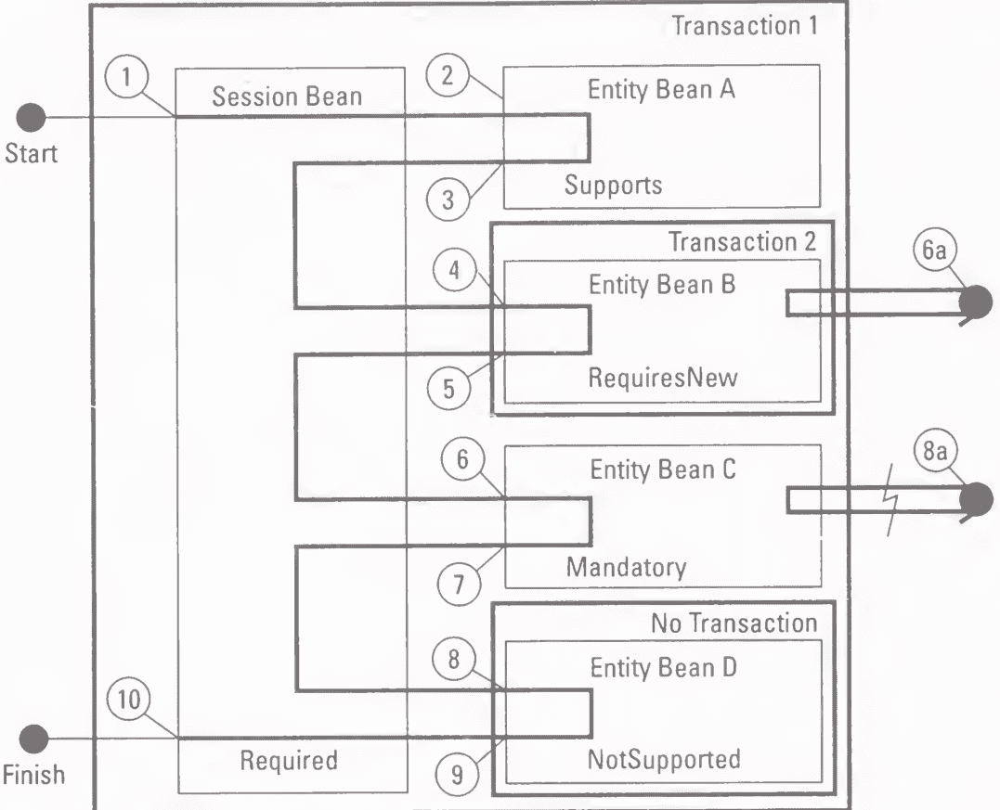

3. 在位置 3，在实体 A 上调用的方法已完成。因为实体 A 被添加到现有的事务上下文中，所以在步骤 10 整个事务完成之前，它不会提交其更改。因此，EJB 容器在位置 3 不会调用任何事务性方法。
4. 在位置 4，会话 bean 调用实体 B。实体 B 标记有 `RequiresNew` 属性，这意味着它必须有自己的事务。EJB 容器将通过暂停现有事务并为实体 B 启动新事务来实现此功能。在位置 4，新事务（标记为“事务 2”）开始，这会导致实体 B 调用其 `ejbLoad` 方法。

EJB 规范不要求 EJB 容器支持嵌套事务。这意味着事务 2 完全独立于事务 1。如果事务 2 失败，它不会导致事务 1 失败。如果事务 1 在调用事务 2 之后失败，并且事务 2 已提交，则事务 2 将保持提交状态。容器供应商可以选择支持嵌套事务，但该行为未在 EJB 规范中说明。

5. 在位置 5，实体 B 的工作已完成。实体 B 是事务 2 上下文中唯一的 bean。因为位置 5 标记事务 2 的结束，所以在事务 2 中所做的所有更改都会被提交。这是通过调用实体 B 上的 `ejbStore` 方法来实现的，这会导致将实体的更改写入数据库。在工作提交之后，事务 2 超出范围，事务 1 的工作恢复。
6. 在位置 6，调用实体 C，其事务属性为 `Mandatory`。Mandatory 属性表示必须存在现有事务，否则实体 C 将抛出 `javax.transaction.TransactionRequiredException`。幸运的是，事务 1 已经存在。因此，实体 C 的工作被添加到事务 1 中。在位置 6，调用实体 C 的 `ejbLoad` 方法以确保实体与数据库之间的一致状态，因为事务中的工作已经开始。
6a. 此时，另一个客户端从另一个事务上下文调用实体 B 上的方法。因为实体 B 上的事务 2 已经完成，所以即使事务 1 尚未完成，从位置 6a 发起的工作也可以继续进行。实体 bean 将被隔离，所有其他方法调用都会被阻塞，直到包含它的事务完成。在其事务完成之后，它可以继续为来自其他客户端应用程序的其他方法调用提供服务。
7. 在位置 7，实体 C 的工作已完成。因为事务 1 尚未准备提交，所以实体 C 的更改保存在实体 bean 中，但不会写入数据库。
8. 在位置 8，调用事务属性为 `NotSupported` 的实体 D。NotSupported 属性要求 EJB 容器暂停事务 1 的工作，并在没有事务上下文的情况下继续执行实体 D 中的更改。

回想一下本章前面的内容，EJB 容器不需要为实体 bean 实现 NotSupported 属性。事实上，在实体 bean 中使用此类属性是不寻常的。由于 JBoss 对如何处理不支持事务的实体 bean 没有任何严格规定，因此它像实现 `RequiresNew` 属性一样实现它们。因此，在位置 8 调用实体 D 的 `ejbLoad` 方法。此行为并非严格执行，其他 EJB 容器可能会有不同的行为。请务必查阅供应商的文档，以确定供应商是否支持实体 bean 的可选事务属性。如果供应商确实支持这些可选属性，请务必阅读供应商的文档，了解每个可选属性的预期行为是什么。
8a. 现在，第三个客户端应用程序试图从其他事务上下文调用实体 C。实体 C 的工作在事务 1 中被隔离。因为事务 1 尚未完成，所有其他客户端调用都会被实体 C 阻塞。如果实体 A 在事务 1 进行期间被调用，同样的原则也适用。当客户端调用被阻塞时，意味着客户端必须等待直到事务完成。此后，客户端调用正常进行。

# 第五部分：整合应用

9. 位置 9 标志着实体 D 的工作完成。因为 JBoss 应用服务器将 `NotSupported` 视为实体 Bean 的独立事务，所以现在它为实体 D 调用 `ejbStore` 方法。`ejbStore` 调用完成后，该方法返回到会话 Bean 以及事务 1 的上下文中。请注意，如果事务 1 在此时失败，实体 B 和实体 D 中所做的更改将保持已提交状态，而实体 A 和实体 C 中的更改将被回滚。
10. 位置 10 标志着会话 Bean 中执行的工作结束以及事务 1 的作用域结束。因此，事务 1 在此时提交，这意味着 `ejbStore` 操作在实体 A 和实体 C 上被调用，导致更改被写入数据库。

图 14-2 说明了 `Never` 属性的行为。

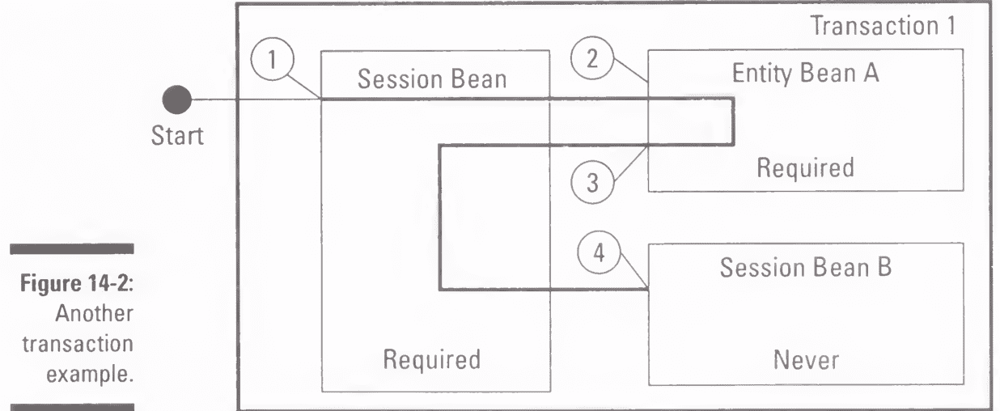

1. 在位置 1，第一个会话 Bean 被调用，其事务属性为 `Required`。这导致创建事务 1，第一个会话 Bean 的方法调用被添加到该事务中。
2. 实体 Bean A 被调用，其属性为 `Required`。因为事务 1 已经存在，所以实体 Bean A 被添加到该事务中。它的 `ejbLoad` 方法被调用，以确保 Bean 与数据库之间的状态一致。
3. 现在实体 Bean A 的工作已完成。但是这里没有执行特殊操作，因为实体 Bean A 所属的事务 1 尚未完成。

# 第 14 章：实现 EJB 事务支持

4. 最后，第一个会话 Bean 调用会话 Bean B。会话 Bean B 的事务属性为 `Never`，这意味着它永远不能成为事务的一部分，并且如果从事务上下文调用它，它必须抛出一个异常。如果第一个会话 Bean 通过本地接口调用它，则会引发 `javax.ejb.EJBException`；如果通过远程接口调用，则会引发 `java.rmi.RemoteException`。

如果抛出一个应用程序异常（它不是 `java.lang.RuntimeException` 的子类），除非第一个会话 Bean 中的异常处理代码明确要求回滚，否则事务 1 不会被回滚。但 `EJBException` 和 `RemoteException` 都是运行时异常，这意味着 EJB 容器将回滚事务 1。由于回滚，实体 Bean A 上的 `ejbLoad` 方法将再次被调用。这导致数据库的状态恢复到实体 Bean A，实际上是将实体 Bean A 恢复为原始值。


如果遇到无法成功恢复的应用程序异常，你可以通过调用 `setRollbackOnly` 方法来强制发生回滚。你可以从实体 Bean 的 `EntityContext`、会话 Bean 的 `SessionContext` 或消息驱动 Bean 的 `MessageContext` 中调用 `setRollbackOnly` 方法。请记住，`setRollbackOnly` 方法只能从具有容器管理事务的 EJB 组件中调用。

# 第 15 章：创建安全的 EJB 应用程序

## 本章内容

- 审视一些安全的基本目标
- 检查 EJB 应用程序的安全框架
- 探索声明安全规则的语法

在《梦幻之地》中，我们学到：“如果你建好它，他们就会来。”这个原则对于开发分布式应用非常贴切，只不过“他们”更可能是黑客——而不是一群天使般的棒球英雄——他们会试图让你的系统瘫痪。一个有效的安全解决方案不仅是你抵御入侵的防线，也是你的恢复手段。虽然安全系统可以将不受欢迎的访客拒之门外，但黑客总能找到漏洞。因此，你的安全系统还应该监控系统中的活动——监视入侵者并审计系统包含的任何关键文件或数据的更改。这允许你在关键数据被恶意用户操纵时将其恢复到原始状态。所有安全解决方案都应解决三个关键目标：

**认证和授权用户：** 认证是确保用户是她所声称的那个人的过程，通常通过用户名和密码实现。授权用于确定经过认证的用户是否有权执行特定操作或访问应用程序中的特定资源。认证和授权密切相关，因为除非你确定用户是他所声称的那个人，否则授权毫无意义。同样，仅仅因为你知道用户是谁，并不意味着他应该能够在你的应用程序中为所欲为。

**加密数据：** 数据加密旨在保护机密信息在通过不安全介质（如网络或互联网）传输时的安全。当通过网络传输数据时，它不受其源和目标处现有安全机制的保护。通过加密数据，你可以隐藏其含义。

**审计：** 任何安全解决方案都离不开某种形式的审计功能，否则就是不完整的。审计只是跟踪谁在系统中做了什么以及何时做的。当你的安全被突破时，审计是你的朋友。它允许你识别未授权用户做了什么，并且——如果解决方案定义良好——能够让你回溯并撤销未授权用户可能进行的更改。


安全专家会在安全角色的整体愿景中加入许多其他目标，但上述三点是完整安全系统的基本组成部分。

安全产品的传统问题在于其复杂性。作为应用程序程序员，很难同时理解业务领域以及所有最新最好的安全产品。安全是专家和专业人士的问题，而不是普通应用程序程序员的问题。因此，你不应该将安全作为应用程序设计的组成部分。这个建议可能看起来违反直觉，因为安全如此重要。关键在于，安全不是一个应用领域问题；它是一个系统开发和系统管理问题。安全主要是 EJB 容器提供者和管理容器以管理安全的人员的责任。安全应该成为你的应用程序从中受益的服务——并且可以在不重新设计或重建应用程序的情况下进行更改——而不是将安全系统硬编码到你的应用程序中。因此，作为 EJB 组件的开发者，你应该了解 EJB 安全模型的工作原理，主要是为了不意外地编写破坏 EJB 容器安全框架完整性的代码。

好消息是，EJB 架构将安全视为一个系统级问题，因此要求 EJB 容器供应商为 EJB 应用程序实现一个安全框架。安全框架是一个声明式框架，你可以通过 EJB 应用程序的部署描述符来控制；你告诉 EJB 容器要应用什么样的安全规则，它就为你提供这些规则。没有比这更简单的了。唯一的问题是，安全系统的语言通常晦涩难懂，就好像规范的这部分内容经过了混淆算法处理一样。（混淆器将程序中的变量名和函数名更改为无意义的胡言乱语，使其变得不可读。）本章将引导你理解安全语义的过程，并阐述 EJB 安全架构的优雅简洁性。

## EJB 应用程序与基于角色的安全性

EJB 安全性的基本前提是，安全性是一个可以应用于任何应用程序的系统服务。由于安全性被视为一种服务，因此它从应用程序的业务流程设计中抽象出来，单独处理。这种方法的一个好处是，在设计 EJB 组件时，您不必投入大量精力考虑安全性问题。但更重要的是，由于安全服务是独立的，您可以在不重新设计 EJB 应用程序的情况下增强安全服务。

EJB 应用程序的安全架构采用基于角色的安全架构建模，这是一种为用户分配角色并根据其角色允许他们访问软件服务的安全模型。基于角色的安全性主要关注用户身份验证。它不涉及审计或加密的目标，但由于基于角色的安全性为用户分配了身份，因此您可以在 EJB 应用程序内部访问用户的安全凭据来实现审计解决方案。我将在本章末尾的“审计用户活动”一节中讨论审计主题。

以下是基于角色安全性的基本原则：

- 系统的每个用户必须被唯一标识。用户的身份被称为安全身份，通常通过用户名和密码的使用来确认。在 ATM 交易的情况下，用户通过存储在其 ATM 卡中的 ID 以及他们在 ATM 机上输入的 PIN 码来识别。识别用户的过程称为身份验证。
- 为用户分配一个或多个与其在应用程序中的职责相关的安全角色。安全角色在单一标题下同时标识用户的逻辑类型以及用户拥有的安全权限。例如，用户可能具有“HR 团队成员”的安全角色，该角色赋予任何 HR 团队成员所拥有的安全权限。

  *注意：* 一个用户可以拥有多个安全角色，因为单个人可以执行多种逻辑类型的任务。例如，可以为用户分配一个“基本用户”角色——赋予该用户与所有用户相同级别的访问权限——以及一个“HR 团队成员”角色，该角色增加了人力资源员工的权限。

每个安全角色被分配一组方法权限，这些权限是特定角色中的人员执行其职责所必需的。方法权限是一种声明，声明 EJB 组件中的某组特定方法可以由指定的安全角色执行。当用户被授予特定安全角色时，该用户就有权限调用与该安全角色相关联的所有方法。而当该角色被撤销时，用户就不再能访问这些方法。

当用户调用方法时，用户的身份和角色会一起传递给该方法。用户的身份与其关联角色的组合被称为安全主体。当方法被调用时，会使用调用者（也称为方法的调用方）的安全主体来验证安全性。如果安全主体有权限调用该方法，则方法调用继续进行。但如果安全主体未获授权，则将抛出 `java.lang.SecurityException`。

方法可以将调用者的安全主体传播到后续方法调用，或者拥有自己的安全主体用于后续方法调用。如果安全主体被传播，则调用者的身份和权限将应用于后续方法调用。这被称为使用调用者身份。在某些情况下，方法将执行用户原本无法访问的任务。在这些情况下，方法被分配自己的安全主体，用于后续方法调用。将调用者主体替换为方法主体的过程称为主体委派。

为方法分配自己的安全主体可能很有用，如果您希望确保用户只能通过少数严格管理的守门人 EJB 组件访问您的 EJB 应用程序。通过赋予守门人独特的安全主体，您允许用户通过守门人组件访问底层 EJB 组件，但您永远不会将底层组件的安全要求暴露给外界。

要为方法分配自己的安全主体，您需要在部署描述符中定义 `<run-as>` 标签，该标签标识新的安全主体。当使用 `<run-as>` 元素时，调用者的安全主体将被替换为新的安全主体，用于所有后续方法调用。

安全主体——以及安全主体中包含的角色——可以在 EJB 组件中以编程方式获取。调用者的安全主体和该主体中的安全角色都存储在 `javax.ejb.EJBContext` 对象中。这是为每种 EJB 组件类型定义的上下文对象的父对象（`SessionContext` 用于会话 bean，`EntityContext` 用于实体 bean，`MessageContext` 用于消息驱动 bean）。如果使用调用者身份运行方法，则呈现调用者的安全主体和安全角色。但是，如果为方法指定了 `<run-as>` 属性，则该方法及后续方法只能检索在 `<run-as>` 元素中分配的主体。有关以编程方式访问安全角色和主体的更多信息，请参见本章末尾的“审计用户活动”一节。

> 在大多数情况下，调用者的安全主体会在整个系统中传播。这使得系统能够审计调用者的活动，无论执行了什么操作。当使用 `<run-as>` 元素替换调用者的安全主体时，所有调用给定方法的用户都会融入到与该方法关联的身份中。因此，他们的个人行为将变得更难以追踪。

> 出于执行编程安全认证的目的而访问安全主体和方法权限是不可取的。硬编码对特定安全角色和主体的引用会破坏 EJB 框架的灵活性。EJB 规范提供对调用者安全主体访问的主要原因是启用应用程序级审计。在特殊情况下，这种访问还允许应用程序开发人员实现对安全框架的扩展。

> EJB 规范没有定义识别应用程序用户和向用户分配安全角色的过程。这个主题留给 EJB 容器的供应商来处理。要了解更多关于此主题的信息，请查阅您的 EJB 容器的供应商文档。

## EJB 安全性的语法

为 EJB 应用程序定义安全框架需要 EJB 组件开发人员、EJB 应用程序组装人员和 EJB 应用程序部署人员之间的协调。在许多情况下，这三个角色由一个人担任（这使沟通过程更容易）。然而，并非总是如此，因此部署描述符为这三个角色的人员提供了相互沟通的机制。最终，确保安全框架定义良好是 EJB 应用程序部署人员的责任。

安全框架在 EJB 应用程序的部署描述符中定义。定义安全框架时必须执行四项基本任务。以下列表涵盖了这四项基本任务，同时介绍了部署描述符中支持这些任务的一些关键元素。我将在后续章节中详细介绍每项任务。

- 如果 EJB 组件开发人员在 Bean 代码中硬编码引用了安全角色，他们必须告知应用程序组装者和部署者这些安全角色是什么。部署描述符通过 `<security-role-ref>` 标签来支持这一职责，该标签标识了对 EJB 组件代码中安全角色的引用。
- 应用程序组装者和部署者负责定义安全角色。这些是适用于使用应用程序的域的逻辑角色。安全角色使用 `<security-role>` 元素定义，该元素命名并描述角色。多个 `<security-role-ref>` 元素可以通过向 `<security-role-ref>` 添加 `<role-link>` 元素链接到单个安全角色。这允许应用程序组装者和部署者为安全角色应用一致的命名方案，无论 EJB 组件及其 `<security-role-ref>` 名称的来源如何。


- 应用程序组装者和部署者还可以定义应用于 EJB 组件的安全标识。这就是应用程序组装者指定 EJB 方法是应使用其调用者的主体还是其自身主体的方式。当方法使用其自身主体时，部署描述符包含一个`<run-as>`标签，将该方法链接到上一步中定义的特定安全角色。
- 应用程序部署者负责将安全角色映射到特定的方法权限。此任务使用`<method-permission>`元素完成。此外，部署者可以确定特定方法是应使用其调用者的安全主体还是其自身的安全主体。

## 识别硬编码的安全角色

在部署描述符中描述 EJB 组件时，组件开发人员必须标识组件中对安全角色的任何显式引用。组件开发人员可以显式引用安全角色以扩展安全框架，但显式引用并非使用标准 EJB 安全服务所必需。EJB 容器将根据您在部署描述符中提供的信息自动检查安全主体，以确保其包含部署描述符中方法所需的安全角色。

EJB 框架中允许您在 EJB 组件内部访问安全信息的方法旨在用于对安全服务的非标准扩展。您应该只在开发安全是应用程序领域核心关注点的应用程序时才需要使用这些扩展。此类必要的安全扩展示例包括包含机密政府信息的 EJB 应用程序和医疗保健产品。在不需要自定义安全服务的情况下，最好不要在 EJB 组件内部摆弄安全方法。

如果您的应用程序确实显式引用了安全角色，您可以使用`<security-role-ref>`标签标识这些引用。`<security-role-ref>`标签是`<entity>`或`<session>`元素的子元素，这意味着`<security-role-ref>`元素可以在实体 Bean 或会话 Bean 中使用。

虽然消息驱动 Bean 允许在源代码中显式引用安全角色，但它们不允许定义`<security-role-ref>`元素。消息驱动 Bean 调用的安全主体由传递消息的 JMS 服务器管理，而不是 EJB 容器。为避免许多痛苦和烦恼，请不要在消息驱动 Bean 中定义对安全角色的显式引用。

`<security-role-ref>`元素包含以下子元素：

- `<description>`：一个可选元素，您可以使用`<description>`来定义角色并标识`<security-role-ref>`元素的用途。
- `<role-name>`：包含在 EJB 组件代码中引用的角色名称，此处标识的`<role-name>`必须与您在代码中使用的角色名称完全相同。
- `<role-link>`：这是一个可选元素，应用程序组装者或应用程序部署者可以使用它将您在代码中指定的角色链接到在`<security-role>`元素中定义的某个抽象安全角色。`<role-link>`元素的值必须是部署描述符中某个`<security-role>`元素中`<role-name>`的值。

### 清单 15-1：`<security-role-ref>`元素

```xml
<ejb-jar>
  <enterprise-beans>
    <session>
      <description>This bean manages the deposit process.
      </description>
      <ejb-name>DepositBean</ejb-name>
      ...
      <security-role-ref>
        <description>
          This role is required for all users of the deposit bean.
        </description>
        <role-name>depositor</role-name>
        <role-link>account-holder</role-link>
      </security-role-ref>
    </session>
  </enterprise-beans>
  <assembly-descriptor>
    <security-role>
      <description>
        This is the role applied to all banking customers.
      </description>
      <role-name>account-holder</role-name>
    </security-role>
  </assembly-descriptor>
</ejb-jar>
```

在清单中，一个`<security-role-ref>`元素标识了在`DepositBean`中对名为`depositor`的安全角色进行了硬编码引用。应用程序组装者已将此角色链接到名为`account-holder`的`<security-role>`。该链接表明`account-holder`是一个`depositor`，因此应具有`depositor`的安全权限。`account-holder`安全角色在`<security-role>`标签中定义，也在清单 15-1 中进行了说明。要了解有关创建`<security-role>`标签的更多信息，请继续阅读下一节。

## 指定安全角色

当组装 EJB 应用程序时，应用程序组装者可以定义适用于应用程序用户的安全角色。安全角色标识逻辑相关的用户集，并标识他们可以执行的操作类型。安全角色使用`<security-role>`元素定义，该元素在部署描述符的`<application-assembly>`部分中使用。`<security-role>`元素包含以下子元素：

- `<description>`：描述角色的可选子元素。
- `<role-name>`：标识安全角色的名称。

最终，应用程序组装者或部署者应将每个`<security-role-ref>`链接到实际的安全角色。即使`<security-role-ref>`名称与其适用的安全角色的名称相同，也必须使用`<role-link>`元素将两者链接在一起。清单 15-2 说明了为银行应用程序定义的一些安全角色。

### 清单 15-2：定义`<security-role>`元素

```xml
<ejb-jar>
  <enterprise-beans>
    ...
  </enterprise-beans>
  <assembly-descriptor>
    <security-role>
      <description>
        This is the role applied to all banking customers.
      </description>
      <role-name>account-holder</role-name>
    </security-role>
    <security-role>
      <description>
        This is the role applied to bank tellers.
      </description>
      <role-name>bank-teller</role-name>
    </security-role>
    <security-role>
      <description>
        This is the role applied to customer service reps.
      </description>
      <role-name>customer-service</role-name>
    </security-role>
  </assembly-descriptor>
</ejb-jar>
```

在清单 15-2 中，您可以看到为我在本书中使用的示例 ATM 应用程序定义了三个安全角色。每个角色都通过其`<role-name>`标签进行标识和引用。定义这三个不同角色的含义是，拥有这些角色的用户将在 ATM 应用程序中的访问上受到不同的安全约束。

## 定义安全标识

安全标识定义 EJB 组件是使用其调用者的安全标识还是使用其自身的安全标识。如果 EJB 组件的标识继承自其调用者，则 EJB 组件调用者的安全凭据必须对其调用的所有 EJB 组件有效。如果调用者的凭据无效，则会抛出`java.lang.SecurityException`。但是，如果 Bean 定义了自己的标识，则其标识将替换调用者的标识，这称为主体委托。

# 第五部分：融会贯通

至此，我不得不稍微抱怨一下“安全标识”这个术语的使用。在此上下文中，安全标识指的是“安全主体”，它是调用者的身份和角色的组合。请记住，安全标识与用户 ID 不同。

`SecurityException`是一个运行时异常，这意味着当它被抛出时，任何正在进行的事务都将被回滚。

安全标识通常由应用程序组装者或应用程序部署者定义。它们使用部署描述符中 EJB 组件描述的`<security-identity>`元素来定义。这意味着它们可以定义在部署描述符的`<entity>`、`<message-driven>`或`<session>`元素内部。**注意：**`<security-identity>`元素是可选的。默认情况下，EJB 组件的安全标识（即安全主体）继承自其调用者。

`<security-identity>`属性的子元素如下：

- `<description>`：这是一个可选元素，可用于描述分配安全标识的原因。
- `<use-caller-identity/>`：这是一个空标签，告诉 EJB 容器使用调用者的身份。（请记住，调用者身份等同于其安全主体。）指定此元素时，应用程序组装者明确表示必须使用调用者身份。本质上，这比允许 Bean 默认使用调用者身份的声明更为明确。
- `<run-as>`：此属性是`<use-caller-identity/>`属性的替代项。你使用`<run-as>`标签为方法分配新的安全标识，而不是使用调用者身份。你不能在同一个`<security-identity>`元素中同时使用`<run-as>`和`<use-caller-identity/>`属性。此元素用于标识应应用于从该 EJB 组件调用的所有方法的安全角色。`<run-as>`元素有两个子元素：
  - `<description>`：再一次，这是一个可选的机会，用于描述通过`<run-as>`元素分配的`<security-role>`的原因。
  - `<role-name>`：此属性标识用于`<run-as>`属性的角色名称。`<role-name>`必须与`<security-role>`标签中的`<role-name>`值相对应。

清单 15-3 用粗体说明了两个不同`<security-identity>`元素的声明。第一个要求 EJB 组件使用调用者的身份，而第二个为 EJB 组件定义了不同的安全标识。

## 清单 15-3：定义`<security-identity>`元素

```xml
<ejb-jar>
  <enterprise-beans>
    <session>
      <description>This bean manages the withdraw process.
        </description>
      <ejb-name>WithdrawBean</ejb-name>
      ...
      <security-identity><use-caller-identity/></security-identity>
    </session>
    <session>
      <description>
        This provides a wrapper for ATMTransactions of all kinds.
      </description>
      <ejb-name>ATMTransactionBean</ejb-name>
      ...
      <security-identity>
        <run-as>
          <description>
            When an ATM transaction is emulated by a customer service rep,
            it should use the identity of a banking customer.
          </description>
          <security-role>account-holder</security-role>
        </run-as>
      </security-identity>
    </session>
  </enterprise-beans>
  ...
</ejb-jar>
```

## 为安全角色声明方法权限

EJB 应用程序组装者和部署者必须承担的最终任务是为每个安全角色定义方法权限。当为安全角色分配方法权限时，具有该关联安全角色的所有用户都被允许调用指定的方法。为安全角色分配方法权限与为方法分配事务属性非常相似。（有关 EJB 事务的更多信息，请参见第 14 章。）

方法权限只能分配给在 EJB 组件的主接口或组件接口中定义的方法。方法权限使用`<method-permission>`元素分配，该元素位于部署描述符的`<assembly-descriptor>`部分。`<method-permission>`元素的子元素如下：

- `<description>`：这是一个可选属性，描述在方法权限中包含指定方法的原因。
- `<role-name>`：你可以在`<method-permission>`元素中包含多个`<role-name>`元素。每个`<role-name>`元素的值必须与`<security-role>`元素的角色名称相对应。当为方法权限指定`<role-name>`时，具有任何指定角色的用户都可以调用该方法权限中标识的所有方法。
- `<unchecked/>`：此空标签可用于替代在方法权限中指定`<role-name>`元素。当应用`<unchecked/>`元素时，所有指定的方法都不包含在安全认证中。`<unchecked/>`属性的行为将始终覆盖任何其他方法权限规则的行为。因此，你应极其谨慎地使用`<unchecked/>`元素。
- `<method>`：你可以为每个方法权限定义多个`<method>`元素。每个`<method>`元素可以标识单个 EJB 组件内的一组方法。在特定`<method>`标签中标识的所有方法都可以被`<method-permission>`元素中标识的所有安全角色访问。`<method>`元素具有以下子元素：
  - `<description>`：这是一个可选的文档元素。
  - `<ejb-name>`：此元素标识定义了这组方法的 EJB 组件。此元素的值必须与部署描述符其他地方定义的`<ejb-name>`值相对应。
  - `<method-intf>`：一个可选元素，标识指定方法包含在哪个接口中，其值必须是具有给定 EJB 名称的 EJB 组件中某个接口的全限定类名。
  - `<method-name>`：`<method-name>`标签标识给定方法权限所应用的 EJB 组件中的方法或方法集。如你所见，有三种方式（在 EJB 规范中称为风格）可以标识`<method-name>`。这些风格包括使用通配符`*`将`<method-permission>`分配给指定 EJB 组件中的所有方法，使用方法的名称，或使用名称和一组指定的方法参数。
  - `<method-params>`：一个可选元素，`<method-params>`用于标识具有特定参数集的特定方法。如果`<method-name>`元素包含通配符运算符，则不能使用此元素。

分配方法权限有三种风格：

- 使用通配符`*`运算符将特定方法权限分配给 EJB 组件的所有方法。通配符`*`运算符用作`<method-name>`元素的值，如下所示：

```xml
<method-name>*</method-name>
```

此分配用于进行大范围的分配。此技术可用于将访问 EJB 组件中所有方法的权限授予一个或多个安全角色。

- 通过在方法权限中指定方法名称，将方法权限分配给 EJB 组件中的特定方法名称。如果指定的方法存在于 EJB 组件的多个接口中，则方法权限将应用于所有接口中的所有方法。如果方法被重载——意味着有两个或多个同名但参数不同的方法——方法权限将应用于具有指定名称的所有重载方法。使用以下语法将方法权限分配给特定方法名称：

```xml
<method-name>method1</method-name>
<method-name>method2</method-name>
<method-name>method3</method-name>
```

- 应用程序组装者或部署者可以为具有特定参数集的特定方法名称指定方法权限。当使用此风格时，只有具有指定参数集的方法才会收到方法权限分配。如果具有指定参数集的方法存在于 EJB 组件的多个接口中，则方法权限将应用于该方法在组件所有接口中的所有出现。使用以下格式将方法权限分配给具有参数集的特定方法：

```xml
<method-name>method1</method-name>
<method-params>
  <method-param>java.lang.String</method-param>
  <method-param>int</method-param>
  <method-param>java.lang.Object</method-param>
</method-params>
```

请注意，`<method-params>`元素必须紧跟在它所应用的`<method-name>`之后。每个方法参数的类型必须在单独的`<method-param>`元素中标识，该元素嵌套在`<method-params>`元素内。请参见前面的示例。

> **TIP**
>
> 你可以通过在可选的`<method-intf>`元素中标识目标接口，将方法权限的应用限制在特定接口中的方法。


分配方法权限的三种方式与分配事务属性的三种方式几乎相同，只有一个微妙但重要的区别。在分配事务属性时，更具体的赋值会覆盖更广泛的赋值。但在分配方法权限时，所有作用域的赋值都会被应用。因此，除非你希望某个方法可被该方法权限中的安全角色调用，否则绝不应将其包含在方法权限中。

清单15-4展示了在EJB部署描述符中定义方法权限。请记住，只有在定义了安全角色之后，才能定义方法权限。

## 清单15-4 定义`<method-permission>`元素

```xml
<ejb-jar>
  ...
  <assembly-descriptor>
    <method-permission>
      <role-name>account-holder</role-name>
      <method>
        <description>A wildcard declaration.</description>
        <ejb-name>AccountBean</ejb-name>
        <method-name>*</method-name>
      </method>
    </method-permission>
    <method-permission>
      <role-name>account-holder</role-name>
      <method>
        <description>A wildcard declaration.</description>
        <ejb-name>DepositBean</ejb-name>
        <method-name>*</method-name>
      </method>
    </method-permission>
    <method-permission>
      <description>
        I am granting the account-holder, bank-teller, and
        customer-service roles permission to invoke any
        method in the AccountBean.
      </description>
      <role-name>account-holder</role-name>
      <role-name>bank-teller</role-name>
      <role-name>customer-service</role-name>
      <method>
        <description>A wildcard declaration.</description>
        <ejb-name>AccountBean</ejb-name>
        <method-name>*</method-name>
      </method>
    </method-permission>
  </assembly-descriptor>
</ejb-jar>
```

在清单15-4中，我定义了三个`<method-permission>`标签，每个标签适用于不同的EJB组件。在每个标签的开头，我使用`<role-name>`标签标识可应用于该组件的安全角色。根据需要，我可以包含任意数量的安全角色。`<method>`元素标识了需要`<role-name>`元素的实体Bean名称。在所有三个示例中，我都使用通配符`*`，表示我希望所有指定的安全角色都拥有调用指定EJB组件所有方法的权限。

> 方法权限授予安全角色调用方法的权限。因此，在定义方法权限时，你可以通过构造一个描述`<method-permission>`元素中所授权限的句子来验证你的赋值是否正确。例如，参考清单15-4中的`<method-permission>`元素，我可以说：“我正在授予`account-holder`、`bank-teller`和`customer-service`角色调用`AccountBean`中任何方法的权限。”这个句子不仅可以让你检查自己的假设，还能清晰地向他人传达你在方法权限赋值方面的意图。我将其放入了`<description>`标签中。

## 阻止对方法的访问

虽然大多数应用程序安全旨在限制对应用程序内某些活动的访问，但EJB规范允许你完全阻止对某些方法的访问。你可以通过使用`<exclude-list>`元素来实现这一点，该元素在部署描述符的`<assembly-descriptor>`部分定义。`<exclude-list>`元素标识了一组不应被系统任何用户调用的方法。如果某个方法在`<exclude-list>`中被标识，则任何其他方法权限赋值都将被覆盖，该方法将变得完全不可访问。`<exclude-list>`包含以下子元素：

- `<description>`：（描述信息）你应该使用此元素告知他人你为何要排除指定的方法，但这并非强制要求。
- `<method>`：此元素标识特定EJB组件中的方法。你可以在一个`<exclude-list>`中指定多个`<method>`元素。我在上一节中详细介绍了此方法的语法。请注意，`<method-permission>`元素中`<method>`元素的样式规则同样适用于`<exclude-list>`中的`<method>`元素。

## 第344页 第五部分：综合应用

你可以使用`<exclude-list>`来阻止对尚未完全实现的方法或应用程序中已废弃（因此不再支持）的方法的访问。对于其他场景，`<exclude-list>`可能没有意义。

清单15-5展示了如何使用`<exclude-list>`来阻止访问银行中的存款资金。这可能是你为防止银行挤兑而采取的严厉措施。请勿在家尝试。

## 清单15-5`<exclude-list>`的实际应用

```xml
<ejb-jar>
  <assembly-descriptor>
    <exclude-list>
      <description>Must stop withdraws.</description>
      <method>
        <description>A wildcard declaration.</description>
        <ejb-name>WithdrawBean</ejb-name>
        <method-name>*</method-name>
      </method>
    </exclude-list>
  </assembly-descriptor>
</ejb-jar>
```

在此示例中，我只指定了一个`<method>`元素，它使用`*`通配符来阻止对`WithdrawBean`所有接口中所有方法的访问。你可以使用`<exclude-list>`来防止用户访问你EJB应用程序中正在构建的部分，或者已成为过时且尚未被替换的部分。

## 审计用户活动

EJB容器虽然并非必须，但可以定义审计功能，以跟踪用户访问EJB容器时的活动。这些审计系统是系统服务，在开发EJB应用程序时无需考虑。请查看你选择的EJB容器的文档，以确定容器是否实现了审计。如果是，那么EJB容器的系统管理员负责管理审计服务。如果审计不受支持，你可以在EJB组件内以编程方式实现它。

即使审计受到支持，当数据发生更改时，你可能仍希望捕获用户的身份并将其存储到数据库中。为此，你必须访问用户的安全原则。访问用户的安全原则相当简单。`javax.ejb.EJBContext`接口定义了`getCallerPrinciple`方法，该方法返回与调用者关联的Principle对象。此方法返回一个名为`java.security.Principle`的对象。`Principle`对象包含`getName`方法，该方法返回用户的身份。因此，通过在你的EJB类中使用以下代码片段，你可以检索访问EJB系统的任何用户的身份：

```java
/* context in the following statement refers to the context object of
 * the EJB component - either the SessionContext,
 *         EntityContext, or
 *         MessageDrivenContext.
 */
java.security.Principle userId = context.getCallerPrinciple();
String userName = userId.getName();
// Now you have the user's name and can do whatever you want with it.
```

请记住，审计很重要，因为它允许你跟踪特定用户对应用程序所做的更改。如果你发现用户的身份被盗用，并且用户所做的更改是未授权的，你可以追溯这些审计日志来识别这些非法更改——并可能将你的系统状态恢复到这些更改发生之前。

# 第16章

## 开发EJB客户端应用程序

### 本章内容

- 使用JavaBeans创建客户端组件
- 为EJB应用程序添加Swing界面
- 为EJB应用程序添加JSP界面
- 实现JMS客户端应用程序

EJB客户端应用程序是为用户提供对EJB应用程序实现的服务的访问程序。由于EJB应用程序没有用户界面，你必须创建一个界面置于你构建的EJB应用程序之前。EJB应用程序的一个优点是，它们提供了一种出色的机制，可以将业务流程抽象出应用程序，因此你可以轻松添加各种不同的用户界面，而无需更改EJB应用程序本身。

在图16-1中，你可以看到两种不同类型的客户端应用程序连接到同一个EJB应用程序。第一个客户端具有Swing用户界面，这是一种用于构建驻留在用户本地计算机上的应用程序的Java技术。Swing应用程序直接连接到EJB容器以与EJB组件交互。

图16-1中的另外两个客户端使用浏览器，浏览器连接到Web服务器，Web服务器再连接到同一个EJB容器并使用相同的EJB组件。Java Web应用程序——使用Servlets和JSP（JavaServer Pages）技术开发——可用于与EJB容器交互，以便生成网页通过互联网呈现给用户。

图16-1还显示，在调用消息驱动Bean时，客户端通过JMS（Java消息服务）服务器直接（在Swing应用程序的情况下）或间接（在Web应用程序的情况下）与消息驱动Bean交互，该服务器负责将消息传递给EJB容器中的消息驱动Bean。


## 通过JavaBeans访问EJB组件

JavaBeans是一种用于创建简洁、简单数据操作类的约定。大多数人简称这些类为bean。JavaBeans之所以实用，是因为它们提供了一个可移植的接口，客户端应用程序可以使用该接口与EJB组件进行交互。你可以开发一个JavaBean组件，该组件既能与你的EJB应用程序交互，又包含所有的安全性和JNDI实现细节。然后，同一个JavaBean可以轻松地添加到Swing或JSP应用程序中，成为一个非常灵活的软件组件，为你的用户界面开发人员隐藏了访问EJB应用程序的许多复杂性。

JavaBeans在创建时必须遵循一些简单的规则。基本规则如下：

- **JavaBeans必须有一个公共的、无参数的构造函数。** 如果你有一个名为`MyBean`的类，你必须定义一个签名为`MyBean(){...}`的构造函数。Java虚拟机（JVM）——运行所有Java应用程序的容器——需要有这个构造函数，以便它能够创建你的JavaBeans的实例，而无需你直接调用构造函数。
- **JavaBean的所有成员变量应该是`private`的，并且必须在类实例创建时初始化。** 所有基本类型的成员变量都必须有一个默认值，并且任何在JavaBean构造函数中未初始化的类引用都必须显式设置为`null`。所有成员变量应以小写字母开头。
- **对于客户端应用程序需要访问的每个成员变量，Java bean应定义一组称为访问器方法的方法。** 访问器方法是提供对JavaBean成员变量访问的方法。如果一个成员变量有访问器方法，则称其为JavaBean的属性。访问器方法必须根据以下约定定义：
  - 要设置一个属性，必须定义一个setter方法。setter方法必须命名为`set{VariableName}`的形式，并且必须接受一个与被设置变量类型相同的单个参数。因此，如果你有一个名为`firstName`的`String`变量，setter方法必须是`setFirstName(String firstName){...}`。setter方法必须具有`void`返回类型。
  - 要获取一个属性，必须定义一个getter方法。getter方法必须命名为`get{VariableName}`的形式，并且必须有一个空的参数列表。它们的返回类型通常与成员变量的类型相同。因此，对于`String`变量`firstName`，getter方法应为`String getFirstName(){...}`。
  
    > 提示：getter方法的返回值不必与其检索的属性类型相同。你只需要能够将成员变量的类型转换为返回值的类型。
  
  - 如果一个属性是`boolean`类型，你可以定义一个形式为`is{VariableName}`的getter方法。允许这种约定是为了让getter可以以更自然、更可读的格式被调用，如下所示：`if(person.isBlind()){/*播放音频*/}`。

JavaBeans对于EJB客户端程序非常有用，因为它们隐藏了所有与查找EJB组件的本地接口或组件接口相关的细节，而是让客户端程序能够与EJB应用程序进行交互，就像直接通信一样。你可以比较清单16-1和清单16-2，以发现JavaBeans提供的强大功能。清单16-1是一个简单的JavaBean，其`message`属性包含值"Hello World!"。清单16-2是一个引用了名为`helloWorldEJB`的EJB组件的JavaBean。当调用bean的`getMessage`访问器时，bean返回EJB组件`getMessage`方法的值。

### 清单16-1 HelloWorld JavaBean

```java
public class HelloWorld {
    private message = "Hello World!"; // the message

    public HelloWorld() {} // the no-args constructor

    public String getMessage() { return this.message; } // the accessor
}
```

### 清单16-2 HelloWorldEJBAccess JavaBean

```java
import javax.ejb.*;
import javax.naming.*;
import javax.rmi.*;
import java.rmi.*;

public class HelloWorldEJBAccess {
    Context context = null;
    HelloWorldRemoteHome home = null;

    public HelloWorld() throws NamingException,
                               RemoteException,
                               ClassNotFoundException {

        System.out.println("getting initial context");
        context = new InitialContext();

        System.out.println("getting home reference");
        Object obj = context.lookup("ejb/helloWorldEJB");

        System.out.println("casting RemoteHome Interface.");
        home = (HelloWorldRemoteHome)
            PortableRemoteObject.narrow(obj,
            HelloWorldRemoteHome.class);
    }

    public String getMessage() {
        HelloWorldRemote hello = null;
        String msg = null;
        try {
            System.out.println("Retrieving HelloWorldRemote Interface.");

            hello = home.create();
            msg = hello.helloWorld();
        }
        catch (CreateException e) {
            e.printStackTrace(System.out);
        }
        catch (RemoteException e) {
            e.printStackTrace(System.out);
        }
        finally {
            hello = null;
        }
        return msg;
    }
}
```


虽然清单 16-1 中的代码非常简单，但清单 16-2 中的代码则复杂得多。但无论客户端使用的是 `HelloWorld` JavaBean 还是 `HelloWorldEJBAccess` JavaBean，交互方式都是相同的。仍然只有一个名为 `getMessage` 的方法，该方法返回相同类型的对象。因此，任何一个 JavaBean 的客户端都不需要担心任何一个 JavaBean 内部代码的复杂性；客户端需要做的只是通过调用 `getMessage` 方法来获取消息。

除了隐藏复杂性之外，JavaBeans 还为你的源代码提供了几个更棒的好处：

- 在 JSP 应用程序中，Web 开发人员可以无需编写一行 Java 代码即可访问 bean 属性。JSP 页面提供了称为 *action 标签* 的 HTML 风格标签，可用于创建 JavaBean 的实例以及调用 JavaBean 属性的 getter 和 setter。你将在接下来的“为 EJB 构建 JSP 界面”一节中看到一个使用此功能的示例。
- 在 Swing 应用程序中，当你用 JavaBean 实现一个 Swing 用户界面组件时，你——或者为你工作的界面开发人员——可以使用设计工具以图形方式创建包含你的 JavaBean 组件的屏幕。这是可能的，因为用于开发 Swing 应用程序的屏幕设计工具可以将你的 JavaBeans 放入工具面板中，并允许开发人员在图形环境中与该面板进行交互。你将在接下来的“为 EJB 构建 Swing 界面”一节中看到一个应用此技术的 Swing JavaBean 示例。

## 访问 JNDI 资源名称

当你开发 EJB 客户端应用程序时，你需要能够访问在 EJB 容器中运行的 EJB 组件的 JNDI 名称。获取这些资源名称有几种策略可以追求，你使用的策略取决于你的客户端应用程序相对于 EJB 应用程序的位置。你需要访问 EJB 容器 JNDI 资源名称的信息存储在一个名为 `jndi.properties` 的特殊属性文件中。

**提示** 无论你使用何种 EJB 容器，容器的资源名称总是可以通过 `jndi.properties` 文件访问。访问 JNDI 名称的第一项任务是找到你的 EJB 容器的 `jndi.properties` 文件所在的位置。你应该能在你的 EJB 容器主目录下的某个位置找到它。

## 通过 CLASSPATH 访问 JNDI

如果你的客户端应用程序与 EJB 容器位于同一台计算机上，那么访问 JNDI 名称就非常容易。你所要做的就是将 `jndi.properties` 文件添加到客户端应用程序的 CLASSPATH 中。通过以下两种简单技术之一来完成：

- 你可以在计算机中声明一个 CLASSPATH 变量，并将 `jndi.properties` 文件的路径放入该变量中。这种方法是最不推荐的，因为当你遵循它时，所有你运行的 Java 应用程序都可以访问相同的 CLASSPATH，无论它们是否需要。
- 当你运行客户端应用程序时，你可以使用 `java` 命令指定自定义的 CLASSPATH。你执行 `java` 命令来运行应用程序。如果你想为 `java` 命令指定自定义的 CLASSPATH，你可以通过使用 `-classpath` 参数来实现，后面跟着你想包含在类路径中的、以分号分隔的路径列表。以下 `java` 命令说明了 `-classpath` 参数的使用：

```bash
java -classpath helloWorldEJB.jar;
%JBOSS_DIST%\jboss-3.0.0alpha\client\jndi.properties
com.sextanttech.hello.interfaces.Client
```

在前面的例子中，当调用名为 `Client` 的类时，使用了 CLASSPATH `helloWorldEJB.jar;%JBOSS_DIST%\jboss-3.0.0alpha\client\jndi.properties`。路径 `%JBOSS_DIST%\jboss-3.0.0alpha\client\jndi.properties` 指向我计算机上 JBoss 应用服务器的 `jndi.properties` 文件所在目录。当执行 `java` 命令时，`jndi.properties` 文件中的信息会自动添加到 `Client` 类的环境中，从而使 `Client` 类能够访问 JBoss EJB 容器中的 JNDI 名称。

## 以编程方式加载 JNDI 属性

当您需要访问的 EJB 容器与客户端应用程序位于不同的计算机上时，您可以采用一种简单技巧来以编程方式加载 JNDI 属性。要访问属性文件，请遵循以下步骤：

1. 获取 `jndi.properties` 文件的 UNC 文件名。

   此文件必须对托管客户端应用程序的计算机可访问。UNC 文件名以两个斜杠 `\\` 开头，后跟计算机名称，然后是另一个斜杠和计算机上的一个公共目录。最后，应跟上 `jndi.properties` 文件的路径。因此，如果我将 EJB 服务器的客户端目录设为公共，UNC 文件名将如下所示：

   ```text
   \\myComputerName\client\jndi.properties
   ```

2. 创建一个程序，打开一个指向 `jndi.properties` 文件的文件 I/O 流。

   文件 I/O 流允许客户端程序读取文件中的信息或将信息写入文件。以下代码展示了 `FileInputStream` 的标准实现，您需要使用它来访问 `jndi.properties` 文件的内容：

   ```java
   java.io.FileInputStream fis = new
       FileInputStream("UNCFileName");
   java.io.BufferedInputStream buf = new
       BufferedInputStream(fis);
   ```

   在上面的代码片段中，`FileInputStream` 使您的程序能够访问 `jndi.properties` 文件的内容。`BufferedInputStream` 执行相同的操作，但它提高了从 `FileInputStream` 对象读取的效率。

3. 使用输入流，创建一个名为 `java.util.Properties` 的 Java 对象。

   此对象是属性文件内容的 Java 表示。以下代码行展示了创建 `Properties` 对象的技巧：

   ```java
   java.util.Properties props = new Properties();
   props.load(buf); // 将 InputStream 加载到属性文件中
   ```

   `Properties` 对象现在包含了 `jndi.properties` 文件的内容，您的系统可以轻松地读取它。此过程的最后一步是将 `Properties` 对象添加到您的 `System` 环境中。通过以下代码行完成此操作：

   ```java
   System.setProperties(props);
   ```

# 第五部分：将它们整合在一起

完成此任务后，您的系统就可以访问 EJB 容器的 JNDI 名称。可以使用清单 16-3 中的代码将整个过程添加到您的客户端应用程序中。

### 清单 16-3 以编程方式加载 JNDI 名称

```java
try{
    FileInputStream fis = new FileInputStream("UNCFileName");
    BufferedInputStream buf = new BufferedInputStream(fis);
    java.util.Properties props = new Properties();
    props.load(buf);
    System.setProperties(props);
    /* 现在您可以使用 JNDI 名称获取初始上下文，
       以访问 EJB 服务器上的 EJB 组件。
       */
    Context ctx = new InitialContext() // 使用上面的 JNDI 名称
    // 获取您的 EJB 组件...
}
catch(Exception e){/* 处理异常 */}
```

虽然清单 16-3 中的过程可以正常工作，但它并不理想，因为您对 `jndi.properties` 文件的引用被硬编码到了程序中。如果您想要更灵活的解决方案，请考虑创建一个本地属性文件，其中包含对需要在远程系统中加载的属性文件的 UNC 文件名的引用。然后，您可以使用我在前面步骤中描述的技术来加载包含 UNC 文件名的属性文件，并使用这些 UNC 文件名来加载远程属性文件。这种方法稍微复杂一些，但您可以无需付出太多额外努力即可完成。

如果您需要通过广域网或互联网访问属性文件，那么您首先需要创建一个到属性文件的 URL 连接，然后再获取输入流。以下是一个示例：

```java
java.net.URL fileURL = new URL(
    "http://www.sextanttech.com/client/jndi.properties");
BufferedInputStream buf = new BufferedInputStream(
    fileURL.openStream());
```

## 为 EJB 构建 JSP 界面

如果您希望客户端通过互联网访问您的 EJB 应用程序，JSP 组件非常适合这项任务。JSP 应用程序开发分为两个主要角色：创建图形化用户界面的 Web 开发人员，以及提供业务组件供开发人员访问的 Java 开发人员。这些业务组件以 JavaBeans 的形式提供，我在前一节中已详细讨论过。虽然本书中没有足够的空间来展示开发 JSP 应用程序的完整过程，但我的目标是提供一个示例应用程序，来说明如何使用我在前一节中描述的 JavaBean 组件。

在 JSP 页面中与 JavaBean 交互时，JSP 页面开发人员需要执行几个简单的任务：

- **页面开发人员必须提供一个 HTML 模板，来组织要从 JavaBean 获取的内容的布局。** 这个任务只需要理解一些简单的 HTML 代码。
- **必须导入 JavaBean 的类文件。** 您可以通过使用一个称为页面指令的简单标签来完成此操作。页面指令与 HTML 非常相似。页面指令的开始标签是 `<%@ page`，结束标签是 `%>`。在两者之间，开发人员提供一个 `import` 属性，该属性标识要导入的类的完全限定名，如下例所示：

  ```jsp
  <%@page import="com.sextanttech.hello.interfaces.HelloWorldEJBAccess"%>
  ```

- **JSP 页面开发人员使用 `<jsp:useBean>` 标签创建 `HelloWorldEJBAccess` JavaBean 的实例。** 该标签接受几个参数：类名、要创建的变量名以及一个指示 bean 标签作用域的参数。以下示例说明了一个 `<jsp:useBean>` 标签：

  ```jsp
  <jsp:useBean class="HelloWorldEJBAccess" name="hello" scope="page"/>
  ```

- **最后，页面开发人员在 HTML 页面中应该显示 hello bean 消息的位置放置一个 `<jsp:getProperty>` 标签。** `<jsp:getProperty>` 标签接受两个参数：`name` 告诉标签从哪个 JavaBean 获取属性，`property` 标识要检索的成员变量名。`property` 值在页面执行时被检索并自动转换为 `String`。以下是一个 `<jsp:getProperty>` 标签的示例：

  ```jsp
  <jsp:getProperty name="hello" property="message"/>
  ```

清单 16-4 中的代码展示了一个完整的 JSP 页面，它使用上述语法从您的 EJB 应用程序中检索消息：

### 清单 16-4 HelloWorld.jsp 页面

```html
<html>
<head>
<title>Hello World</title>
<meta http-equiv="Content-Type" content="text/html; charset=iso-8859-1">
</head>
<%@page import="com.sextanttech.hello.interfaces.HelloWorldEJBAccess"%>
<body bgcolor="#FFFFFF" text="#000000">
<jsp:useBean class="HelloWorldEJBAccess" name="hello" scope="page"/>
<p>今日消息是：<jsp:getProperty name="hello" property="message"/></p>
</body>
</html>
```

我在清单 16-4 中用粗体显示了之前讨论过的 JSP 标签。请注意，当页面运行时，这些标签会从页面内容中移除，剩下的只是生成的 HTML。在此示例中，将显示一个 HTML 页面，显示消息“今日消息是：Hello World!”。

我已为本书中的示例代码提供了一个完整的 Web 应用程序解决方案。该示例展示了如何使用 JSP 页面开发调用 EJB 组件的客户端应用程序。您可以从 `www.dummies.com/extras/ejbfd` 下载示例代码。


JSP 应用程序的创建是一个过于广泛的话题，无法在本书中涵盖。但是，您可以通过阅读由本人撰写、Hungry Minds, Inc. 出版的《JavaServer Pages For Dummies》来了解更多相关信息。


## 为 EJB 构建 Swing 界面

当您为 EJB 应用程序构建 Swing 界面时，仍然可以使用 JavaBeans，但必须增强它们的功能。在 Swing 应用程序中使用的 JavaBeans 必须包含几个不同的特性：

- Swing JavaBeans 必须包含可视展示代码，用于提供如何在计算机屏幕上绘制 JavaBean 内容的信息。
- Swing JavaBeans 必须包含事件响应信息，用于指示当用户通过与 Bean 的可视界面交互（如点击 Bean、在 Bean 中键入、将鼠标移动到 Bean 上方，或执行任何其他可能的用户事件操作）时，它们应该执行什么操作。

Swing 编程是一个广泛的主题——又是一个足以写满一整本书的课题。但我想用一个简单的 `HelloWorldEJBAccess` JavaBean 示例来说明，让你能亲眼看到一个 Swing 示例。以下是我遵循的步骤：

1. **从 `HelloWorldEJBAccess` 类开始，你可以在清单 16-2 中看到它。**

   这个 Bean 已经具备了我需要的所有非可视 Bean 组件的代码，但我需要为其增加一些图形组件。该 Bean 显示的内容是文本。此外，这个 Bean 无法被修改；它只能被显示，因为该 Bean 没有提供 setter 方法。

2. **选择一个用于显示文本的图形用户元素。**

   在 Swing 中，执行此任务的类是 `javax.swing.JOptionPane`。为了在我的 `HelloWorldEJBAccess` 中支持 `JOptionPane` 的功能，我让这个 JavaBean 扩展 `JOptionPane` 类：

   `public class HelloWorldEJBAccess extends JOptionPane {}`

3. **接下来，你希望 `JOptionPane` 显示来自 EJB 组件的消息。**

   `JOptionPane` 有一个名为 `getMessage` 的方法，它返回创建 `JOptionPane` 时使用的消息，类型为 `Object`。在我的 `HelloWorldEJBAccess` 类中，我也有一个 `getMessage` 方法，它返回 EJB 组件的消息，类型为 `String`。为了让我的 `HelloWorldEJBAccess` Bean 能在 Swing 客户端中工作，`getMessage` 的返回值需要改为 `Object`。这一更改是必需的，因为 `getMessage` 方法必须与 `JOptionPane.getMessage` 方法具有相同的返回类型。

如果我的方法名称与 `JOptionPane` 的 `getMessage` 方法不同，我就必须覆盖 `JOptionPane` 的 `getMessage` 方法。例如，如果我需要调用一个名为 `getAccountBalance` 的方法，并且我想在 `JOptionPane` 中显示它，我会创建一个新的 `getMessage` 方法并提供以下代码：


```java
// This method is hypothetical...not in the examples
public double getAccountBalance(){
    AccountRemote acct = null;
    double balance = 0.0;
    try {
        System.out.println("Retrieving AccountRemoteHome
                Interface.");
        acct = accountHome.findByPrimaryKey(this.accountKey);
        balance = acct.getBalance();
    }
    catch (CreateException e) {
        e.printStackTrace(System.out);
    }
    catch (RemoteException e) {
        e.printStackTrace(System.out);
    }
    finally { acct = null; }
    return balance;
}

// This method overrides the getMessage of JOptionPane,
//         displaying the
// result of the getAccountBalance method instead.
public Object getMessage(){
    StringBuffer message = new StringBuffer();
    message.append("Your balance is
            $").append(getAccountBalance());
    return message.toString();
}
```

你可以在`www.dummies.com/extras/ejbfd`找到与EJB应用程序连接的Swing应用程序工作示例的完整代码，以及本书的其余源代码。

## 从客户端应用程序访问JMS服务器

如果你在EJB应用程序中创建了消息驱动Bean，客户端应用程序将不得不通过JMS服务来访问这些Bean。大多数EJB容器包含一个集成的JMS服务器。当你的EJB应用程序部署时，设置消息驱动Bean监听的主题或队列是部署人员的责任。然后，你的客户端应用程序将访问这些主题或队列，以向EJB服务器发送消息。在第9章中，我提供了一些关于客户端访问JMS服务器的背景知识。请前往该处获取开始向你的EJB应用程序发布消息所需的基本信息。

---

360 第五部分：把一切整合起来

---

# 第六部分

## 十大要素部分

*第五波*

*作者：Rich Tennant*


你在开玩笑吧！！真正的交互式内容？！我等不及了，拉操纵杆，打开屏幕！

### 本部分导读……

没有十大要素部分就不算一本*For Dummies*图书。本部分为你介绍一些优秀的在线资源，例如关于EJB编程的入门文章，以及你可以发布任何问题的论坛。你还会看到一些出色的性能调优建议，你可以用它们将你的EJB应用程序变成一匹赛马。

# 第17章

## EJB开发的十大网络资源

### 本章内容

- 发现成功所需的在线资源

当然，企业JavaBean开发具有挑战性，但我相信对于大多数程序员（包括你）来说，这仍然是可能实现的。不过我必须警告你，要从For Dummies的读者转变为自信的EJB程序员，还需要付出一些努力。我很自豪地说，本书为EJB应用程序编程的基本原理提供了很好的介绍（以及更多内容），但关于这个主题还有很多信息可用。换句话说，不要指望只读这些页面就能从初学者成长为专家。本章中的资源提供了更多宝贵的建议，展示了不同的视角，并指出了当遇到困难时你可以求助的论坛。

## 下载EJB容器

在互联网上有很多关于选择EJB容器的优秀资源。通常，EJB容器与称为`应用服务器`的程序打包在一起，这些服务器托管各种服务器端应用组件。虽然这一类别历史上包含了许多供应商，但日益紧缩的经济形势淘汰了弱者，赛场上只剩下少数顶尖竞争者。以下是我对供应商的三大首选的总结：

- **JBoss Application Server：** 这个产品是一个可靠的应用服务，性能相当出色，而且拥有最合理的价格——它是免费的。虽然你在这个服务器上运行EJB应用程序不会有任何问题，但该产品并未通过Sun Microsystems的认证。对此不必太在意……Sun正面临越来越大的压力来认证JBoss Application Server。该产品在开源社区中大受欢迎，每月从Source Forge的下载量超过50,000次。请务必获取3.x版本，它提供对EJB 2.0规范的完整支持。你可以在`www.jboss-group.com`下载JBoss。

- **BEA WebLogic Application Server：** BEA的流行服务器是三大商业应用服务器产品之一。WebLogic 6.1版提供对EJB 2.0应用程序的完整支持。你可以从BEA下载试用版本，访问`www.bea.com/products/weblogic/server/index.shtml`。

- **IBM WebSphere Application Server：** IBM的应用服务器是应用服务器市场份额的另一个顶尖竞争者。WebSphere面向高端市场，但你仍然可以免费获取试用版本。请务必选择4.0版。要了解更多关于WebSphere的信息——并获取免费试用版本——请访问IBM的`www4.ibm.com/software/webservers/appserv/`。

## 阅读如何避免J2EE项目灾难的文章

我推荐的第一个资源是来自2001年3月*JavaWorld Magazine*的一篇文章，题为"J2EE Project Dangers"，作者是Humphrey Sheil。在开发EJB应用程序时，错误的方法比正确的方法多得多。这篇文章指出了Sheil认为是如果你希望成功运行使用企业JavaBean或任何其他J2EE技术的项目，需要避免的十大风险。我是这篇文章的忠实粉丝，可以高度推荐它，因为它提供了可靠的建议，我能从中找到以往经验的共鸣，而且——在计算技术的世界里真是奇迹——它写得很好。

所有开发者在职业生涯中的某个时候都会经历一些艰难的项目，在这个过程中他们学会了如何区分好的选择和坏的选择。Sheil经历过这一切，他 earned the Purple Heart。所以从他的经验中学习，你就会领先一步。你可以在`www.javaworld.com/javaworld/jw-03-2001/jw-0330-ten.html`找到"J2EE Project Dangers"。


## 下载EJB规范

EJB规范是与企业JavaBean开发相关所有事务的官方资源。作为EJB开发的首要资源，你会发现它满载着与几乎任何你可能有的问题相关的信息。该规范的编写对象是经验丰富的面向开发者的受众，因此你可能会发现其中一些内容难以应对。但一旦习惯了这种风格，你就会发现查找所需信息其实非常容易。以下是我关于如何在`EJB规范`中搜索信息的顶级技巧：

- **该规范以 PDF 格式提供，附带详细的书签，可用于浏览目录并超链接到你感兴趣的章节。** 务必熟悉规范中的章节，这样你在查找内容时就会知道从哪里开始。

- **EJB 规范面向 EJB 应用程序开发者以及 EJB 容器开发者。** 作为应用程序开发者，你不需要熟悉专门介绍容器开发的部分。规范的编写者提供了有意义的章节和节标题，帮助你确定哪些部分与你相关。请注意以下术语，以便区分章节和节：

  - **Client view（客户端视图）：** 节标题中出现该术语时，将从使用EJB组件的应用程序的角度来介绍EJB组件。

  - **Responsibilities of bean provider（Bean 提供者的职责）：** 这些章节以简洁的项目符号列表形式，列出了Bean提供者在任何特定开发主题上应注意的所有职责。

EJB规范可从Sun Microsystems获取，网址为`java.sun.com/products/ejb/index.html`。

## 访问Java Ranch

Java Ranch是Web上Java新手的最佳目的地。这里的场所让人想起西部老牛仔牧场，来访的Java程序员可以放松身心，同时了解这片土地。你会发现以下内容：

- **The Big Moose Saloon（大麋鹿沙龙）：** 当你第一次来到Java Ranch时，可以在沙龙里挂上帽子，与其他Java程序员交流。The Big Moose Saloon中有许多受监管的论坛，涵盖各种主题，包括J2EE和EJB开发。

- **The Campfire（篝火）：** 如果你喜欢篝火故事，并希望通过有趣的方式温习一些Java基础知识，The Campfire就是你要去的地方。篝火故事包括《我的狗如何学会了多态性》和《与你的内部类建立联系》。

- **The Code Barn（代码谷仓）：** 这是一个代码示例仓库，你可以在遇到困难时参考。

还有许多其他优秀的论坛值得你关注，所以务必把这个网站添加到浏览器收藏夹中。网址是`www.javaranch.com/index.html`。

## 在TheServerSide上漫步

TheServerSide.com是一个面向J2EE程序员的论坛，适合发布中级到高级的问题。你会发现以下资源：

- **News and articles（新闻和文章）：** TheServerSide在跟进服务器端应用程序开发者相关的时事方面做得很好。你可以找到关于行业动态的新闻，以及关于中级到高级软件开发问题的文章。

- **Discussions（讨论）：** 这里有许多专注于服务器端和分布式应用程序主题的论坛，包括EJB应用程序设计和开发。

- **Design patterns（设计模式）：** 很多TheServerSide的读者对软件设计模式非常感兴趣。*设计模式*是提供经过验证的软件开发问题解决方案的软件设计。就像你可以获得建造棚屋的图纸或缝制服装的纸样一样，设计模式为创建软件组件提供了可复用的解决方案。如果你有兴趣提高应用程序设计技能，务必阅读有关设计模式的资料，并关注TheServerSide.com上的Patterns论坛。

你可以通过`www.theserverside.com`访问TheServerSide。

## Java用户组

我是Java用户组（简称JUG）的忠实粉丝。可以公平地说，我对JUG欲罢不能。这是因为JUG为开发者提供了在本地社区中建立联系、分享经验以及从一群比大型行业公司匿名论坛常客更友善、更有思考的人那里获得反馈的机会。你可以通过访问JavaSoft的主页找到离你最近的JUG，JavaSoft是Java一切事物的官方家园，网址为`java.sun.com`。在左下角是美国和全球活跃及筹建中JUG的列表。你可以等待附近的位置在此列表中滚动显示，也可以点击列表横幅搜索特定城市的JUG。

查看滚动列表中的JUG位置时，在选择你想要的位置之前，点击浏览器上的停止按钮。我曾感到沮丧，因为当我试图选择我想要的城市时，列表在我的鼠标点击生效前滚动了两三个代表位置。

## 访问Java开发者社区

Java开发者社区是由Sun Microsystems赞助的官方论坛，面向所有与Java开发相关的技术主题。如果你有关于EJB开发、一般Java开发或特定产品信息的问题，这个论坛是一个很好的去处。我发现人们在这个论坛中提供的建议通常很有帮助，而且态度友善。你可以在`developer.java.sun.com/developer/community/`找到Java开发者社区。

偶尔，JavaSoft上的网页组织会发生变化。我最近遇到了一个包含多个无效链接的页面。如果你在`developer.java.sun.com/developer/community/`找不到Java开发者社区，请导航到`java.sun.com`，然后点击页面左侧的"Community Discussion"链接。

## 从jGuru.com获取明智建议

jGuru是我偶尔访问的另一个地方，用来了解行业新闻并参与讨论论坛。当我在其他地方一无所获时，我曾在这个论坛找到过有趣且有用的信息。jGuru一个非常不错的特性是他们的PeerScope部分，其中列出了可能让Java开发者感兴趣的来自Web各地的文章。PeerScope由jGuru成员维护，这意味着你可以通过加入jGuru社区来增加列表内容。由于活跃的用户输入，PeerScope部分已经发展成为一部巨大的Java相关主题选集。

除了PeerScope之外，jGuru还设有讨论论坛、发表文章，并提供在线培训资源的访问。你可以通过访问其主页`www.jguru.com`来查看jGuru提供的所有服务。

## 用Java Developer's Journal提升你的编程技能

Java Developer's Journal是我最喜欢的行业杂志。虽然你可以订阅印刷版，但它也提供包含所有相同内容的在线版本。如果你想获取最新一期，仍然需要订阅。但你可以免费获取所有往期的完整文本。Java Developer's Journal的杂志往往具有一定的主题性，这意味着你可以通过一期杂志获得关于特定技术的多种不同视角。你可以在`www.sys-con.com/java/`查看Java Developer's Journal的内容。

## 加入iSavvix社区

我在Web上看到的所有资源中，iSavvix网站是我的最爱。在这个网站上，你可以做通常的事情：在讨论论坛中聊天、下载其他开发者发布的免费代码示例、获取技术技巧，以及了解Java开发的最新新闻和信息。然而，iSavvix与众不同之处在于，它为每位用户提供以下免费服务：

- **Free DevSpace（免费开发空间）：** 这项服务允许你创建并托管自己的JSP网站，同时支持JSP、XML和JDBC技术。在DevSpace上，你可以获得10MB的免费存储空间，这在任何价格下都是一笔很划算的交易。

- **BackOnline Code Repository（BackOnline代码仓库）：** 同样，这是一项免费服务，你可以用它来对源代码进行异地备份，并将其存储在互联网上。这项服务会压缩你的存储空间，因此利用你的10MB空间，你可以存储多达50MB的源代码和其他内容。如果你是承包商，或者多年来开发了大量工具代码库，这项服务可能会非常有用。

你可以通过将浏览器指向`java.isavvix.com/`来访问iSavvix社区。

# 第十八章

## 性能优化最佳建议

### 本章内容

- 了解一些提升EJB应用性能的最佳思路

EJB组件开发者必须重视的首要问题之一就是性能。EJB程序的诸多特性可能会以牺牲性能为代价——除非你在实现EJB组件时格外谨慎。在接下来的内容中，你将看到一些最佳建议——不仅来自我，还来自许多就此问题与我交流过的人。这些性能优化技巧目前正在众多生产系统中使用，并且都是经过验证的有效方法。在着手开发EJB应用时，请务必评估每一条建议，并思考如何在你的场景中加以应用。

## 不要对性能妄下结论

分析性能可能是设计任何应用时最复杂的任务之一。这是一门不精确的科学，因为有许多因素会起作用。这些因素在EJB应用中更会加剧，因为性能很大程度上取决于你所使用的EJB容器的实现。归根结底，在测试之前，你无法知道自己做出的性能决策是否正确。以下是考虑性能问题时应当牢记的一些要点：

✔ **并非所有EJB容器都是相同的。** 虽然每个EJB容器都必须符合EJB规范，但厂商在实现EJB容器方面拥有很大的自由度。他们的要求聚焦于操作的结果，而非操作的效率。有些厂商在EJB容器的不同部分会做得更好。你必须确定在EJB容器中哪些环节可以提升效率，以及性能瓶颈将出现在何处。唯一能够确切了解这一点的方法就是先试用再购买。即便在采购解决方案之后，重大设计决策——比如是否使用EJB实体Bean——也应当经过测试。

✔ 性能可能取决于你的应用的效率。有一些经验法则可以帮助你确定哪些应用设计优于其他方案。本章中的许多性能建议都属于经验法则。但这类经验法则很容易被草率的实现所推翻。避免草率实现的最佳方法就是在EJB项目期间进行定期的代码审查——也就是与你所有的编程同事坐在一起，让他们审查你的工作——你应当把代码审查的重点放在分析源代码上，确保其既设计良好又高效。我发现代码审查为程序员们提供了相互学习的绝佳机会。

✔ 开发原型来验证你的性能假设。以下是一个示例场景。作为EJB应用开发者，你应当尽早决定是否使用实体Bean来管理与数据库的交互。你的两个基本选择是：

- **创建实体Bean来管理数据库交互。** 实体Bean可以从应用编程的角度简化数据库交互。但它们也可能带来性能损耗。其中一些损耗可以通过实现实体Bean的方式来控制——例如，使用本地接口而非远程接口，或者将实体Bean设计为粗粒度对象。（本章稍后会更详细地讨论这两个主题。）

- **直接在会话Bean中编写JDBC数据库调用，完全避免使用实体Bean。** JDBC可能比使用具有容器管理持久化的实体Bean更难操作。这种做法还可能削弱你利用EJB容器管理事务的能力。

要确定以上两种方案哪种更合适，你可以进行一项简单的测试：

1. 创建一个实体Bean和一个会话Bean，两者都对数据库中的同一组数据执行操作。

2. 编写一个简单的程序，测量执行一组数据库插入、更新、查询和更改所需的时间。

3. 分析结果以确定性能是否会构成问题。

第二个程序应当在一次测试中调用会话Bean，在另一次测试中调用实体Bean——对两者执行相同的操作集。


如果你希望进行更细粒度的性能分析，可以对各个步骤计时——以识别最耗时的操作——然后尝试修改这些操作以获得性能提升。

对于实体 Bean，你可能需要测量以下操作的性能：

- 获取远程接口或本地接口的引用需要多长时间？
- 通过远程接口执行更新与通过本地接口执行更新之间的性能差异是什么？
- 在 JDBC 中更新数据库中的多行数据，与使用实体 Bean 的 home 方法更新多行数据之间的差异是什么？

这些问题的答案会因 EJB 容器的不同而不同，并且还会受到以下因素的影响：a）你选择的 JDBC 驱动；b）是否使用数据库连接池；以及 c）你的实体 Bean 和会话 Bean 实现的效率。你可能会对某些结果感到惊讶——这类测试往往会挑战你关于实体 Bean 性能的固有假设。

在为 EJB 调优性能时，不要进行随机改动。相反，应当将注意力集中在应用中性能代价最高的步骤上。注意：性能测量通常会揭示，一个业务流程只有一两个可以显著改进的环节。这一观察结果出现得如此频繁，以至于促成了帕累托 80-20 法则的创立。该法则指出，程序 80% 的执行时间归因于 20% 的代码。你的目标应当是识别出代码中在系统资源方面最昂贵的 20%，并专注于优化这部分。

## 为工作选择合适的 EJB 组件类型

当你去买鞋时，你可能不会随便让店员拿任何一种鞋。如果你要去滑雪，你会选择滑雪靴而不是细高跟鞋。如果你要去健身房，便士乐福鞋不是最佳选择。如果你要参加董事会，不要买轮滑鞋。

选择 EJB 组件就像选择鞋子。同样的原则也适用于 EJB 应用组件。每种 EJB 组件就像不同款式的鞋子；它们有不同的用途、不同的性能特征、不同的优势和不同的劣势。在设计 EJB 应用时，你需要为所执行的工作选择合适的 EJB 组件类型。就基本性能而言，我对 EJB 组件的排名如下：

- **消息驱动 Bean：** 这些组件获得我的最高性能排名，因为客户端应用不必等待组件返回结果。这意味着消息驱动 Bean 的性能对于使用它们的客户端来说几乎无关紧要。但要确保客户端执行的任务适合使用消息驱动 Bean。如果客户端需要知道 EJB 组件操作的结果才能继续，那么消息驱动 Bean 就是错误的选择。
- **无状态会话 Bean：** 这些组件获得第二高的排名，因为它们被池化并由多个客户端应用共享。它们不会在单个方法调用范围之外分配给单个应用，这意味着每个无状态会话 Bean 可以快速处理许多客户端请求。根据厂商的实现，无状态会话 Bean 可能在单个客户端请求的事务上下文完成之前，继续为其他客户端请求提供服务。这是可能的，因为无状态会话 Bean 不保留客户端状态，且它们的状态不参与事务。因此，它们不必等待事务的结果。
- **有状态会话 Bean：** 这些组件获得性能方面的第三名。有状态会话 Bean 性能排名较低，因为它们在会话期间被分配给特定的客户端应用，而会话可能跨越多次方法调用。更糟糕的是，如果客户端应用不自行终止会话，有状态会话 Bean 将会一直等待其客户端的调用，直到 EJB 容器让它销毁。会话 Bean 的超时时间由 EJB 应用部署者指定。虽然这可以控制，但意味着会话 Bean 在客户端完成工作后可能会闲置一段时间——除了消耗应用服务器的资源外无所事事。
- **实体 Bean：** 这些组件排名最后。实体 Bean 的性能受到几个重要问题的制约。首先，任何给定的实体只能分配给一个实体 Bean。因此，如果有多个客户端希望对同一实体执行操作，它们会排成一行，逐个处理该实体。其次，实体 Bean 的状态通常参与事务，这意味着在它参与的事务持续期间，其他客户端无法调用它。你应当在多个客户端应用必须对 EJB 组件内部表示的同一数据有一致视图时，才使用实体 Bean。即便如此，你也可以选择完全不使用实体 Bean，而让你的数据库来协调对数据的访问。

作为一条经验法则，当你必须执行数据的更新和修改时，使用实体 Bean 会获得很大收益。但如果你只是需要从数据库中读取信息，那么最好创建一个直接使用 JDBC 访问数据的会话 Bean。这是因为会话 Bean 与 JDBC 的组合对于读取数据更有效率，尤其是在数据不被应用更改的情况下。

## 尽可能使用本地接口

在 EJB 应用中，当调用远程接口上的方法时，需要序列化所有通过该方法传递的数据。对象序列化是一个非常耗时的过程，应尽量避免。只有当你需要从一台与 EJB 组件所在计算机不同的计算机上的应用程序调用 EJB 组件时，才需要使用远程接口。以下是一些需要记住的技巧：

- 当你在 EJB 应用程序内部调用 EJB 组件时（即，Bean 之间的调用），应该使用本地接口。
- 你通常需要从位于同一台计算机上的 Web 应用程序调用 EJB 应用程序。传统上，在一台计算机上启动的每个应用程序都驻留在自己的 Java 虚拟机（JVM）中。本地接口只能在单个 JVM 内使用，因此，如果你在单独的进程中启动 Web 服务器和 EJB 容器，即使它们位于同一台计算机上，它们也无法本地通信。

然而，许多应用服务器具备与 Web 服务器共置的能力。例如，你可以在同一个 JVM 中启动 Tomcat Web 服务器和 JBoss 应用服务器，并使用本地接口从 Web 服务器调用你的 EJB 组件。

为了优化你的应用程序并支持本地方法调用，你需要查阅你的 EJB 容器和 Web 服务器的供应商文档。并非所有 EJB 容器都支持容器与 Web 服务器的共置，而有些则内置了 Web 服务器。

在优化远程方法调用时需要考虑的另一点是理解按值传递与按引用传递的区别。在 Java 中，你传递给方法的每个参数都是按值传递的，这意味着参数的副本被创建并传递给被调用的方法。如果你传递一个 Java 对象的引用，则会创建该引用的一个副本；但如果你传递一个 Java 基本数据类型，则是该数据类型的值被复制并传递。当对象引用通过方法调用传递时，序列化会对性能产生不利影响；应用程序不是复制引用，而是必须复制整个对象（包括其所有属性），然后将整个对象传递给被调用的方法。但是，当基本数据类型通过接口传递时，几乎没有任何影响。无论你使用本地接口还是远程接口，基本数据类型都是按值传递的。

## 避免定义分布式事务

每当创建一个跨越远程接口的事务时，就存在一个分布式事务。有时你无法避免创建分布式事务。EJB 应用程序旨在构建分布式应用程序，因此在 EJB 应用程序中必然会有需要定义跨越远程接口事务的地方。但如果你能将这些远程接口调用控制在最小限度，你的事务将更加高效。当你执行分布式事务时，每次事务跨越远程接口时，EJB 容器都必须序列化事务上下文，并将其也通过远程接口传递。本质上，当你调用远程接口方法时，你序列化的不仅仅是方法参数。当你使用本地接口调用组件时，你不会序列化事务上下文。

这个问题的关键在于，进行远程方法调用所涉及的不仅是传递的参数。EJB 容器还有许多其他服务（事务只是其中之一），它们也必须被序列化并跨越方法调用进行传输。在开发 EJB 应用程序时你看不到这种开销，因为 EJB 容器为你处理了它。但当你最终运行 EJB 应用程序时，你肯定会看到它。

## 为 EJB 组件使用批量访问器方法

访问器方法是提供对对象属性访问的方法。两种访问器方法是 getter 和 setter。getter 返回属性的值，而 setter 用于设置属性的值。批量访问器背后的思想是支持一次性访问对象中的多个属性。清单 18-1 展示了一个说明批量访问器实现的例子。

### 清单 18-1 实现批量访问器

```java
// This class has a bunch of attributes in a bulk accessor.
public class Person{
    private String firstName; // an attribute
    private String lastName; // an attribute
    private String id; // an attribute

    // This is the bulk getter.
    PersonState getAccountHolderState(){
        return new PersonState( firstName, lastName, id);
    }

    // This is the bulk setter.
    void setPersonState( PersonState state){
        this.firstName = state.getFirstName();
        this.lastName = state.getLastName();
        this.id = state.getId();
    }
}

// This is a class for a value object in another file.
public class PersonState{
    private String firstName; // an attribute
    private String lastName; // an attribute
    private String id; // an attribute

    // The constructor
    public PersonState(String firstName, String lastName,
        String id){
        this.firstName = firstName;
        this.lastName = lastName;
        this.id = id;
    }

    public String getFirstName(){ return firstName;}
    public String getLastName(){ return lastName;}
    public String getId(){ return id;}
}
```

使用批量访问器的好处在于，通过单次方法调用，你可以传递与更改 EJB 对象相关的所有属性。这意味着在远程方法调用时只有一个对象需要序列化。这个问题的关键在于，通过单次方法调用设置或获取实体的所有属性，比为每个需要的属性调用单独的访问器要高效得多。

定义你的值对象时，使其只包含特定业务目的所需的属性。例如，如果你有一个人力资源应用程序，它展示员工的两个不同视图，请为每个视图定义一个单独的值对象。同样，如果你只需要访问实体中的单个属性来执行业务流程，不要使用批量访问器来获取该属性。

## 永远不要为实体 Bean 暴露远程接口

向实体 Bean 暴露远程接口允许位于不同计算机上的客户端程序与实体 Bean 交互。通过远程接口调用实体 Bean 会增加大量开销。与其让客户端应用程序直接访问 EJB 实体 Bean，不如将实体 Bean 隐藏在一个控制和协调其工作的门面（facade）后面。例如，我的示例应用程序有一个名为 `ATMTransaction` 的会话 Bean。这个会话 Bean 是一个门面，外部客户端可以调用它来执行一些业务流程，例如存款、取款、余额查询或其他流程。门面隐藏了客户端应用程序对实体的访问，这意味着我可以通过本地接口执行大多数实体 Bean 的调用。

因为每个 `ATMTransaction` 都需要一组完整的数据来实现某些业务流程（即，用于存款、取款或转账的所有数据），我可以将每种类型的事务限制为单次远程调用和一组相关的本地调用。这样做的好处是，每次我避免的远程接口调用都能带来小幅性能提升。在一个使用频率很高的 EJB 应用程序中，当多个客户端同时访问时，每一次这样的提升都可能对整体性能产生巨大影响。

## 尽可能使用实体 Bean 本地方法

当你不需要获取集合中每个成员的引用时，实体 Bean 本地方法可用于对一组实体执行操作。例如，如果你需要对一组实体 Bean 执行更新操作，但在更新后不需要每个实体的引用，你可以使用本地方法来完成这项工作。使用本地方法，你无需承担将实体实例数据分配给实体对象的开销，因为 EJB 容器可以直接与底层数据库交互，无需向你返回对象引用。这带来了以下好处：

- 本地方法调用不会从 EJB 容器持有的对象池中移除任何实体对象；这些实体对象对其他客户端请求仍然可用。
- 受本地方法调用影响的实体集合的更改可以并行发生，而不是串行发生。你可以同时更新多个实体，而不是一个接一个地更改实体。

## 让你的实体对象粗粒度化

粗粒度实体对象是一种包含大量相关数据的对象。这与细粒度实体对象形成对比，后者包含范围较窄的一组相关数据。在数据库设计中，实体往往是细粒度对象。数据库设计的核心在于识别每个实体及其属性，然后在每种独立的实体之间划清界限。因此，如果你从细粒度的角度来看待一张发票，你会得到一个包含整张发票信息的发票头实体，以及一个包含发票上特定项目信息的发票明细实体。

从粗粒度的角度来看同一张发票，你会将发票和一组发票明细都表示为单个实体，如下例所示：

```java
// An invoice entity bean
public class InvoiceBean implements EJBObject {

  // the entity bean has a collection of items
  private Collection invoiceItems;
}

// An invoice item is not an entity bean.
public class InvoiceItem{...}
```

粗粒度实体 Bean 更易于管理，因为 EJB 容器的开销更少。在细粒度实体中，EJB 容器必须为它所管理的每个发票头处理多个发票明细的开销。然而，在粗粒度模型中，EJB 容器只需维护单个实例。

虽然发票明细是实体 Bean 的一个属性，但在设计数据库时，你可能会将两者分开。这意味着在设计粗粒度实体对象时，你必须提供自己的 JDBC 代码来管理实体 Bean 中存储在单独数据库表中的对象的存储和检索。你可以在本书的网站 `www.dummies.com/extras/ejbfd` 上看到一个 JDBC 管理解决方案的示例。

在定义粗粒度对象时，要注意如何将实体组合在一起。发票头和发票明细项是一个很好的粗粒度实体对象，因为明细项没有头就没有意义。但如果你考虑成人和未成年人之间的关系，粗粒度范式就不太适用了。未成年人终将成年，然后能够在未经成人同意的情况下做出决定。因此，未成年人需要成为独立的实体 Bean。

## 为程序化程序使用消息驱动 Bean

程序化程序是执行一组操作但不返回结果的程序。典型的程序是生成一组月度对账单的程序。对账单被生成，但不会返回。调用该程序的客户端应用程序需要执行一组操作，但不需要等待这些操作的结果。

想象一下，如果你要使用会话 Bean 为你的信用卡公司生成所有对账单。这种操作可能需要数小时甚至数天才能完成。而且在它运行期间，你无法对客户端程序执行任何其他操作（除非你开发了一个多线程程序）。使用会话 Bean 时，客户端程序在方法调用期间与服务器应用程序绑定在一起。

另一方面，在相同情况下使用消息驱动 Bean，允许客户端程序启动对账单生成过程，而无需等待结果。消息驱动 Bean 非常适合这种类型的操作，因为它们将客户端应用程序与 EJB 应用程序解耦，使两者能够并行且独立地工作。

## 词汇表

**abstract class（抽象类）：** 包含一个或多个抽象方法的类。抽象类不能有构造函数。

**abstract method（抽象方法）：** 没有方法体的方法。抽象方法必须在子类中实现（除非该子类也是抽象的）。

**abstract persistence schema（抽象持久化模式）：** 定义 EJB 应用程序中实体 Bean 的持久化属性以及实体 Bean 之间关系的模式。

**accessor method（访问器方法）：** 提供对类中成员变量访问的方法。

**API：** 见 application programming interface（应用程序编程接口）。

**application（应用程序）：** 协同工作以向企业提供一组服务的一组类。

**application exception（应用程序异常）：** 在 EJB 应用程序中，从 EJB 组件抛出且不是 `java.lang.RuntimeException` 类子类的异常。应用程序异常被应用程序程序员用于识别业务特定的异常，它们不会在 EJB 容器中触发任何系统级行为。

**application programming interface（应用程序编程接口）：** 类中公开可访问的方法集合。通常指可在大量相关类集合中使用的类和方法，例如在 Enterprise JavaBean API 中。

**asynchronous（异步）：** 发生在与调用它的进程不同的时间线上的进程。两个进程未相互同步，因此可以并行发生。

**bean：** 见 JavaBean。

**bean class（Bean 类）：** 实现 `SessionBean`、`EntityBean` 或 `MessageDrivenBean` 接口的 EJB 类。Bean 类类似于创建 EJB 对象的模板。

## Enterprise JavaBeans For Dummies

**bean-managed persistence（Bean 管理的持久化）：** 实体 Bean 的一种过程，通过 Bean 提供者提供的程序指令将实体 Bean 的字段保存到数据库中并从数据库中检索。

**Binary Large Object（二进制大对象）：** 用于存储大量二进制数据的数据库类型。二进制大对象通常存储照片、音频文件或视频文件。

**BLOB：** 见 Binary Large Object。

**BMP：** 见 bean-managed persistence。

**bulk accessor（批量访问器）：** Enterprise JavaBean 中的一种业务方法，可以一次性检索或更新 EJB 组件中的多个字段。

**Cartesian product（笛卡尔积）：** 将信息集合相乘的结果。

**cascade delete（级联删除）：** 删除实体 Bean 以及所有依赖于它的实体 Bean 的删除命令。

**Character Large Object（字符大对象）：** 包含大量字符数据的数据库对象，例如《战争与和平》的全文。

**class（类）：** 创建对象的模板。类定义对象包含的方法和成员变量。

**CLOB：** 见 Character Large Object。


## 术语表

**CMP：** 见`container-managed persistence`。

**collection（集合）：** 一组可能包含重复条目的对象。

**collection member variable（集合成员变量）：** 类型为`Collection`或`Set`的实体 Bean 的成员变量。`Collection`可以包含重复条目，而`Set`不能。

**commit options（提交选项）：** 对于实体 Bean，影响 EJB 容器提交事务所做更改时行为的一组选项。

**component interface（组件接口）：** EJB 组件提供的接口，使客户端应用程序能够调用 EJB 组件中的操作。组件接口的两种类型是本地接口和远程接口。

**compound primary key（复合主键）：** 由实体 Bean 中多个 CMP 字段组成的主键。

**constructor（构造函数）：** 类中定义的一种特殊方法，允许类创建并初始化自身的新实例。构造函数必须与类同名，并且返回类型必须为`void`。

**container-managed persistence（容器管理的持久化）：** EJB 容器管理实体 Bean 字段在数据源（如数据库）中的存储和检索的过程。

**create method（创建方法）：** 会话 Bean 或实体 Bean 的 home 接口上的方法，客户端应用程序用它来创建 EJB 组件的实例。

**declarative programming（声明式编程）：** 程序员告诉计算机做什么，而不是如何做的一种编程形式。XML 是一种声明式编程语言。

**default package（默认包）：** 类路径中的根级别包，默认包没有名称，包含应用程序中所有未在命名包中的类和接口。

**dependent value object（依赖值对象）：** 实体 Bean 内部没有实体 Bean 上下文就没有意义的一个对象或一组对象。例如，一组明细项脱离包含它们的发票就没有意义。因此，明细项可以是发票实体 Bean 的依赖值对象。

**deployment descriptor（部署描述符）：** 用于描述 EJB 应用程序结构以及应用程序需要从 EJB 容器获得的服务的 XML 文件。

**direct insert（直接插入）：** 不受 EJB 容器管理的数据库插入操作。

**distributed application（分布式应用程序）：** 可以同时驻留在多台计算机上的应用程序。EJB 应用程序是分布式应用程序。

**distributed transaction（分布式事务）：** 包含多台计算机上操作的事务。EJB 应用程序支持分布式事务，但分布式事务效率较低。

**Document Type Descriptor（文档类型描述符）：** 描述给定 XML 文档必须符合的格式的文档。

**DTD：** 见`Document Type Descriptor`。

**EJB QL：** 见`EJB Query Language`。

**EJB查询语言：** 这是在EJB 2.0规范中定义的一种语言；它为实体Bean提供了一种从数据库检索数据的平台无关方式。EJB查询语言与SQL非常相似。

**EJB服务器提供者：** 与EJB容器提供者类似，EJB服务器提供者提供一个容纳EJB容器的服务器。EJB服务器也可以包含许多其他应用服务，例如Java消息服务、Java邮件、JNDI和Web应用服务。大多数EJB容器提供者都会提供一个完整的EJB服务器。

**空标签：** 一个没有值的XML标签。空标签由`<`和`/>`字符分隔。

**实体：** 现实世界中存在的事物，例如商业文档或计算机等。

**实体Bean：** 包含业务数据的EJB组件。

**实体Bean对象：** 实体Bean的一个实例，该对象包含特定实体的数据。

**实体类：** 与实体Bean关联的类对象。

**异常：** 一种特殊的Java对象，包含与方法调用失败相关的信息。

**可扩展标记语言：** XML的全称，一种用于描述数据的语言。

**查找方法：** 实体Bean上的一个方法，用于查找与查找方法中提供的参数匹配的实体Bean实例。

**获取方法：** 一种方法，通常在JavaBean中，供客户端用来检索成员变量的值。实体Bean要求为持久化字段和关系字段定义获取方法。

**辅助方法：** EJB组件中的一个方法，它对客户端应用隐藏，仅用于帮助EJB组件执行任务。

**本地接口：** 客户端应用用来创建或查找EJB组件实例的接口。本地接口有两种类型：本地本地接口和远程本地接口。

**本地方法：** 实体Bean本地接口中的一个方法，对实体Bean的一组实例执行操作。

**HTML：** 参见超文本标记语言。

**超文本标记语言：** 用于创建Web页面的语言。

**初始上下文：** 应用程序的上下文，提供对JNDI资源的访问；这指的是首次获得时的上下文。

**内部类：** 在另一个类内部定义的类。

**接口：** 一组公共方法和静态数据，接口类型的类必须实现这些方法和数据。

**JAR：** 参见Java应用程序归档文件。

**Java应用程序归档文件：** 一个包含构成应用程序的多个类以及其他文件的文件，该文件称为清单，描述了JAR文件的内容。

**Java数据库连接：** 一个Java API，提供了与数据库系统交互的机制。

**Java消息服务：** 一种用于实现消息应用程序的Java技术。

**Java命名和目录接口：** Java中用于注册应用程序资源名称以及这些资源引用的API。Java应用程序可以在Java命名和目录接口中查找应用程序资源并从目录中检索它们。

**Java虚拟机：** 所有Java程序运行的宿主环境。

**JavaBean：** Java类的一种特殊形式，包含称为属性的成员变量，通过获取方法和设置方法进行访问。

**JavaServer Pages：** 一种用于创建动态Web页面的Java技术。JSP是一种客户端应用技术，与EJB应用集成良好。

**JDBC：** 参见Java数据库连接。

**JMS：** 参见Java消息服务。

**JMS队列：** 这是一种JMS消息服务类型，消息创建者将消息放入队列，消息消费者从队列中一次读取一条消息。消息被消费后，会从队列中移除。

**JMS服务器：** 一个托管JMS主题和队列的系统应用程序。

**JMS主题：** 一种JMS消息服务类型，消息创建者将消息发送到一个主题。在该主题处，多个订阅者可以并发或异步地消费该消息。

**JNDI：** 参见Java命名和目录接口。

**JNDI ENC：** 参见JNDI企业命名上下文。

**JNDI企业命名上下文（ENC）：** 每个EJB组件都有自己的JNDI ENC，EJB组件可以使用它来对JNDI资源进行抽象引用，而无需在开发组件时知道实际的资源名称。JNDI ENC还可以存储EJB组件私有资源的实际资源名称。在部署应用程序之前，应用程序组装者或应用程序部署者必须将每个组件的JNDI ENC中命名的资源映射到实际资源。

**JNDI名称：** 分配给JNDI资源的名称。任何想要使用给定名称标识的资源的类，都使用上下文对象查找JNDI名称。

**JSP：** 参见JavaServer Pages。

**JVM：** 参见Java虚拟机。

**本地客户端：** 驻留在同一个Java虚拟机中的EJB组件客户端。本地客户端可以通过本地接口调用EJB组件方法，这比通过远程接口调用效率高得多。

**本地本地接口：** 提供给本地客户端的一种本地接口。本地本地接口用于检索EJB组件的本地接口引用。另请参见本地接口。

**本地接口：** EJB组件的本地引用，客户端可以通过它调用EJB组件上的业务方法。

**MDB：** 参见消息驱动Bean。

**消息消费者：** 一个类，它注册了对从JMS服务器中的特定主题或队列接收消息的兴趣。

**消息驱动Bean：** 一个从JMS服务器消费消息的EJB组件。

**消息生产者：** 创建消息并将其发送到消息服务器的对象。

**方法就绪状态：** 消息驱动Bean在准备好从主题或队列消费消息时的状态。

**多对象查找方法：** 实体Bean中的一个查找方法，返回组件接口的集合或集合。

**多值属性：** EJB查询语言中包含多个值的属性。多值属性必须是`Collection`或`Set`类型。

**导航运算符：** 也称为点运算符，导航运算符支持从更宽的作用域导航到更窄的作用域。例如，`className.methodName`使用导航运算符从类导航到该类中的方法。

**对象：** 类的一个实例。

**对象池：** 一个包含多个相同类型对象的容器。对象池持有引用，直到某个应用程序需要它们，此时应用程序请求——并接收——对象池中的一个对象。

**路径表达式：** EJB QL中的一个术语，用于描述使用导航运算符遍历一组关系后产生的表达式。

**主键：** 用于唯一标识特定类型实体Bean的对象。同一类型的两个实体Bean不能具有相同的主键值。

**属性：** (1) 在JavaBean上下文中，指JavaBean的一个具有获取方法，并可选地具有设置方法的属性。(2) 在系统属性或属性文件上下文中，指名称/值对，其中名称标识属性，值是属性的内容。

**属性文件：** 一个包含属性名称及其关联值的文件。

**查询方法：** 实体Bean组件中的一个方法，它调用EJB QL语句以从其他实体Bean或对其他实体Bean的引用中检索数据。

**可重入：** 一种进程，其中执行线程在同一EJB组件中两次调用方法，实际上重新进入了EJB组件。可重入在EJB应用程序中会带来特殊问题，通常不被允许。此术语适用于实体Bean。

**远程客户端：** 通过EJB组件的远程接口访问EJB Bean组件的客户端应用程序。

**远程本地接口：** 远程组件的本地接口，可以查找或创建组件的新实例，并返回对组件远程接口的引用。

## 索引

### 符号

- `< >`，尖括号，7
- `{ }`，花括号，7
- `|`，管道符，7
- `[ ]`，方括号，7

### A

- ABS 内置函数，EJB 查询语言，196
- 抽象类，379
- 抽象方法，379
- 抽象修饰符
  - 容器管理持久性方法，133
  - 实体 Bean 类，133
- 抽象持久性模式
  - Bean 管理持久性，200
  - 定义，379
  - EJB 查询语言，160
- `abstract-schema-name` 属性，155
- `abstract-schema-name` 元素，161
- 访问器方法，374–375，379
- Account 抽象模式名称，161
- Account 部署描述符
  - Account 实体 Bean，152–153
  - 属性，154–156
- Account 实体 Bean
  - `create` 方法，119–120
  - 部署描述符，152–153
- `AccountBean`
  - 自动柜员机场景，29
  - 业务方法，150–151
  - 容器管理持久性字段，138
  - 容器管理关系字段，142
  - `deposit` 方法，66
  - `ejbCreate` 方法，147–149
  - `ejbPostCreate` 方法，147–149
  - `ejbSelect` 方法，115，144–145
  - 生命周期方法，135–136
- `AccountHolderAddress`，一对一双向关系，168–171
- `AccountHolderAddressEJB` 类，169
- `AccountHolderBean`
  - 自动柜员机场景，29
  - 容器管理关系字段，142–143
  - 一对多单向关系，171–174
  - 一对一双向关系，168–171
- `AccountHolderBMPBean`
  - Bean 管理持久性，211
  - 持久性字段，218
  - 主键，212
- `AccountHolderBMPLocalHome` 接口，214–215
- `AccountHolderBMPRemote` 接口，215
- `AccountHolderKey` 类，212
- `AccountKey` 类
  - 容器管理持久性，130–132
  - 远程接口，87
- `AccountLocal` 接口，自动柜员机场景，126–127，151
- `AccountLocalHome` 接口，自动柜员机场景，118
- `AccountRemote` 接口，自动柜员机场景，128
- `AccountRemoteHome` 接口，自动柜员机场景，117–118
- `acknowledge-mode` 属性，消息驱动 Bean 标签，261
- `activate` 方法，无状态会话 Bean，84
- 激活，有状态会话 Bean，43
- 活动，统一建模语言，82
- `AddressBean`，自动柜员机场景，29
- 受管对象，239
- `afterBegin` 方法，事务方法就绪状态，83
- `afterCompletion` 方法，事务方法就绪状态，83
- 别名，161，286
- 尖括号（`< >`），7
- API。参见应用程序编程接口
- 应用，379
- 应用组装者，4，300
- 应用部署者，300
- 应用异常
  - 定义，379
  - 远程接口，58–59
- 应用程序编程接口（API）
  - 定义，379
  - 重要性，15
- 访问应用资源，137
- 架构，13
- 组装信息，部署描述符，268
- `assembly-descriptor` 标签，`ejb-jar.xml`，271
- 异步操作
  - 定义，379
  - Java 消息服务，45，251
  - 任务，29–30
- `ATMTransactionBean`
  - 自动柜员机场景，28
  - 类，91–95
  - 本地主接口，87–88
  - 本地接口，89
  - 远程主接口，84–85
- `ATMTransactionLocal` 接口，89
- 原子事务，313
- 原子单元，31–32
- 审计，330，344–345
- 认证，与消息驱动 Bean 一起使用，30
- 授权用户，329
- 自动柜员机（ATM）场景
  - Bean 管理持久性，27
  - 业务实体组件，29
  - 客户端应用，28
  - 容器管理持久性，27
  - 主接口，28
  - 消息驱动 Bean 组件，29–30
  - 纯 EJB 方法，27
  - 包含原因，25–26
  - 服务端应用，28
  - 有状态会话组件，28
  - 无状态会话组件，29
  - 转账流程，28
  - 用例，26
  - 用户系统对话，26

### B

- 后台系统，22
- B2B。参见企业对企业应用
- BEA WebLogic 应用服务器，364
- Bean
  - 类，37，379
  - 服务提供者，19
- Bean 开发者职责，216
- Bean 提供者，299
- `Bean` 后缀，60
- `Bean` 值，98
- Bean 管理持久性（BMP）
  - 自动柜员机场景，27
  - Bean 开发者职责，216
  - 与容器管理持久性结合，207
  - 与容器管理持久性比较，199–200
  - `create` 方法，213
  - 实体 Bean 生命周期，206
  - `finder` 方法，213–214
  - 主接口，213–215
  - Java 数据库连接，200–201
  - 使用时机，204–205
- Bean 管理事务划分，102
- Bean 间通信，60
- `beforeCompletion` 方法，事务方法就绪状态，83
- `BETWEEN` 表达式，EJB 查询语言，191
- 双向容器管理关系字段，139，162–164
- 二进制大对象（BLOB）
  - Bean 管理持久性，220
  - 定义，380
- 布尔表达式，191
- 构建工具标签，271
- 批量访问器方法，374–375，380
- 批量设置器，215
- 业务数据，15
- 业务实体组件
  - `AccountBean`，29
  - `AccountHolderBean`，29
  - `AddressBean`，29
  - 自动柜员机场景，29

---

## 术语表

**远程接口：** EJB 组件的接口，为远程客户端提供访问组件业务方法的能力。

**远程方法调用：** 一种允许远程计算机上的客户端应用程序通过网络调用对象上方法的过程。

**RMI：** 参见远程方法调用。

**回滚：** 当事务被中断时，事务期间对持久数据所做的更改将恢复到其先前状态。

**运行时异常：** 一种系统级异常，导致 EJB 容器停止处理事务并回滚在该事务上下文中对数据所做的任何更改。

**可序列化：** 描述一个对象可以以可移植方式进行存储或传输，然后由同一程序或不同程序重建的术语。

**设置器方法：** 一种访问器方法，通常用于 JavaBean 组件，允许客户端应用程序设置与该设置器关联的成员变量的值。

**单字段主键：** 实体 Bean 类中仅包含单个字段的主键。

**单对象查找器方法：** 在实体 Bean 中，仅返回单个对象引用的查找器方法，例如`findByPrimaryKey`，它返回一个单独的组件接口。

**单值属性：** EJB 组件的属性，仅包含单个值，与集合或文本集相对。

**单值路径表达式：** 在 EJB QL 中，计算结果为单个值的路径表达式。

**SQL：** 参见结构化查询语言。

**状态：** 描述对象当前状况或值的术语。

**有状态会话 Bean：** 一种可以在多次调用之间保留客户端数据状态的会话 Bean。

**无状态会话 Bean：** 一种无法在多次调用之间保留客户端数据状态的会话 Bean。

**结构化查询语言：** 用于与关系数据库系统交互的语言。SQL 可以创建关系数据库、操作关系数据库中的数据以及从关系数据库中检索数据。

**子类：** 继承另一个类的方法和成员变量的类。纯粹主义者会说任何类都是其自身的子类，但这是那种先有鸡还是先有蛋的问题之一。

**子接口：** 从另一个接口继承方法的接口。任何接口都是其自身的子接口——另一个为先有鸡还是先有蛋爱好者准备的问题。

**超类：** 给定类从中继承方法和成员变量的类。

**超接口：** 给定接口从中继承方法的接口。

**Swing 应用程序：** 使用 Swing 库提供图形用户界面（GUI）的 Java 应用程序。这些应用程序通常由桌面计算机上的用户使用。


**同步：** 两个对象之间的通信过程，其中第一个对象必须等待第二个对象的响应，然后才能继续其下一个操作。同步通信要求方法调用者和被调用方法串行或按顺序执行操作，这与异步通信相反，在异步通信中，方法调用者和被调用方法可以并行执行操作。

**系统异常：** 参见运行时异常。

**标签：** 在语言上下文中具有一定含义的 XML 或 HTML 结构。`<BODY>` 是一个 HTML 标签。

**事务：** 必须全部成功或全部失败的一组操作。

**事务属性：** 在 EJB 应用的部署描述符中使用的属性，用于描述特定方法和 EJB 组件类的预期事务行为。

**UML：** 参见统一建模语言。

**统一建模语言：** 用于指定和设计面向对象应用程序的图形语言。

**WebLogic：** 由 BEA 提供的 EJB 应用服务器。

**WebSphere：** 由 IBM 提供的 EJB 应用服务器。

**XML：** 参见可扩展标记语言。

## 索引 391

- 业务方法
  - 实体 Bean 类，149–151
  - 提供访问，19
  - 远程接口，58–59
  - 会话 Bean 类，64
  - 与系统方法相比，58
- 业务服务
  - 实现，16
  - 重要性，15
- 企业对企业应用（B2B），23，293

## C

- 缓存，有状态会话 Bean 存储，43
- 缓存模式，50
- 缓存服务，17
- 回调方法
  - 实体 Bean，133–134
  - 重要性，43–44
  - `SessionBean` 接口，90
- 胶囊形状，统一建模语言，82
- 基数
  - 容器管理关系字段，139
  - 关系，164
- 笛卡尔积
  - 定义，380
  - 标识变量，连接，191
- 级联删除操作，数据库，210
- `cascade-delete` 标签，166–167，173，176
- CDATA 部分，EJB 查询语言，194
- 字符大对象（CLOB）
  - Bean 管理持久性，220
  - 定义，380
- 类
  - 定义，380
  - 重要性，18
- `Class.newInstance` 方法，114，253
- CLASSPATH，286
- 客户端
  - 重要性，14
  - 有状态会话 Bean 与无状态会话 Bean 比较，14
  - 对实体 Bean 的视图，112
- 客户端应用
  - 定义，347
  - EJB 组件，通过 JavaBeans 访问，348–351
  - Java 消息服务服务器，359
  - Java 命名与目录接口
    - 资源名称，352–354
  - Java 服务器页面，347，354–356
  - Swing 界面，356–358
- 客户端应用存档，283
- 客户端句柄，241
- `clientId` 属性，`AccountHolderKey` 类，212
- `client-jar` 文件，283
- 客户端应用，28
- CLOB。参见字符大对象
- CMP。参见容器管理持久性
- `cmp-field` 属性，实体 Bean 部署描述符，155，161–162，274
- `cmp-version` 属性，实体 Bean 部署描述符，155，274
- CMR。参见容器管理关系字段
- `cmr-field` 属性，`relationship-role-source` 元素，166–167
- `cmr-field-type` 元素，167
- 粗粒度实体对象，377
- 集合，380
- 集合成员变量
  - 定义，380
  - 范围变量，比较，188
- 提交选项，380
- `commit-option` 标签，部署描述符，160
- 已提交变量，`SessionSynchronization.afterCompletion` 方法，97
- 公共元素，统一建模语言，82
- 通信，远程与本地，17
- 《Complete SQL Handbook》（Groff 和 Weinberg），200
- 组件类，18–19
- 组件接口
  - Bean 管理持久性，215–216
  - 定义，272，380
  - 重要性，19
  - 有状态会话 Bean，100–101
- 复合主键
  - 容器管理持久性，130
  - 定义，380
- 计算字段，135

## 392 Enterprise JavaBeans For Dummies

- `com.sextanttech.sql` 包，204
- `com.sextanttech.transactions.DepositEnvelope` 类，143
- `CONCAT` 内置函数，EJB 查询语言，196
- 概念模型，13
- 条件表达式，EJB 查询语言
  - `BETWEEN` 表达式，191
  - 布尔表达式，191
  - 集合 `MEMBER` 表达式，192
  - `EMPTY` 集合表达式，192
  - 函数表达式，191
  - `IN` 表达式，191
  - `LIKE` 表达式，192
  - `NULL` 比较表达式，192
- `Connection` 接口，242
- 连接池支持，Java 数据库连接，202
- `ConnectionFactory` 接口，242
- 连接性，数据库
  - Bean 管理持久性，200–201
  - 连接池支持，202
  - 定义，383
  - 分布式事务，202
  - 企业应用，202
  - `java.sql` 包，201–202
  - `java.sql.CallableStatement` 对象，201
  - `java.sql.Connection` 对象，201
  - `java.sql.DriverManager.getConnection` 方法，201
  - `java.sql.executeUpdate` 方法，201
  - `java.sql.PreparedStatement` 对象，201
  - `java.sql.ResultSet` 对象，201
  - `java.sql.Statement` 对象，201
  - `javax.sql` 包，202
  - `Statement.executeUpdate` 对象，201
- 一致性事务，313
- 构造函数
  - 定义，381
  - 无状态会话 Bean，63
  - 使用者，工厂方法模式，47
- 容器
  - 缓存服务，17
  - 通信，远程与本地，17
  - 组件，与之关系，15
  - 企业 JavaBean 规范，16
  - 外部数据源，17
  - 重要性，4
  - 池服务，17
  - 安全服务，17，36
  - 系统服务，与之关系，14
  - 事务服务，17，36
  - 供应商，17
  - 对实体 Bean 的视图，113–116
- `Container` 值，98
- 容器管理持久性（CMP）
  - 自动柜员机场景，27
  - Bean 开发者职责，216
  - 与 Bean 管理持久性结合，207
  - 与 Bean 管理持久性相比，199–200
  - 定义，381
  - `ejbCreate` 方法，145–149
  - 字段，定义，136–138
  - 本地方法，108
  - 模型，108
  - 持久化数据，107
  - 可移植数据库架构，107
- 容器管理关系（CMR）字段
  - 双向关系，139
  - 基数，139
  - 客户端代码用于添加，179–180
  - 实体 Bean 类，108，132
  - 实体关系建模，139
  - 重要性，138
  - 多重性，139
  - 规则，141
  - 单向关系，139
- 容器管理事务划分，102
- 契约，EJB 开发者，13
- 会话状态，80
- `count` 属性，事务失败时修改，96
- `create` 方法
  - Bean 管理持久性，213
  - 定义，381
  - 不存在状态，有状态会话 Bean，82
  - 实体 Bean，118–119
  - 工厂方法模式，47–48
  - 本地接口，220–221
- `java.rmi.RemoteException`，57，61
- `javax.ejb.CreateException`，57，61
- 本地接口，61
- 方法就绪状态，有状态会话 Bean，82–83
- 无状态会话 Bean，57，63
- `createDate` 属性，`AccountHolderKey` 类，212
- `create<METHOD>` 调用，113
- `createTransaction` 方法，85
- 花括号（{ }），7

## D

- 数据库。另见 EJB 查询语言
  - 管理员，204–205
  - 连接，获取与释放，200
  - 独立应用，22
- 声明式编程
  - 定义，381
  - `ejb-jar.xml`，44
  - 重要性，17
- 默认包，381
- `DELETE` 语句，`Statement.executeUpdate`，201
- 依赖值类，143
- 依赖值对象，381
- 部署描述符。另见 `ejb-jar.xml`
  - 组装信息，268
  - 自动柜员机场景，30
  - 定义，231–232
  - 定义，268，381
  - 实体 Bean 属性，152–156
  - 实体 Bean 类，108，232–233
  - 重要性，4，17
  - 安全服务，268
  - 结构信息，268
  - 事务语义，268
- `deposit` 方法，59，64–66
- `DepositBean`
  - 自动柜员机场景，29
  - 类，64–66
  - `ejb-jar.xml`，69–70
- `DepositEnvelope` 类，143
- `DepositEnvelope` 类型
  - 本地接口，62
  - 远程接口，59
- `DepositException` 类，59
- `depositFunds` 方法，316
- 将资金存入账户，自动柜员机场景，26
- `DepositLocal` 接口，62
- `DepositLocalHome` 接口，61
- `DepositRemote` 接口，58
- `DepositRemoteHome` 接口，57
- 描述，271
- `description` 属性
  - 部署描述符，233
  - 实体 Bean 部署描述符，154，161
  - `message-driven` 标签，260
  - `query` 标签，182
- 描述符，部署
  - 组装信息，268
  - 自动柜员机场景，30
  - 定义，231–232
  - 定义，268，381
  - 实体 Bean 属性，152–156
  - 实体 Bean 类，108，232–233
  - 重要性，4，17
  - 安全服务，268
  - 结构信息，268
  - 事务语义，268
- 设计模式，229–230
- `Destination` 接口，242
- 开发者职责，216
- 开发者角色
  - EJB 应用组装者，22
  - EJB Bean 提供者，21
  - EJB 容器提供者，22
  - EJB 部署者，22
  - EJB 服务器提供者，22
- `Diagnosis` 实体 Bean，175
- 直接插入
  - 定义，381
  - 实体 Bean，111
- `display-name` 属性
  - 部署描述符，233
  - 实体 Bean 部署描述符，154
  - `message-driven` 标签，260
- `DISTINCT` 关键字，EJB 查询语言，189
- 分布式应用
  - 定义，381
  - 重要性，6，22，36
  - 远程接口，56
  - 远程方法调用，16
- 分布式事务
  - 定义，381
  - Java 数据库连接，202
- 文档类型描述符（DTD）
  - 定义，381
  - XML 文档，269–270
- 不存在且不引用状态
  - 实体 Bean 实例数据，210
  - 实体 Bean 对象生命周期，113
- 不存在且已引用状态
  - 实体 Bean 实例数据，210
  - 实体 Bean 对象生命周期，113
- 不存在状态
  - 实体 Bean，114，207
  - 有状态会话 Bean 图，82
- 点操作符表示法，188，385
- 虚线，统一建模语言，82
- DTD。参见文档类型描述符
- `dups-ok-acknowledge` 模式
  - `acknowledge-mode` 标签，263
- `Durable` 订阅，264
- 持久事务，313

## E

- EJB。参见企业 JavaBeans
- EJB 开发者契约，13
- EJB 本地引用，289–291
- `ejb` 前缀，64，86
- EJB 查询语言（EJB QL）
  - `ABS` 内置函数，196
  - 抽象持久化模式，160
  - 内置函数，196–197
  - CDATA 部分，194
  - `CONCAT` 内置函数，196
  - 条件表达式，191–192
  - 条件查询，193–196
  - 定义，382
  - `DISTINCT` 关键字，189
  - `ejbSelect` 方法，180
  - 查找器方法，180
  - `FROM` 子句，185–185
  - 标识变量，186–187
  - 重要性，3
  - 连接表达式，190–191
  - `LENGTH` 内置函数，196
  - `LOCATE` 内置函数，196
  - `OBJECT` 操作符，189
  - 参数化查询，197–198
  - 路径表达式，187–189
  - 持久化，160
  - 查询方法，180
  - `SELECT` 子句，185–186
  - `SQRT` 内置函数，196
  - `SUBSTRING` 内置函数，196
  - `WHERE` 子句，185–186
- `ejbActivate` 方法，68，115，134
- `ejb-class` 属性
  - Bean 管理实体部署描述符，234
  - 实体 Bean 部署描述符，154
  - `message-driven` 标签，260
- `ejbCreate` 方法
  - 容器管理持久性，145–149
  - 实体 Bean，115，119，220
  - 有状态会话 Bean，91
  - 无状态会话 Bean，63，68
- `ejbCreateAccountHolder` 方法，221
- `ejbFindByLastName` 方法，224
- `ejbFind<METHOD>`
  - 实现，225–226
  - 重要性，223–224
- `EJBHome` 接口
  - `HomeHandle`，76
  - 方法，73–74
  - 有状态会话 Bean，99–100
  - 无状态会话 Bean，53
- EJBHome 对象，远程方法调用，41
- `ejbHomeGetNetWorth` 方法，151
- `ejb-jar.xml`
  - `assembly-descriptor` 标签，271
  - 自动柜员机场景，30
  - 容器管理事务，67
  - 声明式编程，44
  - 部署描述符，44–45
  - `DepositBean`，69–70
  - `enterprise-beans` 标签，271
  - Hello World 应用，37
  - 重要性，4
  - `relationships` 标签，271
  - `session-type` 属性，70
  - 有状态会话 Bean，98–99
  - `transaction-type` 元素，70
- `ejb-link` 标签，290
- `ejbLoad` 方法，115，134–135，209，226–228

## EJBLocalHome 接口

- 本地通信，42
- 方法，74–75
- 有状态会话 Bean，99–100
- **电子邮件系统**，外部资源引用，293
- `EMPTY` 集合表达式，EJB 查询语言，192
- **空标签**
  - 定义，382
  - XML 文档，270
- 加密数据，329
- 企业应用程序，Java 数据库连接，202
- 企业 Bean 类，272

## 企业 JavaBean 规范

- 容器职责，16–17
- 定义，1

## 企业 JavaBeans（EJB）

- 实体 Bean，20–21
- 消息驱动 Bean，21
- 程序，难度级别，1
- 有状态会话 Bean，20
- 无状态会话 Bean，20
- 版本 2.0，1

## EJBLocalObject 接口

- 本地通信，42
- 方法，有状态会话 Bean，100–101
- 方法，无状态会话 Bean，75–76

- **`ejb-local-ref` 属性**，消息驱动标签，261，289
- `EJBMetaData` 接口，77

- **`ejb-name` 属性**
  - Bean 管理实体部署描述符，233
  - 实体 Bean，169
  - 实体 Bean 部署描述符，154
  - 消息驱动标签，260

- **`EJBObject` 接口**
  - 远程方法调用，41
  - 有状态会话 Bean，100–101
  - 无状态会话 Bean，53

- **`enterprise-beans` 部分**，部署描述符，169
- **`enterprise-beans` 标签**，`ejb-jar.xml`，271

- **`entity` 属性**
  - Bean 管理实体部署描述符，233
  - 实体 Bean 部署描述符，154

- **实体 Bean**
  - 业务方法，149–151
  - 缓存，21
  - 客户端视图，112
  - 容器视图，113–116
  - 定义，382
  - 描述，274–277
  - 直接插入，111
  - `ejb-jar.xml`，152
  - 实体生命周期，110
  - 特性，109
  - 重要性，2–3
  - 生命周期，110
  - 生命周期方法，133–136
  - 持久化存储，20
  - 主键，21，108
  - `remove` 方法，111
  - 资源，277
  - 使用时机，33–34

- **`ejbPassivate` 方法**，68，115，134

- **`ejbPostCreate` 方法**
  - 容器管理持久化，115，119，145–149
  - 实体 Bean，220

- **`ejb-ql` 属性**，查询标签，182


`ejb-ref` 属性，消息驱动标签，261

`ejb-ref-name` 标签，290

`ejb-ref-type` 标签，290

`ejb-relation` 元素，165

`ejb-relationship-role` 元素，165-166

`ejbRemove` 方法

Bean 管理持久化，209, 230-231

容器管理持久化，134

消息驱动 Bean，255

无状态会话 Bean，68

`ejbSelect` 方法

抽象持久化模式，180, 183-185

容器管理持久化，115, 144-145

`ejbStore` 方法

Bean 管理持久化，209, 228-230

容器管理持久化，115, 134

实体 Bean 类

- 构造，132-133
- 容器管理持久化，108
- 容器管理关系字段，108
- 部署描述符，108
- 存根，217-218

实体 Bean 组件接口

- 本地接口，124-127
- 远程接口，127-128

实体 Bean 生命周期，Bean 管理持久化，206

实体 Bean 对象

- 定义，382
- 生命周期，110

实体类，382

`entity` 标签，181

`EntityBean.ejbActivate` 方法，209

`EntityBean.ejbPassivate` 方法，208

`EntityBean.setEntityContext` 方法，114, 208

实体-关系（E-R）建模，139

枚举，`finder` 方法，214

`env-entry-type` 属性，消息驱动标签，288

`env-entry-value` 属性，消息驱动标签，288

环境资源，287-289

环境信息，287

`equals` 方法，213

E-R 建模。*参见* 实体-关系建模

异常

- 定义，382
- `DepositException` 类，59
- `java.rmi.RemoteException`，57
- `javax.ejb.CreateException`，57

存在且未引用状态

- 实体 Bean 实例数据，211
- 实体 Bean 对象生命周期，113

存在且已引用状态

- 实体 Bean 实例数据，113
- 实体 Bean 对象生命周期，113

表达式，EJB 查询语言

- `BETWEEN` 表达式，191
- 布尔表达式，191
- 集合 `MEMBER` 表达式，192
- `EMPTY` 集合表达式，192
- 函数表达式，191
- `IN` 表达式，191
- `LIKE` 表达式，192
- `NULL` 比较表达式，192

可扩展标记语言（XML）

- 文档类型描述符，269-270
- 空标签，270
- 版本标签，269

扩展，安全性，334

外部数据源，17

外部资源引用

- 企业间通信，293
- 共同特性，292
- 电子邮件系统，293
- JDBC 数据源，293
- 遗留系统集成，293

## F

工厂方法模式

- 消费者，47
- `create` 方法，47-48
- 工厂类，47
- 产品，47

`field-name` 属性，实体 Bean 部署描述符，156, 161-162

`final` 修饰符

- 业务方法，64
- 容器管理持久化方法，136
- 方法声明，63

`finalize` 方法，217

`finally` 子句，223, 243

金融应用程序，22

`findByAccountHolder` 方法，181

`findByAccountHolderKey` 方法，121-122

`findByPrimaryKey` 方法，120-122, 181, 213-214, 223-224

查找器方法

- Bean 管理持久化，213-214
- 定义，382
- 实体 Bean，116-117
- `findByPrimaryKey` 方法，120
- 规则，121
- 单对象与多对象比较，120
- 转换，210

`find<METHOD>` 调用，113

细粒度实体对象，377

框架，安全性，330

`FROM` 子句，EJB 查询语言，185-185

`HelloWorldRemote` 接口，302

`HelloWorldRemoteHome` 接口，39, 302

`HelloWorldServer.jar`，37

用例说明一般原则，35

`InitialContext` 对象，305

调用，304-305

Java 命名和目录接口，38-39

JBoss 应用服务器，306

`jboss.xml`，304

远程方法调用，41

运行，307-308

结构，301

## G

`GenerateStatementBean` 类，256-257, 259

`getBalance` 方法，162

`getCallerPrinciple` 方法，72, 102, 258, 344-345

`getEJBHome` 方法，71, 74, 102-103, 258

`getEJBLocalHome` 方法，71, 75, 100, 102-103, 258

`getEJBLocalObject` 方法，72, 102-103

`getEJBMetaData` 方法，73

`getEJBObject` 方法，72, 102-103

`getHandle` 方法，74, 101

`getHomeHandle` 方法，73

`getLastName` 方法，218

`getNewId` 方法，149

`getPrimaryKey` 方法，75, 100

`getRollbackOnly` 方法，72-73, 102-103, 258

getter 方法

- 容器管理持久化字段，136
- 定义，382

`getUserTransaction` 方法，72-73, 102-103, 258

图形用户界面（GUI），387

辅助方法，255, 382

home 属性

- Bean 管理实体部署描述符，233
- 实体 Bean 部署描述符，154

本地接口

- 自动柜员机场景，28
- 类，37
- `create` 方法，119
- 定义，271
- 类型，19

本地方法

- 业务方法，123-124
- 容器管理持久化，108
- 定义，382
- 实体 Bean，116-117

`HomeHandle`，76, 99

`HomeLocal` 后缀，60

`HomeRemote` 后缀，60

超文本标记语言（HTML），383

## H

`Handle` 对象，76

硬件要求，5

哈希码，129

`hashCode` 方法，213

消息头，Java 消息服务，247

Hello World 应用程序

- 部署图，36
- 部署示例，301
- `ejb-jar.xml`，37-38
- HelloWorld 部署描述符，303
- `HelloWorldBean` 类，302-303
- `HelloWorldClient.jar`，37
- `HelloWorldEJB.jar`，305
- `HelloWorldHome` 类，38

## I

IBM WebSphere 应用服务器，364

IDE。*参见* 集成开发环境

标识变量，EJB 查询语言，186-187

身份，331, 337-339

`IdManager` 类，149

`IN` 表达式，EJB 查询语言，188, 191

`initClientId` 方法，223

初始上下文，383

内部类，383

- `INSERT` 语句，`Statement.executeUpdate`，201
- 实例变量，90
- 集成开发环境（IDE），6
- 接口，383
- 接口，远程
  - 应用异常，58-59
  - `ATMTransactionRemote` 接口，86-87
  - 业务方法，提供访问，19
  - 类，37
  - 定义，386
  - `DepositRemote` 接口，58
  - 实体 Bean，127-128
  - `java.io.Serializable` 接口，87
  - `java.rmi.RemoteException`，58, 87
  - `javax.ejb.EJBHome` 接口，58
  - 使用时机，56
- 内部转换，活动，82
- 调用
  - 分布式应用程序，16
  - Java API，40
  - Java 消息服务，比较，45
  - `java.rmi.Remote`，40
  - 代理，40
  - 远程代理模式，48-49
  - 骨架，40
  - 存根，40
- `InvoiceDetail` 实体，165
- `InvoiceHeader` 实体，165
- iSavvix，368
- `isCallerInRole` 方法，72-73, 102, 258
- `isIdentical` 方法，75, 100-101
- 隔离事务，313

## J

- JAR。*参见* Java 应用程序归档文件
- Java
  - 类，18
  - 本地通信，16
- Java 2 圣经（Walsh, Couch, 和 Steinberg），9
- Java 2 入门（Burd），18
- Java 2 标准版，版本 1.3.x 开发者工具包（JDK），6
- Java 应用程序归档（JAR）文件，37, 383
- Java 数据库连接（JDBC）
  - Bean 管理持久化，200-201
  - 连接池支持，202
  - 定义，383
  - 分布式事务，202
  - 企业应用程序，202
  - `java.sql` 包，201-202
  - `java.sql.CallableStatement` 对象，201
  - `java.sql.Connection` 对象，201
  - `java.sql.DriverManager.getConnection` 方法，201
  - `java.sql.executeUpdate` 方法，201
  - `java.sql.PreparedStatement` 对象，201
  - `java.sql.ResultSet` 对象，201
  - `java.sql.Statement` 对象，201
  - `javax.sql` 包，202
  - `Statement.executeUpdate` 对象，201
- Java 消息服务（JMS）
  - 异步操作，45
  - 自动柜员机场景，30
  - `create` 方法，248
  - 定义，383
  - 传递，249
  - 消息头，247
  - 重要性，3
  - `javax.jms.BytesMessage`，247
  - `javax.jms.Connection` 接口，240
  - `javax.jms.ConnectionFactory` 接口，241
  - `javax.jms.Destination` 接口，241
  - `javax.jms.MapMessage`，247
  - `javax.jms.MessageConsumer` 接口，241
  - `javax.jms.MessageProducer` 接口，241
  - `javax.jms.ObjectMessage`，247
  - `javax.jms.Session` 接口，241
  - `javax.jms.StreamMessage`，247
  - `javax.jms.TextMessage`，248
  - 消息体，247
  - 消息消费者角色，240
  - 消息生产者角色，239
  - 消息属性，247
  - 消息驱动 Bean，21, 45
  - 消息服务角色，239

## 索引 399

生成消息，242-243

队列，383

队列连接，创建，243-245

远程方法调用，与之比较，45

服务器，359，383

主题，245-246，383

Java 消息服务（Monson-Haefel 和 Chappell 著），240，262

Java 命名和目录接口（JNDI）

- 企业命名上下文（ENC），286，384
- Hello World 应用程序，38-39
- 重要性，4，37
- Java 消息服务，242
- 名称，286
- 资源名称，352-354

Java Ranch，365-366

Java 运行时，39

Java 用户组（JUG），366-367

Java 虚拟机（JVM），383

- 客户端，16
- 本地通信，42

JavaBean，383

`java.io.FileInputStream` 对象，220

`java.io.Serializable` 接口

- `create` 方法，85
- 重要性，39-40
- 本地接口，60
- 主键类，129
- 远程接口，56

`java.lang.Boolean`，288

`java.lang.Byte`，288

`java.lang.Char`，130，288

`java.lang.Double`，288

`java.lang.Float`，288

`java.lang.IllegalStateException`

- 调用，67
- `SessionContext`，72

`java.lang.Integer`，130，212，288

`java.lang.Long`，130，212，288

`java.lang.SecurityException`，332

`java.lang.Short`，288

`java.lang.String`，288

`java.rmi.Remote` 接口

- 重要性，41
- 远程代理模式，48

`java.rmi.RemoteException`，57，61

《JavaServer Pages 入门》（Rinehart 著），9

JavaServer Pages（JSP），347

- 客户端，14
- 客户端应用程序，347
- 定义，383
- 接口，354-356

`java.sql` 包，Java 数据库连接，201-202

`java.sql.Blob` 数据类型，220

`java.sql.CallableStatement` 对象，Java 数据库连接，201

`java.sql.Clob` 数据类型，220

`java.sql.Connection` 对象，Java 数据库连接，201

`java.sql.DriverManager.getConnection` 方法，Java 数据库连接，201

`java.sql.executeUpdate` 方法，Java 数据库连接，201

`java.sql.PreparedStatement` 对象，Java 数据库连接，201

`java.sql.ResultSet` 对象，Java 数据库连接，201

`java.sql.Statement` 对象，Java 数据库连接，201

`java.util.Collection` 接口，121，141，174，214，224

`java.util.Enumeration` 方法，214，224

`java.util.Set` 接口，141，174

`javax.ejb.CreateException`

- `create` 方法，57，61，85
- `ejbCreate` 方法，63

`javax.ejb.EJBException`，63axes

`javax.ejb.EJBHome` 接口，58

`javax.ejb.EJBLocalHome` 接口，61，88，117

`javax.ejb.EJBLocalObject` 接口，215

`javax.ejb.EJBObject` 接口

- 实体 bean，215
- 重要性，41
- 远程代理模式，48

`javax.ejb.EntityBean` 接口，132-133，217

`javax.ejb.FinderException`，121

`javax.ejb.SessionBean` 接口，63

`javax.ejb.SessionSynchronization` 接口，97

`javax.jms.BytesMessage`，Java 消息服务，247

`javax.jms.Connection` 接口，240

`javax.jms.ConnectionFactory` 接口，241

`javax.jms.Destination` 接口，241

`javax.jms.MapMessage`，Java 消息服务，247

`javax.jms.Message` 接口，251

`javax.jms.MessageConsumer` 接口，241

`javax.jms.MessageListener` 接口，254

`javax.jms.MessageProducer` 接口，241

`javax.jms.ObjectMessage`，Java 消息服务，247

`javax.jms.Queue` 值，263

`javax.jms.Session` 接口，241

`javax.jms.StreamMessage`，Java 消息服务，247

`javax.jms.TextMessage`，Java 消息服务，247

`javax.jms.Topic` 值，263-264

`javax.rmi.PortableRemoteObject.narrow` 方法

- 对象类型转换，56
- 本地接口，60

`javax.rmi.RemoteException` 方法

- `create` 方法，85
- finder 方法，121

`javax.sql` 包，Java 数据库连接，202

`javax.sql.CachedRowSet` 包，Java 数据库连接 3.0，202

JBoss 应用服务器，6，363-364

JDBC。参见 Java 数据库连接

JDK。参见 Java 2 标准版 1.3.x 开发者工具包

jGuru，367

JMS。参见 Java 消息服务

JNDI。参见 Java 命名和目录接口

JSP。参见 JavaServer Pages

JUG。参见 Java 用户组

JVM。参见 Java 虚拟机

## L


# L

- `large-icon` 属性
  - `bean` 管理实体部署描述符，233
  - 实体 `bean` 部署描述符，154
  - `message-driven` 标签，260
- 遗留系统集成，外部资源引用，293
- `LENGTH` 内置函数，EJB 查询语言，196
- 生命周期
  - 实体 `bean`，133-136
  - 事件，43-44
  - 消息驱动 `bean`，252-254
  - 有状态会话 `bean`，80-84
  - 无状态会话 `bean`，54，68-69
- `LIKE` 表达式，EJB 查询语言，192
- Linux，5
- 列表服务器，242
- `local` 属性
  - `bean` 管理实体部署描述符，234
  - 实体 `bean` 部署描述符，154
- 本地客户端，384
- 本地通信
  - 发展，42
  - `EJBLocalHome`，42
  - `EJBLocalObject`，42
  - 提高性能，16，42
- 本地 home 接口
  - `ATMTransactionBean` 接口，87-88
  - 定义，384
  - `DepositLocalHome` 接口，61
  - 重要性，19
  - `javax.ejb.EJBLocalHome` 接口，88
- 本地接口
  - `ATMTransactionLocal` 接口，89
  - 定义，384
  - 实体 `bean`，124-127
  - 用途，59
  - 引用传递，60
  - 远程客户端应用程序，126
  - 透明支持，87
  - 类型转换，60
  - 何时使用，60
- 本地资源引用，295-296
- `Local` 后缀，60
- `local-home` 属性
  - `bean` 管理实体部署描述符，234
  - 实体 `bean` 部署描述符，154
- `LocalHome` 后缀，60
- `LOCATE` 内置函数，EJB 查询语言，196
- 逻辑名称，271

# M

- Mac OS X，5
- Mandatory 事务属性，316
- 清单，383
- 多对多双向关系，174-176
- 多对多容器管理关系，140
- 主记录，数据库，209
- MDB。参见消息驱动 `bean`
- 消息体，Java 消息服务，247
- 消息消费者，384
- 消息消费者角色，Java 消息服务，240
- 消息生产者，384
- 消息生产者角色，Java 消息服务，239
- 消息属性，Java 消息服务，247
- `message-selector` 标签，262
- `MessageConsumer` 接口，242
- 消息驱动 `bean`（MDB）
  - 自动柜员机场景，29-30
  - 类，254
  - 定义，384
  - 传递，确认，262-263
  - 传递模型，263-264
  - 部署描述符，259-261
  - 描述，278-280
  - `ejbRemove` 方法，255
  - 重要性，3，45
  - Java 消息服务，21，45
  - `javax.jms.Message` 接口，251
  - `javax.jms.MessageListener` 接口，254
  - 生命周期，252-254
  - 消息监听器，251
  - `Message.getAttribute` 接口，254
  - method ready 状态，251
  - `setMessageDrivenContext` 方法，255
  - `StatementMessageBean`，30
  - 何时使用，33，252
- `MessageDrivenContext` 接口，258-259
- `MessageDrivenContext` 变量，257
- `message-driven-destination` 属性，261，264
- `MessageProducer` 接口，242
- `message-selector` 属性，`message-driven` 标签，260

## 消息

- 异步操作，45
- 自动柜员机场景，30
- `create` 方法，248
- 定义，383
- 传递，249
- 头，247
- 重要性，3
- `javax.jms.BytesMessage`，247
- `javax.jms.Connection` 接口，240
- `javax.jms.ConnectionFactory` 接口，241
- `javax.jms.Destination` 接口，241
- `javax.jms.MapMessage`，247
- `javax.jms.MessageConsumer` 接口，241
- `javax.jms.MessageProducer` 接口，241
- `javax.jms.ObjectMessage`，247
- `javax.jms.Session` 接口，241
- `javax.jms.StreamMessage`，247
- `javax.jms.TextMessage`，248
- 消息体，247
- 消息消费者角色，240
- 消息生产者角色，239
- 消息属性，247
- 消息驱动 `bean`，21，45
- 消息服务角色，239
- 生成消息，242-243
- 队列，383
- 队列连接，创建，243-245
- 远程方法调用，与之比较，45
- 服务器，359，383
- 主题，245-246，383

## 《Enterprise JavaBeans 入门》

- 消息服务角色，Java 消息服务，239
- 方法权限，331，339-343
- method ready 状态，253，384
- Method Ready 状态，有状态会话 `bean`，82-83
- 方法，阻止访问双端队列测试，343-344
- Microsoft Windows 操作系统，5
- `MIN_CREDIT_SCORE`，287
- 多对象 finder 方法，120，385
- 多对象查找器，224
- 多重性
  - 容器管理关系字段，139
  - 字段，164
  - 标签，166
- 多值属性，188，385

# N

- 命名约定，后缀，60
- 导航运算符
  - 定义，385
  - 路径表达式，EJB 查询语言，187
- Never 事务属性，316
- NonDurable 订阅，264
- `NoSuchLocalObjectException`，113
- `NoSuchObjectException`，113
- NotSupported 事务属性，315
- `NULL` 比较表达式，EJB 查询语言，192
- `null` 变量，82

# O

- 对象
  - 定义，385
  - 按引用传递，16
  - 传递引用，56
- `OBJECT` 运算符，EJB 查询语言，189
- 对象池，49，385
- 对象池模式，49
- `Object.equals` 方法，主键类，129-130
- `Object.hashCode` 方法，主键类，129-130
- `Object.newInstance` 方法，208
- 一对多容器管理关系，140
- 一对多单向关系，171-174
- 一对一双向关系，168-171
- 一对一容器管理关系，140
- 在线购物车，有状态会话 `bean`，80
- `onMessage` 方法，252，255
- 操作系统要求，5
- 操作，在 `SessionBean` 接口中执行，95
- 孤儿记录，209

# P

- 打包
  - 重要性，280-281
  - `jar` 文件，创建，281-282
- 按引用传递，60，125
- 按值传递语义，56
- 传递引用，本地接口，60
- `passivate` 方法，无状态会话 `bean`，84
- 钝化，有状态会话 `bean`，43，83-84
- Passive 状态，有状态会话 `bean` 图示，82
- 路径表达式，EJB 查询语言
  - 定义，385
  - 多值属性，188
  - 导航运算符，187
  - 根，187
- 性能
  - 批量访问器方法，374-375
  - 粗粒度实体对象，377
  - 组件，选择合适的，371-372
  - 容器，369
  - 数据库交互，370
  - 分布式事务，374
  - 效率，370
  - EJB 2.0，36
  - home 方法，376
  - 实体 `bean` 对性能的影响，33

## P

- 本地接口，373
- 过程式程序，378
- 原型开发，370
- 远程接口，376
- 持久化。另请参阅 Bean 管理持久化；容器管理持久化
- EJB 查询语言，160
- 重要性，3
- 持久化字段
  - 创建，218
  - 示例，218–219
- 持久化模式关系
  - 基数，164
  - 级联删除，165
  - 重要性，162
  - 生命周期，165
  - 规则，163
- `persistence-type` 属性
  - Bean 管理实体部署描述符，234
  - 实体 Bean 部署描述符，155, 274
- 持久化数据，107
- 持久化存储
  - 实体 Bean，20
  - 第三方应用供应商，22
- `photograph` 字段，`AccountHolderBMPBean`，218–219
- 管道（`|`），7
- 销售点系统，22
- 点对点（PTP）消息传递，241
- 池服务，17
- 池化状态，实体 Bean，114, 208
- 可移植数据库架构，107
- `PreparedStatement.executeUpdate` 方法，231
- 主键
  - 复合键，130
  - 容器管理持久化，108
  - 定义，385
  - 实体 Bean，21
  - 单字段键，130
- 主键类
  - Java 命名和目录接口，283
  - 创建规则，129
- 原始数据类型，124, 190
- 原始类型包装器类，Java，130
- `primkey-class` 属性，Bean 管理实体部署描述符，234, 275
- `prim-key-field` 属性，实体 Bean 部署描述符，155, 275
- 原则，332
- 原则委托，332–337
- 过程式程序，378
- 产品，工厂方法模式，47
- 生产系统，重要性，7
- 属性，385
- 属性文件，385
- 代理，远程方法调用，40
- PTP。参见点对点消息传递
- `public` 修饰符
  - 业务方法，64
  - 容器管理持久化方法，136
  - `ejbCreate` 方法声明，63
  - 实体 Bean 类，133
  - 主键类属性，129
- 发布/订阅消息传递，241–242
- 纯 EJB 方法，27

# Q

- `query` 属性，实体 Bean 部署描述符，156, 276
- 查询元素，181
- 查询方法，180, 385
- `query-method` 属性，查询标签，182
- `Queue` 接口，242
- `QueueBrowser` 接口，242
- `QueueConnection` 接口，242
- `QueueConnectionFactory` 接口，242
- `QueueConnection.getQueueSession` 方法，243
- `QueueReceiver` 接口，242
- `QueueSender` 接口，242
- `QueueSession` 接口，242

# R

- 范围变量，188
- 就绪状态，实体 Bean，114
- 圆角矩形，统一建模语言，81
- `reentrant` 属性
  - 部署描述符，234, 275
  - 实体 Bean 部署描述符，155, 158
- 可重入过程，385
- 引用，传递，60
- 反射，63
- 关系
  - 添加到容器管理关系字段，179
  - 初始化，177–178
- 关系基数，164
- `relationship-role-source` 标签，166
- `relationships` 部分，部署描述符，165
- `relationships` 标签，`ejb-jar.xml`，271
- `release` 方法，`ATMTransactionBean`，91–95
- `remote` 属性
  - Bean 管理持久实体部署描述符，233
  - 实体 Bean 部署描述符，154
- 远程客户端，385
- 远程主接口
  - `ATMTransactionBean` 接口，84–85
  - `create` 方法，57, 119
  - 定义，385
  - `DepositRemoteHome` 接口，57
  - 重要性，19
  - `javax.ejb.EJBHome` 接口，57
- 远程接口
  - 应用异常，58–59
  - `ATMTransactionRemote` 接口，86–87
  - 业务方法，提供访问，19
  - 类，37
  - 定义，386
  - `DepositRemote` 接口，58
  - 实体 Bean，127–128
  - `java.io.Serializable` 接口，87
  - `java.rmi.RemoteException`，58, 87
  - `javax.ejb.EJBHome` 接口，58
  - 使用时机，56
- 远程方法调用（RMI）
  - 分布式应用，16
  - Java API，40
  - Java 消息服务，比较，45
  - `java.rmi.Remote`，40
  - `javax.rmi.PortableRemoteObject.narrow` 方法，56
  - 代理，40
  - 远程代理模式，48–49
  - 骨架，40
  - 桩，40
- 远程代理模式
  - `java.rmi.Remote` 接口，48
  - `javax.ejb.EJBObject` 接口，48
  - 远程方法调用，48–49
- 远程引用，291–292
- `Remote` 后缀，60
- `RemoteHome` 后缀
  - 命名约定，60
  - 使用时机，57
- `remove` 方法
  - 有状态会话 Bean，99–100
  - 无状态会话 Bean，73, 75–76
- 请求账户对账单，自动柜员机场景，26
- Required 事务属性，315
- RequiresNew 事务属性，316
- `res-auth` 标签，234, 293
- 资源，查找，296–297
- 资源连接，释放，223
- 资源管理，267
- `resource-env-ref` 属性，消息驱动 Bean 标签，261
- `resource-ref` 属性，消息驱动 Bean 标签，261
- `resource-ref` 元素，234, 293
- 资源引用，在部署描述符内定义，202–203
- `res-ref-name` 标签，234, 293
- `res-ref-type`，Bean 管理实体部署描述符，234
- `res-sharing-scope` 标签，234, 293
- `res-type` 标签，293
- `result-type-mapping` 属性，查询标签，182
- 复用，32
- RMI。参见远程方法调用
- 角色，开发者
  - EJB 应用组装者，22
  - EJB Bean 提供者，21
  - EJB 容器提供者，22
  - EJB 部署者，22
  - EJB 服务器提供者，22
- 基于角色的安全，331
- 角色，指定，336–337
- 回滚，事务，68, 386
- 根，EJB 查询语言，187
- `run-as` 标签，332
- 运行时异常，386
- 运行时资源，285

# S

- 稀缺连接，95
- 场景，自动柜员机
  - Bean 管理持久化，27
  - 业务实体组件，29
  - 客户端应用，28
  - 容器管理持久化，27
  - 主接口，28
  - 消息驱动 Bean 组件，29–30
  - 纯 EJB 方法，27
  - 包含原因，25–26
  - 服务器端应用，28
  - 有状态会话组件，28
  - 无状态会话组件，29
  - 转账过程，28
  - 用例，26
  - 用户-系统对话，26
- 安全
  - 审计，330, 344–345
  - 认证，与消息驱动 Bean 一起使用，30
  - 授权用户，329
  - 部署描述符，333
  - 加密数据，329
  - 扩展，334
  - 框架，330
  - `getCallerPrinciple` 方法，344–345
  - 身份，331, 337–339
  - `java.lang.SecurityException`，332
  - 方法权限，331
  - 方法权限，339–343
  - 方法，阻止访问，343–344
  - 原则，332
  - 原则委托，332–337
  - 基于角色，331
  - 角色，指定，336–337
  - `run-as` 标签，332
  - `security-identity` 元素，338–339
  - `security-role-ref` 元素，335
- 安全管理，267
- 安全服务，17, 36
- 安全服务，部署描述符，268
- `security-identity` 属性，消息驱动 Bean 标签，261
- `security-identity` 元素，338–339
- `security-role-ref` 元素，335
- `SELECT` 语句
  - EJB 查询语言，185–186
  - `java.sql.ResultSet`，202
  - `java.sql.Statement`，201
- 从可用账户列表中选择，自动柜员机场景，26
- `Serializable` 接口，39–40
- 序列化
  - `java.io.Serializable` 接口，39–40
  - 按引用传递，60
- 服务器端应用，自动柜员机场景，28
- 会话 `Bean`
  - 重要性，2
  - 有状态，2
  - 无状态，2
- 会话 `Bean` 类
  - 业务方法，64
  - 有状态会话 `Bean`，90–91
  - 无状态会话 `Bean`，62
- 会话 `Bean` 描述符，273–274
- `Session` 接口，242
- `session` 标签，98
- `SessionBean` 接口，有状态会话 `Bean`，90
- `SessionBean.activate` 方法，90
- `SessionBean.passivate` 方法，90
- `SessionBean.release` 方法，90–91


- `SessionBean.setSessionContext` 方法，90
- `SessionContext` 接口
  - 生命周期，71–72
  - 方法，72–73, 102–103
- `SessionContext` 变量，有状态会话 Bean，82
- `SessionContext.setRollbackOnly` 方法，67
- `SessionSynchronization` 接口，有状态会话 Bean，68
- `SessionSynchronization.afterBegin` 方法，97
- `SessionSynchronization.afterCompletion` 方法，97
- `SessionSynchronization.beforeCompletion` 方法，97
- `session-type` 属性，70, 98
- `session-type` 标签，273
- `setAccountBalance` 方法，136
- `setBalance` 方法，162
- `setEntityContext` 方法，134
- `setLastName` 方法，218
- `setMessageDrivenContext` 方法，255
- `setRollbackOnly` 方法，72–73, 102–103, 258
- `setSessionContext` 方法，68, 103
- setter 方法
  - 容器管理持久化字段，136
  - 定义，386
  - 主键类，129
- 签名
  - 定义，85
  - 唯一性，88
- 单字段主键，130, 386
- 单对象查找器方法，120, 224, 386
- 单值属性，386
- 单值路径表达式，386
- 骨架，远程方法调用，40
- `small-icon` 属性
  - Bean 管理实体部署描述符，233
  - 实体 Bean 部署描述符，154
  - 消息驱动 Bean 标签，260
- 快照设计模式，229–230
- 软件组件，14
- 软件设计模式
  - 缓存模式，50
  - 工厂方法模式，47–48
  - 重要性，46
  - 对象池模式，49
  - 远程代理模式，48–49
- 规范，Enterprise JavaBean
  - 容器职责，16–17
  - 定义，1
- SQL。参见结构化查询语言语句
- SQL：完全参考（Groff 和 Weinberg），9
- SQL 入门（Taylor），139, 187
- `SQRT` 内置函数，EJB 查询语言，196
- 方括号（`[ ]`），7
- 状态
  - 自动柜员机场景，28
  - 定义，386
  - 通过远程方法传递，56
- 状态元素，统一建模语言，81
- 有状态会话 Bean
  - 激活，43
  - ATMTransaction Bean，28
  - 自动柜员机场景，28
  - 特征，20
  - 会话状态，80
  - `create` 方法，85
  - 定义，386
  - `ejb-jar.xml`，98–99
  - 生命周期概述，80–81
  - 钝化，43
  - `SessionSynchronization` 接口，68
  - 使用时机，33, 79–80
- `Stateful` 值，98
- 无状态会话 Bean
  - 自动柜员机场景，29
  - 特征，20
  - 构造函数，63
  - `create` 方法，57
  - 定义，386
  - `DepositBean`，29, 57–59
  - `EJBHome` 接口，53
  - `EJBObject` 接口，53
  - 生命周期，54, 68–69
  - 会话 Bean 类，62
  - `SessionSynchronization` 接口，68
  - 使用时机，32, 55
  - `WithdrawBean`，29
- `Statement.executeUpdate` 对象，Java 数据库连接，201
- `StatementMessageBean`，自动柜员机场景，30
- `static` 修饰符
  - 业务方法，64
  - 方法声明，63
- `String` 对象，213
- 结构化信息，部署描述符，268
- 结构化查询语言（SQL）
  - 定义，386
  - 语句，223

# 索引

- 存根
  - 实现，217–218
  - 远程方法调用，40
- 子类，387
- 子接口，241, 387
- 从属记录，数据库，209
- 订阅持久性标签，264
- `SUBSTRING` 内置函数，EJB 查询语言，196
- 超类，387
- 超接口，387
- 供应链管理，22
- 支持事务属性，315
- Swing 界面，客户端应用，356–358, 387
- Symptom 实体 Bean，175
- 同步任务，33, 387
- 系统方法，58
- 系统服务，14

# T

- 标签，387
- TheServerSide.com，366
- Together Control Center，6
- TogetherSoft, Inc.，6
- 主题，发布/订阅消息传递，242
- `Topic` 接口，242
- `TopicConnection` 接口，242
- `TopicConnectionFactory` 接口，242
- `TopicConnection.getTopicSession` 方法，242
- `TopicPublisher` 接口，242
- `TopicSession` 接口，242
- `TopicSubscriber` 接口，242
- 事务
  - 原子性，313
  - 行为，323–327
  - 一致性，313
  - 容器管理，314
  - 定义，319–323
  - 定义，312, 387
  - 划分，312
  - 持久性，313
  - 重要性，4
  - 隔离性，313
  - `javax.ejb.SessionSynchronization` 接口，97
  - 生命周期，96–97
  - 有状态会话 Bean，79–80
  - 无状态会话 Bean，67–68
  - 语法，318–319
- 事务管理，267
- `Transaction Method Ready` 状态，有状态会话 Bean，83
- 事务类型，260, 271
- 事务属性
  - 定义，314
  - 实体 Bean，315
  - `Mandatory`，316
  - 消息驱动 Bean，315
  - `Never`，316
  - `NotSupported`，315
  - `Required`，315
  - `RequiresNew`，316
  - 会话 Bean，315
  - `Supports`，315
- 事务上下文
  - 重要性，67
  - `Method Ready` 状态，83
- 事务语义，部署描述符，268
- 事务服务，17, 36
- 传输过程，自动柜员机场景，28
- `transferFunds` 方法，316
- 账户间转账，自动柜员机场景，26
- 透明服务，42
- 调优性能
  - 批量访问器方法，374–375
  - 粗粒度实体对象，377
  - 组件，选择合适的，371–372
  - 容器，369
  - 数据库交互，370
  - 分布式事务，374
  - 效率，370
  - EJB 2.0，36
  - 本地方法，376
  - 实体 Bean 对其的影响，33
  - 本地接口，373
  - 过程式程序，378
  - 原型开发，370
  - 远程接口，376
- 类型转换，本地接口，60

# U

- 单向容器管理关系字段，139, 162–164
- 统一建模语言（UML）
  - 活动，82
  - 常见元素，82
  - 重要性，6
  - 状态元素，81
  - 有状态会话 Bean 图，81
- Unix，5
- `unsetEntityContext` 方法，115, 134–135
- `UPDATE` 语句，`Statement.executeUpdate`，201
- `updateAccountHolder` 方法，216
- 用例，自动柜员机场景，26
- 用户配置信息，有状态会话 Bean，80
- 用户-系统对话，自动柜员机场景，26
- 实用工具类，为数据库交互定义，204, 283

# V

- `value` 标签，XML 文档，270
- 变量，82
- 供应商，17
- `version` 标签，XML 文档，269
- `void` 类型，无状态会话 Bean，63

# W

- WebLogic 应用服务器，6
- WebSphere 应用服务器，6
- 分布良好，129
- `WHERE` 子句
  - EJB 查询语言，185–186
  - `message-selector` 标签，262
- `WithdrawBean`，自动柜员机场景，29
- `withdrawFunds` 方法，316
- 从账户取款，自动柜员机场景，26

# X

- xdoclet，272–273
- XML。参见可扩展标记语言

# 注释

# 发现如何实现 EJB 安全特性

# 更多通俗易懂的建议，请参见：

# 成功 EJB 编程的入门基础——以通俗语言解释

Enterprise JavaBeans 是构建分布式应用程序的强大工具。但是，如何掌握复杂的 EJB API 呢？这本易于上手的指南将为你指明道路。从理解 EJB 架构和容器，到构建和打包会话 Bean、实体 Bean 和消息驱动 Bean，它为你提供了投入工作所需的知识。

`Mac Rinehart` 是一名软件开发者，他经营着自己的技术咨询公司。他也是 `JavaServer Pages For Dummies` 一书的作者。

# 获取知识！@ `www.dummies.com`

# 傻瓜书的方法

- 用通俗英语进行解释
- “直切要点”的信息
- 图标和其他导航辅助工具
- 可撕下的备忘单
- 十大清单
- 一点幽默和乐趣
- 查看我们所有书籍的列表
- 使用 Hungry Minds à la Carte™ 创建你自己的个性化书籍
- 在 `www.dummiesdaily.com` 注册每日电子提示

ISBN 0-7645-1646-9

$29.99 US

$44.99 CN

£23.99 UK

7 85555 10841 7 编程/Java

9 780764 516467
