# 物联网的 ESP32 编程

## 搭载 ESP 微控制器的开发板

ESP8266-01（图 1.10）是基于 ESP8266 微控制器实现的最简版系统。

ESP8266 微控制器的主要特性如下：

- 协议 802.11 b / g / n
- 2.4 GHz Wi-Fi，支持 WPA / WPA2
- 尺寸小巧（11.5mm x 11.5mm）
- 16 个 GPIO 引脚
- 集成 10 位 ADC
- 802.11b 模式下输出功率 + 20dBm
- 32 位微控制器
- SDIO 2.0、SPI、UART、I2C

ESP8266-01 模块除了包含微控制器（引脚访问有限，如图 1.11 所示）外，还包含 1 MB Flash 存储器，但没有编程接口。可以使用专用于 ESP8266-01 的 USB 转串口适配器（图 1.12）进行编程。

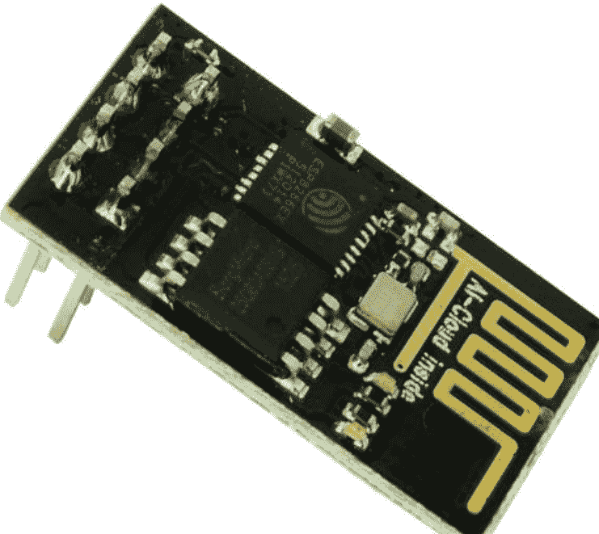

**图 1.10.** ESP8266-01 开发板

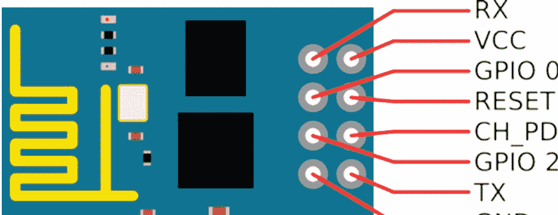

图 1.11. ESP8266-01 开发板的引脚配置（顶视图）

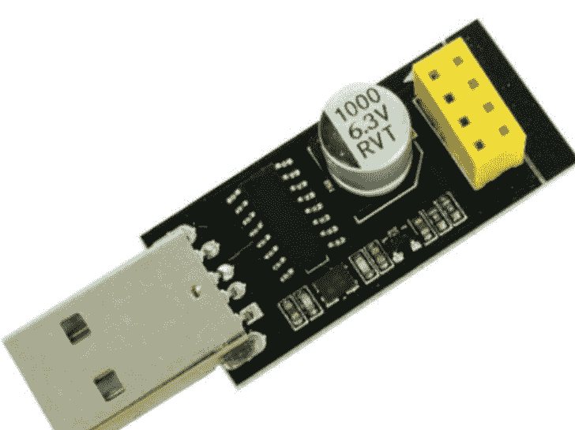

图 1.12. 用于 ESP8266-01 开发板编程的 USB 转串口转换器

## ESP8266-01 开发板的编程

对 ESP8266-01 开发板进行编程时，需要先将 GPIO 引脚接地，然后进行复位。

在 Arduino IDE 中，选择 `Tools（工具）-> Board（开发板）"Generic ESP8266 Module"`，设置串口和速率，然后编译并通过 `Load`（上传）进行编程。

关闭编程器后，必须将 CH_PD 引脚（`0` -> 掉电，`1` -> 上电）连接到 VCC 才能正常工作。

尽管该微控制器对于各种简单应用来说已经足够强大，但建议将其用作更复杂模块的 WiFi 接口，该模块具有多个外设模块和足够数量的引脚（例如 Arduino 或 STM32F4 Discovery）。

`NodeMCU 1.0 ESP8266-12E` 开发板（图 1.13）是基于 ESP8266 微控制器实现的高级版本系统。

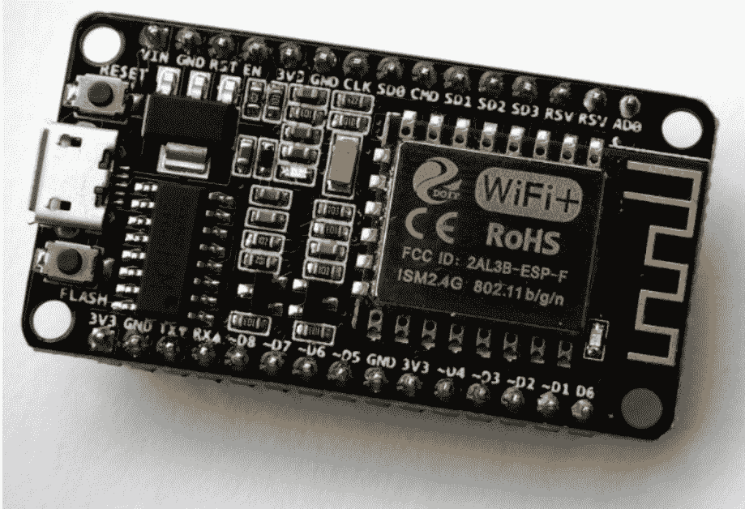

**图 1.13.** ESP8266-12 NodeMCU 1.0 开发板

除了 4 MB ROM 之外，该模块还包含 micro-USB 编程接口和提供 3.3V 电压的稳压器。此外，几乎所有微控制器引脚都可访问（图 1.14 和图 1.15），使其能够独立运行，应用范围更广。

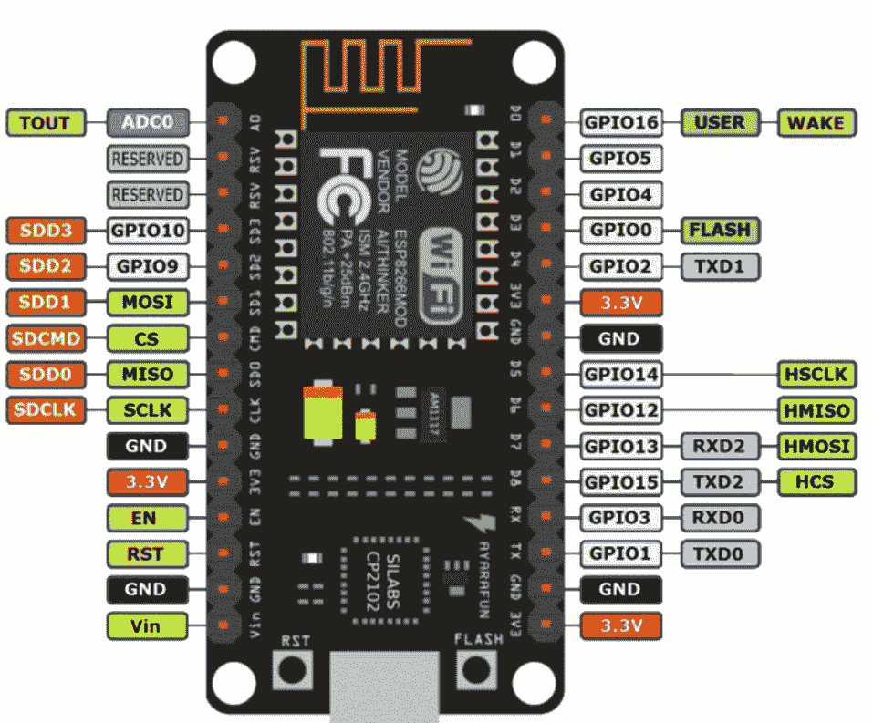

**图 1.14.** ESP8266-12 NodeMCU 1.0 开发板的引脚配置

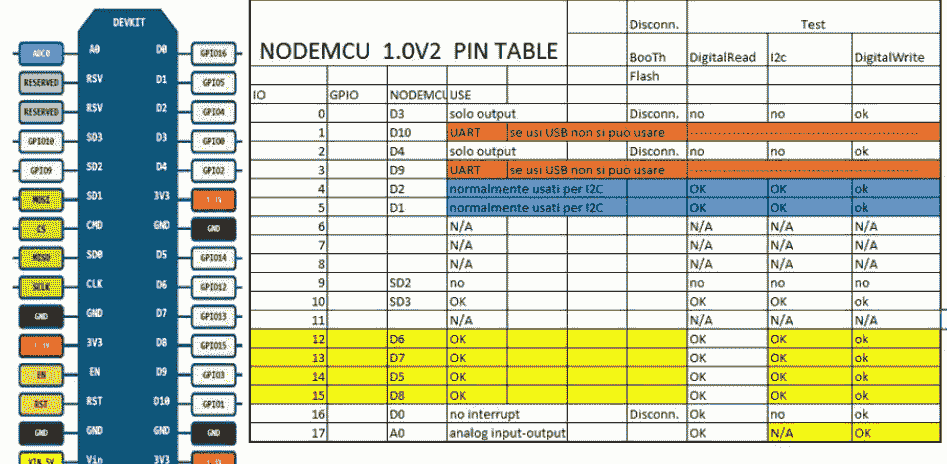

**图 1.15.** ESP8266-12 NodeMCU 1.0 开发板的引脚功能

`ESP32 DOIT DEVKIT 开发板`搭载 ESP32 微控制器、Flash 存储器、用于编程的 USB 转串口转换器以及 3.3V 稳压器（通过 micro USB 连接器实现 5V 供电和与 PC 通信）。

ESP32 系列微控制器具有以下特性：

- Xtensa® 单核/双核 32 位 LX6 微处理器，频率最高可达 600 MIPS（ESP32-SoWD 为 200 MIPS，ESP32-D2WD 为 400 MIPS）
- 448 KB ROM
- 520 KB SRAM
- RTC
- 16 KB SRAM QSPI，支持多 flash / SRAM 芯片
- 工作电压：3.3V
- 内部 8 MHz RC 振荡器，带校准
- 内部时钟频率：240 MHz
- 2 MHz-60 MHz 外部晶体振荡器（仅用于 Wi-Fi / BT 功能时为 40 MHz）
- 外部 32 kHz 晶体振荡器用于 RTC，带校准
- 两个定时器组，每组包括 2 个 64 位定时器和 1 个主看门狗
- 一个 RTC 定时器
- RTC 看门狗
- 34 个可编程 GPIO
- 12 位 SAR ADC，最多 18 个通道
- 2 个 8 位 DAC
- 10 个触摸传感器
- 4 个 SPI
- 2 个 I2S
- 2 个 I2C
- 3 个 UART
- 1 个主机（SD / eMMC / SDIO）
- 1 个从机（SDIO / SPI）
- 以太网 MAC，带专用 DMA 接口和 IEEE 1588 端口
- Wi-Fi：IEEE 802.11 b / g / n / e / i
- CAN 2.0
- IR（TX / RX）
- 用于电机驱动的 PWM
- 用于通用用途的 PWM，最多 16 个通道
- 霍尔传感器

有来自不同制造商的许多搭载 ESP32 微控制器的模块实现方案可供选择。DOIT Devkit ESP32 有 30 引脚版本（图 1.16），以及较新的 36 引脚版本（图 1.17）。第二种版本增加的 6 个引脚可能会带来一些副作用，因此需要特别留意。

开发板上配备了一个红色 LED 用于指示电压存在，以及一个连接在 GPIO2 用户引脚上的蓝色 LED。还有一个复位按钮（EN）和一个启动按钮（仅在程序加载失败时需要使用）。在下文中，示例将使用 ESP32 微控制器，它是最优选择（约 10 美元），但所展示的程序只需进行少量修改即可用于 ESP8266 微控制器（低于 5 美元）。主要需要将程序中诸如 `ESP32 ...` 之类的术语替换为 `ESP8266 ...`，并根据所使用的开发板定义所使用的引脚。

作为集成开发环境，我们将使用 Arduino IDE，它极其简单，且对于要求不高的应用来说功能已经足够强大。其主要缺点是 Arduino IDE 缺乏调试支持；这就是为什么对于更复杂的应用，建议使用更强大的程序，例如 ESP IDF。然而，这些工具的缺点是首次构建需要非常长的时间。

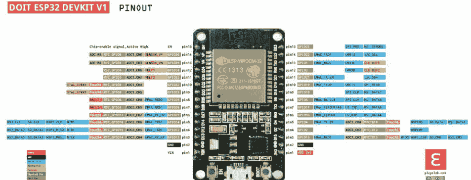

**图 1.16.** 30 引脚 ESP32 开发板的引脚分配

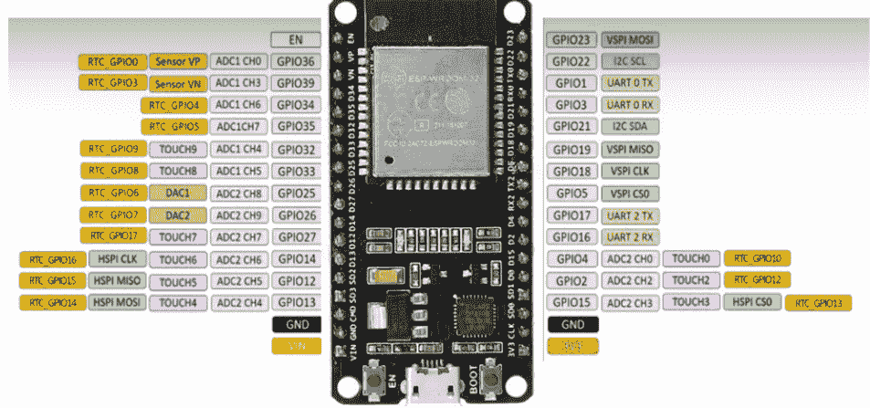

**图 1.17.** 36 引脚 ESP32 开发板的引脚分配

## 使用 HTML / JavaScript 的 ESP32 / ESP8266 物联网应用

使用标准 HTML 技术可以提供很大的灵活性，因为可以与其他 Web 技术相结合，从而实现 GUI 的任何参数。其代价是需要手动编写大量代码，但这一要求通常并不构成障碍。

在下文中，对于使用 C 语言对 ESP 微控制器进行编程，我们将使用 Arduino IDE 编程环境，其优势在于简单易用，能够实现非常快速的应用程序开发。其主要缺点是缺乏程序调试工具，稍后将介绍一款更高级的集成开发环境——ESP-IDF 官方编程工具。

## ESP 微控制器的 IDE 安装

要在 Arduino IDE 中准备 ESP32/ESP8266 微控制器的编程环境，需要执行以下步骤：

- 在 `https://www.arduino.cc/en/Main/Software` 安装最新版本的 Arduino IDE。
- 进入 `File（文件）-> Preferences（首选项）`，在 Additional Boards Manager URLs（附加开发板管理器网址）中输入：`http://arduino.esp8266.com/stable/package_esp8266com_index.json` 和 `https://dl.espressif.com/dl/package_esp32_index.json`，用逗号分隔。
- 进入 `Tools（工具）-> Boards（开发板）-> Boards Manager（开发板管理器）`。
- 在列表末尾，单击 esp8266 ESP8266 Community 所在的单元格并安装。
- 在列表接近末尾处，单击 Espressif Systems 的 esp32 所在的单元格并安装。
- 插入 ESP8266 或 ESP32 开发板，并安装驱动程序。

## 使用 ESP32 开发板作为服务器

对于以 ESP32 作为服务器的最小化网站，我们按以下步骤进行：

1. 打开 Arduino IDE，选择开发板和串口，然后打开 `File（文件）-> Examples（示例）-> ESP32 DEVKIT V1 -> WiFi -> SimpleWiFiServer`。
2. 复制标准的声明和初始化部分，并按图 2.2 示例中所示保留最简内容。
3. 在 `loop()` 中输入客户端搜索和 HTML 文本写入的指令。该内容通过 `client.println("....")` 指令分多行发送。服务器创建网页的主循环示例见图 2.2。
4. 将程序加载到 ESP32 中并运行后，模块将使用程序中指定的 SSID 和密码连接到路由器。DHCP 系统会分配一个可用的 IP 地址，该地址将显示在 Arduino IDE 的串口监视器中（选择程序中指定的速率，115200 bps）。
5. 通过从 WiFi 电路所连接路由器的地址访问该网页，可以得到如图 2.1 所示的页面。可能需要进行一些路由器设置，稍后将对此进行介绍。作为替代方案，也可以通过路由器分配的地址从局域网访问，通常采用 `192.168...` 的形式。

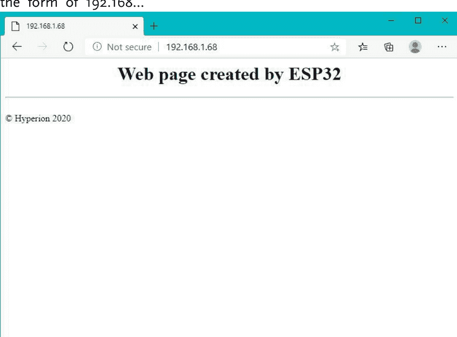

**图 2.1.** 由 ESP32 服务器创建的网页示例

`1_SimpleServer | Arduino 1.8.12 (Windows Store 1.8.33.0)`

文件 编辑 项目 工具 帮助

`1_SimpleServer §`

```cpp
#include <WiFi.h>

const char* ssid = "NameSsid";
const char* pass = "Pass1234";

WiFiServer server(80);

void setup() {
  Serial.begin(115200);
  delay(10);
  Serial.println("Connecting");
  WiFi.begin(ssid, pass);

  while (WiFi.status() != WL_CONNECTED) {
    delay(500);
    Serial.print(".");
  }
  Serial.println(WiFi.localIP());
  server.begin();
}

void loop() {
  WiFiClient client = server.available();
  if (!client) return;
  client.println("HTTP/1.1 200 OK"); // Mandatory
  client.println(""); // Mandatory
  client.println("<div align='center'>");
  client.println("<h1> Web page created by ESP32 </h1>");
  client.println("</div>");
  client.println("<hr />");
  client.println("<br>");
  client.println("&copy Hyperion 2020");

  client.flush(); // Mandatory
  delay(1);
}
```

`5412B OTA: ~470KB), 2, nonos-sdk 2.2.1+100 (190703), v2 Lower Memory, Disabled, None, Only Sketch, 115200 on COM5`

**图 2.2.** 使用 DHCP 的最简网页 ESP32 程序

### 用于外部访问的静态地址

如果你想始终分配相同的 IP，可以分配一个静态 IP，或者进行 DHCP 保留。这样路由器就可以将来自网络外部的访问请求，通过服务器所在端口转发到其 IP 地址。要分配静态地址，程序的初始部分将如图 2.3 所示。

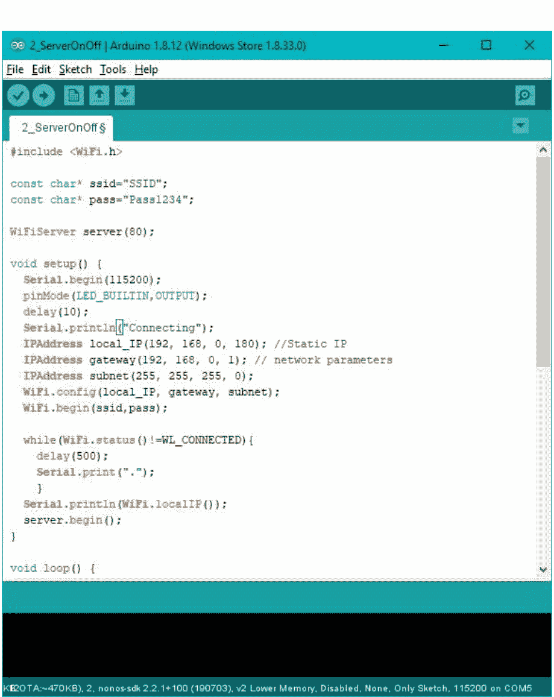

```cpp
#include <WiFi.h>

const char* ssid="SSID";
const char* pass="Pass1234";

WiFiServer server(80);

void setup() {
  Serial.begin(115200);
  pinMode(LED_BUILTIN, OUTPUT);
  delay(10);
  Serial.println("Connecting");
  IPAddress local_IP(192, 168, 0, 180); // Static IP
  IPAddress gateway(192, 168, 0, 1);    // network parameters
  IPAddress subnet(255, 255, 255, 0);
  WiFi.config(local_IP, gateway, subnet);
  WiFi.begin(ssid, pass);

  while (WiFi.status() != WL_CONNECTED) {
    delay(500);
    Serial.print(".");
  }
  Serial.println(WiFi.localIP());
  server.begin();
}

void loop() {
```

**图 2.3.** 静态 IP 服务器连接

如果你选择对特定地址进行 DHCP 保留，请按以下步骤操作：

打开 ESP 将要连接并进行 DHCP 保留的 WiFi 路由器配置页面。为此，首先找到 ESP 板顶部的 MAC 地址，如图 2.4 示例顶部所示，将该地址复制到中间字段，分配 IP 地址并添加到保留列表中。该示例针对 LINKSYS 路由器，其他路由器的设置界面可能不同。

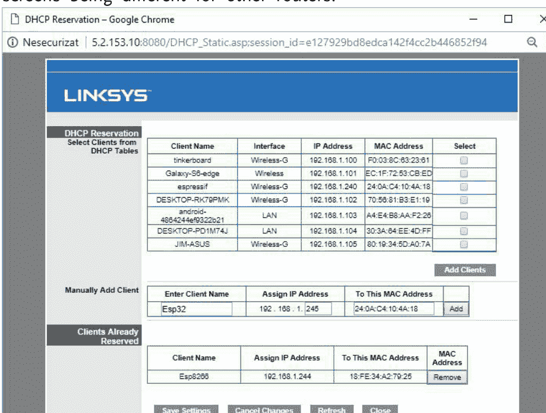

**图 2.4.** DHCP 路由器地址保留示例（针对给定 MAC）

此时，ESP 服务器在路由器上始终会被分配相同的地址，如果我们从连接到同一路由器的客户端使用该内部地址，它将是可见的（在示例中为 `192.168.1.245`）。

无论是在 DHCP 上保留 IP 的情况下，还是使用静态 IP 时，要从外部网络访问页面，请按以下步骤操作：

1. 配置路由器转发 80 端口，如图 2.5 示例所示。这样，外部客户端也可以使用路由器的 IP 地址访问网页，可能后跟端口号（在示例中为 `5.2.123.10`，它将自动连接到 80 端口，或 `5.2.123:80`）。如果 80 端口被其他设备占用，可以使用另一个端口，如后面示例所示。
2. 从`工具->串口监视器`开始。
3. 编译并将程序加载到 ESP 中。
4. 串口监视器显示服务器所连接路由器的内部 IP 地址。
5. 你可以从连接到同一路由器的客户端使用内部地址通过浏览器进入，或者从外部客户端使用路由器地址进入。

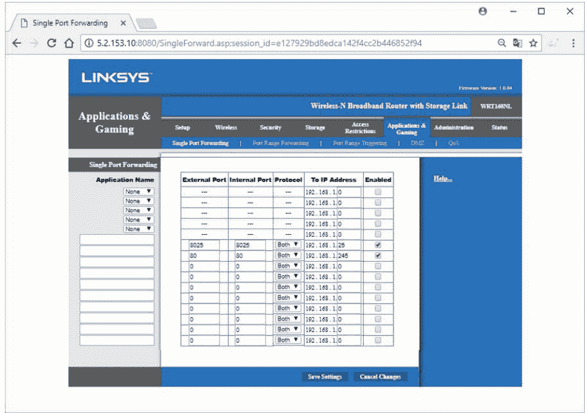

**图 2.5.** 端口转发到本地地址的示例

**注意：** 默认 HTTP 协议端口是 80，因此该值会自动添加到客户端请求的网页地址中。例如，如果调用`http://101.102.103.100`，它会转到`http://101.102.103.100:80`。如果地址 80 已被路由器用于转发地址，可以在此处运行的服务器使用另一个端口，但在这种情况下，LAN 和 WAN 地址都必须明确指定端口。例如，如果服务器在 85 端口上声明，IP 为 `192.168.1.240`，LAN 地址可以写为`http://192.168.1.240:85`，如果路由器中 85 端口已转发到 LAN 地址 `192.168.1.240`，则 WAN 地址可以写为`http://101.102.103.100:85`。

当然，程序第四行将修改为如图 2.6 所示以指定新端口。

此外，在静态 IP 的情况下，如果它连接到另一个本地网络，该 IP 和网关都必须与路由器处于不同的 IP 类别。同时，要从外部可见，所涉及的端口必须转发到下级路由器的上级路由器 IP 地址。例如，如果主路由器（连接到公共 IP）为次级路由器分配地址 `192.168.1.200` 和网关 `192.168.1.1`，则该次级路由器可以为服务器分配 IP 地址 `192.168.0.180` 和网关 `192.168.0.1`。如果使用的端口例如为 80 和 81，两者都必须转发到第一个路由器上的 `192.168.1.200`，第二个路由器转发到 `192.168.0.180`。

在主循环中，HTML 指令将使用`client.println()`命令传递，如图 2.2 示例所示。

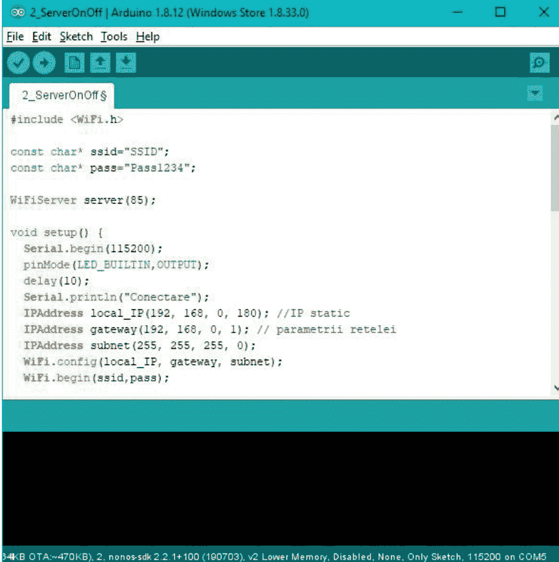

**图 2.6.** 指定另一个服务端口

## 使用 MIT App Inventor 的应用

在线 MIT App Inventor 环境允许使用面向对象的图形编程和事件快速开发移动设备的 Android 应用程序。

为此，打开`http://ai2.appinventor.mit.edu`页面并创建账户，下载并安装 App Inventor Setup 软件包。同时，必须安装所用 Android 手机的 Windows 驱动程序。

打开`项目->启动新项目`并输入项目名称（用下划线代替空格）。项目显示第一个屏幕和 Designer 窗口。

在最右侧列中设置 Screen1 的参数（如对齐方式、背景图像、颜色等），如图 2.7 示例所示。

从左列的用户界面中拖动一个 WebViewer 对象到应用程序窗口。单击 WebViewer1 对象（在中右列），可以更改其参数。


选择 **Blocks** 选项卡（右上角），按图 2.8 创建查看器。为此，单击左列，首先在 `Screen1` 对象上并拖动初始化语句，然后单击 `WebViewer1` 对象并写入服务器的 URL。地址写为文本（如果单击左侧 **Built-in** 类别中的 **Text** 项，会出现第一个块）。

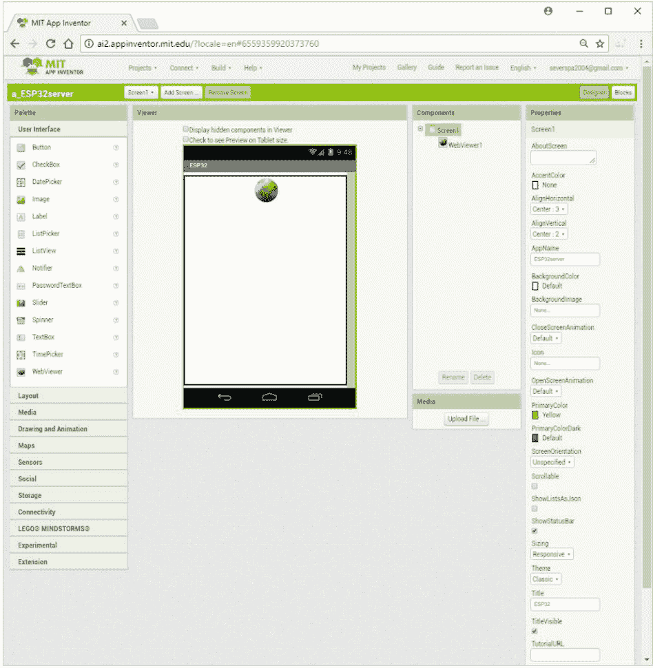

**图 2.7.** 在 MIT App Inventor 中开发的程序的图形界面

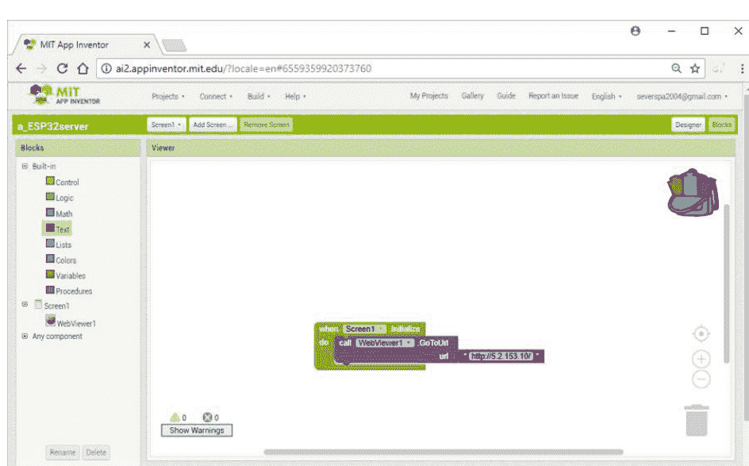

**图 2.8.** MIT App Inventor 中的程序代码块

从 MIT App Inventor 工具启动之前安装的 `aiStarter` 程序，然后通过“连接 -> 模拟器”连接到 Android 模拟器。它可能需要版本升级，完成后需要重置连接并再次启动模拟器。如果 ESP32 上的 Arduino 应用程序已打开，模拟器屏幕将如图 2.9 所示。

你可以用 USB 线配对 Android 手机，重置 MIT 连接后，可以控制 USB 连接。此图像会出现在你的 Android 手机上并运行，但也可以出现在任何其他浏览器中。

你可以从“构建”菜单编译应用程序。它将下载到计算机，或者你可以为其生成 QR 码。在这种情况下，必须在手机上安装 MIT AI2 Companion（来自 Play 商店）以扫描生成的 QR 码，并将新应用程序直接安装到手机中。

此外，编译后的应用程序（带有 `.apk` 扩展名）可以发送到 Google Play 商店。

该应用程序可以以可编辑形式下载到计算机中（仅通过 MIT App Inventor），使用“项目 -> 将所选项目（`.aia`）导出到我的计算机”。

**图 2.9.** MIT App Inventor 程序的 Android 模拟器

### 通过 WiFi 控制 GPIO 端口

可以通过 ESP32 服务器创建的网页，向该开发板的 GPIO（通用端口输入/输出）端口发送各种命令。运行网页的计算机或移动设备是服务器的客户端，可以通过 `client.read` 指令读取，该指令在 ESP32 开发板的主循环中定期调用。根据客户端发送的数据，服务器程序可以通过标准 C 指令执行各种命令。

### 用于从浏览器提交命令的网页

下面，我们将举例说明如何通过 WiFi 控制 ESP32 GPIO 引脚的状态。首先，创建一个包含两个超链接的网页，用于打开/关闭 `LED_BUILTIN`（DOIT ESP32 DEVKIT V1 开发板的 GPIO2）。为此，将对之前的程序进行一些修改和补充。

在声明部分，声明 `String` 类型的变量 `request`，在 `setup` 部分，使用编程语句 `pinMode(LED_BUILTIN, OUTPUT)`。

处理从客户端接收到的数据使用以下代码序列：

```cpp
request = client.readStringUntil('\r');
Serial.println(request);
```

```cpp
if (request.indexOf("ON")!=-1) digitalWrite(LED_BUILTIN, HIGH);
if (request.indexOf("OFF")!=-1) digitalWrite(LED_BUILTIN, LOW);
```

我们可以看到，从客户端读取一个字符串（以 CR 结尾），然后在其中搜索子字符串（`"ON"`）或另一个子字符串（`"OFF"`）。根据找到的子字符串，相应的写入指令改变输出引脚状态。如果未找到该字符串，指令 `request.indexOf("...")` 返回值 `-1`。

在生成网页的部分，使用两条插入超链接的指令：

```cpp
client.print("Click <a href=\"LED=ON\"> here to turn the LED on");
client.print("Click <a href=\"LED=OFF\"> here to turn the LED off");
```

请注意，使用 `client.print()` 语句发送标准 HTML 指令，与之前的程序相同。

因此，Arduino IDE 中的完整程序如图 3.1 所示。

```cpp
#include <WiFi.h>
const char* ssid="SSID";
const char* pass="password";
WiFiServer server(85);
void setup() {
  Serial.begin(115200);
```

```cpp
pinMode(LED_BUILTIN,OUTPUT);
    delay(10);

    WiFi.begin(ssid,pass);
    while(WiFi.status()!=WL_CONNECTED){
        delay(500);
        Serial.print(".");
    }
    Serial.println(WiFi.localIP());
    server.begin();
}
void loop() {
    WiFiClient client=server.available();
    if (!client) {return;}
    String request=client.readStringUntil('\r');
```

```cpp
Serial.println(request);
if (request.indexOf("ON")!=-1) digitalWrite(LED_BUILTIN,HIGH);
if (request.indexOf("OFF")!=-1) digitalWrite(LED_BUILTIN,LOW);
// Return the response
client.println("HTTP/1.1 200 OK");
client.println("Content-Type: text/html");
client.println(""); // Mandatory in the web page
```

```cpp
client.print("Click <a href=\"LED=ON\">here to turn the LED on.");
client.print("Click <a href=\"LED=OFF\">here to turn the LED off.");
client.println("</body></html>");
client.println("");
client.println("© Hyperion");
client.println("");
client.flush(); //Mandatory reinitialize
    delay(1);
```

```cpp
}
```

### 图 3.1. 通过 HTML 控制数字输出的程序

在 ESP32 中编译并加载程序后，它将使用指定的 SSID 和密码连接到路由器，并在串口监视器上显示接收到的 IP。如果此 IP 在 DHCP 中保留，并且路由器上的 80 端口转发到该 IP，浏览器就可以直接访问路由器的 WAN 地址。浏览器显示的网页将如图 3.2 中的示例所示。

点击第一个链接，ESP32 开发板上的 LED 将点亮；点击第二个链接，LED 将熄灭。当然，你可以更改输出引脚（在本例中由包含的头文件 `"WiFi.h"` 中定义的 `LED_BUILTIN` 常量），并且可以使用 C 指令在 ESP32 程序中输入其他引脚。还可以使用 HTML 指令在浏览器中包含其他命令，并且可以使用 `client.print()` 命令发送其他网页结构。

**图 3.2.** ESP32 模块引脚数字命令的网页

### 使用 MIT App Inventor 开发用于 ESP32 控制的移动应用程序

我们将使用 MIT App Inventor 在线环境构建一个基于 Android 的客户端应用程序，允许直接控制 DOIT ESP32 DEVKIT 开发板上的 `LED_BUILTIN` 引脚，按照以下概述的步骤进行。

首先，我们构建图形界面，如图 3.3 中的示例所示。

从左栏的“用户界面”类别中，将两个**按钮**元素和一个 `WebViewer` 元素拖到屏幕上。通过在中右栏中选择它们并在最右栏中编辑（颜色、大小、文本）来更改它们的参数，如图 3.3 中的示例所示。

从左栏的“布局”类别中，拖动两个 `HorizontalArrangement` 对象，并将它们方便地放置在按钮的上方和下方。

从左栏的“通信连接”类别中，拖动一个 `WebViewer` 项目。它在移动设备的屏幕上不会直接可见，但可以让你像浏览器一样显示服务器的网页。

为了能够使用 `WebViewer1` 创建的浏览器显示的超链接，请在中右栏中选择此项，并在右栏中勾选 `FollowLinks`。

**图 3.3.** MIT App Inventor 数字命令应用程序——图形界面

通过点击右上角的 `Blocks` 按钮构建程序块图表，如图 3.4 中的示例所示：

- 从“变量”类别中，拖动 `Initialize global` 元素并插入 `www` 和地址（根据 DHCP 的本地地址，端口为 85，或者如果已路由到端口 85 则为外部地址）；
- 从 `Screen1` 类别中，拖动 `WhenScreen1.Initialize` 元素；
- 从 `Screen1 -> Button1` 类别中，拖动 `WhenButton1.Click`，Button2 类似操作；
- 从类别 `Screen1 -> WebViewer1` 拖动 `WebViewer1.GoToUrl`，从“内置 -> 文本”类别中，拖动第一个元素（文本字符串），并使用 `"global www"`；
- 从类别 `Screen1 -> Web1` 中，将 `Web1.Url` 元素拖动到“文本”类别中，拖动 `join` 元素，附加两个字符串，形成地址 `"global www / LED = ON"`，如图 3.4 中的示例所示。

对 Button2 重复上述操作，地址为 `"global www / LED = OFF"`。

**图 3.4.** MIT App Inventor 数字命令应用程序——程序块

启动 `aiStarter` 后，使用 USB 移动设备或模拟器，你可以运行 ESP32 控制面板应用程序，其外观将如图 3.5 中的示例所示。命令可以通过按钮或超链接发出（由于 `WebViewer1` 元素，如果不需要额外的浏览器显示，可以省略它）。

**图 3.5.** MIT App Inventor 数字命令应用程序——Android 模拟器

### 使用 80 以外的端口

如果 ESP32 要连接的路由器已将 80 端口转发给另一台设备，你可以使用另一个端口，例如 85。为此，在 Arduino 程序中修改 `server()` 对象，如图 2.6 所示，并在路由器的 WAN 菜单中编辑端口转发，如图 3.6 中的示例所示（我们使用的是 ASUS RT-N12N+ 路由器）。当然，首先在 DHCP 中为 ESP32 服务器保留（手动分配）所需的 IP，如图 3.7 所示，或者可以使用静态 IP，如以下章节所述。

#### LAN - DHCP 服务器

DHCP（动态主机配置协议）是用于 IP 网络上自动配置的协议。DHCP 服务器可以为每个客户端分配一个 IP 地址，并告知客户端 DNS 服务器 IP 和默认网关 IP。RT-N12+ 支持本地网络最多 253 个 IP 地址。

#### 基本配置

| 设置 | 数值 |
|---|---|
| 启用 DHCP 服务器 | 是 ● 否 |
| RT-N12+ 的域名 | Etaj |
| IP 池起始地址 | 192.168.1.64 |
| IP 池结束地址 | 192.168.1.254 |
| 租约时间 | 86400 |
| 默认网关 | 192.168.1.1 |

#### DNS 和 WINS 服务器设置

| 设置 | 数值 |
|---|---|
| DNS 服务器 | |
| WINS 服务器 | |

#### 启用手动分配

启用手动分配：● 是 否

#### DHCP 列表中的手动分配 IP（最大限制：64）

| 客户端名称（MAC 地址） | IP 地址 | 添加 / 删除 |
|---|---|---|
| `espressif 24:0A:C4:10:4A:18` | `192.168.1.245` | - |

**图 3.6.** 路由器 DHCP 中选择 ESP32 所需 IP 的示例

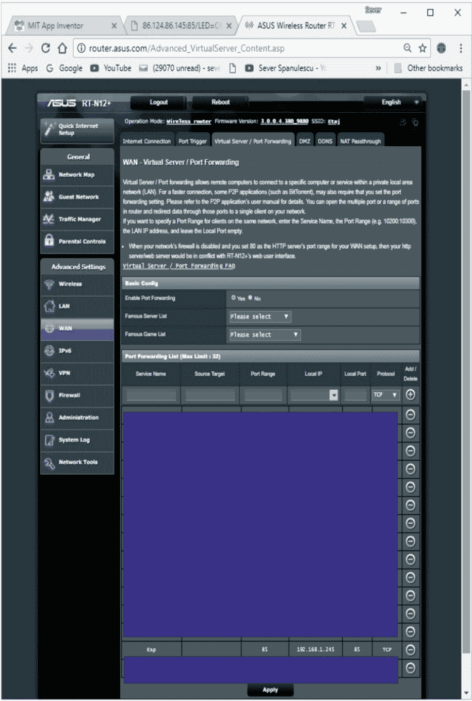

### 图 3.7. 路由器服务器端口转发示例

在这种情况下，外部输入端口的值也应包含在移动应用程序中，方法是输入其值并在前面加上 `:` 字符，如图 3.4 所示。

### 以及从 MIT App Inventor 应用程序向 ESP32 服务器传输数字命令

### 模拟和数字传输的原理

下面描述了一个在 ESP32 服务器上运行的程序示例，该程序能够接收来自客户端的数字值（使用按钮）和模拟值（使用光标）。

对于输出端的模拟值，你可以使用脉宽调制技术——PWM。Arduino IDE 中存在的 `analogWrite()` 指令目前仅适用于 ESP8266 微控制器（具有 10 位分辨率），因此对于 ESP32，我们将使用 `ledcAttachPin()` 和 `ledcDetachPin()` 指令。

与其他微控制器类似，ESP32 微控制器的某些 GPIO 引脚可以生成矩形 PWM 脉冲。经过积分（从而滤除交流分量，仅保留直流分量）后，当填充因子在 0% 到 100% 之间变化时，这些脉冲被转换为 0 到 3 V 之间的连续电平。这种工作模式等效于数模转换（DAC），而无需使用此类集成转换器。转换电压分辨率由脉冲发生器使用的步数决定，通常根据以下通用关系，具有 8 到 16 位的分辨率。

对于 `n` 位分辨率的计数器，步数为：

电压分辨率为：

脉冲的最大频率，对于时钟频率：

为了便于积分，我们建议使用较高的脉冲频率，但这可能需要根据公式降低分辨率。与集成 DAC 相比，这种技术的优点在于信号放大器可以在 D 类模式下工作，效率达到 80%–95%。集成 DAC 需要 A 类放大器，其效率低于 50%，这意味着需要大型散热器和高能耗。然而，集成 DAC 转换的优点是生成的频率理论上与分辨率无关。

### 在 Arduino IDE 中通过 PWM 进行数模转换

在 Arduino IDE 编程环境中，`ledcAttachPin()` 和 `ledcDetachPin()` 指令将 PWM 通道附加到引脚和从引脚分离。`ledcWrite()` 指令写入要计数的脉冲数，该数除以最大脉冲数即确定填充因子。例如，对于 10 位分辨率，总步数为 1024，因此 `ledcWrite(300)` 指令将给出约 30% 的填充因子，即约 1 V 的模拟电压。

在接下来的程序中，我们首先声明常量和变量，其中一些对于 PWM 输出是必要的。然后，服务器使用静态 IP 地址连接到具有已知 SSID 和密码的路由器。在示例中，使用了地址 `192.168.1.246`，端口 85（从 WAN 转发到此 LAN 地址）。

在此程序中，我们还说明了如何为服务器设置静态 IP。为此，使用 `WiFi.config(local_IP, gateway, subnet)` 指令，并在前面加上 IP、网关和子网指令：

```cpp
......
IPAddress local_IP(192, 168, 1, //static IP
IPAddress gateway(192, 168, 1, 1);// net parameters
IPAddress subnet(255, 255, 255, 0);
```

```cpp
WiFi.config(local_IP, gateway, subnet);
WiFi.begin(ssid, password);
```

要在 PWM 模式下工作，我们必须定义一个通道并使用以下类型的语句声明其参数：

```cpp
....
int ledChannel=0;//PWM channel for LED
int frecv=5000;// PWM Parameters for Timer
int rezolutie=8;//PWM resolution in bits
```

请注意，当传输数字 ON 或 OFF 命令时，你必须使用 `ledcDetachPin()` 指令。如果你之前对该引脚使用了模拟 PWM 命令，它将使该引脚与 PWM 通道分离。

客户端程序假设 GET 请求由一串字符组成，例如：

- 如果按下 ON 按钮，则为 `GET /ON HTTP/1.1\r`；
- 如果按下 OFF 按钮，则为 `GET /OFF HTTP/1.1\r`；
- 如果滑块定位在值 67，则为 `GET /67 HTTP/1.1\r`；
- 如果滑块定位在值 111，则为 `GET /111 HTTP/1.1\r`；
- 等等。

因此，有效信息包含在第一个字符 `/` 和字符 `H` 之间，即字符串 `"ON"`、`"OFF"` 或一个数值。当服务器接收到以 `"\r"` 结尾的字符串时，它会分隔包含信息的子字符串并尝试将其转换为数字。

如果得到一个正数，则意味着它是来自滑块的值，因此将引脚附加到 PWM 通道，并将值传达给 `ledcWrite()` 指令。如果未得到正数，我们必须将字符串与 ON 进行比较，然后与 OFF 进行比较，将 PWM 通道从引脚分离，并以数字方式向其写入 1 或 0。

接下来，我们可以生成用于 WEB 页面的 HTML 指令，以允许数字引脚控制，如前面的程序所示。

Arduino IDE 的完整程序源代码如图 4.1 所示。可以通过完成/修改前面的程序（图 3.1）来实现。

```cpp
#include
```

```cpp
const char* ssid = "NameSSID";
const char* password = "pass1234";
WiFiServer server(85);//Service Port
int num=0;
```


```cpp
int ledChannel = 0; // PWM channel for the LED
int frecv = 5000; // Timer PWM parameters
int rezolutie = 8;
String led = "OFF";

void setup() {
  Serial.begin(115200);
  delay(250);
  ledcSetup(ledChannel, frecv, rezolutie); // start PWM
  pinMode(LED_BUILTIN, OUTPUT);
  // Connect to WiFi with static IP
}
```

```cpp
IPAddress local_IP(192, 168, 1, 246); // Static IP
IPAddress gateway(192, 168, 1, 1); // network parameters
IPAddress subnet(255, 255, 255, 0);
WiFi.config(local_IP, gateway, subnet);
```

```cpp
WiFi.begin(ssid, password);
while (WiFi.status() != WL_CONNECTED) {
  delay(500);
  Serial.print(".");
}
// Start server
```

```cpp
server.begin();
Serial.println(WiFi.localIP());
}

void loop() {
```

```cpp
WiFiClient client = server.available();
```

```cpp
// Check if a client has connected
if (!client) {
  return;
}
// Wait until the client sends some data
```

```cpp
while (!client.available()) {
  delay(1);
}
// Ask for a response (a line) from server
String request = client.readStringUntil('\r');
```

```cpp
Serial.println(request);
// request from client
int index1 = request.indexOf("/");
int index2 = request.indexOf("H");

num = led.toInt(); // Transform to number
// Serial.println(led);

if (num > 0) {
  ledcAttachPin(LED_BUILTIN, ledChannel); // PWM_0 to pin 2
  ledcWrite(ledChannel, num - 1);
}

// Respond to ON/OFF buttons
if (led == "OFF") {
  ledcDetachPin(LED_BUILTIN);
  digitalWrite(LED_BUILTIN, LOW);
}

if (led == "ON") {
```

```cpp
ledcDetachPin(LED_BUILTIN);
digitalWrite(LED_BUILTIN, HIGH);
}

// Return the response
client.println("HTTP/1.1 200 OK");
client.println("Content-type:text/html");
client.println(); // mandatory
client.println("<!DOCTYPE html>");
client.println("<html>");
client.println("Click <a href=\"/ON\">here</a> to turn led on");
client.println("<br>");
client.println("Click <a href=\"/OFF\">here</a> to turn led off");
client.println("</html>");
client.flush(); // mandatory
delay(1);
}
```

**图 4.1.** 用于输出数字控制和模拟控制的程序

## MIT App Inventor 中的命令

从客户端传输模拟值可以通过虚拟滑块完成，该滑块可以在特定范围内取整数值。当前值可以转换为字符串，传输，然后由服务器再次转换为数字。

主要问题是操作滑块可能导致非常快速的数据连续传输，从而过载甚至阻塞通信。避免这种现象的一种解决方案是在特定时间间隔（最好在 0.5 到 2 秒之间）仅传输滑块值。

下面描述了在 MIT App Inventor 中实现此技术的一个示例（图 4.2）。

应用程序中将会有三个全局变量，分别对应于三种可能的事件：按下 ON 按钮——“global on”、按下 OFF 按钮——“global off”以及滑块的动作——“global slide”，它们在初始化时均被声明为逻辑值“false”。

当其中某个事件发生时，对应的变量将被置为“true”值，并保持该状态直到定时器到期。此后，该变量将被自动置为“false”。

如图 4.3 所示，从“Sensor（传感器）”面板中添加了一个 Clock（时钟）组件，并在其 Properties（属性）面板中，可以通过 `TimerInterval` 字段指定定时器间隔（以毫秒为单位），并勾选 `TimerEnabled` 复选框。

当定时器事件发生时（例如每 1000 毫秒），会对这些全局变量进行检测。若其中某个变量为“true”，则将其置为“false”，之后将执行与图 4.2 程序中相同的特定动作。

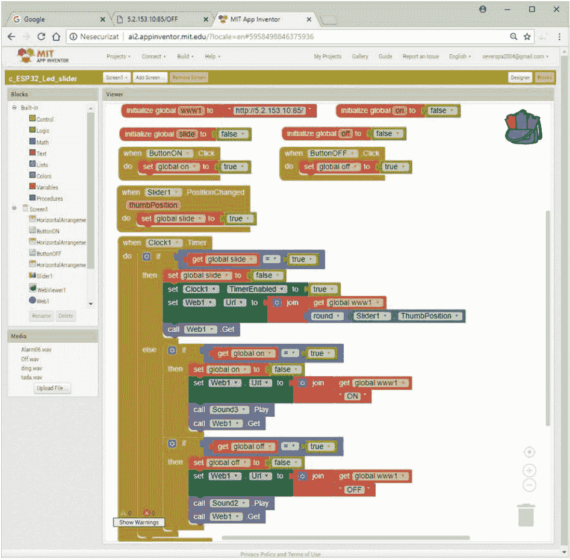

**图 4.2.** 数字和模拟指令的 MIT App Inventor 应用程序——程序块

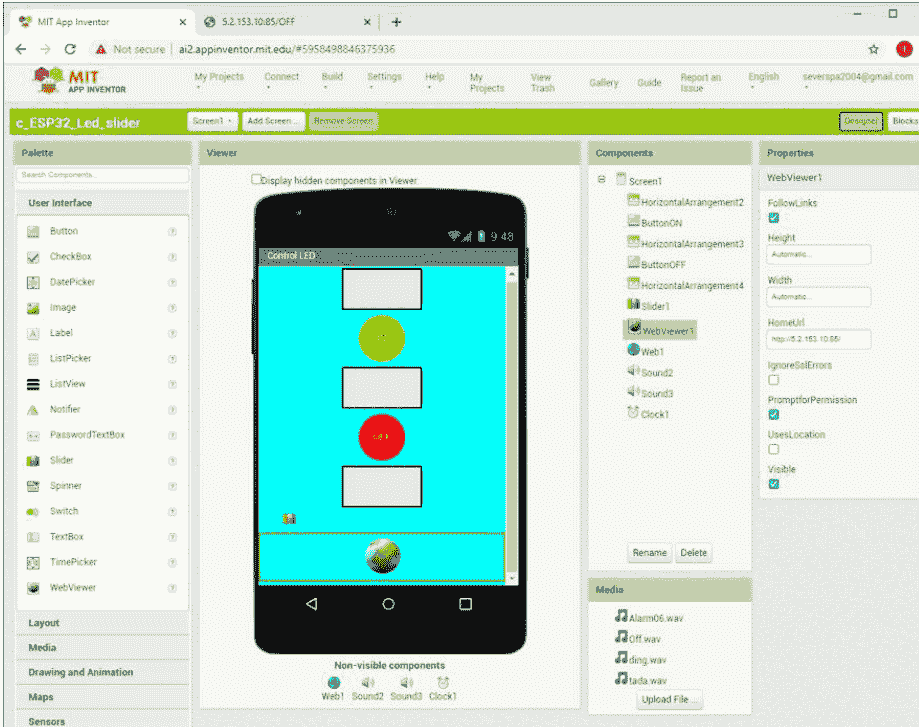

**图 4.3.** 数字和模拟指令的 MIT App Inventor 应用程序——图形界面

在该 MIT 应用程序中，除了前面的程序之外，还将出现一个滑块按钮，在其上设置颜色和最大值为 256。此外，为了无需使用 `WebViewer` 初始化块，其地址被写入 `HomeUrl` 中，如图 4.3 所示。

## 使用 MIT App Inventor 实现客户端与服务器之间的通信

服务器与多个客户端之间双向传输系统的总体方案如图 5.1 所示。

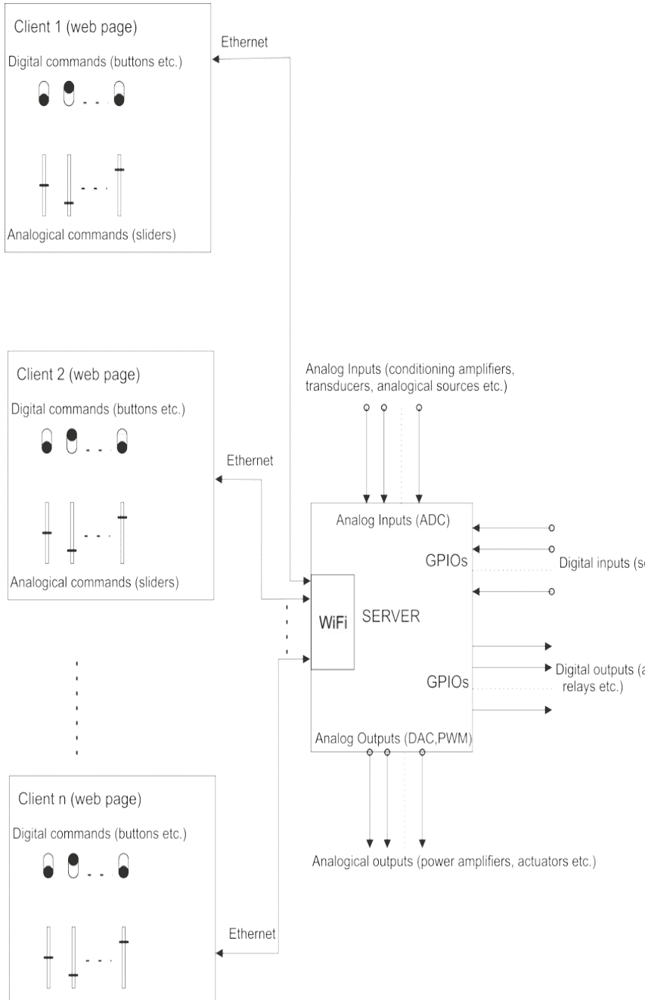

| 客户端 1（网页） |  |  |
|:---|:---|:---|
| 数字指令（按钮等） |  |  |
| 模拟指令（滑块） |  |  |
| 以太网 |  |  |
| 客户端 2（网页） | 模拟输入（调理放大器、传感器、模拟源等） |  |
| 数字指令（按钮等） | 模拟输入（ADC） |  |
| 模拟指令（滑块） | GPIOs |  |
| 以太网 | 数字输入（传感器） | WiFi |
|  | 服务器 |  |
|  | GPIOs |  |
|  | 数字输出（执行器、继电器等） |  |
|  | 模拟输出（DAC、PWM） |  |
|  | 模拟输出（功率放大器、执行器等） |  |
| 客户端 n（网页） |  |  |
| 数字指令（按钮等） |  |  |
| 模拟指令（滑块） |  |  |
| 以太网 |  |  |

**图 5.1.** 服务器与多个客户端之间通信的总体方案

## 双向客户端–服务器通信

为了将服务器上的各种状态传输给客户端，例如某些输入（传感器或其他信号源连接到这些输入）的逻辑或模拟状态，客户端可以使用 GET 指令周期性地请求服务器重新发送网页，并附带服务器的 URL（例如 `192.168.1.246:85`）。如前所示，该请求也可用于通过在根地址后附加额外的字符串（例如 `192.168.1.246:85/ON`）来向服务器发送指令。

然而，在普通浏览器中周期性地刷新整个网页会由于闪烁而影响页面的外观，这可以通过 AJAX 技术来避免，相关内容将在后续章节中介绍。如果与 Android 应用程序的双向通信已经足够，则可以通过 MIT App Inventor 非常轻松地使用此方法。

## 通过 MIT App Inventor 刷新网页

为此，在 Timer 生成的块中输入一个 GET 请求，其中根 URL（可能已被前述三条指令之一修改过）已预先设置，如图 5.2 所示。其效果将是服务器在定时器给定的一段时间后重新发送网页，该网页必须包含其状态的更新信息。

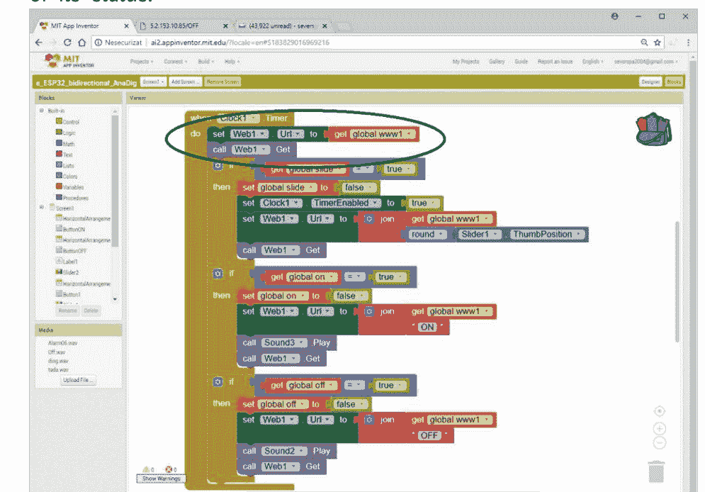

**图 5.2.** 修改 MIT App Inventor 应用程序，以实现周期性的服务器读取

为了传输状态信息，服务器将在主循环中包含它们的值，并在其后附带将其显示在网页上的指令。在下面的示例中，假设 `A0` 输入端（对于具有 36 个引脚的 DOIT ESP32，第二个左上角的输入）连接了一个电位器，它将模拟类似于传感器所传输的模拟信号输入。此外，`GPIO13` 输入端连接了一个按钮，它将模拟来自传感器的逻辑信号（ON / OFF）。

```cpp
String button = String(digitalRead(13));
```

```cpp
String a = String(analogRead(A0) / 41);
```

由于 ESP32 的模数转换器为 12 位，因此转换的最大结果为 4095。为了将数值缩放到 0–100 的范围内，结果被除以 41。这在某种程度上会增加 ESP32 微控制器的负载，另一种做法是在移动设备上的应用程序中进行缩放，但这将使服务器发送的块中的字符数量增加 2。

为了在页面上显示相应的值，在传输的序列中，我们将为每条状态信息插入一个头部，其后跟随包含该信息的字符串。在下面的示例中，头部分别为 `"But"` 和 `"Pot"`，前者后跟一个字符（0 或 1），后者后跟三个字符（0–100）。此类指令可以在 HTML 部分中输入：

```cpp
client.println("But");
client.println(button);
client.println("Pot");
client.println(a);
```

显然，根据应用程序的需求，也可以使用相同的方法插入其他模拟或数字输入的状态。

在 MIT 应用程序的图形界面中，应添加服务器状态显示的元素。在下面的示例中，为 `GPIO13` 的逻辑值添加了一个 Label（标签）元素、一个会改变颜色的按钮（根据该状态显示黄色/蓝色）以及一个用于显示 `A0` 上模拟值的 Thumbnail 滑块。这些元素将根据您的偏好在 MIT 应用程序的图形界面中进行设置。

在 MIT 应用程序中，还必须添加一个块，用于识别服务器的入口状态信息，并执行在客户端进行显示的指令。

首先，将初始化两个全局变量：“global raspuns”用于显示数字输入的状态，“global raspunsAna”用于显示模拟信息。

如图 5.3 所示，在从服务器发送的完整 `"responseContent"` 文本中，搜索 `"But"` 字符串的索引，并从该索引的起始位置 5 处开始分离出一个 `"global raspuns"` 字符（完整字符串中有两个被解释为空格的字符）——红色椭圆所示。

然后使用此子字符串的内容修改 `Label1` 的文本，最后，通过将其与 `"1"` 进行比较，设置 `Button1` 的颜色——黄色椭圆所示。类似地，分离并随后在 `Slider2` 上显示指示模拟值的子字符串——蓝色椭圆所示。

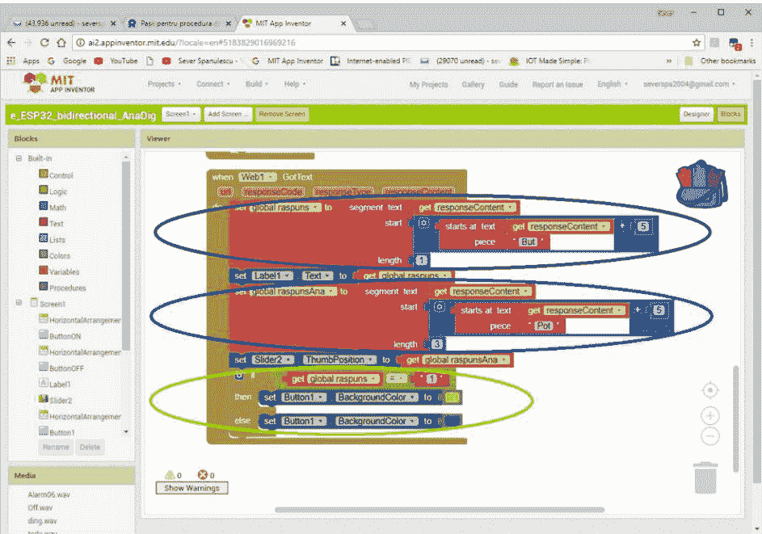

**图 5.3.** 修改 MIT App Inventor 应用程序以选择并显示从服务器接收到的状态信息

## 用于双向通信的完整 MIT App Inventor 应用程序

综合以上内容，服务器与一个或多个客户端之间完整的双向通信应用程序如图 5.4（块图）和图 5.5（图形界面）所示。还添加了一个高度为 24 点的 Canvas（画布）对象，用于模拟显示。

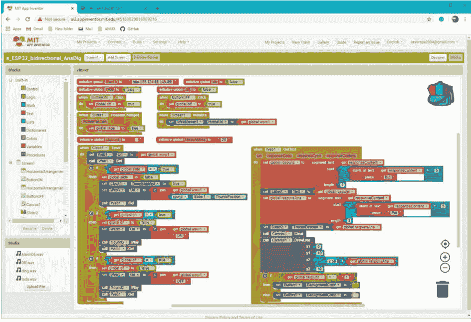

**图 5.4.** 用于双向通信的 MIT App Inventor 块

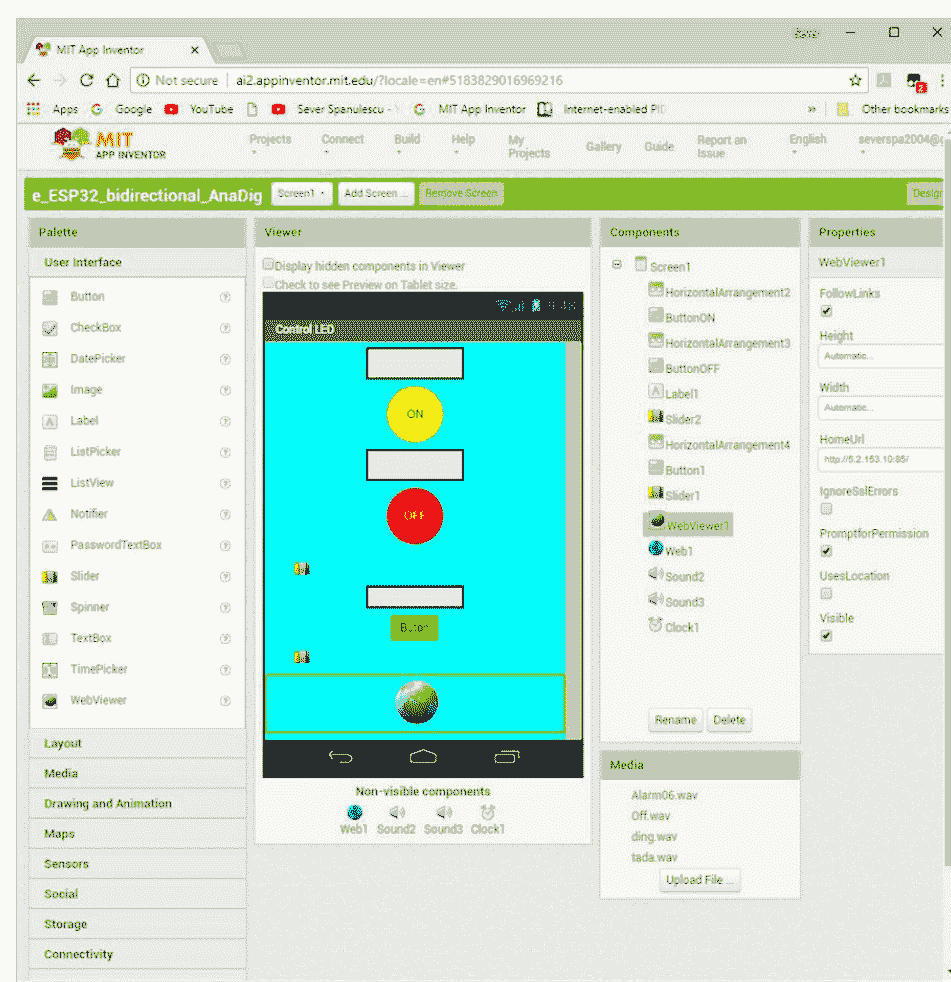

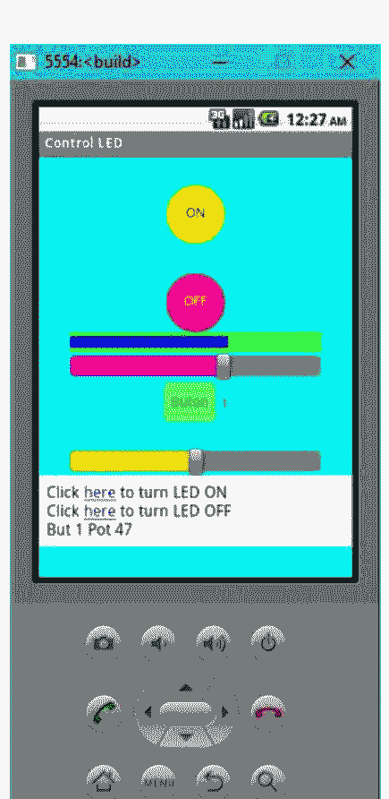

**图 5.5.** 用于与服务器进行双向通信的 MIT App Inventor 应用程序的图形界面

## 用于与 MIT App Inventor 客户端进行双向通信的完整 ESP32 程序

ESP32 程序的完整代码如下（对前述程序所做的修改部分以黄色高亮显示）：

```cpp
#include

const char* ssid = "MySSID";

const char* password = "MyPass";

WiFiServer server(85); // Service Port

int num = 0;

int ledChannel = 0; // PWM channel for LED

int frecv = 5000; // PWM parameters for Timer

int rezolutie = 8;

String led = "OFF";

void setup() {
  Serial.begin(115200);

  delay(250);

  ledcSetup(ledChannel, frecv, rezolutie);

  pinMode(2, OUTPUT);

  pinMode(13, INPUT_PULLUP);

  // to WiFi, with static IP
  IPAddress local_IP(192, 168, 1, 10); // static IP
  IPAddress gateway(192, 168, 1, 1); // network parameters
  IPAddress subnet(255, 255, 255, 0);

  WiFi.config(local_IP, gateway, subnet);

  WiFi.begin(ssid, password);

  while (WiFi.status() != WL_CONNECTED) {
    delay(500);
    Serial.print(".");
  }

  Serial.println(WiFi.localIP());
}

void loop() {
  WiFiClient client = server.available();

  // Wait for a client
  if (!client) {
    return;
  }

  while (!client.available()) {
    delay(1);
  }

  String button = String(digitalRead(13));
  String a = String(analogRead(A0) / 41);

  // Read the first line of the request
  String request = client.readStringUntil('\r');

  Serial.println(request);

  // a request from client
  int index1 = request.indexOf("/");
  int index2 = request.indexOf("H");

  led = request.substring(index1 + 1, index2);

  num = led.toInt(); // Try to transform the substring in number

  if (num > 0) {
    ledcAttachPin(LED_BUILTIN, ledChannel); // PWM_o to pin
    ledcWrite(ledChannel, num); // analog value to PWM_o
  }

  if (led == "OFF") {
    ledcDetachPin(LED_BUILTIN);
    digitalWrite(LED_BUILTIN, LOW);
  }

  if (led == "ON") {
    ledcDetachPin(LED_BUILTIN);
    digitalWrite(LED_BUILTIN, HIGH);
  }

  client.println("HTTP/1.1 200 OK");
  client.println("Content-type:text/html");
  client.println();

  client.println("<!DOCTYPE HTML>");
  client.println("<html>");
  client.println("<head><title>ESP32 PWM</title></head>");
  client.println("<body>");
  client.println("<h1>ESP32 PWM Control</h1>");
  client.println("<a href=\"/ON\">Click to turn LED ON</a><br>");
  client.println("<a href=\"/OFF\">Click to turn LED OFF</a><br>");
  client.println("<br>");
  client.println("<p>Potentiometer value: ");
  client.println(a);
  client.println("</p>");
  client.println("</body></html>");

  client.stop();
}
```


图 5.6. 用于与 MIT App Inventor 客户端进行双向通信的 ESP32 程序，通过网页传输。

## AJAX 技术

### 前言

在过去几十年中，工业、商业、基础设施甚至消费领域越来越多的设备配备了各种自动化、电子和计算机应用。这些系统中的许多热点已经包含本地人工智能以及众多辅助人类智能的设施。

渐渐地，在现代工厂中，越来越多的子系统相互连接，交换信息，并通过这种机器对机器（`M2M`）方式极大地提高了生产力。

与此同时，全球通信网络——互联网——已经成长和发展，连接了台式机、笔记本电脑、平板电脑、智能手机和其他人类操作的设备。

因此，一方面，机器在本地进行通信；另一方面，人类在全球范围内进行通信。下一步当然是将所有这些信息Mailbox伪装作为一种武器，还有多久送达普通用户手里？信息交换合并到一个新的层次——物联网——通过这种方式，计算机辅助设备已通过`互联网`获得全球访问权限，而人类用户已经获得在任何距离监控和指挥它们的权限。

对两种信息传输节点的分析显示出速度上的巨大差异，使得计算机设备的速度比人类操作者高出多个数量级。然而，似乎直到2009年，数量对比才对第一类变得有利，以至于一个非常广阔的互联网连接领域仍然开放。据估计，到2030年，物联网组件的数量将达到12，这可能会引发第四次工业革命，already called `Industry 4.0`（工业4.0）。

这是一项艰巨的任务，需要高素质的专家，以及简单且低成本的解决方案。朝着这个方向迈出的重要一步是`Espressif Systems`（乐鑫系统）公司生产的具有非常低成本WiFi连接的微控制器的出现，这使得那些已经具备一些经典IT知识并希望参与这一进程的人能够快速独立地获得资质。


图 1.1. 工业4.0的示意图，展示了四个"工业

本书不打算全面地教你理论，而是以完整程序的形式为你提供实用且功能完备的解决方案。你们中的一些人已经知道很多理论知识，或者可以在许多其他教科书中找到。但这里介绍的程序包含了大量的努力，并遵循编程的基本范式之一："Keep i(o)t simple"（保持简单）而具有许多原创的解决方案。——对于这样一本书来说最重要的事情是——所有程序已经由第三方验证，在本例中是来自`海波龙大学`的学生，他们提供了非常宝贵的反馈。

## AJAX 技术及其对象

如前所述，客户端到服务器命令的传输可以通过`GET`请求完成。服务器读取以`/r`结尾的字符字符串，并提取命令信息，执行适当的例程。原则上，服务器也可以传输状态信息（当前数字和模拟值），但只有在一个或多个网页客户端刷新页面后，更改才会变得可见。

到目前为止，所有介绍的程序都需要刷新整个页面才能显示服务器的当前状态。显示的状态可能与实际状态不同，因为服务器程序或另一个客户端可能会修改它。

当然，服务器可以通过`setInterval`或类似函数定期下令刷新，但重新加载整个页面可能需要大量的数据传输流量，而且在经典浏览器中周期性"闪烁"的总体外观令人不快。

这就是为什么开发了一种新技术，可以在不重新加载整个页面的情况下自动更新某些页面元素——`AJAX`（`A`synchronous `J`avaScript `A`nd `X`ML，异步JavaScript和XML）。它允许通过将JavaScript指令与通过XML在Internet上进行应用程序间数据传输的可能性相结合，从客户端向服务器发送和读取数据。

AJAX 技术的主要对象是`XMLHttpRequest`，它取代了旧浏览器中使用的`ActiveXObject`。它允许与服务器交换数据，使用的语法是：

```javascript
var object_name = new XMLHttpRequest();
```

当事件发生时，客户端创建这样一个对象，并使用`GET`方法向服务器发送请求。服务器处理此请求并创建响应，将数据发送回客户端。

现在客户端处理响应并更新网页的指定元素。

### 浏览器

- 创建`XMLHttpRequest`对象
- 发送`HttpRequest`

### 服务器

- 处理`HTTPRequest`
- 创建响应并将数据发送回浏览器

### Internet

### 浏览器

- 使用JavaScript处理返回的数据
- 更新页面内容

使用此对象的方法如下：

要向服务器发送命令，您可以使用带有异步 GET 的`open`和`send`方法，其标准语法如下：

```javascript
xhttp.open("GET", "url", true);
xhttp.send();
```

要发送包含特定参数的命令，将使用查询结构——使用`?`符号，后跟参数，如下所示：

```javascript
xhttp.open("GET","url?param="+val, true);
xhttp.send();
```

若要传输多个参数，查询结构将包含`?`符号，后跟用`&`符号分隔的参数对`parameter_n =`：

```javascript
xhttp.open("GET","url?param1=val1&param2=VAL2&param3=val3", true);
xhttp.send();
```

在服务器端，初始化序列使用`server.on`指令来声明与客户端请求相关联的函数：

```cpp
server.on ("/url", function_server);
```

例如，可以声明一个使用如下指令为客户端创建网页的函数：

```cpp
server.on ("/", handlePage);
```

同样，可以使用带有 URL 的查询序列来声明一个处理客户端请求的函数：

```cpp
server.on("/url", handleServRecept);
```

## 关于在网页中使用 PROGMEM 的说明

这些指令也可用于将整个网页加载到客户端上。您可以将它们写在一个头文件`index.h`中，该文件将作为头文件包含在服务器运行的程序中，如图 6.1 所示。

为此，请单击箭头所指的下拉菜单，选择`New Tab`（新建标签页），并将其命名为`index.h`。在该新标签页中，您可以编写要在客户端创建的网页。

这将方便地将服务器的 C 部分与在浏览器上创建网页的 HTML/JS 等部分分离开来，我们将在接下来大多数程序中使用这种技术。

```cpp
const char MAIN_page [] PROGMEM = R"====(
<!DOCTYPE html>
<html>
<body>

<div>
<h2>AJAX ESP server</h2>
<button type="button" onclick=" ClientToServer(1)" id="dout1">DigOut_1</button>
<button type="button" onclick=" ClientToServer(2)" id="dout2">DigOut_2</button>
</div>

<script>
function ClientToServer(out) {
  var xhttp = new XMLHttpRequest();
  xhttp.onreadystatechange = function() {
```

Leaving...

Hard resetting via RTS pin...

DOIT ESP32 DEVKIT V1 on COM9

**图 6.1.** 创建一个包含网页并存储在闪存中的`index.h`头文件

例如，对于用 HTML 编写的网页，语法可以是这样的：

```cpp
void handlePage () {
server.send(200,"text/html", MAIN_page);
}
```

`index.h`文件将包含具有以下语法的`MAIN_page`：

```cpp
const char MAIN_page [] PROGMEM = R"===== (
<!DOCTYPE html>
.
.
.
```

```cpp
) =====";
```

该序列会将页面的 Html 描述存储在闪存中，并将`"==== ("`和`") ===="`之间的所有内容以字符串形式传输，从而在 Web 上创建客户端页面。

```cpp
server.on("/", handlePage);
```

服务器函数`server_function1`等将在服务器程序中声明，每个函数将包含向浏览器发送包含命令或 HTML 文件的字符串的指令。

其他函数将包含`"text / plain"`语句：

```cpp
server.send(200,"text/plain",string_comanda);
```

`open`和`send`指令分别需要`ESP8266WebServer.h`头文件（针对使用 ESP8266 微控制器的开发板）和`WebServer.h`头文件（针对使用 ESP32 微控制器的开发板）。

## XMLHttpRequest 对象的属性

| 属性 | 描述 |
| --- | --- |
| `onload` | 定义在接收到请求时要调用的函数 |
| `onreadystatechange` | 定义在`readyState`属性更改时要调用的函数 |
| `readyState` | 保存`XMLHttpRequest`的状态。0: 请求未初始化，1: 服务器连接已建立，2: 请求已接收，3: 正在处理请求，4: 请求已完成且响应已就绪 |
| `responseText` | 将响应数据作为字符串返回 |
| `status` | 返回请求的状态码 200: `"OK"`，403: `"Forbidden"`，404: `"Not Found"` |
| `statusText` | 返回状态文本（例如`"OK"`或`"Not Found"`） |

由`onreadystatechange`定义的函数在`readyState`发生变化时被调用。当它变为 4，且状态被警告或在固定间隔自动更新时，将在一个后续程序中展示。

通过这个简单的程序在客户端上显示的网页将如图 6.2 所示。

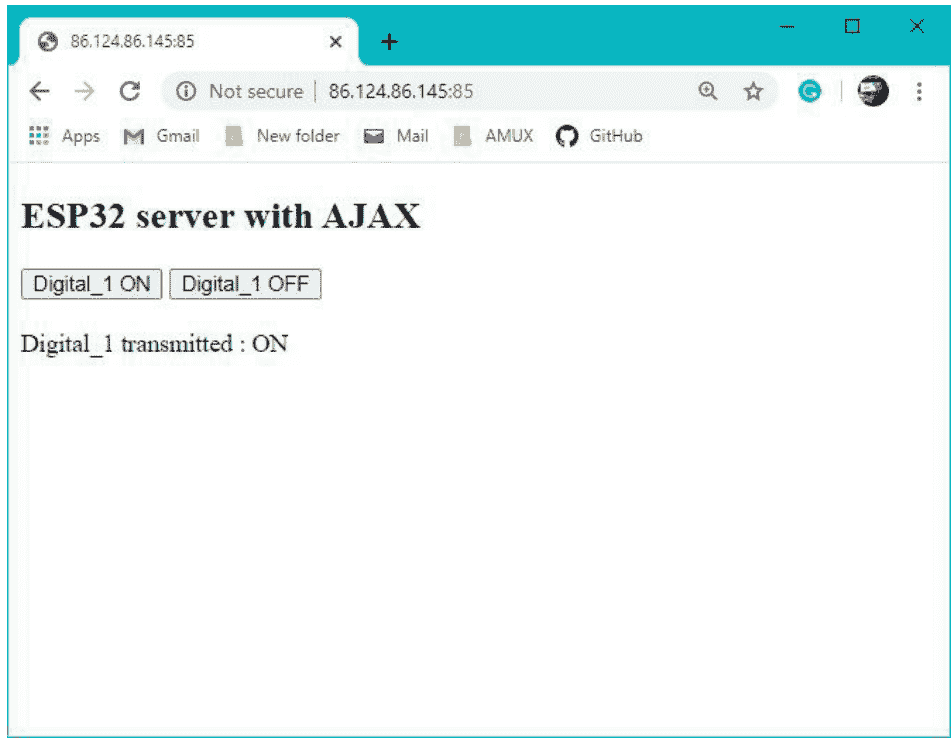

**图 6.2.** 客户端显示的用于命令服务器上逻辑状态的网页

`main.ino`文件（图 6.3）包含一些声明和执行设置及连接到 WiFi 网络的指令，与前面的示例类似。为了便于理解，AJAX 技术中涉及的各个对象的实例也使用了相同的颜色。

在声明部分，我们展示了一种通过分离服务器端和客户端来组织文件的技术。因此，所有将在客户端浏览器上执行的 HTML 和 JavaScript 部分都写在一个单独的文件`index.h`中，该文件被包含在`main.ino`的声明部分。正如前一章所示，它通过在`setup`部分使用`server.on("/", handlePage)`指令声明的`handlePage`函数进行传输。此外，在声明部分还定义了在`setup`部分通过`server.on("/ClToSe", handleServRecept)`语句声明的接收函数。

该函数使用`server.arg`指令将一个临时变量中读取从 HTML / JavaScript 文件中由`xhttp.open("GET","ClToSe?Transm="+st,true)`指令发送到服务器的`Transm`参数。读取的变量在服务器上使用，最后，将服务器接收命令后获得的服务器状态发送给客户端。

在服务器上运行的文件以一个无限循环结束，该循环仅包含一个`server.handleClient()`指令。

```cpp
//#include //for ESP8266, or
#include //for ESP32
#include
//#include //for ESP8266, Or
#include //(For ESP32)
#include "index.h" //web page file
```

```cpp
#define LED1 2//D4 Builtin NodeMCU Devkit //D9 Builtin WeMos
//SSID and Password of your WiFi router
const char* ssid = "ssid";
const char* password = "passw";
//ESP8266WebServer server(85);//Server on port 85 for ESP8266//Or
WebServer server(85);//Server on port 85
//Web page display function
void handlePage() {
  server.send(200, "text/html",  MAIN_page); //Send web page
}
//Server reception function
void handleServRecept() {
  String State1="OFF";
  String t_state = server.arg("Transm");//parameter of xhttp.open("GET",....
  Serial.println(t_state);
  digitalWrite(LED1,t_state.toInt());
  if (t_state.toInt()) State1="ON";
     else State1="OFF";
  server.send(200, "text/plain", State1); //Send the new server state
}
//================ SETUP and connect to WiFi===============
void setup(void){
  Serial.begin(115200);
  IPAddress local_IP(192, 168, 1, 246); //Static IP
  IPAddress gateway(192, 168, 1, 1); // network parameters
  IPAddress subnet(255, 255, 255, 0);
  WiFi.config(local_IP, gateway, subnet);
```

```cpp
WiFi.begin(ssid, password);
Serial.println("");
pinMode(LED1,OUTPUT);
// Wait for connection
while (WiFi.status() != WL_CONNECTED) {
    delay(500);
    Serial.print(".");
}
Serial.println("");
server.on("/",handlePage);//Call the function that creates the web page
server.on("/ClToSe", handleServRecept);//Call the function for reception
server.begin();  //Start server
Serial.println("HTTP server started");
}
//======================== LOOP ===========================
void loop(void){
    server.handleClient();             //Handle client requests
}
```

**图 6.3.** 通过 AJAX 实现逻辑状态命令和显示的 ESP32 程序

图 6.4 所示的`index.h`文件包含带有前述 AJAX 元素的 HTML/JavaScript 代码。

首先，定义了标准按钮类型的 HTML 元素，其在`onclick`事件中调用 JavaScript 部分定义的`ClientToServer(st)`函数。可以看到，参数`st`可以是 1 或 0，它被添加到浏览器传递给服务器的`Transm`参数中。此外，在收到确认后，它将读取服务器发送的状态响应，并将其显示在具有 ID 的窗口中。

```html
const char MAIN_page [] PROGMEM = R"====(
<html>
```

```html
type="button" onclick=" ClientToServer(1)">Digital_1 ON
type="button" onclick=" ClientToServer(0)">Digital_1 OFF
```

Digital_1 transmitted : `id="Transm"`>NA

```cpp
)===";
```

**图 6.4.** 通过 AJAX 控制和显示逻辑状态的网页创建文件

所呈现的程序结构还允许命令和状态的简单泛化，如图 6.5 中的程序示例所示（突出显示修改部分），该程序能够控制两个数字输出。在 ESP32 板上，你需要在硬件上激活红色 LED，如在[图](#)中所示；ESP8266 NodeMCU 已经有两个 LED。


```cpp
//#include <ESP8266WiFi.h> //for ESP8266, or
#include <WiFi.h> //for ESP32
#include <WebServer.h>
//#include <ESP8266WebServer.h> //for ESP8266, Or
#include <ESPAsyncWebServer.h> //(For ESP32)
#include "index.h" //web page file
#define LED1 2//D4 Builtin NodeMCU Devkit //D9 Builtin WeMos
#define LED2 led//Do for NodeMCU Devkit //D2 WeMos
//SSID and Password of your WiFi router
const char* ssid = "ssid";
const char* password = "passw";
//ESP8266WebServer server(85);// for ESP8266//Or
WebServer server(85);// Server on port 85
void handlePage() {
server.send(200,"text/html",String(MAIN_page));//Create web page
}
```

```cpp
//Server reception function
void handleServRecept() {
String State1="OFF";
String State2="OFF";
String t1_state = server.arg("Dig1Transm"); //from
xhttp.open("GET", //"ClToSe?Dig1Transm="+st, true);
  Serial.println(t1_state);
  if (t1_state=="1") ";digitalWrite(LED1,1);}
  if (t1_state=="0")
```

```cpp
String t2_state = server.arg("Dig2Transm"); //from
xhttp.open("GET", //"ClToSe?Dig2Transm="+st, true);
Serial.println(t2_state);
if (t2_state=="1") ";digitalWrite(LED2,1);}
if (t2_state=="0")
server.send(200, "text/plain", state to web page}
}
//================== SETUP and connect to
WiFi==================
void setup(void){
Serial.begin(115200);
IPAddress local_IP(192, 168, 1, //IP static
IPAddress gateway(192, 168, 1, 1); // parametrii retelei
IPAddress subnet(255, 255, 255, 0);
WiFi.config(local_IP, gateway, subnet);
WiFi.begin(ssid, password);
Serial.println("");
pinMode(LED1,OUTPUT);
pinMode(LED2,OUTPUT);
// Wait for connection
```

```cpp
while (WiFi.status() != WL_CONNECTED) {
  delay(500);
  Serial.print(".");
}
Serial.println("");
server.on("/", page_handle
server.on("/ClToSe", reception
server.begin();  //Start server
Serial.println("HTTP server started");
}
//====================== LOOP ========================
void loop(void){
  server.handleClient();            //Handle client requests
}
```

**图 6.5.** 通过 AJAX 实现两个逻辑状态命令和显示的 ESP32 程序

可以注意到，GPIO4 的输出已被激活（此处可以连接另一个 LED），并且可以传输两个命令：`DigiTransm` 和 `Dig2Transm`，分别用于两个 LED。它们的状态使用`server.arg("DigiTransm")`和`server.arg("Dig2Transm")`指令分别在两个状态变量中读取。在`handleServReceptie()`函数的末尾，这两个状态以 6 字符字符串的形式传输给客户端（注意到`"ON"`状态也包含一个“空格”字符，以便两个子字符串具有相同数量的字符，这有助于在浏览器中分离它们）。图 6.6 展示了客户端的`index.h`文件。

```cpp
const char MAIN_page[] PROGMEM = R"==(
html>
```

```html
type="button" ON
```

```html
type="button" OFF
```

```html
type="button" onclick="ClientToServer(2,1)">Digital_2 ON
```

```html
type="button" onclick="ClientToServer(2,0)">Digital_2 OFF
```

Digital_1 transmitted : id="Dig1Transm">NA

Digital_2 transmitted : id="Dig2Transm">NA

```cpp
)==";
```

**图 6.6.** 通过 AJAX 实现两个逻辑状态命令和显示的网页创建文件

这里可以注意到，为新的数字通道插入了两个按钮，并且调用的函数有另一个变量，指定目标输出。此外，还有另一个显示窗口，通过两个 GET 函数将接收到的字符串中截取的两个子字符串写入其中，使用的查询 URL 带有对应变量的参数。

基于此代码构建的网页如图 6.7 所示。

为了简化网页的图形外观，可以为每个数字输出使用单个按钮并进行切换，如图 6.8 所示。

当点击其中一个按钮时，它会调用 JS 函数`ClientToServer(out)`，其中`out=1`或`out=2`分别对应。该函数通过 AJAX 向服务器传输字符串`"ClToSe?Transm="+out`，如图 6.8 的 Inspect->Network 窗口所示。

服务器调用`handleServRecept()`函数，使用该指令读取此字符串。该指令在临时变量中读取参数后面的字符串。然后选择仅包含一个字符（`'1'`或`'2'`）的子字符串，并将其转换为整数`dign`。如果为 1，则切换`LED1`；如果为 2，则切换`LED2`。

接下来，读取数字输出的新状态，并以逗号分隔的字符串数组形式发送给客户端。

在客户端，它作为请求的响应被接收，并分成两个子字符串，`str[0]`和。如果`str[0]`为`'1'`，第一个按钮的背景色将变为黄色，否则保持白色。`str[1]`和第二个按钮也是如此。这样，按钮的颜色在命令传输后精确反映相应输出的状态。

**图 6.8.** 客户端显示的用于切换服务器上两个逻辑状态的网页。网络流量也一并显示。

图 6.9 和 6.10 展示了程序的两个部分，由前面的程序获得（添加/修改部分已突出显示）。

```cpp
//#include //for ESP8266, or
#include //for ESP32
#include
//#include //Or
#include // for ESP32
```

```cpp
#include "index.h" //Web page (HTML+javascript)
#define LED1 2 //D4 //D4 Builtin NodeMCU Devkit //D9 Builtin WeMos
#define LED2 4//D0 //D0 user NodeMCU Devkit //D2 user WeMos
//SSID and Password of your WiFi router
const char* ssid = "ssid";
const char* password = "pass";
//ESP8266WebServer server(85);//Server on port 85-for ESP8266
//Or
WebServer server(85);//Server on port 85 - For ESP32
//Web page display function
void handlePage() {
server.send(200, "text/html", MAIN_page); //Send web page
}
//Server reception function
```

```cpp
void handleServRecept() {
    String t_state = server.arg("Transm");//As in xhttp.open("GET",...
    int dign = t_state.substring(0,1).toInt();//Digital part of response as integer
    Serial.println(t_state+","+dign);
    switch (dign)
    {
        case 1:digitalWrite(LED1,!digitalRead(LED1));break; //Toggle Led1
        case 2:digitalWrite(LED2,!digitalRead(LED2));break; //Toggle Led2
    }
    String State1=String(digitalRead(LED1));//Actual state of the output
    String State2=String(digitalRead(LED2));//Actual state of the output
    server.send(200, "text/plain", State1+","+State2); //Send server states
}
//============= SETUP and WiFi connect =================
void setup(void){
    Serial.begin(115200);
    IPAddress local_IP(192, 168, 1, 246); //Static IP
    IPAddress gateway(192, 168, 1, 1); // Network parameters
    IPAddress subnet(255, 255, 255, 0);
    WiFi.config(local_IP, gateway, subnet);
    WiFi.begin(ssid, password);
    Serial.println("");
    pinMode(LED1,OUTPUT);
    pinMode(LED2,OUTPUT);
    // Wait for connection
    while (WiFi.status() != WL_CONNECTED) {
        delay(500);
        Serial.print(".");
    }
    Serial.println("");
    Serial.println(WiFi.localIP());
    // page creation function
    server.on("/ClToSe", handleServRecept); // rec. funct
    server.begin();  //Start server
    Serial.println("HTTP server started");
}
//==============LOOP================
void loop(void){
    server.handleClient();            //Handle client requests
}
```

**图 6.9.** 通过 AJAX 切换两个逻辑状态的 ESP32 程序

```cpp
const char MAIN_page [] PROGMEM = R"=====(
<html>
```

### AJAX ESP 服务器

```html
type="button" onclick=" ClientToServer(1)"
id="dout1">DigOut_1
```

```html
type="button" onclick=" ClientToServer(2)"
id="dout2">DigOut_2
```

```cpp
)====";
```

**图 6.10.** 通过 AJAX 切换两个逻辑状态的网页创建文件

## 通过 AJAX 刷新网页

### 关于自动刷新

在之前的程序中，网页向服务器发送命令，并根据接收到的信息显示服务器的状态。但是，在下一个命令到来之前，即使服务器的状态发生变化，网页仍然显示相同的旧状态。因此，如果有另一个客户端（浏览器）向服务器发送命令，第一个客户端不会自动显示服务器的真实状态。只有在发送新命令或刷新页面时，新状态才会显示。此外，当服务器输入状态发生变化时，新值在客户端发送命令或执行刷新之前不会显示在网页上。

如前所述，使用标准技术，有一些方法可以在特定时间间隔内自动刷新网页，但这会增加流量并可能产生不愉快的视觉效果。

然而，AJAX 技术允许仅自动更新所需的元素，从而减少流量并改善视觉效果。

为此，可以使用`setInterval` JavaScript 函数定期调用 AJAX 函数，该函数将数据从服务器传输到客户端：

```javascript
setInterval(function() {
    // Call the function every 2 seconds
    ClientToServer();
}, 2000); //2000 mSeconds update rate
```

应将其插入`index.h`文件的脚本部分，如图 7.1 所示。

### 关于通过 AJAX 自动刷新的程序

使用`setInterval`函数可以调用更新网页所有所需元素的函数，而不会出现视觉伪影。但是，在此过程的 50-200 ms 间隔内，可能会发生按钮点击事件，这是第二个过程，使用标准 WebServer 库可能会丢失。

### 关于 ESP32 WebServer 的说明

在之前的程序中，我们使用了作为`WebServer.h`包含的官方库。但是，目前（2020 年 7 月）该库对 ESP32 存在一些缺点。主要困难在于它不允许两个或更多客户端同时访问。如果一个客户端有请求，而服务器已经处于对另一个客户端的响应过程中，则第二个请求将被丢弃。

对于单命令客户端，这种现象非常罕见，仅在两个或更多客户端同时发出命令时才会发生。但是，如果我们希望定期刷新页面的某些元素，那么即使只涉及单个客户端，由于服务器处于刷新过程中，命令有时也会被忽略。因此，每 10-20 次尝试中，客户端的命令就会被忽略一次。如果这对应用程序很重要，有两种解决方案。

第一种方案是使用性能较弱的芯片 ESP8266。令人惊讶的是，它在这种情况下工作得非常好，这意味着相应的库`ESP8266WebServer`编写得非常好。这就是为什么在之前的程序中我们演示了使用 ESP8266 的替代语法。

第二种方案是使用另一个库，该库编写得也很好，特别适合进程排队。例如，我们这里使用 Me-no-dev 开发的`ESPAsyncWebServer`库，可以在 GitHub 上找到。

首先，访问`https://github.com/me-no-dev/ESPAsyncWebServer`点击 Clone，然后下载 ZIP。接着访问`https://github.com/me-no-dev/AsyncTCP`点击 Clone 并下载 ZIP。

现在，在 Arduino IDE 中，打开 Sketch->Include Library->Add .ZIP Library，然后选择下载的压缩包。

为了实现第一种方案，我们将使用 ESP8266 NodeMCU 模块，并修改 C 文件，如图 6.9 中的注释所示。同时，使用`setInterval`函数完成`"index.h"`文件（图 7.1）。

```cpp
const char MAIN_page [] PROGMEM = R"====(
<html>
```

### AJAX ESP 服务器

```html
type="button" onclick=" ClientToServer(1)" id="dout1">DigOut_1
```

```html
type="button" onclick=" ClientToServer(2)" id="dout2">DigOut_2
```

```cpp
)====";
```

**图 7.1.** 使用 AJAX 刷新切换两个逻辑状态的网页创建文件

为了实现第二种方案，我们将使用前面提到的`ESPAsyncWebServer.h`和`AsyncTCP.h`库以及相应 API 函数的特定语法，如图 7.2 所示。


```cpp
#include <WiFi.h>
#include <ESPAsyncWebServer.h>
#include <AsyncTCP.h>
#include "index.h" // Web page (HTML+javascript)

#define LED1 2
#define LED2 4

// SSID and Password of your WiFi router
const char* ssid = "ssid";
const char* password = "passw";

// ESPAsyncWebServer.h & AsyncTCP.h
// ============ SETUP and WiFi connect ================
void setup(void) {
    Serial.begin(115200);

    // WiFi.mode(WIFI_STA);
    IPAddress local_IP(192, 168, 1, 246); // Static IP
    IPAddress gateway(192, 168, 1, 1); // Network parameters
    IPAddress subnet(255, 255, 255, 0);

    WiFi.config(local_IP, gateway, subnet);
    WiFi.begin(ssid, password);

    // Wait for connection
    while (WiFi.status() != WL_CONNECTED) {
        delay(500);
        Serial.print(".");
    }

    Serial.println(WiFi.localIP());
    pinMode(LED1, OUTPUT);
    pinMode(LED2, OUTPUT);

    server.on("/", HTTP_GET, [](AsyncWebServerRequest *request) {
        request->send(200, "text/html", MAIN_page);
    });

    server.on("/ClToSe", HTTP_GET, [](AsyncWebServerRequest *request) {
        String t_state = request->getParam("Transm")->value(); // As in xhttp.open("GET",....
        int dign = t_state.substring(0, 1).toInt(); // Digital part of response as integer

        Serial.println(t_state + "," + dign);

        switch (dign) {
            case 1:
                digitalWrite(LED1, !digitalRead(LED1));
                break; // Toggle Led1
            case 2:
                digitalWrite(LED2, !digitalRead(LED2));
                break; // Toggle Led2
        }

        String State1 = String(digitalRead(LED1)); // Actual state of the output
        String State2 = String(digitalRead(LED2)); // Actual state of the output

        request->send(200, "text/plain", State1 + "," + State2);
    });

    server.begin(); // Start server
    Serial.println("HTTP server started");
}

// ================== LOOP ==================
void loop(void) {
}
```

**图 7.2.** 使用 AJAX 自动刷新和异步库的 ESP32 程序

此实现对应的网页 `index.h` 文件与图 7.1 中所示相同。浏览器图像显示第一个按钮的切换命令作为字符串 `"ClToSe?Transm=1"` 传输，第二个按钮的切换命令作为字符串 `"ClToSe?Transm=2"` 传输，刷新命令作为字符串 `"ClToSe?Transm=0"` 传输，如图 7.3 所示。

### AJAX ESP 服务器

`86.124.86.145:85`

不安全的 `86.124.86.145:85`

应用 Gmail 新文件夹 邮件 AMUX GitHub

243 个请求 已传输 27.0 kB 资源 1.7 kB 完成：7.6 分钟 DOMContentLoaded：177 毫秒 加载：482 毫秒

`[DEFAULT]`：警告：正在使用 DEFAULT 根日志记录器

`[WARNING]` 使用默认的时间序列实现。

**图 7.3.** 客户端显示的网页，用于切换服务器的两个数字输出，通过 AJAX 自动刷新数字状态并读取数字和模拟值，带刷新

在许多应用中，正如物联网结构的通用图所示，服务器必须将其某些输入的状态传输到客户端的网页上进行监控。当客户端向服务器发送命令，或请求自动页面刷新时，就会发生这种情况。

在前面的程序中，服务器读取其输出的状态，并将响应作为反馈发送给客户端。我们还可以读取数字或模拟输入，并将其状态连接到响应字符串中：

```cpp
String State1 = String(digitalRead(LED1)); // Read Digital Out1

String State2 = String(digitalRead(LED2)); // Read Digital Out2

String State3 = String(digitalRead(Din1)); // Read Digital In1

String State4 = String(analogRead(A0)); // Read Analogue In0

String State = State1 + "," + State2 + "," + State3 + "," + State4;

Serial.println(State);

request->send(200, "text/plain", State); // Send complete state
```

这段代码将被插入到服务器的响应函数中，如图 7.6 所示。当然，我们必须声明数字输入引脚（本例中为 D13）及其模式为 `INPUT_PULLUP`，如果在那里连接一个按钮到 GND。

此外，像大多数微控制器一样，ESP32 具有模数转换器（ADC），可以连接到某些引脚以读取模拟电压值。我们这里使用了输入 `A0` 并使用了指令。

我们移动了用于串行监视器服务器响应的指令，可以在图 7.4 中看到服务器各种状态的字符串。

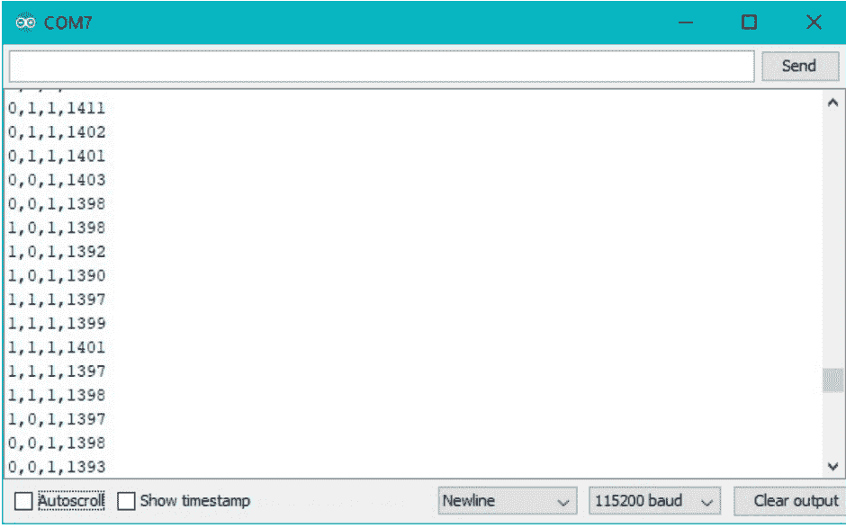

**图 7.4.** 服务器传输状态的串行监视器

有四个由逗号分隔的子字符串，将在客户端拆分以更新网页上的各个元素。第一个子字符串显示数字输出 1 的状态，第二个显示数字输出 2 的状态，第三个子字符串显示数字输入 1 的状态，第四个子字符串显示模拟输入的状态。

在 `index.h` 文件中，我们插入了一些额外的元素，如图 7.6 所示：一个按钮，其颜色反映数字输入的状态，以及一个指示 ADC 数值的文本。客户端显示的网页将如图 7.5 所示。

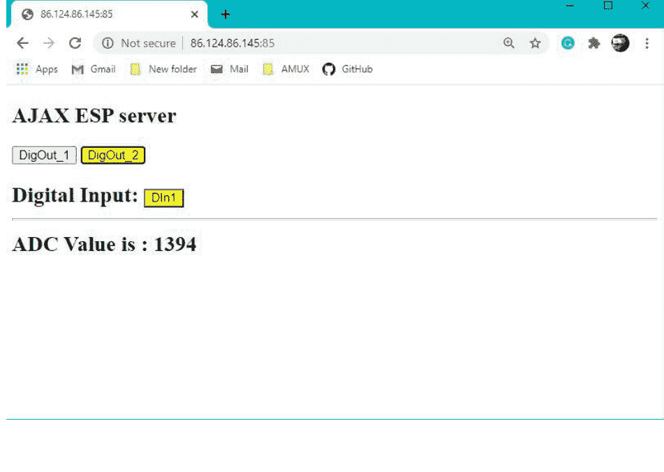

**图 7.5.** 客户端显示的网页，用于在服务器上设置逻辑状态，显示一个逻辑输入和一个模拟输入，带自动刷新

服务器上运行的文件如图 7.5 所示（与之前程序不同的程序部分已突出显示）：

```cpp
#include <WiFi.h>
#include <ESPAsyncWebServer.h>
#include <AsyncTCP.h>
#include "index.h" // Web page (HTML+javascript)

#define LED1 2 // D4 Builtin NodeMCU Devkit // D9 Builtin WeMos
#define LED2 4 // D0 user NodeMCU Devkit // D2 user WeMos
#define Din1 13

// SSID and Password of your WiFi router
const char* ssid = "ssid";
const char* password = "passw";

AsyncWebServer server(85); // Needs ESPAsyncWebServer.h & AsyncTCP.h

// ============= SETUP and WiFi connect ==================
void setup(void) {
    Serial.begin(115200);

    IPAddress local_IP(192, 168, 1, 246); // Static IP
    IPAddress gateway(192, 168, 1, 1); // Network parameters
    IPAddress subnet(255, 255, 255, 0);

    WiFi.config(local_IP, gateway, subnet);
    WiFi.begin(ssid, password);

    // Wait for connection
    while (WiFi.status() != WL_CONNECTED) {
        delay(500);
        Serial.print(".");
    }

    Serial.println(WiFi.localIP());
    pinMode(LED1, OUTPUT);
    pinMode(LED2, OUTPUT);
    pinMode(Din1, INPUT_PULLUP);

    server.on("/", HTTP_GET, [](AsyncWebServerRequest *request) {
        request->send(200, "text/html", MAIN_page);
    });

    server.on("/ClToSe", HTTP_GET, [](AsyncWebServerRequest *request) {
        String t_state = request->getParam("Transm")->value(); // As in xhttp.open("GET",....

        int dign = t_state.substring(0, 1).toInt(); // Digital part of response as integer

        switch (dign) {
            case 1:
                digitalWrite(LED1, !digitalRead(LED1));
                break; // Toggle Led
            case 2:
                digitalWrite(LED2, !digitalRead(LED2));
                break; // Toggle Led
        }

        String State1 = String(digitalRead(LED1)); // Actual state of the output
        String State2 = String(digitalRead(LED2)); // Actual state of the output
        String State3 = String(digitalRead(Din1));
        String State4 = String(analogRead(A0));
        String State = State1 + "," + State2 + "," + State3 + "," + State4;

        Serial.println(State);
        request->send(200, "text/plain", State);
    });

    server.begin(); // Start server
    Serial.println("HTTP server started");
}

// ================== LOOP ==================
void loop(void) {
}
```

### 7.5. 用于通过 AJAX 控制两个数字输出并监控一个数字和一个模拟输入的 ESP32 服务器程序

```cpp
const char MAIN_page[] PROGMEM = R"====(
<html>
<head>
</head>
<body>
<center>
<h1>AJAX ESP 服务器</h1>

<button type="button" onclick="ClientToServer(1)" id="dout1">数字输出_1</button>
<button type="button" onclick="ClientToServer(2)" id="dout2">数字输出_2</button>

<br><br>

<div>数字输入：<button type="button" id="dout3">数字输入1</button></div>
<div>ADC 数值为：<span id="ADCValue">0</span></div>
</center>

<script>
function ClientToServer(x) {
    var xhttp = new XMLHttpRequest();

    xhttp.onreadystatechange = function() {
        if (this.readyState == 4 && this.status == 200) {
            var str = this.responseText.split(',');

            document.getElementById("dout1").innerHTML = "数字输出_1";
            document.getElementById("dout2").innerHTML = "数字输出_2";
            document.getElementById("dout3").innerHTML = "数字输入1";
            document.getElementById("ADCValue").innerHTML = str[3];

            if (str[0] == "1") {
                document.getElementById("dout1").style.background = "red";
            } else {
                document.getElementById("dout1").style.background = "green";
            }

            if (str[1] == "1") {
                document.getElementById("dout2").style.background = "red";
            } else {
                document.getElementById("dout2").style.background = "green";
            }

            if (str[2] == "1") {
                document.getElementById("dout3").style.background = "red";
            } else {
                document.getElementById("dout3").style.background = "green";
            }
        }
    };

    xhttp.open("GET", "/ClToSe?Transm=" + x, true);
    xhttp.send();
}

setInterval(function() {
    ClientToServer(0);
}, 2000);
</script>
</body>
</html>
)====";
```

**图 7.6.** 网页生成文件，用于通过 AJAX 自动刷新以控制数字输出和监控一个数字输入和一个模拟输入

客户端运行的 HTML/JavaScript 部分在 `index.h` 文件中介绍（图 7.6）。

可以看到，服务器响应通过 `responseText.split(',')` 语句被分为四个由逗号分隔的子字符串（`str[0]`、`str[1]`、`str[2]` 和 `str[3]`），这些子字符串用于更新相应的网页元素。

### 用于控制两个逻辑状态并读取一个数字、两个触摸值和一个模拟值

前面的程序可以很容易地添加一些指令，用于 ESP32 微控制器的一个特殊功能——触摸功能，该功能检测连接到某些引脚的金属触点的触摸：GPIO 12、GPIO 13、GPIO 14、GPIO 27、GPIO 32 和 GPIO 33。这里我们将使用 GPIO 14 和 GPIO 27，如图所示，但程序可以很容易地扩展到更多命令和逻辑状态。

客户端显示的网页将在上半部分包含用于服务器两个数字输出的按钮/指示器，然后是数字输入的指示器、模拟输入的值，最后是两个指示两个触摸输入逻辑状态的圆盘，如图 7.7 所示。

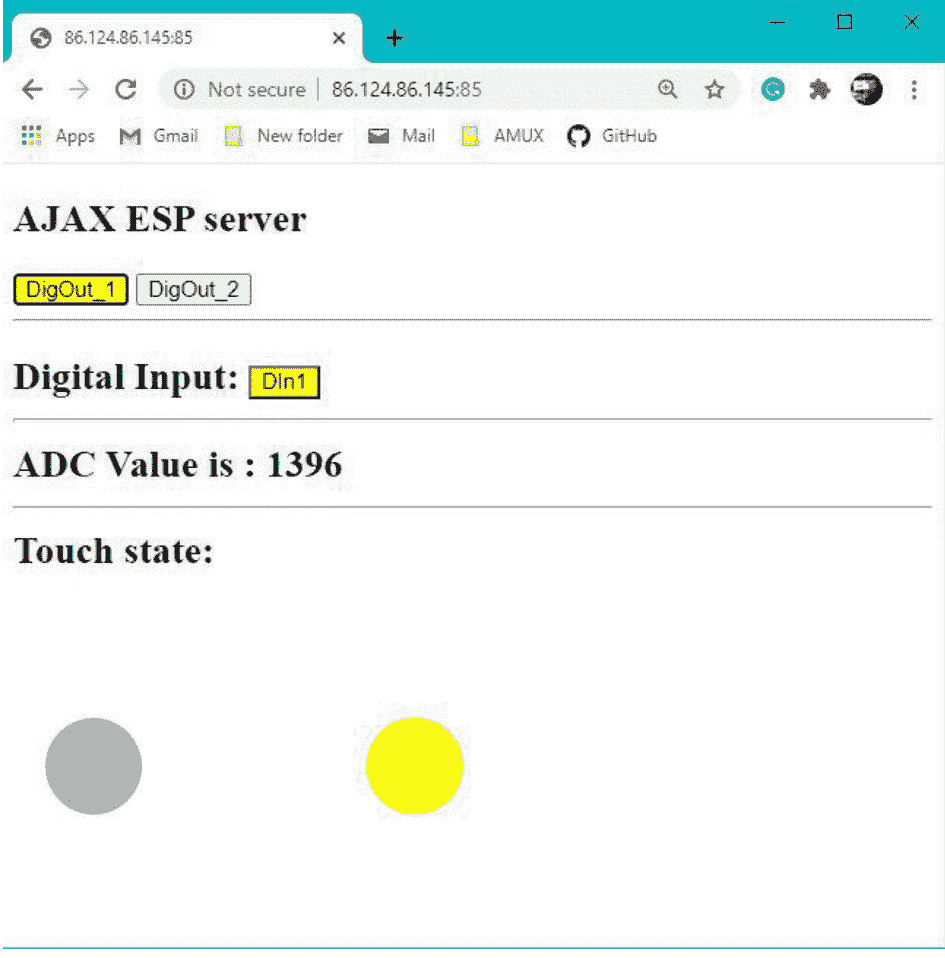

**图 7.7.** 客户端显示的网页，用于在服务器上设置两个逻辑状态，并查看一些数字输入和一个模拟输入

服务器的 C 程序与前一个基本相同，只添加了几行，如图 7.8 所示：

```cpp
#include <WiFi.h>
#include <ESPAsyncWebServer.h>
#include <AsyncTCP.h>
#include "index.h" // Web page (HTML+javascript)

#define LED1 2 // D4 Builtin NodeMCU Devkit // D9 Builtin WeMos
#define LED2 4 // D0 user NodeMCU Devkit // D2 user WeMos
```


```cpp
#define Din1 13

//SSID and Password of your WiFi router

const char* ssid = "ssid";

const char* password = "passw";

AsyncWebServer server(85); //Needs ESPAsyncWebServer.h & AsyncTCP.h

//======================= SETUP and WiFi connect ===========================

void setup(void){

  Serial.begin(115200);

  IPAddress local_IP(192, 168, 1, 246); //Static IP

  IPAddress gateway(192, 168, 1, 1); // Network parameters

  IPAddress subnet(255, 255, 255, 0);

  WiFi.config(local_IP, gateway, subnet);

  WiFi.begin(ssid, password);

  //Wait for connection

  while (WiFi.status() != WL_CONNECTED) {

    delay(500);

    Serial.print(".");

  }

  Serial.println(WiFi.localIP());

  pinMode(LED1, OUTPUT);

  pinMode(LED2, OUTPUT);

  pinMode(Din1, INPUT_PULLUP);

  server.on("/", HTTP_GET, [](AsyncWebServerRequest *request){

      request->send(200, "text/html", MAIN_page);

    });

  server.on("/ClToSe", HTTP_GET, [] (AsyncWebServerRequest *request) {

    String t_state = request->getParam("Transm")->value(); //As in

    xhttp.open("GET", ....);

    int dign = t_state.substring(0, 1).toInt(); //Digital part of response as integer

    switch (dign)

    {

      case 1: digitalWrite(LED1, !digitalRead(LED1)); break; //Toggle Led

      case 2: digitalWrite(LED2, !digitalRead(LED2)); break; //Toggle Led

    }

    String State1 = String(digitalRead(LED1)); //Actual state of the output
```

### 7.8. 用于通过AJAX控制两个数字输出并监控一个数字和一个模拟输入的ESP32服务器程序

```cpp
String State2 = String(digitalRead(LED2)); //输出的实际状态

String State3 = String(digitalRead(Din1));

String State4 = String(analogRead(A0));

String State5 = String(50 - touchRead(14));

String State6 = String(50 - touchRead(27));

String State = State1 + "," + State2 + "," + State3 + "," + State4 + "," + State5 + "," + State6;

Serial.println(State);

    request->send(200, "text/plain", State);

    });

  server.begin(); //启动服务器

  Serial.println("HTTP server started");

}

//================ LOOP ================

void loop(void){

}

```

我们可以看到，增加了两个状态变量来读取触摸输入，并且全局状态字符串包含了它们。由于触摸输入生成的值跨越一个较大的范围，我们必须将其与一个阈值（50）进行比较。

`index.h`文件将包含用于显示触摸状态的附加元素。我们在此选择使用SVG圆圈，并设置阈值20以改变其颜色：逻辑状态为1时显示黄色，逻辑状态为0时显示灰色。完整的`index.h`文件如图7.9所示，其中新增/修改的部分已高亮显示。

```cpp
const char MAIN_page [] PROGMEM = R"===(

html>
```

### AJAX ESP 服务器

```html
type="button" onclick="ClientToServer(1)"

id="dout1">DigOut_1
```

```html
type="button" onclick="ClientToServer(2)"

id="dout2">DigOut_2
```

数字输入：

```html
type="button" id="dout3">DIn1
```

ADC值为：`id="ADCValue">o`

触摸状态：

```html
id="Disk1" cx="250" cy="100" r="30" fill="Red" />

id="Disk2" cx="50" cy="100" r="30" fill="Red" />

)====";
```

**图7.9.** 用于生成一个页面以控制两个数字输出并监控一些逻辑输入和一个模拟输入的文件

可以注意到，只有与触摸输入读取的值相对应的字符串被传输，逻辑状态的判断则在页面的JS程序中进行。

我们还可以看到，`index.h`文件展示了一些其他的HTML/JavaScript技术，这些技术丰富了页面的布局（图7.7, 7.9）。

因此，我们使用了两个圆圈，当触摸输入状态改变时，它们的颜色也会随之改变。这可以使用SVG元素实现：

```html
id="Cerc1" cx="250" cy="100" r="30" fill="Red" />
```

这种圆圈的填充属性可以在收到服务器的响应后通过语句更改，或者可以使用其他CSS命令。

### 在HTML/JS/CSS中使用图形元素表示模拟值

## 第二版前言

自第一版出版后的两年里，使用ESP32模块在Arduino IDE环境中的物联网技术发生了一些重大变化。这就是为什么我们决定重新测试所有已展示的程序，并根据IDE的当前特性对其进行修改。确实有一些驱动程序、库和应用程序发生了变化，因此我们调整了此处展示的代码，使其在2020年8月能够完全正常工作。

我们还展示了一些新的解决方案，例如用于ESP32 AJAX双向传输的异步Web服务器库。由于这些新库非常稳定，我们移除了关于断开网络中一致性的章节，取而代之的是为物联网网页引入更多的图形元素。

一种广泛使用的模拟值图形监控元素是进度条对象。它可以通过HTML/CSS创建，并由JavaScript操作，如下例所示。

虽然可以使用HTML对象`meter`来监控模拟值（如后续章节所示），但我们将在此介绍一个使用CSS（层叠样式表）的实现，以便读者熟悉样式技术。

根据常见实践，该对象元素的图形定义可以在单独的CSS文件或`index.h`文件的头部部分完成。一个CSS对象具有各种图形参数值：位置、大小、边框、字符、颜色等。CSS对象、属性和方法种类繁多，此处将介绍一些非常简单的例子。

将定义一个显示所代表值名称（模拟1）的文本框，后跟一条水平线，然后是一个进度条框，其中包含一个可控长度的条（使用JavaScript），如图8.1中心所示。

### AJAX ESP 服务器

- `DigOut_1`
- `DigOut_2`

数字输入：`DIn1`

ADC值为：`2306`


触摸状态：


**图 8.1.** 使用 CSS 进度条图形监控模拟量的网页，该程序用于监控三个数字输入和一个模拟输入，并控制两个数字输出。

`main.c`文件与之前相同，在`index.h`文件中（图 8.2），添加了进度条元素，使用了一些行来定义和操作，如黄色高亮部分所示：

```cpp
const char MAIN_page [] PROGMEM = R"====(

<html>
```

```html
type="button" onclick="ClientToServer(1)" id="dout1">DigOut_1
```

```html
type="button" onclick="ClientToServer(2)" id="dout2">DigOut_2
```

数字输入：`<span style="background-color: lightgray; border: 1px solid #ccc; padding: 2px;">type="button" id="dout3">DIn1</span>`

```html
ADC Value is : <span id="ADCValue">0</span>
```

```html
<div class="case">Analog 1
```

```html
<div class="progress">
```

```html
<div class="bar" id="bar1">
```

触摸状态：

```html
id="Disk1" cx="250" cy="100" r="30" fill="Red" />

id="Disk2" cx="50" cy="100" r="30" fill="Red" />

)====";
```

**图 8.2.** 用于生成带有 CSS 进度条图形的网页的文件，用于监控模拟量

在标题区域，我们使用了CSS特定的形态，定义了三个可用于构建进度条对象的类。

我们在HTML的正文区域中插入了这样一个对象，作为一个独立的分区，其中为`bar`元素指定了标识符，其特性将在脚本部分进行修改。

如前所述，在从服务器接收到的字符串中，子字符串`str[3]`包含来自模拟输入的信息，数值范围为0-4095。该值除以40.95使其介于0到100之间，并赋值给`bar`元素的`style width`属性。

### 使用JS设计的类型元素

对于简单的设计，可以使用HTML/CSS/JS实现和操作进度条元素，如W3Schools所述。

图8.3展示了控制两个数字输出并监控三个数字输入和一个模拟输入的程序示例，使用了JS进度条。

`main.c`文件与之前相同，在`index.h`文件中（图8.2），添加了JS进度条元素，如黄色高亮部分所示：

```cpp
const char MAIN盅榆 [] PROGMEM = R"====(

<html>
```

### AJAX ESP 服务器

```html
type="button" onclick="ClientToServer(1)" id="dout1">DigOut_1
```

```html
type="button" onclick="ClientToServer(2)" id="dout2">DigOut_2
```

数字输入：`<input type="button" id="dout3">DIn1`

ADC值为：`<span id="ADCValue">0</span>`

```html
<div id="myProgress">

<div id="myBar">
```

触摸状态：

```html
id="Disk1" cx="250" cy="100" r="30" fill="Red" />

id="Disk2" cx="50" cy="100" r="30" fill="Red" />

)=====";
```

### 图 8.3. 用于生成带有JS进度条的网页的文件，用于监控模拟量

我们可以指定整个页面的百分比（例如50%）或像素数（例如300px）来调整完整条形的宽度。我们还可以调整条形的高度和矩形的颜色。

然后，我们可以在脚本部分使用：

```javascript
var elem = document.getElementById("myBar");
```

指令选择进度条，并使用`elem.style.width`指令修改其宽度。

如您所见，我们还可以在进度条上标记绝对或相对数值。

生成的网页示例如图8.4所示。

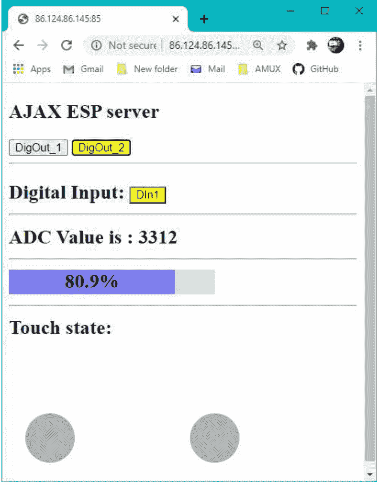

**图 8.4.** 带有用于监控模拟量的JS进度条的网页

### 使用JavaScript设计的类型元素

在某些应用中，监测模拟值时更倾向于使用仪表盘类型的指示器。这种图形元素改善了网页的外观，但实现起来更为困难，因为它有许多需要关联的细节。因此，建议使用一些预制解决方案，这些方案可以在互联网上快速找到。这里我们展示一个使用此类仪表盘的网页，该仪表盘从Google开发者网站导入。

这里可以找到许多有趣的图形元素及其说明，因此我们将举例说明如何将它们集成到ESP32网页中，使用相同的程序来控制两个数字输出并监控三个数字输入和一个模拟输入，使用仪表盘。

`main.c`文件与之前相同，在`index.h`文件中（图8.5），添加了JS仪表盘元素，如黄色高亮部分所示：

```cpp
const char MAIN_page [] PROGMEM = R"====(

<html>
```

### AJAX ESP 服务器

```html
type="button" onclick="ClientToServer(1)" id="dout1">DigOut_1
```

```html
type="button" onclick="ClientToServer(2)" id="dout2">DigOut_2
```

```html
<button type="button" id="dout3">DIn1</button>
```

数字输入：`type="button" id="dout3">DIn1`

ADC值为：`<span id="ADCValue">0</span>`

```html
<div id="chart_div" style="width: 150px; height: 150px;">
```

触摸状态：

```html
id="Disk1" cx="250" cy="100" r="30" fill="Red" />

id="Disk2" cx="50" cy="100" r="30" fill="Red" />

)====";
```

**图 8.5.** 用于生成带有JS仪表盘的网页的文件，用于监控模拟量

可以看到，我们只是简单地复制了所提及地址示例中的部分代码，但可以进行许多更改。我们可以在第一个高亮的`div`中调整仪表盘的宽度和高度，以及它的许多选项。

在文件的JavaScript部分，我们声明了一个图表类型变量，并使用了`data.setValue`方法，涉及变量`adc`。

`adc`变量就是字符串`str[3]`，其中包含服务器读取和传输的转换值，是在`ClientToServer()`函数中接收到的消息的切片。然后调用。

生成的网页示例如图8.6所示。

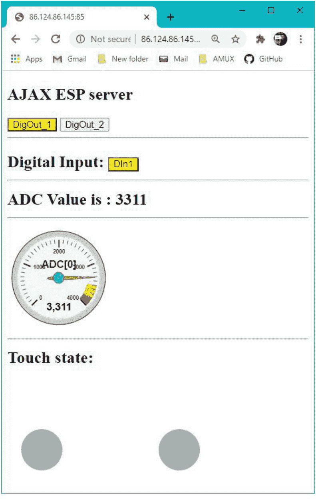

**图 8.6** 带有用于监控模拟量的JS仪表盘的网页

## 服务器输出的控制

### 9.1. 原理

如客户端-服务器通信的一般框图所示，在某些应用中，网页客户端必须发送将驱动服务器某些模拟输出的模拟值。

在第4章中，我们使用预制的滑块类型元素进行了这样的通信，并将其集成到MIT应用中，适用于Android移动设备。

我们回顾，在Arduino IDE中，可以使用PWM技术在引脚上实现模拟输出。我们可以使用`ledcAttachPin()`和`ledcDetachPin()`指令将PWM通道附加到引脚和从引脚分离。`ledcWrite()`指令写入要计数的脉冲数，该脉冲数除以最大脉冲数，确定填充因子，从而确定在该输出端将持续找到的Vcc电压的分数。

对于网页客户端，我们可以使用相同的技术以及使用HTML、CSS、JavaScript或其他技术为程序客户端端创建的滑块类型元素。

### 模拟控制元素

可用作电位器的HTML对象是`<input type="range">`，其声明在一个分区中。在声明它们时，可以指定初始参数，并可以调用事件响应函数。

以下示例声明了一个包含滑块的分区，该滑块具有一个响应事件的函数，具有以下当前参数：`this`（必需）、`slid1`（声明标识符）和`value1`（在分区中声明用于数字显示的标识符）。

```html
<div class="slidecontainer">
```

```html
输入滑块 1：

<input type="range" min="0" max="100" value="1" id="slid1">
```

```html
模拟传输（%）：<span id="AnaTr">0</span>
```

可以从`slid1.value`属性读取滑块的当前值，并将其分配给网页的其他元素。

通过HTML/CSS，你可以根据常规规则控制滑块对象的各种其他参数。

我们将使用JavaScript来编写响应滑块对象相关事件的函数。以下是一个函数示例，用于在先前声明的`AnaTr`段落中显示滑块的值：

```javascript
slid1.oninput = function () {
```


```javascript
document.getElementById("AnaTr").innerHTML =
    slid1.value;

// 此处可以调用其他函数

}
```

该函数也可以根据应用需求调用其他 JavaScript 函数。

### 模拟与数字命令到服务器

根据客户端-服务器通信的通用图表，任何网页客户端都可以向服务器传输数字和模拟命令。由于这些命令是通过`open`方法中的“url”（字符串）参数传输的（参见段落），因此必须对它们进行明确区分。

因此，我们必须定义某种协议，以允许服务器以某种方式处理接收到的字符串。

在后续内容中，我们将采用以下约定：

`ClToSe?Transm`

| 字符 | 含义 |
|---|---|
| 0 | 刷新 |
| 1 | 无变化 |

| 第一位数字 | 类型 | 第二位数字 | 动作 |
|---|---|---|---|
| 1 | 数字 | 1 | 切换1 |
| 2 | 模拟 | 2 | 切换2 |

在以下示例中，将使用一个滑块来通过浏览器控制服务器上的 PWM 模拟输出。应用的网页如图9.1所示。我们可以看到在命令部分插入了一个输入滑块和两个段落。第一个段落显示传输的模拟值，第二个段落显示接收的模拟值。当两个或多个客户端连接到服务器时，这很有用，这样每个客户端都可以显示模拟输出的实时值，该值可能被其他客户端修改。

#### AJAX ESP服务器

- 数字输出1、数字输出2

输入滑块1：

模拟传输值（%）：51

模拟接收值（%）：51

数字输入：DIn1

ADC值：2864

触摸状态：

**图9.1。** 带有模拟命令的网页

图9.2所示的网页文件具有以下功能：

- 控制两个数字输出；
- 控制一个模拟输出；
- 监控一个数字输入；
- 监控一个模拟输入。

```cpp
const char MAIN_page[] PROGMEM  = R"=====(

<html>
```

#### AJAX ESP服务器

```html
type="button" onclick="" id="dout1">DigOut_1
```

```html
type="button" onclick="" id="dout2">DigOut_2
```

```html
class="slidecontainer">
```

输入滑块1：

```html
type="range" min="0" max="100" value="1" id="slid1">
```

模拟传输值（%）：`id="AnaTr">0`

模拟接收值（%）：`id="AnaRec">0`

### 数字输入

```html
type="button" id="dout3">DIn1
```

ADC值：`id="ADCValue">0`

```html
id="chart_div" style="width: 150px; height: 150px;"
```

触摸状态：

```html
id="Disk1" cx="250" cy="40" r="30" fill="Red" />

id="Disk2" cx="50" cy="40" r="30" fill="Red" />

)======";
```

**图9.2。** 用于双向数字和模拟通信的网页文件

我们在此突出了对先前文件所做的修改。

首先，根据提出的约定，我们修改了两个按钮的参数，以便它们将传输字符串。

然后定义了滑块，作为一个元素，具有标识符以及显示传输和接收模拟值的两个段落。

在 JavaScript 部分，我们定义了`slid1.oninput`函数，该函数显示传输的值，并使用参数调用`ClientToServer`函数。

此外，`ClientToServer`函数将接收一个额外的子字符串，将其显示为`AnaRec`元素，并可选择显示为滑块位置。此选项对于在多个网页之间传输滑块位置很有用，但可能会引入一些抖动效应，因为传输值和接收值之间始终会存在延迟。

在服务器运行的程序中（图9.3），我们将 LED3 定义在输出 GPIO5 上，如图所示。我们还声明了 PWM 通道和变量`AnOut`，该变量将包含接收到的最后一个模拟值。

在`Setup`部分，我们声明了 LED3 引脚的输出模式和 PWM 参数：2000 Hz 和 8 位分辨率。

主要更改可以在函数`server.on("/ClToSe",HTTP_GET,...)`中注意到。

首先，通过`request->getParam`获得的`t_state`字符串被分离为 3 部分：

- `int tn`是第一个字符的数值。根据我们的约定，如果为 0，则是简单的刷新；如果为 1，则表示接收到数字命令；如果为 2，则表示接收到模拟命令。
- `int dign`是第二个字符的数值。根据我们的约定，如果`tn`为 1 且`dign`为 1，则第一个数字输出被切换；如果`dign`为 2，则第二个数字输出被切换。
- `int anan`是第 2-4 个字符的数值。根据我们的约定，如果`tn`为 2，则使用`ledcWrite()`指令将其作为 PWM 值写入 LED3。由于`AnOut`的值为 0...100，我们将其乘以 2.55 以缩放到 0...255。

接收到的模拟值存储在`AnOut`变量中，然后转换为字符串`State7`，该字符串将被插入到服务器发送给客户端的整个`State`变量中。

```cpp
#include <WiFi.h>

#include <AsyncTCP.h>

#include <ESPAsyncWebServer.h>

#include "index.h" //网页（HTML+javascript）

#define LED1 2 //D4 NodeMCU Devkit内置 //D9 WeMos内置

#define LED2 4 //D0 用户NodeMCU Devkit //D2 用户WeMos

#define Din1 13

#define LED3 5 //模拟输出

int ledChannel=0;

int AnOut;//接收到的最后一个模拟值

//你的WiFi路由器的SSID和密码

const char* ssid = "MySSID";

const char* password = "MyPass";

AsyncWebServer server(85);//需要ESPAsyncWebServer.h和
AsyncTCP.h

//======= 设置和WiFi连接 ==============

void setup(void){

    Serial.begin(115200);

    IPAddress local_IP(192, 168, 1, 246); //静态IP

    IPAddress gateway(192, 168, 1, 1); // 网络参数

    IPAddress subnet(255, 255, 255, 0);

    WiFi.config(local_IP, gateway, subnet);

    WiFi.begin(ssid, password);

    //等待连接

    while (WiFi.status() != WL_CONNECTED) {

      delay(500);

      Serial.print(".");

    }

    Serial.println(WiFi.localIP());

    pinMode(LED1,OUTPUT);

    pinMode(LED2,OUTPUT);

    pinMode(Din1,INPUT_PULLUP);

    pinMode(LED3,OUTPUT);//模拟输出LED

    ledcSetup(ledChannel,2000,8);//启动PWM，2000Hz，8位

    server.on("/", HTTP_GET, [](AsyncWebServerRequest *request){

        request->send(200, "text/html", MAIN_page);

    });

    server.on("/ClToSe",HTTP_GET, [] (AsyncWebServerRequest *request) {

        String t_state= request->getParam("Transm")->value();//如
xhttp.open("GET",...

        int tn = t_state.substring(0,1).toInt();//命令类型
(0,1或2)，作为整数

        int dign = t_state.substring(1,2).toInt();//响应的数字部分作为整数

        int anan = t_state.substring(1,4).toInt();//响应的模拟部分作为整数

        if (tn==1)
        {

          switch (dign)
          {

            case 1:

            digitalWrite(LED1,!digitalRead(LED1));break; //切换1

            case 2:

            digitalWrite(LED2,!digitalRead(LED2));break;//切换2

          }

        }

        if (tn==2)
        {

          AnOut=anan;

          Serial.println(anan);

          ledcAttachPin(LED3,ledChannel);

          ledcWrite(ledChannel,2.56*AnOut);

        }

        String State1=String(digitalRead(LED1));//输出的实际状态

        String State2=String(digitalRead(LED2));//输出的实际状态

        String State3=String(digitalRead(Din1));

        String State4 =String(analogRead(A0));

        String State5 = String(50 - touchRead(14));

        String State6 = String(50 - touchRead(27));

        String State7=String(AnOut);

        String State=

        Serial.println(State);

        request->send(200, "text/plain",State);

    });

    server.begin();  //启动服务器

    Serial.println("HTTP server started");

}

//=========    循环 ============

void loop(void){

}
```

**图 9.3。** 用于命令、监控数字与模拟输入输出的程序

## 使用 ESP-IDF 开发环境和 ECLIPSE 进行编程

虽然使用 Arduino IDE 软件开发环境对 ESP8266/ESP32 进行编程非常简单易用，但对于复杂应用存在一些缺点，首先是缺乏调试可能性。因此，推荐使用 Espressif 物联网开发框架（ESP-IDF）来开发此类 ESP32 应用程序。

您可以在以下地址找到在此环境中编程 ESP32 模块的完整文档：

<https://esp-idf.readthedocs.io/en/latest/index.html>

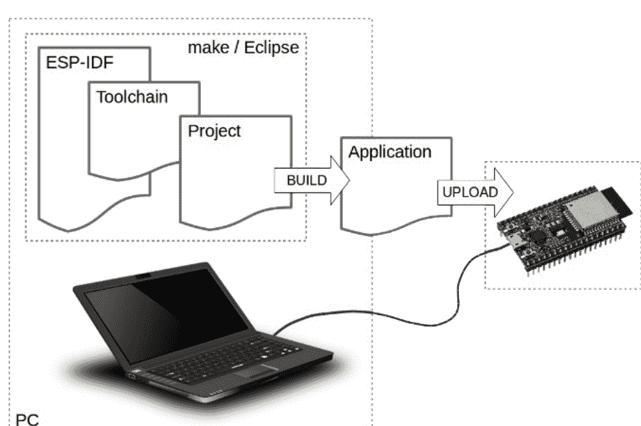

**图 10.1。** 使用 ESP-IDF 环境进行编程的示意图

## ESP-IDF 开发环境与工具链设置

我们于 2018 年 9 月在 Eclipse Oxygen 中测试了下文介绍的内容。未来几年可能会发生一些实施变更，因此您可能需要对工具链设置进行一些调整，正如前几年所做的那样。与信息技术的其他领域一样，为了应对快速的技术发展，您应该努力理解其机制，而不仅仅是记忆。

首先，从以下地址下载并解压安装文件：

<https://dl.espressif.com/dl/esp32_win32_msys2_environment_and_toolchain-20180110.zip>

将`msys32`目录移动到根目录`C:\`，然后进入该目录并运行。在新窗口（终端类型）中，使用以下命令设置工作区域：

```bash
mkdir -p ~/esp
```

在 Windows 中可以看到已创建`C:\msys32\home\USERNAME\esp\`子目录。我们使用以下命令从 mingw32 终端进入工作文件夹：

```bash
cd ~/esp
```

克隆 esp-idf 环境仓库：

```bash
git clone --recursive https://github.com/espressif/esp-idf.git
```

此时，将出现`C:\msys32\home\USERNAME\esp\esp-idf\`子目录，必须设置其路径并添加到用户配置文件中，因此称为`IDF_PATH`。为此，进入`C:\msys32\etc\profile.d\`目录，我们需要在此处创建一个文本文件，文件名添加`IDF_PATH`并包含以下行：

```bash
export IDF_PATH="C:/msys32/home/USERNAME/esp/esp-idf"
```

此处及下文中，`USERNAME`将替换为 Windows 用户名，可在`C:/msys32/home/`目录中查看。

我们可以通过关闭 msys32 并重新进入来验证`IDF_PATH`，使用命令：

```bash
printenv IDF_PATH
```

# 第一部分：使用经典 HTML & JavaScript 技术的物联网通信

## 示例项目

现在您可以测试项目的编译和启动。您可以使用以下命令在终端中复制 esp-idf 的一个示例：

```bash
cd ~/esp

cp -r $IDF_PATH/examples/get-started/hello_world .
```

注意，不应省略空格和句点。为了将项目生成的目标代码加载到 flash 中，必须指定 ESP32 模块连接的**串口**。这可以使用 mingw32 的`menuconfig`完成，如下所示。从`C:/msys`启动`mingw32.exe`。进入项目文件夹——在示例中使用以下命令：

```bash
cd ~/esp/hello_world
```

在终端中，输入命令：

```bash
make menuconfig
```

```text
sever@DESKTOP-QEFSQHP MINGW32 ~

$ cd ~/esp/hello_world

sever@DESKTOP-QEFSQHP MINGW32 ~/esp/hello_world

$ ls

build  main  Makefile  README.md  sdkconfig  sdkconfig.old

sever@DESKTOP-QEFSQHP MINGW32 ~/esp/hello_world

$ make menuconfig
```

显示几行后，将出现主`menuconfig`窗口：

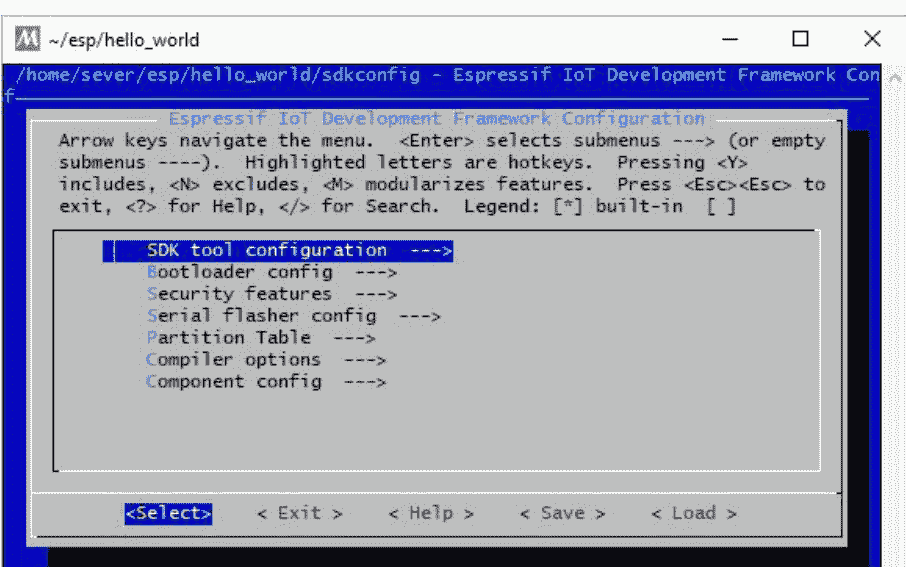

`Serial flasher config` -> 回车。连接 ESP32 模块并安装驱动程序后，在设备管理器中检查其使用的串口，例如 COM4。在终端窗口中输入端口号，例如 COM4，然后点击 OK。Save -> OK -> Exit，返回到`Serial flasher config`设置屏幕。

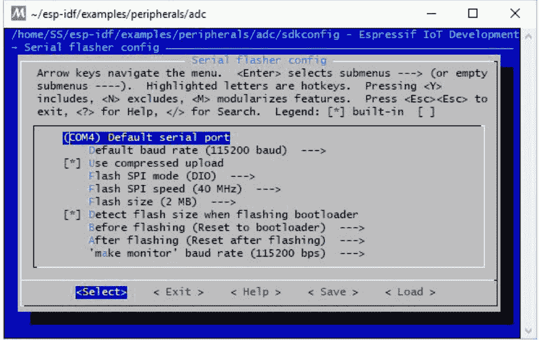

Exit 返回到主`menuconfig`窗口。

可以根据具体情况选择配置程序所需的其他参数：

- 进入`Component config`。
- 进入`Driver configurations`。
- 根据需要进入 ADC 配置、WiFi 配置或 ESP 特定配置等。

每次更改后，依次进行 Save 和 Exit，重复直到在 mingw32 中退出（提示符可能需要几十秒）。

编译和 flash 加载可以使用以下命令完成：

```bash
make flash
```

最初过程可能需要几分钟，后续编译通常不到一分钟。

可以通过编辑项目的`.../main/main.c`文件进行更改。

可以使用监视器观察串口输出，在 mingw32 中使用以下命令获取：

```bash
make monitor
```


使用 `Ctrl+]` 退出。

当然，可以使用任何其他串口终端。注意，当发出 `make flash` 命令时必须断开连接，否则会发生串行总线错误。

## 配置 Eclipse

如前所述，ESP-IDF 环境的主要优势之一是能够通过逐步故障排除、使用断点、变量跟踪等方式进行调试。为此，您需要使用开发环境中的集成编辑器，例如 Eclipse。

要安装 Eclipse，请从以下地址下载：

<https://www.eclipse.org/downloads/>


运行安装程序（可能需要安装 Java JRE），选择“Eclipse for C / C++ Development”，然后启动 Eclipse 程序。

我们假设在安装 ESP-IDF 并创建 `C:/msys32/home/USERNAME/esp/work` 目录时已完成所有先前步骤。显然，您可以选择其他工作目录，在这种情况下路径将相应修改。接下来，一个 Eclipse 项目将被导入到与 esp-idf 相同的目录中，该目录先前已通过 mingw32 复制，或直接复制到 Windows。

- File -> Import -> C/C++ / Existing Code as Makefile Project -> Project Name（例如 Test1）-> Existing Code Location -> Browse -> `C:/msys32/home/USERNAME/esp/hello_world`
- 点击 Test1，然后 Project -> Properties。
- 点击 C/C++ Build，取消选中“Use default build command”，并可选地输入 `make`：

  `python ${IDF_PATH}/tools/windows/eclipse_make.py`

  然后 Apply。
- 点击 C/C++ Build -> Environment，添加变量 `BATCH_BUILD`，值为 `1`；添加变量 `IDF_PATH`，值为 `C:/msys32/home/USERNAME/esp/esp-idf`。

  然后 Apply，并添加变量 `PATH`，值为 `C:\msys32\usr\bin;C:\msys32\mingw32\bin;C:\msys32\opt\xtensa-esp32-elf\bin`，然后 Apply。

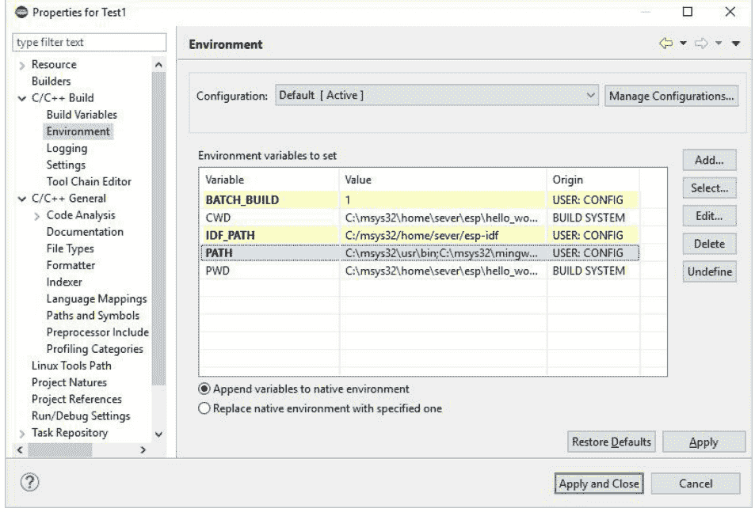

**可选：** 点击 C / C++ General -> Preprocessor Includes Paths, Macros, etc.，进入 Providers 选项卡，勾选 CDT GCC Built-in Compiler Settings Cygwin 并输入值：

```bash
xtensa-esp32-elf-gcc ${FLAGS} -E -P -v -dD "${INPUTS}"
```

然后 Apply，再点击 CDT GCC Build Output Parser，输入值：

```text
xtensa-esp32-elf-((g?cc)|([gc]\+\+)|(clang))
```

然后 Apply 和 Close。

- 点击 Test1 -> main，然后双击 `hello_world_main.c` 以显示源文件并进行编辑。
- Project -> Build Targets -> Create -> Flash。

为了能够将项目生成的目标代码加载到 flash 存储器中，对于每个新项目，必须指定 ESP32 模块连接的串口。目前无法在 Eclipse 中完成此操作，因此请使用 mingw32 程序中的 menuconfig，如前文 10.2 节所示。

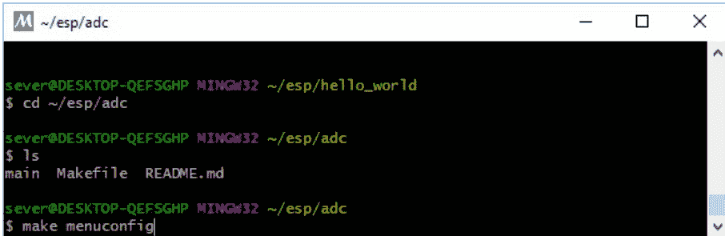

在 Eclipse 中加载的项目（图 10.2）现在可以进行编译并加载到 flash 中。为此，双击 Build Targets -> flash（在左上方列中）。第一次编译需要几分钟，后续编译少于一分钟。

您可以使用 Window -> Show View -> Terminal 查看串口。请注意，在向 flash 写入新内容之前必须关闭它，否则会出现端口忙的消息。

## 图 10.2：在 Eclipse 中使用 ESP-IDF 开发环境进行编程实例的示例

# 第二部分：使用 MQTT 技术的物联网通信

## MQTT——消息队列遥测传输技术

### MQTT 技术介绍

MQTT 是一种用于复杂通信网络的标准消息协议，具有以下优良特性：

- 流量极小，因此一条消息可以少至 2 字节，多至 256 兆字节，比传统技术具有更快的传输速度。
- 流量路径组织清晰，具有明确的方向和层次，可轻松通过添加新节点来扩展网络。
- 可通过设置服务质量参数（QoS）来确认甚至确保消息的递送。

MQTT 技术的主要缺点是涉及的硬件数量较多，因为需要一台称为代理（broker）的消息调度服务器。这使得 MQTT 不太适合要求极低成本的简单应用。当物联网系统的复杂程度超过一定水平后，MQTT 的优势才会变得明显，因此这里将介绍一些实施该技术的实际解决方案。

在基于 MQTT 组织物联网系统时，可以有任意数量的固定或便携式节点连接到互联网，能够发送或接收消息，这些节点被称为客户端。例如，一个客户端可以是 ESP32 模块，它发送有关其输入状态的消息，并接收某些输出的命令消息。另一个通信客户端可以是智能手机或平板电脑上的应用，也可以是运行网页应用的 PC。与标准的客户端/服务器模型不同，上述两个客户端并不直接通信，而是通过代理服务器进行，代理服务器负责接管并将消息分发给客户端。

当客户端向代理发送信息时，它发布一条包含两部分的消息：主题（topic）和负载（payload）。主题标识消息的主题，它是所有通信方共有的列表的一部分，通常具有层次结构，包括子主题，如图 11.1 所示。负载包含与主题相关的具体信息。

例如，没有特定目的地的客户端发布的主题可能是 `Temperature / Camera₁`、`Temperature / Camera₂`、……，或者 `Pressure / Reactor₈`、`Pressure / Boiler₅` 等。注意通过使用 `/` 字符分隔主题的通用部分和私有部分来引入的层次结构。消息的第二部分，即负载，可能包含数值或文本，例如 `"23"`、`"23.7°C"`、`"3.2 bar"`、`"ON"`、`"OFF"` 等。

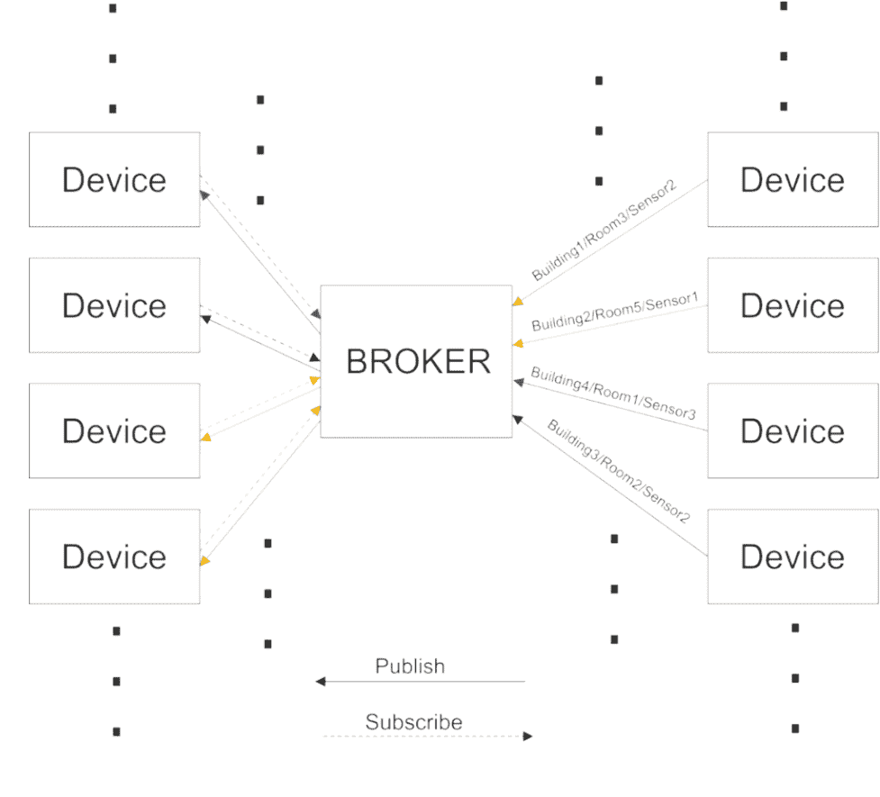

## 图 11.1：MQTT 网络部分架构示意图

要接收消息，客户端必须订阅消息的主题。因此，某个客户端发布的具有特定主题的消息会被服务器接收，并发送给所有订阅了该主题的客户端。

可以发现，通过这种方式可以非常合乎逻辑地扩展网络，只需添加客户端和主题，分发工作由代理自动完成。

MQTT 协议还允许处理一些特殊情况，例如某个特定主题的订阅者都没有启动时。在这种情况下，发布消息的客户端可以请求将消息保留在服务器上，以便在该主题的订阅者启动时递送。此外，还存在一种可能：当订阅了某个主题的客户端停止时，会向网络中的订阅者发送一条警告消息（遗嘱，Last Will and Testament）。当然，这条消息需要事先转发给代理，当代理检测到客户端断开连接（通常是非正常断开）时，会将其发送给其他订阅者。这类特殊情况有一些推荐的做法，此处暂不介绍以免中断主要内容的阐述，但可以在互联网上查阅，例如参考 MQTT 官方文档。

代理程序可以由个人服务器运行，如后续章节所示；也可以是公共代理，从互联网上众多可用方案中选择，如表 11.1 所示。

**表 11.1：公共代理示例**

| 代理名称 | 地址 | 端口 | 备注 |
| :--- | :--- | :--- | :--- |
| Mosquitto (Eclipse) | `test.mosquitto.org` | `1883` | 测试服务器，无持久化 |
| HiveMQ | `broker.hivemq.com` | `1883` | 公共测试代理 |
| EMQ X | `broker.emqx.io` | `1883` | EMQ 提供的公共代理 |
| Adafruit IO | `io.adafruit.com` | `1883` | 面向 Adafruit 用户 |
| CloudMQTT | `cloudmqtt.com` | `1883` | 提供免费方案 |
| ThingsBoard | `demo.thingsboard.io` | `1883` | 面向 ThingsBoard 平台 |
| MQTT.js | `broker.hivemq.com` | `8884` | WebSocket 连接 |

自 2009 年起，Nick O'Leary（IBM）通过 PubSubClient 库将 MQTT 技术适配到 Arduino-IDE 开发环境，这使得在新的 ESP32、ESP8266 及其他微控制器上使用 MQTT 变得非常便捷。API 函数的描述可在该库的 GitHub 页面找到。以下程序示例均使用该库，测试表明其在标准水平上具有良好的稳定性和性能，与其他实现相当。

这些章节的工作计划如下：安装 PubSubClient，编写 ESP32 程序，在 PC 或移动设备上安装 MQTT 应用（此处选择 HelloIoT），并调用公共代理。随后，将使用 Node-Red 技术在网页上创建 MQTT 客户端系统，并在使用迷你 PC（树莓派或同等设备）的个人服务器上安装代理。

## PubSubClient 库的安装与测试

PubSubClient 库当前版本可在 GitHub 仓库下载。安装方法：前往 Arduino -> 项目 -> 加载库 -> 添加 .zip 库，然后选择之前下载的 `pubsubclient-master.zip` 文件。

要在 ESP32 客户端上运行的程序类似于 PubSubClient 库安装后出现的标准示例（Arduino IDE：文件 -> 示例 -> PubSubClient）。

一个能够响应客户端发布主题的最低限度程序，用于实现 ESP32 开发板上用户 LED 的开关命令，如图 11.2 所示。

```cpp
#include <WiFi.h>
#include <PubSubClient.h>

const char* ssid = "MySSID";
const char* password = "YourPassword";
const char* mqttServer = "test.mosquitto.org";//Public Broker in cloud
//const char* mqttServer = "broker.hivemq.com";//another public Broker
//const char* mqttServer蔬菜 = "192.168.1.119";// Local IP on your own server
//const char* mqttServer = "5.12.153.11";// IP public on your own server

const int mqttPort = 1883;// Specific to the mosquito broker
const char led1 = 2;//Blue led on ESP32 DevKit

#define LED1_TOPIC "DigOut/led1"

WiFiClient espClient;
PubSubClient client(espClient);

//==============================

void receivedCallback(char* topic, byte* payload, unsigned int length) {
    if (!client.connected()) {
        // Reconnect logic would be here
    }

    Serial.print("Message received: ");
}
```

## 用于数字指令的最简 MQTT 程序

```cpp
Serial.println(topic);

String s;

Serial.print("payload: ");

for (int i = 0; i < length; i++) {
    s += (char)payload[i];
}

Serial.println(s);

if ((char)topic[0] == 'D') {
    if ((char)topic[10] == '1') {
        if ((char)payload[0] == '1') digitalWrite(led1, HIGH);
        if ((char)payload[0] == '0') digitalWrite(led1, LOW);
    }
}

//=============================

void setup() {
    Serial.begin(115200);

    WiFi.begin(ssid, password);

    while (WiFi.status() != WL_CONNECTED) {
        delay(500);
        Serial.println("Connecting to WiFi..");
    }

    Serial.println("Connected to the WiFi network");

    client.setServer(mqttServer, 1883);

    while (!client.connected()) {
        Serial.println("Connecting to MQTT...");

        if (client.connect("ESP32Client")) {
            Serial.println("connected");
            client.subscribe(LED1_TOPIC);
        } else {
            Serial.print("failed with state ");
            Serial.print(client.state());
            delay(2000);
        }
    }

    pinMode(2, OUTPUT);
    client.setCallback(receivedCallback);
}

//==========================

void loop() {
    delay(500);
    client.setCallback(receivedCallback);
    client.loop();
}
```

**图 11.2：** 用于数字指令的最简 MQTT 程序

我们可以在 Arduino IDE 中打开 工具 -> 串口监视器，烧录后登录信息会出现在该窗口中，如图 11.3 所示。

```text
configsip: 0, SPIWP:0xee
clk_drv:0x00,q_drv:0x00,d_drv:0x00,cs0_drv:0x00,hd_drv:0x00,wp_drv:0x00
mode:DIO, clock div:1
load:0x3fff0018,len:4
load:0x3fff001c,len:812
load:0x40078000,len:0
load:0x40078000,len:11572
entry 0x40078a5c
Connecting to WiFi..
Connecting to WiFi..
Connecting to WiFi..
Connecting to WiFi..
Connected to the WiFi network
Connecting to MQTT...
connected
```


**图 11.3.** 串口监视器窗口显示 ESP32 发送的 MQTT 消息

如您所见，可以使用公共代理，例如上述列表中的其他代理。此代理使用默认端口 1883（未加密）或 8883（如需加密）。

公共代理可能会暂时宕机，此时您必须在`.ino`文件中指定另一个代理，同时在 HelloIoT 中也做相同设置。

每个客户端必须具有`唯一`的 ID，否则客户端将会相互阻塞。这样，即使同一局域网中有多个客户端，也无需为它们预留静态 IP 地址或进行端口转发。

还有一种更安全的方案：在自有服务器上运行代理，使用本地或公共 IP，基于 Windows 或 Linux 系统。这类解决方案将在稍后介绍，例如在基于 Windows 的 PC 服务器上（第 13.2 小节）或在运行 Raspbian 系统的 Raspberry Pi 服务器上（第 16.4 小节）使用`mosquitto`代理。下面列出的客户端程序中，需要将行`const char * mqttServer = "test.mosquitto.org"`替换为上述程序中注释掉的类似行之一，例如`const char * mqttServer =`

从 Windows 发送消息可以按照 mosquitto 网站上的说明通过命令行完成，或者更好是使用物联网图形应用程序。

我们将进一步以`HelloIoT`这样的应用程序为例进行说明，它提供了相当便捷灵活的操作方式。

### 关于专门用于 MQTT 技术的应用程序以及 HelloIoT 应用程序的使用

从以下地址下载`helloiot-1.0.32.zip`文件（或更新版本）：

[https://github.com/adrianromero/helloiot/releases/download/1.0.32/1.0.32.zip](https://github.com/adrianromero/helloiot/releases/download/1.0.32/1.0.32.zip)

解压后，打开`[...]/helloiot-1.0.32/bin/helloiot.bat`，在“连接”选项卡中，至少填写代理地址和端口（如图 12.1 示例所示。在 Windows 中，可通过搜索文件夹找到该路径）。

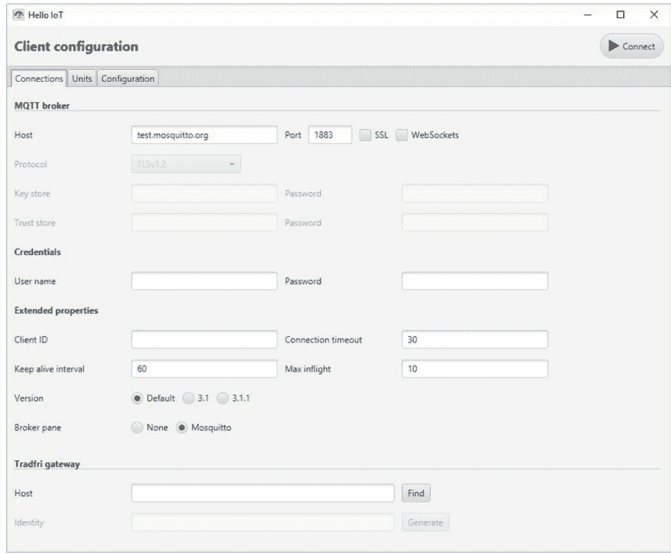

**图 12.1.** 公共代理的 HelloIoT 客户端设置界面

当然，如果使用自己的服务器，请使用其公共或本地 IP，如图 12.2 所示。

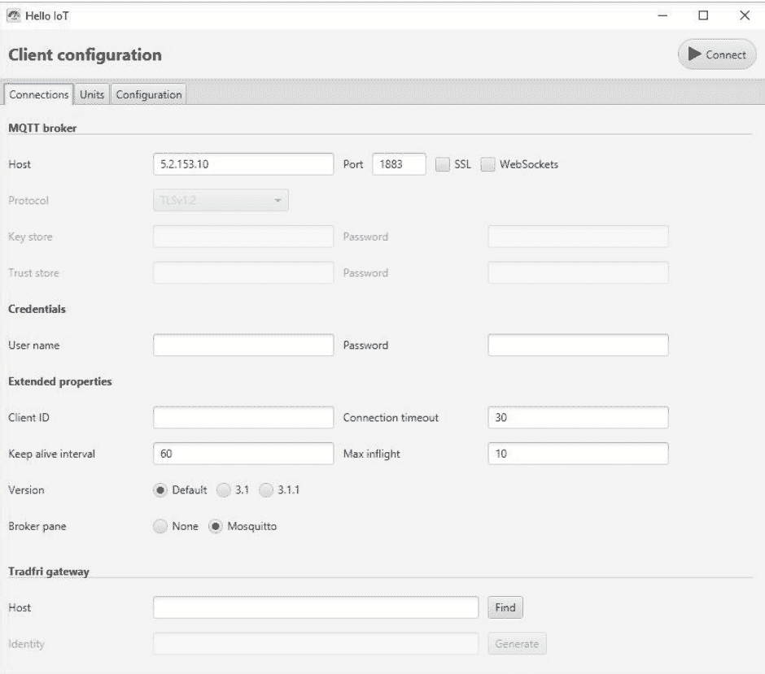

**图 12.2.** 个人服务器上的 HelloIoT 客户端配置界面

### 关于 ESP32 模块的某些数字输出

转到“单元”选项卡，点击`+`添加一个小部件，从下拉“类型”菜单中选择类型，此处选择“开关”。填写名称，填写此小部件要显示的页面名称（此处为`Panel`），并填写涉及的主题。您还可以在“颜色”菜单中选择按钮的背景颜色。

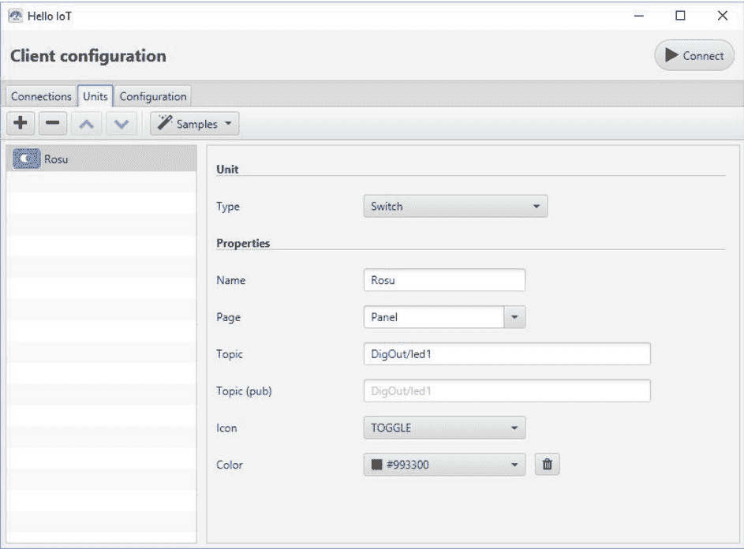

**图 12.3.** 添加切换按钮的界面

在个人（或公共）代理服务器和 ESP32 都开启的情况下，点击“连接”，将会出现名为`Panel`的窗口（图 12.4）。

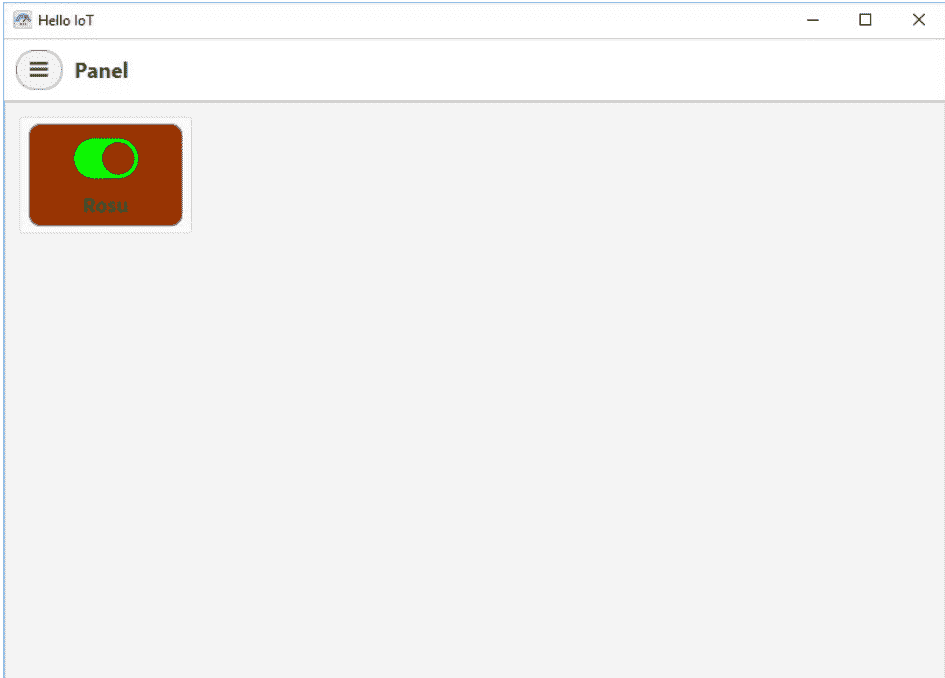

**图 12.4.** 带有切换按钮的`Panel`界面

点击切换小部件，可以看到 ESP32 的用户 LED 开启/关闭。点击左上角菜单，可以发出“断开连接”命令。再次进入“单元”选项卡，可以重复上述操作两次，分别使用`DigOut/led2`和`DigOut/led3`，并可以最终更改名称和颜色。重新连接后，即可获得三个 LED 的开关控制。当然，如果要包含另外两个 LED，您应该在 ESP32 上运行的程序中补充额外的两行代码（以黄色显示为更改/添加部分）。

**图 12.5** 用于三个 LED 开关控制的 MQTT 程序

```cpp
#include <WiFi.h>

#include <PubSubClient.h>

#include <Wire.h>

const char* ssid = "myssid";

const char* password = "mypassword";

const char* mqttServer = "test.mosquitto.org"; //Public Broker in cloud

//    const char* mqttServer = "broker.hivemq.com";//Public Broker in cloud

//const char* mqttServer = "192.168.1.119";// Local IP on your own server

//const char* mqttServer = "5.12.153.11";// IP public on your own server

const int mqttPort = 1883; // Specific to the mosquitto broker

const int led1 = 4;

const int led2 = 5;

const int led3 = 2;

#define LED1_TOPIC    "DigOut/led1" /* true=on, false=off */

#define LED2_TOPIC    "DigOut/led2" /* true=on, false=off */

#define LED3_TOPIC    "DigOut/led3" /* true=on, false=off */

WiFiClient espClient;

PubSubClient client(espClient);

void receivedCallback(char* topic, byte* payload, unsigned int length) {

    if(!client.connected()){

        // ID

    }

    Serial.print("Message received: ");

    Serial.println(topic);

    String s;

    Serial.print("payload: ");

    for (int i = 0; i < length; i++) {

        s+=(char)payload[i];

    }

    Serial.println(s);

    if ((char)topic[0]=='D'){

        if ((char)topic[10]=='1'){

            if ((char)payload[0]=='1') digitalWrite(led1, HIGH);

            if ((char)payload[0]=='0') digitalWrite(led1, LOW);

        }

        if ((char)topic[10]=='2'){

            if ((char)payload[0]=='1') digitalWrite(led2, HIGH);

            if ((char)payload[0]=='0') digitalWrite(led2, LOW);

        }

        if ((char)topic[10]=='3'){

            if ((char)payload[0]=='1') digitalWrite(led3, HIGH);

            if ((char)payload[0]=='0') digitalWrite(led3, LOW);

        }

    }

}

void setup() {

    Serial.begin(115200);

    WiFi.begin(ssid, password);

    while (WiFi.status() != WL_CONNECTED) {

        delay(500);

        Serial.println("Connecting to WiFi..");

    }

    Serial.println("Connected to the WiFi network");

    client.setServer(mqttServer, 1883);

    while (!client.connected()) {

        Serial.println("Connecting to MQTT...");

        if (client.connect("ESP32Client")) {

            Serial.println("connected");

            client.subscribe(LED1_TOPIC);

            client.subscribe(LED2_TOPIC);

            client.subscribe(LED3_TOPIC);

        }

        else {

            Serial.print("failed with state ");

            Serial.print(client.state());

            delay(2000);

        }

    }

    pinMode(2,OUTPUT);

    pinMode(4,OUTPUT);

    pinMode(5,OUTPUT);

    client.setCallback(receivedCallback);

}

void loop() {

    delay(500);

    client.setCallback(receivedCallback);

    client.loop();

}
```

请注意，HelloIoT 应用程序的更改保存在`c:/Users/[用户]`文件夹中的三个`.helloiot`文件里，因此如果您想保留当前配置，可以将这些文件另存到别处，然后再替换回来。

### 通过 PWM 进行控制

如您在上面的程序中看到的，也会对主题的第一个字符进行检测（本例中为`D`）。这在需要传输其他命令（例如模拟命令）时非常有用，这些命令的主题可能以另一个字符开头，例如`A`。

如上所示，ESP32 的模拟输出命令可以通过 PWM（例如使用`ledcWrite`指令）来实现。图 12.6 展示了用于三个数字控制和一个模拟命令的 ESP32 程序（新增部分以黄色标记）。

```cpp
#include

#include

#include

const char* ssid = "MySSID";

const char* password = "MyPass";

const char* mqttServer = "test.mosquitto.org";//云端公共代理

//const char* mqttServer = "192.168.1.119";// 个人服务器的本地IP

//const char* mqttServer = "5.12.153.11";// 个人服务器的公共IP

const int mqttPort = 1883;//mosquitto特定端口

const char led1 = 4;

const char led2 = 5;

const char led3 = 2;

int ledChannel=0;//LED的PWM通道

int frecv=5000;//定时器PWM参数

int rezolutie=8;

#define LED1_TOPIC "DigOut/led1" /* true=开，false=关 */

#define LED2_TOPIC "DigOut/led2" /* true=开，false=关 */

#define LED3_TOPIC "DigOut/led3" /* true=开，false=关 */

#define AnaOut_TOPIC  "AnaOut/Anal"

WiFiClient espClient;

PubSubClient client(espClient);

void Connect(){

    if (client.connect("ESP32Client1" )) {

      Serial.println("connected");

      client.subscribe(LED1_TOPIC);

      client.subscribe(LED2_TOPIC);

      client.subscribe(LED3_TOPIC);

      client.subscribe(AnaOut_TOPIC);

    }

    else {

      Serial.print("failed with state ");

      Serial.print(client.state());

      delay(1000);

    }

}

void receivedCallback(char* topic, byte* payload, unsigned int length) {

  if(!client.connected()){

      client.connect("ESP32Client" );

    }

  Serial.print("Message received: ");

  Serial.println(topic);

  String s;

  Serial.print("payload: ");

  for (int i = 0; i < length; i++) {

    s+=(char)payload[i];

  }

  Serial.println(s);

if ((char)topic[0]=='D'){

  if ((char)topic[10]=='1'){

    if ((char)payload[0]=='1')digitalWrite(led1, HIGH);

    if ((char)payload[0]=='0') digitalWrite(led1, LOW);

}

  if ((char)topic[10]=='2'){

    if ((char)payload[0]=='1')digitalWrite(led2, HIGH);

    if ((char)payload[0]=='0') digitalWrite(led2, LOW);

    }

  if ((char)topic[10]=='3'){

ledcDetachPin(led3); //如果引脚先前处于PWM模式

    if ((char)payload[0]=='1')digitalWrite(led3, HIGH);

    if ((char)payload[0]=='0') digitalWrite(led3, LOW);

    }

}

if ((char)topic[0]=='A'){

    ledcAttachPin(led3,ledChannel);

    value

    }

if ((char)topic[6]!='/') 消息是否正常？

}

void setup() {

  Serial.begin(115200);

  WiFi.begin(ssid, password);

  while (WiFi.status() != WL_CONNECTED) {

    delay(500);

    Serial.println("Connecting to WiFi..");

  }

Serial.println("Connected to the WiFi network");

client.setServer(mqttServer, 1883);

while (!client.connected()) {

  Serial.println("Connecting to MQTT...");

  Connect();

}

pinMode(2,OUTPUT);

pinMode(4,OUTPUT);

pinMode(5,OUTPUT);

ledcSetup(ledChannel, frecv, rezolutie);//启动PWM

client.setCallback(receivedCallback);

}

void loop() {

  delay(500);

  // 如果连接失败，重新初始化：

  if (client.state()!=0) {

    Serial.print(client.state());

    Connect();

  }

  client.setCallback(receivedCallback);

  client.loop();

}
```


图12.6. 用于三个数字控制和一个模拟命令的程序

需要提醒的是，如果鼠标持续驱动，模拟组件可能会产生大量数据流，从而阻塞连接。因此，定义了一个新的`Connect()`函数，它将尝试恢复连接并重新订阅所使用的主题。该函数在初始化序列中、在`receivedCallback()`函数中（如果消息不正常）、以及在`client.state()`语句后的无限循环中（该语句通常应返回0代码）被调用。

`client.state()`语句在MQTT中返回的标准代码如下：

| 代码 | 含义 |
|---|---|
| -4 | 服务器在保持连接时间内未响应 |
| -3 | 网络连接中断 |
| -2 | 网络连接失败 |
| -1 | 客户端已正常断开连接 |
| 0 | 客户端已连接 |
| 1 | 服务器不支持所请求的MQTT版本 |
| 2 | 服务器拒绝了客户端标识符 |
| 3 | 服务器无法接受连接 |
| 4 | 用户名/密码被拒绝 |
| 5 | 客户端未被授权连接 |

将HTML和JS代码插入组件行为有多种选项。为此，在“Units”选项卡中，从“Sample”中选择合适的类型。模拟命令需要滑块组件，可以在“Numbers”代码中找到。在出现的窗口中，通过“Type-> Code”，你可以相应地编辑代码：在“topic”字段中输入“AnaOut/Ana1”，在“page”字段中输入“Panel”（图12.7）。

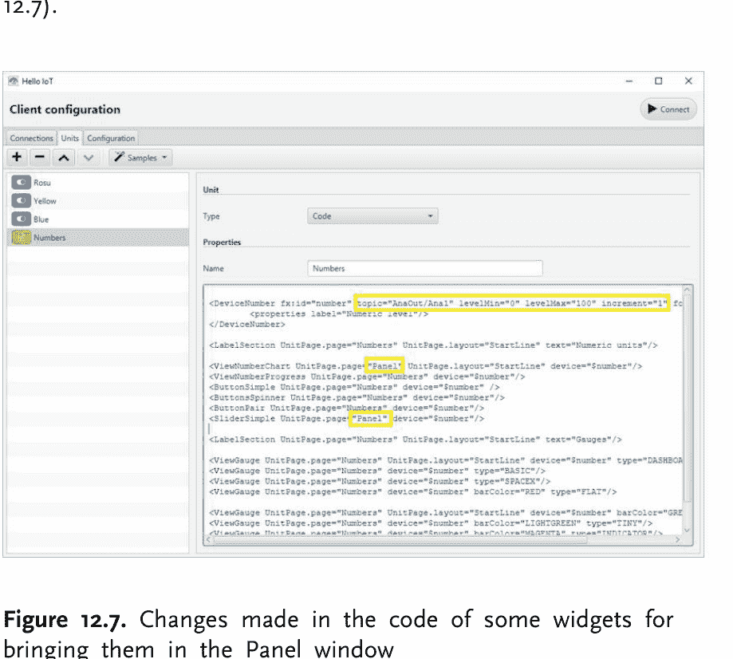

图12.7. 为将组件引入Panel窗口而对某些组件代码所做的更改

连接后，可以从左上角菜单查看“Numbers”窗口，在那里你可以看到与“Code”类型相对应的不同类型的组件。从中，`SliderSimple`被移动到了Panel中，同时还有给出填充率图表的那行代码。

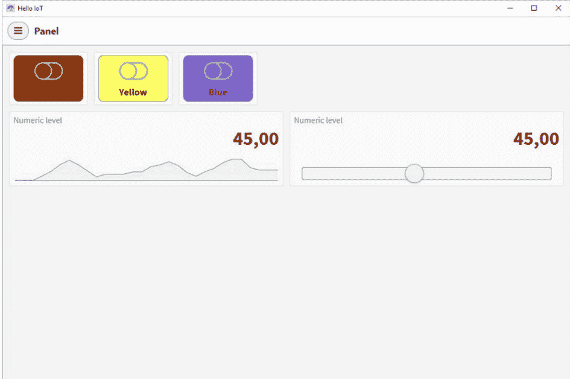

图12.8. 包含图表元素和滑块类型元素的Panel窗口

## 1. 本书及数字与模拟输入硬件模块的概述

要读取数字输入，必须在引脚上将`inputMode`设置为`INPUT_PULLUP`，然后在无限循环中使用`DigitalRead`指令，随后发布主题和布尔类型的载荷。

触摸输入将通过`touchRead`指令读取，在与阈值（通常在20到60之间，具体取决于所需的灵敏度）比较后，该值将成为载荷1或0。

要读取允许模拟输入的引脚上的模拟输入，请在主循环中使用`analogRead()`指令。如果循环中没有太多其他操作，你可以对转换结果取平均值以降低噪声水平。为此，你可以对大量连续样本求和，然后将结果除以样本数量，并使用合适的主题和字符串类型的载荷发布。例如，可以使用`sprintf()`语句将转换平均值的完整值转换为字符串。

能够读取两个数字输入、两个触摸输入和一个模拟输入（除了前面介绍的模拟和数字命令之外）的ESP32程序如图12.9所示。**我们将在所有MQTT应用中默认使用此程序。**

```cpp
#include

#include

#include

const char* ssid = "MySSID";

const char* password = "MyPass";

//const char* mqttServer = "test.mosquitto.org";//云端公共代理

const char* mqttServer = "broker.hivemq.com";//另一个公共代理

//const char* mqttServer = "192.168.1.119";// 你自己服务器的本地IP

//const char* mqttServer = "5.12.153.11";// 你自己服务器的公共IP

const int mqttPort = 1883;// mosquitto代理特定端口

const char led1 = 4;

const char led2 = 5;

const char led3 = 2;

int ledChannel=0;//LED的PWM通道

int frecv=5000;//定时器PWM参数

int rezolutie=8;

#define LED1_TOPIC    "DigOut/led1"

#define LED2_TOPIC    "DigOut/led2" /* true=开，false=关

*/

#define LED3_TOPIC    "DigOut/led3" /* true=开，false=关

*/

#define AnaOut_TOPIC  "AnaOut/Ana1"

WiFiClient espClient;

PubSubClient client(espClient);

//=============================

void Connect(){

    if (client.connect("ESP32Client1" )) {

        Serial.println("connected");

        client.subscribe(LED1_TOPIC);

        client.subscribe(LED2_TOPIC);

        client.subscribe(LED3_TOPIC);

        client.subscribe(AnaOut_TOPIC);

    }

    else {

        Serial.print("failed with state ");

        Serial.print(client.state());

        delay(1000);

    }

}

void receivedCallback(char* topic, byte* payload, unsigned int length){

    if(!client.connected()){

        client.connect("ESP32Client1" );//唯一ID

    }

    Serial.print("Message received: ");
```

## 12.9. 用于1个模拟输出、3个数字输出、4个数字输入和1个模拟输入的ESP32程序，MQTT3od1oa4id1ia

在应用程序窗口中，为了显示数字输入的状态，使用了“电源”小部件，这些小部件可以在HelloIoT中输入，如图12.10中的示例所示。

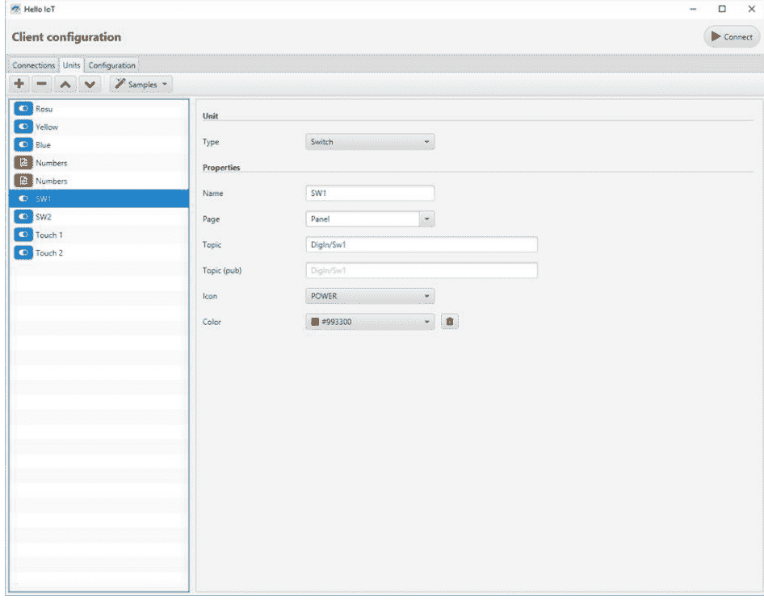

图12.10. 用于引入电源小部件的HelloIoT应用程序窗口

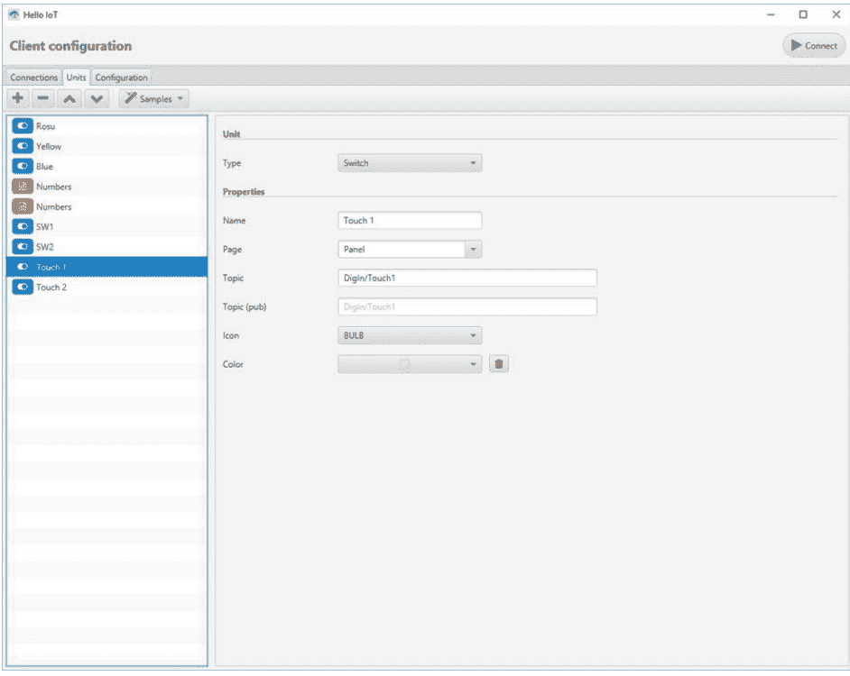

图12.11. 用于引入灯泡小部件的HelloIoT应用程序窗口

为了显示触摸输入的状态，我们在此选择了灯泡类型的元素，如图12.11所示引入。

第二个数字单元将在代码中修改主题以及最小/最大值，如图12.12所示。请注意，一些小部件已在面板窗口中显示：`NumberChart`和两种类型的仪表。此外，为了分隔数字和模拟输入，在代码末尾添加了两条水平线。

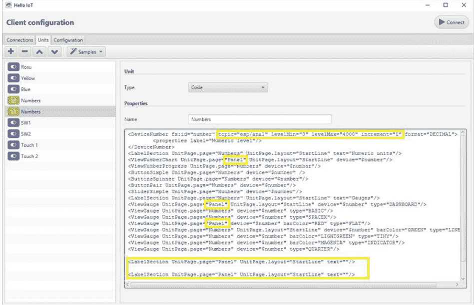

图12.12. 用于引入监控小部件的窗口

图12.13显示了`MQTT3odIo4idTia`程序的HelloIoT应用程序图形界面，它展示了各种类型的输入和输出小部件，其选择方式与图12.7中的示例类似。

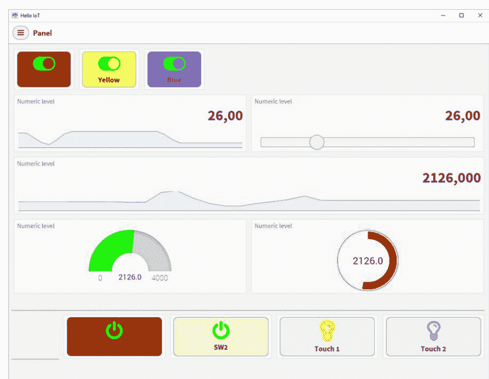

图12.13. 用于MQTT3od1o4id1ia程序的HelloIoT图形界面

图12.14和图12.15展示了其他MQTT应用程序的一些配置步骤示例。

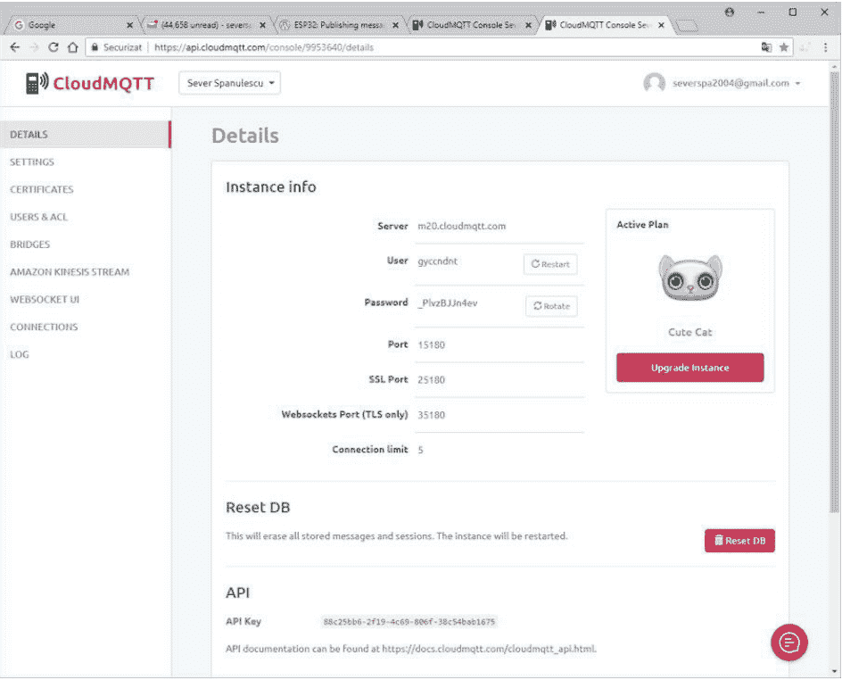

图12.14. CloudMQTT应用程序配置步骤示例

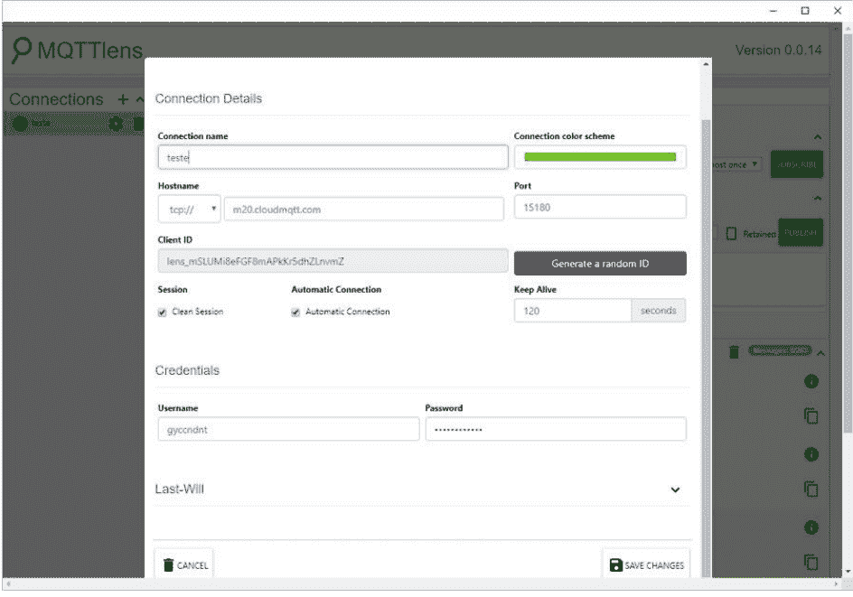

图12.15. MQTTlens应用程序配置步骤示例

## 使用Node-Red开发环境进行MQTT通信

Node-Red是由IBM开发的可视化编程开发工具，专为物联网应用设计。它基于`Node.js`，通过图形化连接节点，生成内部的JavaScript函数代码。

这个环境的优势在于，它允许快速开发一个网页（图13.1），用于从浏览器直接命令和监控大量客户端，而无需像之前示例中那样在每个客户端上安装应用程序。

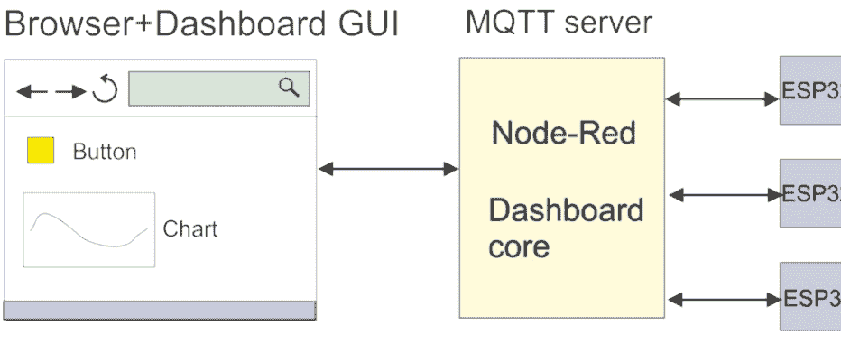

图13.1. 使用网络浏览器进行MQTT监控和命令

从用户角度来看，Node-Red的一个问题是它必须在使用期间持续运行。为此，你可以使用公共代理服务器（有访问限制且可能产生费用），或者在运行Windows的PC或如Raspberry Pi运行Raspbian等其他类型的系统上运行它。

### Windows系统中的Node-Red

对于Windows，你必须首先从官方页面下载`node.js`，然后通过执行文件来安装它。在安装`node.js`后，你必须重启Windows。

要安装Node-Red，打开命令提示符并输入命令：

```bash
npm install -g --unsafe-perm node-red
```

启动`node-red`是从命令提示符开始的：

```text
C:\[...]node-red
```

它必须在使用Node-Red的整个持续时间内保持运行，无论是程序开发还是使用程序。如果不想在Windows PC上持续运行它，建议使用迷你电脑，如Raspberry Pi，这将在后面展示。

Node-Red环境可以通过在浏览器中输入地址来使用：

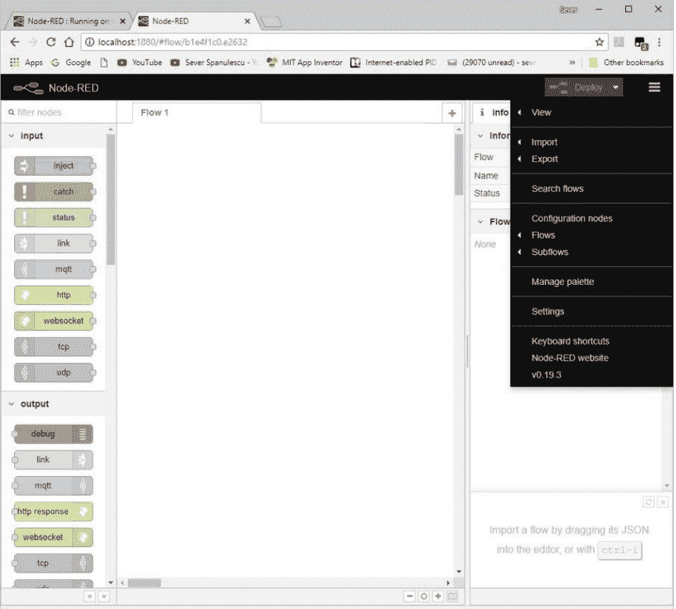

图13.2. Node-RED页面菜单

要使用小部件，必须添加仪表板。这是通过在菜单（右上角，图13.2）中选择“管理面板”来完成的。在“安装”选项卡中，搜索“仪表板”（图13.3）并安装。安装后，在通过浏览器访问的Node-Red页面上，仪表板元素出现在左侧面板的底部。


图13.3. 将仪表板添加到Node-RED页面

关于Node-Red使用的更多详细信息可以在互联网上找到，例如在页面：

`http://www.iotsharing.com/2018/05/how-to-build-iot-dashboard-using-node-red.html`

### Windows系统中的mosquitto

要在Windows中使用Node-Red，需要指定一个代理服务器。它可以是公共代理，安装在云端，例如或上面列出的其他代理。

为了安全起见，你可以使用在Windows下运行的本地代理服务器，例如Mosquitto——它将在后续示例中进一步使用。然而，由于它必须在整个MQTT使用期间持续运行，建议将Node-Red和代理程序安装在由Raspberry Pi或同等设备制成的迷你电脑上，这种设备功耗低、安全性高，可以永久运行。

安装是通过下载对应Windows版本的文件完成的，例如，从网页

`https://mosquitto.org/download/`下载。通过运行它，将发生安装，默认安装到`C:\Program Files\mosquitto`。

启动代理可以手动运行`mosquitto.exe`应用程序，或者可以设置为在启动时自动启动（通常这是默认设置）。

### 通过Node-Red进行MQTT通信

要使用在Windows中安装的Node-Red，在浏览器中输入你的PC的本地或公共地址。

本地地址仅当所有ESP32设备都与PC连接到同一个WiFi网络时才能使用。这个地址可以在网络设置中找到（如果未使用DHCP），或者在路由器中找到。

当然，分配一个静态PC地址并从其公共IP访问更有优势，允许从任何外部地方使用客户端设备。

分配静态地址可以在“网络和共享中心”->“更改适配器设置”中进行，在那里IPv4将指定所需的IP以及其他参数。如果DHCP处于活动状态，需要将计算机的MAC地址与此地址配对，以便在路由器上保留。

要访问1880端口上的Node-Red服务和1883端口上的Mosquitto端口，这些端口必须路由到PC的本地IP，如图2.5或3.8中的示例所示。例如，如果PC的本地IP是`192.168.1.50`，则路由器的1880和1883端口必须转发到`192.168.1.50`，并且此局域网中的另一个设备可以在`192.168.1.50:1880/ui`访问页面。

```cpp
Serial.println(topic);

String s;

Serial.print("payload: ");

for (int i = 0; i < length; i++) {

  s+=(char)payload[i];

}

Serial.println(s);

if ((char)topic[0]=='D'){

  if ((char)topic[10]=='1'){

    if ((char)payload[0]=='1')digitalWrite(led1, HIGH);

    if ((char)payload[0]=='0') digitalWrite(led1, LOW);

  }

  if ((char)topic[10]=='2'){

    if ((char)payload[0]=='1')digitalWrite(led2, HIGH);

    if ((char)payload[0]=='0') digitalWrite(led2, LOW);

  }

  if ((char)topic[10]=='3'){

    ledcDetachPin(led3);

    if ((char)payload[0]=='1')digitalWrite(led3, HIGH);

    if ((char)payload[0]=='0') digitalWrite(led3, LOW);

  }

}

if ((char)topic[0]=='A'){

  ledcAttachPin(led3,ledChannel);

  ledcWrite(ledChannel,2.55*s.toInt());

}

if ((char)topic[6]!='/') Connect();

void setup() {

  Serial.begin(115200);

  WiFi.begin(ssid, password);

  while (WiFi.status() != WL_CONNECTED) {

    delay(500);

    Serial.println("Connecting to WiFi..");

  }

  Serial.println("Connected to the WiFi network");

  Serial.println(WiFi.localIP());

  client.setServer(mqttServer, 1883);

  while (!client.connected()) {

    Serial.println("Connecting to MQTT...");

    Connect();

  }

  pinMode(2,OUTPUT);

  pinMode(4,OUTPUT);

  pinMode(5,OUTPUT);

  pinMode(12,INPUT_PULLUP);

  pinMode(13,INPUT_PULLUP);

  ledcSetup(ledChannel,frecv, rezolutie);//Start PWM

  client.setCallback(receivedCallback);

}

//===============================

void loop() {

    delay(500);

    if (client.state()!=0) {

        Serial.print(client.state());

        Connect();

    }

    if (digitalRead(13)) client.publish("DigIn/Sw1", "1");

    else client.publish("DigIn/Sw1", "0");

    if (digitalRead(12)) client.publish("DigIn/Sw2", "1");

    else client.publish("DigIn/Sw2", "0");

    if (touchRead(14)<50) client.publish("DigIn/Touch1", "1");

    else client.publish("DigIn/Touch1", "0");

    if (touchRead(27)<50) client.publish("DigIn/Touch2", "1");

    else client.publish("DigIn/Touch2", "0");

    int a=0;

    for (int n=0;n<10000;n++) a+=analogRead(A0);

    //对1万次读数取平均值

    char buffer [4];

    sprintf (buffer, "%d", (int)(a/10000));

    client.publish("AnIn/A0", buffer);
```


```cpp
client.setCallback(receivedCallback);

client.loop();
```

# Node-Red

在 Node-Red 中创建应用程序通常是在 PC 或其他拥有足够大屏幕的设备上进行，以便同时查看图形界面的所有元素。为此，需要满足以下条件：

1. ESP 程序必须指定一个有效的代理服务器（服务器和分配的端口），无论是公共的还是本地的，并且该代理服务器必须正在运行。具体在哪个计算机上运行并不重要，但必须能够访问 Node-Red 和 Mosquitto 代理所在的 WiFi 网络。
2. Node-Red 必须在编程计算机或另一个可访问的 IP 设备上运行。
3. 如果使用本地代理，则该代理（例如 Mosquitto）必须在服务器设备上运行。

下面将要展示的示例假设 ESP32 模块上加载了包含三个数字输出、一个模拟输出、四个数字输入和一个模拟输入的通用程序，该程序使用 `mqttServer` 并指定代理服务器正在运行的地址。代码清单中编写了多个 `mqttServer` 变体：公共服务器上的代理、本地网络（本地 IP）服务器上的代理，或本地网络外部自有服务器（公网 IP）上的代理：

```cpp
const char* mqttServer = "test.mosquitto.org";//Broker public in cloud

//const char* mqttServer = "192.168.1.119";//IP local on own server

//const char* mqttServer = "5.2.153.10";//IP public on own server
```

## 注意：保存和恢复 Node-Red 程序

保存和加载在 Node-Red 中开发的程序与其他文件有很大不同。这是因为 Node-Red 可能运行在外部设备上，因此相关文件将在该远程设备上生成。

如果在 Windows 计算机上使用 Node-Red，并且使用本地主机代理，则导出（保存）Node-Red 程序将以 JSON（JavaScript 对象表示法）格式进行。我们可以使用菜单 -> 导出 -> 库，文件将出现在 `C:\Users\[用户名]\node-red\lib\flows` 目录中。

导入（加载）将通过菜单 -> 导入 -> 库从该目录进行。

要在单独的代理上使用 Node-Red，导出可以复制到剪贴板，然后从那里可以将其复制并保存到当前计算机上的文本文件中。对于导入，将打开文本文件，复制内容，然后导入 -> 剪贴板，并粘贴文本文件的内容。执行这些操作后，将出现一个包含该流程的新标签页。可以通过双击旧标签页然后点击删除来将其删除。

# 在 Windows 计算机上使用 Node-Red 和 Mosquitto 的输出

## 数字输出

接下来，在 ESP32 模块上将使用先前介绍的程序 `Mqtt_3od1oa4id1ia.ino`。如名称中的缩写所示，它处理：

- 3 个数字输出，主题分别为：`DigOut/led1`、`DigOut/led2` 和 `DigOut/led3`；
- 1 个模拟输出，主题为 `AnaOut/Ana1`；
- 2 个数字开关输入，主题分别为：`DigIn/Sw1` 和 `DigIn/Sw2`；
- 2 个数字触摸输入，主题分别为：`DigIn/Touch1` 和 `DigIn/Touch2`；
- 1 个模拟输入，主题为 `AnaIn/Ana1`。

Node-Red 程序可以在 PC 上制作，甚至可以在运行标准浏览器的移动设备（智能手机或平板电脑）上制作。

在第一个变体中，两个设备（PC 和 ESP）将位于同一网络（使用相同类别的 IP 地址）。例如，ESP32 程序设置可以是：

```cpp
#include

#include

#include

const char* ssid = "myssid";

const char* password =

const char* mqttServer = "192.168.1.102";//IP local on own server

const int mqttPort = 1883;//specific broker Mosquitto

.
.
.
```

如果要使用本地服务器，必须从网络适配器的 IPv4 属性中找到其本地 IP 地址，并在 ESP32 程序中使用它（在上面的示例中，它是 `192.168.1.102`）。现在，在 PC 上启动 Node-Red 和 Mosquitto 程序，然后编译并加载 ESP 程序。Arduino IDE 串口监视器将显示如下类型的响应：


**图 14.1.** MQTT 连接时发送的串口消息

如前所述，我们可以在浏览器中输入地址 `localhost:1880` 进入 Node-Red 编程环境。

在出现的窗口中（图 14.2），包含以下字段：

1. 左侧列，包含可用节点的字段；
2. 中间，图形化编程区域；
3. 右侧列，设置和命令区域。

首先，通过在设置区域中选择“仪表板 -> 布局”选项卡并单击“Tab 1”旁边的加号（`+ 组`）来创建一个组。


**图 14.2.** 本地浏览器中的 Node-RED 主窗口

通过单击“Group 1”旁边的编辑符号，可以更改其名称（图 14.3）。更新后注意右上角出现红色的“部署”字段。这意味着图表已更改，需要部署命令。每当图表发生更改时都会发生这种情况，要求保存/更新更改。


**图 14.3.** 在仪表板中编辑组

接下来，可以从仪表板的节点列区域中选择一个命令开关。它将通过拖放复制到编程区域，在那里它的右上角会出现一个红色三角形，表示配置不当，同时还有一个圆圈表示需要部署（图 14.4）。


**图 14.4.** 添加命令开关

此外，将从节点字段顶部复制一个 `Output -> mqtt` 节点，并像图 14.5 那样连接到鼠标上（带有部署指示）。


**图 14.5.** 添加 `Output -> mqtt` 节点

双击开关，然后像图 14.6 那样进行编辑（单击铅笔图标）。选择 Digital Out 组，编写标签、主题（与 ESP32 程序对应的）和名称。有效载荷根据 ESP32 程序选择——“numeric”类型，值 1 表示开，0 表示关。编辑完成后单击“Done”，最后进行部署。


**图 14.6.** 编辑开关节点

双击“mqtt out”类型的节点，然后在“服务器”区域中，选择“添加新的 mqtt-broker”，然后转到编辑图标。为其命名以便后续更改选择，然后输入服务器地址（图 14.7）。

**MQTT 服务器地址必须在 ESP 程序和 Node-Red 程序中相同。**

例如，如果 ESP32 程序指定了运行 Mosquitto 的计算机的本地地址，这里就写“localhost”。

如果使用公共代理，则 ESP32 程序指定该服务器的地址，这里也指定相同的地址，例如 `test.mosquitto.org`。


**图 14.7.** 编辑 `mqtt out`

代理服务器的编辑以“更新”命令结束，这将返回 MQTT 节点的编辑窗口。在这里，输入为开关声明的主题，并给出节点特定的名称，然后单击“完成”。

现在必须进行部署（如果尚未完成，这将保存前一个节点的设置）。

如果两个节点都没有出现要求部署的红色三角形或圆圈，并且本地代理程序已启动（如前所述，在 `Program Files\mosquitto -> mosquitto.exe` 中），则节点下方会出现文本“connected”，如图 14.8 所示，程序就可以测试了。为此，请单击右上角的链接图标，这将带我们进入用户界面（UI）页面 `localhost:1880/ui/...`。当然，可以从连接到本地网络的任何设备上的浏览器直接访问此地址。

## Node-RED 仪表板

Node-RED

`localhost:1880/#/flow/d59848bc.a07fe8`

Node-RED

部署

- 更改
- 范围
- 模板
- 延迟
- 触发器
- 执行
- rbe

流程 1

仪表板

布局 站点 主题

标签页 & 链接

+ v

+ 标签页

+ 链接

标签页 1

- `mqtt` 输入
- `mqtt` 输出
- `http` 输入

网络

数字输出

## 图 14.8. 信号连接 `mqtt out` 节点

通过在图形界面上操作开关，可以观察到 ESP32 开发板的红色 LED 会切换状态，同时串行监视器会显示如图 14.8 所示的消息。


**图 14.8.** 串行监视器上显示的消息

要为另外两个 LED 也引入开关，请用鼠标选中这两个节点，并复制（`Ctrl + C`，`Ctrl + V`）两次。

双击第二个开关，并按图 14.9 进行编辑，修改 Label、Name（黄色）、Color for On Payload（黄色）以及 topic `DigOut/led2`。对第三个开关（蓝色和 `DigOut/led3`）重复此操作。

最后，您也可以更改 On Payload 和 Off Payload 的图标，点击 info 标签即可查看。对于 Icon，选择 Custom 选项，并在图标字段中填入来自 [https://material.io/tools/icons/?style=baseline](https://material.io/tools/icons/?style=baseline) 页面的名称以及相应的颜色名称，如图 14.9 所示。


**图 14.9.** 编辑 Switch 2 节点

另外，点击第二个（图 14.10）然后第三个 MQTT 节点，修改其 topic（分别为 `DigOut/led2` 和 `DigOut/led3`）以及 Name。


## 图 14.10. 编辑第二个 `mqtt out` 节点

完成这些编辑后，Node-Red 界面将如图 14.11 所示。


## 图 14.11. 用于三个数字指令的 Node-Red 界面

通过访问用户界面链接 `localhost:1880/ui`，您可以检查三个数字指令开关的操作情况（图 14.12）。


**图 14.12.** 包含三个数字指令的 Node-Red 网页

这里也提供了此配置导出的 JSON 格式文件，可用于手动检查或编辑：

```json
[{"id":"5180eb4b.46ce44","type":"tab","label":"Flow 1","disabled":false,"info":""},{"id":"b2787eob.05b6e","type":"ui_switch","z":"5180eb4b.46ce44","name":[["bee85ce.04131a"]]},{"id":"bee85ce.04131a","type":"mqtt out","z":"5180eb4b.46ce44","name":"Rosu","topic":"DigOut/led1","qos":[]},{"id":"8b14687b.640988","type":"ui_switch","z":"5180eb4b.46ce44","name":[["bd590d31.boc16"]]},{"id":"bd590d31.boc16","type":"mqtt out","z":"5180eb4b.46ce44","name":"Yellow","topic":"DigOut/led2","qos":[]},{"id":"fab57d8e.3c9be","type":"ui_switch","z":"5180eb4b.46ce44","name":[["d8a53cbc.faodf"]]},{"id":"d8a53cbc.faodf","type":"mqtt out","z":"5180eb4b.46ce44","name":"Blue","topic":"DigOut/led3","qos":[]},{"id":"290995bd.8f393a","type":"ui_group","z":"","name":"lesiri Digitale","tab":"c8c3927e.ab127","order":1,"disp":true,"width":"6","collap"},{"id":"9d20dc22.4dac5","type":"mqtt-broker","z":"","name":"Mosq","broker":"test.mosquitto.org","port":"1883"},{"id":"c8c3927e.ab127","type":"ui_tab","name":"Tab 1","icon":"dashboard","order":1}]
```


## 使用 Node-Red 实现模拟输出

如前所述，模拟指令的传输可以使用 PWM 技术完成，该技术通过积分具有可变填充因子的矩形脉冲来模拟数模转换。这种技术对于处理具有固有积分能力的高惯性负载（如加热元件、LED、电磁铁等）尤其有利，因为驱动晶体管工作在开关模式，因此效率非常高。但是，这种技术不能用于控制会耗散信号谐波的热元件，如交流电机等，后者需要通过工业电子技术设计接口。

为了实现这样的指令，将在之前的图中插入两个新节点，如图 14.13 所示。


**图 14.13.** 包含三个数字指令和一个模拟指令的 Node-Red 界面。

可以注意到，在 Layout（右侧标签）的 Tab 1 中添加了一个新组，Analog Out。

从 Dashboard 区域，将插入一个 Slider 节点，通过双击它，可以按图 14.14 进行编辑，选择 Group、Label、Range、Topic 和 Name。


## 图 14.14. 编辑用于模拟控制的滑块节点

从 Network 区域，将插入一个 Mqtt Out 节点，通过双击它，可以按图 14.15 进行编辑，选择 Server（与 ESP 相同）、Topic 和 Name。如果我们使用运行在外部设备上的 Mosquitto broker，则`localhost:1880`将被运行 broker 的服务器地址替换。


**图 14.15.** 编辑用于模拟指令的 mqtt out 节点。

访问用户界面，可以注意到已创建一个滑块元素，用于在 0 到 100% 之间控制蓝色 LED 的亮度。

您可以通过此过程输入多个这样的模拟指令，但应仔细查阅所使用的 ESP 模块文档，以查看哪些引脚可以安全地以 PWM 模式工作。在不同的 ESP 模块上，某些引脚被硬件用于其他功能（例如 I2C、USART 等）。

## Tab 1

| 数字输出 | 模拟输出 |
| --- | --- |
| 红色 [开关] | 滑块 [滑块] |
| 黄色 [开关] | |
| 蓝色 [开关] | |

**图 14.16.** 包含三个数字指令和一个模拟指令的 Node-Red 网页

## 在 Windows 计算机上使用 Node-Red 和 Mosquitto 进行输入

## 本书目标

本文介绍了一些简单实用的解决方案，用于实现连接到互联网的设备之间的自动数据通信。这些设备属于物联网（IoT）和机器对机器（M2M）范畴，其应用范围不断扩大，在工业和消费品领域都引起了越来越多的关注。

本书旨在详细阐述完整的应用程序，从具有中等知识水平（如 C 语言编程——在 Arduino IDE 和 ESP-IDF 等环境中、HTML/CSS 和 JavaScript）开始，并辅以现代技术，如 Ajax、MQTT、Node.js、AngularJS 和 WebSockets，并为这些应用进行了适当的介绍。

下面示例中的互联网设备之间的通信将在过程接口设备和控制/监控设备之间完成。

接口设备从传感器/换能器接收输入数据，并向执行元件/执行器生成输出数据。为此，我们将使用具有 WiFi 连接功能的 ESP32 或 ESP8266 模块，它们具有多个优势：

- 体积小（图 1.1、图 1.4、图 1.7）；
- 功耗低，具有睡眠甚至电池供电能力；
- 价格低廉；
- 数字和模拟输入输出通道数量足够；
- 使用 Arduino IDE 环境进行简单编程。

也可以使用其他模块，运行与本书所述算法相同的程序。

在本文的第一部分，使用经典 Web 技术，接口设备通常充当服务器，因此它是生成网页并响应客户端应用程序请求的一方。

在本文的第二部分，使用 MQTT 技术，一个专用服务器运行一个程序，用于接收和分发具有各种主题和内容（payload）的消息，从而可以创建一个更为复杂的网络，其中包含对等客户端，每个客户端都具有灵活的功能，无论是否有人工干预。

在本文的最后一部分，介绍了 WebSockets 技术的实现示例，该技术提供了高速的客户端-服务器双向连接。

控制/监控设备可以是 PC、平板电脑，甚至是智能手机，运行专用应用程序或服务器创建的网页。下图展示了具有各种复杂性和技术的图形界面示例（图 1.1-1.6）。


**图 1.1.** 数字输出控制（HTML）网页

**图 1.2.** MIT App Inventor 数字输出命令（HTML）

# 通过 AJAX 更新网页的 ESP32 服务器

- `Digital_1` 开启
- `Digital_2` 开启

输入滑块：

数值：27

模拟输出：27

ADC 数值：1306

| 模拟量 1 |
| --- |
| <div style="background-color: cyan; width: 80%; height: 40px;"><div style="background-color: lightgreen; width: 30%; height: 100%;"></div><div style="background-color: grey; width: 70%; height: 100%;"></div></div> |

输出状态 1：关闭

输出状态 2：关闭

`Touch1` 状态：81

`Touch2` 状态：100

输入状态 1：关闭

输入状态 2：关闭

# 图 1.3. 用于控制输出和监控输入的网页（HTML / JS / AJAX）

# 图 1.4. 用于控制和监控输出/输入的 HelloIoT 应用程序

图 1.5. 用于控制和监控输出/输入的网站（MQTT / Node-Red / AngularJS）

数字引脚 2

☑

数字引脚 5

数字引脚 4：D1

LED R 控制：

LED Y 控制：

LED B 控制：

ADC 数值：2100

采样

通道 0 ADC

数字输入 1：SW 1   数字输入 2：SW 2

**图 1.6.** 用于命令和监控 WebSockets 输出/输入的网站

**模拟输入的**

```text

```

