# ASP Web开发精要


- 立即使用服务器端`JavaScript™`从`ASP`获取结果——就是*今天*！
- 通过*可下载、可重用的代码*，从实际的真实示例中学习
- 关键技术——快速、清晰、便捷！
- 构建购物车、留言簿及其他应用程序
- 数据库集成、电子邮件处理等等


由互联网档案馆于2023年数字化，资金来自Kahle/Austin基金会

<https://archive.org/details/essentialaspforw0000love>


`9 780130 304995`

`90000`

- *面向网络专业人员的精髓设计*  
  查尔斯·里昂斯
- *面向网络专业人员的精髓Flash 5*  
  林恩·凯尔
- *面向网络专业人员的精髓Flash 4*  
  林恩·凯尔
- *面向网络专业人员的精髓ASP*  
  伊莱贾·洛夫乔伊
- *面向网络专业人员的精髓PHP*  
  克里斯托弗·科森蒂诺
- *面向网络专业人员的精髓CSS与DHTML*  
  丹·利文斯顿和米卡·布朗
- *面向网络专业人员的精髓JavaScript™*  
  丹·巴雷特、丹·利文斯顿和米卡·布朗
- *面向网络专业人员的精髓Perl 5*  
  米卡·布朗、克里斯·贝娄和丹·利文斯顿
- *面向网络专业人员的精髓Photoshop® 5*  
  布拉德·艾根、丹·利文斯顿和米卡·布朗

`www.phptr.com`

# 国会图书馆出版编目数据

洛夫乔伊，伊莱贾。

面向网络专业人员的ASP精髓 / 伊莱贾·洛夫乔伊。

`p. cm.`

包含索引。

`ISBN 0-13-030499-9`

`1. 互联网编程。 2. 万维网。 I. 标题。`

# 引言

欢迎阅读本书。

这是一本`ASP`食谱。每一章都包含一个或多个能协同工作的实用“配方”。简而言之：

- 第1章基本上是教程，包含几个非常简单的脚本，用于向`HTML`页面添加日期。
- 第2章有两个配方：一个“每日提示”应用程序（一种向网页快速添加动态内容的简单方法）和一个留言簿。
- 第3章有一个复杂的配方，用于将数据库内容发布到网站上。
- 第4章有一个更复杂的配方，创建了一个可以编辑数据库的网站。
- 第5章有一个购物车的配方。这是本书中最复杂的配方，也是最可能让你赚点钱的。
- 第6章回归简单，提供了一个电子邮件的配方。

所有这些配方都依赖于`Active Server Pages (ASP)`和`JavaScript`，而这正是本引言的主要内容。

# 在动态服务器页面之前

蒂姆·伯纳斯-李用一种名为`HTML`的出色文档发布方式开创了先河，这是发布静态文档的绝佳方法。

此后不久，一种名为`CGI`的技术被添加到`Web`服务器中，让程序员能够动态生成`HTML`页面。使用`CGI`时，当`Web`服务器收到页面请求时，它会启动一个程序并将请求传递给该程序。如果程序生成任何输出，该输出将返回给浏览器。

`CGI`是完成许多任务的一种相当出色的方式，但它是一种非常程序化的解决方案，也就是说它不太符合`HTML`的风格。当你查看一个`CGI`程序时，大多数情况下，它看起来并不太像一个`HTML`页面，尽管这通常是最终结果。而且，如果程序中包含大量`HTML`，很多时候，必须小心地用引号将其包裹起来，以分隔程序部分和`HTML`部分，这可能会让人感到疲倦。

# 厨房里有太多CGI脚本

然后是性能问题：大多数`CGI`程序是使用`Perl`等脚本语言编写的，这类语言非常适合这类工作。

问题在于，每次`Web`浏览器请求由`CGI`程序生成的网页时，服务器上都会启动一个新进程。启动新进程速度较慢，并且会占用大量资源。同时运行过多`CGI`程序的程序可能会陷入严重的困境。

当然，也有解决这些问题的方法，但它们涉及一些比编写`Perl`脚本复杂得多的高技术性操作。

因此，很明显需要一种更简单的方法来生成动态网页。

# 在一处混合HTML和脚本

针对`HTML`与`CGI`之争，出现的解决方案是两者兼顾。`Web`服务器正变得越来越智能，因此可以在网页中嵌入小程序代码片段，而不必分别维护程序和`HTML`。

这并非`Web`的终极解决方案。不需要动态内容的小型网站仍应使用`HTML`创建。拥有数百万页面和复杂应用程序的超大型网站则需要使用复杂的发布系统和应用程序服务器来构建。

但对于许多任务来说，能够混合使用`HTML`和编程是一个极好的解决方案。而这正是`ASP`的全部意义所在。

`ASP`可能是在`Windows`环境中混合使用`HTML`和简单编程的最佳方式。`ASP`页面也可以托管在`UNIX`服务器上，使用`ChiliSoft`的软件。但大多数人将`ASP`与`Windows NT`和`Windows 2000`一起使用，因为它是`IIS`的内置组件，¹易于使用且功能强大。

`ASP`并非唯一的选择。其他允许混合使用`HTML`和编程的产品包括`PHP`、`Cold Fusion`和`JSP`。但是，如果你有兴趣在`Windows`平台上构建动态产品，你会发现`ASP`通常是开发动态网站的首选。

# 如何将ASP代码添加到HTML页面

如果你熟悉`HTML`源代码，将`ASP`添加到你的工具库中将感觉是合乎逻辑的下一步。

> **警告**
>
> 本书假设你熟悉`HTML`源代码。如果你不熟悉`HTML`源代码，你将需要一本好的`HTML`书籍作为参考，以便在使用本书时查阅。

让我们从一个非常简单的`HTML`页面开始，名为`hello_world.html`：

```html
<html>
<head><title>Hello World</title></head>
<body>
```

¹ `IIS`是包含在`Windows NT`和`Windows 2000`中的`Microsoft Web服务器（Internet Information Server）`。

```html
Hello World

</body></html>
```

如果你的`Web`服务器是`IIS`（你需要`IIS`或支持`Active Server Pages`的`Web`服务器才能正常工作），你可以将此文件重命名为`hello_world.asp`：

```asp
<%@ Language=JavaScript %>
<html>
<head><title>Hello World</title></head>
<body>

<% Response.Write("Hello World") %>

</body></html>
```

有三处发生了变化：

1. 文件不再以`.html`结尾，而是以`.asp`结尾。这告诉`Web`服务器，页面上可能有一些代码。当有人输入页面`URL`时，`Web`服务器不会直接将页面交给`Web`浏览器，而是首先检查页面中是否有`<% ... %>`标签。如果找到任何标签，它会移除这些标签及其内容，并用标签内任何程序的输出替换它们。
2. `Web`服务器找到的第一段代码是`<%@ Language=JavaScript %>`。这告诉`Web`服务器编程语言是`JavaScript`。因为微软的`Web`服务器`IIS`通常假设`ASP`程序是用`VBScript`编写的，所以如果你使用`JavaScript`，最好总是明确告知`IIS`。
3. 服务器找到的下一段代码（记住它在寻找`<% ... %>`标签）是行`<% Response.Write("Hello World") %>`。`Response.Write()`命令非常类似于许多编程和脚本语言中的`print()`命令。在`ASP`的上下文中，这段代码告诉服务器将字符串`"Hello World"`发送到浏览器。

最终结果是，这个`.asp`页面和上面所示的`.html`页面具有完全相同的效果：一个显示`"Hello World"`字样的网页。

尽管如此，这两个页面非常不同。当浏览器向`Web`服务器请求`.html`页面时，服务器几乎不做思考就将页面传递给浏览器。另一方面，`Web`服务器会检查`.asp`页面，以查找需要运行的小程序。这意味着`.asp`页面的任何或全部内容都可以动态生成。本书将探讨这如何发挥作用。

# 为什么选择JavaScript？

大多数关于`ASP`的书籍都使用`VBScript`脚本语言。本书不使用`VBScript`而使用`JavaScript`，原因如下：

- `Active Server Pages`可以用`VBScript`、`JavaScript`以及`PerlScript`编写。因为所有这些语言对于大多数任务来说效果几乎相同，所以选择哪种语言在很大程度上取决于个人喜好。
- 我更习惯使用`JavaScript`而不是`VBScript`，所以使用`JavaScript`对我来说通常更容易。
- `JavaScript`是客户端编程唯一实用的语言。我发现频繁切换语言很烦人。通过在服务器端使用`JavaScript`，我可以在两端使用同一种语言。当然，浏览器环境与`ASP`环境非常不同。尽管如此，使用单一语言使我的生活更简单。特别是因为我几乎不做客户端脚本，因为它似乎从来无法正常工作，而且弄清楚所有浏览器之间的差异似乎是我一直没空去做的事。
- `JavaScript`是一种开放协议。而`VBScript`不是。
- 有大量的`JavaScript`程序员，但在服务器端使用`JavaScript`的资源却不多。当我有机会写一本关于`ASP`的书时，这似乎是一个很好的机会来扭转这种局面。

# JavaScript、JScript和ECMA Script之间有什么区别？

`JavaScript`最初是作为`Netscape`浏览器的脚本语言出现的。后来，当可以在`Microsoft Internet Explorer`中使用`JavaScript`时，我认为他们称之为`JScript`（无论如何，微软现在经常称其为`JScript`）。

因为`Netscape`和`Microsoft`无法就`JavaScript/JScript`应该如何工作达成一致，所以除了制作能可靠工作的悬停按钮外，很难做其他事情。

在过去几年里，出现了一种叫做`ECMA Script`的东西，它应该是一个开放协议，旨在将所有内容重新统一起来之类的。

因为本书中的所有代码都是为`Microsoft Active Server Pages`编写的，所以有人可能会认为代码是`JScript`。然而，本书主要讨论`JavaScript`，而不是`JScript`。我找到了两个原因：首先，我认为`JavaScript`听起来比`JScript`更好；其次，我在脚本中用来声明语言的代码是`<%@ Language=JavaScript %>`。而且这很有效。

无论如何。

# ASP对象和其他有用的对象

`ASP`、`IIS`（微软的`Web`服务器）和`JavaScript`值得使用的原因在于，它们使我们能够使用一套工具快速创建脚本，从而将注意力集中在我们面临的特定任务上，而无需重新发明轮子。

当我们的脚本需要执行任务时，任务的大部分通常可以由内置的`ASP`对象、`Microsoft`脚本对象或`JavaScript`对象来完成。下面列出了一些重要的对象。

# 快速浏览ASP

在早期的`CGI`时代，从表单收集信息曾经是一件非常麻烦的事情。例如，如果一个表单收集了一个名为`email`的变量，其中包含电子邮件地址，你可以使用`Request`对象轻松访问它：

```javascript
email_address = Request("email");
```

另一个有趣的技巧是能够使用`ASP Response`对象将访客重定向到不同的页面：

```javascript
Response.Redirect("http://www.lovejoy.com/redirect_page.asp");
```

这比使用`<meta>`标签来重定向要快得多。

当然，还有很多其他巧妙的技巧，让使用`ASP`和`JavaScript`变得有趣且值得！因此，这本书……

# 重要对象快速概览

顾名思义，`ASP`对象是按逻辑相关的方法与属性的**集合**。下表列出了最常用的`ASP`对象及其用途。

| ASP对象 | 用途 |
| --- | --- |
| `Request` | 管理浏览器向`Web`服务器发送请求的相关信息。通常，该请求中最重要的元素是传入的表单信息。 |
| `Response` | 管理作为对浏览器请求的响应而发送给浏览器的信息。例如，可以使用`Response.Write()`命令向浏览器发送`HTML`。 |
| `Server` | 管理与服务器相关的信息。例如，可以使用`Server`对象查找当前脚本的`URL`。 |
| `Session` | 管理用户整个访问过程的信息。例如，如果用户在访问站点时查看了五个页面，可以使用`Session`对象在她浏览这五个页面时跟踪该用户。 |

除了`ASP`独有的对象外，还可以在`ASP`环境中使用`Microsoft`脚本对象。例如：

| Microsoft脚本对象 | 用途 |
| --- | --- |
| `FileSystem` | 可用于向文件系统读写信息，包括查看现有文件的内容和创建新文件。 |
| `ADODB` | 一种数据库技术，可用于读写存储在`Microsoft Access`、`Microsoft SQL Server`或`Oracle`等数据库中的信息。 |
| `CDONTS` | 包含一个名为`NewMail`的对象，可用于从脚本发送电子邮件。 |

最后，`JavaScript`语言还包含一些内置对象，可帮助完成某些任务。例如：

| JavaScript对象 | 用途 |
| --- | --- |
| `Date` | 处理与日期相关的繁琐工作——谁有时间去跟踪天数、月份、年份等等呢？ |
| `Math` | 各种有用的数学技巧，如生成随机数和对实数进行四舍五入。 |

# 如何使用本书

本书包含一系列完全可运行的程序，通常可以在几分钟内建立起来。与`CGI`脚本不同，后者经常需要担心权限和其他配置问题，本书中的`ASP`脚本可以通过`FTP`上传到几乎任何`Windows NT`或`Windows 2000`服务器（甚至安装了个人`Web`服务器的`Win95/98 PC`），并立即运行。²

> ² 本书中的一些脚本需要服务器端配置：数据库脚本需要一个称为`DSN`的东西，这是一种数据库连接机制。需要向文件系统写入数据的脚本将需要相应的权限。如果你拥有自己的`Web`服务器，这很容易完成；否则，你的`ISP`会为你处理。

如果你是`Web`脚本/编程的新手，将第1章作为教程来使用可能是个好主意。

之后，本书可以作为一本手册使用：直接跳到你感兴趣或能满足需求的脚本，无论你是新手还是首次使用`ASP`的经验丰富的程序员，都应该能快速上手并运行。

附录包含与快速轻松启动和运行`ASP`脚本相关的各种主题的参考信息。

## 约定

所有代码示例均使用`Courier`等宽字体标识。如果代码示例旁边有行号：

```javascript
1. // 一些代码示例
2. // 旁边会有行号。
```

**1, 2.**代码通常会有关于其工作原理的详细解释。

请注意，在某些情况下，一行代码会折行到下一行。这并不意味着代码中有换行符！你通常可以通过折行部分旁边没有行号来判断是否为折行。在代码折行处插入换行符可能导致一些难以追踪的奇怪行为，所以要小心这一点。不想担心换行问题？没问题！访问配套网站并下载代码：<http://www.phptr.com/essential/>。

### 章节结构

每章的结构如下：

1. **引言：**某种努力，让你了解该章的内容。
2. **新特性：**描述代码中将使用的任何新的`ASP`或`JavaScript`特性。
3. **源代码：**列出源代码，随后是对其工作原理的详细描述。
4. **回顾：**对该章内容的简要总结。
5. **高级项目：**关于如何修改本章所述脚本的一些想法。

本书假设你至少对`HTML`有基本的了解。如果你之前没有直接使用过`HTML`，你可能需要一个`HTML`资源作为参考。

## 大小写敏感性

`JavaScript`是区分大小写的。所以请注意你的输入方式。如果某些东西不能正常工作，可以尝试更改大小写……

# 致谢

最终，撰写这本书的过程耗时约一年。在此期间，大部分用于编码和写作的时间都是我自己的。我也为所有的`bug`和错字负责。然而，大部分的功劳归于他人。

其中最重要的是`Rebekah Lovejoy`，我的妻子和商业伙伴。从一开始，`Rebekah`就帮助我找到这个项目所需的时间。比这更久的是，她一直是我探索互联网和其他媒体并从中获得乐趣的同伴。她对信息架构的热情一次又一次地防止我忘记技术为何重要。

接下来是`Nathan Young`，他和我一样，很容易被一段巧妙的代码所吸引。`Nathan`和我多年来一起工作，交流技术方面的想法。他比我更早了解`ASP`是什么，并且一直慷慨地与我分享，在各自或一起从事各种`ASP`项目时相互比较笔记。


Micah Brown 开启了这个系列，并慷慨地邀请我写这本书，他提供了建议，并愿意一起感叹写这么多东西竟然是如此困难的一件事。在 Prentice Hall，Karen McLean、Donna Cullen-Dolce 和 April Messina 面对延期的进度表表现得非常宽容，并确保一切顺利完成。Marc Loy 提供了必要而温和的技术编辑。

我一直喜欢使用 ASP 和 JavaScript 工作。这些都是很好的工具，使用起来令人愉悦。因此，向这项伟大技术背后素未谋面的人们，谢谢你们！不可避免地，还有其他社区成员需要感谢：那些向新闻组和邮件列表发帖的人，他们的帖子恰在我需要时将信息提供给我，帮助我建立站点；书籍和文章使我能够在这个慷慨的环境中工作，这里的想法和文档广泛传播且高度可用。

Michael Boh 给了我一份工作，尽管知道我当时正在写一本书，他和 Prepay.com 的其他同事一起，帮助我保持周末空闲，以便我能继续工作。在 Lovejoy.com，我们有很棒的客户，让我们在他们的网站上练习技能。Kristin Kobey、Mike Sale、Gabe Watson、Geoff Price、Karen Enfield、Vicky Firstenberg、David Straede 和 Renee Bergan 都是那次冒险的一部分，还有 Rebekah 和 Nathan。Stig Berg 已经快一年没和我去冲浪了。

# 第 1 章：计时

## 本章内容

- 将 ASP 代码添加到 HTML 文件中
- 使用 JavaScript `Date()` 函数
- 向浏览器发送信息
- 处理数字、字符串和数组

上周在落基山脉某处，市场部经理和楼上的其他几位穿西装的人士与一位深思熟虑的 guru 进行了交流。几个顿悟之后，你就看到了一封电子邮件，告知你公司的静态网站已经不够用了。是时候建立一个“动态网站”了。

你以前有过这样的经历：一个庞大、定义不清的项目被那些不知道自己在要求什么的人甩到你面前。事实上，你正在看的备忘录实际上写的是“动态网络套件”。没关系。这里的解决办法是主动出击，尽快在网站上放一些动态内容。与此同时，你发出一封长邮件，附上详细的问题清单，要求澄清那些西装人士想要什么样的动态网站。

## 项目一：一个简单的日期脚本

趁他们还没发难，你可以使用本章的脚本，来熟悉活动服务器页面的工作原理，并在那些大权在握的人想出如何把更具体的任务推给你之前，让你的网站变得“动态”。在网页上添加日期是一项相当简单的任务。因此，它是学习 ASP 基础的一个不错的切入点，这使得本节成为首次探索 ASP 的良好教程。

日期在导航中可以扮演有用的角色，作为一种视觉线索，表明信息是新鲜的：如果你每天或每周在某个页面发布信息，立即在该页面上放置当前日期，可以告诉访问者，页面上至少有一项信息每天都会更新。

这个脚本只需要三行代码就能将日期添加到页面。我们将详细介绍它的工作原理，以便揭示本章及后续章节中将反复使用的 ASP 基本概念。

请注意，我们为简单性付出的代价是功能有限：这个脚本输出的日期格式可能并不完全符合你的喜好，这正是下一个脚本的切入点——它将生成一个花哨的日期（请做好准备……）。

## 新功能

### `<% ... %>`（ASP 标签）

任何包含在 ASP 标签中的代码都将在服务器上执行。此外，这段代码在执行后会从页面中移除。

例如，这里的“=”等同于许多语言中的“print”，用于将“Hello World”字样放入 HTML 页面：

```html
1. <HTML><HEAD><TITLE>Simple Date</TITLE></HEAD>
2. <BODY BGCOLOR="#FFFFFF" >
3.
4. <h1><% = "Hello World" %></h1>
5.
6. </BODY></HTML>
```

将生成并发送以下 HTML 页面到浏览器：

```html
1. <HTML><HEAD><TITLE>Simple Date</TITLE></HEAD>
2. <BODY BGCOLOR="#FFFFFF" >
3.
4. <h1>Hello World</h1>
5.
6. </BODY></HTML>
```

请注意第 4 行如何从源代码（上文）变为实际发送到浏览器的代码（下文）。

> **ASP 与 HTML：** ASP 页面是一个添加了两个元素的 HTML 页面。首先，文件名以 `.asp` 扩展名结尾，这样 Web 服务器就知道它是一个 ASP 文件。其次，文件包含一些服务器端代码，其中包含服务器在向 Web 浏览器传递页面之前应执行任务的指令。在此示例中，Web 服务器正在将“Hello World”字样插入文档。稍后，我们将探讨如何将动态信息（日期）放入一个原本是静态的网页中。更多关于 ASP 模型的内容，请参阅引言。

### 提示

对于将被公众访问的网站，使用服务器端脚本而非客户端脚本，可以确保你网站的访问者不会遇到客户端 JavaScript 通常产生的令人困惑的错误信息。

### `<%@ Language=JavaScript %>`

由于 ASP 代码的默认语言通常是 VBScript，而本书中的大多数示例使用 JavaScript，因此将 JavaScript 设为所有脚本的默认语言是一个好习惯。这可以通过在所有代码开头添加以下行来实现。

```asp
<%@ Language=JavaScript %>
```

### `new` 运算符

`new` 运算符用于创建一个新对象。¹ ASP 和 JScript 都包含许多内置对象，这些对象使得轻松执行复杂任务成为可能。对象围绕特定的活动领域组织（例如，处理日期），由为我们做事的方法（方法很像函数）和包含信息的属性（数字或字符串）组成。

下一节将介绍一个用于处理日期的对象。

### `Date()` 对象

`Date` 对象是一个 JavaScript 对象，它使得创建和操作日期变得容易。要使用 `Date` 对象，你必须使用 `new` 运算符创建一个 `Date` 对象，例如：

```javascript
date_object = new Date ();
```

这将生成一个包含当前日期的 `Date` 对象。一旦创建了 `Date` 对象，就有许多方法可以用来操作对象中包含的日期并获取有关日期的信息。例如：

```javascript
date_object.toString()
```

将返回一个易于人类阅读的字符串格式的日期（而不是自 1970 年 1 月 1 日午夜以来的毫秒数）。

### `Response.Write()`

`Response.Write()` 是 `Response` 对象的 `Write()` 方法。`Response` 对象是 ASP 中用于管理任何涉及向浏览器传递信息的对象。`Write()` 方法很像许多编程语言中使用的“print”命令：它用于将信息写入传递给浏览器的 HTML 页面。例如：

```javascript
Response.Write("<h1>Hello World</h1>");
```

¹ `new` 运算符也用于创建一个新数组。

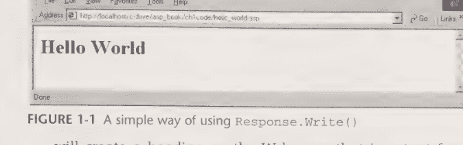

图 1-1 使用 `Response.Write()` 的一种简单方式

将在你的脚本输出的网页上创建一个标题（参见图 1-1）。

请注意，`Response` 对象是 ASP 中始终可用的特殊对象（你不需要创建它来使用它）。相比之下，`Date` 对象在使用之前必须先创建。

### 脚本 1-1：`date_simple.asp`

```asp
1. <%@ Language=JavaScript %>
2.
3. <HTML><HEAD><TITLE>Simple Date</TITLE></HEAD>
4. <BODY BGCOLOR="#FFFFFF" >
5.
6. <%
7. date_object = new Date();
8. Response.Write(date_object.toString())
9. %>
10.
11. </BODY></HTML>
```

此脚本生成的网页如图 1-2 所示。

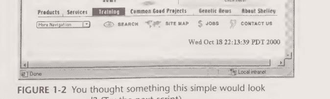

图 1-2 你认为这么简单的东西会好看吗？（试试下一个脚本）

### 脚本工作原理

- 1. 第一行将默认脚本语言设置为 JavaScript，以防 ASP 解释器预期使用其他语言。
- 2-5. 这是标准的 HTML。
- 6. 我们打开 ASP 标签，为从下一行开始的代码做准备。
- 7. 我们创建一个名为 `date_object` 的 `Date` 对象。默认情况下，它包含运行该脚本的计算机上的本地时间。
- 8. 这一行发生了两件事，它由两个嵌套的函数组成，从内到外执行。首先执行的函数是：`date_object.toString()`。该函数的输出然后传递给 `Response.Write()` 函数。具体过程如下：
  - 首先，我们使用日期对象的 `toString()` 方法，将存储在 `date_object` 中的日期信息转换为字符串（之所以称为字符串，是因为它由一串人类可读的数字和字母组成）。这会生成一个类似于 `"Sat May 22 14:22:55 PDT 1999"` 的字符串。
  - 然后，这个字符串被传递给 `Response.Write()` 函数，该函数允许我们将信息添加到我们正在构建的 HTML 页面中。因此，我们的字符串（`"Sat May 22 14:22:55 PDT 1999"`）被添加到 HTML 页面中，于是我们脚本的输出变为：

```html
<HTML><HEAD><TITLE>Simple Date</TITLE></HEAD>
<BODY BGCOLOR="#FFFFFF" >

Sat May 22 14:22:55 PDT 1999

</BODY></HTML>
```

- 9. 关闭 ASP 标签，这告诉 ASP 解释器没有更多服务器端代码需要执行，页面的其余部分（第 10-11 行）是常规 HTML。

## 项目二：一个更强大的日期脚本

尽管上面的简单日期脚本展示了使用 JavaScript 对象内置函数的简单性，但这个“花哨”的脚本展示了一种更具程序性的方法来动态生成日期：下面概述的方法可以很容易地定制，从而生成完全按你想要的布局排列的日期。

因为这种方法灵活，它涉及更多代码，这给了我们一些机会来检查一些新功能。主要重点将是三种数据类型：数字、字符串和数组。

## 新功能

### `//`（注释）

代码往往对编写者自己来说在编写时是合理的。但对于其他人，甚至几个月后编写者自己来看，它开始变得像一堆乱码。注释使得与他人共享代码变得更容易。例如：

```javascript
1. // 出于某种原因，传统上是通过打印“hello world”来向人们展示如何
2. // “打印”东西的。
3. // 在 ASP 中，这是使用 Response.Write() 命令完成的
4. // （ASP Response 对象的 Write 方法。它看起来像这样：
5. Response.Write ("Hello World");
```

在上面的例子中，第 1-4 行被注释掉了，因此被 ASP 解释器忽略。第 5 行没有被注释；因此，它会被执行，于是“Hello World”这几个字就会出现在某人的浏览器中。

虽然我不知道“Hello World”从何而来，<sup>2</sup> 但在人工隔绝的电脑屏幕前度过太多日夜后，说这句话似乎是很合理的。我知道我有时会有点脱离现实，可能还有点

> 2. Prentice Hall 请 Marc Loy 审阅了本书，他写信告诉我：“嗯，计算机编程界的传说认为，这是测试新编程语言时流行的第一条消息。它证明了两件事：1）你可以用这种语言编写/编译/运行一个程序；2）你可以产生输出，以便阅读更有趣程序的结果。”

### `Number`（JavaScript 数据类型）

数字是一个整数或实数，可以通过字面变量或字面量来表示：

```javascript
9                                      // 数字 9
3.45                                   // 数字 3.45
3 + 2                                  // 数字 5
number = 12                            // 变量 "number" 已被设置为 12
number + 2                             // 数字 15
```

### `String`（JavaScript 数据类型）

字符串是由字母、数字、空格和各种其他字符组成的序列，与数字类似，它可以直接以字面量形式表示，也可以存储在变量中。例如：

```javascript
"Hello World"                         // 典型的字符串。
"Tel: 805-966-0611"                   // 另一个字面量字符串。
Name = "Wilbur"                       // 一个名为 name 的变量，值为 "Wilbur"
                                      // 的 "Wilbur"
```

### `Array`（JavaScript 数据类型）

数组是一个有序的值序列：

```javascript
(1,2,3)                               // 数字一、二和三
("Wilbur","Fred","Gordon")            // 三个名字。
name_array = {"Wilbur","Fred","Gordon"} // 一个名为 name_array 的变量
                                      // 存储了三个名字
```

由于数组是有序的，因此可以通过引用其索引值来调用数组中的特定值：

```javascript
name_array[0]                         // 返回 "Wilbur"
name_array[2]                         // 返回 "Gordon"
name_array[3] = "Becky"               // name_array 现在为
                                      // ("Wilbur","Fred","Gordon","Becky")
```

### Concatenation（JavaScript `+` 运算符）

连接（Concatenation）可以将两个字符串“连接”成一个字符串：

```javascript
full_name = "jane" + " " + "doe"      // full_name 被设置为 "jane doe"
                                      // 设置为 "jane doe"
```

请注意，在连接字符串 `"jane"` 和 `"doe"` 时，需要在它们之间放入一个空格（`" "`），以防止 `full_name` 的值被设置为 `"janedoe"`。

### 脚本 1-2：`date_fancy.asp`

```javascript
1. <%@ Language=JavaScript %>
2.
3. <HTML><HEAD><TITLE>Fancy Date</TITLE></HEAD>
4. <BODY BGCOLOR="#FFFFFF" >
5.
6. <%
7. var now, days, months, day_of_week_int,
   day_of_month_int, month_int, year, today_date;
8. now = new Date();
9.
10. days = new Array ("Sunday","Monday","Tuesday",
    "Wednesday","Thursday","Friday","Saturday");
11. months = new Array ("January","February","March",
    "April","May","June","July","August","September",
    "October", "November","December");
12. day_of_week_int  = now.getDay();
13. day_of_month_int = now.getDate();
14. month_int = now.getMonth();
15. year = now.getFullYear();
16.
17. today_date = days[day_of_week_int] +", "+
    months[month_int] + " " + day_of_month_int + ", " +
    year;
18.
19. Response.Write (today_date);
20. %>
21.
22. </BODY></HTML>
```

这会生成一个如图 1-3 所示的日期。

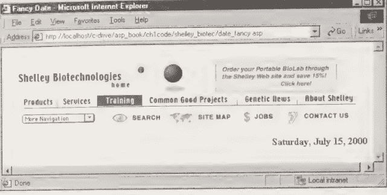

**图 1-3** 现在，这真的会让家乡的乡亲们印象深刻

### 脚本工作原理

- 1. 将默认语言设置为 JavaScript。
- 2-5. HTML 文档的开始。
- 6. 打开 ASP 标签。
- 7. 这一行使用 JavaScript 关键字 `var` 声明我们将要使用的变量。虽然不是必需的，但这是一个好做法（我不是特别擅长这个……）。
- 8. 初始化一个名为 `now` 的新 `Date()` 对象。默认情况下，该对象包含当前日期信息。
- 10、11. 创建两个数组——一个用于星期几，一个用于月份。我们需要这样做，因为在我们创建的 `now` 对象中，星期和月份以整数值（0–6 和 0–11）存储。
- 12. 使用日期对象（`now`）的 `getDay()` 方法获取星期几的整数值。这将为变量 `day_of_week_int` 分配一个介于 0 和 6 之间的值。
- 13. 使用 `Date` 对象的 `getDate()` 方法获取月份中的日期的整数值。这将为变量 `day_of_month_int` 分配一个介于 0 和 30 之间的值。
- 14. 使用日期对象的 `getMonth()` 方法获取月份的整数值。这将为变量 `month_int` 分配一个介于 0 和 11 之间的值。
- 15. 使用日期对象的 `getFullYear()` 方法为 `year` 分配一个四位数年份值。


- 17. 在这一行中，到目前为止我们收集的所有信息被组合成一个包含所有日期信息的单一字符串（`today_date`）。首先，我们使用 `day_of_week_int` 从我们在第 10 行创建的 `days` 数组中检索单个星期几。例如，如果 `day_of_week_int` 是 3，则返回 `"Wednesday"`。然后，字面量字符串 `", "` 连接一个逗号和一个空格。然后我们使用相同的过程从 `months` 数组中检索月份，连接一个空格，然后是存储在 `day_of_month_int` 中的整数值（以数字形式表示），再加上另一个逗号和空格，最后以四位数年份结尾。

- 19. 使用 Response 对象的 `Write()` 方法，脚本将 `today_date` 中的值插入到 HTML 输出中。

- 20. 关闭 ASP 标签。代码部分到此结束。

- 21. 关闭 HTML 标签。

## 回顾

本章提供了使用 ASP 和 JavaScript 生成动态 HTML 页面的实用介绍。

涵盖的主题包括：将 ASP 代码与 HTML 集成，使用 ASP 和 JavaScript 环境的一部分的对象，以及将脚本输出打印到发送到浏览器的页面。

第二个脚本 `date_fancy.asp` 还介绍了在 JavaScript 中处理字符串和数组的基础知识。

## 进阶项目

`date_fancy.asp` 有多种修改方式。一些想法包括：

- `days` 和 `months` 数组可以设置为不同的值。例如，`months` 数组可以设置为三个字母的缩写（`"Jan"`、`"Feb"`、`"Mar"`、...、`"Dec"`）。或者，可以更改语言：（`"Dimanche"`、`"Lundi"`、`"Mardi"`、...、`"Samedi"`）。

- 可以使用 Date 对象的 `getHours()` 和 `getMinutes()` 方法添加时间信息。

- 可以通过更改第 17 行中连接成 `today_date` 变量的元素的顺序来重新组织现有信息。

# 第 2 章 读写

## 本章内容

- 从 `filesystem` 读取
- 写入 `filesystem`
- 从表单收集数据

会议室里坐满了突然对网站内容充满热情的人，包括几个上周还认为世上最无聊的事莫过于到你的工位来详细解释网站这东西只是昙花一现的人。这周除了你之外，其他人的工作一定都很闲。

讨论很快归结为两个主要问题：没有人能在首页做什么上达成一致，而每个人都认为从访问网站的人那里收集更多信息至关重要。

你再等了几分钟，让那些夸夸其谈的人尽情发挥，然后提出了你的解决方案：一个每日提示脚本，将在网站首页随机循环显示任意数量的问候消息，以及一个收集网站访问者反馈的留言簿。房间里有一半人完全不知道你在说什么，但快到午饭时间了，所以他们同意了你的建议。

你退回到自己的工位，坐下来处理本章的两个脚本，这些脚本让你能够为网站添加涉及从 Web 服务器上的文本文件读取和写入的功能。

## 项目 I：将文本文件中的数据添加到网页

如今，程序具有在每次启动时显示提示的功能是很常见的。每日提示脚本让你能为网站添加类似的功能——一个从数据库中随机提取提示并将其纳入网页的脚本。

图 2-1 说明了该脚本如何被整合到网站的首页中（在本例中，一段关于垒球队的内容——多个可用选项之一——被添加到首页的左下角）。


**图 2-1** 垒球简介是动态的

从池中随机提取动态信息是保持网站新鲜感的好方法：如果池子足够大，网站访问者每次访问你的网站时都会看到不同的消息。

脚本所使用的提示来自最简单的数据库类型——一个文本数据文件。脚本附带的示例数据文件仅包含少量提示。然而，你可以使用更多的提示。脚本可以轻松处理包含数百条提示的数据文件。

要有效使用此脚本，你需要将其与现有的 HTML 页面集成。请记住，要将 ASP 代码添加到现有的 HTML 页面，你只需将 ASP 代码放入页面（任何位于 ASP `<%...%>` 标签内的内容），并将文件扩展名从 `.htm` 或 `.html` 更改为 `.asp`。

## 新功能

### Request 对象服务器变量

Request 对象包含大量服务器变量，这些是处理浏览器请求的脚本特有的信息。此脚本使用 `PATH_TRANSLATED` 变量，即当前脚本的完全限定路径，例如：

```text
c:\\inetpub\\wwwroot\\tips\\tip_of_the_day.asp
```

获取此信息并将其赋值给变量的语法如下：

```javascript
var abs_path =
String(Request.ServerVariables("PATH_TRANSLATED"));
```

Request 对象服务器变量可用于收集各种其他信息，例如 HTTP 头信息（HTTP 是 Web 浏览器与 Web 服务器通信时使用的协议）或脚本正在使用的服务器的名称和 IP 地址。

当访问与脚本位于同一服务器上的文件时，知道文件的路径至关重要。通过知道 `tip_of_the_day.asp` 的完整路径，可以推断出其使用的数据文件的路径（假设该数据文件位于同一目录中）。

### 正则表达式（JavaScript）

JavaScript 正则表达式使得执行复杂的模式匹配和查找替换操作变得简单。

此脚本使用 `replace()` 方法，这是一个正则表达式方法，可以应用于任何字符串，以替换在该字符串中找到的模式。例如，如果我们有一个名为 `url` 的字符串变量：

```javascript
var url = "http://www.lovejoy.com";
```

那么我们可以使用正则表达式来查找并替换 `url` 变量中的模式：

```javascript
Response.Write(url.replace(/http/,"http"));
```

这将在正在生成的 HTML 页面上打印一个正确的 URL（注意 `"htp"` 如何变成了 `"http"`）：

```text
http://www.lovejoy.com
```

`replace()` 方法接受两个参数。第一个是正则表达式，指定我们要查找的模式（`"/http/"`）。第二个是我们要用其替换的字符串（`"http"`）。注意这两个参数的数据类型不同：被正斜杠包裹的字符是正则表达式（与其他环境（如 Perl）共享的约定），而被双引号包裹的字符是字符串。

### 使用文本文件作为数据库

数据库是一个你可以以有组织方式存储数据的地方，以便程序可以有效地使用它。对于大量信息，组织数据的最佳方式通常是使用数据库应用程序（如 MS SQL Server、Oracle、mySQL 等程序……）。这类数据库应用程序通常提供将数据规范化为关联表、保护数据完整性以及从非常大的数据池中高效访问信息的功能。

然而，对于小型、简单的数据池，使用文本文件作为数据库通常是最好的选择。存储在文本文件中的信息应该是简单的（一个或几个字段，每行存储一条记录），并且数量不应该太多，因为要从中检索信息，脚本可能需要读取整个文件。

`tip_of_the_day.asp` 使用的提示数据库是一个非常简单的数据库的好例子。该数据库不太可能变得非常大（它可以轻松容纳数百条提示），而且数据结构非常简单：文件中的每一行都是一条提示。

### `while()`（JavaScript 语句）

`while()` 命令用于生成一个循环，只要条件为真，循环就会重复执行。因此，当你的脚本需要从文本文件中提取信息时，`while()` 命令是理想的选择。这通过以下逻辑实现：

```javascript
while (未到文件末尾) { // 这不是真实的代码!!
    处理文件中的某一行...
}
```

一个设置为当文件末尾未到时就循环的 `while()` 循环，将一次一行地遍历文件的每一行，并对文件中的每一行执行一次循环内的语句。在 ASP 中，这是使用 `FileSystemObject` 实现的，下面将进行描述。

### 使用 `FileSystemObject` 和 `TextStream` 对象从文件读取数据

`FileSystemObject` 是一个不完全属于 ASP 的对象，因为它是 Microsoft 脚本环境的一部分，而不是 ASP 环境的一部分。然而，这对我们如何使用它影响很小，因为它的工作方式与 ASP 中可用的任何其他对象非常相似。

下面的代码演示了如何创建 `FileSystemObject`，然后用它来创建 `TextStream` 对象，而 `TextStream` 对象又可用于将文本文件的内容打印到网页上。

```javascript
1. fso = new
     ActiveXObject("Scripting.FileSystemObject");
2. file_stream = fso.OpenTextFile("c:\docs\file.txt");
3. while (! file_stream.AtEndOfStream){
4.     Response.Write(file_stream.ReadLine());
5. }
6. file_stream.close();
```

与始终在 ASP 中可用的 Request 或 Response 对象不同，`FileSystemObject` 需要显式创建（如上第 1 行）。一旦 `FileSystemObject` 存在，就可以用它来执行各种文件系统操作（就像你可以用 Windows 资源管理器做的事情：打开文件、浏览磁盘驱动器的目录结构等……）。在这个例子中，`OpenTextFile()` 方法用于创建一个名为 `file_stream` 的 `TextStream` 对象（第 2 行）。

一旦创建了 `TextStream` 对象，就可以使用 `while()` 循环逐行遍历文件（第 3-5 行）。这里，使用 Response 对象的 `Write()` 方法将文本文件的内容添加到 HTML 页面。

### JavaScript `if ... else` 语句

`if` 语句及其变体 `if/else` 语句，可能是让脚本根据事件发展执行不同操作的最常见方式。

如果条件为真，则执行 `if` 语句。例如：

```javascript
1. if (1 > 0){
2.     // 这里的代码应该总是被执行
3.     // 因为 1 总是大于零。
4. }
```

或者，脚本可能在条件为真时执行一项任务，而在条件不为真时执行另一项任务。给定一个名为 `number` 的变量：

```javascript
1. if (number > 0){
2.     Response.Write("number is greater than zero");
3. }
4. else {
5.     Response.Write("number is less than or equal to zero");
6. }
```

如果你是编程新手，首先要理解的关键是如何工作 `if` 语句。它定义了一个代码块，该代码块仅在条件为真时执行：

```javascript
1. if (condition){
2.     statement // 这可能是多行代码
3. }
```

要记住的第二件关键事情是，你必须正确处理圆括号和花括号：你需要将条件放在圆括号 `"()"` 内，将语句放在花括号 `"{}"` 内。

### 使用 JavaScript `Math` 对象生成随机整数

Javascript 包含一个内置的 `Math` 对象，使得利用 JavaScript 语言内置的多种数学函数变得容易。

例如，`Math.random()` 函数返回一个介于 0.0 和 1.0 之间的随机数：

```javascript
random_number = Math.random();
```

这可能会输出以下值之一：

```text
0.18359177861083936, 0.1663040438840987,
0.7250774196619358, 0.45072710578013564,
0.19805329447345815, 0.6124185344364772,
0.23355290088725944, 等等...
```

因为整数通常比浮点值更有用，所以 `Math.random()` 的浮点输出可以四舍五入到最接近的整数：

```javascript
random_number = Math.round(Math.random());
```

以这种方式生成的随机数将始终是 1 或 0。要从更大的数池中获取数字，你只需将 `Math.random()` 的输出乘以一个大于 1 的整数。

例如，下面的代码将生成一个介于零和五之间的数字：

```javascript
random_number = Math.round(5 * Math.random());
```

## 每日提示的代码

**重要提示！** 此脚本需要数据文件才能工作：

- `tip_of_the_day.asp` 包含所有代码。
- `tips.txt`，数据文件，包含任意数量的提示，脚本会从中随机选择一条进行打印。数据文件中的每一行应包含一条提示。

**两个文件必须放在同一个文件夹中。**

### 脚本 2-1-1

#### `tips.txt`

1. 全球利润最高的 10 家制药公司中，有 8 家有什么共同点？它们都与 Shelley 生物技术公司（Shelley Biotechnologies, Inc.）建立了成功的合作关系。
2. 需要与一位真正能听懂您项目技术需求的销售工程师沟通吗？<a href="contact.asp">联系我们</a>
3. Shelley 垒球队以 3 胜 1 负的战绩证明，团队合作即使走出实验室也能创造出色的成果。

### 脚本 2-1-2

#### `tip_of_the_day.asp`

```asp
1. <%@ Language=JavaScript %>
2. <HTML><HEAD><TITLE>Tip of the day</TITLE></HEAD><BODY BGCOLOR="#FFFFFF" >
3. <center><h1>Tip Of The Day:</h1>
4.
5. <%
6. tips_file = "tips.txt"
7.
8. // this gives us the absolute path of this script
9. // which we'll use to get the path to the current directory so we can open a
10. // file in it (the tips_file, above).
11. var abs_path = String(Request.ServerVariables("PATH_TRANSLATED"));
12.
13. // get rid of script name in absolute path
14. // and replace with name of file we want to open
15. var file_to_open = abs_path.replace(/\\\w*\.asp/,"\\") + tips_file;
16.
17. fso = new ActiveXObject("Scripting.FileSystemObject");
18.
19. //Make sure we can find tips file before we get carried away
20. if (fso.FileExists(file_to_open)){
21.
22.     // open file and read contents:
23.     file_stream = fso.OpenTextFile(file_to_open);
24.
25.     tips_array = new Array ();
26.    // loop through file and collect tips
27.    while (! file_stream.AtEndOfStream ){
28.            line_num = file_stream.Line;
29.            tip = file_stream.ReadLine();
30.            tips_array[line_num-1] = tip;
31.    }
32.    file_stream.close();
33. 
34.    // generate random number based on number of tips
35.    // we found and print one.
36.    random_number = Math.round((tips_array.length-1)
37.    * Math.random());
38.    Response.Write("<p>" +
39.    tips_array[random_number]);
40. } // end of if file exists
41.
42. // if we can't find file
43. else {
44.    Response.Write("<p>Sorry, the tips file seems to
45.       be missing")
46. }
47. %>
48. </center></BODY></HTML>
```

## 脚本工作原理

**注意**

> 提示文件必须与脚本位于同一目录中。

- 1. 告知 ASP 服务器我们将使用 JavaScript 编写页面。
- 2-4. 常规 HTML，保持简洁以方便理解。
- 5. ASP 开始标记，脚本由此开始。
- 6. 创建变量 `tips_file` 来存储我们要打开的文件名。这样日后如需更改数据文件名也非常方便。
- 11. 脚本没有硬编码数据文件（`tips.txt`）的位置（否则每次移动脚本时都需要修改），而是假设数据文件与脚本位于同一目录。由于打开文件需要绝对路径，脚本首先使用 `PATH_TRANSLATED` 服务器变量来获取脚本的路径。该路径存储在 `abs_path` 变量中。


- **15.** 接下来，使用正则表达式将`abs_path`变量中的脚本名称替换为需要打开的数据文件名。这样就得到了数据文件的绝对路径。正则表达式`/\\\w*\.asp/`匹配一个反斜杠（`\\`），后跟任意数量的单词字符（`\w*`），然后是字符串`.asp`。这将匹配脚本名称，然后将其替换为我们要打开的文件名。该字符串存储在名为`file_to_open`的变量中。

- **17.** 创建一个名为`fso`的`FileSystemObject`对象。该对象使脚本能够访问Web服务器的文件系统。

- **20.** 在继续之前，我们使用`FileSystemObject`的`FileExists()`方法来验证要打开的文件是否存在。

- **23.** 通过`fso`对象调用`FileSystemObject`的`OpenTextFile()`方法，创建一个名为`file_stream`的文本流对象。如果您刚接触对象，这可能会有些 confusing，我会重新表述：要对文件系统执行任何操作，首先我们需要创建一个`FileSystemObject`，即`fso`。接下来，我们需要使用`FileSystemObject`来创建一个`TextStream`对象（使我们能够从特定文件中读取信息），即`file_stream`。`OpenTextFile()`是允许我们创建`TextStream`对象的方法（请记住，方法是分配给对象的函数）。注意，我们必须使用`file_to_open`变量告诉`OpenTextFile()`函数要打开哪个文件。

- **25.** 这里初始化了一个新数组`tips_array`。我们将使用此数组来存储在数据文件中找到的所有提示。

- **27–31.** 该`while`循环逐行遍历文本文件，直到到达文件末尾，此时`file_stream`对象的`AtEndOfStream`属性将为`true`。对于数据文件中的每一行，该行的值被放入`tips_array`。首先，`file_stream`对象的`Line`属性被赋给一个新变量`line_num`，它是一个等于文件中当前行数的整数。接下来，使用`ReadLine()`方法将当前行的值放入名为`tip`的变量中。最后，根据`line_num-1`的值，将`tip`的值放入数组中的适当位置。从`line_num`中减去1，以便数组从零开始（按照惯例）而不是从一。请注意，可以更简洁地表达如下（以牺牲清晰度为代价）：

```javascript
while (!file_stream.AtEndOfStream) {
    tips_array[file_stream.Line - 1] = file_stream.ReadLine();
}
```

- **32.** 已将数据文件的内容放入数组后，我们不再需要`TextStream`对象，因此使用`Close()`方法将其关闭。

- **35.** 为了确定显示哪个提示，生成了一个随机数，该随机数基于`tips_array`中的元素数量（通过使用`length`属性确定）。

- **36.** 使用第35行中找到的随机数，通过ASP`Response`对象的`Write()`方法向浏览器发送单个提示。

- **38–43.** 最后，关闭在第20行中打开的`if`语句，然后是一个`else`语句，如果由于某种原因提示文件丢失，该语句将显示有用的错误消息。

- **44.** ASP标记关闭。

## 项目 II：将表单数据写入文本文件

访客留言脚本是一种收集网站访问者评论的好方法。访问者可以查看其他人提交的评论，也可以发表自己的评论。

访客留言脚本可以执行维护留言簿所需的三个任务（反过来，这会生成三个独立的页面，如图2-2、2-3和2-4所示）。

## 第2章 • 读写操作


图2-2 脚本生成一个表单，让访问者向留言簿提交条目……

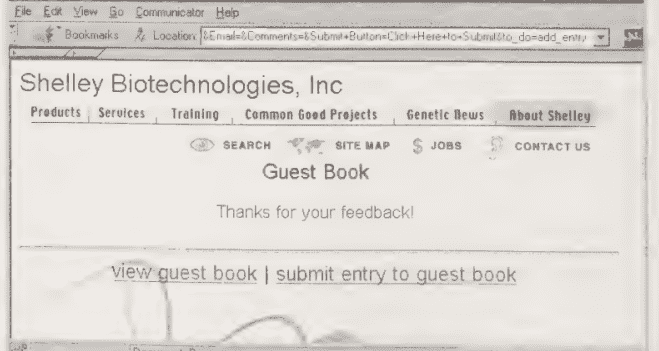

图2-3 ……收集访问者的条目并将其添加到留言簿中……

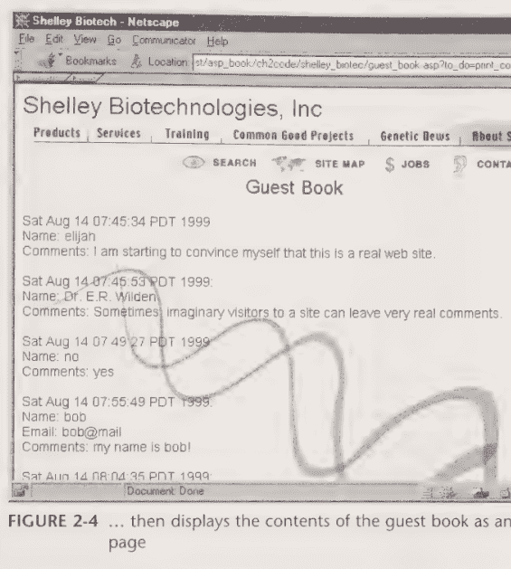

图2-4 ……然后将留言簿的内容显示为HTML页面。

### 新特性

> **注意**
>
> 前面脚本中介绍的许多新特性（`Request`对象服务器变量、正则表达式、`FileSystemObject`对象、`TextStream`对象以及`if/else`语句）在此脚本中也会用到。

#### 使用HTML表单

表单是访问您网站的人向您提交信息最广泛使用的机制。访客留言脚本展示了表单的两种最常见用途。

1. 将访问者在表单中输入的信息提交给脚本（访客留言表单允许访问者向留言簿添加信息）。
2. 提交嵌入在链接或表单中的指令，告诉脚本执行什么操作。

#### 收集访问者提交的信息

我这里冒昧地假设您已经使用过或至少看过表单，并对如何利用它们收集信息然后发送到Web服务器有所了解。这种类型的表单包含几个元素：表单标签告诉浏览器向哪里提交表单（下面的第1行和第4行；`form`标签的`action`属性指定将处理表单的脚本URL），一个或多个表单元素让访问者将信息输入表单（第2行），以及一个提交按钮（或图像），让访问者提交他们在表单中输入的信息（第3行）。例如，一个非常简单的让访问者提交电子邮件地址的表单：

```html
<form action="script_url.asp">
Email: <input type="text" name="email" value="">
<input type="submit" name="submit_button" value="Click Here to Submit">
</form>
```

请注意，表单中的信息由键/值对组成：上面的表单包含两对。第一个称为`email`，默认值为`""`，提交表单时应包含电子邮件地址。第二个称为`submit_button`，值为`"Click Here to Submit"`。因此，想要收集上述表单提交的电子邮件地址的脚本会查找名为`email`的表单变量。

#### 告诉脚本执行什么操作的指令

与访问网站的人在表单中输入的信息不同，指令通常隐藏在表单或URL中。例如，下面的表单和链接将执行相同的操作：

```html
<form action="script_url.asp">
<input type="hidden" name="to_do" value="perform_task">
<input type="submit" name="submit_button" value="Perform Task">
</form>
```

或者，作为链接：

在这两种情况下，脚本都会接收到名为`to_do`的表单元素，其值为`"Perform Task"`（URL中的空格会被转换为加号）。假设脚本期望被告知要执行什么操作，它就能够执行相应的任务。

#### 使用`Request`对象收集传入的表单信息

ASP的`Request`对象让收集表单信息变得非常简单。例如，如果脚本需要收集表单元素`to_do`的值，并将其放入一个名为`form_instruction`的变量中，你可以这样做：

```javascript
var form_instruction = String(Request("to_do"));
```

注意，上面这一行代码中发生了三件事：

1. `Request`对象的`to_do`属性被作为参数传递给名为`String()`的JavaScript函数。
2. `String()`函数将该值转换为字符串。
3. 得到的字符串被赋值给变量`form_instruction`。

由于所有表单信息都存储在`Request`对象中，查找表单元素的值只需获取`Request`对象的相应属性即可。

##### 提示

如果你打算在字符串上下文中使用该值（通常情况如此），你还需要使用`String()`函数，以避免出现错误或难以理解的结婐。虽然使用`String()`函数并非总是必要的，但你会发现我在收集表单信息时几乎总是使用它，这节省了大量的调试时间。

#### `undefined`，一个特殊的JavaScript值

如果脚本收集的表单变量尚未设置，其值将被设为`undefined`。例如，请考虑：

```javascript
var form_instruction = String(Request("to_do"));
```

如果`to_do`在指向该脚本的表单或链接中没有设置，这将返回`undefined`。因此，如果脚本正在使用一个可能尚未设置的表单变量，有时需要检查`undefined`值。

访客簿脚本就是这样做的，因为当人们第一次访问该脚本时，它不会接收到任何表单变量，需要适当地响应，创建一个让访客添加条目的表单。

#### 向文件追加信息

向文件写入信息有两种方式：脚本可以覆盖文件中可能存在的任何信息，或者将信息追加到已经包含信息的脚本中。

访客簿脚本将信息追加到存储条目的数据文件中，因为我们希望保留访客簿中现有的条目。追加是一种很好的方式，因为你不必担心意外删除任何内容。写入文件则更为棘手，因为很容易意外丢失信息。

用于向文件追加信息的代码与从文件读取信息的代码类似，这在前面关于本章早些时候的`tip_of_the_day.asp`脚本时已经讨论过。在创建了`FileSystemObject`对象之后，会创建一个`TextStream`对象并将其设置为`ForAppending`模式。然后可以使用`TextStream`对象的`Write()`方法将字符串添加到文件中：

```javascript
fso = new ActiveXObject("Scripting.FileSystemObject");
fs_stream = fso.OpenTextFile("c:\\file.txt", ForAppending);
fs_stream.Write("hello world");
```

上述代码将把字符串`"hello world"`追加到文本文件`c:\file.txt`中。

##### 提示

通常，在向文件追加内容时，你还会想要添加一个换行符（下文介绍）以保持可读性。例如：

```javascript
fs_stream.Write("\n hello world");
```

#### 在JavaScript中处理换行符、特殊字符和使用`\`进行转义

在创建脚本时，经常需要处理换行符、制表符和其他特殊字符。例如，要创建包含以下内容的字符串：

> He said "No way!"

有两种解决方案。要么字符串必须用单引号括起来，要么必须使用反斜杠字符对双引号进行转义：

```javascript
var dialog = 'He said "No Way!"';
```

或：

```javascript
var dialog = "He said \"No Way!\"";
```

添加换行符，事情就会变得有点复杂。要创建包含以下内容的字符串：

> He said "No way!"
>
> She said "Way!"

现在需要使用换行符`\n`符号：

```javascript
var dialog = 'He said "No Way!" \nShe said "Way!"';
```

表2-1：常用转义序列

| 转义序列 | 说明 |
|---|---|
| `\n` | 换行 |
| `\t` | 制表符 |
| `\'` | 单引号 |
| `\"` | 双引号 |
| `\\` | 反斜杠 |

##### 脚本2-2

`guest_book.asp`


```asp
<%@ Language=JavaScript %>
<HTML><HEAD><TITLE>Guest Book</TITLE></HEAD><BODY BGCOLOR="#FFFFFF">
<center><font size=+1>Guest Book</font></center>

<%
var to_do = String(Request("to_do"));
var this_script_url =
   String(Request.ServerVariables("SCRIPT_NAME"));

//////////////////////////////////////////////////
// If the "to_do" variable does not contain any
// instructions, create
// a form that lets visitors add an entry to the
// guest book.

if (to_do == "undefined"){

   // since most of the next few lines are html,
   // the ASP tag is closed
   // and normal html is added to the page. Only
   // the name of the script is
   // dynamically generated, so that the script
   // will still work if its name
   // is changed down the road.
   %>
   <p>Please use the form below to submit an entry
   to our guest book:<hr>
   <form action="<% = this_script_url %>">
   Name: <br><input type=text name="Name" value=""
   size=50><br>
   Email: <br><input type=text name="Email" value=""
   size=50><br>
   Comments: <br><textarea name="Comments" cols=50
   rows=5></textarea><br>
   <input type=submit name="Submit Button"
   value="Click Here to Submit">
   <input type=hidden name="to_do">
   </form>

<%
} // end if (to_do == "undefined")
else {

//////////////////////////////////////////////////
// If the "to_do" variable is defined, we need to
// create a file system
// object that will let us read or write to the
// guest book file

// this is the file that will store the guest book
// data. This file
// must exist for the script to work. It should be
// placed in the same
// directory as the script.
var guest_book_file = "guest_book.txt";

// this gives us the absolute path of this script
// which we'll use
// to get the path to the current directory so we
// can open a
// file in it.
var abs_path =
   String(Request.ServerVariables("PATH_TRANSLATED"));

// get rid of script name in absolute path
// and replace with name of file we want to open
var file_to_open =
   abs_path.replace(/\\w*\.asp/,"\\") +
   guest_book_file;

fso = new
   ActiveXObject("Scripting.FileSystemObject");

if (fso.FileExists(file_to_open)){

   ///////////////////////////////////////////////////
   // If the "to_do" is set to "print_contents", we
   // print the entire
   // contents of the guest book file to the web
   // page we're building
   if (to_do == "print_contents"){

          // create a text stream object
          fs_stream2 =
          fso.OpenTextFile(file_to_open);
          // copy the contents of opened file into the
          // variable "temp_file"
          var temp_file = fs_stream2.ReadAll();
          // close the text stream object
          fs_stream2.close();

          // add contents of guest book to web page
          Response.Write("<pre>" + temp_file +
          "</pre>");

   } // end if (to_do == "print_contents")

   ////////////////////////////////////////////////
   // If the "to_do" is set to "add_entry", we
   // append the new guest
   // book entry to the guest book file and thank
   // the visitor for
   // taking the time to do so.

   if (to_do == "add_entry"){
       // create TextStream object set to append mode
       var ForReading = 1, ForWriting = 2, ForAppending = 8;
       fs_stream = fso.OpenTextFile(file_to_open,ForAppending);

       // collect date and form information
       date_object = new Date();
       date_string = date_object.toString()
       var message = "Name: " + String(Request("Name"));
       message += "\nEmail: " + String(Request("Email"));
       message += "\nComments: " + String(Request("Comments"));

       // append date and form information to
       // guest book data file
       fs_stream.Write("\n" + date_string + ": \n" + message + "\n");
       // close TextStream object
       fs_stream.close();

       // Print a thank-you message
       Response.Write("<p>Thanks for your feedback!<p>");
   } // end if (to_do == "add_entry"){

} // end if file exists

// if the file doesn't exist, print an error message
else {
   Response.Write("<p>can't find file <b>" + guest_book_file + "</b><p>");
}
} // end else (where to_do != undefined)
%>

<hr><center><font size=+1>
```

### 脚本如何工作

> **注意**
>
> 留言簿文件（`guest_book.txt`）必须与脚本位于同一目录。初始时应为一个空文本文件。

1. 告知 ASP 服务器，我们将使用 JavaScript 编写页面。
2. 正常的 HTML，保持简单以求清晰。
3. 开始的 ASP 标签标志着脚本的起点。
4. 由于脚本执行多个不同的任务（显示留言簿表单、接受提交，以及显示留言簿内容，如上所示），首先要确定需要执行哪个任务。这是通过查看表单变量 `to_do` 的值来完成的：如果未设置值，则显示留言簿提交表单。该值可以设置为 `print_contents` 来告诉脚本显示留言簿内容，或者设置为 `add_entry` 以向留言簿提交新条目。
5. 脚本生成指向自身的表单和链接。与其将此值硬编码（这样每次移动脚本时都需要更改），脚本收集服务器变量 `SCRIPT_NAME` 的值（通过 ASP Request 对象），并将其赋值给名为 `this_script_url` 的变量。
6. 如果未给表单变量 `to_do` 赋值，它将是未定义的（一个特殊的 JavaScript 值，在上面的“新特性”部分讨论）。如果是这种情况，将执行第 13–29 行的代码。
7. 在此关闭 ASP 标签，因为第 20–28 行的大部分内容是 HTML。由于这段 HTML 大部分相当标准，我将不对其做过多详细说明。
8. 这是第 20–28 行中唯一使用 ASP 的地方。它用于使用第 7 行设置的变量 `this_script_url` 为表单标签的 `action` 属性赋值。
9. 尽管表单中的提交按钮是一个发送到脚本的键/值对，但脚本并未使用它，因为这样可以方便地编辑按钮上显示的文本，而无需担心影响脚本的工作方式。
10. 此行上的隐藏表单标签 `to_do` 用于告诉脚本收到此表单时应执行什么操作。值 `add_entry` 表示脚本应将表单内容插入留言簿。
11. 打开 ASP 标签，因为接下来的大部分将是代码。
12. 在第 13 行开始的 `if` 语句结束。
13. 如果为 `to_do` 赋了值，则执行脚本的其余部分（第 31–107 行）。
14. 创建一个变量 `guest_book_file` 来存储我们要打开的文件名。这使得以后想要更改数据文件名时更容易。
15. 与其硬编码数据文件（`tips.txt`）的位置（这意味着每次移动脚本时都必须修改脚本），脚本假设数据文件将与脚本位于同一目录中。由于打开文件需要绝对路径，脚本首先使用服务器变量 `PATH_TRANSLATED` 来查找脚本的路径。此路径存储在 `abs_path` 变量中。
16. 接下来，使用正则表达式将 `abs_path` 变量中的脚本名称替换为我们需要打开的数据文件名。这给出了数据文件的绝对路径。正则表达式 `/\\\w*\.asp/` 匹配一个反斜杠（`\\`），后跟任意数量的单词字符（`\w*`），然后是字符串 `.asp`。这将匹配脚本的名称，然后将其替换为我们想要打开的文件名。此字符串存储在名为 `file_to_open` 的变量中。
17. 创建一个名为 `fso` 的 `FileSystemObject` 对象。此对象允许脚本访问 Web 服务器的文件系统。
18. 在开始之前，我们使用 `FileSystemObject` 的 `FileExists()` 方法来验证我们要打开的文件是否存在。
19. 如果 `to_do` 设置为 `print_contents`，脚本将执行第 62–70 行。
20. 在 `fso` 对象上调用 `FileSystemObject` 的 `OpenTextFile()` 方法来创建一个名为 `file_stream2` 的 `TextStream` 对象。如果您是对象的新手，这有点令人困惑，所以我会换种说法：要对文件系统进行任何操作，首先我们需要创建一个 `FileSystemObject`，即 `fso`。接下来，我们需要使用 `FileSystemObject` 创建一个 `TextStream` 对象（它允许我们从特定文件读取信息），即 `file_stream2`。`OpenTextFile()` 是允许我们创建 `TextStream` 对象的方法（记住，方法是分配给对象的函数）。请注意，我们必须使用 `file_to_open` 变量告诉 `OpenTextFile()` 方法我们要打开哪个文件。
21. 使用 `TextStream` 对象的 `ReadAll()` 方法将文件内容放入名为 `temp_file` 的字符串中。
22. `fs_stream2` 已关闭，现在我们已经收集了它的内容。
23. 将文件内容写入正在生成的 HTML 页面。为了保留文本文件的格式，将 `<pre> </pre>` 标签连接到 `temp_file` 字符串的两端。
24. 在第 60 行开始的语句结束。
25. 如果 `to_do` 设置为 `add_entry`，脚本将执行第 80–99 行。
26. 创建一个新的 `TextStream` 对象 `fs_stream`，设置为 `ForAppending` 模式。
27. 为了记录留言簿条目的提交时间，使用 JavaScript 的 `Date()` 对象创建一个日期对象，然后创建一个日期字符串。
28. 由表单收集的留言簿信息（姓名、电子邮件和评论）被连接成一个名为 `message` 的字符串，每条信息之间有一个换行符。
29. 使用 `TextStream` 对象的 `write()` 方法将上面创建的 `date` 和 `message` 字符串写入留言簿文件。添加三个换行符以保持整洁。
30. 关闭 `TextStream` 对象。
31. 向浏览器发送感谢消息，让访问者知道条目已被成功接收。
32. 如果我们无法找到留言簿文件（第 53 行），脚本会打印一个有用的错误消息。一旦脚本运行起来，您可能需要为最终用户编辑此消息。
33. 在第 31 行开始的 `else` 语句结束。
34. 关闭 ASP 标签以创建 HTML 页脚。
35. 此行包含指向留言簿脚本的两个 URL。第一个将 `to_do` 表单变量设置为 `print_contents`，允许访问者查看留言簿内容。第二个未给 `to_do` 变量设置值，允许访问者访问留言簿表单。在这两种情况下，脚本的 URL 都是动态设置的，使用 `this_script_url` 变量。

## 回顾

本章中的脚本很好地概述了如何使用 `FileSystemObject` 对象和 `TextStream` 对象来读取和写入文本文件。留言簿脚本还介绍了处理表单，既作为访问者向 Web 服务器提交信息的方式，也作为向脚本发出指令以执行哪个任务的方式。

## 演化此脚本的思路

- 如果您有一个大型网站，请使用每日提示脚本来提供指向网站不同部分的链接，这些部分访问者可能原本找不到。
- 修改留言簿脚本，使其在收到提交后自动显示留言簿内容。
- 使用第 4 章中描述的电子邮件代码，添加自动向提交信息到留言簿的访问者发送感谢消息的代码。
- 修改留言簿脚本，使访问者无法查看留言簿内容。
- 修改脚本，使最近的提交显示在页面顶部。最好的方法是修改数据写入数据文件的方式，使数据文件成为以制表符或管道符分隔的文件，每条记录一行。然后可以将记录写入数组并使用 JavaScript 的 `reverse()` 方法反转。然后您可以遍历数组（在附录 A 中描述）并将数组内容写入正在生成的 HTML 页面。

## 3 数据库驱动页面

### 本章内容

- 关系数据库简介
- SQL 入门
- Microsoft Access
- ASP 数据库工具：创建 DSN、使用数据库 `Connection` 和 `Recordset` 对象
- JavaScript 函数、对象和 `for()` 循环
- 使用 `include` 将多个文件合并为单个脚本

关系数据库是我们手中最令人兴奋的工具之一，无论是像 MS Access 或 Filemaker 这样为桌面设计的轻量级工具，还是像 Oracle 或 MS SQL Server 这样的重型服务器应用程序。

通过将信息组织到数据库中，会发生两件事。首先，可以构建工具来自动执行某些任务，例如将信息分类和组织，以及执行搜索。其次，可以存储大量数据，从只有几十个条目的电话簿到拥有数万条或更多记录的数据库。


# 从数据库生成网页

本章涵盖了构建 ASP 脚本所需了解的内容，该脚本从数据库中检索信息并将其发布到 HTML 页面。如果你是数据库新手，你会发现很多新概念，包括关系数据库的介绍。如果你已经具备数据库经验，你应该能够浏览本章的部分内容，并专注于讨论 ASP 特定材料的章节。

本章中的脚本使用存储在 Microsoft Access 数据库中的信息。虽然如果你有此程序的副本，在 Access 中打开数据库可能会有帮助，但使用这些脚本并非必需。结合接下来几章中的脚本，你可以在不使用 Access 的情况下查看和编辑数据库内容。你只需要一个 DSN（本章解释）来将你的脚本连接到数据库，你可以从本书的网站下载。

## 项目：从数据库生成网页

本章中的脚本使用一个简单的数据库，存储三种信息：人员、网站和活动。

每种信息存储在不同的类别中，可以从图 3-1 所示的菜单中选择。

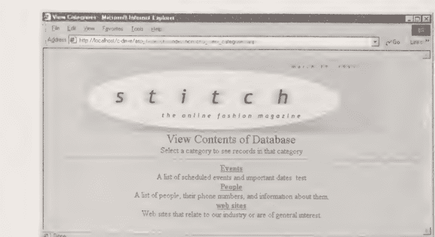

**图 3-1** 访客可以浏览活动、人员和网站

由于每个类别中存储的数据不同，因此需要以不同的方式呈现。

对于活动，默认情况下，脚本显示活动名称、与活动相关的主要日期、活动描述以及开始和结束日期。活动被组织成子类别，然后按日期列出（参见图 3-2）。

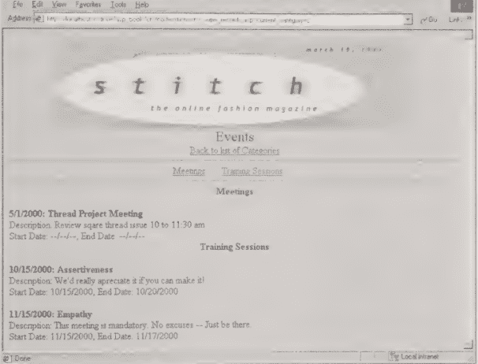

**图 3-2** 活动信息

数据库存储了一组关于人员的相当标准的联系信息（参见图 3-3）。

脚本生成一个链接，使用户可以访问存储在数据库中的网站（参见图 3-4）。

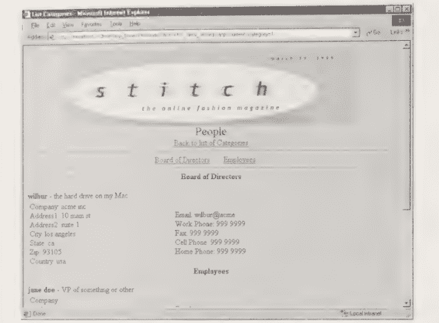

**图 3-3** 人员及其联系信息

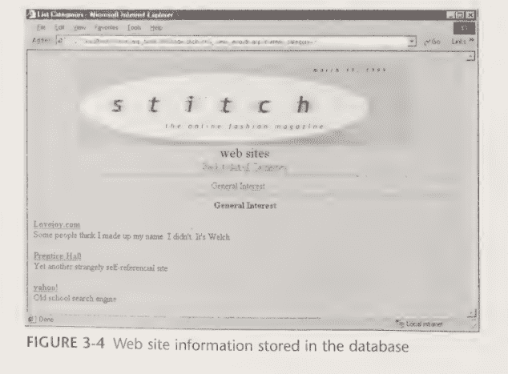

**图 3-4** 存储在数据库中的网站信息

## 新特性

### 关系数据库

在第 2 章中，每日提示脚本使用文本文件来维护提示列表（每个提示保存在文件的一行中）。这几乎是最简单的数据形式。然而，通常需要存储足够复杂的数据，以至于难以存储在平面文本文件中。这就是关系数据库的用武之地。¹ 我不会详细解释什么是关系数据库，但我会回顾某些对于理解本章脚本如何与数据库交互至关重要的方面。

你需要理解两个概念：首先，信息如何存储在表中；其次，一个表中的信息如何与另一个表中的信息相关联。

### 在表中存储信息

创建数据库的第一步是组织信息，使其可以存储在数据库中。例如，下表显示了本章脚本使用的两种信息如何组织成表。

表 3-1 存储关于类别的信息（数据库存储三类信息）。表 3-2 是实际存储在数据库中的人员、活动和网站列表。

请注意以下关于表及其存储信息的事项：

- 表中的每一行存储关于一条信息的内容，称为`记录`。
- 每条记录被分成若干个`字段`。字段名称列在每个表的顶行。在构建数据库时决定使用多少字段是数据库设计的关键问题之一（本书未涵盖）。

> 1. 关系数据库执行许多超出本书范围的任务。例如，它们通常比常规文件系统更紧凑地存储信息，从而能够高效地存储大量信息。通过组织数据，数据库还可以比存储在文本文件中更有效地搜索大量信息。高级数据库服务器还包括大量管理和事务工具，使管理大型数据库成为一项精彩的挑战。都是有趣的内容，但远超出 ASP 书籍的范围。

| category_uid | category_name | category_description |
|---|---|---|
| 1 | People | A list of people, their phone numbers, and information about them |
| 2 | Events | A list of scheduled events and important dates |
| 3 | Web sites | Web sites that relate to our industry or are of general interest |

**表 3-1** 类别表存储关于本章使用的数据库中存储的信息类型的信息

| data_uid | data_name | data_category | data_subcategory | data_description |
|---|---|---|---|---|
| 1 | lovejoy.com | 3 | General Interest | overrated Web site |
| 2 | yahoo! | 3 | General Interest | old-school search engine |
| 3 | jane doe | 1 | Employees | VP of something or other |
| 9 | new event | 2 | Company Events | new product release |

**表 3-2** 数据表存储关于存储在数据库中的人员、活动和网站的信息

- 每个字段包含不同类型的信息。例如，在数据表中，`data_uid` 和 `data_category` 字段包含整数。`data_name` 和 `data_subcategory` 字段包含短字符串，而 `data_description` 字段包含较长的字符串。大多数数据库还支持日期/时间、浮点、布尔和二进制字段。由于字段中存储的信息类型是固定的，因此可以编写脚本来知道如何正确操作数据库中存储的信息。

### 关联存储在不同表中的信息

顾名思义，关系数据库可以跟踪不同信息片段之间的关系。就上面显示的表而言，表是相关的，因为存储在数据表（表 3-2）中的信息与类别表（表 3-1）中列出的某个类别相关。

这种关系是通过比较类别表中的`category_uid`字段值与数据表中的`data_category`字段值来建立的。值相同的地方，就存在关系。

例如，数据表中的前两条记录是网站。因此，这两条记录的`data_category`字段值都是 3，这是类别表中对应于网站的`category_uid`值。

这种关系说明了关系数据库运作的两个关键概念：`主键`和`外键`。

主键是可以用来唯一标识表中记录的字段。`category_uid`字段就是一个很好的例子：为了使类别的使用有效，每个类别必须是唯一的（如果类别表的目的是将数据表中的数据组织成大致相同的类别——人员、网站和活动，那么为网站设置两个类别就没有多大意义）。

更具体地说，每个类别的主键（记住，是唯一标识符）必须是唯一的。除了在更广泛的数据组织中发挥作用外，当需要处理表中的特定记录时，主键非常有用。由于`category_uid`字段中的每个值都是唯一的，它可以用来明确标识表中的特定记录。例如，如果我想更改网站类别的描述，我可以告诉数据库我想修改`category_uid`值为 3 的记录的`category_description`字段值（表 3-3）。

**表 3-3** `category_uid`字段是类别表的主键。在这种情况下，`category_uid`字段唯一标识网站类别

| category_uid | category_name | category_description |
|---|---|---|
| 3 | Web sites | Web sites that relate to our industry or are of general interest |

外键是一个字段，可用于将表中的字段与另一张表中记录的主键相关联。由于外键字段中的值将一条或多条记录与另一张表中的特定记录关联起来，因此所建立的关系定义得非常明确，这使其非常有用。例如，数据表中有两条记录的外键（即`data_category`字段）表明它们与网站类别相关，如表 3-4 所示。

**表 3-4** 数据表中的外键字段`data_category`与 categories 表中的`category_uid`字段建立了关系

| `data_uid` | `data_name` | `data_category` | `data_subcategory` | `data_description` |
|---|---|---|---|---|
| 1 | lovejoy.com | 3 | 通用兴趣 | 被高估的网站 |
| 2 | yahoo! | 3 | 通用兴趣 | 老派搜索引擎 |

与唯一的主键字段不同，在一个表中，多条记录拥有相同的外键值并不罕见。当这种情况发生时，这些记录都与另一张表中的同一条记录共享关系。在此示例中，数据表中的两条记录都与`categories`表中的同一条记录相关。

## 结构化查询语言（SQL）

SQL 是一种用于数据库编程的语言，受到许多最常见数据库应用程序的支持。与许多编程语言一样，SQL 既可以用来完成简单任务，也可以用来处理复杂任务。在本章中，我们将在一个 ASP 脚本中使用 SQL 从数据库中检索信息。请注意，关于如何使用 SQL 有整本的书籍论述，所以我这里只是浅尝辄止。

你会注意到这里没有提供上下文信息：例如 SQL 语句是如何使用的，或者当结果返回时，这些结果是如何被收集的。本章稍后部分在讨论使用数据库`Connection`对象和数据库`Recordset`对象时，会涉及到这些上下文内容。这些对象与我们到目前为止在本书中看到的其他对象一样，很容易在 ASP 环境中使用。

### 使用 SQL 从数据库中检索数据

最基本的 SQL 操作由一个称为“查询”的语句组成，它从数据库中检索信息。这是通过使用`select`语句来完成的。例如，要从上面的`data`表中选择所有信息，你可以使用以下查询：

```sql
select * from data
```

这可以被理解为“给我`data`表中的所有字段”。其结果是数据库将返回一组记录，称为`记录集`，该记录集将如下表所示：

| data_uid | data_name | data_category | data_subcategory | data_description |
|---|---|---|---|---|
| 1 | lovejoy.com | 3 | 通用兴趣 | 被高估的网站 |
| 2 | yahoo! | 3 | 通用兴趣 | 老派搜索引擎 |
| 3 | jane doe | 1 | 员工 | 某个部门的副总裁 |
| 9 | new event | 2 | 公司活动 | 新品发布会 |

通常，缩小查询的范围很有用。例如，要将查询范围限制为网站（类别 3），可以对`select`语句应用一个`where子句`，将语句的范围限制在那些字段值满足特定条件的记录上：

```sql
select * from data where data_category = 3
```

这将把结果记录集限制为两条记录：

| data_uid | data_name | data_category | data_subcategory | data_description |
|---|---|---|---|---|
| 1 | lovejoy.com | 3 | 通用兴趣 | 被高估的网站 |
| 2 | yahoo! | 3 | 通用兴趣 | 老派搜索引擎 |

其他时候，可能没有必要获取表中的所有字段。在这种情况下，查询可以请求特定的字段，而不是使用`*`通配符。例如：

```sql
select data_name, data_description from data where data_category = 3
```

这将生成以下记录集：

| data_name | data_description |
|---|---|
| lovejoy.com | 被高估的网站 |
| yahoo! | 老派搜索引擎 |

最后，对记录集进行排序通常很有用，这样结果就会是有序的。这是通过在查询末尾添加一个`order by子句`来完成的：

```sql
select data_name from data order by data_name
```

这将返回一个按字母顺序排序的名称列表：

| data_name |
|---|
| Jane doe |
| lovejoy.com |
| new event |
| yahoo! |

## Microsoft Access

本章中使用的数据库是使用 Microsoft Access 97 创建的，这是一个经济实惠的数据库创建应用程序，适用于构建小型的单用户和多用户数据库。我使用 MS Access 有三个原因：

1. 因为 MS Access 在 Windows 和 Windows NT 平台上被广泛使用（它通常与 Microsoft Office 捆绑销售），所以本书的许多读者很可能已经拥有一份副本。
2. MS Access 的 ODBC 驱动程序（下文讨论）与 Windows 和 Windows NT 捆绑在一起，这意味着即使你没有 MS Access，你也可以使用一个 MS Access 数据库来设置本章中的脚本。
3. 一个 MS Access 数据库是一个单独的文件，很容易放在本书的网站上，这样你就可以下载它并与本章中的脚本一起使用。

MS Access 与大多数 MS Office 产品一样，是一个相当庞大的产品，包含大量完全超出本书范围的功能。MS Access 不仅可用于构建数据库来存储数据，还可用于构建图形用户界面（GUI）来处理这些数据。它包括用于构建数据库应用程序的 GUI 和编程工具，并且通常用于构建大型、复杂的程序。幸运的是，它也可以用来构建小型、简单的数据库，我就是这样创建了本章中使用的小型数据库。

如果你有一份 MS Access 副本，你将能够直接使用 Access 编辑本章脚本所使用的数据库。如果你需要向数据库添加大量记录，这会很有用：尽管 Web 界面（下一章）通常更容易用于添加或编辑少量记录，但如果你需要添加一个完整的电话列表，直接操作数据库可能会节省你的时间。你也会想使用 Access 来创建新的字段或表。

### 如果你没有 MS Access

如果你没有 MS Access 副本，你仍然可以使用本章中的脚本：你将无法直接编辑数据库或编辑数据库中的数据，但由于下一章的脚本允许你编辑存储在数据库中的数据，因此你无需打开数据库也可以做很多事情。

如果你拥有另一个可以通过 ODBC 连接的数据库（大多数数据库产品都包含一个 ODBC 驱动程序），你应该能够通过创建本章中描述的表，让本章中的脚本在该数据库上运行。

### 如果你拥有 MS Access

> **注意**
>
> 使用本章中的脚本并非必须拥有 MS Access！

如果你有 MS Access 97，打开数据库时你将看到此窗口。顶部的选项卡列出了 Access 中可用的各种数据库对象（表、查询、窗体、报表、宏和模块）。在“窗体”选项卡上，你可以打开`Categories`窗体和`Data`窗体，如图 3-5 所示。

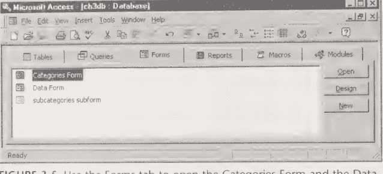

`Categories`窗体可用于编辑现有类别和创建新类别。子类别子窗体（窗体中看起来像电子表格的小窗口）可用于编辑现有子类别和创建新子类别（见图 3-6）。

`Data`窗体的外观和功能都非常像电子表格：每条记录各占一行，一些记录有下拉菜单，另一些则可以直接编辑。此接口对于批量数据输入很有用，例如，如果你需要为你的内网输入整个电话列表（见图 3-7）。

如果你对本章的脚本感到非常兴奋，你可能会决定要自定义数据库，例如，添加当前数据库中没有的字段。为此，你需要编辑存储数据的表。这可以通过数据库窗口的“表”选项卡来完成，你会在其中找到三个表：`categories`、`data`和`subcategories`（见图 3-8）。

你也可以使用 MS Access 2000 打开数据库。界面看起来有点不同，但操作方式是一样的。

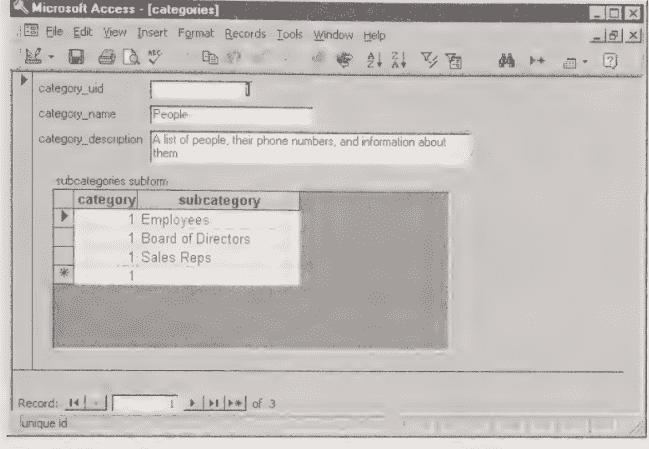

图 3-6 类别表单

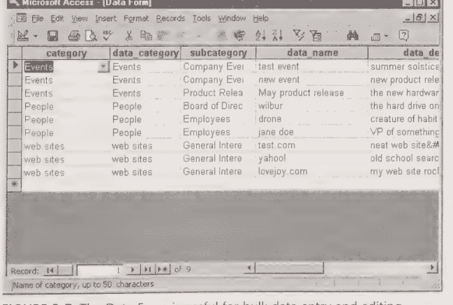

图 3-7 数据表单适用于批量数据输入和编辑

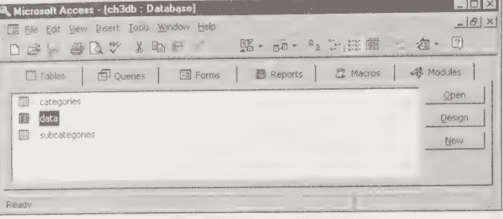

**图 3-8** 表选项卡

正如本章前面在关系数据库概述中所讨论的，数据存储在表中，信息被分解为字段。MS Access 提供了一个可视化界面，允许您编辑表的属性（参见图 3-9）。

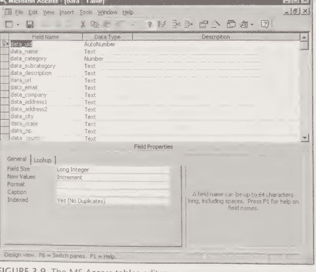

**图 3-9** MS Access 表编辑器

每个字段都有一个唯一的名称，并被分配一个与将要存储在字段中的信息相对应的数据类型。在这种情况下，大多数字段都是文本字段，主键字段（`data_uid`）和外键字段（`data_category`）除外，它们包含数字。`data_uid`字段的数据类型设置为`AutoNumber`，这是 MS Access 的一种数据类型，可自动生成唯一的整数值。

只需在字段列表末尾输入字段名并选择数据类型，就可以向表中添加新字段。在某些情况下，您可能还希望使用屏幕底部的界面配置一些字段属性。

## ADO、ADODB、ODBC、DSN 等

当 ASP 脚本连接到数据库时，会涉及许多不同的技术，至少包括上述所有首字母缩写词。我不打算详细介绍所有这些技术的工作原理，而只涉及您需要了解以便使用它们的内容。所有这些技术的重点是，我俩可以编写一个连接到数据库的脚本，而无需担心它们的工作原理或具体作用。

然而，有一个全局视角是很好的。创建数据库驱动的 ASP 页面涉及三个步骤：


1. 创建一个数据库（这可以是 Access 数据库或任何其他具有 ODBC 驱动程序的数据库）。
2. 在您的 Web 服务器上，创建一个 DSN（数据源名称，即 ODBC 数据源）。这使得您的脚本能够找到您的数据库并连接到它。
3. 编写一个使用 ADO（ActiveX 数据对象）的 ASP 脚本，以创建一个或多个记录集，并可能向您的数据库发出 SQL 指令。

本章的数据库可以从本书的网站下载，这样第一步就完成了。接下来只剩下创建 DSN，然后编写脚本。接下来我将依次介绍每个部分。

### 创建 DSN（数据源名称）

DSN 是一种使您的脚本能够轻松连接到数据库的装置，这要归功于一种名为 ODBC（开放数据库连接，一种用于连接 SQL 数据源的开放协议）的技术。

当您创建 DSN 时，您正在为数据库分配一个唯一的名称，并告诉 ODBC 软件如何连接到数据库。对于 MS Access 数据库，这仅仅是告诉它数据库文件的文件名和路径。

一旦您为数据库创建了 DSN，任何知道如何使用 ODBC 数据源的程序和脚本都可以轻松连接到您的数据库。

如果您在自己的 Web 服务器上运行这些脚本，您需要自己创建 DSN（这很容易）。如果您在其他人的服务器上运行它们（ISP、朋友、公司系统管理员维护的服务器……），您需要让他们创建 DSN。

#### 让别人为您创建 DSN

如果其他人将设置您的 DSN（或者它是由您的 ISP 设置的脚本创建的），您只需将本章的数据库上传到您的 Web 帐户，并告诉设置 DSN 的人员您将文件放在哪里以及它叫什么名字。

例如，如果您通过 ftp 连接到您的服务器，创建一个名为`db`的文件夹，并将`ch3db.mdb`放入该文件夹，您会告诉您的 ISP 或系统管理员，您需要为 MS Access 数据库`db/ch3db.mdb`创建一个名为`ch3db`的 DSN。

请注意，某些 ISP 对 DSN 名称的分配有特定的系统。如果您获得的 DSN 名称不同，您将需要在脚本中更改 DSN 的名称（它是脚本顶部附近的一个变量）。

#### 自己创建 DSN

创建 DSN 是通过 ODBC 控制面板完成的：

1. 如果您尚未从本书网站下载数据库，您现在应该这样做。将数据库（默认情况下名为`ch3db.mdb`，但您可以将其更改为对您更有意义的名称）放在您不太可能移动它的某个地方，因为如果您以后移动它，您将需要修改 DSN。
2. 在“开始”菜单中，选择“设置”/“控制面板”。这会打开“控制面板”窗口，其中包含许多控制面板图标。
3. 双击 ODBC 图标（称为 32bit ODBC 或 ODBC 数据源）。这将打开 ODBC 控制面板。
4. 转到“系统 DSN”选项卡。它应该类似于图 3-10，尽管您不太可能已经设置了这么多 DSN。

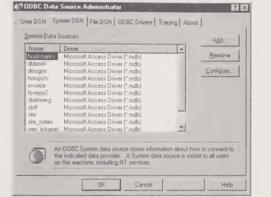

图 3-10 系统 DSN 表

5. 单击“添加...”按钮。这将弹出一个窗口，列出了您计算机上可用的不同 ODBC 驱动程序。您可能没有如图 3-11 所示的那么多选项，但这并不重要：您只需要 MS Access 的驱动程序，它应该是可用的。³
6. 选择 Microsoft Access Driver (*.mdb)，然后单击“完成”按钮。这将打开 ODBC Microsoft Access 97 设置窗口（图 3-12）。

> 3. 如果您没有可用的 Microsoft Access 驱动程序（我查看过的每个 Win95、Win98 和 WinNT 系统都已安装），您应该可以从 Microsoft 下载它。您可以首先下载自系统安装以来发布的任何操作系统更新。如果这不起作用，请尝试下载 ADO（Active Database Objects，Microsoft 数据库技术包）的更新版本。

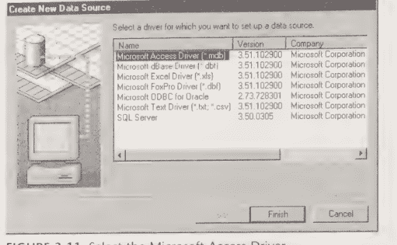

图 3-11 选择 Microsoft Access Driver

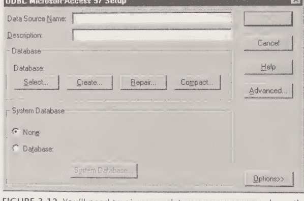

图 3-12 您需要为数据源指定一个名称和一个路径

您需要在此窗口中做两件事：为数据源分配一个名称，并告诉 ODBC 软件数据库的路径。

7. 在顶部字段（Data Source Name）中，输入 DSN 的名称。我使用了`ch3db`，但您可以使用任何对您有意义的名称。如果您使用不同的名称，您将需要修改本章中的脚本。
8. 可选：您可以使用`Description`字段来记录 DSN 的用途。
9. 单击“选择”按钮。这将打开一个对话框，让您选择数据库的路径。
10. 完成后，您应该得到类似图 3-13 的内容。

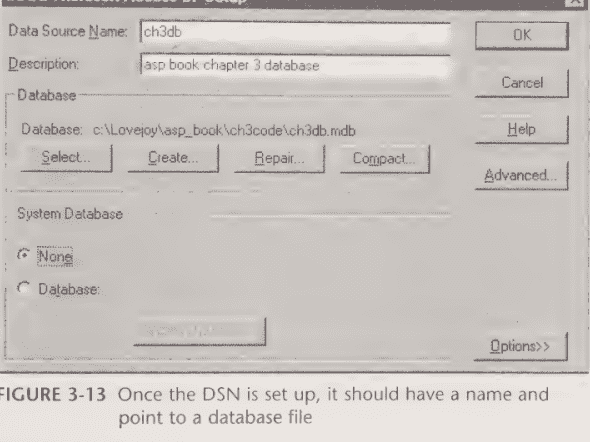

**图 3-13** DSN 设置完成后，它应该有一个名称并指向一个数据库文件

重申一下：设置 DSN 您只需要两样东西：一个名称（在本例中为`ch3db`）和 MS Access 数据库文件的路径（在本例中为`c:\Lovejoy\asp_book\ch3code\ch3db.mdb`）。

11. 单击“确定”按钮关闭设置窗口。
12. 单击“确定”按钮关闭 ODBC 数据源管理员窗口。

## 数据库连接对象

要从 ASP 脚本使用数据库，您必须做的第一件事是建立与数据库的连接。一旦有了连接，您就可以执行 SQL 语句和/或创建记录集。

```javascript
1. DSN = "DSN=ch3db";
2. Conn = Server.CreateObject("ADODB.Connection");
3. Conn.Open(DSN);
4. // now that the connection is open
5. // you can do something with it here
6. Conn.Close ();
```

在第 1 行，创建了一个名为`DSN`的变量。它将在第 3 行中用于告诉数据库 Connection 对象正在使用的 DSN 的名称。注意语法：DSN 的值不是`ch3db`，而是字符串`DSN=ch3db`。这样做的原因是，在某些情况下，还需要向数据库 Connection 对象提供用户名和密码信息。因此，传递给`Open()`方法的信息是带标签的。

接下来，在第 2 行，Server 对象的`CreateObject()`方法用于创建一个名为`Conn`的对象。参数`ADODB.Connection`用于指定正在创建的对象类型。

在第 3 行，`Open()`方法应用于`Conn`对象，使用第 1 行中创建的`DSN`变量。

最后，在第 6 行，`Close()`方法关闭在第 3 行中打开的连接。

当然，如果您不打算使用数据库连接，那么创建连接就没有多大用处。一旦有了连接，您可以做两件事：

- 执行不返回记录的 SQL 语句。
- 创建一个`Recordset`对象来收集 SQL select 语句的结果。

我将在本节中介绍第一种情况，并在下一节中处理记录集。本书中的脚本使用三种不返回记录的 SQL 语句：insert 语句、update 语句和 delete 语句。一旦建立了连接，就可以使用 Connection 对象的`Execute()`方法来执行 SQL 语句：

```javascript
Conn.Execute(SQL_statement);
```

例如，以下代码执行三个示例语句：

```javascript
1. DSN = "DSN=ch3db";
2. Conn = Server.CreateObject("ADODB.Connection");
```

## Recordset 对象

前面章节介绍的 SQL 语句执行数据库操作时不会产生任何输出，而 select 语句的目的是生成记录列表，通常称为“记录集”。在 ASP 中，记录集通过`Recordset`对象来处理。

关于不同 referencing 语句的示例，请参阅本章前面关于 SQL 的讨论。

创建记录集后，需要对其进行处理。最常见的需求是逐条遍历记录集，将信息输出到网页中。例如，给定表 3-5 中的*categories*表：

### Table 3-5 The categories table

| category_uid | category_name | category_description |
| --- | --- | --- |
| 1 | People | A list of people, their phone numbers, and information about them |
| 2 | Events | A list of scheduled events and important dates |
| 3 | Web sites | Web sites that relate to our industry or are of general interest |

以下代码可用于将其内容添加到网页中：

```asp
<%@ Language=JavaScript %>
<%
DSN = "DSN=ch3db";
Conn = Server.CreateObject("ADODB.Connection");
Conn.Open(DSN);

sql = "SELECT * FROM categories ";
rs = Server.CreateObject("ADODB.RecordSet");
rs.Open (sql, Conn);

out = "<table border=1>";
out += "<tr><td><pre>category_uid</pre></td><td><pre>category_name</pre></td><td><pre>category_description</pre></td></tr>";
while (! (rs.EOF)){
    out += "<tr><td>";
    out += String(rs.fields.item("category_uid")) + "</td><td>";
    out += String(rs.fields.item("category_name")) + "</td><td>";
    out += String(rs.fields.item("category_description")) + "</td><tr>";
    rs.move(1);
} // end while recordset
out += "</table>";

rs.Close ();

Conn.Close ();
%>
<html><head><title>recordset example</title></head><body>
<%= out %>
</body></html>
```

脚本的输出如图 3-14 所示。首先，对此代码做一些说明。

第 3-5 行和第 24 行负责创建以及之后关闭数据库连接。请记住，在创建记录集之前，您总是需要先创建数据库连接。

第 7-9 行处理创建记录集的机制。首先，在第 7 行，我创建了一个名为`sql`的字符串，它是一个简单的`select`语句。接着，在第 8 行，我使用 Server 对象的`CreateObject()`方法创建了一个名为`rs`的记录集。注意，其语法与创建数据库与此同时连接类似，只是在这种情况下，传递给方法的参数是`"ADODB.RecordSet"`。最后，在第 9 行，我使用刚刚创建的 Recordset 对象的`Open()`方法打开记录集。`Open()`方法接收两个参数：`sql`和`Conn`。`sql`是在第 7 行创建的`select`查询，`Conn`是在第 5 行打开的数据库 Connection 对象。

此时，记录集已经创建，代码的大部分内容涉及将信息从 Recordset 对象中提取出来，并放入脚本生成的网页中。这是通过一个名为`outindexed`的字符串变量实现的，后续代码会逐段向其中添加信息。

在第 11 和 12 行，HTML 被添加到`out`中。这不是特别理想的 ASP 编程方式：ASP 的要点是您能够实现代码和 HTML 之间的轻松切换，因此更好的做法应该如下所示：

```asp
%>
<table border=1>
<tr><td><pre>category_uid</pre></td>
       <td><pre>category_name</pre></td>
       <td><pre>category_description</pre></td></tr>
<%
```

问题是，当我编写 ASP 页面的脚本部分时，切换回 HTML 总会有些混乱，所以我倾向于不经常这样做，除非我有大块的 HTML，这些 HTML 放入像`out`这样的字符串中又过于笨拙。我扯远了……

在第 13 行，我启动了一个`while`循环，该循环持续到第 19 行。`while`语句将循环直至到达记录集的末尾，这由`rs.EOF`（即`rs`对象的 end-of-file 属性）的值决定。

在`while`循环内部，从记录集中获取的信息被拼接进`out`字符串。这需要构建用于组织记录集输出的表格，并使用以下表达式获取特定字段的值：

```javascript
rs.fields.item("field_name")
```

这里，Recordset 对象`rs`的`fields`对象的`item()`方法用于获取字段`field_name`的值。在第 15-17 行，该方法用于在`while`循环遍历记录集时，依次获取字段`category_uid`、`category_name`和`category_description`的值。

第 18 行非常重要：它告诉`rs`对象移动到记录集中的下一条记录。如果忘记第 18 行，`while`循环将永远无法到达记录集的末尾，会一直持续直到脚本超时（ASP 很好地保护了我们自己：如果脚本运行时间过长，通常约 30 秒，它会超时而不是无限占用系统资源或导致服务器崩溃）。

在第 22 行，记录集被关闭，使用的语法与关闭 Connection 对象相同，而 Connection 对象又在第 24 行被关闭。最后，在第 27 行，`out`字符串被放入一个普通的 HTML 页面中。结果如图 3-14 所示。

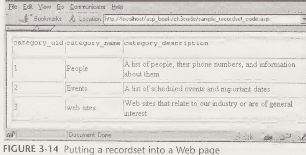

## 从 Recordset 对象中收集字段名

尽管上述代码在许多情况下完全够用，但它存在一个明显的缺点：要将字段放入页面中，您必须知道该字段的名称。如果您了解表中所有字段的情况，这通常是有道理的。问题在于，如果您改变主意，之后向数据库添加了另一个字段，那么您必须返回代码中更新它以反映新字段。

下面的脚本通过从记录集本身动态收集字段名来解决这个问题。虽然这并不总是合适的，因为它只能在脚本的输出被放置到结构相对固定的输出（如本脚本使用的表格）中时使用，但有时很有用：

```asp
<%@ Language=JavaScript %>
<%
DSN = "DSN=ch3db";
Conn = Server.CreateObject("ADODB.Connection");
Conn.Open(DSN);

sql = "SELECT * FROM categories ";
rs = Server.CreateObject("ADODB.RecordSet");
rs.Open (sql, Conn);

out = "<table border=1><tr>";
field_array = new Array()
for ( field_number = 0; field_number < rs.fields.count ; field_number++ ){
    out += "<td><pre>" +
    rs.fields(field_number).Name +
    "</pre></td>";
    field_array[field_number] =
    rs.fields(field_number).Name;
}
out += "</tr>";

while (! (rs.EOF)){
    out += "<tr>";
    for (i=0; i<field_array.length ; i++)
    {
        out +="<td>" +
        String(rs.fields.item(field_
        array[i])) + "</td>"
    }
    out += "</tr>";
    rs.move(1);
} // end while recordset
out += "</table>";

rs.Close ();

Conn.Close ();
%>
<html><head><title>recordset example</title></head><body>
<%= out %>
</body></html>
```

此脚本的大部分与前面的脚本相同，因此我将讨论范围限制在我添加的代码上。

第 13-16 行的`for`循环遍历存储在记录集对象中的字段名，动态“发现”已收集了哪些字段。字段信息存储在`rs.fields`中。由于`rs.fields`中的每个字段都有索引值，因此可以使用表达式`rs.fields(n).name`获取每个字段的名称，其中 n 为整数。从 0 开始，`for`循环持续直到`field_number`变量不再小于`rs.fields.count`，后者返回记录集中字段的数量。

在循环内，第 14 行将字段名输出到正在创建的表格的第一行中，而第 15 行创建一个名为`field_array`的数组，用于存储记录集中所有字段的名称。


创建好表格的第一行后，接下来的任务是使用记录集的内容填充表格的其余部分。这发生在第 19 至 27 行。对于每条记录，第 21 至 24 行的 `for()` 循环遍历`field_array`。由于`field_array`的内容提供了记录集中所有字段的名称，因此很容易使用`rs.fields.item(field_name)`来实现。

## 创建 JavaScript `for()` 循环

当需要遍历已知数量的项目时，`for()`循环非常有用。例如，从 1 数到 10：

```
for (i=1; i<=10; i++){
    Response.Write(i + "<br>");
}
```

这会产生如图 3-15 所示的结果。

其工作原理如下：`for()`循环使用计数器进行迭代。在括号内部，首先设置计数器（在本例中`i`被设置为 1），然后建立条件（只要`i`小于或等于 10，`for()`循环就会继续），最后修改计数器（在本例中，使用`++`运算符递增 1）。只要条件为真，花括号内的代码就会被执行，在本例中，将向浏览器发送`i`的值和一个换行标签。

### 图 3-15 使用 `for()` 进行计数

可以使用类似的系统，利用数组的`length`属性来遍历数组，该属性包含数组中元素个数的整数值。例如：

```
1. names_array = new Array
   ("bob","marla","jonathan","dede");
2. for (i=0; i<names_array.length ; i++) {
3.     Response.Write(names_array[i] + "<br>");
4. }
```

将创建图 3-16 所示的结果。

## 创建 JavaScript 函数

函数是一种封装常用代码的方式。例如，Codegen A Different USER 假设你正在做一个非常不可思议的项目，需要不断向浏览器发送字符串 "Hello World"。你可能会厌倦不断地输入：

```
Response.Write("Hello World");
```

**图 3-16** 遍历数组

```
Function hello (){
    Response.Write("Hello World");
}
```

这样，现在你只需输入：

```
hello();
```

看看这有多简单？（在本章稍后，我会用一个函数来做更有意义的事情）。注意，这个函数与其他任何 JavaScript 函数的工作方式完全相同。

## 使用 Include 文件共享代码

如果你发现自己在不同的脚本中反复使用相同的代码，你可能需要考虑使用 include 文件来在多个文件之间共享同一套代码。因为本章中使用的两个脚本做了很多相同的数据库操作，所以这很实用。

当你使用 include 时，就像将一个文件的内容粘贴到另一个文件中一样。这发生在文件进入 ASP 解释器之前，所以如果你的 include 文件中有代码，它会被解释，就像它原本就在文件中一样。

例如，假设你有一个包含 include 的文件：

```
<%@ Language=JavaScript %>
<html><head></head><body>
<!-- #include file="include.js" -->
<p>example asp page
</body></html>
```

而 include 文件包含少量 ASP 代码：

```
<%
Response.Write("Yet another")
%>
```

这就相当于有一个单一文件：

```
<%@ Language=JavaScript %>
<html><head></head><body>
<%
Response.Write("Yet another")
%>
<p>example asp page
</body></html>
```

显然，这不是一个很有用的例子。但是，正如你将在本章（以及接下来的几章）中看到的，includes 在多个脚本共享功能时，对于保持简洁有很大帮助。

## 创建 JavaScript 对象存储信息

如果我试图详细介绍面向对象编程，我可能会出丑，所以我会保持简短。编程的基本问题是程序往往变得冗长复杂，即使那些本该短小而简单的脚本也会如此。

对象本应通过将信息组织到逻辑分组的属性（变量）和方法（函数）中来改变这一切。

嗯，事实证明，即使使用了对象，脚本仍然会变得冗长复杂，但一个精心设计的对象可以提供很大帮助。我不会在这里讨论方法，但我会向你展示如何在对象中存储信息。

例如，假设你需要在脚本中跟踪关于 Bill 的信息。你可以编写：

```
bill = new Object();
bill.name = "bill smith";
bill.age = "8";
bill.favorite_colour = "purple!";
bill.birthday = "10/18/99";
```

然后稍后使用这些信息会很容易。例如：

```
Response.Write("Happy Birthday, " + bill.name + ". I
can't believe you're already" + bill.age );
```

这会将字符串 "Happy Birthday bill smith. I can't believe you're already 8" 发送到浏览器。

如果你所做的只是跟踪关于 Bill 的信息，这可能没有太大意义。但如果你还需要为 Miranda、Wilbur 和 Veronica 跟踪相同的信息，突然间，使用对象可能会使跟踪一切变得更容易。例如，如果我们有以每个人命名的对象，并在每个对象中存储了适当的年龄，我们就可以使用一致的语法访问他们的年龄：`bill.name`、`miranda.name`、`wilbur.name` 和 `veronica.name`。

## 查看数据库脚本的代码

要使这些脚本工作，请确保你已经完成了以下准备：

- 你需要四个文件：数据库（`ch3db.mdb`）和三个 ASP 文件（`ch3_include.js`、`ch3_view_categories.asp` 和 `ch3_view_records.asp`）。
- 你需要创建一个 DSN（请参阅上述说明），以便脚本可以通过 ODBC 连接到数据库。

### 脚本 3-1

#### `ch3_include.js`

```
1. <%
2. var out = "";
3. var current_category =
   String(Request("current_category")); // category uid
4. var view_categories_script =
   "ch3_view_categories.asp";
5. var view_records_script = "ch3_view_records.asp";
6.
7. ///////////////////////////////////////////////////
8. // create connection to database
9.
10. DSN = "DSN=ch3db";
11. Conn = Server.CreateObject("ADODB.Connection");
12. Conn.Open(DSN);
13.
14. ///////////////////////////////////////////////////
15. // create cat_object, the category object. Because
16. // category information is used
17. // on almost every page, this code is executed every
18. time.
19.
20. sql = "SELECT * FROM categories order by
21.     category_name";
22. rs = Server.CreateObject("ADODB.RecordSet");
23. rs.Open (sql, Conn, 2,3);
24.     if (rs.EOF){    // check to see if rs is empty
25.             out += "no records found in categories
26.             table. something is probably wrong.";
27.     }
28.     else{              // rs not empty
29.             cat_object = new Object ();
30.             temp_counter = 0;
31.
32.             while (! (rs.EOF)){
33.                     cat_object[temp_counter] = new
34.                     Object ();
35.                     cat_object[temp_counter].uid =
36.                     parseInt(rs.fields.item
37.                     ("category_uid"))
38.                     cat_object[temp_counter].name =
39.                     String(rs.fields.item
40.                     ("category_name"))
41.                     cat_object[temp_counter].desc =
42.                     String(rs.fields.item
43.                     ("category_description"))
44.
45.                     rs.move(1);
46.                     temp_counter ++;
47.             } // end while recordset
48.             cat_object.qty = (temp_counter);
49.     } // end else (rs not empty)
50. rs.Close ();
51.
52. ///////////////////////////////////////////////////
53. //  slash_date (), a function used to clean up
54.     dates
55.
56. new function slash_date (temp_date){
57. if (temp_date != ""){
58.     temp_date2 = new Date(temp_date);
59.     temp_date3 =  temp_date2.getMonth()+1 + "/" +
60.         temp_date2.getDate() + "/" +
61.         temp_date2.getFullYear();
62.     return (temp_date3);
63. )
64. else{
65. 	return "--/--/--";
66. }
67. }
68. %>
```

### 脚本工作原理

Include 文件用于执行本章稍后描述的数据显示脚本所共享的任务。通过使用 include 文件，我们能够避免代码重复。这在创建本章讨论的数据显示脚本时节省了一些工作量，而考虑到 include 文件最终不仅会被本章涵盖的显示脚本使用，还会被下一章讨论的数据库编辑脚本使用，这会大大节省工作量。

1. 打开 ASP 代码标签。这是必要的，因为 include 标签在下面的 ASP 代码之外。
2. 这里声明了几个两个脚本共享的变量。

   - `out` 是一个字符串，用于存储脚本执行期间生成的、不会立即发送到浏览器的任何输出。
   - `current_category` 用于存储当前类别的 ID（如果定义了类别）。
   - `view_categories_script` 和 `view_records_script` 用于存储下面讨论的两个脚本的 URL。通过使用这些变量，而不是硬编码文件名，以后更改文件名会容易得多，而这似乎经常发生。

3. 这三行创建了一个名为 `Conn` 的数据库连接对象。注意，如果你的 DSN 不叫 `ch3db`，你应该更改第 10 行中设置的值。
4. 因为本章中的两个脚本都需要类别信息，所以类别信息在 include 文件中收集，而不是在各个单独的脚本中。这是通过创建一个名为 `cat_object` 的对象，并将我们需要的所有类别数据放入其中：数据库中所有类别的 UID、名称和描述。稍后，可以通过遍历 `cat_object` 来检索信息。

### 脚本 3-2

#### `ch3_view_categories.asp`

```
1. <%@ Language=JavaScript %>
2. <!-- #include file="ch3_include.js" -->
3.
4. <html><head><title>View
   Categories</title></head><body>
5.
6. <center><font size="+2"> View Contents of Database
   </font>
7. <br>Select a category to see records in that
   category<hr>
8.
9. <%
10. 
11. for (i = 0; i < cat_object.qty; i++){
12.     %>
13.     <a href="<% = view_records_script %>?current_category=<% = cat_object[i].uid %>"><b><% = cat_object[i].name %></b></a>
14.     <br><% = cat_object[i].desc %><br>
15.     <%
16. }
17. 
18. Conn.Close ();
19. %>
20. </center>
21. </body></html>
```

### 脚本的工作原理

因为类别信息已经放入包含文件的 `cat_object` 中，所以创建类别列表只需遍历 `cat_object` 来检索已收集的信息即可。因此，`ch3_view_categories.asp` 是一个相当短的脚本。

按照惯例，我将只讨论脚本的 ASP 部分，并假设你对 HTML 足够熟悉，我不需要深入讲解它。

- 1. 指定此脚本使用 JavaScript 编写。
- 2. 使用 include 标签包含 `ch3_include.js`（上一个脚本，如上所述）。
- 11–16. 这里使用一个 `for()` 循环来遍历在 `ch3_include.js` 中创建的 `cat_object`，并生成一个包含描述和指向 `ch3_view_records.asp`（下一个脚本，如下）链接的类别列表。
- 11. 循环在第 11 行启动，使用一个名为 `i` 的计数器，它从零开始递增，只要它小于 `cat_object.qty`。因此，如果我们的数据库中有三个类别，`cat_object.qty` 将为 3，`i` 将从零变到 2。
- 13、14. `cat_object` 的 `uid`、`name` 和 `desc` 属性被嵌入到 HTML 模板中。注意第 12 行 ASP 标签如何关闭，然后在第 15 行重新打开，并使用 `<% = variable %>` 语法将变量嵌入。同样在包含文件中设置的 `view_records_script` 字符串，用于指定正在创建的链接将指向的脚本的名称。
- 16. `for()` 循环结束。
- 18. 在包含文件中创建的 `Conn` 对象在此处关闭。
- 19. ASP 代码结束。

### 脚本 3-3

#### `ch3_view_records.asp`


```asp
1. <%@ Language=JavaScript %>
2. <!-- #include file="ch3_include.js" -->
3.
4. <html><head><title>List
   Categories</title></head><body>
5.
6.
7. <%///////////////////////////////////////////////////
8. // Create Header %>
9.
10. <div align="center"><font size="+2">
11. <%
12. // loop through cat_objects to get category name
13. // based on value
14. // of current_category
14. for (i = 0; i < cat_object.qty; i++){
15.     if (cat_object[i].uid == current_category)
16.     { Response.Write(cat_object[i].name);}
16. }
17. %>
18. </font><br><a href="<%= view_categories_script
    %>">Back to list of Categories</a>
19. </div><hr>
20.
21. <%
22. ////////////////////////////////////////////////////
23. // Create dynamic subcategory navbar
24.
25. sql = "SELECT distinct data_subcategory FROM data
       where data_category = " + current_category + " order
       by data_subcategory";
26. rs = Server.CreateObject("ADODB.RecordSet");
27. rs.Open (sql, Conn, 2,3);
28.     if (rs.EOF){    // check to see if rs is empty
29.             out += "no subcategories in this
                    category.";
30.     }
31. else{
32.     Response.Write("<center>");
33.     while (! (rs.EOF)){
34. %>
35.     <a href="#<% =
    String(rs.fields.item
    ("data_subcategory"))%>"><% =
    String(rs.fields.item
    ("data_subcategory"))
    %></a>&nbsp;&nbsp;&nbsp;&nbsp;&nbsp;&nbsp;&nbsp;&nbsp;&nbsp;&nbsp;&nbsp;&nbsp;
36. <%
37.     rs.move(1);
38. } // end while recordset
39. Response.Write("</center><HR>");
40. } // end else (rs not empty)
41. rs.Close ();
42.
43. //////////////////////////////////////////////////
44. // Create list of records:
45.
46. sql = "SELECT * FROM data where data_category = " +
    current_category + " order by data_subcategory,
    data_name";
47.
48. // events should be ordered by date, so slightly
    different query:
49. if (current_category == 2){
50.     sql = "SELECT * FROM data where data_category
    = " + current_category + " order by
    data_subcategory, data_main_date, data_name";
51. }
52.
53. rs = Server.CreateObject("ADODB.RecordSet");
54. rs.Open (sql, Conn, 2,3);
55. if (rs.EOF){    // check to see if rs is empty
56.     Response.Write("<p>There are no records in
    this category");
57. }
58. else{
59. // rs not empty
60. temp_subcat= ""; //this string used to group records
    by subcategory
61. fields = new Object(); // this object used to store
    fields in records
62.
63. while (! (rs.EOF)){
64.
65. // clean up data and put it into the fields
    object:

66. for ( field_number = 0; field_number < rs.fields.count ; field_number++ )

67. {

68. temp_field = String(rs.fields(field_number).Name);

69. temp_content = String(rs.fields.item(temp_field));

70. if (temp_content == "null")

{temp_content = ""; }

71. if (temp_field.search(/date/) > 0 )

// 检查日期字段

72. {temp_content = slash_date(temp_content);}

73. fields[temp_field] = temp_content

74. } // 结束当前记录的字段循环

75.

76. // 当我们进入一个新的子类别时，显示其名称

77. // 并创建一个锚点

78. if (temp_subcat != fields.data_subcategory){

79. temp_subcat = fields.data_subcategory;

80. %>

81. <div align="center"><b><a name="<% = temp_subcat %>"><% = temp_subcat %></a></b></div>

82. <%

83. }

84.

85. ///////////////////////////////////////////////////

86. // 接下来发生的事情完全取决于类别

87. ///////////////////////////////////////////////////

88.

89. ///////////////////////////////////////////////////

90. // 人员 (1)

91. if (current_category == 1){

92. %>

93. <p><b><% = fields.data_name%></b> - <% = fields.data_description %>

94. <table width=80%>

95. <tr><td width=50%>

96. 公司：<% = fields.data_company %>

97. <br>地址1：<% = fields.data_address1 %>

98. <br>地址2：<% = fields.data_address2 %>

99. <br>城市：<% = fields.data_city %>

100. <br>州/省：<% = fields.data_state %>

101. <br>邮编：<% = fields.data_zip %>

102. <br>国家：<% = fields.data_country %>

103. </td><td>

104. 电子邮件：<% = fields.data_email %>

105. <br>工作电话：<% = fields.data_phone_work %>

106. <br>传真：<% = fields.data_phone_fax %>

107. <br>手机：<% = fields.data_phone_cell %>

108. <br>家庭电话：<% = fields.data_phone_home %>

109. </table>

110.<%

111. } //结束类别为1的判断

112.

113.

114. ///////////////////////////////////////////////

115. // 事件 (2)

116. else if (current_category == 2){

117.

118.

119. %>

120. <p><b><% = slash_date(fields.data_main_date) %>: <% = fields.data_name%></b>

121. <br>描述：<% = fields.data_description %>

122. <br>开始日期：<% = fields.data在我们开始之前，让我先理解整个脚本的功能。这个脚本很长，所以值得花点时间先了解它的作用再深入研究。我总是发现，如果知道最终发生的事情并不那么复杂，处理大段代码会容易得多：data_end_date %>

124. <%

125. } // 结束类别为2的判断

126.

127. ///////////////////////////////////////////////

128. // 网站 (3)

129. else if (current_category == 3){

130. %>

131. <p>

132. <a href="<% = fields.data_url %>">

133. <b><% = fields.data_name%></b></a>

134.

135. <br>描述：<% = fields.data_description %>

136. <%

137. } //结束类别为3的判断

138.

139. ///////////////////////////////////////////////

140. // 通用模板

141. else {

142. %>

143. <p>

144. <a href="<% student.data_url %>">

145. <b><% = fields.data_name%></b></a>

146. <br><% = fields.data_description %>

147. <br>注意：此类别尚未创建模板

148. <%

149. }

150.

151.     rs.move(1);

152. } // 结束记录集循环

153. } // 结束else（记录集不为空）

154.

155. rs.Close ();

156. Conn.Close ();

157.

158. %>

159. </body></html>
```


### 脚本工作原理

这个脚本相当长，所以在深入之前值得花点时间了解它的功能。我总是发现，如果知道最终发生的事情并不那么复杂，处理大段代码会容易得多：

1. **创建页头**：包含页面的标题。
2. **创建子类别导航栏**：因为这个脚本会列出某个类别中的所有记录，页面可能会很长。子类别导航栏允许用户跳转到特定的子类别。
3. **创建该类别中所有记录的列表**。这构成了脚本的大部分内容，主要是因为每个类别都有单独的模板。

开始吧……

## 创建页头

- 1. 将ASP语言设置为JavaScript。
- 2. 引入包含文件（在本章前面讨论过）。
- 10-21. 创建页头。页头包含两部分：标题，即当前类别的名称；以及一个返回类别列表的链接（上一个脚本，见上文）。

该脚本唯一必需的参数是正在显示其记录的类别的uid，它存储在`current_category`变量中，该变量在包含文件（`ch3_include.js`）中收集。要查找当前类别的名称，需要遍历`cat_object`（在包含文件中创建），找到其uid与`current_category`匹配的类别。这从第14行开始。

- 14. 启动一个`for()`循环，遍历`cat_object`。
- 15. 对于`cat_object`中的每个类别记录，检查当前记录的uid是否等于`current_category`。如果是，则将该记录的名称发送到浏览器。
- 16. `for()`循环结束。
- 18. 这一行使用`view_categories_script`变量创建一个返回类别列表脚本的链接（上一个脚本）。

## 创建子类别导航栏

- 25–41. 下一步是创建子类别导航栏，它由指向当前类别中所有子类别的链接组成。
- 25. 这一行创建的SQL字符串使用`distinct`关键字，创建一个记录集，其中包含数据库中当前类别存在的子类别的字母顺序列表。
- 26–27. 创建记录集`rs`，然后使用第25行的SQL字符串打开它。
- 28–30. 如果找不到子类别，则创建错误消息。除非出现错误或者某个类别中没有记录，否则不应发生这种情况。

大多数情况下，至少会有一个子类别，第32–39行将被执行。

- 32. 向浏览器发送`<center>`标签。
- 33. 启动一个`while()`循环来遍历记录集。
- 35. 使用子类别的名称（`String(rs.fields.item("data_subcategory"))`），创建一个指向同名锚点的链接。
- 37. 在记录集中`move()`到下一条记录。
- 38. `while`循环结束。
- 39. 关闭第32行打开的`</center>`标签。
- 40. 第31行`else`的结束。
- 41. 关闭第27行打开的记录集。

## 显示记录

46–156. 代码的其余部分涉及收集当前类别中的所有记录、清理数据并在发送到浏览器之前进行格式化。

46–51. 使用两种不同的SQL查询之一从数据库中收集相关记录。两者收集相同的记录集——`data`表中`data_category`字段等于`current_category`的所有记录。区别在于，如果`current_category`设置为2，则使用`data_main_date`字段按时间顺序对记录进行排序。在这两种情况下，记录都按子类别分组。

53, 54. 使用上面定义的查询创建名为`rs`的记录集。

55–57. 如果找不到记录，则显示错误消息。

58–154. 如果找到记录（一旦脚本正常运行，这几乎总是会发生），则执行第57–153行的代码。

60. 将名为`temp_subcat`的变量设置为空字符串（`""`）。该变量用于跟踪当前子类别。每当`temp_subcat`的值发生变化时，脚本将生成一个子类别标题。

61. 这一行创建一个名为`fields`的新对象。该对象的目的是使我们更容易处理从数据库收集的信息。例如，当向浏览器发送记录名称时，不必键入`String(rs.fields.item(data_name))`，可以通过键入`fields.data_name`来访问相同的信息。因为每个类别都有自己的模板，需要不时进行修改，所以这是一个很方便的功能。

63. 启动将遍历记录集的`while()`循环。这将执行第64行到第153行之间的代码，这构成了该脚本的大部分内容。

66–75. 显示数据的第一步是清理数据并将其放入第61行创建的`fields`对象中。这使用`for()`循环完成。

66. 这个`for()`循环遍历当前记录的所有字段，这相对容易做到，这得益于`rs`对象，它在其`rs.fields.count`属性中告诉我们正在处理多少个字段。从0开始，然后可以遍历字段，使用`field_number`作为计数器。

68. `temp_field`变量用于存储当前字段的名称。

69. `temp_content`变量用于收集当前字段的值，使用我们刚才收集的`temp_field`值。

70. 如果`temp_content`的值是特殊的`null`值，则将`temp_content`设置为`""`（空字符串），这更有意义，尤其是对非程序员而言。

71, 72. 如果当前字段的名称包含字符串`"date"`（使用正则表达式），则使用`slash_date()`函数以易于阅读的格式表示日期。`slash_date()`函数在前面包含文件的描述中有所介绍。

73. 最后，使用`temp_field`和`temp_content`字段将字段的值放入`fields`对象中。例如，如果字段`data_description`包含字符串`"A really neat site"`，那么`fields[data_description]`（与`fields.data_description`相同）将被设置为值`"A really neat site"`。

78–83. 这些行在子类别每次变化时创建子类别标题。因为记录按子类别排序，这具有将记录分组的效果。

78. `temp_subcat`变量用于跟踪从一个子类别到另一个子类别的转换。每当发现新的子类别时，它将不等于`temp_subcat`；执行第79–82行。

79. `temp_subcat`被设置为新的子类别。

81. 打印子类别标题，位于锚点标签内（以便用户可以从页面顶部直接跳转到子类别）。

**91-149.** 这些页面上的模板会根据类别创建不同的页面。请注意，如果您在数据库中创建了一个新类别，您可能需要创建一个新模板。一组`if`/`else`语句根据`current_category`变量的值来确定使用哪个模板。

这些模板由标准HTML以及从`fields`对象中提取的信息组成。例如，要将`data_name`字段添加到HTML代码中，可以使用以下代码：

```asp
<%= fields.data_name %>
```

**151.** 记录集对象中至关重要的`move()`方法，没有它，无穷循环似乎会悄然而至。当然，我本人从不会犯如此低级的错误。:)

好了，如果您已经读到这里，我敢打赌您基本上已经能理解剩下的内容了。首先，`while()`循环会结束，然后是我们从第58行就开始写的那个`else`部分。最后，是时候收尾了：关闭记录集、关闭Connection对象、关闭ASP标签、关闭`<body>`标签，最终，关闭`</html>`标签。

## 回顾

将内容与界面分离是在网络上发布大量信息的核心。本章涵盖了使用ASP和ODBC数据库发布简单数据结构的基础知识。这些脚本可以轻松扩展以处理更复杂的数据结构。

涵盖的关键问题包括：

- 使用ASP通过ODBC获取数据
- 在模板中显示结果数据
- 使用表单变量在脚本之间传递指令
- 使用SQL数据库

## 对此脚本的修改思路

- 创建新的类别（参见下一章）
- 修改显示脚本中的模板。

创建一个搜索页面，对一个或多个字段执行关键词搜索。这是通过使用where子句完成的，例如：

```javascript
sql = "select * from data where data_category = " +
    current_category + " and where data_name like '%" +
    search_term + "%'";
```

请注意，您需要创建一个表单来收集`search_term`变量。

使用`if()`语句在显示字段之前检查其中是否包含信息。

# 第4章：编辑记录

## 本章内容

- 使用Web界面编辑数据库中的记录
- SQL `insert`、`update`和`delete`语句
- ASP Session对象
- 使用ASP实现密码保护的网页
- `Request.QueryString`对象
- 正则表达式
- 动态生成的表单

上一章涵盖了一组将关系型数据库中存储的信息发布到Web的脚本。本章讨论一组脚本，它们创建了一个受密码保护的界面，可用于编辑该数据库的内容。

通过抽象网站的内容，将这些内容存储在数据库中，并创建一个可供非技术用户使用的界面，就有可能创建能够有效发布大量动态信息的网站。

如果应用得当，本章概述的方法将在很大程度上解决Web设计中最大的问题——网站完成后的维护问题。

通过将网站的结构（HTML模板、脚本、数据库、服务器等）与该结构内发布的信息（理想情况下，是存储在数据库中的信息，但通常是被困在静态HTML页面中的信息）抽象开来，本章说明了除最小的网站外，所有网站都已成为协作项目的程度。

我们这些关注技术的人需要与设计师、策略师、市场营销人员、文案、支持人员以及当然，还有财务负责人进行协调。建立一个我们可以放手的技术基础设施正变得越来越重要，让其他各方来管理网站。这样您就可以专注于下一个项目并解决另一个难题。

本章展示了一种方法。

## 项目：使用Web界面编辑数据库中的记录

第3章介绍了很多将网站连接到数据库的基础知识：创建数据库连接、收集一组数据、清理数据，然后将其放入模板以生成访问者实际看到的HTML页面。

如果您有一个使用前端进行数据输入的数据库，例如第3章中描述的MS Access前端，那可能就是您所需的全部。但有几个原因可能让您更倾向于使用Web界面来管理数据。如果有很多不同的人需要编辑数据库中的信息，在Web服务器上设置一个脚本比为每个人设置数据库前端（例如MS Access）、教他们如何使用以及在他们每次连接到位于您Web服务器上的数据库遇到问题时提供帮助要容易得多。您还可以节省一些许可成本。也许最关键的是，您将能够从任何拥有Web浏览器且能与托管数据库的Web服务器建立TCP/IP连接的计算机上编辑数据库。

嗯……听起来我像是在为互联网的重要性做广告。也许这应该写在书的封底，而不是放在这里。如果这是老生常谈，我为再次让您忍受这种陈词滥调而道歉。如果不是，那就把这个和其他您下次试图让老板加薪时会用到的论据一起存档吧。

:)

那么，让我们快速浏览一下本章脚本生成的Web界面。

首先需要考虑的是安全性：如果您要让人们编辑数据库，您需要确保某个心怀不满的人无法删除您辛苦创建的信息。本章的脚本使用了一个非常简单的密码机制，如图4-1所示。

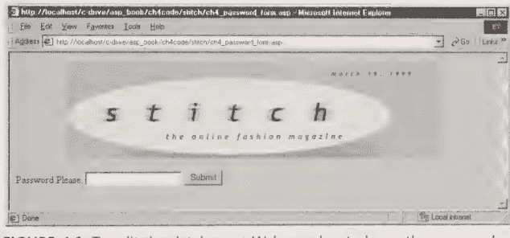

**图4-1** 要编辑数据库，Web用户必须知道密码

如果用户知道正确的密码，她首先看到的将是一个类似于上一章脚本显示的类别列表。但这次，她可以选择点击类别名称查看该类别中的记录，或者编辑该类别本身的信息（见图4-2）。

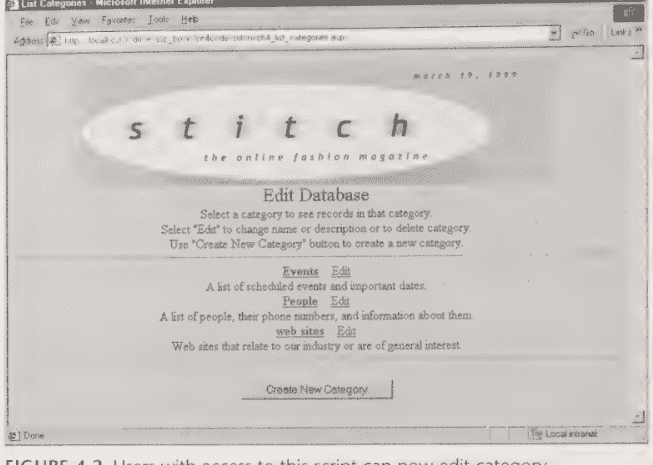

**图4-2** 拥有此脚本访问权限的用户现在可以编辑类别信息

使用图4-3中的类别编辑表单，用户可以更改类别的名称或描述。

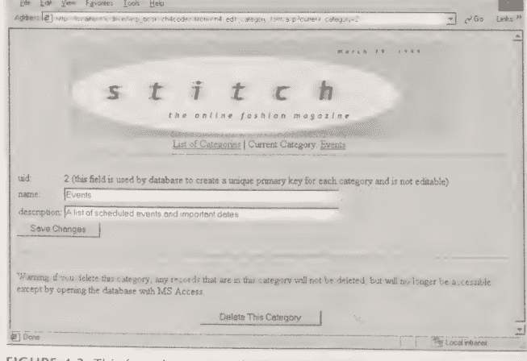

**图4-3** 此表单允许用户编辑类别名称和描述

就像类别列表（图4-2）一样，类别中的记录列表允许您选择特定记录进行编辑，如图4-4所示。

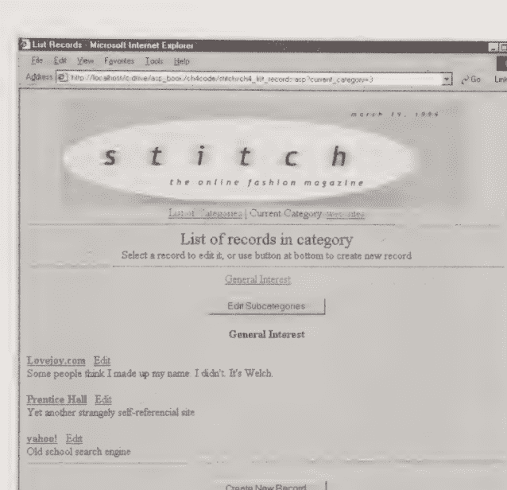

编辑记录表单从数据库中每个可编辑字段的字段生成一个HTML（注意，由数据库维护的uid字段不可编辑）如图4-5所示。


**图4-5** 编辑记录表单

那么，让我们看看使这些脚本运作的新功能。

## 新功能

### `Response.Redirect()`：使用Response对象将用户重定向到另一个页面

在第1章中，我描述了`Response`对象的`Write()`方法如何用于将HTML代码字符串或内容发送到浏览器。

`Response`对象也可用于向浏览器发送HTTP头信息。HTTP头用于交换各种信息。例如，浏览器使用头信息告诉Web服务器它们准备好处理什么类型的文件。同样，Web服务器使用头信息进行通信，包括例如文件包含的是文本、HTML还是二进制图像等。

HTTP头也可用于将浏览器从一个页面**重定向**到另一个页面。在ASP中，这是通过`Response`对象完成的：

```javascript
Response.Redirect("Page.asp")
```

这将把浏览器从当前脚本重定向到名为`Page.asp`的页面（同样，此代码也可以轻松地将访问者发送到名为`Page.html`的HTML页面）。

> **注意**
>
> 正如“头”这个词所暗示的，HTTP头需要在页面发送之前发送给浏览器。您会在本章中注意到，`Response.Redirect()`总是在打开`<body>`标签之前使用。

### ASP Session对象

HTML被设计为一种开放协议，允许计算机用户共享文档，无论使用什么程序创建文档或使用什么计算机查看文档。为了易于使用，HTML被设置为服务器不一定需要跟踪谁在访问网站，或者请求文档的访问者之前是否从同一服务器请求过其他文档。

这种使协议易于发布文档的特性，后来在某些情况下变得困难，例如需要知道请求一个页面的人是否又请求了另一个页面。例如，购物车脚本需要知道访问者的购物车中是否有任何物品。另一个需要维护用户信息（有时称为维护“状态”）的情况是，当需要对用户进行身份验证，然后允许该用户访问多个网页或脚本时。

面对跟踪网站访问者信息的需求，Netscape引入了一个名为“cookies”的浏览器功能，随后该功能被内置于Internet Explorer中，现在大多数浏览器都支持它。Cookies使得Web服务器能够在浏览器上存储少量信息，然后利用这些信息来跟踪网站访问者。

### 会话密码机制

ASP内置了一个用于跟踪独立访客（通过Cookie）的机制：`Session`对象。由于ASP `Session`对象能跟踪独立访客，因此一旦用户通过密码验证，就可以很容易地使用`Session`对象来验证请求访问脚本的用户是否确实拥有使用该脚本的权限。

要使用`Session`对象来阻止未认证用户使用某些脚本，需要两个要素：

- 1. 当用户满足特定条件（此处指用户知道密码）时，在`Session`对象中设置一个值的代码。
- 2. 在授予用户访问敏感脚本或HTML页面权限之前，检查所需值是否已存储在`Session`对象中的代码。

### 收集密码并设置会话变量

第一步是创建一个简单的脚本，用于收集密码、验证密码是否正确，然后将密码值赋给一个`Session`对象变量，以便后续脚本能够验证用户是否确实已通过认证。以下脚本可以实现此功能。

```asp
<%@ Language=JavaScript %>
<%
if (String(Request("password")) == "password")
{
    Session("edit_db_pass") = String(Request("password"));
    Response.Redirect("yet_another_page.asp");
}
%>
<html><head></head><body>
<form action="<%= String(Request.ServerVariables("SCRIPT_NAME")) %>">
<p>Password Please:
<input type=password name=password>
<input type=submit name="toss" value="Submit">
</form>
</body></html>
```

第9-14行包含一个非常简单的表单，其中包含一个文本框和一个提交按钮，允许用户输入密码。请注意，第12行中`input`标签的`type`属性被设置为`password`（而非`text`），这样用户输入密码时不会显示出来。

密码提交后，会由第3行的`if()`语句进行检查。如果输入的值正确（本例中为字符串`"password"`），则执行第5和第6行。第5行创建一个名为`edit_db_pass`的Session变量，并将表单中`password`框收集到的值赋给它。

第6行使用`Response.Redirect()`语句（上文已讨论）将浏览器转发到`yet_another_page.asp`。因此，如果输入了正确的密码，用户会被转发到`yet_another_page.asp`；而如果输入了错误的密码（或首次调用脚本时未输入密码），用户将看到表单，并有机会输入有效的密码。

### 检查有效的会话变量

设置`Session`变量后，下一步是在任何生成需要访问控制的页面的脚本中检查该变量。对于上面的代码，这是通过检查`Session`变量`edit_db_pass`的值是否设置为正确值来完成的：

```javascript
<%@ Language=JavaScript %>
<%
if (Session("edit_db_pass") != "password"){
    Response.Redirect("password_form.asp");
}
%>
//... 脚本的其余部分
```


第 3 行使用 `if()` 语句将存储在 `Session("edit_db_pass")` 中的值与字符串 `"password"` 进行比较。如果值不相同，浏览器将被重定向到页面 `password_form.asp`，该页面将包含一个类似于上面所示的脚本，用于从用户处收集有效的密码。

### 关于安全性的简要说明

这种类型的安全性以未加密的方式在网络上传输，并且可能被多个用户共享。

虽然对于许多应用来说已经足够，但这种类型的安全性主要用于密码的目的更多是防止不熟悉脚本工作方式的人意外删除或修改记录，而不是防止恶意用户访问或修改存储在数据库中的信息。

### 使用 SQL 更新记录

第 3 章简要介绍了 SQL，并描述了如何使用 SQL 从数据库中检索记录。本节将简要讨论如何使用 `update` 语句编辑现有记录。

这是通过将 `update` 语句约束为仅影响主键为特定值的记录来应用于特定记录的。

例如，可以使用 `update` 语句更改类别表中特定记录的 `description` 字段。

| Category_uid | category_name | category_description |
| :--- | :--- | :--- |
| 3 | Web sites | 与我们行业相关的网站或普遍感兴趣的网站 |

为此，编写语句使其仅应用于 `category_uid` 值为 3 的记录。由于 `category_uid` 字段是表的主键，因此只能包含唯一值，这有效地将语句约束为仅作用于上述单个记录。具体如下：

```sql
update categories set category_description = 'Spiffy sites!' where category_uid = 3
```

此语句修改了单个字段 `category_description` 的值。因此，记录被修改后如下所示：

| Category_uid | category_name | category_description |
| :--- | :--- | :--- |
| 3 | Web sites | Spiffy sites! |

### 使用 Request.QueryString 对象收集表单数据

在第 2 章和第 3 章中，使用 `Request` 对象收集由用户提交的表单数据，或包含在表单或链接中以向脚本指示要执行的任务。在所有情况下，脚本都必须具体标识期望获取值的字段名称。例如，在本章前面部分，脚本使用以下表达式检索名为 `password` 的表单变量：

```
Request("password")
```

实际上，脚本使用了一个包含 `String()` 函数的表达式，因为这有助于保持简洁：

```
String(Request("password"))
```

无论如何，这里的关键点是，让 `Request` 对象收集特定的表单变量非常容易。但是，如果你懒得具体列举每个正在使用的表单变量怎么办？

别担心，ASP 为我们提供了 `Request.QueryString` 对象，它包含了所有通过 HTTP Get 方法传递到服务器的表单信息。要收集通过 Get 方法发送到脚本的所有信息，只需遍历 `Request.QueryString` 对象即可：

```
1. <%@ Language=JavaScript %>

2. <html><head></head><body>

3. <%

4. for ( field_number = 1; field_number <=
   Request.QueryString.count ; field_number++ ){

5.

6.    temp_field =
       String(Request.QueryString.Key(field_number));

7.    temp_content =
       String(Request.QueryString.item(temp_field))

8. %>

9. <br><% = temp_field %>: <% = temp_content %>
```

> 1. HTTP Get 方法是指表单信息通过 URL 传递到服务器，这是默认方法。另一种方法是 Post 方法，它通过本章前面讨论的 HTTP 头将信息传递到服务器。脚本可以使用 `Request.Form` 对象收集通过 Post 方法传递到服务器的表单信息。

```
10. <%

11. }

12. %></body></html>
```

其工作原理如下：

- `Request.QueryString.count` 返回传入表单中表单变量的数量。
- 如果我们给 `Request.QueryString.Key()` 一个小于传入表单变量数量的数字，`Request` 对象会返回一个字段的名称。
- 如果我们将该字段名放入 `Request.QueryString.item()`，就能获得该字段的值。

因此，第 4 行开启了一个 `for()` 语句，该语句从 1 循环到 `Request.QueryString.count`。

> **警告**
>
> 注意，这里的 ASP `Request` 与众不同，它从 1 开始而不是更传统的 0。唉。

在每次迭代中，`field_number` 递增一，在每次连续操作中检索不同的字段名和值（第 6 和第 7 行）。最后，在第 9 行，键/值对被添加到网页中。

像这样遍历表单变量在两种情况下很有用。第一种是在编写脚本时，通常为了调试目的，查看传递了哪些表单变量很有用。第二种是在处理大量可以系统性操作的字段时。本章稍后将探讨这样一种场景。

### 使用正则表达式检查字符串内容（`String.search(//, "")`）

第 2 章简要介绍了正则表达式，展示了如何使用正则表达式在字符串中执行模式匹配和替换。

正则表达式也可用于检查字符串中是否能找到某个模式，以便做出决策。

例如，假设你有一个名为 `name` 的变量，并且你想检查它是否包含字符串 `"Bob"`，以便你的脚本能做出相应的反应：

```
if (name.search(/Bob/) >= 0 ){

    Response.Write("Bob! \n<p>So how the heck are you?")

}

else{

    Response.Write("Oh.<p>Hi.<p>How are you?")

}
```

当你对字符串应用 `search()` 方法时（正则表达式是通用 JavaScript 字符串对象的方法），如果未找到任何内容，则返回 `"-1"`；如果找到该模式，则返回模式开始的索引值。因此，如果 `name` 字符串中存在 `"Bob"`，该正则表达式将返回 0 或更大的值，并触发一个熟悉的问候语。非 Bob 用户则会被降级为仅仅礼貌性的 `"Hi"`。要检查多个值，你可以使用管道符（`"|"`）分隔模式：

```
if (name.search(/Bob|Dolores/) >= 0 ){

    //... do something

}
```

### JavaScript `substring()` 函数

`substring()` 函数可以让你从字符串中移除一小部分。例如，它可以用来移除字符串的最后一个字符：

```
sentence = "Nothing will happen here."

sentence = sentence.substring(0, (sentence.length-1));
```

这将,将会从字符串 `sentence` 中移除句点，留下字符串 `"Nothing will happen here"`。传递给 `substring()` 函数的两个参数分别是你想要从原始字符串中切出的第一个字符和最后一个字符的索引值。

### 编辑数据库的代码

编辑数据库中记录的代码比第 3 章中用于显示数据库信息的代码要复杂一些。图 4-6 说明了这一点。

### 实用工具：密码和包含文件

就是那些，你知道，有用的东西：

- 一个收集密码并检查其是否合格的脚本。
- 一个被本章大多数脚本共享的包含文件，它可以做不同的事情。

### Script 4-1

`ch4_password_form.asp`

```asp
<%@ Language=JavaScript %>

<%

if (String(Request("password")) == "password"){

    Session("edit_db_pass") = "OK";

    Response.Redirect("ch4_list_categories.asp");

}

%>

<html><head></head><body>

<form action="<%= 
    String(Request.ServerVariables("SCRIPT_NAME")) %>">

<p>Password Please:

<input type=password name=password >

<input type=submit name="toss" value="Submit">

</form>

</body></html>
```

### 脚本工作原理

本章大多数脚本使用的 `ch4_include.js` 文件会检查一个名为 `edit_db_pass` 的 `Session` 变量是否设置为值 `OK`。如果没有，用户将被发送到此脚本，该脚本会要求他们输入密码。如果他们能输入正确的密码，`edit_db_pass` 变量将被设置，然后他们将被重定向到 `ch4_list_categories.asp`。

1. 将语言设置为 JavaScript。
2. 检查密码，即名为 `password` 的表单变量是否设置为一个任意字符串值，在本例中是字符串 `"password"`（你可能想要选择一个不同的密码）。

如果密码正确，第 5-8 行将被执行。

如果没有设置密码或密码不正确，则运行脚本的其余部分，其中包含一个收集密码并将其提交到此脚本的表单。

6. 由于已收集到正确的密码，此行将用户的 `Session` 变量 `edit_db_pass` 设置为值 `OK`。这将使用户能够访问本章的其他脚本。

7. 用户被重定向到脚本 `ch4_list_categories.asp`。注意，`Response.Redirect()` 命令必须在任何 HTML 发送到浏览器之前使用，因为它是通过 HTTP 头实现的。

### Script 4-2

`ch4_include.js`

```javascript
<%

if (Session("edit_db_pass") != "OK"){

    Response.Redirect("ch4_password_form.asp");

}

var out = "";

var this_script_url = String(Request.ServerVariables("SCRIPT_NAME"));

var current_category = String(Request("current_category")); // category uid

var current_subcategory = String(Request("current_subcategory")); // subcategory string

var current_record = String(Request("current_record")); // data uid

// display scripts

var list_categories_script = "ch4_list_categories.asp";

var list_records_script = "ch4_list_records.asp";

var edit_record_form_script = "ch4_edit_record_form.asp";

var blank_record_form_script = "ch4_blank_record_form.asp";

var edit_category_form_script = "ch4_edit_category_form.asp";

var blank_category_form_script = "ch4_blank_category_form.asp";

var edit_subcategories_form_script = "ch4_edit_subcategories_form.asp";

// db scripts

var update_record_script = "ch4_update_record.asp";

var insert_record_script = "ch4_insert_record.asp";

var delete_record_script = "ch4_delete_record.asp";

var update_category_script = "ch4_update_category.asp";

var insert_category_script = "ch4_insert_category.asp";

var delete_category_script = "ch4_delete_category.asp";

var insert_subcategory_script = "ch4_insert_subcategory.asp";

var delete_subcategory_script = "ch4_delete_subcategory.asp";

//////////////////////////////////////////////////

// create connection to database

DSN = "DSN=ch3db";

Conn = Server.CreateObject("ADODB.Connection");

Conn.Open(DSN);

//////////////////////////////////////////////////

// create cat_object, the category object. Because category information is used
// on almost every page, this code is executed every time.

sql = "SELECT * FROM categories order by category_name";

rs = Server.CreateObject("ADODB.RecordSet");

rs.Open (sql, Conn);

if (rs.EOF){ // check to see if rs is empty

out += "no records found in categories table. something is probably wrong.";

}

else{ // rs not empty

        cat_object = new Object ();

        temp_counter = 0;

        while (! (rs.EOF)){

            cat_object[temp_counter] = new Object ();

            cat_object[temp_counter].uid = parseInt(rs.fields.item ("category_uid"))

            cat_object[temp_counter].name = String(rs.fields.item ("category_name"))

            cat_object[temp_counter].desc = String(rs.fields.item ("category_description"))

            rs.move(1);

            cat_object.qty = (temp_counter + 1);

            temp_counter ++;

        } // end while recordset

    } // end else (rs not empty)

rs.Close ();

///////////////////////////////////////////////////////

// Create nav_header

nav_header = '<div align="center">';

nav_header += '<a href="' + list_categories_script +'">List of Categories</a> '

if (current_category > 0){

    nav_header += ' | Current Category: <a href="' + list_records_script + '?current_category=' + current_category + '">'

    for (i = 0; i < cat_object.qty; i++){

        if (cat_object[i].uid == current_category){

            nav_header += cat_object[i].name + '</a>'

        }

    }

}

nav_header += '</div><hr>'

///////////////////////////////////////////////////////

// slash_date()

new function slash_date (temp_date){

if (temp_date != "" && temp_date != "null" ){
```


### 项目：使用 Web 界面编辑数据库记录


#### 从这里开始

`ch4_password_form.asp`

`ch4_insert_subcategory.asp`*

`ch4_delete_subcategory.asp`*

`ch4_delete_category.asp`*

`ch4_edit_category_form.asp`*

`ch4_update_category.asp`*

`ch4_list_categories.asp`*

`ch4_list_records.asp`*

`ch4_edit_record_form.asp`*

`ch4_update_record.asp`*

`ch4_delete_record.asp`*

`ch4_edit_subcategories_form.asp`*

图 4-6 各脚本如何组合

`ch4 includes.js`（* 表示该脚本使用包含文件）

```javascript
93.    temp_date3 = temp_date2.getMonth()+1 + "/" +
94.        temp_date2.getDate() + "/" +
95.        temp_date2.getFullYear();
96.    return (temp_date3);
97.  }
98.  else{
99.    return "--/--/--";
100. }
101. }
```

### 脚本工作原理

此包含文件被本章中的大多数脚本使用，以执行以下任务：

- 检查用户是否有权使用当前脚本。
- 定义共享变量。
- 创建 `cat_object` 对象，用于存储数据库所知的类别信息。
- 创建一个标题，用于在本章的脚本之间导航。
- 定义一个名为 `slash_date()` 的函数，该函数似乎与日期格式化有关。

**第2-5行。** 前四行用于检查当前用户是否有权使用调用 `ch4_include.js` 文件的任何脚本。

2. 使用 `if()` 语句检查会话变量 `edit_db_pass` 是否不等于 `OK`。如果为真（即不相等），则第3-4行用于在其他任何操作发生之前确保用户已获得授权。

**第3、4行。** 此代码块由单行代码组成，如果执行，将用户重定向到上面描述的脚本 `ch4_password_form.asp`，该脚本将要求用户输入密码。

**第7-37行。** 这些行声明了一系列有用的变量。有些具有固定值，有些则由脚本动态设置。

7. 创建一个名为 `out` 的变量，其值为空字符串（`""`）。这允许脚本在后续操作中将内容连接到 `out`，而无需担心 `out` 是否存在。

**第9行。** `this_script_url` 使用 ASP Request 对象创建一个指向当前脚本的 URL。请注意，这将指向使用此包含文件的脚本，而不是包含文件本身。这正是我们想要的。

**第11-13行。** 这些行收集表单变量 `current_category`、`current_subcategory` 和 `current_record`，并将它们放入同名的局部变量中。由于这些变量并非总是被设置，因此它们有时可能为“未定义”。

**第16-37行。** 这些行将脚本名称映射到变量，以便于以后重命名脚本。在这类项目中（有很多脚本在运行），这通常会很方便。

**第41-43行。** 这些行创建一个名为 `Conn` 的数据库连接，允许本章的脚本与数据库进行通信。

**第41行。** `DSN` 变量包含一个字符串，该字符串定义了用于连接数据库的 DSN 名称。有关 DSN 的解释，请参见前一章。

**第42行。** 接下来，使用 `Server.CreateObject()` 方法创建一个名为 `Conn` 的对象。正如参数所暗示的，`Conn` 对象与连接有关，而 ADODB 是一个 Microsoft 数据库技术的首字母缩写。

**第43行。** 使用第41行创建的 `DSN` 变量，对 `Conn` 对象应用 `open()` 方法，连接到我们想要操作的数据库。此时，我们就有了一个可用于创建记录集或执行 SQL 插入、更新或删除语句的数据库连接。

**第49-70行。** 这些行创建一个名为 `cat_object` 的对象，其中包含有关数据库中存储的信息类别的有用信息。例如，数据库中的默认类别是人员、事件和网站。

`cat_object` 的创建方式是：将数据库 `categories` 表（在前一章中描述）中存储的所有字段收集到一个记录集中，然后循环遍历该记录集，并将其中的信息添加到 `cat_object` 中。具体来说：

- 第49行。此行创建一个 SQL 语句，用于获取 `categories` 表中存储的所有记录，并按 `category_name` 字段按字母顺序对它们进行排序。
- 第50行。创建一个名为 `rs` 的记录集对象。
- 第51行。使用 `Conn` 对象和上面创建的 SQL 语句，通过 `open()` 方法填充记录集。
- 第52-55行。在循环遍历记录集之前，此行检查以确保 `rs.EOF` 不为 true。只有在记录集为空（意味着数据库中没有类别）时，此值才为 true。如果是这种情况，将在第53行向 `out` 变量添加一条错误消息。

在大多数情况下，数据库中会有类别，因此将由于第55行的 `else` 语句而执行第55-69行。

- 第56、57行。此时，创建了 `cat_object`，这当然是此处的主要内容。还会创建另一个名为 `temp_counter` 的变量，该变量将用于组织存储在 `cat_object` 中的类别记录。
- 第59行。从这里开始的 `while()` 循环将运行直到记录集为空，并且脚本已从中收集了所有类别信息。它包含第60-67行。
- 第60行。循环做的第一件事是在 `cat_object` 内部创建一个名为 `cat_object[temp_counter]` 的嵌套对象。例如，如果记录集中有三个记录，则将创建三个嵌套对象：`cat_object[0]`、`cat_object[1]` 和 `cat_object[2]`。
- 第61-63行。记录集中 `category_uid`、`category_name` 和 `category_description` 字段中的信息被传递到正在创建的嵌套对象的相应属性。
- 第65行。收集了所需信息后，对 Recordset 对象应用 `move()` 方法以转到下一个对象。请注意，如果没有这一行，`while` 循环将一直运行，直到 Web 服务器超时。
- 第66行。`cat_object` 的 `qty` 属性被设置为比 `temp_counter` 大一，这是到目前为止找到的类别数量。理论上，在 `while` 循环之外执行此操作可能更高效，这样它只会发生一次。

**第67行。** 最后，`temp_counter` 递增，以便第60行上创建的下一个嵌套对象将拥有一个新名称。

**第70行。** 处理完记录集后，使用 `close()` 方法将其关闭。此时，`cat_object` 已准备就绪，可以在需要获取数据库中存储的类别信息时随时使用。

**第74–86行。** 这些行创建一个名为 `nav_header` 的变量，其中包含一个 HTML 字符串，该字符串创建了一个非常简单的标题，如图4-7所示。

该标题有两个链接。第一个链接返回到数据库中所有类别的列表——可以说是本章脚本的主页。第二个链接是特定类别的名称，并将用户带到该类别中的记录列表。

这些行上的大部分代码都是 HTML，此处不再讨论。

**第75行。** 此行使用此文件前面定义的变量 `list_categories_script` 来构建链接。

**第77行。** 此行检查以确保 `current_category` 被设置为大于零的值，然后再执行第78–84行。这是必要的，因为 `current_category` 变量并非总是被设置（例如，当用户首次登录时），并且在此情况下，第78–84行的代码将生成错误。

**第78行。** 变量 `list_records_script` 和 `current_category` 用于创建一些 HTML。

**第79–83行。** 这些行循环遍历 `cat_object`，以查找其 uid 与 `current_category` 的值匹配的类别，以便我们可以找出该类别的名称（创建一个指向名为“Events”的类别的链接是可以的。创建一个指向类别“2”的链接可能会疏远一些用户）。

**第79行。** 此行上的 `for()` 循环将根据 `cat_object` 中存储的类别数量遍历 `cat_object`。

**第80行。** 此行上的 `if()` 语句检查当前类别的 uid 是否与 `current_category` 中的值匹配。如果匹配，第81行将该类别的名称添加到 HTML 字符串 `nav_header` 中。

**第86行。** 再添加一些 HTML，`nav_header` 就准备好了。

**第90-99行。** 此文件中的最后一段代码定义了一个名为 `slash_date()` 的函数。该函数的目的是将存储在数据库中的相当难以理解的日期信息转换为更易于阅读的字符串。例如，`Wed Jan 5 00:00:00 PST 2000` 将转换为 `1/5/2000`。它的工作原理如下：

**第90行。** 此行告诉计算机正在创建一个名为 `slash_date` 的新函数，它接受一个参数，该参数将存储在局部变量 `temp_date` 中。

**第91行。** 要做的第一件事是确保我们处理的是实际的日期。此行检查以确保我们处理的不是空字符串或值 `"null"`。请注意，`"null"` 在引号中，因为脚本正在检查数据库中的 `"null"`，而不是 JavaScript 的特殊值 `null`。

如果 `temp_date` 看起来不太可能是日期，则 `else` 子句（第96-98行）将返回字符串 `"--/--/--"`。否则，脚本假定我们有一个日期，并执行第92-94行。

**第92行。** 此行创建一个名为 `temp_date2` 的新对象，该对象是通过解析 `temp_date` 变量创建的 JavaScript `Date()` 对象。

**第93行。** 接下来，使用一个名为 `temp_date3` 的字符串来收集 `temp_date2` 中存储的月份、日期和年份信息。有关使用 JavaScript `Date()` 对象的更多信息，请参见第1章。

此处添加到字符串中的斜杠是此函数名称的灵感来源。

**第94行。** 我们的工作完成了，函数返回变量 `temp_date3`。

**第99行。** 函数结束。

**第101行。** 包含文件结束。

### 编辑类别的代码

图 4-8 所示的脚本用于查看和编辑类别信息，详细说明如下。

- `ch4_list_categories.asp`：显示数据库中的类别列表，并让用户跳转到 `ch4_list_records.asp`、`ch4_edit_category_form.asp` 或 `ch4_blank_category_form.asp`。
- `ch4_edit_category_form.asp`：让用户修改类别信息或删除类别。
- `ch4_update_category.asp`：使用 `ch4_edit_category_form.asp` 创建的编辑内容更新数据库。
- `ch4_delete_category.asp`：删除一个类别。
- `ch4_blank_category_form`：创建一个空白表单，供用户创建新类别。
- `ch4_insert_category.asp`：使用在 `ch4_blank_category_form.asp` 中输入的信息插入新类别。

### 脚本 4-3

#### `ch4_list_categories.asp`

```asp
1. <%@ Language=JavaScript %>

2. <!-- #include file="ch4_include.js" -->

3.

4. <html><head><title>List Categories</title></head>

5. <body>

6.

7. <center><font size="+2"> Edit Database </font>

8. <br>Select a category to see records in that category.

9. <br>Select "Edit" to change name or description or to delete category.

10. <br>Use "Create New Category" button to create a new category.<hr>

11.

12. <%

13. for (i = 0; i < cat_object.qty; i++){

14.     %>

15.     <a href="<% = list_records_script

16.        %>?current_category=<% = cat_object[i].uid

17.        %>"><b><% = cat_object[i].name

18.        %></b></a>&nbsp;&nbsp;&nbsp;

19.     <a href="<% = edit_category_form_script

20.        %>?current_category=<% =

21.        cat_object[i].uid%>">Edit</a>

22.     <br><% = cat_object[i].desc %><br>

23. <%

24. }

25. %>

26.

27. <hr>

28. <form action="<% = blank_category_form_script %>">

29. <input type="submit" name="toss" value="Create New

30.      Category">

31. </form>

32. </center>

33.

34. <%

35. Conn.Close ();

36. %>

37.

38. </body></html>
```

### 脚本工作原理

如果此脚本看起来很眼熟，那是因为它与上一章中描述的 `ch3_view_categories.asp` 几乎完全相同。只有三个显著区别：首先，有一些说明文字告诉用户如何使用此页面。虽然花时间写文档很枯燥，但这总比不得不停下手中的工作，第十二次向别人解释如何使用这个页面要好。其次，每个类别名称旁边都有一个名为“Edit”的链接，将用户带到 `ch4_edit_category_form.asp`。最后，页面底部有一个表单，用于创建“Create New Category”按钮。

因为这主要是对第 3 章脚本的重复，我将只讨论脚本中新增的部分：

- 第 16 行。这是创建“Edit”链接的地方。这使用了在包含文件中创建的 `edit_category_form_script` 变量，并设置 `current_category` 变量，以便脚本知道正在编辑哪个类别。
- 第 23–25 行。这里的小表单用于显示一个上面写着“Create New Category”的按钮。请注意，这里使用按钮而不是链接并没有什么特别的原因。例如，一个链接可能看起来像这样：

```html
<a href="<% = blank_category_form_script %>">Create New Category</a>
```

两种方式都可以很好地工作：这在很大程度上是界面设计的问题，正如你可能已经发现的，我在脚本中并没有太关注界面设计。我并不是说界面设计不重要。它很重要。在很多方面，它比编写代码更重要，因为人们更愿意使用界面出色的糟糕脚本，而不愿看起来一团糟的好代码。只是这是一本关于编写代码的书，要让界面看起来真正好，就意味着要在书中的脚本里塞满大量 HTML 代码，这会让可读性大大降低。

同样，我又是用 `"toss"` 作为我不关心其值的按钮的名称。这样，六个月之后，我可以一眼就知道这个按钮只是为了好看而已。

### 脚本 4-4

#### `ch4_edit_category_form.asp`

```asp
1. <%@ Language=JavaScript %>

2. <!-- #include file="ch4_include.js" -->

3.

4. <html><head><title>Edit Category Form</title></head><body>

5.

6. <% = nav_header %>

7.

8. <%

9. // create recordset "rs"

10. sql = "SELECT * FROM categories where category_uid = " + current_category ;

11. rs = Server.CreateObject("ADODB.RecordSet");

12. rs.Open (sql, Conn);

13.

14. // check to see if rs is empty

15. if (rs.EOF){

16.     out += "no records found. This shouldn't

17.     happen unless multiple people are using the

18.     database simultaneously and somebody just deleted

19.     the category you were about to edit.";

20. }

21.

22. // rs not empty, we have a record to edit, so

23.     create form:

24. else{    -%>
```


```html
<form action="<% = update_category_script%>">
<table>

<%
for (field_number = 0; field_number < rs.fields.count; field_number++) {
    temp_field = String(rs.fields(field_number).Name);
    temp_content = String(rs.fields.item(temp_field));

    // data cleanup: nulls
    if (temp_content == "null") {
        temp_content = "";
    }

    // we can get rid of "category_" on labels,
    // but not in the form fields
    temp_field_label = temp_field.replace(/category_/, "");

    // uid field should not be editable:
    if (temp_field.search(/uid/) >= 0) {
        out += "\n\n<tr><td>" +
            temp_field_label + ": </td><td>" +
            temp_content + " (this field is used by " +
            "database to create a unique primary key " +
            "for each category and is not " +
            "editable)</td></tr>";
    }

    // standard text box for name and description fields
    else {
        out += "\n\n<tr><td>" +
            temp_field_label + ": </td><td><input " +
            'type="text" name="' + temp_field + '"' +
            ' value="' + temp_content + '"' +
            " size=60></td></tr>";
    }
}
// end of looping through incoming form fields

} // end else (rs not empty)
rs.Close();
%>

<% = out %>
</table>

<input type="hidden" name="current_category"
       value="<% = current_category %>">
<input type="submit" name="toss" value="Save Changes">
</form>

<hr>

<p>Warning: if you delete this category, any records
    that are in this category will not be deleted, but
    will no longer be accessible except by opening the
    database with MS Access.</p>

<center>
<form action="<% = delete_category_script%>">
<input type="hidden" name="current_category"
       value="<% = current_category %>">
<input type="submit" name="toss" value="Delete This Category">
</form>
</center>

<%
Conn.Close();
%>
</body>
</html>
```

### 脚本工作原理

此脚本允许用户编辑类别记录的名称和描述字段，以及让用户完全删除一个类别。请注意，当删除一个类别时，该类别中的记录将不再能通过本章中的脚本访问，所以你应该对此谨慎一些（如果你认为使用此脚本的人可能会意外执行此操作，你可以将第 59–65 行从脚本中移除）。

调用此脚本的 URL 必须告诉脚本被编辑类别的唯一 ID 是什么（这是通过一个名为`current_category`的表单变量完成的，本章中的大多数脚本都使用这个变量）。

此脚本包含一个我很喜欢的小技巧：与其硬编码一个由记录集填充的表单，不如让这个脚本动态生成表单，基于在记录集中找到的字段。因此，你完全可以向`categories`表中添加一个字段（这是存储类别信息的数据库表），并能够编辑该字段中的信息，而无需修改此脚本。

请注意，这意味着表单上的字段标签来源于字段名称，所以你需要为任何新字段取一个对人类来说可读性较好的名称，这个系统才能正常工作。

详细说明：

- 第 1、2 行。设置脚本语言为 JavaScript 并导入本章前面讨论的包含文件。
- 第 6 行。将`nav_header`变量添加到正在生成的页面中。这包含一个返回`ch4_list_categories.asp`的链接，以及一个指向当前类别记录列表（`ch4_list_records.asp`）的链接。
- 第 10 行。创建一个 SQL 字符串（变量`sql`），从`categories`表中选择所有`category_uid`字段等于表单变量`current_category`的记录。因为`category_uid`是`categories`的主键，这将只返回一条记录。因此，我们不需要像获取多条记录时那样遍历检索到的记录集。
- 第 11、12 行。首先，创建 Recordset 对象`rs`。在下一行，使用`Open()`方法将 SQL 字符串`sql`传递给`Conn`对象，并将生成的记录集放入`rs`对象中。
- 第 15–17 行。检查记录集是否为空（如果`rs`为空，`rs.EOF`将为 true）在大多数时候不会有什么用。但如果多个用户共享数据库，或者你决定扩展这些脚本而意外情况开始发生时，它可能会派上用场。
- 第 20 行。如果如预期的那样，`rs`对象不为空，则此`else()`语句执行第 20–49 行。
- 第 22 行。因为脚本正在收集用户的信息，所以需要一个表单。此脚本生成的表单将被发送到`include.js`中定义为`update_category_script`的脚本。

### 第 26–47 行

从第 26 行开始，使用一个`for()`循环遍历存储在`rs`对象中的第一条（也是唯一一条）记录的每个字段。字段名称和内容通过`rs.fields`对象获取。

就本脚本而言，将从`categories`表中检索三个字段：`category_uid`、`category_name`和`category_description`。字段名称通过计数器`field_number`从`rs.fields`中获取，该计数器从 0 递增到 2。因此，在第 28 行，`temp_field`被依次设置为`String(rs.fields(0).Name)`、`String(rs.fields(1).Name)`和`String(rs.fields(2).Name)`。

在第 29 行，然后使用`temp_field`将字段内容设置到变量`temp_content`中。因此，`temp_content`首先被设置为`String(rs.fields.item("category_uid"))`（当`field_number`为 0 时），然后是`String(rs.fields.item("category_name"))`（当`field_number`为 1 时），最后是`String(rs.fields.item("category_description"))`（当`field_number`为 2 时）。

### 第 32 行

如果一个字段为空，则该字段的值将被设置为`null`。出于某种原因，单词“null”似乎会让一些用户困惑，将其替换为空字符串似乎能让他们满意，而且这很容易做到。

### 第 35 行

数据库中的所有字段都有前缀：`categories`表中的字段都以`category_`开头，`data`表中的字段以`data_`开头，等等。……同样，这可能会让用户困惑，他们随后可能会提出讨论，所以最好直接去掉前缀。这是通过一个简单的正则表达式、`replace()`方法来完成的，在 JavaScript 中，该方法可以应用于任何字符串。在此例中，正则表达式`/category_/`被替换为空字符串。

前缀的目的是让字段名称尽可能明确无歧义。你会注意到我的代码中没有太多像`rsFldLstWrd`这样的奇怪变量。当然，我打字花的时间比你们这些喜欢缩写一切的怪人多一点。另一方面，当我六个月后回看自己的代码，试图弄清楚我当时在做什么时，也许我能节省一点时间。也许这也让这本书更容易阅读一些。无论如何，在我改变主意之前，或者关于命名约定的争论不再让我想起关于哪个操作系统最好的对话之前，我就会这样做。

最后，在检索到我们需要的字段并进行了一些清理之后，是时候将信息发送到浏览器了。如何做到这一点取决于我们讨论的是哪个字段：

- **第 38–40 行。** 因为`uid`是一个其值由 MS Access 设置的字段（Access 称之为“自动编号”字段；其他 SQL 数据库提供类似的功能），所以它不应该是可编辑的。使用`search()`正则表达式来检查`/uid/`，如果当前字段是主键字段，它将被显示但不可编辑。在某些情况下，注释掉第 39 行可能是有意义的，这样就不会显示此信息，以简化界面。
- **第 43–45 行。** 所有其他字段以相同方式显示：变量`temp_field_label`用于为文本框加标签，其`name`属性设置为当前字段的名称（`temp_field`），其`value`属性设置为当前字段的值（`temp_content`）。
- 第 46 行和第 48 行关闭了之前打开的一些花括号。
- **第 49 行。** 关闭 Recordset 对象。
- **第 51 行。** 用于存储发送到浏览器的大部分内容的变量`out`在这里被输出。
- **第 54 行。** 变量`current_category`通过一个隐藏的表单变量传递给下一个脚本。`current_category`与`category_uid`是同一回事，下一个脚本将需要它，该脚本将把此表单上进行的编辑提交到数据库，以便它可以对正确的记录进行更改。
- **第 55 行。** 与本章中的所有脚本一样，提交按钮上的文本，本例中是“保存更改”，可以在不影响脚本工作方式的情况下进行更改。因为人们总是想更改按钮上的文字，所以你想避免为按钮分配更多功能，除了当有人单击提交按钮时，当前表单会提交给一个脚本这一事实。
- **第 61–64 行。** 这里的小表单用于删除类别。这里的关键是`<form>`标签的`action`属性设置为`delete_category_script`（在包含文件中定义），并且要删除的类别的主键（`current_category`）作为隐藏变量传递。相同的信息也可以作为链接传递：

```html
<a href="<% = delete_category_script %>?current_category=<% = current_category %>">Delete This Category</a>
```

- **第 67 行。** 关闭数据库连接。

### 脚本 4-5

#### `ch4_update_category.asp`

```asp
<%@ Language=JavaScript %>

<!-- #include file="ch4_include.js" -->

<%
temp_update = "";

for (field_number = 1;
     field_number <= Request.QueryString.count;
     field_number++) {

    temp_field = String(Request.QueryString.Key(field_number));
    temp_content = String(Request.QueryString.item(temp_field));

    if (temp_field.search(/uid|current_category|toss/) < 0) {
        // check for null values
        if (temp_content == "null" || temp_content == "") {
            temp_update += " " + temp_field + " = null,";
        }
        else {
            temp_content = temp_content.replace(/'/g, "&#039;");
            temp_update += " " + temp_field + " = '" +
                temp_content + "',";
        }
    } // end if()
} // end for()

// remove last character, which is a trailing comma that we don't want
temp_update = temp_update.substring(0, temp_update.length - 1);

update_sql = "update categories set " + temp_update +
    " where category_uid = " + current_category;

Conn.Execute(update_sql);

Conn.Close();

Response.Redirect(list_categories_script);

// Response.Write("<hr>\n\n\n" + update_sql + "\n\n\n<hr>");
// Response.Write(list_records_script);
%>
```

### 脚本工作原理

`ch4_update_category.asp`执行一个相对简单的任务——它收集使用上一个脚本（`ch4_edit_category_form.asp`）生成的表单进行的编辑，并将它们写入数据库。

这意味着要做两件事：首先，收集从前一个脚本转发过来的表单信息。其次，创建一个 SQL 语句，将这些信息保存到数据库中。

正如前一个脚本根据它在数据库中找到的字段动态生成表单一样，这个脚本也足够智能，可以动态收集它接收到的表单信息并生成 SQL 语句，而无需知道那些字段是什么。同样，这意味着表单字段需要以特定方式命名（在本例中，它们需要与要插入数据的字段同名）。这很容易做到，因为前几个脚本中的表单字段是基于脚本在数据库中找到的字段名称动态生成的。同样，这意味着你可以向数据库的类别表中添加新字段，而不必担心更新此脚本。如果这还不有趣，我想我就不知道什么才有趣了。

在我深入研究之前，还有一件事。用于编辑已知主键的单条记录的 SQL 语句是一个`update`语句，其形式为：

```sql
update table
set field_1 = 'value_1',
    field_2 = 'field_2',
    ...
where primary_key_field = value
```


因此，这个脚本需要解决的谜题是找到一个相对简单的方法来收集传入的表单字段和值，并将这些信息插入到由一系列字段和值组成的 SQL 语句中。

这意味着将传入的数据库字段名称和值收集到一个逗号分隔的字符串中（`field_1='value_1'`, `field_2='field_2'`, ...），而 `where` 子句将把更改分配给 `category_uid` 字段等于值 `current_category` 的那条记录。

这就是它的工作方式：

- 5. 脚本的核心部分首先创建一个名为 `temp_update` 的空字符串变量。
- 6-22. 这些行包含一个 `for()` 循环，该循环对 `Request.QueryString` 对象（在本章的新特性部分讨论）中的每个字段执行一次。`Request.QueryString` 对象包含使用 `Get` 方法传递给当前脚本的所有表单信息（URL 中的表单内容）。

正如前一个脚本中使用 `rs.fields` 对象来收集字段名称和值一样，`Request.QueryString` 对象告诉我们收集了多少个表单变量（`count` 属性），它们的名称是什么（通过将索引值传递给 `Key()` 方法），以及它们的值是什么（通过将字段名传递给 `Item()` 方法）。

因此，在第 6 行，`for()` 循环从 1 递增到 `Request.QueryString.count`，依次循环遍历每个传入的表单变量，以便可以将要写入数据库的信息放入 `temp_update` 字符串中。²

- 8. 使用 `Request.QueryString.Key()` 将 `temp_field` 设置为表单变量（或键）。
- 9. 使用 `Request.QueryString.Item()` 将 `temp_content` 设置为该表单变量的内容。
- 11. 收集表单信息后，第一步是消除不写入数据库的表单信息。第 11 行使用正则表达式搜索匹配**不应**存在于数据库中的表单变量的表达式：`/uid/`、`/current_category/` 和 `/toss/`。使用正则表达式使得添加我们希望排除的新变量更加容易。例如，这一行最初是这样的：

```javascript
if (temp_field != "toss"){
```

然后我意识到还需要检查字段 `current_category`。因此：

```javascript
if (temp_field != "toss" && temp_field !=
"current_category"){
```

后来，当我传递一个表单变量 `category_uid` 时（这是多余的，因为我已经有了 `current_category`，但我花了一段时间才意识到这一点），添加另一个“逻辑与”（`&&`）的想法让我进行了思考；因此，使用了正则表达式。

无论如何，如果正则表达式找到匹配项，它会返回找到匹配项的索引值，该值将为零或更高。如果没有匹配项，它返回的值为 -1，这样 `if()` 的结果为真（负一小于零），第 12-20 行的代码将被执行。

> ² 注意，`QueryString` 对象的索引值从 1 开始，而不是从 0 开始。

**13,14.** 空值和空字符串会得到特殊处理：`null` 是 SQL 中的一个特殊值。数据库中的字符串字段（用 SQL 术语来说：`char`、`varchar`、`text`/`memo` 等……⁴）存储零长度字符串（`""`）时，实际上存储的是一个字符串。另一方面，设置为 `null` 的字段是空的。为了简单起见，最好在数据库中保持数据的一致性。

此外，`null` 比空字符串表现更好，因为整数、日期字段、字符串等都可以设置为 `null`，而字符串字段可以设置为空字符串，整数字段则不能。

**14.** 无论如何，如果 `temp_content` 为空，无论我们处理的是哪个字段，都会将其设置为 `null`。例如，如果 `category_description` 字段被设置为空字符串，结果等同于：

```javascript
temp_update += " category_description = null,"
```

3. `char`、`varchar`、`text` 和 `memo` 是可以存储字符串的 SQL 数据类型。

### 120 第 4 章 • 编辑记录

注意前面的空格和后面的逗号，这样就可以将任意数量的字段连接到 `temp_update` 字符串中。

- 16. 空或空值字段都以相同的方式处理。
- 18. 首先，使用正则表达式将单引号（在 SQL 语句中用作字符串分隔符的特殊字符）替换为字符串 `"&#039;"`，这是单引号的 HTML 表示。注意使用 `"g"` 操作符来替换每个单引号，而不仅仅是第一个。
- 19. 接下来，将字段名和值连接到 `temp_update` 字符串中。例如，如果字段 `category_name` 设置为 `"Events"`，第 19 行将等同于语句：

```javascript
temp_update += " category_name='Events',";
```

- 21. 第 11 行的 `if()` 结束。
- 22. `for()` 循环结束。此时，脚本已检查了所有传入的表单变量，使用其中一些将字段名和内容连接到 `temp_update` 变量中，并丢弃了那些不需要在数据库中更新的字段。
- 25. 因为每次将信息添加到 `temp_update` 字符串时都会包含一个尾随逗号（","），所以总会有一个多余的逗号需要移除以避免产生错误。这是使用 JavaScript 的 `substring()` 函数（实际上是一个可以应用于任何字符串的方法，这使得字符串有点像对象……但那是另一个故事）完成的。

`substring()` 方法接受两个参数：子字符串开始和结束的索引值。我们想要从最开头（`"0"`）到倒数第二个字符（`temp_update.length-1`：字符串的 `length` 属性返回字符串中的字符数。通过减去一个，可以消去那个有问题的逗号）的所有内容。

- 27. 最后，生成了 SQL 字符串 `update_sql`。`temp_update` 字符串提供了字段名和值的列表，而 `current_category` 变量提供了主键字段的值，以便更新数据库中的相应记录。
- 29. 第 27 行组合的 SQL 语句使用 `Conn` 数据库连接对象（在包含文件中创建）的 `Execute()` 方法执行。
- 31. `Conn` 对象被关闭。
- 35,36. 这两行在将来可能对调试有用。例如，如果你决定对向此脚本提交信息的表单进行一些更改，突然开始收到错误，很可能与尝试执行第 29 行的 SQL 语句有关。如果发生这种情况，你可以注释掉第 29 行和第 33 行，并取消注释第 35 行和第 36 行，这将显示你可能最需要的两条信息：你要执行的 SQL 语句的样子以及之后表单重定向的位置。例如，如果你从 `update_sql` 字符串中得到某种错误，当你看到该语句时，很有可能就能看出问题所在。如果你是 SQL 新手，一切都像天书一样，你可能想借此机会学习更多关于 SQL 的知识，或者也许是时候向比你更熟悉 SQL 的朋友求助了（这是我每次遇到难题时最喜欢的编程技巧）。新闻组也经常擅长处理这类事情。

### 脚本 4-6

#### `ch4_delete_category.asp`

```asp
1. <%@ Language=JavaScript %>

2. <!-- #include file="ch4_include.js" -->

3. <%

4.

5. delete_sql = "delete from categories where category_uid = " + current_category;

6.

7. Conn.Execute(delete_sql);

8.

9. Conn.Close();

10.

11. Response.Redirect(list_categories_script)

12. %>

13. //Response.Write("<hr>\n\n\n" + delete_sql +

    "\n\n\n<hr>");

14. //Response.Write(list_categories_script)

15.

16. %>
```

### 脚本如何工作

要使此脚本工作，表单变量 `current_category` 需要存在。例如，一个有效的 URL 应该是：

```text
ch4_delete_category.asp?current_category=2
```

删除内容当然比创建或编辑内容更容易，这个脚本也相应地很简单。

SQL `delete` 语句的关键问题是确保其作用域足够有限，这样你就不太可能删除你想保留的东西。例如，你要非常小心不要执行类似 `"delete from table_name"` 这样的语句，这会删除 `table_name` 表中的每一条记录。

另一方面，通过将 `delete` 语句的作用域限制在那些主键字段与特定值匹配的记录，你永远不会删除多于一条记录（记住，根据定义，主键字段包含唯一的值）。所以当你创建 `delete` 语句时，要注意 `where` 子句。

工作原理：

- 1,2. 标准的准备工作：语言是 JavaScript，我们需要包含文件，因为它为我们创建了数据库连接对象（`Conn`）。
- 5. 这是创建 SQL 语句 `delete_sql` 的地方（如上所述）。
- 7. SQL 语句被执行。
- 9. `Conn` 对象被关闭。
- 11. 浏览器被重定向到 `list_categories_script`，这是一个在包含文件中设置的变量，本章前面讨论过。
- 13,14. 如果此脚本开始给你错误消息，可以取消注释这两行。同时你可能需要注释掉第 7 行和第 11 行。

### 脚本 4-7

`ch4_blank_category_form.asp`

```asp
1. <%@ Language=JavaScript %>

2. <!-- #include file="ch4_include.js" -->

3.

4. <html><head><title>Blank Category Form</title></head><body>

5.

6.

7. <% = nav_header %>

8. 要创建新类别，请在下面输入名称和描述，然后点击“创建新类别”按钮。<hr>

9.

10. <%

11. sql = "SELECT * FROM categories where category_uid=0" ;

12. rs = Server.CreateObject("ADODB.RecordSet");

13. rs.Open (sql, Conn, 2,3);

14. %>

15.

16. <form action="<% = insert_category_script %>"><table>

17.

18. <%

19. // 遍历表单字段，并根据我们在记录集中找到的字段创建一个表单。

20.

21. for ( field_number = 0; field_number < rs.fields.count ; field_number++ ){

22.

23. temp_field = String(rs.fields(field_number).Name);

24.

25. // 我们可以从标签中去掉"category_"，但不能在表单字段中去掉。

26. temp_field_label = temp_field.replace(/category_/,"");

27.

28. // 如果不是uid字段，则创建文本框：

29. if (temp_field.search(/uid/) < 0){

30. %>

31. <tr><td><% = temp_field_label %>:</td><td><input type=text name="<% = temp_field %>"value="" size=60></td></tr>

32. <%

33. }

34.

35. }// 遍历传入表单字段的循环结束
```

### 脚本工作原理

此脚本动态生成一个可用于创建新分类的表单。讨论此脚本的最佳方式是先指出它并非必要。直接创建一个 HTML 页面来完成相同任务会简单得多。例如，你可以使用此脚本生成的 HTML（我移除了一些空格和换行符）：

```html
<html><head><title>空白分类表单</title></head><body>

<div align="center"><a href="ch4_list_categories.asp">分类列表</a>
</div><hr>

要创建新分类，请在下方输入名称和描述，然后点击“创建新分类”按钮。<hr>

<form action="ch4_insert_category.asp"><table>

<tr><td>名称: </td><td><input type=text name="category_name" value="" size=60></td></tr>

<tr><td>描述: </td><td><input type=text name="category_description" value="" size=60></td></tr>

</table>

<input type="submit" name="toss" value="创建新分类">

</form>

</body></html>
```

那么为什么要使用脚本呢？原因如下：

1. 我比较懒。
2. 编写能自我维护的 JavaScript 代码比修改 HTML 更有趣。
3. 本书并非关于 HTML 编程。

实际上，我可能只需要前两个理由：再次强调，此脚本基于它在数据库中发现的字段来构建表单。这意味着如果我在数据库的 `categories` 表中添加一个字段，该字段不仅会出现在此脚本生成的表单中，还会被 `ch4_edit_category_form.asp` 和 `ch4_update_category.asp` 自动处理。

> **请记住**
>
> 将脚本置于数据库之上的主要目的之一，是为了避免手工生成数十、数百甚至数千个 HTML 页面。为了限制印刷本书所消耗的树木数量，此脚本处理的是一个相对简单的数据库——它生成了一个仅包含两个字段的表单。然而，它可以用于创建包含更多字段的记录。事实上，这正是本章后面在 `ch4_blank_record_form.asp` 中将要发生的情况。

闲话少叙。让我们看看脚本：

- **1,2.** 声明语言并包含引用文件。
- **7.** 插入 `nav_header` 字符串（来自包含文件，在本章前面描述过）。这会创建一个返回 `ch4_list_categories.asp` 的链接。
- **11.** SQL 字符串不需要特别具体，因为脚本真正关心的是检索 `categories` 表中的字段名称。例如，不需要 `where` 子句，也可以使用以下语句：

```javascript
sql = "SELECT * FROM categories";
```

然而，设置 `where` 子句可以限制查询返回的记录集大小，从而减少数据库的负载，并且大概也能减少存储记录集所需的内存。（我并未测试过这一点，所以你永远不知道。但空记录集似乎比包含几条记录的记录集使用更少的内存。）

- **12,13.** 创建记录集 `rs`。
- **16.** 与本章所有脚本一样，`<form>` 标签中的 URL 是一个变量，它在包含文件中设置，以便尽可能轻松地更改文件名。
- **21.** 这是一个 `for()` 循环的开始，将从第 22 行运行到第 35 行。循环将为 `categories` 表中的每个字段执行一次。由于表中目前有三个字段（`category_uid`、`category_name`、`category_description`），希望它能运行三次，`field_number` 从 0 递增到 2。这与 `ch4_edit_category_form.asp` 中用于遍历字段的机制相同。
- **23.** `temp_field` 基于索引值 `field_number` 设置为当前字段名。
- **24.** 使用正则表达式从 `temp_field` 中去除前缀 `category_` 并创建变量 `temp_field_label`。
- **29.** 脚本将为每个不匹配正则表达式 `/uid/` 的字段创建一个文本表单元素。（如果 `search()` 方法找到表达式 `/uid/`，它将返回一个零或更大的值，第 30-33 行将不会执行。）使用不同的测试也可以达到相同效果，例如：

```javascript
if (temp_field != "category_uid")
```

- **31.** 此脚本的核心：变量 `temp_field_label` 和 `temp_field` 用于创建一个标签和一个文本框，用户可以在其中输入信息。
- **36,38.** 关闭 `rs` 和 `Conn`。
- **42.** 需要包含一个提交按钮，以便用户可以提交表单。`name` 属性设置为 `toss`，处理此表单的脚本不会使用它。

### 脚本 4-8：`ch4_insert_category.asp`

```asp
<%@ Language=JavaScript %>

<!-- #include file="ch4_include.js" -->

<%

fields = "";

values = "";

// 遍历传入的表单字段以构建SQL语句

for ( field_number = 1; field_number <= Request.QueryString.count ; field_number++ ){

    temp_field = String(Request.QueryString.Key(field_number));

    temp_content = String(Request.QueryString.item(temp_field))

    if (temp_field.search(/toss/) < 0 ){

        fields += ' ' + temp_field + ',';

        // 检查空值

        if (temp_content == "null" || temp_content == ""){

            values += " null,";
```


```javascript
}

        // 这适用于非空字符字段
        else {
            temp_content = temp_content.replace(/'/g, "&#039;");
            values += " '" + temp_content + "',";
        }

    } // 结束我们想要添加到更新字符串的元素判断

} // 结束遍历

// 移除最后一个字符，即我们不想要的尾随逗号
values = values.substring(0, values.length - 1);
fields = fields.substring(0, fields.length - 1);

insert_sql = "insert into categories (" + fields + ") values (" + values + ")";

Conn.Execute(insert_sql);
Conn.Close();

%>

Response.Redirect(list_categories_script);

// Response.Write("<hr>\n\n\n" + insert_sql + "\n\n\n<hr>");
// Response.Write(list_records_script);

%>
```

### 脚本工作原理

与之前讨论的脚本`ch4_update_category.asp`类似，此脚本从一个表单（在本例中，是由上面的`ch4_blank_category_form.asp`创建的表单）收集数据，将其组织成一条 SQL 语句，将该 SQL 语句提交给数据库，然后将用户重定向到分类列表。在那里，如果一切按计划进行，用户将看到刚刚创建的新分类。

再次强调，表单信息是通过遍历`Request.QueryString`对象来收集的，清理收集到的数据，然后将其放入 SQL 中。

`insert`语句的语法是：

```sql
insert into table_name (field_1, field_2, ..., field_n) values (value_1, value_2, ..., value_n)
```

因此，脚本的主要任务是创建两个列表：一个字段列表和一个值列表。两者都必须用逗号分隔。

以下是其工作原理：

- **1、2。** 设置语言并包含引用文件。
- **5、6。** 声明同名变量，用于收集字段和值。
- **9。** `for`循环的开始，它将遍历`Request.QueryString`对象并收集传入的表单信息。
- **11、12。** 将当前表单变量的名称和值分配给`temp_field`和`temp_content`。
- **14。** 这里的正则表达式用于排除任何不应整合到正在创建的 SQL 语句中的字段（在本例中，是任何匹配`/toss/`的字段）。
- **16。** `temp_field`的当前值只是被连接到`fields`变量中。
- **19、20。** 正如之前在`ch4_update_category.asp`中讨论的那样，字符串`"null"`和空字符串（`""`）在`values`中都被设置为 SQL 特殊值`null`。
- **23–26。** 否则，在将单引号替换为其 HTML 对应形式后，`temp_content`会前后分别加上空格和逗号，然后连接到`values`中。
- **27、28。** 关闭之前打开的代码块。
- **31、32。** 此时，要存入数据库的信息已被放入变量`values`和`fields`中。由于两者都有一个多余的尾随逗号，因此对两者都应用了`substring()`方法，以删除最后一个字符。

## 编辑记录的代码

用于编辑记录的脚本之间的交互如图 4-9 所示。

正如前面章节讨论的脚本允许用户查看、创建、编辑类别一样，本节中的脚本让 Web 用户可以查看某个类别中的记录列表、创建新记录，以及编辑或删除现有记录。简而言之：

- `ch4_list_records.asp`：列出给定类别的记录。提供编辑特定记录（`ch4_edit_record_form.asp`）的链接和创建新记录（`ch4_blank_record_form.asp`）的按钮。

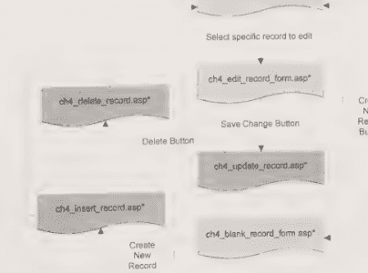

图 4-9 用于编辑记录的脚本

- `ch4_edit_record_form.asp`：用于编辑特定记录的表单。编辑内容会转发到`ch4_update_record.asp`。
- `ch4_update_record.asp`：保存使用`ch4_edit_record_form.asp`对记录所做的更改。
- `ch4_delete_record.asp`：当用户点击`chr_edit_record_form.asp`上的“删除记录”按钮时，删除单条记录。
- `ch4_blank_record_form.asp`：创建一个空白表单，让用户创建新记录。
- `ch4_insert_record.asp`：保存使用`ch4_blank_record_form.asp`创建的记录。

尽管本节包含大量代码，但其中许多代码与本章前面（编辑数据库信息的代码）或上一章（显示数据库中存储信息的代码）已描述过的代码相似或完全相同。因此，在讨论代码时，我将不再详细描述那些在其他地方已有更精确说明的代码。

### 脚本 4-9：`ch4_list_records.asp`

```asp
1. <%@ Language=JavaScript %>

2. <!-- #include file="ch4_include.js" -->

3.

4. <html><head><title>列出记录</title></head><body>

5.

6. <%= nav_header %>

7. <center><font size="+2"> <%= cat_object.current %> 类别中的记录列表 </font><br>选择一条记录进行编辑，或使用底部的按钮创建新记录

8. </center>

9. <hr>

10.

11. <%

12. /////////////////////////////////////////////////////

13. // 创建动态子类别导航栏

14.

15. sql = "SELECT distinct data_subcategory FROM data where data_category = " + current_category + " order by data_subcategory";

16. rs = Server.CreateObject("ADODB.RecordSet");

17. rs.Open(sql, Conn, 2, 3);

18. if (rs.EOF) { // 检查 rs 是否为空

19.     out += "该类别中没有子类别。";

20. }

21. else { // rs 不为空

22.     Response.Write("<center>");

23.     while (!(rs.EOF)) {

24. %>

25.     <a href="#<%= String(rs.fields.item("data_subcategory")) %>"><%= String(rs.fields.item("data_subcategory")) %></a>
        &nbsp;&nbsp;&nbsp;&nbsp;&nbsp;&nbsp;&nbsp;

26. <%

27.     rs.move(1);

28.     } // 结束 while 记录集

29. } // 结束 else (rs 不为空)

30.

31. rs.Close();

32.

33. %>

34. <form action="<%= edit_subcategories_form_script %>">

35. <input type="submit" name="toss" value="编辑子类别">

36. </form>

37. </center>

38. <%

39. //////////////////////////////////////////////

40. // 创建记录列表：

41.

42. sql = "SELECT * FROM data where data_category = " +
        current_category + " order by data_subcategory,
        data_name";

43.

44. // 事件应按日期排序：

45. if (current_category == 2) {

46.     sql = "SELECT * FROM data where data_category = " +
            current_category + " order by
            data_subcategory, data_main_date, data_name";

47. }

48.

49. rs = Server.CreateObject("ADODB.RecordSet");

50. rs.Open(sql, Conn, 2, 3);

51. if (rs.EOF) { // 检查 rs 是否为空

52. %>

53. <p>该类别中没有记录

54. <%

55. }

56. else { // rs 不为空

57.

58.     temp_subcat = ""; // 此字符串用于按子类别对记录进行分组

59.     fields = new Object(); // 此对象用于存储记录中的字段

60.

61.     while (!(rs.EOF)) {

62.

63.         // 清理数据并将其放入 fields 对象中：

64.         for (field_number = 0; field_number < rs.fields.count; field_number++) {

65.

66.             temp_field =
                String(rs.fields(field_number).Name);

67.             temp_content =
                String(rs.fields.item(temp_field));

68.             temp_content =
                temp_content.replace(/&#039;/g, "'");

69.             if (temp_field.search(/date/) > 0)
70.             // 检查日期字段

71.             {
72.                 temp_content = slash_date(temp_content);
73.             }
74.             else if (temp_content == "null") {
75.                 temp_content = "";
76.             }

77.             fields[temp_field] = temp_content;
78.         } // 结束遍历当前记录中的字段

79.

80.         // 子类别：当我们遇到一个新的子类别时，显示它

81.         if (temp_subcat != fields.data_subcategory) {
82.             temp_subcat = fields.data_subcategory;
83. %>

84.     <div align="center"><b><a name="<%= temp_subcat %>"><%= temp_subcat %></a></b></div>

85. <%

86.         }

87.

88.         ///////////////////////////////////////////////////////
89.         // 接下来发生什么完全取决于类别
90.         ///////////////////////////////////////////////////////
91.         ///////////////////////////////////////////////////////
92.         // 人物 (1)

93.         if (current_category == 1) {
94. %>

95. <p><b><%= fields.data_name %></b> - <%= fields.data_description %>
    &nbsp;&nbsp;<a href="<%= edit_record_form_script %>?current_category=<%= current_category %>&current_record=<%= fields.data_uid %>">编辑</a>

96. <table width="80%"><tr>

97. <td width="50%">

98.     公司: <%= fields.data_company %>

99.     <br>地址1: <%= fields.data_address1 %>

100.    <br>地址2: <%= fields.data_address2 %>

101.    <br>城市: <%= fields.data_city %>

102.    <br>州/省: <%= fields.data_state %>

103.    <br>邮政编码: <%= fields.data_zip %>

104.    <br>国家: <%= fields.data_country %>

105.    </td><td>

106.    电子邮件: <%= fields.data_email %>

107.    <br>工作电话: <%= fields.data_phone_work %>

108.    <br>传真: <%= fields.data_phone_fax %>

109.    <br>手机: <%= fields.data_phone_cell %>

110.    <br>家庭电话: <%= fields.data_phone_home %>

111.    </table>

112.    <%

113.        } // 结束 if cat is 1

114.

115.        /////////////////////////////////////////
116.        // 事件 (2)

117.        else if (current_category == 2) {

118.

119.    %>

120. <p><b><%= fields.data_main_date %>: <%= fields.data_name %></b>
    &nbsp;&nbsp;<a href="<%= edit_record_form_script %>?current_category=<%= current_category %>&current_record=<%= fields.data_uid %>">编辑</a>

121. <br>描述: <%= fields.data_description %>

122. <br>开始日期: <%= fields.data_start_date %>, 结束日期: <%= fields.data_end_date %>

123.

124.    <%

125.        } // 结束 if category is 2

126.

127.

128.        /////////////////////////////////////////
129.        // 网站 (3)

130.        else if (current_category == 3) {

131.    %>

132.    <p>

133.    <a href="<%= fields.data_url %>">

134.    <b><%= fields.data_name %></b></a>

135.    &nbsp;&nbsp;<a href="<%= edit_record_form_script %>?current_category=<%= current_category %>&current_record=<%= fields.data_uid %>">编辑</a>
```


### 脚本工作原理

`ch4_list_records.asp` 创建一个基于模板的列表，用于展示单一类别中的所有记录，生成“编辑”链接供用户编辑特定记录，并显示按钮让用户可以跳转到 `ch4_edit_subcategories.asp`（编辑子类别按钮）和 `ch4_blank_record_form.asp`（创建新记录按钮）。

此脚本中的大部分代码与 `ch3_view_records.asp` 相同，后者在上一章已详细讨论。此脚本的不同之处仅在于它创建了上述的“编辑”链接和按钮。

因此，为避免冗余，脚本中与 `ch3_view_records` 不同的部分已用粗体标出，并且仅讨论这些部分。<sup>4</sup>

- 7. 出于某种原因，似乎很少有用户愿意浏览源代码来弄清楚脚本应该做什么。幸运的是，随处添加一点文档似乎就能解决问题。

- 35–37. 此按钮将用户带到 `ch4_edit_subcategories.asp`。此处使用按钮是界面设计决定。也可以使用简单的链接：

```html
<a href="<% = edit_subcategories_form_script %>">Edit Subcategories</a>
```

> 4. 如果你和我一样，可能会想，为什么书里有两个几乎完全相同的脚本？这难道不是版本控制噩梦的开始吗？使用一个脚本不是更合理吗？
>
> 答案是肯定的。如果你打算同时使用第 3 章和第 4 章的脚本，你可能只想维护单个脚本。这并不难：只需添加 `if` 语句，在编辑时执行粗体代码。最好的检查方法可能是用于保护第 4 章脚本的会话变量。例如：
>
> ```javascript
> if (Session("edit_db_pass") == "OK")
> {
>     // 粗体代码放在这里。
> }
> ```
>
> 然而，如果你只打算使用第 3 章的脚本，你可能会欣赏这样一个事实：它并没有因为用于通过网络编辑数据库的代码而不必要地变得复杂。

`edit_subcategories_form_script` 变量在本章前面描述的包含文件中设置。

**93, 120, 135, 148。** 这些行上的代码是相同的，之所以重复是因为每个类别都有自己的模板（如果不确定为什么有模板，请参阅 `ch3_view_records.asp` 的讨论）。在每种情况下，代码都会创建一个指向 `edit_record_form_script`（`ch4_edit_record_form.asp`）的“编辑”链接。该链接包含 `form` 变量 `current_record`，其中包含要编辑的记录的 uid。

**162–168。** 这些行上的表单生成一个“创建新记录”按钮，该按钮将用户带到 `ch4_blank_record_form.asp`。`current_category` 变量被传递给空白记录表单脚本，以便它能够将类别滚动框设置为适当的值。

### 脚本 4-10

**`ch4_edit_record_form.asp`**

```asp
1. <%@ Language=JavaScript %>

2. <!-- #include file="ch4_include.js" -->

3.

4. <html><head><title>Edit Record Form</title></head><body>

5.

6. <% = nav_header %>

7.

8. <%

9. // 抓取我们想要编辑的记录的信息：

10. sql = "SELECT * FROM data where data_uid = " + current_record ;

11. rs = Server.CreateObject("ADODB.RecordSet");

12. rs.Open (sql, Conn, 2,3);

13. if (rs.EOF){     // 检查 rs 是否为空

14. out += "no records found. This shouldn't happen unless multiple people are using the database simultaneously";

15. }

16. else{            // rs 不为空

17. %>

18. <!-- 表格：删除和保存按钮 -->

19. <table border=0>

20. <tr><td valign=top>
```

```html
<!-- 删除按钮将用户发送到删除脚本 -->

<form action="<%= delete_record_script%>">

<input type="hidden" name ="current_category" value="<%= current_category %>">

<input type="hidden" name ="current_record" value="<%= current_record %>">

<input type="submit" name ="toss" value="Delete This Record">

</form>

</td><td valign=top>

<!-- 保存按钮将用户发送到更新脚本 -->

<!-- 注意，此表单跨越了此脚本的大部分 -->

<form action="<%= update_record_script%>">

<input type="submit" name ="toss" value="Save Changes">

</td></tr></table>

<!-- 表格：包含所有显示的字段 -->

<table>

<%

for ( field_number = 0; field_number < rs.fields.count ; field_number++ ){

 temp_field = String(rs.fields(field_number).Name);

 temp_content = String(rs.fields.item(temp_field));

 // 数据清理：空值、日期、字段名称

 if (temp_content == "null") {temp_content = ""; }

 else if (temp_field.search(/date/) >= 0 )

 // 检查日期字段

 {temp_content = slash_date(temp_content);}

 // 我们可以从标签中去掉 "data_"，但不能在表单字段中去掉

 temp_field_label = temp_field.replace(/data_/,"");

 // uid 字段不应可编辑：

 if (temp_field.search(/uid/) >= 0){

 out += '\n\n<tr><td>' + temp_field_label + ': </td><td>' + temp_content + '</td></tr>';

 }

}
```

第 4 章 • 编辑

```javascript
54.     // 类别需要一个滚动框：
55.     else if (temp_field.search(/data_category/
56.     >= 0){
57.         out +=
58.         '\n\n<tr><td>'+temp_field_label+'
59.         </td><td>';
60.         out += '<select name="' + temp_field
61.         + '">';
62.         for (i=0; i < cat_object.qty ; i++){
63.             out += '\n<option
64.             name="data_category" value="' +
65.             cat_object[i].uid + '"';
66.             if (current_category ==
67.             cat_object[i].uid)
68.                 out += ' selected ' ;
69.             out += '>' +  cat_object[i].name;
70.         }
71.         out += '\n</select></td></tr>\n\n';
72.     }
73. }
74. // 子类别也需要一个滚动框：
75. else if (temp_field.search(/data_subcategory/ >=
76. 0){
77.     sql = "SELECT * FROM subcategories where
78.     category = " + current_category;
79.     rs2 =
80.     Server.CreateObject("ADODB.RecordSet");
81.     rs2.Open (sql, Conn, 2,3);
82.     if (rs2.EOF){  // 检查 rs 是否为空
83.         out += "<tr><td>error: no
84.         subcategories exist for this
85.         category!</td><td></td></tr>";
86.     }
87.     else{             // rs 不为空
88.         out +=
89.         '\n\n<tr><td>'
90.         +temp_field_label+'</td><td>';
91.         out += '\n<select name="' +
92.         temp_field + '">';
93.         while (! (rs2.EOF)){
94.             out += '\n<option name="'+
95.             temp_field +'" value="' +
96.             String(rs2.fields.item
97.             ("subcategory")) + '" ';
98.             if (temp_content ==
99.             String(rs2.fields.item
100.            ("subcategory"))
101.            {out += ' selected '
102.            ;}
```

```javascript
81.     out += '>' +
82.     String(rs2.fields.item
83.     ("subcategory"));
84.     rs2.move(1);
85. } // 结束 while 记录集
86. out +=
87. '\n</select></td></tr>\n\n';
88. } // 结束 else (rs 不为空)
89. rs2.Close ();
90. } // 结束子类别滚动框

91.

92. // 用于描述字段的 <textarea>
93. else if (temp_field.search(/description/) >= 0){
94.     out += '\n\n<tr><td>' + temp_field_label +
95.     ': </td><td><textarea name="' + temp_field
96.     + '" cols=50 rows=3> ' + temp_content +
97.     '</textarea></td></tr>';
98. }// 结束描述字段

99.

100. // 标准文本框
101. else {
102.     out += '\n\n<tr><td>' + temp_field_label +
103.     ': </td><td><input type=text name="' +
104.     temp_field + '" value="' + temp_content +
105.     '" size=60></td></tr>';
106. }

107. // 结束遍历传入的表单字段
108. }// 

109. } // 结束 else (rs 不为空)

110. rs.Close ();
111. %>
112. <% = out %>
113. </table>

114. <!-- 表格：删除和保存按钮 -->
115. <p><table border=0>
116. <tr><td>
117. <!-- 保存按钮将用户发送到更新脚本 -->
118. <!-- 并且，关闭跨越此脚本大部分的表单-->
119. <input type="hidden" name ="current_record"
120. value="<% = current_record %>">
121. <input type="hidden" name ="current_category"
122. value="<% = current_category %>">
123. <input type="submit" name ="toss" value="Save
124. Changes">
125. </form>
126. </td><td>
```


### 脚本的工作原理

当用户点击由`ch4_list_records.asp`生成的页面上某条记录旁的“编辑”链接时，此操作会调用`ch4_edit_record_form.asp`，并将用户希望编辑的记录的`uid`传递给它。这将生成一个表单，用户可以使用该表单编辑该记录的信息或删除该记录。

`ch4_edit_record_form.asp`的工作方式与本章前面讨论的`ch4_edit_category_form.asp`基本相同：它根据从数据库检索的信息动态生成表单。然而，该脚本更为复杂，因为类别表单只涉及可以使用文本框编辑的字符串数据，而此脚本处理的是更复杂的数据集，涉及字符串、日期和多选字段，这些不仅需要简单的文本框，还需要选择框和一个`<textarea>`字段。如果阅读 JavaScript ASP 代码对你来说还不是轻车熟路，你可能需要确保完全理解编辑类别脚本的代码，然后再继续处理编辑记录脚本的代码。

> 5. 值得注意的是，为了能够有效编码，可能需要学习的最重要的事情，是能够区分你完全理解的事物和那些对你来说不完全合理的事物。

我反复注意到一个极易避免的坏习惯，它削弱了人们高效工作的能力：在不真正理解代码的情况下使用代码，并且没有意识到这一点。

我们都必须处理一些不完全理解的事情——这是生活的一部分。无论是嵌套表格、对象、HTTP 头、SQL 底层的关系代数，还是 TCP/IP 的实际工作原理，我们大概都能想到一些过去难以理解或仍然难以理解，但却能够使用的东西。意识到这一弱点的人，比那些没有花时间去理解自己知识局限性的人，能够更有效地工作。

因此，如果你没有完全“理解”本章的脚本，无论如何，请继续使用它们。但仅仅因为你能够让它们运行起来，不要自欺欺人地认为你真正理解了它们，除非你对 HTML、ASP、JavaScript、SQL、ODBC 以及 Web 浏览器和服务器工作原理的掌握，实际上已经精炼到从本体论层面知道它们是什么的程度。与此同时，尽管让别人去想他们所想的。但不要欺骗自己。

你会注意到，在浏览此脚本时，所有输出都被收集到一个名为`out`的字符串变量中。由于 JavaScript 代码与 HTML 的比例关系，这似乎是一个不错的选择。另一种方法将是不断地打开和关闭 ASP 标签（`<%...%>`），这可能会使脚本比现在这种方式更难阅读。

当然，这也正是让这些内容变得有趣的原因。开始吧：

- 1,2. 设置语言并引入包含文件。
- 6. 插入`nav_header`变量（在包含文件中设置）。
- 10. 创建 SQL 语句，从数据库中抓取我们想要的记录：当`data_uid`字段的值等于`current_record`（`current_record`是一个表单变量，由包含文件获取并用于创建同名的 JavaScript 变量）的值时，获取该记录的所有字段。
- 11,12. 创建一个名为`rs`的 Recordset 对象。
- 13-15. 在极不可能找到任何记录的情况下，生成一条错误消息。考虑到必须存在记录才能创建将用户带到此表单的“编辑”链接，因此在创建“编辑”链接和用户点击链接之间记录被删除的可能性似乎不大。
- 16. 如果脚本找到了一条记录，则执行第 17-102 行。
- 18-32. 首先发生的是在页面顶部创建两个按钮：一个删除按钮和一个保存按钮。
- 22-26. 这里创建的“删除此记录”按钮需要三条信息才能工作：将执行实际删除操作的脚本名称（`delete_record_script`，解析为`ch4_delete_record.asp`）、当前记录的`uid`（`current_record`，以便删除脚本知道要删除什么）以及当前类别的`uid`（`current_category`，以便在删除记录后，删除脚本可以将用户转发到适当的记录列表）。
- **30.** 在此行创建的表单跨越了页面的大部分区域，包括所有允许用户编辑当前记录内容的表单字段。
- **37.** 此行的`for()`循环用于依次迭代记录集`rs`中的每个字段。`rs.fields.count`告诉`for()`循环有多少个字段，并用于确定变量`field_number`的上限，该变量用于依次存储每个字段的索引值。

共有 22 个字段，因此`field_number`将从 0 递增到 21。在循环的每次迭代中，执行第 38-100 行的代码，并且每次都在从第 35 行开始的表中添加另一行。

- **39.** `field_number`用于通过`rs.fields`对象将`temp_field`设置为字段的名称。
- **40.** `temp_field`用于为`temp_content`设置值。
- **42-45.** 从`rs.fields`对象获取字段名及其内容后，首要任务是清理数据。首先，任何空值字段都转换为空字符串（`""`），这更用户友好。接下来，在 44-45 中，对任何非空日期字段应用`slash_date()`函数，将日期转换为更友好的格式。（如果不这样，像“1/6/2000”这样的日期会显示为“Thu Jan 6 00:00:00 PST 2000”）。
- **47.** 同样，为了用户友好，使用正则表达式从字段名中提取前缀`/data_/`，并创建一个新变量`temp_field_label`。
- **49-97.** 接下来，根据字段的不同，使用一系列`if() {...} else if() {...} else if() {...} else{}`代码块来执行不同的代码块。

在每种情况下，决策都是通过对`temp_field`字符串应用正则表达式来做出的。如果找到匹配项，则执行相应的代码块。例如，要查找`data_uid`字段，正则表达式会搜索`/uid/`模式。

#### 49-52. `data_uid`字段

这是最简单的情况。因为`data_uid`由数据库设置，所以不应由用户编辑。显示该字段只需创建一个包含两个单元格的表格行，并将`temp_field_label`放在第一个单元格中，将`temp_content`放在第二个单元格中。

或者，你可能认为完全没有必要显示此信息，在这种情况下，你可能想要这样做：

```javascript
if (temp_field.search(/uid/) >= 0){

	// do nothing

}
```

#### 53-64. `data_category`字段（滚动框）

类别滚动框有点棘手。因为类别是固定的，所以用户需要被限制从列表中选择。这可以通过滚动框或单选按钮来完成。对于这类事情，我认为滚动框更为常规。

获取类别相当容易，因为类别信息已放入包含文件的`cat_object`中。在第 57 行，开始设置`<select>`表单字段，其名称设置为`temp_field`。

在第 58-62 行，脚本为每个类别遍历`cat_object`一次，使用`cat_object[i].uid`为选择框中将出现的每个选项设置值（一个整数），并使用`cat_object[i].name`为每个选项创建一个人类可读的标签（类别名称）。这里使用的`for()`循环比较复杂，因为在每次迭代中，脚本都会检查放入`<select>`框的类别是否与当前类别（存储在`current_category`对象中）匹配。如果找到匹配项（第 60 行），则为正在组装的`<option>`标签设置选中选项，以便选择框将显示正确的类别。

#### 66-87. `data_subcategory`字段（滚动框）

子类别滚动框需要填充当前类别的有效子类别。此过程与上面为类别字段设置滚动框类似，只是因为此信息尚未收集……

由于没有`cat_object`可供调用，必须通过查询数据库来收集一个有效的子类别列表。

在第68-70行，创建了一个新的记录集`rs2`，其中包含当前类别的所有现有子类别。子类别存储在`subcategories`表中。如果未找到子类别，第71-73行会生成一条错误消息。如果您发现不一定想使用子类别，可能需要修改第72行的消息。

- **77-83.** 循环遍历`rs2`，并填充第76行打开、第84行关闭的`<select>`框。同样，在每次迭代中都会检查以确保选中了相应的子类别。
- **89-92.** `data_description`字段（`<textarea>`）：描述字段是最后一个需要特殊处理的字段。因为它可能包含多行信息，所以将其设置为`<textarea>`表单字段。这很简单，只需将变量`temp_field_label`、`temp_field`和`temp_content`放入相应的 HTML 中即可。
- **94-97.** 所有其他字段：其余的 18 个字段都可以用相同的方式处理——生成一个文本框（一个`type`属性设置为`text`的`<input>`标签），并将相同的三个变量放在适当的位置：`temp_field_label`（人类可读的字段标签）、`temp_field`（字段的全名）以及`temp_content`（从数据库中检索到的字段内容）。

请注意，本脚本以及本章中的其他脚本都没有进行任何错误检查。如果您打算让新手用户使用它，这可能是您想要添加的功能，可以使用客户端或服务器端代码来实现。[^6]

- **99, 101.** 这些行关闭了在脚本开头开始的代码块。
- **103.** 关闭将不再使用的`rs`对象。

[^6]: 有关使用 JavaScript 进行客户端错误检查的信息，请参阅本系列中的另一本书籍《*JavaScript for Web Professionals*》。

- **105.** 此时，已经变得相当长的输出字符串被发送到浏览器。
- **106.** 关闭包含可编辑字段的表格。

最后，在页面底部放置了另一组保存和删除按钮。

- **113–116.** 保存按钮必须放在前面，因为它是从第30行开始一直运行的表单的一部分。`current_record`和`current_category`都被设置为隐藏表单变量。需要`current_category`是因为它包含当前记录的主键，更新脚本需要此主键才能将编辑保存到数据库。使用`current_category`是为了让用户可以返回到当前类别的记录列表（否则，用户将不得不返回到类别列表，这会让人感到困惑）。
- **127.** 关闭在包含文件中打开的`Conn`对象。

当用户完成编辑后，她会点击“保存更改”按钮，该按钮将表单提交到`ch4_update_record.asp`，这将是下一个要讨论的脚本。

### 脚本 4-11

`ch4_update_record.asp`

```asp
1. <%@ Language=JavaScript %>

2. <!-- #include file="ch4_include.js" -->

3. 

4. <%

5. temp_update = "";

6. 

7. for ( field_number = 1; field_number <=

     Request.QueryString.count ; field_number++ ){

8. 

9.     temp_field =

        String(Request.QueryString.Key(field_number));

10.    temp_content =

        String(Request.QueryString.item(temp_field))

11. 

12.    // make sure field is one we want to use

13.    if (temp_field.search

        (/current_record|current_category|toss/) < 0 ){

14. 

15.        // nulls

16.        if (temp_content == "null" || temp_content

            == ""){

17. 	temp_update += " " + temp_field + " = null,";

18. 

19. 	}

20. 

21. 	//int fields

22. 	else if (temp_field.search

23. 	(/data_category/) >= 0)

24. 	{temp_update += " " + temp_field +

25. 	" = " + temp_content + ",";}

26. 

27. 	//this works for non-null char fields

28. 	else {

29. 

30. 	temp_content =

31. 	temp_content.replace

32. 	(/'/g,"&#039;");

33. 	temp_update += " " + temp_field + " = '" + temp_content + "',";

34. 

35. 	} // end if we want to use field

36. } // end for loop

37. 

38. // remove last character, which is a trailing comma

39. 	that we don't want

40. temp_update =

41. 	temp_update.substring(0,temp_update.length-1);

42. 

43. update_sql = "update data set " + temp_update + "

44. 	where data_uid = " + current_record;

45. 

46. Conn.Execute(update_sql);

47. 

48. Conn.Close ();

49. 

50. Response.Redirect(list_records_script +

51. 	"current_category=" + current_category)

52. 

53. //Response.Write("<hr>\n\n\n" + update_sql +

54. 	"\n\n\n<hr>");

55. //Response.Write(list_records_script +

56. 	"?current_category=" + current_category)

57. %>
```

### 脚本工作原理

此脚本的工作方式与`ch4_update_category.asp`（本章前面讨论过）非常相似。在深入代码之前，我概述了它是如何工作的。这里，我将直接深入代码：

- 1,2. 告诉比尔使用开放协议，并运用他的全套技巧。
- 5. 声明变量`temp_update`，该变量将用于存储此脚本创建的 SQL`update`语句的键/值对。
- 7. 脚本没有显式调用表单变量，而是使用从本行开始的`for()`循环来迭代`Request.QueryString`对象并获取所有传入的表单信息。循环中的代码块（第8-33行）然后依次检查每个传入的变量，并决定是否以及如何将传入的表单信息放入用于更新数据库的更新语句中。

请注意，用于迭代`Request.QueryString`对象的计数器`field_number`从1开始，而不是0。我想我已经向您抱怨过这一点了。`Request.QueryString`的`count`属性用于设置`field_number`的上限。

- 9,10. `temp_field`和`temp_content`用于依次存储从`Request.QueryString`检索到的每个表单变量及其内容的值。
- 13. 使用正则表达式来排除我们不感兴趣的变量。任何与正则表达式（`/current_record|current_category|toss/`）匹配的字段都会导致`search()`方法返回0或更大的值，从而使`if()`语句解析为`false`。任何不匹配的字段都假定为数据库字段，并执行第14-32行。
- 14–37. 从第14行到第32行运行的`if(){...} else if(){...} else{}`语句确保根据所讨论的字段，将字段名及其内容添加到`temp_update`字符串中。
- 16–19. 脚本首先检查`temp_content`中的空值，寻找关键字`null`或空字符串（`""`）。如果是这种情况，则将该字段设置为`null`。
- **22–24.** 下一步检查整数字段，这些字段与字符串字段不同，其值周围不应有单引号。因为一些字符串字段可能包含整数，所以检查内容不是一个选项。而且因为我没有建立处理整数字段的命名约定，所以没有通用的方法来识别整数字段。因此，它们需要在第22行使用的正则表达式中显式标识，该正则表达式检查`/data_category/`。这之所以有效，是因为`data_category`是`data`表中唯一的非字符串字段。
- **26–30.** 不包含空值或整数值的字段都可以用相同的方式处理：只需先将字段中的任何单引号替换为其 HTML 等效字符（第28行，使用正则表达式），然后用单引号封装字段内容（第29行）。
- **32.** 关闭从第13行开始的`if()`。
- **33.** 关闭`for()`循环。
- **36.** 由于脚本处理的字段数量不确定，每次将字段添加到`temp_update`时，都会添加一个尾随逗号以期待下一个字段。最后一个逗号是多余的，使用可以应用于任何 JavaScript 字符串的`substring()`方法在此处将其删除。
- **38.** 在这里，此脚本核心的 SQL 语句终于组合完成。此时的`temp_update`字符串由一系列以逗号分隔的键/值对组成：

```sql
field_1 = 'field_1', field_2 = field_2, … field_n = 'field_n'
```

同时，`current_record`包含要更新的记录的`uid`，因此对于`id`为“i”的记录，`update_sql`将是：

```sql
update data set field_1 = 'field_1', field_2 = field_2, … field_n = 'field_n' where data_uid = i
```


当然，字段将是实际的字段名，带有实际的值或 SQL 特殊值 `null`。

**40.** 最后，通过 `Conn` 对象（在包含文件中创建）执行 SQL 更新语句。

**42.** 关闭 `Conn` 对象。

**44.** 使用 `Response.Redirect` 将浏览器重定向到 `ch4_list_records.asp`。

**46–47.** 我将这些行保留在此，以防您需要调试此脚本。要进行调试，请注释掉第 40 行和第 44 行，并取消注释第 46 行和第 47 行。这将让您查看生成的 SQL 代码以及浏览器被重定向到的 URL。

### 脚本 4-12

`ch4_delete_record.asp`

```javascript
<%@ Language=JavaScript %>

<!-- #include file="ch4_include.js" -->

<%
delete_sql = "delete from data where data_uid = " +
current_record;
Conn.Execute(delete_sql);

Conn.Close ();

Response.Redirect(list_records_script +
"?current_category=" + current_category)

//Response.Write("<hr>\n\n\n" + delete_sql +
//"\n\n\n<hr>");
//Response.Write(list_records_script +
//"?current_category=" + current_category)
%>
```

### 脚本工作原理

给此脚本提供数据表中一条记录的主键，它就会为您删除该记录。

**5,7.** 工作在第 5 行和第 7 行完成。第 5 行使用表单值 `current_record` 创建一个 SQL 语句，该语句将删除 `data_uid` 字段设置为该值的所有记录。然后在第 7 行执行 SQL 删除语句。

**9,11.** 第 9 行关闭 `Conn` 对象，第 11 行将用户重定向到 `ch4_list_records.asp`。

**13,14.** 第 13 行和第 14 行的存在是为了在您需要进行一些调试时使用。请注意，只要您为 `current_record` 提供一个有效的值，删除语句就应该能工作；只要您为 `current_category` 提供一个有效的值，重定向语句也应该能正常工作。

### 脚本 4-13

`ch4_blank_record_form.asp`

```javascript
<%@ Language=JavaScript %>

<!-- #include file="ch4_include.js" -->

<html><head><title>Blank Record
   Form</title></head><body>

<% = nav_header %>
<%
sql = "SELECT * FROM data where data_uid=0";
rs = Server.CreateObject("ADODB.RecordSet");
rs.Open (sql, Conn, 2,3);

out += '<form action="' + insert_record_script +
   '">';
out += '<input type="submit" name="toss"
   value="Create New Record">';
out += '<table>';

// loop through form fields and create a form based
   on fields we found
// in recordset.
for ( field_number = 0; field_number <
   rs.fields.count ; field_number++ ){

   temp_field =
      String(rs.fields(field_number).Name);

   // we can get rid of "data_" on labels, but not
      in the form fields
   temp_field_label =
      temp_field.replace(/data_/,"");

   // uid field should not be editable:
   if (temp_field.search(/uid/) > 0){
      // do nothing!
   }
   // category needs a scroll box:
   else if (temp_field.search(/data_category/) >= 0){
           out += '\n\n<tr><td>'+temp_field_label+
           '</td><td>';
           out += '\n<select name="' + temp_field + '">';
           for (i=0; i < cat_object.qty ; i++){
                 out += '\n<option value="' +
                 cat_object[i].uid +  '"';
                 if (current_category == cat_object[i].uid) {
                       out += ' selected '
                 };
                 out += '>' +  cat_object[i].name;
           }
           out += '\n</select><br></td></tr>\n\n';
   }

   // subcategory also needs a scroll box:
   else if (temp_field.search(/data_subcategory/) >= 0){
           sql = "SELECT * FROM subcategories where category = " + current_category;
           rs2 = Server.CreateObject("ADODB.RecordSet");
           rs2.Open (sql, Conn, 2,3);

           if (rs2.EOF){
               out += "<tr><td>error: no subcategories exist for this category!</td><td></td></tr>";
           }
           else{                          // we have subcategories
                  out += '\n\n<tr><td>'+temp_field_label +'</td><td>';
                  out += '\n<select name="' + temp_field+ '">';
                  while (! (rs2.EOF)){
                       out += '\n<option value="' +
                       String(rs2.fields.item("subcategory")) +  '">' +
                       String(rs2.fields.item("subcategory"));
                       rs2.move(1);
                  } // end while rs2
                  out += '\n</select></td></tr>\n\n';
           } // end else (rs2 not empty)

           rs2.Close ();
      }// end subcategory scroll box

   // <textarea> for description field
   else if (temp_field.search(/description/) >= 0){
       out += '\n\n<tr><td>' + temp_field_label +
           ': </td><td><textarea name="' + temp_field
           + '" cols=50 rows=3>
           </textarea></td></tr>';
   }// end description field

   // standard text box
   else {
       out += '\n\n<tr><td>' + temp_field_label +
           ': </td><td><input type=text name="' +
           temp_field + '" value=""
           size=60></td></tr>';
   }

}// end of looping through incoming form fields
rs.Close ();

out += '</table>';
out += '<input type="hidden" name="current_category"
   value="'+ current_category +'" >';
out += '<input type="submit" name="toss"
   value="Create New Record">';
out += '</form>';
%>

<%= out %>

<%
Conn.Close ();
%>
</body>
</html>
```

### 脚本工作原理

如果您将此脚本与 `ch4_edit_record_form.asp` 进行比较，您会发现它们几乎相同，不同之处在于，由于它创建的是一个空白表单，所以它不会在任何字段中填入任何值。因为 `ch4_edit_record_form.asp` 在几页前已经详细讨论过，所以我将使此讨论非常简短，并主要关注此脚本的不同之处。

此脚本的基本思想很简单：创建一个包含数据表所有字段的记录集，并基于这些字段构建一个表单，以便用户可以输入信息，然后这些信息将被存储到该表中。通过从表动态生成表单，使得将信息动态插入到表中变得相当容易（在 SQL 中，记录是使用 `insert` 语句创建的）。

- **1–7.** 除非您刚刚翻到这本书的这一页，否则您可能已经熟悉这些内容。7
- **8.** 此行创建的 SQL 语句很有趣，因为它保证会创建一个空的记录集。我们可以确定这一点，因为 `data_uid` 字段由 MS Access 提供，它将使用从数字 1 开始的整数。就这个脚本而言，获得一个空记录集是可以的，因为我们只关心 `data` 表中所有字段的名称，即使记录集为空，我们也可以获取这些名称。虽然对于这个仅处理相对较少记录的数据库，性能不太可能是一个大问题，但仍然很好，可以减少脚本的开销，并且人们希望空记录集会比更大的记录集产生更少的开销（您不测试就永远不知道，而我还没有测试）。
- **9,10.** 创建记录集 `rs`。
- **12–14.** 开始表单，创建新建记录按钮，并开始表格。
- **18.** 开始 `for` 循环，该循环遍历记录集中的字段，通过 `rs.fields` 对象访问。
- **20.** 创建 `temp_field` 变量，该变量在脚本每次迭代 `for()` 循环时包含不同字段的名称。
- **23.** 创建人类可读的标签 `temp_field_label`。
- **26–28.** 脚本不会为 `data_uid` 字段创建表单字段，该字段由数据库设置。
- **31–40.** 这些行构建一个滚动框，其中包含从 `cat_object` 中提取的类别列表。
- **43–59.** 这些行构建一个子类别滚动框，使用第二个记录集 `rs2`。
- **62–64.** `data_description` 字段获得一个 `<textarea>` 标签。

7. 如果您刚刚翻开书，请查看第 3 章中的类似脚本。

### 脚本 4-14

`ch4_insert_record.asp`

```javascript
<%@ Language=JavaScript %>

<!-- #include file="ch4_include.js" -->

<%
fields = "";
values = "";

// 循环处理传入的表单字段以构建 SQL 语句
for ( field_number = 1; field_number <=
     Request.QueryString.count ; field_number++ )
   {
   temp_field =
     String(Request.QueryString.Key(field_number));
   temp_content =
     String(Request.QueryString.item(temp_field))

   if (temp_field.search(/toss|current_category/) <
   ){

          fields += ' ' + temp_field + ',';

          // 检查空值
          if (temp_content == "null" || temp_content
          == "")
              {
              values += " null,";
          }

          // 检查整数字段
          else if (temp_field.search
              (/data_category/) >= 0)
              {values += " " + temp_content
              +",";
              current_category = temp_content;
          }

             // 此方法适用于非空字符字段
             else {

                 temp_content =
                 temp_content.replace
                     (/'/g,"&#039;");
                     values += " '" + temp_content
                     + "',";
             }

     } // 结束 if
 } // 结束循环处理传入的表单字段

 // 移除末尾多余的逗号
     that we don't want
 values = values.substring(0,values.length-1);
 fields = fields.substring(0,fields.length-1);

 insert_sql = "insert into data (" + fields + ")
     values (" + values + ")";

 Conn.Execute(insert_sql);

 Conn.Close ();

 Response.Redirect(list_records_script +
     "?current_category=" + current_category)

 //Response.Write(list_records_script +
```


```text
63. "?current_category=" + current_category)

64. //Response.Write(list_records_script +

65. "?current_category=" + current_category)

66. %>
```

### 脚本工作原理

这个脚本的内部工作流程与之前的脚本有着惊人的相似之处。它与本章前面描述的“小兄弟”`ch4_insert_category.asp`最为接近，但也与之前讨论过的更新脚本有很多共同之处。

简而言之，该脚本收集传入的表单信息，获取应存入数据库的字段，创建一个 SQL 插入语句，执行该语句，然后将用户转回到`ch4_list_records.asp`。详细说明如下：

- **1、2。** 声明语言并引入本章前面讨论过的包含文件。
- **5、6。** 创建两个变量`fields`和`values`，它们将用于生成一条包含用户在`ch4_blank_record_form.asp`中输入信息的 SQL 语句。
- **9。** 开始循环处理`Request.QueryString`中的传入字段。
- **11、12。** 填充临时变量`temp_field`和`temp_content`。
- **14。** 使用正则表达式排除我们不感兴趣的字段。
- **16。** 将`temp_field`添加到`fields`字符串中。
- **19–22。** 对于`null`字段和空字符串，将`null`值附加到`values`。
- **25–28。** 对于作为`int`字段的`data_category`，在将`temp_content`添加到`values`时不需要单引号。
- **31–35。** 任何其他字段都会被记录，主要是因为它们需要在外部加单引号而内部不加。因此，第 33 行去除了任何不需要的引号，第 34 行在`temp_content`两侧加上单引号，并在末尾加上逗号，然后将整个内容连接到`values`中。
- **37、38。** 关闭几段代码块。
- **41、42。** 移除挂在`values`和`fields`末尾的多余逗号。
- **44。** 最后，`insert_sql`，这是整个操作的关键，`fields`和`values`各就各位，使得最终的 SQL 语句呈现如下形式：

```sql
insert into data field_1, field_2 values value_1, value_2
```

- **46。** SQL 语句被传递给数据库。
- **48。** 数据库连接被关闭。
- **50。** 用户被重定向到`ch4_list_records.asp`或包含文件中分配给`list_records_script`的任何 URL。
- **52、53。** 如果你需要调试此脚本，这两行可能会派上用场。

### 图 4-10：用于编辑子类别的三个脚本

## 编辑子类别的代码

如图 4-10 所示，当用户在`ch4_list_records.asp`上点击“编辑子类别”按钮时，他们会进入`ch4_edit_subcategories_form.asp`，在那里他们可以创建新的子类别（由`ch4_insert_subcategory.asp`完成工作）或删除现有的子类别（由`ch4_delete_subcategory.asp`完成）。没有编辑现有子类别的机制，除非删除一个现有的子类别并创建一个新的。如果你已经读到这里，也许你会忍不住想自己找出如何做到这一点。:)

### 脚本 4-15：`ch4_edit_subcategory_form.asp`

```asp
<%@ Language=JavaScript %>

<!-- #include file="ch4_include.js" -->

<html><head><title>编辑
   子类别</title></head><body>

<% = nav_header %>

<center><font size="+2"> 编辑子类别 </font><br></center><hr>

您可以使用此表单删除现有子类别或创建新子类别。

<%

sql = "SELECT categories.category_uid,
    categories.category_name, subcategories.subcategory
    FROM categories INNER JOIN subcategories ON
    categories.category_uid = subcategories.category
    ORDER BY categories.category_name"

rs = Server.CreateObject("ADODB.RecordSet");
rs.Open (sql, Conn);

if (rs.EOF){  // 检查 rs 是否为空
    out += "未找到子类别。";
}

else{             // rs 不为空
    category_header = ""
    while (! rs.EOF){
        temp_category =
            String(rs.fields.item("category_uid"))
        temp_category_name =
            String(rs.fields.item("category_name"))
        temp_subcategory =
            String(rs.fields.item("subcategory"))

        // 类别：当我们遇到一个新的时，
        // 显示它
        if (category_header !=
            temp_category_name){
            category_header =
                temp_category_name;
%>

<div align="center"><b><% =
    category_header %></b></div>

<%

        }
%>

<br><b><% = temp_subcategory %></b>&nbsp;&nbsp;&nbsp;

<a href="<% = delete_subcategory_script
    %>?current_category=<% = temp_category
    %>&current_subcategory=<% = temp_subcategory %>">

<font size="-1"
    face="arial,helvetica">删除</font></a>

<%
        rs.move(1);
    }  // 结束 while
} // 结束 else
%>

<hr>

要创建新的子类别，请选择一个类别并
    输入您想要创建的子类别的名称：

<form action="<%= insert_subcategory_script %>">

<select name="current_category">

<%  for  (i=0; i < cat_object.qty ; i++){ %>
        <option value="<%= = cat_object[i].uid
    %>"><%= = cat_object[i].name %>
<%    } %>

</select></td></tr>

子类别<input type=text name=current_subcategory
    value="">

<input type=submit name=toss value="创建新
    子类别">

</form>

<%

Conn.Close ();

%>

</body></html>
```

### 脚本工作原理

此脚本创建一个网页（图 4-11），列出所有类别的所有子类别，并使得删除子类别或创建新子类别变得容易。

请注意，没有编辑子类别的方法。子类别在每个记录中以字符串形式存储，而不是使用 ID，因此编辑子类别不仅意味着更改`subcategories`表中子类别名称的值，还意味着每次它在`data`表的记录中出现时都要更改该子类别的名称。这完全可行，但这不是此脚本所做的事情，因为这种方法更简单，尽管功能不那么强大。

脚本的前半部分列出了数据库中已经存在的所有子类别，并创建了可用于删除不再有用的子类别的链接。

脚本的后半部分创建了一个可用于创建新子类别的表单。

- **1。** 将语言设置为 JavaScript。
- **2。** 引入本章前面描述的包含文件。
- **6。** 将包含文件中创建的导航标题放在页面顶部。
- **8。** 如果你发现人们不知道如何使用此页面，你可能需要在这里添加更多说明。

### 脚本工作原理

简洁又有用的脚本难道不香吗？正如标题所示，此脚本基于`ch4_edit_subcategories_form.asp`中收集的信息创建一个新子类别，该文件上文已讨论。

- **1。** 语言设置为 JavaScript。
- **2。** 获取包含文件，该文件创建数据库连接`Conn`以及我们将要使用的几个变量。
- **5。** 这是创建新子类别记录的 SQL 语句，通过将`category`和`subcategory`两个字段添加到`subcategories`数据库中来实现。两个字段均作为表单变量传递给脚本，并由包含文件设置为局部变量`current_category`和`current_subcategory`。
- **7。** 执行第 5 行创建的 SQL 语句。
- **8。** 关闭在包含文件中创建的数据库连接。
- **11。** 就是这样。此脚本不产生任何输出。相反，它将用户重定向到`edit_subcategories_form_script`。在顺利的情况下，他们刚刚尝试创建的子类别就在那里，等待被使用。

### 脚本 4-17：`ch4_delete_subcategory.asp`

```asp
<%@ Language=JavaScript %>

<!-- #include file="ch4_include.js" -->

<%

delete_sql = "delete from subcategories where category = " + current_category + " and subcategory = '" + current_subcategory+ "'";

Conn.Execute(delete_sql);

Conn.Close ();

Response.Redirect(edit_subcategories_form_script)

//Response.Write("<hr>\n\n\n" + delete_sql + "\n\n\n<hr>")
//Response.Write("redirect: "+ edit_subcategories_form_script)

%>
```


### 脚本工作原理

这是一个设计用于轻度破坏的脚本，当有人在`ch4_edit_subcategories_form.asp`中点击删除链接时，从`subcategories`表中删除单条记录。

1. 设置 JavaScript 为脚本语言。
2. 获取包含文件，该文件创建数据库连接`Conn`以及变量`current_category`和`current_subcategory`。
3. 此行创建设计用于从`subcategories`表中删除单条记录的 SQL 语句。注意，语句的`where`子句同时指定了`category`字段和`subcategory`字段的值。由于子类别是特定于类别的，这是必需的，以防止在相同的子类别名称被分配给多个类别时删除不止一个子类别。
4. 这是`delete`语句实际被执行的地方。
5. 这是数据库连接被关闭的地方。
6. 这是用户被重定向到`ch4_edit_subcategories_form.asp`的地方。

## 回顾

本章相当有说服力地证明，创建一个 HTML 前端让大量用户编辑数据库往往得不偿失。然而，如果使用得当，它可以为你节省大量枯燥的工作。至少，这个脚本可以使维护和发布像电话列表这样的简单数据库这项任务变得比以前不那么乏味。在任何规模的公司中，拥有一个相当最新的电话列表可能会为公司节省一笔可观的资金。

哦对了。技术要点：

- 一些巧妙的技巧，用于收集表单提交的数据，即使你不知道数据是什么。
- 将这些数据存储到数据库中。
- 创建模板驱动的界面。
- 使用密码限制谁可以使用脚本。
- 组织一组脚本，使其相对高效地协同工作。

## 改进此脚本的想法

类似这样的脚本，主要挑战在于弄清楚如何以真正有用的方式使用它。理想情况下，查看组织内部需要从多人那里收集信息并存储在单一位置的过程。如果这些信息随后需要发布给很多人，那就更好了。如果信息不断变化并给人们带来无尽的麻烦，你可能就找到了一个有用的应用场景。

本章脚本中的界面对于大多数应用来说可能过于粗糙。花些时间自定义它们。如果可以的话，找个优秀的平面设计师来帮忙。倾听使用这些东西的人的意见。如果你用心关注，你可能能够找到进行一些简单修改就能产生巨大效果的方法。我总是惊讶于非技术用户不断地假设他们想要的无法实现。所以他们不会要求那些可以在几分钟内轻松调整的小事，不过随着人们花更多时间在电脑上并开始期待更多，这种情况似乎正在改变。

我之前给自己记了一则备忘，想要修改删除脚本，使其在该类别中有任何记录时不会删除该类别。你可以创建一个记录集。

# 购物车

## 本章内容

- 一个完整的购物车系统
- 一个文本文件数据库
- 在 ASP 会话对象中存储信息
- 一个简单的关键词搜索引擎

在我撰写本文时，电子商务网站正以前所未有的狂热纷纷倒闭，其势头与它们去年或前一年初现时的狂热如出一辙。只要你的客户是其他企业，那么承认自己从事互联网业务可能还是安全的——至少目前是如此。

当然，在线商务的理由 continues to be increasingly compelling，并且，尽管大型网站需要工业级的系统，但本章介绍的购物车系统将能轻松处理几笔，甚至每天几百笔销售业务。

商业成功的两个关键要素是成本控制和执行力。通过本章，你只需花费购买一本平装计算机书的成本，就能在将文件上传到服务器的时间内，让一个购物车投入运行。给自己几天时间，根据需求定制界面和功能，并设置好你要销售的商品数据库，你就可以开始营业了。¹

> 1. 不要忘记为市场营销留出时间，或许还需要留出资金。时间是关键因素。将你的网站提交给搜索引擎注册，并积极参与你的目标客户活跃的在线社区。

## 项目：构建购物车

正如前两章展示了一组共同协作的脚本一样，本章的脚本也协同工作，允许用户浏览待售商品目录、选择部分商品并购买它们。

通过一些设计工作，这些脚本提供了一个快速且功能完善的解决方案。由于任何脚本都易于编辑，因此自定义购物车通常很简单。当然，就像往常一样，有时候它也会很复杂。:)

### 安全性

本章不涉及安全问题，这超出了本书的范围。然而，安全是一个非常现实的问题，因此这里列出了一些需要考虑的事项：

- 浏览器和服务器之间的通信可以使用 SSL 进行加密。没有 SSL，任何传递给 Web 服务器的信息（例如，信用卡信息）都可能被截获。SSL 不仅比未加密的通信更安全，它还能让人们更放心地向你提供信用卡信息。安心是好事。
- 该脚本在服务器上以未加密的方式存储付款信息（信用卡、预付互联网卡等……）。这是一个安全问题。你有几个解决方案。最好的方法是加密信息。我认为这可以通过操作系统来完成（我自己从未做过）。我也见过一个你可以使用的 JavaScript MD5 库。如果你确实在服务器上存储未加密信息，请确保服务器尽可能安全，并且你尽快将信息从服务器上移走。同样重要的是保护客户的姓名和地址，他们通常期望你提供的信息受到保护。
- 如果商家向使用被盗信用卡的人发货，商家需对产品负责。因此，请确保你的信用卡验证流程包括防欺诈措施。请就此主题与你的银行联系以获取更多信息。
- 很多人（我也是其中之一）认为，你应该更担心你认识的人，而不是互联网上的陌生坏人。对存储重要信息的计算机进行密码保护，并且不要共享密码。将计算机存放在锁好的房间里。

运用常识！你大概不会在公共场所无人看管一堆信用卡或客户信息。数字贵重资产同样需要保护。

话虽如此，安全是一个工程问题。针对安全问题，有好的解决方案，使你能够保护自己到你认为合适的水平。花时间自我教育这方面的知识，这样你才能有能力创建一个足够安全的工作环境来满足你的需求。而且，因为安全涉及酷炫的软件和硬件，你通常可以从中获得很多乐趣。;)

### 快速导览

图 5-1 中的购物车允许买家按类别或通过关键词搜索浏览待售商品。每个商品支持无限数量的不同选项，其中任何一个都可以通过单击“购买”链接来选择（你可以重命名该链接或用图片替换）。

购物车基本上就是你预期的那样。商品数量可以使用文本框和提交按钮进行编辑，同时“删除此商品”链接使得移除不需要的商品变得很容易。一个链接让购物者在准备好时可以结账（参见图 5-2）。

购买过程分为两步。第一步要求买家提交运输信息——商品将如何运输以及运往何处（图 5-3）。

接下来，客户输入付款信息（州内订单会自动应用税款）。由于只有购物车的前端是自动化的，因此可以接受国际订单，尽管你可能需要稍微调整一下界面以实现这一点（参见图 5-4）。

图 5-4 ... 然后是账单信息

此时，订单完成。购物车会生成一个“订单完成”页面，总结订单信息并为客户提供唯一的订单号（参见图 5-5）。

同时，订单被写入 Web 服务器硬盘上的一个文件夹中，在那里可以轻松地收集它们（有关如何将订单通过电子邮件发送给你的信息，请参见第 6 章）。参见图 5-6。

图 5-6 订单文件夹中的订单

每个订单文件如下所示：

```text
Order Number:960800441188-623866419

Order Summary:

1: BK2PB (The dilemma of 2 (paperback))

Ship Method: basic

Grand Total: $11.60

Contact Information:

john doe

john_doe@lovejoy.com

805-966-0611

Shipping To:

john doe

8 Main St.

santa barbara, CA 93101

Billing Information:

Visa

4111 1111 1111 1111

02/03
```

## 新功能

### 在会话对象中存储信息

HTML 一经成功，人们就不得不设法解决这样一个事实：HTML 是一个无状态协议。按照最初的设想，Web 服务器在向用户发送完网页后就应该忘记与谁打过交道。

这对许多 Web 应用程序（包括购物车）造成了真正的问题。购物车的全部意义在于让你浏览网站，寻找想购买的商品，挑选商品加入你的“购物车”，然后在准备好时全部购买。这不是 HTML 最初设计的目的。

早期的创新者想出了一种解决方法，即在他们网站上的每一个链接上传递表单信息，这样，例如，指向一个网页的链接将包含某种 ID：

```text
http://www.lovejoy.com/cgi-bin/store/page2.cgi?user=123451234512345
```

这相当繁琐。有些网站仍然这样做，因为要让没有 Cookie 的人在你的网站上购物，你几乎就需要做类似这样的事情。只需确保你在每一个链接上传递那个`id`字段，否则一个人的购物车内容就会丢失。又一个愤怒的客户。

Cookie 是事物演化的下一步。通过 Cookie，你可以在用户的浏览器上存储有限的信息，这些信息只有你可以访问，因为浏览器只与特定域的 Web 服务器共享该域的 Cookie 信息。

Cookie 实际上是一件非常酷的事情，即使它们有点令人不安（“你是说一个网站可以在我的计算机上放东西？！！！太离谱了！”）并且极其不安全（已经出现了太多安全漏洞，使得未经授权的用户能够获取 Cookie）。

尽管 Cookie 不适合存储信用卡号码和电话号码，但它们非常适合存储无意义的信息，这意味着可以使用 Cookie 为每个访问你网站的人分配唯一的 id——然后存储人们不希望共享的信息（信用卡、`CART_ITEMS`、`cart_items`等）放在安全的地方，并通过存储在 cookie 中的唯一 id 来引用这些私人信息。这正是 ASP Session 对象的作用。

`CART_ITEMS`

`cart_items`是一个对象，用于存储用户放入购物车的商品。为了简化，脚本需要的所有关于用户购买商品的信息都存储在这里：商品部件号、数量、名称、描述、价格等。

`ORDER_INFO`

`order_info`对象用于存储所有其他收集到的关于用户的信息，这基本上是运输和账单信息（你总是可以通过修改脚本获取额外信息）。

这意味着构建购物车时最大的挑战之一——跟踪网站的独立访客——已经由 ASP 解决了。任何你想跟踪的用户特定信息都可以存储在 ASP Session 对象中。这非常方便。

本章的脚本充分利用了这一点，在 Session 对象中存储两组信息：用户放入购物车的东西以及他们提供给我们的关于他们自己的信息。只有在收集了订单所需的所有信息后，才会创建一个订单文件并保存在硬盘上。

## 创建模板

创建一个有效的网站非常复杂。一个更有趣的挑战是，网站正越来越多地由团队构建。尽管在 90 年代上半叶，我曾自以为可以设计一个有效的网站，但在过去几年里，我已经将导航和界面设计留给了图形设计师和信息架构师。

在某些情况下，我负责维护整个网站，设计和导航元素被自由地混合在代码中，以至于只有非常熟悉我的脚本的人才能实际编辑页面。

然而，我越来越失去对网页日常维护的兴趣，这意味着需要以一种熟悉应用程序功能的人可以处理其界面的方式，构建 Web 应用程序的编程元素。这意味着使用包含尽可能少代码的模板，这样熟悉 HTML 的人就可以或多或少地轻松修改脚本的前端。

在本章中，界面在很大程度上已经与脚本的功能元素分离，这样界面由模板组成，不了解底层 ASP 的人可以相对容易地编辑。仍然有一些代码，但幸运的是，大多数熟悉 HTML 的人都很难被吓倒，我运气很好，让设计师们在不需要我逐行解释文件内容的情况下，就能将前端应用到这些脚本上。

## 将相关数据存储在两个文本文件中

为了尽可能轻松地设置购物车，有关待售商品的信息存储在两个文本文件中：`catalog_file.txt`和`option_file.txt`。

每个待售商品都列在`catalog_file.txt`中。此文件中的每个商品必须至少有一个选项，该选项又存储在`option_file.txt`中。因此，如果你销售一件有三种尺码的 T 恤，你需要在`catalog_file.txt`中创建一条记录，并在`option_file.txt`中创建三条记录。记录是关于商品的一行信息。例如，数据组织方式的简化说明可以用表格表示：

| 部件号 | 描述 | 部件号 | 扩展名 | 选项描述 | 价格 |
|---|---|---|---|---|---|
| `b_shrt` | 一件漂亮的蓝色衬衫 | `b_shrt` | `-Sm` | 小号 | $12.00 |
| | | `b_shrt` | `-Md` | 中号 | $15.00 |
| | | `b_shrt` | `-Lg` | 大号 | $17.00 |
| `w_shrt` | 一件不错的白色衬衫 | `w_shrt` | | 均码 | $16.00 |

上表说明了两种情况：一件有三种尺码可选的蓝色衬衫，以及一件只有单一尺码的白色衬衫。两件衬衫在`catalog_file.txt`中都只有一行信息。然而，在`option_file.txt`中，情况就不同了：这里有三行蓝色衬衫的信息，因为它有三个选项，而白色衬衫只有一行信息，因为它只有一个选项。

请注意，部件号字段出现在两个文件中，这使得可以将目录文件中的记录映射到选项文件中的记录。商品的完整部件号由部件号和扩展名字段拼接而成（如果商品只有一个选项，扩展名可以为空）。因此，`w_shrt`和`b_shrt-sm`是有效的部件号，而`b_shirt`不是有效的部件号，因为它没有包含扩展名，并且蓝色衬衫有多个选项。

购物车实际使用的文本文件比上表稍微复杂一些。`catalog_file.txt`有五个字段：

- **id**：与上面的部件号相同。
- **category**：一个可用于将待售商品组织成类别的字段。
- **name**：待售商品的名称。
- **description**：商品的描述。
- **image**：通常是一个 HTML 图像标签，但任何合法的 HTML 都可以。

例如（为了清晰，换行并缩进）：

```text
//id|category|name|description|image

bk1|Books|Book 1|The story of the number 1|

bk2|Books|Book 2|The dilemma of 2|

ck1|Pastries|Croissant|Snooty French pastry|

ck2|Pastries|Bagel|Bread disguised as a donut|
```

`option_file.txt`也有五个字段：

- **id**：与上面的部件号相同。
- **ext**：用于唯一标识选项的 id 扩展名。如果商品只有一个选项，此字段可以为空。
- **price**：选项的价格。
- **weight**：选项的重量系数。这用于计算运费，可以是实际重量，也可以是用于计算给定商品运费的任意值。
- **description**：选项的描述。请注意，这应该只用于描述选项本身，而不是商品本身，商品本身应该在`catalog_file.txt`的`description`字段中描述。

例如：

```text
//id|ext|price|weight|description

bk1||12.95|2|

bk2|pb|8.95|1|paperback

bk2|hb|23.22|2|cloth cover

ck1|chok|2.25|1|Chocolate Croissant

ck1|plain|2.15|1|Plain Croissant

ck2|on|4.25|3|Onion (dozen)

ck2|pl|4.25|3|Plain (dozen)

ck2|po|4.25|3|Poppy Seed (dozen)
```

## ASP 购物车代码

本章中的许多脚本都使用了`cart.js`文件，该文件最后讨论。因此，如果你遇到未定义的变量或函数并感到好奇，你总是可以跳回那里看看它是如何工作的。

### 各部分如何组合在一起

图 5-7 显示了 ASP 购物车脚本的文件，并让你预览了它们如何组合在一起。

### 浏览目录并往购物车里添加商品

本节中的脚本允许用户浏览待售商品，将它们添加到购物车，并在愿意时稍后删除它们。

#### 脚本 5-1：`cart_list_items_for_sale.asp`

```asp
1. <%@ Language=JavaScript %>

2. <!-- #include file="cart.js" -->

3.

4.

5. <%

6. cart_header();

7. items = create_items_object ();

8. %>

9.

10. <!---------------start item display template--------->

11. <%

12. for (key in items){

13. %>

14. <!---------- start header ----------->

15. <table border=1 width=80% align=center>

16. <!---------- end header ----------->

17. <!---------- start item ----------->

18.   <tr><td colspan=2>

19.   <% = items[key].name %>

20.   </td></tr>

21.   <tr><td>

22.   <% = items[key].image %>

23.   </td><td valign=top>

24.   <% = items[key].description %><p>

25.   <!---------- start item option information ----------->

26.   <% for (key2 in items[key].options){

27.   if (String(items[key].options[key2].

28.   description) != "none"){ %>

29.     <div align=right><% =
```


```asp
30. items[key].options[key2].description %>: $<% =

31. items[key].options[key2].price %> (<% = key

32. %><% = items[key].options[key2].ext %>) <% =

33. items[key].options[key2].buy_link %></div>

34. <% }

35. else { %>

36. <div align=right>$<% =

37. items[key].options[key2].price %>(<% = key %><%

38. = items[key].options[key2].ext %>) <% =

39. items[key].options[key2].buy_link %></div>

40. <% }

41. }// end for key2 loop %>

42. <!---------- end item option information ----------->

43. </td></tr>

44. <!---------- end item ----------->

45. <!---------- start footer ----------->

46. </table>

47. <!---------- end footer ----------->

48. <%

49. } //end looping through items

50. %>

51. <!------------------end item display template------------------>

52. </BODY></HTML>
```

`cart_list_items_for_sale.asp`  
`cart_set_session.asp`  
`cart_change_qty.asp`  
`cart_view_contents.asp`  
`cart_change_qty.asp`  
`collect_shipping_information.asp`  
`cart.js`  
`set_shipping_information.asp`  
`collect_billing_information.asp`  
`set_cc_billing_information.asp`  
`set_pwc_billing_information.asp`  
`order_complete.asp`


图 5-7 本章脚本的组合方式

### 脚本工作原理

本脚本中使用的大部分功能实际上都存储在包含文件`cart.js`中，目的是使其尽可能成为一个任何熟悉 HTML 的设计师都可以编辑的“模板”。

在深入了解细节之前，值得记住的是，这个脚本本质上只做两件事：第一，它创建用于导航购物车的页头 HTML；第二，它使用名为`items`的对象显示一个或多个待售产品或服务的信息。

一如既往，细节决定成败：

1. 将 JavaScript 设置为脚本语言。
2. 包含`cart.js`，该文件包含购物车中使用的许多函数。
3. `cart_header()`函数（来自`cart.js`包含文件）生成一个页头的 HTML，让用户可以按类别浏览购物车产品、执行关键字搜索或查看其购物车内容（见图 5-8）。

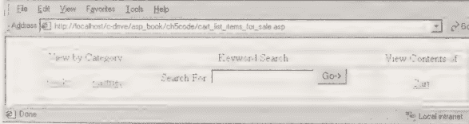

**图 5-8** `cart_header()`创建一个在购物车中使用的页头

4. 这一行使用函数`create_items_object()`创建一个名为`items`的对象。`create_items_object()`位于`cart.js`包含文件中，执行了通过购物车显示待售产品和/或服务列表所需的大部分工作。

   根据传递给当前脚本的参数，`create_items_object()`将包含所有可售商品、仅特定类别中的商品，或与关键字搜索匹配的商品。

   要显示存储在`items`对象中的产品或服务，只需遍历`items`对象并将其存储的信息放入 HTML 页面——有趣的是，这正是本脚本其余部分所做的事情。

5. 虽然这些行中有大量 ASP 代码，但大部分是嵌入在 HTML 页面中的零碎片段。这样做的目的是尽可能将页面的外观（HTML）与页面的功能（ASP）分离。因此，即使完全不熟悉 ASP 的人也可以编辑此页面的 HTML 部分，只要他或她足够小心，不要破坏任何 ASP 片段。

6. 第 12 行是一个`for()`循环的开始，该循环遍历`items`对象，显示存储在`items`中的每个产品或服务的信息。

对象和数组的一大优点是，可以在不完全了解其中内容的情况下遍历它们。`items`实际上是一个由零个或多个我们想要销售的东西（也是对象，嵌套在`items`内部）组成的对象。在这种情况下，`for`循环通过创建字符串`key`来工作。通过依次使用`key`的每个值，就可以轻松访问存储在`items`内部的所有有用信息。

例如，如果你只想获取`items`内部的物品列表，可以这样做：

```javascript
for (key in items) {
    Response.Write("\n<br> " + items[key].name);
}
```

`items`对象内部任何给定对象的`name`属性正如你所期望的那样——是在购物车脚本使用的一个数据文件中输入的产品名称。例如，如果`items`包含关于三个名为`item1`、`item2`和`item3`的物品的信息，生成的输出将是：

```text
<br> item1
<br> item2
<br> item3
```

当然，对于任何给定的产品或服务，任何特定产品可能存在多个版本：书籍可能有精装本和平装本。其他物品可能有几种不同的颜色。这通过另一个名为`options`的嵌套对象来解决，该对象为存储在`items`对象中的每个购物车物品创建。

根据定义（参见本章前面数据文件的描述），购物车中的每个产品或服务至少有一个选项。因此，为了不仅获取各种待售物品的名称，还要获取零件编号和物品价格，我们需要不仅遍历`items`对象，还要遍历每个物品内的`options`对象。简单地这样做，看起来像这样：

```javascript
1. for (key in items) {
2.     Response.Write("\n<br> " + items[key].name);
3.     for (key2 in items[key].options) {
4.         Response.Write("\n<br>---" + key +
               items[key].options[key2].ext);
5.         Response.Write(": " +
               items[key].options[key2].price);
6.     } // 结束遍历 options
7. } // 结束遍历 items
```

假设我们正在处理与上面假设的相同的三个物品，并且每个物品有两种颜色可选，我们可能会得到类似这样的结果：

```text
<br> item1
<br> ---item1-yellow: $1.00
<br> ---item1-purple: $2.00
<br> item2
<br> ---item2-yellow: $5.00
<br> ---item2-purple: $6.00
<br> item3
<br> ---item3-yellow: $10.00
<br> ---item3-purple: $9.00
```

事实上，这基本上就是这个脚本中发生的事情：第 12–43 行遍历`items`对象，而第 26–35 行遍历为每个物品创建的`options`对象。在遍历过程中，各种属性被放入页面。这些属性包括我们到目前为止描述过的，以及：

#### 表 5-1 items 对象的属性

| 属性 | 描述 |
| :--- | :--- |
| `items[key].name` | 物品的名称 |
| `items[key].image` | 与物品相关联的图像的文件名 |
| `items[key].description` | 物品的文本描述 |
| `items[key].options[key2].description` | 特定选项的描述 |
| `key` | 物品的唯一 ID |
| `items[key].options[key2].ext` | 物品扩展的唯一 ID |
| `items[key].options[key2].buy_link` | 允许访客将物品添加到购物车的链接 |
| `items[key].options[key2].price` | 特定物品/选项对的价格（只有选项有价格） |

脚本中还有另一段代码：

7. 在这里，脚本检查`items[key].options[key2].price`是否设置为 none，以便根据选项是否存在描述来显示不同的信息。

如果不存在选项，则显示第 28–30 行生成的 HTML。否则，我们得到第 31–34 行。

> **警告**
>
> 为了使购物车尽可能简单易用和可修改，购物车依赖于存储在`items[key].options[key2].buy_link`（如上所述）中的定价信息。这意味着恶意购物者可能会试图通过创建欺诈性的 buy_link 来欺诈您。应审查所有订单，以确保总金额正确。

### 脚本 5-2

`cart_set_session.asp`

```asp
1. <%@ Language=JavaScript %>
2. <!-- #include file="cart.js" -->
<%
3. //Session.Timeout=1
4. var add = String(Request("add"));
6. add_array = add.split("---");
8. if (Session(add_array[2] + ".qty") > 0) {
9.     Session(add_array[2] + ".qty")++;
10. }
12. else {
13.     Session(add_array[2]) = new Object();
14.     Session(add_array[2] + ".qty") = 1;
15.     Session(add_array[2] + ".name") = add_array[0];
16.     Session(add_array[2] + ".desc") = add_array[1];
17.     Session(add_array[2] + ".price") = add_array[3];
18.     Session(add_array[2] + ".weight") = add_array[4];
19. }
22. Response.Redirect(cart_view_contents_script);
%>
```

### 脚本工作原理

`cart_set_session.asp`是一个相对简单的脚本，用于将物品添加到购物车。完成工作后，它会将购物者重定向到`cart_view_contents_script`。

当用户点击由`create_items_object()`创建的链接时，会调用`cart_set_session.asp`。链接的格式为：

```html
<a href="cart_set_session.asp?add=Book+1%2D%2D%2DThe+story+
of+the+number+1%2D%2D%2D%2Dbk1%2D%2D%2D12%2E95%2D%2D%2D2">购买</a>
```

信息存储在一个名为`add`的多部分表单变量中，包括添加到购物车的物品的名称、描述、零件编号、价格和重量。在上面的示例中，要添加的物品名为 Book 1；物品描述是 The story of the number 1；物品的零件编号是 bk1；物品的价格是 12.95（未指定货币）；物品的重量是 2。

以下是该脚本的工作原理：

1. 将 JavaScript 设置为语言。
2. 这一行被注释掉了，如果你想 tinkering 并希望从头开始，它会很有用。将`Session.Timeout`设置为一意味着一分钟后，会话对象将被清除。

   如果你正在修改购物车并想重置 Session 对象，你只需注释掉某一行代码，然后向购物车添加一件商品，再取消该行的注释，接着等待一分钟。如果你连等一分钟都觉得难以忍受，或许应该把时间设为五分钟，强迫自己稍作休息。 ;)

**4.** 如上所述，传入的表单信息存储在一个名为`add`的变量中。这里，它被赋值给一个同名的局部变量。

**6.** 由于`add`变量实际上是一个多字段变量，首先要使用任何 JavaScript 字符串固有的`split()`方法来创建一个名为`add_array`的数组。

**8-19.** 如本章前面关于在 Session 对象中存储信息的部分所讨论的，购物车的订单信息是使用 ASP Session 对象存储的。接下来发生的情况取决于要添加到购物车中的商品是否已存在于购物车中。如果存在，那么只需要通过执行第 8 到 10 行的代码来增加该商品的`qty`属性即可。如果对象不存在，则需要将关于该商品的所有信息添加到对象中，这正是第 12 到 19 行代码所做的。

**8-10.** 如果商品已存在于购物车中，其数量将为零或更大，那么只需使用`++`运算符增加其数量即可。

**12-19.** 如果商品的数量不大于零，则脚本假定该商品不存在，并将该商品添加到 Session 对象中。

**13.** 第一步是在 Session 对象内部创建一个新对象。该对象以`add_array`的第三个元素（`add_array[2]`）命名，这是商品的零件编号（商品编号和选项编号的组合），它是唯一的。

**14.** 接下来，将对象的`qty`属性设置为一，因为这是我们第一次将此对象添加到购物车。

**15-18.** 最后，使用`add_array`相应字段中的信息，设置商品的`name`、`desc`、`price`和`weight`属性。

此时，商品已被添加到购物车中，或者如果它已在购物车中，其数量已增加。

**22.** 最后一行将购物者转发到`cart_view_contents_script`，购物者可以在那里查看目前已添加到购物车中的所有商品。

### 脚本 5-3

`cart_view_contents.asp`

```asp
1. <%@ Language=JavaScript %>
2. <!-- #include file="cart.js" -->

4. <center><% = cart_header() %></center>
6. <center>查看/编辑购物车内容</center>
8. <form action="<%=change_qty_script%>">
9.     <table border=1 align=center>
10.         <% = cart_contents_header_row() %>
11.         <% = cart_contents_editable_row() %>
12.         <% = cart_contents_subtotal_row() %>
13.     </table>
14.     <div align=center>
15.         <input type=submit name=toss value="更改数量">
16.     </div>
17. </form>

19. <div align=right>
20.     <a href="<% = collect_shipping_information_script %>">结账 -></a>
21.     <hr width="50%">
22.     <a href="<% = cart_remove_all_from_cart_script %>">清空购物车</a>
23. </div>
24. </BODY></HTML>
```


### 脚本工作原理

与 `cart_list_items_for_sale.asp` 类似，`cart_view_contents.asp` 向购物者显示信息。同样，为了尽可能简化页面外观和感觉的编辑工作，此页面上执行的大部分代码实际上位于 `cart.js` 包含文件中。

虽然该脚本生成的页面相当复杂（它可用于编辑购买商品的数量或从购物车中移除商品，并包含继续购物或“结账”的链接），但此页面上的 ASP 代码却很简单：

- 1. 将 JavaScript 设置为脚本语言。
- 2. 引入包含文件，其中包含将在该页面上执行的所有函数。
- 4. `cart_header()` 函数创建页眉，让购物者可以在购物车中导航。
- 8. 没有任何购物车脚本包含指向特定 URL 的链接。相反，URL 是在 `cart.js` 中设置的变量中定义的。从第 8 行开始的表单配置为：如果购物者点击第 14 行的提交按钮，将他们发送到 `change_qty_script`，该脚本用于更改购物车中一件或多件商品的数量。
- **10-12.** 创建显示购物车内容的表格。
- 10. `cart_contents_header_row()` 输出表格顶部行的 HTML。
- 11. `cart_contents_editable_row()` 是一个更复杂的函数，它为 ASP Session 对象中每个数量为一或以上的商品创建一行。该行包含商品信息、一个可用于更改特定商品购买数量的文本框，以及一个可用于完全从购物车中移除该商品的“删除此商品”链接。
- 12. `cart_contents_subtotal_row()` 创建一行，显示当前购买商品的小计。
- **17,19.** 到结账脚本的链接是使用 `cart.js` 中定义的变量设置的，而不是硬编码的。指向 `cart_remove_all_from_cart_script` 的链接也是如此，该脚本会清空购物车中的所有内容。

### 脚本 5-4

`cart_change_qty.asp`

```javascript
1. <%@ Language=JavaScript %>

2. <!-- #include file="cart.js" -->

3. <%

4. var uid = String(Request("uid"));

5.

6. // 删除链接使用 "uid" 变量：

7. if (uid != "undefined"){

8. var set_qty = parseInt(Request("set_qty"));

9. Session(uid+".qty")=set_qty

10. Response.Redirect(cart_view_contents_script)

11. }

12.

13. // 更改数量按钮需要重置购物篮中所有

14.     商品的数量。

15. else{

16. // 更改按钮遍历所有商品：

17. for ( field_number = 1 ; field_number <=

18.           Request.QueryString.count ; field_number++ ){

19.

20.   temp_item =

21.       String(Request.QueryString.Key(field_number));

22.   temp_qty =

23.       String(Request.QueryString.item(temp_item))

24.

25.   // 确保该字段是我们想要使用的字段

26.   if (temp_item.search(/uid_/) >= 0 ){

27.     temp_uid =

28.         temp_item.substring(4,temp_item.length)

29.     //Response.Write(temp_uid + "<br>");

30.     Session(temp_uid+".qty")=temp_qty

31.

32.   }// 结束 if

33. }// 结束遍历传入字段的 for 循环

34. Response.Redirect(cart_view_contents_script)

35. } // 结束 else

36. %>
```

### 脚本工作原理

`cart_change_qty.asp` 可以通过两种方式调用：当购物者点击特定商品的“删除此商品”链接时，或者当有人点击“更改数量”提交按钮时（该按钮可用于更改购物车中任意数量的商品）。

在这两种情况下，脚本都会进行所需的更改，然后将人们送回 `cart_view_contents_script`。

- 1. 语言是 JavaScript。
- 2. 包含 `cart.js`。
- 4. “删除此商品”链接设置一个名为 `uid` 的表单变量，该变量被赋值给一个同名的局部变量。
- 7–11. 如果 `uid` 的值被设置为某个值（因此不等于 `"undefined"`），则有人点击了“删除此商品”链接，第 8–10 行代码将被执行。否则，我们知道有人点击了“更改数量”按钮，第 14–30 行代码将被执行。
- 8. “删除此商品”链接设置一个名为 `set_qty` 的表单变量，该变量用于设置一个同名局部变量的值。除非你修改它以执行其他操作，否则 `set_qty` 始终设置为零，因为该链接的目的是删除商品。
- 9. 购物车中的每个商品在 ASP Session 对象中都有一个对应的对象。此行将所需商品的 `qty` 属性设置为 `set_qty`（零）。请注意，商品并未实际被删除：而是将其 `qty` 属性设置为零。
- 10. 此时，脚本执行完毕，购物者被重定向到分配给 `cart_view_contents_script` 变量的 URL。
- 14. 由第 7 行逻辑触发的 `else` 块的开始。
- 16. 让人们查看购物车内容的脚本包含一个相对简单的表单，该表单由零个或多个文本字段组成，用户可以在其中编辑购物车中每个商品的数量。还有一个提交按钮用于提交表单。每个文本框命名为 `uid_part-number`，其中 `part-number` 是购物车数据库中商品的实际唯一 ID（在本章前面关于在两个文本文件中存储相关数据的部分有描述）。接下来发生的情况是，脚本遍历传入的表单数据，寻找以字符串 `uid_` 开头的表单字段。当找到一个时，它使用其值来设置该商品的数量为文本框分配给它的值。这可能是它已有的值，也可能是新值（如果被购物者更改过）。
- 16–28. 从第 16 行开始的 `for()` 循环遍历 ASP `Request.QueryString` 对象中的每个表单变量。`for()` 循环使用一个名为 `field_number` 的变量，它是一个简单的计数器，从 1 开始而不是 0，因为这似乎是微软的方式。不管怎样。
- 18,19. 从 `field_number` 计数器的值开始，创建两个变量：`temp_item` 和 `temp_qty`。

`temp_item` 是一个表单变量的名称，`temp_qty` 是它的值。

- 22. 如果 `temp_item` 与正则表达式 `/uid_/` 匹配，脚本就判定找到了一个匹配项，并将执行第 23–25 行。
- 23. 正如前几行所讨论的，正在设置数量的物品的唯一零件号（或 uid）是表单变量名的一部分——该变量名现在是 `temp_item`。此行通过从 `temp_item` 中提取一个子字符串来创建一个名为 `temp_uid` 的新变量，该子字符串从其第五个字符（即前缀 `uid_` 之后的第一个字符）一直到其最后一个字符（`temp_item.length`）。
- 25. 现在脚本知道了该物品的零件号（`temp_uid`）以及需要设置的数量（`temp_qty`），就可以更新存储在 Session 对象中的信息。
- 29. 最后，脚本的工作完成，它将购物者重定向到 `cart.js` 中分配给 `cart_view_contents_script` 变量的 URL。

### 脚本 5-5

`cart_remove_all.asp`

```javascript
1. <%@ Language=JavaScript %>

2. <%

3. for (i = 1 ; i <= Session.Contents.Count ; i++){

4.   if ((typeof Session.Contents(i) == "object") &&

     (Session(Session.Contents.key(i)+".qty") > 0)){

5.       Session(Session.Contents.key(i)+".qty") = 0

6.   }

7. }

8. Response.Redirect("cart_view_contents.asp")

9. %>
```

### 脚本工作原理

当购物者查看其购物车内容（`cart_view_contents.asp`）时，他们可以使用“清空购物车”链接来移除所有内容。这就是发生此情况时执行的脚本。

清空用户购物车的内容实际上并不涉及删除已存储在 Session 对象中关于该用户的信息。相反，脚本会扫描 Session 对象中的购物车对象，并将其数量属性设置为零。以下是其工作原理。

**1.** 将语言设置为 JavaScript。

**3.** 启动一个 `for()` 循环，该循环将遍历 Session 对象中的所有内容。`Session.Contents.Count` 给出一个整数，告诉我们 Session 对象中有多少项（我们将通过 `Session.Contents` 对象访问它）。

使用一个从 1 递增到 `Session.Contents.Count` 的计数器 `i`（这是另一个从 1 开始而不是从 0 开始的特殊 Microsoft 数组），我们可以通过将其视为数组并使用语法来访问 `Session.Contents` 对象中的每一项：

`Session.Contents(i)`

**4.** 如果我们找到的内容是一个对象，并且其具有一个大于零的 `qty` 属性，则第 5 行将被执行，该行将 `qty` 属性设置为零。

因此，一旦脚本遍历了 `Session.Contents` 对象中的所有内容，购物车中的每个物品的 `qty` 都将被设置为零，从实际意义上讲，购物车就空了。

第 4 行开始的 `if` 块在第 6 行结束。

**7.** `for()` 循环结束。

**8.** 我们的工作完成，失去所有商品的购物者被返回到 `cart_view_contents.asp`。请注意，与脚本中的大多数链接不同，这个链接是硬编码的。您可能想在某个时候修复这一点。

## 收集配送和账单信息并生成订单

一旦购物者决定了要购买什么，下面的脚本将收集配送和账单信息，并最终创建一个订单文件。

### 脚本 5-6

`collect_shipping_information.asp`

```html
1. <%@ Language=JavaScript %>

2. <!-- #include file="cart.js" -->

3.

4.     <center>购物车内容</center>

5.

6. <table border=1 align=center>

7. <%= cart_contents_header_row() %>

8. <%= cart_contents_non_editable_row () %>

9. <%= cart_contents_subtotal_row() %>

10. <%= cart_contents_shipping_row() %>

11. </table>

12.

13. <form action="<% = set_shipping_info_script %>">

14. <hr>

15. 升级配送方式:

16. <br>2天送达<input type=radio name=ship_upgrade

    value="2_day"> (额外费用 <%=

    dollarise((order_info.weight*two_day_ship_cost)-

    (order_info.weight*basic_ship_cost)) %>)

17. <br>隔夜送达<input type=radio name=ship_upgrade

    value="1_day">  (额外费用 <%=

    dollarise((order_info.weight*one_day_ship_cost)-

    (order_info.weight*basic_ship_cost)) %>)

18.

19. <hr>

20. 联系信息:

21. <table align = center>

22. <tr>

23.   <td align=right>名字: </td>

24.     <td><input type=text name="f_name"

    value="john" size=30></td>

25. </tr>

26. <tr>

27.   <td align=right>姓氏: </td>

28.     <td><input type=text name="l_name"

    value="doe" size=30></td>

29. </tr>

30.   <td align=right>电子邮件地址: </td>

31.     <td><input type=text name="email"

    value="john_doe@lovejoy.com" size=30></td>

32. </tr>

33.   <td align=right>电话号码: </td>

34.     <td><input type=text name="phone"

    value="805-966-0611" size=30></td>

35. </tr>

36. </table>

37. <hr>

38. 配送信息 (仅限美国!):

39. <table align = center>

40. <tr>

41. <td align=right>地址行 1: </td>

42. <td><input type=text name="address_1"

    value="8 Main St." size=30></td>

43. </tr>

44. <tr>

45. <td align=right>地址行 2: </td>

46. <td><input type=text name="address_2"

    value="" size=30></td>

47. </tr>

48. <tr>

49. <td align=right>城市: </td>

50. <td><input type=text name="city" value="santa

    barbara" size=30></td>

51. </tr>

52. <tr>

53. <td align=right>州: </td>

54. <td><select name="state" >

55. <% for (i in array_of_states){ %>

56.     <option value=<% = array_of_states[i]

57. %> ><% = array_of_states[i] %>

58. <% } %>

59. </select>

60. </td>

61. </tr>

62. <tr>

63. <td align=right>邮政编码: </td>

64. <td><input type=text name="zip" value="93101"

    size=30></td>

65. </tr>

66. </table>

67. <hr>

69. <center> <input type=submit name=toss

    value="提交"></center>

70. </form>

73. </BODY></HTML>
```

### 脚本工作原理

此脚本允许购物者：

- 复查他们的订单。
- 选择一种配送选项。
- 输入联系信息。
- 输入他们希望将产品配送到的地址。

该购物车支持基于“重量系数”的简单配送选项，该系数为每个待售物品指定。重量系数乘以 `cart.js` 包含文件中定义的三个值之一：

```javascript
basic_ship_cost = 1.95

two_day_ship_cost = 6.95

one_day_ship_cost = 8.95
```


因此，如果一位访客购买了一个重量系数为 1 的牛角面包和两打重量系数各为 2 的百吉饼，订单的重量系数将是 5，该系数将乘以 $1.95、$6.95 或 $8.95，具体取决于所选的配送选项（默认使用`basic_ship_cost`）。

越来越多的网站将配送成本包含在商品价格中。如果您的业务是这种情况，您可以简单地将上述变量设置为零，订单将不会添加任何配送成本。

## 详细说明

1. 将语言设置为 JavaScript。
2. 包含`cart.js`，它将为我们完成大量工作。

**6, 11.** 这些行打开并关闭一个表格，该表格将由`cart.js`文件中的一些函数生成。

**7–10.** 函数`cart_contents_header_row()`、`cart_contents_non_editable_row()`、`cart_contents_subtotal_row()`和`cart_contents_shipping_row()`用于将购物车内容打印到页面上。示例见图 5-9。

这些函数将在本章后面详细描述。基本上，它们获取存储在 Session 对象中的订单信息，并将其放入可以轻松堆叠在一起的 HTML 页面表格行中。

**13.** 此页面的目的是使用表单收集配送信息，该表单将被发送到`set_shipping_info_script`，这是在`cart.js`中设置的一个变量，它解析为字符串`set_shipping_information.asp`，该脚本将收集表单中输入的信息。

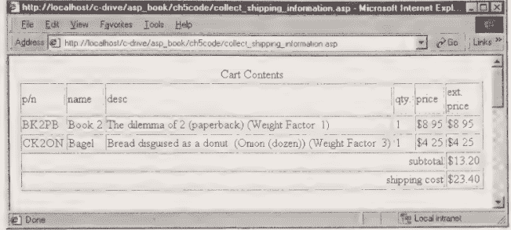

图 5-9 第 7-10 行生成购物车内容、配送成本和小计

**16, 17.** 这些行创建两个单选按钮，可用于将基本配送选项升级到 2 天或隔夜选项。在每行旁边，脚本计算该选项将为订单成本增加多少。这是通过将重量系数（在`option_file.txt`中为每个物品设置）乘以 1 天或 2 天配送费率来完成的。然后减去基本配送成本，因此仅显示两种成本之间的差额（图 5-10）。

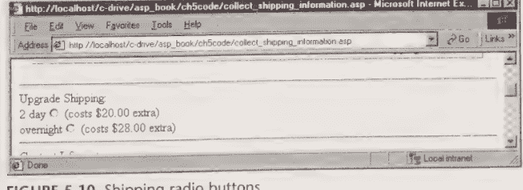

图 5-10 配送单选按钮

这段脚本的其余部分，除了一处例外，是标准的 HTML 表单，由一系列文本框组成，这些文本框为存储联系和运输信息的多个变量设置值。请注意，变量名称不是随意的。如果你更改它们的名称，很可能会破坏一些功能，并需要跟踪这些变量的使用位置，然后在那里也更改名称。

第 55-58 行是唯一包含 ASP 代码的地方，用于创建一个选择列表，让顾客选择他们所在的州。

这个选择列表不仅仅是为了方便：为了确定是否收取销售税，必须知道货物运往哪个州。通过使用选择列表，可以很容易地控制州名的拼写方式，这使得脚本可以轻松判断是否收取销售税。

制作长的选择列表有点无聊，所以这里通过使用一个包含所有州名的数组来自动完成此任务。该数组在`cart.js`中创建（为了简单起见，只包含了三个州——你可以添加其余的）：

```javascript
array_of_states = new Array("CA", "PA", "NV")
```

选择列表的创建方式如下：

**54.** 使用标准的 HTML 打开一个`name`属性为`"state"`的`<select>`标签。

**55-57.** 使用`for()`循环遍历数组`array_of_states`，并为数组中的每个州创建一个`<option>`标签。

基本上就是这些了。之后，脚本再次转回 HTML。正如本书其他地方所做的那样，提交按钮的值被设置为`tosh`，因为它除了作为提交表单的手段外没有其他用途。

最后一件事：许多表单字段已经设置了其`value`属性。这是出于调试目的：让购物车的各个部分协同工作通常需要从头到尾完成几次购物流程。预先填写字段使得调试的第一阶段容易很多。

一旦你相当确信一切正常工作，你可以将各个表单元素的`value`属性设置为空字符串（`""`）进行最后一轮测试，但在此之前，请图个方便，让所有字段保持填写状态。

## 脚本 5-7：`set_shipping_information.asp`

```javascript
<%@ Language=JavaScript %>

<!-- #include file="cart.js" -->

<%

//Session.Timeout=1

// 设置运输类型和运费信息：

if (String(Request("ship_upgrade")) == "2_day"){

   order_info.ship_type = "2_day";

   order_info.ship_cost =

   order_info.weight*two_day_ship_cost;

}

else if (String(Request("ship_upgrade")) ==

   "1_day"){

   order_info.ship_type = "1_day";

   order_info.ship_cost =

   order_info.weight*one_day_ship_cost;

}

else {

   order_info.ship_type = "basic"

   order_info.ship_cost =

   order_info.weight*basic_ship_cost;

}

// 遍历其他运输信息

shipping_info_array = new

   Array("f_name","l_name","email","phone","address_1",

   "address_2","city","state","zip")

for (i in shipping_info_array){

   if (String(Request(shipping_info_array[i])) != ""

   || shipping_info_array[i] == "address_2"){

      order_info[shipping_info_array[i]] =

      String(Request(shipping_info_array[i]))

   }

   else{ // 必填字段：

      out += "<br> " + shipping_info_array[i];

   }

}

if (String(Request("state")) == "CA"){

   order_info.tax = order_info.subtotal * .0875

}

else {

  order_info.tax = 0;

}

// 将运输地址连接成易于使用的信息

order_info.ship_address = order_info.f_name + " " +

order_info.l_name;

order_info.ship_address += "\n";

if (order_info.address_1) order_info.ship_address += "\n" +

order_info.address_1

if (order_info.address_2.length > 0) {

order_info.ship_address += "\n" +

order_info.address_2 }

order_info.ship_address += "\n" +

order_info.city + ", " + order_info.state + " " +

order_info.zip;

// 创建联系信息字符串：

order_info.contact_info = order_info.f_name + " " +

order_info.l_name;

order_info.contact_info += "\n" + order_info.email

order_info.contact_info += "\n" + order_info.phone

// 创建订单摘要字符串：

order_info.order_summary = "";

for (i in cart_items){

  order_info.order_summary += cart_items[i].qty + ": " + cart_items[i].uid

  order_info.order_summary += " (" +

  cart_items[i].desc + ")" + "\n"

}

order_info.order_summary += "Ship Method: " +

order_info.ship_type

order_info.order_summary += "\nGrand Total: " +

dollarise(order_info.subtotal + order_info.ship_cost + order_info.tax);

// 如果缺少必填字段，告诉用户去修正。

// 否则，重定向到账单信息页面

if (out != ""){

%>

The following field must be filled out:

out: <%= out %>

<%

}

else {

    Session("order_info") = new Object()

    for (i in order_info){

        Session("order_info." + i) = 

                order_info[i]

    }

    Response.

          Redirect(collect_billing_info_script)

} // end else

%>
```

## 脚本工作原理

此脚本获取由`collect_billing_information.asp`收集的信息，并将其存储在一个名为`order_info`的对象中，该对象存储在会话变量中。

除了简单地收集数据并将其放入会话对象外，该脚本还会检查确保必填字段已填写，并通过按正确顺序组合不同的信息片段来开始创建订单的过程。

1. 将语言设置为 JavaScript。
2. 获取`cart.js`。
5. 这行是一些调试代码，我将其保留在那里以防你以后需要。这行将会话对象的`Timeout`值设置为一秒，这是一种方便的方法来清除会话对象并获取一个新的（如果你不介意等待一秒的话。也许你应该将其设置为 60，然后起身活动一分钟。我不知道）。

如果你觉得顾客的会话超时太快，也可以使用`Timeout`属性。例如，如果你希望会话持续一个小时（如果我没记错，默认通常是 20-30 分钟），你可以将其设置为 3600（60 秒乘以 60 分钟）。当然，你会想在流程中更早使用的某个脚本中进行此操作，比如`cart_list_items_for_sale.asp`。

### 处理配送选项

8-20. 脚本首先要做的是将有关物品如何运输的信息存储在`order_info`对象中，该对象是在`cart.js`包含文件中创建的对象，用于在信息放入会话对象之前组织信息。请注意`order_info`没有任何属性：它本质上是一个关联数组。但它有效，我想这才是真正重要的，对吧？

无论如何，如果你查看我们正在收集信息的表单（由前一个脚本生成的表单），你会看到顾客有三个选项：他们可以选择`"2 Day"`运输升级，这会将一个名为`ship_upgrade`的表单变量设置为值`2_day`；他们可以选择`"Overnight"`运输升级，这会将同一变量设置为`1_day`；或者他们什么也不做，这种情况下，我们知道他们想要基本运输，`ship_upgrade`将不会有值`1_day`或`2_day`。

因此，这部分的逻辑是：在第 9 行，脚本检查`ship_upgrade`是否设置为`2_day`。如果是，`order_info.ship_type`在第 10 行被设置为`2_day`，`order_info.ship_cost`在第 11 行被设置为`order_info.weight`与名为`two_day_ship_cost`的变量的乘积。`order_info.weight`和`two_day_ship_cost`的值都在`cart.js`中设置，这将在本章后面讨论。`two_day_ship_cost`是一个任意字符串，由商家决定他们想要在运费上敲诈多少。`order_info.weight`只是购物车中所有物品的重量系数之和（乘以每种物品的购买数量）。

好的。如果你现在还在读，你可能意识到这并非你想要的运费计算方式。我稍后会讲到这一点。

你会注意到第 10、13 和 17 行创建了一个`if ... else if ... else`语句。这意味着如果`ship_upgrade`没有设置为`2_day`，脚本接下来要做的（第 13 行）是检查它是否设置为`1_day`。如果是，`order_info`对象的`ship_type`和`ship_cost`属性被设置为适当的值，这次使用存储在`one_day_ship_cost`变量中的成本。

17. `else`，即，如果`ship_upgrade`既没有设置为`1_day`也没有设置为`2_day`，则`order_info.ship_type`设置为`basic`，运费使用`basic_ship_cost`计算。

#### 篡改运费

你可能决定要设置一个基础运费，应用于任何订单，然后根据重量系数增加（我之所以说重量系数而不是重量，是因为对于某些物品，尺寸重量是这个问题比物理重量更像是体积重量的问题）。为了做到这一点，你可能需要添加一个基础费用，可以使用类似`base_ship_cost`的变量。最终结果可能是：

```javascript
order_info.ship_cost = base_ship_cost +

(order_info.weight*two_day_ship_cost);
```

不要忘记在使用`base_ship_cost`之前需要先定义它。

另一个选择是根据订单的美元价值来分配运费。`order_info`对象的一个属性是`order_info.subtotal`。这个值可以乘以一个固定金额，以设置`order_info.ship_cost`属性。

关于运费的内容大概就这么多了。

### 收集并验证配送信息

**24.** `shipping_info_array`是一个数组，用于列出我们想要放入`order_info`对象的字段，之所以这样命名，是因为这是脚本在将订单信息存储到 Session 对象之前放置所有订单信息的地方。请注意，这个数组中的字段不一定是必填字段——`address_2`字段可以留空。这些只是我们所关心的字段。

**26-33.** 脚本确保必填字段已填写，并将它们放入`order_info`对象中。你可能想要美化一下这个流程，因为脚本目前只是检查必填字段中是否有空字符串。

下一步是遍历`shipping_info_array`中的字段并做两件事。

首先，在第 27 行，我们检查确保必填字段已填写。这是通过确保字段不为空（`!= ""`）来完成的。`address_2`字段被豁免，因为它是许多购物者可能不会使用的可选字段。如果一个字段为空，该字段的名称会在第 31 行被拼接到`out`字符串中，该字符串将用于生成错误消息，要求购物者填写该字段。

其次，假设满足第 27 行设置的条件，在第 28 行，表单收集的信息被添加到`order_info`变量中。因此，例如，表单变量`f_name`就变成了`order_info.f_name`。

## 第 5 章 购物车

下一步是确定订单是否需要缴税。

**35.** 使用`if... else`语句，检查表单变量`state`是否设置为字符串`"CA"`（我住在加利福尼亚州。如果你在不同的州，需要更改这个值）。

**36.** 如果订单要运往加利福尼亚州，`order_info`的`tax`属性将设置为`order_info.subtotal`的 8.75%（也就是 0.0875）。

**39.** 如果订单不是运往加利福尼亚州，`order_info.tax`将设置为零。

`order_info.tax`将用于在本脚本稍后创建总计金额。

接下来，`order_info`对象的各种属性被拼接到三个摘要字符串中：`order_info.ship_address`、`order_info.contact_info`和`order_info.order_summary`。

**43–47.** 这些行通过将购物者的姓名和地址信息拼接成一个字符串来创建配送地址。请注意，换行符`"\n"`用于在适当的位置创建换行，因此`order_info.ship_address`最终将创建一个如下所示的字符串：

```text
john doe

8 Main St.

santa barbara, CA 93101
```

**50–52.** 购物者的姓名、电子邮件地址和电话号码被放入`order_info.contact_info`中，创建一个类似的字符串：

```text
john doe

john_doe@lovejoy.com

805-966-0611
```

**55–61.** `order_summary`字符串从`cart_items`对象（包含购物者正在购买的商品）和`order_info`对象中提取信息。

在第 56–59 行，脚本遍历`cart_items`对象。购物车中的每个商品都被添加到`order_summary`字符串中。

一旦收集了订单的内容，就会添加配送方式和总计金额。总计金额计算为`order_info.subtotal`、`order_info.ship_cost`和`order_info.tax`的总和。`dollarise()`函数用于确保总计以保留两位小数的形式表示，即美元金额应有的显示方式。

例如，最终结果可能如下所示：

```text
1: BK2PB (The dilemma of 2 (paperback))

1: CKICHOK (Snooty French pastry. (Chocolate

Croissant))
```


**Ship Method:** basic

**Grand Total:** $16.08

至此，脚本的工作几乎完成了。

**68.** 这里的 `if()` 语句检查 `out` 变量是否为空（它包含未填写的必填字段列表，如果有的话）。

如果 `out` 不为空，则执行第 69-73 行，显示错误消息，要求购物者填写缺失的字段。

如果 `out` 为空，则执行 `else` 语句（第 75-81 行）。发生两件事：订单信息被传递给 `Session` 对象，用户被重定向到下一个脚本，在那里将收集账单信息。

将信息传递给 `Session` 对象的方法如下：

**76.** 在 `Session` 对象内部创建一个名为 `order_info` 的新对象。

**77-79.** 使用 `for()` 循环遍历 `order_info` 对象，并将 `order_info` 的每个属性复制到 `Session("order_info")` 中。似乎应该有办法将整个对象直接放入 `Session` 对象中，但我没能很快找到方法，而这个方法可行。足够好了。

**80.** 最后，我们脚本的工作完成了，购物者被转发到 `collect_billing_info_script`。

### 脚本 5-8

`collect_billing_information.asp`

```asp
<%@ Language=JavaScript %>

<!-- #include file="cart.js" -->

<center>Order Summary</center>

<table border=1 align=center>

<% = cart_contents_header_row() %>

<% = cart_contents_non_editable_row () %>

<% = cart_contents_subtotal_row() %>

<% = cart_contents_shipping_row() %>

<% = cart_contents_tax_row() %>

<% = cart_contents_grand_total_row() %>

</table>

<hr><!-- confirm address -->

This order will be shipped to:

<table align=center border=0><tr><td>

<% = order_info.ship_address.replace(/\n/g,"<br>") %>

</td></tr></table>

<hr>

<table border =1 width="100%">

<tr>

<td width="50%" valign=top>

  Pay With Prepaid Web Card:

  <form action="<% =

    set_pwc_billing_information_script %>">

    <table>

      <tr>

        <td>Card Number: </td>

        <td><input type=text

            name=card_number value="4111 1111 1111 1111"

            size=20></td>

      <tr>

      <tr>

        <td>Pin Number: </td>

        <td><input type=text

            name=pin_number value="5678" size=4></td>

      <tr>

    </table>

    <center><input type=submit name=toss

        value="submit"></center>

</form>

</td>

<td width="50%">

Pay with Credit Card:

<form action="<% = set_cc_billing_information_script %>">

<table>

<tr>

<td align=right>Method of Payment: </td>

<td>

<select name="payment_method">

<option name="visa">Visa

<option name="mastercard">Mastercard

</select>

</td>

</tr>

<tr>

<td>Card Number: </td>

<td><input type=text name=card_number value="4111 1111 1111 1111"></td>

<tr>

<tr>

<td>Expiration Date: </td>

<td><input type=text name=expiration_date value="02/03"></td>

<tr>

</table>
```

如果账单地址与配送地址不同，您必须在下方填写账单地址：

```html
<table>

<tr>

<td align=right>First Name: </td>

<td><input type=text name="f_name" value="" size=30></td>

</tr>

<tr>

<td align=right>Last Name: </td>

<td><input type=text name="l_name" value="" size=30></td>

</tr>

<tr>

<td align=right>Address 1: </td>

<td><input type=text name="address_1" value="" size=30></td>

</tr>

<tr>

<td align=right>Address 2: </td>

<td><input type=text name="address_2" value="" size=30></td>

</tr>
```

```asp
<tr>

  <td align=right>City: </td>

  <td><input type=text name="city" value=""

    size=30></td>

</tr>

<tr>

  <td align=right>State: </td>

  <td><select name="state" value="" >

  <option value="">

  <% for (i in array_of_states){ %>

    <option value=<%= array_of_states[i] %>

    ><%= array_of_states[i] %>

  <% } %>

  </select>

  </td>

</tr>

<tr>

  <td align=right>Zip Code: </td>

  <td><input type=text name="zip" value=""

    size=30></td>

</tr>

</table>

<center><input type=submit name=toss

  value="submit"></center>

</form>

</td>

</tr>

</table>

</BODY></HTML>
```

### 脚本工作原理

简而言之，此脚本：

- 向购物者展示订单的所有详细信息，包括运费和税费。
- 显示上一个脚本收集的配送地址，以防止出现愚蠢的错误。
- 收集为已购商品向购物者收费所需的信息。

如果你看过脚本源代码或它生成的 HTML 页面，你可能已经注意到一个有趣的东西——一种名为“预付网络卡”的支付选项。越来越多的网站正在接受非信用卡支付选项，包括预付网络卡。预付网络卡选项说明了即使是一个简单的购物车也可以设置为接受多种支付方式。

### 脚本 5-9

`set_cc_billing_information.asp`

```asp
<%@ Language=JavaScript %>

<!-- #include file="cart.js" -->

<%

// loop through billing info. check for required

// fields & put data into order_info

billing_info_array = new

Array("payment_method","card_number",

"expiration_date","f_name","l_name",

"address_1","address_2","city","state","zip")

var optional_fields_regex =

/f_name|l_name|address_1|address_2|city|state|zip/

for (i in billing_info_array){

    if (String(Request(billing_info_array[i])) != "" ||

        billing_info_array[i].search

        (optional_fields_regex)>=0){

        order_info["billing_" +

            billing_info_array[i]] =

            String(Request(billing_info_array[i]))

    }

    else{

        out += "<br> " + billing_info_array[i];

    }

}

// create a uid:

temp_date = new Date()

order_info.uid = temp_date.getTime() + "-" +

    Session.SessionID

// summary of billing info:

order_info.billing_info = order_info.billing_f_name +

    " " + order_info.billing_l_name;

order_info.billing_info += "\n" +

    order_info.billing_payment_method

order_info.billing_info += "\n" +

    order_info.billing_card_number

order_info.billing_info += "\n" +

    order_info.billing_expiration_date

order_info.billing_info += "\n" +

    order_info.billing_address_1

if (order_info.billing_address_2.length > 0) {

    order_info.billing_info += "\n" +

        order_info.billing_address_2

}

if (order_info.billing_city.length > 0) {

    order_info.billing_info += "\n" +

        order_info.billing_city + ", " +

        order_info.billing_state + " " +

        order_info.billing_zip;

}

// if mandatory field is missing, tell user to fix

it. otherwise, redirect to billing information page

if (out != "") { %>

The following field must be filled out:

  <%= out %>

<%

}

else {

// 1st put the information into the session variable

Session("order_info") = new Object()

for (i in order_info){

  Session("order_info." + i) = order_info[i]

} // end for

// 2nd, put it into an order file:

// get rid of script name in absolute path

// and replace with name of file we want to open

var abs_path =

String(Request.ServerVariables("PATH_TRANSLATED"));

var file_to_create =

abs_path.replace(/\\\w*\.asp/,"\\orders\\") +

order_info.uid + ".txt";

var fso = new

ActiveXObject("Scripting.FileSystemObject");

var temp_file = fso.CreateTextFile(file_to_create,

true);

temp_file.Write("Order Number:" + order_info.uid);

temp_file.Write("\n\nOrder Summary:\n" +

order_info.order_summary);

temp_file.Write("\n\nContact Information:\n" +

order_info.contact_info);

temp_file.Write("\n\nShipping To:\n" +

order_info.ship_address);

temp_file.Write("\n\nBilling Information:\n" +

order_info.billing_info);

temp_file.Close();

Response.Redirect(order_complete_script)

}
```


### 脚本工作原理

该脚本执行以下任务：

- 确保收集到必需的账单信息。
- 创建一个汇总账单信息的字符串。
- 创建一个订单文件，将到目前为止各个脚本收集的所有信息存储为文本（`.txt`）文件。
- 将购物者重定向到购物车中的最后一个脚本：`order_complete.asp`。

1. 将语言设置为 JavaScript。
2. 包含 `cart.js` 文件。
3. 这里的表格标签包围着一系列函数，每个函数创建表格的一行或多行，用于显示购物者购物车中的内容以及购买的总金额，包括运费以及适用的税费。这些函数在 `cart.js` 中有详细描述，也曾用于 `cart_view_contents.asp` 和 `collect_billing_information.asp`。
4. 这一行显示物流信息，这些信息被拼接到了 `order_info.ship_address` 中（完整的姓名和地址）。注意如何使用 `replace()` 方法——这是任何字符串（包括对象的属性）固有的方法——来将换行符替换为 HTML 换行标签。

脚本的其余部分是直接的 HTML。请注意，此页面上有两个表单。第一个表单收集使用预付费网络卡的购物者的支付信息，由 `set_pwc_billing_information_script` 处理。第二个表单收集使用信用卡的购物者的支付信息，由 `set_cc_billing_information_script` 处理。

第 91–93 行还有另一段 ASPdbg 代码，用于生成州的下拉列表，这些州包含在 `cart.js` 中创建的 `array_of_states` 变量中。

6. 创建 `billing_info_array`，一个包含所有要传递给 `order_info` 对象的传入表单字段的数组。
8. 创建 `optional_fields_regex`，一个正则表达式，用于匹配可选字段的名称。我们将在第 11 行中使用它。
10–17. 这些行使用 `for()` 循环遍历 `billing_info_array` 中的表单元素，确保必填字段已填写，并将收集到的信息填充到 `order_info` 对象中。
11. 循环中首先发生的是验证：要么表单字段中有内容（这样 `String(Request(billing_info_array[i])) != ""` 为真），要么字段名与 `optional_fields_regex` 正则表达式中的可选字段匹配（这样 `billing_info_array[i].search(optional_fields_regex) >= 0` 为真）。
12. 如果任一条件为真，该字段将存储在 `order_info` 对象中。

请注意，每个字段都添加了前缀 `billing_`，以区分订单联系人的名字（`order_info.f_name`）和信用卡持有人的名字（`order_info.billing_f_name`）。

15. 如果缺少某个必填字段，第 11 行的 `if()` 语句将为假，缺失的字段将被添加到 `out` 变量中，该变量将在本脚本的后面用于要求购物者填写必填字段。

20、21. 脚本生成的每个订单都会获得一个唯一的订单号，可用于追踪订单、处理售后客户问题等……IIS 为每位访问者生成一个唯一的 `SessionID`，保证唯一性，除非服务器重新启动。由于服务器会重启，脚本生成的订单号是订单创建时间（一个相当大的毫秒数，例如 `958951109525`）和 IIS `SessionID`（也是一个相当大的数，例如 `52468604`）的拼接。最终结果：

```text
958951109525-52468604
```

要生成订单创建的时间（基于脚本执行的时间），首先需要创建一个新的 `Date()` 对象。这就是第 20 行中的 `temp_date`。接下来，必须将 `getTime()` 方法应用于该对象，在本例中返回大约 9590 亿毫秒左右。

获取 `SessionID` 要容易得多，因为它是 ASP Session 对象的一个属性。

26–34. 这些行创建了一个名为 `billing_info` 的 `order_info` 属性，汇总了订单的账单信息：姓名、信用卡号等……第 32 和 34 行只在有内容可添加时才会添加，防止当账单地址与配送地址相同时，订单中出现一个神秘的逗号。最终结果类似于：

```text
john doe

Visa

4111 1111 1111 1111

02/03

po box 72

santa barbara, CA 93103
```

40. 如果 `out` 不为空，说明缺少必填字段，将执行第 41–45 行，打印一条错误消息，要求购物者填写缺失的信息。

否则，订单完成，将执行第 49–72 行。

50–53. 这些行创建了一个新的名为 `order_info` 的 `Session` 对象，并用脚本中使用的 `order_info` 对象的信息填充它，覆盖 `Session` 对象中已存在的 `order_info` 对象。

59–69. 这些是创建订单文件的行，将已完成的订单作为单独的文件存储。这些文件可以根据需要自动或手动处理。

59、60. 第一步是确定订单文件的文件名。文件本身将以订单号命名，因此最终将是类似 `958951109525-52468604.txt` 的名称，这很简单。然而，要创建文件，我们需要给操作系统完整的文件路径。与其硬编码这些信息，脚本通过第 59 行的 `Request` 对象（`Request.ServerVariables("PATH_TRANSLATED")`）来确定其位置，创建了一个名为 `abs_path` 的变量。

60. 接下来，对 `abs_path` 应用所有字符串固有的 `replace` 方法，用我们想要创建的订单文件名替换当前脚本的名称。其工作原理如下：

正则表达式 `/\\w*\.asp/` 将匹配一个反斜杠（`\\`），后跟零个或多个单词字符（`\\w*`），然后是一个句点（`\. `），最后是字符串 `asp`（`asp`）。例如，如果当前脚本是：

`C:\cart\set_cc_billing_information.asp`

正则表达式将匹配最后一个反斜杠和脚本名称：

`C:\cart\`**`set_cc_billing_information.asp`**

这将被字符串 `\\orders\\` 替换（反斜杠需要转义）：

`C:\cart\`**`orders`**`\`

然后我们将 `order_info.uid` 和字符串 `.txt` 连接到该字符串，例如：

`C:\cart\orders\958951109525-52468604.txt`

所有这些都被封装在 `file_to_create` 中。

62. 接下来，我们创建一个名为 `fso` 的 `FileSystemObject`，它将为我们处理所有文件系统操作。

63. 这会创建一个名为 `temp_file` 的文件对象，使用我们刚刚创建的文件名（`file_to_create`）。

> **注意**
>
> 如果此时出现此错误，意味着您需要在脚本运行所在的目录内创建一个 `orders` 目录：
>
> `Microsoft JScript runtime error '800a004c'`  
> `Path not found`  
> `/c-drive/asp_book/ch5code/set_cc_billing_`  
> `information.asp, line 64`
>
> **只需创建一个名为 `orders` 的文件夹，错误消息就会消失。**

64–68. 这些行使用 `temp_file` 对象的 `Write` 方法，从 `order_info` 对象中取出大量订单信息：订单号、订单摘要以及联系人、送货和账单信息。

69. 此时，订单信息已安全存储在文件系统上，脚本关闭了文件。

71. 最后，脚本将购物者转发到购物车中的最后一个脚本，即 `order_complete_script`（一个在 `cart.js` 中被赋值为真实文件名的变量）。

### 脚本 5-10

`set_pwc_billing_information.asp`

如果购物者使用预付网络卡而非信用卡，则会调用此脚本。

```asp
1. <%@ Language=JavaScript %>

2. <!-- #include file="cart.js" -->

3.

4. <%

5. // 遍历其他送货信息

6. billing_info_array = new Array("card_number", "pin_number")

7. for (i in billing_info_array){

8.   if (String(Request(billing_info_array[i])) != ""

9.   ){

10.     order_info["billing_" + billing_info_array[i]] =

11.         String(Request(billing_info_array[i]))

12.   }

13.   else{ // 必填字段：

14.       out += "<br> " + billing_info_array[i];

15.    }

16. }

17.

18. // 创建 uid：

19.    temp_date = new Date()

20.    order_info.uid = temp_date.getTime() + "-" +

       Session.SessionID

21.

22.

23. // 账单信息摘要：

24.

25. order_info.billing_info = "预付网络卡";

26. order_info.billing_info    += "\n卡号：" +

    order_info.billing_card_number

27. order_info.billing_info    += "\nPIN码：" +

    order_info.billing_pin_number

28.

29.

30. // 如果缺少必填字段，告知用户修正。

    否则，重定向到账单信息页面

31. if (out != ""){

32. %>

33. 以下字段必须填写：

34. out:   <%= out %>

35. <%

36. }

37.

38. else {

39.

40.    // 首先，将信息放入会话变量

41.    for (i in order_info){

42.       //Response.Write(i + ": " + order_info[i] +

          "<br>")

43.       Session("order_info") = new Object()

44.       Session("order_info." +  i) = order_info[i]

45.    ) // end for

46.

47.    // 其次，将其放入订单文件中：

48.

49.    // 从绝对路径中删除脚本名称

50.    // 并替换为我们想要打开的文件名

51.    var abs_path =

       String(Request.ServerVariables("PATH_TRANSLATED"));

52.    var file_to_create =

       abs_path.replace(/\\\w*\.asp/,"\\orders\\") +

       order_info.uid + ".txt";

53.

54.    var fso = new

       ActiveXObject("Scripting.FileSystemObject");

55.    var temp_file = fso.CreateTextFile(file_to_create,

true);

56.    temp_file.Write("订单号：" + order_info.uid

57.    );

58.    temp_file.Write("\n\n订单完成时间：" +

Date());

59.    temp_file.Write("\n\n订单摘要：\n" +

order_info.order_summary);

60.    temp_file.Write("\n\n联系信息：\n" +

order_info.contact_info);

61.    temp_file.Write("\n\n送货地址：\n" +

order_info.ship_address);

62.    temp_file.Write("\n\n账单信息：\n" +

order_info.billing_info);

63.    temp_file.Close();

64.    Response.Redirect(order_complete_script)

65. } // end else

66. %>
```

### 脚本工作原理

此脚本与上一个脚本 `set_cc_billing_information.asp` 几乎完全相同，因此我将更快速地过一遍。从高层次来看，此脚本做的是完全相同的事情：它收集支付信息（卡号和 PIN 码）、创建订单号、将收集的信息存储在 Session 对象中，并创建一个订单文件。

那么为什么要单独一个脚本呢？在某些时候，您可能希望进一步自动化订单流程，并在销售时执行付款授权，而不是稍后手动完成。通常，这将要求信用卡交易由一个流程处理，而预付网络卡支付由另一个单独的流程处理。通过分别处理不同类型的支付，购物车为您提供了接受任意多种支付方式的灵活性，并为以后的全自动化留出了空间。

那么，让我们看看此脚本与信用卡脚本 5-9 有何不同。

- 6–14. 在这里收集传入的表单信息要简单一些，因为只收集两个字段，并且两个都是必填字段。因此，两个字段都必须包含内容（第 8 行，我们确保它们是 `!=""`）。表单信息被放入 `order_info` 对象，如果任何字段为空，字段名将被放入 `out` 变量中，以便我们稍后在脚本中生成错误消息。
- 17–18. 订单号（`uuid`）在此处的生成方式与上一个脚本相同。
- 23–25. 收集的账单信息摘要（卡号和 PIN 码）被放入 `order_info.billing_info`。
- 30. 为确保收集了足够的信息以继续操作，脚本确保 `out` 为空。如果不为空，则在第 31–35 行创建错误消息。否则，执行第 37–66 行。
- 40–44. 存储在 `order_info` 中的信息被传递给 Session 对象。
- 50–62. 创建一个订单文件，并将我们拥有的所有订单信息写入该文件。
- 65. 购物者被重定向到 `order_complete_script`。

### 脚本 5-11

**`order_complete.asp`**

```asp
1. <%@ Language=JavaScript %>

2. <!-- #include file="cart.js" -->

3. <HTML><HEAD><TITLE>订单完成</TITLE></HEAD><BODY BGCOLOR="#FFFFFF" >

4.

5. <center>订单完成</center>

6. <p><b>订单号：</b><br>

7. <% = order_info.uid %>

8.

9. <p><b>订单摘要：</b><br>

10. <% = order_info.order_summary.replace(/\n/g,"<br>") %>

11.

12. <p><b>联系信息：</b><br>

13. <% = order_info.contact_info.replace(/\n/g,"<br>") %>

14.

15. <p><b>送货至：</b><br>

16. <% = order_info.ship_address.replace(/\n/g,"<br>") %>

17.

18. <p><b>账单信息</b>:<br>

19. <% = order_info.billing_info.replace(/\n/g,"<br>") %>

20.

21. <p>

22. <p>

23. <center>

24. 有问题？我们把联系信息隐藏在网站的某个地方了。

25.     试着找找看！

26. </center>

27. </BODY></HTML>
```

### 脚本工作原理

上面的脚本提供了一种收尾方式：它给购物者一个简短的信息“订单完成”，然后向他们展示他们的订单号、订购了什么、我们认为他们是谁、我们将寄送到哪里以及他们如何付款。

请注意，此脚本不会以任何方式影响购物车的功能。如果代码是这样的，购物车同样可以很好地工作：

```html
1. <HTML><HEAD><TITLE>订单完成</TITLE></HEAD><BODY

   BGCOLOR="#FFFFFF" >

2. <CENTER>感谢您的订单</CENTER>

3. </BODY></HTML>
```


因此，您可以随意修改此脚本。话说回来，给购物者他们的订单号以及一种在有问题时联系您的方式可能是个好主意。

## 代码说明

1. 脚本语言是 JavaScript。
2. 包含`cart.js`，因为脚本使用在那里创建的`order_info`对象。
3. 打印订单号。
4. 打印订购产品的摘要。注意，`String`对象的`replace()`方法被应用于用换行标签替换换行符。
5. 打印我们收集的关于购物者的联系信息。
6. 打印我们计划将订单运送到的地点。
7. 打印我们如何向购物者收取订单费用。这意味着在屏幕上显示购物者的信用卡或预付网络卡信息，这显然不如不显示它安全。

订单完成。接下来是`cart.js`，它为这个脚本做了大量的工作。

### 脚本 5-12

```javascript
<%

////////////////////////////////////////////////////////

//   杂项字符串：

////////////////////////////////////////////////////////

var current_script=

   String(Request.ServerVariables("SCRIPT_NAME"));

out = "";

basic_ship_cost = 1.95;

two_day_ship_cost = 6.95;

one_day_ship_cost = 8.95;

array_of_states = new Array("CA","PA","NV");

////////////////////////////////////////////////////////

//   脚本映射

////////////////////////////////////////////////////////

display_records_script =

   "cart_list_items_for_sale.asp";

cart_set_session_script = "cart_set_session.asp";

cart_view_contents_script = "cart_view_contents.asp";

change_qty_script = "cart_change_qty.asp";

cart_remove_all_from_cart_script =

   "cart_remove_all.asp";

//clear_session_script = "cart_clear_session.asp";

collect_shipping_information_script =

   "collect_shipping_information.asp";

set_shipping_info_script =

   "set_shipping_information.asp";

collect_billing_info_script =

   "collect_billing_information.asp";

set_cc_billing_information_script =

   "set_cc_billing_information.asp";

set_pwc_billing_information_script =

   "set_pwc_billing_information.asp";

order_complete_script = "order_complete.asp";

view_session_info_script =

   "view_session_contents.asp";

//////////////////////////////////////////////////////////

//     与显示待售商品相关的内容

//////////////////////////////////////////////////////////

var catalog_file = "catalog_file.txt";

var option_file = "option_file.txt";

var category = String(Request("category"));

var keyword = String(Request("keyword"));

if (category != "undefined"){

    var search_term = category

    var search_type = "category"

}

else if (keyword != "undefined"){

    var search_term = keyword

    var search_type = "keyword"

}

else {

    var search_type = "all"

}

//// create_items_object() 返回一个

//// 待售商品对象

function create_items_object (){

var items = new Object();

// 去除绝对路径中的脚本名

// 并替换为我们想要打开的文件名

var abs_path =

    String(Request.ServerVariables("PATH_TRANSLATED"));

var file_to_open =

    abs_path.replace(/\\w*\.asp/,"\\") + catalog_file;

fso = new

    ActiveXObject("Scripting.FileSystemObject");

if (!fso.FileExists(file_to_open)){

    Response.Write("can't open " + file_to_open)

}

else {

    fs_stream = fso.OpenTextFile(file_to_open);

var temp_regex = new RegExp(search_term, "i")

while (!fs_stream.AtEndOfStream) {

    temp = fs_stream.ReadLine();

    temp_array = temp.split(/\|/);

    if ((search_type == "category" &&

            temp_array[1].search(temp_regex) >= 0) ||

        (search_type == "keyword" &&

            (temp_array[1].search(temp_regex) >= 0 ||

             temp_array[2].search(temp_regex) >= 0 ||

             temp_array[3].search(temp_regex) >= 0)) ||

        (search_type == "all" && temp_array[0] != "//id")) {

        items[temp_array[0]] = new Object();

        items[temp_array[0]].category =

            temp_array[1];

        items[temp_array[0]].name =

            temp_array[2];

        items[temp_array[0]].description =

            temp_array[3];

        items[temp_array[0]].image =

            temp_array[4];

        items[temp_array[0]].options = new

            Object();

        items[temp_array[0]].options_qty = 0;

    }

} // end while

fs_stream.close();

} // end if file opens

// 打开选项文件并获取选项信息

file_to_open = abs_path.replace(/\\\w*\.asp/, "\\") +

    option_file;

if (!fso.FileExists(file_to_open)) {

    Response.Write("can't open " + file_to_open)

} else {

    fs_stream = fso.OpenTextFile(file_to_open);

    while (!fs_stream.AtEndOfStream) {

        temp = fs_stream.ReadLine();

        // 如果两个管道符相邻，

        // 则添加一个空格。

        temp = temp.replace(/\|\|/g, "|");

        temp_array = temp.split(/\|/);

if (temp_array[0] != "//id" &&

    String(items[temp_array[0]]) != "undefined"){

temp_qty = items[temp_array[0]].options_qty

items[temp_array[0]].options[temp_qty]

    = new Object

if (temp_array[1] == " "){ temp_array[1] = ""

    }

items[temp_array[0]].options[temp_qty].ext =

    temp_array[1]

items[temp_array[0]].options[temp_qty].price =

    temp_array[2]

items[temp_array[0]].options[temp_qty].weight =

    temp_array[3]

if (String(temp_array[4]) == "undefined"){

  items[temp_array[0]].options

     [temp_qty].description = "none"

}

else{

  items[temp_array[0]].options

     [temp_qty].description = temp_array[4]

}

temp_buy_link = '<a href="' +

    cart_set_session_script + '?add='

temp_buy_link2 = items[temp_array[0]].name +

    "---" + items[temp_array[0]].description

if (items[temp_array[0]].options

    [temp_qty].description != "none"){

  temp_buy_link2 += " ("+

       items[temp_array[0]].options

       [temp_qty].description +")"

temp_buy_link2 += "---" + temp_array[0] +

    temp_array[1] + "---" + temp_array[2] + "---"

    + temp_array[3]

temp_buy_link +=

    Server.URLEncode(temp_buy_link2) + '">Buy</a>';

items[temp_array[0]].options[temp_qty].buy_link

    = temp_buy_link

items[temp_array[0]].options_qty++

//Response.Write(temp_array+ "<br>")

}

} // end while

} // end else

return items

} // end defining function create_items_object ()

/////////////////////////////////////////////////////////

// 创建 cart_items 和 order_info 对象

/////////////////////////////////////////////////////////

// 首先创建两个对象

// 首先创建两个对象

cart_items = new Object();

order_info = new Object();

order_info.subtotal = 0;

order_info.weight = 0;

// 遍历 Session 对象并配置

// cart_items:

for (i = 1 ; i <= Session.Contents.Count ; i++){

   if ((typeof Session.Contents(i) == "object") &&

   (Session(Session.Contents.key(i)+".qty") > 0)){

      cart_items[i-1] = new Object();

      temp_uid = Session.Contents.key(i)

      cart_items[i-1].uid = temp_uid

         cart_items[i-1].qty =

            parseInt(Session(temp_uid+".qty"))

         cart_items[i-1].name = Session(temp_uid+".name")

         cart_items[i-1].desc = Session(temp_uid+".desc")

         cart_items[i-1].price =

            parseFloat(Session(temp_uid+".price"))

         cart_items[i-1].weight =

            parseFloat(Session(temp_uid+".weight"))

         order_info.subtotal +=

            cart_items[i-1].price*cart_items[i-1].qty

         order_info.weight +=

            cart_items[i-1].weight*cart_items[i-1].qty

   }// end if

}// end for

// 设置 order_info 内容

order_info.uid = Session("order_info.uid")

order_info.ship_type =

    Session("order_info.ship_type")

order_info.ship_cost =

    Session("order_info.ship_cost")

order_info.tax =

    parseFloat(Session("order_info.tax"))

order_info.f_name = Session("order_info.f_name")

order_info.l_name = Session("order_info.l_name")

order_info.email = Session("order_info.email")

order_info.phone = Session("order_info.phone")

order_info.address_1 =

    Session("order_info.address_1")

order_info.address_2 =

    Session("order_info.address_2")

order_info.city = Session("order_info.city")

order_info.state = Session("order_info.state")

order_info.zip = Session("order_info.zip")

// 汇总字段：

order_info.ship_address =

    Session("order_info.ship_address")

order_info.contact_info =

    Session("order_info.contact_info")

order_info.order_summary =

    Session("order_info.order_summary")

order_info.billing_info =

    Session("order_info.billing_info")

/////////////////////////////////////////////////////////

// 用于构建表格行的函数，

    // 显示

// 购物车内容：

/////////////////////////////////////////////////////////

//// 零行或多行，包含一个文本框用于

//// 修改商品数量

//// 以及一个删除链接，允许购物者从

    // 购物车中移除商品。
```


```javascript
function cart_contents_editable_row() {
    if (order_info.subtotal == 0) {
        %>
        <tr>
            <td colspan="6" align="center">购物车中无商品</td>
        </tr>
        <%
    } else {
        // 遍历 cart_items 对象并将购物车内容添加到表格
        for (i in cart_items) {
            %>
            <tr>
                <td><%= cart_items[i].uid %></td>
                <td><%= cart_items[i].name %></td>
                <td>
                    <%= cart_items[i].desc %>（重量系数：<%= cart_items[i].weight %>）
                </td>
                <td>
                    <input
                        type="text"
                        name="uid_<%= cart_items[i].uid %>"
                        value="<%= cart_items[i].qty %>"
                        size="2"
                    >
                </td>
            </tr>
            <%
        }
    }
}
```

```javascript
function cart_contents_header_row() { %>
<tr>
    <td>产品编号</td>
    <td>名称</td>
    <td>描述</td>
    <td>数量</td>
    <td>单价</td>
    <td>小计<br>价格</td>
</tr>
<% } // end cart_contents_start_table()

// 小计行
function cart_contents_subtotal_row() { %>
<tr>
    <td colspan="5" align="right">小计</td>
    <td><%= dollarise(order_info.subtotal) %></td>
</tr>
<% } // end cart_contents_subtotal_row()

// 显示购物车内容的零或多行，不可编辑
function cart_contents_non_editable_row() {
    if (order_info.subtotal == 0) {
        %>
        <tr>
            <td>&nbsp;</td>
            <td>&nbsp;</td>
            <td>购物车为空</td>
            <td>&nbsp;</td>
            <td>&nbsp;</td>
            <td>&nbsp;</td>
            <td></td>
            <td></td>
        </tr>
        <%
    } else {
        // 遍历 cart_items 对象并将购物车内容添加到表格中
        for (i in cart_items) {
            %>
            <tr>
                <td><%= cart_items[i].uid %></td>
                <td><%= cart_items[i].name %></td>
                <td>
                    <%= cart_items[i].desc %>（权重系数：<%= cart_items[i].weight %>）
                </td>
                <td><%= cart_items[i].qty %></td>
                <td><%= dollarise(cart_items[i].price) %></td>
                <td>
                    <%= dollarise(cart_items[i].price * cart_items[i].qty) %>
                </td>
            </tr>
            <%
        } // 结束遍历 cart_items 对象
    } // 结束 else
} // 结束函数 cart_contents_non_editable_row()

// 含运费的行
function cart_contents_shipping_row() {
    // 如果 ship_type 为 null，则将其设置为 basic：
    if (order_info.ship_type == null) {
        order_info.ship_type = "basic";
        order_info.ship_cost = order_info.weight * basic_ship_cost;
    }
    %>
    <tr>
        <td colspan="5" align="right">运费</td>
        <td><%= dollarise(order_info.weight * order_info.ship_cost) %></td>
    </tr>
    <%
} // 结束 cart_contents_shipping_row()

// 含税额的行（如有）
function cart_contents_tax_row() {
    %>
    <tr>
        <td colspan="5" align="right">税额</td>
        <td><%= dollarise(order_info.tax) %></td>
    </tr>
    <%
}

// 含总计的行
function cart_contents_grand_total_row() {
    %>
    <tr>
        <td colspan="5" align="right">总计</td>
        <td>
            <%= dollarise(order_info.subtotal + order_info.tax + order_info.ship_cost) %>
        </td>
    </tr>
    <%
}

// 含可编辑数量的行
function cart_contents_editable_row() {
    if (order_info.subtotal == 0) {
        %>
        <tr>
            <td>&nbsp;</td>
            <td>&nbsp;</td>
            <td>购物车为空</td>
            <td>&nbsp;</td>
            <td>&nbsp;</td>
            <td>&nbsp;</td>
            <td></td>
            <td></td>
        </tr>
        <%
    } else {
        // 遍历 cart_items 对象并将购物车内容添加到表格中
        for (i in cart_items) {
            %>
            <tr>
                <td><%= cart_items[i].uid %></td>
                <td><%= cart_items[i].name %></td>
                <td>
                    <%= cart_items[i].desc %>（权重系数：<%= cart_items[i].weight %>）
                </td>
                <td>
                    <form action="<%= change_qty_script %>">
                        <input
                            type="hidden"
                            name="uid"
                            value="<%= cart_items[i].uid %>"
                        >
                        <input
                            type="text"
                            name="set_qty"
                            value="<%= cart_items[i].qty %>"
                            size="4"
                        >
                        <input type="submit" name="toss" value="更新">
                    </form>
                </td>
                <td><%= dollarise(cart_items[i].price) %></td>
                <td>
                    <%= dollarise(cart_items[i].price * cart_items[i].qty) %>
                </td>
                <td></td>
                <td>
                    <a href="<%= change_qty_script %>?set_qty=0&uid=<%= cart_items[i].uid %>">
                        <font color="red" size="1">删除此商品</font>
                    </a>
                </td>
            </tr>
            <%
        } // 结束遍历 cart_items
    } // 结束 else
} // 结束 cart_contents_editable_row()

///////////////////////////////////////////////////////
// 杂项函数
///////////////////////////////////////////////////////

function dollarise(temp_amount) {
    // 一个有趣的 bug：此处返回值是 894.9999999999999
    // temp_amount2 = String(8.95 * 100)

    if (temp_amount > 0) {
        temp_amount2 = String(Math.round(temp_amount * 100));
        temp_length = parseInt(temp_amount2.length);
        temp_price_1 = temp_amount2.substring(0, temp_length - 2);
        temp_price_2 = temp_amount2.substring(temp_length - 2, temp_length);

        return "$" + temp_price_1 + "." + temp_price_2;
    } else {
        return "$0.00";
    }
} // 结束 dollarise

// 创建某些脚本使用的页眉。
// 页眉包含指向几个分类的链接、一个关键词搜索框以及一个指向购物车页面的链接
function cart_header() {
    %>
    <html>
        <head>
            <title><%= current_script %></title>
        </head>
        <body bgcolor="#FFFFFF">
            <table border="1" width="90%" align="center">
                <tr>
                    <td colspan="2" align="center">按类别浏览</td>
                    <td align="center">关键词搜索</td>
                    <td align="center">查看</td>
                </tr>
                <tr>
                    <td align="center">
                        <a href="<%= display_records_script %>?category=books">图书</a>
                    </td>
                    <td align="center">
                        <a href="<%= display_records_script %>?category=pastries">糕点</a>
                    </td>
                    <td align="center">
                        <form action="<%= display_records_script %>">
                            搜索：
                            <input type="text" name="keyword" value="">
                            <input type="submit" name="toss" value="搜索->">
                        </form>
                    </td>
                    <td align="center">
                        <a href="<%= cart_view_contents_script %>">购物车</a>
                    </td>
                </tr>
            </table>
            <hr>
    <%
} // 结束 cart_header

// session_contents() 创建 session 对象内容的快照，这对调试很有用。
function session_contents() {
    for (i = 1; i <= Session.Contents.Count; i++) {
        if (typeof(Session.Contents(i)) == "object") {
            // cart_items[i - 1] = new Object;
            %>
            <%= i + ". " + Session.Contents.key(i) %>
            （<%= typeof(Session.Contents(i)) %>）：
            <% // = Session(Session.Contents.key(i)) %>

            <blockquote>
                <table border="1">
                    <%
                    // 遍历并查找对象的“属性”：
                    var temp_regex = new RegExp(Session.Contents.key(i));

                    for (ii = 1; ii <= Session.Contents.Count; ii++) {
                        if (
                            Session.Contents.key(ii).search(temp_regex) >= 0 &&
                            typeof(Session.Contents(ii)) != "object"
                        ) {
                            %>
                            <tr>
                                <td>
                                    <%= Session.Contents.key(ii) %>
                                    （<%= typeof(Session.Contents(ii)) %>）
                                </td>
                                <td align="left">
                                    <pre><%= Session.Contents.key(ii) %></pre>
                                </td>
                            </tr>
                            <%
                        } // 结束 if 搜索成功
                    } // 结束内部 for
                    %>
                </table>
            </blockquote>
            <%
        } // 结束 if
    } // 结束外部 for
} // 结束函数 session_contents
%>
```

### 脚本如何工作

`cart.js` 有点像一个全能脚本，执行多项不同的功能：

- 通过读取配置文件（`catalog_file.txt` 和 `option_file.txt`），实现分类和关键词搜索，并创建一个对象来轻松显示一个或多个待售商品，从而完成创建待售商品列表的大部分工作。
- 帮助管理两个对购物车工作方式至关重要的对象：`cart_items`（存储购物者购物车的内容）和 `order_info`（存储订单的配送、联系和账单信息）。
- 定义本章讨论的不同脚本所使用的一些变量和函数。
- 通过尽量减少用户可见脚本中的代码量，来帮助简化这些页面的外观和感觉的编辑工作。

让我们深入了解一下。

1. 注意我们不需要告诉 IIS 我们正在使用 JavaScript。这是一个包含文件，语言设置在使用该包含文件的脚本中完成。
2. `current_script` 包含当前脚本的 URL，这经常很方便。
3. `out` 变量在购物车中的多个不同地方用作存储输出的位置。在某些情况下，代码可能假设 `out` 已经存在，这就是为什么将 `out` 定义为空字符串是值得的（否则，将生成错误消息）。
4. 用于计算订单运费的变量。有关这些变量的用法，请参阅本章前面关于 `set_shipping_information.asp` 的部分。
5. `array_of_states` 数组用于在收集配送和账单信息时生成选择框。您可能需要添加更多的州。
6. 脚本映射：由于某些原因，文件似乎总是会移动并随时间获得新名称。这会导致有时难以发现的死链接。将脚本名称映射到变量有助于解决这个问题，因为如果文件名更改，只需更新单个变量即可。

最后一个脚本 `view_session_info_script` 是一个调试脚本，本章后面会讨论。

7. 这些行完成了从文本配置文件中获取零条或多条记录，并将有关它们的信息放入一个对象的大部分工作，该对象用于 `cart_list_items_for_sale.asp` 中显示待售商品。

有三种方法可以定义决定显示多少商品的范围。这是通过向显示脚本传递或不传递表单变量来完成的：

- 如果传递了一个名为 `category` 的变量，则显示该类别中的所有商品。例如，示例配置文件包含两个类别：`books` 和 `pastries`。
- 如果传递了一个名为 `keyword` 的变量，脚本将在存储在 `catalog_file.txt` 中的信息中搜索输入的关键词或关键词的完全匹配项。请注意，关键词搜索不会匹配 `option_file.txt` 中的信息。
- 如果既没有传递 `category` 变量也没有传递 `keyword` 变量，则显示所有待售商品。

8. 这里将目录文件和选项文件的名称存储在变量中，以便于移动或重命名文件。
9. 收集表单变量 `category` 和 `keyword`，并将其赋值给同名的局部变量。
10. 使用 `if/else if/if` 语句，定义变量 `search_type` 和 `search_term`。`search_type` 用于确定 `create_items_object` 将如何解析 `catalog_file.txt`（是抓取某个类别中的记录、匹配关键词搜索的记录，还是抓取每条记录）。

`search_term` 分别包含用于类别搜索和关键词搜索的类别或关键词。

### `create_items_object()`函数

此函数创建并返回一个包含零个或多个待售商品的对象。它在 `cart_list_items_for_sale.asp` 中用于创建一个名为 `items` 的对象：

```javascript
items = create_items_object();
```

一旦该函数被用于创建一个对象（本例中为名为 `items` 的对象），使用 `for()` 循环遍历该对象并显示其内容就变得很容易：

```javascript
for (key in items) {
    ...
}
```


**70.** 该函数首先创建一个名为`items`的对象，用于存储函数收集的记录。请注意，由于`items`是在函数内部定义的，其作用域仅限于函数内部。两次使用`items`这个名称——一次在函数内部，一次在函数外部——在我这可能不是特别明智，因为这很容易造成混淆。不过，代码能运行，而且没坏就别修……

**74,75.** 使用前面脚本讨论中详细介绍的正则表达式，变量`catalog_file`（假定是与当前脚本在同一目录中的文件名）用于创建一个名为`file_to_open`的变量，该变量包含文件的完整路径。

**77.** 创建一个名为`fso`的新`FileSystemObject`。（如果这些内容对你来说是新的，请参阅第2章了解文件系统的使用。）

**79-81.** 脚本没有假定`file_to_open`存在，而是使用`fso.FileExists()`方法在尝试打开文件之前确保其存在。这样就可以生成自定义错误消息（第80行），而不是让用户面对晦涩难懂的Microsoft错误。所以你也许应该编辑第80行的消息，让它不那么晦涩。随便吧。

如果文件存在（通常调试结束后它总是存在的……尽管如果你让新手编辑，它最终被移动、重命名或删除的可能性几乎无法避免……），那么第82–110行将被执行。

**82–110.** 这些行将打开文件，查找符合`search_type`和`search_term`变量定义条件的记录，将它们存储在`items`对象中，然后关闭文件。

**83.** 使用`fso.OpenTextFile()`方法，创建一个名为`fs_stream`的`Textstream`对象。

**85.** 变量`search_term`可能包含类别名称或输入到关键词搜索框中的字符串。这里，它使用JavaScript的`RegExp()`函数转换为正则表达式。参数`"i"`使搜索不区分大小写，这样使用关键词搜索功能的用户不必担心他们使用的是哪种大小写形式。

**86.** 这一行创建一个`while()`循环，该循环将一直重复，直到脚本到达文件末尾，此时`fs_stream.AtEndOfStream`条件将为真。这与下一行配合得很好……

**88.** 这一行创建一个名为`temp`的变量，它包含文件`fs_stream`的一行内容。`ReadLine()`方法做了两件事：它从文件中返回一行，并移动到下一行，这样当下次调用`ReadLine()`方法时，将返回下一行。

`temp`变量现在包含来自文件`catalog_file.txt`的一行，例如：

```text
bk1|Books|Book 1|The story of the number 1|
```

**89.** 上面的记录由多个字段组成，具体（按顺序）为：`id`、`category`、`title`、`description`和`image`。字段使用管道符（`"|"`）分隔，这使得使用`split()`方法将记录转换为数组变得很容易。注意，管道符需要在正则表达式中转义，因为管道符通常用于分隔模式。

**91.** 这行相当难以阅读的代码执行的任务是：决定是否将当前评估的记录添加到正在创建的`items`对象中。尽管这行代码有点冗长，但逻辑很直接。

有三个独立的条件组，用逻辑或（`"||"`）分隔。如果其中任何一个为真，则执行第92–98行。第一个条件：

```javascript
(search_type == "category" &&
temp_array[1].search(temp_regex) >= 0)
```

如果`search_type`设置为`category`，并且`search_term`（包含在`temp_regex`中）与记录中的第二个字段（即类别字段）匹配，则此条件将解析为`true`。因此，如果`search_type`设置为`category`，且搜索的类别是`books`，则类别为`books`的记录将被放入`items`对象（在第92–98行），而类别为`pastries`的记录将被忽略。

第二个条件：

```javascript
(search_type == "keyword" &&
(temp_array[1].search(temp_regex) >= 0 ||
temp_array[2].search(temp_regex) >= 0 ||
temp_array[3].search(temp_regex) >= 0))
```

如果`search_type`设置为`keyword`，并且`search_term`可以在`category`、`name`或`description`字段中找到，则此条件将为`true`。如果你想改变关键词搜索的行为，可以修改它。例如，如果你希望人们能够使用`id`查找商品，你可以修改脚本，让它也在数组的第一个字段中查找匹配项：

```javascript
temp_array[0].search(temp_regex) >= 0
```

以及第三个条件：

```javascript
(search_type == "all" && temp_array[0] != "//id")
```

如果`search_type`设置为`all`，并且数组的第一个元素不是`"//id"`（这是文件顶部注释行的第一个元素），则此条件将为`true`。因此，文件中的每个商品都会被放入`items`，然后用于创建列出待售商品的页面。

对于具有大量待售商品的网站，`all` `search_type`可能不是特别有用。

**92–98.** 确定存储在`catalog_file.txt`一行中的信息应放入`items`以便显示后，这些行执行将记录添加到`items`的工作。

在我们查看这里发生的事情之前，值得理解`items`是如何工作的。为此，第一步是理解我们的数据结构：购物车旨在支持任意合理数量的待售商品，每个商品必须有一个或多个选项。

因此，如果我们有一本平装和精装都有的书，该书在`catalog_file.txt`中会有一条记录，而在选项文件中会有两条记录（每个选项一条记录）。

另一本只有精装版的书，在每个文件中都会有一条记录。最少情况下，一个待售商品在每个文件中必须有一条记录。

这意味着这个购物车对于销售选项数量合理的小件商品来说相当够用，而对于销售像汽车这样的东西则不太合适，因为大量不同的选项组合可能需要选项文件中数百行代码。

最后，理解零件编号系统的工作方式很重要：每个待售商品必须有一个唯一的零件编号（有时称为`id`）。该商品的每个选项也必须有一个唯一的标识符，这是基本零件编号的扩展。因此，零件编号和唯一的选项标识符可以串联起来，这个串联的标识符也可以被视为一个零件编号。

`items`旨在高效地存储一个或多个待售商品的信息，如下所示：

- 对于存储在`items`对象中的每个商品，都有一个以其在`catalog_file.txt`中存储的唯一零件编号命名的对象。因此，如果`items`包含两本待售书籍，`items`可能由两个对象组成：

```javascript
items.bk1 // 一个存储关于第一本书信息的对象。
items.bk2 // 一个存储关于第二本书信息的对象。
```

注意这些对象嵌套在`items`内部，而`items`本身也是一个对象。

- `items`内部的每个对象都具有从`catalog_file.txt`中提取的信息属性。因此，如果`catalog_file.txt`中关于`bk1`的信息是：

```text
bk1|Books|Book 1|The story of the number 1|
```

那么`items.bk1`将具有以下属性：

```javascript
items.bk1.category     // 将被设置为 "Books"
items.bk1.name         // "Book 1"
items.bk1.description  // "The story of the number 1"
items.bk1.image        // ""
```

- 此外，对于商品的每个选项，都会在另一个名为`options`的对象内部创建一个对象。

例如，`bk1`只有平装版，所以它只有一个选项，称为`option[0]`：

```javascript
items.bk1.option[0]
```

此选项对象具有`price`和`description`等属性：

```javascript
items.bk1.option[0].price        // 一个金额，如12.95
items.bk1.option[0].description  // 一个可选字符串
```

当然，有些商品有不止一个选项。例如，`bk2`有两个：

```javascript
items.bk2.option[0]
items.bk2.option[1]
```

这会产生大量对象。以`bk2`为例，我们有：存储所有待显示商品的`items`对象；存储关于`bk2`信息的`bk2`对象；存储信息涉及`bk2`的选项、`0`对象（存储其中一个`bk2`选项的信息）以及`1`对象（存储`bk2`第二个选项的信息）。

尽管这有些复杂，但这种结构使得遍历项目并检索任意数量的对象变得非常容易，每个对象都可以拥有任意数量的选项。

这就是`items`的工作原理。让我们回到第92–98行：

**92.** 这一行使用存储在`temp_array`第一个项目中的零件编号创建一个新对象。因此，如果零件编号是`bk1`，那么这一行就是创建`items.bk1`的地方。

**93–96.** 从`temp_array`中提取更多信息，为第92行创建的对象的`category`、`name`、`description`和`image`属性赋予字符串值。

**97.** 这一行创建将用于存储选项信息的`options`对象。

**98.** 正在创建的项目的`options_qty`属性被设置为零。稍后当脚本解析`option_file.txt`时，它将会递增。

**104.** 在遍历完`catalog_file.txt`中的每一行之后，脚本关闭用于读取文件内容的`fs_stream`对象。

进入选项文件！

**109.** 使用与获取`catalog_file.txt`完整路径相同的技巧，`file_to_open`现在被设置为`option_file.txt`的完整路径。

**111–114.** 再次使用`if/else`语句来确保文件存在，然后再继续执行第115–150行。

**114.** 创建一个`TextStream`来查看选项文件。

**117.** 使用`while()`循环逐行遍历文件。

**118.** 每次迭代`while()`循环时，一行内容被塞入`temp`变量。

**120.** 这一行查找空字段（两个管道符之间没有任何内容）并在它们之间插入一个空格。这修复了某些之前无法正常工作的问题，尽管我此刻想不起来是什么了。

**121.** 同样，`temp`变量被分割成一个名为`temp_array`的字段数组。

**123.** 这一行的`if`语句确定我们当前查看的记录是否用于向`items`对象添加信息。

我们要检查的第一件事很简单：如果`temp_array`中的第一个元素是`"//id"`，我们就知道我们查看的是文件的第一行，这是一个注释，我们想忽略它。

`if`语句做的第二件事是确保`String(items[temp_array[0]])`不等于特殊的JavaScript值`"undefined"`。这是一种检查方式，确保只有与当前存储在`items`对象中的项目相匹配的选项才会被添加到`items`对象中。回想一下，在大多数情况下，`items`存储的是待售项目的一个子集——属于特定类别或匹配特定关键词的项目。

`temp_array`中的第一个字段是`id`字段，它告诉我们当前选项记录适用的项目的零件编号。例如，如果选项文件中的一条记录如下所示：

```text
bk1|12.95|2|
```

我们就知道这是零件编号为`bk1`的选项。

因此，如果这条记录是循环中的当前记录，`if()`语句将检查`String(items[bk1])`是否不等于`"undefined"`。如果是，我们就知道`items`对象不包含名为`bk1`的对象，`if`语句将解析为`false`。另一方面，如果`items.bk1`存在（这与`items[bk1]`是同一回事），那么`String(items[temp_array[0]])`将不等于`"undefined"`，`if()`语句将为`true`，第125–148行将被执行。

尽管这是一种有些棘手的实现方式（这使得很难记住它是如何工作的），但它的优势在于，对于`create_items_object()`函数的执行，两个配置文件各自只需要解析一次。因此，总体而言，这似乎是一种相当高效的方式。

**125–148.** 这几行从当前记录中提取信息并存储到`items`对象中。

**125.** 第一步是设置`temp_qty`，它从当前项目的`options_qty`属性值中获取。如果这是我们发现的第一个选项，这将是零。如果是第二个，它将是1，依此类推。

**126.** 这一行创建一个新的选项对象。选项使用从当前项目的`options_qty`字段获取的值命名。因此，第一个选项将是`options[0]`，下一个是`options[1]`，以此类推。

**127.** 由于对于只有一个选项的项目，选项扩展字段是可选的，在某些情况下，`temp_array[1]`将只包含一个空格（由第120行的正则表达式创建）。如果是这种情况，这一行将单个空格替换为空字符串，这样可以避免得到以空格结尾的零件编号，这可能会造成严重破坏。

**128–130.** 这几行从文本文件中获取选项扩展、价格和重量信息，并将它们分配给第126行创建的选项对象的相应属性。

**132–137.** 在显示脚本`cart_list_items_for_sale.asp`中，选项信息的显示方式取决于特定选项是否有描述。这是通过检查选项的描述是否设置为`"none"`来处理的。这几行检查选项记录中的最后一个字段是否未定义。如果是，选项对象的`description`属性设置为`"none"`。否则，描述将按预期分配给该属性。

**138–145.** 需要设置的选项对象的最后一个属性是`buy_link`。这是购物者可以点击购买项目的链接。它包含一个指向`cart_set_session_script`的链接、一个名为`add`的表单变量，以及`"Buy"`这个词，这是一个巧妙的潜意识信息，旨在利用消费者的潜意识冲动。如果你看看塞入`add`表单变量的所有变量（进入`temp_buy_link2`的所有内容），你会注意到基本上关于当前零件编号/选项组合的每一条信息都包含在内：项目名称、零件编号和扩展、描述、价格等……当购物者点击`"Buy"`链接时，信息被存储在`Session`对象中，并从那里被购物车中的大多数脚本使用。

请注意，在第143行，使用`Server.URLEncode()`确保塞入`temp_buy_link2`的所有信息都是URL友好的。

**147.** 完成当前选项对象的设置后，当前项目的`options_qty`属性递增1。

**152.** 一旦脚本遍历完整个选项文件并将收集的信息存储到`items`对象中，`items`对象在第153行函数结束前被返回。

**155–211.** 当购物者将商品添加到购物车并在结账过程中输入他们的运输和付款信息时，关于购物者订单的信息在存储于ASP `Session`对象中的两个对象中进行管理：`cart_items`存储已放入购物车的项目列表，`order_info`存储订单的摘要信息，以及购物者提交的运输和付款信息。

这些对象不仅将信息存储在`Session`对象中，使得在购物者从一个页面移动到另一个页面时能够维持状态，而且购物车中的许多脚本都会对存储在这些对象中的信息进行更改。为了更轻松地处理这两个对象，`cart.js`将所有存储在这些`Session`对象中的信息提取出来，并存储到同名的局部JavaScript对象中。然后，如果脚本对任一对象进行任何更改，通常会先对局部对象进行更改，然后在脚本末尾传输到`Session`对象。由于变量具有相同的名称，这可能会有些令人困惑。关键是要记住有两组对象：

```javascript
Session("order_info") // 位于
                      // Session 内部的对象

order_info            // 包含与 Session("order_info")
                      // 相同信息的局部对象

// 脚本主体
```

### 代码示例与变量关系说明

```javascript
// makes changes to order_info

order_info // order_info no longer contains the same
           // information as Session("order_info")

Session("order_info") = new Object() // overwrite
                                    // the old Session object.

for (i in order_info) { // Take information
    Session("order_info." + i) = order_info[i]
} // from order_info
  // and store it in
  // new Session("order_info")
```


上图示例说明了 `Session("order_info")` 与局部变量 `order_info` 之间的关系。`Session("cart_items")` 与 `cart_items` 之间也存在类似关系。

请注意，`order_info` 和 `cart_items` 并非必需：在使用这些变量的任何地方，大概都可以改用它们对应的两个 Session 对象（尽管行为并不完全相同，因此切换起来并不容易）。然而，使用 `order_info` 和 `cart_items` 更加方便（或者在不得不坐下来撰写这段文字之前，我确实这么认为 <咧嘴笑>），至少这意味着不必总是输入 `Session()`（以及避免它使代码变得杂乱）。

无论如何，这就是其来龙去脉，而第155至211行执行的操作，正是基于同名 Session 对象中存储的信息，创建了变量 `cart_items` 和 `order_info`。

**161–162。** 创建了这两个对象。

**163–164。** 声明了 `order_info` 的两个属性 `subtotal` 和 `weight`，并将它们初始化为零。由于这些变量的值取决于购物车中的商品，因此它们的值会在脚本后续遍历 `Session("cart_items")` 时动态设置。

**168。** 这是一个循环的开始，循环从这里一直运行到第182行，它遍历一个名为 `Session.Contents` 对象中的所有元素，使用的是 `Session.Contents.Count` 属性，该属性告诉我们 `Contents` 中有多少“宝贝”。

**169。** 脚本在 `Session` 对象内部寻找的是对象，因为存储在 `Session` 对象内部的唯一对象就是通过购物车添加的商品项。这行代码使用 `if()` 语句，通过 JavaScript 的 `typeof` 函数，来测试 `Session.Contents` 对象中的当前项（`Session.Contents(i)`）是否是一个对象。此外，由于一个商品项的数量可能为零（如果该商品被选中后又从购物车中移除），脚本还会通过检查该对象的 `qty` 属性，确保找到的任何对象都至少有一个或更多数量。

当找到符合这些条件的对象时，脚本便判定它找到了购物车中的一个商品项，第170至179行代码随即执行。

**170。** 这行代码在 `cart_items` 对象内部创建了一个新对象。使用 `[i-1]` 来标识这个对象很有趣，因为它既如此具体又如此无用：我记得最初的想法是，当第一个对象添加到 `cart_items` 时，`[i-1]` 会解析为 `[0]`，下一个解析为 `[1]`，依此类推，这样既整洁又漂亮，就像数组一样。

当然，我失算了。由于脚本在这里寻找的对象分散在 `Session.Contents` 中，`[i-1]` 更可能先是 `[0]`，然后是 `[6]`，等等。最终，`[i-1]` 到底是什么变得完全无关紧要，因为它从未被使用。唉，好吧，这原本是个不错的主意。

**171。** 使用 `Session.Contents.key(i)` 方法，可以将一个索引值（`i` 基本上就是一个索引）转换为一个键（key）。这个键是在本章前面讨论的 `cart_set_session.asp` 脚本中，用于创建 Session 对象的购物车中某个商品项的 `id`。这个键被存储在一个名为 `temp_uid` 的变量中。（难道你不觉得，用这个变量名比用 `[i-1]` 好得多吗？）

**172-177。** 一旦知道了这个键，使用 `temp_uid` 来收集当前商品项的数量、名称、描述、价格和重量，并设置第170行创建的对象的 `uid`、`qty`、`name`、`desc`、`price` 和 `weight` 属性，就变得相对简单。注意第173行使用的 `parseInt()`，以及第176和177行使用的 `parseFloat()`。因为 JavaScript 是松散类型的，当你获取一个变量时，你永远无法确切知道得到的是什么。`parseInt()` 和 `parseFloat()` 分别强制将数字转换为整数和浮点数，这使得生活更轻松，其方式与 `String()` 函数让处理字符串变得更轻松非常相似。

**178, 179。** 这两行根据当前添加到 `cart_items` 的商品的价格、重量系数和数量，更新 `order_info.subtotal` 和 `order_info.weight` 的值。

**187–209。** 这些行相当直接：将 `Session("order_info")` 对象的属性赋值给局部 `order_info` 对象的相同属性。请注意，我并不完全确定 `Session("order_info.zip")` 是 `Session("order_info")` 的一个属性，其方式与 `order_info.zip` 是 JavaScript 对象 `order_info` 的属性相同。如果你稍微操作一下 Session 对象，你就会明白我的意思。

**217–312。** 这些行中定义的函数创建了三个用于显示购物车内容的脚本所使用的表格：`cart_view_contents.asp`、`collect_shipping_information.asp` 和 `collect_billing_information.asp`。

**221。** 这行开始了定义函数 `cart_contents_editable_row()` 的工作。根据当前购物车中商品的数量（存储在上文描述的 `cart_items` 对象中），此函数生成一行或多行，构成显示在 `cart_view_contents.asp` 上的表格的主体。函数名中包含 `editable` 一词，是因为此函数创建的行允许购物者编辑购买的商品数量或从购物车中移除该商品。

**222, 223。** 函数首先检查订单的小计是否为零，这意味着购物车中没有任何商品。如果是这种情况，第223行会创建一行，其中包含“购物车中没有商品”的消息。

**224。** 如果小计不等于零，则购物车中大概有商品，第225至243行代码执行。

**226。** 这行开始一个 `for()` 循环，该循环从第227行运行到第243行。它遍历 `cart_items` 对象的内容。因为 `cart_items` 包含存储了购物者所选商品信息的对象，所以这是一种依次遍历每个商品项的便捷方式。

**227–242。** 这些行为 `cart_items` 中找到的每个商品项创建 HTML 表格的一行。

**229。** 第一个单元格显示商品的零件号。

**230。** 下一个单元格显示其名称。

**231。** 第三个单元格显示商品的描述及其重量系数。

> **提示**
>
> 虽然你可能不希望在最终的购物车中显示重量系数，但在设置过程中它很有用，因为它有助于确保运费金额的正确性。

**232–234。** 购买商品的数量（默认为一，可由用户编辑）显示在下一个单元格中的一个文本框内，用户随后可以编辑它。该文本框的名称是字符串 `"uid_"` 与商品零件号的连接。此字段的名称很重要，因为它决定了当用户编辑此字段时，用于更新商品数量的脚本如何使用该字段。

**235。** 显示商品的价格，使用本文件后面定义的 `dollarise()` 函数将价格表示为美元金额。

**236。** 显示价格乘以数量的结果。

**237。** 一个空单元格。我不确定它为什么在那里。

**238–240。** 此单元格创建一个可用于从购物车中移除商品的链接。这是通过将用户引导至 `change_qty_script` 并传递两个表单变量来实现的：`set_qty` 设置为零（与删除商品效果相同），以及 `uid`，即要从购物车中移除的商品的零件号。

**250–252。** 下一个函数是 `cart_contents_header_row()`，它返回第一行的 HTML 代码。该函数内部没有代码，它是一个函数而非变量，这是为了保持一致性。

**257–259。** `cart_contents_subtotal_row()` 生成一个小计行，其中包含小计 `order_info.subtotal`，该值已在 `cart.js` 的第178行中设置。

再次使用 `dollarise()` 函数，以确保小计具有正确的小数位数。

**264–284。** `cart_contents_non_editable_row()` 函数只是其前面所述的同类函数 `cart_contents_editable_row()` 的精简版本。文本框和删除按钮，即该行中可编辑的部分，已被移除。

**291–300。** `cart_contents_shipping_row()` 函数生成一项信息：购物者需要支付的运费金额。该金额通过订单的总重量系数乘以 `order_info.ship_cost` 得出。

由于第一次调用此函数时，`order_info.ship_cost` 尚未设置，因此该函数会检查 `ship_type` 是否为 null。如果是，则设置 `ship_type` 和 `ship_cost` 属性。

**305–309。** `cart_contents_tax_row()` 生成一行，在适用的情况下将税费添加到订单中。税费已经计算并存储在 `order_info.tax` 中。

**313–317。** 最后一个行函数是 `cart_contents_grand_total_row()`，用于计算订单总额。总额通过将存储在 `order_info` 对象中的小计、税费和运费相加得出。

### 脚本 5-13

`view_session_contents.asp`

```asp
<%@ Language=JavaScript %>

<!-- #include file="cart.js" -->

<%

session_contents()

%>
```


### 脚本工作原理

## 调试购物车

由于在 ASP Session 对象中发生了太多事情，有时很难弄清楚脚本在做什么。

`view_session_contents.asp` 有助于解决这个问题：它调用 `cart.js` 中定义的 `session_contents()` 函数，显示存储在 Session 对象中的所有信息。

我经常对自己写的代码实际所做的与我想象的并不完全一致感到惊讶。像这样的脚本帮助我搞清楚如何让代码步入正轨。

## 回顾

本章中的脚本通过利用 ASP Session 对象，创建了一个相当实用且简单的购物车。

用于存储商品信息的平面文件数据库也值得一看。

## 改进脚本的想法

这是一个相当简单、相当标准的购物车。如今，在网上点三下就能遇到一个带有各种酷炫功能的商业网站。稍加思考，你看到的许多功能都可以嫁接到这些脚本上。一些不错的入手点包括：

- 限制一页显示的记录数量。如果你到了有大量商品要出售的地步，你可能希望让人们一次只看 10 或 15 件商品。
- 你可以将购物车连接到银行卡认证系统。有很多公司可以确保支付信息有效，然后将资金转入商家账户。
- 在收集支付信息之前，对数据库进行额外的查询，以确保存储在 session 对象中的价格是有效的。按照购物车的当前工作方式，恶意购物者可能会编辑价格信息，试图以低于标价的价格购买商品。

# 6 电子邮件

## 本章内容

- 使用 CDONTS 发送电子邮件
- 将表单输出放入电子邮件
- 电子邮件的工作原理

销售主管正用小鹿般的眼神看着你。他的一位客户希望能够直接从公司网站给他发邮件。考虑到他过去五年里有三年笔记本电脑都无法正常使用，他的怀疑是可以理解的。当你一小时后打电话告诉他表单已经在网站上运行时，电话那头是一片沉默。

当然，你会自我膨胀，开始粗鲁地对待实习生，穿着沾满污渍的 T 恤上班——因为你有这个资本。但你能说什么呢，你是个创造奇迹的人。

也许本章的技巧不会把你变成一个穿着不得体的罪犯和一个狂热的自大狂。即便如此，你可能会因为用 ASP 将电子邮件集成到网站是如此简单而感到一丝小小的兴奋。

## 项目：简单的电子邮件脚本

这个脚本实现了最常见的网站应用之一——它将表单的输出重定向到电子邮件。

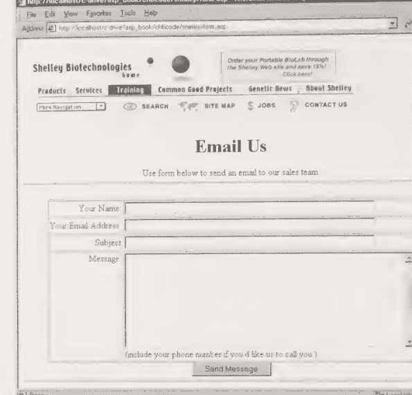

**图 6-1** 此表单用于创建电子邮件

这个表单相当标准，如图 6-1 所示。然后表单的输出会被放入一封电子邮件中。在本例中，信息被发送到电子邮件地址 `form-recipient@lovejoy.com`（见图 6-2）。仅此而已：表单中输入的任何内容最终都会以电子邮件的形式发送到你选择的地址。而且，实现这一功能的代码并不比这个想法本身复杂多少。

## 新功能

SMTP、POP、IMAP 等等……电子邮件工作原理简介

像大多数计算机技术一样，在某个阶段，那些使电子邮件成为可能的人忘记把电子邮件做得足够简单，让人们能够理解它的工作原理。我收到的来自亲戚、朋友和同事的问题中，大约三分之二与电子邮件有关。如果我有时间，我经常试图解释各个部分是如何组合在一起的，希望六个月后不用再次回答他们的问题。因为他们通常最终会带着同样的问题回来，我得出结论：电子邮件太复杂了，无法向普通用户解释——这不可能与我的解释能力有关。我的傲慢不允许我那样想。

为什么如此复杂？因为涉及的环节太多了：

- 电子邮件地址的形式为 `something@gooblety-gook.com`。例如，我的电子邮件地址是 `Elijah@Lovejoy.com`。在此值得注意的是，电子邮件地址包含两个关键信息：
  1. “@” 后面的部分是互联网域名（它也可以是一个更复杂的域名，如 `mail.click.lovejoy.com`）。这告诉邮件服务器（确保电子邮件到达目的地的应用程序），任何发送到 `Elijah@Lovejoy.com` 的电子邮件都应该发送到负责 `Lovejoy.com` 域名的邮件服务器。
  
     > 1. 由于互联网域名是构建 URL 的基础，这里不再赘述域名的工作原理。找一本 HTML 书看看解释吧。
  
  2. “@” 前面的部分是第一个独特的名称，可以映射到由负责处理该域名所有电子邮件的邮件服务器管理的邮件账户。在本例中，有一个邮件服务器跟踪 `Lovejoy.com` 域名中的所有电子邮件账户，它知道任何发给 `Elijah` 的邮件都应该进入我的邮箱。

**邮箱：** 邮件服务器，即管理电子邮件去向的程序，通常为本地用户维护邮箱。有许多不同类型的邮箱。如今，POP3 邮箱最为常见。相当多的人现在使用 IMAP 邮箱，它要稍微高级一些。

关于邮箱有两件事容易让人困惑。首先，为了在大多数系统上访问他们的电子邮件，用户需要记住用户名和密码。因为人们的电子邮件软件倾向于帮他们记住密码，所以人们往往会忘记密码。我接到很多关于这个问题的电话。

其次，邮箱几乎总是存储在与电子邮件地址域名不同的服务器上。例如，虽然我的电子邮件地址是 `Elijah@Lovejoy.com`，但我的邮箱在名为 `pop.lovejoy.com` 的服务器上。这样做有很好的理由，但我不确定这些理由是否值得由此产生的所有困惑。

**邮件服务器：** 最后，还有负责将电子邮件送到目的地的服务器应用程序，称为“邮件服务器”（有时也称为“消息传输代理”）。有时，管理用户邮箱的邮件服务器也知道如何处理外发邮件。其他时候则不是这样。例如，我必须将我的外发邮件发送到 SMTP 服务器 `smtp.lovejoy.com`。

如今大多数邮件服务器都支持 SMTP（简单邮件传输协议，或类似的东西），这是互联网的电子邮件标准。但仍有很多人使用像 AOL 或 Microsoft Exchange 这样的专有系统，它们的外发邮件会先使用一种技术开始传输，然后在途中某个节点被传递到 SMTP 网络（另一个名为“网关”的软件负责处理这种不同邮件网络之间的转换）。

好吧，这有点复杂了。让我们回顾一下：有一个电子邮件地址（1）、一个需要用户名（3）和密码（4）的邮箱服务器（2），最后还有一个邮件服务器（5）。别管了解电子邮件地址可以拆分为用户名（用户）和域名（3）以及 POP（8）、IMAP（9）和 SMTP（10）等技术之间的区别有什么用了。

唉。我想，竟然有人能收到邮件，这本身就是个奇迹。

### CDONTS：电子邮件以及为什么微软应该多雇佣诗人

正如我们在本书前面所看到的，ASP 环境提供了内置对象，使得完成任务变得容易。邮件方面也是如此：一种名为“CDONTS”的技术完成了处理邮件所需的大部分工作。

出于某种原因，这个名字让我不舒服。CDONTS。它就是念不顺口。在这种时候，我觉得软件公司都应该聘请一位驻场诗人来命名。`</soapbox>`

CDONTS 代表 Windows NT Server 的协作数据对象。它并非总是作为 IIS 的一部分安装，因此，如果本章中的脚本无法正常运行，您可能需要确保系统上安装了一个名为 `Cdonts.dll` 的文件。您可以使用 CDONTS 创建一个名为“NewMail 对象”的对象。乐趣由此开始。例如：

```javascript
1. mail_ob = Server.CreateObject("CDONTS.NewMail");

2. mail_ob.Send("sender@lovejoy.com",
    "recipient@lovejoy.com", "subject", "body");
```

这就是如何在两行代码中创建一个对象并用它发送消息。第一行使用 `Server.CreateObject()` 函数创建一个名为 `mail_ob` 的 NewMail 对象，该函数在本书其他地方也用于使用非 ASP 内置的 Microsoft 技术。下一行对 `mail_ob` 对象应用 `Send()` 方法，并传递四个参数：发件人地址、收件人地址、主题和正文。

事实上，`Send()` 方法唯一必需的参数是发件人地址，这意味着可以在使用 `Send()` 方法之前，使用 NewMail 对象的属性来设置收件人地址、主题和消息正文。例如：

```javascript
1. mail_ob = Server.CreateObject("CDONTS.NewMail");

2. mail_ob.Subject = "Tomorrow's Meeting";

3. mail_ob.Body = "Jane, I won't be able to make the meeting. Can we reschedule?";

4. mail_ob.To = "Jane@lovejoy.com";

5. mail_ob.Send("Elijah@lovejoy.com");
```

从功能上讲，这段五行代码的代码片段与上面两行代码的代码块没有区别。这样拆分使它更易于阅读，这很好，但这纯粹是个人品味问题。

## 代码

下面描述了两个文件：

- `form.asp` 是收集信息以放入电子邮件的表单。
- `catch_form.asp` 是一个脚本，它接收在 `form.asp` 中收集的信息并通过电子邮件发送出去。

### 脚本 6-1：`form.asp`

```html
1. <HTML><HEAD><TITLE></TITLE></HEAD><BODY>

2.

3. <center><h1>Email Us</h1></center>

4. <center><p>Use form below to send an email to our sales team:</p></center>

5. <center><hr></center>

6. <center><form action="catch_form.asp"></center>

7. <center><table align=center border=1></center>

8. <tr>

9. <td align=right>Your Name:</td>

10. <td><input type=text name=name value="" size=60></td>

11. </tr>

12. <tr>

13. <td align=right>Your Email Address:</td>

14. <td><input type=text name=email value="" size=60></td>

15. </tr>

16. <tr>

17. <td align=right>Subject</td>

18. <td><input type=text name=subject value="" size=60></td>

19. </tr>

20. <tr>

21. <td align=right valign=top>Message:</td>

22. <td><textarea name=message cols=60 rows=10></textarea><br>(include your phone number if you'd like us to call you.)</td>

23. </tr>

24. </table>

25. <input type=submit name=toss value="Send Message">

26. <form>

27. <hr>

28. </center>

29. </BODY></HTML>
```

### 脚本工作原理

如您所见，此页面上的代码不多，因为它全是 HTML。需要注意的关键点是，表单标签的 `action` 属性被设置为下面脚本的 URL，并且表单上的所有字段名都与下面脚本预期的字段名相匹配。

### 脚本 6-2：`catch_form.asp`

```javascript
1. <%@ Language=JavaScript %>

2. <%

3. mail_ob = Server.CreateObject("CDONTS.NewMail");

4.

5. mail_ob.Body = String("Message From: " +
    String(Request("email")) + " < " +
    String(Request("name")) + " >" + "\n\n" +
    Request("message"));

6.

7. mail_ob.Subject = String(Request("subject"));

8.

9. mail_ob.To = "form-recipient@lovejoy.com";

10.

11. mail_ob.Importance = 1; // 0=low; 1=normal; 2=high

12.

13. mail_ob.Send("form@lovejoy.com");

14.

15. %>
16. <HTML><HEAD><TITLE></TITLE></HEAD><BODY>

17.

18. <center>Email Sent Successfully!</center>

19. </BODY></HTML>
```

### 脚本工作原理

正如您从本章前面 NewMail 对象的介绍中所料，将其投入使用不需要太多代码。这个脚本只是收集在前面脚本中填写的各种表单元素，并将它们放入一封发送至 `form-recipient@lovejoy.com` 的电子邮件中。

1. 将语言设置为 JavaScript。
2. 这一行创建一个名为 `mail_ob` 的 NewMail CDONTS 对象。
3. 这一行生成最终将要发送的消息正文。这里的关键是表单元素 `email`、`name` 和 `message` 被连接成一个长字符串。
4. 消息的主题使用从前一个脚本的主题字段收集的信息设置。
5. 这一行告诉 `mail_ob` 将电子邮件发送到 `form-recipient@lovejoy.com`。
6. 我不确定是否有人关注电子邮件的重要性标志。如果阅读这些邮件的人关注此类事情，并且此处收集的信息被认为重要，您可以将消息的重要性设置为 2。
7. 最后一步是使用 `send()` 方法发送电子邮件。
8. 别忘了给用户一些反馈，让他们感觉到脚本确实工作了。

## 回顾

发送电子邮件如此简单，不妨用代码来回顾一下：

```javascript
1. mail_ob = Server.CreateObject("CDONTS.NewMail");

2. mail_ob.Send("sender@lovejoy.com", "recipient@lovejoy.com", "subject", "body");
```

就是这样！

## 黑客此脚本的创意

- 修改脚本以收集更适合您需求的字段。
- 使用此代码修改第 6 章中的购物车功能，以便订单在保存到文件系统的同时也通过电子邮件发送给您。
- 创建一个密码保护的表单，您可以在旅途中用它向人们发送快速笔记。您可以使用下拉列表存储您通常会发送邮件的人的电子邮件地址。
- 创建一个脚本，向多个收件人发送电子邮件。您可以通过使用分号分隔地址来实现：

```javascript
mail_ob.To = "form-recipient1@lovejoy.com; form-recipient2@lovejoy.com";
```

# JavaScript 速查表

本书中使用的部分 JavaScript 特性的快速速查表。

## 数据类型

JavaScript 是松散类型的，这意味着，与许多编程语言不同，在变量的使用方面有很大的灵活性。

> 请注意，所有 JavaScript 数据类型有时都表现得像对象，无论是可以对其应用方法的字符串，还是可以使用构造函数创建的布尔值。这是 JavaScript 魅力的一部分。

### 字符串

字符串是最通用的数据类型，由零个或多个字符组成，可以通过几种方式进行连接和解析。例如：

```javascript
greeting = "Hello World"
```

创建一个名为 `greeting` 的变量，其值为 `"Hello World"`。第一次使用变量时，可以选择声明它。在行末加上分号也是一个好习惯：

```javascript
var greeting = "Hello World";
```

两种方式都可行，所以你可以根据自己的喜好选择处理方式。[^1]

字符串可以使用 `"+"` 运算符进行拼接：

```javascript
greeting = "Hello World" + ", How Goes?";
```

这意味着 `greeting` 现在被设置为 `"Hello World, How Goes?"`。或者，也可以通过以下方式达到相同效果：

```javascript
greeting = "Hello World";

greeting += ", How Goes?";
```

由于 JavaScript 的类型非常宽松，有时很难确定某个值是否为字符串。如有疑问，可以使用 `String()` 函数：

```javascript
greeting = String(some_other_variable_or_expression);
```

请注意，变量和函数名是区分大小写的。

### 数字

数字的创建方式大同小异：

```javascript
years = 4;

distance = 3.543;
```

算术运算符的使用方式与预期一致：

```javascript
nonsense_value = years + distance; // nonsense_value 现在为 7.543
                                   //
```

`parseInt()` 和 `parseFloat()` 函数可用于确保看起来像数字的值确实是数字：

```javascript
parseInt(some_number_thing);
```

> 我猜想浏览器在这方面可能比 ASP 更挑剔一些。当然，IIS 的容错性相当高。

### 数组

数组是值的有序集合。例如，你可以创建一个名称数组（请注意，创建数组时必须使用 `new` 构造函数）：

```javascript
names = new Array("Jane", "Michael", "Anne");
```

也可以通过以下方式达到相同效果：

```javascript
names = new Array();

names[0] = "Jane";

names[1] = "Michael";
```


```javascript
names[2] = "Anne";
```

数组可用于存储任何 JavaScript 数据类型，包括数字和其他数组：

```javascript
numbers = new Array(1, 2, 3, 4, 5);

array_of_arrays = new Array();

array_of_arrays[0] = new Array("Jane", "Blue");

array_of_arrays[1] = new Array("Michael", "Red");

array_of_arrays[2] = new Array("Anne", "Tope");
```

要从数组中检索值，你需要根据其位置调用它：

```javascript
names[1]              // 返回 "Michael"

array_of_arrays[1][1] // 返回 "Red"
```

请注意，数组索引从零开始，如果你是新手，可能需要一些时间来适应。

### 对象

JavaScript 对对象有相当不错的支持，包括创建构造函数、类、实例方法和属性。我不会深入探讨这些细节，因为在本书中，对象被用作存储相关数据集的方式。我提及这一点只是为了明确，这里和本书其余部分讨论的对象，仅仅是 JavaScript 对象用途的冰山一角。

对象使用`new`构造函数创建：

```javascript
sample_ob = new Object();
```

没什么用。让我们往里面添加一些内容，来说明对象如何发挥作用：

```javascript
sample_ob.name = "Jane";           // 一个字符串

sample_ob.position = "CEO";        // 另一个字符串

sample_ob.office = 201;            // 一个整数

sample_ob.phone_nrs = new Object() // 一个对象

sample_ob.phone_nrs.office = "123.456.7890"

// 一个字符串，嵌套在两个对象中

sample_ob.phone_nrs.cell = "123.456.7891"

// 另一个字符串...
```

### 集合

据我所知，JavaScript 中没有集合。

然而，集合是 VBScript 中的一种数据类型（而且有人告诉我，在 Visual Basic 中也是如此）。尽管微软在使 ASP 通过 JavaScript 访问方面做得非常出色，但事实是，如果你使用 JavaScript 访问某些 ASP 对象或其他 Windows 脚本对象，你将使用的是集合而不是对象。

集合更像是记录集而不是对象，尽管在 JavaScript 中使用它们的语法通常看起来像是在处理对象。或者至少，在我意识到它们实际上是伪装成对象的集合之前，我那个小脑袋里就是这么认为的。

最终结果是，使用 ASP，你会得到一种额外的 JavaScript 数据类型。算是吧。但因为这不是一本深入探讨数据类型的书，关于这个我就写这么多吧：)

## 语句和运算符

```javascript
if();
```

`if()`语句允许条件执行代码。例如，给定一个变量`cust_number`：

```javascript
if (cust_number == 2) {
    Response.Write("Hello Jim"); // 在浏览器中打印 "Hello
}                                // Jim"
```

如果我们知道吉姆是二号客户，这将很有用。我们可能还想欢迎其他客户，这可以通过`else`子句来处理其他值：

```javascript
if (cust_number == 2) {
    Response.Write("Hello Jim");
} else {
    Response.Write("Welcome to our web site");
}
```

除了上面的相等运算符（两个等号，而不是用于给变量赋值的单个等号），JavaScript 支持其他常用运算符，如表 A-1 所示。

### 表 A-1 更多运算符！

| 运算符 | 定义 |
| --- | --- |
| `!=` | 不等于 |
| `<`, `<=` | 小于，小于或等于 |
| `>`, `>=` | 大于，大于或等于 |
| `!` | 非 |
| `\|\|` | 或 |
| `&&` | 与 |

最后三个运算符可用于修改现有表达式或进行多项测试。要欢迎除了吉姆以外的所有人：

```javascript
if (!cust_number == 2) {
    Response.Write("Welcome to the site");
}
```

并且，使用`else if()`构造，我们可以实现更复杂的功能：

```javascript
if (cust_number == 2) {
    Response.Write("Hello Jim");
} else if (cust_number > 10 && cust_number < 20) {
    Response.Write("Welcome Special Guest!");
} else {
    Response.Write("Welcome to our web site");
}
```

### `for()`

`for()`循环使得在条件为真时进行迭代成为可能。例如，从零数到九：

```javascript
for (i = 0; i < 10; i++) {
    Response.Write("\n" + i);
}
```

这将返回：

```text
0
1
2
3
4
5
6
7
8
9
```

当然，如果没有换行标签，在浏览器中这些内容会连在一起，全部显示在一行上。

`for()`运算符也可用于遍历对象或数组。例如：

```javascript
names = new Array("Bob", "Anne", "Jane", "Wilbur", "Don");

for (i in names) {
    Response.Write(names[i]);
}
```

将按顺序打印出数组中的每个名称。

### `while()`

`while`语句将循环执行代码块，只要条件为真。例如，`while()`可用于生成与上面`for()`循环相同的结果：

```javascript
i = 0;

while (i < 10) {
    Response.Write("\n" + i);
    i++;
}
```


`while`循环在遍历文件或记录集时特别有用。详情请参见第 2-4 章的示例。

# B 服务器配置

Microsoft IIS 服务器开箱即用的效果相当不错，这意味着我不需要在这里涉及太多内容。考虑到它的复杂性（有很多关于 IIS 的书籍），这很好。不过，有几点值得提及。

## 个人 Web 服务器

个人 Web 服务器是 IIS 的一个版本，适用于非服务器版本的 Windows，如 Windows NT Workstation 甚至 Windows 98。虽然许多更复杂的选项不可用，但它基本上是相同的 Web 服务器，这意味着你几乎可以将任何最新版本的 Windows 设置为开发服务器。

事实上，本书中的许多脚本都是在运行 Windows 95 的笔记本电脑上编写的。后来，可以轻松地将它们迁移到运行 Windows NT Server 和 Windows 2000 的计算机上。

## 配置 IIS

与许多 Windows NT 和 BackOffice 应用程序一样，IIS 使用 Microsoft 管理控制台进行配置。对于 Windows NT Server 4.0 上的 IIS，控制台如图 B-1 所示。

### 266 附录 B • 服务器配置

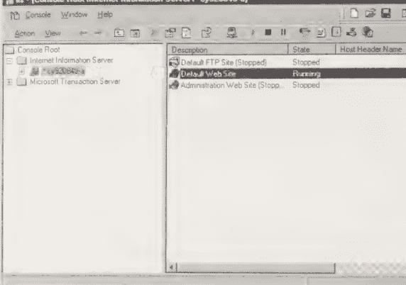

图 B-1 IIS 的 Microsoft 管理控制台

要编辑网站，最简单的方法是右键单击该网站并选择“属性”，如图 B-2 所示。

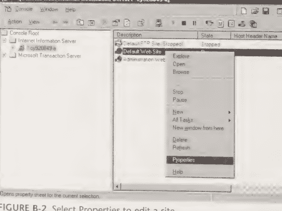

打开当前选定项的属性表。

图 B-2 选择“属性”以编辑站点

默认情况下，IIS 被配置为启用 ASP。如果由于某些原因，您的服务器上禁用了此功能，您可以通过打开您正在工作的网站的属性，转到主目录选项卡（图 B-3），并将权限单选按钮（在应用程序设置中）设置为脚本来启用它。

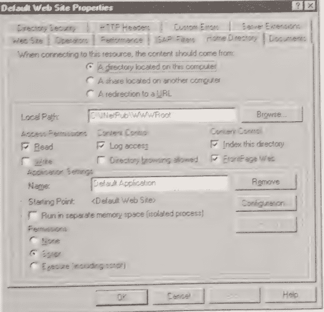

图 B-3 应启用脚本权限

### 为脚本提供写访问权限

第 5 章中的购物车脚本通过创建存储在硬盘上的文件来存储订单。这通常需要修改订单存储的`Orders`文件夹的权限，以便允许脚本写入文件系统。

### 创建 DSN 以连接到数据库

DSN 是由服务器管理员使用 ODBC 控制面板创建的。这在第 3 章中有详细说明。

### 让 CDONTS 工作

CDONTS 并不总是随 IIS 一起安装，因此首先要做的就是确保您的服务器上有它。搜索`Cdonts.dll`：如果找不到它，说明您没有安装它。因为它可以从 Microsoft 网站免费获取，所以您只需访问该网站下载即可（您可能需要注册）。例如，CDONTS 是 NT Option Pack 4（不是服务包）的一部分。

# 索引

## 符号

- `<% ... %>`，2-3
- `<%Language=JavaScript%>`，3
- `"="`，2
- `\n`，在您的输入中
- `\t`，29
- `\'`，29
- `\*`，29
- `\\`，29

## A

- 活动服务器页面（ASP），xi，xii-xiii
  - 向 HTML 页面添加 ASP 代码，xiii-xv
  - HTML 与 ASP 的对比，3
- 地址，电子邮件，249-50
- ADODB，xviii
- 数组，8，259
- ASP。参见活动服务器页面（ASP）
- ASP 对象，xvi-xviii
  - `Request`对象，xvi-xvii
  - `Response`对象，xvii
  - `Server`对象，xvii
  - `Session`对象，xvii
- ASP `Session`对象，91-92
- ASP 标签，2-3
- 自动编号数据类型，53

## B

- Berners-Lee, Tim，xii

## C

- `cart_change_qty.asp`，189-90
  - 工作原理，190-92
- `cart_items`，176
- `cart.js`，220-30
  - 工作原理，230-45
- `cart_list_items_for_sale.asp`，179-81
  - 工作原理，182-85
- `cart_remove_all.asp`，192
- `cart_set_session.asp`，185-86
  - 工作原理，186-88
- `cart_view_contents.asp`，188-89
  - 工作原理，188-89
- 大小写敏感性，xx
- `catch_form.asp`，253-54
  - 工作原理，254
- 类别表单，50-51
- CDONTS，xviii，251-52，268
- CGI，xii
- `ch3_gymnasts`，57-58
- `ch3_include.js`，68-70
  - 工作原理，70-72
- `ch3_view_categories.asp`，72-73
  - 工作原理，73-74
- `ch3_view_records.asp`，74-78
  - 工作原理，78-82
    - 创建页眉，78-79
    - 创建子类别导航栏，79-80
    - 显示记录，80-82
  - 修改此脚本的想法，82-83
- `ch4_blank_category_form.asp`，123-24
  - 工作原理，124-26
- `ch4_blank_record_form.asp`，150-52
  - 工作原理，152-54
- `ch4_delete_category.asp`，121-22
  - 工作原理，122
- `ch4_delete_record.asp`，149
  - 工作原理，147-49
- `ch4_delete_subcategory.asp`，163-64
  - 工作原理，164
- `ch4_edit_category_form.asp`，110-12
  - 工作原理，112-16
- `ch4_edit_record_form.asp`，136-40
  - 工作原理，140-45
- `ch4_edit_subcategory_form.asp`，157-59
  - 工作原理，159-62
- `ch4_include.js`，100-103
  - 工作原理，103-7
- `ch4_insert_category.asp`，127-28
  - 工作原理，128-29
- `ch4_insert_record.asp`，154-55
  - 工作原理，155-57
- `ch4_insert_subcategory.asp`，162-63
  - 工作原理，163
- `ch4_list_categories.asp`：
  - 工作原理，109-10
  - 转到，108-9
- `ch4_list_records.asp`，130-34
  - 工作原理，135-36
- `ch4_password_form.asp`，98
  - 工作原理，98-100
- `ch4_update_category.asp`，116-17
  - 转到其工作原理，117-21
- `ch4_update_record.asp`，145-46
  - 工作原理，149-50
- `collect_billing_information.asp`，206-8
  - 工作原理，208-9
- 收集访问者提交的信息，26
- 集合，260
- `collect_shipping_information.asp`，194-95
  - 工作原理，196-99
- 常用转义序列，29
- 连接（JavaScript `+` 运算符），9
- 约定，xix-xx
- Cookies，175
- `CreateObject()`方法，`Server`对象，58，61

## D

- 数据库，关系型，43
- 数据库连接对象，57-59
- 数据库驱动的页面，39-84
  - `categories`表，59
  - `ch3_include.js`，68-70
    - 工作原理，70-72
  - `ch3_view_categories.asp`，72-73
    - 工作原理，73-74
  - `ch3_view_records.asp`，74-78
    - 工作原理，78-82
- 数据库连接对象，57-59
- 创建数据库驱动的 ASP 页面，53
- DSN（数据源名称），创建，53-57
- 字段，43-44
- 外键，45-46
- `for ()`循环，创建，64-65
- 从数据库生成网页，40-84
- 包含文件，用于共享代码，64-67，70
- 信息：
  - 存储在不同的表中，关联，44-46
  - 存储在表中，43-44
- JavaScript 函数，创建，65-66
- Microsoft Access，48-53
  - 自动编号数据类型，53
  - 类别表单，50-51
  - 数据表单，50-51
  - 下载其驱动程序，55-56
  - 表编辑器，52
  - 表选项卡，52
- 主键，45
- 记录，43
- 记录集，47
- `Recordset`对象，59-64
  - 从记录集中收集字段名，62-64
- 关系型数据库，43
- 存储信息，创建用于存储的 JavaScript 对象，67-68
- 结构化查询语言（SQL），46-48
  - 使用 SQL 从数据库检索数据，47-48
  - `where`子句，47-48
- 数据表单，50-51
- 从文本文件获取数据，添加到网页，14-23
- 数据类型，257-60
  - 数组，8，259
  - 集合，260
  - 数字，8，258
  - 对象，259-60
  - 字符串，8，257-58
- `date_fancy.asp`，9
  - 工作原理，10-11
  - 修改，11-12
- `Date`对象，xviii
- `Date ()`对象，4，36
- Date 脚本：
  - 功能强大，7-11
    - 数组（JavaScript 数据类型），8
    - 连接（JavaScript `+`运算符），9
    - `date_fancy.asp`，9
    - 修改，11-12
    - 工作原理，10-11
    - 新特性，7-9
    - 数字（JavaScript 数据类型），8
    - 斜杠`//`（注释），7
    - 字符串（JavaScript 数据类型），8
  - 简单，2-6
    - `<% ... %>`，2-3
    - `<%Language=JavaScript%>`，3
    - ASP 标签，2-3
    - `Date()`对象，4
    - `date_simple.asp`，5-6
    - 工作原理，6
    - 新特性，2-5
    - `new`运算符，4
    - `Response.Write ()`，4-5
- `date_simple.asp`，5-6
  - 工作原理，6
- 域名，249-50
- DSN（数据源名称）：
  - 创建，53-57
  - 连接到数据库，268
- ECMA Script，与 JavaScript/JScript 的比较，xvi
- 编辑记录，85-166
  - ASP `Session`对象，91-92
  - `ch4_blank_category_form.asp`，123-24
    - 工作原理，124-26
  - `ch4_blank_record_form.asp`，150-52
    - 工作原理，152-54
  - `ch4_delete_category.asp`，121-22
    - 工作原理，122
  - `ch4_delete_record.asp`，149
    - 工作原理，147-49
  - `ch4_delete_subcategory.asp`，163-64
    - 工作原理，164
  - `ch4_edit_category_form.asp`，110-12
    - 工作原理，112-16
  - `ch4_edit_record_form.asp`，136-40
    - 工作原理，140-45
  - `ch4_edit_subcategory_form.asp`，157-59
    - 工作原理，159-62
  - `ch4_include.js`，100-103
    - 工作原理，103-7
  - `ch4_insert_category.asp`，127-28
    - 工作原理，128-29
  - `ch4_insert_record.asp`，154-55
    - 工作原理，155-57
  - `ch4_insert_subcategory.asp`，162-63
    - 工作原理，163
  - `ch4_list_categories.asp`：
    - 工作原理，109-10
    - 转到，108-9
  - `ch4_list_records.asp`，130-34
    - 工作原理，135-36
  - `ch4_password_form.asp`，98
    - 工作原理，98-100
  - `ch4_update_category.asp`，116-17
    - 转到其工作原理，117-21
  - `ch4_update_record.asp`，145-46
    - 工作原理，149-50
- 编辑类别的代码，108-29
- 编辑数据库的代码，98-108
- 编辑记录的代码，129-57
- 编辑子类别的代码，157-64
- 修改的想法，165-66
- 包含，98
- 密码，87，98
- 使用`Response`对象重定向用户，90-91
- 正则表达式，用于检查字符串内容，96-97
- `Request.QueryString`对象，用于收集表单数据，95-96
- `Response.Redirect ()`，90-91
- 安全性，87，93-94
- `Session`对象：
  - 收集密码，92-93
  - 密码机制，92
- `Session`变量：
  - 检查有效性，93
  - 设置，92-93
- `substring ()`函数（JavaScript），97
- 更新记录，使用 SQL，94
- `else if()`结构，262
- 电子邮件，247-56
  - 地址，249-50
  - `catch_form.asp`，253-54
    - 工作原理，254
  - CDONTS，251-52
  - 代码，252-53
  - `form.asp`，252-53
    - 工作原理，253
  - 创建表单，248
  - 网关，251
  - 工作原理，248-51
  - 修改的想法，255
  - IMAP 邮箱，250
  - Internet 域名，249-50
  - 邮箱，250
  - 邮件服务器，250-51
  - POP3 邮箱，250
  - 简单的电子邮件脚本，247-56
  - SMTP，250-51
- 转义序列，29
- 在 JavaScript 中使用`\*`转义，29
- `Execute ()`方法，`Connection`对象，58-59

## F

- 字段，43-44
- `FileExists()`方法，35
- `FileSystem`对象，xviii
- `FileSystemObject`，用于从文件获取数据，17-18
- 外键，45-46
- `for ()`循环，创建，64-65
- `form.asp`，252-53
  - 工作原理，253
- `for ()`运算符，262
- `fso`对象，35
- `fs_stream`，36

## G

- 网关，251
- `guest_book.asp`，23-33
  - 代码，30-33
  - 收集访客提交的信息，26
  - 在 JavaScript 中用`\*`转义，29
  - `FileExists()`方法，35
  - `fso`对象，35
  - `fs_stream`，36
  - `guest_book_file`变量，34
  - `guest_book.txt`，33
  - 工作原理，33-36
  - 处理 HTML 表单，25-26
  - 黑客思路，37
  - 使用`Request`对象收集传入的表单信息，27
  - 将信息追加到文件，28
  - 指示脚本执行操作的指令，26-27
  - 在 JavaScript 中换行，29
  - 新功能，25-33
  - 目的，23
  - `ReadAll()`方法，35
  - 在 JavaScript 中的特殊字符，29
  - `to_do`标签，34-36
  - `undefined`，28
  - `TextStream`对象的`Write()`方法，36

## H

- HTML：
  - ASP 与 HTML 对比，3
  - 处理表单，25-26
  - 与脚本混合使用，xii-xiii

## I

- `if ... else`语句（JavaScript），18
- `if ()`语句，260-62
- IMAP 邮箱，250
- 使用包含文件共享代码，64-67，70
- 包含文件与编辑记录，98
- 使用`Request`对象收集传入的表单信息，27
- 信息：
  - 追加到文件，28
  - 存储在不同表中并关联，44-46
  - 存储在表中，43-44
  - 收集访客提交的信息，26
- 互联网域名，249-50

## J

- JavaScript，xv
  - 大小写敏感，xx
  - 速查表，257-63
  - 与 ECMA Script 对比，xvi
  - 与 JScript 对比，xvi
  - 数据类型，257-60
    - 数组，259
    - 集合，260
    - 数字，258
    - 对象，259-60
    - 字符串，257-58
  - `Date()`对象，36
  - `else if()`构造，262
  - 创建`for()`循环，64-65
  - `for()`运算符，262
  - `if ... else`语句，18
  - `if()`语句，260-62
  - 中的换行，29
  - `Math`对象，xviii
    - 使用其生成随机整数，19
  - 对象，xviii
  - 正则表达式，15-16
  - `reverse()`方法，37
  - 中的特殊字符，29
  - 语句/运算符，260-63
  - `substring()`函数，97
  - `while()`运算符，263
- 创建 JavaScript 函数，65-66

## L

- 在 JavaScript 中换行，29

## M

- 邮箱，250
- 邮件服务器，250-51
- `Math`对象，xviii
  - 使用其生成随机整数，19
- Microsoft Access，48-53
  - `AutoNumber`数据类型，53
  - 分类表单，50-51
  - 数据表单，50-51
  - 下载其驱动程序，55-56
  - 表编辑器，52
  - 表选项卡，52
- 配置 Microsoft IIS 服务器，265-68
- Microsoft 管理控制台，265-66
- Microsoft 脚本对象，xvii-xviii

## N

- `new`运算符，4
- 数字，8，258

## O

- 对象，259-60
- `FileSystemObject`的`OpenTextFile()`方法，22
- JavaScript 运算符，260-63
- `option_file.txt`，178-79
- `order_complete.asp`，218-19
  - 工作原理，219
- `order_info`对象，176

## P

- 密码与编辑记录，87，98
- PerlScript，xv
- 个人 Web 服务器，265
- POP3 邮箱，250
- 功能强大的日期脚本，7-11
  - 数组（JavaScript 数据类型），8
  - 连接（JavaScript `+`运算符），9
  - `date_fancy.asp`，9
  - 修改，11-12
    - 工作原理，10-11
    - 新功能，7-9
  - 数字（JavaScript 数据类型），8
  - `//`（注释），7
  - 字符串（JavaScript 数据类型），8
- 主键，45
- 购买流程，购物车，171-73

## R

- 记录，43
  - 编辑，85-166
  - 使用 SQL 更新，94
- 记录集，47
- `Recordset`对象，59-64
  - 从其中收集字段名，62-64
- 正则表达式，15-16
  - 用于检查字符串内容，96-97
- 关系型数据库，43
- `replace()`方法，16
- `Request`对象，xvi-xvii
  - 服务器变量，15
  - 用于收集传入的表单信息，27
- `Request.QueryString`对象，用于收集表单数据，95-96
- `Response`对象，xvii
  - `Response.Redirect()`，90-91
  - `Response.Write()`，4-5
  - `reverse()`方法，37

## S

- 脚本，授予写入权限，267
- 安全性：
  - 与编辑记录，87，93-94
  - 购物车，168-69
- 服务器配置，265-68
  - 个人 Web 服务器，265
- `Server`对象，xvii
  - `CreateObject()`方法，58
- 服务器端脚本，3
- `Session`对象，xvii
  - 密码机制，92
  - 在其中存储信息，175-76
- `Session`变量：
  - 检查有效性，93
  - 设置，92-93
- `set_cc_billing_information.asp`，209-11
  - 工作原理，211-15
- `set_pwc_billing_information.asp`，215-17
  - 工作原理，217-18
- `set_shipping_information.asp`，199-201
  - 工作原理，201-5
- 购物车，167-246
  - ASP 购物车代码，179-246
  - 按类别浏览商品/关键词搜索，169
  - 构建，168-246
  - `cart_change_qty.asp`，189-90
    - 工作原理，190-92
  - `cart_items`，176
  - `cart.js`，220-30
    - 工作原理，230-45
  - `cart_list_items_for_sale.asp`，179-81
    - 工作原理，182-85
  - `cart_remove_all.asp`，192
    - 工作原理，192-93
  - `cart_set_session.asp`，185-86
    - 工作原理，186-88
  - `cart_view_contents.asp`，188-89
    - 工作原理，188-89
  - `collect_billing_information.asp`，206-8
    - 工作原理，208-9
  - `collect_shipping_information.asp`，194-95
    - 工作原理，196-99
  - 调试，245-46
  - “删除此项”链接，170-71
  - 生成订单，193-99
  - 黑客思路，246
  - 商品数量，170
  - `option_file.txt`，178-79
  - 订单确认屏幕，173
  - `order_complete.asp`，218-19
    - 工作原理，219
  - 订单文件外观，174
  - `order_info`对象，176
  - `orders`文件夹中的订单，174
  - 购买流程，171-73
  - 将相关数据存储在两个文本文件中，177-79
  - 安全性，168-69
  - `Session`对象，在其中存储信息，175-76
  - `set_cc_billing_information.asp`，209-11
    - 工作原理，211-15
  - `set_pwc_billing_information.asp`，215-17
    - 工作原理，217-18
  - `set_shipping_information.asp`，199-201
    - 工作原理，201-5
  - 收集配送/账单信息，193-99
  - 提交按钮，170
  - 创建模板，176-77
  - 导览，169-74
  - `view_session_contents.asp`，245
    - 工作原理，245-46
- 简单的日期脚本，2-6
  - `<% ... %>`，2-3
  - `<%Language=JavaScript%>`，3
  - ASP 标签，2-3
  - `Date()`对象，4
  - `date_simple.asp`，5-6
    - 工作原理，6
  - 新功能，2-5
  - `new`运算符，4
  - `Response.Write()`，4-5
  - `//`（注释），7
- SMTP，250-51
- 在 JavaScript 中的特殊字符，29
- SQL，参见结构化查询语言（SQL）
- JavaScript 语句，260-63
- 存储信息，为此创建 JavaScript 对象，67-68
- `String()`函数，27
- 字符串，8，257-58
- 结构化查询语言（SQL），46-48
  - 使用其从数据库检索数据，47-48
  - 使用其更新记录，94
  - `where`子句，47-48
- `substring()`函数（JavaScript），97

## T

- 将信息存储在表中，43-44
- 创建模板，176-77
- 使用文本文件作为数据库，16-17
- `TextStreamObject`，用于从文件读取数据，17-18
- `tip_of_the_day.asp`，15-23
  - 代码，19-21
  - `FileSystemObject`，用于从文件读取数据，17-18
  - 工作原理，21-23
  - `if ... else`语句（JavaScript），18
  - `Math`对象，使用其生成随机整数，19
  - 新功能，15-19
  - `FileSystemObject`的`OpenTextFile()`方法，22
  - 正则表达式（JavaScript），15-16
  - `Request`对象服务器变量，15
  - 文本文件，用作数据库，16-17
  - `TextStreamObject`，用于从文件读取数据，17-18
  - `tips.txt`，20
  - `while()`（JavaScript 语句），17
- `tips.txt`，20

## U

- `undefined`，28
- 使用 SQL 更新记录，94

## V

- VBScript，xv，260
- `view_session_contents.asp`，245
  - 工作原理，245-46

## W

- 使用 Web 界面编辑数据库中的记录，86-166
- 将脚本整合到网站首页，14-23
- `where`子句，47-48
- `while()`运算符，17，263
- `TextStream`对象的`Write()`方法，36

# 保持与 PH PTR Online 同步更新！

我们致力于在专业计算机科学与工程的前沿领域保持领先。访问 www.phptr.com 时，您会发现：

- **特别兴趣领域**提供我们最新的书籍、系列丛书、软件、每月特色、相关链接以及其他有助您完成工作的有用信息。
- **优惠、优惠、优惠！**访问我们的促销部分，获取零售商为您独家提供的最新折扣。
- **需要寻找书店？**您附近很可能就有经营广泛 PTR 图书的书商。在 www.phptr.com 查找您附近的 Magnet 书店。
- **PH PTR 最新动态？**我们不仅为专业社区出版书籍，我们更是其中的一员。查看我们的会议日程，加入作者聊天，获取您感兴趣主题的最新评论和新闻稿。
- **立即订阅！加入 PH PTR 的月度电子邮件通讯！**

想随时了解您兴趣领域的最新信息吗？在我们的网站上选择一个目标类别，我们将及时向您通报您兴趣领域内最新的 PH PTR 产品、作者活动、评论和会议。

访问我们的邮件室，立即订阅！http://www.phptr.com/mail_lists

# InformIT

- 文章
- 免费图书馆
- 电子书
- 专家问答
- 培训
- 职业中心
- 下载
- MyInformIT
- 登录
- 注册
- 关于 InformIT

主题：

- 操作系统
- Web 开发
- 编程
- 网络
- 认证
- 以及更多……

# 来自您熟悉和信赖的专家的解决方案

- 免费、深入的文章和补充资料
- 掌握您需要的技能，随时随地
- 从行业领先的书籍、电子书和培训产品中选择
- 在需要时获得解答——来自在线专家或 InformIT 的综合图书馆
- 获得行业认证，推进您的职业生涯

## 专家访问

# 今天就访问 InformIT，获取来自 PHPTR 的优质内容

## 免费内容

### www.informit.com

Prentice Hall 和 InformIT 是 Pearson plc 的商标 / 版权所有 © 2000 Pearson

# INTERNET 编程

## 面向 WEB 专业人员的必备 ASP

### ELIJAH LOVEJOY

## 必备系列图书涵盖您所需的所有 Web 技能！

这些书都采用同样出色的格式，并提供类似的网站供下载代码——所以一旦您用过其中一本，从其他书中学习就是小菜一碟！

- 面向 Web 专业人员的必备 PHP
- 面向 Web 专业人员的必备 Flash™ 5
- 面向 Web 专业人员的必备设计
- 面向 Web 专业人员的必备 Flash™ 4
- 面向 Web 专业人员的必备 CSS 和 DHTML
- 面向 Web 专业人员的必备 Perl 5
- 面向 Web 专业人员的必备 Photoshop® 5
- 面向 Web 专业人员的必备 JavaScript™

这本简洁、实例丰富的指南为 Web 开发人员讲授了使用 Microsoft 的 ASP 和 JavaScript™（全球第一的 Web 脚本语言）构建出色的动态网站和应用程序所需的全部知识。经万维网管理员组织认可，面向 Web 专业人员的必备 ASP 提供务实的实用内容，围绕真实世界的示例构建，可从网上下载。每章都包含对关键 ASP 和 JavaScript 特性的实用概述，巩固您所学的知识，并演示如何快速将其应用于您自己的应用程序。从将 ASP 代码嵌入 HTML 页面的基础知识到成熟的数据库应用程序开发，本书提供实用的答案、可用的代码和真正的解决方案——快速！

## 使用 ASP 和 JavaScript 做到这一切，还有更多！

- 在任何网站或内联网站上提供动态内容
- 创建发布内容并允许用户编辑内容的数据库应用程序
- 构建购物车、留言簿和其他应用程序
- 从您的网页自动发送电子邮件
- 在页面中嵌入日期和其他可变数据
- 请求和验证用户密码

# 关于作者

ELIJAH LOVEJOY 拥有超过六年开发 Internet 和数据库应用程序的经验；他的客户包括美国电影学院和环境保护署。他目前担任 Prepay.com 的首席技术官。

PRENTICE HALL  
新泽西州上萨德尔河 07458  
www.phptr.com  
$29.99 美元 / $44.95 加元

ISBN 0-13-030499-9  
0 76092 00936 8  
9 780130 304995  
90000
