# JavaScript 入门指南

搜索互联网 • Word 2000 快捷键

表格、图表与图形

## 多林金德斯利其他可购图书

*Essential Computers* 系列拥有自己的网站。获取最新信息，请访问：`www.dk.com/essentialcomputers`

## 基本计算机

## 信息时代的基本技能

多林金德斯利基本计算机——一系列用户友好的可视指南，为您提供您将需要的所有计算机技能。

1003473392

## DK 基本计算机

互联网

# JavaScript

## 入门介绍

| 到期日期 |
| :--- |
| 2002 年 10 月 15 日 |
| 2002 年 11 月 1 日 |
| 2004 年 7 月 25 日 MB |

**学习资源中心**

**Grant MacEwan**

**社区学院**

## 关于本书

*JavaScript：入门介绍* 是一本易于理解的指南，介绍如何将 JavaScript 代码整合到 HTML 文档中，并理解 JavaScript 对网页的影响。

**本书将让你领略** JavaScript 作为一种编程语言的风貌，并让你熟悉它在 HTML 文档中作为代码的样子。你将找到关于如何从零开始构建一些基本但广泛使用的 JavaScript 代码的建议；如何使用第三方软件（如 Macromedia 的 Dreamweaver）为你生成代码；以及如何识别其他网页中的 JavaScript，使你能够借鉴他人的成果。本书面向使用记事本和 Internet Explorer 4 版或更高版本的 PC 用户，但基本原则适用于所有现代网页浏览器和简单文本编辑器。欢迎你改编此处展示的任何脚本，并在你自己的网页上使用。在本书展示的 JavaScript 代码中替换你自己的文本和超链接应该足够简单。同样重要的是，本书第 7 章为你提供了如何调试脚本的建议。

各章节和小节使用逐步序列呈现信息。几乎每个步骤都配有插图，展示你的屏幕在每个阶段应该呈现的样子。

本书包含多个功能帮助你理解正在发生的事情以及你需要做什么。命令键显示在这些矩形中：`Enter` ← 和 `Ctrl`，以防止对应该输入什么产生混淆。交叉引用在文本中显示为左页或右页图标：◁ 和 ▷。页码和引用显示在页脚。

还有一些框详细解释特定功能，以及提供替代方法的提示框。最后，在书末，你可以找到常用术语词汇表和综合索引。

## JavaScript 概述

如果你熟悉 HTML（网页背后的标记语言）的基础知识，你应该不难理解 JavaScript 的基础知识。

### 什么是 JavaScript？

JavaScript 是一种编程语言——或者更具体地说，是一种基于对象的脚本语言——但不要被技术术语吓倒。JavaScript 比其他编程语言（如 Java 和 C++）简单得多。JavaScript 与 HTML 协同工作，扩展你对网络浏览器的控制，并通过使网页更加动态和高效来改进网页的工作方式。

### 比看起来更容易

- 由于大多数 JavaScript 效果都以嵌入 HTML 文档的几行文本形式出现，你很快就能学会足够的编程技能，对网站进行显著改进。
- 大多数浏览器都有内置的 JavaScript 编译器（解释和执行 JavaScript 代码的设施），因此用户无需安装特殊插件即可享受网页中包含的 JavaScript 代码带来的好处。

```html
<SCRIPT language="JavaScript">
<!-- 对旧浏览器隐藏脚本
if (navigator.appCodeName == "JavaEnabled")
{
  document.write("没问题！您的Web浏览器已启用JAVA")
}
else
{
  alert("有问题！您的Web浏览器未启用JAVA。请在后续页面选择UPGRADE或NON-JAVA按钮。")
}
//结束对旧浏览器隐藏脚本 -->
</SCRIPT>
```

这些网络浏览器中的每一个都包含 JavaScript 编译器。

## JavaScript 能做什么？

通过扩展你对网页浏览器工作方式的控制能力，JavaScript 可以产生许多屏幕效果，为网页注入额外功能，提升其吸引力，更重要的是，增强其实用性。

## JavaScript 控制功能

例如，JavaScript 可以让你：

- 控制窗口底部状态栏中显示的内容。默认情况下，当鼠标光标悬停在超链接上时，状态栏会显示相应的 URL。

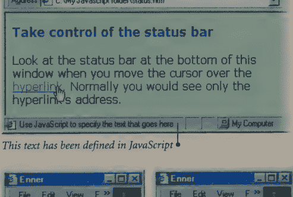

- 指定当鼠标指针移过屏幕上某些区域时显示的图像和文字。这些区域可以是图像、链接，甚至是页面的空白区域。此功能使你能够制作平滑的悬停效果，将一个图像替换为另一个——例如，使按钮看起来像是被按下的。

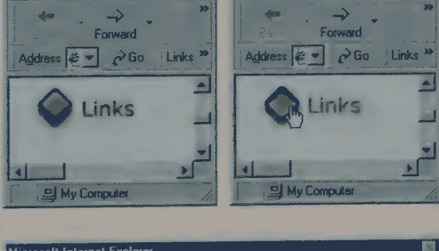

- 利用访问者的浏览器信息来检测是否安装了必要的软件，并提醒访问者或将他们重定向到为他们的浏览器类型而设计的网站部分。


- 利用访问者的信息，用他/她的名字个性化页面。
- 确定新的超链接窗口的构成，例如它们是否包含工具栏、地址栏和滚动条。

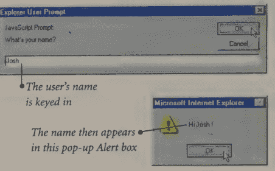

用户输入姓名。

随后姓名出现在此弹出的提示框中。

## 高级效果

JavaScript 还可以用来执行方程计算或创建互动游戏。有许多网站，例如 `javascript.internet.com`，提供复杂的脚本，可以直接粘贴到你的 HTML 文档中。

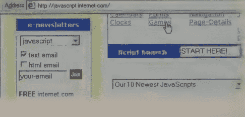

## 不要过度使用

JavaScript 提供的交互性对许多初学者来说可能过于诱人，因此要合理使用，以帮助访问者为目的，而不仅仅是炫耀。例如，如果你使用 JavaScript 检测访问者的浏览器类型和版本，仅仅告诉访问者你知道这一点会让他们感到恼火。更好的做法是利用这些信息将访问者引导到专门为该浏览器用户设计的网站部分。要做到这一点，你需要了解一些函数和 `if...else` 语句的知识。这些听起来可能很复杂，但学起来出奇地简单。

## 炫耀

- 使用 JavaScript 激活像这样的提示框，与其说是有帮助，不如说更可能令人厌烦。

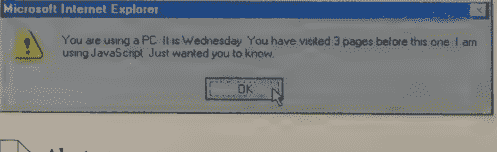

15 个 JavaScript 函数

27 个提示框

## JavaScript 实战

你可以将 JavaScript 嵌入网站中任何网页的 HTML 代码中。在查看代码示例之前，让我们先看一个典型的网页流程，展示 JavaScript 能够产生的交互效果。

### 1. 弹出提示框

- 开屏提示框的外观和内容由 JavaScript 控制。

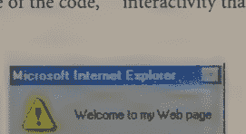

### 2. 识别网页浏览器

- 识别访问者使用的特定网页浏览器，并将浏览器名称插入屏幕文本中，这是 JavaScript 的一项功能。

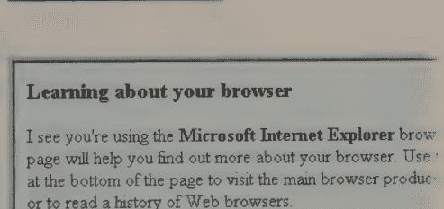

### 3. 在状态栏中显示文本

- 在本例中，当指针经过页面上的链接时，屏幕底部状态栏中显示的文本由 JavaScript 代码定义。

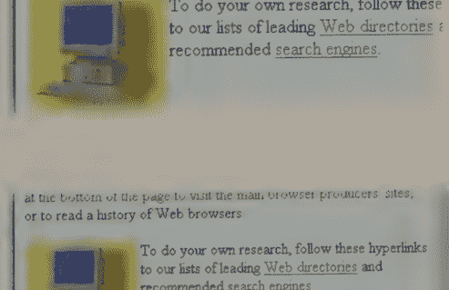

## 事件背后的 JavaScript

回顾我们刚刚看到的序列并查看 HTML 源代码，我们可以看到这些效果是如何通过嵌入在 HTML 中的仅仅几行 JavaScript 实现的。注释突出了 JavaScript 外观和用途的几个要点，这些将在本书中详细讲解。


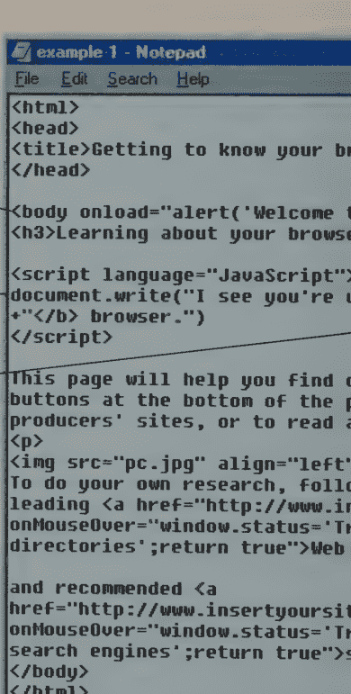

此代码使上述提示框在页面打开时弹出。

`document.write` 命令将引号内的所有内容以及加号内的所有内容写入网页。

此代码（`navigator.appName`）检测访问者的浏览器类型和版本，并将浏览器类型动态写入网页。

### 了解你的浏览器

我看到你正在使用 Microsoft Internet Explorer 浏览器。本页将帮助你了解更多关于你的浏览器的信息。使用页面底部的按钮访问主要浏览器制造商的网站，或阅读网页浏览器的历史。

要进行你自己的研究，请通过这些超链接访问我们的主要网页目录列表和推荐搜索引擎。

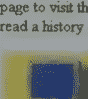

## 让事情发生

我们刚刚看到的窗口中的活动元素（提示框的出现、用户浏览器的识别，以及光标移过超链接时状态栏中显示的文本）由嵌入在此 HTML 文档中的 JavaScript 控制。

```html
<title>

page')">
>
<b>" +navigator.appName

about your browser. Use the
isit the main browser
of Web browsers.</b>

hyperlinks to our lists of
sitehere.com/webdir.htm"
these recommended Web
ies</a>

m/webdir.htm"
ing with one of these top
gines</a>
```

## JavaScript 语法

### 文本中的引号

在文本“字符串”中使用引号时要小心，因为它们可能会严重混淆浏览器，使其无法判断代码在哪里结束、文本在哪里开始。规则是，如果需要在双引号内使用引号，应使用单引号。例如：

```javascript
document.write ("Be very 'careful' about using quote marks.")
```

### 分号

在每行代码末尾加上分号是一种可选但有用的做法。这个标点符号可以明确地告诉浏览器新一行代码从哪里开始。较新版本的主流网页浏览器可能能够自动识别新一行代码的位置，但有时缺少分号会导致混乱。

或阅读网页浏览器的历史。

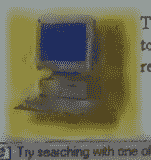

要进行你自己的研究，请通过超链接访问我们的主要网页目录列表和推荐搜索引擎。

试试使用这些顶级搜索引擎之一进行搜索。

这两段代码指定了当鼠标光标移过文本超链接时状态栏中显示的文本（见上文）。

## JavaScript 基础

认识到将 JavaScript 代码块放在 HTML 文档中的什么位置，是你第一次学习这门语言时需要了解的首要事项之一。

### 识别 JavaScript

JavaScript 代码行需要与 HTML 代码区分开来。如果你查看任何包含 JavaScript 的 HTML 文档的源代码，JavaScript 代码最容易通过包含在 `<script>` 标签中来识别。

#### 使用 `<script>` 标签

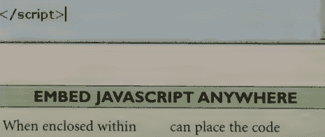

- 当代码放置在 `<script>` 和 `</script>` 标签之间时，大多数浏览器会假定其中的代码作为 JavaScript 来读取。
- 大多数浏览器默认将 JavaScript 作为脚本语言，但也可以在这些标签中使用其他脚本语言（例如 VBScript）。因此，建议指明所使用的编程语言，在本例中，通过将第一个标签写为 `<script language="JavaScript">` 来实现。

#### 在任何地方嵌入 JavaScript

当被 `<script>` 标签包围时，JavaScript 可以嵌入到 HTML 文档的任何位置（只要不违反 HTML 规则），并且可以按需多次嵌入。如果脚本与页面上的某个按钮相关，你可以将代码放在页面上该 HTML 块的旁边。不过，大多数情况下，JavaScript 会被放在文档的 `<head>` 部分。这在涉及函数时尤其如此。

## 使用 `<head>` 标签

- 当您打开一个网页时，`<head>` 标签之间的代码会在网页显示在屏幕上之前加载。
- 在此示例中，一个包含 **欢迎访问我们的网站** 字样的警报框会在网页出现在您屏幕上之前弹出。

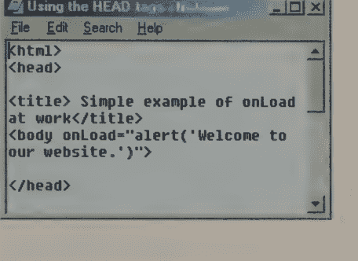

## 使用函数

- `<script>` 标签内的任何代码并非必须出现在文档的 `<head>` 标签之间，但当您使用一个或多个将在页面后续部分“调用”的函数时，将代码放在此处是一种良好的实践。

```html
<SCRIPT language="JavaScript">

function myFunction()
{
... 构成 myFunction（或您决定为该特定函数命名的名称）的 JavaScript 语句
... 放置在此处，位于花括号之间。
}

</SCRIPT>
```

## 识别 JavaScript 的重要性

识别 JavaScript 代码的能力将帮助您识别其他人网页中可以学习、改编并用于适合自己网站的代码部分。此外，您有时需要修改使用第三方软件生成的 JavaScript。即使是最优秀的 HTML 设计软件包有时也会陷入混乱，使您除了打开源代码并调试脚本外别无他法。通常，这仅仅涉及定位问题区域并删除重复的标签。熟悉代码在追踪自身错误时也有明显的好处。

## JavaScript 事件处理程序

一些 JavaScript 代码不需要放在 `<script>` 标签内。通常，这些实例被称为事件处理程序。示例包括当访问者点击鼠标或将光标移动到文本或图像上时触发事件的命令。在这些命令之后引号中的任何内容都会被浏览器解释为 JavaScript，并相应处理。

## 事件处理程序实战

- 事件处理程序是以 `on` 开头的复合词，后跟一个首字母大写的动词。例如：`onClick`、`onChange`、`onLoad`、`onSubmit` 或 `onMouseOver`。
- 在此示例中，`onUnload` 用于调用一个警报框。

```html
<html>
<title>onUnload 简单工作示例</title>

<body onUnload="alert('感谢您的访问。请再次光临！')">
这个简单的网页演示了 onUnload 事件处理程序的工作。

<p>当您离开此网页或退出网络浏览器时，将出现一个警报框，其中包含您为警报框指定的文字。

<p>请注意，在此示例中您不需要使用 "javascript" 标签。
</body>
</html>
```

- 这是包含 JavaScript 事件处理程序源代码的页面。事件处理程序不需要“JavaScript”标签。

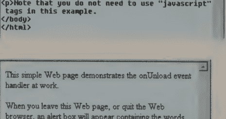

- 当用户离开页面或退出浏览器时，警报框出现。

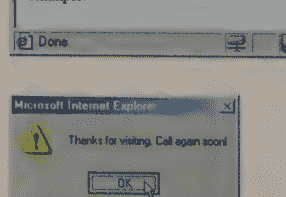

## JavaScript 函数

JavaScript 使用一种称为“函数”的编程工具来更高效地工作。一旦您理解了函数如何融入整体计划，您应该能够将一页代码分解为结构上有意义的部分。

## 函数的目的

- 函数是一个命名的命令序列，通常包含在 `<head>` 标签内。
- 一旦创建了函数，您就可以在页面的后续部分通过使用一行代码“调用”任意多次，而无需在 HTML 正文中输入一大段代码。
- 函数的功能及其名称由作者决定。
- 在这种情况下，函数 `showAA` 被用来在点击按钮时显示相应的警报框。
- 点击“最佳女主角”按钮会导致该函数运行，并显示一个包含 Judy Holliday 字样的警报框。

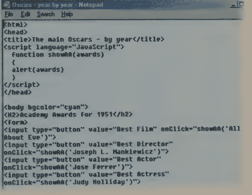

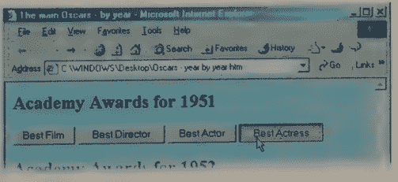

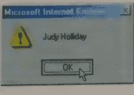

## 在记事本中编写 JavaScript

编写 JavaScript 不需要任何特殊软件。事实上，当您刚开始时，最好使用可用的最简单的文本编辑器。Windows 98 附带的记事本提供了一个很好的、简单的工具。无论您使用什么编辑器，都需要将脚本保存为“纯文本”格式。这样，如果您从保存的文件中复制粘贴 JavaScript 代码，您可以保证不会复制文字处理程序放置的隐藏代码。

### 1. 在记事本中编写

- 使用记事本，您可以直接将 JavaScript 写入 HTML 文档，也可以单独编写 JavaScript，保存文件，然后在以后将脚本复制粘贴到 HTML 文档中。
- 这里我们在一个新的记事本文档中编写两个脚本，确保为每个脚本提供一个简短的描述性标题，以便于我们以后识别。

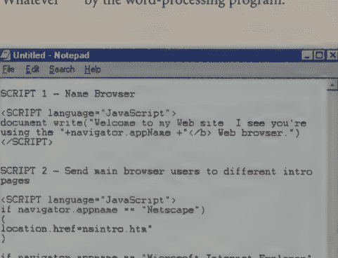

### 2. 保存文档

- 脚本完成后，将文档保存到一个名称合适的文件夹中。
- 如果您正在创建包含 JavaScript 的 HTML 文档，请记住将其保存为扩展名为 `.htm` 或 `.html` 的 HTML 文档。

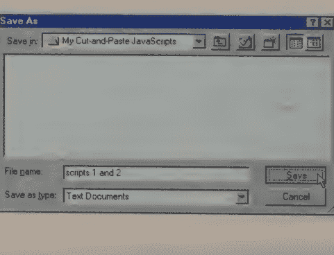

### 3. 复制并粘贴脚本

- 当您准备好将代码嵌入 HTML 文档时，只需在记事本中打开文件，突出显示所需的脚本（如此处所示），然后将其复制到网页 HTML 代码的相关部分。

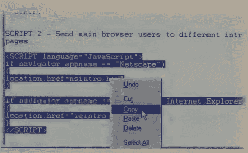

## 实用脚本工具

本书中几乎所有 JavaScript 示例都是通过在记事本中键入代码创建的，但这并不妨碍您使用多种不同的网站构建和脚本编辑程序来制作您的 JavaScript 代码。请记住，您始终可以阅读任何这些程序生成的 JavaScript 代码，因此您可以学习它们采用的技术并将其据为己有。

### 所见即所得 HTML 软件包


- 您可以找到许多复杂的菜单驱动式 HTML 设计软件包，例如 Macromedia 的 Dreamweaver、Microsoft 的 FrontPage 等，它们将帮助简化创建 JavaScript 的过程。这些软件包可以自动生成各种 JavaScript 效果，例如翻转图像。

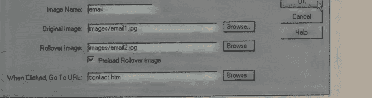

*这个 Dreamweaver 对话框简化了翻转图像的创建和放置。*

## JavaScript 编辑器

一些优秀的 JavaScript 编辑程序（作为共享软件和免费软件提供）提供了各种常见编码任务的快捷方式。例如，多个程序允许您突出显示一段文本并选择一个菜单项，然后必要的代码就会自动生成，从而节省了大量常规键盘工作。

### STJS Menumaker

- STJS Menumaker 是一个很好的例子。它是一个易于使用的免费软件程序，用于生成 JavaScript 下拉菜单。更多详情，请参阅作者网站 `www.comwell.se/samuel/software` 并按照链接操作。

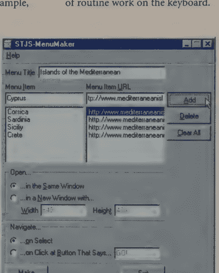

- 这里我们输入了将产生地中海岛屿下拉菜单的名称和 URL。

- 单击 `Make` 按钮后，将生成一个新的网页，其中包含您刚刚指定的下拉菜单。

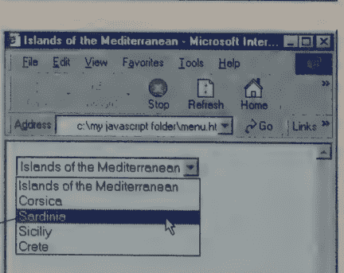

此处的列表对应于上一个屏幕中 Menu Item 框的内容。

## 审查和编辑

您会经常想要在进行过程中审查您的代码。为此，您需要同时打开包含您正在编辑的 HTML 文档的记事本，以及包含相同 HTML 文档的网络浏览器。

### 打开源代码

- 要打开网页的源代码（这包括存储在硬盘上的 HTML 文档），在您的网络浏览器中打开文件并从“视图”菜单中选择“源文件”。

- 默认情况下，记事本将打开，以文本文件形式显示 HTML 文档。

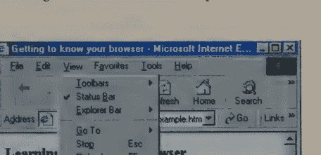

- 在背景中打开网页的同时，编辑文本文档。要监控编辑对网页的影响，首先在记事本的“文件”菜单中选择“保存”。

- 现在将网络浏览器窗口调至前面，单击“刷新”按钮，并查看更改。

- 这是一种非常有用的工作方式，因为您可以在问题出现时识别它们，从而节省以后调试脚本的大量时间。

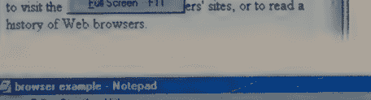

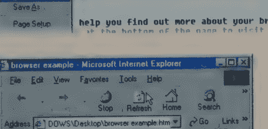

52 调试 JavaScript

## 隐藏 JavaScript

在 JavaScript 的上下文中，HTML 文档中可以包含两种注释。第一种将在后面的章节讨论，它是由直接输入 JavaScript 本身的注释组成，允许你为自己编写有用的备注。第二种由输入 HTML 的注释组成，当编写 JavaScript 时，它们有更重要的用途。HTML 注释可以将你的代码隐藏在无法处理 JavaScript 的旧浏览器中。

## 使用 HTML 注释

无法显示 JavaScript 的较旧浏览器可能会将你的代码作为文本显示在页面上。为了防止这种情况发生，可以使用 HTML 注释来隐藏 JavaScript。下面的示例展示了这一操作。HTML 注释的开头是：`<!--`。HTML 注释的结尾是：`-->`。能够处理 JavaScript 的浏览器将执行 JavaScript 命令——在此示例中，是将文本写入浏览器窗口。无法处理 JavaScript 的浏览器将简单地忽略 HTML 注释标签之间的所有内容。

```html
<html>
<head>
<title>HTML comments</title>
</head>

<script language="JavaScript">
<!-- Hide JavaScript from older browsers

document.write("All this text will appear in<br>");
document.write("browsers that handle JavaScript.<br>") ;
document.write("Older browsers will display <br>");
document.write("only the message in red <br>");
document.write("at the bottom of the page.<br>");

// stop hiding JavaScript -->
</script>

<hr>
<h6> <font color="red">If only this message is displayed,
you need to visit the <a href="textonly.htm">text-only
version </a> of this page.</font></h6>

</html>
```

## 非 JavaScript 启用浏览器

这里，网页正在 JavaScript 启用的浏览器上查看。为无法处理 JavaScript 的浏览器提供了一个指向页面纯文本版本的链接。这需要更多的工作，但将使你的网页更广泛地可用。

## 照顾少数群体

照顾那些使用非 JavaScript 启用浏览器访问你网站的访客，是一个可以通过多种方式解决的网站设计问题。编写一个包含 JavaScript，同时也为任何无法访问 JavaScript 材料的人提供足够信息的页面，需要仔细规划。解决方案取决于你构建的网页的性质、它们包含的信息，以及你有多认真。一些作者为较旧浏览器的用户设计了一个单独的页面。其他人则提供一个指向页面纯文本版本的链接。一些作者只是包含一条消息，说明：“您的网络浏览器无法处理此页面；也许是时候升级您的浏览器了，”然后就此打住。

## 浏览器与 JavaScript

| 能够处理 JavaScript 的浏览器 | 版本 | 无法处理 JavaScript 的浏览器 | 版本 |
| --- | --- | --- | --- |
| Netscape Navigator 2 | JavaScript 1.0 | AOL Browser | 1.3 |
| Netscape Navigator 3 | JavaScript 1.1 | Mosaic | 1.3 |
| Netscape Navigator 4+ | JavaScript 1.2 | Netscape Navigator | 1.1 |
| Internet Explorer 3 | Jscript | Internet Explorer | 1.2 |
| Internet Explorer 4+ | Jscript 1.2 | Lynx |  |
| Internet Explorer 5 |  |  |  |
| Opera 3.5, 4 及其他最新浏览器 |  |  |  |

## 使用 JavaScript

在网页源代码中使用 JavaScript 可以非常广泛，但在本章中，我们将探讨一些最常用的代码使用方式。

## 写入文档

在 JavaScript 提供的所有命令中，最广泛使用的之一是 `document.write`。这使你可以使用 JavaScript 将文本写入浏览器窗口。然而，一个自然产生的问题是，既然你可以用 HTML 做同样的事情，为什么还要使用 JavaScript 命令。

### 动态写入与静态写入

“write”命令（或正确的术语是“方法”）的意义在于，它比 HTML 为你提供了将信息写入浏览器窗口的更广泛选项。使用 HTML，浏览器窗口只显示你在文档源代码中编写的文本。使用 `document.write` 方法，显示的文本可以取决于从访客那里收集的信息。这可以包括“外部”信息，例如访客的浏览器类型和版本、日期和时间，以及之前访问的页面数量。它也可以包括访客通过提示框提供的信息。

### 标签或事件处理程序

如果你想向浏览器窗口写入包含这些信息中的任何一项，你必须使用 `document.write` 方法；而且，因为它是一个 JavaScript 命令，所以它必须出现在 `<script>` 和 `</script>` 标签之间，或者在事件处理程序内。

| DOCUMENT.WRITE 语法 |
| --- |
| 要使用 `document.write()` 方法，你想要写入屏幕的信息必须放在命令后面括号内的引号中，除了文本字符串内的空格外，不留任何字母空格：`document.write("Add your text here")`。 |

## DOCUMENT.WRITE 命令

`document.write()` 命令。它所做的只是将莎士比亚十四行诗的前四行写入浏览器窗口；不过在这种情况下，并不是对外部信息的响应。

请注意，这些行在浏览器窗口中显示为一行连续的文本。一行末尾和下一行开头之间没有留空格。

如果你打算让文本显示在单行中，需要在行尾留一个空格。如果你想让文本显示在多行，请在每行末尾使用 `<br>` 标签添加换行符，正如我们在本例中看到的。

- HTML 换行符将诗句分成单独的行。你可以使用 `document.write` 命令引号内的 HTML 命令来格式化文本。

## 连接

连接是将元素连接成一个序列的过程，这是编程中经常进行的操作。你可以在 `document.write` 命令的同一行中使用“加号”连接多个文本字符串。在前面的示例中，我们看到了如何检测访客的浏览器类型，然后写入网页。这是动态写入页面的一个例子。页面的输出取决于浏览器的识别。

- 拆解这段代码，要写的行分为三部分：  
  1. “I see you're using the”和粗体文本标签的开头。  
  2. `+navigator appName+`。这标识了导航器对象的应用程序名称（`appName` 属性），并以粗体显示输出。  
  3. 第三部分关闭粗体标签，显示单词`browser`和句点以结束该行。

9 识别网络浏览器

## 在 JavaScript 中使用注释

我们在上一章中看到了如何使用 HTML 注释将 JavaScript 隐藏在较旧的浏览器中。“注释”在编译时还有第二个用途和第二个含义，因为它们也可以在 JavaScript 内部使用，以便为自己编写不会在网页上看到的备注。此类注释位于注释标签之前或包含在注释标签内，所使用的标签取决于你是想“注释掉”一行还是多行备注。编写包含 JavaScript 代码的页面时，这些注释在编写代码时可以提供相当大的帮助，允许你在返回编写时留下提醒。

### JavaScript 注释

- JavaScript 注释使你可以在代码行中穿插“不可见”的解释性文本行。你的一些注释将是临时的编辑进行中备注，但你可能会选择将其他注释保留在代码中，以便在你返回删除或改进代码时提醒你当时的思考。

- 如果格式正确，你的注释不会被网络浏览器显示，因此可以在注释标签后输入任何内容。

```javascript
<html>
<head>
<title>Javascript comments</title>
</head>

<script language="JavaScript">

document.write("Single line comments.<br>")
//Use this for single line comments

document.write("and multi-line comments.<br>")
/* Use these symbols for comments that run
 * over several lines. This is a lot tidier
 * and makes it much easier to pick out in a
 * page of code.
*/

document.write("and comments at the end of lines<br>") //

document.write("are <b>all</b> invisible in the browser

</script>

</html>
```

### 掩饰你的踪迹

注释对任何能阅读你源代码的人来说都不是不可见的，任何读者都可以通过从 Internet Explorer 的“查看”菜单中选择“源代码”或在文本阅读器中打开 HTML 文档来做到这一点。因此，你可能希望在将网页发布到网络之前删除一些注释。

20 隐藏 JavaScript

### 弹出框

让你的网页变得生动并直接吸引访客参与的最简单方法之一，就是使用 JavaScript 的 Alert（警告）、Confirm（确认）和 Prompt（提示）弹出对话框。

## JavaScript 对话框

这三种 JavaScript 对话框有一个重要的共同特点。一旦其中任何一个在屏幕上弹出，网页中的所有活动都会被冻结，直到点击对话框中的相应按钮。例如，Alert 框弹出后，所有操作都会暂停，直到点击 OK 按钮。屏幕上的 Alert 框不能被发送到浏览器窗口的后方。当 Alert 框显示时，你也无法在浏览器窗口的主要区域进行点击。唯一可能的操作就是点击框中的 OK 按钮。同样的活动暂停机制也适用于 Confirm 框和 Prompt 框。

## JavaScript 弹出框

- Alert 框是最简单的一种框，主要用于吸引访客的注意力。
- Confirm 框也以这种方式使用，但它有一个 Cancel 按钮，因此访客也有拒绝某个选项的选择。
- Prompt 框则更进一步，通过提示访客输入某种信息。

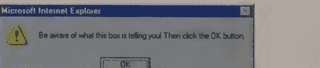

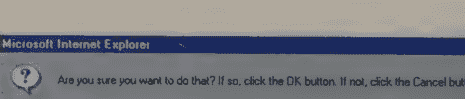

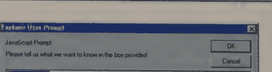

27 警告框　　28 提示框　　30 确认框

## 关于大小写的问题

如果你曾好奇为什么 JavaScript 中的变量、函数和其他名称都使用大写字母，简单的答案是：约定俗成。无论你使用 `myVariable`、`MyVariable` 还是 `myVARIABLE` 这样的拼写都没有关系，但你在文档主体中使用的拼写方式必须完全匹配，否则你的代码可能会失败。因此，大多数人倾向于对函数和变量使用小写，对名称中后续单词的首字母使用大写，例如 `myVariable`。

## 警告框

`alert` 方法主要用于吸引访客的注意力。例如，一行 JavaScript 代码就可以创建一个简单的欢迎公告。Alert 框还可以宣告更复杂的 JavaScript 检测脚本的结果，比如检测访客是否拥有查看你的网站所需的所有插件。你可以选择发布任何复杂的公告，但启动 Alert 框的代码非常直接，如下例所示。

## 一个友好的欢迎警告框

- 本示例展示了如何生成一个欢迎访客访问 "WebVerse" 网站的 Alert 框。无论内容如何，语法都是一样的。
- 状态栏显示 Alert 框的出现已经冻结了网页的加载。由于 `window.alert` 代码位于 head 部分，在点击 OK 按钮之前，页面不会继续加载。

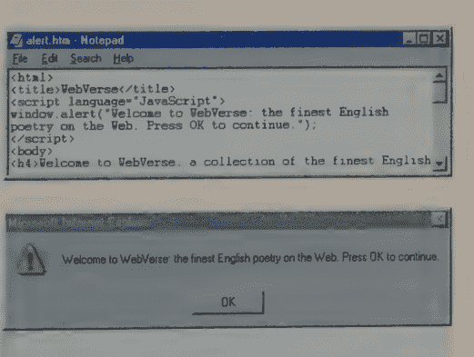

## 提示框

JavaScript 的 Prompt 框提供了一个文本字段，访客可以在其中输入答案来回应问题。该框有 OK 按钮、Cancel 按钮和一个用于存放访客输入内容的文本框。Prompt 框必须通过点击其中一个按钮来关闭，然后才能继续操作。Prompt 框使你能够捕获在那里输入的数据并在其他地方使用。这些信息随后如何使用，取决于网页的需求以及作者的技能和创意。

## 提示框的实际应用

- 在这个典型示例中，访客被邀请在 Prompt 框的字段中输入自己的名字，然后点击 OK 按钮。
- 访客的名字随后会出现在屏幕上的问候语中，直到点击 OK 按钮。
- 随后出现在浏览器窗口中的网页会将访客的名字包含在文本中。实现这一切的 JavaScript 代码可以在对面页面中看到。

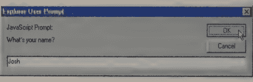

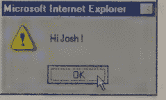

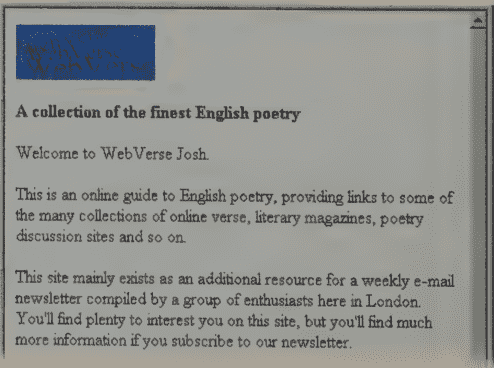

## 在提示框中使用变量

- 如这段代码所示，要使用访客输入的内容，你需要创建一个变量名。`window.prompt()` 代码会为你捕获访客的名字，但你只有将输入内容与变量名关联起来（例如 `vName`）才能使用它。
- 然后，该变量可以与 `document.write()` 命令结合使用，放置在网页上的任何位置。


```html
<html>
<title>WebVerse</title>
<script language="JavaScript">
var vName=prompt("What's your name?","");
alert("Hi "+vName+" !");
</script>

<body>
<p></p>
<p><b>A collection of the finest English poetry.</b></p>
<p>
<script language="JavaScript">
document.write("Welcome to WebVerse " +vName+ ".")
</script>
<p>This is an online guide to English poetry, providing links to some of the many collections of online verse, literary magazines, poetry discussion sites and so on.
<p> This site mainly exists as an additional resource for a weekly e-mail newsletter compiled by a group of enthusiasts here in London. You'll find plenty to interest you on this site, but you'll find much more information if you subscribe to our newsletter
<p> <a href="subs.htm">Subscribe</a>
<br>
</html>
```

将变量放在页面上的任何位置。

## `window.prompt` 语法

`prompt` 方法必须在 `<script>` 标签内使用。第一个字符串构成弹出对话框的内容（通常是你向访客提出的问题）。在代码中，你精确地定义问题，就像对 `Alert` 框一样。然而，使用 `window.prompt()` 方法时，你可以使用可选的第二个文本字符串来确定将出现在文本字段中的文本。这通常会填写一些对访客有帮助的内容，如 `"Type your reply here"`（在此输入你的回复），访客可以立即覆盖它。如果第二个字符串保持空白（即只使用引号，中间没有任何内容），并且访客点击 OK 时没有输入任何内容，则网页上相应位置将不会出现任何内容。

要在 JavaScript 中创建变量，首先选择变量的名称，然后使用以下语法说明该变量名代表什么：`var yourVariableName = value`。你可以为变量选择任何名称，但给它一个有描述性的名称，表明它包含什么内容，会更有帮助。

```javascript
window.prompt("first string","second string");
```

## 确认框

Confirm 框本质上是提供两个响应按钮选择的 Alert 框：OK 或 Cancel（等同于 Yes 或 No）。除非你能对访客的响应做些有用的处理，否则使用 `window.confirm()` 方法几乎没有意义。要充分利用这个 OK 或 Cancel 的响应，你需要学会如何在 JavaScript 中使用 `if...else` 语句。

## 仅使用 `if...` 语句

- 这里有一个简单的例子，表明有时仅仅使用 `if` 子句就能得到你想要的结果。点击订阅链接会弹出 Confirm 框。

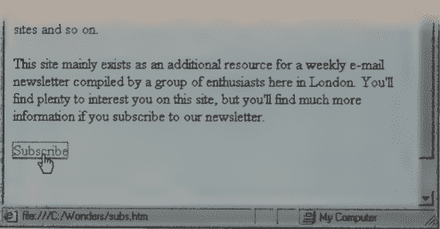

- 控制 Confirm 框的代码提供了一个条件子句。这决定了点击 OK 按钮的效果。

```html
<html>
<head>
<script language="JavaScript">

if (confirm("To subscribe to the newsletter click OK."))
{
location.href='subscribe.htm'
}

</script>

</head>
</html>
```

- 如果访客点击 OK 按钮，他/她将被带到以 `location.href` 开头的行中定义的 URL。

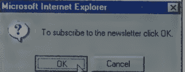

访客现在被带到定义的 URL（在本例中，是订阅页面 `subscribe.htm`）。


然而，如果访客点击 Cancel 按钮，他/她将留在同一页面，因为没有定义其他操作。

要提供第二个选项，你需要使用 `else` 语句。

在这个例子中，`else` 语句用于定义第二个 URL（在本例中是 `nonsubs.htm`），如果访客点击 Cancel 按钮，他/她将被发送到这个页面。

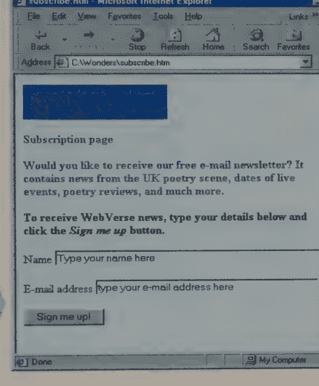

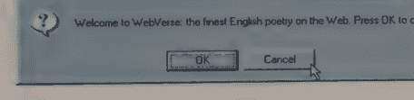

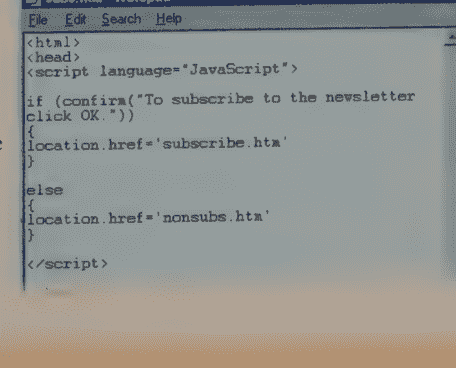

# 32 • 弹出框

- 既然 `else` 子句已经写入 JavaScript，那么点击“取消”按钮将不仅仅是让访问者停留在原始窗口中。

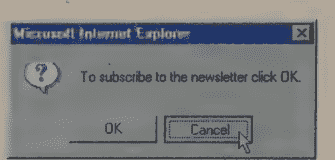

- 相反，如 `else` 子句中所定义，窗口 `nonsubs.htm` 将会打开。此窗口用于向选择不订阅新闻通讯的访问者提供网站内的进一步选择。

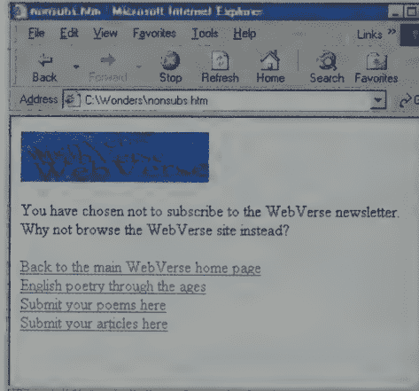

## `WINDOW.CONFIRM` 语法

`window.confirm()` 语句会生成一个弹出窗口，为访问者提供操作选择。他或她可以通过点击“确定”按钮选择接受某个操作，或者通过点击“取消”按钮拒绝它。呈现给访问者的选项由您在引号内括号之间输入的文本组成。点击“确定”会将访问者带到代码中定义的位置。如果他或她点击“取消”，则可以使用 `else...` 子句将访问者引导至另一个页面（而不是返回原始页面）。

```javascript
window.confirm("在此处输入要显示在确认框中的文本。")
```

## 一些 JavaScript 术语

如果您希望将网页制作技能提升到简单编码之外，并与其他作者交流，您需要理解 JavaScript 构建所基于的“层次结构”；这包括理解“对象”、“属性”和“方法”这三个主要概念之间的关系。这些示例仅展示了与窗口对象相关的一些属性和方法，但其原理适用于所有 JavaScript 对象、属性和方法。

### 对象

- JavaScript 中的对象是一个通常可以细分为子类别或部分的实体。它也可以被施加操作，或作为操作的对象。对象包括窗口、表单、图像和按钮。

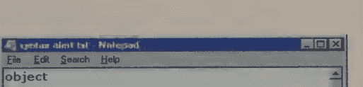

> 从语法术语上讲，对象是 JavaScript 中相当于名词的实体。

### 属性

- JavaScript 中的属性是一种帮助定义对象的特征——通过提供子类别或描述名词来实现。例如，图像的属性包括其名称、边框、高度和宽度。

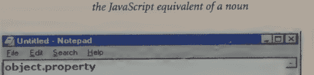

> 在 JavaScript 代码中，属性紧跟在其定义的对象之后，以句点分隔。

### 方法

- 方法描述了可以应用于对象的操作。本章介绍了窗口对象的 `alert`、`confirm` 和 `prompt` 方法。

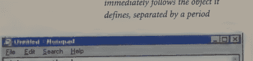

> 在 JavaScript 中，方法作用于对象的方式类似于动词作用于名词。

### 鼠标悬停

鼠标悬停（Mouseover）描述了在浏览器窗口中由于鼠标光标移动或鼠标按钮点击而直接发生的某些活动。

### 状态栏的功能

当您查看网页时，出现在浏览器状态栏中的文本可以提供有用的信息。状态栏内容的变化通常由鼠标光标的移动和操作触发。

#### 状态栏

- 状态栏位于浏览器窗口底部。状态栏中的文本可以根据浏览器窗口中当前正在进行或刚刚发生的活动而变化。
- 例如，状态栏中的文本会告诉您正在打开一个网页，并会给出该站点的 URL，如本例所示。
- 当文档加载完成时，状态栏也会通过显示“完成”（Done）一词来告知您。

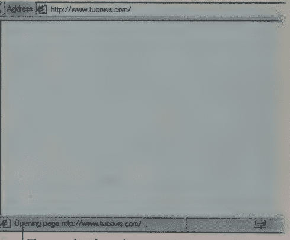

状态栏显示正在加载的文档的 URL。

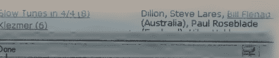

当文档加载完成时显示“完成”（Done）。

- 当鼠标移动到超链接文本或图像上时，它还会显示链接的 URL，但正如我们将在下面看到的，URL 可能并不总是最有用的信息。这正是 JavaScript 可以提供帮助的地方。

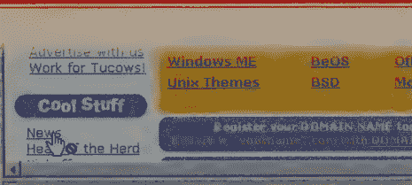

## 更多利用状态栏

通过使用 JavaScript 定义 `window.status` 属性，您可以在鼠标光标悬停在超链接上时使用状态栏提供有用的信息。这可以使您的网页更有趣、更动态。

## 使用 `onMouseOver`

- 在此示例中，当鼠标光标悬停在超链接文本上时，状态栏默认会显示此超链接中包含的 URL（即网页 HTML 代码中 `<a href>` 和 `</a>` 标签之间的内容）。

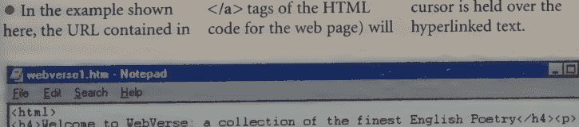

- 尽管 URL 是虚构的，但其长度是许多网页的典型特征，并且由于其长度，只有一部分在状态栏中可见。

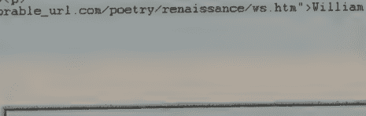

# 36 · 鼠标悬停

- 这些信息（甚至无法完全放入状态栏）作用甚微。然而，可以使用 `window.status` 在鼠标悬停在超链接上时，让有用且有趣的文本出现在状态栏中。

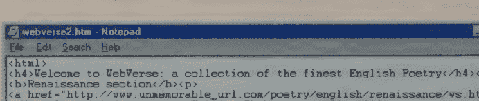

- 此示例中的 `onMouseOver` 代码使得当鼠标移动到“William Shakespeare”超链接上时，文本 `"William Shakespeare 1564-1616"` 出现在状态栏中。


- 然而，即使鼠标移开后，新的状态栏文本仍然保留。这可以通过使用 `onMouseOut` 来改变。


## `ONMOUSEOVER` 语法

此代码将使单引号内的文本在鼠标移动到超链接上时显示在状态栏中。它将保持显示，直到页面重新加载或鼠标移动到另一个超链接上。`onMouseOut` 事件处理器可用于移除此状态栏文本。


## 使用 `onMouseOut`

### 使用 `ONMOUSEOUT`

- 此代码（下面所示代码中的第 6 行）使得当鼠标移开超链接时，单引号内的文本字符串（即空内容）显示在状态栏中。

```html
<html>
<h4>Welcome to WebVerSE: a collection of the finest English poetry</h4><p>
<b>Renaissance section</b></p>
<a href="http://www.unmemorable_url.com/poetry/english/renaissance/ws.htm"
onMouseOver="window.status='William Shakespeare 1564-1616';return true"
onMouseOut="window.status='';return true">William Shakespeare </a></p>
</html>
```

- 当鼠标移动到超链接上时，`onMouseOver` 代码中定义的文本会像以前一样出现在状态栏中。


- 但是现在，当鼠标移开超链接时，状态栏中的文本会消失。如果在单引号之间放置了文本字符串，那么现在该文本将出现在状态栏中。


## `ONMOUSEOUT` 语法

当与 `onMouseOver` 代码结合使用时，`onMouseOut` 代码将使单引号内的文本在鼠标移动到超链接上时显示在状态栏中。因为本页示例中单引号之间没有任何内容，所以文本会消失，没有内容替换它。

```javascript
onMouseOut="window.status='';return true"
```

## 用图片实现

最常用的鼠标悬停涉及图像交换。接下来几页中的示例展示了一种称为鼠标翻转（mouse rollover）的效果，这是一种非常常用的技术，可应用于任何类型的图像交换。

### 1 命名您的图像文件


- 此处的示例使用了非常常见的效果：按钮被按下然后释放。创建此效果很简单。
- 我们只使用两张图像，并且，为简单起见，它们被命名为 `off.jpg` 和 `on.jpg`，以反映光标的位置。

### 2 编写 HTML 代码

创建一个指向页面加载时将出现的图像的链接。这将是无法显示 JavaScript 翻转效果的较旧浏览器上唯一可见的图像。该图像名为 `off.jpg`。`` 详细信息需要放置在 `<a href>` 和 `</a>` 标签之间。

- 图像标签有三个要素。它们是 `Src`、`border` 和 `name`。
- `Src`。说明图像的位置。输入代码后，将图像名称放在双引号中，如果图像位于 HTML 文档所在的文件夹之外，请包含路径名。
- `border`（边框）。将边框设置为 0 可以移除图像周围的默认边框。
- `name` 标签。在此示例中，图像区域已被命名为 `"image"`。

```html
<html>
<title>简单翻转示例</title>
<body>
<h4>下面的示例展示了一个非常简单的翻转效果。 </h4>
</a>
</body>
</html>
```

`name` 标签。

## 3 编写 JavaScript 代码

- 现在，是时候插入实现图像翻转的代码了。
- 当鼠标光标移到现有图像（`off.jpg`）上时，代码会加载图像文件 `on.jpg`，替换初始按钮图像，从而制造出按钮被按下的假象。

```html
<html>
<title>简单翻转示例</title>
<body>
<h4>下面的示例展示了一个非常简单的翻转效果。</h4>

<a href="#" onMouseOver="document.image.src='on.jpg';return true">
</a>

</body>
</html>
```

- 在添加 `onMouseOut` 命令之前，即使鼠标光标移开，按钮也会保持被按下的状态。图像空间将继续被 `on.jpg` 占用。

## 4 添加 `onMouseOut`

- 要完成翻转效果并将 `off.jpg` 恢复到图像空间，你需要添加 `onMouseOut` 命令。它的位置紧跟在 `onMouseOver` 语句之后，但仍然位于 `<a href>` 和 `</a>` HTML 标签之间。

```html
<html>
<title>简单翻转示例</title>
<body>
<h4>下面的示例展示了一个非常简单的翻转效果。</h4>

<a href="#" onMouseOver="document.image.src='on.jpg';return true"
onMouseOut="document.image.src='off.jpg';return true">
</a>

</body>
</html>
```

# 40 • 鼠标悬停效果

## 将图像设为活动超链接

为了保持简单，在本例中我们为图像使用了一个空链接（`#`）。如果有人点击图像，不会发生任何事情。要在此处放置一个活动链接，只需将 `#` 替换为相应的 URL 即可。

## 预加载图像

你可以使用 JavaScript 预加载图像。这意味着，当你的网页首次在访客的浏览器窗口中加载时，你可以将指定的图像发送到浏览器缓存——你电脑上存储最近访问过的网页的一个文件夹。如果网页在此处有缓存，浏览器访问它的速度会比从远程服务器快得多。翻转效果所需的某些图像在页面加载完成时是不可见的。这些图像可以有效地预加载到缓存中，这样它们在需要时就能立即显示，而不会像从网络下载时那样出现轻微的延迟。

### 预加载 `on.jpg`

当我们把鼠标悬停在 `off.jpg` 上时，使 `on.jpg` 显示的代码放在网页的 `body` 中，但预加载 `on.jpg` 的代码放在 `<head>` 标签内的 `script` 标签中。

```html
<head>
<script language="JavaScript">
Image1=new Image(20,20)
Image1.src="on.jpg"
</script>
</head>
```

## 预加载多张图像


`Image1` 是一个变量，你可以为此选择任何你喜欢的名字，但建议尽量保持简单。`new Image` 后面括号中的信息告诉浏览器图像的像素尺寸。它相当于说：“在页面上为我预留一个这些尺寸的空间，并用名为 Image1 的新图像填充它。我马上就会告诉你在哪里可以找到 Image1。”`Image1.src` 提供了该位置。如果你想预加载多张图像，只需重复这个公式，将所有内容保留在 `script` 标签内。例如：

```javascript
Image2 = new Image(100, 50)
Image2.src = "services2.jpg"

Image3 = new Image(120, 50)
Image3.src = "contact2.jpg"
```

这告诉浏览器预加载另外两张具有指定像素尺寸的图像，并为它们分别分配变量名（Image2 和 Image3）。最初，这些似乎相同图像的众多名称可能会让人困惑，但一旦理解，它其实非常简单。

## 工作原理

在这个例子中，`Image1` Ⓐ 是用于标识加载图像 `off.jpg` Ⓑ 的空间的名称。这个空间在网页首次显示时被填充。如果访客没有将鼠标光标移到该空间（即该图像）上，则不会发生任何事情。然而，如果鼠标光标移到名为 Image1 的空间上，浏览器会首先检查缓存文件夹，查看是否有为该空间预加载的图像，它会找到 `on.jpg` Ⓒ，这正是浏览器请求的图像。

## 新窗口

你是否想知道某些网站如何使用弹出窗口来丰富其内容？这些网站可能使用了 JavaScript 的 `window.open()` 和 `window.close()` 命令。

## `WINDOW OPEN()` 方法

`window` 对象的 `open()` 方法在点击链接或按钮时创建新窗口，同时保持原始窗口打开。除了指定新窗口的内容外，你还可以确定其尺寸以及工具栏、滚动条等功能的使用。某些网页链接会导向一个弹出文本框，而不是另一个网页，但该文本框可能就是一个新的网页。JavaScript 已被用于去除新网页的功能，这些功能可以很容易地通过在一行 JavaScript 中输入 `feature=no` 来停用。

## `WINDOW.OPEN` 语法

### `"URL"`

如果 HTML 文档与主页面在同一文件夹（目录）中，只需输入其名称（例如，`pagetoload.htm`）。如果在另一个目录中，输入路径（例如，`anotherfolder/pagetoload.htm`）。如果文档在另一台服务器上（并且你已获得所有者使用许可），请输入完整的网址（例如，`http://www.anotherserver.com/pagetoload.htm`）。

### `"NAME"`

令人惊讶的是，这个名称不会出现在新网页的标题栏中。它在更高级的 JavaScript 效果中是必需的，但在此示例中，它对新窗口的外观没有影响。

### `"FEATURES"`

这包含所有可选功能，用于确定新窗口的大小和组成。如果字符串的这第三部分留空，则会打开具有所有默认功能的默认窗口。

## 打开新窗口

- 使用 JavaScript 打开新窗口很简单。只需将代码行 `<script language="JavaScript">window.open("");</script>` 插入到你的 HTML 文档中即可。当然，仅仅打开新窗口只是过程的一部分。如果你将此代码放入你的某个网页中，你只会显示一个空框——或者更确切地说，一个包含弹出错误消息的窗口。这是因为你尚未定义两个重要的窗口参数：(1) 你想要加载到新窗口中的内容；(2) 将触发新窗口出现和内容加载的事件。
- 新窗口的外观取决于你为其决定的功能。在接下来的页面中，我们将首先考虑如何定义新窗口的功能，然后考虑如何以及何时将内容加载到其中。

由于页面的内容和触发其显示的事件均未定义，页面显示了错误消息。

## 设计新窗口

网页浏览器的外观可能因用户偏好而有很大不同。在决定创建任何新窗口时应包含或省略哪些功能时，你需要考虑所有浏览器设置。仅仅因为你无法在屏幕上看到某个特定的浏览器功能，并不意味着你网站的访客会以相同的方式配置他们的浏览器。因此，即使你的浏览器中禁用了工具栏，也要记住，如果你想确保它在所有浏览器中查看新窗口时都不存在，请使用 `toolbar=no` 代码。

### 可选功能

这个典型的网页显示了使用 JavaScript 打开新窗口时可以包含或排除的浏览器窗口功能。

### 停用功能

当新窗口加载时，所有这些功能默认是激活的。要停用其中任何一项，请使用此代码：

| 功能 1 | 功能 2 |
|:---|:---|
| `menubar=no` | `toolbar=no` |
| `location=no` | `scrollbars=no` |
| `status=no` | `resizeable=no` |

### 组合表示法

功能可以通过使用 1（代表“是”）和 0（代表“否”）来设置。两种表示法都有效，并且也可以组合使用。

### 窗口功能说明

1. 菜单栏
2. 工具栏（后退、前进按钮等）
3. 地址栏（URL 位置字段）
4. 滚动条
5. 状态栏
6. 调整大小角

## 定义其他特性

还有其他各种可选特性可以整合到新窗口中，但其中一些特性仅“兼容 JavaScript 1.2”，这意味着它们在早期版本的 Internet Explorer、Netscape Navigator 以及某些其他浏览器中无法工作。这些特性中最有用的特性使你能够定义新窗口在屏幕上弹出的位置。新窗口左上角的 x 和 y 坐标可以相对于屏幕桌面左侧和顶部的像素数来定义。其语法为：`screenx=像素值`（x 坐标）`screeny=像素值`（y 坐标）。例如，输入 `screenx=200` 的效果是将新窗口的左上角定位在距屏幕桌面左侧 200 像素的位置。

## 定义宽度和高度

要定义新窗口的尺寸，请使用 `width` 和 `height` 设置。`width=像素值`（例如，`width=300`）`height=像素值`（例如，`height=320`）用逗号分隔每个特性设置：`"width=350,menubar=no,status=no,resizeable=no"`。


### 对特性使用 `yes`

当你查看他人的源代码时（如果你决定深入学习 JavaScript，这非常推荐），你会注意到 `"feature=yes"` 的使用。既然所有特性默认都是启用的，为什么还要特意激活某个特性呢？实际上，使用 `"yes"` 对新窗口的构成有不同的效果。如果你使用 `"feature=yes"`，你会专门激活该特性并停用所有其他特性。这相当于说：“除我明确声明激活的特性（通过使用 `"feature=yes"`）外，所有特性都应停用。”无论你使用哪种方法，纯粹是个人偏好问题。

## 加载现有文档

在决定了新窗口的构成后，我们可以专注于将要放入其中的内容。有两种主要方法可以为新窗口生成内容。你可以从现有网页生成新网页的内容，或者从与主网页一起加载并动态生成（或“即时”生成）的内容。这里我们先看第一种方法。

### 定义要插入的网页

- 要用另一个 HTML 文档填充这个新窗口，请根据需要替换语法中的 URL 部分：`document.write("URL","name","features")`。你需要已经创建好打算加载到新窗口中的文档，除非你打算使用在其他网站上找到的网页。（在使用其他网站的网页之前，你必须先征得并获得网站所有者的许可。）这里所示的示例中，主页面名为 `sonnet.htm`，要加载到页面中的文档名为 `18.htm`。它们的效果如下所示。

### 触发动作

- 现在你已经决定了新窗口的特性以及要加载的内容。最后要做的就是决定什么将触发新窗口的出现。一个典型且简单的解决方案是使用超链接或按钮。这里的示例（代码见反面）使用超链接和 `onClick` 事件处理程序来打开新窗口。


- 47 代码元素
- 14 JavaScript 事件处理程序

## 代码元素

❶ 由于我们在这里使用 `onClick` 事件处理程序，因此无需使用 `<script>` 标签。所有脚本都包含在 HTML 锚点标签 `<a href>` 和 `</a>` 中。

❷ 首先输入将从中“调用”新窗口的文档名称——换句话说，就是你正在输入此代码的文档，在本例中为 `sonnets.htm`。

❸ 接下来是 `onClick="window.open()"` 命令。注意包围 `window.open()` 命令的引号，以及将包含所有与新窗口相关信息的括号。这些是代码的基本要素。

❹ 将所有与新窗口相关的参数（本章到目前为止讨论的所有内容）放在括号内。本示例显示以下信息：要加载的文档名为 `18.htm`。窗口的名称（用于编码目的而非显示目的）是 `sonnet18`。然后定义新窗口中可用的特性。新窗口将没有工具栏、菜单栏、滚动条，并且保持相同大小。高度和宽度分别定义为 320 像素高和 320 像素宽。

❺ 最后，给出将在页面上提供可见超链接的文本——Sonnet XVIII。

## 向新窗口即时写入

填充新网页的第二种主要方法是使用嵌入在主页 HTML 代码中的信息。这些信息保持隐藏，直到访问者请求它（通常通过点击链接），然后被加载到新窗口中。

## 代码解析

以下代码放置在文档 `<head>` 标签内的 `<script>` 标签之间。要向新窗口写入内容，请使用 `document.write()` 方法 [1]。你需要在这部分代码中创建一个函数，然后在 `<body>` 部分调用此函数。

## 代码元素说明

1. 首先创建一个函数。在本例中，它被称为 `rhymenote`。该函数包含大括号之间的所有内容。
2. 这会创建一个名为 `rhymewin` 的变量。同样，名称完全由你决定。
3. `=window.open("......")` 所有与新窗口相关的参数都放在这些括号内。
4. `document.write` 这指示浏览器使用 `document.write` 方法在新窗口中写入括号内的所有内容。这里它包含整个网页，包含在 `<html>` 和 `</html>` 标签之间。
5. `sonnet.htm` 首先输入将从中“调用”新窗口的文档名称——换句话说，就是你正在输入此代码的文档。
6. `onClick` 由于我们在这里使用 `onClick` 事件处理程序，因此无需使用 `<script>` 标签。脚本包含在 HTML 锚点标签 `<a href>` 和 `</a>` 中。

```html
<html>
<title>Renaissance section: Shake
<head>
<script language="JavaScript">
function rhymenote()
{
  var rhymewin=window.open("","")
  rhymewin.document.write("<htm
  14 lines. The <i>Shakespearea
  usually closing in a rhyming co
  epigrammatic quality." +"</html>
}
</script>
</head>

<body>
<font color="blue"><h3>William Sh
<h3>Sonnets 11-20</b><br><br>
Notes on the <a href="sonnet
scheme</a>.</h5>

</body>
</html>
```

22 写入文档

## 使用函数

- 如我们所见，一个函数（`rhymenote`）已放置在文档的 `<head>` 部分。点击超链接 sonnet rhyme scheme 时会激活它。
- 第 4 阶段 HTML 锚点标签 `<a href>` 和 `</a>` 内的所有代码随后被写入新窗口，导致新网页出现。


```javascript
le>

us=yes,height=220,width=220");

rhyme schemes</h3> "+"<p>Sonnets have
y are written in iambic pentameter,
concluding couplet often has an

the Sonnets</h3>

nfig='toolbar=0,menubar=0,scrollbars=0,
VII</a>&nbsp;&nbsp;&nbsp;

nfig='toolbar=0,menubar=0,scrollbars=0,
VII</a>&nbsp;&nbsp;&nbsp;

nfig='toolbar=0,menubar=0,scrollbars=0,
VIII"></a><br><br></font>
ck="rhymenote()">sonnet rhyme
```

## 代码元素说明

- 7. `rhymenote()` 这调用先前定义的函数。
- 8. **sonnet rhyme scheme** 这是网页上显示为超链接的文本。点击此链接将使 `rhymenote` 函数生效。换句话说，4 中定义的网页将被写入 2 和 3 中定义的新窗口。


- 1. `rhymenote`

## 关闭次级窗口

没有菜单栏的窗口的主要用途之一是作为“信息框”——一个弹出窗口，提供需要阅读后关闭的内容。虽然访问者可以通过点击这个迷你窗口右上角的关闭 [x] 按钮来关闭它，但在页面中提供一个“关闭”链接或按钮会更整洁。

## 关闭命令

- 要触发窗口关闭命令，你通常会使用与打开它时相同的技术；即文本超链接或按钮。
- 然后，你将关闭命令嵌入加载到新窗口的材料中。因此，如果你正在加载一个新文档（例如，`18.htm`），则 `window.close` 命令必须出现在该页面的适当位置。

```html
But thy eternal summer shall not fade.<br>
Nor lose possession of that fair ow'st.<br>
Nor shall death brag thou wander'st in his shade.<br>
When in eternal lines to time thou grow'st.<br>
So long as men can breathe, or eyes can see.<br>
So long lives this, and this gives life to thee.</font><br>
<br>
<a href="" onClick="self.close()">Close this window</a>

<html>
```

将此行代码放在 HTML 源代码中，你希望它在网页上出现的位置（即示例中的页面底部）。


## “链接方法”

要使用超链接关闭新窗口，首先创建一个指向空地址的链接！为此，键入引号，但在通常放置链接文档或 URL 的位置留空：`<a href="">`。

然后，在 `><` 字符之间键入将作为超链接出现在页面上的文本，就像往常一样：`<a href="">Close this window</a>`。接着，在空引号后立即添加 JavaScript 代码：`<a href="" onClick="self.close()">Close this window</a>`。

## 链接方法是如何工作的？

当访问此网页的访客点击“关闭此窗口”超链接时，浏览器会尝试转到新页面。由于没有可供跳转的页面，浏览器会遵循 JavaScript 代码给出的指令并关闭页面。（如果你尝试在引号之间键入一个 URL，你会发现该超链接会将你带到该 URL，从而覆盖 JavaScript 指令）。

## 使用关闭按钮

如本例所示，要使用“关闭”按钮关闭新窗口，你需要将 JavaScript 代码放在页面上你希望按钮出现的位置。在本例中，显而易见的位置似乎是页面底部，因此代码可以放在结束 `</html>` 标签之前。

```html
Nor lose possession of that fair thou ow'st.<br>
Nor shall death brag thou wander'st in his shade.<br>
When in eternal lines to time thou grow'st.<br>
So long as men can breathe, or eyes can see.<br>
So long lives this, and this gives life to thee.</font>
<br><br>
<form>
<input type="button" value="Close" onClick="self.close()">
</form>

<html>
```

And summer's lease hath a

Sometime too hot the eye of

And often is his gold comp


And every fair from fair son

By chance, or nature's chan

But thy eternal summer shal

Nor lose possession of that

Nor shall death brag thou w

When in eternal lines to tim

So long as men can breathe

So long lives this, and this


`onClick="self.close()."` 这部分 `<form>` 代码指示浏览器在点击按钮时关闭窗口。

## 这是如何工作的？

当访问此网页的访客点击“关闭”按钮时，页面会自行关闭。要创建此关闭页面的按钮，请使用 `<form>` 和 `<input>` 标签来创建一个按钮。当然，你为 `value` 选择的任何内容都会出现在按钮本身上，因此请保持相对简短。在本例中，我们只使用了“Close”这个词。

```html
<form>
<input type="button" value="Close">
</form>
```

JavaScript 事件处理程序代码与关闭超链接的代码相同。将其放在 `input` 行的末尾之前。

```html
<form>
<input type="button" value="Close"
onClick=self.close( )>
</form>
```

当点击关闭按钮时，页面关闭，访客现在应被无缝地返回到他/她开始的页面。

## 获取帮助

如果你的 JavaScript 代码出错，你的浏览器有时（但并非总是）会以 JavaScript 错误消息框的形式为你提供帮助。

## 调试 JavaScript

如果你的任何 JavaScript 代码包含错误，你需要在将包含它们的网页公开发布之前纠正它们。这个过程被称为调试。如果你幸运的话，可能只涉及一两处打字修正。有时——例如，如果 JavaScript 中存在重大的语法错误——可能需要逐行重建你的代码。

### 从浏览器获取建议

如果你一直在按照上一章中的示例进行操作，将代码键入记事本并在你的网页浏览器中进行测试，除非你的打字技巧完美无瑕，否则你几乎肯定会看到这些错误消息框中的一个！

莎士比亚十四行诗第十八行的诗句


如果存在进一步的错误，浏览器会在你点击“确定”时通知你。纠正第一个错误可能会阻止所有后续错误的发生。

## 接收错误消息

- 错误消息框可能非常有帮助、含糊不清或令人困惑，这取决于检测到的错误类型以及用于读取网页的网络浏览器的类型和版本。页面可能会加载，但 JavaScript 未能工作。唯一能表明出错的证据可能只是状态栏中的一个消息。


*错误消息可能很模糊*

## 理解细节

- 当 JavaScript 错误消息出现在 Internet Explorer 中时，它通常包含发生脚本问题的行号和字符位置。如果你一直使用记事本或类似的简单文本编辑器学习如何编写脚本，你会很容易找到问题所在。如果你从别处复制并粘贴了脚本（例如，从另一个网页或网上的脚本库），或者你插入了由网页设计软件包（如 FrontPage 或 Dreamweaver）创建的脚本，并且需要依赖错误消息框中提供的信息，你会发现调试可能需要更长的时间。

*行号：* 这表示发生错误的行。

*字符位置：* 这表示指示行中发生错误的第一个字符的位置。

*错误类型：* 这表示发生的错误类型。


## 查找与修复

本例中的错误消息为你提供了足够的信息来定位导致所有问题的区域。


## 定位错误

- 在记事本中打开相关 HTML 文档的源代码。
- 根据错误消息中的说明，从页面顶部向下数 11 行（包括空行）。
- 现在从第 11 行的左侧数 62 个字符。
- 你的 JavaScript 消息框中的错误行有时可能有点晦涩，但在这种情况下，第 11 行的第 62 个字符指向该行末尾的换行符 `<br>` 之后，一个未能关闭一对双引号（该双引号在该行早些时候打开）的字符串结尾。
- 在 `>` 和 `)` 之间添加双引号，你就修复了错误框宣布为“未终止的字符串常量”的问题。


## 重复该过程

- 现在保存页面，并在你的 Web 浏览器中再次打开 HTML 文档。
- 如果 HTML 文档按预期打开，并且所有 JavaScript 代码都正常运行，那么你就解决了问题。
- 如果浏览器随后遇到另一个问题，你需要使用刚刚描述的技术来处理新问题。
- 根据需要多次重复该过程！

## 查找行号

- 如果你对行号的计算与浏览器错误消息框中显示的数字之间存在显著差异，请尝试在记事本中关闭“自动换行”功能。你可以在“编辑”菜单中找到它。
- 一些脚本编辑器和网站设计程序会为你提供行号。当你查看源代码时，在纠正脚本中的错误时，这些可能比记事本更有帮助。
- 例如，在 Macromedia 的 Dreamweaver 中，你可以选择在 HTML 代码旁显示行号。只需点击页面顶部的“行号”旁边的复选框。


当你选择在 Macromedia 的 Dreamweaver 中查看源代码时，你可以通过选中查看区域顶部的“行号”框来选择查看行号。

## INTERNET EXPLORER 中的错误警告

如果看不到这些页面所描述的 JavaScript 错误警告框，那么此功能可能在你的 Internet Explorer 中处于未激活状态。如果是这种情况，请立即将其开启。它可能不是你所需要的一切，但它在引导你定位脚本出错区域方面可能证明是无价的。

## 激活错误通知

- 在 Internet Explorer 的“工具”菜单中选择**Internet 选项**。
- 单击**高级**选项卡。
- 在**显示每个脚本错误的通知**旁边的框中打勾。


执行完这些步骤后，单击“确定”按钮。


## JavaScript 代码中的常见错误

JavaScript 中的两种主要错误类型被称为语法错误和运行时错误。这通常意味着你要么输入错误，要么遗漏了某些内容。语法错误通常涉及输错的引号或括号。运行时错误通常由拼写错误的命令引起。这两种错误都会导致你的网页行为异常，或者停止在浏览器中加载。

## 一个可用的示例

这里我们看到一个网页的源代码，它使用了简单的交互功能。JavaScript 代码只有几行：文档的 `<head>` 标签中的一个函数，以及文档的 `<body>` 标签中的一个 `onClick` 事件处理程序。

```html
<html>
<head>
<script language="JavaScript">
function whatYear()
{
var n=prompt("What year is it?");
confirm("It is really now "+n+" and we still haven't returned to the moon?");
}
</script>
</head>
<body>
<form>
<input type="button" value="Answer me this..." onClick="whatYear()">
</form>
</body>
</html>
```

该网页邀请用户单击 *Answer me this* 按钮。


- 单击按钮会弹出一个提示框，询问问题。用户在下方字段中输入答案。
- 用户的输入随后作为弹出的警告框中的一部分文本输出。
- 我们现在故意引入一些错误，并查看 Web 浏览器提供的错误消息。


## 错位括号和方括号

- 打开的括号和方括号如果没有在之后关闭，可能是脚本失效的主要原因。这个示例显示最后一行有一个闭花括号，但它从未被打开过！
- Netscape Navigator 识别出存在错误，并告诉你如何了解更多信息。
- 错误消息明确指出在函数主体之前预期位置遗漏了花括号，代码中的光标行显示了它应该在的位置。


要在 Netscape Navigator（v4.75）中查看 JavaScript 错误消息，请按照浏览器状态栏中的说明操作。


## 错位引号

- 引号也是成对工作的。撇号可能会引起混淆。Internet Explorer 认为这里的错误是缺少右括号，但实际上它将 *haven't* 中的撇号解释为右单引号，因此期望在其后有一个右括号。
- 最佳的解决方案是如果你要使用任何撇号，就使用双引号，或者你可以通过避免使用缩略形式来回避这个问题。


## 大小写问题

- 如果你似乎无法发现那个麻烦的 bug，请确保所有区分大小写的单词完全匹配，尤其是在函数和变量中，因为这些都是你自己定义的单词。Opera Web 浏览器非常清楚地说明了这里的问题。函数 `whatYear` 已定义，但浏览器从未听说过变量 `whatyear`，它在错误消息中告诉了你这一点。


## 自动化脚本编写

到目前为止，我们已经研究了使用简单的文本编辑器（如记事本）来编写 JavaScript 代码作为脚本或直接写入 HTML 文档。还有其他的选择……

## 软件：脚本编辑器

如果你可能会进行大量脚本编写，你可能会发现使用类似增强型文本编辑器的软件会有所帮助。这类程序可以减少一些脚本编写的常规键盘工作，但仍由你控制所生成的内容。你可以在软件下载网站上找到很多这类程序，例如 Tucows（`www.tucows.com`）或 Winfiles（`www.winfiles.com`）。

## 使用 SCRIBBLER 2000

此示例介绍了一款名为 Scribbler 2000 的共享软件，由 Cream Software 开发，可在 `www.creamsoft.com/scribbler` 找到。该程序生成的代码与本书迄今为止展示的任何手写、记事本生成的示例几乎相同（且同样有效）。这里的示例展示了如何使用 Scribbler 2000 生成第 6 章中创建的那种新窗口。

## SCRIBBLER 2000 中的新窗口

- 在 PC 上安装并打开该程序后，从“脚本”下拉菜单中选择“打开新窗口”。


- 在“新窗口设置”对话框中，通过在**宽度**和**高度**框中定义尺寸，以及在适当的**设置**框中打勾，选择你希望新窗口具备的所有功能。
- 最后，单击“确定”按钮。


定义了新窗口的功能后，程序会在右侧的两个窗口中生成 JavaScript 代码。上方窗口用于需要放置在 HTML 文档的 `<head>` 标签内的任何代码。下方窗口用于需要放置在同一文档的 `<body>` 标签中的代码。

- 单击“复制到剪贴板”按钮将相关脚本复制到剪贴板，以便传输到你的 HTML 文档中。


## Microsoft 的 FrontPage Express

FrontPage Express 是 Microsoft 的免费网页编辑器，使你能够在易于使用的 WYSIWYG（所见即所得）布局中创建和格式化网页。它提供了 FrontPage Editor 和 FrontPage Explorer 完整版本中的许多功能，包括插入 JavaScript 代码的功能。

## 添加你自己的 JavaScript 代码

- 要在使用 FrontPage Express 创建的 HTML 文档中添加你自己的 JavaScript 代码，首先从“插入”菜单中选择“脚本”。将弹出“脚本”对话框。
- 在“脚本”对话框中，单击“语言”面板中的 JavaScript 单选按钮。然后在下方的代码框中输入你的代码并单击“确定”。无需用 `<script>` 标签包围代码。


- 你插入到 HTML 中的 JavaScript 代码现在将以符号形式显示在页面上。
- 要查看 HTML 源代码，从“视图”菜单中选择“HTML”。


## 修改你的 JavaScript

在使用 FrontPage Express 时，你可以随时修改现有脚本，只需在 FrontPage Express 窗口中右键单击适当的脚本图标，然后从下拉菜单中选择“脚本属性”。这将打开“脚本”窗口，显示你的 JavaScript 代码（在“脚本”窗口中）。完成脚本修改后单击“确定”，然后通过从主 FrontPage Express 窗口的“文件”菜单中选择“保存”来保存 HTML 文档。


## 64 · 自动化脚本

在本例中，FrontPage Express 被用来生成一个用户提示框，由以 `var greet=prompt` 开头的代码行生成。如本例所示，FrontPage Express 对你键入代码框中的代码所做的修改极少，但它完成了两项重要任务。首先，它添加了注释标签，以防止不支持 JavaScript 的浏览器看到该代码；其次，它在你的代码周围放置了必要的 `<script>` 标签。

如果你选择使用 FrontPage Editor 和 Explorer 等高级网页设计软件包来生成 JavaScript 代码，你可能会发现，当你查看源代码时，它比你的预期更为复杂。

```html
<html>
<head>
<meta http-equiv="Content-Type"
content="text/html; charset=iso-8859-1">
<meta name="GENERATOR" content="Microsoft FrontPage Express 2.0">
<title>Untitled Normal Page</title>
</head>
<body bgcolor="#FFFFFF">
<h3><font color="#0000FF">William Shakespeare: the Sonnets</font></h3>
<p><font color="#0000FF"><b>Sonnets 40-49</b><br>
<br>
 </font><a
href="file:///C:/WINDOWS/Profiles/bri/Desktop/sonnets.htm"
onclick="window.open('18.htm','sonnet18','config=toolbar=0,menubar=0,sc
olor=#0000FF')">Sonnet XVIII</font><a><font color=#0000FF> <font><p>
<p><script language="JavaScript"><!--
var greet=prompt("What's your name","Type your name");
alert("Greetings " +greet+ "!");
// --></script></p>
</body>
```

用户提示框由以 `var greet=prompt` 开头的代码行生成。

## 隐藏 JavaScript

## MACROMEDIA 的 DREAMWEAVER

Macromedia 的 Dreamweaver 是市面上最优秀的网站设计软件包之一。它的大多数与 JavaScript 相关的功能（归类为行为），与其他高级 HTML 效果一样，都可以通过行为窗口访问。

## DREAMWEAVER 的行为菜单

- 在本例中，我们将使用“打开浏览器窗口”对话框来设置新弹出窗口的功能。


- 首先单击`+`按钮，然后从下拉菜单中选择“打开浏览器窗口”。
- 在“打开浏览器窗口”对话框中选择你所需的功能，然后单击“确定”。
- Dreamweaver 现在会自动生成 JavaScript 代码，并将其放置到页面的 HTML 源代码中。

### 44 设计新窗口

## 添加你自己的脚本

- 若要在使用 Dreamweaver 构建 HTML 文档时放置你自己的 JavaScript，首先从“插入”下拉菜单中选择“脚本”。
- 在“插入脚本”对话框中，从“语言”下拉框中选择“JavaScript”。
- 在“内容”框中输入你的脚本。在此框中无需输入`<script>`标签或注释。单击“确定”。

## 插入翻转图像

- 若要插入翻转图像，首先从“插入”下拉菜单中选择“翻转图像”。

“插入翻转图像”对话框将打开。如果希望翻转图像预先加载，请勾选“预先加载翻转图像”复选框。

- 然后单击第一个“浏览”按钮。
- 在“原始图像”对话框中，导航到你打算用作原始图像的图像文件。
- 选中后，你将返回到“插入翻转图像”对话框。单击第二个“浏览”按钮，导航到你打算用作翻转图像的图像文件，然后单击“选择”。
- 当原始图像和翻转图像的名称都显示在“插入翻转图像”对话框的字段中后，单击“确定”。

翻转效果现在已放置在你的网页上。这种方法减少了你需要了解如何编写代码的麻烦，但如果你想自己学会编写，它生成的代码可能会非常令人困惑。

### 40 预先加载图像

## 来自网络的脚本

网络可以为所有水平的作者提供大量的 JavaScript 代码。你还可以找到一些优秀的教程和现成脚本的仓库。

## 现成脚本

查看 JavaScript 功能范围的最快方法之一是访问网络上的众多“脚本仓库”，这些仓库提供可供你剪切粘贴到自己文档中的脚本。通常，系统会要求你在 HTML 代码中注明作者，或在网页上放置一个指向该网站的快捷方式。许多这类网站都提供了关于如何将脚本复制粘贴到你自己的 HTML 文档中的清晰说明，你可以从这些代码中学到很多。

## WEBMONKEY JAVASCRIPT 库

HotWired 的 WebMonkey 是任何网页作者必不可少的网站。JavaScript 代码库涵盖广泛的主题，并提供大量免费代码示例供你在源代码中使用。还有来自 JavaScript 作者的大量信息，可以激发你自己的想法并帮助你写出更好的代码。或者你也可以直接复制粘贴脚本，赞叹作者的聪明才智，把学习留到改天再说……

## THE JAVASCRIPT SOURCE

The JavaScript Source 包含数百个免费的 JavaScript，你可以将它们复制粘贴到你的源代码中。每个脚本都按类别组织，并配有完整可用的示例。你还可以选择启用某个选项，让任何 JavaScript 直接发送到你的电子邮件地址。

## WEBSITE ABSTRACTION

该网站提供优秀的免费 JavaScript 代码库，以及广泛的 JavaScript 相关资源，包括面向初学者到高级用户的教程。免费 JavaScript 按 20 多个顶级类别进行排列。

- JavaScript 时钟、日历和计时器
- 滚动条
- 组合框
- 窗口、远程控制和框架等
- 背景文档特效
- 图像和音乐特效
- 链接
- 密码保护

## 术语表

| 术语 | 定义 |
|---|---|
| COMMENTS | 注释。出现在源代码中但不会显示在页面上的说明性文字。 |
| CONCATENATE | 连接。将两个或多个字符串连接在一起（使用`+`字符分隔每个字符串）以创建一个更长的字符串。 |
| DOWNLOAD | 下载。将文件从远程计算机传输到你的计算机的过程。 |
| EMBED | 嵌入。将一个代码块放置在另一个代码块内部。JavaScript 代码嵌入在 HTML 中。 |
| EVENT | 事件。由用户执行的操作，例如移动或点击鼠标，或进入或离开网页。 |
| EVENT HANDLERS | 事件处理程序。当用户执行了适当的鼠标或按键操作时执行的 JavaScript 命令（例如`onClick`或`onSubmit`）。 |
| FREEWARE | 免费软件。可以自由使用和分发但作者保留版权的软件。 |
| FUNCTION | 函数。包含一系列命令的代码块，由单个用户定义的名称标识。 |
| GIF | 图形交换格式。一种压缩图像格式，限于 256 色，适用于具有大面积纯色的图像，例如网页图形。 |
| HOME PAGE | 主页。网站的主要页面，通常称为`home.htm`或`index.htm`，是你访问网站时首先打开的页面。 |
| HTML | 超文本标记语言。用于编写网页的“带标签”格式化语言。 |
| HYPERLINK | 超链接。网页的一部分（文本、图像、表格等），用于链接到互联网上的文件或文档。 |
| HYPERTEXT | 超文本。链接到文档其他部分，或链接到另一台计算机上存储的文档的文本。 |
| ISP | 互联网服务提供商。提供互联网访问的任何组织。 |
| JPEG | 联合图像专家组。互联网上最常用的图像格式之一，广泛用于照片。 |
| LAYER | 图层。Dreamweaver 中的容器，可以加载文本、图像、对象和其他图层。 |
| NETWORK | 网络。一组交换数据的互联计算机。 |
| PATH | 路径。计算机系统上文件的地址。 |
| PIXEL | 像素。计算机显示器的测量单位。显示器由一系列像素组成，在屏幕上显示图像。 |
| PNG | 一种在网络上广泛使用的压缩图像格式，与 JPEG 格式类似，可以显示数百万种颜色。 |
| ROLLOVER | 翻转。在网页中，当鼠标光标经过特定图像区域时，将一幅图像替换为另一幅图像，从而产生动画效果。 |
| SERVER | 服务器。任何允许用户连接到它并共享其上所存储信息和资源的计算机。也指使信息可供下载的软件。 |
| SHAREWARE | 共享软件。在试用后购买的基础上免费提供使用的软件。 |
| STATUS BAR | 状态栏。网页浏览器窗口底部的区域，当鼠标光标指向超链接时显示 URL。 |
| STRING | 字符串。由一系列用引号括起来的字母数字字符组成的值。 |
| UPLOAD | 上传。将文件从你的计算机传输到远程计算机的过程。 |
| VARIABLE | 变量。引用值的用户定义名称。变量可以包含字符串。 |

# 索引

- A
  - 激活，窗口特性 44–5
  - 高级效果 8
  - 警告框 7–11, 26–7
  - 自动化，脚本编辑器 60–7
- B
  - 浏览器
    - 兼容性 20–1
    - 错误检测 52–9
    - 识别 6–7, 9–11
- C
  - 大小写约定 27
  - 关闭，新窗口 50–1
  - 注释
    - HTML 20–1
    - JavaScript 25
  - 兼容性，浏览器 20–1
  - 编译器 6
  - 连接 24
  - 确认框 26, 30–2
- D
  - 停用，窗口特性 44
  - 调试 52–9
  - 定义 6
  - 对话框 26–33
  - 文档插入，新窗口 46–7
  - `document.write`方法 10–11, 22–4
  - Dreamweaver 软件 17–18, 65–7
  - 下拉菜单 18
- E
  - 编辑 19
  - `else`语句 31–2
  - 嵌入 12
  - 错误 52–9
  - 事件处理器 14
  - 现有文档，新窗口 46–7
- F
  - FrontPage Express 62–4
  - 函数 13, 15
- H
  - `<head>`标签 13, 15
  - 隐藏 JavaScript 20–1, 25
  - HTML 注释 20–1
- I
  - 识别，浏览器 6–7, 9–11
  - `if`语句 30–2
  - 图像 7, 38–41
  - Internet Explorer，错误报告 52–7, 59
- J
  - JavaScript 注释 25
  - JavaScript Source 网站 69
  - Javascript.internet.com 网站 8
- L
  - `link`方法，`close`命令 50
  - 位置，错误 54–5, 58–9
- M
  - Macromedia Dreamweaver 17–18, 65–7
  - 菜单项 18
  - 方法，定义 33
  - Microsoft FrontPage Express 62–4
  - Microsoft Internet Explorer，错误报告 52–7, 59
  - 鼠标悬停 34–41
  - 多图像预加载 41
- N
  - 命名约定 27
  - `navigator.appName`代码 10–11
  - Netscape Navigator，错误报告 58
  - 新窗口*参见*窗口
  - Notepad 文本编辑器 16–17
- O
  - 对象，定义 33
  - “即时”插入，新窗口 48–9
  - `onMouseOut` 36–7, 39
  - `onMouseOver` 35–6, 38–9
  - 打开，新窗口 42–3
  - Opera 浏览器，错误报告 59
  - 可选特性，新窗口 44–5
  - 过度使用 8
- P
  - 图片*参见*图像
  - 弹出框 26–33
  - 预加载图像 40–1
  - 提示框 26, 28–9
  - 属性，定义 33
- Q
  - 引号 11
- R
  - 现成脚本 68–9
  - 识别 13
  - 审阅 19
  - 翻转效果 38–40, 66–7
  - 运行时错误 57
- S
  - Scribbler 2000 软件 60–1
  - `<script>`标签 12–15
  - 脚本工具 17–18, 60–7
  - 辅助窗口*参见*窗口
  - 分号 11
  - 软件，脚本编辑器 17–18, 60–7
  - 状态栏 9–11, 34–7
  - STJS Menumaker 18
  - 语法错误 57
- U
  - 用途 7–9
- V
  - 变量命名 27
- W
  - WebMonkey 网站 68
  - Website Attraction（网站） 69
  - 网站
    - 高级效果 8
    - 现成脚本 68–9
  - “所见即所得”布局*参见* WYSIWYG 软件
  - `window.alert` 27
  - `window.confirm` 30, 32
  - `window.prompt` 29
  - 窗口
    - 自动化脚本 60–1, 65–6
    - 关闭 50–1
    - 设计 44–5
    - 文档插入 46–7
    - “即时”插入 48–9
    - 打开 42–3
    - 写入*参见* `document.write`方法
  - WYSIWYG 软件 17–18, 62–7

# 致谢

## 出版者致谢

多林·金德斯利谨此感谢以下人员：

布莱顿 APM 的 Paul Mattock，提供委托摄影。

微软公司获准复制 Microsoft® Windows® 98 的屏幕截图。

Cream Software，Website Abstraction。

Microsoft® Internet Explorer 的屏幕截图经微软公司许可使用。

*已尽一切努力查询版权持有人。*

*出版者对于任何无意的遗漏表示歉意，并愿意*

*在这种情况下，在本书未来版本中予以致谢。*

所有其他图片 © 多林·金德斯利。

更多信息请参阅：www.dkimages.com

Microsoft® 是微软公司在美国和/或其他国家的注册商标。

# 必备 DK 经理人

# 职场必备技能

专为经验丰富和初入行的经理人而设计，*多林·金德斯利必备经理人*系列 Packed with vital tips for today's competitive business world.

Packed with vital tips for today's competitive business world.

# 必备经理人系列已出版书目

追求卓越 • 成功辅导 • 清晰沟通 • 与人打交道 • 如何授权 • 信息技术 • 学会领导 • 做出决策 • 管理预算 • 管理变革 • 管理团队 • 有效营销 • 激励员工 • 迈向电子商务 • 项目管理 • 成功销售 • 战略思维 • 理解账目 • 撰写简历

# 多林·金德斯利其他书目

> 全球销量超过两百万册

**布莱恩·库珀**已在各类组织中担任作家和编辑 12 年，专攻 IT 相关工作。他曾任金融软件供应商和科学研究机构的软件手册、用户指南和光盘制作者。他还具有网络管理员和网站经理的实践经验。

# 必备电脑

## JAVASCRIPT

### 入门

**信息时代必备技能**

通过多林·金德斯利广受赞誉的*必备电脑*系列掌握新技术——用户友好、无术语的视觉指南，为您提供所需的所有计算机技能。

- 掌握 JavaScript 代码，让您的网站呈现专业外观。
- 学习如何查找错误并调试您的 JavaScript 代码。
- 了解如何创建动画效果并控制新窗口的外观和特性。

ISBN 0-7894-8005-0　意大利印刷
