# 所有水平的 JavaScript 必备指南

## 什么是 JavaScript？

JavaScript 是一种高级、解释型编程语言，广泛应用于 Web 和应用程序开发。它通过为网站和应用程序添加交互性、动态内容和行为，在提升用户体验方面发挥着关键作用。JavaScript 常被称为“Web 的语言”，因为它受到所有主流 Web 浏览器的支持。

以下是关于 JavaScript 的更详细说明：

**用途与功能**：JavaScript 最初是为了在 Web 浏览器中实现客户端脚本而创建的。它允许开发者编写能够与网页元素交互、操作其属性并响应用户操作的代码。然而，JavaScript 已发展成为一种多用途语言，现在既可用于 Web 应用程序的客户端和服务器端，也可用于开发移动和桌面应用程序。

**语法与结构**：JavaScript 使用的语法与 C、C++ 和 Java 等其他编程语言类似。它结合了函数、变量、循环、条件语句和对象来构建程序。JavaScript 代码可以直接嵌入 HTML 文件，也可以作为单独的外部文件引入。此外，JavaScript 支持 ECMAScript 标准中引入的现代语法特性，这些特性不断增强语言的能力。

**动态与弱类型**：JavaScript 是一种动态类型语言，意味着变量的类型在运行时根据赋值的值确定。这种灵活性允许变量在程序执行过程中持有不同类型的数据。JavaScript 也被视为弱类型语言，因为它会自动进行类型强制转换，在必要时转换数据类型。不过，TypeScript（JavaScript 的静态类型超集）的引入为开发者提供了可选的静态类型，以增加类型安全性。

**面向对象编程（OOP）**：JavaScript 支持封装、继承和多态等面向对象编程概念。JavaScript 中的对象是键值对的集合，语言提供了内置对象如 `Math`、`Date` 和 `Array`，同时也允许使用构造函数、类或对象字面量定义自定义对象。

**浏览器兼容性**：JavaScript 受到所有主流 Web 浏览器的支持，包括 Chrome、Firefox、Safari 和 Edge。每个浏览器都实现自己的 JavaScript 引擎来解释和执行代码。然而，不同浏览器之间可能存在细微差异，因此需要进行跨浏览器兼容性测试。现代 JavaScript 框架通常提供抽象和工具来简化跨浏览器开发。

**框架与库**：JavaScript 拥有一个充满活力的生态系统，包含众多简化并增强 Web 和应用程序开发的框架与库。流行的 JavaScript 框架包括 React、Angular、Vue.js 和 Node.js。这些框架为开发者提供了高效的工具、组件和架构模式，用于构建可扩展且可维护的应用程序。此外，jQuery、Lodash 和 Axios 等 JavaScript 库提供了常用任务的实用函数和抽象，减轻了开发工作。

**服务器端 JavaScript**：Node.js 是一个基于 Chrome V8 引擎构建的流行运行时环境。它允许开发者在服务器端运行 JavaScript 代码，从而能够开发全栈 JavaScript 应用程序。借助 Node.js，客户端和服务器端代码都可以用 JavaScript 编写，提供统一的开发体验。Node.js 具有高性能、非阻塞 I/O 以及庞大的模块和库生态系统，非常适合构建可扩展且高效的服务器端应用程序。

JavaScript 是一种多用途编程语言，用于创建动态 Web 内容、增强用户交互以及构建 Web 和应用程序。它的广泛采用、庞大的框架和库生态系统以及对客户端和服务器端开发的支持，使其成为现代软件开发中不可或缺的工具。

## JavaScript 术语表

以下是 JavaScript 术语表，按基础、中级和高级分类。

### 基础术语

| 术语 | 定义 |
| --- | --- |
| 变量 | 用于存储数据值的命名容器。 |
| 数据类型 | 变量可以持有的值类型，例如字符串、数字、布尔值或对象。 |
| 条件语句 | 根据指定条件执行不同操作的语句。 |
| 循环 | 重复执行一段代码直到满足特定条件的控制结构。 |
| 函数 | 可重复使用的代码块，用于执行特定任务。 |
| 数组 | 按索引访问的有序值集合。 |
| 对象 | 键值对的集合，代表现实世界中的实体或概念。 |
| 字符串 | 字符序列，由单引号或双引号括起来的文本表示。 |
| 数字 | 数值数据类型，表示整数、浮点数或 NaN（非数字）。 |
| 布尔值 | 表示两个可能值（true 或 false）的数据类型。 |
| 运算符 | 对一个或多个操作数执行操作的符号。 |

### 中级术语

| 术语 | 定义 |
| --- | --- |
| 作用域 | 变量或函数被声明并可访问的上下文。 |
| 闭包 | 一个能够访问自身作用域、定义时所在作用域以及全局作用域的函数。 |
| 回调函数 | 作为参数传递给另一个函数并在稍后时间被调用的函数。 |
| 事件 | 浏览器中发生的动作或事件，例如点击、按键或页面加载。 |
| 原型 | 其他对象从中继承属性和方法的对象。 |
| JSON | JavaScript 对象表示法，一种轻量级的数据交换格式。 |
| DOM | 文档对象模型，用于 HTML 和 XML 文档的编程接口。 |
| AJAX | 异步 JavaScript 和 XML，一种无需重新加载页面即可更新网页部分内容的技术。 |
| Promise | 表示异步操作最终完成或失败的对象。 |
| 回调地狱 | 多个回调函数相互嵌套，导致代码难以阅读的情况。 |

### 高级术语

| 术语 | 定义 |
| --- | --- |
| 提升 | JavaScript 将变量和函数声明移动到其作用域顶部的过程。 |
| 词法作用域 | 由变量和代码块在源代码中的位置决定的作用域，也称为静态作用域。 |
| 异步 | 一种编程模型，允许代码独立于主执行流程执行。 |
| 事件循环 | 通过持续检查调用栈和事件队列来处理异步回调的机制。 |
| IIFE | 立即调用函数表达式，定义后立即执行的函数。 |
| 闭包 | 一个函数与其声明时所在的词法环境的组合。 |
| 生成器 | 一种可以暂停执行并在之后恢复执行，生成一系列值的函数。 |
| 转译器 | 将代码从一种编程语言转换为另一种编程语言的工具，例如将 ES6 转译为 ES5。 |
| 模块 | 封装了相关函数、变量和类的自包含代码块。 |
| Web Worker | 在主浏览器线程之外独立运行的 JavaScript 脚本。 |

这些术语涵盖了从基本构建块到更高级和细微主题的广泛 JavaScript 概念。

## JavaScript 中常用的符号和标记

1. 圆括号（`(` `)`）：用于分组表达式、定义函数参数和调用函数。
2. 花括号（`{` `}`）：用于定义代码块，例如 `for` 循环、`if` 语句和对象字面量。
3. 方括号（`[` `]`）：用于创建数组以及访问数组或对象中的元素。
4. 分号（`;`）：用于标记语句的结束。虽然在 JavaScript 中并非总是必需，但建议使用它们来分隔语句。
5. 逗号（`,`）：用于分隔数组或对象字面量中的项、函数参数，或在变量声明中分隔变量。
6. 点号（`.`）：用于访问对象的属性和方法。
7. 赋值运算符（`=`）：用于给变量或属性赋值。
8. 比较运算符：用于比较值并返回布尔结果。
   - `==`：等于
   - `===`：严格等于（同时检查值和类型）
   - `!=`：不等于
   - `!==`：严格不等于（同时检查值和类型）
   - `>`：大于
   - `<`：小于
   - `>=`：大于或等于
   - `<=`：小于或等于
9. 算术运算符：用于数学计算。
   - `+`：加法
   - `-`：减法
   - `*`：乘法
   - `/`：除法
   - `%`：取模（余数）
   - `**`：幂运算（乘方）
10. 逻辑运算符：用于组合或否定条件。
    - `&&`：逻辑与
    - `||`：逻辑或
    - `!`：逻辑非
11. 递增/递减运算符：
    - `++`：递增 1
    - `--`：递减 1
12. 字符串连接运算符（`+`）：用于连接（拼接）字符串。
13. 三元运算符（`?` `:`）：`if...else` 语句的简写形式，用于评估条件并根据条件返回不同的值。
14. 注释：
    - `//`：单行注释
    - `/* */`：多行注释

这些是 JavaScript 编码中常用的一些符号和标记。理解它们的含义和用法将帮助你更有效地编写和理解 JavaScript 代码。

## 设置开发环境

为最新版本的 JavaScript 设置开发环境涉及几个基本步骤。以下是一份通用指南，帮助你入门：

### 安装 Node.js

最新版本的 JavaScript 通常需要 Node.js 才能运行。访问 Node.js 官方网站（[`nodejs.org`](https://nodejs.org/)）并下载适合你操作系统的最新 LTS（长期支持）版本。按照你特定平台的安装说明进行操作。

### 选择代码编辑器

选择一个支持 JavaScript 开发的代码编辑器。一些流行的选择包括 Visual Studio Code（[`code.visualstudio.com`](https://code.visualstudio.com/)）、Sublime Text（[`www.sublimetext.com`](https://www.sublimetext.com/)）或 Atom（[`atom.io`](https://atom.io/)）。按照提供的说明安装你偏好的代码编辑器。

### 初始化新项目

打开终端或命令提示符，导航到要创建 JavaScript 项目的目录。运行以下命令来初始化一个新项目：

此命令将提示你提供项目信息，并创建一个管理项目依赖项的 `package.json` 文件。

### 安装包

根据项目需求，你可能需要安装额外的包和库。使用 `npm`（Node 包管理器）来安装这些包。例如，要安装流行的 JavaScript 库 React，可以使用以下命令：

- 这将在你的项目中安装 React 及其依赖项。
- 使用打包工具（可选）：如果你的项目涉及将多个 JavaScript 文件打包在一起，可以使用像 `webpack`（[`webpack.js.org`](https://webpack.js.org/)）或 `Parcel`（[`parceljs.org`](https://parceljs.org/)）这样的打包工具。这些工具允许你打包 JavaScript 代码、管理依赖项并优化项目以用于生产环境。
- 使用编译器（可选）：如果你使用了最新版本 JavaScript 中尚未在所有浏览器中得到支持的特性，你可能需要使用像 `Babel`（[`babeljs.io`](https://babeljs.io/)）这样的编译器。`Babel` 可以将你的现代 JavaScript 代码转译为与旧版浏览器兼容的版本。
- 开始编码：设置好开发环境后，你就可以开始使用最新版本的 JavaScript 进行编码了。创建你的 JavaScript 文件，导入任何必要的库或模块，并使用该语言提供的最新语法和特性编写代码。

请记住，要参考你所使用的特定库、框架和工具的官方文档和资源，以获取详细的说明和最佳实践。

## 变量和数据类型

### 变量

在 JavaScript 中，变量使用 `let`、`const` 或 `var` 关键字声明。`let` 和 `const` 关键字是在 ECMAScript 2015（ES6）中引入的，由于它们具有块级作用域，通常比 `var` 更受推荐。

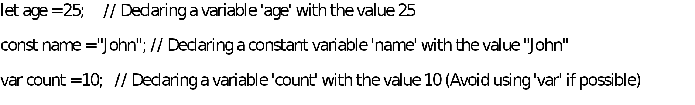

### 数据类型

JavaScript 支持多种内置数据类型：

1. 原始数据类型：
   - `Number`：表示数值，包括整数和浮点数。
   - `String`：表示用单引号或双引号括起来的字符序列。
   - `Boolean`：表示逻辑值，`true` 或 `false`。
   - `Null`：表示任何对象值的故意缺失。
   - `Undefined`：表示未初始化的变量或缺失的属性。
2. 结构数据类型：
   - `Object`：表示键值对或属性的集合。
   - `Array`：表示有序的值列表，通过数字索引访问。
   - `Map`：表示键值对的集合，其中键可以是任何数据类型。
   - `Set`：表示唯一值的集合。
3. 其他数据类型：
   - `Symbol`：表示唯一且不可变的值，可用作对象属性的标识符。
   - `BigInt`：表示任意精度的整数，适用于处理极大的数字。

以下是一些演示不同数据类型用法的示例：

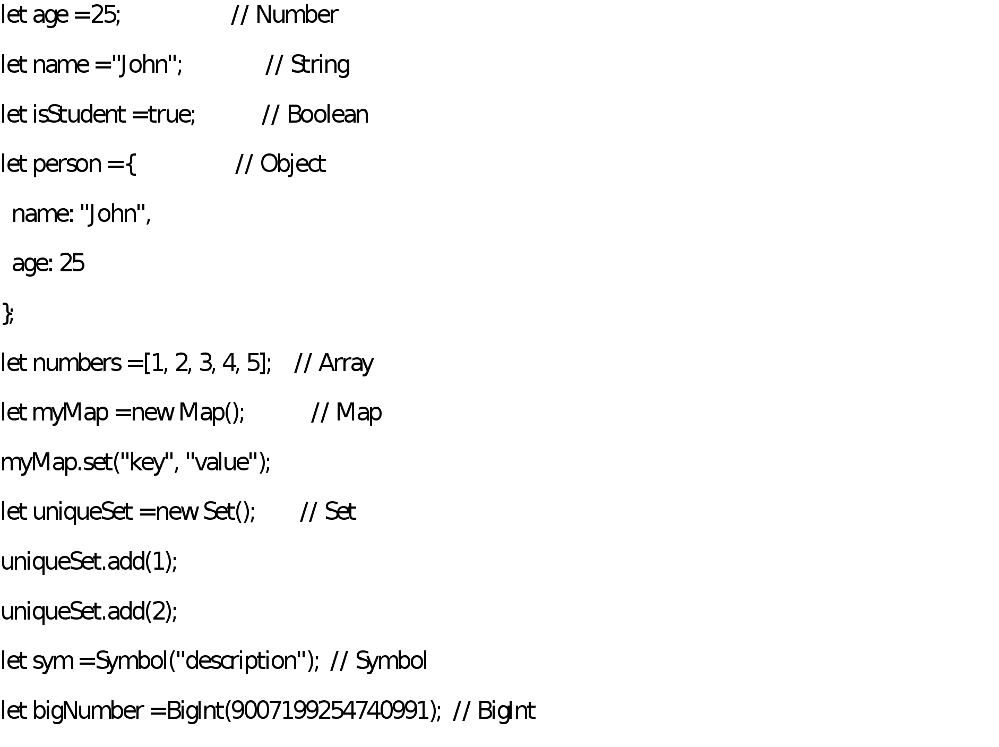

值得注意的是，JavaScript 是一种动态类型语言，这意味着变量可以保存任何数据类型的值，并且数据类型可以在运行时改变。

请务必查阅最新的文档和资源，以确保你掌握关于 JavaScript 数据类型及其用法的最新信息。

### 现实示例

让我们用贴近现实的例子来解释 JavaScript 中的变量和数据类型：

变量：在 JavaScript 中，变量就像一个带有名称的容器，用于保存值。它类似于一个可以存放东西的盒子。你可以给盒子起个名字，以便以后引用它并访问里面的内容。

例如，假设你有一个名为 `age` 的盒子，你想在其中存储你的年龄：

现在你可以在整个程序中使用变量 `age` 来表示你的年龄。你可以根据需要为变量赋予不同的值。

数据类型：数据类型定义了变量可以保存的值的种类。它们描述了你想要存储的信息的性质。让我们通过日常例子来了解一些常见的数据类型：

1. `Number`：`Number` 数据类型表示数值，如数量。可以把它想象成计数对象的表示，比如你拥有的苹果数量：

   

2. `String`：`String` 数据类型表示字符序列，例如文本。你可以把它想象成由字母组成的单词或句子。例如，你的名字可以存储为字符串：

   

3. `Boolean`：`Boolean` 数据类型表示两个值：`true` 或 `false`。它就像一个开关，可以打开或关闭。例如，你可以用它来表示一个条件，比如是否在下雨：

   

4. `Array`：`Array` 就像一个列表，你可以将多个值存储在一起。你可以把它想象成一系列项目，比如购物清单：

   

5. `Object`：`Object` 就像一组相关信息存储在一起。你可以把它想象成一个具有各种属性的人。例如，你可以用姓名和年龄来表示一个人：

   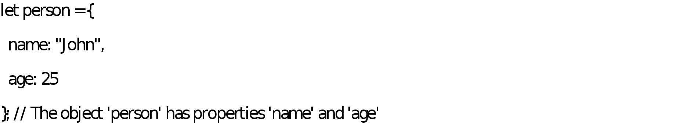

这些只是帮助你理解 JavaScript 中变量和数据类型的几个基本示例。随着学习的深入，你将了解更多高级数据类型及其用法。

请记住，在 JavaScript 中，变量可以保存不同类型的数据，并且你可以在整个程序中根据需要更改它们的值。

## 运算符和表达式

JavaScript 中的运算符和表达式允许你执行操作并操作数据。它们是编程的基础，使你能够进行计算、比较和组合值。让我们探索 JavaScript 中一些常见的运算符和表达式：

1. 算术运算符：算术运算符对数值进行数学计算。

   

2. 比较运算符：比较运算符比较值并返回布尔结果（`true` 或 `false`）。

   

3. 逻辑运算符：逻辑运算符用于组合和操作布尔值。

   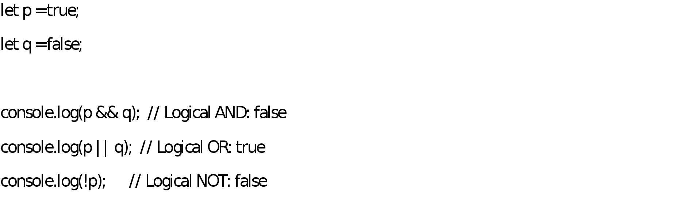

4. 赋值运算符：赋值运算符用于给变量赋值。

   

5. 字符串运算符：字符串运算符用于连接（拼接）字符串。

   

这些只是 JavaScript 中运算符和表达式的一些示例。还有更多类型的运算符，包括位运算符、三元运算符等。理解并使用这些运算符将使你能够执行各种操作，并使代码更加动态和灵活。

## JavaScript 中的注释

JavaScript 中的注释用于在代码中添加解释性说明或注解。它们会被 JavaScript 解释器忽略，但为开发者提供了有用的信息，以理解代码的用途或功能。JavaScript 中有两种注释：

1. 单行注释：单行注释用于在一行中添加注释。它们以 `//` 开头，一直延伸到行尾。

   

2. 多行注释：多行注释（也称为块注释）可以跨越多行。它们以 `/*` 开头，以 `*/` 结尾。这两个分隔符之间的所有内容都被视为注释。

   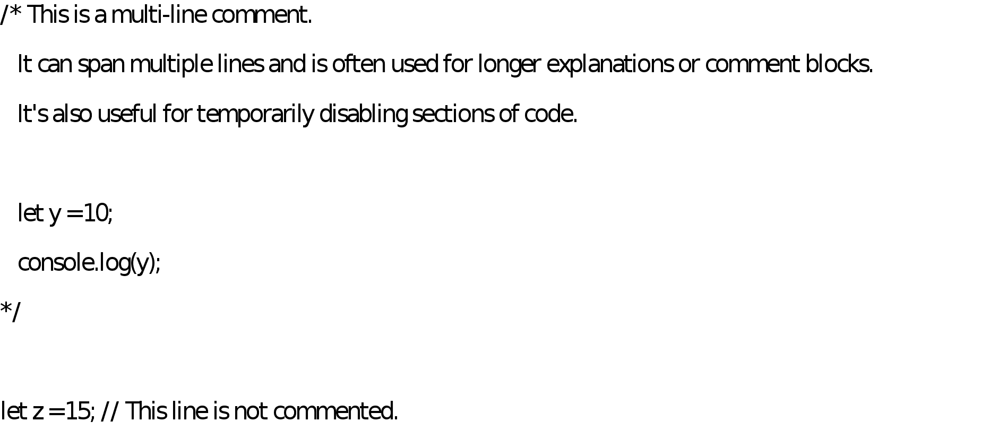

注释有多种用途，包括：

- 记录代码：描述代码块的目的、功能或重要细节。
- 添加提醒：包含注释或提醒，以解决特定问题或进行未来修改。
- 调试：临时禁用部分代码以进行测试或故障排除。

编写清晰简洁的注释是良好的实践，有助于增强对代码的理解。然而，确保注释随着代码的演变保持最新和相关也很重要。

## 控制流和循环

JavaScript 中的控制流和循环对于控制代码的执行流程和重复操作至关重要。它们允许你做出决策、根据条件执行不同的操作，并重复执行代码。让我们探索 JavaScript 中控制流和循环的主要结构：

1. 条件语句：条件语句允许你根据指定条件执行不同的代码块。

- `if...else`：`if...else` 语句评估一个条件，并根据条件为 `true` 或 `false` 执行不同的代码块。

- `switch`：`switch` 语句允许你根据不同的值选择不同的操作。

## 2. 循环

循环用于多次重复执行一段代码，可以基于条件或特定迭代次数。

- `for`：`for` 循环用于重复执行一段代码特定次数。

- `while`：`while` 循环在指定条件为 `true` 时重复执行一段代码。

- `do...while`：`do...while` 循环类似于 `while` 循环，但保证代码块至少执行一次，即使条件为 `false`。

- `break` 和 `continue`：`break` 语句用于提前退出循环，而 `continue` 语句用于跳过当前迭代并进入下一次迭代。

- `break` 和 `continue`：`break` 语句用于提前退出循环，而 `continue` 语句用于跳过当前迭代并进入下一次迭代。

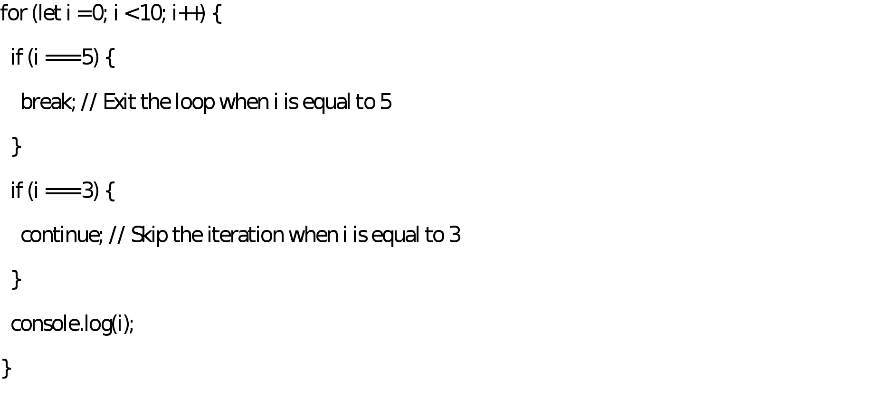

控制流和循环提供了强大的机制来控制程序执行和完成重复性任务。理解如何有效使用它们对于构建动态高效的 JavaScript 应用程序至关重要。

# 函数和作用域

函数和作用域是 JavaScript 中的基本概念，允许你组织和结构化代码。让我们分别探讨每个概念。

## 函数

JavaScript 中的函数是一段可重用的代码块，用于执行特定任务或计算值。函数通过名称、一组参数（可选）和代码块来定义。

### 函数声明

### 函数表达式（匿名函数）

### 箭头函数（ES6+）

### 函数调用

要执行函数，你需要通过函数名后跟括号来“调用”或“执行”它。你可以向函数传递参数（值）。

### 函数返回值

函数可以使用 `return` 语句返回值。这使得函数能够提供输出，该输出可以存储在变量中或用于进一步计算。

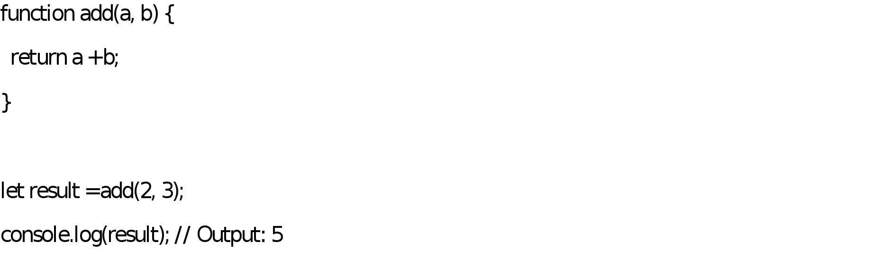

### 作用域

作用域指的是变量和函数在代码不同部分中的可见性和可访问性。

#### 全局作用域

在任何函数或代码块外部声明的变量具有全局作用域。它们可以在代码中的任何位置被访问。

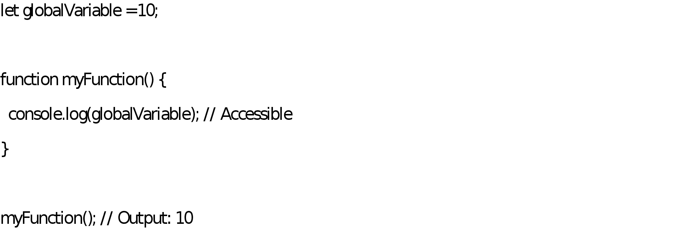

#### 局部作用域

在函数内部声明的变量具有局部作用域。它们只能在该函数内部被访问。

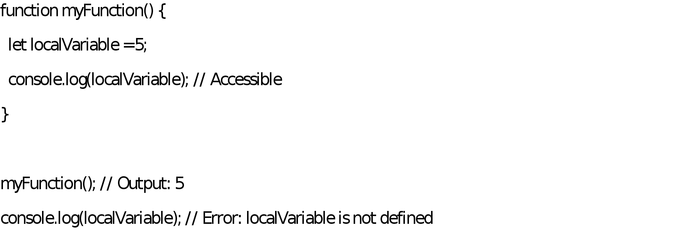

#### 块级作用域（ES6+）

在代码块（花括号内）中使用 `let` 或 `const` 声明的变量具有块级作用域。它们只能在该代码块内被访问。

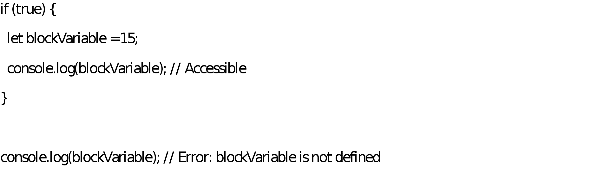

理解函数和作用域对于组织和模块化代码、管理变量可访问性以及防止命名冲突至关重要。

# 数组和对象

数组和对象是 JavaScript 中两种重要的数据结构，允许你存储和操作值的集合。以下是 JavaScript 中数组和对象的说明。

## 数组

数组是一个有序的值集合，其中每个值都被分配一个从 0 开始的数字索引。数组可以包含多个不同类型的值，例如数字、字符串、布尔值，甚至其他数组。

### 创建数组

### 访问数组元素

### 修改数组元素

### 数组方法

JavaScript 提供了多种内置方法来处理数组。一些常用的数组方法包括 `push()`、`pop()`、`shift()`、`unshift()`、`slice()`、`splice()`、`concat()`、`join()` 等。

## 对象

对象是一个无序的键值对集合，其中每个键都是一个字符串（或符号），映射到一个值。对象可以存储不同类型的值，甚至其他对象或数组。

### 创建对象

### 访问对象属性

### 修改对象属性

### 添加新属性

### 对象方法

对象也可以包含函数，这些函数被称为对象方法。这些方法可用于执行与对象相关的操作或计算。

数组和对象是 JavaScript 中组织和操作数据的强大工具。理解它们的语法和可用方法将帮助你高效地处理复杂的数据结构。

# 字符串操作

在 JavaScript 中操作字符串涉及对文本数据执行各种操作。以下是一些实用且简单的字符串操作示例。

## 创建字符串

你可以通过将文本括在单引号（`'`）或双引号（`"`）中来创建字符串。

## 字符串拼接

你可以使用 `+` 运算符或 `concat()` 方法来拼接字符串。

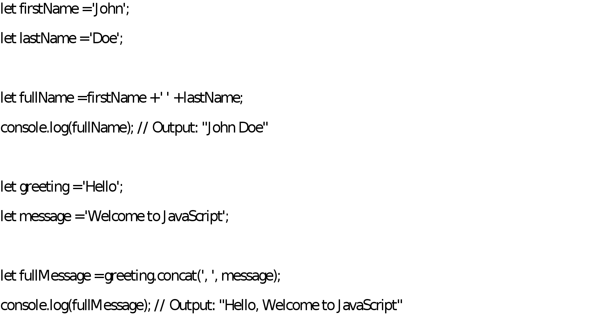

## 访问字符

你可以使用方括号（`[]`）和基于 0 的索引来访问字符串中的单个字符。

## 字符串长度

要获取字符串的长度（字符数），请使用 `length` 属性。

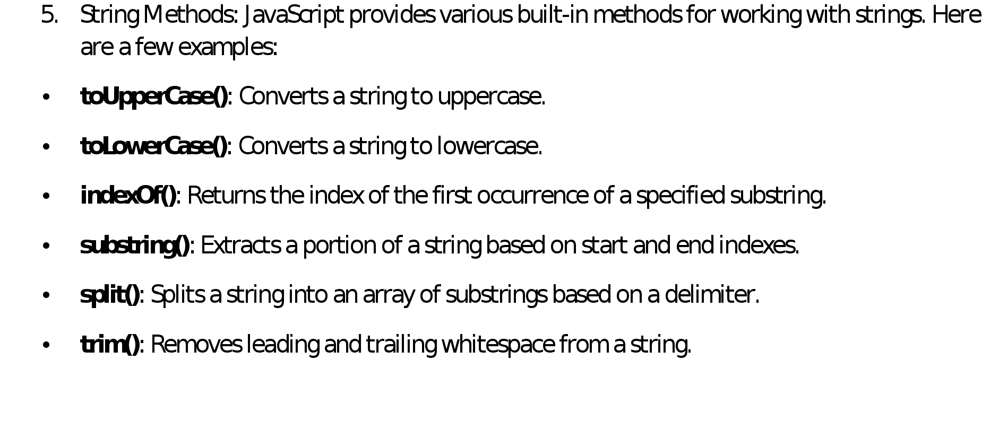

这些只是 JavaScript 中字符串操作的一些示例。理解并运用字符串操作将帮助你在代码中有效地处理和操作文本数据。

# DOM 简介

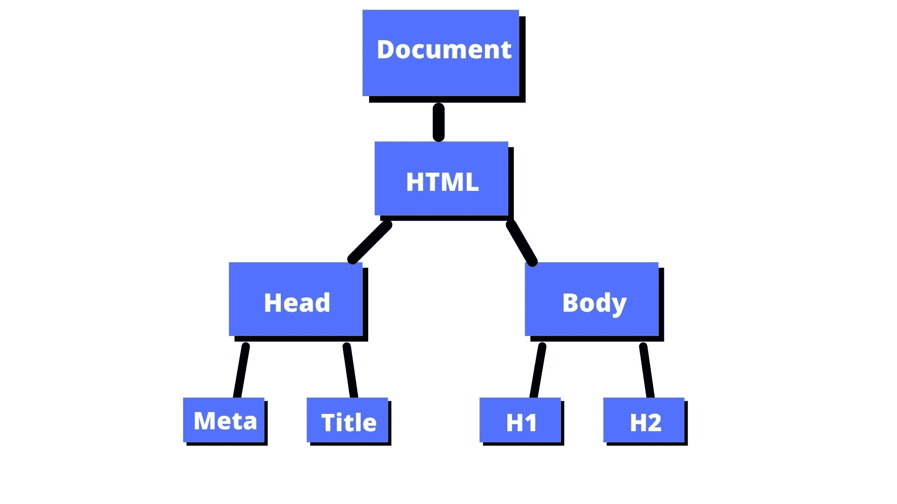

文档对象模型（DOM）是 Web 文档的编程接口。它将 HTML 或 XML 文档的结构表示为树状结构，树中的每个节点对应文档的一部分。DOM 提供了方法和属性，用于通过 JavaScript 动态地操作和与文档交互。以下是 JavaScript 中 DOM 的简要介绍。

## 访问 DOM

你可以使用全局的 `document` 对象来访问 DOM，该对象代表整个网页。

## 选择元素

DOM 提供了多种方法来根据元素的 ID、类、标签名或其他属性从文档中选择元素。

- `getElementById()`：选择具有特定 ID 的元素。
- `getElementsByClassName()`：选择具有特定类名的元素。
- `getElementsByTagName()`：选择具有特定标签名的元素。
- `querySelector()`：选择与 CSS 选择器匹配的第一个元素。
- `querySelectorAll()`：选择与 CSS 选择器匹配的所有元素。

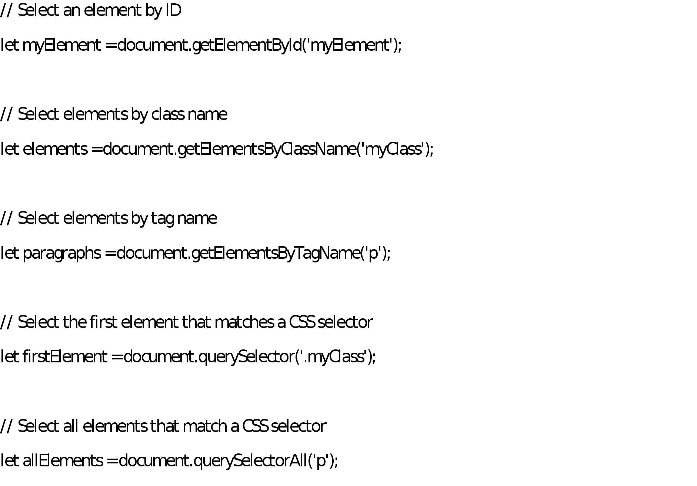

## 修改元素

你可以使用各种 DOM 方法和属性来修改元素的属性、特性和内容。

- `textContent`：获取或设置元素的文本内容。
- `innerHTML`：获取或设置元素的 HTML 内容。
- `setAttribute()`：设置元素属性的值。
- `style`：允许你操作元素的 CSS 属性。

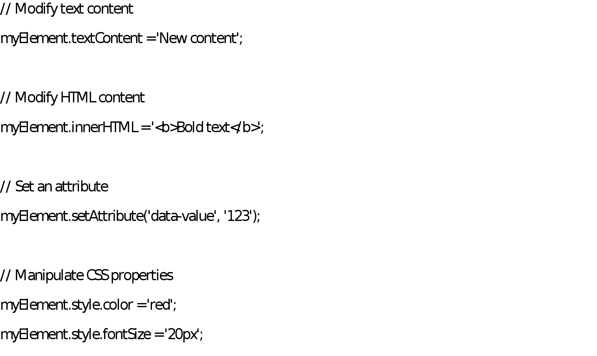

## 处理事件

DOM 允许你响应用户交互和事件，例如点击按钮或提交表单。

- `addEventListener()`：为元素附加事件监听器以处理特定事件。

## 创建和修改元素

你可以使用 DOM 方法动态创建新元素并将其附加到文档中。

- `createElement()`：创建一个新元素。
- `appendChild()`：将一个新元素作为子元素附加到另一个元素。

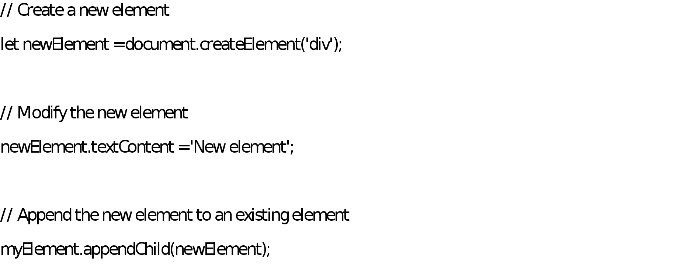

DOM 提供了一种强大的方式，通过 JavaScript 动态地与 HTML 文档交互。它允许你操作元素、响应事件、创建新元素等。理解 DOM 对于构建交互式 Web 应用程序至关重要。

# 访问和操作 DOM 元素

要在 JavaScript 中访问和操作 DOM 元素，你可以使用文档对象模型（DOM）提供的各种方法和属性。以下是常用技术的概述。

## 访问元素

你可以使用 `getElementById()`、`getElementsByClassName()`、`getElementsByTagName()`、`querySelector()` 和 `querySelectorAll()` 等方法从 DOM 中选择元素。

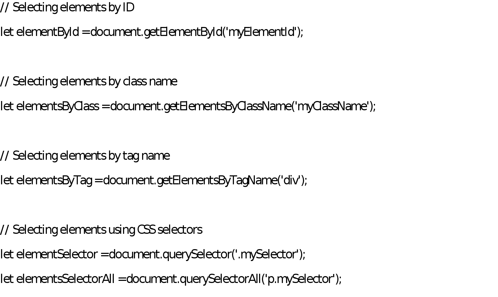

## 修改元素内容

你可以使用 `textContent` 和 `innerHTML` 等属性来操作元素的内容。

## 修改元素属性

你可以使用 `setAttribute()` 和 `getAttribute()` 等方法来更新元素的属性。

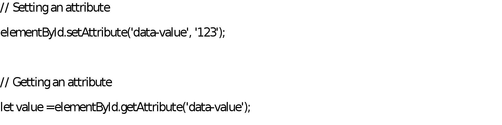

## 操作元素样式

你可以使用 `style` 属性来修改元素的 CSS 样式。

## 添加和移除类

你可以使用 `classList` 属性来添加或移除元素的 CSS 类。

## 处理事件

你可以使用 `addEventListener()` 方法为元素附加事件监听器，以响应用户交互。

## 创建和追加元素

你可以使用 `createElement()` 和 `appendChild()` 等方法动态创建新元素并将其追加到 DOM 中。

这些是在 JavaScript 中访问和操作 DOM 元素的一些常用技术。通过使用这些方法和属性，你可以动态修改元素的内容、属性和样式，并在网页中处理用户交互。

# 事件处理

JavaScript 中的事件处理允许你响应用户交互以及网页中发生的操作。以下是 JavaScript 中事件处理的概述。

1. **事件监听器**：事件监听器用于将函数（事件处理程序）附加到 DOM 元素上的特定事件。`addEventListener()` 方法常用于添加事件监听器。

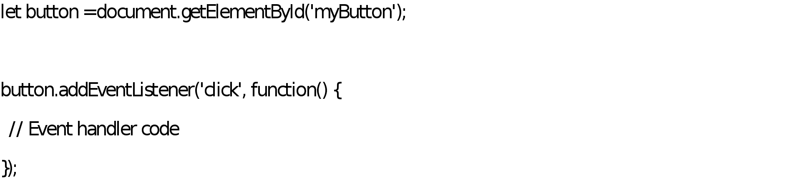

2. **事件类型**：事件可以由各种用户操作触发，例如点击按钮、悬停在元素上、提交表单、按键等。常见的事件类型包括 `click`、`mouseover`、`submit`、`keydown`、`load` 和 `resize`。

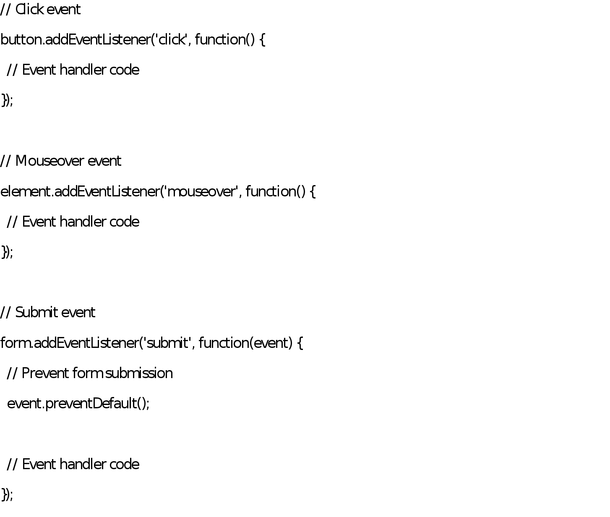

3. **事件对象**：当事件发生时，会自动创建一个事件对象并传递给事件处理函数。该对象提供有关事件的信息，例如目标元素、事件类型、坐标等。

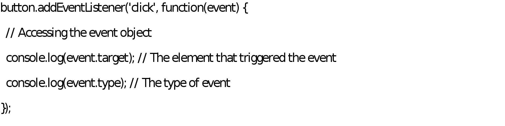

4. **移除事件监听器**：要移除事件监听器，你需要引用之前使用 `addEventListener()` 添加的同一个事件处理函数。`removeEventListener()` 方法用于此目的。

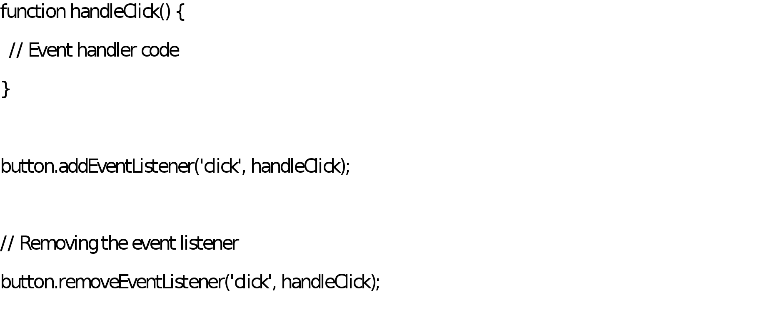

5. **事件冒泡与捕获**：DOM 中的事件可以通过嵌套元素传播，分为冒泡阶段和捕获阶段。默认情况下，事件从目标元素向上冒泡到其父元素。你也可以使用 `addEventListener()` 方法的第三个参数 `useCapture` 来监听捕获阶段的事件。

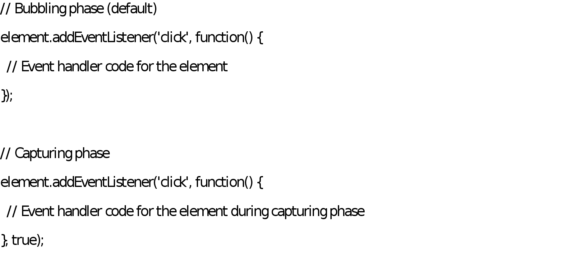

6. **事件委托**：事件委托是一种技术，将单个事件监听器附加到父元素上，而不是为每个子元素单独添加监听器。这在动态添加或移除元素时非常有用。

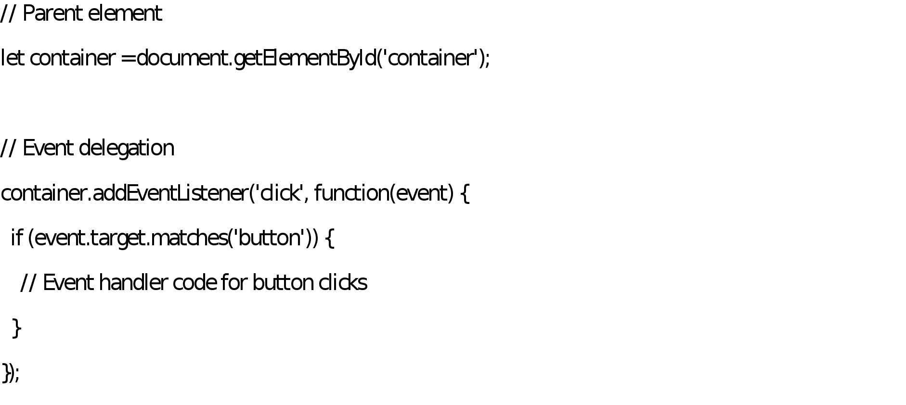

事件处理是 JavaScript 中一个强大的概念，它允许你创建交互式网页并响应用户操作。通过将事件监听器附加到 DOM 元素并编写适当的事件处理函数，你可以控制 Web 应用程序的行为和交互性。

# 动态创建和修改 HTML 元素

在 JavaScript 中，你可以通过使用 DOM（文档对象模型）API 动态创建和修改 HTML 元素。以下是关于如何动态创建和修改 HTML 元素的概述。

1. **创建元素**：要创建新的 HTML 元素，可以使用 `createElement()` 方法。将元素类型（例如 `"div"`、`"p"`、`"span"`）作为参数传入。

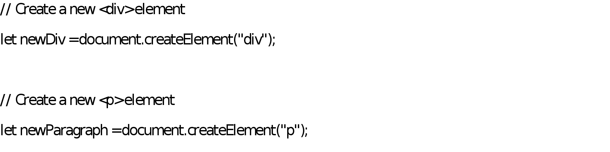

2. **设置元素属性**：你可以使用 `setAttribute()` 方法为新创建的元素设置属性。将属性名称和值作为参数提供。

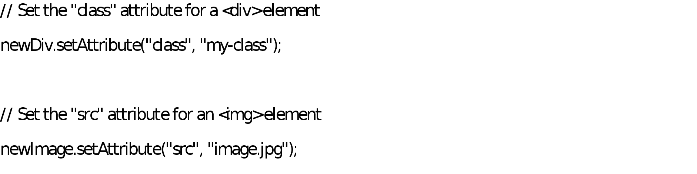

3. **修改元素内容**：要修改元素的内容，可以使用 `textContent` 或 `innerHTML` 属性。

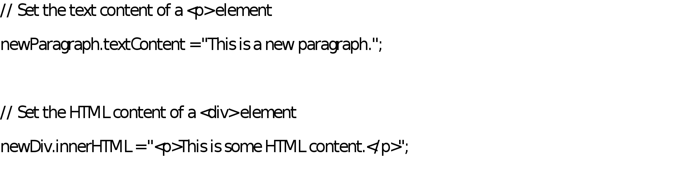

4. **追加元素**：你可以使用 `appendChild()` 方法将新创建的元素追加到现有元素中。将要追加的元素作为参数提供。

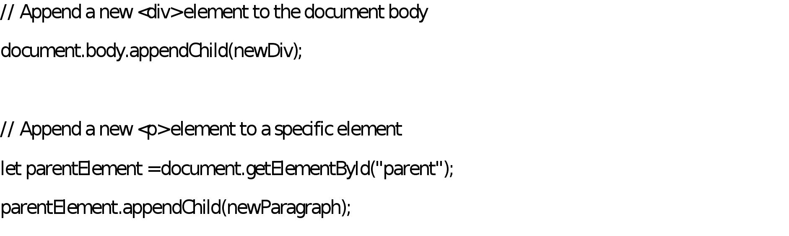

5. **移除元素**：要从 DOM 中移除元素，可以使用 `remove()` 方法或其父元素的 `removeChild()` 方法。

6. **修改元素样式**：你可以使用 `style` 属性修改元素的 CSS 样式。访问特定的样式属性并赋值。

通过使用这些技术，你可以使用 JavaScript 动态创建、修改、追加和移除 HTML 元素。这使你能够构建动态且交互式的网页，并根据用户交互和数据自定义内容和结构。

# 处理表单与输入验证

在 JavaScript 中处理表单和输入验证涉及与表单元素交互并验证用户输入以确保数据完整性。以下是关于如何在 JavaScript 中处理表单和执行输入验证的概述。

1. **访问表单元素**：你可以使用 `getElementById()` 或 `querySelector()` 方法通过 ID 或 CSS 选择器获取特定的表单元素。

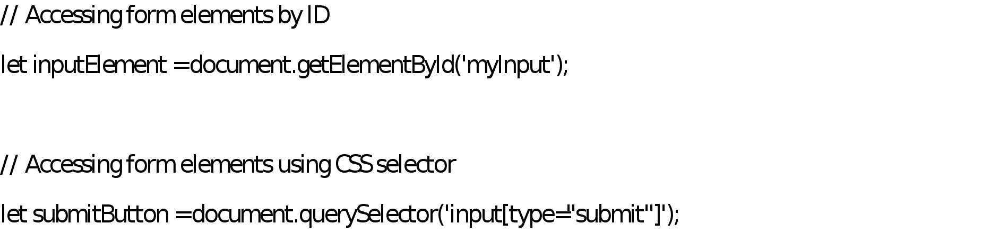

2. **处理表单提交**：要处理表单提交，你可以为表单的 `submit` 事件附加事件监听器。在事件处理程序中，你可以执行验证并相应地处理表单数据。

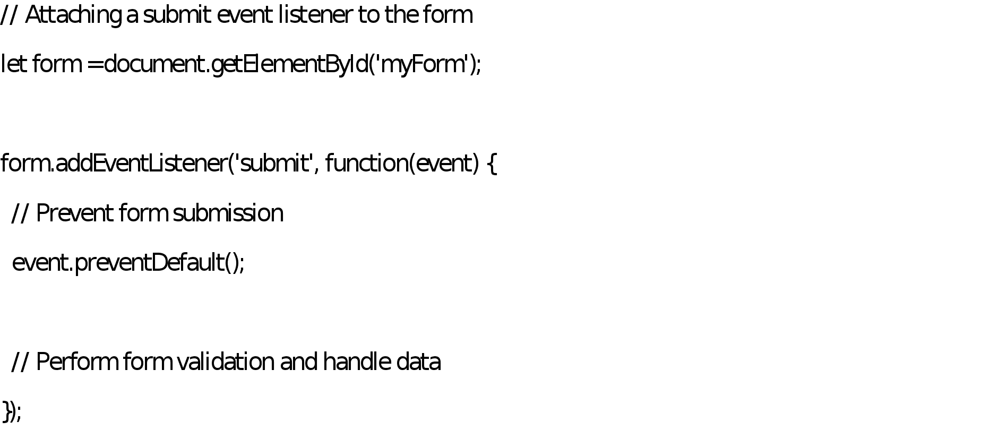

3. **输入验证**：要验证用户输入，你可以访问表单元素的 `value` 属性，并使用条件语句或正则表达式应用验证规则。

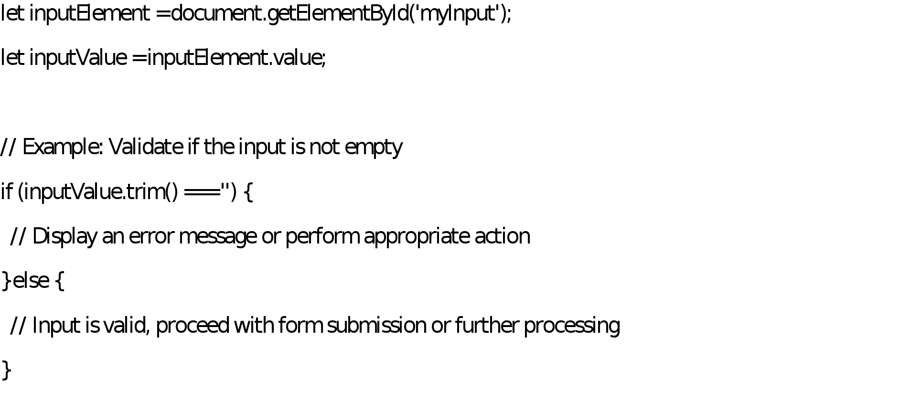

4. **显示验证消息**：你可以根据验证结果动态创建新元素并将其追加到 DOM 中，从而显示验证消息。

5. **输入约束**：你可以使用 `pattern` 属性或 HTML5 输入类型（`email`、`number`、`url` 等）来强制输入约束并提供内置验证。

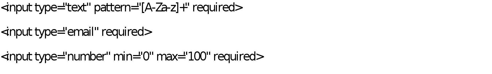

6. **实时验证**：对于实时输入验证，你可以为输入元素附加事件监听器，例如 `input` 或 `change` 事件，以便在用户输入时验证输入。

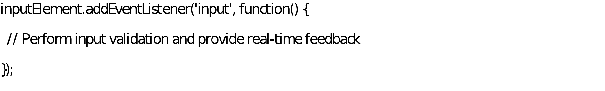

通过使用这些技术，你可以在 JavaScript 中处理表单、验证用户输入、显示验证消息，并确保通过表单提交的数据的完整性。它使你能够创建交互式且用户友好的表单，提供流畅的用户体验。

# 高级函数与闭包

高级函数和闭包是 JavaScript 中强大的概念，允许编写更灵活和封装的代码。让我们通过示例详细探讨这些概念。

1. **高阶函数**：高阶函数是可以接受其他函数作为参数或返回函数作为结果的函数。它们提供了一种抽象和封装行为的方式，实现了代码的可重用性。

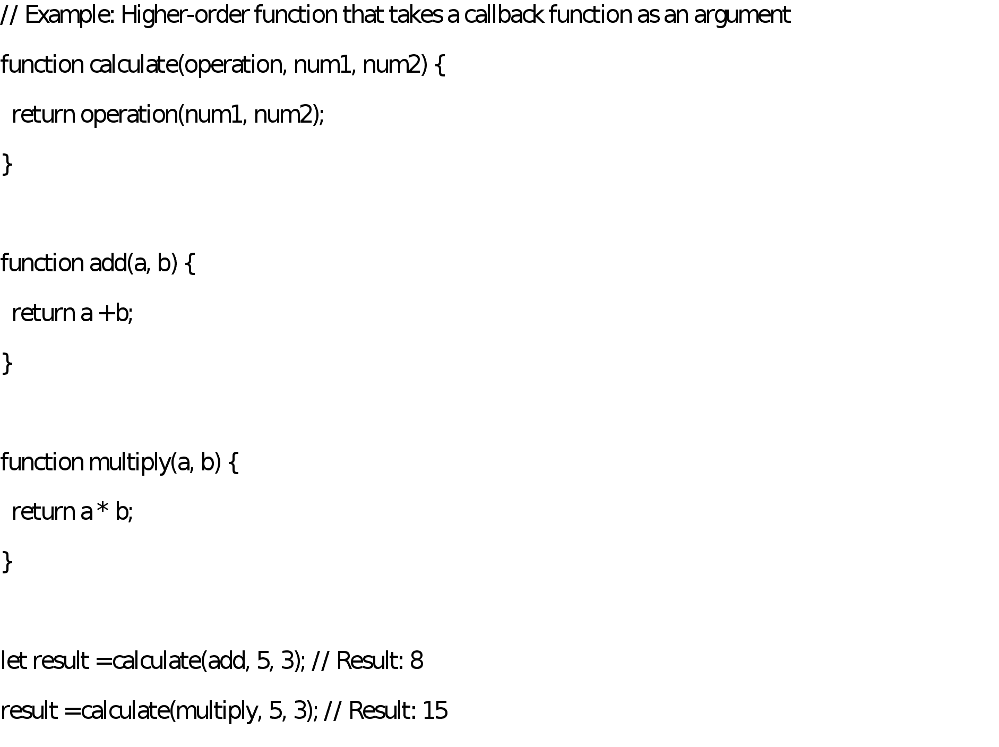

2. **闭包**：当函数保留对其外部作用域中变量的访问权限时，即使外部函数已经执行完毕，也会创建闭包。它允许持久化状态和私有变量。

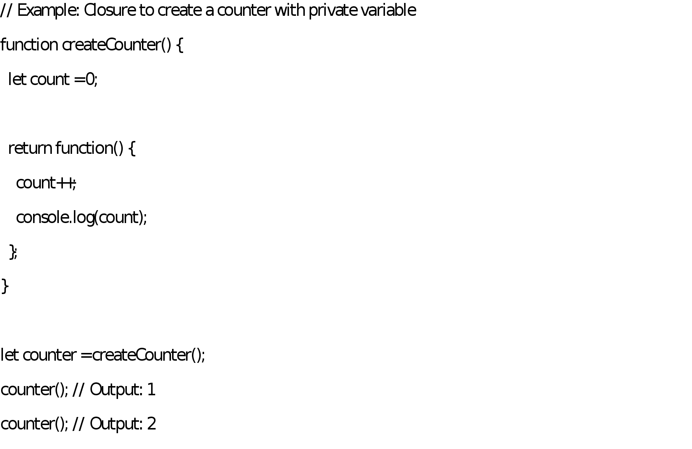

3. **立即调用函数表达式（IIFE）**：IIFE 是在定义后立即执行的函数。它通常用于创建私有作用域并防止变量污染全局命名空间。

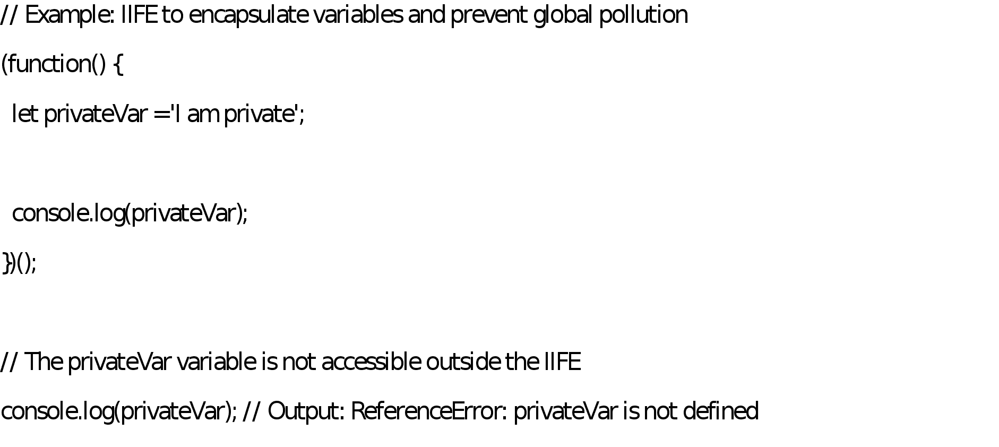

4. **函数柯里化**：柯里化是一种将接受多个参数的函数转换为一系列每个只接受一个参数的函数的技术。它支持部分函数应用，并允许创建专用函数。

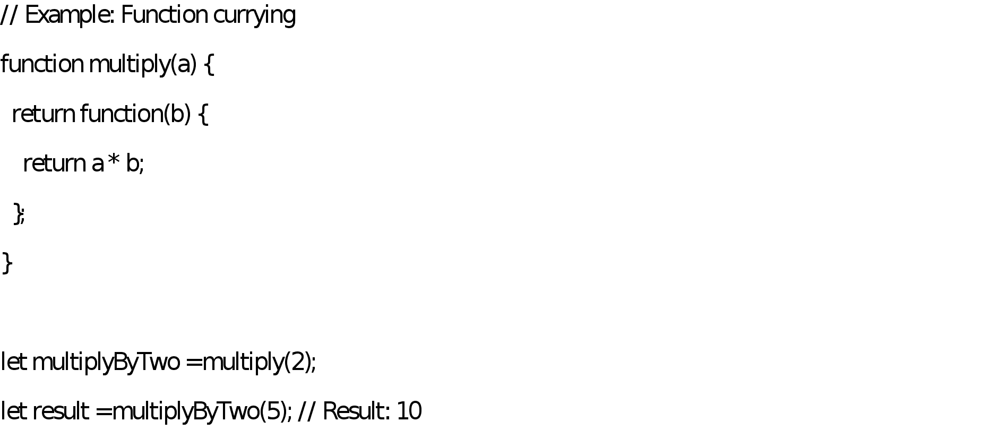

5. **函数组合**：函数组合涉及将多个函数组合成一个新函数，该函数执行一系列操作。它允许创建可重用和可组合的代码。

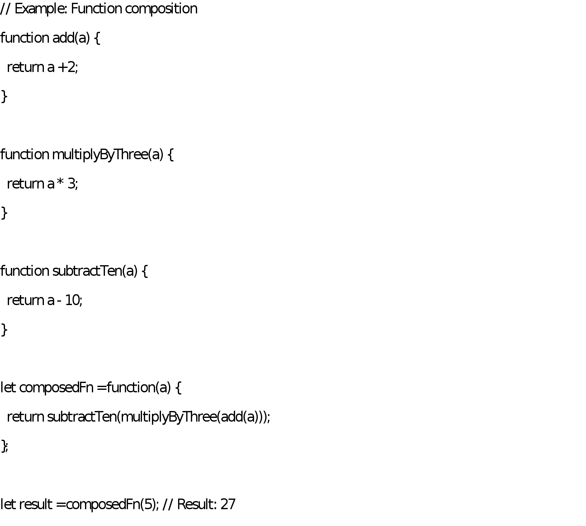

这些高级函数概念为在 JavaScript 中创建可重用和封装的代码提供了强大的工具。高阶函数、闭包、IIFE、柯里化和函数组合可以增强代码的灵活性、可维护性和可读性。它们使得开发更复杂、更具表现力的 JavaScript 应用程序成为可能。

# JavaScript 中的面向对象编程

JavaScript 中的面向对象编程（OOP）允许你创建和使用封装了数据和行为的对象。JavaScript 支持多种 OOP 特性，包括对象、类、继承和封装。以下是 JavaScript 中面向对象编程的概述。

1. **对象**：在 JavaScript 中，对象是键值对的集合，其中值可以是属性或方法。

## 2. 类

ES6 引入了 `class` 语法，提供了一种更传统的方式来使用蓝图定义和创建对象。类可以拥有属性和方法，你可以使用 `new` 关键字创建类的实例。

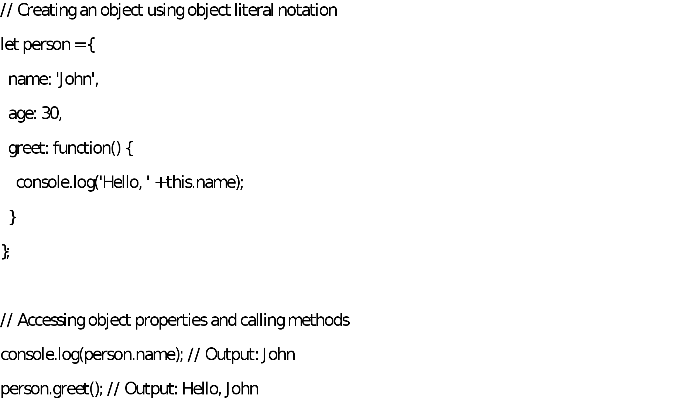

## 3. 继承

JavaScript 支持原型继承，即对象可以从其他对象继承属性和方法。`extends` 关键字用于创建继承自超类的子类。

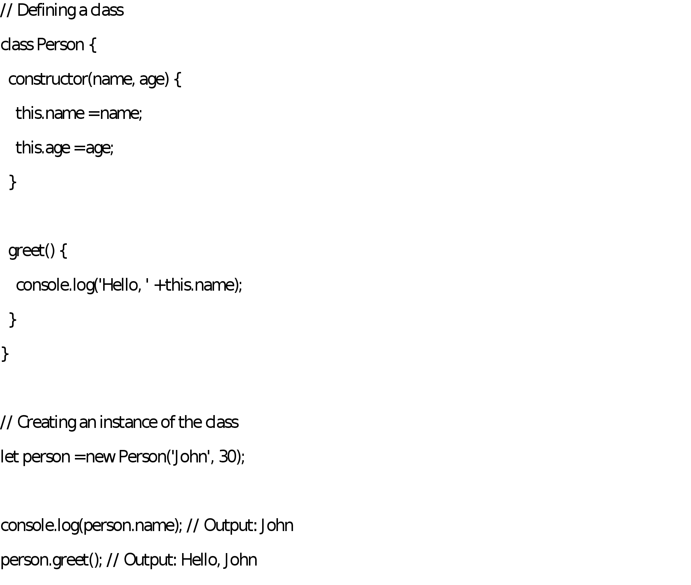

## 4. 封装

封装是将数据及相关方法捆绑在对象内部、隐藏内部实现细节的原则。在 JavaScript 中，你可以使用闭包或类方法来实现封装。

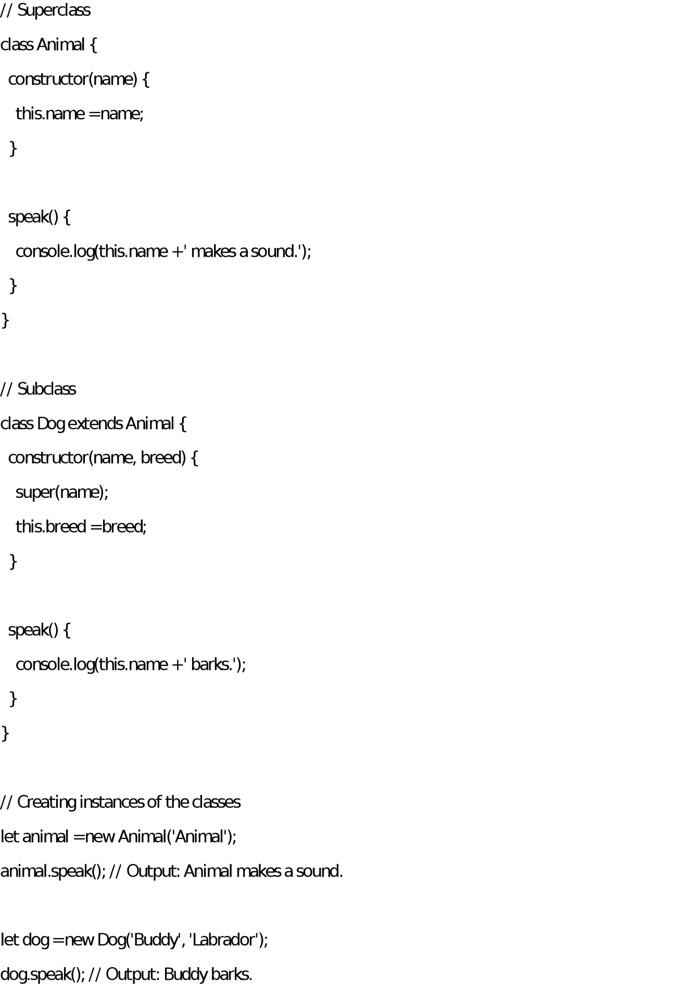

JavaScript 中的面向对象编程为构建应用程序提供了一种结构化和有组织的方法。对象、类、继承和封装实现了代码复用、模块化以及更轻松的维护。通过利用 OOP 原则，你可以创建更易于管理和扩展的 JavaScript 代码。

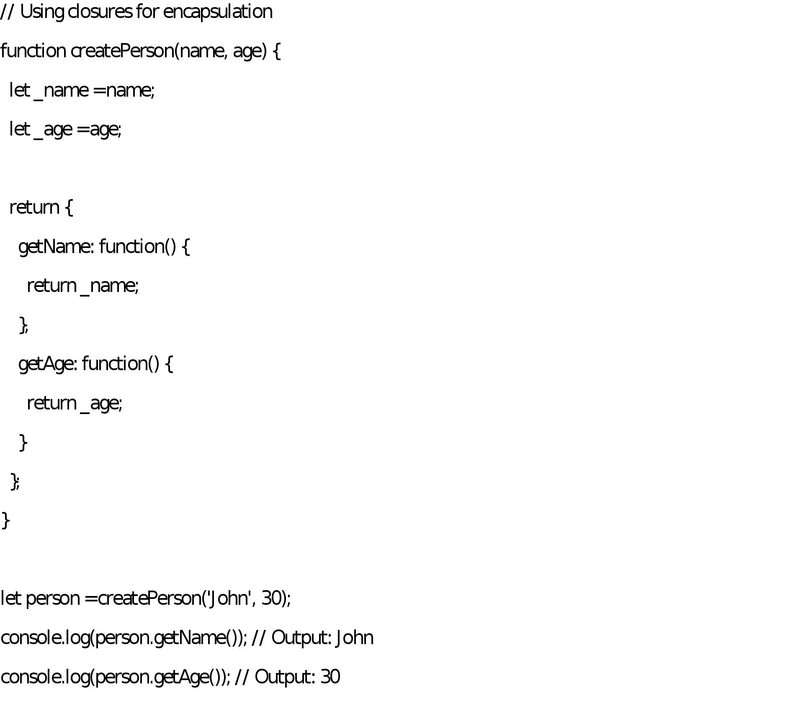

# 原型与继承

原型和继承是 JavaScript 中的基本概念，允许对象从其他对象继承属性和方法。让我们通过示例来探索 JavaScript 中的原型和继承：

## 1. 原型

在 JavaScript 中，每个对象都有一个原型，它充当该对象的蓝图。原型包含所有对象实例共享的属性和方法。

在这个示例中，`personPrototype` 是一个作为 `person` 原型的对象。`person` 从其原型继承了 `greet` 方法。

## 2. 构造函数

构造函数是一种创建具有共享属性和方法的对象的方式。它们使用 `this` 关键字来引用当前正在创建的实例。

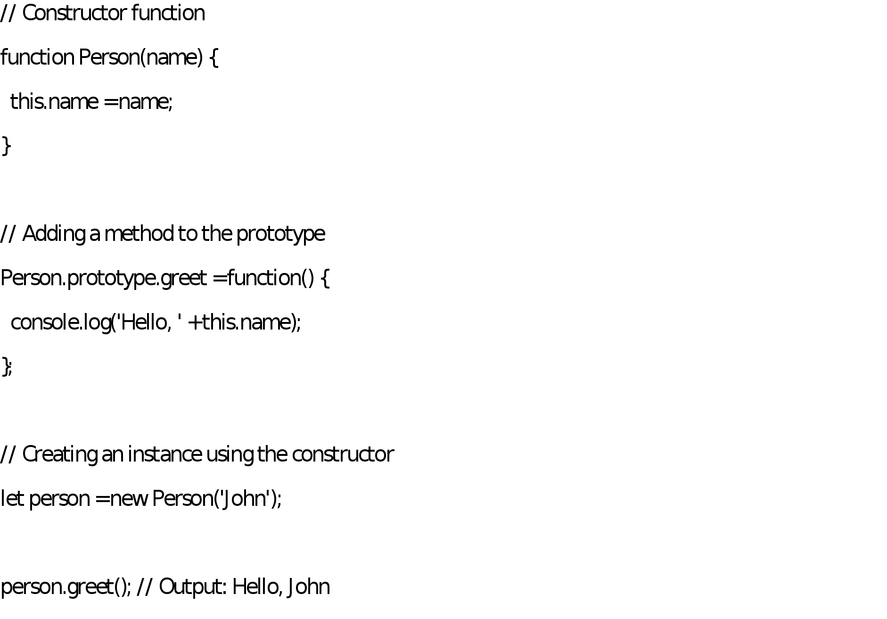

在这个示例中，`Person` 是一个构造函数，用于创建 `Person` 对象的实例。`greet` 方法被添加到 `Person.prototype` 上，每个 `Person` 实例都继承了 `greet` 方法。

## 3. 继承

JavaScript 使用原型链来实现继承。对象可以从其原型继承属性和方法。

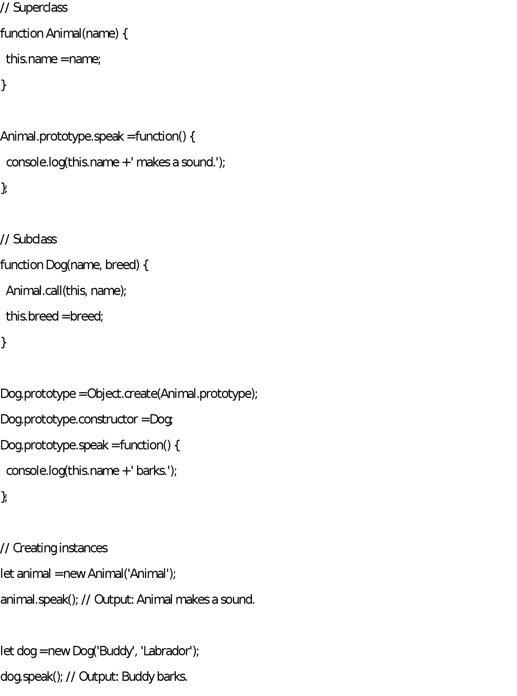

在这个示例中，`Animal` 是超类，`Dog` 是继承自 `Animal` 的子类。`Object.create()` 方法用于建立原型链，`Animal.call(this, name)` 用于在子类中调用超类构造函数。

## 4. `Object.getPrototypeOf()`

`Object.getPrototypeOf()` 方法允许你获取一个对象的原型。

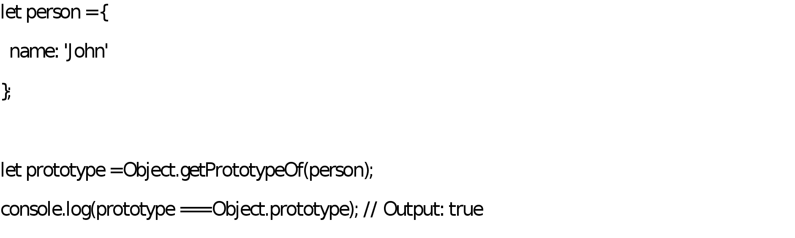

在这个示例中，`Object.getPrototypeOf()` 返回 `person` 对象的原型，即 `Object.prototype`。

JavaScript 中的原型和继承提供了一种在对象间共享属性和方法的机制，实现了代码复用并创建了对象之间的层次关系。通过利用原型和继承，你可以在 JavaScript 应用程序中创建更灵活、更可扩展的代码结构。

# 使用内置对象

在 JavaScript 中使用内置对象（如 `Array`、`Math`、`Date` 等）可以让你利用它们预定义的属性和方法来执行常见操作。以下是使用一些常用内置对象的概述：

## 1. `Array`

`Array` 对象用于存储和操作元素集合。它提供了多种用于添加、删除和修改数组中元素的方法。

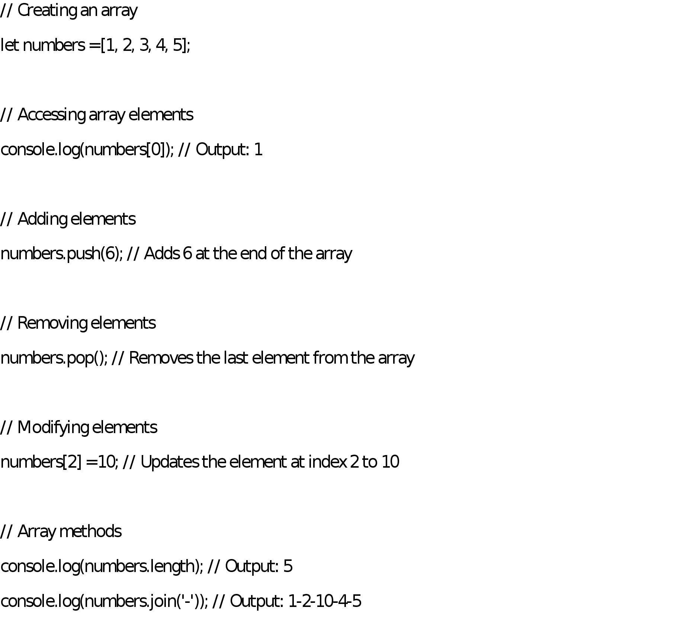

## 2. `Math`

`Math` 对象提供了一组数学运算和常量。它提供了用于执行计算的方法，例如四舍五入、随机数生成、三角函数等。

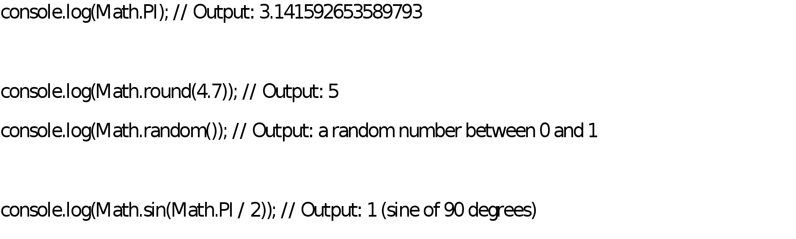

## 3. `Date`

`Date` 对象用于处理日期和时间。它提供了用于检索和操作日期各个组成部分（如年、月、日、时、分、秒等）的方法。

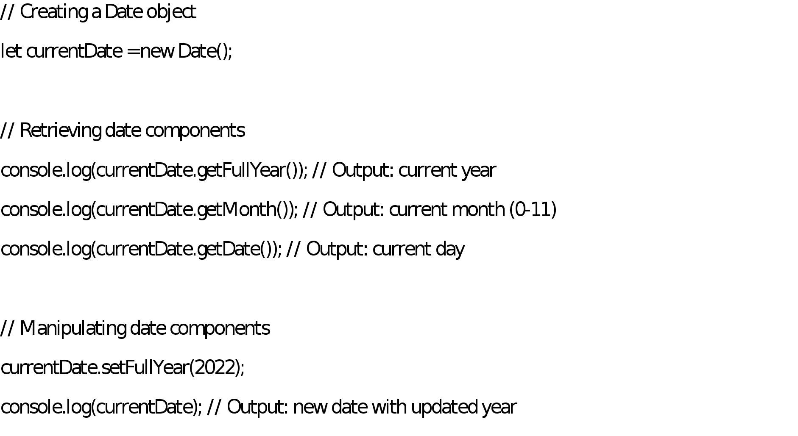

## 4. `String`

虽然严格来说不是对象，但 `String` 对象提供了用于处理字符串的方法，例如提取子字符串、转换大小写、替换字符等。

以上只是 JavaScript 中使用内置对象的一些示例。JavaScript 提供了丰富的内置对象，为各种编程任务提供了广泛的功能。通过理解并利用这些内置对象，你可以在 JavaScript 代码中更高效、更有效地执行常见操作。

# 练习题

注意：为了确保你发挥出最佳水平，我们想给你一个关键提示：请花时间仔细思考，然后再核对正确答案。

2. JavaScript 主要用于什么？

a) 科学计算  
b) 网页和应用程序开发  
c) 数据库管理  
d) 系统管理

正确答案：b) 网页和应用程序开发

3. JavaScript 常被称为“网络语言”是因为：

a) 它用于构建网络服务器  
b) 它被所有主流浏览器支持  
c) 它是用于网络的最古老的编程语言  
d) 它用于创建虚拟现实体验

正确答案：b) 它被所有主流浏览器支持

4. 以下哪种是动态类型语言？

a) Java  
b) Python  
c) JavaScript  
d) C#

正确答案：c) JavaScript

5. 在 JavaScript 中，以下哪个术语用于表示键值对的集合？

a) `Array`  
b) `Object`  
c) `String`  
d) 变量

正确答案：b) `Object`

6. 哪个 JavaScript 框架常用于构建用户界面？

a) `React`  
b) `Angular`  
c) `Vue.js`  
d) 以上都是

正确答案：d) 以上都是

7. JavaScript 中的 `JSON` 代表什么？

a) JavaScript Object Network  
b) JavaScript Over Network  
c) JavaScript Object Notation  
d) JavaScript Open Notation

正确答案：c) JavaScript Object Notation

8. JavaScript 中的 `AJAX` 代表什么？

a) Asynchronous JavaScript and XML  
b) Advanced JavaScript and XML  
c) Asynchronous JavaScript and XHTML  
d) Automated JavaScript and XML

正确答案：a) Asynchronous JavaScript and XML

9. JavaScript 中的 `IIFE` 代表什么？

a) Immediately Invoked Function Expression  
b) Inline Iterative Function Expression  
c) Instantiated Inline Function Execution  
d) Integrated Immediate Function Execution

正确答案：a) Immediately Invoked Function Expression

10. JavaScript 中事件循环的目的是什么？

a) 它处理异步回调并管理执行流程  
b) 它确保浏览器中的所有事件按顺序执行  
c) 它允许 JavaScript 代码在单独的线程中运行以提高性能  
d) 它管理 JavaScript 变量和对象的内存分配

正确答案：a) 它处理异步回调并管理执行流程

11. 以下哪个用于访问 JavaScript 中对象的属性和方法？

a) `()`  
b) `{}`  
c) `[]`  
d) `.`

正确答案：d) `.`

12. 通常使用哪个工具来初始化一个新的 JavaScript 项目？

a) Visual Studio Code  
b) `Node.js`  
c) `npm`  
d) `webpack`

答案：b) `Node.js`

13. 在 JavaScript 中，通常优先使用哪个关键字而不是 `var` 来声明变量？

a) `let`  
b) `const`  
c) `var`  
d) a) 和 b) 两者

答案：d) a) 和 b) 两者

14. JavaScript 中哪种数据类型表示逻辑值？

a) `Number`  
b) `String`  
c) `Boolean`  
d) `Object`

正确答案：c) `Boolean`

15. 在 JavaScript 开发中，像 `Babel` 这样的编译器的目的是什么？

a) 安装额外的包和库  
b) 将 JavaScript 文件打包在一起  
c) 将现代 JavaScript 代码转译为与旧浏览器兼容的旧版本  
d) 管理项目依赖

答案：c) 将现代 JavaScript 代码转译为与旧浏览器兼容的旧版本

16. 在 JavaScript 中，哪个运算符用于拼接字符串？

a) `+`  
b) `/`  
c) `=`  
d) `-`

答案：a) `+`

17. JavaScript 中单行注释的语法是什么？

a) `/* comment */`  
b) `// comment`  
c) `<!-- comment -->`  
d) `-- comment --`

答案：b) `// comment`

18. 在 JavaScript 中，哪个结构用于重复执行代码块特定次数？

a) `if...else`  
b) `switch`  
c) `for loop`  
d) `while loop`

答案：c) `for loop`

19. 在 JavaScript 中，哪个关键字用于提前退出循环？

a) `return`  
b) `exit`  
c) `break`  
d) `continue`

答案：c) `break`

20. 哪个循环保证即使条件为假，代码块也至少执行一次？

a) `for loop`  
b) `while loop`  
c) `do...while loop`  
d) `switch loop`

答案：c) `do...while loop`

21. JavaScript 中控制流的目的是什么？

a) 对数值执行数学计算  
b) 组合和操作布尔值  
c) 根据条件控制代码的执行流程  
d) 为变量赋值

答案：c) 根据条件控制代码的执行流程

22. 字符串操作：问题 1. 如何在 JavaScript 中创建字符串？

a) 将文本括在单引号（`''`）中  
b) 将文本括在双引号（`""`）中  
c) 以上 a) 和 b) 都可以  
d) 以上都不对

正确答案：c) 以上 a) 和 b) 都可以

23. JavaScript 中用于字符串拼接的运算符是哪个？

a) `+`  
b) `,`  
c) `&`  
d) `–`

正确答案：a) `+`

24. 如何在 JavaScript 中访问字符串中的单个字符？

a) 使用圆括号 `()`  
b) 使用方括号 `[]`  
c) 使用花括号 `{}`  
d) 使用尖括号 `<>`

正确答案：b) 使用方括号 `[]`

25. 在 JavaScript 中，哪个属性用于查找字符串的长度？

a) `count`  
b) `size`  
c) `length`  
d) `sizeOf`

正确答案：c) `length`

26. DOM 简介：问题 1. 如何在 JavaScript 中访问 DOM？

a) 使用 `document` 对象  
b) 使用 `window` 对象  
c) 使用 `body` 对象  
d) 使用 `documentElement` 对象

正确答案：a) 使用 `document` 对象

27. 哪个方法用于选择具有特定 ID 的元素？

a) `getElementById()`  
b) `getElementsByClassName()`  
c) `getElementsByTagName()`  
d) `querySelector()`

正确答案：a) `getElementById()`

28. 如何使用 DOM 修改元素的 HTML 内容？

a) 使用 `textContent` 属性  
b) 使用 `innerHTML` 属性  
c) 使用 `setAttribute()` 方法  
d) 使用 `style` 属性

正确答案：b) 使用 `innerHTML` 属性

29. 哪个方法用于向元素附加事件监听器？

a) `addEventListener()`  
b) `attachEvent()`  
c) `onEvent()`  
d) `eventListener()`

正确答案：a) `addEventListener()`

30. 访问和操作 DOM 元素：问题 1. 如何根据 ID 从 DOM 中选择元素？

a) `getElementById()`  
b) `getElementsByClassName()`  
c) `getElementsByTagName()`  
d) `querySelector()`

正确答案：a) `getElementById()`

31. 哪个属性用于操作元素的内容？

a) `textContent`  
b) `innerHTML`  
c) `setAttribute()`  
d) `style`

正确答案：a) `textContent`

32. 如何使用 DOM 更新元素的属性？

a) 使用 `textContent` 属性  
b) 使用 `innerHTML` 属性  
c) 使用 `setAttribute()` 方法  
d) 使用 `style` 属性

正确答案：c) 使用 `setAttribute()` 方法

33. 哪个属性用于修改元素的 CSS 样式？

a) `textContent`  
b) `innerHTML`  
c) `setAttribute()`  
d) `style`

正确答案：d) `style`

34. 事件处理：问题 1. 在 JavaScript 中，事件监听器用于什么？

a) 将函数附加到 DOM 元素上的特定事件  
b) 将函数附加到 `window` 对象上的特定事件  
c) 将函数附加到 `document` 对象上的特定事件  
d) 将函数附加到 `body` 对象上的特定事件

正确答案：a) 将函数附加到 DOM 元素上的特定事件

35. 哪个方法通常用于添加事件监听器？

a) `addEventListener()`  
b) `attachEvent()`  
c) `onEvent()`  
d) `eventListener()`

正确答案：a) `addEventListener()`

36. JavaScript 中事件对象的用途是什么？

a) 它提供有关事件的信息，例如目标元素和事件类型。  
b) 它存储事件处理函数。  
c) 它控制 DOM 中事件的传播。  
d) 它在发生操作时触发事件。

正确答案：a) 它提供有关事件的信息，例如目标元素和事件类型。

37. 如何在 JavaScript 中移除事件监听器？

a) `removeEventListener()`  
b) `detachEvent()`  
c) `offEvent()`  
d) `removeListener()`

正确答案：a) `removeEventListener()`

38. 原型和继承：问题 1. JavaScript 中的原型是什么？

a) 它是创建对象的蓝图。  
b) 它是用于定义对象的函数。  
c) 它是 JavaScript 中的内置对象。  
d) 它是一个与 JavaScript 无关的编程概念。

正确答案：a) 它是创建对象的蓝图。

39. 如何在 JavaScript 中创建具有共享属性和方法的对象？

a) 使用原型链  
b) 使用构造函数  
c) 使用对象字面量  
d) 使用类语法

正确答案：b) 使用构造函数

40. JavaScript 中的继承是如何工作的？

a) JavaScript 使用基于类的继承。  
b) JavaScript 使用对象克隆来实现继承。  
c) JavaScript 使用原型链来实现继承。  
d) JavaScript 不支持继承。

正确答案：c) JavaScript 使用原型链来实现继承。

41. 在 JavaScript 中，哪个方法用于获取对象的原型？

a) `getPrototype()`  
b) `getProto()`  
c) `prototypeOf()`  
d) `Object.getPrototypeOf()`

正确答案：d) `Object.getPrototypeOf()`

42. 使用内置对象：问题 1. 哪个内置对象用于存储和操作元素集合？

a) `Array`  
b) `Math`  
c) `Date`  
d) `String`

正确答案：a) `Array`

43. 哪个内置对象在 JavaScript 中提供数学运算和常量？

a) `Array`  
b) `Math`  
c) `Date`  
d) `String`

正确答案：b) `Math`

44. 哪个内置对象用于处理 JavaScript 中的日期和时间？

a) `Array`  
b) `Math`  
c) `Date`  
d) `String`

正确答案：c) `Date`

45. 哪个内置对象提供用于处理字符串的方法？

a) `Array`  
b) `Math`  
c) `Date`  
d) `String`

正确答案：d) `String`

# 异步编程简介

异步编程是一种编程范式，它允许同时执行多个任务，而不会阻塞其他代码的执行。在 JavaScript 中，异步编程对于处理耗时操作至关重要，例如从服务器获取数据、读写文件或等待用户输入。

传统上，JavaScript 遵循同步执行模型，代码逐行执行，每行代码必须执行完毕才能进入下一行。然而，在任务需要很长时间才能完成的场景中，同步代码执行会导致延迟和用户界面无响应。

异步编程通过允许任务在后台执行而其他代码继续运行来解决这个问题。它利用回调函数、Promise 和 `async/await` 语法来管理执行流程并处理异步操作的结果。

## 1. 回调函数

回调函数是 JavaScript 中异步编程的基本组成部分。它们是作为参数传递给其他函数的函数，并在特定异步操作完成时执行。

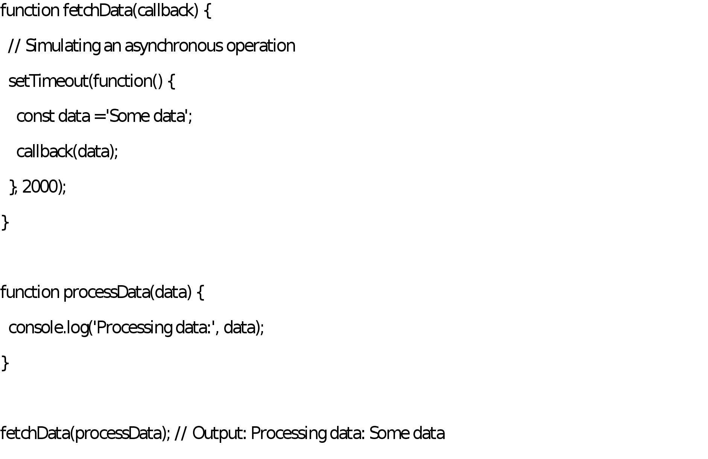

在这个例子中，`fetchData` 函数执行一个异步操作（使用`setTimeout`模拟），并接受一个回调函数`processData`。一旦异步操作完成，回调函数就会被调用，并传入结果数据。

## 2. Promise

`Promise`提供了一种更结构化的方式来处理 JavaScript 中的异步操作。它们表示异步操作的最终完成（或失败），并允许你将多个异步任务串联在一起。

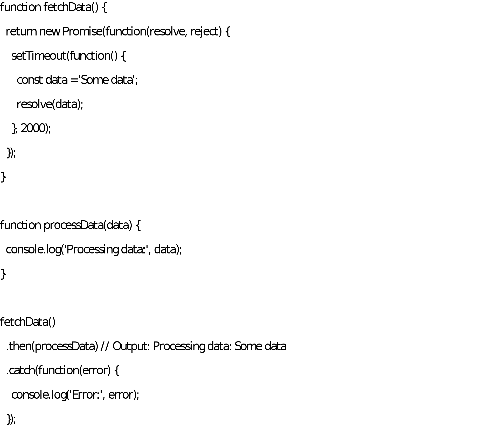

在此示例中，`fetchData`函数返回一个`Promise`，该`Promise`在异步操作完成后会携带数据进入 resolved 状态。`then`方法用于指定如何处理已解析的数据，而`catch`方法则处理过程中可能发生的任何错误。

## 3. Async/Await

ES6 引入的`async`/`await`语法通过使用`async`函数和`await`关键字，提供了一种更简洁的编写异步代码的方式。它允许你编写外观和行为更像同步代码的异步代码，从而更易于理解和维护。

在此示例中，`fetchData`函数返回一个`Promise`，而`processData`函数被标记为`async`。`await`关键字用于暂停`processData`函数的执行，直到该`Promise`被解析。错误处理通过`try...catch`块完成。

JavaScript 中的异步编程对于处理耗时任务而不阻塞其他代码的执行至关重要。通过理解并利用回调函数、`Promise`和`async`/`await`语法，你可以有效地处理异步操作，并创建响应迅速且高效的 JavaScript 应用程序。

## 回调函数与事件循环

回调函数是异步编程中的一个基本概念。它们允许你指定异步操作完成后应该执行的操作。事件循环负责管理回调函数的执行，并确保程序保持响应。

### 使用回调函数的示例

在此示例中，`fetchData`函数使用`setTimeout`模拟异步操作。它接受一个回调函数`processData`，该函数将在异步操作完成后执行。事件循环管理回调函数的执行，确保在时间延迟结束时调用它。

## Promise 与 Async/Await

`Promise`提供了一种更结构化、更优雅的方式来处理异步操作。它们表示异步任务的最终完成或失败。`async`/`await`是一种简化`Promise`使用的语法，使异步代码看起来和行为更像同步代码。

### 使用 Promise 的示例

在此示例中，`fetchData`函数返回一个`Promise`。该`Promise`在异步操作完成后通过`resolve`方法携带数据进入 resolved 状态。`then`方法用于指定如何处理已解析的数据，而`catch`方法则处理过程中发生的任何错误。

### 使用 Async/Await 的示例

在此示例中，`fetchData`函数返回一个`Promise`。`processData`函数被标记为`async`，从而允许使用`await`关键字。`await`关键字暂停`processData`函数的执行，直到`Promise`被解析，然后获取已解析的数据。错误处理通过`try...catch`块完成。

`Promise`和`async`/`await`提供了一种更易读、更结构化的方式来处理异步操作，使代码更易于理解和维护。它们消除了回调地狱，并允许在异步代码中进行更直接的错误处理和控制流。

## 使用 AJAX 与 Fetch API

AJAX（异步 JavaScript 和 XML）允许你发出异步 HTTP 请求，从服务器检索数据，而无需重新加载整个网页。Fetch API 是一个现代 JavaScript API，它提供了一种更强大、更灵活的方式来发出 AJAX 请求。

### 使用 Fetch API 的示例

在此示例中，`fetch`函数用于向指定的 URL 发出 HTTP GET 请求。响应以`Promise`的形式接收，第一个`.then`块检查响应是否成功（`response.ok`）。如果不成功，则抛出错误。然后通过`response.json()`提取响应数据，第二个`.then`块记录接收到的数据。过程中发生的任何错误都会被`.catch`块捕获并处理。

## 异步代码中的错误处理

在处理异步代码时，有效处理错误对于提供良好的用户体验和维护应用程序的稳定性至关重要。以下是使用`Promise`和`async`/`await`语法进行异步代码错误处理的示例：

### 使用 Promise 的示例

在此示例中，`fetchData`函数返回一个`Promise`。`retrieveData`函数被标记为`async`，从而允许使用`await`关键字。在`try`块内部，`await`关键字用于暂停执行，直到`Promise`被解析或拒绝。如果发生错误，它会被`catch`块捕获并处理。

通过在异步代码中实现适当的错误处理，你可以优雅地处理错误，并在异步操作执行过程中出现问题时向用户提供有意义的反馈。

# 流行的 JavaScript 库和框架简介

JavaScript 库和框架为开发者提供了预编写的代码和工具，以简化和精简开发过程。它们提供各种功能，如 DOM 操作、基于组件的架构、状态管理等。以下是几个流行的 JavaScript 库和框架的介绍，以及实际示例：

## 1. jQuery

jQuery 是一个快速、小巧且功能丰富的 JavaScript 库，它简化了 HTML 文档遍历、事件处理和动画。它提供了一个易于使用的 API，用于与 DOM 交互并处理浏览器不一致性。

### 使用 jQuery 进行 DOM 操作的示例

在此示例中，jQuery 用于选择 id 为`myButton`的按钮元素。当按钮被点击时，id 为`output`的`div`元素的文本被更新为 "Button clicked!"。

## 2. React

React 是一个用于构建用户界面的流行 JavaScript 库。它采用基于组件的架构和虚拟 DOM 实现高效渲染。React 提供了一种声明式的方法来构建 UI，使得创建可重用和交互式组件变得容易。

### 使用 React 构建简单计数器组件的示例

在此示例中，React 的`useState`钩子用于管理`count`变量的状态。`increment`函数在按钮被点击时更新`count`。该组件渲染当前的`count`值和一个用于递增它的按钮。

## 3. Angular

Angular 是一个用于构建 Web 应用程序的强大 JavaScript 框架。它遵循基于组件的架构，并提供双向数据绑定、依赖注入以及丰富的工具和库生态系统等功能。

### 使用 Angular 创建简单 TODO 应用程序的示例

在此示例中，Angular 用于创建一个 TODO 应用程序。`ng-app`指令定义了 Angular 应用程序，`ng-controller`指令将控制器逻辑绑定到特定的 DOM 元素。`ng-model`指令将输入值绑定到`newTodo`变量，`ng-click`指令在按钮被点击时调用`addTodo`函数。`ng-repeat`指令渲染一个待办事项列表。

## 4. Vue.js

Vue.js 是一个用于构建用户界面的渐进式 JavaScript 框架。它强调简单易用，同时提供响应式数据绑定、组件组合和灵活的 API 等强大功能。

### 使用 Vue.js 创建简单计数器组件的示例

在此示例中，使用`Vue.js`创建了一个计数器组件。`el`属性指定了挂载 Vue 实例的元素。`data`属性定义了`count`变量，`methods`属性定义了`increment`函数，该函数在按钮被点击时更新`count`。

这些只是展示流行 JavaScript 库和框架用法的几个示例。每个库或框架都有其自身的优势和特定的使用场景。重要的是要查阅它们的文档和示例，以深入理解并在项目中充分发挥其潜力。

# 使用第三方库

在 JavaScript 中使用第三方库，可以让你利用预构建的功能并扩展应用程序的能力。以下是在 JavaScript 中使用第三方库的一般步骤：

1. 安装：
   - 确定要使用的库，并找到合适的安装方法。大多数库可以通过包管理器（如`npm`或`Yarn`）安装。
   - 使用包管理器命令安装该库。例如，使用`npm`：`npm install library-name`。

2. 导入库：
   - 在你的 JavaScript 文件中，通过`import`语句导入库，或者通过`<script>`标签将库脚本包含在 HTML 文件中。
   - 确保在使用库的任何功能之前导入或包含该库。

3. 使用库：
   - 查阅库的文档以了解其 API 和可用功能。
   - 使用库的函数、类或对象在代码中实现所需功能。
   - 遵循库的使用模式和指南，确保正确集成。

以下是使用第三方库的示例，具体是用于日期和时间操作的`Moment.js`库：

在此示例中，使用`npm`安装了`Moment.js`。通过`import`语句导入该库，并使用其功能获取当前日期并计算未来日期。`format`方法用于根据指定格式格式化日期。

请记住，要查阅你所使用的第三方库的具体文档，以了解其安装、导入和使用细节。每个库可能有其特定的集成方式，并提供各种功能和自定义选项。

# 构建交互式 Web 应用

在 JavaScript 中构建交互式 Web 应用涉及创建动态且响应式的用户界面，使用户能够以有意义的方式与应用程序交互。以下是在 JavaScript 中构建交互式 Web 应用时需要考虑的一些关键概念和技术：

1. DOM 操作：
   - 使用 JavaScript 与文档对象模型（DOM）交互，动态更新和修改网页上的元素。
   - 使用`getElementById`、`querySelector`或`getElementsByClassName`等方法选择 DOM 元素。
   - 使用 JavaScript 更新 DOM 元素的内容、样式或属性。

2. 事件处理：
   - 为 DOM 元素附加事件监听器，以响应用户交互，如点击、鼠标移动、按键等。
   - 使用`addEventListener`等事件监听器监听事件，并在事件发生时执行相应的函数。
   - 处理用户输入并根据用户交互触发操作。

3. 动画与过渡：
   - 使用 JavaScript 和 CSS 创建流畅且视觉上吸引人的过渡和动画。
   - 使用 CSS 过渡或动画来动画化 DOM 元素的 CSS 属性。
   - 使用 JavaScript 通过动态添加或移除 CSS 类来控制和管理动画。

4. 异步操作：
   - 使用 AJAX、Fetch API 或 Axios 等技术执行异步操作，例如从 API 获取数据。
   - 使用回调、`Promise`或`async`/`await`语法处理异步操作。
   - 使用检索到的数据动态更新用户界面。

5. 表单与用户输入：
   - 使用 JavaScript 验证和处理来自表单的用户输入。
   - 使用`onSubmit`等表单事件处理器处理表单提交，并阻止默认表单行为。
   - 执行输入验证并向用户显示适当的错误消息。

6. 实时更新：
   - 利用 WebSocket 或服务器发送事件等技术，在应用程序中实现实时更新。
   - 实现实时聊天、通知或协作功能，实时更新用户界面。

7. 客户端存储：
   - 使用客户端存储机制，如 Web Storage（`localStorage`、`sessionStorage`）或`IndexedDB`，在本地存储和检索数据。
   - 实现保存用户偏好、缓存数据或离线功能等功能。

8. 用户体验（UX）：
   - 通过考虑响应式设计、可访问性和性能优化等因素，专注于创建直观且无缝的用户体验。
   - 实现平滑过渡、响应式布局和直观的用户交互，以增强整体用户体验。

请记住，在 JavaScript 中构建交互式 Web 应用通常需要结合多种技术、库和框架，以实现所需的功能和用户体验。考虑使用流行的框架，如`React`、`Angular`或`Vue.js`，以简化开发过程并提高代码的可维护性。

# JavaScript 中的函数式编程

函数式编程是一种编程范式，强调以声明式和不可变的方式编写代码。它侧重于使用纯函数、避免共享状态，并将函数视为一等公民。虽然 JavaScript 主要是一种面向对象的语言，但它支持多种允许函数式编程技术的特性。以下是在 JavaScript 中使用函数式编程的一些关键概念和技术：

1. 纯函数：纯函数是指对于相同的输入总是产生相同输出且没有副作用的函数。它们不会修改外部状态，也不依赖外部状态。纯函数在函数式编程中至关重要，因为它们促进了不可变性，并使代码更易于推理和测试。

   

2. 不可变性：在函数式编程中，不可变数据优于可变数据。不可变数据一旦创建就不能更改，这有助于避免意外修改，并使代码更可预测。

   

3. 高阶函数：JavaScript 将函数视为一等公民，这意味着你可以将函数赋值给变量、作为参数传递，以及从其他函数中返回。高阶函数是接受一个或多个函数作为参数，或返回一个函数的函数。

   

4. 函数组合：函数组合是将两个或多个函数组合成一个新函数的过程。它允许你通过将函数链接在一起来构建复杂的行为。

   

5. 不可变数据结构：JavaScript 提供了可变的数据结构，如数组和对象，但对于函数式编程，使用不可变数据结构通常更有利。像`Immutable.js`、`Immer`或`Ramda`这样的库可以帮助你更有效地处理不可变数据。

   

这些只是 JavaScript 中函数式编程的一些概念和技术。通过采用函数式编程原则，你可以编写更可维护、更可预测且更可重用的代码。

# 数据操作与转换

在 JavaScript 中，可以使用各种内置方法和库进行数据操作与转换。以下是一些用于数据操作与转换的常用技术和工具：

1. 数组方法：JavaScript 数组提供了多种内置方法，用于操作和转换数据。一些常用的方法包括：
   - `map()`：通过对原始数组的每个元素应用一个函数来创建一个新数组。
   - `filter()`：创建一个仅包含满足特定条件的元素的新数组。
   - `reduce()`：应用一个函数将数组归约为单个值。
   - `forEach()`：对数组的每个元素执行提供的函数。

   

2. 对象方法：JavaScript 对象提供了用于操作和转换以键值对形式存储的数据的方法。一些常用的方法包括：
   - `Object.keys()`：返回对象键的数组。
   - `Object.values()`：返回对象值的数组。
   - `Object.entries()`：返回键值对数组。

   

3. 库：JavaScript 有几个强大的数据操作和转换库，例如`Lodash`、`Ramda`和`Immutable.js`。这些库提供了广泛的函数和工具，用于处理数组、对象和其他数据结构。

   

这些只是如何在 JavaScript 中操作和转换数据的一些示例。根据数据的复杂性和需求，你可能需要结合不同的技术或利用专门的库来实现所需的转换。

# 正则表达式

正则表达式，通常简称为 regex 或`RegExp`，是在 JavaScript 中进行模式匹配和字符串操作的有力工具。它们允许你搜索、匹配、替换和提取文本中的特定模式。以下是在 JavaScript 中使用正则表达式的概述：

1. 创建正则表达式：可以使用`RegExp`构造函数或使用正斜杠（`/pattern/`）的字面量表示法来创建正则表达式。字面量表示法更常用。

   

2. 匹配模式：你可以使用 JavaScript 中提供的各种方法（如`match()`、`test()`和`exec()`）来匹配字符串中的模式。

   

3. 修饰符和标志：正则表达式可以具有影响模式匹配方式的修饰符或标志。常用的修饰符包括`i`（不区分大小写）、`g`（全局搜索）和`m`（多行）。修饰符可以通过字面量表示法或附加到`RegExp`构造函数来应用。

   

4. 模式匹配方法：JavaScript 提供了几种使用正则表达式进行模式匹配的方法。一些常用的方法包括：
   - `match()`：返回匹配结果的数组，如果没有匹配则返回 null。

- `search()`：返回第一个匹配项的索引，如果没有匹配则返回 `-1`。
- `replace()`：将匹配的模式替换为指定的替换内容。
- `split()`：使用指定的分隔符将字符串拆分为子字符串数组。

这些示例只是正则表达式在 JavaScript 中能做什么的冰山一角。正则表达式提供了一种强大而灵活的方式来处理文本模式，使你能够在 JavaScript 代码中执行复杂的字符串操作和验证。

# 错误处理与调试技术

1. **使用 `Try-Catch` 进行错误处理**：使用 `try-catch` 块来捕获和处理异常。将可能抛出错误的代码放在 `try` 块中，并在 `catch` 块中处理错误。

   

2. **错误日志记录与堆栈跟踪**：当发生错误时，记录错误消息以及堆栈跟踪有助于调试。堆栈跟踪提供了导致错误的函数调用序列信息。

   

3. **使用控制台进行调试**：`console` 对象提供了多种调试方法，例如 `console.log()`、`console.error()`、`console.warn()` 和 `console.trace()`。使用这些方法打印值、调试语句、警告以及跟踪函数调用。

   

4. **浏览器开发者工具**：大多数现代浏览器都内置了开发者工具，提供了强大的调试功能。使用断点、单步执行代码和检查变量等功能来诊断和修复问题。

5. **日志记录与错误跟踪库**：利用日志记录和错误跟踪库，例如 `console.log()`、`debug`、`winston`、`Sentry` 或 `Bugsnag`，在生产环境中记录和跟踪错误。这些工具可以提供详细的错误报告，包括堆栈跟踪，以帮助诊断和修复问题。

# 性能优化

1. **代码分析**：使用 Chrome DevTools 性能面板等代码分析器来识别 JavaScript 代码中的性能瓶颈。分析器测量执行时间，并提供需要优化的见解。

2. **算法复杂度**：分析代码的算法复杂度（大 O 表示法），以确保其能够很好地适应更大的数据集。通过寻找更高效的替代方案或使用提供更快查找的数据结构（如哈希映射或集合）来优化复杂度较高的算法。

3. **内存管理**：通过最小化不必要的对象创建、尽可能重用对象以及避免内存泄漏来优化内存使用。注意闭包中存储的对象，它们可能会阻止垃圾回收。

4. **节流与防抖**：使用节流或防抖技术来控制某些操作（如事件处理程序或 API 调用）的频率，以防止过度和不必要的执行。节流限制执行速率，而防抖则将执行推迟到一定空闲时间之后。

5. **高效的 DOM 操作**：尽量减少 DOM 操作，尤其是在循环中，因为它可能成为性能瓶颈。考虑使用 `DocumentFragment`、`requestAnimationFrame()` 或虚拟 DOM 库等方法将 DOM 更改批量处理。

6. **压缩与混淆**：压缩和混淆 JavaScript 代码以减小其大小并提高加载时间。混淆会删除不必要的空白并重命名变量，而压缩则使用 `gzip` 压缩等技术来减小代码大小。

7. **缓存与记忆化**：利用缓存和记忆化技术来存储计算过的值，避免重复计算。这在处理昂贵操作或频繁访问的数据时特别有用。

请记住，性能优化应基于对特定应用程序实际瓶颈的分析和识别。在没有适当分析的情况下进行过早优化可能会导致代码复杂且难以维护。

以下是一些日常示例，说明了 JavaScript 中性能优化的概念：

1. **代码分析**：假设你有一个从服务器加载数据并在表格中渲染的 Web 应用程序。你注意到渲染过程很慢。你可以使用 Chrome DevTools 性能面板来分析代码执行，并找出导致速度变慢的代码部分。通过分析性能配置文件，你可以优化渲染逻辑以提高表格的加载速度。

2. **算法复杂度**：假设你正在为网站构建搜索功能。你需要实现一个能够高效处理大型数据集的搜索算法。通过分析算法的复杂度（例如线性时间、二次时间），你可以为任务选择最合适的算法，例如使用二分搜索而不是线性搜索，以确保即使数据量很大也能快速搜索。

3. **内存管理**：假设你正在开发一个处理大量图片的移动应用。为了优化内存使用，你可以实现诸如懒加载之类的技术，即仅在图片显示在屏幕上时才加载它们。此外，你应确保释放所有不必要的对象引用，尤其是在长期存在的闭包中，以便垃圾回收能够进行，从而防止内存泄漏。

4. **节流与防抖**：考虑一个场景，你有一个搜索输入框，每当用户输入时都会触发 API 调用。为了防止过多的 API 请求，你可以通过限制 API 调用的频率来实现节流。例如，你可以设置一个时间阈值（如 300 毫秒），仅当在该时间段内没有输入时才进行 API 调用。这确保了 API 调用以受控的频率进行，避免了不必要的请求。

5. **高效的 DOM 操作**：假设你网页上有一个幻灯片组件，用于在图片之间切换。你可以使用诸如通过 `DocumentFragment` 批量合并更改，或利用 `requestAnimationFrame()` 实现平滑动画等技术，而不是为每次图片切换直接操作 DOM。这减少了 DOM 操作次数，从而提升了性能。

6. **压缩与精简**：假设你有一个包含大型 JavaScript 文件的 Web 应用。你可以通过精简代码（移除不必要的字符、空白和注释）来优化其加载时间，从而减小文件体积。此外，你可以在服务器端启用压缩技术，如 `gzip` 压缩，进一步减小传输的 JavaScript 文件大小。

7. **缓存与记忆化**：考虑一个场景，你有一个执行昂贵计算的函数，例如计算斐波那契数列。你可以通过缓存先前计算的结果来实现记忆化，而不是多次重复计算同一个斐波那契数。这避免了冗余计算，并在再次请求相同值时显著提升性能。

这些示例展示了如何在实际场景中应用性能优化技术，以提高 JavaScript 应用的效率和用户体验。

# JavaScript 工具与工作流

## 包管理器（`npm`、`Yarn`）

包管理器是帮助管理 JavaScript 项目中依赖项和包的工具。它们简化了安装、更新和移除包的过程，并处理它们的依赖关系。JavaScript 生态系统中两个最流行的包管理器是 `npm`（Node 包管理器）和 `Yarn`。

### 1. `npm`（Node 包管理器）

`npm` 是 Node.js 的默认包管理器，在 JavaScript 社区中被广泛使用。它随 Node.js 安装一起提供。`npm` 通过命令行界面（CLI）和 `package.json` 文件来管理包和依赖项。

- **安装包**：使用 `npm install` 命令安装包。例如，`npm install package-name`。
- **管理依赖**：`npm` 使用 `package.json` 文件来跟踪项目依赖。你可以手动在 `package.json` 文件中指定依赖，或使用 `npm install package-name --save` 命令让 `npm` 自动处理。
- **更新包**：要将包更新到最新版本，使用 `npm update package-name`。要更新所有包到最新版本，使用 `npm update`。
- **移除包**：使用 `npm uninstall package-name` 从项目中移除包。
- **使用 `package.json`**：`package.json` 文件包含项目的元数据及其依赖项。它包括项目名称、版本、脚本和依赖项等信息。你可以使用 `npm init` 创建 `package.json` 文件，并通过 `npm install` 手动或自动更新它。

### 2. `Yarn`

`Yarn` 是由 Facebook 开发的包管理器，旨在提供比 `npm` 更好的性能、可靠性和安全性。`Yarn` 使用相同的 `package.json` 文件，并支持大多数 `npm` 命令，因此可以作为 `npm` 的直接替代品。

- **安装包**：使用 `yarn add package-name` 命令安装包。`Yarn` 会自动将包保存到 `package.json` 文件中。
- **管理依赖**：`Yarn` 通过 `yarn.lock` 文件管理依赖，该文件锁定了已安装包的精确版本。这确保了在不同环境中使用相同的版本。
- **更新包**：要更新包，使用 `yarn upgrade package-name`。要更新所有包，使用 `yarn upgrade`。
- **移除包**：使用 `yarn remove package-name` 从项目中移除包。

## 任务运行器（`Gulp`、`Grunt`）

任务运行器可以自动化 JavaScript 项目中的重复性任务，例如代码精简、合并、编译、测试等。它们允许你使用 JavaScript 或配置文件来定义和配置任务，从而更轻松地管理复杂的构建流程。JavaScript 中两个流行的任务运行器是 `Gulp` 和 `Grunt`。

### 1. `Gulp`

`Gulp` 是一个注重简洁和代码优于配置的任务运行器。它采用“流式”方法，文件通过一系列称为“gulp 插件”的转换步骤进行处理。`Gulp` 使用 `gulpfile.js` 来定义和配置任务。

- **安装**：使用 `npm install -g gulp-cli` 全局安装 `Gulp`。然后，在项目中本地安装 `Gulp`：`npm install --save-dev gulp`。
- **定义任务**：创建 `gulpfile.js` 并使用 `Gulp` 的 API 定义任务。任务被定义为执行特定操作的函数。
- **运行任务**：在终端中使用 `gulp` 命令执行 `gulpfile.js` 中定义的任务。

### 2. `Grunt`

`Grunt` 是一个广泛使用的 JavaScript 任务运行器，以其丰富的插件和广泛的配置选项而闻名。`Grunt` 采用基于配置的方法，任务在 `Gruntfile.js` 中使用 JavaScript 对象定义。

- **安装**：使用 `npm install -g grunt-cli` 全局安装 `Grunt`。然后，在项目中本地安装 `Grunt`：`npm install --save-dev grunt`。
- **定义任务**：创建 `Gruntfile.js` 并使用 `Grunt` 的 API 配置任务。任务被定义为配置对象的属性，指定所需的操作和选项。
- **运行任务**：在终端中使用 `grunt` 命令执行 `Gruntfile.js` 中定义的任务。

`Gulp` 和 `Grunt` 都提供了大量可用于执行各种任务的插件。这些插件处理特定的操作，如文件操作、代码转换、测试等。你可以从各自的包注册表中查找并安装插件（`Gulp` 使用 `npm`，`Grunt` 使用 `npm` 或 `yarn`），以扩展任务运行器的功能。

## 模块打包器（`Webpack`、`Rollup`）

模块打包器是将 JavaScript 模块及其依赖项打包成一个或多个文件（可由浏览器或 Node.js 环境加载）的工具。它们有助于管理依赖、优化代码并提升性能。JavaScript 中两个流行的模块打包器是 `Webpack` 和 `Rollup`。

### 1. `Webpack`

`Webpack` 是一个高度可配置且广泛使用的模块打包器。它不仅能处理 JavaScript，还能处理 CSS、图片和字体等其他资源。`Webpack` 基于 `import` 语句创建依赖关系图，并生成可在浏览器中加载的包。

- **配置**：`Webpack` 使用配置文件（通常命名为 `webpack.config.js`）来定义打包过程应如何执行。你可以指定入口点、输出路径、不同文件类型的加载器以及用于额外优化的插件。

## 模块打包工具（`Webpack`、`Rollup`）

### `Webpack`

- **加载器**：`Webpack` 使用加载器将非 JavaScript 资源转换为有效的模块。加载器可以对文件进行预处理和转换，例如将 `TypeScript` 转译为 JavaScript、使用 `PostCSS` 转换 CSS，或优化图片。
- **插件**：插件扩展了 `Webpack` 的功能，可以执行多种任务，例如代码压缩、环境特定配置、代码拆分等。
- **运行 Webpack**：使用 `Webpack CLI` 或任务运行器（如 `Gulp` 或 `npm` 脚本）来运行 `Webpack`，并根据配置生成打包后的文件。

### `Rollup`

`Rollup` 是一个专为 JavaScript 设计的模块打包工具。它专注于为现代 JavaScript 开发创建优化的打包文件，尤其适用于使用 ES6 模块语法的库和应用程序。

- **配置**：`Rollup` 使用配置文件（通常命名为 `rollup.config.js`）来定义打包过程。你可以指定入口点、输出路径、插件和其他选项，以自定义打包行为。
- **插件**：`Rollup` 支持可以修改打包过程的插件。插件可以执行代码压缩、摇树优化以消除未使用的代码、动态导入等任务。
- **运行 Rollup**：使用 `Rollup CLI` 或通过任务运行器（如 `Gulp` 或 `npm` 脚本）将 `Rollup` 集成到构建流程中。

## 转译器（`Babel`）

转译器，也称为源码到源码编译器，将用一种 JavaScript 版本编写的代码转换为另一种版本，使其兼容旧版浏览器或环境。最常见的用例是将现代 ES6+ 语法转译为广泛支持的 ES5 语法。

### `Babel`

`Babel` 是一个流行且广泛使用的 JavaScript 转译器。它允许开发者使用最新的语法和特性编写现代 JavaScript 代码，同时生成向后兼容的代码，以便在旧版浏览器和环境中运行。

- **配置**：`Babel` 通过配置文件（通常命名为 `.babelrc` 或 `babel.config.js`）进行配置。你需要指定要启用的插件和预设集，这些定义了应用于代码的转换。
- **预设和插件**：`Babel` 提供了预设，即预定义的插件集合，可根据特定环境或特性转换代码。而插件则是独立的转换，可以根据需要启用或禁用。
- **与构建工具集成**：`Babel` 可以通过任务运行器（如 `Gulp` 或 `Webpack`）集成到构建流程中。通过将 `Babel` 配置为加载器或插件，你可以在构建步骤中转译代码。

## 代码质量与代码检查（`ESLint`）

代码质量和代码检查工具有助于保持一致的代码风格、发现潜在错误并强制执行最佳实践。`ESLint` 是一个广泛使用的 JavaScript 代码检查工具，提供可配置的规则来分析和强制执行编码标准。

### `ESLint`

`ESLint` 高度可配置，允许你定义自己的规则或使用现有的规则集，例如 Airbnb 的 JavaScript 风格指南。它可以集成到编辑器或构建流程中，提供关于代码质量和编码标准遵守情况的实时反馈。

- **配置**：`ESLint` 通过 `.eslintrc` 文件（或 `.eslintrc.json`、`.eslintrc.js` 等）进行配置。配置文件指定了 `ESLint` 的规则集、环境和其他选项。
- **规则**：`ESLint` 拥有广泛的规则，可以捕获常见的编码错误、强制执行最佳实践和代码风格约定。你可以根据项目需求启用、禁用或自定义这些规则。
- **与构建工具集成**：`ESLint` 可以通过任务运行器（如 `Gulp` 或 `Webpack`）或作为编辑器插件集成到构建流程中。这使你能够在开发过程中自动检查代码质量并强制执行编码标准。

这些工具——模块打包工具、转译器和代码质量工具——通过管理依赖关系、确保代码兼容性以及强制执行编码标准和最佳实践，帮助简化 JavaScript 开发。

包管理器、任务运行器、模块打包工具、转译器和代码质量工具在 JavaScript 开发中各有其重要性。以下是它们的重要性和特点总结：

1. **包管理器（`npm`、`Yarn`）**：包管理器简化了 JavaScript 项目中依赖关系的管理。它们允许你轻松安装、更新和删除包，确保项目拥有正确运行所需的依赖。包管理器还处理依赖解析，确保安装兼容版本的包。它们提供了一个中央仓库，用于共享和发现包，使代码复用和利用社区开发的解决方案变得容易。

   **特点**：包管理器创建并管理一个 `package.json` 文件，作为项目的清单，列出所有依赖和元数据。该文件对于重现项目环境以及确保不同开发环境之间行为一致至关重要。

2. **任务运行器（`Gulp`、`Grunt`）**：任务运行器自动化开发工作流程中的重复性任务，例如代码编译、压缩、测试等。它们提供了一种以结构化方式定义和配置任务的方法，简化了复杂的构建流程，提高了开发者的生产力。

   **特点**：任务运行器使用配置文件（例如 `gulpfile.js` 或 `Gruntfile.js`）来定义任务并指定如何执行它们。它们使开发者能够定义自定义工作流程并自动化各种开发任务，从而更容易维护和优化构建过程。

3. **模块打包工具（`Webpack`、`Rollup`）**：模块打包工具将 JavaScript 模块及其依赖项合并为单个文件或一组文件，以便浏览器或 Node.js 执行。它们有助于管理依赖关系、优化代码，并通过减少 HTTP 请求次数以及应用代码压缩和摇树优化等转换来提高性能。

   **特点**：模块打包工具分析代码的依赖关系并创建依赖图，确保所需的模块按正确顺序打包和加载。它们通常还支持其他资源（如 CSS、图片和字体），从而实现模块化和高效的开发工作流程。

4. **转译器（`Babel`）**：转译器将现代 JavaScript 代码（具有最新语法和特性）转换为向后兼容的版本，确保与旧版浏览器和环境的兼容性。它们使开发者能够编写现代代码，而无需担心浏览器支持问题。

   **特点**：像 `Babel` 这样的转译器使用插件和预设来转换代码，允许你选择所需的转换并指定目标环境。这种灵活性使开发者能够采用最新的语言特性，同时确保与各种浏览器和环境的兼容性。

### 5. 代码质量与代码检查（`ESLint`）

像`ESLint`这样的代码质量工具有助于强制执行编码标准、捕获潜在错误并保持一致的代码风格。它们分析代码中的潜在问题、风格不一致性以及对最佳实践的遵守情况，从而提高代码的可读性、可维护性和可靠性。

**特点**：`ESLint`提供了一组可配置的规则，可以根据项目的特定需求和编码约定进行自定义。它与代码编辑器和构建工具集成，提供实时反馈，并在开发工作流程中启用自动化的代码质量检查。

JavaScript 生态系统中其他值得注意的工具包括：

- **TypeScript**：JavaScript 的超集，添加了静态类型，支持增强的工具、改进的代码质量和更好的可维护性。
- **Prettier**：一种代码格式化工具，通过根据预定义规则自动格式化代码来强制执行一致的代码风格。
- `Jest`：一个 JavaScript 测试框架，提供简单而强大的方式来编写单元测试，具备测试运行器、断言和代码覆盖率分析等功能。

这些工具，连同之前提到的那些，在现代 JavaScript 开发中至关重要，它们为管理依赖、自动化任务、优化代码、确保兼容性和维护代码质量提供了强大的生态系统。

# 浏览器中的 JavaScript

## 浏览器兼容性与 Polyfill

浏览器兼容性指的是 Web 应用或网站在不同浏览器中能够正确且一致地运行的能力。JavaScript 作为一种客户端脚本语言，在不同浏览器及其版本之间，其行为和对某些特性的支持可能存在差异。

为了确保跨浏览器兼容性，开发者可以使用 polyfill。Polyfill 是 JavaScript 代码片段或库，它们为某些浏览器不支持的特性提供实现。通过引入 polyfill，开发者可以扩展浏览器支持范围，并确保在不同环境下行为一致。

一些流行的 JavaScript polyfill 库包括：

- `Babel Polyfill`：为 Promise、`Array.from`、`Object.assign` 等特性提供 polyfill。
- `core-js`：一个模块化的 JavaScript 标准库，包含 ECMAScript 特性及其他工具的 polyfill。
- `Polyfill.io`：一项服务，根据用户浏览器自动提供 polyfill，仅提供必要的 polyfill 以实现最佳性能。

使用 polyfill 时，需要考虑目标浏览器及其版本，只引入必要的 polyfill，以尽量减少不必要的代码并优化性能。

让我们通过一些日常示例来理解浏览器兼容性的重要性以及 polyfill 如何发挥作用。

### Fetch API 与 Promise

Fetch API 是一个用于发起 HTTP 请求的现代 JavaScript API。它提供了比`XMLHttpRequest`等旧方法更灵活、更强大的替代方案。然而，并非所有浏览器都原生支持 Fetch API 和 Promise。

示例：

在此示例中，使用 Fetch API 从 API 获取数据。为了确保与旧版浏览器的兼容性，你可以使用像 Fetch Polyfill 或 Promise polyfill 这样的 polyfill，它们为缺乏原生支持的浏览器提供了必要的实现。

### ES6 特性

ES6（ECMAScript 2015）为 JavaScript 引入了许多新特性和语法增强。然而，并非所有浏览器都完全支持 ES6 特性，尤其是旧版本的浏览器。

示例：

在此示例中，使用了模板字面量（`${}`）和箭头函数（`=>`），这些都是 ES6 特性。为了确保兼容性，你可以使用 Babel 作为转译器，将你的 ES6 代码转换为等效的 ES5 代码，以便在旧版浏览器中运行。

### CSS Grid 布局

CSS Grid 布局是一项强大的 CSS 特性，允许实现复杂的网格布局。然而，旧版本的浏览器可能不支持 CSS Grid，或者支持有限。

示例：

为了确保在不同浏览器中布局一致，你可以使用像 Autoprefixer 或 CSS Grid Layout Polyfill 这样的 CSS Grid polyfill。这些 polyfill 为不支持 CSS Grid 的浏览器提供了必要的 CSS Grid 功能。

通过策略性地使用 polyfill，你可以利用现代 JavaScript 特性和 CSS 能力，同时保持与广泛浏览器的兼容性。这使你的 Web 应用或网站能够为用户提供一致的体验，无论他们使用哪种浏览器。

请记住，在决定引入哪些 polyfill 时，要考虑目标受众及其使用的浏览器。引入不必要的 polyfill 会增加文件大小并影响性能，因此评估项目的具体需求非常重要。

## JavaScript 中的 Local Storage 与 Cookies

Local Storage 和 Cookies 是 JavaScript 中允许开发者在用户设备上本地存储数据的两种机制。

### Local Storage

Local Storage 是一种 Web 存储 API，提供在用户浏览器中存储键值对的方式。它允许持久化存储数据，这意味着即使浏览器关闭，数据仍然保留。Local Storage 提供了简单的 API 来设置、获取和删除数据。

示例用法：

Local Storage 有大小限制（通常为 5-10 MB），并且作用域限定在特定域名下。它通常用于存储用户偏好、会话信息和缓存数据。

### Cookies

Cookies 是存储在用户浏览器中的小数据片段。它们随每个请求发送到服务器，可用于存储用户特定信息或维护会话状态。Cookies 有到期日期，并且可以设置为跨浏览器会话持久化。

示例用法：

Cookies 在大小（通常为 4KB）和每个域名的数量方面有限制。它们可用于多种目的，包括用户身份验证、跟踪和存储用户偏好。

在 Local Storage 和 Cookies 之间进行选择时，需要考虑数据大小、持久性需求以及数据是否需要随每个请求发送到服务器等因素。

# 客户端表单验证

JavaScript 中的客户端表单验证是指在将表单提交到服务器之前，直接在用户浏览器中对表单内的用户输入进行验证的过程。这种验证有助于确保用户输入的数据有效、完整且满足特定要求。

以下是关于如何在 JavaScript 中执行客户端表单验证的概述：

## 访问表单元素

首先，使用表单的 id 或其他选择器在 JavaScript 中访问表单元素。这可以通过`getElementById()`或`querySelector()`等方法实现。

示例：

## 处理表单提交

为表单的 submit 事件附加事件监听器，并阻止默认的表单提交行为。这允许你在表单提交之前执行自定义验证。

示例：

## 验证表单字段

对于每个表单字段，你可以访问其值并根据需求执行验证。常见的验证技术包括检查必填字段、使用正则表达式验证输入模式以及比较值。

示例：

## 显示验证消息

为了向用户提供反馈，你可以动态创建并在相应表单字段附近显示错误消息。你可以修改 DOM 以根据验证结果添加或删除错误消息。

示例：

## 完成表单提交

一旦表单成功验证，你可以使用 JavaScript 将表单数据提交到服务器，或者通过调用`form.submit()`启用默认的表单提交行为。

示例：

客户端表单验证为用户提供即时反馈，减少了服务器往返次数，并提升了用户体验。但需要注意的是，客户端验证应始终辅以服务器端验证，以确保数据的完整性和安全性。

# 处理多媒体（图片、音频、视频）

在 JavaScript 中处理多媒体（如图片、音频和视频）可以增强 Web 应用的交互性和功能性。JavaScript 提供了 API 和方法来以编程方式处理多媒体元素。以下是关于如何在 JavaScript 中处理多媒体的概述：

## 加载图片

JavaScript 提供了`Image`对象来动态加载和操作图片。你可以创建一个`Image`对象并指定源 URL 来异步加载图片。

示例：

你还可以监听`load`事件，以便在图片加载完成后执行操作。

## 图像操作

图像加载后，您可以对其执行各种操作，例如调整大小、裁剪、应用滤镜以及使用 2D 上下文在画布上绘制。

示例：

在此示例中，`drawImage()`方法用于将加载的图像绘制到画布元素上。

## 音频和视频播放

JavaScript 提供了`Audio`和`Video`对象来处理音频和视频播放。您可以创建`Audio`或`Video`对象，设置源 URL，并使用方法和属性控制播放。

示例：

在此示例中，对`Audio`对象调用了`play()`方法以开始播放音频文件。

## 事件处理

您可以监听多媒体元素上的事件，例如`play`、`pause`、`ended`和`timeupdate`，以便根据播放状态或当前时间执行操作。

示例：

在此示例中，捕获了`ended`事件，并在音频播放完成时记录一条消息。

## 录制和捕获媒体

JavaScript 还提供了诸如`MediaDevices`和`getUserMedia`之类的 API，用于访问用户的媒体设备（如摄像头或麦克风），并录制或捕获音频和视频。

示例：

在此示例中，`getUserMedia()`方法用于请求同时访问音频和视频媒体设备。一旦获得授权，您就可以访问媒体流及其音频和视频轨道。

这些只是如何在 JavaScript 中处理多媒体的一些示例。JavaScript 还提供了其他 API 和库，例如 HTML5 Canvas、WebGL、Web Audio API 和`video.js`，它们为多媒体操作和呈现提供了更高级的功能。

# 操作 CSS 样式

使用 JavaScript 操作 CSS 样式可以动态更改网页上元素的外观和行为。您可以修改 CSS 属性、添加或删除类，以及使用 JavaScript 操作内联样式。以下是操作 CSS 样式的概述：

## 访问元素

首先使用 JavaScript 访问要操作的 HTML 元素。可以使用`getElementById()`、`querySelector()`或`getElementsByClassName()`等方法完成。

示例：

## 修改内联样式

您可以使用`style`属性直接修改元素的内联样式。`style`属性提供了对元素所有内联 CSS 属性的访问，您可以动态更改它们。

示例：

在此示例中，`myDiv`的背景颜色更改为红色，字体大小设置为 20 像素。

## 添加和删除类

您可以使用`classList`属性操作元素上的 CSS 类。`classList`属性提供了`add()`、`remove()`和`toggle()`等方法，用于添加、删除或切换元素上的类。

示例：

在此示例中，将`highlight`类添加到`myDiv`，并移除了`box`类。

## 修改 CSS 属性

您可以使用`style`属性直接修改元素的单个 CSS 属性。您可以访问诸如`backgroundColor`、`fontSize`、`display`等属性，并更改它们的值。

示例：

在此示例中，背景颜色更改为蓝色，字体大小设置为 24 像素，并通过将`display`属性设置为`none`来隐藏元素。

## CSS 过渡和动画

您可以使用 JavaScript 添加或删除定义过渡或动画的 CSS 类。这允许您在元素上创建动态和交互式效果。

示例：

在此示例中，将`fade-in`类添加到`myDiv`，这会触发 CSS 中通过`transition`属性定义的淡入效果。

通过使用 JavaScript 操作 CSS 样式，您可以创建动态效果、响应用户交互，并修改网页上元素的外观。请记住，使用 JavaScript 操作样式功能强大，但重要的是保持关注点分离，使用 CSS 定义整体样式，使用 JavaScript 进行动态更改。

## 练习题

注意：为确保您能发挥最佳水平，我们想给您一个关键提示：请花时间仔细思考，然后再核对正确答案。

1. 回调函数在特定异步操作完成时执行。a) 正确 b) 错误

   答案：a) 正确

2. `Promises`表示 JavaScript 中异步操作的最终完成（或失败）。a) 正确 b) 错误

   答案：a) 正确

3. `async/await`语法允许编写看起来和行为更像同步代码的异步代码。a) 正确 b) 错误

   答案：a) 正确

4. 事件循环负责管理异步编程中回调函数的执行。a) 正确 b) 错误

   答案：a) 正确

5. `Promises`和`async/await`提供了一种更结构化和可读的方式来处理异步操作。a) 正确 b) 错误

   答案：a) 正确

6. AJAX 代表异步 JavaScript 和 XML。a) 正确 b) 错误

   答案：a) 正确

7. Fetch API 是一个用于发起同步 HTTP 请求的现代 JavaScript API。a) 正确 b) 错误

   答案：b) 错误

8. 在异步代码中，正确的错误处理对于提供良好的用户体验和维护应用程序稳定性至关重要。a) 正确 b) 错误

   答案：a) 正确

9. DOM 操作允许您动态更新和修改网页上的元素。a) 正确 b) 错误

   答案：a) 正确

10. 事件处理涉及将事件监听器附加到 DOM 元素以响应用户交互。a) 正确 b) 错误

    答案：a) 正确

11. 可以使用 JavaScript 和 CSS 创建动画和过渡，为 DOM 元素添加视觉效果。a) 正确 b) 错误

    答案：a) 正确

12. JavaScript 中的异步操作可以使用回调、promises 或`async/await`语法来处理。a) 正确 b) 错误

    答案：a) 正确

13. 可以使用 JavaScript 事件处理程序和表单提交处理来验证和处理表单和用户输入。a) 正确 b) 错误

    答案：a) 正确

14. 可以使用 WebSocket 或服务器发送事件等技术实现 Web 应用程序中的实时更新。a) 正确 b) 错误

    答案：a) 正确

15. JavaScript 中的客户端存储允许使用 Web Storage 或 IndexedDB 等机制在本地存储和检索数据。a) 正确 b) 错误

    答案：a) 正确

16. JavaScript 中的函数式编程提倡不可变性和使用纯函数。a) 正确 b) 错误

    答案：a) 正确

17. JavaScript 数组提供了`map()`、`filter()`、`reduce()`和`forEach()`等方法用于数据操作。a) 正确 b) 错误

    答案：a) 正确

18. 正则表达式是 JavaScript 中用于模式匹配和字符串操作的有力工具。a) 正确 b) 错误

    答案：a) 正确

19. `try-catch`块用于 JavaScript 中的错误处理。a) 正确 b) 错误

    答案：a) 正确

20. 浏览器开发者工具为 JavaScript 代码提供了强大的调试功能。a) 正确 b) 错误

    答案：a) 正确

21. 什么是浏览器兼容性？

    a. 网络应用程序在不同网络浏览器中正确运行的能力。  
    b. 网络浏览器支持 JavaScript 的能力。  
    c. 网络浏览器快速加载网页的能力。  
    d. 网络浏览器处理多媒体内容的能力。

    答案：a

22. 什么是 polyfill？

    a. 提供某些浏览器不支持的功能实现的库。  
    b. 优化网络应用程序性能的库。  
    c. 启用用户输入服务器端验证的库。  
    d. 处理网络浏览器中多媒体内容的库。

    答案：a

23. 以下哪个是 JavaScript 的流行 polyfill 库？

    a. CSS Grid Layout Polyfill  
    b. HTML5 Canvas  
    c. Babel Polyfill  
    d. Web Audio API

    答案：c

24. 哪个 API 为发起 HTTP 请求提供了比`XMLHttpRequest`等旧方法更灵活、更强大的替代方案？

    a. Fetch API  
    b. MediaDevices API  
    c. Audio API  
    d. Local Storage API

    答案：a

25. 使用 Babel 作为转译器的目的是什么？

    a. 优化 JavaScript 代码的性能。  
    b. 将 ES6 代码转换为等效的 ES5 代码，以便与旧版浏览器兼容。  
    c. 在 JavaScript 中处理多媒体元素。  
    d. 为 ECMAScript 特性提供 polyfill。

    答案：b

26. 使用 CSS Grid polyfill 的目的是什么？

    a. 为本身不支持 CSS Grid 功能的浏览器提供其实现。  
    b. 优化 CSS Grid 布局的性能。  
    c. 在 CSS 中处理多媒体元素。  
    d. 将 CSS 样式转换为 JavaScript 代码。

    答案：a

27. 在 JavaScript 中进行客户端表单验证的目的是什么？

a. 确保数据的完整性和安全性。

b. 增强 Web 应用的交互性和功能性。

c. 处理表单中的多媒体元素。

d. 确保表单与不同浏览器的兼容性。

答案：a

28. 如何在 JavaScript 中访问表单元素？

a. 通过使用 `getElementById()` 或 `querySelector()` 等方法。

b. 通过包含与表单相关的 polyfill。

c. 通过使用 Audio 和 Video 对象。

d. 通过动态修改 CSS 属性。

答案：a

29. 除了客户端验证之外，服务器端验证的目的是什么？

a. 减少服务器往返的需求。

b. 向用户提供即时反馈。

c. 确保数据的完整性和安全性。

d. 增强 Web 应用的交互性和功能性。

答案：c

30. 如何使用 JavaScript 动态更改网页上元素的外观？

a. 通过使用 style 属性修改元素的内联样式。

b. 通过包含与 CSS 相关的 polyfill。

c. 通过使用 Audio 和 Video 对象操作音频和视频播放。

d. 通过优化多媒体元素的性能。

答案：a

# Node.js 和 Express.js 简介

Node.js 是一个运行时环境，允许你在 Web 浏览器之外执行 JavaScript 代码。它基于 V8 JavaScript 引擎构建，该引擎也是 Google Chrome 浏览器的核心引擎。Node.js 提供了一种强大且高效的方式，使用 JavaScript 运行服务器端应用程序。

Express.js 是一个用于 Node.js 的 Web 应用框架。它旨在提供一种简单且灵活的方式来构建 Web 应用和 API。Express.js 构建在 Node.js 提供的核心功能之上，增加了额外的特性和抽象，使得处理 HTTP 请求、路由、中间件等更加容易。

使用 Node.js 和 Express.js 的主要优势之一在于它们的非阻塞、事件驱动架构。这意味着服务器可以同时处理多个请求，而不会阻塞其他代码的执行。这使得 Node.js 和 Express.js 特别适合构建可扩展且高性能的 Web 应用。

以下是 Node.js 和 Express.js 相关的一些关键概念：

1. **服务器端 JavaScript**：Node.js 允许你编写在服务器上运行的 JavaScript 代码，使你能够在应用的前端和后端使用同一种语言和技能。
2. **异步编程**：Node.js 采用异步、非阻塞的 I/O 模型，这意味着它可以并发处理多个请求。这使得它在处理大量并发连接时非常高效。
3. **事件驱动架构**：Node.js 使用事件驱动架构，通过回调函数或事件监听器来处理诸如传入 HTTP 请求等事件。这使你能够以响应式的方式编写代码来响应事件。
4. **模块与包管理**：Node.js 内置了模块系统，允许你将代码组织成可复用的模块。Node 包管理器（`npm`）是一个强大的工具，可帮助你管理 Node.js 项目的外部库和依赖项。
5. **路由与中间件**：Express.js 提供了一种路由机制，允许你定义 URL 模式并将其映射到特定的函数或控制器。中间件函数可用于对传入请求进行额外处理，或在将响应发送回客户端之前修改响应。
6. **模板引擎**：Express.js 支持多种模板引擎，例如 EJS、Pug（原名 Jade）和 Handlebars。模板引擎通过将 HTML 模板与数据结合，帮助你生成动态 HTML 页面。

以上只是 Node.js 和 Express.js 相关的一些基本概念。它们提供了一种强大且高效的方式，使用 JavaScript 构建服务器端应用，因此成为 Web 开发的热门选择。

让我们用日常例子来解释 Node.js 和 Express.js 的概念：

1. **Node.js**：想象你正在运营一个送餐服务。当客户在你的网站上下单时，你需要一种方式来处理订单并通知厨房。Node.js 就像幕后引擎，负责处理这一过程。它允许你在服务器上执行 JavaScript 代码，因此你可以实时接收订单详情、处理付款并向厨房工作人员发送通知。Node.js 使你能够高效地运行送餐服务的服务器端操作。
2. **Express.js**：继续以送餐为例，Express.js 就像一个用于管理订单流程的简化系统。它提供了一个框架，简化了处理传入请求和管理路由的过程。在这种情况下，Express.js 帮助你定义接收订单请求、处理付款验证以及与厨房协调的路由。它提供了一种灵活且有条理的方式来构建驱动送餐服务的 Web 应用。
3. **异步编程**：考虑一个社交媒体应用，用户可以上传和分享照片。借助 Node.js 及其异步编程模型，你可以同时处理多个照片上传，而不会阻塞其他进程。这意味着当一个用户正在上传照片时，其他用户可以继续使用应用并执行其他操作，例如评论帖子或发送消息。Node.js 让你的社交媒体应用能够高效处理多个并发任务，提供流畅的用户体验。
4. **事件驱动架构**：想象一个聊天应用，用户可以发送即时消息。Node.js 及其事件驱动架构非常适合这种场景。当用户发送消息时，Node.js 监听该事件并触发回调函数来处理消息。这种事件驱动的方法让你的聊天应用能够响应式地响应用户操作，确保消息实时发送和接收。
5. **模块与包管理**：假设你正在构建一个电子商务平台，用户可以浏览和购买商品。借助 Node.js，你可以将代码库拆分为模块化组件。例如，你可以创建用于处理用户认证、商品列表、购物车管理和付款处理的模块。Node.js 提供了内置的模块系统，允许你组织并在应用中复用这些组件。此外，借助 Node 包管理器（`npm`），你可以轻松管理电子商务平台所需的外部库和依赖项。
6. **路由与中间件**：设想一个博客平台，用户可以在其中创建和发布文章。`Express.js` 可以轻松地为应用的不同部分定义路由，例如用于创建、读取、更新和删除文章的路由。此外，`Express.js` 允许你使用中间件函数对传入的请求进行额外处理。例如，你可以创建中间件，在授予对某些路由的访问权限之前对用户进行身份验证，或者记录请求详情以供分析。`Express.js` 简化了处理 HTTP 请求的过程，并为你的博客平台增加了灵活性。

这些示例展示了如何将 `Node.js` 和 `Express.js` 应用于实际场景，提供高效的服务器端处理、处理并发请求，并为构建 Web 应用和 API 提供精简的开发框架。

# 使用 JavaScript 构建 RESTful API

使用 JavaScript 构建 RESTful API 是 `Node.js` 和 `Express.js` 的常见用例。REST（表述性状态转移）是一种使用 HTTP 方法和 URL 与资源交互的架构风格。让我们通过日常示例来探索使用 JavaScript 构建 RESTful API 的过程：

1. **创建待办事项列表 API**：假设你正在构建一个任务管理应用，并希望创建一个用于管理待办事项列表的 API。借助 `Node.js` 和 `Express.js`，你可以定义路由来处理各种操作，例如创建、读取、更新和删除任务。
   - 创建任务：用户可以向 `/tasks` 端点发送 `POST` 请求，并在请求体中包含任务详情。`Node.js` 和 `Express.js` 将处理此请求，验证输入，并将任务保存到数据库。
   - 读取任务：用户可以向 `/tasks` 端点发送 `GET` 请求，以获取所有任务的列表。服务器将从数据库获取任务，并以 JSON 格式返回包含任务数据的响应。
   - 更新任务：用户可以向 `/tasks/:taskId` 端点发送 `PUT` 或 `PATCH` 请求，在 URL 中提供任务 ID，并在请求体中提供更新后的任务详情。服务器将在数据库中找到对应的任务，进行更新，并返回表示成功的响应。
   - 删除任务：用户可以向 `/tasks/:taskId` 端点发送 `DELETE` 请求，在 URL 中提供任务 ID。服务器将在数据库中找到并删除该任务，并返回确认删除的响应。
2. **构建天气 API**：假设你想创建一个根据用户位置提供天气信息的 API。使用 `Node.js` 和 `Express.js`，你可以实现以下功能：
   - 获取天气数据：用户可以向 `/weather/:location` 端点发送 `GET` 请求，其中 `:location` 表示所需位置。服务器将处理此请求，查询天气 API（例如 OpenWeatherMap），获取指定位置的天气数据，并以 JSON 格式返回给用户。
3. **用户认证 API**：设想构建一个处理用户注册、登录和访问受保护资源的 API。借助 `Node.js` 和 `Express.js`，你可以为以下操作创建端点：
   - 用户注册：用户可以向 `/register` 端点发送 `POST` 请求，在请求体中提供所需的用户名、电子邮件和密码。服务器将验证输入，对密码进行哈希处理，并将用户详情存储到数据库。
   - 用户登录：用户可以向 `/login` 端点发送 `POST` 请求，在请求体中提供用户名/电子邮件和密码。服务器将验证用户凭据，生成 JSON Web 令牌（JWT），并将其作为响应返回给用户。
   - 访问受保护资源：用户可以通过在请求头中包含 JWT 来向受保护端点发送经过身份验证的请求。服务器将验证 JWT，如果令牌有效则授予对请求资源的访问权限，并相应地返回数据。

这些示例展示了如何使用 `Node.js` 和 `Express.js` 为各种应用构建 RESTful API。`Express.js` 提供的灵活性和易用性，加上 `Node.js` 的强大功能，使它们成为使用 JavaScript 创建健壮且可扩展 API 的热门选择。

# 使用数据库

使用数据库是构建 Web 应用的关键方面，而 `Node.js` 以及像 `Express.js` 这样的框架提供了与各种数据库交互的便捷方式。让我们通过日常示例来探索如何使用 MongoDB、MySQL 和 PostgreSQL 等流行数据库：

1. **MongoDB**：MongoDB 是一种 NoSQL 数据库，以灵活的、类似 JSON 的文档形式存储数据。以下是一个如何使用 MongoDB 与 `Node.js` 和 `Express.js` 配合使用的示例：
   - **构建博客平台**：假设你正在开发一个博客平台，用户可以在其中创建和发布文章。你可以使用 MongoDB 将文章数据存储为文档。借助 `Node.js` 和 `Express.js`，你可以定义路由来处理 CRUD 操作：
     - 创建文章：用户可以向 `/articles` 端点发送 `POST` 请求，并在请求体中包含文章详情。`Node.js` 和 `Express.js` 将接收此请求，验证输入，并将文章数据作为文档存储到 MongoDB。
     - 读取文章：用户可以向 `/articles` 端点发送 `GET` 请求，以获取文章列表。服务器将从 MongoDB 获取文章文档，并返回包含文章数据的响应。
     - 更新文章：用户可以向 `/articles/:articleId` 端点发送 `PUT` 或 `PATCH` 请求，在 URL 中提供文章 ID，并在请求体中提供更新后的文章详情。服务器将在 MongoDB 中找到对应的文章文档，进行更新，并返回表示成功的响应。
     - 删除文章：用户可以向 `/articles/:articleId` 端点发送 `DELETE` 请求，在 URL 中提供文章 ID。服务器将在 MongoDB 中找到并删除对应的文章文档，并返回确认删除的响应。
2. **MySQL**：MySQL 是一种广泛使用的关系型数据库管理系统。以下是一个如何使用 MySQL 与 `Node.js` 和 `Express.js` 配合使用的示例：
   - **构建电商平台**：假设你正在创建一个电商平台，用户可以在其中浏览和购买商品。你可以使用 MySQL 将商品信息存储在结构化的表中。借助 `Node.js` 和 `Express.js`，你可以定义路由来处理数据库操作：
     - 获取商品详情：用户可以向 `/products/:productId` 端点发送 `GET` 请求，在 URL 中提供商品 ID。`Node.js` 和 `Express.js` 将接收此请求，查询 MySQL 数据库中具有指定 ID 的商品，并返回商品详情作为响应。
     - 将商品添加到购物车：用户可以向 `/cart` 端点发送 `POST` 请求，在请求体中提供商品 ID 和数量。服务器将接收此请求，验证输入，并将购物车信息存储到 MySQL 数据库。
     - 更新购物车：用户可以向 `/cart/:cartItemId` 端点发送 `PUT` 或 `PATCH` 请求，在 URL 中提供购物车项 ID，并在请求体中提供更新后的数量。服务器将在 MySQL 数据库中找到对应的购物车项，进行更新，并返回表示成功的响应。
     - 下订单：用户可以向 `/orders` 端点发送 `POST` 请求以提交订单。服务器将处理订单详情，将其存储到 MySQL 数据库，并返回确认订单提交的响应。
3. **PostgreSQL**：PostgreSQL 是一种开源的关系型数据库管理系统，以其可靠性和高级功能而闻名。以下是一个如何使用 PostgreSQL 与 `Node.js` 和 `Express.js` 配合使用的示例：
   - **构建用户管理系统**：假设你正在开发一个用户管理系统，用户可以在其中注册、登录和管理个人资料。你可以使用 `PostgreSQL` 将用户信息存储在表中。借助 `Node.js` 和 `Express.js`，你可以为以下操作定义路由：
     - 用户注册：用户可以向 `/register` 端点发送 `POST` 请求，在请求体中提供所需的用户名、电子邮件和密码。服务器将接收该请求，验证输入，并将用户详细信息存储在 `PostgreSQL` 数据库中。
     - 用户登录：用户可以向 `/login` 端点发送 `POST` 请求，在请求体中提供用户名/电子邮件和密码。服务器将通过查询 `PostgreSQL` 数据库来验证用户凭证，生成一个 JSON Web 令牌（`JWT`），并将其作为响应返回。
     - 更新用户资料：已认证的用户可以向 `/profile` 端点发送 `PUT` 或 `PATCH` 请求，在请求体中提供更新后的用户详细信息。服务器将在 `PostgreSQL` 数据库中查找该用户的记录，用新信息进行更新，并返回一个表示成功的响应。
     - 删除用户账户：已认证的用户可以向 `/users/:userId` 端点发送 `DELETE` 请求，在 URL 中提供其用户 ID。服务器将在 `PostgreSQL` 数据库中查找并删除对应的用户记录，并返回一个确认账户删除的响应。

这些示例说明了如何将 `Node.js`、`Express.js` 和不同的数据库结合使用，以处理各种数据操作。无论是使用像 `MongoDB` 这样的 NoSQL 数据库、像 `MySQL` 和 `PostgreSQL` 这样的关系型数据库，还是其他数据库系统，`Node.js` 都提供了强大的库和框架，简化了 Web 应用程序中的数据库集成和数据管理。

# 认证与安全

认证与安全是构建 Web 应用程序以保护用户数据并确保安全访问的关键方面。让我们通过日常示例来探讨如何在 JavaScript 中实现认证与安全措施：

1. **使用 `JWT` 进行用户认证**
   - 日常示例：假设你正在开发一个消息应用程序。为了确保用户通信的安全，你可以使用 JSON Web 令牌（`JWT`）实现用户认证。其工作原理如下：
     - 用户注册：当用户注册时，其凭证（例如用户名和密码）会被安全地存储在数据库中。
     - 用户登录：当用户使用其凭证登录时，服务器验证信息，生成一个 `JWT`，并将其发送回客户端。
     - 保护路由：对于受保护的路由，客户端在请求头中包含 `JWT`。在服务器端，中间件验证令牌，并相应地允许或拒绝对所请求资源的访问。
2. **密码哈希与加盐**
   - 日常示例：假设你正在构建一个社交媒体平台。为了安全地存储用户密码，你可以使用哈希和加盐技术：
     - 用户注册：当用户注册时，其密码会使用像 `bcrypt` 这样的单向哈希算法进行哈希处理。此外，还会生成一个唯一的盐值，并与哈希后的密码一起存储。
     - 用户登录：当用户登录时，其输入的密码会与存储的盐值一起进行哈希处理，然后将结果与存储的哈希密码进行比较。如果匹配，则授予访问权限。
3. **输入验证与清理**
   - 日常示例：考虑一个电子商务应用程序，用户可以在其中提交产品评论。为了防止恶意输入并确保数据完整性：
     - 输入验证：当用户提交评论时，服务器会验证输入，确保其符合指定标准（例如长度、格式）。这可以防止恶意代码注入，并防范潜在漏洞。
     - 输入清理：服务器通过移除潜在危险字符或正确编码来清理用户输入。这有助于防止跨站脚本（XSS）攻击，并提高应用程序安全性。
4. **速率限制**
   - 日常示例：假设你正在构建一个提供天气数据的公共 API。为了防止滥用并确保公平使用，你可以实施速率限制：
     - 请求节流：服务器在指定时间窗口内跟踪每个用户或 IP 地址的请求数量。如果超过限制，后续请求将被阻止或延迟，从而保护服务器免受潜在的拒绝服务（DoS）攻击或资源滥用。
5. **HTTPS 与 SSL/TLS**
   - 日常示例：在构建任何处理敏感数据的 Web 应用程序时，使用 HTTPS 和 SSL/TLS 加密至关重要：

- 安全通信：通过启用 HTTPS 并配置 SSL/TLS 证书，客户端与服务器之间传输的数据将被加密，防止未经授权的拦截或篡改。

这些示例突出了在 JavaScript 应用程序中实施的一些常见认证与安全措施。通过遵循最佳实践并使用适当的安全库和技术，你可以确保应用程序的机密性、完整性和可用性，并保护用户数据免受未经授权的访问或恶意活动。

# 部署与托管选项

部署与托管选项是启动 Web 应用程序时需要考虑的关键因素。让我们通过日常示例来探讨不同的部署与托管选项：

1. 共享托管：
   - 日常示例：假设你正在构建一个个人博客。共享托管对于小型应用程序来说是一种经济高效的选择。
   - 工作原理：你从共享托管提供商处购买托管计划。你的应用程序与同一服务器上的其他网站共享服务器资源。提供商负责服务器管理和维护。

2. 虚拟专用服务器（VPS）托管：
   - 日常示例：假设你正在开发一个自定义电子商务平台。与共享托管相比，VPS 托管提供了更多的控制权和资源。
   - 工作原理：使用 VPS 托管，你在物理服务器上拥有专用的虚拟资源。你可以对服务器配置拥有更多控制权，并且可以安装和管理自己的软件和应用程序。

3. 平台即服务（PaaS）：
   - 日常示例：假设你正在开发一个客户关系管理（CRM）应用程序。PaaS 提供了一个托管环境，让你可以专注于应用程序开发。
   - 工作原理：你将应用程序部署到 PaaS 提供商的平台上，他们负责服务器基础设施、扩展和维护。你可以专注于编写代码和管理应用程序。

4. 基础设施即服务（IaaS）：
   - 日常示例：假设你正在创建一个复杂的企业应用程序。IaaS 提供了最高级别的控制权和灵活性。
   - 工作原理：使用 IaaS，你从提供商处租用虚拟化计算资源，如虚拟机、存储和网络。你对服务器基础设施拥有完全控制权，包括操作系统、软件安装和扩展。

5. 容器化与编排（例如 `Docker` 和 `Kubernetes`）：
   - 日常示例：假设你正在构建一个基于微服务的应用程序。容器化和编排提供了可扩展性，并便于管理各个组件。
   - 工作原理：容器将你的应用程序及其依赖项封装成可移植的单元。像 `Docker` 这样的工具使你能够打包和部署这些容器。像 `Kubernetes` 这样的编排工具有助于管理容器化应用程序、处理扩展并确保高可用性。

6. 无服务器计算：
   - 日常示例：假设你正在开发一个用于图像处理的无服务器函数。无服务器计算允许你在无需预置或管理服务器的情况下运行代码。
   - 工作原理：你将代码以无服务器函数的形式部署到 AWS Lambda 或 Azure Functions 等平台上。平台会根据需求自动扩展函数，并且只按实际使用量收费。

这些示例展示了适用于不同类型应用的多种部署和托管选项。选择取决于可扩展性需求、控制权、复杂度和预算等因素。评估应用的具体需求，并选择最符合要求的部署和托管方案非常重要。

# 单元测试简介

单元测试是软件开发中的一项基本实践，涉及测试代码的独立单元，以确保其正确性和功能性。在 JavaScript 中，有多个框架和库可用于编写和运行单元测试。让我们通过日常示例来了解 JavaScript 中的单元测试：

1. 测试框架：
   - 日常示例：假设你正在开发一个用于数学运算的 JavaScript 库。你需要确保每个运算都能正确执行。
   - 工作原理：选择一个测试框架，如 `Jest`、`Mocha` 或 `Jasmine`。这些框架提供了组织和运行测试的结构，以及用于检查预期结果的内置断言库。

2. 编写测试用例：
   - 日常示例：以电商应用中的购物车模块为例。你需要测试“添加到购物车”功能。
   - 工作原理：为不同场景编写测试用例。例如：
     - 测试用例 1：验证将产品添加到购物车后，购物车数量增加 1。
     - 测试用例 2：检查添加的产品是否存在于购物车中。

3. 断言：
   - 日常示例：假设你正在开发一个表单验证库。你需要确保验证函数返回预期结果。
   - 工作原理：使用断言库，如 `Chai` 或内置的 `assert` 模块。例如：
     - 断言：当提供有效的电子邮件地址时，验证函数返回 `true`。
     - 断言：当提供无效的电子邮件地址时，验证函数返回错误消息。

4. 模拟与桩：
   - 日常示例：假设你正在构建一个依赖外部 API 数据的天气应用。你希望在无需依赖实际 API 的情况下测试应用的行为。
   - 工作原理：使用模拟和桩技术来模拟外部依赖的行为。例如，你可以创建模拟函数，或使用 `Sinon.js` 等库来桩化 API 调用，并返回预定义的数据用于测试。

5. 测试覆盖率：
   - 日常示例：想象你正在开发一个包含多个函数的工具库。你需要确保测试覆盖了代码库的很大一部分。
   - 工作原理：使用 `Istanbul` 或 `Jest` 内置的覆盖率报告等工具，来衡量测试覆盖的代码百分比。目标是实现高测试覆盖率，以确保代码的大部分都经过充分测试。

6. 测试自动化：
   - 日常示例：假设你正在开发一个具有复杂交互的 Web 应用。你希望自动化测试过程以捕获回归问题。
   - 工作原理：使用 `Selenium` 或 `Cypress` 等框架进行自动化浏览器测试。编写测试脚本，模拟用户交互并验证预期结果。

这些示例展示了 JavaScript 中单元测试的基础知识。通过定期编写和运行测试，你可以在开发早期发现错误和问题，提高代码质量，并确保代码按预期运行。单元测试在构建健壮且可维护的 JavaScript 应用中起着至关重要的作用。

# 测试框架（Jasmine、Mocha、Jest）

像 `Jasmine`、`Mocha` 和 `Jest` 这样的测试框架是 JavaScript 中用于单元测试的热门选择。每个框架都提供了组织和运行测试的结构，以及各种特性和功能。让我们通过日常示例来了解这些测试框架：

## Jasmine

- 日常示例：假设你正在构建一个 JavaScript 应用，其中包含一个计算数字数组平均值的函数。你想使用 `Jasmine` 测试这个函数。
- 工作原理：`Jasmine` 使用行为驱动开发（BDD）风格的语法。以下是使用 `Jasmine` 的测试用例示例：

## Mocha

- 日常示例：假设你正在开发一个用于字符串操作的 JavaScript 库。你想使用 `Mocha` 测试这个库。
- 工作原理：`Mocha` 是一个灵活的测试框架，支持多种断言库和测试风格（如 BDD 和 TDD）。以下是使用 `Mocha` 和 `assert` 库的测试用例示例：

## Jest

- 日常示例：想象你正在构建一个 React 应用，并希望使用 `Jest` 测试组件的渲染。
- 工作原理：`Jest` 是一个流行的测试框架，以其简单性和内置功能（如模拟和快照测试）而闻名。以下是使用 `Jest` 的测试用例示例：

在这个示例中，`Jest` 的 `shallow` 函数允许你渲染组件而不深度渲染其子组件。`toMatchSnapshot` 断言捕获渲染输出，并与存储的快照进行比较，有助于检测意外更改。

# 代码组织与模块化

代码组织与模块化对于维护干净、可扩展且可维护的 JavaScript 应用至关重要。它们涉及将代码组织成逻辑模块和组件，以提高可读性、可重用性和易维护性。让我们通过日常示例来了解 JavaScript 中的代码组织与模块化：

## 模块化文件结构

- 日常示例：假设你正在构建一个包含多个页面的 Web 应用，每个页面都有自己的功能。
- 工作原理：根据功能将代码库组织成单独的文件或模块。例如：

在这个示例中，`app.js` 文件作为主入口点，代码根据用途组织到目录中，例如工具函数（`utils`）、不同的应用页面（`pages`）和样式表（`styles`）。

## 模块化代码模式

- 日常示例：假设你正在开发一个需要多次 API 调用来检索和操作数据的 JavaScript 应用。
- 工作原理：利用模块化代码模式，如揭示模块模式或 ES 模块（`import`/`export`），将相关代码封装到可重用的模块中。例如：

- 在这个示例中，`helpers.js` 模块导出了用于格式化价格和日期值的辅助函数。`products.js` 模块导入了 `formatPrice` 函数，并用它来格式化产品的价格。

## 关注点分离

- 日常示例：假设你正在开发一个同时涉及数据操作和用户界面渲染的 JavaScript 应用。
- 工作原理：通过为不同功能创建独立的模块来分离关注点。例如，为数据处理、UI 渲染和事件处理分别创建模块。这有助于更好的代码组织和可维护性。

## 依赖管理

- 日常示例：想象你正在构建一个依赖外部库或包的 Node.js 应用。
- 工作原理：使用 `npm` 或 `Yarn` 等包管理工具来管理项目依赖。在项目的 `package.json` 文件中正确定义和管理依赖。这确保了代码的组织性，并便于安装、更新和管理外部库。

## 模块化测试

- 日常示例：假设你正在为包含多个模块的 JavaScript 应用编写单元测试。
- 工作原理：为每个模块创建独立的测试文件或目录，以便单独测试它们。这使您可以专注于特定功能，并简化测试维护。

这些示例展示了代码组织和模块化在 JavaScript 中的重要性。通过遵循模块化文件结构、利用模块化代码模式、分离关注点、有效管理依赖关系以及组织测试，您可以创建更易于维护和扩展的应用程序。模块化促进了可重用性、封装性和团队成员之间的协作，从而实现更高效、更结构化的开发。

# 设计模式（单例模式、观察者模式、工厂模式等）

设计模式是常见软件设计问题的广泛使用的解决方案。它们提供了一种结构化的方法来解决特定的设计挑战，并促进代码的可重用性、可维护性和可扩展性。让我们通过日常示例来探索 JavaScript 中一些流行的设计模式：

## 单例模式

- 日常示例：假设您正在为应用程序开发一个日志服务，并且希望确保只创建日志记录器的单个实例。
- 工作原理：单例模式将类的实例化限制为单个实例。示例如下：

在此示例中，`Logger` 类通过检查实例是否已存在来确保只创建一个日志记录器实例。该实例存储在静态属性 `Logger.instance` 中。

## 观察者模式

- 日常示例：假设您正在开发一个实时聊天应用程序，并且希望在收到新消息时通知多个组件。
- 工作原理：观察者模式在对象之间建立一对多的关系，其中主体（发布者）维护一个观察者（订阅者）列表，并在状态发生变化时通知它们。

示例如下：

在示例中，`Subject` 类维护一个观察者列表，并提供添加、删除和通知它们的方法。`Observer` 类定义了收到通知时的更新行为。

## 工厂模式

- 日常示例：假设您正在开发一个汽车制造应用程序，需要一种创建不同类型汽车的方法。
- 工作原理：工厂模式提供一个中央工厂类，根据特定标准创建对象，封装了对象创建逻辑。

示例如下：

在示例中，`CarFactory` 类根据输入创建不同类型的汽车。客户端代码使用工厂来创建特定的汽车对象。

这些示例说明了单例模式、观察者模式和工厂模式。设计模式为重复出现的设计问题提供了定义良好的解决方案，可以极大地改善 JavaScript 代码的结构和可维护性。通过理解并适当应用设计模式，您可以创建更健壮、更灵活的应用程序。

# 编码约定和风格指南

编码约定和风格指南有助于维护一致且可读的代码库，使代码更易于理解、协作和维护。虽然不同的团队和组织可能有自己特定的约定，但有一些常见的约定和风格指南可以遵循。让我们通过日常示例来探索 JavaScript 中的一些编码约定和风格指南原则：

## 命名约定

- 日常示例：假设您正在开发一个计算矩形面积的 JavaScript 函数。
- 工作原理：对变量、函数、类和常量遵循一致的命名约定。使用能够传达代码元素用途或含义的描述性名称。例如：

在此示例中，函数名 `calculateRectangleArea` 以及变量名 `rectangleLength`、`rectangleWidth` 和 `area` 都具有描述性，并遵循驼峰命名约定。

## 缩进和格式

- 日常示例：假设您正在处理一个包含条件语句的 JavaScript 代码片段。
- 工作原理：使用一致的缩进和格式来提高代码可读性。通常使用两个或四个空格进行缩进。正确格式化代码块（如循环和条件语句），并添加适当的空格和换行。

例如：

## 注释的使用

- 日常示例：假设您正在处理一个执行复杂计算的 JavaScript 函数。
- 工作原理：使用注释来解释代码中的目的、逻辑和任何重要细节。注释可以使代码对他人和未来的自己更易于理解。例如：

在此示例中，函数上方的注释解释了该函数的作用，为任何阅读代码的人提供了清晰度。

## 一致的括号使用

- 日常示例：假设您正在处理一个包含条件语句和循环的 JavaScript 函数。
- 工作原理：使用一致的括号放置位置来提高代码可读性。将左括号放在行尾，右括号放在新行。使用括号对表达式进行分组或增强清晰度。例如：

在此示例中，括号的放置遵循一致的风格，使代码更易读。

## 分号和引号的一致性

- 日常示例：假设您正在处理一个包含多个语句的 JavaScript 文件。
- 工作原理：保持分号和引号使用的一致性。选择在语句末尾使用或不使用分号，并选择使用单引号或双引号表示字符串字面量。一致性可以提高代码清晰度，避免不必要的混淆。例如：

在此示例中，字符串字面量一致使用单引号，语句末尾使用分号。

这些示例展示了 JavaScript 中的一些编码约定和风格指南原则。遵循一致的编码风格并遵守团队或组织内现有的风格指南非常重要。一致性和可读性是编写可维护和协作代码的关键。

# 重构与代码可维护性

重构是在不改变代码外部行为的情况下改进现有代码的过程。它旨在增强代码的可读性、可维护性和性能。让我们通过日常示例来探索 JavaScript 中的重构技术和代码可维护性原则：

## 单一职责原则（SRP）

- 日常示例：假设您有一个执行多项任务的 JavaScript 函数，例如验证用户输入和发送 API 请求。
- 工作原理：重构该函数以遵循 SRP，即每个函数或模块应具有单一职责。将函数拆分为更小、更专注的函数，每个函数负责一个特定任务。例如：

在此示例中，初始函数被重构为三个独立的函数，每个函数具有单一职责。`processUserInput` 函数现在将任务委托给其他函数。

## DRY 原则（不要重复自己）

- 日常示例：假设您有一个 JavaScript 代码片段，其中相同的代码在多个地方重复出现。
- 工作原理：应用 DRY 原则，将重复的代码提取到可重用的函数或模块中。这减少了冗余，提高了代码可维护性，并避免了修改重复代码时可能出现的问题。例如：

在此示例中，计算折扣价格的代码被提取到一个可重用的函数 `calculateDiscount` 中。这使得代码可以在多个地方重用，而无需重复。

## 适当的变量和函数命名

## 变量和函数的正确命名

### 日常示例

假设你遇到一段变量和函数命名不佳的 JavaScript 代码。

### 工作原理

重构代码，为变量和函数使用有意义且描述性的名称。清晰且富有表现力的命名能提高代码可读性，并减少对注释的需求。例如：

## 代码注释与文档

### 日常示例

假设你遇到一段缺少注释和文档的 JavaScript 代码。

### 工作原理

添加注释和文档，以阐明函数、类以及复杂逻辑的目的、行为和用法。清晰的文档有助于其他开发者理解代码，并加快上手过程。例如：

在此示例中，使用了 JSDoc 风格的注释来记录函数的目的、参数和返回值。

## 消除代码坏味道

### 日常示例

假设你遇到一段包含长函数、过多条件语句或复杂逻辑的 JavaScript 代码。

### 工作原理

识别并重构代码坏味道，例如长函数、嵌套条件语句或复杂逻辑，将其拆分为更小、更易于管理的部分。将复杂代码分解为更小的函数，将条件分支提取到单独的函数中，并简化复杂逻辑。这能提高代码的可读性和可维护性。例如：

在此示例中，可以通过将条件逻辑提取到单独的函数中来重构代码，从而提高可读性和可维护性。

这些示例突出了一些用于 JavaScript 代码可维护性的重构技术和原则。通过应用这些实践，你可以提高代码质量、可读性和可维护性，从而在长期内更轻松地使用和修改你的代码库。

## 练习

> 注意：为确保你能发挥出最佳水平，我们想给你一个关键提示：请花点时间仔细思考，然后再核对正确答案。

1. **Node.js 是什么？**
   - a. 一个用于 JavaScript 的 Web 应用程序框架。
   - b. 一个在 Web 浏览器之外执行 JavaScript 代码的运行时环境。
   - c. 一个数据库管理系统。
   - d. 一种用于构建服务器端应用程序的编程语言。
   
   **答案：**b. 一个在 Web 浏览器之外执行 JavaScript 代码的运行时环境。

2. **Node.js 使用哪个 JavaScript 引擎？**
   - a. Mozilla SpiderMonkey
   - b. V8 JavaScript engine
   - c. ChakraCore
   - d. JavaScriptCore
   
   **答案：**b. V8 JavaScript engine

3. **Express.js 是什么？**
   - a. 一个用于 Node.js 的模板引擎。
   - b. 一个用于 Node.js 的模块管理系统。
   - c. 一个用于 Node.js 的 Web 应用程序框架。
   - d. 一个用于 Node.js 的数据库管理系统。
   
   **答案：**c. 一个用于 Node.js 的 Web 应用程序框架。

4. **使用 Node.js 和 Express.js 的主要优势之一是什么？**
   - a. 同步编程模型。
   - b. 阻塞 I/O 模型。
   - c. 单线程执行。
   - d. 非阻塞、事件驱动架构。
   
   **答案：**d. 非阻塞、事件驱动架构。

5. **Node 包管理器（npm）的作用是什么？**
   - a. 它是一个用于在 Node.js 中组织代码的模块系统。
   - b. 它是一个用于管理 Node.js 项目中外部库和依赖项的工具。
   - c. 它是一个用于使用 Node.js 构建 Web 应用程序的框架。
   - d. 它是一个用于在 Node.js 中生成 HTML 页面的模板引擎。
   
   **答案：**b. 它是一个用于管理 Node.js 项目中外部库和依赖项的工具。

6. **Express.js 中路由的目的是什么？**
   - a. 它定义 URL 模式并将其映射到特定的函数或控制器。
   - b. 它处理传入的 HTTP 请求并在将响应发送回客户端之前修改响应。
   - c. 它将代码组织成可重用的模块。
   - d. 它通过将 HTML 模板与数据结合来生成动态 HTML 页面。
   
   **答案：**a. 它定义 URL 模式并将其映射到特定的函数或控制器。

7. **哪个概念允许 Node.js 在不阻塞其他代码的情况下并发处理多个请求？**
   - a. 异步编程
   - b. 同步编程
   - c. 单线程执行
   - d. 阻塞 I/O 模型
   
   **答案：**a. 异步编程

8. **Express.js 中模板引擎的作用是什么？**
   - a. 它们处理传入的 HTTP 请求并修改响应。
   - b. 它们通过将 HTML 模板与数据结合来生成动态 HTML 页面。
   - c. 它们提供了一种将代码组织成可重用模块的机制。
   - d. 它们管理 Node.js 项目中的外部库和依赖项。
   
   **答案：**b. 它们通过将 HTML 模板与数据结合来生成动态 HTML 页面。

9. **Node.js 中事件驱动架构的目的是什么？**
   - a. 它允许 Node.js 并发处理多个请求。
   - b. 它将代码组织成可重用的模块。
   - c. 它提供了一种路由 HTTP 请求的机制。
   - d. 它使代码能够对诸如传入 HTTP 请求之类的事件做出响应式反应。
   
   **答案：**d. 它使代码能够对诸如传入 HTTP 请求之类的事件做出响应式反应。

10. **哪种数据库通常与 Node.js 和 Express.js 一起使用？**
    - a. MongoDB
    - b. MySQL
    - c. PostgreSQL
    - d. 以上全部
    
    **答案：**d. 以上全部

11. **哪种设计模式确保只创建一个类的单个实例？**
    - a) 单例模式
    - b) 观察者模式
    - c) 工厂模式
    - d) 适配器模式
    
    **答案：**a) 单例模式

12. **在观察者模式中，主题（subject）的作用是什么？**
    - a) 它创建多个观察者实例。
    - b) 它维护一个观察者列表，并在状态发生变化时通知它们。
    - c) 它封装了对象创建逻辑。
    - d) 它建立对象之间的一对一关系。
    
    **答案：**b) 它维护一个观察者列表，并在状态发生变化时通知它们。

13. **哪种设计模式提供了一个中心工厂类，用于根据特定条件创建对象？**
    - a) 单例模式
    - b) 观察者模式
    - c) 工厂模式
    - d) 装饰器模式
    
    **答案：**c) 工厂模式

14. **哪种编码规范强调为变量、函数、类和常量使用一致且描述性的名称？**
    - a) 变量和函数的正确命名
    - b) 一致的括号和圆括号
    - c) 缩进和格式化
    - d) 注释的使用
    
    **答案：**a) 变量和函数的正确命名

15. **在代码中使用注释的目的是什么？**
    - a) 通过提供一致的缩进来增强代码可读性。
    - b) 使用括号对表达式进行分组或增强清晰度。
    - c) 解释代码中的目的、逻辑和重要细节。
    - d) 保持分号和引号使用的一致性。
    
    **答案：**c) 解释代码中的目的、逻辑和重要细节。

16. **哪个原则建议每个函数或模块应该只有一个职责？**
    - a) 单一职责原则（SRP）
    - b) DRY 原则（不要重复自己）
    - c) 开闭原则（OCP）
    - d) 里氏替换原则（LSP）
    
    **答案：**a) 单一职责原则（SRP）

17. **DRY 原则旨在减少代码中的什么？**
    - a) 代码冗余
    - b) 代码复杂性
    - c) 代码可维护性
    - d) 代码可读性
    
    **答案：**a) 代码冗余

18. **哪种重构技术涉及将重复代码提取到可重用的函数或模块中？**
    - a) 单一职责原则（SRP）
    - b) DRY 原则（不要重复自己）
    - c) 变量和函数的正确命名
    - d) 代码注释与文档
    
    **答案：**b) DRY 原则（不要重复自己）

19. **在代码中添加注释和文档的目的是什么？**
    - a) 通过增强缩进和格式化来提高代码可读性。
    - b) 阐明函数、类以及复杂逻辑的目的、行为和用法。
    - c) 消除代码坏味道，例如长函数、过多条件语句或复杂逻辑。
    - d) 确保分号和引号使用的一致性。
    
    **答案：**b. 阐明函数、类以及复杂逻辑的目的、行为和用法。

20. **哪种重构技术涉及分解长函数、简化复杂逻辑以及将条件分支提取为单独的函数？**
    - a) 单一职责原则（SRP）
    - b) 不要重复自己原则（DRY）
    - c) 恰当的变量和函数命名
    - d) 消除代码坏味道
    
    **答案：**d) 消除代码坏味道
