# 专业 Web 开发者 JavaScript 必备指南


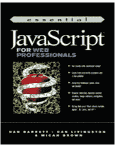


## 引言

欢迎！这本书正是我们当初开始学习 JavaScript 时所希望拥有的。当时，市面上主要有两类教学书籍：要么是1200页的、看似晦涩难懂的鸿篇巨著，要么是过度简化、缺乏实用信息的书籍。不幸的是，没有一本书既能提供丰富信息，又能给出在现实世界中快速有效使用的指导。

本书将通过直接从网站构建过程中每天都会遇到的情况中提取的例子来指导你学习 JavaScript。它从简单的例子开始，到本书末尾的脚本变得相当复杂。话虽如此，让我们更仔细地看看本书的结构、脚本编写的简要概述，以及 JavaScript 能为你做什么和不能做什么。

## 本书结构

很可能你们中的一些人拿起这本书，是因为老板把你叫进他或她的办公室，给你看一个使用了 JavaScript 的网站。然后你被明确告知，你的任务就是在你的网站上实现相同或类似的功能。“没问题，”你回答，心里却想：“我最好赶紧学学 JavaScript！”

我们扩展技能的方式常常就是如此：我们接到一项工作，如果我们不知道具体怎么做，就会迅速学习如何去做。遵循这种现实世界的模式，本书分为两个主要项目。对于每个主要项目，我们将负责为一个虚构的公司创建和/或升级网站。

在前三章中，我们将重新设计快速发展的生物科技初创公司 Shelley Biotechnologies 的主页。每一章至少包含一个项目，由简单到中等难度的常用 JavaScript 解决方案组成。每章末尾还有更高级的练习，你可以自行完成以扩展你的技能。在本书的后半部分，我们将对 *Stitch 杂志* 的网站进行一些急需的补充。这些例子将比第一个项目中的例子更高级，它们将展示使用 JavaScript 可以实现的一些强大功能。

章节中的练习旨在为你打下坚实的 JavaScript 基础，以便你在继续使用它时能够在此基础上构建。你会发现，在 JavaScript 中，完成同一件事往往不止一种方法——完成任务真的没有绝对正确或错误的方法。

## JavaScript 简介

### 什么是 JavaScript？

对于那些刚接触 Web 开发领域、可能正在结合 HTML 学习 JavaScript 的人来说，或许有必要快速介绍一下 JavaScript。JavaScript 是 Netscape 内置的、跨平台的脚本语言。和 HTML 一样，它可以在所有平台上运行。JavaScript 允许你通过直接在 HTML 中嵌入应用程序来增强网页的功能。你可以使用 JavaScript 构建各种应用程序，从增加页面的交互性到与数据库交互的应用程序。尽管 Netscape 创建了 JavaScript，但它可以在大多数现代浏览器上运行，包括 Microsoft 的 Internet Explorer (IE)。不过，IE 并不直接支持 JavaScript。IE 有自己的脚本语言——JScript，它支持 JavaScript 中的大部分功能。在少数语言存在差异的地方，这些差异会被指出并提供解决方法。由于这是市场上两种主要的浏览器，我们将要编写的脚本将集中针对它们。

有两种方法可以将 JavaScript 包含在你的网页中——客户端和服务器端。这两种方法共享相同的基本语言集。这个核心语言定义了一组基础对象和特性，这些在客户端和服务器端应用程序中都适用。每种方法也有自己扩展的对象和特性集。

### 客户端 JavaScript：工作原理

客户端 JavaScript 应用程序是直接嵌入到 HTML 页面中的脚本，在用户浏览器加载页面时由其执行。你在网络上遇到的至少90%的脚本都属于这一类。因此，这也是我们将在本书中使用的方法。

当用户的浏览器调用包含 JavaScript 的 HTML 页面时，浏览器的 JavaScript 运行时引擎会从上到下解释脚本，并在过程中执行语句。

使用客户端脚本的一个优点是，脚本可以检测并利用用户发起的事件，例如表单的更改或鼠标悬停在特定图形上。然后脚本能够使用该信息来调用脚本的其他部分，所有这一切都可以在不返回 Web 服务器并获取更多信息的情况下完成。由于我们的脚本依赖于用户的浏览器来解释，因此有必要简要谈谈不同的浏览器以及它们在处理 JavaScript 方面的差异。

### 浏览器与版本

如前所述，IE 和 Navigator 在其实现脚本语言方面略有不同。作为程序员，这会让你的生活稍微艰难一些：有时某个解决方案在不同浏览器上会表现不同或根本不起作用。等等——情况更糟：随着 Netscape 和 Microsoft 推出更新版本的浏览器，它们的脚本语言版本也在变化。这意味着使用新特性编写的脚本可能在旧版浏览器中无法工作。但不要太沮丧——事情并没有看起来那么糟。这一切只是意味着你在编写和检查脚本时需要多加一点小心。


有许多技术可以确保你的脚本在各种环境下都能正常工作——我们将探讨这些技术以及使用它们的合适时机。然而，由于本书标题中是 *JavaScript* 而非 *JScript*，我们将主要专注于 Netscape 的脚本语言。

### JavaScript 能做什么和不能做什么

虽然你可以使用 JavaScript 创建的应用程序只受限于你的想象力，但有几件事是你无法做到的，比如访问或控制用户的机器。出于安全原因，写入用户计算机的操作受到严格限制。你只能通过使用 cookie 在用户计算机上存储数据，而且即使是这样，你也仅限于一个简单的文本文件。这保护了用户免受可能损害其计算机或允许不道德程序员访问个人信息的脚本侵害。

一种称为“同源策略”的安全特性也限制了来自一个源的脚本访问来自其他位置的特定属性或文件。例如，如果你有一个位于 http://www.yoursite.com/test.html 的脚本，它试图访问位于 [http://www.theirsite.com/test.html] 的 HTML 页面的某些属性，同源策略将拒绝你的脚本访问。同源策略限制的属性如图 I-1 所示。

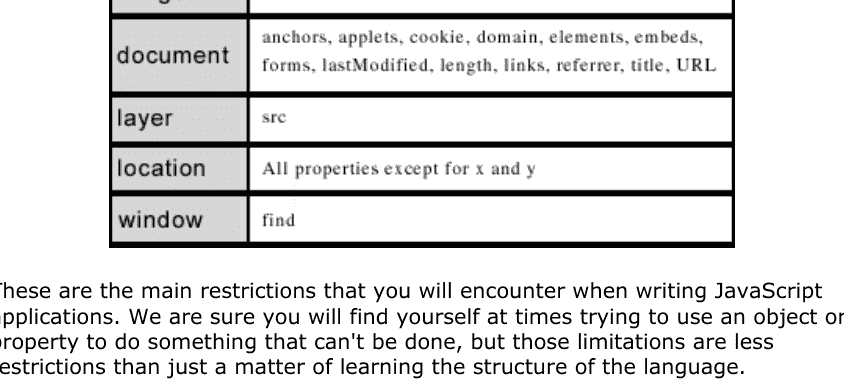

这些是编写 JavaScript 应用程序时会遇到的主要限制。我们相信你会不时发现自己试图使用一个对象或属性去做无法完成的事情，但这些限制与其说是限制，不如说是需要了解语言的结构。

当你刚开始时，如果你想到一个可能与书中示例不同的解决方案，不妨尝试一下；你常常会偶然发现其他人可能没有想到的解决方案。话虽如此，让我们继续学习。

## 第 1 章. 动态性与检测

## 本章内容

-   项目一：生成特定平台的内容
-   项目二：打印版权信息和最后修改日期
-   复习
-   高级项目

好的，你得到了为 Shelley 生物技术公司网站编程的工作。目前，该网站非常静态，你的新老板聘请你来使其与竞争对手同步。然而，在你开始工作之前，你的老板希望你解决一些浏览该网站的人提出的问题。似乎使用 Macintosh 的人看到的文本与在基于 Windows 的机器上浏览网站的人看到的不同（见图 1-1）。进一步调查后，你发现两个平台上的字体大小显示不同，虽然这个问题并非世界末日，但老板对细节非常挑剔。这看起来是开始使用 JavaScript 的完美切入点。

## 图 1.1. 不同平台上的字体差异

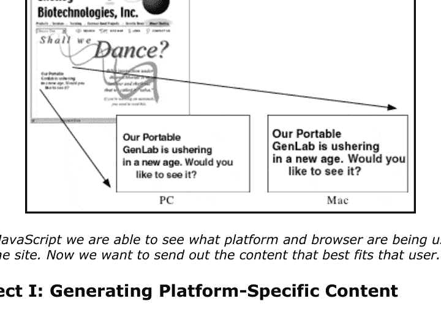

使用 JavaScript，我们能够查看用于查看网站的平台和浏览器。现在我们希望发送最适合该用户的内容。

## 项目一：生成特定平台的内容

在尝试了现有的 HTML 之后，你得出结论：为了使页面在两个平台上看起来相同，Macintosh 需要字体大小为 2，而 Windows 机器需要字体大小为 3。为了解决这个问题，我们需要动态地将 `FONT` 标签写入 HTML，因此我们的脚本需要放置在 HTML 的主体中，即 `FONT` 标签通常所在的位置。

对于这个第一个脚本，有两个主要部分：首先，我们必须找出用户使用的平台；其次，我们需要让浏览器动态打印出每个平台所需的不同代码。

### 将脚本插入你的 HTML

编写任何 JavaScript 的第一步是告诉浏览器，你放入网页的代码不是 HTML，而是一个 JavaScript 应用程序。一旦它知道这一点，它会将信息发送给 JavaScript 运行时引擎，该引擎将执行脚本。对于大多数脚本，我们通过将脚本包含在 `<SCRIPT>` 标签中来实现这一点。

```
<SCRIPT>
…
</SCRIPT>
```

还有其他几种方法可以将你的脚本嵌入到 HTML 中：

-   指定一个包含你的脚本的外部文件。
-   将 JavaScript 表达式指定为 HTML 属性的值。
-   将你的脚本嵌入到某些 HTML 标签中作为事件处理程序。

`<SCRIPT>` 标签是迄今为止最常用的方法——我们将在本书后面开始将 JavaScript 与图像和表单一起使用时，讨论其他一些方法。如果浏览器在 `<SCRIPT>` 标签之外或未使用前面提到的其他方法中的一种找到 JavaScript，你的脚本将被视为要打印在屏幕上的文本，并且它将无法工作。

随着 JavaScript 新版本的发布，语言可用工具中添加了属性和表达式。如果你在脚本中使用这些新特性，而一个使用较旧浏览器的系统加载你的脚本，很有可能它会收到错误，并且你的脚本将无法正常工作。为了检查这一点，我们可以向 `<SCRIPT>` 标签添加一个属性，以告诉浏览器我们正在为哪个版本的 JavaScript 编写代码。当用户的浏览器执行到该脚本时，它会检查是否支持我们指定的版本，如果不支持，它将跳过该脚本。我们通过使用 `<SCRIPT>` 标签的 `LANGUAGE` 属性来实现这一点。

```
<SCRIPT LANGUAGE="JavaScript1.2">
…
</SCRIPT>
```

上述语句的附加内容告诉浏览器，如果它不支持 JavaScript 1.2 版本，则不应继续执行脚本。这种方法将处理对支持 JavaScript 的浏览器的兼容性；然而，有些用户可能使用根本不支持 JavaScript 的旧浏览器。你可以通过将所有代码放在 HTML 注释标签之间来解决这个问题，如下所示：

```
<SCRIPT LANGUAGE="JavaScript">
<!-- Code after this will be ignored by older browsers
…
// Stop hiding the code here -->
</SCRIPT>
```

现在我们知道如何将脚本放入 HTML。然而，在我们真正深入脚本之前，有必要了解 JavaScript 的层次结构。

## JavaScript 层次结构

当你的浏览器加载 HTML 页面时，JavaScript 引擎会根据 HTML 的内容自动创建一组对象。它将这些对象保存在一个层次结构中，然后可以使用该层次结构来调用或引用对象及其属性（见图 1-2）。

### 图 1.2. JavaScript 层次结构

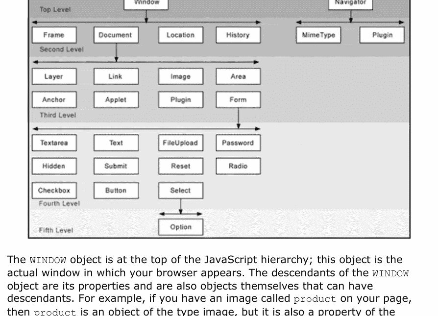

`WINDOW` 对象位于 JavaScript 层次结构的顶部；这个对象是你的浏览器出现的实际窗口。`WINDOW` 对象的后代是它的属性，同时也是可以拥有后代的对象本身。例如，如果你的页面上有一个名为 `product` 的图像，那么 `product` 是一个图像类型的对象，但它也是 `DOCUMENT` 对象的属性，而 `DOCUMENT` 对象又是 `WINDOW` 对象的属性。理解层次结构、其对象和属性对于编写 JavaScript 应用程序至关重要。所有 JavaScript 对象及其属性的术语表位于附录 B “JavaScript 对象”中。

要在 JavaScript 中引用一个对象，你必须调用该对象本身以及它在层次结构上方的所有对象。以下是如何引用我们的图像对象 `product` 的示例：

```
document.product
```

要调用对象的特定属性，你遵循相同的模型，只需沿着层次结构向下更进一步。调用 `product` 图像的源属性如下所示：

```
document.product.src
```

你会注意到在前面的例子中没有将 WINDOW 对象作为第一个对象包含在内。如果你没有指定特定的窗口，JavaScript 会自动假设你指的是加载文档的窗口。唯一需要指定窗口的情况是当你试图访问存在于另一个窗口或框架中的对象时。此时，你应该至少对 JavaScript 层次结构有了基本的了解；随着我们继续本书中的示例，这种理解将会增加。

### 平台/浏览器检测

我们现在准备开始编写脚本。我们需要做的第一件事是访问 NAVIGATOR 对象的 platform 属性——这个属性的值将告诉我们用户使用的平台。我们将使用该属性的值在 if 语句中作为测试，以确定我们希望页面上使用哪种字体大小。

if 语句是一个条件语句，它表示如果满足特定条件，则继续执行后面的代码；否则，跳到下一条语句。

在大多数情况下，我们将把脚本放入 HTML 页面的 `<HEAD>` 中。但是，当你要动态创建文本时，你需要将至少一部分脚本放入 HTML 的主体中，即你希望文本显示的位置。对于这个项目，我们将把脚本放在 HTML 文档中希望动态替换的文本所在的位置。以下是一段 HTML 代码，指出了我们将放置脚本的位置。

```
<TR>
<TD>&nbsp;&nbsp;&nbsp;&nbsp;&nbsp;&nbsp;&nbsp;&nbsp;&nbsp;&nbsp;</TD>
<TD VALIGN="TOP"><BR><BR>
**** OUR SCRIPT WILL GO HERE ****
<BR>
<FONT FACE="Helvetica, Arial" COLOR="#000000">
<B>Our Portable
<BR>GenLab is ushering
<BR>in a new age.</B></FONT>
<FONT FACE="Helvetica, Arial" COLOR="#0000FF">
<B>Would you
<BR>&nbsp;&nbsp;&nbsp;&nbsp;like to see it?</B>
</FONT></FONT></TD>
<TD>
<BR>&nbsp;&nbsp;&nbsp;&nbsp;&nbsp;&nbsp;&nbsp;&nbsp;&nbsp;&nbsp;</TD>
</TR>
</TABLE>
```

现在我们知道将脚本放入 HTML 代码的位置了，让我们继续插入脚本的第一部分。


## 从 JavaScript 中创建动态 HTML

```html
<SCRIPT LANGUAGE="JavaScript">
<!-- Code after this will be ignored by older browsers

// Assign the platform type to a Variable
var platform = navigator.platform.substr(0,3);

...

// Stop hiding the code here -->
</SCRIPT>
```

让我们逐行剖析这第一段代码，弄清楚发生了什么。首先，我们像在本章开头讨论的那样，放入了开头的 `<SCRIPT>` 标签。对于这个脚本，我们只打算使用所有版本 JavaScript 都支持的代码，因此我们不需要在 `<SCRIPT>` 标签的 LANGUAGE 属性中指定我们正在为哪个版本编码。在 `<SCRIPT>` 标签之后，我们开始了 HTML 注释行，这将向非 JavaScript 浏览器隐藏我们的代码。前两行将是我们编写的所有脚本的开头，所以要习惯看到它们。

第三行是 JavaScript 注释；和 HTML 一样，你可以在代码中添加注释，帮助使你的脚本更易于理解。有两种方法可以在 JavaScript 中插入注释。第一种（我们在这里使用的方法）是用两个正斜杠开始一行代码。

```javascript
// Anything on this line is treated as a JavaScript Comment
```

在这种方法中，该行斜杠后面的任何代码都被视为注释，不会被执行解释为要执行的代码。第二种方法用于当你想插入跨越多行的注释时。为此，你将注释包含在这些符号之间，`/*` 和 `*/`。例如：

```javascript
/* This an example of a comment
   that spans multiple lines of code */
```

在我们编写脚本时，我们将使用这些 JavaScript 注释来标识代码的每个主要部分，并指明其基本用途。

插入注释后，我们可以继续处理脚本的核心部分。第四行使用基本赋值运算符（`=`）将 `platform` 属性的值赋给变量 `platform`。

这一行代码中发生了几个新的事情，所以让我们分解一下，仔细看看发生了什么。首先，我们使用赋值运算符将左侧操作数的值设置为右侧操作数的值。我们在运算符的两侧都有事情发生：在左侧，我们第一次创建了一个变量。变量在任何类型的脚本中都扮演着非常重要的角色，JavaScript 也不例外。变量可以被看作是一个带有用户定义名称的容器，你可以在其中存储信息。

一旦你创建了一个变量，你只需调用变量的名称就可以访问其中包含的信息，或者重新分配新的信息给它存储。创建新变量的语法如下：

```javascript
var variablename;
```

在运算符的左侧，我们正在创建一个名为 `platform` 的新变量。这个变量现在准备好保存从运算符右侧传入的值。在右侧，我们正在执行两个操作：首先，我们调用 `NAVIGATOR` 对象的 `platform` 属性；这个属性持有一个字符串值，它将告诉我们用户使用的是哪个平台。如果用户在使用基于 Windows 的机器，`navigator.platform` 的值将是 "Win32" 或 "WinNT"。如果用户在使用 Macintosh 计算机，它将返回值 "macintosh"。

我们并不真的需要知道用户运行的是哪个版本的 Windows，所以如果我们能找到一种方法，将基于 Windows 的机器返回的值浓缩为仅前三个字符："Win"，那就太好了。这样，无论用户运行的是哪个版本的 Windows，单个值都会被分配给我们的 `platform` 变量。幸运的是，有一种方法——这就是我们在运算符右侧执行的第二个操作。`substr()` 方法将从任何给定字符串返回指定数量的字符。因为我们知道所有版本的 Windows 返回的前三个字母是相同的，这对我们来说是完美的。`substr()` 方法的语法如下：

```javascript
string.substr(start, length);
```

其中 `start` 是你希望开始的字符位置，`length` 是你希望该方法评估的字符数。在前面的代码行中，我们告诉 `substr()` 方法从第一个字符开始，直到第三个。赋值运算符现在将把基于 Windows 的机器的 "Win" 或 Macintosh 机器的 "Mac" 放入我们的 `platform` 变量中。

我们现在有了必要的信息来放入我们的下一段代码：我们将使用 `if else if else` 语句来测试 `platform` 的值。让我们看看这个语句的语法。

```javascript
if (condition1)
{
    statements1
}
else if(condition2)
{
    statements2
}
else
{
    statements3
}
```

在前面的语法中，`condition1` 和 `condition2` 都代表任何将返回 `true` 或 `false` 值的表达式。如果 `condition1` 为 `true`，JavaScript 引擎将执行 `statements1` 中包含的代码。然而，如果 `condition1` 为 `false`，JavaScript 引擎将跳过 `statements1`，继续测试 `condition2`。如果 `condition2` 被发现为 `true`，引擎将执行 `statements2`。如果结果 `condition1` 和 `condition2` 都为 `false`，则将执行 `statements3`。`if` 语句是 JavaScript 中最常用的结构之一，我们将在整本书中经常看到它。解释完这一点，让我们放入包含我们 `if` 语句的下一段代码。

```html
<SCRIPT LANGUAGE="JavaScript">
<!-- Code after this will be ignored by older browsers

            // Assign the platform type to a Variable
    var platform = navigator.platform.substr(0,3);

            // If statements testing for which platform the
            // user is on
    if (platform == "Win")
    {
        ...
    }
    else if (platform == "Mac")
    {
        ...
    }
    else
    {
        ...
    }

// Stop hiding the code here -->
</SCRIPT>
```

在前面代码的 `if` 语句中，我们告诉 JavaScript 引擎首先查看 `platform` 的值，如果它等于字符串 "Win"，则执行后面花括号内的语句。如果 `platform` 的值不等于 "Win"，则跳转到测试 `platform` 的值与字符串 "Mac" 的 `else if` 行。如果在那里找到匹配，则继续执行下面花括号中的语句。如果没有找到 "Win" 或 "Mac" 的匹配，则 `if` 语句将执行 `else` 行之后的代码。

请注意，我们正在使用双等号（`==`）来比较条件中的值——这是我们在 JavaScript 中进行比较的方式。如果我们使用单等号，它会将该语句视为赋值运算符，从而重置 `platform` 的值。

我们现在有了脚本的基本结构，它将检测正在使用什么浏览器来查看你的页面。唯一剩下的部分是为每个平台插入我们希望浏览器执行的代码。

## 从 JavaScript 中创建动态 HTML

由于我们的目标是让不同大小的字体出现在不同的平台上，我们需要让 JavaScript 动态地写出 `<FONT>` 标签。有两个语句可以用来写入 HTML 文档：`document.write()` 和 `document.writeln()`。它们都会打印括号之间的任何内容；然而，`document.writeln()` 在完成打印后会插入一个换行符。通常使用哪种方法并不重要，但对于我们的脚本，我们将使用 `document.writeln()`，这样如果你在代码打印后查看 HTML 页面的源代码，它将格式化以便更容易阅读。

你可以使用这些命令来打印几种不同类型的信息。括号内用引号括起来的任何内容都将作为字符串打印，你也可以在里面放入变量甚至其他 JavaScript 命令，它会在打印之前对它们进行求值。对于我们的目的，我们将只打印包含 `<FONT>` 标签的字符串。让我们将 `document.writeln()` 方法插入到我们的 `if` 语句中。

```html
<SCRIPT LANGUAGE="JavaScript">
<!-- Code after this will be ignored by older browsers

    // Assign the platform type to a Variable
    var platform = navigator.platform.substr(0,3);

    // If statements testing for which platform
    if (platform == "Win")
    {
        document.writeln("<FONT SIZE=\"3\">);
    }
    else if (platform == "Mac")
    {
        document.writeln("<FONT SIZE=\"2\">);
    }
    else
    {
        document.writeln("<FONT SIZE=\"3\">);
    }

// Stop hiding the code here -->
</SCRIPT>
```

完成这个之后，如果用户在基于 Windows 的机器上，将打印 `SIZE` 属性为 3 的 `<FONT>` 标签。如果用户在 Macintosh 上，属性将是 2。如果两者都不是（也就是说，用户在使用基于 Unix 的机器），


## 回顾脚本

恭喜，你已经完成了你的第一个脚本。我们现在拥有了一个能够向不同浏览器用户展示不同内容的脚本。让我们最后再整体看一下这个脚本，并快速回顾一下我们是如何实现的。

```javascript
<SCRIPT LANGUAGE="JavaScript">
<!-- 旧版浏览器将忽略此后的代码

	// 将平台类型赋值给变量
	var platform = navigator.platform.substr(0,3);

	// if 语句测试平台类型
	if (platform == "Win")
	{
		document.writeln("<FONT SIZE=\"3\">");
	}
	else if (platform == "Mac")
	{
		document.writeln("<FONT SIZE=\"2\">");
	}
	else
	{
		document.writeln("<FONT SIZE=\"3\">");
	}

// 在此处停止隐藏代码 -->
</SCRIPT>
```

以下是我们创建这个脚本的步骤：

1. 我们设置了一个变量，使用 `substr()` 方法来承载 `navigator.platform` 对象值中的特定部分。
2. 然后我们将 `platform` 变量的值作为 `if` 语句中的测试条件，以选择是否在 `if` 语句中执行。
3. 我们使用了 `document.writeln()` 方法来动态打印合适的 `<FONT>` 标签。

在这个脚本中，我们接触到了 JavaScript 的几个新方面：

- 将脚本插入 HTML 文档。
- 对不支持 JavaScript 的浏览器隐藏脚本。
- JavaScript 层级结构。
- 在 JavaScript 中插入注释。
- 创建变量并使用赋值运算符为其赋值。
- `substr()` 方法的使用。
- `if...else` 语句的语法和使用。
- `document.write` 和 `document.writeln` 方法。
- 使用 `\` 来转义保留字符。

## 项目二：打印版权信息和最后修改日期

既然老板知道你可以动态地向网页添加内容，他还有一些其他与网页相关的项目交给你：在网站每个页面的底部添加版权信息和页面最后修改日期（见图 1-3）。添加最后修改日期对 Shelley 网站来说尤其有帮助。有很多负责维护网站页面的人员，如果能有一种简单的方法来判断某个文件自上次编辑后是否被修改过，那就太好了。像大多数项目一样，尽管老板 20 分钟前还不知道这能做到，但现在它已成为必须尽快完成的高优先级任务——所以我们开始吧。

### 图 1.3 最后修改日期和版权信息的位置


## 介绍 lastModified 属性

在对 DOCUMENT 对象的不同属性进行了一番研究之后，你发现了一个属性，它将使我们的脚本更加简单。似乎我们不是第一个认为最后修改日期是个好主意的人。那些创造了 JavaScript 的好心人们在 DOCUMENT 对象中加入了 lastModified 属性。当页面加载并创建 JavaScript 层级结构时，引擎会前往 HTTP 头部获取页面的最后修改日期，并将其赋值给该属性。然而，有一个缺点：并非所有的 Web 服务器都会在头部中包含此信息，因此我们将不得不使用 if 语句来确保只在有值的情况下才打印它。但是，乞丐不能挑肥拣瘦，而且多一个 if 语句也能让我们多练习练习。

如果 Web 服务器没有提供日期，那么 lastModified 属性的值将为 0——我们将使用这个值作为 if 语句中的测试条件。首先，让我们看一下将要放置脚本的 HTML 代码部分。

```html
<TR>
    <TD COLSPAN="3" ALIGN="RIGHT" VALIGN="TOP">
    <FONT SIZE="-2">

    **** 我们的脚本将放在这里 ****

    </FONT>
    </TD>
</TR>
</TABLE>
</FORM>
</BODY>
</HTML>
```

现在我们知道要把代码放在哪里了，让我们开始插入 `<SCRIPT>` 标签以及用于向旧版浏览器隐藏脚本的 HTML 注释。

```javascript
<SCRIPT LANGUAGE="JavaScript">
<!-- 旧版浏览器将忽略此后的代码
    ...

// 在此处停止隐藏代码 -->
</SCRIPT>
```

脚本的第一步是创建一个变量，并将 `lastModified` 属性的值赋给它。

```javascript
<SCRIPT LANGUAGE="JavaScript">
<!-- 旧版浏览器将忽略此后的代码

// 将最后修改日期赋值给变量 lastmoddate
var lastmoddate = document.lastModified;

...

// 在此处停止隐藏代码 -->
</SCRIPT>
```

现在我们有了一个名为 `lastmoddate` 的变量，它保存了 `lastModified` 属性的值，让我们设置一个 `if` 语句来检查 `lastModified` 属性是否真的包含一个日期。

```javascript
<SCRIPT LANGUAGE="JavaScript">
<!-- 旧版浏览器将忽略此后的代码

// 将最后修改日期赋值给变量 lastmoddate
var lastmoddate = document.lastModified;

// 创建一个 if 语句来测试 lastmoddate 的值
if(lastmoddate == 0)
{
...
}
else
{
...
}

// 在此处停止隐藏代码 -->
</SCRIPT>
```

前面代码中的 `if` 语句与我们本章第一个脚本中使用的非常相似；但它稍微简单一些，因为其结构仅由 `if..else` 组成。因此，如果 `lastmoddate` 等于 0，则将执行其后的语句，如果值为其他任何内容，则将跳过到 `else` 后面的语句。现在我们已经设置好了 `if` 语句，让我们看看要打印什么 HTML。

## 动态打印非字符串数据

在本章的第一个脚本中，我们使用 `document.writeln()` 方法将指定的字符串打印为 HTML。对于这个脚本，我们将在此基础上扩展，以打印字符串和非字符串数据的组合。不过首先，我们将使用我们已经熟悉的方法，在 `lastModified` 属性中未找到日期时打印所需的内容。如果是这种情况，我们将打印两行内容：第一行表示最后修改日期未知。接下来，我们将打印一个 HTML 换行符和第二行内容，其中包含版权信息。

```javascript
<SCRIPT LANGUAGE="JavaScript">
<!-- 旧版浏览器将忽略此后的代码

// 将最后修改日期赋值给变量 lastmoddate
var lastmoddate = document.lastModified;

// 创建一个 if 语句来测试 lastmoddate 的值
if(lastmoddate == 0)
{
document.writeln("Lastmodified: Unknown<BR>© 1999
Copyright Shelley Biotech");
}
else
{
...
}

// 在此处停止隐藏代码 -->
</SCRIPT>
```

完成这些之后，我们现在需要插入代码，以便在 `lastModified` 属性中提供了日期时打印所需的内容。如前所述，就 `document.writeln()` 方法而言，我们将进入稍微新一些的领域。到目前为止，我们只让该方法打印字符串；现在我们将使用它来打印字符串数据和 `lastmoddate` 变量所保存的值的组合。我们将通过以下代码行来实现：

```javascript
document.writeln("LastModified: " + lastmoddate +
"<BR>© 1999 Copyright Shelley Biotech")
```

要组合不同类型的数据，我们需要使用连接运算符（+）。该运算符将获取两个或多个字符串并将它们组合，返回一个新的字符串。尽管变量 `lastmoddate` 本身不是字符串，但它保存的值是字符串，因此这种方法是可行的。因此，在前面的代码行中，我们首先将字符串 `LastModified` 与 `lastmoddate` 中保存的值组合，然后将该新字符串与包含 HTML 换行符和版权信息的字符串组合。让我们看看这行代码在脚本其余部分中的样子：

```javascript
<SCRIPT LANGUAGE="JavaScript">
<!-- 旧版浏览器将忽略此后的代码

// 将最后修改日期赋值给变量 lastmoddate
var lastmoddate = document.lastModified;

// 创建一个 if 语句来测试 lastmoddate 的值
if(lastmoddate == 0)
{
document.writeln("Lastmodified: Unknown<BR>© 1999
Copyright Shelley Biotech");
}
else
{
document.writeln("LastModified: " + lastmoddate +
"<BR>© 1999 Copyright Shelley Biotech");
}
// 在此处停止隐藏代码 -->
</SCRIPT>
```


## 审查脚本

添加最后一行代码是完成这个脚本的最后一步。我们现在有了一个能够动态打印所有放置该脚本的页面的最后修改日期和版权信息的脚本。与书中所有脚本一样，我们将查看完整的脚本、实现方法以及在此过程中涉及的新知识点。

```javascript
<SCRIPT LANGUAGE="JavaScript">
<!-- 旧版浏览器将忽略此后的代码

// 将最后修改日期赋值给变量 lastmoddate
var lastmoddate = document.lastModified;

// 创建一个 if 语句来测试 lastmoddate 的值
if(lastmoddate == 0)
{
document.writeln("最后修改日期：未知<BR>© 1999 版权所有 Shelley Biotech");
}
else
{
document.writeln("最后修改日期：" + lastmoddate +
"<BR>© 1999 版权所有 Shelley Biotech");
}

// 在此处停止隐藏代码 -->
</SCRIPT>
```

以下是我们创建此脚本的步骤：

- 1. 我们将 `document.lastModified` 属性的值赋给了变量 `lastmoddate`。
- 2. 然后我们创建了一个 `if` 语句，检查 Web 服务器是否真的向 JavaScript 引擎传递了最后修改日期。
- 3. 我们插入了一条使用 `document.writeln()` 方法的语句，如果变量 `lastmoddate` 中没有包含日期，将打印一条消息，指示最后修改日期未知，以及版权信息。
- 4. 我们编写了一条语句，使用 `document.writeln()` 方法打印字符串数据和 `lastmoddate` 变量中包含的日期的组合，以及版权信息，如果提供了最后修改日期的话。

让我们看看在这个项目中使用的新概念：

- `DOCUMENT` 对象的 `lastModified` 属性。
- 如何使用连接运算符（+）将字符串和非字符串值组合起来。

## 回顾

好吧，我们在 Shelley Biotech 网站的开局非常顺利。在相对较短的时间内，我们为首页添加了两个非常有用的新功能。随着时间推移，市场上出现了新的浏览器，它们对 HTML 的处理方式略有不同，因此能够获取用户信息并为网站访问者定制页面变得越来越重要。我们在本章中触及的另一个领域，即动态内容创建，是 JavaScript 的一个具有巨大潜力的领域，可以使网站的维护和保养更加高效。随着我们深入本书，我们将看到许多使用这些概念可以完成的事情的例子。

## 高级项目

本章中的脚本相对简单，展示了使用平台/浏览器检测和动态 HTML 生成可以实现的功能。尝试在以下项目中使用这些技术，以更好地理解你可以取得的出色成果：

- 1. 使用浏览器检测动态创建针对特定浏览器版本定制的页面。
- 2. 创建一个页面，收集 `NAVIGATOR` 对象中包含的所有信息，并动态生成一个表格，向用户显示这些信息。（从用户浏览器收集并放入表格中的信息可作为开发工具使用。）
- 3. 如果你有一个在所有页面上都显示特定内容的网站，使用 `document.writeln()` 方法打印代码，然后将脚本保存在外部 JavaScript 文件中。在每个页面中，只需使用 `<SCRIPT>` 标签的 `SRC` 属性调用外部文件。这样，你只需要更新一个文件即可实现全站范围的更改。

## 第2章 图像悬停效果

## 本章内容

- 项目一：悬停脚本
- 项目二：为我们的悬停效果添加高级功能
- 悬停效果的怪癖
- 回顾
- 高级项目

*你已经在主页上起步，并展示了你有能力完成这项工作——现在你的老板想让你给他留下深刻印象。他希望让网站更加动态，并增加一些 flashy 的效果。他一直在查看竞争对手的网站，它们都有图像悬停效果——JavaScript 悬停效果用于在用户将光标移到图像上时，将图像替换为该图像的另一个版本。反之，当用户将光标移开图像时，新图像会被原始图像替换。这种技术在网页上广泛使用，他认为这正是你的网站所需要的。*

首先要做的是选择哪些图形要受悬停效果影响。对大多数页面来说，图像悬停效果的最佳位置是主导航图形，Shelley Biotech 网站也不例外（见图 2-1）。

## 图 2.1 Shelley Biotech 首页

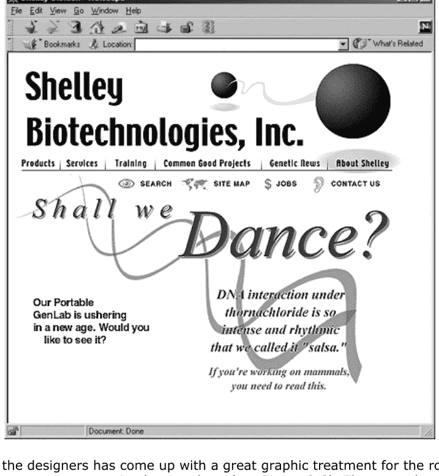

其中一位设计师为悬停效果设计了一个很棒的图形处理方案，现在由你来实现它们（见图 2-2）。创建图像悬停效果有三个步骤：定义 IMAGE 对象、创建执行工作的函数，以及将必要的 JavaScript 事件处理程序插入到图像和锚点标签中。首先，我们将介绍 IMAGE 对象的创建。

**图 2.2 图像悬停效果示例**

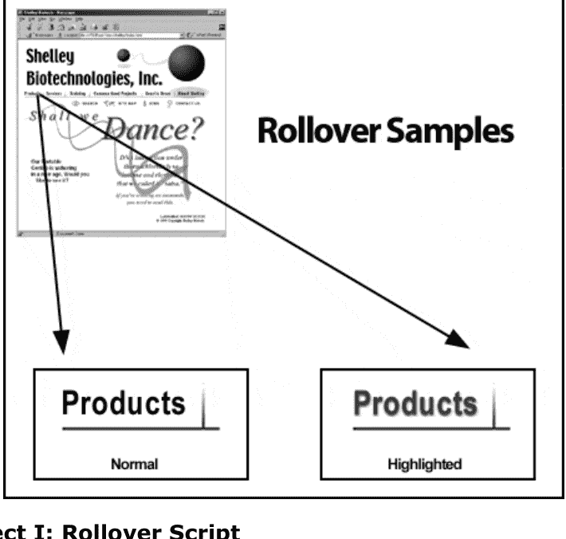

## 项目一：悬停脚本

## 创建 IMAGE 对象

在我们实际创建 IMAGE 对象之前，必须将 `<SCRIPT>` 标签放入 HTML 页面中。

与前几章的脚本不同，我们不打算在页面内打印内容，因此我们将脚本放在 HTML 页面的头部。

```html
<HEAD>
<SCRIPT Language="JavaScript">
<!-- 旧版浏览器将忽略此后的代码

...

// 在此处停止隐藏代码 -->
</SCRIPT>
</HEAD>
```

我们现在需要为不支持 IMAGE 对象的旧版浏览器做兼容处理，这对于我们的悬停脚本是必需的。在第一章中，我们学习了如何使用 JavaScript 收集浏览器和平台信息。我们可以使用该方法的一种变体，设置多个 `if` 语句来测试每一个不支持 IMAGE 对象的浏览器；然而，这将需要大量工作。幸运的是，有一种更简单的方法。我们可以仅使用单个 `if` 语句来测试用户的浏览器是否支持悬停效果，如下面的代码行所示：

```html
<HEAD>
<SCRIPT Language="JavaScript">
<!-- 旧版浏览器将忽略此后的代码

    // 创建图像对象
    if (document.images)
    {
      ...
    }
// 在此处停止隐藏代码 -->
</SCRIPT>
</HEAD>
```

在前面的代码行中，我们使用

```javascript
document.images
```

作为 `if` 语句中的条件。如果浏览器支持 `IMAGE` 对象，它将返回 `true` 值；如果不支持，则返回 `false` 值。通过将我们的代码插入到这个 `if` 语句中，我们实际上是在向无法处理该脚本的浏览器隐藏我们的代码。

当 HTML 页面加载时，浏览器创建构成 JavaScript 层次结构的对象时，页面上的每个图像都会被制作成一个对象，并放入一个名为 `images` 的数组中。这是我们第一次遇到数组，所以让我们来看看什么是数组，特别是 `images` 数组以及我们将如何使用它。

你可以将数组想象成一个文件柜。假设你有一个包含四个图像的页面。当浏览器读取 HTML 文件时，它会向下浏览页面；当它遇到第一个图像时，会为其创建一个 `IMAGE` 对象，并将其存储在我们文件柜的第一个抽屉中。当它遇到第二个图像时，再次创建一个新的 `IMAGE` 对象，然后将其放入文件柜的第二个抽屉中。这种模式会持续进行，直到页面上的每个图像都有自己的 `IMAGE` 对象，存储在它自己的抽屉中。

当浏览器需要引用图像时，它会查看相应的抽屉。你也可以引用数组及其中的 `IMAGE` 对象——有两种方法可以做到这一点。第一种是引用 `IMAGE` 对象在数组中的位置。这种方法的问题在于，如果你在页面上的某个位置添加了一个图像，那么其后所有图像的位置都会改变。因此，你必须仔细检查整个脚本，确保你调用的图像没有移动到不同的位置。

第二种方法，也是我们将在本脚本中使用的方法，解决了这个问题。如果你在 `` 标签中指定 `NAME` 属性，你就可以

通过你为其指定的名称，在数组中引用该图像。使用这种方法，即使你向页面添加了其他图像，你仍然能够以相同的方式引用`IMAGE`对象，并且你的脚本不会受到不利影响。

有六个导航图像会受到我们的翻转脚本影响，因此对于每个图像，我们都需要在``标签中为其指定`NAME`属性。

```
<A HREF="products/index.html"></A>
```

```
<A HREF="services/index.html"></A>
```

```
<A HREF="training/index.html"></A>
```

```
<A HREF="common/index.html"></A>
```

```
<A HREF="genetic/index.html"></A>
```

```
<A HREF="about/index.html"></A>
```

在前面的 HTML 代码中，我们为六个``标签中的每一个都添加了`NAME`属性。每个名称都是该图像所代表类别的第一个单词。请注意，每个名称的首字母都是大写的；JavaScript 是区分大小写的。现在我们已经把这些图像的名称处理好了，可以继续创建一些我们的脚本需要的新`IMAGE`对象了。

因为当用户将鼠标悬停在六个图像之一时，我们希望显示的图像并没有通过 HTML 显式地放置在页面上，所以我们需要为每个想要实现翻转效果的图像创建两个新的`IMAGE`对象。这将把这些图像添加到`images`数组中，并允许我们访问它们的属性。让我们从为`Products`图像创建`IMAGE`对象开始。

```
<HEAD>
<SCRIPT Language="JavaScript">
<!-- Code after this will be ignored by older browsers

	// Creation of the image objects
if	(document.images)
{
ProductsOn=new Image(267, 64);
…
}
// Stop hiding the code here -->
</SCRIPT>
</HEAD>
```

在前面的代码中，我们使用以下语法的图像构造函数来初始化一个新的`IMAGE`对象：

```
New Image(width, height);
```

通过将图像构造函数放在赋值运算符（`=`）的右侧，并将我们希望`IMAGE`对象拥有的名称放在左侧，我们刚刚创建了一个名为`ProductsOn`的新`IMAGE`对象。

这些新对象的命名对于脚本的操作非常重要。名称的第一部分应该与页面上已有图像的名称相同。例如，在这第一行中，我们正在创建一个对象来保存`Products`图像的翻转版本的位置，名称以`Products`开头。因为这个对象保存的是该图像的翻转版本，所以名称的第二部分是`On`。组合起来，我们就有了一个名为`ProductsOn`的新对象。对于六个导航图像中的每一个，我们不仅需要一个对象来保存翻转版本的图像，还需要一个对象来保存常规版本的图像。这个用于我们`Products`图像的第二个对象的名称也将以`Products`开头，但以`Off`结尾。让我们在我们的第一个对象之后添加这个新的`IMAGE`对象。

```
<HEAD>
<SCRIPT Language="JavaScript">
<!-- Code after this will be ignored by older browsers

	// Creation of the image objects
if	(document.images)
{
ProductsOn=new Image(267, 64);
…
ProductsOff=new Image(267, 64);
…
}
// Stop hiding the code here -->
</SCRIPT>
</HEAD>
```

如果你偏离这个命名约定，我们要编写的函数将无法知道该使用哪个`IMAGE`对象进行替换，然后你就会遇到错误。我们现在已经有了`Products`翻转效果所需的两个新`IMAGE`对象，但目前它们是空的。接下来，我们需要为它们分配实际的图像。我们通过将图像的位置（URL）分配给`IMAGE`对象的 source 属性来实现这一点，如下所示：

```
<HEAD>
<SCRIPT Language="JavaScript">
<!-- Code after this will be ignored by older browsers

if (document.images)
{
ProductsOn=new Image(267, 64);
ProductsOn.src="images/products_on.gif";

ProductsOff=new Image(267, 64);
ProductsOff.src="images/products_off.gif";
...
}
// Stop hiding the code here -->
</SCRIPT>
</HEAD>
```

我们已经完成了`Products`翻转效果的`On`和`Off`对象，但还需要为其他五个图像翻转效果创建对象。我们使用与第一个对象相同的命名约定来做到这一点。

```
<HEAD>
<SCRIPT Language="JavaScript">
<!-- Code after this will be ignored by older browsers
if (document.images)
{
ProductsOn=new Image(267, 64);
ProductsOn.src="images/products_on.gif";

ProductsOff=new Image(267, 64);
ProductsOff.src="images/products_off.gif";

ServicesOn=new Image(267, 64);
ServicesOn.src="images/services_on.gif";

ServicesOff=new Image(267, 64);
ServicesOff.src="images/services_off.gif";

TrainingOn=new Image(267, 64);
TrainingOn.src="images/training_on.gif";

TrainingOff=new Image(267, 64);
TrainingOff.src="images/training_off.gif";

CommonOn=new Image(267, 64);
CommonOn.src="images/common_on.gif";

CommonOff=new Image(267, 64);
CommonOff.src="images/common_off.gif";

GeneticOn=new Image(267, 64);
GeneticOn.src="images/genetic_on.gif";

GeneticOff=new Image(267, 64);
GeneticOff.src="images/genetic_off.gif";

AboutOn=new Image(267, 64);
AboutOn.src="images/about_on.gif";

AboutOff=new Image(267, 64);
AboutOff.src="images/about_off.gif";
...
}
// Stop hiding the code here -->
</SCRIPT>
</HEAD>
```

以这种方式创建`IMAGE`对象还有另一个预期的效果。当浏览器创建新的`IMAGE`对象时，它会将图像加载到其缓存中，从而将其预加载到内存中。这种预加载允许图像在鼠标悬停时立即显示。在创建 HTML 页面时，牢记这种预加载很重要——如果你没有将`Height`、`Width`和`alt`属性放入你的``标签中，大多数浏览器在将所有内容和图像加载到内存之前不会显示页面。如果你有很多`IMAGE`对象在后台为翻转效果加载，你可能会遇到相当长的加载时间，所以请确保你将所有必要的标签都放入你的 HTML 中。

我们已经成功创建了所有实现翻转效果所需的图像的`IMAGE`对象。我们的下一步是创建将运行我们翻转效果的函数。

## 图像翻转函数

当用户将鼠标悬停在我们的某个图像上时，JavaScript 事件处理程序会调用我们将要编写的函数来实际执行图像替换。函数是 JavaScript 的重要组成部分；函数是一组执行特定任务的 JavaScript 语句。我们将在这个示例中涵盖函数的定义和调用，但现在，让我们专注于定义翻转效果所需的函数。你需要四个基本元素来定义一个函数："function"关键字、函数的名称、用逗号分隔的一组参数，以及你希望函数执行的语句。

我们需要创建两个函数才能使翻转效果生效：一个在我们将鼠标悬停在图像asic058图像上时切换到"On"图形，另一个在我们将鼠标移出图像时切换回"Off"图形。通常，你会希望在 HTML 的头部定义页面的函数，因此让我们在我们的`IMAGE`对象之后开始我们的函数。

```
function on(pic)
{
...
}
// Stop hiding the code here -->
</SCRIPT>
```

定义函数的第一步是调用`function`关键字，后跟函数的名称；在这种情况下，我们将其命名为`on`。在名称之后，在一组括号内，我们需要放入用逗号分隔的变量列表——每个参数对应一个我们想要传递给函数的参数。这些变量将允许我们从调用该函数的事件处理程序中传递值到我们的函数中。我们只需要向函数传递一个参数；我们将使用变量`pic`来保存该参数。

接下来是我们希望函数执行的一组指令——这些语句用花括号括起来。

```
function on(pic)
{
    if (document.images)
    {
        document.images[pic].src=eval(pic + "On.src");
    }
}
// Stop hiding the code here -->
</SCRIPT>
</HEAD>
```

我们希望函数执行的第一个语句是一个`if`语句，它将检查旧版浏览器。如果浏览器支持`IMAGE`对象，则`if`语句后面的行将被执行。在这一行中，我们告诉浏览器用图形的`On`版本的 source 替换被悬停图像的 source。这一行发生了很多事情，所以让我们将其分解成更小的部分。首先，让我们看看赋值运算符（=）的左侧。

```
document.images[pic].src
```

我们正在引用`images`数组中位置值为变量`pic`的图像的 source 属性——所以假设`pic`的值是"Products"。我们正在引用`Products` IMAGE 对象的 source 属性，并将从赋值运算符右侧传递给它的值分配给它。

如果我们用以下方式显式地调用图形 product：

```
document.product.src
```


对于每一个需要实现鼠标悬停翻转效果的图片，我们都需要单独编写函数——这不是最高效的编码方式。在编写脚本时，你应该思考如何以最高效的方式编写代码。任何时候只要你能以这种方式使用变量，就能为你节省大量的时间和麻烦。然而，在某些情况下，你可能希望每次调用函数时都引用特定的图片，前面的代码行就是一个示例。

在操作符的右侧，我们将使用 `eval()` 语句将 `pic` 的值与一个字符串组合起来，创建一个新值，将其赋给被悬停图片的源地址。

```
eval(pic + "On.src");
```

如果 `pic` 的值是"Products"，那么 `eval()` 语句将返回 `ProductsOn.src`，`Products On IMAGE` 对象的源地址值将被赋给 `Products IMAGE` 对象的源地址。当这一操作发生时，页面上的图片将变为 `On` 图片，直到用户移开鼠标。

当用户移开鼠标时，将调用另一个函数。这是我们不得不创建的第二个函数——我们称之为 `off` 函数。

```
function off(pic)
{
    if(document.images)
    {
        document.images[pic].src= eval(pic + "Off.src");
    }
}
// Stop hiding the code here -->
</SCRIPT>
</HEAD>
```

这个函数看起来应该与你的 `on` 函数非常相似；事实上，唯一的区别在于赋值操作符右侧被求值的内容的后半部分是 `Off.src` 而不是 `On.src`。因此，当这一行被求值时，它会将 `ProductsOff IMAGE` 对象的源地址赋给 `Products IMAGE` 对象的源地址，从而将图片恢复为其常规外观。

我们的函数现在已经完成，脚本也接近收尾。剩下的就是在 HTML 代码中加入相应的 JavaScript 事件处理程序。

## 插入事件处理程序

你会发现 JavaScript 中的大多数内容都是事件驱动的。事件通常是用户某种操作的结果，例如将鼠标悬停在链接上或更改文本字段的值。要利用 JavaScript 中的这些事件，你必须定义一个事件处理程序来响应它们。有许多预定义的事件处理程序可以用于此目的；对于我们的鼠标悬停翻转效果，我们将使用 `onMouseOver` 和 `onMouseOut`。让我们先看看没有事件处理程序时现有的 HTML 是什么样子。

```
<A HREF="products/index.html"> </A>
```

出于我们的目的，我们必须将事件处理程序添加到 `ANCHOR` 标签中。首先，我们添加 `onMouseOver` 处理程序。

```
<A HREF="products.html" onMouseOver="on('products'); return true;">
```

当事件处理程序被调用时，它将执行紧随其后的所有 JavaScript 语句。我们将这些语句用引号括起来，并用分号分隔。我们希望事件处理程序做的第一件事就是调用我们的 `on` 函数。要调用一个函数，只需调用它的名称，并将希望传递给函数的值用圆括号括起来，用逗号分隔。

```
on('Products');
```

上面的语句将调用 `on` 函数并传递值 `Products`；同样，我们传递 `Products` 是因为这是我们希望函数影响的图片名称。

鼠标悬停翻转效果的另一个常见补充是在浏览器状态栏中显示相关文字。为此，我们需要在事件处理程序中添加另一条语句。

```
<A HREF="products.html" onMouseOver="on('products'); window.status='Products'; return true;">
```

通过调用 `WINDOW` 对象的 status 属性，我们可以通过为其赋一个新值来在浏览器的状态栏中显示任何给定的文本。我们需要添加到事件处理程序中的最后一条语句如下：

```
return true;
```

这条语句告诉 JavaScript 引擎，事件处理程序中需要执行的内容到此结束，它可以继续处理其他事务了。

好的，一个事件处理程序完成了，还有一个要添加。让我们添加 `onMouseOut` 处理程序，以处理用户移开鼠标时的情况。

```
<A HREF="products.html" onMouseOver="on('products'); window.status='Products'; return true; " onMouseOut="off('products'); window.status=' '; return true;">
```

对于我们的 `onMouseOut` 处理程序，我们调用 `off` 函数，同样传递我们要影响的图片名称。要关闭我们放入状态栏的文字，我们将 `window.status` 重置为空值，然后使用 `return` 语句退出处理程序。

一旦我们为 `Products` 图片插入了事件处理程序，就需要为其余的图片添加相应的事件处理程序。语法类似——只需记住将传递给函数的值更改为要更改的图片名称即可。

## 回顾脚本

我们现在应该具备了让网站运行起来并带有漂亮的鼠标悬停翻转效果的所有必要元素。让我们看一下完成后的脚本，并回顾我们在每个部分做了什么。

首先，我们创建了脚本中需要的 `IMAGE` 对象。

```
<SCRIPT Language="Java">
<!-- Code after this will be ignored by older browsers

if (document.images)
{
ProductsOn=new Image(267, 64);
ProductsOn.src="images/products_on.gif";

ProductsOff=new Image(267, 64);
ProductsOff.src="images/products_off.gif";


ServicesOn=new Image(267, 64);
ServicesOn.src="images/services_on.gif";
ServicesOff=new Image(267, 64);
ServicesOff.src="images/services_off.gif";


TrainingOn=new Image(267, 64);
TrainingOn.src="images/training_on.gif";

TrainingOff=new Image(267, 64);
TrainingOff.src="images/training_off.gif";

CommonOn=new Image(267, 64);
CommonOn.src="images/common_on.gif";

CommonOff=new Image(267, 64);
CommonOff.src="images/common_off.gif";

GeneticOn=new Image(267, 64);
GeneticOn.src="images/genetic_on.gif";

GeneticOff=new Image(267, 64);
GeneticOff.src="images/genetic_off.gif";

AboutOn=new Image(267, 64);
AboutOn.src="images/about_on.gif";

AboutOff=new Image(267, 64);
AboutOff.src="images/about_off.gif";
}
```

以下是我们创建所需 `IMAGE` 对象所采取的步骤：

- 1. 我们为不支持 `IMAGE` 对象的浏览器设置了隐藏机制。
- 2. 我们为需要添加鼠标悬停翻转效果的六张图片添加了 `NAME` 属性。
- 3. 我们为受翻转脚本影响的六张图片中的每一张创建了一组两个新的 `IMAGE` 对象。
- 4. 我们将每个 `IMAGE` 对象的源属性赋值为对应图片文件的位置。

接下来，我们创建了驱动鼠标悬停翻转效果的函数。

```
function on(pic)
{
    if (document.images)
    {
        document.images[pic].src=eval(pic + "On.src");
    }
}

function off(pic)
{
    if(document.images)
    {
        document.images[pic].src= eval(pic + "Off.src");
    }
}
// Stop hiding the code here -->
</SCRIPT>
</HEAD>
```

以下是我们创建翻转函数所采取的步骤：

- 1. 我们创建了一个 `on` 函数，它将用户当前悬停的图片更改为该图形的翻转版本。
- 2. 我们编写了一个 `off` 函数，当用户移开鼠标时将图形恢复为默认状态。
- 3. 我们修改了现有 HTML 中的 `<A HREF>` 标签。

```
<A HREF="products/index.html"
onMouseOver="on('products'); window.status='Products';
return true; "  onMouseOut="off('products');
window.status=' '; return true; ">

<A HREF="services/index.html"
onMouseOver="on('services'); window.status='Services';
return true; "  onMouseOut="off('services');
window.status=' '; return true; ">

<A HREF="training/index.html"
onMouseOver="on('training'); window.status='Training';
return true; "  onMouseOut="off('training');
window.status=' '; return true; ">

<A HREF="common/index.html" onMouseOver="on('common');
window.status='Common Good Projects'; return true; "
onMouseOut="off('common'); window.status=' '; return true; ">

<A HREF="genetic/index.html" onMouseOver="on('genetic');
window.status='Genetic'; return true; " "
onMouseOut="off('genetic'); window.status=' '; return
true; ">

<A HREF="about/index.html" onMouseOver="on('about');
window.status='About Us'; return true; "
onMouseOut="off('about'); window.status=' '; return
true; ">
```

以下是我们将事件处理程序插入 HTML 所采取的步骤：

- 1. 我们将 `onMouseOver` 事件处理程序添加到六张图片的 `<A HREF>` 标签中。在该处理程序中，我们调用了 `on` 函数，传递要进行悬停翻转的图片名称；更改状态栏以显示新的消息；并添加了 `return` 命令以退出处理程序。
- 2. 我们将 `onMouseOut` 事件处理程序添加到六张图片的 `<A HREF>` 标签中。在该处理程序中，我们调用了 `off` 函数，传递要进行悬停翻转的图片名称；将状态栏重置为空；并添加了 `return` 命令以退出处理程序。

在这个第一个脚本中，我们介绍了 JavaScript 的几个新方面，包括：

- - 一种新的隐藏方式，用于检测浏览器是否支持脚本中所需的特定对象。
- 数组的介绍，特别是 `images` 数组。


- 如何创建新的 `IMAGE` 对象以及如何更改它们的 `source` 属性。
- 如何创建一个函数。
- 事件处理程序的概念，以及如何使用其中的两个：`onMouseOver` 和 `onMouseOut`。
- 如何更改浏览器窗口状态栏中显示的消息。

## 项目二：为我们的翻滚效果添加高级功能

老板非常喜欢新的主页翻滚效果，因此他想在 Shelley 网站的所有二级页面（参见图 2-3）上都添加翻滚效果。考虑到我们可以大部分沿用为主页编写的脚本，这应该是一项相当简单的工作。但是，我们需要进行一些修改，以确保它们能在二级页面上正常工作。

### 图 2.3. Shelley 生物科技二级页面

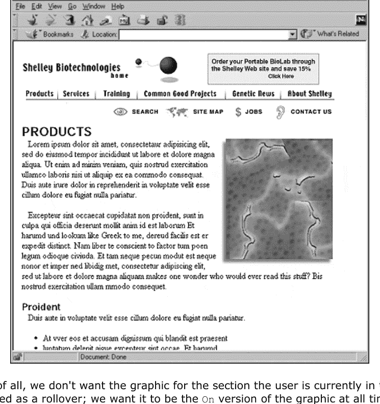

首先，我们不希望用户当前所在部分的图形作为翻滚效果受到影响；我们希望它始终处于“开启”版本的图形状态。这样，用户始终能够辨别出他或她处于哪个类别。为了实现这一点，我们无需更改脚本；只需从该图形的 `<A HREF>` 标签中移除事件处理程序，并将 `` 标签中调用的图像更改为“开启”版本即可。

我们需要进行的另一个修改稍微复杂一些，需要修改我们为主页编写的函数。我们要做的是，当鼠标悬停在任何其他导航图像上时，关闭当前所在类别的图形。这将防止两个图像同时处于“开启”位置，从而避免给用户造成困惑。同时，我们还需要确保，一旦鼠标移开图像，我们所在部分的图形能恢复到“开启”位置。

## 插入事件处理程序

在开始处理函数的修改之前，让我们先处理 `<A HREF>` 和 `` 标签的更改。让我们查看包含 `Products` 二级页面导航图像的 HTML 部分。

```
<A HREF="index.html"></A>

<A HREF="../services/index.html"></A>

<A HREF="../training/index.html"></A>

<A HREF="../common/index.html"></A>

<A HREF="../genetic/index.html"></A>

<A HREF="../about/index.html"></A></TD>
```

首先，我们需要将为 `Products` 图形调用的图像更改为“开启”版本（`products_on.gif`）。

```

```

这样，每当用户处于 `Products` 部分时，`Products` 导航图像将始终保持开启状态。接下来，我们需要在 `` 标签中添加 `NAME` 属性，并将事件处理程序插入到图像的 `<A HREF>` 标签中。当用户来到此页面时，`Products` 图像将始终处于开启状态，因此我们不需要让该图像参与翻滚效果。所以，我们不需要在其 `<A HREF>` 标签中放入事件处理程序。

```
<A HREF="index.html"></A>

<A HREF="../services/index.html"
onMouseOver="on('Services'); window.status='Services';
return true;" onMouseOut="off('Services');
window.status=' '; return true;"></A>

<A HREF="../training/index.html"
onMouseOver="on('Training'); window.status='Training';
return true;" onMouseOut="off('Training');
window.status=' '; return true;"></A>

<A HREF="../common/index.html"
onMouseOver="on('Common'); window.status='Common Good
Projects'; return true;" onMouseOut="off('Common');
window.status=' '; return true;"></A>

<A HREF="../genetic/index.html" onMouseOver="on('News');
window.status='Genetic News'; return true;"
onMouseOut="off('News'); window.status=' '; return
true;"></A>

<A HREF="../about/index.html" onMouseOver="on('About');
window.status='About Us'; return true;"
onMouseOut="off('About'); window.status=' '; return
true;"></A>
</TD>
```

这些事件处理程序应该看起来非常熟悉，因为它们与我们为主页翻滚脚本插入的事件处理程序相同。找到重用已编写代码的方法是节省时间并提高效率的好方法。所有 `` 标签中也添加了 `NAME` 属性；请注意，即使我们没有为 `Products` 图像插入事件处理程序，我们仍然放入了 `NAME` 属性。其原因将在我们稍后的脚本中变得清晰。我们的下一步是为所有翻滚图像创建 `IMAGE` 对象。

## 创建 IMAGE 对象

这是另一个我们将有些幸运的领域：我们为主页创建的 `IMAGE` 对象经过轻微修改后，将非常适合我们所有的二级页面。我们唯一需要更改的是分配给对象 `source` 属性的路径。由于二级页面所在的目录比主页深一级，我们需要告诉对象在查找 Images 目录之前先返回上一级。

首先，让我们将现有的 `IMAGE` 对象从主页复制到“Products”页面，然后进行必要的修改。

```
<SCRIPT Language="JavaScript">
<!-- Code after this will be ignored by older browsers

// Creating Image Objects for Rollovers
if (document.images)
{
ProductsOn=new Image(71, 33);
ProductsOn.src="images/products_on.gif";

ProductsOff=new Image(71, 33);
ProductsOff.src="images/products_off.gif";

ServicesOn=new Image(67, 33);
ServicesOn.src="images/services_on.gif";

ServicesOff=new Image(67, 33);
ServicesOff.src="images/services_off.gif";

TrainingOn=new Image(75, 33);
TrainingOn.src="images/training_on.gif";

TrainingOff=new Image(75, 33);
TrainingOff.src="images/training_off.gif";

CommonOn=new Image(157, 33);
CommonOn.src="images/common_on.gif";
CommonOff=new Image(157, 33);
CommonOff.src="images/common_off.gif";

NewsOn=new Image(98, 33);
NewsOn.src="images/news_on.gif";

NewsOff=new Image(98, 33);
NewsOff.src="images/news_off.gif";

AboutOn=new Image(106, 33);
AboutOn.src="images/about_on.gif";

AboutOff=new Image(106, 33);
AboutOff.src="images/about_off.gif";
}
...

// Stop hiding the code here -->
</SCRIPT>
</HEAD>
```

现在我们需要修改对象 `source` 属性的路径。

```
<SCRIPT Language="JavaScript">
<!-- Code after this will be ignored by older browsers

// Creating Image Objects for Rollovers
if (document.images)
{
ProductsOn=new Image(71, 33);
ProductsOn.src="../images/products_on.gif";

ProductsOff=new Image(71, 33);
ProductsOff.src="../images/products_off.gif";


ServicesOn=new Image(67, 33);
ServicesOn.src="../images/services_on.gif";

ServicesOff=new Image(67, 33);
ServicesOff.src="../images/services_off.gif";


TrainingOn=new Image(75, 33);
TrainingOn.src="../images/training_on.gif";
TrainingOff=new Image(75, 33);
TrainingOff.src="../images/training_off.gif";


CommonOn=new Image(157, 33);
CommonOn.src="../images/common_on.gif";

CommonOff=new Image(157, 33);
CommonOff.src="../images/common_off.gif";


NewsOn=new Image(98, 33);
NewsOn.src="../images/news_on.gif";

NewsOff=new Image(98, 33);
NewsOff.src="../images/news_off.gif";


AboutOn=new Image(106, 33);
AboutOn.src="../images/about_on.gif";

AboutOff=new Image(106, 33);
AboutOff.src="../images/about_off.gif";
}
…

// Stop hiding the code here -->
</SCRIPT>
</HEAD>
```

最后一步是放入我们的翻滚函数，并进行使其在二级页面上工作所需的修改。

## 插入 Rollover 函数

我们可以从复制主页中使用的函数开始。如前所述，这些函数需要修改才能在二级页面上正常工作；但由于核心功能是相同的，我们不必从头开始编写这些函数。

```
// Image Rollover Functions
function on(pic)
{
    if (document.images)
    {
        document.images[pic].src=eval(pic + "On.src");
    }
}
function off(pic)
{
    if(document.images)
    {
        document.images[pic].src= eval(pic + "Off.src");
    }
}
```

现在我们已经将基本函数放到页面中了，让我们仔细看看为了使它们正确工作而必须解决的问题。在二级页面上，我们修改了 HTML，使得当前所在部分的导航图形处于 On 位置。因此，当用户将鼠标悬移到其他类别上时，该图形和用户当前所在部分的图形都会高亮显示。这可能会让用户感到困惑，所以我们需要做的是，在用户将鼠标悬移到其他类别上时，关闭我们当前所在部分的图形。

为此，我们需要对 `on` 和 `off` 函数都进行轻微修改，同时创建一个新函数 `off1`，它将处理我们需要的一些额外功能。让我们从修改 `on` 函数开始。

```
// Image Rollover Functions

...

function on (pic)
{
    if  (document.images)
    {
        document.images[pic].src=eval (pic + "On.src");
        document.images['Products'].src=eval
        ("ProductsOff.src");
        ...
    }
}
```

我们在脚本中添加的这一行告诉 JavaScript 运行时引擎，在打开用户悬停的图形之后，关闭 `Products` 部分的图形。请注意，我们是通过名称专门调用 `Products` 图像的，并且显式引用了我们想要分配给它的对象源。因此，我们需要为网站上的每个部分更改这一行，以便脚本能够关闭正确的图像。

现在，当用户将鼠标悬移到另一个图像上时，我们所在部分的图像就会关闭。接下来，我们需要一种方法，在用户将鼠标移开图像时将其重新打开。最简单的方法是在 `off` 函数中放入一行代码，当调用该函数时，将我们所在部分的图形切换到 `On` 位置。不幸的是，这种方法存在一个缺陷：如果用户快速地在各个类别图像上依次悬移，用户所在部分的图像就会闪烁开关。这并非世界末日，但有点粗糙，需要更复杂的解决方案。

我们需要的是一种方法，不仅能判断用户是否已将鼠标移开图像，还能判断在我们将所选类别图像重新打开之前，用户是否已将鼠标悬移到其他图像上。第一步是创建一个变量，我们可以在其中存储一个值，并用它来判断用户是否已将鼠标悬移到图像上。

```
// Image R薄薄Functions

var over_checker;

function on (pic)
{
    if (document.images)
    {
    document.images[pic].src=eval (pic + "On.src");
    document.images['Products'].src=eval
    ("ProductsOff.src");
    ...
    }
}
...
```

在前面的代码中，我们在 rollover 函数的开头声明了 `over_checker` 变量。我们首先需要使用它的地方是我们的 `on` 函数，因为我们需要知道用户是否当前正在类别图像上悬移。我们在调用 `on` 函数时将 `over_checker` 设置为持有值 "on"。

```
// Image Rollover Functions

var over_checker;

function on (pic)
{
    if (document.images)
    {
    document.images[pic].src=eval (pic + "On.src");

    document.images['Products'].src=eval
    ("ProductsOff.src");

    over_checker='on';
    }
}
...
```

我们不仅需要知道用户何时已将鼠标悬移到图像上，还需要知道用户何时已将鼠标移开图像。为此，我们需要修改我们的 `off` 函数。

```
function off (pic)
{
    if   (document.images)
    {
    over_checker='off';
    document.images[pic].src=eval (pic + "Off.src");
        ...
    }
}
...
```

就像我们的 `on` 函数一样，我们添加了一行代码，将值赋给我们的 `over_checker` 变量；在这种情况下，我们将其赋值为 `off`。这将让我们知道用户何时已将鼠标移开图像。

嗯，知道用户是否在图形上固然不错，但我们该如何利用这些信息呢？那就需要我们的第三个函数出场了。这个函数将查看我们的 `over_checker` 变量，如果没有悬停任何内容，那么它会将用户所在部分的图形切换回 `On` 位置。让我们来看看我们的新函数：

```
function off1 ()
{
    if  (over_checker=='off')
    {
    if  (document.images)
        {
        document.images['Products'].src=eval
        ("ProductsOn.src");
        }
    }
}
```

在这个新函数中发生了几件事，但没有什么我们还没有涉及过的新概念。即便如此，我们还是来逐行看看正在发生什么。首先，我们使用 `if` 语句来检查 `over_checker` 的值是否为 `off`。如果是这种情况，那么脚本会继续检查用户的浏览器是否支持图像 rollover。如果支持，脚本就会打开用户所在部分的图形。正如我们在 `on` 函数中添加的代码行一样，我们是显式地调用将 `Products` 图像重新打开的。一旦我们完成其余二级部分的代码，我们就需要更改受影响的图像。

我们的函数还缺少最后一段代码。目前，我们的新 `off1` 函数从未被调用过。放置调用的合乎逻辑的地方是在我们的 `off` 函数中，这样当用户将鼠标移开图像时，`off1` 函数就会被调用；如果用户没有将鼠标悬移到另一个图像上，那么所选类别的图形就会改变。然而，直接放入常规函数调用存在一个*问题*：由于 JavaScript 引擎解释代码的速度非常快，用户不可能快到在函数来得及打开该部分图形之前就悬移到另一个图像上。因此，我们需要设置一个延迟，以便 `off1` 函数在短暂暂停后被调用，让用户有时间悬移到一个新图像上。

为此，我们将使用一种新方法：`setTimeout()`。这个方法在用户定义的时间之后执行其参数。让我们快速看看它的语法。

```
setTimeout(arguments, msec)
```

就我们的目的而言，我们只需要给它一个参数——一个对我们的 `off1` 函数的调用。只需要短暂的停顿就能给用户所需的时间来悬移到一个新图像上；在这种情况下，700毫秒就能解决问题。让我们看看将这行新代码添加到我们的 `off` 函数后的样子。

```
function off (pic)
{
    if (document.images)
    {
        over_checker='off';
        document.images[pic].src=eval (pic + "Off.src");
        setTimeout ("off1()", 700);
    }
}
```

我们添加的最后一段代码告诉 JavaScript 运行时引擎在 700 毫秒后调用函数 `off1`，然后它就会为我们处理其余的工作。我们现在已经完成了将增强型 rollover 添加到网站 `Products` 部分的工作。

## 回顾脚本

虽然本项目的大部分脚本都是从主页的 rollover 中重新利用的，但我们对我们的 rollover 做了一些改动并添加了一些新功能。让我们回顾一下本项目中所做的事情。

```
<A HREF="index.html"></A>

<A HREF="../services/index.html"
onMouseOver="on('Services'); window.status='Services';
return true;"  onMouseOut="off('Services');
window.status=' '; return true;"></A>

<A HREF="../training/index.html"
onMouseOver="on('Training'); window.status='Training';
return true;"  onMouseOut="off('Training');
window.status=' '; return true;"></A>

<A HREF="../common/index.html"
onMouseOver="on('Common'); window.status='Common Good
Projects'; return true;"  onMouseOut="off('Common');
window.status=' '; return true;"></A>

<A HREF="../genetic/index.html" onMouseOver="on('News');
window.status='Genetic News'; return true;"
onMouseOut="off('News'); window.status=' '; return
true;"></A>

<A HREF="../about/index.html" onMouseOver="on('About');
window.status='About Us'; return true;"
onMouseOut="off('About'); window.status=' '; return
true;"></A>
</TD>
```

让我们看看脚本这部分采取的步骤：

- 1. 我们在除 `Products` 图像外所有图像的 `<A HREF>` 标签上添加了 `onMouseOver` 事件处理程序。

  在该处理程序中，我们调用 了 `on` 函数，传递给它我们正要悬移的图形名称；将状态栏更改为显示新消息；并添加了 `return` 命令以退出处理程序。

- 2. 我们在除 `Products` 图像外所有图像的 `<A HREF>` 标签上添加了 `onMouseOut` 事件处理程序。

  在该处理程序中，我们调用 了 `off` 函数，传递给它我们正要悬移的图形名称；将状态栏重置为空；并添加了 `return` 命令以退出处理程序。

- 3. 我们在所有六个 `` 标签中插入了 `NAME` 属性。


尽管我们没有在`Products`图像的`<A HREF>`标签中添加事件处理程序，但我们仍然需要为其指定`NAME`属性，因为当用户将鼠标悬停在其他五个图像之一上时，我们将更改其状态。

在插入事件处理程序和`NAME`属性之后，我们创建了翻转脚本中所需的`IMAGE`对象。

```
<SCRIPT Language="JavaScript">
<!-- Code after this will be ignored by older browsers

// Creating Image Objects for Rollovers
if (document.images)
{
ProductsOn=new Image(71, 33);
ProductsOn.src="../images/products_on.gif";

ProductsOff=new Image(71, 33);
ProductsOff.src="../images/products_off.gif";


ServicesOn=new Image(67, 33);
ServicesOn.src="../images/services_on.gif";

ServicesOff=new Image(67, 33);
ServicesOff.src="../images/services_off.gif";


TrainingOn=new Image(75, 33);
TrainingOn.src="../images/training_on.gif";

TrainingOff=new Image(75, 33);
TrainingOff.src="../images/training_off.gif";


CommonOn=new Image(157, 33);
CommonOn.src="../images/common_on.gif";

CommonOff=new Image(157, 33);
CommonOff.src="../images/common_off.gif";


NewsOn=new Image(98, 33);
NewsOn.src="../images/news_on.gif";

NewsOff=new Image(98, 33);
NewsOff.src="../images/news_off.gif";


AboutOn=new Image(106, 33);
AboutOn.src="../images/about_on.gif";

AboutOff=new Image(106, 33);
AboutOff.src="../images/about_off.gif";
}
```

以下是我们创建`IMAGE`对象所采取的步骤：

1.  我们复制了为首页翻转效果创建的`IMAGE`对象。
2.  然后，我们将这些对象的`src`属性指向正确的路径。
3.  我们添加了驱动脚本的函数。

```
// Image Rollover Functions

var over_checker;

function on (pic)
{
    if  (document.images)
    {
    document.images[pic].src=eval (pic + "On.src");
    document.images['Products'].src=eval
    ("ProductsOff.src");

    over_checker='on';
    }
}

function off (pic)
{
    if  (document.images)
    {
    over_checker='off';
    document.images[pic].src=eval (pic + "Off.src");
    setTimeout ("off1('Products')", 700);
    }
}

function off1 ()
{
    if   (over_checker=='off')
    {
        if  (document.images)
        {
        document.images['Products'].src=eval
        ("ProductsOn.src");
        }
    }
}
// Stop hiding the code here -->
</SCRIPT>
</HEAD>
```

以下是我们创建这些函数所遵循的步骤：

1.  我们从首页的翻转脚本中复制了`on`和`off`函数，并以此为基础创建了修改后的`on`和`off`函数。
2.  我们修改了`on`函数：
    *   在翻转函数的开头，我们创建了变量`over_checker`。
    *   在`on`函数内部，我们将变量`over_checker`的值设置为`"on"`。
    *   我们添加了一行代码，将`Products`图像切换到`off`状态。
3.  我们修改了`off`函数：
    *   我们添加了一行代码，将变量`over_checker`的值设置为`"off"`。
    *   我们加入了`setTimeout`方法，该方法将在延迟700毫秒后调用`off1`函数。
4.  我们创建了`off1`函数。
    *   这个函数使用`if`语句执行两项检查：首先，它检查`over_checker`的值是否设置为`"off"`；然后，它检查用户的浏览器是否支持翻转效果。
    *   如果这两个检查都返回`true`，那么该函数就会将`Products`图像设置为`on`状态。

在这个脚本中，我们介绍了JavaScript的一些新方面：

-   `setTimeout`方法。
-   为新用途重新调整旧脚本的概念。

## 翻转的特殊性

翻转效果可以为你的网站增添非常有用且激动人心的功能；然而，在使用它们时，你应该记住一些特殊性。首先，并非所有人都能看到你的翻转效果——任何使用3.0版本之前的Netscape或Internet Explorer 3.0的人都无法看到它们。虽然这肯定不足以阻止你使用翻转效果，但你应该牢记这一点。将导航仅设置为只能通过翻转效果来访问并不是一个好主意；为那些使用旧版浏览器的用户提供备用文本导航始终是良好的做法。

Netscape 3.0 中存在以下特殊性：当在嵌套表格中使用图像时，如果你有一个表格嵌套在另一个表格中，并且该图像位于该嵌套表格中，JavaScript 引擎将为该单个图形创建两个数组条目。如果该图像位于嵌套在两个表格内的表格中，那么图像数组中将创建三个条目。如果你是基于图像在`IMAGE`数组中的位置而不是按名称来引用它们，这可能会导致问题。

最后，你应该注意的一个异常情况是在翻转效果中使用动画 GIF 时出现的。如果你将同一个动画图像用于多个翻转效果和一个`IMAGE`对象，你会发现动画只会在第一次翻转时起作用。在所有后续翻转中，它将跳到动画的最后一帧。解决方法是为每个希望在翻转时显示动画 GIF 的实例创建单独的`IMAGE`对象。

## 复习

你会发现，图像翻转是迄今为止网站上最常用的 JavaScript 实现。几乎你访问的每个网站都以某种方式使用它们，因此深入了解它们的工作原理和局限性对程序员来说将是一大优势。一旦你掌握了基础知识，就运用这些知识尝试不同的翻转技术。你发明的一些创意十足且令人兴奋的翻转效果会让你自己都感到惊讶。

## 高级项目

1.  创建一个主页，当鼠标悬停在其中一个主要类别图像上时，多个图形会发生变化。
2.  创建一个页面，当鼠标悬停在类别图像上时，一个随机图像会替换现有图像。

## 第3章：用于导航的 JavaScript

## 本章内容

-   项目 I：JavaScript 与下拉菜单
-   项目 II：使用多个下拉菜单进行导航
-   项目 III：在登录页面上使用 JavaScript
-   复习
-   高级项目

到目前为止，你已经为 Shelley Biotech 的主页添加了一些新功能和亮点，做得非常出色。现在你的老板已经见识到了 JavaScript 的强大之处，另一个想法又浮现在他的脑海中。高层希望能够为主页添加一个下拉菜单，允许用户只需单击一次就能快速跳转到网站中几个层级以下的特定页面。当然，和你的大多数项目一样，他们需要尽快完成，所以我们又开始了另一项任务。

在与一位设计师会面后，你觉得已经为下拉菜单在主页上找到了一个好的放置位置（参见*图 3-1*）。现在你只需要获取下拉菜单的链接。给你的老板发一封电子邮件就轻松解决了这个问题，你很快就准备就绪了。

***图 3.1. 添加到主页的下拉菜单***

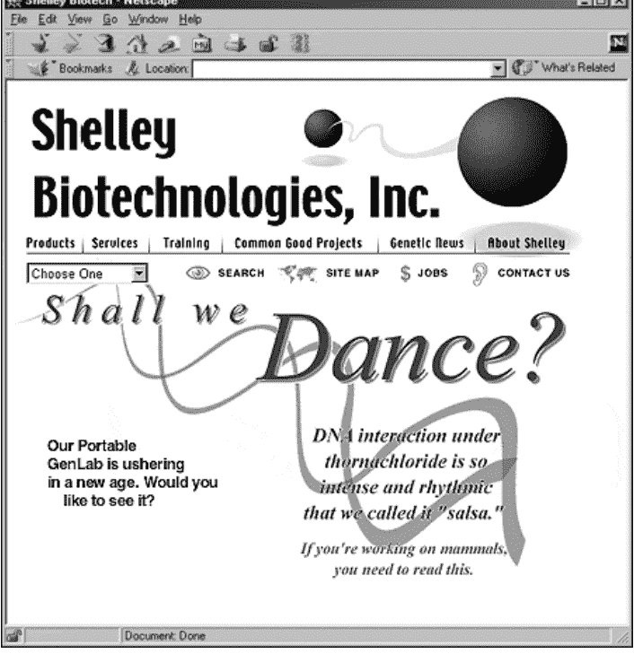

## 项目 I：JavaScript 与下拉菜单

我们需要在主页上做的第一件事是插入 HTML 代码，该代码将为我们提供下拉菜单和“前往”按钮。以下是我们将使用的代码：

```
<SELECT NAME="PullDown">
    <OPTION VALUE="default">Get There Quick
    <OPTION VALUE="whatsnew.html">What's New
    <OPTION VALUE="products/featured.html">Feature Product
    <OPTION VALUE="news/press.html">Press Releases
    <OPTION VALUE="store/index.html">Company Store
</SELECT>

<INPUT TYPE="Button" NAME="Go" VALUE="Go">
```

因为我们要将下拉菜单插入到预先存在的设计中，所以我们将把 `<FORM>` 标签放在 HTML 主体的开头和结尾，而不是直接包裹表单元素，以防止出现任何不必要的换行符或空格。你还会注意到，选项的 `value` 属性是留空的；我们将在插入运行脚本所需的事件处理程序时填入它们。


### 创建导航功能

由于导航下拉菜单将位于已有图片翻转效果的页面上，我们可以在现有的`<SCRIPT>`标签内插入我们的函数。我们将新的函数直接插入在图片翻转函数之后，如下所示：

```
function off(pic)
{
    if(document.images)
    {
        document.images[pic].src= eval(pic + "Off.src");
    }
}

// Pull-Down Menu Navigation Function

function PageChanger(page)
{
    ...
}
```

函数本身相当简单，包含两部分。你会注意到我们将一个值传入函数，该值被赋给变量`page`。这个值就是用户从下拉菜单中选择的页面位置。在第一行，我们将使用这个值来更改`DOCUMENT`对象的`location`属性；这将用新的网页重新加载浏览器窗口。

```
// Pull-Down Menu Navigation Function

function PageChanger(page)
{
    document.location= page;
    ...
}
```

接下来，我们将添加一行主要起维护作用的代码。当函数运行时，这行代码会将下拉菜单重置为菜单中的第一个选项。在我们的场景中这不太有用，因为页面正在切换；不过，如果下拉菜单是用来更改另一个框架的位置而非整个窗口，那么这是一个不错的细节处理。

```
// Pull-Down Menu Navigation Function

function PageChanger(page)
{
    document.location= page;
    document.NavForm.PullDown.options[0].selected=true;
}
```

## 插入事件处理器

既然已经创建了函数，我们需要将事件处理器插入到 HTML 中来调用该函数。在此之前，让我们先将 value 属性插入到下拉菜单的选项中。如前所述，传入函数的值是我们希望将用户导向的页面的 URL。该值来自菜单选项的 VALUE 属性。因此，对于每个选项的值，我们需要放置该选择对应页面的位置。

```
<SELECT NAME="PullDown">
      <OPTION VALUE=" ">Get There Quick
      <OPTION VALUE="whatsnew.html">What's New
      <OPTION VALUE="products/featured.html">Feature Product
      <OPTION VALUE="news/press.html">Press Releases
      <OPTION VALUE="store/index.html">Company Store
</SELECT>
```

对于第一个菜单选项（仅为美观而插入的标题），我们没有设置值，因为我们不希望该选项将用户导向任何地方。一旦用户选择了所需的菜单选项，他或她需要点击“Go”按钮才能到达新页面。为此，我们将 onClick 处理器插入到“Go”按钮的 HTML 中。

```
<SELECT NAME="PullDown">
      <OPTION VALUE=" ">Get There Quick
      <OPTION VALUE="whatsnew.html">What's New
      <OPTION VALUE="products/featured.html">Feature Product
      <OPTION VALUE="news/press.html">Press Releases
      <OPTION VALUE="store/index.html">Company Store
</SELECT>

<INPUT TYPE="Button" NAME="Go" VALUE="Go"
onClick="PageChanger(document.NavForm.PullDown
.options[NavForm.PullDown.selectedIndex].value)">
```

在这个事件处理器中，我们执行两个操作：调用 PageChanger() 函数并传递一个值给它。传递的值是用户从下拉菜单中选择的选项的值。在我们迄今为止创建的函数中，传入函数的值一直是一个简单的字符串。在这个事件处理器中，我们尝试了新方法：引用下拉菜单对象并获取当前选中的值。然后这个值被传递给函数，并用于将用户发送到他或她想要访问的页面。

我们的脚本现在功能完备，可以运行了。然而，由于我们在页面上添加了“Go”按钮，下拉菜单右侧的类别现在占用了两行（参见图 3-2）。不幸的是，这是不可接受的，所以我们需要找到另一个解决方案。幸运的是，还有另一种方法可以驱动我们的脚本，它不仅能解决这个问题，还能使使用下拉菜单导航更快。

### 使用 onChange 实现即时响应

要使页面布局恢复原状，我们需要去掉“Go”按钮；然而，目前它包含了运行我们脚本的事件处理器。我们需要一个可以放入下拉菜单本身的处理器来为我们运行脚本——即 `onChange` 事件处理器。该处理器会侦测其所在对象的状态变化，一旦检测到变化，就会触发。

一旦将其插入我们的下拉菜单，我们就可以让它在用户将菜单选项从页面加载时的默认选项更改为其他选项时激活我们的函数。让我们看看这如何改变我们的 HTML 代码。

```
<SELECT NAME="PullDown"
onChange="PageChanger(this.options[this.selectedIndex]
.value)">
    <OPTION VALUE=" ">Get There Quick
    <OPTION VALUE="whatsnew.html">What's New
    <OPTION VALUE="products/featured.html">Feature Product
    <OPTION VALUE="news/press.html">Press Releases
    <OPTION VALUE="store/index.html">Company Store
</SELECT>
```

首先，你会注意到我们移除了“Go”按钮，因为它不再需要。其次，`onChange` 事件处理器已添加到下拉菜单中。我们传递给函数的值是相同的——它是用户所选选项的值。然而，我们调用该值的方式与之前不同。因为事件处理器位于我们希望获取值的表单元素内，所以我们可以使用以下方法：

```
this.options[this.selectedIndex].value
```

脚本中的这行代码告诉 JavaScript 运行时引擎从包含事件处理器的表单元素中获取信息。两种方法同样有效，接触完成任务的多种方法总是有益的。

随着新事件处理器的插入，我们的脚本已完成并可以工作。通过使用 `onChange` 处理器，页面现在在用户从菜单中做出选择时立即更改，无需按下按钮。

## 回顾脚本

让我们看看我们创建此脚本所做的工作。首先，我们创建了一个函数，它将从表单元素接收一个值，并使用该值将用户发送到另一个 HTML 页面。我们还回顾了两种可用于驱动脚本的事件处理器。

首先，让我们看看函数：

```
// Pull-Down Menu Navigation Function

function PageChanger(page)
{
    document.location= page;
    document.NavForm.PullDown.options[0].selected=true;
}

</SCRIPT>
```

- 1. 我们创建了函数 `PageChanger()`。

我们在函数中做的第一件事是将 `DOCUMENT` 对象的 `location` 属性设置为变量 `page` 中包含的值。该值是从下拉菜单传递到函数的 URL。

接下来，我们重置下拉菜单中显示的选项为第一个选项。

接下来，让我们看看与 `onClick` 处理器一起使用所需的 HTML。

```
<SELECT NAME="PullDown">
    <OPTION VALUE=" ">Get There Quick
    <OPTION VALUE="whatsnew.html">What's New
    <OPTION VALUE="products/featured.html">Feature Product
    <OPTION VALUE="news/press.html">Press Releases
    <OPTION VALUE="store/index.html">Company Store
</SELECT>

<INPUT TYPE="Button" NAME="Go" VALUE="Go"
onClick="PageChanger(document.NavForm.PullDown
.options[NavForm.PullDown.selectedIndex].value)">
```

- 2. 当用户点击“Go”按钮时，将调用我们的函数。我们在按钮表单元素中插入了 `onClick` 事件处理器。

在事件处理器内，我们调用 `PageChanger()` 函数并传递从下拉菜单中所选菜单选项持有的值。

一旦决定由于设计问题必须将“Go”按钮从页面上移除，我们选择使用 `onChange` 事件处理器。

```
<SELECT NAME="PullDown"
onChange="PageChanger(this.options[this.selectedIndex]
.value)">
    <OPTION VALUE=" ">Get There Quick
    <OPTION VALUE="whatsnew.html">What's New
    <OPTION VALUE="products/featured.html">Feature Product
    <OPTION VALUE="news/press.html">Press Releases
    <OPTION VALUE="store/index.html">Company Store
</SELECT>
```

- 3. 我们将 `onChange` 事件处理器插入到我们的下拉菜单中。

同样，在这个事件处理器内，我们调用 `PageChanger()` 函数并传递所选菜单选项的 URL。

让我们看看在此项目中涵盖的新概念：

- - 访问和更改 `DOCUMENT` 对象的 `location` 属性。
- 访问和更改下拉菜单选项的值以及更改下拉菜单中选中的选项。
- `onClick` 和 `onChange` 事件处理器。

随着网站对公司的成功变得越来越重要，其包含的内容也呈爆炸式增长。寻找快速高效的方法来导航信息现在比以往任何时候都更加重要。使用 `onClick` 和 `onChange` 事件处理器以及下拉菜单是向人们提供所需信息的好方法。


## 项目二：使用多个下拉菜单进行导航

随着我们的下拉导航脚本取得成功，老板想到了公司网站的另一个可以从下拉菜单导航中受益的部分——公司商店（Company Store）版块。目前，在各种产品组和产品之间导航对用户来说既繁琐又不直观。Shelley Biotech 即将推出一波新产品，这将是一个对该版块进行升级改造的绝佳机会（见图 3-3）。如果我们能使用下拉菜单和 JavaScript 来提高效率和可用性，那就太好了。

图 3.3 Shelley 网站的公司商店版块

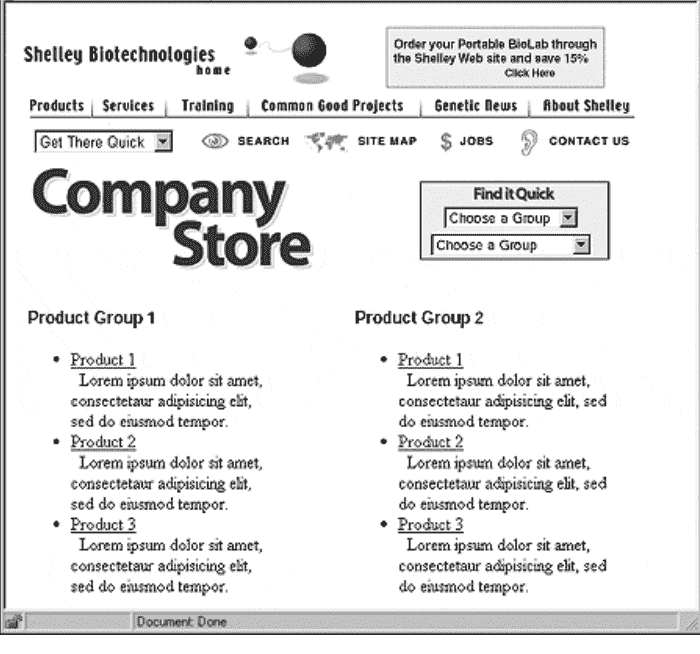

老板希望能有两个下拉菜单——一个包含不同产品组的列表，另一个则根据第一个下拉菜单中所选的产品组动态填充该产品组的产品。然后，用户将被发送到与从第二个菜单中所选产品相对应的页面。

这听起来可能是一项艰巨的任务，但我们已经在前面的章节中学到了很多完成它所需的知识。本项目将分为四个部分：创建用于保存每个产品组所需产品信息的数组；创建动态填充第二个菜单的函数；创建处理导航的函数；以及在 HTML 代码中插入适当的事件处理程序。

### 创建数组

随着所有新产品的推出，市场部门还不确定要在导航中包含哪些产品组和产品。不过，他们确实知道至少会有四个产品组，每个产品组至少包含五个产品。利用这些信息，我们将创建一个使用占位符的导航菜单系统，这些占位符可以在日后替换为真实的产品数据。既然如此，让我们开始吧。

在前两章中，我们已经简要介绍了数组的概念。我们学习了如何在页面加载时访问由 JavaScript 引擎创建的数组，以及如何向其中一些数组添加对象。然而，现在我们需要创建一些自己的数组，并用更新的产品信息填充它们以完成这项工作。

创建数组使用以下语法：

```
arrayObjectName = new Array([arrayLength])
```

在上述语句中，`arrayObjectName` 是你希望给数组命名的占位符，`arrayLength` 是数组中条目数量的占位符。

对于每个产品，我们需要两个值才能在第二个下拉菜单中动态插入选项：第一个是产品名称，第二个是对应的 HTML 页面位置。为了存储这些数据，我们将为每个产品组创建两个数组——一个用于存储产品名称，另一个用于保存页面位置。由于我们不了解产品组的名称，我们将使用 `group1`、`group2`、`group3` 和 `group4` 来标识它们。与第一个项目一样，我们将在页面上已有代码之后的现有 `<SCRIPT>` 标签中添加我们的新代码。

```
// Arrays for Products

     //Define the arrays

group1_names = new Array(5);
group1_locations = new Array(5);

group2_names = new Array(5);
group2_locations = new Array(5);

group3_names = new Array(5);
group3_locations = new Array(5);

group4_names = new Array(5);
group4_locations = new Array(5);

...
```

让我们看一下定义第一组数组的代码：

```
group1_names = new Array(5);
group1_locations = new Array(5);
```

第一行定义了一个新数组 `group1_names`，并给它分配了长度 5，这是我们被告知每个产品组可预期的产品数量——这个数组将保存 `group1` 中产品的名称。第二行定义了一个新数组 `group1_locations`，同样给它分配了长度 5——这个数组将保存 `group1` 中产品的页面位置。在定义了产品 `group1` 的数组之后，我们接着为其他三个组创建了数组。

现在已经定义了数组，我们需要用产品信息来填充它们。首先，让我们快速看一下向数组添加条目的语法：

```
arrayName[arrayPosition] = "arrayValue"
```

`arrayName` 是你希望添加条目的数组名称；`arrayPosition` 是你要在其中存储值的数组位置；`arrayValue` 是你希望存储在数组中的实际值。

让我们用 `group1` 的产品信息来填充它的数组：

```
// Populate Group1's Arrays

group1_names[0] = 'Group1_product one';
group1_locations[0] = 'group1/prod_1.html';

group1_names[1] = 'Group1_product two';
group1_locations[1] = 'group1/prod_2.html';

group1_names[2] = 'Group1_product three';
group1_locations[2] = 'group1/prod_3.html';

group1_names[3] = 'Group1_product four';
group1_locations[3] = 'group1/prod_4.html';

group1_names[4] = 'Group1_product five';
group1_locations[4] = 'group1/prod_5.html';

var group1_length = group1_names.length;
```

在上述代码中，我们将产品名称和产品页面位置分配给了两个不同数组中的相同位置。换句话说，在这前两行之后：

```
group1_names[0] = 'Group1_product one';
group1_locations[0] = 'group1/prod_1.html';
```

我们已经将值 `product one` 分配给了 `group1_names` 数组的第一个位置，将值 `group1/prod_1.html` 分配给了 `group1_locations` 数组的第一个位置。这段代码的其余部分将其余产品的信息放入两个数组中与其编号相对应的位置。与组的命名一样，我们使用的是产品名称及其页面位置的占位符。

在项目中，很多时候你可能还没有页面的最终内容。使用占位内容可以让你先完成编码，这样当你收到最终内容时，只需将其放入即可。诀窍是使用清晰且易于理解的占位值，以防你不是插入最终内容的那个人。

我们填充 `group1` 数组代码的最后一行如下：

```
var group1_length = group1_names.length;
```

这一行将 `group1` 数组的长度赋值给变量 `group1_length`；我们通过访问 `ARRAY` 对象的 `length` 属性来实现这一点。稍后我们将在填充第二个菜单的函数中使用这个变量。

以下是用于填充其他产品组数组的其余代码。它与第一组的结构相同：

```
// Populate Group2's Arrays

group2_names[0] = 'Group2_product one';
group2_locations[0] = 'group2/prod_1.html';

group2_names[1] = 'Group2_product two';
group2_locations[1] = 'group2/prod_2.html';

group2_names[2] = 'Group2_product three';
group2_locations[2] = 'group2/prod_3.html';

group2_names[3] = 'Group2_product four';
group2_locations[3] = 'group2/prod_4.html';

group2_names[4] = 'Group2_product five';
group2_locations[4] = 'group2/prod_5.html';

var group2_length = group2_names.length;
```

```
// Populate Group3's Arrays

group3_names[0] = 'Group3_product one';
group3_locations[0] = 'group3/prod_1.html';

group3_names[1] = 'Group3_product two';
group3_locations[1] = 'group3/prod_2.html';

group3_names[2] = 'Group3_product three';
group3_locations[2] = 'group3/prod_3.html';

group3_names[3] = 'Group3_product four';
group3_locations[3] = 'group3/prod_4.html';

group3_names[4] = 'Group3_product five';
group3_locations[4] = 'group3/prod_5.html';

var group3_length = group3_names.length;

// Populate Group4's Arrays

group4_names[0] = 'Group4_product one';
group4_locations[0] = 'group4/prod_1.html';

group4_names[1] = 'Group4_product two';
group4_locations[1] = 'group4/prod_2.html';

group4_names[2] = 'Group4_product three';
group4_locations[2] = 'group4/prod_3.html';

group4_names[3] = 'Group4_product four';
group4_locations[3] = 'group4/prod_4.html';

group4_names[4] = 'Group4_product five';
group4_locations[4] = 'group4/prod_5.html';

var group4_length = group4_names.length;
```

现在，我们为每个产品组都准备了两个数组，其中填充了这些组内所有产品的数据。我们还有四个变量，分别包含每个数组的长度。完成这些之后，是时候进入下一步了——创建将填充我们第二个下拉菜单的函数。

### 创建钻取菜单函数

在开始编写函数之前，我们需要在函数中找到某个值。当用户从第一个菜单中选择产品组时，脚本必须清除当前占据第二个菜单的任何值，然后才能插入新产品。这一点很重要，因为用户选择的新产品组可能比先前选择的产品组产品数量更少。如果是这种情况，新组的产品可能无法覆盖先前组的所有产品。为了确保我们清除菜单中所有可能的产品，我们将需要最大数组集合的长度。我们通过以下代码实现这一点：

### 寻找最大数组集合的长度

var maxLength = group1_length;

if (group2_length > maxLength) {
    maxLength = group2_length;
}

if (group3_length > maxLength) {
    maxLength = group3_length;
}

if (group4_length > maxLength) {
    maxLength = group4_length;
}

这段代码首先将第一组数组的长度值赋给变量 `maxLength`。然后，使用 `if` 语句检查其他数组组的长度是否大于 `maxLength`，如果是，则将新值赋给该变量。最终，`maxLength` 保留了最长数组组的值。

现在我们可以继续编写函数。我们需要做的第一件事是使用 `maxLength` 变量来清空第二个菜单的内容。

```javascript
// 创建下拉菜单函数
function MenuFiller(choice) {
    // 清空第二个菜单
    var currentPosition = 0;
    while (currentPosition < maxLength) {
        ...
        ++currentPosition;
    }
    ...
}
```

上面代码的第一行创建了一个变量 `currentPosition` 并将其赋值为 `0`。接下来，我们有一个叫做 `while` 循环的结构。我们之前还没有使用过 `while` 循环，所以有必要快速了解一下它的语法。

我们已经在脚本中使用过 `if` 语句——如果特定条件为 `true`，它们会执行一段代码。`while` 循环的工作方式类似；然而，只要特定条件评估为 `true`，它们就会持续执行其包含的代码块。`while` 循环的语法如下：

```javascript
while (condition) {
    statements
}
```

当你想以相同方式访问或更改许多属性时，`while` 循环非常有用。然而，循环可能会很棘手；如果你创建一个条件永远为真的循环，你会发现自己陷入了所谓的“无限”循环中。换句话说，你的脚本将永远运行下去，永远无法完成，这会使你的脚本变得无用，并且通常会崩溃浏览器。

如果你在循环内无法将测试的条件更改为 `false` 从而退出循环，该怎么办？我们很高兴你问了这个问题。最常见的解决方案是在循环内部更改条件。

前面代码中的 `while` 循环将循环运行，只要变量 `currentPosition` 小于 `maxLength` 的值。每次循环时，我们首先清除菜单选项中与 `currentPosition` 值对应的位置，然后在最后将 `currentPosition` 的值加 1。这样，`currentPosition` 最终将等于 `maxLength`，我们将退出循环。这也是我们第一次看到 `++` 自增运算符，它将其操作数的值加 1（在这种情况下是 `currentPosition`）。因此，这一行

```javascript
++currentPosition;
```

负责递增我们的变量。

循环将持续运行，直到 `currentPosition` 的值等于最长数组的长度。这样，我们就能确保清除菜单中所有可能的选项。我们通过将以下代码放入 `while` 循环中来实现菜单的实际清除：

```javascript
// 创建下拉菜单函数
function MenuFiller(choice) {
    // 清空第二个菜单
    var currentPosition = 0;
    while (currentPosition < maxLength) {
        document.ProductPicker
            .Products.options[currentPosition].text = ' ';

        document.ProductPicker
            .Products.options[currentPosition].value = ' ';

        ++currentPosition;
    }
    ...
}
```

我们插入的第一行代码将把对应于变量 `currentPosition` 当前值的菜单选项的文本设置为空白。第二行对菜单选项的值执行相同的操作。一旦循环运行完所有周期，我们将得到一个空白的下拉菜单，准备接受新产品组的值。

既然我们已经清空了“产品”菜单，现在是时候开始用所选新产品组的产品填充它了。在我们知道该放什么产品进去之前，必须找出用户选择了哪个产品。像我们之前的项目一样，我们将让事件处理器将一个值传递到函数中，我们可以用它来检查选择了哪个选项。对于这个函数，该值将存储在变量 `choice` 中。我们接下来要添加的代码将是一组 `if` 语句，用于测试选择了哪个组：

```javascript
// 创建下拉菜单函数
function MenuFiller(choice) {
    // 清空第二个菜单
    var currentPosition = 0;
    while (currentPosition < maxLength) {
        document.ProductPicker
            .Products.options[currentPosition].text = ' ';

        document.ProductPicker
            .Products.options[currentPosition].value = ' ';

        ++currentPosition;
    }

    // 选择哪个产品组被选中
    if (choice == 0) {
        ...
    } else if (choice == 1) {
        ...
    } else if (choice == 2) {
        ...
    } else if (choice == 3) {
        ...
    } else if (choice == 4) {
        ...
    }
    ...
}
```

如果你查看我们下拉菜单的 HTML 代码，你会看到我们分配给产品组的值是数字 1 到 4，每个数字对应组的编号：

```html
<SELECT NAME="ProductGroup">
    <OPTION VALUE="0">Choose a Group
    <OPTION VALUE="1">Group One
    <OPTION VALUE="2">Group Two
    <OPTION VALUE="3">Group Three
    <OPTION VALUE="4">Group Four
</SELECT>

<SELECT NAME="Products">
    <OPTION VALUE=" ">Choose a Group&nbsp;&nbsp;&nbsp;&nbsp;&nbsp;
    <OPTION VALUE=" ">&nbsp;
    <OPTION VALUE=" ">&nbsp;
    <OPTION VALUE=" ">&nbsp;
    <OPTION VALUE=" ">&nbsp;
    <OPTION VALUE=" ">&nbsp;
</SELECT>
```

因为有可能有人会选择默认的菜单项 “Choose a Group”，所以我们为该选择分配了值 0。当事件处理器启动时，它将所选值传递给函数，并赋给变量 `choice`，而我们刚刚添加的 `if` 语句将执行证明为 `true` 的测试之后的命令。

让我们输入我们希望在所有 `if` 语句之后执行的命令。这些命令需要完成两件事：它们必须将所选组的 `Products` 数组的长度分配给一个变量，然后将所选组的名称分配给一个变量。

```javascript
// 创建下拉菜单函数
function MenuFiller(choice) {
    // 清空第二个菜单
    var currentPosition = 0;
    while (currentPosition < maxLength) {
        document.ProductPicker
            .Products.options[currentPosition].text = ' ';

        document.ProductPicker
            .Products.options[currentPosition].value = ' ';

        ++currentPosition;
    }

    // 选择哪个产品组被选中
    if (choice == 0) {
        ...
    } else if (choice == 1) {
        OutputListSize = group1_length;
        arrayName = "group1";
    } else if (choice == 2) {
        OutputListSize = group2_length;
        arrayName = "group2";
    } else if (choice == 3) {
        OutputListSize = group3_length;
        arrayName = "group3";
    } else if (choice == 4) {
        OutputListSize = group4_length;
        arrayName = "group4";
    }
    ...
}
```

我们已经在脚本的早期确定了各个数组的长度，并将它们分配给了不同的变量，例如 `group1_length`、`group2_length` 等等。在我们的函数中使用这些值需要一个单独的变量来保存所选组的数组长度。因此，在前面的代码行中，我们将所选组的数组长度赋给了变量 `OutputListSize`。

我们添加到每个 `if` 语句中的第二行将把组的名称（如果被选中）赋给变量 `arrayName`。该变量稍后将用于帮助从正确的数组中调用信息。

到目前为止，我们已经处理了所有 `if` 语句的代码，除了第一个。如果用户选择了默认的 “Choose a Group” 菜单选项，第一个语句将为 `true`。因为此选项不对应任何产品组，所以没有 `Product` 数组可以重新填充第二个菜单，我们也不需要担心寻找数组长度或产品组的名称。如果选择了此选项，我们想要做的是：因为第二个菜单在函数运行时会被自动清空，我们需要用 “Choose a Group” 的文本重新填充菜单的默认选项。因此，我们将添加以下命令，该命令将显式地将值分配给第二个菜单第一个选项的 `text` 属性。还添加了第二个命令来选择菜单的第一个选项。

```javascript
// 创建下拉菜单函数
function MenuFiller(choice) {
```


## Creating the Navigation Function

现在我们需要一个函数，它能根据用户在"产品"下拉菜单中选择的项目，将用户引导到不同的页面。等等，这听起来是不是有点耳熟？没错——我们在本章开头就创建过这样一个函数。稍加修改，我们就可以将这个现有函数用于快速链接导航和我们的"产品"下拉菜单。

当页面首次加载且用户尚未选择产品组时，"产品"下拉菜单是空的，并且在选择组之前它将保持空状态。我们需要对函数进行的添加是一个测试，以确保从"产品"下拉菜单中选择的任何选项都已填充数据。如果未填充，我们不希望导航函数将用户发送到某个不存在的页面。

下面来看一下现有函数，以唤起您的记忆：

```
// Pull-Down Menu Navigation Function

function PageChanger(page)
{
    document.location= page;
    document.NavForm.PullDown.options[0].selected=true;
}
```

我们可以使用传入函数的菜单选项的值来进行测试。我们将插入一个 `if` 语句，该语句告诉 JavaScript 运行时引擎，如果变量 `page` 的值不等于（!=）空条目，则执行函数的其余部分。

```
// Pull-Down Menu Navigation Function

function PageChanger(page)
{
    if (page != ' ')
    {
        document.location= page;
        document.NavForm.PullDown
        .options[0].selected=true;
    }
}
```

通过添加一个简单的 `if` 语句，我们能够重新利用一个现有函数。在编码时请记住这个技巧——没有理由总是重复造轮子。

既然我们有了一个能将用户引导到他或她想去的页面的函数，我们剩下的全部工作就是插入事件处理器。

## Inserting the Event Handlers

我们需要插入两个事件处理器——每个下拉菜单一个。"产品组"下拉菜单将调用我们的 `MenuFiller()` 函数，而"产品"下拉菜单将调用 `PageChanger()` 函数。让我们首先查看"产品组"下拉菜单：

```
<SELECT NAME="ProductGroup"
onChange="MenuFiller(this.options[this.selectedIndex]
.value)">
    <OPTION value="0">Choose a Group
    <OPTION VALUE="1">Group One
```

我们现在拥有了重新填充第二个菜单所需的所有信息，这些信息来自所选组的产品。让我们继续函数的最后一部分，它将实际进行重新填充。我们需要做的第一件事是将变量 `currentPosition` 的值重置为 0，并确保未选择默认的"选择组"选项。如果选择了，我们将不想重新填充菜单，因此我们将使用一个 `if` 语句来确保 `choice` 大于 0。

```
// Creating the drill-down menu function

function MenuFiller(choice)
{
    // Clear out second menu
    var currentPosition = 0;
    while (currentPosition < maxLength)
    {
        document.ProductPicker
            .Products.options[currentPosition].text = ' ';

        document.ProductPicker
            .Products.options[currentPosition].value = ' ';

        ++currentPosition;
    }

    // Choose which Product Group was chosen
    if (choice == 0)
    {
        document.ProductPicker
            .Products.options[0].text = 'Choose a Group   ';

        document.ProductPicker
            .Products.options[0].selected=true;
    }
    else if (choice == 1)
    {
        OutputListSize = group1_length;
        arrayName = "group1";
    }
    else if (choice == 2)
    {
        OutputListSize = group2_length;
        arrayName = "group2";
    }
    else if (choice == 3)
    {
        OutputListSize = group3_length;
        arrayName = "group3";
    }
    else if (choice == 4)
    {
        OutputListSize = group4_length;
        arrayName = "group4";
    }
}

var currentPosition = 0;

if (choice > 0)
{
    …
}
```

现在我们知道实际上已经选择了一个新的产品组，我们可以开始重新填充第二个菜单。我们将使用一个类似于函数开头清除菜单的 `while` 循环。它将测试 `currentPosition` 的值与变量 `OutputListSize`，后者包含所选 `Product` 数组的长度。

```
var currentPosition = 0;
if (choice > 0)
{
    while (currentPosition < OutputListSize)
    {
        ...
        ++currentPosition;
    }
    ...
}
}
```

当然，循环内部的语句将是不同的。为了重新填充每个菜单选项的文本和值属性，我们需要为 `while` 循环要执行的代码插入两行。

```
var currentPosition = 0;
if (choice > 0)
{
    while (currentPosition < OutputListSize)
    {
        document.ProductPicker
            .Products.options[currentPosition]
            .text = eval(arrayName +
                '_names[currentPosition]');

        document.ProductPicker
            .Products.options[currentPosition]
            .value = eval(arrayName +
                '_locations[currentPosition]');

        ++currentPosition;
    }
    ...
}
}
```

前面几行中发生了很多事情，所以让我们仔细看看。在第一行的前半部分，我们调用与变量 `currentPosition` 当前值匹配的菜单选项的文本属性。

```
document.ProductPicker.Products.options[currentPosition]
.text
```

每次 `while` 循环循环时，该属性都将被赋予在行后半部分找到的值。

```
= eval(arrayName + '_names[currentPosition]');
```

这一行类似于我们在 <u>第2章</u> 中处理图像翻转时使用的一行。在这里，我们使用 `eval()` 方法将变量 `arrayName`（保存所选组的名称）的值与一个字符串组合起来，当组合后，将调用适当的 `Product` 数组并检索对应于 `currentPosition` 当前值的条目美梦画卷全本八浩有中英对照

我需要添加到函数中的最后一个命令将确保重新填充的第二个菜单的第一个位置是默认选中的位置。

```
var currentPosition = 0;
    if (choice > 0)
    {
        while (currentPosition < OutputListSize)
        {
            document.ProductPicker
            .Products.options[currentPosition].text =
            eval(arrayName +
            '_names[currentPosition]');

            document.ProductPicker
            .Products.options[currentPosition]
            .value = eval(arrayName +
            '_locations[currentPosition]');

            ++currentPosition;
        }
        document.ProductPicker
        .Products.options[0].selected=true;
    }
}
```

恭喜，我们完成了函数。这绝对是一段高级代码，所以要为自己感到骄傲。只剩两步，我们就能完成这个项目。接下来，我们必须添加导航函数，该函数将根据用户在"产品"下拉菜单中选择的内容引导用户到产品页面，然后插入将调用我们的函数的事件处理器。


### 脚本回顾

我们在脚本中做的第一件事，是定义用于存储每个产品组所有产品信息的数组：

```
// 产品数组

    // 定义数组

group1_names = new Array(5);
group1_locations = new Array(5);

group2_names = new Array(5);
group2_locations = new Array(5);

group3_names = new Array(5);
group3_locations = new Array(5);

group4_names = new Array(5);
group4_locations = new Array(5);
```

1.  我们为每个产品组创建了两个数组：一组数组用于存储该组的产品名称，另一组则存储每个产品对应的网址。

创建好数组后，我们的下一步是向其中填充产品信息。

```
// 填充第一组的数组

group1_names[0] = 'Group1_product one';
group1_locations[0] = 'group1/prod_1.html';

group1_names[1] = 'Group1_product two';
group1_locations[1] = 'group1/prod_2.html';

group1_names[2] = 'Group1_product three';
group1_locations[2] = 'group1/prod_3.html';

group1_names[3] = 'Group1_product four';
group1_locations[3] = 'group1/prod_4.html';

group1_names[4] = 'Group1_product five';
group1_locations[4] = 'group1/prod_5.html';

var group1_length = group1_names.length;
```

```
// 填充第二组的数组

group2_names[0] = 'Group2_product one';
group2_locations[0] = 'group2/prod_1.html';

group2_names[1] = 'Group2_product two';
group2_locations[1] = 'group2/prod_2.html';

group2_names[2] = 'Group2_product three';
group2_locations[2] = 'group2/prod_3.html';

group2_names[3] = 'Group2_product four';
group2_locations[3] = 'group2/prod_4.html';

group2_names[4] = 'Group2_product five';
group2_locations[4] = 'group2/prod_5.html';

var group2_length = group2_names.length;
```

```
// 填充第三组的数组

group3_names[0] = 'Group3_product one';
group3_locations[0] = 'group3/prod_1.html';

group3_names[1] = 'Group3_product two';
group3_locations[1] = 'group3/prod_2.html';

group3_names[2] = 'Group3_product three';
group3_locations[2] = 'group3/prod_3.html';

group3_names[3] = 'Group3_product four';
group3_locations[3] = 'group3/prod_4.html';

group3_names[4] = 'Group3_product five';
group3_locations[4] = 'group3/prod_5.html';
```

```
var group3_length = group3_names.length;

// 填充第四组的数组

group4_names[0] = 'Group4_product one';
group4_locations[0] = 'group4/prod_1.html';

group4_names[1] = 'Group4_product two';
group4_locations[1] = 'group4/prod_2.html';

group4_names[2] = 'Group4_product three';
group4_locations[2] = 'group4/prod_3.html';

group4_names[3] = 'Group4_product four';
group4_locations[3] = 'group4/prod_4.html';

group4_names[4] = 'Group4_product five';
group4_locations[4] = 'group4/prod_5.html';

var group4_length = group4_names.length;
```

2.  所有数组填充完毕后，我们为每个组创建一个变量，用于存储该组数组的长度。

```
// 找出最大数组集的长度

var maxLength = group1_length;

if (group2_length > maxLength)
{
	maxLength = group2_length;
}
if (group3_length > maxLength)
{
	maxLength = group3_length;
}
if (group4_length > maxLength)
{
	maxLength = group4_length;
}
```

21. 当我们将所有数组的长度都存储到变量中后，我们设置了一系列的 `if` 语句来找出最长的组，并将该长度赋值给变量 `maxLength`。

接下来，我们创建了函数 `MenuFiller()`，用于填充下拉菜单。

```
// 创建下拉菜单函数

function MenuFiller(choice)
{
	// 清空第二个菜单
    var currentPosition = 0;
    while (currentPosition < maxLength)
    {
        document.ProductPicker
        .Products.options[currentPosition].text = ' ' ;

        document.ProductPicker
        .Products.options[currentPosition].value = ' ' ;

        ++currentPosition;
    }

    // 选择所选的产品组
    if (choice == 0)
    {
        document.ProductPicker
        .Products.options[0].text = 'Choose a Group ';

        document.ProductPicker
        .Products.options[0].value = ' ';

        document.ProductPicker
        .Products.options[0].selected=true;
    }
    else if (choice == 1)
    {
        OutputListSize = group1_length;
        arrayName = "group1";
    }
    else if (choice == 2)
    {
        OutputListSize = group2_length;
        arrayName = "group2";
    }
    else if (choice == 3)
    {
        OutputListSize = group3_length;
        arrayName = "group3";
    }
    else if (choice == 4)
    {
        OutputListSize = group4_length;
        arrayName = "group4";
    }

    var currentPosition = 0;
    if (choice > 0)
    {
        while (currentPosition < OutputListSize)
        {
            document.ProductPicker
            .Products.options[currentPosition]
            .text = eval(arrayName +
            '_names[currentPosition]');

            document.ProductPicker
            .Products.options[currentPosition]
            .value = eval(arrayName +
            '_locations[currentPosition]');

            ++currentPosition;
        }
        document.ProductPicker
        .Products.options[0].selected=true;
    }
}
```

1.  首先，我们的函数清除了“产品”下拉菜单中的所有数据。
2.  然后，该函数接收从事件处理程序传入的变量，并判断用户选择了哪个产品组。
3.  最后，我们的函数使用正确数组中的信息重新填充了“产品”下拉菜单。

函数完成后，我们对现有的导航函数进行了快速调整。

```
// 下拉菜单导航函数

function PageChanger(page)
{
    if (page != ' ')
    {
        document.location= page;
        document.NavForm
        .PullDown.options[0].selected=true;
    }
}
```

1.  这里，我们为 `PageChanger()` 函数添加了一个 `if` 语句，以确保从下拉菜单中选择的选项是有效的。

最后，我们为两个产品下拉菜单添加了事件处理程序。

```
<SELECT NAME="ProductGroup"
onChange="MenuFiller(this.options[this.selectedIndex]
.value)">
    <OPTION value="0">Choose a Group
    <OPTION VALUE="1">Group One
    <OPTION VALUE="2">Group Two
    <OPTION VALUE="3">Group Three
    <OPTION VALUE="4">Group Four
</SELECT>
```

```
<SELECT NAME="Products"
onChange="PageChanger(this.options[this.selectedIndex]
.value)">
    <OPTION VALUE=" ">Choose a
Group&nbsp;&nbsp;&nbsp;&nbsp;&nbsp;&nbsp;&nbsp;&nbsp;
    <OPTION VALUE=" ">&nbsp;&nbsp;&nbsp;&nbsp;
    <OPTION VALUE=" ">&nbsp;&nbsp;&nbsp;&nbsp;
    <OPTION VALUE=" ">&nbsp;&nbsp;&nbsp;&nbsp;
    <OPTION VALUE=" ">&nbsp;&nbsp;&nbsp;&nbsp;
</SELECT>
```

2.  我们在两个下拉菜单中插入了 `onChange` 事件处理程序。

产品组下拉菜单中的事件处理程序将调用我们的 `MenuFiller()` 函数。

产品下拉菜单中的事件处理程序将调用 `PageChanger()` 函数。

让我们回顾一下本项目涵盖的新概念：

-   创建和填充用户自定义数组。
-   `while` 循环。
-   `!=` 逻辑运算符。
-   访问数组中包含的信息和属性。
-   访问和更改表单元素的值和属性。

现在我们已经完成了，是时候把工作交给老板，让他给你应得的称赞了。你正在成为一个彻头彻尾的 JavaScript 大师。当然，既然你完成了这个项目，老板已经给你找到了另一个要做的项目。天哪，我们的工作永远做不完。

## 项目三：在登录页面上使用 JavaScript

Shelley Biotech 即将在网站上添加一个新的“合作伙伴”板块。这个新板块的一部分内容不对公众开放；只有现有的合作伙伴才被允许进入。一些 Perl 程序员已经创建了一个登录页面（参见图 3-4），编写了脚本，并将维护包含用户名和密码的数据库。那么，你可能会问，有什么是你需要做的呢？

### *图 3.4. 合作伙伴登录页面*


好吧，上头要求做一个登录页面，用户输入密码后按回车键就能调用登录脚本。Perl 团队搞出来的登录页需要用户手动点登录按钮才能调用脚本。我们的任务就是拿他们做的页面，用 JavaScript 改造一下，让它在按下回车键时也能工作。

经过上一个脚本，这简直是小菜一碟。我们甚至不用写函数；只需要在 HTML 里插入合适的事件处理程序就行，然后就可以顺利运行了。

## 插入事件处理程序

在本章之前的两个脚本中，我们在表单下拉菜单上使用了 `onChange()` 事件处理程序来调用运行脚本所需的函数。在这个脚本中，我们将再次使用 `onChange()`；不过这次我们将看看它在表单文本字段上的工作方式。

当 `onChange()` 处理程序被放置在表单的文本字段内时，当用户更改了字段中保存的值，然后按下 Tab 键或 Enter 键，或者将光标点击到字段外部时，它就会被激活。这会导致文本字段失去焦点，从而触发事件处理程序。在这个脚本中，我们将把 `onChange()` 处理程序放在密码字段中。当用户访问页面时，他或她会先输入用户名，然后移动到密码字段。用户输入密码，从而更改了字段的值，然后要么按 Enter 键，要么点击登录按钮，这会导致密码字段失去焦点并触发事件。我们要触发的事件是调用包含我们登录文本字段的表单的 SUBMIT 属性。

让我们看看插入事件处理程序后的代码：

```
<INPUT TYPE="password" NAME="_User_Pass"
onChange="document.login.submit();">
```

## 回顾脚本

1. 我们将 `onChange()` 事件处理程序插入到了 `password` 表单元素中。

仅此而已。这是一个很好的例子，说明一个非常简短的脚本也能非常有用。并非所有脚本都必须像本章中第二个脚本那样长或复杂。事实上，最好总是寻找创建脚本最高效的方法。

## 回顾

你现在应该已经很好地理解了如何将 JavaScript 用于导航，以及在表单中用于增强交互性和效率。我们还拓宽了关于数组的知识，学习了如何创建数组以及访问存储在其中的信息。在下一章中，我们将离开 Shelley Biotech 网站，开始处理 *Stitch Magazine* 的网站。我们将在已学的 JavaScript 和表单知识基础上，学习如何使用 JavaScript 处理错误检查。

## 进阶项目

1.  创建一个包含三个下拉菜单的系统，其中第二个菜单的内容根据第一个菜单的选择来填充，然后第三个菜单的内容根据第二个菜单的选择来填充。
2.  创建一个包含三个下拉菜单的系统，其中第一个菜单的选择动态地填充另外两个菜单。

# 第四章 表单中的错误处理

## 本章内容

-   项目一：检查表单空字段
-   项目二：检查表单字段中的错误数据
-   项目三：让用户知道哪里出错了
-   回顾
-   进阶项目

*在本书的后半部分，我们将为 Stitch Magazine 的网站工作——这是一家虚构的在线时尚杂志。它很时髦，视觉上很有趣，而且它的记者非常擅长发现趋势、追踪隐居的设计师以及挖掘令人尴尬的八卦。然而，该杂志正开始成长，需要更多的交互性来增强其网站内容。在接下来的两章中，我们将使用 JavaScript 来影响其他框架中的更改，并实现一些真正先进的 JavaScript 以提供罕见的用户体验。在本章中，我们将学习如何检查表单中的用户输入错误。*

Stitch 的市场人员正在举办一次促销活动以获取潜在客户线索。要参加比赛，网民必须访问 Stitch 网站并在表单中输入一些关于他们自己的信息（例如，他们的姓名、电子邮件地址以及他们想了解哪些时尚信息）。

很可能大多数人会正确输入信息。然而，有些人会输错他们的回答，有些人会跳过市场人员迫切需要的信息，还有一些人会用无意义的内容填写表单。

如果你在表单提交给 CGI 脚本之前加入一些 JavaScript 来进行错误检查，市场人员就需要处理更少的不完整或无意义的数据。错误检查也会让 CGI 程序员的工作更轻松，因为你可以保证数据会以特定的形式到达。这是一个相当长的脚本，所以我们将把它分成三个项目：首先，我们将检查空表单字段。然后，我们将检查用户输入的错误数据，最后，我们将讨论如何让用户知道哪里出错了。因为所有这些项目实际上都是同一个脚本的一部分，我们将在本章末尾当脚本完成时回顾每个部分。

## 项目一：检查表单空字段

市场人员希望用户填写表单上的所有框，但只有少数几项数据对于生成潜在客户线索是真正必要的（见图 4-1）。通常，你应该坚持将姓名和电子邮件地址作为必填项。除非绝对必要，否则避免要求提供电话号码——人们会认为你要让电话推销员骚扰他们，他们可能会输入他们前任的电话号码。

以下是 Stitch 的 HTML 程序员整理的表单：

```
<FORM ACTION="/scripts/promotion.cgi" NAME="promotion" METHOD="post">
Fields with a <B><FONT COLOR="#FF0000">*</FONT></B> are required fields.
<P>
<TABLE BORDER="0">
<TR>
    <TD><B><FONT COLOR="#FF0000">*</FONT></B></TD>
    <TD><B>First Name</B></TD>
    <TD><INPUT TYPE="text" NAME="firstName"></TD>
</TR>
<TR>
    <TD><B><FONT COLOR="#FF0000">*</FONT></B></TD>
    <TD><B>Last Name</B></TD>
    <TD><INPUT TYPE="text" NAME="lastName"></TD>
</TR>
</TABLE>
<TABLE BORDER="0">
<TR>
    <TD COLSPAN="3">
<B>Mailing Address</B>
</TD>
</TR>
<TR>
<TD>&nbsp;</TD>
<TD><B>Street</B></TD>
<TD><INPUT TYPE="text" SIZE="40" NAME="address"></TD>
</TR>
<TR>
<TD>&nbsp;</TD>
<TD><B>City</B></TD>
<TD><INPUT TYPE="text" NAME="city"></TD>
<TD><B>State</B></TD>
<TD><INPUT TYPE="text" NAME="state" MAXLENGTH="2" SIZE="2"></TD>
<TD><B>Zip Code</B></TD>
<TD><INPUT TYPE="text" NAME="zipCode" MAXLENGTH="5" SIZE="5"></TD>
</TR>
</TABLE>
<TABLE>
<TR>
<TD><B><FONT COLOR="#FF0000">*</FONT></B></TD>
<TD><B>Email Address</B></TD>
<TD><INPUT TYPE="text" NAME="email"></TD>
</TR>
<TR>
<TD> </TD>
<TD><B>Phone Number</B></TD>
<TD>
<INPUT TYPE="text" NAME="phonenumber" SIZE="12" MAXLENGTH="12">
</TD>
</TR>
<TR>
<TD> </TD>
<TD><B>Fax Number</B></TD>
<TD>
<INPUT TYPE="text" NAME="faxnumber" SIZE="12" MAXLENGTH="12">
</TD>
</TR>
<TR>
<TD> </TD>
<TD><B>What interests you most<BR>
                      about clothes and fashion?</B>
</TD>
<TD>
<TEXTAREA ROWS="6" COLS="40">Be honest</TEXTAREA>
</TD>
</TR>
<TR>
<TD><B><FONT COLOR="#FF0000">*</FONT></B></TD>
<TD>
<B>What do you want to see in an<BR>
                      online fashion magazine like Stitch?</B>
</TD>
<TD>
<SELECT NAME="whatTheyWant">
<OPTION VALUE=" ">Please choose a category
<OPTION VALUE="trends">Upcoming trends
<OPTION VALUE="models">Information about models
<OPTION VALUE="designers">Information about designers
<OPTION VALUE="rage">What the current rage is
<OPTION VALUE="gossip">Gossip!
</SELECT>
</TD>
</TR>
<TR>
<TD COLSPAN="2">Want to join?</TD>
<TD><INPUT TYPE="checkbox" NAME="join" SELECTED></TD>
</TR>
<TR>
<TD COLSPAN="2">
<INPUT TYPE="button" VALUE="Click to Submit"
onClick="errorCheck()">
</TD>
</TR>
</TABLE>
</FORM>
```

你会注意到在表单末尾，程序员已经将一个 `onClick` 事件处理程序插入到了提交按钮中，他们在其中调用了 `errorCheck()` 函数。既然他们费心加入了处理程序，我们将用它作为我们将创建的函数的名称。

### 检查表单中的空文本框字段

以下是我们将要使用的第一段 JavaScript，用于检查访客信息：

```
<SCRIPT LANGUAGE = "JavaScript">
<!-- Code after this will be ignored by older browsers

//Create the errorCheck Function
function errorCheck()
{
	// Create some variables for our script
	var requiredFieldsErrorMessage = " ";
	var firstNameEntered = " ";
	var lastNameEntered = " ";
	var emailEntered = " ";
	var areaCodeEntered = " ";
	var zipCodeEntered = " ";
	var pullDownErrorMessage = " ";
	var emailErrorMessage = " ";
	var areaCodeErrorMessage = " ";
	var zipCodeErrorMessage = " ";
	…
}

// Stop hiding the code here -->
</SCRIPT>
```

在前面的代码中，我们设置了一些变量。本项目中我们将使用前四个变量，其余变量将在后续项目中使用。这些变量将用于跟踪用户产生的任何特定错误消息。在脚本末尾，所有错误消息将被拼接在一起，生成一条综合错误消息展示给网站访问者。

接下来，我们将开始添加检查信息的函数部分。

```
<SCRIPT LANGUAGE = "JavaScript">
<!-- Code after this will be ignored by older browsers

//Create the errorCheck Function
function errorCheck()
{
    // Create some variables for our script
    var requiredFieldsErrorMessage = " ";
    var firstNameEntered = " ";
    var lastNameEntered = " ";
    var emailEntered = " ";
    var areaCodeEntered = " ";
    var zipCodeEntered = " ";
    var pullDownErrorMessage = " ";
    var emailErrorMessage = " ";
    var areaCodeErrorMessage = " ";
    var zipCodeErrorMessage = " ";

    // Required fields error checking
    firstNameEntered = document.forms['promotion']
    .elements['firstName'].value

    lastNameEntered = document.forms['promotion']
    .elements['lastName'].value

    emailEntered = document.forms['promotion']
    .elements['email'].value
    ...
}
// Stop hiding the code here -->
</SCRIPT>
```

我们要求访问者在三个字段中输入信息：名字、姓氏和电子邮件地址。在之前的章节中，我们学习了如何访问HTML页面上的FORM元素值。这里我们将使用类似的方法来获取需要检查的三个字段的值。因此，代码行

```
firstNameEntered = document.forms['promotion'].elements['firstName'].value
```

会查看访问者在名字文本框中输入的内容，并将其值放入变量 `firstNameEntered` 中。此行之后是对其他两个字段执行的类似语句。如果用户没有在这三个问题中输入任何信息，这些变量将为空。接下来，我们将设置一个 `if` 语句来测试这些值。

```
<SCRIPT LANGUAGE = "JavaScript">
<!-- Code after this will be ignored by older browsers

//Create the errorCheck Function
function errorCheck()
{
    // Create some variables for our script
    var requiredFieldsErrorMessage = " ";
    var firstNameEntered = " ";
    var lastNameEntered = " ";
    var emailEntered = " ";
    var areaCodeEntered = " ";
    var zipCodeEntered = " ";
    var pullDownErrorMessage = " ";
    var emailErrorMessage = " ";
    var areaCodeErrorMessage = " ";
    var zipCodeErrorMessage = " ";

    // Required fields error checking
    firstNameEntered = document.forms['promotion']
    .elements['firstName'].value

    lastNameEntered = document.forms['promotion']
    .elements['lastName'].value

    emailEntered = document.forms['promotion']
    .elements['email'].value

    if ((!firstNameEntered) || (!lastNameEntered) || (!emailEntered))
    {
        if (!firstNameEntered)
        {
            requiredFieldsErrorMessage = "- your first name\r"
        }
        if (!lastNameEntered)
        {
            requiredFieldsErrorMessage = requiredFieldsErrorMessage + "- your last name\r"
        }
        if (!emailEntered)
        {
            requiredFieldsErrorMessage = requiredFieldsErrorMessage + "- your email address\r"
        }
    }
    ...
}
// Stop hiding the code here -->
</SCRIPT>
```

`if` 语句的第一行是

```
if ((!firstNameEntered) || (!lastNameEntered) || (!emailEntered))
```

它告诉JavaScript运行时引擎：如果访问者没有输入名字、姓氏或电子邮件地址，那么 `if` 语句的条件为 `false`。

双竖线（`||`）是条件语句中表示“或”的符号。在 `if` 等条件语句中使用“或”运算符时，如果满足任何一个条件，则 `if` 语句被视为 `true`，其后的语句将被执行。我们还在前面的 `if` 语句中使用了 `!` 运算符。在JavaScript（以及大多数其他编程语言）中，这是“非”符号。因此，前面的代码行告诉引擎，如果一个变量没有值，则返回 `true`。引擎将继续执行接下来的语句。如果所有三个字段都已正确填写，我们的脚本将直接跳过 `if` 语句之后的代码。

很有可能并非所有三个字段都会正确填写，因此我们加入了一些代码，以便在发生任何错误时执行。我们又添加了三个 `if` 语句，分别测试这三个字段，并在必要时将一条简短消息存储到 `requiredFieldsErrorMessage` 变量中，稍后将使用该变量告知用户哪个字段被遗漏了。

```
if (!firstNameEntered)
```

前面的 `if` 语句意味着，如果访问者没有输入名字，则执行下一行：

```
requiredFieldsErrorMessage = "- your first name\r";
```

此行将字符串 "`- your first name`" 赋值给变量 `requiredFieldsErrorMessage`。您会注意到字符串末尾的 `\r`——正如前面章节所述，反斜杠会转义其后的字符，并告诉JavaScript引擎执行它。`r` 值告诉引擎插入一个换行符，类似于按下回车键。

还有另外两个 `if` 语句，用于检查我们关注的其他两个字段是否存在值，如果它们为空，则将信息添加到 `requiredFieldsErrorMessage` 变量中。

```
requiredFieldsErrorMessage = requiredFieldsErrorMessage + "- your last name\r";
```

如果姓氏测试返回为空，则执行前面的语句。我们希望在访问者现有的错误消息中添加内容，因为他或她可能犯了不止一个错误。因此，在表达式的右侧，脚本告诉引擎将 `your last name\r` 添加到 `requiredFieldsErrorMessage` 的现有值中，然后将两者都放回 `requiredFieldsErrorMessage` 变量中。如果发生了不止一个错误，我们希望列出所有错误，而不是仅仅用下一个错误替换第一个错误。第三个 `while` 循环遵循相同的语法，检查电子邮件地址字段是否存在值。

## 确保已选择下拉菜单选项

接下来，我们必须确保用户已从下拉菜单中选择了一个选项，该菜单询问用户希望在杂志的在线版本中看到什么。幸运的是，我们将用来执行此操作的代码与我们已经用来检查用户姓名文本框值的代码非常相似。我们将在用于测试文本框的代码之后插入用于检查下拉菜单的JavaScript代码。

```
//Checking for pull-down errors

if (document.forms['promotion'].elements['whatTheyWant'].value == 'default')
{
    pullDownErrorMessage = "- you didn't tell us what you want to see in Stitch";
}
// Stop hiding the code here -->
</SCRIPT>
```

由于我们只检查一个表单字段，因此可以只使用一个 `if` 语句。在前面的 `if` 语句中，我们正在将 `whatTheyWant` 字段的值与值 `default` 进行比较。如果您查看下拉菜单的HTML代码，您会看到 `default` 是分配给菜单中第一个选项的值。因此，如果用户没有将其从初始位置更改为其他选项，该值将保持为 `default`，然后脚本将向变量 `pullDownErrorMessage` 分配一条简短消息。

到目前为止，我们已经编写了一个脚本，用于测试表单中的空字段；然而，在某些情况下，这些信息是不够的。在某些情况下，检查用户提供的虚假或错误响应会很有用。下一个项目将涵盖几个这样的例子。

## 项目二：检查表单字段中的错误数据

### 检查电子邮件地址的有效字符

您永远无法百分百确定某人提供的是一个有效的电子邮件地址。没有公式或中央数据库可以跟踪世界上所有有效的电子邮件地址。但是，通过检查是否存在 `@` 符号和句点，您可以确定某人提供的是至少*看起来*像电子邮件地址的东西。尽管我们将此部分视为一个新项目，但本章中的代码实际上都是一个脚本的一部分。我们将在现有代码之后添加此新代码，该代码仍在 `errorCheck()` 函数内。


```javascript
// 电子邮件错误检查
if (emailEntered) {
    emailEntered = document.forms['promotion'].elements['email'].value;

    emailValue = new String(emailEntered);
    emailHasAt = emailValue.indexOf("@");
    emailHasPeriod = emailValue.indexOf(".");

    if ((emailHasAt == -1) || (emailHasPeriod == -1)) {
        emailErrorMessage = "-您的电子邮件地址\r";
    }
}
// 停止在此隐藏代码 -->
</SCRIPT>
```

我们这里做的第一件事是再次获取相关字段的值并将其赋给一个变量。然后我们创建一个名为 `emailValue` 的新对象——我们采用与第 2 章中创建用于图像翻转的 `IMAGE` 对象相同的方式来创建它。不过，我们创建的不是一个 `IMAGE` 对象，而是一个 `STRING` 对象，它将保存现在位于 `emailEntered` 变量中的值：

```javascript
emailValue = new String(emailEntered);
```

我们将字段值放入对象而不是像以前那样简单地保留在普通变量中的原因是，对象更加多功能，并允许我们访问无法在变量上使用的方法。我们将在本脚本中使用 `indexOf()` 方法。这让我们可以查找字符串中出现的特定字符；在本例中，我们将寻找 @ 符号和句点。

```javascript
emailHasAt = emailValue.indexOf("@");
emailHasPeriod = emailValue.indexOf(".");
```

第一行在对象 `emailValue` 中查找字符 @，并记住该字符在对象中出现的位置。例如，如果 `emailValue` 是 "dan@wire-man.com"，那么 @ 位于位置 3（记住，JavaScript 从 0 开始计数），那么 `emailHasAt` 将保存值 3。如果未找到该字符，则得到值 -1。

第二行基本相同，但它检查句点是否存在，并将其发现存储在变量 `emailHasPeriod` 中。因此，接下来的几行

```javascript
if ((emailHasAt == -1) || (emailHasPeriod == -1)) {
    emailErrorMessage = "-您的电子邮件地址\r";
}
```

告诉引擎，如果电子邮件地址没有 @ 符号或句点，则创建一个名为 `emailErrorMessage` 的新错误消息。接下来，我们将检查电话号码字段的区号。

## 检查电话号码中的区号

我们这里要稍微取巧一下——我们将重新格式化表单的 HTML，以便你只能从电话字段中获得所需的信息（参见图 4-2）。在您以后创建脚本时请记住这个技巧——通常有办法可以操作 HTML 以使您的脚本更高效。以下是电话号码字段的新 HTML 代码：

```html
(<INPUT TYPE="text" NAME="areaCode" SIZE="3" MAXLENGTH="3">)
<INPUT TYPE="text" NAME="phoneNumber1" SIZE="3" MAXLENGTH="3">-
<INPUT TYPE="text" NAME="phoneNumber2" SIZE="4" MAXLENGTH="4">
```

*图 4.2. 带有新电话号码字段的 Stitch 促销表单页面*

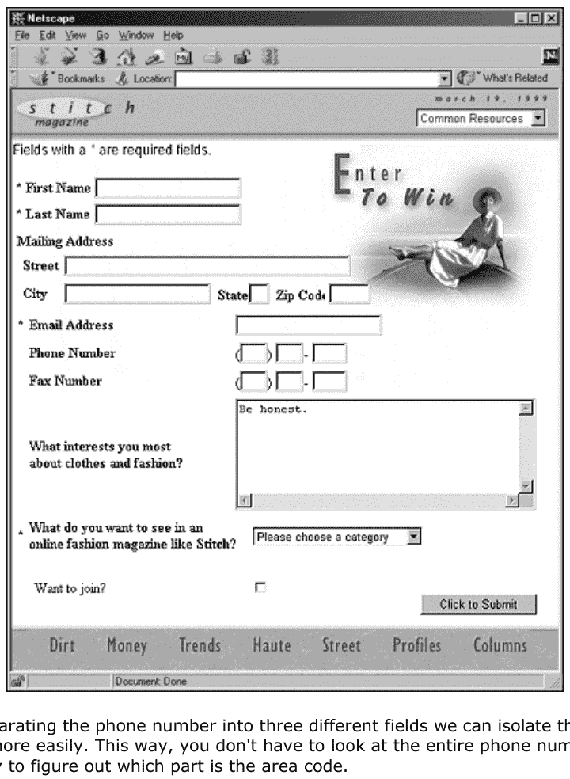

通过将电话号码分成三个不同的字段，我们可以更容易地分离出区号。这样，你就不必查看整个电话号码并试图弄清楚哪一部分是区号。

这可能会成为一个问题，因为人们书写区号的方式不同；例如，(925)555-1212，或 925-555-1212，或 925/555.1212，等等。编写脚本时请记住这一点——通常有比 JavaScript 解决方案更容易实现的方法。不要害怕探索这些其他途径。

电话号码不是必填字段；但是，如果访客主动提供电话号码，您希望确保他或她提供了区号；毕竟，这是网络，你不知道人们从哪里打电话来。（我们现在故意忽略国际电话号码。如果该网站最终收到来自美国以外地区的大量访问，我们可以稍后更改电话号码字段。）

因为我们决定使用三个不同的字段来表示电话号码，所以我们可以用与检查名字、姓氏和电子邮件地址字段几乎相同的方式来检查值。

```javascript
// 区号检查

areaCodeEntered =
document.forms['promotion'].elements['areaCode'].value;

phoneNumber1Entered =
document.forms['promotion'].elements['phoneNumber1'].value;
...
}
// 停止在此隐藏代码 -->
</SCRIPT>
```

在前面代码的前两行中，我们将区号字段和第一个电话号码字段的值都赋给了变量。在接下来的几行中，我们将使用一个 `if` 语句来告诉我们是否有所需的内容。

```javascript
// 区号检查

areaCodeEntered =
document.forms['promotion'].elements['areaCode'].value;

phoneNumber1Entered =
document.forms['promotion'].elements['phoneNumber1'].value;

if ((!areaCodeEntered) && (phoneNumber1Entered)) {
    areaCodeErrorMessage = "-请输入您的区号\r";
}
}
// 停止在此隐藏代码 -->
</SCRIPT>
```

你以前没见过 `&&`，但它是另一个逻辑运算符，就像我们在脚本前面用过的 `||` 运算符一样。`&&` 运算符意味着两个条件都需要满足才能在语句中返回 `true` 值。因此，

```javascript
if ((!areaCodeEntered) && (phoneNumberEntered))
```

告诉 JavaScript 运行时引擎，如果变量 `areaCodeEntered` 没有值，但 `phoneNumberEntered` 有值，那么它应该执行接下来的几行。这样，只有当访客输入了没有区号的电话号码时，才会生成错误消息。现在，让我们转到我们需要测试的最后一个字段。

## 确保邮政编码仅包含数字

确保访客邮政编码仅为数字的 JavaScript 比我们已经看到的要复杂一些，并引入了许多新特性和函数。总体计划是逐个查看变量 `zipCodeEntered` 中包含的五个字符的字符串，并查看每个字符是否确实是数字。如果是，我们将一个变量设置为 `yes` 并继续到下一个字符。但是，如果发现一个不是数字的字符，那么它将创建一个错误消息。这部分脚本像大多数其他脚本一样开始，收集我们需要检查的字段的值并将其赋给一个变量。

```javascript
// 邮政编码检查
zipCodeEntered =
document.forms['promotion'].elements['zipCode'].value;
...
}
// 停止在此隐藏代码 -->
</SCRIPT>
```

接下来，因为用户不一定要输入地址，我们将使用一个 if 语句来查看邮政编码字段中是否有任何内容。

```javascript
// 邮政编码检查
zipCodeEntered =
document.forms['promotion'].elements['zipCode'].value;
if (zipCodeEntered) {
    ...
}
}
// 停止在此隐藏代码 -->
</SCRIPT>
```

如果邮政编码字段中没有值，脚本将忽略邮政编码检查的其余部分并继续到下一部分。但是，如果字段中有值，我们将需要创建一些变量并为其中一些分配一个基础值，以便我们可以检查正确的邮政编码输入。

```javascript
// 邮政编码检查

zipCodeEntered =
document.forms['promotion'].elements['zipCode'].value;

if (zipCodeEntered) {
    numberCounter = 0;
    zipCounter = 0;
    foundNumber = " ";
    ...
}
}
// 停止在此隐藏代码 -->
</SCRIPT>
```

我们创建了两个计数器变量，我们将在 `while` 循环中使用它们，以及第三个变量，我们将用它来存储检查结果。

我们的下一步是创建两个 `while` 循环。

```javascript
// 邮政编码检查

zipCodeEntered =
document.forms['promotion'].elements['zipCode'].value;

if (zipCodeEntered) {
    numberCounter = 0;
    zipCounter = 0;
    foundNumber = " ";

    while (zipCounter < 5) {
        …
        zipCounter++;
    }
}
…
}
// 停止在此隐藏代码 -->
</SCRIPT>
```

前面的脚本为我们第一个 `while` 循环提供了基础。该脚本告诉引擎，*当*变量 `zipCounter` 小于 5 时，执行后面的语句。此时，后面只有一条语句，但我们马上会添加更多内容。然而，现在的语句是确保我们不会创建无限循环的关键。

```javascript
zipCounter++;
```

前面的行取 `zipCounter` 的值并将其加 1，这样每次循环执行时，`zipCounter` 的值都会比上一次高 1，直到它达到 5，条件不再满足，脚本才能继续。

第一个 `while` 循环将用于遍历邮政编码字段中的所有五个字符。我们现在将在第一个循环内添加第二个 `while` 循环，用于遍历所有 10 个数字（0-9）。

```javascript
// 邮政编码检查

zipCodeEntered =
document.forms['promotion'].elements['zipCode'].value;

if (zipCodeEntered) {
```


numberCounter = 0;
zipCounter = 0;
foundNumber = " ";

while (zipCounter < 5)
{
    while (numberCounter<10)
    {
        ...
        numberCounter++;
    }
    if  (foundNumber != "yes" )
    {
        zipCounter = 6;
    }
    else
    {
        zipCounter++;
        numberCounter = 0;
    }
}
}
...
}
// Stop hiding the code here -->
</SCRIPT>

现在，每次运行第一个循环时，第二个 `while` 循环都会测试数字 0-9。目前，我们先忽略第一个循环末尾的 `if` 语句，并在第二个循环中添加我们需要的语句。

```
// Zip Code Check

zipCodeEntered =
document.forms['promotion'].elements['zipCode'].value;

if (zipCodeEntered)
{
    numberCounter = 0;
    zipCounter = 0;
    foundNumber = " ";

    while (zipCounter < 5)
    {
        while (numberCounter<10)
        {
            if (zipCodeEntered.substr(zipCounter, 1)
                == numberCounter)
            {
                foundNumber = "yes";
                numberCounter = 11;
            }
            else
            {
                foundNumber = "no";
            }
            numberCounter++;
        }
        if (foundNumber != "yes")
        {
            zipCounter = 6;
        }
        else
        {
            zipCounter++;
            numberCounter = 0;
        }
    }
}
}
}
// Stop hiding the code here -->
</SCRIPT>
```

在上面的代码中，我们在第二个 `while` 循环的内部添加了一个 `if` 语句。这个 `if` 语句是脚本这一部分最重要的部分——它执行对邮政编码字段中值的实际测试，因此让我们更详细地探讨一下。首先，我们设置要测试的值。

```
if (zipCodeEntered.substr(zipCounter, 1) == numberCounter)
```

我们在这个语句中使用 `substr()` 方法来测试邮政编码字段中的特定字符。当我们在第一章使用这个方法时，我们指定了要收集的特定字符范围；在这个例子中，我们只检查一个字符，我们使用变量 `zipCounter` 的值来告诉 `substr()` 方法我们想检查哪个字符。

随着第一个循环的运行，每次经过时将这个变量加 1，我们将测试 `zipCodeEntered` 变量中位置 0-4 的字符。换句话说，它将测试邮政编码的所有五个字符。

我们将逐一将这些值与变量 `numberCounter` 的值进行比较。这个变量是我们第二个循环评估的基础，并且随着第二个循环的运行，`numberCounter` 每次也会增加 1。因此，当第二个循环运行时，它会检查 `zipCounter` 位置的字符是否与 `numberCounter` 的值相同，而 `numberCounter` 在数字 0-9 之间循环。

如果匹配，`if` 语句将继续设置变量 `foundNumber` 为 `yes`，并将 `numberCounter` 的值设置为 11，以便在下次进入第二个 `while` 循环时，条件将为假，脚本将继续执行。如果未找到匹配项，它将设置 `foundNumber` 的值为 `no`，将 `numberCounter` 的值加 1，并再次循环第二个循环以寻找匹配项。

一旦第二个循环完成其 10 次迭代或找到一个数字的匹配，脚本将继续执行我们之前添加到第一个 `while` 循环中的 `if` 语句。这个 `if` 语句测试 `foundNumber` 的值。如果在第二个 `while` 循环中未找到数字，它将把 `zipCounter` 设置为 6，这将在下一次传递时将我们踢出第一个 `while` 循环并生成一条错误消息。如果在第二个循环中找到了一个数字，那么 `if` 语句将把 `zipCounter` 的值加 1，并让它继续检查邮政编码字段中的下一个字符。

此代码部分的最终添加是，如果在邮政编码字段中发现非数字，则创建另一个错误消息。

```
// Zip Code Check

zipCodeEntered =
document.forms['promotion'].elements['zipCode'].value;

if (zipCodeEntered)
{
    numberCounter = 0;
    zipCounter = 0;
    foundNumber = " ";

    while (zipCounter < 5)
    {
        while (numberCounter<10)
        {
            if (zipCodeEntered.substr(zipCounter, 1)
                == numberCounter)
            {
                foundNumber = "yes";
                numberCounter = 11;
            }
            else
            {
                foundNumber = "no";
            }
            numberCounter++;
        }
        if  (foundNumber != "yes" )
        {
            zipCounter = 6;
        }
        else
        {
            zipCounter++;
            numberCounter = 0;
        }
    }
    if (foundNumber != "yes")
    {
        zipCodeErrorMessage = "-zip code has non-numbers
        in it\r";
    }
}
}
// Stop hiding the code here -->
</SCRIPT>
```

在这一节中，我们创建了一些相当复杂和高级的代码。然而，好消息是！我们快完成了！唯一剩下的就是检查是否创建了任何错误消息并将其显示给用户，或者如果没有创建，则将表单提交给 CGI 脚本。

## 项目 III：让用户知道哪里出错了

这最后一部分代码并非什么开创性的内容——我们将使用本章前面介绍过的方法。如果世界是完美的，那么用户会正确填写表单。然而，情况并非总是如此，因此既然我们已经对缺失或错误的数据进行了必要的检查，我们需要将我们发现的内容传达给用户。我们将使用一个简单的 `if` 语句来完成此操作。

```
// Letting the user know what was missed

if ((requiredFieldsErrorMessage) ||
    (whatTheyWantErrorMessage) || (emailErrorMessage) ||
    (areaCodeErrorMessage) || (zipCodeErrorMessage))
{
    ...
}
else
{
    ...
}
}
// Stop hiding the code here -->
</SCRIPT>
```

第一行检查我们的错误消息变量是否有值。如果有，那意味着用户遗漏了某些内容，我们应该为用户编写一个全面的错误消息。我们通过首先将消息的开头赋值给变量 `alertMessage`，然后将我们检查创建的任何错误消息添加到末尾来完成此操作。

```
// Letting the user know what was missed

if ((requiredFieldsErrorMessage) ||
    (whatTheyWantErrorMessage) || (emailErrorMessage) ||
    (areaCodeErrorMessage) || (zipCodeErrorMessage))
{
    alertMessage = "Oops! There's a little trouble with
    the information you've provided\r";

    //build remainder of the alert message
    alertMessage = alertMessage +
    requiredFieldsErrorMessage;
    alertMessage = alertMessage +
    whatTheyWantErrorMessage;
    alertMessage = alertMessage + emailErrorMessage;
    alertMessage = alertMessage + areaCodeErrorMessage;
    alertMessage = alertMessage + zipCodeErrorMessage;
    ...
}
else
{
    ...
}
}
// Stop hiding the code here -->
</SCRIPT>
```

在我们将任何其他错误消息添加到开头之后，我们只需要使用 `alert()` 函数将我们完成的消息显示给用户。

```
// Letting the user know what was missed

if ((requiredFieldsErrorMessage) ||
    (whatTheyWantErrorMessage) || (emailErrorMessage) ||
    (areaCodeErrorMessage) || (zipCodeErrorMessage))
{
    alertMessage = "Oops! There's a little trouble with
        the information you've provided\r";

    //build remainder of the alert message
    alertMessage = alertMessage +
        requiredFieldsErrorMessage;

    alertMessage = alertMessage +
        whatTheyWantErrorMessage;

    alertMessage = alertMessage + emailErrorMessage;
    alertMessage = alertMessage + areaCodeErrorMessage;
    alertMessage = alertMessage + zipCodeErrorMessage;

    alert (alertMessage);
}
else
{
    ...
}
}
// Stop hiding the code here -->
</SCRIPT>
```

如果他们的答案没有问题，`else` 语句将继续将表单数据提交给 CGI 脚本。

```
// Letting the user know what was missed

if ((requiredFieldsErrorMessage) ||
    (whatTheyWantErrorMessage) || (emailErrorMessage) ||
```


```
(areaCodeErrorMessage) || (zipCodeErrorMessage))
{
    alertMessage = "哎呀！您提供的信息有点小问题\r";

    //构建提醒消息的其余部分
    alertMessage = alertMessage + requiredFieldsErrorMessage;

    alertMessage = alertMessage + whatTheyWantErrorMessage;

    alertMessage = alertMessage + emailErrorMessage;
    alertMessage = alertMessage + areaCodeErrorMessage;
    alertMessage = alertMessage + zipCodeErrorMessage;

    // 现在，显示错误消息
    alert (alertMessage);
}
else
{
    document.forms['promotion'].submit();
}
}
// 停止在此处隐藏代码 -->
</SCRIPT>
```

## 审阅脚本

嗯，这确实是一大段代码，或者说，是一整页的JavaScript，如果这都不算多，那什么才算多呢。不过，好消息是，我们现在有了一个脚本，它能让市场部的同事们对你赞不绝口。让我们最后再审视一遍这个脚本，回顾一下我们完成了什么。

1.  首先，我们创建了一些变量，用来保存用户输入到必填字段中的值，以及用于存储任何需要生成的错误消息的变量。

```
<SCRIPT Language="JavaScript">
<!-- 此后的代码将被旧版浏览器忽略
//创建errorCheck函数
function errorCheck()
{

// 为我们的脚本创建一些变量
var requiredFieldsErrorMessage = " ";
var firstNameEntered = " ";
var lastNameEntered = " ";
var emailEntered = " ";
var areaCodeEntered = " ";
var zipCodeEntered = " ";
var pullDownErrorMessage = " ";
var emailErrorMessage = " ";
var areaCodeErrorMessage = " ";
var zipCodeErrorMessage = " ";
```

2.  接着，我们开始创建函数的一部分，这部分将检查用户回答中的任何遗漏或错误，并打印消息告知用户问题所在。

第一步是将用户对必填字段的回答放入我们的新变量中。

```
// 必填字段错误检查

firstNameEntered =
document.forms['promotion'].elements['firstName'].value;

lastNameEntered =
document.forms['promotion'].elements['lastName'].value;

emailEntered =
document.forms['promotion'].elements['email'].value;
```

3.  然后，我们设置了一系列if语句，以确保变量中确实保存了数据，如果没有，则开始将遗漏项添加到`requiredFieldsErrorMessage`变量中。

```
if ((!firstNameEntered) || (!lastNameEntered) ||
    (!emailEntered))
{
    if (!firstNameEntered)
    {
        requiredFieldsErrorMessage = "- 您的名字\r";
    }
    if (!lastNameEntered)
    {
        requiredFieldsErrorMessage =
        requiredFieldsErrorMessage + "- 您的姓氏\r";
    }
    if (!emailEntered)
    {
        requiredFieldsErrorMessage =
        requiredFieldsErrorMessage + "- 您的电子邮箱地址\r";
    }
}
```

5.  然后，我们设置了一个if语句，以确保用户从必填的下拉菜单中选择了默认选项之外的选项。如果用户没有选择其他选项，脚本会将一条简短的消息赋值给变量`pullDownErrorMessage`。

```
//检查下拉菜单错误
if (document.forms['promotion'].elements['whatTheyWant']
.value == 'default')
{
    pullDownErrorMessage = "- 您没有告诉我们想在Stitch中看到什么";
}
```

6.  `errorCheck()`函数的下一步是设置一系列`if`语句，用于查看电子邮箱表单字段中输入的字符串，并检查其中是否存在@符号和句点。

```
// 电子邮箱错误检查

if (emailEntered)
{
    emailEntered = document.forms['promotion']
    .elements['email'].value;

    emailValue = new String (emailEntered);
    emailHasAt = emailValue.indexOf("@");
    emailHasPeriod = emailValue.indexOf(".");

    if ((emailHasAt == -1) || (emailHasPeriod == -1))
    {
        emailErrorMessage = "- 您的电子邮箱地址\r";
    }
}
```

7.  如果用户输入了电话号码，我们需要确保也输入了该号码的区号。因此，我们设置了另一组`if`语句来测试这两个表单字段中的值。

```
// 区号检查

areaCodeEntered =
document.forms['promotion'].elements['areaCode'].value;

phoneNumber1Entered =
document.forms['promotion'].elements['phoneNumber1'].value;

if ((!areaCodeEntered) && (phoneNumber1Entered))
{
    areaCodeErrorMessage = "- 请输入您的区号\r";
}
```

8.  然后，我们检查邮政编码字段是否只包含数字。我们设置`if`语句和两个`while`循环，来逐个查看邮政编码字段中输入的字符串的字符，并测试它们是否为整数。

```
// 邮政编码检查

zipCodeEntered =
document.forms['promotion'].elements['zipCode'].value;

// 如果访问者没有输入邮政编码，我们不需要做任何操作

if (zipCodeEntered)
{
    numberCounter = 0;
    zipLength =   5;
    zipCounter = 0;
    foundNumber =" ";

    while (zipCounter < 5)
    {
        while (numberCounter<10)
        {
            if (zipCodeEntered.substr(zipCounter, 1)
                == numberCounter)
            {
                foundNumber = "yes";
                numberCounter = 11;
            }
            else
            {
                foundNumber = "no";
            }
            numberCounter++;
        }
        if (foundNumber != "yes" )
        {
            zipCounter = 6;
        }
        else
        {
            zipCounter++;
            numberCounter = 0;
        }
    }
    if (foundNumber != "yes")
    {
        zipCodeErrorMessage = "- 邮政编码中包含非数字字符\r";
    }
}
```

最后，我们设置了一些`if`语句来查看各种错误消息变量的值。如果它们有值，我们就将该值添加到`alertMessage`变量中。当所有错误消息都测试完毕后，我们输出最终消息的内容供用户查看。如果没有发现错误消息，我们就调用表单的`submit()`函数。

```
// 让用户知道遗漏了什么

if ((requiredFieldsErrorMessage) ||
    (pullDownErrorMessage) || (emailErrorMessage) ||
    (areaCodeErrorMessage) || (zipCodeErrorMessage))
{
    alertMessage = "哎呀！您提供的信息有点小问题\r";

    //构建提醒消息的其余部分
    alertMessage = alertMessage +
    requiredFieldsErrorMessage;

    alertMessage = alertMessage + pullDownErrorMessage;
    alertMessage = alertMessage + emailErrorMessage;
    alertMessage = alertMessage + areaCodeErrorMessage;
    alertMessage = alertMessage + zipCodeErrorMessage;
    // 现在，显示错误消息
    alert ( alertMessage )
}
else // 表单没有问题
{
    // 将此表单数据发送到其CGI
    //document.forms['promotion'].submit()
}
}
</SCRIPT>
```

在本章中，我们学习了一些新概念，并深化了对已讨论过概念的理解。让我们看看本章涵盖的内容：

-   JavaScript的层次结构以及我们访问和操作其对象（尤其是表单对象）的能力。
-   `If`语句和`while`循环。
-   使用`alert()`方法作为向用户传递信息的方式。
-   **逻辑运算符：** `||`、`&&`和`!`。
-   使用`\r`输入硬回行符。
-   `STRING`对象及其一些属性。

## 回顾

本章涵盖了很多内容。如果你能理解这些概念和结构，那么你就在精通JavaScript的道路上迈出了重要一步。理解和使用`if`语句和`while`循环是掌握高级JavaScript解决方案的关键——随着你继续使用JavaScript，这一点会变得更加明显。

## 进阶项目

如果你想进一步加深对本章涵盖概念的理解，可以尝试以下想法：

1.  尝试验证本章未涉及的其他表单字段，例如单选按钮。
2.  检查文本框中的特定答案，这可能用于在线测试的评分。

## 第5章 JavaScript窗口和框架
```


## 本章内容

- 初探 WINDOW 对象
- 项目一：创建、填充和关闭窗口
- 项目二：使用 JavaScript 在框架间通信
- 回顾
- 进阶项目

我们新掌握的 JavaScript 知识已经让我们能够做一些相当酷的事情。过去的几章我们一直在处理表单，现在是时候转向新内容了。除了主页之外，Stitch 网站都是使用框架创建的。在本章中，我们将处理一些 Stitch 的次级页面，并让你了解 JavaScript 如何处理框架和窗口。

在进入具体项目之前，我们先来仔细看看窗口和框架是什么，以及它们如何纳入 JavaScript 的对象层次结构。处理框架和多窗口可能会变得相当复杂，而且常常显得混乱。在本章结束时，希望你能够牢固理解窗口和框架在与 JavaScript 结合时，如何帮助你实现一些出色的功能。

## 初探 WINDOW 对象

JavaScript 中的 **WINDOW** 对象位于 JavaScript 层次结构的顶端；**DOCUMENT** 对象及其下方的对象都是 **WINDOW** 对象的后代。到目前为止，我们完成的项目都包含在单个窗口内，因此我们从未需要处理 **WINDOW** 对象或其属性。然而，并非总是如此。在很多情况下，创建新窗口或访问另一个窗口中包含的对象是有利的。

由于窗口是一个对象，我们能够访问它包含的属性和对象，以及它自身的属性。使用 JavaScript，我们能够修改窗口的大小、配置其工具栏、访问其 **HISTORY** 数组等等。让我们开始第一个项目，看看这一切意味着什么。

## 项目一：创建、填充和关闭窗口

Stitch 网站上有一个页面，列出了在当前杂志期刊中投放广告的公司。Stitch 是一本时尚杂志，吸引了一些大公司作为广告商——广告本身往往和时尚一样具有突破性。由于杂志收到大量读者希望与这些公司取得联系的请求，管理层认为将广告放到网站上是个好主意。因此，他们决定扩展该页面的功能，将每个公司名称设为链接，点击后会跳转到一个页面，上面有公司的联系信息、网站链接以及当前广告的链接。

猜猜他们找谁来让这一切成为现实？没错——就是你。不过无需害怕。凭借你最近为网站添加的功能，你开始被称为办公室的 JavaScript 高手。与老板快速开完策划会议后，你认为已经想出了一个完成任务的绝佳方案。反复出现的一个问题是，每个月的期刊至少会有 20 个广告商——在网站上增加这么多页面会挤占服务器空间，而且每个月需要更新相当多的文件。所以，计划是这样的：我们将在现有列表页面上使用 JavaScript 数组来存储所有需要的信息，以便为每家公司动态创建一个页面，然后将其放入新窗口 виде中。这样可以节省服务器空间，让我们每月只需更新一个文件，并且为本章提供了一个绝佳的项目。创建这个脚本有三个部分：首先，我们将定义并创建每家公司的信息数组。接下来，我们将编写函数来打开新窗口并用内容填充它。最后，我们需要在 HTML 中插入适当的事件处理器来让一切运转起来。

### 创建和定义数组

我们首先需要做的是创建数组来存储公司信息。每家公司需要存储九项信息：公司名称、街道地址、城市、州、邮政编码、电话号码、传真号码、网站（如果有的话），以及公司广告页面的 URLeyeTL。在第 3 章中，我们为每组使用了两个数组——一个存储页面名称，另一个存储RUL 位置。在很大程度上，我们这里将使用相同的思路来存储公司信息；然而，之前每组使用两个数组，现在每家公司只使用一个。之前我们按位置来赋值和引用每个数组元素，而在这个项目中，我们将为每个元素赋予一个名称，以便用来引用。

让我们通过为公司定义数组来开始脚本。由于这个页面要到下一期才会添加，我们不知道哪些公司会投放广告。在此期间，我们只需为两家虚构公司创建数组，这能让我们立即开始调试脚本。

```javascript
<SCRIPT Language="JavaScript">
<!-- 旧版浏览器将忽略此后的代码

// 公司信息数组
    // 定义数组

Company1_info = new Array(9);
Company2_info = new Array(9);
...

// 在此停止隐藏代码 -->
</SCRIPT>
```

我们定义了两个数组，一个给 Company1，另一个给 Company2，每个数组的长度为九个元素。接下来，我们需要将每家公司的联系信息赋值给数组。让我们把 Company1 的信息放入它的数组中。

```javascript
<SCRIPT Language="JavaScript">
<!-- 旧版浏览器将忽略此后的代码

// 公司信息数组
    // 定义数组

Company1_info = new Array(9);
Company2_info = new Array(9);

// 填充 company1 的数组

Company1_info['name'] = 'Company 1';
Company1_info['street'] = '1235 company way #1';
Company1_info['city'] = 'Smallsville';
Company1_info['state'] = 'California';
Company1_info['zip'] = '91367';
Company1_info['phone'] = '818-555-1212';
Company1_info['fax'] = '818-555-1213';
Company1_info['website'] = 'http://www.company1.com';
Company1_info['ads'] = 'company1_ads.html';

// 在此停止隐藏代码 -->
</SCRIPT>
```

当你像前面的代码中那样用如此多的元素填充数组时，为每个元素赋予名称而不是使用其数字位置通常会更容易。如果只使用位置编号作为引用，很容易忘记特定元素位于何处。

`Company1_info`所讲的数组现在包含了我们为 `Company1` 创建页面所需的所有信息。让我们填写 `Company2` 的数组。

```javascript
<SCRIPT Language="JavaScript">
<!-- 旧版浏览器将忽略此后的代码

// 公司信息数组
    // 定义数组

Company1_info = new Array(9);
Company2_info = new Array(9);

// 填充 company1 的数组

Company1_info['name'] = 'Company 1';
Company1_info['street'] = '1235 company way #1';
Company1_info['city'] = 'Smallsville';
Company1_info['state'] = 'California';
Company1_info['zip'] = '91367';
Company1_info['phone'] = '818-555-1212';
Company1_info['fax'] = '818-555-1213';
Company1_info['website'] = 'http://www.company1.com';
Company1_info['ads'] = 'company1_ads.html';

// 填充 company2 的数组

Company2_info['name'] = 'Company 2';
Company2_info['street'] = '4321 company way #2';
Company2_info['city'] = 'Bigsville';
 Company2_info['state'] = 'California';
Company2_info['zip'] = '91235';
Company2_info['phone'] = '818-555-2121';
Company2_info['fax'] = '818-555-2122';
Company2_info['website'] = 'http://www.company2.com';
Company2_info['ads'] = 'company2_ads.html';

// 在此停止隐藏代码 -->
</SCRIPT>
```

我们现在已经将所需的所有信息安全存储在两个数组中了（如果你需要复习数组的基础知识，请查看[第三章](第三章)中的项目二）。是时候进入下一步了。

### 创建函数

这个脚本的函数需要完成几项任务。首先，它需要判断选择了哪家公司，并从相应的数组中收集其信息。接下来，它需要打开一个新窗口，最后，我们需要让它用数组中的信息填充新窗口。让我们先搭建函数的框架。

```javascript
// 页面创建函数

function PageCreator(selection)
{
	...
}

// 在此停止隐藏代码 -->
</SCRIPT>
```

在前面的代码中，我们创建了 `PageCreator()` 函数，并设置了变量 `selection` 来接收从事件处理器传递给函数的值。这个值将是用户选择的公司名称。下一步是找出用户选择了哪家公司并收集其信息。

```javascript
// 页面创建函数

function PageCreator(selection)
{

var company = eval(selection + "_info['name']");
var street = eval(selection + "_info['street']");
var city = eval(selection + "_info['city']");
var state = eval(selection + "_info['state']");
var zip = eval(selection + "_info['zip']");
var phone = eval(selection + "_info['phone']");
var fax = eval(selection + "_info['fax']");
var website = eval(selection + "_info['website']");
var ads = eval(selection + "_info['ads']");

...
}
```


## 插入事件处理器

现在我们知道 `selection` 的值将是公司的名称，并且我们已经将这些名称用作存储其信息的数组的名称。在前面的代码中，我们使用 `eval()` 函数将变量值与一个字符串组合起来，组合后将调用该公司数组中正确位置的信息。从数组中检索到信息后，这些信息会被放入一个变量中，我们稍后将在打印弹出窗口内容时使用这个变量。对于我们将来需要的九条不同信息中的每一条，这个过程都会重复一次。

一旦我们将所选公司的信息安全地存储在变量中，我们需要打开一个新窗口来放置这些信息。让我们快速看一下 `WINDOW` 对象的 `open()` 方法的语法。

```
window.open(URL, windowName, windowFeatures)
```

你需要在 `open()` 方法中包含三个元素：你想要放入新窗口的页面的 URL；一个字符串，包含你希望窗口在作为 `<A HREF>` 中的目标被引用时使用的名称；以及一个可选的、你可以自定义的标准窗口属性列表，例如宽度、高度或是否包含各种工具栏。

一个窗口不仅能携带将用作目标的名称，还可以与一个名称关联，你可以在使用 JavaScript 引用 `WINDOW` 对象时使用这个名称。要赋予它第二个名称，你可以使用以下语法，其中 `Name` 是你希望分配给窗口的名称。

```
Name = window.open(URL, windowName, windowFeatures)
```

让我们在脚本中加入打开窗口的代码。

```
// 页面创建函数

function PageCreator(selection)
{
    var company = eval(selection + "_info['name']");
    var street = eval(selection + "_info['street']");
    var city = eval(selection + "_info['city']");
    var state = eval(selection + "_info['state']");
    var zip = eval(selection + "_info['zip']");
    var phone = eval(selection + "_info['phone']");
    var fax = eval(selection + "_info['fax']");
    var website = eval(selection + "_info['website']");
    var ads = eval(selection + "_info['ads']");

    // 打开新窗口
    infowin = window.open("blank.html","Company_Info","menubar=yes,
width=250,height=200");

    // 向新窗口写入内容
    infowin.document.write
("<HTML><HEAD><TITLE>公司信息</TITLE>
</HEAD><BODY BGCOLOR='#FFFFFF'><CENTER>")

    infowin.document.write
("<TABLE BORDER='0' CELLSPACING='0'
CELLPADDING='0'><TR><TD><B>" + company + "</B>
</TD></TR>");

    infowin.document.write
("<TR><TD>" + street + "</TD></TR>");

    infowin.document.write
("<TR><TD>" + city + ", " + state + " " + zip +
"</TD></TR>");

    infowin.document.write
("<TR><TD>" + "电话 - " + phone + "</TD></TR>
<TD>传真 - " + fax + "</TD></TR>");

    infowin.document.write
("<TR><TD><A HREF='" + website + "' TARGET='_TOP'>"
+ website + "</A></TD></TR>");

    infowin.document.write
("<TR><TD ALIGN='CENTER'><BR><A HREF='" + ads +
"' TARGET='Content'>查看广告</A></TD></TR>
</TABLE>");

    infowin.document.write
("<TABLE BORDER='0' CELLSPACING='0'
CELLPADDING='0' WIDTH='249'><TR><TD WIDTH='249'
VALIGN='BOTTOM' ALIGN='RIGHT'><BR>
<A HREF='javascript:window.close()'></A></TD>
</TR>");

    infowin.document.write
("<TR><TD WIDTH='249' BGCOLOR='#FFFF00'>&nbsp;</TD>
</TR></TABLE>");
}

// 停止在此处隐藏代码 -->
</SCRIPT>
```

在前面的代码中，我们做的第一件事是为新窗口分配名称 `infowin`。完成后，我们继续处理 `open()` 方法本身——我们想要放入窗口的页面的 URL 是 `blank.html`。我们将动态地使用数组中的内容填充窗口，因此这个 HTML 页面就像它的名字一样是空白的。代码的下一个元素是我们分配给它的目标名称——`Company_Info`。我们不会在脚本中使用它，但它是一个必需的元素。下一个元素是我们希望窗口具有的属性列表。我们将包含包含文件、编辑、视图等菜单的工具栏，并将窗口宽度设置为 250 像素，高度设置为 200 像素。

现在我们已经打开了新窗口，我们需要用存储在变量中的信息来填充它。为此，我们将使用 `document.write()` 方法。我们已经在本书中多次使用过这个方法，但现在我们将添加一个新的转折。如果我们使用标准语法

```
document.write('要写入的文本');
```

我们只会重写公司列表页面上的内容，而不是新窗口中的内容。要写入新窗口，我们必须明确告诉 JavaScript 引擎我们想要在哪里输出 HTML。这可以通过在 `document` 之前插入窗口的名称来实现，如下所示：

```
infowin.document.write('要写入的文本');
```

现在我们知道如何写入新窗口了，让我们看看前面代码块中发生了什么。虽然它可能看起来很多，但实际上并非如此。为了可读性，我们使用多个 `document.write();` 方法来输出我们的新代码。在第一行，我们创建一个新的 HTML 文档并插入 `<HEAD>` 和 `<BODY>` 标签。在之前使用 `document.write()` 的脚本中，我们使用反斜杠 (`\`) 来转义我们想要打印出来的引号；在这个例子中，我们只是使用了两种类型的引号。我们使用双引号来表示我们想要打印的内容的开始和结束，而在这些引号内部，当我们想要它们实际在代码中打印出来时，我们使用单引号。这两种方法都同样有效；使用哪种方法取决于个人偏好。

在其余的 `document.write` 行中，我们结合使用表格模板和存储在变量中的信息来打印内容。倒数第二行 `document.write` 包含一些不熟悉的脚本，所以让我们仔细看看它。

在大多数情况下，我们打印的内容非常直接；但是，如果你仔细观察，你会看到一些新的东西。

```
<A HREF='javascript:window.close()'>
```

这个 `HREF` 中的 JavaScript 链接可以被视为一个 `onClick()` 事件处理器——当用户点击链接时，冒号后面的 JavaScript 将被执行。在这种情况下，该命令将允许用户在从页面获得必要信息后关闭新窗口。关闭窗口是我们尚未涉及的内容，所以让我们看看 `close()` 方法的语法。

```
window.close();
```

默认情况下，此行将关闭信息所在的窗口。如果你的目标是关闭另一个浏览器窗口，你只需专门调用其名称，如下所示：

```
infowin.close()
```

`document.write()` 行是我们函数的最后一部分。此脚本中剩下的唯一事情是将事件处理器插入到 HTML 中，然后我们就可以开始运行了。

## 插入事件处理器

就像在弹出窗口内容中之前使用的 `close()` 方法一样，我们将把事件处理器直接放入 HTML 的 `HREF` 标签中。当用户点击一个公司链接时，`PageCreator()` 函数将被调用并传递该公司的名称（见图 5-1）。以下 HTML 包含将处理程序插入 `HREF` 标签的链接：


## 审阅脚本

1.  首先，我们定义并填充了用于存放每家公司联系信息的数组。

    我们没有使用数组中的数字索引来引用信息的位置，而是为每个位置分配了名称。这种方法使我们能够通过名称而非数字位置来引用信息。

```javascript
<SCRIPT Language="JavaScript">
<!-- Code after this will be ignored by older browsers

// Arrays for Company Information
    // Define the arrays

Company1_info = new Array(9);
Company2_info = new Array(9);


// Populate company1's array

Company1_info['name'] = 'Company 1';
Company1_info['street'] = '1235 company way #1';
Company1_info['city'] = 'Smallsville';
Company1_info['state'] = 'California';
Company1_info['zip'] = '91367';
Company1_info['phone'] = '818-555-1212';
Company1_info['fax'] = '818-555-1213';
Company1_info['website'] = 'http://www.company1.com';
Company1_info['ads'] = 'company1_ads.html';

// Populate company2's array

Company2_info['name'] = 'Company 2';
Company2_info['street'] = '4321 company way #2';
Company2_info['city'] = 'Bigsville';
Company2_info['state'] = 'California';
Company2_info['zip'] = '91235';
Company2_info['phone'] = '818-555-2121';
Company2_info['fax'] = '818-555-2122';
Company2_info['website'] = 'http://www.company2.com';
Company2_info['ads'] = 'company2_ads.html';
```

2.  我们的下一步是创建 `PageCreator()` 函数。

    我们设置了一些变量来保存公司信息，并使用从事件处理程序传递到函数中的值，从正确的数组中调用相应信息。

```javascript
// Page Creator Function

    function PageCreator(selection)
    {
        var company = eval(selection + "_info['name']");
        var street = eval(selection + "_info['street']");
        var city = eval(selection + "_info['city']");
        var state = eval(selection + "_info['state']");
        var zip = eval(selection + "_info['zip']");
        var phone = eval(selection + "_info['phone']");
        var fax = eval(selection + "_info['fax']");
        var website = eval(selection + "_info['website']");
        var ads = eval(selection + "_info['ads']");
```

3.  一旦我们编写了从数组中提取信息的代码，我们就使用 `WINDOW` 对象的 `open()` 方法创建一个新窗口来显示公司信息。

```javascript
        infowin=window.open("blank.html","Company_Info",
        "menubar=yes,width=250,height=200");
```

4.  创建新窗口后，我们使用 `DOCUMENT` 对象的 `write()` 方法来输出我们的新内容。

```javascript
        infowin.document.write
        ("<HTML><HEAD><TITLE>Company Information</TITLE>
          </HEAD><BODY BGCOLOR='#FFFFFF'><CENTER>")

        infowin.document.write
        ("<TABLE BORDER='0'' CELLSPACING='0' CELLPADDING='0'>
        <TR><TD><B>" + company + "</B></TD></TR>");

        infowin.document.write
        ("<TR><TD>" + street + "</TD></TR>");

        infowin.document.write
        ("<TR><TD>" + city + ", " + state + "  " + zip +
        "</TD></TR>");

        infowin.document.write
        ("<TR><TD>" + "phone - " + phone + "<TD></TR>
          <TR><TD>fax - " + fax + "</TD></TR>");

        infowin.document.write
        ("<TR><TD><A HREF='" + website + "' TARGET='_TOP'>"
        + website + "</A></TD></TR>");

        infowin.document.write
        ("<TR><TD ALIGN='CENTER'><BR><A HREF='" + ads +
        "' TARGET='Content'>View the Ad</A></TD></TR>
        </TABLE>");

        infowin.document.write
        ("<TABLE BORDER='0'' CELLSPACING='0'
          CELLPADDING='0' WIDTH='249'><TR><TD WIDTH='249'
          VALIGN='BOTTOM' ALIGN='RIGHT'><BR>
          <A HREF='javascript:window.close()'>
          </A>
          </TD></TR>");

        infowin.document.write
        ("<TR><TD WIDTH='249' BGCOLOR='#FFFF00'>&nbsp;
        </TD></TR></TABLE>");
    }
    // Stop hiding the code here -->
    </SCRIPT>
```

5.  最后一步是将事件处理程序插入每家公司的 `<A HREF>` 标签中。

```html
<TR>
    <TD>
        &nbsp;&nbsp;&nbsp;&nbsp;&nbsp;&nbsp;</TD>
    <TD>
        <FONT FACE="Helvetica, Arial" SIZE="-1">
        <A HREF="JavaScript:PageCreator('Company1')">
        Company 1</A></FONT>
    </TD>
    <TD>
        <FONT FACE="Helvetica, Arial" SIZE="-1">
        <A HREF="JavaScript:PageCreator('Company2')">
        Company 2</A></FONT>
    </TD>
</TR>
```

在编写这个脚本时，我们使用了一些我们之前不熟悉的 JavaScript 特性。让我们来逐一审视：

- WINDOW 对象——我们学习了如何打开、关闭和填充窗口。
- 通过信息的数字位置和用户定义的标签来填充和访问数组信息。

我们现在有了一种清晰高效的方法来处理原本可能相当繁琐的任务。JavaScript 的一个很棒之处在于，它赋予你提出此类解决方案的能力，这不仅有助于处理工作量，更是该技术的绝佳应用。

哦哦，老板来了，又给你一个新项目。你说我们看看你接下来要处理什么？

## 项目二：使用 JavaScript 在框架之间通信

果然，老板希望你在网站上处理一个新问题。目前，在网站底部用于主导航的框架中，你所在部分的图形是高亮显示的（见图 5-2）。另一位程序员已经编写了 JavaScript 来处理点击时更换图片的问题，但你的老板需要你来解决另一个问题。

### 图 5-1. 广告商索引页

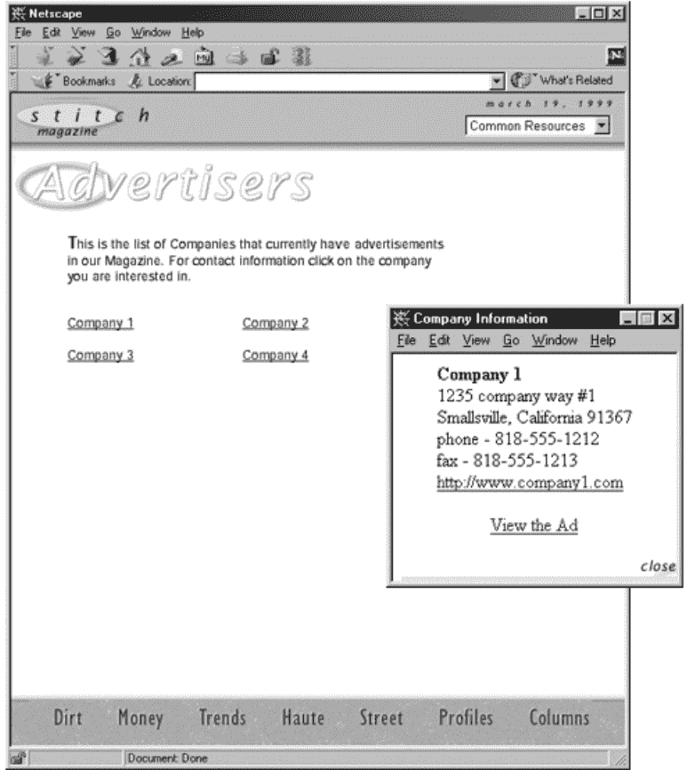

这个项目基本就完成了。让我们回顾一下我们做了什么，并整体审视一下这个脚本。

### 图 5-2. Stitch 次级页面的底部导航栏

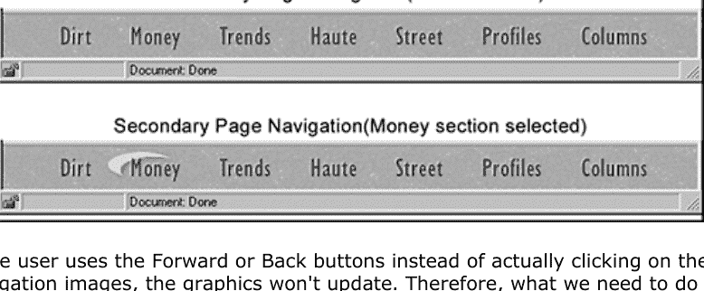

如果用户使用前进或后退按钮，而不是实际点击导航图片，图形就不会更新。因此，我们需要做的是设置一个脚本，让内容框架与导航框架通信，这样当新页面加载到内容框架时，它会告诉导航框架哪个图形应该被高亮显示。对于这个项目，我们需要更多地了解 JavaScript 如何处理框架。

## 理解你的框架层次结构

框架可以被看作是一个子窗口对象；就像窗口一样，它包含一个文档对象以及 HTML 可能创建的所有后代对象和属性。然而，如果你查看 JavaScript 的层次结构，你会看到 FRAME 对象位于 WINDOW 对象之下；事实上，它是 WINDOW 对象的一个属性。

窗口中的每个框架都可以保存独立的 URL。这个功能对于我们的 *Stitch* 网站非常有用，该网站使用三个框架——一个用于存放内容，另外两个用于存放导航。这让用户可以在内容框架中滚动，同时始终保留导航栏的位置。

当包含 FRAMESET 的 HTML 文档加载到浏览器时，JavaScript 引擎会创建一个数组，其中包含所有正在创建的 FRAME 对象。这与 JavaScript 处理页面上图像的方式非常相似。我们引用对象的方式也类似。让我们看一下 *Stitch* 网站的 FRAMESET，看看我们如何引用创建的各种 FRAME 对象。

```html
<FRAMESET ROWS="65,*,50" FRAMEBORDER="0" BORDER="0" FRAMESPACING="NO">
    <FRAME NAME="Top_Nav_Bar" SRC="top_nav.html" MARGINWIDTH="0" MARGINHEIGHT="0" SCROLLING="no" FRAMEBORDER="no" NORESIZE>
    <FRAME NAME="Content" SRC="ad_index.html" MARGINWIDTH="0" MARGINHEIGHT="0" SCROLLING="auto" FRAMEBORDER="no" NORESIZE>
    <FRAME NAME="Bottom_Nav_Bar" SRC="bottom_nav.html" MARGINWIDTH="0" MARGINHEIGHT="0" SCROLLING="no" FRAMEBORDER="no" NORESIZE>
```


## 图 5-3. 我们的 FRAME 层级结构

当 `FRAMESET` 页面加载时，框架会按照引擎读取的顺序被放入 `FRAMES` 数组：`Top_Nav_Bar` 是 `frames[0]`，`Content` 框架是 `frames[1]`，`Bottom_Nav_Bar` 是 `frames[2]`。要访问 `FRAME` 对象，我们通过调用 `FRAMES` 数组时使用这些位置索引。例如，如果我们想要访问 `Content` 框架的 URL，语法如下：

```
frames[1].src
```

然而，这只有在你从持有 `FRAMESET` 的页面请求信息时才有效。如果我们位于其他框架中，我们需要告诉 JavaScript 引擎首先返回到窗口的顶层，然后进入 `Content` 框架。有两种方法可以实现：你可以使用下面这行代码

```
top.frames[1].src
```

来告诉引擎去到层级结构的顶层，然后移动到 `FRAMES` 数组中的第二个框架。你也可以使用 `parent` 代替 `top` 来达到相同的效果：

```
parent.frames[1].src
```

区别在于 `top` 会将引擎发送到层级结构的顶部，而 `parent` 仅将指针向上移动一级到调用框架的父对象。有时你会遇到嵌套框架；换句话说，框架中调用的 HTML 文档包含另一个 `FRAMESET` 而不仅仅是 HTML。这将为层级结构增加另一层，因此要到达层级结构的顶部，你需要多次使用 `parent`：

```
parent.parent.frames[1].src
```

在 JavaScript 中处理嵌套框架可能相当复杂——幸运的是，*Stitch* 站点没有嵌套框架。话虽如此，让我们继续我们的项目。

这个项目包含两个部分：首先，我们需要在 `Bottom_Nav_Bar` 中创建一个函数，当 `Content` 页面发生变化时，该函数会更改高亮图形。其次，我们需要将事件处理程序插入到所有填充 `Content` 框架的页面中，这些处理程序将调用我们在项目第一部分中创建的函数。

## 创建一个检查你所在章节的函数

在我们开始编写新函数之前，先看看现有的函数会很有帮助——我们很可能可以在脚本中使用这个函数。这个函数有两个作用：首先，当用户单击导航图像之一时被调用，它会遍历并关闭所有导航图像，使其变为 `Off` 状态。完成此操作后，它会查看用户单击了哪个图形，并将该图像切换到 `On` 状态。让我们看看函数本身，以便了解这是如何实现的。

```javascript
function Highlighter(current)
{
    var test = 1;
    while (test < 8)
    {
        document.images[test].src = eval("Pic"
        + test + "Off.src");

        ++ test;
    }
    document.images[current].src = eval(current
    + "On.src");

    able = current;
}
```

在函数的第一行中，变量 `test` 被设置为值 1——这个值将在后面的 `while` 循环中用作测试条件。下一行是 `while` 循环的开始；只要 `test` 小于 8，循环就会持续运行。进入函数时 `test` 设置为 1，循环将循环七次——每个导航图像一次。我们从 `test` 值 1 开始而不是 0，是因为框架的背景图像占据了 IMAGE 数组中的第一个位置，我们需要在关闭图像时跳过它。

在循环内部，我们将位置与 `test` 值相同的图像的源更改为该图形的关闭版本。当 `while` 循环完成时，所有导航对象都将被设置为它们的默认关闭状态。

现在所有图像都已关闭，是时候打开用户刚刚单击的那一个了。函数中的下一行通过将与变量 `current` 值匹配的图像的源设置为滚过位置来完成此操作。

函数中的最后一行将变量 `able` 的值设置为单击的类别名称，该名称存储在变量 `current` 中。变量 `able` 在 `off()` 函数中用作测试条件，这是处理页面上滚过的两个函数之一。

```javascript
function off(pic)
{
    if(document.images)
    {
        if (pic != able)
        {
            document.images[pic].src= eval(pic
                + "Off.src");
        }
    }
}
```

因此，如果你从当前所在章节的图形上移开，它不会关闭。我们也会在函数中使用这个变量。

现在我们已经了解了页面上当前的情况，是时候添加我们的函数了。与现有函数相比，我们的函数应该很简单。我们的新函数将在每次新的 HTML 页面加载到 Content 框架时被调用，但我们只希望它在加载的页面与上一个页面来自不同章节时才更改图像。为此，我们将在调用函数时传递一个值；该值将是页面所在章节的名称。然后，我们将该值与变量 `able` 的值进行测试，该变量包含用户上次单击的章节名称。我们只希望在这些值不同时才运行函数的其余部分；换句话说，如果章节发生了变化。话虽如此，让我们开始编写函数。

```javascript
function SectionChecker(content)
{
    if (content != able)
    {
        …
    }
}
```

在前面的代码中，我们开始了函数并添加了 `if` 语句，该语句将测试 `content` 的值与 `able` 的值。现在，只需要再添加一项即可完成函数——插入当值不同时要执行的代码。

```javascript
function SectionChecker(content)
{
    if (content != able)
    {
        Highlighter(content);
    }
}
```

因为现有函数已经包含了 `Highlighter()` 函数，该函数将关闭所有七个图形，然后打开我们传入函数的名称对应的图形，所以我们所要做的就是调用该函数并传递内容页面给我们的函数的值。

结果，如果加载到 `Content` 框架中的页面将值 `dirt` 传递给我们的函数，那么我们的函数将调用 `Highlighter()` 函数并传递相同的值，这实质上会关闭除 `dirt` 图像之外的所有导航图像。现在我们所要做的就是将事件处理程序插入到所有进入 `Content` 框架的页面中。

## 插入事件处理程序

到目前为止，我们一直依赖于响应用户某些交互的事件处理程序：滚过图像、单击按钮或更改某些表单字段。然而，对于这个项目，我们需要一个在浏览器加载 HTML 页面时触发的处理程序。好吧，我们很幸运——`onload()` 处理程序正是做这个的。你所要做的就是将 `onload()` 处理程序放入 HTML 文档的 `<BODY>` 标记中。为了我们的目的，让我们将其放入 Dirt 章节的一个内容页面中。

```
<BODY onLoad=". . . ">
```

现在我们已经插入了处理程序，让我们添加对 `SectionChecker()` 函数的调用。请记住，因为 `SectionChecker()` 函数位于另一个框架中，我们调用它时必须指定函数的路径。


信不信由你，大致就是这样；你只需要把这个处理器放到`Content`框架的所有HTML页面中。唯一会变化的是你传递给`SectionChecker()`函数的值；该值将是页面所在部分的名称。

不过，我们还没完成。公司的一位程序员在检查网站的新功能时，发现脚本可能存在一个潜在问题。`onLoad()`处理器可能在包含该函数的`Bottom_Nav_Bar`框架加载完成之前就被触发。如果发生这种情况，将会产生一个JavaScript错误。

为了防止这种情况发生，我们需要确保在从`Content`框架调用`SectionChecker()`函数之前，`Bottom_Nav_Bar`框架已经加载完毕。因此，我们需要在`FRAMESET`页面、`Bottom_Nav_Bar`页面以及所有内容页面中添加一些代码。首先，让我们将所需的代码插入到`FRAMESET`页面中。我们知道，如果`Content`框架或`Bottom_Nav_Bar`框架被加载，`FRAMESET`页面本身必须已经加载，所以我们将在`FRAMESET`页面中使用一个变量来进行测试。

```javascript
<SCRIPT Language="JavaScript">
<!-- Code after this will be ignored by older browsers

var capable = 'no';
// Stop hiding the code here -->
</SCRIPT>
```

上面代码所做的只是创建一个名为`capable`的变量，并给它赋一个默认值`no`。当`FRAMESET`页面加载时，`capable`变量将为我们创建好。接下来，让我们将需要的代码放入`Bottom_Nav_Bar`框架中。

我们需要插入一行代码，该代码将调用`FRAMESET`页面中的`capable`变量，并将其赋值为`yes`——你可以把它放在`SectionChecker()`函数之后。

```javascript
function SectionChecker(content)
{
    if (content != able)
    {
        Highlighter(content);
    }
}

top.capable = 'yes';

// Stop hiding the code here -->
</SCRIPT>
```

同样，与`onLoad()`处理器一样，我们需要告诉浏览器如何在层级结构中找到该变量。当`Bottom_Nav_Bar`框架加载时，它现在会将`capable`变量更改为值`yes`。

我们需要放入的最后一段代码是在内容页面中。让我们对已经放置了`onLoad()`处理器的那个Dirt部分页面进行更改。我们需要做的第一件事是更改`onLoad()`处理器。

```html
<BODY BGCOLOR="White" onLoad="Checker()">
```

我们不再像之前那样直接调用`SectionChecker()`框架，而是将在内容页面本身创建一个新函数来调用`SectionChecker()`函数。这个新的`Checker()`函数就是我们现在要在`onLoad()`事件处理器中调用的函数。一旦我们创建了`Checker()`函数，就完成了。

```javascript
<SCRIPT Language="JavaScript">
<!-- Code after this will be ignored by older browsers

function Checker()
{
    if (top.capable='yes')
    {
        top.frames[2].SectionChecker('dirt');
    }
}

// Stop hiding the code here -->
</SCRIPT>
```

这个函数相当简单。当它被调用时，首先发生的是使用一个`if`语句来测试`FRAMESET`页面上`capable`变量的值。如果`Bottom_Nav_Bar`框架已经加载，它会将`capable`的值更改为`yes`，这样我们就可以调用`SectionChecker()`函数。然而，如果`Bottom_Nav_Bar`框架尚未加载，则什么也不会发生。

好了，就是这样。你所要做的就是将`onLoad()`处理器和`Checker()`函数插入到位于Content框架中的其他页面。然后，你就可以随心所欲地使用“后退”和“前进”按钮，并且始终知道自己处于哪个部分。

## 回顾脚本

让我们看看我们的脚本以及我们是如何构建它的。

1.  首先，我们能够将现有脚本的功能融入到这个项目中。

```javascript
function Highlighter(current)
{
    var test = 1;
    while (test < 8)
    {
        document.images[test].src = eval("Pic"
            + test + "Off.src");
        ++ test;
    }
    document.images[current].src = eval(current
        + "On.src");
    
    able = current;
}
```

2.  接下来，我们向位于`Bottom_Nav_Bar`框架中的页面添加了`SectionChecker()`函数。这将调用`Highlighter()`函数，并传递页面加载到`Content`框架所属部分的名称。

```javascript
function SectionChecker(content)
{
    if (content != able)
    {
        Highlighter(content);
    }
}
```

3.  然后，我们将`onLoad()`事件处理器插入到所有将显示在`Content`框架中的HTML页面中。在处理器内部，我们放置了一个对`SectionChecker()`函数的调用，并传递了页面所属部分的名称。

```html
<BODY onLoad="top.frames[2].SectionChecker('dirt')">
```

一旦事件处理器被插入，我们的脚本就可以工作了；然而，为了使其更健壮，我们决定添加最后一点处理，以防止在`SectionChecker()`函数被调用之前`Bottom_Nav_Bar`框架尚未加载而导致错误。

1.  首先，我们向包含`FRAMESET`的HTML页面添加了一个变量。我们将使用此变量来测试`Bottom_Nav_Bar`框架是否已加载。

```javascript
<SCRIPT Language="JavaScript">
<!-- Code after this will be ignored by older browsers

var capable = 'no';
// Stop hiding the code here -->
</SCRIPT>
```

2.  接下来，我们向`Bottom_Nav_Bar`框架中的HTML页面添加了一行代码，该代码将更改变量在`FRAMESET`页面中的值，以告知我们浏览器已加载底部导航页面。

```javascript
function SectionChecker(content)
{
    if (content != able)
    {
        Highlighter(content);
    }
}
top.capable = 'yes';

// Stop hiding the code here -->
</SCRIPT>
```

3.  最后，我们向所有放入`Content`框架的HTML页面添加了一个函数，并修改了`onLoad()`处理器以调用这个新函数，而不是直接调用`SectionChecker()`函数。

```javascript
<SCRIPT Language="JavaScript">
<!-- Code after this will be ignored by older browsers

function Checker()
{
    if (top.capable='yes')
    {
        top.frames[2].SectionChecker('dirt');
    }
}

// Stop hiding the code here -->
</SCRIPT>

</HEAD>
<BODY BGCOLOR="White" onLoad="Checker()">
```

## 总结

使用窗口和框架可以极大地增强网站的功能——当与JavaScript结合使用时，你可以实现的功能潜力是无限的。在本章中，我们只是触及了你可以使用这些功能所能做的事情的表面。

框架的概念以及理解其层级结构的工作方式并非易事，但一旦你掌握了基础，它将为你打开一系列新的应用领域。

## 高级项目

- 1. 在具有嵌套框架的网站中使用本章第一个项目中的技术，你将有两套需要跟踪的导航图像——一套用于主导航，另一套用于辅助导航。
- 2. 创建一个基于框架的网站，其中包含一组嵌套框架，你可以通过更改包含内部框架的框架的location属性来隐藏导航框架。

# 第6章 高级JavaScript

## 本章内容

- 项目一：为 *Stitch* 次级页面创建子菜单
- 总结
- 高级项目

*既然你已经掌握了基础，是时候进入一些硬核、复杂的、受欢迎的内容了，保证能赢得客户和朋友的热烈赞誉。*

## 项目一：为 *Stitch* 次级页面创建子菜单

研究表明，人们在大多数网站中容易迷路——他们只是很难找到他们想要的信息。研究还表明，大多数人上网是为了查找特定信息。“谁会读研究报告？”你可能会问。嗯，当然是你的老板。事实上，他希望你提出一些加强 *Stitch* 主页导航功能的概念。于是，你被匆匆召去和其他程序员一起开头脑风暴会议。轮到你提出建议时，你提出了一个图形化子菜单系统的构想——用户可以在实际访问某个部分之前预览其中的内容。话还没说完，你就看到老板的眼睛亮了起来：猜猜我们的下一个项目会是什么？你猜对了——一个带有JavaScript增强子菜单系统的新版 *Stitch* 主页。

## 功能规范

由于这有点复杂，我们将在开始编码之前详细说明我们希望发生的情况。跳过这一步直接写代码很诱人，但请克制住。在开始之前思考项目总会为你节省时间，并且通常会产生更好的最终产品。

图6-1是现有 *Stitch* 主页的截图。它已经拥有出色的设计，子菜单系统应该能在其当前设计中很好地工作。


目前，页面顶部是春季时装季的标志和标题，右侧下方有一个简短的公共资源菜单。主导航类别位于左侧，页面中央有一个小型图形简介。最后，页面最右侧和底部是一张女性坐在船上的图片。

我们要实现的功能是：当用户将鼠标悬停在某个主导航选项上时，会弹出另一个菜单并替换掉图形简介。例如，当用户悬停在某个主分类名称上时。

每当用户悬停在网站主分类的名称上时，都应该出现一个新的菜单。例如，当用户悬停在"Street"上时，会出现一个包含Street分类文章列表的菜单。当用户悬停在"Profiles"上时，会出现Profiles分类内的文章列表。

当用户悬停在另一个主分类上时，该分类的二级菜单会替换掉已有的菜单。当没有任何主导航图片被悬停时，图形简介会恢复显示。

而且还有更多要求：一旦二级菜单出现，用户悬停的主导航图片应该以某种方式高亮显示，让用户知道他/她正在查看哪个二级菜单。用户还应该能够悬停在二级菜单的各个项目上，并且这些项目也应该高亮显示。

让我们开始审视页面的实际情况。通过引入二级导航，我们不仅要改变用户悬停的分类图片，还需要一个全新的、包含出现的二级分类的图片（见图6-2）。这张图片要放在哪里？幸运的是，这部分很简单。正如前面所述，我们将替换位于主导航右侧的图形文字简介。

## 图6-2. 显示Dirt分类二级导航的首页

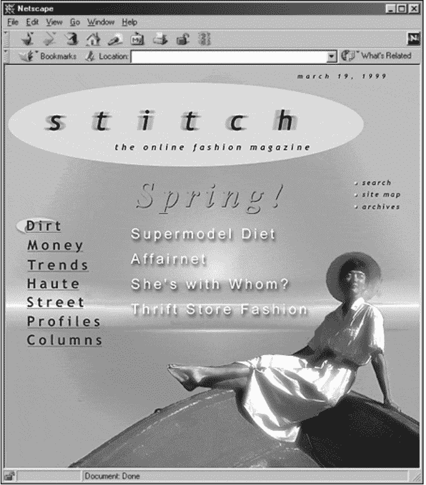

以下是我们的脚本需要实现的不同目标：

- 1. 识别用户正在悬停的主导航分类（例如，"Dirt"、"Street"等）。
- 2. 通过悬停效果高亮该主导航分类。
- 3. 用适当的二级导航子菜单替换默认的文字简介。
- 4. 当用户悬停在二级导航的项目上时，当前被悬停的选择应该高亮显示。
- 5. 当用户移出二级子菜单时，我们希望菜单消失并被默认的文字简介替换；主导航分类应该取消高亮并恢复默认状态。

我们可以通过两种主要方式来拆分菜单图片：我们可以制作一张图片，使用图像映射来设置适当的热点，并在每次悬停分类时替换整幅图片；或者我们可以切割主导航图片，使每个图片都包含在自己的图形中，然后替换当前被悬停的图片。对于我们的目的，第二种方法效果最好。这意味着每个主导航分类都有两个版本：正常版本和高亮版本。同时，这也意味着每个子菜单有多个版本。相关决策方已决定每个子菜单应有四个链接。因此，该子菜单图片将有五个版本：一个正常图片和四个带有各种高亮选择的图片。由于每个子菜单图片上有四个不同的选择，我们需要为其创建一个图像映射。

> <PLUG TYPE="SHAMELESS">

这种子菜单/导航技术在DHTML中要容易大约一百万倍。如果你想了解更多，请查看本系列中的DHTML书籍——*Essential CSS & DHTML for Web Professionals*。该书假设你已经掌握一些HTML和JavaScript知识，适合在你读完本书后阅读。真的。

</PLUG>

对于*Stitch*网站，有七个不同的主导航图片——总共14个主导航图片（每个分类1个正常、1个高亮）。在顶部，我们决定将子菜单限制为每个四个选项，因此每个子菜单需要五张单独的图片。这加起来子菜单图片共35张，总计49张图片。

要管理的图片太多了。这意味着你可以构建无数的`if`语句来跟踪所有内容，或者构建一个为你跟踪所有必要信息的系统。为了让我们的生活更轻松，我们选择后者。而且，由于这是一本内容不断变化的杂志，构建一些易于用新链接甚至新分类更新的代码会更好。

你还应注意，由于这种方法涉及大量图片，确保这些图片的文件大小非常小是明智的，否则会导致漫长的下载时间。我们需要告诉设计师采用简约风格。

## 创建并填充数组以存储数据

我们项目的第一步是创建两个全局变量：`whichMenu`用于跟踪用户最近悬停的主导航分类，以及我们需要显示哪个二级子菜单；`overImage`用于帮助确保我们仅在必要时才关闭图片。

为了跟踪所有图片，我们需要创建一个多维数组，我们将其命名为`section`。到目前为止，我们只接触过一维数组；多维数组的工作方式大致相同，但为我们提供了扩展功能。如果你将一维数组想象成一个文件柜，数组中的每个条目都是存放单条信息的抽屉，那么多维数组就是在每个抽屉中都有几个文件夹。这使得主文件柜中的每个抽屉本身都变成一个文件柜。

在我们的`section`数组中，第一维是七个主分类，每个分类依次持有第二维，用于存储该分类子菜单的所有单独选项。以下是我们构建它的方式；首先定义我们的两个全局变量：

```javascript
<SCRIPT Language="JavaScript">
<!-- Code after this will be ignored by older browsers

var whichMenu=" ";
var overImage = 'no'

...

// Stop hiding the code here -->
</SCRIPT>
```

我们为这两个变量都赋予了默认值，随着我们深入研究脚本，这些默认值会变得更加合理。现在，让我们继续创建我们的数组。

```javascript
<SCRIPT Language="JavaScript ">
<!-- Code after this will be ignored by older browsers

var whichMenu=" ";
var overImage = 'no'

section = new Array(4);

    section['dirt'] = new Array (4)
        section['dirt'][0] = 'supermodel'
        section['dirt'][1] = 'affairnet'
        section['dirt'][2] = 'moss'
        section['dirt'][3] = 'married'

    section['money'] = new Array (4)
        section['money'][0] = 'worldclique'
        section['money'][1] = 'germany'
        section['money'][2] = 'mergers'
        section['money'][3] = 'nmearnings'

    section['trends'] = new Array (4)
        section['trends'][0] = 'tshirts'
        section['trends'][1] = 'sweatshirts'
        section['trends'][2] = 'hats'
        section['trends'][3] = 'mugs'
```

```javascript
section['haute'] = new Array (4)
    section['haute'][0] = 'paris'
    section['haute'][1] = 'gaudy'
    section['haute'][2] = 'taffeta'
    section['haute'][3] = 'royalty'

section['street'] = new Array (4)
    section['street'][0] = 'angry'
    section['street'][1] = 'prison'
    section['street'][2] = 'skater'
    section['street'][3] = 'hip_hop'

section['profiles'] = new Array (4)
    section['profiles'][0] = 'moxon'
    section['profiles'][1] = 'west'
    section['profiles'][2] = 'trinidaddy'
    section['profiles'][3] = 'spurn'

section['columns'] = new Array (4)
    section['columns'][0] = 'column1'
    section['columns'][1] = 'column2'
    section['columns'][2] = 'column3'
    section['columns'][3] = 'column4'

...

// Stop hiding the code here -->
</SCRIPT>
```

让我们仔细看看前面的代码中发生了什么。这是我们添加的第一行：

```javascript
section = new Array(4);
```

这一行对你来说应该很熟悉——我们在Stitch网站的广告商部分使用相同的方法创建了数组。这一行告诉JavaScript运行时引擎创建一个名为section的数组，并将其长度设为4。下一行是我们进入新领域的起点。

```javascript
section['dirt'] = new Array (4)
```

这一行创建了一个新数组，并将其插入到我们的section数组中位于dirt的位置——现在我们迈出了创建多维数组的第一步。然后我们填充了dirt数组。

```javascript
section['dirt'][0] = 'supermodel'
section['dirt'][1] = 'affairnet'
section['dirt'][2] = 'moss'
section['dirt'][3] = 'married'
```


一旦我们设置好`dirt`数组，代码的其余部分就会被创建，并填充那些将用于存放其他六个类别信息的数组。

让我们看看我们分配给`CATEGORY`数组中信息的名称。这些名称具有含义，并且在脚本的后续部分将非常重要。到目前为止，我们总是创建新的`IMAGE`对象来存放用于鼠标悬停效果的图像；对于这个项目，我们将使用另一种方法。当在这个脚本中替换图像时，我们只需将初始图像的`source`属性设置为一个新的路径，而存储在数组中的名称将帮助我们完成这项工作。例如，Dirt部分有一篇题为"Supermodel Diet"的文章，所以当用户将Dirt部分高亮显示且其子菜单出现时，子菜单上的一个选项将是"Supermodel Diet"。现在，如果用户将鼠标悬停在该选项上，我们必须用高亮显示Supermodel选项的图像替换默认子菜单。通过将该图形命名为`supermodel.gif`，我们可以简单地使用存储在数组中的信息，在更改默认子菜单的`source`属性时动态创建gif文件的名称。这在目前看来可能有点令人不知所措，但很快就会变得清晰。

## 创建运行子菜单系统的函数

现在我们已经创建并填充了数组，我们需要创建几个函数来运行我们的子菜单系统。让我们从当我们将鼠标悬停在主导航图像之一时将被调用的函数开始。

```
function mainNavOn (sectionName)
{
    overImage='yes';

    // 确保用户已经悬停在
    // 主导航图像上
    if (whichMenu != " ")
    {
        …
    }
    …
}

// Stop hiding the code here -->
</SCRIPT>
```

首页上的图形高亮方式有很多种，而能够始终判断用户是否悬停在图像上对我们来说非常重要。我们新函数中的第一行代码将帮助我们跟踪这一点。由于此函数仅在用户悬停在主导航图像之一时被调用，我们将变量`overImage`设置为`yes`。

代码中的下一行将帮助我们关闭用户刚刚离开的图像。为此，我们将使用在脚本顶部声明的`whichImage`变量。在函数稍后的位置，我们将重置此变量以包含用户刚刚悬停的区域的名称。当我们进入函数时，`whichImage`变量要么包含用户上次悬停的最后一个类别的名称；如果用户还没有悬停过任何内容，它将仍然保留我们在脚本开始时分配给它的值。我们脚本中的下一行代码是一个`if`语句，只要`whichImage`的值不包含其默认值，它就告诉JavaScript运行时引擎执行下一段代码。

让我们添加将位于`if`语句中的代码，并看看它将做什么。

```
function mainNavOn (sectionName)
{
    overImage='yes';
    // 确保用户已经悬停在
    // 主导航图像上
    if (whichMenu != " ")
    {

        // 取消高亮显示旧的区域名称
        eval ("document." + whichMenu + ".src =
        'images/nav/" + whichMenu + ".gif'");
    }

    …
}

// Stop hiding the code here -->
</SCRIPT>
```

这行新代码是我们将在这个脚本中处理图像替换的第一个实际示例。使用这种方法需要一定的规范，因此仔细查看正在发生的事情会有所帮助。假设用户将鼠标从"Dirt"类别移开；如果是这种情况，变量`whichImage`将包含值`dirt`。让我们看看我们的新行代码使用这个值将如何读取。

```
document.dirt.src = 'images/nav/dirt.gif';
```

上面的行将尝试将`IMAGE`对象`dirt`的source属性更改为位于`images/nav/`目录中的`dirt.gif`图像。为了使此方法有效，我们需要所有主要类别的默认非高亮版本使用以下语法命名：

```
"Name of the Category" + .gif
```

高亮版本的图形也需要在其命名中使用以下语法：

```
"Name of the Category" + _over.gif
```

你现在应该对我们新的图像替换方法有了相当好的理解。如果你能控制用于图像的命名约定，这是一种很好的方法。如果你没有这种控制权，就无法保证它们会被正确命名，因此最好坚持我们一直在使用的方法。

一旦旧的图像被取消高亮显示，我们需要更新`whichMenu`变量以保存用户当前悬停的类别名称，这样我们才能高亮显示图像。

```
function mainNavOn (sectionName)
{
    overImage='yes';

    // 确保用户已经悬停在
    // 主导航图像上
    if (whichMenu != " ")
    {

        // 取消高亮显示旧的区域名称
        eval ("document." + whichMenu + ".src =
            'images/nav/' + whichMenu + ".gif'");
    }

    // 将变量设置为新的悬停项
    whichMenu = sectionName;

    ...
}

// Stop hiding the code here -->
</SCRIPT>
```

在这行新代码中，我们将`whichImage`设置为保存`sectionName`中的值，即用户刚刚悬停的区域的名称。一旦我们完成了这个操作，我们就添加更多新代码来将当前悬停的图像更改为其高亮版本。

```
function mainNavOn (sectionName)
{
    overImage='yes';

    // 确保用户已经悬停在
    // 主导航图像上
    if (whichMenu != " ")
    {
        eval ("document." + whichMenu + ".src =
            'images/nav/' + whichMenu + ".gif'");
    }
```

```
// 将变量设置为新的悬停项
whichMenu = sectionName;

// 高亮显示新图像
eval( "document." + whichMenu + ".src = 'images/nav/" + whichMenu + "_over.gif'");

...
}

// Stop hiding the code here -->
</SCRIPT>
```

这行新代码应该与我们用于关闭之前悬停图像的那行非常相似——唯一的区别是我们已经在gif名称中添加了`_over`。只要我们遵循了正确的命名约定，用户悬停的图像现在应该被高亮显示。

最后，此函数的最后一步是显示相应的子菜单图像。当我们首次显示子菜单时，没有一个次要类别会被高亮显示，所以我们调用该图形的默认版本。

```
function mainNavOn (sectionName)
{
    overImage='yes';

    // 确保用户已经悬停在
    // 主导航图像上
    if (whichMenu != " ")
    {
        eval ("document." + whichMenu + ".src =
        'images/nav/" + whichMenu + ".gif'");
    }

    // 将变量设置为新的悬停项
    whichMenu = sectionName;

    // 高亮显示新图像
    eval( "document." + whichMenu + ".src = 'images/nav/" + whichMenu + "_over.gif'");

    // 显示次要导航图像
    eval("document.submenu.src = 'images/nav/" + whichMenu + "_sec_blank.gif'");

}

// Stop hiding the code here -->
</SCRIPT>
```

所有默认子菜单图像必须具有以下命名语法：

```
"Name of Category" + sec_blank.gif
```

我们将在`submenuOn()`函数中介绍子菜单图像高亮版本的命名语法，该函数将负责高亮显示正确的子菜单类别。

同样，第一步是将变量`overImage`的值设置为`yes`，以便脚本知道用户当前悬停在图像上。

```
function submenuOn (sectionNum)
{
     overImage='yes';

        …

}
```

```
// Stop hiding the code here -->
</SCRIPT>
```

接下来，当有人将鼠标悬停在为子菜单图像映射的区域时，我们希望在开始高亮显示子菜单上的单个项目之前，确保已经悬停了主导航图像之一并且子菜单实际可见。如果用户只是将鼠标悬停在文本说明上，我们不希望任何子菜单弹出。我们可以通过查看`whichMenu`变量的值来检查子菜单是否已经可见。如果变量包含一个区域的名称而不是默认的空白值，那么我们就知道已经悬停了一个主要类别，并且一个次要子菜单正在显示。我们将使用类似于我们第一个函数开头的`if`语句来测试这一点。

```
function submenuOn (sectionNum)
{
     overImage='yes';

     if (whichMenu != " ")
     {
          …
     }
}
```

```
// Stop hiding the code here -->
</SCRIPT>
```

在我们的`if`语句中，我们首先需要确定用户在子菜单图像上悬停的是哪个次要类别。这就是我们的多维数组开始发挥作用的地方。

```
function submenuOn (sectionNum)
{
```


## 高亮图像和导航处理

在前面的代码中，我们使用 `whichMenu` 来指向数组第一层中存储嵌套数组的位置，该数组包含当前选中的主类别的二级类别的信息。`sectionNum` 包含一个数值，对应用户所悬停的二级类别的位置。

如果用户悬停在 Dirt 部分的 "Supermodel Diet" 二级类别上，等式的右边将如下所示：

`section['dirt'][0]`

这将调用数组中该位置的值并返回 `supermodel`，然后将其放入变量 `subSection` 中。

现在我们已经将正确的二级子菜单类别存储在变量中，下一步是将子菜单图形替换为具有正确类别高亮显示的图形。

```javascript
function submenuOn (sectionNum)
{
    overImage='yes';

    if (whichMenu != " ")
    {
        // 确定用户悬停的子节名称
        subSection = section[whichMenu][sectionNum];
        // 替换相应的图像
        eval("document.submenu.src = 'images/nav/" +
        whichMenu + "_" + subSection + "_over.gif'");
    }
}

// 在此处停止隐藏代码 -->
</SCRIPT>
```

与我们所有的其他图像替换一样，我们需要使用特定的命名语法。对于高亮的二级类别，语法如下：

```
"主类别名称" + "二级类别名称" + "_over.gif"
```

我们现在有了两个用于打开各种图像的函数。接下来，我们需要创建函数，以便在用户移开时关闭高亮图像。就像我们第二章的二级页面鼠标悬停效果一样，我们在这里需要一些技巧。我们不希望主导航图像仅因为移过子菜单而关闭，所以我们将使用两个不同的函数。让我们开始第一个函数。

```javascript
function mapOff ()
{
    if (whichMenu != " ")
    {
        ...
    }
}

// 在此处停止隐藏代码 -->
</SCRIPT>
```

再次强调，我们必须做的第一件事是确保在此函数被调用之前，用户确实悬停在某个图形上；因此我们将设置一个 `if` 语句来检查 `whichMenu` 的值。一旦确定可以继续，下一步就是将变量 `overImage` 的值更改为 `no`，因为用户已经移开图像并调用了此函数。

```javascript
function mapOff ()
{
    if (whichMenu != " ")
    {
        overImage = 'no';
        ...
    }
}
// 在此处停止隐藏代码 -->
</SCRIPT>
```

最后一步是放入 `setTimeout` 方法，该方法将等待几秒钟，然后调用我们需要的第二个函数来关闭高亮图像。

```javascript
function mapOff ()
{
    if (whichMenu != ' ')
{
    overImage = 'no';
    setTimeout('mapOff2()',1000);
}

// 在此处停止隐藏代码 -->
</SCRIPT>
```

这行新代码告诉引擎等待 1000 毫秒（1 秒），然后调用我们的第二个“关闭”函数 `mapOff2()`。这段间隔给了用户在取消图像高亮之前移过另一个图形的机会。如果用户只是在子菜单上的二级类别之间移动，则没有必要让主导航图像闪烁开关。这将在第二个“关闭”函数中变得更加清晰，所以让我们开始创建它。

每当用户移过图像时，我们都会将变量 `overImage` 的值设置为 `yes`；我们将使用此变量来测试是否关闭高亮图像。让我们看看 `mapOff2()` 函数的第一步。

```javascript
function mapOff2()
{
    if ((overImage == 'no') && (whichMenu != " "))
    {
        ...
    }
}

// 在此处停止隐藏代码 -->
</SCRIPT>
```

在继续关闭任何图像之前，我们需要确保用户没有在此新函数调用的时间内移过另一个图像。我们设置了一个 `if` 语句来处理这种情况：如果变量 `overImage` 的值为 `no` 并且变量 `whichMenu` 不是其默认值，那么我们可以关闭任何高亮图形。首先，我们将关闭子菜单图形并将其恢复为默认文本块。

```javascript
function mapOff2()
{
    if ((overImage == 'no') && (whichMenu != " "))
    {
        // 恢复为文章的引言呼出图像
        document.submenu.src = "images/nav/sec_blank.gif";
        ...
    }
}

// 在此处停止隐藏代码 -->
</SCRIPT>
```

这行新代码使用了我们在整个脚本中一直使用的方法，子菜单现在应该已关闭，原始文本块已恢复。接下来，我们需要关闭当前高亮的主导航图像。

```javascript
function mapOff2()
{
     if ((overImage == 'no') && (whichMenu != " "))
     {
          // 恢复为文章的引言呼出图像
          document.submenu.src = "images/nav/sec_blank.gif";

          // 将主导航图像切换为
          // 未高亮图像
          eval ( "document." + whichMenu + ".src =
'images/nav/" + whichMenu + ".gif'");
          …
     }
}

// 在此处停止隐藏代码 -->
</SCRIPT>
```

此函数的最后一步是将 `whichMenu` 变量重置为其默认值。

```javascript
function mapOff2()
{
     if ((overImage == 'no') && (whichMenu != " "))
     {
          // 恢复为文章的引言呼出图像
          document.submenu.src = "images/nav/sec_blank.gif";

          // 将主导航图像切换为
          // 未高亮图像
          eval ( "document." + whichMenu + ".src =
'images/nav/" + whichMenu + ".gif'");

          whichMenu = " ";
     }
}

// 在此处停止隐藏代码 -->
</SCRIPT>
```

我们刚刚完成了第二个“关闭”函数。现在我们需要创建一个导航函数，以便在用户点击子菜单二级类别时将其发送到正确的 URL。因为将只有一个图像映射控制所有七个子菜单，我们需要创建一个函数来查看哪个子菜单已打开并选择正确的 URL。

```javascript
function goThere (sectionNum)
{
    if (whichMenu)
    {
        ...
    }
}

// 在此处停止隐藏代码 -->
</SCRIPT>
```

再次强调，与我们所有的函数一样，我们需要做的第一件事是检查并确保当前已选择一个类别——如果用户意外点击了文本块，我们不会想将其发送到其他地方。一旦确定已选择类别，我们就可以着手找出需要将用户发送到哪里，然后将其送达。

```javascript
function goThere (sectionNum)
{
    if (whichMenu)
    {
        subSection = section[whichMenu][sectionNum];
        location.href = whichMenu + "/" + subSection
            + ".html";
    }
}

// 在此处停止隐藏代码 -->
</SCRIPT>
```

第一行新代码深入数组，获取文章页面的名称并将其放入变量 `subSection` 中。然后下一行使用该变量以及 `whichMenu` 中持有的值，为 `DOCUMENT` 对象的 `location` 属性设置新值。

与图像一样，我们依赖于每个类别的内容都在一个与其名称相同的目录中。例如，Dirt 部分中关于 "Supermodel Diets" 的文章位于 `dirt/supermodel.html`。再次强调，这确实节省了编码时间，但您必须确保完全控制文件的命名约定。

只剩最后一步了：我们需要将事件处理程序插入主导航图像的 `<A HREF>` 标签中，然后创建控制子菜单的图像映射并在其中也放入处理程序。


## 插入事件处理器

让我们看一下主导航的 `<A HREF>` 标签，并将事件处理器添加进去。这是主导航图像和子菜单/文字提示图像的代码片段。

```html
<TABLE>
<TR>
<TD>
<A HREF="dirt/index.html"
onMouseOver="mainNavOn('dirt');" onMouseOut="mapOff();">
</A><BR>

<A HREF="money/index.html"
onMouseOver="mainNavOn('money');"
onMouseOut="mapOff();">
</A><BR>

<A HREF="trends/index.html"
onMouseOver="mainNavOn('trends');"
onMouseOut="mapOff();">
</A><BR>

<A HREF="haute/index.html"
onMouseOver="mainNavOn('haute');"
onMouseOut="mapOff();">
</A><BR>

<A HREF="street/index.html"
onMouseOver="mainNavOn('street');"
onMouseOut="mapOff();">
</A><BR>

<A HREF="profiles/index.html"
onMouseOver="mainNavOn('profiles');"
onMouseOut="mapOff();">
</A><BR>

<A HREF="columns/index.html"
onMouseOver="mainNavOn('columns');"
onMouseOut="mapOff()">
</A><BR>
</TD>

<TD>

</TD>
</TR></TABLE>
```

`onMouseOver` 事件处理器应该看起来很熟悉，它们的使用方式与我们其他悬停脚本的处理器相同。`onMouseOut` 处理器略有不同，因为我们没有向函数传递值；这是由于我们处理悬停效果的方式不同。另外请注意，尽管我们为子菜单/文字提示图像使用了图像映射，我们仍然需要在 `` 标签中为其添加一个 `NAME` 属性。现在，让我们来看最后的事件处理器：那些位于图像映射内部的处理器。这个图像映射必须包含四个热点——每个子菜单选项对应一个。

```html
<MAP NAME="submenuMap">
    <AREA COORDS="11,66,110,82" SHAPE="rect"
          HREF="JavaScript:goThere(3);"
          onMouseOver="submenuOn(3);"
          onMouseOut="mapOff();">
    <AREA COORDS="10,48,58,63" SHAPE="rect"
          HREF="JavaScript:goThere(2);"
          onMouseOver="submenuOn(2);"
          onMouseOut="mapOff();">
    <AREA COORDS="9,31,71,44" SHAPE="rect"
          HREF="JavaScript:goThere(1);"
          onMouseOver="submenuOn(1);"
          onMouseOut="mapOff();">
    <AREA COORDS="9,10,84,26" SHAPE="rect"
          HREF="JavaScript:goThere(0);"
          onMouseOver="submenuOn(0);"
          onMouseOut="mapOff();">
</MAP>
```

每个热点需要三个事件处理器。`HREF` 字段中的 `onClick` 处理器将调用我们的 `goThere()` 函数，该函数负责在用户点击选项时将其引导到正确的位置。

`onMouseOver()` 处理器调用 `submenuOn()` 函数，该函数负责在用户悬停于某个选项上时高亮显示正确的图像。我们传递给函数的值对应于我们之前填充的多维数组中第二层级条目的位置。最后，`onMouseOut` 处理器调用我们的第一个关闭函数——`mapOff()`。

好吧，信不信由你，就是这样！数组可能会变得非常大且笨重，但它们使编码变得更加容易，并允许你轻松地更改数据，例如链接和部分名称。我们在本脚本中涵盖了相当多的内容，所以让我们最后回顾一下我们完成了什么以及是如何完成的。

## 回顾脚本

1.  首先，我们创建并填充了两个变量 `whichImage` 和 `overImage`，我们稍后在脚本中需要它们来跟踪用户悬停的内容。
2.  接下来，我们定义并填充了一个多维数组，用于保存使子菜单系统工作所需的所有信息。
3.  在构建完数组后，我们创建了运行脚本所需的五个函数。

第一个函数 `mainNavOn()` 负责关闭之前悬停过的主导航图像，同时高亮显示新的主导航图像并调出正确的二级子菜单图像。

```javascript
function mainNavOn (sectionName)
{
    overImage='yes';
    // 确保用户已经悬停在
    // 主导航图像上
    if (whichMenu != " ")
    {
        // 取消高亮显示旧的部分名称
        eval ("document." + whichMenu + ".src =
        'images/nav/' + whichMenu + '.gif'");
    }

    // 将变量设置为新的悬停状态
    whichMenu = sectionName;

    // 高亮显示新图像
    eval( "document." + whichMenu + ".src = 'images/
    nav/' + whichMenu + '_over.gif'");

    // 调出二级导航图像
    eval("document.submenu.src = 'images/nav/' +
    whichMenu + '_sec_blank.gif'");
}
```

接下来，我们创建了 `submenuOn()` 函数，该函数确定哪个子菜单处于活动状态，并为该子菜单调出正确的高亮二级分类。

```javascript
function submenuOn (sectionNum)
{
    overImage='yes';

    if (whichMenu != " ")
    {
        // 确定用户正在悬停的
        // 子部分名称
        subSection = section[whichMenu][sectionNum];

        // 替换相应的图像
        eval("document.submenu.src = 'images/nav/' +
        whichMenu + "_" + subSection + "_over.gif'");
    }
}
```

第三个和第四个函数共同负责在用户移开鼠标时关闭不同的子菜单图像。这两个函数中的第一个，即 `mapOff()` 函数，将 `overImage` 变量设置为 'no'，然后使用计时器在一秒钟后调用我们的第二个函数。`mapOff2()` 函数随后确保用户仍然没有停留在图形上，然后关闭所有高亮图形。

```javascript
function mapOff ()
{
    if (whichMenu != " ")
    {
        overImage = 'no';
        setTimeout('mapOff2()',1000);
    }
}

function mapOff2 ()
{
    if (overImage == 'no')
    {
        eval("document." + whichMenu + ".src =
        'images/nav/' + whichMenu + '.gif'");
        eval("document.submenu.src =
        'images/nav/sec_blank.gif'");
    }
}
```

在构建了用于开启和关闭悬停效果的数组和函数之后，我们需要一个函数来处理当用户点击选项时将其引导到正确的位置。这就是 `goThere()` 函数。

```javascript
function goThere (sectionNum)
{
    var sectionName = whichMenu;
    var subSection = section[sectionName][sectionNum];
    var location = sectionName + "/" + subSection + ".html";

    window.location = location;
}
```

最后，我们需要一种在页面加载时初始化脚本的方法。我们创建了 `initialize()` 函数，用于设置菜单的初始状态。

```javascript
function initialize ()
{
    whichMenu = " ";
    overImage = 'no';
}

window.onload = initialize;
```


function mapOff2()
{
    if ((overImage == 'no') && (whichMenu != " "))
    {
        // 恢复文章的
        // 引用标注图片
        document.submenu.src = "images/nav/sec_blank.gif";

        // 将主导航图片
        // 切换为未高亮显示的图片
        eval ( "document." + whichMenu + ".src = 'images/nav/'" + whichMenu + ".gif'");

        whichMenu = " ";
    }
}

当用户点击图像映射的热点时，`goThere()` 函数会将用户导航到正确的 URL。它会检查选择了哪个主导航类别，然后进入数组并提取需要发送用户去的次级部分的名称，最后将用户发送到那里。

function goThere (sectionNum)
{
    if (whichMenu != " ")
    {
        subSection = section[whichMenu][sectionNum]
        location.href = whichMenu + "/" + subSection + ".html"
    }
}

// 在此处停止隐藏代码 -->
</SCRIPT>

54. 我们的最后一步是向主导航图像的 `<A HREF>` 标签添加事件处理程序，为受翻转效果影响的图像添加 `name` 属性，然后向运行子菜单的图像映射中插入必要的处理程序。

```
<TABLE>
<TR>
<TD>
<A HREF="dirt/index.html"
onMouseOver="mainNavOn('dirt');" onMouseOut="mapOff();">
</A><BR>

<A HREF="money/index.html"
onMouseOver="mainNavOn('money');"
onMouseOut="mapOff();">
</A><BR>

<A HREF="trends/index.html"
onMouseOver="mainNavOn('trends');"
onMouseOut="mapOff();">
</A><BR>

<A HREF="haute/index.html"
onMouseOver="mainNavOn('haute');"
onMouseOut="mapOff();">
</A><BR>

<A HREF="street/index.html"
onMouseOver="mainNavOn('street');"
onMouseOut="mapOff();">
</A><BR>

<A HREF="profiles/index.html"
onMouseOver="mainNavOn('profiles');"
onMouseOut="mapOff();">
</A><BR>

<A HREF="columns/index.html"
onMouseOver="mainNavOn('columns');"
onMouseOut="mapOff()">
</A><BR>
</TD>

<TD>

</TD>
</TR></TABLE>

<MAP NAME="submenuMap">
    <AREA COORDS="22,10,278,48" SHAPE="rect"
        HREF="JavaScript:goThere(0);"
        onMouseOver="submenuOn(0);"
        onMouseOut="mapOff();">
    <AREA COORDS="22,48,278,79" SHAPE="rect"
        HREF="JavaScript:goThere(1);"
        onMouseOver="submenuOn(1);"
        onMouseOut="mapOff();">
    <AREA COORDS="22,79,278,116" SHAPE="rect"
        HREF="JavaScript:goThere(2);"
        onMouseOver="submenuOn(2);"
        onMouseOut="mapOff();">
    <AREA COORDS="22,116,278,157" SHAPE="rect"
        HREF="JavaScript:goThere(3);"
        onMouseOver="submenuOn(3);"
        onMouseOut="mapOff();">
</MAP>
```

我们在本章中学习了一些新概念，同时也加深了对前面章节中讨论过的概念的理解。让我们看看本章涵盖了哪些内容：

- 多维数组以及如何定义、填充和从中提取数据。
- 处理图像翻转效果的新方法。

## 回顾

老板一眼看到你为主页设计的概念就同意了。本章的脚本只是展示了你可以将 JavaScript 运用到何种程度的一个例子。我们结合了前面章节中的许多元素，创建了一个真正处于 Web 编程前沿的页面。但不要认为这是 JavaScript 最酷或最复杂的应用——远非如此。随着 DHTML 和样式表开始流行，JavaScript 新增的功能确实令人惊叹。我们已经走了很长一段路，并创建了一些很棒的脚本，即使它们是为两个虚构的公司而做的。现在是时候运用你所学的知识，在自己的网站上进行实践了。

## 高级项目

1.  创建一个脚本，用于随机轮换横幅图像，并让每个图形链接到不同的 URL。
2.  创建一个脚本，通过加密表单字段的数据来建立安全的表单提交。
3.  创建一个脚本，将用户信息数据保存到 Web 服务器上的文件中，以便在用户返回时提供定制页面。
4.  对于主页上有大量图形的网站，创建一个加载屏幕并编写一个脚本，该脚本将加载主页所需的所有图形，以便主页本身能快速加载。

## 附录 A. 事件处理程序

*JavaScript 本质上是一种事件驱动的语言；也就是说，用 JavaScript 创建的脚本通常是由于用户或浏览器本身引发的事件而执行的。我们可以通过使用事件处理程序来利用这些事件。本附录旨在提供一个地方，让你可以查阅所有不同的事件处理程序、它们的语法及其用途描述。*

## onAbort

**描述：** 当用户通过点击链接或按下停止按钮来中止图像的加载时，会触发此处理程序。

**语法：** onAbort="要执行的代码"

**实现于：** Navigator 3.0

**使用于：** Image

## onBlur

**描述：** 当框架、窗口或表单元素失去焦点时，会触发此处理程序。

**语法：** onBlur="要执行的代码"

**实现于：** Navigator 2.0/3.0

**使用于：** Button, Checkbox, FileUpload, Layer, Password, Radio, Reset, Select, Submit, Text, Textarea, Window

## onChange

**描述：** 当 Select、Text 或 Textarea 表单字段失去焦点且其值已更改时，会触发此处理程序。

**语法：** onChange="要执行的代码"

**实现于：** Navigator 2.0/3.0

**使用于：** FileUpload, Select, Text, Textarea

## onClick

**描述：** 当点击表单对象时，或当处理程序位于 `<HREF>` 标签内且图像或文本链接被点击时，会触发此处理程序。

**语法：** onClick="要执行的代码"

**实现于：** Navigator 2.0/3.0

**使用于：** Button, Checkbox, document, Link, Radio, Reset, Submit

## onDblClick

**描述：** 当双击表单对象时，或当处理程序位于 `<HREF>` 标签内且链接被双击时，会触发此处理程序。

**语法：** onDblClick="要执行的代码"

**实现于：** Navigator 4.0

**使用于：** document, Link

## onDragDrop

**描述：** 当用户将对象（如文件）拖放到 Navigator 窗口时，会触发此处理程序。

**语法：** onDragDrop="要执行的代码"

**实现于：** Navigator 4.0

**使用于：** Window

## onError

**描述：** 当加载文档或图像导致错误时，会触发此处理程序。

**语法：** onError="要执行的代码"

**实现于：** Navigator 3.0

**使用于：** Image, Window

## onFocus

**描述：** 当窗口、框架、框架集或表单元素获得焦点时，会触发此处理程序。

**语法：** onFocus="要执行的代码"

**实现于：** Navigator 2.0/3.0/4.0

**使用于：** Button, Checkbox, FileUpload, Layer, Password, Radio, Reset, Select, Submit, Text, Textarea, Window

## onKeyDown

**描述：** 当用户按下某个键时，会触发此处理程序。

**语法：** onKeyDown="要执行的代码"

**实现于：** Navigator 4.0

**使用于：** document, Image, Link, Textarea

## onKeyPress

**描述：** 当用户按下某个键时，会触发此处理程序。

**语法：** onKeyPress="要执行的代码"

**实现于：** Navigator 4.0

**使用于：** document, Image, Link, Textarea

## onKeyUp

**描述：** 当用户释放某个键时，会触发此处理程序。


## onKeyUp

**描述：** 当用户释放键盘上的按键时触发此处理程序。

**语法：** onKeyUp = "要执行的代码"

**实现于：** Navigator 4.0

**适用于：** document, Image, Link, Textarea

## onLoad

**描述：** 当所有内容完成加载到窗口或框架集中的所有框架时触发此处理程序。也可以由图像加载触发。

**语法：** onLoad = "要执行的代码"

**实现于：** Navigator 2.0/3.0

**适用于：** Image, Layer, Window

## onMouseDown

**描述：** 当用户按下鼠标按钮时触发此处理程序。

**语法：** onMouseDown = "要执行的代码"

**实现于：** Navigator 4.0

**适用于：** Button, document, Link

## onMouseMove

**描述：** 当用户移动光标时触发此处理程序。

**语法：** onMouseMove = "要执行的代码"

**实现于：** Navigator 4.0

**适用于：** 无

## onMouseOut

**描述：** 当用户将光标移出对象时触发此处理程序。

**语法：** onMouseOut = "要执行的代码"

**实现于：** Navigator 3.0

**适用于：** Layer, Link

## onMouseOver

**描述：** 当用户将光标移到对象上时触发此处理程序。

**语法：** onMouseOver = "要执行的代码"

**实现于：** Navigator 2.0/3.0

**适用于：** Layer, Link

## onMouseUp

**描述：** 当用户释放鼠标按钮时触发此处理程序。

**语法：** onMouseUp = "要执行的代码"

**实现于：** Navigator 4.0

**适用于：** Button, document, Link

## onMove

**描述：** 当脚本或用户移动窗口或框架时触发此处理程序。

**语法：** onMove = "要执行的代码"

**实现于：** Navigator 4.0

**适用于：** Window

## onReset

**描述：** 当用户重置表单时触发此处理程序。

**语法：** onReset = "要执行的代码"

**实现于：** Navigator 3.0

**适用于：** Form

## onSelect

**描述：** 当用户从文本框或文本域表单字段中选择文本时触发此处理程序。

**语法：** onSelect = "要执行的代码"

**实现于：** Navigator 2.0

**适用于：** Text, Textarea

## onSubmit

**描述：** 当用户提交表单时触发此处理程序。

**语法：** onSubmit = "要执行的代码"

**实现于：** Navigator 2.0

**适用于：** Form

## onUnload

**描述：** 当用户退出文档时触发此处理程序。

**语法：** onUnload = "要执行的代码"

**实现于：** Navigator 2.0

**适用于：** Window

# 附录 B. JavaScript 对象

*由于 JavaScript 是一种面向对象的语言，如果不了解该语言支持的对象，很难进行大量操作，因此我们决定将此参考内容纳入。本附录将 JavaScript 中的不同对象分为五类，并列出这些对象及其属性和方法。*

## 核心对象

核心对象是指不与 JavaScript 对象层次结构相关联的对象，客户端和服务器端应用程序都可以使用这些对象。

### Array

**描述：** 数组是一种对象，允许你存储数据集，数据集的每个元素都存储在其唯一的位置，随后可以被引用或检索。

**创建语法：**

```javascript
new Array(arrayLength); 或
new Array(element0, element1, ..., elementN);
```

**参数：**

- arrayLength—数组所需的初始长度。
- elementN—将存储在数组中的初始值集。数组长度将设置为参数的数量。

**实现于：** Navigator 3.0

**属性：** index, input, length, prototype

**方法：** concat, join, pop, push, reverse, shift, slice, splice, toString, unshift

### Boolean

**描述：** Boolean 对象用作布尔值的容器。

**创建语法：** `new Boolean(value)`

**参数：**

- value—Boolean 对象的初始值。

**实现于：** Navigator 3.0

**属性：** prototype

**方法：** toString

### Date

**描述：** Date 对象使你能够处理日期和时间。

**创建语法：**

```javascript
new Date(); 或
new Date("month day, year hours:minutes:seconds") 或
new Date(yr_num, mo_num, day_num, hr_num, min_num, sec_num)
```

**参数：**

- day, hours, minutes, month, seconds, year—如果使用，日期的这些不同部分将是字符串值。
- day_num, hr_num, min_num, mo_num, sec_num, yr_num—如果使用，日期的这些不同部分将是整数。

**实现于：** Navigator 2.0/3.0

**属性：** prototype

**方法：** getDate, getDay, getHours, getMinutes, getMonth, getSeconds, getTime, getTimezoneOffset, getYear, parse, setDate, setHours, setMinutes, setMonth, setSeconds, setTime, setYear, toGMTString, toLocaleString, UTC

### Function

**描述：** 此对象包含 JavaScript 代码行，当访问该对象时执行这些代码。

**创建语法：** `function name(arg1, arg2, ...argN) {functionBody}`

**参数：**

- arg1, arg2, ...argN—一组字符串值，可用于存储传递给函数的数据。
- functionBody—要由函数解释的 JavaScript 命令集。

**实现于：** Navigator 3.0

**属性：** arguments, arity, caller, prototype

**方法：** toString

### Math

**描述：** 此对象包含有助于进行高级数学运算的方法的属性。

**创建语法：** 无—Math 对象是 JavaScript 引擎的内置部分，可以在不创建它的情况下调用或引用。

**实现于：** Navigator 2.0

**属性：** E, LN10, LN2, LOG10E, LOG2E, PI, SQRT1, SQRT2

**方法：** abs, acos, asin, atan, atan2, ceil, cos, exp, floor, log, max, min, pow, random, round, sin, sqrt, tan

### Number

**描述：** 这是一个包含原始数值的对象。它在处理数值时很有用。

**创建语法：** `new Number(value);`

**参数：**

- value—要包含在对象中的数值。

**实现于：** Navigator 3.0/4.0

**属性：** MAX_VALUE, MIN_VALUE, NaN, NEGATIVE_INFINITY, POSITIVE_INFINITY, prototype

**方法：** toString

### Object

**描述：** 这是内置的 JavaScript 对象，JavaScript 中的所有对象都派生自此对象。

**创建语法：** `new Object();`

**参数：** 无

**实现于：** Navigator 2.0/3.0

**属性：** constructor, prototype

**方法：** eval, toString, unwatch, valueOf, watch

### RegExp

**描述：** 此对象包含一个正则表达式，可用于查找、替换和操作字符串中的匹配项。

**创建语法：** `new RegExp("pattern", "flags");`

**参数：**

- pattern—正则表达式中包含的文本。
- flags—标志有三种可能的值：全局匹配 (g)、忽略大小写 (i)、全局匹配和忽略大小写 (gi)。

**实现于：** Navigator 4.0

**属性：** $n, $, $*, $&, $+, `$'`, global, ignoreCase, input, lastIndex, lastMatch, lastParen, leftContext, multiline, rightContext, source

**方法：** compile, exec, test

### String

**描述：** 此对象包含构成字符串的一系列字符。

**创建语法：** `new String(string);`

**参数：**

- string—一个字符串。

**实现于：** Navigator 2.0/3.0/4.0

**属性：** length, prototype

**方法：** anchor, big, blink, bold, charAt, charCodeAt, concat, fixed, fontcolor, fontsize, fromCharCode, indexOf, italics, lastIndexOf, link, match, replace, search, slice, small, split, strike, sub, substr, substring, sup, toLowerCase, toUpperCase

## 文档对象

本节涵盖 Document 对象及其所有相关对象。

### Anchor

**描述：** 此对象包含一个字符串，该字符串是 HTML 页面中包含的超链接的目标。

**创建语法：** `theString.anchor(nameAttribute)`

**参数：**

- theString—一个字符串对象。
- NAME—指定名称的字符串。

**创建方式：** HTML 文档中的 `<A>` 标签或调用 String.anchor 方法都可以创建 Anchor 对象。

**实现于：** Navigator 1.0

**事件处理程序：** 无

**属性：** 无

**方法：** watch, unwatch

### Applet

**描述：** 此对象包含 HTML 页面中包含的所有 Java 小程序。

**创建语法：** 无

**创建方式：** HTML applet 标签。

**实现于：** Navigator 3.0

**属性：** 小程序的所有公共属性都可以通过该对象使用。

**方法：** 所有公共方法。

### Area

**描述：** 此对象表示图像映射中的可点击区域。

**创建语法：** `areaObject = areaString.anchor(nameAttribute)`


**实现于：** Navigator 3.0

### document

**描述：** 此对象包含当前文档的属性。

**创建语法：** 不适用

**创建者：** 当运行时引擎读取页面时，此对象由 HTML 文档的 `<BODY>` 标签创建。

**实现于：** Navigator 2.0/3.0/4.0

**事件处理器：** onClick, onDblClick, onKeyDown, onKeyPress, onKeyUp, onMouseDown, onMouseUp

**属性：** alinkColor, anchors, applets, bgColor, cookie, domain, embeds, fgColor, formName, forms, images, lastModified, layers, linkColor, links, plugins, referrer, title, URL, vlinkColor

**方法：** captureEvents, close, getSelection, handleEvent, open, releaseEvents, routeEvent, write, writeln

### Image

**描述：** 此对象包含一个图像，并允许访问该图像的属性。

**创建语法：** new Image(width, height)

**参数：**

- width—图像的宽度。
- height—图像的高度。

**创建者：** 图像构造函数或 HTML 文档中的 `` 标签。

**实现于：** Navigator 3.0/4.0

**事件处理器：** onAbort, onError, onKeyDown, onKeyPress, onKeyUp, onLoad

**属性：** border, complete, height, hspace, lowsrc, name, prototype, src, vspace, width

**方法：** handleEvent

### Layer

**描述：** 此对象包含 HTML 文档中的一个图层，并允许访问该图层的属性。

**创建语法：** 不适用

**创建者：** HTML 文档中的 `<LAYER>` 或 `<ILAYER>` 标签将创建一个 Layer 对象。

**实现于：** Navigator 4.0

**事件处理器：** onBlur, onFocus, onLoad, onMouseOut, onMouseOver

**属性：** above, background, below, bgColor, clip.bottom, clip.height, clip.left, clip.right, clip.top, clip.width, document, left, name, pageX, pageY, parentLayer, siblingAbove, siblingBelow, src, top, visibility, zIndex

**方法：** captureEvents, handleEvent, load, moveAbove, moveBelow, moveBy, moveTo, moveToAbsolute, releaseEvents, resizeBy, resizeTo, routeEvent

### Link

**描述：** 此对象包含 HTML 文档中的一个链接，并允许访问该链接的属性。

**创建语法：** theString.link(href)

**参数：**

- theString—一个字符串对象。
- HREF—指定 URL 的字符串。

**创建者：** HTML 文档中的 `<A HREF>` 或 `<AREA>` 标签，或调用 String.link 方法将创建一个 Link 对象。

**实现于：** Navigator 2.0/3.0/4.0

**事件处理器：** onClick, onDblClick, onKeyDown, onKeyPress, onKeyUp, onMouseDown, onMouseOut, onMouseOver, onMouseUp

**属性：** hash, host, hostname, href, pathname, port, protocol, search, target, text

**方法：** handleEvent

### Window 对象

本节涵盖 Window 对象及其所有相关对象。

#### Frame

**描述：** 此对象包含一个框架，该框架在 HTML 框架集中指定。每个框架实际上都是一个 Window 对象；Frame 对象仅为方便起见而使用。

**创建语法：** 不适用

**创建者：** HTML 文档中的 `<FRAME>` 或 `<FRAMESET>` 标签将创建一个 Frame 对象。

**实现于：** Navigator 2.0/3.0

**事件处理器：** 参见 Window 对象。

**属性：** 参见 Window 对象。

**方法：** 参见 Window 对象。

#### History

**描述：** 此对象包含一个数组，其中保存用户在该窗口内访问过的所有 URL。

**创建语法：** 不适用

**创建者：** 这是一个内置 JavaScript 对象。

**实现于：** Navigator 2.0/3.0

**事件处理器：** 不适用

**属性：** current, length, next, previous

**方法：** back, forward, go

#### Location

**描述：** 此对象包含当前 URL。

**创建语法：** 不适用

**创建者：** 这是一个内置 JavaScript 对象。

**实现于：** Navigator 2.0/3.0

**事件处理器：** 不适用

**属性：** hash, host, hostname, href, pathname, port, protocol, search

**方法：** reload, replace

#### screen

**描述：** 此对象包含关于显示屏幕和颜色的信息。

**创建语法：** 不适用

**创建者：** 这是一个由运行时引擎创建的内置 JavaScript 对象。

**实现于：** Navigator 4.0

**事件处理器：** 不适用

**属性：** availHeight, availWidth, height, pixelDepth, width

**方法：** 不适用

#### Window

**描述：** 此对象描述一个浏览器窗口或框架。

**创建语法：** 不适用

**创建者：** 此对象由每个 `<BODY>`、`<FRAMESET>` 和 `<FRAME>` HTML 标签创建，或由 Window 对象的 open 方法创建。

**实现于：** Navigator 2.0/3.0/4.0

**事件处理器：** onBlur, onDragDrop, onError, onFocus, onLoad, onMove, onResize, onUnload

**属性：** closed, defaultStatus, document, frames, history, innerHeight, innerWidth, length, location, menubar, name, opener, outerHeight, outerWidth, pageXOffset, pageYOffset, parent, personalbar, scrollbars, self, status, statusbar, toolbar, top, window

**方法：** alert, back, blur, captureEvents, clearInterval, clearTimeout, close, confirm, disableExternalCapture, enableExternalCapture, find, focus, forward, handleEvent, home, moveBy, moveTo, open, print, prompt, releaseEvents, resizeBy, resizeTo, routeEvent, scroll, scrollBy, scrollTo, setInterval, setTimeout, stop

### Form 对象

本节涵盖 Form 对象及其所有相关对象。

#### Button

**描述：** 此对象包含 HTML 表单中的一个按钮。

**创建语法：** 不适用

**创建者：** TYPE 属性指定为 "button" 的 `<INPUT>` 标签。

**实现于：** Navigator 2.0/3.0/4.0

**事件处理器：** onBlur, onClick, onFocus, onMouseDown, onMouseUp

**属性：** form, name, type, value

**方法：** blur, click, focus, handleEvent

#### Checkbox

**描述：** 此对象包含 HTML 表单中的一个复选框。

**创建语法：** 不适用

**创建者：** TYPE 属性指定为 "checkbox" 的 `<INPUT>` 标签。

**实现于：** Navigator 2.0/3.0/4.0

**事件处理器：** onBlur, onClick, onFocus

**属性：** checked, defaultChecked, form, name, type, value

**方法：** blur, click, focus, handleEvent

#### FileUpload

**描述：** 此对象包含 HTML 表单中的一个文件上传元素。

**创建语法：** 不适用

**创建者：** TYPE 属性指定为 "file" 的 `<INPUT>` 标签。

**实现于：** Navigator 2.0/3.0/4.0

**事件处理器：** onBlur, onChange, onFocus

**属性：** form, name, type, value

**方法：** blur, focus, handleEvent, select

#### Form

**描述：** 此对象包含一个 HTML 表单以及该表单中包含的所有对象。

**创建语法：** 不适用

**创建者：** 当运行时引擎在 HTML 文档中遇到 `<FORM>` 标签时，会创建此对象。

**实现于：** Navigator 2.0/3.0/4.0

**事件处理器：** onReset, onSubmit

**属性：** action, elements, encoding, length, method, name, target

**方法：** handleEvent, reset, submit

#### Hidden

**描述：** 此对象包含 HTML 表单中的一个隐藏文本对象。

**创建语法：** 不适用

**创建者：** TYPE 属性指定为 "hidden" 的 `<INPUT>` 标签。

**实现于：** Navigator 2.0/3.0

**事件处理器：** 不适用

**属性：** form, name, type, value

**方法：** 不适用

#### Option

**描述：** 此对象包含下拉选择菜单中的单个选项。

**创建语法：** new Option(text, value, defaultSelected, selected)

**参数：**

- text—设置菜单列表中要显示的文本。
- value—设置当表单提交且选择了该选项时返回给服务器的值。
- defaultSelected—设置最初为 true（即被选中）的选项。
- selected—设置选项的当前状态。

**创建者：** `<OPTION>` 标签或使用 Option 构造函数。

**实现于：** Navigator 2.0/3.0

**事件处理器：** 不适用

**属性：** defaultSelected, selected, text, value

**方法：** 不适用

#### Password

**描述：** 此对象包含 HTML 表单中的一个文本字段，该字段隐藏其值。

**创建语法：** 不适用

**创建者：** TYPE 属性指定为 "password" 的 `<INPUT>` 标签。


 **实现于：** Navigator 2.0/3.0/4.0

**事件处理器：** onBlur, onFocus

**属性：** defaultValue, form, name, type, value

**方法：** blur, focus, handleEvent, select

#### 单选按钮

**描述：** 此对象包含HTML表单中一组按钮内的一个单选按钮。

**创建语法：** 不适用

**创建方式：** 由TYPE属性指定为"radio"的<INPUT>标签创建。

**实现于：** Navigator 2.0/3.0/4.0

**事件处理器：** onBlur, onClick, onFocus

**属性：** checked, defaultChecked, form, name, type, value

**方法：** blur, click, focus, handleEvent

#### 重置按钮

**描述：** 此对象包含HTML表单中的一个重置按钮。

**创建语法：** 不适用

**创建方式：** 由TYPE属性指定为"reset"的<INPUT>标签创建。

**实现于：** Navigator 2.0/3.0/4.0

**事件处理器：** onBlur, onClick, onFocus

**属性：** form, name, type, value

**方法：** blur, click, focus, handleEvent

#### 下拉选择框

**描述：** 此对象包含HTML表单中的一个选择下拉菜单。

**创建语法：** 不适用

**创建方式：** 由插入HTML表单中的<SELECT>标签创建。

**实现于：** Navigator 2.0/3.0/4.0

**事件处理器：** onBlur, onChange, onFocus

**属性：** form, length, name, options, selectedIndex, type

**方法：** blur, focus, handleEvent

#### 提交按钮

**描述：** 此对象包含HTML表单中的一个提交按钮。

**创建语法：** 不适用

**创建方式：** 由TYPE属性指定为"submit"的<INPUT>标签创建。

**实现于：** Navigator 2.0/3.0/4.0

**事件处理器：** onBlur, onClick, onFocus

**属性：** form, name, type, value

**方法：** blur, click, focus, handleEvent

#### 文本框

**描述：** 此对象包含HTML表单中的一个文本字段。

**创建语法：** 不适用

**创建方式：** 由TYPE属性指定为"text"的<INPUT>标签创建。

**实现于：** Navigator 2.0/3.0/4.0

**事件处理器：** onBlur, onChange, onFocus, onSelect

**属性：** defaultValue, form, name, type, value

**方法：** blur, focus, handleEvent, select

#### 多行文本框

**描述：** 此对象包含HTML表单中的一个多行输入文本字段。

**创建语法：** 不适用

**创建方式：** 由<TEXTAREA>标签创建。

**实现于：** Navigator 2.0/3.0/4.0

**事件处理器：** onBlur, onChange, onFocus, onKeyDown, onKeyPress, onKeyUp, onSelect

**属性：** defaultValue, form, name, type, value

**方法：** blur, focus, handleEvent, select

## 浏览器对象

本节介绍包含浏览器特定属性的对象。

### MimeType

**描述：** 此对象包含浏览器支持的一种MIME类型。

**创建语法：** 不适用

**创建方式：** 在浏览器加载时自动创建。

**实现于：** Navigator 3.0

**属性：** description, enabledPlugin, suffixes, type

**方法：** 不适用

### navigator

**描述：** 此对象包含关于用户浏览器的信息。

**创建语法：** 不适用

**创建方式：** 在浏览器加载时自动创建。

**实现于：** Navigator 2.0/3.0/4.0

**属性：** appCodeName, appName, appVersion, language, mimeTypes, platform, plugins, userAgent

**方法：** javaEnabled, plugins.refresh, preference, taintEnabled

### Plugin

**描述：** 此对象包含用户浏览器上安装的一个插件。

**创建语法：** 不适用

**创建方式：** 在浏览器加载时自动创建。

**实现于：** Navigator 3.0

**属性：** description, filename, length, name

**方法：** 不适用
