# Macromedia Dreamweaver MX 2004 设计必备指南（第二版）

## 设计基础

### JavaScript 二级

#### 请学生注意

开始前请阅读此说明。

#### 字体与资源文件

在完成本书中的大多数项目之前，您需要从 Prentice Hall 网站下载字体和资源文件。请咨询您的导师以获取访问这些文件的最佳方式，或直接按照以下说明操作。

如果您打算将这些文件保存到外部磁盘，请确保在继续操作前将其插入相应的驱动器。

1. 打开网络浏览器，访问`http://www.prenhall.com/essentials`。
2. 选择您的教材或系列以访问配套网站。我们建议您将此页面加入书签，因为它包含可能在课堂上使用的其他 Prentice Hall 资源的链接。
3. 单击“学生资源”链接。
4. 从可用资源列表中找到您需要的文件，然后单击活动链接进行下载。注意：我们为 Macintosh 用户提供了`.sea`文件，为使用 Windows 操作系统的用户提供了`.exe`文件。
5. 下载正确的文件后，双击该文件以开始自解压过程。系统将提示您选择一个特定于您的书籍的文件夹位置。有关如何组织文件和文件夹的详细说明，请参阅“学生信息与资源”（第 xiv 页）。

需要帮助？请在线联系技术支持：`http://247.prenhall.com`

#### 关于系列编辑

Ellenn Behoriam 是 Against The Clock, Inc. (ATC) 的总裁兼创始人，该公司是全国领先的内容提供商之一。Ellenn 和她的员工成功制作了图形艺术行业最受欢迎和最受欢迎的许多书籍及相关系列。这些作品包括 *Electronic Cookbook*、*Workflow Reengineering*、*Teams and the Graphic Arts*、*Adobe Photoshop Creative Techniques*、*Adobe Illustrator Creative Techniques* 和 *QuarkXPress 6: Creating Digital Documents*，后者是 QuarkXPress 培训师认证计划的基础。与 Prentice Hall/Pearson Education 联合出版的 Against The Clock 系列包含超过 26 个书目，专注于图形和计算机艺术行业的应用。

Against The Clock 还与 Pearson 合作开发了 *Companion for the Digital Artist* 系列。这些书目侧重于具体和基本的创意概念，包括设计、网站开发、摄影、排版、色彩理论和文案写作。这些简洁紧凑的著作提供了核心概念和技能，可补充任何特定于应用程序的教育，无论使用哪种教科书来教授程序技能。

在 Ellenn 的领导和指导下，ATC 目前正在为新的 *Essentials for Design* 系列开发超过 20 个书目。她的员工和长期建立的专业教育工作者、印刷商、印前专家、工作流程工程师和企业领导者网络，极大地增强了 ATC 提供当前、有意义和有效的书籍、在线教程以及企业对企业的性能和工作流程增强计划的能力。

#### 关于作者

Michael Brooks 是夏洛特艺术学院互动媒体设计系的讲师；他也是多媒体设计公司 Web-Answers 的联合所有者。Michael 拥有阿巴拉契亚州立大学的公共管理硕士学位。他的专业职责要求他花大量时间从事`JavaScript`和 Flash 工作。他对网页设计的商业和战略方面有着深入的了解。

Michael 在北卡罗来纳州西部的山麓地区长大，喜欢摄影，偶尔教授商业管理和政治学课程。

Drew Kinney 为每个项目设计并编写了 Portfolio Builder 练习，以及各种项目结束练习。他还对有关 Cookie 和 XHTML 合规性的部分做出了重要贡献。Drew 曾担任过几部著名电影和电视节目的艺术总监，目前是夏洛特艺术学院互动媒体设计系的讲师。

## 致谢

我们要感谢那些为《设计精要》系列辛勤工作的专业撰稿人、设计师、编辑和教育工作者。

同时感谢专注的教学专家们：John Griffin；夏洛特艺术学院艺术系系主任 Kyle Tait；佛罗里达技术学院教授兼系主任 Warren Kendrick；Lindsey Allen；以及 Dean Bagley。你们富有洞察力的评论和专业知识无疑为《设计精要》系列的成功做出了贡献。

我们还要感谢 Julian Rickards 和 Dean Bagley 提供的技术协助；感谢 John Dunning 贡献的艺术作品；以及夏洛特艺术学院的同学们，他们测试了练习并提供了极好的反馈。

感谢校对编辑、制作流程中最后一环的 Laurel Nelson-Cucchiara，感谢她的帮助，确保我们每个人都表达了想要表达的意思。

特别感谢制作设计师、技术顾问、同谋伙伴兼朋友 Erika Kendra。

也要感谢 Melissa Sabella、Anne Garcia、Jodi McPherson 和 Vanessa Nuttry——我们携手开启这项新事业，感谢你们的耐心。

## 如何使用本书

Prentice Hall 出版的《精要》系列课程软件，立足于所有类型学生的实践与职业需求。《精要》系列采用“边做边学”的方法，鼓励你在通过实践教程扩展技能的同时，掌握与应用相关的概念。因此，它由一系列模块化的课程组成，这些课程围绕着一系列编号的、清晰、简洁且易于复习的步骤式操作流程构建。

《精要》系列图书按项目划分。一个项目涵盖应用功能的一个领域（或几个密切相关的领域）。每个项目由几个与该主题相关的课程组成。每节课都以易于吸收和记忆的可管理模块，呈现一个特定的任务或一组密切相关的任务。

《精要》系列图书中的每个元素都旨在最大化你的学习体验。下一页开始列出了《精要》项目元素的列表，以及每个元素如何帮助你的描述。要了解更多关于每个书本元素背后的理念以及如何最大限度地利用它们，请阅读以下使用指南。

# 使用指南

**项目目标。** 从目标开始，为你设定短期的、可实现的目标。每个项目都以一个与步骤式教程标题紧密匹配的目标列表开始。 ►

##### 目标

在本项目中，您将学习如何：

- 使用字符串方法
- 整合数组方法
- 创建和填充数组
- 拆分和连接字符串
- 对数组进行排序
- 使用多维数组

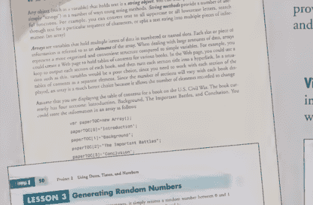

**为什么要这样做？** 每个项目开头的导言材料概述了为什么这些任务和操作流程很重要。 ◄

**视觉摘要。** 一系列插图介绍了你在每个项目中将要探索的新工具、对话框和窗口。 ►

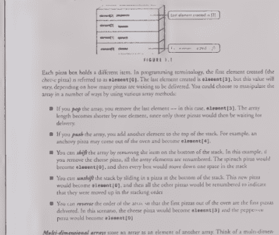

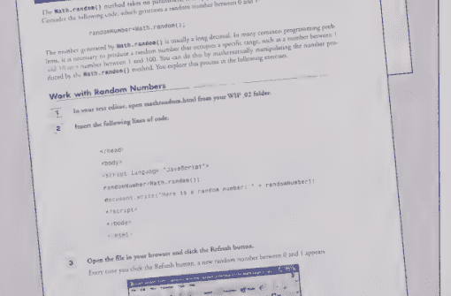

**步骤式教程。** 实践教程让你在“做”中学习，并包含带编号的、加粗的、分步操作说明。 ◄

这些简短的故障排除注释帮助您快速有效地预判或解决常见问题。

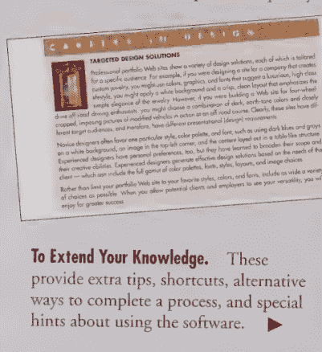

这些功能提供建议、技巧和资源，将助您迈向成功的职业道路。

这些提供额外的技巧、快捷方式、完成流程的替代方法，以及使用该软件的特别提示。

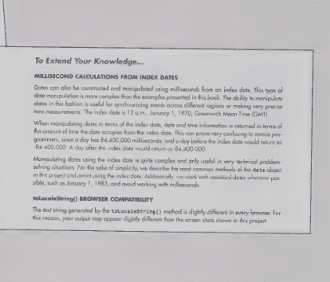

丰富的项目末尾练习强调实践技能的培养。您将找到三个层次的强化训练：技能训练、挑战和作品集构建。

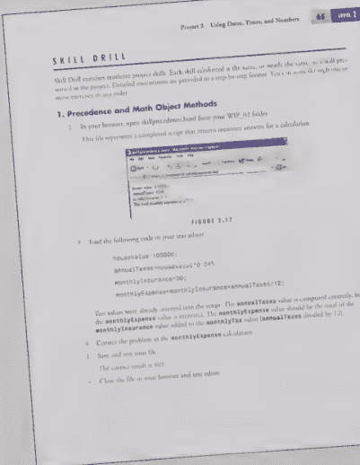

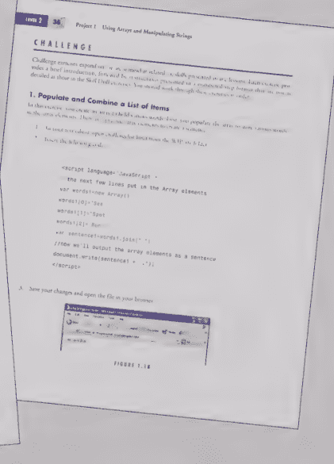

**作品集构建。** 在每个项目结束时，这些练习要求用创造性的解决方案来解决问题，以巩固该项目的内容。

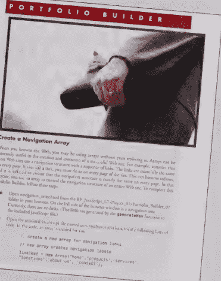

## 创建导航数组

当您浏览网页时，您可能在不知不觉中使用了数组。数组在网站的创建和执行中可能非常有用。例如，考虑到大多数网站都使用带有链接序列的导航结构。这些链接在每个页面上基本相同。如果您添加一个链接，必须将其添加到网站的每个页面。这可能会变得繁琐，而且很容易出现错误，导致导航结构显示不正确。在本练习中，您将使用数组来控制整个网站的导航结构。要完成此作品集构建，请按以下步骤操作。

1. 在浏览器中打开`RF_JavaScript_L2/01`文件夹中的`navigation_array.html`。在浏览器窗口的左侧是一个导航栏。目前，还没有链接。按钮由`generator.js`文件生成。
2. 打开`generator.js`文件。当前代码应如下列代码所示。（注意：代码由您自己创建。）

    ```javascript
    // create a new array for navigation links
    // new array creates navigation labels
    linkText = new Array("Home", "Products", "Services", "Locations", "About Us", "Contact");
    ```

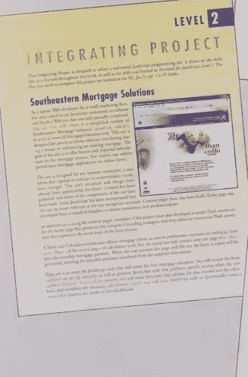

## 综合项目

### Southeastern Mortgage Solutions

作为一家小型营销公司的初级 Web 开发人员，您被要求使用`JavaScript`命令来增强并完成最近完成的一个网站。该网站`www.southeasternmortgagesolutions.com`是为考虑购房或再融资现有抵押贷款的潜在客户设计的。该网站的目标是提供房屋贷款信息，并允许潜在的抵押贷款申请人在线提交初步的抵押贷款申请。

该网站设计为单一浏览器分辨率；它使用可扩展或收缩以适应屏幕尺寸的表格。网站的结构和设计已经获得客户批准。内容已经收集完毕，网站的许多组件已经构建完成。网站中已融入一些`JavaScript`，用于为导航结构创建悬停效果。内容页面根据标准模板开发，以确保一致性和专业性。

除了构建内容页面外，项目团队成员还开发了主页的示例 Flash 动画，用于推广公司的贷款策略，并添加了一个交互式 Flash 元素，展示贷款流程的各个步骤。

工具和计算器子部分允许抵押贷款客户获得抵押贷款初步估算。将有多个计算器页面，但初始网站只包含一个页面——一个允许根据提供的信息计算每月抵押贷款的计算器。

您的工作是编写将创建第一个抵押计算器的`JavaScript`代码。您将确保表单使用安全准确的脚本，以及验证输入到各种表单字段中的数据的通用`JavaScript`函数。完成必要的计算后，您将使用`JavaScript`代码动态创建一个显示计算结果的表单。

**综合项目。** 综合项目旨在反映现实世界的图形设计工作，借鉴您在这本书中学到的技能。

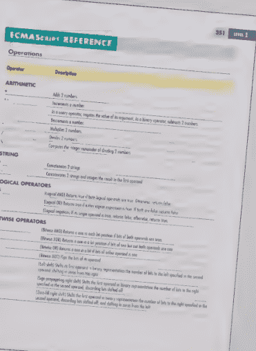

### ECMAScript 参考

## 运算符

| 运算符 | 说明 |
| --- | --- |
| **算术** | |
| `+` | 将 2 个数字相加 |
| `-` | 减去一个数 |
| `*` | 以一元形式时，对其参数的值取反；以二元形式时，将 2 个数字相减 |
| `/` | 除以一个数 |
| `%` | 将 2 个数字相除（返回余数） |
| `++` | 数字递增 |
| `--` | 数字递减 |
| **字符串** | |
| `+` | 连接 2 个字符串 |
| `+=` | 连接 2 个字符串并将结果赋值给第一个操作数 |
| **逻辑运算符** | |
| `&&` | 逻辑与；如果两个逻辑操作数都为 true，则返回 true。否则，返回 false |
| `\|\|` | 逻辑或；如果一个或两个逻辑表达式为 true，则返回 true。如果两个都为 false，则返回 false |
| `!` | 逻辑非；如果单个操作数为 true，则返回 false；否则返回 true |
| **位运算符** | |
| `&` | （按位与）如果两个操作数的位都为 1，则在每个位位置返回 1 |
| `\|` | （按位或）如果一个或两个操作数的位为 1，则在位位置上返回 1 |
| `^` | （按位异或）如果位不同，一个为 0 另一个为 1，则在位位置上返回 1 |
| `~` | （按位非）翻转其操作数的位 |
| `<<` | （左移）将第一个操作数的位向左移动第二个操作数指定的位数，从右侧移入零 |
| `>>` | （算术右移）将第一个操作数的位向右移动第二个操作数指定的位数，丢弃移出的位，并从左侧移入最左边位的副本 |
| `>>>` | （零填充右移）将第一个操作数的位向右移动第二个操作数指定的位数，丢弃移出的位，并从左侧移入零 |

**任务指南。** 这些图表位于每本书的末尾，列出完成常见程序的替代方法，并提供方便实用的参考工具。

### 学生信息和资源

**配套网站 (`www.prenhall.com/essentials`)。** 该特定于本教材的网站为学生提供额外信息和练习，以巩固他们的学习。功能包括：额外的项目末尾强化材料、在线学习指南、轻松访问*所有*资源文件，以及更多、更多精彩内容！

在完成本书中的项目之前，您需要从 Prentice Hall 配套网站下载资源文件。请向您的教师咨询访问这些文件的最佳方式，或者直接遵循以下说明：

1. 从打开的 Web 浏览器，访问`http://www.prenhall.com/essentials`。
2. 选择您的教材或系列以访问配套网站。建议您将此页面添加书签，因为它链接到您可能在课堂上使用的其他 Prentice Hall 资源。
3. 点击学生资源链接。学生资源区域中的所有文件都以`.sea`文件形式提供给 Macintosh 用户，以`.exe`文件形式提供给使用 Windows 操作系统的用户。这些文件不需要任何额外的软件即可打开。
4. 点击您所使用的平台（Macintosh 或 Windows）的从这里开始链接。
5. 下载正确的文件后，双击该文件以开始自动解压过程。系统将提示您选择特定于本书的文件夹位置；您可以将其解压到硬盘或可移动磁盘/驱动器。

从这里开始文件包含两个文件夹：

- **`RF_JavaScript_L2`。** 您可以将此文件夹放在硬盘或可移动磁盘/驱动器上。
- **`Work_In_Progress`。** 您可以将此文件夹放在硬盘或可移动磁盘/驱动器上。

6. 从可用资源列表中找到您需要的项目文件，然后点击活动链接进行下载。本书中的每个项目都有单独的文件（例如，`Project_01`、`Project_02`等）。
7. 下载正确的文件后，双击该文件以开始自动解压过程。系统将提示您选择特定于您的书籍的文件夹位置。您应该将特定项目的文件夹解压到从从这里开始文件中提取的`RF_JavaScript_L2`文件夹中。

**资源光盘。** 如果你正在使用资源光盘，所有你需要的字体和文件都已提供在光盘上。资源文件按照项目特定的文件夹组织（例如`Project_01`、`Project_02`等），这些文件夹包含在`RF_JavaScript_L2`文件夹中。你可以直接从光盘上操作，也可以在开始练习之前将文件复制到你的硬盘驱动器上。

在开始本书中的项目或课程之前，你应该将`Work_In_Progress`文件夹从资源光盘复制到你的硬盘驱动器或可移动磁盘/驱动器上。

**资源文件。** 资源文件按项目特定的文件夹组织，并采用便于跨平台兼容的命名方式。单词之间用下划线分隔，所有文件名均包含小写三字母扩展名。例如，如果要求你在项目 2 中打开文件`graphics.eps`，该文件可以在`RF_JavaScript_L2/Project_02`文件夹中找到。我们在早期的项目中会频繁重复这些操作指引。

**Work In Progress 文件夹。** 此文件夹包含本书中每个项目的单独文件夹（例如`WIP_01`、`WIP_02`等）。当练习要求你保存文件时，你应该将文件保存到当前正在处理的项目的相应文件夹中。

本书中的练习经常建立在你之前已完成的工作之上。在每个练习结束时，你会被指示保存你的工作，然后关闭文件或继续下一个练习。如果被指示继续但你的时间有限，你可以在一个逻辑节点处停下来，保存文件，之后再返回到你停止的地方。在这种情况下，你需要从相应的`WIP`文件夹中打开文件，并在同一个文件上继续工作。

**字体排印惯例。** 计算机编程代码以等宽字体显示，效果如上所示。在许多情况下，你只需要更改或输入特定的代码片段；在这些情况下，你需要输入或更改的代码以第二种颜色显示，效果如上所示。

**技术说明。** 微软目前计划对 Windows 和 Internet Explorer 进行各种安全升级，以解决客户端脚本语言（包括`JavaScript`）的安全问题，其将其称为 Active X 控件。其中一些升级可能会严重干扰合法的脚本代码。完成本书中的练习可能需要调整浏览器的安全设置。

### 教师资源

**教师资源中心。** 此 DVD-ROM 包含每个应用程序的完整教师手册，格式为 Microsoft Word。学生数据文件和已完成的解决方案文件也在此 DVD-ROM 上。教师手册包含这些文件的参考指南，以方便教师使用。关于每个项目的更多信息的 PowerPoint 幻灯片也可供课堂使用。

**配套网站 (`www.prenhall.com/essentials`)。** 教师可以在配套网站上下载教师资源 CD-ROM 上提供的所有资源。

**TestGen 软件。** `TestGen`是一个测试生成程序，让你可以查看和轻松编辑试题库中的题目，将它们转移到试卷中，并以适合你教学情况的各种格式打印试卷。该程序还提供了许多用于组织和显示试题库及试卷的选项。内置的随机数和文本生成器使其非常适合创建多版本试卷。强大的搜索和排序功能让你可以轻松定位题目，并按你喜欢的顺序排列它们。


QuizMaster 也包含在此软件包中，使学生能够在局域网上使用 TestGen 创建的试卷进行测试。TestGen 内置的 QuizMaster 实用程序让教师可以查看学生记录并打印各种报告。使用 TestGen 创建试卷非常简单，试卷可以轻松上传到 WebCT、Blackboard 和 CourseCompass。

Prentice Hall 已与每个领先的在线平台提供商建立了密切的合作关系：WebCT、Blackboard 以及我们自己的 Pearson CourseCompass。

**OneKey。** OneKey 让你在一个地方获得最好的教学和学习资源。*Essentials for Design* 的 OneKey 包含你学生完成课外作业所需的一切，按章节方便地组织，以强化和应用他们在课堂上和从课本中学到的内容。OneKey 也是你规划和管理课程所需的一切。所有教师资源集中在一个地方，以最大限度地提高你的效率，并最大限度地减少你的时间和精力。OneKey 带来便利、简洁和成功。


**WebCT 和 Blackboard。** 这些定制开发的远程学习课程中的每一个都在课程管理系统中提供练习、样例测验和试卷，该系统提供班级管理工具以及根据教师意愿自定义这些材料的能力。


**CourseCompass。** CourseCompass 是一个由 Blackboard 提供支持的动态、交互式在线课程管理工具。它让教授在 15 分钟或更短时间内创建自己的课程，预装的高质量内容可包括测验、试卷、讲座材料和交互式练习。


**基于绩效的培训与评估：Train & Assess IT。** Prentice Hall 在一个产品中提供基于绩效的培训与评估——Train & Assess IT。


培训组件提供计算机辅助教学，学生可用于预览、学习和复习图形设计应用技能。通过 Web 或 CD-ROM 交付，Train IT 提供交互式多媒体和计算机辅助培训，以增强课堂学习效果。内置的诊断测试不仅根据学生的测试结果，还根据课程所选的特定教材来建议学习路径。

评估组件提供计算机辅助测试，与 Train IT 共享相同的用户界面，用于评估学生对软件中特定主题的知识，包括 Photoshop、InDesign、Illustrator、Flash 和 Dreamweaver。它在面向任务、基于绩效的环境中进行评估，以展示学生对这些主题的熟练程度和理解。评估比 Train IT 中的测试更为全面，Assess IT 为教师提供更多管理功能，为学生提供更多题目。Assess IT 还使教授能够让学生免修课程、将学生分配到合适的课程中，以及评估技能水平。

# 前言

互联网令人难以置信的增长和广泛普及，往往掩盖了那些有用的、有趣的、引人入胜的（在某些情况下甚至是令人不安的）网页背后的技术。然而，有一个事实是确定的：如今的网站访客期望视觉质量、导航完整性，以及——越来越重要的——交互性。

设计、构建、填充、发布和维护世界级网站的现实世界远比大多数人想象的要复杂得多。这不是一个单一的过程，而是许多较小的程序和任务组成的工作流程，通常由两个不同的团队分担。第一个团队包括设计师、文案、艺术家、插画师、摄影师、摄像师和其他负责创造性方面的人员。另一个团队则具有技术性质——负责编码、测试、数据库设置和持续的网站管理。虽然确实有一些人既能设计引人入胜的网站又能编写/测试代码，但这个群体相对较小。通常，创造性的一方决定网站的外观，而技术方则将设计变为实际可运行的成果——这就是 JavaScript 发挥作用的地方。

JavaScript 是一种被普遍接受的脚本语言，负责你在网络上遇到的大部分主动和交互式技术。在你使用 Macromedia Dreamweaver、Microsoft FrontPage 或 Adobe GoLive 将 JavaScript 代码应用到页面设计之前，你必须理解这门语言本身。对于那些需要完全控制网站功能的人来说，熟悉 JavaScript 至关重要。

由于这是一本高级（第二级）书籍，我们假设你已经掌握了 *Essentials for Design: JavaScript Level 1* 中的概念。如果你同时具备 HTML 和网站建设的基础知识，你会发现本书中的课程易于学习和理解。

尽管 JavaScript 语言已广泛标准化，但跨平台的不兼容性仍然存在。虽然编写在每个可用浏览器上都能正确运行的完全兼容代码是一个值得追求的目标，但目前还无法实现。我们努力提供了在尽可能多的浏览器上兼容的代码，但一些用户无疑仍会遇到兼容性问题。我们为此不便提前致歉。为确保最佳效果，我们建议你使用 Windows XP Professional 和 Internet Explorer 6.0，这是我们在编写本书时使用的平台。

# 使用数组与操作字符串

## 学习目标

在本项目中，你将学习如何：

- 使用字符串方法
- 创建并填充数组
- 对数组排序
- 应用数组方法
- 拆分与连接字符串
- 使用多维数组

## 为什么我要学习这个？

任何保存文本的对象（如变量）都是一个*字符串对象*。你可以使用字符串方法以多种方式操作字符串对象（或简称“字符串”）。*字符串方法*提供了许多实用功能。例如，你可以将文本转换为全大写或全小写字母，在文本中搜索特定的字符序列，或者将一个文本字符串拆分成多个信息片段（即一个数组）。

*数组*是用于在编号或命名的槽位中保存多个数据项的变量。每个槽位或信息片段被称为数组的一个*元素*。在处理大量数据时，与简单变量相比，数组提供了一种更有序、更便捷的结构。例如，你可以创建一个网页来存放各种书籍的目录。在网页中，你可以使用循环来输出每本书的每个章节，然后将每个章节标题转换为超链接。在这种情况下，变量将是一个糟糕的选择，因为你需要将目录的每个章节作为单独的元素来处理。由于每个书籍的章节数量会有所不同，因此数组是一个更好的选择，因为它允许记录的元素数量发生变化。

假设你正在展示一本关于美国内战的书籍的目录。这本书目前有四个部分：引言、背景、重要战役和结论。你可以按如下方式将信息存储在数组中：

```javascript
var paperTOC=new Array();
paperTOC[0]="Introduction";
paperTOC[1]="Background";
paperTOC[2]="The Important Battles";
paperTOC[3]="Conclusion";
```

当你继续为这本书添加章节时，章节数量将继续变化。使用数组可以很容易地确定章节数量。例如，你可以使用`length`属性访问数组中的元素数量，该属性适用于任何数组。

```javascript
paperTOC.length;
```

许多方法允许你以多种方式操作数组。数组最常被用作存储和操作列表的便捷方式。例如，JavaScript 使用数组来跟踪 HTML 标签，包括链接和图像。使用数组方法，你可以像操作其他数组一样操作这些对象。例如，你可以访问网页中显示的第一个图像的属性，或删除网页上创建的最后一个超链接。

随着你完成本项目的课程，你将学习如何创建数组、操作数组、应用数组方法，以及将数组添加到你的 JavaScript 代码中。使用数组的能力通常可以让你以一种有序、易于理解的方式将大量数据集成到网页中。你将在整个项目中掌握这些技巧。

## 可视化摘要

将变量想象成临时存放信息的盒子。运用这个类比，你可以将数组想象成一叠盒子（变量）。每个盒子可以存放不同的物品，但这些物品在某种程度上可能是相关的。作为一个抽象的例子，假设你在一家比萨店工作，你的老板要求你创建并装箱四个不同的比萨，如下图所示。

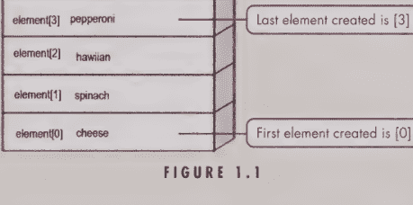

图 1.1

每个比萨盒装着不同的物品。在编程术语中，第一个创建的元素（奶酪比萨）被称为`element[0]`。最后一个创建的元素是`element[3]`，但这个值会根据等待送达的比萨数量而变化。你可以选择通过使用各种数组方法以多种方式操作数组：

- 如果你`pop`数组，你会移除最后一个元素——在这个例子中是`element[3]`。数组长度会减少一个元素，因为此时只有三个比萨等待送达。
- 如果你`push`数组，你会在栈顶添加另一个元素。例如，一个凤尾鱼比萨可能刚出炉，成为`element[4]`。
- 你可以通过移除栈底的物品来`shift`数组。在这个例子中，如果你移除奶酪比萨，所有数组元素都会重新编号。菠菜比萨将成为`element[0]`，然后每个盒子在栈中的位置都会下移一格。
- 你可以通过滑入一个比萨到栈底来`unshift`栈。这个新的比萨将成为`element[0]`，然后所有其他比萨都会重新编号，以表明它们在堆叠顺序中向上移动了。
- 你可以`reverse`数组的顺序，这样先出炉的比萨就是第一个被送达的。在这种情况下，奶酪比萨将成为`element[3]`，而意大利辣香肠比萨将成为`element[0]`。

**多维数组**将一个数组作为另一个数组的元素进行存储。可以将多维数组想象成存放在一个盒子里的盒子。

## 第 1 课 使用字符串方法

在编程术语中，字符串就是文本。字符串通常用引号（单引号或双引号）括起来。在 *JavaScript 设计基础：第一级* 中，你已经在诸如以下语句中有限地接触了字符串和字符串方法：

```javascript
myVar="Hi World!";
document.write(string.toUpperCase());
```

JavaScript 中的任何字符串都被视为一个对象，可以通过方法和属性进行操作。JavaScript 中的字符串对象允许你为了多种常见目的而操作字符串。

### `toUpperCase()` 和 `toLowerCase()`

你可能记得，`toUpperCase()`方法返回全大写字母的字符串。你可能已经猜到，你可以使用`toLowerCase()`方法返回全小写字母的文本字符串。

```javascript
name="ELLEN";
lowerName=name.toLowerCase();
```

### `charAt()`

`charAt()`方法从文本字符串的指定位置返回一个字符。`charAt()`方法接受一个参数，即要返回的字母的位置。以下语句将名为`invoiceNumber`的变量中的第三个字符赋值给一个名为`deptNumber`的新变量：

```javascript
deptNumber=invoiceNumber.charAt(2);
```

请记住，JavaScript 从位置零 (0) 开始对文本字符串中的字母进行编号。在字符串`"hat"`中，位置`0`的字母是`"h"`，位置`1`的字母是`"a"`，位置`2`的字母是`"t"`。

### `indexOf()`

`indexOf()`方法允许你在一个字符串中搜索一个子字符串。例如，以下代码行在名为`articleTitle`的变量中查找短语`"Axis of Evil"`。

```javascript
articleTitle="Bush and the Axis of Evil: a New World View";
var phraseLocation=articleTitle.indexOf("Axis of Evil");
document.write("phrase found at location  " + phraseLocation);
```

如果找到子字符串，此方法返回子字符串的位置。如果未找到子字符串，该方法返回一个负一 (-1) 的值。在简单的脚本中使用上述代码会产生以下结果。

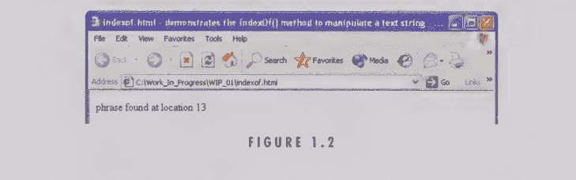

图 1.2

### `lastIndexOf()`

`lastIndexOf()`方法与`indexOf()`方法几乎完全相同，但有一个显著区别：它从字符串的末尾开始，向后搜索指定的子字符串。这一点很重要，如果子字符串在指定文本中出现多次的话。`indexOf()`方法返回子字符串在文本中第一次出现的位置，而`lastIndexOf()`返回子字符串在文本中最后一次出现的位置。

```javascript
var phraseLocation=articleTitle.lastIndexOf("Axis of Evil");
```

`indexOf()`方法和`lastIndexOf()`方法都返回短语或字符在字符串中的位置。这两个方法从指定字符串的两端开始搜索，但返回的位置始终被指定为从字符串开头算起的位置，并且这两个方法在找到指定的子字符串时都会停止。

### `substring()`

`substring()`方法从较大的字符串中提取一个子字符串。要使用此方法，你必须传递要提取的子字符串的起始点，或者必须传递要提取的子字符串的起始点和结束点。假设你正在创建一个变量，如下列代码所示：

```javascript
var bookTitle="All the Presidents Men";
```

你可以使用`substring()`方法从原始字符串中提取一个新字符串，从第八个位置开始：

```javascript
document.write(bookTitle.substring(7));
```

此语句输出文本`"Presidents Men"`。你也可以使用以下语句提取从位置 8 到位置 18 的所有文本：

```javascript
document.write(bookTitle.substring(7,17));
```

## 第二级 项目 1 使用数组和操作字符串

### 使用 `charAt()` 方法

1. 将`RF_JavaScript_L2>Project_01`文件夹的内容复制到`Work_In_Progress>WIP_01`文件夹中。

   从现在起，我们简称`RF_JavaScript_L2>Project_01`文件夹为`Project_01`文件夹，简称`Work_In_Progress>WIP_01`文件夹为`WIP_01`文件夹。

2. 在你的文本编辑器中，打开`WIP_01`文件夹中的`charat.html`。

   该文件使用以下语句创建了三个变量：

   ```javascript
   firstName="Kyle";
   middleName="Alfred";
   lastName="Tait";
   ```

3. 在前三个变量下方添加以下语句，再创建三个变量来保存每个变量的首字母。

   ```javascript
   firstName="Kyle";
   middleName = "Alfred";
   lastName = "Tait";

   // **** insert code here ****
   firstInitial=firstName.charAt(0);
   middleInitial=middleName.charAt(0);
   lastInitial=lastName.charAt(0);
   </script>
   </body>
   ```

### 拓展你的知识……

#### `CONCAT()` 方法

`concat()`方法是一个将数组内容连接成单个文本字符串的方法。

4. 添加以下语句以向用户输出结果。

   ```javascript
   ...
   firstInitial=firstName.charAt(0);
   middleInitial=middleName.charAt(0);
   lastInitial=lastName.charAt(0);
   document.write("Your initials are " + firstInitial + middleInitial + lastInitial);
   </script>
   </body>
   ...
   ```

5. 保存你的更改，并在你的网络浏览器中打开该文档。

   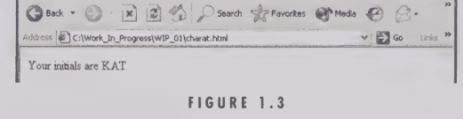

   **图 1.3**

6. 关闭你在网络浏览器和文本编辑器中的文件。

## 第 2 课 创建和填充数组

数组类似于变量，因为它为信息提供了一个临时存储空间。简单来说，数组是一个可以容纳多个值的变量。你已经知道 JavaScript 会为各种对象创建数组。例如，`window`数组代表所有`window`对象的实例。如果你想向创建的第二个`window`对象发送文本，可以编写如下语句：

```javascript
window[1].document.write("some text");
```

在创建内部使用的数组时，JavaScript 总是从`[0]`作为数组的第一个条目开始。每个条目都由一个称为**索引**的数字表示，该数字始终放在方括号内。JavaScript 还允许你创建自己的数组，这类似于创建变量。使用伪代码，你可以通过编写以下语句来创建一个空数组：

```javascript
arrayName=new Array(number of elements);
```

## 项目 1 使用数组和操作字符串

### `array()` 构造方法

在*设计基础：JavaScript 第 1 级*中，你了解了`array()`构造方法——创建一个新的`array()`对象的方法。如果你没有指定参数，此方法只是创建一个空的`array()`对象。无需指定数组的长度，这是有利的，因为你可能无法准确预测所需的大小。你可以在新的数组语句中不包含任何参数来创建一个未指定长度的数组：

```javascript
groceryList=new Array();
```

当你指定长度时，该方法会创建一个具有指定元素数量的新`array()`对象：

```javascript
groceryList=new Array(10);
```

你也可以在创建`array()`对象时插入值，如下语句所示：


```javascript
groceryList = new Array("milk", "butter", "soy beans");
```

数组可以由文本或数字（带或不带小数位）组成。数组条目也可以由布尔（`true` 或 `false`）值组成。由于 JavaScript 被设计成在使用数据时具有灵活性，你可以在同一个数组中混合多种类型的数据。换句话说，在同一个数组中，一个元素可以是文本，另一个可以是数字。

在 JavaScript 中，数组被认为是一个对象。与其他对象类似，数组具有属性，例如`length`。数组还具有方法，使你可以通过多种方式轻松操作数组，包括向数组添加数据。将数据插入数组的过程称为填充数组。

### 使用带编号的数组元素

假设你想用值填充一个数组，可以输入如下语句：

```javascript
groceryList[0] = "milk";
groceryList[1] = "butter";
groceryList[2] = "soy beans";
groceryList[3] = "tofu";
groceryList[4] = "chicken feet";
```

与变量类似，你可以随时通过分配新值来更改列表项：

```javascript
groceryList[2] = "ice cream";
```

你也可以使用简单的语句输出数组元素内的数据，例如：

```javascript
document.write(groceryList[1]);
```

`length`属性允许你确定数组内的元素数量。例如，以下语句返回数字“5”，因为`groceryList`数组中有五个元素。

```javascript
document.write(groceryList.length);
```

到目前为止，你已经将文本字符串分配给了数组元素。将数字放入数组元素很简单，只需编写如下语句：

```javascript
testScore[1] = 96;
```

你也可以在创建新数组时输入多个值：

```javascript
var testScores = new Array(89, 63, 99, 78, 45);
```

即使你没有指定每个元素的位置，第一个元素将放置在位置`[0]`，第二个元素在位置`[1]`，依此类推。此方法只是表示向数组中输入数据的更短方式。

### 应用带名称的数组元素

你可以用数字以外的方式为数组元素命名。例如：

```javascript
groceryList["meat"] = "beef";
groceryList["items"] = 10;
groceryList["vegetable"] = "carrots";
```

你可以通过编写如下语句输出其中一个字段的信息：

```javascript
document.write(groceryList["meat"]);
```

通常，人们更容易记住名字而不是数字，但为数组元素命名可能有缺点。例如，你可能想设计一个循环来打印数组中的每个元素。使用命名元素使这项任务变得更加困难。

大多数程序员通常更喜欢使用带编号的元素而不是带名称的元素。程序员通常也倾向于为一个带编号的元素保留元素名称，另一个带编号的元素保留值。

## 创建并使用一个简单的数组

1. 在你的文本编辑器中，打开`WIP_01`文件夹中的`simplearray.html`。

2. 找到注释`// **** insert code here ****`。

3. 插入以下语句来创建一个新数组。

```html
...
<body>
<script language="JavaScript">
// **** insert code here ****
var testScores = new Array();
</script>
</body>
...
```

4. 使用以下赋值语句为各个数组元素分配数字。

```html
...
<body>
<script language="JavaScript">
// **** insert code here ****
var testScores = new Array();
testScores[0] = 56;
testScores[1] = 88;
testScores[2] = 100;
</script>
</body>
...
```

5. 添加以下代码以输出数组元素的值。

```html
...
testScores[0] = 56;
testScores[1] = 88;
testScores[2] = 100;
document.write("Test score one is " + testScores[0] + "<br>");
document.write("Test score two is " + testScores[1] + "<br>");
document.write("Test score three is " + testScores[2] + "<br>");
</script>
</body>
...
```

6. 在你的文本编辑器中保存文件，并在浏览器中打开它。

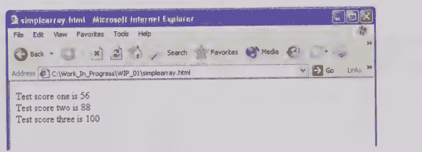

**图 1.4**

7. 从你的脚本中删除以下代码行。

```javascript
testScores[0] = 56;
test_scores[1] = 88;
testScores[2] = 100;
```

在下一步中，你将以不同的方式分配值。

### 拓展你的知识

#### 浏览器中的数组支持

数组在 JavaScript 1.0 中不受支持，在旧版浏览器（如 Netscape 第 2 版或 Internet Explorer 第 3 版）中可能无法工作。

## 第 3 课 数组排序

`sort()`方法允许你使用选择的任何排序过程对`array()`对象的内容进行排序。尽管`sort()`方法通常比其他描述的方法更复杂（它需要一些 JavaScript 函数和条件语句的知识），但使用`sort()`方法可以相当简单。例如，假设你使用以下代码行创建并填充一个数组：

```javascript
var myArray = new Array();
myArray[0] = 68;
myArray[1] = 77;
myArray[2] = 94;
myArray[3] = 12;
myArray[4] = 32;
```

你可以通过编写以下语句快速地将数组元素从最低到最高排序：

```javascript
myArray.sort();
```

如果数组由文本字符串组成，此语句也会将元素按字母顺序排序。`sort()`方法将列表中的每个项目与列表中的下一个项目进行比较。如果项目顺序不对，该方法会交换它们在数组中的位置。此过程持续进行，直到每个项目都在正确的位置。

8. 找到创建数组的代码行，并将其更改为以下内容。

9. 保存你的更改并刷新浏览器。结果应与之前相同。

10. 关闭你在文本编辑器和浏览器中的文件。

```html
...
<body>
<script language="JavaScript">
// **** insert code here ****
var testScores = new Array(56, 88, 100);
document.write("Test score one is " + testScores[0] + "<br>");
document.write("Test score two is " + testScores[1] + "<br>");
document.write("Test score three is " + testScores[2] + "<br>");
...
```

`sort()`方法最有趣的功能在于它允许开发者修改排序过程，从而可以实现各种类型的排序。要修改排序过程，开发者必须在`sort()`方法中指定排序函数。例如，考虑以下代码行：

```javascript
myArray.sort(arranger);
```

在这行代码中，一个名为`arranger`的函数指定了如何对项目进行排序。要按从小到大（或按字母顺序）排列项目，可以使用以下函数：

```javascript
function arranger(item1, item2) {
    var result = 0;
    if (item1 > item2) {
        result = true;
    }
    if (item1 < item2) {
        result = false;
    }
    if (item1 == item2) {
        result = false;
    }
    return result;
}
```

这段代码揭示了`sort()`方法在默认使用方式下的工作原理。具体来说：

- 每次比较两个元素。
- 如果项目应该交换，函数应返回`true`。
- 如果项目不应该交换，函数应返回`false`。

通过更改排序函数中的条件语句，你可以指定其他排序数据的方法。例如，你可以轻松创建一个按从高到低值排序或反向字母顺序排序的函数。

### 按数字顺序对数组元素进行排序

在文本编辑器中，打开`WIP_01`文件夹中的`arraysortnumbers.html`并查看源代码。

该文件创建了一个简单的数组（名为`testScores`），并向数组中输入数据以表示五个测试分数。

在浏览器中打开该文件。

排序数组的步骤尚未插入，因此数组在脚本执行过程中不会更改。

在文档中找到以下代码行。

此脚本创建用于对数组进行排序的函数。

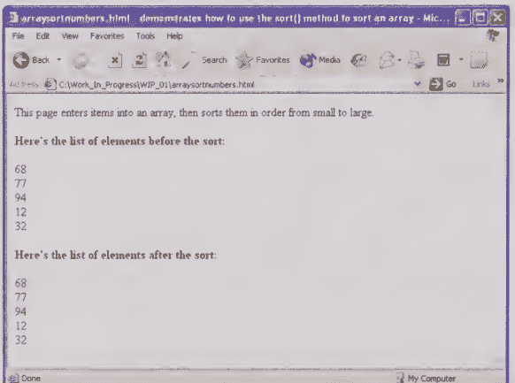

```html
<title>arraysortnumbers.html - demonstrates how to use the sort() method to sort an array</title>
<script language="JavaScript">
</script>
```

4. 插入以下代码。

```html
...
<head>
<title>arraysortnumbers.html - demonstrates how to use the sort()
method to sort an array</title>
<script language="JavaScript">
// the function is used to set up the sorting criteria
// this one is designed to sort the elements in number order
// it would work whether the elements are numbers or text
function arranger(item1, item2) {
    var result = false;
    if (item1 > item2) {
        result = true;
    }
    if (item1 < item2) {
        result = -1;
    }
    if (item1 == item2) {
        result = false;
    }
    return result;
}
</script>
</head>
<body>
...
```

此函数对元素进行排序。

## 项目 1 使用数组和操作字符串

5. 插入以下代码对数组进行排序。

```javascript
...

document.write(testScores[4]);
document.write("<br>");

// insert code to sort the array elements

testScores.sort(arranger);

// output the list elements after the sort

document.write("<p><strong>Here's the list of elements after the sort:</strong></p>");

// now we'll output the array elements after the sort

...
```

6. 在文本编辑器中保存文件，并在浏览器中刷新该文件。

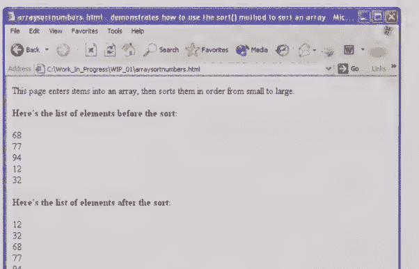

图 1.6

7. 在文本编辑器和浏览器中关闭该文件。

### 扩展你的知识

#### 排序与旧版浏览器

早期版本的浏览器可能不允许使用`sort()`方法，或者可能需要指定排序函数才能使排序正常工作。IE 4及更高版本在使用`sort()`方法时无需指定排序函数应该不会出现问题。

## 第 4 课 整合数组方法

数组方法允许你以多种方式操作`array()`对象。各种数组方法允许你从数组的开头、中间或末尾删除项目。它们还允许你向数组中插入新元素。高级方法允许复杂的操作，例如将多个数组合并为一个数组的能力。在本课中，你将学习许多操作数组的基本方法。

### pop()

`pop()`方法从数组中返回最后一个元素。`pop()`方法还会从数组中删除最后一个元素。打个比方，想想你桌上的一叠文件。如果你的经理要求你在下班前完成整叠文件，你可能会从文件堆中抽出最上面的一张并完成它，接着完成文件堆中的下一张文件，继续直到你到达文件堆的最后一张文件。假设文件堆底部的那张是第一张，你可以将其称为`paper[0]`。如果最上面的一张是第100张文件，你可以将其称为`paper[99]`。每当你“弹出”文件堆时，你就从文件堆中移除了最后（最上面）的一张文件。

例如，要将`groceryList`数组中最后一个项目的值放入名为`lastItem`的变量中，你会编写以下语句：

```javascript
var lastItem = groceryList.pop();
```

### push()

`push()`方法向数组末尾添加一个元素。以下语句在`groceryList`数组末尾创建一个新元素，并将文本`"pork chops"`作为新元素的值：

```javascript
groceryList.push("pork chops");
```

### reverse()

`reverse()`方法反转`array()`对象中元素的顺序。要反转`groceryList`数组的顺序，你会编写以下语句：

```javascript
groceryList.reverse();
```

### shift()

`shift()`方法与`push()`方法类似，但它从数组开头删除一个项目，而不是从末尾。如果你再次考虑文件堆的比喻，`shift()`方法从文件堆底部取出文件。由`shift()`方法删除的项目始终是`item[0]`，其他元素在数组中的位置向上移动一位。

以下语句从文件堆中删除`groceryList[0]`：

```javascript
groceryList.shift();
```

此时被称为`groceryList[1]`的项目将成为`groceryList[0]`。被称为`groceryList[2]`的项目将成为`groceryList[1]`，依此类推。

### unShift()

`unShift()`方法向数组开头添加一个新元素，并将其他元素向上移动一个位置，从而使数组的长度增加一。以下语句将字符串`"milk"`作为第一个元素的值输入。此外，先前的第一个元素成为第二个元素，依此类推。

```javascript
groceryList.unshift("milk");
```

### 反转数组元素的顺序

1. 在浏览器中，打开`WAfter`文件夹中的`reverse.html`。

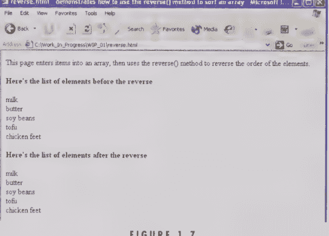

该文件创建一个包含五个元素的简单数组，反转数组元素，然后输出结果。在本练习中，你将创建反转数组的代码。

## 项目 1 使用数组和操作字符串

2. 在文本编辑器中打开该文件。插入以下代码行。

```javascript
...
document.write(groceryList[4]);
document.write("<br>"); // add a new line

// and now we reverse the order of the elements
groceryList.reverse();
document.write("<p><strong>Here's the list of elements after the reverse</strong></p>");
// now we'll output the array elements after the sort
...
```

3. 保存更改并在浏览器中刷新该文件。

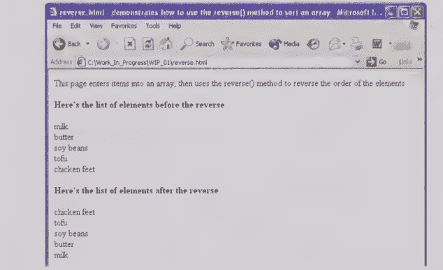

4. 在浏览器和文本编辑器中关闭该文件。

### 扩展你的知识

#### 数组方法

Macintosh版本的Internet Explorer 5不支持`pop()`或其他几种操作数组的方法，包括`push()`、`shift()`、`splice()`和`unShift()`。

## 第 5 课 拆分和连接字符串

存储数据时，分隔符是标记数据单元开头或结尾的字符或字符序列。例如，早期数据库使用文本文件存储信息，并添加逗号、空格或制表符来分隔数据。考虑以下文本行，它可以代表一个学生姓名的逗号分隔数据库：

```text
Joe, Sue, Bill, Brian
```

当计算机程序读取数据时，它通常会被分配给一个文本变量，如以下语句所示：

```javascript
myData = "Joe, Sue, Bill, Brian";
```

### split()

为了使这些信息有用，通常需要提取单个数据片段。`split()`方法将字符串拆分为数组——允许轻松操作单个数据片段。简单来说，`split()`方法允许程序员将文本字符串拆分为多个片段。程序员必须指定一个分隔符来拆分文本。在这种情况下，可以创建一个新数组来保存从文本字符串中提取的信息。

```javascript
myStudents = myData.split(",");
```

提取这些信息后，可以像操作任何其他数组一样对其进行操作。例如，你可以编写以下代码行来确定学生人数：

```javascript
numberStudents = myStudents.length;
```

### join()


`join()`方法将数组中的单个文本元素组合成一个字符串。例如，要创建一个数组并将所有数组元素插入到单个文本字符串中，你会编写：

```
var wordsArray=new Array("This","is","a","brave","new","world");
var sentence=wordsArray.join(" ");
```

`join()`方法可以接受一个参数（分隔符），你可以将其放在插入字符串的每个元素之间。在上面所示的示例中，你在每个数组元素之间插入一个空格。你可以通过编写以下简单语句将新字符串作为句子输出：

```
document.write(sentence + ".");
```

将这些命令插入到 HTML 页面的脚本中，可以得到以下结果。

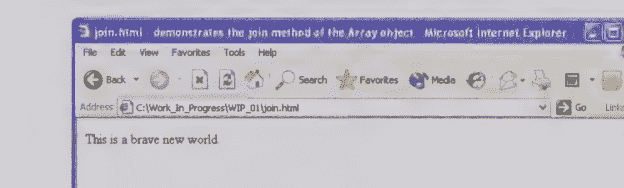

图 1.9

### 将文本字符串拆分为数组

1. 在文本编辑器中，打开 WIP_01 文件夹中的 `split.html`。

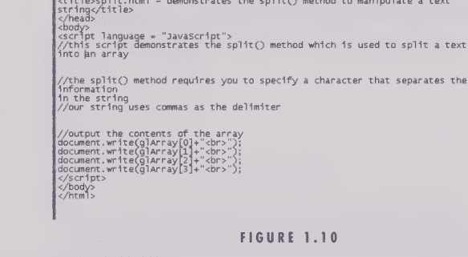

图 1.10

2. 插入以下代码行。

```
...
<body>
<script language = "JavaScript">
//this script demonstrates the split() method which is used to split
//a text string into an array
groceryList = "milk,bread,bananas,ketchup";
//the split() method requires you to specify a character that
//separates the information in the string
//our string uses commas as the delimiter
```

3. 插入以下代码行。

```
...
groceryList = "milk,bread,bananas,ketchup";

//the split() method requires you to specify a character that
//separates the information in the string

//our string uses commas as the delimiter

var glArray=groceryList.split(",");

//output the contents of the array

...
```

此代码将 `groceryList` 变量的内容拆分到 `glArray` 中。

4. 保存更改并在浏览器中打开文件。

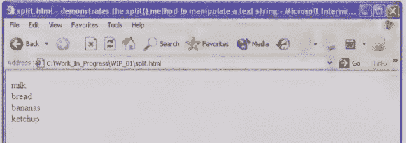

该脚本输出数组中的每个元素。

5. 在浏览器和文本编辑器中关闭文件。

### 拓展知识...

#### 数组术语

在许多计算机科学应用中，数组通常被称为“栈”（stack）或“队列”（queue）。在许多计算机程序中，术语“栈”通常指内存中的一个区域，其中最近存储的项是最先被检索的。这被称为后进先出（LIFO）的数据存储和检索方法。

术语“队列”指的是数组中最早存储的项是第一个被检索的。这被称为先进先出（FIFO）的数据存储和检索方法。把栈想象成等待组装的零件，下一个需要的零件总是在最上面。把队列想象成“待办事项”列表，下一个要完成的项是列表中最旧的项。

## 第 6 课 使用多维数组

一般来说，多维数组是存储在数组中的数组。当你有大量需要细分为子类别的数据时，多维数组非常有用。例如，假设你需要记录零售店电子产品区的库存信息：

```
var electronicsArray=new Array();
electronicsArray[0]="DVD Players";
electronicsArray[1]="TVs";
electronicsArray[2]="Stereos";
```

现在假设你还需要为商店的每个区域创建数组（不仅仅是电子产品），而且存在许多区域，包括礼品和书籍。商店按区域组织产品。你可以使用一个数组来跟踪各个区域：

```
var sectionArray=new Array();
```

此外，你可以将每个区域的数组放入区域数组中：

```
sectionArray[0]=electronicsArray;
```

现在假设你想输出第一个区域的第二个元素：

```
document.write(sectionArray[0][1]);
```

将此代码添加到 HTML 文档的脚本中，可以得到以下结果。

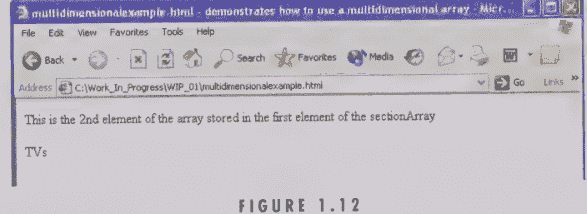

图 1.12

你实际上可以在数组中存储数组，然后调用单个元素。多维数组对新手程序员来说往往显得难以应付，但它们相对容易整合和使用。

### 使用多维数组

在本练习中，你将在更大的信息列表中创建信息列表。具体来说，你创建学生成绩列表，该列表将存储为用于存储学生信息的数组的数组元素。

1. 在文本编辑器中，打开 WIP_01 文件夹中的 `multidimensional.html`。

2. 找到以下代码行。

```
 //create an array to hold student information
var studentArray=new Array();
studentArray[0]="Aaron";
```

此代码创建一个数组来保存学生信息，并将名称“Aaron”赋给第一个数组元素。

3. 插入以下代码行。

```
...
//create an array to hold student information
var studentArray=new Array();
studentArray[0]="Aaron";
var gradeArray=new Array(99,88,77);
document.write("The first student is "+studentArray[0]+"<br>");
document.write("His (or her) first grade is ");
...
```

此代码创建一个数组来保存学生的测试成绩。

4. 插入以下代码行。

```
...
studentArray[0]="Aaron";
var gradeArray=new Array(99,88,77);
studentArray[1]=gradeArray;
document.write("The first student is "+studentArray[0]+"<br>");
document.write("His (or her) first grade is ");
...
```

存储学生成绩的数组（`gradeArray`）被存储为保存所有学生信息的数组（`studentArray`）的第二个元素。

5. 插入以下代码行。

```
...
studentArray[1]=gradeArray;
document.write("The first student is "+studentArray[0]+"<br>");
document.write("His (or her) first grade is ");
document.write(studentArray[1][0]);
</script>
</body>
</html>
```

此代码输出第一位学生的第一个测试成绩。

6. 保存更改并在浏览器中打开文件。

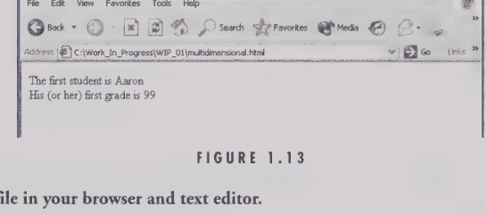

图 1.13

7. 在浏览器和文本编辑器中关闭文件。

### 拓展知识...

#### 布尔值作为数字

许多方法，如 `indexOf()` 和 `lastIndexOf()`，可能会返回“-1”来表示未找到搜索字符串。其他方法，如 `sort()`，返回“0”或“-1”来表示两个值不需要排序。在 JavaScript 以及许多其他脚本语言中，任何小于 1 的数字（如 0 或 -1）都可以与关键字 `false` 互换使用。任何正整数都可以与关键字 `true` 互换使用。

### 总结

在本项目中，你学习了如何使用各种字符串方法。每当在 JavaScript 中使用或存储文本时，该文本被视为字符串对象。JavaScript 为字符串对象提供了多种方法，允许你以各种方式操作文本。例如，你可以在文本字符串中搜索特定信息，如姓名。

你还了解了如何使用数组作为信息的临时存储空间。信息可以采取多种形式，包括文本、布尔值或数字。数组提供了一种简单的方式来存储大量或可变数量的信息。数组方法提供了操作存储在数组中的信息的简单方式，例如允许你从数组中移除第一项或最后一项，并移动剩余元素。

## 关键术语

- Array（数组）
- Delimiter（分隔符）
- Element（元素）
- FIFO（先进先出）
- Index（索引）
- LIFO（后进先出）
- Multi-dimensional array（多维数组）
- Pop（弹出）
- Populating（填充）
- Push（推入）
- Reverse（反转）
- Shift（移位）
- Stack（栈）
- String method（字符串方法）
- String object（字符串对象）
- Queue（队列）
- Unshift（取消移位）

## 检查概念和术语

### 选择题

圈出与以下每个问题的正确答案匹配的字母。

1. 在语句 `var myArray=new Array(30)` 中，数字“30”代表什么？

   - a. 赋给数组第一个元素的值
   - b. 数组中要使用的元素数量
   - c. 多维数组中创建的维度数量
   - d. 以上全部
   - e. 以上都不是

2. 如果你使用 `indexOf()` 方法搜索未找到的文本字符串，该方法将返回什么值？

   - a. 0
   - b. -1
   - c. undefined
   - d. code 3

3. 如果你使用 `lastIndexOf()` 方法搜索未找到的文本字符串，该方法将返回什么值？

   - a. 0
   - b. -1
   - c. undefined
   - d. code 3

4. 当你使用 `lastIndexOf()` 方法搜索文本字符串时，该方法从文本的 _________ 开始搜索字符串。

   - a. 开头
   - b. 结尾
   - c. 中间
   - d. 以上都不是
   - e. 以上都是

5. 在简单数据库中，哪些字符通常用作分隔符？

   - a. 逗号
   - b. 空格
   - c. 制表符
   - d. 以上全部
   - e. 以上都不是

6. 当你对数组执行“pop”操作时，会删除哪个/哪些元素？

   - a. 添加到数组的最后一个元素
   - b. 数组中创建的第一个元素
   - c. 数组中的每个元素
   - d. 以上都不是
   - e. 以上都是

7. 当你对数组执行“shift”操作时，会删除哪个/哪些元素？

   - a. 添加到数组的最后一个元素
   - b. 数组中创建的第一个元素
   - c. 数组中的每个元素
   - d. 以上都不是
   - e. 以上都是

8. 创建数组时，以下哪项陈述是/正确的？

   - a. 必须指定数组的长度
   - b. 可以指定数组的长度
   - c. 不必指定数组的长度
   - d. b 和 c

9. 可以在不指定函数名的情况下使用 `sort()` 方法吗，例如 `myArray.sort()`？

   - a. 可以，并且项目将从低到高排序
   - b. 可以，并且项目将从高到低排序
   - c. 不可以，项目不会排序
   - d. 以上都不是

10. 对数组进行排序时，为什么指定排序函数（如 `myArray.sort(arranger)`）很有用？

    - a. 这是在新版浏览器上对数组排序所必需的。
    - b. 你可以自定义数组元素的排序方式。
    - c. 以上都不是
    - d. a 和 b 都是

## 项目 1 使用数组和操作字符串

## 讨论问题

1. 为什么数组很有用？在哪些情况下，使用数组比使用多个变量更实用？
2. 如果桌子上的一叠文件代表一个信息数组，那么各种数组方法，如 `shift()`、`pop()`、`push()` 和 `unshift()`，会如何改变这叠文件？
3. JavaScript 使用数组来记录关于 HTML 标签的信息。例如，`<a>` 标签被记录为 `links` 数组的元素。在不编写脚本来测试你的想法的情况下，你认为如何使用像 `reverse()` 这样的数组方法来操作 `links` 或 `images` 数组？
4. 在什么情况下使用多维数组是有意义的？

## 技能训练

技能训练练习用于强化项目技能。每个强化的技能与项目中呈现的技能相同或非常相似。详细说明以分步格式提供。你应该按顺序完成这些练习。

### 1. 使用 `lastIndexOf()`

在第一个技能训练中，你将使用 `lastIndexOf()` 方法。这个工具允许你从字符串的最后一个字符开始搜索文本字符串。在这个练习中，你将练习使用字符串方法在字符串对象中搜索特定项目。该练习展示了 `indexOf()` 方法和 `lastIndexOf()` 方法之间的区别。

1. 在你的文本编辑器中，打开 WIP_01 文件夹中的 `skilllastindexof.html` 文件。
2. 在文档的源代码中找到以下代码行。

```
articleTitle = "Bush and the Axis of Evil: a New World View";
var phraseLocation = articleTitle.indexOf("Axis of Evil");
document.write("phrase found at location " + phraseLocation);
```

这里使用 `indexOf()` 方法在较长的文本字符串中查找短语“Axis of Evil”。

3. 在浏览器中打开该文件并检查结果。

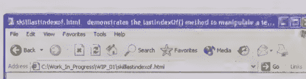

图 1.14

该短语在位置 13 处被找到，这代表完整字符串中的第十四个字符。

4. 返回你的文本编辑器，并用 `lastIndexOf()` 方法替换 `indexOf()` 方法。
5. 将 `articleTitle` 更改为等于 `"Bush and the Axis of Evil: Does the Axis of Evil Really Exist?"`
6. 在文本编辑器中保存文件并刷新你的浏览器。注意输出。结果与之前相同吗？字符串的位置是从文本的开头还是结尾计算的？
7. 在文本编辑器和浏览器中关闭该文件。

### 2. 填充数组

在这个练习中，你将练习使用数组的最基本方面。首先，你使用 `new Array()` 构造函数创建数组；然后，你用信息填充数组元素。

1. 在你的文本编辑器中，打开 WIP_01 文件夹中的 `skillsortnumbers.html` 文件。
2. 找到以下代码行。

```
//create the Array called testScores
```

3. 插入以下代码行，使用 `array()` 构造函数方法创建一个名为 `testScores` 的数组。

```
...
<p><strong>以下是排序前的元素列表：</strong></p>
<script language="JavaScript">
//create the Array called testScores
var testScores=new Array();
//we'll output the list elements before the sort
document.write(testScores[0]);
document.write("<br>"); //add a new line
```

## 项目 1 使用数组和操作字符串

4. 按以下方式修改你在步骤 3 中插入的代码行。

```
var testScores=new Array(68,77);
```

这条语句将 `element[0]` 设置为 `68`，将 `element[1]` 设置为 77。

5. 修改你在步骤 4 中操作的代码行，将 `94` 插入 `element[2]`，将 `12` 插入 `element[3]`，将 `32` 插入 `element[4]`。
6. 在文本编辑器中保存文件并在浏览器中打开该文件。

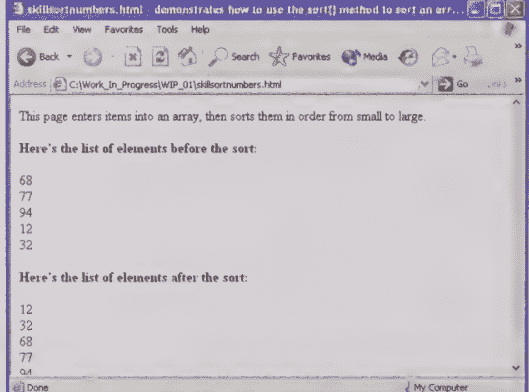

## 图 1.15

你的文件应与上图所示的屏幕截图匹配。

7. 在文本编辑器和浏览器中保持文件打开状态，以进行下一个练习。

### 3. 将数组从高到低排序

在这个练习中，你将创建一个自定义排序函数。为此，你从一个将项目从低到高排序的排序函数开始，然后修改该函数以将元素从高到低排序。

1. 在浏览器中打开的 `skillsortnumbers.html` 中，检查页面的输出。该页面将数字从低到高排序。
2. 在你的文本编辑器中，找到以下代码（它包含 `arranger` 函数）。


```javascript
function arranger(item1, item2) {
    var result = 0;
    if (item1 > item2) {
        result = 1;
    }
    if (item1 < item2) {
        result = -1;
    }
    if (item1 == item2) {
        result = 0;
    }
    return result;
}
```

3. 找到以下`if`语句。

```javascript
if (item1 > item2) {
    result = 1;
}
```

如果两个数组条目应该被交换，这个`if`语句返回数字`1`。

4. 将你在上一步中找到的`if`语句更改为：如果第一个项目小于第二个项目，则将结果设置为数字`1`，而不是在`item1`大于`item2`时将结果设置为`1`。

5. 找到以下`if`语句。

```javascript
if (item1 < item2) {
    result = -1;
}
```

如果两个数组元素不需要交换，这个语句返回`-1`。

6. 将你在步骤 5 中找到的`if`语句更改为：如果`item1`大于`item2`，则返回`-1`。

7. 在文本编辑器中保存文件并在浏览器中刷新文件。

数字现在应该按从高到低的顺序排序。

8. 在浏览器和文本编辑器中关闭该文件。

## 4. 使用`shift()`

在这个练习中，你将使用`shift()`方法。处理数组时，此方法对于从栈底移除项目很有用。换句话说，此方法允许你删除`element[0]`的内容并将其他项目向下移动。

1. 在浏览器中，打开 WIP_01 文件夹中的`skillshift.html`。

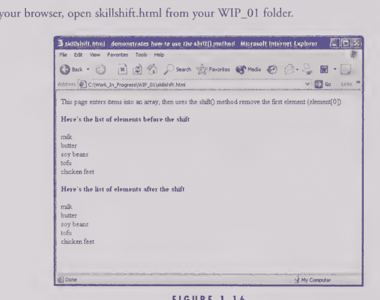

**图 1.16**

2. 在文本编辑器中打开该文件。找到以下代码行。

```javascript
// and now we shift the elements
```

3. 插入以下代码行以移动数组元素。

```javascript
...

document.write(groceryList[4]);
document.write("<br>");

// and now we shift the elements
groceryList.shift();

document.write("<p><strong>以下是移动后的元素列表</strong></p>");

//now we'll output the array elements after the sort
document.write(groceryList[0]);
...
```

项目 1 使用数组和操作字符串

33

第 2 级

4. 滚动到源代码底部，并在`</body>`标签之前直接插入以下注释。

```html
...
document.write(groceryList[4]);
document.write("<br>");
</script>
<p>由于第一个元素被删除，其他元素向下移动，最后一个元素将被报告为未定义</p>
</body>
</html>
```

5. 保存你的更改并刷新浏览器。

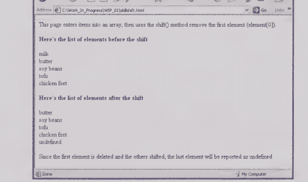

**图 1.17**

`shift()`方法移除数组的第一个元素。因此，`element[4]`现在是未定义的。

6. 在浏览器和文本编辑器中关闭该文件。

## 挑战

挑战练习扩展或与课程中呈现的技能有些相关。每个练习都提供一个简要介绍，然后是按编号步骤格式呈现的说明，但这些说明没有技能训练练习中的那么详细。你应该按顺序完成这些练习。

### 1. 填充并组合项目列表

在这个练习中，你将创建一个数组来保存各种单词。首先，你填充数组以将各种单词存储在数组元素中。然后，你将数组元素连接起来以创建一个句子。

1. 在你的文本编辑器中，打开 WIP_01 文件夹中的`challengelist.html`。

2. 插入以下代码。

```html
<script language="JavaScript">
//the next few lines put in the Array elements
var words1=new Array();
words1[0]="See ";
words1[1]="Spot ";
words1[2]="Run";
var sentence1=words1.join(" ");
//now we'll output the array elements as a sentence
document.write(sentence1 + ".");
</script>
```

3. 保存你的更改并在浏览器中打开该文件。

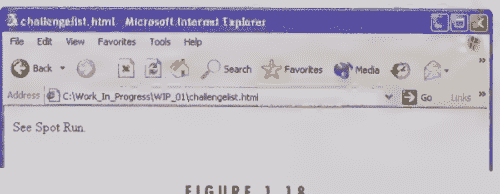

4. 返回到你的文本编辑器。

5. 插入另外三个数组元素，将 "to the store" 这些词添加到由数组元素创建的句子中。

6. 保存你的更改并刷新浏览器。

7. 在浏览器和文本编辑器中关闭该文件。

## 2. 按字母顺序排序数组元素

假设你被要求设计一个网页来输出不同学生的课程表。你需要创建自定义的排序函数来对存储在数组中的文本字符串进行排序。为此，请使用`sort()`方法对数组进行排序，然后修改排序函数来改变排序方法。

1. 在你的文本编辑器和浏览器中，打开 WIP_01 文件夹中的`skillsortstrings.html`文件。此文件在一个数组中存储了五门课程的列表，并在搜索前后输出该列表。对数组进行排序所需的代码是不完整的。

2. 找到下面这行代码。

```javascript
// insert code to sort the array elements
```

3. 在该行代码之后，插入以下语句来对数组进行排序。

```javascript
myList.sort();
```

4. 保存并测试你的文件。列表现在应该按字母顺序排序。某些浏览器可能需要指定一个排序函数才能正确工作。你将在下一步中指定一个排序函数。

5. 返回你的代码，将排序方法更改为使用你文档`<head>`部分中定义的`arranger`函数。

6. 将`arranger`函数更改为按反向字母顺序排序元素。提示：这与对数字进行反向排序的修改方法相同。

7. 保存并测试你的文件。

8. 在浏览器和文本编辑器中关闭该文件。

### 3. 搜索字符串

`indexOf()`和`lastIndexOf()`方法都允许你在一个较大的字符串中找到特定的字符。这些方法通常用于查找文本字符串中特定单词的起始和结束位置。在本练习中，你将使用这些方法来检测字符串中单词之间的空格。

1. 在你的浏览器和文本编辑器中，打开 WIP_01 文件夹中的`challengestrings.html`文件。

   此文件会生成一个提示框，要求用户输入名和姓。

2. 插入以下代码。

```html
<script language="JavaScript">
//this script demonstrates the substring() method that is used to
//get the character location of a specified substring
var fullName=prompt("Enter your first and last name.");

firstSpacePosition=fullName.indexOf(" ");

document.write(firstSpacePosition);

</script>
</body>
</html>
```

3. 保存你的更改并刷新浏览器。

4. 输入你的名和姓。

   浏览器应返回字符串中找到的第一个空格的位置。

5. 修改提示框，要求用户输入名、中间名和姓。

6. 创建一个名为`lastSpacePosition`的变量，用于查找文档中最后一个空格的位置。

   提示：使用`lastIndexOf()`方法和你在步骤 2 中输入的代码来找出正确的代码行。

7. 删除你在步骤 2 中创建的`document.write()`语句。

8. 创建一个`document.write()`语句来输出文档中最后一个空格的位置。

9. 保存并测试你的文件。

10. 在浏览器和文本编辑器中保持文件打开，以便进行下一个练习。

## 4. 从字符串中提取文本

在上一个挑战中，你使用了各种方法来检测文本字符串中第一个和最后一个空格的位置。在本练习中，你将使用这些信息从输入的信息中提取单个的单词。

1. 在打开的`challengestrings.html`中，从文档中移除任何`document.write()`语句。

2. 插入以下代码行。

```javascript
...
var fullName=prompt("Enter your first and last name.");
firstSpacePosition=fullName.indexOf(" ");
lastSpacePosition=fullName.lastIndexOf(" ");
firstName=fullName.substring(0,firstSpacePosition);
document.write("Your first name is "+firstName+"<br>");
</script>
</body>
</html>
```

3. 保存你的更改并刷新浏览器。

4. 在提示框中输入你的名、中间名和姓，然后单击“确定”。

   应该提取出你的名字。

5. 插入以下代码行。

```javascript
...
lastSpacePosition=fullName.lastIndexOf(" ");
firstName=fullName.substring(0,firstSpacePosition);
document.write("Your first name is "+firstName+"<br>");
lastPosition=fullName.length;
</script>
</body>
</html>
```

6. 在你在步骤 5 中创建的代码行之后，创建一个名为`lastName`的变量。将提取从`lastSpacePosition`到`lastPosition`所有字符的子字符串搜索结果赋值给该变量。

7. 创建一个`document.write()`语句，将`lastName`变量输出给用户。

8. 保存并测试你的文件。

   你的文件应向用户输出名和姓。

9. 创建一个名为`middleName`的变量，用于保存输入字符串中的中间名。

   提示：它是第一个空格和最后一个空格之间找到的子字符串。

10. 将`middleName`变量输出给用户。

11. 在浏览器和文本编辑器中关闭该文件。

# 项目 1：使用数组和操作字符串

### 5. 分割制表符分隔的文本

许多简单的数据库使用文本文件来存储数据。这些文件通常使用空格、制表符或逗号来分隔每个数据项。这种技术对于简单数据库非常有效。当计算机程序读取这些文件时，语言通常一次读取一行，并将数据分解为它可以操作的组件。在本练习中，你将创建一个简单的程序来读取以制表符分隔的财务交易。

1. 在你的文本编辑器中，打开 WIP_01 文件夹中的`challengesplit.html`文件。

2. 找到下面这行代码。

```javascript
//our string uses tabs as the delimiter
```

3. 找到下面这行代码。

```javascript
transactions = "$47.99    $58.22    $64.04    $99.98";
```

此代码创建了一个使用制表符分隔交易的变量。制表符常用于分隔信息片段。

4. 创建一个名为`transArray`的数组，并将`transactions`变量中制表符分隔的内容赋值给它。

   提示：使用`split()`方法。

5. 保存你的更改并在浏览器中打开该文件。

   你的文件应输出如下所示的信息。

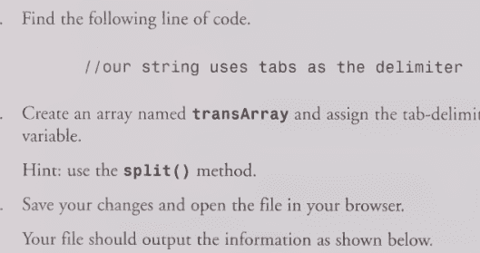

6. 在浏览器和文本编辑器中关闭该文件。

## 作品集构建器


## 创建导航数组

当你浏览网页时，你可能甚至没有意识到自己正在使用数组。数组在创建和执行成功的网站中非常有用。例如，考虑一下大多数网站都使用包含一系列链接的导航结构。这些链接在每个页面上基本相同。如果你添加一个链接，必须在网站的每个页面上都进行添加。这可能变得很繁琐，并且难以确保导航结构在每个页面上完全相同。在本练习中，你将使用一个数组来控制整个网站的导航结构。要完成此作品集构建器，请按照以下步骤操作：

- 在浏览器中打开`RF_JavaScript_L2>Project_01>Portfolio_Builder_01`文件夹中的`navigation_array.html`文件。在浏览器窗口的左侧是一个导航区域。目前，没有任何链接。（链接由包含的 JavaScript 文件中的`generateNav`函数生成。）

- 打开名为`generateNav.js`的包含 JavaScript 文件，找到以下代码行。在代码中，已经为你创建了一个数组。

```javascript
// create a new array for navigation links
// new array creates navigation labels
linkText = new Array("home","products","services",
"locations","about us", "contact");
```

## 作品集构建器


## 创建导航数组（续）

- 创建一个名为`linkURL`的变量，然后将其设置为一个新数组。新数组将把链接值传递给浏览器。

- 将这些链接与其各自的标签关联起来，如下表所示：

| 标签 | 链接 |
|---|---|
| home | index.html |
| products | products.html |
| services | services.html |
| locations | locations.html |
| about us | about_us.html |
| contact | contact.html |

- 创建新数组时，请按照`linkText`数组中创建标签的相同顺序输入页面链接的值。

- 创建新数组后，在浏览器中测试页面。单击每个链接以确保它们都能正常工作。注意，导航随附加数组一起出现。为了使其正常工作，`generateNav`需要超链接的两个值——`linkText`和可见的`linkLabel`文本。有了可用的值，脚本就会执行，并且导航数组会写入页面。

## 项目 2

第 2 级

# 使用日期、时间和数字

### 目标

在本项目中，你将学习如何：

- 使用运算符和优先级
- 融入数学属性
- 使用 Math 对象方法
- 获取和设置时间单位
- 生成随机数
- 创建定时器

## 为什么要学习这个？

JavaScript 有许多内置对象和方法，可让你处理日期、时间、数字和定时器。理解如何操作日期、时间和数字对于编写许多 JavaScript 程序至关重要。许多对象、方法和属性旨在简化涉及日期和数字的复杂计算。例如，你可以使用方法来简化以下计算：

- 需要将美元金额四舍五入到小数点后两位的金融交易
- 将一个数字从一种形式转换为另一种形式，例如米转换为英尺
- 基于时间单位进行计算，例如汽车付款的日期和金额

学习如何使用这些对象和方法可以让你在更短的时间内、用更少的 effort 完成复杂的编程任务。

在本项目中，你将研究如何在 JavaScript 和其他面向对象编程语言中完成数学计算。作为讨论的一部分，你将考虑`Math`对象的方法和属性，它们用于简化计算。你还将学习如何创建和操作`date`对象，以完成涉及时间和日期的计算。此外，你还将探索定时器的使用，可以用它来延迟 JavaScript 语句的执行，或让 JavaScript 语句以不同间隔重复执行。

## 视觉总结

在处理复杂公式时，编程语言采用*优先级规则*来确定公式的计算方式。术语*优先级*仅仅意味着操作完成的顺序。考虑以下公式；它根据给定的摄氏值计算华氏温度。

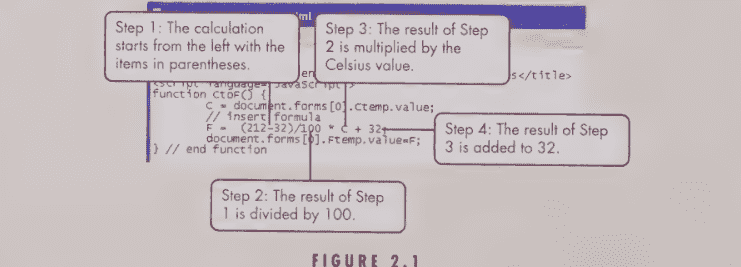

如果去掉括号，计算将发生变化，导致计算结果出现错误。

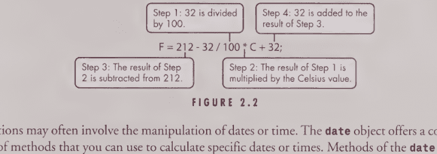

计算通常涉及日期或时间的操作。`date`对象提供了一套全面的方法，可用于计算特定日期或时间。`date`对象的方法可以通过多种方式使用。例如，你可以在网页或脚本中插入当前日期和时间。你还可以计算自特定日期以来经过的确切时间。

以下脚本可作为`date`对象及其相关方法的示例。

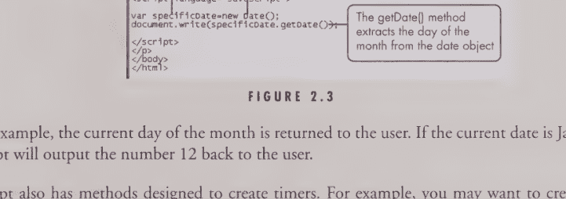

在此示例中，当月的当前日期被返回给用户。如果当前日期是 1 月 12 日，脚本将向用户输出数字 12。

JavaScript 还有用于创建定时器的方法。例如，你可能希望创建一个每 15 秒自动重新加载的页面。


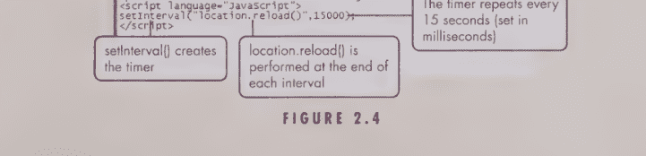

## 第 1 课 理解运算符和优先级

在 *Essentials for Design: JavaScript Level 1* 中，你从变量和赋值运算符的角度考虑了基本数学操作，以下语句即为一例：

```javascript
var calculation=64/5+87*4;
```

在 JavaScript 学习的这个阶段，讨论数学优先级是有必要的。如果你在脚本中使用上述语句，JavaScript 会将变量的值报告为`360.8`。假设你想再次检查代码，你可以自己进行计算以验证公式中的逻辑。让我们从执行以下计算开始：

```javascript
65/5=12.8
```

接下来，将 87 加到之前的总数上。

```javascript
12.8+87=99.8
```

最后，将结果乘以 4。

```javascript
99.8*4=399.2
```

此值与 JavaScript 的计算结果不同。显然，如果你正在计算一个重要值，例如抵押贷款付款或客户应得的退款金额，这可能会导致严重问题。差异的答案在于计算的运算符优先级。优先级规则要求某些运算符先于其他运算符进行求值。一般来说，计算按从左到右的顺序进行，顺序如下：

- 括号、点和方括号中的计算（`( )`、`...`、`[ ]`）首先进行求值。
- 自增、自减运算（`++`、`--`）其次计算。
- 乘法、除法、取模运算（`*`、`/`、`%`）再次进行求值。
- 加法、减法运算（`-`、`+`）最后计算。

回到前面的例子，你现在可以看到 JavaScript 如何完成计算：

```javascript
var calculation=64/5+87*4;
```

JavaScript 从左开始，首先求值以下内容：

```javascript
64/5=12.8
```

由于乘法的优先级高于加法，接下来求值的部分是：

```javascript
87*4=348
```

JavaScript 然后完成两次计算的加法：

```javascript
12.8+348=360.8
```

理解优先级规则很简单，但在设计和输入复杂公式时可能会产生问题。记住优先级规则将帮助你调试和理解复杂的公式。记住，你始终可以将复杂公式的步骤分解为更小的步骤，然后在每一步输出值。这个过程将帮助你发现错误。

### 赋值运算符

正如你在 *Essentials for Design: JavaScript Level 1* 中学到的，赋值运算符是将值赋给变量的字符（或多个字符）。在语句`variableName="value"`中，等号就是赋值运算符。这是 JavaScript 中最简单的赋值语句。其他赋值运算符如下所示：

```javascript
A-=B; 与 A=A-B; 相同

A+=B; 与 A=A+B; 相同

A*=B; 与 A=A*B; 相同

A/=B; 与 A=A/B; 相同

A++; 与 A=A+1; 相同

A--; 与 A=A-1; 相同
```

取模运算符需要再多一些解释。你使用 *取模运算符* 来查找除法后的余数。例如，以下代码行返回的值是 1：

```javascript
A=5;
B=2;
A=A % B;
document.write(A);
```

其他运算符会影响计算机内存中单个位的状态；这些运算符被称为 *位运算符*。使用位运算符是一个复杂的过程，超出了我们当前讨论的范围。常见的位运算符包括`&=`、`|=`和`^=`。你会在复杂的代码示例中偶尔看到这些运算符。

### 纠正优先级错误

1. 将`RF_JavaScript_L2>Project_02`文件夹的内容复制到你的`Work_In_Progress>WIP_02`文件夹中。
2. 在文本编辑器中，从`WIP_02`文件夹打开`precedence.html`。
3. 插入以下代码。

```html
...
</head>
<body>
<script language="JavaScript">
commission=10+10*.05;
document.write("The sales commission is "+commission);
</script>
...
```

4. 保存更改并在浏览器中打开文件。

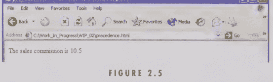

图 2.5

脚本返回了错误的金额，因为乘法在两个数字相加之前进行了。

5. 按照如下所示在公式中插入括号。

```html
...
<body>
<script language="JavaScript">
commission=(10+10)*.05;
document.write("The sales commission is "+commission);
...
```

括号纠正了优先级问题。

6. 保存更改并刷新浏览器。

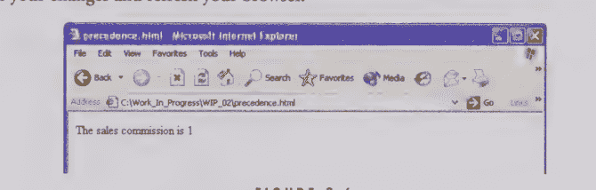

计算正确执行。

7. 在浏览器和文本编辑器中关闭文件。

## 第 2 课 使用 Math 对象方法

`Math`对象是 JavaScript 的内置对象。它包含各种数学计算中使用的常量值（例如 pi），以及许多用于计算常见数学函数的方法。

`Math`对象使用各种方法来简化复杂的数学公式。例如，要将 2 的 9 次方并加上 8，你可以设计如下语句：

```javascript
result=(2*2*2*2*2*2*
```

### Math.max() 和 Math.min()

这些方法允许程序员比较多个数字并获取最小（min）或最大（max）的数字。例如，以下脚本返回数字`6`，因为`6`是列表中最小的数字。

```javascript
var lowestNumber = Math.min(27, 33, 54, 76, 43, 23, 12, 6, 78, 98);

document.write(lowestNumber);
```

要返回列表中最大的数字（`98`），你需要编写以下代码：

```javascript
var largestNumber = Math.max(27, 33, 54, 76, 43, 23, 12, 6, 78, 98);

document.write(largestNumber);
```

### Math.pow()

此方法需要两个数字参数，以计算一个特定数字提升到某个幂的结果。第一个参数是你的底数，第二个参数是指数。例如，要计算`5`的`2`次方，你需要编写以下语句：

```javascript
calculation = Math.pow(5, 2);
```

### Math.round()

此方法将其接收的任何数字四舍五入到最接近的整数值。要将数字`4.343`四舍五入到最接近的整数，并将结果输出给用户，你需要编写以下语句：

```javascript
document.write("The number 4.343 rounded is " + Math.round(4.343));
```

### Math.sqrt()

此方法返回其接收的任何数字的平方根。以下语句向用户返回`2`：

```javascript
document.write("The square root of 4 is " + Math.sqrt(4));
```

注意此方法如何以全小写字母写为`sqrt()`。类似的方法书写方式不同。例如：`SQRT2()`返回数字 2 的平方根，这在计算中经常使用。

### 使用 Math 对象方法

1. 在你的文本编辑器中，打开`WIP_02`文件夹中的`mathmethods.html`。
2. 插入以下代码。

```html
...
</head>
<body>
<script language="JavaScript">
theRoot = Math.sqrt(20);
document.write("The square root of 20 is " + theRoot + "<br>");
document.write("The number rounded is " + Math.round(theRoot));
</script>
</body>
</html>
```

3. 保存你的更改，并在浏览器中打开该文件。

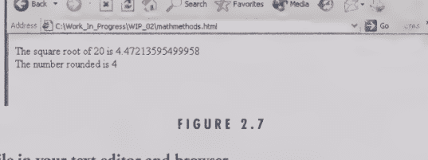

4. 在你的文本编辑器和浏览器中关闭该文件。

#### 扩展知识……

##### MATH 对象

`Math`对象必须拼写为`Math`而不是`math`才能在大多数浏览器中工作。

## 第 3 课 生成随机数

`Math.random()`方法不接受参数；它只是返回一个介于 0 和 1 之间的随机数。考虑以下代码，它生成一个介于 0 和 1 之间的随机数：

```javascript
randomNumber = Math.random();
```

由`Math.random()`生成的数字通常是一个很长的十进制数。在许多常见的编程问题中，有必要生成一个占据特定范围的随机数，例如介于 1 和 10 之间的数字或介于 1 和 100 之间的数字。你可以通过对`Math.random()`方法产生的数字进行数学操作来实现这一点。你将在以下练习中探索这个过程。

### 处理随机数

1. 在你的文本编辑器中，打开`WIP_02`文件夹中的`mathrandom.html`。
2. 插入以下几行代码。

```html
...
</head>
<body>
<script language="JavaScript">
randomNumber = Math.random();
document.write("Here is a random number: " + randomNumber);
</script>
</body>
</html>
```

3. 在浏览器中打开该文件，并点击刷新按钮。

每次点击刷新按钮，都会出现一个新的介于 0 和 1 之间的随机数。

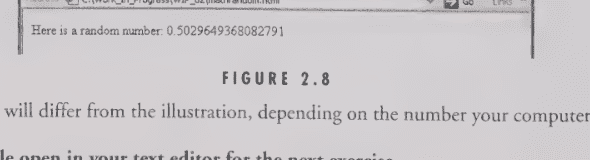

你的结果可能与插图不同，具体取决于计算机生成的数字。

4. 保持文件在文本编辑器中打开，以进行下一个练习。

### 返回 1 或 0（真或假）的值

1. 在打开的`mathrandom.html`中，插入以下代码。

```html
...<script language="JavaScript">
randomNumber = Math.random();
document.write("Here is a random number: " + randomNumber);
document.write("<br>");
randomNumber = Math.round(randomNumber);
document.write("Rounded version is " + randomNumber);
</script>
...
```

该脚本返回 0 或 1，这可以用来表示`true`（1）或`false`（0）的值。

2. 保存你的更改，并在浏览器中刷新文件。

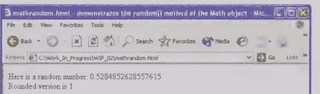

图 2.9

每次点击刷新按钮，数字都会在 0 和 1 之间变化。

3. 插入以下代码以生成一个介于 1 和 10 之间的数字。

```javascript
...randomNumber = Math.random();
document.write("Here is a random number: " + randomNumber);
document.write("<br>");
randomNumber *= 10;
randomNumber = Math.round(randomNumber);
document.write("Rounded version is " + randomNumber);
...
```

此语句获取数字的当前值并将其乘以 10。

4. 在你的文本编辑器中保存文件。
5. 在 Web 浏览器中反复点击刷新按钮。

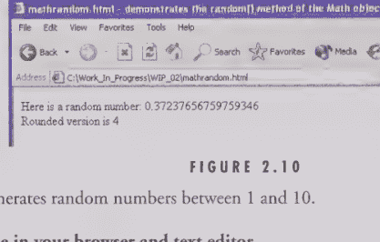

该代码生成介于 1 和 10 之间的随机数。

6. 在浏览器和文本编辑器中关闭该文件。

#### 扩展知识……

##### 随机数生成

计算机并不真正产生“随机”数字。为了正确操作，计算机处理器有一个内部时钟，每秒完成数十亿或数万亿次完整循环。当要求生成随机数时，计算机会检查处理器时钟的状态并报告其在当前循环中的位置。由于处理器时钟每秒完成数十亿或数万亿次循环，因此生成的数字实际上不可能被预测。这个简单的事实允许程序员创建复杂的视频游戏并应用数字加密。

## 第 4 课 应用数学属性

`Math`对象的属性与大多数对象的属性不同，因为`Math`对象的属性不能被更改。在 JavaScript 中，不能更改的属性被称为 *常量属性*。常量属性保存着数学计算中频繁使用的数字常量。JavaScript 支持许多常量属性，下面描述其中几个。

### Math.E

`Math.E`是常量值`2.718281828459045`，它在许多常见计算中使用。要计算数字`5`乘以常量“E”的值并将其存储在名为`result`的变量中，你需要编写以下语句：

```javascript
var result = 5 * Math.E;
```

### Math.PI

`Math.PI`是常量值`3.141592653589793`。例如，考虑以下语句，将数字`5`与常量`PI`相乘，并将计算结果存储在名为`result`的变量中：

```javascript
var result = 5 * Math.PI;
```

### Math.SQRT2

`Math.SQRT2`是赋予`2`的平方根的常量值，即`1.414213562373091`。要计算数字`8`除以`SQRT2`所表示的常量数字的结果，你需要编写以下语句：

```javascript
var result = 8 / Math.SQRT2;
```

### 使用 Math 属性

1. 在你的文本编辑器中，打开`WIP_02`文件夹中的`mathpi.html`。
2. 插入以下代码。

```html
...
</head>
<body>
<script language="JavaScript">
diameter = prompt("Enter the diameter of the circle", "");
diameter = parseInt(diameter);
var circumference = Math.PI * diameter;
document.write("The circumference of the circle is " + circumference);
</script>
</body>
</html>
```

`prompt()`方法以字符串形式返回信息，因此你需要使用`parseInt()`来确保该值被转换为整数。

3. 保存你的更改，并在浏览器中打开该文件。

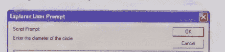

出现一个提示框。

4. 输入“5”作为直径，然后点击确定。

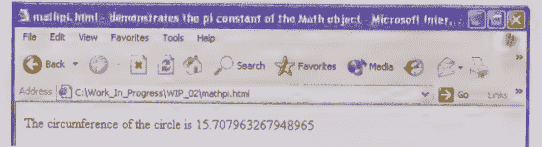

5. 在浏览器中刷新文件，并输入不同的直径。你收到的响应取决于你输入的数字。
6. 在浏览器和文本编辑器中关闭该文件。

#### 扩展知识……

##### 数学属性

在大多数浏览器中，`Math`对象的常量属性区分大小写。将`Math.PI`输入为`Math.pi`会导致脚本在许多浏览器中停止工作。

## 第 5 课 获取和设置时间单位

JavaScript 中的`Date`类允许你创建包含日期和时间信息的对象。要将当前日期和时间插入名为`currentTime`的变量中，你需要编写以下语句：

```javascript
var currentTime = new Date();
```

`new Date()`方法是一个构造函数方法，它创建`Date`对象的新实例。然后，你可以使用以下简单语句将变量输出到屏幕：

```javascript
document.write(currentTime);
```

通常需要将特定日期传递给`date`对象。你可以通过编写以下语句来实现：

```javascript
var specificDate=new Date("October 18, 1969 15:40:00");
```

此代码创建了一个名为`specificDate`的新变量，该变量创建了一个新的`date`对象，并存储了 1969 年 10 月 18 日和下午 3:40 的时间。请注意，时间必须以 24 小时格式指定。如果你愿意，也可以按数字格式指定日期。以下伪代码向你展示了如何以数字格式输入日期：

```javascript
var specificDate=new Date(year, month, day, hours, minutes, seconds);
```

更具体地说，你可以使用以下语句输入上面所示的日期和时间：

```javascript
var specificDate=new Date(1969, 9, 18, 3, 40, 0);
```

月份从数字`0`开始（类似于 JavaScript 中的许多其他对象），因此十月引用为`9`而不是`10`。如果省略小时、分钟和秒，计算机会假定你指的是午夜，如下所示：

```javascript
var specificDate=new Date(1969, 9, 18);
```


### Date 类的方法

`date`类包含大量用于操作日期的方法。这些方法允许程序员创建新日期和修改现有日期。`date`对象的方法旨在更改特定日期的某个方面（例如小时设置），通常以字符串或数字形式输入。

根据具体方法（以数字形式输入信息时），您可以按时间形式（如12月14日）或从某一点起经过的毫秒数（如添加14,523毫秒）输入信息。您可以多种方式输出日期，具体取决于需要的信息量和输出需要的用户友好程度。在接下来的章节中，您将探索`date`对象的几种最常见方法。

### getDate()、setDate()

`getDate()`和`setDate()`方法适用于特定`date`对象中的月份日期。例如，以下代码将`18`输出为`date`对象中的日期：

```javascript
var specificDate = new Date("October 18, 1969 15:40:00");

document.write(specificDate.getDate());
```

`setDate()`方法更改`date`对象中的月份日期。要将代码示例中的日期更改为`21`，您需要编写以下语句：

```javascript
specificDate.setDate(21);
```

### getDay()

`getDay()`方法返回存储在`date`对象中的日期的星期几。星期几以`0`（星期日）到`6`（星期六）的数字值返回。使用上一节中创建的`date`对象，您可以通过编写以下语句来请求星期几：

```javascript
document.write(specificDate.getDay());
```

使用1969年10月25日这个日期，返回数字`6`，表示这一天是星期六。

### getFullYear()、setFullYear()

这些方法允许您返回或设置`date`对象中的年份。数字指定为四位数（因此方法名称中有"full"一词）。要从名为`myDate`的`date`对象返回年份，您需要编写：

```javascript
document.write(myDate.getFullYear());
```

要在同一个`date`对象中设置年份，您需要编写：

```javascript
myDate.setFullYear(1971);
```

### getHours()、setHours()

正如您可能想到的，这些方法获取和设置存储在`date`对象中的小时。小时以`0`表示午夜，延伸至`23`表示晚上11点。要将小时更改为下午2点，您需要编写以下语句：

```javascript
myDate.setHours(14);
```

要检查`date`对象中指定的当前小时，您需要编写：

```javascript
document.write(myDate.getHours());
```

### getMinutes()、setMinutes()

要设置`date`对象中的`minute`属性，您可以使用`setMinutes()`方法，如以下语句所示：

```javascript
myDate.setMinutes(10);
```

前面的语句将`minute`设置更改为`10`。需要注意的是，分钟从`0`开始表示第一分钟，到`59`结束表示一小时中的最后一分钟，这是我们通常标记时间的方式（而不是在一小时结束时标记第60分钟）。要检查`date`对象中的`minute`设置，您需要编写：

```javascript
myDate.getMinutes();
```

### getMonth()、setMonth()

此时，`getMonth()`和`setMonth()`方法对大多数读者来说可能已经很明显了。请记住，月份从`0`表示一月开始，到`11`表示十二月结束。要将名为`myDate`的`date`对象中的月份更改为十一月，然后将月份输出给用户，您需要编写以下语句：

```javascript
myDate.setMonth(10);

document.write(myDate.getMonth());
```

### toLocaleString()

`toLocaleString()`方法将`date`对象中的时间返回为易于理解的文本字符串。浏览器通常以略有不同的方式输出此信息，但此方法通常提供最用户友好的日期版本，其中包括星期几。要创建`date`对象并将对象返回给用户，您需要编写以下语句：

```javascript
var specificDate = new Date("October 18, 1969 15:40:00");

document.write(specificDate.toLocaleString());
```

将此代码与一些说明性文本结合到网页中，在浏览器中会产生以下结果。

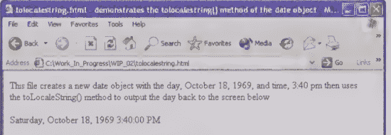

**图 2.13**

### 扩展您的知识……

#### DATE 对象

`newDate()`构造函数方法和`date`对象的许多其他方法允许程序员以毫秒为单位操作日期和时间。一天等于84,400,000毫秒。在处理极其精确的技术计算时，这种精度级别非常有用。

## LEVEL 2 58 Project 2 使用日期、时间和数字

### 实例化 Date 对象

1. 在文本编辑器中，从WIP_02文件夹中打开`date.html`。
2. 插入以下代码。

```html
...

<body>

<p>此文件创建了一个包含当前日期和时间的新日期对象，然后将其输出回屏幕下方</p><p>

<script language="JavaScript">

var currentTime = new Date();

document.write("当前时间是 " + currentTime);

</script>

</p>

</body>

...
```

3. 保存更改并在浏览器中打开文件。

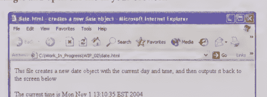

图 2.14 显示当前日期和时间。

4. 在浏览器和文本编辑器中关闭文件。

### 扩展您的知识……

#### 从索引日期进行毫秒计算

日期也可以使用距离索引日期的毫秒数来构建和操作。这种类型的日期操作比本书中介绍的示例更复杂。以这种方式操作日期的能力对于跨不同区域同步事件或进行非常精确的时间测量非常有用。索引日期是格林尼治标准时间（GMT）1970年1月1日凌晨12点。

在以索引日期操作日期时，日期和时间信息以距离索引日期所经过的时间量返回。这可能对新手程序员来说非常令人困惑，因为一天有84,400,000毫秒，索引日期前一天会返回为-84,400,000。索引日期后一天会返回为84,400,000。

使用索引日期操作日期相当复杂，仅在非常技术性的问题解决情况下才有用。为简单起见，我们在此项目中描述了`date`对象的最常用方法，并避免使用索引日期。此外，我们尽可能使用标准日期，例如1983年1月1日，并避免使用毫秒。

## toLocaleString() 浏览器兼容性

`toLocaleString()`方法生成的文本字符串在每个浏览器中都略有不同。因此，您的输出可能与此项目中显示的屏幕截图略有不同。

## 课程 6 创建定时器

程序通常需要*定时器*来设置动作执行前的等待时间。一些 JavaScript 方法旨在创建定时器，然后在定时器到期时执行 JavaScript 语句。根据使用的方法，该方法可能在间隔到期时执行语句一次，或者重新启动定时器并在每个间隔结束时重复执行语句。还可以使用其他方法来停止定时器（一旦启动）并阻止语句执行。您将在以下章节中探索这些方法。

## setTimeout() 和 clearTimeout()

`setTimeout()`方法需要两个参数。第一个是有效的 JavaScript 语句，第二个参数是一个数字，表示命令执行前应经过的毫秒数。第一个参数以字符串形式传递，第二个参数以数字形式传递。使用伪代码，`setTimeout()`方法采用以下形式：

```javascript
setTimeout("statement", time in milliseconds);
```

要在5秒后显示欢迎消息，你可以编写如下语句：

```javascript
setTimeout("document.write('Hi!')", 5000);
```

`setTimeout()`方法创建的每个计时器都会生成一个唯一 ID，该 ID 由方法返回。此 ID 可被`clearTimeout()`方法用于在`setTimeout()`方法中的命令执行之前停止计数器。例如，查看以下代码：

```javascript
var timer = setTimeout("document.write('Hi!')", 5000);

document.write(timer);

clearTimeout(timer);
```

这些代码语句创建了一个计时器，在5秒后写入字符串"Hi!"。计时器使用`setTimeout()`方法创建，该方法同时将计时器的 ID 放入名为`timer`的变量中。`clearTimeout()`方法使用此 ID 来阻止`document.write()`语句的执行。将此代码放入脚本中，在浏览器中会产生以下结果。

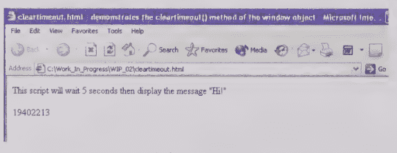

图 2.15

## setInterval() 和 clearInterval()

`setInterval()`方法与`setTimeout()`方法几乎完全相同，只有一个区别：当时间结束时，命令执行且计时器重新启动。代码会反复执行，直到`clearInterval()`方法停止计时器。

`setTimeout()`方法执行一次语句（计时器完成时）。`setInterval()`方法通过执行语句并重新启动计时器，在指定的间隔内循环。

计时器在各种脚本中有多种用途。程序员经常使用计时器来让用户有足够的时间阅读消息，然后再发生某个事件。在下面的练习中，你给用户足够的时间阅读消息，然后将浏览器重定向到另一个页面。当网页已移动到新的位置/网址时，程序员经常使用这种技术。

### 创建一个计时器

1. 在文本编辑器中，打开 WIP_02 文件夹中的`timer.html`。
2. 插入以下代码。

```html
...

</head>

<body>

<script language="JavaScript">

setInterval("location.reload()", 15000);

</script>

</body>

</html>
```

此代码每15秒执行一次`reload()`方法。如果页面的新版本已保存，页面会自动重新加载。

3. **在浏览器中打开文件。**

显示一个空白页面，因为该页面目前还没有任何可见内容。

4. **在文本编辑器中，插入以下代码。**

```html
<body>

<script language="JavaScript">

setInterval("location.reload()", 15000);

</script>

<p>This file checks for a new file every 15 seconds</p>

</body>

</html>
```

此代码创建了文件中的明显变化，可以在重新加载时检测到。

5. **在文本编辑器中保存更改。**

返回浏览器并等待。

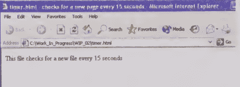

图 2.16

文件应在几秒钟内重新加载。

在浏览器和文本编辑器中关闭文件。

### 扩展你的知识……

#### 毫秒

**毫秒**是1/1000秒。因此，5000毫秒等于5秒。

## 总结

在项目2中，你了解了 JavaScript 程序员如何处理日期、时间和数字。在处理数字时，重要的是要记住 JavaScript 中的计算遵循严格的优先级。一般来说，计算从左到右完成。你现在知道括号或方括号中的项目先计算；接下来完成乘法或除法；最后完成加法或减法。

在本项目中，你还了解了`date`对象和`Math`对象。严格来说，即使没有这两个对象，你也可以处理日期并完成复杂的计算——但编程会非常困难。`Math`对象尤其提供了将数字转换为绝对值、将数字四舍五入到最接近的整数、生成随机数、将数字乘幂、取平方根以及从数字列表中挑选最大或最小数字的方法。`Math`对象还具有保存常数值的常量属性，例如 pi 所表示的数字。

`date`对象允许你轻松存储和操作日期。`date`对象的各种方法允许你向日期添加或减去时间，以及更改日期和时间的某个部分，例如月、日或小时。在本项目中，你还了解了`setInterval()`和`setTimeout()`方法，它们允许你在特定时间后执行命令，或以特定间隔重复执行命令。

## 设计职业

### 有针对性的设计解决方案

专业作品集网站展示了各种设计解决方案，每一种都是为特定的受众量身定制的。例如，如果你要为一家定制珠宝公司设计网站，你可能会使用暗示奢华、高端生活方式的颜色、图形和字体；你可能会应用白色背景和清晰、简洁的布局，以强调珠宝的简约优雅。然而，如果你要为四轮驱动越野驾驶爱好者构建网站，你可能会选择深色调、大地色系的颜色组合，以及 closely cropped、令人印象深刻的改装车辆在越野赛道上行驶的照片。显然，这些网站有不同的目标受众，因此有不同的表现（设计）要求。

新手设计师通常偏爱一种特定的风格、调色板和字体，例如在白色背景上使用深蓝色和灰色、左上角放置图片、内容以类似表格的结构布局。经验丰富的设计师也有个人偏好，但他们学会了拓宽自己的范围和创意能力。经验丰富的设计师根据客户的需求生成有效的设计解决方案——这可以包括全方位的调色板、字体、风格、布局和图像选择。

不要将自己的作品集网站限制在你最喜欢的风格、颜色和字体上，而是要尽可能包含多种多样的选择。当你让潜在客户和雇主看到你的多样性时，你会取得更大的成功。


## 关键术语

- 位运算符
- 常量属性
- 索引日期
- 毫秒
- 取模运算符
- 优先级
- 优先级规则
- 计时器

## 检查概念和术语

### 选择题

圈出与以下每个问题正确答案匹配的字母。

1. 哪个列表表示 JavaScript 中数学运算的正常优先级顺序？
   - a. +, -, /, *, ()
   - b. -, +, *, /, ()
   - c. (), *, /, +, -
   - d. /, *, +, -, ()

2. `Math`属性与大多数对象的属性不同，因为它们 ________。
   - a. 表示大型文本字符串
   - b. 表示非常大的数字
   - c. 表示不能更改的值（如 pi）
   - d. 以上都不是

3. 你可以使用哪个`Math`方法确保返回正值？
   - a. `Math.abs()`
   - b. `Math.pos()`
   - c. `Math.unNeg()`
   - d. `Math.makePos()`

4. `Math.round()`方法的用途是什么？
   - a. 计算圆形物体的周长
   - b. 计算圆形物体的直径
   - c. 计算圆形物体的面积
   - d. 将数字四舍五入到最接近的整数

5. `Math.pow()`方法需要什么参数？
   - a. 要乘幂的数字
   - b. 要乘幂的数字和乘幂的指数
   - c. 四个要相乘的数字
   - d. 此方法不需要任何信息

6. `date`对象的`getDay()`方法如何返回信息？
   - a. 以文本字符串表示的星期几（例如，"Saturday"）
   - b. 以数字表示的星期几（例如，"2"）
   - c. 当前月份的某一天（例如，"25th"）
   - d. 以上都不是

7. 取模（`%`）运算符的用途是什么？
   - a. 将字符串转换为整数值
   - b. 两个数字相乘
   - c. 返回除法后不带小数的四舍五入结果
   - d. 返回除法后剩余的余数

8. `Math.random()`方法生成什么类型的数字？
   - a. 0 到 1000 之间的整数
   - b. 0 到 100 之间的整数
   - c. 0 到 1 之间的长小数
   - d. 0 到 10000 之间的整数

9. 你可以使用哪个方法清除重复的动作循环？
   - a. `setInterval()`
   - b. `setTimeout()`
   - c. `clearInterval()`
   - d. `clearTimeout()`

10. 你可以使用哪个方法创建重复的动作循环？
    - a. `setInterval()`
    - b. `setTimeOut()`
    - c. `clearInterval()`
    - d. `toLocaleString()`

### 讨论题

1. `date`对象为什么有用？使用`date`对象时，如何进行复杂的时间计算？
2. 为什么在复杂计算中优先级顺序很重要？
3. 在计算日期时，什么时候使用毫秒会很有用？
4. 从概念上讲，使用 JavaScript 计算1到10之间的随机数的步骤是什么？

## 技能演练

技能演练练习用于巩固项目技能。每项巩固的技能与项目中讲授的相同或几乎相同。提供详细的按步说明。你可以按任意顺序完成一个或多个练习。

### 1. 优先级与 Math 对象方法

1. 在浏览器中，打开 WIP_02 文件夹中的`skillprecedence.html`。

该文件代表一个已完成的脚本，但计算结果不正确。

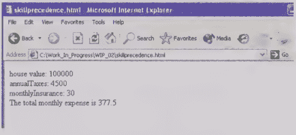

2. 在文本编辑器中找到以下代码。

```javascript
houseValue = 100000;

annualTaxes = houseValue * 0.045;
```


`monthlyInsurance=30;`

`monthlyExpense=monthlyInsurance+annualTaxes/12;`

测试值已插入脚本中。`annualTaxes` 值计算正确，但 `monthlyExpense` 值不正确。`monthlyExpense` 值应为 `monthlyInsurance` 值加上 `monthlyTax` 值（`annualTaxes` 除以 12）的总和。

- 3. 修正 `monthlyExpense` 计算中的问题。
- 4. 保存并在浏览器中测试你的文件。

正确结果为 405。

- 5. 在浏览器和文本编辑器中关闭该文件。

## 2. 生成指定范围内的随机数

在本练习中，你需要生成给定范围内的随机数。为此，你需要创建一个简单的函数。你可以使用此函数生成任意边界内的数字，例如 50 到 100 之间的数字。

- 1. 在文本编辑器中，打开 WIP_02 文件夹中的 `skillrandom.html`。
- 2. 找到文档的 `<head>` 部分中的以下代码。

```html
<script language="JavaScript">

// insert function here

</script>
```

- 3. 创建一个名为 `getBetween` 的函数。该函数应接受两个数字：`number1` 和 `number2`。
- 4. 将以下代码插入函数中。

```html
<script language="JavaScript">

// insert function here

function getBetween(number1,number2){

	if (number2>number1) {

		return (Math.round(Math.random()*(number2-number1))+number1);

	}

	else {

	return (Math.round(Math.random()*(number1-number2))+number2);

	}

}

</script>
```

- 5. 在文档的 `<body>` 部分插入以下代码以触发该函数。

```html
...

</head>

<body>

<script language="JavaScript">

result=getBetween(3,7);

document.write(result);

</script>

</body>

</html>
```

- 6. 保存你的文件。
- 7. 在浏览器中测试该文件。

每次应返回 3 到 7 之间的数字。

- 8. 修改代码以返回 10 到 20 之间的数字，然后测试该文件。
- 9. 在浏览器和文本编辑器中关闭该文件。

## 3. 使用数字表示的时间单位

- 1. 在文本编辑器中，打开 WIP_02 文件夹中的 `datenumbers.html`。
- 2. 插入以下代码。

```html
...

<p>This file creates a new date object with the day, October 18,

1969, and time, 3:40 pm, by entering the date as a sequence of num-

bers, and then outputs it back to the screen below</p>

<script language="JavaScript">

// note: months start with month 0 (January) so 9 means October.

var currentTime=new Date(1969, 9, 18, 3, 40, 0);

document.write(currentTime);

</script>

</p>

</body>

...
```

- 3. 在文本编辑器中保存更改，然后在浏览器中打开该文件。

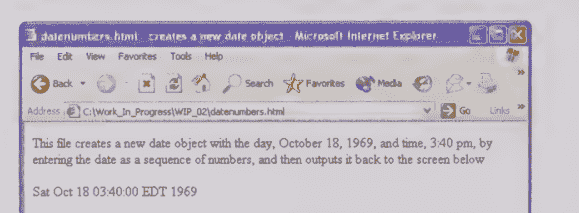

- 4. 返回文本编辑器，将代码修改为使用 **1985 年 1 月 12 日**，时间为 **下午 2:30**。
- 5. 将说明文字修改为与你第 4 步设置的日期一致。
- 6. 保存并测试你的文件。
- 7. 在浏览器和文本编辑器中关闭该文件。

## 4. 使用计时器在重定向用户之前延迟跳转

- 1. 在文本编辑器中，打开 WIP_02 文件夹中的 `skilltimer.html`。
- 2. 找到以下代码行。

```javascript
document.location="http://www.againsttheclock.com";
```

该文件使用 `location` 属性将用户重定向到 Against The Clock 网站。

- 3. 在 Web 浏览器中打开该文件。

你的浏览器应立即重定向到 Against The Clock 网站。拥有快速互联网连接的计算机用户可能看不到初始页面——它可能没有保持可见足够长的时间以供阅读。你可以通过添加计时器来解决这个问题，让用户在被重定向前有时间阅读初始页面上的说明文字。

- 4. 返回文本编辑器。将以 `document.location` 开头的行修改为以下内容：

```javascript
setTimeout("document.location='http://www.againsttheclock.com'",5000);
```

注意，代码中对 `location` 属性使用单引号，嵌套在计时器的双引号内部。

- 5. 添加一些说明文字，告诉用户页面将在 5 秒后重定向。
- 6. 保存并测试你的文件。
- 7. 修改代码和说明文字，在 4 秒后将用户重定向到你选择的网站。
- 8. 在浏览器和文本编辑器中关闭该文件。

## 挑战

挑战练习扩展了课程中讲授的技能，或与之有一定关联。每项练习提供简要介绍，然后是按步骤编号的说明，但不如技能演练练习中的说明详细。你应该按顺序完成这些练习。

## 1. 使用优先级

作为一项课堂作业，你需要编写一个脚本将温度值从华氏度转换为摄氏度，以及从摄氏度转换为华氏度。该脚本部分已完成。要完成此作业，你必须编写在给定摄氏度值时计算华氏度值的公式。

- 1. 在浏览器中，打开 WIP_02 文件夹中的 `challengetemperature.html`。
- 2. 输入 212 作为华氏温度，然后点击页面的其他位置。摄氏温度应计算为 100。
- 3. 在文本编辑器中打开该文件。
- 4. 找到以下代码。
- 5. 插入以下代码以开始计算变量 `F`。该变量代表华氏度值。

```javascript
...

function CtoF() {

    C = document.forms[0].Ctemp.value;

    // insert formula

    document.forms[0].Ftemp.value=F;

} // end function

...
```

你使用此函数将摄氏度值转换为华氏度。

```javascript
...

function CtoF() {

    C = document.forms[0].Ctemp.value;

    // insert formula

    F = 

    document.forms[0].Ftemp.value=F;

} // end function

...
```

## 项目 2：使用日期、时间和数字

- 6. 使用以下流程图编写公式，计算上一步开始的华氏度值（`F`）。

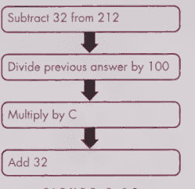

- 7. 保存更改并刷新浏览器。
- 8. 输入 **100** 作为摄氏度值，然后点击页面的其他位置。

如果公式输入正确，应返回 **212** 作为华氏温度。

- 9. 在浏览器和文本编辑器中关闭该文件。

## 2. 确定最大值和最小值

在本挑战中，你使用 `Math` 对象的方法来确定一串数字中的最大或最小数字。

- 1. 在文本编辑器中，打开 WIP_02 文件夹中的 `challengemax.html`。
- 2. 插入以下代码。

```html
<body>

<p>This page uses a simple script to find the largest number in a

list using the Math.max() method.</p>

<script language="JavaScript">

var largestNumber=Math.max(27,33,54,76,43,23,12,6,78,98);

document.write("The largest number is "+largestNumber+"<br>");

</script>

</body>

</html>
```

- 3. 在文本编辑器中保存文件，然后在浏览器中打开该文件。

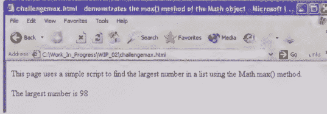

- 4. 插入额外代码以确定同一串数字中的最小值。

提示：使用 `Math.min()` 方法。

- 5. 保存并测试你的文件。
- 6. 在浏览器和文本编辑器中关闭该文件。

## 3. 使用计时器创建时钟

在本挑战中，你需要创建一个在线时钟，然后将其放置在网页的标题栏中。该脚本需要复杂地使用计时器，这些计时器由页面加载和卸载时触发的事件处理程序控制。你使用 `toLocaleString()` 方法来格式化时间和日期。

- 1. 在文本编辑器中，打开 WIP_02 文件夹中的 `challengeclock.html`。
- 2. 插入事件处理程序，以便在页面加载时启动时钟，在页面卸载时停止时钟。

```html
...

</script>

</head>

<body onload="startClock()" onunload="stopClock()" >

<p>This page creates a clock in the title bar.</p>

</body>

</html>
```

- 3. 插入代码以初始化计时器并创建启动时钟的函数。

```javascript
...

<script language="JavaScript">

// made by: Nicolas - http://www.javascript-page.com

var clockID = 0;

function startClock() {

    clockID = setTimeout("updateClock()", 500);

}

</script>

</head>

<body onload="startClock()" onunload="stopClock()">

...
```

- 4. 插入更新时钟的函数。

```javascript
...

function startClock() {

    clockID = setTimeout("updateClock()", 500);

}

function updateClock() {

    if(clockID) {

        clearTimeout(clockID);

        clockID = 0;

    } // end if

    var tDate = new Date();

    document.title = tDate.toLocaleString();

    clockID = setTimeout("updateClock()", 1000);

} // end function

</script>

</head>

<body onload="startClock()" onunload="stopClock()">

...
```

- 5. 插入在用户关闭页面时停止计时器的函数。

```javascript
document.title = tDate.toLocaleString();

clockID = setTimeout("updateClock()", 1000);

} // end function

function stopClock() {

    if(clockID) {

        clearTimeout(clockID);

        clockID = 0;

    }

}

</script>

</head>

<body onload="startClock()" onunload="stopClock()">
```

- 6. 在文本编辑器中保存您的更改。
- 7. 在浏览器中打开该文件，并检查标题栏以确保您的脚本正常工作。时钟应每秒变化一次。

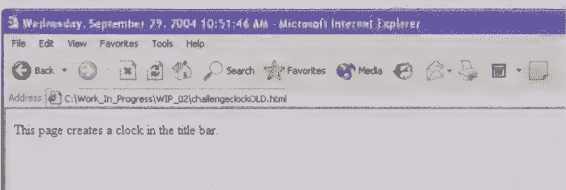

FIGURE 2.21

- 8. 在浏览器和文本编辑器中保持该文件打开，以便进行下一个挑战。

## 4. 使用 Date 对象方法

在前面的练习中，您使用计时器不断创建新的 `date` 对象。通过使用 `toLocaleString()` 方法，您还能够以文本字符串形式输出当前日期和时间。在此挑战中，您将使用 `date` 对象方法和条件语句，以便对返回给用户的信息进行更精确的控制。

1. 在打开的 `challengeclock.html` 文件中，在 `updateClock()` 函数中找到以下代码行。

   `document.title = tDate.toLocaleString();`

2. 修改此代码行，如下所示，以使用 `date` 方法格式化时钟的输出。

   `document.title = "" + tDate.getHours() + ":" + tDate.getMinutes() + ":" + tDate.getSeconds();`

3. 在文本编辑器中保存文件并刷新您的浏览器。

   标题栏应仅包含小时、分钟和秒的格式化内容。

4. 编写一条语句来创建一个变量以保存当前日期。使用 `getDay()` 方法将星期分配给您创建的变量。

5. 使用 `if` 语句将数字日期转换为星期的名称。例如，如果日期是 3，则将日期转换为字符串 `"Wednesday"`。

6. 修改输出以包含星期。您的输出格式应与以下内容匹配。


FIGURE 2.22

7. 保存并测试您的文件。
8. 在浏览器和文本编辑器中关闭该文件。

## 作品集构建器


## 计算披萨订单

设计师通常会构建表单来计算电子商务交易。这要求程序员构建能够计算交易成本的表单。为了演示这种表单，请在浏览器中打开 Project_02>Portfolio_Builder_02 文件夹中名为 `pizzacalculator.html` 的文件。在窗口的左侧，您会看到一个表单，允许用户在订购披萨时选择以下选项：

- 披萨的尺寸是什么？
- 披萨的类型是什么？
- 披萨的数量是多少？

您需要这些项目中的每一项来准确计算订单的总成本。模拟一个典型用户，在表单上进行一些选择，然后单击“Calculate Total”按钮。一个警告对话框会出现。请注意，这些值是不正确的。

在此作品集构建器中，您的任务是创建数学计算，允许典型用户看到准确的值。

- 在创建计算时，请记住控制运算顺序。正确的运算顺序将产生正确的结果，进而让用户信任该站点及其流程。

## 作品集构建器


## 计算披萨订单（续）

- 使用以下伪代码来创建实际的计算：
  `subtotal = (type * 4) + (size * quantity)`
  `total = subtotal + delivery`
- `type` 的值乘以 4，这代表基于披萨类型的固定加价。根据业务利润率，此值可能会更改，因此应在代码中使用一个变量来表示固定加价。
- 创建小计和总计计算后，警告对话框应显示正确的值。
- 警告还应告诉您是否需要支付送货费。
- 使用计算器检查结果，以确保您的脚本正常运行。

# 项目 3 第 2 级

## 流程控制和调试

### 目标

在本项目中，您将学习如何：

- 使用 `switch` 和 `break` 选择选项
- 使用 `"while"` 循环执行操作
- 使用 `"do while"` 循环执行操作
- 结合使用 `for` 语句
- 查找代码中的错误
- 识别常见的脚本错误

## 我为什么要这样做？

计算机程序通常需要决定是否执行特定操作。如您所知，条件语句允许计算机程序在条件计算为 `true` 时执行一个函数。考虑以下示例，可用于在线测试评分：

```javascript
if (answer==true) {

    // add 1 to the score

    score++;

}

else {

    // subtract 1 from the score

    score--;

}
```

条件（`if`）语句易于理解。计算机停止执行命令足够长的时间以评估条件，然后根据结果遵循特定命令。这些类型的语句也称为流程控制语句，因为它们会改变程序的自然流程。打个比方，假设您正在开车，来到了一个岔路口。根据您的目标，例如哪条路径能提供到目的地的最快路线，您做出了选择。

`if` 语句是最简单的条件（流程控制）语句。其他流程控制语句更复杂。例如，您可能希望重复一个操作直到条件变为真，而不是仅仅评估一次条件。使用前面的示例，假设您想修改在线测试，使用户持续回答直到他得到正确答案。使用伪代码，您可以看到如何将程序从简单语句更改为稍微复杂一点的语句：

```text


```javascript
if (the answer is true) {
    go to the next question;
} else {
    repeat the question and perform this comparison again;
}
```

达到这种复杂性水平通常会导致编码错误，当然，这些错误必须被定位和纠正。事实上，许多程序员花费更多时间来纠正他们程序中的问题，而不是编写新代码！在代码中查找和纠正错误的过程被称为`调试`。在本项目中，您不仅将学习如何使用许多其他关键字来创建循环和流程控制语句，还将学习如何查找和纠正代码中的错误。此外，您还会发现即使是最有经验的程序员也会犯的许多常见错误——并学习如何避免这些陷阱。

## 可视化摘要

`for`语句是最有用的流程控制（条件）语句之一。这种类型的语句允许开发人员轻松创建执行指定次数的循环。考虑以下说明`for`语句的脚本。


`for`语句使用一个变量来确定循环执行的次数。该变量被初始化为一个起始值。循环结束测试是一个条件语句，用于确定循环何时停止执行。循环的修改条件部分在每次循环执行时更改变量。上面显示的代码在浏览器中返回以下结果。


## 第 1 课：使用 Switch 和 Break 选择选项

`switch`关键字提供了与`if`语句相同类型的灵活性：当你有多个已知变量值时，`switch`效果很好。例如，假设你正在为一家减肥企业设计一个程序。每减掉 10 磅，你就想祝贺用户取得的成功。

```javascript
weightLost=30;

switch (weightLost) {
    case 10:
    {
        document.write("You've lost 10 pounds!");
        break;
    }

    case 20:
    {
        document.write("You've lost 20 pounds!");
        break;
    }

    case 30:
    {
        document.write("You've lost 30 pounds!");
        break;
    }

    case 40:
    {
        document.write("You've lost 40 pounds!");
        break;
    }
}  // this marks the end of the switch statement
```

要编写`switch`语句，你只需在语句中指定一个变量，在本例中是`weightLost`，并确定不同值要执行的代码。注意每个`case`语句末尾的冒号（`:`）；在`case`语句末尾放置分号会导致代码错误。关键字`break`告诉解释器不需要再进行更多比较。无论何时解释器遇到关键字`break`，它会立即跳转到`switch`语句代码的末尾。

使用`switch`关键字的语句有几个优点：

- 它们非常适合需要查找多个已知值的情况。
- 它们易于编写。
- 它们易于理解。
- 解释器通常执行这类语句非常快。

### 使用流程控制语句

1. 将你的`RF_JavaScript_L2\Project_03`文件夹的内容复制到`Work_In_Progress\WIP_03`文件夹中。
2. 在你的浏览器中，从`WIP_03`文件夹中打开`switch.html`。

   

   出现一个提示框。

3. 输入数字 `"4"` 并点击确定。

   

4. 在你的文本编辑器中，找到以下代码。

   ```javascript
   // insert switch here
   ```

# 项目 3：流程控制和调试

插入`switch`语句。

```html
...

var tickets=prompt("How many tickets do you have?", "");

document.write("You have "+tickets+" tickets."+"<br>");

// insert switch here

switch (tickets) {
    case "1":
    {
        document.write("You got a ticket!"+"<br>");
        break;
    }

    case "2":
    {
        document.write("If you get 3 tickets, your license will be suspended. "+"<br>");
        break;
    }

    case "3":
    {
        document.write("Your license is suspended!"+"<br>");
        break;
    }

    case "4": {
        document.write("You drove without a license. The police are taking you to jail!");
        break;
    }
} // end of switch

</script>

</body>

</html>
```

注意`case`值如何使用双引号。这是必要的，因为`prompt()`方法总是将值作为字符串返回。

6. 在文本编辑器中保存文件并刷新浏览器。

7. 在浏览器中，输入数字`"1"`并点击确定。

   

   图 3.5

8. 刷新你的 Web 浏览器。
9. 重复步骤 7 和 8；但这次输入 2、3 或 4 作为票数。消息应随每个值而变化。
10. 在浏览器和文本编辑器中关闭文件。

### 扩展你的知识……

#### 默认 CASE 值

可以为`switch`语句指定一个默认值。如果没有`case`评估为`true`，则执行该代码。

## 第 2 课：使用 While 循环执行操作

在第 1 课中，你学习了如何使用`if`语句根据评估的条件选择特定的代码段来执行。此功能在某些情况下很有用，但不如那些必须重复执行直到条件改变的代码段常用。你可以使用`while`和`do while`语句来创建这样的代码段。`while`和`do while`语句允许你循环执行某些代码段，直到值发生变化。例如，让我们看一个循环，它继续执行直到汽车行驶了 10 英里。

```javascript
miles=0;

while (miles<=10) {
    document.write("You've traveled "+miles+" miles."+"<br>");
    miles++;
}

document.write("You've arrived!");
```

如果你在脚本中执行代码，浏览器中会显示以下结果。


图 3.6

### 创建 While 循环

1. 在文本编辑器中，从`WIP_03`文件夹中打开`while.html`。
2. 找到以下代码行。

   ```javascript
   answer=0;

   // insert while statement
   ```

   此代码创建并将`answer`变量初始化为`0`。

3. 插入以下代码。

   ```html
   ...
   <script language="JavaScript">
   answer=0;
   // insert while statement
   while (answer!="Alaska") {
       answer=prompt("What is the correct answer?","");
   } // end while
   document.write("That is correct!");
   </script>
   ...
   ```

   `while`循环中的`prompt`语句会持续执行，直到用户输入正确答案。

4. 在文本编辑器中保存更改，并在浏览器中打开文件。

   

   出现一个提示框。

5. 输入除 Alaska 外的任何州名并点击确定。

   提示框再次出现。

6. 输入`"Alaska"`作为你的答案并点击确定。

   

7. 在浏览器和文本编辑器中关闭文件。

### 扩展你的知识……

#### 遍历数组循环

循环在处理数组值时通常很有用。例如，你可以设计一个循环，通过使用`counter`变量引用来输出存储在每个数组元素中的值，例如`document.write(myArray[counter])`。你可以使用数组的`length`属性来确定正确的循环执行次数。

## 第 3 课：使用 Do While 循环执行操作

虽然`while`语句在许多情况下都很有效，但它有一个限制：如果条件为`false`，代码将永远不会执行，这可能会导致问题，如果你希望代码至少执行一次，无论条件如何。`do while`语句提供了解决此问题的方法。继续第 2 课的例子，如果司机已经到达，你可能想告诉她行驶的英里数。为此，你可以使用`do while`语句，如下所示：

```javascript
miles=10;

do {
    document.write("You've traveled "+miles+" miles."+"<br>");
    miles++;
} while (miles<=10)

document.write("You've arrived!");
```

将此代码插入 HTML 页面会产生以下结果。


#### 图 3.9

在上一课中，你使用`while`循环来确保用户输入了测试题的正确答案。想象一下，你在测试中包含了额外的问题，并且在你的脚本中遇到了问题。通过仔细分析，你意识到当两个连续的问题具有相同的答案时，脚本无法正常工作。

例如，如果第一个问题的正确答案是`Alaska`，名为`answer`的变量被设置为该值。然后，遇到下一段代码语句，它询问第二个问题的答案：

```javascript
while (answer!="Alaska") {
    answer=prompt("What is the correct answer?","");
} // end while

document.write("That is correct!");
```

在这种情况下，`while`循环中的条件评估为`true`，这意味着第二个问题从未被询问。这会产生一个明显的错误，因为你想询问第二个问题，而不管第一个问题的答案是什么。在下面的练习中，你将使用`do while`语句来纠正此错误。

### 在脚本中使用 Do While 语句

1. 在浏览器中，从`WIP_03`文件夹中打开`dowhile.html`。

   

   **图 3.10**

   `while`循环内的代码尚未执行。

2. 在文本编辑器中打开文件并找到以下代码。

   ```javascript
   ...

   // the following code asks for the answer to question 2

   while (answer!="Alaska") {
       answer=prompt("What is the correct answer?"," ");
   } // end while

   ...
   ```

3. 按如下方式修改代码。

   ```html
   ...

   // the answer to question 1 is set

   answer="Alaska";

   // the following code asks for the answer to question 2

   do {
       answer=prompt("What is the correct answer?"," ");
   } while (answer!="Alaska")

   document.write("That is correct!");

   </script>

   </body>

   ...
   ```

   在文本编辑器中保存您的更改，并刷新浏览器。

   

   **图 3.11**

   输入“Alaska”作为答案并点击确定。

   无论之前的答案如何，脚本都会询问第二个问题的答案。

   关闭浏览器和文本编辑器中的文件。

### 拓展知识……

## Do While 循环

程序员使用`do while`循环的情况通常比使用常规`while`语句要少，因为需要`do while`循环的情况较少。`do while`循环最适合在循环内容需要至少执行一次，无论测试条件状态如何的情况下使用。在这些情况下也可以使用`while`语句，但需要额外的冗余代码才能使代码正常执行。

## 第四课：使用 For 语句

`for`语句可能比其他流程控制语句更难掌握，但它们为用户提供了对循环操作的额外控制。`for`语句提供了一种简洁的方法来创建要评估的起始条件、测试结束循环的条件，以及在循环进行中改变条件。这个过程类似于`while`和`do while`操作，但`for`语句更紧凑。以下伪代码描述了`for`语句的工作原理：

```javascript
for (setupCondition; endofLoopTest; modifyCondition) {
    codeGoesHere;
}
```

伪代码包含以下部分：

- 设置条件是指用于初始化以创建循环起始状态的变量。
- 循环结束测试是一个评估条件，用于确定循环何时停止执行。
- 修改条件是每次循环执行时进行的更改。

如果这看起来有点难以理解，不用担心——一个实际的例子会让伪代码示例更容易理解。在下面的练习中，你将创建一个从 1 数到 10 的循环。

### 创建 For 循环语句

1. 在文本编辑器中，从`WIP_03`文件夹打开`for.html`。
2. 插入以下代码。

   ```html
   ...

   <body>

   <script language="JavaScript">

   // 在此处插入 for 循环

   for (counter=1; counter <= 10; counter++) {
       document.write(counter+"<br>");
   }

   </script>

   </body>

   </html>
   ```

3. 在文本编辑器中保存更改，并在浏览器中打开文件。

   

4. 关闭文本编辑器和浏览器中的文件。

在这个练习中，你创建了一个名为`counter`的变量来控制循环。`counter`被初始化为值 1。只要变量小于或等于 10，循环就会执行。每次循环执行时，变量通过在其当前值上加 1 来递增。

### 拓展知识……

#### For 循环

`for`循环在你需要执行特定次数的操作时特别有用。在许多常见应用中，你还需要嵌套某些操作。考虑一个班级注册系统的例子：你需要注册 100 名学生，每名学生注册 5 门课程。在这种情况下，你需要一个循环来注册每个学生，还需要一个嵌套循环来处理每个学生的 5 门课程。

## 第五课：查找代码错误

从你在*Essentials for Design: JavaScript Level 1*的学习中，你已经知道如何使用`window`对象、`document`对象和`form`对象，以及使用它们的属性、方法、事件处理程序和从属对象。从本书早期的项目中，你已经知道如何使用变量和数组，以及创建函数和流程控制语句。运用这些技能，你现在可以编写复杂的代码，整合你所学的所有 JavaScript 方面的知识。

随着脚本变得越来越复杂，查找代码中的错误（错误）也变得越来越困难。编码错误主要有两种形式：

- **语法错误**指的是 JavaScript 语法规则的错误。语法错误（通常）相对容易发现。
- **逻辑错误**意味着代码做了某件事，但本意是做别的事情。逻辑错误通常比语法错误更难发现和修正。

考虑以下代码行：

```javascript
document.writ("hi world!");
```


显然，`write`中的“e”缺失了。在许多浏览器中，更改方法的大小写会产生错误或阻止代码执行。这类语法错误通常难以发现，因为代码在一个浏览器中可能运行正常，但在另一个浏览器中却失败。

在整个课程中，你将发现各种避免错误的技术，以及查找你在代码中无意中放置的错误的方法。查找和修正代码中错误的过程被称为调试。一位早期的程序员创造了这个术语，因为她发现一只真正的虫子（一只昆虫）导致了她正在使用的计算机出现错误。

### 编写整洁代码

编写易于阅读和理解的代码是避免犯错的最佳方式。让我们花点时间回顾一下编写良好（整洁）代码的步骤：

- 使用空格来显示代码中的嵌套循环。
- 在每一行代码的末尾放置分号，即使解释器不要求。在大多数情况下，你不应在`while ( )`、`for ( )`或`if ( )`条件的右括号末尾放置分号。但是，你应该在`do while ( )`语句的末尾放置分号。
- 使用程序员注释来描述每个代码段的目的，例如一个函数或一个绘制 HTML 表格的代码段。
- 使用程序员注释来描述每个变量创建时的用途。
- 使用易于识别和理解的变量和函数名。
- 对重复使用的代码段使用函数。
- 避免使用大多数常用浏览器不支持的方法、对象或属性。

编写整洁代码需要一些前期工作，而不是简单地坐下来尽快编写脚本，然后再解决问题。优秀的程序员将复杂的问题分解成可管理的块，然后一次构建解决方案的一部分。这种方法最终节省了大量原本用于艰苦搜索错误的时间。当每个代码部分被构建（编写）时，程序员专注于简单、易于理解的脚本，彻底测试它们，确保它们完美运行，然后继续下一部分。这项工作通常缓慢而乏味，但最终带来的挫折感要少得多。

### 解读错误信息

在较新的浏览器中，JavaScript 错误信息通常对用户被抑制（隐藏）。考虑 IE 版本 6，它会忽略错误信息。以下插图显示了 IE 的默认选项。请注意，脚本调试默认是关闭的，浏览器不会显示关于每个脚本错误的通知。


**图 3.13**

与 HTML 一样，浏览器的设计尽可能忽略错误，并尽其所能显示页面。考虑以下错误，它省略了`alert()`方法的结尾括号：

```javascript
alert("This is a simple JavaScript command";
```

使用设置为默认值的 Internet Explorer 6.0，该行代码被忽略，但错误图标可能会显示在状态栏的左下角。


**图 3.14**

# 项目 3 流程控制与调试

这个错误可能不会出现，具体取决于浏览器中是否启用了“显示每个脚本错误的通知”。双击错误图标会生成一个包含错误信息的警报框。警报框右侧的“隐藏详细信息”按钮允许你隐藏或显示错误的详细信息。


**图 3.15**

如果你勾选“当页面包含错误时始终显示此消息”框，每当发生错误时，警报框会自动出现。在 IE 4 或更高版本中，你可以通过选择工具 > Internet 选项来打开或关闭此消息。在 Internet 选项对话框中，你可以单击高级选项卡并激活“显示每个脚本错误的通知”复选框。


**图 3.16**

同样重要的是要记住，列出的行号可能不是问题的实际根源。例如，想象一下脚本中的以下代码行使用变量执行计算。假设你尚未定义`taxAmount`变量。

```javascript
total=subTotal*taxAmount;
```

如果解释器向你发送了一条消息，告诉你第 14 行发生了错误，你可能无法明确该错误实际上是由未声明的变量引起的。在这种情况下，该变量本应在之前的语句中声明，这样就能解决问题了。

## 追踪

逻辑错误不会产生错误提示，因为代码在技术上是正确的。优先级错误发生在解决方案中的步骤以错误的顺序执行时。追踪可以提供一种方法来确定这类错误的根本原因。追踪是在程序执行过程中检查变量状态的过程。追踪是一种简单且强大的方法，它能让你更好地理解你的程序（代码）。

在 JavaScript 中，追踪通常通过`document.write()`或`alert()`命令来实现。例如，假设你正试图编写一个脚本用于生成贷款还款金额，这涉及多个步骤和复杂的数学计算。假设你已经在纸上写好了步骤，并算出了一个示例还款额。写完脚本后，你发现它总是得出错误的答案。为了找出问题所在，你可以在每个步骤输出重要变量的值，使用如下简单的语句：

```javascript
document.write("After step 2, the value is "+loanAmount);
```

### 使用追踪来纠正逻辑错误

在本练习中，假设你正在开发一个网页，用于为在线商店展示各种产品。你创建了一个数组来存储商店所提供产品的信息。你还创建了一个循环来输出产品的信息。你是一个细心的程序员，因此在编写时会测试脚本的每个部分。你的下一步是使用追踪来查找并纠正代码中的错误。

1. 在浏览器中，打开你 WIP_03 文件夹中的`logicerror.html`。

   

   你没有收到错误消息，但第一个项目没有显示，并且数组的最后一个值显示为`"undefined"`。

2. 在文档中找到以下代码。

   ```javascript
   ... // start section to draw table rows v=0; do { v++; document.write('<tr>'); document.write('<td>'+productName[v]+'</td>'); document.write('</tr>'); } while (v<productName.length) ...
   ```

   这段代码创建了一个 HTML 表格来显示每个产品的信息。

3. 插入以下代码。

   ```javascript
   ... do { v++; document.write('<tr>'); document.write("Counter is set to "+ v+"<br>"); document.write('<td>'+productName[v]+'</td>'); document.write('</tr>'); } while (v<productName.length) ...
   ```

   这段代码在循环执行时追踪计数器`v`的值。

4. 在文本编辑器中保存你的更改，然后刷新浏览器。

   

   **图 3.18**

   这揭示了脚本的问题——如果你之前还没有发现的话。虽然计数器初始化为 0，但在第一个产品输出到屏幕之前，它被设置成了 1。

5. 找到并删除以下代码行。

   ```javascript
   v++;
   ```

6. 将你在第 5 步中删除的代码行插入到以下位置。

   ```javascript
   ...

   do {

       document.write("Counter is set to "+ v+"<br>");

       document.write('<tr>');

       document.write('<td>'+productName[v]+'</td>');

       document.write('</tr>');

       v++;

   } while (v<productName.length)

   </script>

   </table>

   ...
   ```

   这一更改纠正了错误。

   在文本编辑器中保存你的更改，然后刷新浏览器。

   

   找到并删除以下代码行。

   ```javascript
   document.write("Counter is set to " + v+"<br>");
   ```

   这一更改移除了追踪。

   在浏览器和文本编辑器中保存并关闭文件。

### 拓展知识……

#### 错误消息通知

JavaScript 的错误消息会显示错误发生的行号。需要注意的是，行号是从 HTML 文档的开头开始计算的，而不是从`<script>`标签的开头开始计算的。

## 第 6 课 识别常见的脚本错误

JavaScript 开发人员在编写代码时通常会犯许多常见错误。在本课中，你将了解 JavaScript 开发人员最常犯的各类错误。许多语言，包括 Java、C++ 和 Flash ActionScript，使用的语法规则与 JavaScript 的规则非常相似。以下常见错误列表同样适用于这些其他编程语言以及 JavaScript。

1. 遗漏结尾的引号、括号或圆括号，例如：

   ```javascript
   document.write("Hi everyone!);

   j=x[32+1;

   alert("You choose the luxury option.";
   ```

   纠正后的版本：

   ```javascript
   document.write("Hi everyone!");

   j=x[32+1];

   alert("You choose the luxury option.");
   ```

2. 使用赋值运算符而非相等运算符，反之亦然，例如：

   ```javascript
   if (number=32)

   var number==32;
   ```

   纠正后的版本：

   ```javascript
   if (number==32)

   var number=32;
   ```

3. 创建无限循环，例如：

   ```javascript
   x=1;

   while (x<32)

   doSomething(x);
   ```

   纠正后的版本：

   ```javascript
   x=1;

   while (x<32) {

   doSomething(x);

   x++

   } // end while
   ```

4. 使用未定义的变量，例如：

   ```javascript
   document.write(firstName);
   ```

   纠正后的版本：

   ```javascript
   firstName="Joe";

   document.write(firstName);
   ```

5. 插入多余的分号，例如：

   ```javascript
   if (paid==true);
   makePayment();
   ```

   纠正后的版本：

   ```javascript
   if (paid==true)

   makePayment();
   ```

6. 在`switch`语句中遗漏`break`语句。这通常会导致`switch`语句的后续部分被执行：

   ```javascript
   switch (payment) {

   case "cash": {

   doSomething();

   }

   case "credit":

   doSomethingElse();

   }
   ```

   #### 纠正后的版本：

   ```javascript
   switch (payment) {

   case "cash": {

   doSomething();

   break;

   }

   case "credit":

   doSomethingElse();

   break;

   }
   ```

7. 调用不存在的方法、函数或属性，例如：

   ```javascript
   window.screenSize;

   window.makeSmaller();
   ```

   #### 纠正后的版本：

   ```javascript
   screen.availWidth;

   window.resizeBy(-200,-200);
   ```

8. 使用表单元素而非元素的值。当使用存储在表单元素中的值时，必须使用`value`关键字：

   ```javascript
   document.form1.email;

   document.forms[1].state;
   ```

   #### 纠正后的版本：

   ```javascript
   document.form1.email.value;

   document.forms[1].state.value;
   ```

涉及所用信息类型的错误可能会给开发人员带来严重问题。这些错误实际上是逻辑错误，而非语法错误。例如，考虑以下语句：

```javascript
total=2+"5";

document.write(total);
```

由于部分信息是字符串，部分信息是数字，JavaScript 假定你希望将信息连接成单个文本字符串。这段代码将字符串`"25"`输出到屏幕上。

回想一下，JavaScript 是松散类型的，这意味着你不必声明存储在变量中的信息类型。相反，JavaScript 会根据你输入的信息类型来决定如何处理变量。输入不正确的信息到变量中可能会产生难以发现的异常问题。例如，考虑以下脚本：

```javascript
x=prompt("Enter a number");

result=x+32;

document.write("x plus 32 equals "+result);
```

假设你在浏览器中运行此脚本并在用户提示处输入数字`"6"`，你会得到计算结果`"326"`。需要使用`parseInt()`方法将值从文本字符串转换为数值。对于使用小数的数字，可以使用`parseFloat()`方法将字符串转换为浮点小数。

### 纠正常见的脚本错误

1. 在浏览器和文本编辑器中，打开你 WIP_03 文件夹中的`common.html`。

   这本质上与你之前练习中创建计数器时使用的文件相同。常见的脚本错误目前正在阻止该文件执行。

2. 找到以下代码。

   ```javascript
   for (counter==1; counter = 10; counter++) {

       document.write(counter+"<br>");

   }
   ```

3. 将代码行改为使用等号（`=`）而非相等运算符（`==`）来初始化变量。

   ```javascript
   for (counter=1; counter = 10; counter++) {

       document.write(counter+"<br>");

   }
   ```

   在文本编辑器中保存更改并刷新浏览器。

   

   该脚本创建了一个无限循环。

   单击“是”以中止脚本。

   将条件改为使用小于或等于运算符（`<=`）。

   ```javascript
   for (counter=1; counter <= 10; counter++) {

       document.write(counter+"<br>");

   }
   ```


### 扩展你的知识……

## 调试程序

调试程序通常包括追踪窗口，用于在程序执行时显示变量的值。这些程序通常允许你“单步”执行脚本，使开发人员能够一次运行一行代码。在撰写本文时，Microsoft Script Debugger 可从微软免费下载。其他 JavaScript 调试器也可免费下载，包括 Netscape 的版本，这些版本专门设计与 Netscape 浏览器交互使用。

1. 在文本编辑器中保存更改并刷新浏览器。


代码现在正确执行。

2. 在浏览器和文本编辑器中关闭文件。

### 总结

在项目 3 中，你了解到流程控制语句使用比较来决定是否执行某些操作。你发现 `if` 语句只是询问条件是否为 `true`，如果是，则执行一个动作或一系列动作。类似地，`while` 语句反复执行一个动作，直到条件变为 `false`。相比之下，`do while` 语句在评估条件之前至少执行一次代码语句。

你发现 `switch` 和 `break` 语句在你寻找某些已知值时非常有用。相比之下，`for` 语句专门设计用于提供一种高级循环，你可以通过指定循环何时结束以及确切执行多少次来控制它。

在本项目中，你发现程序员如何避免常见的编码错误。此外，你学会了如何使用各种调试技术来查找 JavaScript 代码中的错误。你还学会了如何使用追踪，这是一种常用于查找代码中编程错误的方法。即使编写干净且一致的代码有助于避免许多错误，复杂脚本中的某些错误是不可避免的——即使最细心的开发人员也会不时犯错。

## 关键术语

| | | |
|---|---|---|
| Debugging（调试） | Logic error（逻辑错误） | Syntax error（语法错误） |
| Do while statement（do while 语句） | Modify condition statement（修改条件语句） | Tracing（追踪） |
| End-of-loop test（循环结束测试） | Precedence error（优先级错误） | While statement（while 语句） |
| Flow-of-control statement（流程控制语句） | Setup condition（设置条件） | |

## 检查概念和术语

### 多项选择

圈出与以下每个问题的正确答案匹配的字母。

1. 什么术语常用于描述流程控制语句，例如 `if` 和 `switch`？
   - a. 条件语句
   - b. 函数语句
   - c. 方法
   - d. 常量修饰符
   - e. 以上都不是

2. 当你从 `switch` 语句中省略 `break` 关键字时会发生什么？
   - a. 浏览器锁定并停止工作。
   - b. switch 创建无限循环。
   - c. 条件测试不为 `true` 的代码也可能执行。
   - d. 这不会影响 switch 语句，因为 `break` 关键字是可选的。

3. 在以下哪种情况下使用 `switch` 语句很有用？
   - a. 想至少执行一次代码行，无论测试条件如何
   - b. 想执行一定次数的代码行
   - c. 想重复执行代码行直到条件为 `false`
   - d. 有几个已知值

4. 在以下哪种情况下使用 `while` 语句很有用？
   - a. 想至少执行一次代码行，无论测试条件如何
   - b. 想执行一定次数的代码行
   - c. 想重复执行代码行直到条件为 `false`
   - d. 有几个已知值

5. 在以下哪种情况下使用 `do while` 语句很有用？
   - a. 想至少执行一次代码行，无论测试条件如何
   - b. 想执行一定次数的代码行
   - c. 想重复执行代码行直到条件为 `false`
   - d. 有几个已知值

6. `for` 语句中的设置条件部分在脚本中起什么作用？
   - a. 它不影响循环的执行。
   - b. 它初始化一个将用于创建计数器的变量。
   - c. 它测试结束循环的条件。
   - d. 它在循环每次执行时修改变量。

7. `for` 语句中的修改条件部分在脚本中起什么作用？
   - a. 它不影响循环的执行。
   - b. 它初始化一个将用于创建计数器的变量。
   - c. 它测试结束循环的条件。
   - d. 它在循环每次执行时修改变量。

8. `for` 语句中的循环结束测试部分在脚本中起什么作用？
   - a. 它不影响循环的执行。
   - b. 它初始化一个将用于创建计数器的变量。
   - c. 它测试结束循环的条件。
   - d. 它在循环每次执行时修改变量。

## 项目 3 流程控制与调试

9. 以下哪项是逻辑错误的示例？
   - a. 当你使用不匹配的括号或引号时
   - b. 当你拼错方法名时
   - c. 当你从代码语句中省略分号时
   - d. 当你将命令按错误顺序放置时

10. 以下哪项是语法错误的示例？
    - a. 当代码执行的结果与预期不同时
    - b. 当你在代码语句中使用错误的变量时
    - c. 当你拼错方法名时
    - d. 当你将命令按错误顺序放置时

### 讨论题

1. 所有流程控制语句（例如 `for`、`while` 和 `switch`）与 `if` 语句有什么相似之处？
2. 程序员在使用流程控制语句时如何意外创建无限循环？
3. 追踪如何帮助你找到编码错误？
4. 说出至少两种常见的编程错误。你认为程序员为什么会犯这些特定的错误？

## 技能训练

技能训练练习巩固项目技能。每项巩固的技能与项目中介绍的技能相同或几乎相同。提供了详细的逐步说明。你应该按顺序完成练习。

### 1. 创建“For”循环

在本练习中，你将考虑一种使用嵌套 `for` 循环的情况。你创建一个简单的程序来输出乘法表。你需要一个循环来创建第一个数字，还需要一个内层循环来创建第二个数字并将值相乘。

1. 在文本编辑器中，打开 WIP_03 文件夹中的 `fornested.html`。

   首先，你编写外层循环的代码来创建并显示第一个数字。

2. 在页面主体中的 `script` 内添加以下代码。

```javascript
for (outNumber=1; outNumber<=10; outNumber++) {

} // end for
```

3. 在 `for` 循环中插入一条 `document.write()` 语句，输出存储在 `outNumber` 变量中的值和一个空格。

   这让你能看到循环的工作原理。

4. 在文本编辑器中保存更改并在 Web 浏览器中打开文件。

   你的输出应与下图匹配。


**图 3.22**

5. 在文本编辑器和浏览器中保持文件打开，以便进行下一个练习。

### 2. 使用嵌套“For”循环

1. 在打开的 `fornested.html` 中，找到并删除下面显示的代码。

   你的代码可能略有不同，因为这是你在上一个练习的步骤 3 中创建的代码。

```javascript
document.write(outNumber+" ");
```

2. 插入内层循环来创建第二个数字。对于外层循环的每次执行，该循环应重复 10 次。在现有的 `for` 循环内，创建第二个 `for` 循环。该循环应使用名为 `inNumber` 的变量。`inNumber` 变量应初始化为 1。循环应继续直到 `inNumber` 变量小于或等于 10。循环应在每次执行时将 `inNumber` 变量增加 1。

3. 将以下代码插入到你在上一步创建的循环中。

```javascript
result=outNumber*inNumber;

document.write(outNumber+"* " + inNumber+" = "+result+"<br>");

} // end inner for

} // end for

</script>

</body>

...
```

4. 在标记 `for` 循环结束的括号之间插入以下代码行。

```javascript
result=outNumber*inNumber;

document.write(outNumber+"* " + inNumber+" = "+result+"<br>");

    }

    document.write("<br>");

} // end for

</script>

</body>
```

...

5. 在文本编辑器中保存你的更改，然后刷新浏览器。

   你的文件应与下图所示内容匹配。


6. 在文本编辑器和浏览器中关闭文件。

## 3. 测试错误

在本练习中，你将调试一个旅行社的网页。该网页旨在允许用户输入她的姓名，然后选择一个目的地。如果用户选择墨西哥坎昆或多米尼加共和国，则应出现一个确认框，要求用户确认需要出生证明或护照。如果用户选择加利福尼亚州蒙特雷，则无需进一步确认。

1. 在浏览器中，从你的 WIP_03>travel 文件夹打开 `travelpackagecomplete.html`。

   这是文件的最终版本。你不会调试此版本的文件。

2. 保留姓名字段为空，然后点击发送。

   你会收到一条警报消息，告知你必须输入姓名。

3. 点击确定。

4. 在姓名字段中输入任意姓名，然后点击发送。

   由于套餐默认选择加利福尼亚州蒙特雷，无需进一步确认，你应被重定向到感谢页面。

5. 点击返回按钮以返回到表单。

6. 从下拉菜单中选择墨西哥坎昆，然后重新提交表单。

   你应收到一个确认框，要求你确认你理解需要出生证明或护照。


图 3.24

7. 点击取消。

   一个警报框通知你提交已被取消。

8. 点击确定以返回到表单。

9. 关闭文件。

10. 在文本编辑器和浏览器中，从你的 WIP_03>travel 文件夹打开 `travelpackage.html`。

    你将调试此版本的文件。

11. 在浏览器中，保留姓名字段为空，然后点击页面底部的发送。你应收到一条消息，告诉你输入姓名；相反，你收到了关于坎昆旅行的确认消息。

12. 点击取消。

13. 在告诉你表单提交已取消的警报框中点击确定。

14. 保留姓名字段为空并选择其他目的地。当姓名字段为空时，脚本应始终生成警报框。请注意错误是发生在字段为空时，还是仅在选择某些目的地时发生。

15. 在文本编辑器和浏览器中保持文件打开，以进行下一个练习。

## 4. 修正逻辑错误

1. 在打开的文件中，返回到文本编辑器并检查函数中的以下代码。

```javascript
...

if (travelForm.name ==" ")

{

    alert("You must enter a name.");

    return false;

}

else

    switch (travelForm.package.value)

...
```

`switch` 语句的部分内容在浏览器中执行。这表明在 `if` 语句中评估的条件始终评估为 `false`；`switch` 语句只有在这种情况下才会执行。

2. 在 `if` 语句之前直接插入以下跟踪命令。

```javascript
alert(travelForm.name);
```

3. 在浏览器中刷新页面。

4. 保留姓名字段为空并点击发送。警报框显示一条晦涩的消息，只显示“`[object]`”。其他浏览器在此情况下可能会显示错误消息。这告诉你表单对象的值未在 `if` 语句中考虑。

5. 点击确定。

6. 修正 `if` 语句以引用存储在 `name` 对象中的 `value` 属性，并移除跟踪警报。

7. 在文本编辑器中保存你的更改并刷新浏览器。保留姓名字段为空并点击发送。你应收到关于姓名字段为空的警告消息。

8. 点击确定。在浏览器和文本编辑器中保持文件打开，以进行下一个练习。

## 5. 修正 `switch` 语句

1. 在打开的文件中，在姓名字段中输入任意姓名，将套餐菜单设置为加利福尼亚州蒙特雷，然后点击发送。

   你应收到关于坎昆旅行需要出生证明或护照的消息。

2. 点击取消，然后点击确定。

3. 返回到文本编辑器并找到以下代码。

```javascript
...

switch (travelForm.package.value)

    {

        case "Monterrey":

            {

            ask=true;

            }

        case "Cancun":

            {

            ask=confirm("Cancun trips require a birth certificate or passport.");

            break; }

        case "Dominican": {

            ask=confirm("Dominican Republic trips require a passport");

            break; }

    } // end of switch

...
```

`switch` 语句包含一个常见错误，导致即使第一个 `case` 评估为 `true`，代码也会继续执行。

4. 修正以下代码段。

```javascript
case "Monterrey":

{

	ask=true;

}
```

5. 在文本编辑器中保存文件并刷新浏览器。

6. 彻底测试页面。代码现在应正常工作。

7. 在浏览器和文本编辑器中关闭文件。

## 挑战

挑战练习扩展或在某种程度上与课程中呈现的技能相关。每个练习提供一个简要介绍，然后是以编号步骤格式呈现的说明，其详细程度不如技能训练练习中的说明。你应该按顺序完成这些练习。

## 1. 为 `switch` 创建案例

一家专门从事旅游套餐的公司聘请你设计一个页面，以与现有的软件系统对接。要完成这项工作，你必须编写一个 `switch` 语句，将套餐名称值从文本转换为数字。

1. 在浏览器和文本编辑器中，从你的 WIP_03 文件夹打开 `challengedefault.html`。

2. 在文档的头部找到以下 `switch` 语句。

   此语句将值 `Luxury` 转换为匹配的数字。

```javascript
...

		switch (travelForm.package.value)

		{

			case "Luxury":

			{

				package=1;

				break;

			}

		} // end of switch
```

...

## 项目 3 流程控制和调试

3. 为值 `Adventure` 添加另一个 `case` 语句。如果此 `case` 评估为 `true`，变量 `package` 应设置为值 `2`。

4. 为值 `Touring` 添加另一个 `case` 语句。如果此 `case` 评估为 `true`，变量 `package` 应设置为值 `3`。

5. 在文本编辑器和浏览器中保持文件打开，以进行下一个练习。

## 2. 在 `switch` 中使用默认选项来查找错误

在构建旅游套餐网页期间，开发团队注意到当系统中的一个错误允许用户选择 `switch` 语句未涵盖的套餐时，接口偶尔会产生错误。在本练习中，你将使用 `switch` 语句的 `default` 选项来检测软件无法将值转换为数字的情况。

1. 在打开的 `challengedefault.html` 中，在文档头部找到以下代码。

```javascript
switch (travelForm.package.value)

{

case "Luxury":

    {

    package=1;

    break;

    }

case "Adventure":

    {

    package=2;

    break;

    }

case "Touring":

    {

    package=3;

    }

} // end of switch
```

2. 插入以下代码。（此代码在 `switch` 无法将文本值解析为数字值时创建跟踪警报。）

```javascript
...

    case "Touring": {

        package=3;

        break;

    }

    default: {

        alert("no case tested true in number assignment");

    }

} // end of switch

return false;

} // end function

...
```


```

```

### 操作步骤

1. 在文本编辑器中保存你的更改并刷新浏览器。
2. 从下拉菜单中选择其他。
3. 点击发送。

出现一个警报框。

4. 点击确定。
5. 假设软件设计用于处理错误。将`default`选项设置为将`package`变量设置为值`4`，并移除你在步骤 2 中插入的跟踪警报。
6. 保存并测试你的文件。

不应出现警报。

7. 在浏览器和文本编辑器中关闭文件。

## 3. 使用追踪来设计脚本

假设你被要求设计一个页面，该页面在每次加载时显示一张随机图片。你有 76 张图片可供项目使用。这个问题的解决方案包含两个部分：

1. 你需要在 1 到 76 之间选取一个随机数。
2. 你必须动态生成代码来显示第 1 部分中选定的图片。

从编写生成随机数的代码开始编写脚本。

1. 在你的文本编辑器中，打开`WIP_03`文件夹中的`challengerrandom.html`并检查代码。
2. 在 Web 浏览器中打开该文件。

该页面尚未向最终用户输出任何内容。此时，你知道该脚本不会产生任何语法错误，但你还没有验证脚本是否正常工作。你需要使用追踪来查看代码是否被正确设计。

3. 在文档的`head`中找到以下函数。

```javascript
...

function getPicNumber() {
    randomNumber = Math.random();
    return randomNumber;
} // end function

...
```

4. 在数字从函数返回之前，创建一条语句来追踪`randomNumber`变量的值。
5. 在文本编辑器中保存更改并刷新浏览器。


在浏览器中检查文件会发现逻辑中的一个错误：`Math.random()`方法返回一个介于`0`和`1`之间的数字，但你需要一个介于`1`和`76`之间的数字。

6. 将赋值语句更改为以下内容。

```javascript
randomNumber = Math.random() * 100;
```

7. 在文本编辑器中保存更改并刷新浏览器。你成功得到了一个两位数，但你需要丢弃小数点后的数字。
8. 创建另一条语句，使用`Math.round()`方法来丢弃小数部分。
9. 保存更改并多次刷新浏览器。

每次刷新，你应该看到一个介于 1 和 100 之间的新数字。

10. 保持文件在浏览器和文本编辑器中打开。

## 4. 使用追踪来调试脚本

在前面的练习中，你可能注意到浏览器返回了许多大于 76 的数字。在这个练习中，你将使用追踪来纠正此错误，并继续开发此脚本。

1. 继续在打开的文件中工作。由于可以生成的最大数字是 76，你需要将结果乘以 0.76（76%），如下列语句所示。

```javascript
randomNumber = (Math.random() * .76) * 100;
```

2. 不要将数字乘以 0.76 和 100，而是将公式更改为简单地将数字乘以 76。
3. 保存更改并多次刷新浏览器。

你的脚本看起来是完美的，但实际上有一个重要的错误：如果`Math.random()`方法返回一个非常小的数字，例如`.002832739482`，结果是 0（零）。

4. 要修复此问题，乘以 75 而不是 76，并始终在结果上加 1。
5. 在文本编辑器中保存更改并多次刷新浏览器以测试你的脚本。

脚本应始终生成一个介于 1 和 76 之间的数字。

6. 在浏览器和文本编辑器中关闭文件。

## 作品集构建


### 调试复杂脚本

调试复杂脚本的能力是 Web 开发者能够为项目团队带来的最重要技能之一。最常见的代码错误是语法错误，通常是简单的排版错误。在这个作品集中，你将逐步调试一个复杂的脚本，直到它没有错误。

- 在浏览器中打开`Work_In_Progress>WIP_03`文件夹中的`debug.html`。确保启用了错误报告。
- 当页面尝试加载时，错误会以警告框或状态栏中的警报图标的形式显示在浏览器窗口中。阅读错误消息。错误发生在哪一行？是否有缺失字符的标记？
- 由于脚本错误非常常见，开发者已经学会了优先处理调试过程。例如，知道引号不匹配是一个非常常见的错误，首要任务是找到并修复这些错误。然后，程序员查找缺失的括号、方括号和分号。针对这些语法错误调试你的脚本。
- 按照错误报告在脚本中定位错误。继续此过程，直到页面没有错误。当页面“干净”时，你将收到一个提示并看到由数组生成的列表。
- 在调试过程中，思考你将如何开发个人的调试方法。什么过程对你最有效？一旦你确定了一个有效的方法，每次调试代码时都使用它。这种方法可以帮助你成为更高效的代码调试器。

## 项目 4 第 2 级：添加表单和图像

### 目标

在本项目中，你将学习如何：

- 使用表单元素和属性
- 验证表单元素
- 使用图像属性
- 预加载图像
- 创建翻转脚本
- 使用高级图像脚本

### 为什么我要这样做？

`form`对象和`image`对象可能是 JavaScript 文档对象模型（DOM）中最有用的对象，因为这些对象允许你以仅使用 HTML 无法实现的方式来操作 HTML 表单和图像。大多数 JavaScript 的实际应用通常会结合使用这两个对象之一。

HTML 表单允许程序员出于各种目的从用户那里收集数据。在 HTML 中设计表单特别实用，因为它允许设计师创建易于最终用户理解的表单。JavaScript 允许你通过检查输入信息的质量以及在表单数据发送到服务器之前执行其他任务，从而大大扩展 HTML 表单的功能和灵活性。

JavaScript 允许你以多种方式使用图像，包括翻转按钮（响应用户选择而改变的图像）。在 HTML 中，你使用``标签来显示图像，如下例所示：

```html

```

使用 HTML，你可以显示图像；相比之下，JavaScript 提供了几种操作图像的新方式。例如，你可以**预加载**图像文件，这意味着你在用户看到图像之前加载文件。在许多情况下，预加载的图像在用户单击时会立即显示。在本项目中，你将学习如何使用 JavaScript 来添加和操作表单和图像，从而扩展 Web 页面的复杂性、深度和功能。

### 视觉摘要

回顾你在 HTML 中的工作，你知道使用`<form>`标签来创建表单。使用此标签时，JavaScript 会创建一个匹配的`form`对象，可以通过`forms[]`数组来引用。例如，页面中的第一个表单被称为`forms[0]`，页面中的第二个表单被称为`forms[1]`。

要在表单中创建元素，你可以使用`<input>`标签。`type`属性指定你要创建的`form`元素的类型。`type`属性可以包括以下值：`text`、`password`、`radio`、`checkbox`、`reset`、`button`、`submit`、`image`和`hidden`。考虑以下表单的代码，该表单允许用户为其车辆预约服务。


# 项目 4：添加表单和图像

在此表单中，`<input>`标签创建各种`form`元素。在电子邮件地址和姓名字段中，使用了`text`类型。洗车复选框使用了`checkbox`类型。`radio`类型用于创建“回头客”和“新客户”单选按钮，而`<textarea>`标签用于收集车辆描述。

在此表单中，信息通过`post`方法发送到名为`mail2.asp`的服务器端脚本。服务器端脚本是一个 ASP 脚本，它接受信息并发送电子邮件给服务经理。还会向脚本发送一个隐藏字段；它包含一个感谢页面的 URL，用户在服务器端脚本接受信息后会看到该页面。

回顾 HTML 知识，你知道使用`post`或`get`方法来提交表单。`get`方法将数据附加到`<form>`标签的`action`属性中指定的 URL 末尾。`post`方法作为 HTTP 协议的一部分发送数据，这有效地将信息从最终用户处隐藏。

如果你没有在`action`属性中指定文件，信息将被发送回包含`<form>`标签的文件。如果你没有为`<form>`标签指定方法，`get`方法将发送信息。大多数服务器端脚本设计为接收通过`post`方法发送的信息。（设置服务器端脚本来处理表单数据的能力需要理解服务器端脚本语言以及服务器的配置。对这些项目的解释超出了本书的范围。大多数 Web 托管公司提供免费脚本以及关于如何在其服务器上设置表单处理脚本的详细说明。）

`document`对象表示 Web 页面中的 HTML 代码。`forms[]`数组表示文档中的每个`<form>`标签。类似地，`elements[]`数组表示表单中的每个`form`元素。`elements[]`数组中的第一个元素表示表单中的第一个项目。例如，要引用第一个表单中的第一个元素，你可以编写：

```javascript
document.forms[0].elements[0]
```

要引用第一个表单中的第二个元素，你可以编写：

```javascript
document.forms[0].elements[1]
```

关键字`value`输出存储在`form`元素中的值。例如，如果你想查看用户在表单第三个元素中输入了什么，你可以编写以下内容：

```javascript
alert(document.forms[0].elements[2].value);
```

每当您使用一个``标签时，JavaScript都会创建一个`image`对象来表示该图像。与其他 JavaScript 对象类似，图像可以通过 HTML 中分配给它的名称来表示。同样，JavaScript 中的`image`对象由`images[]`数组表示。`images[]`数组是`document`对象的一部分。`images[]`数组中的每个元素都包含一个`image`对象。HTML 代码中找到的每个``标签都会创建一个`image`对象。这与 JavaScript 处理其他 HTML 标签的方式一致，正如您从之前的示例中可能记得的那样。例如，如果您假设上面显示的``标签示例是 HTML 文档中的第一个，您可以按如下方式引用图像：

```javascript
document.images[0]
```

如果 HTML 标签包含了图像的名称，您也可以在 JavaScript 中通过名称引用该图像。例如，考虑以下代码行：

```html

```

了解这一点后，您也可以在 JavaScript 中通过以下方式引用该图像：

```javascript
document.images['boyPic']

document.boyPic
```

## 第 1 课：使用表单元素和属性

如您所知，JavaScript 会为文档中遇到的每个`<form>`标签在`forms[]`数组中创建一个条目。表单中的每个`form`元素都会在该表单的`elements[]`数组中创建一个条目。正如您所看到的，表单和元素是按照它们在 HTML 文档中出现的顺序编号的。

您也可以为表单和元素命名，然后通过分配的名称或`id`来引用对象。例如，您可以按以下方式命名一个表单和一个元素：

```html
<form action="" name="serviceForm" id="serviceForm">

Name: <input name="name" id="name" type="text" size="30">
```

在这种情况下，您可以按如下方式引用表单元素的值：

```javascript
serviceForm.name.value
```

假设`serviceForm`是文档中的第一个表单，您也可以通过以下方式引用此字段的值：

```javascript
forms[0].name.value
```

假设您正在引用表单中第一个元素存储的值，您可以输入：

```javascript
serviceForm.elements[0].value
```

根据您的具体需求，您可以选择使用`forms[]`数组或`elements[]`数组来引用任何表单或元素。正如您在前面的课程中学到的，在创建循环时引用元素的编号很有用，但在检查单个字段的值时，使用单个元素的名称通常更容易。

如果多个元素具有相同的名称，JavaScript 会创建一个数组来保存值。这对于必须具有相同名称的单选按钮很有用，因为一次只能选择一个按钮。以下代码创建了一组单选按钮，允许您了解客户是新客户还是回头客。

```html
<input type="radio" name="repeat" value="returnCustomer">Return Customer

<input type="radio" name="repeat" value="newCustomer">New Customer<br>
```

要访问`repeat[]`数组中第一个单选按钮的值，您需要输入：

```javascript
forms[0].repeat[0]
```

与单选按钮类似，多个复选框也可以具有相同的名称。在这种情况下，您需要为所有具有相同名称的复选框创建一个数组。

`form`对象包含几个属性，主要包含在 HTML `<form>`标签中分配的方面。这些属性包括分配给`<form>`标签的`name`属性，以及分配给各个`<input>`标签的名称。它们还包括一个允许您查明特定复选框或单选按钮是否被选中的属性。在接下来的几节中，您将研究`form`对象的主要属性。

### Name

`name`属性返回分配给每个`<form>`标签或表单中每个元素的名称。考虑 HTML 表单中的以下语句：

```html
<form method="post" name="serviceForm" action="mail2.asp">

<p>Name: <input name="name" type="text" size="30"></p>
```

要生成一个警报框，显示 HTML 文档中第一个表单的名称，您应该编写：

```javascript
alert(document.forms[0].name);
```

类似地，如果您想确定第一个表单中第一个元素的名称，您应该编写：

```javascript
alert(document.forms[0].elements[0].name);
```

### Checked

对于复选框或单选按钮，您通常只对被选中（选择）的项目感兴趣。每当您有多个具有相同名称的单选按钮或复选框时，HTML 允许您只选中其中一个项目，然后 JavaScript 会创建一个关联的数组。您可以使用`checked`属性来发现哪个元素被选中。例如，要确定示例文件中的第一个单选按钮是否被选中，您应该编写：

```javascript
document.forms[0].repeat[0].checked;
```

如果第一个单选按钮被选中，则返回值为`true`。这创造了有趣的可能。例如，如果第二个单选按钮被选中，您可能想触发一个特定的操作：

```javascript
if (document.forms[0].repeat[1].checked) {
    alert("You chose the second radio button.");
} // end if
```

### Action

`form`对象的`action`属性保存当用户单击提交按钮时，表单中的信息将被发送到的 URL。如果一个名为`serviceForm`的表单将信息发送到名为`formmail.pl`的服务器端脚本，您的`<form>`标签可能编写为：

```html
<form name="serviceForm" action="formmail.pl">
```

在这种情况下，您可以按以下方式在 JavaScript 中引用`action`属性中的文件：

```javascript
document.serviceForm.action
```

在此示例中，`action`属性的值为`formmail.pl`。

### Method

`method`属性保存在`<form>`标签的`method`属性中指定的相同信息。您可能从 HTML 中回忆起，`method`被指定为`post`或`get`。例如，假设以下`<form>`标签位于 HTML 文档中：

```html
<form name="serviceForm" method="post" action="formmail.pl">
```

在这种情况下，文档的`method`属性返回值`post`。您可以按如下方式引用此属性：

```javascript
document.serviceForm.method
```

### 在 JavaScript 中访问表单元素

1. 将`RF_JavaScript_L2>Project_04`文件夹的内容复制到您的`Work_In_Progress>WIP_04`文件夹中。
2. 在文本编辑器中，打开`WIP_04`文件夹中的`seeelements.html`。
3. 在 HTML 文档头部的函数中插入以下代码。
4. 将以下代码添加到`<form>`标签中。
5. 在文本编辑器中保存文件，并在浏览器中打开它。
6. 在“Name”字段中输入您的姓名，然后单击页面底部的“Send”按钮。
7. 单击“OK”关闭警报框。关闭您的浏览器。

此文件本质上与前面文本中作为示例显示的表单相同。在接下来的步骤中，您将编写一个函数，用于在提交表单时显示每个`form`元素的内容。该函数已为您开始。

```javascript
function seeElements() {
```


```javascript
alert(document.forms[0].elements[0].value);

} //end seeElements
```

此代码将在提交表单时显示表单中的第一个值。

```html
<form action="" method="post" onsubmit="return seeElements()">
```

此代码触发该函数。

会出现一个警报框，显示您输入到字段中的姓名。如果您的姓名是 Joe Smith，警报框将类似于下图。


接下来，您更改函数以显示所有元素。

8. 返回文本编辑器。将函数更改为以下内容。

```javascript
function seeElements() {

  for (x=0; x<11; x++) {

    alert(document.forms[0].elements[x].value);

  } //end for

  return false;

} //end seeElements
```

9. 在文本编辑器中保存您的更改，并在 Web 浏览器中重新打开文件。

10. 在表单的字段中输入信息，然后单击“Send”按钮。

当您单击“OK”以浏览每个元素时，将警报框中显示的元素值与原始 HTML 文件中的元素进行匹配。隐藏元素的值是 `thanks.html`，这是表单提交后显示的重定向文件的名称。显示的最后一个元素是“Reset”按钮。


图 4.5

11. 在 Web 浏览器和文本编辑器中关闭文件。

您的示例表单包含一个隐藏元素，该元素在 `elements[]` 数组中也有一个条目。

## 使用脚本创建电子邮件

**活动服务器页面（ASP）** 和 **Perl** 是常用于处理表单数据的技术。学生经常好奇如何设置服务器端脚本，以发送包含 HTML 表单内容的电子邮件消息。您可以使用多种不同技术来完成此任务，包括 ASP 和 Perl。一个名为 `formmail.pl` 的 Perl 脚本通常用于完成此任务，而 **通用网关接口（CGI）协议** 则常用于在 HTML 表单和服务器端脚本之间进行通信。CGI 是一种服务器端技术，允许不同语言相互传递信息。

## 第 2 课 验证表单

正如您可能从《JavaScript 设计基础：第 1 级》中记得的那样，验证表单数据的能力是 JavaScript 被创建的主要原因之一。术语 **验证** 意味着确保用户完整、正确地输入了信息，并且信息格式正确。表单验证可以呈现多种不同的方面。在许多情况下，您可能只是想确保用户在必填字段中输入了值。

表单验证方法根据您要接收信息的具体需求而有所不同。在一种情况下，您可能希望确保用户在表单字段中输入了电子邮件地址或电话号码。在另一个表单上，您可能需要确保用户输入了特定长度的数字或值。

事件处理程序通常调用一个函数来验证数据。函数本身可能调用各种 **表单** 属性，然后使用布尔逻辑和流程控制语句来分析提交的信息。

在接下来的几节中，您将研究许多验证表单数据的简单脚本。这些脚本演示了许多在多种编程情境中有用的基本验证方法。

### 验证电子邮件地址

在线用户经常选择提问或调查产品，因为他们喜欢使用互联网相关的匿名性。他们也可能从另一个国家购买产品或在非工作时间进行业务。对于大多数在线调查产品的用户来说，使用 **联系表单** 是首选方法，许多企业特别关注其网站上联系表单生成的潜在客户。

许多用户在填写表单时无意中错误地输入了他们的电子邮件地址。当这种情况发生时，用户输入她的电子邮件地址并提交表单，但从未收到回复。此错误可能导致销售损失或其他重大沟通不畅。

许多简单的表单收集用户信息。考虑用于新用户注册页面的以下表单。

```html
<form action="">

<p>Name: <input name="name" type="text" size="30"><br>

Email Address: <input name="email1" type="text" size="30"><br>

<input type="submit" value="Send" name="submit">

<input type="reset" value="Reset Form">

</form>
```


利用 JavaScript 读取和响应表单数据的能力，您可以为输入错误电子邮件地址等问题提供解决方案。首先，您可以确保用户输入了有效的电子邮件地址。让我们从修改 `<form>` 标签开始，使其在表单提交时使用一个函数。

```html
<form action="" onsubmit="return validEmail()">
```

通过向 `onsubmit` 事件返回 `true` 或 `false` 值，您可以取消提交（如果值为 `false`）或确认提交（如果值为 `true`）。当您创建函数时，请设计代码以确保电子邮件地址有效。您可以通过搜索用户信息中的 `"@"` 符号和关联域名的最后一个句点来实现这一点。（记住，您可以使用 `indexOf()` 方法在字符串中搜索特定字符或短语。）如果该字符不存在，方法将返回 `"-1"` 的值。以下代码搜索 `"@"` 符号：

```javascript
function validEmail() {

    var atLocation=document.forms[0].email1.value.indexOf("@");

    if (atLocation == -1) {

        alert("The email address entered isn't a valid email address. Please resubmit.");

    } // end if

    return false;

} //end function
```

# 项目 4 添加表单和图片

一个有效的电子邮件地址在 `"@"` 符号后还有一个句点。您可以使用 `lastIndexOf()` 方法来搜索句点。（记住，如果找不到搜索字符串，`indexOf()` 和 `lastIndexOf()` 方法都会返回 `"-1"` 的值。）`lastIndexOf()` 方法的工作方式与 `indexOf()` 方法完全相同，但 `lastIndexOf()` 方法从字符串末尾开始搜索，而不是从开头。`lastIndexOf()` 方法是最合适的方法，因为电子邮件地址可能包含多个句点。

```javascript
var dotLocation=document.forms[0].email1.value.indexOf(".");
```

您还需要修改 `if` 语句，使其进行两次比较而不是一次，并在任一语句评估为 `true` 时执行操作。逻辑或（`||`）运算符将满足此目的。

```javascript
if (atLocation == -1 || dotLocation == -1) {
```

此语句确保输入的文本中存在这两个字符。如果您在浏览器中尝试此操作，在大多数情况下它都能正常工作。如果用户在电子邮件字段中输入 `"joe.smith@massivecorporation"`，脚本将不会意识到地址缺少 `".com"` 部分，也不知道这是一个无效的电子邮件地址。您当前的脚本在用户在 `"@"` 符号之前输入句点的情况下总是会失败。

这看起来似乎为一些相当不重要的细节付出了很多担忧和工作，但事实恰恰相反。想象一下，您为一家非常大的公司工作，该公司的网站每天收到数百万次查询。您将表单提交给网站管理员，他立即将其放在公司网站上（他假设它包含无错误的代码）。一小时内，收到了超过一千个无效电子邮件地址。公司不得不雇佣两名全职员工致电这些用户以获取正确的信息。当公司总裁询问网站管理员出了什么问题时，他将新的在线表单指为罪魁祸首。

编程（或脚本）的业务通常意味着您必须考虑用户可能犯的每一个错误，并主动预防尽可能多的此类错误。对 `if` 语句的以下更改修复了电子邮件地址中句点的问题：

```javascript
if (dotLocation <= atLocation||atLocation==-1) {
```

在此示例中，代码的工作方式如下：

| 情况 | 变量值 | 条件 |
|---|---|---|
| 输入的地址没有句点 | `dotLocation = -1` | `true` |
| 字段留空 | `dotLocation = -1; atLocation = -1` | `true` |
| 输入的地址没有 @ | `atLocation = -1` | `true` |
| 句点在 @ 之前输入 | `dotLocation < atLocation` | `true` |

即使用户输入的电子邮件地址包含 `"@"` 符号和最后的句点（点），用户在输入她的电子邮件地址时仍可能产生拼写错误。知道这一点是真实的，许多网站要求用户输入信息两次，然后比较两个条目以确保它们相同——这就像使用相等运算符（`==`）一样简单。假设您有两个电子邮件字段（名为 `email1` 和 `email2`），您可以编写如下函数：

```javascript
function compareEmail() {

    if (document.forms[0].email1.value!=
    document.forms[0].email2.value) {

        alert("The email addresses entered don't match. Please resubmit.");

    } // end if

    return false;

} //end function
```

### 检查空白字段

确保用户在字段中输入信息在 JavaScript 中很容易实现。您只需添加一个流程控制语句来确保值不为空。`if` 语句非常适合这种类型的工作，如下例所示：

```javascript
function checkBlank(field)
{
    if (field.value =="")
    {
    alert("You must enter a phone number.");
    return false;
    }
    else {
    return true; }
}
```

以下是访问表单验证的代码：

```html
<form action="" onsubmit="return checkBlank(this.phone)">

Phone: <input type="text" name="phone" id="phone">

<input type="submit" value="Submit">

</form>
```

## 检查数值

通常需要检查一个值以确保它是数字。你可以通过多种方式实现，包括使用 `isNaN()` 方法。如果提交的值是数字，此方法返回 `true`；如果提交的值不是数字，则返回 `false`。此方法接受一个参数，即需要判断的值。以下简单脚本创建一个允许用户输入数字的表单。

```html
<form action="" onsubmit="return checkNumber()">

    <input name="number" type="text" size="12">

    <br>

    <input type="submit" value="Send" name="submit">

    <input type="reset" value="Reset Form">

</form>
```

在 Web 浏览器中查看此代码将产生以下结果。


图 4.7

你可以使用以下代码创建必要的 `isNaN()` 方法：

```javascript
function checkNumber() {

    num=document.forms[0].number.value;

    if (isNaN(num)) {

        alert("You must enter a number. Please resubmit.");

    } // end if

    return false;

} //end function
```

该函数简单地将 `form` 元素的值赋给变量 `num`，然后检查该变量是否是数字。此脚本不接受带空格或美元符号的数字。各种 JavaScript 爱好者网站上提供了免费的复杂数字验证脚本。

# 提交和重置表单

`form` 对象的方法允许你手动触发表单的操作。`form` 对象的主要方法是 `reset()` 和 `submit()`。正如你所想，这些操作允许你重置或提交表单的内容。`submit()` 方法不会触发 `onsubmit` 事件。这与 `reset()` 方法形成对比，后者会触发 `onreset` 事件。

### `Reset()`

`reset()` 方法执行与在表单上单击“重置”按钮相同的操作。此方法清除用户在表单中输入的所有值，并重置默认值。聪明的读者可能会问为什么这有必要，因为你可以单击“重置”按钮来执行相同的操作。确实如此，但能够手动触发事件可以让你更好地控制事件何时触发。要在用户单击“重置”按钮时重置表单，你可以这样写：

```html
<a href="#" onclick="document.serviceForm.reset();">Reset</a>
```

### `Submit()`

`submit()` 方法与在表单上单击“提交”按钮效果相同，但有一个小例外：`onsubmit` 事件不会触发。这可能看起来有点令人困惑，所以让我们花点时间更仔细地考虑一下这个方法。`onsubmit` 事件允许你在数据实际提交之前验证表单数据。在这种情况下，你可以使用 `onsubmit` 事件来调用一个函数来验证表单数据。`submit()` 方法旨在在表单验证脚本中使用，即在数据成功验证之后。

## 验证表单元素

1. 在你的文本编辑器和浏览器中，打开 WIP_04 文件夹中的 `checkforblank.html`。


项目 4 添加表单和图像

2. 找到以下代码行。

```html
<form action="">
```

3. 按如下方式修改代码。

```html
<form action="" onsubmit="return checkBlank(this.phone)">
```

4. 将以下函数插入到文档的 `head` 部分。

```html
...

<title>checkforblank.html</title>

<script language="JavaScript">

function checkBlank(field) {

    if (field.value =="")

    {

    alert("You must enter a phone number.");

    field.focus();

    return false;

    }

    else {

        return true; }

} // end function

</script>

</head>

...
```

5. 在文本编辑器中保存你的更改，并在浏览器中刷新。

### 拓展知识……

#### 使用事件处理器触发验证

你可以将 `onblur` 或 `onchange` 等事件处理器与单独的 `form` 元素一起使用来触发函数，但 `onsubmit` 处理器通常是触发表单验证最简单、对用户最友好的方式。

项目 4 添加表单和图像

133

第二级

6. 将电话号码字段留空并单击“发送”按钮。


图 4.9

出现一个警报框。

7. 单击“确定”。

表单提交被取消。

8. 在字段中输入一个值并单击“发送”。

表单被清除，这表明它已被提交。

9. 在浏览器和文本编辑器中关闭文件。

### 拓展知识……

#### 表单邮件脚本

Perl 脚本 `formmail.pl` 常用于设置处理来自 HTML 表单信息的脚本。你可以从 Matt 的脚本档案库下载此脚本，网址为 www.scriptarchive.com/formmail.html。配置此脚本需要一些托管服务器的知识。

## 第 3 课 使用图像属性

在 HTML 中，`` 标签通常接受许多属性。考虑以下来自 HTML 页面的代码：

```html

```

此语句包含许多 `` 语句中常见的属性。让我们使用伪代码来回顾此语句的目的。

```text
以 720 像素的宽度和 121 像素的高度显示图像 topSlice0.jpg。将图片命名为 bridgePic，并确保图像周围不出现边框。如果图像尚未完成加载，或者用户将鼠标悬停在图像上，则应显示文本“Bridge Picture”。
```


代码示例中显示的属性代表用于显示图像的最常用属性，但也可以使用其他属性。你已经知道每个 HTML `` 标签在 JavaScript 中都由一个`image`对象表示。``标签中指定的属性由`image`对象的相关属性表示。方便的是，JavaScript 中的属性名称与 HTML 代码中的名称相同。例如，`image`对象的`align`属性保存在 HTML ``标签的`align`属性中分配的值。花点时间回顾一下`image`对象的属性列表。

| 属性 | 描述 |
|----------|-------------|
| `align` | 可以取几个不同的值，但通常设置为 left 或 right。 |
| `alt` | 如果图像未加载或用户将鼠标悬停在图像上时显示的替代文本。由 ``标签中的`alt`属性设置。 |
| `border` | 图像周围显示的边框（以像素为单位）。 |
| `complete` | 一个布尔值，指示图像是否已完成加载。 |
| `height` | 图像的高度（以像素为单位）。这可以是百分比值（相对于表格单元格或浏览器窗口），但很少见。 |
| `hspace` | 图像周围的水平空间。 |
| `longDesc` | 来自 ``标签的`longdesc`属性，它表示比`alt`属性更长的描述。 |
| `lowSrc` | ``标签的`lowsrc`属性，它指定一个低分辨率文件，可以在加载更高分辨率文件时临时显示。 |
| `name` | 表示 ``标签的`name`属性。 |
| `src` | 图像的 URL。 |
| `useMap` | 如果 ``标签具有`useMap`属性，则表示客户端图像映射的 URL。 |
| `vspace` | 图像周围的垂直空间（以像素为单位）。 |
| `width` | 图像的宽度（以像素为单位）。这也可以是百分比值（相对于表格单元格或浏览器窗口），但很少见。 |

### 使用图像属性

1. 在你的文本编辑器和浏览器中，打开 WIP_04 文件夹中的`imageproperties.html`。


**图 4.10**

2. 插入以下代码。

```html
...

<a href="#">


</a>

<br>

<script language="JavaScript">

document.write("name is " + document.images[0].name+"<br>");

document.write("ID is "+ document.images[0].id+"<br>");

document.write("src is "+document.images[0].src+"<br>");

document.write("width is "+document.images[0].width+"<br>");

</script>

</body>

</html>
```

3. 在文本编辑器中保存你的更改，并在浏览器中刷新文件。


图 4.11

4. 在浏览器和文本编辑器中关闭文件。

### 拓展你的知识……

#### 使用图像的技巧

在你的``标签中包含`border="0"`语句是一个好主意。如果你省略这个语句，一些浏览器默认会在图像周围显示边框。

如果你设置的`width`或`height`属性与实际图像不同，浏览器会相应地缩小或放大你的图片。然而，这样做会使图像失真，应该避免。如果你需要调整图像大小，请在图像处理程序（如 Adobe Photoshop 或 Macromedia Fireworks）中进行，然后在将图像添加到你的网页之前使用锐化滤镜。

即使你的图像尺寸正确，你也应该始终在``标签中包含`width`和`height`语句。这使得网页浏览器能够正确格式化页面（即使图片尚未加载完成），并允许用户在等待图片加载时阅读文本和查看大多数超链接。

## 第4课：预加载图像

大多数 HTML 用户熟悉图像映射的概念。图像映射允许设计者创建包含超链接（热点）的图像区域。悬停效果优于图像映射，因为它们提供了一种非常直观的方法来让用户知道他们可以点击图像执行某些操作。如果用户将鼠标移到图像上什么也没发生，用户可能没有意识到该图像是一个链接。大多数经验丰富的网络用户知道，当鼠标指针变成指向手指时，表示存在超链接；新手用户通常会忽略这个细节。

悬停效果比图像映射直观得多，但它们有一个主要缺点：悬停效果会显著增加网页的大小，因为每次用户将鼠标悬停在按钮上时，都必须加载一个不同的图像。

悬停效果的使用在可用性和文件大小方面带来了另一个问题。考虑你之前创建的示例悬停效果。``标签在 JavaScript 中创建了一个`image`对象，你可以操作它。`image`对象有一个`src`属性，它保存着该`image`对象所代表图像的文件名。通过更改`src`属性，你强制网页浏览器下载一个新图像来显示。

在当前的悬停脚本中，一旦你将鼠标移到原始图像上，你就必须等待悬停图像下载。当使用复杂图像时，用户必须等待几秒钟才能看到悬停效果，这会造成浏览器反应迟钝或页面出现问题的现象。更糟糕的是，当下载图像需要超过几秒钟时，一些浏览器会显示一个断开的链接警告框。

解决这个问题的一个简单方法是为每个图像创建一个`image`对象，并设置每个对象的`src`属性。这会导致图像在用户将鼠标悬停在图像上之前就被预加载。你通常在 HTML 文档的`<head>`和`</head>`标签之间的头部部分添加此代码。

记住，你可以使用关键字`new`并指定对象所属的类来创建对象。对象也被创建为变量。例如，要编写一条创建名为`homeOver`的新`image`对象的语句，你会写：

```javascript
var homeOver = new Image();
```

严格来说，没有必要向创建`image`对象的构造函数传递任何参数。然而，以下列方式传递`width`和`height`参数被认为是一种良好的形式：

```javascript
var homeOver = new Image(width, height);
```

假设你的图像宽度为 120 像素，高度为 25 像素，你会写：

```javascript
var homeOver = new Image(120, 25);
```

接下来，你设置你创建的`image`对象的`src`属性，这会导致图像被预加载：

```javascript
homeOver.src = "images/homeover.gif";
```

创建一个`image`对象并设置`src`属性会强制浏览器加载图像，即使它尚未显示。假设你已经在 HTML 文档中通过``标签创建了另一个图像对象。此时，你可以使用 JavaScript 更改``标签的`src`属性，以强制浏览器将显示的图像替换为预加载的图像。你将在接下来的练习中探索这种方法。

### 使用预加载的图像

1. 在你的文本编辑器中，打开 WIP_04 文件夹中的`start.html`。
2. 在文档的头部插入以下代码。

```html
<title>start.html</title>

<script language="JavaScript">

// preload the images

var offHome = new Image(44,20);

offHome.src = "images/homenormal.gif";

var onHome = new Image(44,20);

onHome.src = "images/homeover.gif";

// turn the button on

function buttonOn ()

...
```

这创建了两个`image`对象并预加载了它们包含的文件。

查找并检查以下代码。

```javascript
// turn the button on

function buttonOn ()

{

document.images.home.src = onHome.src;

}
```

这段代码在用户将鼠标移到按钮上时，将页面上图像的源更改为预加载图像的源文件。一个类似的函数在用户将鼠标移开按钮时将按钮恢复原状。事件处理程序在需要时被插入以触发函数。

在文本编辑器中保存文件。

在浏览器中打开该文件，并将鼠标移过按钮。图像发生了变化。你将在下一课中探索创建悬停效果的技术。


图 4.12

在浏览器和文本编辑器中关闭该文件。

### 拓展你的知识……

#### 图像悬停效果

较旧的浏览器可能不允许开发者在``标签中使用诸如`onmouseover`和`onmouseout`之类的事件处理程序。你可以通过将``标签包含在`<a>`标签内，并将事件处理程序代码放在`<a>`标签内来规避此问题。

## 第5课：创建悬停效果

创建图像悬停效果可能是使用 JavaScript 最流行的方式。当用户将鼠标指针移到按钮上时，一个图像变为另一个图像，从而创建悬停效果。悬停按钮可以有两个或三个状态。**状态**是在特定事件发生时显示的图像。

在使用 JavaScript 创建按钮时，设计者通常包含一个常态和一个悬停态。**常态**指的是用户未与按钮交互时显示的图像。**悬停态**指的是用户将鼠标指针移到图像上时显示的图像。

使用事件处理程序和`image`对象的组合，你可以在用户单击、悬停或移开图像时更改图像。例如，考虑以下简单的悬停脚本：

```html

```

虽然此脚本在大多数浏览器中正常工作，但它有一些缺点。在事件处理程序中，双引号内有一个单引号，这可能会导致输入错误。在 Netscape 浏览器的 3 和 4 版本中，不能使用`onmouseover`和`onmouseout`事件处理程序，因此此脚本在这些浏览器中将无法工作。

为按钮的常态和悬停态使用函数将使脚本更易于输入和使用：

```javascript
function buttonOn()

{

//change button to over state

document.imageOne.src = 'over.jpg'

} // end function

function buttonOff()

{

// change button back to normal state

document.imageOne.src='normal.jpg'

}
```

通常，你希望图像悬停效果充当超链接。你可以通过将``标签包含在`<a>`标签内来实现这一点。

```html
<a href='newpage.html'>


</a>
```

使用`<a>`标签允许你通过使用`<a>`标签而不是``标签的事件处理程序来添加更高程度的兼容性。这个简单的更改允许旧版本的 Netscape 浏览器正确处理此悬停效果。

```html
<a href='newpage.html' onmouseover="buttonOn()"

onmouseout="buttonOff()"></a>
```

我们当前的悬停脚本运行良好，但你可以进行额外的改进。如果你要添加多个悬停按钮，你将需要多个悬停函数，因为这些函数被设计为只与一个按钮一起工作。然而，使用变量，你可以重用你已经创建的函数。例如，如果你以以下方式修改函数，你可以根据需要将信息传递给函数。

```javascript
function buttonOn(imageName,overImage)

{

    //change button to over image

    document[imageName].src = overImage;

} // end function

function buttonOff(imageName,normalImage)

{

    // change button back to normal image

    document[imageName].src= normalImage;

} // end function
```

这要求你也更改 HTML 代码，以便将信息传递给函数。

```html
<a href='newpage.html' onmouseover="buttonOn('imageOne',

'over.jpg')" onmouseout="buttonOff('imageOne','normal.jpg')">

</a>
```

让我们更仔细地检查这段代码。考虑以下语句：

```javascript
onmouseover="buttonOn('imageOne','over.jpg')"
```

使用伪代码，你可以以以下方式描述该语句：

> 当鼠标悬停在当前图像上时，调用`buttonOn()`函数。对于第一个参数，传递``标签的`name`属性中指定的图像名称。对于第二个参数，传递鼠标悬停在图像上时要显示的图像名称。

将脚本集成到一个易于重用的函数中，允许你根据需要使用任意多的悬停按钮。

## 项目4：添加表单和图像

### 创建简单的悬停效果

1. 在你的文本编辑器和浏览器中，打开 WIP_04>rollover 文件夹中的`rollover.html`。


图 4.13

2. 找到以下代码。

```html

```

3. 在上一步找到的代码中插入以下内容。

```html

```


注意：文件名被包含在一对单引号中，但与事件相关的整个序列被放置在双引号中。

4. 在文本编辑器中保存你的更改，并刷新浏览器。

5. 将鼠标指针移到按钮上方。


图 4.14

当你的鼠标指针移入和移出时，按钮会发生变化。

6. 在浏览器和文本编辑器中关闭该文件。

### 扩展你的知识

#### 定义按下状态

可以使用 JavaScript 为按钮定义`按下状态`，即点击按钮时显示的图像。但这并非必要，因为你通常在点击按钮时会跳转到另一个页面。

## 第 6 课 使用高级图像脚本

使用`image`对象的高级脚本可以嵌入到网页中，以创建令人惊叹的效果。例如，你可以在单个网页中创建一个幻灯片，并配有“后退”和“前进”按钮。使用你在前几课中学到的技术，你可以预加载图像，然后在用户每次点击“前进”或“后退”按钮时更改`image`对象的源文件。

同样，你可以创建一个作品集画廊，用户可以点击缩略图来查看同一图像的较大版本。通过更改与`image`对象更改相关联的事件处理程序，开发者可以在用户将鼠标悬停到不同图像上时自动更改图像——这被称为`分离式悬停效果`。

使用循环，你可以用 JavaScript 创建动画。你可以创建`关键帧动画`，即一系列快速连续播放的静态图像。例如，如果你想创建一个圆形标志在表面上滚动的动画，你可能会创建下面显示的七张图像。


图 4.15

在序列中使用多张图像时，例如在幻灯片或动画中，最好使用一致的命名方案或编号序列，例如`pic1.jpg`、`pic2.jpg`等等。

以短间隔在屏幕的同一位置显示这些图像会产生运动的错觉。在你的 JavaScript 学习阶段，你已经具备了创建动画序列的必要技能。让我们通过为每张图像分配一个名称来开始这个序列——一个在 JavaScript 循环中易于操作的名称。示例代码中的图像使用了一种命名方案，以单词“ball”作为基础，然后插入图像编号。例如，第一张图像命名为`ball0001.gif`，第二张图像为`ball0002.gif`，最后一张图像为`ball0007.gif`。

接下来，你创建预加载图像的代码。数组提供了一种在 JavaScript 中处理图像的简单方式。

```javascript
// setup array to hold and preload images

ballImage = new Array(7);

ballImage[1] = new Image();
ballImage[1].src = "ball0001.gif";

ballImage[2] = new Image();
ballImage[2].src = "ball0002.gif";

ballImage[3] = new Image();
ballImage[3].src = "ball0003.gif";

ballImage[4] = new Image();
ballImage[4].src = "ball0004.gif";

ballImage[5] = new Image();
ballImage[5].src = "ball0005.gif";

ballImage[6] = new Image();
ballImage[6].src = "ball0006.gif";

ballImage[7] = new Image();
ballImage[7].src = "ball0007.gif";
```

可以使用循环来预加载对象，但这会为脚本增加一定的复杂性。你可以使用 HTML `` 标签来命名图像并将第一张图像放置在页面上，如下所示：

```html

```

在预加载图像并显示第一张图像之后，你可以创建一个循环，以指定的间隔显示每张图像。你需要一个计数器来跟踪当前正在显示的图像。

```javascript
function changeSlide() {
    if (counter < 7)
        counter++;
    else
        counter = 1;

    document.slide.src = ballImage[counter].src;
    timerID = setTimeout("changeSlide()", 200);
} // end function
```

考虑这段代码的意图。当函数被调用时，它会显示每张图像 200 毫秒。该函数被反复调用，每次调用时，名为`counter`的变量加 1，图像被切换为显示该变量所代表的图像。如果`counter`已经是 7，则最后一张图像已经被显示，`counter`被重置为 1，从而使动画循环播放。

此代码的完整版本显示在名为`animation.html`的文件中，位于`WIP_04>animation`文件夹中。该文件包含用于启动和停止动画的按钮。

用于对一系列图像进行动画处理的脚本是复杂图像脚本的一个示例。你可以使用类似的技术来创建分离式悬停效果、画廊页面、点击式幻灯片以及其他有趣的效果。你将在以下练习中探索这些类型的脚本。

### 创建分离式悬停效果

1. 在文本编辑器中，打开`WIP_04>disjointed`文件夹中的`disjointed.html`。

2. 查看以下代码。

```javascript
// preload the images

var pic1 = new Image(720, 121);
pic1.src = "pic1.jpg";

var pic2 = new Image(720, 121);
pic2.src = "pic2.jpg";

var pic3 = new Image(720, 121);
pic3.src = "pic3.jpg";
```

这段代码预加载了页面中使用的大图像。

3. 找到以下触发第一张图像悬停效果的代码。

```html
<a href="#" onmouseover="changePic1()">
```

触发悬停事件的代码被包含在每张缩略图图像的 `<a>` 标签中。通过查看每张缩略图的 `<a>` 标签，你可以看到该页面使用了三个函数——每个显示的图像对应一个函数。这些函数的名称分别是`changePic1()`、`changePic2()`和`changePic3()`。

4. 在文档的 head 中插入以下代码。

```html
...

var pic3 = new Image(720,121);

pic3.src = "pic3.jpg";

// change the main picture

function changePic1 () {
    document.mainPic.src = pic1.src;
}

function changePic2 () {
    document.mainPic.src = pic2.src;
}

function changePic3 () {
    document.mainPic.src = pic3.src;
}

</script>
</head>

<body>

...
```

## 项目 4 添加表单和图像

5. 在文本编辑器中保存文件，并在浏览器中打开它。


图 4.16

6. 将鼠标指针移到每张缩略图图像上。较大的图片会相应地发生变化。


图 4.17

7. 在浏览器和文本编辑器中关闭该文件。

### 创建点击式幻灯片

1. 在你的 Web 浏览器中，打开`WIP_04>disjointed`文件夹中的`slideshow.html`。

这是你在本练习中创建的文件的完成版本。

2. 点击“后退”和“前进”按钮来浏览可用的图像。

注意，当你到达末尾时，幻灯片会回到开头。


图 4.18

3. 在 Web 浏览器中关闭该文件。

4. 在你的 Web 浏览器和文本编辑器中，打开`WIP_04>disjointed`文件夹中的`slideshowstart.html`。

5. 在源代码中的注释后面添加以下代码。

```html
<title>slideshowstart.html-creates a slideshow using JavaScript</title>
<script language="JavaScript">

// start by initializing the variables

imageNumber = 1;
totalImages = 3;

// change the slide

</script>
```

此代码初始化幻灯片脚本中的变量。

6. 插入该函数，允许用户点击切换幻灯片。

```html
...

imageNumber = 1;
totalImages = 3;

// change the slide

function changeSlide(direction) {
    imageNumber = imageNumber + direction;

    if (imageNumber < 1) {
        imageNumber = totalImages;
    }

    if (imageNumber > totalImages) {
        imageNumber = 1;
    }

    document.mainImage.src = "pic" + imageNumber + ".jpg";
} // end function

</script>
</head>

<body bgcolor="#FFFFFF">

...
```

请注意，该函数允许用户在图片列表中向前或向后移动。每次用户点击“上一张”或“下一张”按钮时，都会动态生成图像的文件名。条件`(imageNumber > totalImages)`会判断你是否已到达列表末尾，如果是，则返回第一张图片。条件`(imageNumber < 1)`会在你向后移动时判断是否已到达列表开头。

### 扩展知识

#### JAVASCRIPT 中的动画

可以通过显示一系列图像并在每张图像之间设置短暂延迟来在 JavaScript 中创建动画，但在大多数情况下这并不实用。动画软件包（如 Macromedia Flash）提供了更高效的动画序列方法。

#### 图片悬停脚本

图片悬停脚本通常使用函数将图像从一种状态更改为另一种状态。

7. 插入以下代码以创建按钮。

```html
...

<body bgcolor="#FFFFFF">

<br>

<!-- buttons for changing slides, -->

<!-- -1 means go backward -->

<!-- 1 means go forward -->

<a href="javascript:changeSlide(-1)">back</a> |
<a href="javascript:changeSlide(1)">next</a>

</body>

</html>
```


方向参数决定了你是切换到上一张幻灯片还是下一张。

**8** 在文本编辑器中保存你的更改，并刷新浏览器。

**9** 多次点击“上一张”和“下一张”按钮，以确保你的页面工作正常。如果收到错误信息，请将你的代码与完成的文件进行比较，并查找输入错误。

**10** 关闭 Web 浏览器和文本编辑器中的文件。

## 设计领域的职业

### 社区服务项目能丰富作品集

许多成功的 Web 设计师都是从为社区服务组织（如教堂、无家可归者收容所、动物救援机构或其他非营利机构）建立网站开始其职业生涯的。设计师通常免费建立这些网站；其他人则只收取素材图片的费用或零星开支。学生们常常惊讶地发现，雇主非常有兴趣雇用完成过社区服务项目的个人。这些项目展示了学生帮助他人的奉献精神和回馈社区的意愿。雇主通常更青睐成绩、工作经验和社区服务三者兼备的个人，而不是可能只在一个领域表现突出的其他候选人。

很多时候，非营利或社区项目提供了创造独特设计解决方案的机会。例如，一个动物收容所网站的要求会与典型的电子商务网站大不相同。建立社区网站将拓宽你的设计技能，并吸引他人的赞誉和关注，同时也能让你在为社区提供有益服务的过程中获得满足感。

### 总结

在项目 4 中，你学习了与表单交互和验证表单信息是 JavaScript 最受欢迎的两个用途。每当向 HTML 页面添加 `<form>` 标签时，JavaScript 都会在 `forms[]` 数组中创建一个条目。对于创建的每一个 `form` 元素，JavaScript 都会在该特定表单的 `elements[]` 数组中添加一个条目。

你了解到 JavaScript 中的 `form` 对象在多种情况下都很有用：对于复选框和单选按钮，可以使用 `checked` 属性来确定特定元素是否被选中；元素的 `value` 属性包含用户提交的信息；而 `name` 属性包含在 HTML 中为表单或元素分配的任何名称。

你了解到 `form` 对象的方法包括 `submit()` 和 `reset()`——不要与 `onsubmit` 或 `onreset` 事件处理程序混淆——它们允许你手动提交或重置表单。你可以在 JavaScript 中的任何时候使用这些方法，但它们通常在表单验证之后使用。

在这个项目中，你发现一般来说，大多数表单验证脚本存在于由 `onsubmit` 事件处理程序触发的函数中。当输入的信息不符合你的规范时，许多脚本会通过返回负值来取消 `onsubmit` 方法。

你了解到 JavaScript 为在 HTML 中创建的每个 `` 标签创建一个 `image` 对象，这允许你以 HTML 中不可能的方式操作图像，包括创建悬停效果和点击式幻灯片。你还发现了如何在 JavaScript 中创建 `image` 对象。当为 `image` 对象分配 `src` 属性时，图像会在需要显示之前预加载。你发现，当更改屏幕上显示的图像的 `src` 属性时，可以更改为不同的图像而无需加载新页面。最后，你学习了如何结合各种 JavaScript 技术来创建高级脚本，以生成动画序列和作品集画廊页面。

## 关键术语

- 非连接悬停
- 按下状态
- 关键帧动画
- 常规状态
- 悬停状态
- 预加载
- 状态
- 验证

## 检查概念和术语

### 多项选择

圈出与以下每个问题的正确答案匹配的字母。

1. HTML 文档中的第一个表单在 JavaScript 代码中可以称为 _____。
   - a. `form[0]`
   - b. `form[1]`
   - c. `form1`
   - d. `forms[0]`
   - e. `forms[1]`

2. HTML 网页中的第一张图片在 JavaScript 代码中可以称为 _____。
   - a. `image[0]`
   - b. `image[1]`
   - c. `image1`
   - d. `images[0]`
   - e. `images[1]`

3. JavaScript 中的 `elements[]` 数组代表什么？
   - a. 图像的属性
   - b. HTML 文档中的每个元素或表单
   - c. HTML 文档中表单的每个部分
   - d. 以上都不是

4. 使用单选按钮或复选框时，JavaScript 中的关键字 `checked` 代表什么？
   - a. 输入到文本字段的数据
   - b. 一个布尔值，指示元素是否被选中
   - c. 用户是否在滚动文本字段中阅读了文本
   - d. 表单元素周围是否出现边框

5. 在 `<form>` 标签中使用像 `onsubmit="return validate()"` 这样的代码的目的是什么？
   - a. 你可以使用 post 协议方法发送表单中的信息。
   - b. 服务器可以从表单处理脚本返回信息。
   - c. 可以在提交表单时触发函数来检查信息。
   - d. 可以在客户端的浏览器上加密表单内容。

6. JavaScript 中 `form` 对象的 `method` 属性代表什么？
   - a. 表单的名称
   - b. 发送表单信息的服务器端脚本的文件名
   - c. 表单是通过 post 还是 get 方法提交
   - d. 用户当前使用的操作系统类型

7. JavaScript 中 `form` 对象的 `action` 属性代表什么？
   - a. 表单的名称
   - b. 发送表单信息的服务器端脚本的文件名
   - c. 表单是通过 post 还是 get 方法提交
   - d. 用户当前使用的操作系统类型

8. 要使用 JavaScript 预加载图像，用户必须 ______。
   - a. 创建一个图像对象并将文件名分配给 `src` 属性
   - b. 使用 `preload()` 方法
   - c. 将图像放入服务器上的 JavaScript 源文件夹
   - d. 使用 for 循环加载每个像素

9. 当开发人员将匹配 `image` 对象的 `src` 属性更改为不同的图像文件时，由 `` 标签创建的图像会发生什么？
   - a. 屏幕上显示的图像更改为不同的图像。
   - b. 浏览器生成一个错误。
   - c. 图像上出现一个绿色框。
   - d. 图像对象从内存中删除。

10. 为什么通常使用 JavaScript 进行表单验证？
    - a. 因为大多数服务器端处理脚本也使用 JavaScript
    - b. 因为没有其他语言包含类似的验证工具
    - c. 因为 JavaScript 主要是一种客户端语言，可以在表单提交到服务器之前完成处理
    - d. JavaScript 通常不用于表单验证

## 讨论题

1. JavaScript 中的 `form` 对象为什么有用？如何使用这个对象来增强 HTML 网页？
2. JavaScript 中的 `image` 对象为什么有用？如何在 JavaScript 中使用 `image` 对象来提高 HTML 网页的可用性？
3. 描述两种不同的情况，在这些情况下验证 HTML 表单中提交的数据可能会很有用。
4. 作品集网站可以使用一系列相同的页面来显示缩略图库，并链接到显示缩略图较大版本的页面。你认为对于开发者来说，使用 JavaScript 构建单个页面并在用户点击缩略图时更改主图像，为什么会是有用的？

## 技能训练

技能训练练习巩固项目技能。每个强化的技能与项目中呈现的技能相同或几乎相同。提供了详细的逐步说明。你应该按顺序完成练习。

### 1. 触发表单验证脚本

创建验证表单数据的脚本是 JavaScript 的主要用途之一。在本练习中，你使用 `onsubmit` 事件处理程序来触发表单验证。此页面允许用户输入密码以设置新账户。

1. 在你的文本编辑器中，从 WIP_04 文件夹打开 `skilllength.html`。
2. 找到以下创建表单的代码行。
3. 插入以下代码以在表单提交前触发函数。
4. 在文档的 head 中，创建一个名为 `checkLength()` 的函数。该函数不接受任何值。
5. 在你第 4 步创建的函数内部，插入以下代码行。

```html
<form action="">
```

```html
<form action="" onsubmit="return checkLength()">
```

```javascript
var passLength=document.forms[0].password.value.length;

alert(passLength);
```

6. 在浏览器中打开该文件。
7. 在密码字段中输入三个字母，然后点击发送。应出现一个显示数字"3"的警告框。
8. 点击确定以确认跟踪警告。
9. 保持文件打开，以备下一个练习使用。

### 2. 检查字段长度

创建新用户账户时，通常要求用户输入密码并确保密码达到最小长度。在本练习中，你检查新用户密码的长度。

1. 在打开的 `skilllength.html` 中，找到 `checkLength()` 函数的开头，如下列代码所示。

```javascript
function checkLength() {

    var passLength=document.forms[0].password.value.length;

    alert(passLength);

}
```

2. 在第 1 步代码的最后一行之后、函数结束之前，创建一个 `if` 语句来评估密码长度是否小于六个字符。如果是，应执行以下代码行。

```javascript
alert("Password must be at least 6 characters. Please resubmit.");

// stop form submission

return false;
```

3. 为你在第 2 步创建的 `if` 语句添加一个 `else` 语句。当 `if` 语句评估为 `false` 时，应执行以下语句。

```javascript
// continue form submission

return true;
```

4. 在文本编辑器中保存更改并刷新浏览器。在浏览器中测试该文件。一个警告框应告知你提交的字符数。如果你输入的字符少于六个，第二个警告框应显示警告信息，并且表单提交应停止。如果你输入六个字符，密码字段应清空，表示表单已成功提交。

5. 移除显示提交字符数的跟踪警告。

6. 在浏览器和文本编辑器中保存并关闭文件。

### 3. 创建相册页面

1. 在浏览器中，从 WIP_04>disjointed 文件夹打开 `skillgallery.html`。这是一个作品集相册页面的开头。
2. 在文本编辑器中打开该文件，并找到以下代码，触发时会更改主图为第一张图片。

```javascript
// change the main picture

function changePic1() {

    document.mainPic.src = pic1.src;

}
```

3. 找到以下代码，这是将主图更改为第二张图片的函数。此函数不完整。

```javascript
function changePic2() {

}
```

4. 在 `changePic2()` 函数中插入代码，将 `mainPic` 图像对象的源更改为名为 `pic2.src` 的文件。提示：使用 `changePic1()` 函数作为参考。
5. 在 `changePic3()` 函数中插入代码，将 `mainPic` 图像对象的源更改为名为 `pic3.src` 的文件。
6. 在文本编辑器中保存更改。
7. 在浏览器中刷新并测试该文件，将鼠标移到每个图像上。主图应该会改变。
8. 在浏览器和文本编辑器中保持文件打开，以备下一个练习使用。

### 4. 使用 Onclick 事件更改图像源

1. 在打开的 `skillgallery.html` 中，找到以下代码行，当鼠标移到缩略图图像上时，会触发 `changePic1()` 函数。

```html
<p align="center"><a href="#" onmouseover="changePic1()">

</a>
```

2. 将第 1 步中的代码更改为使用 `onclick` 事件来触发函数，而不是使用 `onmouseover` 函数。
3. 插入代码以在点击第二个缩略图时触发 `changePic2()` 函数。
4. 插入代码以在点击第三个缩略图时触发 `changePic3()` 函数。
5. 在文本编辑器中保存更改。
6. 在浏览器中测试该文件。

   当你点击每个缩略图时，主图像应该会改变。

7. 在浏览器和文本编辑器中关闭文件。

## 挑战练习

挑战练习扩展了课程中呈现的技能，或与课程中呈现的技能有一定关联。每个练习提供了简要的引言，然后是以编号步骤格式呈现的说明，这些说明不如技能训练练习中的详细。你应该按顺序完成这些练习。

### 1. 验证多个字段

许多企业网站通过 HTML 表单收集大量数据。例如，汽车维修店可能希望允许客户在线预约维修服务，这意味着预约可以在工作时间之外进行。这种做法为公司节省了资金，因为即使接待员已经下班，预约仍然可以进行。在这种情况下，收集正确的信息极其重要；它显著有助于提升客户体验。在本练习中，你验证用户提交的信息。

1. 在你的文本编辑器中，从 WIP_04>external 文件夹打开 `checkblank.js`。

   此文件包含一个简单的脚本，用于检查表单字段是否为空。如果字段为空，函数返回 `false`。如果字段包含信息，函数返回 `true`。

2. 在文本编辑器中关闭该文件。

3. 在你的网页浏览器和文本编辑器中，从 WIP_04>external 文件夹打开 `serviceform.html`。

   这基本上与你在此项目示例中使用的表单相同。

## 项目 4 添加表单和图像

4. 在 HTML 文档的 head 中，创建一个 `<script>` 标签，其 `src` 属性设置为名为 `checkblank.js` 的外部文件。
5. 在文档的 head 中添加以下代码，以创建一个函数来验证表单中的两个字段。

```html
<title>Service Department Form</title>

<script language="JavaScript" src="checkblank.js"></script>

<script language="JavaScript">

function validate() {

    check1=checkBlank(serviceForm.Name);

    check2=checkBlank(serviceForm.Model);

    check3=checkBlank(serviceForm.Email);

}// end function

</script>

</head>
```

6. 添加另一行代码以创建一个名为 `check4` 的变量。使用上一步的代码作为示例，为表单的 Description 字段执行 `checkBlank()` 函数的结果赋值。

你刚刚添加的代码通过验证用户需要输入文本的每个表单元素来创建四个布尔变量。如果任何字段从 `checkBlank()` 函数返回 `false` 值，你还需要取消表单提交。你需要使用逻辑 AND 运算符添加一个流程控制语句，以确保每个值都为 `true`。

7. 在你第 5 步创建的函数中，在你第 6 步输入的代码行下方添加以下代码。

```javascript
if (check1&&check2&&check3&&check4) {

    return true; }

else

    return false;
```

8. 在 HTML 文档中找到 `<form>` 标签，并将该行更改为以下内容。

```html
<form name="serviceForm" method="post" action="" on怒江="return validate()">
```

9. 在文本编辑器中保存更改并刷新浏览器。
10. 不填写表单任何值，直接点击 `Send`。
11. 点击 `OK` 关闭警告框。
12. 在表单中输入各种值，并留出一两个文本字段为空，以测试验证脚本。
13. 在浏览器和文本编辑器中关闭该文件。

### 2. 将外部悬停脚本嵌入网页

悬停脚本是使用 JavaScript 最常用且实用的方式之一。在设计网页时，在每个页面上使用这些脚本来创建一致且易于使用的导航结构非常有用。在本挑战中，你将一个外部悬停脚本嵌入网页。通过重复此过程，你可以在网站的所有页面之间共享该脚本。

1. 在文本编辑器中，从 WIP_04>externalrollover 文件夹打开 `rollover.js`。仔细检查此脚本。

   脚本中定义了两个函数：一个用于在你想要更改按钮图像时调用（当用户将鼠标悬停在按钮上时），另一个用于在你想要将按钮恢复为正常状态时调用（当用户将鼠标移开按钮时）。

2. 在文本编辑器和 Web 浏览器中，从 WIP_04>externalrollover 文件夹打开 `start.html`。检查源代码。

   该页面包含一个简单的表格，显示三张图像。

3. 将以下代码插入 HTML 文档的 head 部分。

```html
<html>

<head>

<title>start.html</title>

<script language="JavaScript">

</script>

</head>

<body>

<table width="23%" border="0" cellpadding="0" cellspacing="0"

bordercolor="#336666">
```

4. 修改步骤 3 中的代码，将 `<script>` 标签的 `src` 属性设置为 `rollover.js`，这样你就可以访问其中包含的函数。
5. 保存更改，并在浏览器和文本编辑器中保持文件打开状态，以便进行下一个练习。

### 3. 添加悬停功能

在本练习中，你插入代码以在用户将鼠标指针移到第一个按钮上时创建悬停效果。

1. 在打开的 HTML 文档中找到以下代码。

```


```html
<a href="#"></a>
```

2. 将代码更改为以下内容以创建悬停效果。

```html
<a href="#"></a>
```

不要忘记成对使用单引号和双引号。

3. 在文本编辑器中保存更改并刷新浏览器。

4. 将鼠标悬停在`home`按钮上。图像应变为悬停图像。此时，当你将鼠标移开图像时，图像不会变回。

5. 找到以下代码，它创建了 About Us 按钮。

```html
<a href="#"></a>
```

6. 修改 About Us 按钮的代码，使用户触发`onmouseover`事件时使用`buttonOn`函数。该事件应向函数发送两个文本字符串："aboutus" 和 "images/aboutusover.gif"，以捕获图像的 id 和位置。

提示：以步骤 2 为指导。

7. 修改 Contact Us 按钮的``标签，使用`onmouseover`事件触发`buttonOn`函数。该事件应向函数发送两个文本字符串："contactus" 和 "images/contactusover.gif"，以捕获图像的 id 和位置。

8. 保存并测试你的文件。每个图像在你将鼠标指针悬停在其上时都应发生变化。

9. 保持文件打开，以便进行下一个练习。

## 4. 应用悬停移出效果

在本练习中，你修改页面，使用户将鼠标从悬停图像上移开时，图像恢复为原始图像。

1. 在文本编辑器中打开的文件中，找到以下代码。

```html
<a href="#">
```

2. 修改此代码以创建悬停移出效果。

```html
<a href="#">
```

3. 在文本编辑器中保存更改并刷新浏览器。

当你将鼠标从`home`按钮上移开时，按钮变回正常图像。

4. 找到 About Us 按钮的代码，如下所示。

```html
<a href="#">
```

5. 以步骤 2 为指导，修改 About Us 按钮的代码，使用`onmouseout`事件处理程序触发`buttonOff`函数。该事件处理程序应向函数发送两个文本字符串："aboutus" 和 "images/aboutusover.gif"，以捕获图像的 id 和位置。

6. 修改 Contact Us 按钮的代码，使用户将鼠标从按钮上移开时，按钮恢复为正常图像。

7. 在文本编辑器中保存更改并刷新浏览器。

你应该能够将鼠标移到任何按钮上，并看到每个按钮的悬停和悬停移出效果。

8. 在 Web 浏览器和文本编辑器中关闭该文件。

## 作品集构建器


## 创建图像切换效果

在项目 4 中，你学习了如何创建图像悬停效果，以及如何创建分离式悬停效果。成功开发者的真正技能是将多种效果组合起来，创造出超越任何单个部分的效果。如果用户将组合效果视为无缝的，那么这种幻觉就完成了。

- 在浏览器中打开 Work_In_Progress>WIP_04 文件夹中的`swapimages.html`。你会看到五张图像。四张是显而易见的，因为它们带有颜色和编号；第五张图像显示为文本。目前，这些图像没有任何效果应用。你的任务是为编号图像创建图像切换效果，以及为"文本"图像创建分离式悬停效果。每个编号图像都有对应的文本图像。
- 使用以下伪代码创建在鼠标悬停时切换图像的函数：

```
swap image 1 for overstate image1 and swap text image for
text image over 1

swap image 2 for overstate image2 and swap text image for
text image over 2

swap image 3 for overstate image3 and swap text image for
text image over 3

swap image 4 for overstate image4 and swap text image for
text image over 4
```

## 作品集构建器


## 创建图像切换效果（续）

使用以下伪代码创建在鼠标移出时恢复原始图像的函数：

```
swap overstate image 1 for image1 and swap text image over 1 for text image

swap overstate image 2 for image2 and swap text image over 2 for text image

swap overstate image 3 for image3 and swap text image over 3 for text image

swap overstate image 4 for image4 and swap text image over 4 for text image
```

使用以下示例组合两个切换图像函数的事件处理程序：

```html
onMouseOver="swapImage(),swapTextImage()"

onMouseOut="restoreImage(),restoreTextImage()"
```

创建并应用函数后，应同时切换两张图像：一张编号图像和一张文本图像。（请注意，网络连接速度较慢的用户将需要等待切换图像下载。）

创建一个函数来预加载图像。你可能注意不到差异，因为文件是本地的，但网络连接速度较慢的用户一定会感谢你为页面添加了此功能。

# 项目 5 第 2 级

## 自定义用户内容

### 学习目标

在本项目中，你将学习如何：

- 创建和访问 cookie
- 操作 cookie
- 生成动态代码
- 使用转义字符和转义序列
- 生成动态表格和页面
- 使用书签小程序

## 我为什么要这样做？

HTML 创建的是*静态文档*，这意味着页面不会根据用户选择或不断变化的条件而改变。静态文档的一个例子是文字处理文件；它对任何查看它的用户都以相同的方式显示。另一方面，*动态文档*会根据用户选择或变化的条件而改变。编程和脚本语言是动态技术；它们会对用户的选择做出反应。

JavaScript 的创建是为了增强 HTML。JavaScript 也可以在页面被查看时用来创建 HTML 代码。在*设计基础：JavaScript 第1级*以及本书的早期项目中，当你编写如下语句时，就使用了 JavaScript 来创建 HTML：

```javascript
document.write("A line of text.<br>");
```

这个语句在 JavaScript 语句中包含了一个`<br>`标签。当你使用`document.write()`方法时，结果会在输出给用户之前发送给 HTML 解析器。换句话说，上面显示的 JavaScript 语句与输入以下 HTML 代码行具有完全相同的效果：

```html
A line of text.<br>
```

在任何一种情况下，HTML 解释器都将字符串视为需要解析的字符流。由另一个计算机程序或脚本编写的 HTML 代码被称为*动态生成的 HTML*。请看以下混合了 JavaScript 和 HTML 的代码行：

```html
<script language="JavaScript">
document.write("<p>This is a paragraph.");
</script>
</p>
```

需要注意的是，HTML 解释器只是简单地解释传递给它的信息，无论该信息是来自 HTML 代码还是 JavaScript 代码。让我们考虑一个在 HTML 中创建的简单表格。


假设你希望 JavaScript 动态创建该表格，你会编写如下代码：

```javascript
document.write('<table border="2">');
document.write('<tr>');
document.write('<td>apples</td>');
document.write('</tr>');
document.write('<tr>');
document.write('<td>oranges</td>');
document.write('</tr>');
document.write('<tr>');
document.write('<td>bananas</td>');
document.write('</tr>');
document.write('<tr>');
document.write('<td>pears</td>');
document.write('</tr>');
document.write('<tr>');
document.write('<td>carrots</td>');
document.write('</tr>');
document.write('</table>');
```

在上面的示例代码中，你将每一行 HTML 代码都放在一个`document.write()`语句中，该语句将字符串传回给 HTML 解释器。这样做使得代码变长而没有任何特定优势，但将代码包含在 JavaScript 中的能力带来了有趣的可能性。

首先，大部分表格代码基本上是相同的；你在每个表格行中重复相同的代码，只更改表格数据的值。敏锐的读者可能会想，使用一个函数来创建每个表格行，然后简单地使用一个变量来传递表格数据的值，是否更有效率。这不仅是可能的，而且使用 JavaScript 进行此类操作通常是可取的。

在 JavaScript 中动态创建代码的能力使你能够根据用户选择或变化的条件来定制页面内容，但它并未解决 HTML 的另一个根本限制。具体来说，如果你访问一个网页并做出偏好选择，这些更改在页面从浏览器卸载时会丢失——例如当你转到另一个页面或关闭浏览器窗口时。解决这个问题的方法是向页面和网站添加 Cookie。**Cookie**（存储在计算机文本文件中的小块数据）允许浏览器（和网站）记住用户偏好或其他信息。

在本项目中，你将探索许多允许你定制显示给用户的内容的技术，包括 Cookie、动态生成的代码、转义字符和序列、动态表格和页面以及小书签。

## 可视化摘要

*小书签*是在通常保留给 URL 的地方使用的小段 JavaScript 代码。你可以通过使用`javascript`关键字和一个冒号，直接在浏览器的地址栏中输入一行 JavaScript。例如，如果你在浏览器地址栏的 URL 字段中输入`javascript:alert("hi");`，你会收到以下结果。


小书签通常用于存储用户可以从浏览器的收藏夹菜单中选择的 JavaScript 代码。请将以下插图作为一个示例，其中一个小书签将浏览器窗口的大小更改为特定的分辨率。


在这种情况下，当用户选择此选项时，屏幕会调整为 640 x 480 像素，无论浏览器中打开的是哪个页面。这对于在特定分辨率下测试页面的设计者来说是一个有用的选项。

Cookie 允许浏览器存储用户数据，然后在必要时访问这些信息。许多用户害怕 Cookie，觉得它们可能侵犯隐私；然而，优秀的开发者可以通过采取适当的安全预防措施来最小化这些恐惧。大多数用户知道他们可以在 Internet Explorer 中通过选择工具 > Internet 选项 > 删除 Cookie 来删除 Cookie。


## 第1课 创建和访问 Cookie

Cookie 以多种方式生成。当用户在网页上勾选“记住我”复选框并按回车键时，就会创建一个 Cookie。用户名可以存储在 Cookie 中，并自动输入到 Web 表单中，允许页面在用户下次登录时“识别”该用户。Cookie 的大小因浏览器和网站而异，但通常约为 4 KB。

HTML 在记住特定状态方面的能力有限。*状态*是指当前的状况或情形——例如按钮的弹起、悬停和按下状态。从根本上说，HTML 不包含在页面间浏览时记住信息的机制。用户与网站之间的通信被认为是*无状态的*，这意味着 HTML 不会收集（或记住）你在浏览网页时执行的操作。

通过创建一种交互方式，JavaScript 和 Cookie 允许用户与网站之间的通信进入持久状态。*持久状态*意味着浏览器可以记录和检索信息，即使用户离开页面后又返回到该页面。

当浏览器请求一个页面时，Web 服务器：

- 接收来自浏览器的请求
- 查看服务器上可用的 Cookie 列表
- 根据请求决定发送哪个或哪些 Cookie
- 评估后返回所选的 Cookie
- 返回请求的文档

Web 服务器将 Cookie 和文档都返回给浏览器。Cookie 作为在 HTML 内容之前发送的头信息。**头信息**是包含给 Web 浏览器的特定指令的一小段文本。头信息在各种类型的文件（不仅是网页）中都很常见，它们通常用于传输的信息中，包括电子邮件和数字电话。

一些由 Web 服务器发送给浏览器的常见头信息会询问“页面最后修改是什么时候”、“浏览器应如何处理页面缓存”以及“内容应如何使用内容编码显示”。术语**缓存**是指将信息放入浏览器的内存中。浏览器必须决定是始终从 Web 服务器重新加载文档的最新版本，还是可以简单地从本地存储的版本重新加载文档。**内容编码**指的是被压缩并发送到浏览器的文件类型（如 JPEG 或 HTML）。

当浏览器读取 Cookie 头信息时，该值会被解析并成为 HTML 文档对象模型的一部分。在浏览器读取所有头信息后，内容（即 HTML 文档）就在浏览器窗口中加载。Cookie 的内容被视为`document`对象的一个属性；Cookie 被赋予一个字符串值，就像属性或变量接收值一样。使用伪代码，Cookie 以以下方式获得其值：

```text
cookie = string value
```

字符串值可以包含单个属性或多个 Cookie 属性。考虑以下伪代码中的 Cookie：

```text
cookie = "name=sub-value"
cookie = "name=Eva Kinney; userName=Evalyne"
```

第一个 Cookie 包含单个 Cookie 属性`name=cookie 属性`，而第二个包含两个 Cookie 属性，`name=Eva Kinney`和`userName=Evalyne`。两个 Cookie 都包含一个字符串值。唯一的区别在于 Cookie 属性。

### 写入 Cookie

要写入一个 cookie，必须为`cookie`属性赋值。要创建一个存储用户名 "Evalyne" 的 cookie，你可以这样写：

```javascript
document.cookie = "userName=Evalyne";
```

或者：

```javascript
userName = "Evalyne"
document.cookie = "userName=" + userName;
```

这个 cookie 的值为：

```text
userName = Evalyne
```

两个示例产生相同的结果；都是将一个名称-值对赋给单个字符串值。cookie 中包含的值必须由一个名称-值对组成。

## 读取 Cookie

只有当 Web 浏览器读取 cookie 时，它们才有价值。为确保浏览器读取 cookie，你可以将其内容赋值给一个变量。

```javascript
var theCookie = document.cookie;
```

当浏览器读取`document.cookie`时，它会收集该值并在页面加载期间使其可用。在页面处理过程中，cookie 的字符串值被赋值（在本例中）给变量`theCookie`。该变量可以通过以下方式写入页面：


```javascript
var theCookie = document.cookie;

document.write(theCookie);
```

### 创建 Cookie

在本练习中，你将创建一个 cookie 并为其赋值。每次页面加载时，cookie 文件都会在你的计算机上重新创建。

1. 将`RF_JavaScript_L2>Project_05`文件夹的内容复制到你的`Work_In_Progress>WIP_05`文件夹中。你将在整个项目中使用这些文件。
2. 在文本编辑器中，从`WIP_05`文件夹打开`createcookie.html`。已经为你启动了一个脚本。
3. 插入以下代码行。

```javascript
...

function createCookie() {

    // insert cookie contents here

    userName = "userName=Evalyne";

    document.cookie = userName;

}

</script>

...
```

这段代码创建变量`userName`并为其赋值为`Evalyne`。代码`document.cookie`创建 cookie，并将变量`userName`赋值为其值。

4. 在文本编辑器中保存文件，并在浏览器中打开该文件。
5. 单击 Create Cookie 按钮。
6. 打开资源管理器（文件浏览器，不是 Web 浏览器）。导航到`C:\Documents and Settings`，然后从右侧列表中选择你的用户名。


本练习假设你使用的是 Windows 2000 或 Windows XP，并且具有足够的权限查看此文件夹的内容。如果你登录时不需要用户名或密码，你可能可以选择 Default User。

## 项目 5 自定义用户内容

7. 打开 Cookies 文件夹。

你应该会看到计算机上可用 cookie 的列表，包括你刚刚创建的那个。


图 5.6

8. 关闭文件浏览窗口，但让文件在文本编辑器和浏览器中保持打开状态，以备下一个练习使用。

## 读取 Cookie

1. 在打开的`createcookie.html`中，找到以下代码行。

```javascript
document.cookie = userName;
```

2. 插入以下代码行。

```javascript
...

function createCookie() {

// insert cookie contents here

userName = "userName=Evalyne"

document.cookie = userName;

    alert("The value of your cookie is " + document.cookie);

}

// -->

...
```

你可以通过将其值写入字符串来读取 cookie——在本例中，写入一个警告框。

3. 在文本编辑器中保存文件并刷新浏览器。
4. 单击 Create Cookie 按钮。将出现一个警告框，显示 cookie 的值为 userName=Evalyne。
5. 在浏览器和文本编辑器中关闭该文件。

### 拓展你的知识……

## 安全 Cookie

你可以使用 HTTPS 协议来加密存储在 cookie 中的信息。使用`secure`属性（在下一课中描述），cookie 中的信息只能通过加密传输。

**安全证书**（security certificate）是使用数字加密的许可。安全证书可以通过 Verisign 和 Thawte 等公司为单个 Web 网站购买。要为 Web 网站获取安全证书，客户必须提供各种法律文件的副本。

## 第 2 课 操作 Cookie

cookie 中包含的单个名称-值对被称为 cookie 的属性。在上一课中，你创建了一个名为`userName`的 cookie 属性，其值设置为`Evalyne`。Cookie 可以包含用户自定义属性或`cookie`属性的四个预定义可选属性之一：`expires`、`domain`、`path`或`secure`。每个属性都有特定的用途。

### Expires

`expires`属性允许 cookie 被存储并在设定的时间段内重复使用。一旦过期日期已过，cookie 就无法再使用。大多数 Web 浏览器会从其缓存中删除过期的 cookie 文本文件，而有些则不会。使用伪代码，你可以创建一个在六个月后过期的 cookie：

```text
expires = 6 months from now
```

在 JavaScript 中，你可以创建一个`expirationDate`变量并为其分配六个月后的过期日期，写法如下：

```javascript
expirationDate = new Date();

expirationDate.setMonth(expirationDate.getMonth()+6);
```

然后，你可以将此值写入 cookie：

```javascript
document.cookie = "expires=" + expirationDate.toGMTString();
```

### Path

`path`属性允许 cookie 在创建该 cookie 的页面所在的相对路径中被读取。默认情况下，同一文件夹中的其他页面可以访问该 cookie。例如，通过查看`www.domain.com/tutorials/index.html`创建的 cookie 也可以被`www.domain.com/tutorials/functions.html`访问。相同的 cookie 无法被`www.domain.com/operators/index.html`访问，因为 cookie 与 operators 文件夹位于不同的目录中。为了克服此限制，你可以在 cookie 中设置`path`属性，如下所示：

```text
path = /

path = /directory

path = /directory/subDirectory
```

第一个值`"/"`允许域中的任何页面访问该 cookie。第二个值`"/"`将访问限制到特定目录，包括所有子目录。第三个值`"/"`进一步将访问限制到特定子目录。

指定`path=""`允许当前目录中的任何页面使用（访问）该 cookie，这与不指定`path`属性的结果相同。指定不带值的`path`属性只会增加 cookie 的文件大小。将`path`属性保持默认值还允许当前目录中的任何文件读取它，而不会增加 cookie 的大小。

### Domain

第三个属性是`domain`，它将访问过的域设置为唯一允许读取该 cookie 的域。设置此属性可以限制其他 Web 网站访问该信息，从而保护访问者的隐私。例如：

```text
domain = www.domain.com
```

此 cookie 可用于此域，以及所有规范域名。*规范域名*（Canonical domain names）是指可以通过主域名访问的域名，例如`domain.com`、`mail.domain.com`和`store.domain.com`。

可以将域设置为`".com"`，以便所有`".com"`页面都可以读取该 cookie。不推荐这种做法，因为这将允许任何商业（.com）Web 页面读取任何其他`.com`网站创建的任何 cookie 的内容。较新的 Web 浏览器禁止此类操作，因为这涉及严重的安全风险。例如，如果一个 Web 网站将你的信用卡信息存储在 cookie 中（尽管这极不可能），另一个 Web 网站将可以访问该 cookie 的内容。

### Secure

第三个可选属性是`secure`。此属性确定 cookie 是否仅在安全会话（HTTPS）期间可用。*HTTPS*代表安全超文本传输协议（Secure HyperText Transport Protocol）：它确保 Web 浏览器和 Web 服务器之间传输的所有信息都是加密的。例如，在信用卡交易期间，信息在传输到最终目的地（Web 浏览器或 Web 服务器）时通常会经过多台计算机。使用 HTTPS，除目标系统外，没有其他计算机可以访问该信息，因此你的信用卡号码保持安全。你可以通过以下方式设置`secure`值：

```text
secure
```

`Secure`是一个值，不允许赋值；它只是在关键字存在时将值设置为`true`，或未包含时将值设置为`false`。要使用`secure`属性，Web 服务器必须安装安全证书。

### Split()

由于 cookie 的值可以包含一个或多个名称-值对，你必须执行一个函数来分离这些属性。你可以使用`split()`方法根据指定分隔符的位置将 cookie 的单字符串值分割为多个子值（属性）。分离后的子值成为数组的元素。此方法允许你处理数组中的相关元素。让我们重新审视以下 cookie：

```javascript
var theCookie = document.cookie;

document.cookie = "userName=Evalyne";
```

要输出此 cookie 中创建的用户名，你可以这样写：

```javascript
userName = document.cookie.split('=')[1];
```

使用`split('=')`属性允许你通过调用数组中相应的数值来调用`userName`字符串值或`Evalyne`字符串值。由于`userName`首先被遇到，它成为数组的第一个元素，而 Evalyne 成为第二个元素。使用`split('=')[1]`允许你指定数组中的第二个元素，从而单独提取一块 cookie 属性数据（`Evalyne`）。此方法不限于单次分割。考虑以下包含多个属性的 cookie：

```javascript
var theCookie = document.cookie;

document.cookie = "name=Eva Kinney;userName=Evalyne";
```

要输出此 cookie 中创建的用户名，你可以这样写：

```javascript
retrievedName = document.cookie.split(';')[1];

userName = retrievedName.split('=')[1];

document.write("userName = " + userName);
```

此脚本将输出：

```text
userName = Evalyne
```

## 创建带有过期日期的 Cookie

1. 在文本编辑器中，打开`WIP_05`文件夹中的`expirecookie.html`。
2. 插入以下代码行。

```javascript
...

function createCookie() {

// insert cookie contents here

userName = "userName=Evalyne";

expiration = new Date();

expiration.setMonth(expiration.getMonth()+6);

document.cookie = userName;

}

</script>

...
```

添加这两行代码会创建一个新的**日期**对象，为其赋值，然后在该日期上加上六个月。这段代码创建的值是从**日期**对象创建之日起六个月后的时间。

3. 找到以下代码行。

```javascript
document.cookie = userName;
```

4. 将代码更改为以下内容。

```javascript
document.cookie = userName + ";expires=" + expiration.toGMTString() ;
```

这段代码将两个属性（`userName`和`expires`）连接成一个字符串，以便存储在 cookie 中。GMT（格林威治标准时间）属性通常作为记录时间的标准方法使用。

5. 在文本编辑器中保存更改，并在浏览器中打开该文件。
6. 点击 Create Cookie 按钮。
7. 在浏览器和文本编辑器中关闭该文件。

### 拓展知识...

#### 规范域名

规范域名通常被称为`CNAME`记录或别名。

## 第 3 课 生成动态代码

程序员经常谈到创建动态生成的 HTML 代码。"动态 HTML"这一短语对程序员来说有多种含义。在许多情况下，程序员指的是用 JavaScript、Java 或 VBScript 编写的 HTML。当这样的脚本运行时，它会根据当前数据动态创建 HTML。

在本课中，你将学习在浏览器中查看页面时动态创建 HTML 的 JavaScript 代码。不要将动态生成的 HTML 与*DHTML*（动态 HTML）混淆，后者是 JavaScript、HTML 和层叠样式表（CSS）的组合。DHTML 用于基本动画和其他任务，例如创建下拉菜单。

互联网用户经常看到动态创建的 HTML 页面。创建动态代码的真正强大之处在于它能够对不断变化的条件做出反应。例如，想象你访问一个网站查看当前天气状况。无论谁维护该网站，都必须根据当地气象观测者的报告不断更新显示的天气状况。气象报告员将信息输入文本文件或数据库是相对简单的事情。当用户访问该网站时，计算机程序（或脚本）会从数据库中获取当前信息，然后动态创建一个显示当前信息的 HTML 页面。如果脚本在 Web 浏览器请求文件时构建页面，Web 开发人员就无需不断用当前天气信息更新网站。

再举一个例子，想象一个销售商品的网站。如果你选择了三件商品并进入结账页面，服务器上的一个脚本必须计算你所有商品的总价、加上销售税，然后动态创建一个 HTML 页面来显示你的购买总费用。

动态生成 HTML 的能力使你能够执行许多以前不可能完成的任务。例如，想象当网站访客从列表中选择一个产品时，你必须生成一个包含该产品详细信息的页面。如果你有 100 个产品，你可以构建 100 个静态页面来显示信息（静态页面是不会更改的普通 HTML 页面）。作为替代方案，你可以使用动态生成的 HTML 来生成页面。你可以使用一个变量来保存当前产品，然后设计一个脚本来创建用户想查看的任何详情页面。

这种方法减少了 100 个静态页面所需的冗余代码，使操作错误更不容易发生。它还减小了文件大小，使网站更易于维护。例如，假设你想更改详情页面中所用表格的背景颜色。使用单个脚本，你只需更改一次，而不需要更改 100 次。

### 使用动态生成的页面

1. 在 Web 浏览器中，打开`WIP_05`文件夹中的`dynamictablecomplete.html`。


FIGURE 5.7

2. 为第一个产品输入名称并点击 OK。

系统会提示你输入产品描述。

3. 输入描述并点击 OK。


FIGURE 5.8

系统会提示你输入产品价格。

4. 输入价格并点击 OK。

页面会询问你是否要输入另一件商品。

5. 点击 OK。


FIGURE 5.9

6. 为第二件商品输入产品名称、描述和价格。
7. 当你收到输入另一件商品的提示时，点击 Cancel。根据你输入的信息，你应该会看到一个类似于下表的表格。


FIGURE 5.10

8. 在 Web 浏览器中关闭该文件。

在下一个练习中，你将完成必要的脚本编写，以构建你刚刚测试的页面。

### 拓展知识...

#### 使用数组创建动态代码

`for`循环动态填充数组的单元格。你可以使用数组的`length`属性来确定循环应执行的次数。

## 第 4 课 生成动态表格和页面

在上一课中，你创建了一个输出产品信息表格的页面，包括产品名称、描述和价格。在本课中，你将考虑一个更复杂的动态创建 HTML 代码的页面示例。该代码允许用户在页面内容显示之前输入产品信息。此示例旨在模拟从外部数据创建的页面。

动态生成 HTML 通常与服务器端脚本技术结合使用。在许多情况下，服务器端脚本从数据库中收集信息，然后将信息放入 JavaScript 变量中，用于动态创建的 HTML。对服务器端脚本的完整讨论超出了本书的范围，但使用 JavaScript 等客户端语言创建动态生成 HTML 的原理是完全相同的。

让我们回到你在项目开始时第一次看到的示例，来实验动态生成 HTML 的创建。你已经注意到类似的代码通过以下语句多次重复：

```javascript
document.write('<tr>');

document.write('<td>oranges</td>');

document.write('</tr>');
```

由于 JavaScript 允许你重用代码，你可以编写一个函数来替换构建每个表格的代码行。

```javascript
function makeRow(item) {

    document.write('<tr>');

    document.write('<td>'+item+'</td>');

    document.write('</tr>');

} //end function
```

要将表格数据信息移入数组进行临时存储，你可以编写：

```javascript
var list=new Array("apples","oranges","bananas","pears","carrots");
```


接下来，你可以使用以下代码来创建表格：

```javascript
document.write('<table border="2">');

makeRow(list[0]);

makeRow(list[1]);

makeRow(list[2]);

makeRow(list[3]);

makeRow(list[4]);

document.write('</table>');
```

使用函数减少了重复代码，而数组允许你保存信息。为了说明一个要点，假设你正在从外部来源获取信息并将其放入数组中，而不是在代码中直接赋值。在这种情况下，你无法知道会有多少条信息。幸运的是，你可以使用数组的 `length` 属性来了解存储了多少个项目。你还可以使用 `for` 语句来创建表格行。使用这些技术，你可以编写以下代码来创建表格：

```javascript
document.write('<table border="2">');

var list=new Array("apples","oranges","bananas","pears","carrots");

for (x=0; x<list.length; x++) {

    makeRow(list[x]);

} // end for

document.write('</table>');
```

如果你使用此脚本，你可以在不更改脚本的情况下从数组中添加或删除项目。每当在浏览器中查看页面时，脚本会动态补偿数组的更改。假设你正在创建一个基于数量不定的项目（如在线拍卖）的页面，你不需要在项目数量增加或减少时手动进行更改。

### 创建动态生成的页面

1. 在文本编辑器中，打开 WIP_05 文件夹中的 `dynamictable.html`。这是你在上一个练习中使用的文件的未完成版本。
2. 检查代码。一个 `do while` 循环将信息存储在三个数组中。

```javascript
...

//populate array by asking for information

do {

    productName[x]=prompt("Enter a product name.","");

    productDesc[x]=prompt("Enter a description for the product.","");

    productPrice[x]=prompt("Enter a price for the product.","");

    anotherItem=confirm("Enter another item?");

    x++;

} while (anotherItem==true)

...
```

记住，`confirm()` 方法要求用户确认一个问题。如果用户点击 OK，返回 `true`。如果用户点击 Cancel，返回 `false`。

**3** 插入以下代码。

```javascript
...

anotherItem=confirm("Enter another item?");

x++;

} while (anotherItem==true)

// start section to draw table

document.write('<table width="100%" border="1" bordercolor="#000033" cellspacing="0">');

document.write('<tr bgcolor="#000033">');

document.write('<td><font color="#FFFFFF">Product</font></td>');

document.write('<td><font color="#FFFFFF">Description</font></td>');

document.write('<td><font color="#FFFFFF">Price</font></td>');

document.write('</tr>');

</script>

...
```

你插入的代码创建了表格的第一行，其中包含列标题。

**4** 插入以下代码以生成内容行。

```javascript
...

document.write('<td><font color="#FFFFFF">Description</font></td>');

document.write('<td><font color="#FFFFFF">Price</font></td>');

document.write('</tr>');

// start section to draw table rows

for (v=0; v<x; v++) {

document.write('<tr>');

document.write('<td>'+productName[v]+'</td>');

document.write('<td>'+productDesc[v]+'</td>');

document.write('<td>'+productPrice[v]+'</td>');

document.write('</tr>');

} // end for

</script>

...
```

在用于将信息输入数组的代码中，你使用了一个名为 `x` 的变量来表示元素编号。创建行的 `for` 循环也引用了 `x` 变量来确定需要创建多少行。你也可以使用其中一个数组的 `length` 属性来确定循环执行的次数。

**5** 插入以下代码以结束表格。

```javascript
...

document.write('</tr>');

} // end for

</script>

</table>

</body>

</html>
```

**6** 在文本编辑器中保存文件，并在 Web 浏览器中打开它。

**7** 通过输入不同数量的产品并检查结果来测试该脚本。

如果你遇到错误或其他问题，请将你创建的文件中的代码与示例文件（`dynamictablecomplete.html`）中的代码进行比较。

**8** 在 Web 浏览器和文本编辑器中关闭该文件。

#### 扩展知识……

#### 结束动态表格

在前面的练习中，你将 `</table>` 命令放在脚本外部以结束表格。你也可以在脚本内部使用此命令，例如使用 `document.write("</table>");` 命令，将此代码放在 `</script>` 标签之前。

## 第5课 使用转义字符和转义序列

在第3课和第4课中，你学习了 JavaScript 可以动态生成 HTML 代码。JavaScript 还可以编写动态的 JavaScript 代码。生成动态 JavaScript 代码的原理与生成动态 HTML 基本相同。你可以使用 `document.write()` 语句来创建 JavaScript 代码，也可以使用 JavaScript 和 HTML 代码的组合，然后将其传递给解释器。

假设你希望在用户点击页面上的链接时生成一个警报。在本书前面的内容中，你已经为此构建了内联 JavaScript 语句，如下所示：

```html
<a href="#" onclick="alert('hi')">hi</a>
```

你可以尝试编写 JavaScript 语句，将该语句存储在变量中并输出给解释器，但这样做会带来独特的挑战。考虑以下语句：

```javascript
command1='<a href="#" onclick="alert('hi')">hi</a>';

document.write(command1);
```

你可能已经注意到，第一条语句违反了 JavaScript 语法规则。变量的字符串中嵌套了 `onclick` 事件处理程序的字符串，而事件处理程序中又嵌套了 `alert()` 方法的字符串。由于你只有两种引号类型，如果不结束之前的字符串并使解释器产生混淆，就无法完成该语句。

要完成此语句（且不违反任何语法规则），你需要使用引号字符但*实际上并不使用*引号字符。转义序列正是为此目的而设计的。*转义序列*是可以在 JavaScript 中使用的代码，用于表示通常会导致语法错误的字符。例如，你知道 JavaScript 语法规则不允许你使用以下代码语句：

```javascript
document.write('Jack O'Malley went home.');
```

字符串中间的单引号会使解释器产生混淆，因为它会认为你想要结束字符串。在之前的示例中，你通过组合使用单引号和双引号来解决这个问题。考虑以下语句，它是完全合法的 JavaScript 语法：

```javascript
document.write("Jack O'Malley went home.");
```

使用转义序列表示 O'Malley 中的单引号，你可以将第一条语句编写为：

```javascript
document.write('Jack O\'Malley went home.');
```

在此示例中，反斜杠和单引号（`\'`）告诉 JavaScript 解释器在此位置插入一个单引号。反斜杠（`\`）是转义字符。*转义字符*只是标记转义序列的开始。

## 项目5 自定义用户内容

回到前面的示例，你可以使用转义字符来创建完全有效的 JavaScript：

```javascript
command1='<a href="#" onclick="alert(\'hi\')">hi</a>';

document.write(command1);
```

以下列表展示了最常见的转义序列。

| 序列 | 字符 |
| :--- | :--- |
| `\t` | 制表符 |
| `\n` | 换行符 |
| `\r` | 回车符 |
| `\'` | 单引号 |
| `\"` | 双引号 |
| `\\` | 反斜杠字符 |

需要注意反斜杠字符的转义序列。链接到文件时需要使用反斜杠字符。这可能会产生问题，因为文件名中使用的反斜杠字符可能被误认为是另一个转义序列。你将在下面的练习中考虑此问题的影响。

### 使用转义序列字符来纠正错误

1. 在文本编辑器中，打开 WIP_05 文件夹中的 `escapebackslash.html` 文件。
2. 找到以下代码行。

```javascript
fileName="c:\newSite\JavaScriptBook\index.html";

command1='<a href="'+fileName+'">Link to File</a>';

document.write(command1);
```

此代码将文件名作为动态生成的 HTML 写出。在本练习中，你将一个本地文件名（及路径）赋值给名为 `fileName` 的变量。

3. 在浏览器中打开该文件，并将鼠标移到超链接上。

在浏览器中查看此代码并启用状态栏时，可以揭示当前代码编写存在的问题。注意当你将鼠标移到链接上时，状态栏显示的链接与 HTML 解释器看到的一致：

```text
c:ewSiteJavaScriptBookindex.html
```

解释器错误地解读了文件名，因为它认为 `c:\newSite` 中的 `\n` 是换行符转义序列的一部分。

4. 通过使用反斜杠字符的转义序列并在第一个 `"n"` 字符前输入第二个斜杠来纠正此错误。

```javascript
...

fileName="c:\\newSite\JavaScriptBook\index.html";

command1='<a href="'+fileName+'">Link to File</a>';

document.write(command1);

...
```

5. 在文本编辑器中保存更改，并在浏览器中刷新文件。
6. 将鼠标移到超链接上。

此代码更改使 HTML 解释器能够按照预期查看文件名。

`c:\newSite\JavaScriptBook\index.html`

7. 在浏览器和文本编辑器中关闭该文件。

#### 扩展知识……

#### 转义字符

程序员经常在文本字符串中使用单引号（`\'`）和双引号（`"`）的转义序列，而解释器不会将它们误认为字符串的结尾。在这些情况下，解释器也理解你并不打算结束字符串。

## 第6课 使用小书签

小书签（Bookmarklets）是小型的 JavaScript 代码片段，你可以在各种情况下用来替代 URL。你使用 `javascript` 关键字创建小书签，后跟冒号，然后跟一个或多个 JavaScript 命令。例如，考虑以下 JavaScript 命令：

```javascript
window.resizeTo(640,480);
```

要创建小书签，只需按如下方式修改命令：

```javascript
javascript: window.resizeTo(640,480);
```

小书签被放入 URL 字段中，通常在加载文件的情况下被激活。例如，小书签通常被编写为超链接，将小书签代码放入 `<a>` 标签的 `href` 属性中：

```html
<a href="javascript: window.resizeTo(640,480);">resize screen to 640 by 480</a>
```

在这种情况下，你只需点击超链接即可激活小书签中的代码。

由于代码出现在通常保留给 URL 的位置，书签代码会显示在浏览器的状态栏中。你可以像添加超链接一样，将书签代码添加到收藏夹菜单中。例如，如果你右键单击上面显示的链接，可以选择将该链接添加到收藏夹菜单。

然而，安全预防措施可能会触发关于此操作的警告。

当你在安全警报对话框中单击“是”时，书签将被添加到收藏夹菜单。

当你想将代码应用于网页或网站时，只需从收藏夹列表中选择该书签即可。

书签可以用于多种目的，因为许多脚本都可以调整用作书签。许多网站，例如 `www.bookmarklets.com`，提供免费的书签，你可以下载并安装到你的计算机上。在下面的练习中，你将创建一个书签来检测网页的最后修改时间。

### 创建书签

1. 在文本编辑器中，打开你的 WIP_05 文件夹中的 `bookmarkletexercise.html`。
2. 插入以下代码。

```html
<title>bookmarkletexercise.html</title>

</head>

<body>

<a href="javascript:alert(document.lastModified);">检查最后修改日期</a>

</body>

</html>
```


### 操作步骤

3. 在文本编辑器中保存文件，并在浏览器中打开该文件。
4. 单击超链接。
5. 单击“确定”。

   最后修改日期将返回给用户。

6. 保持文件在浏览器和文本编辑器中打开，以进行下一个练习。

### 安装和使用书签

1. 在浏览器中打开的`bookmarkletexercise.html`页面上，右键单击超链接。
2. 从快捷菜单中选择“添加到收藏夹”。
3. 如果收到安全警告，请单击“是”。
4. 将书签命名为“检查最后修改日期”，然后单击“确定”将书签添加到你的收藏夹菜单。
5. 将浏览器地址栏中的URL字段更改为转到Against The Clock网站（`http://www.againsttheclock.com`）。
6. 从收藏夹菜单中，选择名为“检查最后修改日期”的收藏项。
7. 单击“确定”。
8. 关闭浏览器和文本编辑器中的文件。

### 扩展你的知识……

#### 书签

书签可以包含多行代码。你可以编写不包含换行符的JavaScript代码，因为只需要分号来标记一行代码的结束。书签中可以使用的确切字符数因浏览器而异，但大多数浏览器可以在URL字段中容纳大约五行或六行代码。

### 总结

在项目5中，你考虑了许多自定义内容的方法。Cookies通过提供一种让Web服务器和Web浏览器记住用户并记录他们以后可以检索的信息的方式，解决了HTML的一个基本限制。使用cookies，你可以记录用户的偏好设置，例如存储在电子商务网站购物车中的信息。

你还学习了如何在查看页面时使用JavaScript动态创建HTML代码。这种使用代码创建代码的方法是一个重要的工具，它允许你的页面对不同数量的信息做出反应并响应最终用户的选择。动态生成的HTML代码通常通过从`document.write()`语句输出HTML代码来创建。在电子商务购物车的示例中，可以从cookies中检索数据，并在页面加载到浏览器时动态生成购物车页面。

你了解到，在使用JavaScript动态创建HTML代码时，通常需要使用转义序列表示各种字符。转义序列是代表那些否则会产生语法错误的字符的代码。转义序列总是以转义字符开头，在JavaScript中用反斜杠（`\`）表示。

在本项目的最后一课中，你了解到书签是经常存储在浏览器收藏夹菜单中的小型JavaScript代码块。书签通常在`<a>`标签的`href`属性中创建，然后添加到收藏夹菜单。一旦安装在收藏夹菜单中，你就可以将你的书签应用于任何网页。

## 关键术语

- 别名
- 书签
- 缓存
- 规范域名
- `CNAME`记录
- 内容编码
- Cookie
- DHTML（动态HTML）
- 动态文档
- 转义字符
- 转义序列
- 头
- HTTPS
- 持久状态
- 安全证书
- 状态
- 无状态
- 静态文档

## 检查概念和术语

### 选择题

为以下每个问题圈出与正确答案匹配的字母。

1. `split()`方法通常如何与cookies一起使用？
   - a. 指定可以读取cookie的文件名
   - b. 设置cookie的过期日期
   - c. 输出cookie的`path`、`secure`和`domain`属性
   - d. 将存储在cookie中的名称-值对拆分为数组元素

2. cookies中的`domain`属性如何使用？
   - a. 设置可以在cookie中存储的数据类型
   - b. 允许特定域的任何页面读取cookie的内容
   - c. 设置cookie文件的大小
   - d. 指定cookie内容必须使用加密传输

3. 存储在cookie中的单个名称-值对被称为cookie的 __________ 。
   - a. 方法
   - b. 属性
   - c. 特性
   - d. 对象

4. 缩写DHTML代表什么？
   - a. 动态生成的HTML
   - b. HTML、CSS和JavaScript的组合
   - c. 仅在Netscape浏览器中可用的新版本HTML
   - d. 特定域（如网站）中的HTML代码

5. 为什么在JavaScript中动态构造文件名时添加`\\`转义序列通常很有用？
   - a. 因为此序列为cookie属性指定了文档内容编码
   - b. 因为此序列指定了文件名中的冒号（`:`）
   - c. 指定正确的协议
   - d. 因为文件名位置通常包含正斜杠，这些正斜杠可能被误认为其他转义序列

6. `cookie`对象的`secure`属性如何用于提高安全性？
   - a. 确保页面从浏览器卸载时删除cookie
   - b. 要求用户输入安全代码才能读取cookie内容
   - c. 要求输入密码和用户名才能读取cookie内容
   - d. 要求使用HTTPS协议才能读取cookie内容

7. 如果未指定cookie的`path`属性，哪些页面可以访问该cookie？
   - a. 任何网站中的任何页面
   - b. 同一文件夹中的页面
   - c. 整个网站域中的任何页面
   - d. 用户硬盘上的任何页面

8. 哪些cookie属性确保用户隐私不被侵犯？
   - a. `domain`属性
   - b. `expires`属性
   - c. `secure`属性
   - d. 以上所有
   - e. 以上都不是

9. 转义序列`\n`在JavaScript中代表什么？
   - a. 换行符
   - b. URL字符
   - c. 反斜杠（`\`）
   - d. 正斜杠（`/`）

10. 如何使用书签？
    - a. 在`<a>`标签的`href`属性中
    - b. 在浏览器地址栏的URL字段中
    - c. 作为收藏夹菜单中的收藏项
    - d. 以上所有
    - e. 以上都不是

### 讨论题

1. 为什么cookies很有用？cookies如何解决HTML的固有限制？
2. 你认为隐私倡导者为何担心使用cookies？cookies内置了哪些保护措施来防止网站滥用这项技术？
3. 动态编写HTML代码的能力如何可用于改进旨在销售商品或服务的网站？假设你能够访问关于用户购物偏好的基本信息。
4. 假设你可以编写一个书签来完成JavaScript中可能的任何任务。不使用本项目中介绍的示例，列出从收藏夹菜单可访问的书签的两种可能用途。

## 技能训练

技能训练练习巩固项目技能。每项巩固的技能与项目中呈现的技能相同或几乎相同。提供了详细的分步格式说明。你应该按顺序完成这些练习。

### 1. 使用用户输入创建Cookie

在本练习中，你将创建一个cookie并将用户的输入分配为cookie的值。

1. 在文本编辑器中打开`WIP_05>createusernamecookie.html`。
2. 找到以下代码行：

   `userName = "username = Evalyne";`

   此脚本创建一个名为`userName`的变量，并将其值设置为Evalyne。你需要修改此代码行以接受用户的输入。
3. 将代码更改为以下内容：

   `userName = document.form.userName.value;`

   当用户提交表单时，文本字段中的条目将用作cookie的`userName`值。收集表单数据后，你需要将cookie属性`userName`与其值连接起来。
4. 找到以下代码行：

   `document.cookie = userName;`
5. 将代码修改为以下内容：

   `document.cookie = "userName="+userName;`
6. 在文本编辑器中保存文件，并在浏览器中打开它。
7. 输入用户名。
8. 在文本框中输入一个名称。
9. 点击“Create Cookie”按钮。

   会出现一个警告框，其中cookie的值设置为用户输入的内容。
10. 保持文件打开，以便进行下一个练习。

### 2. 条件性 Cookie

1. 将打开的文件另存为`conditionalcookie.html`，放在你的`WIP_05`文件夹中。
2. 在文本编辑器中，找到以下脚本：

```html
...

<script language="Javascript">

<!--

function createCookie() {

userName = document.form.userName.value;

document.cookie = "userName="+userName;

alert("The value of your cookie is " + document.cookie);

}

// -->

</script>

...
```

如果用户在页面的表单字段中输入了名称，cookie是准确的。如果用户忘记输入内容，cookie将被写入，但`userName`没有值。通过添加条件，你可以确保你的cookie具有正确的`userName`值。

3. 插入以下`if`语句。

   检查表单字段是否不为空，可以让你阻止用户输入错误在稍后变成cookie错误。

```html
<script language="Javascript">

<!--

function createCookie() {

    userName = document.form.userName.value;

    if (userName != ""){

        document.cookie = "userName="+userName;

        alert("The value of your cookie is " + document.cookie);

    }

}

// -->

</script>
```

4. 创建一个`else`语句，如果用户没有输入用户名，将生成一个警告框。警告框应显示“Please enter a username and resubmit.”
5. 在文本编辑器中保存文件。
6. 清除浏览器中的cookie。
7. 在Web浏览器中查看页面。
8. 将Username字段留空，然后点击Create Cookie按钮。
9. 重新加载页面并点击Create Cookie按钮。

   通过在文本字段中输入值，你可以创建cookie并存储用户的输入。当用户未填写表单时，她会收到一个警告消息，要求她输入用户名。没有用户名值时，cookie不会被创建。

10. 在浏览器和文本编辑器中关闭文件。

### 3. 在警告框中使用转义字符

1. 在浏览器中，打开`WIP_05`文件夹中的`skillbookmarklet.html`。

   这个简单的文件包含两个电子邮件超链接和一个脚本，该脚本可以提取并显示网页中存储的任何电子邮件地址。该脚本目前有一个小问题：电子邮件地址显示在同一行上。
2. 点击OK确认警告框。
3. 在文本编辑器中打开文件。
4. 找到以下代码：

```javascript
...

emailAddress="";

for (x=0; x < document.links.length; x++) {

    if (document.links[x].protocol == "mailto:") {

        theEmail = document.links[x].toString();

        theEmail = theEmail.substring(7,theEmail.length);

        emailAddress += theEmail;

    }

}

alert(emailAddress);

...
```

   此代码提取当前页面中的所有电子邮件地址，并将其显示在警告框中。注意`\n`转义序列如何分隔多个地址。
5. 找到以下代码行：

```javascript
emailAddress += theEmail;
```

   此代码将找到的电子邮件地址添加到记录任何找到地址的变量中。当找到单个地址时，该代码工作良好，但当找到多个地址时，它不能很好地工作。
6. 在步骤5中找到的代码行中，将`\n`转义序列添加到存储在`theEmail`变量中的文本字符串。
7. 在文本编辑器中保存文件并刷新浏览器。

   电子邮件地址应该显示在单独的行上。


8. 点击OK确认警告框。
9. 在浏览器和文本编辑器中保持文件打开，以便进行下一个练习。

### 4. 将脚本转换为书签小程序

1. 在打开的`skillbookmarklet.html`中，找到以下代码：

```javascript
emailAddress="";

for (x=0; x < document.links.length; x++) {

    if (document.links[x].protocol == "mailto:") {

        theEmail = document.links[x].toString();

        theEmail = theEmail.substring(7,theEmail.length);

        emailAddress += theEmail+ "\n";

    }

}

alert(emailAddress);
```

2. 从步骤1中找到的代码中移除所有行分隔符和空白空格，以创建单个文本字符串。

```javascript
emailAddress="";for(x=0;x<document.links.length;x++){if(document.links[x].protocol=="mailto:"){theEmail=document.links[x].toString();theEmail=theEmail.substring(7,theEmail.length);emailAddress+=theEmail+"\n";}}alert(emailAddress);
```

3. 用一对单引号括住您在步骤2中创建的字符串。

```javascript
'emailAddress="";for(x=0;x<document.links.length;x++){if(document.links[x].protocol=="mailto:"){theEmail=document.links[x].toString();theEmail=theEmail.substring(7,theEmail.length);emailAddress+=theEmail+"\n";}}alert(emailAddress);'
```

4. 创建一个超链接，将`href`属性设置为等于上一步中创建的字符串。
5. 通过在标签的`href`属性中插入`javascript:`，将`<a>`标签转换为书签小程序。
6. 移除以下代码行：

```html
<script language="JavaScript">
```

7. 移除以下代码行：

```html
</script>
```

8. 在文本编辑器中保存文件并刷新浏览器。你的页面应类似于以下内容。


9. 通过点击超链接来激活书签小程序，测试文件。
10. 在浏览器和文本编辑器中保持文件打开，以便进行下一个练习。

### 5. 将书签小程序安装为收藏夹

1. 在浏览器中打开`bookmarklet.html`，将页面中的书签小程序添加到收藏夹菜单中。
2. 在浏览器中，访问`http://www.scenicinteractive.com/ai`。
3. 点击您在步骤1中创建的收藏夹菜单中的书签小程序。

   应该会出现一个带有电子邮件地址的警告框。
4. 点击OK确认警告框。
5. 在浏览器和文本编辑器中关闭文件。

### 6. 动态创建HTML代码

挑战练习扩展了课程中介绍的技能，或与之相关。每个练习提供一个简要介绍，然后以编号步骤格式呈现说明，这些说明不如技能练习中的详细。你应该按顺序完成这些练习。

在这个练习中，您将动态创建HTML代码。已经为您启动了一个脚本；它从网页中提取超链接并将链接输出到弹出窗口。你的工作是修改现有脚本，通过在弹出窗口中动态编写HTML代码来创建新的超链接。

1. 在浏览器中，从`WIP_05`文件夹中打开`challengedynamic.html`。此文件中的脚本提取超链接并将每个链接的`href`属性输出到弹出窗口。


2. 关闭弹出窗口。
3. 在文本编辑器中打开文件并找到以下代码行：

   `myWin.document.write(anAddress+"<br>");`
4. 修改步骤3中找到的代码行，将值作为超链接而不是纯文本输出，如下图所示。提示：用单引号括住`href`属性，并使用`anAddress`变量的值作为`href`属性和链接文本。


5. 保存并测试你的文件。
6. 关闭弹出窗口。
7. 在浏览器和文本编辑器中保持文件打开，以便进行下一个练习。

### 7. 将脚本转换为书签小程序

您在上一练习中创建的脚本通过搜索当前打开的页面并动态编写HTML在新窗口中创建超链接。如果该脚本允许您从任何打开的网页中提取超链接，它将非常有用。在这个练习中，您将脚本转换为书签小程序以完成此任务。

1. 在打开的`challengedynamic.html`中，将脚本转换为`<a>`标签中的书签小程序。
2. 保存并测试你的文件。

   当你点击超链接时，脚本应该被激活。
3. 在浏览器的收藏夹菜单中安装书签小程序。
4. 通过浏览各种页面并使用书签小程序来测试你的书签小程序。
5. 在浏览器和文本编辑器中关闭文件。

### 8. 拆分Cookie值

在这个练习中，您利用用户输入来创建cookie。创建cookie后，你输出cookie值及其子值。

1. 在文本编辑器中，从`WIP_05`文件夹中打开`splitcookievalue.html`。
2. 插入以下代码。

```javascript
...
```


```javascript
if (userName != "") {

    document.cookie = "userName=" + userName;

    // split cookie value and assign array elements to variables below

    attribute = document.cookie.split('=')[0];

    attributeValue = document.cookie.split('=')[1];

    // assign variables to complete the following alert dialogs

    alert("The value of your cookie is " + document.cookie);

    alert("The attribute stored in the cookie is ");

    ...
}
```

使用`split`方法，您可以将 cookie 值拆分成有意义的片段。在这里，您正在将属性`userName`与其值分开。属性`userName`是写入数组的第一项。

### 3. 修改以下几行代码，以输出 cookie 内容

```javascript
...

alert("The value of your cookie is " + document.cookie);

alert("The attribute stored in the cookie is " + attribute);

alert("The username value is " + attributeValue);
```

4. 在文本编辑器中保存文件，然后在浏览器中打开它。
5. 输入一个用户名。
6. 在文本框中输入一个名称。
7. 点击“创建 Cookie”按钮。

将出现一系列警报框，显示以下值：cookie 值、属性和属性值。

8. 在浏览器和文本编辑器中关闭该文件。

## 拆分多个 Cookie 值

在本练习中，你将通过将字符串拆分为关联数组来提取 cookie 字符串值的子值。然后，你将字符串进一步拆分为`username`和`value`，以及`expires`和`date`值。

1. 在文本编辑器中，打开你的 WIP_05 文件夹中的 multiplesplitcookie.html 文件。
2. 插入以下代码。

```javascript
...

if (userName != "") {

    document.cookie = "userName=" + userName + ";expires=" + expires;

    // split cookie value into individual strings

    attribute = document.cookie.split(';')[0];

    // assign variables to complete the following alert dialogs

    alert("The value of your cookie is " + document.cookie);

    alert("The username attribute is " + attributeName);
}
```

使用`split()`方法，你使用`";"`分隔符将 cookie 字符串值一分为二。

3. 插入以下代码。

```javascript
...

document.cookie = "userName=" + userName + ";expires=" + expires;

// split cookie value into individual strings

attribute = document.cookie.split(';')[0];

attributeName = this.attribute.split("=")[0];

attributeValue = this.attribute.split("=")[1];

// assign variables to complete the following alert dialogs

alert("The value of your cookie is " + document.cookie);

alert("The username attribute is " + attributeName);

...
```

你可以获取上一步创建的`attribute`数组中的一个元素并进一步拆分；你可以提取出以`"="`分隔符分开的属性名称和值作为独立的字符串值。

4. 在文本编辑器中保存文件，然后在浏览器中打开它。
5. 输入一个用户名，并在文本框中输入一个名称。
6. 点击“创建 Cookie”按钮。

将出现一系列警报框，显示以下值：cookie 值、属性和属性值。

7. 找到以下行代码。

```javascript
attribute = document.cookie.split(';')[0];
```

8. 按如下方式修改该行代码。

```javascript
attribute = document.cookie.split(';')[1];
```

9. 更改警报框消息以对应属性和值的变化。
10. 在文本编辑器中保存你的更改，并刷新浏览器。
11. 输入一个用户名，并在文本框中输入一个名称。
12. 点击“创建 Cookie”按钮。

应该出现一系列警报框，显示以下值：cookie 值、属性和属性值。

13. 在浏览器和文本编辑器中关闭该文件。

# PORTFOLIO BUILDER

## 完成一个创建 Cookie 的脚本

当你在网站中添加交互元素时，可以使用 JavaScript 来自定义、个性化并丰富用户的网页浏览体验。当用户返回网站并发现自己的个人信息已填写在表单字段中时，他会感到一种熟悉感。这或许是个性化的小小体现，但用户肯定会感激并享受这份心意。

在文本编辑器中打开 rememberusers.html 文件。找到如下所示的`fillForm()`函数：

```javascript
function fillForm() {

    // if the cookie exists split into subvalues and write the

    // username value to the text field

}
```

你的任务是填补脚本中的空白。此脚本的目标是在表单的“用户名”字段中填入 cookie 值中包含的用户名（如果存在 cookie）。要完成此任务，你需要执行以下操作：

1. 为`if`语句编写一个条件，以验证 cookie 是否存在。
2. 如果 cookie 存在，则读取 cookie 值。
3. 围绕`";"`分隔符拆分 cookie 值。
4. 从`cookie`数组中提取`userName`的值。
5. 在页面加载时将`userName`值写入文本字段。
6. 完成这些步骤后，在你的 Web 浏览器中测试页面。当页面加载时，输入一个用户名并点击“创建 Cookie”按钮。
7. 检查浏览器并验证 cookie 是否存在。关闭浏览器窗口。
8. 重新加载页面，检查用户名是否仍然存在。清除浏览器中的 cookie，然后关闭并重新加载页面。用户名字段应为空。

# PROJECT 6

# 使用层叠样式表

## 目标

*在本项目中，你将学习如何：*

- 使用内联样式表
- 重新定义 HTML 标签
- 应用自定义类和 ID 选择器
- 添加伪类
- 链接到外部 CSS 文件
- 应用“盒子”模型和定位
- 控制可见性和层叠

## 为什么我要这样做？

在早期的项目中，你发现 HTML 并不适合为网页添加交互性，也不是控制网页格式的理想工具。这些局限性的解决方案是：使用 JavaScript 添加交互性，使用层叠样式表（CSS）控制格式。

*层叠样式表*旨在将网页的样式与其内容分离。当你使用 CSS 时，HTML 仍然描述内容，因此数据的上下文保持完整。在内容就位的情况下，层叠样式表允许你在一个代码块中定义页面元素的外观。例如，你可以在一个样式表中为整个文档定义字体，而无需在整个文档中放置多个`<font>`标签。这种方法使用更简单、下载更快的代码确保了更高的一致性。

CSS 的功能超出了本书的范围。涉及 CSS 的项目旨在为有抱负的 Web 设计师提供入门指导。完成本书后，你可能想参考提供更深入 CSS 探索的手册。

与 JavaScript 类似，CSS 最初在不同的 Web 浏览器中实现不一致。这导致了开发网页时的兼容性问题，使许多 Web 设计师和开发者望而却步。随着 CSS 在过去几年变得更加标准化，它已成为一项主流技术，注定将在 Web 设计的未来发挥重要作用。

与传统的 HTML 相比，CSS 提供了若干优势：

- 一个样式表可以控制整个网站的外观。通过更改单个样式表，你可以改变整个网站的外观。
- CSS 允许对元素的定位进行更精细的控制。项目可以精确地定位在页面上，甚至可以重叠。任何使用 HTML 表格来布局复杂网页的人都理解在定位项目时需要更高的精确度。
- CSS 允许对格式进行更精细的控制。例如，你可以指定用于字体大小的确切像素数或磅数，而不是在 HTML 中选择通用大小。
- CSS 允许设计师为网页自定义 HTML。例如，你可以修改`<p>`标签，使其始终以 10 点 Arial 字体显示文本。
- HTML 最终将被 XHTML 和 XML 取代，它们是 HTML 的更新（增强）版本。Web 设计师和开发者将需要在这两种脚本技术中都使用 CSS。此外，许多 HTML 表现标签（如`<font>`标签）将从标准中移除。
- 你可以将 CSS、HTML 和 JavaScript 结合起来创建引人注目的效果。

## 项目 6 使用层叠样式表

CSS 和 JavaScript 被设计为协同工作的虚拟单元。你可能还记得项目 5，DHTML（动态 HTML）是用于描述 CSS、JavaScript 和 HTML 结合使用的术语。DHTML 允许设计师创建动画和其他特殊效果。预计设计师和开发者会加深对 DHTML 的理解，并发现协同使用 CSS、JavaScript 和 HTML 的优势。

本项目和接下来的项目提供了 CSS 的入门指南。在本项目中，你将考虑 CSS 的基础知识。在下一个项目中，你将更深入地探索 DHTML。

## 可视化摘要

你可以使用 CSS 以多种不同的方式增强和改进网站。例如，下图所示的 EyeCareCenter.com 网站使用 CSS 将背景图像定位在浏览器窗口的右上角。无论屏幕如何调整大小，图像始终定位在该区域。

图 6.1

这与 HTML 中的背景图像非常不同，HTML 中的背景图像在高分辨率下会平铺显示，并且无法放置在屏幕的特定区域。使用下图所示的 CSS 代码，你可以将背景图像定位在页面的右上角，并且无论用户向下滚动还是调整浏览器窗口大小，图像都会保持在那里。


## 图 6.2

CSS 代码由*声明*组成，声明是包含选择器和规则的 CSS 代码块。*选择器*是应用规则的选择器。选择器可以是 HTML 标签，例如所有`<table>`标签。当 HTML 标签名用作选择器时，你应用的规则会覆盖该标签的默认显示样式。这个过程被称为*重新定义 HTML 标签*。

让我们用伪代码来解释 CSS 语句的结构，CSS 语句始终遵循以下语法：

```css
selector { property: value; }
```

CSS 命令为选择器建立规则。*规则*是关于选择器如何在页面上显示的指南。规则由一个*属性*组成，例如`background-color`或`font`，后跟一个冒号，然后是分配给该属性的*值*。根据属性的不同，值可以采用多种属性，例如`hidden`、`visible`或`blue`。

类似于 JavaScript，CSS 语句以分号结尾，并且多个 CSS 语句可以使用大括号（`{}`）组合在一起。你可以在大括号内建立多个规则，就像在 JavaScript 中可以包含多个语句一样。花点时间检查以下 CSS 语句：

```css
body {
    background-color: red;
    font-family: Arial, Helvetica, sans-serif;
    font-size: 10px;
}
```

你可以通过三种方式将上述 CSS 整合到网页中：

- 作为*内联样式表*，它作为 HTML 标签内的属性工作。
- 作为*嵌入式样式表*。使用此方法，CSS 规则在 HTML 文档中使用`<style>`标签定义。
- 作为*链接式（外部）样式表*。使用此方法，样式表作为外部文档保存，使用`.css`扩展名。`<link>`标签将 HTML 文档链接到外部文件。这是使用样式表最强大的方式，因为一个文件可以控制整个网站甚至多个网站的外观。

选择器也可以是自定义类，你可以将其应用于文档中的任何标签。类在 CSS 中的含义与在 JavaScript 中的含义大致相同。**自定义类**是一条（或多条）规则，告诉浏览器如何显示应用了该选择器的任何项目。换句话说，分配给该类的任何成员都具有该类的特征。


**图 6.3**

内联样式通过 HTML 标签的`style`属性创建。`style`属性是 HTML 的一个扩展，允许你直接将样式应用于单个 HTML 标签。你可以按如下方式创建内联样式：


**图 6.4**

你还可以创建 CSS 样式以适应特殊情况。这些样式被称为**伪类**，因为它们代表了 HTML 中不存在的情况。考虑以下代码，当用户将鼠标指针移到超链接上时，会产生翻转效果。


CSS 最有趣的方面之一是它能够控制对象的位置。在 HTML 中，大多数定位是静态的，这意味着项目根据它们在 HTML 代码中出现的位置显示。CSS 允许以多种方式对定位进行更多控制。例如，你可以指定**绝对位置**，这意味着你可以在页面上指定对象的精确像素位置。


## 第 1 课 使用内联样式表和重新定义 HTML 标签

内联样式表与使用内联 JavaScript 非常相似，因为命令出现在 HTML 标签内。使用此方法，CSS 规则使用 HTML 元素的`style`属性建立，如下例所示：

```html
<p style="font-size: 12pt; color: blue;">This sentence will display in 12-point blue text.</p>
```

注意`style`属性中声明的规则是如何用引号括起来的。此语句建立了多个由分号（`;`）分隔的规则。在内联样式表中建立的规则与其他规则的写法完全相同。

使用内联样式表与使用标签（例如`<font>`）没有太大不同，因为你在为每个单独的标签设置格式。这种方法允许你使用 CSS 强大的格式控制。例如，你可以将字体大小设置为精确的 12 点，如前面的示例所示。这种控制水平是传统 HTML 无法实现的。

内联样式表可能是使用 CSS 最弱的方式，因为它们不允许你为整个网页或网站设置样式——正如你所知，这是使用 CSS 的主要优势之一。当你使用 CSS 全局应用样式时，可以减少文件大小，并确保从部分到部分、从页面到页面具有一致的视觉呈现。此外，这种方法使更新页面/网站变得简单得多。使用内联样式并没有利用这些优势；因此，大多数开发人员很少使用内联样式。

### 重新定义 HTML 标签

CSS 最有趣的方面之一是它能够自定义现有的 HTML 命令。这也是 CSS 最容易使用和理解的方面之一。在这种情况下，HTML 命令被“重新定义”以覆盖标签的默认样式。当你重新定义 HTML 标签时，标签的默认显示会被你用 CSS 创建的新规则覆盖和替换。例如，考虑以下 HTML 页面：

```html
<html>
<head>
    <title>style1.html-demonstrates basic CSS</title>

    <!-- define a CSS rule for the body tag -->

    <style type="text/css">
        body {
            background-color: red;
        }
    </style>
</head>
<body>
    My Web page.
</body>
</html>
```

注意 CSS 代码的语法。`type="text/css"`告诉浏览器你正在使用 CSS 样式，就像`"language=JavaScript"`告诉浏览器你正在使用 JavaScript 一样。术语`background-color`代表`<body>`标签的`bgcolor`属性，这在 JavaScript 中也表示为`bgcolor`。在 CSS 中，多单词属性总是用连字符连接，例如`background-color`而不是`background color`。

`<style>`标签创建样式表的方式与`<script>`标签创建脚本的方式相同。你正在创建一个规则，声明`<body>`标签将始终具有红色背景。你在文档的`<head>`部分建立了规则。（这不是绝对必要的，但似乎是合理的，因为你希望该规则应用于整个页面。）

你还可以通过其他方式更改`<body>`标签。例如，考虑可视化摘要中显示的 EyeCareCenter.com 网站。无论窗口如何调整大小，图像始终出现在右上角。作为另一种类型的示例，考虑你也可以使用这种类型的命令重新定义`<table>`标签。假设你创建了一个基本的 HTML 页面，并且你正在使用以下代码插入一个表格：

```html
<table width="500" height="277" border="3" cellpadding="0" cellspacing="0">
</table>
```

```css
table {
```


```css
background-image: url(images/face_01.gif);
background-repeat: no-repeat;
background-attachment: fixed;
background-position: right top
}
```

上面显示的语句将图像放置在相对于包含它的元素的固定位置。在第一个示例中，图像的放置是相对于包含它的`body`（整个文档）。在第二个示例中，图像的放置是相对于包含它的`table`。


重新定义HTML标签通常涉及使用特定字体。例如，以下命令消除了文档中`<font>`标签的需要：

```css
body { font-family: Arial, Helvetica, sans-serif; font-size: 9px}
```

由于大多数文本出现在`<p>`标签内，你可以通过重新定义`<p>`标签来达到相同的结果：

```css
p { font-family: Arial, Helvetica, sans-serif; font-size: 9px}
```

最后，你可以为涉及多个HTML标签的特殊情况定义规则。例如，你可以定义一条规则，将列表中的加粗项目设置为蓝色。为此，你必须定义一条规则，内容为：“如果`<b>`和`</b>`标签包含在`<li>`和`</li>`标签内，其内容应为蓝色。”你按如下方式建立此类规则：

```css
li b {color: blue;}
```

请记住，此规则仅影响出现在列表项中的加粗文字。

### 重新定义HTML标签

1. 将`RF_JavaScript_L2>Project_06`文件夹的内容复制到你的`Work_In_Progress>WIP_06`文件夹。
2. 在Web浏览器中，打开`WIP_06>eyecare`文件夹中的`finish.html`。这是你在此项目中一直处理的文件的完成版本。


图6.8

3. 检查文件后，在Web浏览器中将其关闭。
4. 在Web浏览器和文本编辑器中，打开`WIP_06>eyecare`文件夹中的`start.html`。这是你页面的起点。


图6.9

5. 在`</head>`标签正前方插入以下代码。

```html
<html>
<head>
<title>Eye Care Center</title>
<style type="text/css">
h1 {
    font-family: Arial, Helvetica, sans-serif;
    font-size: 18px;
    color: #333333;
    font-weight: bold;
}
</style>
</head>
<body>
...
</body>
```

此代码通过重新定义`<h1>`标签为标题创建了样式。

在文本编辑器中保存文件并刷新浏览器。标题文本发生了变化。


图6.10

在你刚创建的`</style>`标签正前方插入以下命令。

```css
h1 {
    font-family: Arial, Helvetica, sans-serif;
    font-size: 18px;
    color: #333333;
    font-weight: bold;
}
body {
    font-family: Arial, Helvetica, sans-serif;
    font-size: 10pt;
}
</style>
</head>
<body>
...
```

此代码为页面上的内容文本创建了样式。由于你希望将此样式用于大部分文本，你将其定义为`<body>`标签的一部分。

8. 在文本编辑器中保存文件并刷新浏览器。文本样式发生了变化。


图6.11

9. 在浏览器和文本编辑器中关闭文件。

### 扩展你的知识...

#### 规则继承

术语“层叠”指的是应用样式表的规则。例如，为`<body>`标签建立文本样式的规则会自动应用于任何`<p>`标签，除非你用不同的规则覆盖特定的`<p>`标签。

#### 默认样式

当定义一个希望在整个文档中作为默认样式的规则时（例如你的内容文本的样式），通常最好重新定义`<body>`标签。

## 第2课：使用自定义类和ID选择器

类可以在多个标签之间定义和共享。你可以创建一个自定义类，并将规则分配给该类，而不是将CSS规则分配给HTML标签。类名总是以句点开头。考虑以下将特定文本加粗并变红的样式：

```css
.boldred { font-weight: bold; color: red; }
```

你可以通过在HTML标签中使用`class`属性来将`.boldred`类分配给文本。

```html
<p class="boldred">此文本将显示为加粗的红色。</p>
```

`<span>`标签允许你将样式应用于存在于另一个标签内的文本，如以下示例所示：

```html
<p>要获得退款，<span class="boldred">你必须寄回随附的卡片</span>并附上正确的信息。</p>
```

`<span>`或`<div>`标签通常用于将样式应用于可能无法在单个标签内逻辑分组的元素。例如，要创建一个包含解释性图片和引用的`span`或`div`，你可以应用边框并更改背景颜色和文本颜色，以将此部分与页面的其余部分区分开来。

#### ID选择器

ID选择器与自定义类非常相似。由于ID选择器与自定义类如此相似，你可能会想为什么还要使用它们。原因是ID选择器设计为一次性使用：你为单个元素创建一个ID选择器。使用ID选择器的主要原因是为了创建一个可在JavaScript或其他脚本语言中引用的单一元素。

类名以句点开头，但ID选择器以井号（`#`）标记。例如，要创建一个名为`blue`的ID选择器，你会写：

```css
#blue {color:blue}
```

要定义一个将用作引用的表格，你会写：

```css
table#quote { font-size: 10 pt }
```

前面的语句要求你使用代表此选择器的HTML标签中的`ID`属性，如下所示：

```html
<table ID="quote">
```

### 创建和使用自定义类

在你的文本编辑器和浏览器中，打开`WIP_06>eyecare`文件夹中的`customclasses.html`。这本质上与你在上一课中使用的文件相同。

在你的文本编辑器中，在`</style>`标签正前方插入以下代码。

```css
...
    font-family: Arial, Helvetica, sans-serif;
    font-size: 10pt;
}
.quote {
    font-family: Arial, Helvetica, sans-serif;
    font-size: 9pt;
    font-weight: bold;
}
</style>
</head>
<body>
...
```

此代码为引用创建了一个自定义类。在CSS代码中，句点始终是自定义类名的第一个字符。

在你的文档中找到以下代码。

```html
<p>&quot;My family has gone to Optometric Eye Care Center
```

这标志着引用的开始。将该语句更改为以下内容。

```html
<p class="quote">&quot;My family has gone to Optometric Eye Care Center
```

此代码将自定义类应用于文档中的引用。

在文本编辑器中保存文件并刷新浏览器。引用文本变得稍小并加粗。


图6.12

在文本编辑器和浏览器中保持文件打开，以进行下一个练习。

### 创建和使用ID选择器

1. 在打开的`customclasses.html`中，在`</style>`标签正前方插入以下代码。

```css
...
    font-size: 9pt;
    font-weight: bold;
}
#menu {
    font-family: Verdana, Arial, Helvetica, sans-serif;
    font-size: 12px;
}
</style>
</head>
<body>
...
```

此代码为页面底部的超链接菜单创建了一个ID选择器。

2. 滚动到页面底部，找到以下代码。

```html
<p><a href="locations.html">Locations</a>
```

3. 将代码更改为以下内容。

```html
<p id="menu"><a href="locations.html">Locations</a>
```

此代码将ID选择器应用于`<a>`标签。

4. 在文本编辑器中保存文件并刷新浏览器。
5. 滚动到页面底部，查看应用于链接的文本样式。


图6.13

6. 在浏览器和文本编辑器中关闭文件。

### 扩展你的知识...

#### 继承

在上一个练习中，你将ID选择器应用于包含超链接的`<p>`标签。在这种情况下，`<a>`标签中的文本继承了父`<p>`标签的属性。你可以通过为`<a>`标签分配属性来覆盖父属性。

## 第3课：使用伪类

"Pseudo"一词意为假的、伪装的或人工的。伪类这个术语代表的是在HTML中实际不会出现的情况。例如，`a:hover`类在HTML中并不存在，但它允许你为超链接创建翻转效果——无需使用图片。

伪类被设计用来覆盖特殊情况。例如，HTML中的`<a>`标签用于建立超链接。你可以设置HTML代码来更改超链接的颜色、更改已选中链接的颜色，或更改先前访问过的链接的颜色。请看下面的示例，其中链接颜色设置为深灰色（`#666666`），已访问链接颜色设置为浅灰色（`#CCCCCC`），活动链接颜色设置为白色（`#FFFFFF`）。

```html
<a href="#" link="#666666" vlink="#CCCCCC" alink="#FFFFFF">Link</a>
```

在JavaScript中，你可以使用`document`对象的`alinkColor`、`vlinkColor`和`linkColor`属性来控制这些属性。使用CSS，你可以通过以下方式设置相同的属性：

```css
a:link {
    color: #666666;
}

a:visited {
    color: #CCCCCC;
}

a:active {
    color: #FFFFFF;
}
```

CSS中最有用的伪类可能是`a:hover`类，它允许你定义一条规则，指定当用户将鼠标悬停在超链接上时会发生什么。请看下面的CSS语句，当用户将鼠标移到链接上时，它会将链接颜色更改为绿色：

```css
a:hover {
    color: #009966;
}
```

作为替代方案，你也可以在`<a>`标签中使用`onmouseover`事件，但`a:hover`伪类提供了一个额外优势，即允许你设置一个简单的翻转效果，影响页面上的所有链接。

### 在HTML文档中使用伪类

**1** 在你的文本编辑器和浏览器中，打开`WIP_06`文件夹中的`pseudoclasses.html`。这基本上与你在上一课中使用的文件相同。

**2** 在文档head部分的`</style>`标签之前插入以下代码。

```css
...
    font-family: Verdana, Arial, Helvetica, sans-serif;
    font-size: 12px;
}
a:link {
    color: #330066;
}
a:visited {
    color: #CCCCCC;
}
a:active {
    color: #666666;
}
a:hover {
    color: #993333;
}
</style>
</head>
<body>
...
```

### 拓展知识...

#### 何时使用ID选择器

当你想要将样式应用于页面上的单个元素，并且想要在JavaScript或其他脚本语言中访问该元素时，使用ID选择器。

**3** 在文本编辑器中保存文件，并刷新浏览器。

链接现在显示为深蓝色，已访问链接显示为浅灰色，活动链接显示为深灰色。当你将鼠标移到链接上时，链接应变为酒红色。


**4** 在文本编辑器和浏览器中关闭该文件。

## 第4课：链接外部CSS文件

与JavaScript类似，你可以将CSS代码放在一个单独的（外部）文件中。这是使用CSS最强大的方式，因为一个文本文件就可以控制整个站点的格式。按照惯例，外部CSS文件是一个以`.css`扩展名保存的文本文件。

该文本文件只包含你在站点中需要的CSS代码。例如，假设你要创建三条CSS规则。一条规则用于每个页面的主标题，配合`<h1>`标签使用。另一条规则用于每个页面的副标题，配合`<h2>`标签使用。第三条规则用于每个页面的内容文本，显示在每对`<p>`和`</p>`标签之间。让我们先创建一个包含以下代码的文本文件：

```css
p {font-family: sans-serif; font-size: small; color: gray}

h1 {font-family: serif; font-size: x-large; color: blue}

h2 {font-family: serif; font-size:large; color: blue}
```

要将外部样式表应用于HTML文件，你需要使用`<link>`标签。例如，如果你将文件命名为`stylesheet.css`，可以在HTML文档的head部分包含以下代码：

### 将外部样式表链接到现有文件

**1** 在你的文本编辑器和浏览器中，打开`WIP_06>eyecare`文件夹中的`external.html`。

这基本上与你在上一课中使用的文件相同。

**2** 选中`<style>`和`</style>`标签之间的所有文本。（不要将`<style>`标签或`</style>`标签包含在你的选择区域内。）

**3** 选择“编辑”>“剪切”，从文档中移除文本。

**4** 在文本编辑器中保存文件。

**5** 创建一个新的文本文件。选择“编辑”>“粘贴”，将你在步骤3中剪切的CSS代码粘贴到新的文本文件中。


图6.15


图6.16

**6** 将文件保存为`mystyles.css`，放在`WIP_06>eyecenter`文件夹中。

**7** 如果文件尚未打开，请在文本编辑器中重新打开`WIP_06>eyecenter`文件夹中的`external.html`。

**8** 在文档的head中找到以下代码。

```html
<style type="text/css">
</style>
```

**9** 删除你在步骤8中找到的代码，并替换为以下内容。

```html
<html>
<head>
<title>Eye Care Center</title>
<link rel="stylesheet" href="mystyles.css" type="text/css">
</head>
<body>
<table width="599" border="0" cellspacing="0" cellpadding="0">
...
```


```

## 10

在文本编辑器中保存文件，并刷新浏览器。

样式已从你创建的外部文件中集成。

## 11

在文本编辑器和浏览器中关闭该文件。

### 拓展知识

#### 自定义 hover 类

`a:hover`伪类允许你为页面创建统一的翻转效果。当你想为多个导航结构创建不同的翻转效果时，你也可以创建自定义类，例如`a.top:hover`和`a.left:hover`。你将伪类应用于单个标签的方式与应用其他自定义类相同，例如`<a href="#" class="top">`。

# 第5课 理解“盒子”模型与定位

CSS 允许对元素的定位进行比传统 HTML 更大的控制。在 HTML 中，大部分情况下，浏览器按照源代码中出现的顺序在网页上定位元素，这被称为**静态定位**。使用 CSS，你可以指定精确的坐标，将任何元素定位在屏幕上的确切位置，这被称为**绝对定位**。使用绝对定位，你可以将元素放置在屏幕的特定区域，如顶部、左侧、底部或右侧，或者距离顶部、左侧、底部或右侧边缘的精确距离处。

**相对定位**允许你将元素相对于其在文档中通常出现的位置进行偏移。例如，你可以指定一张图片应出现在其默认位置左侧 50 像素处。当一个元素出现在另一个元素内部时，例如当你在`<p></p>`标签内使用`<span></span>`标签时，你可以将元素的位置相对于父元素进行设置。例如，如果一张图片位于表格内，你可以指定该图片应出现在表格的右侧。如果你愿意，你可以将图片放置在距离表格右侧特定像素数的位置。

有时，图片必须在所在页面上下滚动时保持不受影响。要以这种方式控制图片，你可以将图片放置在屏幕上的特定位置，然后指定当用户向下滚动页面时图片应保持在该位置；这被称为**固定定位**。

你还可以指定图片是否应该可见或不可见。`visibility`属性决定了你是否能在页面上看到该元素。如果你使用`visibility`属性使元素不可见（赋值为`hidden`），该元素在文档布局中仍会保留空间（以防你以后想查看该元素）。作为替代方案，你可以使用`display`属性使元素不可见，但此属性会将元素从布局中移除，不为其保留空间。

指定元素确切位置的能力使得元素之间可能相互重叠。在这种情况下，你可以使用`z-index`属性来指定已定位元素的堆叠顺序。你可以将元素堆叠在其他元素之上或之下。默认情况下，元素按照在 HTML 文档中出现的顺序从后到前堆叠。

## “盒子”模型

CSS 将每个元素视为包含在一个不可见的盒子中。该盒子包含：(1) 元素本身，(2) 围绕对象的内边距区域，(3) 围绕内边距区域的边框，以及 (4) 围绕边框的不可见外边距。你可以通过各种 CSS 属性来控制内边距、外边距和边框。

CSS 的设计目的是让设计者对每个元素的各个方面拥有更大的控制权。“盒子”模型之所以重要，是因为它影响着页面上对象的定位。此外，你还可以开启和关闭盒子的可见性。

## 定位

使用 HTML 时，你只有一种定位选择：静态模型，这意味着元素按照它们在代码中出现的顺序显示在页面上。而 CSS 支持多种元素定位方式，包括静态定位、绝对定位和相对定位。

绝对定位允许你将元素移动并定位到页面上的任意位置。通过指定 X、Y 坐标，你可以将元素放置在浏览器内容区域的任何位置。内容区域是 HTML 页面显示的区域；换句话说，就是浏览器窗口的主体部分，不包括标题栏、地址栏、状态栏和其他浏览器控件。绝对定位还允许你将对象相互堆叠。

相对定位从元素在应用静态定位时原本会出现的位置开始，并允许你相对于该位置移动元素。换句话说，你可以相对于包含该元素的父元素（如浏览器窗口或表格）来移动一个元素。

你可以使用`position`属性来设置任何元素的位置。`position`属性可以设置为`static`、`absolute`、`relative`或`fixed`值。默认值是`static`，如果未指定值，则应用此值。

你可以应用`background-attachment`属性来设置元素的绝对位置，配合`left`、`top`、`right`或`bottom`等属性。此属性通常接受两个属性，例如`bottom`和`left`或`top`和`right`。`background-attachment`属性还有一个额外的好处，即将元素置于背景中，这样该元素就不会影响页面上其他元素的放置。

## 使用绝对定位

在本练习中，你将使用绝对定位和`background-attachment`属性来放置一个图像。

1. **在你的文本编辑器中，打开 `WIP_06>eyecare` 文件夹中的 `mystyles.css`。**

   这是你在上一个练习中创建的外部 CSS 文件。

2. **找到以下重新定义`<body>`标签的 CSS 代码。**

```css
...

body {
    font-family: Arial, Helvetica, sans-serif;
    font-size: 10pt;
}

...
```

插入以下代码。

```css
body {
    font-family: Arial, Helvetica, sans-serif;
    font-size: 10pt;
    background-image: url(images/face.jpg);
    background-repeat: no-repeat;
    background-position: left top;
}

.quote {
    font-family: Arial, Helvetica, sans-serif;
}

...
```

此代码在页面上插入了背景图像。

在文本编辑器中保存文件。

在浏览器中，打开 `WIP_06>eyecare` 文件夹中的 `external.html`。

这是你在上一课中修改过的文件。注意文档左上角的背景图像。


图 6.17

确保你的 Web 浏览器窗口足够小，以便出现滚动条。滚动到页面底部。

图像会随页面的其余部分一起滚动，因为默认位置是`static`。


图 6.18

返回到文本编辑器中的 `mystyles.css` 文件。找到 `body` 选择器的代码并插入以下行。

```css
...

background-image: url(images/face.jpg);
background-repeat: no-repeat;
background-position: left top;
background-attachment: fixed;
}

.quote {
    font-family: Arial, Helvetica, sans-serif;

...
```

此代码将背景图像更改为固定位置。

**[8]** 将更改保存到 `mystyles.css` 并在 Web 浏览器中刷新 `external.html`。

如果你当前没有看到滚动条，请调整窗口大小以强制出现滚动条。即使文本滚动，图像仍固定在屏幕上的位置。


**[9]** 在浏览器和文本编辑器中关闭文件。

### 扩展你的知识

#### 属性以百分比表示

`left`和`top`属性可以表示为百分比。其他属性，如`right`或`bottom`，则不能表示为百分比。

#### 定位与浏览器兼容性

使用`<div>`或`<span>`标签包裹你想要定位的元素。这样做有助于避免在旧版浏览器中出现兼容性问题。

# 第 6 课 控制可见性和层叠

你可以使用`visibility`或`display`属性来控制页面上元素的可见性。如果你使用`visibility`属性使一个元素不可见，页面布局仍会为该元素保留空间，即使你看不到它。使用`visibility`属性，你可以关闭元素的可见性。

```css
.hidden {
    visibility: hidden;
}
```

`display`属性类似于`visibility`属性，但`display`属性会将元素从布局中移除，并移除该元素占据的空间。要使用`display`属性移除一个元素，你需要编写：

```css
display: none;
```

此时，你可能会好奇`visibility`和`display`属性的用途。为了说明它们的重要性，假设你希望当用户将鼠标指针悬停在一个按钮上时出现一个菜单。当用户移开按钮时，你希望菜单消失。当用户悬停在另一个按钮上时，你希望菜单改变。结合使用`visibility`和`display`属性与 JavaScript，允许你创建这些（以及其他）高级效果。你将在下一个项目中详细探索这些效果。

## Z-Index 属性

正如你之前所学，`z-index`属性允许你指定页面上元素的堆叠顺序。此功能允许你对各种元素进行分层，这些元素可以位于其他元素的上方或下方。你为`z-index`属性分配一个数字，该数字代表元素在堆叠中的位置。

`z-index`属性也可以设置为`auto`值。值为`auto`的元素将采用浏览器通常分配的默认值。`auto`属性仅在极少数情况下使用。

`z-index`值较低的元素会出现在`z-index`值较高的元素下方。例如，如果一个堆叠中编号最高的元素的`z-index`为`9`，那么`z-index`为`1–8`的元素将出现在堆叠中该元素的下方。要将`z-index`属性应用于元素，你必须首先设置它们的定位。

*层*是许多 Web 设计师用来描述使用绝对定位和`z-index`值的 CSS 元素的一个术语。在创建层（可以是任何 HTML 元素）时，设计师通常在要移动和堆叠的项目周围添加`<div>`和`</div>`或`<span>`和`</span>`标签，但这并非必需。在最近一段时间，大多数设计师由于与 Netscape 4 浏览器的兼容性问题而避免使用层。当前浏览器已解决大部分定位不兼容问题，层的使用正迅速变得普遍。

## 使项目不可见

1. 在你的文本编辑器中，打开 `WIP_06>eyecare` 文件夹中的 `mystyles.css`。

   这是你之前创建的外部 CSS 文件。

2. 在文档末尾插入以下 CSS 代码以创建一个新的自定义类。

```css
a:hover {
    color: #993333;
}

.hidden {
    visibility: hidden;
}
```

3. 将更改保存到文件。

4. 在文本编辑器和浏览器中，打开 `WIP_06>eyecare` 文件夹中的 `invisible.html`。

   这本质上与你在前面课程中使用的页面相同。

5. 在文档中找到以下代码。

```html
<p class="quote">&quot;My family
```

   这个`<p>`标签使用了你之前创建的自定义类。

6. 通过将代码更改为以下内容来更改类。

```html
<p class="hidden">&quot;My family
```

7. **在文本编辑器中保存文件并刷新浏览器。**

   自定义类引用的段落现在不可见了。请注意，即使该元素不再可见，浏览器仍会为其保留空间。


图 6.20

8. **返回到文本编辑器中的 `mystyles.css`。找到文档底部的以下代码。**

```css
.hidden {
    visibility: hidden;
}
```

   你在步骤 2 中创建了这段代码。

9. **将代码更改为以下内容。**

```css
.hidden {
    display: none;
}
```

## 使用绝对定位

1. 在你的 Web 浏览器和文本编辑器中，打开 `WIP_06>absolute` 文件夹中的 `absolute.html` 文件。这个简单的 HTML 文件包含三个``标签，用于显示三张图片。


在你的文本编辑器中，在`</head>`标签前插入以下代码。

```html
<html>

<head>

<title>absolute.html - 展示绝对定位</title>

<style type="text/css">

.pic1 {
    position: absolute;
    top: 50;
    left: 60;
}

</style>

</head>

<body>


...
```

找到用于设置第一张图片的以下代码。

```html

```

修改该语句，应用你在步骤 2 中创建的类。

```html

```

在文本编辑器中保存页面，并刷新你的浏览器。

图片的位置从其原始的静态位置，变为你在代码中指定的绝对位置。


# 项目 6 使用层叠样式表

6. 返回你的文本编辑器，在`</style>`标签前添加以下代码，以创建第二个自定义类。

```css
...

top: 50;
left: 60;
}

.pic2 {
    position: absolute;
    top: 50;
    right: 60;
}

</style>

</head>

<body>

...
```

这段代码指定了一个位置，距离上边距 50 像素，距离右边距 60 像素。

7. 在你的文档中找到第二个``标签，并修改代码以应用第二个自定义类。

```html
...

</head>

<body>


</body>

</html>
```

8. 在文本编辑器中保存文件，并刷新你的浏览器。


9. 调整浏览器窗口的大小。无论你如何调整窗口大小，该图片都应保持距离左边距 60 像素。

10. 返回你的文本编辑器，找到第二张图片的自定义类，如下所示。

```css
...

.pic2 {
    position: absolute;
    top: 50;
    right: 60;
}

...
```

11. 修改代码，将单词“top”替换为“bottom”。

```css
...

.pic2 {
    position: absolute;
    bottom: 50;
    right: 60;
}

...
```

12. 在文本编辑器中保存文件，并刷新你的浏览器。

13. 调整浏览器窗口的大小。无论你如何调整窗口大小，该图片都应保持距离窗口底部 50 像素。

14. 在文本编辑器和浏览器中关闭该文件。

## 使用 Z-Index 属性对元素进行分层

1. 在你的文本编辑器和浏览器中，打开 `WIP_06>absolute` 文件夹中的 `zindex.html` 文件。此文件与你在上一个练习中创建的文件类似。


该页面使用绝对定位将每张图片“分层”放置在其他图片之上。图片按照它们在 HTML 文档中出现的顺序进行分层——第一张图片显示在最底层，因为它在代码中首先出现。

2. 在文档的`<head>`部分找到以下代码。它设置了第一张图片的位置。

```css
...

.pic1 {
    position: absolute;
    top: 30;
    left: 60;
}

...
```

3. 将此代码更改为以下内容，以建立一个 3 的`z-index`值。

```css
...

.pic1 {
    position: absolute;
    top: 30;
    left: 60;
    z-index: 3;
}

.pic2 {
    position: absolute;
    top: 50;
    left: 80;

...
```


4. 在文本编辑器中保存文件，并刷新你的浏览器。第一张图片移动到堆叠顺序的顶部。


图片总是显示为 `z-index` 值最低的在底部，最高的在堆叠顺序的顶部。

5. 在文本编辑器和浏览器中关闭该文件。

### 扩展你的知识

#### 使用自定义类

记住，当创建规则时，自定义类在选择器中使用一个句点。这个句点在 HTML 中不使用。例如，规则 `.quote { color:blue; }` 可以通过类似 `<p class="quote">` 的语句来应用，而不是 `<p class=".quote">`。这是应用类时常见的错误。

#### 分层

当元素重叠时，`z-index` 参数不是必需的。浏览器会根据元素在代码中出现的位置自动分配堆叠顺序。如果你想更改默认的堆叠顺序，你必须使用 `z-index` 参数。

## 设计领域的职业


## 警惕开场动画和闪屏

网站的设计旨在提供易于理解和访问的信息。动画开场和闪屏通常与这些目标背道而驰。当你设计你的专业作品集网站时，请牢记这一事实。

大多数专业设计师认为，动画开场序列会阻止用户访问网站内容。许多用户宁愿放弃网站，也不愿等待开场文件下载，然后观看 15 或 30 秒的动画。当用户遇到闪屏时，也会出现类似的结果；如果用户必须点击“进入网站”按钮才能访问网站，他可能会选择离开该网站，转而访问一个更容易访问的网站。

开场动画和闪屏还会造成令人困惑的导航情况。例如，主页按钮是链接到开场序列，还是链接到不同的屏幕，例如介绍之后出现的主页？最安全的选择是避免使用开场动画和闪屏；相反，创建一个任何用户都能轻松访问和理解的引人入胜且有用的主页。为了获得最佳效果，请将你的作品集元素融入此页面。你可以展示你最好的艺术作品，或者显示你画廊中项目的预览（缩略图）。

### 总结

在这个项目中，你考虑了 CSS 的基本用途。你获得了足够的背景知识来将 CSS 用作格式化工具。现在，你已经准备好使用 JavaScript、CSS 和 HTML 来创建仅使用传统 HTML 无法实现的动画和其他效果。

你发现 CSS 是为了将网页的内容（标记）与其格式化分离而创建的。CSS 允许设计师覆盖浏览器使用的默认样式。它还允许开发者创建可在必要时应用的自定义样式。CSS 允许你移除许多格式化标签，包括 `<font>` 和 `<b>` 标签。使用 CSS，你可以编写更简单、更短的代码，并伴随更小的文件大小。

你了解到你必须使用声明来创建 CSS 语句。声明由选择器和规则组成。选择器是分配给规则的对象，规则由属性和值组成。选择器可以是你正在重新定义的 HTML 标签；它也可以是一种特殊情况，称为伪类，这是你可以应用于特定 HTML 元素的规则的名称。

你发现使用 CSS 最强大的方式是通过外部样式表，它可以通过 `<link>` 标签链接到 HTML 文档。使用外部样式表允许网页设计师从一个外部文件控制整个网站的格式。

当你完成本项目中的课程时，你发现 CSS 在定位元素方面比传统 HTML 提供了更大的灵活性。你可以将元素相对于它们在文档中通常出现的位置进行定位，或者你可以使用绝对定位来指定将元素放置在页面上的精确坐标。最后，你了解到使用 `z-index` 属性允许设计师控制可能出现于页面上其他元素之上或之下的元素的堆叠顺序。

## 关键术语

- 绝对定位（Absolute positioning）
- 层叠样式表（CSS，Cascading Style Sheets）
- 自定义类（Custom class）
- 声明（Declaration）
- 嵌入式样式表（Embedded style sheet）
- 外部样式表（External style sheet）
- 固定定位（Fixed positioning）
- ID 选择器（ID selector）
- 内联样式表（Inline style sheet）
- 层（Layer）
- 链接样式表（Linked style sheet）
- 属性（Property）
- 伪类（Pseudo-class）
- 重新定义 HTML 标签（Redefining HTML tags）
- 相对定位（Relative positioning）
- 规则（Rule）
- 选择器（Selector）
- 静态定位（Static positioning）
- 值（Value）
- Z 轴索引（Z-index）

## 检查概念和术语

### 多项选择题

为以下每个问题圈出正确答案对应的字母。

1. 如何在网页中使用 CSS？  
   a. 覆盖 HTML 标签的默认样式  
   b. 创建自定义类  
   c. 通过 ID 为单个标签创建样式  
   d. 作为内联样式放在单个 HTML 标签中  
   e. 以上全部  
   f. 以上都不是

2. 如何将内联样式应用到 HTML 标签？  
   a. 通过创建对象的自定义类  
   b. 通过重新定义 `<body>` 标签  
   c. 通过将样式放在外部文件中  
   d. 通过在标签中使用 `style` 属性

3. 为什么开发者通常避免使用内联样式？  
   a. 因为它们不适用于整个网页  
   b. 因为它们不能重新定义 HTML 标签的默认样式  
   c. 因为它们不适用于整个网站  
   d. 以上全部  
   e. 以上都不是

4. 为什么外部 CSS 文件是在网站中使用 CSS 的最强大的方式？  
   a. 自定义类只允许在外部 CSS 文件中使用  
   b. ID 选择器只允许在外部 CSS 文件中使用  
   c. 外部文件中的流程控制循环可用于格式化多行文本  
   d. 整个网站的外观可以通过单个文件控制

5. `position` 属性的默认值是什么？  
   a. `static`  
   b. `absolute`  
   c. `relative`  
   d. `fixed`

6. 你可以使用 __________ 伪类在用户将鼠标移到超链接上时创建文本悬停效果。  
   a. `a:mouseover`  
   b. `a:rollover`  
   c. `a:hover`  
   d. `a:onclick`

7. 由于 ID 选择器与自定义类相似，为什么要使用它们？  
   a. 因为它们允许发光属性  
   b. 用于创建整个对象类  
   c. 因为它们允许使用后退按钮  
   d. 用于创建可在 JavaScript 或其他脚本语言中引用的单个元素

8. 如果图像的 `visibility` 属性设置为 `hidden`，页面布局中仍为图像保留空间（即使它是不可见的）。  
   a. 正确  
   b. 错误

9. 如果图像的 `display` 属性设置为 `none`，页面布局中仍为图像保留空间（即使它是不可见的）。  
   a. 正确  
   b. 错误

10. 什么构成了 CSS 规则？  
    a. 属性和值  
    b. 事件处理程序和元素样式  
    c. 层、元素和属性  
    d. HTML 和 JavaScript

### 讨论题

1. 在格式化网站时，为什么 CSS 是比 HTML 更好的替代方案？
2. 如何在 CSS 中定位项目？
3. CSS 如何解决 JavaScript 的不足之处？
4. 为什么在外部文件中使用 CSS 是使用 JavaScript 的最强大的方式？这种技术如何使网站开发和维护对设计师来说更有利可图？

## 技能练习

技能练习巩固项目技能。每项巩固的技能与项目中介绍的一项技能相同或几乎相同。提供了分步骤的详细说明。你应该按顺序完成练习。

### 1. 重新定义 HTML 标签

在本练习中，你将为现有 HTML 文档添加一个自定义类。通过添加自定义类，你可以定义新样式并重新定义浏览器创建的 HTML 标签的默认样式。

1. 在文本编辑器和浏览器中打开 `WIP_06>skillpopulation.html`。

2. 在文本编辑器中，插入以下代码行。

```html
<style type="text/css">

<!--

/* 在此处添加 body 样式 */

body {

    font-family: Verdana, Arial, Helvetica, sans-serif;

    margin: 0px;

}

h1 {

    font-size: 18px;

    color: #FFFFF...
```

3. 插入以下代码行。

```css
    margin-left: 20px;

    border: thin solid #666666;

}

/* 在此处添加 th 和 td 样式 */

th {font-size: 12px; background-color: #CCCCCC; padding: 2px;}

td {font-size: 11px; background-color: #FFFFCC; padding: 5px;}

.rank {

    text-align: center;

    border-right-width: thin; .population {text-align: right;

...
```

注意每个声明是如何写成单行的。

4. 在文本编辑器中保存文件并刷新浏览器。

5. 保持文件打开，进行下一个练习。

### 2. 添加自定义类

在上一个练习中，你通过重新定义 HTML 标签向页面添加了三条样式规则。在本练习中，你通过创建自定义类进一步扩展 CSS 的使用。

1. 在已打开的 `skillpopulation.html` 文本编辑器中，插入以下代码行。

```css
...

    text-align: right;

}

/* 添加自定义类 */

.country {

    border-right-width: thin;

    border-right-style: solid;

    border-right-color: #666666;

}

.rank {

    border-right-width: thin;

    border-right-style: solid;

    border-right-color: #666666;

}

-->

</style>

</head>

...
```

2. 在文本编辑器中保存文件并刷新浏览器。

自定义类为人口表格的列添加了边框。

3. 在文本编辑器和浏览器中关闭文件。

### 3. 设置伪类样式

在本练习中，你将为 `<a>` 标签创建伪类规则。你创建链接的四种状态（link、visited、hover 和 active），并让浏览器使用这些规则替代 HTML 默认的链接颜色和样式。现在你可以创建悬停状态，而无需创建图形图像或编写 JavaScript 代码。

1. 在文本编辑器和浏览器中打开 `WIP_06>skillcoolcompany.html`。

已经创建了一些 CSS 样式规则。

2. 在文本编辑器中，插入以下代码行。

```css
...

    color: #333333;

    margin: 0px;

    text-align:center;}

/* 在此处插入链接伪类 */

a:link { text-decoration: none;        color: #FFFFFF;}

a:visited {text-decoration: none;      color: #CCCCCC;}

a:hover {text-decoration: underline;   color: #FFFF99;}

a:active {text-decoration: none;       color: #FFFF00;}

/* html 标题 */

h1 {font-size: 24px;    color: #99CCFF;   text-align: left;}

h2 {font-size: 14px;    color: #000000;}

...
```

3. 在文本编辑器中保存文件并刷新浏览器。

浏览器渲染链接以匹配页面设计。

4. 保持文件打开，进行下一个练习。

### 4. 定位元素

在本练习中，你使用 `text-align`、`padding` 和 `margin` 值在浏览器窗口中定位元素。通过仔细规划，这些规则允许设计师绕过 HTML 样式和定位的局限，从而精细控制页面布局。

1. 在已打开的 `skillcoolcompany.html` 文本编辑器中，插入以下代码。

```css
...

/* 此样式控制 div 位置 */

#pageHeader {

background-color: #333366;

text-align: right;

width: 533px;

height: 400px;

background-image: url(images/blue_keys.jpg);

padding: 25px 0px 15px 25px;

margin: 0px;

}

/* 此样式控制实际链接位置 */

-->

...
```

2. 在文本编辑器中保存文件并刷新浏览器。

你创建的规则应用于使用 ID 选择器的位置（`id="pageHeader"`）。在本例中，`<div>` 标签指定了 `width`、`height`、`background-image`、`padding` 和 `margin` 值。`padding` 属性迫使文本从 div 的边缘向内移动。`margin` 值的顺序为上、右、下、左（`margin` 属性在 `<div>` 标签周围添加空间）。在本例中，指定了 `0px`，确保所有边距相等。

3. 插入以下代码行。

```css
...

h3 {font-size: 10px; color: #999999;}

/* 此样式控制实际链接位置 */

.pageNavigation {

text-align: right;

padding-right: 330px;

}

-->

...
```

此规则将链接文本对齐到 div 的右侧。`padding` 值使链接距离右边缘 330 像素。

4. 找到以下代码行。

```css
h3 {font-size: 10px; color: #999999;}
```

这是一个部分样式规则。代码格式被压缩以移除空白。你需要将此规则重新格式化为本项目一直在使用的默认样式，然后通过添加额外属性来修改代码。

5. 将你在上一步中找到的代码更改为以下内容。

```css
...

h2 {font-size: 14px; color: #000000;}

h3 {font-size: 10px;

color: #999999;

margin-top: 200px;

margin-right: 15px;

}

/* 此样式控制 div 位置 */

#pageHeader {

...
```

`<h3>` 标签向下移动 200 像素，并从 div 边缘向内移动 15 像素。

6. 在文本编辑器中保存文件并在浏览器中测试文件。

7. 在浏览器和文本编辑器中关闭所有文件。

## 挑战

挑战练习是对课程中呈现的技能的拓展，或与之有一定关联。每个练习提供简要介绍，随后是编号步骤形式的说明，其详细程度不及技能训练练习中的说明。你应按顺序完成这些练习。

### 1. 重新定义嵌套 HTML 标签

在本练习中，你将使用嵌套标签作为选择器来创建样式规则，以格式化美国《权利法案》。创建精确的规则使你能够获得以前仅限于印刷设计的视觉控制水平。考虑以下出现在 HTML 文档中的代码行。

```html
<p><strong>articles</strong>...</p>

<p><strong class="rights">Amendment I:</strong>...</p>
```

两行代码都显示了嵌套在 `<p>` 标签内的 `<strong>` 标签。在本练习中，你将创建一个 CSS 样式规则，仅应用于嵌套在 `<p>` 标签内的 `<strong>` 标签。

1. 从你的 `WIP_06` 文件夹中，在文本编辑器中打开 `challengecustom.html` 和 `styles.css`。

2. 在 `styles.css` 中插入以下代码行。

```css
/* 自定义选择器。*/

/* 控制当 strong 标签嵌套在段落标签内时的文本

示例："<p><strong>TEXT</strong></p>"  */

p strong {

    font-size: 14px;

    text-transform: uppercase;

    color: #000000;

    margin-right: 5px;

    font-style: italic;

}

/* 控制当带有 rights 类的 strong 标签嵌套在段落标签内时的文本

示例："<p><strong class="rights">TEXT</strong></p>" */
```

3. 在文本编辑器中保存文件，并在浏览器中打开该文件。

所有嵌套在 `<p>` 标签内的 `<strong>` 标签实例都已设置样式。接下来，你将为修正案标题应用不同的样式。

4. 插入以下代码行。

```css
/* 控制当带有 rights 类的 strong 标签嵌套在段落标签内时的文本

示例："<p><strong class=\"rights\">TEXT</strong></p>" */

p strong.rights {

    font-size: 12px;

    text-transform: capitalize;

    color: #000066;

    margin-right: 5px;

    font-style: normal;

}

/* 控制当 strong 标签嵌套在段落标签内时的文本

示例："<td class=\"header\"><h1>TEXT</h1></td>" */
```


5. 在文本编辑器中保存文件，并刷新浏览器中的页面。

6. 保持这些文件打开，以便进行下一个练习。

## 2. 创建自定义伪类

在你刚刚创建的文件中，主要导航链接位于左侧，命名锚点链接位于每个修正案下方。由于 `<a>` 标签的伪类编写方式，两种链接看起来相同。结合伪类和自定义类的力量，你可以更改其中一个导航结构的外观，以提高网站的可用性。

1. 在浏览器中查看打开的 `challengecustom.html`。

2. 在文本编辑器中，在 `styles.css` 中插入以下代码。

3. 在文本编辑器中保存文件，并在浏览器中刷新 `challengecustom.html`。主要导航结构中的链接和文本锚点链接显示方式不同。

4. 在文本编辑器和浏览器中关闭该文件。

```css
a:hover {text-decoration: underline;}

a:active {text-decoration: none;}

/* mainNav HTML 链接 */

a.mainNav:link {text-decoration: none; color: #000033;}

a.mainNav:visited {text-decoration: none; color: #006699;}

a.mainNav:hover {text-decoration: underline; color: #990000; background-color: #FFFFFF;}

a.mainNav:active {text-decoration: none; color: #FF0000;}

/* 自定义类 */

.navigation {

    font-size: 12px;
```

## 3. 添加用于定位的临时样式

CSS 使用盒子模型类比来显示元素并确定其边界。定位受盒子模型中使用的各种属性影响。这可能使定位变得困难，因为许多对象的边界在默认情况下是不可见的。在本练习中，你将创建一个临时样式来解决这个问题。

1. 在浏览器中，从你的 `WIP_06` 文件夹中打开 `challengeposition.html`。

你会看到两张拉什莫尔山的图片和文本 "Mount Rushmore"。在默认设置且未应用样式的情况下，文档显得相当简单。

2. 在文本编辑器中打开 `positionstyles.css` 和 `challengeposition.html`。

3. 在 `challengeposition.html` 中，使用 `<link>` 标签将 `positionstyles.css` 文件附加到 HTML 页面。

4. 在浏览器中刷新 `challengeposition.html`。

文档现在应该已应用了样式。在下一步中，你将创建一个临时样式，以便在定位元素时更好地看到 `<div>` 标签。

5. 将临时样式插入页面的 head 部分。

```html
<!-- 在此处创建链接 -->

<link href="positionStyles.css" rel="stylesheet" type="text/css">

<style type="text/css">

div {

border: thin solid red;

}

</style>

</head>

<body>
```

6. 在浏览器中刷新 `challengeposition.html`。

所有 `<div>` 标签在屏幕上显示时，周围都有一条细红线。这有助于看到 `margin` 和 `padding` 值的效果，以及定位对 `<div>` 标签的影响。

7. 保持两个文件打开，以便进行下一个练习。

## 4. 使用绝对定位和相对定位

在上一个练习中，你创建了一个临时样式，以便更容易地看到页面上放置的元素的外部边界。在本练习中，你将定位对象，然后移除你在上一个练习中创建的临时样式。

1. 在 `positionstyles.css` 中，插入以下定位属性。

```css
...

}

#parent{

    position:absolute;

    width:800px;

    height:600px;

    z-index:1;

    background-image: url(images/rushmore_bg.jpg);

    border: medium solid #FFFFCC; left: 25px; top: 25px;

...
```

将位置设置为 `absolute`，使 `<div id="parent">...</div>` 从浏览器窗口继承定位。设置 `width` 和 `height` 属性，使 div 与背景图像大小相同。

2. 为具有 `child` ID 的 `<div>` 标签插入以下规则。

```css
...

}

/* 在此处插入 child 1 的规则 */

#child1{

    position: relative;

    width: 179px;

    height: 121px;

    z-index: 4;

    left: 25px;

    top: 38px;

}

/* 在此处插入 child 2 的规则 */

#child2{

...
```

将 `position` 设置为 `relative`，使 `<div id="child1">...</div>` 从 `<div id="parent">...</div>` 继承定位。设置 `width` 和 `height` 属性，使 div 与嵌套图像大小相同。最后，将 `z-index` 设置为 `4`，以将图像置于背景之上。

3. 为 `<div id="child2">...</div>` 插入一个规则。

```css
...

    top: 38px;

}

/* 在此处插入 child 2 的规则 */

#child2 {

    position: relative;

    width: 121px;

    height: 179px;

    z-index: 4;

    top: 180px;

    left: 625px;

}

#text {

    position: absolute;

    width: 100%;

...
```

4. 在文本编辑器中保存 `positionstyles.css`，并在浏览器中刷新 `challengeposition.html`。

图像在浏览器中重新定位。带有 "Mount Rushmore" 的横幅是最后一个重新定位的项目。

5. 在 `#text` 规则中插入以下代码行。

```css
...

    left: 625px;

}

#text{

    position:absolute;

    width:100%;

    height:40px;

    z-index:2;

    left: 0px;

    top: 460px;

    background-color: #FFFFFF;

    border: 1px none #000000;

}

...
```

6. 移除你在上一个挑战中创建的临时 div 规则。

7. 在文本编辑器中保存 `positionstyles.css`，并在浏览器中刷新 `challengeposition.html`。

8. 在文本编辑器和浏览器中关闭两个文件。

## 创建 CSS 规则

在本项目中，你发现利用 CSS 可以达到简单 HTML 无法实现的视觉复杂程度。当你构建 CSS 规则（易于编写）时，你遵循简单的语法规则。你如何应用样式规则决定了它们的成功与否。

正如你在课程中所学，规则从父规则继承，并反过来继承嵌套规则（子规则）的样式。通过创建一个将字体应用于 `<body>` 标签内容（`<body>...</body>`）的样式规则，你可以强制嵌套标签继承你选择的字体。除非你创建一个专门应用于 `<h1>` 标签的规则，否则任何 `<h1>...</h1>` 内容都将显示相同的字体。

要完成此作品集构建器，请按照以下步骤操作：

1. 在 Web 浏览器中，从你的 `WIP_06` 文件夹中打开 `cssinheritance.html`。该文档包含默认的 HTML 标题、锚点和段落样式。

2. 附加来自你 `WIP_06` 文件夹的 `inherithestyle.css` 样式表。

3. 在浏览器中再次预览 `cssinheritance.html`。页面显示哪个标题（`h1, h2, h3, h4, h5, h6`）控制哪个内容。此结构创建了“内容层次结构”，允许残障人士更轻松地浏览数据。为 body 页面和标题标签创建样式规则，使你能够控制内容的视觉层次结构。

4. 修改 body 样式规则，添加 `font-family` 为 `Verdana, Arial, Helvetica, sans-serif`，以及 `font-size` 为 `11px`。这个扩展规则使你能够控制字体的使用，并设置 11 像素的基础字体大小。body 中没有任何特定样式规则的任何标签都将继承这些字体值。

## 作品集构建器


## 创建 CSS 规则（续）

5. 添加标题样式以控制元素的视觉平衡。我们建议使用以下值：

| 重新定义 | 字体大小（像素） | 颜色（十六进制） | 样式 |
|----------|--------------------|---------------------|-------|
| h1       | 36                 | #E8FDFF             | **bold** |
| h2       | 22                 | #666666             | **bold** |
| h3       | 14                 | #990000             | **bold** |
| h4       | 14                 | #FFFFFF             | **bold** |
| h5       | 10                 | #666666             | **bold** |
| h6       | 10                 | #999999             | **bold** |

6. 在创建标题规则时，请注意每个标题都有一个 `style` 值为 `bold`。你可以轻松地为每个规则写入 `bold` 值。然而，请记住，你可以合并 CSS 规则。为了简化你的样式，你可以为标题创建一个配套样式。任何标题规则都将继承此规则，同时使用其单独的样式规则。任何标题样式都可以通过指定自己的样式来忽略 `bold` 值。通过指定 `normal`，你可以忽略此继承。

```css
h1, h2, h3, h4, h5, h6 {

    font-style: bold;

}
```

## 项目 7 第 2 级

## 探索 DHTML

### 目标

在本项目中，你将学习如何：

- 操作内联样式
- 与样式表交互
- 动态控制定位
- 创建下拉菜单效果
- 使用文本样式属性
- 融入背景和显示属性

### 为什么要这样做？

动态 HTML（DHTML）本身并不是一种技术。更准确地说，DHTML 是主要浏览器公司用来描述 CSS、HTML 和 JavaScript 集成的营销术语。特别是，DHTML 指的是 JavaScript 与 CSS 的交互方式。通过 DHTML，你可以使用 JavaScript 更改以内联样式或使用 `ID` 选择器创建的 CSS 规则。对于定义的每个 CSS 样式，JavaScript 中也会创建一个匹配的 `style` 对象。`style` 对象的属性代表你可以在 CSS 声明中设置或修改的相同属性。

由于 DHTML 是一个庞大的主题，我们无法在这本书的范围内涵盖该"技术"的所有方面。相反，本项目旨在作为 DHTML 的总体介绍，并说明 CSS 和 JavaScript 如何协同工作。在本项目中，你将发现如何通过 JavaScript 动态更改 CSS 样式。你还将学习如何创建动画序列和下拉菜单。有关使用 DHTML 的更多信息，你可能需要查阅综合的 DHTML 参考指南。

### 视觉摘要


请记住，文档对象模型（DOM）是一个描述 JavaScript 语言层次结构的术语。DOM 提供了一种与 HTML 元素交互的方法（因为 JavaScript 会为文档中找到的每个 HTML 标签创建匹配的对象）。利用 DOM 的各个方面，你可以使用 JavaScript 访问或更改 HTML 代码。

DOM 的较新版本还在 JavaScript 中创建对象以引用 CSS 声明和属性。这是 JavaScript 的真正优势：它允许用户访问和操作 HTML 和 CSS 的标记、样式和属性，并具有传统编程语言的所有强大功能。

考虑一个显示产品表格的电子商务网站。访问者使用表格在线购买产品。你可以使用 CSS 设置表格的颜色，如下例所示。


**图 7.1**

每当在代码中遇到 HTML 标签时，JavaScript 中就会创建相应的对象（也称为元素或元素对象）。同样，对于附加了 CSS 样式的任何元素，都会创建一个 JavaScript `style` 对象。`style` 对象具有代表 CSS 属性的属性。使用 JavaScript 操作这些 CSS 属性，你可以更改相应的 CSS 代码，就像你使用 JavaScript 操作 HTML 代码一样。

DHTML 为提升可用性提供了令人兴奋的新选项。例如，当用户将鼠标指针移到其中一个产品上时，你可以更改表格行的颜色。


此代码通过更改表格中的背景颜色有效地创建了悬停效果。完成此任务的代码非常简单。


这种更改样式的方法对内联样式非常有效。然而，当使用在样式表中创建的样式规则时，你需要使用 `getElementById()` 方法。`getElementById()` 方法是 `document` 对象的从属方法。

## 课程 1 操作内联样式

你可以通过 JavaScript 和 `document` 对象控制 CSS 样式，这类似于通过 JavaScript 操作 HTML 代码的方式。例如，要使用 JavaScript 访问 HTML 标签，你可以在 HTML 标签中使用 `name` 或 `id` 属性。任一属性都用于为标签分配唯一名称。`name` 属性正在逐步淘汰，但由于与服务器端脚本的兼容性问题，表单仍需要它。以下标签创建一个表单：

```html
<form name="theForm" id="theForm">
```

假设表单包含一个名为 `phone` 的字段。你可以使用以下语句访问存储在 `phone` 字段中的值：

```javascript
document.theForm.phone.value
```

在某些情况下，访问 HTML 标签的内容需要 `name` 属性，例如使用 `<form>` 标签时。相比之下，DHTML 要求开发人员使用 `ID` 属性来引用元素。考虑以下 HTML 标签：

```html
<p id="content">This is a sentence.</p>
```

假设你想访问 HTML 标签的文本。为此，你可以使用标签的 `innerHTML` 属性，如下所示：

```javascript
content.innerHTML
```

### Style 对象

JavaScript 中的 `style` 对象代表 HTML 标签的 `style` 属性。请考虑以下内联样式作为示例：

```html
<p id="content" style="color: red"> This is a sentence.</p>
```

要更改内联样式中设置的 CSS 属性，你可以使用 `style` 对象。例如，要将文本更改为蓝色，你可以在 JavaScript 中编写以下代码行：

```javascript
content.style.color="blue"
```

这种技术带来了有趣的可能性。例如，你可以在用户将鼠标指针移到标签内容上方时更改文本颜色：

```html
<p id="content" style="color: red" onmouseover='content.style.color="blue"; ' > This is a sentence.</p>
```

这种技术适用于大多数 HTML 标签，但它仅适用于内联样式。换句话说，你无法访问在样式表中创建的样式，如下例所示：

```html
<style type="text/css">

#myStyle {

    color: white;

}

</style>
```

`style` 对象支持各种各样的外观更改，包括背景颜色、文本间距、字体大小和可见性。其他 CSS 类别也存在属性，例如内边距、边距、滚动条和光标样式。在本项目中，你将探索这些和其他样式属性。

### 使用 Style 对象属性

1. 将 `RF_JavaScript_L2>Project_07` 文件夹的内容复制到你的 `Work_In_Progress>WIP_07` 文件夹。

2. 在你的文本编辑器和浏览器中，从 `WIP_07` 文件夹打开 `style1.html`。


3. 找到以下代码行。

```html
...

<tr>

    <td>Shirt</td>
```


```html
<td>$23.95</td>
</tr>
...
```

这些代码行创建了第一个产品行，目前显示默认背景颜色。

按如下方式修改代码。

```html
...
<tr id="tr1" style="background-color: #FFFFCC">

    <td>Shirt</td>

    <td>$23.95</td>

</tr>
...
```

此代码为标签创建了一个 ID 并应用了内联样式。

插入以下代码。

```html
...
<tr id="tr1" style="background-color: #FFFFCC"
    onmouseover='tr1.style.backgroundColor="#FFCC33";'
    onmouseout='tr1.style.backgroundColor="#FFFFCC";'>

    <td>Shirt</td>

    <td>$23.95</td>

</tr>
...
```

悬停效果现在应用于第一个表格行。

在文本编辑器中保存文件并刷新浏览器。

将鼠标移到第一个产品上方。

表格行的背景颜色发生变化。


### 拓展知识……

## 样式属性

JavaScript 元素对象的属性并不总是与 CSS 属性完全对应。例如，尽管它们表示的是同一个属性，但 CSS 中的 `background-color` 属性在 JavaScript 中被称为 `backgroundColor`。这种细微的差异主要与不同的语义规则有关。包含两个单词的 CSS 属性全部使用小写字母，并在单词之间用连字符连接。而编写 JavaScript 属性时不能使用连字符（或空格），且双词 JavaScript 属性中的第二个单词通常首字母大写，这被称为驼峰命名法（camelback notation）。

## 课程 2 与样式表交互

在上一课中，你学习了如何通过使用 JavaScript 中惯用的点语法符号来直接操作 `style` 对象的属性。这种方法对于动态更改 CSS 属性很有用，但仅适用于内联样式。通过 `<style>` 标签在样式表中创建的样式，或放置在外部样式表文件中的样式，则需要使用不同的访问方法。

`document` 对象的 `getElementById()` 方法允许你访问特定元素的信息。通过将元素的 `ID` 传给此方法，你可以在 JavaScript 中访问匹配Recalling方。在前一个项目中，你使用 `ID` 选择器将样式应用于特定的 HTML 元素，并且 `ID` 选择器也可以在 JavaScript 中引用。例如，你可以使用以下代码创建一个 `ID` 选择器，将对象放置在绝对位置：

```html
<style type="text/css">

#eddieImage {

    position: absolute;

    top: 80px;

    left: 10px;

    visibility: visible;

}

</style>
```

接下来，你可以在 HTML 标签中使用 `ID` 属性来应用 `ID` 选择器样式。例如，以下代码将样式应用于图像：

```html

```

## 项目 7 探索 DHTML

通过使用 `getElementById()` 方法在 DOM 中访问元素对象，你可以使用 `style` 对象的属性更改该元素样式的任何方面。例如，要更改元素的 `left` CSS 属性，你可以这样写：

```javascript
document.getElementById('eddieImage').style.left=130;
```

任何可以在样式声明中使用的属性都可以通过此方法访问或更改。这些属性的命名方式与它们在 CSS 代码中的外观相似，与其他具有匹配 HTML 属性的对象属性相同。请记住，`getElementById()` 方法必须拼写正确。常见错误是将其拼写为 `getElementByID()` 或 `getElementbyId()`，这两种错误在许多（但不是全部）浏览器中都会导致错误。

### 在 JavaScript 中引用样式属性

**1** 在你的文本编辑器和浏览器中，从 `WIP_07` 文件夹打开 `colorchange.html`。

此页面在 ID 选择器中使用 `background-color` 属性，为短句创建蓝色背景。


图 7.6

**2** 插入以下代码以创建更改文本背景颜色的链接。

注意 `onclick` 事件如何触发函数，以及颜色值如何传递给该函数。

```html
...
<p ID="content">内容文本放在此处</p>

<p>
<!-- ***颜色链接放在此处*** -->

<a href="#" onclick="colorChange('red')"> 红色 </a><br>
<a href="#" onclick="colorChange('blue')"> 蓝色 </a>

</p>
...
</body>
...
```

在文档的 `<head>` 部分插入以下代码。

```html
...
<!-- ***颜色更改脚本放在此处*** -->

<script language="JavaScript">

function colorChange(color) {

    document.getElementById('content').style.backgroundColor=color;

} // 函数结束

</script>

...
```

此代码创建了颜色更改函数。

在文本编辑器中保存文件并刷新浏览器。

点击页面底部的链接。

当 `background-color` 属性更改时，背景颜色随之变化。


图 7.7

在浏览器和文本编辑器中关闭文件。

### 拓展知识……

#### STYLE 对象的属性

有关 `style` 对象属性的完整列表，请访问 http://www.w3.org/TR/REC-CSS2，这是最新 CSS 规范的官方页面。

## 课程 3 动态控制定位

在前一个项目中，你使用 JavaScript 创建了一个简单的动画，方法是在短时间内更改图像对象的源文件。换句话说，你在屏幕上的同一位置以短时间间隔显示略有不同的图像，从而实现了基本动画。这种方法效率较低，因为你必须加载多张图像才能创建动画序列。如你所知，多张图像会导致文件体积庞大，并大量占用计算机资源。

更高效的方法是对单张图像进行动画处理。例如，你可以使图像变大、变小，或使其在屏幕上移动。你已经探索了许多实现这些图像更改所必需的构建模块。你可以使用 HTML 创建图像对象、加载文件并在屏幕上显示图像。然后，你可以使用 CSS 控制图像的放置位置，并将其移动到任何绝对位置。接下来，你可以使用 JavaScript 创建循环来动画化该对象。

要将对象从屏幕左侧移动到右侧，请遵循以下三个简单步骤：

- 将图像放入 CSS 样式中。
- 使用绝对定位将图像放置在起始位置。
- 使用 JavaScript 更改图像的 `x,y` 坐标，以创建移动的错觉。

此序列产生的结果很简单：图像似乎从一个位置消失，然后出现在屏幕上的其他位置。你可以通过包含一个重复移动屏幕上的对象的循环来创建更复杂的动画。为确保动画流畅，你可以包含一个控制每次移动之间间隔的计时器。例如，你可以创建一个 JavaScript 循环，每 500 毫秒将对象向右移动 10 像素。

#### 动画化元素

在此练习中，你将通过 JavaScript 操作 CSS 定位属性来创建简单的动画。

**1** 在你的浏览器和文本编辑器中，从 `WIP_07>move` 文件夹打开 `move.html`。

此文件显示了一张名为 Eddie 的狗的图像。该文件使用绝对定位将图像最初放置在页面上。


图 7.8

**2** 在你的文本编辑器中，找到以下代码。

```html
...
<a href="#" ID="eddieImage" width="250" height="315">


</a>
...
```

由于目标是在用户点击图像时将其移动到新位置，因此 `` 标签被放置在 `<a>` 和 `</a>` 标签之间。`ID` 属性将样式应用于 `<a>` 标签的内容。定位图像的样式位于文档的 head 部分。

**3** 将代码更改为如下所示。

```html
...
<a href="#" ID="eddieImage" width="250" height="315"
onclick="moveObject()">


</a>
...
```

此代码添加了事件处理程序以触发移动图像的函数。

**4** 在文档的 head 部分插入以下代码。

```html
<title>move.html - 使用 DHTML 移动图像</title>

<script language="JavaScript">

// *** 在下面插入函数 ***

function moveObject() {

    document.getElementById('eddieImage').style.left=130;

    document.getElementById('eddieImage').style.top=100;

} // 函数结束

</script>

<style type="text/css">

#eddieImage {

...
```

此函数在用户点击图像时移动元素对象。

**5** 在文本编辑器中保存文件并刷新浏览器。

**6** 点击图像。

图像移动到屏幕上的不同位置。


图 7.9

### 扩展你的知识……

## 加入动画

永远记住，少量动画就能起到很大作用。少量动画能为网站增添一丝活力，而过多动画则会破坏页面，分散用户对品牌和内容的注意力。

## 课程 4 创建下拉菜单效果

许多现代网站都使用下拉菜单来打造引人注目的效果。这些菜单类似于传统的现代软件界面；它们允许设计师将多个链接按类别组织，形成一个易于理解的导航方案。当用户将鼠标指针悬停在类别名称上时，会显示一个链接列表，如下例所示。


**图 7.10**

你无法使用 HTML 创建下拉菜单，但 DHTML 提供了创建这种导航结构所需的强大功能。DHTML 下拉菜单最近开始在各种网站中出现，但这项技术的普及速度相当缓慢。

DHTML 下拉菜单有两个主要缺点。首先，兼容性问题导致许多浏览器无法正确显示下拉菜单。这个问题在一定程度上被浏览器的容错特性所缓解——它们倾向于忽略无法理解的代码。其次，DHTML 下拉菜单的代码复杂，需要对 CSS 和 JavaScript 有相当深入的理解。

在创建 DHTML 下拉菜单时，开发人员通常希望对特定项目的菜单外观和样式进行大量定制。鉴于这一事实以及与使用下拉菜单相关的其他缺点，在创建下拉菜单时遵循某些准则是很有必要的：

- 为信息类网站使用下拉菜单，且这些信息能够归入易于理解的类别。
- 目标受众应使用能够支持该技术的新版浏览器。
- 旧版浏览器应能忽略该代码，并且无论下拉菜单是否显示在屏幕上，用户都应该能够导航到所有部分。

由于所有这些原因，通常使用网页设计程序（如 Macromedia Dreamweaver 或 Fireworks）来创建下拉菜单是合理的。这两个程序都包含易于理解的界面，允许用户创建和自定义在大多数浏览器平台上都能正常工作的下拉菜单。

为了更好地理解 DHTML 的基本概念，你在下面的练习中创建一个基础的下拉脚本。一个基础的下拉菜单脚本使用了你之前读到的几个概念。首先，你使用 CSS 属性来创建和隐藏下拉菜单。然后，你使用 JavaScript 来检测用户何时将鼠标悬停在菜单的触发区域上。接下来，你使用 JavaScript 来显示 CSS 层并更改 CSS 属性。最后，你使用 JavaScript 在用户将鼠标移出触发区域后（经过一定时间间隔）隐藏 CSS 层。

### 隐藏导航菜单

**1** 在文本编辑器和浏览器中，打开 `WIP_07>dropdown` 文件夹中的 `dropdown.html`。

**2** 在 Web 浏览器中查看该文件，并尝试将鼠标悬停在链接上。

这些链接会产生错误，因为代码中提到的文件不存在。


**3** 在文本编辑器中查看源代码。

该文件使用一些简单的 CSS 命令来创建一个带有蓝色边框的灰色方框。该方框包含三个超链接。`a:hover` 伪类为链接创建了悬停样式。注意 `<div>` 标签如何在 HTML 代码中分隔灰色方框，以及名为 `menu` 的 `ID` 选择器如何应用样式，如下所示。

```html
<div ID="menu">
```

**4** 找到创建菜单样式的 CSS 声明，如下所示。

```css
#menu {

    visibility: visible;

    z-index: 100;

    background-color: #cccccc;

    width: 75px;

    border: thin solid #330099;

    padding: 5px;

}
```

**5** 将 visibility 属性更改为 "hidden"，如下列代码所示。

```css
#menu {

    visibility: hidden;

    z-index: 100;

    background-color: #cccccc;

    width: 75px;

}
```

此值使菜单在页面初始加载时不可见。

**6** 在文本编辑器中保存文件并刷新浏览器。

该方框现在被隐藏起来了。


**图 7.12**

**7** 在浏览器和文本编辑器中保持文件打开，以便进行下一个练习。

### 显示和隐藏菜单

**1** 在打开的 `dropdown.html` 中，找到显示 "products" 一词的代码行，如下所示。

```html
<p><font color="#000099">products</font>
```

**2** 更改此代码，以便在鼠标悬停或移出文本时触发函数。

```html
<p onmouseover="showMenu()"
onmouseout="timer=setTimeout('hideMenu()',2000)"><font
color="#000099">products</font>
```

此定时器告诉方框保持可见两秒钟。如果没有定时器，用户会发现很难在下拉选项消失之前点击它们。

**3** 将以下函数插入到文档的 head 部分。

```javascript
...
// showMenu function goes here

function showMenu() {

document.getElementById('menu').style.visibility="visible";

} // end function

// hideMenu function goes here

</script>

</head>
...
```

此函数使菜单出现。

### 扩展你的知识……

## 下拉菜单

下拉菜单适用于拥有大量信息内容的网站，且这些信息能够轻松划分为用户可理解的类别。

插入以下函数以隐藏菜单。

```javascript
...
    document.getElementById('menu').style.visibility="visible";

} // end function

// hideMenu function goes here

function hideMenu() {

    document.getElementById('menu').style.visibility="hidden";

    clearTimeout(timer)

} // end function

</script>

</head>

<body>

...
```


在文本编辑器中保存文档并刷新浏览器。

当你将鼠标移到`products`一词上方时，会出现一个下拉菜单；当你移出该词两秒后，菜单会消失。

在浏览器和文本编辑器中关闭文件。

## 课程 5 使用字体和文本属性

作为设计师，你必须适当使用文本和字体样式，为网站访客创造引人入胜且有趣的视觉体验。成为网页设计师的平面设计师常常对 HTML 在字体样式和大小方面缺乏灵活性感到沮丧。CSS 通过为设计师提供对字体和页面上文本元素外观的更大控制来缓解这些限制。

DHTML 在这一领域提供了额外的灵活性，允许 JavaScript 在页面加载时或用户与页面交互时控制字体。例如，你可以使用 JavaScript 来确定屏幕大小，然后适当地调整文本大小以适应该特定分辨率。

下表列出了许多 CSS 属性及其对应的 JavaScript 属性。

| CSS 属性 | JavaScript 属性 | 说明 |
|---|---|---|
| `color` | `color` | 设置或检索对象文本的颜色。 |
| `font` | `font` | 设置或检索对象单独字体属性的组合。或者，设置或检索六种用户首选字体中的一个或多个。 |
| `font-family` | `fontFamily` | 设置或检索用于对象文本的字体名称。 |
| `font-size` | `fontSize` | 设置或检索一个值，该值指示用于对象文本的字体大小。 |
| `font-style` | `fontStyle` | 设置或检索对象的字体样式为斜体、正常或倾斜。 |
| `font-variant` | `fontVariant` | 设置或检索一个值，该值说明对象的文本是否为小号大写字母。 |
| `font-weight` | `fontWeight` | 设置或检索对象字体的粗细。 |
| `letter-spacing` | `letterSpacing` | 设置或检索对象中字母之间的额外间距量。 |
| `line-height` | `lineHeight` | 设置或检索对象中行之间的距离。 |
| `text-decoration` | `textDecoration` | 设置或检索一个值，该值指示对象中的文本是否具有闪烁、删除线、上划线或下划线装饰。 |
|  | `textDecorationLineThrough` | 设置或检索一个布尔值，指示对象中的文本是否有一条线穿过。 |
|  | `textDecorationNone` | 设置或检索布尔值，指示对象的`textDecoration`属性是否已设置为`none`。 |
|  | `textDecorationOverline` | 设置或检索一个布尔值，指示对象中的文本是否在其上方有一条线。 |
|  | `textDecorationUnderline` | 设置或检索一个布尔值，指示对象中的文本是否带有下划线。 |
| `text-indent` | `textIndent` | 设置或检索对象中第一行文本的缩进。 |
| `text-justify` | `textJustify` | 设置或检索用于在对象中对齐文本的对齐类型。 |
| `text-transform` | `textTransform` | 可设置为`capitalize`、`uppercase`或`lowercase`。 |
| `word-spacing` | `wordSpacing` | 设置或检索对象中单词之间的额外间距量。 |
| `word-wrap` | `wordWrap` | 设置或检索一个值，该值说明当内容超出其容器边界时是否断词。 |

试想如何通过运用这些属性来增强网站的可访问性。在下面的练习中，您将使用 DHTML 在用户单击按钮时放大文本。这一简单的改动使得该网站对于视力有问题的用户来说更加易于访问。

### 使用文本属性

在文本编辑器和浏览器中，打开`WIP_07`文件夹中的`text.html`。


图 7.13

在文档的 head 部分找到以下 CSS 样式。

```css
#myBody {
    font-family: Verdana, Arial, Helvetica, sans-serif;
    font-size: 10px;
}
```

该样式表将页面内容设置为 10 像素文本。`<table>`标签中的`ID`属性应用了此样式。

找到以下代码行。

```html
<p> <input type="button" name="bigger text" value="bigger text">
```

此代码在页面顶部建立了按钮。

## 项目 7 探索 DHTML

### 4

按如下方式修改按钮代码。

```html
<input type="button" name="bigger text" value="bigger text" onclick="getBigger()">
```

此代码在用户单击按钮时触发该函数。

### 5

在文档的 head 部分插入以下函数。

```html
<script language="JavaScript">

// insert makeBigger function

function getBigger() {

    document.getElementById("myBody").style.fontSize='20';

}

</script>

</head>

<body bgcolor="#FFFFFF" text="#000000">
```

### 6

在文本编辑器中保存文件并刷新浏览器。

### 7

单击更大的文本按钮。

文本大小增加。


### 8

在浏览器和文本编辑器中关闭文件。

#### 扩展知识……

#### `style`对象属性的完整列表

微软在 http://msdn.microsoft.com/library/default.asp?url=/workshop/author/dhtml/reference/objects/obj_style.asp 提供了 Internet Explorer 支持的`style`对象属性的完整列表。

## 第 6 课 融入背景和显示属性

JavaScript 包含多个属性，允许您使用样式表来控制对象的定位和显示。正如您可能从项目 6 中回忆起来的，CSS 在页面上定位项目时提供了出色的灵活性。使用 JavaScript 属性来控制匹配的 CSS 属性，您可以轻松地将项目从一个位置移动到另一个位置。

许多属性允许您指定背景图像，以及对背景图像进行定位。例如，您可以在 CSS 中使用`background-image`属性来指定背景图像。JavaScript 中的`backgroundImage`属性允许您更改此属性并有效地更改背景图像的来源。

CSS 还允许您对对象进行分层。使用 CSS 中的`z-index`属性，您可以按自己的喜好将元素堆叠在页面上。JavaScript 将此功能更进一步，允许您使用`zIndex`属性来更改`z-index`设置，这意味着您可以更改页面上对象的堆叠顺序。例如，您可以设计一个页面，显示堆叠在桌面上的多个马尼拉文件夹。当您单击其中一个文件夹的标签时，该文件夹会移动到堆叠顺序的顶部，因为它会获得更高的`z-index`值。

CSS 还允许您通过操作`display`或`visibility`属性来隐藏对象。同样，JavaScript 允许您将此功能更进一步：您可以在用户与页面交互时根据需要隐藏或显示项目。

下表包含许多常见的 CSS 属性及其匹配的 JavaScript 属性。您可以使用这些属性和属性来操纵页面上各种项目的可见性、背景和定位。

| CSS 属性 | JavaScript 属性 | 描述 |
|---|---|---|
| `background-attachment` | `backgroundAttachment` | 设置或检索背景图像如何附加到文档中的对象。 |
| `background-color` | `backgroundColor` | 设置或检索对象内容后面的颜色。 |
| `background-image` | `backgroundImage` | 设置或检索对象的背景图像。 |
| `background-position` | `backgroundPosition` | 设置或检索对象背景的位置。 |
| `background-position-x` | `backgroundPositionX` | 设置或检索`backgroundPosition`属性的 x 坐标。 |
| `background-position-y` | `backgroundPositionY` | 设置或检索`backgroundPosition`属性的 y 坐标。 |
| `background-repeat` | `backgroundRepeat` | 设置或检索对象的`backgroundImage`属性如何平铺。 |
| `cursor` | `cursor` | 设置或检索鼠标指针在对象上移动时显示的光标类型。 |
| `display` | `display` | 设置或检索对象是否被渲染（可见）。 |
| `position` | `position` | 设置或检索用于对象的定位类型。 |
|  | `posLeft` | 设置或检索由`left`属性指定的单位中对象的左侧位置。 |
|  | `posRight` | 设置或检索由`right`属性指定的单位中对象的右侧位置。 |
|  | `posTop` | 设置或检索由`top`属性指定的单位中对象的顶部位置。 |
|  | `posWidth` | 设置或检索由`width`属性指定的单位中对象的宽度。 |
| `visibility` | `visibility` | 设置或检索说明对象内容是否显示在屏幕上的值。 |
| `width` | `width` | 设置或检索对象的宽度。 |
| `z-index` | `zIndex` | 设置或检索定位对象的堆叠顺序。 |

在下面的练习中，您将创建一个脚本，用于更改页面上项目的堆叠顺序。将此技术与 JavaScript 事件处理程序相结合，可以让项目看起来移动到堆栈的前面或移动到对象堆栈的更后面。开发人员通常将更改对象堆叠顺序的过程称为“交换深度”，因为一个对象似乎会进入另一个暴露对象的后面。

### 交换深度

#### 1

在浏览器和文本编辑器中，从`WIP_07>depth`文件夹中打开`changedepth.html`。本文档使用 CSS 绝对定位来显示两幅图像。`z-index`属性用于重叠这些对象。


#### 2

插入以下函数。

```html
<script language="JavaScript">

// insert function here

function swapDepth(myLayer) {

    document.getElementById(myLayer).style.zIndex='20';

}

</script>

</head>
```

此函数将`ID`选择器的深度更改为`20`，这会强制图像显示在另一幅图像的上方。

#### 3

找到以下代码。

```html
<a href="javascript:void(0)"></a>

<a href="javascript:void(0)"></a>
```

此代码创建图像并应用样式表属性。请注意，图像是用超链接包围的，这样用户的鼠标指针就会变成手指形状，表示他们可以单击这些图像。

#### 4

插入以下代码。

```html
<a href="javascript:void(0)"></a>

<a href="javascript:void(0)"></a>
```

此代码在用户单击任一图像时触发该函数。

#### 5

在文本编辑器中保存文件并刷新浏览器。

#### 6

单击位于顶部图像后面的图像。

图像位置发生变化。


#### 7

在浏览器和文本编辑器中关闭文件。

#### 扩展知识……

#### 其他属性

许多其他属性允许您控制浏览器滚动条的颜色、内边距、边框、边距等。

### 总结

在项目7中，你学习了如何使用DHTML创建有趣而复杂的视觉效果。你发现DHTML“技术”集成了JavaScript、CSS和HTML，能够创造出其他方式无法实现的引人注目的效果。你了解到`getElementById()`方法允许JavaScript动态访问和修改CSS样式。此外，你还发现`style`对象包含许多表示CSS属性的JavaScript属性。

你发现DHTML常用于创建简单的动画序列和效果，包括下拉菜单。由于不同浏览器之间存在的兼容性问题，大多数主流网页设计师最初对采用DHTML反应迟缓；但这些问题在新版本的浏览器中大多得到了修正，这导致了DHTML更广泛的采用和使用。许多大型企业网站已经拥抱了DHTML，这表明它很快将成为一项主流技术。

## 关键术语

- 驼峰式命名法
- 交换深度

## 概念与术语检查

### 多项选择

圈出与下列各题正确答案对应的字母。

1. 你需要使用`getElementById()`方法来访问 __________。
   - a. Netscape 3.0 样式
   - b. 使用`<style>`标签创建的样式
   - c. 内联样式
   - d. 使用`<text=attribute>`标签创建的样式
   - e. 以上都不是

2. `style`对象的属性与 CSS 属性有何相似之处？
   - a. 两者都使用全小写字母。
   - b. 两者都使用驼峰式命名法。
   - c. 两者都使用点号分隔名称的各个部分。
   - d. 以上都不是。

3. `getElementById()`方法是 JavaScript 中 __________ 对象的方法。
   - a. `document`
   - b. `style`
   - c. `CSS`
   - d. `window`

4. __________ 使用 ID 参数来引用特定的 HTML 标签。
   - a. `CSS`
   - b. `JavaScript`
   - c. 两者都是
   - d. 两者都不是

## 项目 7 探索 DHTML

5. 如何在网页中使用 DHTML？
   - a. 在表格行中创建悬停效果
   - b. 在屏幕上移动对象
   - c. 临时隐藏项目，如下拉菜单
   - d. 以上所有
   - e. 以上都不是

6. 为什么在使用 DHTML 创建下拉菜单时应该使用计时器？
   - a. 让用户有足够的时间阅读菜单选项
   - b. 让用户有足够的时间进行选择
   - c. 两者都是
   - d. 两者都不是

7. 哪些项目使用驼峰式命名法？
   - a. JavaScript 样式属性
   - b. CSS 属性
   - c. 两者都是
   - d. 两者都不是

8. 哪些项目使用连字符分隔两个单词的名称？
   - a. JavaScript 样式属性
   - b. CSS 属性
   - c. 两者都是
   - d. 两者都不是

9. 哪个 CSS 属性和 JavaScript 属性控制对象的堆叠顺序？
   - a. `position-number` 和 `positionNumber`
   - b. `z-index` 和 `zIndex`
   - c. `stack` 和 `stackingOrder`
   - d. `vector-position` 和 `vectorPosition`

10. DHTML 属性控制浏览器滚动条的颜色和样式。
    - a. 正确
    - b. 错误

### 讨论题

1. 在 DHTML 中，内联样式与在样式表中定义的样式有何不同的处理方式？
2. 仅使用 CSS 或 HTML 无法完成，但使用 DHTML 可以完成哪些类型的任务？
3. 如何使用 DHTML 来提高网页的可访问性？
4. DHTML 可以控制 CSS 属性的哪些主要类别？

## 技能练习

技能练习用于强化项目技能。每项强化的技能与项目中介绍的技能相同或非常相似。说明以分步格式提供。你应该按顺序完成这些练习。

## 1. 创建平滑动画

在这个技能练习中，你将使用 JavaScript 控制 CSS 定位来创建平滑动画。平滑动画至少需要每秒 10 帧。由于 1 毫秒是 1/1000 秒，大于 100 毫秒的间隔通常会导致运动不连贯和动画效果不佳。

1. 在你的文本编辑器和浏览器中，打开你的`WIP_07>move`文件夹中的`skillanimation.html`。这本质上是你在之前的练习中使用过的同一个文件。

2. 修改位于页面底部附近的以下代码行。

```html
<a href="#" ID="eddieImage" width="250" height="315" onclick="moveObject(10,80)">
```

这段代码将起始的 x、y 坐标传递给函数。

3. 在文档的头部找到以下函数。

```javascript
...

// *** 函数将放在这里 ***

function moveObject() {

    document.getElementById('eddieImage').style.left=130;

    document.getElementById('eddieImage').style.top=100;

} // end function

...
```


- 4. 将函数代码更改为以下内容。

此更改添加了一个循环、计时器和语句，以便在每次调用函数时递增`x`、`y`变量。

```javascript
function moveObject(x,y) {

    if (x<300) {

        document.getElementById('eddieImage').style.left=x;

        document.getElementById('eddieImage').style.top=y;

        x=x+3;

        y++;

        setTimeout('moveObject('+x+','+y+')',20);

    } //end if

} // end function
```

- 5. 在文本编辑器中保存文件并刷新浏览器。
- 6. 点击图像。

图像应平滑地移动到浏览器窗口的右下区域。请注意，图像每向下移动 1 像素，就向右移动 3 像素。

- 7. 返回你的文本编辑器，找到设置移动间隔的计时器语句。将毫秒数从`20`更改为更大或更小的数字，并观察此更改如何影响动画的速度和平滑度。
- 8. 找到递增`x`、`y`变量的语句。更改数字以使动画更快，然后更改数字以使动画从左到右直线移动而没有向下移动。
- 9. 在浏览器和文本编辑器中关闭文件。

## 2. 添加 JavaScript 事件处理程序以更改 CSS 样式

JavaScript 事件处理程序允许你检测用户事件并作出相应响应。在此练习中，你将为表格数据创建悬停样式效果，以提高电子商务网站的可用性。

- 1. 在你的文本编辑器和浏览器中，打开`WIP_07`文件夹中的`skillstyle.html`。这本质上是与你之前使用的文件相同的文件。
- 2. 将鼠标移到第一个产品的表格行上。当你的鼠标移入或移出行时，表格行会更改颜色。
- 3. 在你的文本编辑器中，找到触发衬衫行悬停效果的内联 JavaScript 代码。
- 4. 将相同的悬停效果添加到其他两个产品行（夹克和鞋子）。
- 5. 在文本编辑器中保存你的更改。在浏览器中测试文件。当你的鼠标在行上移入和移出时，三行都应更改颜色。
- 6. 在浏览器和文本编辑器中关闭文件。

## 3. 操作文本属性

CSS 提供了许多处理文本的新方法，而 DHTML 提供了与用户交互的新方法。在此练习中，你将创建一个页面，为用户提供新的可访问性选项，允许用户动态更改屏幕上显示内容的大小。

- 1. 在你的浏览器和文本编辑器中，打开`WIP_07`文件夹中的`skilltext.html`。这本质上是与你在之前的练习中使用过的同一个文件，但页面上添加了一个“更小文本”按钮。
- 2. 创建一个名为`makeSmaller()`的函数，将`myBody` ID 选择器的字体大小更改为 10。提示：使用`getBigger()`函数作为指导。
- 3. 创建内联 JavaScript，以便当用户单击“更小文本”按钮时触发`makeSmaller()`函数。
- 4. 保存你的更改并在浏览器中测试文件。单击“更大文本”按钮时，文本应变大，然后单击“更小文本”按钮时，文本应缩小。
- 5. 在浏览器和文本编辑器中关闭文件。

## 4. 更改分层

在此练习中，你将更改分层对象的堆叠顺序，使某些对象显得比其他对象更近或更远。要完成此任务，你需要使用`zIndex`属性来更改 CSS 创建的`z-index`值。

- 1. 在你的文本编辑器和浏览器中，打开`WIP_07`文件夹中的`skilldepth.html`。

此文件与你在之前的练习中创建的文件类似，但页面上插入了第三张图像。如果你点击前两张图像中的一张，该图像会出现在其他图像之上。

- 2. 在现有的`<style>`标签中创建一个名为`pic3`的`ID`选择器。将`pic3`对象的`top`设置为`70`，`left`设置为`100`。将`pic3`对象的初始`z-index`值设置为`3`。

`ID`属性已经包含在``标签中，以便将该标签与样式表链接。

- 3. 在文本编辑器中保存文件并刷新浏览器。

图像移动到屏幕上的不同位置。


**图 7.17**

- 4. 找到以下代码行。

```html
<a href="javascript:void(0)"></a>
```

- 5. 修改你在步骤 4 中找到的代码，以便当用户单击图像时触发`changeDepth()`函数，以更改此图像的位置。
- 6. 保存并测试你的文件。
- 7. 在浏览器和文本编辑器中关闭文件。

## 5. 修改与对象关联的类

在本项目中，你使用了 DHTML 属性来更改对象的 CSS 属性以创建悬停效果。`className`属性提供了一种更改属性的不同方式。`className`属性允许你更改与对象关联的整个样式类。你将在本次练习中使用`className`属性。

1. 在你的浏览器和文本编辑器中，打开`WIP_07`文件夹中的`skillswapclass.html`。
2. 将鼠标指针悬停在菜单项上。你看不到任何效果。
3. 插入以下代码。

```html
...
</head>

<body>

<div id="menu" class="menu">

<div class="navMenu"
onmouseover="this.className='navMenuOver'">Home</div>

<div class="navMenu" id="menuItem">Products</div>

<div class="navMenu" id="menuItem">Services</div>

<div class="navMenu" id="menuItem">Contact</div>

...
```

4. 在浏览器中刷新页面。当鼠标悬停在“Home”菜单项上时，背景和文本颜色会改变，并且由于类发生了变化，文本会变成下划线。
5. 插入代码以更改同一个`<div>`的类，使其在`onmouseout`事件发生时变回`navMenu`类。提示：以步骤 3 中的代码为指导，但更改事件处理程序和类名。
6. 在浏览器中刷新页面并测试文件，确保当鼠标指针移入或移出第一个菜单项时会出现悬停效果。
7. 在浏览器和文本编辑器中保存并关闭文件。

## 挑战练习

挑战练习是对课程中呈现技能的扩展，或与之有某种程度的相关性。每个练习都提供一个简短的介绍，然后是编号步骤形式的说明，其详细程度不如技能训练练习。你应该按顺序完成这些练习。

## 1. 使用 DHTML 创建交互式按钮

在项目 4 中，你使用 JavaScript 创建了图像悬停效果。你可以通过使用背景图像，用 CSS 和 JavaScript 实现相同的效果。

1. 在文本编辑器中，打开`WIP_07`文件夹中的`challengebutton.html`。
2. 使用`onmouseover`事件处理程序来更改类，如下所示。
3. 使用`onmouseout`事件处理程序将类改回`button`类。
4. 保存并在浏览器中刷新文件。当你将鼠标移入和移出按钮时，图像应该会改变。
5. 在文本编辑器和浏览器中关闭文件。

```html
...
</head>

<body>

<div class="button" onmouseover="this.className='buttonOver'"></div>

</body>

</html>
```

## 2. 打开（显示）菜单

在本挑战中，你使用`<div>`标签来创建菜单效果：`button`、`menu`和`closer`。`button`效果为导航按钮添加了`onmouseover`效果。`menu`效果通过更改可见性来打开或显示一个 div。`closer`效果用于折叠菜单。通过添加代码使菜单可见来开始练习。

1. 在浏览器和文本编辑器中，打开`WIP_07`文件夹中的`challengemenu.html`。
2. 找到以下代码。

```javascript
function showMenu() {

        document.getElementById('closer').style.visibility = "visible";

    } // end function
```

目前此代码将`closer`对象更改为**可见**。

3. 修改`showMenu`函数以更改`menu`的可见性。使用以下伪代码作为指导。

```text
将 id=menu 的 div 的可见性更改为 visible
```

4. 找到以下代码。

```html
<a href="#">
```

5. 修改你在步骤 4 中找到的代码，使用`onmouseover`事件处理程序来触发`showMenu()`函数。
6. 保存并在浏览器中刷新文件。当你将鼠标指针移到图像上时，菜单就会出现。
7. 保持文件打开状态，用于下一个挑战。

## 3. 折叠（隐藏）可见菜单

在本挑战中，你编写代码来折叠菜单。

1. 在打开的`challengemenu.html`中，找到以下代码。

```javascript
// hideMenu 函数放在这里

function hideMenu() {

    document.getElementById('closer').style.visibility="hidden";

} // end function
```

此函数当前修改的是`closer`对象。

2. 修改`hideMenu()`函数以更改`menu`的可见性。使用以下伪代码作为指导。

```text
将 id=menu 的 div 的可见性更改为 hidden
```

3. 找到以下代码。

```html
<div id="closer" >


</div>
```

4. 当用户将鼠标指针移到`closer_trigger.gif`图像上时，使用`onmouseover`事件来触发`hideMenu()`函数。
5. 保存并在浏览器中刷新文件。当`onmouseover`事件发生时，该 div（`id="closer"`）的`visibility`值会从`hidden`变为`visible`。此 div 包含一个设置为 100% 宽和 100% 高的图像。当鼠标悬停在图像上或移出`menu`时，`menu`的可见性会改变。`closer`对象的`z-index`必须低于`menu`和`button`，这确保了当鼠标在`button`或`menu`上时不会触发`hideMenu()`函数。
6. 保持此文件打开状态，用于下一个练习。

## 4. 设置菜单项样式

在本挑战中，你通过在用户将鼠标指针移到链接上时更改 div 的类来创建下拉菜单效果。

1. 在打开的`challengemenu.html`中，找到以下代码。

```html
<div id="menu" class="menu">

    <div class="navMenu">Home</div>

    <div class="navMenu">Products</div>

    <div class="navMenu">Services</div>

    <div class="navMenu">Contact</div>

</div>
```


此代码创建了一个（`menu` 类的）菜单和四个 `navMenu` 类的菜单项。

1. 为四个菜单项添加 `onmouseover` 事件，以便当用户将鼠标指针移到 `<div>` 标签的内容上时，将类更改为 `"navMenuOver"`。提示：在代码中使用 `this.className`。
2. 为四个菜单项添加 `onmouseout` 事件，以便当用户将鼠标指针移出 `<div>` 标签的内容时，将类更改为 `"navMenu"`。
3. 保存并在浏览器中刷新文件。`button` 图像会切换，`menu` 会显示和隐藏，当用户将鼠标指针悬停在菜单项上时，菜单项会发生变化。结合多种效果可以让你创建一个动态的菜单系统。
4. 在浏览器和文本编辑器中关闭文件。

## 作品集构建器


## 创建导航系统

创建一个有效的导航（菜单）系统至关重要，因为菜单系统直接影响用户。用户体验中最常见的导航控件元素就是位于几乎每个应用程序界面顶部的水平菜单栏。利用这种众所周知的惯例，设计师可以开发出用户熟悉且舒适的系统，从而使用户能够自由地浏览网站内容——而不是试图弄清楚该做什么以及如何做。

在本作品集构建器中，你的任务是为一个网站完成一个菜单系统。要完成这项工作，请按照以下步骤操作：

1. 在文本编辑器和浏览器中打开 `WIP_07>multiplemenus.html`。该文件几乎已经完成。
2. 附加 `multiplemenus.css` 样式表（也在 `WIP_07` 文件夹中），并在浏览器中刷新网页。大部分样式已经完成。
3. 将鼠标移到“products”链接上。出现的菜单位置不对。在样式表中查找该菜单的 ID 规则（`#productsMenu`）。调整定位，直到菜单居中显示在菜单栏中“products”的下方。

## 作品集构建器


## 创建导航系统（续）

1. 检查 `multiplemenus.html` 中的 `showMenu()` 和 `hideMenu()` 函数。这些函数更改 `productsMenu` 的可见性。`showMenu()` 函数由 `onmouseover` 事件触发，使两个层可见。这两个层分别名为 `productsMenu` 和 `closer`。`hideMenu()` 函数在鼠标移出菜单并移到名为 `closer` 的层上时触发。`closer` 选择器的唯一目的是关闭菜单。
2. 在 `multiplemenus.html` 文件中，另外两个菜单的 `visibility` 值为 `hidden`。你需要纠正这些菜单的位置。此外，你必须调整 `showMenu()` 和 `hideMenu()` 函数以接受由 `onmouseover` 和 `onmouseout` 事件传递的值，从而告诉函数哪个菜单需要可见。
3. 一旦菜单系统正常工作，检查 CSS 样式。进行额外调整，以完善菜单系统的整体外观和感觉。

# 项目 8

## 级别 2：将 JavaScript 与其他技术结合使用

### 目标

在本项目中，你将学习如何：

- 确定操作系统和浏览器信息
- 与 Java 小程序和 CGI 脚本通信
- 从 Flash 中执行 JavaScript
- 使用 JavaScript 与 Flash 通信
- 集成 Dreamweaver 行为
- 编写符合 XHTML 规范的脚本

### 为什么要这样做？

JavaScript 可以作为许多不同技术之间的桥梁。例如，考虑一下浏览器不兼容性问题，正如你所知，当你使用 JavaScript、DHTML 和 CSS 时，这会造成严重问题。在某些无法避免浏览器不兼容性问题的情况下，你可以决定使用 JavaScript 来检测浏览器类型和版本。

许多技术任务需要使用 CGI 脚本或 Java 编程语言。你可以使用 JavaScript 与这些技术进行交互，从而获得比单独使用 JavaScript 更好的结果。例如，假设你从一个网站销售定制摩托车：

- 如果用户选择了特定的车架，他还必须选择某种类型的油箱。
- 如果用户选择了特定的油箱，他还必须选择某些类型的软管。
- 如果用户订购了特定数量的摩托车，单价必须向下调整。

要控制这些复杂的变量并进行这些复杂的计算，你需要一个计算机程序。你可以使用 JavaScript 来完成这项工作，但 JavaScript 可能无法足够快地完成计算以满足客户的需求。此外，使用 JavaScript 会让你的竞争对手查看源代码并发现你的定价结构——这两者都是不可取的。

相反，你可以选择 HTML 或 Flash 来创建一个引人入胜、易于使用的界面。然后，你可以使用 JavaScript 将信息传递给 Java，Java 会快速且安全地完成计算。当用户完成选择后，你可以使用 JavaScript 将信息发送给 CGI 脚本，该脚本会向用户发送一封电子邮件以确认他的订单。

许多网页设计专业人员使用 Macromedia Dreamweaver 和 Macromedia Flash 来创建其网页和网站的内容。Dreamweaver 提供了强大的视觉布局工具、应用程序开发功能和代码编辑支持的组合，使设计人员能够构建网站和应用程序。其工具集包含对 JavaScript 的广泛支持，包括内置的 JavaScript 代码段，你可以轻松自定义这些代码段。Flash 使设计人员和开发人员能够将视频、文本、音频和图形集成到功能丰富的体验中。此外，Flash 包含一种名为 ActionScript 的内置脚本语言。

本项目提供了如何创建包含 JavaScript、ActionScript 和 HTML 的网页的概述。许多设计人员发现，同时使用这三种重要技术可以让他们获得比单独使用一种技术更有效的结果。Web 开发人员很快就会发现，在其网页中集成每个程序的最佳方面的好处。关于 Flash 的课程假设你具有 ActionScript 的中级知识；关于 Dreamweaver 的课程假设你对该程序有基本的了解。如果你对这些技术和应用程序没有基本的了解，你可能想要浏览书面材料并避免特定于技术的练习。需要特定技术的练习、技能训练和挑战都有明确的标签。

### 视觉摘要

JavaScript 的早期采用者发现，几乎不可能编写一组能在每个浏览器中正确工作的脚本。大多数现代浏览器都支持 ECMAScript 标准、最新版本的 CSS（CSS Level 2）和最新版本的 DHTML（DOM Level 2）。然而，某些浏览器仍然包含会导致问题的错误。例如，Macintosh 版本的 Internet Explorer 在 JavaScript 代码方面 notorious 不兼容。

解决这些持续存在的兼容性问题的一种方法是使用 JavaScript 确定用户的浏览器类型和操作系统。一旦 JavaScript 知道正在使用哪个浏览器和操作系统，它就可以运行针对特定配置的高级代码。JavaScript 使用 `navigator` 对象来完成此任务。`navigator` 对象最初以 Netscape 浏览器命名，但它在几乎所有 Web 浏览器中都使用。`navigator` 对象包含许多属性，用于确定所使用的语言、操作系统（平台）以及浏览器类型和版本。


**图 8.1**


**图 8.2**

界面设计人员通常必须使用多种工具来完成特定任务。例如，要构建大型站点，设计人员可能需要使用 Macromedia Dreamweaver 和/或 Flash，以及与其他 Web 技术和语言交互，包括 CGI、ActionScript 和/或 Java。Dreamweaver 允许用户通过多种方式创建 JavaScript 代码，例如使用“行为”面板。“行为”面板包含许多预先编写好的脚本，你可以直接使用或根据需要进行自定义。


**图 8.3**

使用浏览器插件，你可以将许多技术集成到 HTML 页面中，包括 Flash 和 Java。要将这些项目添加到网页，需要使用 `<object>` 标记。考虑以下代码，它将 Flash 影片插入到 HTML 页面中。


**图 8.4**

通过在 `<object>` 标记中包含 `id` 属性，插件显示的项目——在本例中为 Flash 影片——可以从 JavaScript 中访问，如下所示：

```javascript
document.myFlash
```

通过在 JavaScript 中访问 Flash 影片，你可以通过各种方式控制影片，例如更改 Flash 影片中的变量值。Flash 也可以用来触发 JavaScript 代码。考虑以下 Flash 影片，它包含一个按钮，单击该按钮时会打开一个弹出窗口。


ActionScript 是 Flash 内置的脚本语言，允许你使用 `getURL()` 方法向浏览器发送 URL 并在浏览器窗口中加载页面。你可以修改 URL 以使用关键字 `javascript` 来触发 HTML 文档中的 JavaScript 代码。例如，你可以在 Flash 中创建一个按钮来触发 HTML 页面中名为 `makePopup()` 的 JavaScript 函数，如下所示。


## 课程 1：确定操作系统和浏览器信息

使用 JavaScript 的 `navigator` 对象，你可以确定当前使用的浏览器（和版本）。`navigator` 对象是 `window` 对象的从属对象。你可以将 `navigator` 对象称为 `window.navigator`。即使 `navigator` 对象最初是为 Netscape Navigator 浏览器命名的，它也适用于所有浏览器。

`navigator` 对象包含各种属性，用于确定浏览器品牌和版本。`navigator` 对象最有用的属性是所有浏览器制造商都使用的属性。特定浏览器存在的特定属性也很有用，因为它们告诉你检测到了某个特定的浏览器。

### appName 和 appVersion

`navigator` 对象的 `appName` 属性告诉你所使用浏览器的制造商名称和浏览器类型。`appName` 属性的值存储为文本字符串。例如，Netscape 浏览器返回 `"Netscape"`，Microsoft 浏览器返回 `"Microsoft Internet Explorer"`。另一方面，`appVersion` 属性告诉你所使用的浏览器版本号。信息以字符串值的形式返回，而不是数字。例如，以下代码语句返回浏览器的名称和版本号：

```javascript
document.write("The appName property is " + navigator.appName + "<br>");
document.write("The appVersion property is " + navigator.appVersion);
```

使用 Netscape Navigator 7.0 浏览器时，会出现以下结果。


**图 8.7**

Netscape 浏览器从未正式发布过 5 版本。在内部，Netscape 将 6 和 7 版本称为 5 版本。这解释了为什么 Netscape 7 报告版本号为“5.0”。Mozilla Firefox 1.0 浏览器返回的结果与 Netscape 7.0 相同。


**图 8.8**

在每种情况下，请注意 `appVersion` 属性返回的是一个长文本字符串，其中不仅包含版本号，还包含一些额外的信息。你还应该注意到，Internet Explorer 报告的格式与其他浏览器不同，这使得比较变得困难。例如，假设你想编写一个脚本，如果用户使用的浏览器版本是 4.0 或更高，则执行某个操作。为此，你必须编写一个脚本，搜索 `appVersion` 属性提供的文本字符串，并提取版本号。

## 确定用户语言

Internet Explorer 和 Netscape 浏览器（包括 Navigator 和 Communicator）都包含用于识别浏览器设置显示语言的属性。然而，问题在于每个浏览器使用不同的属性来识别语言：Netscape 使用 `language` 属性，而 Internet Explorer 使用 `userLanguage` 属性。你可以通过询问 JavaScript 该属性是否不等于 `null` 来检查任何语言属性的存在，因为该属性必须事先存在。例如，你可以编写以下简单的脚本，生成一个警告框，无论使用哪种浏览器，都返回当前使用的语言。

```javascript
if (navigator.language != null) {
    // 一定是 Netscape
    alert(navigator.language);
}

if (navigator.userLanguage != null) {
    // 一定是 Internet Explorer
    alert(navigator.userLanguage);
}
```

使用上述代码，在操作系统设置为美国英语的 Mozilla Firefox 1.0 上运行时，会产生以下结果。


**图 8.9**

## Platform 属性

`platform` 属性包含一个文本字符串，用于识别正在使用的计算机平台。例如，如果你编写一个包含 `alert(navigator.platform);` 语句的脚本，大多数 Windows 操作系统将返回 `"Win32"`，这代表 Microsoft Windows 32 位操作系统。


**图 8.10**

## 确定特定浏览器版本和属性

如果你决定使用 CSS、JavaScript 或 DHTML 的新功能——或任何仅在新版浏览器中找到的其他技术——你应该确保网站访问者使用的浏览器支持该功能/技术。那些使用旧版浏览器的用户可以被重定向到不需要新技术的页面。这种方法确保所有网站访问者都能获得积极的体验，无论他们查看哪个页面或使用哪种浏览器。这听起来可能很麻烦，事实上确实如此。提取浏览器的版本号相对容易，但为不同的浏览器设计多个网站会显著增加你的工作量。

如你所知，多个网站中的冗余内容可能导致复杂的维护程序，并在两个界面之间造成不一致。为了说明这种情况，让我们考虑一家软饮料公司。该公司希望其网站传达一种前沿、有趣且引人入胜的氛围，只向观众呈现少量文字信息。最新的网页设计技术非常适合这种类型的项目，但该公司希望确保其所有客户——包括那些使用旧版浏览器的客户——都能访问和查看网站。

在这种情况下，设计团队通常会构建两个网站。这些网站可能看起来相似，但两个版本使用了不同的技术来创建。开发人员还可能应用 JavaScript 代码，根据检测到的浏览器和版本号动态编写 HTML 或 CSS。无论哪种解决方案，都需要开发团队付出大量额外的努力。

请记住，浏览器通常以文本字符串的形式返回 `navigator` 属性。由于浏览器报告信息的方式不同，提取版本信息变得困难。解决方案需要代码从浏览器提供的字符串中提取浏览器名称和版本信息。

## 确定应用程序名称和版本

1. 将 `RF_JavaScript_L2>Project_08` 文件夹中的内容复制到 `Work_In_Progress>WIP_08` 文件夹中。
2. 在文本编辑器中，打开 `WIP_08` 文件夹中的 `appnameversion.html`。
3. 插入以下代码。
4. 在文本编辑器中保存文件，并在浏览器中打开它。
5. 在文本编辑器和浏览器中关闭文件。

```html
...

<title>appnameversion.html - 返回应用程序名称和版本</title>

<script language="JavaScript">

// 在此处插入代码

document.write("The appName property is " + navigator.appName);

document.write("<br>");

document.write("The appVersion property is " + navigator.appVersion);

</script>

</head>

<body>

...
```


运行 Windows XP 和 Internet Explorer 6.0 的计算机将返回以下结果。


图 8.11

Windows XP 实际上是 Windows NT 操作系统的一个版本。微软在发布版本 5 时放弃了 NT 营销名称，该版本被命名为 Windows 2000。

### 扩展你的知识

#### `APPLICATION CODE NAME` 属性

`appCodeName` 属性旨在返回浏览器开发期间使用的代码名称（产品发布给公众之前）。Netscape Navigator 基于一款名为 Mozilla 的浏览器，Navigator 将其 `appCodeName` 属性返回为"Mozilla"。有趣的是，微软浏览器也会返回 Mozilla 代码名称，试图鼓励浏览器之间的兼容性。由于两种浏览器返回相同的代码名称，`appCodeName` 属性对于任何实际用途来说都是无用的。

#### 使用包含的浏览器检测脚本

购买本教材的任何人都可以自由使用位于 `RF_JavaScript_L2>Project_08` 文件夹中的 `browsercheck.js` 文件。该文件包含用于检测网站访问者所用浏览器的 JavaScript 函数。为了方便起见，该文件包含注释，解释了每个函数的用途。在本项目末尾的挑战练习中，你将使用这个文件。

## 第二课：与 Java 小程序和 CGI 脚本通信

JavaScript 是一种优秀的客户端脚本语言，但它并不是数据库交互和动画的最佳选择。为了获得最佳效果，你通常必须将 JavaScript 与其他技术结合使用，从客户端技术（Macromedia Flash）到服务器端技术（CGI 脚本）。

HTML 和 JavaScript 的一个缺点是，这些语言允许网站访问者查看网页的源代码。任何有决心的网络冲浪者都可以访问 JavaScript 源代码，以发现特定脚本是如何编写的，正如你可能想象的那样，这通常是不可取的。在构建你希望保护的复杂脚本时，你可能会选择使用 Java 或 Flash，因为这些技术可以保护你的源代码不被查看或导入。

### Java 小程序

`小程序（Applets）`是用 Java 创建的微型应用程序，你可以使用 `<object>` 标签将它们添加到 HTML 页面中。要在页面中集成小程序，你可以编写以下语句：

```html
<object classid="clsid:CAFEEFAC-0014-0002-0000-ABCDEFFEDCBA"
width="600" height="450" align="baseline" id="gameApplet"
codebase="http://java.sun.com/products/plugin/autodl/
jinstall-1_4_2-windows-i586.cab#Version=1,4,2,0">
```

`id` 属性包含 JavaScript 用于与小程序通信的名称。当 `id` 属性包含在 `<object>` 标签中时，该对象成为 DOM 的一部分，并可通过 JavaScript 访问。

Java 允许你创建公共方法和公共属性。这些对象等效于 JavaScript 中的全局方法和变量，这意味着它们可以从任何地方访问。出于安全考虑并为了防止程序员错误，默认情况下，其他方法和属性的作用域非常有限。如果小程序将方法或属性定义为“公共”，JavaScript 就可以在 HTML 文档中访问该方法或属性。例如，如果你在 `<object>` 标签的 `id` 属性中将小程序命名为 `calculations`，则可以使用以下语句访问名为 `figureInterest()` 的公共方法：

```javascript
document.calculations.figureInterest();
```

假设 `calculations` 小程序有一个名为 `interestAmount` 的公共变量，你可以通过以下方式访问该变量：

```javascript
document.calculations.interestAmount
```

### CGI 脚本

**通用网关接口（CGI）**是一种服务器端技术，允许各种语言的程序在 Web 服务器上运行。CGI 不是一种编程语言。相反，它是一种允许客户端脚本与服务器端脚本或程序交换信息的协议。例如，考虑一个邮件表单脚本，它是一个将网页中的信息转换为电子邮件消息的程序。邮件表单脚本通常使用 Perl 编程语言编写。CGI 通常用于 HTML 页面和邮件表单脚本之间的通信。

CGI 协议使用两种技术（称为方法）与网页通信。这些方法称为 `post` 和 `get`。`get` 方法通过将数据附加到 CGI 应用程序 URL 的末尾来传输信息。`post` 方法更适合传输大量数据，因为它将数据隐藏在 HTTP 协议中，而不是将其附加到 URL。使用 `post` 方法时，数据在传输过程中保持隐藏，而 `get` 方法在传输过程中显示信息。无论你使用 `get` 还是 `post` 方法发送数据，对于 CGI 应用程序来说看起来都一样。CGI 脚本将其接收到的数据称为搜索/查询字符串。以下语句是一个搜索/查询字符串的示例：

```text
fName=Michael&lName=Brooks
```

要将信息从一个脚本发送到另一个脚本，你需要在文件名后放置一个问号。例如，字符串 `formmail.pl?lastName=Smith` 为名为 `lastName` 的 `form` 元素发送值 `Smith`。信息被发送到名为 `formmail.pl` 的文件。

查询字符串包括变量名（或 `form` 元素名称），后跟等号（`=`），然后是变量的值。与符号（`&`）分隔各个变量。要将信息发送到 CGI 程序，你需要输入 CGI 脚本的 URL，后跟问号（`?`）和搜索/查询字符串。

## 项目 8：使用 JavaScript 与其他技术

要设计使用任一方法发送数据的表单，你可以使用 `<form>` 标签的 `method` 属性，如以下语句所示：

```html
<form method="get">

<form method="post">
```

无论使用哪种方法发送信息，浏览器都以相同的方式格式化信息。例如，假设你有一个表单将向 CGI 脚本提交信息。假设 CGI 脚本的名称是 `formmail.pl`，位于名为 `cgi-bin` 的文件夹中。`<form>` 标签可能类似于以下内容：

```html
<form method="post" action="cgi-bin/formmail.pl">
```

如果表单包含两个 `form` 元素，一个名为 `fName`（用于名字），另一个名为 `lName`（用于姓氏），信息将按以下方式提交给 Web 浏览器：

```text
cgi-bin/formmail.pl?fName=Michael&lName=Brooks
```

在语句中，CGI 脚本的 URL 排在第一位。问号向服务器显示搜索/查询字符串的开始位置。陈述 `form` 元素（或变量名），后跟等号（`=`）。与符号（`&`）分隔变量。显然，浏览器完全能够使用任一方法传输表单数据。在某些情况下，需要直接从 JavaScript 发送数据。为此，你可以从头开始在 JavaScript 中构建搜索/查询字符串：

```javascript
function buildString() {
    var passString="fName=Michael&lName=Brooks";
    return passString;
}
```

要提交字符串，你可以使用如下语句：

```javascript
location.href="cgi-bin/formmail.pl"+"?"+buildString();
```

在接下来的练习中，你将使用 JavaScript 与插入到网页中的 Java 小程序进行通信。要在浏览器中查看小程序文件，必须在计算机上安装 Java 1.4.2 插件。对 Java 编程语言感兴趣的设计师可以在 `RF_JavaScript_L2>Project_08>java` 文件夹中找到 Java 源文件。

### 与 Java 小程序通信

1. 在你的浏览器和文本编辑器中，打开来自 `WIP_08>java` 文件夹的 `gameApplet.html`。

   此文件包含由 Java 小程序创建的简单三维井字游戏。

   

   图 8.12

2. 在你的文本编辑器中，找到以下代码。

   ```html
   <object classid="clsid:CAFEEFAC-0014-0002-0000-ABCDEFFEDCBA" width="600" height="450" align="baseline" codebase="http://java.sun.com/products/plugin/autodl/jinstall-1_4_2-windows-i586.cab#Version=1,4,2,0">
   ```

   `<object>` 标签允许浏览器使用插件来显示小程序。

3. 在 `<object>` 标签中插入 `id` 属性。

   ```html
   <object classid="clsid:CAFEEFAC-0014-0002-0000-ABCDEFFEDCBA"
   id="gameApplet" width="600" height="450" align="baseline" codebase="http://java.sun.com/products/plugin/autodl/jinstall-1_4_2-windows-i586.cab#Version=1,4,2,0">
   ```

   `id` 属性允许该对象成为 DOM 的一部分，允许你在 JavaScript 中按名称访问它。

## 项目 8：使用 JavaScript 与其他技术

将以下代码插入到 HTML 页面底部附近的脚本中。

```html
...

</object>

<script language="JavaScript">

// insert code here

myScore=document.gameApplet.getHumanScore();

alert("Your current score is "+myScore);

</script>

</body>

</html>
```

此代码调用小程序中名为 `getHumanScore()` 的公共方法。

在文本编辑器中保存文件并刷新浏览器。

出现一个警报框。游戏开始时你的得分为“0”。要在游戏进行过程中检查得分，你可以通过单击按钮调用此方法。


单击“确定”以确认警报框。

在浏览器和文本编辑器中关闭文件。

### 扩展你的知识

#### 检测浏览器插件和 MIME 类型

`plugins[]` 和 `mimeTypes[]` 数组包含有关已安装浏览器插件和网页中使用的文件类型的信息。这些信息对 Web 开发人员可能很有用，但许多浏览器（包括许多版本的 Internet Explorer）不支持这些功能。因此，开发人员通常避免使用这些功能。

## 第 3 课：从 Flash 中实现 JavaScript

通过 Flash，你可以创建精细的基于矢量的图形，这使得该程序成为尖端界面的绝佳选择。Flash ActionScript 语言基于 ECMAScript，其语法和方法与 JavaScript 非常相似。

尽管 ActionScript 和 JavaScript 是相似的语言，但通常希望将 Flash 的某些元素与 JavaScript 强大的浏览器控制能力以及与 HTML 交互的能力结合起来。例如，考虑 Flash 具有检索网页的内置方法（`getURL()` 方法）。以下 ActionScript 代码在用户单击按钮时显示 Macromedia 主页。

```actionscript
on (release) {
    getURL("http://www.macromedia.com");
}
```

此语句显示网页的方式与 HTML 超链接非常相似。`getURL()` 方法只是将 URL 传递给浏览器，然后页面在浏览器窗口中加载。`getURL()` 方法不允许像 JavaScript 的 `window.open()` 方法那样控制窗口的大小和特性。

回想一下早期的项目，你可以在 URL 字段中使用书签小程序来触发 JavaScript 命令。在 ActionScript 中使用 URL 时，此技术也有效。要从 Flash 中触发 JavaScript 命令，你需要在 `getURL()` 方法的 URL 字段中使用关键字 `javascript`，后跟 JavaScript 命令。例如，考虑以下从 Flash 按钮触发 JavaScript 函数的 ActionScript 代码：

```actionscript
on (release) {
    getURL("javascript:makePopup()");
}
```

使用 ActionScript 触发 JavaScript 函数的 `getURL()` 方法在 Windows 上的 Internet Explorer 3.0 中无法正常工作，在 Macintosh 上的 Internet Explorer 4.5 或更早版本中也无法正常工作，因为这些浏览器不支持书签小程序或 `javascript` 关键字。要从 ActionScript 触发，JavaScript 函数也必须包含在 HTML 页面中或链接的外部文件中。

```html
<script language="JavaScript">
    function makePopup() {
        popup=window.open("http://www.macromedia.com","popup",
        "height=250, width=200");
    }
</script>
```

若要复用该函数以创建多个弹出窗口，只需向函数添加变量，并从 Flash 内部的函数调用中传递这些变量。例如，在 Flash 中将以下语句放入 `getURL()` 方法的 `URL` 属性时，该语句会将信息作为变量传递给 JavaScript 函数：

```javascript
javascript:makePopup('http://www.macromedia.com','thewin','height=400,width=400');
```

使用此方法时，你必须调整函数，使其能够接收和使用作为变量传递的信息。

```html
<script language="JavaScript">
function makePopup(URL,windowName,properties) {
    popup=window.open(URL,windowName,properties);
}
</script>
```

### 使用 ActionScript 与 JavaScript 配合

本练习包含一个 Flash 影片。要在网页中查看 Flash 影片，你必须安装 Flash Player 4.0 或更高版本的插件。如果尚未在计算机上加载该插件，页面可能会提示你下载。

1. 在浏览器中，从 `WIP_08>flashpopup` 文件夹打开 `flashpopupfinished.html`。

   

   图 8.14

   该文件展示了一个嵌入在网页中的简单 Flash 影片。

2. 点击"open popup"按钮。

   弹出窗口显示 Against The Clock 主页。

3. 关闭弹出窗口，并在浏览器中关闭打开的文件。
4. 在文本编辑器中打开 `flashpopupfinished.html`。
5. 找到以下代码。

   ```javascript
   function makePopup() {
       popup=window.open("http://www.againsttheclock.com","popup",
       "height=250, width=200");
   }
   ```


这是从 Flash 影片触发的 JavaScript 函数。

### 从 Flash 影片触发 JavaScript 函数

本练习向你展示如何从 Flash 影片内部触发 JavaScript 函数。本练习假设你的系统上已安装 Flash MX（或 MX 2004），并且你对如何使用 Flash 有基本的了解。

1. 在 Flash 编辑器中，从`WIP_08>flashpopup`文件夹打开`flashpopup.fla`。

这是你在上一个练习中使用的影片的 Flash 源文件。该按钮尚未编程以调用 JavaScript 函数。


2. 单击“open popup”按钮。

这将选择该按钮。

3. 选择`Window>Development Panels>Actions`。

Actions 面板在你的屏幕上打开。Actions 面板的标题栏中应显示“Actions-Button”字样。如果标题栏中出现“Actions-Frame”字样，说明你未选中按钮。

4. 在 Actions 面板的右侧，插入以下代码，以编程方式使按钮触发 JavaScript 函数。

5. 选择`File>Publish Settings`。

Publish Settings 对话框出现。

6. 在 **Publish Settings** 对话框中，确保仅选择了 Flash (.swf) 格式。

此步骤确保你不会创建新的 HTML 文件，否则会覆盖现有 HTML 文件中的 JavaScript 代码。


**图 8.17**

7. 单击 Publish 按钮，然后单击 OK。

8. 在浏览器中，从`WIP_08>flashpopup`文件夹打开`flashpopup.html`并测试你的文件。

该文件应与上一个练习中的工作方式完全相同。

9. 保存更改并关闭 Flash 编辑器。

10. 在浏览器中关闭打开的文件。

#### 拓展你的知识……

##### 在 FLASH 中使用 JAVASCRIPT

Flash 中的 Publish Settings 功能允许你创建 HTML 页面来显示 Flash 影片。如果启用了影片的 Publish Settings 对话框中的 HTML 选项，则每次发布 Flash 文件时都会重新创建该页面。一个常见的错误是将 JavaScript 函数插入 HTML 页面，然后在页面重新发布时不小心覆盖现有代码——包括任何 JavaScript 代码。为避免此问题，请取消选中 Flash 的 Publish Settings 对话框中的 HTML 选项。

## LEVEL 2 312 项目 8 将 JavaScript 与其他技术结合使用

## 课程 4 使用 JavaScript 与 Flash 通信

要将 Flash 文件插入 HTML 文档，需要使用`<object>`标签。通过在`<object>`标签内指定`id`属性，你还可以将 Flash 影片添加到 DOM 中，并从 JavaScript 与影片进行通信。旧版浏览器可能需要`<embed>`标签来显示文件。`<embed>`标签还可以通过使用`name`属性并将`swLiveConnect`属性设置为`true`，在旧版浏览器上实现 JavaScript 与 Flash 影片之间的通信。例如，以下代码将 Flash 文件嵌入到可在大多数浏览器中查看的 HTML 页面中，并且可以通过 JavaScript 访问。

```html
<object classid="clsid:D27CDB6E-AE6D-11cf-96B8-444553540000" codebase="http://download.macromedia.com/pub/shockwave/cabs/flash/swflash.cab#version=5,0,0,0" WIDTH="400" HEIGHT="180" id="myFlash">
    <PARAM NAME=movie VALUE="flash_to_javascript.swf">
    <PARAM NAME=quality VALUE=high>
    <PARAM NAME=bgcolor VALUE=#CCCCCC>
    <EMBED src="flash_to_javascript.swf" quality=high bgcolor=#CCCCCC WIDTH="400" HEIGHT="180" NAME="myFlash" swLiveConnect="true" TYPE="application/x-shockwave-flash" PLUGINSPAGE="http://www.macromedia.com/go/getflashplayer"></EMBED>
</object>
```

### 从 Flash 提取变量信息

使用`fscommand()`方法，你可以从 ActionScript 发送信息。`fscommand()`方法允许 Flash 影片向当前播放该影片的媒体播放器发送命令。媒体播放器通常是在浏览器中显示 Flash 文件的 Flash 插件。假设你在 Flash 中有一个名为`myVar`的变量。使用`fscommand()`方法的`send_var`参数，你可以使用以下语句从 ActionScript 向浏览器发送信息：

```javascript
fscommand("send_var", myVar);
```

JavaScript 能够确定信息何时从 ActionScript 的`fscommand()`方法发送。请考虑这个函数，它会自动检测从 ActionScript 发送的值，并将该值插入名为`args`的变量中：

```javascript
var InternetExplorer = navigator.appName.indexOf("Microsoft") != -1;

function myFlash_DoFSCommand(command, args)
{
    var myFlashObj = InternetExplorer ? myFlash : document.myFlash;
}
```

### 从 JavaScript 向 Flash 插入变量

假设你将 Flash 文件嵌入到 HTML 文档中，并使用`id`属性和`name`属性为 Flash 影片命名。你可以使用 JavaScript 中的`SetVariable()`方法动态更改 Flash 影片中的变量：

```javascript
window.document.myFlash.SetVariable("myVar", sendText);
```

在此示例中，存在于 JavaScript 代码中的`sendText`变量的值被插入到 Flash 影片中存在的`myVar`变量中。`SetVariable()`方法适用于 JavaScript 中表示的任何 Flash 影片。

### 使用 Flash 与 JavaScript 通信

在本练习中，你将使用 Flash 文件将信息传递给 JavaScript 并创建一个警告框。要完成此练习，你必须安装 Flash 4.0 或更高版本的浏览器插件。

1. 在文本编辑器和浏览器中，从`WIP_08`文件夹打开`flash_to_javascript.html`。

该文件包含一个嵌入到 HTML 文档中的简单 Flash 文件。


**图 8.18**

2. 输入一条消息并点击“transmit”按钮。

出现一个包含你消息的警告框。


**图 8.19**

3. 点击 OK 确认警告消息。

4. 在文本编辑器中，找到以下代码行。

```javascript
var InternetExplorer = navigator.appName.indexOf("Microsoft") != -1;

function myFlash_DoFSCommand(command, args) {
    var myFlashObj = InternetExplorer ? myFlash : document.myFlash;
    alert(args);
}
```

此代码判断是否正在使用 Internet Explorer，以及名为`myFlash`的 Flash 文件是否存在。此外，如果在 Flash 中使用`fscommand()`方法发送信息，则会生成一个警告框。

5. 在浏览器和文本编辑器中关闭该文件。

### 拓展你的知识……

## FLASH 与 JAVASCRIPT 通信

开发 Flash 和 Dreamweaver 的公司 Macromedia 在`www.macromedia.com`维护着一个广泛的技术支持站点。该站点包含面向开发者的各种信息，包括有关 Flash 与 JavaScript 通信的教程。

## 课程 5 整合 Dreamweaver 行为

Macromedia Dreamweaver 应用程序是许多网页设计师首选的编辑程序。Dreamweaver 包含许多有价值的功能，包括 CSS、JavaScript 和 HTML 代码的代码提示和参考面板。该程序还包含许多预编写的 JavaScript 脚本，它称之为行为。行为具有简单的界面，允许你自定义脚本以满足特定需求。行为通过 JavaScript 事件处理程序绑定到特定的 HTML 标签。行为可以快速轻松地添加到网页中，并且它们旨在确保最佳的浏览器兼容性。

本课程重点介绍 Dreamweaver 中 JavaScript 行为的使用。本课程假设你具备 Dreamweaver 的基本知识，并且是专为 Dreamweaver MX 2004 用户编写的。

### 选择 HTML 标签

在选择行为之前，必须首先选择将使用内联 JavaScript 绑定到行为的 HTML 标签。你可以在屏幕的 Design 视图部分通过选择其内容来选择标签。例如，你可以通过选择关联的图像来选择``标签。

您也可以在代码视图窗口中选择整个标签（包括结尾部分）来选择标签。选择标签最简单的方法是使用标签选择器，它是屏幕设计视图部分底部附近的灰色栏。


**图 8.20**

### 针对特定浏览器

要在行为面板中选择一个行为，只需点击“+”按钮以显示所有可用行为的完整列表，如图 8.21 所示。“显示事件”选项允许您指定目标浏览器。例如，如果您选择 IE 6.0 作为目标浏览器，Dreamweaver 将只允许使用与所选标签和目标浏览器完全兼容的事件处理程序来配合特定行为。


**图 8.21**

### 选择行为

选择标签后，点击行为面板中的“+”按钮，即可查看与该标签和目标浏览器完全兼容的所有行为。例如，如果您想创建一个弹出窗口，只需选择“打开浏览器窗口”行为。此行为使用`window.open()`方法来创建弹出窗口。


**图 8.22**

选择行为后，您会看到该特定行为的可用选项菜单。要在带有导航工具栏和地址工具栏的弹出窗口中打开 Against The Clock 主页，您需要在“打开浏览器窗口”对话框中激活以下选项。


**图 8.23**

### 指定事件处理程序

行为通过作为 HTML 属性内联出现的 JavaScript 事件处理程序附加到标签上。行为附加到标签后，您可以通过选择标签并打开行为面板来查看该行为。行为面板以两列显示行为：左列显示附加到标签的事件处理程序，右列显示行为的名称。


**图 8.24**

Dreamweaver 提供了与目标浏览器所选标签兼容的事件处理程序列表。一般来说，较新的浏览器比较旧的浏览器提供更多的事件处理程序选项。要修改行为的参数，只需双击行为面板右列中的行为名称。

### 在 Dreamweaver 中添加图像交换行为

1. 在 Dreamweaver 中，打开`WIP_08`文件夹中的`imageswap.html`。
2. 单击页面左上角的小型红色唇膏图像。单击即可选择``标签及其内容。
3. 在行为面板中，点击“+”按钮。
4. 选择“交换图像”行为。


与``标签关联的所有行为都会显示。


“交换图像”对话框出现。在这里，您可以自定义行为。

## 项目 8 将 JavaScript 与其他技术结合使用

5. 选择“图层面 lgImage 中的图像细节”选项。


此选项设置事件发生时要交换的图像。

6. 点击“浏览”设置图像源。操作系统将生成“打开文件”浏览器窗口。

7. 从`WIP_08>images`文件夹中选择`red_lipstick.jpg`，然后点击确定。假设您保持“预载图像”和“鼠标移出时恢复图像”复选框处于选中状态，Dreamweaver 将添加必要的脚本，以便随页面预载图像，并在用户从缩略图图像上移开时恢复原始图像。

8. 点击确定。该行为被添加到``标签。

9. 查看行为面板。您会看到两项：交换图像和交换图像恢复。您已成功添加交换图像行为。

10. 保存页面。按“F12”键在 Web 浏览器中预览页面。

11. 将鼠标滚过第一个缩略图。大图像应该会变化。

12. 在浏览器中关闭文件，然后关闭 Dreamweaver。

### 扩展知识……

#### DREAMWEAVER 行为

要下载其他行为，只需在行为面板中点击“获取更多行为”选项。此选项将带您前往 Macromedia Exchange 网站。该网站允许开发者提交行为，供其他用户下载或购买。

## 第 6 课 编写符合 XHTML 规范的脚本

目前正在计划用 *XHTML*（可扩展超文本标记语言）取代 HTML。XHTML 是 HTML 的自然演进。XHTML 旨在使 HTML 更紧密地与 *XML*（可扩展标记语言）对齐。XML 与 HTML 类似，但有一个主要区别：XML 允许您定义自己的标签。例如，公司可能将股票报价定义为公司代码（`AAPL`）后跟当前股价，如以下语句所示：

```xml
<stockquote>AAPL, $61.00</stockquote>
```

与 HTML 相比，XML 具有多项优势，包括能够轻松地在不同计算机系统或设备之间共享数据。通过 XML 发送的数据往往文件大小较小，并且可以以与 CSS 格式化 HTML 相同的方式进行格式化。XML 背后的理论是，它允许设备下载特定文档中所使用标签的定义列表。

XHTML 只是使用 XML 规范的一组定义。浏览器已经包含 XHTML 标签定义，但兼容设备也可以下载这些定义。XHTML 旨在作为完整 XML 迁移路径上的桥梁解决方案。

XHTML 旨在为处理能力有限的设备（包括 PDA 设备和无线电话）提供互联网内容。目前，浏览器主要由阻止显示简陋编写代码所生成的错误的代码组成。较新的设备将包含更简单的浏览器类型应用程序，因为这些设备的处理能力有限。这反过来将迫使开发者编写更干净的代码，以免生成错误。

W3C 需要定义一种“更严格”的编程语言，并添加一些功能——一种能提供从 HTML 到 XML 的简便迁移路径的语言。W3C 问题的解决方案是 XHTML 1.0。较新的浏览器支持 XHTML 1.0 规范，该规范与 HTML 4.0 向后兼容，可以在较旧的浏览器中查看。由于 XHTML 是 HTML 4.0 的重新制定，因此将现有 HTML 转换为符合 XHTML 规范的代码是一项简单的任务。

XHTML 合规性需要一些简单的步骤来升级页面，并确保随着行业向 XML 采用迈进，页面继续正常工作。本课重点介绍以各种方式影响 JavaScript 使用的 XHTML 规则。

### type 属性和 `<script>` 标签

`<script>`标签中应使用`type`属性。`type`属性允许浏览器了解脚本中下载的信息类型。当指定要由浏览器下载的外部 JavaScript 文件时，此信息特别有用。创建 JavaScript 代码时，`type`属性写为`type="text/JavaScript"`。考虑以下使用符合 XHTML 规范的代码结合外部函数的`<script>`标签示例：

```html
<script language="JavaScript" type="text/JavaScript" src="myCodes.js">
```

严格来说，对于不包含外部脚本的页面，`type`属性不是必需的，因为任何嵌入式脚本将作为页面文本的一部分下载。然而，XHTML 规范要求所有`<script>`标签都使用`type`属性。

### 小写标签名和属性

与 HTML 不同，XHTML 是区分大小写的。所有标签名和属性必须使用小写字符书写。编写 XHTML 时，以下语句会被视为不正确：

```html
<BODY BGColor="#fffff0" TEXT="#000000" onLoad="myFunction()">
```

相反，您应编写以下语句以确保符合 XHTML 规范：

```html
<body bgcolor="#fffff0" text="#000000" onload="myFunction()">
```


内联代码中使用的 JavaScript 事件处理程序必须使用全小写字符书写，因为它们也是 HTML 属性。此要求与 JavaScript 标准使用驼峰命名法不同。这一变化偶尔会在较旧的浏览器中造成兼容性问题（尽管 HTML 属性应该是不区分大小写的）。

### 属性值和引号

您必须将属性值放在引号内。引号可以是单引号或双引号，只要您使用匹配的引号对即可。例如，以下语句不会被 XHTML 接受，但在较旧的 HTML 标准下可以工作：

```html
<body bgcolor=#fffff0>
```

您可以轻松更改代码以确保符合 XHTML 规范：

```html
<body bgcolor="#fffff0">
```

由行内事件处理程序触发的代码也必须放在引号内。

### CDATA 节中的嵌入式样式表/脚本

嵌入到网页中的脚本必须包含 **CDATA** 节。**CDATA** 节以`<![CDATA[`开头，以`]]>`结尾。例如：

```html
<script language="JavaScript" type="text/javascript">

//<![CDATA[

alert("Hi");

//]]>

</script>
```

脚本必须包含在 **CDATA** 段中，以确保 XML 解析器不会尝试解释脚本代码。这使得解释器能够更高效地工作，减少错误，因为脚本语言通常包含在 XML 或 XHTML 中也有含义的字符。例如，考虑 JavaScript 中的小于比较运算符（`<`），它在 XHTML 中标志着标记标签的开始。

### 将标签名称替换为标签 ID

标记标签中 **name** 属性的作用是为对象提供唯一标识符。在 XHTML 1.0 中，`id` 属性用于此目的，而 **name** 属性目前正在逐步淘汰（已弃用）。**name** 属性可能会在下一版本的 XHTML 中完全移除。在`<form>`标签等情况下，需要 **name** 属性才能正确将数据传递给 Web 服务器，XHTML 1.0 规范建议同时使用 **name** 属性和`id`属性，以避免在某些浏览器中出现问题。

### 将脚本转换为 XHTML 兼容代码

1. 在文本编辑器中，从 WIP_08 文件夹中打开`xhtml.html`。
2. 为`<script>`标签和 CDATA 标签添加`type`属性。

```html
<html xmlns="http://www.w3.org/1999/xhtml">

<head>

<title> Make page XHTML Compliant </title>

<script language="JavaScript" type="text/javascript">

//<!CDATA[

function MM_reloadPage(init) { //reloads the window if Nav4 resized

if (init==true) with (navigator) {if ((appName=="Netscape")&&

(parseInt(appVersion)==4)) {

...
```

3. 在脚本末尾添加 CDATA 标签的结束部分。

```html
...

if (obj.style) { obj=obj.style;

v=(v=='show')?'visible':(v=='hide')?'hidden':v; }

obj.visibility=v; }

}

//]]>

</script>

<link href="continents.css" rel="stylesheet" type="text/css" />

...
```

## 项目 8 将 JavaScript 与其他技术结合使用

4. 找到以下代码行。

```html
<div ID=northAmerica>
```

这行代码使用大写字母的 **ID** 属性。这违反了 XHTML 对 HTML 属性的规则。

5. 将上一步中找到的`<div>`标签改为使用小写字母的`id`属性。

```html
<div id=northAmerica>
```

6. 修改同一个`<div>`标签，将属性值用双引号括起来。

```html
<div id="northAmerica">
```

属性必须使用小写字母书写，所赋的值必须放在双引号内。

7. 在文本编辑器中保存文件，并在浏览器中打开该文件。

您的文件现在符合 XHTML 规范。此文件创建了一个 DHTML 悬停效果，当您将鼠标移动到每个菜单项上时，内容会发生变化。


8. 在文本编辑器和浏览器中关闭文件。

### 拓展知识……

#### XHTML 合规性

许多开发人员在创建脚本时忽略了 CDATA 标签的要求。严格来说，此要求主要针对可能不支持脚本语言（如 JavaScript）或未来可能支持特殊脚本语言的设备（如专为支持互联网的数字电话开发的语言）。最佳状态是，包含 CDATA 标签以确保完全 XHTML 合规。

### 总结

在本项目中，您了解了如何使用高级 JavaScript 方法来确定用户的计算机平台、浏览器类型和版本。您还简要考虑了 Web 页面如何动态补偿不同的平台和浏览器。由于各种浏览器报告版本信息的方式不同，此过程变得越来越复杂。

您发现 JavaScript 作为客户端脚本语言表现良好，但在服务器端脚本和复杂动画方面存在局限性。当您将 JavaScript 与其他技术（如 CGI 脚本、Java 和 Flash）结合使用时，可以充分利用每种技术的优势。这种技术允许您生成比单独使用任何一种技术时更具吸引力的结果。同样，您也可以使用 JavaScript 来弥补其他技术的不足，包括 Flash 无法控制浏览器窗口的各个方面。

### 设计 career

#### 使用 CSS 增强您的作品集


层叠样式表（CSS）提供了一种简单一致的方式来构建专业的作品集网站。在构建您的第一个页面时，创建一个包含整个网站所需所有样式的外部文件。在创建每个页面时，包含将每个页面链接到外部样式表的代码。这种方法有几个优点，最重要的是一致性。使用 CSS，您可以在网站的所有页面中一致地应用字体、颜色和样式。当潜在雇主看到您一致地应用样式时，他们会知道您是一位细心、注重细节的设计师——这是在设计导向领域获得工作的基本素质。

CSS 的其他优势包括：允许您以有组织的方式编写源代码，用更少的时间完成工作，以及通过更改一个简单的文本文件来更新整个网站——这是一个巨大的省时功能。

## 关键术语

- Applet
- Behavior
- CGI（Common Gateway Interface，通用网关接口）
- Public methods
- Public properties
- Search/query string
- XHTML
- XML

## 检查概念和术语

### 多项选择

圈出与下列每道题正确答案匹配的字母。

**1.** 从`navigator`对象的`appName`属性返回什么信息？

- a. 用户计算机的语言
- b. 浏览器软件的版本
- c. 用户计算机的操作系统
- d. 浏览器的制造公司
- e. 以上都不是

**2.** 从`navigator`对象的`platform`属性返回什么信息？

- a. 用户计算机的语言
- b. 浏览器软件的版本
- c. 用户计算机的操作系统
- d. 浏览器的制造公司
- e. 以上都不是

**3.** 您使用 ________ 标签将 Java 小程序或 Flash 影片插入 Web 页面。

- a. `<element>`
- b. `<plugin>`
- c. `<object>`
- d. `<movie>`

**4.** 在 Web 页面中嵌入 Flash 文件或 Java 小程序时，为什么要包含`id`属性？

- a. 它确保用户隐私。
- b. 它允许安全证书识别对象。
- c. 它允许在 JavaScript 中引用该对象。
- d. 它允许 Dreamweaver 将行为应用于该对象。

**5.** 为什么编写代码来确定 Web 冲浪者使用的精确浏览器类型和浏览器版本很困难？

- a. 许多浏览器不支持任何包含浏览器或浏览器版本信息的属性。
- b. 安全问题阻止大多数浏览器共享信息。
- c. Web 浏览器以不同的格式报告`navigator`属性。
- d. 以上都不是。

**6.** 下列哪些浏览器支持`navigator`对象？

- a. Microsoft Internet Explorer
- b. Netscape Navigator 和 Netscape Communicator
- c. Mozilla Firefox
- d. 以上全部
- e. 以上都不是

**7.** Flash ActionScript 中的`getURL()`方法如何与 JavaScript 配合使用？

- a. 将外部 JavaScript 文件链接到 ActionScript
- b. 创建内联 JavaScript 代码
- c. 使用`javascript`关键字触发 JavaScript 函数
- d. 以上都不是

**8.** 可以使用 ActionScript 中的`getURL()`方法调用函数，将信息传递给 JavaScript 函数。

- a. 正确
- b. 错误

**9.** 下列哪项是 XHTML 合规规则所要求的？

- a. 必须在`<script>`标签中使用`type`属性。
- b. 所有标签名称和属性必须小写。
- c. 属性值必须放在引号内。
- d. 以上全部。
- e. 以上都不是。

**10.** XML 和 XHTML 有什么关系？

- a. 两者都旨在最小化浏览器中对容错代码的需求。
- b. XHTML 旨在将浏览器过渡到完全使用 XML。
- c. XHTML 是使用 XML 标准的一组标签定义。
- d. 以上全部。
- e. 以上都不是。

### 讨论题

1. 将 Dreamweaver 行为插入 Web 页面需要遵循哪些步骤？
2. 将 JavaScript 与其他技术结合使用有什么优势？
3. XHTML 规则如何影响 JavaScript 代码？
4. 为什么从用户计算机中提取精确的浏览器版本号和类型很困难？

## 技能训练

技能训练练习用于巩固项目技能。每项强化的技能都与项目中呈现的技能相同或几乎相同。练习以分步形式提供详细说明。你应该按照提供的顺序完成这些练习。

## 1. 检查 Netscape 浏览器

在本练习中，你将使用`language`属性来判断网站访客是否使用基于 Netscape 的浏览器。如果该属性存在（即已赋值），则访客一定在使用此类型的浏览器，因为该属性在非 Netscape 浏览器中不存在。

1. 在文本编辑器中打开`skilldetermine.html`。文档的 head 中已经为你开始编写了一段脚本。
2. 创建一个`if`语句，用于判断`navigator`对象的`language`属性是否等于`en-US`。如果条件计算结果为`true`，你应该输出消息"You are using a Netscape-based browser."。如果条件计算结果为`false`，则创建一个`else`语句，输出"You are not using a Netscape-based browser."。
3. 保存并测试你的文件。如果你使用的是 Internet Explorer，你应该会看到"You are not using a Netscape-based browser"的消息。
4. 如果你的系统上安装了基于 Netscape 或 Mozilla 的浏览器，尝试在该浏览器中查看文件。你应该会收到"You are using a Netscape-based browser."的消息。
5. 保存你的更改，并保持文件打开，以便进行下一项技能训练。

## 2. 检查 Internet Explorer 浏览器

在本练习中，你将使用`userLanguage`属性来判断网站访客是否使用基于 Internet Explorer 的浏览器。`userLanguage`属性在基于 Netscape 的浏览器中不存在，这使得它成为判断浏览器类型的简便方法。

1. 在已打开的`skilldetermine.html`中，创建另一个`if`语句。该语句应检查`navigator`对象的`userLanguage`属性是否包含值`en-us`。注意：该值必须全部使用小写字母才能正确运行。你应该注意到 IE 使用不同的属性，并且与 Netscape 浏览器相比，它以全小写字母的形式报告值，略有不同。
2. 如果你在步骤 1 中创建的`if`语句计算结果为`true`，则输出消息"You must be using Internet Explorer."。
3. 创建一个`else`语句，输出"You must not be using an Internet Explorer-based browser."。
4. 保存并测试你的文件。
5. 在浏览器和文本编辑器中关闭该文件。

## 3. 使脚本符合 XHTML 规范

你被要求更新一个旧的网页，确保其符合较新的标准。你的一名团队成员已经开始了这项工作。你的任务是完成修改现有脚本的必要步骤，确保 XHTML 兼容性。

1. 在浏览器和文本编辑器中打开 WIP_08 文件夹中的`skillxhtml.html`。
2. 将鼠标移到图片上来测试该文件。会出现一个警告框。
3. 在文档的 head 中找到`<script>`标签。按照 XHTML 兼容性规则的要求添加`type`属性。
4. 按照 XHTML 兼容性规则的要求添加代码以创建 CDATA 部分。
5. 该图片使用了`onMouseOver`事件处理程序，内联放置在``标签中。修改此事件处理程序，使其全部使用小写字母以确保 XHTML 兼容性。
6. 在浏览器和文本编辑器中保存并关闭该文件。

## 4. 使用 Dreamweaver 确定可用的事件处理程序

要记住哪些事件处理程序可以与特定的 HTML 标签一起使用通常很困难。例如，较旧的浏览器不允许`onclick`事件与``标签一起使用。在本练习中，你将使用 Dreamweaver 来确定特定浏览器中特定标签的可用事件。本练习需要 Dreamweaver 应用程序。

1. 在 Dreamweaver 中打开`WIP_08>skillsetevents.html`。
2. 确保你处于设计视图。单击页面上显示的图片以选择关联的``标签。
3. 打开行为面板。该图片已经有一个生成翻转图像的行为。

    

4. 点击"+"按钮并选择"显示适用于 IE 3.0 的事件"。

    

    图 8.30

5. 为交换图像行为选择另一个事件。

    

    图 8.31

    由于你使用的是 IE 3.0 标准，此标签只有三个可用的事件处理程序。
6. 更改行为面板，显示适用于 IE 6.0 的事件。
7. 将图片交换行为的事件处理程序更改为`onClick`。
8. 关闭`setevents.html`并关闭 Dreamweaver。

## 挑战

挑战练习是对课程中呈现的技能的扩展或有一定关联。每项练习提供简要介绍，然后是以编号步骤形式呈现的说明，其详细程度不如技能训练练习。你应该按顺序完成这些练习。

## 1. 确定具体的浏览器版本

`navigator`对象的属性包含了关于用户计算机上的浏览器类型、浏览器版本和操作系统的线索。**Navigator** 属性通常以字符串形式返回。由于不同的浏览器以不同的方式报告信息，因此提取版本信息通常很困难。在本挑战中，你将使用代码从浏览器返回的字符串中提取浏览器名称和版本信息。

1. 在文本编辑器中打开 WIP_08>browsercheck 文件夹中的`browsercheck.js`并检查代码。（此文件包含一组用于确定平台、浏览器类型和版本的函数。）
2. 在文本编辑器和浏览器中打开 WIP_08>browsercheck 文件夹中的`browsercheck.html`并检查代码。已创建指向`browsercheck.js`文件的链接，并从该文件调用函数来确定用户的操作系统。
3. 返回文本编辑器并找到以下注释。

    `// detect browser type and version`

4. 在注释下方插入以下代码以确定浏览器类型和版本。

```javascript
// detect browser type and version

if (detectNetscape()) {

    document.write("Netscape browser detected"+"<br>");

    document.write("version: "+findNetscapeVersion()+"<br>");

    if(findNetscapeVersion()>=5) {

        document.write("You have a compatible browser.");

    } // end if

} // end if

if (detectIE()) {
```


```javascript
document.write("Internet Explorer browser detected"+"<br>");

document.write("version: "+findIEversion()+"<br>");

if(findIEversion()>=5) {

    document.write("You have a compatible browser.");

} // end if

} // end if

// -->

</script>
```

该代码还会检查用户是否使用 5.0 或更高版本的浏览器。

5. 在文本编辑器中保存文件并刷新浏览器。你的结果可能与下面显示的屏幕截图略有不同，具体取决于你使用的平台、浏览器和版本。


图 8.32

6. 修改代码以确定用户是否使用 7 或更高版本的 Internet Explorer。
7. 保存并测试你的文件。假设你使用的是 6 或更早版本的 Internet Explorer，你的浏览器应该未通过测试。
8. 在浏览器和文本编辑器中关闭该文件。

## 2. 使用 Dreamweaver 改进可用性

在本挑战中，你将增强一个搜索表单以改进可用性。此练习需要你使用 Dreamweaver 应用程序。

1. 在 Dreamweaver 中打开 WIP_08 文件夹中的 `challengesearch.html`。
2. 通过选择“文件>在浏览器中预览”并选择默认浏览器来预览网页。
3. 在浏览器中，点击文本字段。要输入搜索词，你必须选中并删除句子“What can we help you find?”，因为这是分配给此字段的默认值。
4. 在 Dreamweaver 窗口中，单击文本字段以选择`<input>`标签。
5. 选择“设置文本框文本”行为，该行为位于行为面板的“设置文本”下。
6. 单击确定以关闭对话框。
7. 将与此行为关联的事件处理程序更改为`onFocus`。
8. 保存你的更改并在浏览器中预览页面。
9. 点击页面中的文本字段。默认文本被移除，字段已准备好输入。
10. 在浏览器中关闭页面并关闭 Dreamweaver。

## 3. 使用 Dreamweaver 行为

在本挑战中，您将使用 Dreamweaver 创建一种分离效果。为完成此任务，您需要使用“交换图像”行为。该行为使用 DHTML 在浏览器中控制图层的可见性开关。

1. 在 Dreamweaver 中，从 WIP_08 文件夹打开 `challengeswap.html`。这与您先前练习中使用的文件基本相同。
2. 选择第一张缩略图并查看附加的行为。此图像已添加“交换图像”行为以创建翻转效果。翻转效果会更改主图像。
3. 选择第二张缩略图，即 `sm_pink_lipstick.jpg` 图像。
4. 对该图像应用“交换图像”行为。在 `lgImage` 图层中选择名为`detail`的图像。将源设置为 WIP_08>images 文件夹中的 `pink_lipstick.jpg` 图像。
5. 选择第三张缩略图，即 `sm_copper_lipstick.jpg` 图像。
6. 重复步骤 4，但使用 `copper_lipstick.jpg` 图像作为图像源。
7. 保存并测试您的文件。当您将鼠标悬停在三张缩略图上时，主图像应该会改变。
8. 在浏览器中关闭文件并关闭 Dreamweaver。

## 4. 从 JavaScript 与 Flash 通信

使用 `id` 属性，您可以通过 DOM 访问 Flash 影片。在本挑战中，您将在 JavaScript 中使用`SetVariable()`方法来更改 Flash 影片中存在的变量值。

1. 在文本编辑器中，从 WIP_08>JStoFlash 文件夹打开 `javascript_to_flash.html`。
2. 在`<object>`标签中插入`id`属性，并将`id`设置为`myFlash`。
3. 找到以下代码。`form`元素已被编写为触发 JavaScript 函数。

```html
<input type="text" name="sendText" maxlength="45"
onChange="doPassVar(this);">
```

4. 将以下函数插入文档头部的脚本中。

```javascript
function doPassVar(args){

    var sendText=args.value;

    window.document.myFlash.SetVariable("myVar", sendText);

}
```

5. 在文本编辑器中保存文件并在浏览器中打开。
6. 在页面顶部的 HTML 表单字段中输入一些文本，然后单击页面其他任意位置以使该表单元素失去焦点。您输入的值应该会显示在 Flash 影片中。


7. 在浏览器和文本编辑器中关闭文件。如果您想查看 Flash 源文件，可以在资源文件夹中找到。

# 项目 8 将 JavaScript 与其他技术结合使用

## 作品集构建器


### 创建学习体验

将 JavaScript 与其他技术相结合，为交互性带来了令人兴奋的新可能性。设想一个您正在教孩子们简单技能的情境，例如从 1 数到 10。您可以使用 HTML 创建简单、易于理解的界面，然后使用 Flash 创建丰富的媒体体验。最后一步是使用 JavaScript 在这两种技术之间架起桥梁。

在浏览器中，从 WIP_08>Portfolio_Builder_08 文件夹打开 `rabbits.html`。此页面包含一个表单字段和一个兔子跳过屏幕的卡通动画。您的任务是将输入表单字段的数字传递给 Flash 影片。例如，如果用户输入数字“4”，四只兔子将会跳过屏幕。此页面的目的是教孩子们数字 1 到 10。

Flash 文件已包含完成大部分工作的必要 ActionScript。已创建名为`numRabbits`的变量来包含跳过屏幕的兔子数量。设计了`for`循环，以便在兔子数量变化时添加或移除兔子。Flash 开发人员可以随意查看 Flash 影片的源代码，该代码包含在 WIP_08>Portfolio_Builder_08 文件夹中。

## 作品集构建器


### 创建学习体验（续）

您的目标是完成 JavaScript 代码，以实现 HTML 页面与 Flash 影片之间的通信。为达成目标，请完成以下任务：

1. 为 Flash 影片创建`id`属性，使其可以作为对象从 JavaScript 中进行寻址。
2. 创建`doPassVar`函数，该函数在调用时将 Flash 影片中的`numRabbits`变量更改为表单字段的值。提示：您可以参考名为“从 JavaScript 与 Flash 通信”的挑战练习中的代码作为指导。
3. 测试页面以确保变量值传递到 Flash 影片。一旦您更改表单字段中的值并单击其他位置，兔子的数量应该会改变。
4. 修改 JavaScript 代码，使输入的数字必须在 1 到 10 之间才会发送到 ActionScript。否则，应生成警告框，且表单字段中的值应恢复为空白，而不将数字提交给 Flash 影片。
5. 测试您的脚本以确保其按预期执行。

## 第 2 级

## 综合项目

本综合项目旨在反映真实的 JavaScript 编程工作。它汲取了您在这本书中学到的技能，以及您在 *Essentials for Design: JavaScript Level 1* 中学到的技能。完成此项目所需的文件位于 RF_JavaScript_L2>IP 文件夹中。

### Southeastern Mortgage Solutions

作为一家小型营销公司的初级 Web 开发人员，您被要求使用 JavaScript 命令来增强和完成一个仅部分完成的网站。您将创建的网站是 Southeastern Mortgage Solutions 实际网站的简化版本，该网站位于 `www.SEMortgageSolutions.com`。该网站面向考虑购房或再融资的潜在客户。网站的目的是提供有关抵押贷款过程的公正中立信息。网站访客可以通过在线表单提交初步抵押贷款申请。


该网站适用于任何浏览器分辨率；它使用可扩展或收缩的表格来适应分辨率变化。网站的结构和设计已经过客户批准。内容已收集，网站的许多组件已构建完成。网站中已融入一些 JavaScript，以在顶部导航结构中创建翻转效果。内容页面也已构建完成。每个页面都是根据标准模板开发的，以确保一致性和专业性。

除了创建内容页面，项目团队成员还为主页开发了一个简单的 Flash 动画来推广公司的品牌战略，并添加了一个代表贷款流程七个步骤的交互式 Flash 动画。

“工具与计算器”子部分允许抵押贷款客户获得抵押贷款成本的初步估算。计划要求包含几个计算工具页面，但初始网站将只包含一个计算每月抵押贷款付款的页面。当用户访问此页面并填写表单时，将生成一份报告，显示根据所提供信息计算的每月付款。

您的工作是编写 JavaScript 代码来创建第一个抵押贷款计算器。您将确保表单元素设置正确，并生成在用户提交表单时执行特定操作的 JavaScript 代码。作为此过程的一部分，您将创建函数来验证输入计算器的数据并完成必要的计算。最后，您将编写 JavaScript 代码来动态创建显示计算结果的报告。

### 设置并探索网站

1. 将 RF_JavaScript_L2>IP 文件夹的内容复制到 Work_In_Progress>WIP_IP 文件夹。从现在开始，当要求打开文件时，假设文件位于 WIP_IP 文件夹中。
2. 查看文件以了解网站的组织方式。`images`文件夹包含网站中使用的所有图像，`Flash`文件夹包含所有 Flash 文件。包含地址信息的页面以`add_`作为文件名的第一部分。库部分的子页面以`lib_`作为文件名的第一部分。注意每个部分中的子页面如何具有以相同字母开头的标准命名方案。此命名约定将目录结构中的相似文件分组，以便于网站管理。


图 IP.1

3. 在浏览器中打开 WIP_IP>index.html 并探索网站的已完成组件。

## 综合项目

这是网站的第一个页面。要查看开场页面上的动画，需要 Flash 插件（版本 4 或更高）。如果系统中尚未安装，你可以从 `www.macromedia.com` 下载该插件。


## 图 IP.2

4. 点击各种链接以访问站点的其他页面。表单在提交时不执行任何操作。
5. 滚动到页面底部并点击“工具和计算器”链接。此链接会将你带到一个计算每月抵押贷款还款额的页面。该页面目前无法工作。你的任务之一是完成此页面上显示的抵押贷款计算器的脚本编写。


## 图 IP.3

6. 在你的 Web 浏览器中关闭该文件。
7. 在你的文本编辑器中，打开 WIP_IP 文件夹中的 `monthlypayment.js` 文件。

你将使用这些 JavaScript 函数来完成抵押贷款计算器。为了最大限度地减少完成工作所需的输入量，这些函数已为你部分编写。你的任务是完成整个过程，使表单和外部函数能够协同工作。你还必须完成这些外部函数。

8. 阅读每个函数的描述（位于文件顶部的注释中），然后滚动浏览文件并检查代码。

当表单提交时，你的脚本将从表单中提取信息、验证表单、完成抵押贷款计算，并编写结果报告。

9. 在你的 Web 浏览器中打开 `paymentReportMockup.html`。

另一位设计师已经完成了将从你的脚本生成的报告的模拟图。模拟图中放置了数字以演示示例计算。你是在标准浏览器窗口中查看此模拟图，但脚本将在一个弹出窗口中创建该页面。报告由一个居中在页面上的单个表格组成。要创建报告，JavaScript 将使用计算中的变量并动态编写 HTML。


## 图 IP.4

10. 在你的文本编辑器中关闭该文件。

你现在已熟悉该网站以及你需要完成的任务。在下一节中，你将设置表单以与脚本交互。之后，你将完成提取和验证表单数据并生成报告的函数。

## 配置表单以与 JavaScript 协同工作

1. 在你的文本编辑器中打开名为 `ToolsCalculators.html` 的文件。

此页面包含抵押贷款计算器表单。

2. 在 HTML 文档的 head 部分找到以下注释。

```html
<!-- insert code to figure monthly payment -->
```


## 图 IP.5

3. 插入以下代码以创建指向外部文件中函数的链接。

```html
...

<meta http-equiv="Content-Type" content="text/html; charset=iso-8859-1">

<link rel="stylesheet" href="sems" type="text/css">

<!-- insert code to figure monthly payment -->

<script language="JavaScript" type="text/JavaScript" src="monthly-payment.js">

</script>

<script language="JavaScript" type="text/JavaScript" >

<!--

function MM_swapImgRestore() { //v3.0

...
```

4. 找到以下代码。

```html
<!--********** form starts here*********** -->

<form method="post" action="javascript:void(0)">
```

此代码开始表单。请注意，一个书签脚本（bookmarklet）可以阻止浏览器在表单提交时重新加载页面或执行任何其他操作。

5. 将代码更改为如下内容。

```html
<!--********** form starts here*********** -->

<form method="post" name="paymentCalc" id="paymentCalc"
action="javascript:void(0)" onsubmit="return validateInfo()">
```

`onsubmit`处理程序检测表单何时提交，如果数据输入不正确，则停止提交。你为表单分配了一个`name`和`id`，你可以在 JavaScript 中使用它们。

6. 滚动浏览组成表单的代码，查找`<input>`标签。

每个`<input>`标签都有一个分配的`name`和`id`属性，如以下语句所示。这些属性允许你通过名称在 JavaScript 中访问表单元素，而不是使用像`elements[1]`这样的数组引用。

```html
<input name="loanAmount" type="text" id="loanAmount">
```

7. 保存对文件的更改，并在文本编辑器中关闭它。

既然你已经设置了表单的事件处理程序并设置了每个元素的名称，你就可以完成编写从表单提取数据的代码了。一旦你访问了输入到表单中的数据，你就可以检查信息是否输入正确。事件处理程序控制表单是否实际提交。例如，如果验证代码显示数据输入不正确，你可以取消表单提交，并返回到表单，同时保留已输入的值。在下一个练习中，你将编写从表单提取数据的代码。

## 从表单中提取数据

1. 在文本编辑器中打开 `monthlypayment.js` 并找到以下代码。

```javascript
//makes sure data is entered correctly

function validateInfo() {

    // extract information from form
```

当表单提交时会调用此函数。该函数验证输入到表单中的信息。首先从表单中提取信息。

2. 输入以下代码行以调用提取数据的函数。

```javascript
...

//makes sure data is entered correctly

function validateInfo() {

    // extract information from form

    extractFormInfo();

// validate information from form

...
```

`validateInfo()`函数调用一个在代码中出现在它之前的函数。代码解释器在解释任何代码之前会扫描函数，因此代码中函数的位置并不重要。

3. 滚动到页面顶部，找到以下代码。

```javascript
// extracts data from the paymentCalc form

function extractFormInfo() {
```

此代码是提取表单数据的函数的开头。

4. 输入以下代码以提取表单数据并将信息放入变量中。

```javascript
...
```


```javascript
// extracts data from the paymentCalc form

function extractFormInfo() {
    interestRate = document.paymentCalc.interestRate.value;
    loanAmount = document.paymentCalc.loanAmount.value;
    term = document.paymentCalc.term.value;
    annualTaxes = document.paymentCalc.annualTaxes.value;
} // end function
```

`extractFormInfo()`函数并非绝对必要，因为你总是可以通过编写`document.paymentCalc.interestRate.value`这样的语句来访问元素数据。然而，键入（和使用）你创建的简短变量名要简单得多。将每个步骤划分为一个简单的函数也是一个好习惯。

- **5** 保存你的更改并在文本编辑器中保持文件打开。

## 使用跟踪警报进行调试

1. 在打开的`monthlypayment.js`中，在上一个练习中输入的代码正下方输入以下语句。

```javascript
loanAmount = document.paymentCalc.loanAmount.value;

term = document.paymentCalc.term.value;

annualTaxes = document.paymentCalc.annualTaxes.value;

alert("interestRate is : " + interestRate);

} // end function

// makes sure data is entered correctly
```

此代码允许你跟踪变量值并快速测试代码是否输入正确。

2. 保存你的更改。
3. 在 Web 浏览器中打开`ToolsCalculators.html`。
4. 在利率字段中输入一个数字，然后点击提交。

会出现一个警报框，显示你输入的值。你现在知道外部函数正由表单提交触发。你也知道提取代码编写正确。如果你收到错误消息，请重新检查你的步骤，寻找输入错误或遗漏。


5. 点击确定以确认警报框。
6. 删除你在步骤 1 中添加的`alert()`语句。
7. 保存你的更改并在文本编辑器中保持文件打开。

## 使用函数验证表单数据

1. 在你的文本编辑器中，找到以下代码。

```javascript
// makes sure data is entered correctly

function validateInfo() {
    // extract information from form
    extractFormInfo();

    // validate information from form

    // do calculations
} // end function
```

2. 插入以下代码。

```javascript
// validate information from form

if (interestRate.indexOf("%") != -1) {
    alert("Please enter Interest without a % character and resubmit.");
    return false;
} // end if

// do calculations

} // end function
```

此代码确保用户在表单中输入利率时不输入百分号（`%`）。如果用户输入百分号，表单提交过程将停止，并要求用户更正错误。作为开发人员，你可以选择其他方法来处理这个潜在问题，例如删除百分号（如果存在）并将值从字符串转换为数字，而无需用户重新输入信息。

# LEVEL 2 344 综合项目

1. 保存您的更改。
2. 在浏览器中刷新已打开的`ToolsCalculators.html`页面。
3. 在利率字段输入`"6.75%"`。
4. 点击“提交”按钮。

您会收到一条警告消息，提示您输入利率时不要包含百分号，然后重新提交表单。


图 IP.7

5. 从利率中移除百分号，然后重新提交表单。

此时不应再收到警告消息。

6. 在`validateInfo()`函数中找到以下注释。

```javascript
// do calculations
```

7. 输入以下语句，调用函数以完成计算。

```javascript
alert("Please enter Interest without a % character and resubmit.");

return false;

} // end if

// do calculations

monthlyPayment();

} // end function

// determines monthly payment

function monthlyPayment() {
    ...
```

滚动浏览`monthlyPayment()`函数。

生成此项还款的公式极为复杂。为简化代码并便于查找编码错误，我们将代码分解为多个步骤。一位贷款专员提供了生成月还款额的公式，以及一张工作表，展示了一组数值（例如 50,000 美元贷 30 年，利率 5%）的每一步计算过程；代码也相应地分解为相同的步骤。如有必要，您可以插入`alert()`语句来跟踪每一步的计算，并可以根据示例工作表核对计算结果，以确保代码设计正确。

在`monthlyPayment()`函数的末尾，通过以下代码调用生成报告的函数：

```javascript
// call function to generate report

buildReport();

return true;
```

到目前为止，您已经将表单与外部脚本连接，完成了从表单提取数据的函数，以及验证表单信息的函数。`monthlyPayment()`函数将完成计算，`buildReport()`函数将创建报告。在下一个练习中，您需要将变量插入动态代码。

## 使用 JavaScript 动态编写 HTML 代码

在`monthlyPayment.js`文件底部找到以下代码。

```javascript
// buildReport creates a popup window and writes code dynamically

function buildReport() {
    report = window.open("", "report", "width=455, height=260, menubar=yes", "");
```

这段代码启动了一个函数，该函数创建一个弹出窗口，然后在弹出窗口中构建报告。请注意，`window.open()`语句保持浏览器的菜单栏处于开启状态。这允许用户打印报告结果。

检查以下代码行（它们紧跟在您第 1 步中审查的代码之后）。

```javascript
report.document.write("<html><head>");

report.document.write("<title>Southeastern Mortgage Solutions - Payment Report</title>");
```

另一位开发人员将模拟代码复制并粘贴到 JavaScript 函数中，并将每一行代码用`document.write()`语句包裹起来。此外，在文本编辑器中使用“查找和替换”命令将 HTML 代码中的双引号替换为单引号。此更改可防止 JavaScript 字符串过早终止。

```javascript
// insert interest rate

report.document.write("5.75%</td></tr>");
```

此时，窗口不会显示您的计算结果，但会显示插入原始模拟中的数字。换句话说，无论您输入什么数字，报告只会显示模拟中的数字。

```javascript
// insert interest rate

report.document.write(interestRate + "%</td></tr>");
```

此更改允许代码动态写入变量值。

```javascript
// insert term

report.document.write("30 years</td></tr>");
```

```javascript
// insert term

report.document.write(term + " years</td></tr>");
```

```javascript
// insert monthly tax

report.document.write("100</td></tr>");
```

请勿将此代码与`monthlyPayment`变量的代码混淆。

```javascript
// insert monthly tax

report.document.write(monthlyTax + "</td></tr>");
```

9. 找到以下代码。

```javascript
// insert monthly payment

report.document.write("391.79</font></td></tr>");
```

10. 将您在第 9 步中找到的代码更改为以下内容。

```javascript
// insert monthly payment

report.document.write(monthlyPayment + "</font></td></tr>");
```

11. 在页面底部附近找到以下代码。

```javascript
// close window when link is clicked

report.document.write("<a href='#'>close window</a></div>");
```

12. 将您在第 11 步中找到的代码更改为以下内容。

```javascript
// close window when link is clicked

report.document.write("<a href='#' onclick='window.close()'>close window</a></div>");
```

这段代码插入了一个事件处理程序，当用户点击“关闭窗口”链接时关闭弹出窗口。

13. 保存对文件的更改。

最后一步，您使用已知值测试脚本。当您已经知道结果应该是什么时，查找计算和/或代码编写中的错误会变得更加容易。

## 使用已知值进行测试

1. 在 Web 浏览器中刷新已打开的`ToolsCalculators.html`页面。
2. 输入`"100000"`作为贷款金额。

# LEVEL 2 348 综合项目

3. 输入`"30 years"`作为期限，输入`"5.75"`作为利率，输入`"1200"`作为税费（年度）。


4. 提交表单。

您应该收到 $683.57 作为每月还款金额。


5. 关闭浏览器和文本编辑器中所有打开的文件。

## 为超链接创建 CSS 悬停效果

1. 在文本编辑器中打开`sems.css`。


此 CSS 文件为网站创建了一些格式。

2. 在此文档底部添加以下代码。

```css
h3 {
    font-family: Arial, Helvetica, sans-serif;
    font-weight: bold;
    color: #666666;
}

a:hover {
    text-decoration: underline;
    background-color: #FF9900;
}
```


```

### 3. 在文本编辑器中保存文件

### 4. 在 Web 浏览器中打开 `index.html`

## 综合项目

### 5. 将鼠标移动到页面底部的链接上


当您将鼠标移到每个链接上时，会出现橙色高亮效果。

### 6. 点击页面底部的链接以访问网站的其他页面

将鼠标移动到其他页面上的超链接。

该样式适用于网站上的所有链接。

### 7. 在浏览器和文本编辑器中关闭文件

在此项目中，您对构建复杂脚本所涉及的细节有了基本了解。Southeastern Mortgage Solutions 网站“工具与计算器”部分使用的实际脚本比这里介绍的更大；它包含额外的表单验证和格式化代码。SEMortgageSolutions.com 网站还包含一些我们在此项目中未包含的其他内容页面。

# ECMASCRIPT 参考

## 运算符

| 运算符 | 说明 |
| --- | --- |
| 算术运算符 | |
| `+` | 将两个数相加。 |
| `++` | 将数字递增。 |
| `-` | 作为一元运算符时，对其参数的值取负。作为二元运算符时，将两个数相减。 |
| `--` | 将数字递减。 |
| `*` | 将两个数相乘。 |
| `/` | 将两个数相除。 |
| `%` | 计算两个数相除的整数余数。 |
| 字符串运算符 | |
| `+` | 连接两个字符串。 |
| `+=` | 连接两个字符串并将结果赋给第一个操作数。 |
| 逻辑运算符 | |
| `&&` | （逻辑与）如果两个逻辑操作数都为 `true`，则返回 `true`。否则返回 `false`。 |
| `\|\|` | （逻辑或）如果任一逻辑表达式为 `true`，则返回 `true`。如果两者都为 `false`，则返回 `false`。 |
| `!` | （逻辑非）如果其唯一操作数为 `true`，则返回 `false`；否则返回 `true`。 |
| 位运算符 | |
| `&` | （按位与）如果两个操作数的对应位都为 "1"，则在该位位置返回 "1"。 |
| `^` | （按位异或）如果两个操作数中仅有一个的对应位为 "1"，则在该位位置返回 "1"。 |
| `\|` | （按位或）如果任一操作数的对应位为 "1"，则在该位返回 "1"。 |
| `~` | （按位非）翻转其操作数的位。 |
| `<<` | （左移）将其第一个操作数的二进制表示向左移动第二个操作数指定的位数，右侧移入 "0"。 |
| `>>` | （符号传播右移）将其第一个操作数的二进制表示向右移动第二个操作数指定的位数，丢弃移出的位。 |
| `>>>` | （零填充右移）将其第一个操作数的二进制表示向右移动第二个操作数指定的位数，丢弃移出的位，左侧移入 "0"。 |

# 运算符（续）

| 运算符 | 描述 |
| :--- | :--- |
| **赋值运算符** | |
| `=` | 将右侧操作数的值赋给左侧操作数。 |
| `+=` | 将两个数相加，并将结果赋给第一个操作数。 |
| `-=` | 将两个数相减，并将结果赋给第一个操作数。 |
| `*=` | 将两个数相乘，并将结果赋给第一个操作数。 |
| `/=` | 将两个数相除，并将结果赋给第一个操作数。 |
| `%=` | 计算两个数的模，并将结果赋给第一个操作数。 |
| `&=` | 执行按位与运算，并将结果赋给第一个操作数。 |
| `^=` | 执行按位异或运算，并将结果赋给第一个操作数。 |
| `\|=` | 执行按位或运算，并将结果赋给第一个操作数。 |
| `<<=` | 执行左移运算，并将结果赋给第一个操作数。 |
| `>>=` | 执行算术右移运算，并将结果赋给第一个操作数。 |
| `>>>=` | 执行零填充右移运算，并将结果赋给第一个操作数。 |
| **比较运算符** | |
| `==` | 如果操作数相等，则返回 `true`。 |
| `!=` | 如果操作数不相等，则返回 `true`。 |
| `>` | 如果左操作数大于右操作数，则返回 `true`。 |
| `>=` | 如果左操作数大于或等于右操作数，则返回 `true`。 |
| `<` | 如果左操作数小于右操作数，则返回 `true`。 |
| `<=` | 如果左操作数小于或等于右操作数，则返回 `true`。 |
| **特殊运算符** | |
| `?` | 执行简单的 "if ? then : else" 条件运算。 |
| `,` | 计算两个表达式，并返回第二个表达式的结果。 |
| `delete` | 删除对象的属性或数组中指定索引位置的元素。 |
| `new` | 创建对象的一个实例。 |
| `this` | 引用当前对象。 |
| `typeof` | 返回一个字符串，表示未计算操作数的类型。 |
| `void` | 指定要计算的表达式，但不返回值。 |

# 语句

| 语句 | 描述 |
|---|---|
| `break` | 终止当前的 `while` 或 `for` 循环，并将程序控制权转移到被终止循环后面的语句。 |
| `continue` | 终止 `while` 或 `for` 循环中当前的语句块执行，并继续执行循环的下一次迭代。 |
| `delete` | 删除对象的属性或数组的元素。 |
| `do ... while (condition)` | 执行其语句，直到测试条件计算结果为 `false`。语句至少执行一次。 |
| `for (init; condition; increment)` | 一个由三个可选表达式组成的循环，表达式用括号括起来并以分号分隔，后面跟着在循环中执行的语句块。 |
| `for (var in object)` | 将指定变量迭代遍历对象的所有属性。对于每个不同的属性，JavaScript 执行指定的语句。 |
| `function` | 用指定的参数声明一个 JavaScript 函数名称。可接受的参数包括字符串、数字和对象。 |
| `if (condition) ... else` | 如果指定条件为 `true`，则执行一组语句。如果条件为 `false`，则可以执行另一组语句。 |
| `labeled` | 提供一个标识符，可与 `break` 或 `continue` 配合使用，以指示程序应继续执行的位置。 |
| `return` | 指定函数要返回的值的语句。 |
| `switch (expression) case label:` | 计算一个表达式，并尝试将该表达式的值与 `case` 标签匹配。 |
| `var` | 声明一个变量，可选择将其初始化为一个值。 |
| `while (condition) ...` | 创建一个循环，计算一个表达式，如果为 `true`，则执行一个语句块。 |
| `with (object) ...` | 为一组语句建立默认对象。 |
| `//` | 定义注释，直到行尾。 |
| `/* ... */` | 在运算符之间定义注释。 |

# 核心对象

| 属性/方法 | 描述 |
|---|---|
| **数组对象** | |
| `length` | 数组的大小。 |
| `index` | 匹配子串的位置（来自 RegExp 对象）。 |
| `input` | 用于匹配的原始字符串（来自 RegExp 对象）。 |
| `concat(array1)` | 将两个数组合并为一个数组。 |
| `join(separator)` | 将数组元素连接成一个字符串，用 `separator` 分隔（默认为 ","）。 |
| `pop` | 移除数组中的最后一个元素，并返回该元素。 |
| `push(e1, e2 ...)` | 向数组末尾添加一个或多个元素，并返回最后一个元素。 |
| `reverse` | 反转数组中的元素。 |
| `shift` | 移除数组中的第一个元素，并返回该元素。 |
| `slice(begin, end)` | 从索引 `begin` 到 `end` 提取元素，并返回一个新数组。 |
| `sort` | 对数组的元素进行排序。 |
| `splice` | 通过添加和删除元素来改变数组内容。 |
| `toString` | 返回数组的字符串表示。 |
| `unshift(e1, e2 ...)` | 向数组开头添加一个或多个元素，并返回新的数组长度。 |
| **布尔对象** | |
| `toString` | 返回布尔值的字符串表示。 |

# 核心对象（续）

### 日期对象

| 属性/方法 | 描述 |
| --- | --- |
| `getDate` | 返回月份中的日期。 |
| `getDay` | 返回星期中的日期。 |
| `getHours` | 返回小时。 |
| `getMinutes` | 返回分钟。 |
| `getMonth` | 返回月份。 |
| `getSeconds` | 返回秒数。 |
| `getTime` | 返回对应时间的数值。 |
| `getTimezoneOffset` | 返回当前时区相对于 UTC 的分钟数偏移量。 |
| `getYear` | 返回年份。 |
| `parse` | 返回自 1970 年 1 月 1 日 00:00:00（本地时间）以来，日期字符串中的毫秒数。 |
| `setDate` | 设置月份中的日期。 |
| `setHours` | 设置小时。 |
| `setMinutes` | 设置分钟。 |
| `setMonth` | 设置月份。 |
| `setSeconds` | 设置秒数。 |
| `setTime` | 设置 Date 对象的值。 |
| `setYear` | 设置年份。 |
| `toGMTString` | 使用互联网 GMT 约定将日期转换为字符串。 |
| `toLocaleString` | 使用当前本地约定将日期转换为字符串。 |
| `UTC` | 返回自 1970 年 1 月 1 日 00:00:00（世界协调时/格林尼治标准时间）以来，Date 对象中的毫秒数。 |

# 数学对象

| 属性/方法 | 描述 |
|---|---|
| `E` | 欧拉常数，约等于 2.718。 |
| `LN10` | 10 的自然对数，约等于 2.302。 |
| `LN2` | 2 的自然对数，约等于 0.693。 |
| `LOG10E` | E 的以 10 为底的对数，约等于 0.434。 |
| `PI` | 圆周率，约等于 3.14159。 |
| `SQRT1_2` | 1/2 的平方根，约等于 0.707。 |
| `SQRT2` | 2 的平方根，约等于 1.414。 |
| `abs` | 返回一个数的绝对值。 |
| `acos` | 返回一个数的反余弦值（以弧度为单位）。 |
| `asin` | 返回一个数的反正弦值（以弧度为单位）。 |
| `atan` | 返回一个数的反正切值（以弧度为单位）。 |
| `atan2` | 返回其参数商的反正切值。 |
| `ceil` | 返回大于或等于一个数的最小整数。 |
| `cos` | 返回一个数的余弦值。 |
| `exp` | 返回 `E<sup>number</sup>`，其中 `number` 是参数，E 是欧拉常数，即自然对数的底数。 |
| `floor` | 返回小于或等于一个数的最大整数。 |
| `log` | 返回一个数的自然对数（以 E 为底）。 |
| `max` | 返回两个数中较大的一个。 |
| `min` | 返回两个数中较小的一个。 |
| `pow` | 返回 `base` 的 `exponent` 次幂，即 `base<sup>exponent</sup>`。 |
| `random` | 返回一个 0 到 1 之间的伪随机数。 |
| `round` | 返回一个数四舍五入到最接近的整数的值。 |
| `sin` | 返回一个数的正弦值。 |
| `sqrt` | 返回一个数的平方根。 |
| `tan` | 返回一个数的正切值。 |

# 核心对象（续）

| 属性/方法 | 描述 |
| --- | --- |
| **数值对象** | |
| `MAX_VALUE` | 可表示的最大数值。 |
| `MIN_VALUE` | 可表示的最小数值。 |
| `NaN` | 非数字值。 |
| `NEGATIVE_INFINITY` | 溢出时的负无穷大值。 |
| `POSITIVE_INFINITY` | 溢出时的正无穷大值。 |
| `toString` | 返回数值的字符串表示。 |
| **对象对象** | |
| `eval` | 在此对象的上下文中计算 ECMAScript 字符串。 |
| `toString` | 返回此对象的字符串表示。 |
| `valueOf` | 返回指定对象的原始值。 |
| **字符串对象** | |
| `length` | 返回字符串的长度。 |
| `charAt` | 返回指定索引处的字符。 |
| `charCodeAt` | 返回一个数字，指示给定索引处字符的 ISO-Latin-1 编码集值。 |
| `concat` | 组合两个字符串的文本并返回一个新字符串。 |
| `fromCharCode` | 从指定的数字序列返回一个字符串，这些数字是 ISO-Latin-1 编码集值。 |
| `indexOf` | 返回指定值在调用 String 对象中首次出现的索引。 |
| `lastIndexOf` | 返回指定值在调用 String 对象中最后一次出现的索引。 |
| `match` | 将正则表达式与字符串进行匹配。 |
| `replace` | 查找正则表达式与字符串之间的匹配，并用新子串替换匹配的子串。 |
| `search` | 执行正则表达式与指定字符串之间的匹配搜索。 |
| `slice` | 提取字符串的一个部分并返回一个新字符串。 |
| `split` | 通过将字符串分割为子串，将字符串分割为字符串数组。 |
| `substr` | 从字符串的指定位置开始，返回通过指定字符数的字符。 |
| `substring` | 返回字符串中两个索引之间的字符。 |
| `toLowerCase` | 返回转换为小写的调用字符串值。 |
| `toUpperCase` | 返回转换为大写的调用字符串值。 |

# 核心对象（续）

| 属性/方法 | 描述 |
| --- | --- |
| **REGEXP 对象** | |
| `$1...$9` | 括号捕获的子字符串匹配，如果有的话。 |
| `global` | 是否对字符串中所有可能的匹配项进行正则表达式测试，还是仅测试第一个。 |
| `ignoreCase` | 在字符串中尝试匹配时是否忽略大小写。 |
| `input` 或 `$_` | 正则表达式所匹配的字符串。 |
| `lastIndex` | 下一次匹配开始的索引。 |
| `lastMatch` 或 `$&` | 最近一次匹配的字符。 |
| `lastParen` | 最后一个括号捕获的子字符串匹配，如果有的话。 |
| `leftContext` 或 `$`` | 最近一次匹配之前的子字符串。 |
| `multiline` 或 `$*` | 是否在多行字符串中进行搜索。 |
| `rightContext` 或 `$'` | 最近一次匹配之后的子字符串。 |
| `source` | 模式的文本。 |
| `compile` | 编译正则表达式对象。 |
| `exec` | 在其字符串参数中执行匹配搜索。 |
| `test` | 在其字符串参数中测试是否匹配。 |

## 术语表

**absolute path（绝对路径）** 从根目录开始的文件或网页的位置。包含查找该文件或页面所需的全部信息。对于网页而言，称为"绝对 URL"。参见 `relative path`。

**absolute positioning（绝对定位）** 指定精确坐标以将任意元素定位在屏幕上的确切位置。

**absolute reference（绝对引用）** 要打开的文件的完整路径。

**Acrobat** 由 Adobe Systems, Inc. 开发的程序，可将任何 Macintosh 或 Windows 应用程序中的任何文档转换为 PDF 格式。广泛用于在线分发文档。

**Acrobat Reader** Adobe 提供的独立程序或 Web 浏览器插件，可用于查看 PDF 文件。Acrobat Reader 是免费的，可以从 Adobe 网站下载。

**action（动作）** 接收表单数据的位置。

**actions（动作）** 在 Macromedia Flash 中，与帧、对象或影片剪辑相关联的命令，用于控制这些对象的行为。动作使用 ActionScript 编写，是交互式 Flash 影片的构建模块。

**ActionScript** Macromedia Flash 中使用的脚本语言。

**algorithm（算法）** 用于处理数据的特定数学步骤序列。计算机程序中用于计算特定结果的部分。

**alias（别名）** 规范域名。

**anchor（锚点）** HTML 文档中可通过超链接到达的位置。

**anchor object（锚点对象）** 代表在 HTML 代码中创建的文本锚点。锚点对象可通过 `anchors` 数组引用。

**anchors array（锚点数组）** 代表 HTML 代码中创建的每个文本锚点。例如，`anchors[0]` 代表文档中的第一个文本锚点。

**animated GIF（动画 GIF）** 一种顺序文件格式，多个位图图像依次显示。

**animation（动画）** 通过随时间对一个或多个对象进行微小变化来模拟移动的技术。

**anonymous function（匿名函数）** 没有名称的函数；直接分配给事件处理程序。

**applet（小程序）** 用 Java 编程语言创建的独立计算机程序，常用于网站。

**applets array（小程序数组）** 在 JavaScript 中，代表添加到 HTML 文档中的每个 Java 小程序或 HTML `<applet>` 标签。

**array（数组）** 以编号或命名的槽位保存多个数据项的变量。

**ASCII** 美国信息交换标准代码。在全球范围内，标准 ASCII 文本不包含格式，因此可以在大多数计算机系统之间交换和读取。

**ASP** 活动服务器页面。一种动态创建网页的规范，包含 Visual Basic 或 JavaScript 代码。当浏览器请求 ASP 页面时，Web 服务器会生成包含 HTML 代码的页面。也称为"ASP.net"。

**aspect ratio（纵横比）** 图像的宽高比例。

**assignment operator（赋值运算符）** 将值赋给变量的字符或字符组合。

**bandwidth（带宽）** 网络连接的传输容量，通常以每秒比特数衡量。参见 `BPS`。

**behavior（行为）** 在 Dreamweaver 中，预编写的 JavaScript 脚本。

**bit (binary digit)（位/二进制位）** 计算机中最小的信息单位。位只能有两个值：0 或 1。

**bit depth（位深度）** 衡量图像可以包含多少种颜色的指标。8 位色为 256 种颜色（2 × 2 × 2 × 2 × 2 × 2 × 2 × 2），16 位色为 32,768 种颜色（2 × 2 × 2 × 2 × 2 × 2 × 2 × 2 × 2 × 2 × 2 × 2 × 2 × 2 × 2 × 2），依此类推。

**bitmap image（位图图像）** 由网格状马赛克中的各个点或像素构成的图像。文件必须包含每个像素的颜色和位置信息，这需要大量的磁盘空间。

**bitwise operators（位运算符）** 影响计算机内存单个位状态的运算符。

**blur（模糊）** 当按键被重定向到另一个对象时。

**bookmark（书签）** 允许你保存网页链接的 HTML 功能。

**bookmarklet（小书签）** 可以替代 URL 使用的小段 JavaScript 代码。

**boolean values（布尔值）** 设置为 `true` 或 `false` 的数据类型。

**bots（机器人程序）** 自动浏览网页、记录使用的超链接并索引页面内容的程序。robots 的缩写，是描述这些程序的另一个术语。参见 `spider`。

**bound（绑定）** 当事件处理程序附加到对象上时。

**BPS** 每秒比特数。衡量数据从一个位置移动到另一个位置的速度，通常以千比特每秒（Kbps）或兆比特每秒（Mbps）为单位。28.8 调制解调器每秒可传输 28,800 比特。

**browser（浏览器）** 允许你浏览 Web 的软件程序。最流行的浏览器是 Netscape Navigator 和 Microsoft Internet Explorer。最早的浏览器（如 Lynx）只允许用户查看文本。也称为"Web 浏览器"。

**browser compatibility（浏览器兼容性）** 用于比较网页在不同浏览器上运行方式的术语。由于浏览器解释 HTML 的方式不同，经常存在不兼容的情况。差异可能很小，也可能很大。

**browser objects（浏览器对象）** 控制 Web 浏览器特定方面的 JavaScript 对象。

**built-in objects（内置对象）** JavaScript 语言中包含的对象。

**caching（缓存）** 将信息存放在浏览器内存中。

**camelback notation（驼峰命名法）** 事件处理程序或变量名称中第二个单词首字母大写的命名方式。

**canonical domain name（规范域名）** 可通过主域名访问的域名。

**Cascading Style Sheets (CSS)（层叠样式表）** 网页的一部分，列出影响内容外观的属性、这些属性所应用的内容及其值。

**case sensitive（区分大小写）** 区分大写字母和小写字母的语言。

**cell padding（单元格边距）** 单元格内部周围的间距。

**cell spacing（单元格间距）** 单元格之间的间距。

**CGI** 通用网关接口。允许在 Web 服务器上运行脚本的协议。CGI 脚本将表单内容放入电子邮件中，执行数据库查询，并动态生成 HTML 页面。

**CGI script（CGI 脚本）** 用于处理表单或提供其他动态内容的 CGI 程序。

**CGI-bin** Web 服务器上存储 CGI 脚本的目录最常见的名称。

**class（类）** 1. 在脚本语言（如 JavaScript）中，代表对象的定义。2. 在 CSS 中，可添加到多个元素的样式定义。

**client（客户端）** 请求网络上另一台计算机系统提供服务的计算机系统或应用程序。

**client-side（客户端）** 在浏览器内进行的脚本或其他操作，与服务器端相对。

**CNAME record（CNAME 记录）** 规范域名。

**comp（样稿）** 用于向客户或团队展示页面整体颜色和布局的综合设计稿。

**comparison operators（比较运算符）** 在计算机语言中，用于在值之间进行比较的特定字符或短语。

**concatenating（连接）** 组合两个文本字符串。

**constant property（常量属性）** 在 JavaScript 中，不可更改的属性。

**constructor method（构造方法）** 用于生成新对象的方法。

**content-encoding（内容编码）** 被压缩并发送到浏览器的文件类型。

**cookie（Cookie）** Web 服务器通过浏览器写入计算机硬盘的信息；包含登录信息和用户偏好等数据。这些数据可以被检索，以便在网页发送到访问浏览器之前对其进行自定义。

**custom class（自定义类）** 告诉浏览器如何显示应用了选择器的任何项目的规则（或规则集）。

**data type（数据类型）** 决定变量可以保存的信息种类。

**data type errors（数据类型错误）** 涉及数据类型的错误。

**debugging（调试）** 查找和修正代码中错误的过程。

**decision statements（判断语句）** 解释器必须根据变量之间的关系回答的问题。

**declaration（声明）** 由选择器和规则组成的 CSS 代码块。

**decrement（递减）** 将变量的值减少 1。

**delimiter（分隔符）** 标记数据单元开始或结束的字符或字符序列。

**deprecated（已弃用）** 仍可使用但最终将被移除的标签或属性的状态。尽可能避免使用已弃用的标签。

**DHTML** 动态 HTML。动态更改层叠样式表属性的 JavaScript 程序，允许网页的部分内容被隐藏、显示或添加动画效果。

**DHTML (Dynamic HTML)（动态 HTML）** CSS、HTML 和 JavaScript 的混合。

**directories option（目录选项）** 允许开发者指定目录按钮是否在 Web 浏览器中显示。

**disjointed rollover（分离式翻转）** 更改与图像对象变更相关联的事件处理程序；允许开发者在用户将鼠标悬停在不同图像上时自动更改另一张图像。

**div** 页面上可以定位的内容块。参见 `absolute positioning` 和 `relative positioning`。

**DNS** 域名服务器或域名系统。将 IP 地址映射为更容易记忆的名称。当你在浏览器中输入 `http://www.somedomain.com` 时，DNS 会搜索匹配的 IP 地址（228.28.202.95）。

**do while statement（do while 语句）** 允许循环执行特定代码段直到值发生变化。

**DOCTYPE** 应用于页面的 DTD 规范。

## document

包含文本和/或图形的计算机文件的总称。

## document object

表示加载到浏览器窗口中的 HTML 文档。允许开发者控制 HTML 和级联样式表 (CSS) 代码的某些方面。

## document root

网站的主目录。

## DOM

文档对象模型。完整对象模型中最有用的部分；提供对 HTML 和 CSS 编码的直接控制。

## domain name

用于标识网站、FTP 站点和/或电子邮件服务器的唯一名称。域名总是指向一个特定的服务器，即使该服务器可能托管多个域名。

## dot syntax

JavaScript 代码中用于表示项目之间关系的点号。

## down state

点击按钮时显示的图像。

## download

将数据从服务器传输到计算机硬盘的过程。

## dpi

每英寸点数。页面打印机、照排机和图形屏幕的分辨率测量单位。目前图形屏幕使用 72 到 96 dpi 的分辨率；标准桌面激光打印机的工作分辨率为 600 dpi。

## drag

将指针定位到对象上，按下并按住鼠标按钮，移动鼠标，然后释放按钮。

## DSL

数字用户线路。一种使用电话线路和专用电话连接来获得高速互联网接入的方法。

## DSN

数据源名称。用于访问数据库。

## dynamic

根据客户端或服务器端脚本而变化的内容。

## dynamic document

当文档根据用户选择或变化的条件而发生更改时。

## ECMA

欧洲计算机制造商协会。

## ECMAScript

由 ECMA 维护的 JavaScript 官方标准化版本。

## e-commerce

电子商务。在线开展业务，包括产品展示、在线订购和库存管理。该软件与在线支付系统协同工作以处理付款，驻留在商务服务器上。

## element

每个插槽或信息片段。

## element object

表单中的各个字段。

## email address

电子邮件地址，格式为 `user@domain.com`。

## embedded style sheet

使用 `<style>` 标签在 HTML 文档中定义的 CSS 规则。

## embedding

在文档中包含文本文件或图像的完整副本，可以带链接，也可以不带链接。

## empty string

一个零字符的单位。

## end-of-loop test

用于评估以确定循环何时停止执行的条件。

## equality operator

`==` 运算符，表示“值是否相等？”

## escape character

标记转义序列开始的字符。

## escape sequence

JavaScript 中代表通常会导致语法错误的字符的代码。

## event handler

允许计算机检测事件的关键字。

## exclusive OR operator (^)

当且仅当其中一个值为真时，返回真值。

## external CSS file

包含在单独（外部）文件中的 CSS 样式信息，用于控制网页的外观。

## external style sheet

包含在网页引用的单独文件中的样式信息。允许网页设计师从一个外部文件控制整个网站的格式。

## external URL

本地网站之外的页面。

## features

浏览器窗口的属性。

## features parameter

允许开发者在 `open()` 方法中启用菜单栏、工具栏和滚动条，以及控制弹出窗口的宽度和高度。

## FIFO

先进先出；最先存储的项目是最先检索的项目的队列。

## file

存储在计算机磁盘上的特定信息集合，与其他所有信息分开。可以由计算机随机访问。

## file extension

用于在 Macintosh 和 Windows 操作系统下标识文件类型的后缀，与文件名的其余部分用句点分隔。

## file://

浏览器用于访问本地计算机上可用信息的协议。

## fires

当事件发生时，程序员说它“触发”。

## fixed positioning

当它们所在的页面上下滚动时，图像不受影响。

## flag

一个布尔变量，用于确定事件是否已发生。

## flowchart

显示脚本在执行过程中如何进行的图表。

## flow-of-control statement

当计算机停止执行命令足够长的时间以评估一个条件，然后根据结果遵循特定命令时。

## focus

活动状态。通常最后单击的对象具有焦点。

## folder

纸质文件夹的数字等效物。双击文件夹图标会打开文件夹以显示其中存储的文件。

## font

给定字体中所有字符（数字、大小写字母，以及在某些情况下的小型大写字母和符号）在特定样式下的完整集合；例如，Helvetica Bold。

## font class

在 Web 设计中，如果用户的计算机没有任何字体系列成员，将使用的字体类型（衬线体、无衬线体、等宽体、草书体或幻想体）。参见 `Cascading Style Sheets`。

## font family

在 Web 设计中，一组（据称）相似的字体，用于在网页中显示文本。

## form

一个页面，允许用户输入信息并通过表单元素（如文本框和下拉菜单）将其发送到站点。

## form object

表示 HTML 文档中的表单。

## form validation

确保 Web 表单包含所有必需数据且没有无效数据的过程。

## forms array

表示 HTML 文档中遇到的每个 `<form>` 标签的对象集合。

## frame

一个 HTML 页面，与其他 HTML 页面一起显示在单个浏览器窗口中。

## frame action

附加到时间线中单个帧上的操作。

## frame rate

一秒钟内显示的连续图像数量，指定为 fps（每秒帧数）。

## frameset

将浏览器窗口分成若干部分并在这些部分（称为框架）中显示各种 HTML 文件的 HTML 文件。

## FTP

文件传输协议。通过互联网将文件从一台计算机传输到另一台计算机的方法。FTP 允许你从另一台计算机下载文件，以及将文件从你的计算机上传到远程计算机。

## functions

命名的、可重用的代码段，可以存在于 HTML 文档的头部或主体部分，也可以存在于外部文件中。

## get

通过将表单数据附加到操作 URL 来发送表单数据的方法。参见 `post`。

## GIF

图形交换格式。一种流行的在线剪贴画和绘制图形的图形格式。这种格式的图形在低分辨率下是可以接受的。参见 JPEG。

## global scope

可以在任何地方使用的变量。

## global variables

在函数外部声明的变量。

## header

包含 Web 浏览器特定指令的少量文本。

## height option

用于指定浏览器窗口高度的值。

## hex values

在十六进制系统中指定的数字，通常用于指定网页上的颜色。

## hexadecimal number

每个数字代表 1 到 16 之间一个数字的书写数字方法。也称为“基数为 16”。

## history object

表示浏览器历史列表的 JavaScript 对象。用于返回浏览器先前访问过的页面。

## home page

网站的主页。只包含一个页面的网站也称为首页。

## HTTPS

安全超文本传输协议；确保 Web 浏览器和 Web 服务器之间传输的所有信息都是加密的。

## hyperlink

指示计算机转向不同锚点或 URL 的 HTML 标签。超链接可以是一个单词、短语、句子、图形或图标。超链接还可以触发操作，例如打开或下载文件。

## hypertext

组织内容的方式，使用户能够选择相关内容。

## hypertext reference

与 URL（统一资源定位符）同义，表示文档的位置。

## ID selector

用于创建可以在 JavaScript 或其他脚本语言中引用的单个元素。

## if-then statement

一种编程结构，如果特定表达式为真，则执行一段代码；如果为假，则执行另一段代码。

## IIS

Internet 信息服务器。Microsoft 在 Windows NT 平台上运行的 Web 服务器。IIS 与 Windows NT 4.0 捆绑在一起。IIS 与操作系统紧密集成，因此管理起来相对容易。

## image map

包含“热点”或定义为链接的图像区域的图形。当观看者单击热点时，他实际上是在单击一个链接。

## increment

将变量的值增加 1。

## index

数组中的每个条目。

## index date

格林威治标准时间 (GMT) 1970 年 1 月 1 日上午 12 点。常用于时间计算。

## inequality operator

`!=` 运算符，表示“值不相等”。

## initialize

为变量分配一个起始值。

## inline code

出现在 HTML 标签内的单个 JavaScript 命令或多个命令。

# 行内样式表 — 取模运算符

**inline style sheet**（行内样式表）作为 HTML 标签内的属性起作用。

**language attribute**（language 属性）指定出现在 HTML `<script>` 标签内的脚本语言。

**logical OR operator**（逻辑 OR 运算符）如果任意一个被比较的变量等于 `true`，则返回 `true` 值。

**input**（输入）一种元素，例如文本框，用于接收用户的信息。

**layer**（图层）使用具有绝对定位和 `z-index` 值的 CSS 元素。

**loosely typed language**（弱类型语言）由于 JavaScript 在创建变量时不需要声明数据类型，因此 JavaScript 语言被称为弱类型语言。

**internal style sheet**（内部样式表）包含在网页内的样式信息。

**LIFO**（后进先出）Last In-First Out；堆叠方法，最近存储的项目是第一个被检索的项目。

**Internet**（互联网）全球互联计算机系统。

**link object**（link 对象）表示超链接的对象。

**mailto:** 一种协议，用于告诉浏览器创建新的电子邮件消息。

**interpreter**（解释器）执行计算机语言指令的程序。

**linked style sheet**（链接样式表）参见 `external style sheet`（外部样式表）。

**math object**（math 对象）用于完成各种计算。

**Java** 一种与平台无关的编程语言，由 Sun Microsystems 发明，Web 开发人员用它来创建小程序。支持 Java 的网页包括动画、计算器、滚动文本、音效、游戏等。

**links array**（links 数组）存储 HTML 文档中超链接信息的数组。

**MB** 兆字节。一种存储数据度量单位，等于 1,024 千字节，或 1,048,576 字节。也缩写为 M。

**JavaScript** 一种脚本语言，最初由 Netscape 设计，可以嵌入到 HTML 文档中。

**listener**（监听器）事件处理程序的另一个术语。

**Mbps** 兆比特每秒。以每秒百万比特为单位的数据吞吐量度量。

**JavaScript Object Model**（JavaScript 对象模型）JavaScript 中对象分类的映射图。

**LiveScript** JavaScript 的原始名称。

**menubar option**（menubar 选项）打开浏览器的菜单栏。

**JPEG** 一种压缩算法，可减小位图图像的文件大小，以创建该标准的联合图像专家组命名。JPEG 是"有损"压缩；图像质量与压缩量成反比降低。

**local scope**（局部作用域）仅在函数内存在的变量。

**meta tag**（meta 标签）一个可选的 HTML 标签，指定有关 Web 文档的信息。一些搜索引擎通过读取 meta 标签中包含的信息来索引网页。

**Jscript** 微软版本的 JavaScript。

**local variable**（局部变量）在函数内创建的变量，仅在函数内可用。

**methods**（方法）执行操作的命令。

**keyboard event**（键盘事件）指与键盘上按键相关的一组事件。

**location**（位置）特定网页或文件的地址。

**millisecond**（毫秒）1/1000 秒。

**keyframe animation**（关键帧动画）以快速连续方式播放的一系列静态图像。

**location object**（location 对象）允许你更改浏览器的 URL 或重新加载当前文档。

**MIME** 多用途互联网邮件扩展。用于将非文本文件（格式化文字处理文件、电子表格、图片、可执行文件）附加到电子邮件消息的标准。

**keywords**（关键字）标识网页内容的一个或多个单词，搜索引擎可以将其用作确定搜索结果的流程的一部分。

**location option**（location 选项）包含 URL 地址栏。

**MIME type**（MIME 类型）指示发送到浏览器的数据类型。浏览器使用它以便知道如何处理数据。

**language**（语言）一组人用于交流目的的共同词汇集，包括定义和发音，以及组合这些词汇的方法。

**location property**（location 属性）保存当前 HTML 文档的地址。更改 location 属性会强制 Web 浏览器加载存储在新地址中的页面。

**modify condition statement**（修改条件语句）每次循环执行时更改变量。

**logic error**（逻辑错误）代码做了一件事，但本意是想做另一件事。

**modulus operator**（取模运算符）用于求除法后剩余的余数。

**logical AND operator**（逻辑 AND 运算符）评估两个变量是否都设置为 `true`。

**logical NOT operator**（逻辑 NOT 运算符）对布尔值取反。

**logical operators**（逻辑运算符）专门设计用于比较两个 `true` 或 `false` 值的运算符。

## mouseover — public properties（公共属性）

**mouseover**（鼠标悬停）用户在网页上的某个区域或项目上滚动鼠标（光标）时触发的事件。通常用于告诉浏览器执行某些操作，例如执行翻转脚本。

**multidimensional array**（多维数组）存储在数组内的数组。

**multimedia**（多媒体）文本、声音和视频图像的组合，用于创建交互式文档、程序或演示文稿。

**named target**（命名目标）具有指定名称的框架，允许链接指定内容应在该框架内显示。

**naming convention**（命名约定）创建变量名称的标准方式。

**negated**（取反）相反。

**nested frameset**（嵌套框架集）包含在另一个框架集中的框架集。

**nested tag**（嵌套标签）包含在另一个标签内的标签。

**normal state**（正常状态）用户未与按钮交互时显示的图像。

**null** 表示属性或值存在，但未被赋值。

**object**（对象）对属性和方法集合的引用。

**object method**（对象方法）由对象执行的函数。

**object model**（对象模型）OOP 环境组织结构的映射图。

**object property**（对象属性）有关对象的信息单元。

**objects**（对象）简单类比一下，将对象视为可以在脚本语言中使用的名词。

**ODBC connectivity**（ODBC 连接）微软开发的标准数据库访问方法。ODBC 的目标是使任何应用程序都能访问任何数据，无论哪个数据库管理系统（DBMS）处理该数据。

**OOP**（面向对象编程）Object-oriented programming。一种编程风格，依赖于在多个计算机程序中重用对象。

**OS**（操作系统）Operating system。使计算机能够运行的软件。操作系统示例包括 Mac OS X 和 Microsoft Windows XP。

**over state**（悬停状态）用户将鼠标指针移到图像上时显示的图像。

**page properties**（页面属性）在网页设计中，布局页面的特征，包括默认背景和文本颜色、页面宽度和背景图像。

**page title**（页面标题）用户查看页面时出现在浏览器标题栏中的文本。

**parsing**（解析）当你在浏览器中查看网页时，解释器决定如何显示 HTML 或 JavaScript 代码，然后将信息返回到屏幕。

**pathname**（路径名）相对于域名的文件位置。

**Perl** 实用提取和报告语言。一种功能强大的计算机语言，尤其用于编写处理网页上输入/输出操作的 CGI 脚本。

**persistent state**（持久状态）浏览器可以记录和检索信息，即使用户离开页面然后返回该页面。

**PHP** 一种服务器端嵌入式 HTML 脚本语言，用于创建动态网页。PHP 的优势在于它与多种类型的数据库兼容。PHP 可以使用 IMAP、SNMP、NNTP、POP3 和 HTTP 跨网络通信。

**PNG** 便携式网络图形。PNG 是一种类似于 GIF 的图形格式。旧版浏览器支持不广泛。

**pop**（弹出）移除数组中的最后一个元素。

**populating**（填充）将数据插入数组的过程。

**pop-under windows**（背后弹出窗口）使用各种 JavaScript 技术，设计人员经常创建显示在主浏览器窗口后面的弹出窗口。

**pop-up blockers**（弹出窗口拦截器）旨在阻止脚本在未经用户许可的情况下生成弹出窗口的软件包。

**pop-up menu**（弹出菜单）一种网页表单元素，用户可以从中选择特定选项集中的一个项目。

**pop-up windows**（弹出窗口）用于 Web 开发中的各种用途，最常见的是在线广告。

**post** 使用请求头发送表单数据的方法。参见 `get`。

**precedence**（优先级）操作完成的顺序。

**precedence error**（优先级错误）解决方案中的步骤以错误顺序执行时。

**preload**（预加载）在用户看到图像之前加载文件。

**program**（程序）用特定计算机语言编码的指令序列，用于执行预定任务。

**programmer's comments**（程序员注释）程序员直接插入其源代码中解释代码编写方式的消息。

**property**（属性）对象的某个方面或特性。

**protocol**（协议）一套规则和约定，描述计算机必须遵循的行为以便相互理解。

**pseudo-class**（伪类）HTML 中不存在的情况。

**public methods**（公共方法）在 Java 编程语言中，可以从任何地方访问的方法，包括 JavaScript。

**public properties**（公共属性）在 Java 编程语言中，可以从任何地方访问的属性，包括 JavaScript。

## push

将元素添加到数组末尾的方法。

## queue

一种数组，其中最先被检索的项目是最早存储的项目。

## radio button

网页表单字段；用户可以从多个预定义选项中选择一个。

## redefining HTML tags

当 HTML 标签名被用作选择器时，应用的规则会覆盖该标签的默认显示样式。

## redirect

使浏览器在无需用户干预的情况下加载不同的页面。网页标题中的特定 HTML 代码可以将访问者无缝重定向到另一个网页。

## refresh

重新加载。

## relative path

使用当前文件或页面的位置作为参考来定位文件或网页的位置。对于网页，称为“相对 URL”。参见 `absolute path`。

## relative positioning

允许你相对于元素在文档中通常出现的位置对其进行偏移。

## relative reference

当文件路径相对于当前文档编写时。

## reserved words

编程语言中使用的命令名称。

## resizable option

确定用户在窗口打开后是否被允许调整其大小。

## reverse

反转数组对象中元素的顺序。

## RGB

1. 由计算机显示器投射的光的颜色（红、绿、蓝），组合时可模拟可见光谱的一个子集。
2. 大多数数字艺术作品的颜色模式。

## robots

参见 `bots`、`spider`。

## rollover

一种网页元素，其外观会根据用户鼠标光标的位置而改变。

## root

1. 所有其他目录从中分支出来的顶级目录。
2. 在 UNIX 系统上，系统管理员的账户（也称为“超级用户账户”）。出于安全原因，仅允许系统管理员以 root 身份登录。

## rule

由属性和值组成。

## rules of precedence

决定如何计算复杂公式。

## screen object

代表用户的计算机屏幕；允许开发人员确定用户屏幕的当前大小。

## script

告诉计算机或浏览器执行什么操作的书面文档。

## script tag

允许将 JavaScript 插入到 HTML 文档中。

## scripting

为程序（AppleScript）、文件（ActionScript）或网页（JavaScript）添加编程功能的过程。

## scripting language

类似于传统的编程语言，但通常功能较弱，并且通常为特定功能而设计。

## scrollbars option

确定是否出现滚动条。

## search engine

允许用户在网页上搜索关键词的网站。每个搜索引擎都有自己收集数据的策略。

## search engine optimization

在创建网站时，添加描述性关键词和替代文本，以最大化搜索引擎找到该网站的可能性。

## security certificate

使用数字加密的许可证。

## select list

以菜单或带有自己滚动条的框的形式显示的潜在选项列表。

## select option

在选择列表中列出的潜在选项。

## selection

窗口中当前活动的对象。通常通过单击鼠标或围绕所需对象拖动选框来完成。

## selector

可以是你正在重新定义的 HTML 标签；也可以是特殊情况（伪类），这是你分配给一个规则的名称，可以将其应用于特定的 HTML 元素。

## self

使用框架时，`target` 属性的一个值。当用户跟随关联链接时，这会导致浏览器将链接内容放入包含当前文档的框架中。

## server-side scripting

当 Web 服务器（而不是用户的计算机）处理 JavaScript 时。

## setup condition

用于初始化以创建循环起始状态的变量。

## shift

从数组的开头而不是末尾移除项目。

## shopping cart

一种软件，充当公司网站与其更深层基础设施之间的接口，允许消费者选择商品、查看所选商品、进行必要的修改或添加，并购买商品。

## spider

也称为机器人或 bot，搜索引擎用于索引网站的程序。Spider 搜索 Web 以查找与给定查询字符串匹配的 URL。

## stack

指内存的一个部分，其中最近存储的项目是最先被检索的。

## state

当特定事件发生时显示的图像；当前的条件或情况。

## stateless

HTML 不会收集（或记住）你在浏览 Web 时执行的操作。

## static document

页面不会随用户选择或变化的条件而改变。

## static positioning

当浏览器按照元素在源代码中出现的顺序在网页上定位元素时。

## status option

打开浏览器的状态栏，该栏在大多数浏览器中显示在窗口底部。

## tokens

对解释器有意义的关键词或其他项目。

## VBScript

一种用于客户端脚本的 Microsoft 脚本语言。

## strictly typed languages

要求你在创建变量时指定特定变量使用的数据类型。

## toolbar option

用于指定窗口是否显示工具栏。

## vector graphics

由坐标点和数学绘制的线和曲线定义的图形，可以自由缩放和旋转而不会在最终输出中降低图像质量。

## string method

提供许多有用的功能，例如将文本转换为全大写或全小写字母，在文本中搜索特定字符序列，或将文本字符串拆分为多个信息片段。

## top

使用框架时，`target` 属性的一个值。当用户跟随关联链接时，此值会导致浏览器将链接内容放入当前浏览器窗口中，而不是单个框架中。

## W3C

World Wide Web Consortium。负责定义 HTML 标准的组织（`http://www.w3c.org`）。

## string object

任何保存文本的对象。

## tracing

在程序执行过程中检查变量状态的过程。

## Web designer

网站的美学和导航架构师，决定网站的外观、网站设计以及网站包含哪些组件。

## string variables

具有字符串值的变量。

## unshift

在数组开头添加一个新元素，并将其他元素向上移动一个位置。

## style sheet

为字体和段落属性、制表符和其他文本属性定义的一组格式化说明。

## uppercase

与小写字母相反的大写字母。当活字手工排版时，大写字母位于字盘的上部。

## Web developer

构建网站技术架构的人员，为特定 Web 产品工作提供所需的编程。

## sub-object

另一个对象的一部分。

## URL

Uniform resource locator。Web 上任何资源的地址。

## Web directory

包含网站分类列表的站点。

## swapping depths

更改对象堆叠顺序的过程。

## URL parameter

通过在超链接中 URL 末尾添加问号和附加信息，将信息从一个页面传递到另一个页面。

## Web host

提供服务器访问权限的公司，你可以在其上放置网站内容。此服务器连接到 Internet，允许公众访问该网站。

## syntax

规定语言如何书写的规则集。

## usability

用户可以在网站上访问、导航和实现目标的难易程度。

## Web page

包含 HTML 或 XHTML 信息的单个文件或 Web 地址。网页通常包括文本和图像，但可能包括指向其他页面和其他媒体的链接。

## syntax error

JavaScript 语法规则中的错误。

## user-defined objects

由程序员创建，为特定编程任务带来一致结构的对象。

## target

链接指向的页面或页面的一部分。

## validate

确保用户输入的信息完全正确，并且信息格式正确。

## Web site

访问者可以通过 URL 访问并使用 Web 浏览器查看的 HTML 文件和其他内容的集合。

## TCP/IP

Transmission Control Protocol/Internet Protocol。一组通信协议，定义了信息在 Internet 上传输的方式。

## validation

确保输入字段、特定类型的信息和/或信息具有正确的格式，以便该表单可以成功提交。

## Webmaster

负责 Web 服务器的人员（通常是系统管理员）。

## text

构成出版物主体的字符和单词。

## value

在规则中，分配给属性的值。

## Web-safe color

Web 安全调色板是一组特定的颜色，可以在大多数计算机操作系统和显示器上准确显示。

## text box

用户可以输入的框。

## variable

可以通过名称引用的信息单元。

## text editor

用于创建或修改文本文件的应用程序。

## while statement

重复执行一个操作，直到条件变为假。

## text field

用户可以输入信息（例如姓名、地址或其他数据）的网页表单元素。

## timer

用于在操作执行前设置等待时间，或以特定间隔重复操作。

## white space（空白）

包括制表符和空格；通常用于使代码更易读。网页上不包含图像或文字的区域。合理使用空白对于实现平衡的设计至关重要。

## width option（宽度选项）

为浏览器窗口的宽度指定一个值。

## window object（window 对象）

表示浏览器窗口。

## World Wide Web（万维网）

一种用于在互联网上检索信息的客户机-服务器超文本系统。

## WYSIWYG Web page editor（所见即所得的网页编辑器）

一种允许作者直接操作页面上项目的网页编辑器，从而实现"所见即所得"。

## x coordinate（x 坐标）

在 JavaScript 中，表示从屏幕左上角开始的像素数。

## XHTML

eXtensible HyperText Markup Language（可扩展超文本标记语言）的缩写。HTML 4.01 在 XML 中的重新表述。

## XHTML elements（XHTML 元素）

一种用于定义网页事件处理的新兴规范。

## XHTML frameset（XHTML 框架集）

XHTML 的一个版本，包含所有属于 HTML 4.01 的标签，包括涉及框架的标签。

## XHTML strict（XHTML 严格型）

XHTML 的一个版本，不包含任何表现型标签或属性。

## XHTML transitional（XHTML 过渡型）

最常见的 XHTML 版本。包含所有属于 HTML 4.01 的标签和属性，但不包括涉及框架的标签。

## XML

eXtensible Markup Language（可扩展标记语言）。

## XOR

异或运算符，几乎出现在每种编程语言中，但在不同语言中可能略有不同。程序员通常将此运算符称为 XOR，发音为"ex or"。

## XSL

eXtensible Stylesheet Language（可扩展样式表语言）。

## y coordinate（y 坐标）

在 JavaScript 中，表示从屏幕顶部开始的像素数。

## z-index

用于确定一组重叠图层中哪个将被显示的值。

## INDEX（索引）

### SYMBOLS（符号）

- **&（与号）**，在 CGI 脚本中，303–304
- **\\（反斜杠）**，作为转义字符，183
- **\"** 转义序列，184
- **\\** 转义序列，184
- **\'** 转义序列，184, 186
- **\'** 转义序列，184, 186
- **#（井号）**，与 ID 选择器，217

## A

- **`<a>` 标签**，220, 221, 249
  - `href` 属性，186, 192
- **Absolute positioning（绝对定位）**，210, 226, 227, 234–237, 252–254
  - 使用，227–230
- **absolute value（绝对值）**，`position` 属性，227
- **ActionScript language（ActionScript 语言）**，98, 294, 296, 307, 333–334
  - 与 JavaScript 配合使用，308–309
- **`alert()` 方法**，92, 94
- **Ampersand sign (&)（与号）**，在 CGI 脚本中，303–304
- **Animation（动画）**，176, 240, 266–269, 302, 323, 333
  - DHTML，207
  - 整合，269
  - 开场，240
  - 创建流畅的动画，283–284
- **`appCodeName` 属性**，302
- **Applets（小程序）**，302–303
- **`appName` 属性**，navigator 对象，298
- **`appVersion` 属性**，navigator 对象，298–299
- **`args` 变量**，312
- **`arranger()` 函数**，13
- **`array()` 构造函数**，29
- **`array()` 构造方法**，8
- **Array elements（数组元素）：**
  - 反转元素的顺序，18–19
  - 按字母顺序排序，35
- **Array methods（数组方法）：**
  - 整合，17–19
  - 与 Macintosh 版本的 Internet Explorer 5，19
  - `pop()` 方法，17
  - `push()` 方法，17
  - `reverse()` 方法，17–18
  - `shift()` 方法，17–18
  - `unShift()` 方法，18
- **Arrays（数组）**，2
  - 为内部使用创建，7
  - 创建/填充，7–12
  - 遍历，85
  - 多维，23–25
  - 使用编号元素，8–9
  - 填充，29–30
  - 排序，12–16
    - 从高值到低值，30–31
  - 将文本字符串分割为数组，21–22
  - 术语，22
- **Assignment operators（赋值运算符）**，45–46
- **`auto` 属性**，`z-index` 属性，231

## B

- **`<b>` 标签**，213, 240
- **`background-attachment` 属性**，227, 278
- **`background-color` 属性**，212, 263, 278
- **`background-image` 属性**，246, 277, 278
- **`backgroundImage` 属性**，277
- **`background-position` 属性**，278
- **`background-position-x` 属性**，278
- **`background-position-y` 属性**，278
- **`background-repeat` 属性**，278
- **Backslash (\\)（反斜杠）**，作为转义字符，183
- **Behaviors（行为）**，314–318
  - 附加到标签，316
  - 选择，316
  - 指定事件处理程序，316–317
  - 选择 HTML 标签，314–315
  - 针对特定浏览器，315–316
- **Behaviors panel（行为面板）**，296, 315, 316
- **`bgcolor` 属性**，`<body>` 标签，212
- **Bitwise operators（位运算符）**，45
- **`<body>` 标签**，`bgcolor` 属性，212, 215, 216
- **Bookmarklets（书签小程序）**，166
  - 将脚本转换为，198–199, 201
  - 创建，188–189
  - 安装，189–191
  - 作为收藏夹，199
  - 其中的多行代码，191
  - 利用，186–191
- **Boolean values（布尔值）**，作为数字，25
- **`bottom` 值**，`background-attachment` 属性，227
- **"Box" analogy（"盒子"类比）**，CSS，226
- **`<br>` 标签**，164
- **`break` 关键字**，81
- **`break` 语句**，103
- **`browsercheck.js`**，302
- **Browser-detection scripts（浏览器检测脚本）**，302
- **Browsers（浏览器）：**
  - 其中的数组支持，11
  - 检测插件和 mime 类型，306
  - 版本：
    - 确定，328–330
    - 与属性，300–301
- **browsers Advanced Browsing settings（浏览器高级浏览设置）**，93

## C

- **C++**，98
- **Camelback notation（驼峰命名法）**，263, 320
- **Canonical domain names（规范域名）**，173, 176
- **Cascading Style Sheets (CSS)（层叠样式表）**，176, 205–256, 258–259, 294, 300
  - 绝对位置，210
  - 相对于传统 HTML 的优势，206
  - 属性，与匹配的 JavaScript 属性，274
  - 优点，323
  - "盒子"类比，226
  - 代码，语法，212
  - 自定义类，209, 217–219, 225
  - 声明，208
  - 默认样式，216
  - 定义，206
  - 设计，226
  - 嵌入式样式表，209
  - 外部 CSS 文件，223–225
  - ID 选择器，217–220
  - 内联样式表，209, 211
  - 控制不可见性，231–239
  - 与 JavaScript，207
  - 图层，231–238
  - 链接（外部）样式表，208
  - 多条语句，208
  - 定位，226, 227
  - 属性，208
  - 伪类，210, 221–223
  - 规则继承，216
  - 规则，208, 258
    - 创建，255–256
  - 选择器，208–209
  - 语句，208
  - 用于增强作品集，323
  - 值，208
- **CDATA section（CDATA 节）**，320–321
  - 其中嵌入的样式表/脚本，320–321
- **CGI scripts（CGI 脚本）**，294, 302, 303–304
- **`charAt()` 方法**，4, 6–7
- **`className` 属性**，287
- **Clean code, writing（编写整洁代码）**，91
- **`clearInterval()` 方法**，60
- **`clearTimeout()` 方法**，59–60
- **Client-side languages（客户端语言）**，179
- **CNAME records or aliases（CNAME 记录或别名）**，176
- **Coding errors（编码错误）**，90–97
  - 编写整洁代码，91
  - 解释错误消息，92–94
  - 追踪，94
- **`color` 属性**，274
- **Common Gateway Interface (CGI)（通用网关接口）**，296, 303
  - 定义，303
- **Complex scripts, debugging（复杂脚本，调试）**，116
- **`concat()` 方法**，6
- **Conditional cookies（条件性 Cookie）**，195–196
- **Constant properties（常量属性）**，52
- **Content-encoding（内容编码）**，168
- **Cookies**，165, 167, 192
  - 访问，167–172
  - 完成创建 Cookie 的脚本，204
  - 条件性，195–196
  - 创建，169–171
    - 使用用户输入，194–195
  - 删除，167
  - domain 属性，173
  - 创建带过期日期的 Cookie，175
  - expires 属性，172
  - 操作，172–175
  - path 属性，173
  - 读取，169, 171–172
  - secure 属性，173–174
  - 安全证书，172
  - 大小，167
  - 分割 Cookie 值，201–202
  - `split()` 方法，174
  - 分割多个 Cookie 值，202–203
- **CSS，参见 Cascading Style Sheets (CSS)**
- **`currentTime` 变量**，54
- **`cursor` 属性**，278
- **Custom classes（自定义类）**，209, 217–219, 225, 239
  - 添加，244
- **Custom pseudo-classes, creating（创建自定义伪类）**，250

## D

- **`date` 类**，54
  - `getFullYear()` 方法，56
  - `getDate()` 方法，55–56
  - `getDay()` 方法，56
  - `getHours()` 方法，56
  - `getMinutes()` 方法，56–57
  - `getMonth()` 方法，57
  - 方法，55–57
  - `setDate()` 方法，55–56
  - `setFullYear()` 方法，56
  - `setHours()` 方法，56
  - `setMinutes()` 方法，56–57
  - `setMonth()` 方法，57
  - `toLocaleString()` 方法，57
- **`date` 对象**，54–55, 57, 62
  - 实例化，58
  - 方法，使用，74
- **Debugging（调试）**，79
  - 复杂脚本，117
  - 程序，102
- **Declarations（声明）**，240
  - Cascading Style Sheets (CSS)，208
- **Default case values（默认 case 值）**，83
- **Delimiter（分隔符）**，20
- **DHTML (Dynamic HTML)（动态 HTML）**，176, 207, 257–292, 294, 300
  - 定义，258
  - 字体和文本属性，273–277
  - 整合背景和显示属性，277–280
  - 使用 DHTML 创建交互式按钮，288–290
  - 使用文本属性，275–276
- **`display` 属性**，226, 231, 277, 278
- **`<div>` 标签**，217, 230, 231, 246, 251
- **do while 循环：**
  - 使用其执行操作，86–88
  - 与程序员，88
  - 在脚本中使用，87–88
- **do while 语句**，83–85, 103
- **`document` 对象**，259
- **Document Object Model (DOM)（文档对象模型）**，
  - 定义，258
- **`document.write()` 方法**，94, 164
- **`document.write()` 语句**，165, 183, 192
- **domain 属性，cookies**，173
- **Dreamweaver，参见 Macromedia Dreamweaver**
- **Drop-down menus（下拉菜单）：**
  - 基本下拉菜单脚本，270
  - 创建，269–273
  - 指导原则，270
    - 定义，269
    - 隐藏，270–271
    - 与信息内容，272
    - 显示和隐藏，272–273
- **Dynamic documents（动态文档）**，164
- **Dynamic HTML，参见 DHTML (Dynamic HTML)**
- **Dynamic tables（动态表格）：**
  - 结束，182
  - 生成，179–182
- **Dynamically generated code（动态生成代码）**，192
  - 生成，176–178
  - 使用数组创建，178
- **Dynamically generated HTML（动态生成 HTML）**，163
- **Dynamically generated page（动态生成页面）：**
  - 创建，180–182
  - 使用，177–178

# 索引

### E

ECMAScript 标准, 295

元素：
- 数组, 2
- 编号的, 8–9

`<embed>` 标签, 312

嵌入式样式表, 209
- 在 CDATA 区域内, 320–321

循环结束测试, `for` 语句, 88

等号, 在 CGI 脚本中, 303–304

错误消息：
- 解释, 92–94
- 通知, 97

错误, 测试, 108–109

转义字符, 183, 186
- 在警告框中使用, 197–198

转义序列字符, 183–186
- 用于修正错误, 184–185

转义序列, 定义, 183

Essentials for Design: JavaScript Level 1, 4, 8, 44, 45, 90, 164

`expires` 属性, cookie, 172

可扩展超文本标记语言, 另见 XHTML (eXtensible HyperText Markup Language)

外部 CSS 文件, 223–225
- 链接到现有文件, 224–225

外部样式表, 209

提取文本, 从字符串中, 37–38

EyeCareCenter.com 网站, 207

### F

`false` 关键字, 25

`fillForm()` 函数, 204

先进先出 (FIFO) 方法, 22

固定定位, 226
- `fixed` 值, `position` 属性, 227

Flash, 见 Macromedia Flash

Flash ActionScript 语言, 见 ActionScript 语言

Flash 与 JavaScript 通信, 313–314

流程控制语句, 78
- 使用, 81–83

`font` 属性, 274

`<font>` 标签, 206, 213, 240

`font-family` 属性, 274

`font-size` 属性, 274

`font-style` 属性, 274

`font-variant` 属性, 274

`font-weight` 属性, 274

`for` 循环, 90
- 创建, 105–106
- 嵌套, 106–107

`for` 语句, 79
- 创建, 89
- 合并, 88–90

`<form>` 标签, 304

`fscommand()` 方法, 312–313

### G

`getFullYear()` 方法, 56

`get` 方法, 303

获取更多行为选项, 行为面板, 318

`getDate()` 方法, 55–56

`getDay()` 方法, 56

`getElementById()` 方法, 259, 263–264, 281

`getElementsBy()` 方法, 264

`getHours()` 方法, 56

`getMinutes()` 方法, 56–57

`getMonth()` 方法, 57

`getURL()` 方法, 297, 307

GMT (格林尼治标准时间) 属性, 175

### H

井号 (#), 与 ID 选择器, 217

头部, cookie, 168

`height` 属性, `<div>` 标签, 246

隐藏详情按钮, 93

`href` 属性, `<a>` 标签, 186, 192

HTML 代码, 动态创建, 200

HTML 标签, 重新定义, 208

HTTPS, 173–174

### I

`id` 属性, 303
- `<object>` 标签, 296
- HTML 标签, 260

ID 属性, HTML 标签, 217

ID 选择器, 何时使用, 222

`if` 语句, 78, 103

`` 标签, 314

`indexOf()` 方法, 4–5, 25, 28

内联样式表, 209, 211

内联样式, 操作, 260–263

交互按钮, 使用 DHTML 创建, 288–290

Internet Explorer, 299, 305, 307
- 检测, 326
- 版本 5 (Macintosh 版本), 与数组方法, 19

Internet 选项对话框, 93

可见性, 控制, 231–239

### J

Java 小程序, 302–303
- 与之通信, 305–306

Java 编程语言, 98, 176, 294, 296

JavaScript, 176
- 小程序, 302–303
- 行为, 314–318
- 作为技术之间的桥梁, 293–334
- 浏览器版本和属性：确定, 300–301
- 作为客户端脚本语言, 302
- 早期版本, 与浏览器兼容性, 295
- 元素对象属性, 263
- 事件处理程序, 添加以更改 CSS 样式, 285
- 函数, 从 Flash 影片触发, 309–311
- 与 HTML, 164
- 从 Flash 实现, 307–311
- 内联样式, 操作, 260–263
- 向 Flash 中插入变量, 313
- 引用样式属性, 264–265
- 用户语言, 确定, 299–300
- 在 Flash 中使用, 311

`javascript` 关键字, 166, 186, 297, 307

JavaScript 与 Flash 通信, 331–332
- 使用, 312–313

`join()` 方法, 20–21

连接字符串, 20–22

### L

`language` 属性, Netscape, 299

后进先出 (LIFO) 方法, 22

`lastIndexOf()` 方法, 5, 25, 28–29

层叠, 239
- 更改, 286

层, 定义, 231

学习体验, 创建, 333–334

`left` 属性, 作为百分比, 230

`left` 值, `background-attachment` 属性, 227

`length` 属性, 2, 9

`letter-spacing` 属性, 274

`<li>` 标签, 213

`line-height` 属性, 274

`<link>` 标签, 240, 251

链接的（外部）样式表, 209

项目列表, 填充/组合, 34–35

列表, 与数组, 2

逻辑错误, 90
- 修正, 109–110
- 使用追踪修正, 94–97

遍历数组, 81

小写标签名和属性, 与 XHTML, 320

### M

Macromedia Dreamweaver, 294, 295, 314
- 在其中添加图像交换行为, 317–318
- 行为, 314–318
  - 使用, 331
- 改善可用性, 使用, 330
- 用于确定可用的事件处理程序, 327–328

Macromedia Flash, 294, 294–297, 302, 另见 ActionScript 语言
- 从中提取变量信息, 312–313
- 向其中插入变量, 从 JavaScript, 313
- 发布设置功能, 311

邮件表单脚本, 与 Perl 编程语言, 303

`makePopup()`, 297

`margin` 属性, `<div>` 标签, 246

Math 对象, 62
- 定义, 47
- 方法, 47–49, 65
- 属性：
  - 大小写敏感性, 54
  - 合并, 52–54
  - 使用, 53–54
- 拼写/大小写, 49

`Math.abs()` 方法, 47

`Math.E` 属性, 52–53

`Math.max()` 方法, 48

`Math.min()` 方法, 48

`Math.PI` 属性, 53

`Math.pow()` 方法, 48

`Math.random()` 方法, 60

`Math.round()` 方法, 48

`Math.sqrt()` 方法, 48

`Math.SQRT2` 属性, 53

最大值和最小值, 确定, 70–71

菜单, 打开, 288–289

菜单项, 290

Microsoft 脚本调试器, 102

毫秒计算, 从索引日期, 59

毫秒, 定义, 62

`mimeTypes[]` 数组, 305

修改条件, `for` 语句, 88

取模运算符, 45

Mozilla 浏览器, 299–300, 302

多维数组, 3
- 使用, 23–25

### N

`\n` 转义序列, 184

`name` 属性, HTML 标签, 260

命名数组元素, 应用, 9

导航数组, 创建, 39–40

导航系统, 创建, 291–292

`navigator` 对象, 295
- `appName` 属性, 298–299
- `appVersion` 属性, 298–299
- 确定操作系统和浏览器信息, 使用, 298–302
- `platform` 属性, 300

嵌套 `for` 循环, 106–107

嵌套 HTML 标签, 重新定义, 248–249

Netscape 浏览器, 11, 102, 231, 299, 302
- 检测, 326

`newDate()` 构造方法, 54, 57

编号数组元素, 使用, 8–9

编号时间单位, 使用, 67–68

### O

`<object>` 标签, 296, 303, 312

对象, 修改与之关联的类, 287

`onclick` 事件处理程序, 183

`onmouseover` 事件处理程序, 221, 288

打开浏览器窗口对话框, 316

开场动画, 240

运算符, 理解, 44–47

### P

`<p>` 标签, 216, 220, 226

`padding` 属性, `<div>` 标签, 246–247

`parseFloat()` 方法, 101

`parseInt()` 方法, 101

`path` 属性, cookie, 173

百分比, 属性作为, 230

持久状态, 167

披萨订单, 计算, 75–76

`platform` 属性, navigator 对象, 300

`plugins[]` 数组, 306

`pop()` 方法, 17

弹出数组, 3

填充数组, 8

`position` 属性, 227, 278

定位, 227–230
- 绝对定位, 210, 226, 227, 234–237, 252–254
- 添加临时样式用于, 251
- 与浏览器兼容性, 230
- 动态控制, 266–269
  - 动画, 266–269
- 定位元素, 246
- 相对定位, 226, 227, 252–254
- 静态定位, 226, 227

`post` 方法, 303

优先级, 42, 65
- 修正优先级错误, 46–47
- 理解, 44–47
- 使用, 69–70

优先级错误, 94

`prompt` 语句, `while` 循环, 84

#### 属性

- 层叠样式表 (CSS), 208
  - 作为百分比, 230
- 伪类, 210, 221–223, 245
  - 自定义, 创建, 250
  - 在 HTML 文档中使用, 222–223
- 公共方法, 303
- 公共属性, 303
- `push()` 方法, 17
- 推入数组, 3

### Q

队列, 22

引号, 与字符串, 4

### R

`\r` 转义序列, 184

随机数：
- 与计算机, 52
- 生成, 50–52
  - 在范围内, 66–67
- 返回 1 或 0 (`true` 或 `false`) 值, 51–52
- 使用, 50

重新定义 HTML 标签, 208, 211–216, 242–243

重新定义嵌套 HTML 标签, 248–249

相对定位, 226, 227, 252–254

`relative` 值, `position` 属性, 227

`reload()` 方法, 61

`reverse()` 方法, 17

反转数组顺序, 3

`right` 值, `background-attachment` 属性, 227

规则：
- CSS, 208, 258
  - 创建, 255–256
  - 优先级规则, 42

### S

`<script>` 标签, 212

脚本错误：
- 修正, 101–102
- 识别, 98–102

脚本语言, 164

搜索字符串, 36

搜索/查询字符串, 303

`secure` 属性, cookie, 173–174

安全警报对话框, 187

安全证书, 172

选择器, 208–209

服务器端脚本, 179

`setDate()` 方法, 55–56

`setFullYear()` 方法, 56

`setHours()` 方法, 56

`setInterval()` 方法, 60, 62

`setMinutes()` 方法, 56–57

`setMonth()` 方法, 57

`setTimeout()` 方法, 59–60, 62

设置条件, 79
- `for` 语句, 88

`SetVariable()` 方法, 313

`shift()` 方法, 17, 31–32

移出数组, 3

显示事件选项, Dreamweaver, 315

简单数组, 创建/使用, 10–12

平滑动画, 创建, 283–284

`sort()` 方法, 12–16, 25

排序数组, 12–16
- 按数字顺序, 14–16

Southeastern Mortgage Solutions (SEMortgageSolutions.com) 网站, 335–350
- 代码, 335
- 设计, 335
- HTML 代码, 使用 JavaScript 动态编写, 345–347
- 超链接, 使用 CSS 悬停效果, 349–350
- 抵押贷款计算器表单：
  - 配置为与 JavaScript 一起工作, 339–340
  - 从中提取数据, 340–341
  - 表单数据, 使用函数验证, 343–345
  - 使用已知值测试, 347–348
- 设置和探索网站, 336–338
- 工具和计算器子部分, 335
- 追踪警告, 用于调试, 342–343

`split()` 方法, 20, 201–202
- cookie, 174
- 拆分多 cookie 值, 202–203

拆分字符串, 20–22

栈, 22

状态, 167

无状态通信, 167

静态文档, 164

静态定位, 226, 227

`static` 值, `position` 属性, 227

字符串方法, 2

`string` 对象, 2

字符串：
- 从中提取文本, 37–38
- 连接, 20–22
- 与引号, 4
- 搜索, 36
- 拆分, 20–22

`style` 属性, HTML 标签, 209–210, 211

`style` 对象, 258, 258–259, 260–261
- 与样式表交互, 263–265
- 属性, 265, 277
- 使用, 261–262

`style` 属性, HTML 标签, 260–261

样式伪类, 245

`<style>` 标签, 212, 215, 263

`<span>` 标签, 217, 226, 230, 231

`specificDate` 变量, 55

启动画面, 240

拆分 cookie 值, 201–202

`substring()` 方法, 5

交换深度, 278–280

`switch` 关键字, 80

`switch` 语句, 103
- 修正, 110–111
- 创建 case, 111–112
- 为其指定默认值, 83
- 使用 default 选项查找错误, 112–113

`swLiveConnect` 属性, 312

语法错误, 90

### T

`\t` 转义序列, 184

制表符分隔文本, 拆分, 38

`<table>` 标签, 212

定向设计解决方案, 63

定向行为, 315–316

`taxAmount` 变量, 93

文本属性:
- 操作, 285
- 使用, 275–276

# 索引

- `text-decoration` 属性, 274
- `textDecorationLineThrough` 属性, 274
- `textDecorationNone` 属性, 274
- `textDecorationOverline`, 274
- `textDecorationUnderline`, 274
- `text-indent` 属性, 274
- `text-justify` 属性, 274
- `text-transform` 属性, 274
- Thawte, 172
- 时间单位, 获取/设置, 54–56
- 定时器:
  - `clearInterval()` 方法, 60
  - `clearTimeout()` 方法, 59–60
  - 创建, 59–62
  - 操作步骤, 61–62
  - `setInterval()` 方法, 60
  - `setTimeout()` 方法, 59–60
  - 在将用户重定向到另一页面之前使用, 68
  - 用于创建时钟, 71–73
- `toLocaleString()` 方法, 57
  - 浏览器兼容性, 59
- `toLowerCase()` 方法, 4
- `top` 属性, 作为百分比, 230
- `top` 值, `background-attachment` 属性, 227
- `toUpperCase()` 方法, 4
- 跟踪, 94
  - 用于纠正逻辑错误, 94–97
  - 用于调试脚本, 115
  - 用于设计脚本, 114–115
- `true` 关键字, 25
- `type` 属性, 与 `<script>` 标签, 319–320

## U

- `unShift()` 方法, 18
- 数组前插（Unshifting）, 3
- URL 属性, `getURL()` 方法, 308
- 用户语言, 确定, 299–300
- `userLanguage` 属性:
  - Internet Explorer, 299
  - `navigator` 对象, 326

## V

- 值, 208
- VBScript, 176
- Verisign, 172
- `visibility` 属性, 226, 231, 277, 278
- 可见菜单, 折叠/隐藏, 289–290

## W

- `while` 循环, 创建, 84–85
- `while` 语句, 83–85, 103
- `width` 属性, 246, 278
- `window.open()` 方法, 307, 316
- `word-spacing` 属性, 274
- `word-wrap` 属性, 274
- 编写整洁代码, 91

## X

- XHTML（可扩展超文本标记语言）:
  - 属性值与引号, 320
  - 定义, 319
  - 在其中嵌入样式表/脚本, 320
  - 小写标签名和属性, 320
  - 用标签 ID 替换标签名, 321–322
  - `type` 属性与 `<script>` 标签, 319–320
- 将脚本转换为符合 XHTML 规范的代码, 321–323
- 符合 XHTML 规范的脚本, 319–323, 327
- XML（可扩展标记语言）, 319

## Z

- `z-index` 属性, 226, 231–232, 240, 277, 278

# Prentice Hall 的 Train & Assess IT

一款为图形设计应用程序开发的基于表现的培训和评估软件包。由教育工作者为教育工作者设计，Train & Assess IT 是全球学生培训和评估领域的公认领导者。

Train & Assess IT 提供有关 Adobe® Creative Suite、QuarkXPress™ 6、Macromedia® 产品、计算机概念等主题的多媒体和互动培训。随时随地进行网络培训，或使用便捷的基于 CD-ROM 的培训，在整个学术生涯中巩固重要的计算机技能。

为确保您已掌握这些程序，还提供全面的基于表现的测试。从与特定 Prentice Hall 教材配套的预创建考试，到由教师创建的自定义考试，Train & Assess IT 是一款易于使用、灵活且可定制的培训和评估软件包。

**其他主要功能：**

- 基于项目的培训
- 轻松将成绩导出到 Blackboard、WebCT 和 Pearson 的 CourseCompass
- 为学生和教授提供专业技术支持

如需演示，请访问 **`www2.phgenit.com/support`**

# 掌握图形设计技能

以项目为导向的动手教程，旨在提供全面深入的图形设计知识和理解。

## 特点

- 大量的项目结尾练习，包含三个层次的强化练习，强调动手技能培养。
- 每个项目末尾的作品集构建练习需要创造性问题解决和所学技能的应用。完成的项目可以组合成一个能在求职面试中留下深刻印象的作品集。
- 综合项目旨在反映真实的图形设计工作，运用整本书中学到的技能。
- 设计职业板块提供建议、技巧和资源，帮助您在成功的职业道路上行进。
- 通篇全彩格式！

## `www.prenhall.com/essentials`

您掌握图形设计的在线资源：

- 互动学习指南
- 数据项目文件
- 在线练习和附加项目
- 最新 IT 文章
- 学生职业中心

……还有更多，更多！

Upper Saddle River, NJ 07458

`www.prenhall.com`

ISBN `0-13-146830-8`

```
