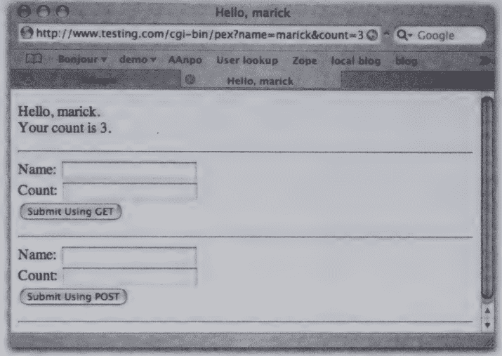
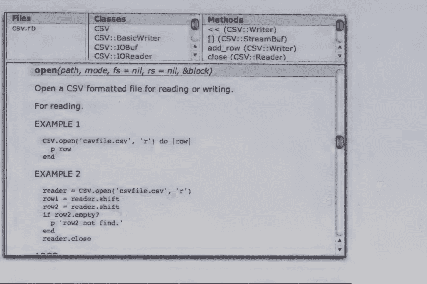
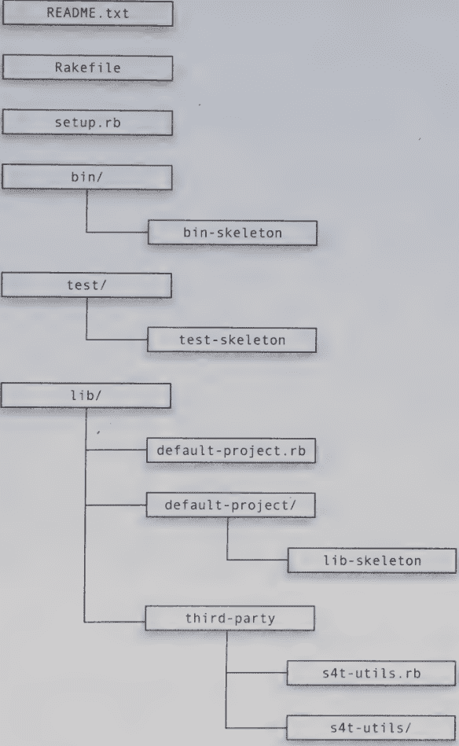
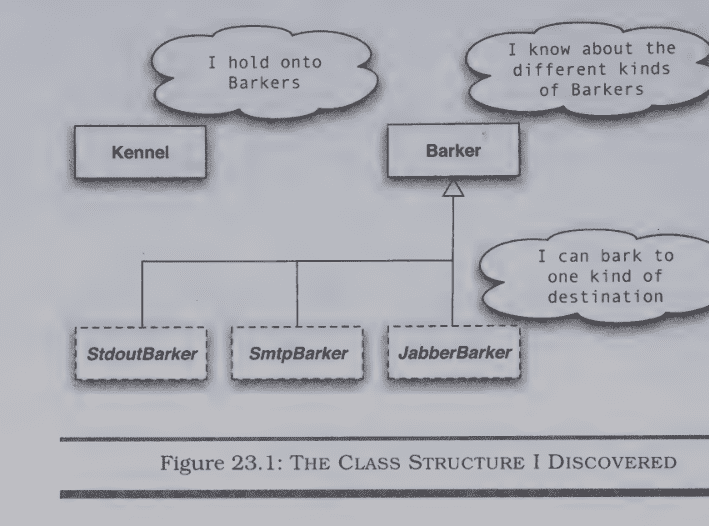
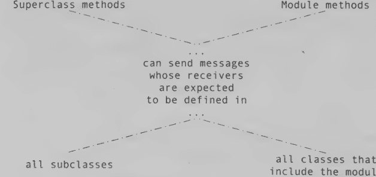
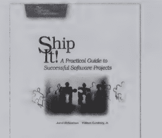
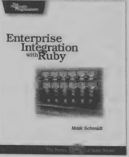

# Ruby 日常脚本编程：写给团队、测试人员和你

# 读者对
《使用 Ruby 进行日常脚本编程》的评价

多么奇妙的技巧、指南、警告、综合示例、比喻、练习和问题的集合！对于希望从测试自动化工作中获得最大收益的软件测试从业者来说，它具有极高的价值。

- **Grigori Melnik**
  卡尔加里大学讲师

一本非常棒的、可以跟着我一起动手敲代码的入门书，它介绍了一种强大的脚本语言。它从浅显处开始，然后逐渐深入，几乎在不知不觉中就将读者转变为了熟练的 Ruby 脚本编写者！

- **Erik Petersen**
  Emprove

终于有一本为测试社区量身打造的、充满智慧瑰宝的实战书籍。通过阅读本书清晰易懂的章节、真实的代码示例，以及对测试驱动设计和继承等复杂主题的出色覆盖，测试人员不仅会将她的测试职业生涯提升到一个新的高度，还会对她所在组织的软件开发做出巨大贡献。

- **Gunjan Doshi**
  Community Connect 公司产品开发与卓越流程副总裁

Marick 使用一系列简短而实用的例子来解释 Ruby 语言。Watir 用户和其他想要学习 Ruby 的测试人员会发现它非常易于上手。

- **Bret Pettichord**
  Watir 首席开发人员

读完本书，你将能够自动化软件测试，这将使你在大多数 QA 同事中脱颖而出。你将能够使用 Ruby 编程，这本身就是一种乐趣。你将创建几个非常有用的实用工具，并且知道如何调整它们以满足你的特定需求。所有这些都将快速而愉快地完成。你将成为一名更高效的测试人员，并且很可能在这个过程中度过一段美好的时光。

> **George Hawthorne**
> Oblomov Consulting 公司顾问

这本书读起来很棒，信息量很大，在相对轻薄的一本书中涵盖了广泛的内容。我认为这总是一个好主意。我有很多超过 800 页的技术书籍，只读了大约一半或三分之二，因为它们的后半部分塞满了非常深奥的信息。这本书从头到尾都吸引了我的兴趣——我有一份全职工作，还有一个十个月大的儿子，仍然设法在一周左右的时间里读完了这些例子！Brian 的个性以一种有益的方式呈现出来（例如，包含 Barkers 的 Kennel），这有助于而不是阻碍对材料的理解。

> **Paddy Healey**
> Aventail 公司企业系统工程师

关于正则表达式的章节、示例和练习本身就已经值回书价了！其他所有内容都不只是锦上添花——它包含了你意想不到的各种甜点。无论你是刚刚开始学习脚本编程，还是已经编写脚本多年，这本书都将是无价之宝。示例和练习、Ruby 知识点、循序渐进的方法以及解释将帮助你把自动化工作提升到一个全新的水平！

> **Paul Carvalho**
> 软件测试与质量服务顾问


# 第 1 章

# 引言

鞋匠的孩子光着脚到处跑。

软件项目外的人看来，软件开发似乎能产出大量工具，将工作从人转移到计算机上。但项目内部的情况——往往——并非如此。在那里，我们看到的是日复一日重复的手工劳动。一张桌子旁，测试人员正在手动往数据库里录入测试数据；另一张桌子旁，程序员正在版本控制系统的输出中翻找想要的文件；第三张桌子旁，业务分析师正在将报告中的数据复制到电子表格中。

为什么这些人要做计算机完全可以胜任的工作呢？这是*知识*和*技能*的问题。测试人员觉得编程太难，所以从没学过。程序员会编程，但她掌握的任何一门语言都无法轻松实现这种工作的自动化，而且她也没有时间用复杂的方式去做。分析师曾经写过一个脚本来完成类似的任务，但当她试图将其适配到这份报告时，脚本坏了。要让它跑起来，花的时间比手动复制数据还多，即使她下个月还要再复制六次。

# Joe 问……

# 脚本？编程？有什么区别？

没什么区别。我在本书中使用"脚本"这个词，是因为它听起来不那么吓人，更适合日常琐事。

## 第 1 章 引言

这本书是为这些人写的。

- *对于觉得编程太难的人*（我们的测试人员）：其实没那么难。编程名声不好，是因为以前的计算机太慢了。为了让程序运行得够快，程序员不得不使用需要他们告诉计算机各种琐碎细节的语言。现在的计算机已经足够快了，我们可以使用让*它们*自己搞定琐碎细节的语言。因此，编程现在容易多了。

- *对于在编写或修改较大脚本时陷入困境的人*（我们的分析师）：你目前还没有掌握应对复杂性的技能。这本书会教你。它是一本现代编程风格的教程，强调先写测试（测试驱动编程）、点滴借用他人的成果、逐步扩展程序，并始终保持代码整洁。

很多脚本可能是一次性的：写完、用完、扔掉。但对于你打算保留的脚本，这些技能将大有帮助。（说实话，我见过的许多专业程序员也还没学会这些技能，所以他们会发现这本书很有用。）

- *对于精通错误语言的人*（我们的程序员）：像 Java、C#、C++ 和 C 这样的语言——在其领域内——完全没问题。但它们的领域不是快速编写小程序，尤其是 manipuling 文本和文件而非数字和内部数据结构的小程序。你需要在你的技能库中增添另一门语言。

在这本书中，你将学习一门语言——Ruby——它非常适合这三类读者。它易学易写。虽然它具备转换或搜索文本的简单脚本所需的功能，但它也拥有应对复杂性的全部功能。如果你是测试人员，你会高兴地发现测试被认为是 Ruby 的强项之一（主要归功于 Watir，http://wtr.rubyforge.org/，一个驱动 Web 浏览器的工具）。如果你是程序员，你可能已经知道 Ruby 最近因其"杀手级应用"——Rails（一个构建 Web 应用程序的框架，http://www.rubyonrails.org/）而爆炸式流行。尽管如此，它已经有十多年的历史了，所以它不是那种昙花一现的时髦或不稳定的东西。每个人都会喜欢 Ruby 社区，它以友好著称。


### 1.1 本书的运作方式

这是一本*实践*类的书籍。编写脚本就像骑自行车：你无法通过阅读来学会它，你需要通过实践来学习。而且你练习得越多，就做得越好。书籍或教练的目的，就是引导你的练习，让你更快地进步。

因此，本书围绕四个独立的项目来组织，这些项目类似于你在实际工作中可能遇到的任务。我缓慢地构建前两个项目，展示并解释我的全部工作。你最好一边跟着我输入，一边同步构建项目，这样学习效果最佳。在第三和第四个项目中，我加快了速度，只解释最终结果。

本书附带的*练习文件*为前两个项目分别提供了一系列快照。书中列出的 Ruby 代码片段标明了它们来自哪个文件。你可以查看文件，在上下文中查看代码片段，通过对比你的输入和我的输入来诊断问题，或者从项目中间开始输入而不是从头开始。

有些人不会跟我一起创建这些项目。但我仍然强烈建议你完成练习，并将你的解答与我给出的解答进行比较。

#### 项目

第一个项目是一个卸载检查器。当你卸载公司的产品时，卸载程序是否删除了所有应该删除的内容？是否删除了不应该删除的内容？这个脚本会告诉你答案。更广泛地说，它让你可以对硬盘的任何部分进行快照并进行比较。

第二个项目连接到一个版本控制系统，获取变更信息，并为你进行汇总。这是一个典型的文本处理示例。

第三个项目访问一个网站，从中"抓取"数据，并将这些数据放入逗号分隔值文件中，以便电子表格使用。

最后一个项目是一个"看门狗"脚本。它可以监视长时间运行的程序或测试，然后在它们完成时向你发送即时消息或电子邮件。

> **给测试人员的特别说明**

你们是本书最初的读者。它曾经叫做*面向测试人员的脚本编写*，但人们一直说它对更广泛的受众也会有用。甚至我原本以为不感兴趣的程序员也会说"只需稍作改动，这本书就是为我写的。"所以我做了改动，但测试人员在我心中始终有特殊的地位。

作为一名测试人员，我敢说你阅读本书是希望能够学习如何自动化测试执行：如何向程序（可能通过用户界面）输入数据、收集结果，并将程序的实际输出与预期输出进行比较。即使在本书只面向测试人员的时候，我也没有创建任何这样的项目。我有两个原因：

- *自动化测试执行并不是让你学习的最高效方式。* 我的目标是教你实践中需要的技能、习惯和 Ruby 特性。你不需要这些东西来编写一个自动化测试，甚至十个，也许一百个都不需要，所以如果我在一个小型自动化测试套件的背景下来教授它们，会显得不自然、虚假且缺乏说服力。用不同类型的小项目来教授效果更好。
- *自动化测试执行可能不是你最应该做的事情。* 测试执行是你唯一手动完成的任务吗？可能不是。过于关注测试自动化的人常常会错过那些能带来显著改进的简单脚本的机会。

### 1.2 本书的大纲

这是一本关于 Ruby 特性和脚本编写技艺的书。本书的每一部分都同时教授这两方面内容。Ruby 特性根据各部分项目的需要逐步引入。每一部分还引入建立在前面基础上的新技能。

第一部分（第 19 页）教你 Ruby 基础和脚本编写基础。如果你从未编过程，请仔细学习。如果你已经了解一门编程语言，可以更随意地阅读，但仍然要读。Ruby 基于一些你可能不知道的理念，并且包含你以前可能没有见过的特性；如果你跳过它们，你将无法为本书的其余内容做好准备。

在第一部分结束时，三种类型的读者都将准备好学习如何更好地编写脚本。第二部分（第 59 页）增加了更多 Ruby 知识，但主要是教你如何以稳健、可控的方式编写脚本。所有程序员都有那种撞墙的感觉——无法做任何改动而不破坏某些东西。我想向你展示如何将那堵墙推得更远。

第三部分（第 133 页）专注于用更少的精力完成更多事情。它展示了如何通过查找、理解并引入他人编写的库来节省工作。它向你展示如何设置脚本，让同事可以轻松下载、安装和使用它们。在继续展示更多 Ruby 特性的同时，这一部分还详细阐述了第二部分的一个重要主题——"正则表达式"，一种强大的文本搜索方式。

第四部分（第 213 页）涵盖了继承这一高级主题。继承有时甚至比库能节省更多工作，因为别人为你的脚本的某部分设计了一个框架，你只需插入框架所协调的组件即可。第四部分既向你展示如何使用他人创建的复杂框架，也展示如何为自己创建更简单的框架。你可能想在学习框架之前，先积累一些自己编写脚本的经验。

本书以术语表、练习解答和索引作为结尾。还有什么？在整本书中，你会看到一些名为"Ruby 知识"的章节。当我在创建脚本的过程中介绍一个 Ruby 特性时，我只会描述我们正在编写的脚本中使用的部分。但当你编写自己的脚本时，你会想了解更多关于这些特性的内容，所以我用知识章节来告诉你更多。你可以跳过这些章节。

尽管有这些章节，本书并不是一本完整的 Ruby 参考手册。最终你会想要购买一本。我衷心推荐 Dave Thomas 及其合著者的 *Programming Ruby* [TH01]。它同样来自 Pragmatic Bookshelf——事实上，Dave 是这家出版社的所有者之一。但我推荐他们的书并不是因为他们是我的出版商。他们之所以成为我的出版商，是因为我一直在推荐他们的书。

### 1.3 售后服务

*Everyday Scripting with Ruby* 在 http://www.pragmaticprogrammer.com/titles/bmsft/ 拥有专门的 Pragmatic Programmers 网页。在那里，你可以找到更新、勘误、所有示例的源代码以及更多内容。

#### 1.4 补充材料

在时间和需求允许的情况下，我会为本书发布补充材料；每份补充材料都专注于一个特定主题。请查看本书主页了解详情。

#### 1.5 致谢

如果没有 Bret Pettichord 的督促，这本书就不会存在。

感谢以下对书稿提出过意见的人：Mark Axel、Tracy Beeson、Michael Bolton、Paul Carvalho、Tom Corbett、Bob Corrick、Lisa Crispin、Paul Czyzewski、Shailesh Dongre、Gunjan Doshi、Danny Faught、Zeljko Filipin、Pierre Garique、George Hawthorne、Paddy Healey、Jonathan Kohl、Bhavna Kumar、Walter Kruse、Jody Lemons、Iouri Makedonov、Chris McMahon、Christopher Meisenzahl、Grigori Melnik、Sunil Menda、Jack Moore、Erik Petersen、Bret Pettichord、Alan Richardson、Paul Rogers、Tony Semana、Kevin Sheehy、Jeff Smathers、Mike Stok、Paul Szymkowiak、Jonathan Towler 和 Glenn Vanderburg。

特别感谢 Paul Carvalho 教会我一些关于 Windows 的新知识，并在第三部分之前就完成了第四部分的审阅；感谢 Paul Czyzewski 对他有时间审阅的页面所进行的细致审查。

我的编辑 Daniel Steinberg 提供了恰到好处的鼓励、支持和压力。

我将永远感激我的出版商 Andy Hunt 和 Dave Thomas，他们似乎毫不介意在本书写作期间，他们的孩子出生、长大、离家、结婚，然后又有了自己的孩子。

我还要感谢我的家人。你简直无法*相信*他们对我做了什么。


## 第 2 章

## 快速入门

本章将为你阅读本书其余部分做好准备。

-   每个人都需要下载练习文件。
-   如果你对*命令行*（"DOS 提示符"、"shell"）不熟悉，你需要学习一些相关知识。
-   Ruby 可能已预装在你的系统上。如果没有，你需要安装它。
-   任何时候你打字，都会出现拼写错误。输入脚本也不例外。你需要学会识别出错的迹象。

### 2.1 下载练习文件

本书附带了许多你可以练习使用的 Ruby 脚本。你可以从本书的网页 http://www.pragmaticprogrammer.com/titles/bmsft/ 以 zip 压缩包的形式下载它们。下载到任意你喜欢的位置即可。

你的浏览器在下载时可能会自动“解压缩”文件。如果没有，双击或右键点击它通常就可以解压。如果这样还不行，在 Mac OS X 和其他 Unix 变体系统上，你可以在命令行解释器中输入 `unzip bmsft-code.zip` 来解压。¹ 在 Windows 上，下载一个像 WinZip (http://winzip.com/) 这样的应用程序，然后使用它来解压。

解压缩文件会创建一个名为 `code` 的文件夹。我建议将其重命名为更具体的名称，比如 `scripting-book`，但在本书中我将一直使用 `code` 来指代它。

> 1. 命令行解释器将在后文解释。

在 `code` 文件夹内，本书中的每个脚本都有一个对应的子文件夹。请在那些子文件夹中进行你的练习。还有一个子文件夹包含练习的解决方案，以及几个包含更多 Ruby 示例的子文件夹。

### 2.2 从命令行开始

当你使用 Ruby 或任何其他脚本语言时，你很可能会使用计算机的命令行解释器。命令行² 解释器是一个程序，它允许你通过输入文本（而不是使用鼠标点击）来向编译器下达指令。如果你从未使用过命令行解释器，这里是一个简单的介绍。

#### Windows

在 Windows 中，你可以从开始菜单进入命令行解释器。点击“运行”菜单项，输入 `cmd`，然后按回车键。你会看到类似这样的界面：

```
Microsoft Windows XP [Version 5.1.2600]
(C) Copyright 1985-2001 Microsoft Corp.
C:>
```

你看到的 `C:\>` 称为提示符。它之所以被称为提示符，是因为它提示你输入一些命令让计算机执行。阅读本书的人看到的提示符可能各不相同，因此我将从现在开始任意选择将提示符显示为 `prompt>`，除非我谈论的是 Windows 特定的内容。当你看到这样的输入指令时：

```
prompt> irb
```

我希望你输入 `irb` 然后按回车键。不要输入提示符本身。假设你将练习文件安装在 `C:\unzip-place`。请输入：

```
C:\> cd c:\unzip-place\code
```

> （`cd` 代表 "change directory"——"directory" 是 "folder" 的同义词。）

当你切换到某个文件夹时，它就成为了你当前的工作文件夹。如果一个命令没有指定特定的文件夹，命令行解释器会假设你指的是当前工作文件夹。例如，你可以像这样查看当前工作文件夹的内容：

```
C:\unzip-place\code\> dir
```

如果你正在处理 `file-inventory` 项目，你现在可以这样进入它：

```
C:\unzip-place\code\> cd inventory
```

请注意，你不必在 `inventory` 前加上 `C:\unzip-place\code`，因为那是你的当前工作文件夹。

你可以像这样返回到上一级文件夹：

```
C:\unzip-place\code\inventory\> cd ..
```

这些就是运行本书中示例所需的所有知识（尽管你会想了解更多）。

#### Mac OS X、Linux、BSD 及其他 Unix 变体

Mac 的命令行提示符是一个名为 Terminal 的应用程序。它位于 Applications 文件夹的 Utilities 子文件夹中。在其他 Unix 变体系统上，³ 命令行提示符可能名为 Konsole、Terminal、gnome-terminal 或 xterm。你应该能在你的窗口管理器的某个菜单中找到它。

无论你如何启动它，命令行提示符看起来都类似这样：

```
Last login: Sat Dec 16 11:45:37 on tty01
Welcome to Darwin!
computer-name:~ user$
```

你看到的 `computer-name:~ user$` 称为*提示符*。你的提示符可能有所不同，因此从现在起，我将把提示符显示为 `prompt>`。当你看到这样的输入指令时：

```
prompt> irb
```

我希望你输入 `irb` 然后按回车键。不要输入提示符。

假设你将练习文件安装在你主文件夹中的 `unzip-place` 文件夹里。请输入：

```
prompt> cd ~/unzip-place/code
```

**cd** 代表 "change directory"——"directory" 是 "folder" 的同义词。波浪号 (`~`) 代表你的主文件夹。

³. Mac OS X、本节标题中的其他系统，以及我未列出的其他一些系统，都有一个共同的起源：1970 年代在贝尔实验室开发的 Unix 操作系统。对于脚本编写者来说，Mac OS X 只是一个加了漂亮界面的 Unix。哦，它还有一些不错的应用程序。

第 10 章 快速入门

当你切换到某个文件夹时，它就成为了你的*当前工作文件夹*。如果一个命令没有指定特定的文件夹，命令行解释器会假设你指的是当前工作文件夹。例如，你可以像这样查看当前工作文件夹的内容：

```
prompt> ls
```

如果你正在处理 `file-inventory` 项目，你现在可以这样进入它：

```
prompt> cd inventory
```

请注意，你不必在 `inventory` 前加上 `~/unzip-place/code`，因为那是你的当前工作文件夹。

你可以像这样返回到上一级文件夹：

```
prompt> cd ..
```

这些就是运行本书中示例所需的所有知识（尽管你会想了解更多）。

### 2.3 你需要安装 Ruby 吗？

Ruby 可以在 Windows 2000、Windows XP 或更高版本；Mac OS X；以及你可能遇到的任何版本的 Unix 上运行。你的机器上可能已经安装了 Ruby。要确认，请在命令行提示符下输入：

```
prompt> ruby -v
```

如果你看到类似 "command not found" 的错误信息，你就需要安装 Ruby。

如果 Ruby 已安装，响应将类似于：

```
ruby 1.8.1 (2003-12-25) [powerpc-darwin]
```

那里显示的 Ruby 版本 1.8.1 比我编写本书时使用的版本要旧。我使用的是 1.8.2。这里的示例可能都能正常运行，但我不敢保证。请安装最新版本。

### 2.4 安装 Ruby

#### Windows

有一个一键式 Ruby 安装程序。你可以在这里找到：http://www.ruby-lang.org/en/downloads/。下载后，在 Windows 资源管理器中双击运行它，然后按照说明操作。

安装 Ruby 后，关闭所有命令行窗口，打开一个新窗口，然后按照对页第 2.3 节 *你需要安装 Ruby 吗？* 中的说明操作，以检查它是否已正确安装。⁴

#### Mac OS X

Tiger（版本 10.4）及更高版本的 Mac OS X 附带了足够新的 Ruby 版本。如果你使用的是旧版本的 OS X，请参阅 http://www.ruby-lang.org/en/downloads/ 或本书网站获取说明。

#### 其他 Unix 变体

你可能可以在通常的位置找到预编译的 Ruby 版本（RPM 等），并通过通常的工具（apt-get、pkg-get、ports 等）获取它们。否则，请参阅本书网站获取说明。

### 2.5 你的两个基本工具

有两个基本工具：一个编辑器和一个解释器。

#### 你的编辑器

你可以使用任何可以处理文本文件的编辑器来创建 Ruby 脚本。在 Windows 上，我建议你使用 SciTE，它随 Ruby 一起安装。它不仅仅是一个文本编辑器：它能很好地理解 Ruby，可以对脚本的部分内容进行语法高亮以方便阅读，并且允许你无需切换到命令行即可运行脚本。（在“开始”菜单的“程序”项下，你会找到一个“Ruby”项，“SciTE”就在其下。）

在 Mac 上，我建议使用 TextMate (http://macromates.com/)。它是付费软件，但你可以尝试免费下载版。

在 Mac 和其他类 Unix 系统上，你可以使用 `pico`。它是免费的。在命令行提示符下输入它的名字即可启动。它会在屏幕底部显示可用的*编辑*命令。在那个帮助信息中，**Control**+**X** 被表示为 `^X`。

如果你在 Linux 上使用 Gnome 窗口系统，可以尝试 `gedit`。

4. 你必须关闭并打开一个新的命令行窗口，因为旧的窗口可能不会“注意到”Ruby 已经安装。


#### irb

第二个有用的工具是 irb。它能让你无需编写完整的脚本就能尝试自己的想法。你可以输入一小段 Ruby 代码并快速查看它的效果。稍后你会在书中看到许多示例。现在，先确认 irb 已准备好使用。在命令提示符下，输入以下内容。（记住不要包含提示符本身。）

```
prompt> irb
```

你会看到类似这样的内容：

```
irb(main):001:0>
```

提示符的大部分组成部分都不重要。你会在本章后面学到那些重要的部分。

现在输入一个 Ruby 表达式，然后按 Enter（在 Windows 上）或 Return（在类 Unix 系统上）：

```
irb(main):001:0> 1+1
=> 2
irb(main):002:0>
```

irb 显示结果，然后提示你输入更多内容。

2 是计算表达式 1+1 的结果。在本书的其余部分，你将计算更有趣的表达式，但现在这已经足够了。像这样退出 irb：

```
irb(main):003:0> exit
prompt>
```

### 2.6 提示符、命令行、提示符和 irb

本书中有两种提示符：**命令行提示符**和 **irb 提示符**。如果你把本应给命令行解释器的命令输入到 irb 中（反之亦然），你会得到令人困惑的结果。如果你屏幕上看到的内容与书中告诉你的预期不符，请确认你正在正确的提示符下输入。

如果你在命令行中输入，但应该输入到 irb 中，启动 irb：

```
prompt> irb
```

如果你在 irb 中输入，但应该在命令行中输入，退出 irb：

```
irb(main):001:0> exit
```

> **人们一开始经常忘记的两件事**

- 在包含项目练习文件的文件夹中执行项目工作。例如，如果你正在处理 inventory 项目，在 Mac 和类 Unix 系统上，启动 `irb` 之前输入：

  `prompt> cd ~/unzip-place/code/inventory`

  在 Windows 上，输入：

  `C:\> cd \unzip-place\code\inventory`

- 在 `irb` 的提示符下输入 `exit` 即可退出 `irb`。在 Windows 上，有时你会收到提示"Terminate batch job (Y/N)?"——输入 `y`。

#### 与提示符打交道

你经常会打错指令。在某些系统上，`上箭头` 键会将上一行重新插入到当前提示符处。然后你可以使用 `左箭头` 和 `右箭头` 键在该行中移动。

在编辑器中编辑复杂的文本，然后将其复制粘贴到 `irb` 中，这通常很方便。回到编辑器中纠正错误并重新粘贴，比用箭头键来回操作要容易得多。

在 Mac 和其他类 Unix 系统上，剪切、复制和粘贴的快捷键按你所期望的方式工作。例如，在 Mac 上，`⌘V` 可以粘贴到 `Terminal` 窗口中。在该窗口中，你可以选择一段文本，用 `⌘C` 复制它，然后将其粘贴到编辑器窗口中。

在 Windows 上，你需要用鼠标右键点击来粘贴到命令行，而不是通常的 `Ctrl`+`V`。或者，你可以右键点击标题栏，使用弹出的 `Edit` 菜单。

要从 Windows 命令行复制，用鼠标选择文本，然后按 `Enter`。如果这不起作用，请确保你已开启"快速编辑"。打开属性对话框（通过 `Alt`+`Space` 出现的控制菜单，或右键点击标题栏），转到 Options 选项卡，勾选 Quick Edit Mode。

### 2.7 是时候犯错误了

在本书的许多地方，我会让你向 irb 输入命令并查看结果。无论你多么小心地输入，都会犯错。irb 会给你关于出了什么问题的线索，但这些线索对于 Ruby 初学者来说可能难以理解。所以现在就让我们故意犯几个错误，以便消除一些困惑。

假设你想知道 100 - 43 的值。再次启动 irb（如果它还在运行），然后输入该计算。你应该看到：

```
irb(main):001:0> 100 - 43
=> 57
```

很好。但在我（可能也是你）的键盘上，`-` 键紧挨着 `=` 键。因为我笨手笨脚的，经常两个键一起按。如果我这样按了再按 Enter，irb 会怎么做？试试看……

```
irb(main):002:0> 100 -= 43
SyntaxError: compile error
(irb):3: syntax error
100 -= 43
      ^
    from (irb):3
```

嗯。这里所有的细节都很难解释。幸运的是，你不需要理解它。每当你在第 1 行看到类似的语法错误时，就知道前一行出了问题，**最有可能是打字错误**。第 2 行的插入符号可能指向错误附近，但这并不是一定的。

还有另一种打字错误：括号通常成对出现，但很容易漏掉一个。例如：

```
irb(main):003:0> (1 + 3) * 2 + 1)
SyntaxError: compile error
(irb):12: syntax error
    from (irb):12
```

注意，irb 并没有尝试猜测起始括号应该在哪里。你也可以漏掉结束括号，但事实证明这是无害的。irb 会给你略微不同的提示符，让你继续输入。在下面这个例子中，我想输入 (1 + 3) * (2 * 4)，但我在最后一个括号处按了 Enter。在下一个提示符处，我补上了忘记的括号并再次按 Enter：

```
irb(main):004:0> (1 + 3) * (2 * 4
irb(main):005:1> )
=> 32
```

> **脚本文件中的语法错误**

到目前为止，你是在向 irb 输入时犯错。你在创建脚本文件时会犯类似的错误。当你运行有问题的脚本时，错误信息可能会有所不同；这在第 36 页的侧边栏中有说明。

提示符通过将最后的部分从 `:0>` 变为 `:1>`，给出了还需要继续输入的微妙线索。这叫做 *continuation prompt*（延续提示符）。更明显的线索是，irb 在你添加正确的右括号之前不会显示任何结果。

Ruby 的 *字符串* 提供了另一种无法完成你开始的事情的方式。字符串是由引号括起来的一系列字符，像这样：

```
irb(main):001:0> "a string"
=> "a string"
```

如果你漏掉了结束引号，Ruby 的提示符就会改变。它不再以 `>` 结尾，而是以 `"` 结尾，表示你要继续输入字符串。像这样：

```
irb(main):010:0> "an unfinished string
irb(main):011:0"
```

当你现在添加带有结束引号的文本时，你会得到：

```
irb(main):012:0> "an unfinished string
irb(main):013:0" ... is now finished"
=> "an unfinished string\n... is now finished"
```

注意，结果字符串中间有些奇怪的东西。`\n` 表示行末字符在被输入到未闭合的字符串中时，像所有其他字符一样被**处理**：它被包含在结果中。（行末字符是 Enter 还是 Return，取决于你使用 Windows、Mac OS X 等。）当你想在字符串中包含这样的字符时，这很好。如果是因为错误，你就需要重新正确输入字符串。

Ruby 实际上允许你使用两种不同的字符来开始和结束字符串。用双引号括起来的字符串与用单引号括起来的字符串创建方式略有不同。（你会在第 7.2 节，*Formatting Strings*，第 70 页学到其中的区别。）如果你和我一样，有时会以一种方式开始字符串，却以另一种方式结束。irb 会尽职尽责地做你不想要的事：把你以为是结束字符的那个字符包含进字符串里，然后给你一个提示符来结束字符串。你有两个选择。一个是用适当的字符结束字符串，然后在下一个非延续提示符处输入正确的字符串：

```
irb(main):014:0* 'a string " 
irb(main):015:0' 
=> "a string \"\n" 
irb(main):016:0> 'a string' 
=> "a string" 
irb(main):017:0>
```

注意，irb 仍然用双引号来显示字符串。字符串就是字符串就是字符串，无论你如何创建它，irb 总是以相同的方式显示字符串。因为你创建了一个包含双引号的字符串，irb 需要区分字符串*内部*的双引号和它用来表示结果*是*一个字符串而打印的双引号。它通过在内部引号前加反斜杠来实现这一点。（在字符串中，反斜杠始终意味着下一个字符以某种方式是特殊的。）

很多时候你得到延续提示符是因为你在前一行输错了某些内容。在这种情况下，试图整齐地结束字符串或括号表达式或你开始的任何东西都没有意义。你只需要某种快速的方法回到常规提示符重新开始。在 Mac OS X 和 Linux 上，方法是按 Ctrl+C。

在 Windows 上，Ctrl+C 也可能有效。如果无效，要么什么都不会发生，要么你会被问到"Terminate batch job (Y/N)?"。如果什么都没发生，在 Ctrl+C 后尝试按 Enter。

这里有一个例子，我开了一个字符串但没正确完成。每次尝试修复都让情况更糟。Ctrl+C 来救场了：

```
irb(main):017:0> ("irb + "irb" 
irb(main):018:1" " 
irb(main):019:1> " 
irb(main):020:1" ' 
irb(main):021:1" ^C^C 
irb(main):022:0>
```

通常我会有一点点，嗯，过于热情，用力按几次 Ctrl+C，只是为了确保 irb 明白我的意思。这并不必要，但很解气。


[content]

## 第一部分

## 基础

## 第3章

## 第一个脚本：比较文件清单

在本章中，你将创建一个简单但有用的脚本。在此过程中，你将学习一些基本的 Ruby 术语和技术。在第5章，*三项改进和一个错误修复*，第33页起，你将为同一个脚本添加更多功能。

## 3.1 脚本实战

在命令提示符下，使用 `cd` 进入你的代码文件夹中的 inventory 子文件夹。（如果你忘记了如何操作，请参见第13页的侧边栏。）那里有一个 Ruby 脚本，`inventory.rb`。像这样运行它：

```
prompt> ruby inventory.rb
```

你会看到：

```
exercise-differences.rb
inventory.rb
old-inventory.txt
recycler
recycler/inst-39.tmp
snapshots
snapshots/differences-version-1.rb
snapshots/differences-version-2.rb
snapshots/differences-version-3.rb
snapshots/differences-version-4.rb
snapshots/differences-version-5.rb
snapshots/differences-version-6.rb
snapshots/differences-version-7.rb
snapshots/differences-version-8.rb
temp
temp/inst-39
```

你刚刚*运行了一个 Ruby 脚本*，它列出了当前文件夹中的所有内容（包括所有子文件夹中的内容）。¹ 在本章的过程中，你将创建另一个脚本，用于比较两个清单，告诉你从第一个清单中添加了哪些文件或删除了哪些文件。如果你是一名测试人员，这些脚本至少可以在两方面对你有用：

- 假设你每周五都会收到一个新的"测试版本"。测试版本应该附带一份自上周版本以来所有更改的列表。人非圣贤，有时那份列表会有误。一份关于哪些文件被添加或删除的列表可以帮助你决定需要进行哪些测试。
- 你可以对整个文件系统（例如 C:\）进行快照，安装一个产品，卸载它，然后将旧快照与新快照进行比较。你可能会发现卸载程序留下了垃圾。

## 3.2 Ruby 的宇宙

当你运行 *inventory.rb* 脚本时，你创建了一个小小的 Ruby 宇宙。这个宇宙本质上只包含三种东西：*名词*、*动词* 和 *名称*。名词通常被称为*对象*。它们是 Ruby 宇宙中的"东西"。对象只是静静地待在那里，直到被告知要做些什么。这就是动词发挥作用的地方。Ruby 宇宙中的所有动词都是祈使句：像"坐下！"、"待着！"和"翻滚！"这样的动词。在 Ruby 中，这些动词被称为*消息*，而告诉一个对象做某事则被称为*发送消息*。

你无法直接访问 Ruby 宇宙内部的对象。要获取其中一个对象，你必须使用一个*名称*来引用它。这在我们宇宙中也一样：我是一个对象。我的孩子们称我为"爸爸"，我的妻子称我为"亲爱的"或更尴尬的名字，而费城机场的一位职员称我为"31号"和"嘿，你"。他们都使用名称来谈论作为对象的我。

## 3.3 对象发送和接收消息

上一节相当抽象，所以让我们来看看 Ruby 的名称、对象和消息是如何运作的。在命令提示符下输入以下内容来创建一份清单文件：

```
prompt> ruby inventory.rb > new-inventory.txt
```

> ¹ 这个项目的想法来自测试人员 Chris McMahon。

> new-inventory.txt 告诉命令行解释器将脚本的输出放入名为 new-inventory.txt 的文件中。这不是 Ruby 的一部分——它适用于任何命令。（我选择 new-inventory.txt 这个名称是为了暗示这是在安装和卸载产品之后拍摄的快照。你可能已经注意到 old-inventory.txt 已经存在；那应该是安装之前拍的快照。）

启动 irb，然后输入以下内容。注意 File 以大写字母开头。Ruby 是一种*区分大小写*的语言，这意味着名称 File 和 file 完全不同。如果你使用 file，你会收到一条错误信息。

```
irb(main):001:0> File.open('new-inventory.txt')
=> #<File:new-inventory.txt>
```

我要详细讲解刚才发生了什么：别担心，很快这就会成为你的第二天性。

File 是 Ruby 宇宙中一个特定对象的名称。它是知道如何打开文件并准备使用它们的对象。open 消息命令它这样做。由于 File 需要知道要打开哪个文件，open 接受一个*参数*，即字符串 'new-inventory.txt'。

收到消息后，File 执行打开文件的工作。这涉及创建另一个*就是*已打开文件的对象（就 Ruby 而言）。然后 File 将该新创建的对象*返回*给发送消息的对象（通常称为*发送者*）。在这个例子中，发送者恰好是 irb。（由于 irb 是一个 Ruby 脚本，它作为对象存在于 Ruby 宇宙中。）当 irb 收到返回值时，它以旨在对编写脚本的人有用的形式打印到屏幕上。在这里，#<File:new-inventory.txt> 表示该对象是由 File 创建的，用于访问文件系统的文件 new-inventory.txt。其他对象以不同的方式打印；实际上，每个对象都可以选择它希望如何被打印。

但是对这个已打开的文件，除了打印它的描述之外，还有更多的事情可以做。我们可以要求它提供文件中的所有行，像这样：

```
irb(main):002:0> File.open('new-inventory.txt').readlines
=> ["exercise-differences.rb\n", "inventory.rb\n", "new-inventory.txt\n", "old-inventory.txt\n", "recycler\n", "recycler/inst-39.tmp\n", "snapshots\n", "snapshots/differences-version-1.rb\n", "snapshots/differences-version-2.rb\n", "snapshots/differences-version-3.rb\n", "snapshots/differences-version-4.rb\n", "snapshots/differences-version-5.rb\n", "snapshots/differences-version-6.rb\n", "snapshots/differences-version-7.rb\n", "snapshots/differences-version-8.rb\n", "temp\n", "temp/inst-39\n"]
```

和之前一样，我们让 irb 向 File 发送 open 消息。File 回应一个已打开的文件对象。但 irb 不会打印结果，因为我们让它向该结果发送另一个消息 readlines。readlines 将文件中的每一行转换为一个*字符串*。"字符串"是 Ruby 给字符序列起的名字。然后 readlines 将所有这些字符串返回到一个*数组*中。你可以把数组想象成一排排列的对象。在这个例子中，它们与在文件中出现的顺序相同。irb 用双引号包围来打印字符串，它将数组打印为用方括号括起来的逗号分隔列表。在整本书中，你会看到更多关于字符串和数组的内容。

如果你查看文件 new-inventory.txt，你会发现它确实包含相同的行，顺序也相同。唯一的区别是 irb 在字符串周围加上引号以表明它们是字符串，以及 Ruby 字符串末尾奇特的 \n。这是 irb 表示行之间分隔符的方式。²

你也可能注意到，在输入字符串 'new-inventory.txt' 时，我使用的是单引号，但 irb 使用双引号来打印字符串。如果你愿意，在输入字符串时也可以使用双引号。在这部分书中，这没有任何区别。

## 3.4 变量为对象命名

已经获取了包含文件内容的数组后，让我们给它起一个名字：new_inventory。（注意这个名字使用下划线，而不是连字符。）这样做：

```
irb(main):003:0> new_inventory = File.open('new-inventory.txt').readlines
=> ["exercise-differences.rb\n", "inventory.rb\n", "new-inventory.txt\n", "old-inventory.txt\n", "recycler\n", "recycler/inst-39.tmp\n", "snapshots\n", "snapshots/differences-version-1.rb\n", "snapshots/differences-version-2.rb\n", "snapshots/differences-version-3.rb\n", "snapshots/differences-version-4.rb\n", "snapshots/differences-version-5.rb\n", "snapshots/differences-version-6.rb\n", "snapshots/differences-version-7.rb\n", "snapshots/differences-version-8.rb\n", "temp\n", "temp/inst-39\n"]
```

按照历史术语，Ruby 称 new_inventory 为*变量*。（当计算机都用于数学运算时，这更有意义。）

> ² 在 Windows 上，分隔符是回车符后跟换行符；在 Linux/Unix 上，它只是换行符；在 Mac 上，它只是回车符。这些差异的意义并不比德国人开车在道路的另一侧比英国人更多。这完全是任意的；如果大家都用同一种方式，事故就会减少，但现在改变已经太晚了。Ruby 努力让你不必关心你的操作系统开发者选择了哪一种：\n 表示"在这台机器上正确的那个"。


### 3.5 比较数组

inventory 项目中有一个名为 old-inventory.txt 的文件，它包含一份据说在 new-inventory.txt 之前取得的库存清单。按如下方式读取它：

```
irb(main):004:0> old_inventory = File.open('old-inventory.txt').readlines
=> ["exercise-differences.rb\n", "inventory.rb\n", "old-inventory.txt\n", "financial-records.xls\n", "snapshots\n", "snapshots/differences-version-1.rb\n", "snapshots/differences-version-2.rb\n", "snapshots/differences-version-3.rb\n", "snapshots/differences-version-4.rb\n", "snapshots/differences-version-5.rb\n", "snapshots/differences-version-6.rb\n", "snapshots/differences-version-7.rb\n", "snapshots/differences-version-8.rb\n", "temp\n", "temp/junk\n"]
```

现在我们可以比较数组了。

找出两个数组之间差异的方法是将一个数组从另一个数组中"减去"，如下所示：

```
irb(main):005:0> new_inventory - old_inventory
=> ["new-inventory.txt\n", "recycler\n", "recycler/inst-39.tmp\n", "temp/inst-39\n"]
```

这些字符串出现在较新的库存清单中，但不在较旧的库存清单中。要找出自旧库存清单创建以来被删除了哪些文件，可以反向进行减法：

```
irb(main):006:0> old_inventory - new_inventory
=> ["financial-records.xls\n", "temp/junk\n"]
```

如果你检查文件内容，就会发现结果是正确的。

注意，减法不会改变任何一方的数组。从 new_inventory 中减去 old_inventory 不会影响 new_inventory 的数组。它不会从中删除字符串；相反，它会生成一个全新的数组，其中只包含在 new_inventory 数组中找到的那些字符串。

### 名称遵循特定规则

Ruby 名称可以包含字母、数字和下划线字符（不是连字符）。名称不能以数字开头，也不能包含空格。大小写很重要：my_ship 与 my_Ship 不是同一个名称。

> 3. 如果 Ruby 中的一切都是对象、消息和名称，那么消息发送在哪里呢？你可以将这行代码理解为"向名为 old_inventory 的数组发送名为 `'-'` 的消息，参数为名为 new_inventory 的数组。"但如果 Ruby 阻止你用从小学会的方式来写减法运算（无论是数字还是数组），Ruby 就不会这么受欢迎了。

当一个名称以大写字母开头时，你是在告诉 Ruby 你期望它始终引用同一个对象。如果你尝试对不同的对象使用相同的名称，Ruby 会发出警告：

```
irb(main):007:0> MyShip = "a cutter"
=> "a cutter"
irb(main):008:0> MyShip = "a bark"
(irb):4: warning: already initialized constant MyShip
=> "a bark"
（Ruby 发出警告但仍然服从。）
```

当多词名称以小写字母开头时，惯例是用下划线分隔单词，如 *my_fine_name*。当以大写字母开头时，惯例是将每个单词的首字母大写：*MyFineName*。我不知道这种差异背后的原因。

作为一种特殊情况，消息名称可以以问号或感叹号结尾。当以问号结尾时，它表明该消息向其接收者提出一个真/假问题。感叹号则向读者表明该消息执行某些特殊操作，可能是出乎意料的。

### 3.6 打印到屏幕

我们几乎拥有了报告库存变化所需的全部信息。我们只需要编写一个打印脚本即可。这里的主要工具是一个名为 `puts`（"put string"的缩写）的消息。以下是生成报告部分内容的方法：

```
irb(main):009:0> puts "The following files have been added:"
The following files have been added:
=> nil
```

让我们按顺序来看这些行。

虽然看起来不像，但 `puts` 只是另一个消息。消息发送给*什么*？与之前不同的是，没有点号分隔接收消息的对象和消息名称。在 Ruby 中，如果从上下文中可以清楚地（对 Ruby 而言）判断出消息接收者，你就不需要指明接收者。在这种情况下，你可以将接收消息的对象视为 *irb* 本身。当你从命令行运行 Ruby 脚本时，接收者就是脚本本身。

`puts` 看起来奇怪的另一个原因是它的单一参数周围没有括号。如果 Ruby 知道你会把括号放在哪里，你可以省略括号。

1. 字符串被打印到屏幕上。此打印与 irb 打印结果的方式无关。puts 在 irb 有任何结果需要打印之前就完成了它的工作。

虽然 puts 打印了一个字符串，但它不像 irb 那样在字符串周围加上引号。irb 的输出是为你（脚本编写者）格式化的。puts 的输出则是为最终用户格式化的。如果你想要 irb 风格的输出，请使用 *inspect* 消息：

```
irb(main):010:0> puts "I'd like some quotes, please".inspect
"I'd like some quotes, please"
=> nil
```

2. 这一行是 puts 的返回值。每个 Ruby 消息都必须返回*某个值*，当实际上没有什么值得说明的时候，nil 是一个常见的选择。（"nil"一词的含义是"无"。）

irb 被设计为打印它发送的最后一个消息的返回值。如果你从命令行运行脚本，情况就不同了。脚本每一行的结果都会消失——只有 puts 打印的内容才会显示在屏幕上。

puts 也适用于数组：

```
irb(main):011:0> puts old_inventory
exercise-differences.rb
inventory.rb
old-inventory.txt
financial-records.xls
snapshots
snapshots/differences-version-1.rb
snapshots/differences-version-2.rb
snapshots/differences-version-3.rb
snapshots/differences-version-4.rb
snapshots/differences-version-5.rb
snapshots/differences-version-6.rb
snapshots/differences-version-7.rb
snapshots/differences-version-8.rb
temp
temp/junk
=> nil
```

注意数组元素被方便地每行打印一个。（这与字符串以换行符 `\n` 结尾无关；puts 对不带换行符的字符串也会做同样的事。）

### 3.7 编写脚本

我们已经掌握了创建库存比较脚本所需的所有步骤。将其命名为 `differences.rb`，并在本段落之后添加以下代码行。

# 第 3 章 第一个脚本：比较文件库存

（如果你不想手动输入这些代码行，可以从灰色方框中命名的文件里复制。我敢打赌，如果你手动输入，你会更好地理解它们。）第 2.5 节 *你的编辑器*（第 11 页）列出了你可以使用的编辑器。无论你选择哪一个，请确保将文件保存在 *inventory* 文件夹中。

```
code/inventory/snapshots/differences-version-1.rb
```

```
old_inventory = File.open('old-inventory.txt').readlines
new_inventory = File.open('new-inventory.txt').readlines

puts "The following files have been added:"
puts new_inventory - old_inventory

puts ""
puts "The following files have been deleted:"
puts old_inventory - new_inventory
```

确保你已退出 *irb*，然后按如下方式运行该脚本⁴：

```
prompt> ruby differences.rb
The following files have been added:
new-inventory.txt
recycler
recycler/inst-39.tmp
temp/inst-39

The following files have been deleted:
financial-records.xls
temp/junk
```

某些编辑器使运行脚本更加方便。如果你在 SciTE 中编辑脚本时按 F5，它会运行脚本并在分屏的一半显示输出。如果你在 TextMate 中按 ⌘ R，它会运行脚本并在新窗口中显示输出。

这个脚本有一些明显的弱点。例如，它要求你将库存文件命名为 `new-inventory.txt` 和 `old-inventory.txt`。但这是一个好的开始。让我们总结一下。

4. 如果你没有创建脚本，而是想运行 *snapshots* 文件夹中的版本，你需要将其复制到 *inventory* 文件夹中的 `differences.rb`。在 Windows 上，执行以下操作：

`C:\>copy snapshots\differences-version-1.rb differences.rb`

在类 Unix 系统上，执行以下操作：

`prompt>cp snapshots/differences-version-1.rb differences.rb`

## 3.8 我们进展如何？

我们有了一个有用的脚本。如果你之前还没有比较过库存清单，或者一直是手动操作的，那么这个脚本为你的技能库增添了一些新东西。

你已经了解了 Ruby 底层简洁性的一小部分：一切都是通过向对象发送消息来完成的。更重要的是，你已经看到了各种有用的*数据类型*中的第一种——数组。底层简洁性与大量内置工具的结合，正是优秀脚本语言如此强大的原因。

## 3.9 练习

在做练习时，请继续使用你 code 文件夹中的 inventory 子文件夹。

1. 消息 length 询问数组有多长：

```
irb(main):001:0> [1,2,3].length
=> 3
```

假设你将以下代码添加到你的脚本中：

```
x = (new_inventory - old_inventory).length
```

对于 new-inventory.txt 和 old-inventory.txt 这两份库存清单，x 的值是多少？x 提供了什么信息？比 x 更好的名称是什么？

2. 如果你将上一练习中的代码行改为以下内容会发生什么：

```
x = new_inventory - old_inventory.length
```

为什么？

3. 修改脚本使其额外打印三条信息：old-inventory.txt 中新增的文件数量、删除的文件数量，以及（最难的一个）未更改的文件数量。

4. 注意 old-inventory.txt 和 new-inventory.txt 都是按字母顺序排列的，因此它们对应的数组也是。脚本是否依赖于这一点？如果库存清单的顺序被打乱，脚本还能正常工作吗？


## 第四章

## Ruby 知识点：数组

由于数组是一种非常有用的通用容器，Ruby 允许你对它们进行许多、许多操作。以下仅是一个示例。

下面表格的每一行有三部分：你可以在 irb 中输入的表达式、irb 会产生的结果，以及右侧的说明。

| 表达式 | 结果 | 说明 |
|---|---|---|
| `a = ['zero', 'un', 'dos', 'tre']` | `↪ ['zero', 'un', 'dos', 'tre']` | 通过将逗号分隔的*元素*列表放在方括号中，可以创建一个**字面量数组**。我将这个特定的四元素数组命名为 `a`，以便在后续示例中引用它。 |
| `a.length` | `↪ 4` | 你可以查询数组的**长度**…… |
| `a.size` | `↪ 4` | ……有两种不同的方式。（这显示了我喜欢 Ruby 的原因之一。在某些语言中，查询数组长度的方式是 *size* 消息。而在其他语言中，查询数组大小的方式是 *length* 消息。这些语言的作者通常坚持让你记住他们选择的是哪一个。Ruby 的作者希望对用户友好，所以他让你可以使用任意一种。） |
| `[].size` | `↪ 0` | 空数组的长度（或大小）是 0。 |
| `a[0]` | `↪ 'zero'` | 你使用*索引* 0 来引用数组的第一个元素。第二个元素用索引 1 选择，依此类推。这称为**从零开始的索引**。（关于索引应该是从零开始还是从一开始，曾有过激烈的争论。我认为普遍的共识是，一旦习惯了，从零开始的索引在实践中效果更好。） |
| `a[3]` | `'tre'` | 这是选择这个四元素数组最后一个元素的一种方法。 |
| `a[-1]` | `"tre"` | 这是另一种方法。 |
| `a[-2]` | `"dos"` | 负索引会反向遍历数组。 |
| `a[200]` | `nil` | 超出范围的索引会返回值 nil。你将在下一章看到它的用途。 |
| `a[0,3]` | `["zero", "un", "dos"]` | 你可以选择多个元素。这里，我们选择了一个包含三个元素的切片，从 a 的第 0 个元素开始。 |
| `a[1..3]` | `["un", "dos", "tre"]` | 这选择了一个包含元素 1 到 3 的切片（一个包含范围）。 |
| `a[1...3]` | `["un", "dos"]` | 这选择元素 1 到 3，但不包括 3（一个排除范围）。更多的点选择更少的元素。（这对我来说也不太合理。） |
| `a[3] = 'z'` | `"z"` | 你可以更改数组的一个元素。 |
| `a` | `["zero", "un", "dos", "z"]` | 看到了吗？ |
| `a[1..2] = ['x', 'y']` | `["x", "y"]` | 你可以更改一系列元素。 |
| `a` | `["zero", "x", "y", "z"]` | |
| `a.delete_at(0)` | `"zero"` | 删除索引处的元素会返回该元素。... |
| `a` | `["x", "y", "z"]` | ...并且也会更改数组。请注意 delete_at 的参数被括号包围，而不是方括号。（它是一个消息名称，消息参数始终在括号中。） |
| `a.delete("y")` | `"y"` | 你也可以根据元素的值删除元素，而不是根据它在数组中的位置。 |
| `a` | `["x", "z"]` | |
| `a.slice!(0..1)` | `["x", "z"]` | 你可以从数组中移除一个切片。切片被返回…… |
| `a` | `[]` | ……数组被更改了。（感叹号通常用于标记那些会更改接收者的方法，而——对于数组来说——大多数消息不会更改其接收者。） |
| `a.empty?` | `true` | 你可以询问一个数组是否包含任何元素。 |
| `a.push(7)` | `[7]` | 你可以**将元素推送到数组的末尾**…… |
| `a` | `[7]` | （请注意，数组可以同时容纳数字和字符串。） |
| `a << 8` | `[7, 8]` | 这是 push 的另一种表示法，有些人喜欢这样。 |
| `a = [0, "un", nil]` | `[0, "un", nil]` | 你可以将**不同种类的对象**同时放入一个数组中。 |
| `a << [10.1, "ten.two"]` | `[0, "un", nil, [10.1, "ten.two"]]` | 你甚至可以将数组放入数组中。 |
| `a.length` | `4` | 数组中的数组就像任何其他元素一样，因此添加一个数组只会使长度增加 1。 |
| `a[-1]` | `[10.1, "ten.two"]` | 而数组中的数组也以通常的方式进行索引。 |
| `a[-1][0]` | `10.1` | 如果你想获取数组中的数组的一个元素，你需要索引两次。 |
| `a.pop` | `[10.1, "ten.two"]` | 你可以**从数组的末尾弹出元素**…… |
| `a` | `[0, "un", nil]` | ……这会更改数组。 |
| `a.shift` | `0` | 你可以**从数组的前端移出元素**…… |
| `a` | `["un", nil]` | ……这同样会更改数组。 |
| `a.unshift("new element")` | `["new element", "un", nil]` | 你可以使用 unshift **将东西放到数组的前端**，或者…… |
| `a[1..2] = [19600219]` | `[19600219]` | ……使用切片替换。 |
| `a` | `["new element", 19600219]` | 你替换的切片可以是任意大小，而你用来替换它们的数组可以更大或更小。这里，我们用一个元素替换了两个元素。 |

我鼓励你尝试使用这些方法。如果你想获得一个简洁的列表，列出数组能做的*所有事情*，可以试试这个：

```
irb(main):006:0> any_old_array = []
=> []
irb(main):007:0> puts any_old_array.methods
```

你会得到相当长的列表。它不会包含文档，但有时仅仅做实验就很有趣。

如果你确实想要，比如 `sort` 的文档，你可以使用 *ri*（可以将其视为“Ruby information”的缩写）：在命令行中输入：

```
prompt> ri Array.sort
```

在某些系统中，你需要输入 `q` 来退出 ri。更多信息请参见第 111 页的侧边栏。

## 第五章

## 三项改进和一个错误修复

第 3 章的脚本，*第一个脚本：比较文件清单*，从第 19 页开始，有三个问题：

-   清单文件必须命名为 `old-inventory.txt` 和 `new-inventory.txt`。我们应该能够在命令行上指定它们：
    `prompt> ruby differences.rb old-file new-file`
    `old-file` 和 `new-file` 被称为 `differences.rb` 的*命令行参数*。
-   在 Windows 上，文件名中大小写无关紧要。至少有一位用户（Chris McMahon）不想被告知名为 `bibtex` 的文件已被删除，而名为 `Bibtex` 的文件已被添加。
-   当对整个文件系统（如 `C:\`）进行清单操作时，Chris 不想知道 `temp` 目录或回收站中的文件。

在本章中，我们将修复这些问题。在此过程中，你将了解 Ruby 控制结构、如何定义自己的消息，以及更多关于数组和字符串的知识。

## 5.1 命令行参数

命令行参数以字符串形式存在于名为 `ARGV` 的数组中。例如，考虑这个命令行：
`prompt> ruby differences.rb old-inventory.txt new-inventory.txt`

在 differences.rb 内部，`ARGV[0]` 将命名（即提供一种引用方式）字符串 "old-inventory.txt"，而 `ARGV[1]` 将命名 "new-inventory.txt"。与其将两个文件名“硬编码”到脚本中，我们可以要求用户在命令行上提供它们。实现这一点的代码看起来像这样：

```
old_inventory = File.open(ARGV[0]).readlines
new_inventory = File.open(ARGV[1]).readlines
```

用这两行替换你脚本中的两个 `File.open` 行，然后尝试一下：

```
prompt> ruby differences.rb old-inventory.txt new-inventory.txt
```

你应该会得到与之前相同的结果。

我总是忘记给脚本提供必需的参数。让我们看看在这种情况下这个脚本会做什么：

```
prompt> ruby differences.rb
differences.rb:1:in `initialize': cannot convert nil into String (TypeError)
    from differences.rb:1:in `open'
    from differences.rb:1
```

这不是一个友好的错误信息。我鼓励你试着弄清楚发生了什么，然后再继续阅读。

如果你不给脚本提供任何参数，`ARGV` 仍然命名一个数组，但它是空的。你可以使用 irb 来查看。irb 本身就是一个 Ruby 脚本，你启动它时不带任何参数，所以……

```
prompt> irb
irb(main):001:0> ARGV
=> []
irb(main):002:0>
```

由于数组中没有任何内容，每个数组索引都超出范围，并将返回 nil：

```
irb(main):003:0> ARGV[0]
=> nil
irb(main):004:0> ARGV[1]
=> nil
```

因为 `ARGV[0]` 是 nil，所以脚本在执行到这一行时会出现问题：

```
old_inventory = File.open(ARGV[0]).readlines
```

`open` 期望一个指定文件名的字符串。将其传入 nil 而不是字符串导致了错误信息。`open` 会尽力将 nil 解释为字符串，但是

1. 参见第 4 章，Ruby 知识点：数组。


失败。当用户没有提供两个必需的参数时，我们希望脚本能够产生一个更优雅的错误信息。这可以通过在脚本的开头（在使用 ARGV 之前）放置以下代码来实现：

```
unless ARGV.length == 2
  puts "Usage: differences.rb old-inventory new-inventory"
  exit
end
```

Ruby 的 **unless** 结构以 **unless** 开始，以 **end** 结束。两者之间的*内容*即为函数体。除非 **unless** 后面的表达式为真，否则函数体将被执行。否则，它将被跳过。在这种情况下，除非数组中的元素数量等于 2（即提供了两个参数），否则函数体将被执行。²

**unless** 的函数体与任何其他 Ruby 代码一样；它一次执行一行。在本例中，它打印一条消息。然后使用 exit 命令停止脚本；否则，Ruby 会继续尝试（并失败）去打开文件。你不必缩进函数体，但这样可以使代码更易读。我通常缩进两个空格。

第 6 章，*Ruby 知识：If、相等性测试和 Unless*，从第 51 页开始，将向你介绍更多关于 Ruby 的 **unless** 结构以及更常见的 **if** 的知识。

### 5.2 忽略大小写

大小写对 Windows 文件名来说无关紧要，但在比较字符串时并非如此。因此，从 `manifest.txt` 到 `Manifest.txt` 的更改将被视为一次添加和一次删除。避免这种情况的一个简单方法是在比较之前将所有字符串转换为小写。

当收到 downcase 消息时，字符串会返回其小写版本的另一个字符串。（原始字符串不会被更改。）如下所示：

```
irb(main):005:0> "STRING".downcase
=> "string"
irb(main):006:0> "string".downcase
=> "string"
```

### 一个令人烦恼的错误

你在上一页使用了第一个 `end`。当你编写更复杂的脚本时，你会发现有时会忘记写 `end`。这会导致一个令人烦恼的错误信息：

```
prompt> ruby differences.rb
differences.rb:20: syntax error
```

（试一下，你就知道了。）

这个错误信息的意思是"脚本的结构有问题——某个单词放错了位置、缺失了，或者出了什么问题。"

这个错误信息令人烦恼的原因在于第 20 行是文件的末尾。Ruby 在说"从文件开头到末尾之间出了什么问题。"好吧，谢谢。这范围可真小。

如果 Ruby 能给出 `end` 应该出现的确切行号就好了，但它做不到。`end` 可能出现在文件末尾之前的任何一行。你必须自己搜索它应该在的位置。

还有其他方法会导致语法错误，但通常它们在到达文件末尾之前就能被捕获。例如，考虑下面这一行，它缺少右括号：

```
old_inventory = File.open(ARGV[0].readlines
```

下面是由此产生的错误信息：

```
prompt> ruby differences.rb
differences.rb:13: syntax error
new_inventory = File.open(ARGV[1]).readlines
```

这更接近实际问题了，但显示的行仍然是出错行的*下一行*。Ruby 无法在那一行报错，因为那里的内容都是合法的，前提是括号在后面的某一行关闭了。只有在下一行，Ruby 才能判断脚本已经无法修复，因此它显示那一行。

我们需要做的就是在 `old_inventory` 和 `new_inventory` 中的每个字符串都转换为小写。这可以通过 Ruby 最强大的功能之一——*迭代器*轻松实现。迭代器让你可以依次处理数组中的每个元素。下面是一个简单的例子：

```
irb(main):007:0> [1, 2, 3].each do | element |
irb(main):008:1*   puts element
irb(main):009:1> end
1
2
3
=> [1, 2, 3]
```

`each` 消息告诉数组对其每个元素执行某些操作。你通过给数组一个由 `do...end` 分隔的*代码块*来告诉它要做什么。代码块包含你选择的 Ruby 代码，数组将依次将每个元素传递给它。代码块需要对元素执行某些操作，因此它需要给元素一个名称。那就是竖线中的变量 `element`。

代码块被执行了三次。第一次，`element` 是 1，第二次是 2，第三次是 3。最后，`each` 返回原始数组。

`each` 是最基本的迭代器。还有许多其他的迭代器，例如 `collect`。它类似于 `each`，但不会返回原始数组。相反，它将每次执行代码块的值*收集*到一个新数组中并返回该数组。如下所示：

```
irb(main):010:0> [1, 2, 3].collect do | element |
irb(main):011:1*   element * 1000 + element
irb(main):012:1> end
=> [1001, 2002, 3003]
```

`collect` 不关心数组中有什么。元素可以是字符串，就像 `old_inventory` 中的字符串一样，这些字符串可以发送 `downcase` 消息：

```
irb(main):013:0> ['ab', 'AB', 'aB'].collect do | string |
irb(main):014:1*   string.downcase
irb(main):015:1> end
=> ["ab", "ab", "ab"]
```

我们可以对从清单文件中读取的字符串进行同样的迭代：

```
old_inventory = File.open(ARGV[0]).readlines.collect do | line |
  line.downcase
end
```

这里，`open` 返回一个打开的文件，该文件接收 `readlines` 消息。`readlines` 返回一个数组，该数组立即接收 `collect` 方法。

## 第 38 页 第 5 章。三项改进和一个错误修复

collect 收集小写后的字符串并将其作为数组返回，最终该数组被赋值给变量 old_inventory。

我觉得没有必要为中间值命名，因为我们不会再用到它们。你可能认为使用一些中间名称可能使代码更容易理解：

```
file_lines = File.open(ARGV[1]).readlines
new_inventory = file_lines.collect do | line |
  line.downcase
end
```

我可能会同意这一点，但也许有更好的解决方案。考虑一下这里发生了什么。我们的代码首先向打开的文件请求一个数组。然后它将每个元素转换为小写。跳过中间数组，直接让打开的文件将所有内容转换为小写并返回结果，这样不是更好吗？看起来像这样：

```
new_inventory = File.open(ARGV[1]).collect do | line |
  line.downcase
end
```

它能工作。这是因为 collect 和 each 是*多态*消息的例子。这意味着不同类型的对象都能接受它们，每种对象都会对代码块执行适当的操作。打开的文件将其应用于每一行，数组将其应用于每个元素。多态迭代器减少了你需要掌握的词汇量：只要一个对象可以被看作由多个部分组成，你就可以相当确定它能响应 each 及其同类方法。因此，你将花更少的时间翻阅手册。<sup>3</sup>

以下是我们现在脚本中的内容：

```
code/inventory/snapshots/differences-version-4.rb
old_inventory = File.open(ARGV[0]).collect do | line |
  line.downcase
end
new_inventory = File.open(ARGV[1]).collect do | line |
  line.downcase
end
```

这仍然可以改进。以下是我如何制作第二个三行的方法：我复制了第一个三行，粘贴它们，将 ARGV[0] 改为 ARGV[1]，将 old_inventory 改为 new_inventory……（只不过我差点忘了做

> 3. each 不是我们第一个多态消息的例子。我们之前使用了多态消息 -，它对数组和数字都有效。只是当时我没有大做文章。

第二个更改）。将来，每当我修改前几行时，我都必须记得同时修改后面的几行。我很有可能会忘记。*重复的代码是导致脚本难以维护的主要原因*。如果你不严格控制代码重复，你将花太多时间修复脚本中的错误。而且其他人不会使用你的脚本，因为它们有错误或者太脆弱而无法在此基础上构建。

让我们来修复这个重复问题。

### 5.3 方法

Ruby 的*方法*让你可以创建 Ruby 语言中的新动词（消息）。两个紧密相关的概念——消息和方法——有着如此相似的名称，这可能会让人感到困惑。参见图 5.1，其中展示了它们如何协同工作的图片。


区分消息和方法可能很难。消息是从某个发送对象发出的请求。当接收对象收到消息时，它会查看是否有同名的方法。如果有，则运行方法中的 Ruby 代码，并将结果返回给发送者。消息是请求；方法则是执行它。


## 第五章. 三项改进和一个 bug 修复

### 界定代码块

代码块可以以 **do** 开头、以 **end** 结尾，也可以以 { 开头、以 } 结尾。以下两段代码的含义相同：

```
array.each do | element |
  puts element
end
```

```
array.each { | element |
  puts element
}
```

我的感觉是，Rubyist 们更偏爱第一种形式，除非是短小的代码块，尤其是那些可以放在一行上的：

```
array.each { | element | puts element }
```

在本书中，我将几乎只使用第一种形式。

这是我们看到的第一个方法及其消息的例子。

code/inventory/snapshots/differences-version-5.rb

```
1 def inventory_from(filename)
     File.open(filename).collect do | line |
       line.downcase
     end
   end

2 old_inventory = inventory_from(ARGV[0])
3 new_inventory = inventory_from(ARGV[1])
```

新方法在 1 处定义。它看起来有点像代码块——它是一小段普通的 Ruby 代码，作用于传递给它的命名对象。有一些细微的语法差异——它以 **def** 开头而非 **do**，参数用括号括起来，如 (filename)，而不是用竖线，如 | line |——但最重要的区别是方法有名称而代码块没有。如果你把方法看作一个有名称的代码块，那就不会有太大偏差。

一旦定义了方法，Ruby 宇宙中就有了一个新的消息。第 2 行和第 3 行展示了它被发送。这两行中的每一行都替代了三行。

在如此小的脚本中把代码行归类到方法里可能看起来很傻，但你很快就要修改 **inventory_from** 了。我想你会庆幸不用把更改做两次。

### 5.4 解剖字符串

回想一下，Chris 不想看到临时文件或回收站中的文件。一个简单的解决方案是拒绝任何名为 temp 或 recycler 的文件夹中的全部内容。

我们先来弄清楚如何拒绝单个文件名。以下是一组应该被过滤掉的例子。（所有例子都是小写的，因为脚本已经对清单中的每一行使用了 downcase。）

- c:/temp/file⁴
- c:/temp
- d:/temp
- temp
- /temp
- /wretched/temp/file
- /recycler
- /temp/recycler
- /h:/recycler

以下是我们*不*想要过滤掉的：

- c:/temp2
- c:/tmp/file
- /recycle
- /trash
- /program files/temp-file

我最初的想法是，如果文件中包含字符串 /temp 或 /recycler，我们就拒绝它。但事实证明这行不通——考虑 temp，它无法匹配，而 c:/temp2 却会匹配。看来我们想要拒绝一个文件，如果其名称包含 "temp"，前面可能是斜杠但不能是其他任何字符，后面也可能跟着斜杠但不能是其他任何字符。"recycler" 也适用同样的规则。

真恶心。这在 Ruby 中可以表达，但看起来太复杂了。随着年岁增长，我发现如果我的解决方案看起来太

> 4. 你可能已经注意到，Ruby 的文件夹分隔符是斜杠（/）。如果你在用 Unix 或 Mac OS X，这不足为奇——操作系统用的就是这个。在 Windows 上，这看起来很奇怪，因为 Windows 使用反斜杠（\）。Ruby 会负责转换，就像 Windows 的 Web 服务器处理 http://www.example.com/folder1/folder2/file1.html 这样的 URL 一样。

复杂，那可能因为我没有从正确的角度来看问题。这里的正确角度是，有问题的行不仅仅是一个字符串——我们还可以把它看作是一系列由斜杠分隔的字符串。与其同时寻找 "temp" 又操心斜杠，为什么不把它们当作两个独立的问题来处理呢？

那么：操心斜杠。事实证明，Ruby 有一种方法可以在有分隔符的地方拆分字符串。这就是 split 方法。以下是一些例子：

```
irb(main):016:0> "c:/temp/file".split('/')
=> ["c:", "temp", "file"]
irb(main):017:0> "c:/temp".split('/')
=> ["c:", "temp"]
irb(main):018:0> 'temp'.split('/')
=> ["temp"]
irb(main):019:0> '/temp'.split('/')
=> ["", "temp"]
```

原始行被拆分后，借助另一个便捷的消息 include?，很容易查找 temp：

```
irb(main):020:0> ["c:", "temp"].include?('temp')
=> true
irb(main):021:0> ["c:", "temp"].include?('recycler')
=> false
```

借助 include?，我们可以编写一个方法来检测 Chris 不想看到的无聊文件：

```
def boring?(line)
  line.split('/').include?('temp') or
  line.split('/').include?('recycler')
end
```

现在我们能识别出一个无聊行了，我们想要拒绝（排除、忽略、删除）清单数组中的每一个无聊行。幸运的是，Ruby 的数组响应 reject 方法。像 each 和 collect 一样，它接收一个代码块。像 collect 一样，它返回一个新的数组，该数组取决于代码块的返回值。但与 collect 不同，reject 会过滤掉所有代码块返回 true 的元素。换句话说，假设清单在 inventory 中，以下代码将生成一个剔除无聊行后的数组：

```
inventory.reject do | line |
  boring?(line)
end
```

这段代码可以插入到脚本的 inventory_from 方法中，它会看起来像这样：

code/inventory/snapshots/differences-version-6.rb

```
def inventory_from(filename)
  inventory = File.open(filename)
  downcased = inventory.collect do |line|
    line.downcase
  end
  downcased.reject do |line|
    boring?(line)
  end
end
```

为了清晰起见，我把它重新整理成三个部分：

1. 首先，它读取文件到一个名为 inventory 的数组中。
2. 接下来，它将所有行转为小写，将新数组命名为 downcased。
3. 最后，它拒绝那些命名无聊文件的行，返回结果。

新方法的工作方式如下：

```
prompt> ruby differences.rb old-inventory.txt new-inventory.txt
The following files have been added:
new-inventory.txt
recycler

The following files have been deleted:
financial-records.xls
```

等一下——recycler 怎么在新增文件列表里？

### 5.5 修复一个 bug

如果你查看 new-inventory.txt，你会发现它有四个应该被过滤掉的文件：

```
recycler
recycler/inst-39.tmp
temp
temp/inst-39
```

注意 + 将两个字符串连接起来产生一个新的字符串。我在调试时使用 inspect，因为它能给出更精确的对象表示。（参见第 25 页上 inspect 的描述。）

```
code/inventory/snapshots/differences-version-7.rb
```

```
def boring?(line)
  puts "boring? " + line.inspect
  line.split('/').include?('temp') or
  line.split('/').include?('recycler')
end
```

运行那个调整后的脚本，我看到：

```
prompt> ruby differences.rb old-inventory.txt new-inventory.txt
boring? "exercise-differences.rb\n"
boring? "inventory.rb\n"
boring? "old-inventory.txt\n"
...
boring? "recycler\n"
boring? "recycler/inst-39.tmp\n"
...
The following files have been added:
...
```

啊哈！我忘了末尾的 \n。⁵ 很容易检查一下这是否有影响。⁶

```
irb(main):022:0> "recycler\n".split('/')
=> ["recycler\n"]
```

split 把 \n 保留下来了。这会影响包含检查吗？让我们看看：

```
irb(main):023:0> ["recycler\n"].include?('recycler')
=> false
```

确实会。这很合理，因为带有末尾 \n 的字符串确实与没有的不同。现在，成千上万的脚本都不得不处理末尾的 \n 字符；事实上，有一个脚本还帮助构建了本书。所以有一个专门用来消除它们的消息也就不足为奇了：chomp。它的工作方式如下：

```
irb(main):024:0> "recycler\n".chomp
=> "recycler"
```

⁵ 这与我们在第 21 页执行此脚本的一部分时遇到的 \n 相同。如果你忘了 \n 是怎么回事，参见该页。

⁶ 字符串 "recycler\n" 必须用双引号括起来，\n 才表示"在这里放一个行分隔符"。如果你用单引号括起来，它的意思是"一个反斜杠后面跟着一个 'n'。"参见第 72 页的边栏，了解更多关于单引号和双引号之间的区别。


我们可以在`boring?`或`inventory_from`中修剪行。我任意选择在`inventory_from`的①处进行：

```
code/inventory/snapshots/differences-version-8.rb

def inventory_from(filename)
  inventory = File.open(filename)
  downcased = inventory.collect do |line|
    line.chomp.downcase
  end
  downcased.reject do |line|
    boring?(line)
  end
end
```

它有效吗？是的：

```
prompt> ruby differences.rb old-inventory.txt new-inventory.txt
The following files have been added:
  new-inventory.txt

The following files have been deleted:
  financial-records.xls
```

作为一名测试人员，我深知不该说“我修复了上一个错误”，所以我只会说目前我没有看到进一步修改此脚本的理由。

### 5.6 我们进展到哪一步了？

脚本编写就是将消息和对象以某种连贯的方式串联起来。方法允许你定义新的消息来使用。没有这种能力，就好像你无法告诉某人“去商店”；相反，你必须提供旅程的每一个小细节。（“从前门出去到人行道。左转。一直走到交叉路口。左右查看。如果没有车来，过马路……”）

等你给完指示，你已经忘了自己想做什么了。为了在不陷入无尽混乱的情况下完成任何实质性任务，你必须使用专门的词汇。方法让你定义这个词汇表的动词。

块本质上是未命名的方法。这些方法可以保持未命名，因为你只使用它们一次。你将一个块交给`collect`来告诉它做什么，然后就忘了它。

每次我们需要一些行为——转换数组的每个元素、拒绝数组的元素、分割字符串、将字符串转换为小写——结果发现这些行为都内置于Ruby中。这很重要：对于初学者脚本编写者来说，一个非常常见的错误就是只学习一小部分消息，而没有养成超越这些消息去探索的习惯。养成探索的习惯——不仅要看Ruby文档，还要看互联网。（更多内容请参见第18章《下载辅助脚本和应用程序》，从第171页开始。）

> **乔问……**
> **为什么`temp`也没有错误地出现在输出中？**
>
> `temp`文件夹在旧库存和新库存中完全相同。虽然它没有被正确修剪，但这无关紧要，因为反正也没有变化需要显示。
>
> 像`temp/junk`这样的文件*确实*被正确地过滤掉了，因为它们被分割成了`["temp", "junk\n"]`。行分隔符只“污染了”名称的最后一部分。

### 5.7 练习前言

从这里开始，你将处理越来越大段的Ruby代码。不过，你可能仍然想在`irb`中尝试方法。但方法定义输入起来很麻烦。一旦你按下<kbd>Enter</kbd>，就无法在不重新输入整个方法的情况下更正错误。一个替代方案是在文件中编辑该方法，然后将其粘贴到`irb`中（如第13页的第2.6节《使用提示符》所述）。

我通常更喜欢的另一个替代方案是让整个Ruby脚本*可加载*。这意味着脚本在从命令行运行时正常执行，但也可以加载到`irb`中，使其所有方法都可用。

```
prompt> irb
irb(main):001:0> load 'exercise-differences.rb'
=> true
irb(main):002:0> boring?('/temp/foo')
=> true
```

可加载脚本必须检测它是从命令行运行还是被加载。对页的图5.2展示了如何实现。（该脚本exercise-differences.rb位于inventory文件夹中，因此你可以将其用于本章的练习。）

```
code/inventory/exercise-differences.rb

def check_usage
  unless ARGV.length == 2
    puts "Usage: differences.rb old-inventory new-inventory"
    exit
  end
end

def boring?(line)
  line.split('/').include?('temp') or
    line.split('/').include?('recycler')
end

def inventory_from(filename)
  inventory = File.open(filename)
  downcased = inventory.collect do |line|
    line.chomp.downcase
  end
  downcased.reject do |line|
    boring?(line)
  end
end

def compare_inventory_files(old_file, new_file)
  old_inventory = inventory_from(old_file)
  new_inventory = inventory_from(new_file)

  puts "The following files have been added:"
  puts new_inventory - old_inventory

  puts ""
  puts "The following files have been deleted:"
  puts old_inventory - new_inventory
end

if $0 == __FILE__
  check_usage
  compare_inventory_files(ARGV[0], ARGV[1])
end
```

*inventory/exercise-differences.rb*

图5.2：一个在IRB中工作的脚本

决定文件如何使用的工作在③处完成。该行上的名称相当晦涩。⁷ 变量`$0`保存着运行脚本在命令行上出现的名称。`__FILE__`是它所在文件的名称。（注意前后各有两个下划线。）当differences.rb作为脚本运行时，它们是相同的。对于`irb`，它们则不同。运行脚本的名称是`irb`，而`__FILE__`的值是其他内容。（你可以向`irb`输入`__FILE__`来查看它是什么。）因此，`if`语句可以理解为“如果我是正在命令行运行的脚本，就执行`check_usage`和`compare_inventory_files`。否则，我正在被加载，因此什么也不做。”

①和②处的方法只是将两段原本不在方法中的代码包装起来。第一段代码位于文件开头，用于检查是否提供了参数。第二段代码负责比较两个库存文件的工作。它们本可以直接复制到③处的`if`语句中，但我认为如果每段代码都有一个名字，脚本会更容易阅读。而且`compare_inventory_files`至少可能在`irb`中有用地使用：

```
irb(main):003:0> compare_inventory_files('old-inventory.txt',
'new-inventory.txt')
The following files have been added:
new-inventory.txt

The following files have been deleted:
financial-records.xls
=> nil
```

#### 5.8 练习

- 1. `differences-version-8.rb`（在snapshots中）是一个没有被更改为可加载的版本。如果你仍然加载它，会发生什么？你能解释这种行为吗？
- 2. 通过将`exercise-differences.rb`复制为`differences.rb`来开始下一组练习。

现在修改`differences.rb`，使修剪`\n`的操作在`boring?`内部完成。通过运行脚本来检查你的工作。提示：将`chomp`的使用从`inventory_from`移动到`boring?`。在那里，不是分割一行，而是分割一个已修剪的行。

`boring?`提出的问题是“该行是否包含*temp* **或**包含*recycler*？”提出这个问题的实际代码有点复杂；它的功能不会一目了然。在这种情况下，通常是个好主意将代码移入一个具有有意义名称的方法中。所以，首先将`boring?`改为如下所示：

```
def boring?(line)
  contains?(line, 'temp') or contains?(line, 'recycler')
end
```

（这里的名称有点别扭：`contains?(x, y)`应理解为“x包含y”。这种别扭之处并不罕见，因为句子的动词必须放在前面。这是你会习惯的事情。）

接下来，实现`contains?`。它的主体应该看起来像你从原始`boring?`中删除的部分代码。不同之处在于要查找的字符串（*temp*或*recycler*）被传递给了`contains?`，而不是被显式使用。也就是说，`contains?`的第二个参数指定了要检查的字符串。

另一个有用的迭代器是`any?`。如果数组的任何元素使附加的块返回*true*，则它返回*true*。要询问是否有任何存款大到需要向当局报告，你可以输入：

```
irb(main):004:0> deposits = [1, 0, 10000]
irb(main):005:0> deposits.any? do |deposit|
irb(main):006:1*   deposit > 9999
irb(main):007:1> end
=> true
```

你可以将其理解为“给你一个包含三个存款的列表。*任何*存款是否大于*9999*？”

编写一个接受两个参数的`boring?`新版本。第一个是库存条目（一个字符串）。第二个是一个无聊组件名称数组（如 "*temp*" 和 "*recycler*"）。它的使用方式如下：

---

⁷ 这些名称历史悠久，选择是为了让同样历史悠久的人们记住，尤其是熟悉C编程语言的人。


第一个应该返回 true，第二个返回 false。以下是一个方法的框架供你开始：

```
def boring?(line, boring_words)
end
```

该方法的主体应该用 Ruby 表达这句话的含义："如果一行包含任何无聊词汇（由数组 `boring_words` 定义），则该行是无聊的。"

通过加载新版本的 `differences.rb` 并尝试前面的两个示例，来检查你的新 `boring?` 方法。

提示：

- 如果你要询问数组中任何单词的问题，可以这样写：

```
boring_words.any? do | a_boring_word |
  ... 询问关于该单词的问题 ...
end
```

- "这行是否包含一个无聊词汇？"这个问题可以这样写：

```
contains?(line, a_boring_word)
```

- 新版本的 `boring?` 可以工作了，但脚本现在会出错。运行它看看。然后修复它。

## 第 6 章

## Ruby 基础：if、相等性测试与 unless

以下是向 Ruby 指示你希望某事仅在特定情况下发生的最常见方式。

## 6.1 if ... elsif ... else

这是 Ruby 的 if 语句的完整形式，被包装在一个方法中：

```
def describe(inhabitant)
  if inhabitant == "sophie"
    puts 'gender: female'
    puts 'height: 145'
  elsif inhabitant == "paul"
    puts 'gender: male'
    puts 'height: 145'
  elsif inhabitant == "dawn"
    puts 'gender: female'
    puts 'height: 170'
  elsif inhabitant == "brian"
    puts 'gender: male'
    puts 'height: 180'
  else
    puts 'species: Trachemys scripta elegans'
    puts 'height: 6'
  end
end
```

如果给定 'paul'，该方法将如下工作：

```
irb(main):001:0> load 'describe.rb'
=> true
irb(main):002:0> describe 'paul'
gender: male
height: 145
=> nil
```

if 和 elsif 行上的表达式被称为*测试表达式*。Ruby 依次执行它们中的每一个，直到找到一个为真的表达式。然后它执行紧随其后的*主体*（在本例中，是使用 `puts` 的行）。如果没有测试表达式为真，则执行 else 的主体。

与 Ruby 中的其他一切一样，`if` 会返回一个值。主体的值是其最后一条语句的值（就像方法主体一样），而整个 `if` 构造的值是所选主体的值。因此，在 `describe 'paul'` 的情况下，`if` 的值是 `puts 'height: 145'` 的值（恰好是 `nil`）。

你可以省略 `elsif` 和 `else` 中的任何一个或两个。`if` 和 `end` 是必需的。如果没有 `else` 且没有测试表达式为真，则 `if` "掉出末尾"，在这种情况下其值为 `nil`。

脚本编写者经常使用 `if` 来选择从方法返回的多个值中的哪一个。以下方法返回我的房子中一个居住者的描述：

```
code/if-facts/description.rb

def description_of(inhabitant)
  if inhabitant == "sophie"
    ['gender: female', 'height: 145']
  elsif inhabitant == "paul"
    ['gender: male', 'height: 145']
  elsif inhabitant == "dawn"
    ['gender: female', 'height: 170']
  elsif inhabitant == "brian"
    ['gender: male', 'height: 180']
  else
    ['species: Trachemys scripta elegans', 'height: 6']
  end
end
```

我让方法返回一个数组，因为 `puts` 会将数组的每个元素打印在单独的行上：

```
irb(main):004:0> load 'description.rb'
=> true
irb(main):005:0> puts description_of('dawn')
gender: female
height: 170
=> nil
```

### 警告：elsif 是错别字的重灾区

如果你像我一样，大约有一半的时间使用 **elsif** 时，你会把它打成 **else if** 或 **elseif**。

## 6.2 对象何时相等？

在上一节中，我检查了 `inhabitant` 是否是某个特定名字。`==` 是*布尔值*。也就是说，它返回 `true` 或 `false`：

```
a = 0
a == 0
→ true
```

注意，相等性是用 `==` 测试的，因为 `=` 已经被变量赋值用掉了。这是编程历史上的又一个偶然事件。这意味着你肯定有时会在想测试相等性时输入 `=`。

```
a == 1
→ false
```

```
"string" == "string"
→ true
```

你可以对任何东西使用 `==`。每种对象类型都可以有自己版本的相等性含义。

```
"string" == "String"
→ false
```

例如，字符串相等性会考虑大小写。

```
0 == '0'
→ false
```

0 是一个数字；'0' 是一个字符串。在大多数情况下，不同类型的对象永远不可能相等。

```
1.0 == 1
→ true
```

数字类型是个例外。可以有小数点的数字（*浮点数*）和不能有小数点的数字（*整数*）严格来说是不同种类的东西，但它们仍然可以相等。要绝对确定一种数据类型的相等性含义，你需要查看文档。

## 6.3 if 的简写形式

考虑这个英语句子："如果下雨，我就带伞。"用 Ruby 可以这样写：

```
if raining?(here)
  carry('umbrella')
end
```

如此简单的想法却要三行，似乎有点多。因此，Ruby 有一种与英语格式相同的一行形式：

```
carry('umbrella') if raining?(here)
```

这种形式不允许使用 `else` 或 `elsif`，也不使用 `end`。所有内容都必须在一行内。

## 6.4 unless

英语中存在 "unless" 这个词是有原因的。对比 "unless the judge is unfair, you'll win" 和 "if the judge is not unfair, you'll win。" 否定——尤其是对已经是否定的概念进行否定——可能会令人困惑。Ruby 代码也是如此：

```
unless unfair(judge)
  winner = you
end
```

```
if not unfair(judge)
  winner = you
end
```

你也可以在一行形式中使用 `unless`：

```
array.pop unless array.empty?
```

## 6.5 问号运算符

你会经常发现自己需要在变量的两个备选值之间进行选择。可以这样做：

```
if input < 0
  output = 0
else
  output = input
end
```

但为如此简单的想法占用五行似乎不对。你可以通过先选择一个值，然后可能覆盖它来将其减少到两行：

```
output = input
output = 0 if input < 0
```

但代码先做某事然后立即说 "等等！我并不是那个意思！" 这有点令人困惑。所以有一个紧凑版本的 `if` 专门用于此目的：

```
output = (input < 0) ? 0 : input
```

你可以读作 "如果输入小于零，则返回 0，否则返回输入所指定的任何对象。"

这个 `?:` 构造被称为*问号运算符*，或者更常被称为*三元运算符*。（之所以叫 "三元"，是因为它使用三个表达式，不像 `+` 这样的运算符，它有两个表达式，被称为*二元运算符*。）

# 第二部分

# 开发脚本

## 第 7 章

## Churn 项目：毫无麻烦地编写脚本

脚本编写可以是直接的，也可以是可怕的。当它变得可怕时，感觉脚本在积极地与你作对，每次尝试让某些事情变得更好，都会让其他事情变得更糟。让它变得直接的方法是以微小的、经过测试的步骤进行。在本章中，我将向你展示如何做到这一点。

"直接" 并不意味着 "无错误"。要预料到会不断犯错；关键是从错误中顺利而快速地恢复。本章将通过展示我如何处理两个经常导致陷入困境的错误来演示这一点。

一个警告：在本章中，我将在编写脚本时解释我的思考过程。解释思想比拥有它们需要长得多的时间。不要让本章中所有的文字欺骗你，认为脚本编写需要为每一个决定而苦恼。相反，要努力果断地做出决定。如果你无法决定两个可能性中哪一个更好，那么选择哪一个可能并不重要。如果你错了，只需恢复并继续前进。

## 7.1 项目

如果你问一个程序员她在做什么，她可能会说 "审计" 或 "持久层"。系统通常被划分为命名的子系统，边界或多或少是清晰的。不同子系统的源代码通常存储在不同的文件夹中。


 prompt> svn log --revision 'HEAD:{2005-07-30}' svn://rubyforge.org/var/svn/churn-demo/inventory

r2 | marick | 2005-08-07 14:26:21 -0500 (周一, 07 八月 2005) | 1 行

添加了处理合并的代码

r1 | marick | 2005-08-07 14:21:47 -0500 (周一, 07 八月 2005) | 1 行

首次修改
无版本 0 的提交。

# 图 7.1：子系统的变更

```
prompt> ruby churn.rb
自 2005-08-05 以来的变更：
    audit ********* (45)
    fulfillment ***** (19)
    persistence **** (17)
    ui *** (15)
    util * (3)
    inventory * (2)
```

# 图 7.2：本章程序的输出

当决定把精力集中在何处时，测试人员可能想知道哪些子系统变更最多。这些信息可以从项目的版本控制系统中获取。我最喜欢的是 Subversion。图 7.1 展示了一种询问 Subversion 关于我设置的虚假项目的方式。如果你的系统上有 Subversion 并且连在互联网上，你可以输入同样的命令来获取类似信息。Subversion，就像生活中最美好的事物一样，是免费的。你可以在 http://subversion.tigris.org 找到它。不过，你并不需要它来运行本项目。

Subversion 的输出显示，自从 7 月 30 日以来，"inventory" 子系统变更了两次。然而，这是获取信息的一种相当丑陋的方式，而且它一次只能显示一个子系统。在本章中，我们将编写一个脚本，向项目中的所有子系统提出相同的问题，产生如图 7.2 所示的输出。

输出并不花哨，但简单实用并没有什么不好。注意脚本以某种方式知道有哪些子系统（列出的六个），以及应该从何时开始统计变更（脚本运行前一个工作月的日期）。允许覆盖这些默认值可能会很好，但我们不会为这个脚本 bother。（后面的脚本会这样做。）

## 7.2 构建解决方案

一种通常很有效的技巧我称之为*假设驱动脚本编写*（scripting by assumption）。^1 诀窍是开始编写脚本时*假设* Ruby 提供了你需要的所有方法。以下是我为 churn 编写的一些起始代码，同时假设所有困难的工作都会有人帮我完成：

scripting by assumption

```
code/churn/snapshots/churn.v1.rb

if $0 == __FILE__
  subsystem_names = ['audit', 'fulfillment', 'persistence',
                     'ui', 'util', 'inventory']
  start_date = month_before(Time.now)

  puts header(start_date)
  subsystem_names.each do |name|
    puts subsystem_line(name, change_count_for(name))
  end
end
```

我将在接下来的几页中解释这些代码。除非你喜欢来回翻页，否则你可能会发现在线查看源代码更方便。标注符号（如 ❹）包含在文件中。它们以*行尾注释*的形式显示，如下：

end-of-line comments

```
puts header(start_date)  #(4)
```

当 Ruby 看到注释字符 # 时，会忽略从该字符到行尾的所有内容。

我们的脚本必须产生两样东西：一个包含变更起始日期（仅此而已）的标题字符串，以及一系列字符串，每个子系统一个，包含名称、变更次数和星号，用于简单可视化地表示变更次数。这些星号使输出看起来有点像放倒的直方图。

---

^1 这不是我编造的名称，但我找不到是谁第一个说的。Abelson 和 Sussman 在*《计算机程序的构造和解释》*（Structure and Interpretation of Computer Programs）[ASS84] 中提到了"愿望驱动编程"（programming by wishful thinking）。这是同一个概念，但我更喜欢用"假设"（assumption）。

在 4 处，我假设 Ruby 自带一个方法 `header`，它能产生正确格式的标题字符串。在写那行代码时，我遇到了一个岔路口。我可以让脚本告诉 `header` 要打印什么日期，也可以让它自己计算（通过计算脚本运行前一个月的日期）。选择归结为：

```
puts header(start_date)
```

或：

```
puts header
```

我选择了前者，因为后者意味着标题字符串总是一样的。事实并非如此：它会变化，所以让变化的原因明确化似乎是合理的。当我写那行代码时，我不知道 `start_date` 到底是什么。我假设稍后会明白。

在 5 处，我假设有一个方法 `subsystem_line`，它返回一个可以直接打印的字符串。该字符串的内容将根据子系统的名称和变更次数而变化。变更次数应该直接还是间接地传给 `subsystem_line`？

- "直接"意味着脚本从 Subversion 获取子系统的变更次数，然后交给 `subsystem_line`。在这种情况下，`subsystem_line` 的定义将这样开始：
- "间接"意味着 `subsystem_line` 自己会向 Subversion 询问变更次数。要做到这一点，它需要知道起始日期，所以它的定义将这样开始：

```
def subsystem_line(name, change_count)
```

```
def subsystem_line(name, start_date)
```

我选择了直接方法，因为它更能清楚地表明 `subsystem_line` 将要创建的字符串中包含什么。这也遵循了一条称为**关注点分离**（separation of concerns）的准则。在间接情况下，`subsystem_line` 有两个职责：如何格式化字符串，以及如何与 Subversion 通信。在直接情况下，`subsystem_name` 只负责格式化，而另一个方法负责与 Subversion 打交道。

由于 `subsystem_line` 必须为每个子系统调用，将所有子系统名称存入数组并用 `each` 迭代是合理的。该数组在 2 处创建和命名。由于项目的子系统列表很少变更，将其"硬编码"是合理的。

我假设每个人都想知道上一个工作月的变更次数，所以 `start_date` 在 3 处这样定义。我可以将其定义为一个无参数方法 `last_month`，但我现有的写法似乎更清晰易读："起始日期就是现在之前一个月。"（当 `Time` 对象被发送消息 `now` 时，它返回一个代表当前时刻的对象。）而且，正如你将在 7.2 节 *Test-driving month_before* 中学到的，传入日期也使测试驱动脚本编写更加容易。

我创建了一个变量 `start_date` 来命名开始查找变更的日期，但当我需要给 `subsystem_line` 一个变更次数时，我直接传递了过去：

```
puts subsystem_line(name, change_count_for(name))
```

我本可以写成：

```
change_count = change_count_for(name)
puts subsystem_line(name, change_count)
```

为什么我没有这样做？在脚本中添加变量有两个原因。第一个是你在多处使用某个对象，而且你无法或不愿创建两次。这不适用。另一个是变量帮助某人理解脚本。我创建 `start_date` 的主要原因是能把它放在脚本开头的 `subsystem_names` 旁边。脚本处理的所有数据都取决于这两个变量所命名的数据，所以把它们放在前面并放在一起以引起注意是合理的。我看不出创建变量 `change_count` 会对读者有什么帮助。

还有一处代码要说明：❶。因为有它，脚本既可以从命令行运行，也可以加载到 irb 中。（这个技巧在 5.7 节 *Prelude to the Exercises*，第 46 页有解释。）

### **Test-driving month_before**

对程序员来说， increasingly 常见的是*测试优先*构建代码：如果代码没有做你想要的，首先写一个因此而失败的测试，然后编写最少量的代码来通过测试。如果需要更多，写下一个测试，然后写下一段代码。继续直到代码完成你想要的功能。在此过程中，当代码开始变得混乱时随时清理，确保清理后的代码始终通过所有测试。（这种清理的技术术语是*重构*（refactoring）。）

通过练习，用测试编写代码比单独写代码更快（因为你不必花时间寻找 bug），而且通常愉快得多。


## 图 7.3：测试模板

```ruby
code/template-for-tests.rb

require 'test/unit'
require 'X'

class X < Test::Unit::TestCase

  def test_X
    assert_equal('expected', 'actual')
  end

end
```

Ruby 自带了一个名为 *Test::Unit* 的包，它可以让你无需编写大量支持代码即可设置测试。你可以在图 7.3 中找到测试模板。需要填充的部分用 X 标记。

1. 测试文件的运行方式与其他脚本相同。`require` 将所有构成 Test::Unit 的 Ruby 代码加载到正在运行的脚本中。这几乎与在 `irb` 中使用 `load` 相同。
2. 通常，每个脚本文件对应一个测试文件。这一行加载被测试的脚本。在本例中，'X' 将被替换为 'churn'。（注意，与 `load` 不同，`require` 不需要文件名末尾的 `.rb`；它能自动识别。）
3. 目前，暂且忽略这一行的含义，只需知道 `class`...`end` 用于将测试分组即可。更多信息请参见第 11 章，*类将数据和方法打包*，从第 105 页开始。'X' 命名了文件的组或测试*套件*（*suite*）。你可以选择任何名称，但必须以首字母大写开头。ChurnTests 看起来比较合理。
4. 当你运行测试文件时（例如，`ruby churn-tests.rb`），Test::Unit 会执行每个名称以 `test_` 开头的方法。它会忽略其他方法。被忽略的方法可以作为被运行方法的工具方法使用。
5. 每个 `assert_equal` 消息将其第一个参数（预期值）与第二个参数（被测代码产生的实际值）进行比较。如果两者不相等，它就会报错。（稍后你会看到一个典型的报错。）

对 `month_before` 的测试应该怎么做？一个工作月是 28 天。因此，1 月 29 日之前的一个月就是 1 月 1 日。在脚本主体中，

### Joe 问……为什么 Ruby 同时有 require 和 load？

> require 和 load 几乎做同样的事情。重要的区别是 require 会记住它已经加载过的文件，并且每个文件只加载一次。当脚本 A.rb 使用 B.rb 中的方法，而 B.rb 又使用 A.rb 中的方法时，这种行为非常有用。如果 A.rb 使用 load 'B.rb'，而 B.rb 使用 load 'A.rb'，那么加载 A.rb 就会加载 B.rb，这又会加载 A.rb，这又会加载 B.rb……

既然有了 require，为什么还要用 load 呢？假设你正在某个文件中编写代码。你用 require 将它加载到 irb 中进行尝试。哎呀，出错了。你修改了文件。如果你再次 require 它，你不会得到修改后的版本（因为 Ruby 知道你已经加载过该文件了）。你必须使用 load 来获取新版本。

因此，在脚本文件中使用 require，在 irb 中使用 load。

Time.now 被用作 month_before 的参数，但测试不必使用代表当前时刻的 Time。事实上，它*无法*使用那个。如果使用 Time.now，实际值会在每次运行测试时发生变化。那么预期值又该是什么呢？

幸运的是，Time 提供了构造任意时间的方法：local 就是用于根据本地时区构造 Time 的方法。这意味着我们可以让 month_before 通过以下测试：

```ruby
code/churn/snapshots/churn-tests.v1.rb

def test_month_before_is_28_days
  assert_equal(Time.local(2005, 1, 1),
               month_before(Time.local(2005, 1, 29)))
end
```

让我们看看这个测试失败的样子。²

在运行测试之前，你需要从 snapshots 文件夹中复制它。在 Windows 上，操作如下：

```
prompt> copy snapshots\churn-tests.v1.rb churn-tests.rb
```

² 即使你*知道*测试会失败，运行它也是常见的做法。我以前觉得这很傻，直到第一次这样做却发现没有失败时才明白。我把测试放在了错误的位置，所以 Test::Unit 没有运行它。如果我没有先尝试运行测试，我可能会写出错误的代码，运行测试后没看到失败，就以为自己做得很好。那就会很糟糕。

## 第 7 章 Churn 项目：轻松编写脚本

在类 Unix 系统上，操作如下：

```
prompt> cp snapshots/churn-tests.v1.rb churn-tests.rb
```

所有测试都假设它们在测试 churn.rb。除非你已创建它，否则现在请从 snapshots 文件夹中将 churn.v1.rb 复制到当前工作文件夹中。确保将它复制为 churn.rb。

准备好测试后，像这样运行它：

```
prompt> ruby churn-tests.rb
Loaded suite churn-tests
Started
E
Finished in 0.002627 seconds.

1) Error:
test_month_before_is_28_days(ChurnTests):
NoMethodError: undefined method 'month_before' for #<ChurnTests:0x32f8f0>
    churn-tests.rb:9:in 'test_month_before_is_28_days'

1 tests, 0 assertions, 0 failures, 1 errors
```

测试正确地告诉我们，还没有名为 month_before 的方法。让我们来定义它。但是在哪里定义呢？

测试会 require churn.rb。这意味着 Ruby 会忽略 `if $0 == __FILE__` 检查的主体部分。（参见第 5.7 节，练习前奏，第 46 页。）所以它应该放在 if 的上方。

为了看到一个更典型的失败，让我们把 month_before 定义错误：³

```ruby
code/churn/snapshots/churn.v2.rb
def month_before(a_time)
end
```

失败信息如下：

```
1) Failure:
test_month_before_is_28_days(ChurnTests) [churn-tests.rb:9]:
<Sat Jan 01 00:00:00 CST 2005> expected but was <nil>.

1 tests, 1 assertions, 1 failures, 0 errors
```

空方法返回 nil，这当然不是预期的 Time。注意失败消息识别了失败的测试（test_month_before_is_28_days）以及它失败的行号（第 9 行）。后者在一个测试中包含多个断言时非常有用。

³ 我通常不会因为方法未定义而运行失败的测试。我会在第一次运行测试之前先定义一个空方法。

### Joe 问……错误（Error）和失败（Failure）有什么区别？

Test::Unit 测试可能以两种方式失败。我们的第二次测试运行显示了一个失败（*failure*）。*失败*（*failure*）意味着断言所断言为真的事实实际上并非为真。*错误*（*error*）意味着在尝试断言之前发生了其他问题。在我们的第一次测试运行中，Ruby 发现没有 month_before 这样的方法时停止了脚本，因此 assert_equal 没有返回值可以与 2005 年 1 月 1 日进行比较。

坦白说，当被问到哪个是哪个时，我总是需要想一会儿。也许这是因为我以同样的方式对待这两种情况。我查看问题出在哪里，跳到提到的行号，然后修复问题。

（test_month_before_is_28_days）以及它失败的行号（第 9 行）。后者在一个测试中包含多个断言时非常有用。

让我们编写正确的代码。要获得更早的 Time，你需要减去若干秒：

```ruby
irb(main):001:0> now = Time.now
=> Mon Aug 29 11:42:19 CDT 2005
irb(main):002:0> now-1
=> Mon Aug 29 11:42:18 CDT 2005
```

所以我们只需要减去 28 天的秒数：

```ruby
code/churn/snapshots/churn.v3.rb

def month_before(a_time)
  a_time - 28 * 24 * 60 * 60
end
```

测试通过了：

```
prompt> ruby churn-tests.rb
Loaded suite churn-tests
Started
.
Finished in 0.00247 seconds.

1 tests, 1 assertions, 0 failures, 0 errors
```

当这种情况发生时，真是令人满足的时刻。这些频繁的快乐刺激正是测试驱动脚本如此令人满意的原因。除非你亲自尝试，否则你不会相信。

#### 格式化时间

既然我们相信 `month_before` 可以工作，我们也相信 `start_date` 在以下赋值之后会命名正确的对象：

```ruby
start_date = month_before(Time.now)
```

所以现在可以编写使用返回的 `Time` 的方法 `header` 了：

```ruby
puts header(start_date)
```

以下是两个可能的测试：

```ruby
def test_header_format
  assert_equal("Changes since 2005-08-05:",
               header(Time.local(2005, 8, 5)))
end

def test_header_format
  assert_equal("Changes since 2005-08-05:",
               header(month_before(Time.local(2005, 9, 2))))
end
```

对于两者，我只是从图 7.2（第 60 页）复制了预期输出。两者的区别在于它们如何生成传给 `header` 的值。一个是*直接测试*（*direct test*）：它使用 `Time.local` 精确地构造所需的 `Time`。另一个是*引导测试*（*bootstrapping test*）：它使用被测脚本中已经测试过的方法来测试新方法。

两种类型的测试各有优劣。直接测试通常更容易理解。如果失败，通常也更容易调试。假设我稍后修改了 `month_before` 并将其破坏。那么 `direct test_header_format` 和 `test_month_before_is_28_days` 都会失败。我必须决定先看哪一个。如果我查看 `test_header_format`，我必须考虑问题是出在 `header` 还是 `month_before` 中。在这种情况下这不算什么大问题，但当你有 200 个测试使用 `month_before` 时，就会变得繁琐。如果修改 `month_before` 是故意的行为变更（也许我想让它返回不同类型的对象），那么我可能不得不修复所有 200 个测试。

 引导测试的优点在于它们更加真实和全面。假设 `month_before` 的返回值与 `header` 的预期之间存在不匹配。例如，`month_before` 返回一个 `Time`，而 `header` 期望的是字符串。`header` 的引导测试会检测到这个问题，但直接测试不会，因为 `header` 要通过的测试会使用它期望的字符串。

引导测试的第二个优点是它们再次使用了 `month_before`。我确保在 `test_header_format` 测试中尝试了与之前 `month_before` 测试不同的值类型。由于在前面的测试中，"now"和28天前的日期都在同一个月，这次我选了不同月份的日期。我没有理由认为这会发现 bug，但我已经靠纯粹的运气发现过太多 bug，所以不会两次使用相同的值。另一方面，确定给 `month_before` 传入什么日期才能让它把 August 5 传给 `header`，比直接测试需要做更多的工作。这值得吗？

不同的人有不同的偏好。我倾向于引导测试，所以我会使用第二个版本。但如果我要为 `header` 写很多测试，我只把其中几个做成引导测试，其余做成直接的，这样万一我改变主意要修改 `month_before` 的行为时，就不会面临修改大量测试的前景。

每个人都会在直接测试和间接测试之间找到自己的平衡。你也会的。

实现 `header` 的唯一难点在于日期格式化。Ruby 的默认格式（来自对脚本友好的 `inspect` 消息）类似于 "Mon Aug 29 12:20:00 CDT 2005"。这不是我们想要的格式。幸运的是，`Time` 对象可以响应那个优雅命名的 `strftime` 消息。以下是结果的示例：

```
irb(main):002:0> Time.now.strftime('%Y-%m-%d')
=> "2005-08-29"
```

% 后面的每个字符都会选取 `Time` 的一部分，并将结果放入 `strftime` 返回的字符串中。你可以在 Ruby 参考资料（如 *Programming Ruby* [TH01]）中找到格式字符的完整表格，或者这样查询：

```
prompt> ri Time.strftime
```

（你可以在111页的侧边栏找到关于 `ri` 的信息。）

`header` 可以只是一个更复杂的格式字符串：

```
code/churn/snapshots/churn.v3.rb
def header(a_time)
  a_time.strftime("Changes since %Y-%m-%d:")
end
```

测试通过了：

```
prompt> ruby churn-tests.rb
Loaded suite churn-tests
Started
..
Finished in 0.006264 seconds.

2 tests, 2 assertions, 0 failures, 0 errors
```

注意前面的测试仍然通过。这很好。

#### 格式化字符串

`subsystem_line` 是另一个关于格式化的方法，所以我们接下来做这个。以下是一个测试：

```
code/churn/snapshots/churn-tests.v3.rb
def test_normal_subsystem_line_format
  assert_equal('          audit ********* (45)',
               subsystem_line("audit", 45))
end
```

子系统名称在14个字符宽的字段中右对齐，后面跟着一个空格，然后是九个星号和计数45。

这个测试告诉我们关于要编写的方法的什么信息？它大概会长这样：

```
def subsystem_line(subsystem_name, change_count)
  # 代码在这里...
end
```

`subsystem_name` 的字符串可以用 Ruby 的 `rjust` 方法进行对齐。它的工作方式如下：

```
irb(main):002:0> 'audit'.rjust(14)
=> "          audit"
```

接下来输出有一行九个星号。我先把如何生成这个字符串的问题放一放，假设有一个叫 `asterisks_for` 的方法，它可以将整数转换为正确数量的星号（九个，即变更次数除以五）。它的用法如下：

```
def subsystem_line(subsystem_name, change_count)
  asterisks = asterisks_for(change_count)
  # 更多代码在这里...
end
```

最后一部分是变更次数，它作为参数传入，只需要放入结果中即可。

给定变量 `subsystem_name`、`asterisks` 和 `change_count`，返回值可以用字符串拼接来构造：

```
subsystem_name.rjust(14) + ' ' + asterisks +
    ' (' + change_count.inspect + ')'
```

这太丑了。不仅丑，而且我试了三次才写对。第一次，我忘了用 `inspect` 把名为 `change_count` 的整数转换成可以拼接的字符串。第二次，我意识到忘了在 `subsystem_name` 后面加空格，以及在开头括号前加空格。

我对 Ruby 的经验法则是：任何丑陋或笨拙的事情，很可能有更好的做法。如果我不必把字符串拼在一起，如果我能按想要看到的样子写出输出，让 Ruby 来填补空白，我会少犯很多错误。看起来是这样的：

```
"#{subsystem_name.rjust(14)} #{asterisks} (#{change_count})"
```

这是*字符串替换*的一个例子。你可以在 `#{...}` 标记中放置任何 Ruby 代码。Ruby 会计算该代码，将其转换为字符串，并将该字符串插入到标记所在的位置。更多关于字符串替换的内容请参见下一页的侧边栏。

> 字符串替换

综上所述，这是 `subsystem_line`：

```
code/churn/snapshots/churn.v3.rb

def subsystem_line(subsystem_name, change_count)
  asterisks = asterisks_for(change_count)
  "#{subsystem_name.rjust(14)} #{asterisks} (#{change_count})"
end
```

#### 字符串替换

单引号和双引号字符串处理字符串替换的方式不同。不同的规则使得双引号字符串非常适合以可读的方式构建复杂字符串。单引号字符串适合包含那些会触发字符串替换的字符。

双引号字符串允许用 `#{}` 内联替换任何 Ruby 表达式：

```
irb(main):018:0> "1 + 1 = #{1 + 1}"
=> "1 + 1 = 2"
```

双引号字符串还使用反斜杠来表示单个字符。`\n` 是行分隔符，`\s` 是空格字符，`\t` 是制表符。后两个有助于明确 "      " 包含的是五个空格、一个制表符还是某种组合。还有其他不太重要的替换——参见更完整的 Ruby 参考资料。

反斜杠后面的任何其他字符都会按字面意思插入（*不带*反斜杠）。也就是说，`"\d"` 等同于 `"d"`。更重要的是，`\"` 让你在双引号字符串中放入双引号，`\\` 让你在字符串中放入反斜杠。

几乎在所有情况下，单引号字符串包含的只有你输入的字符。有两个例外：

- 你可以在单引号字符串中放入单引号，方法是在它前面加反斜杠：

  ```
  irb(main):001:0> 'I\'m hungry, said the weasel.'
  => "I'm hungry, said the weasel."
  ```

- 两个连续的反斜杠被视为一个反斜杠。据我所知，这唯一的作用就是在字符串末尾放一个反斜杠。

  ```
  irb(main):002:0> puts 'three backslashes: \, \\, and \\\'
  three backslashes: \, \, and \
  => nil
  ```

如果你像我一样使用单引号因为它们更容易输入，要注意不要在单引号字符串中习惯性地使用 `\n`。你可能并不真的想要一个包含反斜杠和 "n" 的字符串。

但现在我面临一个烦恼。我想定义一个空的 `asterisks_for`，运行测试，看它失败。但如果我运行最新 churn-tests.rb 中的所有测试，*两个*测试会失败，像这样：

```
1) Failure:
test_asterisks_for_divides_by_five(ChurnTests) [churn-tests.rb:26]:
<"*****"> expected but was
<nil>.

2) Failure:
test_normal_subsystem_format(ChurnTests) [churn-tests.rb:19]:
<"      audit ******* (45)"> expected but was
<"      audit (45)">.
```

一个失败是 `asterisks_for` 的测试。这是好事，因为那正是我们正在做的方法。另一个是 `subsystem_line` 的测试，它在 `asterisks_for` 完成之前无法通过。这很糟糕，因为这让我更难看清发生了什么——就像是齿轮里进了点沙子。幸运的是，Test::Unit 的 `--name` 选项让你可以一次运行一个测试：

```
prompt> ruby churn-tests.rb --name=/asterisks/
Loaded suite churn-tests
Started
F
Finished in 0.058324 seconds.

1) Failure:
test_asterisks_for_divides_by_five(ChurnTests) [churn-tests.rb:26]:
<"*****"> expected but was
<nil>.

1 tests, 1 assertions, 1 failures, 0 errors
```

任何与 `--name` 参数匹配的测试都会运行。注意你不需要给出完整的名称。⁴ 还要注意 `--name` 以两个短划线开头，而不是一个，尽管在这页上可能看起来不是这样。

以下是能让测试通过的代码：

```
code/churn/snapshots/churn.v4.rb

def asterisks_for(an_integer)
  '*' * (an_integer / 5)
end
```


它利用了 Ruby 的字符串乘法。就像整数乘法一样，它只是多次添加相同内容的简写形式。因此 `'*' * 5` 等同于 `'*' + '*' + '*' + '*' + '*'` 和 `'*****'`。

当变更数不能被五整除时会发生什么？它应该四舍五入：

```ruby
def test_asterisks_for_rounds_up_and_down
  assert_equal('****', asterisks_for(18))
  assert_equal('***', asterisks_for(17))
end
```

这个测试失败了：

```
1) Failure:
test_asterisks_for_rounds_up_and_down(ChurnTests) [churn-tests.rb:27]:
<'*****'> expected but was
<'***'>.
```

失败的是第一个断言（第 27 行的那个）。要修复它，我们必须处理一个关于计算机的不幸事实。对于袖珍计算器来说，输入 `4` 和 `4.0` 完全没有区别。即使运行计算器的计算机几乎肯定能区分*整数* `4` 和*浮点数* `4.0`。计算器对你隐藏了这个事实；而 Ruby 和大多数编程语言不会。所以当 `asterisks_for(18)` 执行时，它将*整数* `18` 除以*整数* `5`。在现实世界中，`18/5` 是 `3.6`。在计算机世界中，它是 `3`——也就是说，计算机总是向下取整。

我们想将 `18/5` 向上取整，因为它更接近 `4` 而不是 `3`。这需要两个步骤。首先，我们需要得到浮点数 `3.6`。然后我们需要显式地将其向上取整。

要得到 `3.6`，我们不能用 `18` 除以 `5`。只涉及整数的算术运算总是产生整数。但如果其中一个数是浮点数，结果也将是浮点数。所以我们用计数值 `18` 除以 `5.0`：

这提示了这样的方法：

```ruby
def asterisks_for(an_integer)
  '*' * (an_integer / 5.0).round
end
```

**asterisks_for** 不仅通过了新的测试，而且继续通过旧的测试：

```
prompt> ruby churn-tests.rb --name=/asterisks/
Loaded suite churn-tests
Started
..
Finished in 0.002288 seconds.

2 tests, 3 assertions, 0 failures, 0 errors
```

事实上，现在 **asterisks_for** 已经完成了，**line_format** 的测试也应该通过了。所有测试都通过了：

```
prompt> ruby churn-tests.rb
Loaded suite churn-tests
Started
.....
Finished in 0.004601000000000005 seconds.

5 tests, 6 assertions, 0 failures, 0 errors
```

#### 使用外部程序

只剩一个方法了：**change_count_for**。它必须从 Subversion 获取数据并从中提取变更计数。这是我为该方法设计的草稿：

```ruby
def change_count_for(name)
  extract_change_count_from(svn_log(name))
end
```

这并不是一个特别令人兴奋的方法。我只是把工作分成了两部分。这样做是为了将难以用 Test::Unit 测试的部分与容易测试的部分分开。要测试 **extract_change_count_from**，我们只需构建一个看起来像 Subversion 日志的字符串，将其传递给该方法，然后检查答案是否正确。**svn_log** 则是另一种类型：它必须与外部世界通信。自动化测试需要将 Subversion 仓库设置为已知状态，使用 **svn_log**，然后检查结果。这工作量很大，我认为不值得。所以我会手动检查一次那个方法。

# 第 7 章. CHURN 项目：轻松编写脚本

首先，让我们把 `extract_change_count` 处理掉。它将处理我们之前已经见过的那种 Subversion 输出。以下是它的测试：⁶

```ruby
def test_subversion_log_can_have_no_changes
  assert_equal(0, extract_change_count_from("-----------------------------------------------------------------------\n"))
end

def test_subversion_log_with_changes
  assert_equal(2, extract_change_count_from("-----------------------------------------------------------------------\nnr2531 | bem | 2005-07-01 01:11:44 -0500 (Fri, 01 Jul 2005) | 1 line\nnrevisions up through ch 3 exercises\n-----------------------------------------------------------------------\nnr2524 | bem | 2005-06-30 18:45:59 -0500 (Thu, 30 Jun 2005) | 1 line\nnresults of read-through; including renaming mistyping to snapshots\n-----------------------------------------------------------------------\n"))
end
```

数据行末尾的反斜杠告诉 Ruby 忽略紧随其后的换行符，不将其包含在字符串中。我使用它是为了让这些行能适应本书的页边距。

第一个测试是来自我尝试的一个边界情况的输出：如果在一个时间段内没有任何变更会怎样？在某种意义上，这是程序必须处理的最简单的情况。通常（虽然在这种情况下并非如此），最简单的方法是先通过最简单的测试，然后添加代码来通过更难的测试。第二个测试是更典型的输出。

计算变更计数似乎相当简单：它就是虚线的数量减一。以下是通过测试的代码：

```ruby
def extract_change_count_from(log_text)
  lines = log_text.split("\n")
  dashed_lines = lines.find_all do | line |
    line.include?('------')
  end
  dashed_lines.length - 1
end
```

在 ① 处，长字符串被转换为行数组（在行结束标记处断开）。然后（在 ② 处），使用了一个之前未描述过的方法 `find_all`。它找到所有块（在 ③ 处）为真的行，并将它们收集到一个数组中。在这种情况下，当该行包含一连串短横线时，块的结果为真。

> 6. 如果你跟着本书一起实践，你可以在 `code/churn/snapshots/subversion-output.txt` 中找到用于构建测试的 Subversion 示例输出。做得好！

### 测试什么

对于你能看到的代码，你不需要像看不到的代码那样多的测试。想想 `asterisks_for` 的测试。第一个测试会导致 `asterisks_for` 将 `3.6` 向上取整；第二个会导致它将 `3.4` 向下取整。以 `5` 结尾的数字，比如 `3.5`，更棘手一些。根据至少某些取整规则，有时应该向上取整，有时应该向下取整。然而我没有测试这类数字的用例。

我已有的两个测试足以让我确信我在*正确使用*取整。进一步的测试则是在检查 Ruby 是否*正确实现了*取整。我已经相信它是正确的；更重要的是，没有人付钱让我去测试 Ruby。

黑盒测试需要更加详尽，因为你不知道产品的哪些行为部分是值得信赖的。

同样，我并不担心我唯一拥有的 `subsystem_line` 测试只检查了变更数恰好能被五整除的情况。这足以让我确信 `subsystem_lines` 正确地使用了 `asterisks_for`。（例如，我现在相信我没有遗漏它的参数。）添加一个不同数字（比如 18）的测试只会告诉我两件我已经相信的事情：`asterisks_for` 正常工作，而且它被正确使用了。

该问题包含短横线。（我只使用了较短的短横线序列，这样对 Subversion 输出的微小改动就不会破坏脚本。）

现在来获取 Subversion 数据。`svn_log` 必须执行我在第 60 页图 7.1 中手动输入的相同命令。那是一个较长的字符串，所以我分部分构建它：

```ruby
def svn_log(subsystem, start_date)
  timespan = "-revision 'HEAD:{#{start_date}}'"
  root = "svn://rubyforge.org//var/svn/churn-demo"

  `svn log #{timespan} #{root}/#{subsystem}`
end
```

前面几行现在应该看起来很熟悉了。（注意我刚意识到这个方法需要开始日期，所以我将它作为参数添加了。我还必须修正 `change_count_for` 以正确使用 `svn_log`。）最后一行很特别。它看起来是一个字符串，通过常规的字符串替换构建，但文本被包裹在反引号中。那些反引号告诉 Ruby 接收给定的字符串，将其发送给命令行解释器，并将结果作为字符串返回。就像这样：

```
irb(main):012:0> svn_log('persistence', '2005-06-30')
=> "--------------------\nr2531 | bem | 2005-07-01 01:11:44 -0500 (Fri, 01 Jul 2005) | 1 line\n\nresults of up through ch 3 exercises\n--------------------\nr2524 | bem | 2005-06-30 18:45:59 -0500 (Thu, 30 Jun 2005) | 1 line\n\nresults of read-through; including renaming mistyping to snapshots\n--------------------\n\n\n"
```

### 第一个失误

完整代码如第 81 页图 7.4 所示。在编写了所有代码并测试之后，程序现在应该可以工作了。但我确信你知道接下来会发生什么……

```
prompt> ruby churn.rb
Changes since 2006-07-10:
subversion/clients/cmdline/main.c:832: (apr_err=205000)
svn: Syntax error in revision argument 'HEAD:{Mon Jul 10 23:15:47 CDT 2006}'
audit (-1)
subversion/clients/cmdline/main.c:832: (apr_err=205000)
svn: Syntax error in revision argument 'HEAD:{Mon Jul 10 23:15:47 CDT 2006}'
fulfillment (-1)
...
```

出了什么问题？线索是 *HEAD:{Wed Aug 03 12:51:38 CDT 2005}*。它来自 svn_log 中的 ❶ 行：

```ruby
timespan = "--revision 'HEAD:{#{start_date}}'"
```

我刚才还手动测试过 svn_log。⁷ 为什么现在失败了？

当我测试时，我使用了类似 `'2005-08-01'` 的字符串作为 start_date 参数。但当它被程序调用时，那个参数是从 `month_before` 返回的 `Time` 对象。`#{}` 将该对象转换为字符串，使用的是默认格式，而 Subversion 期望的并非此格式。

这个问题很容易修复，但首先我应该想想为什么一开始会让它发生。在我看来，这是因为我取了糟糕的名字。看看 ❷ 行，我在这里再次展示它。

```ruby
start_date = month_before(Time.now)
```

> 7. 这是我唯一手动测试过的方法，但这并不是问题溜过去的原因。即使我用 Test::Unit 测试，我也会犯同样的错误。


 ## 一个测试还是多个测试？

无论是在 `subsystem_line` 还是 `asterisks_for` 中，我都是在写了一个测试之后就开始编写代码的。我本来也可以等等，多写几个测试，迫使自己做出更多决策。例如，我可能直到写了舍入测试之后才开始写 `asterisks_for`。我也可能直到决定了子系统名称超过十四个字符的空间装不下时该做什么，才开始写 `subsystem_line`。（这个决定我现在还没做。）

主张写一个测试，然后只写通过它的代码，然后再写下一个测试的理由是：你编写脚本时学到的知识会让你写出更好的下一个测试。这也可能让你跳过某个测试，因为你已经高度且合理地确信代码已经能通过那个下一个测试了。

反对只写一个测试的一个论点是：对脚本已有工作方式了解太多，会使你产生偏见，可能很微妙，导致你漏掉本应编写的测试。另一个论点是，第五个测试可能揭示你通过前四个测试的代码根本就是错的，所以你不得不扔掉那些工作。在开始之前就知道一个方法必须完成的所有事情，那会更好。

很长一段时间里，我都坚定地站在"多个测试"阵营，但过去四年里我已经逐渐偏离了。我并不擅长预测所有需要的测试，所以无论如何我都会重写代码。一次一个测试地工作鼓励以小模块工作，始终保持稳定进展。这有助于防止我被任务压垮。我怀疑一次一个测试工作会遗漏更多 bug，但我也怀疑让脚本更快完成并投入使用可以弥补这一点。

不过，我确实会在想到测试想法时草草记下，否则我会忘掉它们。我发现铅笔和纸是这方面最好的技术。

`month_before` 返回一个 Time 对象，但变量名声明它是关于"日期"的。"日期"是 Subversion 中的一个概念——它是年、月、日，都以特定格式呈现。用 `start_date` 来命名一个 Ruby Time 是在自找麻烦——而宇宙果然回应了。要么 `start_date` 应该重命名为 `start_time`，要么它真的应该*是*一个日期。我选择后者。我先把 `month_before` 的返回值转换成 Subversion 风格的日期字符串：

```
code/churn/snapshots/churn.v6.rb
start_date = svn_date(month_before(Time.now))
```

这意味着需要一个 `svn_date` 的测试：

```
code/churn/snapshots/churn-tests.v6.rb
def test_svn_date
    assert_equal('2005-03-04',
        svn_date(Time.local(2005, 3, 4)))
end
```

实现很简单，让人想起 `header` 的实现：

```
code/churn/snapshots/churn.v6.rb
def svn_date(a_time)
    a_time.strftime("%Y-%m-%d")
end
```

我还得修改那些之前*正确地*期望 `start_date` 是 Time 对象的方法。现在它们会*错误地*这样期望，而它们必须被修改为正确地期望一个格式化字符串。扫描测试是找到这类方法的好办法。

`test_header_format` 揭示 `header` 期望一个 Time 对象：

```
def test_header_format
    assert_equal("Changes since 2005-08-05:",
        header(month_before(Time.local(2005, 9, 2))))
end
```

当我追加一个 `svn_date` 来做转换时，书的原始格式使这行太长，放不下一页。所以我还引入了一个变量来节省水平空间：

```
code/churn/snapshots/churn-tests.v6.rb
def test_header_format
    head = header(svn_date(month_before(Time.local(2005, 9, 2))))
    assert_equal("Changes since 2005-08-05:", head)
end
```

```
code/churn/snapshots/churn.v7copy.rb

def month_before(a_time)
  a_time - 28 * 24 * 60 * 60
end

def header(a_time)
  a_time.strftime("Changes since %Y-%m-%d:")
end

def subsystem_line(subsystem_name, change_count)
  asterisks = asterisks_for(change_count)
  "#{subsystem_name.rjust(14)} #{asterisks} (#{change_count})"
end

def asterisks_for(an_integer)
  '*' * (an_integer / 5.0).round
end

def change_count_for(name, start_date)
  extract_change_count_from(svn_log(name, start_date))
end

def extract_change_count_from(log_text)
  lines = log_text.split("\n")
  dashed_lines = lines.find_all do |line|
    line.include?('------')
  end
  dashed_lines.length - 1
end

def svn_log(subsystem, start_date)
  timespan = "--revision 'HEAD:{#{start_date}}'"
  root = "svn://rubyforge.org//var/svn/churn-demo"

  'svn log #{timespan} #{root}/#{subsystem}'
end

if $0 == __FILE__
  subsystem_names = ['audit', 'fulfillment', 'persistence',
                     'ui', 'util', 'inventory']
  start_date = month_before(Time.now)

  puts header(start_date)
  subsystem_names.each do |name|
    puts subsystem_line(name, change_count_for(name, start_date))
  end
end
```

### 已测试代码中的 Bug

正如我提到的，测试驱动编程正变得越来越流行。人们有时对它过于热情，以至于认为这就是全部需要的测试了。但它本可以抓住第一个大错。测试驱动编程善于消除那些你打算做某事但未能做到的 bug。这是因为每个意图都被描述出来，然后通过测试进行验证。但它无法阻止你忘记陈述一个重要的意图。在 churn 的测试中，我从未陈述过我的意图，即 `month_before` 的结果可以被 `svn_log` 使用。

再举个例子，我一直"忘记"去担心错误处理。例如，如果无法连接到 Subversion 服务器，会发生什么？（你可以在不安装 Subversion 或没有联网的情况下运行 churn 来看看。）我是故意这样做的——错误处理被推迟到第 21 章，*当脚本遇到问题时*，从第 Chapter Jimmy+21 页开始——但人们意外这样做的情况当然也不少见。

测试失败了。既然现在给定的是格式化字符串，`header` 不再需要 `strftime`：

```
code/churn/snapshots/churn.v8.rb

def header(an_svn_date)
  "Changes since #{an_svn_date}:"
end
```

测试通过了。我希望我没有犯这个错误（而且我真的犯了），但修复它是一个平淡无奇、直接了当、循序渐进的过程，与最初编写这些方法并没有太大不同。

### 第二个大错

程序现在能工作了吗？让我们看看：

```
prompt> ruby churn.rb
Changes since 2006-07-11:
    audit * (5)
  fulfillment (2)
  persistence * (3)
          ui ** (8)
      util * (4)
    inventory (2)
```

哦不！我忘了按变更次数递减的顺序排列行！看看第 81 页的图 7.4，要修复它需要做什么？根本问题是变更次数在 ⑨ 处获取，这太晚了，无法影响输出的顺序。我们将在下一章解决这个问题。

#### 7.3 我们处于什么位置？

我住在世界上一个非常平坦的地方。许多道路都是笔直平坦的——你几乎可以设想把车指向道路，双手离开方向盘，车就会准确驶向你所指的方向。当然，你不能。即使在伊利诺伊州的道路上，驾驶也是对你的路线进行频繁、微小修正的过程。即使在这些道路上，新手司机也会剧烈地从一个过度修正晃到其反面。

对许多人来说，编程就像永远是新手司机：一段平静的时期，事情在看不见的地方出错，然后是 frantic 恐慌和修正的爆发。我有时会想，只有能忍受那种环境的人才成为程序员，而观察程序员挣扎是如此之多其他人认为编程对他们来说太难的原因。

然而，编程*可以*更像开车：朝着目标稳步进行小的修正。测试驱动编程是做到这一点的好方法。它使脚本编写更易上手。^(8)

#### 7.4 练习

在做练习时，继续使用你代码文件夹的 churn 子文件夹。

- 1. 修改 `header`，使其格式输出看起来像这样："Changes between YYYY-MM-DD and YYYY-MM-DD:"，其中一个日期是一个月前，另一个是脚本运行的日期。

- 2. 我不喜欢零次或少数变更时输出的样子：

```
inventory (0)
fulfillment (2)
    ui *** (15)
```


修改脚本，使没有更改的子系统打印破折号而不是零个星号。同时修改脚本，使一到两次更改*不会*四舍五入为零。它们应该显示为单个星号。我需要"略有变化"和"完全没有变化"在视觉上有所区别。subsystem_lines 应生成如下行：

```
inventory - (0)
fulfillment * (2)
ui *** (15)
```

#### 3. 修改 subsystem_line 使其输出如下：

```
prompt> ruby churn.rb
Changes between 2006-08-05 and 2006-09-02:
audit       (45 changes) *********
fulfillment (19 changes) ****
persistence (17 changes) ***
ui          (15 changes) **
util        (2 changes)  *
data        -            -
```

请注意以下两点：

a) 子系统名称和更改计数都在十四个空格的字段中左对齐。
b) 当没有更改时，原本打印为 *(0 changes)* 的内容现在要打印为破折号。


### 我的羞愧故事

即使是那些信奉测试驱动编程的人，生活中也充满了诱惑。在我写完这本书的时候，我同时也在为敏捷联盟非营利组织（www.agilealliance.org）做网站工作。敏捷联盟每年举办一次大会，所有参会者都可以获得该组织的免费会员资格。已经是会员的人可以获得一年的会员延期。有一次，我需要根据大会参会者的电子表格来更新会员数据库，并给受影响的会员发送这个好消息。

这需要一些简单的脚本，我知道这些脚本以后不会再用了。（我们当时即将切换到一个全新的系统。）我记得当时想，我确实应该用测试驱动的方式来编写这些脚本，因为我不应该在书里写一套、实际做另一套。但这些脚本太简单了……

你可以猜到后来发生了什么。我犯了一个愚蠢的错误，导致脚本出了问题。它会给现有会员创建重复的会员资格而不是延期。我在将脚本投入生产环境之前*确实*进行了手动测试；据我分析，在运行脚本和收到确认邮件之间的延迟，导致我把一种确认误认为是另一种。（我当时很赶时间，而赶时间恰恰是最该放慢脚步的时候。）

我在生产环境中运行了那个有问题的脚本。不久之后，我不得不给 267 个人发送了一封尴尬的邮件，而这些人原本可能还以为我懂一些防止缺陷逃逸到生产环境的知识。

我讲这个故事不是为了让更多潜在客户对我失去信心，而是为了让你深刻认识到：先测试总是更好的，即使你觉得测试除了拖慢速度之外毫无用处。本书中的许多章节只讨论了最终的脚本，而不是驱动其创建的测试。尽管练习中经常让你修改测试，但我担心有纪律的测试的重要性不会深入人心。我希望我这个悲惨的故事能让它更加深入人心。


## 第 8 章

## Ruby 知识：布尔值

Ruby 有两个布尔值：`true` 和 `false`，以及三个布尔运算符：`not`、`and` 和 `or`。`not` 运算符将 `true` 表达式变为 `false`，反之亦然。`and` 和 `or` 的工作方式如下：

| 左 | 右 | left **or** right | left **and** right |
|---|---|---|---|
| true | true | true | true |
| true | false | true | false |
| false | true | true | false |
| false | false | false | false |


## 8.1 其他布尔运算符

从其他编程语言转到 Ruby 的人习惯于使用不同的布尔运算符写法。Ruby 支持这种替代写法：

| | |
|---|---|
| `not x` | 等同于 `!x` |
| `a or b` | 等同于 `a \|\| b` |
| `a and b` | 等同于 `a && b` |

这种替代写法比我一直使用的人类可读写法要常见得多，因此我今后将使用这种写法。


## 8.2 优先级

以下哪些表达式无论 a 和 b 的值如何，始终产生相同的结果？

```
a || b && c
a || (b && c)
(a || b) && c
```

第一个和第二个是等价的。用术语来说，`&&` 的优先级高于 `||`。

以下三个表达式中哪些具有相同的含义？

```
!a || b
(!a) || b
!(a || b)
```

同样，第一个和第二个是等价的。取反的优先级高于其他两个布尔运算符。

除了简单的情况外，我建议你使用括号来使你的意图一目了然。仅仅计算机理解你的意思，并不意味着阅读你脚本的其他人也能理解。

接下来我要说的内容我有些犹豫，因为它可能弊大于利。两种布尔运算符写法的优先级规则是不同的。第一个区别是 **and** 的结合力不比 **or** 更强。也就是说，在以下表达式中：

```
a or b and c
a or (b and c)
(a or b) and c
```

第一个和**第三个**具有相同的值。

**not** 的结合力比 **and** 和 **or** 更强，因此以下两个表达式具有相同的含义：

```
not a and b
!a && b
```

然而，**not** 的结合力比 `&&` 和 `||` 更弱。这意味着以下两个表达式具有相同的含义：

```
not a && b
!(a && b)
```

如果我*发现*你利用了这一点，我会从这一页爬出来让你吃苦头。如果你想冒这个风险，以下是完整的优先级规则列表，按优先级从高到低排列：

```
!
&&
||
not
or and
```

言归正传，只在语言特性被广泛了解的情况下才加以利用。例如，第 8.4 节"布尔表达式可以选取对象"中展示的惯用法（见下页），如果你第一次看到而没有解释的话很难理解，但它使用得如此广泛，很快就会成为你的第二天性。


## 8.3 每个对象都是一个真值

在本章之前的所有示例中，我都让你假设变量只能命名 `true` 或 `false`。事实上，它们可以命名任何 Ruby 对象。

要理解为什么这很有用，回想一下当 Ruby 数组被请求一个超出其大小边界的元素时，它会返回 `nil`。这是一个相当常见的惯例：如果无法返回所期望的值，就返回"无"。这意味着 Ruby 代码中必须散布着像这样的测试：

```
if something == nil ...
```

实际上并非如此，因为 `nil` 被视为假值。因此，前面的代码可以更方便地写成：

```
unless something ...
```

除了 `nil` 和 `false` 之外，所有对象都被视为真值。因此，与其写：

```
if not object == nil ...
```

你可以写

```
if object ...
```


## 8.4 布尔表达式可以选取对象

我也让你假设布尔表达式只会返回 `true` 或 `false`。事实上，它们可以返回任何对象。

这种行为非常有用，特别是因为 Ruby 支持短路求值。考虑 `a && b`。假设 `a` 为假。Ruby 无需计算 `b` 就知道整个表达式必须为假，所以它不会计算 `b`。`a || b` 也是如此；如果已知 `a` 为真，Ruby 就不会计算 `b`。

这种行为经常用于从两个值中选取一个。以下是一个典型示例：

```
file = ARGV[0] || "default.txt"
```

如果脚本有命令行参数，`ARGV[0]` 是第一个参数（某个字符串）。否则，它是 `nil`。

假设 `ARGV[0]` 是一个字符串。任何字符串都被视为真值，因此 Ruby 不会检查 `||` 表达式的右侧。它直接返回该字符串，作为 `file` 的值。

假设 `ARGV[0]` 是 `nil`。那么 Ruby 必须计算右侧以找到整个 `||` 表达式的值。由于 `"default.txt"` 被视为真值，它就是该值，`file` 被设置为 `"default.txt"`。

因此 `file` 始终命名一个字符串，要么是给定的字符串，要么是某个默认值。这与以下代码的结果相同，只是更加紧凑：

```
if ARGV[0]
  file = ARGV[0]
else
  file = "default.txt"
end
```


## 第 9 章

## 我们的朋友——正则表达式

在第 7 章"Churn 项目：轻松编写脚本"（从第 59 页开始）中，我们遇到了一个问题：输出行的生成顺序不正确。在本章中，我们将探讨一个经典的问题解决策略：先做出错误的东西，然后用蛮力修正它。我们将以任意顺序生成 churn 的输出行，然后对其进行排序。以下是代码的大致框架：

```
code/churn/snapshots/churn-re.rb

if $0 == __FILE__
  subsystem_names = ['audit', 'fulfillment', 'persistence',
                      'ui', 'util', 'inventory']
  start_date = svn_date(month_before(Time.now))

  puts header(start_date)
  lines = subsystem_names.collect do |name|
    subsystem_line(name, change_count_for(name, start_date))
  end
  puts order_by_descending_change_count(lines)
end
```

在 ① 处，原来的 `each` 被改为 `collect`。这些行不是被创建并打印，而是被创建并保存在数组中。然后该数组会在 ② 处被排序并打印。

为了使 `order_by_descending_change_count` 能够工作，我们需要一种从字符串中提取更改计数的方法。这就是正则表达式登场的地方。


## 9.1 正则表达式匹配字符串

正则表达式，通常缩写为"regexps"，是一种用于检查字符串是否具有正确形式的工具。下面是一个例子：

```
irb(main):001:0> /match/ =~ "does this have a match?"
=> 17
```

结果 17 标记了匹配发生的位置。与 Ruby 中除 false 和 nil 以外的所有值一样，17 被视为 true，因此你可以编写如下代码：

```
irb(main):002:0> puts 'got one!' if /match/ =~ "match here?"
got one!
=> nil
```

下面是一个匹配失败的例子：

```
irb(main):003:0> /no match/ =~ "not match"
=> nil
**

** 可能没注意到，这些表达式使用了一个新的运算符，=~。（第二个字符是波浪号，有时称为**"twiddle"**。**=~** 看起来有点像** ==**，但它检查的是正则表达式匹配而非精确相等。如果你不小心使用了 **==**，你会发现没有任何正则表达式与任何字符串相等：

```
irb(main):004:0> /match/ == "match"
=> false
```

毕竟，它们是不同类型的对象。

正如双引号字符串可以包含被特殊解释的字符一样，正则表达式也可以。在本章中，我只解释我们在这个脚本中需要的那些。更多内容请参见第 10 章《Ruby 事实：正则表达式》，从第 99 页开始。

特殊字符 **+** 表示前面的字符必须重复一次或多次才能匹配：

```
irb(main):005:0> /ab+c/ =~ "matches 'abbc'?"
=> 9
irb(main):006:0> /ab+c/ =~ "matches 'abc'?"
=> 9
irb(main):007:0> /ab+c/ =~ "matches 'ac'?"
=> nil
```

双字符序列 **\d** 仅匹配数字：

```
irb(main):008:0> /\d time没事的/ =~ "he was arrested 3 times"
=> 16
irb(main):009:0> /\d time/ =~ "we had some fine old times"
=> nil
```

我们可以将这两者结合起来，匹配看起来像 `churn.rb` 输出的行：

```
irb(main):010:0> /\d+/ =~ "    ui ** (13)"
=> 14
```

现在我们知道这一行的变更计数从第 14 个字符开始。如果我们知道它在哪里结束，就可以从字符串中提取出来，并用它来对输出行排序。但是，那个正则表达式太简单了。假设我们创建了另一个名为 `ui2` 的子系统。该正则表达式会匹配到 2：

```
irb(main):011:0> /\d+/ =~ "    ui2 ** (13)"
=> 9
```

你可以通过数字符来知道它匹配了 2 而不是 13。或者，你可以通过提取从匹配开始的所有内容来让错误更明显：

```
irb(main):012:0> line = "    ui2 ** (13)"
=> "    ui2 ** (13)"
irb(main):013:0> /\d+/ =~ line
=> 9
irb(main):014:0> line[9..-1]
=> "2 ** (13)"
```

字符串和数组一样是可索引的，因此你可以使用 `[]` 的不同变体来提取子字符串。

由于我们得到了错误的匹配结果，我们需要一个仅匹配括号内数字的正则表达式。¹ 看起来这应该能行：

```
irb(main):015:0> /(\d+)/ =~ "    ui2 ** (13)"
=> 9
```

如果仔细看，你会发现它并没有生效。返回值是 9，表明它再次匹配了 2。这是因为括号是特殊的，就像 **\d** 一样。你会在下一节中看到它们的作用。要在正则表达式中使用*真正的*括号，你必须用反斜杠来*转义*它们：

```
irb(main):016:0> /\(\d+\)/ =~ "    ui2 ** (13)"
=> 14
```

你会注意到正则表达式很快就会变得难以阅读。因此，我通常会除最简单的之外，将所有正则表达式放在命名良好的方法中，比如 `has_parenthesized_number`。这也让我可以轻松测试它们，因为复杂的正则表达式就像它们难以阅读一样难以写对。

1. 我假设不会有一个名为 `ui(2)` 的子系统。

## 9.2 用正则表达式拆解字符串

正则表达式也可以用来提取字符串的部分内容。有多种方法可以做到这一点。我们将使用 `match` 消息。它的工作方式很像 `=~`：

```
irb(main):017:0> /a/.match('this is a string')
=> #<MatchData:0x326d04>
irb(main):018:0> /a/.match('not one here')
=> nil
```

当存在匹配时，`match` 返回一个 `MatchData` 对象。该对象的行为类似于数组。它的第 0 个元素是第一个匹配的字符串。下面是一个例子：

```
irb(main):019:0> match = /(\d+)/.match("ui2 ** (13)")
=> #<MatchData:0x326390>
irb(main):020:0> match[0]
=> "(13)"
```

这已经很接近我们想要的变更计数了。使用 `to_i`（表示"转为整数"）方法和字符串切片，我们可以得到计数：

```
irb(main):021:0> "(13)"[1..-2].to_i
=> 13
```

鉴于此，下面是提取变更计数的完整过程：

```
irb(main):022:0> match = /(\d+)/.match("ui2 ** (13)")
=> #<MatchData:0x334738>
irb(main):023:0> match[0][1..-2].to_i
=> 13
```

为了解释另一个正则表达式特性，我将用另一种方式获取计数。在正则表达式中，前面不带反斜杠的括号包围着一个*分组*。每个分组标识匹配的一部分，每一部分都可以通过 `MatchData` 对象访问。下面是一个匹配简单算术等式的例子：

```
irb(main):024:0> match = /(\d)+(\d)=(\d)/.match("1+1=2")
=> nil
```

等等……为什么会这样？（你能看出来吗？）

那是因为我忘记转义加号了。前面的意思是"一个*或更多*数字，后跟一个数字，后跟一个等号，后跟一个数字"，而不是预期的"一个数字，后跟一个加号，后跟一个数字……"。下面是正确的正则表达式：

```
irb(main):025:0> match = /(\d)\+(\d)=(\d)/.match("1+1=2")
=> #<MatchData:0x319118>
irb(main):026:0> "#{match[1]} plus #{match[2]} equals #{match[3]}"
=> "1 plus 1 equals 2"
**

** 在第 0 个元素（整个匹配）之后，MatchData 的其余元素是按从左到右顺序排列的分组匹配。我们可以通过在标记分组的括号外再套一层真正的括号，来提取不带括号的数字：

```
irb(main):027:0> match = /\((\d+)\)/.match("    ui2 ** (13)")
=> #<MatchData:0x1af280>
irb(main):028:0> match[1]
=> "13"
irb(main):029:0> match[1].to_i
=> 13
```

现在我们知道自己在做什么了，让我们编写一个测试和它的方法：

```
code/churn/snapshots/churn-tests-re.rb

def test_churn_line_to_int_extracts_parenthesized_change_count
  assert_equal(19, churn_line_to_int("    ui2 **** (19)"))
  assert_equal(9, churn_line_to_int("    ui ** (9)"))
end
```

```
code/churn/snapshots/churn-re.rb

def churn_line_to_int(line)
  /\((\d+)\)/.match(line)[1].to_i
end
```

## 9.3 重新排序数组

请记住，我们的目标是按照每行中嵌入的变更计数来重新排列一个行数组。现在我们可以从一行中提取变更计数了，我们需要做的是这件事。

当数组接收到 `sort` 方法时，会产生一个具有新顺序的新数组。为了做到这一点，它必须能够知道一个元素何时应该排在另一个元素前面。有些对象，如整数和字符串，内置了这种知识。在幕后，`sort` 通过一种称为**太空船运算符**（spaceship operator）的东西来访问这种知识。（它看起来有点像飞碟。）下面是它的用法：

```
irb(main):030:0> 1 <=> 2
=> -1
irb(main):031:0> "a" <=> "b"
=> -1
```

-1 的返回值表示对象处于正确的顺序。当它们的顺序错误时，返回值是 1：

```
irb(main):032:0> 2 <=> 1
=> 1
irb(main):033:0> 'b' <=> 'a'
=> 1
```

当左右两边相等时，返回值是 0。

由于太空船运算符的存在，`sort` 不需要额外信息就能对某些数组进行排序：

```
irb(main):034:0> [3, 1, 2].sort
=> [1, 2, 3]
irb(main):035:0> ['a', 'round', 'shell', 'rolled'].sort
=> ["a", "rolled", "round", "shell"]
**

** 我们希望字符串按照变更计数的降序排列，而不是按字母顺序。因此，我们不能隐式地使用内置的知识。相反，我们必须给 **sort** 一个使用太空船运算符的块，像这样：

```
code/churn/snapshots/churn-re.rb

def order_by_descending_change_count(lines)
  lines.sort do | one, another |
    one_count = churn_line_to_int(one)
    another_count = churn_line_to_int(another)
    - (one_count <=> another_count)
  end
end
```

`sort` 会将成对的行传递给块。块中的前两个 Ruby 语句从行中提取变更计数，最后一个进行比较。由于太空船运算符假设 ascending order，而我们想要 descending order，最后一行反转了它的结果。具体来说：

- 假设名为 one 的行变更计数为 3，名为 another 的行变更计数为 5。我们希望 another 在排序列表中排在前面，如果块返回 -1 就会发生这种情况。
- 3 <=> 5 的值是 1，意味着 5 在内置顺序中排在 3 之后。
- 如果块返回那个 1，`sort` 会将其解释为将 one 放在 another 前面的指令——正好与我们想要的相反。
- 因此我们对 **<=>** 的结果取反，将 1 转换为 -1，告诉 `sort` 将名为 another 的行放在前面。


sort 会使用该代码块来比较多对行，多对到足以确定它们之间的正确顺序。（数组的排序方法多如牛毛，但它们都涉及成对元素的比较。）

下面是最终输出：

```
prompt> ruby churn-re.rb
Changes since 2006-07-11:
      ui ** (8)
      audit * (5)
      util * (4)
  persistence * (3)
    fulfillment (2)
     inventory (2)
```

现在顺序是正确的。

## 9.4 我们现在处于什么位置？

脚本语言在处理文本方面传统上优于其他编程语言。这意味着两点：大量的内置字符串操作以及对正则表达式的良好支持。

## 9.5 练习

在这些练习中，你可能会发现一个有用的断言，即 assert_match。它使用 =~ 而不是 ==（就像 assert_equal 那样）。

1. 回想一下，find_all 消息会产生一个新数组，其中包含所有使给定代码块返回 true 的元素。（它在第 7.2 节，*使用外部程序*，第 75 页中使用过。）利用它，修改 churn-re，使其只显示至少包含一个星号的行。使用正则表达式。忽略子系统名称可能包含星号的情况。（这不太可能。）

    **注意：** 星号在正则表达式中有特殊含义。它的意思是"匹配零次或多次重复"。给定字符串 "ac"、"abc" 和 "abbc"，/ab*c/ 匹配所有这三个字符串，而 /ab+c/ 只匹配后两个。因此，如果你想显式搜索星号，就必须对其进行转义。例如，/\***/ 表示"零个或多个星号"，而 /**/ 只会让 Ruby 抱怨正则表达式无效。

2. 事实证明，你的项目惯例是在某些子系统名称末尾添加星号。修改前一个练习的解决方案，使其不会被这样的名称所欺骗。继续基于星号来解决问题，而不是基于变更计数。

    你可以假设星号只能出现在子系统名称的末尾。

    提示：仔细观察来自 subsystem_line 的这两行之间的区别：

    ```
    irb(main):001:0> load 'exercise-1.rb'
    => true
    irb(main):002:0> subsystem_line('ui*', 0)
    => "       ui* (0)"
    irb(main):003:0> subsystem_line('ui*', 5)
    => "       ui* * (5)"
    ```

3. 在正则表达式中，\w 表示一个*单词字符*，即任何字母 A 到 Z，无论大小写，加上数字，再加上下划线。利用它，编写一个方法 rearrange，使其通过以下测试：

    ```
    code/exercise-solutions/churn-regexp/exercise-3-tests.rb

    def test_rearrange_with_middle_name
      assert_equal("Dawn E. Marick",
                   rearrange("Marick, Dawn Elaine"))
    end
    ```

    也就是说，它将 *姓, 名 中间名* 格式转换为 *名 中间名首字母 姓* 格式。

4. 扩展 rearrange 方法，使其*除了*通过前面的测试外，还要通过以下测试：

    ```
    code/exercise-solutions/churn-regexp/exercise-4-tests.rb

    def test_rearrange_without_middle_name
      assert_equal("Paul Marick", rearrange("Marick, Paul"))
    end
    ```

    现在即使没有中间名，rearrange 也能工作。

    注意：最后两个测试是以盎格鲁为中心（Anglocentric）的。除非你极其幸运，否则生成的代码不适用于阿道弗·德拉韦尔塔（Adolpho de la Huerta，曾任墨西哥总统），更不用说更近期的总统埃内斯托·塞迪略·庞塞·德莱昂（Ernesto Zedillo Ponce de León）了。更糟糕的是，它甚至不是*完全*以盎格鲁为中心的：它处理不了戈登·马修·托马斯·萨姆纳（Gordon Matthew Thomas Sumner），即使用他的艺名斯汀（Sting）也不行。但处理各种可能的名字种类将远远超出对正则表达式的入门介绍。

## 第 10 章

### Ruby 知识点：正则表达式

| 代码 | 说明 |
|------|-------------|
| `/abc/ =~ "abc"` ↩ 0 | 正则表达式（"regexps"）匹配字符串。当匹配成功时，返回值是第一个匹配字符的位置。 |
| `puts 'match' if /abc/ =~ "abc"` ↩ match | `if` 结构会将成功的匹配视为 true。 |
| `/abc/ =~ "cbaabc"` ↩ 3 | 匹配的子串可以出现在字符串中的任何位置。 |
| `/abc/ =~ "ab!c"` ↩ nil | 当字符串不匹配时，结果是 nil。 |
| `/abc/ =~ "abc and abc"` ↩ 0 | 字符串中可能有不止一处匹配。匹配总是返回第一次匹配的索引。 |
| `/cow/ =~ "Cow"` ↩ nil | 大小写是重要的。 |
| `"foofarah" =~ /foo/` ↩ 0 | 正则表达式不一定非要在左边。 |

## 10.1 特殊字符

| 代码 | 说明 |
|------|-------------|
| `/^abc/ =~ "!abc"` ↩ nil | 你可以用 `^`（脱字符，有时称为"帽子"）将匹配**锚定**到字符串的开头。 |
| `/abc$/ =~ "abc!"` ↩ nil | 你也可以用美元符号字符（通常简称为"dollar"）将匹配锚定到字符串的末尾。像脱字符和美元符号这样的特殊字符，正是正则表达式比 `'string'.include?('ing')` 之类更强大的原因。 |

- `\d` 任意数字
- `\D` 除数字以外的任意字符
- `\s` "空白字符"：空格、制表符、回车符、换行符或换页符
- `\S` 除空白字符以外的任意字符
- `\w` "单词字符"：[A-Za-z0-9_]
- `\W` 除单词字符以外的任意字符

### 图 10.1：字符类

```
/a.c/ =~ "does abc match?"
→ 5
```

句点（"点"）匹配任意字符。

```
/ab*c/ =~ "does abbbbc match?"
→ 5
```

星号字符（"星"）匹配其前面字符的任意次数出现。

```
/ab*c/ =~ "does ac match?"
→ 5
```

"任意次数"包括零次。

```
/ab+c/ =~ "does ac match?"
→ nil
```

通常，你想匹配一次或多次出现，但不想匹配零次。这用加号cbf resurfaced

```
/ab?c/ =~ "does ac match?"
→ 5
```

问号字符匹配零次或一次出现，但不超过一次。

```
/a.*b/ =~ "a ! b ! i j k b"
→ 0
```

特殊字符可以组合使用。点和星的组合用于匹配任意数量的任意种类字符。

```
/[0123456789]+/ =~ "number 55"
→ 7
```

要匹配**字符类**中的所有字符，将它们放在方括号内。

```
/[0-9]|[a-f]/ =~ "5f"
→ 0
```

包含按字母顺序排列的连续字符的字符类可以用短划线缩写。

```
/[.|]/ =~ "b"
→ nil
```

在方括号内，点、加号和星号等字符不是特殊的。

```
/\\[a\\]\\+/ =~ "[a]+"
→ 0
```

在方括号外，特殊字符可以通过用反斜杠"转义"来剥夺其特殊能力。

```
/^[\\[=\\]]+$/ =~ '=]=[='
→ 0
```

要在方括号内包含开括号和闭括号，用反斜杠对它们进行转义。此表达式匹配任意一个或多个字符的序列，其中所有字符必须是 [、] 或 = 之一。（两个锚点确保在匹配字符之前或之后没有其他字符。）

在字符类的开头放置脱字符会导致该集合包含除所列字符以外的所有字符。

```
/[^ab]/ =~ "z"
→ 0
```

某些字符类非常常见，因此被授予了缩写。\d 与 [0-9] 是同一个字符类。其他字符可以添加到缩写中，这时需要用到方括号。有关完整的缩写列表，请参见前面一页的图 10.1。

```
OUNTS
/=\d=[x\d]/ =~ "=5=x="
→ 0
```

## 10.2 分组与选择

```
/(ab)+/ =~ "ababab"
→ 0
```

括号可以对字符序列进行分组，使特殊字符应用于整个序列。

```
/(ab*)+/ =~ "aababbabbb"
→ 0
```

特殊字符可以出现在分组内部。这里，包含一个 a 和任意数量 b 的分组被重复一次或多次。

```
/a|b/ =~ "a"
→ 0
```

竖线字符用于提供选择。这里，a 或 b 都能匹配。

```
/^Fine birds|cows ate\.$/ =~
"Fine birds ate seeds."
→ 0
```

竖线将正则表达式分成两个较小的正则表达式。匹配意味着要么整个左侧正则表达式匹配，要么整个右侧正则表达式匹配。

这个正则表达式并不意味着"匹配 *Fine birds ate.* 或 *Fine cows ate.*" 它实际上匹配的是以 "Fine birds" 开头的字符串或以 "cows ate." 结尾的字符串。

```
/^Fine (birds|cows) ate\.$/ =~
"Fine birds ate seeds."
→ nil
```

这个正则表达式只匹配两个备选句子，而不是前一个例子中的正则表达式所匹配的无限多种可能性。

## 10.3 拆分字符串

```
re = /\(\w+), (\w+), or (\w+)/
s = 'Without a Bob, ox, or bin!'
match = re.match(s)
→ #<MatchData:0x323c44>
```

与 =~ 运算符一样，如果匹配失败，match 返回 nil。如果匹配成功，它返回一个 MatchData 对象。你可以从该对象中提取信息。

```
match[0]
→ "Bob, ox, or bin"
```

MatchData 可以索引访问。它的第零个元素是整个匹配。

每个后续元素存储分组匹配的结果，从左到右计数。

```
match[1]
→ "Bob"
```


## 第10章. Ruby 知识：正则表达式

| 代码 | 说明 |
|------|-------------|
| `"#{match[3]} and #{match[1]}"` ↔ "bin and Bob" | 分组常用于拆分字符串并构造新字符串。 |
| `match.pre_match` ↔ "Without a " | pre_match 返回匹配部分之前的字符串内容。 |
| `match.post_match` ↔ "!" | post_match 返回匹配部分之后的字符串内容。match.pre_match、match[0] 和 match.post_match 相加可以重构原始字符串。 |

| 代码 | 说明 |
|------|-------------|
| `str = "a bee in my bonnet"` / `/a.*b/.match(str)[0]` ↔ "a bee in my b" | 加号（plus）和星号（star）特殊字符是**贪婪**的：它们会尽可能多地匹配字符。有时会因此而让你措手不及。 |
| `/a.*?b/.match(str)[0]` ↔ "a b" | 你可以在加号或星号后添加问号，使其匹配尽可能少的字符。 |
| `"has 5 and 3"[/\d+/]` ↔ "5" | 你可以使用正则表达式来截取字符串。结果是第一个匹配该正则表达式的子串。 |

## 10.4 幕后变量

| 代码 | 说明 |
|------|-------------|
| `re = /(\w+), (\w+), or (\w+)/` / `s = 'Without a Bob, ox, or bin!'` / `re =~ s` / `[$1, $2, $3]` ↔ ["Bob", "ox", "bin"] | =~ 和 match 都会设置一些变量。它们都以 $ 开头。每个带括号的组都会获得自己的编号，从 $1 到 $9。你可能期望 $0 命名整个匹配的字符串，但它已经被用于其他用途：正在执行的程序的名称。 |
| `$&` ↔ "Bob, ox, or bin" | $& 等同于 match[0]。 |
| `$' + $'` ↔ "Without a !" | 这两个变量分别用于存储匹配前的字符串和匹配后的字符串。（第一个是反引号；第二个是普通引号。） |

这些变量最常被用于立即对某个与模式"足够匹配"的字符串执行操作。像这样：

```ruby
if name =~ /(.+), (.+)/
  name = "#{$2} #{$1}"
end
```

## 10.5 正则表达式选项

| 代码 | 说明 |
|------|-------------|
| `/a.*b/ =~ "az\nzb"` ↔ nil | 通常，正则表达式中的点号不会匹配行尾字符。因此，.* 或 .+ 的匹配不会跨行。 |
| `/a.*b/m =~ "az\nzb"` → 0 | 添加 m（**multiline**，多行）选项后，点号会匹配行尾字符，因此正则表达式匹配可以跨行。 |
| `/[cC][aA][tT]/ =~ "Cat"` → 0 | 这是进行不区分大小写匹配的过于繁琐的方式。 |
| `/cat/i =~ "Cat"` → 0 | i（**insensitive**，不区分大小写）选项是更好的方式。 |

## 10.6 等等，还有更多…

正则表达式还有更多功能。请参阅完整的 Ruby 参考，如 *Programming Ruby* [TH01]，或关于正则表达式的书籍，如 *Mastering Regular Expressions* [Fri97]。

## 10.7 练习

- 1. 回到第9.5节，*练习*，第97页的练习2。假设子系统名称可以包含*任何*内容。特别是，它可能像下面这个测试中那样古怪：

```ruby
code/exercise-solutions/regexp/exercise-1-tests.rb

def test_interesting_lines_subsystem_can_have_asterisk_anywhere
  weird_but_boring = subsystem_line('+ and *** (3) and -', 0)

  original = [weird_but_boring]
  expected = []

  assert_equal(expected, interesting(original))
end
```

让这个测试（以及之前的测试）通过。星号的存在仍然是行使某行变得有趣的原因。（不要提取变更计数并检查其值。）

提示：你现在知道锚点了。

- 2. 回到第9.5节，*练习*，第97页的练习2、3和4。利用你现在所知，仅使用单个正则表达式来解决这个问题。

提示：人的中间名必须出现零次或一次。

提示：你可以在正则表达式中有一个不参与匹配的组。在这种情况下，它在 MatchData 对象中的条目为 nil：

```ruby
irb(main):001:0> match = /(.)(.)?/.match('a')
=> #<MatchData:0x5e6d9c>
irb(main):002:0> match[2]
=> nil
```

## 第11章. 类将数据和方法打包

就目前而言，我们的 churn 脚本只是一堆方法，没有任何特别的组织方式。这对于小脚本来说没问题，但如果我们继续添加功能，就会变得难以控制。如果 churn 不断增长，我们迟早会觉得需要将相关的方法分组。一种方式是将它们放在各自的文件中。所有负责与 Subversion 仓库通信的方法可以放在 repository.rb 中，所有负责格式化输出的方法可以放在 formatting.rb 中。churn.rb 可以 require 这些文件。

这是一个不错的解决方案，但还有另一种选择。Subversion 仓库具有内聚的身份。它是网络上一个独特的东西，因此将它做成 Ruby 世界中的一个独特东西——一个对象——可能是有意义的。然后，所有作用于 Subversion 仓库的方法都可以通过发送给这类对象的消息来调用。

Ruby **类**（**class**）让你可以汇集具有相关职责的方法。让我们创建最简单的 Subversion 仓库类：

```ruby
irb(main):001:0> class SubversionRepository
irb(main):002:1> end
=> nil
```

稍后，我们将在其中添加方法。但即使现在，我们也可以对它做一些事情。

我们可以创建一个 *SubversionRepository* 的*实例*：

```ruby
irb(main):003:0> repository = SubversionRepository.new
=> #<SubversionRepository:0x326548>
```

new 是请求类创建新实例的常用方式。你之前没见过它，因为许多内置类有更简单的创建实例的方式。你*可以*用类似这样的方式来创建数组…

```ruby
irb(main):004:0> a = Array.new
=> []
irb(main):005:0> a.push(1)
=> [1]
irb(main):006:0> a.push(2)
=> [1, 2]
irb(main):007:0> a.push(3)
=> [1, 2, 3]
```

…but it's an awful lot easier to type this:

```ruby
irb(main):008:0> a = [1, 2, 3]
=> [1, 2, 3]
```

在幕后，Ruby 为你执行了 `Array.new`。

类是对象。所以之前在 `irb` 中发生的是，`new` 消息被发送给了一个名为 `SubversionRepository` 的对象。该对象构造了一个新对象，我们说它是*一个* `SubversionRepository` 或 `SubversionRepository` 的*实例*。该实例响应 `SubversionRepository` 定义的所有消息，似乎没有任何消息。

也不尽然。每个对象，仅仅因为是一个对象，就会响应一些消息。其中之一是 `class`，它请求对象返回创建它并描述它的类：

```ruby
irb(main):009:0> repository.class
=> SubversionRepository
```

另一个预定义的方法是 `respond_to?`，它询问对象是否响应特定的方法：

```ruby
irb(main):010:0> repository.respond_to?("class")
=> true
irb(main):011:0> repository.respond_to?("new")
=> false
```

`repository` 不响应 `new`，因为它本身不是一个类。只有类才响应 `new`。

> **谈论类和实例**
>
> 理想情况下，每个人都应该在口语和书面语中精确地区分类和实例。人们会说 "the Time class"（Time 类）和 "a Time instance"（一个 Time 实例）。
>
> 但人们并不精确；他们使用简写。"Let's use Time" 指的是 Time 类，而 "We need a Time" 指的是一个 Time 实例。（正是 "a" 暴露了这一点。）人们也会说 "We need a Time object"，尽管类和实例都是对象。
>
> 同样，"a" 区分了两种可能性。

类如何定义方法？方式和往常一样，只是 **def...end** 出现在 **class...end** 之内：

```ruby
irb(main):012:0> class SubversionRepository
irb(main):013:1>   def hello
irb(main):014:2>     "hi!"
irb(main):015:2>   end
irb(main):016:1> end
=> nil
irb(main):017:0> repository.hello
=> "hi!"
irb(main):018:0> repository.respond_to?('hello')
=> true
```

我们刚才展示了 Ruby 的两个便利之处：

- 当你向类添加方法时，新的方法会立即对现有实例可用。
- 我们通过在 **class...end** 结构中再次命名 SubversionRepository 来向其添加内容。你总是可以添加到一个 Ruby 类。你甚至可以添加到一个预定义的类。试试看：向 String 类添加 hello 方法。之后，你应该可以让任何字符串 "hello itself"：

```ruby
irb(main):030:0> "a string".hello
=> "hi!"
```

背景知识够了。让我们修改 churn。


## 11.1 类定义方法

看看你的最新版本的 churn 项目。你认为哪些方法与 Subversion 的细节相关？

我的答案是 svn_date、change_count_for、extract_change_count_from 和 svn_log。这意味着我的类定义应该大致如下：

```ruby
class SubversionRepository
  def svn_date(a_time)...
  def change_count_for(name, start_date)...
  def extract_change_count_from(log_text) ...
  def svn_log(subsystem, start_date) ...
end
```

不过，以 "svn" 为前缀的两个名字有点多余。既然 svn_date 是 SubversionRepository 的方法，我真的需要说明它返回的是一个 "svn" 日期吗？它还能返回什么其他种类的日期呢？我将去掉这些前缀。除此之外，这些方法完全没有改变，只是移到了类内部。请参见对面页面的图 11.1。这些移动后的方法将如何使用？

```
irb(main):037:0> require 'churn-classes.v1'
=> true
irb(main):038:0> repository = SubversionRepository.new
=> #<SubversionRepository:0x325d14>
irb(main):039:0> repository.date(Time.now)
=> "2005-11-17"
```

脚本的底部需要修改以使用这个类。这意味着只需要修改三行（这里标出）：

```ruby
if $0 == __FILE__
  subsystem_names = ['audit', 'fulfillment', 'persistence',
                     'ui', 'util', 'inventory']
  repository = SubversionRepository.new
  start_date = repository.date(month_before(Time.now))

  puts header(start_date)
  lines = subsystem_names.collect do | name |
    subsystem_line(name,
                   repository.change_count_for(name, start_date))
  end
  puts order_by_descending_change_count(lines)
end
```

```ruby
class SubversionRepository
  def date(a_time)
    a_time.strftime("%Y-%m-%d")
  end

  def change_count_for(name, start_date)
    extract_change_count_from(log(name, start_date))
  end

  def extract_change_count_from(log_text)
    lines = log_text.split("\n")
    dashed_lines = lines.find_all do |line|
      line.include?('--------')
    end
    dashed_lines.length - 1
  end

  def log(subsystem, start_date)
    timespan = "-revision 'HEAD:{#{start_date}}'"
    root = "svn://rubyforge.org//var/svn/churn-demo"

    "svn log #{timespan} #{root}/#{subsystem}"
  end
end
```

churn/snapshots/churn-classes.v1.rb

### 图 11.1：将相关方法打包到一个类中

## 11.2 对象包含数据

目前，SubversionRepository 只能用于一个特定的代码库，因为 log 方法总是使用硬编码的 URL。（参见图 11.1。）这有点像只能打开一个名为 old-inventory.txt 的文件：灵活性不强。让我们把 URL 从 SubversionRepository 中抽出来，在用 new 创建实例时传给它。新版本的 new 将这样使用：

```ruby
root = "svn://rubyforge.org//var/svn/churn-demo"
repository = SubversionRepository.new(root)
start_date = repository.date(month_before(Time.now))
```

当名为 SubversionRepository 的类对象收到 new 消息时，会发生什么？new 首先创建一个新的 SubversionRepository 实例。然后，它向这个新生对象发送 initialize 消息，并将传递给 new 的所有参数转交给它。为了看到这个过程，让我们让 initialize 只是打印它的参数：

# 第11章：类将数据和方法捆绑在一起

```
irb(main):040:0> class SubversionRepository
irb(main):041:1>   def initialize(root)
irb(main):042:2>     puts "The root is '#{root}'."
irb(main):043:2>   end
irb(main):044:1> end
=> nil

irb(main):045:0> SubversionRepository.new('svn://blah.blah.blah')
The root is 'svn://blah.blah.blah'.
=> #<SubversionRepository:0x33285c>
```

代码库根路径被传递给了 new 方法，从而也传给了 initialize，但实际上是 log 方法需要它。有些东西需要暂时保存根路径，直到 log 使用它。我们一直以来保存对象以备后用的方法是用变量给它们命名。我们将继续这样做，但不能再使用与前面章节中相同的变量类型。那些是*局部变量*。它们在方法外部是不可见的。这里有一个例子：

```
irb(main):001:0> class SubversionRepository
irb(main):002:1>   def initialize(root)
irb(main):003:2>     saved_root = root
irb(main):004:2>   end
irb(main):005:1>
irb(main):006:1*   def log
irb(main):007:2>     puts saved_root
irb(main):008:2>   end
irb(main):009:1> end
=> nil

irb(main):010:0> repository = SubversionRepository.new('the root')
=> #<SubversionRepository:0x31a57c>

irb(main):011:0> repository.log
NameError: undefined local variable or method `saved_root' for #<SubversionRepository:0x31a57c>
        from (irb):7:in `log'
        from (irb):11
```

log 方法中的变量 saved_root 与 initialize 方法中的那个是完全不同的变量，就像我家的 "Dawn" 指的是一个不同的人，与加利福尼亚 Dawn Baker 家里的 Dawn 不是同一个人。局部变量行不通，但*实例变量*可以。实例变量可以被一个对象的每个方法看到，因此可用于它们之间的通信。这里有一个例子：

```
irb(main):017:0> class SubversionRepository
irb(main):018:1>   def initialize(root)
irb(main):019:2>     @root = root
irb(main):020:2>   end
irb(main):021:1>
irb(main):022:1*   def log
irb(main):023:2>     puts @root
irb(main):024:2>   end
irb(main):025:1> end
=> nil
irb(main):026:0> repository = SubversionRepository.new('the root')
=> #<SubversionRepository:0x329ea0 @root="the root">
irb(main):027:0> repository.log
the root
=> nil
```

实例变量总是以 @ 开头；局部变量则永远不会。

实例变量在对象外部是不可见的：

```
irb(main):028:0> repository.@root
SyntaxError: compile error
(irb):28: syntax error
        from (irb):28

irb(main):029:0> repository.root
NoMethodError: undefined method `root' for
  #<SubversionRepository:0x329ea0 @root="the root">
        from (irb):29
```

如果你想让外部能够访问由实例变量命名的对象，可以定义一个方法来返回它：

```
irb(main):030:0> class SubversionRepository
irb(main):031:1>   def root
irb(main):032:2>     @root
irb(main):033:2>   end
irb(main):034:1> end
=> nil
irb(main):035:0> repository.root
=> "the root"
```

如果你有两个相同类的对象，它们的实例变量是完全独立的。在下面的例子中，用一个不同的根路径创建一个新的 SubversionRepository 对旧对象没有影响：

```
irb(main):036:0> different = SubversionRepository.new('different')
=> #<SubversionRepository:0x30d4a8 @root="different">
irb(main):037:0> different.root
=> "different"
irb(main):038:0> repository.root
=> "the root"
```

简而言之，对象共享方法，但不共享变量。理解对象的一种方式是将其视为一束私有变量，周围环绕着操作这些变量的方法。第113页的图 11.2 展示了一个使用了实例变量的完整 SubversionRepository，该变量在①处创建，在②处使用。

## Ruby 文档：ri

String 和其他 Ruby "核心" 类的文档可以通过命令行获取。假设你知道有一个 String 方法可以做你想要的事情，但你忘记了它的名字。你可以用这个命令提醒自己：

```
prompt> ri String
...
Instance methods:
-------------------------------
%, *, +, <<, <=>, ==, =~, [], []=, capitalize, capitalize!,
casecmp, center, chomp, chomp!, chop, chop!, concat, count,
crypt, delete, delete!, downcase, downcase!, dump, each,
each_byte, each_line, empty?, eql?, gsub, gsub!, hash, hex,
include?, index, initialize_copy, insert, inspect, intern,
length, ljust, lstrip, lstrip!, match, next, next!, oct,
replace, reverse, reverse!, rindex, rjust, rstrip, rstrip!,
scan, size, slice, slice!, split, squeeze, squeeze!, strip,
strip!, sub, sub!, succ, succ!, sum, swapcase, swapcase!,
to_f, to_i, to_s, to_str, to_sym, tr, tr!, tr_s, tr_s!,
unpack, upcase, upcase!, upto
```

ri 一次显示一页信息。当你看到最后时，可能需要用 q 退出。（在某些系统上，它会自动退出。）

如果你忘记了某个方法的参数是什么，可以获取更详细的信息：

```
prompt> ri String.center
--------------------------------------------- String#center
     str.center(integer)    => new_str
-----------------------------------------------
```

如果 integer 大于 str 的长度，则返回一个长度为 integer 的新字符串，str 居中于空格之间；否则，返回 str。

```
"hello".center(4)    #=> "hello"
"hello".center(20)   #=> "       hello        "
```


### 图 11.2：完整的 SubversionRepository 类

```ruby
### code/churn/snapshots/churn-classes.v2.rb
class SubversionRepository
  def initialize(root)
    @root = root
  end

  def date(a_time)
    a_time.strftime("%Y-%m-%d")
  end

  def change_count_for(name, start_date)
    extract_change_count_from(log(name, start_date))
  end

  def extract_change_count_from(log_text)
    lines = log_text.split("\n")
    dashed_lines = lines.find_all do |line|
      line.include?("----")
    end
    dashed_lines.length - 1
  end

  def log(subsystem, start_date)
    timespan = "--revision 'HEAD:{#{start_date}}'"
    `svn log #{timespan} #{@root}/#{subsystem}`
  end
end
```

## 11.3 我们进展到哪儿了？

类（Class）是一种组织代码块的方式，通过将相关的数据与操作这些数据的方法分组在一起。类并不是唯一的组织原则。模块（Module）是另一种。你将在第 19.3 节，《*避免类名冲突：使用模块*》（第 179 页）；第 20 章，《*Ruby 真相：模块*》；以及第 23.3 节，《*模块替代超类*》（第 240 页）中学习模块。

## 11.4 练习

在撰写本章的测试时，你可能会觉得 `assert_equal` 和 `assert_match` 有所限制。Test::Unit 还有其他断言；参见第 116 页的图 11.3。

- 1. 假设你想将 churn 中所有格式化输出的方法收集到一个 Formatter 类中。你会选择把哪些方法放进去？你会选择把哪些方法排除在外？为什么？

- 2. 测试需要如何修改才能使用你的新类？（以 churn-tests-classes.rb 作为参考。）
- 3. 编写一个能通过测试的 Formatter 类。
- 4. 以下代码展示了如何修改 churn 以使用新的 Formatter 类。

```ruby
### code/exercise-solutions/churn-classes/exercise-3.rb

if $0 == __FILE__
  subsystem_names = ['audit', 'fulfillment', 'persistence',
                     'ui', 'util', 'inventory']
  root = "svn://rubyforge.org//var/svn/churn-demo"
  repository = SubversionRepository.new(root)

  start_date = repository.date(month_before(Time.now))

  formatter = Formatter.new

  puts formatter.header(start_date)
  lines = subsystem_names.collect do |name|
    formatter.subsystem_line(name,
                             repository.change_count_for(name, start_date))
  end
  puts formatter.order_by_descending_change_count(lines)
end
```

在 ① 处，Formatter 的客户端（向它发送消息的代码）不得不保存 Formatter 创建的所有行。这难道应该是 Formatter 的工作吗？

当然应该是。让我们修改 Formatter，以便 churn 可以写成下面这样：

```ruby
### code/exercise-solutions/churn-classes/exercise-5.rb

if $0 == __FILE__
  subsystem_names = ['audit', 'fulfillment', 'persistence',
                     'ui', 'util', 'inventory']
  root = "svn://rubyforge.org//var/svn/churn-demo"

  repository = SubversionRepository.new(root)
  start_date = repository.date(month_before(Time.now))

  formatter = Formatter.new
  formatter.use_date(start_date)
  subsystem_names.each do |name|
    formatter.use_subsystem_with_change_count(
      name, repository.change_count_for(name, start_date))
  end
  puts formatter.output
end
```

这次修改的主题是我们把数据交给 formatter 来保存。它在 ① 处获取日期，在 ② 处获取子系统的名称和变更次数。注意，我把方法名改得更精确了，以表明我希望这些方法承担什么职责。我把 `header` 改成了 `use_date`，把 `subsystem_line` 改成了 `use_subsystem_with_change_count`。通过使用之前的名字，客户端是在宣告关于格式化的决定：会有一个包含日期的头部（但没有尾部），每个子系统各占一行。新的名字将对输出外观的决定隔离到了它应该在的地方——Formatter 中。

#### Joe 提问……
##### 不在方法中的局部变量怎么办？

规则是局部变量只在它们的方法中可见。但我们在 irb 会话中或 churn.rb 末尾的行中见过方法外的局部变量。它们呢？把它们看作是在一个未命名的隐形方法内部，然后同样的规则就适用了：

```
irb(main):012:0> local = 5
=> 5
irb(main):013:0> def print_local
irb(main):014:1>   puts local
irb(main):015:1> end
=> nil
irb(main):016:0> print_local
NameError: undefined local variable or method 'local' for
    main:Object
        from (irb):14:in 'print_local'
        from (irb):16
```

## 第 11 章 类将数据和方法打包

```
assert(value)
    断言 value 在逻辑上为真。如果 value 是 false 或 nil，测试将失败。
    像 5 或 "hello" 这样的值不会导致失败，因为它们在逻辑上为真。

assert_not_equal(disallowed, actual)
    断言 actual 不等于 disallowed。

assert_match(/regexp/, actual)
    断言正则表达式 regexp 匹配 actual。

assert_no_match(/regexp/, actual)
    断言正则表达式 regexp 不匹配 actual。
```

**注：**

- 所有 Test::Unit 断言都可以接受一个额外参数，即断言失败时要打印的字符串。
- 这不是断言的完整列表。更多内容参见 [TFH05]。

**图 11.3：更多 TEST::UNIT 断言**

客户端给 Formatter 提供它所需的数据，而 Formatter 决定如何处理这些数据。

一旦我们给了 Formatter 所有数据，我们就向它请求完整的输出，然后将其打印出来（⑤）。

对于这个练习，为三个新方法（`use_date`、`use_subsystem_with_change_count` 和 `output`）编写测试。提示：

- 这些新方法使用了类中的其他方法，而那些方法已经有测试了。不要在新测试中重复自己。只说明新方法相比于它们所使用的方法增加了什么。
- 输出是用 `puts` 打印的。`puts` 打印数组 `['line1', 'line2']` 的方式与打印 `"line1\nline2"` 完全相同，所以在你编写 `output` 的测试时，可以选择让 `output` 返回字符串数组还是带有嵌入式行分隔符的字符串。哪种更方便？哪种更灵活？（建议你两种方式都尝试一下。）

以下是将带有嵌入式行分隔符的字符串转换为数组的方法：

```
irb(main):005:0> "123\n124\n".split("\n")
=> ["123", "124"]
```

```
irb(main):006:0> "123\n124".split("\n")
=> ["123", "124"]
```

注意，`split` 让你不必关心最后一行是否以行分隔符结尾。

- 5. 编写 `use_date` 的代码。提示：你可能需要一个实例变量。
- 6. 编写 `use_subsystem_with_change_count` 的代码。提示：你会把变更次数*添加到什么*上面？
- 7. 编写 `output`。如果你选择让 `output` 的返回值是一个字符串（而不是字符串数组），你会想了解 `join`，它将字符串数组转换为单个字符串：

```
irb(main):001:0> ["line1", "line2"].join("\n")
=> "line1\nline2"
```

`join` 将所有字符串连接起来，用它的参数作为分隔符。

- 8. 代码中混入了一些愚蠢的东西。你可以在这里看到：

```ruby
### code/exercise-solutions/churn-classes/exercise-7.rb
start_date = repository.date(month_before(Time.now))

formatter = Formatter.new
formatter.use_date(start_date)
```

我们从 Ruby 获取当前的 `Time`，然后计算一个月前的 `Time`。我们把它转换成 `SubversionRepository` 喜欢的格式，然后交给 `Formatter`。为什么 `Formatter` 要关心 `SubversionRepository` 的日期格式？

用行话来说，`SubversionRepository` 和 `Formatter` 之间存在*耦合*。要使用 `Formatter`，你必须有一个 `SubversionRepository`，即使你正在格式化来自某个完全不同的版本控制系统的信息。

这里还有一种形式的重复。主脚本知道两种谈论时间瞬间的方式：作为 `Time` 和作为 `SubversionRepository.date`。这种重复没有任何好处。更糟的是：正如我们在第 7.2 节，《*第一个错误*》（第 78 页）中看到的，它会导致 bug。那时，我们没有办法隔离知识。现在，有了类，我们有了。


# 第12章

## Ruby 知识：类
（附带介绍符号）

本章讲述的是在上一章“churn”项目修改过程中未涉及的、关于类的其他知识。我将介绍字符串的替代方案以及两种额外的变量类型。

## 12.1 定义访问器

类是通过方法来操作的一组命名对象的集合。一个方法如果返回其中一个对象而不对其进行修改，则称为 *reader*。这里展示的第二个方法就是 reader 的一个例子：*reader*

```
class MyClass
  def initialize(name)
    @name = name
  end

  def name
    @name
  end
end
```

它的用法如下：

```
irb(main):001:0> fred = MyClass.new('fred')
=> #<MyClass:0x3146a4 @name="fred">
irb(main):002:0> fred.name
=> "fred"
```

一个方法如果改变了实例变量所引用的对象，则称为 *writer*。为了方便，Ruby 让 writer 看起来就像对变量的普通赋值一样：*writer*

```
irb(main):003:0> fred.name = 'Fredrick'
=> "Fredrick"
irb(main):004:0> fred.name
=> "Fredrick"
```

第一行实际上是向 `fred` 发送了 `name=` 消息，并带有单个参数 `Fredrick`。`name=` 的定义显示其背后确实存在一个方法：

```
class MyClass
  def name=(new_name)
    @name = new_name
  end
end
```

reader 和 writer 统称为 *accessor*。显式地定义 accessor 是件极其乏味的事情，因此 Ruby 提供了简写方式：

```
irb(main):005:0> class MyOtherClass
irb(main):006:1>   attr_accessor :name
irb(main):007:1>
irb(main):008:1*   def initialize(name)
irb(main):009:2>     @name = name
irb(main):010:2>   end
irb(main):011:1> end
=> nil
irb(main):012:0> dawn = MyOtherClass.new('Dawn')
=> #<MyOtherClass:0x32542c @name="Dawn">
irb(main):013:0> dawn.name
=> "Dawn"
irb(main):014:0> dawn.name = 'Dr. Morin'
=> "Dr. Morin"
irb(main):015:0> dawn.name
=> "Dr. Morin"
```

`attr_accessor` 中的 "`attr`" 是 "attribute"（属性）的缩写。我们常说对象具有基本的属性或特性。这些属性由实例变量命名，并通过访问器进行访问。例如，一个 `Person` 的属性可能是她的名字，由变量 `@name` 表示，并通过 `name` 和 `name=` 进行访问。

注意 `attr_accessor` 的属性名称写法很特殊：`:name`。以冒号开头的文本是一个 *symbol*（符号）。你可以将符号视为一种简化的字符串。事实上，在大多数地方，你可以用字符串来代替符号。定义 accessor 就是这样一个地方：

```
irb(main):016:0> class MyOtherClass
irb(main):017:1>   attr_accessor 'credentials'
irb(main):018:1> end
=> nil
```

```
irb(main):019:0> dawn.credentials = ['DVM', 'MS', 'DACVIM']
=> ["DVM", "MS", "DACVIM"]
irb(main):020:0> dawn.credentials
=> ["DVM", "MS", "DACVIM"]
```

请注意，我没有在 `initialize` 方法中创建实例变量 `@credentials`。它将在第一次使用 `credentials=` 时被创建。这就引出了一个问题：如果在实例变量被指向任何对象之前就尝试使用它，会发生什么？

```
irb(main):023:0* paul = MyOtherClass.new('paul')
=> #<MyOtherClass:0x33c99c @name="paul">
irb(main):024:0> paul.credentials
=> nil
```

未赋值的实例变量的值是 `nil`。这与未赋值的局部变量不同，后者会产生错误：

```
irb(main):025:0> def negate(value)
irb(main):026:1>   -valu
irb(main):027:1> end
=> nil
irb(main):028:0> negate 5
NameError: undefined local variable or method 'valu' for main:Object
	from (irb):10:in 'negate'
	from (irb):12
	from :0
```

### Joe 问...

#### 字符串和符号有什么区别？

将符号理解为一个你不能对它做任何有趣操作的字符串是最简单的方式：

```
irb(main):021:0> :symbol.upcase
NoMethodError: undefined method 'upcase' for :symbol:Symbol
      from (irb):28
irb(main):022:0> :symbol.include?('sym')
NoMethodError: undefined method 'include?' for :symbol:Symbol
      from (irb):33
```

在代码中使用符号向读者传达了关于你意图的某些信息。你只是用它来代表其他东西（比如你希望 Ruby 创建的访问器的名称）。

误写局部变量会导致立即失败，而且这种错误很容易找到。误写实例变量则往往会产生更微妙的问题：

```
irb(main):030:1> def reverse_credentials
irb(main):031:2>   @credentials = @credentials.reverse
irb(main):032:2> end
irb(main):033:1> end
=> nil
irb(main):034:0> dawn.reverse_credentials
NoMethodError: undefined method 'reverse' for nil:NilClass
        from (irb):27:in 'reverse_credentials'
        from (irb):030
        from :0
```

误写的 `@credentials` 产生了一个 `nil`，而不是预期的数组。对 `nil` 进行反转操作如上所示会失败。在你使用 Ruby 的生涯中，你会花费部分时间去琢磨一个特定的变量怎么会得到 `nil` 值，而实际上问题在于它只是你意图使用的变量的拼写错误。

有时你不需要同时拥有 reader 和 writer。你可以只定义其中一个：

```
irb(main):035:0> class MyOtherClass
irb(main):036:1>   attr_reader :schedule
irb(main):037:1>   attr_writer :weight
irb(main):038:1> end

irb(main):039:0> dawn.schedule
=> nil
irb(main):040:0> dawn.schedule = 'overfull'
NoMethodError: undefined method 'schedule=' for #<MyOtherClass:0x3361f0>
        from (irb):20
irb(main):041:0> dawn.weight = 127
=> 127
irb(main):042:0> dawn.weight
NoMethodError: undefined method 'weight' for #<MyOtherClass:0x3361f0 @weight=127>
        from (irb):22
```

你可以用逗号分隔来一次定义多个属性：

```
irb(main):043:0> class MyOtherClass
irb(main):044:1>   attr_reader :schedule, :salary
irb(main):045:1> end
```

## 12.2 Self

一个对象可以通过三种方式发送消息：

- 它可以向另一个对象发送消息：

```
irb(main):046:0> class Upscaler
irb(main):047:1>   def some_behavior_on(a_string)
irb(main):048:2>     a_string.upcase
irb(main):049:2>   end
irb(main):050:1> end

irb(main):051:0> Upscaler.new.some_behavior_on("foo")
=> "FOO"
```

- 它可以不向任何对象发送消息，这隐式地将消息发送给它自己：

```
irb(main):052:0> class Bouncer
irb(main):053:1>
irb(main):054:1>   def some_behavior
irb(main):055:2>     another_behavior
irb(main):056:2>   end
irb(main):057:1>
irb(main):058:1>   def another_behavior
irb(main):059:2>     "another_behavior used"
irb(main):060:2>   end
irb(main):061:1> end

irb(main):062:0> Bouncer.new.some_behavior
=> "another_behavior used"
```

- 它可以明确地向自身发送消息，如❶所示：

```
irb(main):063:0> class AnotherBouncer
irb(main):064:1>
irb(main):065:1>   def some_behavior
irb(main):066:2>     self.another_behavior
irb(main):067:2>   end
irb(main):068:1>
irb(main):069:1>   def another_behavior
irb(main):070:2>     "another_behavior used"
irb(main):071:2>   end
irb(main):072:1> end

irb(main):073:0> AnotherBouncer.new.some_behavior
=> "another_behavior used"
```

`self` 是一个始终命名对象自身的变量。它在脚本中并不常见，但确实有重要用途：

- 假设你有一个存储整数的类，除了加一之外什么也做不了：

```
irb(main):074:0> class Adder
irb(main):075:1>   attr_reader :value
irb(main):076:1>
irb(main):077:1>   def initialize
irb(main):078:2>     @value = 0
irb(main):079:2>   end
```

现在，来看看 churn 练习的解决方案：

```ruby
code/exercise-solutions/churn-classes/exercise-8.rb
```

```ruby
if $0 == __FILE__
  subsystem_names = ['audit', 'fulfillment', 'persistence',
                      'ui', 'util', 'inventory']
  root="svn://rubyforge.org//var/svn/churn-demo"
  repository = SubversionRepository.new(root)
  last_month = month_before(Time.now)

  formatter = Formatter.new
  formatter.report_range(last_month, Time.now)
  subsystem_names.each do |name|
    formatter.use_subsystem_with_change_count(
      name, repository.change_count_for(name, last_month))
  end
  puts formatter.output
end
```

修改脚本，使其主代码如下所示。（更改的行已编号。）相应地修改测试，并使它们通过。

注意我在第②行将 `use_date` 更改为了 `report_range`。收集变更数据有两个相关的时间点——现在和一个月前。将两者都传递给 `Formatter`，就将决定是否使用以及如何使用它们的责任交给了 `Formatter`。你在编写测试时会做出这个决定。目前，`Formatter` 只使用起始日期（标题的原始格式）。你可以保持原样，让标题说类似 "changes in the month before 01-03-2006" 的话，或者让它使用两个日期。你甚至可以同时拥有标题和页脚。大胆尝试吧。

+   9. 格式化仍然与 `SubversionRepository` 耦合：由于它们在同一文件中，因此不能独立使用。将它们都放在各自的文件中，并让 `churn.rb` 引入该文件。


 # 第十二章. RUBY 真相：类（附赠符号小知识）

```
irb(main):080:1> 
irb(main):081:1>   def add1
irb(main):082:2>     @value += 1
irb(main):083:2>   end
irb(main):084:1> end
```

（`@value += 1` 是 `@value = @value + 1` 的简写形式。）

进一步假设你想对其中一个对象加三。你必须这样做：

```
irb(main):085:0> a = Adder.new
=> #<Adder:0x32b23c @value=0>
irb(main):086:0> a.add1
=> 1
irb(main):087:0> a.add1
=> 2
irb(main):088:0> a.add1
=> 3
```

这相当冗长。但假设 `add1` 返回 `self` 而不是加法的结果：

```
irb(main):089:0> class Adder
irb(main):090:1>   def add1
irb(main):091:2>     @value += 1
irb(main):092:2>     self
irb(main):093:2>   end
irb(main):094:1> end
```

这样就允许使用更简洁的形式：

```
irb(main):095:0> Adder.new.add1.add1.add1.value
=> 3
```

- 某些方法名同时也是 Ruby 语言中的特殊关键字。例如，当 Ruby 看到 `class` 时，它怎么知道你是要向 `self` 发送 `class` 消息，还是要开始定义一个新类呢？答案是：它不知道：

```
irb(main):120:0> class Informer
irb(main):121:1>   def return_your_class
irb(main):122:2>     class
irb(main):123:2>   end
irb(main):124:1> end
SyntaxError: compile error
(irb):123: syntax error
```

你可以用 `self` 来避免这个错误：

```
irb(main):125:0> class Informer
irb(main):126:1>   def return_your_class
irb(main):127:2>     self.class
irb(main):128:2>   end
irb(main):129:1> end
=> nil
irb(main):130:0> Informer.new.return_your_class
=> Informer
```

- 当你省略无参数消息的括号时，写出来的东西看起来就像局部变量一样。考虑以下代码：

```
irb(main):131:0> class M
irb(main):132:1>   def start
irb(main):133:2>     1
irb(main):134:2>   end
irb(main):135:1>
irb(main):136:1>   def multiplier
irb(main):137:2>     start = start
irb(main):138:2>     start * 30
irb(main):139:2>   end
irb(main):140:1> end
```

在 ❶ 处，等号右边的 `start` 是等号左边创建的*局部变量*，还是表示向 `self` 发送消息 `start` 呢？我们来找出答案：

```
irb(main):141:0> M.new.multiplier
NoMethodError: undefined method `*' for nil:NilClass
        from (irb):156:in `multiplier'
        from (irb):161
        from :0
```

"start" 这个词的两次出现都指变量，尽管确切的事件序列有点难以理解：

1. Ruby 遇到 ❶ 处的代码行。这是一个对从未见过的名称进行赋值的操作。Ruby 创建新的局部变量并赋予其值 `nil`。
2. Ruby 现在查看赋值操作的右侧。这里有对什么的引用？Ruby 猜测它是局部变量 `start`。于是 Ruby 将 `start` 赋值为它已有的值，`nil`。
3. 下一行将 `nil` 乘以 30。

这个问题可以通过向 `self` 发送消息来避免……

```
start = self.start
```

……或者使用括号：

```
start = start()
```

养成使用其中一种形式的好习惯是个不错的选择。我倾向于使用 `self`，没什么特别的原因。

## 12.3 ambitions 类方法

类是对象。和所有对象一样，它们有响应消息的方法。其中一个消息是 `new`：

```
irb(main):142:0> fred = MyClass.new('fred')
=> #<MyClass:0x3146a4 @name="fred">
irb(main):143:0> fred.name
=> "fred"
```

区分属于类的方法和属于其实例的方法很有用。因此，对于 `MyClass`，我们说 `new` 是*类方法*，而 `name` 是*实例方法*。你可以像这样定义自己的类方法：

```
irb(main):144:0> class AnyOldClass
irb(main):145:1>  def self.class_method
irb(main):146:2>    "I am a class method."
irb(main):147:2>  end
irb(main):148:1> end
```

`self` 表明该方法是为类本身定义的，而不是为实例定义的。下面是这个新类方法的使用方式：

```
irb(main):149:0> AnyOldClass.class_method
=> "I am a class method."
```

类方法对实例不可用：

```
irb(main):150:0> AnyOldClass.new.class_method
NoMethodError: undefined method `class_method' for #<AnyOldClass:0x31f248>
    from (irb):11
```

类方法的一个常见用途是提供比 `new` 更具描述性的名称。例如，`Time.now` 和 `Time.new` 都创建表示当前时间点的对象，但前者更清楚地表明了将要创建的 Time 是什么。

下面介绍如何创建这样的同义词。我将使用 `right_now`，因为 `now` 已经被占用了。它的使用方式如下：

```
irb(main):151:0> require 'class-facts/more-time'
=> true
irb(main):152:0> Time.right_now
=> Thu Sep 14 12:33:14 CDT 2006
```

下面是该方法：

```
class Time
  def self.right_now
    new
  end
end
```

这是本书中第一次 `new` 没有被显式地发送给类对象。相反，它被隐式地发送给了 `self`，而 `self` 指向的类对象与 `Time` 指向的是同一个。也就是说，在 `right_now` 内部，以下三行是可以互换的：

```
new
self.new
Time.new
```

`Time.right_now` 只是 `Time.new` 的一个同义词（更便捷的名称）。你也可以编写比 `new` 做更多事情的类方法。例如，假设你经常想创建代表昨天（恰好二十四小时前）的 `Time` 对象。遵循按假设写的脚本原则，你会像在 Ruby 已经拥有合适消息一样编写脚本。你希望在哪里找到它？我期望它是 `Time` 的一个类方法。所以我们在那里创建它：

```
class Time
  def self.yesterday
    right_now - 24 * 60 * 60
  end
end
```

```
irb(main):153:0> # 重新加载，因为我刚刚添加了一个新方法。
irb(main):154:0* load 'class-facts/more-time.rb'
=> true
irb(main):155:0> Time.now
=> Thu Sep 14 12:36:28 CDT 2006
irb(main):156:0> Time.yesterday
=> Wed Sep 13 12:36:31 CDT 2006
```

注意 `yesterday` 通过 `right_now` 间接使用了 `new`。它也可以使用 `new` 或 `now`，因为它们的意思相同。（试试看。）

类方法完全可以不使用 `new`。考虑预定义方法 `Symbol.all_symbols`：

```
irb(main):200:0> Symbol.all_symbols
=> [:floor, :HISTORY, :TkMOD;, @input, :ARGV, :rJust, :size,
    :Context, :keys, :delete, :gsub, :bind, :update]
```

这不会创建任何新符号，但它确实列出了 Ruby 知道的所有符号。因为它所做的功能，将 `all_symbols` 与对象 `Symbol` 关联起来是合适的。

由于类是对象，它们拥有可以在类方法中使用的实例变量。考虑一个在 `counted_new` 方法中 chorões 记录已创建实例数量的类。它可以使用实例变量来保存计数：

```
code/exercise-solutions/classes/exercise-1.vi.rb
class Counter
  def self.counted_new
    @count = 0 if @count.nil?
    @count += 1
    new
  end

  def self.count
    @count
  end
end
```

`Counter.counted_new` 的第一行在第一次接收到消息时将计数设置为 0。（记住实例变量初始值为 `nil`。）第二行将计数加一。第三行创建并返回实例。

注意 `Counter.count` 被显式定义，而不是用 `attr_reader`。`attr_reader` 是为所有 `Counter` 实例定义方法，而不是为 `Counter` 本身定义方法。

结果如下：

```
irb(main):220:0> Counter.counted_new
=> #<Counter:0x30aa00>
irb(main):221:0> Counter.count
=> 1
irb(main):222:0> Counter.counted_new
=> #<Counter:0x1ba974>
irb(main):223:0> Counter.count
=> 2
```

## 12.4 类变量和全局变量

除了局部变量和实例变量，Ruby 还有类变量和全局变量。*类变量*以 `@@` 开头。它们不常使用，所以我只简要描述一下。类变量在类的所有对象的所有方法中可见，在类方法中也可见。（与此形成对比的是，类实例变量——如前一页所述——只在类方法中可见，对实例完全不可见。）许多人认为类变量是个坏主意。我不至于那么极端，但我认为你可以一辈子不用类变量也能过上丰富而充实的生活。

*全局变量*与类没有特别的关系，但它们是最后一种变量类型，我得找个地方描述它们。全局变量以 `$` 开头。全局变量在任何地方都可见，在每个类的每个对象的每个方法中都可见。全局变量比类变量有更合理的用途，但它们可能失控。当你有一个包含许多全局变量的较大脚本时，任何改动都可能影响到任何地方。如果你只使用局部变量和实例变量，就不需要查看那么多代码来弄清楚发生了什么以及什么是安全可以更改的。

## 12.5 练习

1. 编写一个测试来演示 `Counter` 的行为。如果发现任何 bug，请修复它们。

2. 当我们添加另一个测试时，会出现问题。你可以通过复制现有测试（但使用新名称）来看到它。现在运行两个测试。我打赌其中一个会失败。原因是先运行的那个测试将计数设置为了某个值，而第二个测试从该值开始计数，而不是从 0 开始。

你可以修改第二个测试，让它从第一个测试结束的地方开始，但这有两个问题：

   a) 那样做会导致疯狂。无辜的测试重排会让事情到处崩溃。不，测试应该彼此独立。

   b) 反正也行不通。测试不保证按任何特定顺序运行。即使你今天把测试排得恰到好处，明天可能顺序就错了。

你能想出一个解决这个问题的可行方案吗？


 ## 使用正则表达式抓取网页

当你使用 Web 应用程序时，流程是这样的：你操作浏览器，让它向服务器发送一个 HTTP 命令。该服务器上充满了**整齐的数组、字符串和其他对象**——正是脚本所希望处理的数据类型。作为响应，服务器将一部分数据转换成大量的 HTML。如果你想让脚本处理结果，就必须将 HTML 还原成整齐的数组、字符串和其他对象。

这足以让人抓狂。

无论抓狂还是理智，你都会在脚本生涯中花费不少时间，从 Web 应用程序传递给你计算机的 HTML 中“抓取”信息。在本章中，我们将构建一个脚本，从页面中抓取信息并以友好的形式打印到屏幕上。在第 15 章《*处理逗号分隔值*》（从第 153 页开始）中，我们将让这个脚本变得更加实用，让它创建一个逗号分隔值（CSV）文件，以便导入到电子表格中。

对于本章的示例，我需要使用一个普遍可用的 Web 接口，来自一家短期内不会倒闭的公司，并且其信息在接口的第 834 个版本中仍然可用。我选择了亚马逊的图书列表。为了让问题更有趣，我会让这个应用打印一个*关联之旅*。亚马逊上某本书的页面会告诉你购买该书的其他买家还买了什么书。关联之旅就是沿着第一个这样的链接，在下一本书的页面找到相同的链接，继续跟随……并一路打印发现的内容。图 13.1 展示了从 *Programming Ruby* 的 ISBN 开始的旅程。

```
prompt> ruby affinity-trip.rb 0974514055
Programming Ruby: The Pragmatic Programmers' Guide, Second Edition
Agile Web Development with Rails : A Pragmatic Guide (The Facets of Ruby Series)
Ajax in Action
Foundations of Ajax (Foundation)
DHTML Utopia Modern Web Design Using JavaScript & DOM
The CSS Anthology : 101 Essential Tips, Tricks, and Hacks
The Zen of CSS Design : Visual Enlightenment for the Web (Voices That Matter)
Web Standards Solutions: The Markup and Style Handbook (Pioneering Series)
Bulletproof Web Design : Improving flexibility and protecting against worst-case scenarios with XHTML and CSS
DOM Scripting: Web Design with JavaScript and the Document Object Model
```

图 13.1：一本书的关联之旅

我们将在本章中涵盖很多内容，下面是这趟旅程的组织方式：

- 首先，我们必须知道如何*将网页抓取到字符串中*。
- 处理大量文本的一个重要策略是使用正则表达式将*关注范围限制在页面的某一部分*。
- *提取标题和作者*需要进一步使用正则表达式。
- 这些不同的信息需要*打包起来供将来使用*。一种新的对象——**哈希（hash）**——对此很方便。
- 最后，这一切都需要用一个方法来协调，该方法执行*关联之旅*。

## 13.1 像处理文件一样处理网页

将这个复制到你浏览器的地址栏中：http://www.amazon.com/gp/product/0974514055。进入该页面后，查看页面源代码（该选项可能在你浏览器的“查看”菜单中）。我刚刚这样做了，页面有 6,692 行 HTML 源代码。其中某处就有我们需要的信息。我们用 Ruby 获取它的一种方法是将文本保存到文件中，打开文件，读取内容，然后使用字符串搜索或正则表达式找到需要的内容。

> **神秘的失败**
>
> 本章中的示例在你尝试时可能会失败，原因有几个：
>
> - 你可能在代理服务器后面。在告诉 Ruby 之前，连接会被阻止。
> - 你可能有防火墙，仅允许经过官方批准的浏览器使用 HTTP。
> - 亚马逊不断更改其图书页面的格式。我已尽量让本章使用的正则表达式对变化有弹性，但亚马逊的更改仍可能破坏它们。
>
> 当你遇到神秘的失败时，请前往 http://www.pragmaticprogrammer.com/titles/bmsft/ 寻求帮助。

`open-uri` 库由 Tanaka Akira 编写，为我们完成了上述第一步。引入它之后，一个随处可用的 `open` 消息可以同时打开本地文件和 URL。下面是一个示例：

```
irb(main):001:0> require 'open-uri'
=> true
irb(main):002:0> url = 'http://www.amazon.com/gp/product/0974514055'
=> "http://www.amazon.com/gp/product/0974514055"
irb(main):003:0> page = open(url)
=> #<File:/tmp/open-uri2897.0>
```

页面打开后，可以读取其内容：

```
irb(main):004:0> text = page.read; nil
=> nil
```

末尾的 `; nil` 是一个技巧，用于防止 irb 将所有 6,692 行内容塞到你面前。通常，Ruby 语句各占一行，但如果你用分号分隔，可以在一行中放多个语句。给定多个语句时，irb 只会打印最后一个的值（本例中为 nil）。

我将在文本中搜索一些有趣的内容，只是为了确认它看起来像亚马逊的页面：

```
irb(main):016:0> text.scan(/Customers.*also/)
=> ["Customers who bought this also", "Customers interested in this title may also", "Customers who viewed this also"]
```

`scan` 是一个方便的方法，你不应该害怕把代码堆积在循环中，然而每当写出的代码是前任堆积的产物时，都要——回到 2009 年 12 月 7 日 15:54:46 -0500；标题五行——几天后再改回来。返回所有匹配正则表达式的子字符串。注意这些字符串中有两个在相邻单词之间包含多个空格。这在 HTML 文档中极为常见，所以要注意不要在正则表达式中放空格。相反，你应该这样写：/Programming\s+Ruby/。

```
<div class="buying"><b class="sans">Programming Ruby: The Pragmatic Programmers' Guide, Second Edition (Paperback)</b><br />by

<a href="/exec/obidos/search-handle-url/index=books&field-author-exact=Dave Thomas&rank=-relevance,+availability,daterank/002-4184610-5440038">Dave Thomas</a>, <a href="/exec/obidos/search-handle-url/index=books&field-author-exact=Chad Fowler&rank=-relevance,+availability,-daterank/002-4184610-5440038">Chad Fowler</a>, <a href="/exec/obidos/search-handle-url/index=books&field-author-exact=Andy Hunt&rank=-relevance,+availability,-daterank/002-4184610-5440038">Andy Hunt</a>

</div>
```

## 13.2 将注意力限制在页面的一部分

在那 6,692 行代码中的某处，有该书的作者和标题信息。事实上，它在多处出现。我想选择一个容易用正则表达式定位，并且短期内不太可能改变的位置。（不得不修改脚本以跟上页面变化是*屏幕抓取的祸根*。）我会选择页面上该信息的第一个可见用途，看起来类似图 13.2。

面对海量字符串的搜索时，我采取的第一步是将正在处理的文本限制在包含我想要数据的一小块中。这样，我就不必担心正则表达式会匹配到文件中更早出现的内容。我还避免了“贪婪”正则表达式意外匹配到远超预期结尾的大量文本的问题。当你有像 /BEGIN.*END/ 这样的正则表达式时就会发生这种情况。如果文本中有三个 END，它会一直匹配到第三个。你可以通过使用问号让它只匹配到第一个：/BEGIN.*?END/。这会使匹配在第一个 END 处停止。这很好，但如果你想匹配到第二个，既不在第三个（贪婪）也不在第一个（非贪婪）停止呢？那么你就必须通过截掉第三个 END 来限制正则表达式的注意力，并使用贪婪匹配。

在本例中，我想将注意力限制在如下所示的文本块：

```
<div class="buying"><b
...
</div>
```

我必须包含 `<b>` 标签的开头，因为之前有以 `<div class="buying">` 开头的文本块，而我不想匹配它们。

这是一个匹配该文本开头的正则表达式：

```
/<div class="buying">\s*<b/
```

不过这很脆弱。因为 HTML 对作者放置空白字符的位置很宽松，某天有人决定在内至于这里经常有不精确处，你一定要非常小心。容的 `<div>` 标签和 `<b>` 标签之间放一个空格是相当可能的。我希望我的脚本能抵御这种变化，所以我会在任何合法的位置允许空白字符。下面是一个能做到这一点的正则表达式：

```
/<div\s+class\s*=\s*"buying"\s*>\s*<b/
```

这确实让正则表达式更难读了，真是遗憾。

要匹配块的结尾，我们可以使用：

```
%r{</div\s*>}
```

这看起来有点奇怪——开头和结尾的斜杠在哪里？除了斜杠，你还可以用 `%r{}` 包围正则表达式。当正则表达式本身需要包含斜杠时，这很有用，而 HTML 中经常如此。在本例中，只有一个斜杠，

所以我本可以在它前面加一个反斜杠，但我认为这种变体更清晰。

我可以编写一个通用的方法，通过起始和结束的正则表达式来提取定义的区域：

```
code/affinity-trip/affinity-trip.rb

def restrict(html, starting_regexp, stopping_regexp)
  start = html.index(starting_regexp)
  stop = html.index(stopping_regexp, start)
  html[start..stop]
end
```

`index` 返回正则表达式首次匹配的第一个字符的编号。这与 `=~` 返回的编号相同。`index` 的优势在于它接受第二个参数来指定搜索的起始位置。这样，我们就能查找 `starting_regexp` 之后的第一个 `<div>`，而不是它前面出现的众多 `<div>` 中的某一个。一旦我们有了起始和结束的正则索引，就可以通过索引消息（方括号）直接提取子字符串。

## 13.3 提取标题和作者

一旦脚本的注意力聚焦在页面的某一部分，查找标题和作者就是正则表达式的直接应用。这是另一本书标题的 HTML：

```
<div class="buying"><b class="sans">Cell: A Novel (Hardcover)

</b><br />by
```

为什么在这种情况下，`<b>` 标签的结束符在另一行？（在 Programming Ruby 的页面上并非如此。）还有为什么有这么多空行？我不知道。数据中的这种变异是使用正则表达式进行网页抓取令人烦恼的原因。就在你认为表达式正确之后，你会看到一个例子表明它是错误的。这类程序往往需要一段时间才能胜任其工作。（我预计这个程序现在还不行。）

这是处理该 HTML 的代码：

```
code/affinity-trip/affinity-trip.rb

def scrape_title(html)
  %r{<b.*?>(.*?)</b\s*>}m =~ html
  clean_title($1)
end
```

注意表达式末尾的 `m`。它告诉 Ruby 跨多行进行匹配。我第一次尝试这个正则表达式时没有它，但 *Cell: A Novel* 页面告诉我需要它。

实际标题位于粗体标记之间。正则表达式的第一组（表示为 `$1`）包含它。`clean_title` 去除了 Amazon 附加在书名末尾的 *(Paperback)* 或 *(Hardcover)*。它再次使用正则表达式来完成这项工作。

提取作者姓名的代码稍微复杂一些，因为它必须返回一个作者数组：

```
code/affinity-trip/affinity-trip.rb

def scrape_authors(html)
  author_anchor = %{<a.*?href=".*?field-author-exact.*?".*?>(.+?)</a\s*>}m
  html.scan(author_anchor).flatten.collect do |author|
    clean_author(author)
  end
end
```

- 每位作者都存储在一个 HTML 锚点（`<a>`）标签内。（示例见第 136 页的图 13.2。）第一行的正则表达式是我找到的最佳表达式，用于提取作者而不意外匹配非作者锚点。

- `scan`，首次见于第 136 页，返回一个匹配数组。在我们之前的例子中，匹配只是字符串，但当正则表达式包含分组时，`scan` 的行为很特殊，如本例所示：

```
irb(main):008:0> "1a b2 3c ".scan(/(\d)(\S)/)
=> [["1", "a"], ["3", "c"]]
```

该正则表达式匹配一个数字后跟一个非空格字符。在这个特定字符串中，*1a* 和 *3c* 匹配。因为正则表达式包含分组，`scan` 不返回匹配字符串的数组。它仍然返回一个数组，但数组中的每个元素本身是一个包含每个分组匹配项的数组。

在 `scrape_authors` 的正则表达式（第一行）中，有一个分组，旨在匹配一位作者的名字。因此结果将类似于：

```
[["Dave Thomas"], ["Chad Fowler"], ["Andy Hunt"]]
```

为了将其转换为作者姓名的简单数组，需要解决两个问题：

- 首先必须去除嵌套的数组。`flatten` 方法可以做到这一点：

```
irb(main):001:0> [["Dave Thomas"], ["Chad"], ["Andy Hunt"]].flatten
=> ["Dave Thomas", "Chad", "Andy Hunt"]
```

- 接下来必须处理可能的多余空格（如 "Andy  Hunt"）。`clean_author` 可以做到这一点；我们所要做的就是收集对每个作者应用该方法的结果。

## 13.4 哈希存储命名数据

我们现在能够从 Amazon 页面检索书名和作者列表。稍后我们需要从页面的关联列表中提取标题和相关 URL。通常，这样的值对——或更大的集群——是同时获取并始终一起使用的，所以它们应该在脚本中从创建时刻到使用时刻都一起传递。如何做到这一点？我们可以用不同的变量来引用它们：

```
title = find_title(html)
url = find_url(html)
next_step(title, url)
...
```

这是一个很好的混淆自己的方式：本应在一起的变量被分开，一个被更改而没有更新另一个，等等。不，一起使用的变量应该捆绑成一个*复合对象*。但如何做到？一种方法是将它们放入一个数组：

```
info_array = find_book_info(html)
next_step(info_array)
...
```

问题在于现在你必须记住标题是 `info_array[0]` 还是 `info_array[1]`。如果你能命名数组的元素，以便可以引用 `info[:title]` 或 `info[:url]`，那就更好了。不足为奇，你可以这样做。不是用数组，而是用*哈希*。创建哈希就像创建数组一样，只是使用不同的括号：

```
irb(main):002:0> hash = {}
=> {}
```

> 3. 单词 "hash" 本身没有意义。它源于 "hash table"，一种实现技术。其他语言称它们为 "dictionaries" 或 "associative arrays"。你偶尔会听到 Ruby 程序员使用这些术语。

你将东西放入哈希就像放入数组一样，只不过不是用整数作为索引，而是可以用任何对象作为**哈希键**：

```
irb(main):003:0> hash[:title] = "book"
=> "book"
```

你大概能猜到如何提取**哈希值**：

```
irb(main):004:0> hash[:title]
=> "book"
```

像数组（再次）一样，你可以创建一个已经填充了值的哈希：

```
irb(main):005:0> hash = {:title => 'title', :url => 'www.book.com' }
=> {:url=>"www.book.com", :title=>"title"}
```

下面展示了哈希的典型用法。`scrape_book_info` 应该同时返回标题和作者。它创建一个空哈希，依次查找作者和标题，将它们放入哈希，然后返回它。

```
def scrape_book_info(html)
  retval = {}
  html = restrict(html,
                  /<div.+class\s*=\s*"buying".*?>\s*<b/,
                  %r{</div\s*>})
  retval[:title] = scrape_title(html)
  retval[:authors] = scrape_authors(html)
  retval
end
```

关于哈希的更多信息，请参见第 16 章 *Ruby 事实：哈希*，从第 161 页开始。

## 13.5 开始旅程

以下是实际执行旅程的方法初稿：

```
def trip(url, steps=10)

  steps.times do
    page = fetch(url)
    book_info = scrape_book_info(page)
    puts format_output(book_info)

    next_book = scrape_affinity_list(page)[0]

    url = next_book[:url]
  end
end
```

该方法第一个有趣的事实是参数列表（1）。第二个参数定义了默认值。如果方法没有得到足够的值来填充参数列表，它将使用默认值。例如：

```
irb(main):039:0> def flip(url, steps=10, another=[])
irb(main):040:1>  "#{url}/#{steps}/#{another.inspect}"
irb(main):041:1> end
=> nil
irb(main):042:0> flip('url')
=> "url/10/[]"
irb(main):043:0> flip('url', 1)
=> "url/1/[]"
irb(main):044:0> flip('url', 8, [33])
=> "url/8/[33]"
```

这类参数是*可选参数*。当方法的几乎所有客户端都希望使用相同的值时，它们很有用。与其强迫每个客户端都提供它，不如通过将值放在一个地方（即方法的参数列表）来消除重复。

你可以在第 17 章 *Ruby 事实：参数列表*（从第 165 页开始）中了解更多关于可选参数和其他特殊类型参数的信息。

第二个有趣的事实是 `times` 方法（2）。它被发送给一个整数，以将一个块重复执行该整数次。该块获取 URL，从中提取信息，打印它，提取关联列表，然后用更新为关联列表中第一本书的 URL 重复整个过程。

如果你难以理解 `trip` 发送的不同消息实际做了什么，我建议你引入 affinity-trip.rb 并自己尝试这些单独的方法。适当放置的 `puts` 语句也会有所帮助。

### 更好的旅程

在撰写本文时，*Programming Ruby* 关联列表中的第一本书是 *Agile Web Development with Rails*。碰巧的是，*Programming Ruby* 也在 *Agile Web Development with Rails* 的关联列表中。实际上，它是第一本。之前显示的 `trip` 版本将只显示这两本书，交替出现。

如果 `trip` 能记住它已经访问过哪些书籍，那就更好了。如果关联列表的顶部是它已经去过的地方，它应该改为访问列表中的第二本书。这是一个实现该功能的版本：


 code/affinity-trip/affinity-trip.rb

```
def trip(url, steps=10)
  so_far = []

  steps.times do
    page = fetch(url)
    book_info = scrape_book_info(page)
    so_far << book_info[:title]
    puts format_output(book_info)

    next_book = scrape_affinity_list(page).find do | possible |
      not so_far.include?(possible[:title])
    end

    url = next_book[:url]
  end
end
```

变量 `so_far` ❶ 命名了一个数组，用于存储到目前为止访问过的 URL。在 ❷ 处，整个关联列表会被搜索以找到一本尚未使用过的书。

## 13.6 自主练习

精通正则表达式需要练习。一种扩展练习的方式是改进脚本，从 Amazon 页面中提取不同的信息。例如，Amazon 页面上还有一个"客户在查看此类商品后最终购买了什么？"的关联列表。你能改为抓取那个列表吗？或者，在输出中包含价格信息可能会更有用。一个有趣的挑战是包含平均星级评分。（在这种情况下，你需要提取一个 `` 标签，并将类似 stars-4-5.gif 的名称转换为相应的数字。）

与其使用 affinity-trip.rb，它运行缓慢是因为要联系 Amazon 五次，你可能更希望以 isbn-to-affinity-list 和 isbn-to-title.rb 为模型来编写脚本。这两个脚本各自只提取一本书的一条信息。

或者，你也可以查看那些在开发 affinity-trip.rb 时让我 surprised 的页面。例如，scrape_authors 正则表达式的原始版本并没有使用 `href=".*?field-author-exact.*?"`。professional-ajax-amazon-page.html 有什么特别之处使得需要它？你能找到更好的方法来提取作者吗？（我不会感到惊讶。）

trip 中至少有一个 bug：如果找不到下一本书会发生什么？如果你想修复这个 bug，你会发现 **return** 关键字很有用。它在第 238 页有描述。你可能还想把搜索下一本书的逻辑提取到它自己的（可测试的）方法中。

# 测试

在自主练习时，你会想要编写和运行测试。你从两种测试开始。affinity-trip-tests.rb 是在本地数据文件（如 professional-ajax-amazon-page.html）上运行的测试。在我那台相当慢的电脑上，它们运行 0.11 秒。affinity-trip-slowtests.rb 是要通过网络访问并实际进行关联旅程的测试。它们需要 151 秒。

当你编写代码时，你会想要频繁地运行快速测试。你会添加一个快速测试，运行它看到失败，修改代码，运行它和其他快速测试直到代码通过，再添加另一个快速测试，运行它……测试驱动编程依赖于这种快速反馈循环。

*保持快速测试的快速*非常重要。如果你开始向其中添加慢速测试，你就会减少运行它们的频率，这使得混乱和损坏的代码在测试告诉你之前不断累积。但快速测试也要足够完整，这样你才能确信在犯错时快速测试会告诉你。测试驱动编程的部分技能在于知道如何将脚本拆分成可以快速测试的片段，将网络访问等本质上慢速的部分隔离出来。（我们在 churn 中看到过这样的例子，其中与 Subversion 通信的代码被放在一个只干这件事的方法中。）

慢速测试的作用是什么？它们测试一些根本无法快速测试的脚本行为（比如与 Subversion 服务器的通信）。它们也充当安全网：即使脚本的每个片段都经过了单独测试，能看到对整个东西的端到端测试也是好的。

在这个特定案例中，慢速测试的优势在于它们处理的是 Amazon 今天交付的真实页面，而不是 2005 年某个时候的页面。我保证 Amazon 的页面格式从那时起已经改变了；慢速测试检查它是否以某种会破坏 affinity-trip.rb 的方式改变了。

你最终可能会有几个快速测试文件和几个慢速测试文件。一个名为 test-all.rb 的 Ruby 脚本让运行不同测试集变得更容易一些。以下是使用它的三种方式：

```
prompt> ruby test-all.rb fast
affinity-trip-tests.rb
Loaded suite test-all
Started
.........
Finished in 0.096975 seconds.

9 tests, 18 assertions, 0 failures, 0 errors
```

```
prompt> ruby test-all.rb slow
affinity-trip-slowtests.rb
Loaded suite test-all
Started
....
Finished in 140.487732 seconds.

4 tests, 6 assertions, 0 failures, 0 errors
```

```
prompt> ruby test-all.rb
affinity-trip-slowtests.rb
affinity-trip-tests.rb
Loaded suite test-all
Started
............
Finished in 148.029845 seconds.

13 tests, 24 assertions, 0 failures, 0 errors
```

你可能想 peek 一下 `test-all.rb` 内部看看它是如何工作的。`ri File.glob` 会帮助你理解它。

# 第 14 章

## 处理 Web 应用的其他方式

在上一章中，我向你展示了如何使用 open-uri 和正则表达式来抓取网页。这种方法有一些缺点：

- open-uri 只能访问具有固定 URL 的页面。它在处理使用 cookie 或某些类型表单的应用时会遇到问题。在测试网页中的 JavaScript 时它也帮不上忙，而这正变得越来越重要。
- 很难写出能够经受页面结构变化的正则表达式。

在本章中，我将概述一些你在处理 Web 应用时可以使用的其他方法。我只给出简要的概述，刚好足以让你知道有什么可用的以及它是如何工作的。

## 14.1 处理 XHTML

结构化的文本越多，脚本就越容易解析它。当文本结构化程度较低时，你需要大量的代码才能比正则表达式做得更好。

HTML 只是半结构化的。更糟糕的是，浏览器传统上包含*大量的*代码，使它们能够成功显示甚至违反 HTML 规则的网页。网上有很多糟糕的 HTML，你应该预料到必须抓取它。这就是上一章依赖正则表达式的原因。

XHTML 是一种越来越流行的 HTML 变体，具有更严格的结构，而且更经常得到强制执行。更好的是，XHTML 是通用"标记语言"XML 的一种专门方言，所以几乎每种语言——包括 Ruby——都带有大量内置支持。

Amazon 的网页不使用 XHTML，但负责 Web 标准的组织使用。（它是万维网联盟，即 W3C。）我在 code/scraping-alternatives/www.w3.org.html 中保存了其首页的快照。如果你浏览它，你会看到有大量链接指向 W3C 所从事的技术。每个链接都有这种格式（为了清晰起见，我进行了缩进）：

```
<li>
  <a href="/XML/" class="navlink" shape="rect">
    <abbr title="Extensible Markup Language">
      XML
    </abbr>
  </a>
</li>
```

假设我想检查 XML 是否是所涵盖的技术之一。使用正则表达式，我必须担心 `<a>` 标签中的 /XML/。这可能导致复杂的正则表达式。但是，我可以使用 Ruby 内置的 XML 解析器 REXML。解析器将结构化文本转换为相互链接的对象集合。在 XHTML 文档的情况下，每个标签和文本块都变成一个对象。前面的 XHTML 片段会变成这种结构：

灰色框代表 Element 对象，白色框是 Text 对象。位于另一个对象下方的对象包含在其中。注意文本看起来有些奇怪——这是因为它包含了从 `<abbr>` 标签开头到结束的多个字符，包括空白符和换行符。

假设我让你手动检查 W3C 是否涵盖 XML 这项技术。你可能会将任务构想为找到所有在 `<li>` 内的 `<a>` 内的 `<abbr>` 的行。当你找到一个时，你会查看文本。它是 *XML*，可能被空白符包围吗？如果是，答案就是肯定的。

下面的测试几乎遵循相同的步骤，只是我在检查 *XML* 之前先找到所有匹配的标签：

```
code/scraping-alternatives/xhtml.rb

def test_xhtml_included_in_document
  page_text = IO.read("www.w3.org.html")
  document = Document.new(page_text)
  topics = XPath.match(document, '//li/a/abbr')
  assert(topics.find { | topic | topic.text.strip == "XML" })
end
```

1. `IO.read` 是将整个文件转换为单个字符串的最简短方式。
2. Document 对象是整个解析页面所产生的对象集合的入口。
3. 这一行生成所有按所需方式嵌套的 `<abbr>` 标签的数组。match 的第二个参数是一个 XPath 表达式。XPath 是一种引用 XML 文档各部分的标准化方式。它复杂而强大。
4. 每个 `<abbr>` 标签包含一个 Text 对象。这一行找到第一个包含 *XML*（以及可能的空白符）的标签。注意 find 及其关联的块都在包围 assert 单个参数的括号内部。当块足够小时，这在 Ruby 中并不少见（在这种情况下，你用 `+` 和 `}` 而不是 `of` 和 `end` 来包围块）。

关于 XML 的更多信息，请参阅即将出版的《XML 和 XPath 工作指南》 supplement。

## 14.2 驱动浏览器

进行端到端测试的测试人员往往不是直接驱动服务器，而是编写脚本让浏览器来执行工作。于此

***


编写测试脚本时，Ruby 脚本编写者中最流行的两个工具是 Watir（http://wtr.rubyforge.org/）和 Selenium（http://www.openqa.org/selenium/）。两者都是开源项目，并拥有活跃的用户社区。它们都允许你测试网页中的 JavaScript，而这在没有驱动浏览器的情况下是不可能实现的。

以下是使用 Watir 驱动 Internet Explorer 的示例：

```
code/scraping-alternatives/watir.rb

def test_marick_vanity
  ie = IE.new  # 启动 Internet Explorer

  ie.goto('http://www.google.com')

  # 如果查看 HTML 源代码，你会看到 Google
  # 将搜索字段命名为 'q'。
  ie.text_field(:name, "q").set("scripting for testers")

  # 'btnI' 是“手气不错”按钮的名称。
  ie.button(:name, "btnI").click

  # 不区分大小写地搜索我的名字。
  assert(ie.contains_text(/marick/i))
end
```

当你编写驱动浏览器的测试时，要特别警惕重复的代码。假设你有 1,000 个测试都以如下方式开头：

```
ie.goto(START_PAGE)
ie.text_field(:name, "login").set("marick")
ie.text_field(:name, "password").set("not the real one")
ie.button(:name, "login").click
```

一旦字段名称更改、认证规则更改以要求所有密码包含数字和大写字母，或者添加了双因素认证，你就会遇到大麻烦。为了你自己好，请创建诸如 `standard_login` 这样的实用方法，将原本会重复的代码封装起来。

## 14.3 直接访问底层协议

`open-uri` 是建立在能更直接访问网络的类之上的。你可以通过直接使用那些类来避免其限制。我将通过测试这个令人兴奋的 Web 应用程序来展示这一点：



它接受两个参数：`name` 和 `count`，并将它们回显出来。你可以在地址栏的 URL 中看到这些参数。

将参数放入 URL 称为 HTTP GET 请求，`open-uri` "打开"那个 URL 没有问题。然而，参数也可以通过称为 HTTP POST 请求的方式单独发送。更改应用程序状态的表单通常使用 POST 请求，而将 GET 保留用于读取但不修改数据的请求。

`open-uri` 无法发送 POST 请求，因此它无法生成点击下方按钮所产生的请求。要实现这一点，我们需要像这样的底层代码：

```
code/scraping-alternatives/http.rb

def test_echong
  HTTP.start('www.testing.com') do |server|
    name = CGI.escape("Brian Marick")
    count = CGI.escape("3")
    params = "name=#{name}&count=#{count}"
    response = server.post('/cgi-bin/post-example', params)
    assert_match(/Brian Marick/, response.body)
    assert_match(/count is 3/, response.body)
  end
end
```

1. `start` 打开一个到 Web 服务器的连接。在代码块内部，`server` 代表该连接。你可以在第 15.2 节（第 154 页）“使用代码块进行自动清理”中了解更多关于这种使用代码块的风格。

2. 在你使用 Web 的生活中，你可能注意到 URL 从不包含空格。在你期望有空格的地方，它们使用加号。你也可能注意到 URL 中的奇特性，比如 `%21`。这是因为像空格和感叹号这样的字符在 POST 或 GET 数据中是不允许的，所以它们必须被转换（在本例中，转换为加号和 `%21`）。`CGI.escape` 执行此转换。

   下一行不需要 `CGI.escape`，因为 `3` 是一个完全有效的字符，但这样做也无妨。

3. 无论请求是 GET 还是 POST，参数都以与号分隔的格式发送到 Web 服务器。区别在于参数是放入 URL 中还是通过不同的路径发送。

4. 打开的服务器连接和两个 `post` 参数共同构成了你在浏览器地址栏中习惯看到的 URL。唯一缺少的部分通常是位于选项前面的问号（如你在前面浏览器的图片中看到的那样）。

5. HTTP 响应包含一大堆信息。主体（body）是浏览器通常会显示的 HTML。

## 第 15 章

## 处理逗号分隔值

在第 13 章“使用正则表达式抓取网页”（第 133 页）中，输出是普通的人类可读文本。在本章中，我将描述 `affinity-trip` 如何也能生成逗号分隔值。它看起来像这样：

```
prompt> ruby affinity-trip.rb --csv
"Programming Ruby: The Pragmatic Programmers' Guide, Second Edition", ←
"Dave Thomas, Chad Fowler, Andy Hunt"
Agile Web Development with Rails : A Pragmatic Guide (The Facets of R ←
uby Series),"Dave Thomas, David Hansson, Leon Breedt, Mike Clark, Tho ←
mas Fuchs, Andrea Schwarz"
Ajax Patterns and Best Practices (Expert's Voice),Christian Gross
...
```

每一行有两个字段，用逗号分隔。第一个是书名；第二个是作者列表，用逗号分隔。注意，当内容包含逗号时，CSV 输出会用引号将字段括起来。

本章还涵盖另外三个主题：

- 查找像 CSV 这样的包及其文档。
- 比你熟悉的 `File.open` 更好的文件处理方式。
- 如何将消息用作名词以及动词。你不仅仅可以发送消息；你还可以用变量抓住它们，并稍后决定对它们做什么。

## 15.1 CSV 库

要使用 CSV 库，你必须先引入它：

```
irb(main):001:0> require 'csv'
=> true
```

一旦你这样做了，你就可以编写 CSV 文件、将它们读入数组，或者为你的脚本使用生成单个 CSV 结构。我们将从编写开始。以下是一种方法：

```
irb(main):001:0> writer = CSV.open('test.csv', 'w')
=> #<CSV::BasicWriter:0x8cfa4 @rs=nil, ...>
irb(main):002:0> writer << [1, 5.3, 'dawn']
=> #<CSV::BasicWriter:0x8cfa4 @rs=nil, ...>
irb(main):003:0> writer << [2, 5.5, 'paul']
=> #<CSV::BasicWriter:0x8cfa4 @rs=nil, ...>
irb(main):004:0> writer.close
=> nil
```

这应该看起来很熟悉。打开一个 CSV 文件看起来像打开任何其他文件：你给 `open` 文件名，如果要写入文件，则传入 `'w'`。

要写入的值由数组给出。它们通过 `<<` “推入”输出，这应该让你想起将值推入数组或字符串。

最后一行修正了我之前随意忽略的一个问题。打开的文件会消耗一些操作系统资源。`close` 会释放它们。如果一个脚本不断打开文件而不关闭它们，最终操作系统会不耐烦并停止让它打开文件。然而，由于我们一直使用的脚本只打开一两个文件，我只是让操作系统在脚本退出时为我们关闭它们。

## 15.2 使用代码块进行自动清理

`close` 方法很烦人，因为你必须记住调用它。因此，以下代码是更地道的 Ruby：

```
CSV.open("test.csv", 'w') do | writer |
  writer << ['sophie', 9, 75.0]
  writer << ['brian', 46, 175.4]
end
```

当代码块结束时，文件会自动关闭。据我所知，所有拥有 `open` 方法的类都支持这两种版本。更普遍地说，大多数允许你做某事而你后来必须撤销的方法，都有这样的变体。你将在第 21 章“当脚本遇到问题”（第 199 页）中看到如何编写一个。

上述任一代码段的结果都是一个包含如下内容的文件：

```
sophie,9,75.0
brian,46,175.4
```

## 15.3 更多 CSV 操作

CSV 对象的 `<<` 执行两项任务：

1. 它将数组转换为字符串：将所有非字符串元素转换为字符串，并为包含逗号的字符串添加引号。
2. 它将结果行写入打开的文件。

如果你只想执行第一项任务，可以这样做：

```
irb(main):006:0> CSV.generate_line(['title', 'author, author', 34.95])
=> "title,\"author, author\",34.95"
```

CSV 文件可以像这样被读入：

```
irb(main):026:0> s = CSV.readlines('test.csv')
=> [["sophie", "9", "75.0"], ["brian", "46", "175.4"]]
```

注意所有值都是字符串。你必须自己将它们转换为其他类型。以下是使用内置转换方法 `to_i` 和 `to_f` 对整数和浮点数进行转换的一种方式：

```
irb(main):028:0> s.collect do | row |
irb(main):029:1>   [row[0], row[1].to_i, row[2].to_f]
irb(main):030:1> end
=> [["sophie", 9, 75.0], ["brian", 46, 175.4]]
```

## 15.4 将一切应用于 affinity-trip.rb

综上所述，以下是 `affinity-trip.rb` 中生成 CSV 输出的方法：

```
code/affinity-trip/affinity-trip.rb

def csv_string(book_info)
  title = book_info[:title]
  authors = book_info[:authors].join(', ')
  CSV.generate_line([title, authors])
end
```


它并不直接打印该行，而是创建一个字符串供调用者打印。所有这些字符串都通过 puts 打印。

该输出会发送到屏幕，但你可以像这样将其*重定向*到文件中：

```
prompt> ruby affinity-trip.rb --csv > file.csv
```

如果你随后启动 Excel（或其他电子表格软件）并打开该文件，你会在一列中看到标题，在另一列中看到作者。（警告：在至少某些版本的 Excel 中，让打开对话框显示"所有可读文档"将无法让你选择 file.csv。请让它显示"所有文档"。）

让脚本的用户自行决定是在屏幕上查看还是重定向到文件中，这是一种良好的做法。

## 15.5 发现和理解标准库中的类

我怎么知道 Ruby 有一个 CSV 类的呢？你可以购买 *Programming Ruby* [TH01] 的纸质版和 PDF 版。当我使用 Ruby 时，我总是让 PDF 版随时可用。当我想知道 Ruby 是否能做某件事时，我会浏览 PDF 目录中的类列表，看看有什么引起我的注意。如果不行，我会在网上搜索类似"ruby csv files"的内容。

下一步是从"知道某样东西存在"转变为"知道它是做什么的"。Ruby 附带的类分为两类：*核心类*和*标准库类*。核心类是无需 require 即可使用的类。标准库类则必须 require。不过还有一个重要区别：*Programming Ruby* 只有 800 页。这足以描述核心类的每个方法，但每个标准库类只能分配一两页的篇幅。

要查找标准库类的更多文档，请访问 http://www.ruby-doc.org/stdlib/。CSV 的所有方法都在那里以如图 15.1（下一页）所示的格式进行描述。在顶部，最左侧面板描述包中的文件。如果你点击文件名，其文档会出现在底部面板中。通常只有一个文件，其文档通常包含概述和示例。中间顶部面板列出类。当你点击一个类时，下方面板会显示其所有方法的字母顺序列表（顶部有一个可点击的目录）。右上角面板是所有类中所有方法的字母顺序列表。



ri 不包含大部分标准库的文档。不过，按照惯例，文档作为注释嵌入在源代码中，可以转换为 ri 显示的文件。图 15.2（下一页）展示了如何为 CSV 创建这样一个文件，假设 Ruby 安装在 /usr/local/lib/ruby/1.8。（你将在第 173 页的"Joe 问答"侧栏中了解更多关于 Ruby 源代码存储位置的信息。）注意 ri 前面有两个破折号。

你还可以创建包文档 HTML 视图的本地副本：

```
prompt> rdoc --op csv --fmt html /usr/lib/ruby/1.8/csv.rb
...
prompt> ls csv
classes/          fr_class_index.html    index.html
created.rid       fr_file_index.html     rdoc-style.css
files/            fr_method_index.html
```

```
prompt> ri CSV
Nothing known about CSV
prompt> rdoc --ri /usr/local/lib/ruby/1.8/csv.rb

  csv.rb: ccc..c.........c.....c........c..c....
             c.......c...c...........c....
Generating RI...

Files:  1
Classes: 12
Modules: 0
Methods: 54
Elapsed: 8.832s

prompt> ri CSV
---------------------------------------------------------------------- Class: CSV
    This program is copyrighted free software by NAKAMURA, Hiroshi. You
    can redistribute it and/or modify it under the same terms of Ruby's
    license; either the dual license version in 2003, or any later
    version.

----------------------------------------------------------------------

Class methods:
    -----------
    foreach, generate, generate_line, generate_row, open, parse,
    parse_line, parse_row, read, readlines
...
```

**图 15.2：制作你自己的标准库文档**

该命令生成了 HTML 并将其放入 `csv` 子文件夹中。将浏览器指向 `index.html` 文件即可查看文档。

你也可以直接查看 Ruby 源代码。`rdoc` 所依据的注释非常容易直接阅读。这也是我通常的做法。

## 15.6 用数据替代代码

`affinity-trip.rb` 根据是否存在 `-csv` 命令行选项，产生两种不同的输出——逗号分隔值或纯标题。该选项在此处处理：

```
code/affinity-trip/affinity-trip.rb

if $0 == __FILE__

  if ARGV[0] == '-csv'
    FORMAT_STYLE = :csv_string
    ARGV.shift
  else
    FORMAT_STYLE = :normal_string
  end

  starting_isbn = ARGV[0] || '0974514055'
  trip(url_for(starting_isbn))
end
```

FORMAT_STYLE 记录所需的输出类型。因为它以大写字母开头，所以它是一个常量。常量本质上就是一个变量，只不过如果你在首次设置后尝试修改它，Ruby 会报错。

该常量可以在这样的代码中使用：

```
def format_output(book_info)
  if FORMAT_STYLE == :csv_string
    csv_string(book_info)
  else
    normal_string(book_info)
  end
end
```

但这很烦人。我们已经用一个 if 来决定用户想要哪种格式（在设置 FORMAT_STYLE 时），现在又必须再做一次。做同样的决定两次就是重复，而重复是不好的。我们怎样消除它呢？

由于一个非常巧合的巧合，格式化方法的名称与 FORMAT_STYLE 的两个可能值相同。从对象和消息的角度来看，这段代码做了什么？如果 FORMAT_STYLE 是 :csv_string，则向 self 发送 csv_string 消息。否则，向 self 发送 normal_string 消息。如果符号能以某种方式表示一条消息，我们就可以将该规则简化为：向 self 发送以 FORMAT_STYLE 命名的消息。事实上，符号和字符串都可以命名消息，并且可以使用 send 消息来发送。像这样：

```
code/affinity-trip/affinity-trip.rb

def format_output(book_info)
  self.send(FORMAT_STYLE, book_info)
end
```

send 的第一个参数是要发送的消息名称；其后的所有内容都作为消息的参数一起发送。相当巧妙，对吧？

一个标准的编程技巧是用正确初始化的数据来替代判断逻辑。语言越高级，你可以"抓取"并转化为能被变量命名的东西的代码种类就越多。在这种情况下，我们抓取了消息被发送的概念。你也可以抓取块的执行、方法，甚至在任意点处脚本剩余全部执行的概念。在这本书中你只会看到第一种情况（第 21 章 *When Scripts Run into Problems*，从第 199 页开始）。

## 第 16 章

### Ruby 知识：哈希

哈希是命名数据的集合。下面是一个存储商店中商品信息的哈希：

```
{ :name=>"Suse Cereal",
  :price=>233,
  :code=>"1234211234",
  :type=>"food",
  :quantity=>10 }
```

| 代码 | 说明 |
| --- | --- |
| h = {}<br>=> {} | 花括号用于创建空哈希。 |
| h = { :one => 1, :two => 2 }<br>=> {:two=>2, :one=>1} | 也可以用一组**键/值对**来初始化。注意，键值对打印的顺序是不可预测的。 |
| h[:three] = 4<br>=> 4 | 可以使用类数组的语法添加新的键值对。 |
| h[:three] = 3<br>=> 3 | 你可以修改一个已存在的值。 |
| h[:three]<br>=> 3 | 使用相同的语法获取值。 |
| h['four'] = 'four'<br>=> "four" | 哈希的键可以是任何对象，值也可以是任何对象。符号是最常见的键类型。 |
| h<br>=> {:two=>2, :one=>1, :three=>3, "four"=>"four"} | 哈希不关心某些键是字符串还是符号，也不关心所有值是否属于同一类型。可以随意混搭。 |
| h[1000]<br>=> nil | 如果哈希中没有匹配的键，则返回 nil。这就是**默认哈希值**。 |


 # 17.1 可选参数

下面展示了如何将一个字符串居中显示在20个空格组成的字段中：

```
irb(main):001:0> "center me".center(20)
=> "    center me    "
```

以及如何将一个字符串居中显示在20个横线组成的字段中：

```
irb(main):002:0> "center me".center(20, '-')
=> "-----center me-----"
```

`center` 接受一个*可选参数*，用于指定居中时使用的字符。如果没有提供第二个参数，则默认使用空格。`center`是如何实现这一点的呢？通过类似如下的定义：

```
code/arglist-facts/center.rb

class String
  def center(field_width, padding=" ")
```

注意**def**行中，`padding`被赋予了一个值。该值在没有提供参数时被使用。（实现`center`的代码有点巧妙，因为它必须处理几种特殊情况。如果你想理解它，可以从arglist-facts/center-test.rb中的测试开始。）

一个方法可以有多个可选参数。所有可选参数都必须位于所有必需参数之后（在`center`的例子中，也就是`field_width`之后）。下面是一个例子：

```
irb(main):001:0> def echo(a, b=1, c=2)
irb(main):002:1>   puts "a=#{a}, b=#{b}, c=#{c}"
irb(main):003:1> end
=> nil
irb(main):004:0> echo('hi')
a=hi, b=1, c=2
=> nil
irb(main):005:0> echo('hi', 'there')
a=hi, b=there, c=2
=> nil
irb(main):006:0> echo('hi', 'there', 'dawn')
a=hi, b=there, c=dawn
=> nil
```

无法在不提供`b`的情况下给`c`显式赋值。

## 17.2 剩余参数

`puts`可以接受任意数量的参数：

```
irb(main):008:0> puts 1
1
=> nil
irb(main):009:0> puts 1, 2
1
2
=> nil
```

下面是`puts`的定义可能的样子：

```
def puts(*args)
  args.each do | arg |
    # something to print the argument
  end
end
```

`args`前面的星号意味着它将命名所有参数，并将它们收集到一个数组中。下面是一个容易看出这点的例子：

```
irb(main):014:0> def arrayish(*args)
irb(main):015:1>   args
irb(main):016:1> end
=> nil
irb(main):017:0> arrayish(1, 2, 3)
=> [1, 2, 3]
```

只能有一个剩余参数。它必须出现在参数列表的末尾，在所有必需参数和可选参数之后。下面是一个例子：

```
irb(main):032:0> def all(required, optional='opt', *rest)
irb(main):033:1>   [required, optional, rest]
irb(main):034:1> end
=> nil
irb(main):035:0> all(1)
=> [1, "opt", []]
irb(main):036:0> all(1, 2)
=> [1, 2, []]
irb(main):037:0> all(1, 2, 3)
=> [1, 2, [3]]
```

## 剩余参数的反面

剩余参数让你能将多个参数合并为一个数组。你也可以将单个数组展开为多个参数。回想一下第165页上定义的`echo`，它打印一个必需参数和两个可选参数。如果我们有一个包含三个参数的数组，我们可以在它前面加上星号，从而给每个参数赋值：

```
irb(main):043:0> array = ['one', 'two', 'three']
=> ["one", "two", "three"]
irb(main):044:0> echo(*array)
a=one, b=two, c=three
=> nil
```

星号不必放在变量前面。重要的是数组本身，而不是你如何引用它。下面是一个例子：

```
irb(main):050:0> echo(*[1, 2, 3].reverse)
a=3, b=2, c=1
=> nil
```

## 17.3 关键字参数

第165页的17.1节"可选参数"以`String`的`center`方法为例说明了可选参数的必要性。由于你几乎总是想在由空格组成的字段中居中，因此你会写 `"s".center(20)`，而不是 `"s".center(20, ' ')。只有在不常见的情况下——即在由其他字符组成的字段中居中时——你才需要提供第二个参数。

但假设有一小部分但声音很大的用户既想居中又想"展开"字符串。如果以1个单位展开字符串，`"foo"`会变成类似`" f o o "`的样子。以4个单位展开会变成类似`"f   o   o"`的样子。现在你面临两难困境。你这样定义`center`吗？

```
def center(field_width, padding=' ', spread=0)
```

这会惹恼"展开者"，因为他们必须提供无关的`padding`字符串，而他们总是希望它是空格。反过来，你可以调换可选参数的顺序：

```
def center(field_width, spread=0, padding=' ')
```

但现在"填充者"会愤怒，而他们的声音和展开者一样大。

### 关键字参数

*关键字参数*是一种两全其美的方法。下面是展开者和填充者分别可以输入的内容：

"string".center(20, :spread => 2)
"string".center(20, :padding => '-')

Ruby对关键字参数的支持不如某些语言方便。你想要的是，哦，类似这样的：

def center(field_width, spread => 0, padding => ' ')

箭头将`spread`和`padding`定义为关键字参数，并指向它们的默认值。但Ruby不是这样做的，而是将所有关键字参数捆绑到一个哈希中，然后将该哈希赋给参数列表中的最后一个参数。看起来像这样：

def center(field_width, keys={})

（`keys`的默认值用于处理没有提供关键字参数的情况。）

有了这个哈希，方法可以将其值赋给局部变量，并为未提及的变量提供默认值：

```
code/arglist-facts/keyword-example.rb

def center(field_width, keys={})
  spread = keys.fetch(:spread, 0)
  padding = keys.fetch(:padding, ' ')
  # ...
```

### 后果

Ruby处理关键字参数的方式简单且一致：发送消息时，`key=>value`形式的参数必须位于参数列表的末尾。所有这类参数都被捆绑在一起，就好像它们一直都在一个单独的哈希参数中一样。下面这两行Ruby代码的含义*完全*相同：

center(20, :spread => 1, :padding => "-")
center(20, {:spread => 1, :padding => "-"})

这种行为让你可以将任何最后一个参数为哈希的方法解释为具有关键字参数，这有时很方便，但也意味着关键字参数与其他可选参数或剩余参数配合得不太好。尝试下面两个方法——你可能会发现其行为令人惊讶。

```
def receiver(req, opt=2, keys={})
  # Isbur 第二个参数真的是可选的吗？
  puts "#{req}/#{opt.inspect}/#{keys.inspect}"
end

def receiver(req, keys={}, *rest)
  # 你能同时提供关键字参数和额外参数吗？
  puts "#{req}/#{keys.inspect}/#{rest.inspect}"
end
```

## Ruby 事实：哈希

| 代码 | 说明 |
| --- | --- |
| `h.fetch(1000, 'not found')` ↔ `"not found"` | fetch允许你告诉哈希，在找不到键时使用与默认值不同的值。 |
| `h.default = 'forever not found'`<br>`h[1000]` ↔ `"forever not found"` | 你也可以告诉哈希从现在起使用特定的默认值。 |
| `h.delete(:three)` ↔ `3` | 你可以从哈希中删除一个键/值对。 |
| `h.empty?` ↔ `false` | 你可以询问一个哈希是否为空… |
| `h.clear` ↔ `{}` | ……你可以确保它为空。 |
| `h = {:one => 1, :two => 2 }`<br>`h.has_key?(:one)` ↔ `true` | 你可以询问哈希是否包含某个特定的键…… |
| `h.has_value?(1)` ↔ `true` | ……或某个特定的值。 |
| `h.keys` ↔ `[:two, :one]` | 你可以请求一个包含所有键的数组…… |
| `h.values` ↔ `[2, 1]` | ……或所有值的数组。 |
| `h.size` ↔ `2` | 你可以询问哈希有多少对键值。 |
| `merge_me = { 'key' => 'value' }`<br>`h.merge(merge_me)` ↔ `{ :two=>2, :one=>1, "key"=>"value" }` | 你可以合并两个哈希来创建第三个。原始的两个哈希保持不变。 |
| `merge_me[:one] = 'another one'`<br>`h.merge(merge_me)` ↔ `{ :two=>2, :one=>"another one", "key"=>"value" }` | 如果两个哈希包含相同的键，则使用第二个哈希中的值。 |
| `h.each_pair do \| key, value \|<br>`  `h[value] = key  # 反转键和值`<br>`end`<br>`h` ↔ `{ :two=>2, 1=>:one, 2=>:two_resp, :one=>1 }` | 你可以对每一对键值应用代码块。 |

```
h.each do |key, value|
  h.delete(key) if value==1
end
h
↳ {:two=>2, 1=>:one, 2=>:two}
```

`each`是`each_pair`的同义词。

```
h.collect do |key, value|
  [key, value]
end
↳ [[:two, 2], [1, :one], [2, :two]]
```

……这很有用，因为只要`each`能工作，`collect`和类似的方法就能工作。


# 第18章

## 下载辅助脚本和应用程序

全球有数以百计的 Ruby 爱好者正忙于开发各种软件包，以简化你的生活。大多数此类包都是可以在脚本中通过 require 引入的类和函数库，还有一些则包含完整的应用程序。要使用这些包，你需要找到它们、下载它们、安装它们并理解它们。这就是本章的内容。

## 18.1 查找软件包

通常被称为"RAA"的 Ruby Application Archive 是 Ruby 软件最大的索引库。你可以在 http://raa.ruby-lang.org/ 找到它。2006 年初，它包含近 1,400 个不同的软件包。其中约有 900 个是库，400 多个是完整的应用程序。

RAA 允许你通过关键字（例如"XML"）搜索软件包。找到列表后，你可以通过链接访问其主页或下载页面。

许多 Ruby 项目托管在 http://www.rubyforge.org。这些项目的变更信息可以通过 RSS 订阅获取。如果你订阅该订阅源并每天浏览变更内容，你就能了解有哪些可用的软件包。作为优秀的脚本编写者，你应该能够做到："哦，我记得有人写过能满足我需求的软件包……"然后通过 RAA 或搜索引擎找到它。

关于 RubyForge 的一个警告：页面布局存在误导性。在页面顶部附近，有一个标有 "Docs" 的标签页，那里几乎总是空的。项目的真实描述和文档通常在页面更下方，"Project Home Page" 下面。你需要向下滚动才能看到。

## 18.2 使用 setup.rb 安装

安装软件包最简单的工具是 RubyGems。但对软件包作者来说，这并不是最简便的分发方式，因此许多软件包都有自己的安装脚本。RubyGems 本身就是这样的例子之一（因为在没有 RubyGems 之前，你无法用 RubyGems 来安装 RubyGems）。它使用 setup.rb，许多 Ruby 软件包也是如此。

既然你需要 RubyGems，那就现在安装它，除非你已经安装过了。（越来越多的 Ruby 发行版开始内置它。）按如下方式检查：

```
prompt> $ gem --version
0.8.11
```

如果你看到类似上面的版本号，而不是错误消息，那就继续阅读本节——你仍然需要了解如何使用 setup.rb——但不必在电脑上输入命令来安装。你可以通过 RAA 找到 RubyGems，也可以使用 code 文件夹中的版本。

搜索 RubyGems 可能会让你进入 RubyForge 上的某个页面。无论你在哪个页面，寻找名为 **download** 的链接。你会看到三种文件类型供选择：zip 文件（以 .zip 结尾）、用另一种方式压缩的档案（.tgz）或 gem 文件（.gem）。下载前两种之一，然后解压。

获得 RubyGems 文件夹后，打开查看。每个分发的软件包都应该有名为 README、INSTALL 或类似名称的文件。它会告诉你如何安装该软件包。通常情况下，RubyGems 使用名为 setup.rb 的脚本安装。如果你使用管理员权限登录（Windows 上常见），可以这样安装：

```
prompt> ruby setup.rb all
```

在类 Unix 系统上，通常不会以安装权限运行。要获取这些权限，请输入：

```
prompt> sudo ruby setup.rb all
```

> **Joe 提问……**

**软件包安装在哪里？**

*Windows：* 除非你将 Ruby 安装到了非标准位置，否则其"根目录"是 C:\ruby\lib\ruby。Ruby 自身的库在该目录下的 1.8 中。setup.rb 会将库安装到 site_local\1.8 中。Gems 会被安装到 gems\1.8 中。

可执行脚本放在 C:\ruby\bin 中。

*Unix：* Ruby 通常位于 /usr/lib/ruby（如果是操作系统自带的）或 /usr/local/lib/ruby（如果是你自行安装的）。Ruby 自身的库在该目录下的 1.8 文件夹中。setup.rb 会将库安装到 site_local/1.8 中。Gems 会被安装到 gems/1.8 中。

可执行脚本放在 /usr/bin 或 /usr/local/bin 中。

如果你无法获取管理员权限，就必须将 RubyGems 安装到你的主文件夹中。有关说明，请参阅本书的支持网站 http://www.pragmaticprogrammer.com/titles/bmsft/，或 RubyGems 文档网站 http://docs.rubygems.org。

## 18.3 使用 RubyGems

为了练习使用 gems，安装一个名为 rake 的工具（将在第 19.6 节"第 185 页的 The rakefile"中详细说明）。切换到 code 文件夹以外的位置。¹ 输入以下内容（在 Unix 上需要加 sudo 前缀）：

```
prompt> gem install rake
Attempting local installation of 'rake'
Local gem file not found: rake*.gem
Attempting remote installation of 'rake'
Successfully installed rake-0.7.1
Installing RDoc documentation for rake-0.7.1...
```

这个例子没有展示 RubyGems 的一个实用功能。如果 rake 依赖于 X、Y 和 Z 这几个软件包，RubyGems 会先下载并安装它们。

¹ 为什么？——因为那个文件夹里有 rake-0.7.1.gem。gem 会优先使用这个本地文件而不是网络上的版本。我想向你展示自动下载功能。

你也可以下载本地副本然后进行安装。例如，在下载的 code 文件夹中可以输入：

```
prompt> gem install xml-simple-1.0.8.gem
Attempting local installation of 'xml-simple-1.0.8.gem'
Successfully installed xml-simple, version 1.0.8
```

如果已经安装了某个软件包，你可以卸载它：

```
prompt> gem uninstall xml-simple
Attempting to uninstall gem 'xml-simple'
Successfully uninstalled xml-simple version 1.0.8
```

请注意，安装和卸载命令都会报告版本号。当你安装某个软件包的较新版本时，它不会覆盖旧版本；两者会一直共存，直到明确卸载其中一个。这意味着安装软件包的较新版本总是安全的。如果它破坏了以前正常工作的脚本，只需卸载它；Ruby 会恢复到旧版本。

### 帮助 Ruby 找到 Gems

你需要告诉 Ruby 你正在使用 RubyGems，以便让 require 和 load 自动找到 gems。做法是将 RUBYOPT *环境变量* 设置为 rubygems。（环境变量是每个程序都可以使用的名称/值对。）

### 在 Windows 上设置环境变量

输入：

```
prompt> echo %RUBYOPT%
```

如果你看到 *rubygems*，则无需再做任何操作。否则：

1. 在控制面板中打开"系统"。
2. 在"高级"选项卡中，点击"环境变量"。
3. 添加一个新的环境变量 RUBYOPT，值为 *rubygems*。

对环境变量的更改不会立即在所有地方生效。irb 需要重启才能识别。如果你使用 SciTE 按 F5 运行脚本，需要重启 SciTE 后脚本才能识别该ất

### 在 Mac 和其他 Unix 衍生系统上设置环境变量

输入：

```
prompt> echo $RUBYOPT
```

如果你看到 *rubygems*，则无需再做任何操作。否则：

1. 在命令提示符下输入 `cd`。这确保你在主文件夹中。
2. 输入 `echo $SHELL`。如果看到 /bin/bash、/bin/sh 或 /bin/ksh 之一，编辑名为 **.profile** 的文件。如果看到 /bin/tcsh 或 /bin/csh，编辑 **.cshrc**。（注意每个文件名都以句点开头；这使它不会随意显示出来。）
3. 如果编辑的是 **.profile**，在末尾添加如下一行：

   `export RUBYOPT=rubygems`

   如果编辑的是 **.cshrc**，在末尾添加如下一行：

   `setenv RUBYLIB rubygems`

4. 要使更改生效，你需要启动新的命令行。如果你使用的编辑器可以通过按键运行脚本，你需要重启编辑器后脚本才能识别该更改。

```
export RUBYOPT=rubygems
```

```
setenv RUBYLIB rubygems
```

## 18.4 理解已下载的内容

大多数软件包都包含文档，通常放在名为 **doc** 的子文件夹中。（通常与项目主页上的内容相同。）也可能有一个装满示例的文件夹。如果这些都没有，软件包的测试（最可能在 **test** 中）通常可以作为示例使用。对于使用 **setup.rb** 安装的软件包，你可以在解压软件包的位置找到这些子文件夹。

对于 gems，查看 gems 的安装位置。（参见第 173 页的"Joe 提问"边栏。）RubyGems 将文档放在该目录下的 **doc** 文件夹中。每个独立的软件包都有自己的文档文件夹。

你最有可能看到的是类和函数信息，通常以 HTML 格式呈现。你可以在浏览器中导航到软件包的文件夹，找到 **index.html** 文件。例如，查看 **gems/1.8/doc/rake-0.7.1/rdoc/index.html** 中的 **rake** 文档。

通过 gems 安装的软件包有更方便的文档访问路径。你可以这样创建 Web 文档服务器：

```
prompt> gem_server
[2006-04-26 14:44:58] INFO  WEBrick 1.3.1
[2006-04-26 14:44:58] INFO  ruby 1.8.2 (2004-12-25) [powerpc-darwin8.0]
[2006-04-26 14:44:59] INFO  WEBrick::HTTPServer#start: pid=1307 port=8808
```


此后，你可以使用浏览器访问 http://localhost:8808/。该页面将向你展示机器上安装的所有gem、指向本地类和方法文档的链接（如果存在的话），以及指向该gem来源的链接（有时该链接会包含未包含在下载包中的文档）。

你可能需要花些心思去寻找文档。如果没有类和方法信息，这并不意味着你无法在包的gem文件夹中找到一些文档。如果该文件夹中没有文档，或许在包的网站上会有。如果那里也没有，你常用的搜索引擎或许能在其他地方找到。

如果你已经尽职地搜索过，仍然没有找到你需要的答案，你可以在Ruby邮件列表上提问，你可以在 http://www.ruby-lang.org/en/20020104.html 页面上找到该列表。邮件列表流量很高，但氛围友好，人们会迅速回答表述清晰的问题。

## 一份完善的脚本

到目前为止，要运行像 `churn.rb` 或 `affinity-trip.rb` 这样的程序，你必须知道它们所在的文件夹。这很烦人。更好的做法是使用 `setup.rb` 来安装你的项目或包（这两个术语是同义的）。安装完成后，你可以这样执行你的脚本：

```
prompt> ruby -S my-script.rb
```

`-S` 告诉Ruby在命令行通常寻找程序的所有位置中查找该脚本。

在大多数安装中，有一个更简单的替代方法：

```
prompt> my-script.rb
```

系统会识别出该文件是一个Ruby脚本，并使用Ruby来运行它。

除了让你的生活更轻松之外，使用 `setup.rb` 还能让同事在他们的机器上安装你的包，而你无需提供任何特殊的说明。

完成所有这些工作需要一点额外的工作，因为 `setup.rb` 期望你的项目有一个特定的文件夹结构。本章将扩展该结构，以最大限度地减少你的工作与他人工作冲突的可能性。因为让你自己创建这个结构是愚蠢的，所以它还提供了一个脚本为你做这件事。它进一步向你展示如何在你的机器上安装一个版本的包，在你自己的“沙箱”中开发一个改进版本，并且让这两个版本互不干扰。

## 19.1 加载路径

你可以安排 `ruby -S` 无需了解任何机制就能找到你的脚本。但这还不是你想要的全部。你还希望你的脚本能够 `require` 你编写的文件，而无需确切知道这些文件的位置。为了使其正常工作，了解Ruby的 *加载路径* 很有帮助。它是一个字符串数组，看起来像这样：

```
["/usr/local/lib/ruby/site_ruby/1.8",
...
"/usr/local/lib/ruby/1.8",
"/usr/local/lib/ruby/1.8/powerpc-darwin7.8.0"
...
"."]
```

其中每个条目都是一个文件夹。第一个是应存储非Ruby发行版库的位置，第二个是存储Ruby发行版Ruby文件的位置，第三个是存储Ruby发行版特定于机器和操作系统的文件的位置，最后一个是当前工作文件夹。

第一个文件夹是你安装库的地方。从现在起，我称之为“`site_ruby` 文件夹”。

`require` 和 `load` 都在加载路径的文件夹中搜索它们要加载的文件，从第一个开始，直到找到文件为止。请注意，这意味着你安装的库优先于Ruby标准发行版中任何同名的库。

不会搜索子文件夹，因此如果你想加载一个名为 `site_ruby/subfolder/myfile.rb` 的文件，传递给 `load` 或 `require` 的参数必须是 "subfolder/myfile.rb"。（你在需要 `test/unit` 的测试中已经见过这样的例子了。）

全局变量 `$:` 始终指向加载路径。你可以随意更改路径，但你不太可能需要这样做。相反，我将为你提供脚本模板来为你完成这项工作。

## 19.2 避免文件名冲突

假设你正在处理的产品是“同轴矫直机”。你可能有一个充满Ruby方法和类的库，这些方法和类在测试它时很有用。即使你在“同轴矫直机”验证团队中，将你的库命名为 `csv.rb` 也是不明智的。正如我们所看到的，Ruby发行版中已经有一个同名的东西，但它处理的是逗号分隔值。虽然加载路径条目的顺序确实意味着 `require 'csv'` 会加载你的库而不是Ruby的，但你现在失去了在任何测试中使用逗号分隔值的能力。像 `cs-valid.rb` 这样的名字会更好。

为了避免意外的名称冲突，你可以使用我写的一个小脚本，叫做 `clash-check.rb`。它位于 `code/clash-check` 文件夹中，你可以用 `setup.rb` 安装它。它的工作原理如下：

```
prompt> ruby -S clash-check.rb csv cs-valid
DANGER: A library named csv already exists.
```

请注意，`clash-check.rb` 只打印冲突的名称，不打印安全的名称。没有消息就是好消息。

`clash-check.rb` 是一个简单的脚本，但它使用了直到第21章《当脚本遇到问题》（第199页开始）才解释的一个Ruby特性。

即使有了 `clash-check.rb`，你也不希望把太多文件放在可能冲突的地方——找到无冲突的名称会变得越来越难。通常的解决方案是让你的库作为一个文件和一个文件夹安装。文件夹命名为 `cs-valid`。它将包含所有完成工作的Ruby文件。假设其中一个文件是 `tension.rb`。一个需要它的脚本将包含：

```
require 'cs-valid/tension'
```

为了方便，`site_local` 文件夹中的Ruby文件 `cs-valid.rb` 会加载所有子文件夹文件：

```
require 'cs-valid/tension'
require 'cs-valid/torsion'
require 'cs-valid/traction'
...
```

一个想要整个 `cs-valid` 库的程序只需这样说：

```
require 'cs-valid'
```

## 19.3 使用模块避免类名冲突

避免文件名冲突是不够的。假设你的库包含一个名为 `Reader` 的类。如果你需要的另一个类 *也* 有一个名为 `Reader` 的类怎么办？需要有一种方法来区分你的和那个。

一种方法是给你的所有类加一个前缀。例如，你的reader可以命名为 CsValidReader。但每次都输入那个名字会很无聊。

Ruby提供了一个更好的解决方案，那就是将你包中的所有类都放在一个 *模块* 中。它看起来像这样：

```
module CsValid
  class Reader...
  class Writer...
end
```

现在，CsValid模块外部的代码无法看到其中的任何类，除非它使用 *完全限定* 的名称，像这样：

```
reader = CsValid::Reader.new
```

然而，模块内部的代码可以使用 *非限定名称*：

```
reader = Reader.new
```

### 包含模块

如果你正在编写一个大量使用某个模块的脚本，你可能想使用非限定名称。你可以通过 *包含* 该模块来实现。一个使用你的CsValid库的脚本会像这样包含它：

```
include CsValid
```

请注意，include使用的是实际的模块，而不是字符串（就像 require 和 load 那样）。

包含的效果取决于它发生的位置。现在，我只解释到目前为止最常见的两种情况。第三种不常见的情况，请参见第20章《Ruby事实：模块》，从第193页开始。

如果你在 *任何模块外部* 包含一个模块，那么脚本中的任何地方都可以使用非限定名称来引用类。这将如第181页的图19.1所示。运行它以查看它是否有效。

> “脚本中的任何地方”指的是在你require的任何文件中的任何模块内的任何类中。如果你使用的某个库有一个冲突的名称的类，你可能会有问题。

更安全的选择是只在类内部包含模块。在这种情况下，只有“包含”该模块的类可以使用非限定名称来引用该模块的类。第182页的图19.2展示了一个其他包中的类以这种保守的方式使用CsValid。


 ## 一个替你干活的脚本

```
code/module-facts/top-level-include.rb
require 'cs-valid'
include CsValid  # A top-level inclusion

#### CsValid's Reader class can be seen everywhere:
puts Reader.new.hello

module MyModule
  class Viewer
    def hello
      "I can see Reader too: " + Reader.new.hello
    end
  end
end

puts MyModule::Viewer.new.hello
```

module-facts/top-level-include.rb

图 19.1：随处可用模块内容

你应该用哪个方案呢？我猜这并不太重要。我的经验是，类名冲突并不经常发生，尤其是一旦你熟悉了常用模块中的名字之后。当冲突确实发生时，良好的测试习惯应该能发现它们：如果你有一套能正常工作的测试，你频繁地运行全部（或大部分）测试，你为某个目的包含了一个新模块，然后旧测试在下次运行时神秘地失败了……那么倒推回去找出原因应该不难。

## 19.4 一个替你干活的脚本

在一本关于用脚本让生活更轻松的书里，如果现在停下来期望你自己去搭建正确的文件夹和模块结构，那就太荒谬了。这应该由我们来帮你完成。

切换到你下载的代码工作区，输入以下内容，对每个问题按回车键回答：

```
prompt> ruby s4t-utils/bin/make-s4t-project.rb
In what folder do you want the project?
(By default, it's the current one.)
[.] =>
What name will a client require to load the project library?
(The name of a Ruby file without the ending '.rb'.)
[default-project] =>
```

```
code/module-facts/class-include.rb

require 'cs-valid'

module MyModule
  class Viewer
    include CsValid    # A class-level inclusion

    def hello
      "I can see Reader: " + Reader.new.hello
    end
  end

  class Oblivious
    # "This class does not include CsValid."
    # "So the following method, if used, will fail:"
    def hello
      "I can see Reader too... or can I?" + Reader.new.hello
    end
  end

end

puts "Reader can be seen within Viewer:"
puts MyModule::Viewer::new.hello

puts "Reader can't be seen outside the class..."
puts "...so the following will fail if uncommented:"
#### puts Reader.new.hello

puts "So will this class that didn't include CsValid:"
#### puts MyModule::Oblivious.new.hello
```

module-facts/class-include.rb

图 19.2：随处可用模块内容

如果客户端想要包含这个库，她会使用什么模块名？
[DefaultProject] =>
=> 你需要编辑 README.txt。
=> 你需要编辑 lib/default-project.rb。
=> 你可以用 test/test-skeleton 作为模板。
=> 你可以用 bin/bin-skeleton 作为模板。
=> 你可以用 lib/default-project/lib-skeleton 作为模板。

现在是将项目纳入版本控制的好时机。

你现在有了一个 default-project 文件夹，里面有很多文件和文件夹。
见图 19.3，在下一页。

## 一个替你干活的脚本



README.txt 是你用来描述软件包的地方。（安装说明和 setup.rb 已经包含在内。）rakefile 让运行测试等任务更加容易。更多内容见第 19.6 节《rakefile》，在本页对面。

**bin** 是存放你从命令行运行的完整脚本的地方。**test** 用于测试，**lib** 用于项目中所有其他的 Ruby 文件（由 bin 脚本或其他 Ruby 文件引用的）。

 pillows ）。

**lib** 包含一个文件和一个文件夹。setup.rb 会将它们都安装到 site_ruby 文件夹中。要加载项目中的所有文件，使用 `require 'default-project'`。要加载任何特定文件，使用 `require 'default-project/file'`。

在 lib 中，你还会找到另一个文件夹 **third-party**。当你要把脚本分发给他人时使用它。假设你的软件包需要三个 Ruby 自带的库。你可以对你的用户说："在我这个超棒的软件包能用之前，你得安装这个、那个、还有另一个。"但如果你把这些库放到 third-party 文件夹中，他们会觉得更方便。他们只需要安装你的软件包就可以开始使用了。你的脚本会自动修改加载路径，以便自动获取第三方库——并且优先于用户 site_ruby 文件夹中的任何库。这样，你的脚本就不会因为他们使用了同一工具库的不同版本而出问题。

每个 third-party 文件夹最初都带有 s4t-utils，这是我在写这本书时发现有用的一些方法和类。你可以通过 `require "s4t-utils"` 来使用它。即使你不使用其中的任何内容，也不要删除这个库：幕后的加载路径设置代码需要它。

## 19.5 工作时不把自己绊倒

假设你一部分时间在用软件包的稳定版本，另一部分时间在做新版本。如果你在测试新版本，你不希望 require 找到旧版本的文件。如果你运行 bin文件夹中的某个脚本，情况也是如此。test 和 bin 文件夹中的"骨架"文件就是为了避免这种情况而设置的。复制它们来创建你自己的文件。

bin-skeleton 确保你运行的脚本能找到其文件的正确版本，无论你在哪里运行它。test-skeleton 要求你在 test 文件夹中运行测试。rake 放宽了这一要求。

### 安装到软件包的第三方文件夹中

如果你的软件包要自成一体，你需要把用到的所有东西都安装到 `lib/third-party` 文件夹中。怎么做呢？

- 如果你在使用 gem，这样安装：
  `prompt> gem install extensions --remote --install-dir gems`

  如果你在你软件包的 `third-party` 文件夹中，这会将 `extensions` gem 安装到 `gems` 子文件夹中。现在 `require` 就能自动找到它了。

- 如果你在使用另一个同样用 `make-s4t-project.rb` 创建的软件包，我假设两个软件包（你现在正在创建的这个和你要使用的那个）都在同一个文件夹中。在这种情况下，转到你要使用的软件包，然后输入：

  `prompt> rake install-into peer='s4t-inform'`

- 如果你想要的库通常是用 `setup.rb` 安装的，你会发现这个安装程序对其创建的文件夹结构相当执着。最简单的办法是让它在一个临时文件夹中创建结构：

  `prompt> ruby setup.rb install --prefix=/temp`

  然后导航到实际文件所在的位置，大概是 `/temp/opt/local/lib/ruby/site_ruby/1.8` 之类的地方，把文件从那里复制到你的软件包中。

## 19.6 rakefile

`rake`，由 **Jim Weirich** 编写，是一个 Ruby 工具，让你可以在一个文件中描述简单任务，这就是 `rakefile`。你还可以描述任务之间的依赖关系，例如，安装新版本软件包的任务不会开始，除非运行测试的任务成功完成。

你在第 18.3 节《使用 RubyGems》，第 173 页，安装了 `rake`。要看看 `rakefile` 能为你做什么，在你的新 default-project 文件夹中输入以下内容。注意在 "tasks" 前面要输入两个连字符。

```
prompt> rake --tasks
```

> **你自己的工具库**

宇宙中令人讨厌的事情之一是，长期净收益往往伴随着短期净成本。关于我——可能也是你——令人讨厌的一点是，当我有那么多其他事情要做的时候，很难鼓起劲来支付短期成本。

如果你发现第二次写相似的代码时，你会成为一个好得多的脚本编写者——把它放到一个单独的工具库中。随着时间推移，许多现在困难的脚本任务会变得很容易——只要伸手到工具箱里拿出你需要的东西。但这样做有短期成本。

我
说服自己支付这个成本的方法是制定一条规则：*必须* 在每个两小时、半天或全天任务结束时，花大约二十分钟让自己以某种方式变得更高效。这可能是给我自己的私人库添加一个类，清理一个脚本并从修复的错误中学习，阅读一些文档，或者看看网上的某个软件包是做什么的。

如果幸运的话，你可以避免把东西添加到你的工具库中，因为你根本就没必要写它。相反，你在别人的库里找到了它并直接用了。所以如果看起来*一定*已经有人写好了你想要的代码，去 Extensions（http://rubyforge.org/projects/extensions/）和 Facets（http://facets.rubyforge.org/）项目中找找看。目前，Facets 库要大得多，但有更多项目缺少文档（而且数量太多可能让你很难找到想要的东西）。

以下是你将会看到的一些内容的描述。

```
rake test

这会同时运行快速测试和慢速测试。快速测试必须以 "*-tests.rb*" 结尾，慢速测试必须以 "*slowtests.rb*" 要去掉。测试必须位于 test 文件夹或其子文件夹中。

这是默认任务，所以你可以在命令行中省略 "test"。

你可以从项目中的任何地方运行测试（以及任何其他 `rake` 任务），不一定要在 `test` 目录中。`rakefile` 会适当地安排加载路径。
```

### rake fast

只运行快速测试。

### rake install

这是安全的安装方式。先运行测试，然后再运行 setup.rb。

### rake increment-version

当有人在你的包中发现问题时，你最想问的第一个问题几乎就是"你用的是哪个版本？"本书约定将版本号放在 lib/package/version.rb 文件中。它们看起来像这样：

```ruby
#### code/s4t-utils/lib/s4t-utils/version.rb

module S4tUtils
  Version = '0.2.0'
end
```

第一位是 00 时，传统上表示"我认为还没做完"，而 1 或更大则表示"这是一个完整的包"。（注意：人们普遍认为，Ruby 开发者经常要花很长时间才会声明他们的包准备好进入版本 1。）

第二位数字在你向他人发布重要的新 zip 文件或 gem 时发生变化。通常偶数被认为是稳定的，奇数是实验性的。很长一段时间里，Ruby 的稳定版本是 1.6，而喜欢冒险的人使用 1.7。在某个时候，1.7 已经足够稳定，被宣布为 1.8。

最后一位数字变化得更频繁，每当你达到某个个人里程碑并准备转向其他事情时就会变化。rake increment-version 修改的就是这个数字。

### rake commit

将更改的文件提交或检入到版本管理系统。目前，它只适用于 Subversion，这是我使用并推荐的版本控制工具。如果文件不在版本控制之下，此命令不会执行任何操作。

### rake install-into peer=NAME

如果你想在一个包中将另一个包用作第三方库，可以使用此命令。NAME 应该与你的项目在同一文件夹中。例如，要将 user-choices 库安装到 default-project 中，你需要这样做：

```bash
prompt> cd user-choices
prompt> rake install-into peer=default-project
```

如果你在使用 Subversion，安装的文件将被置于版本控制之下。

### rake update-peers

不可避免地，就在你将一个包安装到另外三十七个包之后，你会发现一个 bug。修复之后，你必须更新所有三十七个包。使用此命令。例如，当我在 s4t-utils 文件夹中执行 update-peers 时，rake 会浏览 code 文件夹中使用 s4t-utils 的所有其他包。

当找到它们时，它会添加新的文件或文件夹，替换已更改的，并删除不再使用的文件或文件夹。如果某个包处于版本控制之下，它还会通知 Subversion 这些更改。

### rake rdoc

这将处理 Ruby 文件，并将注释转换为带有类和方法定义的 HTML。

### rake move-on

当我完成一项任务并准备转向其他事情时，我会使用这个命令。它会运行测试、增加版本、提交（如果项目使用 Subversion），并更新与之相关的包。

## 19.7 与位置无关的测试

在运行其任务之前，rake 会将当前工作文件夹更改为包含 Rakefile 的那个。这意味着运行 rake test 时，该文件夹就是当前工作文件夹。但如果你用 ruby some-test.rb 运行单个测试，你可能是在 test 子文件夹中运行它。通常，你不会在意这种差异，因为基于 test-skeleton 的测试会安排加载路径，使位置无关紧要。

但是，如果你的测试打开一个文件或使用 bin 文件夹中的脚本，位置就很重要了。例如，考虑这样的测试代码：

```ruby
IO.read('programming-ruby-amazon-page.html')
```

这段代码假设包含它的测试运行在该数据所在的文件夹中。当 Rakefile 在该文件夹之外时，这一点并不总是成立。因此，S4TUtils 模块包含一些实用方法，使测试与位置无关。它们如下：

**test(name)**
测试文件夹中文件 *name* 的正确名称。通常像这样使用：

```ruby
IO.read(test('datafile'))
```

**test_data(name)**
测试文件夹内 data 文件夹中文件 *name* 的正确名称。我喜欢将数据与测试分开，将它们放在子文件夹中是一种简单的方法。

**script(name)**
bin 文件夹中文件 *name* 的正确名称。通常像这样使用：

```ruby
title = `ruby #{script('isbn-to-title.rb')} 0743292332`
```

由于这些实用工具的名称非常常见，我担心只要包含 S4tUtils 就会引入它们，可能导致命名冲突。所以我把它们放在了一个嵌套模块 S4tUtils::TestUtil 中。¹ 你可以用三种方式使用它的方法：

> 你可以在 20.1 节，*嵌套模块*，第 194 页了解嵌套模块的相关信息。

```ruby
include S4tUtils::TestUtil
... script('name') ...

include S4tUtils
... TestUtil.script('name') ...

... S4tUtils::TestUtil.script('name') ...
```

这些实用工具无论在哪里使用都能工作，因为它们依赖于常量 `PACKAGE_ROOT`。它始终命名包含 rakefile 的文件夹（以及 test 文件夹）。你可以使用该常量来编写自己的实用工具。

## 使用 Gems 分发

RubyGems 是一种更优秀的分发方法，构建在 setup.rb 之上。RubyGems 的最大优势是每个 gem 都知道自己的依赖关系。当你安装它时，所有依赖也会被获取。不需要第三方文件夹。

我选择不在本书的模板项目中使用 RubyGems，因为我预计你的大多数包将至少依赖于一个内部库。RubyGems 只有在能找到依赖的情况下才能自动安装它们。这意味着你必须在公司的一台机器上运行 gems 服务器，或者将你的 gems 放在 http://rubyforge.org 网站上。前者可能比你想要做的更麻烦，后者可能被你的公司禁止。

如果你想使用 gems 分发，请参阅 http://docs.rubygems.org。

## 19.8 练习

1. 向 default-project 添加一些 Ruby 文件。

   a) 通过复制 test-skeleton 创建测试文件。请记住，快速测试应以 "tests.rb" 结尾，慢速测试应以 "slowtests.rb" 结尾。你需要决定测试应该只 require 它正在测试的文件（lib/default-project 内的文件）还是所有文件（通过 require lib/default-project.rb）。你还需要决定是在测试类中包含模块还是完全拼写出名称（如 DefaultProject::Thing）。骨架告诉你在哪里做出这些决定。

   b) 输入 rake，看着测试失败。

   c) 在 lib/default-project 中创建一个能通过测试的文件。你可以使用 lib-skeleton 作为模型。

   d) 如果你想让 require 整个库的人也能使用该文件，将新文件名添加到 lib/default-project.rb 中。

   e) 再次输入 rake。（注意，你可以在 lib 文件夹中输入；rake 仍能找到测试。）如果测试没有通过，修复代码。

   f) 在 bin 文件夹中，制作一个命令行脚本。你可以使用 bin-skeleton 作为模板。与测试一样，你必须决定是否要包含你的模块。

   g) 脚本能工作吗？

   h) 尝试输入：

   ```bash
   prompt> rake install
   prompt> cd ..
   prompt> ruby -S your-command.rb
   ```

   cd 的目的是让 Ruby 无法通过在 current 文件夹中查找来找到该命令。它必须搜索已安装的版本。

   i) 在你新的 `lib/default-project` 文件中的新代码前面添加几行注释。输入 `rake rdoc`。然后用浏览器打开 `doc/html/index.html`。看起来怎么样？

2. 将现有的 `affinity-trip` 项目转换为这种新格式。最简单的方法是创建一个新项目，然后将文件移到适当的位置。我的解决方案在工作区的 `s4t-affinity-trip` 文件夹中。

   像往常一样，从测试开始可能最容易。

   将新库代码放在 `AffinityTrip` 模块中。不要忘记你需要修改测试文件以使用该模块。

   在你正在复制的实现中，所有方法都在可执行的 `affinity-trip.rb` 脚本中。你应该将它们移到 `lib` 文件夹中。

   旧实现中有这样的注释：

   ```
   ### Fetching Amazon book pages
   ### Scraping information out of Amazon book pages
   ### How to print
   ```

   注明下一组方法都是相关的，这是一种较弱的分组机制。很容易将新方法放错组。将它们放在单独的文件中更强。将它们全部放在类中更强。考虑是否要将单个库文件拆分为两个或更多。


# 第 20 章

## Ruby 知识：模块

名称用来指代 Ruby 对象。例如，ARGV 指代一个数组，String 指代一个类，puts 指代一个方法。命名空间是名称的集合。全局命名空间是包含所有常用 Ruby 名称（如 ARGV、String 和 puts）的那个命名空间。

你可以使用模块在全局命名空间内创建另一个命名空间。下一页图 20.1 中的模块包含四个新名称。它们分别是一个类的名称、一个字符串的名称、一个模块方法的名称和一个混入方法的名称。模块方法和混入方法应该让你想起第 12.3 节"类方法"（第 126 页）中的类方法和实例方法。（你将在第 23.3 节"模块代替超类"（第 240 页）中了解它们之间的联系，以及混入方法名称的由来。）

当这四个新名称被创建时，它们并没有被放置在全局命名空间内。不过，模块本身的名称在全局命名空间中，而且它的大多数内部名称都可以通过模块名称来访问。

要使用模块内的名称，你必须使用模块名称来限定它：

```
irb(main):001:0> require 'some-module'   # run irb in code/module-facts
=> true
irb(main):002:0> SomeModule::Constant
=> "I am a constant."
irb(main):003:0> SomeModule::SomeClass.new.hello
=> "hi"
```

你也可以用同样的方式限定模块方法的名称：

```
irb(main):004:0> SomeModule::speak
=> "I am a module method."
```

```
code/module-facts/some-module.rb
```

```
module SomeModule

  class SomeClass
    def hello
      "hi"
    end
  end

  Constant = "I am a constant."

  def self.speak
    "I am a module method."
  end

  def speak
    "I am a mixin method."
  end

end
```

module-facts/some-module.rb

## 图 20.1：模块中的四种名称

因为上述写法看起来有些奇怪，你也可以使用点号表示法来"向 SomeModule 发送 speak 消息"：

```
irb(main):005:0> SomeModule.speak
=> "I am a module method."
```

你不能对常量或类名使用点号表示法，因为点号总是表示发送消息。因此 `SomeModule.Constant` 意味着"向 SomeModule 模块发送 Constant 消息"。这将失败，因为没有名为 Constant 的方法来接收该消息。

混入方法的名称无法从模块外部访问。

## 20.1 嵌套模块

你可以将模块放置在其他模块内部，如对面页图 20.2 所示。（注意，与类一样，对模块的第二次定义只是添加到第一次定义之上，所以我们仍然在使用与之前相同的 SomeModule。）

```
module SomeModule
  module InnerModule
    Constant = "I am an inner constant."

    def self.speak
      "I am an inner module method."
    end

    def speak
      "I am an inner mixin method."
    end

    def SomeClass
      def hello
        "an inner hello"
      end
    end
  end
end
```

### 图 20.2：嵌套模块

InnerModule 没有对全局命名空间产生任何改变。但它确实将自己添加到了 SomeModule 的命名空间中。其内部的对象可以通过双重限定名称来访问：

```
irb(main):006:0> SomeModule::InnerModule::Constant
=> "I am an inner constant."
```

## 20.2 包含模块

当你包含一个模块时，你会使它的部分名称在当前命名空间中可用：

```
irb(main):007:0> include SomeModule
=> Object
irb(main):008:0> Constant
=> "I am a constant."
irb(main):009:0> speak
=> "I am a mixin method."
irb(main):010:0> SomeClass.new.hello
=> "hi"
irb(main):011:0> InnerModule
=> SomeModule::InnerModule
```

请注意，speak 现在指的是混入方法，而不是模块方法。你仍然可以通过旧的方式访问模块方法：

```
irb(main):012:0> SomeModule.speak
=> "I am a module method."
```

虽然 InnerModule 现在在命名空间中，但它的名称并没有。它们需要用其名称来限定（但不需要用 SomeModule 限定）：

```
irb(main):013:0> InnerModule::Constant
=> "I am an inner constant."
```

### 名称冲突

包含了 SomeModule 之后，我们可以再包含另一个模块，比如 SomeModule::InnerModule。但注意它们共享名称。会发生什么？

```
irb(main):014:0> include InnerModule
=> Object
irb(main):015:0> Constant
=> "I am an inner constant."
irb(main):016:0> speak
=> "I am an inner mixin method."
```

新名称会*静默地*覆盖旧名称。这可能导致相当大的困惑。拥有一个完善的测试套件会有所帮助。如果你频繁运行测试，测试一直通过，然后你在某个文件中添加了一个 include，旧测试突然失败，很可能你覆盖了某些东西。

在这种情况下，请坚持使用限定名称。

### 嵌套与包含不同

内部模块可以访问其"父"模块中的所有名称。以下是一个示例：

```
irb(main):017:0> module NewModule
irb(main):018:1>  Slithy = 'slithy'
irb(main):019:1>  module NewInnerModule
irb(main):020:2>    puts Slithy
irb(main):021:2>  end
irb(main):022:1> end
slithy
=> nil
```

但是，嵌套的模块*无法*访问包含在其父模块中的名称：

## 20.3 类就是模块

类是一种模块。它们之间有两个关键区别：模块不响应 new（因此你不能创建实例），而且你不能包含一个类。但是，关于限定名称的规则同样适用：

```
irb(main):038:0> class MyClass
irb(main):039:1>   Constant = "constant in class"
irb(main):040:1>
irb(main):041:1*   def self.reveal_constant
irb(main):042:2>     Constant
irb(main):043:2>   end
irb(main):044:1> end
=> nil
irb(main):045:0> MyClass::Constant
=> "constant in class"
irb(main):046:0> MyClass.reveal_constant
=> "constant in class"
irb(main):047:0> MyClass::reveal_constant
=> "constant in class"
```

这种相似性带来的一个后果是，当你遵循第 19 章"打造完美的脚本"（第 177 页起）的规则，将包的所有代码放在一个模块中时，可能会产生混淆。人们会倾向于认为这样做是可行的：

```
module MyFinePackage
  include SomeOtherModule

  class FirstClass...
  class SecondClass...
end
```

由于类就是模块，你在第 20.2 节"嵌套与包含不同"（第 196 页）学到的内容同样适用。你不能在 `FirstClass` 和 `SecondClass` 中使用未限定的名称来引用在 `SomeOtherModule` 中定义的常量和方法。

你*可以*使用限定名称。假设 `SomeOtherModule` 有一个常量 `Constant`。因为 `SomeOtherModule` 中的所有名称都已被包含到 `MyFinePackage` 中，`FirstClass` 或 `SecondClass` 中的代码可以用 `MyFinePackage::Constant` 来引用它。更常见的做法是在两个类中分别包含 `SomeOtherModule`。

文件 `code/module-facts/inclusion-locations.rb` 是一个简洁的示例，展示了不同的包含位置如何影响不同的命名位置。

# 第 21 章

## 当脚本遇到问题时

在第 19.8 节"练习"（第 190 页）中，你已经使用 bin 模板创建了一个可执行脚本。在脚本的末尾，你可能看到了这段奇特的代码：

```
with_pleasant_exceptions do
  # Your program here.
end
```

这是什么意思呢？要弄清楚的话，请运行这个脚本：

```
with_pleasant_exceptions do
  File.open("no-such-file")
end
```

你应该会看到这样的输出：

```
prompt> ruby test-with.rb
No such file or directory - no-such-file
```

这是一个合理的错误消息。现在删除 **with_pleasant_exceptions**、**do** 和 **end**，只留下尝试打开 no-such-file 的那一行。再次运行，你会看到：

```
prompt> ruby test-with.rb
test-with.rb:26:in 'initialize': No such file or directory - no-such-file
(Errno::ENOENT)
    from test-with.rb:26:in 'open'
    from test-with.rb:26
```

**with_pleasant_exceptions** 方法以某种方式将一大堆错误消息缩减为仅包含出了什么问题的消息。本章将介绍这是如何实现的，以及为什么这样做是合理的。

要理解"如何实现"，你需要了解异常（exception）以及更多的块（block）知识。这些内容有些深入；你可能想等到对 Ruby 更熟悉后再学习。即使如此，你仍然应该阅读接下来的两节，它们将告诉你如何正确使用 with_pleasant_exceptions。

## 21.1 使用异常报告问题

在你修改了 test-with.rb 之后，你看到了通常被称为回溯跟踪（stack trace）的东西。它显示了在问题被检测到的那一刻哪些方法正在执行。图 21.1（对面页）用图表展示了同样的内容。Ruby 中的某个方法向 File 类发送了 open 消息，导致同名方法运行。该方法创建了一个 File 实例，并向它发送 initialize 消息。

通常情况下，initialize 方法会打开由 initialize 消息的参数列表指定的文件，然后返回到 File.open，再返回到 Ruby。但在本例中，文件不存在，因此 initialize 抛出了一个异常。这就像量子物理中的一个奇特现象——电子从一个地方移动到另一个地方，却从未经过中间的空间。异常直接从 initialize 返回到 Ruby，不会在 open 中停留。所以如果 open 打算在 initialize 返回后执行某些操作，那就没办法了——那段代码永远不会运行。

就像电子（某种程度上）一样，异常也是一个对象。在本例中，它是 Errno::ENOENT 的一个实例。（你大概不会惊讶地读到，这个名称在 Ruby 之前就已经传统地使用了。）它包含两项内容：一条描述问题的消息，以及一个描述到达问题点的方法路径的行数组（即回溯跟踪）。Ruby 将这些内容全部打印出来，然后退出。

with_pleasant_exceptions 如图 21.2（第 202 页）所示，介于 Ruby 和 File.open 之间。它通过仅打印消息（而非回溯跟踪）来处理异常。然后它返回到 Ruby，而 Ruby 从未知道发生了异常。

## 21.2 错误处理策略

测试人员知道错误处理是发现 bug 的好地方。编写好的错误处理代码很难。一个困难是，抛出异常的代码位置清楚地知道出了什么问题，但它对上下文一无所知——不知道它为什么在执行


## 图21.1：异常被抛出

它通常没有足够的信息来纠正问题，甚至常常无法生成对用户有意义的错误信息。

能捕获异常的代码可能了解上下文，但缺乏问题的详细信息。没有这些细节，它可能也无法纠正问题，通常也生成不了有用的错误信息。哦，它可以用用户能理解的语言说明出了什么问题，比如"抱歉，我无法打印那个文档"，但它无法告诉用户原因或该如何解决。

经验告诉我们，在细节和上下文之间取得平衡极其困难，因此我建议你直接将整个程序包裹在`with_pleasant_exceptions`中。不要试图帮助你的用户——这太难了。

不过，帮助你自己还是可以的。当你试图理解问题原因时，堆栈跟踪会很有帮助。

**图21.2：** 异常被处理

如果你将`with_pleasant_exceptions`中的"with"改为"without"，将会得到以下输出：

```
prompt> ruby test-without.rb
Note: exception handling turned off.
test-without.rb:27:in `initialize': No such file or directory - no-such-file (Errno::ENOENT)
    from test-without.rb:27:in `open'
    from test-without.rb:27
    from test-without.rb:26:in `without_pleasant_exceptions'
    from test-without.rb:26
```

## 21.3 你的异常处理选项

要理解`with_pleasant_exceptions`的工作原理，你首先需要知道异常处理是如何工作的。看这段代码：

```
begin
  File.open("no-such-file")
  puts "You will never see me."
rescue Exception => ex
  puts ex.message
end

puts "End of script"
```

输出看起来与`with_pleasant_exceptions`类似：

```
prompt> ruby begin-end.rb
No such file or directory - no-such-file
End of script
```

任何在**begin**和**rescue**标记之间抛出异常的代码，其异常都会被**rescue**语句*捕获*。它使局部变量`ex`指向Exception对象，然后**rescue**的主体打印错误信息。之后，脚本在**end**之后继续执行。

### 异常处理程序的范围

刚才我提到了"在**begin**和**rescue**标记*之间*的任何代码……"，这里的"之间"有点微妙。它不仅指你看到的两个标记之间的行，还包括这些行使用的任何方法、*这些方法*依次调用的任何方法，等等。这里有一个例子：

```
def level3
  File.open("no-such-file")
end

def level2
  level3
end

begin              # 第11行
  level2
rescue Exception => ex  # 第13行
  puts ex.message
end
```

即使`File.open`没有物理上出现在第11行和第13行之间，它也会产生相同的错误信息。它甚至不需要在同一个文件中。这种所谓动态作用域的最终结果是，脚本中任何地方抛出的任何异常都会被第13行捕获。

### 抛出异常

在你自己的代码中抛出异常的最简单方法是：

```
code/error-handling/bin/raising.rb
```

```
def convert_to_integer(string)
  unless /^-?\d+$/ =~ string
    raise "'#{string}' is not an integer."
  end
  string.to_i
end

begin
  raise "An argument is required." unless ARGV[0]
  puts convert_to_integer(ARGV[0])
rescue Exception => ex
  puts ex.message
end
```

异常在❶和❷处被抛出。传递给`raise`的字符串参数将是`message`方法返回的内容。

如果你愿意，可以指定要抛出的异常类型：

```
code/error-handling/bin/raising2.rb
```

```
def convert_to_integer(string)
  unless /^-?\d+$/ =~ string
    raise RuntimeError.new("'#{string}' is not an integer.")
  end
  string.to_i
end
```

你可能注意到我们*抛出*的是`RuntimeError`，但*捕获*的是`Exception`。`RuntimeError`是`Exception`的一种特定类型。还有其他类型，例如`File.open`抛出的`Errno::ENOENT`。`rescue Exception`语句可以捕获所有类型的异常。¹

¹ 我在这里故意在术语上有些模糊。你将在第22章*框架：通过填空进行脚本编写*（从第213页开始）中学习超类和子类。一旦你理解了这一点，你就会更准确地理解这个描述：`Exception`是所有异常的超类。提到`SomeExceptionClass`的rescue子句将捕获该类或其任何子类的任何异常实例。

**图21.3：** 异常被重新抛出

### 重新抛出异常

一个rescue子句可以再次抛出该异常，也可以抛出另一个异常。这看起来像图21.3所示。

重新抛出异常的一个原因是，当某个中间方法可以对异常做出一些有用响应，但无法完全处理它时。所以它做它能做的，然后重新抛出，让其他方法处理剩余部分。例如：

```
code/error-handling/bin/logger.rb

def owned_open(owner, name)
  File.open(name)
rescue Errno::ENOENT => ex
  log(owner, ex)
  raise
end
```

### 确保操作

假设你正在为测试机器编写一个预订系统。其中一部分代码可能如下所示：

```
machine = reserver.reserve(machine_name)
test_runner.download(tests, machine)
test_runner.run
reserver.release(machine)
```

如果下载过程中的异常导致程序在未释放预订机器的情况下退出，那就糟了。你可以这样避免：

```
begin
  reserver.reserve(machine)
  test_runner.download(tests, machine)
  test_runner.run
ensure
  reserver.release(machine)
end
```

**ensure**和**end**之间的代码无论是否抛出异常都会执行。

## 21.4 使用代码块的方法

我们不断看到一种模式：

```
array.each do | element |
  ...
end

File.open(name) do | open_file |
  ...
end

with_pleasant_exceptions do
  ...
end
```

所有情况下，我们都有一个方法使用其参数（如果有）和一个代码块。代码块包含执行某些工作的代码。方法不知道工作是什么——它只是执行代码块，可能传入参数。

这是此类方法最简单的例子：

```
code/error-handling/bin/block-examples.rb

def simple
  yield
  puts 'block done.'
end
```

**yield**只是将控制权交给代码块。一旦代码块完成，控制权返回给`simple`。例如：

```
irb(main):001:0> require 'block-examples'
=> true
irb(main):002:0> simple do
irb(main):003:1*  puts "In block"
irb(main):004:1> end
In block
block done.
=> nil
```

如果给`yield`一个参数，它会传递给代码块，像这样：

```
code/error-handling/bin/block-examples.rb

def with_arg(arg)
  yield arg
end
```

```
irb(main):010:0> with_arg(5) do |given|
irb(main):011:1*  given * given
irb(main):012:1> end
=> 25
```

注意**yield**返回代码块返回的任何内容。（在这个例子中，**yield**返回的内容会立即由`with_arg`返回。）

根据你现在对异常和代码块的知识，你已经准备好理解`with_pleasant_exceptions`的实现了：

```
code/error-handling/bin/with-pleasant-exceptions.rb

def with_pleasant_exceptions
  begin
    yield
  rescue SystemExit
    raise
  rescue Exception => ex
    $stderr.puts(ex.message)
  end
end
```

## 第21章 当脚本遇到问题

幕后有两个新知识点。Ruby通过抛出`SystemExit`类的异常来实现`exit`方法。①处的**rescue**语句在②处捕获该异常之前就捕获了它，然后重新抛出它。这样就绕过了打印错误信息的代码。否则，程序会打印关于退出的"错误信息"，那将没有用处。

另一个新知识点是③处的`$stderr`。程序有两种类型的输出：错误输出和普通输出。人们通常称之为"标准错误"和"标准输出"；通常写作**stderr**和**stdout**。在Ruby中，`$stderr`指向标准错误的默认目标；`$stdout`对标准输出也是一样。使用`$stderr`时，我们将异常输出打印到标准错误。通常，stderr和stdout会混合在一起显示，但可以将它们发送到不同的位置。

stderr
stdout

## 21.5 练习

这些练习的答案在`exercise-solutions/error-handling`文件夹中。

1.  raising.rb（在第21.3节*抛出异常*中显示，第204页）在没有给定参数时会报错，但在参数过多时不报错。修改它，使其对两种情况都报错，并将所有错误检查合并到一个方法`check_args`中。

    你编写的方法应该通过exercise-1-tests.rb中的测试。该文件会告诉你如何测试异常是否被抛出。

2.  这是Ruby的while方法的一个例子：

    ```
    irb(main):020:0> while count > 0 do
    irb(main):021:1*   puts count
    irb(main):022:1>   count -= 1
    irb(main):023:1> end
    5
    4
    3
    2
    1
    => nil
    ```

    使用**while**，向Array类添加一个方法**my_each**。它应该足够好地复制`each`的行为，以通过exercise-solutions/error-handling/exercise-2-tests.rb中的测试。


3. 在本次练习中，你将修改一个脚本，该脚本模拟为测试预留机器的过程。以下是测试失败时的输出：

```
prompt> ruby exercise-3-start.rb
Reserved Mycroft.
Downloading test1 to Mycroft...
Downloading test2 to Mycroft...
Downloading test3 to Mycroft...
Running test1...
Running test2...
Running test3...
Test failure: network down
Released Mycroft.
```

以下是预留机器失败时的输出：

```
prompt> ruby exercise-3-start.rb any-old-arg-will-do
Test failure: Could not reserve Mycroft.
```

当前的脚本如下所示：

```
code/exercise-solutions/error-handling/exercise-3-start.rb
begin
  machine = reserver.reserve('Mycroft')
  test_runner.download(tests, machine)
  test_runner.run
rescue Exception => ex
  puts "Test failure: #{ex.message}"
ensure
  reserver.release(machine) if machine
end
```

除了第①行末尾的 `if` 之外，其余部分你应该很熟悉。如果在 `reserver.reserve` 中抛出异常，`machine` 将为 `nil`。如果是这样，就没有什么需要释放的了。

在本次练习中，请将该代码转换为以下形式，使得使用与之前相同的命令行命令执行时能正常工作。

```
code/exercise-solutions/error-handling/exercise-3.rb
reserver.reserve('Mycroft') do | machine |
  test_runner.download(tests, machine)
  test_runner.run
end
```

换句话说，将异常处理和 `release` 的使用移入 `reserve` 中。

## 第四部分

# 成熟的脚本编写者

## 第 22 章

# 框架：通过填写空白来编写脚本

在本章中，我们将研究一个看门狗脚本，它会向你报告长时间运行的测试和程序的结果。该脚本名为 `watchdog.rb`。下一页的图 22.1 展示了它发送的一条即时消息，第 215 页的图 22.2 展示了一条邮件消息。

事实上，`watchdog` 的核心——通过各种途径发送警报——非常简单。我们创建其他人编写的类的实例，向它们发送带有正确参数的正确消息，然后它们就完成了所有的工作。这里并没有太多新内容。

然而，还有一种复用他人工作的方式：*框架*。框架通常是一组部分完成的类的集合。你通过定义方法来完成这些类，从而编写你的脚本。由于大部分工作已经完成，框架让你能够轻松编写原本不会尝试的脚本。本章主要介绍让你能够使用框架的 Ruby 机制。

框架并非没有问题。它们可能很难学习。它们迫使你以某种特定的方式来看待解决方案，而这种方式可能并不适合你的任务。它们可能使程序更难理解，因为大量操作发生在幕后——实际的脚本只是一系列代码片段的集合，没有任何明显的连接机制将它们联系在一起。

幸运的是，框架所依赖的 Ruby 机制同样适用于你想要对旧脚本进行小扩展的场景，因此它们非常值得单独学习。

## 22.1 使用 watchdog 脚本

你以常规方式安装 watchdog：`ruby setup.rb all`。你会注意到 watchdog 附带了大量的第三方文件。它们完成了几乎所有实际工作。

默认情况下，watchdog 被配置为将结果打印到终端、发送邮件以及通过 Jabber 即时消息服务发送消息。开箱即用时，它并未针对你的 Jabber 或电子邮件服务器进行配置，因此只有第一种方式能正常工作。如果你尝试运行 watchdog，你将看到如图 22.3（第 217 页）所示的结果。（实际的错误消息可能有所不同。）

> 1. Jabber 是几种即时消息服务之一。它非常适合用于软件开发，因为你可以在企业网络内部运行 Jabber 服务器。有多种免费的 Jabber 服务器可供选择。我使用 Wildfire（http://www.jivesoftware.org/wildfire/），因为它有一个很好的管理界面，而且非常容易设置，前提是你已经在机器上安装了 Java。

图 22.2：一条 WATCHDOG 邮件消息

### 配置 watchdog

要使用 watchdog，你需要对其进行配置以匹配你的环境。一种（笨拙的）方法是使用命令行参数：

```
prompt> ruby -S watchdog.rb --no-mail --no-terminal \
--jabber-account watchdog@mobile-marick.local/bark \
--jabber-to marick@mobile-marick.local/iChat \
--jabber-password password rake test
```

这指示 watchdog 只使用 Jabber，并且告诉 watchdog 与 Jabber 服务器通信所需的所有信息。watchdog 要发送电子邮件，还需要更多的命令行选项。

你可以通过 `--help` 选项找到完整的选项列表。（你会发现许多 Ruby 脚本都支持 `--help`。）

```
prompt> ruby -S watchdog.rb --help
```

命令行选项通常会覆盖其他地方设置的默认值。一个设置默认值的地方是主目录中的配置文件。² 在 Windows 上，配置文件名为 `watchdog.xml`。在类 Unix 系统上，文件名为 `.watchdog.xml`，带有前导句点。这会隐藏该文件，使其不会干扰你正常浏览文件夹。上述命令行参数对应的配置文件等价形式如下：³

```
code/watchdog/share/jabber-only.watchdog.xml
<watchdog>
  <command-line>false</command-line>
  <jabber>true</jabber>
  <mail>false</mail>
  <jabber-account>watchdog@mobile-marick.local/bark</jabber-account>
  <jabber-to>marick@mobile-marick.local/iChat</jabber-to>
  <jabber-password>password</jabber-password>
</watchdog>
```

有了这个配置，之前的命令行调用可以简化为：

```
prompt> ruby -S watchdog.rb rake test
```

这方便多了。同样，配置文件还有更多选项。你可以在 `code/watchdog/share/all-config-file-choices.xml` 中找到所有选项。如果你有一个团队要使用 watchdog，一次性设置好配置可能更方便，而不是让每个人都使用自己的配置文件。你可以通过编辑 `watchdog/lib/watchdog/site-defaults.rb` 来实现这一点。⁴

2. 你的主目录通常由 HOME 或 USERPROFILE 环境变量指定。在 Unix 和 Mac OS X 上，这些变量中几乎总有一个会为你设置。在 Windows 上，主目录可能由两个环境变量标识：HOMEDRIVE 和 HOMEPATH。如果没有设置，请自行设置 HOME。如果 watchdog 通过这些方式都找不到 HOME，它会猜测主目录在 `/`（Windows 上为 `C:\`）。`ruby watchdog.rb -c` 会告诉你 watchdog 正在查找哪个位置。

3. 配置文件使用 XML 编写。在 Ruby 世界中，XML 并不太流行，因为它过于冗长和杂乱，不易阅读。Ruby 脚本通常使用 YAML（一种更易读的替代方案）进行配置，或直接使用 Ruby 本身（因此配置脚本只需引入配置文件即可）。我选择使用 XML，这样就可以在 *Testing with XML and XPath* 补充材料中将读取配置文件的代码作为示例。

4. 注意，我并没有特别尝试对密码进行保密。这是因为：（1）我假设你使用的是共享的团队或公司服务器，因此每个人都应该知道密码；（2）watchdog 将从其他脚本（如构建脚本）中运行，不涉及用户交互。如果你希望 watchdog 在运行时要求输入密码（且不回显输入内容），可以自行实现。你将需要使用 Readline 库。不过，并非所有系统都安装了该库。

```
prompt> ruby -S watchdog.rb rake test
  Program rake finished.
  Duration: 4.072555 seconds.
  Command: rake test
  Output:
  (in /Users/marick/writing/BMSFT/Book/code/watchdog)
  barker-tests.rb
  choices-tests.rb
  multi-exception-tests.rb
  timer-tests.rb
  watchdog-tests.rb
  Loaded suite /opt/local/bin/rake
  Started
  ............
  Finished in 2.327612 seconds.
  13 tests, 54 assertions, 0 failures, 0 errors
  Complaint from jabber: Client authentication failed
  (Jabber::AuthenticationFailure)
  Complaint from mail: execution expired (Timeout::Error)
```

### 图 22.3：使用 WATCHDOG

### UserChoices 框架

watchdog 使用了一个我称之为 UserChoices 的框架，以其主要类命名。通过填写该框架的空白，你可以让你的脚本用户在命令行中进行选择、在配置文件中进行选择或设置环境变量。这就是我们将在本章中探索的框架。

但首先，你需要了解一些背景知识。

## 22.2 继承

实际上，我们从第 7 章 *The Churn Project: Writing Scripts without Fuss*（第 59 页）开始就一直在使用一个框架：Test::Unit。我们从未编写任何 Ruby 代码来选择要运行的测试、执行测试、在每个测试前后运行 setup 和 teardown⁵，或收集结果。这一切都自动发生了。我们所要做的就是用测试方法来填写 Test::Unit 的空白。

⁵ 关于 setup 和 teardown 的描述，请参见 B.6 节 *Exercise 2*（第 274 页）。


### *继承*

这一切之所以有效，都源于*继承*。继承让我们能够指向一个类并说："这个类就像那个类，只是……"我们的每一个测试都定义在这样的类中：

```ruby
#### code/inheritance/inheritance.rb

require 'test/unit'

class Inheritor < Test::Unit::TestCase
  def test_announcer
    puts "This class inherits TestCase's behavior."
  end
end
```

**class** 行中的小于号告诉 Ruby，`Inheritor` 与 `TestCase` 类似，只是存在明确指定的差异。在这个例子中，差异在于 `Inheritor` 有一个测试方法，而 `TestCase` 没有。

人们会说一个类“继承自”另一个类，“子类化”它，“扩展”它，或者“派生”自它。你可以扩展任何你想要的类；定义*超类*（或“父类”、“基类”等等）的方式并没有什么特别之处。你甚至可以继承自 Ruby 的类。如果你想要一个类似 `Hash` 但又有点不同的类，只需输入：

```irb
irb(main):001:0> class MyHash < Hash
irb(main):002:1>  def zorch  # I like this better...
irb(main):003:2>    self.clear
irb(main):004:2>  end
irb(main):005:1> end
=> nil
irb(main):006:0> m = MyHash.new
=> {}
irb(main):007:0> m[1] = 2
=> 2
irb(main):008:0> m
=> {1=>2}
irb(main):009:0> m.zorch
=> {}
irb(main):010:0> m
=> {}
```

事实上，每个类都继承自 Ruby 的 `Object` 类。许多默认行为都是在那里定义的。输入这个：

```irb
irb(main):012:0> puts Object.instance_methods
```

你会看到一个长长的方法列表，包括你认得的一些，比如 `send`、`inspect` 和 `==`。这些都是任何类都不需要定义的方法；它会继承它们。

### 覆盖方法

到目前为止，我们只是添加了新的行为。子类也可以通过*覆盖*它本来会继承的方法来改变旧行为。这是通过定义一个同名的方法来实现的。

例如，`TestCase` 定义了一个 `run` 方法来运行类中的所有测试方法。我们可以覆盖它以做其他事情：

```ruby
#### code/inheritance/override.rb

require 'test/unit'

class MyNonTest < Test::Unit::TestCase
  def run(*ignore_all_arguments)
    puts "Nothing will be run because I override my ancestor."
  end

  def test_not
    puts "I will not be run."
  end
end
```

注意 `run` 使用了一个可变参数。这是因为我不在乎它有没有参数，或者有多少个参数。我们现在覆盖了 `Test::Unit` 的核心：

```
prompt> ruby override.rb
Loaded suite override
Started
Nothing will be run because I override my ancestor.

Finished in 0.001085 seconds.

0 tests, 0 assertions, 0 failures, 0 errors
```

### 增强超类

很多时候，你并不想完全覆盖超类的方法；你只是想在上面添加一点东西。你可以使用 **super** 这种半消息来做到这一点。`super` 让 Ruby 向超类发送与发送给当前类相同的消息。

所以，下面是增强 `run` 的方法：

```ruby
#### code/inheritance/extend.rb
require 'test/unit'

class MyExtendedTest < Test::Unit::TestCase
  def run(*args)
    puts "About to run."
    super
    puts "Done running."
  end

  def test_extension
    puts "I will be run verbosely."
  end
end
```

碰巧超类的 `run` 方法接受一个参数，即收集测试结果的对象。像这样不带参数地使用时，**super** 会将超类版本的方法接收到的参数与传递给子类版本的参数相同。

（无论参数如何定义，情况都是如此；可变参数与此无关。）

有时，子类方法会有一个不同的参数列表。在这种情况下，**super** 应该给出一个显式的参数列表，如下面的 ❶：

```ruby
#### code/inheritance/super-with-arg.rb
class Parent
  def arglist_taker(one_arg)
    puts "Parent: I was given #{one_arg}."
  end
end

class Child < Parent
  def arglist_taker(one_arg, another)
    puts "Child: I have two arguments: #{one_arg} and #{another}."
    super(one_arg)
  end
end
```

如果子类方法想向超类版本提供*不带*参数，它不能简单地使用不带任何内容的 **super**（因为那样会传递所有参数）。

相反，它必须在 **super** 后面加上一对空括号。

```ruby
#### code/inheritance/super-no-arg.rb
class Parent
  def arglist_taker(*args)
    puts "Parent: I was given #{args.inspect}."
  end
end

class Child < Parent
  def arglist_taker(one_arg, another)
    puts "Child: I have two arguments: #{one_arg} and #{another}."
    super()
  end
end
```

### 实例变量

超类中提到的实例变量在子类中也可用。这是因为子类的实例是一个单一的对象。它恰好由两个不同的类描述，名字不同，但它仍然是一个被描述的对象。因此，任何对特定实例变量的引用，无论是在超类还是子类中，都必须是同一个变量。

在下一页的图 22.4 中，我们看到实例变量是如何“共享”的。它还显示了与对象的任何特定交互都可以愉快地忽略它是在使用超类方法还是子类方法。

一个 `TimingNoteTaker` 在 ③ 处被创建。该子类没有定义 `initialize`，因此使用了 ① 处继承的方法。`initialize` 创建实例变量 `@commentary` 并赋予其初始值。当新对象收到 `timestamp` 消息（在 ⑨ 处）时，Ruby 在子类中找到相应的方法（在 ④ 处）。如果在超类中有一个，它会被忽略。

`timestamp` 的第一行发送了两个消息（在 ⑤ 处）。（这些消息是发送给 `self` 的，就像任何没有显式接收者的消息一样。）一个，`boundary`，在子类中定义（在 ⑦ 处）。另一个，`note`，在超类中定义（在 ② 处）。这没有任何区别；Ruby 都找到了它们。`timestamp` 和 `note` 都引用 `@commentary`，即 `self` 的一个实例变量。也就是说，这两个方法都使用同一个变量来更新同一个数组。

当外部代码向实例发送 `note` 消息时，在 ⑩ 处，Ruby 再次在超类中找到相应的方法。

```ruby
#### code/inheritance/instance.rb

class NoteTaker
  attr_reader :commentary

  def initialize(title)
    @commentary = [title]
  end

  def note(notation)
    @commentary << "Note: #{notation}"
  end
end

class TimingNoteTaker < NoteTaker

  def timestamp
    note(boundary('-'))
    @commentary << Time.now.to_s
  end

  def boundary(character)
    character * 20
  end
end

child = TimingNoteTaker.new("May 1")
child.timestamp
child.note("coffee")
child.note("bagels")
child.timestamp
child.note('email')
puts child.commentary
```

**图 22.4：超类和子类共享实例变量**

## 22.3 收集用户选择

`watchdog` 有两项工作：它必须发现用户的选择（来自命令行或配置文件），并且必须根据这些选择采取行动。让我们从发现开始，这使用了图 22.5（下一页）中显示的四个类。该框架有许多类，但该图只显示了框架用户需要关心的三个类。它们是顶部的那些。底部的类（用虚线边框标记）是一个完善框架（填补空白）的子类。

要理解子类，你首先必须理解 `Command` 类如何编排发现用户选择的过程。我将用下面的代码来解释这一点。它是真实 `Command` 类的一个简化版本，可以在 `code/user-choices/lib/user-choices/command.rb` 中找到。

```ruby
class Command

  attr_reader :user_choices

  def initialize
    builder = ChoicesBuilder.new
    add_sources(builder)
    add_choices(builder)
    @user_choices = builder.build
    postprocess_user_choices
  end

  def add_sources(builder); subclass_responsibility; end
  def add_choices(builder); subclass_responsibility; end

  def postprocess_user_choices
  end
```

1.  `add_sources` 告诉一个 `ChoicesBuilder` 对象去哪里寻找用户的选择。在 `watchdog` 中，这首先是在配置文件中，然后是命令行上的命令参数列表中。

2.  `add_choices` 告诉构建器源可能包含哪些用户选择：配置文件中可能出现哪些标签，允许哪些命令行选项。

3.  正如你将看到的，构建器进行了一定程度的错误检查，并且可以将一些字符串值的选择转换为整数或其他类。`postprocess_user_choices` 用于所有构建器无法完成的错误检查和转换。

在 ①、② 或 ③ 处的消息发送并没有明显的特征告诉你子类必须定义这些方法。文档


### 图 22.5：发现用户选择的类

这行代码告诉你这一点。我还特意让代码给出了一个明显的提示。第4行和第5行被定义为使用一个名为 `subclass_responsibility` 的方法，而这个方法实际上并不存在。如果子类没有重定义 `add_sources`，那么任何创建新实例的尝试都会产生如下错误信息：

> NameError: 未定义的局部变量或方法 'subclass_responsibility'，位于 main:Object

提及“子类责任”是我用来暗示根本问题的方式。我本不需要在超类中定义 `add_sources` 和 `add_choises`。如果我当初省略了它们，尝试创建实例时也会产生类似的信息：

> NoMethodError: 未定义的方法 'add_sources'，位于 main:Object

我认为我的方式更好，因为它更明确。

在第 ❶ 行，`postprocess_user_choices` 的定义略有不同：它是一个什么也不做的方法。这意味着子类不必定义该方法。如果它没有定义，那么什么也不会发生。但是，子类可以将其定义为操作 `initialize` 创建的 `@user_choices` 对象的代码。

### 填空方法

本节将简要介绍脚本如何使用 `UserChoices`。有关更多详细信息，我建议参考 user-choices 包中的文档（见 code/user-choices/doc/html/index.html）以及——特别是——examples 文件夹中的示例。

通过继承 `Command` 并重写三个选择处理方法来实现插入：

```
class WatchdogCommand < Command
  def add_sources...
  def add_choices...
  def postprocess_user_choices...
end
```

### add_sources

```
code/watchdog/lib/watchdog/choices.rb
def add_sources(builder)
  builder.add_source(PosixCommandLineChoices, :usage,
    "Usage: ruby #{$0} [options] program args...",
    "Site-wide defaults are noted below.",
    "Override them in the '#{@RC_FILE}' file in your home folder.")
  builder.add_source(XmlConfigFileChoices, :from_file, RC_FILE)
end
```

每条配置信息源（命令行、配置文件或其他）都通过构建器的 `add_source` 方法添加到构建器中。每个源都优先于其后的源。因此，例如，命令行上做出的选择优先于配置文件中做出的选择。

`add_source` 的第一个参数是一个处理来自某个源的选择的类。第二个参数是用于创建该类实例的类方法的名称，其余参数被视为该方法的参数。那么，构建器实际上将第 ❶ 行转换成了：

```
XmlConfigFileChoices.from_file(RC_FILE)
```

然后，它将生成的实例存储起来以备后用。

### add_choices

```
code/watchdog/lib/watchdog/choices.rb
def add_choices(builder)
  builder.add_choice(:jabber,
                     :type => :boolean,
                     :default => DEFAULT_JABBER) { | command_line |
    command_line.uses_switch('-j', "-jabber",
                             "Control IM notification.",
                             "Defaults to #{DEFAULT_JABBER}.")
  }

  builder.add_choice(:mail,
                     :type => :boolean,
                     :default => DEFAULT_MAIL) { | command_line |
    command_line.uses_switch('-m', "-mail",
                             "Control mail notification.",
                             "Defaults to #{DEFAULT_MAIL}.")
  }
```

然后，通过一系列 `add_choice` 消息告知构建器每个可能的用户选择。例如，第一条消息告诉构建器，每个源都应能提供 `:jabber` 选择，该选择为真或假。如果任何源中都没有做出选择，则使用 site-defaults.rb 中的默认值。

尽管 `XmlConfigFileChoices` 可以自行确定 `:jabber` 选择应使用 `<jabber>` 标签指定，但命令行需要更大的灵活性。

例如，常用的选择通常同时具有长形式（`--jabber`）和短形式（`-j`）。代码无法猜测哪些选择是常用的，因此你必须告诉它。此外，每个选择都应提供文档，以便在给出 `--help` 选项时打印。

构建器通过向每个 Choices 对象传递适当定制的消息来处理 `add_choice` 消息，但你不需要关心这一点。

### postprocess_user_choices

在 `add_choices` 返回后，`WatchdogCommand` 要求构建器开始行动。它要求每个源收集用户的选择，将结果合并在一起，必要时使用默认值，并在需要时将字符串转换为其他类。生成的 `UserChoices` 对象（Hash 的一个子类）由实例变量 `@user_choices` 命名。

一旦 `@user_choices` 准备就绪，`postprocess_user_choices` 就会进行任何剩余的设置。我接下来展示的这一点有些题外话：如果用户选择了 `--choices` 命令行选项，程序应打印所有可能选择值的列表。（试试看）。

```
code/watchdog/lib/watchdog/choices.rb

def postprocess_user_choices
  if @user_choices[:choices]
    puts "Choices gathered from all sources:"
    pp @user_choices
    puts "Looking for configuration information in:"
    puts File.join(S4tUtils.find_home, RC_FILE)
  end
end
```

你可以看到 `@user_choices` 的处理方式与哈希完全一样。

注意实用的工具方法 `pp`。这个名字是 "prettyprint"（美观打印）的缩写。它以美观缩进的形式打印哈希和数组等对象，使其更易于阅读。在使用之前，你需要 `require 'pp'`。

### 执行工作

我为模板类选择 `Command` 这个名字并非随意。在专业术语中，Command 对象将“应该做什么”的决策与“何时应该做”的决策分开。当程序知道某些事情（最终）应该完成时，它会创建一个 Command 对象（使用 `new`）。当“最终”时刻到来时，它使用该对象（通过发送 `execute` 消息）。这种分离在较大的程序中有许多优点。⁶ 然而，这个特定脚本并未利用这种潜在的分离。它一创建命令就立即执行它。（参见图 22.6 第 229 页上的 ➎）。⁷

⁶ 这里有一个例子。假设你想实现多级撤销。让每个 Command 对象的 `execute` 方法记录撤销它刚刚执行的操作所需的内容。添加一个使用该记录的 `undo` 方法。修改程序，使其存储它执行的每个 Command。当用户通过菜单项或按键选择撤销时，从数组中弹出最后一个 Command 并向其发送 `undo` 消息。

⁷ 我将 `WatchdogCommand` 类分成了两个文件。`watchdog/lib/watchdog/choices.rb` 包含处理用户选择的 `WatchdogCommand` 代码，而 `watchdog/bin/watchdog.rb` 包含监视程序并通知用户的 `WatchdogCommand` 代码。通常，两组具有完全不同职责的方法是需要两个类而不是一个类的标志。在这种情况下可能是这样。实际上，我一开始就是这样做的，但合并后似乎效果更好。将它们分开并看看现在是否效果更好，将是一个有趣的练习。

`execute` 方法是执行 Command 工作的方法。它在第 ❶ 行定义。`execute` 使用一个方便的方法 `time`（定义在 `watchdog/lib/watchdog/timer.rb` 中）来计时任何代码块的执行。`time` 返回一个包含两个元素的数组。第一个是代码块执行的时间；第二个是代码块的结果（在本例中，是命令的输出）。注意（在 ❷ 处）你可以同时将一个数组赋值给多个变量。每个变量获得数组中的一个元素。⁸

命令本身使用反引号运行（❸）。你之前在第 77 页看到过反引号，但有一个小小的补充。反引号在其字符串中只返回标准输出。标准错误将继续输出到其默认目的地（通常是终端窗口）。表示法 `2>&1` 告诉命令行将标准错误发送到与标准输出相同的位置（这样它就会出现在 Ruby 字符串中）。

`@kennel`（❹）是在 `postprocess_user_choices` 中创建的对象。第 23 章 *发现比创造更安全*，从第 231 页开始，详细解释了该创建过程。在这里，它负责将结果发送到选定的目的地。


 ```
code/watchdog/bin/watchdog.rb

```
class WatchdogCommand < Command

  def command_string(command_to_watch =
                       @user_choices[:command_to_watch])
    command_to_watch.join(' ')
  end

  def command_name(command_to_watch = @user_choices[:command_to_watch])
    progname = if command_to_watch[0] == 'ruby'
                  command_to_watch[1]
                else
                  command_to_watch[0]
                end
    File.basename(progname)
  end

  def message(duration, text)
    [
      "Duration: #{duration} seconds.",
      "Command: #{command_string}",
      "Output:",
      text.indent(2),
    ].join("\n")
  end

  def execute
    duration, text = Watchdog.time {
      '#{self.command_string} 2>&1'
    }
    title = "Program #{self.command_name} finished."
    @kernel.bark(title, message(duration, text))
  end

end

if $0 == __FILE__
  with_pleasant_exceptions do
    WatchdogCommand.new.execute
  end
end
```

watchdog/bin/watchdog.rb

### 图 22.6：看门狗的看守代码

The quick brown fox jumps over the lazy dog. The quick brown fox jumps over the lazy dog. The quick brown fox jumps over the lazy dog. The quick brown fox jumps over the lazy dog. The quick brown fox jumps over the lazy dog.

The quick brown fox jumps over the lazy dog. The quick brown fox jumps over the lazy dog.

The quick brown fox jumps over the lazy dog.

The quick brown fox jumps over the lazy dog.

# 第 23 章

# 发现比创造更安全

UserChoices 框架是一个颇为复杂的框架。你可能永远不会创建一个有如此多类的框架。（其中大部分类都隐藏在幕后。）你更有可能创建一两个超类，然后在调整脚本以适应新的或扩展的用途时使用它们。本章讲述的就是如何做到这一点。

下一页的图 23.1 展示了一个简单的框架，其中有两个类，其中一个留有空白，供子类填充。¹

本章阐述了我关于框架的最重要的建议：*对于今天设计并编写下个月会有用的框架这种冲动，要保持强烈的怀疑态度*。相反，要写能解决今天问题的代码。明天，扩展代码以解决明天的问题。每次扩展时，都保持代码足够整洁，让它永远不会难以维护。主要的诀窍是要毫不留情地消除重复。一种方法是选取两个相关的类，从它们中*提取一个超类*。当遇到下周的问题时，或许可以用一个继承自该超类的类来解决。如果继承关系显得笨拙，就调整超类让它变得更好。在某个时刻，你会发现自己已经演化出了一个或多个能够应对世间一切挑战的超类。瞧！框架就这样诞生了。

提取超类

1. 有人会说这太简单了，算不上真正的框架。我很乐意把它叫做别的什么。重要的不是名字，而是其中的思想。

# 第 23 章　发现比创造更安全



## 图 23.1：我发现的类结构

## 23.1 Barker 的故事

我从图 23.1 中的任何一个类开始写起跟你说起。`WatchdogCommand` 的 `execute` 方法起初只是调用同一个类中的一个简单方法。那方法名叫 `send`，用于向一个硬编码的地址发送邮件。

如果我在别人的机器上演示 watchdog，硬编码的地址就行不通了，所以我使用 `UserChoices` 让人们可以自定义诸如 SMTP 主机之类的选项。当我添加选项时，必须对它们进行验证（例如，检查是否至少有一个收件地址）。这似乎应该放在一个单独的方法中。

现在我有了两个关于某样东西——邮件——的方法，而 `WatchdogCommand` 类中的其他内容与此无关。这通常是一个信号：有一个新类正在挣扎着要破茧而出。

实际上，类中还有另一样东西是关于邮件的。它在 `execute` 方法里面：

```
send_email(subject, body) if @user_choices[:mail]
```

> SMTP 是 Simple Mail Transfer Protocol（简单邮件传输协议）的缩写。它定义了一台计算机向另一台计算机发送邮件时所使用的规则。

WatchdogCommand 知道什么时候应该发送邮件。如果我创建一个新类来负责发送邮件，那么这个类的对象应该承担起知道用户是否想要邮件的责任。所以我应该把 if 移到 send_email 方法内部。

实际上，直到我完成发送 Jabber 消息的代码后，我才创建了一个新类。现在我有了三块职责或多或少分离的代码：一块关于邮件，一块关于即时通讯，还有一块关于其他所有事情。

于是我把前两块代码抽离到它们各自的类中。由于脚本的名称（watchdog），我决定叫它们 "barkers"，并给它们一个 bark 方法。

它们有共同的代码。例如，要知道用户想要什么，它们都需要一个 UserChoices 对象。它传入两个 Barker 类的 new 方法：

```
def initialize(user_choices = {})
  @user_choices = user_choices
```

由于那段代码在两个类中完全相同，我便创建了 Barker 超类，并把 initialize 方法放在那里。initialize 似乎也是发起验证的好地方，所以我让它向自身发送 validate 消息：

```
def initialize(user_choices = {})
  @user_choices = user_choices
  @errors = self.validate
end
```

两个不同的子类会各自适当地实现 validate。起初，Barker 本身并没有 validate 的版本。这使得 Barker 成为所谓的*抽象超类*。

任何创建 Barker 的尝试都会导致*没有 'validate' 方法*的错误。后来，我创建了一个 Barker 的测试子类，并被那个错误吓了一跳。所以我创建了一个默认的 validate 版本，返回一个空的错误列表：

```
def validate; []; end
```

### Joe 问道……

#### 你指望我相信这一切如此顺利？

嗯，不是的。这是我大致的方向。我省略了错误的岔路、路线修正，以及纯粹愚蠢的错误。重要的是，这些都不是灾难，因为我以小步前进，并有测试作为支撑。

此时，我的 WatchdogCommand 代码使用了一个 Barkers 数组。它看起来像这样：

```
barkers = []
JabberBarker.new(@user_choices).invite_into(barkers)
SmtpBarker.new(@user_choices).invite_into(barkers)
```

在 invite_into 内部，我让每个 Barker 自行决定是否要加入列表。如果它有验证错误，或者用户不想要它那种类型的消息，它就会拒绝邀请。这样一来，WatchdogCommand 无需负责知道正在使用哪些 Barkers：它只需遍历 barkers 列表，告诉每一个最终留在那里的去 bark 就行了。

然而，烦人的是，WatchdogCommand 仍然有责任知道列表里可能有哪几种 Barkers（因为它必须知道所有名称才能邀请它们）。这意味着每次我 invent 出一种新的 Barker，都必须记得在 WatchdogCommand 中添加一行代码。真恶心。

谁应该有责任跟踪所有的 Barkers？Barker 类本身怎么样？（毕竟，你难道不也有责任知道自己的子女是谁吗？）

安排好之后，代码看起来大致如下，这将在第 23.2 节《一个例子》第 236 页中得到解释：

```
barkers = []
Barker::Subclasses.each do |barker_class|
  barker_class.new(@user_choices).invite_into(barkers)
end
```

3. 注意，当我指的是可能是 JabberBarkers 或 SmtpBarkers 的对象时，我用的是超类的名称 Barker。

随后我决定把数组转换成一个 `Kennel` 类。我承认，我这么做主要是因为我觉得有一个装满 `Barkers` 的 `Kennel` 很可爱。[^4] 虽然这个新类有点 premature，但在我决定让不同的 `Barkers` 同时 bark，而不是一个接一个 bark 之后，它大概就正当了。这需要一些 tricky 的代码，把它隔离在自己的类中是正确的。这样，不需要关心它的人就不用去看它。

这就是我怎么最终得到这些类的。

## 23.2 什么事情在哪里发生？

使用对象进行脚本编写，尤其是在你开始创建超类和子类之后，挑战之一在于：似乎没有任何方法真正*做*些什么——它只是请求另一个方法去做些什么。搞清楚发生了什么可能会让人沮丧，哪怕是你自己写的代码。有一些方法可以缓解这种沮丧。

*不要疯狂地创建新类*，尤其是超类和子类。不要写你的经验还不足以让你阅读理解的代码。

*起好名字*，要*好记*且*具体*。如果它们好记，你在试图弄清整个集合的用途时，就能在脑子里同时记住更多名字。我早期使用的 `send` 远比我最终采用的 `bark` 差劲。首先，我覆盖了一个所有对象都可用到的方法。（回想一下，`"foo".send(:upcase)` 等同于 `"foo".upcase`）其次，它很模糊——脚本中可能有很多对象在把某物发送给某物。但在一个名为 `watchdog` 的程序中，`bark` 必然就是那个最终与外部世界通信的方法。

我很不擅长命名，所以我只能接受先起坏名字、之后再改的命运。即使你很擅长起名，你的类和方法的用途也会随时间推移而转变。你需要改变它们的名字以匹配。一个完全晦涩的名字，可能比一个明显暗示着类已经不再做的事情的名字还要好。

难以找到好名字可能是你走错了路的信号。有一次我在提取超类时，能想到最好的名字是 `PageThing`。结果表明那是个

> 4. 我曾想过给所有 `Barkers` 一个名为 `whelp` 的类方法，用来代替 `new`，但及时制止了自己。
```


重复的代码实际上只应该存在于一个类中。最终我意识到了这一点，于是逐渐让超类消失了。每次添加新功能时遇到的笨拙代码，我都会花点时间进行优化。

### 一个例子

图23.2是一个*序列图*，展示了watchdog部分类之间的通信。这应该有助于理解本节解释的代码。时间从上到下递增。箭头描述了对象间传递的消息（以及如果有帮助的话，包括返回值）。

让我们看看这个计算的不同步骤。

```
code/watchdog/lib/watchdog/choices.rb

① @kennel = Kennel.new
② Barker::Subclasses.each do | barker_class |
③   barker = barker_class.new(@user_choices)
④   errors += barker.errors
⑤   barker.invite_into(@kennel)
    end

⑥ raise errors.join("\n") unless errors.empty?
```

watchdog/lib/watchdog/choices.rb

图23.3：充实犬舍

#### “我需要一个犬舍”

作为最后一个操作，WatchdogCommand的postprocess_user_choices方法请求一个新的Kennel实例。这是通过通常的方式完成的，即向相应的类发送new消息。参见图23.3中的行①。

#### “有哪些Barker类？”

Barker包含一个常量Subclasses。在任何时刻，该常量都命名了一个包含所有Barker子类的数组。该数组让WatchdogCommand可以充实犬舍，而无需关心具体使用了哪些类。

这个数组的填充方式很有趣。通过使用Ruby的一个巧妙特性，无需人工维护子类列表。当任何子类被定义时，它的超类会收到inherited消息。其唯一参数是新的子类。inherited的默认实现什么都不做，但Barker这样响应此消息：

```
code/watchdog/lib/watchdog/barkers.rb

Subclasses = []

def self.inherited(new_child_class)
  Subclasses << new_child_class
end
```

#### “我需要一个你（无论你是什么）的实例”

行③显示，一个类可以由任何变量命名，而不仅仅是大写的类名。因此，可以向它发送new消息，而无需知道哪个类会接收该消息。

# 第23章 发现比创造更安全

Barker子类被赋予了已经填充好的UserChoices对象。在initialize期间，Barker子类检查选项的合适性，并将任何发现的错误存储在实例变量中。errors方法（在①处使用）将获取要打印到屏幕上的错误消息列表。所有Barker的所有消息都会被收集起来，然后统一打印。

**“加入这个犬舍（如果你愿意的话）”**

在②处，新的Barker被邀请加入犬舍。除了Barker本身，没有其他对象需要知道或关心它是否接受了邀请。犬舍只是对它拥有的Barker进行操作，而不管是否存在其他种类的Barker。

每个Barker都以相同的方式决定是否接受邀请：

```
def invite_into(kennel)
  return unless errors.empty?
  return unless wanted?
  kennel.add(self)
end
```

（return是一种在方法结束前便捷退出的方式。这个方法展示了一个常见的惯用法：如果存在异常或错误情况，它们在方法顶部处理。在return语句之后，方法的主体只关心常见情况，而无需考虑特殊情况。将这两种关注点分开，使代码更易于阅读。）

该代码定义在Barker中，而不是在特定的子类中。它使用了一个辅助方法wanted?，该方法也在超类中定义：

```
def wanted?
  @user_choices[self.symbol]
end
```

特定Barker子类需要定义的只是symbol，即用于发现用户是否需要该Barker的@user_choices键。因此，例如，JabberBarker只需要定义这个：

```
def symbol; :jabber; end
```

一旦完成了这一步，所有其他初始化工作都会自动完成。

#### “请添加我”

假设Barker决定接受邀请。它可以通过以下两种方式之一来完成：

- 它可以请求犬舍提供用于存放Barker的数组。然后，它将自己添加到该数组中：

```
kennel.barkers << self
```

- 或者，它可以请求犬舍来完成这项工作：

```
kennel.add(self)
```

第二种方式通常更好。类比来说，假设你想让某人吃药。第一种方法就像伸进他们的喉咙，拉出他们的胃，然后把药放进去。第二种方法就像给他们药，让他们吃下去。哪种更有吸引力？^5

第一种方法通常是最糟糕的，因为它需要你了解犬舍内部的某些细节。再次强调，这里存在重复：犬舍和Barker都知道犬舍如何持有Barker。如果一方的这种知识发生变化，另一方也必须改变。

第一种方法并不总是错误的选择。犬舍的add方法只有一行——很容易编写：

```
def add(*barkers)
  @barkers += barkers
end
```

如果为了消除重复而需要我创建一个全新的类，我可能不会这么做。^6

有时你无法决定两种选择中的哪一种。那就随便选一个吧。为它苦恼并不会产生更好的决定。如果你注意保持脚本的整洁，以后可以很容易地改变主意。

#### “哎呀！我改变主意了！”

在所有Barker都将自己添加完毕后，代码会检查是否发现了任何错误。如果是，它会引发一个异常（\u00a0）。该异常将一直传播到with_pleasant_exceptions，在那里会被打印出来。所有添加的工作都将白费。这没什么大不了的：这是计算机在极短时间内就能完成的工作。不要担心浪费精力，除非你*知道*——通过测量——这种浪费是明显且重要的。始终优先考虑你*需要的*整洁代码，而不是你*可能需要的*快速代码。

> 5. 我改编自Joseph Bergin的一个类比。
> 6. 虽然Barker是一次添加一个的，但这个方法可以一次添加多个。我在犬舍测试中使用了这一点。

## 23.3 使用模块代替超类

从子类的角度来看，这做了什么？

```
class Subclass < Superclass
end
```

它使Superclass的方法对Subclass可用。而这做了什么？

```
class AnyClass
  include SomeModule
end
```

它使SomeModule的方法对AnyClass可用。

超类和模块密切相关。正如*超类*方法可以发送预期在所有*子类*中定义接收方法的消息一样，*模块*方法也可以发送预期在*所有包含该模块的类*中定义接收方法的消息。

呼！这对我来说很难理解，而我是作者。也许这样会有帮助：



或者这样：


大量使用这种期望的模块是Enumerable。它根据each定义了你习惯使用的所有集合方法——collect、find、include?等。如果你的类定义了each，你只需要包含Enumerable，就能免费获得所有这些方法。像这样：

```
code/inheritance/module-inclusion.rb

class Threeer
  include Enumerable

  def each
    yield(1)
    yield(2)
    yield(3)
  end
end
```

完成之后：

```
irb(main):002:0> Threeer.new.collect { | e | e * 2 }
=> [2, 4, 6]
irb(main):003:0> Threeer.new.include?(3)
=> true
```

### 何时使用哪个？

模块和类之间唯一重要的区别是，一个类只能有一个超类，但可以包含许多模块。因此，你经常会面临将方法提取到超类还是模块中的选择。我通过尝试为提取的代码选择一个好的名字来决定。类名几乎总是名词，如Kernel或Barker。模块名通常是修饰名词的形容词，如Enumerable、Comparable或Observable。包含一个模块会向对象添加或混入一种新的属性，但说模块定义了任何一种东西有点牵强。因此，你不能从模块创建新实例——它们不响应new。


## 1.1 地球的固态内核

人们早已知道地球拥有一个起源于外部的磁场。关于地球磁性的成因，最早由威廉·吉尔伯特于1600年提出推测。吉尔伯特认为地球是一块永久磁铁。这一理论一直占据主导地位，直到19世纪中叶，人们发现地球内部在深度约20公里以下的温度高于所有已知磁性材料的居里点，因此不可能被永久磁化。1919年，约瑟夫·拉莫尔提出，地球磁场可能是由地球液态地核中运行的发电机机制维持的。

自拉莫尔的最初设想以来，地球磁场的发电机理论已经得到了广泛的发展。其基本思想是：地球磁场是由地球液态导电外核中的对流运动产生并维持的。这些运动的能量来源被认为是主要来自热能，源于地球的冷却以及固态内核的结晶析出。

固态内核的存在最早由伯奇于1940年根据地震学证据提出。目前已确知地球有一个半径约1220公里的固态内核，其外围是半径约3480公里的液态外核。内核被认为主要由铁组成，含有少量镍以及可能的一些较轻元素。外核也被认为主要由铁组成，但含有比例更大的轻元素，这些轻元素使其密度和熔点降低到足以在地核的温度和压力条件下呈液态。

固态内核的存在对地球发电机具有重要意义。据认为，随着地球冷却，内核在缓慢生长，铁从外核结晶析出并沉积在内核边界上。这一过程释放潜热和成分浮力，两者都有助于驱动外核的对流运动。内核还可能通过对磁场的影响以及为流动提供稳定的边界条件来影响地球发电机的动力学过程。

## 第24章

## 结语

现在，你已经具备了成为一名真正出色的脚本编写者所需的工具。你需要的是经验。获取经验的方法就是编写脚本。但在简历审阅者中有一个古老的问题："这个人拥有的是十年的经验，还是一年的经验重复了十次？"除非你编写的每一个脚本都能让你学到新东西，否则你不会变得出色。

许多脚本编写者之所以失败，是因为他们*总是*编写简单的脚本，代码大多是一个大方法，修改时又加入大量重复代码，最终陷入困境，然后把脚本丢弃。

丢弃脚本本身并不是问题。你的工作不是编写脚本，而是解决问题。一旦你解决了问题，丢弃脚本是完全可以的。即使明年遇到类似的问题，重新编写一个新脚本可能比修改旧脚本更容易。

但你应该因为*主动选择*而丢弃脚本，而不是因为*不得不*丢弃。如果你把所有时间都花在编写一次性脚本上，你就无法积累自己的工具箱，而且会过早地停止进步。

考虑到经济形势，我们所有人都面临着巨大的压力，要以最快的速度完成勉强合格的工作。如果你想变得优秀，就必须顶住这种压力。你必须做得比勉强合格至少好一点。

正如我之前提到的，我的做法是在完成任务后花大约二十分钟改进需要改进的地方（无论是我自己还是代码）。我希望自己能更经常做的一件事是研究别人的软件包，看看他们是如何解决问题的，使用了哪些技巧。当你在别人的软件包中发现bug时，考虑去修复它，而不仅仅是报告它。这会让你更具体地了解那位作者是如何进行脚本编写的。

我在咨询旅行中告诉人们的是：你在工作中度过的每一周都应该让你至少变得更值一点钱。养成习惯，问问自己过去一周是否做到了这一点。

有一部分脚本编写者会陷入相反的陷阱：他们对脚本编写过于着迷，以至于构建出过于精细、华美（至少对他们来说）的框架，远远超出了工作所需。脚本编写的诀窍在于：在不断产出能够证明你薪资价值的成果的同时，将自己推向超越最低要求的水平。要做到这一点，你必须逐步发展你的脚本，一个接一个地满足真实而迫切的需求，同时保持代码的整洁。这本书不会将这种技能外科手术般地植入你的大脑，但它给了你一些所需的工具：

- 使用Test::Unit进行测试驱动的脚本编写
- 对重复代码保持警惕的态度
- 将重复代码提取到的地方：方法、类和模块
- 重视命名，认识到方法或类的正确名称可能会随时间改变，并愿意不断修改名称直到恰如其分
- 假设式脚本编写：养成假设Ruby恰好提供了你需要的方法和类的习惯，使用这些方法，当它们不存在时就创建它们

我希望这本书能帮助你从工作中去除一些枯燥和挫败感。感谢你的阅读。

伊利诺伊州香槟市；2005年3月17日–2006年9月30日

## 第五部分

## 书末附录

## 附录A

术语表

**抽象超类**
一个不完整的*类*，其*实例*没有实际用途。只能创建*子类*的实例。抽象类是其子类的模板或*框架*。

**访问器**
一种*方法*，要么是*读取器*，要么是*写入器*。

**锚点**
在*正则表达式*中，要求匹配从字符串开头开始或在字符串结尾结束的字符。

**参数**
与*消息*一起传递给*方法*的*对象*之一。参数的名称出现在方法的参数列表中，并被视为*局部变量*。

**数组**
数组是一种*复合对象*，通过从0开始的数字进行*索引*。

**赋值**
赋值使某个可读的名称指向一个特定的*对象*。通常的说法是"将5赋给foo"。

**基类**
另一个类*继承*自的*类*。也称：*超类*或*父类*。

**代码块**
一段Ruby代码，其行为类似于没有名称的*方法*。与方法一样，它接受*参数*并*返回*某个*对象*。

**主体**
在条件语句（如*if*或*unless*）中，有时执行有时不执行的Ruby代码。

**布尔值**
具有真或假的值。

**自举测试**
自举测试不是直接构造测试*对象*，而是使用已经过测试的*方法*来创建它们。与*直接测试*相对。

**大小写敏感**
Ruby是大小写敏感的，因为不同大小写的单词是不同的*变量*。

**字符类**
在*正则表达式*中，用反斜杠转义的字符，代表一整组字符。

**类**
类是一个专门用于创建其他对象的*对象*，通常被称为该类的*实例*。

**类方法**
通过向*类*而非其实例发送*消息*来调用的*方法*。`new`是最常见的类方法。

**类变量**
对*类*及其所有*子类*的所有*实例*以及类本身的*类方法*都可见的*变量*。

**客户端**
*对象*的客户端向该对象发送*消息*。

**命令行参数**
在命令行上，脚本名称之后所有以空格分隔的单词就是它的命令行参数。它们以名为`ARGV`的*数组*形式传递给脚本。

**复合对象**
复合对象是用一个*对象*来命名一整组对象。复合对象通常可以被*索引*以从集合中选取一个对象。*数组*和*哈希*都是复合对象。


continuation prompt

一种*提示*，用于告知*解释器*（命令行解释器或 irb）在响应命令之前需要更多信息。

core (Ruby)

Ruby 脚本无需*require*即可使用的那些*类*。

coupling

当两个*类*彼此无法独立工作时，它们就是耦合的。

current working folder

如果文件位于当前工作文件夹中，则无需指定其所在文件夹即可将其用作*命令行参数*。

data type

*类*的同义词。

descend from

使某个*类*成为另一*超类*的*子类*。也可表述为：继承自、子类化、扩展。

direct test

一种测试，其自身制造*对象*并作为*参数*（或其他类型的输入）传递给被测试的*方法*。与*引导测试*相对。

dynamic (decisions)

由 Ruby 在脚本运行时作出的决策。考虑以下代码：

```
obj.update
```

可能存在多个定义了 update *方法*的*类*。Ruby 在发送*消息*时选择运行哪个方法。

与*静态*相对。

dynamic language

一种倾向于使用*动态*决策而非静态决策的语言。

elaborative test

一种确认你已有所怀疑的测试。与*生成性测试*相对。

element

复合对象所命名的对象之一。

environment variable

一个可被任何程序（不仅是 Ruby 程序）访问的命名值。例如，环境变量 HOME 通常用于命名用户的主文件夹。

escape character

在正则表达式或字符串中，转义字符 `\` 会移除其后字符的特殊含义。

exception

由 Ruby 代码引发的对象，表示发生了不寻常的情况。常用于错误处理。

extend

使一个类成为某个超类的子类。也可表述为：继承自、子类化、派生自。

extract (a superclass)

假设你有两个没有超类（除所有类都继承的 Object 外）的类。并且假设它们都包含一个相同方法的副本。你可以通过创建一个新类、将公共方法放入其中、从两个类中删除该方法、并声明它们继承自该超类来提取一个超类。

floating-point number

带有小数点的数字，例如 5.3。

framework

一组相互关联的类的集合。你通过继承来扩展其中的部分类以使用框架。

fully qualified (name)

一个以包含它的所有嵌套模块为前缀的名称，例如 Test::Unit::TestCase。

generative test

当前版本方法会失败的一种测试。生成性测试会促使你编写新代码。与 elaborative test 相对。

global namespace

在任何模块被包含之前，对 Ruby 脚本可见的名称集合。它包含像 ARGV、$:、File 和 puts 这样的名称。全局命名空间中的名称可以在任何模块或*类*内部，以及所有模块和类外部*不受限定*地使用。

global variables

全局变量在任何地方都可见。

greedy (regexp)

贪婪*正则表达式*会找到尽可能大的匹配项。

group (regexp)

在*正则表达式*中，通过将一些正则表达式文本用*未转义的*圆括号括起来可以形成一个组。组允许你选择匹配项的一部分。

hash

一种*复合对象*，看起来很像*数组*，但其*索引*可以是任何对象，而不仅仅是整数。

include (a module)

当一个*类*或*模块*包含一个模块时，该模块中的所有名称都可以使用其*无修饰*形式。

index (noun)

最常见的是用于选择*数组*中某个*元素*的整数。*哈希*也可以被索引，但其索引通常被称为*键*。

index (verb)

你*索引*一个*复合对象*以选取其一个*元素*。

inherit

如果一个*类*是另一个类的*子类*，则它从该类继承。其含义是子类拥有*超类*的所有内容，除了某些特定的差异。也可表述为：子类化、扩展、派生自。

inheritance

通过指向另一个类并说“这个新类就像那个旧的，只是...”来创建一个*类*。例外情况通过*方法*定义来表达。

instance

实例是通过向*类*发送 new 消息创建的*对象*。

instance method

通过*类*的*实例*而非类本身访问的*方法*。未限定的“方法”一词通常指实例方法。

instance variable

*实例*变量是一种只能被特定*对象*的*方法*看到的*变量*。

integer

没有小数点的数字，例如 5。一种计数数字。

interpreter

解释器是一个响应于人输入的命令的程序。

iterator

一种接受*块*并可能将其应用于*复合对象*每个*元素*的*方法*。

key

用于从*哈希*中选取一个*元素*的*对象*。

keyword

Ruby 中所有不是*方法*、*类*、*变量*等名称的词语。`if`、`def` 和 `return` 都是关键字。

keyword argument

一个命名的*消息参数*，像这样：

```
center(:spread => 2, :padding => '-')
```

library

供脚本`require`的文件集合。实际上，*库*、*包*和*项目*的使用几乎可以互换。我经常使用库来强调没有文件是可以从命令行运行的脚本。

literal

*字符串*、*哈希*、*数组*和*符号*可以创建为字面量表达式。无需使用`new`构造*对象*，而是通过向 Ruby 输入你期望 irb 为该对象打印的内容来构造。例如，哈希是用 `h = {'key' => 'value'}` 而不是 `h = Hash.new; h['key'] = 'value'` 创建的。

local variable

只能在单个方法内部可见的变量。方法的参数名称被视为局部变量。

message

发送消息给对象，以使其执行某些操作（通过执行一个方法）并返回结果。

method

方法是一段 Ruby 代码，对象在收到消息时运行它。

mix in (verb)

包含一个模块，目的是使混入方法对执行包含的类可用。

mixin method

模块内部的一种方法，只能被包含该模块的类或模块使用。Enumerable 模块的 collect、reject 和 find_all 方法都是混入方法。

module

一种 Ruby 对象，它将一组名称的可见性限制为完全限定它们或包含该模块的代码。

module method

模块内部的一种方法，只能通过（1）向模块发送同名消息（File.open）或（2）使用模块限定消息名称（File::open）来使用。

namespace

名称的集合；一个模块。

natural order

对于数字，按值递增排序。对于字符串，按字母顺序递增排序。

object

对象是实例变量和操作变量所命名对象的方法的集合体。

operator

一种使 Ruby 看起来更美观的方式。严格来说，两个数字相加应该这样写：5.plus(3)。这太丑陋了，所以 Ruby 将 5+3（看起来像普通的加法）转换为通常的消息发送形式。加号、减号、用于乘法的星号、用于*数组索引*的方括号：所有这些看起来不像消息的运算符，实际上都是。

optional argument

一种*参数*，如果*消息*发送者未提供，则被分配某个默认*对象*。默认值在编写*方法*时声明。

override

当*子类*和*超类*都有一个同名*方法*时，子类版本会覆盖超类版本。当向子类的*实例*发送同名*消息*时，运行的是被覆盖的版本。

package

一组 Ruby 文件的集合。严格来说，包可以包含脚本，而*库*不能。实际上，包、库和项目的使用可以互换。

parent class

另一个类*继承*自的*类*。也可表述为：*超类*或*基类*。

polymorphic message

如果多个*类*的*对象*都能响应同一个*消息*，则该消息被称为“多态的”。

precedence

用于消除表达式歧义。表达式通常从左到右求值，但 `a||b&&c` 会像 `a||(b&&c)`（即从右到左）那样求值，因为 `&&` 的优先级高于 `||`。

project

*包*的常用同义词。

protocol

管理两个计算机程序之间通信的规则，尤其是在网络上。

qualified (name)

以控制其可见性的*模块*为前缀的名称。

question-mark operator

条件表达式 `boolean ? truecase : falsecase`。是 *if* 的简写形式。


## raise（抛出异常）

当前*方法*的执行不会继续执行下一个 Ruby 语句。相反，它会从该*异常*的第一个可用*处理程序*内部开始执行。

## reader（读取方法）

如果一个*方法*返回由*实例变量*命名的*对象*，那么它就是读取方法。

## receiver（接收者）

由另一个对象发送*消息*的*对象*。当它收到消息时，会激活相应的*方法*，然后返回结果。

## redirect（重定向输出）

将原本会显示在屏幕上的输出发送到文件。

## refactoring（重构）

以不改变行为的方式修改脚本。通常在使测试通过后，为了清理代码而进行。

## regexp

"regular expression"（正则表达式）的俚语。正则表达式是描述大量匹配字符串的方式。

## rescue（捕获异常）

```
begin
  ...
  raise Exception.new
  ...
rescue Exception
  ...
end
```

在 **rescue** 语句的 **begin...end** 块执行期间*抛出*的*异常*，如果异常的**类**与 **rescue** 语句中命名的类匹配，则由 **rescue** 语句的主体处理。

## responds to（响应）

如果一个*对象*具有与某个消息同名的*方法*，则该对象响应此消息。

## rest argument（剩余参数）

在*消息*的参数列表中，被分配所有未使用*对象*的*参数*。声明方式如下：

```
def all_args(required, *rest)
```

# 附录 A 词汇表

## result（结果）

Ruby *方法*返回一个*对象*作为其结果。

## sender（发送者）

向另一个对象发送*消息*，然后等待*结果*的*对象*。

## separation of concerns（关注点分离）

设计指导原则，即*类*或*方法*应该只做一件事并做好一件事。

## sequence diagram（序列图）

显示*消息*如何在一组*对象*之间流动的图表。参见第 236 页的图 23.2。

## short-circuiting evaluation（短路求值）

在像 `a and b` 这样的表达式中，如果 `a` 为 false，则不需要对 `b` 求值。Ruby 已经知道整个表达式将为 false。对 `b` 的求值被"短路"了。

## slice（切片）

*数组*的子数组。例如，你可能从十二个元素的数组中选出从元素 3 到 8 的切片。某些选取切片的方式会将其从原始数组中移除；另一些则不会。

## spaceship operator（飞船运算符）

`<=>`，广义比较*运算符*。根据其左侧在*类*的*自然顺序*中是小于、等于还是大于右侧，返回 -1、0 或 1。

## stack trace（堆栈跟踪）

已启动执行但尚未返回的*方法*列表。

## standard library（Ruby 标准库）

随 Ruby 交付的*类*，在使用之前需要被*require*。

## static（静态决策）

在编写脚本时由（人）做出的决策。考虑以下代码：

```
obj.update
```

可能有许多*类*定义了 `update` *方法*。在*静态语言*中，人类必须在脚本代码中声明 `obj` 被允许命名哪个类的*对象*。

与*dynamic*相对。

## static language（静态语言）

偏爱*静态*决策而非动态决策的语言。

## stderr

程序通常发送错误输出的地方。可以被*重定向*。"standard error"的缩写。

## stdout

程序通常发送非错误输出的地方。可以被*重定向*。"standard output"的缩写。

## string（字符串）

Ruby 的 String *类*的*对象*。本质上是一个字符序列。

## subclass（名词，子类）

*继承*自另一个类的*类*。

## subclass（动词，使成为子类）

使*类*成为某个*超类*的*子类*。另见：继承自、扩展自、派生自。

## superclass（超类）

另一个类*继承*自的*类*。也称：*基类*或*父类*。

## symbol（符号）

符号是一种简化的*字符串*。在大多数可以使用字符串的地方，也可以使用符号。使用符号告诉读者，你将其用作纯粹的名称或标记，而不是因为你想向它发送*消息*。因此，例如，符号经常被用作*哈希键*。*字面量*符号以冒号开头：`:my_symbol`。

## ternary operator（三元运算符）

条件表达式 `boolean ? truecase : falsecase`。是 **if** 的简写版本。

## test-driven programming（测试驱动编程）

与*test-first*编程相同。

## test expression（测试表达式）

在像 `if` 或 `unless` 这样的条件语句中，决定 `body` 是否执行的 Ruby 代码。测试表达式为 false 或 true。

## test-first programming（测试优先编程）

通过以下方式编写代码：编写测试，观察程序失败，编写通过测试的最少代码量，然后编写下一个测试。在此过程中，当代码开始变得混乱时进行清理。也称为测试驱动编程或测试驱动设计。

## unqualified（非限定名）

没有前缀包含它的嵌套`modules`的名称。`TestCase` 是 `fully qualified` 的 `Test::Unit::TestCase` 的非限定版本。

## variable（变量）

变量为`object`命名。多个变量可能命名同一个对象。变量通过 `assignment` 来命名对象。

## writer（写入方法）

如果一个`method`改变`instance variable`命名的`object`，那么它就是写入方法。

# 附录 B

# 习题解答

你可以在你下载的代码文件夹中找到所有解答。在 exercise-solutions 子文件夹中，每个有习题的章节都有一个文件夹。每个习题的解答都以习题名称命名。例如，exercise-1.rb。

## B.1 第 3 章的解答

解答文件位于 exercise-solutions/inventory 中。

### 练习 1

x 的值是 4，因为 new_inventory - old_inventory 是仅在第一个列表中而不在第二个列表中的文件列表，即新文件的数量。这样的文件有四个：new-inventory.txt、recycler、recycler/inst-39.tmp 和 temp/inst-39。

因此，比 x 更好的名字是 new_file_count 或 new_count，甚至 number_of_new_files。

### 练习 2

我在做这个练习之前退出了 irb。我太懒了，不想重新读取文件，所以我为 new_inventory 和 old_inventory 编了一些值，然后输入了新的一行。结果如下：

```
irb(main):001:0> new_inventory = ['a', 'b', 'c']
=> ["a", "b", "c"]
irb(main):002:0> old_inventory = ['old']
=> ["old"]
irb(main):003:0> new_inventory - old_inventory.length
TypeError: cannot convert Fixnum into Array
	from (irb):4:in `-'
	from (irb):4
```

length 消息首先被发送给 old_inventory 的对象。它返回某个数字。然后执行减法运算。这意味着 Ruby 现在正试图从一个数组中减去一个数字——这毫无意义。

### 练习 3

以下是新文件和已删除文件的数量：

```
new_count = (new_inventory - old_inventory).length
deleted_count = (old_inventory - new_inventory).length
```

共同拥有的文件数量计算起来有点棘手。考虑新清单的大小。这是共同拥有的元素数量加上新元素的数量。因此，我们可以这样得到共同拥有的元素数量：

```
common_count = new_inventory.length - new_count
```

实际上有一种更简单的方法，但它取决于一个你还不知道的有关数组的事实。正如 `-` 给出两个数组的差集，`&` 给出它们共有的元素：

```
irb(main):007:0> ['1', '2', '3'] & ['2', '3', '4']
=> ["2", "3"]
```

因此，计算 common_count 的更好方法是这样的：

```
common_count = (new_inventory & old_inventory).length Visitor Design Pattern 
```

我说这更好，因为它看起来更明显是正确的。而且，对我来说说"一定有一个 Ruby 方法可以做到这一点"并找到它，可能比说服自己另一种方法是正确的花的时间更少。

计算完这些值后，我们可以打印它们。我想要一个整洁、紧凑的打印输出，像这样：

13 new files; 2 deleted files; 5 files in common.

但我要把如何格式化输出的教学推迟到第 7 章，*The Churn Project: Writing Scripts without Fuss*，第 59 页。所以现在让我们把字符串和值分别打印在不同的行上：


puts "以下文件已被删除："
puts old_inventory - new_inventory
new_count = (new_inventory - old_inventory).length
deleted_count = (old_inventory - new_inventory).length
common_count = new_inventory.length - new_count

puts ""
puts "新增文件："
puts new_count
puts "删除的旧文件："
puts deleted_count
puts "共同文件："
puts common_count

### 练习 4

数组减法不依赖于顺序。这个例子说明了这一点：

```
irb(main):002:0> ['a', 'b', 'c', 'd'] - ['b', 'c']
=> ["a", "d"]
irb(main):003:0> ['d', 'b', 'c', 'a'] - ['c', 'b']
=> ["d", "a"]
```

## B.2 第 5 章的解答

解答文件位于 exercise-solutions/more-inventory。

### 练习 1

当加载 differences-version-8.rb 时，会发生以下情况：

```
prompt> irb
irb(main):001:0> load 'snapshots/differences-version-8.rb'
Usage: differences.rb old-inventory new-inventory
prompt>
```

这是因为文件中的所有内容在加载时都会被执行。以下是加载的前几行：

```
unless ARGV.length == 2
  puts "Usage: differences.rb old-inventory new-inventory"
  exit
end
```

一旦读取了该结构，Ruby 就会检查 ARGV 的长度。ARGV 是什么？它是传递给原始脚本的命令行参数列表。在这种情况下，原始脚本是 irb（请记住，它本身就是一个 Ruby 脚本）。由于我没有给 irb 传入任何参数，ARGV 是空数组，其长度为 0。

因此，执行 unless 的主体。首先向屏幕打印一条消息，然后脚本——irb——退出（就像你在 irb 提示符下输入了 exit 一样）。

### 练习 2

这是 boring? 的原始版本：

```
def boring?(line)
  line.split('/').include?('temp') or
    line.split('/').include?('recycler')
end
```

这是添加了 chomp 的版本：

```
code/exercise-solutions/more-inventory/exercise-2.rb
def boring?(line)
  line.chomp.split('/').include?('temp') or
    line.chomp.split('/').include?('recycler')
end
```

### 练习 3

以下是将 boring? 拆分为两个方法的结果：

```
code/exercise-solutions/more-inventory/exercise-3.rb
def boring?(line)
  contains?(line, 'temp') or contains?(line, 'recycler')
end

def contains?(line, a_boring_word)
  line.chomp.split('/').include?(a_boring_word)
end
```

问题：既然我们想让代码更清晰，那个变量 line 呢？我们处理的是随便哪一行吗？什么名字会更好？

### 练习 4

```
code/exercise-solutions/more-inventory/exercise-4.rb
def boring?(line, boring_words)
  boring_words.any? do |a_boring_word|
    contains?(line, a_boring_word)
  end
end
```

验证一下：

```
irb(main):004:0> load 'differences.rb'
=> true
irb(main):005:0> boring?("temp", ["temp", "recycler"])
=> true
irb(main):006:0> boring?("/foo/bar", ["food", "bart", "quux"])
=> false
```

### 练习 5

脚本失败的情况如下：

```
prompt> ruby differences.rb before.txt after.txt
differences.rb:32:in `boring?': wrong number of arguments (1 for 2)
(ArgumentError)
	from differences.rb:30:in `inventory_from'
	from differences.rb:29:in `reject'
	from differences.rb:29:in `inventory_from'
	from differences.rb:35:in `compare_inventory_files'
	from differences.rb:48
```

错误消息的第 ① 行告诉你脚本中哪一行失败了。下面这也是标记为 ① 的那一行：

```
def inventory_from(filename)
  inventory = File.open(filename)
  downcased = inventory.collect do | line |
    line.downcase
  end
  downcased.reject do | line |
    boring?(line)
  end
end
```

现在 `boring?` 接受两个参数，所以调用时也必须传入两个参数。我可以将第 ① 行改为这样：

```
code/exercise-solutions/more-inventory/exercise-5.rb
```

```
boring?(line, ['temp', 'recycler'])
```

这称为*第一个解决方案*。一个问题是，我是否应该进一步提供一个方案，让 `inventory_from` 也接受一个 `boring_words` 参数，并将该数组传递给 `boring?`。以下是那个方案的样子，进一步修改的地方标记为 ① 和 ②：

```
code/exercise-solutions/more-inventory/exercise-5-rejected.rb
```

```
def inventory_from(filename, boring_words)
  inventory = File.open(filename)
  downcased = inventory.collect do | line |
    line.downcase
  end
  downcased.reject do | line |
    boring?(line, boring_words)
  end
end
```

如果说第一个方案将决定什么是无聊内容的责任交给了 `inventory_from`，那么所提议的方案则将其移到了 `inventory_from` 的调用方 `compare_inventory_files`——或者甚至*它的*调用方。

但我认为我想把责任留给 `inventory_from`。假设该脚本要在某个 Unix 衍生系统上使用。它需要以两种方式修改。首先，无聊文件的列表会不同。例如，Unix 衍生系统使用 `tmp`，而 Windows 使用 `temp`。其次，大小写很重要，因为 `Manifest.txt` 和 `manifest.txt` 命名的是不同的文件。（事实上，一个文件夹可以同时拥有这两个名字的文件。）所以将所有行转为小写的代码需要删除。

在第一个方案中，这两项修改都会在 `compare_inventory_files` 中进行。这很好：这增加了它们实际上*会被*修改的可能性。在第二个方案中，切换到新操作系统会影响代码中的多个地方，更有可能遗漏某一处。因此，我拒绝第二个方案。¹

## B.3 第 7 章的解答

解答文件位于 `exercise-solutions/churn`。

### 练习 1

这是一个可能的解答：

```
def header(an_svn_date)
  "Changes between #{an_svn_date} and #{svn_date(Time.now)}:"
end
```

这不需要对脚本其余部分做任何修改，但测试起来会非常困难（因为预期结果将取决于测试运行的时间）。为了便于测试，我会传入要使用的日期。我可以将其作为 `Time` 对象或日期字符串传入。由于 `header` 的第一个参数是日期字符串，而且保持一致似乎最安全，我选择传入日期字符串。以下是新的测试：

```
#### code/exercise-solutions/churn/exercise-1-tests.rb
def test_header_format
  assert_equal("Changes between 2005-08-05 and 2006-12-30:",
               header(svn_date(month_before(Time.local(2005, 9, 2))),
                      svn_date(Time.local(2006, 12, 30))))
end
```

1. 这并不是说该脚本已经好得不能再好了——它当然没有突出显示操作系统依赖项所在的位置——但目前来说已经足够好了。

以下是能够通过该测试的代码：

```
def header(starting_svn_date, ending_svn_date)
  "Changes between #{starting_svn_date} and #{ending_svn_date}:"
end
```

以下是它的使用方式：

```
start_date = svn_date(month_before(Time.now))

puts header(start_date, svn_date(Time.now))
```

### 练习 2

以下是 `asterisks_for` 的完整测试集。注意那些长名字。我将测试命名为句子，希望有人能浏览这些名字列表，就能对该方法的功能有一个相当的了解。更多细节需要阅读测试的主体，而终极细节来自于阅读方法定义。

```
def test_asterisks_for_divides_by_five
  assert_equal('****', asterisks_for(20))
end

def test_asterisks_for_rounds_up_and_down
  assert_equal('****', asterisks_for(18))
  assert_equal('***', asterisks_for(17))
end

def test_asterisks_for_zero_is_a_dash
  assert_equal('-', asterisks_for(0))
end

def test_asterisks_for_rounds_up_small_numbers
  assert_equal('*', asterisks_for(1))
  assert_equal('*', asterisks_for(2))
  # 以防万一，检查附近的边界。
  assert_equal('*', asterisks_for(5))
  assert_equal('*', asterisks_for(7))
  assert_equal('**', asterisks_for(8))
end
```

注意 `test_asterisks_for_rounds_up_small_numbers` 中的最后 3 个断言。我非常确定通过前两个断言的实现也会通过后三个。逻辑应该是和之前一样的除以 5 并四舍五入。但检查一下很容易，所以我决定确保一下。


详细性测试

Bill Wake 将那些称为*详细性测试*，因为它们详细描述了代码的行为，但并不期望它们促使你编写新的代码。而那种*确实*促使你编写新代码的测试被称为*生成性测试*。实现是一个简单的 if 结构：

生成性测试

```
code/exercise-solutions/chum/exercise-2.rb
```

```
def asterisks_for(an_integer)
  if an_integer == 0
    '!'
  elsif an_integer < 3
    '*!'
  else
    '*!' * (an_integer / 5.0).round
  end
end
```

### 练习 3

我为这个变更写了两个测试：

```
def test_normal_subsystem_line_format
  assert_equal('audit       (45 changes)  **********',
               subsystem_line("audit", 45))
end
def test_subsystem_line_has_special_format_for_zero_changes
  assert_equal('data        -',
               subsystem_line("data", 0))
end
```

我本可以把两个断言放在一个测试里，但我坚持我的做法，让测试方法名成为对测试内容的第二种描述。

尽管我提前写了两个测试，但在第一次通过之前，我忽略了第二个测试，使用的代码如下：

```
def subsystem_line(subsystem_name, change_count)
  name = subsystem_name.ljust(14)
  change_description = "(#{change_count} changes)".ljust(14)
  asterisks = asterisks_for(change_count)
  "#{name} #{change_description} #{asterisks}"
end
```

要让第二个测试通过，就迫使代码检查变更数量是否为零。看来合适的做法是将这个工作分配给另一个创建变更计数的方法，就像星号的计算一样。我在给这个方法命名时遇到了一些困难，但后来我想到，一个子系统行实际上有两种对变更的描述：那行星号实际上是一个整体来看的图像，而另一种则是要阅读的文本。这给了我两个可以用在变量名中的词：text 和 image。以下是我写的代码：

```
code/exercise-solutions/churn/exercise-3.rb

def subsystem_line(subsystem_name, change_count)
  image = image_for(change_count)
  text = text_for(change_count)

  "#{subsystem_name.ljust(14)} #{text.ljust(14)} #{image}"
end
```

注意，我还决定分离两个关注点：获取描述性字符串和将其在空格填充的字段中对齐。

下一步是实现 `text_for` 并将 `asterisks_for` 重命名为 `image_for`。

我曾倾向于不为 `text_for` 编写测试。毕竟，它需要处理的两种情况都已通过 `subsystem_line` 的测试间接地得到了测试。但我决定宁可显式一些。如果它不是极其容易做到，如果我没有已经有 `asterisks_for`（现在是 `image_for`）的测试，我可能就不会这么做了。我提到这一点是因为我不想让你觉得你*必须*为每个方法编写直接测试。这种想法可能会阻止你在真正应该的时候创建小方法，而那比只有间接测试更糟糕。

以下是测试：

```
code/exercise-solutions/churn/exercise-3-tests.rb

def test_normal_text_for_format
  assert_equal('(45 changes)', text_for(45))
end

def test_special_text_for_no_changes
  assert_equal('-', text_for(0))
end
```

以下是通过这些测试的代码：

```
code/exercise-solutions/churn/exercise-3.rb

def text_for(an_integer)
  if an_integer == 0
    '-'
  else
    "(#{an_integer} changes)"
  end
end
```

有了针对 `text_for` 和 `image_for` 的更小的测试，之前的 `subsystem_line` 测试所验证的就只是这些组件是如何组合在一起的。它们表达的是同一件事："子系统名称在十四个空格的字段中左对齐，然后是一个空格，然后变更计数文本左对齐……"

所以我决定删除这一个（在我看到它通过之后）：

```
code/exercise-solutions/churn/exercise-3-tests.rb

def test_subsystem_line_has_special_format_for_zero_changes
  assert_equal('data              -',
               subsystem_line("data", 0))
end
```

为什么要删除它？毕竟，也许它意外地测试了其他测试没有覆盖到的东西。它可能是唯一能发现某个 bug 的测试。

确实如此，但它也会在其他测试失败时失败。如果四个月后我再次修改脚本，两个测试都失败了，我就得花时间思考为什么它们两个都存在。第二个测试能告诉我什么第一个测试告诉不了的呢？当答案是"什么都没有"时，花时间问这个问题是令人恼火的。

更糟糕的是，我可能会认为我写这个测试肯定有*某些*原因，即使我记不起来了，所以我会为了以防万一而保留它。现在我就有义务不断修改一个对我毫无用处的测试。

我认为大多数人在测试过了其使用寿命后，对于丢弃它们过于谨慎，而我把自己也算在"大多数人"之中。所以我会有时再给一个测试一次机会：如果我认为它没用了，但它现在没有失败，我会保留它直到它失败。如果那个失败没有告诉我任何新东西，这个测试就成为历史了。

## B.4 第 9 章的解答

解答文件在 *exercise-solutions/churn-regexp* 中。

### 练习 1

我将创建一个方法 **interesting**，用于过滤数组中无趣的行。以下是它的使用方式（在 ① 处），我编写的测试，以及最终的实现：

```
code/exercise-solutions/churn-regexp/exercise-1.rb

if $0 == __FILE__
  subsystem_names = ['audit', 'fulfillment', 'persistence',
                     'ui', 'util', 'inventory']
  start_date = svn_date(month_before(Time.now))

  puts header(start_date)
  lines = subsystem_names.collect do | name |
    subsystem_line(name, change_count_for(name, start_date))
  end
  puts order_by_descending_change_count(interesting(lines))
end
```

```
code/exercise-solutions/churn-regexp/exercise-1-tests.rb

def test_interesting_lines_contain_at_least_one_asterisk
  boring_line = "        inventory (0)"
  interesting_line = "    ui * (3)"
  big_line = "        util ************** (61)"

  original = [interesting_line, boring_line, big_line]
  expected = [interesting_line, big_line]

  assert_equal(expected, interesting(original))
end
```

```
code/exercise-solutions/churn-regexp/exercise-1.rb

def interesting(array)
  array.find_all do | line |
    /\*/ =~ line
  end
end
```

### 练习 2

即使子系统名称包含星号，行的格式仍然是*子系统名称 星号 (数量)*。表示变更的星号两侧有空格，而名称中的星号则没有。我将围绕这一观察来构建我的解决方案。

这个观察比前一个练习中的观察更脆弱，后者只是有趣行包含星号。`subsystem_line` 以某种方式改变从而破坏它的可能性更大。

这是一个令人担忧的问题，因为前一个例子中的测试向 `interesting` 传入了明确的字符串。这些字符串与今天的 `subsystem_line` 匹配，但可能与明天的不匹配。

更好的做法是通过从 `subsystem_line` 获取输入来测试 `interesting`，如下所示：

```
code/exercise-solutions/churn-regexp/exercise-2-tests.rb

def test_interesting_lines_contain_at_least_one_asterisk
  boring_line = subsystem_line("inventory", 0)
  interesting_line = subsystem_line("ui", 3)
  big_line = subsystem_line('util', 61)

  original = [interesting_line, boring_line, big_line]
  expected = [interesting_line, big_line]

  assert_equal(expected, interesting(original))
end
```

做到这一点后，我受到启发在测试中显式地记录我所依赖的 `subsystem_line` 的行为：

```
code/exercise-solutions/churn-regexp/exercise-2-tests.rb

def test_subsystem_line_surrounds_asterisks_with_spaces
  assert_match(/ \* {3}/, subsystem_line("ui", 3))
  assert_match(/ \* {10}/, subsystem_line("ui", 10))
end

def test_subsystem_line_surrounds_even_no_asterisks_with_spaces
  # ... 这样 interesting 在需要时就可以依赖这一点。
  assert_match(/ {0}/, subsystem_line("ui", 0))
end
```

如果我将来破坏了某些东西，这将使我更容易弄清楚我做了什么。这也让我更有信心，我所依据的观察确实是正确的。

完成所有这些之后——并且看到测试通过了——我终于准备好编写新测试了：

```
code/exercise-solutions/churn-regexp/exercise-2-tests.rb

def test_interesting_lines_subsystem_can_have_asterisk_at_end
  boring_line = subsystem_line('inventory*', 0)
  interesting_line = subsystem_line('ui*', 3)

  original = [interesting_line, boring_line]
  expected = [interesting_line]

  assert_equal(expected, interesting(original))
end
```

而通过该测试的代码出奇地简单。只需查找两侧有空格的一个或多个星号：


def interesting(array)
  array.find_all do | line |
    /\*+/ =~ line
  end
end

我曾犹豫是否应该检查星号后面是否跟着括号中的计数。这样对于以空格和星号结尾的子系统名称（fast ui two *）也能正确工作。但我决定不这样做。

### 练习 3

```
def rearrange(string)
  match = /(\w+), (\w+) (\w+)/.match(string)
  last_name = match[1]
  first_name = match[2]
  middle_name = match[3]
  "#{first_name} #{middle_name[0,1]}. #{last_name}"
end
```

我们希望从字符串中提取出三组单词字符。这些组在第 1 行定义，并在接下来的三行中提取出来。

注意第 2 行的字符串操作，它从 middle_name 中提取了一个单字符字符串。我经常犯的一个错误是写成这样：middle_name[0]。那样提取的是单个字符，而不是单字符字符串。这尤其令人困惑，因为单个字符实际上是用整数表示的。区别如下：

```
irb(main):001:0> "Elaine"[0]
=> 69
irb(main):002:0> "Elaine"[0,1]
=> "E"
```

把字符串想成字符数组可能会有帮助。你想要提取数组的一个切片——一个单元素子数组——而不是单个元素。将上面的与这个比较：

```
irb(main):003:0> [69, 108, 97, 105, 110, 101][0]
=> 69
irb(main):004:0> [69, 108, 97, 105, 110, 101][0,1]
=> [69]
```

### 练习 4

code/exercise-solutions/churn-regexp/exercise-4.rb

```
def rearrange(string)
  has_middle_name = /(\w+ holistic-cure-pimplelove-skincare.com:3004/debug-free-tools-book-smart-school-house.com), (\w+) (\w+)/.match(string)
  no_middle_name = /(\w+), (\w+)/.match(string)

  if has_middle_name
    last_name = has_middle_name[1]
    first_name = has_middle_name[2]
    middle_name = has_middle_name[3]
    "#{first_name} #{middle_name[0,1]}. #{last_name}"
  elsif no_middle_name
    last_name = no_middle_name[1]
    first_name = no_middle_name[2]
    "#{first_name} #{last_name}"
  end
end
```

两种名称可以用两种模式分别表示，分别匹配（① 和 ②）。在其中一行，match 会返回 MatchData 对象；在另一行，它会返回 nil。在 if 语句中，MatchData 被视为 true，nil 被视为 false，所以 rearrange 可以用 match 的返回值来判断给定的名称是哪种类型。（见 ③。）

这个方法中有很多重复，不是吗？在下一章的练习中，你将消除它们。

## B.5 第 10 章解答

解答文件位于 exercise-solutions/regexp。

### 练习 1

这里的关键洞察是，无论子系统名称看起来如何，行尾必须是一个空格后跟一个带括号的数字。如果在那之前有一个星号，该行就是有趣的。如果在那之前有一个空格，那就意味着该行必须类似于 "subsystem (0)"，这是无趣的。

代码如下：

code/exercise-solutions/regexp/exercise-1.rb

```
def interesting(array)
  array.find_all do |line|
    /\* (\d+\)/$ =~ line
  end
end
```

### 练习 2

code/exercise-solutions/regexp/exercise-2.rb

```
def rearrange(name)
  match = /(\w+), (\w+)( \w+)?/.match(name)

  last_name = match[1]
  first_name = match[2]
  if match[3]
    separator = "#{match[3][0,2]} "
  else
    separator = ' '
  end

  "#{first_name}#{separator}#{last_name}"
end
```

*Marick, Dawn Elaine* 和 *Marick, Paul* 的区别在于，前者以空格和名字结尾。起初，我以为我只想要名字，但后来意识到可以利用空格来构造返回值，所以我把两者都包在一个可以出现零次或一次的组中（①）。

在构造最终字符串时，我费尽心思试图在正确的地方放正确数量的空格。后来我意识到，我把自己搞糊涂了，因为我在考虑由空格分隔的三块名字。相反，我应该考虑名字和姓氏之间有一个分隔符（④）。如果有中间名，分隔符是空格和中间首字母（②）。（空格是该组中的第一个字符；这就是切片提取两个字符的原因。）否则，它只是一个空格（③）。正如你经常发现的那样，当你正确地看待问题时，正确的代码就变得简单了。

## B.6 第 11 章解答

解答文件位于 exercise-solutions/churn-classes。

### 练习 1

我会添加除 month_before 之外的所有方法。那些是 header、subsystem_line、asterisks_for、order_by_descending_change_count 和 churn_line_to_int。我不添加 month_before，因为它与格式化没有什么特别的关系。

假设我用一个脚本来规划我的假期，并且有一些公司规定关于不能一个月休两次假。我很可能会为那个脚本借用 month_before，但不想要其他所有方法。这表明 month_before 有一个独立的职责，不应该把它们混为一谈。

### 练习 2

参见对页的图 B.1，了解 Formatter 测试。有三点需要注意：

1. 如果方法被分组到一个类中，那么把测试方法也分组是有意义的。
2. 很可能你在测试开头有这样的东西：

```
formatter = Formatter.new
```

3. 对实际测试的唯一更改是使用 @formatter 来引用 Formatter 对象。

这样，每个测试方法都有自己独立的 Formatter。这种重复有点无聊，我用一个还没告诉过你的 Test::Unit 特性消除了它：如果测试类定义了 setup 方法，它会在每个测试方法之前运行。

在这个特定的例子中，我让 setup 创建一个 Formatter 并用实例变量命名它。这样，所有测试都可以使用它。由于 setup 在每个测试方法之前运行，每个测试仍然是一个新实例。

还有一个消息 teardown，在测试方法完成后发送给对象，但我用不到它。

### 练习 3

第 276 页的图 B.2 展示了 Formatter 类。注意没有 initialize 方法。如果没有什么要初始化的，就没有必要有这个 method。

### 练习 4

当 Formatter 类完成后，其中会有两种方法。其中三个——我们在本练习中测试的三个——是供大家使用的。其余的将被那些公共方法使用。我决定在一个新的测试类 FormatterNormalUseTests 中测试新的方法。

在思考测试时，我意识到只有一种合理的使用方法：创建一个 Formatter，给它一个日期，为

code/exercise-solutions/churn-classes/exercise-2.rb

```
class FormatterTests < Test::Unit::TestCase

  def setup
    @formatter = Formatter.new
  end

  def test_header_format
    assert_equal("Changes since 2005-08-05:",
                 @formatter.header('2005-08-05'))
  end

  def test_normal_subsystem_line_format
    assert_equal('          audit ********** (45)',
                 @formatter.subsystem_line("audit", 45))
  end

  def test_asterisks_for_divides_by_five
    assert_equal('****', @formatter.asterisks_for(20))
  end

  def test_asterisks_for_rounds_up_and_down
    assert_equal('****', @formatter.asterisks_for(18))
    assert_equal('***', @formatter.asterisks_for(17))
  end

  def test_churn_line_to_int_extracts_parenthesized_change_count
    assert_equal(19, @formatter.churn_line_to_int("   churn2 **** (19)"))
    assert_equal(9, @formatter.churn_line_to_int("   churn ** (9)"))
  end

  def test_order_by_descending_change_count
    original = [ "all that really matters is the number in parens - (1)",
                 "        inventory   (0)",
                 "          churn ** (12)" ]

    expected = [ "          churn ** (12)",
                 "all that really matters is the number in parens - (1)",
                 "        inventory   (0)" ]

    actual = @formatter.order_by_descending_change_count(original)

    assert_equal(expected, actual)
  end
end
```

exercise-solutions/churn-classes/exercise-2.rb

图 B.1：FORMATTER 测试


code/exercise-solutions/churn-classes/exercise-3.rb

```ruby
class Formatter
  def header(a_date)
    "Changes since #{a_date}:"
  end

  def subsystem_line(subsystem_name, change_count)
    asterisks = asterisks_for(change_count)
    "#{subsystem_name.rjust(14)} #{asterisks} (#{change_count})"
  end

  def asterisks_for(an_integer)
    "*" * (an_integer / 5.0).round
  end

  def order_by_descending_change_count(lines)
    lines.sort do |first, second|
      first_count = churn_line_to_int(first)
      second_count = churn_line_to_int(second)
      - (first_count <=> second_count)
    end
  end

  def churn_line_to_int(line)
    /\((\d+)\)/.match(line)[1].to_i
  end
end
```

exercise-solutions/churn-classes/exercise-3.rb

#### 图 B.2: 通过格式化器测试的代码

一些子系统，并获取输出。完成后，关于输出应该有一些事实成立：

-   标题出现在子系统行之前。
-   任何给定的数据都按变更计数的降序排列。
-   标题和这些行就是全部打印内容。

我还可以对星号的数量或这些行的确切外观做出断言，但我在其他测试中（针对其他方法的测试）已经做出了这些断言。这些断言才是新代码的特殊和新颖之处。

当测试的名称像前面的断言那样是句子时，测试就会成为有用的文档。因此，我为每一个断言都编写了一个测试，正如你可以在对页的图 B.3 中看到的（在 ①、②、③ 和 ④ 处）。每个

```
code/exercise-solutions/churn-classes/exercise-4.rb

class FormatterNormalUseTests < Test::Unit::TestCase

  def setup
    formatter = Formatter.new
    formatter.use_date('1960-02-19')
    formatter.add_subsystem_change_count('sub1', 30)
    formatter.add_subsystem_change_count('sub2', 39)
    @output_lines = formatter.output.split("\n")
  end

  def test_header_comes_before_subsystem_lines
    assert_match(/Changes since 1960-02-19/, @output_lines[0])
  end

  def test_both_lines_are_present_in_descending_change_count_order
    assert_match(/sub2.*39/, @output_lines[1])
    assert_match(/sub1.*30/, @output_lines[2])
  end

  def test_nothing_else_is_present
    assert_equal(3, @output_lines.size)
  end
end
```

#### 图 B.3: 新的格式化器测试

测试都需要一些输出来工作。我没有在每个测试中放创建输出的代码，而是将其放在了 setup 方法中。

我是否选择让 output 返回一个数组或一个单独的字符串？我选择了一个单独的字符串。你可以从 ① 看出来，我在那里将字符串分割成了单独的行。我对这个选择没有强有力的理由，只是使用字符串意味着，是的，这就是全部；这就是所有输出。将数据推入数组非常容易，返回一个数组可能暗示客户应该可以随意附加更多行。返回一个字符串使得（略微）更清楚，产生所有输出字符串的职责完全属于 Formatter。

如果我后来改变主意，这些测试不需要做太多更改。我只需移除 split 即可。

### 练习 5

use_date 接受一个日期字符串作为其参数。这个字符串在某个时候必须被传递给 header 来构造标题。该标题将由 output 返回。这是一个解决方案：

```ruby
def use_date(date_string)
  @date_string = date_string
end
```

它存储日期字符串以供 output 中的后续使用。output 将使用 header 来制作标题字符串：

```ruby
def output
  ... header(@date_string) ...
end
```

或者，我可以立即使用 use_date 调用 header 来构造要打印的行。该行可以存储在一个实例变量中，并由 output 使用。那看起来会像这样：

```ruby
def use_date(date_string)
  @date_line = header(date_string)
end

def output
  ... @date_line ...
end
```

我选择了第一种方式，因为我不喜欢限制自己的选项。通过存储日期字符串，我保留了在除 header 之外的方法中使用它的选项。

### 练习 6

再次，我面临选择：我是存储原始数据，还是构造输出行并存储它？在这种情况下，有两种数据：子系统名称及其变更计数。存储单个数据——如输出行——更方便，所以我就是这么做的。我通过将行推入数组来存储它：

```ruby
def use_subsystem_with_change_count(name, count)
  @lines.push(subsystem_line(name, count))
end
```

@lines 必须初始化为空数组。我将在 initialize 中设置它：

```ruby
def initialize
  @lines = []
end
```

为什么我将行存储在数组中，而不是在构造时将它们附加成一个大字符串？因为我还不知道如何对行进行排序。一旦我获得了所有行，我就必须对它们进行排序。

注意：如果我知道 Ruby 的哈希（参见第 16 章，Ruby 事实：哈希），存储行的便利优势就消失了。使用哈希，add_subsystem_change_count 可以写成这样：

```ruby
def add_subsystem_change_count(name, count)
  @changes.push( { :name => name, :change_count => count } )
end
```

我没有存储单个数据——行，而是存储了包含用于构造该行内容的单个数据。

### 练习 7

code/exercise-solutions/churn-classes/exercise-7.rb

```ruby
def output
  ordered_lines = order_by_descending_change_count(@lines)
  output_array = [header(@date_string)] + ordered_lines
  output_array.join("\n")
end
```

❷ 处的那行有点令人困惑。首先，创建了一个包含标题的单元素数组。然后将该数组与有序行数组连接起来，形成 output_array。

其他人可能会改为修改 ordered_lines 以将标题放在前面。那看起来像这样：

```ruby
def output
  ordered_lines = order_by_descending_change_count(@lines)
  ordered_lines[0,0] = header(@date_string)
  ordered_lines.join("\n")
end
```

## 附录 B. 练习答案

```
code/exercise-solutions/churn-classes/exercise-7.rb

class Formatter
  # Public interface

  def initialize
    @lines = []
  end

  def use_date(date_string)
    @date_string = date_string
  end

  def use_subsystem_with_change_count(name, count)
    @lines.push(subsystem_line(name, count))
  end

  def output
    ordered_lines = order_by_descending_change_count(@lines)
    output_array = [header(@date_string)] + ordered_lines
    output_array.join("\n")
  end

  # Helpers
  def header(a_date)
    "Changes since #{a_date}:"
  end

  def subsystem_line(subsystem_name, change_count)
    asterisks = asterisks_for(change_count)
    "#{subsystem_name.rjust(14)} #{asterisks} (#{change_count})"
  end

  def asterisks_for(an_integer)
    '*' * (an_integer / 5.0).round
  end

  def order_by_descending_change_count(lines)
    lines.sort do |first, second|
      first_count = churn_line_to_int(first)
      second_count = churn_line_to_int(second)
      - (first_count <=> second_count)
    end
  end

  def churn_line_to_int(line)
    /\((\d+)\)/.match(line)[1].to_i
  end
end
```

exercise-solutions/churn-classes/exercise-7.rb

#### 图 B.4: 完成的格式化器（还是吗？）

前一页的图 B.4 展示了完成的 `Formatter`。² 你可以像这样测试代码：

```
prompt> ruby exercise-4.rb
Loaded suite exercise-4
Started
..............
Finished in 0.089908 seconds.

13 tests, 16 assertions, 0 failures, 0 errors
```

在输出的前两行中，注意 `header` 和 `order_by_descending_change_count` 接受实例变量作为参数。这让我很困扰。

如果它们是旨在处理实例变量的私有方法，它们应该直接引用它，像这样：

```
code/exercise-solutions/churn-classes/exercise-7b.rb

def header
  "Changes since #{@date_string}:"
end

def lines_ordered_by_descending_change_count
  @lines.sort do |first, second|
    ...
  end
end

def output
  ([header] + lines_ordered_by_descending_change_count).join("\n")
end
```

这使得它们的目的更清晰。（我也必须更改测试。）

### 练习 8

我决定让标题看起来像这样：

> *Changes between November 23, 2005, and December 21, 2005:*

---

² 注意，我将类分成了两部分，标记为公共接口和辅助方法。可以说，`Formatter` 之外的代码没有理由使用辅助方法，因此应该*无法*使用它们。这可以通过在公共和辅助方法之间（就在 `header` 之前）放置 `private` 关键字来实现。但问题是，*测试*是“`Formatter` 之外的代码”，所以它们就无法检查这些方法了。不过，有解决方法，只是不是用你目前所知的工具。我倾向于不使用 `private`，尤其是在小型脚本上——它带来的理论好处并不能超过其带来的麻烦。


### 练习 8

这需要对 header 的测试进行修改：

```
code/exercise-solutions/churn-classes/exercise-8-tests.rb

def test_header_format
  @formatter.report_range(Time.local(2001, 3, 3),
                          Time.local(2002, 2, 2))
  assert_equal("Changes between March 3, 2001, and February 2, 2002:",
               @formatter.header)
end
```

我还必须修改常规使用测试的设置方式：

```
def setup
  formatter = Formatter.new
  formatter.report_range(Time.local(2005, 1, 1),
                         Time.local(2005, 2, 1))
  formatter.use_subsystem_with_change_count('sub1', 30)
  formatter.use_subsystem_with_change_count('sub2', 39)
  @output_lines = formatter.output.split("\n")
end
```

旧版本的 `test_header_comes_before_subsystem_lines` 依赖于 header 的格式，因为它查找的是 `/Changes since 1960-02-19/`。我将其改为匹配新的格式（但对日期格式细节的依赖稍微减少了一些）这个小地方）：

```
def test_header_comes_before_subsystem_lines
  assert_match(/Changes between/, @output_lines[0])
end
```

然后我必须修改代码以匹配测试。首先我保存了日期范围：

```
code/exercise-solutions/churn-classes/exercise-8.rb

def report_range(from, to)
  @from = from
  @to = to
end
```

然后我将其投入使用：

```
code/exercise-solutions/churn-classes/exercise-8.rb

def date(time)
  date_format = "%B %d, %Y"
  time.strftime(date_format).sub(' 0', ' ')
end

def header
  "Changes between #{date(@from)}, and #{date(@to)}:"
end
```

我创建了一个小型的实用方法，这样我就不用在 `header` 中重复格式化不同的日期了。`strftime` 会在早于 10 号的日期前面打印一个前导零，这可能是为了在打印多行日期时让列能够整齐对齐。`sub` 方法将空格后的零替换为单个空格，从而得到我想要的格式。

`SubversionRepository` 的测试都不需要更改。代码略有变化：

```
code/exercise-solutions/churn-classes/exercise-8.rb

def change_count_for(name, a_time)
  extract_change_count_from(log(name, date(a_time)))
end
```

`change_count_for` 不再接收已经转换为 Subversion 格式的字符串，所以它必须自己来完成转换。

注意，有两个名为 `date` 的方法：一个在 `SubversionRepository` 中，一个在 `Formatter` 中。每个方法都将 Ruby 的 `Time` 对象转换为适合其类的字符串格式。Ruby 不会混淆这两个方法，因为 `date` 消息总是发送给其中一类对象或另一类对象。

### 练习 9

我将 `churn.rb` 拆分成了三个文件：`churn.rb`、`subversion-repository.rb` 和 `formatter.rb`。`churn.rb` 需要另外两个文件：

```
code/exercise-solutions/churn-classes/exercise-9/churn.rb

require "subversion-repository"
require "formatter"

def month_before(a_time)
  a_time - 28 * 24 * 60 * 60
end
```

`month_before` 是在 `churn.rb` 中定义的唯一方法。

测试更有趣。如果 `churn` 被分成三个文件，那么测试也分成相应的文件就合乎情理。但是如何运行所有三个测试呢？下面的方法*并不*管用：

```
prompt> ruby churn-tests.rb formatter-tests.rb subversion-repository-tests.rb
Loaded suite churn-tests
Started
.
Finished in 0.003016 seconds.

1 tests, 1 assertions, 0 failures, 0 errors
```

只有第一个文件被使用，所以只运行了一个测试——针对 `month_before` 的测试。运行所有测试的一种方法是将它们全部包含在一个主测试文件中，像这样：

```
code/exercise-solutions/churn-classes/exercise-9/annoying-test-all.rb

require 'churn-tests.rb'
require 'formatter-tests.rb'
require 'subversion-repository-tests.rb'

prompt> ruby annoying-test-all.rb
Loaded suite annoying-test-all
Started
............
Finished in 0.085509 seconds.

13 tests, 18 assertions, 0 failures, 0 errors
```

我将那个文件命名为 `annoying-test-all.rb`，因为我必须记得把新的测试文件添加到其中。我很不擅长做这种事，所以我更喜欢这个版本，叫做 `test-all.rb`：

```
code/exercise-solutions/churn-classes/exercise-9/test-all.rb

Dir.glob("*tests.rb").each do | testfile |
  puts testfile
  require testfile
end
```

`Dir` 是一个懂得处理目录（文件夹）的对象。`glob` 是古老的 Unix 俚语，指在文件名中使用通配符的方式。`*tests.rb` 指的是当前文件夹中所有以 "tests.rb" 结尾的文件。`Dir` 将这些文件作为字符串文件名数组返回。

然后每一个都被 require。与在编写 Ruby 脚本时静态地构建需要 require 的文件列表不同，这是在脚本运行时动态地构建的。像 Ruby 这样的语言有时被称为动态语言，因为它们倾向于（并鼓励你也倾向于）将决策推迟到运行时。

因此，只要遵循将所有测试文件（且仅有测试文件）以 `tests.rb` 结尾的命名约定，我就不必担心 `test-all.rb` 会漏掉任何测试。

## B.7 第 12 章的解答

解答文件位于 `exercise-solutions/classes` 中。

### 练习 1

这是我的测试：

```
code/exercise-solutions/classes/exercise-1-tests.rb

require 'test/unit'
require 'exercise-1.v5'

class CounterTests < Test::Unit::TestCase
  def test_Counter_counts
    assert_equal(0, Counter.count)
    Counter.counted_new
    assert_equal(1, Counter.count)
    Counter.counted_new
    assert_equal(2, Counter.count)
  end
end
```

它立刻发现了一个 bug：

```
1) Failure:
test_Counter_counts(CounterTests) [exercise-1-tests.rb:6]:
<0> expected but was <nil>.
```

这个失败是由于 `Counter.count` 在 `Counter.counted_new` 之前被调用引起的。但只有 `Counter.counted_new` 才会将 nil 的实例变量设置为零。

我的第一个解决方案看起来是这样的：

```
code/exercise-solutions/classes/exercise-1.v2.rb

class Counter
  def self.counted_new
    @count = 0 if @count.nil?
    @count += 1
    new
  end

  def self.count
    @count = 0 if @count.nil?
    @count
  end
end
```

在 ➊ 处，`Counter.count` 像 `Counter.counted_new` 一样初始化计数。这里的问题是重复。我尝试将所有重复提取到另一个方法中，该方法定义于下方的 ➊ 处，并在下方代码的 ➋ 和 ➌ 处使用。

```
code/exercise-solutions/classes/exercise-1.v3.rb

class Counter
  def self.maybe_initialize
    @count = 0 if @count.nil?
  end

  def self.counted_new
    maybe_initialize
    @count += 1
    new
  end

  def self.count
    maybe_initialize
    @count
  end
end
```

这其实没什么帮助。以前，是两个方法之间重复了一行 25 个字符的代码。现在重复的是一行 16 个字符的代码——而且我不确定 `maybe_initialize` 真的比 `if` 语句清晰多少。

此外，下次我添加一个使用计数的方法时，我可能会忘记 `maybe_initialize` 计数。我不想冒这个风险。

有一个简单的解决方案——不是绝对万无一失，但更好。假设每个需要计数的方法都通过 `Counter.value` 来获取。那么只有那个方法需要担心是否需要初始化。这是两个方法看起来的例子：

```
code/exercise-solutions/classes/exercise-1.v4.rb

class Counter
  def self.counted_new
    @count = self.count + 1
    new
  end

  def self.count
    @count = 0 if @count.nil?
    @count
  end
end
```

不过，在第 ① 行前半部分使用实例变量，后半部分使用读取器方法，这让人感到相当别扭。最好还是写成下一页那样的代码。

```
def self.counted_new
  self.count = self.count + 1
  new
end
```

如果你还记得，`x+=1` 是 `x=x+1` 的简写。即使 `x` 是一个读取器，只要对应的写入器存在，这也能工作。所以 `Counter` 的最终版本可以是这样的：

```
code/exercise-solutions/classes/exercise-1.v5.rb

class Counter
  def self.counted_new
    self.count += 1
    new
  end

  def self.count
    @count = 0 if @count.nil?
    @count
  end

  def self.count=(value)
    @count = value
  end
end
```

### 练习 2

一种解决方案是将每个测试方法放在单独的文件中，并用单独的 Ruby 命令运行。这是获得绝对未使用过的 `Counter` 版本的唯一方法。不过，这有点烦人：

```
prompt> ruby Counter-test-1.rb
prompt> ruby Counter-test-2.rb
prompt> ruby Counter-test-3.rb
prompt> ruby Counter-test-4.rb
...
```

相反，我会通过将所有内容恢复为初始状态来模拟一个未使用过的 `Counter`。（这里的"所有内容"指的是 `@count`。）测试脚本可以通过发送 `Counter.reset` 消息来做到这一点：

```
code/exercise-solutions/classes/exercise-2.rb

def self.reset
  self.count = nil
end
```

通过将`Counter.reset`方法放入测试类的`setup`方法中，可以在每个测试前发送该方法：

```
code/exercise-solutions/classes/exercise-2-tests.rb
def setup
  Counter.reset
end
```

我有可能误解了重置`Counter`的正确方式。如果是这样，测试会通过，但类本身会有缺陷。我很确定（在这种情况下），所以我准备好继续。

### 练习 3

在类定义的任意位置添加这一行：

```
code/exercise-solutions/classes/exercise-3.rb
attr_accessor :birth_order
```

### 练习 4

这是测试代码：

```
code/exercise-solutions/classes/exercise-4-tests.rb
def test_birth_order
  assert_equal(1, Counter.counted_new.birth_order)
  # 再测试一个，只为图个吉利。
  assert_equal(2, Counter.counted_new.birth_order)
end
```

（有些人可能会争辩说第一个`Counter`的出生顺序应该是`0`，而不是`1`。他们可能是对的。这个测试展示了我原本的意图；它并不能说明这个意图是否错误。那属于人类判断和辩论的范畴。）

在之前的练习中，我为`@birth_order`添加了读和写访问器。我知道需要写入器才能让这个测试通过。即使`Counter`与其实例关系密切，它仍然无法直接访问它们的实例变量。

就像任何其他对象一样，它改变实例变量的唯一方式是通过发送写入器消息来请求实例：

```
code/exercise-solutions/classes/exercise-4.rb
def self.counted_new
  self.count += 1
  new_counter = new
  new_counter.birth_order = self.count
  new_counter
end
```

## B.8 第21章的解答

解答文件位于`exercise-solutions/error-handling`目录中。

### 练习 1

```
code/exercise-solutions/error-handling/exercise-1.rb
def check_args(args)
  raise "Exactly one argument is required." unless args.length == 1
  only_arg = args[0]
  raise "'#{only_arg}' is not an integer." unless /^\d+$/ =~ only_arg
end

if $0 == __FILE__
  begin
    check_args(ARGV)
    puts ARGV[0].to_i
  rescue Exception => ex
    puts ex.message
  end
end
```

### 练习 2

```
code/exercise-solutions/error-handling/exercise-2.rb
class Array
  def my_each
    index = 0
    while index < self.length
      yield self[index]
      index += 1
    end
    self
  end
end
```

### 练习 3

```
code/exercise-solutions/error-handling/exercise-3.rb
class Reserver
  def reserve(machine_name)
    machine = Machine.new(machine_name)
    yield machine
    puts "Reserved #{machine.name}."
    machine
  rescue Exception => ex
    puts "Test failure: #{ex.message}"
  ensure
    release(machine) if machine
  end

  def release(machine)
    puts "Released #{machine.name}."
  end
end
```

## 附录 C

## 参考文献

- [ASS84] Harold Abelson, Gerald Sussman, and Julie Sussman. *Structure and Interpretation of Computer Programs*. MIT Press, 1984.
- [Bec00] Kent Beck. *Extreme Programming Explained: Embrace Change*. Addison-Wesley, Reading, MA, 2000.
- [Fri97] Jeffrey E. F. Friedl. *Mastering Regular Expressions*. O'Reilly & Associates, Inc, Sebastopol, CA, 1997.
- [TFH05] David Thomas, Chad Fowler, and Andrew Hunt. *Programming Ruby: The Pragmatic Programmers' Guide*. The Pragmatic Programmers, LLC, Raleigh, NC, and Dallas, TX, second edition, 2005.
- [TH01] David Thomas and Andrew Hunt. *Programming Ruby: The Pragmatic Programmer's Guide*. Addison-Wesley, Reading, MA, 2001.

# 索引

## 符号

- %r{}, 137
- * 字符, 100, 102, 167
- + 字符, 92, 100, 102
- \d, 92, 93
- \D, 100f
- \n, 15, 22, 44, 72
- ==, 53, 92
- =~ 操作符, 92, 94, 138
- @ 字符, 111
- @@, 129
- # 字符, 61
- #{} 标记, 71, 72, 78
- $ 字符, 99, 129
- $: 变量, 178
- % 字符, 69
- ^ 字符, 99, 101
- | 字符, 101
- <<, 155

## A

- 抽象超类, 233
- 访问器, 119–122
  - 定义, 120
- 亲和列表, 142
- 亲和之旅, 133–134
  - 书籍亲和之旅, 134f
  - 和逗号分隔值, 153, 155–156
  - 定义, 133
- *Agile Web Development with Rails* (Thomas et al), 142
- Akira, Tanaka, 135
- Amazon, *见* 网页抓取脚本; 亲和之旅
- args, 166
- 参数, 165–168
  - 命令行参数, 33–36
  - 定义, 21
  - 关键字参数, 167–168
  - 可选参数, 142, 165–166
  - 剩余参数, 166–167
- ARGV, 33, 34
- 数组, 29–32
  - ARGV, 33
  - 面包师数组, 234
  - 和代码块, 37
  - 修改数组元素, 30
  - 合并与展开, 167
  - 比较, 23–24
  - 和CSV文件, 154
  - 定义, 22
  - 删除元素, 30
  - 空数组, 29, 34
  - 排他范围与数组, 30
  - 和flatten, 140
  - 包含范围与数组, 30
  - 数组索引, 29
  - 和迭代器, 37
  - 选择最后一个元素, 30
  - 和length, 27, 29
  - 字面量, 29
  - 命名, 22
  - 负索引与数组, 30
  - 和数字, 31
  - 弹出元素, 31
  - 打印, 22
  - 和puts, 25, 52
  - 将数组放入数组, 31
  - 将对象放入数组, 31
  - 重新排序, 95–97
  - 和ri, 32
  - 和scan, 139
  - 移位操作, 31
  - 数组切片, 31
  - 和unshift, 31
- assert_equal, 64
- 关联数组, *见* 哈希表

星号, 70, 73, 77, 79
定义多个属性, 122

类变量, 129

## B

反斜杠, 72, 76, 93, 100
反引号, 78, 228
Barker, 232–235
Bergin, Joseph, 239n
bin, 184, 188
黑盒测试, 77
空白填充方法, 225–227
代码块, 37

- 代码块
  - 定义, 45
  - 定界, 40
  - 用于清理, 154–155
  - 和哈希表, 162
  - 和排序, 96
  - 将控制权交给代码块, 206–208

主体, 35, 52
布尔值, 53

- 布尔值, 87–90
  - 对象选择与布尔值, 89–90
  - 操作符, 87
  - 优先级与布尔值, 87–89
  - 布尔值的优先级规则, 88
  - 布尔值, 87

引导测试, 68, 69
方括号, 100

- 缺陷
  - 和错误处理, 201
  - 避免, 63
  - 修复, 43–45
  - 和测试驱动编程, 82

数据打包, 相关练习, 112–118

- 类, 119–130
  - 扩展类, 107
  - 扩展超类, 220
  - Barker编码的类, 232–235
  - 将方法打包进类, 109f
  - 定义, 106, 119
  - 定义访问器, 119–122
  - 定义属性, 122
  - 定义方法, 106–108
  - 类文档, 111
  - 相关练习, 112–118, 129–130
  - Subversion的类, 105
  - 和实例变量, 221, 222f
  - 类 vs. 实例, 107
  - 类方法, 126–128
  - 作为模块的类, 197–198
  - 模块 vs. 类, 241
  - 类名, 179–181
  - 覆盖, 219
  - 和self, 122–126
  - 类结构, 232f
  - 和子类, 218
  - *另见* 框架

collect, 37, 91, 140, 163

- 逗号分隔值, 153–160
  - <<, 155
  - 和affinity-trip.rb, 155–156
  - 和代码块, 154–155
  - 相关文档, 156, 158f
  - 库, 154
  - 输出, 153
  - 用数据替换代码, 158–160

命令, 223, 227, 228, 232
命令行参数, 33–36

- 命令行解释器
  - 反引号和命令行解释器, 78
  - 定义, 8
  - Mac或Unix中的命令行解释器, 9–10
  - Windows中的命令行解释器, 8–9

注释字符 #, 61
复合对象, 140
续行提示符, 15, 16
CSV, *见* 逗号分隔值
当前工作目录, 8, 10

## C

center, 165, 167
change_count_for, 75, 78
change_count, 71
字符类, 100, 100f
chomp, 44

- churn脚本
  - *另见* 版本控制脚本
  - churn.rb, 66, 93
  - churn脚本
    - 和错误处理, 82
    - Subversion相关方法, 107
    - 和基于假设的脚本编写, 61

clash-check.rb, 179
class, 106, 124

## D

- 数据类型
  - *另见* 数组

字典, *见* 哈希表

直接测试, 68, 69

- 双引号字符串, 72
- downcase, 35
- 下载, 171-176
  - 定位软件包, 171
  - RubyGems, 172-175
  - setup.rb, 172-173
  - 理解下载, 175-176
- 驱动浏览器, 150

## E

- each, 37, 38, 91, 163
- 编辑器, 11, 26
- else语句, 52
- elsif语句, 52, 53
- 行尾字符, 15, 22, 44
- 行尾注释, 61
- 确保操作, 206
- 环境变量, 174-175
- 错误 vs. 失败, 67
- 异常, 200
  - 确保操作, 206
  - 已处理的异常, 202f
  - 异常处理, 202
  - 异常处理选项, 202-206
  - 异常被引发, 200, 201f
  - 引发异常, 204
  - 重新引发异常, 205, 205f
  - 拯救异常, 203
- 排他范围, 30
- execute, 228
- 练习
  - 数据与方法打包, 112-118
  - 类, 129-130
  - 目录定制, 48-50
  - 错误处理, 208-209
  - 版本控制脚本, 83-84
  - 库存脚本, 27
  - 正则表达式, 97, 103
  - 抓取网络信息, 143-144
  - 脚本润色, 190-191
- exit, 208
- 外部程序, 75-82

## F

- 失败, 135
- fetch, 162
- File, 21
- 文件名, 178-179
- find_all, 77
- flatten, 140
- 浮点数, 74, 155
- 文件夹结构, 183f
- 格式化时间, 68-70
- 框架, 213-228
  - add_choices, 226
  - add_sources, 225
  - 相关建议, 231
  - 空白填充方法, 225-227
  - 面临的挑战, 213
  - 配置看门狗脚本, 214-217
  - 定义, 213
  - 和继承, 217-221
  - postprocess_user_choices, 226-227
  - pp, 227
  - 子类职责, 223
  - 用户选择, 224f, 223-228
  - UserChoices, 217, 225
  - 看门狗代码, 229f
  - *另见* 超类

## G

- gedit, 11
- GET请求, 151
- 全局命名空间, 193, 195, 197
- 全局变量, 129, 178
- 分组, 94

## H

- 哈希键, 141, 161
- 哈希值, 141
- 哈希表, 140-141, 161-163
  - 默认值, 161
  - 定义, 161
  - 空哈希表, 161, 162
  - 键/值对, 161, 162
- 头信息, 62, 69
- hello, 107
- HTML中的书籍信息, 136f
- HTTP GET请求, 151
- HTTP POST请求, 151

## I

- if语句, 51-54
- "In the Beginning Was the Command Line" (Stephenson), 8
- include, 42, 180, 196
- 包含模块, 180, 195-197
- 包含范围, 30
- index, 138


索引

负数，30
越界，30，34
字符串的，93
基于零的，29

继承，217，221
实例变量，221
和超类，222f

initialize，109，110，200
inspect，25
install，174

实例方法，126

实例变量，221
和类方法，128
定义，110
超类和子类，222f
未初始化的，121

实例，105–107，109，126

整数与浮点数，74

库存脚本，19–27
无参数，34
比较数组，23–24，42
用于比较，25–26
练习，27
过滤文件，41
修复错误，43–45
创建新文件，20
打印到屏幕，24–25
问题，33
测试用途，20

IO.read，149

Irb，12
File，21
命令行参数，34
退出，13
load，65
和可加载脚本，47f
错误，14–16
提示符，12
返回值，25
和字符串，22
语法错误，14

ISBN，134

迭代，37

迭代器，37
collect，37
each，37，38
多态，38

J

Jabber，214，215，233

K

关键字参数，167–168

L

length，27
line_format，75
字面数组，29
load，65，178
加载路径，178
可加载脚本，46，47f
局部变量，110，114，121，125
位置无关测试，188–190
log，109，110

M

《精通正则表达式》(Friedl)，103

匹配字符串，92–93，101
MatchData，101
McMahon, Chris，20n
消息，20，39
另见 puts
方法，39–40
存取器，119
和块，206–208
和类，106–108，109f，126–128
创建同义词，126，127
文档，111
练习，112–118
实例，126
和局部变量，114
与消息对比，39
和对象，112
覆盖，219

模块，193–198
作为模块的类，197–198
内容可用性，181，182f
包含到类中，180，195–197
命名空间，193
命名，196，198
嵌套，194–195
嵌套，189f，194，195f
限定名，193
S4Utils，188
与超类对比，240
用途，194f
对象的可见性，195

N

命名规则（Ruby），23
名称，20

命名空间，193，195
约定，241
和文件，178–179
和方法，40
和模块，179–181，196，198
限定与非限定，180

提示符，8，9
命令行与 irb，12
续行，15，16
使用，13

push，31

负索引，30
和参数，166
和数组，25
作为消息，24
nil 和，25
和打印，24
和引号，25

嵌套模块，194–195

new，106，109，110，126，197

nil
和哈希，161
和索引，30
和实例变量，121，122
和 open-uri 库，135
和 Ruby 消息，25

Q

问号运算符，54–55

O

R

对象，20
File 作为，21
属性，120
挑战，235
和数据，109–112
相等性，53
和实例变量，111
和方法，112
命名，22–23
放入数组，31
发送消息，122–126
发送/接收消息，20–22
真值，89
和变量，112

Rails，2

 raise 异常，204

rake，173，175

rakefile，184–189
rake commit，187
rake fast，187
rake increment-version，187
rake install-into，187
rake install，187
rake move-on，188
rake rdoc，188
rake test，186
rake update-peers，188
另见 类，另见 异常

Rdoc，157f

open，21，35，37，135

重构，63

open-uri 库，135，147，150–152

正则表达式，91–103
%r{}，137
和大小写敏感，99
挑战，147
字符类，100f
分解字符串，94–95
练习，97，103
分组，94，101
if，99
匹配字符串，92–93，101
nil，99
选项，102–103
重新排序数组，95–97
和 scan，139
搜索字符串，137
空格，136
特殊字符，99–101
和子字符串，136
拆分字符串，101–102
测试，95
和变量，102
和空白字符，137
另见 抓取脚本

可选参数，142，165–166

覆盖方法，219

P

括号，24，36，93–95，101，125

解析器，148

pico，11

多态消息，38

POST 请求，151

练习文件
下载，7–8
概述，3
保存位置，13

Prettyprint，227

编程，见 脚本编写

puts
和参数，166
和数组，25
作为消息，24
nil 和，25
和打印，24
和引号，25

reject，42

require，65，135，178，180

重新 raise 异常，205，205f

被救援的异常，203

respond_to，106

剩余参数，166–167

返回值，21

REXML，148

ri，32，69，111，157

rjust，70

四舍五入，74，77

Ruby
参数，165–168
数组，29–32
优点，2，46
布尔值，87–90
和大小写敏感，21，23，35
类，105
标准库中的类，156–158
CSV 库，154
块定界符，40
else 语句，52
elsif 语句，52，53
end，35，36
环境变量，174–175
等号，35n
扩展，186
Facets，186
修复错误，43–45
文件夹分隔符，41n
格式字符，69
辅助脚本和应用程序，171–176
if 语句，51–54
安装，10
在 Mac OS X 中，11
在 Unix 中，172，173
在 Windows 中，10，173
安装根目录，173
迭代器，37
库文档，制作自己的，158f
加载路径，178
邮件列表，176
消息，20
方法，39–40
模块，193–198
命名规则，23
名称，20
命名空间，193
否定，54
nil 和，25
对象，20
括号，24
多态消息，38
问号运算符，54–55
接收者，24
正则表达式，99–103
REXML，148
setup.rb，172
和短路求值，89
字符串乘法，74
字符串，15
Test::Unit，64，64f
对象的真值，89
unless，35，54
变量，22
XML 支持，148
和 YAML，216n

ruby-S，177，178

Ruby 应用程序存档（RAA），171

RubyForge，171–172

RubyGems，189
安装，172
和 rake，173
使用，173–175

Russell, Sean，148n

S

scan，136，139

SciTE，11，26，174

抓取脚本，133–145
和亲和性检查，133–134
和 Amazon，133
作者和标题信息，136–140
挑战，136，138，147
和逗号分隔值，153–160
驱动浏览器，150
练习，143–144
失败，135
初稿，141–143
和哈希，140–141
HTML 图书信息，136f
in，139
测试，144
网页作为文件，134–136
空白字符，137
和 XHTML，147–149

sort，95–97

屏幕抓取，见 抓取脚本

太空船运算符，95–97

脚本文件
- 和 require，65
- 语法错误，15
- 测试文件，64

特殊字符，99–101

split，42

堆栈跟踪，200，201f，202

脚本编写
- 添加变量，63
- 建议，243–244
- 假设驱动，61
- 使用 Ruby 的优点，2
- 挑战，235–240
- 和复杂性，2
- 和计算机速度，2
- 定义，1，45
- 重复代码，39
- 和框架，213–228
- if 的使用，52
- 改进，243–244
- 测试数量，79
- 过程，59
- 测试驱动，63，82，144

stderr，208

stdout，208

Stephenson, Neal，8

字符串
- 和 \n，44
- 反斜杠，16
- CSV 文件中，155
- 定义，15，22
- 分解，41–43，94–95
- downcase，35
- 相等性，53
- 格式化，70–75
- 索引，93
- 和 IO.read，149
- 匹配，92–93，99
- 乘法，74
- 打印，22
- 搜索，137
- 单引号与双引号，72
- 替换，71
- 和符号，120，121
- 拆分，101–102
  - 另见 数组

脚本，177–191
类名，179–181
执行，177
练习，190–191
文件名，178–179
文件夹和模块结构，183f，181–185
框架，213–228
错误处理，199–209
加载路径，178
位置无关测试，188–190
rakefile，185–189
骨架文件，184
另见 抓取脚本；版本控制脚本；监视脚本

《计算机程序的构造和解释》(Abelson 和 Sussman)，61n

子类
Barker 类，237

Selenium，150

subsystem_line，62，70，71，77，79

减法，23

self，122–126
和类方法，126
定义，123
用途，123–125

Subversion
子系统变更，60f
作为外部程序，75
格式化，78
方法，107
仓库类，105，113f
网站，60

发送者，21，39

super，220

关注点分离，62

超类，218，220，222f，231–241
抽象，233
和 Barker，232–235
挑战，235–240
与类对比，240
创建，231
提取，231
实例和，237

setup.rb，172–173，177

短路求值，89

单引号字符串，72

骨架文件，184

切片，30–32，102

SMTP，232


### T

- 三元运算符, 54–55
- 测试表达式, 52
- Test::Unit, 217–221
  - 断言, 115f
  - 失败, 67
  - name 选项, 73
  - 重写, 219
  - 使用它进行测试, 64f
  - 用途, 64
- 测试
  - Unix 中的快照, 66
  - 与 rakefile, 184
  - 自动化, 4
  - 引导启动, 68, 69
  - 直接测试, 68, 69
  - 失败, 65n, 66, 67, 135
  - 与盘点脚本, 20
  - 与位置无关, 188–190
  - 数量, 79
  - 在 Ruby 中, 2
  - 抓取脚本, 144
  - 选择, 77
  - Windows 中的快照, 65
  - 速度, 144
  - 套件, 64
  - 使用 Test::Unit, 64f
  - 时间格式, 68–70
  - 与版本控制, 60
- TextMate, 11, 26
- 第三方, 184, 185
- Thomas, Dave, 5
- times, 142
- to_i, 94
- trip, 142
- 故障排除, 199–209
  - 使用块, 206–208
  - 确保执行动作, 206
  - 引发异常, 201f
  - 异常处理选项, 202–206
  - 练习, 208–209
  - 错误处理策略, 201

### U

- uninstall, 174
- unless, 35, 54
- unshift, 31
- 用户选择, 收集, 224f, 223–228
- UserChoices 框架, 217, 225, 232
- 工具库, 186

### V

- 变量, 22–23
  - 与存取器, 119
  - 添加到脚本, 63
  - 类变量, 129
  - 复合对象, 140
  - 环境变量, 174–175
  - 全局变量, 129, 178
  - 实例变量, 110, 111, 121, 128, 221, 222f
  - 局部变量, 110, 114, 121
  - 与对象, 112
  - 与正则表达式, 102
- 版本控制脚本, 59–84
  - 变更代码, 81f
  - 修正, 78–83
  - 直接与间接方法, 62
  - 练习, 83–84
  - 与外部程序, 75–82
  - 格式化时间, 68–70
  - 对行进行排序, 91–98
  - 重构时间, 67
  - 需求, 61
  - 与四舍五入, 74
  - 关注点分离, 62
  - 时间与测试驱动, 62–68

### W

- 看门脚本
  - 接受加入邀请, 239
  - add_choices, 226
  - add_source, 225
  - 与 Barker, 232–235
  - 挑战, 235–240
  - 配置, 214–217
  - 异常, 240
  - 与 --help, 215
  - 与继承, 217–221
  - 实例, 237
  - 即时消息, 214f
  - 加入此犬舍, 238
  - 与犬舍, 237
  - 邮件消息, 215f
  - postprocess_user_choices, 226–227
  - pp, 227
  - 序列图, 236f
  - 为犬舍储备, 237f
  - 类的子类化, 223
  - 用户选择, 224f, 223–228
  - 与 UserChoices 框架, 217, 225
  - 监视代码, 229f
- Watir, 2, 150
- 网页
  - 驱动浏览器, 150
  - 与 JavaScript, 147, 150
  - 像文件一样处理, 134, 136f, 136–140
  - XHTML 与 HTML, 147–149
- 网站
  - Agile Alliance, 85
  - Amazon 脚本, 134
  - 扩展库, 186
  - 方面库, 186
  - 失败帮助, 135
  - 本书, 5
  - 已安装的 gem, 176
  - 练习文件, 7
  - Rails, 2
  - Ruby Application Archive, 171
  - Ruby 安装, 10, 11
  - Ruby 库类, 156
  - Ruby 邮件列表, 176
  - RubyForge, 171, 189
  - RubyGems, 173, 189
  - Selenium, 150
  - Subversion, 60
  - TextMate, 11
  - 本书, 173
  - W3C, 148
  - Watir, 2, 150
  - Wildfire, 214n
  - WinZip, 7
- Weirich, Jim,, 185
- 空白字符, 137
- with_pleasant_exceptions, 199–201, 207

### X

- XML
  - 与 REXML, 148
  - 补充资料, 149
  - 与 W3C, 149
  - 与看门脚本配置文件, 216n
- XPath
  - 补充资料, 149
  - 与 XML 文档, 149

### Z

- 基于零的索引, 29

---

# A Pragmatic Career

欢迎来到 Pragmatic 社区。希望您喜欢这本书。

对提升职业感兴趣吗？想让自己对组织更有价值，避免被外包吗？那就读一读*My Job Went to India*，找出保住工作的绝佳方法。如果您对向团队领导或管理职位发展感兴趣，那就读一读*Behind Closed Doors*。

## My Job Went to India

就业市场正在变化。您当前的工作可能会被外包，也许是到印度或东欧。但您可以通过遵循这些实用且适时的建议来保住工作并改善职业。了解如何：

- 将您的职业视为一项业务
- 建立自己作为软件开发者的品牌
- 制定结构化的计划来保持技能更新
- 向公司和行业推销自己
- 保住您的工作！


**My Job Went to India: 52 Ways to Save Your Job**
Chad Fowler
(185 pages) ISBN: 0-9766940-1-8. $19.95
http://pragmaticprogrammer.com/titles/mjw

## Behind Closed Doors

您可以学会成为更好的管理者——甚至是出色的管理者——通过这本指南。您将找到涵盖以下方面的有力建议：

- 有效委派
- 使用反馈和目标设定
- 发展影响力
- 处理一对一会议
- 指导和辅导
- 决定做什么工作——和不做什么工作
- ……以及更多！

071-0.png)

**Behind Closed Doors Secrets of Great Management**
Johanna Rothman and Esther Derby
(192 pages) ISBN: 0-9766940-2-6. $24.95
http://pragmaticprogrammer.com/titles/rdbcd

## Pragmatic Methodology

需要发布软件吗？那您就想看看如何*Ship It!*，用更少的麻烦，做更多功能。每位开发者都能从*Practices of an Agile Developer*中受益。

### Ship It!

一页又一页的扎实建议，全部在现实世界中经过了尝试和检验。这本书提供了一系列技巧，向您展示成功团队必须使用哪些工具，以及如何很好地使用它们。您将获得关于现代技术的快速、易于遵循的建议，以及何时应用它们。**如果您符合以下情况，您需要这本书：**

- 您对项目缺乏进展感到沮丧。
- 您想让自己和团队更有价值。
- 您看过诸如极限编程（XP）之类的方法论，觉得它们太，嗯，极端了。
- 您看过 Rational Unified Process（RUP）或 CMM/I 方法，对其学习曲线和成本感到畏缩。
- **您需要把软件发布出去，没有借口**



**Ship It! A Practical Guide to Successful Software Projects**

Jared Richardson and Will Gwaltney
(200 pages) ISBN: 0-9745140-4-7. $29.95
http://pragmaticprogrammer.com/titles/prj

### Practices of an Agile Developer

敏捷性就是使用反馈来响应变化。学习如何在整个软件开发过程中应用敏捷原则

- 建立并保持敏捷的工作环境
- 交付用户真正想要的东西
- 使用个人敏捷技术来更好地编码和调试
- 使用有效的协作技术来改进团队合作
- 转向敏捷方法


**Practices of an Agile Developer: Working in the Real World**

Venkat Subramaniam and Andy Hunt
(189 pages) ISBN: 0-9745140-8-X. $29.95
http://pragmaticprogrammer.com/titles/pad

## Facets of Ruby Series

通过 James Edward Gray 的*Best of Ruby Quiz*来磨练您的 Ruby 编程技能，或者看看如何在*Enterprise Integration with Ruby*中将 Ruby 与当今各种技术集成。

## Best of Ruby Quiz

通过来自 Ruby Quiz 的二十五个挑战性来磨练您的 Ruby 编程技能。阅读，练习解决问题，然后将您的解决方案与其他人的答案进行比较。

- 使用最有效的方法学习：*练习*
- 学习优秀的 Ruby 习惯用法
- 理解棘手的问题和引领您超越它们的见解
- 熟悉 Ruby 的标准库
- 将传统算法转换为 Ruby


**Best of Ruby Quiz**
James Edward Gray II
(304 pages) ISBN: 0-9766940-7-7. $29.95
http://pragmaticprogrammer.com/titles/fr_quiz

## Enterprise Integration with Ruby

看看如何使用 Ruby 的强大功能来集成您环境中的所有应用程序。学习如何

- 直接使用关系数据库，并通过 ActiveRecord 等映射层
- 利用目录服务的强大功能
- 创建、验证和读取 XML 文档，以便轻松进行信息交换
- 使用高级和低级协议将应用程序编织在一起



**Enterprise Integration with Ruby**
Maik Schmidt
(360 pages) ISBN: 0-9766940-6-9. $32.95
http://pragmaticprogrammer.com/titles/fr_eir


 # Ruby 面面观系列

如果你真心热爱 Ruby，你需要一本关于这门语言的权威参考书——《The Pickaxe》：*Programming Ruby: The Pragmatic Programmer's Guide, Second Edition*。这是所有 Ruby 程序员的*权威*指南。此外，你还需要一个好的文本编辑器。在 Mac 上，我们推荐 TextMate。

# Programming Ruby（The Pickaxe）

The Pickaxe 书名取自封面上的工具图案，它是对这门备受推崇的语言的权威参考。

- 已更新并扩展至 Ruby 1.8 版本
- 完整记录所有内置类、模块和方法
- 详尽描述全部九十八个标准库
- 本版新增 200 多页内容
- 深入了解 Ruby 的 Web 工具、单元测试和编程哲学

**Programming Ruby: The Pragmatic Programmer's Guide, 2nd Edition**

Dave Thomas with Chad Fowler and Andy Hunt

(864 pages) ISBN: 0-9745140-5-5. $44.95

http://pragmaticprogrammer.com/titles/ruby

# TextMate

如果你在 Mac 上编写 Ruby 或 Rails 代码，那么你一定要试试 TextMate 编辑器。而一旦你开始使用 TextMate，这本书你也一定要读。书中内容丰富，将帮助你自动化所有编辑任务，让你节省时间，专注于真正重要的事情。利用代码片段（snippets）快速插入模板代码，通过重构功能移动代码。学习如何编写自己的扩展，按照你的工作方式来定制编辑器。

**TextMate: Power Editing for the Mac**

James Edward Gray II

(200 pages) ISBN: 0-9787392-3-X. $29.95

http://pragmaticprogrammer.com/titles/textmate

# The Pragmatic Bookshelf

The Pragmatic Bookshelf 系列由开发者为开发者撰写书籍。书名延续了广为人知的 Pragmatic Programmer 风格，并持续获得各类奖项和热烈好评。随着开发工作日益复杂，Pragmatic Programmers 将推出更多图书和产品，助你始终立于不败之地。

# 在线访问

**Everyday Scripting 主页**

http://pragmaticprogrammer.com/titles/bmsft

本书源代码、勘误及其他资源。欢迎前来反馈！

**注册获取更新**

http://pragmaticprogrammer.com/updates

在更新和新书发布时第一时间收到通知。

**加入社区**

http://pragmaticprogrammer.com/community

阅读我们的博客，参与在线讨论，加入邮件列表，使用我们的 Wiki，从其他 Pragmatic Programmers 的经验中获益。

**最新动态**

http://pragmaticprogrammer.com/news

了解最新的 Pragmatic 动态。

# PDF 版本优惠

购买本书 PDF 版本。拥有本书纸质版即可享受 PDF 版本的大幅折扣。PDF 版本非常适合在笔记本电脑上随身携带。它具有超链接、彩色显示，并支持全文搜索。

立即购买：pragmaticprogrammer.com/coupon。

# 联系我们

| 标签 | 内容 |
|---|---|
| 电话订购： | 1-800-699-PROG (+1 919 847 3884) |
| 在线订购： | www.pragmaticprogrammer.com/catalog |
| 客户服务： | orders@pragmaticprogrammer.com |
| 非英语版本： | translations@pragmaticprogrammer.com |
| Pragmatic 教学合作： | academic@pragmaticprogrammer.com |
| 作者投稿： | proposals@pragmaticprogrammer.com |

# Everyday Scripting with Ruby

> 这真是一本奇妙的合集——包含了配方、指南、注意事项、详尽的示例、隐喻、练习和思考题！对于希望从测试自动化中获得最大价值的软件测试从业者来说，它极具价值。—— Grigori Melnik，University of Calgary 讲师

你是否是一个*测试人员*，花在手动创建复杂测试数据上的时间比使用数据的时间还多？一个*业务分析师*，读了那么多年书，结果每天的工作就是把数据从报告复制到电子表格中？一个*程序员*，每天不浏览一遍版本控制系统的输出、找不到自己需要的文件就无法完成当天的任务？

如果是这样，你桌上的那台电脑就被浪费了。把枯燥乏味的工作交回它该去的地方，解放你自己去做真正应该做的事情——思考。你需要的只是一门脚本语言（免费！）、这本书（便宜！），以及投入时间和精力学习书中示例与练习的决心。

本书将教你 Ruby 脚本语言的基础知识，并展示如何使用测试驱动设计以稳定、可控的方式创建脚本。你将学会利用现有脚本来辅助工作，并借助应用框架节省时间。

你还将了解如何应对常见错误。学习如何识别自己走进了死胡同，并从中恢复。书中甚至列举了最常见的拼写错误示例，以便你在遇到时能迅速识别症状。

- 学会自动化重复性任务。
- 深入理解可直接应用于工作的实用脚本。
- 掌握编程术语和概念。
- 善用现有代码和库。
- 与团队成员进行更高效、更顺畅的沟通。

> Brian Marick 拥有英国文学和计算机科学双学位。他这种在身份之间自如切换的能力延续到了他的职业生涯中——有时是程序员，有时是测试人员。他之所以在两方面都做得更好，正是因为他理解另一方。他在撰写《The Craft of Software Testing》一书时运用了自己所有的身份。Brian 共同起草了敏捷软件开发宣言，并从那以后一直深入参与敏捷方法论。因为敏捷方法鼓励跨学科合作，他再次发现自己没有固定的身份标签。在咨询时，他对一切都充满好奇、深入探究。

分类：编程

ISBN-10 0-9776166-1-4
ISBN-13 978-0-9776166-1-9

$29.95 / $38.95CDN
