# 考试参考 70-480 HTML5、JavaScript 和 CSS3 编程（MCSD）

# 简介

70-480 考试是一项详细考查你使用 HTML5 和 CSS3 技能的考试。本书将引导你了解通过该考试所需掌握的必要目标。预计你至少有 2 年使用这些技术的经验。本书的结构旨在为每个目标提供关键信息的参考。本书并不讲授每一个概念，而是提供你在考试中需要了解的每个目标的详细说明。

本书涵盖了每个考试目标，但并不涵盖每个考试题目。只有微软考试团队才能访问考试题目本身，而且微软会定期向考试中添加新题目，这使得覆盖特定题目变得不可能。你应该将本书视为补充你相关实际经验和其他学习资料的材料。如果你在本书中遇到不太熟悉的话题，请使用文中提供的链接查找更多信息，并花时间研究和学习该主题。MSDN、TechNet、博客和论坛上有大量优质信息。

## 微软认证

微软认证通过证明你对广泛的技能和当前微软产品与技术的熟练掌握来使你脱颖而出。考试和相应的认证旨在验证你在使用微软产品和技术设计、开发、实施和支持本地和云解决方案方面的关键能力。认证为个人、雇主和组织带来各种好处。

**更多信息** 所有微软认证

有关微软认证的信息，包括可用认证的完整列表，请访问 *http://precisiontranslation...未提供上面的继续* *http://www.microsoft.com/learning/en/us/certification/cert-default.aspx*。

## 微软出版社的免费电子书

从技术概述到专题深入信息，微软出版社的免费电子书涵盖了广泛的主题。这些电子书提供 PDF、EPUB 和 Mobi for Kindle 格式，可供你下载：

*http://aka.ms/mspressfree*

请经常查看以了解新内容！

## 勘误、更新和书籍支持

我们已尽一切努力确保本书及其配套内容的准确性。你可以通过以下地址访问本书的更新——以提交的勘误列表及其相关更正的形式：

*http://aka.ms/ER480R2*

如果你发现尚未列出的错误，请在同一页面向我们提交。

如果你需要额外的支持，请发送电子邮件至微软出版社书籍支持部门 mspinput@microsoft.com。

请注意，微软软件和硬件的产品支持不通过上述地址提供。有关微软软件或硬件的帮助，请访问 *http://support.microsoft.com*。

## 我们希望听到你的声音

在微软出版社，你的满意度是我们的首要任务，你的反馈是我们最宝贵的资产。请告诉我们你对本书的看法：

*http://aka.ms/tellpress*

调查很短，我们会阅读你的每一条评论和建议。提前感谢你的意见！

## 保持联系

让我们继续对话！我们在 Twitter 上：*http://twitter.com/MicrosoftPress*。

## 考试准备

微软认证考试是充实你的简历和让世界了解你专业水平的好方法。认证考试验证你的实际经验和产品知识。虽然没有什么能替代实际工作经验，但通过学习和实践练习的准备可以帮助你为考试做好准备。我们建议你通过结合使用可用的学习材料和课程来完善你的考试准备计划。例如，你可以将本考试参考和另一本学习指南用于"在家"准备，并参加微软官方课程培训以获得课堂体验。选择你认为最适合你的组合。

请注意，本考试参考基于公开的考试信息和作者的经验。为了维护考试的完整性，作者无法访问实时考试。

# 第 1 章

## 实现和操作文档结构与对象

当今的 Web 开发人员需要了解构建交互式和动态 HTML 和 JavaScript 应用程序所涉及的构造的复杂性。HTML5 的引入为定义网页结构带来了新的标准，同时也改变了你通过脚本与网页交互的方式。

本章演示如何使用新的 HTML5 语义标记创建 HTML5 文档。你将探索创建操作和交互 HTML5 标记所需的代码的过程，以及将样式应用于 HTML5 元素的方法。

> **重要提示**

**你读过第 xi 页了吗？**

它包含有关通过考试所需技能的有价值信息。

> **注意 元素与标签**

HTML 标记被称为 HTML *标签*和 HTML *元素*。这些术语通常可以互换使用。本书将 HTML 标记称为元素。

**本章目标：**

- 目标 1.1：创建文档结构
- 目标 1.2：编写与 UI 控件交互的代码
- 目标 1.3：以编程方式将样式应用于 HTML 元素
- 目标 1.4：实现 HTML5 API
- 目标 1.5：建立对象和变量的作用域
- 目标 1.6：创建和实现对象和方法

### 目标 1.1：创建文档结构

编写 HTML 页面可能非常容易，也可能非常令人望而生畏，这取决于你的目标。任何 HTML 页面即使在仅包含纯文本的情况下也能在浏览器中渲染。但这种类型的 Web 应用可能无法有效地传达你的预期信息，也无法提供交互性以吸引用户回访网站获取更多内容。这就是 HTML 标记派上用场的地方。

HTML 使你能够为网页应用流畅且有组织的结构。与 JavaScript 等强大的工具相结合，HTML5 让你能够交付高度交互的内容，以激发用户的兴趣。本目标侧重于 HTML5 中可用的语义元素，这些元素与 JavaScript 一起，使你能创造现代 Web 用户想要并期望的丰富终端用户体验。

文档结构的目的是告诉浏览器内容应如何显示。如果你的页面中没有声明性结构，浏览器将无法检测到任何结构，因此它将根据其渲染引擎实现的规则来布局你的内容。使用本目标中介绍的 HTML5 标记时，你是在告诉浏览器在显示页面时考虑你的语义。展望未来，浏览器的新版本将越来越多地将 HTML5 标准纳入其渲染引擎。

考试将测试你使用 HTML5 语义标记创建网页的能力，以及你为屏幕阅读器优化网页的能力。考试还将涵盖 HTML5 语义标记对搜索引擎优化的影响。

#### 本目标涵盖的内容：

- 使用 HTML5 语义标记
- 在 HTML 中创建布局容器
- 针对搜索引擎优化
- 针对屏幕阅读器优化

#### 使用 HTML5 语义标记

表 1-1 列出了规范定义的 HTML5 语义元素。这些元素构成了 HTML5 的核心。因此，理解每个元素的定义和正确用法对于成功完成考试至关重要。在以下各节中，你将使用这些语义标记元素来创建完整的文档结构。

#### 表 1-1 HTML5 语义标记

| HTML5 元素 | 描述 |
|---|---|
| `<article>` | 定义页面上的独立区域 |
| `<aside>` | 定义网页流程之外的小型内容区域 |
| `<figcaption>` | 定义 figure 元素的标题 |
| `<figure>` | 定义包含图像、图表或图片等图形的内容 |
| `<footer>` | 定义章节或页面的底部 |
| `<header>` | 定义章节或页面的顶部 |
| `<hgroup>` | 定义一组标题（H1–H6 元素） |
| `<mark>` | 定义应高亮显示的文本 |
| `<nav>` | 定义到网站其他页面的导航 |
| `<progress>` | 定义任务的进度 |
| `<section>` | 定义文档的不同内容 |

> **注意 只使用你需要的**

设计网页时，你不一定需要使用每个可用的元素。相反，只使用完成工作所需的元素。

#### 了解 HTML5 页面的核心结构

虽然浏览器可以渲染任何纯文本文件，但要为文档提供任何结构，页面必须包含你即将学习的基本元素。虽然本书假定你对网页的结构有基本了解，但以下 HTML 代码演示了 HTML5 页面的基本模板：

```
<!DOCTYPE html>
<html>
<head>
    <meta charset="utf-8"/>
    <title></title>
</head>
<body>
<!-- page content goes here -->
</body>
</html>
```


本节将详细阐述这个基本结构，并在整个学习目标中介绍语义化标记。所有要添加到页面上的内容都将放在 `<body>` 元素中，因为该部分负责在浏览器中显示内容。目前来看，这段代码只会渲染出一个空白页面。为了在学习后续各个语义元素的过程中能够看到实际内容，请使用清单 1-1 中的代码。

#### 清单 1-1 HTML5 语义元素

```
<body>
    <header>
        <h1>Some fictional company Website</h1>
        <nav>
            <a href="Home.html">Document Structure</a>
            <a href="Blog.html">Writing Code</a>
            <a href="About.html">Styles</a>
        </nav>
    </header>
    <article>
        <header>
            <hgroup>
                <h1>Our first new Article</h1>
            </hgroup>
        </header>
        <section>
            <h1>Section 1</h1>
            <p>Some details about section 1</p>
            <aside>Did you know that 7/10 is 70%</aside>
        </section>
        <section>
            <h1>Section 2</h1>
        </section>
    </article>
    <article>
        <header>
            <hgroup>
                <h1>Second huge article</h1>
            </hgroup>
        </header>
        <p>Provide some useful information in the article</p>
    </article>
    <article>
        <header>
            <hgroup>
                <h1>Third huge article</h1>
            </hgroup>
        </header>
        <p>Provide some useful information in the third article</p>
        <figure>
            
            <figcaption>Fig 1: A really juicy orange.</figcaption>
        </figure>
    </article>
</body>
```

#### 使用 `<header>` 和 `<footer>` 元素

大多数网页文档在所有页面的顶部和底部都包含相同的内容。虽然使用 `<header>` 和 `<footer>` 元素不会自动提供此功能，但这些元素确实提供了在网站页眉和页脚中定义内容的能力。

通常，网页页眉包含公司标志或横幅等内容。在某些情况下，它还可能包含导航菜单。（相关内容请参阅即将介绍的"使用 `<nav>` 元素"部分。）通过在页面中添加 `<header>` 元素来开始示例页面的编写：

```
<body>
    <header>
        <h1>Some fictional company Website</h1>
    ...
    </header>
</body>
```

此 HTML 代码生成如图 1-1 所示的输出：


图 1-1 `<header>` 元素使浏览器将该元素内的文本格式化为标题。

`<header>` 元素不仅限于页面的开头——它提供了一种语义化的方式来声明网页任何区域的页眉。你可以将 `<header>` 元素用作 `<section>` 元素或 `<article>` 元素的页眉。`<header>` 元素旨在根据需要包含 H1–H6 元素；不过，你也可以用任何适合你需求的标记来填充页眉，为网站的特定区域创建最佳的页眉效果。

此 HTML 代码生成如图 1-2 所示的输出：

```
<body>
    <header>
        <h1>Some fictional company Website</h1>
    </header>
    <article>
        <header>
            <h1>Our first new Article</h1>
        </header>
</body>
```

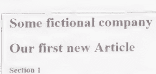

图 1-2 包含嵌套 `<h1>` 元素的 `<header>` 元素

#### 使用 `<nav>` 元素

在 HTML5 文档中使用 `<nav>` 元素，可以为用户提供在网页文档或整个 Web 应用程序的主要元素之间的导航功能。这些主要导航元素可以表现为页面顶部的链接列表，用于在当前网站内导航。它也可以将你收藏的网站列在页面侧边，例如在博客中列出你关注的其他收藏博客。

通常，页面顶部的链接列表（通常称为 Web 应用程序的主菜单）包含在页眉中（但不一定要放在那里）。收藏的 URL 列表很可能会放在 `<aside>` 中，这样该列表可以置于侧边，远离主要内容但便于访问。在当前示例中，你将在页面顶部创建一个主菜单。此 HTML 代码生成如图 1-3 所示的输出：

```
<body>
  <header>
    <h1>Some fictional company Website</h1>
    <nav>
      <a href="Home.html">Document Structure</a>
      <a href="Blog.html">Writing Code</a>
      <a href="About.html">Styles</a>
    </nav>
  </header>
  ...
</body>
```

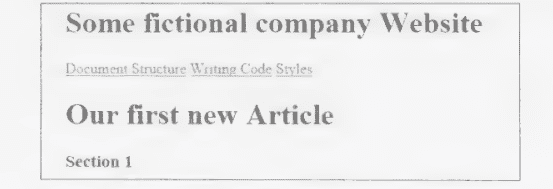

图 1-3 使用 `<nav>` 元素创建的导航菜单

在 `<header>` 元素下另一个常用的元素是名副其实的 `<hgroup>`。

#### 使用 `<hgroup>` 元素

`<hgroup>` 元素是一种组织标题和子标题的语义化方法。该元素通常包含我们熟悉的标准 `<h1>` 到 `<h6>` 元素。`<hgroup>` 元素将相关的标题按顺序分组。你可以向网页添加一个新的 `<hgroup>` 元素来实现此目的，如下所示：

```
<body>
    ...
    <article>
        <header>
            <hgroup>
                <h1>Our first new Article</h1>
            </hgroup>
        </header>
        <p>Provide some useful information in the article</p>
    </article>
</body>
```

此 HTML 代码渲染出如图 1-4 所示的输出。

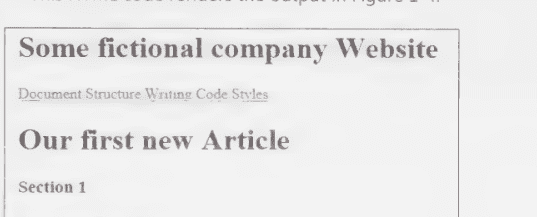

**图 1-4** 使用 `<hgroup>` 元素对标题进行分组

此代码示例有效地告知渲染器，该文章有一个主标题（`<h1>`）。如果需要，你可以继续添加 `<h2>` 到 `<h6>` 元素。在 `<hgroup>` 元素中使用多少个（`<h1>` 到 `<h6>`）元素，显然取决于你想要呈现的文档结构。

现在页面已初具雏形，接下来你可以了解两个主要的内容元素：`<article>` 和 `<section>`。

#### 使用 `<article>` 元素

`<article>` 元素表示一个完整且独立的作文或条目。`<article>` 元素的示例可以是一篇杂志文章或一篇博客文章，其中的内容可以独立分发而不会丢失其含义。每篇文章都是完全自包含的。你可以拥有包含子文章的文章；然而，每个子文章必须是根文章的直接扩展并与之相关。

现在你已经了解了新的 `<article>` 元素，可以回到示例文档并用文章来组织它：

```
<body>
  ...
  <article>
    <header>
      <hgroup>
        <h1>Our first new Article</h1>
      </hgroup>
    </header>
    <section>
      <h1>Section 1</h1>
      <p>Some details about section 1</p>
      <aside>Did you know that 7/10 is 70%</aside>
    </section>
    <section>
      <h1>Section 2</h1>
    </section>
  </article>
  <article>
    <header>
      <hgroup>
        <h1>Second huge article</h1>
      </hgroup>
    </header>
    <p>Provide some useful information in the article</p>
  </article>
  <article>
    <header>
      <hgroup>
        <h1>Third huge article</h1>
      </hgroup>
    </header>
    <p>Provide some useful information in the third article</p>
  </article>
</body>
```

此 HTML 代码生成如图 1-5 所示的输出。

# Some fictional company Website

[Document Structure](#document-structure) [Writing Code](#writing-code) [Styles](#styles)

# Our first new Article

## Section 1

Some details about section 1

Did you know that 7/10 is 70%

## Section 2

# Second huge article

Provide some useful information in the article

# Third huge article

Provide some useful information in the third article

**图 1-5** 使用 `<article>` 元素来划分页面上的不同文章

你已将文档扩展为包含三篇文章。显然，你不会把整章内容都放入示例 HTML 文档中，但你会添加足够多的内容来演示每个语义元素的功能。本示例中添加到文档中的每篇文章都代表文档中一个可以完全自包含的独立部分。通常，`<article>` 元素内的第一个元素是标题元素或标题组。与 `<article>` 元素密切相关的是 `<section>` 元素，接下来你将对此进行了解。

#### 使用 `<section>` 元素

`<section>` 元素将页面细分为不同的部分。你可以继续使用额外的 `<article>` 元素来进一步分解示例页面；然而，`<article>` 元素的目的并不是将页面分解为更细粒度的细节。这正是 `<section>` 元素发挥作用的地方。每个 `<article>` 元素包含零个或多个 `<section>` 元素，以表示 `<article>` 元素内的不同内容部分。与 `<article>` 元素类似，`<section>` 元素内的第一个元素通常也是标题或标题组。


现在你可以用 `<section>` 元素扩展示例页面，以生成图 1-6 所示的输出：

```html
<body>
    ...
        <article>
            <header>
                <hgroup>
                    <h1>Our first new Article</h1>
                </hgroup>
            </header>
            <section>
                <h1>Section 1</h1>
                <p>Some details about section 1</p>
            </section>
            <section>
                <h1>Section 2</h1>
            </section>
        </article>
    ...
</body>
```

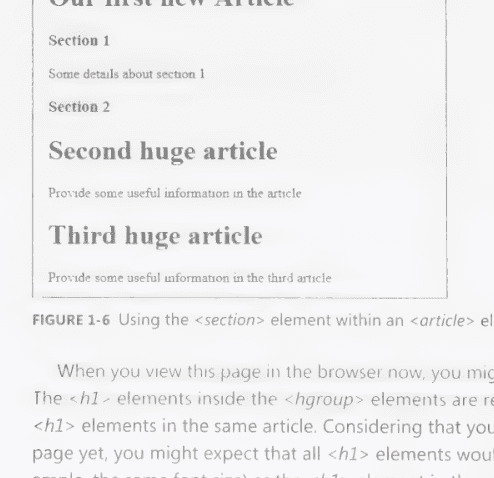

**图 1-6** 在 `<article>` 元素中使用 `<section>` 元素

当你现在在浏览器中查看此页面时，可能会注意到一些相当有趣的现象。`<hgroup>` 元素内的 `<h1>` 元素的渲染方式与同一篇文章中之前的 `<h1>` 元素不同。考虑到你还没有为该页面应用任何样式，你可能期望所有 `<h1>` 元素都以相同的样式（例如相同的字体大小）进行渲染，就像 `<article>` 元素中的 `<h1>` 元素一样。然而，当在浏览器中渲染页面时，你会发现事实并非如此。这是因为浏览器中的文档解析器按照其方式遍历文档，以确定标题的隐含层次结构，也称为文档大纲。在本课稍后学习屏幕阅读器时，你会了解更多相关内容。现在，请先关注 `<aside>` 元素。

#### 使用 `<aside>` 元素

`<aside>` 元素定义不包含在当前页面主流程或主要内容中的任何内容——例如，侧边栏、注释、提醒或广告。`<aside>` 元素不会自动将自身放置到网页的某一特定侧边；它仅仅是一种以语义方式将一段文本或图形定义为旁注的方式。稍后你将看到如何使用样式来定位旁注。现在，请将以下 `<aside>` 元素添加到你的页面中以备后用：

```html
<body>

    <article>
        <header>
            <hgroup>
                <h1>Our first new Article</h1>
            </hgroup>
        </header>
        <section>
            <h1>Section 1</h1>
            <p>Some details about section 1</p>
            <aside>Did you know that 7/10 is 70%</aside>
        </section>
        <section>
            <h1>Section 2</h1>
        </section>
    </article>

</body>
```

此 HTML 代码产生图 1-7 所示的输出：

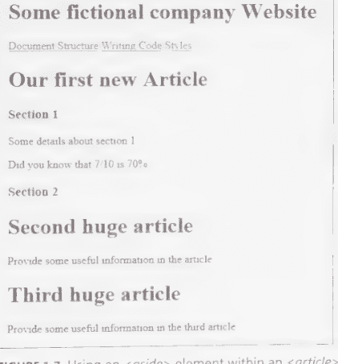

**图 1-7** 在 `<article>` 元素中使用 `<aside>` 元素

正如你在浏览器输出中看到的，`<aside>` 元素在处理上与用于构建页面的其他元素相比没有任何特殊之处。然而，稍后你将看到，通过使用语义化标记（如 `<aside>` 元素）来设置内容样式是多么轻松。

#### 使用 `<figcaption>` 和 `<figure>` 元素

`<figcaption>` 和 `<figure>` 元素是 HTML5 中新增的元素，为向网页添加图形和图表提供了必要的语义元素。这些图形和图表通常以可视化的方式呈现文本内容中的信息，并被文本引用。你经常在教程或教科书中的图片中看到这种情况，作者会在其中引导读者查看特定的图表。例如，我在上一个示例的末尾添加了一些 HTML：

```html
<body>
    ...
        <article>
            ...
            <figure>
                
                <figcaption>Fig 1: A really juicy orange.</figcaption>
            </figure>
        </article>
</body>
```

此 HTML 代码产生图 1-8 所示的输出。

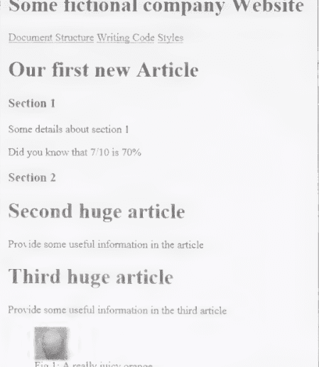

你需要将示例图片替换为你已有的图片，才能使页面正确渲染。然而，通过 `<figcaption>` 和 `<figure>` 元素所实现的效果应该是清晰的。

#### 使用 `<progress>` 元素

`<progress>` 元素表示某个目标或任务的进度。支持的进度任务类型有两种：确定型和不确定型。

当你预先知道要完成的工作量时，使用确定型进度任务；换句话说，你知道起始值和结束值。此场景的示例包括下载你已知确切大小的文件，或显示筹款活动的进度。在这两种情况下，你都知道任何特定时间任务的确切状态，同时也知道最终目标是什么——无论是文件下载的字节数还是筹款活动的美元金额。在这些确定型情况下，你可以使用如下所示的 HTML5 标记：

```html
<p>Our goal is to have 1000 users:</p>
<span>0</span>
<progress value="50" max="1000"></progress>
<span>1000</span>
```

此 HTML 的结果是图 1-9 所示的进度条。

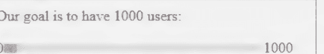

**图 1-9** 使用 `<progress>` 元素显示朝向总数的进度

如前面的代码所示，`<progress>` 元素有两个你需要了解的属性：`value` 和 `max`。`value` 属性允许你指定 `<progress>` 元素在特定时间点的当前值或位置。`max` 属性告诉浏览器该元素的最大可能值是多少。浏览器使用这两个值来确定应填充多少元素。通常，`value` 属性使用 JavaScript 动态更新。在图 1-10 中，你可以看到当 `value` 属性更新为 750 时，`<progress>` 元素的显示变化。

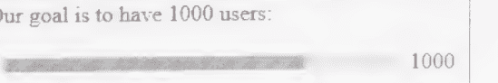

**图 1-10** `value` 属性对 `<progress>` 元素的影响

当你不知道某个任务需要多长时间才能完成，但仍然想向用户展示正在进行某些工作并让他们等待时，可以使用不确定型任务。你仍然使用 `<progress>` 元素，但移除 `value` 属性。当你不指定 `value` 属性时，浏览器可以推断 `<progress>` 元素表示一个不确定型任务。当你从某个服务接收数据，而你无法控制或了解请求完成的速度或请求结果的大小时，这可能会很有用。以下 HTML5 标记演示了一个不确定型任务：

```html
<p>Data download is in progress, please wait patiently:</p>
<progress max="5"></progress>
```

此代码产生如图 1-11 所示的进度显示：

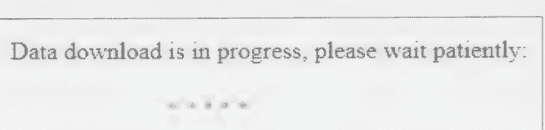

**图 1-11** 通过移动的点来显示不确定型进度，表明正在进行工作

在图 1-11 中，蓝色圆点替代了之前确定型示例中的进度条。进度指示器的这种视觉变化仅仅通过从 `<progress>` 元素中移除 `value` 属性就实现了。实际上，这些点是动态的，如果你在浏览器中运行代码就会看到效果。

#### `<mark>` 元素

通过 `<mark>` 元素，你可以轻松地高亮显示重要信息或任何你想强调的文本。它基本上与荧光笔功能相同。通过将文本包裹在 `<mark>` 元素中，并为其 `style` 元素提供 `background-color` 属性，你可以获得所需的高亮效果。以下 HTML 代码演示了 `<mark>` 元素：

```html
<p>Some very <mark style="background-color:red;">important</mark> information provided here!</p>
```

图 1-12 显示了此 HTML 的输出。由于 `<mark>` 元素被放置在 "important" 一词周围，该词被高亮显示。

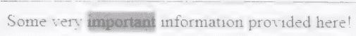

**图 1-12** 放置在 `<mark>` 元素内的文本效果

#### 使用 `<div>` 元素

新的 HTML5 语义元素（`<progress>` 元素除外）并不一定提供任何默认或改变的行为。相反，它们为你的网页提供了更强的语义定义。这反过来又为你提供了一种更可靠、更易于维护的方式来构建页面并保持一致的样式。这些元素的目标是取代 HTML5 之前使用 `<div>` 元素并按功能命名的旧式页面构建方法。但请注意，`<div>` 元素仍然是 HTML5 的一部分，并且仍然扮演着重要角色。在适当的时候使用新的语义元素，但要记住 `<div>` 元素对于设置内容样式仍然非常有用。

本节探讨了 HTML5 中的新语义元素。在下一节中，你将学习如何创建和使用布局容器。

#### 在 HTML 中创建布局容器

你可以用多种方式来布局网页。这里的一个重要目的是敦促你认真思考页面布局，以使你的页面呈现对用户友好。如果用户因为整个页面都被设置为 `<body>` 元素内的单个 `<p>` 元素而找不到他们想要的内容，他们不太可能再回来。在本节中，你将了解 HTML 中可用的一些布局选项。第 4 章"在应用程序中使用 CSS"将解释如何使用层叠样式表（CSS）来实现你的布局。

在 HTML 中创建布局的两种最常用方法涉及使用 `<div>` 和 `<table>` 元素。无论哪种情况，你很可能仍然需要使用 CSS 来帮助定位和调整大小。第 4 章将更详细地介绍 CSS；本节将专门探讨仅使用 HTML 的布局。

作为万能容器元素，我们熟悉的 `<div>` 经常用于将页面划分为各个部分以创建布局。例如，你可能会看到这种用于实现布局的 HTML：

```html
<div id="PageHeader"></div>
<div id="LeftSide"></div>
<div id="RightSide"></div>
<div id="Footer"></div>
```

渲染引擎根据其规则显示每个 `<div>`。要动态定位这些区域则需要 CSS。

使用 `<div>` 元素构建文档的主要问题在于它们无法为每个部分赋予标准的语义含义。当你在探索使用 CSS 创建布局时，稍后会重新审视这些示例。


`<div>`元素为页面布局提供了更强的动态能力。对于需要在HTML页面中直接声明的更为静态的布局，`<table>`元素更为合适。以下HTML定义了一个表格，提供了常见的博客网站格式，包括顶部标题区、左侧边栏、内容区域、右侧边栏和底部页脚区：

```
<table>
    <tr>
        <td colspan="3" id="Header"></td>
    </tr>
    <tr>
        <td rowspan="3" id="LeftBar"></td>
        <td rowspan="3" id="MainContent"></td>
        <td id="RightSideTop"></td>
    </tr>
    <tr>
        <td id="RightSideMiddle"></td>
    </tr>
    <tr>
        <td id="RightSideBottom"></td>
    </tr>
    <tr>
        <td colspan="3" id="Footer"></td>
    </tr>
</table>
```

`<table>`元素非常灵活。额外的元素如`<thead>`和`<tfoot>`为标记表格单元格提供了更具语义化的方法。使用`<table>`元素进行布局的问题在于结构的静态性。要更改使用表格进行布局的网站的整体结构，你需要逐个页面进行修改。值得注意的是，多年来已经演变出了一些使此类更改更简单的方法，以应对相关的维护难题。

#### 针对搜索引擎进行优化

当网站需要创建在线展示时，你必须确保它能够在已经存在的数百万个网站中被找到。搜索引擎优化（SEO）是一种技术，用于使网站元素能够被搜索引擎轻松发现并进行适当的索引，这样当用户搜索与您的网站相关的内容时，他们就能找到您的页面。Bing和Google等搜索引擎不断在互联网上搜索内容。当它们发现网页时，会分析HTML并索引页面和图片元数据等内容。它们使用索引数据使用户能够搜索互联网上的几乎任何内容并收到相关结果。显然，网站上的内容与用户通过搜索引擎找到您的网站的难易程度之间存在着关联。考虑到前面目标中讨论的语义化HTML元素，您应该注意搜索引擎用来发现网站内容的逻辑方面的一些额外事项。总体而言，SEO这个主题远远超出了本书和考试的范围；关于这个主题的专著都有很多。但是，讨论HTML5如何影响SEO和网站设计是相关的。

在过去（定义为HTML5之前），网页设计师经常使用`<div>`元素来划分页面。这些元素对于它们打算包含的内容并没有提供太多的上下文。但借助HTML5中可用的语义化标记，您可以使用更具描述性的元素来表示页面各区域。正如您在博客页面布局示例中看到的，仅HTML元素本身就清楚表明了页面每个部分的意图。当搜索引擎分析网页时，它们会检测到标记并知道从中提取什么内容以正确索引页面。

`<article>`和`<section>`元素是SEO算法使用的主要元素。这些元素被认为包含页面的主体内容。页面包含多个`<article>`和/或`<section>`元素是可以接受的；它们都会被索引。在每个`<article>`元素内，搜索引擎会寻找`<hgroup>`或`<h1>`等元素来获取`<article>`元素的主题以便进行相关索引。然而，这并不意味着如果一个网站没有`<article>`或`<section>`元素，它就不会被索引和搜索。这只是关系到搜索引擎能够进行何种质量的索引，以使您的网站对最终用户更具可搜索性。

SEO是在设计网站时非常值得理解的技术。创建一个网站却让它埋没在黑暗中难以找到，没有太大的意义。被找到非常重要，而且当网站被找到时，您不想限制您的受众。可访问性也非常重要。

接下来，看看HTML5如何影响屏幕阅读器的使用。

#### 针对屏幕阅读器进行优化

屏幕阅读器依赖文档大纲来解析结构并向用户呈现信息。屏幕阅读器程序可以读取页面上的文本，并通过文本转语音算法将其转换为音频。这对于可能难以查看网页的用户很有帮助。如前所述，HTML5中文档大纲的生成方式已经改变。以下是更多细节。

在HTML5之前，页面仅使用标题元素（`<h1>`到`<h6>`）来构建大纲。每个标题元素相对于页面中前一个标题元素的位置创建了层次结构。屏幕阅读器可以使用这些信息向用户呈现目录。然而，HTML5引入了语义化元素来创建新的部分。这意味着`<section>`、`<article>`、`<nav>`和`<aside>`元素都定义了新的部分。语义化元素的引入改变了文档大纲的创建方式。例如，如果以下HTML将作为示例文档的层次结构，您可以将其布局如下：

```
<h1>Fruits and Vegetables</h1>
<h2>Fruit</h2>
<h3>Round Fruit</h3>
<h3>Long Fruit</h3>
<h2>Vegetables</h2>
<h3>Green</h3>
<h3>Colorful</h3>
```

这产生了预期的大纲，如图1-13所示。

**图1-13** 使用一系列标题元素创建文档结构的输出

大纲显示了不同标题元素的默认样式，如预期所示。标题元素在文档中创建了隐式的部分和子部分。这在HTML5中仍然有效。然而，您不应该将页面分区留给标题元素所呈现的隐式分区；相反，您应该使用适当的语义明确界定各个部分。此外，建议在整个HTML5文档中仅使用`<h1>`元素。要以这种方式产生相同的层次结构，您需要将HTML修改为如下所示：

```
<section>
    <h1>Fruits and Vegetables</h1>
    <section>
        <h1>Fruit</h1>
        <section>
            <h1>Round Fruit</h1>
        </section>
        <section>
            <h1>Long Fruit</h1>
        </section>
    </section>
    <section>
        <h1>Vegetables</h1>
        <section>
            <h1>Green</h1>
        </section>
        <section>
            <h1>Colorful</h1>
        </section>
    </section>
</section>
```

这个HTML产生了与前面图1-13所示相同的输出。区别在于现在每个`<section>`元素都创建了一个新的页面部分，而不是依赖标题元素来创建部分。屏幕阅读器可以解析语义化元素来创建文档大纲，最终能够提供更加丰富的用户体验，这得益于HTML5允许网页设计师布局页面的方式。

#### *思考题*

##### 将网站转换为HTML5

在这个思考实验中，应用您对此目标所学到的知识。您可以在本章末尾的"答案"部分找到这些问题的答案。

您刚受雇将现有网站转换为新的HTML5语义化标记。分析以下HTML并确定应更新哪些元素以充分利用HTML5语义化标记：

```
<html>
    <head>
        <title>Experimentations</title>
    </head>
    <body>
        <table>
            <tr>
                <td colspan="3">
                    <div id="header">
                        <h1>A Thoughtful Experiment</h1>
                    </div>
                </td>
            </tr>
            <tr>
                <td>
                    <a href="">Home</a>
                    <a href="">Page 1</a>
                    <a href="">Page 2</a>
                    <a href="">Page 3</a>
                </td>
                <td>
                    <div id="content">
                        <div id="anArticle">
                            <h1>An Article regarding thought is
presented here.</h1>
                            <h2>Thought as a provoking element.</h2>
                            ......................
                            <div id="moreInfo">Here are some
reference material.</div>
                        </div>
                    </div>
                </td>
```


```
<td>
    <div id="profile">
        .......
    </div>
</td>
</tr>
<tr>
    <td>
        <div id="footer">
            此页面受版权保护。
        </div>
    </td>
</tr>
</table>
</body>
</html>
```

#### 目标概述

- HTML5 引入了新的语义元素，以更清晰地定义 HTML 页面的各个部分。这些元素包括 `<section>`、`<article>`、`<nav>`、`<header>`、`<footer>`、`<aside>`、`<progress>`、`<mark>`、`<figure>` 和 `<figcaption>`。
- 当 HTML 页面中的元素被包含在诸如 `<div>` 元素和/或 HTML 表格等结构中时，可以控制它们的布局。
- HTML5 语义元素提供了必要的机制，可以更轻松地构建页面，以支持屏幕阅读器的无障碍访问。
- 搜索引擎利用 HTML5 语义，通过 `<article>` 元素来判断页面的目的。

#### 目标回顾

回答以下问题以测试你对本目标信息的掌握。你可以在本章末尾的“答案”部分找到这些问题的答案以及每个选项正确或错误的原因。

1. 以下哪个元素不是在 HTML5 中引入的？
   - A. `<article>`
   - B. `<footer>`
   - C. `<hgroup>`
   - D. `<input>`
2. `<hgroup>` 元素包含哪些元素？
   - A. `<h1>` 到 `<h6>`
   - B. `<header>`
   - C. `<nav>`
   - D. 以上所有
3. 为了组织内容以最大化搜索引擎算法的效果，你会使用哪个 HTML5 元素？
   - A. `<div id="CompanyNews">`
   - B. `<header>Company News</header>`
   - C. `<article>Company News</article>`
   - D. 以上所有
4. 为了创建更具结构性的布局，你应该使用哪个 HTML5 元素？
   - A. `<div>`
   - B. `<p>`
   - C. `<table>`
   - D. `<form>`

### 目标 1.2：编写与 UI 控件交互的代码

在本目标中，你将回顾如何使用代码与浏览器中的网页进行交互。网络浏览器包含一个强大的环境，你可以在其中控制网页的行为。一些新的 HTML5 元素为最终用户提供了改进的交互性。

你还将回顾如何使用 JavaScript 动态修改文档对象模型。你将回顾如何在网页中实现视频和音频，以及如何以编程方式控制它们。最后，你将回顾如何动态渲染图形或允许用户绘制自己的图形。

**本目标涵盖以下内容：**
- 添加或修改 HTML 元素
- 实现媒体控件
- 使用 HTML5 canvas 和 SVG 实现图形

#### 添加或修改 HTML 元素

在运行时修改 HTML 文档的能力非常强大。到目前为止，你已经了解了如何创建网页、优雅地布局以及将其渲染给用户。在许多情况下，你需要根据用户的行为在运行时修改网页的布局。这就是你可以利用 JavaScript 强大的功能的地方。JavaScript 提供了你所需的工具包，让你可以在网页元素已经渲染到浏览器之后编写与之交互的代码。在开始修改网页之前，你需要知道如何访问或引用这些元素，以便操作它们。

#### 文档对象模型

文档对象模型（DOM）是 HTML 页面结构的表示，你可以通过编程方式与之交互。如前所述，HTML 页面是一个层次结构。浏览器根据呈现给它的 HTML 层次结构生成一个大纲，并在浏览器中将其显示给用户。在用户未知的背后，浏览器构建了一个 DOM。DOM 的应用程序编程接口（API）作为带有属性和方法的对象暴露出来，使你能够编写 JavaScript 代码与渲染到页面上的 HTML 元素进行交互。

这个概念非常强大。你可以向页面添加原始 HTML 页面中根本不存在的新元素。你可以修改元素以改变它们的行为、布局、外观和内容。理论上，尽管这很少是推荐的做法，你可以向浏览器渲染一个空白的 HTML 页面，使用 JavaScript 构建整个页面，并产生完全相同的结果。能够在网页渲染后对其进行控制，这非常令人兴奋。你首先要选择 DOM 中的项目以获取对它们的引用。

#### 在 DOM 中选择项目

要操作 DOM，你需要知道如何访问它以及如何获得要操作的元素的引用。在下一节中，你将研究如何修改 DOM，但首先你需要从 DOM 中获取元素，以便与它们一起工作。

> **注意 文档对象模型就像一个家族树**
>
> DOM 本质上是一个按树状排列的节点集合。所有节点彼此相关。它们是一个庞大的快乐家庭，包括子节点、兄弟节点、父节点、祖父节点、孙子节点等等。这种家族树的本质代表了 DOM 的层次结构，当你通过代码操作 DOM 时，理解这一点很重要。

在使用 JavaScript 访问 DOM 时，你有几个选择。你可以通过浏览器提供的名为 *document* 的全局对象访问 DOM 元素，或者在获得对某个元素的引用后，通过元素本身访问。表 1-2 概述了用于在 DOM 中选择元素的核心原生方法。

| 方法 | 使用描述 |
|---|---|
| getElementById | 通过元素的唯一 id 属性值获取页面上的单个元素 |
| getElementsByClassName | 获取所有应用了指定 CSS 类的元素 |
| getElementsByTagName | 获取页面上所有具有指定标签名或元素名的元素 |
| querySelector | 获取匹配提供的 CSS 选择器条件的第一个子元素 |
| querySelectorAll | 获取所有匹配提供的 CSS 选择器条件的子元素 |

在大多数情况下，这些方法的使用都很直接。在本节中，你将从一个简单的 HTML 文档结构开始，本书中的许多其他示例将使用该结构来突出各种概念。创建一个带有清单 1-2 中 HTML 标记的网页，以继续以下示例。

#### 清单 1-2 用于操作 DOM 的 HTML 源码

```
<body>
    <div id="outerDiv">
        <p class='mainPara'>Main Paragraph</p>
        <ul>
            <li>First List Item</li>
            <li>Second List Item</li>
            <li>Third List Item</li>
            <li>Fourth List Item</li>
        </ul>
        <div id="innerDiv">
            <p class='subPara' id='P1'>Paragraph 1</p>
            <p class='subPara' id='P2'>Paragraph 2</p>
            <p class='subPara' id='P3'>Paragraph 3</p>
            <p class='subPara' id='P4'>Paragraph 4</p>
        </div>
        <table>
            <tr>
                <td>Row 1</td>
            </tr>
            <tr>
                <td>Row 2</td>
            </tr>
            <tr>
                <td>Row 3</td>
            </tr>
            <tr>
                <td>Row 4</td>
            </tr>
            <tr>
                <td>Row 5</td>
            </tr>
        </table>
        <input type="text"/><input type="submit" value="Submit"/>
    </div>
</body>
```

这个示例页面非常简单，但它适用于演示通过代码访问元素的各种方式。为了演示此功能，你需要一个入口点。将以下脚本块添加到网页的 head 部分：

```
<script>
    window.onload = function () {
        ...
    }
</script>
```

这看起来应该很熟悉，但如果还不熟悉，稍后你会回顾这些概念。目前，这段代码本质上告诉运行时在窗口加载完成后运行你的代码。你可以在此函数中使用你的代码来试验表 1-2 中列出的各种方法，从 *getElementById* 开始。

**getElementById** 方法返回页面中与你传递给它的特定 ID 值匹配的元素。如果页面上没有元素具有指定的 ID，则返回 null。页面上的每个元素都应该有一个唯一的 ID。例如，如果你想引用 ID 为 *outerDiv* 的 `<div>` 元素，你可以使用以下代码：

```
var element = document.getElementById("outerDiv");
alert(element.innerHTML);
```

JavaScript 的 **alert** 方法（用于显示消息框）在此处用于显示你是否已成功访问 DOM。*alert* 在现实世界中不是特别有用，但在开发过程中很有用。当你运行页面时，注意来自浏览器的消息框，其中包含了你通过代码从 DOM 中选出的 `<div>` 的所有 *innerHTML* 内容（见图 1-14）。

**图 1-14** 一个 JavaScript *alert* 演示成功访问 DOM


现在你已经成功获取了对`<div>`的引用，可以动态地对其进行任何操作——就像你可以静态地定义或应用这些更改一样。当你知道页面中要操作的特定元素的ID时，getElementById方法非常有用，但在其他情况下，你可能想对特定类型的所有元素执行某些操作——例如，所有段落元素。在这种情况下，getElementsByTagName方法更为合适。你可以使用以下代码获取对所有`<p>`元素的引用：

```
<script>
    window.onload = function () {
        var paragraphs = document.getElementsByTagName("p");
        alert(paragraphs.length);
    }
</script>
```

在此代码中，getElementsByTagName方法返回的对象略有不同；它是一种特殊类型，作为与参数匹配的所有元素的包装器，称为NodeList。这个对象本身并不是特别有用。事实上，除了提供length属性（让你知道它包含多少项）以及访问每个单独项的能力之外，它并没有提供任何有用的功能。在前面的示例中，JavaScript警告框显示了列表中返回的项数（paragraphs.length）。你可以看到该方法返回了页面中所有五个`<p>`元素，如图1-15所示。

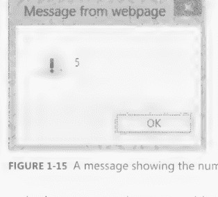

与使用getElementsByTagName方法获取相同类型所有元素的方式类似，你可以使用getElementsByClassName方法获取相同CSS类的所有元素。当你有许多具有相同样式的元素但可能想在运行时修改它们时，这非常有用。此方法也返回一个NodeList。以下代码片段演示了用法：

```
<script>
    window.onload = function () {
        var paragraphs = document.getElementsByClassName("subPara");
        alert("<p> elements with class subPara: " + paragraphs.length);
    }
</script>
```

图1-16显示了此脚本的输出。

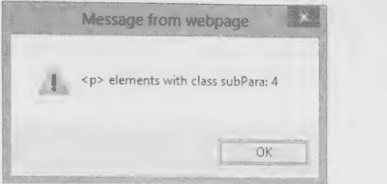

**图 1-16** 显示具有指定类名*subPara*的`<p>`元素数量的消息

此示例在消息框中添加了一些额外的文本，使其看起来与前面的示例不同，但思路是相同的。所有分配了*subPara*类的`<p>`元素都在一个*NodeList*中返回。你可以看到调用返回了四个HTML元素。当通过类名在DOM中选择元素时，*NodeList*包含类与指定类匹配的所有元素——不仅仅是相同类型的元素。例如，如果你将*subPara*类分配给其中一个`<div>`元素，然后再次运行函数，返回的*NodeList*将包含四个`<p>`元素和该`<div>`元素，因为它们都具有相同的类。当你打算遍历这些元素并对它们执行某些操作时，这一点很重要。在图1-17中，运行了相同的JavaScript代码，但向一个`<div>`元素添加了*subPara*类属性。

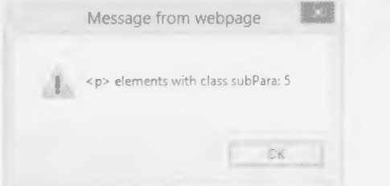

**图 1-17** 对分配了类名*subPara*的`<div>`运行相同脚本

此消息框现在实际上是不正确的，因为*NodeList*包含一个`<div>`元素和四个`<p>`元素。请记住*getElementsByClassName*方法的这种行为。

到目前为止，你见过的所有在DOM中查找元素的方法都提供了针对特定目的的特定实现。如果你想通过唯一ID获取单个元素，可以使用*getElementById*方法；如果你想查找特定CSS类的一个或所有元素，可以使用*getElementsByClassName*方法。现在来看一些使用更灵活的*querySelector*和*querySelectorAll*方法的示例。

*querySelector*和*querySelectorAll*方法可以实现大部分你已经用其他方法完成的功能。这两种方法都接受CSS选择器形式的参数。querySelector方法返回它找到的与传递给它的选择器条件匹配的第一个元素，而querySelectorAll方法返回与传入的选择器条件匹配的所有元素。元素仍以NodeList对象的形式返回。这两种方法不仅存在于document本身，还存在于每个元素上。因此，当你拥有对某个元素的引用时，可以使用这些方法来搜索其子元素，而不必遍历整个文档。你可以在本节中看到一些更简单的示例。

要查找页面上的所有`<p>`元素，可以使用以下语法：

```
document.querySelectorAll("p");
```

要通过其唯一ID查找元素，可以使用以下语法：

```
document.querySelector("#outerDiv");
```

将这两行代码放入HTML文件中并尝试运行。你将在第4章中探索更高级、更有趣的功能。现在，你可以使用已了解的关于在DOM中查找元素的知识，将其应用于通过代码添加或修改DOM。

> **考试提示**
> jQuery可能是目前最流行的用于简化和扩展核心JavaScript功能的库。虽然jQuery不是微软技术，但它本质上是行业标准，并且得到微软的完全支持。因此，如今的Web开发人员通常被认为能够熟练地在核心JavaScript和jQuery之间交替使用。考试将期望你能够使用jQuery有效地替代文档对象选择器方法。

#### 修改DOM

通过JavaScript访问DOM可用于在创建动态网页时提供丰富的用户体验。到目前为止，你所做的只是获取元素的引用，这本身并不是特别有用。从DOM中检索元素的目的是为了能够对它们执行某些操作。在本节中，你将了解如何使用JavaScript代码操作DOM来添加和删除项目。

获取对容器元素的引用后，你可以动态地向其添加子元素。你可以从中删除元素，或者简单地隐藏元素。当你从DOM中删除元素时，它就不见了。因此，如果你想让某些内容对用户不可见但希望以后能够再次使用，可以使用适当的CSS简单地隐藏它，而不是将其删除。下面是一个示例：

```
var element = document.getElementById("innerDiv");
alert(element.innerHTML);
document.removeChild(element);
var afterRemove = document.getElementById("innerDiv");
alert(afterRemove);
```

第一个*alert*正确地显示了*innerDiv*的*innerHTML*属性，但代码永远不会到达第二个alert。相反，*getElementById*方法会抛出错误，因为指定的元素*id*已不存在于文档中。

在DOM中添加和删除元素时，请注意各种方法。

首先要看的方法是*document.createElement*。你使用*document*对象的这种方法来创建新的HTML元素。该方法接收一个参数——你要创建的元素的元素名称。以下代码创建了一个新的`<article>`元素以在页面中使用：

```
var element = document.createElement("article");
element.innerText = "My new <article> element";
```

此时这个新`<article>`元素对任何人都是不可见的；它只是存在于DOM中，供你在页面中使用。由于你没有太多必要创建元素却不使用它们，接下来看看可用于将新`<article>`元素添加到页面中的方法。第一个这样的方法是*appendChild*。你使用此方法将一个HTML新元素添加到属于调用容器的子元素集合中。该节点被添加到父节点已包含的子列表末尾。*appendChild*方法存在于document对象以及其他HTML容器元素上。它返回对新添加节点的引用。此示例将一个`<article>`元素新添加到*outerDiv*：

```
var outerDiv = document.getElementById("outerDiv");
var element = document.createElement("article");
element.innerText = "My new <article> element";
outerDiv.appendChild(element);
```

与本节中解释的大多数其他方法一样，*appendChild*方法返回对附加到子元素的元素的引用。这是确保你始终拥有对元素的引用以供将来使用的好方法，尤其是在删除元素时。它还使你能够简化或重构代码。以下代码实现了相同的结果：

```
var element = document.getElementById("outerDiv").appendChild(document.createElement("article"));
element.innerText = "My new <article> element";
```


图 1-18 展示了这段代码的输出效果。

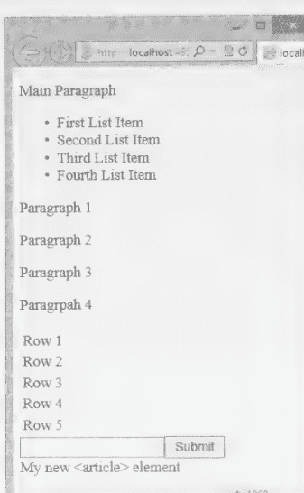

**图 1-18** 新创建的 `<article>` 元素被追加到页面底部

可以看到，`<article>` 元素被添加到了页面的末尾。*appendChild* 方法始终将新元素添加到父元素子节点列表的末尾。若要将新 `<article>` 元素插入到更精确的位置，*insertBefore* 方法可能更为合适。该方法接受两个参数：新元素本身，以及你希望在其之前插入新元素的节点。例如，要在 `innerDiv` 元素之前插入新文章，可以编写如下代码：

```
var element = document.getElementById("outerDiv").insertBefore(
    document.createElement("article"),
    document.getElementById("innerDiv"));
element.innerText = "My new <article> element";
```

本示例使用 *getElementById* 方法来获取引用，指向在 DOM 中要在其之前插入 `<article>` 元素的那个节点。根据文档结构的不同，在某些情况下可以使用其他工具来简化此代码。每个元素或节点都具有表 1-3 中列出的属性，以便在操作 DOM 时帮助获取对更常见节点的引用。

| 属性 | 说明 |
| --- | --- |
| childNodes | 父元素所有子节点的集合。 |
| firstChild | 指向父节点子节点列表中第一个子节点的引用。 |
| lastChild | 指向父节点子节点列表中最后一个子节点的引用。 |
| hasChildNodes | 一个有用的属性，如果父元素存在任何子节点，则返回 *true*。在访问 *firstChild* 或 *lastChild* 等其他属性之前，先检查此属性是一种良好的实践。 |

关于这些属性的示例，你可以修改前面的代码，将 `<article>` 元素作为 *innerDiv* 元素的第一个子元素插入：

```
var inner = document.getElementById("innerDiv");
var element = inner.insertBefore(document.createElement("article"),inner.firstChild);
element.innerText = "My new <article> element";
```

这段代码生成的输出如图 1-19 所示。

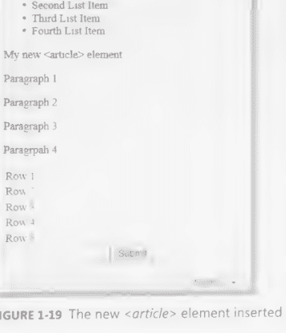

**图 1-19** 新 `<article>` 元素作为 `<div>` 元素的第一个子元素插入

现在，你的 `<article>` 元素已定位成为 *innerDiv* 元素的第一个子元素。尝试使用其他属性来熟悉它们的工作方式。每个可以拥有子元素的元素都支持所有这些功能；但是，如果尝试向不支持子节点的节点插入元素——例如 ``——解释器将抛出运行时错误。

正如你可以通过代码向 DOM 添加新元素一样，也可以使用代码从 DOM 中移除元素。在本节中，你将了解用于实现此目的的方法，即 *removeChild* 和 *removeNode*。

*removeChild* 方法从调用容器中移除一个子节点。该方法存在于 document 对象以及其他 HTML 容器元素上。*removeChild* 方法返回对已移除节点的引用。如果你计划将该节点重新放回 DOM——例如响应页面上的其他用户交互——这一点尤其方便。但是请记住，如果没有保留对移除节点的引用，你就无法在不完全重新创建的情况下将该元素添加回去。以下示例从 *innerDiv* 元素中移除第一个 `<p>` 元素：

```
var innerDiv = document.getElementById("innerDiv");
var p = innerDiv.removeChild(document.getElementById("P1"));
```

此代码的输出如图 1-20 所示。可以看到第一个 `<p>` 元素已被移除。因为你将移除的元素捕获到了变量 *p* 中，所以如果之后想将该 `<p>` 元素放到其他位置，也可以使用它。

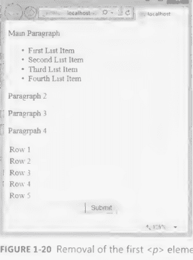

**图 1-20** *removeChild* 撩法移除第一个 `<p>` 元素

另一个用于移除节点或元素的有用方法是 *removeNode*，它接受一个布尔参数。将参数设置为 *true* 表示进行深度移除，这意味着所有子元素也会被移除。以下代码演示了这一点：

```
var innerDiv = document.getElementById("innerDiv");
innerDiv.removeNode(true);
```

图 1-21 显示了在浏览器中运行此代码时的效果，innerDiv 元素已被移除。

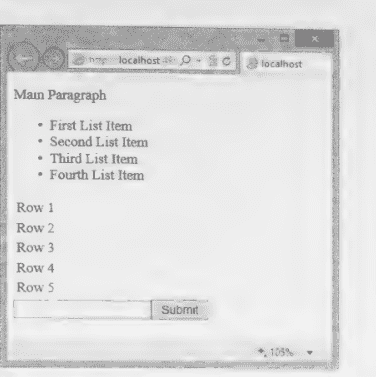

**图 1-21** 使用 *removeNode* 方法移除 `<div>` 节点

现在，假设你想更大幅度地更改页面内容——甚至可能重写所有 HTML 内容。利用目前为止看到的技巧，这完全可以实现，但你还没尝试过一些方法：*replaceNode* 和 *replaceChild*。这两个方法在参数要求和影响元素方面与 *removeNode* 和 *removeChild* 相同。但不同之处在于，你可以用全新的元素替换目标元素。以下代码将所有内部段落转换为锚点元素，并添加换行，因为你不会像使用 `<p>` 元素那样自动获得这些格式：

```
var innerDiv = document.getElementById("innerDiv");
var newDiv = document.createElement("div");
for (var i = 0; i < innerDiv.childNodes.length; i++) {
    var anchor = newDiv.appendChild(document.createElement("a"));
    anchor.setAttribute("href", "http://www.bing.ca");
    anchor.text = innerDiv.childNodes[i].textContent;
    newDiv.appendChild(document.createElement("br"));
}
innerDiv.replaceNode(newDiv);
```

这段代码产生如图 1-22 所示的浏览器输出。

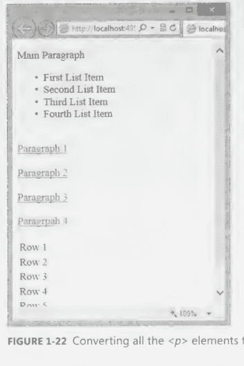

**图 1-22** 将所有 `<p>` 元素转换为 `<a>` 元素

现在，所有纯文本段落都显示为超链接。原来的 *innerDiv* 元素已消失，不再存在于 DOM 中。你对它的唯一引用仅在 JavaScript 代码中。如果打算稍后将其换回 DOM，你需要保留该引用。进一步说，由于代码没有为新 `<div>` 元素分配唯一的 *id*，在 DOM 中获取它的引用的唯一方式就是通过现有的代码引用。因此，推荐的做法是始终为新元素指定唯一的 *id*。如果 JavaScript 变量在插入文档之前超出作用域，你就会完全丢失对这些元素的引用。

在本节中，你了解了如何使用 JavaScript 操作浏览器中的 DOM 来访问 HTML 元素。现在，你可以检索构成 HTML 文档的元素或节点的引用，也可以在 HTML 文档中修改、添加和移除元素。接下来，你将了解如何在页面中实现媒体控件。

#### 实现媒体控件

将多媒体元素嵌入网页并不是什么新概念。这种能力已经存在很长时间，并且在各种情况下都带来了挑战。一个关键的挑战通常是依赖与浏览器集成的第三方对象来渲染媒体。在本节中，你将了解 HTML5 规范中新增的两个元素，它们可以在浏览器中原生配合多媒体和 JavaScript 工作。你还将研究 `<video>` 和 `<audio>` 元素。

#### 使用 `<video>` 元素

将视频嵌入网页已经变得非常流行，许多网站现在都在其设计中包含视频元素。HTML5 使在网页中包含视频比以往容易得多。在这里，你将了解 HTML5 标准提供的新 `<video>` 元素，并查看可用于控制视频的属性和事件，你可以通过声明式方式（静态 HTML）或动态方式（使用 JavaScript）来控制视频。

在页面中嵌入视频就像添加以下标记一样简单：

```
<video src="samplevideo.mp4" autoplay> </video>
```

这是最低配置。然而，你知道最低配置对于专业设计的网站来说通常是不够的。你需要使用更多属性和事件。你还需要考虑浏览器对各种视频格式的支持。首先，你需要了解 `<video>` 元素可用的关键属性，如表 1-4 所列。

**表 1-4** `<video>` 元素可用的属性

| 属性 | 说明 |
|---|---|
| src | 此属性指定要播放的视频。它可以是你自己网站中的本地资源，也可以是通过互联网上的公共 URL 提供的资源。 |
| autoplay | 此属性告诉浏览器在视频加载后立即开始播放。如果省略此属性，视频仅通过播放器控件或 JavaScript 指令才会播放。 |
| controls | 此属性告诉浏览器包含其内置的视频控件，例如播放和暂停。如果省略此属性，用户没有可见的方式来播放内容。你需要使用 autoplay 或通过 JavaScript 提供其他机制来播放视频。 |
| height/width | 这些属性控制视频在页面上占用的空间大小。省略这些属性会导致视频以其原始大小显示。 |
| loop | 此属性告诉浏览器在视频完成后连续播放。如果省略此属性，视频在完整播放一次后停止。 |
| poster | 此属性指定在分配给视频的空间中显示的图片，直到用户开始播放视频。在不使用 autoplay 时使用此属性。它对于提供代表视频的专业图片或 artwork 非常有用。如果省略，海报将显示视频的第一帧。 |

了解了这些可用属性后，你可以在 `<video>` 元素中提供更多细节来控制其行为：

```
<video src="samplevideo.mp4" controls poster="picture.jpg" height="400" width="600">
</video>
```

前面的 `<video>` 元素指定了最初应显示海报图片，设置了高度和宽度参数，并指示应提供默认控件。缺少 loop 属性意味着视频播放完毕后不会自动重复。缺少 autoplay 属性则告诉浏览器你不希望视频自动开始播放；相反，它应等待用户调用播放。

使用控件进行播放操作，或者通过 JavaScript 调用播放操作之前不会开始播放。当你确实包含默认控件时，用户会获得一套基本的控件。图 1-23 展示了 Internet Explorer 中默认控件的外观。

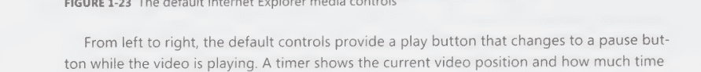

**图 1-23** Internet Explorer 的默认媒体控件

从左到右，默认控件提供了一个播放按钮，该按钮在视频播放时会变成暂停按钮。计时器显示当前视频位置和剩余时间。一个滑块栏让用户可以导航到视频中的特定位置。音频控制按钮按下时会弹出音量滑块栏，最后，在最右侧是一个让用户可以将视频全屏显示的控制。

到目前为止，一切顺利——对于 Internet Explorer 用户而言。但你还需要确保视频能够在其他浏览器中成功播放。问题在于，并非所有浏览器都支持所有视频格式。在实施 `<video>` 元素时要牢记这一点；每个浏览器支持的格式可能会（也将会）发生变化。你需要确保为浏览器提供选项，以便它可以选择要播放的视频格式。如果你没有所有适当的受支持视频格式，而你的页面恰好吸引了使用无法播放你现有视频格式的浏览器的访客，你还需要提供一个替代方案，或者至少告知用户其浏览器不支持此视频。以下代码演示了这一点：

```
<video controls height="400" width="600" poster="picture.jpg">
    <source src="samplevideo.ogv" type="video/ogg"/>
    <source src="samplevideo.mp4" type="audio/mp4"/>
    <object>
        <p>Video is not supported by this browser.</p>
    </object>
</video>
```

此示例从 `<video>` 元素中移除了 src 属性，并改为添加了子 `<source>` 元素。`<video>` 元素支持多个 `<source>` 元素，因此你可以为每种视频类型包含一个。浏览器从上到下遍历 `<source>` 元素，并播放它支持的第一个。

请注意，示例中还包含一个 `<object>` 元素，以应对客户端浏览器完全不支持 `<video>` 元素的可能性。在这种情况下，你可以有一个视频的 Flash 版本可供播放；但如果没有其他版本的视频可用，你可以直接显示一条视频不受支持的消息，如代码片段所示。不支持 `<video>` 元素的浏览器会完全忽略该元素，但会显示它们能理解的 `<object>` 元素。这让较旧的浏览器可以"回退"到以前显示视频的方法，确保你能够覆盖尽可能多的用户。

**考试提示**

如果浏览器支持 HTML5  nk video 元素，它不会显示回退内容。在这种情况下，请确保已为该浏览器指定了有效的 <source> 元素。如果没有，视频容器会在控制栏的位置显示错误，提示指定的链接或文件无效。

有时，对事物有更多控制会更好，或者你可能只是不喜欢默认控件的外观和感觉。这时就需要用到 JavaScript。你可以创建自己的控制栏，并替换为你自己的控制按钮，让用户能够控制视频。以下示例向页面添加了一些自定义图像元素，并连接了一些 JavaScript 来控制视频：

```
<head>
    <style>
        img:hover {
            cursor: pointer;
        }
    </style>
    <script>
        var video;
        window.onload = function () {
            video = document.getElementById("sampleVideo");
        }

        function play() {
            video.play();
        }
        function pause() {
            video.pause();
        }
        function back() {
            video.currentTime -= 10;
        }
    </script>
</head>
<body>
    <table>
        <tr>
            <td>
                <video height="400" width="600" id="sampleVideo">
                    <source src="samplevideo.mp4" type="audio/mp4"/>
                </video>
            </td>
            <td>
                <br/>
                <br/>
                <br/>
            </td>
        </tr>
    </table>
</body>
```

这段 HTML 生成了图 1-24 所示的媒体控件。


如你所见，代码创建了一个小型自定义控制栏，并将其定位在视频帧的右侧。`<video>` 元素等各类元素提供了许多方法。表 1-5 列出了更常见的一些方法。

| 方法/属性 | 说明 |
| --- | --- |
| *play()* | 从当前位置播放视频。 |
| *pause()* | 在当前位置暂停视频。 |
| *volume* | 允许用户控制视频的音量。 |
| *currentTime* | 表示视频的当前位置。增加或减少此值可在视频中前进或后退。 |

你已经了解了如何在网页中显示视频的所有知识。现在将注意力转向使用 `<audio>` 元素播放声音。

#### 使用 `<audio>` 元素

`<audio>` 元素本质上与 `<video>` element 完全相同。它具有所有相同的属性和相同的方法。唯一的真正区别在于它在浏览器中的显示方式。由于没有视频可供显示，`<audio>` 元素不占用任何屏幕空间。但是，你可以显示默认控件——或者你也可以选择不显示默认控件，并创建自己的机制来控制音频，要么通过自定义用户界面元素，要么在后台使用 JavaScript。以下是你的网页中 `<audio>` 声明的示例：

```
<audio controls>
    <source src="sample.mp3" type="audio/mp3"/>
    <source src="sample.ogg" type="audio/ogg"/>
    <p>Your browser does not support HTML5 audio.</p>
</audio>
```

这段 HTML 在 Internet Explorer 中提供了图 1-25 所示的输出。


**图 1-25** Internet Explorer 中的默认音频控件

图 1-25 展示了当你选择使用内置控件时 `<audio>` 元素的输出。从左到右，你会得到一个暂停/播放按钮、计数器、进度条、音频总时长和音量滑块栏。由于不需要像视频示例那样的其他屏幕空间，`<audio>` 元素没有高度或宽度属性可用。如果你不喜欢内置的音频控制栏，可以选择不在声明中包含它，而是创建一个满足你需求的自定义控制栏。

`<audio>` 和 `<video>` 元素非常相似。关于这些元素的关键点是，它们提供了一种在 HTML 页面中表示媒体的标准化方式，以简化阅读 HTML 代码并准确了解页面应该做什么。

现在你已经知道如何在网页中使用音频和视频，你可以将注意力转向图形的使用。

#### 使用 HTML5 `<canvas>` 和 SVG 实现图形

HTML5 提供了一种在网页中处理图形的新机制。HTML5 规范引入了 `<canvas>` 网页元素，它提供了一个空白画布，你可以在其上动态绘制。你可以在画布上绘制线条、文本和图像，并用 JavaScript 操作它们。

在页面中添加画布就像 HTML 中声明它一样简单。`<canvas>` 元素类似于 `<div>` 元素。但是，它是图形的容器，而不是基于文本的元素。以下是 `<canvas>` 元素的标记：

```
<canvas id="drawingSurface" width="600" height="400">
Your browser does not support HTML5.
</canvas>
```

HTML 非常直观。你只需要定义一个 `<canvas>` 并指定大小。此外，如果用户的浏览器不支持 `<canvas>` 元素，你可以在 `<canvas>` 元素内部放置回退文本以在其位置显示。在浏览器中运行此 HTML 时，你应该绝对注意不到任何东西！这是因为——就像 `<div>` 元素或任何其他容器一样——`<canvas>` 元素没有默认可见性；换句话说，

它是可见的，但它是白色的，没有边框，因此在空白的 HTML 页面上是不可见的。下一个示例为你的 `<canvas>` 元素添加了简单的样式，以便你可以看到它的边框：

```
<style>
  canvas {
    border: 1px solid black;
  }
</style>
```

现在你可以看到你的画布了，它应该如图 1-26 所示。


**图 1-26** 一个空白的 `<canvas>` 元素

一个空白的画布还不太令人兴奋。但是现在你已经让一个基本的画布运行起来了，你可以学习所有在画布上创建图形的各种方法。为此，你应该为你的窗口创建一个 onload 事件（就像你在之前的示例中所做的那样）来封装你的代码，并在页面加载时渲染图形。要在画布上绘图，你需要理解画布使用的坐标系统。

画布提供了一个固定的 (x,y) 坐标系，其中画布的左上角是 (0,0)。在这种情况下，画布的左下角是 (0,400)，右上角是 (600,0)，右下角是 (600,400)。你应该已经相当习惯这种坐标系了，因为它与浏览器窗口的坐标系相匹配，(0,0) 位于左上角。然而，画布在浏览器窗口中的位置与你在画布上绘图所使用的方法无关。在画布上绘图的坐标始终基于画布内部的坐标，其中左上角的像素是 (0,0)。

与任何 HTML 元素一样，要通过代码操作它，你需要在 JavaScript 中获取对它的引用。首先在你的页面中编写以下代码：

```
window.onload = function () {
  var drawingSurface = document.getElementById("drawingSurface");
  var ctxt = drawingSurface.getContext("2d");
}
```

在前面的代码中，你首先获取对画布元素的引用，然后获取一个 "2d" 上下文的引用。这个上下文是一个对象，它提供了用于在画布上绘图的 API 方法。现在，`<canvas>` 仅支持 2d 上下文，但你可以预期将来会看到 3d 上下文。

获得了对上下文的引用后，你现在可以开始了解在画布上绘图的各种方法了。

#### 绘制直线

在最基本的层面上，你可以使用你所引用的 2d 上下文对象在画布上绘制直线。上下文对象提供了以下绘制直线的方法，如表 1-6 所列。

表 1-6 绘制直线的方法

| 方法 | 描述 |
|---|---|
| *beginPath* | 重置/开始一个新的绘图路径 |
| *moveTo* | 将上下文移动到 *beginPath* 方法中设置的点 |
| *lineTo* | 设置直线的目标端点 |
| *stroke* | 描边直线，使其可见 |

根据这些信息，最基本的形式是，你可以像这样在画布上画一条直线：

```
ctxt.beginPath();
ctxt.moveTo(10, 10);
ctxt.lineTo(225, 350);
ctxt.stroke();
```

此代码在画布上生成如图 1-27 所示的直线。


在直线结束的点上，你可以通过添加更多的 **lineTo** 方法来继续绘制更多直线，如下面的示例所示：

```
ctxt.beginPath();
ctxt.moveTo(10, 10);
ctxt.lineTo(225, 350);
ctxt.lineTo(300, 10);
ctxt.lineTo(400, 350);
ctxt.stroke();
```

运行此代码并查看输出。你会得到一个类似于图 1-28 的图形。例如，在折线图上绘制连接点时，你可能会使用这种方式绘制直线。

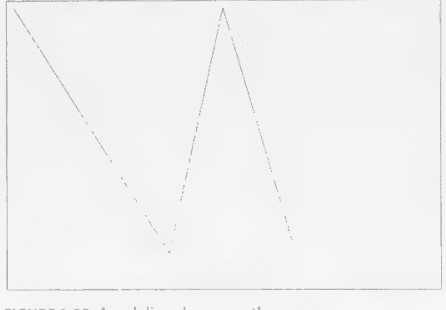

**图 1-28** 在画布上绘制的折线

更深入地探索 **stroke** 方法是值得的。如果你正在创建图表或图形，你可能希望改变直线的颜色，使其从轴线上突显出来。你可能希望改变其粗细。你可以通过在调用 **stroke** 方法之前更改上下文对象上的一些属性来实现：

```
ctxt.lineWidth = 5;
ctxt.strokeStyle = '#0f0';
```

**lineWidth** 属性接受一个值，该值决定了直线的宽度。**strokeStyle** 属性允许你更改直线颜色。此属性接受 HTML 中用于指定颜色的所有常见样式格式，包括十六进制值或命名颜色。这些更改会产生一个更新、更具吸引力的输出，如图 1-29 所示。

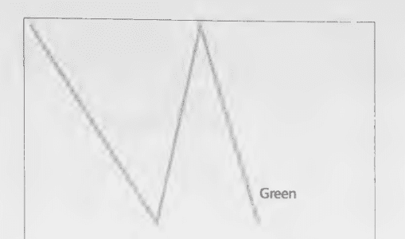

**图 1-29** 以不同颜色渲染的折线

你还可以尝试 *lineCap* 属性，它接受一些值来控制线端的渲染方式。例如，你可以将 *lineCap* 属性设置为 round 以给直线一个圆形的端帽。应用端帽会影响直线的长度。端帽会添加到直线的末端，其长度与你设置的直线宽度相匹配。在此示例中，直线的宽度为 5。如果在直线上设置圆帽，则总直线长度将延长 5。

你已经了解了关于处理直线所需的所有知识。现在将注意力转向曲线。

#### 绘制曲线

绘制曲线稍微复杂一些，因为你要考虑更多的参数。表 1-7 列出了在 HTML5 画布上处理曲线时使用的方法。

表 1-7 绘制曲线的方法

| 方法 | 描述 |
|---|---|
| arc | 基于起始和结束角度以及定义半径的标准圆弧 |
| quadraticCurveTo | 更复杂的圆弧，允许你控制曲线的陡峭程度 |
| bezierCurveTo | 另一种可扭曲的复杂圆弧 |

每种绘图方法都可以应用样式，就像直线示例一样。你可以控制 *lineWidth*、*strokeStyle* 和 *lineCap* 属性来改变曲线的显示方式。首先在画布上创建一些基本的圆弧。*arc* 方法接受表 1-8 中列出的参数。

| 参数 | 描述 |
| --- | --- |
| X, Y | 前两个参数是圆心的 X 和 Y 坐标。 |
| radius | 第三个参数是半径。这是从圆心到曲线的距离长度。 |
| startAngle, endAngle | 第四和第五个参数指定要绘制的圆弧的起始和结束角度。这是以弧度为单位，而不是以度为单位。 |
| counterclockwise | 最后一个参数指定圆弧的绘制方向。 |

将以下代码添加到你的页面中：

```
ctx.beginPath();
ctx.arc(150,100,75,0,2 * Math.PI, false);
ctx.lineWidth = 25;
ctx.strokeStyle = '#0f0';
ctx.stroke();

ctx.beginPath();
ctx.arc(450, 100, 75, 1.5 * Math.PI, 2 * Math.PI, false);
ctx.lineWidth = 25;
ctx.strokeStyle = 'blue';
ctx.stroke();

ctx.beginPath();
ctx.arc(150, 300, 75, 1 * Math.PI, 1.5 * Math.PI, false);
ctx.lineWidth = 25;
ctx.strokeStyle = '#0ff';
ctx.stroke();

ctx.beginPath();
ctx.arc(450, 300, 75, .5 * Math.PI, 1 * Math.PI, false);
ctx.lineWidth = 25;
ctx.strokeStyle = '#f00';
ctx.stroke();
```

此代码示例绘制了四个圆弧：一个完整的圆，后面跟着三个四分之一圆，每个都有不同的样式。注意，一些数学公式在 arc 的参数中指定。这种数学计算是获得弧度值所必需的，因为 *startAngle* 和 *endAngle* 的参数是以弧度为单位，而不是以度为单位。代码生成了如图 1-30 所示的图形。

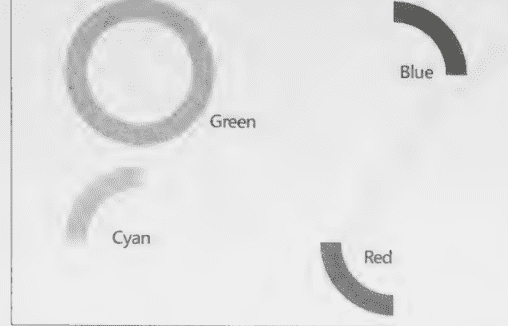

**图 1-30** 在画布上绘制不同颜色的圆弧

前面的示例演示了一个简单的圆弧。现在看看下一个圆弧方法，*quadraticArc*。二次圆弧的曲线从一端到另一端均匀分布，其到中心点的距离是均匀的。*quadraticCurveTo* 方法允许你指定一些额外的参数来改变曲线的“陡峭程度”——换句话说，改变沿曲线到中心点的距离。绘制二次曲线有点像画一条直线，但将其在中间捏住并向外拉，从而创建一条曲线，其中直线的起点和终点保持固定。你将中心点拉得越远，曲线就越陡峭。这里有一个示例：

```
ctxt.beginPath();
ctxt.moveTo(10, 380);
ctxt.quadraticCurveTo(300, -250, 580, 380);
ctxt.lineWidth = 25;
ctxt.strokeStyle = '#f00';
ctxt.stroke();
```

你首先需要使用 *moveTo* 方法告诉上下文曲线的起点在哪里。然后，将表 1-9 中描述的四个参数传递给 *quadraticCurveTo* 方法。

表 1-9 *quadraticCurveTo* 方法所需的参数

| 参数 | 描述 |
| --- | --- |
| controlX, controlY | 这些参数定义了控制点（相对于画布左上角），用于将曲线从起点和终点形成的直线“拉伸”开。 |
| endX, endY | 这是曲线应该结束的点 |

代码示例生成了图 1-31 中的图像。


 **图 1-31** 在画布上输出的二次曲线

随着控制点离起始点和终止点所构成的直线越来越远，你会得到一条更陡峭的曲线。本例中使用了一个负数，表示控制点应位于画布顶部之上，以便将曲线拉伸到你想要的位置。

最后要介绍的是贝塞尔曲线。贝塞尔曲线类似于二次曲线，但它有两个控制点，而二次曲线只有一个控制点。拥有两个控制点使得贝塞尔曲线能够创建更复杂的曲线。在之前看到的两个例子中，曲线都是围绕单个点创建的。贝塞尔曲线改变了这一点。通过一个示例最容易理解，之后我将解释其参数。请创建以下代码：

```
ctxt.beginPath();
ctxt.moveTo(125, 20);
ctxt.bezierCurveTo(0, 200, 300, 300, 50, 400);
ctxt.lineWidth = 5;
ctxt.strokeStyle = '#f00';
ctxt.stroke();
```

`bezierCurveTo` 方法的调用方式与 `quadraticCurveTo` 方法类似，都需要在 `moveTo` 方法调用之后使用。你需要向 `bezierCurveTo` 方法传递三组坐标，如表 1-10 所列。

**表 1-10** `bezierCurveTo` 方法所需的参数

| 参数 | 描述 |
|-----------|-------------|
| controlX, controlY | 前两个参数指定第一个控制点，用于拉伸曲线。 |
| control2X, control2Y | 接下来的两个参数指定第二个控制点，用于拉伸曲线。 |
| endX, endY | 最后两个参数指定曲线的终止点。 |

该代码示例生成的输出如图 1-32 所示。你可以看到，由于有两个控制点，这条曲线是倾斜的。

**图 1-32** 在画布上绘制的贝塞尔曲线

在下一节中，你将学习如何使用路径方法来组合到目前为止你所研究的所有内容。

#### 使用 *path*（路径）方法

在使用上下文对象进行绘制时，你始终需要一个起始点和一个终止点。一个描边的终止点也可以成为下一个描边的起始点。这是通过调用上下文对象上的 *beginPath* 方法，然后绘制所有线条，最后再调用 *closePath* 方法（结束线条）或 *beginPath* 方法（开始新线条）来实现的。回顾第一个弧形示例，它在绘制每个弧之前都调用了 *beginPath* 方法。如果代码没有这样做，线条将会在画布上从一个弧延续到下一个弧。但通过再次调用 *beginPath* 方法，你可以重置路径的起始点。因此，本质上，你可以将所有对各种绘图方法的调用串联起来，创建一个复杂的描边。无论描边多么简单或复杂，它都被称为 *path*（路径）。运行以下代码，看看最终会得到什么样的图像：

```
ctxt.beginPath();
ctxt.arc(300, 200, 75, 1.75 * Math.PI, 1.25 * Math.PI, false);
ctxt.lineTo(150, 125);
ctxt.quadraticCurveTo(300, 0, 450, 125);
ctxt.lineTo(353, 144);
ctxt.strokeStyle = "blue";
ctxt.lineCap = "round";
ctxt.lineWidth = 10;
ctxt.stroke();
```

此代码生成的输出如图 1-33 所示。

**图 1-33** 在画布上绘制的自定义路径

虽然这仍然是一个简单的例子，但你可以发挥创意，组合出相当精美的图像。根据你的数学技能，你可以使用这些方法创建一些非常复杂的图形。

接下来，看看用于绘制形状的其他方法。

#### 使用 rect 方法

之前，你了解了如何使用 *arc* 方法绘制圆形。正如你在上一节所看到的，你可以通过使用 *beginPath* 方法并串联一系列绘图方法来绘制任何形状和大小的自定义形状。但你并非总是需要这样做；有些形状是内置的。在本节中，你将了解构建矩形的内置功能。然后，你将了解用颜色和图案填充所绘制形状的功能。你所引用的上下文对象有一个名为 *rect* 的方法。*rect* 方法接受表 1-11 中列出的参数。

**表 1-11** 绘制矩形所需的参数

| 参数 | 描述 |
| :--- | :--- |
| *x,y* | x 坐标和 y 坐标定义了矩形的起始位置。这是矩形的左上角。 |
| *width* | 定义矩形的宽度。 |
| *height* | 定义矩形的高度。 |

简单地调用 *rect* 方法，如以下代码所示，可以绘制一个矩形：

```
ctxt.beginPath();
ctxt.rect(300, 200, 150, 75);
ctxt.stroke();
```

此代码绘制一个矩形，如图 1-34 所示。

**图 1-34** 使用 *rect* 方法在画布上绘制的矩形

请注意，尽管为左上角传入的参数是 (300, 200)，即画布的中心，但矩形并不在中心。要使矩形居中，你需要进行一些数学计算，根据画布大小以及所需矩形的大小来计算中心点。以下代码应使矩形居中：

```
ctxt.beginPath();
var x, y;
x = 150;
y = 75;
ctxt.rect(300-(x/2), 200-(y/2), x, y);
ctxt.stroke();
```

现在你可以绘制形状和矩形了，接下来可以看看如何用颜色或图案填充形状。

#### 使用 *fill*（填充）方法

在本节中，你将研究如何填充形状。你已经绘制了各种类型的形状，但到目前为止它们都是空的。在这里，你将看到如何用颜色、渐变和图案填充它们。

用颜色填充形状很简单，只需将 *fillStyle* 属性设置为一种颜色，然后调用 *fill* 方法即可。在调用 *stroke* 方法之前插入以下代码，即可用蓝色填充你的形状：

```
ctxt.fillStyle = "blue";
ctxt.fill();
```

对于 *rect* 方法，你有一个专门用于矩形的特殊 *fill* 方法，称为 *fillRect*。使用此方法，你可以在一次调用中创建并填充矩形：

```
ctxt.fillStyle = "blue";
ctxt.fillRect(300-(x / 2), 200-(y / 2), x, y);
```

使用 *fillRect* 方法减少了所需的代码量。同样简单的是，只需调用一次 *fill* 方法即可填充非矩形形状，例如你之前创建的复杂 *Path* 图形：

```
ctxt.beginPath();
ctxt.arc(300, 200, 75, 1.75 * Math.PI, 1.25 * Math.PI, false);
ctxt.lineTo(150, 125);
ctxt.quadraticCurveTo(300, 0, 450, 125);
ctxt.lineTo(353, 144);
ctxt.strokeStyle = "blue";
ctxt.lineCap = "round";
ctxt.lineWidth = 10;
ctxt.fillStyle = "Green";
ctxt.fill();
ctxt.stroke();
```

从图 1-35 可以看出，为这个复杂形状着色的逻辑完全由浏览器处理。

**图 1-35** 使用 *fill* 方法为复杂对象着色

这就是用纯色填充形状所需的全部步骤。用渐变填充形状需要几个额外的步骤。

创建渐变涉及使用一个新的 *CanvasGradient* 对象。你首先调用上下文对象上可用的 *createLinearGradient* 方法来获取一个 *CanvasGradient* 对象。在该 *CanvasGradient* 对象上，你定义要混合以创建渐变效果的颜色停止点。然后，将你的 *CanvasGradient* 对象分配给上下文的 *fillStyle* 属性。以下代码创建一个线性渐变并填充矩形：

```
var ctxt = drawingSurface.getContext("2d");
ctxt.lineWidth = 3;
ctxt.rect(150, 150, 200, 125);
var gradient = ctxt.createLinearGradient(150, 150, 200, 125);
gradient.addColorStop(0, "Black");
gradient.addColorStop(0.5, "Gray");
gradient.addColorStop(1,"White");
ctxt.fillStyle = gradient;
ctxt.fill();
ctxt.stroke();
```

此代码通过传入渐变线的起始点和终止点来创建 *CanvasGradient* 对象。然后你添加三个颜色停止点。*addColorStop* 方法接受两个参数。第一个是 0 到 1 之间的值，其中 0 是渐变线的起点，1 是终点。第二个参数是在该停止点开始填充的颜色。本例有三个停止点，因此渐变会过渡三种颜色。渐变输出显示在图 1-36 中。

**图 1-36** 使用线性渐变着色的 `<canvas>` 元素

你也可以使用 *createRadialGradient* 方法创建径向渐变。此方法接受六个参数，分别指定两个圆的中心点和半径，以及颜色沿两个圆形成的锥体上的停止点进行过渡。以下代码生成一个径向渐变，其锥体指向观察者：

```
var ctxt = drawingSurface.getContext("2d");
ctxt.lineWidth = 3;
ctxt.rect(150, 150, 250, 175);
var gradient = ctxt.createRadialGradient(200, 200,5, 250, 250,100);
gradient.addColorStop(0, "Red");
gradient.addColorStop(.5, "Orange");
gradient.addColorStop(1, "Blue");
ctxt.fillStyle = gradient;
ctxt.fill();
ctxt.stroke();
```

图 1-37 显示了此渐变的输出：

**图 1-37** 在画布上着色的径向渐变

最后一个需要了解的填充选项是使用填充图案。你需要一个外部图像，它会作为图案应用到整个图形中。例如，你可以使用一张自己创建的纹理，通过以下代码将其用作画布的背景：

```
var ctxt = drawingSurface.getContext("2d");
ctxt.lineWidth = 3;
ctxt.rect(150, 150, 200, 125);
var img = new Image();
img.src = "texture.png";
img.onload = function () {
    var pat = ctxt.createPattern(img, "repeat");
    ctxt.fillStyle = pat;
    ctxt.fill();
    ctxt.stroke();
}
```

图 1-38 展示了这段代码的输出效果。

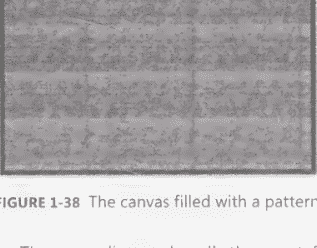

**图 1-38** 用图案填充的 canvas

上述代码调用了 createPattern 方法，并向其传递了一个 Image 对象的引用以及一个重复模式。重复模式可以是 no-repeat、repeat-x 或 repeat-y，但如果你不指定任何值，则默认为 repeat。你需要为 Image 对象的 onload 事件分配一个事件处理程序，以确保仅在图像加载完成后才绘制图案。否则，代码可能会在图像渲染之前运行，导致图案无法显示。

本节涵盖了很多关于如何处理形状并进行填充的内容。到目前为止，你的所有图形都是通过代码手动绘制形状来创建的。接下来，你将了解如何在画布上绘制来自外部文件的现有图形，然后再看看如何绘制文本。

#### 绘制图像

在 canvas 上绘制图像与你见过的其他绘制方法一样简单。要在 canvas 上绘制图像，你需要使用 context 对象的 drawImage 方法。该方法接收一个 Image 对象以及一些 (x,y) 坐标，用于定义图像应该绘制在何处。与矩形一样，图像的左上角会绘制在指定的 (x,y) 位置。图像的默认大小是其实际尺寸，但正如你马上就要看到的，你也可以在绘制时调整图像大小。要简单地绘制图像，请创建以下代码：

```
var drawingSurface = document.getElementById("drawingSurface");
var ctxt = drawingSurface.getContext("2d");
var img = new Image();
img.src = "orange.jpg";
img.onload = function () {
    ctxt.drawImage(img, 0, 0);
    ctxt.stroke();
}
```

这段代码生成一个绘制了图像的 `<canvas>` 元素，如图 1-39 所示。

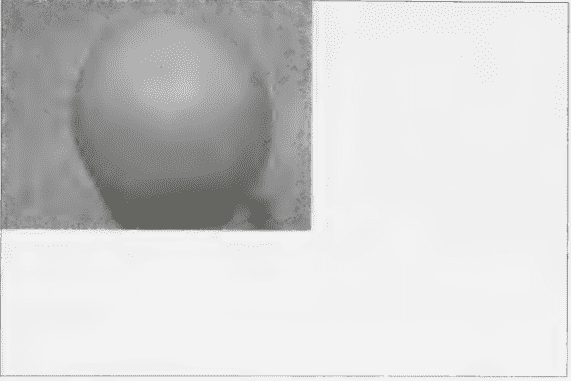

**图 1-39** 在 canvas 上绘制的图像

如果你想调整图像大小，可以将 drawImage 方法调用替换为以下代码行：

```
ctxt.drawImage(img, 0, 0, img.width * .5, img.height * .5);
```

这将把图像大小缩小 50%。

现在来看看如何在 canvas 上绘制文本。

##### 绘制文本

在 canvas 上绘制文本涉及到从 context 对象中添加一些额外的工具到你的工具箱中，使用 strokeText 方法和 font 属性。你将了解如何为文本应用颜色，最后，如何管理它的对齐方式。

最简单的绘制文本形式只需要以下代码：

```
ctxt.strokeText("1. Text with default font", 100, 100);
```

请记住，你需要确保窗口已完成加载，并且需要获取一个 context 对象。以下是此示例的完整代码：

```
window.onload = function () {
    var drawingSurface = document.getElementById("drawingSurface");
    var ctxx = drawingSurface.getContext("2d");
    ctxx.strokeText("1. Text with default font", 100, 100);
}
```

就是这样。*strokeText* 调用将指定的文本绘制到 canvas 上的指定坐标处。参数指定了要绘制什么文本，而 (x,y) 坐标指定了绘制应从何处开始。*strokeText* 方法以默认字体样式绘制。你可以轻松更改 context 对象的 *font* 属性以增强文本的外观。例如，运行以下代码将字体大小改为 24，字体族改为 Arial：

```
ctxx.font = "24px arial";
ctxx.strokeText("2. Text with altered font", 100, 125);
```

要为文本着色，你可以添加以下代码：

```
ctxx.font = "24px arial";
ctxx.strokeStyle = "Red";
ctxx.strokeText("3. Text with altered colored font", 100, 160);
```

当你运行上述代码时，会注意到你的文本是轮廓化的。这是增大字体大小时默认的行为；它会被绘制成轮廓。要绘制实心颜色的文本，请添加以下代码，它设置了 *fillStyle* 属性并调用 *fillText* 方法来代替 *strokeStyle* 和 *strokeText* 方法：

```
ctxx.font = "24px arial";
ctxx.fillStyle = "Red";
ctxx.fillText("4. Text with altered colored font", 100, 185);
```

你还可以设置文本在 canvas 中的对齐方式。例如，要确保文本居中，请添加以下代码：

```
ctxx.font = "24px arial";
ctxx.textAlign = "center";
ctxx.fillStyle = "Red";
ctxx.fillText("5. Text with altered colored font Centered.", drawingSurface.width / 2, drawingSurface.height / 2);
```

通过将 *textAlign* 属性的值设置为 *center*，你是在告诉 context 将指定的 (x,y) 坐标视为字符串的中心点，而不是字符串的起始点。因此，你将 canvas 的宽度和高度除以 2 以得到 canvas 的中心点，从而得到一个水平和垂直居中的字符串。

图 1-40 展示了你的文本的演进过程：

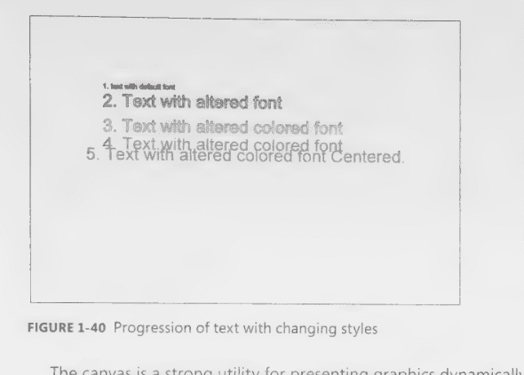

**图 1-40** 样式变化的文本演进过程

canvas 是在浏览器中动态呈现图形的强大工具。然而，它并非唯一可用的图形工具。在下一节中，你将了解如何使用可缩放矢量图形（Scalable Vector Graphics）。

#### 可缩放矢量图形（SVG）

可缩放矢量图形（Scalable Vector Graphics，SVG）是一种基于 XML 的语言，用于创建二维图形。它通过使用由 SVG XML 命名空间定义的标签来实现，并嵌入到 HTML5 文档中的 `<svg>` 起始标签和结束标签之间。

SVG 对象在用户缩放时不会损失任何质量。你可以通过 DOM 访问 SVG 对象，而且与 HTML 元素类似，SVG 元素支持属性、样式和事件处理程序。`<svg>` 元素提供了一个容器来渲染图形；SVG 与页面布局内联渲染。以下是一个带事件处理程序的 SVG 图形示例：

```
<!DOCTYPE html>
<html>
    <head>
        <title>Test Web Page</title>
        <script language="javascript">
            function Red(evt) {
                var circle = evt.target;
                circle.setAttribute("style", "fill: red");
            }

            function Green(evt) {
                var circle = evt.target;
                circle.setAttribute("style", "fill: green");
            }
        </script>
    </head>
```

```
<body>
    <svg>
        <circle id="Circle" cx="50" cy="50" r="50" fill="green" onmouseover="Red(evt)"
                onmouseout="Green(evt)"/>
    </svg>
</body>
</html>
```

这段代码产生了如图 1-41 所示的输出。JavaScript 事件处理程序在鼠标悬停时将圆形变为红色，在鼠标移出圆形时变回绿色。


**图 1-41** 使用 SVG 绘制的圆形

你在 `<canvas>` 元素讨论中看到的所有形状绘制和线条绘制功能，SVG 也同样具备，尽管语法当然有所不同。以下代码产生了一个稍微复杂一些的图形。

```
<svg>
    <rect id="lightStandard" x="100" y="100" width="60" height="200" fill="black"/>
    <circle id="redLight" cx="129" cy="145" r="25" fill="red"/>
    <circle id="amberLight" cx="129" cy="205" r="25" fill="yellow"/>
    <circle id="greenLightovia greenLight" cx="129" cy="265" r="25" fill="green"/>
</svg>
```

图 1-42 的图像展示了这段代码的输出：

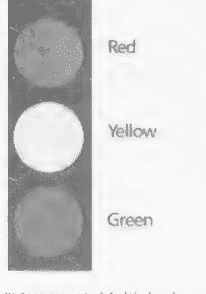

**图 1-42** 使用 SVG 绘制的多个形状

在此示例中，使用 `<rect>` 元素创建了背景矩形，并使用一系列 `<circle>` 元素创建了灯光。每个 SVG 形状需要与其 canvas 对应部分相同类型的参数，并且适用相同的规则。`<rect>` 元素需要一个 (x,y) 坐标来确定绘制位置，以及宽度和高度来确定大小。每个圆形也是如此，只不过你需要指定半径作为大小。`fill` 属性设置用于填充形状的颜色。

SVG 还支持 canvas context 所支持的基本形状绘制功能。以下代码段展示了 polyline、polygon、line 和 ellipse 的使用，并产生了如图 1-43 所示的输出：

```
<svg>
    <polygon points="10,15 30,35 10,85 100,85, 70,35,100,15" fill="purple"/>
    <polyline points="10,150 30,170 50,132 62,196 78,165 96,170"
              style="stroke:orange; fill:none; stroke-width:5;"/>
    <line x1="150" y1="100" x2="150" y2="150" style="stroke:blue;stroke-width:3"/>
    <ellipse cx="250" cy="150" rx="30" ry="55" fill="green"/>
    <text x="10" y="10" style="stroke: black;stroke-width:1;">
        Examples of SVG Shapes and Text</text>
</svg>
```

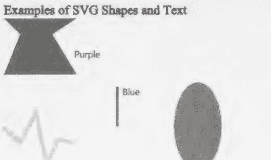

**图 1-43** 以不同颜色绘制的文本、线条、多边形、椭圆和折线

> **考试提示**
> 在某些情况下，使用 SVG 图形比使用 `<canvas>` 元素更简单。正如示例所展示的，你可以在 HTML 本身中以声明方式直接创建 SVG 图像。然而，随着 SVG 渲染中对象数量的增加，性能可能会成为问题。在需要考虑性能的情况下，使用 `<canvas>` 元素是更合适的方法。


SVG 也支持以嵌入外部图像文件的形式来渲染现有图形，如下所示：

```
<svg id="mySVG">
  <image href="orange.jpg" width="250" height="100"/>
</svg>
```

#### 思维实验

##### 创建游戏

在这个思维实验中，运用你为本节目标所学到的知识。你可以在“本章末尾的参考答案”部分找到这些问题的答案。

你被聘请来开发一款游戏。在游戏的第一阶段，你必须让一个球从屏幕左侧移动到右侧。如何使用 HTML5 `<canvas>` 元素来实现这一点？使用 SVG 又如何？你将这一阶段演示给利益相关者看，他们非常喜欢。在下一阶段，当球被点击时，它必须分裂成两个球。随着球的数量因被点击而增加，需要考虑哪些因素？对于这个游戏，使用 SVG 还是 `<canvas>` 元素会是更好的解决方案？

#### 目标总结

- JavaScript 是一种强大的工具，使开发者能够以编程方式在浏览器中操作 DOM。

- HTML5 支持丰富的媒体控件，通过使用 `<video>` 元素来嵌入视频，使用 `<audio>` 元素来嵌入音频。

- `<video>` 元素通过使用 `<source>` 元素来支持多种媒体格式。

- HTML5 的 `<canvas>` 和 `<svg>` 元素支持丰富的 API，用于在浏览器中创建简单和复杂的图形。

- `<canvas>` 和 `<svg>` 图形引擎都可以绘制文本、线条、形状、字体、填充和渐变。

- `<canvas>` 元素通过获取上下文引用，由 JavaScript 进行绘制。

- `<svg>` 元素使用声明式语法来渲染图形。

#### 目标回顾

回答以下问题来测试你对本节目标信息的掌握程度。你可以在“本章末尾的参考答案”部分找到这些问题的答案，以及每个答案选项为何正确或错误的解释。

1. 以下哪种 JavaScript 方法不能用于在 DOM 中选择元素？
   - A. getElementById
   - B. querySelector
   - C. getElementsByClassName
   - D. queryAll

2. 哪行 JavaScript 能成功仅从以下 HTML 中检索 ID 为 myDog 的图像元素？选择所有适用的选项。
   - A. document.getElementById("myDog");
   - B. `<p>.getChildNode("img");`
   - C. document.getElementById("dogs").querySelector("thumb");
   - D. document.querySelectorAll("thumb");

```
<form>
    <div id="main" class="mainStyle">
        <p id="dogs">
            This is a web page about dogs. Here is my dog picture:
            
            Here is a picture of my friend's dog:
            
        </p>
    </div>
</form>
```

3. 要在 DOM 中隐藏一个元素，并且以后还能将其添加回来，你应该怎么做？
   - A. 什么都不用做，因为 DOM 始终以静态形式存在。
   - B. 保留对已移除节点的引用，以便能够将其添加回来。
   - C. 调用 document.restoreNodes 方法。
   - D. 元素一旦移除，就无法再添加回来。

4. 在实现 HTML5 video 元素时，如何确保该元素的渲染能在不同的浏览器中正常工作？
   - A. 什么都不需要做，因为 HTML5 现在是标准规范。
   - B. 在 video 元素的 *src* 属性中指定所有源视频类型。
   - C. 为每种视频类型包含 `<source>` 元素，以便每个浏览器都能播放其支持的版本。
   - D. 为每种视频类型包含 `<object>` 元素，以便浏览器能播放其支持的版本。

5. 在 HTML5 `<canvas>` 元素上绘图时，使用上下文上的什么方法可以在新点开始绘制？
   - A. *moveTo*
   - B. *lineAt*
   - C. *beginPath*
   - D. *stroke*

6. 当性能对于 HTML5 图形应用程序至关重要时，应该使用什么？
   - A. 使用声明式语法创建图形的 `<canvas>`
   - B. 使用声明式语法创建图形的 `<svg>`
   - C. 使用 JavaScript 创建图形的 `<canvas>`
   - D. 结合使用 `<svg>` 和 `<canvas>` 以发挥两者的最佳性能

### 目标 1.3：以编程方式将样式应用到 HTML 元素

本节介绍如何使用 JavaScript 动态地将样式应用到页面上的 HTML 元素。当你通过 *getElementById* 等方法获取元素引用后，就可以操作这些元素，包括它们的样式。

**本节目标涵盖：**

- 更改元素的位置
- 应用变换
- 显示和隐藏元素

#### 更改元素的位置

通过使用 JavaScript 中从 DOM 检索元素的方法，你可以通过能够改变页面上元素位置的代码来动态应用样式。元素在页面上的布局方式会影响它们在重新定位时的行为。

有几种选项决定了 HTML 元素在网页上的定位方式。默认情况下，所有 HTML 元素按照它们在 HTML 页面中声明的顺序，从左到右静态流动。然而，CSS 提供了一种机制来指定元素位置的高级选项。你可以使用*绝对定位*或*相对定位*来放置元素。使用绝对定位时，元素被放置在与容器边框相关的精确指定位置。而使用相对定位时，元素则是相对于其紧邻的左侧兄弟元素的坐标来定位的。你可以单独或组合使用四个属性来控制元素的位置：*Top*、*Left*、*Right* 和 *Bottom*。每个属性都接受一个距离参数，该参数指定对象与基于所指定定位属性的参考点之间的相对距离。当使用绝对定位或相对定位时，默认的边框或外边距设置会被忽略，因为元素被放置在定位属性指示的位置。

清单 1-3 中的代码演示了这一点。

##### 清单 1-3 说明定位的 HTML 和 JavaScript

```
<!DOCTYPE html>
<html lang="en" xmlns="http://www.w3.org/1999/xhtml">
    <head>
        <meta charset="utf-8"/>
        <title></title>
        <style>
            html, body {
                height: 100%;
                width: 100%;
            }
            img {
                height: 150px;
                width: 225px;
            }
        </style>
        <script>
            window.onload = function () {
                var top = document.getElementById("topText");
                var left = document.getElementById("leftText");
                var pos = document.getElementById("positioning");
                document.getElementById("btnPosition").onclick = function () {
                    var img = document.getElementById("orange2");
                    img.style.position = pos.value;
                    img.style.left = left.value + "px";
                    img.style.top = top.value + "px";
                }
            }
        </script>
    </head>
```

```
<body>
    <table style="width: 100%; height: 100%; border: 1px solid black;">
        <tr>
            <td style="vertical-align: top; width: 80%">
                
                
            </td>
            <td style="vertical-align: top;">Left:
                <input type="text" id="leftText"/><br/>
                Top:
                <input type="text" id="topText"/><br/>
                Position:
                <select ergt>
                    <option>relative</option>
                    <option>absolute</option>
                </select><br/>
                <input type="button" id="btnPosition" value="Update"/>
            </td>
        </tr>
    </table>
</body>
</html>
```

当代码在浏览器中渲染时，默认位置生效，如图 1-44 所示。

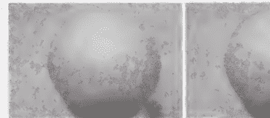

**图 1-44** 两张图片的默认位置

所有讨论过的定位属性都可以在 HTML 元素的 style 属性中以声明方式使用，但也可以通过 JavaScript 以编程方式访问和操作。网页被增强以提供一些最终用户功能来控制两张图片的定位。清单 1-3 中的代码提供了一个 HTML 页面，其中包含两张图片和一些输入控件来控制第二张图片的定位。你可以输入顶部和左侧位置，以及选择相对于第一张橙子图片进行定位，还是相对于父级表格元素进行绝对定位。


当 `top` 和 `left` 设置为 `50px` 且定位方式为 `relative` 时，你将看到如图 1-45 所示的结果。

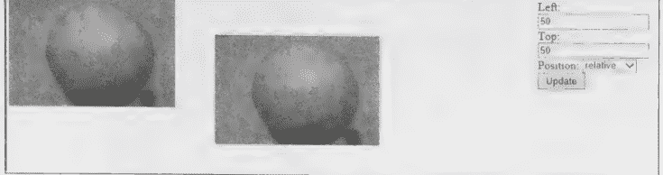

图 1-45 将第二个图片相对于其相邻元素进行定位

保持数值不变，将定位方式改为 `absolute` 会改变元素的定位，如图 1-46 所示。

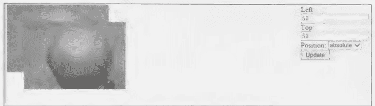

图 1-46 将第二个图片相对于其父元素进行绝对定位

你还可以使用另一种机制来改变 HTML 元素的外观：变换（transform），接下来我们将对其进行探讨。

#### 应用变换

应用变换是改变网页上对象的一种方式。变换使你能够改变元素的外观。你可以使元素变大或变小，旋转它，等等。有很多可用的变换方法。要为元素添加变换，你需要在元素的 CSS 中声明它，通过添加 `transform` 属性，如下所示：

```
.rota {transform: rotate(90deg);}
```

这段代码在你将 *.rota* CSS 类添加到对象的样式集合时，对对象应用了 *rotate* 方法。如前所述，有各种可用的变换方法，我们将逐一进行讲解。本节中的所有示例使用以下代码：

```
<!DOCTYPE html>
<html lang="en" xmlns="http://www.w3.org/1999/xhtml">
    <head>
        <meta charset="utf-8"/>
        <title></title>
        <style>
            #orange1 {
                height: 150px;
                width: 225px;
            }
            .trans {
                transform: scale(1) ;
            }
        </style>
        <script>
            window.onload = function () {
                document.getElementById("orange1").onclick = function () {
                    this.classList.add("trans");
                }
            }
        </script>
    </head>
    <body>
        
    </body>
</html>
```

这段代码创建了一个图像对象，我们将对其应用变换；不过，变换同样适用于任何 HTML 元素。该图像还被分配了一个 *click* 事件的事件处理程序。这足以用于演示目的。你可以使用任何支持的事件来触发变换。在接下来的示例中，你需要将上述代码中的 *.trans* CSS 类替换为适当的变换方法来进行演示。需要替换代码时会有相应提示。

##### 使用 *rotate* 方法

*rotate* 变换方法使你可以将对象旋转指定的度数。该方法接受一个参数，指定旋转的度数。在之前用于缩放变换的代码中，将变换方法替换为以下内容：

```
transform: rotate(90deg);
```

现在，在浏览器中运行该网页。点击图像查看变换生效的效果。在这种情况下，图像顺时针旋转了 90 度（见图 1-47）。如果你想逆时针旋转图像，可以指定一个负的角度值。


**图 1-47** *rotate* 变换对图像的效果

变换还支持 *rotateX* 和 *rotateY* 方法，它们接受一个以度为单位的参数，指定围绕 x 轴或 y 轴旋转的角度。例如，你可以使用这些方法通过指定 *180deg* 作为参数来垂直或水平翻转元素。在这种情况下，元素沿指定轴旋转 180 度——这本质上导致图像沿该轴被翻转或镜像。

##### 使用 *translate* 方法

*translate* 方法使你可以通过改变 HTML 元素在页面上的相对 X 和 Y 位置来移动它。你通过在 `transform` 属性上指定 *translate* 方法来实现。在示例代码中，将变换方法替换为以下内容：

```
transform: translate(50px,0px);
```

*translate* 方法将其应用的 HTML 元素相对于当前位置在 X 方向移动 50 像素，在 Y 方向移动 0 像素（见图 1-48）。同样，如果需要的效果是沿 x 轴或 y 轴移动对象，可以使用 *translateX* 和 *translateY* 方法。


**图 1-48** *translate* 方法应用于图像的效果

##### 使用 *skew* 方法

你可以使用 `transform` 属性的 *skew* 方法来倾斜 HTML 元素。倾斜会使对象歪斜，使其不再平行于垂直或水平轴。在示例代码中，将 `transform` 属性替换为以下代码行。图 1-49 展示了效果。

```
transform: skew(10deg, 10deg);
```

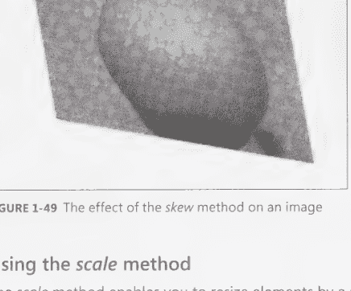

##### 使用 *scale* 方法

*scale* 方法使你可以按指定比例调整元素的大小。*scale* 方法接受一个参数：一个表示缩放百分比的小数值。指定大于 1 的值会使对象变大；指定小于 1 但大于 0 的值会使对象变小。指定值为 -1 会将对象沿其水平轴翻转。在示例代码中，将 `transform` 属性替换为以下内容：

```
transform: scale(1.5);
```

这个 *scale* 变换将元素的大小增加 50%，本质上是将现有的高度和宽度值乘以 1.5。对象从其绝对中心向外缩放，因此它向各个方向扩展；它不仅仅是向下和向右延伸。图 1-50 展示了 *scale* 变换的结果。


##### 组合变换

单独的变换为改变 HTML 元素外观提供了极大的灵活性，但 `transform` 样式不限于指定单个变换方法。你可以将这些方法组合起来，对元素应用多种效果。在示例代码中，将 `transform` 属性修改为以下代码：

```
transform: translate(50px,0px) scale(1.5) skew(10deg, 10deg);
```

在这段代码中，应用了三种效果。顺序很重要。效果按照它们在 `transform` 属性中指定的顺序依次应用。在这种情况下，*translate* 属性首先被应用，然后缩放变换后的对象。最后，对结果对象进行倾斜。对 HTML 元素的效果是：沿 x 轴移动 50 像素，缩放 50%，然后倾斜 10 度。

#### 显示和隐藏元素

你可以在 HTML 标记中以声明方式显示和隐藏元素，也可以通过 JavaScript 修改对象的 CSS 属性以编程方式实现。你可以直接在对象的 *style* 属性中或在 CSS 样式中创建用于显示或隐藏元素的 CSS 属性，然后将其添加到元素的样式集合中。本节的示例使用清单 1-2 中的代码，并按如下方式更新：

```
<html lang="en" xmlns="http://www.w3.org/1999/xhtml">
    <head>
.
        <script>
            window.onload = function () {
                document.getElementById("btnHideAnElement").onclick = function () {
                    if (document.getElementById("innerDiv").style.display == 'inline') {
                        document.getElementById("innerDiv").style.display = 'none';
                    }
                    else {
                        document.getElementById("innerDiv").style.display = 'inline';
                    }
                }
            }
        </script>
.
            <button type="button" id="btnHideAnElement" >Show/Hide Element</button>
        </form>
    </body>
</html>
```

这段代码修改了脚本块，并在页面底部添加了一个新按钮。按钮在窗口加载完成后连接到一个 onclick 事件。在这个事件中，你通过编程方式修改 HTML 元素的可见性。

*innerDiv* 元素在页面加载时默认为 *hidden*（隐藏）。当按钮被点击时，代码会评估 `display` CSS 属性的状态，以确定元素当前是可见还是隐藏。根据结果，该属性会被切换。

`display` 属性接受两个可能的值。值为 `inline` 告诉浏览器显示该项目，而值为 `none` 则意味着浏览器应该隐藏该项目。

用于控制元素可见性的第二个属性称为 `visibility`。如表 1-12 所述，此属性接受四个可能的值。

**表 1-12** `visibility` 属性可用的值

| 值 | 效果 |
| :--- | :--- |
| visible | 将属性设置为 visible 以显示元素 |
| hidden | 隐藏元素 |
| collapse | 在适用的情况下折叠元素，例如表格行 |
| inherit | 从父元素继承 `visibility` 属性的值 |

其中一些值具有有趣的行为。当你使用 CSS 的 `display` 属性并将其设置为 `none` 时，HTML 元素会被隐藏。但以这种方式隐藏元素也会将其从布局中移除。所有周围的元素会重新排列，就好像该元素根本不存在一样。当 `display` 设置为 `inline` 时，元素会再次显示，所有周围的元素会移开，回到它们原来的位置。

CSS 的 `visibility` 属性的行为略有不同。将 `visibility` 属性设置为 `hidden` 会隐藏一个元素，但被隐藏元素周围的元素的行为就好像它仍然在那里一样。元素占据的空间被完整保留，但元素的内容被隐藏。当该属性设置回 `visible` 时，元素会准确地在其原始位置重新出现，不会影响任何周围的元素。另一方面，`collapse` 值的行为更像 `display` 属性。如果你对某些东西（如表格行）指定 `collapse`，其上方和下方的表格行会合并，并接管被折叠行所占据的空间。当你将 `visibility` 属性设置回 `visible` 时，周围的元素会移开以显示该元素。这对于需要可以折叠或一次显示一个项目以节省空间的场景非常有用，例如在常见问题解答中，当用户点击问题时显示答案，但当用户点击另一个问题时则折叠答案。

## 考试提示

如果在更改可见性时需要保留页面布局，请将 `visibility` 属性与 `hidden` 值一起使用。如果不需要保留布局，你可以将 `display` 属性设置为 `none`，或者将 `visibility` 设置为 `collapse`。

#### *思想实验*

##### 创建动态调查问卷

在这个思想实验中，应用你所学到的关于此目标的知识。你可以在本章末尾的“答案”部分找到这些问题的答案。

你被要求构建一个网页，该网页需要用户回答一系列问题。然而，问题是动态的，基于用户对前一个问题的回答。用户应该只看到相关的问题。以下问题流程作为此页面的规则：

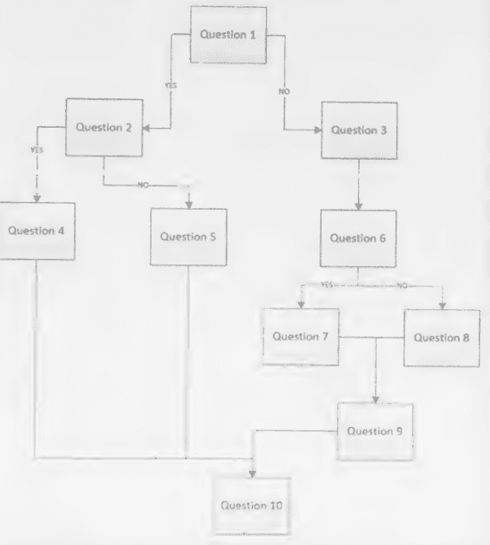

以及以下 HTML5 页面：

```
<html>
    <head>
        <meta charset="utf-8"/>
        <title></title>
    </head>
    <script>
        ...
    </script>
    <body>
        <header>
            A dynamic Questionnaire.
        </header>
        <section>
            <article>
                <hgroup>
                    <h1>Questionnaire</h1>
                    <h2>Answer the questions in order as they appear.</h2>
                </hgroup>
                <div id="Question1">
                    1. ...
                </div>
                <div id="Question2">
                    2. ...
                </div>
                <div id="Question3">
                    3. ...
                </div>
                <div id="Question4">
                    4. ...
                </div>
                <div id="Question5">
                    5. ...
                </div>
                <div id="Question6">
                    6. ...
                </div>
                <div id="Question7">
                    7. ...
                </div>
                <div id="Question8">
                    8. ...
                </div>
                <div id="Question9">
                    9. ...
                </div>
                <div id="Question10">
                    10. ...
                </div>
            </article>
        </section>
    </body>
</html>
```

根据每个问题的答案，创建所有必要的 JavaScript 来显示和隐藏所需的元素。假设每个问题的答案是一个单选按钮选择，只有“是/否”选项。

#### 目标总结

- 你可以使用 CSS 来定义变换效果。
- 你可以通过 JavaScript 应用变换来操作 DOM，实现旋转、倾斜、缩放和平移等效果。
- `visibility` 属性提供了在页面内控制元素可见性的选项。

#### 目标回顾

回答以下问题，以测试你对此目标中信息的掌握程度。你可以在本章末尾的“答案”部分找到这些问题的答案以及每个选项正确或错误的原因。

1.  绝对定位是相对于什么来定位对象的？

    A. 浏览器窗口的左上角。

    B. 其父元素的左上角。

    C. 居中于窗口内。

    D. 居中于其父元素内。

2.  哪种变换可以使你改变元素的大小？

    A. rotate

    B. skew

    C. translate

    D. scale

3.  在 DOM 中隐藏元素时，哪种语法可以保留页面的布局？

    A. display='hidden'

    B. display='inline'

    C. visibility='none'

    D. visibility='hidden'

### 目标 1.4：实现 HTML5 API

JavaScript API 提供了一些新的强大功能，例如能够本地存储更多数据并通过 Web Storage API 将这些数据提供给网页。AppCache API 允许你使 Web 应用程序离线工作。Geolocation API 提供了在应用程序中使用全球定位的方法。

此目标涵盖如何：

- 使用存储 API
- 使用 AppCache API
- 使用 Geolocation API

#### 使用存储 API

Web Storage 是一种用于本地存储网页数据的新 API。本节描述的 Web Storage 取代了 cookies 的概念。

> **注意 浏览器支持**
> 当然，在选择完全使用它之前，你必须考虑你的受众对 HTML5 和 Web Storage 的浏览器支持情况。

Web Storage 有两种形式：*local*（本地）和 *session*（会话）存储。本地存储是持久的；存储在本地存储中的数据即使用户完全关闭浏览器然后重新打开你的网站，也对网页可用。会话存储仅在当前会话期间可用，因此如果用户关闭浏览器，会话存储会自动清理并不可用。Web Storage API 作为全局对象可用。要访问本地存储，请使用 *localStorage* 对象；要访问会话存储，请使用 *sessionStorage* 对象。

> **考试提示**
> *localStorage* 和 *sessionStorage* 对象提供完全相同的 API。本节中显示的所有示例对任一对象的工作方式完全相同。唯一的区别是存储的生命周期。请记住，*sessionStorage* 在会话关闭时会被清除，而 *localStorage* 在会话关闭并开启新会话后仍然可以访问。

表 1-13 列出了 API 方法及其用法。Web Storage 实现为名/值对，并以字符串形式存储。任何可以放入字符串格式的数据都可以存储在 Web Storage 中。这并不像听起来那么有限。你将看到一些存储复杂对象的示例。

**表 1-13** 存储对象上可用的方法

| 方法 | 描述 |
| --- | --- |
| setItem | 将一个键/值对添加到存储中。如果不存在具有指定键的项目，则添加该项目；如果该键确实存在，则更新其值。 |
| getItem | 根据指定的键值或索引从存储中检索数据。 |
| clear | 清除所有已保存的存储。根据需要使用此方法清除存储。 |
| key | 检索指定索引处的键。你可以使用结果键作为参数传递给接受键的其他方法之一。 |
| removeItem | 从存储中删除指定的键/值对。 |

除了表 1-13 中描述的方法外，存储对象还公开了一个 `length` 属性，该属性返回存储中键/值对的数量。使用清单 1-4 中的示例代码来探索 Web Storage API。

##### 清单 1-4 探索 Web Storage API

```
<html lang="en" xmlns="http://www.w3.org/1999/xhtml">
    <head>
        <meta charset="utf-8"/>
        <title></title>
        <style>
            section {
                margin-top: 15px;
            }
        </style>
        <script>
            window.onload = function () {
                document.getElementById("btnAdd").onclick = function () {
                }

                document.getElementById("btnRemove").onclick = function () {
                }

                document.getElementById("btnClear").onclick = function () {
                }

                function loadFromStorage() {
                }
            }
        </script>
    </head>
    <body>
        <section>
            Key:
            <input type="text" id="toStorageKey"/>
            Value:
            <input type="text" id="toStorageValue"/><br/>
        </section>
```

##### 清单 1-4

```html
<section>
    <button type="button" id="btnAdd">Add To Storage</button>
    <button type="button" id="btnRemove">Remove from Storage</button>
    <button type="button" id="btnClear">Clear Storage</button>
</section>
<div id="storage">
    <p>Current Storage Contents</p>
</div>
</body>
</html>
```

清单 1-4 中的代码创建了用于分别接受键和值的文本框。按钮允许你将项目添加到存储、移除项目或完全清空存储。每个功能都依次实现。为了显示存储的内容，页面包含一个 *div*，用于显示追加到其中的存储内容。每次操作都会调用 *LoadFromStorage* 方法，以使用存储中的可用数据刷新页面。所有后续示例都使用本地存储，但同样，它们对会话存储也以相同方式工作。如果你想使用会话存储测试这些示例，只需将 *localStorage* 引用替换为 *sessionStorage* 的引用即可。

首先，你需要实现 *LoadFromStorage* 方法，这样当页面加载时，你就能看到已经放入存储中的任何项目。在脚本块中的 *LoadFromStorage* 函数里输入以下代码：

```javascript
window.onload = function () {
    LoadFromStorage();
    document.getElementById("btnAdd").onclick = function () {
```

```javascript
function LoadFromStorage() {
    var storageDiv = document.getElementById("storage");
    var tbl = document.createElement("table");
    tbl.id = "storageTable";
    if (localStorage.length > 0) {
        for (var i = 0; i < localStorage.length; i++) {
            var row = document.createElement("tr");
            var key = document.createElement("td");
            var val = document.createElement("td");
            key.innerText = localStorage.key(i);
            val.innerText = localStorage.getItem(key.innerText);
            row.appendChild(key);
            row.appendChild(val);
            tbl.appendChild(row);
        }
    }
    else {
        var row = document.createElement("tr");
        var col = document.createElement("td");
        col.innerText = "No data in local storage.";
        row.appendChild(col);
        tbl.appendChild(row);
    }
    if (document.getElementById("storageTable")) {
        document.getElementById("storageTable").replaceNode(tbl);
    }
    else {
        storageDiv.appendChild(tbl);
    }
}
```

请注意，此代码在 window.onload 事件的顶部添加了对 LoadFromStorage 方法的调用，以便在页面加载后检查 localStorage。LoadFromStorage 方法获取本地存储中的任何可用元素，并将其显示在 HTML 表格中。此代码利用 length 属性来确定是否需要显示任何本地存储值。如果不需要，页面将显示“本地存储中没有数据”的消息。向按钮的 onclick 事件添加以下代码以开始操作 localStorage：

```javascript
document.getElementById("btnAdd").onclick = function () {
    localStorage.setItem(document.getElementById("toStorageKey").value,
        document.getElementById("toStorageValue").value);
    LoadFromStorage();
}
document.getElementById("btnRemove").onclick = function () {
    localStorage.removeItem(document.getElementById("toStorageKey").value);
    LoadFromStorage();
}
document.getElementById("btnClear").onclick = function () {
    localStorage.clear();
    LoadFromStorage();
}
```

上面的代码实现了每个按钮的 onclick 事件。用户现在可以将项目添加到本地存储并查看存储中的内容。用户可以在此应用程序中继续向本地存储添加数据，直到存储已满。本地存储的可用性是有限的，并且不同浏览器中可用的存储空间并不一致。在撰写本文时，文档指出 Microsoft Internet Explorer 10 支持最多约 10 MB 的存储。然而，这可能会发生变化，并且在其他浏览器中可能并不相同；有些浏览器现在只支持 5 MB 的存储。在设计利用 Web Storage API 的 Web 应用程序时，请牢记这一点。

运行前面的示例，并将以下项目添加到 localStorage：

`("Red","FF0000"), ("Green","00FF00"), ("Blue","0000FF").`

图 1-51 显示了将这些项目添加到本地存储后屏幕上的输出。

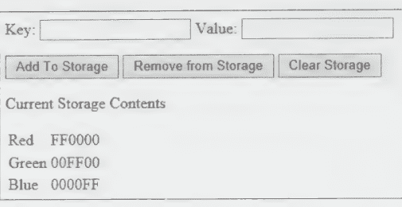

**图 1-51** *在 Web 存储中存储和检索项目*

现在，如果你关闭浏览器然后重新打开页面，这些项目在本地存储中仍然可用。尝试将所有对 *localStorage* 的使用替换为 *sessionStorage*。这次请注意，关闭浏览器会自动清除存储中的任何数据。

使用 Web Storage API 而不是 Cookie 的好处在于，数据驻留在本地并保持在本地。数据不会像使用 Cookie 那样在服务器和客户端之间来回发送。Web 存储中的数据按*根域*组织。空间分配是按每个根域进行的。例如，*localhost* 或 *microsoft.com* 等域各自获得自己独立的安全 Web 存储空间。

根据 API 的定义，Web 存储仅允许存储键/值对，其中键和值分量都存储为字符串。如果你需要将更复杂的对象存储在 Web 存储中，可以使用一些技术。例如，在 *onload* 事件中首次调用 *LoadFromStorage* 之前，添加以下代码：

```javascript
var customer = new Object();
customer.firstName = "Rick";
customer.lastName = "Delorme";
customer.shirtSize = "XL";
localStorage.setItem("cart1", JSON.stringify(customer));
LoadFromStorage();
```

此代码创建一个自定义对象来表示浏览网站的客户，并设置该客户的衬衫尺寸。此信息需要在本地保存和使用，因此不需要将其发送到服务器。本地存储是此需求的绝佳解决方案。但是，要将自定义对象存储在本地数据中，你需要一种方法将自定义对象转换为匹配本地存储模型的字符串。这就是 JavaScript 对象表示法（JSON）可以派上用场的地方。你可以将对象序列化为 JSON 字符串，为其指定一个键，然后将其存储在 Web 存储中。当你现在运行此应用程序时，它会显示如图 1-52 所示的 JSON 字符串表示的客户对象。

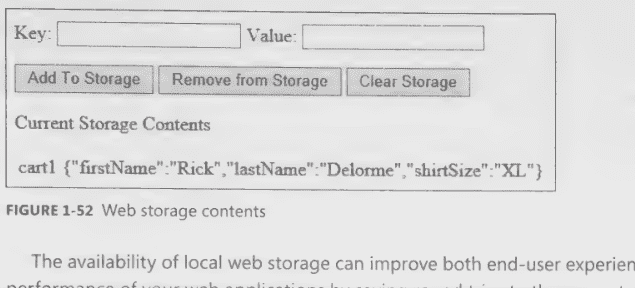

本地 Web 存储的可用性可以通过节省往返服务器检索或存储临时数据的开销，来同时改善最终用户体验和 Web 应用程序的性能。你必须将本地 Web 存储视为*临时性的*。即使你使用的是 *localStorage* 而不是 *sessionStorage*，你也应该将存储视为临时性的，并设计你的应用程序，使其在用户清除 Web 存储时能够回退到默认值和行为。Web 存储提供了一种使数据在本地可用，甚至在浏览器会话间持久化的方式。这些技术适用于实时连接的网站。如果你想使应用程序以离线、断开连接的方式可用，可以使用 AppCache API，接下来将介绍它。

#### 使用 AppCache API

在当今的移动世界中，能够在断开与互联网源的连接后继续使用 Web 应用程序变得尤为重要。本节讨论如何使用应用程序缓存 API（通常也称为 AppCache API）创建一个即使在断开连接时也能工作的应用程序。
AppCache API 使得内容和网页即使在 Web 应用程序处于离线模式时也可用。AppCache 将文件存储在浏览器的应用程序缓存中。就像 Web 存储一样，浏览器可本地存储用于离线使用的数据量是有限的。AppCache API 由两个部分组成：清单文件和支持它的 JavaScript API。

##### 使用 AppCache 清单

指定页面应可供离线使用就像在页面中的 HTML 元素中添加一个属性一样简单。以下是一个示例：

```html
<html manifest="webApp.appcache">
</html>
```

*html* 元素上的 *manifest* 属性告诉浏览器此网页需要可供离线使用。manifest 属性的值指向一个清单文件。文件名更多是一种约定，而非强制性要求；你可以为文件任意命名，但文件扩展名通常是 *.appcache*。


> **考试提示**
如果你确实想更改文件扩展名，需要配置Web服务器，使你选择的文件扩展名以 `text/cache-manifest` 的MIME类型返回。

应用程序缓存清单文件必须列出为离线使用而需存储的每一个文件和资源。当浏览器解析HTML元素的 `manifest` 属性时，它会下载清单文件并将其存储在本地。同时，它还会确保下载清单中列出的所有文件，以便它们可用于离线访问。清单文件包含三个部分：`CACHE`、`NETWORK` 和 `FALLBACK`。每个部分在文件中可能出现一次、多次或根本不出现。每个部分在处理特定场景下的资源时，对应用程序缓存功能都有其特定用途。一个典型的清单文件如下所示：

```
CACHE MANIFEST
# My Web Application Cache Manifest
# v.1.0.0.25
#
#Cache Section. All Cached items.
CACHE
/pages/page1.html
/pages/page2.html

#Required Network resources
NETWORK:
login.html

#Fallback items.
FALLBACK:
login.html fallback-login.html
```

清单文件的第一行必须是 `CACHE MANIFEST`。与任何代码文件一样，清单文件可以使用 `#` 符号添加注释行以进行额外说明。`CACHE` 部分列出了所有必须离线缓存的资源。这必须包括所有CSS文件、JPG文件、视频和音频文件，以及页面正常运行所需的任何其他资源。如果你在清单文件中遗漏了某个项目，它将不会被缓存，这可能导致应用程序离线运行时出现意外行为。

`NETWORK` 部分声明了必须从Internet获取的任何资源。这些项目不能被缓存。页面从Internet需要的任何内容，例如嵌入的第三方元素，必须列在这里。如果此类资源未列在其中，浏览器在离线模式下将不会知道去Internet上查找它。当浏览器处于离线模式时，除非在 `NETWORK` 部分列出，否则它不会尝试从Internet获取任何内容。

`FALLBACK` 部分使你能够为浏览器提供备用指令，以防某个项目在缓存中不可用且浏览器处于离线模式。例如，如果 *login.html* 在缓存中不可用，则渲染 *fallback-login.html*。你可以在 `FALLBACK` 部分使用快捷方式提供更通用的重定向，例如：

```
/resources /resource.jpg
```

这告诉浏览器，如果浏览器处于离线状态且无法访问 `resources` 文件夹中的任何内容，则应将对 `resources` 文件夹中项目的任何引用替换为 *resource.jpg*。请注意，*resource.jpg* 会被缓存，因为它在 `FALLBACK` 部分中指定。你不需要在 `CACHE` 部分中再指定 *resource.jpg*。

##### 使用AppCache API

与Web Storage一样，应用程序缓存可以通过JavaScript作为一个全局对象访问。以下代码获取对AppCache全局对象的引用：

```
var appCache = window.applicationCache;
```

当你使用应用程序缓存使页面可用于离线访问时，在页面加载时你可以做的一件比较有用的事情是验证其状态。你可以通过评估AppCache对象的 `status` 属性来实现这一点。`status` 属性可能是表1-14中列出的值之一。

| 状态 | 描述 |
| --- | --- |
| *Uncached* | Web应用程序未与应用程序清单关联。 |
| *Idle* | 缓存活动空闲，正在使用最新版本的缓存。 |
| *Checking* | 正在检查应用程序清单是否有更新。 |
| *Downloading* | 正在下载应用程序清单中的资源。 |
| *UpdateReady* | 清单中列出的资源已成功下载。 |
| *Obsolete* | 清单文件不再可用，因此正在删除应用程序缓存。 |

在了解了缓存状态之后，AppCache对象上的两个方法可能会很有用。表1-15列出了这些方法。

| 方法 | 描述 |
| --- | --- |
| *swapCache* | 指示将缓存替换为更新版本。 |
| *update* | 告诉浏览器如果有更新可用则更新缓存。 |

当调用 `update` 方法时，会准备一个缓存更新。当该更新准备就绪可以下载时，应用程序缓存的状态会变为 `UpdateReady`。此时，调用 `swapCache` 方法会通知应用程序切换到最新的缓存。

> **考试提示**
调用 `update` 方法是异步的。因此，你必须处理 `onupdateready` 事件以确定更新何时完成下载过程。

除了属性和方法之外，AppCache对象还可以触发一系列你可以处理的事件。应用程序缓存通常在后台运行，你可能不需要这些事件。然而，在某些情况下，处理某些事件并强制更新可能会很有用。表1-16列出了可用的事件。

表1-16 *applicationCache* 对象的可用事件

| 事件 | 描述 |
| :--- | :--- |
| *onchecking* | 浏览器正在检查应用程序清单是否有更新，或者应用程序首次被缓存。 |
| *onnoupdate* | 应用程序清单没有可用的更新。 |
| *ondownloading* | 浏览器正在根据清单文件的指示进行下载。 |
| *onprogress* | 文件正在下载到离线缓存。此事件会定期触发以报告进度。 |
| *oncached* | 缓存的下载已完成。 |
| *onupdateready* | 清单中列出的资源已重新下载，可以调用 `swapCache` 方法。 |
| *onobsolete* | 清单文件不再可用。 |
| *onerror* | 发生了错误。这可能由多种原因引起。需要适当记录日志以获取信息并解决问题。 |

这些事件中的大多数可能不常被使用，甚至根本不用。最常见的情景是处理 `onupdateready` 事件，然后调用 `swapCache` 方法，如本例所示：

```
window.onload = function () {
    var appCache = window.applicationCache;
    appCache.oncached = function (e) { alert("cache successfully downloaded."); };
    appCache.onupdateready = function (e) { appCache.swapCache(); };
}
```

使用应用程序缓存更多的是关于配置而非编码。然而，重要的是你要意识到API在需要更高级的场景中可用，这些场景包括你需要对过程进行更多控制，或者需要及时接收过程信息，例如通过处理 `onprogress` 事件。

#### 使用Geolocation API

位置服务已成为大多数人生活中的一部分。从路线规划和导航，到寻找附近的兴趣点或在喜欢的社交网站上签到，越来越多的人在使用某种形式的位置服务。位置服务依赖于全球定位系统（GPS）、IP地址和其他设备特征。你可以通过利用支持Geolocation API的浏览器，在Web应用程序中利用地理位置信息。

你可以通过 `window.navigator` 属性获取对Geolocation API的引用，如下所示：

```
var geoLocator = window.navigator.geolocation;
```

此代码将Geolocation API的引用保存在一个变量中，以便在将来使用时提供对API的简写访问。一个良好的实践是确保客户端的浏览器支持Geolocation API，方法是确认该引用确实存在。

Geolocation API支持三个与你交互的关键方法：`getCurrentPosition`、`watchPosition` 和 `clearWatch`。

##### 使用 *getCurrentPosition* 方法

以下是使用 `getCurrentPosition` 方法的示例：

```
getCurrentPosition(positionCallback, [positionErrorCallback], [positionOptions])
```

你使用 `getCurrentPosition` 来获取其名称所指示的内容——用户或运行应用程序的设备的当前位置。此方法采用一个必需参数和两个可选参数。第一个参数是一个回调方法，API在确定当前位置后调用它。第二个参数是可选的，但它也是一个在发生错误时调用的回调函数。你在此指定的回调方法应处理尝试获取当前位置时可能发生的任何错误。最后一个可选参数是一个名为 `PositionOptions` 的特殊对象，它允许你设置一些特殊选项来控制 `getCurrentPosition` 方法的行为。表1-17列出了可能的值。

表1-17 *PositionOptions* 对象上可用的属性

| 属性 | 描述 |
|---|---|
| *enableHighAccuracy* | 如果设置为true，这将导致该方法消耗更多资源。默认值为false。如果为true，`getCurrentPosition` 方法将尝试尽可能接近实际位置 |
| *timeout* | 这指定了 `getCurrentPosition` 方法完成所需的超时时间段。此数字以毫秒为单位测量，默认为零。零值表示无限期 |


| 属性 | 描述 |
| --- | --- |
| maximumAge | 如果设置了此参数，API 会被告知在缓存结果可用时使用缓存，而不是发起新的调用来获取当前位置。默认值为零，因此总会发起新的调用。如果 *maximumAge* 设置为一个值，且缓存的时间不超过允许的时长，就会使用缓存副本。此值以毫秒为单位。 |

清单 1-5 展示了 *getCurrentPosition* 方法的使用，指定了所有参数。

###### 清单 1-5 使用 *getCurrentPosition* 方法

```html
<html lang="en" xmlns="http://www.w3.org/1999/xhtml">
    <head>
        <meta charset="utf-8"/>
        <title></title>
        <script>
            window.onload = function () {
                var geoLocator = window.navigator.geolocation;
                var posOptions = {enableHighAccuracy: true,timeout: 45000};
                geoLocator.getCurrentPosition(successPosition, errorPosition,
                posOptions);
            }
            function successPosition(pos) {
                alert(pos);
            }
            function errorPosition(err) {
                alert(err);
            }
        </script>
    </head>
    <body>
        <div id="geoResults">
            <p>Current Location is:</p>
        </div>
    </body>
</html>
```

当代码在浏览器中运行时，会发生一些有趣的事情。首先，浏览器安全机制启动；系统会询问用户是否允许此应用程序确定他们的位置。在 Internet Explorer 中，此消息类似于图 1-53 中的图像。


**图 1-53** 访问地理定位 API 时 Internet Explorer 提供的安全警告

如果用户选择允许应用程序继续，则一切正常。否则，该方法将抛出一个异常。

为了演示代码，请从下拉列表中选择“为此站点允许”，以便页面可以继续。这可能需要几秒钟，但调用会返回并显示一个消息框，表明一个位置对象已作为参数传递给成功回调方法。

成功和错误回调方法都从地理定位 API 接收一个参数。成功方法接收一个位置对象，而错误方法接收一个错误对象。位置对象公开了两个属性：*coords* 和 *timestamp*。*timestamp* 属性指示接收到 *coords* 的时间。*coords* 属性本身是一个坐标对象，包含设备当前位置的纬度、经度、海拔、航向和速度，和/或相对于上次获取位置的相对信息。*positionError* 对象包含两个属性：一个用于代码，一个用于消息。你可以通过添加以下代码片段在清单 1-5 中使用这些对象：

```html
<script>
    function successPosition(pos) {
        var sp = document.createElement("p");
        sp.innerText = "Latitude: " + pos.coords.latitude +
                       " Longitude: " + pos.coords.longitude;
        document.getElementById("geoResults").appendChild(sp);
    }
    function errorPosition(err) {
        var sp = document.createElement("p");
        sp.innerText = "error: " + err.message + " code: " + err.code;
        document.getElementById("geoResults").appendChild(sp);
    }
</script>
```

图 1-54 显示了成功运行此代码的输出。

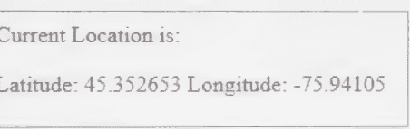

**图 1-54** 显示由地理定位 API 检索的当前位置

##### 使用 *watchPosition* 方法

地理定位对象上可用的第二个方法是 *watchPosition* 方法，它提供了一种内置机制，可以持续轮询当前位置。以下是使用此方法的示例：

```javascript
geoLocator.watchPosition(successCallback, errorCallback, positionOptions)
```

*watchPosition* 方法接受与 *getCurrentPosition* 方法相同的参数集，但返回一个 *watchPosition* 对象：

```javascript
var watcher = geoLocator.watchPosition...
```

运行此代码后，watcher 变量保存了对正在调用的 *watchPosition* 实例的引用，这在以后可能很有用。每当地理定位 API 检测到新位置时，该方法就会调用成功回调方法。轮询会一直持续下去，除非你停止它。这就是 watcher 对象派上用场的地方；你可以通过调用 *clearWatch* 方法来取消轮询。你可以在成功或错误回调中调用此方法——例如，在捕获了足够的位置信息时，或者你想暂停一段时间轮询时：

```javascript
geoLocator.clearWatch(watcher);
```

清单 1-6 显示了 *watchPosition* 示例的完整解决方案代码。

**清单 1-6** 使用地理定位 API 监视位置

```javascript
var watcher;
var geolocator;
window.onload = function () {
    geolocator = window.navigator.geolocation;
    var posOptions = {enableHighAccuracy: true, timeout: 45000};

    watcher = geolocator.watchPosition(successPosition, errorPosition, posOptions);
}
function successPosition(pos) {
    var sp = document.createElement("p");
    sp.innerText = "Latitude: " + pos.coords.latitude + " Longitude: "
    + pos.coords.longitude;
    document.getElementById("geoResults").appendChild(sp);
    geolocator.clearWatch(watcher);
}

function errorPosition(err) {
    var sp = document.createElement("p");
    sp.innerText = "error: " + err.message + " code: " + err.code;
    document.getElementById("geoResults").appendChild(sp);
}
```

图 1-55 显示了此代码在移动设备上的输出。

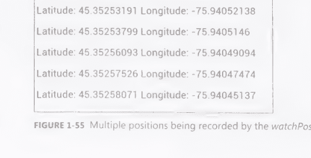

**图 1-55** *watchPosition* 方法记录的多个位置

#### 思维实验

##### 组合使用 JavaScript API

在这个思维实验中，应用你所学到的关于此目标的知识。你可以在本章末尾的“答案”部分找到这些问题的答案。

考虑一个应用程序，例如测量行进距离的跑步或步行工具。该应用程序的一个功能是，如果用户选择，可以回放完成的路线。你将如何结合使用地理定位 API 和 Web 存储 API 来保存用户在路线行进过程中的数据点，以便应用程序稍后可以回放它们？（假设你正在与可以绘制线条的地图软件进行交互。）

#### 目标总结

- 新的 Web 存储 API 使你能够在客户端计算机上本地存储数据。
- Web 存储支持 *localStorage* 和 *sessionStorage*。
- Web 存储中的数据以名称-值对的形式存储。
- AppCache API 提供了一种在用户离线时使网页可用的方法。
- AppCache 清单定义了哪些内容可以离线使用。
- 地理定位 API 提供了一种将位置服务集成到网页中的方法。
- 地理定位 API 提供了两个方法：*getPosition* 和 *watchPosition*。

#### 目标回顾

回答以下问题以测试你对此目标中信息的了解。你可以在本章末尾的“答案”部分找到这些问题的答案以及对每个答案选项正确或错误原因的解释。

1.  使用 Web 存储 API 时，你应该将数据存储在哪里以确保用户关闭浏览器时数据会被清除？
    -   A. *localStorage*
    -   B. *cookieStorage*
    -   C. *sessionStorage*
    -   D. 一个隐藏的 input 元素

2.  你需要做什么来将页面指定为可离线使用？
    -   A. 在 JavaScript 中指定 document.offline=true。
    -   B. 在 form 元素上指定 manifest 属性。
    -   C. 在 HTML 元素上指定 manifest 属性。
    -   D. 告诉用户使用其浏览器切换到离线模式。无需代码。

3.  以下哪项不是 AppCache 清单的有效部分？
    -   A. CACHE（缓存清单）
    -   B. SESSION（会话清单）
    -   C. NETWORK（网络清单）
    -   D. FALLBACK（回退清单）

4.  当缓存下载完成时，AppCache 对象会触发哪个事件？
    -   A. *oncached*
    -   B. *onupdateready*
    -   C. *ondownloading*
    -   D. *onchecking*

5.  使用地理定位 API 时，如何配置使用缓存数据的能力？
    -   A. 在 *PositionOptions* 对象上将 *enableCache* 属性设置为 true。
    -   B. 在 *PositionOptions* 对象上将 *maximumAge* 属性设置为非零值。
    -   C. 设置 *PositionOptions* 对象的 *timeout* 属性。
    -   D. 为了节省带宽，使用缓存始终是开启的，因此无需配置。

### 目标 1.5：确定对象和变量的范围

任何编程语言的一个关键组成部分是如何使用变量，JavaScript 也不例外。要有效使用变量，你必须理解它们的作用域和生命周期。声明变量和实例化对象会消耗资源。变量使用的主要系统资源是内存。应用程序使用的内存越多，使用其他资源（例如支持额外内存使用所需的电池电量）的可能性就越大。当应用程序耗尽电池时，用户使用这些应用程序的可能性就越小。

本目标涵盖以下内容：

- 确立变量的生命周期和变量作用域
- 避免使用全局命名空间
- 利用 *this* 关键字

#### 确立变量的生命周期和变量作用域

变量从声明开始其生命历程。它们在应用程序中剩余的存续期取决于变量的声明位置。

在 JavaScript 中声明变量需要使用 `var` 关键字。

```
var myVariable;
```

你可以同时声明多个变量。例如，以下代码声明了三个变量：

```
var x, y, z;
```

你还可以在声明时直接初始化变量，为其赋予即时的非默认值：

```
var x = 0.0, y = 0.0, z = 0.0
```

在变量被初始化之前，它实际上并未"存活"——其值为 undefined。变量可供使用后，即被视为"在作用域内"。变量保持处于作用域内的持续时间取决于它的声明位置。具有全局作用域的变量在整个网页中都可用。具有局部作用域的变量仅在特定上下文中可用，如示例 1-7 所示。

##### 示例 1-7 演示变量作用域的示例

```
<html lang="en" xmlns="http://www.w3.org/1999/xhtml">
    <head>
        <meta charset="utf-8"/>
        <style>
            div {
                width: 100px;
                height: 100px;
                border: 1px solid black;
            }
        </style>
        <script>
            var globalVar = "global";
            window.onload = function () {
                var localVar = "local";
                document.getElementById("Div1").onclick = function () {
                    var insideDiv1Click;
                    //Do some logic here...
                };
                document.getElementById("Div2").onclick = function () {
                };
                document.getElementById("Div3").onclick = function () {
                };
                function AFunction() {
                    var x;
                }
                function BFunctionWithParam(p) {
                }
            </script>
        </head>
    <body>
        <div id="Div1"></div>
        <div id="Div2"></div>
        <div id="Div3"></div>
    </body>
</html>
```

在示例 1-7 中，请注意 `<script>` 代码块创建了一段可供整个页面使用的脚本。脚本部分的第一行是变量 *globalVar*，它被视为全局于整个页面。此页面上的任何 JavaScript 都可以访问该变量。在下一层级，代码实现了一个 *window.onload* 事件处理程序。在此事件处理程序内部，第一行声明了一个名为 *localVar* 的变量，该变量局部于 *onload* 事件处理程序。在 *onload* 事件处理程序内部，代码可以访问 *globalVar* 变量。

现在开始变得有趣了。

*onload* 事件处理程序访问 DOM 来连接一些其他事件处理程序。在这些事件处理程序内部，代码可以访问 *localVar* 和 *globalVar* 两个变量。*localVar* 变量局部于 *onload* 事件，但由于其他事件处理程序是在 *onload* 事件处理程序内部声明的，它们也可以访问在 *onload* 事件处理程序中声明的局部变量。将 *Div1 onclick* 处理程序更新为以下代码：

```
document.getElementById("Div1").onclick = function () {
    var insideDiv1Click = "insideDiv1";
    alert(globalVar);
    alert(localVar);
    alert(insideDiv1Click);
};
```

当此代码运行且用户点击 *Div1* 元素时，三个 alert 都成功显示每个变量的值，这意味着它们都在作用域内。

现在，使用与 *Div1* 中相同的代码更新 *Div2 onclick* 处理程序：

```
document.getElementById("Div2").onclick = function () {
    alert(globalVar);
    alert(localVar);
    alert(insideDiv1Click);
};
```

当你运行此代码并点击 *Div2* 时，*globalVar* 变量在作用域内，*localVar* 变量在作用域内，但 *insideDiv1Click* 变量不在作用域内。该变量仅存在于 *Div1 onclick* 处理程序内，因此仅在该函数运行时才在作用域内。此示例在尝试访问 *insideDiv1Click* 变量时会引发 undefined 异常。

作为最后一个示例，按如下方式更新 *Div3* 和其他函数的代码：

```
document.getElementById("Div3").onclick = function () {
    var insideDiv3 = "Div3";
    AFunction();
    BFunctionWithParam(insideDiv3);
};
function AFunction() {
    var x;
    alert(insideDiv3);
}
function BFunctionWithParam(p) {
    alert(p);
    alert(localVar);
}
```

在此代码中，变量 *insideDiv3* 局部于 *Div3* 的 *onclick* 事件处理程序。*Div3* 的 *onclick* 事件处理程序像其他事件处理程序一样可以访问 *globalVar* 和 *localVar* 变量。*Div3* 的事件处理程序还调用了 *AFunction* 和 *BFunctionWithParam* 方法。*AFunction* 方法尝试访问 *insideDiv3* 变量。不幸的是，该变量仅存在于 *Div3 onclick* 处理程序的作用域内。从 *Div3* 点击事件函数调用的函数不会继承或无法访问 *Div3* 方法的局部变量。要从另一个函数访问在 *Div3* 事件处理程序中声明的局部变量，需要将它们作为参数传递给这些函数。

在代码中还可以看到将局部变量作为参数传递给另一个函数的示例说明。在调用 *AFunction* 方法之后，事件处理程序调用 *BFunctionWithParam* 方法。此函数期望一个名为 *p* 的单一参数。*onclick* 事件处理程序将 *insideDiv3* 变量的值传递给该方法。现在，*p* 变量是 *BFunctionWithParam* 方法的局部变量，因此它可以显示 *insideDiv3* 变量的值。这是使一个函数的局部变量可被另一个函数访问的唯一方法——通过传递参数。

接下来，*BFunctionWithParam* 方法尝试访问 *localVar* 变量。它假设自己会有访问权限，但由于与 *AFunction* 方法无法访问 *insideDiv3* 变量相同的原因，它实际上没有访问权限。*localVar* 变量仅对其声明所在的 *onload* 事件处理程序内的代码可访问。对于该作用域之外的函数要访问它，需要将其作为参数传递。关于变量的生命周期和作用域，还有一件需要考虑的事情是*层级*。

如果你计划在各种 div 元素的 *onclick* 事件处理程序中使用 *globalVar* 或 *localVar* 变量的值，就不能在局部层级声明同名的变量。局部作用域变量会覆盖更高层级作用域的同名变量。请注意，它们不会覆盖前者，而是覆盖——意味着你无法访问被覆盖的值。以下代码演示了这一点：

```
window.onload
…
var scaleX = 0.0;
…
document.getElementById("Div4").onclick = function () {
    var scaleX = -3;
    alert(scaleX);
}
function scaleDiv() {
    //code to scale the Div by a factor of scaleX
}
```

在此代码中，如果你的意图是在 *scaleDiv* 函数中使用全局声明的 *scaleX* 变量，结果应该是出乎意料的。这是因为分配给 *onclick* 事件处理程序的函数也声明了一个名为 *scaleX* 的变量。*onClick* 函数内 alert 窗口中的值是 –3，而不是 0.0，而当 *scaleDiv* 函数访问 *scaleX* 变量时，值是 0.0。诸如此类的作用域问题凸显了为什么必须始终为变量提供有意义的名称。有意义的名称有助于防止意外地将变量命名为相同的名称。

#### 避免使用全局命名空间

全局命名空间是所有原生 JavaScript 库的栖身之所。在 Internet Explorer 中，*window* 对象引用全局命名空间。此对象公开的所有内容都是全局的。全局命名空间的功能远非本书所能涵盖；然而，你已经在本章中看到了一些全局命名空间中对象的使用示例，包括 Web Storage API 和 Geolocation API。全局命名空间还包括其他嵌套命名空间，例如 Math、WebSocket 和 JSON。

全局命名空间可供应用程序会话中的*所有*代码使用。随着第三方库使用数量的增加，以及应用程序变得更加复杂并需要使用此类库，命名冲突的可能性也随之增加。命名空间内的类名称必须唯一。如果多个开发者定义的命名空间名称相同，JavaScript 运行时无法识别他们打算使用哪个命名空间。这就是为什么让你的对象远离全局命名空间很重要的原因。

避免命名冲突的一种策略是为你的 JavaScript 库创建自己的命名空间。创建唯一命名空间名称的一种值得考虑的模式是反向使用域名，例如 *com.microsoft*。由于域名是唯一的，这种模式


有助于降低命名冲突的可能性。以下代码演示了这种策略，为书店开发的库创建命名空间：

```
var com = {};
com.Bookstore = {};
com.Bookstore.Book = {
    title: 'my book',
    genre: 'fiction'
};
com.Bookstore.Author = {
    firstName: 'R',
    lastName: 'D'
}
```

通过这种方式创建对象，你可以合理地确信，如果另一位开发者创建了一个管理图书的有用库，而你想将其集成到你的网站中，你无需担心你的 Book 和 Author 对象与该库提供的对象之间发生命名冲突。在开发可复用的 JavaScript 库时，切勿将对象实现在全局命名空间中。

#### 利用 this 关键字

`this` 关键字是一个特殊术语，允许 JavaScript 开发者直接引用包含它的对象。以下代码片段演示了 `this` 关键字的上下文：

```
<script>
    //Here, "this" references the global namespace
    this.navigator.geolocation
    window.onload = function () {
        //Here, "this" references the window object
        this...
        document.getElementById("aDiv").onclick = function()
        {
            //Here, "this" references the DIV element
            this
        }
    }
</script>
```

在这段代码中，第一个 `this` 引用位于全局命名空间中——因此它提供了对全局命名空间的直接引用。随着代码的向下执行，`this` 关键字的上下文会发生变化。在 window 的 onload 事件中，`this` 指向 window 对象（是的，它在全局命名空间中，但请继续往下看）。在 onclick 函数中，`this` 关键字指向由 `getElementById` 方法返回的 div 元素。`this` 关键字始终指向包含当前正在运行的代码的对象，这就是它的上下文。

#### 思维实验

##### 构建自定义对象库

在这个思维实验中，运用你所学到的相关知识。你可以在本章末尾的"答案"部分找到这些问题的答案。

你需要创建多个网站，它们都使用相同的后端数据库。你将使用 AJAX 向服务器请求数据。你想创建一个自定义库，可以在各个网站之间共享使用。你担心对象命名问题，因为你知道有许多其他库会集成到整个解决方案中。

你如何设计你的库，使其与使用中的其他库不产生冲突？

#### 目标总结

- 变量在未初始化之前是未定义的。
- 变量的作用域及其可访问性取决于声明的位置。例如，如果变量在函数内部，则它是函数的局部变量。
- 传递参数是使局部变量在另一个函数中可用的唯一方式。
- 不应使用全局命名空间，因为它被所有代码共享。
- 应对自定义对象应用命名空间，以防止在全局命名空间中发生冲突。
- `this` 关键字提供对触发事件对象的直接访问。

#### 目标回顾

回答以下问题，以测试你对本目标中信息的掌握程度。你可以在本章末尾的"答案"部分找到这些问题的答案以及每个选项正确或错误的解释。

1. 在 JavaScript 中，如何确定变量的作用域？

    - A. 变量的作用域在页面上下文中是全局的。
    - B. 变量的作用域取决于在脚本中的声明位置。
    - C. 变量的作用域根据其表示的类型而变化。

2. 为什么避免在全局命名空间中创建自定义 JavaScript 对象很重要？

    - A. 全局命名空间是为浏览器保留的。
    - B. 全局命名空间对会话中的所有应用程序可用，使用它可能导致命名冲突。
    - C. 全局命名空间会对用户的系统造成安全风险。

3. 在事件处理程序中，使用哪个 JavaScript 关键字可以方便地引用触发事件的对象？

    - A. `it` 关键字提供对该对象的引用。
    - B. `document.current` 属性提供对该对象的引用。
    - C. `this` 关键字提供对该对象的引用。
    - D. 除了使用选择器查询从 DOM 中检索对象外，没有其他方法可用。

### 目标 1.6：创建和实现对象与方法

JavaScript 是一种面向对象的编程语言，这意味着要有效地用 JavaScript 开发应用程序，你必须理解如何使用对象。本质上，JavaScript 中存在两种类型的对象：

- 原生 JavaScript 对象，由 JavaScript 本身提供
- 自定义对象，由开发者创建，用于表示自己的数据结构和行为

在某些情况下，完全创建一个新对象是没有必要的。你可以通过对象继承将对象基于其他对象（如果它们是该对象的子类型），其中一个对象继承另一个对象的所有属性和行为，但也可以实现其独有的附加功能。

对象封装了与它们相关的功能和状态信息。功能以方法的形式提供，而状态信息以属性的形式提供。本目标探讨在 JavaScript 中使用对象。

> 本目标涵盖以下内容：
- 实现原生对象
- 使用原型和函数为原生项目创建自定义对象和自定义属性
- 实现继承
- 实现原生方法并创建自定义方法

#### 实现原生对象

*原生对象*可直接通过 JavaScript 供开发者使用。JavaScript 提供了大量对象，使开发者的工作更加轻松。虽然涵盖 JavaScript 中的每一个原生对象超出了本书和本考试的范围，但你需要能够创建和使用原生 JavaScript 对象。

一些原生对象是静态可用的，这意味着你不需要创建它们的实例。另一些则需要你创建实例。你可以在全局命名空间中的对象里找到这两种类型。静态对象的一个例子是 *Math*，它在全局命名空间中可用，无需创建实例即可提供大量功能：

```
var squareValue = Math.sqrt(144);
```

其他对象，如以下代码中展示的 *Array*，则需要你创建实例才能使用：

```
var listOfPrimeNumbers = new Array(1, 2, 3, 5, 7, 11, 13, 17, 19, 23);
```

这段代码引入了 *new* 关键字，用于实例化对象。它告诉运行时分配指定类型的新对象。在这个例子中，请求创建一个新的 *Array* 对象。*Array* 对象类型后面的列表称为对象的构造函数。这些信息可以作为参数传递给对象，以构造对象的初始状态。一些对象有多个构造函数可供选择，具有不同的参数集。添加多个构造函数称为*重载构造函数*。

JavaScript 还提供包装对象。它们封装了原生类型，例如。原生类型定义为整数、字符串、字符等。当变量声明如下时，

```
var txt = "my long string";
var num = 5;
```

你可以像这样访问变量上的方法：

```
var index = txt.indexOf("long", 0);
var exp = num.toExponential(5);
```

字符串和整数的底层类型本身没有方法或功能；但是，JavaScript 运行时会动态地为它们创建包装对象，以便提供一些有用的方法。例如，你可以使用 *new* 关键字创建以下字符串和数字变量，但这种做法并不常见。

```
var txt = new String("my long string");
var num = new Number(5);
```

以上回顾的语法同时适用于原生对象和自定义对象。自定义对象由开发者创建，而原生对象由核心 JavaScript 提供。


# 创建自定义对象

在自定义应用程序中处理信息时，创建自定义对象是标准做法。由于JavaScript是一种面向对象的语言，因此在开发JavaScript应用程序时，应该应用适当的面向对象实践。在几乎所有情况下，这都涉及创建自定义对象，以便将功能封装在逻辑实体中。

例如，以下代码创建了一个*book*对象。这是一个动态对象，意味着它是与变量声明一起内联创建的。

```
var book = {
    ISBN: "55555555",
    Length: 560,
    genre: "programming",
    covering: "soft",
    author: "John Doe",
    currentPage: 5
}
```

创建的对象代表一本书。它提供了一种将适用于一本书的属性封装到单个对象中的方式——在这种情况下，是一个书籍实体。代码指定了五个属性。当使用*book*变量时，你可以像访问任何其他属性一样访问所有属性；如果愿意，你可以通过将值放入DOM来在屏幕上输出。对象的属性代表其状态，而对象的方法提供其行为。目前，*book*对象只有属性。为了给*book*对象一些行为，你可以添加以下代码：

```
var book = {
    ISBN: "55555555",
    Length: 560,
    genre: "programming",
    covering: "soft",
    author: "John Doe",
    currentPage: 5,
    title: "My Big Book of Wonderful Things",
    flipTo: function flipToAPage(pNum) {
        this.currentPage = pNum;
    },
    turnPageForward: function turnForward() {
        this.flipTo(this.currentPage++);
    },
    turnPageBackward: function turnBackward() {
        this.flipTo(this.currentPage--);
    }
}
```

在*book*对象中，添加了三个方法：*turnPageForward*、*turnPageBackward*和*flipTo*。每个方法都为*book*对象提供了一些功能，让读者可以翻页。这段代码中有趣的部分是函数声明本身。例如，当你查看*flipTo*函数的代码时，你可能会认为该函数被调用为**FlipToAPage**，因为声明的就是这个名称。然而，情况并非如此。方法是通过分配函数的*别名*属性来调用的。使用代码时，运行时知道这是一个方法，而不是属性，并且它期望用圆括号来调用该方法：

```
//This line throws an exception because the object does not support this method
book.FlipToAPage(15);
//This line works because this is what the method has been named.
book.flipTo(15);
```

像前面的代码示例中的*book*对象这样内联创建对象，仅在定义它的页面中使用，并且可能只使用几次时才有用。但是，如果你计划经常使用一个对象，请考虑为其创建一个*原型*，以便你可以在需要时构造一个。原型提供了对象的定义，这样你就可以使用new关键字构造对象。当一个对象可以被构造时（例如使用*new*关键字），构造函数可以接受参数来初始化对象的状态，对象本身也可以在内部采取额外的步骤（根据需要）来初始化自身。以下代码为*book*对象创建了一个原型：

```
function Book() {
    this.ISBN = "55555555";
    this.Length = 560;
    this.genre = "programming";
    this.covering = "soft";
    this.author = "John Doe";
    this.currentPage = 5,
    this.flipTo = function FlipToAPage(pNum) {
        this.currentPage = pNum;
    },
    this.turnPageForward = function turnForward() {
        this.flipTo(this.currentPage++);
    },
    this.turnPageBackward = function turnBackward() {
        this.flipTo(this.currentPage--);
    }
}
var books = new Array(new Book(), new Book(), new Book());
books[0].Length
```

## 考试提示

> JavaScript由对象组成。JavaScript中的所有内容都是对象。每个对象都基于一个原型。每当你创建一个对象的新实例时，该实例都基于该对象的原型。

在前面的代码中，*Book*对象被构造为可以创建一个设置了默认属性的实例。然后，代码创建了一个包含书籍列表的*Array*。你可以访问数组的每个元素，以便在需要时初始化每个*Book*对象。

访问每个*Book*元素以提供初始化值并不是非常高效。如果*Book*对象支持多个构造函数，那会更方便。这样，你可以创建一个空白书籍，或者创建一个具有特定唯一属性的书籍。这就是原型设计派上用场的地方。以下代码创建了一个包含两个构造函数的原型，支持*Book*对象的任何用户的需求：

```
function Book()
{
    //just creates an  empty book.
}

function Book(title, length, author) {

    this.title = title;
    this.Length = length;
    this.author = author;

}

Book.prototype = {
    ISBN: "",
    Length: -1,
    genre: "",
    covering: "",
    author: "",
    currentPage: 0,
    title: "",

    flipTo: function FlipToAPage(pNum) {
        this.currentPage = pNum;
    },

    turnPageForward: function turnForward() {
        this.flipTo(this.currentPage++);
    },

    turnPageBackward: function turnBackward() {
        this.flipTo(this.currentPage--);
    }
};

var books = new Array(new Book(), new Book("First Edition",350,"Random"));
```

使用这个新代码，你可以通过使用不带参数的构造函数创建一个空的*Book*对象，或者你可以通过使用特定参数初始化某些字段来创建*Book*对象。

对象可以根据需要包含其他对象。在这个例子中，*Author*属性可以很容易地被提取到一个新的原型中，使其更具可扩展性，并封装与作者相关的信息。将以下代码添加到Book原型中：

```
Book.prototype = {
    ISBN: "",
    Length: -1,
    genre: "",
    covering: "",
    author: new Author(),
    currentPage: 0,
    title: "",
...}
```

```
function Author(){
}
function Author(firstName, lastName, gender)
{
    this.firstName = firstName;
    this.lastName = lastName;
    this.gender = gender;
}
Author.prototype = {
    firstName:"",
    lastName:"",
    gender:"",
    BookCount: 0
}
```

```
var books = new Array(new Book(),
            new Book("First Edition",350, new Author("Random","Author","M"))
    );
```

现在，书籍的*Author*是一个自定义对象，而不仅仅是一个字符串。这为设计提供了更大的可扩展性。如果你后来决定需要添加关于作者的信息，你只需将属性或属性添加到*Author*原型中即可。

## 考试提示

你可以动态地向原型添加属性，而不是使用前面的方法。以下代码实现了相同的结果。使用这种代码只是个人偏好的问题。

```
Book.prototype.ISBN = "";
Book.prototype.Length = 350;
Book.prototype.genre = "";
Book.prototype.covering = "";
Book.prototype.author = new Author();
Book.prototype.currentPage = 0;
Book.prototype.title = "";
```

# 实现继承

在面向对象编程中，继承是一个基本概念。在标准的面向对象编程语言中，类是在关系层次结构中创建的，这样实体的属性和功能就可以在另一个实体中重用，而无需重新创建所有代码。在面向对象术语中，如果一个实体满足“是一个”关系问题，它就是继承的候选者。例如，一个组织由员工组成，其中员工实体具有某些属性（属性）和行为（方法）。管理人员、高管和职员都是员工的类型。职员“是”一名员工。因此，在面向对象设计中，职员对象将继承自员工对象。在功能齐全的面向对象语言中，这种类型的继承很容易构建。然而，JavaScript是一个特殊情况，因为它不使用类。正如你在前面章节中看到的，一切都是对象；一个自定义对象由属性组成，其中一些属性是原生类型，一些属性被分配给函数以实现方法。本节探讨JavaScript中的对象继承。

基于上一节使用的代码，本节解释对象继承。在前面的代码示例中，你创建了一个名为`Book`的对象。但书籍存在许多类型。要扩展`Book`的定义，你必须区分，例如，立体书和其他书籍在功能上的差异。立体书有一些额外的功能，例如在当前页面上显示立体弹出效果，或者可能播放声音。换句话说，虽然立体书“是”一种书，但它也有这种不适用于所有书籍的额外功能。在这种情况下，从`Book`继承将很有用，这样所有书籍的基本属性和行为都可用，而你不必重新创建它们。然后你可以添加立体书的特定功能。

你可以通过几种方式扩展`Book`对象。（扩展是思考继承的另一种方式——一个对象被扩展为另一个对象。）以下是扩展对象的第一种方式：

```
var popupBook = Object.create(Book.prototype,{ hasSound: {value:true},
    showPopUp:{ value: function showPopUp() {
                    //do logic to show a popup
                    }
             }
});
```

`Object.create`是全局命名空间中`Object`类可用的方法。create方法接受两个参数：你要创建的对象和属性描述符列表。

第一个参数期望接收要创建的对象的原型或null。如果指定null，则对象仅使用第二个参数中指定的函数或属性。如果指定了对象原型，如`Book.prototype`的情况，则对象是使用在该对象原型上声明的所有属性和函数创建的。这是以适当的面向对象方式设计代码很重要的另一个原因——这样你就可以利用这种类型的功能来保持代码更具可读性和可维护性。


第二个参数使你能够为正在创建的对象添加属性或行为。本质上，你是在对象创建时内联定义这些额外的原型信息。本示例添加了属性 *hasSound*，其默认值指定为 *false*。你也可以在这里指定其他信息，例如该属性是否只读、是否可枚举。以这种方式创建对象与前面“自定义对象”部分开头的内联示例类似。同样，这种做法不太模块化，也不具备可重用性。对于每一个弹出式书籍实例，你都需要声明额外的属性和方法。因此，对于你可能经常重用的对象，扩展 *Book* 原型是更好的选择。

扩展 *Book* 原型与创建新原型的方式大致相同。你只需要一行代码即可告诉 JavaScript 继承另一个对象的功能和属性。你可以通过将原型初始化为父对象来实现：

```
function PopUpBook() {
    Book.call(this);
}
PopUpBook.prototype = Book.prototype;
PopUpBook.prototype.hasSound = false;
PopUpBook.prototype.showPopUp = function ShowPop() { };
```

这样，*PopUpBook* 就扩展了 *Book* 对象的实现，并添加了自己的功能以供重用。*PopUpBook* 函数调用了 *Book.call(.)*。这是对超类构造函数（被继承的类）的调用。如果超类的构造函数带有参数，该方法就能使你能够将参数值传递给超类构造函数以进行对象初始化。

#### 思维实验

#### 在自定义对象与原生对象之间创造协同效应

在这个思维实验中，运用你为本目标所学到的知识。你可以在章节末尾的“答案”部分找到这些问题的答案。

在本目标中，你已经了解了原生对象和自定义对象的使用。如何将这两个世界结合起来？在 JavaScript 中，继承原生对象并未得到完全支持。然而，如果你想通过扩展原生对象来为其添加功能，你会如何实现呢？

#### 目标总结

- JavaScript 中的一切都是对象——甚至包括函数。
- JavaScript 支持原生对象和自定义对象。
- 对象使用 new 关键字创建。
- 使用点符号访问对象的方法与属性：*object.method* 或 *object.property*。
- 你可以动态创建自定义对象，也可以使用原型创建。
- 原型支持对象定义的复用，而动态对象则需要为每次使用定义属性和方法。
- 在 JavaScript 中，继承是通过扩展原型来实现的。

#### 目标回顾

回答以下问题以检查你对本目标信息的掌握情况。你可以在章节末尾的“答案”部分找到这些问题的答案，以及每个答案选项正确或错误的解释。

1. 在 JavaScript 中，以下哪一项不是原生对象？
   A. Function
   B. Array
   C. Integer
   D. Person

2. 以下哪个代码片段展示了创建自定义 book 对象的正确方式？
   A. var book = "Title: 'My book about things'" + "Author: 'Jane Doe'" + " Pages: 400";
   B. var book = {Title: "My book about things", Author: "Jane Doe", Pages: 400};
   C. var book = (Title= "My book about things", Author= "Jane Doe"= Pages: 400);
   D. var book = new {Title: "My book about things", Author: "Jane Doe", Pages: 400};

3. 在 JavaScript 中，继承是通过使用以下哪个构造来实现的？
   A. inherits 关键字
   B. implements 关键字
   C. this 关键字
   D. 原型

## 答案

本部分包含本章思维实验的解决方案和目标回顾问题的答案。

### 目标 1.1：思维实验

以下 HTML 展示了将页面转换为 HTML5 的结果：

```
<html>
    <head>
        <title></title>
    </head>
    <body>
        <table>
            <tr>
                <td colspan="3">
                    <header>
                        <h1>A Thoughtful Experiment</h1>
                    </header>
                </td>
            </tr>
            <tr>
                <td>
                    <nav>
                        <a href="">Home</a>
                        <a href="">Page 1</a>
                        <a href="">Page 2</a>
                        <a href="">Page 3</a>
                    </nav>
                </td>
                <td>
                    <section>
                        <article>
                            <hgroup>
                                <h1>An Article regarding thought is presented here.</h1>
                                <h2>Thought as a provoking element.</h2>
                            </hgroup>
                            .................
                            <aside>Here are some reference materials.</aside>
                        </article>
                    </section>
                </td>
                <td>
                    <section id="profile">
                        .....
                    </section>
                </td>
            </tr>
            <tr>
                <td colspan="3">
                    <footer>
                        This page is copyright protected.
                    </footer>
                </td>
            </tr>
        </table>
    </body>
</html>
```

### 目标 1.1：回顾

1. **正确答案：D**
   - **A. 不正确：** `<article>` 元素是 HTML5 新增的语义元素。
   - **B. 不正确：** `<footer>` 元素是 HTML5 新增的语义元素。
   - **C. 不正确：** `<hgroup>` 元素是 HTML5 新增的语义元素。
   - **D. 正确：** `<input>` 元素在 HTML5 中并非新元素。不过，该规范引入了新的输入类型。

2. **正确答案：A**
   - **A. 正确：** `<hgroup>` 元素应包含任意或所有 `<h1>` 到 `<h6>` 元素。
   - **B. 不正确：** `<header>` 元素单独使用，用于定义 `<article>` 元素或 `<section>` 元素的头部区域。
   - **C. 不正确：** `<nav>` 元素用于定义菜单结构。它不会被包含在 `<hgroup>` 元素内部。
   - **D. 不正确：** `<hgroup>` 元素应仅包含 `<h1>` 到 `<h6>` 元素。

3. **正确答案：C**
   - **A. 不正确：** `<div>` 元素不会为搜索引擎提供任何额外的上下文。
   - **B. 不正确：** `<header>` 元素包含在 `<article>` 元素内部，会有帮助，但不是提供搜索引擎优化的主要元素。
   - **C. 正确：** `<article>` 元素告诉搜索引擎该区域中的特定内容与用户搜索的内容相关。该元素提供了最佳的搜索引擎优化效果。
   - **D. 不正确：** `<article>` 元素专门用于 SEO。

4. **正确答案：C**
   - **A. 不正确：** `<div>` 元素从左到右、从上到下流动，不提供任何结构。
   - **B. 不正确：** `<p>` 元素表示段落。该元素不向页面提供任何布局结构。
   - **C. 正确：** 你可以使用 `<table>` 元素提供结构化布局，按需使用其行列元素来创建所需的布局。
   - **D. 不正确：** `<form>` 元素用于表示用户可以提交数据的区域。`<form>` 元素不提供任何控制布局的机制。

### 目标 1.2：思维实验

这个思维实验直接涉及性能。随着球的数量增加，对图形引擎以及 CPU 和内存等本地资源的需求变得更加紧张。`<canvas>` 元素更适合执行这项任务。从编码角度来看，这个实验提供了从画布捕获事件、计算点击位置与屏幕上球的关系，以及在点击时动态创建新球的深入见解。这些计算需要快速进行，因为图形会被重新绘制。这种游戏的实现对于本书的范围来说过于复杂。然而，关于性能的概念对于图形渲染来说是一个需要明确理解的重要概念。

### 目标 1.2：回顾

1. **正确答案：D**
   - **A. 不正确：** *getElementById* 方法通过唯一的 *id* 检索元素。
   - **B. 不正确：** *querySelector* 方法检索与指定选择器匹配的单个元素。
   - **C. 不正确：** *getElementsByClassName* 方法检索所有指定了特定 CSS 类的元素。
   - **D. 正确：** *queryAll* 方法不能用于搜索 DOM。

2. **正确答案：A**
   - **A. 正确：** `document.getElementById("myDog");` 仅检索 ID 为 *myDog* 的单个图像。
   - **B. 不正确：** `<p>.getChildNode("img");` 不是有效的语法。
   - **C. 不正确：** `document.getElementById("dogs").querySelector("thumb");` 失败是因为页面中没有名为 "dogs" 的元素。
   - **D. 不正确：** `document.querySelector.querySelectorAll("thumb");` 不正确，因为它返回页面上所有指定类名的元素。


## 目标 1.3：思想实验

要完成此思想实验，你必须通过 JavaScript 获取对 DOM 的引用，并为每个单选按钮的点击事件设置事件。当为每个单选按钮的选择通知创建事件时，可以根据需要显示/隐藏问题。设置元素的 display CSS 属性，使问题在流程中呈现是关键。期望的效果是让周围元素表现得好像该元素不再是 DOM 的一部分。设置 display=none 即可实现此效果。

## 目标 1.3：复习

**1. 正确答案：B**

**A.** **错误：** 该元素并非相对于浏览器窗口定位。

**B.** **正确：** 绝对定位将元素相对于其父元素进行定位。

**C.** **错误：** 该元素不会在窗口内居中。

**D.** **错误：** 绝对定位不会使元素居中。

**2. 正确答案：D**

**A.** **错误：** *rotate* 变换会顺时针或逆时针旋转对象。

**B.** **错误：** *skew* 变换会使对象倾斜。

**C.** **错误：** *translate* 变换会移动对象。

**D.** **正确：** *scale* 变换会更改对象的大小。

**3. 正确答案：D**

**A.** **错误：** Display='hidden' 不是有效选项。

**B.** **错误：** Display='inline' 会显示先前未显示的对象。

**C.** **错误：** Visibility='none' 不是有效选项。

**D.** **正确：** Visibility='hidden' 会隐藏元素，其周围元素保持原位，就像该元素仍然存在一样。

## 目标 1.4：思想实验

这是一个结合 HTML5 API 时可用功能的简单示例。你可以使用 Web Storage API 来存储来自 Geolocation API 的位置点（通过 *watchPosition* 方法）。以下代码演示了数据的存储：

```
<script>
    var watcher;
    var geoLocator;
    var positions = 0;


 # 目标 1.6：复习

1. 正确答案：D

- A. 错误：函数在 JavaScript 中是对象。
- B. 错误：数组在 JavaScript 中是对象。
- C. 错误：整数在 JavaScript 中是对象。
- D. 正确：人不是 JavaScript 的原生对象。

2. 正确答案：B

- A. 错误：此代码段生成的是一个字符串。
- B. 正确：此代码段创建了一个动态对象。
- C. 错误：此代码段不正确，因为它使用了 (...) 而不是 {}，并且使用了 = 而不是 ::。
- D. 错误：创建动态对象时不使用 new 关键字。

3. 正确答案：D

- A. 错误：inherits 关键字不是 JavaScript 的语法结构。
- B. 错误：implements 关键字不是 JavaScript 的语法结构。
- C. 错误：this 关键字不提供继承功能。
- D. 正确：原型（Prototypes）用于在 JavaScript 中创建继承树。

# 第 2 章

## 实现程序流程

能够操作文档对象模型（DOM）、创建动画以及使用 JavaScript 库提供的各种应用程序编程接口（API）是一项非常实用的技能。然而，要充分发挥用户体验的优势，你需要仅在特定条件下向用户提供某些网站功能，这一概念被称为*程序流程*。没有程序流程，JavaScript 程序将按照代码编写的顺序从上到下依次执行。这在某些情况下是有用的，但在大多数需要动态用户体验的场景中，逻辑需要进行条件处理。程序流程可以是条件性的、迭代性的或行为性的：

- *条件性*程序流程基于对状态的求值来决定应该运行哪些代码。
- *迭代性*流程是系统化、一致地处理信息列表或集合的能力。
- *行为性*流程可以定义为一种事件或回调，根据用户与 Web 应用程序的交互或其他任务的完成情况来应用特定逻辑。

流程可以——并且几乎总是会——包含这三种类型的组合。

另一种特殊的程序流程类型涉及*异常处理*。异常处理结构提供了在程序发生错误时运行特定逻辑的能力。

### 本章的学习目标：

- 目标 2.1：实现程序流程
- 目标 2.2：触发和处理事件
- 目标 2.3：实现异常处理
- 目标 2.4：实现回调
- 目标 2.5：创建 Web Worker 进程

### 目标 2.1：实现程序流程

对于考试，你需要理解条件性和迭代性程序流程。条件性程序流程使应用程序能够检查对象或变量的状态，以决定处理哪条代码路径。你用来应用条件流程概念的命令包括 if...else 语句、switch 语句和三元运算符。

本目标涵盖以下内容：

- 对表达式求值，包括使用 switch 语句、if/then 语句和运算符
- 使用数组
- 实现特殊类型的数组
- 使用高级数组方法
- 实现迭代控制流程

#### 对表达式求值

要使用条件流程语句，你必须根据某些条件对数据求值，这通过条件运算符来实现。你可以使用逻辑运算符将条件运算符组合起来。当需要满足多个条件——或者至少需要满足一组条件中的一个——才能处理特定逻辑时，组合运算符非常有用。表 2-1 概述了可用的运算符。

##### 表 2-1 条件和逻辑运算符

| 运算符 | 类型 | 描述 |
| --- | --- | --- |
| > | 条件 | 求值左侧的值是否大于右侧的值 |
| < | 条件 | 求值右侧的值是否大于左侧的值 |
| >=, <= | 条件 | 与 > 或 < 的求值逻辑相同，但增加了值也可以相等的条件 |
| != | 条件 | 求值两个值是否不相等 |
| == | 求值两个值是否相等，不考虑底层数据类型 |
| === | 条件 | 求值两个值在值和底层数据类型上是否都相等 |
| && | 逻辑 | 逻辑与（AND）运算符，两侧的表达式都必须为 true |
| \|\| | 逻辑 | 逻辑或（OR）运算符，两侧中至少有一个表达式必须为 true |

使用这些运算符来对数据求值并做出决策。例如，如果一个网站要求用户达到最低年龄才能注册账户，注册页面上的逻辑可能类似于：

```
if (users age >= minimum age)
{
    //allow sign-up.
}
```

#### 使用 if 语句

使用 if 语句对状态求值以控制代码的执行方向。if 语句可以单独使用，如前面的代码片段所示，也可以与 else 组合形成更复杂的结构：

```
if (exp1, exp2, exp3...expn) {
    //true logic
} else {
    //false logic
}
```

此 if 语句以关键字 if 开始新的一行。在 if 语句后面的括号中是一系列表达式，当提供多个表达式时，使用逻辑运算符分隔。紧随 if 语句条件表达式之后的代码块仅在表达式求值为 true 时运行。当表达式求值为 false 时，紧随 else 关键字之后的代码块将运行。

else 关键字是可选的。当表达式求值为 false 时没有需要运行的逻辑时，if 语句可以作为独立语句存在。

## 考试提示

有两种条件运算符可用于检查相等性：==（相等运算符）和 ===（恒等运算符）。使用 == 运算符检查相等性时会忽略底层数据类型，而使用 === 恒等运算符时会考虑数据类型。看以下示例：

```
var n = 2000, s = '2000';
alert(n == s);
alert(n === s);
```

第一个表达式使用相等运算符，求值为 true，因为字符串在求值时被转换为数字。第二个表达式使用恒等运算符，求值为 false，因为字符串 '2000' 与整数 2000 不相等。

条件语句如 *if* 语句可以嵌套，如以下示例所示：

```
var userAge = 10, gender = 'M';
var minimumAge = 11;
if (userAge > minimumAge) {
    if (gender == 'M') {
        //do logic for above age male
    }
    else {
        //do logic for above age female.
    }
} else if (gender == 'M') {
    //do logic for underage male
} else {
    //do logic for underage female.
}
```

在此示例中，逻辑测试用户是否大于指定年龄。如果用户大于指定年龄，则 true 分支中的逻辑运行。此时，另一个 *if* 语句评估用户的性别。如果用户的年龄小于要求的最低年龄，则处理 false 分支。这里，一个 *else if* 语句在 false 分支上根据性别执行额外的条件处理。同样，代码根据用户是男性还是女性来处理特定的分支。

*if* 语句的嵌套深度没有限制，但嵌套过深会使代码变得杂乱且难以阅读。

以下示例检查元素的背景颜色，并根据颜色处理特定行为：

```
var canvas = document.getElementById("canvas1");
if (canvas.style.backgroundColor == 'green') {
    alert('proceed');
} else if (canvas.style.backgroundColor == 'yellow') {
    alert('slow down/safely stop');
} else if (canvas.style.backgroundColor == 'red') {
    alert('stop');
}
```

此代码获取名为 *canvas1* 的页面元素的引用，然后评估该元素的背景颜色以确定应采取的适当操作。在某些地方，无论是出于法律要求还是个人偏好，黄色有时表示"加速前进"。在这种情况下，可以调整代码使用逻辑或（OR）运算符：

```
var canvas = document.getElementById("canvas1");
if (canvas.style.backgroundColor == 'green' || canvas.style.backgroundColor == 'yellow') {
    alert('proceed');
} else if (canvas.style.backgroundColor == 'red') {
    alert('stop');
}
```


此代码在颜色为绿色或黄色时提供“继续”指令。

> **考试提示**
> 在if语句中使用逻辑或运算符时，JavaScript引擎知道只要其中任一条件为真，它就可以继续执行。因此，它会从左到右评估表达式，直到找到一个为真的表达式。一旦找到，它就不会再评估任何进一步的表达式，而是立即跳转到true代码块。在前面的例子中，如果背景是绿色，那么检查背景是否为黄色的步骤就永远不会被执行。

以这种方式构建代码在语法上是正确的。然而，冗长的if语句可能难以阅读，更难以维护。如果你的if语句变得相当长——例如，如果前面的代码示例需要测试15种不同的颜色——那么使用switch语句可能更合适。

#### 使用switch语句

switch语句提供了一种结构，你可以用它来测试一系列值是否相等（与==运算符类似）。以下示例演示了switch语句：

```javascript
switch (canvas.style.backgroundColor) {
    case 'yellow':
        alert('slow down');
        break;
    case 'green':
        alert('proceed');
        break;
    case 'red':
        alert('stop');
        break;
    default:
        alert('unknown condition');
        break;
}
```

switch语句由几个部分组成。首先是switch关键字本身，后面是括号包围的一个待评估的表达式。在这个特定例子中，评估的是canvas元素的背景颜色。

switch行之后是一系列用花括号括起来的case语句。case语句提供了用于进行相等比较的值。此示例提供了三个待评估的case：分别对应可能的红色、绿色和黄色背景颜色。

每个case语句都包含一个必需的break关键字。此关键字表示该特定case语句的结束。在switch语句中，只有第一个评估为true的case会被处理。省略break关键字将导致意外的行为。

switch语句的最后一部分是可选的default关键字，它充当一个保险措施。如果没有任何case语句评估为true，则default语句提供了一种处理情况的方式。当没有case语句评估为true时，你可能不想执行任何操作——在这种情况下你可以省略default语句。然而，它确实使你能够处理本应到达某个条件但由于数据传递错误或有效case被遗漏而未到达的情况。包含一个default来同时处理这两种情况是一个好习惯。

你不能通过省略break关键字来强制switch语句中的逻辑流从一个case移动到下一个case；换句话说，在switch语句中只能处理一个条件块。这意味着在逻辑上，你不能使用AND逻辑运算符。但是，你可以利用OR逻辑运算符。以下代码演示了一个你希望相同的代码在绿色和黄色背景条件下都运行的情况：

```javascript
switch (canvas.style.backgroundColor) {
    case 'yellow':
    case 'green':
        alert('proceed');
        break;
    case 'red':
        alert('stop');
        break;
    default:
        alert('unknown condition');
        break;
}
```

在此代码中，多个case语句堆叠在一起。如果任何堆叠的case语句评估为true，则处理该case语句之后的代码块，从而隐含了逻辑或关系。你不需要显式使用逻辑或运算符（||）来利用逻辑或语义。

> **重要提示：一个有效的switch语句**
>
> 在case语句中用于评估的值必须表示为常量。例如，对一个整数值进行switch以确定它是否能被另一个数整除是行不通的，因为case需要的是表达式而不是常量值。例如，`case x / 10:`将是一个无效的case语句。但是，switch语句本身可以接受一个表达式，与switch块内的所有case进行比较评估。

#### 使用三元运算符

三元运算符本质上是if语句的简写机制。三元运算的语法是

```
<表达式> ? <true部分> : <false部分>
```

当表达式评估为true时，运行true部分；否则，运行false部分。此代码演示了使用三元运算符检查canvas的背景颜色：

```javascript
canvas.style.backgroundColor == 'green' ? document.write('proceed') :
document.write('stop');
```

#### 使用数组

数组是JavaScript对象，其创建方式与其他任何JavaScript对象相同，使用`new`关键字：

```javascript
var anArray = new Array();
var anArray = new Array(5);
var anArray = new Array('soccer', 'basketball', ..., 'badminton');
```

此代码示例展示了一个`Array`对象的实例化，并演示了三种可用的构造函数。第一行创建了一个没有默认大小的空`Array`对象。第二行创建了一个具有默认大小的`Array`对象。数组中的每个值都是undefined，因为尚未为其赋值。最后一个示例创建了一个用数据初始化的数组。除了对象构造函数，你还可以如下创建数组：

```javascript
var anArray = ['soccer', 'basketball', ..., 'badminton'];
```

在底层，JavaScript将`anArray`变量转换为`Array`对象类型。创建数组后，你可以通过变量名后跟方括号来访问其元素，如下例所示：

```javascript
var anArray = new Array(5);
anArray[1] = 'soccer';
alert(anArray[1]);
```

你通过索引位置访问数组中的元素。此示例访问索引位置1的元素并为其赋值。JavaScript中的数组是*从零开始索引的*，这意味着数组的第一个元素位于索引零处，而不是索引一处。最后一个元素位于索引`Array.length` – 1处——在前面的例子中，5–1=4。因此，数组元素的索引是0、1、2、3和4。

> **考试提示**
>
> 数组的大小是非常动态的。在前面的例子中，即使数组最初声明为长度为5，如果你尝试访问第10个元素，数组会自动调整大小以适应请求的长度。以下示例演示了这个概念：

```javascript
var anArray = new Array(5);
alert(anArray.length);
anArray[9] = 'soccer';
alert(anArray.length);
```

多维数组可以包含其他数组。以下代码演示了这一点：

```javascript
var multiArray = new Array(3);
multiArray[0] = new Array(3);
multiArray[1] = new Array(3);
multiArray[2] = new Array(3);
```

此示例创建了一个二维 3 × 3 数组。每个数组不一定需要是相同的大小；这个示例只是那样编码。访问二维数组的元素与访问一维数组非常相似，但你使用两个索引：

```javascript
multiArray[1][2] = 'ball sport';
```

此示例将值赋给第一维的第一个索引和第二维的第二个索引，如图2-1所示。

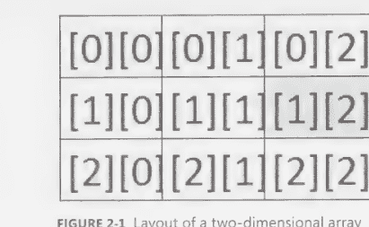

**图2-1** 二维数组的布局

因为数组是对象，它们提供了许多强大的方法来简化操作。以下各节解释了每个可用的方法和属性。

##### 使用 *length* 属性

*length* 属性提供了数组的长度信息——即在评估该属性时数组已分配了多少个元素。此属性在需要迭代数组或向用户显示数组在特定时间点有多少项（例如在队列中）时非常有用。以下示例展示了如何访问 *length* 属性：

```javascript
var anArray = new Array(5);
alert(anArray.length);
```

许多函数使你能够快速轻松地操作数组内容。

> **考试提示**
>
> 某些数组方法会直接影响 *Array* 对象，而其他方法则返回一个新的 *Array* 对象。对于考试，你必须理解每种情况何时适用。

##### 使用 *concat* 方法

*concat* 方法将两个或多个数组合并为一个数组：

```javascript
var sports = new Array('football', 'cricket', 'rugby', 'tennis', 'badminton');
var moreSports = new Array('soccer', 'basketball', 'hockey');
var combinedSports = sports.concat(moreSports);
```


##### 使用 *indexOf* 和 *lastIndexOf* 方法

*indexOf* 方法提供了一种查找已知元素索引的方式。以下代码示例展示了这一点：

```
var sports = new Array('soccer', 'basketball', 'hockey', 'football', 'cricket', 'rugby', 'tennis', 'badminton');
var index = sports.indexOf('football', 0);
```

此示例调用 *indexOf* 方法来确定元素 'football' 的索引。*indexOf* 方法接受两个参数：要查找的内容和开始查找的索引。此示例搜索整个数组，因此搜索从索引 0 开始。调用 *indexOf* 方法的结果为 3，因为该元素位于第四个位置。如果未找到要查找的元素，该方法返回 -1。

*indexOf* 方法使用恒等运算符来检查相等性，这意味着如果数组包含字符串 '1'、'2' 和 '3'，而你要查找整数 3，则结果为 -1，因为相等性操作对数组中的所有元素都返回 false。*indexOf* 方法按索引升序进行搜索。要按降序搜索——即从数组末尾向开头搜索——请使用 *lastIndexOf* 方法，它接受相同的参数。

##### 使用 *join* 方法

*join* 方法将数组中的所有元素连接成一个单一的字符串，各元素之间使用指定的字符串分隔符分隔。例如，要将字符串数组转换为逗号分隔的列表，你可以使用以下代码：

```
var sports = new Array('soccer', 'basketball', 'hockey', 'football', 'cricket', 'rugby', 'tennis', 'badminton');
var joined = sports.join(',');
```

*join* 方法接受一个字符串作为参数，该字符串用作分隔数组中各值的分隔符。结果是一个包含所有元素的字符串，各元素之间用传入 *join* 方法的字符串分隔。

##### 使用 *reverse* 方法

*reverse* 方法反转数组中所有元素的顺序。此示例反转了体育数组：

```
var sports = new Array('soccer', 'basketball', 'hockey', 'football', 'cricket', 'rugby', 'tennis', 'badminton');
sports.reverse();
```

该方法反转所有元素，使 'soccer' 成为数组的最后一项，'badminton' 成为第一项。

##### 使用 *sort* 方法

*sort* 方法将数组中的项目按升序排列。在体育数组中，排序将按字母顺序进行，如下例所示：

```
var sports = new Array('soccer', 'basketball', 'hockey', 'football', 'cricket', 'rugby', 'tennis', 'badminton');
alert(sports.indexOf('soccer'));
sports.sort();
alert(sports.indexOf('soccer'));
```

结果是体育数组现在已经排好序。警告框分别显示了排序前后 'soccer' 元素的索引，表明该元素已从数组中的位置 0 移动到了位置 6。

##### 使用 *slice* 方法

*slice* 方法从数组中取出一个或多个项目，并将它们移到一个新数组中。考虑以下包含体育项目列表的数组：

```
var sports = new Array('soccer', 'basketball', 'hockey', 'football', 'cricket', 'rugby', 'tennis', 'badminton');
var someSports = sports.slice(1, 2);
```

*slice* 方法接受两个参数：切片操作的起始索引和结束索引。结束索引不包含在切片中。所有复制的元素以数组的形式从 *slice* 方法中返回。在此示例中，由于 'basketball' 位于索引 1，而结束索引指定为索引 2，因此结果数组 *someSports* 只包含一个元素：'basketball'。

##### 使用 *splice* 方法

*splice* 方法提供了一种用新项目替换数组中项目的方式。以下代码展示了这一点：

```
var sports = new Array('soccer', 'basketball', 'hockey', 'football', 'cricket', 'rugby', 'tennis', 'badminton');
var splicedItems = sports.splice(1, 3, 'golf', 'curling', 'darts');
```

*splice* 方法返回一个包含从源数组中剪接出的项目的数组。第一个参数是数组中剪接操作的起始索引。第二个参数是从第一个参数指定的索引开始要剪接的项目数量。可选的最后一个参数列出了要替换被剪接项目的项目。该列表不必与被剪接出的项目长度相同。实际上，如果省略最后一个参数，被剪接的项目将直接从数组中移除，而不会被替换。在此示例中，从索引 1 开始替换了三个项目。因此，'basketball'、'hockey' 和 'football' 被替换为 'golf'、'curling' 和 'darts'。

#### 实现特殊类型的数组

JavaScript 原生不提供自定义对象来表示特殊的集合或数组。相反，*Array* 对象上提供了方法，允许你实现各种类型的特殊集合，例如队列或栈。

队列本质上是一种先进先出类型的集合。每当项目被添加到列表中时，它们应该排到队列末尾。相比之下，栈是一种后进先出类型的集合，其中最后放入栈的项目是你能从栈中取出的第一个项目。支持这种行为的数组方法有 *pop*、*push*、*shift* 和 *unshift*。

##### 使用 *pop* 和 *push* 方法

*pop* 和 *push* 方法提供栈的功能。*push* 方法将指定的项目追加到数组末尾。*pop* 方法移除数组中的最后一项。以下代码展示了 *push* 方法：

```
var sports = new Array();
sports.push('soccer', 'basketball', 'hockey');
sports.push('football');
```

此代码创建了一个 *Array* 对象，然后向数组中插入（推入）三个项目。项目按照它们在参数列表中出现的顺序被添加到栈中。接下来，代码将一个额外的项目推入栈中。*pop* 方法移除并返回数组中的最后一项：

```
var nextSport = sports.pop();
```

当此代码运行时，*nextSport* 变量的值为 'football'，因为这是最后添加到数组中的值。

> **关于在任何数组上使用 PUSH 和 POP 的说明**
你可以在任何上下文中使用 *pop* 和 *push* 方法来从数组末尾添加和移除项目。栈的概念很有用，但它并不是一种限制这些方法只能用于栈数组的约束机制。

##### 使用 *shift* 和 *unshift* 方法

*shift* 和 *unshift* 方法的工作方式与 *pop* 和 *push* 方法完全相反。*shift* 方法移除并返回数组的第一个元素，而 *unshift* 方法在数组的开头插入新元素。以下代码使用了 *shift* 和 *unshift* 方法：

```
var sports = new Array();
sports.unshift('soccer', 'basketball', 'hockey');
sports.unshift('football');
var nextSport = sports.shift();
```

此代码的最终结果与 pop 和 push 代码完全相同，只是操作发生在数组的前端而非末端。换句话说，此示例仍然说明了"后进先出"的栈功能。

综合来看，你刚才看到的两个概念（pop/push 和 shift/unshift）可以结合起来创建先进先出队列的概念。以下代码展示了使用队列的示例，其中队列的前端是数组的开头，队列的末尾是数组的末尾：

```
var sports = new Array();
sports.push('soccer');
sports.push('basketball');
sports.push('hockey');
var get1 = sports.shift();
sports.push('golf');
var get2 = sports.shift();
```

此代码首先将一些项目推入数组。这意味着每个项目都被添加到数组的末尾。当需要从数组中获取一个项目时，shift 方法从数组开头取出第一个项目——即索引为 0 的项目。你可以轻松地使用 unshift 和 pop 方法实现相反的机制，这将实现相同的结果，但从数组的相反端进入和检索项目。

#### 使用高级数组方法

本节探讨一些更高级的数组方法。这些方法都涉及回调的使用，你将在目标 2.4"实现回调"中更详细地了解。如果回调对你来说是一个新概念，你应该在完成本节之前先学习该目标。

Array 对象公开了一些方法，使你能够对数组中的每个元素执行自定义逻辑处理。以下各节展示了每个方法。

##### 使用 *every* 方法

*every* 方法允许你对每个数组元素处理特定逻辑，以确定它们是否满足某些条件。查看以下代码：

```
var evenNumbers = new Array(0, 2, 4, 6, 8, 9, 10, 12);
var allEven = evenNumbers.every(evenNumberCheck, this);
if (allEven) {

} else {

}
function evenNumberCheck(value, index, array) {
    return (value % 2) == 0;
}
```


在这段代码中，假设 *evenNumber* 数组是使用一个预期全为偶数的列表创建的。要验证这一点，可以使用 *every* 方法。

*every* 方法接受两个参数：

- 应为每个元素处理的函数名称
- 对数组对象的可选引用

为数组中的每个项目调用的 *evenNumberCheck* 函数对每个项目返回 *true* 或 *false*，具体取决于它是否满足所需的条件。在此示例中，测试该值以确保它是偶数。如果是，函数返回 *true*；否则返回 *false*。一旦 *every* 方法对数组中的任何项目获得第一个 *false* 结果，它就会退出并返回 *false*。否则，如果数组中的所有元素都返回 *true*，则 *every* 方法返回 *true*。在前面的代码示例中，添加了一个 *if* 语句来评估 *every* 方法的返回值并采取适当的操作。在此示例中，*evenNumberCheck* 函数在数组中的第六项上返回 *false*，因为 9 是奇数，所以偶数测试失败。

##### 使用 *some* 方法

*some* 方法的工作方式与 *every* 方法非常相似。不同之处在于，*some* 只检查数组中是否有任何项目满足条件。在这种情况下，如果为任何单个元素调用的函数返回 *true*，则 *some* 方法返回 *true*。如果数组中的所有元素都返回 *false*，则 *some* 方法返回 *false*。根据此定义，当 *some* 方法返回 *false* 时，您可以使用 *some* 来实现与 *every* 方法完全相反的效果。以下代码根据前面的示例进行了更新，以便使用 *some* 方法：

```
var evenNumbers = new Array(0, 2, 4, 6, 8, 9, 10, 12);
var allEven = evenNumbers.some(evenNumberCheck, evenNumbers);
if (allEven) {
    ...
} else {
    ...
}
function evenNumberCheck(value, index, array) {
    return (value % 2) == 0;
}
```

随着代码更新为使用 *some* 方法，返回结果不是 *true*，因为数组中的一些值是偶数。如果此结果返回 *false*，您就会知道数组中的所有元素都是奇数。

##### 使用 *forEach* 方法

*forEach* 方法使应用程序能够针对数组中的每个项目处理一些逻辑。此方法对每个项目运行，并且不产生返回值。*forEach* 具有与本节中迄今为止看到的其他方法相同的签名。以下代码演示了 *forEach* 方法：

```
var sportsArray = ['soccer', 'basketball', 'hockey', 'football', 'cricket', 'rugby'];
sportsArray.forEach(offerSport);
function offerSport(value, index, array) {
    var sportsList = document.getElementById("sportsList");
    var bullet = document.createElement("li");
    bullet.innerText = value;
    sportsList.appendChild(bullet);
}
```

在此示例中，代码假设 HTML 页面上的一个列表元素已准备好填充运动列表，每个运动格式化为子节点。列表中的每个元素都被传递给函数并作为 <li> 元素添加。在这种情况下，数组元素未排序。您可以将方法链接在一起，以确保元素按字母顺序排列，例如：

```
sportsArray.sort().forEach(offerSport);
```

与迄今为止显示的所有高级方法一样，元素按升序索引顺序传递给函数。因此，您可以调用 *sort* 方法并将其与 *forEach* 方法链接在一起，以确保元素按顺序显示给用户。

##### 使用 *filter* 方法

*filter* 方法提供了一种根据回调函数中完成的某些处理从数组中删除项目的方法。*filter* 方法返回一个新数组，其中包含基于回调函数返回 *true* 或 *false* 而包含的元素。在偶数示例中，您可以使用 *filter* 方法来清理数组，并确保程序继续使用仅包含偶数的数组，如下所示：

```
var evenNumbers = new Array(0, 2, 4, 6, 8, 9, 10, 12);
var allEven = evenNumbers.filter(evenNumberCheck, evenNumbers);

//work with the even numbers....

function evenNumberCheck(value, index, array) {
    return (value % 2) == 0;
}
```

在此示例中，*evenNumberCheck* 方法与之前使用的相同。但是，与其使用 *every* 或 *any* 方法来确定数据质量（仅包含偶数），*filter* 方法简化了奇数的删除。您可以在回调函数中使用任何逻辑来处理元素并确定它是否应该包含在返回的数组中，例如模式匹配或数据库查找。

##### 使用 *map* 方法

*map* 方法使您能够替换数组中的值。数组中的每个元素都被传递给回调函数。回调函数的返回值替换传入的位置在数组中的值。以下示例演示了将数组中的每个数字适当四舍五入：

```
var money = [12.8, 15.9, 21.7, 35.2];
var roundedMoney = money.map(roundOff, money);
...
function roundOff(value, position, array) {
    return Math.round(value);
}
```

此示例提供了一系列数字的平方：

```
var numbers = [1, 2, 3, 4, 5, 6, 7, 8];
var squares = numbers.map(squareNumber, numbers);
...
function squareNumber(value, position, array) {
    return value * value;
}
```

##### 使用 *reduce* 和 *reduceRight* 方法

*reduce* 和 *reduceRight* 方法是递归的。回调函数的每个结果都与要传入的当前元素一起作为之前的返回值传递回回调方法。这提供了一些有趣的场景。*reduce* 方法按升序处理数组的元素，而 *reduceRight* 按降序处理数组的元素。以下示例演示了使用 *reduce* 方法计算阶乘：

```
var numbers = [1, 2, 3, 4, 5, 6, 7, 8, 9, 10];
var factorials = numbers.reduce(factorial);
function factorial(previous, current) {
    return previous * current;
}
```

在此函数中，计算了 10 的阶乘。在数学世界中，它表示为 10！

> **考试提示**
> 一些高级函数使您能够更改源数组，而另一些则不能。这是一个需要保持清晰的重要方面。

#### 实现迭代控制流

您已经看到了如何使用 *if* 语句来控制程序流。另一个可用于控制 JavaScript 程序流程的概念是迭代流控制，它使您能够多次循环执行代码块。您在查看使用回调的数组对象的高级方法时已经看到了一些迭代操作。在那里，迭代流控制内置于各种数组方法中。在本节中，您将检查原生迭代控制语句，包括 for 和 while 循环。

##### 使用 for 循环

for 循环在应该基于确定性的项目数量运行代码块的情况下很有用。在某些情况下，您可能想要遍历数组或列表中的项目；在其他情况下，您可能想要运行代码块特定次数以执行某种动画或创建特定数量的对象。

for 循环的语法如下：

```
for(<counter>;<expression>;<counter increment>)
{
    <code to run>
}
```

for 循环需要三个元素：计数器、表达式和增量。

- 计数器变量保存循环已运行的当前次数。您需要适当地初始化计数器，例如设为 1 或 0。
- 表达式元素根据某些其他值评估计数器。其目的是设置 for 循环运行次数的限制。例如，如果您希望循环运行 10 次，您可以将计数器初始化为 0，表达式为 counter < 10。这样做将确保循环仅在表达式返回 true 时运行，即计数器变量小于 10 时。一旦计数器等于 10，循环处理将停止，代码处理将在 for 循环之后继续。
- 对于计数器增量，必须告诉 for 循环如何在每次循环迭代后调整计数器变量。增量可以是正数或负数，具体取决于循环的设置方式。您可以设置增量，使循环按顺序计数，或使用数学运算符按不同的值递增。

循环的代码或主体是由花括号包围的代码块。此代码部分对每个循环迭代运行。以下代码示例演示了使用 for 循环的各种方式。

首先，这是一个运行代码块 10 次的简单 for 循环：

```
for (var i = 0; i < 10; i++) {
    document.write(i);
}
```

请注意，因为计数器从 0 开始，所以表达式为小于 10。如果计数器从 1 开始，表达式将 <= 10。这一点需要密切注意。计数器增量使用加法简写 ++ 在每次迭代时将计数器增加一。以下代码按相反顺序进行：

```
for (var i = 10; i > 0; i--) {
    document.write(i);
}
```


除了使用自增或自减运算符，你还可以通过乘法或除法来改变计数器的值。以下代码打印出一组数字，每个数字是前一个数字的两倍，直到100：

```
for(var i=1; i<100;i*=2){
    document.write(i);
    document.write("<br />");
}
```

*for* 循环的表达式部分并不一定需要是硬编码的值，就像前面示例中展示的那样。相反，你可以从对象的长度或另一个变量中推导出表达式，如本例所示：

```
var alphabet = 'abcdefghijklmnopqrstuvwxyz';
for (var i = 0; i < alphabet.length; i++) {
    document.write(alphabet[i]);
    document.write("<br />");
}
```

因为字符串本质上就是一个字符数组，这段代码可以遍历字符串并将每个字符打印到屏幕上。字符串的长度决定了循环运行的次数。

##### 使用 *for...in* 循环

*for...in* 循环是一种遍历对象属性的方法。请看以下示例：

```
var person = { firstName: "Jane", lastName: "Doe", birthDate: "Jan 5, 1925", gender: "female" };
for (var prop in person) {
    document.write(prop);
}
```

这个 *for* 循环会打印出自定义 *person* 对象的每个属性的名称。如果你希望循环打印属性的值，而不是属性名，则需要通过对象的属性索引器来访问每个属性，如本例所示：

```
var person = { firstName: "Jane", lastName: "Doe", birthDate: "Jan 5, 1925", gender: "female" };
for (var prop in person) {
    document.write(person[prop]);
}
```

##### 使用 *while* 循环

*while* 循环允许你运行一个代码块，直到某个条件求值为 *false*。*while* 循环的结构如下：

```
while(<expression>){
    <code block>
}
```

表达式的结果必须是一个布尔值。当表达式为 *true* 时，*while* 循环会继续运行。运行的代码包含在花括号内的代码块中。要让 *while* 循环能够运行，条件必须为 *true*。由于 *while* 循环不像 *for* 循环那样使用计数器，*while* 循环内部的代码必须能够根据情况将表达式设置为 *false*；否则，循环将变成无限循环。你可能确实想要使用无限循环，但你必须确保循环的处理不会阻塞应用程序的主线程。以下代码演示了一个 *while* 循环：

```
var i = 0;
while (i < 10) {
    //do some work here.
    i++;
}
```

在这段代码中，*while* 循环会一直运行，直到变量 *i* 等于10。表达式可以包含几乎任何内容，只要它能求值为一个布尔值。

前面的例子是相当确定性的，因为你知道循环将运行10次。然而，在某些情况下，一段代码应该运行，直到循环外部的其他东西发生变化。假设一个应用程序正在控制一个路口的交通。这种类型的应用程序可以在交通信号灯为绿色时持续疏导交通。以下代码演示了这一点：

```
var canvas = document.getElementById("canvas1");
while (canvas.styles.backgroundColor == 'green') {
    //move traffic
}
```

这个 *while* 循环将永远不会结束，直到画布背景不再是绿色。循环依赖于应用程序中其他地方的逻辑来改变画布的背景颜色，例如一个控制交通信号灯保持绿色或红色时间的计时器。

*while* 循环的另一种形式是 *do...while* 循环。

##### 使用 *do...while* 循环

*while* 循环和 *do...while* 循环的关键区别在于，*do...while* 循环至少会执行第一次。相比之下，*while* 循环首先评估表达式以确定是否应该运行，然后只要表达式求值为 *true*，就继续运行。*do...while* 循环总是会运行一次，因为在这种形式的循环中，表达式逻辑位于底部。*do...while* 循环通过以下结构实现这一点：

```
do{
    <code block>
}while(<expression>)
```

这段代码先处理代码块，然后在表达式为 true 的情况下，继续处理这个代码块。以下代码段演示了这一点：

```
var canvas = document.getElementById("canvas1");
do {
    //stop traffic
}while(canvas.styles.backgroundColor == 'red')
```

在这个代码段中，停止交通的逻辑运行一次。然后，它评估检查画布背景是否为红色的表达式。只要这个表达式求值为 *true*，循环就会继续运行。

##### 跳出循环

有两种机制可以让你跳出循环。`break` 关键字会完全退出当前循环，而 `continue` 关键字会中断当前代码块的执行，并继续到循环的下一次迭代。

> **考试提示**

`break` 关键字只会跳出当前正在运行的循环。如果包含 `break` 的循环嵌套在另一个循环内部，外部循环将继续按照其自身的表达式进行迭代。

#### 思维实验

识别语法中的细微差别

在这个思维实验中，运用你关于此目标所学的知识。你可以在本章末尾的“答案”部分找到这些问题的答案。

各种构造执行相同的功能，但语法不同。例如，`switch` 语句和嵌套的 `if...else` 语句之间的实际区别非常小。同样，`while` 和 `for` 循环都通过评估一个条件来知道循环是否应该继续。

1. 什么时候 `for` 循环比 `while` 循环更好？
2. 代码的可读性会如何受到影响？

#### 目标总结

- `for` 和 `for...in` 循环用于迭代已知长度的值。
- `while` 和 `do...while` 循环会一直运行，直到布尔条件设置为 *false*。
- 数组提供了一种创建事物列表的机制。

#### 目标回顾

1. 以下哪个关键字提供迭代控制流？
   A. *if 语句*
   B. *switch 语句*
   C. ***for***
   D. *break*

2. 以下哪个数组方法用于合并两个数组？
   A. *join*
   B. *combine*
   C. *split*
   D. ***concat***

3. 哪种迭代控制语法可以保证循环至少执行一次？
   A. *for...in 循环*
   B. *while 循环*
   C. ***do...while 循环***
   D. *for 循环*

4. 哪个关键字用于退出循环？
   A. *continue*
   B. ***break***
   C. *stop*
   D. *next*

### 目标 2.2：引发和处理事件

浏览器通过事件提供动态行为。由浏览器用户处理的操作可以触发一个机会，让您的代码做出反应并为用户创建体验。这个机会以事件的形式呈现。DOM 元素原生地提供了可以处理的事件，您还可以在自定义对象上实现自定义事件。

事件通常遵循命名约定。查看特定对象上可用的事件时，您可以将这些事件识别为以 *on* 前缀开头的属性。例如，一些常见的事件是 *onkeypress* 或 *onblur*。要让事件正常工作，您需要通过分配事件处理程序来“连接”它们。事件处理程序是一个 JavaScript 函数，当操作触发事件时会被调用。事件在浏览器中一直在触发；然而，是否分配了处理程序决定了事件触发时是否可以运行自己的代码。

**本目标涵盖如何：**

- 使用事件，包括使用匿名函数处理事件以及声明和处理冒泡事件
- 处理 DOM 事件，包括 OnBlur、OnFocus 和 OnClick
- 创建自定义事件

#### 使用事件

API 提供事件的原因是为了让开发者能够在程序中所有发生的事情中间注入自己的处理逻辑。JavaScript 使您能够在整个 DOM 中执行此操作。本节讨论了将这些事件钩住的能力。

*钩住* 事件的概念是告诉浏览器，当某个事件发生时，它应该调用指定的函数。分配给事件的函数被称为监听该事件的*事件监听器*。因此，需要将函数分配给一个事件，以监听该事件的发生。

您可以通过三种方式钩住事件：

- 直接在 HTML 标记中声明它。
- 通过 JavaScript 将函数分配给元素对象的事件属性。
- 使用元素对象上较新的 add 和 remove 方法来关联事件处理程序。

通过 JavaScript 分配事件处理程序时，您有两种选择：提供一个命名函数或分配一个匿名函数。这两种方式之间的区别将被探讨。

首先，您需要理解所有 DOM 事件处理程序共有的单个对象的概念，那就是事件对象本身。

#### 事件对象

通常，事件对象是一个在事件处理程序中可用的通用对象，它提供有关事件的元数据。例如，如果正在处理键盘事件，您可能想知道按下了哪个键。如果正在处理鼠标事件，您可能想知道按下了哪个鼠标按钮。事件对象包含所有这些属性。


#### 声明式事件处理

事件对象是在事件处理函数中通过 `window` 对象进行访问的，如下所示：

```
var evnt = window.event;
```

事件对象是 `window` 对象的一个属性。在本示例中，事件对象的引用被赋值给一个变量，但也可以直接使用。在当前事件处理函数的上下文中，事件对象包含相关信息——也就是说，相应的属性会被设置。例如，在 *keydown* 事件中，可以获取键盘状态的详细信息，但无法获取鼠标按键信息，因为它们与 *keydown* 事件无关。

> **注意：访问事件上下文**

在 Internet Explorer 中，`window.event` 是访问事件对象所需的方法。然而，在某些浏览器中，事件对象会作为参数传递给事件函数。

通过在 HTML 标记中设置事件处理函数，可以在 HTML 中以声明方式处理事件。这与为 HTML 元素的任何其他属性或属性赋值本质上没有区别。请看以下 HTML 示例：

```
<html>
    <head>
        <script>
            function onloadHandler() {
                alert("hello event.");
            }
        </script>
    </head>
    <body onload="onloadHandler();">

    </body>
</html>
```

在此 HTML 标记中，`body` 元素的 `onload` 属性被赋予了要运行的 JavaScript 代码。当文档本身完全加载到浏览器中时，*onload* 事件会触发。文档加载完成后，*onload* 事件触发，调用 *onloadHandler* 函数，进而显示警告框。任何通过这种方式处理的事件都可以直接在 HTML 标记中这样设置。接下来，你将了解如何通过在 JavaScript 中将函数赋值给事件属性来以编程方式设置事件。

#### 赋值式事件处理

通过 JavaScript 将事件函数赋值给事件属性是设置事件处理函数的另一种方式。这种方式由来已久，至今仍被广泛使用。对于前面的 `onload` 事件示例，需要做如下更改来反映通过 JavaScript 赋值事件处理函数的方式：

```
<html>
    <head>
        <script>
            window.onload = onloadHandler();

            function onloadHandler() {
                alert("hello event.");
            }

        </script>
    </head>
    <body>
        ...
    </body>
</html>
```

在此代码中，`body` 的 HTML 元素被清理干净，`onload` 事件通过 JavaScript 进行赋值。`window` 对象与 `body` 元素并不相同，但它演示了将需要在页面加载后立即运行的代码进行赋值的概念。注意 `onloadHandler` 的赋值位于 `<script>` 代码块中，但不在任何函数内部。为了使这能够成功，`window` 对象必须存在。由于 `window` 对象是一个全局对象，它必然会存在。但是，要访问页面元素，页面必须已加载完毕，或者脚本必须在渲染器处理完 HTML 之后才能运行。例如，如果页面包含一个 canvas 以及允许用户用鼠标在其上绘制的功能，那么鼠标活动的事件处理函数必须在页面底部或在 `window` 的 `onload` 事件中进行赋值。`onload` 事件在整个页面加载完成后触发，因此可以在此时获取页面元素的引用并绑定事件处理函数。

一种更常见的做法是将一个匿名函数赋值给 `window` 的 `onload` 事件，并绑定所有必要的事件。匿名函数的概念稍后讨论。它在本书中被广泛使用，如下所示：

```
window.onload = function () {
    //在此处进行事件设置。
}
```

#### 使用 addEventListener 和 removeEventListener 方法

`addEventListener` 和 `removeEventListener` 是将函数绑定到事件以及之后根据需要移除事件的两个首选方法。`addEventListener` 方法接受两个必需参数和一个可选参数：

```
addEventListener(<event name>, <event function>, <optional cascade rule>)
```

事件名称是要处理的事件的名称。事件名称与你在前面示例中看到的一样，只是没有 *on* 前缀。例如，*onload* 事件的名称就是 *load*。事件函数是事件发生时应运行的函数，即监听器。可选的级联规则在事件如何在嵌套 DOM 元素中传递方面提供了一些灵活性。这将在后面讨论事件冒泡时详细研究。

*removeEventListener* 接受完全相同的参数。这意味着可以为同一事件添加多个事件监听器，然后根据需要移除它们。设想在一个复杂的程序中，比如一个游戏，你可能需要对同一事件开启和关闭特定的事件处理函数。请看以下示例：

```
<script>
    window.addEventListener("load", onloadHandler, false);
    window.addEventListener("load", onloadHandler2, false);
    window.addEventListener("load", onloadHandler3, false);

    function onloadHandler() {
        alert("hello event 1.");
    }
    function onloadHandler2() {
        alert("hello event 2.");
    }
    function onloadHandler3() {
        alert("hello event 3.");
    }
</script>
```

当窗口加载完成时，每个事件按照添加的顺序触发。要移除 *onloadHandler2* 事件，只需调用 *removeEventListener*：

```
window.removeEventListener("load", onloadHandler2, false);
```

在处理 DOM 事件时，你创建的自定义事件并非用于替代 DOM 元素提供的内置功能。事件处理允许你执行一些自定义逻辑或操作，但当事件处理完成后，处理会返回到 JavaScript API，由其执行自身的事件实现。如果这不是你期望的行为，你可以停止事件处理。

#### 使用匿名函数

在前面的示例中，事件处理函数都是通过具名函数进行赋值的。使用具名函数的优点在于你可以之后根据需要移除事件监听器。匿名函数在被赋值为事件监听器后无法被识别和操作。在上一节的示例中，三个事件监听器被添加到同一个事件上，然后移除了其中一个。这之所以可行，仅仅是因为事件监听器函数的名称是已知的。

顾名思义，匿名函数没有名称。它是完全匿名的，无法从其他代码段中调用。请看以下示例：

```
window.onload = function () {
}
```

此示例在本书中被广泛使用，以确保在访问 DOM 中的元素之前页面已完全加载；否则，元素将不可用。`window` 对象的 *onload* 事件被赋值为一个匿名函数。此函数没有名称，无法被任何其他代码调用。`window` 对象的内部实现在触发 *onload* 事件时运行此函数。

在 JavaScript 中，函数是可以赋值给变量的对象。这就是匿名函数事件监听器的工作原理。它将一个函数对象赋值给 `window` 对象的 *onload* 属性，进而在窗口完全加载时处理该事件。在大多数需要以参数形式传入函数的地方，你也可以使用匿名函数。请看以下代码示例：

```
window.addEventListener("load",
function () {
    document.getElementById("outer").addEventListener("click", outerDivClick, false);
},
false);
```

在此示例中，使用了 *addEventListener* 方法。但传入的不是事件触发时要调用的函数名，而是一个匿名函数。这种方式唯一潜在的问题是之后无法使用 *removeEventListener* 方法移除该事件监听器。以下代码看起来似乎应该可行：

```
window.removeEventListener("load",
function () {
    document.getElementById("outer").addEventListener("click", outerDivClick, false);
},
false);
```

但事实并非如此。因为 *addEventListener* 方法添加的事件监听器是按其签名存储的，*removeEventListener* 方法无法获知之前那个匿名函数的签名。即使传入完全相同的匿名函数实现也不行，因为这不是同一个匿名函数——它是一个新的函数，因此与已添加的事件监听器的签名不匹配。

#### 取消事件

取消事件处理的能力在你想要完全覆盖 DOM 元素原生功能的实现时非常有用。一个典型的例子是需要覆盖锚元素的固有功能。需要为点击事件设置一个事件监听器。然后在点击事件中，通过事件对象，

*returnValue* 属性设置为 false 或者函数本身可以返回 false。这会告知运行时停止对事件的进一步处理。以下代码演示了这一点：

```
window.onload = function () {
    var a = document.getElementById("aLink");
    a.onclick = OverrideAnchorClick;
}
function OverrideAnchorClick() {
    //do custom logic for the anchor
    window.event.returnValue = false;
    //or
    //return false;
}
```

在这种情况下，当链接被点击时，自定义事件处理程序会运行，但不会有进一步的逻辑被处理。因此，通常由 *<a>* 元素提供的导航将被阻止运行。另一个需要考虑的方面是，当使用嵌套 DOM 元素时事件的运行顺序。这里涉及的概念是事件冒泡。

#### 声明和处理冒泡事件

事件冒泡是当 HTML 文档具有嵌套元素时适用的概念。考虑以下 HTML 示例：

```
<style>
    #outer {
        width: 200px;
        height: 200px;
        background-color: red;
    }
    #middle {
        width: 50%;
        height: 50%;
        position: relative;
        top: 25%;
        left: 25%;
        background-color: green;
    }
    #inner {
        width: 50%;
        height: 50%;
        position: relative;
        top: 25%;
        left: 25%;
        background-color: blue;
    }
</style>
<script>
  window.onload = function () {
        document.getElementById("outer").addEventListener("click", outerDivClick, false);
        document.getElementById("middle").addEventListener("click", middleDivClick, false);
        document.getElementById("inner").addEventListener("click", innerDivClick, false);
        document.getElementById("clearButton").addEventListener("click", clearList);
  }
  function outerDivClick() {
        appendText("outer Div Clicked");
  }

  function middleDivClick() {
      appendText("middle Div Clicked");
  }
  function innerDivClick() {
      appendText("inner Div Clicked");
  }
  function appendText(s) {
      var li = document.createElement("li");
      li.innerText = s;
      document.getElementById("eventOrder").appendChild(li);
  }
  function clearList() {
      var ol = document.createElement("ol");
      ol.id = "eventOrder";
      document.getElementById("bod").replaceChild(ol,
      document.getElementById("eventOrder"));
  }
</script>
<body id="bod">
    <div id="outer">
        <div id="middle" >
            <div id="inner">
            </div>
        </div>
    </div>
    <ol id="eventOrder"> </ol>
    <button type="button" id="clearButton">Clear</button>
</body>
```

当此 HTML 在浏览器中渲染时，结果是三个嵌套的 *div* 元素，如图 2-2 所示。在此代码中，三个 *div* 元素相互堆叠。应用了样式以在框之间提供视觉区分。当 *div* 框被点击时，点击事件被触发。指定处理程序中的事件监听器代码将点击的 *div* 名称输出到有序列表中，以便识别事件点击的顺序。

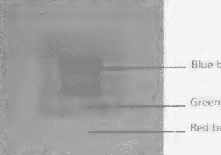

图 2-2 显示事件冒泡效果的三个嵌套 `<div>` 元素

*addEventListener* 方法的最后一个参数接受一个可选的布尔参数。此参数允许您指定事件的级联或冒泡效果——也就是说，指定事件处理的顺序。每个 *div* 的点击事件都分配了一个事件监听器。在前面的示例中，三个 *div* 元素是嵌套的。点击内部或中间 *div* 的用户也点击了父 *div*，因为 *div* 元素在屏幕上共享相同的物理空间。当点击蓝色的内部框时，显示以下输出：

- 1. inner Div Clicked
2. middle Div Clicked
3. outer Div Clicked

一次点击事件触发了所有三个事件。这个概念称为事件冒泡。直接点击中间绿色 *div* 会产生以下输出：

- 1. middle Div Clicked
2. outer Div Clicked

最后，点击红色外部 *div* 产生此输出：

- 1. outer Div Clicked

事件已经冒泡到顶层。如果您希望以相反的顺序处理事件——即级联向下——则 *addEventListener* 方法指定的最后一个参数设置为 true。进行此更改后，如下所示，

```
document.getElementById("outer").addEventListener("click", outerDivClick, true);
document.getElementById("middle").addEventListener("click", middleDivClick, true);
document.getElementById("inner").addEventListener("click", innerDivClick, true);
```

屏幕输出现在如下：

- 1. outer Div Clicked
2. middle Div Clicked
3. inner Div Clicked

事件处理顺序已反转为级联而非冒泡。

事件的级联或冒泡效果在您需要时很方便。然而，网页设计可能涉及嵌套元素，但每个元素的点击事件应仅在直接点击该元素时运行。在这种情况下，您可以使用事件对象的一个属性，称为 *cancelBubble*。如果此属性设置为 true，事件冒泡或级联将在设置它的事件监听器处停止。这只会停止冒泡或级联行为。取消事件冒泡的代码已添加到内部 *div* 元素的事件监听器中：

```
function innerDivClick() {
    appendText("inner Div Clicked");
    window.event.cancelBubble = true;
}
```

现在，当内部 *div* 被点击时，输出如下：

- 1. inner Div Clicked

事件向上冒泡到中间 *div* 和外部 *div* 已被阻止。

#### 处理 DOM 事件

DOM 提供了大量内置事件。本节介绍了日常使用中最常见的事件。DOM 通过 JavaScript API 提供这些事件。函数可以被指定为事件监听器，并且可以根据事件的发生在网页上实现自定义行为。这些事件适用于大多数 DOM 元素。

##### 更改事件

当与元素关联的值发生变化时，会发生更改事件。这最常发生在输入元素中，例如基于文本的输入以及其他元素，如 range 元素。这里展示了更改事件实际使用的一个示例：

```
<script>
    window.onload = function () {
        document.getElementById("aRange").addEventListener("change", rangeChangeEvent);
    }

    function rangeChangeEvent() {
        document.getElementById("rangeValue").innerText = this.value;
    }

</script>

<body>
    <input id="aRange" type="range" max="200" min="0" value="0"/>
    <div id="rangeValue"></div>
</body>
```

在此示例中，随着范围滑块控件随鼠标从一侧拖动到另一侧，*div* 显示滑块的值。

## 考试提示

> 此示例使用了 *this* 关键字。在此上下文中，*this* 关键字直接引用创建事件的元素。通过这种方式，*this* 提供了访问元素的快捷方式，而不是通过文档搜索方法获取引用。

对于文本输入控件，可以处理相同类型的代码：

```
document.getElementById("aText").addEventListener("change", rangeChangeEvent);

<body>
    <input id="aRange" type="range" max="200" min="0" value="0"/>
    <input id="aText" type="text"/>
    <div id="rangeValue"></div>
</body>
```

现在，当文本框的 *text* 值改变时，*div* 会显示该值。文本框的更改事件在光标离开文本框时触发，而不是在每个字符输入时触发。

##### 焦点事件

当元素获得或失去焦点时，会发生焦点事件。表 2-2 列出了与焦点相关的可用事件。

**表 2-2** DOM 焦点事件

| 事件 | 描述 |
| :--- | :--- |
| *focus* | 当元素获得焦点时触发 |
| *blur* | 当元素失去焦点时触发 |
| *focusin* | 在元素获得焦点之前触发 |
| *focusout* | 在元素失去焦点之前触发 |

大量的焦点事件在处理任何特定 DOM 元素的焦点时，在时间安排上提供了非常好的灵活性。*blur* 事件通常用于验证表单字段。您可以使用 *focus()* 方法将焦点设置到任何元素上，这会引发 *focus* 事件层次结构。以下代码展示了如何使用 *blur* 事件：

```
<script>
    window.onload = function () {
        document.getElementById("firstNameText").focus();
        document.getElementById("firstNameText").addEventListener("blur", function () {
            if (this.value.length < 5) {
                document.getElementById("ruleViolation").innerText = 'First Name is required to be 5 letters.';
                document.getElementById("ruleViolation").style.color = 'red';
                this.focus();
            }
        });
    }
</script>
```

##### 键盘事件

当键盘上的按键被按下时，会发生键盘事件。表 2-3 中的键盘事件可被捕获。

**表 2-3** 可用的键盘事件

| 事件 | 描述 |
| :--- | :--- |
| *keydown* | 当按键被按下时触发 |
| *keyup* | 当按键被释放时触发 |
| *keypress* | 当按键被完全按下时触发 |


以下示例在文本框上监听 *keydown* 事件，并显示按键的 *keycode*：

```
document.getElementById("firstNameText").addEventListener("keydown", function () {
    document.getElementById("outputText").innerText = window.event.keyCode;
});
```

此类代码可用于过滤掉输入到文本框中的无效字符。通过键盘事件，事件对象上有一些额外属性可以帮助实现此目的。例如，你可能需要知道 Shift 键或 Control 键是否也被按下。表 2-4 列出了键盘事件的事件对象属性。

##### **表 2-4** 键盘事件的事件对象属性

| 属性 | 描述 |
|----------|-------------|
| *altKey* | 布尔值，指示是否按下了 Alt 键 |
| *keyCode* | 按键的数字代码 |
| *ctrlKey* | 布尔值，指示是否按下了 Control 键 |
| *shiftKey* | 布尔值，指示是否按下了 Shift 键 |

> **考试提示**
>
> 在某些情况下，取决于按键的不同，只有 *keydown* 事件会触发。方向键就是这样一个例子：*keydown* 会触发，但 *keyup* 或 *keypress* 不会。

你可以将 *ctrlKey* 等属性与 *keyCode* 事件配合使用，为用户提供类似于热键的功能，以自动将焦点导航到特定字段：

```
document.onkeydown = function () {
    if (window.event.ctrlKey && String.fromCharCode(window.event.keyCode) == 'F')
        document.getElementById("firstNameText").focus();
    if (window.event.ctrlKey && String.fromCharCode(window.event.keyCode) == 'L')
        document.getElementById("lastNameText").focus();
    return false;
}
```

##### 鼠标事件

DOM 通过鼠标事件提供了对鼠标活动的广泛支持。表 2-5 描述了可用的鼠标事件。

##### **表 2-5** 可用的鼠标事件

| 事件 | 描述 |
|-------|-------------|
| *click* | 鼠标执行单击时触发 |
| dblclick | 鼠标执行双击时触发 |
| mousedown | 鼠标按钮按下时触发 |
| mouseup | 鼠标按钮释放时触发 |
| mouseenter 或 mouseover | 鼠标光标进入 HTML 元素的区域时触发 |
| mouseleave | 鼠标光标离开 HTML 元素的区域时触发 |
| mousemove | 鼠标光标在 HTML 元素上移动时触发 |

鼠标事件在事件对象上提供了额外的信息。表 2-6 列出了事件对象的适用属性。

##### **表 2-6** 鼠标事件的属性

| 属性 | 描述 |
| :--- | :--- |
| clientX | 鼠标光标相对于视口边界的 x 或水平位置 |
| clientY | 鼠标光标相对于视口边界的 y 或垂直位置 |
| offsetX | 鼠标光标相对于目标元素的 x 或水平位置 |
| offsetY | 鼠标光标相对于目标元素的 y 或垂直位置 |
| screenX | 鼠标光标相对于屏幕左上角的 x 或水平位置 |
| screenY | 鼠标光标相对于屏幕左上角的 y 或垂直位置 |

以下代码演示了如何获取每组坐标：

```
window.onload = function () {
    document.getElementById("yellowBox").addEventListener("click", yellowBoxClick);
}
function yellowBoxClick() {
    document.write("Client X: " + window.event.clientX + " ClientY: "
        + window.event.clientY);
    document.write("<BR />");
    document.write("offsetX: " + window.event.offsetX + " offsetY: "
        + window.event.offsetY);
    document.write("<BR />");
    document.write("screen X: " + window.event.screenX + " screenY: "
        + window.event.screenY);
}
```

此代码假设存在一个名为 *yellowBox* 的 div，当鼠标单击它时会触发其 click 事件。你可以轻松地将事件更改为 *mousedown* 或 *mouseup* 来达到相同的效果。

*mouseenter* 和 *mouseleave* 事件分别指示鼠标光标进入或离开特定元素所覆盖区域的时机。以下代码演示了在 **mouseenter** 时对 *div* 元素应用变换，并在 **mouseleave** 时移除该变换：

```
<style>
    .scale {
        transform:scale(1.5);
    }
</style>
<script>
window.onload = function () {
    document.getElementById("yellowBox").addEventListener("mouseenter",
        yellowBoxEnter);
    document.getElementById("yellowBox").addEventListener("mouseleave",
        yellowBoxLeave);
}
function yellowBoxEnter() {
    this.classList.add("scale");
}
function yellowBoxLeave() {
    this.classList.remove("scale");
}
</script>
<body>
    <div id="yellowBox" style="width: 50%;height:50%;margin: 0 auto;
    background-color:yellow;"></div>
</body>
```

当鼠标移到黄色填充的 *div* 上时，*div* 会放大。当鼠标移开 *div* 时，它会恢复到原始大小。

#### 拖放功能

拖放功能允许用户用鼠标拾取一个元素并将其放置到另一个位置。表 2-7 列出了与拖放功能相关的事件。

##### **表 2-7** 拖放可用的事件

| 事件 | 描述 |
| --- | --- |
| *drag* | 元素被拖动时持续触发 |
| *dragend* | 鼠标释放以结束拖放操作时，在被拖动的元素上触发 |
| *dragenter* | 被拖动的元素被拖入目标元素区域时，在目标元素上触发 |
| *dragleave* | 被拖动的元素离开目标元素区域时，在目标元素上触发 |
| *dragover* | 被拖动的元素在其上方拖动时，在目标元素上持续触发 |
| *dragstart* | 拖动操作开始时，在被拖动的元素上触发 |
| *drop* | 被拖动的元素被释放时，在目标元素上触发 |

拖放操作涉及很多步骤，从 *dragstart* 事件开始。在元素被拖动的过程中，*drag* 事件会持续触发。当元素被拖过其他元素时，那些元素的 *dragenter*、*dragover* 和 *dragleave* 事件会依次触发。当元素完成拖动后，其 *dragend* 事件会触发，同时目标元素的 *drop* 事件也会触发。你可以将所有这些事件组合使用，向用户提供视觉反馈，表明拖动操作正在进行中以及哪些位置可能是有效的放置位置。

以下 HTML 演示了此功能：

```
<head>
    <style>
        .dropped {
            width: 50%;
            height: 50%;
            position: relative;
            top: 25%;
            left: 25%;
            background-color:black;
        }
        .over {
            transform: scale(1.1);
        }
        .bucket {
            width: 100px;
            height: 100px;
            margin: 10px 10px 10px 10px;
            position:absolute;
        }
        .chip {
            width:20px;
            height:20px;
            position:absolute;
        }
        div:first-of-type {
            background-color: red;
        }
        div:nth-of-type(2) {
            background-color: green;
            left:25%;
        }
        div:nth-of-type(3) {
            background-color: blue;
            left:50%;
        }
        #chip {
            background-color: black;
            width:50px;
            height:50px;
        }
        .begin {
            position:absolute;
            left: 150px;
            top: 150px;
        }
    </style>
</head>
<body>
    <div id="bucket1" class="bucket"></div>
    <div id="bucket2" class="bucket"></div>
    <div id="bucket3" class="bucket"></div>
    <div id="chip" draggable="true" class="chip"></div>
</body>
```

其概念是：使用 div 元素定义了三个桶，并定义了一个筹码。用户可以将筹码拖到三个桶中的任意一个。为了使筹码能够被拖动，它必须设置为可拖动。

要启动拖动事件，必须处理 dragstart：

```
var chip = document.getElementById("chip");
chip.addEventListener("dragstart", function ()
{ window.event.dataTransfer.setData("Text", this.id); });
```

在此处理程序中，dataTransfer 对象的 setData 方法用于存储正在传输的内容。在本例中，指定的是源对象的 ID。

接下来，必须为目标元素设置事件监听器。以下代码展示了这一点：

```
var b1 = document.getElementById("bucket1");
b1.addEventListener("dragenter", function () {
    b1.classList.add("over");
    window.event.returnValue = false;
});
b1.addEventListener("dragleave", function () {
    b1.classList.remove("over");
});
b1.addEventListener("dragover", function () {
    window.event.returnValue = false;
});
b1.addEventListener("drop", function () {
    window.event.returnValue = false;
    var data = event.dataTransfer.getData("Text");
    var d = document.getElementById(data);
    d.classList.remove("begin");
    d.classList.add("dropped");
    this.appendChild(d);
});
```

在此代码中，建立了 dragenter 事件监听器，以便用户获得视觉提示（通过变换效果）表明该元素可以放置到此处。同样，dragleave 事件监听器用于移除该效果。dragover 事件通过取消来被忽略。这只是因为 div 元素默认不能进行拖放。

最后一步是 drop 事件处理程序。通过此事件处理程序，接收放置操作。调用 dataTransfer 对象的 getData 方法来获取被放置的内容。源元素的 ID 获取该元素的引用并将其放入目标元素内部。相同的代码可以为其他两个桶重复使用，然后就可以将筹码拖放到每个桶中。


**注意拖放支持**
对于默认不支持拖放功能的元素，必须取消默认的事件机制。这就是为什么 *event.returnValue* 被设置为 false。

#### 创建自定义事件
DOM 事件提供了大量的功能。在某些情况下，你可能希望创建一个自定义事件，以便更通用地使用。要创建自定义事件，你可以使用 *CustomEvent* 对象。

要使用自定义事件，首先需要使用 *window.CustomEvent* 对象创建一个：

```
myEvent = new CustomEvent(
    "anAction",
    {
        detail: { description: "a description of the event",
                  timeofevent: new Date(),
                  eventcode: 2 },
        bubbles: true,
        cancelable: true
    }
);
```

*CustomEvent* 对象构造函数接受两个参数：

1.  第一个参数是事件的名称。这可以是任何有意义的、能代表该事件用途的名称。在这个例子中，事件名为 *anAction*。
2.  第二个参数是一个动态对象，其中包含一个 *detail* 属性，该属性可以分配用于传递给事件处理程序的信息。此外，该参数还提供了指定事件是否应该冒泡以及事件是否可以取消的能力。

下一步是使用 *addEventListener* 方法将事件分配给页面上的一个元素：

```
document.addEventListener("anAction", customEventHandler);
```

最后，使用 *dispatchEvent* 方法触发事件：

```
document.dispatchEvent(myEvent);
```

要使这一切工作，必须存在一个名为 *customEventHandler* 的函数：

```
function customEventHandler() {
    alert(window.event.detail.description);
}
```

> **考试提示**

在撰写本文时，Internet Explorer 不支持此功能。但是，在其他浏览器中自定义事件可以正常工作。请注意自定义事件的工作原理，因为它们是官方衡量技能的一部分。

#### 思维实验

##### 创建一个事件丰富的网页
在这个思维实验中，应用你在这个目标中学到的知识。你可以在本章末尾的“答案”部分找到这些问题的答案。

考虑一个应用程序，其中字段会根据其他字段的用户输入自动填充。自动填充有时出现在要求用户填写地址的表单上。当输入邮政编码时，城市、国家/地区等信息会根据该信息自动填充。你会如何将合适的事件应用于包含文本框、复选框、选项按钮、滑块等的表单，以便在填写表单时，其他字段能够自动填充？也许当一个字段被自动填充时，其值会触发其他字段的填充。考虑到事件触发的时机，你如何实现这个解决方案？

#### 目标总结

- 事件为用户在网页上执行操作时提供了一种交互方式。
- 事件在 DOM 层次结构中级联或冒泡。
- 当对象获得或失去焦点时，会发生焦点事件。
- 当在获得焦点的对象上按下键盘按键时，会发生键盘事件。
- 当鼠标点击对象或将指针移入或移出对象时，会发生鼠标事件。
- 拖放功能提供了一种将元素从一个容器移动到另一个容器的方式。

#### 目标复习

1. 以下哪项不是向 DOM 元素添加事件处理程序的受支持方式？
   A. 在 HTML 元素内声明，将事件属性分配给 JavaScript 函数
   B. 在 CSS 中将属性设置为有效的 JavaScript 函数
   C. 通过 JavaScript 动态地将 JavaScript 函数分配给对象的事件属性
   D. 通过 JavaScript 动态地使用 assign/remove 事件监听器方法

2. 以下哪项不是匿名函数的属性？
   A. 匿名函数不能被任何其他代码调用。
   B. 匿名函数有一个明确定义的名称。
   C. 匿名函数可以作为参数传递。
   D. 匿名函数不能以声明方式分配给 DOM 元素。

3. 哪一行代码可以成功取消事件？
   A. `window.event.returnValue = false;`
   B. `return false;`
   C. `window.event.Return();`
   D. `window.Stop();`

4. 当 DOM 元素接收光标时，会发生哪个事件？
   A. `focus`
   B. `change`
   C. `keydown`
   D. `mouseleave`

5. 哪个选项提供了拖放操作中正确的事件序列？
   A. `dragstart`, `drag`, `dragenter`, `drop`
   B. `dragstart`, `drag`, `dragenter`, `dragstop`
   C. `drag`, `dragstart`, `drop`, `dragenter`
   D. `drag`, `dragstart`, `dragenter`, `dragstop`

### 目标 2.3：实现异常处理

程序能够处理错误和未知情况在任何软件开发中都至关重要。JavaScript 也不例外，并提供了结构化的错误处理构造来处理这些情况。

JavaScript 中的结构化错误处理通过 *try…catch…finally* 构造来实现。良好的防御性编程还包括在适当时检查空值以防止错误。除了处理错误，代码还可以根据需要引发自定义错误，以便从自定义对象或库向运行中的程序发送错误信息。

本目标涵盖使用 *try…catch…finally* 构造、评估空条件以及引发自定义错误。

> **本目标涵盖如何：**
- 实现 *try-catch-finally* 块，包括设置和响应错误代码以及抛出异常
- 检查空值

#### 实现 *try…catch…finally* 构造
*try…catch…finally* 构造处理程序处理期间发生的异常。它使你能够了解发生了哪种错误并采取适当的处理措施。如果在程序中未实现 *try…catch…finally*，错误将被视为未处理，并可能导致浏览器崩溃，或者至少向用户显示许多烦人的消息框，例如图 2-3 中所示的由以下代码引起的那个：

```
window.dosomeunsupportedmethod();
```

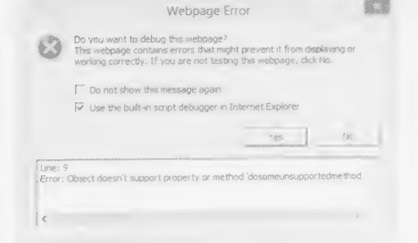

**图 2-3** 一个未处理的异常错误对话框

遇到这样的错误，用户很可能会停止访问网站或使用该应用程序。为了防止此类问题，你需要将代码包装在 try 块中：

```
try {
    window.dosomeunsupportedmethod();
} catch (e) {
    alert("Browser does not support the desired functionality.");
}
```

通过使用 *try...catch* 块，你可以优雅地处理错误情况。用户看到一个标准的警报，并且网页继续正常运行。此示例代码产生图 2-4 所示的消息。

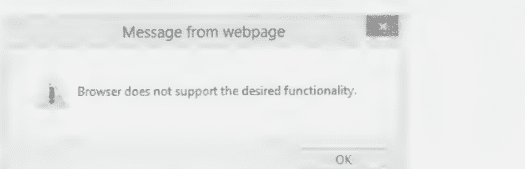

**图 2-4** 一个用于显示错误的整洁消息框

*try...catch* 块分为两部分。第一部分，*try* 部分，表示“尝试执行此操作”。如果在尝试执行操作时出现任何问题，*catch* 块将接收到一个包含有关错误信息的 *exception* 对象。*try...catch* 块的 *try* 部分中的任何代码都受到保护，免受未处理错误的影响。

*catch* 块是根据应用程序的需要处理错误的地方。*catch* 块接收一个参数，该参数是一个 *exception* 对象。表 2-8 显示了 *exception* 对象的属性。

表 2-8 *exception* 对象上可用的属性

| 属性 | 描述 |
|---|---|
| *message* | 发生的错误的文本描述 |
| *number* | 数字错误代码 |
| *name* | *exception* 对象的名称 |

你可以使用 *exception* 对象中提供的信息来决定在整体程序流程方面应该做什么。例如，如果程序需要访问它无法获得的资源并抛出异常，程序可以回退到不同的进程以实现所需的功能，或者简单地告诉用户需要更改某些内容——例如，如果网站运行需要 cookie 或其他 HTML5 API。稍后将演示检查此类情况的其他方法。

*try...catch* 块的另一个组成部分是 *finally* 块。此块直接添加在 *catch* 块之后。*finally* 块的意义在于其中的代码会始终运行。这并不是说 *finally* 块中的代码不可能有自身的错误导致异常，但无论 *try* 块中的代码是否有错误，*finally* 块中的代码都会执行。考虑以下代码：

```
function WorkthroughArray() {
    var canvas = document.getElementById("myCanvas");
    var context = canvas.getContext("2d");
    context.fillStyle = "blue";

    contxt.arc(50, 50, 25, 0, 360);

    context.fill();
    context.strokeStyle = "red";
    context.stroke();
}
```

此函数包含一个故意的拼写错误 `contxt`，这会导致一个异常。导致异常的那一行之后的所有代码都不会执行。然而，在这段代码周围放置一个 *try...catch...finally* 块可以提供对流程的更多控制：

```
try{

    var canvas = document.getElementById("myCanvas");
    var context = canvas.getContext("2d");
    context.fillStyle = "blue";

    contxt.arc(50, 50, 25, 0, 360);

    context.fill();
    context.strokeStyle = "red";
    context.stroke();
}
catch (e) {
    console.log(e.message);
}
finally {
    //do any final logic before exiting the method
}
```

现在，随着结构化错误处理就位，当执行到拼写错误的那一行时，处理流程会跳转到 *catch* 块。在此块中，可以将错误记录下来以备将来诊断。在 *catch* 块完成后，*finally* 块会运行。即使发生了异常，任何需要的清理或变量重置工作都可以在此处完成。*finally* 块也会运行。如果拼写错误被修复，使得 *try* 块中不发生异常，则 *catch* 块不会执行，因为没有什么需要捕获的，但 *finally* 块仍然会运行。*finally* 块总是作为 *try...catch...finally* 块的最后一部分执行。

变量作用域适用于 *try...catch* 块中的每个块。如果在 *try* 部分内声明了一个变量，那么从 *catch* 或 *finally* 中将无法访问它。如果你想在这些块中访问该变量，则需要将变量声明在 *try* 块之外。看这个例子：

```
var canvas;
var context;
try {
    document.getElementById("myCanvas");
    context = canvas.getContext("2d");
    contxt.arc(50, 50, 25, 0, 360);
    context.fillStyle = "blue";
    context.fill();
    context.strokeStyle = "red";
    context.stroke();
}
catch (e) {
    context.strokeText(e.message, 50, 50);
    console.log(e.message);
}
finally {
    //do any final logic before exiting the method
}
```

对画布和画布上下文的引用声明被移到了 *try* 块之外，以便可以在 *catch* 块中访问它。现在 *catch* 块可以将错误写入画布。

#### 注意使用调试工具

在 *catch* 块中添加了对 `console.log` 的调用。这是添加可在客户端调试器中查看的信息的好方法。例如，在 Internet Explorer 中，你可以通过按 F12 键访问调试器工具。

异常会沿着调用栈向上冒泡，调用栈是处理环境中一个特殊的栈，它按顺序表示当前正在处理的函数。看以下代码示例：

```
window.onload = function () {
    try {
        WorkWithCanvas();
    } catch (e) {
        console.log(e.message);
    }
}

function WorkWithCanvas() {
    var canvas = rethrow it for further processing.

引发错误的概念也称为 *抛出异常*。自定义对象和库根据需要向库的消费者抛出异常。这些对象或库期望你满足某些条件，如果这些条件未满足，它们可以抛出异常供消费者处理。继续上面的例子，异常在 *WorkWithCanvas* 方法中处理，然后重新抛出。使用 `throw` 关键字抛出异常：

```
function WorkWithCanvas() {
    try {
        var canvas = document.getElementById("myCanvas");
        var context = canvas.getContext("2d");
        contxt.arc(50, 50, 25, 0, 360);
        context.fillStyle = "blue";
        context.fill();
        context.strokeStyle = "red";
        context.stroke();
    } catch (e) {
        //handle the exception as appropriate
        throw e;
    } finally {
    }
};
```

在此示例中，异常可以在 *catch* 块中根据需要处理，然后重新抛回调用栈，以便在另一层级再次处理。

在使用自定义库时更常见的情况是，你可以创建自定义异常，以向用户提供与发生情况相关的具体信息：

```
var ball = {
    x: -1,
    y: -1,
    draw: function DrawBall(c) {
        if (this.x < 0)
            throw new Error(25, "Invalid X coordinate");
        }
}
window.onload = function () {
    try {
        var canvas = document.getElementById("myCanvas");
        var context = canvas.getContext("2d");
        ball.draw(context);
    } catch (e) {
        alert(e.message);
    }
};
```

在这段代码中，创建了一个表示球的自定义对象。它有一个 `draw` 方法，该方法期望一个画布上下文来绘制自身。然而，如果球的坐标未初始化，球对象将抛出一个自定义错误。调用代码有一个 *try...catch* 块，以便它可以处理任何意外的错误。在此示例中，球对象的消费者将获得一个有意义的消息，表明 x 坐标需要被设置为有效值。

这里使用了一个新的对象 `Error` 来创建异常。`Error` 对象构造函数接受两个参数，顺序如下：错误编号，后跟错误描述。此信息应尽可能具体，以便为调用代码提供尽可能多的细节。

#### 检查空值

防止许多错误的一种方法是在使用某些内容之前检查空值。JavaScript 程序中的空值是指变量在初始化之前所等于的值。JavaScript 知道变量的存在，但尚未赋值。

一个确保变量有值的常见位置是接受参数的函数。考虑以下函数：

```
window.onload = function () {
    try {
        var a, b, c;
        a = 5;
        b = 10;
        var result = multiplyNumbers(a, b, c);
        alert(result);
    } catch (e) {
        alert(e.message);
    }
}

function multiplyNumbers(first, second, third) {
    if (first == null || second == null || third == null)
    {
        throw new Error(5, "Forgot to initialize a number.");
    }
    return first * second * third;
}
```

在这段代码中，开发者忘记初始化变量 `c`，导致其值为 null。在 `multiplyNumbers` 方法中，会检查参数是否为 null 值，如果发现，则会抛出错误。如果此方法不检查空值，并假定每个调用它的开发者都不会犯错，那么结果对方法的消费者来说将是意料之外的。在这种情况下，结果将是 `NaN`（非数字），这是一种特殊的 JavaScript 类型。这是因为尝试对空值执行数学运算。


*思考实验*

#### 异常处理的微观管理

在这个思考实验中，运用你所学的关于此目标的知识。你可以在本章末尾的“答案”部分找到这些问题的答案。

异常处理背后的原因，显然是处理异常。在某些情况下，可以预测错误条件，如果这种情况发生，就进行处理和解决。在这种情况下，你可能不想简单地将整个代码块包装在一个大的 *try...catch* 块中，导致应用程序无法继续运行。

如何将 *try...catch* 块的使用融入到包含多个潜在错误点的较长 JavaScript 例程中？有些错误可以纠正，有些可能无法纠正。可纠正的错误应该允许脚本成功继续。

#### 目标总结

- JavaScript 语言以 *try...catch...finally* 块的形式提供结构化错误处理。
- *try...catch...finally* 块提供了一种尝试某些逻辑、捕获错误并适当处理，以及最终进行一些清理的方法。
- *finally* 块无论是否抛出异常，总会运行。
- 在访问任何对象之前检查空值以确保它们已初始化是一种良好的实践。

#### 目标复习

1. 哪个语句正确描述了使用 *try...catch...finally* 块进行适当的错误处理？

    **A.** 适当的错误处理允许代码处理继续，并提供适当的用户反馈。

    **B.** 适当的错误处理允许用户修复网页的问题。

    **C.** 适当的错误处理允许你在运行时调试应用程序。

    **D.** 适当的错误处理允许你抑制脚本中的所有错误。

2. 以下哪项不是异常对象的属性？

    A. message
    B. description
    C. number
    D. name

3. 为什么检查空值是一种良好的实践？

    A. 检查空值可以防止在对象初始化之前使用它。
    B. 检查空值可以防止导致 NaN 的错误。
    C. 检查空值可以避免需要抛出自定义错误。

### 目标 2.4：实现回调

回调是一种设计模式，在需要处理多线程或需要异步执行某些操作时使用。回调的概念非常直接，并且在本书中被大量使用。回调的思路是调用一个函数来运行，但当它完成时，使用通常某种操作结果或状态来回调一个指定的函数。本章前面的“使用高级数组方法”部分演示了数组对象上接受回调作为参数的几个函数。通用模式如下所示：

```
<script>
    window.onload = function () {
        WillCallBackWhenDone(MyCallBack, 3, 3);
    }
    function WillCallBackWhenDone(f, a, b) {
        var r = a * b;
        f(r);
    }
    function MyCallBack(result) {
        alert(result);
    }
</script>
```

在这个代码示例中，声明了两个函数：*WillCallBackWhenDone* 和 *MyCallBack*。*WillCallBackWhenDone* 函数的一个参数是一个函数，后面跟着另外两个变量，在本例中是将被相乘的数字。乘法的乘积被传递给回调函数。这个例子对于回调的使用有点夸张，但它确实演示了涉及的模式。任何时候调用一个期望函数作为参数的函数，这就是它的作用。了解回调函数将接收哪些参数很重要，以便在参数列表中指定它们。

回调的另一个常见用途是作为事件。每当触发一个 DOM 事件时，它使用的就是回调模式。一个函数作为参数或属性提供，以指示当特定事件发生时，例如 *mouseover*，调用指定的函数来运行与终端用户操作相关的一些自定义逻辑。

JavaScript 和浏览器作为 HTML5 规范一部分公开的许多 API 都涉及回调的使用。在此目标中，将研究 WebSocket API。同时，介绍了 jQuery 在发出异步 JavaScript 和 XML（AJAX）调用方面的应用。还讨论了使用匿名函数设置事件和实现回调的能力。最后，本目标涵盖了 `this` 指针的使用。

**本目标涵盖如何：**

- 使用 WebSocket API 实现双向通信
- 使用 jQuery 和 AJAX 使网页动态化
- 使用 jQuery 设置事件
- 使用匿名函数实现回调
- 使用 `this` 指针

#### 使用 WebSocket API 实现双向通信

WebSocket API 为你的 Web 应用程序提供双向通信支持。WebSocket 极大地简化了数据的发送和接收方式。传统方法，如长轮询，已经存在很长时间，并且至今仍广泛应用于整个网络。然而，传统技术使用较重的 HTTP 机制，这使得应用程序固有地效率较低。使用 WebSocket API 允许直接通过套接字连接到服务器。这是一种更轻量级的连接，并且是完全双向的；可以发送和接收二进制和基于文本的数据。

> **注意 接受套接字连接**

WebSocket API 的完整实现要求 Web 服务器具有能够接受套接字连接的适当服务器端实现。Node.js 等技术非常适合此目的。此类技术的实现超出了本书的范围，这些代码示例假定存在这样的实现。

WebSocket API 的使用非常适合实时应用程序，例如信使/聊天应用程序、基于服务器的游戏，以及更高级的场景，例如 WebRTC（Web 实时通信）视频会议。通过 WebSocket 传输的数据可以是基于文本的或二进制的。清单 2-1 中的代码演示了 WebSocket API。

##### 清单 2-1 WebSocket API 的实现

```
<script type="text/javascript">
    window.onload = function (){
        var wsConnection;
        var chatBox = document.getElementById("chatWindow");
        var disconnectButton = document.getElementById("Disconnect");
        var connectButton = document.getElementById("Connect");
        var sendButton = document.getElementById("Send");
        var msgToSend = document.getElementById("msgSendText");
        disconnectButton.onclick = function () {
            wsConnection.close();
        }
        connectButton.onclick = function () {
            //或使用 wss 进行安全的 WebSocket 连接。例如：wss://studygroup.70480.com
            //打开 WebSocket
            wsConnection= new WebSocket('ws://studygroup.70480.com', ['soap', 'xmpp']);
        }
        sendButton.onclick = function () {
            //检查连接状态
            if (wsConnection.readyState == WebSocket.OPEN) {
                //向服务器发送消息。
                wsConnection.send(msgToSend.value);
            }
            else
                return;
            //在聊天窗口中显示消息。
            NewLine();
            chatBox.value = chatBox.value + "You: " + msgToSend.value;
            //清空消息文本框
            msgToSend.value = '';
        }
        // WebSocket 连接建立时的事件处理器
        wsConnection.onopen = function () {
            chatBox.textContent = chatBox.textContent +
            "System: 连接已建立";
        }
        // WebSocket 遇到错误时的事件处理器
        wsConnection.onerror = function (err) {
            //向屏幕写入错误信息
            NewLine();
            chatBox.value = chatBox.value + "System: 发生错误。 ";
        }
        wsConnection.onclose = function () {
            //写入连接已关闭的信息。
            NewLine();
            chatBox.value = chatBox.value + "System: 连接已关闭。";
        }
```


wsConnection.onmessage = function (msg) {
    //write message
    NewLine();
    chatBox.value = chatBox.value + "Them: " + msg.data;
}
//helper functions.
function NewLine()
{
    chatBox.textContent = chatBox.textContent + '\r\n';
}
</script>
<body>
    <div align="center">
        <div>
            70-480 学习小组聊天论坛
        </div>
        <div>
            <textarea id="chatWindow" style="height: 500px; width: 300px"></textarea>
        </div>
        <div>
            <input type="text" id="msgSendText" style="width: 300px"/>
        </div>
        <div>
            <button id="Disconnect">断开连接</button>
            <button id="Connect">连接</button>
            <button id="Send">发送</button>
        </div>
    </div>
</body>
```

您将主要使用 **WebSocket** 对象，它在构造函数被调用时连接到套接字。在清单 2.1 中，声明了一个变量，但在用户点击连接按钮之前不会实例化。当用户点击该按钮时，WebSocket 会使用适当的连接信息进行实例化：

```
wsConnection= new WebSocket('ws://studygroup.70480.com', ['soap', 'xmpp']);
```

WebSocket 构造函数接受两个参数：

- 要连接的服务器端套接字的 URL，始终以前缀 `ws` 或 `wss`（用于安全的 WebSocket 连接）开头
- 可选的子协议列表

当调用 WebSocket 构造函数时，WebSocket API 会建立与服务器的连接。在此阶段，可能会发生两种情况之一。WebSocket 将成功连接到服务器，或者连接失败并导致错误。应处理这两种情况，以便为应用程序用户提供适当的反馈。WebSocket API 为每种情况提供了相应的事件，称为 *onopen* 和 *onerror*，如前面清单 2-1 所示：

```
// 当 WebSocket 连接建立时的事件处理程序
wsConnection.onopen = function () {
    chatBox.textContent = chatBox.textContent +
        "System: Connection has been established";
}
// 当 WebSocket 遇到错误时的事件处理程序
wsConnection.onerror = function (err) {
    //write an error to the screen
    NewLine();
    chatBox.value = chatBox.value + "System: Error Occurred.";
}
```

在此示例中，两个事件处理程序都在聊天窗口中提供反馈，让用户知道连接成功或发生了错误。错误事件可能随时发生，不仅仅是在建立初始连接时。

当成功建立连接后，您可以通过套接字发送和接收消息。要发送消息，WebSocket API 提供了 *Send* 函数。要接收消息，WebSocket API 提供了 *onmessage* 事件处理程序。这两种方法展示了处理双向通信的函数和事件：

```
wsConnection.onmessage = function (msg) {
    //write message
    NewLine();
    chatBox.value = chatBox.value + "Them: " + msg.data;
}
sendButton.onclick = function () {
    //check the state of the connection
    if (wsConnection.readyState == WebSocket.OPEN) {
        //send message to server.
        wsConnection.send(msgToSend.value);
    }
    else
        return;
    //show message in chat window.
    NewLine();
    chatBox.value = chatBox.value + "You: " + msgToSend.value;
    //clear message text box
    msgToSend.value = '';
}
```

第一个方法是 HTML 中提供的发送按钮的事件 handle 程序。用户点击此按钮以向聊天应用程序的其他用户发送消息。WebSocket API 提供了一种检查连接当前状态的机制。为了防止错误，会评估 *readyState* 属性以确保其当前处于打开状态。*readyState* 提供四个可能的值，如表 2-9 所述。

##### 表 2-9 WebSocket *readyState* 的可能值

| 值 | 描述 |
|-------|-------------|
| OPEN | 连接已打开。 |
| CONNECTING | 连接正在建立过程中，尚不可用。这是默认值。 |
| CLOSING | 连接正在关闭过程中。 |
| CLOSED | 连接已关闭。 |

确认连接处于适合发送消息的状态后，将调用 send 方法，参数为用户在聊天应用程序中输入的文本。此外，为了让每个用户都能看到自己的消息确实属于聊天的一部分，该消息会被添加到聊天窗口中。

当聊天应用程序的其他用户向系统发送消息时，服务器会调用在 *onmessage* 中指定的事件处理程序。*onmessage* 事件接收一个消息参数，其 data 属性包含该消息。此消息被提取并显示在聊天窗口中供用户查看。

当聊天会话结束时，用户应能够干净地退出。这通过调用 *WebSocket* 对象的 close 方法来实现。close 方法可以在没有参数的情况下调用。它也允许使用两个可选参数。可以提供数字代码和原因，但不是强制的。在此示例中，连接在没有参数的情况下被关闭。当连接关闭时，会触发 *onclose* 事件处理程序：

```
disconnectButton.onclick = function () {
    wsConnection.close();
}
wsConnection.onclose = function () {
    //write the connection has been closed.
    NewLine();
    chatBox.value = chatBox.value + "System: Connection has been closed.";
}
```

当用户点击关闭按钮时，将调用 close 方法。然后，*onclose* 事件处理程序的后续调用会被实现，以便向用户显示连接确实已关闭的消息。

#### 使用 jQuery 和 AJAX 使网页动态化

到目前为止，在本书中，您已经看到了一些使用 JavaScript 使网页动态化的绝佳方法。JavaScript 是网页浏览器理解的语言。在某些情况下，使用纯 JavaScript 或浏览器中可用的标准 JavaScript 库可能很繁琐。这时 jQuery 就会派上用场。jQuery 是一个 JavaScript 库，专门用于操作 DOM 以使网页动态化。

在上一节中，您探讨了如何使用 WebSocket API 打开与服务器的双向通信通道。在本节中，您将研究如何使用 jQuery 和 AJAX 向服务器发出请求以检索页面的更新内容。在传统的 Web 开发中，当需要更新页面上的内容时，会向服务器请求页面本身，服务器端代码可以运行以获取新内容（可能来自数据库），并使用更新后的信息重新渲染页面。用户体验会有闪烁，因为整个页面需要刷新。AJAX 的使用通过允许您通过 JavaScript 发出服务器端请求而无需请求完整的页面刷新，解决了这个问题。您可以在没有 jQuery 的情况下实现 AJAX；然而，由于 jQuery 提供的流行性和易用性，使用 jQuery 来实现这种类型的功能要理想得多。

通过 jQuery 和 AJAX 使用 JavaScript 从服务器请求数据，您可以在后台检索数据，然后使用学过的各种 DOM 操作技术来更新页面上需要更新的特定区域。这避免了将整个页面的请求发送回服务器的需要，并创造了更加愉快的用户体验。

对于此示例，您将创建一个用于搜索水果的虚构网站。该页面包含一个输入框，用于输入描述水果的形容词，并返回任何匹配结果的水果。网页的设置如清单 2-2 所示。

##### 清单 2-2 水果查找器网页

```
<html>
    <head>
        <script src="jquery-2.0.3.min.js" type="text/javascript"></script>
        <script type="text/javascript">
            window.onload = function () {
                $('#searchButton').click(function () {
                    var searchPath;
                    $('#searchResults').empty();
                    switch ($('#searchFruit').val()) {
                    case 'long':
                        searchPath = "Fruit/Long.xml";
                        break;
                    case 'round':
                        searchPath = "Fruit/Round.xml";
                        break;
                    case 'orange':
                        searchPath = "Fruit/Orange.xml";
                        break;
                    default:
                        InvalidSearchTerm();
                    }
                });
            };
        </script>
    </head>
    <body>
        <h1>Fruit Finder</h1>
        <input type="text" id="searchFruit" size="50">
        <input type="button" id="searchButton" value="Find">
        <div id="searchResults"></div>
    </body>
</html>
```


 ```
$.ajax({
    url: searchPath,
    cache: false,
    dataType: "xml",
    success: function (data) {
        $(data).find("fruit").each(
            function () {
                $('#searchResults').append($(this).text());
                $('#searchResults').append("<BR />");
            }
        )
    }
});

function InvalidSearchTerm() {
    $('#searchResults').empty();
    $('#searchResults').append('Invalid Search Term. Please try again.');
}
</script>
</head>
<body>
    <div>
        Enter search term: <input type="text" id="searchFruit"/>
        <input type="button" id="searchButton" value="Search"/>
    </div>
    <div>
        <h1>Results:</h1>
    </div>
    <div id="searchResults">
    </div>
</body>
</html>
```

在本代码清单中，用户会看到一个非常简单的用户界面，他们可以在其中输入搜索词，并根据该搜索词检索结果集。在本例中，用户可以输入一个受支持的搜索词之一，并获取服务器返回的数据。数据请求通过AJAX完成，因此整个页面不需要刷新，只有显示结果的区域会更新。页面上需要数据的部分是页面中唯一受新数据接收影响的部分。

这段代码首先为搜索按钮的点击事件设置了一个事件监听器。所有的神奇之处都在这个函数中发生。搜索词会被评估，以确保它与受支持的搜索词之一匹配。如果不匹配，用户会看到一个提示信息。如果匹配，代码会继续向服务器发起AJAX调用，以获取与搜索词匹配的正确数据集。在本例中，这是一个硬编码的XML文件。但是，只要返回的XML符合网页预期的模式以便解析和显示，数据源是什么并不重要。

AJAX调用有几个重要的参数可以设置。看看清单2-2中的AJAX调用：

```
$.ajax({
    url: searchPath,
    cache: false,
    dataType: "xml",
    success: function (data) {
        $(data).find("fruit").each(
            function () {
                $('#searchResults').append($(this).text());
                $('#searchResults').append("<BR/>");
            })
    }
});
```

第一个设置的参数是AJAX调用将请求的*url*。出于安全原因，为了防止跨站脚本攻击，这个URL必须与网页本身处于同一个域中。

下一个参数*cache*是可选的，指示该调用是否可以使用缓存副本。第三个参数*datatype*指示预期的数据类型，例如可以是XML或JavaScript对象表示法（JSON）。

本例中设置的最后一个参数是success属性。这个参数接受一个函数，AJAX调用的结果将被传递给这个函数，以便网页对其进行一些处理。在本例中，结果被解析并添加到DOM中，以便用户可以看到结果。

另一个可以在AJAX调用中设置的属性，作为良好实践，是*error*属性，这样可以优雅地处理任何错误情况。这是添加了错误函数设置的代码清单：

```
$.ajax({
    url: searchPath,
    cache: false,
    dataType: "xml",
    success: function (data) {
        $(data).find("fruit").each(
            function () {
                $('#searchResults').append($(this).text());
                $('#searchResults').append("<BR />");
            })
    },
    error: function (xhr, textStatus, errorThrown) {
        $('#searchResults').append(errorThrown);
    }
});
```

错误函数被传递了三个有用的参数：

- HTTP请求本身
- HTTP错误编号（例如404）
- 错误文本（例如Not Found）

你可以通过将某个搜索词更改为返回无效路径来模拟404错误。

jQuery AJAX工具包不仅支持获取数据，还支持向服务器发送数据。默认的请求类型是GET。要将调用改为POST，你需要将属性的值更改为POST：

```
$.ajax({
    url: searchPath,
    cache: false,
    dataType: "xml",
    type: "POST",
    success: function (data) {
        ...
    },
    error: function (xhr, textStatus, errorThrown) {
        $('#searchResults').append(errorThrown);
    }
});
```

也许网站用户知道属于某个类别的其他水果。可以增强页面，允许用户输入水果名称并将其提交到XML文件中，以便后续搜索包含它。理想情况下，在这种情况下，你应该使用POST方法调用一个服务器端函数，该函数接受这些数据并将其存储在XML文件中。

#### 使用jQuery绑定事件

在目标2.2"引发和处理事件"中，你了解了如何为DOM或用户与DOM交互可以调用的各种操作设置事件监听器。Web开发人员最常遇到的问题之一就是跨浏览器兼容性。虽然这个话题很大，本书没有足够的篇幅详细讨论跨浏览器兼容性，但jQuery是可用于帮助解决这一问题的工具包之一。在清单2-2中，你看到了一个jQuery语法绑定事件的示例：

```
$('#searchButton').click(function () {

}
```

在本示例中，使用jQuery选择器语法通过名称查找页面上的搜索按钮。然后将click事件分配一个函数，该函数在按钮被点击时运行。

这个语法非常强大。除了具有跨浏览器友好性之外，它在如何将事件处理程序分配给对象方面还具有很大的灵活性。这个jQuery选择器语法支持文档对象暴露的所有相同类型的搜索。但区别jQuery与文档对象的地方在于，jQuery可以在一行中为一个结果集中的所有元素分配样式或事件。

假设以下HTML构成了网页的标记：

```
<body>
    <table>
        <tr>
            <td id="door1">Door 1</td>
            <td id="door2">Door 2</td>
            <td id="door3">Door 3</td>
        </tr>
    </table>
</body>
```

以下脚本是向DOM元素分配事件处理程序的更传统方法：

```
<script type="text/javascript">
    window.onload = function () {
        document.getElementById("door1").onclick = function () { };
        document.getElementById("door2").onclick = function () { };
        document.getElementById("door3").onclick = function () { };
    }
</script>
```

这个相当简单的脚本只有三个单元格需要添加点击事件。但如果页面变得更复杂，有多达20或50个门，迁移代码会变得繁琐。这就是jQuery可以简化事情的地方。上述代码可以被以下代码替代：

```
$("document").ready(function () {
    $("td").click(function () { });
});
```

注意这段代码有多么简单。在一行中，所有`<td>`元素都被分配了点击事件。这段代码适用于页面上所有`<td>`元素。因此，如果某些`<td>`元素不属于页面的一部分，你需要确保选择器对所必需的元素是唯一的。这可以通过层叠样式表（CSS）或使用DOM层次结构来实现，如本例所示：

```
$("document").ready(function () {
    $("#GameRow td").click(function () {
        alert( $(this).text());
    });
});
```

```
<table>
    <tr id="GameRow">
        <td id="door1">Door 1</td>
        <td id="door2">Door 2</td>
        <td id="door3">Door 3</td>
    </tr>
</table>
<table>
    <tr id="SomeOtherRow">
        <td id="cell1">Not a Door 1</td>
        <td id="cell2">Not a Door 2</td>
        <td id="cell3">Not a Door 3</td>
    </tr>
</table>
```

点击事件只分配给作为名为*GameRow*元素的子元素的`<td>`元素。jQuery提供高级选择器功能，允许对DOM的操作方式进行精细控制。

#### 使用匿名函数实现回调

回调函数无处不在。回调的概念是事件工作原理的基础。它是异步操作返回到调用者的机制。在传统编程语言中，回调是通过将指向函数的指针传递给另一个进程来实现的，这样当该进程完成或处于进程指定阶段时，会调用该函数以通知调用者某种状态。这可能是在操作完成时，并可能将数据返回给调用者。这方面的一个例子是返回数据的异步Web服务调用。在JavaScript中，原理是相同的。

在JavaScript中，函数被视为对象，通常被称为一等公民。这意味着变量可以被分配一个函数，或者一个函数可以作为参数传递给另一个函数。看到以这种方式使用函数是JavaScript中的常见约定。以这种方式使用的函数称为匿名函数。

当函数没有名称时，它被视为匿名的。以下函数声明有一个名称，因此不会被视为匿名的：

```
function SubmitClick() {
    //do some logic here
}
```

这里声明了一个可以在整个页面中使用的函数。这个函数有一个Signed-off-by: 有一个名称：*SubmitClick*。因为这个函数有名称，所以它不是匿名函数。但是，像这样的命名函数可以分配给任意多个按钮事件：

```
$("#Button1").click(SubmitClick);
$("#Button2").click(SubmitClick);
$("#Button3").click(SubmitClick);
```

使用命名函数，可以方便地复用。然而，在某些情况下，这比必要的开销更大。这也可能使代码更难跟踪，因为不容易看出点击事件处理程序中实际发生了什么。在需要为每个按钮指定不同行为的情况下，匿名函数大大简化了事情。以下代码演示了使用匿名函数替代命名函数：

```
$("#Button1").click(function () { ... });
$("#Button2").click(function () { ... });
$("#Button3").click(function () { ... });
```

每个按钮都被赋予了自己的内联函数，其中可以为每个按钮点击定制实现。在该示例中，匿名函数的使用是显而易见的，因为该函数没有名称。匿名函数的语法如下：

```
function (n,n,...,n) { body };
```

 匿名函数声明必须以 *function* 关键字开头，后面必须紧跟一对闭合的圆括号。圆括号内可以包含零个或多个参数。圆括号后面是闭合的花括号，其中编写构成函数实现的代码块。

匿名函数与命名函数之间的唯一区别在于函数签名中的名称部分。匿名函数接受参数这一概念在处理回调时非常重要。

在使用 API 时，无论是你自己的还是第三方的，所提供的功能通常都包含回调的使用。如前所述，回调是在控制权返回给调用者时处理的函数。例如，在前一节中使用 jQuery 与 AJAX 时，使用了以下代码示例：

```
$.ajax({
    url: searchPath,
    cache: false,
    dataType: "xml",
    error: function(hdr, num, txt){...}
    success: function (data) {

    }});
```

在此示例中，AJAX 调用允许你指定一些回调函数，以应对可能发生的不同情况。*error* 和 *success* 属性允许你指定一个函数，供 AJAX 框架在成功完成请求或遇到错误后调用。在每种情况下，都会指定参数来接收伴随每个回调的数据。

回调函数也可以作为参数传递给另一个函数。考虑以下示例，该示例接受用户输入来评估分数是否及格：

```
$("document").ready( function () {
    $("#Button1").click( function () {
        DoLongTask($("#inputValue").val(),
            function (result, data) {
                if (result == "SUCCESS")
                    alert(data + " is a Success");
                else
                    alert(data + " is a fail");
            });
    });
});
function DoLongTask(n,f)
{
    if (n > 10)
        f("SUCCESS", n);
    else
        f("FAIL", n);
}
```

这段代码大量使用了匿名函数和回调。第一个实例是 document ready 回调。在这种情况下，你请求渲染器在达到 ready 状态时回调到一个匿名函数：

```
$("document").ready( function () {…
```

接下来，你希望处理点击事件。在这种情况下，你向渲染器指示，当从特定按钮接收到点击时，回调到你的匿名函数：

```
$("#Button1").click( function () {…
```

接下来，在按钮点击中，你正在为页面编写自己的逻辑。从输入框中获取用户输入并传递给一个函数进行评估。该函数所做的只是评估值并产生结果。任何对结果感兴趣的调用者都可以提供一个回调函数来获取结果。

```
DoLongTask($("#inputValue").val(),
        function (result, data) {
            if (result == "SUCCESS")
                alert(data + " is a Success");
            else
                alert(data + " is a fail");
        });
```

对 DoLongTask 的调用接受两个参数：要评估的值和在完成时传递结果的回调函数。一个匿名函数作为回调传递给 DoLongTask 函数来执行。在这种情况下，回调已知提供两个参数，因此回调函数接受两个参数：原始值和评估结果。然后回调向用户提供有关计算结果的信息。

回调函数非常有用，并且在 JavaScript 开发中被广泛使用。回调函数可以以命名形式静态存在，也可以作为匿名函数动态内联提供。

#### 使用 this 指针

this 指针是 jQuery 框架提供的一个特殊对象。当使用 jQuery 对 DOM 运行选择时，this 指的是它找到的对象或它找到的对象集合。它提供了一种捷径来访问 jQuery 筛选器当前上下文中的项目。在一个简单的示例中，可以如下演示 this 关键字：

```
$("document").ready(
    function () {
        $('#floorDiv').click(function () {
            $(this).css("background-color", "red");
        })
    }
);
```

在此示例中，*floorDiv* 元素被分配了一个匿名函数，在点击时运行。在函数内部，而不是再次查询 DOM 来对该元素执行操作，*this* 关键字提供了对触发事件的元素的引用。在这种情况下，*$(this)* 提供了对 *floorDiv* 元素的引用，你可以对该元素进行任何操作。在此情况下，你只更改 *div* 的背景颜色样式属性。在更高级的场景中，选择器的结果可以返回多个元素。以下示例演示了这一点：

```
$("document").ready(
    function () {
        $('#floorDiv').click(function () {
            $("div").each(function () { $(this).css("background-color", "red"); });
        })
    }
);
```

在此示例中，当点击 *floorDiv* 时，*$("div")* 查找页面中的所有 *div* 元素。然后它调用 *each* 操作符，该操作符为返回的每个元素调用传递给它的回调函数。然后，使用 *$(this)* 来修改每个 *div* 的背景颜色。这样，使用 *this* 关键字极其高效，因为它以很少的代码提供了对每个元素的快速直接访问。

#### 思维实验

##### 创建聊天应用程序

在这个思维实验中，应用你在这个目标中学到的知识。你可以在章节末尾的"答案"部分找到这些问题的答案。

你会使用 WebSockets 还是 AJAX 来创建 JavaScript 中的异步双向通信应用程序？对于这个思维实验，描述你将如何创建一个基于 HTML5 JavaScript 的实时聊天应用程序。

### 目标摘要

- WebSockets 提供与服务器的双向通信。
- WebSockets 支持与服务器的非安全 (*ws*) 和安全 (*wss*) 连接。
- jQuery AJAX 框架提供了一种进行异步 Web 请求的机制。
- 你可以使用 jQuery 选择器语法来连接事件。

#### 目标复习

1. 以下哪项是有效的 WebSocket 实例化？
   A. `wsConnection = new WebSocket('http://studygroup.70480.com');`
   B. `wsConnection = twee}(\tbrm)/wrm=rhr('tcp://studygroup.70480.com',['soap','xmpp']);`
   C. `wsConnection = new WebSocket('wss://studygroup.70480.com',['soap','xmpp']);`
   D. `wsConnection = new WebSocket('ftp://studygroup.70480.com',['soap','xmpp']);`

2. 以下哪条语句正确处理了从 WebSocket 接收数据？
   A. `wsConnection.onpost = function(msg){...};`
   B. `wsConneciton.onreceive = function(msg){...};`
   C. `wsConnection.onmessage = function(msg){...};`
   D. `wsConnection.ongetdata = function(msg){...};`

3. 哪项列表标识了进行 AJAX 调用需要设置的属性？
   A. *cache*, *datatype*, *success*
   B. *url*, *cache*, *datatype*, *success*
   C. *url*, *datatype*, *onsuccess*
   D. *url*, *datatype*, *oncomplete*

4. 为什么使用 jQuery 连接事件更容易？
   A. 它允许你通过选择器语法一次性为多个元素分配事件监听器。
   B. 使用 jQuery 连接事件与使用 *addEventListener* 方法没有区别。
   C. jQuery 在循环中工作效率更高。
   D. jQuery 允许命名函数和匿名函数都用作事件监听器。

### 目标 2.5：楼上的 Web Worker 进程

Web workers 提供了一种开发多线程 JavaScript 应用程序的方式。JavaScript 是单线程环境。在 JavaScript 中运行的所有内容都是同步排队执行的。这在大多数应用程序中可能不明显，因为客户端计算机上可用的处理能力通常远远超过网页在客户端计算机上所需的处理能力。然而，在更密集的 Web 应用程序中，你可能已经看到浏览器发出的警告消息，提示脚本正在运行并且需要很长时间才能完成。事实上，这些警告为用户提供了立即停止页面上脚本运行的选项。这种用户体验不会让用户再次访问该网站。这就是 Web Worker API 有用的地方。

- 本目标涵盖以下内容：
  - 开始使用 Web Worker 进程
  - 使用 Web Worker API 创建 Worker 进程
  - 使用 Web Worker
  - 了解 Web Worker 的限制
  - 配置超时和间隔

#### 开始使用 Web Worker 进程

Web Worker API 使你能够指定某些工作应在它们自己的线程上处理。这样做有很多优点，但也有一些你需要注意的陷阱。在本目标中，你将学习如何使用 Web Worker API 来利用它为 Web 应用程序带来的灵活性。你还将了解使用 Web Workers 的注意事项和警告。

本目标使用弹跳球示例来演示 Web Worker 的使用。清单 2-3 展示了弹跳球的基本代码。在你完成本目标中的各个部分时，它将进行调整，以实现将工作移至 Web Worker 进程。

```
<html lang="en">
<head>
<script>
window.requestAnimFrame = (function (callback) {
    return window.requestAnimationFrame || window.webkitRequestAnimationFrame
|| window.mozRequestAnimationFrame || window.oRequestAnimationFrame ||
window.msRequestAnimationFrame ||
    function (callback) {
        window.setTimeout(callback, 1000 / 30);
    };
})();
```


#### 使用 Web Worker API 创建工作进程

Web Worker API 基于 JavaScript 的消息传递框架。这种底层结构使你的代码能够向 worker 发送参数，并让 worker 将结果返回。一个基本的 web worker 通过创建一个单独的文件来建立，该文件包含将在单独线程上处理的脚本。*Worker* 对象从全局命名空间中获取，创建方式如下：

```javascript
var webWorker = new Worker("workercode.js");
```

这会实例化一个新的工作进程，并指定哪个文件包含要在 worker 线程上运行的代码。*Worker* 对象支持表 2-10 中描述的功能。

**表 2-10 *Worker* 对象操作**

| 方法 | 描述 |
| --- | --- |
| *postMessage* | 启动工作进程。此方法需要一个包含要传递给 worker 线程的数据的单个参数。如果 worker 线程不需要任何数据，可以提供一个空字符串。 |
| *terminate* | 停止工作进程继续运行。 |
| *onmessage* | 指定 worker 线程完成时回调的函数。此函数接受一个形式为 *EventData* 的单个参数，其中包含一个名为 *data* 的属性，该属性包含值。 |
| *onerror* | 指定在 worker 线程中发生错误时调用的函数。onerror 方法接收事件数据，包括以下内容：*message*：错误的文本信息 *filename*：发生错误的文件名 *lineno*：文件中导致错误的行号 |

一旦 *Worker* 对象被实例化，它就可以随时使用。启动进程只需要调用 *postMessage* 方法：

```javascript
webWorker.postMessage("");
```

一旦 *webWorker* 开始运行，主应用程序将按常规继续。如果发生需要取消工作进程的情况，调用 terminate 方法即可实现：

```javascript
webWorker.terminate();
```

在工作进程完成并且需要处理结果之后，会从 worker 调用 *onmessage* 函数。这应该在启动 worker 之前设置好：

```javascript
webWorker.onmessage = function(evt) {...}
```

这就是在调用端或 Web 应用程序中创建和管理工作进程所需的一切。接下来，你需要创建 worker 代码本身。为此，你需要创建在构造函数中使用的 workercode.js 文件。文件的第一行将是 *onmessage* 属性被赋值为一个处理函数：

```javascript
onmessage = function(e){...}
```

这告诉运行时在 worker 进程内要运行的工作的入口点。在 worker 进程中的某个地方，当需要将结果发送回调用应用程序时，会调用 *postMessage* 方法：

```javascript
onmessage = function(e){
self.postMessage(result);
}
```

这就是创建工作进程所涉及的内容。在最后一段代码中，注意 *self* 关键字的使用。*self* 关键字类似于 *this* 关键字。工作进程在其自己的上下文中运行，这意味着它有自己的全局命名空间。*self* 关键字允许访问 worker 进程内的全局命名空间。

window.setTimeout(getDirection, 30000);

var x = 176, y = 176, w = 600, h = 600, r = 26;
var d, c, s;
var rColor, gColor, bColor;
var hd = "r";
var horizontal = true;

window.onload = function () {
    try {
        c = document.getElementById("c");
        w = c.width;
        h = c.height;
        s = parseInt(document.getElementById("speedy").value);

        getDirection();
        drawBall();

        document.onkeydown = function () {
            switch (window.event.keyCode) {
                case 40:
                    horizontal = false;
                    hd = "d";
                    break;
                case 37:
                    horizontal = true;
                    hd = "l";
                    break;
                case 38:
                    horizontal = false;
                    hd = "u";
                    break;
                case 39:
                    horizontal = true;
                    hd = "r";
                    break;
            }
        }
    } catch (e) {
        alert(e.message);
    }
}

function increaseSpeed() {
    s++;
    document.getElementById("speedy").value = s;
}

function decreaseSpeed() {
    s--;
    document.getElementById("speedy").value = s;
}

function changeDirection() {
    var cx = window.event.offsetX;
    var cy = window.event.offsetY;
    x = cx;
    y = cy;
    document.getElementById("speedy").value = s;
}

function setNewPoint(d) {
    try {
        switch (horizontal) {
            case true:
                if (x < (w - r) && hd == "r")
                    x += s;
                else if (x > r && hd == "l")
                    x -= s;
                break;
            case false:
                if (y < (h - r) && hd == "d")
                    y += s;
                else if (y > r && hd == "u")
                    y -= s;
                break;
        }
        if (x >= (w - r))
            hd = "l";
        if (x <= r)
            hd = "r";
        if (y >= (h - r))
            hd = "u";
        if (y <= r)
            hd = "d";
    } catch (e) {
        alert(e.message);
    }
}

function getDirection() {
    horizontal = !horizontal;
    var d = Math.ceil(Math.random() * 2);
    if (horizontal) {
        if (d == 1) {
            hd = "r";
        } else {
            hd = "l";
        }
    } else {
        if (d == 1) {
            hd = "u";
        } else {
            hd = "d";
        }
    }
}

function drawBall() {
    try {
        var rgbFill = "rgb(0,0,0)";
        var rgbStroke = "rgb(128,128,128)";

        setNewPoint(d);
        var c = document.getElementById("canvas");
        var ctx = c.getContext("2d");
        ctx.clearRect(0, 0, c.width, c.height);
        ctx.beginPath();

        ctx.lineWidth = "5";
        ctx.strokeStyle = rgbStroke;
        ctx.arc(x, y, r, 0, 360);
        ctx.fillStyle = rgbFill;
        ctx.fill();
        ctx.stroke();
        s = parseInt(document.getElementById("speedy").value);
        requestAnimFrame(function () {
            drawBall();
        });
    } catch (e) {
        alert(e.message);
    }
}
</script>
</head>
<body>
    <canvas id="c" width="1200" height="800" style="border: 2px solid black; position: absolute; top: 50px; left: 50px;"></canvas>
    <input id="intensiveWork" type="button" value="执行工作" /><span id="workResult"></span>

    <input id="speedy" type="range" min="0" max="10" value="10" style="position:relative; visibility:hidden;" step="1"/>
</body>
</html>
```

这段代码只是在 canvas 内显示一个小球来回弹跳。用户可以使用方向键来改变小球的方向。用户期望获得流畅的体验。现在，你可以引入一个密集的数学运算，在点击按钮时发生。按钮已经在表单上，名为 *intensiveWork*。在脚本块底部添加以下函数来执行一些密集的数学运算：

```javascript
function DoIntensiveWork() {
    var result = document.getElementById("workResult");
    result.innerText = "";
    var work = 10000000;
    var i = 0;
    var a = new Array(work);
    var sum = 0;
    for (i = 0; i < work; i++) {
        a[i] = i;
        sum += i * i;
    }
    result.innerText = sum;
}
```

此函数除了计算一系列平方的和并将结果显示给用户之外，没有其他作用。在这个例子中，工作量是硬编码的，但可以扩展为从用户那里获取信息。

接下来，为按钮添加点击事件处理器：

```javascript
<script>
  ...
  getDirection();
  drawBall();

  document.getElementById("intensiveWork").onclick = function () { DoIntensiveWork(); };
  ...
</script>
```

现在，用户可以点击按钮，获取一系列连续数字的平方和。

这段代码的问题在于，尽管数学运算在进行，但小球的交互完全被阻塞了。小球停止移动，用户输入似乎被忽略，直到数学调用返回。运行计算的调用耗时过长并产生了干扰。你可以尝试使用较小的数字，最终会发现数字可以小到足以使工作执行得足够快，而不会停止小球。这并不意味着应用程序在并发执行工作，尽管视觉上没有明显的中断。


#### 使用 Web Worker

现在你已经了解了 Web Worker 的基础，你可以回到弹球示例，将密集型数学运算转移到 Worker 进程中，以免干扰弹球活动。为此，创建一个名为 CalculateWorker.js 的新 JavaScript 文件，并在其中放入以下代码：

```
onmessage = function (evt) {
    var work = 10000000;
    var i = 0;
    var a = new Array(work);
    var sum = 0;
    for (i = 0; i < work; i++) {
        a[i] = i * i;
        sum += i * i;
    }
    self.postMessage(sum);
}
```

这段代码首先将 *onmessage* 处理程序赋值为一个函数，该函数在 Worker 上下文中被生成时运行。在消息处理的末尾，它调用 *postMessage* 将结果返回给调用者。保存该文件，然后将弹球代码中 *intensiveWork* 按钮的点击事件处理程序修改如下：

```
document.getElementById("intensiveWork").onclick = function () {
    var result = document.getElementById("workResult");
    result.innerText = "";
    var worker = new Worker("CalculateWorker.js");
    worker.onmessage = function (evt) {
        try {
            result.innerText = evt.data;
        } catch (e) {
            alert(e.message);
        }
    }
    worker.onerror = function (err) {
        alert(err.message + err.filename + err.lineno);
    }
    worker.postMessage("");
};
```

在这段代码中，实现了上一节描述的模式。实例化一个新的 *Worker* 对象，并指定 CalculateWorker.js。然后将 *onmessage* 赋值为一个函数来处理 Worker 线程的结果。*onerror* 被赋值为一个函数来处理任何错误情况。最后，调用 *postMessage* 来启动 Worker。

运行这段代码并点击 Do Work 按钮。现在球会继续在屏幕上移动，并且对方向键有响应。要让 Worker 进程运行更长时间，只需增加它需要处理的数字大小即可。

为了提供停止 Worker 进程的选项，你需要实现 terminate 方法。像这样向页面添加一个按钮：

```
<input id="stopWorker" type="button" value="Stop Work" />
```

并在 *postMessage* 调用下方添加以下脚本：

```
document.getElementById("stopWorker").onclick = function () {
    worker.terminate();
}
```

接下来，先点击 Do Work 按钮，然后点击 Stop Work 按钮，可以看到工作已终止且没有返回结果。

#### 了解 Web Worker 的限制

Web Worker 非常方便。它们可以解决密集型 Web 应用中的许多处理问题。但是，也要注意 Worker 所受的限制。

#### 传递参数

*postMessage* 方法接受一个参数，使其能够将数据传递给 Worker，供其操作或使用。*postMessage* 参数是一个字符串——它可以接受任何可序列化的对象，例如原生数据类型、JSON 对象或 XML。但该参数不能是函数。

在弹球示例中，要处理的数字输入可以来自用户。可以在 HTML 中添加一个输入框，并将输入的值传递给 Worker。代码看起来像这样：

```
var value = document.getElementById("inputValue").value;
worker.postMessage(value);
```

然后在 Worker 中，可以这样访问该值：

```
onmessage = function (evt) {
    var work = evt.data;
}
```

该函数接收一个事件对象，其中包含一个名为 *data* 的属性，该属性包含传递给 Worker 的任何内容。

#### Worker 数量

虽然对可以并发处理或创建的 Worker 数量没有限制，但使用的 Worker 数量是你需要注意的。创建 Worker 是一项重量级操作。每个 Worker 都会在操作系统级别创建线程，因此应相应地使用它们。如果你需要大量 Worker，可以考虑创建一个池，以轮询方式使用，从而避免创建过多的 Worker。

#### DOM 访问

Worker 在其自己的全局上下文中运行，这意味着它们无法访问调用它们的页面的 DOM。不应从 Worker 进程中操作 DOM。Worker 上下文无法访问 window 对象、document 对象或任何父对象。

#### 子 Worker

遵循从主网页创建 Worker 的相同模式，Worker 也可以创建 Worker。传递数据和获取返回数据的所有构造都必须遵循。但是，了解将创建多少总共的 Worker 变得越来越重要。

#### 配置超时和间隔

你可以设置 Web Worker 在后台按指定间隔运行。这是通过使用现有的 `setTimeout` 或 `setInterval` 方法来实现的。`setTimeout` 方法在指定延迟后调用指定函数。`setInterval` 在每个指定时间间隔后重复调用指定函数。例如，以下代码在 3 秒后运行 Worker：

```
var work = new Worker("workerFile.js");
setTimeout(function(){
work.postMessage("");
},3000);
```

但是，以下代码每 3 秒运行一次 Worker：

```
var work = new Worker("workerFile.js");
setInterval(function(){
work.postMessage("");
},3000);
```

#### 思考题

##### 创建一个执行烟花表演的页面

在这个思考实验中，应用你学到的关于此目标的知识。你可以在每章末尾的"答案"部分找到这些问题的答案。

作为使用超时和间隔创建网页的练习，思考一下如何创建一个执行烟花表演的页面。不同类型的烟花需要以不同的间隔和延迟发射。它们各自需要飞到不同的高度，不同类型的烟花有不同的爆炸效果和颜色。

1. 更大的烟花表演会不会太过密集？为什么或为什么不？

2. Web Worker 会有助于使其更流畅吗？为什么或为什么不？

### 目标摘要

- Web Worker 允许 JavaScript 运行时提供多线程。
- Web Worker 可以有子 Worker。
- 可以使用的 Worker 数量没有限制，但过多的 Worker 会影响性能。
- Web Worker 可以接收包含 Worker 所需任何数据的单个参数。
- Web Worker 无法访问调用页面的 DOM。
- 使用 setTimeout 在运行脚本函数之前延迟。使用 setInterval 每隔指定间隔重复运行脚本函数。

#### 目标复习

1. 以下哪项不是有效的 Web Worker 操作？
   - A. postMessage
   - B. onmessage
   - C. close
   - D. terminate

2. 哪个方法可以终止 Web Worker？
   - A. *close*
   - B. *terminate*
   - C. *suspend*
   - D. *sleep*

3. 必须将 JavaScript 代码放在哪里才能在 Web Worker 上下文中运行？
   - A. 在 `<head></head>` 元素之间
   - B. 在页面中的任何 `<script>` 块中
   - C. 在它自己的 JavaScript 文件中
   - D. 作为赋给 *self.worker* 的动态函数

4. 可以同时运行多少个 Web Worker/子 Worker？
   - A. 每个处理器包含子 Worker 在内的 Web Worker 数量的四倍
   - B. 默认 16 个 Worker，但可以通过 *self.configuration* 更改该数字
   - C. 无限数量的 Worker
   - D. 最多八个 Worker，每个最多八个子 Worker

5. 要让脚本每隔 30 秒持续运行，应该使用哪行代码？
   - A. `wsConnection.repeatWork("workerFile.js",30000);`
   - B. `setTimeout(function(){ worker.postMessage("");}, 30000);`
   - C. `setTimeout( worker.postMessage(""), 30000);`
   - D. `setInterval(function(){ worker.postMessage("");}, 30000);`

## 答案

本节包含本章中思考实验的解决方案和目标复习题的答案。

### 目标 2.1：思考题

编写干净的 JavaScript 有一些明显的优势。选择正确的构造来处理问题对于实现干净的脚本目标至关重要。

*for* 循环和 *while* 循环都可以互换地完成相同的工作，但一些语义差异使其中之一在各种情况下更可取。当你知道循环必须运行多少次时，*for* 循环是理想的选择。它具有所有内置的语义来处理计数器，以迭代已知次数。它可以用 *while* 循环代替，但 *while* 循环需要额外的变量和代码添加到循环中，以处理循环运行次数的计数。

当你不知道循环将运行多少次时，*while* 循环更好；它是不确定的。这就是循环运行直到循环内的逻辑达到某种状态的地方；因此，*while* 循环基于布尔表达式进行评估。

你可以在选择 *if* 语句和 *switch* 语句时应用相同的逻辑。虽然 *switch* 语句可以很容易地被 *if* 语句代替，但反过来不成立。在 *if...else* 结构中检查单个值的相等性可能会变得冗长且繁琐。*if* 语句允许更复杂的评估，包括使用 AND 和 OR 逻辑的复合评估。*switch* 语句对于将单个值与一长串可能的值（如枚举）进行评估更有用。为问题选择正确的构造对于可读和可维护的脚本至关重要。

### 目标 2.1：复习

1. **正确答案：C**
   - A. **错误：** *if* 语句提供分支流程控制。
   - B. **错误：** *switch* 语句提供分支流程控制。
   - C. **正确：** *for* 循环提供迭代流程控制。
   - D. **错误：** *break* 关键字用于退出迭代控制块，如 *for* 或 *while* 循环。

2. **正确答案：D**
   - A. **错误：** *join* 方法将数组的所有元素连接成一个字符串。
   - B. **错误：** *combine* 不是有效方法。
   - C. **错误：** *split* 方法用于将字符串分割成子字符串数组。
   - D. **正确：** *concat* 方法将两个数组的元素组合成一个数组。


## 目标 2.2：思想实验

这个有趣的场景可能导致一个复杂的事件处理链，其中一个事件会触发其他事件。这要求你决定事件在页面中的流动方式。良好的实践是在纸上或工作流软件中设计事件的工作流程。这需要知道何时取消事件链，或允许其继续向下传递处理。

## 目标 2.2：复习

3. 正确答案：C
   - A. 错误：*for...in* 循环仅在目标列表包含至少一个元素时运行。
   - B. 错误：*while* 循环仅在布尔条件评估为 true 时运行。
   - C. 正确：*do...while* 循环在运行一次后检查布尔条件。
   - D. 错误：*for* 循环仅在条件中指定的值为 true 时运行。

4. 正确答案：B
   - A. 错误：*continue* 关键字退出当前迭代，但如果条件值仍然为 true，则继续下一次迭代。
   - B. 正确：*break* 关键字退出迭代控制循环。
   - C. 错误：*stop* 不是有效的语句。
   - D. 错误：*next* 不是有效的语句。

1. 正确答案：B
   - A. 错误：这是一种有效的方法。
   - B. 正确：CSS 不提供分配事件处理程序的方法。
   - C. 错误：这是一种有效的方法。
   - D. 错误：这是一种有效的方法。

2. 正确答案：D
   - A. 错误：匿名函数不能被调用。
   - B. 错误：匿名函数没有名称。
   - C. 错误：匿名函数可以作为参数传递。
   - D. 正确：匿名函数不能以声明方式分配给 DOM 元素。

3. 正确答案：A
   - A. 正确：`window.event.returnValue = false;` 会取消事件。
   - B. 错误：`return false;` 不会取消事件。
   - C. 错误：`window.event.Return();` 无效。
   - D. 错误：`window.stop();` 无效。

4. 正确答案：A
   - A. 正确：当元素获得焦点时，*focus* 事件触发。
   - B. 错误：当元素的值被更改时，*change* 事件触发。
   - C. 错误：当键盘按键被按下时，*keydown* 事件触发。
   - D. 错误：当鼠标指针离开元素区域时，*mouseleave* 事件触发。

## 目标 2.3：思想实验

在调用栈顶部的每个函数中实现 *try...catch* 块，是捕获导致应用程序进入错误状态的不可预见场景的重要方式。然而，这种错误处理例程可能包含你希望能够恢复的情况。嵌套 *try...catch* 块允许这种情况发生。你可以实现任意多个 *try...catch* 块。嵌套它们允许你在外层块内捕获特定场景，处理它，修正数据和/或假设，并允许脚本继续运行。

## 目标 2.3：复习

1. 正确答案：A
   - A. 正确：通过使用结构化错误处理，你可以向用户提供反馈并妥善处理未知情况。
   - B. 错误：适当的错误处理允许用户修复网页问题。
   - C. 错误：适当的错误处理允许你在运行时调试应用程序。
   - D. 错误：适当的错误处理允许你抑制脚本中的所有错误。

2. 正确答案：B
   - A. 错误：*message* 是一个有效属性，提供错误的文本描述。
   - B. 正确：*description* 不是有效属性。
   - C. 错误：*number* 属性提供与错误关联的编号。
   - D. 错误：*name* 属性提供异常对象的名称。

3. 正确答案：A
   - A. 正确：检查 null 可防止在对象初始化之前使用它，并防止意外结果。
   - B. 错误：NaN 是与 null 不同的构造。
   - C. 错误：自定义错误与检查 null 无关。抛出自定义错误可用于许多不同的场景。

## 目标 2.4：思想实验

实时聊天或实时通信的概念并不新鲜。然而，HTML5 WebSockets 使得在 HTML5 网页中实现该概念变得前所未有的容易。实现此类应用超出了本书的范围，但对于理解 WebSockets 提供的功能非常有用。以下 URL 提供了包含示例的多个搜索结果：http://www.bing.com/search?q=WebSocket+JavaScript+chat+application。

AJAX 提供异步通信，但不提供能够实现实时通信的双向功能。

## 目标 2.4：复习

1. 正确答案：C
   - A. 错误：http 不是有效的 WebSocket 协议。
   - B. 错误：tcp 不是有效的 WebSocket 协议。
   - C. 正确：wss 或 ws 是创建 WebSocket 的有效协议。
   - D. 错误：ftp 不是有效的 WebSocket 协议。

2. 正确答案：C
   - A. 错误：wsConnection.onpost 不是方法。
   - B. 错误：wsConnection.onreceive 不是方法。
   - C. 正确：wsConnection.onmessage 接收结果数据。
   - D. 错误：wsConnection.ongetdata 不是方法。

3. 正确答案：C
   - A. 错误：cache 不是必需的。
   - B. 错误：cache 不是必需的。
   - C. 正确：url、datatype 和 onsuccess 是必需的。
   - D. 错误：oncomplete 不是属性。

4. 正确答案：A
   - A. 正确：使用 jQuery 连接事件允许你通过选择器语法一次性为多个元素分配事件监听器。
   - B. 错误：jQuery 提供了更大的灵活性。
   - C. 错误：jQuery 在循环内的工作方式没有不同。
   - D. 错误：这不是 jQuery 独有的。

## 目标 2.5：思想实验

对于这样的应用，你必须考虑完成它所需的工作量。表演规模越大，应用程序就越复杂。你可以使用 `setInterval` 和 `setTimeout` 来控制表演流程。然而，烟花表演和爆炸的实际呈现非常适合使用 web worker。这允许用户界面线程在烟花动画的复杂逻辑在 worker 中运行时继续不间断地工作。

## 目标 2.5：复习

1. 正确答案：C
   - A. 错误：`postMessage` 启动在 worker 中运行的脚本。
   - B. 错误：`onmessage` 是用于跨 worker 边界接收消息的事件处理程序。
   - C. 正确：`close` 不是 web worker 上的方法。
   - D. 错误：`terminate` 用于取消 web worker。

2. 正确答案：B
   - A. 错误：`close` 不会取消 web worker。
   - B. 正确：`terminate` 取消 web worker。
   - C. 错误：`suspend` 不是有效方法。
   - D. 错误：`sleep` 不是有效方法。

3. 正确答案：C
   - A. 错误：代码必须位于其自己的文件中。
   - B. 错误：代码不能位于 `<script>` 块内。
   - C. 正确：代码必须位于其自己的 JavaScript 文件中，且文件名作为参数传递给 web worker。
   - D. 错误：不存在 `self.worker` 这样的属性。

4. 正确答案：C
   - A. 错误：存在与处理器相关的限制。
   - B. 错误：不存在 *self.configuration* 这样的属性。
   - C. 正确：可以创建的 worker 数量没有限制。但是，过多会导致性能问题。
   - D. 错误：不存在这样的限制。

5. 正确答案：D
   - A. 错误：`wsConnection.repeatWork("workerFile.js",30000);` 不是有效代码。
   - B. 错误：`setTimeout(function(){ worker.postMessage("");}, 30000);` 延迟 30 秒后运行一次匿名函数。
   - C. 错误：在 `setTimeout( worker.postMessage(""), 30000);` 中，`setTimeout` 等待指定的延迟后再运行传入的函数。在这种情况下，参数不是函数。
   - D. 正确：`setInterval(function(){ worker.postMessage("");}, 30000);` 按第二个参数（以毫秒为单位）指定的间隔调用传入的函数。


 ## 第三章

## 访问和保护数据

大多数 Web 应用程序都需要静态或动态数据。*静态数据*直接写入 HTML 标记中，不会通过 JavaScript 等代码进行修改或加载。它会渲染并显示给用户，数据无法更改。*动态*数据则可以变化。动态数据可以从新闻源更新网页上的滚动信息、捕获用户数据以执行操作并提供结果，或者甚至在数据库中存储用户的注册信息。

这两种数据方法都有优点和缺点。静态数据相当安全，因为它不会为恶意用户提供太多攻击面。然而，随着网站向更动态的站点过渡，包括数据的实时更新以及用户能够在各种字段中输入信息，攻击面就会打开，网站的安全性可能会降低。

了解如何防止恶意用户对你的应用程序甚至你的用户造成伤害非常重要。你可以利用用于防止恶意使用的相同机制来简化用户体验并保持数据的整体清洁。某些数据元素，如电话号码和电子邮件地址，可以以不同的格式提供。由于此类信息可能非常重要，你希望让用户尽可能容易地输入它。拥有完整的地址信息并确保所有必要字段都已填充也可能非常重要。HTML5 支持正则表达式和 required 属性等构造，以支持实现这些类型的规则。在本章的目标中，涵盖了通过 HTML5 声明式地以及使用 JavaScript 验证用户输入。

在其他场景中，进出网站的数据要么是消费数据流，要么是向另一个目标提供数据。如今的网站通常与社交网络更新有直接链接。在这些情况下，数据的检索和发送是不可见的，即用户不参与该过程。这些流程应该得到精简，不应干扰网站的用户体验。在本章的目标中，涵盖了从外部源消费数据、传输数据以及序列化和反序列化数据。

### 本章目标：

- 目标 3.1：使用 HTML5 元素验证用户输入
- 目标 3.2：使用 JavaScript 验证用户输入
- 目标 3.3：消费数据
- 目标 3.4：序列化、反序列化和传输数据

### 目标 3.1：使用 HTML5 元素验证用户输入

本目标 examines HTML5 提供的允许用户提供输入的用户界面元素。捕获用户信息的能力是一个很棒的功能。然而，你必须尽可能保护用户隐私和安全。你还必须确保网站不会打开攻击者可以利用来破坏网站服务的漏洞。保护网站的一部分是为工作选择正确的用户输入控件，并在这些控件上设置适当的属性以确保数据得到验证。对于考试，你需要了解这些输入控件以及它们用于此目的的属性。

本目标涵盖如何：

- 选择输入控件和 HTML5 输入类型
- 实现内容属性

#### 选择输入控件

HTML5 提供了各种各样的控件，使捕获用户输入变得简单且安全。在本节中，你将更详细地探索用户输入控件，并查看它们的使用示例。将创建一个调查表单模拟来演示何时应使用每种控件类型。清单 3-1 显示了该调查的完整标记。

清单 3-1 客户调查的 HTML5 标记。

```
<form>
    <div>
        <hgroup>
            <h1>Customer Satisfaction is #1</h1>
            <h2>Please take the time to fill out the following survey</h2>
        </hgroup>
    </div>
    <table>
        <tr>
            <td>Your Secret Code:
            </td>
            <td>
                <input type="text" readonly="readonly" value="00XY998BB"/>
            </td>
        ...
        <tr>
            <td>Password:
            </td>
            <td>
                <input type="password"/>
            </td>
        </tr>
        <tr>
            <td>First Name:
            </td>
            <td>
                <input type="text" id="firstNameText" maxLength="50"/>
            </td>
        </tr>
        <tr>
            <td>Last Name:
            </td>
            <td>
                <input type="text" id="lastNameText"/>
            </td>
        </tr>
        <tr>
            <td>
                Your favorite website:
            </td>
            <td>
                <input type="url"/>
            </td>
        </tr>
        <tr>
            <td>
                Your age in years:
            </td>
            <td>
                <input type="number"/></td>
        </tr>
        <tr>
            <td>
                What colors have you colored your hair:
            </td>
            <td>
                <input type="checkbox" id="chkBrown" checked="checked"/>
                Brown
                <input type="checkbox" id="chkBlonde"/>
                Blonde
                <input type="checkbox" id="chkBlack"/>
                Black
                <input type="checkbox" id="chkRed"/>
                Red
                <input type="checkbox" id="chkNone"/>
                None
            </td>
        </tr>
        <tr>
            <td>Rate your experience:
            </td>
            <td>
                <input type="radio" id="chkOne" name="experience"/>
                1 - Very Poor
                <input type="radio" id="chkTwo" name="experience"/>
                2
                <input type="radio" id="chkThree" name="experience"/>
                3
                <input type="radio" id="chkFour" name="experience"/>
                4
                <input type="radio" id="chkFive" name="experience" checked="checked"/>
                5 - Very Good
            </td>
        </tr>
        <tr>
            <td>How likely would you recommend the product:</td>
            <td>
                <br/>
                <br/>
                <br/>
                <br/>
                <input type="range" min="1" max="25" value="20"/>
            </td>
        </tr>
        <tr>
            <td>
                Other Comments:
            </td>
            <td>
                <textarea id="otherCommentsText" rows="5" cols="20" spellcheck="true">
                </textarea>
            </td>
        </tr>
        <tr>
            <td>
                Email address:
            </td>
            <td>
                <input type="email" placeholder="me@mydomain.com" required/>
            </td>
        </tr>
        <tr>
            <td>
                <input type="submit"/>
                <input type="reset"/>
                <input type="button" value="Cancel"/>
            </td>
        </tr>
    </table>
</form>
```

**注意 输入控件**

HTML5 规范定义的输入控件比本书解释的要多得多。本书专门介绍 Internet Explorer 现在支持的控件，然后是一些较小的示例来演示 Google Chrome 等其他浏览器支持的一些其他控件。

HTML 中的 `<input>` 元素表示输入控件。此元素包含一个 *type* 属性，指定要渲染的输入元素类型。`<input type=''>` 规则的例外是 `<textarea>` 和 `<button>` 元素，它们有自己的元素支持。表 3-1 概述了 HTML5 中支持的输入元素，并指示某个元素当前是否在 Internet Explorer 中支持。`<input>` 元素可用的其他属性在后面章节中讨论。

##### 表 3-1 HTML5 输入元素

| 元素 | 说明 |
|---------|-------------|
| *color\** | 提供颜色选择器 |
| *date\** | 提供日期选择器 |
| *datetime\** | 提供日期/时间选择器 |
| *month\** | 使用户能够选择数字月份和年份 |
| *week\** | 使用户能够选择数字周和年份 |
| *time\** | 使用户能够选择一天中的时间 |
| *number\** | 强制输入为数字 |
| *range* | 使用户能够使用滑块在范围内选择值 |
| *tel\** | 将输入的数据格式化为电话号码 |
| *url* | 将输入的数据格式化为正确格式的 URL |
| *radio†* | 使用户能够从选项列表中选择单个值 |
| *checkbox†* | 使用户能够在选项列表中选择多个值 |
| *password†* | 捕获密码并对输入的字符进行字形处理 |
| *button†* | 使用户能够执行操作，如运行脚本 |
| *reset†* | 重置表单中的所有 HTML 元素 |
| *submit†* | 将表单数据发布到目的地进行进一步处理 |

\*目前 Internet Explorer 不支持

†HTML5 中不是新的

##### 使用 *text* 和 *textarea* 输入类型

*text* 和 *textarea* 输入控件是最灵活的。通过使用这些控件，你可以允许用户在常规文本框中输入他们想要的任何文本。*文本框*提供单行文本输入，而 *textarea* 允许多行数据输入。以下 HTML 显示了这两种控件的标记：

```
<table>
    <tr>
        <td>
            First Name:
        </td>
```


这段代码添加了文本框来捕获诸如名字、姓氏和其他附加评论等信息。对于名字和姓氏，输入类型为标准文本框，由 type="text" 指定。这告诉渲染器显示一个输入字段，用户可以在其中输入自由格式的文本。然而，这种输入字段仅限于单行。Other Comments 文本框提供了一个多行文本区域，供用户输入文本。rows 和 cols 属性定义了文本区域的可视大小。在这种情况下，用户可以输入多行文本到文本区域中。

其他有助于控制输入到文本字段中信息量的属性是 *maxlength* 属性：

```html
<input type="text" id="firstNameText" maxlength="50"/>
```

当 *maxlength* 设置为 50 时，用户无法输入超过 50 个字符到文本字段中。

在某些情况下，你可能希望确保用户仅以特定格式输入特定信息。

##### *url* 输入类型

*url* 的 `<input>` 类型显示一个与 *text* 类型的 `<input>` 类似的文本框。然而，渲染器被指示输入类型为 *url*，因此当用户尝试提交带有此类型信息的表单时，它会验证框中的文本是否与有效 URL 的格式匹配。

> **EXAM TIP**
>
> 你可以通过多种方式验证数据。HTML5 中提供了更多选项，例如 *url* 输入类型。还可用的有 *pattern* 属性以及在 JavaScript 中使用正则表达式。这两者都将在本章后面讨论。

以下代码演示了添加到调查中的 *url* 类型：

```html
<tr>
    <td>Last Name:</td>
    <td><input type="text" id="lastNameText"/></td>
</tr>
<tr>
    <td>Your favorite website:</td>
    <td><input type="url"/></td>
</tr>
<tr>
    <td>Other Comments:</td>
    <td><textarea id="otherCommentsText" rows="5" cols="20"></textarea></td>
</tr>
<tr>
    <td><input type="submit"/></td>
</tr>
```

此代码产生如图 3-2 所示的输出到组成调查的 HTML 页面。此 HTML 代码还添加了一个输入按钮，如后面"Using the button input type"一节中所讨论的。

**图 3-2** 显示 url 输入类型的 HTML 标记

此代码演示了 *url* 输入类型在验证用户输入的文本确实是有效 URL 格式方面的强大功能。如果用户在"Your Favorite Website"框中产业发展了除 URL 之外的内容或不完整的 URL，例如 *contoso.com*，然后点击 Submit Query 按钮，结果将类似于图 3-3 所示的输出。

**图 3-3** url 输入类型的验证错误

点击按钮以调用验证。*url* 框以红色轮廓显示，并弹出工具提示来解释验证错误。在这种情况下，它检测到未输入有效的 URL。如果用户通过将 URL 指定为 *http://www.contoso.com* 来更正数据，则不会发生验证错误，输入可以成功提交。

如果你需要更大的灵活性并希望接受部分输入的 URL 信息，例如 *contoso.com*，请不要使用 *url* 输入框。指定了 *pattern* 的普通 *text* 输入会更合适。

##### 使用 *password* 输入控件

*password* 输入控件是提示用户输入敏感信息的标准方法。当你输入密码时，每个字符都会被替换为一个字形，以便任何旁观者都无法看到你的密码。

> **EXAM TIP**
>
> 你不能在 *password* 框中指定默认文本或通过 JavaScript 写入它。这是一项安全保护措施，有助于确保密码的安全。然而，浏览器提供了一种机制来存储密码，以防用户选择让浏览器记住密码。

你可以向调查添加密码文本框，以便为用户稍後完成调查提供一种检索方式。密码可以存储在服务器中以便稍后检索。以下标记被添加到 HTML 中：

```html
<tr>
    <td>
        Password:
    </td>
    <td>
        <input type="password"/>
    </td>
</tr>
```

添加此 HTML 后，调查现在显示为如图 3-4 所示。

**图 3-4** 添加了 password 输入类型的调查

同样，密码文本框看起来与其他任何文本框没有什么不同。然而，在框中输入会提供不同的体验，如图 3-5 所示。

**图 3-5** 用字形字符替换密码输入

*password* 输入类型安全地捕获信息。输入此信息的用户不希望附近的其他人能够看到他们输入的内容，从而危及他们的数据。

##### 使用 *email* 输入类型

你可以使用 *email* 输入类型来确保输入到文本框中的文本格式与有效的电子邮件地址格式匹配。能够捕获电子邮件地址通常对于启用与用户的进一步跟进很重要。此控件有助于确保输入的信息与电子邮件地址的预期格式匹配。

> **EXAM TIP**
>
> *email* 输入类型的验证仅确认输入的信息与有效电子邮件地址的预期格式匹配。它绝不验证该电子邮件地址本身是可以接收消息的有效邮箱。

以下 HTML 将电子邮件地址输入类型添加到调查中：

```html
<tr>
    <td>
        Email address:
    </td>
    <td>
        <input type="email"/>
    </td>
</tr>
<tr>
    <td>
        <input type="submit"/>
    </td>
</tr>
```

**图 3-6** *email* 地址输入类型的输出

与 *url* 输入类型一样，如果你输入的文本与电子邮件地址的格式不匹配，你会收到警告消息（参见图 3-7）。

**图 3-7** 电子邮件地址输入类型的验证

此验证有助于确保你不会误输入电子邮件地址。当然，它不能阻止你输入无效的电子邮件地址，只能防止格式与预期不符的情况，例如缺少 @ 符号或没有以 .com 或其他域名后缀结尾。

##### 使用 checkbox 输入类型

在某些情况下，当从用户那里捕获信息时，你需要能够捕获与特定问题相关的多个选择。在这种情况下，checkbox 输入控件是最佳选择。你可以提供一系列复选框，并允许用户选择所有适用的选项。

调查现在将添加一个问题，用户可以选择多个项目，如下所示：

```html
<tr>
    <td>Your age in years:</td>
    <td><input type="number" /></td>
</tr>
<tr>
    <td>
        What colors have you colored your hair:
    </td>
    <td>
        <input type="checkbox" id="chkBrown"/> Brown
        <input type="checkbox" id="chkBlonde"/> Blonde
        <input type="checkbox" id="chkBlack"/> Black
        <input type="checkbox" id="chkRed"/> Red
        <input type="checkbox" id="chkNone"/> None
    </td>
</tr>
```

在此 HTML 示例中，用户会看到他们可能使用过的头发颜色列表。因为用户可能使用过不止一种颜色，所以她可以选择多个选项。图 3-8 显示了此 HTML 的输出。

**图 3-8** 用于多项选择的 Checkbox 输入类型


##### 使用单选按钮输入类型

单选按钮与复选框类似，它都为用户提供了一个可供选择的选项列表。与复选框的不同之处在于，用户只能从列表中选择一个选项。一个例子就是要求用户对某事物进行1到5的评级。要将此类型的问题添加到调查问卷中，请在复选框下方添加以下HTML代码：

```
<tr>
	<td>
		Rate your experience:
	</td>
	<td>
		<input type="radio" id="chkOne" name="experience"/> 1 - Very Poor
		<input type="radio" id="chkTwo" name="experience"/> 2
		<input type="radio" id="chkThree" name="experience"/> 3
		<input type="radio" id="chkFour" name="experience"/> 4
		<input type="radio" id="chkFive" name="experience"/> 5 - Very Good
	</td>
</tr>
```

请注意，与所有HTML元素一样，每个*radio*输入类型都需要一个唯一的*id*。然而，*name*属性将所有单选按钮绑定在一起。通过为每个*radio*类型指定相同的*name*，浏览器就知道它们属于同一组，并且该组中只能选择一个单选按钮。图3-9显示了添加到调查问卷中的单选按钮的输出。

在此输出中，单选按钮从左到右显示，使用户只能选择一个选项。当用户将选择更改为另一个选项时，先前选择的选项会自动清除。

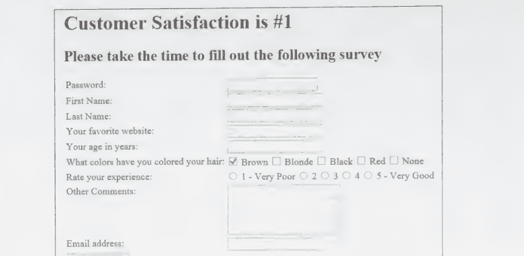

与*checkbox*输入类型一样，可以将*radio*输入的默认状态设置为选中。这可以通过完全相同的方式完成，即指定*checked*属性：

```
<input type="radio" id="chkFive" name="experience" checked="checked"/> 5 - Very Good
```

在这种情况下，评级“5 - Very Good”被默认选中，用于这组单选按钮。

你可以通过为每组按钮指定不同的*name*，在同一个页面上拥有多组单选按钮。另一种为用户提供在一组值中指定单个值的方法是使用range控件。

##### 使用 *range* 输入类型

使用*range*输入类型使用户能够通过使用滑动条在预定义的范围内指定一个值。这种类型可用于需要从更广泛的值范围中进行选择，但使用单选按钮过于笨重的情况。在单选按钮之后，向调查问卷添加另一个评级问题，如下所示的HTML所示：

```
<tr>
    <td>How likely would you recommend the product:
    </td>
    <td>
        <input type="range" min="1" max="25" value="20"/>
    </td>
</tr>
```

此HTML标记为用户提供了一个滑动条，他们可以使用该滑动条在1到25之间指定一个值。*min*属性指定范围的最小值；*max*属性指定最大值。*value*属性指定一个默认值。如果省略*value*属性，则范围默认为最小值。此HTML显示的输出如图3-10所示。

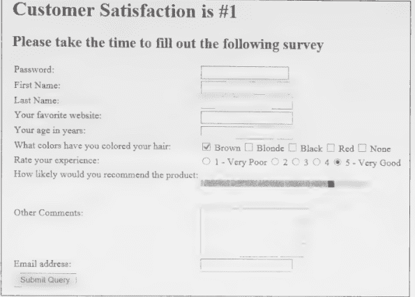

**图3-10** 添加到HTML表单中的range输入元素

在此输出中，range控件显示为一个滑动条。该条默认为标记中指定的值20。用户可以抓取滑动条的黑色端点，通过向左或向右拖动来降低或提高值。当用户更改值时，工具提示会显示滑动条所在的当前值。在这种情况下，用户现在的值是17（见图3-11）。


**图3-11** 当用户更改range值时，显示当前值的工具提示。

用户输入所有所需信息后，他们需要一种提交或保存信息的方法。提交按钮已经预览过了。

##### 使用 *button* 输入类型

允许用户提交表单或清除表单的输入类型是*button*。*button*输入并非HTML5的新特性，但它是数据捕获拼图中的关键部分。按钮告诉网站用户何时完成某项操作以及他们想要执行某个动作。`<input>`元素支持三种类型的按钮控件：*submit*、*reset*和*button*。

**考试提示**

任何东西都可以成为“按钮”。因为大多数DOM元素都有*click*事件，或者至少有*mousedown*和*mouseup*事件，所以可以捕获点击的概念并处理自定义操作。这本质上可以将DOM的任何部分变成“按钮”。

*submit*输入类型告诉HTML表单将其信息发送到服务器（或者在某些情况下，发送到另一个网站或网页）。*reset*类型会自动将所有表单元素清除为它们的默认值。*button*类型提供一个通用的按钮，没有预定义的功能。它可以用于提供自定义功能，例如取消当前页面并返回主页。所有三种按钮类型都添加到调查问卷页面的底部，如下所示：

```
<tr>
    <td>
        <input type="submit"/>
        <input type="reset"/>
        <input type="button"/>
    </td>
</tr>
```

这就是为页面上的每个按钮添加功能所需的全部内容。当然，type="button"需要连接一些JavaScript才能实际执行某些操作。然而，提交和重置按钮带有上述内置功能。HTML在表单上提供的输出如图3-12所示。

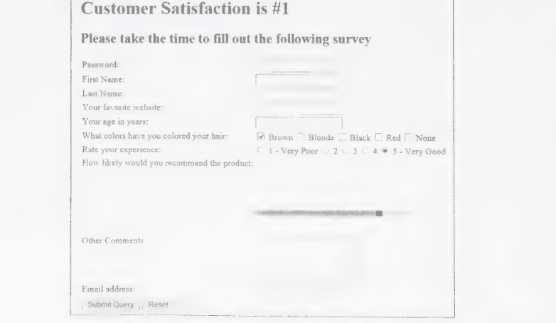

**图3-12** 添加到HTML表单中的按钮

按钮上的文本是默认文本。提交按钮带有文本“Submit Query”，重置按钮带有文本“Reset”。这是无法更改的。然而，*button*类型上没有任何文本，因为没有指定任何文本，并且该按钮没有预设任何行为。要为此按钮指定文本，请添加*value*属性：

```
<input type="button" value="Cancel"/>
```

这会产生如图3-13所示的按钮。


**图3-13** 指定了文本的button类型

这就是使用*button*输入类型得到的结果。然而，在某些情况下，希望按钮内容具有更大的灵活性。这就是*button*元素派上用场的地方。

###### 使用 *button* 元素

顾名思义，*button*元素在用户界面上提供了一个按钮。然而，从图形角度来看，这个元素的行为非常不同。

*button*元素也支持一个*type*属性，就像之前看到的：*submit*、*reset*和*button*。这个例子脱离了调查问卷，并在一个独立页面上演示了这些按钮。以下HTML被添加到一个页面中，随后的输出如图3-14所示：

```
<button type="button"/>
<button type="reset"/>
<button type="submit"/>
```


**图3-14** 所有三种类型的*button*元素

此输出如预期那样显示了三个按钮。但是，它没有在按钮上提供任何文本。*button*元素仅提供所需的点击行为，例如提交、重置或提供像*type="button"*那样的自定义行为。其他所有内容都必须在HTML中指定，包括放在按钮上的标签或文本。通过这种方式，你可以更好地控制按钮上放置的内容。文本可以设置为“Submit Survey”或“Save Data”，而不是像`<input>`元素那样的“Submit Query”。以下HTML显示了按钮上的文本，图3-15显示了输出：

```
<button type="button">Go Home</button>
<button type="reset" >Reset</button>
<button type="submit">Submit Survey</button>
```


你可以将 *button* 元素发挥到更深层次。该元素的内容不必仅限于纯文本。你可以在元素中使用 `` 元素与文本一起嵌入图片，也可以嵌入一整个可点击的段落。你还可以应用层叠样式表（CSS）来改变按钮的外观，如图 3-16 所示。HTML 代码如下：

```
<button type="button" style="border-radius: 15px;">
    <p>Something exciting lies behind this button</p>
    
</button>
```

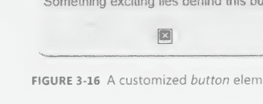

*button* 元素能够创建高度自定义的按钮，并从浏览器获得默认行为。

除了各种输入类型（如 *range*、*email* 和 *url*）提供的功能外，还有其他属性在大多数输入控件中通用，为字段验证提供了额外的灵活性。接下来将对此进行介绍。

#### 实现内容属性

输入控件提供了内容属性，允许你以声明式方式控制其在浏览器中的行为，而无需编写 JavaScript 代码。

##### 设置控件为只读

HTML 输入控件规范中包含 *readonly* 属性。如果你想在文本框等元素中向用户展示信息，但不希望他们更改这些数据，请使用 *readonly* 属性。当指定 *readonly* 时，渲染器将不允许用户更改文本框中的任何数据。以下 HTML 演示了 *readonly* 属性：

```
<tr>
    <td>
        Your Secret Code:
    </td>
    <td>
        <input type="text" readonly value="00XY998BB"/>
    </td>
</tr>
```

在这段代码中，调查表顶部为用户提供了一个与其调查对应的密钥代码。用户无法修改它，因为已指定了 readonly 属性。

对于非只读字段，用户可以在文本框中随意输入内容，此时为他们提供拼写检查功能是一个好主意。

##### 提供拼写检查器

检查拼写是验证用户输入的另一种方法。spellcheck 属性有助于向用户反馈其输入的单词是否存在拼写错误。该属性同样应用于 input 元素：

```
<textarea id="otherCommentsText" rows="5" cols="20" spellcheck="true"></textarea>
```

在此 HTML 中，"其他评论"文本区域已开启 spellcheck 选项，因为用户可以随意输入内容，可能会出现拼写错误。

在用户开始输入并出现拼写错误之前，启用了 spellcheck 的文本框输出不会有任何不同。图 3-17 显示了被检测为拼写错误的单词的红色下划线。


在某些情况下，输入控件提供的内置验证不够充分，此时提供自定义模式进行验证更为合适，下一节将对此进行探讨。

##### 指定模式

正如你所看到的，email 和 url 输入类型的内置验证在确保输入信息的准确性和预期性方面相当全面。然而，在某些情况下你可能需要更宽松或更严格的验证。假设你不想让用户在 url 类型中指定 HTTP 协议，但只允许 .com 或 .ca 网站。这可以通过使用 pattern 属性来实现，该属性允许使用正则表达式定义应接受的模式。

> 考试提示

pattern 属性仅适用于文本框。它不能用于覆盖 email 或 url 类型中内置的验证。

以下代码展示了使用 *pattern* 属性实现所需验证：

```
<input type="text" title="Only .com and .ca are permitted." pattern="^[a-zA-Z0-9\-.]+\.(com|ca)$"/>
```

有大量正则表达式可用于验证 URL；这里使用的是一个相当简单的表达式。指定 *pattern* 属性时，你也应该指定 *title* 属性。*title* 属性在验证失败时通过工具提示向用户显示错误消息。

为了确保用户以正确的格式输入数据，你应该向他们展示数据应呈现的样例。这可以通过 *placeholder* 属性来实现。

##### 使用 *placeholder* 属性

*placeholder* 属性使你能够在特定文本框中提示用户预期输入的内容。例如，email 文本框可能显示占位符文本，如 me@mydomain.com。更重要的是，当用户开始在文本框中输入信息时，占位符文本不会干扰用户。*placeholder* 属性实现了这一点，如以下 HTML 和图 3-18 所示的输出结果。

```
<input type="email" placeholder="me@mydomain.com" /></td>
```


**FIGURE 3-18** *placeholder* 属性向用户展示预期内容

占位符文本颜色稍浅。当用户将鼠标光标放入框中开始输入时，占位符文本消失，用户输入的内容取而代之。

HTML 字段可以通过多种方式进行验证。在某些情况下，关键不在于字段中输入了什么内容，而在于该字段是否确实被填写了。*required* 属性为 HTML 元素控制此行为。

##### 设置控件为必填

为确保用户填写某个字段，请在 `<input>` 元素上使用 *required* 属性。这样做可以确保用户被告知该字段为必填项。在本示例中，电子邮件地址将被设为必填文本框：

```
<input type="email" placeholder="me@mydomain.com" required/>
```

指定 required 控件后，如果用户尝试在未提供电子邮件地址的情况下提交表单，将会收到错误消息（见图 3-19）。现在用户必须指定有效的电子邮件地址才能提交。

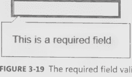

输入控件的能力可以提供相当强大的验证框架。然而，要确保网站安全可靠，还需要做更多工作。

#### 思维实验：创建动态表单

在此思维实验中，应用你对本目标所学的知识。你可以在本章末尾的"答案"部分找到这些问题的答案。

在目标 1.3 思维实验的基础上，思考如何根据用户在前一个字段中输入的内容为控件添加自定义验证。拥有一个动态创建的表单，能够随着用户在表单中的推进而更改验证规则，这非常强大。考虑电话号码、邮政编码和电子邮件地址后缀规则的不同文化差异。描述你将如何实现验证，以便为用户提供丰富上下文的验证。

#### 目标总结

- 文本和 textarea 等输入控件允许用户在网页中输入信息。
- 某些输入控件提供内置验证，例如 URL 和电子邮件地址的验证。
- 单选按钮和复选框为用户提供列表中的选择控件。
- 重置和提交按钮控制 HTML 表单的行为。
- 用户无法修改已分配 readonly 属性的控件内容。
- 你可以为文本框添加拼写检查器以帮助用户避免拼写错误。
- pattern 属性有助于为格式化数据的自定义验证定义正则表达式。
- required 属性确保在用户提交表单之前字段已被填写。

#### 目标复习

1. 哪种输入控件更适合允许用户进行多选？

   A. *单选按钮*
   B. *textarea*
   C. *复选框*
   D. *单选按钮或复选框*

2. 哪种输入控件设计用于允许用户以防止他人看到输入内容的方式输入安全信息？

   A. *text*
   B. *textarea*
   C. *url*
   D. *password*

3. 哪种输入控件将表单数据发送到服务器？

   A. *button*
   B. Submit
   C. Reset
   D. *radio*

4. 以下哪些声明是使文本控件不可编辑的有效方式？

   A. `<input type="text" edit="false"/>`
   B. `<input type="text" editable="false"/>`
   C. `<input type="text" readonly="yes"/>`
   D. `<input type="text" readonly/>`

5. 如何确保在提交表单之前所有必要字段都已填写？

   A. 编写 JavaScript 函数来评估表单上的所有控件内容。
   B. 在服务器端评估所有控件的数据，并为缺失内容返回错误页面。
   C. 在每个控件上添加 *required* 属性，使用户收到该字段为必填项的消息。
   D. 在页面上添加标签，告知用户哪些控件必须填写。


### 目标 3.2：使用 JavaScript 验证用户输入

目标 3.1 中讨论的新 HTML 控件提供了一些强大的功能来验证用户数据。然而，这些功能存在一些局限性。这就是 JavaScript 执行进一步验证派上用场的地方。JavaScript 提供了核心 HTML 控件中不易获得的额外功能。尽管某些控件在所有浏览器中尚未完全可用，但你可能需要验证用户的输入，例如日期、电话号码或字母数字邮政编码。本目标演示了如何使用正则表达式验证输入格式，以及如何使用 JavaScript 内置函数确保数据是正确的数据类型。本目标还通过演示如何防止恶意代码注入，增加了一层安全性。

#### 本目标涵盖以下内容：

-   评估正则表达式
-   使用内置函数验证数据
-   防止代码注入

#### 评估正则表达式

你在目标 3.1 中看到了正则表达式的使用。事实上，核心 HTML 输入控件支持一个 *pattern* 属性，允许你应用正则表达式来验证用户输入。然而，在某些情况下，在 JavaScript 中验证用户输入可能比使用内联属性更有效。本节将介绍正则表达式。将解释正则表达式的基本语法，以及如何在 JavaScript 中使用该表达式。

正则表达式有自己独特的语法。它们可能令人生畏，但也非常强大。尽管完整的正则表达式教程超出了本书的范围，但这里提供了一个简要介绍以支持后续示例。

## 考试提示

> 正则表达式往往会出现在考试中。你应该通过更深入地学习它们来做准备。互联网搜索应该能找到许多关于此主题的免费资源。熟悉如何解读表达式，例如用于电子邮件地址、URL 和电话号码等的表达式。

正则表达式是特殊字符和字面字符的混合，它们构成了人们想要匹配的模式。表 3-1 列出了特殊字符及其含义。

##### 表 3-1 正则表达式特殊字符

| 符号 | 描述 |
| --- | --- |
| ^ | 脱字符号表示字符串的开头。 |
| $ | 美元符号表示字符串的结尾。 |
| . | 句号表示匹配任何字符。 |
| [A-Z] | 字母表示匹配任何字母字符。区分大小写。要匹配小写字母，请使用 [a-z]。 |
| \d | 此组合表示匹配任何数字字符。 |
| + | 加号表示前面的字符或字符集必须至少匹配一次。 |
| * | 星号表示前面的字符或字符集可能匹配也可能不匹配。这会产生零次或多次匹配。 |
| [^] | 包含在字符集中时，脱字符表示取反。[^a] 将匹配不包含 'a' 的字符串。 |
| ? | 问号表示前面的字符是可选的。 |
| \w | 此组合表示匹配由任何字母数字字符（包括下划线）组成的单词字符。 |
| \ | 反斜杠是一个转义字符。如果任何特殊字符要作为字面量包含在匹配的字符集中，则需要用 \ 转义。例如，要在字符串中查找反斜杠，模式将包含 \\. |
| \s | 此组合表示匹配空格。当它与 + 或 * 组合使用时，可以匹配一个或多个空格。 |

此列表涵盖了使用正则表达式进行字符串匹配时的主要可用功能。构建正则表达式需要获取这些字符的定义，并本质上从中创建一个掩码，供正则表达式引擎解释并决定是否存在匹配。例如，加拿大邮政编码由 A1A 1A1 格式组成——即字母字符和数字字符交替，中间有一个空格。邮政编码中不使用某些字符，因为机器会将它们与其他字符混淆（例如 Z 和 2）。此外，空格不是强制性的。当你需要强制执行用户输入的数据格式时，决定你希望如何捕获数据以及你希望它有多灵活是很重要的。然后构建你的正则表达式来匹配这一点。

现在，为邮政编码构建正则表达式。你首先需要表示字符串的开头，因为它有助于消除字符串开头不必要的空白：

```
^
```

表达式的第一部分是脱字符。下一个字符必须是字母：

```
^[A-Z,a-z]
```

因为邮政编码不区分大小写，所以表达式允许第一个字符是大写或小写。邮政编码中的下一个字符必须是数字：

```
^[A-Z,a-z]\d
```

因为邮政编码接受所有数字 0-9，所以使用 \d 来指定任何数字。但是，也可以使用 [0-9]。现在模式继续，字母-数字-字母-数字-字母-数字：

```
^[A-Z,a-z]\d[A-Z,a-z]\d[A-Z,a-z]\d
```

如前所述，邮政编码中间的空格虽然常见，但不是强制性的。这决定了数据验证应该有多灵活。当前的表达式不允许中间有任何空格，因为该表达式被设置为匹配连续的交替字母-数字-字母。也许，出于格式目的，应该要求一个空格。在这种情况下，\s 将要求包含一个空格：

```
^[A-Z,a-z]\d[A-Z,a-z]\s\d[A-Z,a-z]\d
```

现在，用户需要在输入邮政编码时，在两组三个字符中间加上空格。但也许网站并不关心中间的空格，因为它实际上并不影响任何事情。在这种情况下，\s 可以用 * 来表示：

```
^[A-Z,a-z]\d[A-Z,a-z]\s*\d[A-Z,a-z]\d
```

现在，表达式允许交替的字母-数字-字母，中间可以出现一个或多个空格。空格现在是可选的，但引入了一个问题。用户现在可以输入任意数量的空格并仍然通过验证，例如：

A1A   1A1

这将通过验证，因为 \s* 要求一个或多个空格。这里期望的结果是只允许一个空格或没有空格。为此，添加一个新元素来将出现次数限制为仅一次。这通过指定要匹配的字符集的最大允许长度来实现：

```
^[A-Z,a-z]\d[A-Z,a-z]\s{1}\d[A-Z,a-z]\d
```

{1} 表示仅匹配前面的字符指定的次数——在本例中为一次。现在表达式回到了与仅指定 \s 没有区别的功能。接下来需要的是使单个空格成为可选的，用 ? 表示。为了实现这种效果，将空格部分包裹在方括号中使其成为一个集，然后跟上 ? 使其可选：

```
^[A-Z,a-z]\d[A-Z,a-z]([\s{1}])?\d[A-Z,a-z]\d
```

现在你有了一个正则表达式，它要求正确的字母数字模式，并且中间有一个可选的空格，适用于加拿大邮政编码。

这个简单的例子演示了正则表达式的关键元素。尽管这个正则表达式可以放入 <input> 元素的 pattern 属性中，但下一节讨论如何使用 JavaScript 框架使用正则表达式执行模式匹配。

#### 在 JavaScript 中评估正则表达式

就像字符串和整数一样，正则表达式是 JavaScript 中的对象。因此，它们可以被创建，并可以提供方法来评估字符串。正则表达式对象的创建方式与字符串类似；但是，不是使用 " 来封装表达式，而是使用正斜杠 /<expression>/ 代替。JavaScript 知道用正斜杠这样包围的文本是一个正则表达式对象。回到邮政编码的例子，提供了以下 HTML：

```html
<script type="text/javascript">
    function CheckString() {
        try{
            var s = $('#regExString').val();
            var regExpression = /^[A-Z,a-z]\d[A-Z,a-z][\s{1}]?\d[A-Z,a-z]\d/;
            if (regExpression.test(s))
                alert("Valid postal code.");
            else
                alert("Invalid postal code.");
        } catch (e) {
            alert(e.message);
        }
    }
</script>
<body>
    <form>
        <input type="text" id="regExString" />
        <button onclick="CheckString();" >Evaluate</button>
    </form>
</body>
```

这个 HTML 提供了一个非常基本的页面，包含一个文本框和一个按钮。按钮的功能只是调用一个函数来验证输入的文本是否符合邮政编码所需的格式。这个页面不应该包含你还没见过的内容，除了创建正则表达式对象的那一行：

```
var regExpression = /^[A-Z,a-z]\d[A-Z,a-z][\s{1}]?\d[A-Z,a-z]\d/;
```

通过这一行，创建了一个正则表达式对象，因此，提供了方法。字符串从文本框中提取并传递给正则表达式的 *test* 方法。*test* 方法返回一个布尔值，指示输入字符串是否与创建的正则表达式匹配。


正则表达式对象还提供了一个名为 *exec* 的方法。此方法返回输入字符串中与表达式匹配的部分。以下代码示例通过添加另一个按钮和函数来使用 *exec* 方法（而不是 *test* 方法）来说明这一点：

```
function CheckStringExec() {
    var s = $('#regExString').val();
    var regExpression = /^[A-Za-z]\d[A-Za-z][\s{1}]?\d[A-Za-z]\d/;
    var results = regExpression.exec(s);
    if(results != null)
        alert("Valid postal code." + results[0]);
    else
        alert("Invalid postal code.");
}
...
<button onclick="CheckStringExec();" >Evaluate with Exec</button>
```

使用此按钮时，表达式的求值方式与使用 *test* 方法时相同，不同之处在于匹配结果会作为字符串数组返回。注意返回结果是字符串数组这一点很重要，因为使用正则表达式可能导致多个匹配项。如果没有匹配成功，返回结果将为 `null`。在此示例中，通过检查数组是否不为 `null` 来评估结果；如果不为 `null`，则邮政编码有效并显示给用户。如果未匹配成功，返回值将为 `null`。

字符串对象也提供正则表达式方法。可以直接使用字符串来求值表达式。字符串提供了 *search* 和 *match* 方法。*search* 方法返回字符串中第一个匹配发生的字符索引。*match* 方法返回字符串中匹配模式的部分，与 *exec* 方法非常相似。除了这两个方法之外，许多其他字符串方法也接受正则表达式对象，例如 *indexOf*、*split* 和 *replace*。这为 JavaScript 中操作字符串提供了一些高级功能。

> 考试提示
> 该示例使用正则表达式来验证用户在网页上输入的数据。请记住，数据可能来自任何地方，例如 RSS 提供源或提供 JavaScript 对象表示法 (JSON) 的后端服务器。在这种网站期望特定格式数据的上下文中，您可以使用正则表达式来验证传入的数据，并防止网站可能崩溃或至少向用户显示错误。

虽然正则表达式在评估字符串模式和确保数据符合所需格式方面提供了强大的功能，但 JavaScript 也提供了内置函数来评估接收到的数据类型。

##### 使用内置函数验证数据

JavaScript 提供了用于评估数据类型的内置函数。有些函数直接在 JavaScript 中提供；其他函数则由 jQuery 库提供。

*isNaN* 函数提供了一种评估传入的值是否不是数字的方法。如果该值不是数字，函数返回 `true`；如果是数字，则返回 `false`。如果被评估的数据的预期形式是数字，此函数提供了一种防御性的方法来确定这一点并进行适当处理：

```
if (isNaN(value)) {
    //handle the non number value
}
else {
    //proceed with the number value
}
```

*isNaN* 函数的相反函数是 *isFinite* 函数。*isFinite* 函数的使用方式相同，但当值是有限数字时返回 `true`，否则返回 `false`。

如前所述，能够验证数据非常重要。同样重要的是，在显式验证数据时，要确保数据输入字段防止用户注入脚本。*代码注入* 是网站安全中一个被广泛讨论的话题。下一节将讨论防止代码注入。

##### 防止代码注入

代码注入是攻击者用来将 JavaScript 代码注入您的网页的一种技术。这些攻击通常利用动态创建的内容来运行额外的脚本，以便恶意用户可以尝试以某种方式控制网站。他们的意图可能多种多样，但其中之一可能是诱骗其他网站用户提供敏感信息。根据页面内容的不同，需要考虑不同的措施。

##### 防范用户输入

接受用户输入的 Web 应用程序为恶意用户开启了潜在的攻击面。攻击面的大小取决于对输入数据的处理方式。如果网站获取数据后，在当前网页范围之外没有对其执行任何操作（例如将其发送到另一台服务器或存储在数据库中），则其影响仅限于当前页面和浏览器会话。除了干扰该特定用户的网站设计之外，几乎无法完成其他任何事情。但是，例如，如果捕获的数据包括帐户创建表单或调查，则恶意用户造成损害的可能性要大得多——特别是当这些信息随后动态呈现给网页时。这本质上允许任何人向网站添加脚本，这可能会使网站暴露于网络钓鱼等行为。作为网页开发人员，您需要确保所有用户输入都去除了脚本元素。例如，不要允许在表单中输入 < > 文本。没有这些字符，就无法添加脚本块。

##### 使用 eval 函数

eval 函数用于动态运行 JavaScript。它接受一个字符串作为参数，并将其作为 JavaScript 函数运行。切勿对不受您 100% 控制的外部来源提供的任何数据使用 eval 函数。

##### 使用 iFrame

iFrame 为攻击者开启了新的机会。搜索引擎提供了大量关于利用 iFrame 的漏洞的结果。应始终使用 sandbox 属性来限制可以放入 iFrame 的数据。sandbox 属性有四个可能的值，如表 3-2 所列。

| 值 | 描述 |
| --- | --- |
| "" | 空字符串应用所有限制。这是最安全的。 |
| allow-same-origin | iFrame 内容被视为与包含它的 HTML 文档同源。 |
| allow-top-navigation | iFrame 内容可以从包含它的 HTML 文档加载内容。 |
| allow-forms | iFrame 可以提交表单。 |
| allow-scripts | iFrame 可以运行脚本。 |

#### 思考实验

###### 编码输入数据

在此思考实验中，应用您在此目标中学到的知识。您可以在本章末尾的“答案”部分找到这些问题的答案。

恶意用户在您的网页中寻找漏洞的主要方式是通过代码注入。这些代码用于发现代码中的弱点，恶意用户可以利用这些弱点诱骗合法用户重定向到恶意网站，或者——更糟的是——窃取私人数据。您可以在网页中设计哪些额外策略来帮助防止这类攻击？

#### 目标总结

- 正则表达式是解释器理解并用于验证文本格式的特殊字符字符串。
- 正则表达式是 JavaScript 中的对象，提供用于测试输入数据的方法。
- *isNaN* 是一个内置函数，用于确定一个值是否不是数字，而 *isFinite* 则验证该值是否是有限数字。
- 代码注入是攻击者用来将恶意代码注入您的应用程序的一种技术。
- 如果在网页中使用不当，iFrame 和动态 JavaScript 可能会带来危险。

#### 目标回顾

1.  以下哪个正则表达式字符表示字符串的结尾？

    A. $

    B. %

    C. ^

    D. &

2.  以下哪个 *sandbox* 属性允许 iFrame 从包含它的 HTML 文档加载内容？

    A. *allow-script-execution*

    B. *allow-same-origin*

    C. *allow-forms*

    D. *allow-top-navigation*

    E. *allow-top-document*

3.  永远不应使用哪个函数来运行 JavaScript？

    A. *execute*

    B. *JSDynamic*

    C. *eval*

    D. *evaluate*

### 目标 3.3：消费数据

此目标介绍如何在 HTML5 Web 应用程序中消费数据。从外部源消费数据的能力比以往任何时候都更加流行。网站混搭和社交集成是这方面的主要催化剂。

> 本目标涵盖如何：
> - 通过使用 Web 服务消费 JSON 和 XML 数据
> - 使用 *XMLHTTPRequest* 对象


 ## 通过使用 Web 服务消费 JSON 和 XML 数据

数据传输中常用的两种数据格式是 JSON 和 XML。JSON 是非结构化数据，而 XML 是结构化数据。JSON 使用一种特殊语法，允许以轻量级字符串格式定义名称/值对。XML 作为 HTML 的近亲，比 JSON 更具结构性，包含命名标签以及开始标签和结束标签。标签可以具有属性。以下是人员对象在两种格式中可能的样子示例，该人员对象包含名字、姓氏、发色和眼色：

- JSON：

```
{firstName: "Rick", lastName: "Delorme", hairColor: "brown", eyeColor: "brown" }
```

- XML（元素）：

```
<Person>
	<firstName>Rick</firstName>
	<lastName>Delorme</lastName>
	<hairColor>Brown</hairColor>
	<eyeColor>Brown</eyeColor>
</Person>
```

- XML（属性）：

```
<Person firstname="Rick" lastName="Delorme" hairColor="Brown" eyeColor="Brown"/>
```

在发布 Web 服务或 REST API 等数据服务时，你可以控制如何发布数据。但在使用第三方资源时，你无法控制它们发布数据的方式。

#### 使用 XMLHttpRequest 对象

JavaScript 通过 XMLHttpRequest 对象提供内置支持来接收 HTML 数据。该对象向 Web 服务、REST API 或其他数据提供程序服务发起调用。在客户端通过 JavaScript 执行此操作的优势在于，能够从外部源重新加载页面的部分内容，而无需将整个页面回发到服务器。

XMLHttpRequest 发起 HTTP 请求，并期望以 XML 格式接收返回的数据。同时支持同步和异步调用。表 3-3、表 3-4 和表 3-5 列出了 XMLHttpRequest 对象的可用事件、方法和属性。

**表 3-3** XMLHttpRequest 对象的可用事件

| 事件 | 说明 |
| --- | --- |
| onreadystatechange | 为请求状态更改时设置事件处理程序。用于异步调用 |
| ontimeout | 为请求无法完成时设置事件处理程序。 |

**表 3-4** XMLHttpRequest 对象的可用方法

| 方法 | 说明 |
| :--- | :--- |
| *Abort* | 取消当前请求 |
| *getAllResponseHeaders* | 获取完整的响应标头列表 |
| *getResponseHeader* | 返回特定的响应标头 |
| *Send* | 发起 HTTP 请求并接收响应 |
| *setRequestHeader* | 向请求添加自定义 HTTP 标头 |
| *Open* | 设置请求的属性，如 URL、用户名和密码 |

**表 3-5** XMLHttpRequest 对象的可用属性

| 属性 | 说明 |
| :--- | :--- |
| *readyState* | 获取对象的当前状态 |
| *response* | 获取从服务器返回的响应 |
| *responseBody* | 以字节数组形式获取响应正文 |
| *responseText* | 以字符串形式获取响应正文 |
| *responseType* | 获取与响应关联的数据类型，如 *blob*、*text*、*array-buffer* 或 *document* |
| *responseXML* | 以 XML DOM 对象形式获取响应正文 |
| *Status* | 获取请求的 HTTP 状态代码 |
| *statusText* | 获取与状态对应的可读 HTTP 文本 |
| *Timeout* | 设置请求的超时阈值 |
| *withCredentials* | 指定请求是否应包含用户凭据 |

最简单的形式下，使用 XMLHttpRequest 对象向服务器发起请求看起来像这样：

```
<script>
    $("document").ready(function () {
        $("#btnGetXMLData").click(function () {
            var xReq = new XMLHttpRequest();
            xReq.open("GET", "myXMLData.xml", false);
            xReq.send(null);
            $("#results").text(xReq.response);
        });
    });
</script>
```

此脚本假设 HTML 表单上有一个按钮和一个用于显示结果的 div。创建了一个新的 *XMLHttpRequest* 对象。调用 *open* 方法来指定请求类型、URI 以及是否以异步方式进行调用。表 3-6 列出了 *open* 方法的所有参数。

##### 表 3-6 XMLHttpRequest *open* 方法的参数

| 参数 | 说明 |
| :--- | :--- |
| *Method* | 用于请求的 HTTP 方法：GET、POST 等。 |
| *URL* | 向其发起请求的 URL。 |
| *async* | 一个布尔值，指示是否应以异步方式进行调用。如果为 true，则需要为 *onreadystatechange* 设置事件处理程序。 |
| *User name* | 如果目标需要凭据，则提供用户名。 |
| *Password* | 如果目标需要凭据，则提供密码。 |

> **考试提示**
>
> *open* 方法不会发起任何服务器请求。如果指定了用户名和密码，它不会在 *open* 方法中将这些信息发送到服务器。调用 *send* 方法时，用户名和密码也不会传递给服务器。凭据仅在服务器返回 401 安全响应时才会传递给服务器。

*XMLHttpRequest* 对象提供一些用于处理错误的机制。最需要考虑的常见错误是超时错误。默认情况下，超时的值为零，即无限。应始终指定超时值。代码更新如下：

```
var xReq = new XMLHttpRequest();
xReq.open("GET", "myXMLData.xml", false);
xReq.timeout = 2000;
xReq.ontimeout = function () {
    $("#results").text("Request Timed out");
}
xReq.send(null);
$("#results").text(xReq.response);
```

这将不允许调用花费超过两秒。超时以毫秒为单位表示。超过超时时间后，将调用 *ontimeout* 事件处理程序，以便在网页中适当处理这种情况。

对于此代码的另一个考虑是进行同步调用还是异步调用。理想情况下，应确保向服务获取数据的调用不会干扰用户，也不会阻塞他们，除非他们确实需要在采取Sibling采取任何进一步操作之前等待回复。同步调用（如目前示例所示）会在发起请求时阻止用户界面。为了防止这种情况，调用应该是异步的，如下所示：

```
var XMLHTTPReadyState_COMPLETE = 4;

var xReq = new XMLHttpRequest();
xReq.open("GET", "myXMLData.xml", true);
xReq.timeout = 2000;
xReq.ontimeout = function () {
    $("#results").text("Request Timed out");
}
xReq.onreadystatechange = function (e) {
    if (xReq.readyState == XMLHTTPReadyState_COMPLETE) {
        if (xReq.status = "200") {
            $("#results").text(xReq.response);
        } else {
            $("#results").text(xReq.statusText);
        }
    }
}
xReq.send(null);
```

为 onreadystate 事件分配了一个函数，在 XMLHttpRequest 对象的状态更改时运行。当请求完成时，readyState 变为完成（readyState == 4）。此时，可以评估 HTTP 返回状态是否为成功值（如 200），然后处理 XML 数据。

到目前为止用于检索 XML 数据的相同代码也可用于请求 JSON 数据。以下代码更新展示了这一点：

```
var XMLHTTPReadyState_COMPLETE = 4;

var xReq = new XMLHttpRequest();
xReq.open("GET", "myJSONData.json", true);
xReq.timeout = 2000;
xReq.ontimeout = function () {
    $("#results").text("Request Timed out");
}
xReq.onreadystatechange = function (e) {
    if (xReq.readyState == XMLHTTPReadyState_COMPLETE) {
        if (xReq.status = "200") {
            $("#results").text(xReq.response);
("</span>).text(xReq.response);
        } else {
            $("#results").text(xReq.statusText);
        }
    }
}
xReq.send(null);
```

此代码的唯一区别是传递的 URL 名称。在此情况下，端点是返回 JSON 格式数据而非 XML 的数据源。JSON 以与 XML 相同的方式显示到屏幕上。


当通过 XMLHttpRequest 对象接收数据时，需要将数据反序列化为更用户友好的格式。你可能还需要根据用户操作向服务器提交数据。下一个目标将探讨这些概念。

> 思考实验

#### 创建一个带有股票行情的网页

在这个思考实验中，运用你关于本目标所学的知识。你可以在本章末尾的“答案”部分找到这些问题的答案。

你的任务是为客户构建一个涉及股票行情的网页。你需要在页面顶部以滚动条形式为页面用户提供实时股票报价。解释你将如何构建一个动态实现此功能的 Web 应用程序，而无需回发整个网页。

#### 目标总结

- JSON 和 XML 是最常用于数据交换的格式。
- JSON 由名称/值对组成。
- XML 是基于结构化元素的文档。
- JavaScript 提供了通过 XMLHttpRequest 对象接收数据的内置支持。

#### 目标复习

1. 以下哪个是有效的 JSON 字符串？

    A. {firstName, Rick, lastname, Delorme, hairColor, brown, eyeColor, brown}
    B. {firstName: Rick; lastname: Delorme; hairColor: brown; eyeColor: brown}
    C. {firstName: "Rick"; lastname: "Delorme"; hairColor: "brown"; eyeColor: "brown"}
    D. {firstName: "Rick", lastname: "Delorme", hairColor: "brown", eyeColor: "brown"}

2. 使用 XMLHttpRequest 对象，以下哪个属性以人类可读的格式提供响应？

    A. Response
    B. responseBody
    C. responseText
    D. responseXML

3. 在 XMLHttpRequest 的哪个阶段会将用户凭据发送到服务器？

    A. 当连接打开时
    B. 当请求发送时
    C. 当就绪状态完成时
    D. 当服务器发送请求凭据的安全响应时

# 目标 3.4：序列化、反序列化和传输数据

数据可以以多种形式接收和发送。在前面的目标中，我们专门研究了 JSON 和 XML。直接将 JSON 或 XML 数据呈现给用户并不理想。用户更希望以一种更可用、可读和有意义的方式接收数据。为此，你需要将数据从 XML 字符串或 JSON 字符串转换为其他格式。将数据从一种形式转换为另一种形式的概念称为序列化或反序列化。

*序列化*是将数据放入一种用于传输的格式。*反序列化*是将传输的数据转换为可处理的内容，例如自定义对象。除了处理字符串数据，应用程序还可以处理二进制数据。应用程序可能捕获画布上的绘图或图片，并将这些数据发送回服务器。为此，需要将数据序列化为二进制流。

本目标回顾了二进制和文本数据的序列化、反序列化和传输。还回顾了通过 HTML 表单提交数据以及使用 *XMLHttpRequest* 对象发送数据的能力。

> **本目标涵盖如何：**
> * 使用 *XMLHttpRequest* 发送数据
> * 序列化和反序列化 JSON 数据
> * 序列化和反序列化二进制数据

## 使用 XMLHttpRequest 发送数据

将数据发送到服务器类似于接收数据。前面目标中的代码示例使用 *XMLHttpRequest* 对象接收数据。*XMLHttpRequest* 对象本身对发送或接收是无关的。根据对象的设置方式，它可以完成这两个任务。要发送数据，*send* 方法必须传入数据，并且该数据可以传输到 *open* 方法中 URL 指定的端点。以下代码将 XML 数据发送到服务器：

```
var xmlData = "<Person firstname='Rick' lastName='Delorme' hairColor='Brown' eyeColor='Brown' /> ";
var xReq = new XMLHttpRequest();
xReq.open("POST", "/ReceiveXMLData.aspx", false);
xReq.responseType
xReq.send(xmlData);
```

当数据传输到服务器时，它需要被序列化为 URL 端点能够理解的格式。如果端点期望 XML，则数据必须是 XML；如果它期望二进制数据，则数据必须是二进制格式。

## 序列化和反序列化 JSON 数据

浏览器原生支持处理 JSON 和 XML。JSON 对象可用于在 JSON 字符串和对象之间进行转换（序列化/反序列化）。以下代码展示了如何完成此操作：

```
var person = {
    FirstName: "Rick",
    HairColor: "Brown"
};
var jsonPerson = JSON.stringify(person);
```

person 对象已被序列化为一个 JSON 字符串，可以发送到端点 URL 进行处理。要将 person 从 JSON 字符串恢复为 person 对象，可以使用 *parse* 方法对对象进行反序列化：

```
var req = new XMLHttpRequest();

req.open("GET", "MyJsonData.json", false);
req.send(null);
var jsonPerson = JSON.parse(req.responseText);
```

当此代码运行时，person 对象会从 JSON 字符串重新构建。

## 序列化和反序列化二进制数据

捕获动态图像数据遵循与前面回顾的其他技术类似的模式。关键区别在于现在必须将 *responseType* 属性设置为 *blob*。以下代码演示了如何检索二进制图像对象并将其反序列化到网页中：

```
var xReq = new XMLHttpRequest();
xReq.open("GET", "orange.jpg", false);
xReq.responseType = 'blob';
xReq.send(null);
var blob = xReq.response;
document.getElementById("result").src = URL.createObjectURL(blob);
```

*XMLHttpRequest* 对象的 *responseType* 属性已设置为 *blob*。然后使用 response 属性提取二进制数据，将 BLOB 传递给 *URL.createObjectURL* 方法。*createObjectURL* 方法为 *img* 元素提供一个链接到 BLOB 的 URL，图像即在浏览器中显示。反之，一旦数据序列化为 BLOB，也可以立即将其提交到服务器：

```
var xReq = new XMLHttpRequest();
xReq.open("POST", "saveImage.aspx", false);
xReq.responseType = 'blob';
xReq.send(data);
```

## 使用 Form.Submit 方法

HTML 页面的 *form* 元素是表单的区域，包含通常用于从用户收集信息的输入控件。*form* 元素包含一个 *action* 属性，该属性告诉表单将数据提交到何处。以这种方式提交数据会将整个 HTML 页面回发到服务器进行处理。然而，另一种可用机制是挂接到表单的 *submit* 事件，并通过 JavaScript 处理提交。这对于通过 AJAX 请求提交表单数据非常有用，这样用户在请求处理期间无需离开当前页面。最简单的 *form* 元素如下所示：

```
<form id="signupForm" action="processSignUp.aspx">
</form>
```

在这种情况下，表单会将其数据发布到 *processSignUp* 服务器页面进行处理，该页面随后应将用户重定向回某个确认页面。处理表单提交的另一种选择是在 JavaScript 中连接事件：

```
$("document").ready(function () {
    $("form").submit(function () {
    });
});
```

在点击事件内部，可以迭代所有表单元素，从中捕获数据，并构建一个用于 AJAX 调用的查询字符串。以下代码回顾了这个概念：

```
$("form").submit(function () {

    var fName = $("#firstName").val();
    var lName = $("#lastName").val();
    var qString = "Last Name=" + lName + "&First Name=" + fName;

    $.ajax({
        url: 'processSignUp.aspx',
        type: "POST",
        data: qString,
        success: function (r) {
        }
    });
    return false;
});
```

表单中每个字段的数据被提取并连接成一个查询字符串，以从 AJAX 调用提交到服务器。尽管此方法可行，但它有一些缺点。首先，包含许多元素的表单会导致此代码变得冗长。随着新元素的添加，代码需要更新。还有另一种选择，即使用名为 *serialize()* 的 jQuery 方法。

## 使用 jQuery.serialize 方法

jQuery 提供了一种无缝的方式来对来自 HTML 表单的数据进行编码，它通过遍历传入的表单并查找输入框来构建并返回查询字符串。然后，可以将查询字符串发布到服务器进行处理。前面的代码可以这样重写：

```
$("form").submit(function () {
    var qString = $(this).serialize();
    alert(qString);
    $.ajax({
        url: 'processSignUp.aspx',
        type: "POST",
        data: qString,
        success: function (r) {
        }
    });
    return false;
});
```

在这种情况下，*jQuery.serialize* 方法处理从所有输入元素中提取数据并创建查询字符串。使用此方法的优点——除了节省大量代码——是查询字符串也会被编码。

> **考试提示**

*serialize* 方法要求所有元素都指定了 *name* 属性。前面的代码在 HTML 修改如下后有效：

```
<form id="signupForm">
    First Name:
    <input type="text" id="firstName" name="firstName"/><br/>
    Last Name:
    <input type="text" id="lastName" name="lastName"/><br/>
    <button type="submit">Submit</button>
</form>
```

*serialize* 方法作用于传递给 jQuery 的 $() 部分的任何选择器结果。但是，serialize 方法有一些你应该了解的限制。只有成功的控件才会被序列化——这意味着只有处于有效状态的控件才会被序列化。对于复选框和单选按钮等输入控件，只有处于选中状态的控件才会被考虑。对于单选按钮，因为 *name* 属性必须相同，


## 保存表单

在这个思维实验中，请运用你关于此目标所学到的知识。你可以在章节末尾的“答案”部分找到这些问题的答案。

在目标 3.1 中，我们构建了一个客户调查表。延伸这一概念，你如何使用 *XMLHttpRequest* 对象将表单中捕获的数据提交到服务器？在提交表单之前，你如何实时进行服务器端验证？为表单添加验证功能，以便将输入的电子邮件地址与电子邮件地址数据库进行比较，确保该地址此前未被使用过。

为了区分同一组中的单选按钮，你可以指定 *value* 属性来在查询字符串中区分它们：

```
<input type="radio" name="gender" value="m"/>Male
<input type="radio" name="gender" value="f"/>Female
```

*jQuery.serialize* 方法使得从表单生成参数查询字符串的代码变得更加简单，且更不容易出错。

#### 目标总结

- 浏览器通过 JSON 对象提供原生支持，用于序列化和反序列化 JSON 字符串。
- *JSON.parse* 方法将 JSON 字符串反序列化为对象，*JSON.stringify* 方法将对象序列化为 JSON 字符串。
- 通过将 *XMLHttpRequest responseType* 属性设置为值 'blob'，可以检索二进制数据。
- 默认默认情况下天王盖地虎请求方式，表单提交操作会将整个页面发送到服务器（基于 *action* 属性）进行处理。
- 处理 *submit* 事件允许你自定义表单数据如何提交到服务器。
- *jQuery.serialize* 方法提供了一个方便的快捷方式，将指定的输入控件转换为查询字符串。

#### 目标复习

1. 以下哪行代码是从名为 `jsonString` 的变量中创建对象的正确方式？
   A. `var o = JSON.split(jsonString);`
   B. `var o = JSON.stringify(jsonString);`
   C. `var o = JSON.parse(jsonString);`
   D. `var 0 = JSON.join(jsonString);`

2. 以下哪行代码允许 *XMLHttpRequest* 返回二进制数据？
   A. `request.responseType = 'binary';`
   B. `request.responseType = 'image/jpg';`
   C. `response.type = 'blob';`
   D. `request.responseType = 'blob';`

3. 提交表单时，如何控制发送到服务器的内容？
   A. 向表单添加 *submit* 按钮。
   B. 处理表单的 *submit* 事件。
   C. 指定表单元素的 *action* 属性。
   D. 确保表单上的所有元素都有名称。

## 答案

本部分包含本章思维实验的解决方案和目标复习问题的答案。

### 目标 3.1：思维实验

你已经了解了如何通过 JavaScript 访问 DOM 并修改元素。通过使用这些技术，你可以获取表单上输入控件的引用，并且基于某些元素中的用户输入，这可以触发对验证规则的修改（例如，动态更改正则表达式验证）。你可以从地理定位 API 获取用户的区域上下文。从中你可以推断出用户所在的地区，并对输入控件应用精确的验证。

### 目标 3.1：复习

1. **正确答案：C**
   - **A. 错误：** 单选按钮适用于允许单一选择。
   - **B. 错误：** 文本区域适用于多行文本框。
   - **C. 正确：** 复选框允许多项选择。
   - **D. 错误：** 单选按钮不允许选择多个选项。

2. **正确答案：D**
   - **A. 错误：** 文本框允许数据输入，但内容完全可见。
   - **B. 错误：** 文本区域允许数据输入，但内容完全可见。
   - **C. 错误：** *url* 是一种带有特殊验证规则的文本框。
   - **D. 正确：** *password* 输入类型会隐藏正在输入的字符。

3. **正确答案：B**
   - **A. 错误：** 按钮是通用的，必须具有事件处理程序才能执行自定义逻辑。
   - **B. 正确：** 提交按钮会调用表单的提交操作。
   - **C. 错误：** 重置按钮会清除表单上的所有输入字段。
   - **D. 错误：** 单选按钮用于选择列表。

4. **正确答案：C**
   - **A. 错误：** 你可以通过自定义事件来实现，但这比必要的工作更多。
   - **B. 错误：** 目标是在提交表单之前验证数据。
   - **C. 正确：** *required* 属性确保字段在提交之前包含值。
   - **D. 错误：** 标签会提供信息，但不能保证所有必填字段在提交前都已填写。

### 目标 3.2：思维实验

限制输入数据最安全的方法是限制用户可以在特定字段中输入的字符。如果字段设计为仅接受数字数据，请确保该输入控件的验证只允许数字数据。日期、文本以及用户可以自由输入的任何其他输入也是如此。正则表达式通过验证只输入了预期的字符来简化此类验证。如果文本框期望输入一个人的姓名，请不要允许输入 HTML 字符，例如 < 或 > 符号。此外，限制字段长度以匹配预期数据的类型。一个期望输入人的年龄的字段不需要 500 个字符；你可能只需要允许 3 个字符即可。

### 目标 3.2：复习

1. **正确答案：A**
   - **A. 正确：** $ 符号表示字符串的结尾。
   - **B. 错误：** % 符号不表示字符串的结尾。
   - **C. 错误：** ^ 字符表示字符串的开头。
   - **D. 错误：** & 字符不表示字符串的结尾。

2. **正确答案：D**
   - **A. 错误：** 允许脚本运行
   - **B. 错误：** 仅允许来自同一来源的内容
   - **C. 错误：** 允许表单
   - **D. 正确：** 允许来自包含 HTML 文档的内容
   - **E. 错误：** 不是有效选项

3. **正确答案：D**
   - **A. 错误：** 凭据不会随 *open* 方法传递。
   - **B. 错误：** 凭据不会随 *request* 方法传递。
   - **C. 错误：** 就绪状态是一个指示连接当前状态的属性。
   - **D. 正确：** 仅当服务器使用返回代码 401 请求时，才会传递凭据。

### 目标 3.3：思维实验

此处分配的任务是在页面顶部构建一个滚动条，这在今天的许多网站中都可以见到。股票价格行情指示器是这种应用的典型例子。该解决方案可能会结合不同的技术。在其核心，你可以实现 *XMLHttpRequest* 对象来调用提供股票数据的 API。当数据被检索后，你可以在浏览器中显示它。由于解决方案要求不发布整个页面，你需要使用动态 DOM 操作来显示结果，并使它们在页面顶部滚动。由于报价必须定期更新，你可能会包括使用计时器来定期轮询结果。

### 目标 3.3：复习

1. **正确答案：D**
   - **A. 错误：** JSON 字符串不仅仅是逗号分隔的列表。
   - **B. 错误：** JSON 字符串不是用分号分隔的列表。
   - **C. 错误：** JSON 字符串不是用分号分隔的列表。
   - **D. 正确：** JSON 字符串是一系列名称/值对，其中属性名称后跟冒号和带引号的字符串。多个名称/值对用逗号分隔。

2. **正确答案：C**
   - **A. 错误：** *Response* 不提供任何直接信息。
   - **B. 错误：** *responseBody* 以二进制格式提供结果。
   - **C. 正确：** *responseText* 以人类可读的文本形式提供结果。
   - **D. 错误：** *responseXML* 不是有效属性。


3. **正确答案：** B

**A. 不正确：** 提交按钮默认会将整个表单提交到服务器。

**B. 正确：** 在表单上处理 *submit* 事件，可以在提交前拦截表单并执行自定义操作。

**C. 不正确：** *action* 属性指定了表单应提交到的服务器端页面。

**D. 不正确：** 表单上的所有元素都应该有 name 属性，以便使用 jQuery 进行序列化。但这不会对表单提交产生影响。

# 第 4 章

## 在应用程序中使用 CSS3

使用层叠样式表（CSS）并不是一个新概念。然而，CSS3 的功能能力已经得到了极大的提升。在本章中，你将回顾 CSS3 的功能，以及如何将它们利用到 HTML5 网页应用中，为终端用户提供所需的体验。

> **注意** **结果可能有所不同**

在某些代码示例中，你可能会看到稍微不同的结果。并非所有功能都在所有浏览器中工作。本章中的示例使用 Internet Explorer 11 和 Chrome v35+ 进行验证。

### 本章目标：

- 目标 4.1：设置 HTML 文本属性样式
- 目标 4.2：设置 HTML 框属性样式
- 目标 4.3：创建灵活的内容布局
- 目标 4.4：创建动画和自适应 UI
- 目标 4.5：使用 CSS 选择器和 jQuery 查找元素
- 目标 4.6：使用 CSS 选择器构建 CSS 文件

### 目标 4.1：设置 HTML 文本属性样式

文本是所有网页应用的基础。有些网页应用的文本比其他应用多。最终，网站浏览者会阅读网站中的文本内容。CSS 提供了许多功能来自定义文本的外观，以便为你的网页应用提供独特的视觉风格。在本目标中，你将探索设置文本样式的各种方法。

**本目标涵盖以下内容：**

- 应用文本外观样式
- 应用文本字体样式
- 应用文本对齐、间距和缩进样式
- 应用文本断字样式
- 应用文本阴影样式

#### 应用文本外观样式

应用颜色、粗体或斜体等样式可以使特定文本在网页上突出显示。这些样式技术可以组合使用或单独应用。

##### 为文本应用颜色

可以通过为 CSS 元素指定 color 属性来更改文本颜色。CSS3 接受以下三种方法之一的颜色值。

- 十六进制值：将颜色指定为十六进制值，例如 #00FF00 以绿色显示文本。前两位数字（16 进制）是红色的值，接下来两位是绿色的值，最后两位是蓝色的值。这通常称为 RGB 代码。
- 颜色名称：使用单词来指定颜色值，例如 *green* 以绿色显示文本。
- RGB 函数：使用 RGB 函数指定颜色值，该函数接受三个参数，每个参数表示从 0 到 255 的颜色光谱位值。例如，rgb(0,255,0) 将绿色指定为文本颜色。

以下代码演示了每种方法的使用。

```
<style>
  h1 {
    color: #00FF00;
  }
  h2 {
    color: green;
  }
  h3 {
    color: rgb(0, 255, 0);
  }
</style>
```

图 4-1 中的输出显示了将这些样式应用到页面后的结果。

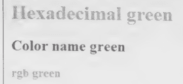

**图 4-1** 使用 CSS 指定文本颜色

使用此代码，*h1* 到 *h3* 的每个标题都应用了 CSS 样式以将颜色更改为绿色，每种方法各不相同。与在 *\<h2\>* 元素上使用颜色名称相比，使用十六进制或 RGB 方法可以对颜色进行更精细的控制。现有的颜色远远多于可命名的颜色。十六进制和 RGB 方法允许你访问完整的颜色范围。

> **注意 默认样式**

在图 4-1 中，你可以看到即使所有三个文本项目都设置为纯绿色，其中一个比其他颜色更深。重要的是要知道某些元素（如各种标题元素）已经应用了默认样式。在这种情况下，元素的样式默认为更粗的类型。

##### 为文本应用粗体

CSS 还通过 font 对象提供了对文本显示其他属性的访问。font 对象提供了将文本设为粗体或斜体的能力。以下代码演示了将所有 *\<p\>* 元素的文本更改为粗体：

```
p {
    font-weight: bold;
}
```

上述样式产生图 4-2 所示的输出。


**图 4-2** 显示应用到文本的粗体样式

*font-weight* CSS 属性接受以下值来指定你希望文本的粗细程度：*lighter*、*normal*、*bold* 和 *bolder*。此外，还支持数值 100（较细）到 900（较粗）。数值以 100 递增，总共提供九个值来控制文本的粗细。

##### 为文本应用斜体样式

通过 font 对象，你还可以使特定文本变为斜体。这是通过为文本指定 *font-style* 来实现的。以下代码演示了将斜体样式应用到网页上所有 `<p>` 元素：

```
p{
    font-style:italic;
}
```

将斜体样式应用到文本元素会产生图 4-3 所示的输出。


**图 4-3** 应用到文本元素的斜体样式。

##### 应用文本字体样式

font CSS 对象包含其他属性，允许你控制文本在页面上的呈现方式。你可以更改字体类型并控制文本的大小。你可以通过几种不同的方式控制字体类型。第一种方法是简单地依赖渲染网页的系统上安装的字体。这是通过使用 *font-family* 实现的，如以下代码所示：

```
p{
    font-family:Arial,'Times New Roman',Webdings;
}
```

此 CSS 代码从左到右渲染字体，直到找到客户端计算机上可用的字体为止。如果字体名称包含空格，则必须将其放在引号内。如果指定的字体都不可用，则文本回退到浏览器的默认字体。在前面的示例中，客户端首先天堂查找 Arial 字体。如果未安装，则查找 Times New Roman 字体，依此类推。这是一种简单的方法，但许多人更喜欢使用系统上不可用的字体。互联网上有许多自定义字体可用于你的网页应用。这些字体被称为 WOFF（Web 开放字体格式）。要在网页中使用这些字体，你可以使用特殊关键字 `@font-face` 定义字体系列。

> **考试提示**

请注意，某些字体类型在某些浏览器中工作，但在其他浏览器中不工作。重要的是要使用 `@font-face` 声明每种字体类型，以便浏览器能够访问它所需的字体。


以下代码为网页定义了一个 `@font-face` 并将其应用于页面的 `<p>` 元素：

```
@font-face {
    font-family: "My Nicer Font";
    src: url('fonts/my_woff_font.eot');
    src: url('fonts/my_woff_font.woff');
}
p {
    font-family: 'My Nicer Font';
}
```

首先，将 `@font-face` 关键字添加到页面中，然后通过指定 `font-family` 属性为其命名。接下来，指定字体可以从何处加载。如果从本地网络服务器下载了字体，则可以从本地加载；也可以从互联网来源加载。在前面的声明中，同时指定了 `eot` 和 `woff` 两种类型。

为 Web 应用程序选定字体后，你可以根据需要在不同场景下调整文本大小。当然，`<h1>` 到 `<h6>` 元素提供了一些默认格式，但你不会想在整站范围内使用这些元素来控制文本大小。相反，你可以使用 `font-size` 属性。`font-size` 属性接受相对值，渲染时相对于浏览器中的默认文本大小。可用的值有：`xx-small`、`x-small`、`small`、`smaller`、`medium`、`larger`、`large`、`x-large`、`xx-large`。以下代码演示了如何为 `<p>` 元素设置 `font-size`：

```
p{
    font-size: x-large;
}
```

将 `size` 属性应用于字体会使文本渲染效果如图 4-4 所示。第一行文本显示了默认大小，而更大的文本显示了 `x-large` 大小。

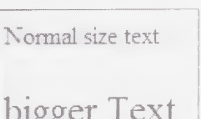

**图 4-4** 通过使用 `font-size` 属性增大文本大小

#### 将样式应用于文本对齐、间距和缩进

CSS3 还可用于更改文本对齐、间距和缩进。这提供了对文本在父容器内定位的出色控制。

##### 文本对齐

要控制文本在容器内的对齐方式，需要指定 *text-align* 属性。*text-align* 属性支持表 4-1 中列出的值。

**表 4-1** *text-align* 支持的值

| 值 | 说明 |
|---|---|
| *right* | 将文本对齐到父容器的右侧 |
| *left* | 将文本对齐到父容器的左侧 |
| *center* | 将文本对齐到父容器的水平中心 |
| *justify* | 水平拉伸文本以填满父容器的完整宽度 |

以下代码示例演示了 *text-align* 属性的使用，图 4-5 显示了在定义的 *div* 元素边界内的结果。

```
p {
    text-align: center;
}
```

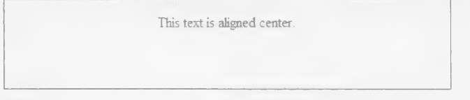

**图 4-5** 使用 *text-align* 属性将文本定位在 *div* 元素中心

##### 文本缩进

文本缩进使用 *text-indent* 属性进行配置。*text-indent* 属性接受整数值，表示缩进量。以下代码示例演示了如何将文本从父 *div* 元素的左边框缩进。图 4-6 显示了此代码的结果。

```
p {
    text-indent: 50px;
}
```

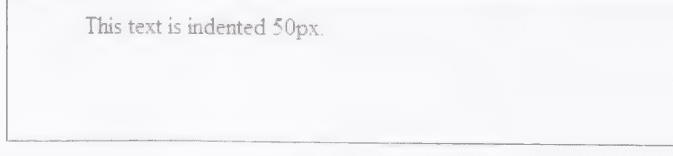

**图 4-6** 使用 *text-indent* 属性缩进文本

##### 文本间距

有两种方法可以控制文本间距。可以通过指定文本中每个字符之间的间距，或者通过指定文本中每个单词之间的间距来实现。以下 CSS 代码演示了这两个示例。图 4-7 显示了此代码的输出。

```
p {
    letter-spacing: 8px;
}
p {
    word-spacing: 8px;
}
```

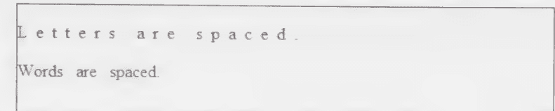

**图 4-7** 使用 CSS3 进行字间距和词间距设置

##### 将样式应用于文本断字

将样式应用于文本断字可以让你控制句子或单词在行尾如何换行或断开。可以指定 *hyphen* 属性来控制此行为。*hyphen* 属性的可用值在表 4-2 中定义。

**表 4-2** hyphen 属性的可用值

| 值 | 说明 |
|---|---|
| *none* | 单词不会用连字符断开，句子只会在空白处断开。 |
| *auto* | 单词会根据预定义的算法断开。 |
| *manual* | 单词会根据单词中指定的提示断开，指示合适的断开位置。这通过文本中的 &shy; 标记实现。 |

以下代码演示了使用 *none* 值，结果如图 4-8 所示。

```
div {
    hyphens: none;
}
```


**图 4-8** 为 *hyphen* 属性指定 *none* 的结果

在图 4-8 中，浏览器不对任何文本进行断字，并让其溢出容器边界。要强制断字，请将 *hyphen* 属性的值指定为 *auto*。此更改的输出如图 4-9 所示。


**图 4-9** 为 *hyphen* 属性指定 *auto* 的结果

当指定 *auto* 时，浏览器会根据自身规则计算在何处对单词进行断字，以使文本不会超出容器的边界。*manual* 选项的行为方式大致相同，只是你可以指定要使用的外部规则集，还可以通过使用 &shy;（软连字符）标记来提供提示。

##### 为文本阴影应用样式

你将在下一节中找到有关为文本阴影应用样式的信息。Microsoft 使用短语"text drop shadow"，但你会注意到本书中已将其简化为"text shadow"。

242 在应用程序中使用 CSS3

#### 思考题

##### 更改样式

在这个思考实验中，应用你在此目标中学到的知识。你可以在章节末尾的"答案"部分找到此问题的答案。

CSS 提供了让网站看起来美观的能力。在某些情况下，你可能希望根据用户输入或操作来更改样式。你将如何以这种方式更改页面的样式？

### 目标摘要

- CSS3 提供了以下方式来设置文本外观样式：
  - 使用 *color* 属性更改颜色
  - 使用 *font-weight* 属性将文本加粗
  - 使用 *font- style* 属性将文本变为斜体
  - 使用 *font-family* 属性更改字体类型
  - 使用 *font-size* 属性更改文本大小
- CSS3 提供了使用 *text-align* 属性设置文本对齐方式的能力。
- CSS3 提供了使用 *text-indent* 属性更改文本缩进的能力。
- CSS3 提供了使用 *letter-spacing* 和 *word-spacing* 属性更改字母间距和单词间距的能力。
- CSS3 允许你控制文本在需要在其容器边界内换行时如何断字。

#### 目标回顾

回答以下问题以测试你对本目标信息的了解。你可以在章节末尾的"答案"部分找到这些问题以及每个答案选项正确或错误的解释。

1. 以下哪项 CSS 不会更改文本外观？
   A. font-style: italic;
   B. font-weight: heavy;
   C. font: bolder 12px arial;
   D. color: green;

2. 以下哪项将文本对齐到可用框的完整宽度？
   A. *right*
   B. *full*
   C. *center*
   D. *justify*

3. 以下哪项是配置单词间距的方法？
   A. *word-margin*
   B. *letter-margin*
   C. *word-spacing*
   D. *word-padding*

### 目标 4.2：设置 HTML 框属性样式

每个 HTML 元素都有框属性。这些属性控制元素在页面上的间距以及框内容的位置。此外，还可以对元素框应用图形效果。

> **此目标涵盖以下内容：**
> - 应用样式来更改外观属性
> - 应用样式来更改图形效果
> - 应用样式来建立和更改元素的位置

#### 应用样式来更改外观属性

有多种方法可以更改应用于 HTML 元素的框的外观。本节演示如何通过更改与大小、边框、轮廓、内边距和外边距相关的属性来更改外观。

##### 更改大小

任何元素的大小都受其 *height* 和 *width* 属性的控制。这些可以在 CSS 中的任何对象或类上设置。默认情况下，对象会自行调整大小以显示其内容。因此，内部包含一些文本的 *div* 元素将具有足以显示文本的宽度和高度。可以通过为 *width* 和/或 *height* 设置值来更改大小。宽度和高度可以指定为像素（px）或厘米（cm）的测量值，也可以指定为其父元素的百分比。例如，以下代码将表格的宽度设置为其父容器的 50%，在本例中父容器就是窗口对象。


##### Bordering

CSS 为任何 HTML 元素的边框样式提供了非常精细的控制。实现这一功能的根 CSS 属性名称是 *border* 属性。通过使用 *border* 属性，你可以控制边框的样式、间距、颜色和宽度。

设置边框时，首先需要设置的是样式。这实质上会让边框显现。存在多种边框样式，包括实线边框（solid border）、虚线边框（dashed border）、点线边框（dotted line border）、凹槽线边框（grooved line border）等。边框通过指定 *border-style* 属性来设置：

```
p {
    border-style: solid;
}
```

边框的颜色可以通过指定 *border-color* 属性来更改。以下代码演示了这一点：

```
p {
    border-style: solid;
    border-color: black;
}
```

现在所有 `<p>` 元素都会显示为黑色实线边框。这在图 4-10 中有所展示。


**图 4-10** 设置了 *border* 属性的 `<p>` 元素

> **注意：设置 BORDER-STYLE**
>
> 请注意，边框需要先存在，才能对其做出任何可见的更改。这就是为什么在上面的示例中，首先设置 *border-style* 的原因。

*Border-spacing* 用于设置相邻元素之间所需的间距。以下 CSS 将为页面上的所有段落元素提供 250 px 的边框间距：

```
p {
    border-style: solid;
    border-color: black;
    border-spacing: 250px;
}
```

另一个可以通过 CSS 控制的边框属性是边框的宽度。*border-width* 是使用固定度量单位（例如像素）来设置的属性。以下代码将边框宽度设置为 5 px：

```
p {
    border-style: solid;
    border-color: black;
    border-spacing: 250px;
    border-width: 5px;
}
```

图 4-11 展示了在段落元素上设置的新宽度。


到目前为止，你一直在样式表中将边框的每个属性作为单独的行来设置。*border* CSS 属性支持一种简写技术，可以在一行中指定关键属性。以下代码演示了这一概念：

```
p {
    border: 5px solid black;
}
```

在这种情况下，边框被设置为 5 px 宽度、实线和黑色。

> **考试提示**
>
> border 元素在单行设置属性方面支持多种变体。花些时间尝试所有可能的组合，以便在考试中能够轻松阅读和识别它们。

除了能够在一行中设置到目前为止讨论的所有属性外，*border* 元素还允许更精细的控制。所讨论的属性也可以设置为针对盒子每一侧具有不同值的特定值。例如，以下代码产生图 4-12 中所示的输出：

```
p {
    border-top: 15px solid black;
    border-left: 10px solid black;
    border-right: 10px solid black;
    border-bottom: 5px solid black;
}
```


**图 4-12** 盒子每一侧的不同边框属性

##### Padding and margin

Padding 和 margin 是在 HTML 元素周围创建额外间距的方法。本质上，HTML 元素周围有三层。从内向外看，分别是 padding（内边距）、border（边框）和 margin（外边距）。如果你再看一下图 4-12 中的示例，文本被挤得非常靠近边框。边框宽度已经设置，但 padding（文本与边框之间的空间）仍保持其默认值 0 px。为了在文本和边框之间创建空间，你必须增加 padding，如下面的代码示例所示。结果如图 4-13 所示。

```
p {
    border-top: 15px solid black;
    border-left: 10px solid black;
    border-right: 10px solid black;
    border-bottom: 5px solid black;
    padding: 25px;
}
```


**图 4-13** 使用 padding 在文本和边框之间创建空间

在此代码中，padding 设置为 25 px。由于只指定了一个值，因此假定该值应用于盒子的所有四个边。然而，padding 可以为四个所有边指定不同的值。上面的代码实际上等同于：

```
padding: 25px 25px 25px 25px;
```

或

```
padding-top: 25px;
padding-bottom: 25px;
padding-left: 25px;
padding-right: 25px;
```

你可以为 HTML 元素创建间距的下一个区域是 margin。Margin 是元素边框与周围元素之间的空间。浏览器根据使用的 HTML 元素提供默认的 margin。图 4-14 展示了段落元素的默认 margin。图 4-15 展示了增加 margin 大小的效果。Margin 的控制方式与 padding 完全相同。你可以指定一个值以等量应用于所有四边，在一行中指定单独的值，或单独指定盒子的每一侧。以下代码演示了增加段落元素的 margin，结果如图 4-15 所示：

```
p {
    border-top: 15px solid black;
    border-left: 10px solid black;
    border-right: 10px solid black;
    border-bottom: 5px solid black;
    padding-top: 25px;
    padding-bottom: 25px;
    padding-left: 25px;
    padding-right: 25px;
    margin: 40px;
}
```


**图 4-15** 两个段落元素 margin 增大的布局

你可以在图 4-15 中看到，margin 不仅在两个段落元素之间创建了空间，还在窗口顶部与第一个段落元素顶部之间创建了空间。

#### 应用样式以改变图形效果

有多种选项可以为盒子应用图形效果，为最终用户提供独特的显示效果。本节演示设置透明度、不透明度、背景图像、渐变、阴影和裁剪。

##### 应用透明度/不透明度

在 CSS 中设置元素的不透明度（也称为透明度）可以实现让元素有效透视的能力。用于设置不透明度的值是 0 到 1.0 之间的比率。设置为 0 表示元素完全透明，实质上不可见。值为 1.0 表示元素完全不透明，这是未指定不透明度值时的默认值。以下代码将文本元素的不透明度设置为 0.4：

```
p {
    opacity: 0.4;
}
```

图 4-16 演示了将此效果应用于文本元素的输出。同时提供了未指定不透明度时的输出以供比较。


**图 4-16** *opacity* 属性的使用

##### 应用背景图像

任何 HTML 元素也可以包含背景图像。这是通过指定 *background-image* 属性来实现的。*background* 属性本身还有许多其他选项来控制其大小和重复模式。然而，要简单地设置背景图像，你只需要将图像指定给 *background-image* 属性。以下代码演示了此属性的使用来分配背景图像：

```
p {
    background-image: url('orange.jpg');
    color: white;
}
```

图 4-17 展示了此代码的输出。文本颜色更改为白色，以便在图像上更加清晰可见。表 4-3 解释了更多可用于格式化背景图像的选项。

;
    background-size: 20px;
    background-repeat: repeat;
    width: 200px;
    height: 200px;
    text-align: center;
    color: white;
}
```

前面的代码产生了图4-18中的输出。


图4-18 背景图像的*size*和*repeat*属性的使用

##### 应用渐变

渐变效果使对象的颜色从一个光谱逐渐变化到另一个光谱。支持两种类型的渐变效果。第一种是线性渐变，颜色沿着对象上的任何方向的一条线变化。另一种渐变是径向渐变，颜色从中心开始并向外边缘变化。渐变可以如下方式应用于元素的背景：

```
background: linear-gradient(black, gray);
```

*linear-gradient*函数接受几个参数。参数概述见表4-4。

**表4-4** *linear-gradient*函数的参数

| 参数 | 描述 |
|---|---|
| *Direction* | 将渐变的方向指定为*to right*或*to left*。此参数是可选的，留空时默认为上/下渐变效果。通过指定*to bottom right*或*to bottom left*也可以应用对角效果。你也可以指定一个角度，例如*100deg*。 |
| *Color stop...n* | 第二个及后续参数是起始颜色，后跟称为颜色停靠点的过渡颜色。这告诉浏览器渐变效果从哪种颜色开始并过渡到哪种颜色。 |

##### 应用阴影效果

阴影效果允许你将阴影应用于HTML元素的框或文本。有两个CSS3属性控制阴影效果：`box-shadow`和`text-shadow`。`box-shadow`控制HTML元素框周围的阴影效果。`text-shadow`属性控制文本的阴影。

`box-shadow`属性支持表4-5中概述的参数。前两个参数是创建阴影效果所必需的。*blur*和*spread*参数是可选的，可以应用于`box-shadow`。

**表4-5** `box-shadow`属性的参数

| 参数 | 描述 |
|---|---|
| *h-shadow* | 指定水平阴影的位置。该值也可以是负数。 |
| *v-shadow* | 指定垂直阴影的位置。该值也可以是负数。 |
| *blur* | 指定模糊效果的距离。此参数是可选的，默认为0。 |
| *spread* | 指定阴影的大小。 |
| *color* | 指定阴影的颜色。 |
| *inset* | 指定阴影应在框内而不是框外。 |

最简单的形式中，`box-shadow`属性只需要指定*h-shadow*和*v-shadow*。以下代码显示了应用于`div`元素的基本阴影：

```
div{
    position: absolute;
    left: 50px;
    top: 50px;
    width: 100px;
    height: 100px;
    border: solid 1px black;
    box-shadow: 10px 10px;
}
```

`div`元素渲染时带有阴影，如图4-19所示。


图4-19 一个简单的*box-shadow*效果

图4-19中的阴影效果是一个实心框阴影。要提供阴影逐渐淡出的效果，你需要指定*blur*参数。通过添加*blur*参数，你可以创建图4-20所示的效果。以下代码添加了*blur*参数：

```
div{
    position: absolute;
    left: 50px;
    top: 50px;
    width: 100px;
    height: 100px;
    border: solid 1px black;
    box-shadow: 10px 10px 10px;
}
```


图4-20 添加了模糊效果的*box-shadow*效果

为阴影添加特殊效果的下一个参数是*spread*参数。此参数指定阴影的大小。以下代码指定了一个spread值来增加阴影的大小：

```
div{
    position: absolute;
    left: 50px;
    top: 50px;
    width: 100px;
    height: 100px;
    border: solid 1px black;
    box-shadow: 10px 10px 10px 20px;
}
```

此代码产生图4-21中的输出。


**图4-21** 添加了*spread*参数以增加阴影大小的*box-shadow*效果。

图4-21显示了添加*spread*参数后前述代码的输出。*spread*参数指定了阴影的大小。在现实世界物体及其阴影的背景下，spread类似于指示光源距离物体有多近。光源越近，它产生的阴影就越大。*spread*参数可用于在HTML元素上引发此类效果。在图4-21中，阴影被故意创建得比HTML框本身更大。这样做是为了演示阴影效果的一个额外概念。阴影本身是一个全尺寸的框。在这种情况下，阴影被做得比原始框更大，因此它在框的所有四侧都可见。通常，对于未指定spread更大的框，阴影仅在由前两个参数指定的两个轴上可见。这是因为阴影框相对于其投影的HTML元素的中心发生了偏移。阴影的其余部分仍然在被投影的HTML元素后面。你可以通过将阴影的位置设置为完全远离HTML元素来演示这一点。这是通过将位置指定为大于HTML元素大小的数字值来实现的。以下代码演示了这一点：

```
div{
    position: absolute;
    left: 50px;
    top: 50px;
    width: 100px;
    height: 100px;
    border: solid 1px black;
    box-shadow: 100px 100px 10px;
}
```

在此代码中，框阴影的位置被设置为沿水平轴100 px，沿垂直轴100 px，这将把阴影放置在*div*元素的右下角，如图4-22所示。


**图4-22** 通过指定位置大于HTML元素的大小来显示元素的整个阴影

*box-shadow*的另一个参数是*inset*参数。如果省略，此参数会在框外创建阴影。如果指定了*inset*，则阴影在框内创建。以下代码演示了这一点：

```
div{
    position: absolute;
    left: 50px;
    top: 50px;
    width: 100px;
    height: 100px;
    border: solid 1px black;
    box-shadow: 10px 10px inset;
}
```

此代码产生图4-23所示的输出。阴影现在显示在框内而不是框外。


**图4-23** 使用*inset*参数将阴影放置在框内

*color*属性接受十六进制代码、rgb()或字面颜色作为值。此属性更改阴影的颜色。由于本书是黑白印刷的，演示此参数的效果不会很好。所以，在你自己的代码中，改变阴影的颜色以看看它有什么效果——颜色应该会改变。

> **注意** **理解*h-shadow*和*v-shadow*参数**
>
> *h-shadow*和*v-shadow*参数可以接受负值。要将阴影放在框的左侧而不是右侧，请为*h-shadow*指定一个负值。要将阴影放在框的顶部而不是底部，请为*v-shadow*参数指定一个负值。

文本阴影可以以与框阴影相同的方式创建。应用于文本阴影的CSS属性称为*text-shadow*。*text-shadow*属性具有与*box-shadow*属性类似的参数。参数描述见表4-6。

**表4-6** 文本阴影参数

| 参数 | 描述 |
|---|---|
| *h-shadow* | 指定阴影沿水平轴的位置。该值接受负数。 |
| *v-shadow* | 指定阴影沿垂直轴的位置。该值接受负数。 |
| *blur* | 指定模糊效果的距离。此参数是可选的，默认为0。 |
| *color* | 指定阴影的颜色。 |

所有*text-shadow*参数都很熟悉。它们与*box-shadow*元素中的对应项具有相同的效果。以下代码演示了在HTML页面上对文本应用阴影效果：

```
p {
    position: absolute;
    left: 250px;
    top: 250px;
    text-shadow: -10px -10px;
}
```

在此示例中，为*h-shadow*和*v-shadow*参数提供了负数，以便将阴影放置在文本的左上方。此代码的输出如图4-24所示。


##### 应用裁剪

*clip* 属性允许你指定元素的哪一部分可见。*clip* 属性只接受一个参数，即要裁剪到的形状。目前，唯一支持的形状是矩形，因此唯一能产生效果的参数值是 *rect()* 函数。例如，以下代码是指定 *clip* 属性的有效语法：

```
img{
    position: absolute;
    clip: rect(25px, 50px, 50px, 25px);
}
```

在上述代码示例中，裁剪区域被设置为矩形。*rect* 函数的前两个参数构建了图像将被裁剪部分的坐标。参数按顺时针顺序依次为矩形的上、右、下、左四个边。此外，所有测量都是从被裁剪源框的左上角开始的。因此，在上述代码示例中，图像的区域定义为：距顶部 25 px 形成裁剪区域的上边缘，距左侧 50 px 形成裁剪区域的右边缘，距顶部 50 px 形成裁剪区域的下边缘，距左侧 25 px 形成裁剪区域的右边缘。这实际上创建了一个从点 (25px, 25px) 开始、高度和宽度均为 25px 的矩形。图 4-25 展示了使用这些值进行裁剪前后的图像。


图 4-25 左侧是花卉布置的完整图像。右侧是同一图像的裁剪版本。

在图 4-25 中，左侧可以看到完整的图像。右侧，图像被裁剪了。只有源图像中由分配给 *clip* 属性的 rect 函数指定的部分可见。以下是完整代码：

```
<html>
<head>
  <style>
    .clipper {
      position: fixed;
      left: 325px;
      clip: rect(25px, 100px, 100px, 25px);
    }
  </style>
</head>
<body>
  
  
</body>
</html>
```

> **注意：理解 CLIP 属性**
clip 属性仅适用于 position 设置为 fixed 或 absolute 的元素。

#### 应用样式来确定和更改元素的位置

浏览器提供了一个坐标系统，用于确定如何在页面上布置元素。默认行为本质上是一种布局，在没有指定其他位置属性的情况下，元素将简单地按照默认流排列在页面上。在这种情况下，基本坐标是窗口的左上角，可以理解为 (x,y) 坐标 (0,0)。这称为静态布局。CSS 提供了一些机制，允许你覆盖页面的默认布局。这是通过使用 position 属性指定所需的位置行为来实现的。一旦设置了 position 属性，就会设置其他 CSS 属性，如 top、left、bottom 或 right。在静态布局中，元素不会响应 top、left、bottom 或 right 属性。必须指定定位类型。

> **考试提示**
对于考试，请务必理解每个 HTML 元素都是一个盒子，每个盒子都开启自己的新坐标系统。如果你在页面上将 div 元素放置在 (50px,50px)，放置在其内部的任何元素并不会因为从那里开始就以 (50px, 50px) 为起点。div 内的子元素从坐标 (0,0) 开始，也就是 div 本身的左上角。所有子元素都是相对于它们所在的容器进行定位的。

position 属性允许你指定三种不同的选项：fixed、relative 或 absolute。使用 fixed 定位时，元素相对于浏览器窗口放置。使用 relative 定位时，元素相对于它们在正常流中的位置进行定位。使用 absolute 定位时，元素相对于其第一个父元素进行定位。你将从放置在页面上的 *div* 元素内的图像开始。图 4-26 展示了该元素在静态流中的情况。


图 4-26 *div* 元素内默认位置的图像

> **考试提示**
*left* 和 *right* 属性从最外层的盒子边缘开始测量。对于考试，请记住如果指定了外边距或内边距，这也会影响对象的位置。

通过将以下样式应用于图像，你可以在 *div* 元素内重新定位图像。输出结果如图 4-27 所示。

```
img {
    position: fixed;
    left: 25px;
    top: 25px;
}
```


图 4-27 通过设置 *top* 和 *left* CSS 属性重新定位的iong

使用相对定位，你可以相对于元素在正常静态流中的位置来调整布局。为了演示这一点，你将多次复制图像元素，以在 *div* 内多次显示花卉图片。这在静态流中的显示如图 4-28 所示。


**图 4-28** 静态流中重复的图像

现在，你将所有图像向左移动 25 px。这是通过指定相对定位和将 *left* 属性设置为 -25 px 来实现的。如这里所示，你可以为 *left* 或 *top* 属性指定负数。图 4-29 显示了以下代码的输出：

```
img:nth-child(1n+0) {
    position: relative;
    left: -25px;
    top: 25px;
}
```


**图 4-29** 使用相对定位时 *left* 属性的应用

如图 4-29 所示，所有图像元素都向左移动了 25 px。使用相对定位，你实际上可以让 HTML 元素重叠。虽然上面的代码将所有图像移动了 25 px，但如果你修改代码，使每个元素按比例更多地移动以实现重叠，就可以创建一些不错的效果。请记住，元素是根据它们在正常流中的位置移动的。由于中心的图像彼此相距 100 px，你需要将第二个图像、第三个图像及更后续的图像移动与其邻居相同的量，加上所需的重叠量。以下代码展示了这一点：

```
img:nth-child(2) {
    position: relative;
    left: -25px;
}
img:nth-child(3) {
    position: relative;
    left: -50px;
}
img:nth-child(4) {
    position: relative;
    left: -75px;
}
```

这段代码产生了图 4-30 中的输出。第一个元素之后的每个元素都移动了足够的距离，使其与左侧相邻元素重叠 25 px。请注意，*left* 属性值是逐渐增大的，以考虑其邻居也已经移动的事实。


**图 4-30** 使用相对定位使图像重叠

使用绝对定位允许你指定元素的位置，使其从页面的正常流中移除。也就是说，页面的其余部分会像该元素不存在一样流动。该元素可以被认为是悬浮在页面正常流内容的上方或下方。使用这种方法，也可以使元素重叠。

## 考试提示

> 当使用绝对定位使元素重叠时，CSS 提供了 *z-index* 属性。这允许你指定元素在页面上沿 z 轴（第三维）堆叠的顺序。

以下代码演示了在文本块上方使用图像的绝对定位。下方的文本以其正常流渲染。图像不会影响文档正常流中的任何内容。此代码的输出如图 4-31 所示。

```
img {
    position: absolute;
    left: 215px;
    top: 100px;
    height: 50px;
    width:50px;
}
```


**图 4-31** 使用绝对定位将图像覆盖在正常流上

可用于定位元素的最后一个属性是 *float* 属性。*float* 属性会自动将元素移动到周围内容的左侧或右侧。这最常用于将图像与文本内联放置，以强制文本环绕图像。基于上面的示例，你将把 *img* 元素移动到与文本内联的位置，如下所示：

```
<p style="width: 200px;margin-left: 200px;">
Lorem ipsum dolor sit amet, consectetuer adipiscing elit, sed
diam nonummy nibh euismod tincidunt ut laoreet dolore magna aliquam erat volutpat. Ut
wisi enim ad minim veniam, quis nostrud exerci tation ullamcorper
suscipit lobortis nisl ut aliquip ex ea commodo consequat. Duis autem vel eum iriure
dolor in hendrerit in vulputate velit esse molestie consequat, vel illum dolore eu
feugiat nulla facilisis at vero eros et accumsan et iusto odio....</p>
```

在此段落元素中，有两个图像与文本内联。以这种方式放置的图像会推开文本，为自身腾出空间。如图 4-32 所示。


**图 4-32** 嵌入在正常流中文本内的图像

*float* 属性允许你指定希望元素如何在其周围的其他元素之间布局。你可以指定 `float: left` 或 `float: right`。这将分别将图像元素移动到左侧或右侧，并允许文本平滑地环绕它。以下代码演示了如何指定这一点：

```
img.flower {
    float: left;
    left: 215px;
    top: 100px;
    height: 50px;
    width: 50px;
}

img.orange {
    float: right;
    left: 215px;
    top: 100px;
    height: 50px;
    width: 50px;
}
```

上述代码的输出如图 4-33 所示。


现在，指定了 *float* 属性后，文本会平滑地环绕图像。

##### 思想实验

##### 创建移动的 HTML 元素

在这个思想实验中，运用你所学到的关于这个目标的知识。你可以在本章末尾的“答案”部分找到这个问题的答案。

创建样式和脚本，使 HTML 对象在页面上移动。这在当今的许多网页中都可以看到，例如显示信息在屏幕上移动的横幅或滚动条控件。使用你所知道的关于使用 CSS 设置和更改对象位置的知识，创建一个移动的 HTML 元素。

#### 目标总结

- 每个 HTML 元素都是一个盒子，并具有盒子的属性，如高度和宽度。
- CSS3 允许你通过指定新的高度和宽度来更改盒子的大小。
- CSS3 允许你通过以下方式设置盒子属性的样式：
    - *border-style* 属性允许你为边框指定实线或虚线。
    - *border-color* 属性允许你指定边框的颜色。
    - *border-spacing* 属性允许你指定相邻元素之间的空间量。
    - *border-width* 属性允许你指定边框的粗细。
    - 盒子的每一侧都可以有不同的样式。
- CSS3 提供了一种方法来定义盒子相对于相邻元素的内边距和外边距。可以为盒子的每一侧进行不同的配置。
- 通过设置 *opacity* 属性可以使元素透明或部分透明。
- 通过设置 *background-image* 属性可以使元素包含背景图像。
- CSS3 通过指定 *box-shadow* 属性提供了创建阴影效果的能力。
- CSS3 通过 *clip* 属性提供了裁剪图像的能力，只显示图像的一部分。
- CSS3 可用于将元素的位置设置为固定、绝对或相对。
- CSS 的 *left* 和 *top* 属性可用于更改元素的位置。

#### 目标复习

回答以下问题以测试你对本目标信息的了解。你可以在本章末尾的“答案”部分找到这些问题的答案以及为什么每个答案选项正确或错误的解释。

1. 以下哪项不是更改元素大小的有效方法？
    A. div{height: 50px; width: 50%;}
    B. div{height: 50px; width: 50px;}
    C. div{height: 50cm; width: 50px;
    D. div{height: 50ft; width: 50ft;}

2. 以下哪项将成功地为 div 元素设置边框样式？
    A. border-top: 5px dotted blue; border-right: 5px solid green; border-left: 3px dashed red; border-bottom: 10px double black;
    B. border-sides: 5px solid green;
    C. border-all: 1px solid black;
    D. border: full red;

3. 从 HTML 元素的外边缘看，向内边缘移动时，内边距、外边距和边框的顺序是什么？
    A. padding, border, margin
    B. margin, border, padding
    C. border, padding, margin
    D. margin, padding, border

4. 以下哪条语句将为 div 元素的右侧和底侧应用框阴影？
    A. box-shadow: gray 5px 5px;
    B. box-shadow: gray -5px 5px;
    C. box-shadow: gray 5px -5px;
    D. box-shadow: gray -5px -5px;

5. 以下哪项将使元素相对于浏览器窗口定位？
    A. absolute
    B. fixed
    C. relative

### 目标 4.3：创建灵活的内容布局

在网页设计中，组织页面上的内容一直是一个挑战。在其他开发领域，将布局与内容/逻辑分离的设计模式概念已经存在了很长时间。然而，在 HTML 领域，它并不那么 readily 和 easy available。CSS3 引入了新概念，如网格布局和弹性盒布局，提供了实现这种适当分离的机制。

本目标涵盖如何：

- 使用弹性盒模型实现布局
- 使用多列实现布局
- 使用定位、浮动和排除实现布局
- 使用网格对齐实现布局
- 使用区域、分组和嵌套实现布局

#### 使用弹性盒模型实现布局

弹性盒是一种 CSS3 构造，提供了一种布局流元素的方式。流意味着元素将从左到右（也称为水平）或从上到下（也称为垂直）流动。为了开始使用弹性盒，你需要创建一个容器元素并为其命名。使用 `<div>` 元素并按此代码所示命名：

```
<div id="flexbox1">
</div>
```

使用此代码块，你就拥有了弹性盒的雏形。剩下要做的就是创建 CSS 来指示容器确实是一个弹性盒。以下 CSS 实现了这一点：

```
#flexbox1 {
    display: flexbox;
    border: 1px solid black;
    margin-top: 100px;
    min-height: 15px;
}
```

设置了该 HTML 和 CSS 后，你可以运行页面并看到一个指定为弹性盒布局的容器。输出如图 4-34 所示。


##### 图 4-34 设置为弹性盒的 *div* 元素

弹性盒内的所有元素称为 *flexbox items*。你可以指定弹性盒布局是水平运行还是垂直运行。你需要熟悉一些可以应用于弹性盒的关键样式，以及浏览器将如何解释它们。表 4-7 概述了与子元素流相关的重要样式。

##### 表 4-7 弹性盒可用的 CSS 样式

| 样式 | 选项 | 描述 |
|-------|--------|-------------|
| *flex-direction* | Column | 使弹性盒的子元素沿垂直轴从上到下流动。 |
| | *row (默认)* | 使弹性盒的子元素沿水平轴从左到右流动。 |
| | *column-reverse* | 沿垂直轴从反向端从下到上渲染子元素。 |
| | *row-reverse* | 沿水平轴从反向端从右到左渲染子元素。 |
| *flex-pack* | *End* | 相对于布局轴设置的方向，从末尾开始渲染子元素。 |
| | *Start* | 相对于布局轴设置的方向，从起始位置开始渲染子元素。 |
| | *center* | 在布局轴上居中渲染子元素。 |
| | *distribute* | 沿布局轴均匀分布子元素。 |


 **考试提示**

flexbox 的方向取决于 flex 方向。flex 方向取决于布局轴。如果 flexbox 的布局是纵向（column），布局轴是垂直的。如果 flexbox 的布局是横向（row），布局轴是水平的。对于考试来说，理解这一点很重要，以便了解 flex 网格上的其他属性将如何渲染。

现在向你的 flexbox 布局中添加一些子元素：

```
<div id="flexbox1">
    <div></div>
    <div></div>
    <div></div>
</div>
```

仅添加空的 `<div>` 元素还不足以显示内容。你还需要添加一些样式，以便 flexbox 布局显示你的子元素。以下是可添加的样式：

```
#flexbox1 > div {
    min-width: 80px;
    min-height: 80px;
    border:迪克1px solid black;
    margin: 5px;
}
#flexbox1 > div:nth-child(1) {
    background-color: green;
}
#flexbox1 > div:nth-child(2) {
    background-color: yellow;
}
#flexbox1 > div:nth-child(3) {
    background-color: red;
}
```

此代码产生图 4-35 所示的输出。


flexbox 内部的默认流是从左边缘开始从左到右显示元素。你可以通过操作属性来实验以不同顺序显示彩色方框。例如，如果你想在布局轴上的相同位置显示方框，但顺序相反，可以这样做：

```
#flexbox1 {
    display: flexbox;
    flex-direction: row-reverse;
    border: 1px solid black;
    margin-top: 100px;
    min-height: 15px;
}
```

此代码的输出如图 4-36 所示。


**图 4-36** 沿同一轴反向排列的 flexbox 内容

在这里，你将方向更改为 *row-reverse*。这改变了方框的顺序。当你运行此代码时，你会看到它不仅反转了方框的顺序，还将它们移到了右端。这是因为 flex 方向控制了布局轴上被视为原点的位置。通过反转方向，你已指示布局起点现在在右端，布局终点在左端。为了防止顺序反转，你需要指定 *flex-pack* 属性来指示布局轴的末端：

```
#flexbox1 {
  display: flexbox;
  flex-flow: row-reverse;
  flex-pack: end;
  border: 1px solid black;
  margin-top: 100px;
  min-height: 15px;
}
```

通过此次更新，方框现在以相同的顺序显示（红、黄、绿），但按预期左对齐。输出如图 4-37 所示。


**图 4-37** 顺序相同但左对齐的 flexbox 内容

还有一些额外的功能，可以让每个子元素自行伸缩以占用指定的空间量。如果你想让一个方框占用 15% 的空间，另一个占用 25%，最后一个占用剩余的所有空间而不留下空白空间，你可以使用 *flex* 属性。*flex* 属性在每个子元素上指定，以指示每个元素应占用的空间量。

你首先需要将布局容器的属性更改如下：

```
#flexbox1 {
    display: flexbox;
    border: 1px solid black;
    margin-top: 100px;
    min-height: 15px;
}
#flexbox1 > div {
    min-width: 80px;
    min-height: 80px;
    border: 1px solid black;
    margin: 5px;
}
#flexbox1 > div:nth-child(1) {
    background-color: green;
    flex: 2;
}
#flexbox1 > div:nth-child(2) {
    background-color: yellow;
    flex: 15;
}
#flexbox1 > div:nth-child(3) {
    background-color: red;
    flex: 3;
}
```

在更新的 CSS 代码中，*flex* 属性被添加到每个子元素上。*flex* 属性接受一个相对值作为参数。这不是以像素或英寸为单位的固定测量值。它是相对于所有子元素中指定的值而言的。在这种情况下，第一个元素将占据 10% 的空间，最后一个元素将占据 15% 的空间，中间的元素将占据剩余的空间。要做到这一点，你需要计算生成这些比例所需的相对值。其余的渲染输出计算将由浏览器处理。

因为我们讨论的是百分比，所以整个空间的宽度为 100% 是合理的。最简单的方法是将各自的百分比放入每个元素中，因为相对大小正是你所追求的。为了说明这一点，你可以通过除以 20 将单位分解为更小的数值。这将使 10% 等于 100% 中的 2 份，15% 等于 100% 中的 3 份。剩余部分将使用 15 份，即 100% 中的 75%。图 4-38 显示了使用这些值的输出。


**图 4-38** 使用 *flex* 属性分配 flexbox 内容

flexbox 项目的顺序也可以通过在 flexbox 项目上使用 *order* 属性来显式指定。这方面的示例如下：

```
#flexbox1 > div:nth-child(1) {
    background-color: green;
    flex-order: 2;
}
#flexbox1 > div:nth-child(2) {
    background-color: yellow;
    flex-order: 1;
}
#flexbox1 > div:nth-child(3) {
    background-color: red;
    flex-order: 3;
}
```

图 4-39 演示了 flexbox 项目按照你指定的顺序显示，而不是默认顺序——即项目列在 HTML 中的顺序。


**图 4-39** 使用 order 属性显式设置 flexbox 项目的序列

另一个需要理解的重要属性是包装选项。与文本包装一样，flex-wrap 提供了指定浏览器在 flexbox 中的内容超出 flexbox 本身可用空间时应采取什么措施的能力。在这种情况下，你可以指定 flexbox 应该包装还是不包装。下面展示了包装的一个例子。首先将你的 flexbox 更新为固定宽度，然后添加 flexbox 包装属性：

```
#flexbox1 {
        display: flexbox;
        flex-flow: row;
        flex-wrap: wrap;
        border: 1px solid black;
        margin-top: 100px;
        min-height: 15px;
        width: 200px;
}
```

为了演示包装功能，你需要再添加几个 flexbox 项目，使它们溢出 flexbox：

```
<div id="flexbox1">
        <div></div>
        <div></div>
        <div></div>
        <div></div>
        <div></div>
</div>
```

添加这些额外的样式为额外的 flexbox 项目设置背景颜色：

```
#flexbox1 > div:nth-child(1) {
    background-color: green;
}
#flexbox1 > div:nth-child(2) {
    background-color: yellow;
}
#flexbox1 > div:nth-child(3) {
    background-color: red;
}
#flexbox1 > div:nth-child(4) {
    background-color: purple;
}
#flexbox1 > div昕 child(5) {
    background-color: blue;
}
```

图 4-40 展示了 flexbox 的包装功能。


**图 4-40** 使用 *flex-wrap* 属性自动包装 flexbox 项目

> **考试提示**
> 
> 在考试中，你可能会看到刚才包装操作的简写版本。*flex-flow* 属性支持将包装样式指定为第二个参数：*flex-flow: row wrap*。

#### 使用多列实现布局

CSS3 提供了使用列创建布局的能力。这为内容提供了类似报纸文章的外观和感觉，内容会环绕到下一列。与其他布局技术一样，多列技术从


指定一个容器来容纳列。在本例中，将使用一个 *article* 元素。以下标记被添加到页面中：

```
<html>
<head>
    <style>
        #c_lo {
            width:80%;
            height: 400px;
            border: 1px solid black;
            column-count: 5;
            column-rule-color: black;
            column-rule-style: dashed;
            column-rule-width: 2px;
            column-gap: 5px;
        }
    </style>
</head>
<body>
    <article id="c_lo">
    </article>
</body>
</html>
```

这个 HTML 页面包含一个样式块，用于设置多栏布局。body 中包含一个 *article* 元素，该元素将被设置为处理多列。一些多列属性已经设置在该 *article* 元素上。表 4-8 详细列出了多列属性。

##### 表 4-8 多列属性

| 属性 | 描述 |
|----------|-------------|
| *column-count* | 指定列的数量 |
| *column-gap* | 指定列之间的间距 |
| *column-rule-color* | 指定列之间绘制的垂直分隔线的颜色 |
| *column-rule-style* | 指定列之间绘制的垂直分隔线的类型，例如实线或虚线 |
| *column-rule-width* | 指定列之间绘制的垂直分隔线的宽度 |
| *column-rule* | 一种简写方式，用于指定列之间垂直分隔线的颜色、样式和宽度 |
| *column-span* | 指定元素应跨越多少列；可能的值为列数或 all；默认值为 1 |
| *column-width* | 指定列的宽度 |
| *columns* | 一种简写方法，用于指定列数及其宽度 |

## 考试提示

当你看到属性名称前缀与 column-rule 属性相同，你就知道有一种简写机制可以在一行中指定最常见的属性。

在查看表 4-8 之后，你现在知道前面代码块中的 article 元素被设置为拥有五列，每列相距 5 像素。列之间的垂直分隔线将使用黑色、2 像素宽的虚线。文章通常有标题。通常标题会跨越文章的所有列。要实现这种效果，你需要在某个元素上使用 column-span 属性来指示它应该跨多列渲染。为此，请将以下代码添加到 CSS 中：

```
<html>
<head>
    <style>
        #c_lo {
            width: 80%;
            height: 400px;
            border: 1px solid black;
            column-count: 5;
            column-rule-color: black;
            column-rule-style: dashed;
            column-rule-width: 2px;
            column-gap: 5px;
        }
        hgroup {
            column-span: all;
            text-align:center;
        }
    </style>
</head>
<body>
    <article id="c_lo">
        <hgroup>
            <h1>我的博客文章</h1>
        </hgroup>
        <p>

        </p>
    </article>
</body>
</html>
```

你添加了一个 hgroup 元素，添加了样式元素以指定 hgroup 文本应居中，并为 column-span 属性指定了 all 值。

此标记产生的输出如图 4-41 所示。

##### 我的博客文章

Lorem ipsum dolor sit amet, consectetuer adipiscing elit, sed diam nonummy nibh euismod tincidunt ut laoreet in voluptate velit esse cillum dolore eu fugiat nulla pariatur. Excepteur sint occaecat cupidatat non proident, sunt in culpa qui officia deserunt mollit anim id est laborum.

**图 4-41** 使用多栏布局技术以文章格式显示文本

#### 使用定位、浮动和排除实现布局

使用 position 和 float 来定位元素在"目标 4.3"标题为"应用样式以建立和更改元素位置"的部分中讨论过。在本节中，你将研究如何在整体布局中使用它们。*Float* 是一种机制，通过它，周围内容将平滑地环绕在元素周围，该元素的 *float* 属性被指定为 *float: left* 或 *float: right*。*Left* 和 *right* 是 *float* 属性仅有的两个可用选项。排除提供了一种克服 *float* 这一限制的方法。排除是通过指定 CSS3 属性 *wrap-flow* 来实现的。

> **重要的 Internet Explorer 版本要求**
>
> 目前，*wrap-flow* 属性仅在 Internet Explorer 10+ 中实现。因此，该元素需要应用 -ms 前缀。

*wrap-flow* 属性支持多种选项。这些选项在表 4-9 中列出。你将在以下示例中使用大部分选项。

##### 表 4-9 *wrap-flow* 属性的可用值

| 值 | 描述 |
|---|---|
| *auto* | 这是默认值。排除项将位于内联元素之上。 |
| *both* | 排除项将强制内联元素在两侧平滑环绕。 |
| *start* | 排除项将强制内联元素仅在起始边缘环绕，而结束边缘将留空。 |
| *end* | 排除项将强制内联元素仅在结束边缘环绕，而起始边缘将留空。 |
| *maximum* | 排除项将强制内联元素仅在可用空间最大的一侧环绕。 |
| *clear* | 排除项将强制内联内容仅在顶部和底部环绕，使起始边缘和结束边缘留空。 |

在理解了上表提供的值之后，你现在可以将这些概念应用到你的页面中。以下代码将演示将 *wrap-flow* 属性设置为 *both* 的效果：

```
<html>
<head>
    <style>
        p {
            width: 80%;
            padding-left: 50px;
        }
        img {
            position: absolute;
            height: 100px;
            width: 150px;
            -ms-wrap-flow: both;
        }
    </style>
</head>
<body>
    <p>
        Lorem ipsum dolor sit
debitis. Modus elaboraret temporibus no sit. At invidunt
splendide qui, ut pro choro iisque democritum. Partem timeam graecis ea vis, utamur
feugiat .
    </p>
</body>
</html>
```

此代码产生的输出如图 4-42 所示。

Lorem ipsum dolor sit amet, eam in everti praesent. Vel ei posse persecuti scribentur. Ex quem tale labore duo, vel stet option tamquam eu. Integre accusamus vis ea. In vis posidonium referrentur, ut zril incorrupte scripserit eos. Nihil accumsan vix ei. Duo ea suscipit constituto. Mea aperiri albucius similique eu, ius eu ignota aliquam, iisque disputando vim ut. Primis nostrud sit te. Te cum posse decore debitis no sit. At invidunt splendide qui, ut pro Partem timeam graecis ea vis, utamur utinam pericula te per. Ad sea maluisset mei interesset suscipiantur. Inani dicam ullum decore. Ad pri veri postea essent, pri impedit consequat id, at pri omittam aliquando. Cu vide cibo dicunt eam. At dico probo graeco pri, ne Nulla delectus placerat quo ne. Cu sea phaedrum menandri assueverit, dicunt corpora scripserit at mei. Ea vel iudico ridens, erat clita aliquip est. Ut ipsum congue discere vix. Pro error mollis cotidieque cu, in eius maiestatis vim, his tale graece repudiandae ne

Modus elaboraret temporibus choro iisque democritum feugiat offendit cum ei, incorrupte ullamcorper. Ei maiestatis no mea, cum ex integre volumus id. His Causae alienum eu pro, has id unum bonorum tacimates. Errem nostro mandamus exerci laboramus definiebas mea. signiferumque, eos an erant decore falli animal aliquid at cum. Ad utamur feugiat offendit cum ei. Ad sea maluisset incorrupte ullamcorper. Ei mei maiestatis no mea, cum ex essent, pri integre volumus id. His impedit consequat id, at pri omittam aliquando. Causae alienum eu pro, has id unum bonorum volutpat. Dicam nonumes deleniti mei te, sit ei sumo harum tacimates. Errem nostro mandamus has at. Cu vide cibo dicunt eam. At dico probo graeco pri, ne exerci laboramus definiebas mea.


**图 4-42** 将 *wrap-flow* 属性设置为 *both* 的值，使内联文本在图像两侧环绕

内联文本在起始位置（图像的左边缘）和结束位置（图像的右边缘）都能很好地环绕。文本非常靠近图像。可以指定 *wrap-margin* 属性来在图像周围提供边距。将此属性添加到你的 CSS 代码中，如下所示：

```
img {
    position: absolute;
    height: 100px;
    width: 150px;
    -ms-wrap-flow: both;
    -ms-wrap-margin: 15px;
}
```

此代码的输出如图 4-43 所示。

Lorem ipsum dolor sit amet, eam in everti praesent. Vel ei posse persecuti scribentur. Ex quem tale labore duo, vel stet option tamquam eu. Integre accusamus vis ea. In vis posidonium referrentur, ut zril incorrupte scripserit eos. Nihil accumsan vix ei. Duo ea suscipit constituto. Mea aperiri albucius similique eu, ius eu disputando vim ut. Primis nostrud sit te. debitis. Modus elaboraret temporibus no qui, ut pro choro iisque democritum vis, utamur feugiat offendit cum ei. Ad sea maluisset incorrupte interesset suscipiantur. Inani dicam ex ullum decore. Ad pri veri postea volumus id. His impedit consequat id, at pri omittam aliquando. unum bonorum volutpat. Dicam nonumes deleniti mei te, sit ei sumo harum tacimates. Errem nostro mandamus has at. Cu vide cibo dicunt eam. At dico probo graeco pri, ne exerci laboramus definiebas mea. Nulla delectus placerat quo ne. Cu sea phaedrum menandri signiferumque, eos an erant decore assueverit, dicunt corpora scripserit at mei. Ea vel iudico ridens, falli animal aliquid at cum. Ad erat clita aliquip est. Ut ipsum congue discere vix. Pro error mollis cotidieque cu, in eius maiestatis vim, his tale graece repudiandae ne

ignota aliquam, iisque Te cum posse decore sit. At invidunt splendide Partem timeam graecis ea utinam pericula te per. ullamcorper. Ei mei maiestatis no mea, cum essent, pri integre


**图 4-43** 设置 *wrap-margin* 属性以在排除周围创建边距


当希望内联内容仅在左侧或右侧环绕时，可以分别为 *wrap-flow* 属性指定 *start* 或 *end* 值。图4-44展示了将值改为 *start* 时的输出效果。若设置为 *end* 则会产生相反的效果。


图4-44 将 *wrap-flow* 属性设置为 *start* 值，使内容仅在左侧环绕

图4-45展示了当 *wrap-flow* 属性设置为 *clear* 时的效果。排除对象的两侧被清空，文本仅沿顶部和底部环绕。


图4-45 将 *wrap-flow* 属性设置为 *clear* 值，使内容仅沿顶部和底部环绕

#### 使用网格对齐实现布局

CSS3的网格布局功能提供了一种类似HTML表格的方式来布局网页内容，但仅通过CSS实现。这提供了更高的灵活性和更易维护的代码。

为了演示CSS3网格布局的功能，你将构建一个类似图4-46所示的网页布局。


图4-46 你将使用CSS3网格布局功能创建的网页

传统上，要实现这种布局，你可能会创建如下的HTML标记：

```
<table border="1" style="width:100%; height: 85%">
    <tr>
        <td colspan="3">
        </td>
    </tr>
    <tr>
        <td rowspan="3">
        </td>
        <td rowspan="3">
        </td>
        <td>
        </td>
    </tr>
    <tr>
        <td>
        </td>
    </tr>
    <tr>
        <td>
        </td>
    </tr>
    <tr>
        <td colspan="3">
        </td>
    </tr>
</table>
```

使用HTML表格有效且已应用很长时间。然而，当今的最佳实践建议将内容与布局分离。这在软件开发和设计的许多其他领域（如设计模式）中都有体现。在这个例子中，布局直接写在HTML中。你将重构页面，使内容可以独立于布局提供，所有布局都将在CSS代码中定义。

网格布局完全在CSS中定义。要创建网格，需要将CSS属性应用于HTML元素。与flexbox一样，网格基于为容器指定display属性。你将为网格容器使用简单的 *div* 元素。创建以下div并按指示应用样式：

```
<style>
    #mainGrid {
        display: grid;
    }
</style>
<div id="mainGrid">
</div>
```

你通过将 *div* 的display指定为grid，将其指定为网格布局的容器，其id为 *mainGrid*。然而，在浏览器中运行这不会产生太多结果。你需要定义网格的结构。在这个例子中，你将创建一个简单的四乘二网格布局。如图所示向 *div* 添加子元素，并更新样式以向容器提供关于如何渲染子单元格的信息。

```
#mainGrid {
    display: grid;
    grid-columns: 150px 150px 150px 150px;
    grid-rows: 75px 75px;
}
<div id="mainGrid">
    <div></div>
    <div></div>
    <div></div>
    <div></div>
    <div></div>
    <div></div>


# 使用区域、分组和嵌套实现布局

区域（Regions）是一种新的CSS3构造，允许内容在网页的各个区域中流动。这可以提供一些非常有趣的场景。要开始使用，你需要一个定义了区域的HTML页面。以下HTML提供了建立区域的起点。

```
<body>
    <div class="regionLayout">
        <div id="region1"></div>
        <div id="region2"></div>
        <div id="region3"></div>
        ...
        <div id="region-n"></div>
    </div>
</body>
```

> **注意** 浏览器对区域的支持
> 区域目前仍处于实验和开发阶段。目前的浏览器支持有限。本节仅重点介绍此功能的关键设计目标。

使用区域布局网页需要两样东西：一个内容源和作为内容目的地的区域。上面的HTML概述了区域。内容可以来自另一个页面（通过iframe）或页面本身的另一个元素（尽管目前在任何浏览器中都无法实现）。通过向页面添加iframe，你可以将`iframe src`设置为将在区域中渲染的内容：

```
<iframe src="content_source.html"/>
```

在HTML中建立了内容源之后，现在只需要发生两件事。使用CSS来控制从源到目的地的内容功能。新的CSS属性`flow-into`和`flow-from`用于分配HTML元素在区域布局中的角色。`flow-into`属性被赋予一个值来容纳内容。这个值可以是任何东西，比如在这个例子中：

```
.content_source{
    flow-into: myflow;
}
```

然后，内容的目的地在一个类中定义如下：

```
.content_regions{
    flow-from: myflow;
}
```

只要在`flow-into`和`flow-from`中使用相同的名称，它们就能协同工作。这称为*命名流*。所有组成区域以在同一个命名流中显示内容源的元素称为*区域链*。你可以有多个源和多个区域链。分配给*flow-**属性的名称用于协调哪个内容源进入哪个区域。

## 考试提示

由于区域功能仍然是实验性的，考试不太可能涵盖此主题。然而，这仅在撰写本文时成立，随时可能改变。请熟悉并持续关注此CSS构造在现实世界中准备情况的更新。

##### 思想实验

##### 组合布局

在这个思想实验中，应用你关于此目标的知识。你可以在本章末尾的“答案”部分找到这个问题的答案。

扩展当前的网格布局博客页面，使主要内容区域使用列布局。每种布局本身都非常强大，可以服务于其特定目的。然而，重要的是要知道，通过组合它们，你可以在有意义的地方创建一些非常强大的布局。

### 目标摘要

- Flexbox允许你以类似流动的方式排列元素。
- 多列布局允许你将内容分成固定数量的列，如报纸布局。
- 围绕图像等元素的文本流可以使用换行流布局来控制。
- 网格布局通过在CSS中明确指定每个元素应在预定义网格中的显示位置，提供了将布局与内容分离的最佳方式。

#### 目标复习

回答以下问题，以测试你对本目标中信息的了解。你可以在本章末尾的“答案”部分找到这些问题的答案以及每个答案选项正确或错误的原因。

1. 以下哪种布局基于列和行？
   **A.** flexbox
   **B.** 多列
   **C.** 网格布局
   **D.** 排除

2. 以下哪项关于flexbox布局是错误的？
   **A.** flexbox中元素的方向可以用*flex-direction*属性控制。
   **B.** 元素布局可以使用*flex-pack*属性沿布局轴配置。
   **C.** flexbox中的元素称为flexbox项目。
   **D.** flexbox中的元素可以设置成行和列。

3. 以下哪个*wrap-flow*属性值允许文本沿元素的两侧环绕？
   **A.** *both*
   **B.** *all*
   **C.** *left and right*
   **D.** *cross*

# 目标4.4：创建动画和自适应UI

现代网站为最终用户提供交互式体验。CSS3提供了许多机制来为最终用户交互添加专业质感。这是通过动画和变换对象的能力实现的。通过将这些丰富的功能添加到你的网页中，你确实将体验提升到了一个新的水平。此外，还有机会创建响应式用户界面。响应式用户界面是一种可以根据可用屏幕大小自动调整自身的界面。最后，隐藏和禁用控件的能力为你提供了使用CSS进一步自定义用户界面的能力。

## 本目标涵盖如何：

- 通过应用CSS过渡动画对象
- 应用3D和2D变换
- 根据媒体查询调整UI
- 隐藏或禁用控件

## 通过应用CSS过渡动画对象

过渡提供了一种改变对象样式的机制，使变化以可见的渐进方式发生。你可以控制哪个样式属性被改变，以及从一种样式过渡到另一种样式需要多长时间。当指定的属性被更改时，过渡开始。在最简单的形式中，以下代码过渡了div元素的两个属性：margin-left和background-color。过渡将持续一秒。当鼠标悬停在div元素上时，将发生过渡。

> **注意** **亲自看看**
>
> 由于这是一本图书，而过渡是涉及属性逐渐变化的视觉效果，截图无法很好地展示功能。你应该在自己的网页中尝试代码，以熟悉样式和脚本的结果。

视觉效果是，这个最初带有灰色背景的div将逐渐向右消失在视野中。以下代码演示了这一点：

```
<html>
<head>
    <style>
        div {
            width: 100px;
            height: 100px;
            background-color: gray;
            margin-left: 250px;
            margin-top: 250px;
            transition: background-color 1s, margin-left 1s;
        }
        div:hover {
            margin-left: 350px;
            background-color: white;
        }
    </style>
</head>
<body>
    <div>
    </div>
</body>
</html>
```

当这段CSS代码就位后，用户将鼠标悬停在div元素上时，该元素会向右移动，且其背景颜色会变为白色。由于网页背景也是白色，这就产生了消失的效果。你需要理解使用了哪些属性来实现此效果。在本特定代码中，你使用了一个名为`transition`的简写属性，它允许你指定一个以逗号分隔的CSS属性列表，以及指定属性进行转换所需的时间长度。这些属性也可以使用表4-9中的各种CSS属性单独表示。

## 表4-9 CSS3 transition属性

| 属性名 | 描述 |
| --- | --- |
| transition-property | 指定将应用转换的属性 |
| transition-duration | 指定转换从开始到结束所需的时间 |
| transition-delay | 指定在属性更改后开始转换前等待的时间 |

## 考试提示

> 当使用单独的transition-*属性时，你只能指定一个属性进行转换。使用transition简写属性，你可以指定一个以逗号分隔的列表。

另一个控制转换速度的属性是`transition-timing-function`。此属性允许你对转换速度有更多控制。通过`transition-timing-function`属性，你可以为转换的时间点指定一些不同的效果。可能的值在表4-10中指定。

## 表4-10 transition-timing-function的值

| 值 | 描述 |
| --- | --- |
| ease | 默认值，应用效果的方式是开始慢，加速，然后结束慢。 |
| linear | 使转换从开始到结束保持恒定 |
| ease-in | 导致转换开始缓慢。 |
| ease-out | 导致转换结束缓慢。 |
| ease-in-out | 导致转换开始和结束都缓慢。 |
| cubic-bezier | 允许你定义值。它接受四个介于0和1之间的值作为参数。 |

## 应用3-D和2-D变换

使用CSS，你也可以对网页上的元素应用变换。在本节中，你将回顾如何对元素应用三维变换。延续上一节的同一个div，你将应用表4-11中列出的三维变换。二维变换在目标1.3“应用变换”中介绍。

| 变换 | 效果 |
|---|---|
| translate | 将对象从当前位置移动到新位置 |
| scale | 更改对象的大小 |
| rotate | 沿x轴、y轴和/或z轴旋转对象 |
| matrix | 允许你将所有变换组合成一个命令 |

如你所见，3-D变换的属性值与2-D变换相同。不同之处在于，现在每个属性都允许你跨z轴调用变换，而不仅仅是x轴和y轴。此外，还有可用的简写属性，如*translate3d*和*rotate3d*。

为了演示3-D变换的用法，我们来看rotate变换。以下代码对*div*元素应用3-D旋转。

```
div {
    transform: rotateX(30deg) rotateY(30deg) rotateZ(30deg);
}
```

当页面加载时，页面上的所有*div*元素都将沿每个轴旋转30度。上述变换也可以用这种方式表示：

```
transform: rotate3d(1,1,1, 30deg);
```

在这种情况下，*rotate3d*接受第一个参数来指定沿哪个轴旋转。值为零表示在该轴上不旋转，而值为1表示在该轴上旋转。参数按x轴、y轴、z轴的顺序排列。最后一个参数指定要旋转的度数。

当页面加载时，你将看到图4-49中的输出。


图4-49 一个正在3-D旋转的div元素

你可以尝试每种变换。输出与2-D相似，但效果也应用于z轴。此外，你可以看到仍然可以使用3-D函数来实现2-D效果。这完全取决于你指定的参数。

## 根据媒体查询调整UI

在现代世界中，构建网页时必须考虑屏幕尺寸这个变量。由于许多人从智能手机、平板电脑和台式机等不同设备访问互联网，无法保证你的页面能很好地适应屏幕，结果可能不友好。这就是媒体查询概念能够提供帮助的地方。通过使用媒体查询，你可以创建一个响应式用户界面，当可用渲染网页的大小发生变化时，它会自动调整。通过使用浏览器的信息，你可以确定如何呈现内容，以便在任何设备上提供用户友好的体验。

媒体查询语法很简单，只需将以下内容添加到你的CSS文件中：

```
@media screen and (max-width: 800px){

}
```

当屏幕宽度不宽于800像素时，此代码将把媒体查询中的所有样式应用到页面。为了在不同的屏幕尺寸或设备上实现不同的布局，你需要为不同的尺寸范围指定媒体查询。为了探讨这一点，使用在目标4.3中创建的网格布局博客。博客的默认布局如图4-48所示。然而，随着屏幕尺寸变小，博客会变得紧凑，以至于可能难以阅读，或者根据内容量，可能需要在设备上尴尬地滚动。为了适应不同的屏幕尺寸，请更新你的CSS代码以包含媒体查询。以下代码添加了一个媒体查询，将默认布局应用于较大的屏幕，如台式机或笔记本电脑：

```
@media screen and (min-width: 1200px) {
	#blogPage {
		display: -ms-grid;
		grid-columns: 15% 1fr 25%;
		grid-rows: (20%)[5];
		width: 90%;
		height: 95%;
		border: 1px dotted black;
		margin: auto;
	}
	#blogPage > header {
		grid-column: 1;
		grid-column-span: 3;
		grid-row: 1;
		border: 1px dotted black;
	}
	#blogPage > footer {
		grid-column: 1;
		grid-row: 5;
		grid-column-span: 3;
		border: 1px dotted black;
	}
	#blogPage > article {
		grid-column: 2;
		grid-row: 2;
		grid-row-span: 3;
		border: 1px dotted black;
	}
	#blogPage > #calendar {
		grid-column: 3;
		grid-row: 3;
		border: 1px dotted black;
	}
	#blogPage > #blogRoll {
		grid-column: 3;
		grid-row: 4;
		border: 1px dotted black;
	}
	#blogPage > #aboutMe {
		grid-column: 1;
		grid-row: 2;
		grid-row-span: 3;
		border: 1px dotted black;
	}
	#blogPage > #bloghistory {
		grid-column: 3;
		grid-row: 2;
		border: 1px dotted black;
	}
}
```

这将产生图4-48中的输出。只要屏幕宽度至少为1200像素，此布局就会被应用。然而，随着屏幕变小，例如在平板电脑上，用户界面开始变得不友好。为了适应平板电脑屏幕，你可以通过向页面添加以下CSS代码来稍微调整布局：

```
@media screen and (max-width: 1199px) and (min-width: 401px) {
    #blogPage {
        display: -ms-grid;
        grid-columns: 75% 1fr;
        grid-rows: (20%)[6];
        width: 90%;
        height: 95%;
        border: 1px dotted black;
        margin: auto;
    }

    #blogPage > header {
        grid-column: 1;
        grid-column-span: 2;
        grid-row: 1;
        border: 1px dotted black;
    }
    #blogPage > footer {
        grid-column: 1;
        grid-row: 6;
        grid-column-span: 2;
        border: 1px dotted black;
    }
    #blogPage > article {
        grid-column: 1;
        grid-row: 3;
        grid-row-span: 3;
        border: 1px dotted black;
    }
    #blogPage > #calendar {
        grid-column: 2;
        grid-row: 4;
        border: 1px dotted black;
    }
    #blogPage > #blogRoll {
        grid-column: 2;
        grid-row: 5;
        border: 1px dotted black;
    }
    #blogPage > #aboutMe {
        grid-column: 1;
        grid-row: 2;
        grid-column-span: 2;
        border: 1px dotted black;
    }
    #blogPage > #blogHistory {
        grid-column: 2;
        grid-row: 3;
        border: 1px dotted black;
    }
}
```


## 目标 4.4：创建动画且自适应的用户界面

通过此代码，你可以根据不同的屏幕尺寸重构网格布局。此代码的输出将产生如图 4-50 所示的用户界面。


**图 4-50** 博客布局已针对平板电脑屏幕尺寸进行了调整

现在你已经有了外观良好的桌面尺寸屏幕和平板尺寸屏幕。接下来需要考虑的是更小的智能手机屏幕。将以下代码添加到你的 CSS 中，以便为较小的屏幕尺寸设置媒体查询：

```css
@media screen and (max-width: 400px) {
  #blogPage {
    display: grid;
    grid-columns: 50% 50%;
    grid-rows: 15% 15% 1fr 15% 15%;
    width: 90%;
    height: 95%;
    border: 1px dotted black;
    margin: auto;
  }

  #blogPage > header {
    grid-column: 1;
    grid-column-span: 2;
    grid-row: 1;
    border: 1px dotted black;
  }

  #blogPage > footer {
    grid-column: 1;
    grid-row: 5;
    grid-column-span: 2;
    border: 1px dotted black;
  }

  #blogPage > article {
    grid-column: 1;
    grid-row: 3;
    grid-column-span: 2;
    border: 1px dotted black;
  }

  #blogPage > #calendar {
    grid-column: 2;
    grid-row: 2;
    border: 1px dotted black;
  }

  #blogPage > #blogRoll {
    grid-column: 1;
    grid-row: 4;
    border: 1px dotted black;
  }

  #blogPage > #aboutMe {
    grid-column: 1;
    grid-row: 2;
    border: 1px dotted black;
  }

  #blogPage > #bloghistory {
    grid-column: 2;
    grid-row: 4;
    border: 1px dotted black;
  }
}
```

当屏幕尺寸缩小到智能手机屏幕大小时，用户界面将渲染为如图 4-51 所示。


**图 4-51** 博客布局已针对智能手机屏幕尺寸进行了调整

> **注意 它有效吗？**
>
> 媒体查询并不要求必须使用智能手机或平板电脑，只要页面的视口在查询参数范围内即可。要测试此代码，只需调整浏览器窗口的大小，使其超出定义的尺寸，即可看到页面动态更改布局。

到目前为止，CSS 工作得很好。唯一的问题是你在单个页面中有大量 CSS 代码。通常，一个网站有多个页面，并且样式在不同页面之间共享。因此，你很可能会将外部 CSS 文件链接到你的 HTML 页面。`<link>` 元素也支持媒体查询，这反过来让你可以跨多个页面共享一个 CSS 文件。例如，你可能希望根据视口大小更改整个网站文本的字体大小。为此，请将每个媒体查询中的 CSS 移动到其自己的 CSS 文件中，并按以下方式链接你的 CSS 文件：

```html
<link rel="stylesheet" media="screen and (min-width: 1200px)" href="Desktop.css"/>
<link rel="stylesheet" media="screen and (max-width: 1199px) and (min-width: 401px)" href="tablet.css"/>
<link rel="stylesheet" media="screen and (max-width: 400px)" href="phone.css"/>
```

通过这种方式链接 CSS，你可以为整个网站集中添加和修改不同视口的样式。

### 隐藏或禁用控件

上一节所示的使用媒体查询修改用户界面定位的能力非常有用。此外，某些布局在某些视口中可能根本无法工作。在这种情况下，你可能想要完全隐藏控件或禁用控件。HTML 元素默认是可见的。但是，可以通过设置 `visibility` CSS 属性使其不可见，如以下代码所示：

```css
.myhiddenelements {
    visibility: hidden;
}
```

通过将 `visibility` 设置为 `hidden`，该控件对网页的最终用户不可见。使用 `visibility` 属性隐藏元素时，整体布局仍然表现得好像该元素在那里。如果你希望元素被隐藏且布局表现得好像它不在那里，则应使用 `display` 属性，如以下代码所示：

```css
.myhiddenelements {
    display: none;
}
```

使用 `display` 属性，元素不可见，并且布局不受其影响。

如果你不想隐藏元素，而只是想禁用它，使用户可以看到它但不能对其执行任何操作，则需要将属性直接添加到 HTML 元素。因此，你可以定义一个 CSS 类，该类可以应用于任何你想要禁用的元素：

```css
.disableIt
```

现在你有了一个名为 `*.disableIt` 的 CSS 类，你可以将此类应用于任何你想要禁用的元素。在这种情况下，你想要禁用一个按钮元素，因此将该类应用于按钮元素，如下所示：

```html
<button id="myButton" class="disableIt" >My Button</button>
```

最后一步是创建一些 JavaScript 代码，找到所有分配了此类的控件，并为它们添加 *disabled* 属性。以下代码演示了这一点：

```javascript
<script>
    $("document").ready(function (e) {
        $(".disableIt").attr("disabled", "disabled");
    });
</script>
```

此脚本与将属性直接放在按钮元素上具有相同的效果，如下所示：

```html
<button id="myButton" disabled="disabled">My Button</button>
```

当你有许多想要禁用的元素时，创建一个 CSS 类并将其应用于这些元素，然后使用 jQuery 为所有元素应用 *disabled* 属性要容易得多。

#### 思想实验：组合效果

在这个思想实验中，应用你关于此目标所学的内容。你可以在本章末尾的“答案”部分找到此问题的答案。

考虑将过渡与变换结合起来。单独来看，过渡和变换为 HTML 页面提供了有趣的效果。思考一下，将它们结合使用可以达到什么样的效果。

### 目标摘要

-   HTML 元素可以使用 *transition-property*、*transition-duration* 和 *transition-delay* CSS 属性进行过渡操作。
-   元素可以在二维和三维空间中进行操作，效果包括 *translate*、*scale*、*rotate* 和 *matrix*。
-   媒体查询允许你根据视口的尺寸和类型拥有动态、响应式的用户界面。
-   *visibility* 属性隐藏控件但保留其在整体布局中的位置。使用 *display* 属性隐藏控件也会将其从布局中移除。

#### 目标回顾

回答以下问题以测试你对本目标中信息的了解。你可以在本章末尾的“答案”部分找到这些问题的答案以及每个答案选项正确或错误原因的解释。

1.  以下哪条语句会隐藏元素但保留其在整体流中的位置？
    A. display: none;
    B. visibility: hidden;
    C. display: inline;
    D. visibility: visible;

2.  媒体查询最适合用于什么目的？
    A. 设置网页中样式表引用的优先级
    B. 根据视口的屏幕尺寸创建响应式用户界面
    C. 修改视口以正确适应页面内容
    D. 连接第三方样式表以更改布局

3.  以下哪种 *transition-timing-function* 属性会使过渡开始缓慢，然后加速，最后结束缓慢？
    A. ease
    B. ease-in
    C. ease-out
    D. ease-in-out

### 目标 4.5：使用 CSS 选择器和 jQuery 查找元素

目标 1.2，“编写与 UI 控件交互的代码”涵盖了使用文档选择器按其唯一名称查找 HTML 元素。在本节中，你将探索通过使用 CSS 选择器和 jQuery 查找元素的更高级技术。

**本目标涵盖如何：**

-   定义元素、样式和属性选择器
-   选择正确的选择器来引用元素
-   使用伪元素和伪类查找元素

#### 定义元素、样式和属性选择器

CSS 使用你在 CSS 文件或样式块中定义的选择器来标识网页中应应用已定义样式的元素。这可以通过指定元素本身作为选择器来完成。例如，以下 CSS 是 `*div*` 元素的元素选择器：

```css
div{

}
```

声明范围内的任何 `*div*` 都将应用这些样式。另一种可能的选择器是类选择器。要使用类选择器，你需要在 CSS 文件中定义一个自定义类名。这可以是任何以句点为前缀的名称。然后，任何通过 `*class*` 属性分配了该类的元素都将应用已定义的样式。例如：

```css
.mycustomClass{

}
```

使用 CSS 选择页面上特定元素的另一种方法是使用属性选择。这通过指定元素类型后跟一个特定属性来实现。例如，如果你有一个需要填写的网页表单，你可能会用红色边框环绕文本框来标记必填字段。以下代码对任何指定了 `*required*` 属性的元素实现了这一点：

```css
input[required] {
    border: 1px red solid;
}
```

使用属性选择器还有其他可能性。这些在表 4-12 中进行了概述。


**表 4-12** 属性选择器功能

| 属性选择器 | 说明 |
|---|---|
| `=` | 指定属性等于特定值。例如，锚点的 URL 是一个特定的 URL。 |
| `~=` | 指定将空格分隔的单词列表作为属性的值。 |
| `^=` | 指定属性的值以指定的文本开头。 |
| `$=` | 指定属性的值以指定的文本结尾。 |
| `*=` | 指定属性的值包含指定的文本。 |

##### 选择合适的选择器来引用元素

选择合适的选择器来引用元素是一个重要的考虑因素。你需要确保组织好选择器和元素，使得只有目标元素受到已定义样式的影响。例如，以下样式会影响所有 *article* 元素：

```
article{
  border-color: 1px solid red;
}
```

如果你不想影响所有文章，而只想影响最新的文章，就必须对它们进行区分，或许可以通过向定义添加一个自定义 CSS 类，并将其仅分配给最新的文章：

```
article.newest{
  border-color: 1px solid red;
}
```

通过这种方式指定，可以确保页面上的每个文章不会都受到该样式的影响。此主题在本章目标 4.6 的"正确引用元素"部分有更详细的介绍。

#### 使用伪元素和伪类查找元素

伪类和伪元素提供了一些非常强大的方式为元素添加样式。伪类允许你根据元素的状态、与用户的交互或在文档中的位置来应用样式。伪元素允许你在页面中插入内容，位置相对于应用 CSS 的元素而言。在本节中，你将了解每个常见的伪类和伪元素。

##### :link、:visited 和 :hover

这些是最常用的伪类，最频繁地与 *anchor* 元素一起使用，为网页用户提供可点击的链接。通过这些伪类，你可以控制在不同状态下应用于超链接的样式。例如，以下 CSS 根据链接的状态改变其颜色：

```
a:link {
    color: green;
}
a:hover {
    color: red;
}
a:visited {
    color: black;
}
```

在此示例中，链接默认显示为绿色。当用户将鼠标移到链接上时，链接的颜色将变为红色。如果用户没有点击链接然后将鼠标移开，链接将恢复为绿色。但是，如果用户点击了链接，它就成为已访问的链接，并将变为黑色。

##### :checked

:checked 伪类允许你向处于选中状态的元素应用样式。支持此伪类的元素有复选框和单选按钮。你可以对默认元素应用的样式量很少。但是，有很多资源可以使用 CSS 来自定义这些元素。以下示例展示了如何在用户点击复选框时将其隐藏。

```
input[type="checkbox"]:checked {
    display: none;
}
```

##### :required

:required 伪类允许你向页面上具有 *required* 属性的任何元素应用样式。这是突出显示表单中必填字段的便捷方式。以下 CSS 演示了如何向所有 *required* 输入控件应用样式：

```
input:required {
    border: 2px solid red;
}
```

所有 *required* 输入控件现在都将具有红色边框，以便向用户突出显示这一点。

##### :enabled 和 :disabled

:enabled 和 :disabled 伪类允许你根据控件的启用或禁用状态来设置样式。默认情况下，禁用控件通常显示为浅灰色。通过这些伪类，你可以控制元素在任一状态下的显示方式。以下代码演示了这一点：

```
input:disabled {
    background-color: blue;
}
input:enabled {
    background-color: white;
}
```

如果控件处于启用状态，背景将为白色；否则，禁用控件将为蓝色。

##### :first-child

:first-child 伪元素将指定的样式应用于列表中首次出现的元素，例如，以下 HTML 中的第一个段落元素：

```
<div>
    <p>Lorem Ipsum ...</p>
    <p>Lorem Ipsum ...</p>
    <p>Lorem Ipsum ...</p>
    <p>Lorem Ipsum ...</p>
</div>
```

以下 CSS 将把第一个段落元素的文本颜色改为绿色：

```
p:first-child {
    color:green;
}
```

##### :first-letter

:first-letter 伪元素将更改指定元素中第一个字母的样式。继续使用上面的 HTML 示例，以下 CSS 将增大每个段落元素中第一个字母的大小：

```
p::first-letter {
    font-size: xx-large;
}
```

##### :before 和 :after

:before 和 :after 伪元素将在指定元素选择器的前面或后面添加指定的内容。因此，以下代码将在段落元素的开头和结尾添加 **：

```
p::before {
    content: '**';
}
p::after {
    content: '**';
}
```

##### :first-line

:first-line 伪元素更改文本元素第一行的样式。以下 CSS 将使段落元素内文本的第一行变为绿色且更大：

```
p::first-line {
    color:green;
    font-size: x-large;
}
```

##### 思想实验

###### 将 jQuery 与伪类结合使用

在这个思想实验中，应用你关于此目标所学的知识。你可以在章末的"答案"部分找到此问题的答案。

考虑如何使用 jQuery 通过伪类和伪元素来选择元素。仅使用 jQuery，将 CSS 样式应用于任何一组段落元素中的第一个段落。

##### 目标小结

- 伪元素和伪类提供了一种在页面中搜索 HTML 元素并应用样式的高级机制。
- 使用伪元素和伪类，你可以根据用户操作更改元素的样式。
- 使用伪元素和伪类，你可以对文本块中的部分内容进行精细控制。

##### 目标测评

回答以下问题以测试你对本目标中信息的掌握程度。你可以在章末的"答案"部分找到这些问题的答案，以及每个答案选项正确或错误的解释。

1.  以下哪一个是 CSS 类选择器？
    A. .code
    B. #code
    C. div[code]
    D. :code

2.  以下哪一个是属性选择器？
    A. .required
    B. #required
    C. input[required]
    D. :required

3.  以下哪些语句会在鼠标移到锚点元素上时更改其样式？
    A. a:link
    B. a:mouseover
    C. a:beforeclick
    D. a:hover

### 目标 4.6：使用 CSS 选择器构建 CSS 文件

CSS 文件可能变得庞大而复杂。以有条理的方式构建它们将使其更易于维护，也有助于了解哪些选择器最适合用于引用页面上的 HTML。

- 此目标涵盖以下内容：
  - 正确引用元素
  - 实现继承
  - 使用 !important 覆盖继承
  - 基于伪元素和伪类设置元素样式

#### 正确引用元素

CSS 用于为 HTML 页面中的元素应用样式。为此，CSS 必须知道要将样式应用到哪些元素。有多种方法可以从 CSS 引用元素。这被称为 *选择器语法*。这在本章中已经演示过。本节将具体解释如何从 CSS 引用元素。关键考虑因素是确保你以这样的方式引用元素，使得样式只影响你希望影响的元素。在大型复杂的 CSS 中，这可能会变得复杂。

可以通过元素名称从 CSS 引用元素。例如：

```
p{...}
article{...}
div{...}
```

在此代码中，样式应用于所有段落元素、article 元素和 *div* 元素。

选择元素的下一个方法是通过使用类，如下所示：

```
.bold{...}
.largeTitle{...}
```

在此代码中，样式仅应用于 *class* 属性被赋予这些类名的 HTML 元素。元素名称和类可以组合使用，以进一步缩小选择器范围：

```
p.largeTitle{...}
```

此代码仅将样式应用于 *class* 属性被赋予类名 *largeTitle* 的段落元素。

从 CSS 引用 HTML 元素的最精细方法是使用元素的 id 或名称：

```
#nameBox{...}
```

此代码仅将指定的样式应用于页面上具有指定名称的单个元素。

在某些情况下，你可能希望将相同的样式应用于许多不同类型的元素。在这种情况下，你可以将它们分组，并且只定义一次样式：

```
p, H1, H2 { }
```

在此示例中，所提及的三个 HTML 元素都将应用所定义的样式。


 ## 实现继承

应用于父元素的某些样式会被子元素自动继承。例如，如果一系列段落元素位于 article 元素内部，而字体和文本样式应用于该 article，则所有段落元素也会自动继承这些字体和文本样式。以下代码演示了这一概念：

```
<style>
    div {
        font-family: sans-serif;
        color: green;
    }
</style>
```

配合以下 HTML：

```
<div>
    hello div world.
    <p>
    Hello paragraph world.
    </p>
</div>
```

*div* 和段落都会应用字体和颜色样式，因为段落元素没有定义任何自身的样式。如果你为段落元素指定样式来覆盖 *div* 的样式，就可以阻止样式的继承，如下所示：

```
<style>
    div {
        font-family: sans-serif;
        color: green;
    }
    p {
        font-family: serif;
        color: blue;
    }
</style>
```

##### 使用 !important 覆盖继承

大型网站的 CSS 可能非常复杂。大型网站的 CSS 可能来自不同的来源——可以是内嵌在每个页面中的，也可以是外部引用的。外部库越来越常见，社区中的专家们创建了各种主题，可以导入到你的 Web 应用中。由于样式来自不同的来源，样式的继承可能会变得棘手。在某些情况下，你可能需要用自己期望的样式完全覆盖所有其他竞争样式。这就是 *!important* 关键字的用武之地。请看以下简单的 CSS 示例：

```
p {
    font-family: serif;
    color: blue;
}
p {
    color: purple;
}
p{
    color: yellow;
}
```

在这段 CSS 代码中，段落元素有三个竞争样式。浏览器的渲染方式取决于它读取的该元素的最后一个样式。因此，在本例中，所有段落的文本都将显示为黄色。但是，如果你想要覆盖这种行为，强制页面上的段落元素显示为紫色，只需在你想要应用的样式中添加 *!important* 关键字即可：

```
p{
    font-family: serif;
    color: blue;
}
p{
    color: purple !important;
}
p{
    color: yellow;
}
```

段落元素将渲染为紫色而非黄色。*!important* 标记告诉解析器给予该样式优先级。这是一个简化的示例，但无论样式是像这样在单个页面中，还是来自具有冲突样式的各种外部来源，其概念都是相同的。

#### 基于伪元素和伪类为元素设置样式

目标 4.5 节"使用伪元素和伪类查找元素"演示了伪元素和伪类作为选择器的使用。此外，你可以参考该节了解如何基于伪类和伪元素选择器为元素应用样式。

#### 思考实验

##### 组合伪元素选择器

在这个思考实验中，运用你所学到的关于此目标的知识。你可以在本章末尾的"答案"部分找到此问题的答案。

思考如何通过伪类和伪元素的组合，为你的 HTML 元素应用非常具体的样式。例如，你将如何在用户悬停时更改页面上每组段落中第一个段落的首字母的外观？尝试其他选择器组合以实现特定效果。

#### 目标总结

- 正确引用元素需要仔细考虑如何构建 CSS 和 HTML 元素。
- 选择器可以嵌套和组合以获得更具体的选择。
- HTML 元素会自动从其父元素继承样式。
- CSS 从上到下处理，因此如果最后一个处理的样式与其他样式声明冲突，则以其为准。
- 当存在竞争的 CSS 声明时，可以使用 !important 来确保渲染所需的样式。

#### 目标回顾

回答以下问题，以测试你对本目标知识的掌握程度。你可以在本章末尾的"答案"部分找到这些问题的答案以及每个选项正确或错误的原因。

回顾题使用以下 HTML 清单（行号仅供参考）：

```
 1. <html>
 2. <body>
 3.     <div>
 4.         <hgroup>
 5.             <h1></h1>
 6.             <h2></h2>
 7.         </hgroup>
 8.     </div>
 9.     <div>
10.        <section>
11.            <article>
12.                <h1></h1>
13.                <p></p>
14.                <p></p>
15.            </article>
16.         <article>
17.             <h1></h1>
18.             <p></p>
19.             <aside></aside>
20.             <p></p>
21.         </article>
22.     </section>
23. </div>
24. <div>
25.     <footer>
26.         <p></p>
27.         <p></p>
28.     </footer>
29. </div>
30.</body>
31.</html>
```

##### 1. 参考 HTML 清单，如何仅为 footer 元素内的第一个段落设置较小的字体大小？

A.

```
footer p:first-child {
    font-size: x-small;
}
```

B.

```
footer p.first-child {
    font-size: x-small;
}
```

C.

```
footer p:first-child {
    font-size: x-small;
}
```

D.

```
footer>p:first-child {
    font-size: x-small;
}
```

##### 2. 参考 HTML 清单，如何为所有 H1 元素应用新字体？此外，article 中的 `<h1>` 元素应设置为斜体。

A.

```
h1 {
    font-family: 'Courier New';
    article h1 {
        font-style:italic;
    }
}
```

B.

```
h1 {
    font-family: 'Courier New';
}
article h1 {
    font-style:italic;
}
```

C.

```
h1 {
    font-family: 'Courier New';
    font-style:italic;
}
article h1 {
    font-style:italic;
}
```

D.

```
h1 {
    font-family: 'Courier New';
}
article, h1 {
    font-style:italic;
}
```

##### 3. 参考前面的 HTML 清单，编写 CSS 代码，为 aside 元素添加边框，使其高度为 100 像素，宽度为 50 像素。此外，添加阴影效果并将元素向右微倾 5 度。

## 答案

本节包含本章思考实验的解答和目标回顾问题的答案。

### 目标 4.1：思考实验

jQuery 是动态更改 CSS 样式的最简单方法。JavaScript 同样可以实现。所有已介绍过的 CSS 属性都可以动态更改。例如，在以下代码中，按钮被点击时颜色会变为绿色：

```
<html>
<head>
<script src="jquery-2.0.3.min.js" type="text/javascript"></script>
<script>
$("document").ready(function () {
    $("#changeStyle").click(function () {
        $(this).css("color", "green");
    });
});
</script>
</head>
<body>
<button id="changeStyle">Change Style</button>
</body>
</html>
```

#### 目标 4.1：回顾

- **1. 正确答案：B**
  - A. 错误：font-style: italic 会以斜体显示文本。
  - B. 正确：font-weight: heavy; heavy 不是 font-weight 的有效选项。
  - C. 错误：font: bolder 12px arial; 是设置字体属性的有效简写方式。
  - D. 错误：color: green; 是将文本颜色更改为绿色的有效方式。

- **2. 正确答案：D**
  - A. 错误：Right 会将所有文本对齐到方框的右侧。
  - B. 错误：Full 不是有效选项。
  - C. 错误：Center 会将文本沿方框中心对齐。
  - D. 正确：Justify 会使文本两端对齐，使每行占满方框的宽度。

- **3. 正确答案：C**
  - A. 错误：word-margin 不是有效选项。
  - B. 错误：letter-margin 不是有效选项。
  - C. 正确：word-spacing 将设置单词之间的间距。
  - D. 错误：word-padding 不是有效选项。

### 目标 4.2：思考实验

以下代码演示了如何使用 jQuery 更改元素的位置。

```
<html>
<head>
<script src="jquery-2.0.3.min.js" type="text/javascript"></script>
    <style>
        p {
            position:fixed;
            left: 1px;
        }
    </style>
    <script>
        var pos = 1;
        $("document").ready(function () {
            setInterval(function () {
                var newPos = (pos + 1) + "px";
                $("#scrollMe").css("left", newPos);
                pos += 1;
            }, 20);
        });
    </script>
</head>
<body>
    <p id="scrollMe">This text moves across the screen.</p>
</body>
</html>
```

#### 目标 4.2：回顾

- **1. 正确答案：D**
  - A. 错误：div{height: 50px; width: 50%;} 是有效的。
  - B. 错误：div{height: 50px; width: 50px;} 是有效的。
  - C. 错误：div{height: 50cm; width: 50px;} 是有效的。
  - D. 正确：div{height: 50ft; width: 50ft;} ft 不是有效的度量单位。


+   2. 正确答案：A
   A. **正确：** 每一侧都会有不同的样式，且语法正确。
   B. **错误：** border-sides 不是有效的属性。
   C. **错误：** border-all 不是有效的属性。
   D. **错误：** 使用简写方式设置边框属性的语法不正确。full 不是有效的值。

+   3. 正确答案：B
   A. **错误：** 这不是正确的顺序。
   B. **正确：** 外边距、边框、内边距是正确的顺序。
   C. **错误：** 这不是正确的顺序。
   D. **错误：** 这不是正确的顺序。

+   4. 正确答案：A
   A. **正确：** `box-shadow: gray 5px 5px;` 将对 *div* 元素的右侧和底部边缘应用盒子阴影。
   B. **错误：** 阴影将出现在左侧和底部。
   C. **错误：** 阴影将出现在顶部和右侧。
   D. **错误：** 阴影将出现在顶部和左侧。

+   5. 正确答案：B
   A. **错误：** 绝对定位是相对于父元素的。
   B. **正确：** 固定定位是正确答案。
   C. **错误：** 相对定位是相对于正常文档流中的元素的。

## 目标 4.3：思想实验

以下代码清单展示了博客页面的代码，为主内容区域添加了列布局。额外的 CSS 以粗体突出显示。

```html
<html>
    <head>
        <style>
            html, body {
                height: 100%;
                width: 100%;
            }
            #blogPage {
                display: grid;
                grid-columns: 15% 1fr 25%;
                grid-rows: [20%][5];
                width: 90%;
                height: 95%;
                border: 1px dotted black;
                margin: auto;
            }

            #blogPage > header {
                grid-column: 1;
                grid-column-span: 3;
                grid-row: 1;
                border: 1px dotted black;
            }

            #blogPage > footer {
                grid-column: 1;
                grid-row: 5;
                grid-column-span: 3;
                border: 1px dotted black;
            }

            #blogPage > article {
                grid-column: 2;
                grid-row: 2;
                grid-row-span: 3;
                border: 1px dotted black;
            }

            #blogPage > #calendar {
                grid-column: 3;
                grid-row: 3;
                border: 1px dotted black;
            }

            #blogPage > #blogRoll {
                grid-column: 3;
                grid-row: 4;
                border: 1px dotted black;
            }

            #blogPage > #aboutMe {
                grid-column: 1;
                grid-row: 2;
                grid-row-span: 3;
                border: 1px dotted black;
            }

            #blogPage > #bloghistory {
                grid-column: 3;
                grid-row: 2;
                border: 1px dotted black;
            }

            #cols {
                width: 80%;
                height: 100%;
                border: 1px solid black;
                column-count: 3;
                column-rule-color: black;
                column-rule-style: dashed;
                column-rule-width: 2px;
                column-gap: 5px;
            }

            hgroup {
                column-span: all;
                text-align: center;
            }
        </style>
    </head>
    <body>
        <div id="blogPage">
            <header>My Blog Header</header>
            <article id="cols">
                <hgroup>
                    <h1>My Blog's Main Body</h1>
                </hgroup>
                <p>
                    Lorem ipsum dolor sit amet, consectetuer adipiscing
                    elit, sed diam nonummy nibh euismod tincidunt ut laoreet dolore magna
                    liquam
                    ...
                </p>
            </article>
            <footer>My Blog Footer</footer>
            <aside id="calendar">A calendar</aside>
            <aside id="blogRoll">My favorite blogs</aside>
            <aside id="aboutMe">Who am I?</aside>
            <aside id="blogHistory">My blog history</aside>
        </div>
    </body>
</html>
```

## 目标 4.3：复习

+   1. 正确答案：C
   A. **错误：** Flexbox 沿流动方向排列元素。
   B. **错误：** 多列布局仅在列方向上排列元素。
   C. **正确：** 网格布局允许在行和列两个方向上进行布局。
   D. **错误：** 排除不涉及行和列的布局。

+   2. 正确答案：D
   A. **错误：** 这是一个正确的陈述。
   B. **错误：** 这是一个正确的陈述。
   C. **错误：** 这是一个正确的陈述。
   D. **正确：** 网格布局可以设置为行和列。

+   3. 正确答案：A
   A. **正确：** *both* 将允许文本沿元素两侧环绕。
   B. **错误：** *all* 不是有效的值。
   C. **错误：** *left and right* 不是有效的值。
   D. **错误：** *cross* 不是有效的值。

## 目标 4.4：思想实验

通过将过渡与变换结合使用，你可以创建原本无法实现的效果。例如，如果你想创建一个盒子旋转的效果，可以对盒子应用 `transform: rotate(360deg);`。然而，这个过程发生得太快，你无法看到盒子旋转的过程。相反，通过应用持续时间更长的变换效果，你实际上可以看到盒子旋转的过程。请看以下代码，它在一系列 `div` 盒子上演示了这种效果：

```html
<html>
<head>
    <style>
        div {
            margin: 10px 10px 10px 10px;
            height: 50px;
            width: 50px;
            background-color: red;
            transition: transform 3s;
        }
        div:hover {
            transform: rotate(360deg);
        }
    </style>
</head>
<body>
    <div></div>
    <div></div>
    <div></div>
    <div></div>
    <div></div>
    <div></div>
</body>
</html>
```

## 目标 4.4：复习

+   1. 正确答案：A
    * **A.** 正确：`display:none;` 将隐藏元素，但保留其在整体文档流中的空间。
    * **B.** 错误：`visibility: hidden;` 将保持元素在正常文档流中。
    * **C.** 错误：`display: inline;` 将在正常文档流中显示元素。
    * **D.** 错误：`visibility: visible;` 将在正常文档流中显示元素。

+   2. 正确答案：B
   A. **错误：** 媒体查询不太适合用于设置网页中样式表引用的优先级。
   B. **正确：** 媒体查询最适合根据视口的屏幕尺寸创建响应式用户界面。
   C. **错误：** 媒体查询不太适合用于修改视口以正确适应页面内容。
   D. **错误：** 媒体查询不太适合用于连接第三方样式表以更改布局。

+   3. 正确答案：A
   A. **正确：** ease 将以慢速开始，加速后以慢速结束。这也是默认值。
   B. **错误：** ease-in 将以慢速开始并加速。
   C. **错误：** ease-out 将在接近结束时减速。
   D. **错误：** ease-in-out 将在开始和结束时都减速。

## 目标 4.5：思想实验

这个思想实验的有趣之处在于，并非所有的伪类或伪元素选择器都受到 jQuery 的支持。例如，通过伪选择器插入内容无法以这种方式工作。但是，有些功能可以通过 jQuery 实现。在这个示例中，以下代码展示了伪元素选择器在 jQuery 选择器中的工作方式：

```html
<script>
    $("document").ready(function () {
        $("p:first-child").css("color", "green");
    });
</script>
```

## 目标 4.5：复习

+   1. 正确答案：A
   A. **正确：** .code 是一个 CSS 类选择器。
   B. **错误：** #code 是一个 ID 选择器。
   C. **错误：** div[code] 是一个属性选择器。
   D. **错误：** :code 不是有效的语句。

+   2. 正确答案：C
   A. **错误：** `.required` 是一个类选择器。
   B. **错误：** `#required` 是一个 ID 选择器。
   C. **正确：** `input[required]` 是一个属性选择器。
   D. **错误：** `:required` 是一个伪类，需要与元素选择器组合使用。

+   3. 正确答案：D
   A. **错误：** `a:link` 将指定未访问超链接的样式。
   B. **错误：** `a:mouseover` 不是有效的伪类。
   C. **错误：** `a:beforeclick` 不是有效的伪类。
   D. **正确：** `a:hover` 将在用户将鼠标悬停在链接上时更改样式。

## 目标 4.6：思想实验

当你想要在复杂的网页上实现特定的格式化效果时，需要考虑页面的层次结构，并确保理解继承如何影响嵌套 HTML 元素的样式。你的选择器越具体，需要编写的 CSS 就越多，但同时拥有更多的控制力。以下代码将演示一个特定选择器，当用户悬停在段落上时，它只会改变第一个段落的第一个字符：

```css
p:first-child:hover:first-letter {
    font-size: xx-large;
}
```

这段代码看起来并不复杂，但非常具体。它将覆盖默认继承以及为同一元素定义的任何其他样式。考虑以下 CSS：

```css
p:first-child:first-letter {
    font-size: xx-small;
}
p:first-child:hover:first-letter {
    font-size: xx-large;
}
```

第一个选择器将第一个字符的大小默认为 xx-small，但悬停类将覆盖它。这正是可能需要使用 `!important` 关键字来强制保留 xx-small 字体大小的场景。在这个示例中，两种样式完全冲突，你需要选择其中一种。


## 目标 4.6：复习

1. **正确答案：A**

- A. **正确：** 这是正确的语法，用于将页脚元素的第一个段落子元素指定为较小的字体。
- B. **不正确：** `p.firstchild` 不是正确的语法。应使用 `p:first-child`。
- C. **不正确：** 页脚后的冒号语法不正确。
- D. **不正确：** `=>` 表示法不是正确的语法。

2. **正确答案：B**

- A. **不正确：** 样式不能以这种方式相互嵌套。
- B. **正确：** 正确的做法是先指定 H1 样式，然后指定 `article` 元素下的 H1 元素的样式。
- C. **不正确：** 这将使所有 H1 元素变为斜体。
- D. **不正确：** 这将使所有 H1 元素变为斜体，因为 `article` 后的逗号创建了应用样式的元素列表。

3. **正确答案：**

```
aside {
    height:100px;
    width:50px;
    border: 2px solid black;
    transform: skew(-5deg);
    box-shadow: 5px 5px;
}
```

## 索引

### 符号

- 2-D 变换，创建动画 UI，291-292
- 3-D 变换，创建动画 UI，291-292
- @font-face 关键字，238

### A

- Abort 方法，220
- 绝对定位，61，259-262
- 访问数据
    - 消费数据，218-223
    - 序列化、反序列化和传输数据，224-228
        - 二进制数据，225-228
        - JSON 数据，225
        - XMLHttpRequest 对象，224-225
- 验证用户输入，HTML5 元素，190-209
    - 内容属性，206-209
    - 输入控件，190-206
- 验证用户输入，JavaScript，211-217
    - 内置函数，216
    - 防止代码注入，216-217
    - 正则表达式，211-215
- addColorStop 方法，51
- addEventListener 方法，133-134，146
- 添加 HTML5 元素，22-34
    - 更改 DOM，28-34
    - DOM（文档对象模型），22-23
    - 在 DOM 中选择项目，23-28
- 高级数组，122-125
- :after 伪元素，304
- AFunction 方法，89
- AJAX，创建动态网页，161-165
- AJAX 调用，参数，164-165
- 对齐，应用于文本，240
- allow-forms 值（sandbox 属性），217
- allow-same-origin 值（sandbox 属性），217
- allow-top-navigation 值（sandbox 属性），217
- 更改 DOM，28-34
- altKey 属性，键盘事件，141
- 动画 UI（CSS3），创建，288-298
    - 2-D 和 3-D 变换，291-292
    - 基于媒体查询调整 UI，292-297
    - CSS 过渡，289-290
    - 隐藏/禁用控件，297-298
- 匿名函数
    - 回调，167-169
    - 事件处理，134-135
- API（应用程序编程接口），72-84
    - AppCache API，77-80
    - Geolocation API，81-84
    - WebSocket，双向通信，157-161
    - Web Storage，72-77
    - Web Worker，172-177
- AppCache API，77-80
- 外观
    - 设置 HTML 框属性样式，244-249
        - 更改大小，244-245
        - 边框，245-247
        - 内边距和外边距，247-249
    - 设置 HTML 文本属性样式
        - 粗体，237
        - 颜色，236-237
        - 斜体，238
- appendChild 方法，29
- 应用程序编程接口。参见 API
- 应用样式
    - 元素，60-68
        - 更改元素位置，61-63
        - 显示/隐藏元素，67-68
        - 变换，63-67
    - HTML 框属性，244-263
        - 外观属性，244-249
        - 元素位置，258-263
        - 图形效果，249-258

### arc 方法

- HTML 文本属性，235–242
    - 对齐，240
    - 粗体，237
    - 颜色，236–237
    - 字体，238–239
    - 连字，241–242
    - 斜体，238
    - 间距，241
- arc 方法，43
- 数组，117–120
    - 高级，122–125
    - concat 方法，118–119
    - indexOf 和 lastIndexOf 方法，119
    - join 方法，119
    - length 属性，118–119
    - reverse 方法，119–120
    - slice 方法，120
    - sort 方法，120
    - 特殊类型，121–122
    - splice 方法，120
- `<article>` 元素，8–9
- `<aside>` 元素，11–12
- 赋值事件处理，133–134
- 属性选择器（CSS3），301
- `<audio>` 元素，38–39
- autoplay 属性，`<video>` 元素，35
- auto 值
    - hyphen 属性，241
    - wrap-flow 属性，277

### B

- background-image 属性，250–251
- 背景图像，设置 HTML 应用样式，250–251
- :before 伪元素，304
- beginPath 方法，41，47
- 行为程序流，111
- 贝塞尔曲线，46–47
- bezierCurveTo 方法，43
- BFunctionWithParam 方法，89
- 双向通信，WebSocket API，157–161
- 二进制数据，序列化和反序列化，225–228
- 空白 `<canvas>` 元素，40
- blur 事件，140
- blur 参数
    - box-shadow 属性，252–253
    - text-shadow 属性，256
- 粗体，应用于文本，237
- border-color 属性，245
- 边框，设置 HTML 应用样式，245–247
- border-spacing 属性，246
- border-style 属性，245
- border-width 属性，246
- both 值，wrap-flow 属性，277
- Bottom 属性，定位元素，61
- 框属性，设置 HTML 应用样式，244–263
    - 外观属性，244–249
        - 更改大小，244–245
        - 边框，245–247
        - 内边距和外边距，247–249
    - 元素位置，258–263
    - 图形效果，249–258
        - 背景图像，250–251
        - 裁剪，257–258
        - 渐变，251–252
        - 阴影效果，252–257
        - 透明度/不透明度，249–250
- box-shadow 属性，252

### C

- cache 参数，AJAX 调用，164
- CACHE 部分，AppCache API 清单文件，78
- 回调，156–170
    - 匿名函数，167–169
    - 与 WebSocket API 的双向通信，157–161
    - 动态网页，jQuery 和 AJAX，161–165
    - this 指针，169–170
    - 使用 jQuery 连接事件，165–167
- 取消事件，135–136
- `<canvas>` 元素，39–58
    - 绘制曲线，43–47
    - 绘制图像，52–53
    - 绘制线条，41–43
    - 绘制文本，53–55
    - fill 方法，49–52
    - 路径方法，47–48
    - rect 方法，48–49
- CanvasGradient 对象，填充，50–52
- 脱字符，正则表达式，212
- 层叠样式表。参见 CSS3（层叠样式表）
- case 语句，115
- catch 块（try...catch...finally 结构），150
- center 值，text-align 属性，240
- change 事件，139–140
- 更改元素位置，61–63
- 复选框输入类型，验证用户输入，200–201
- :checked 伪类，302
- 检查空值，异常处理，154
- 检查值，应用缓存状态属性，79
- childNodes 属性，31
- clear 方法，73
- clear 值，wrap-flow 属性，277
- click 事件，141
- clientX 属性，鼠标事件，142
- clientY 属性，鼠标事件，142
- 裁剪，设置 HTML 应用样式，257–258
- clip 属性，257–258
- CLOSED 值，readyState 属性，161
- close 方法，WebSocket 对象，161
- closePath 方法，47
- CLOSING 值，readyState 属性，161
- 代码，编写与 UI 控件交互的代码，22–58
    - 添加/修改 HTML 元素，22–34
    - 使用 `<canvas>` 元素实现图形，39–58
    - 实现媒体控件，34–39
    - SVG（可缩放矢量图形），55–58
- 代码注入，防止，216–217
- collapse 值，visibility 属性，68
- 颜色，应用于文本，236–237
- color 输入元素，193
- color 参数
    - box-shadow 属性，252
    - text-shadow 属性，256
- color 属性，236
- color stop...n 参数，linear-gradient 函数，252
- column-count 属性，多列，274
- column-gap 属性，多列，274
- column-rule-color 属性，多列，274
- column-rule 属性，多列，274
- column-rule-style 属性，多列，274
- column-rule-width 属性，多列，274
- column-span 属性，多列，274
- Columns 属性，多列，274
- column-width 属性，多列，274
- 组合变换，67
- concat 方法，数组，118–119
- 条件运算符，112
- 条件程序流，111
- 配置选项，背景图像，250
- 配置超时和间隔，Web Worker 进程，180
- CONNECTING 值，readyState 属性，161
- 消费数据，218–223
    - JSON 和 XML，219
    - XMLHttpRequest 对象，219–223
- 内容属性，验证用户输入，206–209
    - 模式规范，207–208
    - placeholder 属性，208
    - 只读控件，206–207
    - 必填控件，208–209
    - 拼写检查器，207
- 内容元素
    - `<article>`，8–9
    - `<section>`，9–10
- 内容布局，266–287
    - 弹性盒模型，266–273
    - 网格对齐，280–285
    - 多列布局，273–276
    - 定位、浮动和排除，276–279
    - 区域、分组和嵌套，286–287
- controlX2 参数，bezierCurveTo 方法，46
- controlY2 参数，bezierCurveTo 方法，46
- 控件，输入。参见输入控件
- controls 属性，`<video>` 元素，35
- controlX 参数，bezierCurveTo 方法，46
- controlY 参数，bezierCurveTo 方法，46
- 坐标系，`<canvas>` 元素，40
- coords 属性，83
- 核心结构，HTML5 页面，3–4
- counterclockwise 参数，绘制弧线，44
- 计数器增量，for 循环，126
- 计数器变量，for 循环，126
- createPattern 方法，52
- createRadialGradient 方法，51
- 创建
    - 动画 UI（CSS3），288–298
        - 2-D 和 3-D 变换，291–292
        - 基于媒体查询调整 UI，292–297
        - CSS 过渡，289–290
        - 隐藏/禁用控件，297–298
    - 自定义事件，146
    - 文档结构，2–19
        - HTML5 语义化标记，2–15
        - 布局容器，15–16
        - 针对屏幕阅读器优化，17–19
        - 针对搜索引擎优化，16–17
    - 动态网页，jQuery 和 AJAX，161–165
    - 对象和方法，93–100
        - 自定义对象，95–98


## CSS3（层叠样式表）

-   继承，99–100
-   原生对象，94
-   Web Worker 进程，172–180
    -   配置超时和间隔，180
    -   使用 Web Workers，178–179
    -   Web Worker API，172–177
    -   Web Worker 的限制，179–180
-   CSS3（层叠样式表）
    -   创建动态 UI，288–298
        -   2D 和 3D 变换，291–292
        -   根据媒体查询调整 UI，292–297
        -   CSS 过渡，289–290
        -   隐藏/禁用控件，297–298
    -   使用 CSS 选择器和 jQuery 查找元素，300–304
    -   弹性内容布局，266–287
        -   弹性盒模型，266–273
        -   网格对齐，280–285
        -   多栏布局，273–276
        -   定位、浮动和排除，276–279
        -   区域、分组和嵌套，286–287
    -   使用 CSS 选择器构建 CSS 文件，305–308
    -   设置 HTML 样式
        -   盒属性，244–263
        -   文本属性，235–242
-   CSS 文件，使用 CSS 选择器构建，305–308
-   CSS 选择器
    -   查找元素，300–304
    -   构建 CSS 文件，305–308
-   CSS 过渡，为对象添加动画，289–290
-   ctrlKey 属性，键盘事件，141
-   cubic-bezier 值，transition-timing 属性，290
-   currentTime 方法，`<video>` 元素，38
-   曲线，使用 `<canvas>` 元素绘制，43–47
-   customEventHandler 函数，146
-   CustomEvent 对象构造函数，146
-   自定义事件，146
-   自定义图像元素，`<video>` 元素，37
-   自定义对象，创建和实现，95–98

## D

-   数据
    -   访问和安全
        -   消费数据，218–223
        -   序列化、反序列化和传输数据，224–228
        -   验证用户输入，HTML5 元素，190–209
        -   验证用户输入，JavaScript，211–217
-   动态，189
-   静态，189
-   date 输入元素，193
-   datetime 输入元素，193
-   dblclick 事件，142
-   声明式事件处理，132
-   声明
    -   冒泡事件，136–138
    -   变量，87
-   默认音频控件，39
-   默认媒体控件，36
-   反序列化数据，224–228
    -   二进制数据，225–228
    -   JSON 数据，225
-   确定性进度任务，13
-   direction 参数，linear-gradient 函数，252
-   :disabled 伪类，303
-   禁用控件，CSS3，297–298
-   dispatchEvent 方法，146
-   display 属性，67，297
-   `<div>` 元素，15–16，266–267
-   document.createElement 方法，29
-   文档对象模型（DOM）
    -   添加/修改 HTML5 元素，22–23
    -   修改，28–34
    -   选择项，23–28
-   文档，创建结构，2–19
    -   HTML5 语义标记，2–15
    -   布局容器，15–16
    -   针对搜索引擎优化，16–17
    -   屏幕阅读器，17–19
-   DOM（文档对象模型）
    -   添加/修改 HTML5 元素，22–23
    -   修改，28–34
    -   事件，139–146
        -   change 事件，139–140
        -   拖放功能，143–146
        -   焦点事件，140–141
        -   键盘事件，140–141
        -   鼠标事件，141–143
    -   选择项，23–28
-   do...while 循环，128–129
-   downloading 值（应用缓存状态属性），79
-   拖放功能，DOM 事件，143–146
-   dragend 事件，143
-   dragenter 事件，143
-   drag 事件，143
-   dragleave 事件，143
-   dragover 事件，143
-   dragstart 事件，143

## events（事件）

-   drawImage 方法，52
-   绘制，`<canvas>` 元素
    -   曲线，43–47
    -   图像，52–53
    -   线条，41–43
    -   文本，53–55
-   drop 事件，143
-   动态数据，189
-   动态网页，使用 jQuery 和 AJAX 创建，161–165

## E

-   ease-in-out 值，transition-timing 属性，290
-   ease-in 值，transition-timing 属性，290
-   ease-out 值，transition-timing 属性，290
-   ease 值，transition-timing 属性，290
-   元素
    -   添加/修改，22–34
        -   修改 DOM，28–34
        -   DOM（文档对象模型），22–23
        -   在 DOM 中选择项，23–28
    -   应用样式，60–68
        -   更改元素位置，61–63
        -   显示/隐藏元素，67–68
        -   变换，63–67
-   `<article>`，8–9
-   `<aside>`，11–12
-   `<div>`，15–16，266–267
    -   自定义
-   `<figcaption>`，12–13
-   `<figure>`，12–13
-   查找，CSS 选择器和 jQuery，300–304
-   `<header>` 和 `<footer>`，5
-   `<hgroup>`，7
-   `<mark>`，14
-   `<nav>`，6
-   position，设置 HTML 应用程序样式，258–263
-   `<progress>`，13–14
-   `<section>`，9–10
-   `<table>`，15–16
-   验证用户输入，190–209
    -   button 元素，205–206
    -   button input 类型，203–205
    -   checkbox input 类型，200–201
    -   内容属性，206–209
    -   email input 类型，198–199
    -   password input 控件，197–198
    -   pattern 规范，207–208
    -   placeholder 属性，208
    -   radio input 类型，201–202
    -   range input 类型，202–203
    -   只读控件，206–207
    -   必需控件，208–209
    -   拼写检查器，207
    -   text 和 textarea input 类型，193–195
    -   url input 类型，195–197
-   编写代码与 UI 控件交互，22–58
    -   添加/修改 HTML 元素，22–34
    -   使用 `<canvas>` 元素实现图形，39–58
    -   实现媒体控件，34–39
    -   SVG（可缩放矢量图形），55–58
-   元素选择器（CSS3），300–301
-   else 关键字，113
-   email input 类型，验证用户输入，198–199
-   :enabled 伪类，303
-   enableHighAccuracy 属性（PositionOptions 对象），81
-   endAngle 参数，绘制弧线，44
-   end 值，wrap-flow 属性，277
-   endX 参数，bezierCurveTo 方法，45–46
-   endY 参数，bezierCurveTo 方法，45–46
-   相等运算符，113
-   错误处理，XMLHttpRequest 对象，221
-   error 方法，83
-   eval 函数，防止代码注入，217
-   计算表达式，112–116
    -   if 语句，113–115
    -   switch 语句，115–116
    -   三元运算符，116
-   evenNumberCheck 方法，123，124
-   事件冒泡，138
-   事件监听器，131
-   事件对象，131–132
-   事件
    -   oncached，80
    -   onchecking，80
    -   ondownloading，80
    -   onerror，80
    -   onnoupdate，80
    -   onobsolete，80
    -   onprogress，80
    -   onreadystatechange，219
    -   ontimeout，219
    -   onupdateready，80
    -   触发和处理，130–147
        -   addEventListener 和 removeEventListener 方法，133–134
        -   匿名函数，134–135
        -   赋值事件处理，133–134
        -   冒泡事件，136–138
        -   取消事件，135–136
        -   自定义事件，146
        -   声明式事件处理，132
        -   DOM 事件，139–146
        -   事件对象，131–132
        -   使用 jQuery 连接，165–167
-   every 方法，122–123
-   异常处理，111，149–154
    -   检查空值，154
    -   try...catch...finally 结构，149–154
-   排除，弹性内容布局，276–279
-   expression 元素，for 循环，126
-   表达式
    -   计算，112–116
        -   if 语句，113–115
        -   switch 语句，115–116
        -   三元运算符，116
    -   正则表达式，验证用户输入，211–215
-   flow-from 属性，286
-   flow-into 属性，286
-   焦点事件，140–141
-   focusin 事件，140
-   focusout 事件，140
-   font-family 属性，238
-   font 对象
    -   为文本应用粗体，237
    -   为文本应用斜体，238
-   字体，应用样式，238–239
-   font-size 属性，239
-   font typeface 属性，238
-   font-weight CSS 属性，237
-   `<footer>` 元素，5
-   forEach 方法，124
-   for...in 循环，127
-   for 循环，126–127
-   Form.Submit 方法，序列化和反序列化二进制数据，226–227

## F

## G

-   FALLBACK 部分，AppCache API 清单文件，78
-   `<figcaption>` 元素，12–13
-   `<figure>` 元素，12–13
-   fill 方法，`<canvas>` 元素，49–52
-   fillRect 方法，49
-   fillStyle 属性，50
-   filter 方法，124
-   finally 块（try...catch...finally 结构），151
-   :first-child 伪元素，303
-   firstChild 属性，31
-   :first-letter 伪元素，303
-   :first-line 伪元素，304
-   固定定位，258–259
-   flex-direction 样式，弹性盒，267
-   弹性盒模型，内容布局，266–273
-   弹性内容布局，266–287
    -   弹性盒模型，266–273
    -   网格对齐，280–285
    -   多栏布局，273–276
    -   定位、浮动和排除，276–279
    -   区域、分组和嵌套，286–287
-   flex-pack 样式，弹性盒，267
-   flex-wrap 属性，272–273
-   float
    -   弹性内容布局，276–279
    -   属性，262–263
-   Geolocation API，81–84
-   getAllResponseHeaders 方法，220
-   getCurrentPosition 方法，Geolocation API，81–83
-   getElementById 方法，23，25，30，60
-   getElementsByClassName 方法，23，26
-   getElementsByTagName 方法，23，26
-   getItem 方法，73
-   getResponseHeader 方法，220
-   全局命名空间，在建立对象作用域时避免使用，90–91
-   全局作用域变量，87
-   渐变
    -   填充 CanvasGradient 对象，50–52
    -   设置 HTML 应用程序样式，251–252
-   图形效果，设置 HTML 应用程序样式，249–258
    -   背景图像，250–251
    -   裁剪，257–258
    -   渐变，251–252
    -   实现 `<canvas>` 元素，39–58
        -   绘制曲线，43–47
        -   绘制图像，52–53
        -   绘制线条，41–43
        -   绘制文本，53–55
        -   fill 方法，49–52
        -   路径方法，47–48
        -   rect 方法，48–49
        -   阴影效果，252–257


## HTML5 语义化标记

-   透明度/不透明度，249-250
-   网格对齐，内容布局，280-285
-   grid-column-span 属性，285
-   grid-columns 属性，282
-   grid-row-span 属性，285
-   grid-rows 属性，282
-   内容分组，286-287

## H

-   处理
    -   错误，XMLHttpRequest 对象，221
    -   事件，130-147
        -   addEventListener 和 removeEventListener 方法，133-134
        -   匿名函数，134-135
        -   赋值事件处理，133-134
        -   冒泡事件，136-138
        -   取消事件，135-136
        -   自定义事件，146
        -   声明式事件处理，132
        -   DOM 事件，139-146
        -   事件对象，131-132
    -   异常，111，149-154
        -   检查空值，154
        -   try...catch...finally 结构，149-154
-   hasChildNodes 属性，31
-   \<header\> 元素，5
-   height 属性，\<video\> 元素，35
-   height 参数，rect 方法，48
-   十六进制值，color 属性，236
-   \<hgroup\> 元素，7
-   hidden 值，visibility 属性，68
-   隐藏
    -   控件，CSS3，297-298
    -   元素，67-68
-   挂接事件，131
-   :hover 伪类，302
-   h-shadow 参数
    -   box-shadow 属性，252
    -   text-shadow 属性，256
-   HTML5 API，72-84
    -   AppCache API，77-80
    -   Geolocation API，81-84
    -   Web Storage，72-77
-   HTML5 文档
    -   创建和实现对象与方法，93-100
        -   自定义对象，95-98
        -   继承，99-100
        -   原生对象，94
    -   创建结构，2-19
        -   HTML5 语义化标记，2-15
        -   布局容器，15-16
        -   针对搜索引擎优化，16-17
        -   屏幕阅读器，17-19
    -   确定对象和变量的作用域，86-91
        -   避免使用全局命名空间，90-91
        -   利用 this 关键字，91
        -   生命周期，87-90
    -   HTML5 API，72-84
        -   AppCache API，77-80
        -   Geolocation API，81-84
        -   Web Storage，72-77
    -   HTML5 元素。另请参见 HTML5 语义化标记
        -   添加/修改，22-34
            -   更改 DOM，28-34
            -   DOM（文档对象模型），22-23
            -   在 DOM 中选择项目，23-28
        -   应用样式，60-68
            -   更改元素位置，61-63
            -   显示/隐藏元素，67-68
            -   变换，63-67
    -   \<table\>，15-16
    -   验证用户输入，190-209
        -   button 元素，205-206
        -   button 输入类型，203-205
        -   checkbox 输入类型，200-201
        -   内容属性，206-209
        -   email 输入类型，198-199
        -   password 输入控件，197-198
        -   pattern 规范，207-208
        -   placeholder 属性，208
        -   radio 输入类型，201-202
        -   range 输入类型，202-203
        -   只读控件，206-207
        -   必填控件，208-209
        -   拼写检查器，207
        -   text 和 textarea 输入类型，193-195
        -   url 输入类型，195-197
    -   编写与 UI 控件交互的代码，22-58
        -   添加/修改 HTML 元素，22-34
        -   使用 \<canvas\> 元素实现图形，39-58
        -   实现媒体控件，34-39
        -   SVG（可缩放矢量图形），55-58
-   HTML5 语义化标记，2-15。另请参见 HTML5 元素
    -   \<article\> 元素，8-9

## HTML 应用程序，样式

-   \<aside\> 元素，11-12
-   HTML5 页面的核心结构，3-4
-   \<div\> 元素，15-16
-   \<figcaption\> 和 \<figure\> 元素，12-13
-   \<header\> 和 \<footer\> 元素，5
-   \<hgroup\> 元素，7
-   \<mark\> 元素，14
-   \<nav\> 元素，6
-   \<progress\> 元素，13-14
-   \<section\> 元素，9-10
-   数组，117-120
-   回调，156-170
-   表达式求值，112-116
-   异常处理，149-154
-   迭代控制流，125-129
-   触发和处理事件，130-147
-   特殊类型的数组，121-122
-   Web Worker 进程，172-180

## HTML 应用程序，样式

-   盒模型属性，244-263
    -   外观属性，244-249
    -   元素位置，258-263
    -   图形效果，249-258
-   文本属性，235-242
    -   对齐，240
    -   加粗，237
    -   颜色，236-237
    -   字体，238-239
    -   断字，241-242
    -   斜体，238
    -   间距，241
-   !important 关键字，覆盖继承，307-308
-   递增，for 循环，126
-   不确定进度任务，14
-   索引位置，数组，117
-   indexOf 方法，119
-   继承，99-100，307-308
-   inherit 值，visibility 属性，68
-   内联显示，68
-   输入控件，验证用户输入，190-206
    -   button 元素，205-206
    -   button 输入类型，203-205
    -   checkbox 输入类型，200-201
    -   email 输入类型，198-199
    -   password 输入控件，197-198
    -   radio 输入类型，201-202
    -   range 输入类型，202-203
    -   text 和 textarea 输入类型，193-195
    -   url 输入类型，195-197
-   insertBefore 方法，30
-   inset 参数，box-shadow 属性，252，255
-   间隔，Web Worker 进程，180
-   isFinite 函数，验证数据，216
-   isNaN 函数，验证数据，216
-   断字，应用于文本，241-242
-   hyphen 属性，241
-   斜体，应用于文本，238
-   迭代流控制，125-129
    -   do...while 循环，128-129
    -   for...in 循环，127
    -   for 循环，126-127
    -   短路循环，129
    -   while 循环，127-128
-   迭代程序流程，111
-   等同运算符，113
-   idle 值，app cache status 属性，79
-   if 关键字，113
-   iFrames，防止代码注入，217
-   if 语句，113-115
-   图像，使用 \<canvas\> 元素绘制，52-53

## 实现

-   文档结构和对象
    -   为 HTML5 元素应用样式，60-68
    -   创建和实现对象与方法，93-100
    -   创建文档结构，2-19
    -   确定对象和变量的作用域，86-91
    -   HTML5 API，72-84
-   图形，\<canvas\> 元素，39-58
-   媒体控件，34-39
    -   \<audio\> 元素，38-39
    -   \<video\> 元素，35-38
-   程序流程，112-129
    -   高级数组，122-125

## J

## JavaScript

-   验证用户输入，211-217
    -   内置函数，216
    -   防止代码注入，216-217
    -   正则表达式，211-215
-   编写与 UI 控件交互的代码，22-58
    -   添加/修改 HTML 元素，22-34
    -   使用 \<canvas\> 元素实现图形，39-58
    -   实现媒体控件，34-39
    -   SVG（可缩放矢量图形），55-58
-   JavaScript alert 方法，25
-   JavaScript 消息框架，Web Worker API 与，176
-   JavaScript 对象表示法（JSON）字符串，76
-   join 方法，119
-   jQuery，28
    -   创建动态网页，161-165
    -   查找元素，300-304
    -   绑定事件，165-167
-   jQuery.serialize 方法，序列化和反序列化二进制数据，227-228
-   JSON 数据
    -   消费数据，219
    -   序列化和反序列化，225
-   JSON（JavaScript 对象表示法）字符串，76
-   justify 值，text-align 属性，240
-   布局容器，创建文档结构，15-16
-   布局，内容，266-287
    -   弹性盒模型，266-273
    -   网格对齐，280-285
    -   多列布局，273-276
    -   定位、浮动和排除，276-279
    -   区域、分组和嵌套，286-287
-   left 属性，定位元素，61
-   left 值，text-align 属性，240
-   length 属性
    -   数组，118-119
    -   存储对象，73
-   利用，this 关键字，91
-   生命周期，变量和变量作用域，87-90
-   限制，Web Worker，179-180
-   linear-gradient 函数，251-252
-   线性渐变，51
-   linear 值，transition-timing 属性，290
-   lineCap 属性，43
-   线条，使用 \<canvas\> 元素绘制，41-43
-   lineTo 方法，41
-   lineWidth 属性，42
-   :link 伪类，302
-   LoadFromStorage 方法，74
-   局部作用域变量，87
-   localStorage 对象，72
-   本地 Web 存储，72
-   位置服务，Geolocation API，81-84
-   逻辑运算符，112
-   loop 属性，\<video\> 元素，35
-   循环
    -   do...while，128-129
    -   for，126-127
    -   for...in，127
    -   短路，129
    -   while，127-128

## K

-   键盘事件，140-141
-   keyCode 属性，键盘事件，141
-   keydown 事件，140
-   key 方法，73
-   keypress 事件，140
-   keyup 事件，140
-   关键字
    -   break，115，129
    -   else，113
    -   @font-face，238
    -   if，113
    -   !important，覆盖继承，307-308
    -   利用 this 关键字，91
    -   new，117
    -   可选默认值，115
    -   self，177
    -   switch，115
    -   throw，153
    -   var，声明变量，87

## L

-   lastChild 属性，31
-   lastIndexOf 方法，119

## M

-   清单文件，AppCache API，77-79
-   操作，文档结构和对象
    -   为 HTML5 元素应用样式，60-68
    -   创建和实现对象与方法，93-100
    -   创建文档结构，2-19
    -   确定对象和变量的作用域，86-91
    -   HTML5 API，72-84
-   manual 值，hyphen 属性，241
-   map 方法，125
-   外边距，HTML 应用程序样式，247-249
-   \<mark\> 元素，14
-   matrix 3D 变换，291
-   max 属性，\<progress\> 元素，13
-   maximumAge 属性（PositionOptions 对象），82
-   maximum 值，wrap-flow 属性，277
-   媒体控件，34-39
    -   \<audio\> 元素，38-39
    -   \<video\> 元素，35-38
-   媒体查询，调整 UI 动画，292-297
-   message 属性，异常对象，150
-   方法
    -   Abort，220
    -   addColorStop，51
    -   addEventListener，133-134，146
    -   AFunction，89
    -   appendChild，29
    -   arc，43
    -   beginPath，41，47
    -   bezierCurveTo，43
    -   BFunctionWithParam，89
    -   clear，73
    -   closePath，47
    -   close，WebSocket 对象，161
    -   concat，118-119
    -   createPattern，52
    -   createRadialGradient，51
    -   创建和实现，93-100
        -   自定义对象，95-98
        -   继承，99-100
        -   原生对象，94
    -   currentTime，38
    -   dispatchEvent，146
    -   document.createElement，29
    -   drawImage，52
    -   error，83
    -   evenNumberCheck，123，124
    -   every，122-123
    -   fill，\<canvas\> 元素，49-52
    -   fillRect，49
    -   filter，124
    -   forEach，124
    -   Form.Submit，序列化和反序列化二进制数据，226-227
    -   getAllResponseHeaders，220
    -   getCurrentPosition（Geolocation API），81-83
    -   getElementById，23，25，30，60
    -   getElementsByClassName，23，26
    -   getElementsByTagName，23，26
    -   getItem，73
    -   getResponseHeader，220
    -   indexOf，119
    -   insertBefore，30
    -   JavaScript alert，25
    -   join，119
    -   jQuery.serialize，序列化和反序列化二进制数据，227-228
    -   key，73
    -   lastIndexOf，119
    -   lineTo，41
    -   LoadFromStorage，74
    -   map，125
    -   moveTo，41，45
    -   multiplyNumbers，154
    -   MyCallBack，156
    -   object.create，99
    -   onerror，Worker 对象，177
    -   onmessage，Worker 对象，176
    -   Open，220
    -   path，\<canvas\> 元素，47-48
    -   pause()，38
    -   play()，38
    -   pop，121
    -   postMessage
        -   传递参数，179
        -   Worker 对象，176
    -   push，121
    -   quadraticCurveTo，43
    -   quadraticArc，45
    -   quadraticCurveTo，45
    -   querySelector，23，27-28
    -   querySelectorAll，23，27-28
    -   rect，\<canvas\> 元素，48-49
    -   reduce，125
    -   reduceRight，125
    -   removeChild，32
    -   removeEventListener，133-134
    -   removeItem，73
    -   removeNode，32
    -   replaceChild，33
    -   replaceNode，33
    -   reverse，119-120
    -   rotate，为元素应用变换，64-65
    -   scale，为元素应用变换，66
    -   Send，220
    -   setInterval，180
    -   setItem，73
    -   setRequestHeader，220


重写继承，!important 关键字

setTimeout，180
shift，121–122
skew，为元素应用变换，66
slice，120
some，123
sort，120
splice，120
stroke，41
strokeText，53
success，83
swapCache，79
terminate，Worker 对象，176
translate，为元素应用变换，65
translateX，65
translateY，65
unshift，121–122
update，79
volume，38
watchPosition（Geolocation API），83–84
WillCallBackWhenDone，156
WorkWithCanvas，153

new 关键字，117
none 值，hyphen 属性，241
null 值，异常处理，154
number 输入元素，193
number 属性，异常对象，150

## O

object.create 方法，99
对象继承，99–100
对象
- 创建与实现，93–100
  - 自定义对象，95–98
  - 继承，99–100
  - 原生对象，94
- 作用域，86–91
  - 避免使用全局命名空间，90–91
  - 利用 this 关键字，91
  - 生命周期，87–90

Obsolete 值，app cache status 属性，79
offsetX 属性，鼠标事件，142
offsetY 属性，鼠标事件，142
oncached 事件，80
onchecking 事件，80
ondownloading 事件，80
onerror 事件，80
onerror 方法，Worker 对象，177
onmessage 事件处理器，160
onmessage 方法，Worker 对象，176
onnoupdate 事件，80
onobsolete 事件，80
onprogress 事件，80
onreadystatechange 事件，219
ontimeout 事件，219
onupdateready 事件，80
opacity 属性，249–250
opacity，为 HTML 应用添加样式，249–250
Open 方法，220
OPEN 值，readyState 属性，161
运算符
- 条件运算符，112
- 相等运算符，113
- 严格相等运算符，113
- 逻辑运算符，112
- 三元运算符，116

可选 default 关键字，115
OR 逻辑运算符，114
重写继承，!important 关键字，307–308

修改 HTML5 元素，22–34
- 操作 DOM，28–34
  - DOM（文档对象模型），22–23
  - 在 DOM 中选择元素，23–28

month 输入元素，193
mousedown 事件，142
mouseenter 事件，142
鼠标事件，141–143
mouseleave 事件，142
mousemove 事件，142
mouseover 事件，142
mouseup 事件，142
moveTo 方法，41、45
多列布局，content，273–276
多维数组，117
multiplyNumbers 方法，154
MyCallBack 函数，156

## N

命名流，286
name 属性，异常对象，150
原生对象，创建与实现，94
<nav> 元素，6
嵌套条件语句，114
嵌套内容，286–287
NETWORK 部分，AppCache API 清单文件，78

## P

- padding，为 HTML 应用添加样式，247–249
- 参数
  - AJAX 调用，164–165
  - bezierCurveTo 方法，46
  - box-shadow 属性，252
  - 绘制弧线，44
  - linear-gradient 函数，251–252
  - postMessage 方法，179
  - quadraticCurveTo 方法，45–46
  - rect 方法，48
  - text-shadow 属性，256–257
  - WebSocket 构造函数，159
  - XMLHttpRequest open 方法，221
- 传递参数，postMessage 方法，179
- password 输入控件，验证用户输入，197–198
- path 方法，<canvas> 元素，47–48
- pattern 属性，验证用户输入，207–208
- pause() 方法，<video> 元素，38
- placeholder 属性，验证用户输入，208
- play() 方法，<video> 对象，38
- polyline，42
- pop 方法，121
- positionError 对象，83
- PositionOptions 对象，可用属性，81
- position 属性，258–259
- poster 属性，<video> 元素，35
- postMessage 方法，传递参数，179
- 防止代码注入，216–217
- 程序流程，112–129
  - 高级数组，122–125
  - 数组，117–120
  - 行为型，111
  - 回调，156–170
    - 匿名函数，167–169
    - 使用 WebSocket API 进行双向通信，157–161
    - 动态网页，jQuery 与 AJAX，161–165
    - this 指针，169–170
    - 使用 jQuery 绑定事件，165–167
  - 条件型，111
    - 求值表达式，112–116
    - if 语句，113–115
    - switch 语句，115–116
    - 三元运算符，116
  - 异常处理，149–154
    - 检查 null 值，154
    - try...catch...finally 结构，149–154
  - 迭代型，111
    - 迭代流程控制，125–129
    - 触发和处理事件，130–147
      - addEventListener 和 removeEventListener 方法，133–134
      - 匿名函数，134–135
      - 赋值事件处理，133–134
      - 冒泡事件，136–138
      - 取消事件，135–136
      - 自定义事件，146
      - 声明式事件处理，132
      - DOM 事件，139–146
      - 事件对象，131–132
    - 特殊类型的数组，121–122
    - Web Worker 进程，172–180
      - 配置超时和间隔，180
      - 使用 Web Worker，178–179
      - Web Worker API，172–177
      - Web Worker 的限制，179–180
- <progress> 元素，13–14
- 属性
  - background-image，250–251
  - border-color，245
  - border-spacing，246
  - border-style，245
  - border-width，246
  - Bottom，61
  - box-shadow，252
  - clip，257–258
  - color，236
  - coords，83
  - display，67、297
  - DOM 元素，31
  - 异常对象，150
  - fillStyle，50
  - flex-wrap，272–273
  - float，262–263
  - flow-from，286
  - flow-into，286
  - font-family，238
  - font-size，239
  - 字体字型，238
  - font-weight，237
  - grid-columns，282
  - grid-column-span，285
  - grid-rows，282
  - grid-row-span，285
  - hyphen，241
  - 键盘事件，141
  - Left，61
  - length
    - 数组，118–119
    - 存储对象，73
  - lineCap，43
  - lineWidth，42
  - 鼠标事件，142
  - 多列，274
  - opacity，249–250
  - position，258–259
  - PositionOptions 对象，81
  - readyState，160–161
  - Right，61
  - success，AJAX 调用，164
  - text-align，240
  - textAlign，54
  - text-indent，240
  - text-shadow，252、256–257
  - timestamp，83
  - Top，61
  - transform，63
  - transition-delay，290
  - transition-duration，290
  - transition-property，290
  - transition-timing，290
  - <video> 元素，35、38
  - visibility，68、297
  - visibility CSS，68
  - window.navigator，81
  - wrap-flow，276–279
  - wrap-margin，278
  - XMLHttpRequest 对象，220
  - z-index，261
- 伪类，查找元素，301–304
- 伪元素，查找元素，301–304
- push 方法，121

## Q

- quadraticArc 方法，45
- quadraticCurveTo 方法，43、45
- querySelectorAll 方法，23、27–28
- querySelector 方法，23、27–28
- 队列（数组），121

## R

- 径向渐变，51
- radio 输入类型，验证用户输入，201–202
- radius 参数，绘制弧线，44
- 引发错误（抛出异常），153
- 触发事件，130–147
  - addEventListener 和 removeEventListener 方法，133–134
  - 匿名函数，134–135
  - 赋值事件处理，133–134
  - 冒泡事件，136–138
  - 取消事件，135–136
  - 自定义事件，146
  - 声明式事件处理，132
  - DOM 事件，139–146
  - 事件对象，131–132
- range 输入类型，验证用户输入，202–203
- readonly 属性，验证用户输入，206–207
- readyState 属性，160–161、220
- rect 方法，<canvas> 元素，48–49
- reduce 方法，125
- reduceRight 方法，125
- 引用元素，CSS 文件，306–307
- 区域，content 布局，286–287
- 正则表达式，验证用户输入，211–215
- 相对定位，61、259–261
- removeChild 方法，32
- removeEventListener 方法，133–134
- removeItem 方法，73
- removeNode 方法，32
- replaceChild 方法，33
- replaceNode 方法，33
- :required 伪类，302
- 必填控件，验证用户输入，208–209
- reset 输入元素，193、204
- responseBody 属性（XMLHttpRequest 对象），220
- response 属性（XMLHttpRequest 对象），220
- responseText 属性（XMLHttpRequest 对象），220
- responseType 属性（XMLHttpRequest 对象），220
- responseXML 属性（XMLHttpRequest 对象），220
- reverse 方法，119–120
- RGB 函数，color 属性，236
- Right 属性，定位元素，61
- right 值，text-align 属性，240
- rotate 3D 变换，291
- rotate 方法，为元素应用变换，64–65
- row-reverse，flexbox 内容，269

## S

- sandbox 属性值，217
- 可缩放矢量图形（SVG），55–58
- scale 3D 变换，291


scale 方法，对元素应用变换，66
作用域，对象和变量，86–91
- 避免使用全局命名空间，90–91
- 利用 this 关键字，91
- 生命周期，87–90
屏幕阅读器，创建文档结构，17–19
screenX 属性，鼠标事件，142
screenY 属性，鼠标事件，142
搜索引擎优化（SEO），16–17
搜索引擎，创建文档结构，16–17
<section> 元素，9–10
安全数据
- 使用数据，218–223
- 序列化、反序列化和传输数据，224–228
  - 二进制数据，225–228
  - JSON 数据，225
  - XMLHttpRequest 对象，224–225
- 验证用户输入，HTML5 元素，190–209
  - 内容属性，206–209
  - 输入控件，190–206
- 验证用户输入，JavaScript，211–217
  - 内置函数，216
  - 防止代码注入，216–217
  - 正则表达式，211–215
选择器（CSS3），查找元素，300–304
- 选择正确的选择器以引用元素，301
- 定义元素、样式和属性选择器，300–301
选择器语法，jQuery，165
self 关键字，177
Send 函数，WebSocket API，160
Send 方法，220
SEO（搜索引擎优化），16–17
序列化数据，224–228
- 二进制数据，225–228
- JSON 数据，225
sessionStorage 对象，72
会话 Web 存储，72
setInterval 方法，180
setItem 方法，73
setRequestHeader 方法，220
setTimeout 方法，180
阴影效果，为 HTML 应用设置样式，252–257
形状
- fill 方法，49–52
- rect 方法，48–49
shiftKey 属性，键盘事件，141
shift 方法，121–122
短路循环，129
显示元素，67–68
尺寸，为 HTML 框属性设置样式，244–245
调整数组大小，117
skew 方法，对元素应用变换，66
slice 方法，120
some 方法，123
sort 方法，120
间距，应用于文本，241
特殊数组，121–122
特殊字符，正则表达式，212–213
spellcheck 属性，验证用户输入，207
splice 方法，120
spread 参数，box-shadow 属性，252–254
src 属性，<video> 元素，35
堆叠 case 语句，116
栈（数组），121
startAngle 参数，绘制弧线，44
起始值，wrap-flow 属性，277
语句
- if，113–115
- switch，115–116
静态数据，189
静态布局，258
status 属性
- AppCache API，79
- XMLHttpRequest 对象，220
statusText 属性（XMLHttpRequest 对象），220
stroke 方法，41
strokeText 方法，53
结构，创建文档结构，2–19
- HTML5 语义标记，2–15
- 布局容器，15–16
- 为搜索引擎优化，16–17
- 屏幕阅读器，17–19
构建 CSS 文件结构，CSS 选择器，305–308
样式选择器（CSS3），300–301
样式，弹性盒子，267
为 HTML 设置样式，60–68
- 框属性，244–263
  - 外观属性，244–249
  - 元素定位，258–263
  - 图形效果，249–258
- 文本属性，235–242
  - 对齐，240
  - 加粗，237
  - 颜色，236–237
  - 字体，238–239
  - 连字，241–242
  - 斜体，238
  - 间距，241

## T

- submit 输入元素，193，204
- 子工作者，Web Worker 进程，180
- success 方法，83
- success 属性，AJAX 调用，164
- SVG（可缩放矢量图形），55–58
- swapCache 方法，79
- switch 关键字，115
- switch 语句，115–116

- <table> 元素，15–16
- tel 输入元素，193
- terminate 方法，Worker 对象，176
- 三元运算符，116
- text-align 属性，54，240
- textarea 输入控件，验证用户输入，193–195
- 文本，使用 <canvas> 元素绘制，53–55
- 文本阴影。请参阅阴影效果
- text-indent 属性，240
- text 输入控件，验证用户输入，193–195
- text-shadow 属性，252，256–257
- 文本，为 HTML 属性设置样式，235–242
  - 对齐，240
  - 加粗，237
  - 颜色，236–237
  - 字体，238–239
  - 连字，241–242
  - 斜体，238
  - 间距，241
- this 关键字，利用，91
- this 指针，169–170
- 抛出异常（引发错误），153
- throw 关键字，153
- time 输入元素，193
- timeout 属性
  - PositionOptions 对象，81
  - XMLHttpRequest 对象，220
- 超时，Web Worker 进程，180
- timestamp 属性，83
- top 属性，定位元素，61
- 变换，创建动画 UI，291–292
- transform 属性，63
- 变换，应用于 HTML5 元素，63–67
- transition-delay 属性，290
- transition-duration 属性，290
- transition-property 属性，290
- 过渡（CSS），为对象添加动画，289–290
- transition-timing-property，290
- translate 3D 变换，291
- translate 方法，对元素应用变换，65
- translateX 方法，65
- translateY 方法，65
- 传输数据，224–228
- 透明度，为 HTML 应用设置样式，249–250
- try 块（try…catch…finally 结构），150
- try…catch 块（try…catch…finally 结构），150
- try…catch…finally 结构，异常处理，149–154
- 二维数组，118

## U

- UI 控件，编写交互代码，22–58
  - 添加/修改 HTML 元素，22–34
  - 使用 <canvas> 元素实现图形，39–58
  - 实现媒体控件，34–39
  - SVG（可缩放矢量图形），55–58
- 未缓存值，应用缓存 status 属性，79
- unshift 方法，121–122
- update 方法，79
- UpdateReady 值，应用缓存 status 属性，79
- url 输入类型，验证用户输入，195–197
- 用户输入，验证
  - HTML5 元素，190–209
    - button 元素，205–206
    - button 输入类型，203–205
    - checkbox 输入类型，200–201
    - 内容属性，206–209
    - email 输入类型，198–199
    - password 输入控件，197–198
    - 模式规范，207–208
    - placeholder 属性，208
    - radio 输入类型，201–202
    - range 输入类型，202–203
    - 只读控件，206–207
    - 必填控件，208–209
    - 拼写检查器，207
    - text 和 textarea 输入类型，193–195
    - url 输入类型，195–197
  - JavaScript，211–217
    - 内置函数，216
    - 防止代码注入，216–217
    - 正则表达式，211–215

## V

验证用户输入

HTML5 元素，190–209
- button 元素，205–206
- button 输入类型，203–205
- checkbox 输入类型，200–201
- 内容属性，206–209
- email 输入类型，198–199
- password 输入控件，197–198
- 模式规范，207–208
- placeholder 属性，208
- radio 输入类型，201–202
- range 输入类型，202–203
- 只读控件，206–207
- 必填控件，208–209
- 拼写检查器，207
- text 和 textarea 输入类型，193–195
- url 输入类型，195–197

JavaScript，211–217
- 内置函数，216
- 防止代码注入，216–217
- 正则表达式，211–215

value 属性，<progress> 元素，13

值
- hyphen 属性，241
- status 属性（AppCache API），79
- text-align 属性，240
- visibility 属性，68

变量，作用域，86–91
- 避免使用全局命名空间，90–91
- 利用 this 关键字，91
- 生命周期，87–90

var 关键字，声明变量，87

<video> 元素，35–38

visibility 属性，68，297

visible 值，visibility 属性，68

:visited 伪类，302

volume 方法，<video> 元素，38

v-shadow 参数
- box-shadow 属性，252
- text-shadow 属性，256

## W

watchPosition 方法，Geolocation API，83–84

Web 服务，使用 JSON 和 XML 数据，219

WebSocket API，双向通信，157–161

WebSocket 构造函数，参数，159

Web Storage API，72–77

Web Worker API，172–177

Web Worker 进程，创建，172–180
- 配置超时和间隔，=180
- 使用 Web Worker，178–179

Web Worker API，172–177
- Web Worker 限制，179–180

Web Worker，178–179

week 输入元素，193

while 循环，127–128

width 参数
- rect 方法，48
- <video> 元素，35

WillCallBackWhenDone 函数，156

window.navigator 属性，81

绑定事件，jQuery，165–167

withCredentials 属性（XMLHttpRequest 对象），220

Worker 对象，176

WorkWithCanvas 方法，153

wrap-flow 属性，276–279

wrap-margin 属性，278

编写代码，与 UI 控件交互，22–58
- 添加/修改 HTML 元素，22–34
- 使用 <canvas> 元素实现图形，39–58
- 实现媒体控件，34–39
- SVG（可缩放矢量图形），55–58

## X

XML 数据，使用数据，219

XMLHttpRequest 对象
- 使用数据，219–223
- 属性，220
- 传输数据，224–225

x, y 参数，rect 方法，48

## Z

z-index 属性，261


 ## 关于作者

RICK DELORME 是一位高级软件架构师和实施者。14年前从新斯科舍省安蒂戈尼什的圣弗朗西斯泽维尔大学信息系统专业毕业后，他参与了多种大型多因素项目，涵盖呼叫中心应用、邮政行业应用，以及最近的医疗保健应用。Rick 利用 Microsoft 开发工具包的所有元素来交付完整的解决方案。HTML5 和 CSS3 的加入为 Rick（以及所有开发人员）提供了更多工具，使最终用户体验更加丰富，并简化了 Web 应用程序的开发。

在整个职业生涯中，自 .NET Framework 首个预发布版本以来，Rick 撰写了多本与 .NET 应用程序调试、自定义 Web 组件设计与开发、.NET 部署以及通用 .NET 开发相关的书籍。

当 Rick 不工作时，他喜欢与家人共度时光，支持孩子们参加各种活动。Rick 目前与妻子、三个孩子和两只狗住在加拿大安大略省。

从技术概览到专题深入讲解，从 Microsoft Press 获取免费电子书：

www.microsoftvirtualacademy.com/ebooks

以 PDF、EPUB 和/或适用于 Kindle 的 Mobi 格式下载您的免费电子书。

在 Microsoft Virtual Academy 查找其他优秀资源，在这里您可以通过专家提供的免费 Microsoft 培训学习新技能并助力职业发展。

## 告诉我们您的想法！

它有用吗？
它是否教会了您想学的内容？
还有改进的空间吗？

**请在 http://aka.ms/tellpress 告知我们**

您的反馈将直接传达给 Microsoft Press 的工作人员，
我们会阅读您的每一条回复。提前感谢！

## Exam Ref 70-480

准备 Microsoft Exam 70-480——并帮助证明您在 HTML5 JavaScript 和 CSS3 编程方面的实际掌握能力。*Exam Ref* 专为准备提升自身水平的资深应用开发人员设计，侧重于在 MCSD 级别取得成功所需的关键思维和决策能力。

### 专注于以下目标所衡量的专业知识：

- 实现和操作文档结构与对象
- 实现程序流程
- 访问和保护数据
- 在应用程序中使用 CSS3

### 本 Microsoft *Exam Ref*：

- 按照考试目标组织内容
- 提供战略性、假设性场景以挑战您
- 假设您拥有一年或多年使用 JavaScript 为各类应用程序类型和平台编程核心业务/应用逻辑的经验，以及一年或多年在面向对象、事件驱动编程模型中使用 HTML 开发的经验

microsoft.com/mspress

ISBN: 978-0-7356-7663-3

美国  $39.99
加拿大  $45.99
*（推荐）*

认证/编程/Windows

## 使用 JavaScript 和 CSS3 编程 HTML5

## 关于考试

**Exam 70-480** 是证明您设计快速流畅的 Windows 8/Windows 8.1 应用程序能力的三门考试之一。

## 关于 Microsoft 认证

通过本考试可获得 **Microsoft Specialist** 认证。您还将获得 **Microsoft Certified Solutions Developer (MCSD)** 认证的学分。MCSD: Windows Store Apps Using HTML5 认证需要通过 Exam 70-480、70-481 和 70-482。

详情请见：**microsoft.com/learning/certification**

## 关于作者

**Rick Delorme**，MCSD、MCTS，是一家大型医疗保健组织的首席技术官兼产品开发副总裁。他在 Microsoft .NET Framework 和 Windows 开发方面拥有丰富经验，并撰写了多本相关书籍。

## Microsoft Press
