# 考试参考 70-481：使用HTML5和JavaScript开发Windows Store应用精要 (Ida Schander's Library)


## 目标 2.6：集成媒体功能
### 支持 DDS 图像
### 实现视频播放
### 实现 XVP 和 DXVA
### 实现 TTS
### 使用 HTML5 DRM 实现音视频播放
### 目标总结
### 目标回顾
## 答案

# 第 3 章 创建用户界面
## 目标 3.1：实现 WinJS 控件
### 使用 FlipView 控件
### 使用浮出控件
### 使用网格布局和列表布局
### 使用菜单对象
### 使用 WebView 控件
### 使用项容器
### 使用 Repeater 控件
### 目标总结
### 目标回顾
## 目标 3.2：实现 HTML 布局控件
### 实现布局控件以构建布局结构
### 实现模板和绑定
### 使用 CSS3 支持滚动和缩放
### 管理文本流和呈现，包括溢出
### 目标总结
### 目标回顾
## 目标 3.3：创建布局感知型应用以处理窗口模式
### 使用 CSS3 媒体查询适配不同设备
### 响应方向变化
### 通过 ViewManagement 命名空间适配新的窗口模式
### 管理应用视图的设置
### 目标总结
### 目标回顾
## 目标 3.4：设计并实现应用栏
### 根据应用需求确定应用栏上放置的内容
### 样式化并定位应用栏项
### 设计应用栏上控件的放置
### 处理 AppBar 事件
### 目标总结
### 目标回顾
## 目标 3.5：应用 CSS 样式
### 实现渐变
### 实现网格布局
### 实现缩放
### 实现滚动吸附
### 实现媒体查询
### 目标总结
### 目标回顾
## 答案

# 第 4 章 编程用户交互
## 目标 4.1：管理输入设备
### 捕获手势库事件
### 创建自定义手势识别器
### 监听鼠标事件或触摸手势
### 管理触笔输入和墨迹书写
### 处理拖放事件
### 目标总结
### 目标回顾
## 目标 4.2：设计并实现应用中的导航
### 使用 WinJS.Navigation 命名空间处理导航事件、检查导航属性并调用导航函数
### 设计导航以满足应用需求
### 使用语义缩放
### 加载 HTML 片段
### 目标总结
### 目标回顾
## 目标 4.3：创建并管理磁贴
### 创建和更新磁贴及磁贴内容
### 创建和更新徽章（TileUpdateManager 类）
### 响应通知请求
### 应用需求
### 目标总结
### 目标回顾
## 目标 4.4：使用 Toast 通知用户
### 为应用启用 Toast 通知
### 使用 ToastUpdateManager 用图像和文本填充 Toast 通知
### 在 Toast 通知中播放声音
### 响应 Toast 事件
### 控制 Toast 持续时间
### 配置并使用 Microsoft Azure 移动服务进行推送通知
### 目标总结
### 目标回顾
## 答案

# 第 5 章 管理安全与数据
## 目标 5.1：选择数据访问策略
### 根据需求选择合适的数据访问策略
### 目标总结
### 目标回顾
## 目标 5.2：远程检索数据
### 使用 XHR 或 HttpClient 检索 Web 服务
### 为 REST 设置合适的 HTTP 动词
### 处理数据请求的进度
### 使用 SOAP/WCF 服务
### 使用 WebSocket 进行双向通信
### 目标总结
### 目标回顾
## 目标 5.3：实现数据绑定
### 使用 data-win-control 和 data-win-bind 将数据绑定到控件
### 选择并实现数据绑定控件
### 将数据绑定到项模板，如 WinJS.Binding.Template
### 使用 data-win-options 配置迭代器
### 在用户界面中启用数据的筛选、排序和分组
### 目标总结
### 目标回顾
## 目标 5.4：管理 Windows 身份验证和授权
### 使用 PasswordVault 类存储和检索凭据
### 实现 CredentialPicker 类
### 使用凭据保险箱验证凭据是否存在
### 在应用设置中存储账户凭据
### 目标总结
### 目标回顾
## 目标 5.5：管理 Web 身份验证
### 使用 Windows.Security.Authentication.Web 命名空间
### 设置 OAuth2 进行身份验证
### 设置单点登录（SSO）
### 实现 CredentialPicker 类
### 实现凭据漫游
### 实现 WebAuthenticationBroker 类
### 支持企业代理身份验证
### 目标总结
### 目标回顾
## 答案

# 索引

**您对这本书有何看法？我们期待您的反馈！**

微软希望听取您的反馈，以便我们能够持续改进为您提供的书籍和学习资源。如需参与一项简短的在线调查，请访问：


[www.microsoft.com/learning/booksurvey/](http://www.microsoft.com/learning/booksurvey/)

## 引言

为各种设备构建应用程序正变得越来越流行。如果你的目标是证明自己具备为微软生态系统构建应用程序的技能，那么这本书就是为你准备的。

本书重点介绍如何使用 HTML、JavaScript 和 CSS 构建 Windows 应用商店应用。如果你有构建 Web 应用程序的经验——无论是在微软平台还是其他平台上——现在你可以利用现有技能来构建 Windows 应用商店应用，这些应用可以在数百万台设备上运行，并充分利用 Windows 为你提供的所有功能。

本书涵盖考试 70-481（使用 HTML5 和 JavaScript 开发 Windows 应用商店应用的基础知识），这意味着它紧密遵循考试大纲，帮助你快速找到备考所需的内容。

你将学习如何设计和开发你的应用，以及如何创建出色的用户界面和用户体验，同时确保一切安全——无论是对用户还是对你的应用。

完成本书后，你将了解如何构建 Windows 应用商店应用，为不断增长的应用构建市场做好准备。

本书涵盖每个考试目标，但并未涵盖每个考试题目。只有微软考试团队才能访问考试题目本身，并且微软会定期向考试中添加新题目，因此无法涵盖具体题目。你应该将本书视为相关实际经验和其他学习材料的补充。如果你在本书中遇到某个不太熟悉的话题，请使用文中提供的链接查找更多信息，并花时间研究和学习该话题。MSDN、TechNet 以及博客和论坛中都有大量优质信息。

### 微软认证

微软认证通过证明你对当前微软产品和技术的广泛技能和经验的掌握，使你脱颖而出。考试和相应的认证旨在验证你在使用微软产品和技术（无论是在本地还是云端）设计、开发、实施或支持解决方案时，对关键能力的掌握。认证为个人、雇主和组织带来了多种益处。

* * *

*更多信息*：所有微软认证

有关微软认证的信息，包括所有可用认证的完整列表，请访问 *[`www.microsoft.com/learning/en/us/certification/cert-default.aspx`](http://www.microsoft.com/learning/en/us/certification/cert-default.aspx)*。

* * *

### 致谢

我要感谢以下人员：

 Jeff Riley，感谢你在本书制作管理中的出色表现。

 Karen Szall，感谢你在整个编辑过程中给予我的帮助。我从你的反馈和建议中学到了很多。

 Todd Meister，感谢你审阅所有内容并提供所有建议。

 Devon Musgrave，感谢你在早期收购和合同阶段给予我的帮助。

 感谢我的妻子 Elise 的支持。

 还要感谢所有其他为本书的完成做出贡献的人。感谢你们的辛勤工作！

### 来自 Microsoft Press 的免费电子书

从技术概述到专题深入信息，Microsoft Press 的免费电子书涵盖了广泛的主题。这些电子书提供 PDF、EPUB 和 Mobi for Kindle 格式，可供你下载，地址为：

*[`aka.ms/mspressfree`](http://aka.ms/mspressfree)*

请经常回来查看新内容！

### 勘误、更新与书籍支持

我们已尽最大努力确保本书及其配套内容的准确性。你可以通过以下地址访问本书的更新——以已提交勘误及其相关更正的列表形式：

*[`aka.ms/ER481R2`](http://aka.ms/ER481R2)*

如果你发现尚未列出的错误，请通过同一页面提交给我们。

如果你需要额外支持，请发送电子邮件至 Microsoft Press 书籍支持部门： mspinput@microsoft.com。

请注意，上述地址不提供微软软件和硬件的产品支持。如需微软软件或硬件方面的帮助，请访问 [`support.microsoft.com`](http://support.microsoft.com)。

### 我们期待您的反馈

在 Microsoft Press，您的满意是我们的首要任务，您的反馈是我们最宝贵的资产。请通过以下地址告诉我们您对本书的看法：

*[`aka.ms/tellpress`](http://aka.ms/tellpress)*

调查问卷很短，我们会阅读您的每一条评论和想法。提前感谢您的意见！

### 保持联系

让我们继续对话！我们在 Twitter 上：*[`twitter.com/MicrosoftPress`](http://twitter.com/MicrosoftPress)*。

## 备考

微软认证考试是丰富简历、让世界了解你专业水平的绝佳方式。认证考试验证你的在职经验和产品知识。虽然在职经验不可替代，但通过学习和动手实践进行备考可以帮助你为考试做好准备。我们建议你结合使用多种学习材料和课程来完善备考计划。例如，你可以使用这本 Exam Ref 和另一本学习指南进行“在家”准备，并参加微软官方课程以获得课堂体验。选择你认为最适合自己的组合。

请注意，本 Exam Ref 基于公开的考试信息和作者的经验。为维护考试完整性，作者无法访问实际考试。

## 第 1 章 设计 Windows 应用商店应用

当你对某个应用有了绝妙的想法时，很难抗拒打开 Visual Studio 并开始开发新应用的诱惑。然而，为了构建出色的应用，必须抵制这种诱惑。

Windows 应用商店应用不仅仅是巧妙的实现；它们需要前期设计，在此过程中你需要考虑微软为其描述的设计目标。思考应用的目标、设计用户界面、确保遵循 Windows 应用商店设计原则，只是你需要考虑的步骤中的一部分。

本章帮助你设计应用，从最初的想法到编码，再到部署规划。本章涵盖考试 70-481 目标领域中的第一个目标（该主要主题领域约占考试内容的 20%）。虽然本章代码量不大，但涉及大量关于应用设计过程的讨论。

* * *

重要提示：你读过第 xvii 页了吗？

其中包含关于通过考试所需技能的重要信息。

* * *

本章目标：

 目标 1.1：设计 UI 布局和结构

 目标 1.2：设计关注点分离

 目标 1.3：设计和实现进程生命周期管理 (PLM)

 目标 1.4：规划应用程序部署

### 目标 1.1：设计 UI 布局和结构

设计用户界面是构建吸引用户的出色应用最重要的部分。在浏览 Windows 应用商店时，大多数用户会快速浏览屏幕截图和你的应用提供的简短功能列表。确保你在图形和功能方面脱颖而出，是构建出色应用的核心要求。

* * *

**本目标涵盖如何：**


 评估概念设计
 决定用户界面的组成方式
 设计视觉元素的继承与复用（例如样式、资源）
 设计无障碍访问
 决定何时需要自定义控件
 使用中心应用模板

* * *

### 评估概念设计

Windows Phone 7 的发布开启了微软的新纪元，因为它推出了一版遵循严格设计理念、展示精美应用的 Windows 系统。随着 Windows 8 的到来，这种体验扩展到了其他设备。尽管你的应用和 Windows 生态系统中的可能性令人眼花缭乱，但微软提供了清晰的设计指导，可以帮助你将想法转化为真正的应用。在评估自己的设计时运用这些原则，有助于你开发和优化应用，直至它成为人人都想拥有的产品。

#### 微软设计原则

微软的五大基础设计原则包括：

 匠心精神
 快速流畅
 真实数字化
 少即是多
 协同共赢

在设计应用时，请准备好投入时间关注应用各个部分最微小的细节。秉持*匠心精神*，将你的应用视为真正的工艺作品。确保使用正确的字体和排版，正确对齐所有像素，并为自己所做的工作感到自豪。

*快速流畅*归结为响应性和使用正确的动画。你可能见过一些 PowerPoint 演示文稿，作者使用了过多的动画。每张幻灯片从不同方向飞入，所有元素都带有某种动画效果，反而分散了观众对演示核心目标的注意力。你的应用也会使用动画，但动画和过渡应该支持用户体验，而不是干扰它。确保应用响应迅速，并使用简单直接的动画引导用户浏览应用，这就是快速流畅的真谛。

你在 Visual Studio 中保存文档时使用的图标是什么？是一张软盘！根据你的年龄，你可能从未在现实生活中使用过真正的软盘。也许你将文件保存到普通硬盘、固态硬盘（SSD）或直接保存到云端。图标是否应该根据保存位置而变化？或者你应该接受数字世界与现实世界不同的现实？这就是*真实数字化*的含义。在设计小细节（例如为元素添加阴影）时，它可以作为一个原则。当用户知道实际上并没有阴影时，为什么要通过添加阴影来模仿现实世界呢？

延伸这一原则，你可以创造出在现实世界中无法实现的数字体验。语义缩放就是这样一个领域。如果你在 Windows 8 电脑上打开天气应用，可以使用 Ctrl+滚轮进行缩放。但应用并不会将屏幕上的信息放大或缩小，而是切换到一个全新的视图。在这个视图中，你可以选择不同的类别或切换日期。虽然这个过程与现实世界的预期不同，但在数字应用中却完全可行。

*少即是多*是设计 Windows 应用商店应用的另一个核心原则。比较 图 1-1 中在桌面上运行的 OneNote 2013 截图与 图 1-2 中作为 Windows 应用商店应用运行的 OneNote 2013 截图。

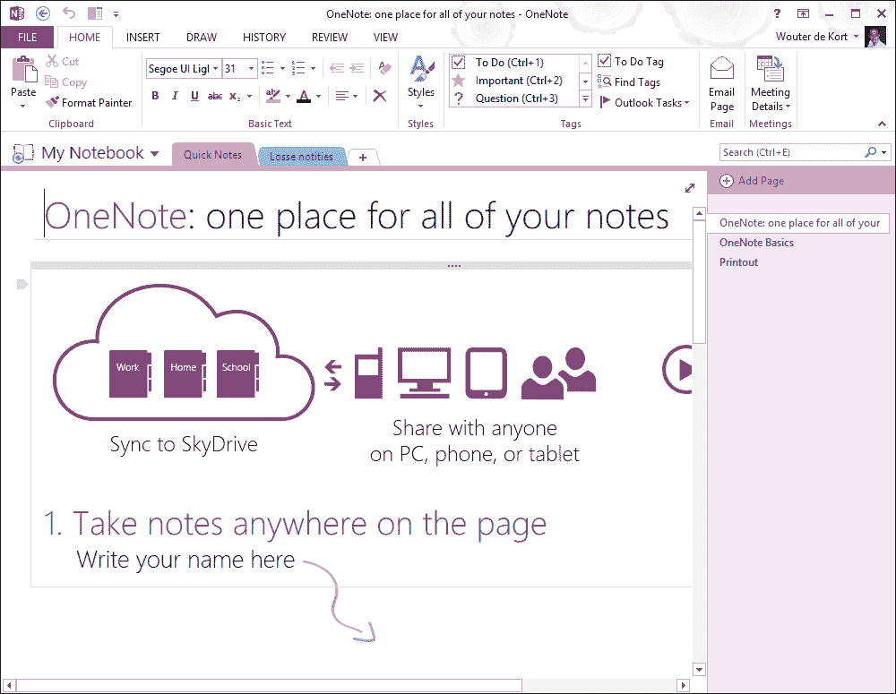

**图 1-1** 作为桌面应用的 OneNote 2013

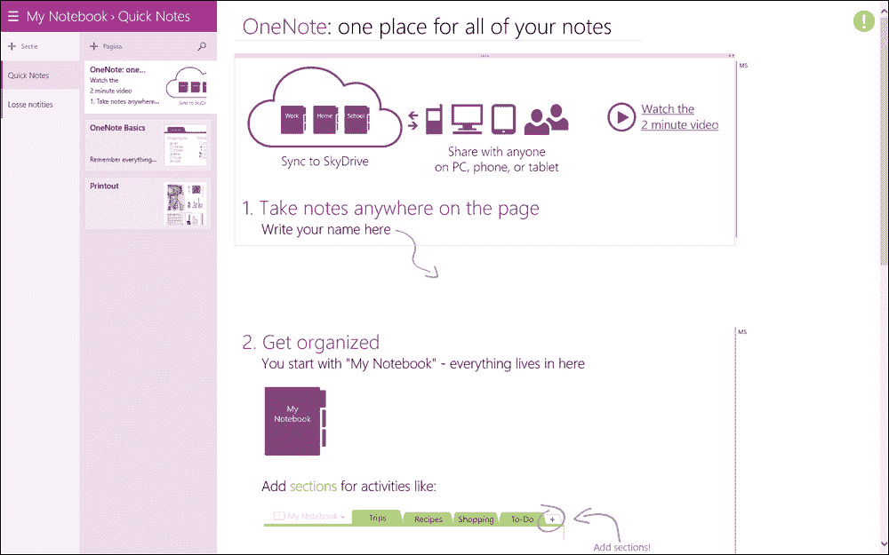

**图 1-2** 作为 Windows 应用商店应用的 OneNote 2013

桌面应用在屏幕上显示的内容更多，但这真的有益吗？OneNote 的核心是什么？难道不是记笔记、查看页面以及轻松记录想法吗？Windows 应用商店版的 OneNote 专注于这些功能。它只在需要时显示格式和其他命令选项，因此屏幕的更大区域可用于实现应用的目标：展示笔记。减少装饰元素和导航组件是关键。当然，减少元素不能做得太过，以免用户在应用中完全迷失。例如，微软决定直接在 Windows 应用商店的界面中添加搜索框，如 图 1-3 所示。这个搜索框能立即帮助用户找到搜索应用的正确位置。

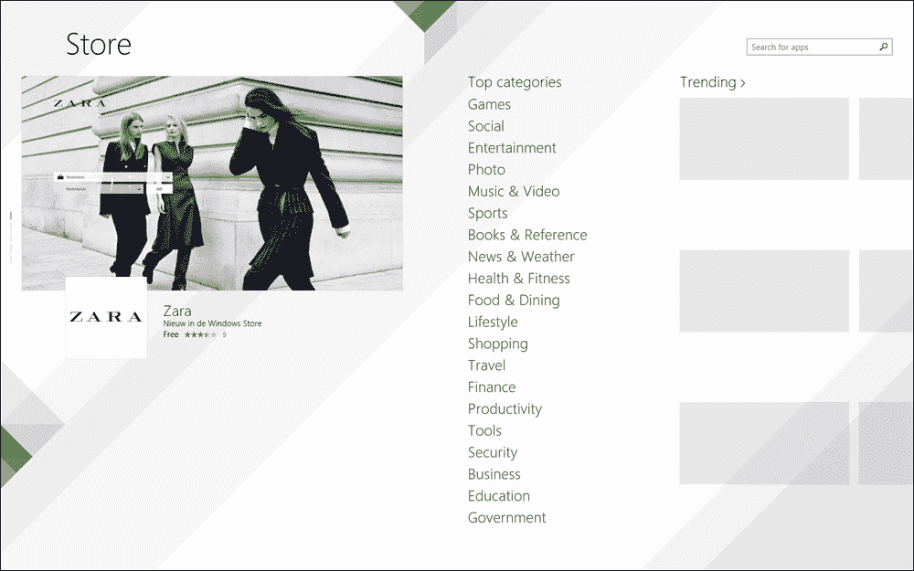

**图 1-3** 显示搜索框的 Windows 应用商店应用

最后一条设计原则*协同共赢*，是关于与现有的 Windows 8 生态系统集成。用户知道可以通过“设置”超级按钮更改应用设置，他们期望向上滑动打开应用栏，并且可以与其设备上安装的其他应用集成。确保你的应用能立即让用户感到熟悉，有助于他们使用你的应用，并确保他们会再次回来。

这五条原则应指导你完成应用的设计。请牢记这些设计原则，并让它们指导你在开发过程中做出的每一个决策。

* * *

 考试提示

确保你了解考试中涉及的五条设计原则。理解普通桌面应用与 Windows 应用商店应用之间的区别。

* * *

#### 创建愿景

审视那些应指导你应用的设计原则。你的应用不应是一个庞大、单一、能完成用户所有需求的应用。专注于你想要提供的体验，而不是功能。这就是*愿景*的用武之地。你应该清楚自己的应用擅长什么。想象一下，有人带着构建待办事项应用的想法来找你。他们设想用户应该能够添加任务、标记任务完成，并快速查看还有哪些任务未完成。试着确定你想要给用户带来的体验，而不仅仅是一系列功能。

用户为什么会使用你的应用？你的应用的核心是什么？经过一些头脑风暴，假设你列出了以下清单：

 添加新任务
 将任务标记为已完成
 与他人协作处理某些任务
 删除任务
 获取未完成任务列表
 搜索任务
 指定任务截止日期

从这个功能清单中退一步，思考什么能让你的应用脱颖而出。什么场景能让你的应用在竞争中独树一帜？

一个突出的场景是任务协作。也许你还能想到其他更好的场景，但试着选择一个单一场景来指导你的应用。

接下来，用一句*擅长声明*来表述你的应用愿景：

*我的待办事项应用擅长让人们共同处理任务列表。*

突然间，你对应用有了更清晰的愿景。现在你可以对照愿景检查你想到的每个功能。它是有助于实现愿景，还是会分散用户的注意力？

第二步是决定支持哪些用户活动。哪些步骤对用户实现共同处理任务列表的场景至关重要？他们应该经历的理想流程是什么？也许你会想到类似这样的内容：

 创建新的任务列表


-  添加任务
-  与另一位用户共享
-  报告进度

这些是构成应用流程的基本步骤。

现在你已明确自己的需求以及要支持的用户活动，接下来应开始研究你的平台。Windows 8 提供了广泛的功能供你使用——从不同的控件和动画到与其他应用集成的方式。例如，你可以使用 `Share contract` 来实现与他人共享任务列表的想法。你可以使用内置控件显示任务列表，并利用标准触摸手势让用户选择任务，然后通过点击应用栏中的按钮将其标记为已完成。

还有更多可能性！本书将介绍 Windows 8 在构建应用时提供的所有选项，从磁贴到通知，从外形规格到合约。开发 Windows 应用商店应用时可以实现许多功能，你应该了解那些有助于你设计的功能。

现在，你的应用构想逐渐成形。你有了清晰的愿景，确定了要支持的目标活动，并了解了编码时可用的丰富选项。

但在开始开发之前，你应该先创建一些应用的原型。你可以从纸上的简单草图开始，也可以使用 Expression Sketchflow 等工具，甚至可以使用带有 Storyboarding 插件的 PowerPoint。

图 1-4 展示了 PowerPoint 中原型可能呈现的样子。这类原型的优势在于，你可以让用户测试它们并给出反馈，而无需进行耗时的开发。

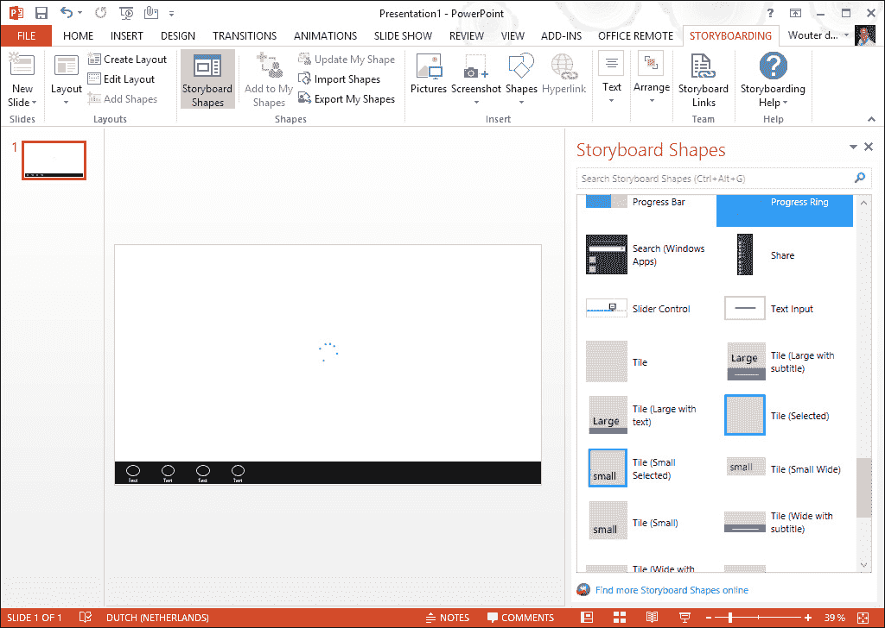

**图 1-4** Windows 应用商店应用的 PowerPoint 故事板

完成这些步骤后，你将拥有一些清晰的应用原型，并可以开始考虑实现。

## 决定 UI 的组成方式

在 Visual Studio 中创建新的 Windows 应用商店应用时，你有几种不同的选择。图 1-5 显示了你可以选择的项目模板。

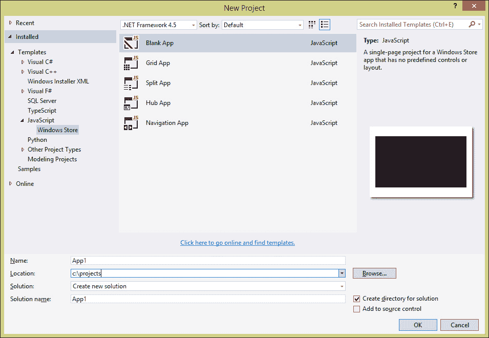

**图 1-5** 创建新的 JavaScript Windows 应用商店应用

决定从哪个模板开始是一个重要步骤。如果你已经创建了一些草图，可能已经确定了应用的流程。选择一个与你的流程紧密匹配的模板可以节省大量工作。

可用的模板如下：

-  空白应用
-  网格应用
-  拆分应用
-  中心应用
-  导航应用

选择正确的模板取决于你想要支持的导航类型。如果所有内容都位于同一层级（例如 Internet Explorer 或游戏），你可以选择`平面导航`。如果你有`分层`内容（例如类别和项目），则可以选择分层导航模式。

`空白应用模板`是唯一不带导航模型的模板。该模板为你提供一个空应用，仅包含 HTML、层叠样式表 (CSS) 和 JavaScript 文件，以及包清单所需的一些文件、用于签署应用的文件和一些默认图像。

虽然不建议从空白应用模板开始，但如果你需要一个简单的环境来测试某些功能，或者你的布局要求不符合标准 Windows 应用商店模型，则可以使用它。

`网格应用模板`是让用户浏览类别然后导航到单个项目（例如购物或新闻应用）的应用的基础。创建此项目后，你将获得一个默认的类别结构，其中包含项目，并以三层形式显示：概览、类别详细信息和项目详细信息。它实现了页面之间的导航，并附带一些可自定义的示例数据。

`拆分应用模板`将项目列表与项目详细信息合并到一个页面中。可以将其视为数据的主-详细信息视图。例如，它可用于构建博客阅读器应用。

`中心应用模板`是在 Windows 8.1 发布时添加到 Visual Studio 2013 中的。此模板在水平平移视图中显示内容。中心应用模板与其他项目模板不同，因为它混合使用了代表应用中项目的各个部分。网格应用和拆分应用模板以非常特定的方式显示项目，而中心应用模板则混合了所有这些方法以创建引人注目的 UI。

* * *

 考试提示

请务必在 Visual Studio 中尝试不同的项目模板。熟悉每个模板的内容，并尝试用每个模板勾勒一些简单的应用构想（例如购物应用或国际象棋游戏），以便了解模板如何帮助你朝着正确的方向起步。

* * *

Visual Studio 中模板的一个可能不太明显的方面是，这些模板实现了`单页应用程序 (SPA)` 结构。常规网站使用多个页面和超链接从一个页面导航到另一个页面。在页面加载时，屏幕会刷新并加载完整页面。

SPA 使用不同的架构。它不是拥有多个页面，而是在启动时加载一个页面，然后使用 JavaScript 启用和禁用元素。此过程避免了完整的页面重新加载，并为你的应用提供了更流畅的界面。在组合 UI 时，请牢记这一重要方面。你可以重用页面的骨架，并在“页面到页面”导航时切换不同的元素。

选择项目模板后，你可以使用多个项模板，如图 1-6 所示。这些模板可帮助你实现应用中的特定功能，例如合约。

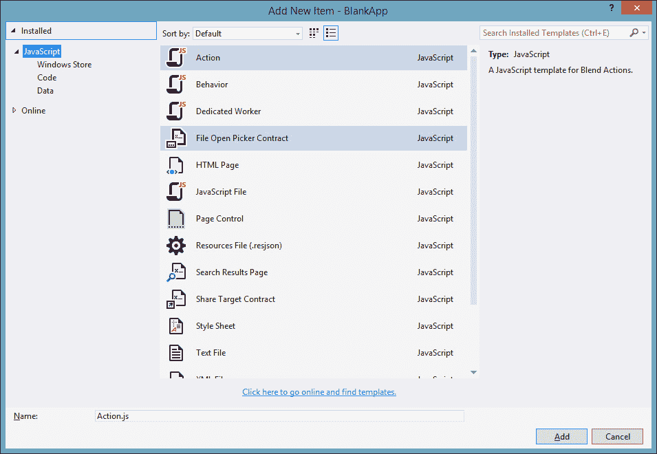

**图 1-6** “添加新项”对话框

### 设计视觉元素的继承和重用

在构建软件时，你很容易陷入一个陷阱：每当需要元素时，就简单地复制粘贴（HTML、CSS 或一些 JavaScript）。然而，虽然简单地复制代码可以带来一些速度，但最终会拖慢你的进度。

项目中的代码越多，就越难理解。`可维护性`也会成为问题；对每个副本进行更改不仅繁琐，而且当你忘记更改某个副本时还可能导致错误。

在设计阶段，你可以轻松地看到某些元素将在何处重复出现，因此请从一开始就确保找到合适的解决方案，而不是简单的复制粘贴过程。

当然，请记住诸如`保持简单 (KIS)` 和`你不需要它 (YAGNI)` 之类的原则，它们提醒你不要过度规划重用那些永远不会重用的元素。与其浪费时间创建易于重用但永远不会被使用的复杂控件，不如从简单的解决方案开始，并确保在需求变化时进行调整。

使用 HTML、CSS 和 JavaScript 进行应用开发，为你提供了大量在应用中重用元素的机会。

CSS 可能是最容易重用的。你应该将应用中多个位置使用的样式移动到一个公共文件中，然后在需要时引用该文件。特别是因为你使用的是 SPA 架构，你可以一次性加载 CSS 元素，然后在整个应用程序中重用它们。

JavaScript 也很容易重用。你可以将某些实用函数包含在 JavaScript 中，并从应用程序中的任何位置调用它们。下一个目标将介绍如何以可重用的方式构建 JavaScript。


你也可以通过使用 JavaScript 控件来复用 HTML。例如，HTML `PageControl` 允许你通过 JavaScript 加载 HTML 页面来实现复用。如果你希望创建可复用的 HTML、JavaScript 和 CSS 单元，也可以构建自定义控件。

这些选项将在本书中更详细地讨论。

#### 为无障碍访问而设计

想象一下，如果你是色盲或完全失明，你会如何使用你的应用？如果你失聪，或者无法轻松使用鼠标或触摸设备，又会怎样？在设计过程中，将用户的残障情况考虑在内非常重要。

也许你面临法律要求，必须让你的应用具备无障碍访问能力。或者，你只是考虑到，如果不为无障碍访问设计，所有可能无法使用你应用的用户。

幸运的是，在你的应用中实现无障碍访问并不困难。HTML 已经为创建无障碍网站提供了良好的支持，而你的 Windows 应用商店应用可以在此基础上扩展。

确保你的 HTML 不仅外观美观，还要明确说明其功能。为此，定义了*无障碍富互联网应用（ARIA）*。ARIA 定义了一组可以添加到 HTML 中的特殊属性。这些属性描述了元素的描述和角色，可供屏幕阅读器使用——例如，帮助用户理解某个元素的作用。

除了使用 ARIA 属性，你还应确保你的应用仅通过键盘即可访问，这意味着要考虑元素的 Tab 索引，确保用户可以使用方向键导航，并实现加速键。

你还应在不同条件下测试你的应用。测试可以包括不同分辨率、使用高对比度主题或更大字体的情况。

Windows 软件开发工具包（SDK）附带两个可用于测试应用无障碍访问的工具：`Inspect` 和 `UI Accessibility Checker`（`AccChecker`）。当然，你也可以进行一些手动测试：拔掉鼠标、更改颜色主题、调整字体大小。`Narrator` 是一个用于验证你的应用是否可与屏幕阅读器配合使用的应用程序。

如果你遵循了无障碍访问指南，你可以将你的应用作为无障碍应用提交到 Windows 应用商店，这有助于残障用户更容易地找到你的应用。当然，微软在允许提交之前会检查你的应用是否具备无障碍访问能力。

* * *

*更多信息*：使你的应用具备无障碍访问能力

要了解有关使用 HTML 和 JavaScript 的 Windows 应用商店应用中无障碍访问的更多信息，请参阅 *[`msdn.microsoft.com/en-us/library/windows/apps/hh452681.aspx`](http://msdn.microsoft.com/en-us/library/windows/apps/hh452681.aspx)*。此页面提供了使用 ARIA 的示例、清单以及使你的应用具备无障碍访问能力所需的工具链接。

* * *

#### 决定何时需要自定义控件

在构建应用时，你将使用标准 HTML 元素和微软预构建的 Windows 库 for JavaScript（`WinJS`）控件。仅使用这些控件，你就可以构建大多数应用而不会遇到太多问题。它们可以通过 CSS 设置样式，并且你通常可以附加 JavaScript 来扩展其行为。

有时你可能需要自定义控件。也许你想要一个日历、一些图表控件，或者完全针对你应用的某些其他内容。

首先，看看是否已经有人构建了你的自定义控件。像 Telerik 这样的公司为各种类型的应用程序创建控件套件。一个好的起点是 *[`services.windowsstore.com/`](http://services.windowsstore.com/)*。你可以在“控件与框架”部分找到自定义控件。

可以使用 `HtmlControl` 或 `PageControl` 创建基本的可复用代码片段。更复杂的控件可以像 `WinJS` 控件一样实现。

* * *

 考试提示

考试 70-481 的要求并未说明你应该能够创建自定义控件。考试 70-482（使用 HTML5 和 JavaScript 的高级 Windows 应用商店应用开发）要求你创建自定义控件。

* * *

#### 使用 Hub 应用模板

你已经了解了如何组合 UI 和选择模板。考试特别关注 Hub 应用模板，因此请确保你理解其工作原理。

Hub 应用模板是分层导航模式的一种实现。起始屏幕如图 1-7 所示。

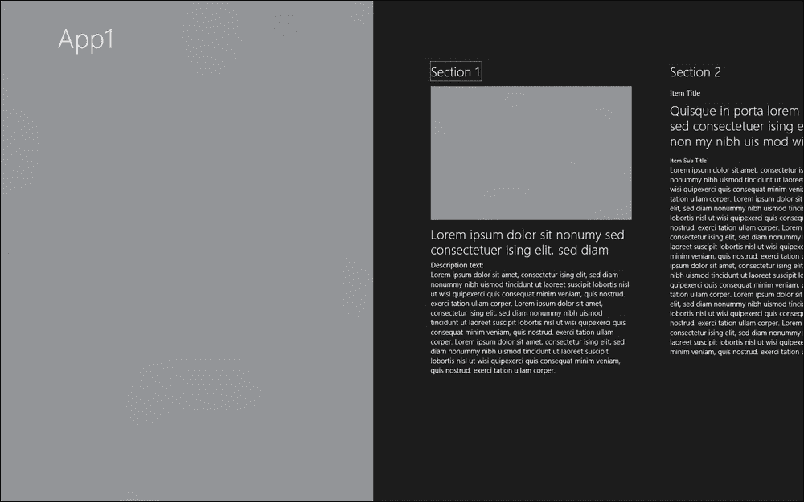

**图 1-7** Hub 应用模板起始屏幕

该模板采用水平布局，显示你定义的各个部分。在这些部分中，你可以显示单个项目。用户可以选择标有 > 的部分来查看该部分中的所有项目。当你选择单个项目时，会显示一个详细信息页面。

图 1-8 显示了模板创建的初始文件。最有趣的部分是 Pages 文件夹，其中包含 Hub、Item 和 Section 页面。Section 和 Item 页面的数据从 `js` 文件夹中的静态 `data.js` 文件加载。

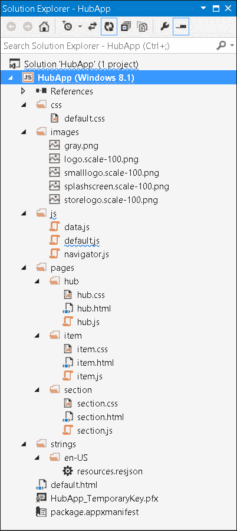

**图 1-8** Hub 应用模板创建的文件

调整模板很容易。为你的应用获取一些有意义的数据，这些数据可以是放在 `data.js` 文件中的静态测试数据，也可以是由应用从外部数据源异步加载的数据。

当然，添加你自己的样式和行为同样重要。将 Hub 应用模板作为应用的基础，将引导你朝着创建有吸引力的应用的正确方向前进！

* * *

*更多信息*：更改 Hub 应用模板

微软发布了一个完整的示例，展示了如何更改 Hub 应用模板以异步加载数据。这是开始使用该模板的好方法！你可以在此处找到它：*[`code.msdn.microsoft.com/windowsapps/Hub-template-sample-with-4b70002d`](http://code.msdn.microsoft.com/windowsapps/Hub-template-sample-with-4b70002d)*。

* * *

* * *

 *思考实验：* 设计你的应用

在这个思考实验中，应用你在此目标中学到的知识。你可以在本章末尾的“答案”部分找到这些问题的答案。

你正在为一家热门餐厅实现一个应用，店主希望用户能够通过该应用下单。该应用应跟踪用户的偏好，并根据他们的购买历史提供特别优惠。

**1.** 为你的应用制定一个“擅长”陈述。

**2.** 决定使用哪个模板作为应用的基础。

**3.** 决定你的应用是否应具备无障碍访问能力。

* * *

### 目标总结

 在设计应用时，请务必遵循微软的设计原则：匠心工艺、快速流畅、真实数字、以少胜多、团结致胜。

 确保你有一个“我的应用擅长”的陈述，将你的应用聚焦于一个单一的用户场景并完全实现它。

 Visual Studio 提供了项目模板，你可以将其作为应用的起点：空白应用、Hub 应用、导航应用、拆分应用和网格应用模板。

 你可以轻松地在应用中复用 HTML、CSS 和 JavaScript，以创建一致的外观和感觉，并确保可维护性。

 无障碍访问对于创建可供残障用户使用的应用非常重要。

 你创建的自定义控件可用于复用 HTML、JavaScript 和 CSS。

 Hub 应用模板是 Windows 8.1 中的新模板，你可以使用它创建有吸引力的应用，这些应用采用混合模式向用户展示内容。

### 目标回顾


回答以下问题以测试您对本目标中信息的掌握程度。您可以在本章末尾的“答案”部分找到这些问题的答案以及每个选项正确或错误的解释。

**1.** 您正在与刚接触 Windows 应用商店开发的设计师合作开发 ToDo 应用。他们鼓励您在应用中使用动画。您应该怎么做？

**A.** 解释动画已经过时，并且会分散注意力，Windows 应用商店应用应避免使用。

**B.** 同意他们的观点，并让他们列出想要使用的动画列表。

**C.** 引导他们查阅文档，并向他们展示 Windows 应用商店应用中使用的动画列表。

**D.** 与设计师会面，创建对您的应用有用的自定义动画。

**2.** 为什么“擅长”陈述对应用如此重要？

**A.** “擅长”陈述并不重要；应用无法流行起来，因为平台不支持。

**B.** “擅长”陈述并不重要，因为应用只允许具有有限的功能。

**C.** 没有“擅长”陈述，您就无法遵循 Microsoft 设计原则。

**D.** 它创建了一个愿景，您可以用它来指导应用的开发，并确保您的应用在支持的用户目标上真正出色。

**3.** 在设计应用时，以下哪些 Microsoft 设计原则是重要的？（选择所有适用的选项。）

**A.** 匠心精神

**B.** 与云集成

**C.** 快速流畅

**D.** 真实数字化

**E.** 少即是多

**F.** 团结致胜

### 目标 1.2：设计关注点分离

软件开发仍然是一个相对年轻的职业。尽管其他学科已经为其工艺建立了明确且公认的规则，但软件开发的规则仍在不断演变。

本目标讨论了软件行业在过去几十年中建立的原则。这些原则围绕构建可维护、易于理解和扩展的软件展开。您将学习如何使用层来构建应用程序，以及 Windows 元数据 (WinMD) 组件如何融入其中。

* * *

**本目标涵盖以下内容：**

 规划解决方案的逻辑层以满足应用程序需求

 设计松散耦合的层

 整合 WinMD 组件

* * *

### 规划解决方案的逻辑层以满足应用程序需求

当您做一些手工活（或看别人做）时，可能会使用各种工具。有些工具，比如多功能工具，可以用于多种场景。然而，您可以想象到多功能工具的某些部分会过时或损坏的情况。工具中一个元素的更改会影响其他部分。具有特定目标的专用工具通常更实用，且维护成本更低。

可维护性和特定目标对于软件设计也很重要。但在构建软件时，识别和避免这些类型设计中的错误要困难得多。

*关注点分离 (SoC)* 是指将计算机程序拆分为逻辑部分，使每个部分处理特定的关注点。SoC 对于创建易于测试的可维护应用程序非常重要。

SoC 的典型示例是 HTML、JavaScript 和 CSS。它们在创建网页或应用时各自扮演独特的角色。HTML 是页面的语义结构，CSS 是样式，JavaScript 添加客户端功能。

您可以将这三个关注点混合在一起。例如，虽然您可以直接在 HTML 元素上添加样式，但这些设计会变得不必要的复杂、难以维护且难以扩展。

SoC 如何应用于您的应用？一个典型的应用需要做多件事：从某处获取数据，从中提取必要的字段，并在显示到屏幕之前可能执行一些其他验证。这些任务不应被塞入一个横跨整个应用的单一庞大对象中。相反，您应该将这些任务划分到不同的区域，并使它们协同工作。

这个过程称为*分层*，一个应用程序可以由多个逻辑层组成。一个应用通常包括 UI 层、服务层、业务层和数据层。

这些层有特定的任务。业务层不需要知道如何获取数据；这是数据层的职责。数据层不知道数据如何在屏幕上显示；这是 UI 层的工作。

这种架构的典型示意图如图 1-9 所示。

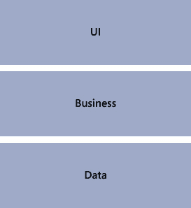

**图 1-9** 分层架构示意图

该图显示了三个典型层堆叠在一起。所有层还必须处理安全性和日志记录。

在开始编写应用代码之前，您应该对应用中需要的不同层有一个合理的概念。

当您从某个模板（例如中心应用模板）创建新应用时，您会看到 `data.js` 负责获取数据。通过这种方式，您将所有关于数据访问的知识集中到一个位置。应用的其他部分可以调用数据对象并使用它，而无需了解数据存储机制的任何细节。

应用的逻辑层不同于层（tier）。您可能听说过*N 层应用*这个术语。*层 (tier)* 是一个（或几个）与其他层物理分离的层。它可能是在云中某处（例如 Microsoft Azure）运行的 Web 服务，包含应用的一部分功能，或者是存储应用数据的数据库。

逻辑层可以放置在不同的层（tier）上，但并非必须如此才能实现设计良好的应用。

### 设计松散耦合的层

JavaScript 作为一种语言，在设计大型应用程序时有其特定的挑战。C++ 或 C# 等语言实现了称为*面向对象编程*的范式，使您能够创建针对单一任务的小型类。您可以配置对象的作用域，对它们进行分组，并以这种方式构建应用程序。

JavaScript 是一种强大的语言，但它并非为构建大型应用程序而设计。面向对象语言中的类和模块等概念并未内置于 JavaScript 语言中。

当然，您可以直接开始开发应用，而不必过多考虑分层。然而，随着应用开始增长，应用的可维护性和整体质量将受到负面影响。

#### 避免全局状态

在 JavaScript 中，您创建的所有内容默认都是全局可访问的，因此您声明的每个变量都可以在代码中的任何位置被修改。当您两次声明同一个变量时，可能会发生命名冲突，这可能导致变量在应用程序中的某处被修改而难以追踪更改，从而引发不可预见的问题。

这些冲突不会发生在函数内部声明的变量和函数上。JavaScript 将这些对象的作用域限制在函数作用域内。这种限制使您能够在 JavaScript 中实现*私有*（您可以在 C# 等语言中找到的概念）的概念。

为了避免全局状态并创建私有数据，Visual Studio 模板创建的默认 JavaScript 文件会像这样包装其内容：

```
(function () {

    ...

})();
```


这里你看到的是一个匿名自调用函数。该函数在声明时没有名称，并在声明结束时立即执行。这个函数允许你将函数内部的所有内容限定在作用域内。

你并不希望将所有内容都设为私有；有些函数或变量应该被暴露出来。为此，`WinJS` 使用了命名空间的概念。

通过使用 `WinJS.Namespace.define` 方法，你可以为命名空间设置一个名称，并配置哪些项是可访问的：

```javascript
var namespacePublicMembers = { clickEventHandler: button1Click };
WinJS.Namespace.define("startPage", namespacePublicMembers);
```

在这个示例中，你定义了一个名为 `startPage` 的命名空间，并暴露了一个名为 `clickEventHandler` 的变量。这个事件处理程序指向你在匿名方法内部定义的 `button1Click` 函数。

除了只能使用普通函数并通过命名空间暴露它们之外，你还可以使用 `WinJS` 来创建类。通过使用 `WinJS.Class.define` 方法，你可以创建一个同时具有行为和数据的类。

你可以使用以下纯 JavaScript 代码来创建一个类似的对象：

```javascript
function Robot(name) {
    this.name = name;
}
Robot.prototype.modelName = '4500';
Robot.harmsHumans = false;
```

你创建了一个名为 `Robot` 的类，它在创建时需要传入一个名称。它还有一个 `modelName` 属性，该属性对每个实例是唯一的。`harmsHumans` 属性是*静态*的，意味着它在所有实例之间共享。

除了使用这种语法，`WinJS` 还暴露了一个名为 `WinJS.Class.define` 的辅助方法。你可以使用以下代码来创建你的 `Robot` 类：

```javascript
var Robot = WinJS.Class.define(
    // 构造函数。
    function(name) {
        this.name = name;
    },
    // 实例成员集合。
    { modelName: "" },
    // 静态成员集合。
    { harmsHumans: false });

var myRobot = new Robot("Mickey");
myRobot.modelName = "4500";
Robot.harmsHumans = false;
```

`WinJS` 还为你提供了一个实现继承的辅助方法，这是面向对象开发中的一个概念，你可以定义基类和派生类。你可以创建一个类层次结构，所有类共享行为和属性，同时还可以向基类添加额外的元素。

一个经典的例子是动物。如果你有一个基类 `Animal`，你可以向它添加诸如 `IsAlive` 或 `Age` 等元素。现在你可以派生出特定的子类型，比如 `Mammal` 或 `Bird`。它们可以添加自己的数据，例如 `IsWarmBlooded` 或 `Fly`。

然而，这里存在一些问题。所有鸟都能飞吗？如何表达并非所有类型的鸟都能飞？你可以开始添加检查，以确保你不会执行当前类中未实现的方法，但沿着这条路走下去，当并非所有子类都支持基类上定义的方法时，会导致代码难以维护。讨论开发类层次结构的所有细节超出了本考试的范围。如果你开始构建更复杂的应用程序，熟悉面向对象设计概念会很有帮助。

---

*更多信息*：面向对象设计

关于面向对象设计的书籍、文章、教程和其他材料有很多。一个很好的起点是阅读 Robert Martin 编写的材料，他被认为是面向对象设计的创始人之一：[`www.objectmentor.com/omSolutions/oops_what.html`](http://www.objectmentor.com/omSolutions/oops_what.html)。

---

##### 使用严格模式

JavaScript 通常对你编写代码的方式非常宽容。你可以使用一个从未声明过的变量，写入一个只读属性，扩展标记为不可扩展的对象，删除函数，或者重复属性以及其他奇怪的错误，这些错误在开始产生代码错误时不会立即显现。

严格模式是 JavaScript 中的一个特性，你必须显式启用它。启用它可以在代码中实现更好的错误检查，以避免前面提到的那些错误类型。你可以通过将以下行添加到程序中来启用严格模式：

```javascript
"use strict";
```

这一行可以限定在全局作用域（适用于整个应用程序中的所有代码，甚至外部代码），或者你可以在函数内部使用它，将其限定在该函数的作用域内。

## 使用 TypeScript

JavaScript 需要一些帮助才能适合构建大型应用程序。微软也注意到了这一不足，因此开始开发 TypeScript。

TypeScript 是 JavaScript 的一个超集，它仍然编译成可用于运行应用程序的纯 JavaScript。在开发时，它增加了额外的功能，如类型、类、模块、泛型和继承。

这些功能显著改善了使用 JavaScript 的体验。看看下面的 TypeScript 代码：

```typescript
class Greeter {
    greeting: string;
    constructor(message: string) {
        this.greeting = message;
    }
    greet() {
        return "Hello, " + this.greeting;
    }
}

var greeter = new Greeter("world");
```

`class` 关键字、构造函数和属性类型是 TypeScript 添加的元素，这使得编译器能够为你提供更好的支持。它可以发现错误，帮助你使用 IntelliSense，并与改善工作流程的其他 Visual Studio 功能配合使用。

没有任何东西阻止你使用 TypeScript 来构建 Windows 应用商店应用。甚至还有针对文档对象模型（DOM）和 `WinJS` 库的 TypeScript 定义文件。作为一名 JavaScript 开发者，你绝对应该考虑使用 TypeScript。

---

*更多信息*：TypeScript

有关 TypeScript 的更多信息，请访问 TypeScript 网站：[`www.typescriptlang.org/`](http://www.typescriptlang.org/)。类型定义的开源仓库可以在 [`github.com/borisyankov/DefinitelyTyped`](https://github.com/borisyankov/DefinitelyTyped) 找到。你可以下载定义文件以开始使用 `WinJS` 库。

---

## 集成 WinMD 组件

当你使用 HTML、JavaScript 和 CSS 开发 Windows 应用商店应用时，你会调用 `WinJS` 中定义的库，这些库构建在原生 C++ WinRT 运行时之上。

通常，JavaScript 不支持调用原生的动态链接库（DLL）。微软投入了大量精力来创建一个支持不同语言互操作性的基础设施，以便为 Windows 平台创建应用。

常规的 C++ 原生组件不包含元数据，而元数据对于在原生组件和其他语言之间创建正确的映射是必需的。为了实现这一点，微软创建了一种名为 Windows 元数据（WinMD）的新文件类型。

如果你正在运行 Windows 8，可以在 `C:\Windows\System32\WinMetadata` 中找到这些文件。这些文件的格式与 .NET Framework 用于公共语言基础结构（CLI）的格式相同。

WinMD 文件可以同时包含代码和元数据。然而，System32 目录中的那些文件只包含元数据。Visual Studio 在设计时使用这些元数据来提供 IntelliSense。在运行时，元数据用于指示其中所有方法的实现由运行时提供，这就是为什么这些文件不必包含实际代码；它们确保这些方法映射到 WinRT 中的正确方法。

在构建 JavaScript 应用时，你可以选择用另一种语言（如 C# 或 C++）来实现部分应用程序。这些项目可以包含难以用 JavaScript 实现的代码，同时仍然能与你的应用良好集成。


如果你想创建自己的 WinMD 程序集，可以在 Visual Studio 中创建一个 WinRT 组件。该 WinRT 组件会编译成一个 `.winmd` 文件，供你后续使用。

以下示例展示了可以在 WinRT 项目中包含的一些代码：

点击此处查看代码图片

```csharp
namespace MyComponent
{
    public sealed class MyClass
    {
        public int DoSomething(int x)
        {
            return x + 42;
        }
    }
}
```

如果你在应用项目中添加了对 WinRT 组件项目的引用，就可以从 JavaScript 代码中以如下方式使用 C# 项目中的 `MyClass` 类：

点击此处查看代码图片

```javascript
var myClass = new MyComponent.MyClass();
var value = myClass.doSomething(42);
```

这段代码调用了 C# 代码并执行了一个方法。在 JavaScript 代码中，函数名以小写字母“d”开头。C# 的惯例是元素名称以大写字母开头；而 JavaScript 遵循的惯例是每个元素以小写字母开头。这就是为什么在 C# 中以大写字母开头的方法，在 JavaScript 中会以小写字母开头。

* * *

 考试提示

请记住，在构建应用时，你可以混合使用 JavaScript 和 C# 或 C++ 代码。

* * *

使用 WinRT 组件时，有几个限制：

 组件中所有公共类型和成员的字段、参数和返回值必须是 WinRT 类型。

 公共类和接口可以包含方法、属性和事件。但公共类或接口不能执行以下操作：

 是泛型

 实现非 WinRT 接口

 派生自 WinRT 外部的类型

 公共类必须是密封的。

 公共结构只能将公共字段作为成员，且这些字段必须是值类型或字符串。

 所有公共类型必须有一个与程序集名称匹配的根命名空间，且不能以 `Windows` 开头。

* * *

*更多信息*：WinMD 组件

有关创建 WinMD 组件的更多信息，请参阅官方文档：*[`msdn.microsoft.com/library/windows/apps/hh779077.aspx`](http://msdn.microsoft.com/library/windows/apps/hh779077.aspx)*。

* * *

* * *

 *思考实验：* 设计一个大型应用程序

在这个思考实验中，请运用你在此目标中学到的知识。你可以在本章末尾的“答案”部分找到这些问题的答案。

你的公司正在启动一个新的应用项目，你被要求勾勒出初始架构。你了解过分层应用的优势，但一位同事反对这种架构。

你该如何回应他以下的说法？

**1.** 分层应用会使开发变得复杂。

**2.** 分层会拖慢开发速度，因为开发人员必须等待某一层完成后才能继续。

**3.** JavaScript 无法用于构建分层应用。

* * *

### 目标总结

 将应用程序划分为不同的层有助于创建易于维护且更易扩展的应用。

 典型的层包括 UI 层、业务层和数据层。

 在使用 JavaScript 时，要注意代码的结构方式，以避免一些固有的 JavaScript 问题，例如全局状态。你可以使用自调用匿名函数来为代码添加作用域。

 TypeScript 是 JavaScript 的超集，可帮助你编写应用级别的 JavaScript。

 WinMD 组件可以用其他语言（如 C++ 和 C#）编写，然后从 JavaScript Windows 应用商店应用中使用。

### 目标复习

回答以下问题，以检验你对本目标中信息的掌握程度。你可以在本章末尾的“答案”部分找到这些问题的答案以及每个选项正确或错误的解释。

**1.** 你正在设计一个应用，该应用连接外部 Web 服务以加载数据。这些数据随后被处理并显示在屏幕上。应该从哪一层调用 Web 服务？

**A.** 数据层

**B.** 服务层

**C.** 业务层

**D.** UI 层

**2.** 在 JavaScript 应用中是否应该避免全局状态？

**A.** 不。全局状态很方便，因为可以在应用的不同部分之间共享数据。

**B.** 不。在 JavaScript 中无法避免全局状态。

**C.** 是。避免全局状态可以使代码免受不必要的副作用影响，并有助于维护。

**D.** 是。Windows 应用商店应用中不允许存在全局状态。

**3.** 哪些元素可以用来构建分层应用？（选择所有适用的选项。）

**A.** `WinJS.Class.define`

**B.** `WinJS.Namespace.define`

**C.** WinMD 组件

**D.** Web 服务

### 目标 1.3：设计和实现进程生命周期管理 (PLM)

在使用常规桌面应用程序时，你习惯于自己启动和关闭它们。当你切换到另一个应用程序时，其他正在运行的应用程序会保留在内存中，你可以轻松地切换回去。当你的计算机运行变慢时，你会开始关闭应用程序，甚至打开任务管理器查看发生了什么。

Windows 应用商店应用的行为有所不同。微软不希望用户费心去主动关闭应用程序，因此它为 Windows 应用商店应用创建了*进程生命周期管理 (PLM)*，无需用户干预即可管理应用的生命周期。

应用的生命周期是你构建应用的基础。请确保你正确理解了它。你可以拥有一个漂亮的应用程序，但如果它的行为不符合用户的预期，你就会失去用户。

* * *

**本目标涵盖以下内容：**

 选择状态管理策略

 处理挂起事件 (oncheckpoint)

 为应用终止做准备

 处理 onactivated 事件

 检查 ActivationKind 和先前状态

* * *

### 选择状态管理策略

Windows 应用商店应用可以通过多种方式启动和终止。理解应用程序生命周期并在应用中预判它，可以带来更好的用户体验，使你的应用自然符合用户的预期。

应用的生命周期始于“未运行”状态。你通过点击“开始”屏幕上的磁贴启动应用；然后应用会显示其启动画面，加载数据，并开始运行。

这是简单的路径。然而，实际上可能发生更多情况。图 1-10 展示了一个应用的典型生命周期。

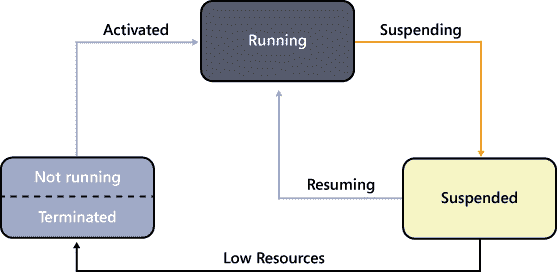

**图 1-10** 应用的生命周期

当你的应用处于*挂起状态*时，它消耗的内存比运行状态少，并且不会获得 CPU 时间调度，从而节省电量，使平板电脑和笔记本电脑的电池续航时间更长。尽管 Windows 试图让尽可能多的应用保持在挂起状态，但当操作系统资源（通常是内存）不足时，Windows 会开始终止那些一段时间未使用的应用。


选择状态管理策略的关键在于理解应用的生命周期并做出相应响应。这意味着什么？当用户（例如游戏或博客读者）离开你的应用然后返回时，他们期望回到离开时的相同位置，并保持相同的设置。

在此期间，Windows 可能已挂起甚至终止了你的应用。然而，用户并不了解情况，他们希望继续使用你的应用。因此，你必须响应挂起或恢复等事件，确保在必要时保存正确的状态并恢复它，以便用户不会察觉到任何变化。

你可以将这一过程更进一步。由于应用可以安装在多个设备上，你应该允许用户在使用应用时在这些设备之间切换。你需要将用户操作的所有细节保存到外部源，并在应用在设备上启动时重新加载它们。Windows 通过自动将数据`roaming`到所有用户设备来帮助你，这样你就可以跨设备共享状态并提供无缝体验。

### 处理 `onactivated` 事件

你的应用可以通过多种方式激活。最明显的方式当然是用户通过点击“开始”屏幕上的应用磁贴直接启动它。还有许多其他方式可以激活应用。如果你使用 toast 通知（在第 4 章，“程序用户交互”中有更详细的讨论），用户可以通过点击通知来启动你的应用。如果你实现了合约（详见第 2 章，“开发 Windows 应用商店应用”），用户可以通过搜索或共享超级按钮、文件类型或 URI 关联来启动你的应用。

这些激活事件需要不同的策略。幸运的是，Visual Studio 模板提供了一些样板代码，你可以用来响应这些事件。当你从“空白应用”模板创建新应用后，你会在 `default.js` 文件中看到以下代码：

```
app.onactivated = function (args) {
    if (args.detail.kind === activation.ActivationKind.launch) {
        if (args.detail.previousExecutionState !==
                    activation.ApplicationExecutionState.terminated) {
            // TODO: This application has been newly launched. Initialize
            // your application here.
        } else {
            // TODO: This application has been reactivated from suspension.
            // Restore application state here.
        }
        args.setPromise(WinJS.UI.processAll());
    }
};
```

这段代码展示了如何订阅 WinJS 应用的 `onactivated` 事件。在事件处理程序内部，你可以判断应用是刚刚启动还是从挂起状态恢复。

这种状态会影响你需要采取的步骤。如果应用是刚刚启动，则初始化应用并向用户显示其主屏幕。如果用户返回你的应用，请确保他们返回到完全相同的点。

如果自应用挂起以来 UI 内容发生了变化，你需要加载新数据并相应地更新 UI。你的应用的激活事件在 Windows 显示启动画面时运行，这就是为什么你应该确保初始化尽可能快。

你的应用还可以与特定的文件类型或 URI 关联。将应用与文件类型关联是在应用程序清单中配置的。

图 1-11 显示了为扩展名为 `.my` 的文件配置了文件类型关联的清单设计器。

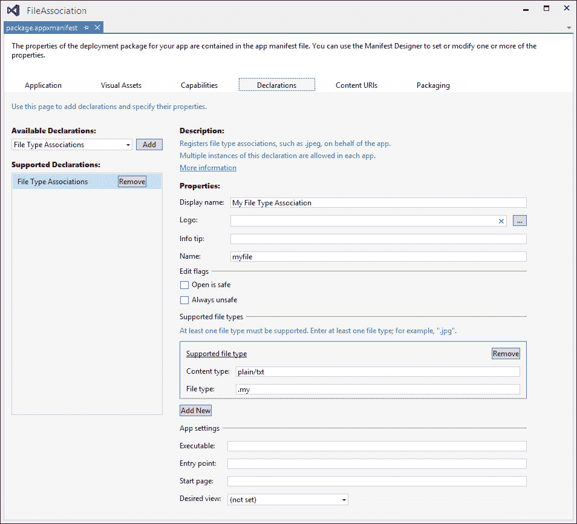

**图 1-11** 显示文件类型关联的清单设计器对话框

配置这些设置后，从 Visual Studio 启动应用以向 Windows 注册新的文件类型。然后你可以创建一个新的文本文件并将扩展名更改为 `.my`。双击新文件即可启动你的应用。

在应用的激活事件期间，你可以判断应用是否从关联文件启动：

```
if (args.detail.kind === Windows.ApplicationModel.Activation.ActivationKind.file) {
    var file = args.detail.files[0];
    Windows.Storage.FileIO.readTextAsync(file).then(function (text) {
    });
    // The number of files received is eventArgs.detail.files.size
    // The first file is eventArgs.detail.files[0].name
}
```

这段代码检查 `ActivationKind` 是否为 `file` 类型。如果是，则传递给激活事件处理程序的参数包含一个 `details.files` 属性，该属性包含用户在启动应用时选择的一个或多个文件的信息。在此示例中，你处理的是一个纯文本文件，因此你可以将其传递给 `Windows.Storage.FileIO.readTextAsync` 并读取文件的文本内容。

你的应用也可以从 URI 激活。一个例子是 Windows 应用商店。通过导航到形式为 `ms-windows-store:PDP?PFN=` 的 URI，你可以启动 Windows 应用商店并导航到指定的包系列名称。URI 的 `ms-windows-store` 部分称为*协议*。

你可以向应用添加自己的协议，以将其与特定的 URI 关联。图 1-12 显示了添加了新协议 `mypro` 的清单设计器。

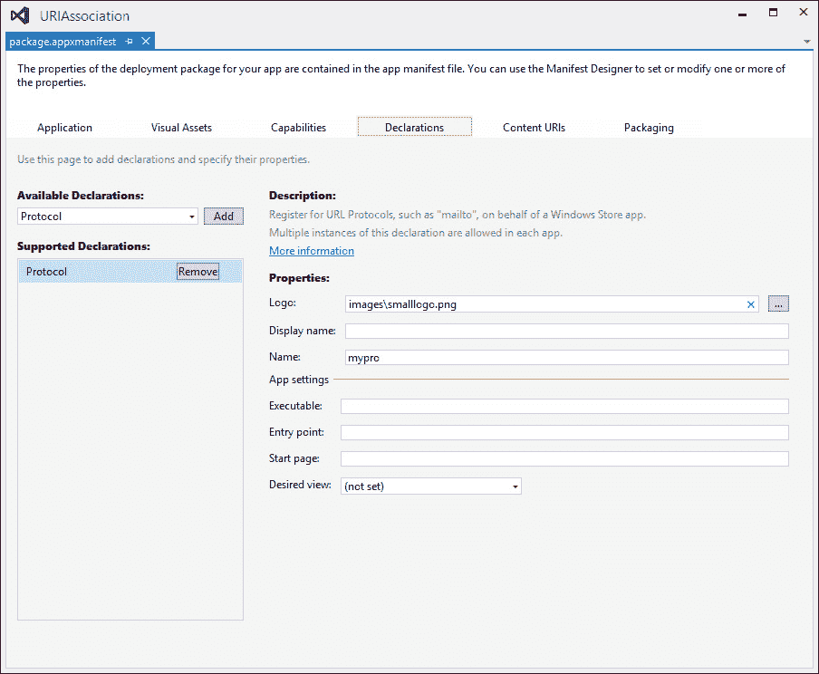

**图 1-12** 显示协议声明的清单设计器对话框

当然，配置徽标和描述性显示名称很重要，之后你可以启动应用以向 Windows 注册你的协议。打开 Windows 资源管理器并导航到 `mypro://content` 即可启动你的应用。

与文件类型关联类似，你可以在激活事件中判断应用是否从 URI 启动：

```
if (args.detail.kind === activation.ActivationKind.protocol) {
    var uri = args.detail.uri;
    var rawUri = uri.rawUri;
}
```

`args.detail.uri` 属性包含有关启动你的应用的 URI 的信息。你需要解析该 URI 并采取适当的操作。

请记住，启动你的应用的文件和 URI 都可能是有害的。你永远不应信任用户提供的输入，并且在处理外部输入时始终使用安全措施。

### 处理挂起事件（`oncheckpoint`）

当用户切换到另一个应用时，Windows 会在几秒钟后挂起你的应用，这样用户就可以立即切换回你的应用，而无需执行任何工作。

每当 Windows 注意到用户不会立即返回时，你的应用就会被挂起。然后 Windows 会引发检查点事件。在此事件中，你可以保存任何用户状态，以便在应用从终止状态恢复时恢复。

订阅检查点事件的语法如下：

```
app.oncheckpoint = function (args) {
};
```

在函数内部，你可以将任何状态或其他数据保存到 `WinJS.Application.sessionState` 对象中，以便在应用从终止状态变为运行状态时恢复。该对象的内容会序列化到你的本地 appdata 文件夹中。当应用从终止状态再次激活时，`sessionState` 对象会从本地 appdata 文件夹中重新水化。然后你可以使用 `sessionState` 对象中的数据重新初始化你的应用。

这个过程可以像以下示例一样简单：

```
app.onactivated = function (args) {
    if (args.detail.kind === activation.ActivationKind.launch) {
        if (args.detail.previousExecutionState !==
                    activation.ApplicationExecutionState.terminated) {
            // TODO: This application has been newly launched. Initialize
            // your application here.
```


```
        } else {
            var value = WinJS.Application.sessionState.value;
        }
        args.setPromise(WinJS.UI.processAll());
    }
};
app.oncheckpoint = function (args) {
    WinJS.Application.sessionState.value = 42;
};
```

当你的应用进入挂起状态时，一个值为 `42` 的数据会被保存到 `sessionState` 对象中。当应用从终止状态启动时，该值会从对象中取出。

你也可以直接使用 `WinJS.Application` 对象，从本地、临时或漫游文件夹中读写状态。如果你的数据无法直接序列化为字符串，或者你想对数据存储位置进行精细控制，直接写入这些文件夹会很有用。

在检查点事件中使用任何异步操作时，你必须向操作系统发出信号。Windows 假设检查点事件返回时你已经保存了所有状态，因此不会为你的应用分配 CPU 时间。为了避免因异步操作而丢失 CPU 时间，你可以像在激活事件中那样使用 `args.setPromise()` 方法。

请记住，你最多只有五秒钟的时间。如果你未能在五秒内从检查点方法返回或完成所有异步操作，你的应用将被终止。

### 为应用终止做准备

当你的应用从运行状态进入挂起状态时，你会收到 Windows 操作系统的通知。但当你的应用从挂起状态进入终止状态时，你的应用不会收到通知。这是设计使然，实际上也相当合理。

你的应用被终止是因为操作系统资源不足。仅仅为了准备终止而激活你的应用可能会带来麻烦，因为激活应用本身就会消耗资源。而当你的应用尝试将某些状态保存到磁盘或调用 Web 服务时，会消耗更多内存。

为了节省资源，你的应用在终止时不会被调用。相反，你应该在上一节讨论的检查点事件中完成所有工作。这样，无论你的应用何时从挂起状态进入终止状态，你都已经保存了所有必需的状态。

* * *

 考试提示

请记住，没有单独的终止事件。你应该在检查点事件中保存所有状态，并确保你的应用能够完全从终止状态恢复。

* * *

#### 使用后台任务

但是，如果你希望在用户关闭应用时继续运行呢？你可以通过使用后台任务来实现。你可以请求 Windows 授予在后台执行代码的权限，方法是使用应用程序清单设计器。

图 1-13 显示了带有 BackgroundTask 扩展的应用程序清单设计器。

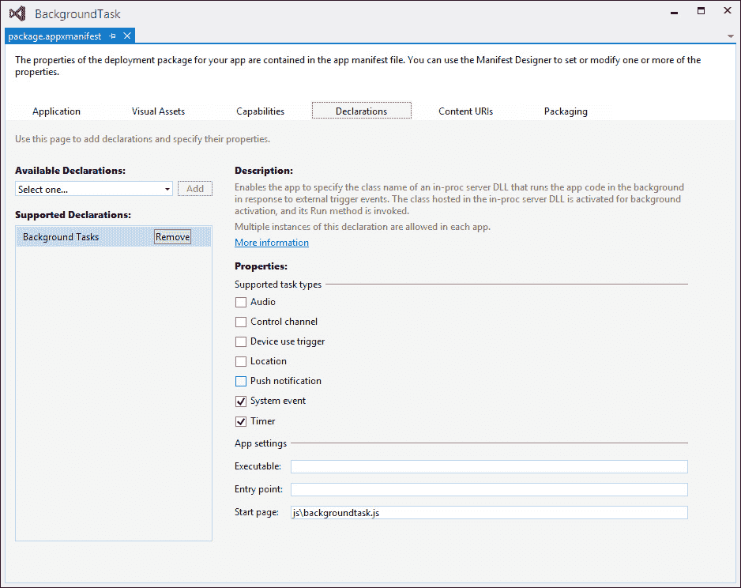

**图 1-13** 显示后台任务声明的清单设计器对话框

后台任务被配置为在系统事件和计时器上触发。当后台任务被触发时，它会启动 JavaScript 文件 `js\backgroundtask.js`。你的后台任务由两部分组成：实际任务和注册任务的代码。

从注册开始。以下方法允许你注册一个后台任务：

点击此处查看代码图片

```
function registerTask(taskEntryPoint, taskName, trigger, condition) {
    var builder = new Windows.ApplicationModel.Background.BackgroundTaskBuilder();
    builder.name = taskName;
    builder.taskEntryPoint = taskEntryPoint;
    builder.setTrigger(trigger);
    if (condition !== null) {
        builder.addCondition(condition);
        builder.cancelOnConditionLoss = true;
    }
    var task = builder.register();
    task.addEventListener("progress", new BackgroundTaskSample.progressHandler(task).onProgress);
    task.addEventListener("completed", new BackgroundTaskSample.completeHandler(task).onCompleted)
    var settings = Windows.Storage.ApplicationData.current.localSettings;
    settings.values.remove(taskName);
};
```

该方法接受一个参数，指向包含实际任务的 JavaScript 文件，以及一个名称、你想要使用的触发器，以及一个决定任务是否应运行的条件。你可以像这样调用该方法：

点击此处查看代码图片

```
registerTask("js\\backgroundtask.js",
                            "SampleJavaScriptBackgroundTask",
                            new Windows.ApplicationModel.Background.SystemTrigger(
                                      Windows.ApplicationModel.Background.SystemTriggerType.timeZoneChange, false),
                            null);
```

这段代码注册了一个后台任务，当用户更改时区时运行，且没有其他条件。

触发器可以是以下任意一种：

- `SmsReceived` – 当安装的移动宽带设备收到新的短消息服务（SMS）消息时，触发后台任务。
- `UserPresent` – 当用户出现时，触发后台任务。
- `UserAway` – 当用户离开时，触发后台任务。
- `NetworkStateChange` – 当网络发生变化（例如费用或连接状态改变）时，触发后台任务。
- `ControlChannelReset` – 当控制通道重置时，触发后台任务。
- `InternetAvailable` – 当互联网可用时，触发后台任务。
- `SessionConnected` – 当会话连接时，触发后台任务。
- `ServicingComplete` – 当系统完成应用更新时，触发后台任务。
- `LockScreenApplicationAdded` – 当磁贴添加到锁屏时，触发后台任务。
- `LockScreenApplicationRemoved` – 当磁贴从锁屏移除时，触发后台任务。
- `TimeZoneChange` – 当设备上的时区发生变化时（例如，系统为夏令时调整时钟），触发后台任务。
- `OnlineIdConnectedStateChange` – 当与账户关联的 Microsoft 账户发生变化时，触发后台任务。
- `BackgroundWorkCostChange` – 当后台工作的成本发生变化时，触发后台任务。

请记住，对于用户存在等触发器，你的应用也必须在锁屏上可见。

如果你对每个触发器变化不感兴趣，你可以为后台任务添加额外的条件：

- `UserPresent` – 指定后台任务只能在用户在场时运行。如果带有 `UserPresent` 条件的后台任务被触发，但用户不在，则任务不会运行，直到用户出现。
- `UserNotPresent` – 指定后台任务只能在用户不在场时运行。如果带有 `UserNotPresent` 条件的后台任务被触发，但用户在场，则任务不会运行，直到用户变为非活动状态。
- `InternetAvailable` – 指定后台任务只能在互联网可用时运行。如果带有 `InternetAvailable` 条件的后台任务被触发，但互联网不可用，则任务不会运行，直到互联网再次可用。
- `InternetNotAvailable` – 指定后台任务只能在互联网不可用时运行。如果带有 `InternetNotAvailable` 条件的后台任务被触发，但互联网可用，则任务不会运行，直到互联网不可用。


 `SessionConnected` 指定后台任务仅在用户会话已连接时才能运行。如果触发了带有 `SessionConnected` 条件的后台任务，而用户会话未登录，则该任务将在用户登录时运行。

 `SessionDisconnected` 指定后台任务仅在用户会话已断开时才能运行。如果触发了带有 `SessionDisconnected` 条件的后台任务，而用户已登录，则该任务将在用户注销时运行。

 `FreeNetworkAvailable` 指定后台任务仅在存在免费（非计量）网络连接时才能运行。

 `BackgroundWorkCostNotHigh` 指定后台任务仅在执行后台工作的成本较低时才能运行。

配置触发器和条件后，唯一需要的就是实际的任务。在前面的示例中，你指向了一个特定的 JavaScript 文件：`js/backgroundtask.js`。

一个简单的后台任务可能如下所示：

点击此处查看代码图片

```
(function () {

    "use strict";

    var cancel = false,

        progress = 0,

        backgroundTaskInstance = Windows.UI.WebUI.WebUIBackgroundTaskInstance.current,

        cancelReason = "";

    function onCanceled(cancelEventArg) {

        cancel = true;

        cancelReason = cancelEventArg.type;

    }

    backgroundTaskInstance.addEventListener("canceled", onCanceled);

    function onTimer() {

        var key = null,

            settings = Windows.Storage.ApplicationData.current.localSettings,

            value = null;

        if ((!cancel) && (progress < 100)) {

            setTimeout(onTimer, 1000);

            progress += 10;

            backgroundTaskInstance.progress = progress;

        } else {

            backgroundTaskInstance.succeeded = (progress === 100);

            value = backgroundTaskInstance.succeeded ? "Completed" : "Canceled with

reason: " + cancelReason;

            key = backgroundTaskInstance.task.name;

            settings.values[key] = value;

            close();

        }

    }

    setTimeout(onTimer, 1000);

})();
```

这段代码是一个自包含函数，其中包含任务，任务由执行实际工作的 `onTimer` 方法组成。它还有一个取消事件处理程序，用于检查任务是否应被取消。

`Windows.UI.WebUI.WebUIBackgroundTaskInstance.current` 属性使你可以访问 Windows 的后台任务框架。你可以使用此对象检查取消状态，并指示成功或失败。

任务结束时调用 `close` 是必需的，用于指示任务已完成。

后台任务不应用于长时间运行的任务。它们应被用于响应环境变化，并在计时器上运行短任务。

### 检查 `ActivationKind` 和先前状态

针对考试，请确保你理解 `ActivationKind` 枚举以及应用先前状态值背后的原理。

当你查看激活事件时，你会看到同时使用了 kind 和 previous state：

点击此处查看代码图片

```
app.onactivated = function (args) {

    if (args.detail.kind === activation.ActivationKind.launch) {

        if (args.detail.previousExecutionState !==

                    activation.ApplicationExecutionState.terminated) {

        } else {

        }

        args.setPromise(WinJS.UI.processAll());

    }

};
```

`ActivationKind` 可以有很多不同的值：

 `Launch` 用户启动了应用或点击了内容磁贴。

 `Search` 用户想要使用应用进行搜索。

 `ShareTarget` 应用被激活为共享操作的目标。

 `File` 某个应用启动了一个文件，该文件的文件类型已注册为由本应用处理。

 `Protocol` 某个应用启动了一个 URL，该 URL 的协议已注册为由本应用处理。

 `FileOpenPicker` 用户想要选取由应用提供的文件。

 `FileSavePicker` 用户想要保存文件，并选择该应用作为保存位置。

 `CachedFileUpdater` 用户想要保存一个由应用提供内容管理的文件。

 `ContactPicker` 用户想要选取联系人。

 `Device` 应用处理自动播放。

 `PrintTaskSettings` 应用处理打印任务。

 `CameraSettings` 应用从连接的摄像头捕获照片或视频。

 `RestrictedLaunch` 用户启动了受限应用。

 `AppointmentsProvider` 用户想要管理由应用提供的约会。

 `Contact` 用户想要处理由应用提供的联系人的电话号码的呼叫或消息。

 `LockScreenCall` 应用从锁屏发起呼叫。如果用户想要接听呼叫，应用会直接在锁屏上显示其呼叫界面，无需用户解锁。锁屏呼叫是一种特殊类型的启动激活。

大多数值来自与操作系统的集成。当你开始实现合约时，你的应用可能会在许多不同的场景中被激活，你需要处理这些场景。第 2 章 提供了关于实现合约的更多细节。

如果用户明确关闭了你的应用，你可以假设存在某种用户想要纠正的错误。将状态恢复到用户关闭应用时的状态没有帮助。相反，你应该对应用进行干净的初始化。

你可以使用 `args.detail.previousExecutionState` 属性来检查应用的先前状态。它可以是以下值之一：

 `NotRunning` 应用未运行。

 `Running` 应用正在运行。

 `Suspended` 应用已挂起。

 `Terminated` 应用在挂起后被终止。

 `ClosedByUser` 应用被用户关闭。

最常见的先前状态是 `NotRunning`，当用户首次启动你的应用时会出现。它可能发生在安装应用后，也可能在计算机重启或切换账户时发生。

先前状态为 `Running` 意味着你的应用已经在运行，但其某个合约或扩展被激活。

`Suspended` 发生在 Windows 将你的应用保留在内存中但未分配任何 CPU 时。发生这种情况时，你可能需要更新屏幕上的内容以确保一切是最新的。

`Terminated` 是你在前面章节中了解到的状态。当 Windows 确定应从内存中移除你的应用时，它会终止你的应用。从终止状态恢复时，你需要重新加载所有状态，这可以通过 `sessionState` 对象或外部 Web 服务（当你希望确保一切是最新的时）来完成。

`ClosedByUser` 具有不同的行为。当用户强制关闭你的应用（通过 Alt+F4 或关闭手势）并在 10 秒内返回时，你会进行干净的启动，因为 Windows 假设存在错误，用户重新启动了应用。当用户返回时间较长时，你需要恢复状态以便用户继续。

* * *

 *思考实验：* 巩固你的基础


在这个思维实验中，请运用你所学到的关于本目标的知识。你可以在本章末尾的“答案”部分找到这些问题的答案。

你开发了一款与其他用户共享任务列表的应用。然而，你的第一个版本已经上线，用户正在报告问题。你能做些什么来解决以下问题？

**1.** 用户希望在主电脑上创建任务列表，然后在手机上查看。但更改从未在设备之间同步，导致无法实现。

**2.** 用户返回应用后，更改丢失，不得不重新开始。

**3.** 用户报告说，启动应用后，有时会看到过时的数据。

* * *

### 目标总结

 Windows 应用商店应用会经历一个生命周期，其中应用可以处于未运行、运行、挂起或终止状态。

 激活事件对于为用户初始化应用非常重要。

 检查点事件允许你在应用被挂起并可能终止之前保存任何用户状态和数据。

 当应用被激活时，了解应用被激活的原因及其先前状态非常重要。

### 目标复习

回答以下问题以测试你对本目标中信息的掌握程度。你可以在本章末尾的“答案”部分找到这些问题的答案以及每个选项正确或错误的解释。

**1.** 你正在创建一个作为 Windows 应用商店游戏的实时动作游戏，并且正在考虑状态管理。关于状态管理，以下哪项陈述是正确的？（选择所有适用项）

**A.** 对于游戏，你不必考虑状态管理。

**B.** 你需要实现激活事件。

**C.** 你需要实现检查点事件。

**D.** 你需要实现终止事件。

**2.** 用户通过按 Alt+F4 关闭了你的 Windows 8.1 应用。当用户第二天返回时，你应该怎么做？

**A.** 因为用户强制关闭了应用，所以重新启动应用。

**B.** 重新加载所有用户状态，并像用户从未离开一样继续。

**C.** 显示一个对话框，询问用户是继续还是重新开始。

**D.** 在后台重启应用以强制干净启动。

**3.** 你希望在应用恢复时恢复任何已保存的状态。你使用哪个事件？

**A.** Ready

**B.** Loaded

**C.** Checkpoint

**D.** Activated

### 目标 1.4：规划应用程序部署

无论你的应用有多好，如果不部署它，用户就不会使用它。规划部署是开发应用程序的重要部分。微软决定并非所有应用都可以进入 Windows 应用商店。了解这些要求以及如何配置应用以进行部署是本目标的主题。

你还会学习如何在不使用公共 Windows 应用商店的情况下为企业部署应用。

* * *

**本目标涵盖以下内容：**

 基于 Windows 8 应用程序认证要求规划部署

 准备应用程序清单（功能和声明）

 对应用进行签名

 规划企业部署的要求

* * *

#### 基于 Windows 8 应用程序认证要求规划部署

要将应用发布到 Windows 应用商店，第一步是获取开发者帐户。Visual Studio 的 Express 版本要求你购买这样一个帐户。MSDN 订阅者已经拥有一个可以免费使用的帐户。

拥有帐户后，在 Windows 应用商店中注册你的新应用以保留你想要使用的名称。该名称将为你保留一年。一年后，该名称将可供其他开发者免费使用。

在此过程中，你还必须配置应用的销售方式。它是免费的吗？你使用试用版吗？或者可能是应用内购买？回答这些问题迫使你在开始应用之前考虑这些步骤。你可以围绕你想要支持的商业模式规划你的应用，并确保你的应用完全支持它。

完成应用后，你可以将其提交到 Windows 应用商店。如果你还没有这样做，现在可以提供有关应用名称、销售详情以及服务（如应用内购买或试用支持）的信息。

你还需要为你的应用提供评级，可以是年龄评级（如 3+ 或 16+）或评级委员会（如 ESRB 或 PEGI）。仔细考虑这个评级；如有疑问，请选择最严格的。特别是如果你的应用使用某些公共互联网服务（如 Twitter），你需要使用至少 12+ 甚至 16+ 的评级，因为你永远不知道用户屏幕上会出现什么。

如果你的应用使用某种形式的加密，你需要提及。其他非常重要的部分是应用的描述、功能列表和屏幕截图。确保仔细考虑这些选项。这些信息将显示在 Windows 应用商店中，并且应该能说服用户安装你的应用。

另一个重要步骤是确保测试人员可以完全使用你的应用。如果你的应用需要 Web 服务可用，请确保在应用提交过程中 Web 服务正在运行。如果测试人员需要登录你的应用，请提供一个演示帐户，使测试人员能够访问你应用的所有功能。

#### 创建应用包

提交过程中最重要的部分是实际的应用程序数据。你的应用以所谓的*应用包*形式提交。

创建应用包的最简单方法是使用 Visual Studio。如果你运行的是 Visual Studio Express 版本，则有一个“商店”菜单，其中包含“创建应用包”选项。如果你运行的是 Visual Studio Professional 或更高版本，则可以在“项目”的子菜单中找到“商店”菜单。

“创建应用包”允许你构建一个包并将其上传到 Windows 应用商店，或者本地创建它。

创建的包是一个 `.appx` 文件，它是一个 zip 文件。你可以在 Windows 资源管理器中打开它，并在将扩展名更改为 `.zip` 后查看其中的文件。该包包含应用所需的所有内容，例如 JavaScript、CSS、HTML 和图像。它还包含一些元数据，形式为清单（你将在下一节中了解）、签名和块映射。

块映射是对包中数据的描述，将其分成不同的数据块。通过将包分成单独的部分，Windows 应用商店可以在发布应用更新时仅下载已更改的部分。仅下载更新的部分可以为用户节省大量带宽，这对于移动设备来说越来越重要。

#### 认证要求

创建包并提交所有必需信息后，你可以将应用提交到 Windows 应用商店。然后，你的应用将经过一系列测试，以在允许或拒绝其进入 Windows 应用商店之前对其进行彻底检查。

微软发布了一份官方文档（请参阅下面的“更多信息”框），其中概述了 Windows 应用商店的所有认证要求。该文档会经常更新，因此在发布应用之前请熟悉它。

* * *

*更多信息*：Windows 应用商店的应用认证要求


应用认证要求的完整描述可在 [`msdn.microsoft.com/en-us/library/windows/apps/hh694083.aspx`](http://msdn.microsoft.com/en-us/library/windows/apps/hh694083.aspx) 找到。

---

本文档中的某些步骤显而易见。你不应提交一个无法运行、毫无价值或未经品牌化的应用。不允许破解系统。禁止尝试与其他应用通信或加载远程脚本。通过向用户提供一些同意选项，谨慎处理与隐私相关的数据。

## Windows 应用认证工具包

Windows 应用认证工具包可帮助你以自动化方式测试应用，类似于微软在提交时测试应用的方式。运行 Windows 应用认证工具包最简单的方法是从 Visual Studio 创建应用包。创建包后，Visual Studio 会询问你是否要启动验证过程（参见图 1-14）。

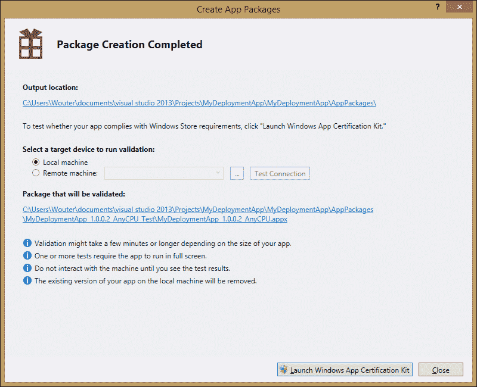

**图 1-14** 创建应用包对话框

---

*更多信息*：完整测试列表

有关 Windows 应用认证工具包运行的所有测试的完整描述以及如何排查失败，请参见 [`msdn.microsoft.com/en-us/library/windows/apps/jj657973.aspx`](http://msdn.microsoft.com/en-us/library/windows/apps/jj657973.aspx)。

---

启动 Windows 应用认证工具包后，会收集一些信息；然后你会看到如图 1-15 所示的对话框。Windows 应用认证工具包会为你运行许多测试。

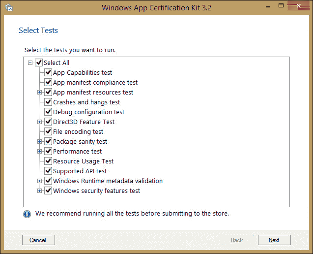

**图 1-15** Windows 应用认证工具包对话框

##### 其他认证要求

你不应仅依赖 Windows 应用认证工具包的结果；还应对应用进行广泛的手动测试。

例如，你应在多个平台上测试应用。也许你的应用在本地 PC 上运行良好，但这并不意味着它能在 Microsoft Surface 平板电脑或其他资源较少的系统上运行。在某些国家/地区，微软会通过举办特殊应用开发日来提供帮助，届时你可以进入并在系列设备上测试应用。微软还会就应用可能存在的任何问题提供建议。

---

*更多信息*：测试用例

MSDN 提供了一系列可针对应用运行的测试用例，请参见 [`msdn.microsoft.com/en-us/library/windows/apps/dn275879.aspx`](http://msdn.microsoft.com/en-us/library/windows/apps/dn275879.aspx)。

---

### 准备应用清单（功能和声明）

创建新的 Windows 应用商店应用时，Visual Studio 会向项目添加一个名为 `package.apxxmanifest` 的文件。

该文件称为应用程序清单。打开清单时，清单设计器会加载（参见图 1-16）。

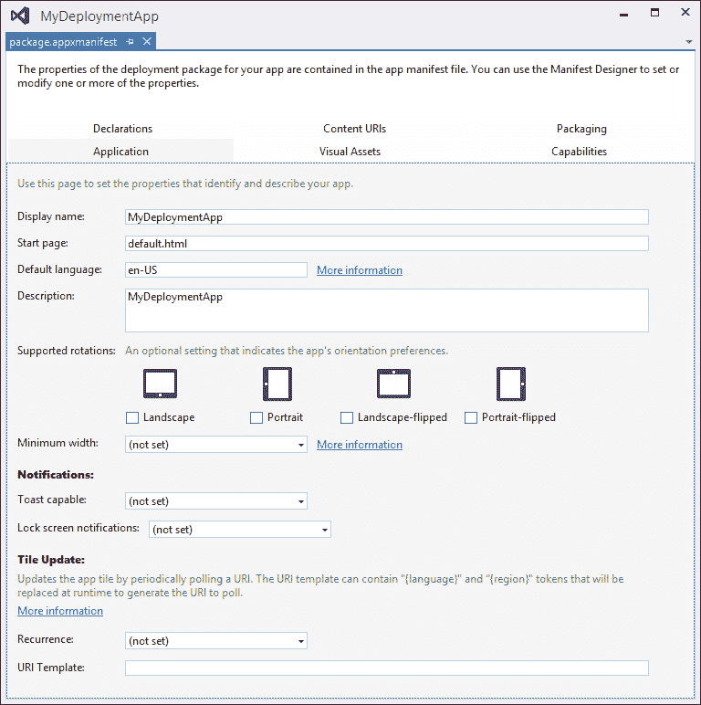

**图 1-16** 清单设计器，显示“应用程序”页面

清单设计器包含可用于配置应用的页面：

 **应用程序** 允许设置一些应用程序范围的设置，例如起始页和受支持的旋转方向。还可以配置通知和磁贴更新设置。

 **视觉资产** 允许配置 Windows 应用商店中显示的图像的不同分辨率。还可以配置磁贴图像和启动屏幕。

 **功能** 指定应用在用户系统上可以使用的功能或设备。

 **声明** 配置应用如何与 Windows 和其他应用集成。

 **内容 URI** 应用可以将网页加载到 iframe 中。这些页面通常受到限制，对用户系统的访问权限有限。在此处可以指定能够访问地理位置设备和剪贴板，以及向应用发送脚本通知的 URI。

 **打包** 允许配置包的显示名称、版本和发布者信息。

考试要求你理解清单的所有元素，但特别关注功能和声明设置。

为什么这些设置如此重要？它们配置了应用在用户系统上允许执行的操作。Windows 应用商店应用需要明确请求权限，而不是默认允许所有集成。用户从 Windows 应用商店安装应用时可以看到所需的权限列表，并可以决定是否信任你的应用以允许这些权限。

例如，如果你的 RSS 阅读器应用需要访问网络摄像头，那会很奇怪。而支持视频聊天的聊天应用则更有可能需要。你可以请求以下功能的权限：

 **企业身份验证** 通常应用不需要；它允许应用连接到需要域身份验证的 Intranet 上的资源。

 **Internet（客户端）** 请求通过公共网络进行 Internet 操作。此选项默认启用，如果应用不需要 Internet，则应禁用。

 **Internet（客户端和服务器）** 允许入站和出站连接。

 **位置** 请求访问当前位置（来自 GPS 传感器或网络信息）。

 **麦克风** 请求访问麦克风的音频输入。

 **音乐库** 请求访问音乐库以添加、更改或删除文件。

 **图片库** 请求访问图片库以添加、更改或删除文件。

 **专用网络（客户端和服务器）** 请求访问用户受信任位置（例如同一网络上的家庭和工作设备）的入站和出站网络访问。

 **邻近** 请求通过 Wi-Fi Direct 或近场邻近无线电连接到其他设备的能力。

 **可移动存储** 请求访问可移动存储设备。允许添加、更改或删除在“声明”页面中定义的文件类型。

 **共享用户证书** 允许访问应用程序编程接口 (API)，以请求用户通过安全卡、证书等进行身份验证。

 **视频库** 请求访问视频库以添加、更改或删除文件。

 **网络摄像头** 请求访问网络摄像头的视频输入，以便拍摄快照或视频。

尽管你不应选择超出严格需要的功能，但尝试在未获得所需功能的情况下访问系统的受限区域会导致错误。

除了功能之外，你还需要配置声明，这些声明是支持协定和扩展所必需的。（*协定*定义了应用之间的协议；*扩展*是应用与 Windows 之间的协议。）

---

*更多信息*：协定和扩展

协定和扩展将在第 2 章中更详细地讨论。

---

可配置的声明如下：

 **帐户图片提供程序** 允许用户使用你的应用更改其帐户图片。

 **自动播放** 允许用户在自动播放对话框中选择你的应用。

 **后台任务** 应用可以使用后台任务在应用挂起时运行应用代码。后台任务适用于不需要用户交互的小型工作项。


 **缓存文件更新程序** 如果你的应用将缓存文件存储在本地磁盘上，你可以订阅诸如用户打开文件（以便检查是否有更新版本）或在新版本可用时立即下载等事件。OneDrive（原 SkyDrive）就是此类行为的一个典型示例。

 **相机设置** 允许你自定义显示相机选项的弹出窗口。

 **联系人选取器** 使你的应用能够出现在可提供联系人数据的应用列表中，每当用户查找联系人时即可显示。

 **文件类型关联** 允许你的应用注册以处理特定文件类型（具有相同扩展名的文件）。该文件类型可以是现有文件类型，也可以是专属于你的应用的新文件类型。

 **文件打开选取器** 允许用户在使用其他应用时直接从你的应用中选择文件。

 **文件保存选取器** 允许用户从其他应用直接将文件保存到你的应用。

 **打印任务设置** 允许你自定义显示高级打印设置的弹出窗口。

 **搜索** 为你的应用添加一个搜索窗格，使用户能够在你应用以及其他应用的数据中进行搜索。

 **共享目标** 允许用户将你的应用中的数据共享给其他应用。

将你的应用与其他应用以及 Windows 集成的方式有很多种。每当你想要实现这些功能中的任何一个时，都应相应地更新你的清单。

一个例外是当你添加“共享”或“文件打开”合约时。你可以在 Visual Studio 的“添加新项”对话框中添加这些合约（参见图 1-17）。使用此对话框时，你的清单会自动更新。

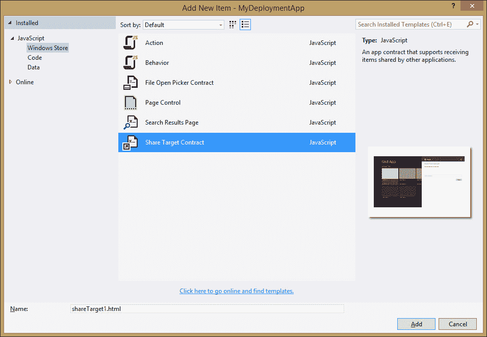

**图 1-17** “添加新项”对话框

* * *

 考试提示

请确保你理解如何使用清单来配置你的应用在用户设备上允许执行的操作。请记住，当你的应用与 Internet 通信时，你需要一份隐私声明。

* * *

#### 为应用签名

若要在 Windows 应用商店中发布你的应用，必须使用证书进行签名。在本地测试应用时，Visual Studio 会生成一个证书，可用于在具有开发人员许可证的计算机上安装你的应用。

通过 Visual Studio 创建包后，你可以在 `AppPackage` 文件夹中找到该包。在此文件夹内，你会看到一个包含证书的 `.cer` 文件。当你将应用发布到 Windows 应用商店时，会生成一个与你的发布者帐户关联的新证书。用户随后将使用此证书来安装应用。

* * *

*更多信息*：创建证书

如果你想手动创建证书，可以使用 Windows 驱动程序工具包 (WDK) 中包含的命令行工具。相关文档可在 [`msdn.microsoft.com/en-us/library/windows/apps/jj835832.aspx`](http://msdn.microsoft.com/en-us/library/windows/apps/jj835832.aspx) 找到。

* * *

#### 规划企业部署的需求

当将企业应用部署到公司外部的用户时，最简单的选择是使用 Windows 应用商店。通过在应用中添加登录页面，你可以管理许可证并限制对应用的访问。

然而，如果你只想将应用部署给内部用户，可能不希望使用 Windows 应用商店。此过程称为*旁加载*。

尽管你的应用未经过 Windows 应用商店验证，但你仍应确保遵循 Windows 应用商店的认证要求。在将应用分发到公司内部之前，请使用 Windows 应用认证工具包对其进行验证。

Windows 应用商店通常会为你创建一个受信任的证书，但如果你在不使用 Windows 应用商店的情况下部署应用，则必须自行创建。请确保你的应用使用目标计算机信任的证书进行签名。你可以使用公司网络中已安装的证书，或者专门为你的应用安装一个自定义证书。

当你的公司设备已加入域时，你可以轻松配置允许旁加载应用的组策略。然后，你可以使用部署映像服务和管理 (`DISM`) 命令行工具或运行 Windows PowerShell `cmdlets` 来安装应用。

另一种选择是使用 Microsoft System Center Configuration Manager 或 Windows Intune。这些商业产品可用于管理企业环境中的 Windows 安装，由 Microsoft 提供。

* * *

*更多信息*：System Center 和 Intune

有关 System Center 的更多信息，请参阅 [`blogs.technet.com/b/keithmayer/archive/2013/02/25/step-by-step-deploying-windows-8-apps-with-system-center-2012-service-pack-1.aspx#.UuuSxPldXxQ`](http://blogs.technet.com/b/keithmayer/archive/2013/02/25/step-by-step-deploying-windows-8-apps-with-system-center-2012-service-pack-1.aspx#.UuuSxPldXxQ)。Intune 的文档可在 [`blogs.technet.com/b/windowsintune/archive/2012/10/31/deploying-windows-8-apps-using-windows-intune.aspx`](http://blogs.technet.com/b/windowsintune/archive/2012/10/31/deploying-windows-8-apps-using-windows-intune.aspx) 找到。

* * *

* * *

 *思考实验：* 分发你的应用

在此思考实验中，请运用你在此目标中学到的知识。你可以在本章末尾的“答案”部分找到这些问题的答案。

你正在创建一个将通过 Windows 应用商店分发的应用，该应用将带有你的品牌标识，同时也会由几家拥有自己品牌的公司进行分发。考虑到这一点，请回答以下问题：

**1.** 你是否需要遵循官方的认证要求？

**2.** 如何轻松更改应用的品牌标识？

**3.** 你是否可以使用 Windows 应用商店的证书在企业环境中分发你的应用？

* * *

### 目标总结

 Microsoft 为希望通过 Windows 应用商店分发的应用制定了具体要求。

 使用 Windows 应用认证工具包验证你的应用。

 应用清单描述了你的应用，并声明了它支持与操作系统及其他应用的集成方式。

 将应用分发给其他用户需要证书。Windows 应用商店可帮助你生成证书。

 你可以通过称为旁加载的过程在企业内部署应用，因此无需使用 Windows 应用商店。

### 目标复习

回答以下问题以测试你对本目标中知识的掌握程度。你可以在本章末尾的“答案”部分找到这些问题的答案以及每个选项正确或错误的解释。

**1.** 你的应用包中包含哪些内容？（选择所有适用项。）

**A.** HTML、JavaScript 和 CSS 文件

**B.** 块描述

**C.** 证书

**D.** 清单

**2.** 你想从你的应用访问外部 Web 服务。你需要哪种功能？

**A.** Internet（客户端和服务器）

**B.** Internet（客户端）

**C.** 专用网络（客户端和服务器）

**D.** 家庭网络（客户端和服务器）

**3.** 你想将你的 Windows 8 应用发送给一组测试人员。你应该怎么做？

**A.** 要求他们安装 Visual Studio，并将你的应用源代码发送给他们。


**B.** 向他们发送一个包含 Windows PowerShell 脚本的应用包。

**C.** 创建一个 Windows Installer，以便在他们的设备上安装应用。

**D.** 将应用提交到商店，以便他们可以安装。

## 答案

本节包含本章中思考实验的解答和课程复习题的答案。

#### 目标 1.1：思考实验

**1.** My Restaurant 应用在帮助用户找到他们喜爱的食物方面表现出色。当然，你也可以想出其他“擅长”的表述。关键在于选择一个，并用它来指导你的应用。

**2.** 如果你想将应用聚焦于食物类别或推荐，可以使用网格应用模板。

**3.** 是的。餐厅吸引着各种不同的人，因此你应该预见到有些人可能有残疾。

#### 目标 1.1：复习

**1. 正确答案：** C

**A. 错误：** Windows 商店应用应该使用动画。你可以使用微软已经为你创建的动画。

**B. 错误：** 你不应该自己设计动画。我们希望所有应用有一致的体验，这就是微软创建动画库的原因。

**C. 正确：** 你的应用中应该使用动画。文档中列出了微软建议使用的动画，你的设计师可以在设计中使用这些动画。

**D. 错误：** 你应该使用动画库，而不是创建完全自定义的动画。

**2. 正确答案：** D

**A. 错误：** 平台支持任意大小的应用。

**B. 错误：** 应用可以支持多种用户场景。它们应该使用“擅长”的表述来确保所有场景都贡献于一个出色的用户体验。

**C. 错误：** 一个看起来美观、快速流畅且能与其他应用集成的应用，并不需要“擅长”的表述。这个表述是关于你的应用做什么以及它提供的用户体验。

**D. 正确：** 你的“擅长”表述为应用带来了焦点，并帮助你在应用想要做的事情上表现出色。

**3. 正确答案：** A、C、D、E、F

**A. 正确：** 工艺自豪感是微软的设计原则之一。

**B. 错误：** 云集成不是微软的设计原则。

**C. 正确：** 快速流畅是微软的设计原则。

**D. 正确：** 真实数字化是微软的设计原则。

**E. 正确：** 少即是多是微软的设计原则。

**F. 正确：** 团结致胜是微软的设计原则。

#### 目标 1.2：思考实验

**1.** 分层应用最初确实会增加代码的复杂性。代码分布在多个文件中，并非所有代码都能调用其他代码。然而，这确实提高了可维护性，并帮助你围绕特定任务集中代码，最终会带来回报。

**2.** 这不是真的。当一个层定义了它的接口，其他层可以依赖这些接口定义。然后可以伪造一个实现（例如一组静态测试数据）。你也可以通过同时开发所有层而不是逐层开发，以垂直功能切片的方式实现应用。

**3.** 尽管 JavaScript 最初并非为大型应用而设计，但你完全可以在 JavaScript 中创建良好的架构。另一种方法是使用 TypeScript 来扩展 JavaScript，使其更适合大型应用。

#### 目标 1.2：复习

**1. 正确答案：** A

**A. 正确：** 数据层负责从外部 Web 服务获取数据。

**B. 错误：** 服务层并非用于从外部资源获取数据。相反，它应该协调你自己应用中的操作。

**C. 错误：** 业务层强制执行业务规则和功能；它不与外部 Web 服务通信。

**D. 错误：** UI 层不应与外部数据源通信。

**2. 正确答案：** C

**A. 错误：** 不应通过全局状态共享数据，因为这可能产生不必要的副作用。

**B. 错误：** 你可以通过将数据限定在包含函数的作用域内来避免全局状态。

**C. 正确：** 避免全局状态可以创建更易于维护的应用。

**D. 错误：** 每个 JavaScript 项目都可以使用全局状态。

**3. 正确答案：** A、B、C、D

**A. 正确：** 创建类是构建分层应用的核心要素。

**B. 正确：** 命名空间对类进行分组，这有助于你将代码分离到不同的区域。

**C. 正确：** WinMD 组件可用于创建 C# 程序集。这种程序集分离会自动在代码中创建分离。

**D. 正确：** Web 服务是应用的一个独立层，可以托管一个或多个层。

#### 目标 1.3：思考实验

**1.** Windows 商店应用可以将数据保存到漫游文件夹，该文件夹会在用户的所有设备之间自动同步。

**2.** 通过处理检查点事件，你可以在应用挂起之前保存数据。当从终止状态恢复时，你可以恢复这些数据。

**3.** 当恢复应用时，你需要从用户文件夹恢复数据，但还应确保数据没有过时。通过使用激活事件，你可以刷新外部数据。

#### 目标 1.3：复习

**1. 正确答案：** B、C

**A. 错误：** 游戏和其他应用一样需要状态管理。确保用户可以从离开的地方继续玩游戏。

**B. 正确：** 激活事件应在应用终止后用于恢复任何状态。

**C. 正确：** 检查点事件可用于在应用挂起并最终终止之前保存状态。

**D. 错误：** 终止事件不存在。

**2. 正确答案：** B

**A. 错误：** 从 Windows 8.1 开始，只有当用户在关闭应用后 10 秒内返回时，才应完全刷新任何数据。

**B. 正确：** 如果用户在 10 秒内未启动应用，则将关闭操作视为正常的挂起和终止。

**C. 错误：** 这从来不是一个选项。你不应向用户显示不必要的对话框。

**D. 错误：** 重新启动应用不是一个选项。你可以决定如何处理当前应用状态。但是，如果用户在 10 秒内未返回，你应该尝试遵循恢复应用的必需操作。

**3. 正确答案：** D

**A. 错误：** 这是一个 DOM 事件，你不必在应用内部使用。WinJS 提供了映射到应用生命周期的事件。

**B. 错误：** 这是一个 DOM 事件，你不必在应用内部使用。WinJS 提供了映射到应用生命周期的事件。

**C. 错误：** 检查点事件应在应用挂起之前用于保存任何状态。

**D. 正确：** Web 服务是应用的一个独立层，可以托管一个或多个层。

#### 目标 1.4：思考实验

**1.** 是的，尤其是因为你的应用将部署到公共 Windows 商店。对于内部分发的应用，遵循所有认证要求也是一个好主意。

**2.** 清单允许你为屏幕截图、磁贴和启动屏幕指定不同的文件。其他品牌化可以像任何 HTML 和 CSS 应用一样完成。你可以配置不同的图像和 CSS 文件来设计你的应用样式。


**3.** 不，此证书是在将应用发布到 Windows 应用商店时生成的。对于内部分发，你需要对应用进行签名。

#### 目标 1.4：复习

**1. 正确答案：** A、B、C、D

**A. 正确：** 所有内容文件都包含在包中。

**B. 正确：** 包含块描述，用于将应用拆分为更小的块，以便简化更新过程。

**C. 正确：** 需要对应用进行签名，因此需要证书。

**D. 正确：** 需要清单来描述应用。它用于在 Windows 应用商店中展示应用，以及在用户设备上安装和运行应用。

**2. 正确答案：** B

**A. 错误：** 仅当应用接收来自外部源的请求时才需要客户端和服务器要求。你只是从应用连接到外部 Web 服务。

**B. 正确：** 它允许你连接到 Web 服务。

**C. 错误：** 仅当你想连接到网络内的其他设备（例如，域内或家庭网络内）时才需要专用网络。

**D. 错误：** 家庭网络选项不存在。

**3. 正确答案：** B

**A. 错误：** 不需要安装 Visual Studio 并访问源代码，而且这对测试人员来说可能工作量太大。

**B. 正确：** Windows PowerShell 脚本可以在本地安装应用并进行测试。

**C. 错误：** 不需要 Windows Installer。可以使用生成的 Windows PowerShell 脚本安装应用包。

**D. 错误：** 如果你希望用户测试你的应用，则不应将其提交到 Windows 应用商店。那样的话，所有人都可以访问你的应用。而且由于你的应用尚未就绪，提交很可能会失败。

## 第 2 章 开发 Windows 应用商店应用

设计完应用后，你需要开始开发它。Windows 应用商店应用环境因其提供的集成选项而独具特色。你的应用可以通过合约和扩展与 Windows 操作系统及其他应用协同工作，这正是本章的主题。

本章帮助你集成联系人信息、搜索、共享和配置设置。实现这些功能有助于用户找到你的应用并使其更易于使用。最终结果是你的应用使用率更高，整体上更受欢迎！本章最后讨论了你的应用可以使用的媒体功能。

本章涵盖考试 70-481 目标领域中的第二个目标，占考试内容的 19%。本章的代码量比前一章大得多，将帮助你实现 Windows 应用商店应用中的合约相关功能。

本章目标：

 目标 2.1：访问和显示联系人

 目标 2.2：为超级按钮和合约进行设计

 目标 2.3：实现搜索

 目标 2.4：在应用中实现共享

 目标 2.5：管理应用程序设置和首选项

 目标 2.6：集成媒体功能

### 目标 2.1：访问和显示联系人

与其他应用和 Windows 集成的一种方式是共享联系人信息。你可以支持用户从其他应用（例如“人脉”应用）选取联系人，或者你的应用可以显示其他应用可使用的联系人信息。

本目标向你展示如何实现这些场景。

* * *

**本目标涵盖以下内容：**

 调用 `ContactPicker`（`Windows.Applicationmodel.Contacts`）类

 筛选要显示的联系人

 显示固定数量的联系人

 创建和修改联系人信息

 选择特定的联系人数据

* * *

### 调用 `ContactPicker` 类

你可以在 `Windows.Applicationmodel.Contacts` 命名空间中找到处理联系人的所有功能。`ContactPicker` 类（在此命名空间中定义）允许用户选择可在应用内使用的联系人。

以下函数演示了如何启动 `ContactPicker` 类并创建用户数据的字符串表示形式：

点击此处查看代码图像

```
function pickContact() {

    var picker = Windows.ApplicationModel.Contacts.ContactPicker();

    picker.commitButtonText = "Select";

    picker.pickContactAsync().done(function (contact) {

        if (contact != null) {

            document.getElementById('output').innerText = contact.displayName;

        }

    });

};
```

首先创建 `ContactPicker` 类的新实例：

点击此处查看代码图像

```
    var picker = Windows.ApplicationModel.Contacts.ContactPicker();
```

然后可以配置该实例并将其显示给用户。在此例中，你只需配置联系人选取器显示的文本：

点击此处查看代码图像

```
    picker.commitButtonText = "Select";
```

所有可能耗时较长的操作都会异步处理，这有助于你的应用在执行外部工作时保持响应。你可以通过方法名称识别异步方法：它们以“async”结尾。联系人选取器也遵循此命名约定。`pickContactsAsync` 方法是异步处理的，这意味着该方法不会立即返回结果。相反，它返回一个 `promise`，这是一个包装异步操作的对象，可帮助你在异步操作完成或出现问题时继续执行。

在此例中，使用 `done` 方法来安排在 promise 完成时需要处理的一些工作：

点击此处查看代码图像

```
    picker.pickContactAsync().done(function (contact) { ... });
```

`contact` 参数从联系人选取器传递到你的函数。当用户取消联系人选取器并返回你的应用而未选择任何联系人时，该参数可能为 `null`。

你还可以使用 `pickContactsAsync` 函数选择多个联系人，该函数返回一个可使用的联系人数组：

点击此处查看代码图像

```
picker.pickContactsAsync().done(function (contacts) {

    if (contacts.length > 0) {

        var output = "";

        for (var i = 0; i < contacts.length; i++) {

            output += contacts[i].displayName;

            output += "\r\n";

        }

        document.getElementById('output').innerText = output;

    }

});
```

* * *

*更多信息*：联系人选取器示例

Microsoft 创建了许多可供下载的 Windows 应用商店示例。你可以在 *[`code.msdn.microsoft.com/windowsapps/Contact-Picker-App-sample-fc6677a1`](http://code.msdn.microsoft.com/windowsapps/Contact-Picker-App-sample-fc6677a1)* 找到联系人选取器示例。

* * *

### 筛选要显示的联系人

使用联系人选取器让用户为你的应用选择联系人时，通常会返回用户可用的所有联系人。

有时你的应用需要确保某个联系人的特定数据可用。当你只想选择那些在你所需特定字段中有数据的联系人时，可以配置联系人选取器来查找这些字段。


通过使用 `selectionMode` 属性，你可以配置联系人选取器，使其选择所有联系人，或仅选择包含你所需字段的联系人：

点击此处查看代码图片

```
// 选择特定字段
picker.selectionMode = Windows.ApplicationModel.Contacts.ContactSelectionMode.fields;

// 选择所有联系人
picker.selectionMode = Windows.ApplicationModel.Contacts.ContactSelectionMode.contacts;
```

当你使用 `fields` 选项时，可以使用 `desiredFieldsWithContactFieldType` 属性列出你想要筛选的字段：

点击此处查看代码图片

```
picker.desiredFieldsWithContactFieldType.append(
     Windows.ApplicationModel.Contacts.ContactFieldType.email);
```

`ContactFieldType` 可以取以下值之一：

 电子邮件

 电话号码

 已连接服务账户

 重要日期

 地址

 重要联系人

 备注

 网站

 工作信息

其他值，例如 `instantMessage`、`location` 和 `custom` 仍然可用，但不应使用。它们可能在下一个 Windows 版本中不可用。

指定 `ContactFieldType` 只会让你获得那些设置了特定字段的联系人。从联系人选取器中选择联系人后，你可以应用额外的筛选器，只保留你希望在应用中使用的联系人。也许你想根据公司名称或其他适合你应用的标准进行筛选。

* * *

 考试提示

使用 `ContactFieldType` 并不意味着你只从联系人选取器中加载指定的字段；它只是显示那些在该字段中有值的联系人。

* * *

由于从联系人选取器返回的数据只是一个数组，你可以在显示联系人之前使用 `array.filter` 来筛选联系人：

点击此处查看代码图片

```
contacts = contacts.filter(function (element)
{
    return element.displayName.indexOf("a") != -1
});
```

这段代码将你的联系人筛选为仅包含名称中含有字母“a”的联系人。用于筛选数据的函数称为*谓词*。你可以根据需要使谓词变得复杂。

如果你的场景中数据变化更频繁（例如，用户多次选择联系人），你可以使用 `WinJS.Binding.List` 对象来存储数据。列表可以应用自定义筛选器，该筛选器在数据更新时生效。

以下代码展示了如何创建一个列表，并使用与上一个示例中数组相同的谓词进行筛选：

点击此处查看代码图片

```
var itemList = new WinJS.Binding.List([]);
var filteredList = itemList.createFiltered(function (i) { return i.indexOf("a") != -1;
});
var publicMembers =
            {
                itemList: filteredList
            };
WinJS.Namespace.define("DataExample", publicMembers);
```

该列表初始为空；然后创建该列表的筛选版本。此列表通过一个名为 `DataExample` 的自定义命名空间公开。

你可以使用以下 HTML 片段绑定到此列表：

点击此处查看代码图片

```
<div id="basicListView" data-win-control="WinJS.UI.ListView"
     data-win-options="{itemDataSource : DataExample.itemList.dataSource}">
</div>
```

列表的数据源指向你创建的自定义命名空间，然后指向 `itemList` 属性。每当添加联系人时，你可以在 `pickContactAsync` 回调中使用以下代码：

点击此处查看代码图片

```
picker.pickContactAsync().done(function (contact) {
    if (contact != null) {
        itemList.push(contact.displayName);
    }
});
```

每当你向列表推送新的联系人姓名时，筛选器就会被应用，结果会绑定到标记中的 `ListView`。但是，如果用户在选取联系人后返回应用时，这些联系人被筛选掉，那么筛选操作可能会导致意外行为。处理这些场景时，请告知用户你的选择。

你不能直接使用联系人对象并将其推送到项目列表；你应该使用非 WinRT 对象来添加到列表。非 WinRT 对象可以是简单的字符串（如 `displayName`），也可以是你创建的对象。

### 显示固定数量的联系人

到目前为止，你使用 `ContactPicker` 类来选择联系人并在应用中使用数据。其他应用会提供一组联系人——而你只使用结果数据。

“人脉”应用是这类应用的一个好例子。如果你直接从“开始”屏幕启动它，它会显示一个中心界面，其中包含关于你、你的常用联系人以及所有其他联系人的信息。

但是，如果你使用“人脉”应用从另一个应用中选择联系人（通过 `ContactPicker` 类），你会看到一个不同的界面，因为该应用是以 `ActivationKind` 启动的。这种不同的 `ActivationKind` 允许应用显示不同的界面，并帮助用户从应用中选择联系人。

通过配置清单文件，你可以为你的应用添加一个声明，使其成为联系人选取器（参见图 2-1）。

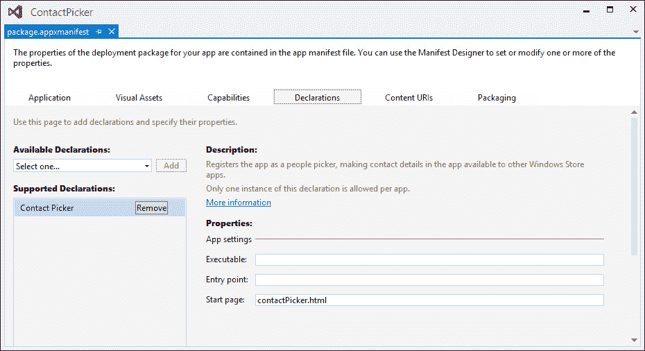

**图 2-1** 应用清单设计器显示联系人选取器声明

联系人选取器可以配置为当你的应用作为联系人选取器启动时使用起始页。Windows 会加载此页面并向用户显示，页面顶部有一个标题，允许他们切换到其他联系人选取器，并在底部点击“选择”按钮或“取消”按钮（参见图 2-2）。

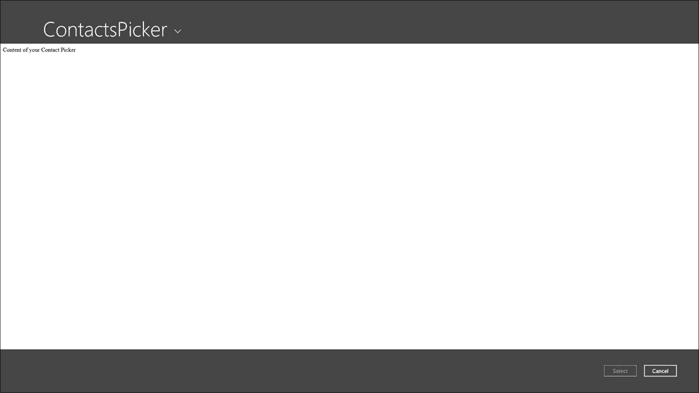

**图 2-2** 显示空白页的自定义联系人选取器

假设你的 `contactPicker.html` 页面包含以下内容：

点击此处查看代码图片

```
<!DOCTYPE html>
<html>
<head>
    <title>联系人选取器示例</title>
    <link rel="stylesheet" href="//Microsoft.WinJS.2.0/css/ui-light.css" />
    <script src="//Microsoft.WinJS.2.0/js/base.js"></script>
    <script src="//Microsoft.WinJS.2.0/js/ui.js"></script>
    <script src="/js/contactPicker.js"></script>
</head>
<body>
    <div id="contactList"></div>
</body>
</html>
```

这是一个基本的 HTML 页面，引用了 Windows 库 for JavaScript (WinJS) 应用程序所需的级联样式表 (CSS) 和脚本，并加载了 `contactPicker.js` 文件。

`contactPicker.js` 文件内容如下：

点击此处查看代码图片

```
(function () {
    "use strict";
    var contactPickerUI;
    function activated(eventObject) {
        if (eventObject.detail.kind === Windows.ApplicationModel.Activation.
                                        ActivationKind.contactPicker) {
            sampleContacts.forEach(createContactUI);
            contactPickerUI = eventObject.detail.contactPickerUI;
        }
    }
    function createContactUI(sampleContact, index) {
        var element = document.createElement("div");
        document.getElementById("contactList").appendChild(element);
        element.innerHTML = "<div class='contact'><label>" +
                            "<input id='" + sampleContact.id +
                              "' value='" + index + "' type='checkbox' />" +
                            sampleContact.displayName + "</label></div>";
        element.firstElementChild.addEventListener("change", function (ev) {
            if (ev.target.checked) {
                addContactToBasket(sampleContact);
            } else {
                removeContactFromBasket(sampleContact);
            }
        }, false);
    }
    function addContactToBasket(sampleContact) {
```


```
var contact = new Windows.ApplicationModel.Contacts.Contact();

contact.firstName = sampleContact.firstName;

contact.lastName = sampleContact.lastName;

contact.id = sampleContact.id;

contactPickerUI.addContact(contact);

};

function removeContactFromBasket(sampleContact) {

if (contactPickerUI.containsContact(sampleContact.id)) {

contactPickerUI.removeContact(sampleContact.id);

}

}

var sampleContacts = [

{

displayName: "Wouter de Kort",

firstName: "Wouter",

lastName: "de Kort",

id: "60666FA6-7A68-4F78-B3CE-6CBBC436E8CE"

},

{

displayName: "Satya Nadella",

firstName: "Satya",

lastName: "Nadella",

id: "60666FA6-7A68-4F78-B3CE-6CBBC436E8CE"

},

];

WinJS.Application.addEventListener("activated", activated, false);

WinJS.Application.start();

})();
```

该文件有几个重要部分：

 文件末尾的示例数据定义了一些示例数据。这些数据可以来自外部 Web 服务、文件或其他资源。

`activated` 事件是页面加载时创建 UI 的地方。该事件通过注册事件并在文件底部调用 `WinJS.Application.start` 来激活。事件处理程序遍历示例数据并生成 HTML，显示每个联系人姓名以及一个复选框，允许用户选择或取消选择该联系人。

添加事件处理程序是创建新的 `Windows.ApplicationModel.Contacts.Contact` 并用所选联系人的值进行初始化的地方。然后通过调用 `contactPickerUI.addContact(contact)` 将此联系人添加到选择中。

 移除事件处理程序检查联系人是否存在于 `contactPickerUI` 中，然后将其从选择中移除。

这些部分构成了实现自定义联系人选择器的基础。当然，你可以向联系人中添加更多数据，并将其发送到请求应用。你还应该添加错误处理，以防出现问题。

* * *

 考试提示

前面提到的示例（*[`code.msdn.microsoft.com/windowsapps/Contact-Picker-App-sample-fc6677a1`](http://code.msdn.microsoft.com/windowsapps/Contact-Picker-App-sample-fc6677a1)*）还展示了如何实现自定义联系人选择器。你应该使用此示例来更熟悉如何创建自己的联系人选择器。本目标中的代码基于此示例。

* * *

### 创建和修改联系人信息

上一节描述了使用 `Windows.ApplicationModel.Contacts` 命名空间中的 `Contact` 类来创建可通过联系人选择器发送的联系人。

你可以向联系人添加更多数据。`Contact` 类具有以下属性：

 `Addresses` 获取联系人的联系地址。

 `ConnectedServiceAccounts` 获取联系人的已连接服务帐户。

 `DataSuppliers` 获取联系人的数据提供程序。每个数据提供程序的最大字符串长度为 50 个字符。数据提供程序是外部源，例如 Twitter、LinkedIn 和 Outlook。来自这些源的数据会在用户设备上合并为一个联系人。

 `DisplayName` 获取联系人的显示名称。只能从 UI 线程访问此属性。

 `Emails` 获取联系人的电子邮件地址。

 `FirstName` 获取和设置联系人的名字。名字的最大字符串长度为 64 个字符。

 `HonorificNamePrefix` 获取和设置联系人姓名的敬语前缀。敬语前缀的最大字符串长度为 32 个字符。敬语前缀的示例包括学术头衔，以及诸如“殿下”和“陛下”之类的头衔。

 `HonorificNameSuffix` 获取和设置联系人姓名的敬语后缀。敬语后缀的最大字符串长度为 32 个字符。

 `Id` 获取和设置联系人的标识符。标识符的最大字符串长度为 256 个字符。

 `ImportantDates` 获取联系人的重要日期。

 `JobInfo` 获取联系人的工作信息项。

 `LastName` 获取和设置联系人的姓氏。姓氏的最大字符串长度为 64 个字符。

 `MiddleName` 获取和设置联系人的中间名。中间名的最大字符串长度为 64 个字符。

 `Notes` 获取和设置联系人的备注。备注的最大字符串长度为 4,096 个字符。

 `Phones` 获取联系人的电话信息。

 `ProviderProperties` 获取联系人的属性集对象。

 `SignificantOthers` 获取联系人的重要他人。

 `Thumbnail` 获取或设置代表联系人的缩略图图像。

 `Websites` 获取联系人的网站。

 `YomiDisplayName` 获取联系人的 Yomi（日语注音）显示名称。

 `YomiFamilyName` 获取联系人的 Yomi（日语注音）姓氏。Yomi 姓氏的最大字符串长度为 120 个字符。

 `YomiGivenName` 获取联系人的 Yomi（日语注音）名字。Yomi 名字的最大字符串长度为 120 个字符。

联系人不仅仅是姓名。地址、电话号码和其他通信详细信息都可以链接到联系人。联系人详细信息可以进一步分为不同类型，例如工作和个人详细信息。你甚至还有专门用于处理不同文化的字段。

以下代码片段展示了如何向 `Contact` 类添加额外数据：

点击此处查看代码图片

```
var contact = new Windows.ApplicationModel.Contacts.Contact();

contact.firstName = "Satya";

contact.lastName = "Nadella";

contact.id = "861cb6fb-0270-451e-8725-bb575eeb24d5";

var workEmail = new Windows.ApplicationModel.Contacts.ContactEmail();

workEmail.address = "ceo@xxx.com";

workEmail.kind = Windows.ApplicationModel.Contacts.ContactEmailKind.work;

contact.emails.append(workEmail);

var workPhone = new Windows.ApplicationModel.Contacts.ContactPhone();

workPhone.number = "1234567890"

workPhone.kind = Windows.ApplicationModel.Contacts.ContactPhoneKind.work;

contact.phones.append(workPhone);

var workAddress = new Windows.ApplicationModel.Contacts.ContactAddress();

workAddress.streetAddress = "1 157th Ave NE"

workAddress.locality = "Redmond";

workAddress.region = "Washington";

workAddress.postalCode = "98052";

workAddress.kind = Windows.ApplicationModel.Contacts.ContactAddressKind.work;

contact.addresses.append(workAddress);

contactPickerUI.addContact(contact);
```

### 选择特定联系人数据

当联系人从联系人选择器返回到应用时，它包含该联系人的所有可用数据。因此，如果联系人有多个电话号码、电子邮件地址和/或地址，它们都会出现在返回的数据中。

所有这些联系人详细信息都通过 `kind` 属性指定其数据类型。通过使用 Windows 应用程序模型中的预定义枚举，你可以过滤数据，如下例所示：


点击此处查看代码图片

```
var result = "";

if (contact.phones.length > 0) {

    result += "Phone Numbers:";

    result += "\r\n";

    contact.phones.forEach(function (phone) {

        switch (phone.kind) {

            case Windows.ApplicationModel.Contacts.ContactPhoneKind.home:

                result += phone.number + " (home)";

                break;

            case Windows.ApplicationModel.Contacts.ContactPhoneKind.work:

                result += phone.number + " (work)";

                break;

            case Windows.ApplicationModel.Contacts.ContactPhoneKind.mobile:

                result += phone.number + " (mobile)";

                break;

            case Windows.ApplicationModel.Contacts.ContactPhoneKind.other:

                result += phone.number + " (other)";

                break;

        }

        result += "\r\n";

    });

}
```

在此示例中，你遍历联系人上的所有电话号码。通过使用 `phone.kind`，你可以轻松处理不同类型的电话号码。对于联系人上的其他数据，也可以采用相同的方法。

* * *

 *思维实验：* 设计你的应用

在这个思维实验中，请运用你在此目标中学到的知识。你可以在本章末尾的“答案”部分找到这些问题的答案。

你正在探索 Windows 应用商店生态系统，并希望集思广益，思考可以使用联系人选取器集成的场景。

列出可以使用以下功能的应用类型：

**1.** 联系人选取器，用于从其他应用中选择联系人。

**2.** 联系人选取器，用于向其他应用公开联系人。

* * *

### 目标总结

 `ContactPicker` 类可以向用户显示一个 UI。然后，他们可以选择一个或多个联系人，以便在你的应用中使用。

 你可以将你的应用注册为联系人选取器，以便其他应用（包括你自己的应用）可以查看联系人并从你的应用中选择它们。

 用户可能拥有某些字段已填写、其他字段留空的联系人。你可以通过使用 `selectionMode` 属性和 `desiredFieldsWithContactFieldType` 集合来筛选联系人。使用此类筛选器只会显示那些包含你所需字段的联系人。

 一个联系人可能有多个电话号码、地址等。你可以通过使用 `kind` 属性来筛选这些集合。

### 目标回顾

回答以下问题，以测试你对本目标中信息的掌握程度。你可以在本章末尾的“答案”部分找到这些问题的答案以及每个选项正确或错误的解释。

**1.** 你向激活事件添加了代码，以响应联系人选取器的激活类型，但启动联系人选取器时，你的应用并未显示为可能的联系人来源。你应该如何解决这个问题？

**A.** 用户应该让应用在后台运行，以充当联系人选取器。

**B.** 你必须调用激活事件来启动联系人选取器。

**C.** 你必须在应用清单中添加联系人选取器声明。

**D.** 你必须使用 `pickContactAsync` 方法来启动联系人选取器。

**2.** 你想从你的应用启动联系人选取器，以便用户可以选择一个联系人。应该使用哪个方法？

**A.** `ContactPicker.addContact`

**B.** `ContactPicker.pickContactAsync`

**C.** `ContactPicker.pickContactsAsync`

**D.** `ContactPicker.pickContact`

**3.** 你想确保用户只选择那些拥有电子邮件地址的联系人。你可以怎么做？

**A.** 使用 `array.filter` 排除那些没有电子邮件地址的联系人。

**B.** 使用带有筛选器的 `WinJS` 列表，排除那些没有电子邮件地址的联系人。

**C.** 使用 `ContactSelectionMode` 为 `fields`，并将 `desiredFieldsWithContactFieldType` 设置为 `email`。

**D.** 使用 `ContactSelectionMode` 为 `contact`，并将 `desiredFieldsWithContactFieldType` 设置为 `email`。

* * *

### 目标 2.2：为超级按钮和合约进行设计

Windows 应用商店应用并非完全孤立地运行。Windows 操作系统提供了一个复杂的生态系统，你的应用可以与之集成。这种集成使得 Windows 应用商店应用独一无二，并采用了微软“共赢”的设计原则：让应用以熟悉的方式相互交互，从而相互补充。

应用集成通过超级按钮和合约实现。本目标向你介绍可用的超级按钮和合约，并描述它们如何使你的应用受益。理解超级按钮和合约是考试的重要组成部分，因为它是 Windows 8 的基石之一。

* * *

**本目标涵盖以下内容：**

 根据应用需求选择合适的超级按钮

 设计一个支持超级按钮和合约的应用

 配置应用清单以获取正确的权限

* * *

### 根据应用需求选择合适的超级按钮

超级按钮可以通过从左侧滑动、将鼠标移动到右上角或右下角，或按 Windows+C 来访问。显示的超级按钮栏如图 2-3 所示。


**图 2-3** 超级按钮栏显示搜索、共享、开始、设备和设置超级按钮

你在这里看到的五个超级按钮如下：

 搜索

 共享

 开始

 设备

 设置

“开始”超级按钮是最不重要的，它允许用户返回“开始”屏幕。通过这个超级按钮，用户总能找到一个熟悉的位置，在想要离开应用时返回“开始”屏幕。其他超级按钮提供了更多可能性，将在以下各节中讨论。

#### 搜索

搜索是许多应用的重要组成部分。当你从 Windows 的“开始”屏幕启动搜索时，会显示“搜索”超级按钮（见图 2-4）。

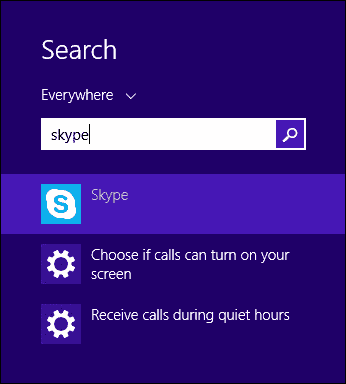

**图 2-4** 搜索超级按钮

搜索会遍历你电脑上的所有数据，包括已安装的应用程序和文件，也包括在互联网上找到的内容。

这种搜索是全局性的。你也可以实现应用内搜索。对于应用内搜索，请使用 `SearchBox` 控件，该控件在 Windows 8 和 Windows 8.1 之间有所变化。在 Windows 8 中，“搜索”超级按钮用于应用内和全局搜索。在 Windows 8.1 中，你可以选择使用搜索框（如图 2-5 所示）或使用“搜索”超级按钮。

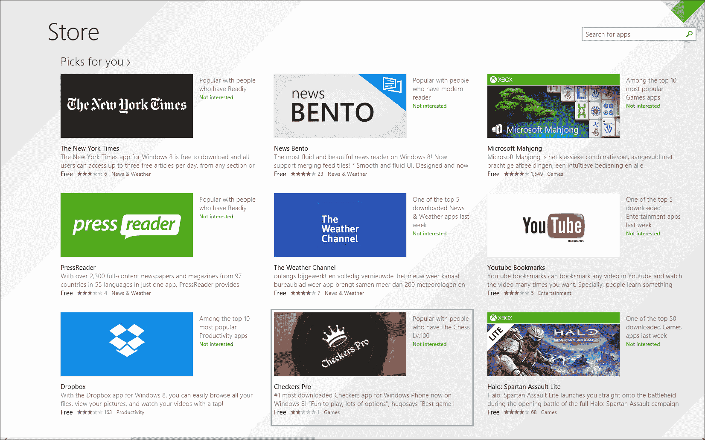

**图 2-5** Windows 应用商店在右上角显示一个搜索框

用户可以使用这个 Windows 应用商店搜索框来搜索商店中的应用。当他们启动搜索时，会显示一个新页面，列出搜索结果（见图 2-6）。

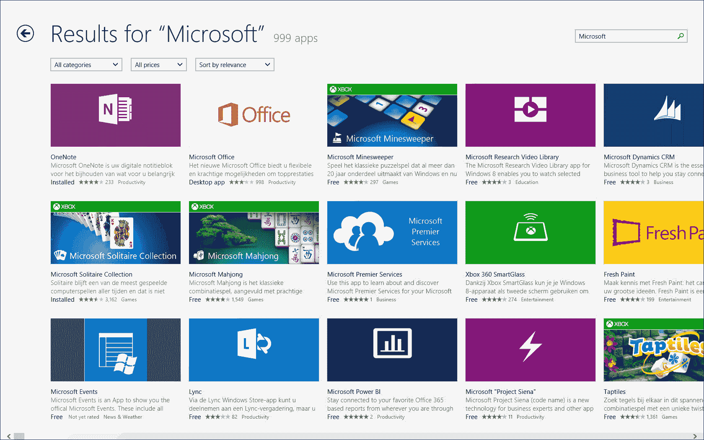

**图 2-6** Windows 应用商店显示搜索“Microsoft”的结果

这个页面完全特定于你的应用。你可以定义其布局、用户与之交互的方式以及它显示的结果。

你可以通过提供查询建议和结果建议来帮助用户。它们之间的区别如图 2-7 所示。结果建议是精确匹配，并立即导航到结果。查询建议更多地用作自动完成，你可以在其中开始搜索指定的查询文本。

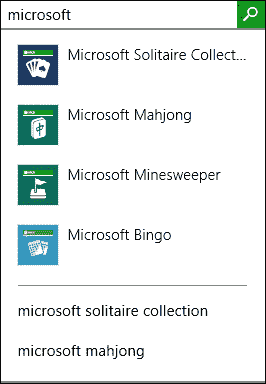


**图 2-7** 搜索框在顶部显示结果建议，在底部显示查询建议

另一个帮助用户的功能是*键入即搜索*。用户只需输入搜索词即可开始新的搜索，无需在搜索框中输入该词。用户可以启动应用并立即开始输入以搜索内容。

通过与搜索超级按钮集成，你可以让用户从超级按钮启动你的应用，并直接进入搜索结果页面。

#### 共享

共享超级按钮支持应用之间的数据共享。例如，你在浏览网页时看到喜欢的内容，激活共享超级按钮，然后向朋友发送一封包含页面链接的电子邮件。

共享合约支持这些类型的场景。应用既可以作为共享源（此例中的浏览器），也可以作为目标（电子邮件应用）。源可以提供它想要共享的数据，目标可以接收这些数据并使用它们。

作为共享目标的典型应用示例包括 Twitter、Facebook 和邮件；它们接收数据并轻松与他人共享。

图 2-8 展示了从天气应用激活共享超级按钮的示例。系统会显示一个可供用户选择的共享目标列表。

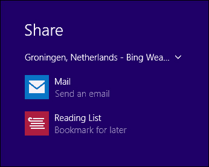

**图 2-8** 从天气应用内激活共享超级按钮并显示可能的共享目标

选择邮件选项后，你将看到图 2-9 所示的显示界面。

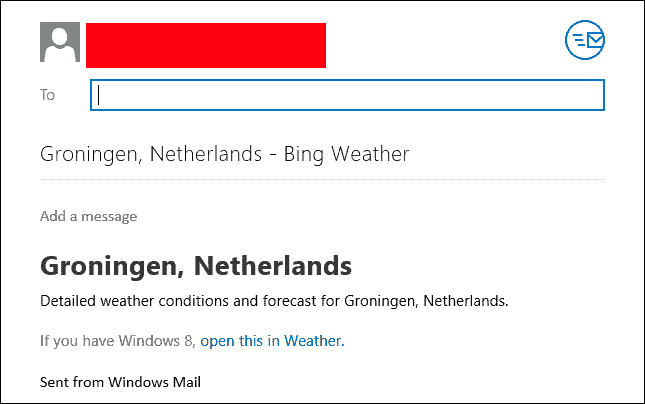

**图 2-9** 选择邮件共享目标以从天气应用内共享数据

在考虑共享合约时，你需要将实现分为两部分。首先，你是否希望从应用内共享任何数据？假设你正在构建一个 RSS 阅读器应用。当用户读到有趣的内容时，他们可以激活共享超级按钮将文章发送给他人。在游戏中，你可以使用共享超级按钮将最近的成就发布到 Facebook。在商业应用中，你可以与其他用户共享报告。

可能性是无限的，你真的需要仔细考虑。通过集成共享，你为应用添加了社交元素，这可以真正提升其受欢迎程度。

其次，你需要决定你的应用是否可以成为共享目标。其他应用能否与你的应用共享一些数据？（这对于 Twitter 和 Facebook 等社交应用或电子邮件来说确实如此。）如果你的应用可以接收数据（文本、图像或文件），那么你的应用就可以充当共享目标。

#### 设备

连接到你的设备的设备可以通过设备超级按钮访问。这些设备可能包括打印机、投影仪或用于流式传输媒体的电视。通过与设备超级按钮集成，你可以支持打印或将媒体流式传输到其他设备。

根据你的需求，你可以选择与设备超级按钮集成。也许你有一些用户应该能够打印的信息，例如摘要页面或图片。如果你有多媒体内容（如音频或视频），你可以选择将它们流式传输到其他设备。

#### 设置

微软创建了设置超级按钮，以便在所有 Windows 应用商店应用中提供统一的配置体验。特定于应用的配置选项可以在设置超级按钮中找到。图 2-10 展示了天气应用的设置超级按钮示例。

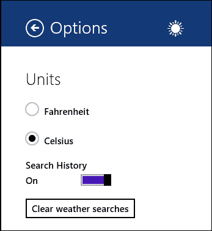

**图 2-10** 天气应用的设置超级按钮

你应该将设置超级按钮用于应用的所有配置设置。

### 设计支持超级按钮和合约的应用

在设计应用时，请注意可用的不同超级按钮。如果某些元素属于某个超级按钮，则不应将它们放在应用的 UI 中。

搜索超级按钮有一些明确的设计指南，告诉你该怎么做。通过在应用中使用搜索框（最好在所有页面上），你可以为用户提供一个明确的位置来开始搜索。通过结合查询建议和结果建议，你可以帮助用户找到他们想要的内容。

共享超级按钮可以极大地使你的应用受益。通过思考应用的内容，你可以寻找实现共享的可能性，以确保你的应用与其他应用良好集成。当用户开始向你的应用发送数据或从中导入数据时，这种共享可以带来更高的应用使用率。

每当你的应用需要连接到其他设备时，设备超级按钮就很有用。当你遇到这样的需求时，通常会将此功能放在设备超级按钮中。只有当该功能是应用的必要或逻辑组成部分时（例如在订单流程结束时打印订单确认），你才可以在 UI 中添加特定的打印按钮。

设置超级按钮几乎总是应该在你的应用中占有一席之地。所有全局设置都应放在此超级按钮中。如果你有特定于页面的设置，可以将它们放在应用栏中。

本章的其余部分将重点介绍如何实现这些超级按钮，以便你更好地了解它们的用途和实现方式。现在请记住，当你在考虑某个功能时，应始终查看超级按钮，并决定是否可以使用它们，或者是否应该在应用内实现该功能。

### 配置应用程序清单以获取正确的权限

如第 1 章“设计 Windows 应用商店应用”所述，应用程序清单包含 Windows 可用于与你的应用互操作的设置。当你的应用想要与某些外部资源（如 Internet 或超级按钮）集成时，你需要在应用程序清单中指定。

请求的权限会在 Windows 应用商店中向用户显示，但也会在应用运行时用于验证你的应用。此验证步骤要求你在开始使用超级按钮或合约时配置应用程序清单。

图 2-11 展示了 Visual Studio 中的应用程序清单设计器，其中列出了所有可以添加的声明。

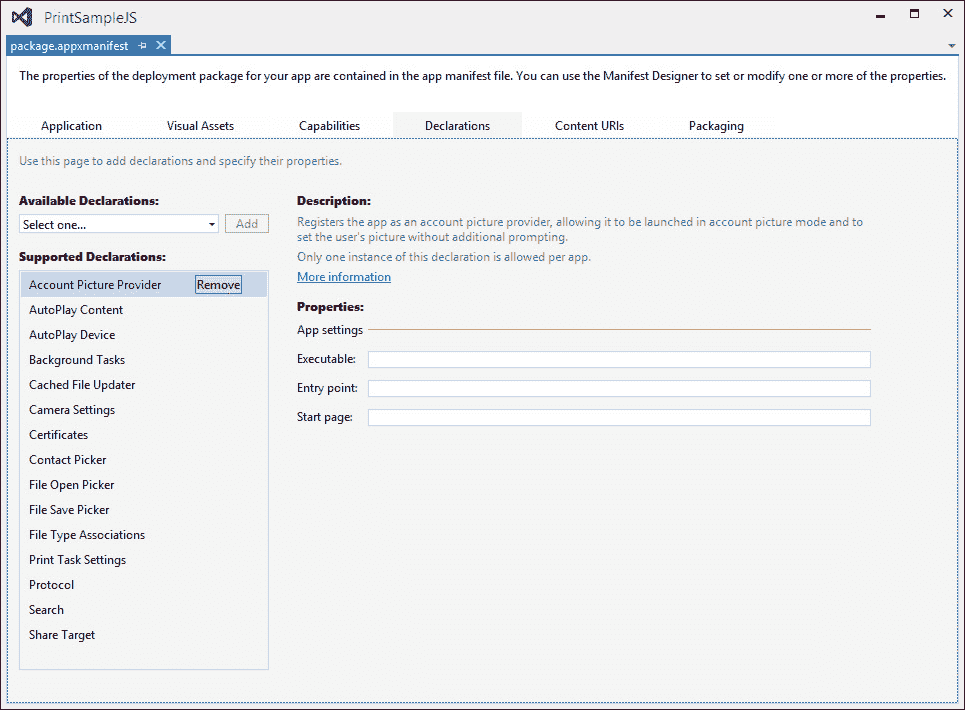

**图 2-11** 应用程序清单设计器显示声明列表

每个声明都有其自己的自定义设置，你需要进行设置。然后 Windows 就会知道你的应用希望如何与其他应用集成，并可以为你的应用设置正确的权限。

* * *

 考试提示

当你在考试中被要求配置超级按钮或合约时，不要忘记配置应用程序清单。

* * *

* * *

 *思考实验：* 使用超级按钮和合约

在这个思考实验中，请运用你所学到的关于本目标的知识。你可以在本章末尾的“答案”部分找到这些问题的答案。

你正在探索 Windows 8 生态系统。你有一些很棒的应用创意，但你想知道是否值得费心使用 Windows 8 提供的所有功能。考虑到这一点，请思考以下问题：

**1.** 微软为什么选择实现合约和超级按钮？

**2.** 在你的应用中使用超级按钮和合约有哪些优势？

**3.** 你能想到一个现有的应用会从超级按钮集成中受益吗？

* * *

### 目标总结

 Windows 应用商店应用的一个重要方面是“共赢”。与其他应用的集成和协作对于你的应用成功至关重要。

 通过提供合约和超级按钮，微软创建了一种灵活且熟悉的方式来实现常见任务，如搜索、共享、设置和设备。

 通过使用应用程序清单，你可以配置你的应用以请求使用超级按钮和合约的权限。

### 目标回顾


回答以下问题以测试您对本目标中信息的掌握程度。您可以在本章末尾的“答案”部分找到这些问题的答案以及每个选项正确或错误的解释。

**1.** 您正在开发一个用于管理任务列表的待办事项应用，并希望与他人共享这些任务列表。您是否应该实现“共享”超级按钮？

**A.** 不；直接在查看任务列表的页面上使用共享按钮更简单。

**B.** 不；您可以通过实现“设备”超级按钮来通过电子邮件发送数据。

**C.** 是；用户可以轻松地从您的应用内将任务列表共享到其他应用。

**D.** 是；用户可以通过电子邮件共享任务，或者打印它们。

**2.** 您的应用包含大量按类别和项目划分的数据，并且您希望能够进行搜索。您应该怎么做？

**A.** 实现“搜索”超级按钮以支持搜索应用的数据。

**B.** 使用搜索框进行应用内搜索。

**C.** 在应用栏中添加一个搜索按钮，该按钮显示用于搜索的自定义菜单。

**D.** 使用“共享”超级按钮将您的数据发送到其他应用（如 Excel），在其中可以轻松过滤。

**3.** 您的应用实现了一个共享目标，但在其他应用中查看共享目标列表时，它没有显示。如何修复？

**A.** 使用共享目标声明配置应用清单。

**B.** 其他应用无法将数据共享到您的应用；此操作只能对邮件应用执行。

**C.** 在“设置”超级按钮中添加配置设置，以将您的应用启用为共享目标。

**D.** 既然已实现共享合约，请重新安装应用。

### 目标 2.3：实现搜索

通过使用“搜索”超级按钮，您可以帮助用户浏览您的应用并找到他们想要的内容。在实现搜索时，您需要将 Windows 的内置功能与应用的特定需求相结合。

本目标向您介绍 Windows 提供了哪些内置功能，以及如何在您自己的应用中使用它们。

* * *

**本目标涵盖以下内容：**

 使用 SearchPane 和 SearchBox 控件类提供搜索建议

 搜索并启动其他应用

 在应用内提供和限制搜索，包括在搜索超级按钮内部和外部

 提供搜索结果预览

 从搜索中实现激活

 配置搜索合约

* * *

### 使用 `SearchPane` 和 `SearchBox` 控件类提供搜索建议

搜索可以添加到两个不同的位置：

 通过 `SearchBox` 控件进行应用内搜索

 通过 `SearchPane` 控件在搜索超级按钮中进行搜索

以下部分将讨论这些选项，向您展示如何实现它们，并突出显示差异，以便您做出明智的决定。

#### 使用搜索框进行应用内搜索

要向 Windows 应用商店应用添加应用内搜索，请从 `WinJS.UI` 命名空间中的 `SearchBox` 控件开始。添加 `SearchBox` 控件很容易；您只需要以下 HTML：

```
<div id="searchBoxId"
     data-win-control="WinJS.UI.SearchBox">
</div>
```

图 2-12 显示了 `SearchBox` 控件在黑色背景上的外观。

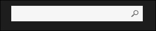

**图 2-12** `SearchBox` 控件

当搜索是应用的核心功能时，可以使用搜索框。例如，在 Windows 应用商店中，大多数人会使用搜索框来访问商店提供的内容。直接在应用中显示搜索框可以向用户表明，当他们初次使用您的应用时，应该从哪里开始。当应用空间有限时，可以考虑只显示搜索图标，或将搜索框移动到应用栏。

默认情况下，当搜索框未获得焦点时，控件会变暗。当控件获得焦点时，它会变为活动状态并改变颜色。

`SearchBox` 公开了 `querysubmitted` 事件，该事件对于响应用户开始新的搜索查询非常重要。您可以使用以下代码订阅此事件：

```
var elem = document.querySelector("#searchBoxId");
elem.addEventListener("querysubmitted", searchHandler);
```

`querysubmitted` 事件会获取一个类型为 `SearchBoxQuerySubmittedEventArgs` 的参数。此类包含以下成员：

 `KeyModifiers` 获取用户按 Enter 提交查询时按下的任何修饰键。

 `Language` 获取 Internet 工程任务组（IETF）语言标签（BCP 47 标准），该标签标识当前与用户文本输入设备关联的语言。

 `LinguisticDetails` 获取用户通过输入法编辑器（IME）输入的查询文本的相关信息。

 `QueryText` 获取当前搜索的查询文本。

最重要的属性是 `QueryText`，它包含用户搜索的文本。通过将其与用户的语言和语言细节相结合，您可以为不同类型的用户提供自定义的搜索结果。然后，您的应用可以开始搜索自己的内容，但您也可以搜索外部内容，例如互联网。

在搜索建议方面，`SearchBox` 非常智能。默认情况下，它会记住用户之前的搜索操作。您还可以添加自己的代码来提供自定义搜索建议。

通过订阅 `suggestionsrequested` 事件，您可以在用户输入查询文本时提供建议。您可以提供两种类型的搜索建议：

 查询建议

 结果建议

* * *

*更多信息*：结果建议

请阅读以下部分“提供搜索结果预览”，以获取有关实现结果建议的更多信息。

* * *

查询建议可以视为用户搜索文本的自动完成。当用户选择查询建议时，将显示带有所选查询文本的搜索页面。

您的应用在检索这些查询建议方面拥有完全的自由。例如，您可以使用应用内的静态数据列表、从 Web 服务获取数据，或使用标准格式（如 OpenSearch 或 XML 搜索）。

以下代码展示了如何订阅 `suggestionsrequested` 事件：

```
var elem = document.querySelector("#searchBoxId");
elem.addEventListener("suggestionsrequested", suggestionsRequestedHandler);
```

现在，您可以使用以下代码处理该事件：

```
function suggestionsRequestedHandler (args) {
    var queryText = args.detail.queryText,
    query = queryText.toLowerCase(),
    suggestionCollection = args.detail.searchSuggestionCollection;
    if (queryText.length > 0) {
        suggestionCollection.appendQuerySuggestion(query + " suggestion");
    }
}
```

您获取的事件参数具有与 `querysubmitted` 事件相同的查询详细信息。它还具有 `searchSuggestionCollection`，您可以使用它来追加搜索建议。此示例仅将单词“suggestion”附加到查询文本中。当然，您可以从多个来源添加多个建议，但此示例展示了基本结构。


发起 OpenSearch 或 XML Web 服务调用的模式相同。在 `suggestionsrequested` 事件处理程序中，你可以触发 Web 服务调用并解析结果。然后可以将这些数据添加到 `searchSuggestionCollection` 属性中。

### 通过搜索超级按钮实现搜索

使用搜索超级按钮时，你可以利用 `Windows.ApplicationModel.Search.SearchPane` 类来获取应用的 `SearchPane` 并公开事件，以便订阅查询和建议请求。以下代码展示了如何注册向应用提交的查询：

```
Windows.ApplicationModel.Search.SearchPane.getForCurrentView().onquerysubmitted =    
    function (eventObject) {
    };
```

将此代码添加到应用的全局作用域后，即可注册向应用提交的查询。要与搜索超级按钮集成，还需要编辑应用清单并添加搜索声明。如果忘记这一步，执行上述代码时会引发异常。

你可以以相同的方式使用 `SearchPane`。除了 `querysubmitted` 事件外，你还有 `suggestionsrequested` 事件和 `showOnKeyboardInput` 属性，通过它们可以确保当用户开始键入时搜索超级按钮打开，并且你可以建议搜索结果。

你不能在同一个应用中同时使用搜索框和搜索合约。你需要决定要实现哪种搜索类型，然后选择其中一种。

### 搜索和启动其他应用

Windows 8 和 Windows 8.1 之间设计决策的变化之一与搜索有关。由于搜索是一个非常重要的场景，Windows 8 提供了一个所有应用都相同的独特搜索起点：搜索超级按钮。

根据反馈和遥测数据，这种设计并非设计师最初设想的理想情况。在 Windows 8.1 中，微软通过更改以下特性改进了搜索体验：

 搜索所有内容——文件、应用、设置和网页——现在在调用搜索超级按钮时成为默认行为，省去了切换目标的步骤。

 对于应用内搜索，建议直接在应用画布上实现搜索控件。为此，WinJS 中包含了 `WinJS.UI.SearchBox` 控件。

 对于希望提供搜索功能但尚未准备好提供完整应用内体验的应用，你可以使用一个简单的按钮直接调用搜索超级按钮，并从那里使用搜索合约。在这种情况下，搜索超级按钮默认限定在应用范围内，而不是“所有内容”。

用户可以更改搜索超级按钮的目标为文件、设置或互联网。从 Windows 8.1 开始，搜索其他应用的功能已被移除。

理解这些变化对考试很重要。默认情况下，你的应用现在应该使用搜索框来实现应用内体验。

### 在应用内提供和限制搜索

由于上一节提到的设计变更，你应该将搜索结果和建议限制在应用内数据中。在 Windows 8 中，搜索会覆盖多个应用甚至互联网。

使用新设计的搜索框时，你的应用内搜索应将其结果限制在应用内结果。如果在你应用的上下文中合理，你可以选择将网页结果添加到应用内结果中。

这在推荐使用搜索框时成立，但在从应用内启动搜索超级按钮时也同样适用。

### 提供搜索结果预览

在本目标的第一个部分，你学习了如何向 `SearchBox` 和 `SearchPanel` 添加查询建议。你还可以添加结果建议来帮助用户。这些建议更具体地针对用户正在查找的内容，并直接链接到特定的搜索结果。图 2-13 展示了 Windows 应用商店中查询建议和结果建议的示例。结果建议显示在顶部；分隔符之后，显示查询建议。

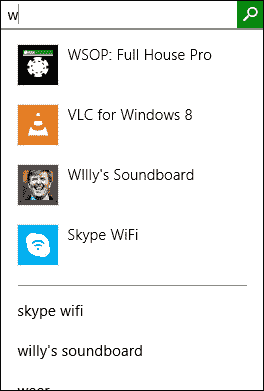

**图 2-13** 在 Windows 应用商店中搜索时的查询建议和结果建议

使用 `SearchBox` 控件时，你可以利用 `suggestionsrequested` 事件来处理查询建议。作为事件参数传递的 `searchSuggestionCollection` 对象可用于添加查询建议、结果建议和分隔符。

以下代码展示了一个示例：

```
function suggestionsRequestedHandler(eventObject) {

    var queryText = eventObject.detail.queryText,

        suggestionCollection = eventObject.detail.searchSuggestionCollection;

    var imageUri = new Windows.Foundation.Uri("ms-appx:///images/image.png");

    var imageSource = Windows.Storage.Streams.RandomAccessStreamReference.

                       createFromUri(imageUri);

    suggestionCollection.appendResultSuggestion("text", "detailText", "tag",

        imageSource, "imageAlternateText");

    suggestionCollection.appendSearchSeparator("");

    suggestionCollection.appendQuerySuggestion(queryText + "suggestion");

}
```

通过使用 `appendResultSuggestion` 方法，你可以为用户添加结果建议。除了几个字符串参数外，此方法还需要一个 `RandomAccessStreamReference`，它指向要在结果建议旁边显示的图像。该图像应为 40 × 40 像素；否则 Windows 会为你缩放。此图像可以通过指向图像位置的 URI 从应用包中其他位置的图像创建。

添加分隔符后，你可以添加任何查询详细信息。当用户选择查询结果时，Windows 会使用此文本并引发 `querysubmitted` 事件。但当选择结果建议时，用户期望直接跳转到该项目，而不是搜索结果页面。

你可以通过订阅 `resultsuggestionchosen` 事件来处理结果选择：

```
searchBox.addEventListener("resultsuggestionchosen", resultSelectedHandler);
```

此事件获取一个 `SearchBoxResultSuggestionChosenEventArgs` 实例，其 `tag` 属性设置为添加结果建议时使用的标签值。

`SearchPane` 具有相同的功能。通过订阅 `onsuggestionsrequested` 事件和 `onresultsuggestionchosen`，你可以实现与 `SearchBox` 相同的功能。

* * *

 考试提示

请确保你理解：响应结果建议时应显示结果页面，而不是搜索页面。

* * *

### 从搜索中实现激活

第 1 章 讨论了应用的生命周期。当应用启动时，你可以检查 `ActivationKind` 枚举以了解启动原因。你可以通过以下代码查看用户是否从搜索超级按钮启动了你的应用：

```
if (eventObject.detail.kind ===
    Windows.ApplicationModel.Activation.ActivationKind.search) {
    if (eventObject.detail.queryText === "") {
        // 无查询。显示标准登录页面
    } else {
        // 显示搜索结果
    }
}
```

当你的应用通过搜索激活时，首先检查用户是否输入了任何查询文本。如果没有，用户只是想打开你的应用。如果有查询文本，你可以立即跳转到搜索结果页面。

* * *

 考试提示

在处理 Windows 支持的所有合约和超级按钮时，激活事件和 `ActivationKind` 属性非常重要。请熟悉此事件，并确保理解 `ActivationKind` 的不同值。

* * *

### 配置搜索合约


Windows 使用应用清单来检查你的应用所需的权限。如果你的应用没有为某个功能请求权限，它就无法使用该功能。

要使用 `SearchBox` 进行应用内搜索，你不需要合约。但是，要与搜索超级按钮集成，你必须在应用清单中创建一个显式声明来请求权限。

图 2-14 显示了应用清单设计器中的搜索声明。

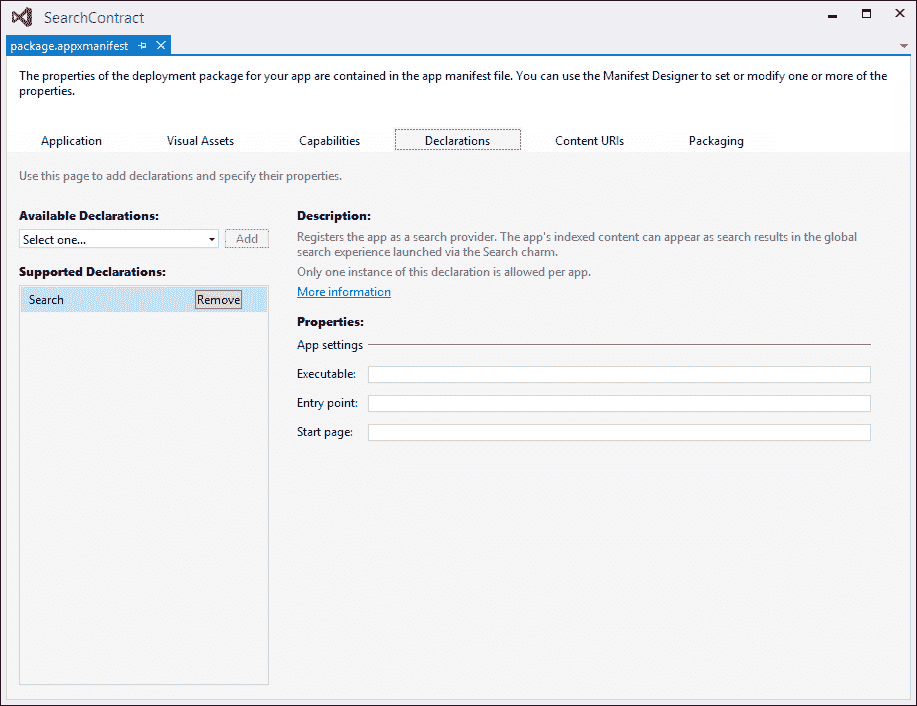

**图 2-14** 显示搜索声明的应用清单设计器

`Executable` 和 `Entry Point` 是 C++ 应用特有的。在你的 JavaScript 应用中，你不需要配置它们。`Start Page` 是 JavaScript 应用特有的。然而，当它与搜索声明结合使用时，它不会起任何作用。

* * *

 *思考实验：* 在 `SearchBox` 和 `SearchPane` 之间做出选择

在这个思考实验中，应用你所学到的关于本目标的知识。你可以在本章末尾的“答案”部分找到这些问题的答案。

你正在设计一个食谱应用，并且你确定你的应用需要搜索功能。你必须在使用 `SearchBox` 或使用 `SearchPane` 之间做出选择。考虑到这一点，请回答以下问题：

**1.** `SearchBox` 和 `SearchPane` 之间有什么区别？

**2.** 描述一种你会使用 `SearchBox` 的情况，以及一种你会使用 `SearchPane` 的情况。

* * *

### 目标总结

 `SearchBox` 可用于应用内搜索。

 `SearchPane` 可与搜索超级按钮一起使用。你不能在一个应用中同时使用 `SearchBox` 和 `SearchPane`。使用 `SearchPane` 时，你必须将搜索声明添加到应用清单中。

 你可以提供查询和结果建议来帮助用户。

 你的应用可以从搜索中被激活。

### 目标回顾

回答以下问题来测试你对本目标中信息的掌握程度。你可以在本章末尾的“答案”部分找到这些问题的答案以及每个选项正确或错误的解释。

**1.** 你正在尝试在你的应用中访问 `SearchPane`。当你尝试为 `querysubmitted` 事件添加处理程序时，你的应用崩溃并显示“访问被拒绝”错误。你应该怎么做？

**A.** 以管理员身份运行你的应用。

**B.** 使用 `SearchBox` 代替 `SearchPane`。

**C.** 使用 `onsuggestionsrequested` 事件。

**D.** 在应用清单中添加搜索声明。

**2.** 你的应用帮助用户查找有关食材的信息。用户搜索文本“garl”，你想提供搜索建议。你应该怎么做？（选择所有适用的选项。）

**A.** 添加一个分隔符。

**B.** 为“garl”添加一个查询建议。

**C.** 为“garlic”添加一个查询建议。

**D.** 为“garlic”添加一个结果建议。

**3.** 你有一个 Web 服务，它向你的应用返回 XML 建议，并且你使用了 `SearchBox` 控件。你想使用这些建议并将其显示给用户。你应该使用哪个事件？

**A.** `suggestionchosen`

**B.** `resultsuggestionsrequested`

**C.** `querysuggestionsrequested`

**D.** `suggestionsrequested`

### 目标 2.4：在应用中实现共享

你多久共享一次数据？也许你正在阅读一篇有趣的文章，然后将 URL 复制到电子邮件中。或者你看到一张有趣的图片，想把它分享到 Twitter 上。或者你想与朋友分享你的新最高分。

可能性是无限的。微软理解共享数据是使用应用的重要组成部分，这就是为什么微软设计了一个完整的数据共享基础设施。你可以帮助用户轻松共享他们在你的应用中找到的内容，并且你可以设计你的应用，以便其他应用可以与你的应用共享数据。

所有这些协同工作，确保应用变得更受欢迎，并能够“共赢”。本目标向你展示如何共享数据。

* * *

**本目标涵盖以下内容：**

 使用 `DataTransferManager` 类与其他应用共享数据

 通过从共享中实现激活来接受共享请求

 使用 `DataPackage` 对象限制共享范围

 在共享超级按钮之外实现应用内共享

 使用 Web 链接和应用链接

* * *

### 使用 `DataTransferManager` 类与其他应用共享数据

最常见的共享场景是将数据从你的应用共享到其他应用。在这种场景中，你的应用充当共享源（下一节将讨论作为共享目标）。

要启动共享操作，你需要一个对 `DataTransferManager` 类的引用：

```
var dataTransferManager =
    Windows.ApplicationModel.DataTransfer.DataTransferManager.getForCurrentView();
```

你不需要在应用清单中添加声明即可从你的应用共享数据。当你拥有 `dataTransferManager` 的实例时，你可以为 `datarequested` 事件添加一个事件处理程序。每当用户打开共享超级按钮时，就会触发此事件。

以下代码显示了一个简单的示例：

```
function registerForShare() {
    var dataTransferManager = Windows.ApplicationModel.DataTransfer.
        DataTransferManager.getForCurrentView();
    dataTransferManager.addEventListener("datarequested", shareTextHandler);
}

function shareTextHandler(e) {
    var request = e.request;
    request.data.properties.title = "共享标题";
    request.data.properties.description = "共享描述";
    request.data.setText("你好，共享！");
}
```

当你从激活事件中调用 `registerForShare` 方法时，你的应用就为共享做好了准备。图 2-15 显示了使用此代码时共享超级按钮的外观。

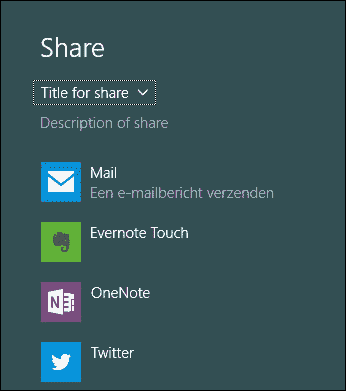

**图 2-15** 带有示例内容的共享超级按钮

你的 `datarequested` 处理程序会收到一个类型为 `DataRequestedEventArgs` 的事件对象。该对象唯一的属性是 `request`，它是你用来提供要共享的数据的对象。

你可以共享不同的数据格式。在前面的示例中，你看到了如何共享一些文本。你可以共享的格式如下：

 文本

 链接

 HTML

 文件

 单个

 多个文件和图像

* * *

*更多信息*：自定义格式

你可以创建基于已发布架构或你自己创建并发布的架构的自定义格式。有关更多信息，请参阅 *[`msdn.microsoft.com/en-us/library/windows/apps/hh750306.aspx`](http://msdn.microsoft.com/en-us/library/windows/apps/hh750306.aspx)*。

* * *

要配置要共享的数据，请使用 `request.data` 属性。该对象具有以下可用于设置数据的方法：

 `SetApplicationLink` 设置 `DataPackage` 对象包含的应用链接

 `SetBitmap` 设置 `DataPackage` 对象中包含的位图图像

 `SetData` 以 `RandomAccessStream` 格式设置 `DataPackage` 对象中包含的数据

 `SetDataProvider` 设置一个委托来处理来自目标应用的请求

 `SetHtmlFormat` 向 `DataPackage` 对象添加 HTML 内容


 `SetRtf` 设置 `DataPackage` 对象中包含的富文本格式 (RTF) 内容

 `SetStorageItems(IIterable(IStorageItem))` 设置 `DataPackage` 对象中包含的文件和文件夹

 `SetStorageItems(IIterable(IStorageItem), Boolean)` 向 `DataPackage` 对象添加文件和文件夹

 `SetText` 设置 `DataPackage` 对象中包含的文本

 `SetUri` 设置 `DataPackage` 对象中包含的 URI

 `SetWebLink` 设置 `DataPackage` 对象中包含的网页链接

通过使用这些方法，你可以与其他应用共享各种数据。

你的应用可能需要共享一些需要时间处理的数据。如果你将所有创建这些项目的逻辑都放在 `datarequested` 处理程序中，激活“共享”超级按钮可能会花费太长时间。

你可以使用延迟来避免这个问题。与其在 `datarequested` 处理程序中创建数据，不如指定一个方法，目标应用可以在需要数据时通过 `DataPackage` 对象上的 `setDataProvider` 方法来请求该方法。此方法需要你希望共享的格式以及一个可在目标需要数据时调用的方法：

```
request.data.setDataProvider(Windows.ApplicationModel.DataTransfer.StandardDataFormats.
    bitmap, onDeferredImageRequested);
```

在这种情况下，你为图像请求创建了一个延迟，这为你的方法提供了处理图像的时间，并在需要时将图像发送到共享目标。

请记住，这与异步执行方法不同。要在 `datarequested` 处理程序中处理异步方法，请使用 `request.getDeferral` 方法。完成异步操作后，调用 `deferral.complete` 向 Windows 发出信号，表明你的共享数据已准备就绪。

### 通过从共享中实现激活来接受共享请求

除了将你的应用中的内容共享给其他应用外，你还可以将你的应用配置为共享目标。这样，其他应用就可以将内容共享给你的应用，并且当用户使用其他应用时，你的应用会突然出现。

要成为共享目标，你必须配置应用清单。当你的应用安装后，Windows 会将其注册为共享目标，并且你的应用会出现在“共享”超级按钮中。

图 2-16 显示了共享合约的声明。

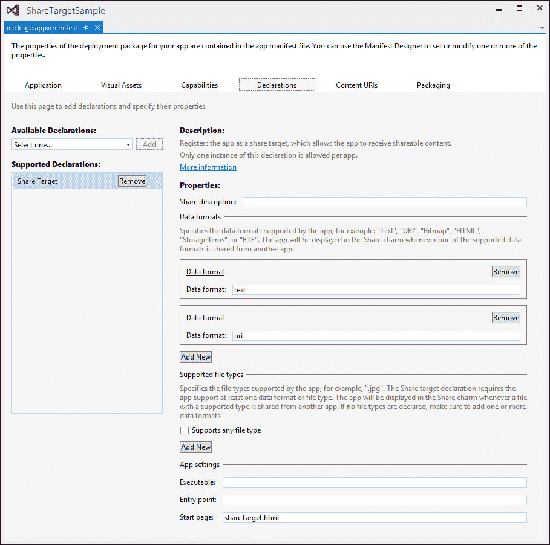

**图 2-16** 应用清单设计器中的共享声明

要将你的应用配置为共享目标，请定义你的应用支持的数据格式。图 2-16 显示了文本和 URI 的格式。每当某个应用想要共享这些类型的数据时，你的应用就会出现在共享目标列表中。

你还会看到一个“起始页”的值，这是当你的应用被选为共享目标时 Windows 显示的 HTML 页面。

正如你在前面的章节中看到的，Windows 支持多种激活应用的方式。其中一种方式就是作为共享目标。每当你的应用被注册为共享目标时，你应该像这样检查 `ActivationKind`：

```
app.onactivated = function (args) {
    if (args.detail.kind === Windows.ApplicationModel.Activation.ActivationKind.shareTarget) {
        // 初始化共享视图            
    }
};
```

当你的应用通过共享被激活时，你会得到一个 `shareOperation` 对象作为参数传递给激活方法：`args.detail.shareOperation`。该对象包含某个应用想要与你共享的数据包。它还允许你在共享操作花费太长时间时向用户提供进度报告。

例如，当某个应用想要与你的应用共享一些文本时，你可以使用以下代码：

```
var shareOperation = eventObject.detail.shareOperation;
if (shareOperation.data.contains(
    Windows.ApplicationModel.DataTransfer.StandardDataFormats.text)) {
        shareOperation.data.getTextAsync().done(function (text) {
        // 使用文本
        }, function (e) {
        // 处理错误
        }
    });
}
```

在你的共享 UI 中，你需要一个按钮来处理共享逻辑。该代码完全由你的应用程序自定义。

开始实现共享目标的最简单方法是打开“向应用程序添加新项”对话框，然后选择“共享目标合约”。它会向你的应用添加 HTML、JavaScript 和 CSS 文件，这些文件实现了一个基本的共享 UI。它还会向你的清单添加一个共享目标声明，数据格式为文本和 URI。

* * *

*更多信息*：共享内容目标应用示例

Microsoft 提供的共享内容目标应用示例展示了你的应用如何接收来自其他应用的内容。你可以在 *[`code.msdn.microsoft.com/windowsapps/Sharing-Content-Target-App-e2689782`](http://code.msdn.microsoft.com/windowsapps/Sharing-Content-Target-App-e2689782)* 找到该示例。

* * *

* * *

 考试提示

请确保你理解作为共享源和共享目标之间的区别。了解何时使用每种方式以及如何实现这两种场景。

* * *

### 使用 DataPackage 对象限制共享范围

数据可以以多种不同的数据格式进行共享。Windows 提供以下可供使用的格式：

 Bitmap 用于共享图像。

 HTML 用于共享 HTML 内容。

 Rich Text Format (RTF) 用于共享 RTF 内容。

 Storage Items 用于共享文件。

 Text 用于共享纯文本。

 URI 用于共享 URI。

查看此列表并思考你计划开发的应用时，你可能会看到一些可以在应用中使用的潜在候选格式。然而，并非所有应用都觉得所有数据格式都有用。从你的音乐播放器共享 HTML 内容？或者从食谱应用共享文件？也许这些场景对你的应用有用，但你应该仔细考虑你想要共享的项目。

你可以通过使用 `DataPackage` 类从你的应用共享数据，该类提供了多种可用于初始化 `DataPackage` 的方法：

 `SetApplicationLink` 设置应用程序链接

 `SetBitmap` 设置 `DataPackage` 对象中包含的位图图像

 `SetData` 以 `RandomAccessStream` 格式设置 `DataPackage` 对象中包含的数据

 `SetDataProvider` 设置一个委托来处理来自目标应用的请求

 `SetHtmlFormat` 向 `DataPackage` 对象添加 HTML 内容

 `SetRtf` 设置 `DataPackage` 对象中包含的 RTF 内容

 `SetStorageItems` 设置 `DataPackage` 对象中包含的文件和文件夹

 `SetText` 设置 `DataPackage` 对象中包含的文本

 `SetUri` 设置 `DataPackage` 对象中包含的 URI

 `SetWebLink` 设置 `DataPackage` 对象中包含的网页链接

通过选择正确的方法，你可以指定要共享的数据类型，这决定了哪些应用会出现在“共享”超级按钮中。

### 在“共享”超级按钮之外实现应用内共享

“共享”超级按钮始终可供用户激活，当用户决定共享你的应用提供的某些数据时，它非常有用。


在某些场景下，你可能希望激励用户分享某些内容。例如，用户刚刚在你的游戏中取得了新的最高分，你希望他们与朋友分享（以期吸引新用户使用你的应用！）。

为了帮助他们，你可以通过以下代码行直接从你的应用中激活“共享”超级按钮：

点击此处查看代码图片

```
Windows.ApplicationModel.DataTransfer.DataTransferManager.showShareUI();
```

图 2-17 展示了一个非常简单的用户界面。当你点击“共享”文本时，“共享”超级按钮会打开，你会看到你在应用中配置的标题和描述。然后用户可以选择作为共享目标的应用。

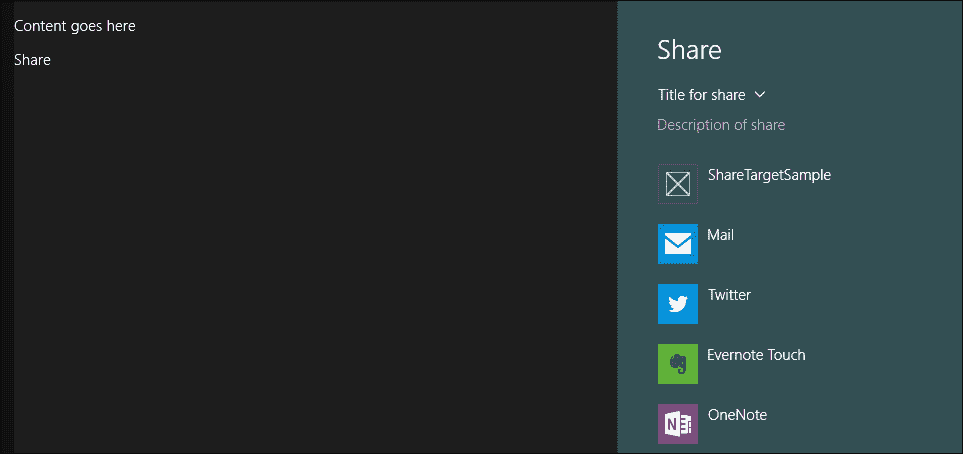

**图 2-17** 直接从应用内部打开“共享”超级按钮

### 使用网页链接和应用链接

为了提高应用的可见性，微软不仅将你的应用添加到 Windows 应用商店，还会生成一个描述你应用的网页。图 2-18 展示了一个示例：Skype 应用的网页。

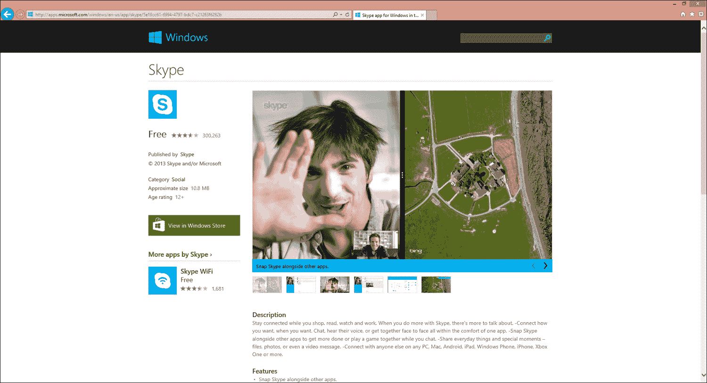

**图 2-18** Internet Explorer 显示 Windows 应用商店 Skype 应用的网页

这个网页的好处在于，每当用户在 Windows 8 设备上打开该页面时，Windows 应用商店会自动启动并直接在商店中显示应用页面。这些网页链接允许你与用户分享一个普通 URL 来展示你的应用。当 Windows 8 用户点击你的链接时，他们会被带到商店。用户也可以直接查看网页并与他人分享 URL。

应用链接则略有不同，因为它们期望用户在 Windows 8 设备上并直接链接到商店。当你从自己的应用链接到另一个应用时，应用链接会很有用。由于用户已经在运行你的应用，你知道他们拥有 Windows 8 设备，因此可以跳过先用网页链接打开浏览器再跳转到 Windows 应用商店的步骤。

显示应用列表页面的应用链接格式如下：

```
ms-windows-store:PDP?PFN=
```

包系列名称（PFN）对于你的应用是唯一的。你可以在 Visual Studio 或应用列表页面（如图 2-18 所示）中找到它。当你打开 Skype 应用列表页面的 HTML 源代码时，会找到以下行：

点击此处查看代码图片

```
var packageFamilyName = 'Microsoft.SkypeApp_kzf8qxf38zg5c';
```

这就是你可以用来直接链接到 Skype 的 PFN。当然，你也可以使用同样的技术链接到 Windows 应用商店中的任何包。

除了显示应用列表页面，你还可以通过 Windows 应用商店处理以下内容：

 **发布者** 打开显示某个发布者所有应用的页面

 **更新** 打开 Windows 应用商店更新页面

 **搜索** 执行搜索查询并显示结果

 **PDP** 打开应用的列表页面

 **评论** 打开应用列表的“撰写评论”页面

* * *

 *思考实验：* 共享你的应用

在这个思考实验中，请运用你学到的关于本目标的知识。你可以在本章末尾的“答案”部分找到这些问题的答案。

你正在构建一个食谱应用，并且想知道共享是否应该是你的应用支持的功能。

**1.** 你是否应该让应用成为共享源？

**2.** 你是否应该让应用成为共享目标？

* * *

### 目标总结

 `DataTransferManager`类对于共享源或共享目标至关重要。

 通过使用`DataPackage`对象，你可以指定想要与其他应用共享的数据。

 通过添加共享声明，你可以响应通过共享进行的激活，并成为共享目标。

 考虑你希望在应用中支持的数据格式，并确保它们对用户有意义。

 你可以通过调用`DataTransferManager`上的`showShareUI`直接从应用内部激活共享。

 通过网页链接和应用链接，你可以与用户共享 URI，以便他们找到你的应用。

### 目标复习

回答以下问题以测试你对本目标中信息的掌握程度。你可以在本章末尾的“答案”部分找到这些问题的答案以及每个选项正确或错误的解释。

**1.** 你的应用应充当共享源。你正在与其他应用共享一些文本数据。你应该怎么做？（选择所有适用项。）

**A.** 在清单中添加共享声明。

**B.** 监听`datarequested`事件。

**C.** 使用要共享的数据初始化数据包。

**D.** 添加延迟以在需要时加载共享数据。

**2.** 你想在用户界面中添加一个按钮，当用户点击它时显示“共享”超级按钮。你该怎么做？

**A.** 你不能在用户界面中添加共享按钮。用户应使用“搜索”超级按钮。

**B.** 你可以在按钮的点击事件中创建一个`DataPackage`对象，并用要共享的数据配置它。

**C.** 你可以调用`DataTransferManager`上的`showShareUI`来显示“共享”超级按钮。

**D.** 你可以在应用中使用一个链接到“共享”超级按钮的应用链接。

**3.** 你的应用充当共享目标。你应该怎么做？

**A.** 监听`sharetargetedactivated`事件。

**B.** 监听`activated`事件并检查`ActivationKind`。

**C.** 监听`datarequested`事件。

**D.** 监听`deferallsharerequest`事件。

### 目标 2.5：管理应用程序设置和首选项

“设置”超级按钮提供了一个中心位置，用户可以在其中配置你的应用。Windows 会向“设置”超级按钮添加一些默认内容，例如评分和评论选项。你的应用可以向“设置”超级按钮添加其他选项，并保存更改，以便在用户设备之间同步。

本目标向你展示如何在应用中使用“设置”超级按钮。

* * *

**本目标涵盖以下内容：**

 选择在应用设置中访问哪些应用功能

 在设置窗口中为应用设置添加入口点

 使用 SettingsFlyout 控件创建设置浮出控件

 向 SettingsFlyout 控件添加设置选项

 从漫游应用数据存储中存储和检索设置

* * *

### 选择在应用设置中访问哪些应用功能

当你通过 Windows 应用商店安装应用时，Windows 会自动向“设置”超级按钮添加两个部分：

 评分和评论

 权限

你可以在图 2-19 中看到这两个部分的示例。当你的应用不是通过 Windows 应用商店安装时，“设置”超级按钮中没有“评分和评论”选项。

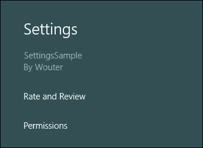

**图 2-19** “设置”超级按钮显示“评分和评论”和“权限”设置

其他设置完全由你决定。通常，你应该将设置分为那些频繁更改的和那些不频繁更改的。


例如，绘画应用的用户会频繁更改画笔的大小和类型，但可能只配置一次度量单位。如果某个设置属于常规工作流程的一部分，则应放在应用栏中。如果是很少更改的设置，则应将其放入“设置”超级按钮中。

明确属于“设置”超级按钮的项目是信息类项目，例如应用的隐私政策、帮助、版本和版权信息。

### 在“设置”窗口中为应用设置添加入口点

“设置”超级按钮本身不包含设置；相反，它会显示应用中设置的组，并允许你导航到这些组。这些设置组称为*入口点*。

你可以通过 `WinJS.Application.onsettings` 事件添加入口点，该事件在用户启动“设置”超级按钮时触发。在事件处理程序中，你可以添加其他应用程序命令，并用它们填充“设置”超级按钮：

点击此处查看代码图片

```
app.onsettings = function (e) {

    e.detail.applicationcommands = {

        "defaultsDiv": { href: "html/DefaultSettings.html", title: "默认设置" },

        "helpDiv": { href: "html/HelpUI.html", title: "帮助" }

    };

    WinJS.UI.SettingsFlyout.populateSettings(e);

}
```

此代码向“设置”超级按钮添加了两个入口点：“默认设置”和“帮助”。每个入口点指向包含实际设置的不同 HTML 页面。

最佳实践是，在“设置”超级按钮中添加不超过四个不同的部分。应尽可能对设置进行分组，并为每组设置一个描述性的、单个单词的标签。如果无法为组命名，则将其命名为“默认”。

在应用程序内部，你可以直接链接到“设置”超级按钮中的特定部分。假设你想在应用栏中添加一个“帮助”按钮，点击该按钮时应显示“设置”超级按钮中的“帮助”部分。你可以使用以下代码实现：

点击此处查看代码图片

```
document.getElementById("showHelp").addEventListener('click', function () {

    WinJS.UI.SettingsFlyout.showSettings("helpDiv", "html/HelpUI.html");

});
```

确保路径和 ID 与 `onsettings` 事件中的应用程序命令相匹配。为了使代码更易于维护，请将这些 ID 和路径移到单独的变量中，并在引用“设置”超级按钮中的部分时使用它们。

如果某个特定部分组在某个场景中没有用，不要隐藏其标签；而是禁用它，使用户无法选择。

* * *

 考试提示

切勿将设置直接添加到主设置页面。始终使用打开包含实际设置的 `SettingsFlyout` 控件的入口点。

* * *

### 使用 SettingsFlyout 控件创建设置浮出控件

你作为 HTML 页面添加的设置浮出控件应遵循一些严格规则，这些规则描述了它们的外观和行为：

 始终从“设置”窗格中的入口点启动设置浮出控件。

 使用轻触关闭表面，该表面显示在主应用内容之上，并在用户点击浮出控件外部或调整应用大小时消失。自动关闭浮出控件可让用户快速更改设置并返回应用。

 确保设置浮出控件出现在与超级按钮和“设置”窗格相同的屏幕一侧。使用 `SettingsEdgeLocation` 属性确定“设置”超级按钮出现在屏幕的哪一侧。

 让浮出控件从与“设置”窗格相同的屏幕一侧滑入，而不是从屏幕顶部或底部滑入。

 浮出控件必须全屏高度，无论方向如何，并且应为窄（346 像素）或宽（646 像素）。选择适合内容的宽度；不要创建自定义尺寸。

 浮出控件标题应包含返回按钮、打开浮出控件的入口点名称以及应用图标。

 标题背景颜色应与磁贴的背景颜色相同。

 边框颜色应与标题颜色相同，但深 20%。

 在白色背景上显示设置内容。

幸运的是，微软添加了 `WinJS.UI.SettingsFlyout` 控件来帮助实现所有这些规则。设置浮出控件的基本模板如下所示：

点击此处查看代码图片

```
<div id="defaultsDiv" data-win-control="WinJS.UI.SettingsFlyout"

    aria-label="默认设置浮出控件"

    data-win-options="{settingsCommandId:'default',width:'narrow'}">

    <div class="win-header" style="background-color:#464646">

        <button type="button" onclick="WinJS.UI.SettingsFlyout.show()"

                class="win-backbutton"></button>

        <div class="win-label">默认设置</div>

        

    </div>

    <div class="win-content">

        {应用默认设置内容放在此处}

    </div>

</div>
```

该 div 定义它是一个类型为 `WinJS.UI.SettingsFlyout` 的控件。它还添加了一个带有返回按钮的标题，使用户可以返回到“设置”超级按钮概览。

你可以将此模板放在定义 HTML、head 和 body 标签的 HTML 页面中。你还可以链接到特定于设置浮出控件的 CSS 和 JavaScript 文件。

MSDN 为你定义了一些在处理设置时重要的指南。你不必全部记住，但请确保理解一般规则，并知道如何在考试中应用它们。

一些通用原则包括：

 在“设置”窗格中为所有应用设置创建入口点。

 保持设置简单。定义合理的默认值，并将设置数量保持在最低限度。

 如有必要，从应用 UI 元素链接到“设置”窗格，或深层链接到特定的设置浮出控件。例如，你可以从底部应用栏中的“帮助”按钮以及“设置”窗格中的“帮助”入口点链接到帮助设置浮出控件。

 当用户更改设置时，应用应立即反映更改。在用户完成与浮出控件的交互后立即应用设置更改。

 使用 `WinJS.UI.SettingsFlyout` 控件。此控件默认实现 UI 设计指南。

 不要将属于常见应用工作流程的命令包含在应用设置中，例如在艺术应用中更改画笔颜色。这些命令应属于应用栏或画布。

 不要使用“设置”窗格中的入口点直接执行操作。入口点应打开设置浮出控件。

 不要使用“设置”窗格进行导航。当它关闭时，用户应处于与点击“设置”超级按钮时相同的位置。顶部应用栏更适合导航。

 不要将 `SettingsFlyout` 类用作通用控件。它们仅用于从“设置”窗格中的入口点启动的设置浮出控件。

在创建入口点时，请记住以下几点：

 将相似或相关的选项分组到一个入口点下。避免在“设置”窗格中添加超过四个入口点。

 无论应用上下文如何，都显示相同的入口点。如果某些设置在特定上下文中不相关，请在设置浮出控件中禁用它们。


-  尽可能为入口点使用描述性的、单个单词的标签。例如，对于与账户相关的设置，将入口命名为“Accounts”而不是“Account settings”。如果你只想为设置设置一个入口点，并且这些设置不适合使用描述性标签，则使用“Options”或“Defaults”。
-  如果入口点直接链接到网页而不是弹出窗口，请通过视觉提示让用户知道——例如，将“Help (online)”或“Web forums”设置为超链接样式。考虑将多个指向网页的链接分组到一个具有单个入口点的弹出窗口中。例如，“About”入口点可以打开一个包含使用条款、隐私声明和应用支持链接的弹出窗口。
-  将不常用的设置合并到一个入口点，以便更常见的设置各自拥有自己的入口点。将仅包含信息的内容或链接放在“About”入口点中。
-  不要复制“Permissions”窗格中的功能。Windows 默认提供此窗格，并且你无法修改它。

### 向 SettingsFlyout 控件添加设置选项

既然你已经向设置超级按钮添加了选项，并创建了在用户选择标签时显示的设置弹出窗口，那么你需要向这些弹出窗口添加一些选项，以帮助用户配置你的应用。

在创建设置弹出窗口时，要考虑良好的设计。你不应该创建一个让用户被众多选项淹没、难以找到所需特定选项的设置弹出窗口。

相反，要确保你的设置弹出窗口不会过长。将滚动限制在最多两倍屏幕高度。对设置进行分组，添加描述性名称，并且不要创建嵌套的设置层次结构。

微软还创建了可以在设置弹出窗口中使用的控件：

-  **切换开关** 用户可以设置值为开或关。
-  **单选按钮** 用户可以从最多五个互斥的相关选项中选择一项。
-  **选择控件** 用户可以从六个或更多纯文本项中选择一项。
-  **文本输入框** 用户可以输入文本。使用与从用户获取的文本类型（如电子邮件或密码）相对应的文本输入框类型。
-  **超链接** 用户被带到应用内的另一个页面或外部网站。当用户单击超链接时，设置弹出窗口将关闭。
-  **按钮** 用户可以在不关闭当前设置弹出窗口的情况下启动即时操作。

以下代码展示了使用这些控件的示例：

```html
<div class="win-content">

    <div class="win-settings-section">

        <h3>Toggle switch</h3>

        <p>Use toggle switches to let users set Boolean values.</p>

        <div id="Toggle1" data-win-control="WinJS.UI.ToggleSwitch"

             data-win-options="{title:'Download updates automatically',checked:true}">

        </div>

        <div id="Toggle2" data-win-control="WinJS.UI.ToggleSwitch"

             data-win-options="{title:'Install updates automatically'}">

        </div>

    </div>

    <div class="win-settings-section">

        <h3>Push button</h3>

        <p>With a push button, users initiate an immediate action.</p>

        <label>Button label</label>

        <button type="button" onclick="WinJS.log &&

                WinJS.log('Clear history button pressed', 'samples', 'status')">

            Clear

        </button>

    </div>

    <div class="win-settings-section">

        <h3>Select control</h3>

        <p>Use the select control to allow users to select

           one item from a set of text-only items.</p>

        <label>State</label>

        <select aria-label="State select control">

            <option value="AK">Alaska</option>

            <option value="CA">California</option>

            <option value="CO">Colorado</option>

            <option value="HI">Hawaii</option>

            <option value="ID">Idaho</option>

            <option value="KS">Kansas</option>

            <option value="MT">Montana</option>

            <option value="NE">Nebraska</option>

            <option value="NV">Nevada</option>

            <option value="NM">New Mexico</option>

            <option value="ND">North Dakota</option>

            <option value="OR">Oregon</option>

            <option value="SD">South Dakota</option>

            <option value="TX">Texas</option>

            <option value="UT">Utah</option>

            <option value="WA" selected>Washington</option>

            <option value="WY">Wyoming</option>

        </select>

    </div>

    <div class="win-settings-section">

        <h3>Hyperlink</h3>

        <p>Use a hyperlink when the associated action will

           take the user out of this flyout.</p>

        <a href=http://go.microsoft.com/fwlink/?LinkID=190175

           target="fix_link_too">View privacy statement</a>

    </div>

    <div class="win-settings-section">

        <h3>Text input box</h3>

        <p>Use a text input box to allow users to enter text.

          Set the type of the text input box according to the

          type of text you're capturing from the user (e.g. email or password).</p>

        <label>Email account</label>

        <input type="text" aria-label="Enter email account" />

        <button type="button" onclick="WinJS.log &&

                                       WinJS.log('Add email account button pressed',               

                                       'samples', 'status')">Add</button>

    </div>

    <div class="win-settings-section">

        <h3>Radio button group</h3>

        <p>Lets users choose one item from a small set of mutually exclusive,

           related options.</p>

        <label>Video quality</label>

        <label><input type="radio" name="video" value="High" checked />High</label>

        <label><input type="radio" name="video" value="Medium" />Medium</label>

        <label><input type="radio" name="video" value="Low" />Low</label>

    </div>

</div>
```

图 2-20 展示了这些控件在设置弹出窗口中的外观。

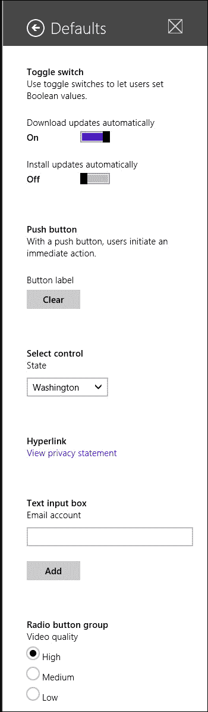

**图 2-20** 设置弹出窗口显示基本控件

你的应用应立即响应设置中的更改；用户不必按下按钮来应用更改。

你可以使用弹出窗口的 JavaScript 文件将事件附加到所有设置控件。通过响应这些事件，你可以调用你的应用并应用新设置。一个简单的示例包括一个你附加到的切换开关：

```javascript
(function () {

    "use strict";

    var page = WinJS.UI.Pages.define("/html/DefaultSettings.html", {

        ready: function (element, options) {

            document.getElementById('Toggle1').

                          addEventListener('change', toggleChanged);

        },

    });

    function toggleChanged(arg) {

        var toggleControl = arg.target.winControl;

        WinJS.Application.updateSettings(toggleControl.checked);

    }

})();
```

此代码定义了为 `DefaultSettings.html` 运行的 JavaScript。它将一个处理程序附加到切换开关的 change 事件。当此事件被触发时，它会调用应用上自定义定义的方法：

```javascript
app.updateSettings = function (arg) {

    WinJS.log && WinJS.log(arg);

}
```

此方法仅将新的设置值输出到日志，但你可以看到如何轻松编写代码来更新 UI。

### 从漫游应用数据存储中存储和检索设置


当然，你需要将用户对应用设置所做的更改保存在某个地方。在 Windows 应用商店应用中，有三个位置可以保存数据：本地、漫游和临时。

临时数据可能随时被操作系统删除。本地数据在更新后仍然存在，并保留在同一设备上。

保存设置时，请考虑使用漫游应用数据存储。漫游数据会在用户的设备之间自动同步。因此，如果你将应用设置存储在漫游应用数据存储中，并且用户在其他设备上安装了你的应用，那么用户偏好的设置会自动加载。设备之间的设置同步创造了 Windows 应用商店应用应提供的统一体验。

并非所有数据都适合保存在漫游应用数据存储中。特定于设备的数据（例如本地路径）不应保存到漫游位置。

你可以通过 `Windows.Storage.ApplicationData` 属性访问不同的数据存储。你可以使用 `RoamingSettings` 属性来存储和检索应用的设置。

你可以轻松修改上一个示例中的切换控件，以使用 `RoamingSettings`：

```
(function () {

    "use strict";

    var roamingSettings = Windows.Storage.ApplicationData.current.roamingSettings;

    var page = WinJS.UI.Pages.define("/html/DefaultSettings.html", {

        ready: function (element, options) {

            document.getElementById('Toggle1')

                    .addEventListener('change', toggleChanged);

            var value = roamingSettings.values["toggleState"];

            document.getElementById("Toggle1").winControl.checked = value;

        }

    });

    function toggleChanged(arg) {

        var toggleControl = arg.target.winControl;

        roamingSettings.values["toggleState"] = toggleControl.checked;

    }

})();
```

通过使用 `values[propertyname]`，你可以从漫游设置中读取和写入属性。你也可以使用 `roamingSettings.values.remove(settingName)` 从漫游设置中移除某个值。

漫游设置会在设备之间同步，因此设置有时会因为其他设备上的更新而发生变化。`Windows.Store.ApplicationData` 暴露了一个 `datachanged` 事件，你可以监听该事件以了解漫游设置的变化：

```
Windows.Storage.ApplicationData.current.addEventListener("datachanged", roamingDataChangedHandler);
```

在此处理程序内部，你可以读取写入到漫游设置对象的新值，然后相应地更新你的应用。

请记住，漫游设置中可存储的数据量有上限（你可以通过 `ApplicationData.RoamingStorageQuota` 属性进行检查）。如果你添加的数据超过允许量，设备间的同步将暂停，直到你移除数据。

在使用漫游设置时，还需要考虑的其他想法包括：

-  假设存在网络连接，应用的漫游状态会在活动机器上 30 分钟内进行漫游。当用户登录或锁定机器时，它也会立即漫游。
-  锁定机器始终是强制同步到云端的最佳方式。请注意，如果云服务只知道用户只有一台设备（即对于任何给定的 Microsoft 帐户），则每天仅与云服务同步一次。当服务知道用户有多台机器时，它会在 30 分钟内开始同步。
-  如果应用在除一台机器外的所有机器上被卸载，同步将恢复为较长的周期。
-  保存漫游状态时，你可以随时写入值，例如当这些设置发生变化时。不必担心将更改分组；Windows 内置了防抖周期。这意味着如果在短时间内发生后续更新，Windows 会将这些更改合并为一次漫游状态更新，以减少总体网络流量。
-  如果你有一组必须一起漫游的设置，请在 `roamingSettings` 容器中将其作为复合设置进行管理。
-  只要你有文件打开用于写入（即你有一个打开的流），你在 `roamingFolder` 容器中创建的文件就不会被漫游。因此，在应用挂起时确保所有流都已关闭是一个好主意。
-  Windows 允许每个应用有一个“高优先级”设置，该设置会在 1 分钟内漫游，从而使多台设备上的应用保持更紧密的同步。此设置（可以是复合设置）必须存在于 `roamingSettings` 容器的根目录中，名称为 `HighPriority`：`roamingSettings.values["HighPriority"]`。该设置还必须小于或等于 8 KB 才能保持优先级。如果超过 8 KB，该设置将以正常优先级漫游。（请注意，该设置必须是单个或复合设置；同名的设置容器将以正常优先级漫游。）
-  在受信任的 PC 上，常规用户设置（如“开始”页面配置）会独立于应用自动漫游。它们包括应用保存在凭据保险箱中的加密凭据（如果在电脑设置中启用）。应用绝不应自行尝试漫游密码；它们应使用凭据保险箱来完成此操作。
-  创建辅助磁贴的应用可以指示在安装应用时是否应将此类磁贴复制到新设备。
-  当应用的不同版本使用多个状态版本时，Windows 会分别管理每个版本的状态；较新的状态版本不会漫游到使用较旧状态版本的应用的设备上。因此，在版本化状态时不要太激进是个好主意，因为这会破坏应用之间的漫游连接。
-  只要同一 Microsoft 帐户使用多个版本的漫游状态，云服务就会保留这些版本。只有当应用的所有实例都已更新或卸载时，旧版本的漫游状态才有资格被删除。
-  当更新后的应用遇到旧版本的漫游状态时，它应根据旧版本加载该状态，但随后应调用 `setVersionAsync` 迁移到新版本。
-  避免在漫游状态中使用引入结构差异的辅助版本控制方案，而不通过 `setVersionAsync` 更改状态版本。因为云服务通过此版本号管理漫游状态，并且因为最后写入者总是获胜，所以期望看到某些额外数据（并将其保存在那里）的应用版本可能会发现这些数据已被删除，因为稍旧版本的应用没有写入它。
-  即使从用户设备上卸载了所有应用，云服务也会在“合理的时间”（可能 30 天）内保留漫游状态。因此，如果用户在该时间段内重新安装应用，他们的设置仍然完好无损。使用 `clearAsync` 方法可以避免保留并明确清除云中的漫游状态。
-  要调试漫游状态，请查看 Visual Studio 库中提供的漫游监视器工具。它提供当前同步状态的状态信息、用于帮助测试的“立即同步”按钮、漫游状态浏览器以及文件编辑器。（在撰写本文时，此工具仅适用于 Windows 8 的 Visual Studio 2012，并且尚未针对 Windows 8.1 进行更新；它可能直接出现在 Visual Studio 中，而不是作为扩展。）

* * *

 考试提示


请确保你理解漫游设置的工作原理以及何时使用它们。

* * *

 *思维实验：* 配置你的应用

在这个思维实验中，请运用你在此目标中学到的知识。你可以在本章末尾的“答案”部分找到这些问题的答案。

你正在为一家热门餐厅实现一个应用。餐厅老板希望用户能够通过应用下单，并且应用应能跟踪用户偏好，根据他们的购买历史提供特别优惠。

**1.** 用户需要一个账户才能登录应用。他们应如何管理自己的账户？

**2.** 是否应将用户偏好存储在漫游设置中？

* * *

### 目标总结

 所有不属于用户工作流的设置都应使用“设置”超级按钮。

 为应用中所有设置组添加入口点。通过订阅`onsettings`事件，并用你想要添加到设置窗格的命令填充应用程序命令来实现。

 对于每组设置，使用一个包含实际配置控件的`SettingsFlyout`控件。

 你可以使用漫游设置自动同步用户设备间的设置。

### 目标回顾

回答以下问题以检验你对本目标内容的掌握程度。你可以在本章末尾的“答案”部分找到这些问题的答案以及每个选项正确或错误的解释。

**1.** 你想添加一个选项来配置应用的颜色主题。你应该怎么做？

**A.** 在应用栏中添加一个切换颜色主题的按钮。立即应用更改。

**B.** 直接在“设置”超级按钮中添加一个开关按钮，这样当只有少数几个选项时，用户无需打开浮出控件。

**C.** 添加一个设置浮出控件，用户可以在其中从列表中选择颜色主题。添加一个应用按钮，以便用户保存更改。

**D.** 添加一个设置浮出控件，用户可以在其中从列表中选择颜色主题。立即应用更改。

**2.** 你的应用与文件选取器集成，你想保存用户最常用的路径，以便提供快速访问方式。你可以在哪里保存这些数据？

**A.** `RoamingFolder`

**B.** `RoamingSettings`

**C.** `LocalSettings`

**D.** `LocalFolder`

**3.** 你的设置浮出控件宽度为 646 像素，对于要显示的内容来说太小了。你应该怎么做？

**A.** 使用 CSS 将浮出控件的宽度设置为自动大小。

**B.** 将浮出控件选项的宽度设置为 wide。

**C.** 使用 CSS 将浮出控件的宽度设置为 1000px。

**D.** 重新排列布局，使内容适应 646 像素。

### 目标 2.6：集成媒体功能

如今应用更加成熟，你可以看到它们从相对简单的数据处理应用演变为功能齐全的媒体应用。微软认识到这种成熟性，并为所有类型的媒体（从图像到视频和音频）增加了额外支持。

本节将向你展示如何使用不同的媒体功能为你的应用增添亮点。你还将了解文本转语音（TTS），它能让你的应用更易于各种用户访问。

* * *

**本目标涵盖以下内容：**

 支持 DDS 图像

 实现视频播放

 实现 XVP 和 DXVA

 实现 TTS

 使用 HTML5 DRM 实现音频和视频播放

* * *

### 支持 DDS 图像

*DirectDraw Surface (DDS)* 是微软创建的一种文件格式，用于存储图像数据，以便图形处理单元（GPU）能够轻松渲染。

使用 DDS 文件可以提高图像密集型应用的性能，因为它不涉及 CPU。DDS 文件可以存储不同类型的数据；支持分层；支持 mipmap（预计算、优化的图像集合，伴随主纹理，旨在提高渲染速度并减少锯齿伪影）、立方体贴图（使用立方体的六个面作为贴图形状）、体积贴图（用于三维[3-D]数据集的二维[2-D]投影）和纹理数组。这些功能大多用于依赖 DirectX 进行渲染的游戏。

随着 Windows 8.1 的发布，Windows 应用商店应用开始使用 DDS 文件。借助 WebGL（一种在浏览器内渲染 3-D 和 2-D 图形的 JavaScript 应用程序编程接口 [API]），你可以使用 DDS 文件格式处理大型纹理，并获得良好性能。

Windows 应用商店示例中包含一个名为“块压缩图像示例”的示例，它由一个 C++ 项目和一个 JavaScript Windows 应用商店应用组成。

为什么用 C++？它用于通过向项目添加 `ImageContentTask` 生成自定义项，将常规 JPEG 文件转换为 DDS 文件。当你开始为自己的项目使用 DDS 文件时，可以复制该 C++ 项目，并用它生成自动遵循 Windows 应用商店指令（正确的块压缩格式和 alpha 设置）的 DDS 文件。

生成 DDS 文件后，在 Windows 应用商店应用中使用它们就很简单了。通过使用 HTML5 `canvas` 对象，你可以先加载图像，然后将它们绘制到画布上。

以下代码取自块压缩图像示例：

```
var guitarPath = "BlockCompressedAssets\\guitar-transparent.dds";

var packageLocation = Windows.ApplicationModel.Package.current.installedLocation;            

var guitar;

packageLocation.getFileAsync(guitarPath).then(function (file) {

    guitar = new Image();

    guitar.src = window.URL.createObjectURL(file, { oneTimeOnly: true });             

    return packageLocation.getFileAsync(guitarPath);

})).then(function (file) {

    var context = document.getElementById("canvas").getContext("2d");

    context.drawImage(guitar, 0, 0);

});
```

这段代码首先异步加载图像，然后获取对 HTML 画布的引用，并将图像绘制到画布上。由于你在画布上绘制，因此可以应用应用所需的各种动画和其他逻辑。

* * *

*更多信息*：块压缩图像示例

你可以在 *[`code.msdn.microsoft.com/windowsapps/BlockCompressedImages-19830098/`](http://code.msdn.microsoft.com/windowsapps/BlockCompressedImages-19830098/)* 找到完整示例。你需要下载该示例的 C++ 和 JavaScript 版本。

* * *

### 实现视频播放

在 Windows 应用商店应用中播放视频很简单。由于使用 HTML、JavaScript 和 CSS 的 Windows 应用商店应用在 Internet Explorer 11 中运行，你可以使用 HTML5 提供的高级技术。

你要使用的 HTML5 标签是 `<video>` 标签：

```
<video id="myVideo" src="http://www.mydomain.com/myclip.mp4" controls/>
```

指定视频源和 `controls` 属性后，你将看到如图 2-21 所示的显示效果。


**图 2-21** 视频标签显示 Margie's Travel 的视频，带有控件

你应该在视频标签上包含视频的 `width` 和 `height` 属性，以便 Internet Explorer 在加载视频前就知道其大小，并能正确计算其他项目的布局。


你的视频对象具有一些方法，例如 `play` 和 `pause`，用于对视频进行基本控制。但你也可以使用更高级的功能，比如添加字幕、使用多个音轨（例如不同语言），以及根据用户屏幕缩放视频。

* * *

*更多信息*：HTML 媒体播放示例

一个展示如何在 Windows 应用商店应用中使用视频执行不同操作的示例，请访问 *[`code.msdn.microsoft.com/windowsapps/Media-Playback-Sample-3bdbe7c9`](http://code.msdn.microsoft.com/windowsapps/Media-Playback-Sample-3bdbe7c9)*。

* * *

### 实现 XVP 和 DXVA

转码视频意味着将一种格式转换为另一种格式。媒体基础转码视频处理器（XVP）定义了可用于转码视频的标准。

其中一些格式（如 MP3 和 MP4）你可能比较熟悉。转码元素可以通过 DirectX 视频加速（DXVA）得到支持，这意味着你的 GPU 被用来帮助转码视频。

使用 GPU 会使性能依赖于设备的硬件。XVP 添加了 `MrfCrf444` 模式，该模式始终在软件中运行，并且不使用 DXVA 硬件加速。这意味着什么？将视频转码为 `MrfCrf444` 不依赖于硬件加速——无论底层硬件如何，你都能在不同平台上获得相同的结果。

`MrfCrf444` 完全在软件中运行，因此转码可能需要更长时间并消耗更多电量。使用 `MrfCrf444` 的好处是，你不需要任何特殊硬件，因为转换完全在软件中完成。

你可以使用 `Windows.Media.Transcoding` 命名空间来转码视频。以下代码将视频从 Mp4 转换为新的 `MrfCrf444` 格式：

```
// sourceFile 和 destFile 是在其他地方定义的 IStorageFile 对象。

var profile = Windows.Media.MediaProperties.MediaEncodingProfile.createMp4

    (Windows.Media.MediaProperties.VideoEncodingQuality.hd720p);

var transcoder = new Windows.Media.Transcoding.MediaTranscoder();

transcoder.videoProcessingAlgorithm =

    Windows.Media.Transcoding.MediaVideoProcessingAlgorithm.mrfCrf444;

transcoder.prepareFileTranscodeAsync(sourceFile, destFile, profile);
```

这段代码首先创建一个新的配置文件，指定你正在处理一个 Mp4 文件。然后创建一个 `MediaTranscoder` 的新实例，并将其配置为使用 `MrfCrf444` 配置文件。接着代码启动转码，向其传递一个现有的源文件、要创建的目标文件的名称和位置，以及要使用的配置文件。

* * *

*更多信息*：转码示例

一个展示如何实现所有类型格式之间转码的示例，请访问 *[`code.msdn.microsoft.com/windowsapps/media-transcode-sample-f7ba5269`](http://code.msdn.microsoft.com/windowsapps/media-transcode-sample-f7ba5269)*。

* * *

### 实现 TTS

在 Windows 8.1 发布之前，文本转语音（TTS）只能通过使用外部互联网服务（例如使用 Microsoft Translator 服务的文本转语音）来实现。

微软在 Windows 8.1 中添加了 `Windows.Media.SpeechSynthesis` 命名空间。该命名空间中的类可以帮助你将文本字符串转换为音频流，这样计算机就可以向用户朗读屏幕上的任何文本。

TTS 可以朗读纯文本或一种称为语音合成标记语言（SSML）的特殊 XML 格式。SSML 使用特殊属性向语音合成器提供指令，例如如何朗读日期或数字、在何处添加强调以及何处暂停。

以下代码展示了如何向用户朗读一些纯文本的示例：

```
function readText() {

    var audio = new Audio();

    var synth = new Windows.Media.SpeechSynthesis.SpeechSynthesizer();

    synth.synthesizeTextToStreamAsync("Hello Exam Ref").then(function (markersStream) {

        var blob = MSApp.createBlobFromRandomAccessStream(

                          markersStream.ContentType,

                          markersStream);

        audio.src = URL.createObjectURL(blob, { oneTimeOnly: true });

        audio.play();

    });

}
```

此示例创建一个新的 `SpeechSynthesizer` 类，然后创建一个包含音频流的临时对象并将其播放给用户。

根据你的语言设置，你可能安装了多种不同的语音（你可以通过搜索 **文本转语音** 来查看设备上的语音）。图 2-22 中显示的“文本转语音”对话框展示了已安装的语言以及预览它们的功能。

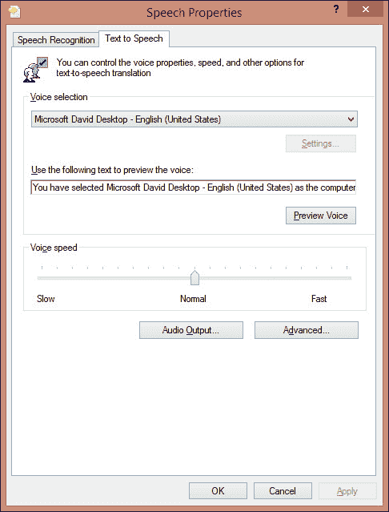

**图 2-22** “语音属性”对话框显示 TTS 选项

你可以通过使用 `Windows.Media.SpeechSynthesis.SpeechSynthesizer.allVoices` 属性为应用程序选择不同的语音，该属性返回设备上可用的语音数组。通过设置 `SpeechSynthesizer.voice` 属性，你可以配置用于 TTS 的语音。

读取 SSML 遵循相同的模式。假设你有以下一段 SSML（取自 Windows 应用商店中关于 TTS 的示例）：

```
<speak version="1.0" xmlns="http://www.w3.org/2001/10/synthesis"

       xmlns:xsi="http://www.w3.org/2001/XMLSchema-instance"

       xsi:schemaLocation="http://www.w3.org/2001/10/synthesis  

       http://www.w3.org/TR/speech-synthesis/synthesis.xsd" xml:lang="en-US">  

        This sentence has marks <mark name="mark1"/>Here and another mark here<mark

          name="mark2"/>

        This is an example of how to speak the word <phoneme alphabet="x-microsoft-ups"

           ph="S1 W AA T . CH AX . M AX . S2 K AA L . IH T">whatchamacallit</phoneme>.

        This is an example of how to use the say-as tag to say a date

           <say-as interpret-as="date:mdy">04/30/2013</say-as>

        This <say-as interpret-as="ordinal"> 4 </say-as> example is how to use the

          ordinal data type  

</speak>
```

此时，你应使用 `synthesizeSsmlToStreamAsync` 而不是 `synthesizeTextToStreamAsync`。

### 使用 HTML5 DRM 实现音频和视频播放

数字版权管理（DRM）对于受知识产权保护的内容非常重要。要在应用中使用受 DRM 保护的内容，请使用 `MediaProtectionManager` 对象，该对象负责处理对受保护媒体内容的访问。你可以将其附加到 HTML 视频或音频标签，或通过其 API 使用。

首先创建一个新的 `MediaProtectionManager` 对象：

```
var mediaProtectionManager = new Windows.Media.Protection.MediaProtectionManager();
```

现在你需要配置媒体保护系统，以便它可以访问受保护的内容。你可以通过使用代表保护系统 ID 的特殊证书或 GUID 来配置它。你还可以通过 `properties` 属性向保护系统传递额外数据：

```
mediaProtectionManager.properties["Windows.Media.Protection.MediaProtectionSystemId"] =

        '{F4637010-03C3-42CD-B932-B48ADF3A6A54}';
```

像这样将 `MediaProtectionManager` 实例附加到你的视频或音频元素：

```
video.msSetMediaProtectionManager(mediaProtectionManager);
```

`MediaProtectionManager` 对象公开了三个事件，你可以在出现问题时处理它们：

-  **ComponentLoadFailed** 当二进制数据加载失败时触发
-  **RebootNeeded** 当组件更新后需要重新启动时触发
-  **ServiceRequested** 当内容保护系统遇到问题并需要应用帮助时触发


您应订阅这些事件以处理访问 DRM 内容时的错误。完成这些步骤后，您现在可以将视频或音频元素指向受 DRM 保护的文件的源。`MediaProtectionManager`让您能够访问内容，并且该文件可以在用户的设备上播放。

* * *

 *思想实验：* 设计一个使用视频和音频的应用

在这个思想实验中，应用您在本目标中学到的知识。您可以在本章末尾的“答案”部分找到这些问题的答案。

您正在创建一个将使用视频和音频的应用，并且您正在考虑 Windows 应用商店应用为您提供的所有可能性。

**1.** 在 Windows 应用商店应用中实现音频和视频困难吗？您将如何开始实现它？

**2.** 受 DRM 保护的内容有哪些优势？

* * *

### 目标总结

 DDS 图像可用于 Windows 8.1 应用。

 通过使用视频和音频 HTML5 标签，可以轻松实现视频和音频播放。

 媒体转码可以通过使用`MediaTranscoder`类完成，该类支持不同的格式，在转码时可以利用硬件加速。

 在 Windows 应用商店应用中，可以通过使用`SpeechSynthesizer`类实现 TTS，该类可以合成纯文本和 SSML。

 在处理视频和音频内容时，DRM 很重要。您可以通过使用`MediaProtectionManager`访问受 DRM 保护的内容。

### 目标复习

回答以下问题以测试您对本目标中信息的掌握程度。您可以在本章末尾的“答案”部分找到这些问题的答案以及每个选项正确或错误的解释。

**1.** 您有许多 JPEG 文件，想要在正在开发的游戏中使用它们。您希望将这些文件用作 DDS 文件。您应该怎么做？（选择所有适用的选项。）

**A.** 使用 C++将 DDS 图像绘制到 HTML5 画布上。

**B.** 使用 JavaScript 项目将 JPEG 文件转换为 DDS 文件。

**C.** 使用 JavaScript 将 DDS 图像绘制到 HTML5 画布上。

**D.** 使用 C++项目将 JPEG 文件转换为 DDS 文件。

**2.** 您已经向应用添加了一个 HTML5 视频标签。您的应用现在显示视频，但没有显示播放、暂停或其他按钮。您应该怎么做？

**A.** 将您想要的按钮添加到 UI 中，并使用 JavaScript 将这些按钮连接到视频元素上的操作。

**B.** 显示按钮是不可能的。视频元素是完全自包含的，无法操作以避免盗版问题。

**C.** 向视频标签添加 buttons 属性。

**D.** 向视频标签添加 controls 属性。

**3.** 您有一些专门的 XML，其中包含对语音合成器的提示，指示如何朗读。您应该使用哪种方法来读取此 XML？

**A.** `synthesizeTextToStreamAsync`

**B.** `synthesizeTextToStream`

**C.** `synthesizeSsmlToStreamAsync`

**D.** `synthesizeSsmlToStream`

## 答案

本节包含本章中思想实验的解决方案和课程复习问题的答案。

#### 目标 2.1：思想实验

**1.** 一些示例包括可以邀请他人的会议应用、可以协作处理任务的任务规划器应用，以及想要邀请他人一起玩的游戏。

**2.** 虽然这是一个不太常见的场景，但你不应该一开始就排除它。如果你的应用与某些外部数据源有联系，它可以用来公开联系人。也许你正在构建一个列出所有同事的内网应用，或者你正在连接到某个社交网络，可以用来向用户展示人员。

#### 目标 2.1：复习

**1. 正确答案：** C

**A. 错误：** 您的应用不必正在运行。当用户选择它作为联系人选取器时，Windows 会启动您的应用。

**B. 错误：** 您必须订阅`activated`事件，但您的应用是由 Windows 启动的。

**C. 正确：** 要作为可能的联系人来源出现，您必须在清单中声明这一点。然后 Windows 在安装时注册您的应用。

**D. 错误：** 只有当您的应用需要联系人并且希望从另一个应用中选择联系人时，您才启动联系人选取器。

**2. 正确答案：** B

**A. 错误：** 当您的应用充当联系人选取器源并且您希望将选定的联系人添加到返回给正在寻找联系人的应用的篮子中时，使用此方法。

**B. 正确：** 这会显示联系人选取器，允许用户选择单个联系人。

**C. 错误：** 这将允许用户选择多个联系人。

**D. 错误：** `pickContactAsync`方法是正确的。async 后缀表明此方法返回一个 promise 并异步处理。

**3. 正确答案：** C

**A. 错误：** 这将在用户离开联系人选取器后过滤联系人。您只想显示那些已经填写了此字段的联系人。

**B. 错误：** 这将在用户离开联系人选取器后过滤联系人。您只想显示那些已经填写了此字段的联系人。

**C. 正确：** 通过使用字段选择模式，您可以指定所需的字段。在这种情况下，是电子邮件字段。

**D. 错误：** 联系人选择模式显示所有联系人。它不会根据特定字段进行过滤。

#### 目标 2.2：思想实验

**1.** 通过使用合约和超级按钮，应用可以在不了解彼此明确细节的情况下进行集成。这种集成有助于实现微软“共赢一体”的设计原则。

**2.** 当用户使用另一个应用并看到它与您的应用集成时，您的应用会获得可见性。这也使您的应用更易于使用，因为用户可以用熟悉的方式使用它。

**3.** 桌面应用程序（如 Microsoft Outlook）可以与联系人选取器集成，以选择要发送电子邮件或邀请参加会议的人员。其他应用可以从共享合约中受益。通过超级按钮集成，轻松共享文档、电子邮件和图像更加自然。

#### 目标 2.2：复习

**1. 正确答案：** C

**A. 错误：** 如果共享不是用户工作流程中的必要部分，则不应向 UI 添加共享按钮。

**B. 错误：** 设备超级按钮用于将数据发送到另一台设备，如打印机或电视；它不用于发送电子邮件。

**C. 正确：** 共享合约允许您与任何可以接收您数据类型（如文本）的其他应用共享数据。

**D. 错误：** 共享合约不允许打印；设备合约支持打印。

**2. 正确答案：** B

**A. 错误：** 搜索框是在 Windows 8.1 中实现搜索的推荐方式。

**B. 正确：** `SearchBox`控件允许实现一致的应用内搜索。

**C. 错误：** 您永远不应为搜索创建自己的自定义界面。而应使用`SearchBox`控件。

**D. 错误：** 如果您的应用需要搜索，则不应在应用外部处理它。

**3. 正确答案：** A

**A. 正确：** 您的应用需要清单声明才能显示为共享目标。

**B. 错误：** 所有实现共享合约的应用都可以充当共享目标。邮件应用只是实现共享合约的应用之一。


**C. 错误：** 这不是必需的。当你正确配置清单时，你的应用在安装时会被注册为共享目标。

**D. 错误：** 当清单未配置时，重新安装应用不会改变什么。

#### 目标 2.3：思考实验

**1.** `SearchBox` 用于应用内搜索。`SearchPane` 与 `Search charm` 结合使用。

**2.** 自 Windows 8.1 发布以来，`SearchBox` 是首选方法。

#### 目标 2.3：复习

**1. 正确答案：** D

**A. 错误：** 应用在当前用户账户下运行；它们不能像桌面应用那样以额外权限运行。

**B. 错误：** 确实，`SearchBox` 不需要任何额外配置，但这需要重新设计应用。更改配置要容易得多。

**C. 错误：** 此事件用于响应搜索查询。然而，它并不能修复因清单配置错误而导致的访问被拒绝错误。

**D. 正确：** 这修复了访问被拒绝错误。

**2. 正确答案：** A, C, D

**A. 正确：** 应在查询建议和结果建议之间添加分隔符。

**B. 错误：** 因为用户已经输入了“garl”，为此添加查询建议没有用处。

**C. 正确：** 用户可以选择此选项来处理对单词“garlic”的查询。

**D. 正确：** 这是一个可能性很高的搜索结果，用户可以选择直接跳转到大蒜页面。

**3. 正确答案：** D

**A. 错误：** `Suggestionchosen` 不存在。`resultsuggestionchosen` 事件存在，但用于用户从列表中选择结果建议时。

**B. 错误：** `resultsuggestionsrequested` 事件不存在。相反，你应该使用 `suggestionsrequested` 事件来添加查询建议和结果建议。

**C. 错误：** `querysuggestionsrequested` 事件不存在。相反，你应该使用 `suggestionsrequested` 事件来添加查询建议和结果建议。

**D. 正确：** 此事件可用于解析 XML 并添加查询建议和结果建议。

#### 目标 2.4：思考实验

**1.** 当然。每当用户看到他们喜欢的食谱时，他们通常想与他人分享。实现共享功能可以帮助用户快速发送包含食谱信息的电子邮件（或在 Twitter 或 Facebook 上发布）。

**2.** 这可能很有用。想象一下，用户在互联网上看到他们喜欢的食谱。通过将网页共享到你的应用，他们可以快速将食谱复制到你的应用中——可能以纯 HTML 形式，或者你可以实现某种解析。

#### 目标 2.4：复习

**1. 正确答案：** A, B, C

**A. 正确：** 需要声明共享才能参与共享合约。

**B. 正确：** 当 Windows 请求你的应用提供要共享的数据时，会引发 `datarequested` 事件。

**C. 正确：** `DataPackage` 对象包含你的应用想要与其他应用共享的数据。

**D. 错误：** 因为你只共享文本数据，所以可以直接在 `datarequested` 事件中创建 `DataPackage` 对象。

**2. 正确答案：** C

**A. 错误：** 允许添加按钮以从你的应用显示共享 UI。

**B. 错误：** `DataPackage` 对象需要在 `datarequested` 事件中创建。

**C. 正确：** 调用 `showShareUI` 会显示共享 UI。

**D. 错误：** 应用程序链接不用于打开超级按钮。

**3. 正确答案：** B

**A. 错误：** 此事件不存在。相反，你应该监听 `Activated` 事件并检查 `ActivationKind`。

**B. 正确：** `Activated` 事件会以 `ActivationKind` 为 `ShareTarget` 的方式引发。

**C. 错误：** 当用户希望你的应用作为共享源时，会触发 `datarequested` 事件。

**D. 错误：** 当你的应用需要准备大量数据作为共享源，并且你想推迟到最后一刻时，会使用延迟（Deferrals）。

#### 目标 2.5：思考实验

**1.** 账户管理非常适合放在 `Settings charm` 中。用户通常只登录一次，然后希望应用记住他们的账户。如果他们想注销或更改账户设置，可以打开 `Settings charm`。

**2.** 这取决于数据量。漫游设置有一个最大大小，可能会阻止跨设备同步。因为你的应用已经有后端，你可能可以将用户偏好存储在后端。

**3.** 诸如用户上次查看的页面或其他应用特定数据可以存储在漫游设置中。

#### 目标 2.5：复习

**1. 正确答案：** D

**A. 错误：** 选择颜色主题不是在应用栏上完成的。相反，它应该很好地隐藏在 `Settings charm` 中，用户可能只在启动你的应用时配置一次。

**B. 错误：** `Settings charm` 只能包含指向包含设置的 `flyouts` 的入口点。它不能直接包含设置。

**C. 错误：** 你不应该使用应用按钮。设置的更改应立即反映在应用中。

**D. 正确：** 实现这些场景的推荐方式是使用 `Settings charm` 中的 `flyout`，并立即应用用户的更改。

**2. 正确答案：** C

**A. 错误：** `RoamingFolder` 应用于文件，而不是设置。本地设置不应存储在漫游应用数据存储中。

**B. 错误：** 本地设置不应存储在漫游应用数据存储中。路径特定于当前设备，可能在其他设备上无法工作。

**C. 正确：** `LocalSettings` 可用于存储最常用的路径。

**D. 错误：** `LocalFolder` 用于存储文件，而不是存储设置。

**3. 正确答案：** D

**A. 错误：** `Settings charm` 有严格的设计规则，只能为 346 或 646 像素。绝对不允许自动调整大小。

**B. 错误：** 宽度已经是 646 像素。

**C. 错误：** 不允许 1000 像素的大小。`Settings charm` 最大只能为 646 像素。

**D. 正确：** 因为允许的最大宽度是 646 像素，你应该安排布局并确保其适应。

#### 目标 2.6：思考实验

**1.** 不。因为 Windows 应用商店应用可以使用 HTML5 元素，例如 `video` 和 `audio` 标签，你可以轻松地在你的应用中使用它们。

**2.** DRM 保护的内容确保你可以通过互联网提供 `video` 和 `audio`，并且只有授权用户才能访问，从而保护你的内容免受盗版。

#### 目标 2.6：复习

**1. 正确答案：** C, D

**A. 错误：** 绘制到 HTML5 `canvas` 应该通过 JavaScript 完成。

**B. 错误：** 将图像转换为 DDS 可以通过带有 `ImageContentTask` 生成自定义项的 C++ 项目完成。

**C. 正确：** 图像转换后，你可以使用 JavaScript 将它们绘制到 `canvas` 上。

**D. 正确：** 将图像转换为 DDS 可以通过带有 `ImageContentTask` 生成自定义项的 C++ 项目完成。

**2. 正确答案：** D

**A. 错误：** 你不必手动创建这些按钮。如果你在 `video` 标签中添加 `controls` 属性，Internet Explorer 会添加这些控件。

**B. 错误：** DRM 可用于保护内容，并且仍然允许你在客户端控制 `video` 播放。

**C. 错误：** 此属性不存在。

**D. 正确：** `controls` 属性会将所有 `video` 播放控件添加到 `video` 元素中。


**3. 正确答案：** C

**A. 错误：** 专门的 XML 称为 SSML。`synthesizeTextToStreamAsync` 方法用于合成文本，而非 SSML。

**B. 错误：** `synthesizeTextToStream` 方法不存在。仅存在异步变体，但它不合成 SSML。

**C. 正确：** 该方法异步合成 SSML。

**D. 错误：** 该方法仅存在异步变体。

## 第 3 章 创建用户界面

应用开发中很大一部分是 UI。确保你的应用像素完美且工艺精湛并非易事。幸运的是，微软不仅为你提供了关于优秀设计的指导，还提供了遵循这些指导的控件，帮助你构建出色的 UI。

本章重点介绍 Windows 应用商店应用可以使用的 UI 功能。你将了解用于应用内和应用栏的控件。你还将学习如何创建在全屏和贴靠模式下都能良好运行的应用，在贴靠模式下，你的应用与其他应用共享屏幕空间。

本章涵盖的内容占考试内容的 20%。请确保你熟悉 Windows 应用商店应用可以使用的所有不同控件和样式选项。如果你亲自尝试示例并试用控件，你将为考试做好充分准备。

本章目标：

 目标 3.1：实现 WinJS 控件

 目标 3.2：实现 HTML 布局控件

 目标 3.3：创建感知布局的应用以处理窗口模式

 目标 3.4：设计并实现应用栏

 目标 3.5：应用 CSS 样式

### 目标 3.1：实现 WinJS 控件

当使用 JavaScript、CSS 和 HTML 构建应用时，你是在 Windows 运行时（WinRT）之上构建的，WinRT 允许你与操作系统交互，并且可以从 JavaScript、C++ 和 C# 应用访问。

除了 WinRT，Windows 库 for JavaScript（WinJS）还为你提供了特定于 JavaScript Windows 应用商店应用的附加功能。本目标描述了 WinJS 为你提供的控件。在本目标结束时，你将了解这些可能性，能够使用这些控件，并就何时使用何种控件做出明智的选择。

* * *

**本目标涵盖以下内容：**

 使用 FlipView 控件

 使用浮出控件

 使用网格布局和列表布局

 使用菜单对象

 使用 WebView 控件

 使用项容器

 使用 Repeater 控件

* * *

### 使用 FlipView 控件

`FlipView` 是一个控件，用于显示一系列用户可以轻松翻阅的项目。这些项目可以是任何类型的数据，包括图像、静态 JavaScript 对象表示法（JSON）数据，或者从 Web 服务加载的数据。如果你有需要用户翻阅的项目，可以使用 `FlipView` 控件。

向应用添加 `FlipView` 控件很容易。首先，确保从 WinJS 加载 `ui.js` 文件：

点击此处查看代码图片

```html
<script src="//Microsoft.WinJS.2.0/js/ui.js"></script>
```

默认情况下，所有模板都包含此链接。`ui.js` 文件包含所有 WinJS 控件所需的 JavaScript。由于该文件是纯 JavaScript，你可以查看所有控件的定义，以了解它们的具体工作方式。

你可以使用以下标记在 HTML 中定义 `FlipView` 控件：

点击此处查看代码图片

```html
<div id="basicFlipView"
    data-win-control="WinJS.UI.FlipView">
</div>
```

浏览器会忽略数据属性，因此你可以使用数据属性向 HTML 元素添加元数据，然后从 JavaScript 中使用这些元数据。`data-win-control` 属性也是如此。该属性指定你要在定义的 `div` 上添加一个 WinJS 控件。调用 `WinJS.UI.processAll` 会遍历你的 HTML 并为你创建控件。此方法调用已添加到所有 Visual Studio 项目模板的激活事件处理程序中。

如果你不添加任何层叠样式表（CSS）来设置 `FlipView` 控件的样式，默认情况下它会跨越应用的整个宽度。当然，没有数据的 `FlipView` 控件并不有趣。添加数据的最简单方法是创建静态 JSON 测试数据，然后加载到 `FlipView` 控件中。

正如你在第 1 章“设计 Windows 应用商店应用”中所读到的，关注点分离（SoC）是构建应用的重要组成部分。确保拥有不同的对象，每个对象都有自己的职责，是创建可维护应用的好方法。

在获取应用数据时也需要 SoC。最佳实践是创建一个单独的 JavaScript 文件，其中包含数据访问逻辑。在此示例中，应用仅使用一些静态数据，但这些数据仍然定义在单独的文件中：

点击此处查看代码图片

```javascript
(function () {
    "use strict";
    var dataArray = [
    { type: "item", title: "Item1"},
    { type: "item", title: "Item2"},
    { type: "item", title: "Item3"},
    { type: "item", title: "Item4"},
    { type: "item", title: "Item5"}
    ];
    var dataList = new WinJS.Binding.List(dataArray);
    var publicMembers =
      {
          itemList: dataList
      };
    WinJS.Namespace.define("Data", publicMembers);
})();
```

此代码定义了一个名为 `Data` 的新命名空间，并公开了一个指向某些静态 JSON 数据的 `WinJS.Binding.List`。`List` 对象包含可以通过索引或特定字符串键访问的项目。你可以搜索、排序和过滤数据，然后将结果绑定到 UI。

`List` 对象公开了一个 `dataSource` 属性，`FlipView` 控件可以使用该属性来绑定数据：

点击此处查看代码图片

```html
<div id="basicFlipView"
     data-win-control="WinJS.UI.FlipView"
     data-win-options="{itemDataSource : Data.itemList.dataSource}">
</div>
```

通过使用 `data-win-options` 属性，你可以指定其他选项来配置 WinJS 控件。在此例中，你将 `FlipView` 控件的 `itemDataSource` 属性绑定到绑定列表的 `dataSource` 属性。

现在运行应用时，你会看到如图 3-1 所示的屏幕。


**图 3-1** `FlipView` 控件显示示例数据的第二个项目，并带有导航按钮

导航按钮仅在用户触摸或将鼠标移到 `FlipView` 控件上时显示。更有趣的是中间的内容：当前项目的 JSON 字符串表示形式。当然，这不是你想要的，但 `FlipView` 控件不知道如何渲染你的数据。

为了帮助 `FlipView` 控件，你可以创建一个项目模板，这是一段标记，WinJS 使用它来渲染 `FlipView` 控件中的各个项目。在项目模板内部，你可以使用 HTML 并通过 CSS 设置样式。HTML 元素可以绑定到每个数据项上的属性。

对于你刚刚看到的示例数据，一个非常简单的项目模板可以像这样添加到 HTML 页面中：

点击此处查看代码图片

```html
<div id="ItemTemplate" data-win-control="WinJS.Binding.Template">
    <div>
        <h2 data-win-bind="innerText: title"></h2>
```


再次，`data-win-control` 属性用于向 WinJS 表明这不是一个普通的 `div`。你的模板必须有一个根元素，在本例中是一个 `div`。`div` 内部定义了一个 `h2` 元素，它使用 `data-win-bind` 属性将其内容绑定到数据项的 `title` 属性上。

创建项模板后，你可以将其链接到 `FlipView` 控件：

Click here to view code image

```
<div id="basicFlipView"
     data-win-control="WinJS.UI.FlipView"
     data-win-options="{ itemDataSource : Data.itemList.dataSource,
                         itemTemplate : ItemTemplate }">
</div>
```

现在 `FlipView` 控件看起来像图 3-2。JSON 字符串消失了；取而代之的是，项的标题被渲染为 `h2` 元素。

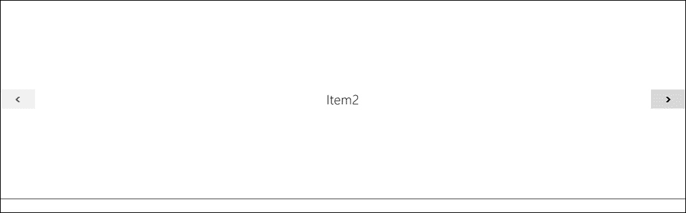

**图 3-2** `FlipView` 控件显示示例数据的第二个项，并带有导航按钮

你可以对 `FlipView` 进行的一个简单更改是改变方向：

Click here to view code image

```
<div id="basicFlipView"
     data-win-control="WinJS.UI.FlipView"
     data-win-options="{ itemDataSource : Data.itemList.dataSource,
                         itemTemplate : ItemTemplate,
                         orientation: 'vertical' }">
</div>
```

添加 `orientation: 'vertical'` 选项后，`FlipView` 控件不再从左到右翻转，而是从上到下翻转。

当用户浏览 `FlipView` 控件时，它会引发事件：

 `onpagecomplete` 在 `FlipView` 控件翻到某一页且其渲染器函数完成时引发。

 `onpageselected` 在 `FlipView` 控件翻到某一页时引发。

 `onpagevisibilitychanged` 在某个项变为不可见或可见时发生。

通过订阅这些事件，你可以在 `FlipView` 控件外部创建与 `FlipView` 控件保持同步的内容，例如一组显示当前选中页面的单选按钮。

尽管 `itemTemplate` 属性允许你使用漂亮的 HTML 布局渲染项，但你无法创建交互式项。如果你想创建交互式项，请不要使用项模板；而是使用模板函数，这是一个为 `FlipView` 控件中的每个项调用的方法。它允许你返回完全自定义的 HTML，`FlipView` 控件将渲染这些 HTML。

你可以通过使用 `FlipView` 控件的 `itemTemplate` 属性来设置模板函数：

Click here to view code image

```
var flipView = document.getElementById("basicFlipView").winControl;
flipView.itemTemplate = mytemplate;
```

模板函数接收一个 `itemPromise` 对象。这个 promise 表示将要加载并显示在 `FlipView` 控件中的项。当数据同步加载时，这个 promise 已经完成；对于异步数据，promise 可能尚未完成。

你的模板函数必须返回以下两个选项之一：

 一个文档对象模型（DOM）元素。

 一个包含两个属性的对象：`element` 和 `renderComplete`，后者是一个 promise，在项完全渲染时完成。然后 WinJS 会用最终的 DOM 元素更新 `element` 属性。

以下代码将你在上一个示例中看到的项模板替换为模板函数：

Click here to view code image

```
function mytemplate(itemPromise) {
    return itemPromise.then(function (currentItem) {
        var element = document.createElement("h2");
        element.innerText = currentItem.data.title;
        return element;
    });
}
```

这段代码确保 `itemPromise` 完成，然后返回一个包含项标题的 `h2` 元素。由于你可以完全控制项，因此可以添加额外的类和其他属性来标识项。通过绑定到 `FlipView` 控件的点击事件，你可以使用这些类来确定点击了哪个项。虽然实现起来并不简单，但效果很好。

* * *

*更多信息*：FlipView 示例

微软发布了一个示例，演示了 HTML `FlipView` 控件的所有功能，网址为 *[`code.msdn.microsoft.com/windowsapps/FlipView-control-sample-18e434b4`](http://code.msdn.microsoft.com/windowsapps/FlipView-control-sample-18e434b4)*。

* * *

### 使用浮出控件

WinJS 提供的另一个控件是浮出控件，它是一个轻量级弹出窗口，用于向用户显示临时 UI。浮出控件可以是菜单、确认框，或者只是显示关于某个项的更多信息的弹出窗口。

浮出控件应由用户激活。用户可以通过单击或点击浮出控件外部，或按 Escape 键来关闭浮出控件。

浮出控件的一个示例出现在“开始”屏幕上。当你单击用户磁贴时，会看到一个浮出控件（参见图 3-3）。

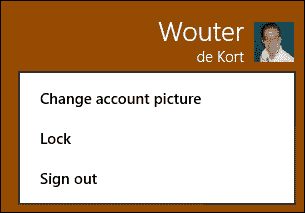

**图 3-3** “开始”屏幕上的用户磁贴显示一个浮出控件

浮出控件包含三个部分：

 **标题** 标题显示在浮出控件的顶部。仅在需要时使用标题。

 **主要内容** 你可以仅向用户显示信息、收集输入，或让用户更改设置。尽量包含尽可能少的控件。

 **控件** 不应使用用于提交更改的控件。仅当用户启动某个操作（例如登录或保存）时才应使用按钮。

浮出控件始终锚定到现有控件，因此你需要至少两个控件来创建一个浮出控件。如果你创建一个新的空白应用，可以添加以下按钮和浮出控件的标记：

Click here to view code image

```
<button class="action" id="showFlyoutButton">显示浮出控件</button>
<div id="confirmFlyout" data-win-control="WinJS.UI.Flyout"
     aria-label="{确认操作浮出控件}">
    <div>将执行一个操作。</div>
    <button id="confirmButton">执行！</button>
</div>
```

在 JavaScript 中，你需要在单击 `showFlyoutButton` 时显示浮出控件。你还希望在单击 `confirmButton` 时关闭浮出控件：

Click here to view code image

```
document.getElementById("showFlyoutButton")
    .addEventListener("click", showFlyout, false);
document.getElementById("confirmButton")
    .addEventListener("click", confirmOrder, false);

function showFlyout(flyout, anchor, placement) {
    var button = document.getElementById('confirmButton');
    var flyout = document.getElementById('confirmFlyout');
    flyout.winControl.show(button, "bottom");
}

function confirmOrder() {
    document.getElementById("confirmFlyout").winControl.hide();
}
```

当用户单击或点击浮出控件外部时，自动关闭浮出控件。你需要考虑浮出控件和锚定控件的对齐方式。对于用户来说，应该能立即清楚浮出控件属于哪个控件。

你可以设置浮出控件的样式以匹配应用的设计。默认样式由应用使用的浅色或深色主题决定。除了这些样式，你还可以更改表 3-1 中显示的 CSS 样式。

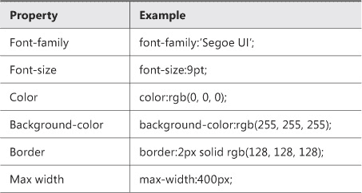

**表 3-1** 浮出控件的 CSS 样式

你可以在应用的各个部分使用浮出控件。例如，你可以将浮出控件附加到应用栏上的按钮，也可以附加到一段文本上，以显示一些额外信息或设置。

### 使用网格布局和列表布局


数据可以来自任何地方：静态 JSON、文件系统或 Web 服务。但你还需要某种方式来显示这些数据。在 Windows 应用商店应用中，你可以使用的控件之一是 `ListView` 控件，它在某些方面与 `FlipView` 类似。它使用绑定源和模板来呈现其项。

这些项的呈现方式由网格布局或列表布局控制。图 3-4 展示了显示相同项的网格布局和列表布局的示例。

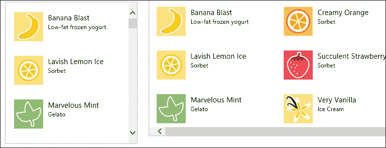

**图 3-4** 左侧的列表布局和右侧的网格布局显示相同的项

使用列表布局或网格布局首先要创建一个 `ListView` 控件。假设你有以下数据集：

单击此处查看代码图像

```
var myData = new WinJS.Binding.List([

        { title: "1", text: "One" },

        { title: "2", text: "Two" },

        { title: "3", text: "Three" },

        { title: "4", text: "Four" },

        { title: "5", text: "Five" },

        { title: "6", text: "Six" },

        { title: "7", text: "Seven" },

        { title: "8", text: "Eight" },

        { title: "9", text: "Nine" },

]);
```

一个模板以及使用该模板显示数据的 `ListView` 控件可能如下所示：

单击此处查看代码图像

```
<div id="myTemplate" data-win-control="WinJS.Binding.Template" style="display: none">

    <div class="item">

        <h2 data-win-bind="innerText: title"></h2>

        <h3 data-win-bind="innerText: text"></h3>

    </div>

</div>  

<div id="listView"

     class="win-selectionstylefilled"

     data-win-control="WinJS.UI.ListView"

     data-win-options="{ itemDataSource: myData.dataSource,

            itemTemplate: myTemplate,

            layout: { type: WinJS.UI.GridLayout }

        }"></div>
```

`ListView` 控件获取数据并使用模板在网格布局中显示数据。切换到列表布局很简单：只需将布局类型改为 `WinJS.UI.ListLayout`。

当应用的可用屏幕空间因贴靠或取消贴靠而发生变化时，有时会自动在网格布局和列表布局之间切换。你可以在本章后面的目标 3.3 中找到更多详细信息。

`ListView` 控件会计算第一个项的大小，并将该大小用于所有其他项。如果你的项大小不同，这种计算方法可能会出现问题。针对这种情况，你可以使用 `WinJS.UI.CellSpanningLayout`。你可以定义基础项的大小，然后让较大的项在水平和垂直方向上跨多个单元格。你仍然使用网格布局，但现在项可以具有不同的大小。

* * *

 考试提示

虽然 `CellSpanningLayout` 没有直接在考试目标中提到，但熟悉它是有好处的。你可以在 *[`msdn.microsoft.com/en-us/library/windows/apps/jj657974.aspx`](http://msdn.microsoft.com/en-us/library/windows/apps/jj657974.aspx)* 找到如何使用它的说明。

* * *

网格布局还支持对项进行分组。你可以添加组标题，并根据组来排列项。

如果你采用前面未分组数据的示例，可以将其更改为以下代码来创建组：

单击此处查看代码图像

```
var myUngroupedData = new WinJS.Binding.List([

        { title: "1", text: "One" },

        { title: "2", text: "Two" },

        { title: "3", text: "Three" },

        { title: "4", text: "Four" },

        { title: "5", text: "Five" },

        { title: "6", text: "Six" },

        { title: "7", text: "Seven" },

        { title: "8", text: "Eight" },

        { title: "9", text: "Nine" },

]);

function compareGroups(leftKey, rightKey) {

    return leftKey.charCodeAt(0) - rightKey.charCodeAt(0);

}

function getGroupKey(dataItem) {

    return dataItem.text.toUpperCase().charAt(0);

}

function getGroupData(dataItem) {

    return {

        title: dataItem.text.toUpperCase().charAt(0)

    };

}

var myData = myUngroupedData.createGrouped(getGroupKey, getGroupData, compareGroups);
```

这段代码使用列表上的 `createGrouped` 方法，按首字符对数据进行分组，并按字母顺序排序。`getGroupKey` 方法返回项 `text` 属性的首字符。`getGroupData` 方法返回一个包含 `title` 属性的对象，而 `compareGroups` 方法控制项的顺序。

现在，你可以在标记中为标题添加第二个模板：

单击此处查看代码图像

```
<div id="headerTemplate" data-win-control="WinJS.Binding.Template"

     style="display: none">

    <div class="simpleHeaderItem">

        <h1 data-win-bind="innerText: title"></h1>

    </div>

</div>
```

然后，`ListView` 可以使用此模板来呈现每个组的标题。更改部分以粗体显示：

单击此处查看代码图像

```
<div id="listView"

     class="win-selectionstylefilled"

     data-win-control="WinJS.UI.ListView"

     data-win-options="{ itemDataSource: myData.dataSource,

            groupDataSource: myData.groups.dataSource,

            itemTemplate: myTemplate,

groupHeaderTemplate: select('#headerTemplate'),             layout: { type: WinJS.UI.GridLayout }

        }"></div>
```

这个 `ListView` 控件仍然使用 `GridLayout`，但现在定义了 `groupDataSource` 和 `groupHeaderTemplate`。你可以在图 3-5 中查看结果。

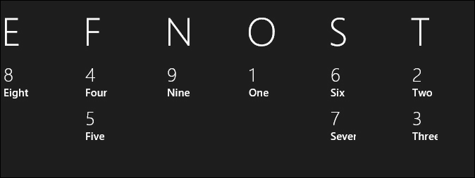

**图 3-5** 带有组标题的网格布局中的分组项

### 使用菜单对象

浮出控件可以用作弹出窗口，向用户显示一些上下文信息。菜单是一种特殊类型的浮出控件，它继承自浮出控件，行为类似于典型的浮出控件。最重要的区别是，菜单浮出控件只能包含 `WinJS.UI.MenuCommand` 类型的对象。

你的菜单应该是 HTML 中 `body` 元素的直接子元素。一个典型的菜单可能如下所示：

单击此处查看代码图像

```
<div id="myMenu" data-win-control="WinJS.UI.Menu">

    <button data-win-control="WinJS.UI.MenuCommand"

            data-win-options="{id:'toggleItem',label:'Check me',

                                type:'toggle', selected:'true'}"></button>

    <hr data-win-control="WinJS.UI.MenuCommand"

        data-win-options="{id:'separator',type:'separator'}" />

    <button data-win-control="WinJS.UI.MenuCommand"

            data-win-options="{id:'firstItem',label:'First'}"></button>

    <button data-win-control="WinJS.UI.MenuCommand"

            data-win-options="{id:'secondItem',label:'Second'}"></button>

    <button data-win-control="WinJS.UI.MenuCommand"

            data-win-options="{id:'thirdItem',label:'Third'}"></button>

</div>
```

此菜单以一个 `toggle` 类型的命令开始，这意味着用户可以单击该项，自动添加或移除该项上的复选标记。第二项是一个分隔符，其他项是常规菜单选项。

与普通浮出控件一样，你需要一些 JavaScript 来显示菜单并为不同选项附加事件处理程序：

单击此处查看代码图像

```
document.getElementById("openMenuButton").addEventListener("click", showMenu, false);

document.getElementById("toggleItem").addEventListener("click", toggle, false);
```

这段代码使用一个 `openMenuButton` HTML 元素，并附加了一个 `showMenu` 方法。它还向 `toggleItem` 菜单选项附加了一个处理程序。处理程序可能如下所示：

单击此处查看代码图像

```
function showMenu() {

    var flyout = document.getElementById('myMenu');

    var button =  document.getElementById("openMenuButton");

    flyout.winControl.show(button, "bottom");

}

function toggle() {
```


`var state = document.getElementById("toggleItem").winControl.selected;`

`}`

当然，你也可以为所有其他菜单项添加处理程序。在这些处理程序内部，你可以处理一个动作来响应用户的选择。

示例菜单的浮出结果如图 3-6 所示。

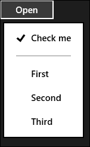

**图 3-6** 包含多个菜单项的示例菜单

你可以在用户界面的许多位置显示菜单。前面的代码可用于将菜单附加到应用栏中的按钮或应用中的其他内容上。

如果将菜单附加到应用的标题上，它会很有用，这主要是一种外观上的改变：你在标题后添加一个 V 形符号（），并将菜单附加到点击事件上。显示 V 形符号是为了让用户知道可以点击标题。

你可以使用以下 HTML 添加带有 V 形符号的标题：

```
<header aria-label="Header content" role="banner">
    <button class="win-backbutton" aria-label="Back"></button>
    <div class="titlearea win-type-ellipsis" id="title">
        <button class="titlecontainer">
            <h1>
                <span class="pagetitle">Header</span>
                <span class="chevron win-type-x-large">&#xe099;</span>
            </h1>
        </button>
    </div>
</header>
```

这里使用代码 `&#xe099;` 来显示 V 形符号。在你的 JavaScript 中，现在可以为用户点击标题区域添加一个事件处理程序：

```
document.querySelector(".titlearea").addEventListener("click", showMenuAtHeader, false);
```

以下方法显示菜单并将其与标题正确对齐：

```
function showMenuAtHeader() {
    var flyout = document.getElementById('myMenu').winControl
    var anchor = document.querySelector("header .titlearea");
    flyout.show(anchor, "bottom", "left");
}
```

此方法会得到如图 3-7 所示的结果。

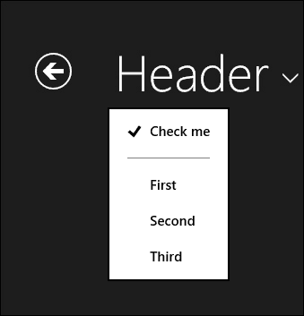

**图 3-7** 附加到标题的示例菜单

当用户使用此菜单导航到另一个页面时，你可能会考虑更改标题。这样他们就能在应用中直观地了解自己所在的位置。

### 使用 WebView 控件

Windows 应用商店应用允许你加载网页并将其作为应用的一部分使用。以前你可以使用 iframe，但它不具备太多的内容隔离或导航功能。

微软通过新的 `WebView` 控件改善了这种情况，该控件可以渲染 HTML5 内容并使用 HTML5 功能（`IndexedDB`、应用缓存、`Geolocation` 和 `Clipboard` 除外）。你还可以与 `WebView` 控件的导航历史记录集成，实现前进和后退导航。

另一个有用的功能是能够调用在 `WebView` 控件中处理的脚本，并将结果从 `WebView` 控件返回到你的应用。这样，你正在显示的网页就可以与你的应用集成并对其进行补充。

`WebView` 控件可以通过几种不同的方式加载内容。最简单的方式是加载一个外部 URL 并在应用中显示它，如下所示：

```
<x-ms-webview id="webview" src="http://go.microsoft.com/fwlink/?LinkId=294155"
    style="width: 400px; height: 400px;">
</x-ms-webview>
```

这段代码会在应用的 `WebView` 控件中显示 Windows 开发中心页面。你还会看到，向网页传递数据的一种简单方法是使用查询字符串。网页中的 JavaScript 代码可以解析查询字符串并使用你发送的参数。

除了加载外部网页，你还可以直接从字符串加载一段 HTML。以下代码获取一个 ID 为 `webview` 的 `WebView` 控件，并调用 `navigateToString` 方法将字符串作为 HTML 显示：

```
var htmlString = "<!DOCTYPE html>" +
        "<html>" +
        "<head><title>Simple HTML page</title></head>" +
        "<body>" +
            "<h1>Hi!</h1>" +
            "<p>This is a simple HTML page.</p>" +
        "</body>" +
        "</html>";
document.getElementById("webview").navigateToString(
    htmlString);
```

另一种加载 HTML 页面的方式是从应用数据文件夹中加载 HTML 文件。假设你的应用包中包含一个 HTML 文件，你想在 `WebView` 控件中显示它。以下代码从你的包中获取该 HTML 文件，并将其复制到本地文件夹，然后将 `WebView` 控件指向该本地文件：

```
Windows.Storage.ApplicationData.current.localFolder
    .createFolderAsync("Html", Windows.Storage.CreationCollisionOption.openIfExists)
    .then(function (htmlFolder) {
        Windows.ApplicationModel.Package.current.installedLocation
            .getFileAsync("html\\example.html")
            .then(function (htmlFile) {
                return htmlFile.copyAsync(htmlFolder, "example.html",
                    Windows.Storage.CreationCollisionOption.failIfExists);
            });
    }).done(function (e) {
         document.getElementById("webview").navigate(
             "ms-appdata:///local/Html/example.html");
    });
```

由于所有文件输入/输出（I/O）都是异步完成的，这段代码依赖于 Promise 来确保异步操作完成后下一段代码才会执行。

`WebView` 控件使用 `ms-appdata` 协议将其指向本地文件。该协议是一种特殊的 URI 格式，它告诉 Windows 查看自己的文件系统，而不是远程位置。

还有最后一种加载数据的方式。当你无法直接访问 HTML 文件或外部 URL 时，你可以将数据流式传输到 `WebView` 控件。当外部 URL 已加密，并且你有一些代码需要先解密内容再在应用中显示时，流式传输会很有用。

你不能从 JavaScript 流式传输内容。相反，你应该在 C# 或 C++ 中创建一个 WinRT 对象。该类继承自 `IUriToStreamResolver` 接口。传递给该类的 URI 具有以下形式：

```
ms-local-stream://<package name>_<encoded contentIdentifier>/<relativePath>
```

通过解析此 URI，你的 WinRT 对象可以识别 `WebView` 控件想要加载的数据。然后它可以检索这些数据，并在将其流式传输给用户之前执行任何所需的操作。

现在你已经知道如何为 `WebView` 控件加载数据，下一步重要的步骤是与 `WebView` 控件通信并将其集成到你的应用中。

与 `WebView` 控件的导航功能集成很容易。`WebView` 控件公开了两个重要属性：

 `canGoBack`

 `canGoForward`

这两个属性返回一个布尔值，指示 `WebView` 控件是否可以后退一页（因为用户从一个页面导航到另一个页面）或前进一页（因为用户从某个页面导航回来）。如果其中任何一个属性返回 `true`，你可以调用相应的 `goBack` 或 `goForward` 方法。

另一个非常重要的集成功能是能够调用在 `WebView` 控件中加载的脚本。你可以通过调用 `invokeScryptAsync` 方法来实现。该方法接受要运行的脚本名称以及要传递的任何参数，并返回一个 `MSWebViewAsyncOperation` 类型的对象。通过调用异步操作的 `start` 方法，你可以调用此脚本：

```
document.getElementById("webview").invokeScriptAsync("myFunction", 42).start();
```

在这个例子中，你调用了一个名为 `myFunction` 的方法，并向它传递了一个值为 `42` 的参数。


你也可以通过调用 `WebView` 控件中加载的网页内的 `window.external.notify` 来从应用中的 `WebView` 控件检索数据。你可以向 `notify` 函数传递任意参数。在应用内部，你订阅 `MSWebViewScriptNotify` 事件，每当 `WebView` 控件内调用 `notify` 方法时，该事件就会被触发。

* * *

*更多信息*：HTML WebView 控件示例

关于如何使用 `WebView` 控件的示例，请访问 *[`code.msdn.microsoft.com/windowsapps/HTML-WebView-control-sample-56e773fa`](http://code.msdn.microsoft.com/windowsapps/HTML-WebView-control-sample-56e773fa)*。

* * *

### 使用项容器

在显示项目组时，你有多种选择。当你希望用户能够轻松翻阅一系列项目时，可以使用 `FlipView` 控件。`ListView` 控件使用网格布局和列表布局向用户展示项目。`ListView` 控件还提供了许多你可以使用的功能。

如果你想要更简单的解决方案，可以使用项容器。放置在项容器内的项目自动支持轻扫、拖放和悬停功能。以下标记创建了两个可选择的项容器：

点击此处查看代码图像

```html
<div id="item1"
     data-win-control="WinJS.UI.ItemContainer"
     data-win-options="{tapBehavior: 'toggleSelect'}"
     style="width: 300px;">
    <div style="margin: 10px; padding: 10px; background-color: lightgray">
        <div class="win-type-x-large"
             style="margin-bottom: 5px;">
            标题 1
        </div>
        <div>描述 1</div>
    </div>
</div>
<div id="item2"
     data-win-control="WinJS.UI.ItemContainer"
     data-win-options="{tapBehavior: 'toggleSelect'}"
     style="width: 300px;">
    <div style="margin: 10px; padding: 10px; background-color: lightgray">
        <div class="win-type-x-large"
             style="margin-bottom: 5px;">
            标题 2
        </div>
        <div>描述 2</div>
    </div>
</div>
```

这段代码会得到如图 3-8 所示的结果。

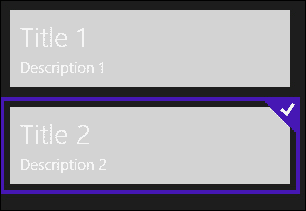

**图 3-8** 两个项容器，底部的一个被选中

当然，手动创建所有项目并不总是理想的。（在下一节中，你将了解可以帮助你自动化的 `Repeater` 控件。）

如图 3-8 所示，项容器可以被选中，这由 `selectionDisabled` 属性定义。默认情况下，此属性为 `false`，允许选择项目。你可以将其更改为 `true` 以禁用选择：

点击此处查看代码图像

```javascript
document.getElementById('item1').winControl.selectionDisabled = true;
```

你也可以使用项容器实现拖放。拖放涉及多个事件：

 `dragstart`

 `dragover`

 `dragenter`

 `dragleave`

 `drop`

以下代码展示了如何实现拖放。标记如下：

点击此处查看代码图像

```html
<div id="item1"
     data-win-control="WinJS.UI.ItemContainer"
     data-win-options="{draggable: true, selectionDisabled: true}">
    项目            
</div>
<div id="dropTarget" style="width:100px;height:100px">
    拖放到这里！
</div>
```

以下是 JavaScript 代码：

点击此处查看代码图像

```javascript
document.getElementById('item1').addEventListener("dragstart", function (e) {
    e.dataTransfer.effectAllowed = 'copy';
    e.dataTransfer.setData('Text', "Hello World!");
});

var dropTarget = document.getElementById("dropTarget");
dropTarget.addEventListener("dragover", function (eventObject) {
    eventObject.preventDefault();
});

dropTarget.addEventListener("dragenter", function (eventObject) {
    //添加边框
    WinJS.Utilities.addClass(dropTarget, "drop-ready");
});

dropTarget.addEventListener("dragleave", function (eventObject) {
    WinJS.Utilities.removeClass(dropTarget, "drop-ready");
});

dropTarget.addEventListener("drop", function (eventObject) {
    WinJS.Utilities.removeClass(dropTarget, "drop-ready");
    var itemText = eventObject.dataTransfer.getData('Text');
    document.getElementById("dropTarget").innerText = itemText;
});
```

这段代码允许你拖拽 `item1` 并将其放置到目标 `div` 上，从而将目标 `div` 的内容更改为 `Hello World`。

* * *

*更多信息*：HTML ItemContainer 控件示例

关于如何使用 `ItemContainer` 控件的示例，请访问 *[`code.msdn.microsoft.com/windowsapps/HTML-ItemContainer-Sample-932b2817/`](http://code.msdn.microsoft.com/windowsapps/HTML-ItemContainer-Sample-932b2817/)*。

* * *

### 使用 Repeater 控件

`Repeater` 控件与 `ListView` 控件有些相似。它比 `ListView` 控件更灵活，但不提供诸如控制数据项加载方式等高级功能。

它提供了一种简单的方法来为数据列表重复某些标记（包括 HTML 和 WinJS 控件）。`Repeater` 控件甚至可以嵌套，以创建高级数据绑定场景。

`Repeater` 控件的工作方式与其他数据绑定控件相同。首先定义要绑定的数据：

点击此处查看代码图像

```javascript
var data = new WinJS.Binding.List(
    [
        { title: "项目 1" },
        { title: "项目 2" },
        { title: "项目 3" },
        { title: "项目 4" }
    ]);
```

然后你需要为每个项目准备一个模板：

点击此处查看代码图像

```html
<div id="listTemplate" data-win-control="WinJS.Binding.Template">
    <li data-win-bind="textContent: title"></li>
</div>
```

最后，你需要 `Repeater` 控件：

点击此处查看代码图像

```html
<ul data-win-control="WinJS.UI.Repeater"
    data-win-options="{data: data, template: select('#listTemplate')}">
</ul>
```

现在 `Repeater` 控件会渲染一个显示项目 1 到 4 的 HTML 元素列表。

与 `FlipView` 控件类似，你也可以使用模板函数在 JavaScript 中生成 HTML。

由于你绑定到了一个 `List`，你可以动态地向其中添加或移除项目，这会导致 `Repeater` 控件更新。通过使用 CSS 和 WinJS 动画，你可以在添加或移除项目时创建良好的更新效果。

如果你沿用前面的示例，可以使用以下 HTML 添加一个添加按钮和一个移除按钮：

点击此处查看代码图像

```html
<div>
        <button id="addCmd">添加项目</button>
        <button id="removeCmd">移除项目</button>
</div>
```

要实现添加和移除项目，请遵循以下两个步骤：

**1.** 为按钮添加事件监听器。

**2.** 为 repeater 添加动画事件监听器。

由于 WinJS 中实现了数据绑定功能，可以轻松地向列表中添加和移除项目，这些项目随后会被添加到 repeater 中。以下来自 activated 事件的代码为两个按钮添加了事件处理程序：

点击此处查看代码图像

```javascript
var add = document.getElementById("addCm\d");
add.addEventListener("click", function (ev) {
    if (!animation) {
        animation = true;
        numberOfItems++;
        data.push({ title: "项目 " + numberOfItems });
    }
});

var remove = document.getElementById("removeCmd");
remove.addEventListener("click", function (ev) {
    if (!animation && numberOfItems > 0) {
        animation = true;
        numberOfItems--;
        data.pop();
    }
});
```

这两个事件处理程序将局部变量 `animation` 设置为 `true`，更新项目数量，然后更新包含实际数据的绑定列表。


无需进行其他操作，你现在就可以向重复器（repeater）中添加或移除项目。然而，Windows 应用商店应用应使用动画来提供快速流畅的界面。

以下代码在重复器上注册了 `iteminserted` 事件，以确保使用正确的动画：

点击此处查看代码图片

```
var repeaterElement = document.getElementById("repeater");
var repeater = repeaterElement.winControl;
repeater.addEventListener("iteminserted", function (ev) {
    var a = WinJS.UI.Animation.createAddToListAnimation(ev.affectedElement);
    a.execute().then(function () {
        animation = false;
    });;
});
```

动画被处理并返回一个 promise，该 promise 在动画完成时结束。通过将 `animation` 设置为 `false`，可以向重复器中添加或移除新项目。

移除项目的模式相同：

点击此处查看代码图片

```
repeater.addEventListener("itemremoved", function (ev) {
    var affectedElement = ev.affectedElement;
    repeaterElement.appendChild(affectedElement);
    var a = WinJS.UI.Animation.createDeleteFromListAnimation(affectedElement);
    this.affectedElement = affectedElement;
    var that = this;
    // Return a promise to the Repeater so that I can dispose the item after we have
    animated it
    // and removed it from the DOM
    ev.setPromise(a.execute().then(function () {
        repeaterElement.removeChild(that.affectedElement);
        animation = false;
    }));
});
```

这里你创建了正确的动画，然后存储了对受影响项目的引用，以确保在动画完成后能够从重复器中移除该项目。如果不这样做，项目会被动画化，不会在 UI 中显示，但也不会从内存中移除。

添加动画非常简单，有助于你创建更好的应用。

* * *

*更多信息*：HTML 重复器控件示例

关于如何使用重复器控件的示例，请访问 *[`code.msdn.microsoft.com/windowsapps/HTML-Repeater-control-da22d278`](http://code.msdn.microsoft.com/windowsapps/HTML-Repeater-control-da22d278)*。

* * *

* * *

 *思考实验：* 设计你的应用

在这个思考实验中，应用你所学到的关于本目标的知识。你可以在本章末尾的“答案”部分找到这些问题的答案。

查看 Windows 安装的天气应用，并列出你在该应用中识别出的控件。

* * *

### 目标总结

 `FlipView` 控件可用于一次向用户显示一个项目。用户可以轻松地翻阅不同的项目。

 浮出控件（Flyouts）可用于向用户显示弹出窗口，提供额外信息或请求用户输入或确认。

 使用 `ListView` 控件时，你可以使用网格和列表两种布局向用户显示项目。

 菜单对象是一种特殊类型的浮出控件，它使用菜单命令。

 `WebView` 控件可用于在你的应用中加载 HTML 内容。这些数据可以来自外部，也可以来自字符串、本地文件或流。你可以在网页上调用脚本，并监听来自网页的通知。

 使用 `ItemContainer` 控件是创建支持选择和拖拽的项目的简便方法。

 `Repeater` 控件可用于为项目列表渲染 HTML 内容。

### 目标复习

回答以下问题以测试你对本目标知识的掌握程度。你可以在本章末尾的“答案”部分找到这些问题的答案以及每个选项正确或错误的解释。

**1.** 你已向应用添加了一个 `FlipView` 控件，并且希望用户能够与你正在 `FlipView` 控件中显示的项目进行交互。你应该怎么做？

**A.** 使用 `itemTemplate` 属性并绑定到被渲染的 HTML 元素的事件。

**B.** 使用 WinJS 绑定列表作为数据源。

**C.** 绑定到 `ListView` 控件的 `oniteminvoked` 事件。

**D.** 使用模板函数并通过 JavaScript 添加事件处理程序。

**2.** 你希望对列表中的数据进行分组。你需要创建哪些方法？（选择所有适用的选项。）

**A.** 一个遍历所有数据以创建分组的方法。

**B.** 一个返回分组键的方法。

**C.** 一个比较单个项目的方法。

**D.** 一个为每个分组返回描述性数据的方法。

**3.** 你想在加载到 `WebView` 控件中的网页上调用一个 JavaScript 方法。你应该使用哪个方法？

**A.** `IUriToStreamResolver`

**B.** `window.external.notify`

**C.** `MSWebViewScriptNotify`

**D.** `invokeScriptAsync`

### 目标 3.2：实现 HTML 布局控件

你的应用将在多种设备上使用，包括带触摸屏的大显示器、带键盘和鼠标的普通 PC 以及不同类型的平板电脑。确保你的应用在所有不同设备上都能良好运行是本目标的主题。通过结合使用 CSS3 和 WinJS 控件，你可以创建在所有设备上都能良好运行的出色应用。

* * *

**本目标涵盖以下内容：**

 实现布局控件以构建你的布局

 实现模板和绑定

 使用 CSS3 支持滚动和缩放

 管理文本流和呈现，包括溢出

* * *

### 实现布局控件以构建你的布局

当你对应用有了想法后，首先要开始布局应用的基本结构。如第 1 章所述，使用默认的 Visual Studio 项目模板是开始定义布局的好方法。

然而，选择项目模板后你并没有完成。你的应用有特定的需求：例如，页面的某个部分可能需要特定的布局，或者你正在开发一个自定义控件。

在开发应用时，你有四种布局类型可供选择：弹性盒子（Flexible Box）、网格（Grid）、多列（Multi-column）和区域（Regions）。

#### 弹性盒子（FlexBox）布局

弹性盒子（FlexBox）布局旨在布局复杂场景，其中元素在不同屏幕尺寸上的相对大小和位置保持不变。

FlexBox 布局非常适合使用数字印刷媒体（如报纸或杂志）的应用。

从以下 HTML 开始：

点击此处查看代码图片

```
<div class="myFlexBox myFirstFlexBox">
    <div>1</div>
    <div>2</div>
    <div>3</div>
</div>
<div class="myFlexBox mySecondFlexBox">
    <div>1</div>
    <div>2</div>
    <div>3</div>
</div>
```

你可以通过以下 CSS 为两个包含的 div 添加 FlexBox 布局：

点击此处查看代码图片

```
.myFirstFlexBox {
    flex-direction: row;
}
.mySecondFlexBox {
    flex-direction: column;
}
.myFlexBox {
    width: 200px;
    height: 100px;
    border: 2px solid white;
    display: -ms-flexbox;
}
    .myFlexBox div {
        background-color: red;
        width: 50px;
        height: 25px;
        text-align: center;
        color: white;
    }
        .myFlexBox div:first-child {
            background-color: green;
        }
        .myFlexBox div:last-child {
            background-color: blue;
        }
```


你通过使用 `display: -ms-flexbox` 属性来指定要使用 FlexBox 布局。第一个 div 使用了 `flex-direction: row`；第二个使用了 `flex-direction: column`。你可以在图 3-9 中查看结果。

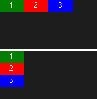

**图 3-9** 采用 FlexBox 布局的两个 div；上方显示为行方向，下方显示为列方向

你可以通过其他属性（如 `-ms-flex-align`）来配置 FlexBox 布局。该属性可取以下值之一：`start`、`end`、`center`、`stretch` 或 `baseline`。这些值指定了子元素在垂直于 FlexBox 布局方向上的对齐方式。你可以将项目居中，或将其放置在容器的顶部或底部。

另一个属性是 `-ms-flex-pack`，可设置为 `start`、`end` 或 `justify`。由于放置在 FlexBox 布局中的元素可能会留有空白空间，你需要决定如何处理这些空间。例如，如果选择 `justify`，空白空间会在所有元素之间均匀分布。

由于 FlexBox 布局旨在分布其子项，`-ms-flex-wrap` 是一个重要选项。默认情况下，FlexBox 布局会根据方向将所有项目放在一行或一列中。通过使用 `-ms-flex-wrap` 属性，你可以指定 FlexBox 布局是否应换行（或 `wrap-reverse`）其包含的项目。

你还可以控制 FlexBox 布局内项目的大小。无需指定固定的高度或宽度，你可以配置项目在 FlexBox 布局内如何调整自身大小。使用以下语法：`-ms-flex: <positive-flex> <negative-flex> <preferred-size>`。

例如，在前一个示例的三个项目中，对其中一个使用 `-ms-flex: 2` 会使该项目的大小是其他两个项目的两倍。你的 FlexBox 布局会自动利用任何额外空间，同时保持其子元素的相对大小。

### 网格布局

基于 CSS3 的网格布局允许你定义行和列，并将项目分配到所创建的单元格中。与 FlexBox 布局类似，首先配置 `display` 属性并将其设置为 `-ms-grid`：

点击此处查看代码图片

```
#myGrid {

  display: -ms-grid;

  background: orange;

}
```

你可以向网格中添加列和行。所有单元格都可以有固定大小，但更有趣的是定义一些利用可用屏幕尺寸的列和行，以容纳更多内容。

在定义列和行的大小时，请使用以下单位：

-  **标准长度单位** 对象宽度（对于列）或高度（对于行）的百分比
-  **`auto` 关键字** 表示列宽或行高根据其内部项目的大小进行调整
-  **`min-content` 关键字** 表示使用任何子元素的最小宽度或高度作为宽度或高度
-  **`max-content` 关键字** 表示使用任何子元素的最大宽度或高度作为宽度或高度
-  **`minmax(a, b)` 关键字** 表示在可用空间允许的情况下，宽度或高度介于 a 和 b 之间
-  **分数单位（`fr`）** 表示可用空间应根据其分数值在列或行之间分配

请看以下示例：

点击此处查看代码图片

```
#myGrid {

  display: -ms-grid;

  background: orange;

  -ms-grid-columns: auto 100px 1fr 2fr;

  -ms-grid-rows: 50px 25px auto;

}
```

此示例定义了四列和三行。第一列自动调整大小；第二列始终为 100 像素（px）。最后两列以 1:2 的比例占据剩余空间，这意味着第 3 列占 1/3，第 4 列占 2/3。行分别为 50px、20px 和自动调整大小。

定义网格的行和列后，你可以通过指定项目所属的行和列来开始添加项目：

点击此处查看代码图片

```
#item1 {

  border: yellow solid 1px;

  -ms-grid-row: 1;

  -ms-grid-column: 1;

}
```

此示例将一个项目放置在第 1 行第 1 列。你还可以在单元格中对齐项目。你可以使用 `-ms-grid-column-align` 和 `-ms-grid-row-align`，其值可为 `center`、`end`、`start` 或 `stretch`。

如果将多个项目分配到同一个单元格，这些项目会堆叠在一起，最后添加的项目位于顶部。要配置这一点，请使用 `z-index` 属性。其中 x 和 y 水平、垂直定位项目，z 定义项目的远近。`z-index` 较大的项目位于 `z-index` 较小的项目之上。

如果处理较大的项目，它们可以通过 `-ms-grid-column-span` 和 `-ms-grid-row-span` 属性跨越多个单元格。例如，`-ms-grid-column-span` 值为 2 可使项目占据两个相邻列。`-ms-grid-row-span` 也是如此；值大于 1 可使项目跨越多个行。

以下标记和 CSS 演示了可以在网格布局上设置的属性：

点击此处查看代码图片

```
<div id="myGrid">

    <div id="item1">Item 1</div>

    <div id="item2">Item 2</div>

    <div id="item3">Item 3</div>

    <div id="item4">Item 4</div>

    <div id="item5">Item 5</div>

</div>

#myGrid {

    display: -ms-grid;

    background: gray;

    border: blue;

    -ms-grid-columns: auto 1fr 2fr;

    -ms-grid-rows: 200px auto;

}

    #myGrid div {

        background: lightgray;

        border: red solid 1px;

    }

#item1 {

    background: maroon;

    -ms-grid-row: 1;

    -ms-grid-column: 1;

}

#item2 {

    -ms-grid-row: 1;

    -ms-grid-column: 2;

}

#item3 {

    -ms-grid-row: 1;

    -ms-grid-column: 3;

}

#item4 {

    -ms-grid-row: 2;

    -ms-grid-column: 1;

}

#item5 {

    -ms-grid-row: 2;

    -ms-grid-column: 2;

    -ms-grid-column-span: 2;

}
```

结果如图 3-10 所示。所有项目都分配到了网格单元格中，项目 5 跨越了两列。第一列自动调整大小，第二列和第三列以 1:2 的比例填充额外空间。第一行具有静态高度，第二行自动调整大小。

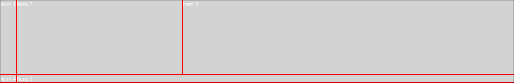

**图 3-10** 具有三列两行的网格，显示了五个项目

### 多列布局

多列布局不使用固定数量的列；它允许根据屏幕尺寸添加列。项目可以流向其他列，并且这些列之间可以有间隙和分隔线。

假设你有大量文本，并且希望以列的形式显示这些文本，以便文本自动溢出到下一列。以下 CSS 创建了一个多列布局，列之间有间隙和白色分隔线：

点击此处查看代码图片

```
#multicolumn {

    columns: auto 12em;

    column-gap: 1em;

    column-rule-width: 1em;

    column-rule-style: solid;

    column-rule-color: white;

}
```

将这种布局应用于一些 lorem ipsum 文本，得到的结果如图 3-11 所示。

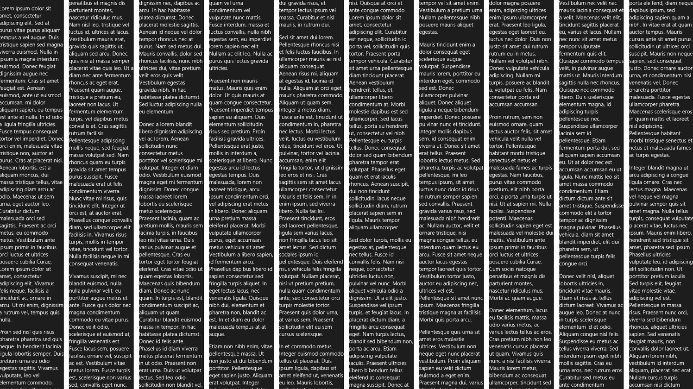

**图 3-11** 多列布局示例

此示例使用 `columns: auto 12em` 属性创建可变数量的列，每列大小为 12em。

它还使用列间隙和分隔线选项来配置列之间的大小和颜色。前面的示例使用以下 CSS 创建了白色间隙：

```
    column-gap: 1em;

    column-rule-width: 1em;

    column-rule-style: solid;

    column-rule-color: white;
```

你可以通过使用 `break-before`、`break-inside` 和 `break-after` 属性来影响插入分页符的位置，这些属性的值可以是 `always`、`auto`、`avoid`、空字符串（等同于 auto）、`inherit`、`left`、`right`、`page`、`column`、`avoid-page` 和 `avoid-column`。


你也可以让一个项目跨越多个列。也许你有一篇文章的标题或一张图片需要跨越不止一列。你可以通过在项目上指定 `column-span: all` 来实现（你不能指定要跨越的确切列数）。

当你让 Internet Explorer (IE) 自动创建列并添加分隔时，某一列可能包含比另一列更多的文本。为了让文本均匀地分布到所有列中，你可以使用 `column-fill: balance` 属性。

* * *

*更多信息*：多列布局示例

微软发布了一个示例，展示了如何使用 CSS 创建多列布局。虽然该示例并非专门针对 Windows 应用商店应用，但你可以用它来更好地理解如何在你的应用中使用这些概念。你可以在 *[`code.msdn.microsoft.com/ie/Multi-column-layout-4f467ffd`](http://code.msdn.microsoft.com/ie/Multi-column-layout-4f467ffd)* 找到该示例。

* * *

### 区域布局

最后一种布局选项是区域布局，它允许你将元素指定为容器，然后获取现有的 HTML 文件并将其内容分布到你的容器中。区域布局允许你创建非常具体的布局，在其中定位容器，然后让 HTML 文档的内容流经它们。

源 HTML 文档通过一个隐藏的 iframe 加载，你可以像这样将其添加到你的标记中：

点击此处查看代码图片

```
<iframe id="flow-data-source" src="content-source.html"></iframe>
```

`content-source.html` 文件可以包含任意复杂的 HTML 页面。对于这个示例，我们使用一个简单的 HTML 文件，内容如下：

点击此处查看代码图片

```
<div style="color:white">Content goes here 1.</div>
<div style="color:white">Content goes here 2.</div>
<div style="color:white">Content goes here 3.</div>
<div style="color:white">Content goes here 4.</div>
<div style="color:white">Content goes here 5.</div>
<div style="color:white">Content goes here 6.</div>
```

现在你已经将数据加载到 iframe 中，使用 CSS 创建流数据源：

```
#flow-data-source {
  -ms-flow-into: flow1;
}
```

你可以向标记中添加容器，以便将源 HTML 文件的内容流入其中。通常使用 `div` 元素作为容器：

点击此处查看代码图片

```
<div class="flow1-container"></div>
<div class="flow1-container"></div>
<div class="flow1-container"></div>
```

你可以使用 CSS 让 iframe 的内容流经这三个 `div` 元素：

点击此处查看代码图片

```
#flow-data-source {
  -ms-flow-into: flow1;
}

.flow1-container {
  -ms-flow-from: flow1;
  border: 1px solid red;
  width:100px;
  height:100px;
}
```

这就是你需要了解的关于区域布局的全部内容。你通过 `flow into` 属性指定数据源，通过 `flow from` 属性指定容器。当然，你可以让区域布局变得任意复杂。通过在网格布局内部使用区域布局，你可以将容器分配到不同的单元格，并让 HTML 源文档的内容流经它们。

### 实现模板和绑定

数据绑定是一项基本功能，用于轻松地在屏幕上显示数据并响应用户更改数据的操作。

对于数据绑定来说，一个重要的属性是 `WinJS.Binding.optimizeBindingReferences`。如果你在 WinJS 库中搜索这个属性，你会发现它总是在应用程序实例化时被初始化。

你可以将数据绑定到任何 JSON 对象。假设你有以下 `span` 元素：

点击此处查看代码图片

```
<span data-win-bind="innerText: message" id="messageSpan"></span>
```

你可以使用一些 JavaScript 代码将这个 `span` 的 `innerText` 属性绑定到一个值：

点击此处查看代码图片

```
var message = { message: "Hello World!" };
var messageSpan = document.getElementById("messageSpan");
WinJS.Binding.processAll(messageSpan, message);
```

指定绑定配置的属性是 `data-win-bind`。在这里，你可以指定一个属性（本例中是 `innerText`）以及一个来自绑定到元素的对象的属性名称。

`WinJS.Binding.processAll` 会搜索你的 HTML 中的 `data-win-bind` 属性，并处理它找到的所有元素的绑定配置。

默认情况下，数据绑定是单向的；更改不会自动更新 UI。为了实现双向数据绑定，WinJS 添加了 `WinJS.Binding.as` 方法。该方法接收你的对象并返回一个可观察对象，然后你可以使用它来自动更新 UI：

点击此处查看代码图片

```
var message = { message: "Hello World!" };
var messageSpan = document.getElementById("messageSpan");
WinJS.Binding.processAll(messageSpan, message);
var bindingSource = WinJS.Binding.as(message);
document.getElementById("updateDataButton").addEventListener("click", function () {
    bindingSource.message = "Bye World!";
});
```

* * *

 考试提示

请确保你理解数据绑定默认是单向的，并且你需要通过使用 `WinJS.Binding.as` 来添加双向数据绑定。

* * *

如果你在 UI 中添加一个 ID 为 `updateDataButton` 的按钮，你可以点击它来更新 `bindingSource` 的 `message` 属性。这样做会自动更新 `span` 元素的值。

你可以想象这样的场景：你有一个中心对象，其中包含一些数据，这些数据绑定到屏幕上的多个对象。如果用户更改了某些内容，或者有外部通知传入，你的应用会更新该对象，而你的 UI 会自动更新。

许多框架可以帮助你进行数据绑定（例如 KnockoutJS、Angular 和 Durandal）。然而，对于基本的数据绑定场景，WinJS 提供了你所需的所有功能。

前面的章节讨论了模板，并且你已经多次使用它们。你将模板与数据绑定结合使用，用于 `ListView` 控件或 `FlipView` 控件。模板描述了你想为通过数据绑定生成的每个项目使用的标记。

模板作为常规的 `div` 添加到你的标记中。当 WinJS 初始化时，它会处理所有模板并将其从 DOM 中移除。你通过使用 `data-win-control` 属性（值为 `WinJS.Binding.Template`）将 `div` 标记为模板：

点击此处查看代码图片

```
<div id="templateDiv" data-win-control="WinJS.Binding.Template"></div>
```

要修改之前渲染简单消息的示例以使用模板，你可以使用以下 HTML：

点击此处查看代码图片

```
<div id="templateDiv" data-win-control="WinJS.Binding.Template">
    <div>
        <span data-win-bind="innerText: message"></span>
    </div>
</div>
<div id="templateTargetDiv"></div>
```

现在你可以使用 JavaScript 渲染模板并将结果放入 `templateTargetDiv`：

点击此处查看代码图片

```
var message = { message: "Hello World!" };
var templateElement = document.getElementById("templateDiv");
var renderElement = document.getElementById("templateTargetDiv");
renderElement.innerHTML = "";
var templateControl = templateElement.winControl;
templateElement.winControl.render(message, renderElement);
```

你不需要为渲染操作创建一个目标 `div`。`render` 方法返回一个 promise，该 promise 会获得一个新创建的 `div` 作为参数，然后你可以将其添加到 DOM 中。

通过使用可重用的模板和数据绑定，你可以轻松地将 UI 与其显示的数据分离。你不再需要检索 DOM 元素并手动设置它们的属性（这容易出错且难以维护），而是使用声明式语法，从而生成更易于维护的代码。

### 使用 CSS3 支持滚动和缩放


你的应用可能包含多个页面，并具备在页面间导航的功能。但有时，你也会有一个单页，用户可以在其中滚动和缩放。也许你有一张图片或其他无法直接显示在屏幕上的内容，希望用户能在页面中自由浏览。

滚动（或平移）是一种用于滑动浏览内容的操作。尤其对于这类操作，你需要考虑触摸手势。用户习惯用一根或多根手指在应用中滑动或扫动，你应当在应用中支持这一功能。

通过 CSS 可以为某个区域启用平移。假设你有一个容器元素，其中包含一张图片作为子元素：

```html
<div class="Container Horizontal">
    
</div>
```

下面的 CSS 首先限制了容器的大小，然后定义了不同的平移选项：

```css
.Container {
    width: 480px;
    height: 270px;
}

.None {
    overflow: hidden;
}

.Horizontal {
    overflow-x: auto;
    overflow-y: hidden;
}

.Vertical {
    overflow-x: hidden;
    overflow-y: auto;
}

.Unrailed {
    overflow: auto;
    -ms-scroll-rails: none;
}

.Railed {
    overflow: auto;
    -ms-scroll-rails: railed;
}
```

前面的 HTML 片段定义了 `Horizontal` 类。结果如图 3-12 所示。


**图 3-12** 容器中带有水平平移的图片元素

通过切换 CSS 类，你可以实现垂直平移、无轨道（可自由向任意方向移动）或有轨道（锁定到某个轴）的平移。

上面的代码示例允许用户在内容中自由平移。但这可能并非你想要的。例如，如果你有一系列项目，希望用户一次只平移一个项目，那么之前看到的自由模式就不适用了。它会让用户停在某个项目的中间，而不是一次平移一个项目。

为了帮助用户一次平移一个项目，你可以实现吸附功能。使用 `-ms-scroll-snap-type` 属性，你可以选择以下吸附类型之一：

 `None` 平移和滚动不受任何定义的吸附点影响。

 `Proximity` 当平移接近吸附点时，项目会被吸附到恰好落在吸附点上。

 `Mandatory` 内容始终落在吸附点上。

与平移一样，缩放也是通过 CSS 实现的。下面的 CSS 允许用户对元素进行放大和缩小：

```css
.zoomElement {
    overflow: auto;
    -ms-content-zooming: zoom;
    -ms-scroll-rails: none;
    -ms-content-zoom-limit-min: 50%;
    -ms-content-zoom-limit-max: 500%;
}
```

通过使用 `-ms-content-zooming` 属性启用缩放。你还需要指定最小和最大缩放级别。最小值小于 100% 允许用户缩小，但会在容器元素中留下空白区域。

你可以将缩放和平移结合在同一个视图中，这样用户既能放大缩小，也能在元素中导航。

在进行平移和缩放时，使用触摸手势也非常自然。你可以通过 `touch-action` CSS 属性来控制区域如何通过触摸进行操作。该属性可以取以下值之一：

 `Auto, 初始值` 表示使用 JavaScript 的 Windows 应用商店应用会确定该元素允许的触摸行为。

 `None` 该元素不允许默认的触摸行为。

 `Pan-x` 该元素允许在水平轴上通过触摸进行平移。触摸平移在最近的可水平滚动内容的祖先元素上执行。

 `Pan-y` 该元素允许在垂直轴上通过触摸进行平移。触摸平移在最近的可垂直滚动内容的祖先元素上执行。

 `Pinch-zoom` 该元素允许双指缩放。双指缩放在最近的可缩放内容的祖先元素上执行。

 `Manipulation` 该元素允许通过触摸进行平移和双指缩放。这是“pan-x pan-y pinch-zoom”的简写等价形式。

 `Cross-slide-x` 该元素允许沿水平轴进行交叉滑动。

 `Cross-slide-y` 该元素允许沿垂直轴进行交叉滑动。

请务必测试这些操作，并将其与用户习惯的默认行为保持一致。

* * *

*更多信息*：HTML 滚动、平移和缩放示例

微软发布了一个示例，展示了如何实现滚动、缩放和平移。你可以在 *[`code.msdn.microsoft.com/windowsapps/scrolling-panning-and-47d70d4c/`](http://code.msdn.microsoft.com/windowsapps/scrolling-panning-and-47d70d4c/)* 找到该示例。

* * *

### 管理文本流和呈现，包括溢出

你的应用很可能包含文本。根据你构建的应用类型，文本甚至可能是 UI 中最重要的部分。

因此，确保文本在各种设备上都能良好呈现非常重要。Windows 应用商店应用的 CSS 文件已经使用 Segoe UI 字体族定义了标准字体样式。当使用 Visual Studio 项目模板时，会引用 WinJS 样式表，并为你的应用提供正确的字体定义。

也许你的品牌有特定的字体，希望在你的应用中体现。你可以通过 `@font-face` CSS 规则添加自定义字体。通过将 TTF 文件包含在应用包中，你可以引用它并像这样创建一个字体面：

```css
@font-face {
    src: url('/images/fonts/MyFont.ttf') format('truetype');
    font-family: MyFont;
    font-style: normal;
    font-weight: 500;
    font-stretch: normal;
    font-variant: normal;
}
```

* * *

*更多信息*：CSS 排版 JavaScript 示例

有关排版的更多信息，请参阅 *[`code.msdn.microsoft.com/windowsapps/typography-JS-sample-e2df9eb4`](http://code.msdn.microsoft.com/windowsapps/typography-JS-sample-e2df9eb4)* 上的示例。

* * *

呈现文本的另一个重要方面是处理溢出。也许你试图呈现的内容在你的设备上显示良好，但这并不意味着所有设备都有足够大的屏幕空间。或者你可能无法预知用户将添加并需要显示的内容。

处理变化的一种方法是使用省略号（...）。当文本对于其容器来说太长时，缩短文本并在末尾添加省略号，向用户提示还有更多内容。

CSS 有一个 `text-overflow` 属性，你可以将其设置为 `ellipsis` 以自动生成此效果。WinJS 定义了以下类，你可以将其应用于元素：

```css
.win-type-ellipsis {
    overflow: hidden;
    text-overflow: ellipsis;
    white-space: nowrap;
}
```

然而，此 CSS 属性仅适用于单行内容。如果你有多行文本，并希望在最后一行添加省略号，则需要一些自定义的 JavaScript 来实现。

* * *

 *思考实验：* 布局你的内容

在这个思考实验中，请运用你在此目标中学到的知识。你可以在本章末尾的“答案”部分找到这些问题的答案。


你被要求为一位客户准备一份演示文稿，该客户正在寻求构建 Windows 8 应用的建议。该应用应供内部员工在办公室或外出时在多台设备上使用。他们需要前往餐厅进行质量检查，包括记录笔记和拍照。目前，他们在办公室使用标准桌面应用程序，在客户现场则使用打印表格。

请阅读本章，并描述你可以提出的关键点，以说服客户 Windows 8 应用将非常有用。

* * *

### 目标总结

 你可以使用 FlexBox、Grid、多列或区域布局。

 数据绑定对于在屏幕上显示数据至关重要。模板可用于创建可重用的标记片段，这些片段可以绑定数据并呈现在屏幕上。

 平移可以通过使用 CSS `overflow` 属性来实现。通过使用值为 `Proximity` 或 `Mandatory` 的 `-ms-scroll-snap-type` 属性，你可以实现对齐吸附。

 缩放通过使用 `-ms-content-zooming: zoom` 属性并设置最小和最大缩放级别来实现。

 WinJS 样式表默认使用 Segoe UI 字体族。你可以通过使用 CSS `@font-face` 添加自定义字体。

 文本溢出可以通过使用 `win-type-ellipsis` 类来控制。

### 目标复习

回答以下问题以测试你对本目标中信息的掌握程度。你可以在本章末尾的“答案”部分找到这些问题的答案以及每个选项正确或错误的解释。

**1.** 你正在为一家新闻杂志开发应用，编辑们创建了一个包含所有内容的标准 HTML 页面。该应用应显示文章，并混入适当的广告。你应该选择哪种布局？

**A.** 弹性盒布局

**B.** 网格布局

**C.** 多列布局

**D.** 区域布局

**2.** 你正在使用网格布局，用户可以将项目从一个单元格动态移动到另一个单元格。然而，有时用户将一个项目拖放到已有项目的单元格上，被拖放的项目似乎消失了。你应该怎么做？

**A.** 为被拖放的项目添加一个比原始项目更大的 `z-index` 属性值。

**B.** 为被拖放的项目添加一个比原始项目更小的 `z-index` 属性值。

**C.** 什么都不做。在网格布局中，一个单元格不能有多个项目。

**D.** 为目标单元格添加 `column-span: 2` 属性。

**3.** 你正在向用户展示一个带有项目的网格。用户可以在网格中平移。用户在任何时候都应该只看到完整的单元格。你应该怎么做？

**A.** 添加值为 `Proximity` 的 `-ms-scroll-snap-type` 属性。

**B.** 添加值为 `Mandatory` 的 `-ms-scroll-snap-type` 属性。

**C.** 添加值为 `None` 的 `-ms-scroll-snap-type` 属性。

**D.** 添加值为 `Automatic` 的 `-ms-scroll-snap-type` 属性。

### 目标 3.3：创建感知布局的应用以处理窗口模式

尽管 Windows 应用商店应用通常以全屏模式运行，但这并非唯一的窗口模式。应用也可以并排显示以实现多任务处理，因此你的应用可能以不同尺寸运行，你需要对此做出响应。

决定支持哪些宽度以及通过 CSS 和代码适应窗口模式的变化，是本目标的主题。

* * *

**本目标涵盖以下内容：**

 使用 CSS3 媒体查询适应不同设备

 响应方向变化

 使用 ViewManagement 命名空间适应新的窗口模式

 管理应用视图的设置

* * *

### 使用 CSS3 媒体查询适应不同设备

创建应用时，你需要处理多种不同的屏幕尺寸。如图 3-13 所示的应用清单设计器显示了你可以设置的最小宽度属性。

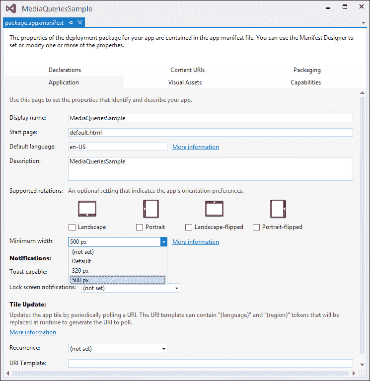

**图 3-13** 应用清单设计器显示最小宽度属性的值

默认情况下，此值未设置，因此你的应用可以在所有可能的窗口模式下使用。当你将此值设置为 320px 时，用户可以在所有大于 320px 的尺寸下使用你的应用。这意味着，如果用户使用 1024px 宽的显示器，则可以将你的应用对齐到屏幕的三分之一。当你的应用在如此小的区域中没有实际价值时，应将最小宽度设置为 500px。

如果你没有大量设备进行测试，在不同分辨率下测试应用可能会很困难。幸运的是，你可以使用从 Visual Studio 启动的模拟器在不同分辨率下测试应用。图 3-14 显示了模拟器在贴靠模式下运行应用。

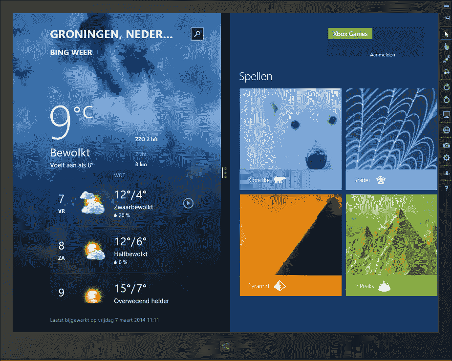

**图 3-14** 模拟器在贴靠模式下运行两个应用，分辨率为 1024 x 768

你可以通过使用 CSS 媒体查询来调整应用。*媒体查询*是一种特殊的 CSS 选择器，你可以在其中检查设备属性。例如，一些网站使用 CSS 媒体查询为打印提供专门的布局。

CSS 媒体查询允许你查询设备的尺寸。请看以下 CSS：

```
@media (max-width:499px) {

 ...

}
```

`@media` 块内的所有 CSS 仅适用于宽度小于 500px 的情况，因此你可以指定多组 CSS 规则，适用于不同的分辨率。

Windows 应用商店应用始终使用设备的完整高度；宽度可以变化。你的应用应至少适应 500px 的宽度。如果对你的应用有意义，你还可以为 320px 的宽度添加 CSS 媒体查询。

你可以将所有不同分辨率的 CSS 保存在一个文件中，或者将它们拆分为多个文件并按条件加载，如下所示：

点击此处查看代码

`<link href="/css/small.css" rel="stylesheet" media="(max-width: 320px)" />`

在设计应用布局时，你需要考虑将支持的不同贴靠窗口模式。通过使用上一目标中讨论的布局控件（例如网格布局），你可以创建非常灵活的布局。

使用网格布局时，项目通过 CSS 定位，而不是根据它们在 HTML 文档中的位置。当新的媒体查询生效时，通过更改 CSS，你可以改变项目的顺序和可见性。

* * *

 考试提示

设计灵活的布局并适应不同的窗口模式是构建应用（以及考试）的重要组成部分。微软发布了一份创建灵活布局的演练，地址为 *[`msdn.microsoft.com/en-us/library/windows/apps/jj150600.aspx`](http://msdn.microsoft.com/en-us/library/windows/apps/jj150600.aspx)*。你应该在参加考试前学习这个示例。

* * *

### 响应方向变化

当用户使用平板设备时，他们并不总是以横向模式使用你的应用。Windows 应用商店应用支持通过旋转屏幕来改变方向。

要测试此行为，你需要一个带有实际传感器的设备；使用模拟器是行不通的。要检查方向变化，请使用名为 `SimpleOrientationSensor` 的类。你可以通过调用 `Windows.Devices.Sensors.SimpleOrientationSensor.getDefault()` 获取此类的实例。此方法调用返回的对象会公开 `OrientationChanged` 事件。通过订阅此事件，你可以响应方向变化。

点击此处查看代码


```
var orientationSensor = Windows.Devices.Sensors.SimpleOrientationSensor.getDefault();

orientationSensor.addEventListener("orientationchanged", onOrientationChanged);

function onOrientationChanged(e) {

....

}
```

传递给事件处理程序的参数类型为 `SimpleOrientationSensorOrientationChangedEventArg`。该对象包含一个表示当前方向的属性，其类型为 `SimpleOrientation` 枚举，可以是以下值之一：

 `notRotated`

 `rotated90DegreesCounterclockwise`

 `rotated180DegreesCounterclockwise`

 `rotated270DegreesCounterclockwise`

 `faceup`

 `facedown`

请注意，当应用不可见时，仍可能收到 `orientationchanged` 事件。对这些事件的响应可能会对返回应用的用户造成意外变化。

与其盲目订阅 `orientationchanged` 事件，你可以根据应用的可见性来添加或移除事件处理程序，如下所示：

```
function visibilityChangeHandler() {

    if (document.getElementById("scenario1Open").disabled) {

        if (document.msVisibilityState === "visible") {

            sensor.addEventListener("orientationchanged", onDataChanged);

        } else {

            sensor.removeEventListener("orientationchanged", onDataChanged);

        }

    }

}
```

你可以将此事件处理程序附加到文档的 `visibilitychange` 事件上：

```
document.addEventListener("visibilitychange", visibilityChangeHandler, false);
```

除了等待方向变化以处理事件外，你还可以通过调用 `sensor.getCurrentOrientation()` 向 `SimpleOrientationSensor` 询问当前方向。

还有另一种响应方向变化的方法。就像你可以使用媒体查询来处理窗口宽度的变化一样，你也可以使用媒体查询来处理方向变化：

```
@media screen and (orientation: landscape) and (max-width: 1024px) {

}

@media screen and (orientation: portrait) and (min-width: 500px) {

}
```

这两个查询同时响应宽度和方向的变化。你也可以创建一个仅响应方向变化的查询。

### 使用 ViewManagement 命名空间适应新的窗口模式

`Windows.UI.ViewManagement` 命名空间提供了对类的访问，这些类可以帮助你响应窗口模式的变化。这些变化可能由于应用被贴靠，或者用户加载了隐藏应用底部的屏幕键盘而发生。

你可以通过调用 `Windows.UI.ViewManagement.ApplicationView.getForCurrentView()` 获取当前视图的信息，该方法返回一个 `ApplicationView` 类型的对象，你可以查询该对象以获取当前视图的详细信息。

该类公开了以下属性：

 `AdjacentToLeftDisplayEdge` 指示当前窗口（应用视图）是否被贴靠并紧邻屏幕左边缘

 `AdjacentToRightDisplayEdge` 指示当前窗口（应用视图）是否紧邻屏幕右边缘

 `Id` 获取窗口（应用视图）的 ID

 `IsFullScreen` 指示窗口（应用视图）是否填满整个屏幕

 `IsOnLockScreen` 指示窗口（应用视图）是否位于 Windows 锁屏界面上

 `IsScreenCaptureEnabled` 获取或设置是否允许对窗口（应用视图）进行屏幕捕获

 `Orientation` 获取窗口（应用视图）相对于显示器的当前方向（横向或纵向）

 `TerminateAppOnFinalViewClose` 指示当最后一个窗口关闭时应用是否终止

 `Title` 获取或设置窗口的显示标题

 `Value` 指示当前窗口（应用视图）的状态

`orientation` 属性可以返回 `landscape` 或 `portrait` 值。当应用贴靠在屏幕左侧或右侧时，`isFullScreen` 值返回 `false`。通过检查 `adjacentToLeftDisplayEdge` 或 `adjacentToRightDisplayEdge`，你可以判断应用位于用户屏幕的左侧还是右侧。这样，你就可以更改页面布局（例如，将元素对齐到应用的右侧或左侧）。

`Windows.UI.ViewManagement` 还提供了对 `InputPane` 类的访问，该类在屏幕输入显示或隐藏时引发通知：

```
var inputPane = Windows.UI.ViewManagement.InputPane.getForCurrentView();

inputPane.addEventListener("hiding", function () {

});

inputPane.addEventListener("showing", function () {

});
```

### 管理应用视图的设置

`Windows.Ui.ViewManagement` 命名空间提供了用于管理应用视图设置的类和枚举。如上一节所述，`ViewManagement` 中的某些类允许你获取用户配置信息；其他类则允许你更改设置。

窗口被定义为应用视图，而应用视图是 Windows 应用商店应用的显示部分。用户最多可以在屏幕上显示四个不同的应用视图。这些视图从上到下填满屏幕，从左到右分布，且不重叠。

了解你的应用是运行在全屏模式还是贴靠在屏幕左侧或右侧，对于决定要在屏幕上显示哪些功能或数据非常重要。你可以通过调用 `Windows.UI.ViewManagement.ApplicationView.getForCurrentView()` 获取数据。

你可以像这样查询当前应用视图的位置：

```
var currentAppView = Windows.UI.ViewManagement.ApplicationView.getForCurrentView();

var isFullScreen = currentAppView.isFullScreen;

var isAdjacentToLeftDisplayEdge = currentAppView.adjacentToLeftDisplayEdge;

var isAdjacentToRightDisplayEdge = currentAppView.adjacentToRightDisplayEdge;
```

通过读取 `orientation` 属性，你可以查看应用是运行在纵向模式还是横向模式：

```
   var winOrientation = Windows.UI.ViewManagement.ApplicationView.getForCurrentView().

orientation;

            if (winOrientation === Windows.UI.ViewManagement.ApplicationViewOrientation.

landscape) {

            } else if (winOrientation === Windows.UI.ViewManagement.

ApplicationViewOrientation.portrait) {

   }
```

你可以获取辅助功能设置的信息：

```
var accessibilitySettings = new Windows.UI.ViewManagement.AccessibilitySettings();

output.innerHTML = "高对比度: " + accessibilitySettings.highContrast + "<br />" +

    "高对比度方案: " + accessibilitySettings.highContrastScheme;
```

此代码检索用户为整个系统定义的当前辅助功能设置。如果用户启用了高对比度，`highContrast` 变量返回 `true`。`scheme` 属性返回正在使用的配色方案的名称。

`ViewManagement` 提供的另一个重要功能是投影。投影的典型示例是 PowerPoint——当你演示时，可以配置 PowerPoint 在一个显示器上显示幻灯片，同时在另一个显示器上显示演示者备注。


Windows 应用商店应用支持通过 `ProjectionManager` 进行投影。你可以使用它来检查是否有第二个显示器（例如，辅助监视器或投影屏幕）可用：

Click here to view code image

`ViewManagement.ProjectionManager.projectionDisplayAvailable`

当投影到另一个屏幕时，你首先需要一些要显示的内容。获取内容的最简单方法是加载属于你应用包中的 HTML 文件。此 HTML 文件可以引用随其一起加载的 CSS 和 JavaScript 文件：

Click here to view code image

```
var view = MSApp.createNewView("ms-appx:///html/secondaryView.html");
```

现在你有了对应用视图的引用，就可以开始投影了：

Click here to view code image

```
ViewManagement.ProjectionManager.startProjectingAsync(
    view.viewId,
    ViewManagement.ApplicationView.getForCurrentView().id
);
```

你也可以停止投影：

Click here to view code image

```
ViewManagement.ProjectionManager.stopProjectingAsync(
    view.viewId,
    ViewManagement.ApplicationView.getForCurrentView().id
);
```

当投影到另一个显示器时，你必须为用户提供交换主显示器和辅助显示器的选项。你可以通过调用 `swapDisplaysForViewsAsync` 来实现：

Click here to view code image

```
ViewManagement.ProjectionManager.swapDisplaysForViewsAsync(
    ViewManagement.ApplicationView.getForCurrentView().id,
    MSApp.getViewOpener().viewId);
```

第一个参数是被投影的应用视图的 ID；第二个参数指向打开当前应用视图的视图。通过交换它们，你可以更改投影屏幕和主屏幕。

* * *

*更多信息*：投影示例

一个完整的示例，展示了如何启动和停止投影以及如何交换显示器，可以在 *[`code.msdn.microsoft.com/windowsapps/Projection-sample-526b3c1d`](http://code.msdn.microsoft.com/windowsapps/Projection-sample-526b3c1d)* 找到。

* * *

* * *

 *思维实验：* 适应变化

在这个思维实验中，应用你在此目标中学到的知识。你可以在本章末尾的“答案”部分找到这些问题的答案。

你正在开发一个待办事项应用，该应用使用包含不同类别和单独列表的中心模板。因为你刚刚了解了所有不同的窗口模式，所以你正在思考它们对你的应用可能意味着什么。

**1.** 你想要支持哪些贴靠模式？你将显示什么内容？

**2.** 你应该使用哪种技术来更改你的 UI？

* * *

### 目标总结

 当应用被贴靠时，可以使用 CSS3 媒体查询来使你的应用适应不同的窗口模式。你可以使用应用清单来配置应用支持的尺寸。

 你可以通过使用媒体查询或 `SimpleOrientationSensor` 类来响应方向变化。

 `ViewManagement` 命名空间使你能够访问当前的 `ApplicationView` 对象。该对象包含有关应用窗口的方向、大小和对齐方式的信息。

 `ViewManagement` 允许你将辅助视图投影到第二个显示器上。

### 目标复习

回答以下问题以测试你对本目标中信息的掌握程度。你可以在本章末尾的“答案”部分找到这些问题的答案以及每个选项正确或错误的解释。

**1.** 你正在使用媒体查询来使你的应用适应不同的窗口布局。你可以支持哪些尺寸？（选择所有适用的选项。）

**A.** 200px

**B.** 320px

**C.** 500px

**D.** 1024px

**2.** 当用户更改设备方向时，你想要更改应用的功能。如何实现这一点？（选择所有适用的选项。）

**A.** 使用带有 `orientation` 选择器的媒体查询。

**B.** 使用 `SimpleOrientationSensor` 类来接收方向变化的通知。

**C.** 监听 `visibilitychange` 事件。

**D.** 监听 `ApplicationView` 对象上的 `orientationchanged` 事件。

**3.** 你想要确保你的应用只能在 500px 或更大的尺寸下使用。你应该怎么做？

**A.** 添加一个媒体查询，当应用变小时将屏幕变黑。

**B.** 监听窗口大小调整事件，并在应用变得太小时取消该事件。

**C.** 在应用清单中配置最小尺寸为 500px。

**D.** 仅为支持的窗口尺寸添加媒体查询。

### 目标 3.4：设计并实现应用栏

Windows 应用商店应用在元素的布局和放置方面有一些明确的设计指南。应用中一个重要的控件是应用栏，用于放置当前页面或整个应用的命令。它帮助用户轻松找到他们正在寻找的命令。

* * *

**本目标涵盖以下内容：**

 根据应用需求确定在应用栏上放置什么

 样式化和定位应用栏项

 设计应用栏上控件的放置

 处理 AppBar 事件

* * *

### 根据应用需求确定在应用栏上放置什么

Windows 应用商店应用的设计指南引导你创建一个简洁、设计良好的应用，不会分散应用主要目标的注意力。然而，完全忽略命令是行不通的。

用户需要导航命令或应用中特定操作的命令。在图 3-15 中，天气应用同时显示了底部和顶部应用栏。


**图 3-15** 天气应用中的应用栏

顶部栏用于在应用的各个部分之间进行导航。你可以使用它为用户提供快速访问主屏幕和应用其他部分的途径。

底部应用栏包含调用应用中操作的命令。底部应用栏左侧和右侧命令的区别在于它们对当前页面的适用性。在所有页面中都可用的命令放在右侧；仅在当前上下文中有效的命令放在左侧。

这种分组有助于用户熟悉你的应用。用户可以预期全局命令始终位于应用栏右侧的同一位置。当他们寻找特定命令时，只需查看应用栏的左侧部分。

你可以通过确保当用户选择具有关联操作的项目时应用栏自动出现来进一步帮助用户。这在开始屏幕上选择磁贴时会发生：应用栏打开并显示卸载应用或配置其磁贴的命令。

微软指南指出，你不应将关键命令放在应用栏上（例如，相机应用中的“拍照”命令）。此命令应添加到应用页面，以便用户可以轻松访问。

你也不应将与设置和配置相关的命令放在应用栏中。让用户登录或更改帐户或全局应用设置的功能应放在设置超级按钮中。

通过使用菜单浮出控件，你可以将复制、粘贴和剪切等命令放在与所选文本或项目直接相关的菜单中。这些命令也不应放在应用栏上。

### 样式化和定位应用栏项


你可以通过使用 `WinJS.UI.AppBar` 控件来创建应用栏。添加一个设置为该控件的 `div`，然后一个空的应用栏就会被添加到你的应用中。

一个带有一个按钮的简单应用栏可以像这样：

点击此处查看代码图片

```
<div id="myAppBar" data-win-control="WinJS.UI.AppBar">

    <button data-win-control="WinJS.UI.AppBarCommand" data-win-options=

       "{id:'cmdAdd',label:'Add',icon:'add',section:'global',tooltip:'Add item'}">

    </button>

</div>
```

这段代码创建了一个带有一个按钮的应用栏，如图 3-16 所示。


**图 3-16** 带有“添加”按钮的简单应用栏

大部分样式由 `AppBar` 和 `AppBarCommand` 控件为你处理。因为你添加了一个带有“添加”图标的按钮，你会看到一个带有 + 图标的漂亮圆形按钮。使用这些默认图标可以提供一致的用户界面，用户能够立即识别。

你可以向应用栏添加多种类型的命令：

 按钮

 切换

 浮出控件

 分隔符

 内容

一个按钮包含标签、工具提示和图标。有大量可用的图标用于样式化按钮（参见下面的注释）。你也可以使用 40px x 40px 的透明背景 PNG 文件添加自己的图标。

* * *

*更多信息*：应用栏命令的可用图标

WinJS 库定义了大量可在应用中使用的图标。你可以在 *[`msdn.microsoft.com/en-us/library/windows/apps/hh770557.aspx`](http://msdn.microsoft.com/en-us/library/windows/apps/hh770557.aspx)* 找到这个列表。

* * *

要添加一个切换按钮，请使用以下标记：

点击此处查看代码图片

```
<button data-win-control="WinJS.UI.AppBarCommand"

        data-win-options="{id:'cmdToggle',

    type:'toggle',

    label:'Toggle',

    icon:'audio',

    section:'global',

    tooltip:'Toggle'}"></button>
```

这也是一个 HTML 按钮，但现在你使用 `type` 为 `toggle` 来创建一个用户可以按下并释放以切换某些操作的按钮。

你还可以向应用栏上的按钮添加浮出控件。首先，在应用栏之外的标记中定义浮出控件：

点击此处查看代码图片

```
<div id="exampleFlyout" data-win-control="WinJS.UI.Flyout" aria-label="{Example

flyout}">

    <div>This is an example AppBarCommand of type 'flyout'.</div>

    <button id="exampleFlyoutButton">Example flyout</button>

</div>
```

向你的应用栏添加一个类型为 `flyout` 的按钮，并将其链接到你的浮出控件：

点击此处查看代码图片

```
<button data-win-control="WinJS.UI.AppBarCommand"

        data-win-options="{id:'flyoutButton',

    type:'flyout',

    label:'Flyout',

    icon:'openpane',

    section: 'global',

    flyout:select('#exampleFlyout')}"></button>
```

通过使用内容应用栏命令，你可以添加一个 `div`，并用自定义内容填充它，如下所示：

点击此处查看代码图片

```
<div data-win-control="WinJS.UI.AppBarCommand"

     data-win-options="{id: 'textfield',

 type: 'content',

 label:'Text field',

 section: 'selection' }">

    <input type="text" value="Text" />

</div>
```

这段代码向你的应用栏添加了一个文本框。你可以添加任何你想要的 HTML 元素，但请记住，应用栏并非为复杂命令而设计。如果你想向应用栏添加自定义内容，请考虑你的设计，并确保这确实是你想要的。

最后，分隔符用于将项目分组并在视觉上分隔这些组。要添加分隔符，请使用 HTML `hr` 元素：

点击此处查看代码图片

```
<hr data-win-control="WinJS.UI.AppBarCommand"

    data-win-options="{id:'separator',

type:'separator',

section:'global'}" />
```

通过组合这些不同的命令类型，你可以为用户提供多种应用栏选择。

### 设计应用栏上控件的放置

如上一节所述，命令可以通过使用命令上的 `section` 属性放置在应用栏的左侧或右侧。

`Section` 可以具有默认值 `global` 或 `selection`。`Global` 将命令放置在应用栏的右侧，适用于始终在应用的所有页面上显示的命令。以下代码显示了一个放置在应用栏 `global` 部分的切换按钮：

点击此处查看代码图片

```
<button data-win-control="WinJS.UI.AppBarCommand"

        data-win-options="{id:'cmdToggle',

    type:'toggle',

    label:'Toggle',

    icon:'audio',

    section:'global',

    tooltip:'Toggle'}"></button>
```

`Selection` 适用于放置在应用栏左侧的命令。这些命令在当前用户的上下文中具有特定含义。例如，以下代码展示了如何将文本字段放置在应用栏的 `selection` 部分：

点击此处查看代码图片

```
<div data-win-control="WinJS.UI.AppBarCommand"

     data-win-options="{ id: 'textfield',

 type: 'content',

 label:'Text field',

 section: 'selection' }">

    <input type="text" value="Text" />

</div>
```

除了 `selection` 和 `global`，你还可以使用自定义布局，这允许你使用自己的 HTML 来创建应用栏的布局。你可以向应用栏的自定义部分添加 HTML 和 WinJS 控件。你可以通过如下内容创建这样一个部分：

点击此处查看代码图片

```
<div data-win-control="WinJS.UI.AppBarCommand" data-win-options="{ type: 'content' }">

    <p>

        You can include a wide variety of HTML inside of a 'content' AppBarCommand, <br

/>

        including HTML and some WinJS controls.

    </p>

</div>
```

* * *

 考试提示

当考试要求你在应用栏上放置项目时，请确保仔细阅读要求。寻找那些暗示命令应该是全局可用还是与当前页面上的项目相关的信息。

* * *

### 处理应用栏事件

你可以轻松地为放置在应用栏上的命令附加处理程序。你可以通过使用 `winControl` 属性获取应用栏的实例。通过调用应用栏上的 `getCommandById`，你可以访问各个命令并附加事件处理程序：

点击此处查看代码图片

```
var appBar = document.getElementById("createAppBar").winControl;

appBar.getCommandById("cmdAdd").addEventListener("click", doClickAdd, false);
```

应用栏也会引发事件。你可以监听以下事件之一：

 `onafterhide` 在 `AppBar` 隐藏后立即发生。

 `onaftershow` 在 `AppBar` 显示后发生。

 `onbeforehide` 在 `AppBar` 隐藏前发生。

 `onbeforeshow` 在隐藏的 `AppBar` 显示前发生。

以下代码示例展示了如何附加到这些事件：

点击此处查看代码图片

```
var appBar = document.getElementById('myAppBar').winControl;

appBar.addEventListener('afterhide', function () {

    WinJS.log

        && WinJS.log("after hide");

});

appBar.addEventListener('aftershow', function () {

    WinJS.log

        && WinJS.log("after show");

});

appBar.addEventListener('beforehide', function () {

    WinJS.log

        && WinJS.log("before hide");

});

appBar.addEventListener('beforeshow', function () {

    WinJS.log

        && WinJS.log("before show");

});
```

你可以通过编程方式控制应用栏的显示和隐藏。你可以通过调用以下代码来显示应用栏：

点击此处查看代码图片

```
document.getElementById('idofappbar').winControl.show();
```


通过使用 `sticky` 属性，你可以控制当用户点击应用栏外部时，应用栏是否自动关闭：

点击此处查看代码图片

```
var appBar = document.getElementById('myAppBar').winControl;
appBar.sticky = true;
appBar.show();
```

* * *

 *思考实验：* 添加一些命令

在这个思考实验中，运用你所学到的关于本目标的知识。你可以在本章末尾的“答案”部分找到这些问题的答案。

在你的 Windows 8 设备上打开天气应用。浏览应用并为每个页面打开应用栏。

**1.** 应用栏左侧的命令和右侧的命令有什么区别？

**2.** 每个页面的应用栏是否一致？

* * *

### 目标总结

 应用栏用于 Windows 应用商店应用，为放置命令提供通用位置。命令可以是全局的，也可以是针对当前上下文的。

 你可以使用按钮、浮出控件、内容、分隔符或切换命令。创建命令时，可以使用预定义的样式和图标。

 上下文命令应放置在应用栏的左侧；全局命令应放置在右侧。通过使用分隔符，你可以对命令进行分组。应避免在应用栏中过度加载命令。

 你可以为应用栏上的单个命令以及应用栏本身（在显示和隐藏时）附加事件处理程序。

### 目标复习

回答以下问题，以测试你对本目标中信息的掌握程度。你可以在本章末尾的“答案”部分找到这些问题的答案以及每个选项正确或错误的解释。

**1.** 你正在设计一个待办事项应用。当用户选择特定项目时，你希望在应用栏上显示一个用于完成该项目的命令。你应该将此命令放置在哪里？

**A.** 在应用栏的左侧

**B.** 在应用栏的右侧

**C.** 在应用栏的中间

**D.** 在应用栏的自定义部分

**2.** 你想向应用栏添加一个浮出控件。你应该怎么做？（选择所有适用的选项。）

**A.** 创建一个 `data-win-control` 为 `WinJS.UI.AppBarCommand` 的按钮。

**B.** 添加一个 `data-win-control` 为 `WinJS.UI.Flyout` 的 `div`。

**C.** 创建一个 `data-win-control` 为 `WinJS.UI.AppBar` 的 `div`。

**D.** 添加一个 `data-win-control` 为 `WinJS.UI.AppBarCommand` 的 `div`。

**3.** 你想确保当用户选择页面上的另一个项目时，应用栏保持可见。你应该怎么做？

**A.** 监听 `beforehide` 事件并在事件处理程序中取消该事件。

**B.** 将应用栏的 `sticky` 属性设置为 `true`。

**C.** 监听 `afterhide` 事件并在事件处理程序中取消该事件。

**D.** 将应用栏的 `sticky` 属性设置为 `false`。

### 目标 3.5：应用 CSS 样式

使用 HTML、CSS 和 JavaScript 编写的 Windows 应用商店应用在 Internet Explorer 11 中运行，这使你能够使用 Internet Explorer 11 支持的所有 CSS 技术。你可以像处理常规网站一样为应用设置样式。

本目标的大部分内容已在本书的其他部分讨论过。在本目标中，你将详细了解渐变；其他内容则是快速回顾并引用本书的其他章节。

* * *

**本目标涵盖以下内容：**

 实现渐变

 实现网格布局

 实现缩放

 实现滚动吸附

 实现媒体查询

* * *

### 实现渐变

CSS3 渐变允许你显示从一种颜色到另一种颜色的平滑过渡，而无需指定中间颜色的所有细节。由 Internet Explorer 11 生成的渐变会创建从第一种颜色到第二种颜色的非常平滑的过渡。

你可以使用两种类型的渐变：

 线性

 径向

线性渐变从一点到另一点：左/右、上/下或对角线。径向渐变由其中心定义，并以圆形路径扩展。

要创建线性渐变，你必须至少定义两种颜色：

点击此处查看代码图片

```
#grad {
    background: linear-gradient(red, blue);
    width: 100px;
    height: 100px;
}
```

此代码生成如图 3-17 所示的 `div`。


**图 3-17** 从红色到蓝色的线性渐变的 `div`

你可以通过添加方向属性来更改线性渐变的方向，如下所示：

点击此处查看代码图片

```
background: linear-gradient(to bottom right, red , blue);
```

你可以使用任何预定义值，例如 `to bottom`、`to top`、`to right`、`to left`、`to bottom right` 等。

如果这些预定义方向不符合你的要求，你可以指定一个角度。角度指定为水平线与渐变线之间的逆时针角度。换句话说，`0deg` 创建从下到上的渐变，而 `90deg` 生成从左到右的渐变：

点击此处查看代码图片

```
background: linear-gradient(180deg, red, blue);
```

你可以使用任意多种颜色：

点击此处查看代码图片

```
background: linear-gradient(red, green, blue);
```

除了使用预定义颜色（如 `red`、`green` 或 `white`）之外，你还可以使用 `rgba` 函数来指定所有颜色的确切分量。此函数还允许你指定从 0（完全透明）到 1（完全不透明）的值：

点击此处查看代码图片

```
background: linear-gradient(to right, rgba(255,0,0,0), rgba(255,0,0,1));
```

径向渐变通过以下语法创建：

点击此处查看代码图片

```
#grad {
    background: radial-gradient(red, green);
    width: 100px;
    height: 100px;
}
```

此代码生成如图 3-18 所示的渐变。


**图 3-18** 从红色到绿色的径向渐变的 `div`

此渐变是一个椭圆，其中心位于包含 `div` 的中间。你可以将形状设置为圆形：

点击此处查看代码图片

```
background: radial-gradient(circle, red, yellow, green);
```

### 实现网格布局

网格布局在目标 3.2 中讨论。基于 CSS3 的网格布局使用定义单元格的行和列。你可以将项目放置在这些单元格中，或让它们跨越多个单元格。

以下代码显示了一个完整示例：

点击此处查看代码图片

```
<div id="myGrid">
    <div id="item1">Item 1</div>
    <div id="item2">Item 2</div>
    <div id="item3">Item 3</div>
    <div id="item4">Item 4</div>
    <div id="item5">Item 5</div>
</div>

#myGrid {
    display: -ms-grid;
    background: gray;
    border: blue;
    -ms-grid-columns: auto 1fr 2fr;
    -ms-grid-rows: 200px auto;
}

    #myGrid div {
        background: lightgray;
        border: red solid 1px;
    }

#item1 {
    background: maroon;
    -ms-grid-row: 1;
    -ms-grid-column: 1;
}

#item2 {
    -ms-grid-row: 1;
    -ms-grid-column: 2;
}

#item3 {
    -ms-grid-row: 1;
    -ms-grid-column: 3;
}

#item4 {
```


```
    -ms-grid-row: 2;
    -ms-grid-column: 1;
}
#item5 {
    -ms-grid-row: 2;
    -ms-grid-column: 2;
    -ms-grid-column-span: 2;
}
```

### 实现缩放

缩放（在目标 3.2 中讨论）通过使用 `-ms-content-zooming: zoom` CSS 属性来实现，如下所示：

点击此处查看代码图片

```
.zoomElement {
    overflow: auto;
    -ms-content-zooming: zoom;
    -ms-scroll-rails: none;
    -ms-content-zoom-limit-min: 100%;
    -ms-content-zoom-limit-max: 500%;
```

指定最小和最大缩放限制，并确保内容设置为 `overflow`，以便其保持在容器内。

### 实现滚动吸附

滚动吸附在实现滚动和平移时非常重要（在目标 3.2 中有详细讨论）。

通过使用值为 `proximity` 或 `mandatory` 的 `-ms-scroll-snap-type` 属性，您可以强制内容在用户平移或滚动时吸附到特定位置。

以下是强制吸附的示例：

点击此处查看代码图片

```
.MandatorySnapInterval {
    -ms-scroll-snap-type: mandatory;
    -ms-scroll-snap-points-x: snapInterval(0%, 100%);
}
```

邻近吸附可以通过以下代码实现：

点击此处查看代码图片

```
.ProximitySnapList {
    -ms-scroll-snap-type: proximity;
    -ms-scroll-snap-points-x: snapList(100%, 200%, 300%, 400%, 500%);
}
```

### 实现媒体查询

使用 CSS 媒体查询根据不同的屏幕尺寸更改 CSS 在目标 3.3 中讨论。您可以像这样使用媒体查询：

```
@media (max-width:499px) {
 ...
}
```

此块中的 CSS 仅在应用宽度小于 500px 时应用。您可以在应用被吸附或处于低分辨率设备上时，使用它创建不同的 CSS 设置。

---

 考试提示

媒体查询对于创建可在多种设备上运行的应用非常重要。请确保您理解它们的工作原理，并具备一些实践经验。

---

 *思考实验：* 使用 CSS

在此思考实验中，请运用您在本目标中学到的知识。您可以在本章末尾的“答案”部分找到这些问题的答案。

1. 1. 解释为什么您要使用 CSS 来实现这些效果。
2. 2. 将本目标中的 CSS 技术按在应用中使用的可能性从高到低排序。

---

### 目标总结

 渐变可以是线性或径向的。通过定义多种颜色，浏览器会创建从一种颜色到另一种颜色的平滑过渡。

 网格布局非常适合创建灵活且易于适应不同尺寸的布局。您可以使用行和列定义网格，然后将项目放置到单元格中。

 缩放可以通过使用 `-ms-content-zooming: zoom;` 属性并设置最小和最大缩放级别来实现。

 滚动吸附允许您限制用户每次滚动特定量（强制吸附），或者在用户接近时吸附到特定位置（邻近吸附）。

 媒体查询用于响应屏幕尺寸的变化，并根据尺寸应用不同的 CSS 规则。

### 目标复习

回答以下问题以测试您对本目标中信息的掌握程度。您可以在本章末尾的“答案”部分找到这些问题的答案以及每个选项正确或错误的解释。

1. 1. 您想创建一个从上到下、从透明白色到橙色再到红色的渐变。应使用哪种语法？

   **A.** `background: linear-gradient(rgba(0,0,0,0), rgba(255, 165, 0,0.5),red);`

   **B.** `background: linear-gradient(to top, rgba(0,0,0,0), rgba(255, 165, 0,0.5),red);`

   **C.** `background: linear-gradient(to bottom, white, orange, red);`

   **D.** `background: linear-gradient(to bottom, rgba(0,0,0,0), rgba(255, 165, 0,0.5),red);`

2. 2. 您有一个包含四列五行网格布局。标题应水平放置，从左到右跨越所有列。应使用哪个属性？

   **A.** `-ms-grid-columns: auto;`

   **B.** `-ms-grid-column-span: 4;`

   **C.** `-ms-grid-row-span: 5;`

   **D.** `z-index: 4;`

3. 3. 您想对页面上的图像启用缩放。应如何操作？（选择所有适用项。）

   **A.** 将图像放在一个容器 div 中。

   **B.** 对 div 应用 `-ms-content-zooming: zoom` 属性。

   **C.** 对图像应用 `-ms-content-zooming: zoom` 属性。

   **D.** 配置 `-ms-content-zoom-limit-min` 和 `-ms-content-zoom-limit-max` 属性。

## 答案

本节包含本章中思考实验的解决方案和课程复习问题的答案。

#### 目标 3.1：思考实验

天气应用使用了 Repeater 控件、ListView 控件和浮出控件，以及更基础的控件，如图像、按钮和文本元素。

#### 目标 3.1：复习

1. 1. **正确答案：** D

   **A. 错误：** `itemTemplate` 属性不能用于交互式项目。

   **B. 错误：** 数据源的类型不影响用户与项目的交互方式。

   **C. 错误：** 此事件不存在。

   **D. 正确：** 使用模板函数，您可以使用 JavaScript 添加额外的事件处理程序。

2. 2. **正确答案：** B, C, D

   **A. 错误：** `List` 对象有一个用于为其数据创建分组的方法。

   **B. 正确：** 这用于确定项目所属的分组。

   **C. 正确：** 这用于对项目进行排序。

   **D. 正确：** 这用于创建诸如分组标题之类的数据，这些数据随后可在渲染分组时使用。

3. 3. **正确答案：** D

   **A. 错误：** 此接口用于创建用于将数据流式传输到 `WebView` 控件的 WinRT 对象。

   **B. 错误：** 这用于将数据从 `WebView` 控件中的网页发送到应用。

   **C. 错误：** 这是当网页向应用发送数据时引发的事件。

   **D. 正确：** 此方法用于在 `WebView` 控件中加载的网页上调用脚本。

#### 目标 3.2：思考实验

Windows 应用商店应用可以在多种设备上运行。您可以通过使用网格、FlexBox、多列或区域布局轻松创建灵活的布局。

您可以使用模板和绑定来显示有关餐厅以及员工需要执行的其他活动的数据。

图像可以轻松地集成到应用中；使用 CSS3，您可以实现图像滚动和缩放。

#### 目标 3.2：复习

1. 1. **正确答案：** D

   **A. 错误：** 混合常规内容和 HTML 文档最容易通过使用区域布局实现。FlexBox 用于项目相对大小很重要的布局。

   **B. 错误：** 尽管网格布局非常灵活，但混合 HTML 和自定义内容需要大量手动工作。

   **C. 错误：** 多列布局用于自动将内容流式传输到多列，并配置页面和项目分隔。它不会混合来自不同来源的内容。

   **D. 正确：** 混合常规内容和 HTML 文档最容易通过使用区域布局实现。

2. 2. **正确答案：** A


**A. 正确：** 这会将新拖放的项置于其他项之上。

**B. 错误：** 较小的值不起作用，因为它会将项置于已有项之下。

**C. 错误：** 你可以在一个单元格中放置多个项，并使用 z-index 来排列它们。

**D. 错误：** 此属性应添加到某个项上，使其跨越多个单元格。在此情况下，项都适合放在一个单元格内。

**3. 正确答案：** B

**A. 错误：** 邻近性用于在用户靠近某个位置时吸附到该位置。它不会强制用户一次只平移一个项。

**B. 正确：** 强制（Mandatory）可以确保用户一次只平移一个项。

**C. 错误：** 值为 None 允许用户自由平移。

**D. 错误：** 不存在 Automatic 这个值。

#### 目标 3.3：思考实验

**1.** 你可以同时支持 320px 和 500px 宽的屏幕。在 320px 模式下，你只能以列表视图查看分类，或查看单个待办事项列表。

**2.** 媒体查询非常适合这种情况。

#### 目标 3.3：复习

**1. 正确答案：** B、C

**A. 错误：** 最小尺寸是 320px。

**B. 正确：** 320px 是应用支持的尺寸。

**C. 正确：** 500px 是应用支持的尺寸。

**D. 错误：** 1024px 不是你必须显式支持的尺寸。大于 500px 的所有尺寸都可以使用。

**2. 正确答案：** B、C

**A. 错误：** 使用媒体查询只能更改 CSS 规则，不能更改功能。

**B. 正确：** 这允许你在 JavaScript 中响应方向变化。

**C. 正确：** 你必须使用此事件来确保当应用不可见时没有任何变化。

**D. 错误：** 此事件不存在。

**3. 正确答案：** C

**A. 错误：** 虽然可能，但这绝不是最佳方案。通过配置清单，应用在小于 500px 时会关闭。

**B. 错误：** 此事件无法取消。

**C. 正确：** 这确保用户无法将应用调整到小于 500px。

**D. 错误：** 为特定尺寸添加媒体查询并不会将应用限制在这些尺寸上；它只限制 CSS 规则应用的尺寸。

#### 目标 3.4：思考实验

**1.** 左侧的命令特定于你所在的页面；右侧的命令是全局的。

**2.** 并非完全如此。有些页面的全局命令与其他页面不同。

#### 目标 3.4：复习

**1. 正确答案：** A

**A. 正确：** 左侧的命令用于上下文命令。

**B. 错误：** 右侧的命令用于全局命令。当选中某个项时可用的命令并非全局可用。

**C. 错误：** 你不应将项对齐到应用栏的中间。

**D. 错误：** 与选中项关联的命令应放在左侧。此场景不需要使用完全自定义的布局。

**2. 正确答案：** A、B、C

**A. 正确：** 此按钮激活浮出控件。

**B. 正确：** 浮出控件的 HTML 应放在页面上的一个 div 中。

**C. 正确：** 应用栏是一个包含 WinJS.UI.AppBar WinJS 控件的 div。

**D. 错误：** 浮出控件应从按钮打开。

**3. 正确答案：** B

**A. 错误：** 你无法取消此事件。

**B. 正确：** 将 sticky 设置为 true 可确保应用栏不容易被关闭。

**C. 错误：** 你无法取消此事件。

**D. 错误：** sticky 的默认值为 false。在此场景中应将其设置为 true。

#### 目标 3.5：思考实验

**1.** 浏览器针对使用 CSS 进行了优化。它们可以在应用 CSS 规则时运行原生代码，甚至使用硬件加速。

**2.** 网格布局、媒体查询、滚动吸附、缩放、渐变。

#### 目标 3.5：复习

**1. 正确答案：** D

**A. 错误：** 这一行缺少正确的方向设置。

**B. 错误：** 方向应为从上到下，而不是从下到上。

**C. 错误：** 这缺少需要使用 rgba 函数的 alpha 设置。

**D. 正确：** 这同时具有正确的方向和 alpha 设置。

**2. 正确答案：** B

**A. 错误：** 这会创建一个只有一列且自动调整大小的网格。

**B. 正确：** 列跨度允许一个项跨越多个列。

**C. 错误：** 你需要的是列跨度，而不是行跨度。

**D. 错误：** z-index 用于将项叠放在彼此之上。

**3. 正确答案：** A、B、D

**A. 正确：** 元素需要一个容器来对其进行缩放。

**B. 正确：** div 应具有 zoom 属性。

**C. 错误：** 应具有 zoom 属性的是 div，而不是图像。

**D. 正确：** 应指定最小和最大缩放限制。

## 第 4 章 编程用户交互

用户参与是应用最重要的部分。你的应用可以基于一个绝妙的想法并拥有漂亮的用户界面，但如果用户无法轻松使用，它就不会成为下一个热门。

本章全部关于用户交互。你首先学习如何允许用户使用触摸、键盘和鼠标与你的应用交互。通过使用手势和支持不同的输入方式，你可以确保用户在使用应用时感到舒适。

本章讨论在应用中使用导航，包括如何创建一个让用户轻松找到所需内容的应用，以及如何创建易于维护和扩展的页面结构。

最后，你将学习如何在用户不直接使用应用时让他们与之交互。使用显示定期更新并邀请用户启动应用的磁贴，以及使用保持用户了解应用变化的 toast 通知，有助于确保他们再次回来。

本章重点占考试的 20%。确保你理解如何使用触摸、如何为导航创建页面，以及如何使用磁贴和 toast 通知用户更新。尝试用本章的想法和 Microsoft 示例进行实验，以确保你理解这些主题。

本章中的目标：

 目标 4.1：管理输入设备

 目标 4.2：设计并实现应用中的导航

 目标 4.3：创建并管理磁贴

 目标 4.4：使用 toast 通知用户

### 目标 4.1：管理输入设备

Windows 应用商店应用为你提供了独特的机会，可以在多种设备上创建应用。用户可以使用触摸、鼠标和键盘以及触控笔来操作你的应用。

当用户开始使用多个应用时，他们开始期望某些行为。Windows 内置了用户可以使用的标准手势，你的应用需要支持它们。在本目标中，你将了解应用可以接收的输入类型以及如何支持它们。

* * *

**本目标涵盖以下内容：**

 捕获手势库事件

 创建自定义手势识别器

 监听鼠标事件或触摸手势

 管理触控笔输入和墨迹书写

 处理拖放事件

* * *

### 捕获手势库事件


Windows 应用商店应用可在配备鼠标和键盘的设备、触控设备以及使用触控笔的设备上运行。所有这些输入方式在 Windows 应用商店应用中都得到了良好支持。你的任务是确保应用能够利用这些输入设备，从而覆盖尽可能广泛的用户群体。

这些操作（称为手势）可以通过手指、多指、触控笔/手写笔、鼠标等完成。例如，用单指触摸调用命令等同于用鼠标或触控笔单击，或者选中后按键盘上的 Enter 键。

在 Windows 应用商店应用中，所有形式的输入都被称为指针输入。通过统一输入机制，你可以创建能够处理所有类型输入的应用。指针包含基于其来源设备的额外数据，例如触发单击事件的鼠标按钮，或触发滑动手势的手指数量。

在更高层次上，Windows 为你提供了来自任何输入源的手势。通过使用手势，你无需关注原始的指针数据。

Windows 8 依赖的基本手势如表 4-1 所示。


**表 4-1** Windows 8 中的手势

幸运的是，WinJS 控件已经实现了对鼠标、键盘、触摸和触控笔输入的支持。使用这些控件时，你可以自动受益于微软为支持所有类型用户所做的工作。

例如，语义缩放控件（将在下一个目标中讨论）支持不同类型的输入，以便通过其内容进行缩放和平移。该控件处理指针和手势数据，因此你可以直接使用它而无需考虑这些事件。

如果你想要更多控制，可以开始使用手势事件，包括 `MSGestureTap` 和 `MSGestureHold`；以及手势序列，如 `MSGestureStart`、`MSGestureChange` 和 `MSGestureEnd`。

最底层是指针数据，包括统一的指针事件，如 `pointerdown`、`pointermove` 等。你可以直接解析用户输入，并对不同类型的输入做出不同响应。

订阅手势事件很容易。以下示例使用了两个 `div`——第一个 `div` 可被操作，第二个用于记录日志：

点击此处查看代码图片

```
<div id="targetContainer" style="width: 100px; height: 100px; border: 1px solid blue"">

</div>

<div id="log" style="overflow:auto;width:100px;height:100px;border:1px solid red;">

</div>
```

在 JavaScript 中，你可以使用以下代码监听手势事件（你可以在 `onactivated` 事件处理程序中注册事件处理程序）：

点击此处查看代码图片

```
var divElement = document.getElementById("targetContainer");

divElement.addEventListener("MSGestureTap", function () {

    log("tap");

});

divElement.addEventListener("MSGestureHold", function (e) {

    log("hold");

});

divElement.addEventListener("MSGestureStart", function () {

    log("start");

});

divElement.addEventListener("MSGestureChange", function (e) {

    log("change");

});

divElement.addEventListener("MSGestureEnd", function () {

    log("end");

});

divElement.addEventListener("MSInertiaStart", function () {

    log("start");

});
```

`log` 方法将消息记录到 `div` 中：

点击此处查看代码图片

```
function log(message) {

    var log = document.getElementById("log");

    log.innerHTML += message + "<br />";

}
```

最后一步是将指针事件连接到 `MSGesture` 对象：

点击此处查看代码图片

```
var gestureObject = new MSGesture();

gestureObject.target = divElement;

divElement.gestureObject = gestureObject;

divElement.addEventListener("pointerdown", function (e) {

    e.target.gestureObject.addPointer(e.pointerId);

}, true);
```

运行此应用程序时，你会看到用鼠标或手指点击、按住和移动会触发手势事件，并记录到 `div` 中。

当然，仅仅记录事件并不有趣。如果你使用以下代码处理手势变化事件，就可以移动 `div`：

点击此处查看代码图片

```
divElement.addEventListener("MSGestureChange", function (e) {

    var elt = e.target;

    var m = new MSCSSMatrix(elt.style.msTransform);

    elt.style.msTransform = m.translate(e.translationX, e.translationY);

});
```

传递给事件处理程序的事件参数包含大量数据，例如平移、速度、旋转、时间和缩放。所有这些值都用于确定用户正在执行的手势类型。触摸屏幕、在特定时间阈值内移动然后释放是*点击*。触摸屏幕、超过时间阈值然后释放是*按住*。

在此示例中，移动是通过使用 `MSCSSMatrix` 对象创建的。矩阵是用于描述平移、旋转和缩放的数学对象。通过创建更复杂的矩阵，你可以使用手势创建复杂的动画。

为什么到目前为止你一直使用常规的 JavaScript 事件（如 `click`）？运行时自动将指针事件转换为普通的 HTML 事件，这会对性能产生轻微影响。因此，在开发具有特定手势的自定义控件时，最好使用指针和手势事件。

* * *

 考试提示

请确保你理解为什么可以通过将指针事件转换为 HTML 事件来在 Windows 应用商店应用中使用常规 HTML 事件。但是，在实现性能敏感的代码时，请通过自行处理指针事件来避免使用 HTML 事件。

* * *

在支持触摸的设备上测试手势是最简单的。然而，对于快速测试或当你没有触摸设备时，你也可以使用 Visual Studio 附带的模拟器。在模拟器的右侧有多个按钮（参见图 4-1）。前几个按钮可用于模拟触摸、捏合和旋转。其他按钮可用于更改屏幕分辨率、位置数据和网络功能。


**图 4-1** 运行 Windows 应用商店应用的 Visual Studio 模拟器的按钮

通过使用模拟器，你可以轻松地在普通设备上测试应用程序。从 Visual Studio 启动模拟器。要在模拟器中运行 Windows 应用商店应用，请从调试器工具栏上“开始调试”按钮旁边的列表中选择“模拟器”（参见图 4-2）。


**图 4-2** 选择 Visual Studio 模拟器来运行 Windows 应用商店应用

### 创建自定义手势识别器

诸如滑动、旋转、捏合和拉伸之类的手势并不是作为单个操作存在的。相反，用户开始一个手势，执行一些操作，然后结束。识别这些手势并理解用户试图做什么是*手势识别器*的任务。

此对象可以在 `Windows.UI.Input.GestureRecognizer` 中找到。你可以监听指针事件，将其提供给手势识别器，然后处理手势识别器引发的事件。

你可以像这样创建和配置手势识别器：

点击此处查看代码图片

```
var gr = new Windows.UI.Input.GestureRecognizer();

gr.showGestureFeedback = false;

gr.gestureSettings =

    Windows.UI.Input.GestureSettings.tap |

    Windows.UI.Input.GestureSettings.doubleTap |

    Windows.UI.Input.GestureSettings.rightTap |

    Windows.UI.Input.GestureSettings.hold |

    Windows.UI.Input.GestureSettings.holdWithMouse;
```

通过 `gestureSettings` 属性，你可以定义要识别的手势类型。除了 `gestureSettings` 属性，你还可以使用其他属性进行特定设置，例如 `crossSlideThresholds`、`crossSlideExact` 和 `crossSlideHorizontally`。你可以监听以下类型的手势：


 无

 点击

 双击

 长按

 鼠标长按

 右键点击

 拖动

 操作平移 X

 操作平移 Y

 操作平移轨道 X

 操作平移轨道 Y

 操作旋转

 操作缩放

 操作平移惯性

 操作旋转惯性

 操作缩放惯性

 交叉滑动

 操作多指平移

你可以通过监听这些手势类型的组合来创建自己的手势。配置好手势识别器后，就可以添加事件处理程序：

```
gr.addEventListener('manipulationstarted', function (e) { });
gr.addEventListener('manipulationupdated', function (e) { });
gr.addEventListener('manipulationcompleted', function (e) { });
gr.addEventListener('tapped', function (e) { });
gr.addEventListener('righttapped', function (e) {});
```

每当手势识别器将你输入的指针事件转换为特定手势时，就会调用这些事件。

要为手势识别器提供指针事件，请在你的元素上订阅指针事件，并按如下方式将它们传递给手势识别器：

```
var target = document.getElementById("targetContainer");
target.addEventListener('pointerdown', function (evt) {
    var pp = evt.getCurrentPoint(target);
    gr.processDownEvent(pp);
}, false);
target.addEventListener('pointermove', function (evt) {
    var pps = evt.getIntermediatePoints(target);
    gr.processMoveEvents(pps);
}, false);
target.addEventListener('pointerup', function (evt) {
    var pp = evt.getCurrentPoint(target);
    gr.processUpEvent(pp);
}, false);
target.addEventListener('pointercancel', function (evt) {
    var pp = evt.getCurrentPoint(target);
    gr.processUpEvent(pp);
}, false);
target.addEventListener('wheel', function (evt) {
    var pp = evt.getCurrentPoint(target);
    gr.processMouseWheelEvent(pp, evt.shiftKey, evt.ctrlKey);
}, false);
```

这段代码从指针事件中提取正确的数据，并调用手势识别器上相应的方法。

请记住，当你有许多手势对象时，预先创建所有手势识别器的做法扩展性不佳。相反，你可以动态创建对象，从 `pointerdown` 开始创建，并在 `MSGestureEnd` 时销毁它们。

* * *

*更多信息*：使用 `GestureRecognizer` 的输入手势和操作

Microsoft 创建了一个示例应用程序，演示如何使用手势识别器。你可以在 *[`code.msdn.microsoft.com/windowsapps/Manipulations-and-gestures-362b6b59`](http://code.msdn.microsoft.com/windowsapps/Manipulations-and-gestures-362b6b59)* 找到该示例。

* * *

### 监听鼠标事件或触摸手势

由于 Windows 将指针数据转换为手势，最终转换为常规的 HTML 文档对象模型（DOM）事件的方式，你无需做非常特殊的事情，就能让已针对触摸优化的应用同样适用于鼠标。

正如 Microsoft 所述，你应该首先为触摸设计应用，因为当一切都能通过触摸工作时，鼠标也能正常工作。你可以监听指针或手势事件，或者直接使用针对不同输入样式优化的内置控件。

注意鼠标滚轮的使用；当你有一个元素时，像这样为其附加鼠标滚轮处理程序：

```
element.addEventListener("wheel", onMouseWheel, false);
```

在你的事件处理程序内部，将 `pointerId` 设置为 1，并将其传递给 `pointerdown` 事件处理程序：

```
function onMouseWheel(e) {
    e.pointerId = 1;         
    onPointerDown(e);
}
```

现在，你可以结合键盘按键，通过鼠标滚轮来缩放或旋转对象，从而操作对象。

在处理指针事件时，你可以检查 `pointerType` 属性，以查看输入是由触摸、鼠标还是笔操作生成的：

```
elm.addEventListener("pointerdown", handleDown, false);
function handleDown(evt) {
  if (evt.pointerType == "mouse") {
    // 仅针对鼠标输入执行某些操作
  } else {
    // 针对非鼠标输入执行某些操作
  }
}
```

### 管理触笔输入和墨迹书写

除了使用鼠标、键盘和触摸输入外，用户还可以使用触笔。由于采用了基于指针和手势的输入机制，你无需做任何特殊处理，用户即可使用触笔进行常规输入，例如点击或按住项目。

用户使用触笔的一个场景是墨迹书写。HTML canvas 元素可以轻松监听原始指针事件，并使用触笔在画布上绘图。但墨迹书写更进一步：墨迹是一种数据结构，它维护了实际的输入数据，如压力、角度和速度，因此墨迹会记住图像是如何绘制的（这样你就可以应用手写识别等技术）。

墨迹书写首先需要创建 `Windows.UI.Input.Inking.InkManager` 类的实例和一个输入元素。通过监听 `pointerdown`、`pointermove` 和 `pointerup` 事件，你可以将这些事件传递给 `InkManager`，然后 `InkManager` 会创建 `InkStroke` 对象，你可以渲染这些对象。

* * *

*更多信息*：墨迹书写示例

Windows 软件开发工具包（SDK）包含两个墨迹书写示例。其中一个示例是一个完整的应用程序，包含手写识别功能；另一个是简化版本，专注于仅处理墨迹书写。输入：简化墨迹示例可以在 *[`code.msdn.microsoft.com/windowsapps/Input-simplified-ink-sample-11614bbf`](http://code.msdn.microsoft.com/windowsapps/Input-simplified-ink-sample-11614bbf)* 找到。输入墨迹示例可以在 *[`code.msdn.microsoft.com/windowsapps/Ink-App-sample-61abaec3`](http://code.msdn.microsoft.com/windowsapps/Ink-App-sample-61abaec3)* 找到。

* * *

### 处理拖放事件

在实现拖放时，最简单的方法是使用 `WinJS` 提供的内置控件。`ListView` 控件自 `WinJS 2.0` 起支持拖放；而 `ItemContainer`（在 `ListView` 中使用）也支持拖放。拖放支持基于标准的 HTML5 拖放功能实现。

按照以下步骤使用 `ListView` 控件实现拖放：

1. 在 `ListView` 上将 `itemsDraggable` 设置为 `true`。
2. 处理 `itemdragstart` 事件，并配置要传输的数据。
3. 在目标上处理 `dragover` 事件，并指示你接受放置。
4. 在目标上处理 `drop` 事件，并传输数据。

实现拖放的代码如下所示。如果你有一个 `ListView` 元素和一个 `dropTarget` 元素，可以添加所需的事件处理程序。第一个是 `dragstart`：

```
listView.addEventListener("itemdragstart", function (eventObject) {
    eventObject.detail.dataTransfer.setData("Text", JSON.stringify(eventObject.detail.dragInfo.getIndices()));
});
```

此事件处理程序配置要传输的数据。在此示例中，它使用将要拖动的项目的索引。除了 `itemdragstart`，你还可以使用 `itemdragend`：

```
listView.addEventListener("itemdragend", function (eventObject) {
    dragging = false;
});
```

这就是拖放传输源所需做的全部工作。放置目标需要通过使用 `event.preventDefault` 方法进行配置，以允许放置：


点击此处查看代码图片

```
var dropTarget = element.querySelector("#myDropTarget");

dropTarget.addEventListener("dragover", function (eventObject) {

    if (dragging) {

        // 允许 HTML5 拖放

        eventObject.preventDefault();

    }

});
```

通过使用 `dragenter` 和 `dragleave`，你可以响应可拖拽项进入和离开拖放目标：

点击此处查看代码图片

```
dropTarget.addEventListener("dragenter", function (eventObject) {

    if (dragging) {

        WinJS.Utilities.addClass(dropTarget, "drop-ready");

    }

});

dropTarget.addEventListener("dragleave", function (eventObject) {

    WinJS.Utilities.removeClass(dropTarget, "drop-ready");

});
```

最后，还有 `drop` 事件处理程序，它通过从源中移除项目并将其添加到目标，或通过其他操作来处理实际的拖拽操作。在此例中，会检索项目的索引，并显示一条消息：

点击此处查看代码图片

```
dropTarget.addEventListener("drop", function (eventObject) {

    // 获取被拖放项目的索引 -> 键

    WinJS.Utilities.removeClass(dropTarget, "drop-ready");

    if(dragging) {

        var indexSelected = JSON.parse(eventObject.dataTransfer.getData("Text"));

        if (Array.isArray(indexSelected) && typeof indexSelected[0] === "number") {

            var listview = document.querySelector("#listView").winControl;

            var ds = listview.itemDataSource;

            ds.itemFromIndex(indexSelected[0]).then(function (item) {

                WinJS.log && WinJS.log("你拖放了索引为 " + item.index +

", "

                + item.data.title + " 的项目", "sample", "status");

            });

        }

    }

});
```

* * *

*更多信息*：ListView 拖放示例

Windows SDK 包含一个示例，展示了如何使用 ListView 控件实现拖拽的不同方式。上述代码取自该示例的场景 2。你可以在 *[`code.msdn.microsoft.com/windowsapps/HTML-ListView-reorder-and-ffd280d9`](http://code.msdn.microsoft.com/windowsapps/HTML-ListView-reorder-and-ffd280d9)* 找到完整的示例。

* * *

由于 `dragstart` 和 `dragend` 事件由 HTML5 规范定义，你也可以在 ItemContainer 控件上使用它们。将 ItemContainer 启用为拖拽源很简单：

点击此处查看代码图片

```
myItemContainer.addEventListener("dragstart", function (eventObject) {

     var dragData = {

|                     sourceId: myDragContent.id,

                      data: myItemTitle.innerText,

                      imgSrc: myImg.src

                    };

     eventObject.dataTransfer.setData("Text", JSON.stringify(dragData));

 });
```

ListView 还支持一些专用事件，例如 `itemdragenter` 和 `itemdragdrop`。这些事件传递给处理程序的数据比默认的拖放事件更多。例如，传递给 `itemdragdrop` 的事件参数通过 `event.detail.insertAfterIndex` 属性告诉你用户想要将项目放置到的具体索引。没有什么能阻止你使用 HTML5 拖放元素，尤其是在标准 HTML 控件和 ListView 控件之间实现拖拽时。但在 WinJS 控件之间实现拖拽时，这些专用事件非常有用。

* * *

 *思考实验：* 管理输入

在这个思考实验中，请运用你在此目标中学到的知识。你可以在本章末尾的“答案”部分找到这些问题的答案。

你正在创建一个待办事项应用来管理任务列表并与他人共享。你想知道不同类型的输入以及应该支持哪些输入。

回答以下问题：

**1.** 你可以预期哪些类型的输入？

**2.** 你是否应该区分输入设备？

* * *

### 目标总结

 Windows 应用商店应用中的所有输入都映射到原始指针数据，其中包含有关创建输入的设备类型（如鼠标、键盘、触摸或触控笔）的特定信息。

 手势使用指针数据来创建复杂的输入操作，例如平移、按住和点击。

 手势识别器可以配置为将指针数据转换为应用中使用的特定自定义手势。

 由于 Windows 将不同输入设备合并为指针数据的方式，你可以优先为触摸设计应用，从而（自然地）支持其他输入设备。

 如果需要，你可以根据创建指针输入的设备来区分指针输入，并做出相应的响应。

 墨迹通过墨迹数据结构实现，该结构不仅包含最终图像，还包含用于创建它的所有操作。这些结构可用于实现复杂处理，例如手写识别。

 拖拽通过使用标准 HTML5 事件实现。WinJS 控件（如 ListView）开箱即用地实现了拖拽。

### 目标复习

回答以下问题以测试你对本目标中信息的掌握程度。你可以在本章末尾的“答案”部分找到这些问题的答案以及每个选项正确或错误的解释。

**1.** 标准的 Windows 8 手势有哪些？（选择所有适用的选项。）

**A.** 点击

**B.** 双击

**C.** 长按

**D.** 滑动

**E.** 轻扫

**F.** 旋转

**G.** 捏合

**2.** 你正在监听 `MSGestureTap` 事件，但没有事件触发。你忘记了什么？

**A.** 你需要订阅 `click` 事件并将其转换为手势。

**B.** 你需要初始化一个手势识别器来识别点击手势。

**C.** 你应该监听 `MSGestureChange` 事件并检查其 `type` 属性以获取点击手势。

**D.** 你需要监听 `pointerdown` 事件并将其发送到 `MSGesture` 对象。

**3.** 你想将 ListView 配置为拖拽源。你应该处理哪些事件？（选择所有适用的选项。）

**A.** `itemdragstart`

**B.** `itemdragend`

**C.** `dragover`

**D.** `dragenter`

**E.** `dragleave`

**F.** `drop`

### 目标 4.2：在应用中设计和实现导航

你的应用可能不止一个页面；大多数应用包含多个页面，并为用户提供在这些页面之间导航的方式。本目标讨论如何实现导航以满足应用的需求。

你还将了解语义缩放，这是一种让用户浏览一组内容的纯数字方式。最后，你将看到如何将 HTML 片段加载到应用中。

* * *

**本目标涵盖以下内容：**

 使用 `WinJS.Navigation` 命名空间处理导航事件、检查导航属性以及调用导航函数

 设计导航以满足应用需求

 使用语义缩放

 加载 HTML 片段

* * *

### 使用 `WinJS.Navigation` 命名空间处理导航事件、检查导航属性以及调用导航函数


一个典型的 Web 应用由不同的 HTML 文件组成，并通过超链接在页面之间导航。每个页面定义了自己的一组 JavaScript 和 CSS 文件，并且与其他页面完全隔离。通过跟踪 Web 服务器上的会话数据或使用 HTML5 功能（如本地存储），你可以在页面之间传递状态。

从一个页面移动到另一个页面也意味着浏览器在加载新页面开始时显示一个空白页。在解析完 HTML 和 CSS 后，新内容才会显示。

在浏览网页时，你已经习惯了在导航时加载数据。Web 开发人员试图让页面加载尽可能快，但有时你不得不等待。

第 1 章中讨论的 Microsoft 设计原则之一是应用应该快速且流畅。因此，Windows 应用商店应用采用了与传统网页不同的方法，这更像现代 Web 应用使用的异步 JavaScript 和 XML（AJAX）方法。

当用户导航时，不是加载一个全新的页面，而是预先加载所有内容，并使用 JavaScript 即时更新 DOM。这种模式称为单页应用（SPA）。你从一个单一的 HTML 页面开始，然后使用 JavaScript 加载新内容并将其显示在起始页上。

这种架构在构建 Windows 应用商店应用时并不是明确要求的。你可以以任何方式实现导航，并且不需要使用实现页面导航的 `WinJS` 控件。然而，使用这些控件可以节省大量工作，并帮助你创建快速流畅的应用。

创建 SPA 需要两个重要元素：

 一个用于跟踪导航历史的组件

 一个用于加载带有 CSS 和 JavaScript 的 HTML 页面的组件

第一个由 `WinJS.Navigation` 提供，它是 `WinJS` 库的一部分，实现了一个基本的导航堆栈。它跟踪 URI 列表，并公开诸如 `canGoBack`、`canGoForward` 和 `state` 等属性。你可以通过调用 `forward`、`back` 和 `navigate` 等方法来操作堆栈。

每当你从一个 URI 转到另一个 URI 时，`Navigation` 类会引发你可以监听的事件。就其本身而言，`Navigation` 类只实现了导航框架的一半。如果没有监听 `Navigation` 类引发的事件，则不会发生任何其他事情。

`PageControlNavigator` 类可以帮助解决这种情况。它监听导航事件，并通过添加和删除项来相应地更新 DOM。`PageControlNavigator` 类不是 `WinJS` 的一部分；它由 Visual Studio 中的项目模板创建，其代码包含在你的应用中。拥有这些代码允许你根据自己的需求自定义 `PageControlNavigator` 类，并且是 `WinJS.Navigation` 与自定义页面之间缺失的环节。

当你基于导航应用模板创建新项目时，你可以看到所有这些元素在运行。该模板会创建 `default.html`、`default.js` 和 `default.css` 文件，就像空白模板一样。该模板还添加了包含 `PageControlNavigator` 的 `navigator.js`，并添加了你的第一个页面及其对应的 CSS 和 JavaScript 文件，名为 `home`。

你的 `default.html` 文件在其 body 标签中包含以下标记：

点击此处查看代码图片

```
<div id="contenthost" data-win-control="Application.PageControlNavigator" data-win-options="{home: '/pages/home/home.html'}"></div>
```

此控件承载应用内容。加载时，它会导航到你的 `home.html` 页面。你的主页使用包含以下内容的 `home.js` 文件：

点击此处查看代码图片

```
(function () {

    "use strict";

    WinJS.UI.Pages.define("/pages/home/home.html", {

        // 每当用户导航到此页面时调用此函数。它

        // 用应用的数据填充页面元素。

        ready: function (element, options) {

            // TODO: 在此处初始化页面。

        }

    });

})();
```

`WinJS.UI.Pages.define` 方法用于创建一个新的 `Page`。此处使用的 URI 应与你在 `PageControlNavigator` 对象上使用的 URI 完全匹配。

`WinJS.UI.Page` 定义了几个你可以重写的方法：

 `Init` 在页面控件中的元素创建之前调用。

 `Processed` 页面控件自动调用 `WinJS.UI.processAll`。完成后，`processed` 方法运行。

 `Ready` 在页面被添加到 DOM 后调用。

 `Error` 如果在加载或渲染页面时发生错误，则调用。

 `Unload` 当导航离开页面时调用。默认情况下，`WinJS` 会在页面卸载时自动释放页面上的控件。

 `UpdateLayout` 响应 `window.onresize` 事件调用，该事件指示各种视图状态之间的变化。

默认模板实现了 `ready` 方法，这是你最常使用的方法。但是，如果需要，你可以在 `Page` 对象中使用其他方法。

`home.html` 文件包含以下标记：

点击此处查看代码图片

```
<!DOCTYPE html>
<html>
<head>
    <meta charset="utf-8" />
    <title>homePage</title>
    <!-- WinJS 引用 -->
    <link href="//Microsoft.WinJS.2.0/css/ui-dark.css" rel="stylesheet" />
    <script src="//Microsoft.WinJS.2.0/js/base.js"></script>
    <script src="//Microsoft.WinJS.2.0/js/ui.js"></script>
    <link href="/css/default.css" rel="stylesheet" />
    <link href="/pages/home/home.css" rel="stylesheet" />
    <script src="/pages/home/home.js"></script>
</head>
<body>
    <!-- 将被加载和显示的内容。 -->
    <div class="fragment homepage">
        <header aria-label="Header content" role="banner">
            <button data-win-control="WinJS.UI.BackButton"></button>
            <h1 class="titlearea win-type-ellipsis">
                <span class="pagetitle">欢迎来到 NavigationSample！</span>
            </h1>
        </header>
        <section aria-label="Main content" role="main">
            <p>内容放在这里。</p>
        </section>
    </div>
</body>
</html>
```

对 `WinJS` CSS 和 JavaScript 文件的引用仅用于让你可以在默认 HTML 文件的包含 div 之外查看页面。已经加载的 JavaScript 和 CSS 文件不会再次加载。

标记定义了一个带有 `WinJS.UI.BackButton` 的标题。此按钮订阅 `WinJS.Navigation` 事件，并确保仅当你可以实际导航回某个页面时才显示。

`default.js` 文件包含导航到第一个页面的基本代码，并在应用挂起时保存历史记录：

点击此处查看代码图片

```
nav.history = app.sessionState.history || {};
nav.history.current.initialPlaceholder = true;
nav.navigate(nav.location || Application.navigator.home, nav.state);
```

此代码用于 Promise 中，以确保应用保持响应。它会导航到历史记录中保存的页面或你在标记中定义的主页，然后传递任何状态。

你刚刚学习了 `WinJS` 应用中导航的基础知识。通过使用 `PageControlNavigator`、`WinJS.Navigation` 和 `Page` 对象，你可以轻松实现 SPA 设计，将应用拆分为单独的页面，这些页面会自动加载到你的 `default.html` 文件中。

导航到一个页面无非就是调用 `WinJS.Navigation.navigate` 并传递正确的 URI。你也可以调用 `WinJS.Navigation.back` 和 `WinJS.Navigation.forward` 在导航堆栈中向后或向前移动。调用这些方法会引发正确的事件，使 `PageControlNavigator` 加载你的 `Page` 对象。

* * *


 考试提示

由于除空白模板外的所有项目模板都实现了导航，你应当仔细研究这些示例，以熟悉 Windows 应用商店应用中导航的工作方式。所有 Windows SDK 示例也使用导航来展示不同的场景，因此你有大量示例可供学习。

* * *

### 设计导航以满足应用需求

本书第一章介绍了如何选择正确的项目模板来启动应用。每个项目模板都有其独特的导航风格。

空白模板完全不实现任何导航，而中心模板和网格模板则使用导航来实现概览、分组和单个项目之间的移动。

点击分组标题会调用 `WinJS.Navigation.navigate` 方法，将你带到正确的分组。直接点击某个项目会进入详细信息页面，在该页面中你可以使用返回按钮导航到上一页。

如果这些导航风格不适合你的特定应用，你可以选择无层次结构的平面风格。例如，在 Internet Explorer 中，你可以在已打开的不同标签页之间切换。你可以通过调用 `WinJS.Navigation.navigate` 然后直接导航到特定页面来实现这种风格。由于没有层次结构，用户不会期望有返回按钮回到之前的位置。

在设计导航策略时，请记住，由于你使用的是单页架构，CSS 和 JavaScript 文件会在你到达某个页面后加载，并保留在应用的作用域内。所有 JavaScript 对象都保留在作用域中，这意味着不同页面中使用的 JavaScript 变量和函数可能会发生冲突，因为它们被并排加载到应用中。使用命名空间和类来封装 JavaScript 元素对于创建可维护的应用非常重要。

CSS 也是如此。如果某个页面加载了 CSS 文件，这些样式将应用于应用的所有地方。你可以通过正确限定作用域来避免此问题。WinJS 中的深色和浅色 CSS 文件已经为你做到了这一点。这些文件之间所有冲突的样式都在深色或浅色选择器下限定作用域：分别是 `win-ui-light` 和 `win-ui-dark`。将这些类应用于页面上的顶级元素，以确保你可以在一个应用中混合使用深色和浅色 CSS 文件而不会产生冲突。

如果你在不同页面中有冲突的 CSS 规则，你也应该将它们限定到特定的选择器，这样每个页面可以选择使用哪些规则。

另一个重要方面是性能。`PageControlNavigator` 类在你导航到另一个 URI 时会将 Page 对象完全从 DOM 中移除，从而释放内存并确保所有数据在导航时被卸载。

然而，如果用户在一组数据中导航并经常返回同一页面，那么同一页面必须反复加载。幸运的是，你可以根据应用的具体需求进行更改，因为 `PageControlNavigator` 是项目的一部分。也许你想将 HTML 保留在内存中，仅对子项进行数据绑定，或者你可能需要将包含所有数据的完整概览页面保留在内存中，仅进行显示和隐藏。你选择的方案取决于你的应用；请了解各种可能性。

### 使用语义缩放

语义缩放是 WinJS 中实现的一个控件，它使用户能够轻松地在同一数据的不同视图之间切换。语义缩放并非像放大或缩小那样以不同比例查看同一数据。相反，语义缩放体现了真正数字化的概念。在数字世界中，你可以实现现实世界中无法实现的独特场景。

例如，当你在天气应用中查看预报时，你会看到接下来几天的详细视图（参见图 4-3）。


**图 4-3** 天气应用显示未来几天的详细预报

当你缩小此视图时，你期望看到什么？现实世界的体验会将所有元素在屏幕上缩小，以便容纳更多天数。但天气应用并非如此。当你从某一天缩小视图时，你会看到图 4-4 所示的内容。


**图 4-4** 未来几天预报的缩小视图

语义缩放为你的应用增加了额外功能，允许用户缩小以获取数据的不同视图。

* * *

 考试提示

语义缩放不仅仅是缩小并看到内容的更大范围。语义缩放是在多个逻辑层面上显示内容。

* * *

通过点击其中一个项目，用户会再次放大并查看该项目的详细信息。当缩小时，你可以对项目进行分组、显示标题和类别，或使用其他布局来提供数据的不同视图。例如，在查看包含数据的报告时，你可以缩小以切换到显示数据浓缩版本的图表。

使用 `SemanticZoom` 控件可以轻松实现语义缩放。该控件允许用户通过熟悉的操作（如捏合和拉伸、使用 Ctrl+滚轮、或按 Ctrl+加号 (+) 或 Ctrl+减号 (-)）在数据的两个不同视图之间切换。

`SemanticZoom` 控件包含两个子控件：一个用于放大视图，一个用于缩小视图。这些控件需要实现 `IZoomableView` 接口。目前，`ListView` 是唯一实现此接口的 WinJS 控件。

要在 `SemanticZoom` 控件中使用 `ListView`，你需要一个包含分组数据的 `IListDataSource`，例如 `WinJS.Binding.List`。如果你有这些数据，可以像这样添加 `SemanticZoom` 控件：

点击此处查看代码图像

```
<div id="semanticZoomDiv" data-win-control="WinJS.UI.SemanticZoom">               
    <!-- 放大视图。 -->    
    <div id="zoomedInListView"
        data-win-control="WinJS.UI.ListView"
        data-win-options="{ itemDataSource: myData.groupedItemsList.dataSource,  
                            itemTemplate: select('#mediumListIconTextTemplate'),
                            groupHeaderTemplate: select('#headerTemplate'),
                            groupDataSource: myData.groupedItemsList.groups.dataSource,
                            selectionMode: 'none',
                            tapBehavior: 'none',
                            swipeBehavior: 'none' }"></div>
    <!--- 缩小视图。 -->
    <div id="zoomedOutListView"
        data-win-control="WinJS.UI.ListView"
        data-win-options="{ itemDataSource: myData.groupedItemsList.groups.dataSource,
                            itemTemplate: select('#semanticZoomTemplate'),
                            selectionMode: 'none',
                            tapBehavior: 'invoke',
                            swipeBehavior: 'none' }"></div>
</div>
```

定义了两个 `WinJS.UI.ListView`：一个 ID 为 `zoomedInListView`，另一个 ID 为 `zoomedOutListView`。它们使用相同的数据源，但使用不同的模板和选项。

`SemanticZoom` 控件暴露一个事件：`onzoomchanged`，当控件放大或缩小时触发。如果你希望在用户切换视图时得到通知，可以订阅此事件。

`SemanticZoom` 控件还有一些重要属性，例如 `enableButton`（如果要在控件内显示缩小按钮，则为 true）、`locked`（启用或禁用缩放）、`zoomedOut`（如果控件当前处于缩小状态，则为 true）和 `zoomFactor`。`ZoomFactor` 用于确定从一个视图切换到另一个视图时的缩放量。值越小，效果越明显。

* * *

*更多信息*：完整的语义缩放控件示例


一个使用两个 `ListView` 控件的 `SemanticZoom` 控件的工作示例可以在 [`code.msdn.microsoft.com/windowsapps/ListView-grouping-and-6d032cc1/`](http://code.msdn.microsoft.com/windowsapps/ListView-grouping-and-6d032cc1/) 找到。

* * *

`ListView` 是唯一实现 `IZoomableView` 的 WinJS 控件，但你可以自己实现这个接口。`IZoomableView` 接口定义了以下方法：

 `beginZoom` 在自定义控件上启动语义缩放

 `configureForZoom` 初始化自定义控件的语义缩放状态

 `endZoom` 终止自定义控件的放大或缩小子视图的语义缩放

 `getCurrentItem` 检索自定义控件的放大或缩小子视图的当前项

 `getPanAxis` 检索自定义控件的放大或缩小子视图的平移轴

 `handlePointer` 管理自定义控件的指针输入

 `positionItem` 在平移或缩放开始时，将指定项定位到子控件的视口中

 `setCurrentItem` 选择最接近指定屏幕坐标的项

在你的控件上定义一个名为 `zoomableView` 的属性，让该属性返回一个实现了 `IZoomableView` 接口中所有方法的对象。

诸如 `getPanAxis` 之类的方法只能返回 `horizontally` 或 `vertically` 的值。诸如 `setCurrentItem` 之类的方法会获取一对坐标 `(x,y)`，并需要将它们映射到屏幕上的某个项。`beginZoom` 和 `endZoom` 方法用于在两种视图之间切换。

虽然实现自定义控件以与 `SemanticZoom` 配合使用（例如日历或图表）并非易事，但这可以提升应用的可用性，并为用户提供对数据的独特洞察。

* * *

*更多信息*：使用 SemanticZoom 的自定义控件示例

你可以在 Windows SDK 中找到为 `SemanticZoom` 实现自定义控件的示例，地址为 [`code.msdn.microsoft.com/windowsapps/SemanticZoom-for-custom-4749edab/`](http://code.msdn.microsoft.com/windowsapps/SemanticZoom-for-custom-4749edab/)。

* * *

### 加载 HTML 片段

你在本目标中看到的导航元素基于加载到 DOM 中的页面。如果你希望对 HTML 的加载方式有更多控制，可以使用 `WinJS.UI.Fragments` 命名空间。

`WinJS.UI.Fragments.renderCopy` 接受一个指向 HTML 文件的 URI，并将渲染后的内容复制到你指定的元素中：

```
WinJS.UI.Fragments.renderCopy("/html/myfragment.html",

    this.basicFragmentLoadDiv)

    .done(

        function () {

       // success

        },

        function (error) {

       // error

        }

    );
```

这段代码会自动将 `basicFragmentLoadDiv` 设置为渲染后的 HTML。如果你希望在将 HTML 发送到 DOM 之前（或甚至不发送到 DOM）对其进行处理，可以使用一个将片段作为参数的 `done` 函数：

```
WinJS.UI.Fragments.renderCopy("/html/myfragment.html")

     .done(function (fragment) { });
```

当加载的片段包含 WinJS 控件时，调用 `WinJS.UI.processAll(targetElement)`，它会将所有具有 `data-win-control` 属性的常规 HTML 元素转换为 WinJS 控件。Windows SDK 示例展示了如何使用以下代码实现这一点：

```
fragmentsWithControls: function () {

    var that = this;

    this.fragmentsWithControlsDiv.innerHTML = "";

   // Read fragment from the HTML file and load it into the div.  Note

    // WinJS.UI.Fragments.renderCopy() returns a promise which we attach a done() call

    // in order to perform additional processing or handle errors that may have

    // occurred during the renderCopy() action.

    // Passing the DOM element as the second argument will get renderCopy to parent

    // the fragment to that DOM element automatically.

    WinJS.UI.Fragments.renderCopy("/html/3_FragmentsWithControls_Fragment.html",

        this.fragmentsWithControlsDiv)

        .done(function() {

            // After the fragment is loaded into the target element,

            // WinJS.UI.processAll() needs to be called to activate the

            // controls and process options records.

            WinJS.UI.processAll(that.fragmentsWithControlsDiv);

            WinJS.log && WinJS.log("successfully loaded fragment", "sample", "status");

        },

        function(error) {

            WinJS.log && WinJS.log("error loading fragment: " + error, "sample",

"error");

        }

    );

}
```

对 `that.fragmentsWithControlsDiv` 的引用来自 `fragmentsWithControls` 方法的第一行：

```
var that = this;
```

捕获 `this` 参数是为了确保在 promise 返回时仍能引用它。当 div 被传递给 `processAll` 时，WinJS 会初始化 HTML 片段中的任何控件。

从片段中引用的 JavaScript 和 CSS 文件会自动加载。然后 CSS 规则会应用到你的 HTML 上，并且你可以调用已加载 JavaScript 中定义的方法。

* * *

*更多信息*：加载 HTML 片段示例

Windows SDK 包含一个示例，展示了加载 HTML 片段的不同方式。你可以在 [`code.msdn.microsoft.com/windowsapps/Fragments-91f66b07`](http://code.msdn.microsoft.com/windowsapps/Fragments-91f66b07) 找到它。

* * *

* * *

 *思考实验：* 在应用中导航

在这个思考实验中，请运用你在此目标中学到的知识。你可以在本章末尾的“答案”部分找到这些问题的答案。

你需要向同事做一个关于 Windows 应用商店应用中导航工作原理的演示。

回答以下问题：

**1.** 为什么单页架构很重要？

**2.** `WinJS.Navigation`、`PageControlNavigator` 和 `WinJS.Page` 之间有什么关系？

**3.** 语义缩放是一种导航形式吗？何时应该使用它？

* * *

### 目标总结

 Windows 应用商店应用可以采用单页架构。

 `WinJS.Navigation` 维护导航历史记录，并具有诸如 `navigate`、`forward` 和 `back` 之类的方法，这些方法会触发导航事件。

 `PageControlNavigator` 作为默认项目模板的一部分创建，并监听 `WinJS.Navigation` 触发的导航事件。然后它通过加载页面并将其放入 DOM 来处理实际的导航。

 `WinJS.Page` 对象可用于定义独立的 HTML 文档，这些文档包含可通过导航加载的 JavaScript 和 CSS 文件。

 `SemanticZoom` 控件允许你通过 `ListView` 或通过实现 `IZoomableView` 的自定义控件轻松实现语义缩放。

 你可以使用 `WinJS.UI.Fragments` 命名空间加载 HTML 片段。

### 目标复习

回答以下问题以测试你对本目标中信息的掌握程度。你可以在本章末尾的“答案”部分找到这些问题的答案以及每个选项正确或错误的解释。

**1.** 你想向后导航一页。应该使用哪个类？

**A.** `WinJS.Navigation`

**B.** `PageControlNavigator`

**C.** `WinJS.UI.Pages`

**D.** `WinJS.UI.BackButton`


**2.** 你希望对一组数据实现语义缩放。应该采取哪些步骤？（选择所有适用的选项。）

**A.** 添加一个 `WinJS.UI.SemanticZoom` 控件。

**B.** 添加两个带有模板的 `WinJS.UI.ListView` 对象。

**C.** 在数据上实现 `IZoomableView`。

**D.** 对数据进行分组。

**3.** 你在应用的一个页面上使用了浅色主题，在另一个页面上使用了深色主题。然而，当用户在应用中导航时，这两种样式似乎发生了冲突。你应该怎么做？

**A.** 将 `default.html` 改为 `default-light.html`，并添加一个 `default.dark.html`。使用它们来引用正确的主题并加载任何页面。

**B.** 使用 `WinJS.UI.fragments` 加载不含任何 CSS 数据的 HTML。

**C.** 使用 `win-ui-light` 和 `win-ui-dark` CSS 类将 CSS 样式限定在正确的页面范围内。

**D.** 修改 `PageControlNavigator` 对象，使其在页面间导航时移除所有 link 元素。

### 目标 4.3：创建和管理磁贴

当你查看 Windows 8 设备的“开始”屏幕时，有一件事会立刻吸引你的眼球：磁贴。每个应用都由一个磁贴表示，而磁贴不仅仅是图标！磁贴是动态的，包含内容。磁贴会在用户的“开始”屏幕上显示更新和其他重要信息，而无需运行应用。

拥有一个出色的磁贴可以吸引用户的注意力，并确保他们会再次使用你的应用。本目标将讨论你可以对磁贴进行的所有操作。

* * *

**本目标涵盖以下内容：**

 创建和更新磁贴及磁贴内容

 创建和更新徽章（TileUpdateManager 类）

 响应通知请求

 根据应用需求选择合适的磁贴更新计划

* * *

### 创建和更新磁贴及磁贴内容

Windows 应用商店应用为其磁贴使用各种大小和类型，包括小、中、宽和大尺寸。磁贴可以是静态的，也可以是接收来自应用或外部 Web 服务通知的动态磁贴。

用户可以配置磁贴的大小，通常应支持小和中两种宽度。如果你的应用支持动态磁贴，你也可以选择使用大和宽选项。用户还可以禁用或启用动态磁贴上的通知。

当你的应用从商店安装时，它以一个默认的静态磁贴开始。你在应用清单中定义此磁贴。当你开始发送通知时，磁贴会更新并可以显示各种内容。

图 4-5 所示的“应用清单设计器”展示了如何配置磁贴大小。


**图 4-5** 应用清单设计器显示磁贴设置和可供选择的资源

通过添加 70 x 70（小）、150 x 150（中）、310 x 150（宽）和 310 x 310（大）的资源，你可以配置应用支持的磁贴大小（图 4-5 中显示的 30 x 30 设置用于 Windows 资源管理器中的图标，不用于磁贴大小）。Windows 会使用你提供的图像作为磁贴的默认图像，直到它开始接收通知。

图 4-6 显示了可以在应用中使用的四种磁贴大小。


**图 4-6** 四种不同的磁贴大小：小、中、宽、大

当你开始更新磁贴时，它们会变得有趣。你可以从预定义的 XML 模板中选择，并用自定义数据填充它们，从而创建动态磁贴。

* * *

 考试提示

磁贴没有自由格式。在考试中设计磁贴时，请确保使用预定义的布局之一。

* * *

这些 XML 模板支持所有磁贴大小，并支持文本和图像的组合。以下是一个包含图像和文本的宽磁贴模板示例：

点击此处查看代码图像

```
<tile>
    <visual version="2">
        <binding template="TileWide310x150ImageAndText01" fallback="TileWideImageAndText01">
            <image id="1" src=""/>
            <text id="1"></text>
        </binding>
    </visual>
</tile>
```

* * *

*更多信息*：磁贴模板

你可以在 *[`msdn.microsoft.com/en-us/library/windows/apps/hh761491.aspx`](http://msdn.microsoft.com/en-us/library/windows/apps/hh761491.aspx)* 找到磁贴模板列表。这里提供了 Windows 定义的所有模板的示例和 XML。

* * *

通过使用此模板，你可以为图像和文本添加内容，然后将其用作新的磁贴模板。以下代码展示了如何从 JavaScript 实现此操作：

点击此处查看代码图像

```
var notifications = Windows.UI.Notifications;
var template = notifications.TileTemplateType.tileWide310x150ImageAndText01;
var tileXml = notifications.TileUpdateManager.getTemplateContent(template);
var tileTextAttributes = tileXml.getElementsByTagName("text");
tileTextAttributes[0].appendChild(tileXml.createTextNode("Hello World!"));
var tileImageAttributes = tileXml.getElementsByTagName("image");
tileImageAttributes[0].setAttribute("src", "ms-appx:///images/myimage.png");
tileImageAttributes[0].setAttribute("alt", "red graphic");
var tileNotification = new notifications.TileNotification(tileXml);
var currentTime = new Date();
tileNotification.expirationTime = new Date(currentTime.getTime() + 600 * 1000);
notifications.TileUpdateManager.createTileUpdaterForApplication()
                               .update(tileNotification);
```

此代码使用 `Windows.UI.Notification` 命名空间开始更新应用的磁贴。所有 XML 模板都由 Windows 定义；你无需自己创建它们。相反，你可以使用 `TileTemplateType` 枚举获取现有模板的名称，然后将此名称传递给 `TileUpdateManager.getTemplateContent` 以获取模板的 XML。

现在你有了 XML，需要更新图像和文本的属性。由于你事先知道架构，因此可以查询正确的项目并更新它们。

下一步是基于 XML 创建 `TileNotification`，并为通知设置过期时间。然后可以使用结果来更新磁贴。

在此示例中，创建了一个 310 x 150 磁贴的更新，但你不能确定用户是否为“开始”屏幕指定了该磁贴大小。发送更新时，你应该为应用支持的所有大小发送更新。70 x 70 磁贴是个例外，它是 150 x 150 的缩小版，不支持动态磁贴更新。

你可以通过检索其他项目的 XML 并将此 XML 附加到结果中，一次发送多个大小。这样，你可以在一次更新中向 Windows 发送不同磁贴大小的内容：

点击此处查看代码图像

```
var squareTemplate = notifications.TileTemplateType.tileSquare150x150Text04;
var squareTileXml = notifications.TileUpdateManager.getTemplateContent(squareTemplate);
var squareTileTextAttributes = squareTileXml.getElementsByTagName("text");
squareTileTextAttributes[0].appendChild(squareTileXml.createTextNode("Hello World! "));
var node = tileXml.importNode(
               squareTileXml.getElementsByTagName("binding").item(0), true);
tileXml.getElementsByTagName("visual").item(0).appendChild(node);
```

此代码创建一个新的小 XML 模板，然后将 XML 附加到整体结果中。

如果需要，你还可以清除磁贴的内容：

点击此处查看代码图像

```
Windows.UI.Notifications.TileUpdateManager.createTileUpdaterForApplication().clear();
```

此命令会恢复为你在应用清单中指定的原始磁贴资源。

* * *

*更多信息*：Windows SDK 磁贴示例


Windows SDK 包含一个使用磁贴的示例。你可以在 [`code.msdn.microsoft.com/windowsapps/app-tiles-and-badges-sample-5fc49148`](http://code.msdn.microsoft.com/windowsapps/app-tiles-and-badges-sample-5fc49148) 找到它。

* * *

虽然直接使用 XML 模板可能比较困难，但你可以在代码中使用 `NotificationsExtensions` 库。这是一个 C# 库，它为 XML 模板创建了一个包装器，让你可以更轻松地使用它们。该库在 Windows SDK 示例中使用，因此你也可以在自己的代码中使用它。你需要向项目添加一个指向该库的引用。之后，你可以使用以下代码：

```
var tileContent = NotificationsExtensions.TileContent.TileContentFactory.
                        createTileSquare310x310Text09();
tileContent.textHeadingWrap.text = "Hello World!";
```

`NotificationsExtensions` 库允许你创建新磁贴并使用属性设置其内容，而无需直接操作 XML 并定位正确的元素。虽然这些信息不属于考试范围，但了解它可能非常有用。

Windows 支持辅助磁贴，用户可以将它们固定到“开始”屏幕，但它们会深度链接到你的应用程序。例如，“人脉”应用有一个常规磁贴，但你也可以创建直接指向某个联系人的辅助磁贴。

创建辅助磁贴使用 `Windows.UI.StartScreen.SecondaryTile` 类。该类需要标题、用户通过辅助磁贴激活应用时传递给应用的参数、默认徽标以及磁贴大小：

```
var tile = new Windows.UI.StartScreen.SecondaryTile("tile_id",
    "Title",
    "activiation arguments for this tile",
    square150x150Logo,
    Windows.UI.StartScreen.TileSize.Square150x150);
```

现在，你可以进一步配置磁贴，添加其他尺寸，然后向用户显示确认对话框，询问他们是否要将磁贴固定到“开始”屏幕。未经用户同意，你永远不能添加辅助磁贴。通常，当用户按下应用栏或布局中某处的按钮时，你会显示此对话框。确保正确定位对话框，使其显示在按钮附近：

```
var selectionRect = document.getElementById("pinButton").getBoundingClientRect();
tile.requestCreateForSelectionAsync({
                                      x: selectionRect.left,
                                      y: selectionRect.top,
                                      width: selectionRect.width,
                                      height: selectionRect.height
                                    },
                                      Windows.UI.Popups.Placement.below).
    done(function (isCreated) {
    if (isCreated) {
        // success
    } else {
       // error
    }
});
```

取消固定辅助磁贴时，需要指定创建时使用的 ID：

```
var tileToDelete = new Windows.UI.StartScreen.SecondaryTile("tile_id ");
tileToDelete.requestDeleteAsync();
```

此代码会向用户显示一个浮出控件，请求允许移除辅助磁贴。与请求创建磁贴的权限一样，你也需要正确定位删除浮出控件。

现在有了辅助磁贴，用户通过此磁贴启动应用，并期望进入正确的位置。此时，你需要使用创建磁贴时指定的激活参数。当应用启动时，在激活事件中检查这些参数并执行相应操作：

```
function activated(eventObject) {
        if (eventObject.detail.kind ===
                  Windows.ApplicationModel.Activation.ActivationKind.launch) {
            if (eventObject.detail.arguments !== "") {
                // arguments contains the arguments that you specified when creating the
                // secondary tile. You can parse them here and show the correct page in        
                // your app to the user.
                }));
            } else {
                // default behavior of loading the start page
            }
        }
    }
```

* * *

*更多信息*：辅助磁贴示例

你可以在 [`code.msdn.microsoft.com/windowsapps/secondary-tiles-sample-edf2a178/`](http://code.msdn.microsoft.com/windowsapps/secondary-tiles-sample-edf2a178/) 找到展示如何创建和使用辅助磁贴的示例。

* * *

### 创建和更新锁屏提醒（`TileUpdateManager` 类）

图 4-7 展示了固定到“开始”屏幕的 Windows SDK 磁贴 JS 示例磁贴。在右下角，你可以看到数字 5。这个数字称为锁屏提醒。


**图 4-7** 磁贴 JS 示例显示标题、名称和锁屏提醒更新

锁屏提醒是一个数字或字形，用于以某种方式指示应用的状态（例如，未读电子邮件数量或已设置的闹钟）。锁屏提醒不属于你在前面章节中看到的 XML 模板；它是磁贴上的一个覆盖层，通过其自己的应用程序编程接口 (API) 进行更新。

要创建数字锁屏提醒，请使用以下代码：

```
var notifications = Windows.UI.Notifications;
var badgeType = notifications.BadgeTemplateType.badgeNumber;
var badgeXml = notifications.BadgeUpdateManager.getTemplateContent(badgeType);
var badgeAttributes = badgeXml.getElementsByTagName("badge");
badgeAttributes[0].setAttribute("value", "42");
var badgeNotification = new notifications.BadgeNotification(badgeXml);
notifications.BadgeUpdateManager
             .createBadgeUpdaterForApplication().update(badgeNotification);
```

指定要创建的锁屏提醒类型：数字或字形。在此示例中，你创建了一个数字锁屏提醒。与磁贴类似，锁屏提醒使用 XML 架构，你可以检索并更新它。通过使用 `BadgeUpdateManager`，你可以将新的锁屏提醒通知发送到“开始”屏幕。

要创建字形锁屏提醒，请使用以下代码：

```
var badgeType = notifications.BadgeTemplateType.badgeGlyph;
var badgeXml = notifications.BadgeUpdateManager.getTemplateContent(badgeType);
var badgeAttributes = badgeXml.getElementsByTagName("badge");
badgeAttributes[0].setAttribute("value", "newMessage");
var badgeNotification = new notifications.BadgeNotification(badgeXml);
notifications.BadgeUpdateManager
             .createBadgeUpdaterForApplication().update(badgeNotification);
```

可用的锁屏提醒字形在表 4-2 中描述。


**表 4-2** 锁屏提醒字形

### 响应通知请求

当用户处理某段代码时，你的应用会创建通知。到目前为止，你一直在使用本地通知。

在处理磁贴和锁屏提醒更新时，你有四种不同的选项：本地、计划、定期和推送。你可以选择一种或组合多种最适合你应用的选项。

#### 计划通知

*计划通知* 是在用户运行应用时在应用内部创建的。你可以将通知安排在特定时间，而不是立即生效。日历约会或任何希望在特定日期和时间出现的功能事件都是很好的例子。

从你之前看到的创建新磁贴更新的代码开始：

```
var notifications = Windows.UI.Notifications;
 var template = notifications.TileTemplateType.tileWide310x150ImageAndText01;
```


`var tileXml = notifications.TileUpdateManager.getTemplateContent(template);`

`var tileTextAttributes = tileXml.getElementsByTagName("text");`

`tileTextAttributes[0].appendChild(tileXml.createTextNode("Hello World! My very own tile notification"));`

`var tileImageAttributes = tileXml.getElementsByTagName("image");`

`tileImageAttributes[0].setAttribute("src", "ms-appx:///images/myimage.png");`

`tileImageAttributes[0].setAttribute("alt", "red graphic");`

这段代码创建了一个 310 x 150 的磁贴，包含文本和图像，并设置了相应的属性。

现在你可以指定磁贴更新的计划时间：

点击此处查看代码图片

```
var currentTime = new Date();
var startTime = new Date(currentTime.getTime() + 3 * 1000);
var scheduledTile = new Windows.UI.Notifications.ScheduledTileNotification(tileXml, startTime);
scheduledTile.id = "Future_Tile";
var tileUpdater = Windows.UI.Notifications.TileUpdateManager.createTileUpdaterForApplication();
tileUpdater.addToSchedule(scheduledTile);
```

这段代码创建了一个三秒后的开始时间。当这三秒过去后，你的磁贴就会更新。

你可以为通知指定一个 ID，以便日后识别它们，并可能通过调用以下代码将其从计划中移除：

点击此处查看代码图片

```
var scheduledTiles = Notifications.TileUpdateManager.createTileUpdaterForApplication().getScheduledTileNotifications();
```

这段代码返回一个计划通知列表，你可以对其进行检查。通过遍历该列表，你可以检查 ID、内容和交付时间等属性。你可以通过调用以下代码从计划中移除某个项目：

点击此处查看代码图片

```
Notifications.TileUpdateManager.createTileUpdaterForApplication().removeFromSchedule(item);
```

#### 定期通知

本地通知和计划通知基于你的应用本地拥有的数据。你的应用可以决定立即或在未来某个时间添加通知。

但如果你的应用没有更新的数据怎么办？如果你的应用连接到一个后端，后端可以跟踪所有数据，并知道何时应该安排更新。

当使用*定期通知*时，你可以配置你的应用以指定的时间间隔查看一个 URI。该 URI 由你托管在某处（例如 Microsoft Azure），并向你的应用发送你之前看到的相同 XML 模板。在测试通知时，你可以使用本地 HTTP 服务器（例如托管在 Internet Information Services (IIS) 中）来返回你的数据。

假设你的 XML 模板位于 *[`yourdomain.com/tile.xml`](http://yourdomain.com/tile.xml)*。现在你可以创建代码来轮询你的网站，查看是否有任何更新可用：

点击此处查看代码图片

```
var notifications = Windows.UI.Notifications;
var recurrence = notifications.PeriodicUpdateRecurrence.hour;
var url = new Windows.Foundation.Uri("http://yourdomain.com/tile.xml");
notifications.TileUpdateManager.createTileUpdaterForApplication().startPeriodicUpdate(url, recurrence);
```

这段代码每小时轮询一次你的 URL，并处理任何可用的更新。你还可以指定多个 URI 进行轮询，并创建一个 Windows 循环遍历的磁贴更新队列。

你只需在用户首次运行你的应用时启用队列：

点击此处查看代码图片

```
notifications.TileUpdateManager.createTileUpdaterForApplication().enableNotificationQueue(true);
```

这段代码启用了队列。你现在添加到 `TileUpdateManager` 的任何更新都会被添加到队列中。它适用于本地、计划、轮询和推送通知。

默认情况下，队列遵循先进先出（FIFO）原则：当新更新到来时，最旧的更新会被移除。但这可能不是你想要的。如果你有几个属于不同类别的磁贴更新（例如，用户的高分和总体高分），请确保你不会得到重复的值（两个磁贴——一个显示旧用户的高分，另一个显示新高分）。

你可以通过使用标签来覆盖 FIFO 行为：

点击此处查看代码图片

```
tileNotification.tag = "userHighScore";
```

现在，当带有相同标签的新更新到来时，带有该标签的旧更新会被移除。

使用 `enableNotificationQueue` 方法时，队列会为所有磁贴尺寸启用。你可以通过调用指定尺寸的方法来为特定尺寸启用队列，例如 `enableNotificationQueueForSquare150x150`、`enableNotificationQueueForWide310x150` 和 `enableNotificationQueueForSquare310x310`。

* * *

*更多信息*：计划通知示例

Windows SDK 包含一个示例，展示了如何在 *[`code.msdn.microsoft.com/windowsapps/scheduled-notifications-da477093`](http://code.msdn.microsoft.com/windowsapps/scheduled-notifications-da477093)* 上安排通知。

* * *

#### 推送通知

轮询通知源自客户端，客户端定期检查你的 Web 服务以获取更新。轮询请求可能返回无更新，或者更新可能已经在客户端轮询更改之前等待了相当长的时间。

尽管轮询易于实现，但显然它并非理想情况。更好的方法是使用*推送通知*，即服务器在有新更新时通知客户端，从而实现几乎即时的更新，减少无用的请求，节省带宽和资源。

Windows 应用商店应用可以使用通知客户端平台（NCP）来请求支持推送通知。然后 NCP 会请求 Windows 推送通知服务（WNS）创建一个通知通道。此过程会返回一个 URI，你可以将其传递给你的 Web 服务，以在你的应用和服务之间建立推送通信。

在发送通知之前，你必须在 Windows 应用商店仪表板中注册你的应用，这会为你提供一组凭据，你的云服务可以使用这些凭据向 WNS 进行身份验证，并确保其有权向你的应用发送通知。

实现推送通知需要你拥有服务器端代码来发送实际通知。

NCP 的替代方案是 SignalR，这是一个基于 .NET 的框架，包含客户端和服务器组件，使用 HTML5 WebSocket 在客户端和服务器之间创建实时通信。SignalR 在 JavaScript 中非常易于使用，允许你相对轻松地编写实时应用。SignalR 不在考试范围内，但它非常有趣。如果你想了解更多，可以从 *[`www.asp.net/signalr`](http://www.asp.net/signalr)* 开始。

* * *

*更多信息*：推送通知示例

你可以在 *[`code.msdn.microsoft.com/windowsapps/push-and-periodic-de225603/`](http://code.msdn.microsoft.com/windowsapps/push-and-periodic-de225603/)* 找到一个详细的示例，展示如何执行客户端步骤以启用推送通知。

* * *

### 根据应用需求选择合适的磁贴更新计划

现在你已经了解了更新磁贴和徽章的不同选项，更容易为你的应用选择正确的选项。

表 4-3 列出了你可以使用的不同交付方法。


**表 4-3** 交付方法及其用途

本地、计划和推送通知按各自的时间运行。然而，当使用定期通知时，你必须指定应用轮询服务的时间间隔。


微软明确指出，轮询频率不应超过每 30 分钟一次。如果你的内容对时效性的要求高于 30 分钟，请改用推送通知。及时移除过时的内容同样重要，尤其是在你的服务不可达时。

你可以从以下五种更新频率中选择：

 半小时

 一小时

 六小时

 十二小时

 每天

你可能会立即选择半小时更新机制，以便让内容始终保持最新。然而，轮询会给客户端和服务端都带来负载，而且每次轮询服务时，客户端都会消耗电量。你的服务必须处理来自所有运行你应用的设备发出的请求。这种调度需要在资源消耗和客户需求之间取得平衡。请结合你的具体情况，为你的应用做出明智的决策。

* * *

 考试提示

30 分钟的更新频率听起来很有吸引力，但并非总是最佳选择。在选择频率之前，请确保你理解了考试题目中提出的要求。

* * *

* * *

 *思想实验：* 使用磁贴

在这个思想实验中，请运用你在此目标中学到的知识。你可以在本章末尾的“答案”部分找到这些问题的答案。

你正在构建待办事项应用，并思考使用磁贴、徽章和通知的可能场景。

请为以下各项列出一个场景：

**1.** 主要的小、中、大和宽磁贴

**2.** 辅助磁贴

**3.** 通知

**4.** 徽章

* * *

### 目标总结

 用户可以将代表你应用的磁贴放置在“开始”屏幕上。磁贴可以有不同的大小和布局，你可以进行配置。

 使用 `Windows.UI.Notifications` 命名空间来访问 `TileUpdateManager` 和 `TileNotification`。

 通知可以是本地的、计划的、定期的或推送的。

 辅助磁贴可用于让用户直接访问应用中的特定页面。你也可以为辅助磁贴指定通知。

 徽章显示在磁贴上，可以是数字或字形，向用户提供特定信息。

 用于更新磁贴的调度必须在资源消耗和客户需求之间取得平衡。

### 目标复习

回答以下问题以检验你对本目标知识的掌握程度。你可以在本章末尾的“答案”部分找到这些问题的答案以及每个选项正确或错误的解释。

**1.** 你创建了一个辅助磁贴。当用户点击该磁贴时，他们被带到了应用的“开始”页面，而不是他们链接到的特定页面。如何解决这个问题？

**A.** 为每个辅助磁贴附加一个自定义事件处理程序，当用户激活磁贴时由 Windows 运行。

**B.** 监听激活事件，并检查 `ActivationKind` 是否为 `secondaryTile`。

**C.** 创建磁贴时，为其附加一个 `secondaryTile` 启动事件。

**D.** 监听激活事件，并检查是否提供了参数。

**2.** 你希望在磁贴的徽章上显示未完成任务的数量以及任务图标。应该使用哪种徽章模板？

**A.** 无；这是不可能的

**B.** `badgeGlyph`

**C.** `badgeNumber`

**D.** `badgeNumberGlyph`

**3.** 你的磁贴需要显示突发新闻。应该使用哪种传递方法？

**A.** 本地

**B.** 计划

**C.** 定期

**D.** 推送

### 目标 4.4：通过 Toast 通知用户

正如你在上一个目标中学到的，磁贴和通知是让你在用户“开始”屏幕上占据显著位置的好方法。但这是否意味着用户一定会看到你的更新并打开你的应用呢？

Toast 通知将整个通知理念向前推进了一步。无论用户当时身在何处——在“开始”屏幕上、在其他应用中、还是在桌面上——Toast 都会弹出在用户屏幕上。

*Toast* 是邀请用户打开你的应用的一种方式。Toast 与磁贴类似，并且应与磁贴和徽章结合使用。用户可以忽略 Toast（甚至根本看不到它），因此你不应将其用于关键功能。

然而，如果使用得当，Toast 可以确保用户返回你的应用。本目标将展示 Toast 通知可以实现的功能。

* * *

**本目标涵盖以下内容：**

 为应用启用 Toast 通知

 使用 `ToastUpdateManager` 为 Toast 通知填充图像和文本

 为 Toast 通知播放声音

 响应 Toast 事件

 控制 Toast 持续时间

 配置并使用 Microsoft Azure 移动服务进行推送通知

* * *

### 为应用启用 Toast 通知

由于 Toast 通知可以显示在“开始”屏幕、桌面以及其他应用中，因此用户应明确允许显示 Toast。与 Windows 应用商店应用使用的其他集成功能一样，你可以通过应用清单来启用 Toast。

图 4-8 显示了带有启用 Toast 通知选项的应用清单设计器。


**图 4-8** 启用 Toast 通知

当你启用此选项后，用户可以通过进入电脑设置中的“通知”来配置你的应用允许或禁止使用 Toast，如图 4-9 所示。


**图 4-9** 通知设置，用户可在此处为你的应用配置通知

在应用清单中启用 Toast 功能是实现 Toast 的第一步。

你还可以将应用配置为显示在锁屏上。当用户将你的应用放置在锁屏上时，Toast 也会显示在锁屏上。

### 使用 `ToastUpdateManager` 为 Toast 通知填充图像和文本

与磁贴类似，Toast 基于定义其布局的 XML 模板。在所有应用中使用相同的 XML 模板可以为用户提供统一的体验，并使 Toast 更易于识别。

Toast 有两种类型的 XML 模板：

 包含一行或多行文本的 Toast

 包含图像和文本组合的 Toast

与处理磁贴一样，首先加载正确的 XML 模板：

点击此处查看代码

```
var notifications = Windows.UI.Notifications;
var template = notifications.ToastTemplateType.toastImageAndText01;
var toastXml = notifications.ToastNotificationManager.getTemplateContent(template);
```

此模板同时使用图像和文本。现在你已经有了 XML，可以设置文本和图像：

点击此处查看代码

```
var toastTextElements = toastXml.getElementsByTagName("text");
toastTextElements[0].appendChild(toastXml.createTextNode("Hello World!"));
var toastImageElements = toastXml.getElementsByTagName("image");
toastImageElements[0].setAttribute("src", "ms-appx:///images/logo.scale-100.png");
```


```
toastImageElements[0].setAttribute("alt", "logo");
```

与处理辅助磁贴一样，你必须指定参数，以响应用户通过 Toast 激活你的应用。用户期望在刚刚看到的 Toast 上下文中打开应用：

点击此处查看代码图片

```
toastXml.selectSingleNode("/toast").setAttribute("launch",
                           '{"type":"toast","param1":"12345","param2":"67890"}');
```

最后，你可以显示 Toast：

点击此处查看代码图片

```
var toast = new notifications.ToastNotification(toastXml);
var toastNotifier = notifications.ToastNotificationManager.createToastNotifier();
toastNotifier.show(toast);
```

以上是显示默认时长且无声音的 Toast 通知所需的条件。

此 Toast 会生成以下 XML：

点击此处查看代码图片

```
<toast launch="{'type':'toast','param1':'12345','param2':'67890'}">
    <visual>
        <binding template="ToastImageAndText01">
           <image id="1" src="ms-appx:///images/logo.scale-100.png" alt="logo" />
            <text id="1">Hello World!</text>
        </binding>
    </visual>
</toast>
```

* * *

*更多信息*：Toast 模板目录

你可以在 *[`msdn.microsoft.com/en-us/library/windows/apps/hh761494.aspx`](http://msdn.microsoft.com/en-us/library/windows/apps/hh761494.aspx)* 找到所有 Toast 模板的 XML。

* * *

与处理磁贴一样，你可以直接操作 XML，或使用 C# 的 NotificationsExtensions 库来配置你的 Toast。

### 使用声音播放 Toast 通知

为了真正吸引用户的注意，你可以在 Toast 通知出现时播放声音。Windows 定义了一系列可供使用的声音（此列表不可扩展）。你可以使用非循环声音，例如 IM、Mail SMS 或 Reminder。你也可以使用循环声音，这需要将 Toast 时长设置为长（请参阅本章后面的“控制 Toast 时长”一节）。循环声音适用于闹钟或来电。

短的非循环声音表示发生了某事，而循环声音则试图真正引起用户的注意，因为有人在等待用户。

音频在 XML 模板中作为一个单独的节点指定。默认情况下，XML 模板不包含 audio 元素，因此你需要添加它。

以下代码展示了如何将音频标签附加到 Toast XML 模板：

点击此处查看代码图片

```
var template = Windows.UI.Notifications.ToastTemplateType.toastImageAndText01;
var toastXml =
    Windows.UI.Notifications.ToastNotificationManager.getTemplateContent(template);
var toastNode = toastXml.selectSingleNode("/toast");
var toastAudioElements = toastXml.getElementsByTagName("audio");
toastAudioElements[0].setAttribute("src", "ms-winsoundevent:Notification.IM");
toastAudioElements[0].setAttribute("loop", "false");
toastNode.appendChild(toastAudioElements);
```

audio 元素作为一个全新的元素创建，初始化为一个声音并设置为非循环。你将其添加到 Toast XML 中，以便配置其他选项并从中创建 Toast。

如果你想要循环声音，请将 loop 属性设置为 true：

点击此处查看代码图片

```
toastAudioElements[0].setAttribute("loop", "true");
```

如果你想禁用声音，可以将 silent 属性设置为 true：

点击此处查看代码图片

```
toastAudioElements[0].setAttribute("silent", "true");
```

### 响应 Toast 事件

当 Toast 出现时，可能会发生几件事。首先，用户可以点击你的 Toast 来激活你的应用。用户也可以选择关闭 Toast，或者 Toast 可能超时。

你可以响应这些事件并采取适当的操作。确保你的应用可以从 Toast 激活是最重要的一步。

创建 Toast 时，请指定你希望在用户通过 Toast 激活应用时接收的参数，如下所示：

点击此处查看代码图片

```
toastXml.selectSingleNode("/toast").setAttribute("launch",
                             '{"type":"toast","param1":"12345","param2":"67890"}');
```

在你的激活事件内部，你可以检查参数是否存在：

点击此处查看代码图片

```
app.onactivated = function (args) {
    if (args.detail.kind === activation.ActivationKind.launch) {
        var launchString = args.detail.arguments;
        if (launchString)
        {
            var toastArgs = JSON.parse(launchString);
            // 使用参数向用户显示正确的页面
        }
        args.setPromise(WinJS.UI.processAll());
    }
};
```

如果用户没有通过 Toast 激活你的应用，则会引发一个 dismissed 事件，并附带一个参数，说明 Toast 被关闭的原因。你可以在 ToastNotification 构造函数返回的 toast 对象上订阅此事件：

点击此处查看代码图片

```
var toast = new notifications.ToastNotification(toastXml);
toast.addEventListener("dismissed", function (e) {
     switch (e.reason) {
         case notifications.ToastDismissalReason.applicationHidden:
             break;
         case notifications.ToastDismissalReason.userCanceled:
             break;
         case notifications.ToastDismissalReason.timedOut:
             break;
     }
```

当你的应用程序显式隐藏 Toast 通知时，会引发 applicationHidden 事件：

点击此处查看代码图片

```
toastNotifier.hide(notification);
```

### 控制 Toast 时长

Toast 通知有两种时长：

 标准 Toast 持续 7 秒，可以播放简短的声音。

 长时长 Toast 持续 25 秒，可以选择播放循环声音。

标准 Toast（默认）能快速吸引用户的注意。如果用户错过了 Toast，也不会造成什么影响。

长时长 Toast 则能真正引起用户的注意。例如，来电意味着另一个人正在等待用户接听，因此你应该使用长时长 Toast。

要将 Toast 配置为长时长，请在 Toast XML 元素上设置 duration 属性：

点击此处查看代码图片

```
var template = notifications.ToastTemplateType.toastImageAndText01;
var toastXml = notifications.ToastNotificationManager.getTemplateContent(template);
var toastNode = toastXml.selectSingleNode("/toast");
toastNode.setAttribute("duration", "long");
```

### 配置和使用 Microsoft Azure 移动服务进行推送通知

Microsoft Azure 移动服务是由 Microsoft 为你托管在 Microsoft Azure 上的应用后端。入门非常简单。你可以将移动服务用于推送通知，也可以作为整个应用的通用后端。在本目标中，你将了解推送通知；第 5 章，“管理安全性和数据”将讨论如何将移动服务用作后端。

正如你在目标 4.3 中看到的，推送通知需要一些设置。首先，你需要创建一个移动服务。在应用商店中注册你的应用后，你可以获取所需的凭据，将你的移动服务和应用链接起来以进行推送通知。

使用移动服务，你可以响应用户操作并运行脚本（在撰写本文时，可以是 JavaScript 或 C#，尽管后者仅处于预览阶段）。然后，此脚本可以发送推送通知。

* * *

 考试提示


自 2013 年 11 月起，Microsoft Azure 移动服务被新增为 Windows 8.1 新考试的考查要求。在参加考试前，请确保你已获得一些移动服务的实际操作经验。

* * *

创建移动服务非常简单。如果你没有 Azure 账户，可以创建一个免费试用版进行体验。图 4-10 展示了一个新创建的 Azure 移动服务，其应用程序凭据已设置为你的应用凭据（你可以从 Windows 开发人员中心获取这些凭据）。


**图 4-10** 为 Windows 应用商店应用配置了推送通知的 Microsoft Azure 移动服务

要发送推送通知，你可以向移动服务添加一些脚本来响应操作。这些脚本可以通过 Azure 管理门户添加。选择你的移动服务后，你可以导航到特定表，然后添加在表中数据被修改时运行的脚本。你可以在图 4-11 中看到这一点。


**图 4-11** Microsoft Azure 门户显示移动服务表上的“脚本”部分

例如，以下脚本在移动服务表中插入新记录时运行，并发送推送通知：

点击此处查看代码图片

```javascript
function insert(item, user, request) {

var payload = '<?xml version="1.0" encoding="utf-8"?><toast><visual>' +    

    '<binding template="ToastText01">  <text id="1">' +

    item.text + '</text></binding></visual></toast>';

request.execute({

    success: function() {

        push.wns.send(null,payload, 'wns/toast', {

            success: function(pushResponse) {

                console.log("Sent push:", pushResponse);

                request.respond();

                },              

                error: function (pushResponse) {

                    console.log("Error Sending push:", pushResponse);

                    request.respond(500, { error: pushResponse });

                    }

                });

            }

        });

}
```

这就是你在应用服务器端需要做的全部工作。在客户端，你需要将应用连接到移动服务并打开一个通道：

点击此处查看代码图片

```javascript
var client = new WindowsAzure.MobileServiceClient(

    "https://myservice.azure-mobile.net/",

    "secret key"

);

Windows.Networking.PushNotifications

    .PushNotificationChannelManager

    .createPushNotificationChannelForApplicationAsync()

    .then(function (channel) {

        client.push.registerNative(channel.uri);

    }, function (error) {

        var message = "Registration failed: " + error.message;

        var dialog = new Windows.UI.Popups.MessageDialog(message);

        dialog.showAsync();

    });
```

这就是你需要做的全部工作。当应用首次启动时，它会打开通道并注册自身以接收 toast 通知。

* * *

*更多信息*：逐步启用推送通知示例

Microsoft Azure 文档包含一篇关于如何在移动服务中开始使用推送通知的演练，地址为 *[`www.windowsazure.com/en-us/documentation/articles/mobile-services-javascript-backend-windows-store-javascript-get-started-push/`](http://www.windowsazure.com/en-us/documentation/articles/mobile-services-javascript-backend-windows-store-javascript-get-started-push/)*。

* * *

* * *

 *思考实验：* 使用一些 toast

在这个思考实验中，请运用你在此目标中学到的知识。你可以在本章末尾的“答案”部分找到这些问题的答案。

你正在开发一个待办事项应用，多人将协作完成可完成或分配给其他人的任务列表。请描述在此应用中你会使用 toast 通知的场景。

* * *

### 目标总结

 需要在应用清单中启用 toast 通知。

 Toast 基于你填充数据的 XML 模板。`ToastNotificationManager` 用于获取这些 XML 模板并发送 toast 通知。

 你可以在 toast 通知中使用短的非循环声音和循环声音。

 你可以向 toast 附加参数，这些参数可以在应用的激活事件中解析。当用户未点击你的 toast 时，你还可以监听已解除事件。

 Toast 通知可以具有 7 秒的标准持续时间或 25 秒的较长持续时间。

 Microsoft Azure 移动服务是应用出色的后端，并内置了推送通知功能。

### 目标复习

回答以下问题以测试你对本目标中信息的掌握程度。你可以在本章末尾的“答案”部分找到这些问题的答案以及每个选项正确或错误的解释。

**1.** 你正在向用户显示 toast 通知，但在应用启动时难以确定用户点击了哪个 toast。你应该怎么做？

**A.** 在 toast XML 中附加一个 launch 属性，其中包含你的参数字符串。

**B.** 为 toast 分配一个唯一 ID，并在应用启动时检索该 ID。

**C.** 为你创建的每个 toast 附加一个唯一的启动事件。

**D.** 使用 `NotificationsExtensions` 库来更好地控制你的 toast。

**2.** 你想在 toast 中播放循环闹钟声音，并且已经有一个名为 `toastAudioElements` 的音频元素。你应该采取哪些步骤来配置声音？（选择所有适用项。）

**A.** `toastAudioElements[0].setAttribute("src", "ms-winsoundevent:Notification.Reminder");`

**B.** `toastAudioElements[0].setAttribute("loop", "true");`

**C.** `toastAudioElements[0].setAttribute("src", "ms-winsoundevent:Notification.Looping.Alarm");`

**D.** `toastNode.setAttribute("duration", "long");`

**3.** 你可以将 toast 通知用于哪些目的？（选择所有适用项。）

**A.** 在日历应用中通知用户即将到来的约会

**B.** 通知用户其登录凭据无效，并且你的聊天应用无法连接

**C.** 通知用户联系人已上线，而他们正在使用你的聊天应用

**D.** 让用户预览通过你的应用分发的音频文件

## 答案

本节包含本章中思考实验的解决方案和课程复习问题的答案。

#### 目标 4.1：思考实验

**1.** 你可以预期触摸、键盘、鼠标和触控笔输入。

**2.** 通常不需要这样做。当你希望用户使用另一种类型的输入设备时执行不同的操作，请检查输入设备的类型并相应调整你的操作。

#### 目标 4.1：复习

**1. 正确答案：** A、C、D、E、F、G

**A. 正确：** 轻触是快速触摸并抬起。

**B. 错误：** 双击或双点不再是 Windows 8 标准手势的一部分。双击在早期 Windows 8 版本中可用，但在最终版本中被移除。

**C. 正确：** 长按是一种标准手势，手指触摸屏幕并停留超过一定阈值的时间（以区别于轻触）。

**D. 正确：** 滑动是用一根或多根手指朝一个方向移动。

**E. 正确：** 轻扫类似于滑动，但距离较短。


**F. 正确：** 旋转或转动是一种标准手势，使用两根或更多手指以顺时针或逆时针方向移动。

**G. 正确：** 捏合是用于缩放操作的标准手势。

**2. 正确答案：** D

**A. 错误：** 当 `WinJS` 将指针事件转换为 HTML 特定事件时，会触发 `click` 事件。它不会触发手势事件。

**B. 错误：** 手势识别器用于创建自定义手势。

**C. 错误：** `MSGestureChange` 事件是一种不同类型的手势事件。只要您没有连接指针事件，它就不会触发。

**D. 正确：** 通过监听指针事件，您可以将其传递给手势对象，该对象会触发手势事件作为响应。

**3. 正确答案：** A, B

**A. 正确：** `itemdragstart` 事件用于配置要传输的数据。

**B. 正确：** 当拖放操作结束时，会在拖动源元素上触发 `itemdragend` 事件。

**C. 错误：** 当项目被拖过目标元素时，会在目标元素上触发 `dragover` 事件。

**D. 错误：** 当被拖动的元素进入目标元素时，会触发 `dragenter` 事件。

**E. 错误：** 当被拖动的元素离开目标元素时，会触发 `dragleave` 事件。

**F. 错误：** `drop` 事件是拖放操作中在目标元素上触发的最终事件。

#### 目标 4.2：思考实验

**1.** 单页架构支持在页面之间快速导航。它还允许您保持状态，而无需在每次导航时保存和恢复状态。

**2.** `WinJS.Navigation` 跟踪历史记录并触发导航事件，`WinJS.Page` 通过 URI 定义单独的页面，而 `PageControlNavigator` 通过监听导航事件并显示正确的 `WinJS.Page` 对象将两者连接起来。

**3.** 因为语义缩放允许您在数据的两个视图之间快速切换，所以您可以将其称为一种导航形式。您可以使用它向用户显示同一数据的不同视图。

#### 目标 4.2：复习

**1. 正确答案：** A

**A. 正确：** `WinJS.Navigation` 有一个 `back` 方法，可以更新历史记录并触发正确的事件。

**B. 错误：** `PageControlNavigator` 响应 `WinJS.Navigation` 触发的事件。它不用于启动导航。

**C. 错误：** `WinJS.UI.Pages` 用于定义新的页面对象。

**D. 错误：** `BackButton` 是一个 WinJS 控件，用于监听 `WinJS.Navigation` 触发的事件。当 `WinJS.Navigation` 对象有 URI 历史记录时，它会显示一个后退按钮。您不应使用它以编程方式导航回退。

**2. 正确答案：** A, B, D

**A. 正确：** `SemanticZoom` 控件是实现语义缩放的关键。

**B. 正确：** 两个 `ListView` 应放置在 `SemanticZoom` 控件中：一个用于放大视图，一个用于缩小视图。

**C. 错误：** `IZoomableView` 已由 `ListView` 实现。您无需自行实现。

**D. 正确：** 要创建数据的两个不同视图，请对数据进行分组，以便查看标题、组和项目。

**3. 正确答案：** C

**A. 错误：** 在单页架构中，您不会使用两个不同的起始页面。

**B. 错误：** 自行加载 HTML 片段仍会加载所有 CSS 和 JavaScript，因此无法解决冲突。

**C. 正确：** 通过限定 CSS 规则的作用域，可以避免冲突。

**D. 错误：** 虽然技术上可行，但这不是最佳解决方案。它会使代码复杂化并降低性能。

#### 目标 4.3：思考实验

**1.** 小磁贴可以显示您的应用徽标，但不能显示任何通知。中等磁贴可以以各种模板显示通知。宽磁贴和大磁贴支持最多的模板。

**2.** 辅助磁贴可以深层链接到特定任务或任务列表，并显示状态更新。

**3.** 通知可用于显示新任务、开放任务或任务更新。

**4.** 徽章可以显示新任务或开放任务的数量，或显示新内容已到达的图标。

#### 目标 4.3：复习

**1. 正确答案：** D

**A. 错误：** 这是不可能的；请检查 `activated` 事件中是否有特定参数。

**B. 错误：** `ActivationKind` 的 `secondaryTile` 不存在。

**C. 错误：** 您可以使用 `activated` 事件。没有专门针对辅助磁贴启动的事件。

**D. 正确：** 通过在 `activated` 处理程序中检查参数，您可以知道用户是否选择了辅助磁贴。

**2. 正确答案：** A

**A. 正确：** 徽章不支持图标和数字的组合。

**B. 错误：** 这仅显示图标，不显示数字和图标。

**C. 错误：** 这仅显示数字，不显示图标。

**D. 错误：** 徽章中不允许同时显示图标和数字。

**3. 正确答案：** D

**A. 错误：** 本地更新由您的应用在运行时生成。如果用户未使用您的应用，磁贴不会收到新闻更新。

**B. 错误：** 使用计划更新，您可以指定在未来的某个时间进行本地更新。

**C. 错误：** 轮询服务以获取更新每 30 分钟进行一次，不适合突发新闻。

**D. 正确：** 推送通知非常快速，并且由服务控制更新。

#### 目标 4.4：思考实验

Toast 通知可以向用户显示任务已完成或新任务已分配给他们。它们帮助用户保持最新状态，而无需打开您的应用。

#### 目标 4.4：复习

**1. 正确答案：** A

**A. 正确：** Toast XML 中的 `launch` 属性会作为参数的一部分传递给您的 `activated` 事件。

**B. 错误：** Toast 不能有唯一的 ID，然后将其映射到创建它的特定上下文。相反，您可以将数据附加到 Toast XML。

**C. 错误：** 您不能为每个 Toast 附加唯一的处理程序用于激活。

**D. 错误：** `NotificationsExtensions` 库是 XML 模板的 C# 包装器。除了直接操作 XML 的功能外，它不提供任何额外功能；只是更易于使用。

**2. 正确答案：** B, C, D

**A. 错误：** `Reminder` 声音是一种短促的声音，不能循环播放。

**B. 正确：** 您需要将音频配置为循环播放。

**C. 正确：** `Alarm` 声音可以循环播放。

**D. 正确：** 只有持续时间较长的 Toast 才能循环播放。

**3. 正确答案：** A

**A. 正确：** 即将到来的约会非常适合使用 Toast 通知。

**B. 错误：** 诸如凭据过期之类的错误不应显示在用户容易错过的 Toast 中。您应该在应用内显示它们。

**C. 错误：** 在您的应用程序内部，不应使用任何 Toast。

**D. 错误：** 无法使用 Toast 预览音频；您只能使用 Windows 音频声音。

## 第 5 章 管理安全性和数据

数据是许多应用的重要组成部分。您的应用可能将数据存储在本地、漫游到其他设备，或存储在 Azure 移动服务等后端。选择正确的数据策略是应用开发的重要部分。当您知道数据存储在哪里时，您需要访问数据的方法。本目标侧重于选择正确的数据访问策略、检索数据以及在 UI 中处理数据。


本目标的第二部分涉及安全性。确保用户能够通过你的应用进行身份验证，并且你能够管理对敏感数据的访问，这对大多数应用来说至关重要。

本章内容占考试内容的 20%到 25%。选择正确的数据访问策略并非一门精确的科学。请确保你理解不同的选项，并了解它们何时有用。尝试使用不同的安全选项，并确保你知道如何使用`CredentialPicker`和`PasswordVault`。

本章目标：

 目标 5.1：选择数据访问策略

 目标 5.2：远程检索数据

 目标 5.3：实现数据绑定

 目标 5.4：管理 Windows 身份验证和授权

 目标 5.5：管理 Web 身份验证

### 目标 5.1：选择数据访问策略

你的应用使用的数据必须存储在某个地方，因此 Windows 应用商店应用为你提供了本地和远程存储数据的选项。根据你的应用需求，选择一种使用一个或多个不同数据存储选项组合的数据访问策略。

本目标讨论不同的选项和场景。

* * *

**本目标涵盖以下内容：**

 根据需求选择适当的数据访问策略（基于文件、Web 服务、远程存储，包括 Microsoft Azure 存储和 Azure 移动服务）

* * *

### 根据需求选择适当的数据访问策略

在决定数据访问策略时，你需要将数据存储在某个地方。本质上，你必须决定是本地存储还是远程存储数据。两种选项都有优缺点，你需要了解这些，例如性能和安全性。以下部分将讨论这两种选项，以帮助你为你的场景选择正确的选项。

#### 本地数据

本地数据，例如随应用分发并始终存在于用户设备上的图像或其他数据文件，可以存储在应用包中。本地数据非常适合应相对快速加载的静态数据，可以通过之前示例中看到的`ms-appdata://`协议加载。

本地数据存储在三个文件夹中：

 `LocalFolder`

 `RoamingFolder`

 `TemporaryFolder`

本地文件夹应用于任何希望在应用会话之间保留的数据。存储在内存中的数据在应用关闭时会丢失。本地数据将保留在设备上，并可在需要时加载。当你有不可移植到其他设备或太大而无法在设备之间同步的数据时，应使用本地文件夹。

临时文件夹由 Windows 管理，系统或用户显式执行清理操作时都可以随时清理。因此，你无法确定下次加载时保存在此处的数据是否仍然可用。临时文件夹可用作缓存。

漫游文件夹用于应在用户的不同设备之间自动同步的数据，这对于本地存储数据并使其在多个设备上可访问非常有用。漫游文件夹不能在不同用户之间共享。

漫游数据不会立即发生。用户的设备会检查可用带宽和用户活动等因素，以确定何时应漫游数据。漫游数据的大小也有限制，应保持在`RoamingStorageQuota`属性中找到的配额以下。

以下代码展示了如何将一些数据写入漫游文件夹：

点击此处查看代码图片

```
var roamingFolder = Windows.Storage.ApplicationData.current.roamingFolder;

var filename = "sampleFile.txt";

roamingFolder.createFileAsync(filename,
                              Windows.Storage.CreationCollisionOption.replaceExisting)
    .done(function (file) {
        return Windows.Storage.FileIO.writeTextAsync(file, "file content");
    });
```

`createFileAsync`方法接受一个文件名和一个`CreateCollisionOption`参数。`CreateCollectionOption`参数是一个枚举，包含以下值之一：

 `GenerateUniqueName` 使用所需名称创建新文件或文件夹，如果已存在同名文件或文件夹，则自动附加一个数字

 `ReplaceExisting` 使用所需名称创建新文件或文件夹，并替换任何已存在的同名文件或文件夹

 `FailIfExists` 使用所需名称创建新文件或文件夹，如果已存在同名文件或文件夹，则返回错误

 `OpenIfExists` 使用所需名称创建新文件或文件夹，如果已存在同名文件或文件夹，则返回现有项

在前面的示例中，使用了`replaceExisting`。此选项确保如果文件已存在，不会发生错误。它还允许你在文件确实存在时从一个干净的空文件开始。

基于文件的操作始终是异步的，因为你不想阻塞应用。在这种情况下，你首先创建文件，然后向其中写入一些文本。通过使用`writeBytesAsync`方法，你还可以向文件写入一些二进制数据。

从漫游文件夹读取数据很简单：

点击此处查看代码图片

```
roamingFolder.getFileAsync(filename)
            .then(function (file) {
                return Windows.Storage.FileIO.readTextAsync(file);
            }).done(function (text) {
                // 在你的应用中使用文本
});
```

与写入文件类似，你首先获取对文件的引用，然后将内容作为文本读取。打开文件并读取其内容也是异步完成的，但使用 promise 编写代码很容易。

以下示例演示了如何将不同的输入/输出操作耦合在一起。该示例读取一个二进制文件（图像）并将其写入漫游文件夹：

点击此处查看代码图片

```
var roamingFolder = Windows.Storage.ApplicationData.current.roamingFolder;

var imageFilename = new Windows.Foundation.Uri("ms-appx:///images/logo.scale-100.png");

var outputFilename = "output.dat";

roamingFolder.createFileAsync(outputFilename,
                              Windows.Storage.CreationCollisionOption.replaceExisting)
    .done(function (outputFile) {
        return Windows.Storage.StorageFile.getFileFromApplicationUriAsync(imageFilename).done(function (inputFile) {
            return Windows.Storage.FileIO.readBufferAsync(inputFile).done(function (buffer) {
                var bytes = new Uint8Array(buffer.length);
                var dataReader = Windows.Storage.Streams.DataReader.fromBuffer(buffer);
                dataReader.readBytes(bytes);
                dataReader.close();
                outputDiv.innerText = outputFile.path;
                return Windows.Storage.FileIO.writeBytesAsync(outputFile, bytes);
            });
        });
    });
```

最终的 promise 接收一个数据缓冲区，然后将该数据转换为可以存储在输出文件中的数组。所有方法都返回一个 promise，以确保代码异步运行并且不会阻塞 UI。


那么，你应该选择哪些场景来将数据存储在文件夹中？临时文件夹应仅用于存储那些在使用完毕后可以删除的数据。Windows 会检查文件是否仍在使用，并在你使用完毕后将其删除。

本地文件夹可用于存储仅适用于用户当前设备的持久数据。由于数据是本地存储，你可以存储比漫游文件夹中更大的文件。

漫游数据是一个非常流行的选项。通过将数据存储在此文件夹中，你可以为用户在不同设备上提供一致的体验。漫游数据存储在云中（Microsoft Azure），并同步到用户安装了你的应用的所有设备。漫游使用户无需为每个应用单独设置偏好，并使他们能够在任何设备上处理相同的数据集。

在文件夹中存储数据时，请记住数据的生命周期与应用的生命周期绑定。当你在本地文件夹中存储数据时，用户卸载应用时数据会被删除。漫游数据会在云中保留特定时间间隔（撰写本文时为 30 天）。因此，如果数据对用户有价值且需要轻松访问，请不要将其存储在文件夹中。

由于在本地或漫游文件夹中存储数据很容易实现，并且无需创建自己的自定义后端，因此对于许多应用来说，这是一个非常可行的选择。即使并非所有数据都适合存储在文件夹中，你始终可以选择混合模式，将部分数据卸载到云解决方案，而其他数据则存储在应用的文件夹中。

* * *

 考试提示

确保你理解本地文件夹和漫游文件夹之间的区别。

* * *

#### 远程数据

尽管文件夹可以是一个很好的数据存储解决方案，但它们无法满足更复杂应用的需求。允许多个用户协同工作的应用，或者作为可通过网站或其他平台上的其他应用访问的某些集中式数据前端的应用，需要一种远程存储数据的方式。

Microsoft Azure 是应用后端的完美解决方案。Azure 是一个 Microsoft 云解决方案，提供多种服务。对于应用而言，Azure 的巨大优势在于你无需预先投资购买服务器或基础设施。当你发布应用时，你可能不知道会产生多少收入，因此预先购买硬件很困难。如果你的应用突然变得非常流行，Azure 也能提供帮助。通过允许你根据用户数量自动扩展后端，并仅按使用量付费，Azure 为你提供了一个极具成本效益的解决方案，可以处理任意数量的用户。

在应用方面，最值得关注的 Azure 服务是 *Azure 移动服务* 和 *Azure 存储*。

Azure 存储提供复杂的功能，如表和队列，这些不在本考试范围内。Azure 块 Blob 存储可以看作是云中的巨大硬盘，你可以在其中存储数据，并安全地将其交付给客户端。在存储视频等大型数据文件时，Azure 块 Blob 存储是一个完美的解决方案。

以下代码展示了如何将文件上传到 Azure Blob 存储。在此示例中，Azure 存储帐户的凭据已从列表中移除。如果你想测试此示例，需要添加自己的凭据。

该示例由两部分组成：一部分是 C#，另一部分是 JavaScript。C# 代码用于创建所谓的共享访问签名。这是一个 URL，可以从你的 JavaScript 中使用它来访问 Blob 存储。该 URL 包含访问权限和过期日期。

C# 代码如下：

点击此处查看代码图片

```csharp
private async Task<string> _GetSaS()
{
    var storageAccountString = String.
Format("DefaultEndpointsProtocol=https;AccountName={0};AccountKey={1}",
accountName, accountKey);
    var storageAccount = CloudStorageAccount.Parse(storageAccountString);
    var client = storageAccount.CreateCloudBlobClient();
    CloudBlobContainer container = client.GetContainerReference("mycontainer");
    await container.CreateIfNotExistsAsync();
    var blob = container.GetBlockBlobReference("myimage.png");
    var sas = blob.GetSharedAccessSignature(
        new SharedAccessBlobPolicy()
        {
            Permissions = SharedAccessBlobPermissions.Write |
SharedAccessBlobPermissions.Read | SharedAccessBlobPermissions.List,
            SharedAccessExpiryTime = DateTime.UtcNow.AddMinutes(30),
        });
    return string.Format(CultureInfo.InvariantCulture, "{0}{1}", blob.Uri, sas);
}
```

在此示例中，创建了一个持续 30 分钟的共享访问签名，允许用户写入和读取数据。在 Azure 存储中创建了名为 `mycontainer` 的容器，其中包含一个名为 `myimage.png` 的块 Blob。

JavaScript 代码调用此 C# 代码，然后上传文件：

点击此处查看代码图片

```javascript
function uploadData() {
    var ajaxRequest = new XMLHttpRequest();
    var imageFilename = new Windows.Foundation.Uri("ms-appx:///images/logo.scale-100.
png");
    Windows.Storage.StorageFile.getFileFromApplicationUriAsync(imageFilename).
done(function (inputFile) {
        return Windows.Storage.FileIO.readBufferAsync(inputFile).done(function (buffer)
{
            var bytes = new Uint8Array(buffer.length);
            var dataReader = Windows.Storage.Streams.DataReader.fromBuffer(buffer);
            dataReader.readBytes(bytes);
            dataReader.close();
            new CORSSupport.AzureCommon().getSas().done(function (url) {
                try {                   
                    ajaxRequest.open('PUT', url, true);
                    ajaxRequest.setRequestHeader('Content-Type', 'image/jpeg');
                    ajaxRequest.setRequestHeader('x-ms-blob-type', 'BlockBlob');
                    ajaxRequest.send(bytes);
                }
                catch (e) {
                    outputDiv.innerText = "can't upload the image to server.\n" +
e.toString();
                }
            });
        })
    });
}
```

此代码从包中读取图像文件，将其转换为字节数组，然后通过发送 PUT 请求将数据上传到 Azure。

你可以对 Blob 存储使用身份验证，也可以创建任何人都可以引用的公共 Blob。Azure Blob 存储主要用于存储数据并从世界各地检索数据。

如果你需要一个包含实际逻辑的后端，Azure 移动服务可以是一个解决方案。（第 4 章 讨论了如何使用 Azure 移动服务向你的应用发送推送通知，它还可以用于 toast 或磁贴更新。）

你还可以使用 Azure 移动服务来存储应用的数据。它会自动为你的数据创建表架构，并允许你对数据执行创建、读取、更新、删除（CRUD）操作。通过编写自定义 JavaScript 或 C#，你可以向后端添加代码，以扩展这些 CRUD 操作。你甚至可以向后端添加完全自定义的操作，然后在移动服务代码中使用其他 Azure 功能，如 Blob 存储。

云的妙处在于你只需按使用量付费。移动服务完全由 Azure 为你管理，你可以配置它在用户负载增加时进行扩展。这样，如果你的应用突然变得非常流行，你便拥有一个能够处理负载的后端。

创建移动服务后，从 JavaScript 连接到它很容易。以下代码示例展示了如何向移动服务后端添加新的待办事项：

点击此处查看代码图片

```javascript
var todolistClient = new WindowsAzure.MobileServiceClient(
                "https://todolist.azure-mobile.net/",
```


```
                "XXXXXXXXXXXXXXXXXXXXXXXXXXXXXXXXX");

var item = { description: {'todo item'}};

var todoTable = todolistClient.getTable('TodoItem');

    todoTable.insert(todoItem).done(function (item) {

        // item is added

    });

};
```

* * *

*更多信息*：创建移动服务

有关如何使用 Azure 门户创建移动服务的更多信息，请参阅 *[`azure.microsoft.com/en-us/documentation/articles/mobile-services-windows-store-javascript-get-started-data`](http://azure.microsoft.com/en-us/documentation/articles/mobile-services-windows-store-javascript-get-started-data)*。

* * *

关于 Azure 工作原理的完整讨论超出了本书和考试的范围。所需的是对 Azure 通过其移动服务和存储所提供的功能有一个基本了解。理解移动服务是为你的应用创建后端的完美方式，并了解其可能性，将有助于你通过考试。

你还应该理解在本地（漫游文件夹）或远程存储数据之间的区别。

* * *

 *思考实验：* 设计你的应用

在这个思考实验中，应用你在此目标中学到的知识。你可以在本章末尾的“答案”部分找到这些问题的答案。

你正在考虑 Windows 自带的天气应用。虽然你不知道该应用是如何实现的，但你能确定哪些数据存储在本地，哪些存储在远程吗？

* * *

### 目标总结

 本地数据存储在文件夹中，你有一个本地文件夹，仅在其创建设备上可用。还可以使用临时文件夹；当应用不再使用其数据时，这些数据会被删除。漫游数据会在用户拥有你的应用的设备之间自动同步，从而在用户从一个设备切换到另一个设备时提供无缝体验。

 你可以远程存储数据，例如存储在 Azure 存储中的视频和图像。你还可以通过使用 Azure 移动服务创建后端，从而存储数据并创建你的应用可以使用的自定义操作。

### 目标复习

回答以下问题以测试你对本目标中信息的掌握程度。你可以在本章末尾的“答案”部分找到这些问题的答案以及每个选项正确或错误的解释。

**1.** 你允许用户在你的应用中选择大型视频文件并为其添加自定义效果。用户期望视频文件能同步到他们的所有设备。你应该将数据存储在哪里？

**A.** 漫游文件夹

**B.** Azure 移动服务中的表

**C.** 本地文件夹

**D.** Azure blob 存储

**2.** 你的应用允许用户向所选图像添加文本和其他效果作为元数据，然后与其他用户共享该图像以便他们进行评分。你使用哪些功能？（选择所有适用的选项。）

**A.** Azure 移动服务中的表

**B.** Azure blob 存储

**C.** 漫游文件夹

**D.** 本地文件夹

**3.** 为什么在使用 I/O 操作（如存储或 Web 服务调用）时始终使用异步代码很重要？

**A.** 它确保外部 I/O 调用更快完成。

**B.** 它确保你的应用在等待 I/O 操作时保持响应。

**C.** 它允许 Web 服务或 I/O 设备在你的应用等待响应时执行其他工作。

**D.** 它确保当你的应用发送请求时，用户仍然可以将 Internet 或 I/O 设备用于其他应用程序。

### 目标 5.2：远程检索数据

当你远程存储数据时，了解如何访问这些数据非常重要。适用于 JavaScript 的 Windows 库（`WinJS`）提供了可用于调用外部 Web 服务的功能。但是，根据这些 Web 服务使用的通信方式，确保以正确的方式连接到它们。

本目标讨论远程连接的可选方案以及如何最佳地使用它们。

* * *

**本目标涵盖以下内容：**

 使用 XHR 或 HttpClient 检索 Web 服务

 为 REST 设置适当的 HTTP 动词

 处理数据请求的进度

 使用 SOAP/WCF 服务

 使用 WebSockets 进行双向通信

* * *

### 使用 XHR 或 HttpClient 检索 Web 服务

你的 Windows 应用商店应用（使用 HTML、JavaScript 和层叠样式表 (CSS)）在 Internet Explorer 中运行，因此你可以使用 Internet Explorer 在访问远程 Web 服务时提供的功能。

在常规 Web 应用程序中，从 Web 服务加载数据时，你经常使用一种称为异步 JavaScript 和 XML (AJAX) 的技术。浏览器通过使用名为 `XmlHttpRequest` 的对象来实现对异步 Web 服务调用的支持。该对象允许你从 JavaScript 处理 Web 服务调用，并在返回时处理结果。在 Web 应用程序中，`XmlHttpRequest` 可用于加载一些数据并更新页面的一部分，而无需完全加载页面。

你仍然可以在 Windows 应用商店应用中使用 `XmlHttpRequest` 对象，但这是一种非常基础的 AJAX 请求处理方式。为了帮助你，Microsoft 实现了 `WinJS.xhr`，后来又发布了基于 `WinJS.xhr` 的 `HttpClient`。

以下代码展示了如何使用 `WinJS.xhr` 处理调用：

点击此处查看代码图像

```
WinJS.xhr({ url: "http://www.microsoft.com" }).done(

    function complete(result) {

          }    

      );
```

此代码处理对 *[www.microsoft.com](http://www.microsoft.com)* 的异步调用，并获取一个类型为 `XMLHttpRequest` 的对象作为结果。

虽然这个过程看起来很简单，但当你开始添加标头、cookie 或其他自定义设置时，发送请求会变得更加困难。`WinJS.xhr` 没有任何强类型，因此你传递给它的所有值都是纯文本。检索数据也是如此：你知道 `lastModified` 标头包含一个日期，但 `WinJS` 将其作为纯字符串返回——所有解析工作都由你完成。

幸运的是，Microsoft 引入了一个新库，使处理远程 Web 服务调用变得更加容易：`HttpClient`。`HttpClient` 是为所有 Windows 应用商店平台引入的：JavaScript、C# 和 C++。

* * *

 考试提示

对于考试，你需要了解 `WinJS.xhr` 和 `HttpClient`。然而，对于实际场景，你应该始终选择 `HttpClient`。`HttpClient` 更现代，并且在 Windows 应用商店应用中具有更多功能。

* * *

在 JavaScript 中，`HttpClient` 本质上是 `WinJS.xhr` 的一个强类型包装器；在现代应用程序中，你应该使用 `HttpClient` 以获得最佳编程体验。之前使用 `WinJS.xhr` 检索 Microsoft 网站的示例代码可以更改为以下使用 `HttpClient` 的代码：

点击此处查看代码图像

```
var hc = new Windows.Web.Http.HttpClient();                           

var uri = new Windows.Foundation.Uri("http://www.microsoft.com");     

hc.defaultRequestHeaders.userAgent.parseAdd("ie");

hc.getStringAsync(uri).done(                                          

    function complete(result) {

});
```


首先，实例化一个新的 `HttpClient` 对象。不要使用基于字符串的 URL，而是构造一个 `URI` 对象。这段代码还添加了一个标头值，将用户代理设置为 Internet Explorer。这样可以避免服务器响应说你的应用是自动化进程，无法访问该站点。然后，你可以使用 `HttpClient` 的 `getStringAsync` 方法直接将 Microsoft 网站作为字符串检索。

虽然 `HttpClient` 的这种基本用法与 `WinJS.xhr` 方法差别不大，但当你开始使用更复杂的功能时，一些差异就会显现出来。

如果你使用 `HttpClient.getStringAsync`，你会直接以字符串形式获取结果。调用 `getStringAsync` 是使用 `GetAsync` 的一种简写方式，后者会返回一个 `HttpResponseMessage` 类型的对象。

`HttpResponseMessage` 对象有几个重要的属性：

 `Content` 获取或设置 `HttpResponseMessage` 对象上 HTTP 响应消息的内容

 `Headers` 获取与服务器发送的 `HttpResponseMessage` 关联的 HTTP 响应标头集合

 `IsSuccessStatusCode` 获取一个值，指示 HTTP 响应是否成功

 `ReasonPhrase` 获取或设置原因短语，服务器通常将其与状态码一起发送

 `RequestMessage` 获取或设置导致此响应消息的请求消息

 `Source` 获取 `HttpResponseMessage` 中接收到的数据的来源

 `StatusCode` 获取或设置 HTTP 响应的状态码

 `Version` 获取或设置 `HttpResponseMessage` 对象上使用的 HTTP 协议版本

`content` 属性是你经常用来获取 HTTP 请求结果的属性。内容可以是缓冲区、字符串、流或名称/值数据。你甚至可以定义自定义内容。

以下代码片段使用 `HttpClient` 处理 `Get` 请求并将内容解析为 XML：

```
var uri = new Windows.Foundation.Uri("http://www.microsoft.com/");

var hc = new Windows.Web.Http.HttpClient();                           

hc.defaultRequestHeaders.userAgent.parseAdd("ie");

var httpPromise = hc .getAsync(uri)

    .then(function (response) {

        response.ensureSuccessStatusCode();

        return response.content.readAsStringAsync();

    }).then(function (responseBodyAsText) {

        var parser = new window.DOMParser();

        var xml = parser.parseFromString(responseBodyAsText, "text/xml");

    });

httpPromise.done(function () {

}, function (error) { });
```

这段代码展示了使用 `HttpClient` 的典型模式。首先，调用 `response.ensureSuccessStatusCode()` 以确保请求成功返回非常重要。如果此调用失败，则会由 promise 的“done”部分中的错误处理程序处理。

在这个例子中，使用的是 `getAsync`，因此你会得到一个完整的 `HttpResponseMessage`，你可以决定如何处理其中的内容。将其解析为字符串，然后通过 `DOMParser` 作为 XML 处理是一种选择。根据你的需求，你可以以任何方式使用这些数据。

向请求添加 Cookie 是一种常见场景。`HttpClient` 支持这一点，因为它具有可扩展的管道。请求流经构成请求管道的多个筛选器。`HttpBaseProtocolFilter` 是可以添加到请求中的基础筛选器。你可以使用此对象检索 `CookieManager` 来处理应用的 Cookie：

```
var bpf = new Windows.Web.Http.Filters.HttpBaseProtocolFilter();

var cookieManager = bpf.cookieManager;

var cookie = new Windows.Web.Http.HttpCookie("myCookieName", ".mydomain.com", "/");

cookie.Value = "myValue";

cookieManager.setCookie(cookie);

var httpClient = new Windows.Web.Http.HttpClient(bpf);
```

此示例为你的域添加了一个具有自定义值的 Cookie。然后将该筛选器添加到 `HttpClient`，并用于通过此 `HttpClient` 实例处理的所有请求。

你可以创建自定义筛选器并将其添加到管道中。筛选器必须用 C++ 编写，并且不在考试范围内。但是，当你发现自己对请求反复执行相同的代码时，请考虑筛选器以及它们如何帮助你集中代码。Microsoft 提供了一个示例，其中创建了一个重试筛选器，每当服务器返回 503 状态码时，该筛选器会自动重试请求。

* * *

更多信息：HttpClient 示例

HttpClient 示例展示了如何实现客户筛选器，同时也演示了 HttpClient 的其他用途。你可以在 [`code.msdn.microsoft.com/windowsapps/HttpClient-sample-55700664`](http://code.msdn.microsoft.com/windowsapps/HttpClient-sample-55700664) 找到它。

* * *

到目前为止，我们一直在讨论如何处理数据的 `Get` 请求。以下部分将讨论你还有哪些其他选项，以及它们如何映射到 `HttpClient`。

### 为 REST 设置适当的 HTTP 动词

从 Web 服务获取数据可能是应用中最常用的 Web 服务功能之一。然而，对于这些数据，你还需要执行创建、更新、读取和删除（CRUD）操作。

`HttpClient` 支持与 Web 服务协作以处理这些操作类型。但要理解它是如何做到的，你需要对 HTTP 的工作原理有更多了解。

用于互联网（以及 Web 服务）的 HTTP 协议的本质是围绕描述资源的 URI 和描述操作的 HTTP 动词构建的。基于 HTTP 动词和 URI 的服务称为 *表述性状态转移（REST）* 服务。

例如，仅通过查看 URL `http://mydomain.com/people/john`，你就可以猜测它表示获取关于名为 John 的人的一些信息。在这种情况下，你使用的是 `Get` HTTP 动词来检索数据。

可用的 HTTP 动词列在 表 5-1 中。


**表 5-1** HTTP 动词

最流行的 HTTP 动词是 `Post`、`Get`、`Put` 和 `Delete`，它们与你想对数据执行的典型创建、读取、更新和删除（CRUD）操作相匹配。

#### HttpGet

大多数查询或检索操作都实现为 `HttpGet` 操作。Web 服务上实现为 `HttpGet` 操作的方法数量通常是最多的。对于任何类型的数据，数据集中允许通过键进行单独检索的所有项目通常都需要被检索。表 5-2 显示了一个以给定模型为中心的检索基本 REST 方案（在实践中，Web 服务可以公开多个不同的模型，因此你通常会找到几个不同的 `HttpGet` 方法）。


**表 5-2** 对虚构的 Baz 对象的 HttpGet 检索

`HttpClient` 类支持多种可用于 `Get` 操作的方法：

 `GetAsync(Uri)` 将 `Get` 请求作为异步操作发送到指定的 URI。

 `GetAsync(Uri, HttpCompletionOption)` 将 `Get` 请求作为异步操作发送到指定的 URI，并带有 HTTP 完成选项。HTTP 完成选项指定你希望请求在读取标头时完成，还是在读取完整内容时完成。

 `GetBufferAsync` 将 `Get` 请求作为异步操作发送到指定的 URI，并将响应正文作为缓冲区返回。

 `GetInputStreamAsync` 将 `Get` 请求作为异步操作发送到指定的 URI，并将响应正文作为流返回。


 `GetStringAsync` 向指定的 URI 发送 GET 请求，并在异步操作中将响应正文作为字符串返回。

#### HttpDelete

可以说是 HTTP 动词中最容易识别的，HttpDelete 请求使用起来很直接。删除记录最常见的方式是指定一个唯一键，并用它来标识和删除该记录。

Web 服务通常会针对 Delete 请求提供某种形式的反馈。假设请求格式正确且已处理，则存在三种可能的结果：

 第一种结果是成功处理的请求，其 `HttpStatusCode` 为 `OK (200)`。有效的响应会返回给客户端，并且可以包含请求中的信息。

 第二种结果是 `HttpStatusCode` 为 `Accepted (202)`，表示请求已被处理并接受，但仍在等待中。

 最后一种结果是 `HttpStatusCode` 为 `No Response (204)`。

要向 REST 服务发送 Delete 请求，可以在 `HttpClient` 上使用 `DeleteAsync` 方法。如果你的服务是真正的 RESTful 服务，你可能会使用类似 `http://mydomain.com/people/id` 的 URI，其中 `id` 是你要删除的实体的唯一 ID。由于使用了正确的 HTTP 动词，REST 服务知道你要做什么。

#### HttpPost

当你要插入新数据时，通常使用 HttpPost 动词。如果任何考题或需求指定要创建新记录，那么很可能需要 HttpPost 操作。

`HttpClient` 有一个 `PostAsync` 方法，可用于处理 Post 请求。该方法同时接受 URI 和要发送的内容。使用方法如下：

```
var stringContent = new Windows.Web.Http.HttpStringContent("The content to post");
var uri = new Windows.Foundation.Uri("http://mydomain.com/people");
var httpClient = new Windows.Web.Http.HttpClient();
var httpPromise = httpClient.postAsync(uri, stringContent).done(function () {
}, function (error) { });
```

正确实现的 REST 服务在新数据插入成功时会返回 `HttpStatusCode` 为 `Created (201)`。响应中还包含新资源的位置，这使你能够立即获得反馈，从而了解刚添加的实体的任何详细信息。

#### HttpPut

HttpPut 动词用于对应 *upsert*（插入或更新）的操作，即对新记录进行插入，对现有记录进行更新。upsert 的一个副作用是该方法应该是 *幂等的*（如果你用相同的数据调用该方法一次或 100 次，调用 1 次或 100 次的副作用不应有显著差异）。

`HttpClient` 也支持 HttpPut，对应方法为 `PutAsync`。该方法同样接受 URI 和要发送的内容。

* * *

 考试提示

确保你理解 HTTP 动词 Get、Put、Delete 和 Post 如何映射到 Create、Read、Update 和 Delete。你可能会遇到要求根据需求选择正确动词的考题。

* * *

### 处理数据请求的进度

执行 Web 服务请求可能是应用程序中最耗时的操作之一。即使请求只需要一秒钟，用户也可能在等待请求完成。为了确保应用程序仍然快速、流畅，并向用户展示正在发生的事情，你可以为请求实现进度报告。

以下代码展示了如何处理进度更新：

```
var uri = new Windows.Foundation.Uri("http://www.microsoft.com");
var httpClient = new Windows.Web.Http.HttpClient();
httpClient.getAsync(uri).done(function (response) {
},
function error(result) {
},
function progress(progress) {
    WinJS.log && WinJS.log("Progress: " + progress.stage);
});
```

这段代码处理一个常规的 Get 请求，并额外提供了错误处理和进度通知的方法。传递给处理程序的进度对象包含一个名为 `stage` 的属性，该属性包含一个数字，映射到请求中的某些阶段。这些值及其含义如表 5-3 所示。


**表 5-3** 进度阶段

通过将这些值映射为可理解的内容，你可以让用户了解应用程序中正在发生的事情。

### 使用 SOAP/WCF 服务

REST 服务建立在 HTTP 动词和 URI 的概念之上，用于处理资源。简单对象访问协议（SOAP）服务的工作方式不同。它不是通过多个动词访问一个 URI，而是不同的 URI 直接映射到特定的操作。因此，不是用 Get 动词调用 `http://mydomain.com/people`，而是调用 `http://mydomain.com/getpeople`。`getpeople` 段映射到服务中定义的方法名称。

SOAP 通信基于 XML。不是向服务器发送纯 JavaScript 对象表示法（JSON），而是发送所谓的 SOAP 信封，其中包含 XML 格式的数据。一个 SOAP 消息示例如下：

```
<?xml version="1.0"?>
<soap:Envelope xmlns:soap="http://www.w3.org/2003/05/soap-envelope">
  <soap:Header>
  </soap:Header>
  <soap:Body>
    <m:GetStockPrice xmlns:m="http://mydomain.com/stock">
      <m:StockName>Microsoft</m:StockName>
    </m:GetStockPrice>
  </soap:Body>
</soap:Envelope>
```

这个信封描述了你想要在指定的 URL 上调用 `GetStockPrice` 方法，并传递一个值为 Microsoft 的 `StockName` 参数。

你可以手动构造这些信封，并使用 `HttpClient` 发送数据。另一种不需要在 JavaScript 中处理 XML 的方法是添加一个 Windows 运行时（WinRT）组件项目，然后添加对要使用的 Windows Communication Foundation（WCF）服务的服务引用。通过将此服务暴露给 JavaScript 项目，你可以更轻松地使用该服务。WinRT 组件中的典型服务方法可能如下所示：

```
public sealed class Service
{
    public  Windows.Foundation.IAsyncOperation<string> GetDataAsync()
    {
        var service = new Service1Client(new BasicHttpBinding(),
            new EndpointAddress("http://localhost:7214/Service1.svc"));
        return service.GetDataAsync().AsAsyncOperation();
    }
}
```

此方法使用 Visual Studio 可以为 WCF 服务生成的服务代理，并将其公开为 `AsyncOperation`。

* * *

*更多信息*：WCF 服务

创建自己的 WCF 服务超出了本书的范围。有关更多信息，请参阅 `http://msdn.microsoft.com/en-us/library/dd456779.aspx`。

* * *

* * *

 考试提示

使用 WCF 可能很困难。确保你理解 REST 服务和 SOAP 服务之间的概念差异。记住，SOAP 服务基于包含数据的 XML 信封，而 REST 基于带有 HttpVerbs 的 URI 方案。

* * *

### 使用 WebSocket 进行双向通信

应用程序与服务器之间的实时通信通常是必需的。例如，你可能正在开发一款多人游戏，或者另一种需要用户协作并实时查看更新的应用程序。


实时场景的一个常见解决方案是使用 JavaScript 定时器定期向服务器询问可用更新，并发送 AJAX 请求。在这种情况下，你的应用会持续忙于发送请求和处理响应，但更新可能并不可用。因此，服务器会承受负载，尤其是当多个用户运行你的应用时，他们的大多数更新请求都得不到满足。

这种通信方式也是单向的。客户端应用向服务器请求更新，但服务器无法向客户端发送某些数据。

幸运的是，技术已经进步，出现了一种新的解决方案：WebSockets，这是一种在客户端和服务器之间提供双向通信的协议。初始请求通过 HTTP 创建，但在握手后，请求会升级为基于 TCP 的协议。

WebSockets 在应用和后端服务器之间提供了一条快速的双向通信路径。当更新可用时，它们可以相互发送更新，而无需频繁检查是否有可用更新。

构建 WebSockets 的服务器端不在本考试范围内。Microsoft 提供了一个示例，其中包含多个脚本，可自动设置 Web 服务器，以便你测试 WebSockets 代码。

* * *

*更多信息*：WebSockets 示例

有关所有必需方法的完整实现，请参阅 *[`code.msdn.microsoft.com/wpapps/Connecting-with-WebSockets-643b10ab`](http://code.msdn.microsoft.com/wpapps/Connecting-with-WebSockets-643b10ab)* 上的 WebSockets 示例。

* * *

在应用中使用 WebSockets 意味着你首先要构造一个 WebSocket，然后开始监听传入的消息。你还可以使用打开的 WebSocket 向服务器发送消息。

创建 WebSocket 很简单：

```
var webSocket = new Windows.Networking.Sockets.MessageWebSocket();
```

你必须开始监听传入的消息或 WebSocket 关闭事件：

```
webSocket.onmessagereceived = function (args) {};
webSocket.onclosed = function (args) {};
```

现在，你可以通过向 `connectAsync` 方法传递一个 URI 来启动 WebSocket。对于普通的 WebSocket 连接，该 URI 以 `ws://` 开头；对于安全的 WebSocket 连接，以 `wss://` 开头：

```
webSocket.connectAsync(uri);
```

如果连接成功，你开始监听传入的消息。你可以通过 WebSocket 的 `outputStream` 属性发送消息。通过向此流写入数据，你可以向服务器发送消息：

```
var messageWriter = new Windows.Storage.Streams.DataWriter(webSocket.outputStream);
messageWriter.writeString("message");
messageWriter.storeAsync();
```

这段代码展示了如何在底层使用 WebSockets。Microsoft 目前正在开发一个名为 SignalR 的库，它封装了大量构建使用 WebSockets 的客户端和服务器应用程序的工作。如果你在任何实际应用中使用 WebSockets，绝对应该了解 SignalR。

* * *

 考试提示

每当你在考试中看到实时通信的需求时，请考虑 WebSockets。

* * *

* * *

 *思考实验：* 检索远程数据

在这个思考实验中，应用你在此目标中学到的知识。你可以在本章末尾的“答案”部分找到这些问题的答案。

你正在构建一个多人拼图游戏。用户可以浏览他们正在进行的游戏、开始新游戏，并与其他用户实时对战。

考虑到这一点，请回答以下问题：

**1.** 你会为应用的某些部分使用 `HttpClient` 还是 `WinJS.xhr`？

**2.** 你如何创建通信的实时部分？

* * *

### 目标总结

 虽然 `WinJS.xhr` 可用于访问远程 Web 服务，但使用 `HttpClient` 是首选方案。

 在使用 REST 服务时，你会使用 HTTP 动词，例如 `Get`、`Delete`、`Post` 和 `Put`。这些动词都受 `HttpClient` 支持。

 你可以使用 `HttpClient` 监听请求的进度更新。

 SOAP 服务的设计与 REST 服务不同。SOAP 基于通过名称在服务器上调用实际方法，并将所有必需数据封装在 XML 信封中传递。

 当你的应用需要与服务器进行双向通信以实现实时更新时，使用 WebSockets 是一个完美的解决方案。

### 目标复习

回答以下问题以测试你对本目标中信息的掌握程度。你可以在本章末尾的“答案”部分找到这些问题的答案以及每个选项正确或错误的解释。

**1.** 你正在使用 REST 服务，并且想要向服务添加数据。你应该使用哪个 HTTP 动词？

**A.** `Get`

**B.** `Delete`

**C.** `Post`

**D.** `Put`

**2.** 你只想获取 Web 请求的标头。你应该使用哪个方法？

**A.** `GetAsync(Uri)`

**B.** `GetAsync(Uri, HttpCompletionOption)`

**C.** `GetBufferAsync`

**D.** `GetInputStreamAsync`

**3.** 你想要建立双向通信。你应该使用哪种技术？

**A.** `WinJS.xhr`

**B.** `HttpClient`

**C.** WebSockets

**D.** jQuery

### 目标 5.3：实现数据绑定

前两个目标探讨了从各种来源加载数据。在之前的章节中，你看到了一些处理数据的示例。本目标将所有内容整合在一起，并向你展示如何在应用中处理数据。

本书中有些内容会重复出现，但由于这个主题对实际工作和考试都非常重要，因此它是一个需要学习的重要目标。

* * *

**本目标涵盖以下内容：**

 使用 `data-win-control` 和 `data-win-bind` 将数据绑定到控件

 选择并实现数据绑定控件，包括 `WinJS.UI.ListView`，以满足需求

 将数据绑定到项模板，例如 `WinJS.Binding.Template`

 使用 `data-win-options` 配置迭代器

 在用户界面中启用数据的筛选、排序和分组

* * *

### 使用 `data-win-control` 和 `data-win-bind` 将数据绑定到控件

`WinJS` 允许你使用特殊属性来配置数据绑定，其中之一是 `data-win-bind` 属性。此属性用于将元素的属性绑定到数据源的属性。它使用以下语法：

```
<element data-win-bind="elementProperty1 : dataSourceProperty1; elementProperty2: dataSourceProperty2" />
```

以下 HTML 定义了一个 `div`，其 `innerText` 和 `style` 属性被绑定：

```
<div id="boundDiv" data-win-bind="innerText: index; style.background: color"></div>
```

在你的 JavaScript 代码中，你现在可以定义一个包含 `index` 和 `color` 属性的对象，并将该对象绑定到你的 HTML：

```
var object = { index: 0, color: "orange" };
var div = document.getElementById("boundDiv");
WinJS.Binding.processAll(div, object);
```


这就是数据绑定的全部基础知识。这段代码获取你的 `div` 并将其绑定到你新创建的对象。

默认情况下，`WinJS` 创建的是单向绑定，因此你可以更新数据，屏幕会自动更新。然而，普通的 JavaScript 对象并不支持任何通知机制来实现这一点。要添加通知支持，你需要使用 `WinJS.Binding.as` 方法。

以下代码使用一个定时器定期更新对象的 `color` 属性：

点击此处查看代码图片

```
var colorArray = ["red", "green", "blue"];

var object = { index: 0, color: colorArray[0] };

var div = document.getElementById("boundDiv");

WinJS.Binding.processAll(div, object);

var bindingObject = WinJS.Binding.as(object);

 setInterval(function () {

     changeColor(bindingObject);

 }, 500);

 var index = 0;

 function changeColor(p) {

     if (index > 2) {

         index = 0;

     }

     p.index = index++;

     p.color = colorArray[index];

 };
```

这里展示了如何使用 `WinJS.Binding.as` 方法将普通对象转换为支持通知的对象。

`Data-win-control` 则更进一步。通过 `data-win-control` 属性，你可以将标记中的现有 `div` 转换为 WinJS 控件的宿主。你可以使用各种数据控件，并通过该属性将数据绑定到这些预构建的控件上。

### 选择并实现数据绑定控件

当使用 JavaScript、HTML 和 CSS 构建 Windows 应用商店应用时，有许多可用的控件。当然，你可以使用标准 HTML 控件，如超链接、输入字段、复选框等，但你也可以利用 WinJS 控件，这些控件可以直接在你的应用中使用。

有些控件是专门为处理数据集合而设计的：`FlipView`、`Repeater`、`SemanticZoom` 和 `ListView`。这些控件可以绑定到一组数据并显示在屏幕上。请特别关注 `ListView` 控件，因为它在考试要求中被明确提及。

每个控件都有其特定的用途。`SemanticZoom`（在第 4 章中讨论）用于当你希望对同一数据集有不同的视图时。`FlipView`（在第 3 章中讨论）一次显示一个项目集合，并允许用户翻阅集合。`Repeater`（也在第 3 章中讨论）可以从一组项目生成 HTML。

如前所述，`data-win-control` 属性用于将普通的 `div` 转换为 WinJS 控件。例如，以下标记为 `ItemContainer` 控件定义了一个 `div`：

点击此处查看代码图片

```
<div id="itemContainerControlHost" data-win-control="WinJS.UI.ItemContainer"></div>
```

使用数据绑定控件遵循相同的模式。以下代码创建了一个 `ListView`：

点击此处查看代码图片

```
<div id="basicListView"
    data-win-control="WinJS.UI.ListView">  
</div>
```

现在你可以在代码隐藏中定义要绑定的数据：

点击此处查看代码图片

```
var dataArray = [
       { title: "A", text: "AAAA" },
       { title: "B", text: "BBBB" },
       { title: "C", text: "CCCC" },
       { title: "D", text: "DDDD" },
];

var dataList = new WinJS.Binding.List(dataArray);

var publicMembers =
{
    itemList: dataList
};

WinJS.Namespace.define("DataExample", publicMembers);
```

通过将新创建的绑定列表添加到命名空间中，你可以将其公开。现在数据已可用，你可以向 `div` 添加 `data-win-option` 属性来绑定它：

点击此处查看代码图片

```
<div id="basicListView"
     data-win-control="WinJS.UI.ListView"
     data-win-options="{ itemDataSource : DataExample.itemList.dataSource }">
</div>
```

以下部分将展示如何使用模板自定义数据绑定项的呈现，以及如何控制绑定到控件的项。

### 将数据绑定到项模板

上一节展示了一些代码，将具有 `title` 和 `text` 属性的项绑定到 `ListView`。由于 `ListView` 不知道如何呈现这些项，因此它会将它们显示为字符串。

如果你不希望项以字符串形式显示，可以使用模板。模板定义了当项在数据绑定控件（如 `ListView`）中使用时，单个项如何呈现。

模板被定义为一个容器 `div`，其 `data-win-control` 为 `WinJS.Binding.Template`：

点击此处查看代码图片

```
<div id="myTemplate" data-win-control="WinJS.Binding.Template"></div>
```

在容器 `div` 内部，你可以定义构成一个项的 HTML 元素。你可以使用 `data-win-bind` 将特定元素绑定到数据源的属性。上一节中项的模板可能如下所示：

点击此处查看代码图片

```
<div id="myTemplate" data-win-control="WinJS.Binding.Template">
    <div>
        <h1 data-win-bind="innerText: title"></h1>
        <span data-win-bind="innerText: text"></span>
    </div>
</div>
```

项模板定义了两个元素，分别绑定到数据源的 `title` 和 `text` 属性。现在有了模板，你需要配置 `ListView` 来使用它：

点击此处查看代码图片

```
<div id="basicListView"
     data-win-control="WinJS.UI.ListView"
     data-win-options="{ itemDataSource : DataExample.itemList.dataSource,
      itemTemplate: myTemplate }">
</div>
```

就是这么简单。现在 `ListView` 在呈现单个项时会使用该模板。

### 使用 data-win-options 配置迭代器

在 C# 等语言中，迭代器是允许你遍历集合而无需关心实际实现的对象。WinRT 应用程序编程接口（API）定义了两个迭代器接口：`IIterable<T>` 和 `IIterator<T>`。你永远不会直接使用这两个接口；如果在处理 Windows 应用商店应用时看到 `IIterable` 参数，只需将其视为“数组”。

### 在用户界面中启用过滤、排序和分组数据

当你绑定集合数据时，可以使用 `WinJS.Binding.List` 类来创建集合。该类有几个有趣的投影方法可供使用：

 `createFiltered`

 `createGrouped`

 `createSorted`

例如，从以下数据集开始：

点击此处查看代码图片

```
var dataArray = [
       { title: "A", text: "AAAA" },
       { title: "A", text: "AAAA" },
       { title: "B", text: "BBBB" },
       { title: "B", text: "BBBB" },
       { title: "B", text: "BBBB" },
       { title: "C", text: "CCCC" },
       { title: "C", text: "CCCC" },
       { title: "C", text: "CCCC" },
       { title: "C", text: "CCCC" },
       { title: "D", text: "DDDD" },
       { title: "D", text: "DDDD" },
];

var dataList = new WinJS.Binding.List(dataArray);
```

现在你可以使用 `dataList` 来过滤、排序或分组数据。过滤需要一个方法，该方法接受一个项并返回 `true` 表示你希望该项出现在过滤后的集合中（否则返回 `false`）。因此，以下代码返回所有标题不是 `A` 的对象：

点击此处查看代码图片

```
var filteredList = dataList.createFiltered(function (x) { return x.title != "A"; });
```

排序需要一个带有两个参数的函数。你的任务是比较这两个项，如果第一个参数小于第二个则返回负值，如果两者相等则返回零，如果第一个参数大于第二个则返回正值。以下代码按标题降序排列项：

点击此处查看代码图片


```
var sortedList = dataList.createSorted(function (x, y) { return x.title < y.title; });
```

对数据进行分组更为困难；你需要创建两个数据集合：一个包含不同组及其标题，另一个包含属于每个组的数据。以下代码展示了如何按标题字符对数据进行分组，并统计每个组中的项目数量：

点击此处查看代码图片

```
var groupedList = dataList.createGrouped(function (x) { return x.title; },
                                         titleGroupData.bind(dataList));

function titleGroupData(j) {    
    var titleArray = this.filter(function (v) { return (v.title == j.title); })
    return {
        title: j.title,
        count: titleArray.length
    }
}
```

当显示分组数据时，你需要为单个项目准备一个模板，同时为组标题准备一个模板和数据。以下标记展示了这一点：

点击此处查看代码图片

```
<div id="myTemplate" data-win-control="WinJS.Binding.Template">
    <div>
        <h1 data-win-bind="innerText: title"></h1>
        <span data-win-bind="innerText: text"></span>
    </div>
</div>

<div id="headerTemplate" data-win-control="WinJS.Binding.Template">
    <div>
        <h1 data-win-bind="innerText: count"></h1>
    </div>
</div>

<h1>分组</h1>
<div data-win-control="WinJS.UI.ListView"
     data-win-options="{
        itemDataSource : DataExample.groupedList.dataSource,
        itemTemplate: myTemplate,
        groupDataSource: DataExample.groupedList.groups.dataSource,
        groupHeaderTemplate: headerTemplate
     }"
    >
</div>
```

请记住，筛选、分组和排序是对数据的投影，而非数据的副本；每当原始数据发生变化时，所有投影也会随之更新。

* * *

 *思考实验：* 为什么要使用数据绑定？

在这个思考实验中，请运用你在此目标中学到的知识。你可以在本章末尾的“答案”部分找到这些问题的答案。

你是一个团队的负责人，该团队已经构建了许多 Web 应用程序，并使用 jQuery 来检索元素并填充数据。你正在构建你的第一个 Windows 应用商店应用，并与团队讨论使用数据绑定的好处。

与通过 jQuery 等库进行手动绑定相比，使用数据绑定的优势是什么？

* * *

### 目标总结

 通过使用 `data-win-bind` 属性，你可以将数据绑定到 UI 中的元素。

 `data-win-control` 属性允许你在应用中使用 WinJS 控件。

 WinJS 提供了多种数据绑定集合控件，例如 `FlipView`、`Repeater`、`SemanticZoom` 和 `ListView`。

 项目模板（如 `WinJS.Binding.Template`）定义了集合控件中呈现的项目的布局。

 C# 等语言中的迭代器是允许你遍历集合而无需关心实际实现的对象。WinRT 应用程序编程接口（API）定义了两个迭代器接口：`IIterable<T>` 和 `IIterator<T>`。

 `WinJS.Binding.List` 是一个可用于数据绑定的集合类。它支持 `createFiltered`、`createGrouped` 和 `createSorted` 等方法，用于创建数据的投影。

### 目标复习

回答以下问题，以测试你对本目标中信息的掌握程度。你可以在本章末尾的“答案”部分找到这些问题的答案以及每个选项正确或错误的解释。

**1.** 你已在应用中设置了数据绑定。首次运行时，数据正确显示在 UI 中。但是，当你更新后端数据时，UI 并未反映这些更改。你做错了什么？

**A.** 每次更新后，你没有调用 `WinJS.Binding.processAll`。

**B.** 你忘记了 WinJS 不支持数据绑定控件的自动更新。

**C.** 你必须使用 `WinJS.Binding.Template`，以便 WinJS 知道如何渲染你新更新的项目。

**D.** 你必须使用 `WinJS.Binding.as` 来设置更改通知。

**2.** 你创建了一个 `ListView`，并将 `itemDataSource` 配置为指向你的数据。当你启动应用时，所有项目都呈现为简单的字符串表示形式。接下来你应该做什么？（选择所有适用的选项。）

**A.** 在 `ListView` 元素内部使用 `WinJS.Binding.Template` 创建一个项目模板。

**B.** 使用 `data-win-option` 属性设置 `itemTemplate`。

**C.** 在 `ListView` 元素外部使用 `WinJS.Binding.Template` 创建一个项目模板。

**D.** 使用 `data-win-control` 属性设置 `itemTemplate`。

**3.** 你有一个包含 `lastName` 属性的 person 对象。你想要一个以 A 开头并按字母顺序排序的人员列表。你应该使用哪一行代码？

**A.** `dataList.createFiltered(function (x) { return x. lastName.charAt(0) == “A”; }).createSorted(function (x, y) { return x. lastName > y. lastName; });`

**B.** `dataList.createSorted(function (x, y) { return x. lastName < y. lastName; });`

**C.** `dataList.createFiltered(function (x) { return x. lastName == “A”; }).createSorted(function (x, y) { return x. lastName > y. lastName; });`

**D.** `dataList.createFiltered(function (x) { return x. lastName.charAt(0) == “A”; })`

### 目标 5.4：管理 Windows 身份验证和授权

接下来的两个目标涉及安全性。对用户进行授权、了解他们被允许执行的操作，并确保这一点不会被破坏，正变得越来越重要。

本目标讨论安全相关功能，用于以安全方式存储密码和凭据。你还将学习如何向用户请求凭据。

* * *

**本目标涵盖以下内容：**

 检索用户的角色或声明

 使用 `PasswordVault` 类存储和检索凭据

 实现 `CredentialPicker` 类

 使用凭据保险箱验证凭据是否存在

 在应用设置中存储帐户凭据

* * *

* * *

*注意：* 检索用户的角色或声明

虽然考试大纲（OD）提到检索用户的角色或声明是一个可能的考试主题，但这似乎不太可能。目前，在开发 Windows 应用商店应用的上下文中，没有关于此主题的可用信息。这可能是由于 OD 在产品细节最终确定之前很久就已编写完成。

* * *

### 使用 `PasswordVault` 类存储和检索凭据

将敏感数据存储在安全位置非常重要。你可能希望存储用户的登录凭据，以便在他们返回应用时自动进行身份验证。或者，你可能正在使用某种安全令牌与后端系统集成。该令牌也需要存储在安全位置。

`PasswordVault` 可以帮到你。尽管名称暗示你只能在其中存储密码，但事实并非如此。你可以存储任何你想要安全存储的数据类型。

* * *

 考试提示

切勿以纯文本形式在用户设备上存储安全敏感数据。当考试要求你存储敏感数据时，请使用 `PasswordVault`。

* * *


`PasswordVault` 类位于 `Windows.Security.Credentials` 命名空间中。构造新实例可能需要一些时间，因此建议在使用前异步加载 `PasswordVault`，正如 Microsoft 软件开发工具包 (SDK) 中的示例所示：

```
function asyncVaultLoad()
{
    return new WinJS.Promise(function (complete, error, progress) {
        var vault = new Windows.Security.Credentials.PasswordVault();
        // any call to the password vault will load the vault
        var creds = vault.retrieveAll();
        complete();
    });
}
```

构造 `PasswordVault` 后，你可以添加、读取和删除凭据。

添加凭据需要三个属性：

 资源名称

 用户名

 密码

通过使用唯一的资源名称，你之后可以从 `PasswordVault` 中检索凭据。

你可以使用以下代码构造一个新的 `PasswordCredential` 并将其添加到 `PasswordVault`：

```
var vault = new Windows.Security.Credentials.PasswordVault();
var cred = new Windows.Security.Credentials.PasswordCredential(resource,
                                                               username,
                                                               password);
vault.add(cred);
```

默认情况下，`PasswordVault` 的内容会漫游到其他用户设备。例如，如果你获得一台新设备并开始配置它，你在其他设备上已安装的应用可以自动获取所需的任何凭据；你无需在新设备上重新输入它们。

从 `PasswordVault` 读取凭据可以通过几种不同的方式完成。`PasswordVault` 仅允许你访问为你的应用存储的值。你无法查看其他应用保存的任何凭据。对于在共享设备上安装同一应用的多个用户也是如此。`PasswordVault` 会将用户的凭据分开保存。

要列出你的应用已保存的所有凭据，可以在 `PasswordVault` 上调用 `retrieveAll`：

```
var creds = vault.retrieveAll();
```

你也可以使用 `findAllByResource` 或 `findAllByUserName` 搜索特定凭据：

```
creds = vault.findAllByResource(resource);
creds = vault.findAllByUserName(username);
```

如果你同时拥有资源和用户名值，可以使用 `retrieve` 搜索特定凭据：

```
cred = vault.retrieve(resource,username);
```

`findAllByResource`、`findAllByUserName` 和 `retrieve` 之间的一个重要区别是，`retrieve` 返回一个包含密码的完整填充对象。而 `findAll` 方法返回的对象仅设置了用户名和资源。如果你需要密码，可以使用用户名和资源，然后将它们传递给 `retrieve` 方法，以避免为当前用户和应用的保管库中所有凭据解密密码。

你也可以从 `PasswordVault` 中删除凭据。为此，你需要同时提供用户名和资源名称。首先检索正确的凭据，然后调用 `vault.remove` 将其删除：

```
var vault = new Windows.Security.Credentials.PasswordVault();
var cred = vault.retrieve(resource, username);
vault.remove(cred);
```

* * *

*更多信息*：`PasswordVault` 示例

你可以在 *[`code.msdn.microsoft.com/windowsapps/PasswordVault-f01be74a/`](http://code.msdn.microsoft.com/windowsapps/PasswordVault-f01be74a/)* 找到关于如何使用 `PasswordVault` 的完整示例。

* * *

### 实现 `CredentialPicker` 类

为了允许用户在企业场景中输入凭据，Windows 应用商店应用可以使用 `CredentialPicker`。此对象向用户显示一个 UI，用户输入凭据，输入的值将返回给你的应用。`CredentialPicker` 的外观示例如 图 5-1 所示。请注意，根据你是远程连接还是在物理机上工作，你可能会看到另一个使用智能卡进行身份验证的选项。


**图 5-1** `CredentialPicker` UI

`CredentialPicker` 提供用于域登录的 UI，并支持智能卡。你可以在 `Windows.Security.Credentials.UI` 命名空间中找到 `CredentialPicker` 类。`CredentialPicker` 需要一些选项来构造：

 `Target Name` 此选项被忽略

 `Message` 此选项显示在 图 5-1 中

 `Caption` 此选项显示在 图 5-1 图像的顶部，显示为 RuntimeBroker

激活 `CredentialPicker` 时，你有三个重载。最简单的一个如下：

```
Windows.Security.Credentials.UI.CredentialPicker.pickAsync(target, message)
.done(function (results) { }
```

`pickAsync` 方法仅接受目标和消息。你也可以通过另一个重载传递标题：

```
Windows.Security.Credentials.UI.CredentialPicker.pickAsync(target, message, caption)
.done(function (results) { }
```

`pickAsync` 的第三个重载允许你传递一个 `CredentialPickerOptions` 对象，该对象提供更多配置选项：

 `AlwaysDisplayDialog` 获取或设置是否显示对话框的选项

 `AuthenticationProtocol` 获取或设置身份验证协议

 `CallerSavesCredential` 获取或设置调用者是否希望保存凭据

 `Caption` 获取或设置显示给用户的标题文本

 `CredentialSaveOption` 获取或设置保存凭据的选项

 `CustomAuthenticationProtocol` 获取或设置身份验证协议是否为自定义协议而非标准身份验证协议

 `ErrorCode` 获取或设置错误代码

 `Message` 获取或设置显示给用户的正文文本

 `PreviousCredential` 获取或设置是否用以前的凭据填充对话框字段

 `TargetName` 获取或设置目标计算机的名称（目前未使用）

`ErrorCode` 属性允许你显示带有错误消息的 `CredentialPicker` UI，例如“用户名或密码不正确”。你可以使用此消息告知用户在登录过程中出了什么问题。错误代码包括以下内容：

 `1326` 登录失败

 `1330` 密码已过期

 `2202` 错误的用户名

 `1907` 或 `1938` 密码必须更改/需要更改密码

 `1351` 无法访问域信息

 `1355` 没有这样的域

身份验证协议是 `AuthenticationProtocol` 枚举中的值之一：

 `Basic` 身份验证协议为基本协议。凭据以明文形式返回给调用者。

 `Digest` 身份验证协议为摘要协议。凭据以明文形式返回给调用者。

 `Ntlm` 身份验证协议为 NTLM。凭据在返回给调用者之前进行转换。

 `Kerberos` 身份验证协议为 Kerberos。凭据在返回给调用者之前进行转换。


 **协商** 身份验证协议为协商，包括协商扩展。凭据在返回给调用方之前会进行转换。

 **CredSsp** 身份验证协议用于通过凭据安全支持提供程序（CredSSP）协议进行远程访问。

 **自定义** 身份验证协议为除上述之外的任何其他协议。凭据以明文形式返回给调用方。

您使用的后端决定了您需要哪种身份验证协议。

以下代码示例使用 `CredentialPickerOptions` 向用户显示带有错误消息的 `CredentialPicker`：

点击此处查看代码图片
```
var options = new Windows.Security.Credentials.UI.CredentialPickerOptions();

options.message = "Let's login!";

options.caption = "CredentialPickerSample";

options.targetName = "Target";

options.alwaysDisplayDialog = true;

options.errorCode = 1326; // Shows "The username or password is incorrect."

options.callerSavesCredential = true;

options.authenticationProtocol = Windows.Security.Credentials.UI.AuthenticationProtocol.

negotiate;

options.credentialSaveOption = Windows.Security.Credentials.UI.CredentialSaveOption.

selected;

Windows.Security.Credentials.UI.CredentialPicker.pickAsync(options).done(function

(results) {

});
```

### 使用凭据保险箱验证凭据是否存在

`PasswordVault` 的一个常见用途是存储用户凭据，这样用户每次访问您的应用时就不必重新输入凭据。

当您需要对用户进行身份验证时，应检查正确的凭据是否已存储在 `PasswordVault` 中。如果没有，您可以使用 `CredentialPicker` UI 让用户输入凭据，然后将其存储在 `PasswordVault` 中供以后使用。

以下示例代码展示了如何区分用户凭据是否可用，以及是否需要向用户请求凭据。您检查凭据是否可从 `PasswordVault` 获取。如果可用，则直接使用；如果不可用，则必须向用户显示 UI，获取凭据，并将其存储以供以后使用。

点击此处查看代码图片
```
function showCredentialPickerIfNotStored() {

    var loginCredential = getCredentialFromLocker();

    if (loginCredential != null) {

        loginCredential.retrievePassword();

        document.getElementById("output").innerText = loginCredential.userName + ": " +

                                                      loginCredential.password;

    } else {

        Windows.Security.Credentials.UI.CredentialPicker.pickAsync("target",

                      "please enter credentials").done(function (results) {

            loginCredential = results;

            storeCredentialsInLocker(loginCredential);

            document.getElementById("output").innerText =

                               loginCredential.credentialUserName + ": " +

                               loginCredential.credentialPassword;

        });

    }

}
```

以下代码展示了检查凭据是否可用的基本结构。如果不可用，则显示 `CredentialPicker`。`getCredentialFromLocker` 函数如下所示：

点击此处查看代码图片
```
function getCredentialFromLocker() {

    try {

        var vault = new Windows.Security.Credentials.PasswordVault();

        var credentialList = vault.findAllByResource(resourceName);

        if (credentialList.length > 0) {

            return credentialList[0];

        }

        else {

            return null;

        }

    }

    catch (ex) {

        return null;

    }

}
```

try/catch 块很重要，因为当未找到指定资源名称时，`findAllByResource` 方法会抛出异常。

将凭据存储在 `PasswordVault` 中的操作如下：

点击此处查看代码图片
```
function storeCredentialsInLocker(loginCredential) {

    var vault = new Windows.Security.Credentials.PasswordVault();

    var cred = new Windows.Security.Credentials.PasswordCredential(resourceName,

                                                           loginCredential.

credentialUserName,

                                                           loginCredential.

credentialPassword);

    vault.add(cred);

}
```

通过使用此代码，您现在可以从 `PasswordVault` 加载凭据，或者如果 `PasswordVault` 为空，则从用户处获取凭据。

* * *

 考试提示

凭据保险箱是 Windows 中用于存储凭据的对象。`PasswordVault` 是一个类，您可以在 Windows 应用商店应用中使用它，它在后台使用凭据保险箱。因此，每当您在考试中看到有关凭据保险箱的内容时，请记住可以通过 `PasswordVault` 类来使用它。

* * *

### 在应用设置中存储帐户凭据

除了将数据存储在 `PasswordVault` 中，您还可以将设置存储在 `ApplicationData.localSettings` 和 `ApplicationData.roamingSettings` 属性中。但是，不建议在 `ApplicationData` 中存储安全数据，因为 `ApplicationData` 存储在用户设备的 `C:\Users\<user_name>\AppData\Local\Packages\<package>\Settings\settings.dat` 中。

此文件可以通过注册表编辑器进行编辑，这使得恶意用户可以轻松地在您的应用之外更改设置文件中的数据。

如果您确实想在应用设置中存储敏感数据，至少应对数据进行加密。然而，加密的问题在于，加密过程中使用的密钥需要存储在应用程序代码中，而用户也可以访问该代码。

对数据进行哈希处理是另一种选择。哈希是一种单向数学运算，您将一些数据输入，生成一个固定长度的值。这个结果值无法转换回原始值。这意味着存储哈希值比存储原始值更安全。

例如，以下代码是一个简单的哈希函数示例：

点击此处查看代码图片
```
var hashCode = function (s) {

    return s.split("").reduce(function (a, b) { a = ((a << 5) - a) + b.charCodeAt(0);

return a & a }, 0);

}
```

您可以像这样使用此函数：

点击此处查看代码图片
```
var username = "Baz";

var password = "bar";

var hash = hashCode(username + password);

var outputDiv = document.getElementById("outputDiv");

outputDiv.innerHTML += "username: " + username + " password: " + password;

outputDiv.innerHTML += "<br />";

outputDiv.innerHTML += "hash: " + hash;

outputDiv.innerHTML += "<br />";

outputDiv.innerHTML += "password: xxx " + (hashCode(username + "xxx") == hash).

toString();

outputDiv.innerHTML += "<br />";

outputDiv.innerHTML += "username: xxx " + (hashCode("xxx" + password) == hash).

toString();

outputDiv.innerHTML += "<br />";

outputDiv.innerHTML += "correct credentials: " + (hashCode(username + password) ==

hash).toString();
```

通过将凭据与哈希值进行比较，您可以验证用户是否输入了相同的用户名和密码组合。如今，哈希函数可以通过使用显卡 GPU 的暴力破解方法被破解。但正如安全领域一贯的情况，增加层次会使恶意用户更难攻击您的应用。

* * *

*更多信息*：哈希算法

哈希的质量取决于您使用的哈希算法。算法应尽可能创建唯一的值，以避免哈希值冲突。一种也在服务器上使用的哈希算法实现，即 SHA256，可以在 [`bitwiseshiftleft.github.io/sjcl/`](https://bitwiseshiftleft.github.io/sjcl/) 找到。

* * *


现在你已经对哈希有了一些了解，本目标的剩余部分将介绍如何使用 `localSettings` 和 `roamingSettings` 属性来存储数据。

以下代码示例展示了如何使用 `localSettings` 属性：

点击此处查看代码图片

```
var applicationData = Windows.Storage.ApplicationData.current;

var settings = applicationData.localSettings;

// 创建一个简单设置

settings.values["exampleSetting"] = "Hello Windows";

// 从简单设置中读取数据

var value = settings.values["exampleSetting"];

if (!value)

{

    // 无数据

}

else

{

    // 访问 value 中的数据

}

// 删除一个简单设置

settings.values.remove("exampleSetting");
```

若要使用漫游数据而非本地数据，请将以下代码行：

点击此处查看代码图片

```
var settings = applicationData.localSettings;
```

改为：

点击此处查看代码图片

```
var settings = applicationData.roamingSettings;
```

其余代码保持不变。

如果你希望设置具有更多结构，可以使用容器。创建容器很简单：

点击此处查看代码图片

```
var applicationData = Windows.Storage.ApplicationData.current;

var localSettings = applicationData.localSettings;

var container = localSettings.createContainer("exampleContainer",

    Windows.Storage.ApplicationDataCreateDisposition.Always);
```

`ApplicationDataCreateDisposition` 枚举可以取值 `always`，以确保容器在不存在时被创建。取值为 `existing` 时，仅当容器已存在时才打开它。

你可以通过调用以下代码来检查容器是否存在：

点击此处查看代码图片

```
var hasContainer = localSettings.containers.hasKey(containerName);
```

你可以使用 `lookup` 方法获取容器中存储的值：

点击此处查看代码图片

```
var hasSetting = localSettings.containers.lookup(containerName).values;
```

使用以下代码向容器写入一个值：

点击此处查看代码图片

```
localSettings.containers.lookup(containerName).values[settingName] = "Hello World";
```

检索值也很简单：

点击此处查看代码图片

```
var value = localSettings.containers.lookup(containerName).values[settingName];
```

最后，你可以删除一个容器：

点击此处查看代码图片

```
localSettings.deleteContainer(containerName);
```

* * *

 *思考实验：* 对应用进行身份验证

在这个思考实验中，请运用你从本目标中学到的知识。你可以在本章末尾的“答案”部分找到这些问题的答案。

你正在构建一个内部网应用，用于连接组织中的各种系统。有些系统集成得不好，因此用户必须输入他们的凭据。

请列出本目标中讨论的、你将使用的功能。

* * *

### 目标总结

 使用 `PasswordVault` 安全地存储用户设备上的凭据。

 `CredentialPicker` 为用户提供输入凭据的标准 UI。

 为了帮助用户使用你的应用，请确保将他们的凭据存储在 `PasswordVault` 中，这样他们返回应用时就不必重新输入凭据。

 你可以使用 `ApplicationData` 在本地或漫游存储设置。

### 目标复习

回答以下问题以测试你对本目标中信息的掌握程度。你可以在本章末尾的“答案”部分找到这些问题的答案以及每个选项正确或错误的解释。

**1.** 你想要安全地存储用户凭据。应使用哪个类？

**A.** `CredentialLocker`

**B.** `PasswordVault`

**C.** `CredentialPicker`

**D.** `ApplicationData`

**2.** 用户在 `CredentialPicker` 中输入了错误的凭据。你想要让用户重新输入凭据。应使用哪个方法？

**A.** `CredentialPicker.pickAsync(target, message, caption)`

**B.** `CredentialPicker.pickAsync(target, message)`

**C.** `CredentialPicker.pickAsync(CredentialPickerOptions)` 并将 `CredentialSaveOption` 设置为 false

**D.** `CredentialPicker.pickAsync(CredentialPickerOptions)` 并将 `ErrorCode` 设置为 1326

**3.** 你想要检查用户是否已经为你的应用输入了凭据。需要哪些元素？（选择所有适用的选项。）

**A.** `PasswordVault` 的 `findAllByResource` 方法

**B.** 一个 `try/catch` 块

**C.** `CredentialPicker.pickAsync`

**D.** `PasswordCredential.retrievePassword()`;

## 目标 5.5：管理 Web 身份验证

上一个目标讨论了 Windows 应用商店应用可以使用的安全功能。本目标讨论如何通过将应用与外部服务（如 Facebook 或 Twitter）集成、设置单点登录以及使用其他重要安全功能来保护应用。

* * *

**本目标涵盖以下内容：**

 使用 `Windows.Security.Authentication.Web` 命名空间

 设置 OAuth2 进行身份验证

 设置单点登录 (SSO)

 实现 `CredentialPicker` 类

 实现凭据漫游

 实现 `WebAuthenticationBroker` 类

 支持企业代理身份验证

* * *

### 使用 `Windows.Security.Authentication.Web` 命名空间

本目标的其余部分将向你展示如何使用 `Windows.Security.Authentication.Web` 命名空间中的各种成员。目前，重要的是在身份验证和 Web 方面建立一个概念基础。

在客户端完全控制用户身份验证的安全性是很困难的，这就是为什么大多数应用使用处理身份验证的服务器后端。你的应用将密码和用户名发送到后端服务，并返回一个特殊的 *令牌*。该令牌代表用户，并允许你的应用在向后端服务发出新请求时发送该令牌。现在你可以将令牌存储在 `PasswordVault` 中，并在将来使用它。

另一种对用户进行身份验证的方法是将整个过程完全外包给另一个服务。你可能遇到过一些网站，它们允许你使用 Facebook、Twitter、Windows Live 和 Gmail 账户登录。实际发生的情况是，用户被重定向到另一个由微软或谷歌等控制的页面。用户在该页面上输入用户名和密码，然后被认证。这种认证通过 OAuth2 协议进行，该协议描述了通信应如何进行。

当使用外部 Web 服务进行通信时，你还必须考虑用户应用与服务器之间的互联网线路。在数据从一端传输到另一端的过程中保护数据也是身份验证的重要组成部分，这就是 SSL 的用武之地。使用 SSL 的网站地址以“https”开头。每当你看到以“https”而非“http”开头的网站时，你就知道浏览器与网站之间的通信正在被加密，从而确保潜在的监听者无法读取你发送的内容。在你的应用中构建安全认证机制，首先要使用正确的 https 协议来发送数据。


本目标的剩余部分讨论如何在应用中实现身份验证功能。

### 设置 OAuth2 进行身份验证

OAuth2 身份验证是允许外部网站处理你的身份验证的过程。该网站可以是知名方，如 Facebook 或 Twitter。

此过程从你的应用提供外部网站身份验证页面的 URI 开始。该 URI 必须以“https”开头，以确保通信加密，然后加载到你的应用的覆盖层中。此页面完全由 OAuth2 提供者定义；你不能更改其内容或外观。

使用 OAuth2 提供者进行身份验证可能会经历多个页面。也许第一页让你输入凭据，而其他页面明确要求你允许交换某些数据。为了确保你的应用知道身份验证何时完成，你不仅要指定起始 URI，还要指定表示身份验证完成的 URI。你的应用确保当访问到此页面时，登录覆盖层关闭，用户返回到你的应用。

协调此过程的代理 `WebAuthenticationBroker` 位于 `Windows.Security.Authentication.Web` 命名空间中。

例如，假设你想设置与 Twitter 的 OAuth2 身份验证。你应该做的第一件事是在 *[`apps.twitter.com/app/new`](https://apps.twitter.com/app/new)* 上创建一个新的 Twitter 应用。在这里，你指定你的应用用于验证身份验证完成的回调 URL。创建应用后，你会收到两个重要值：你的 API 密钥和 API 密钥机密。这些值用于向 Twitter 验证你的应用。

你现在可以在 Microsoft 创建的 WebAuthentication 示例中使用这些值。

* * *

*更多信息*：WebAuthentication 示例

你可以在 *[`code.msdn.microsoft.com/windowsapps/Web-Authentication-d0485122`](http://code.msdn.microsoft.com/windowsapps/Web-Authentication-d0485122)* 找到 WebAuthentication 示例。

* * *

该示例包含大量你可以检查的代码。然而，最重要的步骤如下：

```
Windows.Security.Authentication.Web.WebAuthenticationBroker.authenticateAsync(
            Windows.Security.Authentication.Web.WebAuthenticationOptions.none,
            startURI,
            endURI).done(function (result) {
});
```

对 `WebAuthenticationBroker.authenticateAsync` 的调用启动 OAuth2 连接。通过向其传递起始和结束 URI，代理知道要加载哪个页面以及身份验证何时完成。起始 URI 由你的密钥和 Twitter 要求的其他一些数据组成。

* * *

 考试提示

请记住，OAuth2 依赖于起始 URI 和结束 URI 来配置 `WebAuthenticationBroker`。

* * *

身份验证完成后，返回的结果具有一个 `responseData` 属性，其中包含 OAuth2 提供者传递给你的数据。根据你的 OAuth2 提供者，你知道数据的架构，并且可以解析它以获取所需的令牌和其他数据。

在你的应用中提供 OAuth2 登录选项使用户更容易使用你的应用。他们无需创建新帐户，而是可以使用现有帐户，只需授予你的应用正确的权限。

### 设置单一登录 (SSO)

如果你正确使用 `PasswordVault` 和 `CredentialPicker`，你的应用只会要求用户提供一次凭据。然而，使用相同后端服务的多个应用仍然会要求用户提供其凭据。

从用户的角度来看，没有任何改善，因为他们仍然多次输入凭据。SSO 可用于在某个应用中针对给定的 OAuth2 提供者验证用户身份，从而有效地让用户登录所有使用该 OAuth2 提供者的应用。

SSO 要求将 cookie 存储在应用程序中。尽管 `WebAuthenticationBroker` 类的默认行为不允许存储 cookie，但当 `WebAuthenticationBroker` 类设置为 SSO 身份验证时，在身份验证步骤期间接收的 cookie 可以保留在特殊的 SSO 应用程序容器中。为了支持 SSO，在线身份提供者必须允许注册格式为 `ms-app://[Application SID]` 的 URL。应用程序的程序包 ID（也称为安全标识符 [SID]）可以从 Windows 应用商店中的应用程序页面获取。

在 Windows 应用商店应用中设置使用 `WebAuthenticationBroker` 的 SSO 需要以下步骤：

**1.** 向身份提供者注册你的应用程序，并获取客户端 ID 和密钥。请求提供者注册格式为 `ms-app://[Application SID]` 的重定向 URL。

**2.** 在 `AuthenticateAsync` 方法中使用 `WebAuthenticationOptions` 枚举的 `SilentMode` 和 `UseHttpPost` 成员；不要指定重定向 URL。

**3.** 如果身份验证成功，在线身份提供者将应用重定向到配置的重定向 URL，其中包含访问令牌作为查询参数。

**4.** 如果重定向 URL 与应用程序的 SID 匹配，则 `WebAuthenticationBroker` 类将令牌返回给应用。整个 URL 保存在存储在特殊应用容器中的 cookie 中，以便将来的身份验证请求不需要用户使用凭据登录。

在 Windows 应用商店应用中用于 SSO 的 cookie 不会与 Internet Explorer、其他浏览器或其他应用共享。如果某个应用试图滥用用户已登录的应用的 cookie，则身份验证会失败，因为两个应用的重定向 URL 永远不会匹配。

* * *

*更多信息*：Facebook SSO 示例

可以在 *[`facebooksdk.net/docs/windows/sso/`](http://facebooksdk.net/docs/windows/sso/)* 找到使用 Facebook 实现 SSO 的示例。

* * *

### 实现 CredentialPicker 类

`CredentialPicker` 类用于 Windows 应用商店应用，以向用户显示一个熟悉的界面，他们可以在其中输入凭据。你可以在 `Windows.Security.Credentials.UI` 命名空间中找到 `CredentialPicker` 类。

* * *

*更多信息*：CredentialPicker 类

`CredentialPicker` 类在目标 5.4 中有更详细的讨论。

* * *

### 实现凭据漫游

凭据漫游是用户登录你的应用或设备后，其凭据自动漫游到其他设备的过程。这样，他们只需为每个应用登录一次。

`PasswordVault` 类为漫游凭据提供内置支持。

* * *

*更多信息*：凭据漫游类

凭据漫游和 `PasswordVault` 在目标 5.4 中有更详细的讨论。

* * *

### 实现 WebAuthenticationBroker 类

在“设置 OAuth2 进行身份验证”部分中，你了解了如何使用 `WebAuthenticationBroker` 类。其思想是，你使用起始和结束 URI 启动 `WebAuthenticationBroker`。此起始 URI 指向特定的提供者，并且通常包含一个唯一 ID，帮助提供者识别你的应用。

当身份验证提供者导航到结束 URI 时，`WebAuthenticationBroker` 知道身份验证已完成并关闭 UI。

身份验证完成后，由你来检查一切是否顺利并解析结果。

以下代码展示了如何使用 Facebook 提供者登录：

```
var facebookURL = "https://www.facebook.com/dialog/oauth?client_id=XXXXXXXXXXXXXXX";
var callbackURL = "https://www.facebook.com/connect/login_success.html";
facebookURL += "&redirect_uri=" + encodeURIComponent(callbackURL) + "&scope=read_stream&display=popup&response_type=token";
var startURI = new Windows.Foundation.Uri(facebookURL);
var endURI = new Windows.Foundation.Uri(callbackURL);
```


```
Windows.Security.Authentication.Web.WebAuthenticationBroker.authenticateAsync(
    Windows.Security.Authentication.Web.WebAuthenticationOptions.none, startURI, endURI)
    .done(function (result) {
    }, function (err) {
    });
```

当发生错误时，你需要决定如何处理。同时，你还需要解析传入的结果并提取令牌。

### 支持企业代理身份验证

当应用在企业环境中运行时，互联网流量通常通过代理传输。

随着 Windows 8.1 的发布，代理身份验证开箱即用。当你的网络使用 Web 代理自动发现（WPAD）和特权属性证书（PAC）时，Windows 会提示用户进行身份验证以连接到网络。

如果你想在设备上配置代理设置，请按 **Windows 键+W** 并搜索“更改代理设置”。你将看到如图 5-2 所示的屏幕。


**图 5-2** 在 Windows 8.1 中配置代理设置

如果你的组织已设置组策略来配置 Internet Explorer 的代理设置，这些设置将自动应用于 Windows 应用商店应用。

* * *

 *思考实验：设计你的应用*

在这个思考实验中，请运用你在此目标中学到的知识。你可以在本章末尾的“答案”部分找到这些问题的答案。

你已在应用中启用了日志记录，以便了解用户的操作，并且你注意到你的应用越来越受欢迎。然而，你也发现许多用户在要求登录账户时停止了使用你的应用。

你如何增强你的应用来解决这个问题？

* * *

### 目标总结

 `Windows.Security.Authentication.Web` 命名空间包含 `WebAuthenticationBroker` 类，可用于实现 Web 身份验证方案。

 OAuth2 允许你使用外部提供程序为你的应用验证用户身份。此外部提供程序可以是 Twitter、Facebook 或 Microsoft 账户。

 SSL 用于在多个应用中为后端服务一次性验证用户身份。它通过在 URI 中放置一个特殊的访问令牌来实现，之后 `WebAuthenticationBroker` 会处理 SSO。

### 目标复习

回答以下问题以测试你对本目标中信息的掌握程度。你可以在本章末尾的“答案”部分找到这些问题的答案以及每个选项正确或错误的解释。

**1.** 应广大用户要求，你决定使用你的照片马赛克 Windows 应用商店应用通过 Facebook 实现照片共享。你需要允许用户将照片发布到他们的 Facebook 时间线。实现此功能需要哪些步骤？（选择所有适用项。）

**A.** 通过自定义对话框请求 Facebook 凭据来验证用户身份。

**B.** 向 Facebook 注册你的应用以获取客户端 ID；配置重定向 URL 以获取访问令牌。

**C.** 使用包含客户端 ID、重定向 URL 和所请求权限的 URL 设置 `WebAuthenticationBroker`。

**D.** 使用 `WebAuthenticationBroker` 类的 `AuthenticateAsync` 方法验证用户身份，并使用结果中的访问令牌通过推荐的 API 将照片发布到 Facebook。

**E.** 用户登录后，使用桌面应用可用的方法将照片发布到 Facebook。

**2.** 为了提高一个为其员工提供 Windows 应用商店的组织的工作效率，你建议该组织在应用中使用 SSO。关于 SSO，以下哪项是正确的？

**A.** 实现 SSO 需要将应用程序的 SID 包含在用作重定向 URL 的 URL 中。

**B.** 每次发布应用更新时，用户都需要重新登录，因为 cookie 不再可用，且 SID 会随每次更新而改变。

**C.** SSO 同时支持 http:// 和 https://。因此，如果员工通过虚拟专用网络（VPN）登录到公司网络，他们不需要 http:// 进行身份验证。

**D.** 用户可以使用 SSO 通过同一组凭据登录任何应用以及组织的应用；这是使用 SSO 的主要好处之一。

**3.** 你正在研究使用在线身份提供程序实现 OAuth2 身份验证的可行性。为了提供一致的用户体验，你决定在应用中使用 `WebAuthenticationBroker` 类。以下哪项陈述是正确的？

**A.** `WebAuthenticationBroker` 类仅支持与用户加入应用所在的域中的身份提供程序进行 OAuth2 身份验证。

**B.** `WebAuthenticationBroker` 类支持与实现 OAuth2 标准的在线身份提供程序进行 OAuth2 身份验证，并且还支持 SSO。

**C.** 每次用户想要登录时都必须使用 `WebAuthenticationBroker` 类，因为它不支持 SSO。

**D.** `WebAuthenticationBroker` 类适用于仅支持 http:// 前缀的在线身份提供程序。

## 答案

本节包含本章中思考实验的解决方案和课程复习问题的答案。

#### 目标 5.1：思考实验

天气应用存储你偏好的城市和当前位置。这些偏好可以存储在漫游设置文件夹中，以便每台设备都知道你的设置。实际的天气数据是远程检索的。虽然数据可以本地缓存，但应从远程后端更新。

#### 目标 5.1：复习

**1. 正确答案：** D

**A. 错误：** 漫游文件夹仅用于小文件。虽然漫游选项很完美，但存储大型视频文件不可行。

**B. 错误：** Azure 移动服务中的表不应用于存储二进制数据。

**C. 错误：** 将视频文件存储在本地文件夹中可用作缓存，但它们不会同步到其他设备。

**D. 正确：** 由于文件大小以及需要在多台设备上可用，你应该将它们远程存储在 Azure Blob 存储中。

**2. 正确答案：** A, B

**A. 正确：** Azure 移动服务可用于存储图像的详细信息，例如评分。

**B. 正确：** Blob 存储可用于存储实际图像。

**C. 错误：** 漫游文件夹是特定于用户的，不应用于与其他用户共享数据。

**D. 错误：** 本地文件夹仅位于一台设备上，不应用于与其他用户共享数据。

**3. 正确答案：** B

**A. 错误：** 异步执行 Web 服务请求并不会使其更快完成。

**B. 正确：** 通过异步执行请求，你的应用可以在等待请求完成时处理用户输入。

**C. 错误：** 客户端应用异步调用请求这一事实不会影响 Web 服务器。

**D. 错误：** 用户始终可以从多个应用程序同时发起多个请求。这由 Windows 处理，与从你的应用异步发送请求无关。

#### 目标 5.2：思考实验

**1.** `HttpClient` 是比 `WinJS.xhr` 更优的解决方案。你可以使用 `HttpClient` 加载已开始的游戏并开始新游戏。

**2.** 实时游戏玩法可以通过 `WebSockets` 实现。

#### 目标 5.2：复习

**1. 正确答案：** C

**A. 错误：** Get 动词用于读取或选择数据。


**B. 错误：** Delete 用于删除数据。

**C. 正确：** Post 用于添加数据。

**D. 错误：** Put 用于更新数据。

**2. 正确答案：** B

**A. 错误：** `GetAsync(Uri)` 会下载完整的请求。

**B. 正确：** 你可以指定只获取请求头，而不获取内容。

**C. 错误：** `GetBufferAsync` 将数据作为缓冲区加载。

**D. 错误：** `GetInputStreamAsync` 以流形式接收传入数据。

**3. 正确答案：** C

**A. 错误：** `WinJS.xhr` 用于常规 AJAX 请求。执行此类请求时应优先使用 `HttpClient`。

**B. 错误：** `HttpClient` 不用于实时通信；它只发起单个请求。

**C. 正确：** 使用 `WebSockets` 是实现实时通信的完美解决方案。

**D. 错误：** `jQuery` 是一个 JavaScript 框架，可用于发送 AJAX 请求。它不具备实时通信功能。

#### 目标 5.3：思考实验

当你使用 JavaScript 或诸如 `jQuery` 之类的库来选择 HTML 中的元素并从代码中设置它们的值时，你就在代码和 UI 之间建立了硬依赖关系。一些简单的操作，比如更改元素 ID 或在 HTML 中移动它，都可能导致代码出错。

数据绑定在数据和 UI 之间建立了松散耦合，这使得应用程序更易于维护，更容易在不更改 JavaScript 的情况下更改布局。

#### 目标 5.3：复习

**1. 正确答案：** D

**A. 错误：** `WinJS.Binding.processAll` 只需调用一次即可启动绑定。

**B. 错误：** `WinJS` 支持数据绑定控件的自动更新。虽然 JavaScript 对象没有内置的更改通知，但你可以轻松地将它们添加到现有对象中。

**C. 错误：** `WinJS` 模板定义了数据绑定项的布局；它们不控制数据更新。

**D. 正确：** `WinJS.Binding.as` 为现有对象添加更改通知功能。`WinJS` 检查更新并自动刷新 UI。

**2. 正确答案：** B, C

**A. 错误：** 项模板应该是 `ListView` 元素外部的独立元素。

**B. 正确：** `ListView` 上的 `data-win-option` 属性用于将 `ListView` 连接到模板。

**C. 正确：** 项模板是位于 `ListView` 外部的独立元素。

**D. 错误：** 你应该使用 `data-win-option` 属性，而不是 `data-win-control`。

**3. 正确答案：** A

**A. 正确：** 这里只比较姓氏的第一个字符，并创建一个既经过筛选又经过排序的集合。

**B. 错误：** 结果集合未经过筛选。

**C. 错误：** 筛选函数检查完整名称是否等于 A，而不仅仅是第一个字符。

**D. 错误：** 结果集合未经过排序。

#### 目标 5.4：思考实验

当用户需要为后端系统输入凭据时，可以使用 `CredentialPicker`。然后可以使用 `PasswordVault` 存储这些凭据，这样用户只需输入一次。

#### 目标 5.4：复习

**1. 正确答案：** B

**A. 错误：** `CredentialLocker` 类不存在；`PasswordVault` 有时被称为凭据保险箱。

**B. 正确：** 建议使用 `PasswordVault` 存储敏感数据（如凭据）。

**C. 错误：** `CredentialPicker` 显示用户输入凭据的 UI。

**D. 错误：** `ApplicationData` 不适合存储安全敏感数据。

**2. 正确答案：** D

**A. 错误：** 这显示 `CredentialPicker` UI，就像第一次使用一样。不显示错误消息。

**B. 错误：** 这显示 `CredentialPicker` UI，就像第一次使用一样。不显示错误消息。

**C. 错误：** `CredentialSaveOption` 不显示错误消息。

**D. 正确：** 使用带有正确错误代码的 `CredentialPickerOptions` 会向用户显示错误消息。

**3. 正确答案：** A, B, D

**A. 正确：** `findAllByResource` 方法在 `PasswordVault` 中搜索你要查找的凭据。

**B. 正确：** 如果没有为特定资源保存凭据，则会抛出异常，你需要处理该异常。

**C. 错误：** 这显示 `CredentialPicker` UI，以便用户输入其凭据。

**D. 正确：** 使用 `findAllByResource` 加载 `PasswordCredential` 后，你必须显式加载检索到的凭据的密码。

#### 目标 5.5：思考实验

用户通常不喜欢为每个想使用的应用创建新帐户。相反，你可以提供 OAuth2 集成，以便他们使用现有帐户（如 Windows Live ID、Twitter 或 Facebook）登录。

#### 目标 5.5：复习

**1. 正确答案：** B, C, D

**A. 错误：** 由于缺乏信任和担心凭据泄露，用户可能永远不会在应用的自定义对话框中输入来自第三方网站的用户名和密码。

**B. 正确：** 向远程服务注册新应用会为你的应用提供客户端 ID、密钥以及设置重定向 URL 的选项。

**C. 正确：** `WebAuthenticationBroker` 类使用的 URL 需要包含客户端 ID、重定向 URI，并且在大多数情况下，还需要包含所请求权限的范围。

**D. 正确：** 如果 `authenticateAsync` 成功验证用户身份，则响应中包含访问令牌。然后应用在以后的所有请求中使用该访问令牌。

**E. 错误：** 应用应使用定义良好的 API 来访问用户资源并执行诸如发布照片之类的操作。这些过程需要访问令牌，而访问令牌只能通过使用 OAuth2 进行身份验证来获得。

**2. 正确答案：** A

**A. 正确：** `WebAuthenticationBroker` 类使用包含应用 SID 的自定义 URL，以确保 SSO 应用容器中 cookie 包含的访问令牌属于该应用。

**B. 错误：** 应用的 SID 不会随更新而更改，因此应用更新后用户会自动登录。

**C. 错误：** `WebAuthenticationBroker` 类只能用于支持 `https://` 前缀的 URL。

**D. 错误：** 其他应用无法使用用户的组织域帐户登录。SSO 可以帮助验证后端服务。

**3. 正确答案：** B

**A. 错误：** `WebAuthenticationBroker` 类支持实现 OAuth2 标准且位于内网或互联网上的身份提供程序。

**B. 正确：** `WebAuthenticationBroker` 类可以配置为与 OAuth2 提供程序进行 SSO。SSO 需要设置一个包含应用 SID 的重定向 URL，并与身份提供程序进行配置。

**C. 错误：** `WebAuthenticationBroker` 类支持 Windows 应用商店应用的 SSO。

**D. 错误：** `WebAuthenticationBroker` 类只能用于支持 `https://` 前缀的 URL。

# 索引

## 符号

`@font-face` CSS 规则，159

## A

`AccChecker`（UI 辅助功能检查器）工具，11

接受共享请求，90–92

辅助功能，UI 布局，11

可访问的富互联网应用程序（ARIA），11

访问联系人，

`ContactPicker` 类，58–59

创建/修改联系人信息，65–66

筛选要显示的联系人，59–61

选择特定数据，66–67


设置联系人数量，61–65

数据，243–249

本地数据，244–247

远程数据，247–249

账户图片提供程序声明，47

已激活事件，64

`ActivateKind` 枚举，PLM，37–39

激活应用，27

`ActivationKind` 枚举，84

添加事件处理程序，64

“添加新项”对话框，9–10，47–48

`Addresses` 属性（`Contact` 类），65

`AdjacentToLeftDisplayEdge` 属性，167

`AdjacentToRightDisplayEdge` 属性，167

AJAX（异步 JavaScript 和 XML），252

`AlwaysDisplayDialog` 属性，274

应用栏，171–176

`AppBar` 事件，176–177

应用栏要求，171–172

控件放置，175–176

样式和定位项，173–175

`AppBar` 事件，176–177

`appendResultSuggestion` 方法，83

`ApplicationDataCreateDisposition` 枚举，280

`ApplicationData.RoamingStorageQuota` 属性，106

`applicationHidden` 事件，232

应用链接，共享数据，93–95

应用程序页面（清单设计器），44–45

`ApplicationView` 对象，167

应用 CSS 样式，179–183

渐变，179–180

网格布局，181

媒体查询，183–184

滚动吸附，182

缩放，182

应用清单，44–48，75–76

应用清单设计器

配置磁贴大小，214–215

`ContactPicker` 声明，62

启用 Toast 通知，227–228

声明列表，75

最小宽度属性，162–163

`Search` 声明，84–85

`Share` 声明，90

`AppointmentsProvider` 值（`ActivationKind` 枚举），37

应用要求

应用栏，171–172

数据绑定，265–266

导航，206–207

应用

部署规划，40–49

应用清单，44–48

企业部署要求，49

签名应用，48

Windows 8 认证要求，40–43

设计

规划应用部署，40–49

PLM（进程生命周期管理），26–38

关注点分离，17–23

UI 布局和结构，1–14

开发

访问和显示联系人，57–67

超级按钮和合约，69–79

集成媒体功能，109–115

管理应用程序设置和首选项，97–107

搜索超级按钮，78–85

共享数据，87–95

人脉，61

AppSettings

添加入口点，98

选择可访问功能，97–98

`args.detail.previousExecutionState` 属性，38

ARIA（可访问的富互联网应用程序），11

异步 JavaScript 和 XML（AJAX），252

异步方法，58

`AsyncOperation`，259

音频

播放，HTML5 DRM，115–116

使用 Toast 通知播放声音，230–231

真实数字设计原则，3

身份验证，271–280

凭据保险箱，276–277

`CredentialPicker` 类，273–276

存储账户凭据，278–281

存储/检索凭据，271–273

Web 身份验证，282–287

`CredentialPicker` 类，285

凭据漫游，285

OAuth2，283–284

代理身份验证，286–287

SSO（单点登录），284–285

`WebAuthenticationBroker` 类，285

`Windows.Security.Authentication.Web` 命名空间，282–283

`AuthenticationProtocol` 属性，274

授权，271–280

凭据保险箱，276–277

`CredentialPicker` 类，273–276

存储账户凭据，278–281

存储/检索凭据，271–273

`auto` 关键字（网格布局列和行），149

`AutoPlay` 声明，47

避免全局状态，松散耦合层，19–20

## B

后台任务扩展，清单设计器，32–33

后台任务，32–36

后台任务声明，47

`BackgroundWorkCostChange` 触发器，35

`BackgroundWorkCostNotHigh` 条件，后台任务，35

徽章，219–221

基本身份验证协议，275

`beginZoom` 方法，210

双向通信，WebSocket，260–261

绑定数据，263–268

使用 `data-win-options` 配置迭代器，266

`data-win-bind` 属性，263–264

`data-win-control` 属性，263–264

筛选、排序和分组数据，267–268

HTML 布局控件，154–156

项模板，266

使用数据绑定控件满足要求，265–266

空白应用模板，8


Blob 存储，247–249

块压缩图像示例，110

`break-after` 属性，153

`break-before` 属性，153

`break-inside` 属性，153

`Button` 控件，设置浮出控件，102

按钮，应用栏，174

## C

Cached File Updater 声明，47

`CachedFileUpdater` 值（`ActivationKind` 枚举），37

`CallerSavesCredential` 属性，274

Camera Settings 声明，47

`CameraSettings` 值（`ActivationKind` 枚举），37

`canGoBack` 属性，139

`canGoForward` 属性，139

功能，应用清单，45

功能页面（清单设计器），44

`Caption` 属性，275

捕获手势库事件，192–195

认证要求，40–43

方向变化，响应，165–166

超级按钮，69–76

应用要求，69–74

配置应用清单以获取正确权限，75–76

设计应用以支持超级按钮和合约，74–75

设备，74

搜索，77–85

从搜索中激活，84

配置搜索合约，84–85

在应用内提供/限制搜索，81

搜索并启动其他应用，81–82

`SearchPane` 和 `SearchBox` 控件类，78–80

搜索结果预览，82–84

设置，95–107

为 AppSettings 添加入口点，98

向 `SettingsFlyout` 控件添加设置选项，101–104

在 AppSettings 中选择可访问的功能，97–98

创建设置浮出控件，99–101

存储和检索设置，105–107

共享，86–95

接受共享请求，90–92

`DataTransferManager` 类，87–90

在超级按钮之外实现应用内共享，93

使用 `DataPackage` 对象限制共享范围，92

网页链接和应用链接，93–95

超级按钮栏，69

`checkpoint` 事件，31–32

类

`Contact`，65–66

`ContactPicker`，58–59

`CredentialPicker`，273–276，285

`DataTransferManager`，87–90

`Horizontal`，157

`InputPane`，167

`PageControlNavigator`，204，207

`PasswordVault`，271–273

`SimpleOrientationSensor`，165

`SpeechSynthesizer`，113

`TileUpdateManager`，219–221

`ToastUpdateManager`，229–230

`WebAuthenticationBroker`，285

`Windows.UI.Input.Inking.InkManager`，198

`Windows.UI.StartScreen.SecondaryTile`，218

`WinJS.Binding.List`，267

`ClosedByUser`（应用的先前状态），38

列，`Grid` 布局，149

命令，应用栏，173

`compareGroups` 方法，134

`ComponentLoadFailed` 事件，115

概念设计，UI 布局

创建愿景，5–7

Microsoft 设计原则，2–5

条件，后台任务，35

`configureForZoom` 方法，210

配置

迭代器，`data-win-options`，266

用于推送通知的移动服务，232–235

搜索合约，84–85

磁贴大小，214–215

`ConnectedServiceAccounts` 属性（`Contact` 类），65

使用 SOAP/WCF 服务，259–260

`Contact` 类，65–66

`ContactFieldType` 属性，59

`ContactPicker` 类，58–59

`ContactPicker` 声明，应用清单设计器，47，62

`contactPicker.js` 文件，63

联系人选取器，61–62

`ContactPicker` 值（`ActivationKind` 枚举），37

联系人，访问和显示，57–67

`Contact` 类，58–59

创建/修改联系人信息，65–66

筛选要显示的联系人，59–61

选择特定数据，66–67

设置联系人数量，61–65

`Contact` 值（`ActivationKind` 枚举），37

`Content` 属性，253

合约，69–76

应用要求，69–74

配置应用清单以获取正确权限，75–76

设计应用以支持超级按钮和合约，74–75

`ControlChannelReset` 触发器，34

控件

自定义，12

浮出控件，131

HTML 布局控件，147–160

结构化布局，147–154

模板和绑定，154–156

`ListView`，132–134

实现数据绑定控件，265–266

实现拖放，199–201

在应用栏上的放置，175–176

`SemanticZoom`，209

`SettingsFlyout`

向其中添加设置选项，101–104

创建设置浮出控件，99–101

`WinJS`，125–145

`FlipView`，126–130

浮出控件，130–132

`Grid` 和 `List` 布局，132–135

项容器，140–142

菜单对象，135–137

`Repeater`，142–145


`WebView`，138–140

`WinJS.UI.AppBar`，173

`CookieManager`，254

创建应用包对话框，43

`CreateCollisionOption` 参数（`createFileAsync` 方法），245

`createFileAsync` 方法，245

`createFiltered` 方法，267

`createGrouped` 方法，134，267

创建、读取、更新和删除（CRUD）操作，249，256

`createSorted` 方法，267

创建

- 应用包，41–42
- 联系人信息，65–66
- 自定义手势识别器，196–197
- 设置浮出控件，99–101
- 磁贴，214–225
- 创建和更新徽章，219–221
- 定期通知，222–223
- 推送通知，223–224
- 响应通知请求，221
- 计划通知，221–222
- 磁贴更新计划，224–225
- 更新磁贴和磁贴内容，214–219

UI（用户界面）

- 应用栏，171–176
- CSS 样式，179–183
- HTML 布局控件，147–160
- 感知布局的应用，162–169
- `WinJS` 控件，125–145

`Credential Locker`，276–277

`CredentialPicker` 类，273–276，285

`CredentialPickerOptions` 对象，274

凭据漫游，285

凭据

- 存储和检索，271–273
- 存储在应用设置中，278–281
- 使用 `Credential Locker` 验证，276–277

`CredentialSaveOption` 属性，275

`CredSsp` 身份验证协议，275

`crossSlideExact` 属性，196

`crossSlideHorizontally` 属性，196

`crossSlideThresholds` 属性，196

CRUD（创建、读取、更新和删除）操作，249，256

加密技术，41

CSS3

- 媒体查询，162–165
- 滚动和缩放，156–158

CSS 样式，179–183

- `Flyout` 控件，132
- 渐变，179–180
- 网格布局，181
- 媒体查询，183–184
- 滚动吸附，182
- 缩放，182

自定义身份验证协议，275

`CustomAuthenticationProtocol` 属性，275

自定义联系人选取器，61–62

自定义控件，12

自定义格式，89

自定义手势识别器，196–197

自定义布局，应用栏布局，176

## D

数据

- 绑定，263–268
- 使用 `data-win-options` 配置迭代器，266
- `data-win-bind` 属性，263–264
- `data-win-control` 属性，263–264
- 筛选、排序和分组数据，267–268
- HTML 布局控件，154–156
- 项模板，266
- 使用数据绑定控件满足需求，265–266

可共享的格式，88

管理

- 数据访问策略，243–249
- 数据绑定，263–268
- 远程检索数据，251–260
- 漫游，105–107
- 共享，87–95
  - 接受共享请求，90–92
  - `DataTransferManager` 类，87–90
  - 在超级按钮之外实现应用内共享，93
  - 使用 `DataPackage` 对象限制共享范围，92
  - Web 链接和应用链接，93–95
- 临时数据，105

数据绑定控件，265–266

`DataPackage` 对象，92

`DataRequestedEventArgs`，88

`datarequested` 处理程序，88

`dataSource` 属性，127

`DataSuppliers` 属性（`Contact` 类），65

`DataTransferManager` 类，87–90

`data-win-bind` 属性，155，263–264

`data-win-control` 属性，126，263–264

`data-win-options`，配置迭代器，266

DDS（DirectDraw Surface）图像，110–111

声明，应用清单，45，75

声明页面（清单设计器），44

`DeleteAsync` 方法，257

传递方法，磁贴，224

部署映像服务和管理（DISM）命令行工具，49

应用部署规划，40–49

- 应用清单，44–48
- 企业部署要求，49
- 对应用进行签名，48
- Windows 8 认证要求，40–43

设计

- 应用栏，171–176
  - `AppBar` 事件，176–177
  - 应用需求，171–172
  - 控件放置，175–176
  - 样式和定位项，173–175
- Microsoft 设计原则，2–5
- 导航，202–212
  - 加载 HTML 片段，210–212
  - 满足应用需求，206–207
  - 语义缩放，207–210
  - `WinJS.Navigation` 命名空间，203–206
- Windows 应用商店应用
  - 规划应用部署，40–49
  - PLM（进程生命周期管理），26–38
  - 关注点分离，17–23
  - UI 布局和结构，1–14


`desiredFieldsWithContactFieldType` 属性，59

开发，Windows 应用商店应用

访问和显示联系人，57–67

超级按钮和合约，69–79

集成媒体功能，109–115

管理应用程序设置和首选项，97–107

搜索超级按钮，78–85

共享数据，87–95

设备超级按钮，74

设备值（`ActivationKind` 枚举），37

对话框

添加新项，9–10，47–48

创建应用包，43

清单设计器，29

语音属性，114

Windows 应用认证工具包，43

摘要身份验证协议，275

数字版权管理 (DRM)，115–116

DirectDraw Surface (DDS) 图像，110–111

DirectX 视频加速 (DXVA)，112

DISM（部署映像服务和管理）命令行工具，49

显示

联系人，57–67

`ContactPicker` 类，58–59

创建/修改联系人信息，65–66

筛选要显示的联系人，59–61

选择特定数据，66–67

设置联系人数量，61–65

`DisplayName` 属性（`Contact` 类），65

拖放事件，199–201

`dragenter` 事件，141

`dragenter` 事件处理程序，200

`dragleave` 事件，141

`dragleave` 事件处理程序，200

`dragover` 事件，141

`dragstart` 事件，141

DRM（数字版权管理），115–116

`drop` 事件，141

`drop` 事件处理程序，200

DXVA（DirectX 视频加速），112

## E

`Emails` 属性（`Contact` 类），65

`enableNotificationQueue` 方法，223

为 Toast 通知启用应用，227–229

加密数据，278

`endZoom` 方法，210

企业身份验证功能，46

企业部署，规划要求，49

入口点，98–101

`ErrorCode` 属性，275

错误代码，275

`Error` 方法，204

`event.detail.insertAfterIndex` 属性，201

事件处理程序，64

`event.preventDefault` 方法，199

Expression Sketchflow，7

## F

`FailIfExists` 值（`CreateCollisionOption` 参数），245

快速流畅的设计原则，2

FIFO（先进先出）方法，223

文件打开选取器声明，47

`FileOpenPicker` 值（`ActivationKind` 枚举），37

文件

`contactPicker.js`，63

`ui.js`，126

文件保存选取器声明，47

`FileSavePicker` 值（`ActivationKind` 枚举），37

文件类型关联声明，47

`File` 值（`ActivationKind` 枚举），37

筛选

联系人，59–61

数据，267–268

`findAllByResource` 方法，273，277

`findAllByUserName` 方法，273

先进先出 (FIFO) 方法，223

`FirstName` 属性（`Contact` 类），65

FlexBox（弹性盒）布局，147–149

弹性盒 (FlexBox) 布局，147–149

`FlipView` 控件，126–130

浮出控件，99–101，130–132

格式，共享数据，88

分数单位（网格布局列和行），150

`FreeNetworkAvailable` 条件，后台任务，35

函数。*另请参阅* 方法

`pickContactsAsync`，59

`rgba`，180

`template`，129

## G

`GenerateUniqueName` 值（`CreateCollisionOption` 参数），245

手势识别器，196–197

手势，192–195

自定义手势识别器，196–197

触摸，198

`gestureSettings` 属性，196

`GetAsync(Uri, HttpCompletionOption)` 方法，256

`GetAsync(Uri)` 方法，256

`GetBufferAsync` 方法，256

`getCommandById` 方法，176

`getCurrentItem` 方法，210

`getDeferral` 方法，89

`getGroupKey` 方法，134

`GetInputStreamAsync` 方法，256

`getPanAxis` 方法，210

`GetStockPrice` 方法，259

`GetStringAsync` 方法，253，256

命令的全局定位，应用栏，175

全局搜索，70

全局状态，松散耦合层，19–20

字形徽章，220–221

渐变，CSS 样式，179–180

网格应用模板，9

网格布局，132–135，149–151，181

分组数据，267–268

## H

`handlePointer` 方法，210

手写识别，198

哈希算法，279

哈希数据，278

`Headers` 属性，253

`HonorificNamePrefix` 属性（`Contact` 类），65

`HonorificNameSuffix` 属性（`Contact` 类），65

`Horizontal` 类，157

HTML5 DRM（数字版权管理），115–116

HTML 片段，导航，210–212

HTML 布局控件，147–160

使用 CSS3 进行滚动和缩放，156–158

结构化布局，147–154

弹性盒 (FlexBox) 布局，147–149

网格布局，149–151

多列布局，152–154

区域布局，153–154


模板与绑定，154–156

文本流与呈现，159–160

HTML PageControl，11

HttpBaseProtocolFilter，254

HttpClient，检索 Web 服务，252–255

HttpDelete 请求，256

HttpGet 操作，256–257

HttpPost，257–258

HttpPut 动词，257

HttpResponseMessage 对象，253

Hub App 模板，12–15

Hyperlink 控件，设置浮出控件，102

## I

Id 属性，65，167

实现

应用栏，171–176

AppBar 事件，176–177

应用需求，171–172

控件放置，175–176

样式化与定位项目，173–175

HTML 布局控件，147–160

结构化布局，147–154

模板与绑定，154–156

导航，202–212

加载 HTML 片段，210–212

满足应用需求，206–207

语义缩放，207–210

WinJS.Navigation 命名空间，203–206

PLM（进程生命周期管理），26–38

ActivateKind 枚举，37–39

onactivated 事件，27–30

准备应用终止，32–36

先前状态，37–39

状态管理策略，26

suspended 事件，31–32

搜索超级按钮，78–85

从搜索中激活，84

配置搜索合约，84–85

在应用内提供/限制搜索，81

搜索并启动其他应用，81–82

SearchPane 和 SearchBox 控件类，78–80

搜索结果预览，82–84

共享超级按钮，87–95

接受共享请求，90–92

DataTransferManager 类，87–90

在超级按钮之外实现应用内共享，93

使用 DataPackage 对象限制共享范围，92

Web 链接和应用链接，93–95

WinJS 控件，125–145

FlipView，126–130

浮出控件，130–132

网格和列表布局，132–135

项目容器，140–142

菜单对象，135–137

Repeater，142–145

WebView，138–140

ImportantDates 属性（Contact 类），65

应用内搜索，70，78

应用内共享，93

继承，设计 UI 布局，10–11

Init 方法，204

墨迹书写，198–199

InkManager 类，198

InkStroke 对象，198

输入设备，191–201

捕获手势库事件，192–195

自定义手势识别器，196–197

拖放事件，199–201

监听鼠标事件或触摸手势，198

触笔输入和墨迹书写，198–199

Input Ink 示例（SDK），199

InputPane 类，167

Input: Simplified ink 示例（SDK），199

Inspect 工具，11

集成

应用、超级按钮和合约，69–76

配置应用清单以获取正确权限，75–76

设计应用以感知超级按钮和合约，74–75

媒体功能，109–115

使用 HTML5 DRM 进行音频和视频播放，115–116

DXVA，112

支持 DDS 图像，110–111

TTS，113–115

视频播放，111

XVP，112

InternetAvailable 条件，后台任务，35

InternetAvailable 触发器，34

Internet（客户端）功能，46

Internet（客户端和服务器）功能，46

InternetNotAvailable 条件，后台任务，35

invokeScryptAsync 方法，139

IsFullScreen 属性，167

IsOnLockScreen 属性，167

IsScreenCaptureEnabled 属性，167

IsSuccessStatusCode 属性，253

项目容器，140–142

itemDataSource 属性，127

itemdragdrop 事件，201

itemdragend 事件处理程序，199

itemdragenter 事件，201

itemdragstart 事件处理程序，199

项目模板，9–10，266

迭代器，使用 data-win-options 配置，266

IZoomableView 接口，209，210

## J

JobInfo 属性（Contact 类），65

## K

保持简单（KIS）原则，10

Kerberos 身份验证协议，275

KeyModifiers（SearchBoxQuerySubmittedEventArgs），79

KIS（保持简单）原则，10

## L

Language（SearchBoxQuerySubmittedEventArgs），79

LastName 属性（Contact 类），65

启动应用，搜索超级按钮，81–82

Launch 值（ActivationKind 枚举），37

创建布局感知应用，162–169

CSS3 媒体查询，162–165

响应方向变化，165–166

应用视图的设置，168–170

ViewManagement 命名空间，167–168

布局控件，147–160


使用 CSS3 进行`scrolling`和`zooming`，156–158

`structuring layout`，147–154

`Flexible Box (FlexBox) layout`，147–149

`Grid layout`，149–151

`multi-column layout`，152–154

`Regions layout`，153–154

`templates and bindings`，154–156

`text flow and presentation`，159–160

`layout, UI`，1–14

`conceptual design evaluation`，2–7

`creating a vision`，5–7

`Microsoft design principles`，2–5

`custom controls`，12

`designing for accessibility`，11

`Hub App template`，13–15

`inheritance and reuse of visual elements`，10–11

`project templates`，7–10

`life cycle, apps`，26

`limiting scope of sharing`, `DataPackage` object，92

`linear gradients`，179

`LinguisticDetails` (`SearchBoxQuerySubmittedEventArgs`)，79

`List layout`，132–135

`List` objects，127

`ListView` control，132–134

`implementing data-bound controls`，265–266

`implementing drag-and-drop`，199–201

`live tiles`，214

`loading HTML fragments, navigation`，210–212

`local data`，105, 244–247

`localSettings` property，279

`Location` capability，46

`LockScreenApplicationAdded` trigger，34

`LockScreenApplicationRemoved` trigger，34

`LockScreenCall` value (`ActivationKind` enumeration)，37

`logical layers`，17–18

`long-duration toasts`，232

`lookup` method，280

`looping sounds`，230

`loosely coupled layers`，19–22

`avoiding global state`，19–20

`strict mode`，21

`TypeScript`，21–22

## M

`Mail share target, sharing data`，73

`main content (flyouts)`，131

`maintainable software`，17–23

`integrating WinMD Components`，22–23

`loosely coupled layers`，19–22

`planning logical layers`，17–18

`management`

`application settings and preferences`，97–107

`adding entry points for AppSettings`，98

`adding setting options to SettingsFlyout control`，101–104

`choosing accessible features in AppSettings`，97–98

`creating setting flyouts`，99–101

`storing and retrieving settings`，105–107

`data`

`data access strategy`，243–249

`data binding`，263–268

`retrieving data remotely`，251–260

`input devices`，191–201

`capturing gesture library events`，192–195

`custom gesture recognizers`，196–197

`drag-and-drop events`，199–201

`listening to mouse events or touch gestures`，198

`stylus input and inking`，198–199

`security`

`authorization and authentication`，271–280

`web authentication`，282–287

`settings for an apps view`，168–170

`tiles`，214–225

`creating and updating badges`，219–221

`periodic notifications`，222–223

`push notifications`，223–224

`responding to notification requests`，221

`scheduled notifications`，221–222

`tile update schedule`，224–225

`updating tiles and tile content`，214–219

`mandatory snapping`，158, 182

`Manifest Designer`

`Application page`，44–45

`Background Task extension`，32–33

`Manifest Designer dialog box`，29

`matrices`，194

`max-content` keyword (`Grid layout` columns and rows)，150

`media features, integration`，109–115

`audio and video playback using HTML5 DRM`，115–116

`DXVA`，112

`supporting DDS images`，110–111

`TTS`，113–115

`video playback`，111

`XVP`，112

`Media Foundation Transcode Video Processor (XVP)`，112

`MediaProtectionManager` object，115

`media queries`

`creating layout-aware apps`，162–165

`CSS styling`，183–184

`menu objects`，135–137

`Message` property，275

`methods`。*另请参阅* functions

`appendResultSuggestion`，83

`beginZoom`，210

`compareGroups`，134

`configureForZoom`，210

`createFileAsync`，245

`createFiltered`，267

`createGrouped`，134, 267

`createSorted`，267

`DeleteAsync`，257

`delivery methods for tiles`，224

`enableNotificationQueue`，223

`endZoom`，210

`Error`，204

`event.preventDefault`，199

`findAllByResource`，273, 277

`findAllByUserName`，273

`GetAsync(Uri)`，256

`GetAsync(Uri, HttpCompletionOption)`，256

`GetBufferAsync`，256

`getCommandById`，176

`getCurrentItem`，210

`getDeferral`，89

`getGroupKey`，134

`GetInputStreamAsync`，256

`getPanAxis`，210

`GetStockPrice`，259

`GetStringAsync`，253, 256


`handlePointer`，210

`Init`，204

`invokeScryptAsync`，139

`lookup`，280

`myFunction`，139

`navigateToString`，138

`onTimer`，36

`pickAsync`，274

`pickContactsAsync`，58

`positionItem`，210

`PostAsync`，257

`Processed`，204

`PutAsync`，257

`Ready`，204

`response.ensureSuccessStatusCode()`，254

`retrieveAll`，273

`sensor.getCurrentOrientation()`，166

`SetApplicationLink`，89，92

`SetBitmap`，89，92

`setCurrentItem`，210

`SetData`，89，92

`SetDataProvider`，89，92

`SetHtmlFormat`，89，92

`SetRtf`，89，92

`SetStorageItems`，89，92

`SetText`，89，92

`SetUri`，89，92

`SetWebLink`，89，92

`showMenu`，136

`swapDisplaysForViewsAsync`，169

`synthesizeSsmlToStreamAsync`，114

`synthesizeTextToStreamAsync`，114

`Unload`，204

`UpdateLayout`，205

`WebAuthenticationBroker.authenticateAsync`，283

`Windows.Devices.Sensors.SimpleOrientationSensor.getDefault()`，165

`Windows.UI.ViewManagement.ApplicationView.getForCurrentView()`，167，168

`WinJS.Binding.as`，264

`WinJS.Binding.as`，155

`WinJS.Binding.processAll`，155

`WinJS.Class.define`，20

`WinJS.Namespace.define`，19

`WinJS.Navigation.back`，206

`WinJS.Navigation.forward`，206

`WinJS.Navigation.navigate`，206

`WinJS.UI.Pages.define`，204

`WinJS.UI.processAll`，126

`WinJS.xhr`，252

`writeBytesAsync`，245

麦克风功能，46

Microsoft 设计原则，2–5

`MiddleName` 属性（`Contact` 类），65

`min-content` 关键字（网格布局列和行），149

最小宽度属性，162–163

`minmax(a, b)` 关键字（网格布局列和行），150

`mipmaps`，110

移动服务，配置推送通知，232–235

修改联系人信息，65–66

少即是多的设计原则，3

鼠标事件，198

`MrfCrf444` 模式，112

`ms-appdata` 协议，139

`ms-content-zooming` 属性，158

`ms-content-zooming: zoom` 属性，182

`MSCSSMatrix` 对象，194

`ms-flex: 2` 属性，149

`ms-flex-align` 属性，149

`ms-flexbox` 属性，148

`ms-flex-pack` 属性，149

`ms-flex-wrap` 属性，149

`MSGestureChange` 事件，193

`MSGestureEnd` 事件，193

`MSGestureHold` 事件，193

`MSGestureStart` 事件，193

`MSGestureTap` 事件，193

`ms-grid-column-align` 属性，150

`ms-grid-column-span` 属性，150

`ms-grid-row-align` 属性，150

`ms-grid-row-span` 属性，150

`ms-scroll-snap-type` 属性，158，182

`MSWebViewAsyncOperation` 对象，139

`MSWebViewScriptNotify` 事件，140

多列布局，152–154

音乐库功能，46

`myFunction` 方法，139

## N

命名空间

`ViewManagement`，167–168

`Windows.Applicationmodel. Contacts`，58

`Windows.Media.SpeechSynthesis`，113

`Windows.Media.Transcoding`，112

`Windows.Security.Authentication.Web`，282–283

`Windows.Security.Credentials.UI`，274

`Windows.UI.Input.GestureRecognizer`，196

`Windows.UI.Notification`，217

`WinJS.Navigation`，203–206

`WinJS.UI.Fragments`，210

讲述人，12

`navigateToString` 方法，138

导航，202–212

加载 HTML 片段，210–212

满足应用要求，206–207

语义缩放，207–210

`WinJS.Navigation` 命名空间，203–206

导航应用模板，8

NCP（通知客户端平台），223

协商身份验证协议，275

`NetworkStateChange` 触发器，34

非循环声音，230

`Notes` 属性（`Contact` 类），65

通知客户端平台（NCP），223

通知

磁贴，221

Toast，227–235

配置移动服务以推送通知，232–235

控制 Toast 持续时间，232

为应用启用通知，227–229

使用图像和文本填充，229–230

响应 Toast 事件，231–232

`NotificationsExtensions` 库，217

`NotRunning`（应用的先前状态），38

N 层应用程序，18

`Ntlm` 身份验证协议，275

数字徽章，220

## O

`OAuth2` 身份验证，283–284

面向对象设计概念，21

对象

`ApplicationView`，167

`CredentialPickerOptions`，274

`DataPackage`，92

`HttpResponseMessage`，253

`InkStroke`，198

`List`，127

`MediaProtectionManager`，115

`MSCSSMatrix`，194

`MSWebViewAsyncOperation`，139

`searchSuggestionCollection`，82

`shareOperation`，91

`WinJS.Application`，32

`WinJS.Application.sessionState`，31

`XMLHttpRequest`，252

`onactivated` 事件，PLM，27–30

`onafterhide` 事件，176

`onaftershow` 事件，176


`onbeforehide` 事件，176

`onbeforeshow` 事件，176

单向通信，260

`OnlineIdConnectedStateChange` 触发器，35

`onpagecomplete` 事件，129

`onpageselected` 事件，129

`onpagevisibilitychanged` 事件，129

`onTimer` 方法，36

`OpenIfExists` 值（`CreateCollisionOption` 参数），245

`openMenuButton` HTML 元素，136

`OrientationChanged` 事件，165

方向变化，响应，165–166

`Orientation` 属性，167

溢出，呈现文本，160

重载，`CredentialPicker`，274

## P

包系列名称 (PFN)，94

打包页面（清单设计器），44

PAC（特权属性证书），286

`PageControlNavigator` 类，204, 207

平移，156–158

`PasswordVault` 类，271–273

人脉应用，61

定期通知，磁贴，222–223

权限选项（设置超级按钮），97

PFN（包系列名称），94

`Phones` 属性（`Contact` 类），66

`pickAsync` 方法，274

`pickContactAsync` 回调，61

`pickContactsAsync` 方法，58–59

图片库功能，46

捏合手势，192

放置，应用栏控件，175–176

规划

应用部署，40–49

应用清单，44–48

企业部署要求，49

对应用进行签名，48

Windows 8 认证要求，40–43

逻辑层，17–18

播放声音，toast 通知，230–231

PLM（进程生命周期管理），26–38

`ActivateKind` 枚举，37–39

`onactivated` 事件，27–30

准备应用终止，32–36

先前状态，37–39

状态管理策略，26

`suspended` 事件，31–32

指针输入，192

轮询通知，223

定位应用栏项，173–175

`positionItem` 方法，210

`PostAsync` 方法，257

首选项，97–107

为 `AppSettings` 添加入口点，98

向 `SettingsFlyout` 控件添加设置选项，101–104

在 `AppSettings` 中选择可访问功能，97–98

创建设置浮出控件，99–101

存储和检索设置，105–107

呈现，HTML 布局控件，159–160

长按手势，192

预览，搜索结果，82–84

`PreviousCredential` 属性，275

先前状态，PLM，37–39

工匠精神设计原则，2

打印任务设置声明，47

`PrintTaskSettings` 值（`ActivationKind` 枚举），37

专用网络（客户端和服务器）功能，46

特权属性证书 (PAC)，286

进程生命周期管理。*参见* PLM

`Processed` 方法，204

编程用户交互

输入设备，191–201

捕获手势库事件，192–195

自定义手势识别器，196–197

拖放事件，199–201

监听鼠标事件或触摸手势，198

触笔输入和墨迹书写，198–199

导航，202–212

加载 HTML 片段，210–212

满足应用要求，206–207

语义缩放，207–210

`WinJS.Navigation` 命名空间，203–206

磁贴，214–225

创建和更新徽章，219–221

定期通知，222–223

推送通知，223–224

响应通知请求，221

计划通知，221–222

磁贴更新计划，224–225

更新磁贴和磁贴内容，214–219

toast 通知，227–235

为推送通知配置移动服务，232–235

控制 toast 持续时间，232

为应用启用，227–229

填充图像和文本，229–230

响应 toast 事件，231–232

进度更新，数据请求，258–259

`ProjectionManager`，169

项目模板，UI 布局，7–10

属性

`AdjacentToLeftDisplayEdge`，167

`AdjacentToRightDisplayEdge`，167

`AlwaysDisplayDialog`，274

`ApplicationData.RoamingStorageQuota`，106

`AuthenticationProtocol`，274

`break-after`，153

`break-before`，153

`break-inside`，153

`CallerSavesCredential`，274, 275

`canGoBack`，139

`canGoForward`，139

`Caption`，275

`Contact` 类，65–66

`ContactFieldType`，59

`Content`，253

`CredentialSaveOption`，275

`crossSlideExact`，196

`crossSlideHorizontally`，196

`crossSlideThresholds`，196

`CustomAuthenticationProtocol`，275

`dataSource`，127

`data-win-bind`，155

`desiredFieldsWithContactFieldType`，59

`ErrorCode`，275

`event.detail.insertAfterIndex`，201

`gestureSettings`，196


`Headers`，253

`HttpResponseMessage` 对象，253

`Id`，167

`IsFullScreen`，167

`IsOnLockScreen`，167

`IsScreenCaptureEnabled`，167

`IsSuccessStatusCode`，253

`itemDataSource`，127

`localSettings`，279

`Message`，275

最小宽度，162–163

`ms-content-zooming`，158

`ms-content-zooming: zoom`，182

`ms-flex: 2`，149

`ms-flex-align`，149

`ms-flexbox`，148

`ms-flex-pack`，149

`ms-flex-wrap`，149

`ms-grid-column-align`，150

`ms-grid-column-span`，150

`ms-grid-row-align`，150

`ms-grid-row-span`，150

`ms-scroll-snap-type`，158，182

`Orientation`，167

`PreviousCredential`，275

`ReasonPhrase`，253

`request.data`，89

`RequestMessage`，253

`responseData`，284

`roamingSettings`，279

`RoamingSettings`，105

`RoamingStorageQuota`，244

`scheme`，168

`selectionDisabled`，141

`selectionMode`，59

`Source`，253

`StatusCode`，253

`TargetName`，275

`TerminateAppOnFinalViewClose`，167

`text-overflow`，160

`Title`，167

`touch-action` CSS，158

`Value`，167

`Version`，253

`Windows.Media.SpeechSynthesis.SpeechSynthesizer.allVoices`，114

`WinJS.Binding.optimizeBindingReferences`，154

`z-index`，150

`Protocol` 值（`ActivationKind` 枚举），37

原型，7

`ProviderProperties` 属性（`Contact` 类），66

`Proximity` 功能，46

邻近对齐，158，182

代理身份验证，286–287

推送通知

  为推送通知配置移动服务，232–235

  磁贴，223–224

`PutAsync` 方法，257

## Q

`querysubmitted` 事件，79–80

查询建议，搜索，72，79，82

`QueryText`（`SearchBoxQuerySubmittedEventArgs`），79

## R

径向渐变，179

单选按钮控件，设置浮出控件，102

`RandomAccessStreamReference`，83

评分和评价选项（设置超级按钮），97

评分，41

`Ready` 方法，204

实时通信，WebSocket，260–261

`ReasonPhrase` 属性，253

`RebootNeeded` 事件，115

区域布局，153–154

远程数据，访问策略，247–249

远程数据检索，251–260

  使用 SOAP/WCF 服务，259–260

  处理数据请求的进度，258–259

  为 REST 设置 HTTP 动词，255–258

  使用 WebSocket 进行双向通信，260–261

  XHR 或 HTTPClient，252–255

可移动存储功能，46

`Repeater` 控件，142–145

`ReplaceExisting` 值（`CreateCollisionOption` 参数），245

表述性状态转移（REST）服务，255–258

`request.data` 属性，89

`RequestMessage` 属性，253

要求，应用

  应用栏，171–172

  超级按钮和合约，69–74

  数据绑定，265–266

  导航，206–207

  响应 Toast 事件，231–232

`responseData` 属性，284

`response.ensureSuccessStatusCode()` 方法，254

REST（表述性状态转移）服务，255–258

`RestrictedLaunch` 值（`ActivationKind` 枚举），37

限制，使用 WinRT 组件，23

`resultsuggestionchosen` 事件，83

结果建议，搜索，72，79，82

`retrieveAll` 方法，273

检索

  凭据，271–273

  数据，251–260

    使用 SOAP/WCF 服务，259–260

    处理数据请求的进度，258–259

    为 REST 设置 HTTP 动词，255–258

    使用 WebSocket 进行双向通信，260–261

    XHR 或 HTTPClient，252–255

  从漫游应用数据存储中检索设置，105–107

视觉元素的重用，设计 UI 布局，10–11

`rgba` 函数，180

漫游应用数据存储，存储和检索设置，105–107

漫游文件夹，存储本地数据，244

`RoamingSettings` 属性，105，279

`RoamingStorageQuota` 属性，244

行，网格布局，149

## S

计划通知，磁贴，221–222

`scheme` 属性，168

滚动，156–158

滚动对齐，182

SDK（软件开发工具包），11，199

`SearchBox` 控件，78–80

`SearchBoxResultSuggestionChosenEventArgs`，83

搜索超级按钮，70–72，78–85

  从搜索中激活，84

  配置搜索合约，84–85

  在应用内提供/限制搜索，81

  搜索并启动其他应用，81–82

  `SearchPane` 和 `SearchBox` 控件类，78–80

  搜索结果预览，82–84

搜索合约，配置，84–85

搜索声明，47，84–85


`SearchPane` 控件，78–80

搜索结果预览，82–84

`searchSuggestionCollection` 对象，82

`Search` 值（`ActivationKind` 枚举），37

辅助磁贴，218

安全管理

    授权与身份验证，271–280

    `Credential Locker`，276–277

    `CredentialPicker` 类，273–276

    存储账户凭据，278–281

    存储/检索凭据，271–273

    Web 身份验证，282–287

        `CredentialPicker` 类，285

        凭据漫游，285

        OAuth2，283–284

        代理身份验证，286–287

        SSO（单点登录），284–285

        `WebAuthenticationBroker` 类，285

        `Windows.Security.Authentication.Web` 命名空间，282–283

Segoe UI 字体族，159

选择控件，设置浮出控件，102

`selectionDisabled` 属性，141

`selectionMode` 属性，59

选择选项，应用栏上的定位命令，175

语义缩放，207–210

`SemanticZoom` 控件，209

`sensor.getCurrentOrientation()` 方法，166

关注点分离。*参见* SoC

分隔符，应用栏，175

`ServiceRequested` 事件，115

`ServicingComplete` 触发器，34

`SessionConnected` 条件，后台任务，35

`SessionConnected` 触发器，34

`SessionDisconnected` 条件，后台任务，35

`SetApplicationLink` 方法，89，92

`SetBitmap` 方法，89，92

`setCurrentItem` 方法，210

`SetData` 方法，89，92

`SetDataProvider` 方法，89，92

`SetHtmlFormat` 方法，89，92

`SetRtf` 方法，89，92

`SetStorageItems` 方法，89，92

`SetText` 方法，89，92

设置浮出控件，99–101

设置超级按钮，74，97–107

    为应用设置添加入口点，98

    向 `SettingsFlyout` 控件添加设置选项，101–104

    在应用设置中选择可访问的功能，97–98

    创建设置浮出控件，99–101

    存储和检索设置，105–107

`SettingsFlyout` 控件

    向其中添加设置选项，101–104

    创建设置浮出控件，99–101

设置窗口，98

`SetUri` 方法，89，92

`SetWebLink` 方法，89，92

共享超级按钮，72–73，87–95

    接受共享请求，90–92

    `DataTransferManager` 类，87–90

    在超级按钮之外实现应用内共享，93

    使用 `DataPackage` 对象限制共享范围，92

    Web 链接和应用链接，93–95

共享合约，72–73

共享访问签名，247

共享声明，应用清单设计器，90

共享用户证书功能，46

`shareOperation` 对象，91

共享目标声明，47

共享目标，73

`ShareTarget` 值（`ActivationKind` 枚举），37

共享

    联系人信息，57–67

        `ContactPicker` 类，58–59

        创建/修改联系人信息，65–66

        筛选要显示的联系人，59–61

        设置联系人数量，61–65

    数据，87–95

        接受共享请求，90–92

        `DataTransferManager` 类，87–90

        在超级按钮之外实现应用内共享，93

        使用 `DataPackage` 对象限制共享范围，92

        Web 链接和应用链接，93–95

`showMenu` 方法，136

旁加载应用，49

SignalR，224

`SignificantOthers` 属性（`Contact` 类），66

对应用进行签名，48

使用简单对象访问协议（SOAP）服务，259–260

`SimpleOrientation` 枚举，166

`SimpleOrientationSensor` 类，165

`SimpleOrientationSensorOrientationChangedEventArg`，166

模拟器

    测试应用，164

    测试手势，195

单页应用（SPA）结构，9，203

单点登录（SSO），284–285

滑动手势，192

`SmsReceived` 触发器，34

贴靠，158

使用 SOAP（简单对象访问协议）服务，259–260

SoC（关注点分离），17–23

    集成 WinMD 组件，22–23

    松散耦合的层，19–22

    规划逻辑层，17–18

软件开发工具包（SDK），11，199

软件开发，可维护性，17–23

    集成 WinMD 组件，22–23

    松散耦合的层，19–22

    规划逻辑层，17–18

固态硬盘（SSD），3

数据排序，267–268

声音，使用 Toast 通知播放声音，230–231

`Source` 属性，253

SPA（单页应用）结构，9，203

语音属性对话框，114

语音合成标记语言（SSML），113

`SpeechSynthesizer` 类，113

拆分应用模板，9


- `SSDs`（固态硬盘），3
- `SSML`（语音合成标记语言），113
- `SSO`（单点登录），284–285
- 标准长度单位（网格布局的列和行），149
- 标准通知，232
- 状态管理，PLM（进程生命周期管理），26
- 静态磁贴，214
- `StatusCode` 属性，253
- 存储
    - 账户凭据，278–281
    - 凭据，271–273
    - 数据
        - 本地数据，244–246
        - 远程数据，247–249
    - 来自漫游应用数据存储的设置，105–107
- `Storyboarding` 插件，7
- 严格模式，松散耦合层，21
- 结构，UI，1–14
    - 概念设计评估，2–7
    - 创建愿景，5–7
    - Microsoft 设计原则，2–5
    - 自定义控件，12
    - 辅助功能设计，11
    - Hub 应用模板，13–15
    - 视觉元素的继承与重用，10–11
    - 项目模板，7–10
- 结构化布局，HTML 布局控件，147–154
    - 弹性盒（FlexBox）布局，147–149
    - 网格布局，149–151
    - 多列布局，152–154
    - 区域布局，153–154
- 样式设计，应用栏，173–175
- 触笔输入，198–199
- `suggestionsrequested` 事件，80，82
- `suspended` 事件，PLM，31–32
- `Suspended`（应用的先前状态），38
- 挂起状态，应用，27
- `swapDisplaysForViewsAsync` 方法，169
- 滑动手势，192
- `synthesizeSsmlToStreamAsync` 方法，114
- `synthesizeTextToStreamAsync` 方法，114

## T
- 点击手势，192
- `TargetName` 属性，275
- Telerik，12
- 模板函数，129
- 模板
    - HTML 布局控件与模板，154–156
    - Hub 应用，13–15
- 临时数据，105
- 临时文件夹，存储本地数据，244
- `TerminateAppOnFinalViewClose` 属性，167
- `Terminated`（应用的先前状态），38
- 应用终止，PLM，32–36
- 测试手势，194
- 文本流，HTML 布局控件，159–160
- 文本输入框控件，设置浮出控件，102
- `text-overflow` 属性，160
- 文本转语音（TTS），113–115
- `Thumbnail` 属性（`Contact` 类），66
- 层级，18
- 磁贴，214–225
    - 创建和更新徽章，219–221
    - 定期通知，222–223
    - 推送通知，223–224
    - 响应通知请求，221
    - 计划通知，221–222
    - 磁贴更新计划，224–225
    - 更新磁贴和磁贴内容，214–219
- `TileTemplateType` 枚举，217
- `TileUpdateManager` 类，219–221
- `TileUpdateManager.getTemplateContent`，217
- `TimeZoneChange` 触发器，34
- `Title`（浮出控件），131
- `Title` 属性，167
- 通知事件，231–232
- 通知通知，227–235
    - 为推送通知配置移动服务，232–235
    - 控制通知持续时间，232
    - 为应用启用通知，227–229
    - 使用图像和文本填充，229–230
    - 响应通知事件，231–232
- `ToastUpdateManager` 类，229–230
- 切换开关，应用栏，174
- 切换开关控件，设置浮出控件，102
- 工具
    - AccChecker（UI 辅助功能检查器），11
    - `DISM`（部署映像服务和管理）命令行工具，49
    - Inspect，11
- `touch-action` CSS 属性，158
- 触摸手势，198
- 视频转码，112
- 触发器，后台任务，34
- TTS（文本转语音），113–115
- 旋转手势，192
- TypeScript，21–22

## U
- UI 辅助功能检查器（AccChecker）工具，11
- `ui.js` 文件，126
- UI（用户界面）
    - 创建
        - 应用栏，171–176
        - CSS 样式，179–183
        - HTML 布局控件，147–160
        - 布局感知应用，162–169
        - WinJS 控件，125–145
    - 布局和结构，1–14
        - 概念设计评估，2–7
        - 自定义控件，12
        - 辅助功能设计，11
        - Hub 应用模板，13–15
        - 视觉元素的继承与重用，10–11
        - 项目模板，7–10
- `Unload` 方法，204
- `UpdateLayout` 方法，205
- 更新计划，磁贴，224–225
- 更新磁贴和磁贴内容，214–219
- `UserAway` 触发器，34
- 用户交互
    - 输入设备，191–201
        - 捕获手势库事件，192–195
        - 自定义手势识别器，196–197
        - 拖放事件，199–201
        - 监听鼠标事件或触摸手势，198
        - 触笔输入和墨迹书写，198–199
    - 导航，202–212
        - 加载 HTML 片段，210–212
        - 满足应用要求，206–207


语义缩放，207–210

`WinJS.Navigation` 命名空间，203–206

磁贴，214–225

创建和更新徽章，219–221

定期通知，222–223

推送通知，223–224

响应通知请求，221

计划通知，221–222

磁贴更新计划，224–225

更新磁贴和磁贴内容，214–219

Toast 通知，227–235

为推送通知配置移动服务，232–235

控制 Toast 持续时间，232

为应用启用，227–229

填充图像和文本，229–230

响应 Toast 事件，231–232

用户界面。*参见* UI（用户界面）

UserNotPresent 条件，后台任务，35

UserPresent 条件，后台任务，35

UserPresent 触发器，34

## V

`Value` 属性，167

验证凭据，凭据保险箱，276–277

`Version` 属性，253

视频播放，111，115–116

视频库功能，46

`ViewManagement` 命名空间，167–168

视觉，UI 布局，5–7

视觉资产页面（清单设计器），44

Visual Studio，创建应用包，41

## W

WCF（Windows Communication Foundation）服务，使用，259–260

天气应用

应用栏，172

设置超级按钮，74

共享超级按钮，73

Web 身份验证，282–287

`CredentialPicker` 类，285

凭据漫游，285

OAuth2，283–284

代理身份验证，286–287

SSO（单点登录），284–285

`WebAuthenticationBroker` 类，285

`Windows.Security.Authentication.Web` 命名空间，282–283

`WebAuthenticationBroker`，283

`WebAuthenticationBroker.authenticateAsync` 方法，283

`WebAuthenticationBroker` 类，285

网络摄像头功能，46

WebGL，110

Web 链接，共享数据，93–95

Web 代理自动发现（WPAD），286

Web 服务，使用 XHR 或 HTTPClient 检索，252–255

`Websites` 属性（`Contact` 类），66

WebSockets，双向通信，260–261

`WebView` 控件，138–140

“合而为一”设计原则，4

Windows Communication Foundation（WCF）服务，使用，259–260

窗口模式，创建布局感知应用，162–169

CSS3 媒体查询，162–165

响应方向变化，165–166

应用视图的设置，168–170

`ViewManagement` 命名空间，167–168

Windows 8 认证要求，40–43

Windows 应用认证工具包，42–44

Windows 应用认证工具包对话框，43

`Windows.Applicationmodel. Contacts` 命名空间，58

Windows 开发中心页面（`WebView` 控件），138

`Windows.Devices.Sensors.SimpleOrientationSensor.getDefault()` 方法，165

`Windows.Media.SpeechSynthesis` 命名空间，113

`Windows.Media.SpeechSynthesis.SpeechSynthesizer.allVoices` 属性，114

`Windows.Media.Transcoding` 命名空间，112

Windows 推送通知服务（WNS），223

`Windows.Security.Authentication.Web` 命名空间，282–283

`Windows.Security.Credentials.UI` 命名空间，274

Windows 应用商店应用

设计

规划应用部署，40–49

PLM（进程生命周期管理），26–38

关注点分离，17–23

UI 布局和结构，1–14

开发

访问和显示联系人，57–67

超级按钮和合约，69–79

集成媒体功能，109–115

管理应用设置和首选项，97–107

搜索超级按钮，78–85

共享数据，87–95

`Windows.UI.Input.GestureRecognizer` 命名空间，196

`Windows.UI.Input.Inking.InkManager` 类，198

`Windows.UI.Notification` 命名空间，217

`Windows.UI.StartScreen.SecondaryTile` 类，218

`Windows.UI.ViewManagement.ApplicationView.getForCurrentView()` 方法，167，168

`Windows.UI.WebUI.WebUIBackgroundTaskInstance.current` 属性，36

`WinJS.Application` 对象，32

`WinJS.Application.onsettings` 事件，98

`WinJS.Application.sessionState` 对象，31

`WinJS.Binding.as` 方法，155，264

`WinJS.Binding.List` 类，267

`WinJS.Binding.optimizeBindingReferences` 属性，154

`WinJS.Binding.processAll` 方法，155

`WinJS.Binding.Template`，266

`WinJS.Class.define` 方法，20

`WinJS` 控件，125–145

`FlipView`，126–130

`flyout`，130–132

网格和列表布局，132–135

项容器，140–142

菜单对象，135–137

`Repeater`，142–145

`WebView`，138–140

`WinJS.Namespace.define` 方法，19

`WinJS.Navigation.back` 方法，206

`WinJS.Navigation` 命名空间，203–206

`WinJS.Navigation.navigate` 方法，206

`WinJS.UI.AppBar` 控件，173


`WinJS.UI.BackButton`, 205

`WinJS.UI.Fragments` 命名空间, 210

`WinJS.UI.Pages.define` 方法, 204

`WinJS.UI.processAll` 方法, 126

`WinJS.xhr` 方法, 252

`WinMD` 组件，合并, 22–23

`WNS` (Windows 推送通知服务), 223

`WPAD` (Web 代理自动发现), 286

`writeBytesAsync` 方法, 245

## X

`XHR`, 检索 Web 服务, 252–255

`XMLHttpRequest` 对象, 252

XML 模板

对磁贴的支持, 216

通知, 229

`XVP` (媒体基础转码视频处理器), 112

## Y

`YAGNI` (你不会需要它) 原则, 10

`YomiDisplayName` 属性 (`Contact` 类), 66

`YomiFamilyName` 属性 (`Contact` 类), 66

`YomiGivenName` 属性 (`Contact` 类), 66

你不会需要它 (`YAGNI`) 原则, 10

## Z

`z-index` 属性, 150

`zoomedInListView`, 209

`zoomedOutListView`, 209

`ZoomFactor`, 209

缩放, CSS3, 156–158, 182

# 关于作者


**WOUTER DE KORT** 1986 年出生于荷兰一个叫 Grootebroek（直译：大裤子！）的小地方。他七岁时，父亲带回了家里的第一台电脑，从此开始接触软件开发。Wouter 日常使用 `C#` 和 `.NET` 进行开发，并且从它们诞生之初就一直如此。他现在是一名软件架构师，专注于微软技术栈上所有应用的应用程序生命周期管理。作为微软认证培训师，他乐于帮助公司保持在软件开发的前沿，解决复杂问题，并教导他人如何成为更好的开发者。


许多书籍包含编程代码或配置示例。为了优化这些元素的呈现，请以单列横向模式查看电子书，并将字体大小调整为最小设置。除了在可重排文本格式中呈现代码和配置外，我们还包含了模仿印刷书籍呈现方式的代码图片；因此，当可重排格式可能影响代码列表的呈现时，您会看到“点击此处查看代码图像”链接。点击该链接可查看印刷质量的代码图像。要返回之前查看的页面，请点击设备或应用程序上的“返回”按钮。


