# Excel JavaScript UDF 示例


# 简介

## 关于作者

Suat M. Ozgur 自2002年起就在幕后为 MrExcel.com 工作。他从2005年开始使用 JavaScript。当微软推出 Excel 全新的 JavaScript 自定义函数时，凭借其在 JavaScript 和 Excel 两方面的经验，他成为当之无愧的人选。

Suat 是*《Office VBA 宏即学即用》*（*Office VBA Macros You Can Use Today*）的合著者。

他目前与妻子 Muge 以及他们的猫咪 Cuma 居住在土耳其萨卡里亚。

## 关于本书

Excel 用户已经习惯了在 Windows 和 Mac 版本的 Excel 中构建自定义函数——称为用户定义函数（UDF）。UDF 可以在 Visual Basic 编辑器（VBE）中使用 Visual Basic for Applications（VBA）语言轻松编写。

由于 Excel Online 和 Excel for iOS 缺少 VBA 功能，UDF 无法移植到这些平台上。因此，微软改进了原本就用于 Office 加载项开发的 JavaScript API，让开发者能够创建与加载项关联的自定义函数。这些自定义函数可以像 Excel 中的任何其他原生函数或 UDF 一样使用。虽然微软将这些函数称为*JavaScript 自定义函数*（*JavaScript custom functions*），但它们也可以称为 *JavaScript UDF*，这也是本书采用的名称。

这项新功能最妙之处在于，开发者可以在 JavaScript UDF 中利用广泛使用的 Web 服务的强大功能，而最终用户甚至无需了解 Web 应用程序开发。

本书面向 Office 预览体验计划（Office Insider program）订阅者，展示如何在 Excel 开发者预览版中创建 JavaScript UDF。本书中创建的所有 JavaScript UDF 示例都已在 Windows 7 的 Excel 版本 1806（内部版本 10211.20004）中安装并测试。由于 JavaScript UDF 目前仅在预览版中可用，本书中介绍的功能和方法在稳定的公开发布版本中可能会得到改进和更改。

# Office 预览体验计划

## 加入 Office 预览体验计划

JavaScript UDF 目前仅在面向 Microsoft Office 预览体验计划订阅者的 Excel 开发者预览版中提供测试。因此，你需要拥有 Office 预览体验计划版本的应用程序，并且必须注册加入 Office 预览体验计划。

> 访问 [https://products.office.com/office-insider](https://products.office.com/office-insider) 了解有关 Microsoft Office 预览体验计划的更多信息。你也可以在同一页面找到面向商业 Office 365 订阅者的定向发布信息。

## 下载和安装 Office 预览体验计划

在线前往**我的 Office 账户 / 安装 Office**页面——[https://stores.office.com/myaccount/home.aspx](https://stores.office.com/myaccount/home.aspx)——在**版本**下选择合适的 **Office 预览体验计划**选项，点击**安装**，然后按照安装步骤操作即可。

**图 1** *选择要安装的 Office 预览体验计划版本。*

Office 2016 安装完成后，你就准备好加入 Office 预览体验计划了。

**图 2** *一切就绪，准备好加入 Office 预览体验计划。*


# 注册 Office Insider 计划

启动 Excel，按 `Esc` 键即可打开一个新文件。依次点击“文件”/“帐户”，点击“Office Insider”按钮，然后从下拉菜单中选择“加入 Office Insider”。

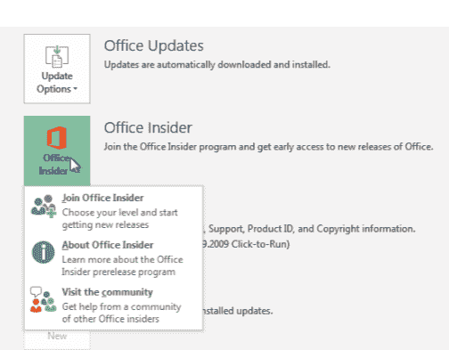

选择 Insider 级别以获取最早的预览版构建，这使你能够使用最新的功能。然后只需单击“确定”即可完成注册。

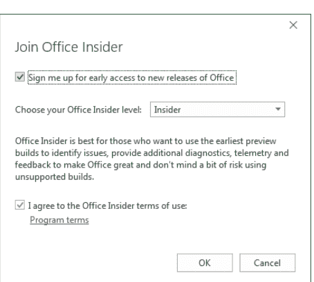

恭喜！你现已注册 Office Insider 计划，并准备体验和掌握 JavaScript UDF，正如本书后续章节所描述的那样。

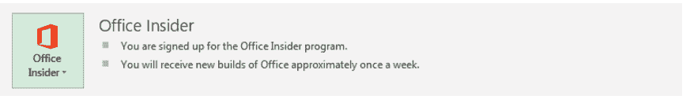

## 熟悉环境

### 插件源文件和文件结构

要创建用于托管 JavaScript UDF 的插件，基本上需要使用四个源文件：

1.  JavaScript 函数文件
2.  JSON 元数据文件
3.  加载器 HTML 文件
4.  插件清单文件

你可以使用你喜欢的脚本编辑器（如 Notepad++ 或 Brackets）来创建这些文件，具体方法将在以下各节中描述。

> 你需要在本地托管清单文件以安装 Office 插件，并将其他文件上传到远程 Web 服务器以使其在线可用。或者，你可以使用本地计算机将源文件发布到本地服务器，并通过更改清单文件中相应的 `Url` 属性来引用它们。有关在本地托管源文件的更多信息，请参阅 **附录**。

本书中使用的源文件托管在 [https://pub.mrexcel.com/javascript-udfs/](https://pub.mrexcel.com/javascript-udfs/)。

> 本书使用 `udfs` 前缀作为源文件的名称。但是，你可以自由地为自己的插件使用任何前缀或文件名。

### JavaScript 函数文件 — udfs.functions.js

**udfs.functions.js** 是一个 JavaScript 文件，其中包含 JavaScript UDF 代码。你将把本书讨论的 JavaScript UDF 代码和必要的辅助函数写入此文件。

以下代码展示了初始函数文件的结构，其中包含一个名为 `AVERAGE()` 的函数。该函数接受两个数值参数，并返回这两个数字的平均值作为结果。当在单元格公式中使用 JavaScript UDF 时，将调用此函数。

```
udfs.functions.js

1  /*
2   * 用于计算两个给定数字平均值的实际函数。
3   */
4  function AVERAGE (a, b) {
5      return (a + b) / 2;
6  }
```

### JSON 元数据文件 — udfs.metadata.json

**udfs.metadata.json** 以 JSON 格式包含 JavaScript UDF 的元数据。一旦在加载器 HTML 文件中执行初始化脚本，就会处理该 JSON 元数据文件，并且在此文件中定义的 JavaScript UDF 将在 Excel 环境中注册。此文件通过元数据中列出的属性和选项，告知 Excel 如何向用户展示相关的 JavaScript UDF 并执行它们。

**udfs.metadata.json** 文件包含一个名为 `functions` 的属性，其值是一个对象数组。这些对象中的每一个都对应于特定的 JavaScript UDF 元数据，由 `name` 属性标识。此元数据定义了函数属性和选项。以下代码展示了初始 JSON 元数据文件的结构，其中包含名为 **AVERAGE** 的 JavaScript UDF 的元数据。接下来我们将详细讨论每个属性和选项。

```
udfs.metadata.json
{
    "functions": [
        {
            "name": "AVERAGE",
            "description": "Calculates the average of given numbers.",
            "helpUrl": "https://pub.mrexcel.com/javascript-udfs/help/udfs.help.average.html",
            "parameters": [
                {
                    "name": "first value",
                    "description": "The first number",
                    "type": "number",
                    "dimensionality": "scalar"
                },
                {
                    "name": "second value",
                    "description": "The second number",
                    "type": "number",
                    "dimensionality": "scalar"
                }
            ],
            "result": {
                "type": "number",
                "dimensionality": "scalar"
            },
            "options": {
                "sync": true,
                "stream": false,
                "cancelable": false
            }
        }
    ]
}
```

六个属性定义了函数的元数据：

1.  `name`：JavaScript UDF 的名称，该名称将在工作表单元格中用作函数名，并带有在清单文件中定义的命名空间前缀。此属性还定义了在 JavaScript 函数文件中使用的 JavaScript 函数名。

2.  `description`：函数的简短描述，将显示在可用函数列表中。

3.  `helpUrl`：预期在帮助请求时在 Excel 任务窗格中显示帮助信息的网页 URL。此功能目前在开发者预览版中不受支持。

4.  `parameters`：一个包含函数参数的数组，具有以下属性：

    a) `name`：参数的简短信息文本，显示在单元格中的函数左括号之后。

    b) `description`：关于参数要显示的更多信息。此功能目前在开发者预览版中不受支持。

    c) `type`：参数的类型，必须设置为 `boolean`、`number` 或 `string`。**AVERAGE** 函数的参数是数值，因此其 `type` 参数定义为 `number`。

    d) `dimensionality`：参数是作为 `scalar` 值传递的单个单元格值，还是作为 `matrix` 值传递的区域。

5.  `result`：返回结果的类型和维度，通过以下属性定义：

    a) `type`：结果类型，与上面解释的 `parameters` type 属性类似。

    b) `dimensionality`：返回值是 `scalar` 值还是由数组定义的 `matrix`。如果返回值是 `scalar`，Excel 将在调用单元格中填入返回值。如果是 `matrix`，你将通过按 **Ctrl+Shift+Enter** 以数组公式输入公式，以在多个单元格中获取返回的矩阵结果。**AVERAGE** 函数返回标量，因此其 `dimensionality` 属性定义为 `scalar`。

6.  `options`：函数的行为。有三个属性用于定义它：

    a) `sync`：此属性定义函数是同步还是异步。同步函数提供快速性能，因为它们与 Excel 在同一进程中运行。但是，如果你的 JavaScript UDF 从 Web 服务检索数据，那么它必须是异步的，以避免在返回预期结果之前锁定 Excel。默认情况下，此属性设置为 `true`，这指定函数为异步。

    b) `stream`：你可以通过将此属性设置为 `true` 来创建流函数。假设 JavaScript UDF 已设置为随时间生成新值，或每秒从提供股价的 Web 服务获取值。你可以将此选项设置为 `true`，并编写 JavaScript 函数，该函数将在给定的时间间隔内重复自身，无需用户交互即可输出该时间间隔内的数据。

    c) `cancelable`：在某些情况下（例如编辑和删除引用该函数的单元格、参数值更改为引用另一个单元格，或用户发起手动重新计算），流函数和异步函数可以被取消以停止函数执行。你可以通过将此属性设置为 `true` 并在函数中提供 `caller.onCanceled` 事件监听器来使函数可取消。

### 加载器 HTML 文件 — udfs.loader.html

udfs.loader.html 是一个简单的 HTML 文件，主要是 Office JavaScript API 库中 Office.js 的加载器。Office.js 文件负责创建 Office 对象，该对象允许函数初始化并与 Office 应用程序（本例中为 Excel）交互。

```
udfs.loader.html
1 <!DOCTYPE html>
2 <html>
3     <head>
4         <meta charset="UTF-8" />
5         <meta http-equiv="X-UA-Compatible" content="IE=Edge" />
5         <meta http-equiv="Expires" content="0" />
6         <title></title>
8         <script src="https://unpkg.com/@microsoft/office-js@1.1.7-adhoc.3/dist/office.js" type="text/javascript"></script>
9         <script src="udfs.functions.js" type="text/javascript"></script>
10         <script type="text/javascript">
11             (function () {
12                 Office.initialize = function (reason) {
13                     return Excel.CustomFunctions.initialize();
14                 };
15             })();
16         </script>
17     </head>
18     <body>
19     </body>
20 </html>
```

在刚刚展示的 udfs.loader.html 文件中，**第 8 行** 的 `<head>` 部分的第一个 `<script>` 元素添加了对当前托管在名为 *unpkg* 的内容分发网络（CDN）上的 Office.js 文件的引用。第二个 `<script>` 元素，即 **第 9 行**，加载 JavaScript 函数文件 udfs.functions.js。

最后，加载器文件包含一个初始化脚本，该脚本指示 API 在完全加载并准备好通过库提供的 Excel 对象与 Excel 应用程序交互时初始化 JavaScript UDF。

```
11             (function () {
12                 Office.initialize = function (reason) {
13                     return Excel.CustomFunctions.initialize();
14                 };
15             })();
```

> Office.initialize 事件监听器函数的 reason 参数可用于确定 Office 插件是首次插入文档（reason="inserted"）还是之前已插入并作为文档的一部分加载（reason="documentOpened"），因此可以在插件首次插入时与它已成为文档的一部分时实现不同的逻辑。


### 加载项清单文件——udfs.manifest.xml

udfs.manifest.xml 是一个 XML 文件，它是加载项的主要引导文件。它帮助 Excel 在安装加载项期间定位前面提到的源文件。

```xml
<?xml version="1.0" encoding="UTF-8"?>
<OfficeApp xmlns="http://schemas.microsoft.com/office/appforoffice/1.1"
  xmlns:xsi="http://www.w3.org/2001/XMLSchema-instance"
  xmlns:bt="http://schemas.microsoft.com/office/officeappbasictypes/1.0"
  xmlns:ov="http://schemas.microsoft.com/office/taskpaneappversionoverrides"
  xsi:type="TaskPaneApp">
  <Id>0428f87b-8b69-467b-9fd6-1335a724fe46</Id>
  <Version>1.0.0.0</Version>
  <ProviderName>MrExcel Publishing</ProviderName>
  <DefaultLocale>en-US</DefaultLocale>
  <DisplayName DefaultValue="Excel JavaScript UDFs" />
  <Description DefaultValue="JavaScript User Defined Functions for Excel" />
  <Hosts>
    <Host Name="Workbook" />
  </Hosts>
  <DefaultSettings>
    <SourceLocation DefaultValue="https://pub.mrexcel.com/javascript-udfs/udfs.loader.html" />
  </DefaultSettings>
  <Permissions>ReadWriteDocument</Permissions>
  <VersionOverrides xmlns="http://schemas.microsoft.com/office/taskpaneappversionoverrides" xsi:type="VersionOverridesV1_0">
    <Hosts>
      <Host xsi:type="Workbook">
        <AllFormFactors>
          <ExtensionPoint xsi:type="CustomFunctions">
            <Script>
              <SourceLocation resid="resFunctions" />
            </Script>
            <Page>
              <SourceLocation resid="resLoader" />
            </Page>
            <Metadata>
              <SourceLocation resid="resMetadata" />
            </Metadata>
            <Namespace resid="namespace" />
          </ExtensionPoint>
        </AllFormFactors>
      </Host>
    </Hosts>
    <Resources>
      <bt:Urls>
        <bt:Url id="resMetadata" DefaultValue="https://pub.mrexcel.com/javascript-udfs/udfs.metadata.json" />
        <bt:Url id="resFunctions" DefaultValue="https://pub.mrexcel.com/javascript-udfs/udfs.functions.js" />
        <bt:Url id="resLoader" DefaultValue="https://pub.mrexcel.com/javascript-udfs/udfs.loader.html" />
      </bt:Urls>
      <bt:ShortStrings>
        <bt:String id="namespace" DefaultValue="UDFS" />
      </bt:ShortStrings>
    </Resources>
  </VersionOverrides>
</OfficeApp>
```

这是一个包含必需元素的精简 Office JavaScript 加载项清单文件。清单文件与你在加载项中创建的函数内容无关，因此此文件中没有任何函数信息。相反，该文件包含在 Excel 应用程序中安装期间显示的加载项属性，以及指向托管在 Web 服务器上的实际源文件的引用。

以下是 Office 加载项清单文件中最重要的元素：

- **Id：** Office 加载项的唯一标识符。我们使用 [http://guidgenerator.com](http://guidgenerator.com) 网站为该项目生成 GUID。
- **ProviderName：** 该 Office 加载项的开发者。最多 125 个字符。
- **DisplayName：** Office 加载项的名称。最多 125 个字符。
- **Description：** Office 加载项的描述。最多 250 个字符。
- **Permissions：** Office 加载项的 API 访问级别。对于 JavaScript UDF，请使用 `ReadWriteDocument` 权限类型。
- **VersionOverrides：** 有关加载项实现命令的信息。请注意，此元素中的设置还会覆盖根目录中的 `Hosts` 元素，并定义访问 `Resources` 中设置的、具有相应 `id` 字符串的 `Url` 元素的 `Script`、`Metadata`、`Page` 和 `Namespace` 元素。加载项源文件通过此配置加载，Excel 从而能够运行 JavaScript UDF。
- **Namespace：** 访问在 `Resources` 中使用 `namespace` ID 定义的匹配 `String` 元素。此字符串定义加载项中所有 JavaScript UDF 的前缀，该前缀将在工作表单元格中输入函数时使用。

# 热身准备

## 设置环境

你可以在运行 Windows 的 Excel 中安装包含本书讨论的 JavaScript UDF 的示例 Office 加载项。为此，你需要将清单文件发布到网络共享文件夹。本章介绍如何创建可用于发布清单文件的共享文件夹，还介绍如何在 Excel 中将此共享文件夹注册为受信任目录，以便在 Windows 中安装和测试加载项。

### 在网络上共享目录文件夹

在**我的文档**中创建一个名为 **office-catalog** 的文件夹。这是你要将清单文件发布到的文件夹。（你可以为目录文件夹选择不同的路径和名称。）

通过从文件夹的上下文菜单中选择**共享**，然后选择**特定人员...**来设置共享。

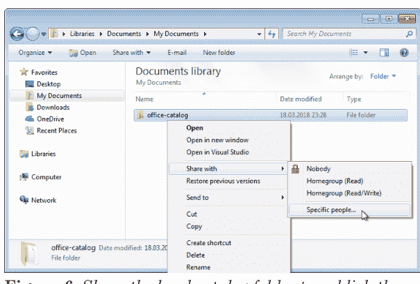

图 6 *共享本地目录文件夹以发布清单文件。*

默认情况下，当前用户已添加到共享人员列表中。这就是在网络中共享目录文件夹以测试加载项所需的全部操作，因此只需点击**共享**按钮。

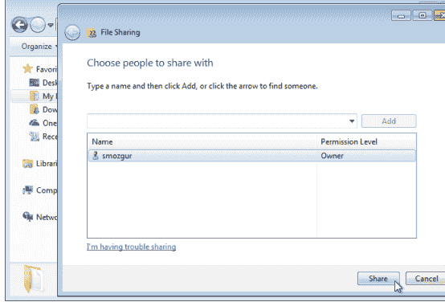

图 7 *点击**共享**按钮以在网络中共享文件夹。*

## 在 Excel 中添加受信任的加载项目录

一旦你点击**共享**按钮，Windows 就会确认文件夹已成功共享。只需右键点击共享文件夹并复制链接，这就是你要在 Excel 中设置为受信任目录地址以发布清单文件的网络路径。

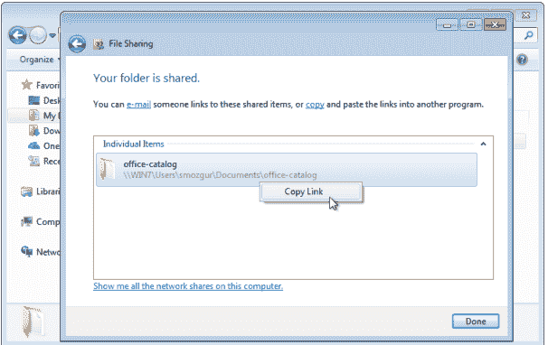

**图 8** *Windows 确认目录文件夹已共享。*

最后，将 **udfs.manifest.xml** 文件复制到目录文件夹中。

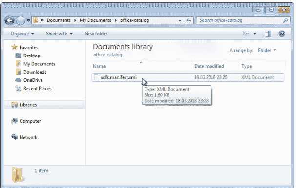

**图 9** *复制并粘贴 udfs.manifest.xml 文件。*

就是这样！包含清单文件的目录文件夹已准备就绪，你可以继续在 Excel 中进行安装过程。

## 在 Excel 中添加受信任的加载项目录

加载项目录用作存储 Office 加载项清单文件的位置，以便加载项可以作为受信任源安装在客户端应用程序中。在这种情况下，你需要使用**网络共享文件夹**类型加载项目录来安装加载项，并且你首先需要让 Office 信任中心了解目录文件夹。

> **信任中心**是你可查找 Microsoft Office 程序安全和隐私设置的地方。你可以在每个 Office 程序中通过完全相同的步骤访问它。

## Excel JavaScript UDF：直击要点

启动 Excel 并通过按 **Esc** 键打开一个新文件。点击**文件/选项**，在左窗格中选择**信任中心**选项，然后点击**信任中心设置...**按钮打开**信任中心**对话框。

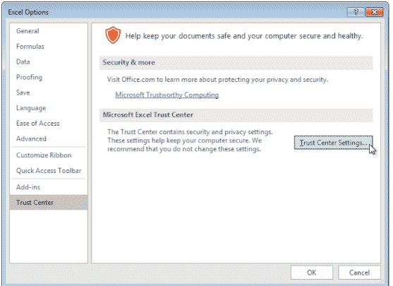

**图 10** *转到 Excel 选项 / 信任中心 / 信任中心设置...*

从**信任中心**窗口的左窗格中选择**受信任的加载项目录**选项。将复制的网络共享路径粘贴到**目录 Url**文本框中，然后点击**添加目录**按钮。

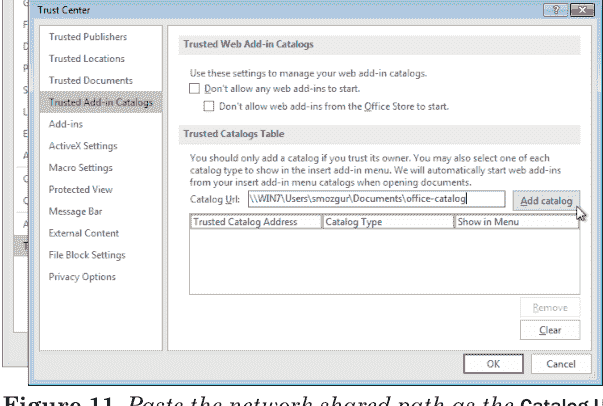

**图 11** *将网络共享路径粘贴为目录 Url 并点击添加目录。*

## 在 Excel 中添加受信任的加载项目录

**受信任的目录地址**作为**网络共享**目录类型添加到对话框底部的表格中。选中**在菜单中显示**复选框以使目录出现在**插入加载项**菜单中，然后点击**确定**保存更改。

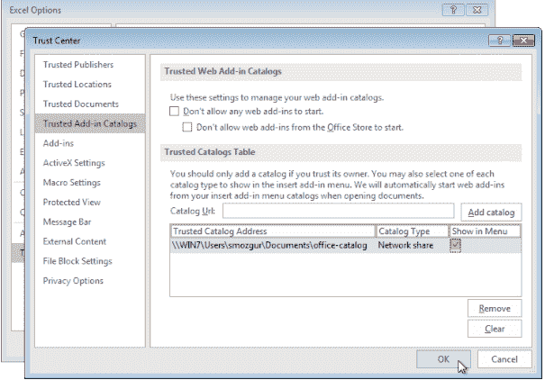

**图 12** *选中在菜单中显示并点击确定保存更改。*

一旦你保存更改，Office 会确认你的更改已保存；它们将在下次启动 Office 时应用。（需要重新启动是意料之中的，因为这些设置保存在 Windows 注册表中，应用程序需要重新启动才能使注册表更改生效。）

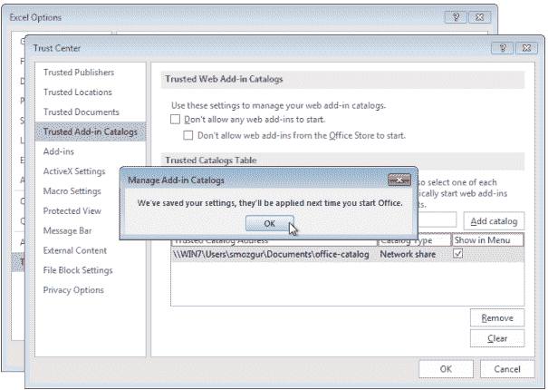

**图 13** *点击确定并重新启动 Office 以应用更改。*

> 你可能不需要访问或手动更改 Windows 注册表中的这些设置，但出于好奇，Office 2016 将**受信任目录**设置保存在以下注册表路径的注册表键中：

**HKEY_CURRENT_USER\Software\Microsoft\Office\16.0\WEF\TrustedCatalogs\**

*此设置与所有其他 Office 应用程序共享。*


# 安装和测试 JAVASCRIPT 加载项

## 在 Excel 中插入 Excel JavaScript UDF 加载项

您终于准备好安装和测试您的加载项了！Excel 目前还不知道您的加载项，因此不能直接在单元格中输入函数。您需要先安装加载项。

启动 Excel 并创建一个新的工作簿。在功能区中选择**插入**选项卡，然后点击**我的加载项**按钮。

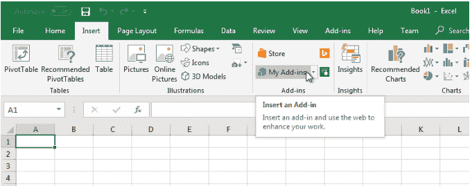

**图 14** *使用功能区上的***我的加载项***命令插入加载项。*

在出现的**Office 加载项**窗口中，选择**共享文件夹**选项。所有现有的清单文件将在您添加到**受信任的目录表**中的目录内处理，可用的加载项将在此页面上列出。

如下所示，您目前只有一个可用的加载项，由保存在目录文件夹中的 **udfs.manifest.xml** 清单文件定义。

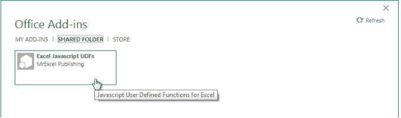

**图 15** *在***Office 加载项***窗口中选择***共享文件夹*。

在 **Office 加载项**窗口中，将鼠标指针移到显示的加载项上，并注意以下加载项属性：

- 显示名称：**Excel JavaScript UDFs**
- 提供商：**MrExcel Publishing**
- 描述：**JavaScript User Defined Functions for Excel**

回想一下清单文件的内容以及相应的源字段在 Office 加载项对话框中的呈现方式：

```
<?xml version="1.0" encoding="UTF-8"?>
        ...
    <ProviderName>MrExcel Publishing</ProviderName>
    <DefaultLocale>en-US</DefaultLocale>
    <DisplayName DefaultValue="Excel JavaScript UDFs" />
    <Description DefaultValue="JavaScript User Defined Functions for Excel" />
    ...
```

在加载项仍处于选中状态时，点击**添加**按钮将加载项插入到 Excel 中。

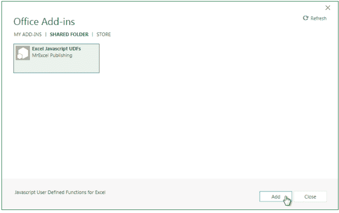

当 Excel 安装并启动加载项时，它会通过工具栏消息告知您正在执行此操作。一旦此消息消失，您就可以在工作簿中使用该加载项的 JavaScript UDF 了。

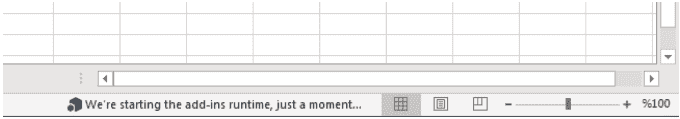

## 测试加载项

**AVERAGE** JavaScript UDF 计算两个数字的平均值。要测试它，请在单元格 **A1** 和 **A2** 中输入您想要计算平均值的两个数字。然后转到单元格 **B1** 并开始输入函数前缀 **UDFS**。一旦您输入第一个字母，就会出现可用函数列表，显示您的函数以及匹配的内部函数。

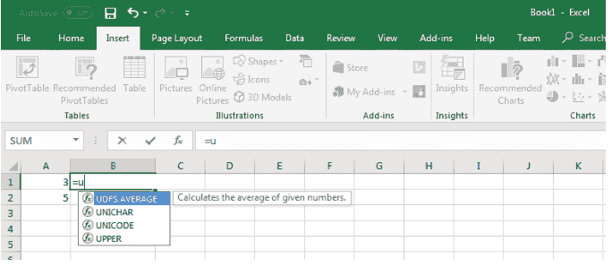

*图 18* **通过键入函数前缀的第一个字母开始输入公式。**

> 请注意，工具提示中显示的函数描述是您在 **udfs.metadata.json** 文件中**第 5 行**的 UDF 元数据中输入的内容。

完成函数名称的输入，或者在所需函数是列表中的活动项时直接按 **Tab** 键。参数工具提示的显示方式与内部 Excel 函数的工具提示相同。

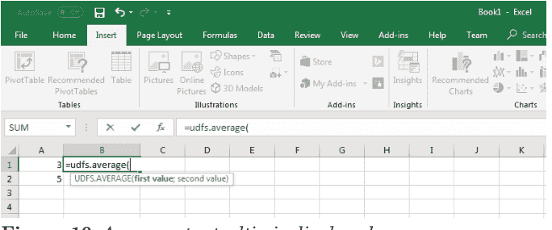

*图 19* **显示参数工具提示。**

> 参数工具提示在 Excel 的 VBA UDF 中不可用。能够在 JavaScript UDF 中轻松配置它们是一个很棒的功能。

以下代码片段展示了 `parameters` 项目中 `name` 属性的实际应用：

```
Snippet from udfs.metadata.json
:                   ...
7               "parameters": [
8               {
9                   "name": "first value",
10                  "description": "The first number",
11                  "type": "number",
12                  "dimensionality": "scalar"
13              },
14              {
15                  "name": "second value",
16                  "description": "The second number",
17                  "type": "number",
18                  "dimensionality": "scalar"
19              }
20              ],
:                   ...
```

选择 **A1** 和 **A2** 单元格作为函数参数，然后按 `Enter` 键。一旦输入公式，单元格 **B1** 的内容就会变为显示 `#GETTING_DATA`，表示 JavaScript 函数正在执行中。

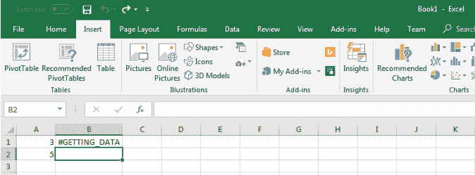

最后，单元格 **B1** 的内容会更新为从 JavaScript 函数返回的值。

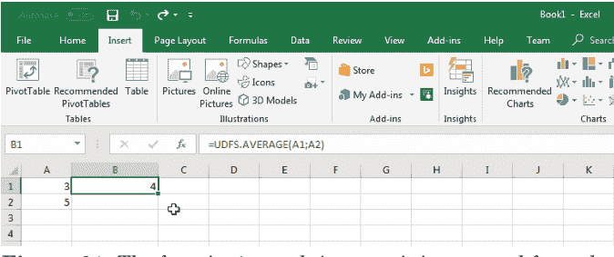

# 关于缓存源文件

安装加载项后，加载项源文件会自动缓存在 Windows 文件系统中。下次启动 Excel 时，加载项将被快速识别，函数会列在可用函数列表中，即使您未连接到互联网，同步函数也会被执行。

对于异步函数，您需要连接到互联网才能加载加载项并执行函数；如果没有互联网连接，当您尝试使用该函数或重新计算包含该函数的单元格时，Excel 将返回一条指示错误的消息。

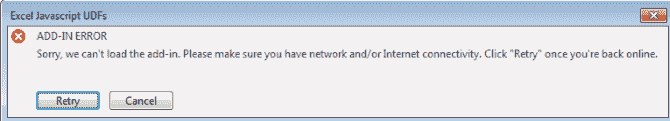

**图 22** *需要互联网连接才能重新加载加载项。*

如果您对源文件进行了任何更改，那么只需重新安装加载项即可。但是，如果您对清单文件进行了任何更改，则需要先退出并重新启动 Excel。

# 扩展加载项

## 创建接受区域作为参数的新函数

在本节中，您将向加载项添加一个新函数，该函数通过接受以 `matrix` 维度而非 `scalar` 定义的区域参数，改进了先前创建的 `AVERAGE` 函数。

要创建一个名为 `RANGEAVERAGE` 的 JavaScript UDF，请将以下新函数的元数据添加到 JSON 元数据文件中，作为 `functions` 属性的下一个数组项。请注意，`dimensionality` 参数定义为 `matrix`，以告知该函数接受区域作为参数。

```
Insert into udfs.metadata.json

1 {
2     "functions": [
3         {
:           ... AVERAGE metadata ...
30        },
31        {
32            "name": "RANGEAVERAGE",
33            "description": "Calculate the average of the values in the range.",
34            "helpUrl": "https://pub.mrexcel.com/javascript-udfs/help/help-rangeAverage.html",
35            "parameters": [
36                {
37                    "name": "range of numbers",
38                    "description": "The range of numbers to calculate the average.",
39                    "type": "number",
40                    "dimensionality": "matrix"
41                }
42            ],
43            "result": {
44                "type": "number",
45                "dimensionality": "scalar"
46            },
47            "options": {
48                "sync": true,
49                "stream": false,
50                "cancelable": false
51            }
52        }
53    ]
54 }
```

将 RANGEAVERAGE() JavaScript 函数添加到 JavaScript 函数文件的底部，如下所示。

```
Insert into udfs.functions.js

8   /*
9   * Function to calculate the average of the values in the given range.
10  */
11  function RANGEAVERAGE (rng) {
12    var total = 0;
13    for (i = 0; i < rng.length; i++) {
14      for (j = 0; j < rng[i].length; j++) {
15        total += rng[i][j];
16      }
17    }
18    return total / (rng.length * rng[0].length);
19  }
```

启动 Excel 并重新安装加载项。要测试新函数，请在区域 A1:B4 中输入一些数字，然后在单元格 C1 中开始输入函数名称。您现在会看到两个以 UDFS 前缀开头的可用函数。

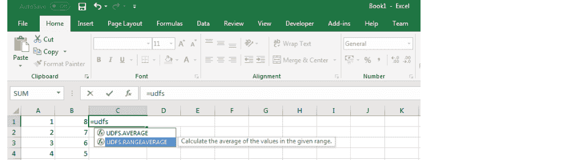

图 23 可用函数列表中的 RANGEAVERAGE 函数。

选择 **RANGEAVERAGE** 函数，并选择 **A1:B4** 作为函数参数。

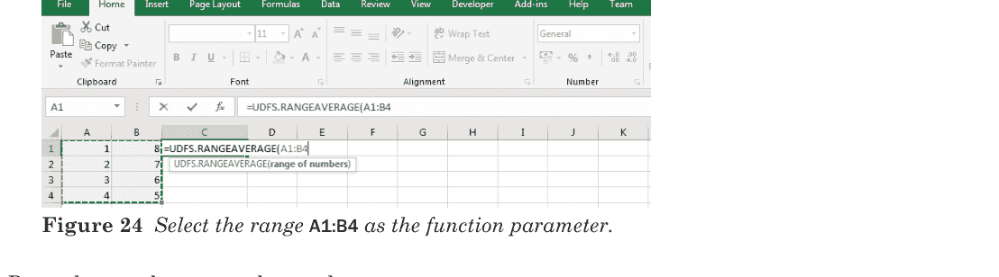

**图 24** *选择区域***A1:B4***作为函数参数。*

按 **Enter** 键获取结果。

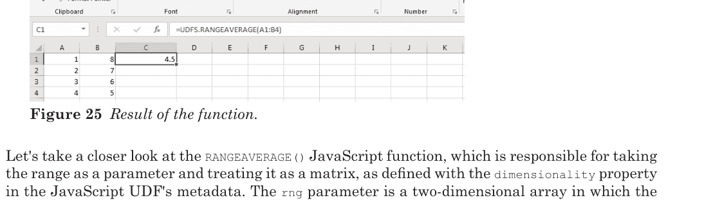

**图 25** *函数的结果。*

让我们更仔细地看看负责将区域作为参数并接受为矩阵的 `RANGEAVERAGE()` JavaScript 函数，正如 JavaScript UDF 元数据中的 `dimensionality` 属性所定义的那样。`rng` 参数是一个二维数组，其中第一维代表行，第二维代表传递给函数的区域的列。这实际上是"嵌套数组"形式，其结构如下：

```
rng = [[1, 8], [2, 7], [3, 6], [4, 5]];
```

查看此结构，可以看到行数由 `rng.length` 属性获取，列数由一个内部数组中的项目数获取：`rng[0].length`。


你可以通过在单元格中选中范围地址时按 F9 键来调试公式，从而显示相同的矩阵。

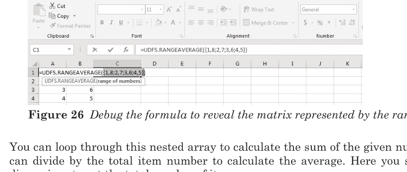

你可以循环遍历这个嵌套数组来计算给定数字的总和。最后，你可以除以总项数来计算平均值。这里你只需将维度相乘即可得到总项数：

```javascript
return total / (rng.length * rng[0].length);
```

同样，也可以通过使用循环计数器来计算相同的结果，如下所示：

```javascript
return total / (i * j);
```

这样，你就得到了选定范围内数字的平均值！

## 获得信心

## 从网络服务获取数据

到目前为止，你已经创建了两个 JavaScript UDF，它们都在函数内部同步执行算术计算。在本章中，你将看到如何进一步利用 JavaScript UDF——使用在线网络服务异步获取数据，并将数据返回给调用单元格。

在本章中，你将构建 **STOCKPRICE** JavaScript UDF，以便从网络服务获取所请求股票代码的实时股票价格。

### 使用网络服务获取股票价格

> 本章使用免费的 IEX API，但你可以使用任何网络服务，并相应调整辅助函数。

IEX ([iextrading.com](http://iextrading.com)) 提供了一个无需订阅即可使用的免费股票价格 API。基本上，你通过提供股票代码作为 **HTTP GET** 请求来查询 IEX 网络服务，它会返回股票价格。例如，使用以下 URL，该 API 会返回微软公司的实时股票价格：

[https://api.iextrading.com/1.0/stock/MSFT/price](https://api.iextrading.com/1.0/stock/MSFT/price)

## 添加异步函数

要创建名为 **STOCKPRICE** 的 JavaScript UDF，请将新函数的元数据（如下所示）添加到 JSON 元数据文件中，作为 `functions` 属性的下一个数组项。注意参数的 `sync` 参数更改为 `false`，这表示该函数是异步的。

#### 插入到 udfs.metadata.json

```json
{
    "functions": [
        {
            // ... AVERAGE 元数据 ...
        },
        {
            // ... RANGEAVERAGE 元数据 ...
        },
        {
            "name": "STOCKPRICE",
            "description": "Stock Price for the requested Ticker Symbol.",
            "helpUrl": "https://pub.mrexcel.com/javascript-udfs/help/help-stockPrice.html",
            "parameters": [
                {
                    "name": "symbol",
                    "description": "Ticker Symbol",
                    "type": "string",
                    "dimensionality": "scalar"
                }
            ],
            "result": {
                "type": "number",
                "dimensionality": "scalar"
            },
            "options": {
                "sync": false,
                "stream": false,
                "cancelable": false
            }
        }
    ]
}
```

将 `STOCKPRICE()` JavaScript 函数及其辅助函数添加到 JavaScript 函数文件的底部，如下所示。

```javascript
/**
 * 插入到 udfs.functions.js
 */

/**
 * 函数，用于返回一个 Promise，该 Promise 从网络服务异步获取结果
 */
function STOCKPRICE(symbol) {
    return new OfficeExtension.Promise(function(setResult, setError) {
        fetchStockPrice(symbol, function(data) {
            setResult(data);
        });
    });
}

/**
 * STOCKPRICE() 函数的辅助函数
 * 此函数发起网络服务调用，并将获取的数据返回给 stockPrice() 函数
 */
function fetchStockPrice(symbol, callback) {
    var xmlhttp = new XMLHttpRequest();

    xmlhttp.onreadystatechange = function() {
        if (xmlhttp.readyState == XMLHttpRequest.DONE) {
            setTimeout(function() {
                callback(xmlhttp.responseText);
            });
        }
    };

    xmlhttp.open("GET", 'https://api.iextrading.com/1.0/stock/' + symbol + '/price', true);
    xmlhttp.send();
}
```

这个新的 JavaScript UDF 通过使用异步调用从网络服务检索数据，结果将随网络服务响应一起返回。因此，你不能像前面章节那样让函数直接将计算结果返回给 Excel。相反，你需要使用 `OfficeExtension.Promise` 对象（如下所示），以便在数据从网络服务获取后立即返回：

```javascript
function STOCKPRICE(symbol) {
    return new OfficeExtension.Promise(function(setResult, setError) {
        fetchStockPrice(symbol, function(data) {
            setResult(data);
        });
    });
}
```

`OfficeExtension.Promise` 对象接受一个函数作为参数，该函数会调用辅助函数，而辅助函数将从网络服务异步获取结果：

```javascript
return new OfficeExtension.Promise(function(setResult, setError) {
    fetchStockPrice(symbol, function(data) {
        setResult(data);
    });
});
```

最后，这是辅助函数：

```javascript
function fetchStockPrice(symbol, callback) {
    var xmlhttp = new XMLHttpRequest();

    xmlhttp.onreadystatechange = function() {
        if (xmlhttp.readyState == XMLHttpRequest.DONE) {
            setTimeout(function() {
                callback(xmlhttp.responseText);
            });
        }
    };

    xmlhttp.open("GET", 'https://api.iextrading.com/1.0/stock/' + symbol + '/price', true);
    xmlhttp.send();
}
```

辅助函数接受两个参数：`symbol` 是你需要传递给网络服务的股票代码，`callback` 是最初传递的函数，用于在调用函数中使用返回的数据（参见 **第 27 行**）。

## 添加异步函数

接下来，你创建一个新的 `XMLHttpRequest` 对象，名为 `xmlhttp`，并将其 `onreadystatechange` 监听器函数设置为捕获从网络服务获取的数据。然后，你使用 `open()` 方法准备一个针对网络服务 URL（端点）的 `GET` 调用，并带上请求的 `symbol` 值。`open()` 方法的第二个参数定义了是否异步执行操作。最后，你使用 `xmlhttp` 对象的 `send()` 方法发起调用。

假设 `XMLHttpRequest` 对象是一个不解析也不可视化显示请求页面的网络浏览器；相反，它只传输原始数据。你向 URL 发起调用，其状态按以下顺序变化：

1.  **UNSENT**：`xmlhttp` 对象已被创建为一个新的 `XMLHttpRequest` 客户端。
2.  **OPENED**：`xmlhttp.open()` 方法已被执行。
3.  **HEADERS_RECEIVED**：`xmlhttp.send()` 方法已被执行，网络服务已返回响应头。
4.  **LOADING**：网络服务已开始传输数据，但传输尚未完成。
5.  **DONE**：所有数据已传输完毕，`xmlhttp.responseText` 就绪。

监听器函数收到状态更改的通知，并在 **第 42 行** 检查 `readyState` 属性，以确保所有预期的数据都已传输完毕。一旦此条件成立，它便调用回调函数并传入获取的结果——`xmlhttp.responseText`：

```javascript
xmlhttp.onreadystatechange = function() {
    if (xmlhttp.readyState == XMLHttpRequest.DONE) {
        setTimeout(function() {
            callback(xmlhttp.responseText);
        });
    }
};
```

> 这里你使用 `setTimeout()` 函数来异步调用，而不是在返回结果给回调函数时使用同步调用从而阻塞脚本。那么这究竟是如何工作的呢？

当你在 JavaScript 中使用 `setTimeout()` 函数调度一个函数调用时，你并不是将其放入执行栈并阻塞整个脚本和宿主应用程序直到它完成工作，而是将其放入队列，并在执行栈为空时将其加入执行栈。这被称为事件循环，你在使用网络服务的 JavaScript 中会经常用到它。

`setTimeout()` 函数接受第二个参数，名为 `delay`，它是执行代码前需要等待的毫秒数。如果省略此参数，则使用值 0。这并不意味着立即执行函数，而是将其无延迟地放入队列。

回调函数在 **第 28 行** 使用 `setResult()` 函数将其结果传递给父级。最后，这就是 `Promise` 对象所期望接收的值——正如所承诺的那样！


## EXCEL JAVASCRIPT UDF：直截了当

启动 Excel 并重新安装加载项。要查看新的 JavaScript UDF 的实际效果，请在 A2 单元格中输入一个股票代码，并在 B2 单元格中开始输入函数名称。现在，你会看到三个以 **UDFS** 为前缀的可用函数。

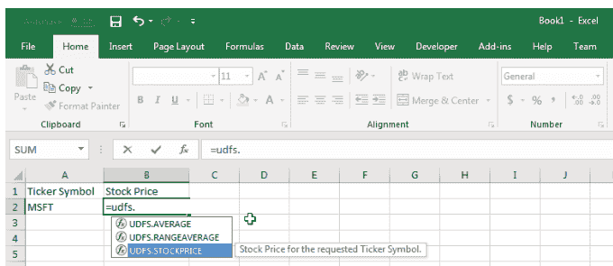

选择 **STOCKPRICE** 函数，并选择 **A2** 作为函数参数。现在结果就显示出来了，如下所示：

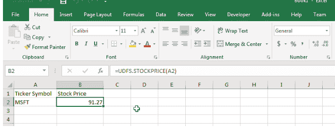

## 通过单次 Web 服务调用获取多个股票代码的价格

你可以在 A 列中填写其他股票代码，并将公式复制到数据集的每一行，以在表格中获取更多股票价格。但是，如果你这样做，该范围内每个包含函数的单元格都会对 JavaScript UDF 发起一次单独的调用，这也意味着多次调用 Web 服务。考虑到涉及的资源和加载时间，这不是最佳方法。相反，你可以使用数组公式，并创建一个名为 **STOCKPRICEMULTI** 的新 JavaScript UDF，它接受一个包含股票代码的单列范围作为参数，并返回获取到的对应股票代码的数组结果。

将新函数的元数据（如下所示）作为 `functions` 属性的下一个数组项添加到 JSON 元数据文件中。请注意，`parameters` 和 `results` 元素的 `dimensionality` 选项参数从 `scalar` 改为了 `matrix`。

```
插入到 udfs.metadata.json
1  {
2      "functions": [
3          {
:              ... AVERAGE 元数据 ...
30		},
31		{
:			... RANGEAVERAGE 元数据 ...
52		},
53		{
:			... STOCKPRICE 元数据 ...
74		},
75		{
76			"name": "STOCKPRICEMULTI",
77			"description": "Stock Price for the requested Ticker Symbols.",
78			"helpUrl": "https://pub.mrexcel.com/javascript-udfs/help/help-stockPriceMulti.html",
79			"parameters": [
80				{
81					"name": "range of symbols",
82					"description": "Ticker Symbols",
83					"type": "string",
84					"dimensionality": "matrix"
85				}
86			],
87			"result": {
88				"type": "number",
89				"dimensionality": "matrix"
90			},
91			"options": {
92				"sync": false,
93				"stream": false,
94				"cancelable": false
95			}
96		}
97	],
98	}
```

将 `STOCKPRICEMULTI()` JavaScript 函数及其辅助函数添加到 JavaScript 函数文件的底部，如下所示。

```
插入到 udfs.functions.js

53	/*
54	 * 函数，用于返回一个 Promise，以异步方式向
55	 * Web 服务请求结果
56	 */
57	function STOCKPRICEMULTI(rng) {
58		return new OfficeExtension.Promise(function(setResult, setError){
59			if (rng[0].length > 1) {
60				setResult('');
61			} else {
62				fetchStockPriceMulti(rng, function(data){
63					setResult(data);
64				});
65			}
66		});
67	}
68
69	/*
70	 * STOCKPRICEMULTI() 函数的辅助函数
71	 * 此函数发起 Web 服务调用，并将获取的数据作为矩阵
72	 * 返回给 STOCKPRICEMULTI() 函数
73	 */
74	function fetchStockPriceMulti(rng, callback) {
75		var xmlhttp = new XMLHttpRequest();
76
77		xmlhttp.onreadystatechange = function() {
78			if (xmlhttp.readyState == XMLHttpRequest.DONE) {
79
80				var obj = JSON.parse(xmlhttp.responseText);
81				var ret = [];
82
83				for (i = 0; i < rng.length; i++) {
84					if (obj.hasOwnProperty(rng[i])) {
85						ret.push([obj[rng[i]]["price"]]);
86					} else {
87						ret.push(['']);
88					}
89				}
90				setTimeout(function(){
91					callback(ret);
92				}, 93);
93			}
94		};
95
96		var symbols = rng.join(",");
97
98		xmlhttp.open("GET", "https://api.iextrading.com/1.0/stock/market/
99		batch?types=price&symbols=" + symbols, true);
100		xmlhttp.send();
101	}
```

**STOCKPRICEMULTI()** JavaScript 函数期望一个单列参数，因此你需要检查内部数组的维度，如果不是预期格式，则返回空结果：

```
59		if (rng[0].length > 1) {
60			setResult('');
61		} else {
```

让我们看看如何从 Web 服务获取多个股票代码的数据。IEX API 可以返回 URL 中传递的多个股票代码的价格，使用以下结构：

```
https://api.iextrading.com/1.0/stock/market/batch?types=price&symbols=SYMB1,SYMB2,SYMB3
```

## 通过单次 Web 服务调用获取多个股票代码的价格

让我们分析一下辅助函数。你获取传递给 `fetchStockPriceMulti()` 辅助函数的 `rng` 参数，并使用 JavaScript 的 `join()` 函数将其转换为以逗号分隔的字符串，同时使用 Web 服务期望的 `xmlhttp.open()` 函数：

```
96     var symbols = rng.join(",");

97     xmlhttp.open("GET", "https://api.iextrading.com/1.0/stock/market/
         batch?types=price&symbols=" + symbols, true);
```

你的 Web 服务 URL 将类似于以下示例：

```
https://api.iextrading.com/1.0/stock/market/batch?types=price&symbols=MSFT,GOOGL,AAPL,KO
```

此 URL 的返回值将类似于以下内容：

```
[{"MSFT":{"price":88.04},"GOOGL":{"price":1001.7},"AAPL":{"price":165.31},"KO":{"price":42.67}}
```

这是 Web 服务返回的 JSON 字符串。如果你在以下结构中查看同一个字符串，可以更好地理解其对象模型：

```
Web 服务返回：JSON 字符串
{
    "MSFT": {
        "price": 88.04
    },
    "GOOGL": {
        "price": 1001.7
    },
    "AAPL": {
        "price": 165.31
    },
    "KO": {
        "price": 42.67
    }
}
```

Web 服务一返回 JSON 字符串结果，你就开始处理这个字符串以创建一个新数组，该数组包含与请求的股票代码相同顺序的价格：

1. 使用 `JSON.parse()` 方法将 JSON 字符串转换为对象。你现在拥有一个名为 `obj` 的对象，它由关联的属性解析而来（参见**第 80 行**）。例如，在前面的 JSON 字符串示例中，`obj["MSFT"]["price"]` 是 `obj["MSFT"]` 属性的价格值。

2. 要创建一个名为 `ret` 的数组，其中包含与请求的股票代码相同顺序的价格值，请循环遍历包含股票代码的 `rng` 数组参数，并使用 `hasOwnProperty()` 方法检查 `obj` 是否包含以这些股票代码命名的属性（参见**第 83-89 行**）。

3. 如果该属性存在，则使用数组 `push()` 方法向 `ret` 数组添加一个新数组项，该项是匹配的 `obj` 属性的价格值——`[obj[rng[i]]["price"]]`（参见**第 85 行**）。

4. 如果该属性不存在，则添加包含空字符串的新数组项，以便 Excel 为缺失的股票代码显示错误（参见**第 87 行**）。

5. 最后，将 `ret` 数组返回给 `Promise` 对象（参见**第 91 行**）。

启动 Excel 并重新安装加载项，然后让我们尝试一下新函数。这将是一个数组公式，因此选择 B 列中与股票代码范围对应的空白单元格，并确保第一个单元格 **B2** 是活动单元格。当 **B2** 是活动单元格时，使用新函数名称开始输入公式，如下所示。

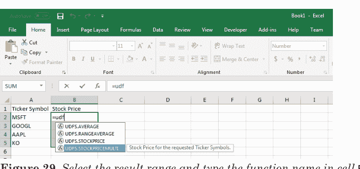

**图 29** *选择结果范围并在单元格 **B2** 中输入函数名称。*

选择股票代码范围作为函数的参数，如下所示。

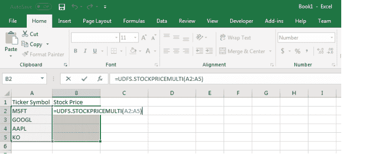

**图 30** *选择包含股票代码的相应范围。*

最后，按 **Ctrl+Shift+Enter** 创建数组公式。你可以看到所有对应的股票价格都一次性被获取并返回。

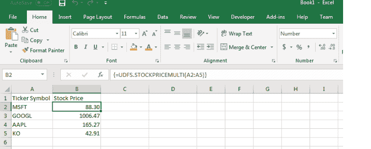

**图 31** *通过按 **Ctrl+Shift+Enter** 输入数组公式。*

## 创建流式函数

你之前创建的 JavaScript UDF——STOCKPRICE 和 STOCKPRICEMULTI——从 Web 服务获取数据，但在没有用户交互的情况下无法更新结果。如果能让 JavaScript UDF 每 5 秒自动更新其内容，无需任何用户交互，岂不是很棒？

你可以通过使用流式函数来实现这一点。为此，你可以设置你的 JavaScript 函数，使其每隔固定时间间隔向 Web 服务发起相同的调用，并在没有任何用户交互的情况下返回更新后的结果。

将新函数的元数据（如下所示）添加到 JSON 元数据文件中。

```
插入到 udfs.metadata.json
1 {
2     "functions": [
3         {
:             ... AVERAGE 元数据 ...
30         },
31         {
:             ... RANGEAVERAGE 元数据 ...
52         },
53         {
:             ... STOCKPRICE 元数据 ...
74         },
75         {
:             ... STOCKPRICEMULTI 元数据 ...
96         },
97         {
98             "name": "STOCKPRICEMULTISTREAM",
99             "description": "Streaming Stock Price for the requested Ticker Symbols.",
100            "helpUrl": "https://pub.mrexcel.com/javascript-udfs/help/help-stockPriceMulti.html",
101            "parameters": [
102                {
103                    "name": "range of symbols",
104                    "description": "Ticker Symbols",
105                    "type": "string",
106                    "dimensionality": "matrix"
107                },
108                {
109                    "name": "interval in seconds",
110                    "description": "Update Interval",
111                    "type": "number",
112                    "dimensionality": "scalar"
113                }
114            ],
115            "result": {
```


# EXCEL JAVASCRIPT UDFS: STRAIGHT TO THE POINT

```json
"116        "type": "number",
117        "dimensionality": "matrix"
118      },
119      "options": {
120        "sync": false,
121        "stream": true,
122        "cancelable": true
123      }
124    }
125  ]
126}
```

此时你应该已经熟悉函数元数据了，但请注意，在本例中，options 属性现在设置了 stream 和 cancelable 属性为 true，以将该新函数定义为流式函数和可取消函数。

在 JavaScript 函数文件的底部添加 STOCKPRICEMULTISTREAM() JavaScript 函数：

```javascript
/*
  * Function to return the streaming result
  * from the web service asynchronously
  */
function STOCKPRICEMULTISTREAM(rng, interval, caller) {
    var timer = setTimeout(function update(){
        fetchStockPriceMulti(rng, function(data){
            caller.setResult(data);
            timer = setTimeout(update, interval * 1000);
        });
    });

    caller.onCanceled = function(){
        clearInterval(timer);
    }
}
```

请注意，这里你在新的 JavaScript UDF 中使用了相同的辅助函数——fetchStockPriceMulti()，因为你从 Web 服务获取数据的方式没有任何不同。

一个明显的区别是，虽然新函数的元数据有两个参数，但 JavaScript 函数——STOCKPRICEMULTISTREAM()——接受三个参数。前两个参数与元数据参数匹配，但最后一个参数 caller 并未在元数据中定义，在实际 Excel 函数输入时也不会显示或传递。原因在于，当你在元数据中将 stream 属性设置为 true 将该函数设置为流式函数时，Excel 会自动传递此参数。caller 是一个包含 setResult() 回调函数的对象，用于更新 Excel 单元格。

## CREATING A STREAMED FUNCTION

对于此函数，你也没有使用 `Promise` 对象来将异步操作结果返回给 Excel。相反，`STOCKPRICEMULTISTREAM()` JavaScript 函数设置了一个由 `timer` 变量持有的定时器，并在第 107 行触发一个名为 `update()` 的函数，辅助函数在此函数内部被调用。一旦辅助函数从 Web 服务返回结果，它就在第 109 行设置 `caller.result`，并在第 110 行重新设置 `timer`，以在 JavaScript UDF 第二个参数传入的一定时间间隔后再次执行 `update()` 函数。这样，该函数将被重复排队，在一定的秒数后被调用。

```javascript
var timer = setTimeout(function update(){
    fetchStockPriceMulti(rng, function(data){
        caller.setResult(data);
        timer = setTimeout(update, interval * 1000);
    });
});
```

最后，你可以在用户交互事件（如编辑或删除单元格、更改参数值的引用至另一个单元格，或手动重新计算）中通过停止定时器来取消该函数。避免对 Web 服务进行不必要的调用以节省系统资源非常重要。你在 `caller.onCanceled` 事件监听器中通过调用 `clearInterval()` JavaScript 函数并传入 `timer` 引用来处理此事：

```javascript
caller.onCanceled = function(){
    clearInterval(timer);
}
```

这并不会取消该函数。相反，它在有用户交互时取消现有的定时器，并在交互期间停止执行。一旦交互完成，该函数就会被触发，定时器再次开始工作。

启动 Excel 并重新安装加载项，然后让我们看看流式函数的实际效果。这也将是一个数组公式。选择结果区域，并在其他单元格仍处于选中状态时，在第一个单元格中开始输入公式名称。

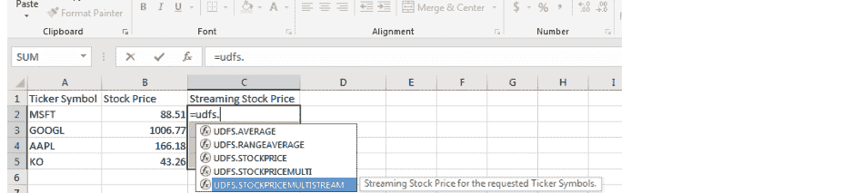

图 32 选择结果区域，并在第一个单元格中输入函数名称。

提供符号区域，并输入以秒为单位的间隔值，以便自动运行该函数。

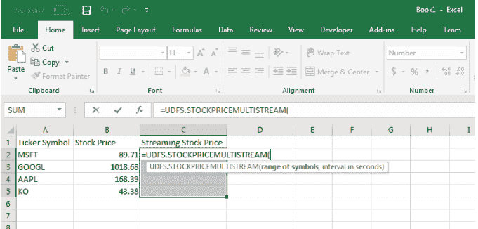

现在通过按 **Ctrl+Shift+Enter** 创建数组公式。

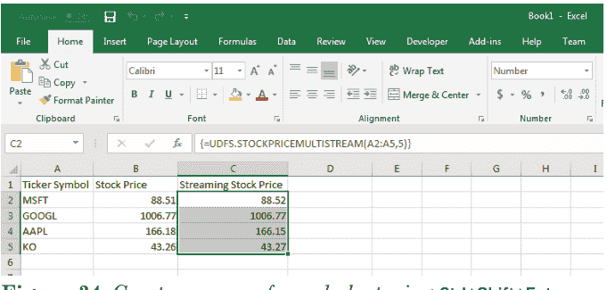

流式函数立即返回第一批结果，然后每 5 秒更新一次单元格内容。

# WRAPPING UP

## FINAL WORDS

## What's Next?

你已经了解了如何创建同步和异步 JavaScript UDF 示例，现在你已经准备好根据本书所学创建自己的 JavaScript UDF 了。你可能还想学习构建自己的 Web 服务，并用你的 JavaScript UDF 获取数据，而不是依赖第三方 Web 服务。

请记住，JavaScript UDF 仍在开发中，本书中介绍的功能和方法预计将在稳定的公共版本中得到改进和更改。你可以关注本书网页的更新：https://www.mrexcel.com/products/excel-javascript-udfs-straight-to-the-point/。

## The Final Function Code

你可以从 https://pub.mrexcel.com/javascript-udfs/ 下载本书中编写的源代码文件。

# APPENDIX

## HOSTING SOURCE FILES LOCALLY

如果你希望在本地计算机而不是远程 Web 服务器上托管加载项源文件，那么需要在 Windows 上安装 Internet Information Services (IIS)。因此，你可以将源文件发布到*本地服务器*，并通过修改清单文件中的相应 `Url` 属性来引用它们。

在以下部分中，你将看到如何在 Windows 上安装 IIS，并设置加载项清单文件以引用*本地服务器*。

### Installing IIS on Windows 7

确保你拥有计算机的管理员权限。转到 **开始** / 控制面板 / 程序，然后选择 **打开或关闭 Windows 功能**。

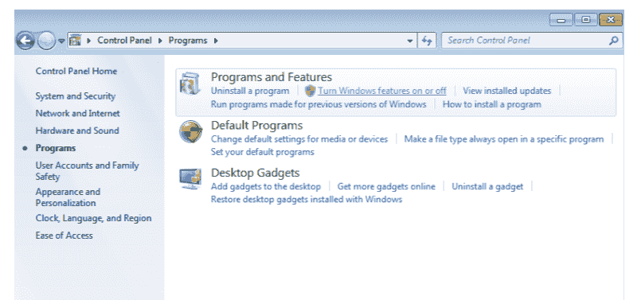

图 35 *转到* 开始 / 控制面板 / 程序。

选择 **Internet Information Services** 以选择要安装的默认功能，然后点击 **确定**。

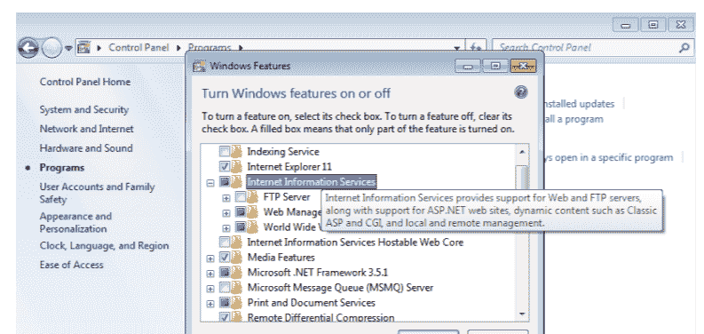

图 36 *在* Windows 功能 *中选择* Internet Information Services。

# INSTALLING IIS ON WINDOWS 7

进度指示器将出现。等待 Windows 完成更改以安装所选功能。

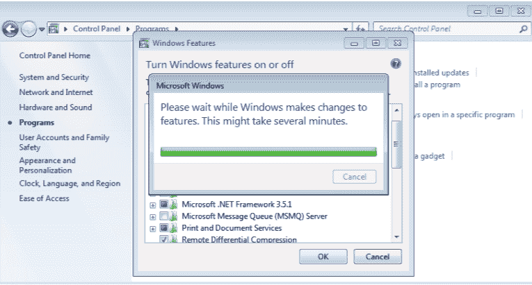

安装完成后，IIS 现在已在 Windows 上以默认配置安装。要确认安装成功，请在浏览器中输入以下 URL：**http://localhost/**。你将看到默认网站已在浏览器中加载。


> **localhost** 是一个表示*此计算机*的主机名，它解析为 IP 地址 **127.0.0.1**，这是一个称为*回环地址*的特殊用途 IPv4 地址。因此，你也可以使用 **http://127.0.0.1/** 来访问本地服务器中的默认网站。

**Adding MIME Type for .json Extension**

IIS 7 默认提供带有 `.html` 和 `.js` 扩展名的文件。然而，`.json` 文件类型默认不被提供。因此，你需要向 IIS 添加 MIME 类型，以允许其提供加载项的 JSON 元数据文件。

为此，请转到 **开始** /控制面板/ 管理工具 / **Internet Information Services (IIS) 管理器** 以打开 Internet Information Services (IIS) 管理器。

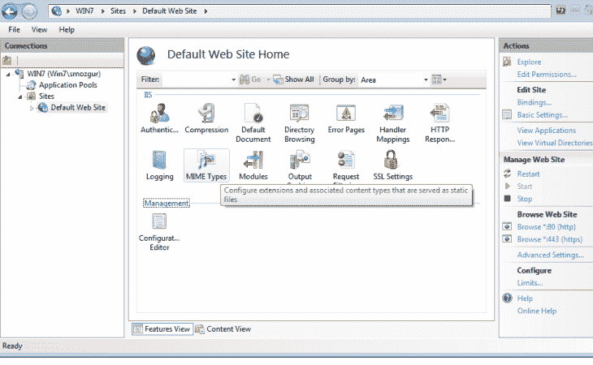

图 39 *打开 Internet Information Services (IIS) 管理器。*

双击 **MIME 类型** 图标，然后点击右侧窗格 **操作** 列表中的 **添加** 快捷方式。在文件扩展名中输入 `.json`，并在 MIME 类型中输入 `application/json`。点击 **确定** 保存新的 MIME 类型。

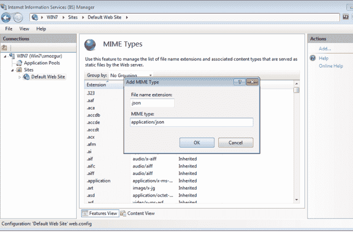

图 40 *为 .json 文件类型添加 MIME 类型。*


## 将源文件复制到本地服务器

在左窗格的**连接（Connections）**列表中选择主服务器，然后点击**重启（Restart）**以使更改生效。重启服务器后，IIS 将开始提供 json 文件类型。

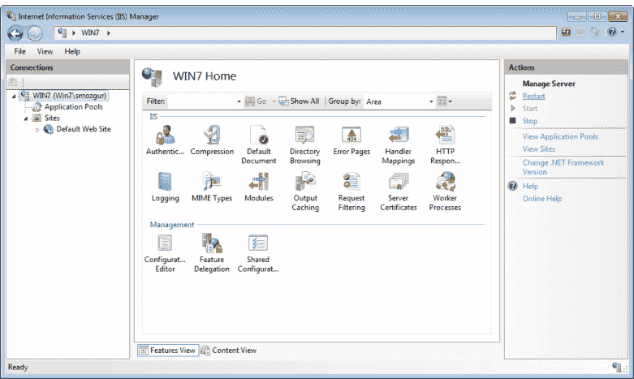

**图 41** *重启服务器以使更改生效。*

## 将源文件复制到本地服务器

IIS 默认在 **%SystemDrive%\inetpub\wwwroot\** 文件夹中创建文档根目录，这是本地服务器的根路径，可通过 localhost 网址访问——**http://localhost/**。转到文档根目录，创建一个名为 **sample** 的文件夹，然后将源文件复制并粘贴到此新文件夹中。

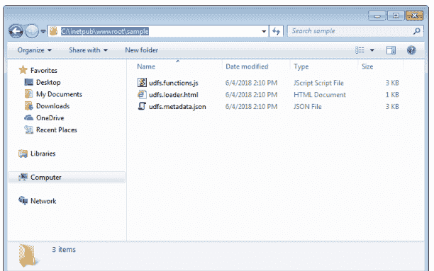

**图 42** *将源文件复制并粘贴到本地服务器的根文件夹中。*

## 更新清单文件

由于您希望将源文件托管在本地计算机上，因此需要更改清单文件中的源文件位置。更新 **udfs.manifest.xml** 文件以应用以下更改，如下所示。

```
Update udfs.manifest.xml

<?xml version="1.0" encoding="UTF-8"?>
<OfficeApp xmlns="http://schemas.microsoft.com/office/appforoffice/1.1"
    xmlns:xsi="http://www.w3.org/2001/XMLSchema-instance"
    xmlns:bt="http://schemas.microsoft.com/office/officeappbasictypes/1.0"
    xmlns:ov="http://schemas.microsoft.com/office/taskpaneappversionoverrides"
    xsi:type="TaskPaneApp">
    <Id>0428f87b-8b69-467b-9fd6-1335a724fe46</Id>
    <Version>1.0.0.0</Version>
    <ProviderName>MrExcel Publishing</ProviderName>
    <DefaultLocale>en-US</DefaultLocale>
    <DisplayName DefaultValue="Excel JavaScript UDFs" />
    <Description DefaultValue="JavaScript User Defined Functions for Excel" />
    <Hosts>
        <Host Name="Workbook" />
    </Hosts>
    <DefaultSettings>
        <SourceLocation DefaultValue="http://localhost/sample/udfs.loader.html" />
    </DefaultSettings>
    <Permissions>ReadWriteDocument</Permissions>
    <VersionOverrides xmlns="http://schemas.microsoft.com/office/taskpaneappversionoverrides" xsi:type="VersionOverridesV1_0">
        <Hosts>
            <Host xsi:type="Workbook">
                <AllFormFactors>
                    <ExtensionPoint xsi:type="CustomFunctions">
                        <Script>
                            <SourceLocation resid="resFunctions" />
                        </Script>
                        <Page>
                            <SourceLocation resid="resLoader" />
                        </Page>
                        <Metadata>
                            <SourceLocation resid="resMetadata" />
                        </Metadata>
                        <Namespace resid="namespace" />
                    </ExtensionPoint>
                </AllFormFactors>
            </Host>
        </Hosts>
        <Resources>
            <bt:Urls>
                <bt:Url id="resMetadata" DefaultValue="http://localhost/sample/udfs.metadata.json" />
```

```
                <bt:Url id="resFunctions" DefaultValue="http://localhost/sample/udfs.functions.js" />
                <bt:Url id="resLoader" DefaultValue="http://localhost/sample/udfs.loader.html" />
            </bt:Urls>
            <bt:ShortStrings>
                <bt:String id="namespace" DefaultValue="UDFS" />
            </bt:ShortStrings>
        </Resources>
    </VersionOverrides>
</OfficeApp>
```

最后，退出并重新启动 Excel，然后使用新的清单文件重新安装加载项。现在，您可以在本地创建和测试自己的 JavaScript UDF 了！

## 索引

| 符号 | |
|:---|:---|
| #GETTING_DATA | 17 |

| A | |
|:---|:---|
| array formula | 26 |
| available functions list | 16 |

| C | |
|:---|:---|
| caching | 18 |
| caller object | 32 |
| cancelable | 32 |
| clearInterval() | 33 |
| Ctrl+Shift+Enter | 30 |

| D | |
|:---|:---|
| debugging formula | 21 |

| E | |
|:---|:---|
| empty string | 30 |
| event loop | 25 |

| H | |
|:---|:---|
| helper function | 24 |

| I | |
|:---|:---|
| Internet Information Services (IIS) | 36 |

| J | |
|:---|:---|
| JavaScript functions file | 4 |
| JSON MIME type | 38 |
| JSON.parse() | 29 |
| JSON string | 29 |

| L | |
|:---|:---|
| Loader HTML file | 5 |
| localhost | 39 |

| M | |
|:---|:---|
| Manifest file | 5 |
| matrix type | 18 |
| Metadata file | 5 |
| multiple stock prices | 26 |
| My Add-ins | 14 |

| O | |
|:---|:---|
| Office Insider | 2 |
| Office Insider sign up | 3 |

| P | |
|:---|:---|
| parameter tooltips | 16 |
| Promise object | 24 |

| R | |
|:---|:---|
| range parameter | 18 |

| S | |
|:---|:---|
| Sample UDFs | |
| *AVERAGE* | 5 |
| *RANGEAVERAGE* | 18 |
| *STOCKPRICE* | 22 |
| *STOCKPRICEMULTI* | 26 |
| *STOCKPRICEMULTISTREAM* | 31 |
| scalar type | 6 |
| setResult() | 25 |
| setTimeout() | 25 |
| stock prices | 22 |
| stream | 32 |

| T | |
|:---|:---|
| timer | 33 |
| Trust Center | 12 |
| Trusted Add-in Catalogs | 12 |

| W | |
|:---|:---|
| web services | 22 |
| Windows registry | 13 |

| X | |
|:---|:---|
| XMLHttpRequest | |
| *onreadystatechange listener* | 25 |
| *readyState property* | 25 |
| *responseText property* | 25 |
