# JavaScript、TypeScript 与 Solidity 详解——100++ 图解

```solidity
// SPDX-License-Identifier: MIT

pragma solidity >=0.7.0 <0.9.0;

contract MyContract {
    OtherContract otherContract;
    
    function doSomething() public {
        try otherContract.doSomething() {
            return true;
        }
        catch Error(string memory) {
            return false;
        }
    }
}
```

```javascript
const flatMap = (array, callback) =>
  array.reduce((accumulator, currentElement, index, originalArray) =>
    accumulator.concat(callback(currentElement, index, originalArray)),
  [], []);
```

```javascript
const objOne = {
  propOne: 1
};

const objTwo = {
  propTwo: 2
};

const merged = {
  ...objOne,
  ...objTwo
};
// => {
//   propOne: 1,
//   propTwo: 2
// }
```

```typescript
interface Article {
  author: string;
  text: string;
  title: string;
}

type InputArticle = Pick<Article, 'author' | 'text'>;

const createArticle = (author: string,
  text: string): InputArticle => {
  // processing...
  return {
    author,
    text
  };
};
```

```javascript
import { ethers } from 'ethers';

const provider = new ethers.providers.JsonRpcProvider('http://localhost:8545');

const signer = new ethers.Wallet(privateKey, provider);

async function main() {
  const contract = new ethers.Contract(address, abi, signer);
  
  // Send a transaction to the contract
  const tx = await contract.someFunction(args, {
    gasLimit: 1000000,
    value: ethers.utils.parseEther('0.1')
  });
  
  await tx.wait();
  
  console.log('Transaction confirmed!');
}

main().catch(console.error);
```

## JavaScript

### 管道运算符

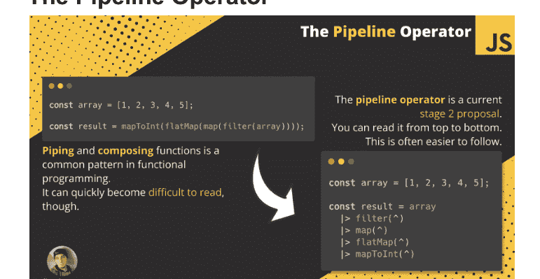

管道运算符看起来也许没什么特别的，而且它是一个有争议的提案，但它有其价值。当然，你可以争辩说将左侧格式化为跨多行可以让代码更具可读性。尽管如此，管道运算符将代码转换为看起来像具有流畅函数式 API 的对象的形式，但实际上并非如此。只要能避免创建类，你就应该这样做。函数式编程更多地关注原语和函数组合，而非对象和状态。类是沉重的，它携带方法和状态。尤其是面向对象-函数式类需要大量的状态转换逻辑，这些逻辑很快就会变得难以维护。因此，在我看来，这种模拟该行为而无需所有必要工作的语法糖，是 JavaScript 一个非常受欢迎的补充。

### 指数运算符

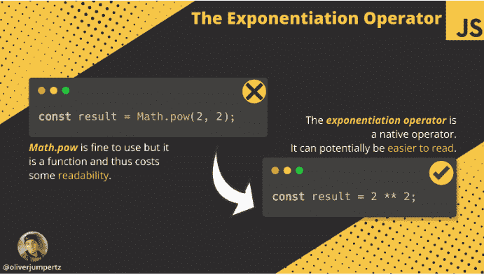

指数运算符是 JavaScript 的一个很棒的补充，它随 ES7 引入。运算符通常比任何方法都有一个巨大的优势：它是原生的，而且更易读。虽然 `Math.pow()` 众所周知，但它仍然是一个方法。它需要更多的字符来编写，而且如果在其他表达式中使用它，很快就会在所有其他代码中变得难以识别。

另一方面，指数运算符只有两个字符长。如果你知道如何做乘法，你也会很快理解如何做幂运算。

特别是在大量拥挤的代码中，运算符通常更容易被发现和识别，可读性应该始终是你的第一优先级。这就是为什么你终于可以弃用 `Math.pow()` 而改用指数运算符的原因。

### 最好使用严格相等比较运算符 `===`

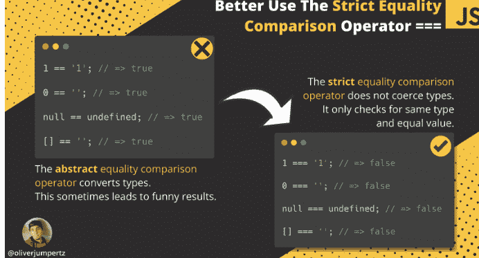

说实话，JavaScript 肩负着许多历史包袱。其中之一就是 `==` 运算符，它只是通过在必要时不断转换类型来松散地检查值的相等性，直到它能判断两个值是否相等为止。然而，只有一个实际的使用场景应该使用 `==`，那就是以下检查：

```javascript
if (variable == null) {}
```

这个检查仅在 `variable` 为 `null` 或 `undefined` 时触发。它们是 JavaScript 中两个主要的"不存在"类型。`null` 用作明确的"什么都没有"信号，而 `undefined` 则是"没有值/属性/定义"的万金油。在其他所有地方，始终使用 `===`。你将以此避免许多 bug 和意外行为。

### 空值合并运算符

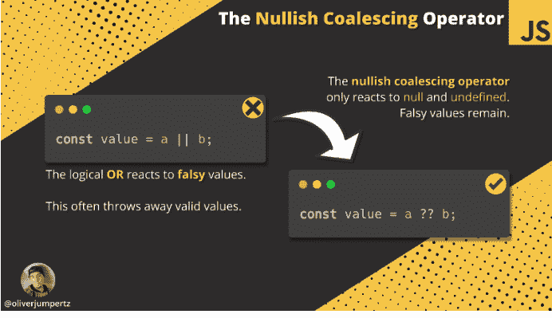

空值合并运算符随 ES2020 引入，为长期使用的逻辑或（`||`）提供了一种替代方案。

此运算符检查左侧是否为 `null` 或 `undefined`。当该条件为真时，运算符取右侧值作为默认替代值。

这比对所有假值都有反应的逻辑或更加简洁。如果 `a` 是 `null`、`undefined`、`0`、`''`、`false` 或 `NaN`，在上面的例子中 `b` 将被取为替代值。

空值合并运算符是逻辑或的合适替代品——当除了 `null` 和 `undefined` 之外的至少一个假值（尤其是 `0`、`''` 和 `false`）是你接下来要执行的操作的完全有效值时。

### 解构赋值

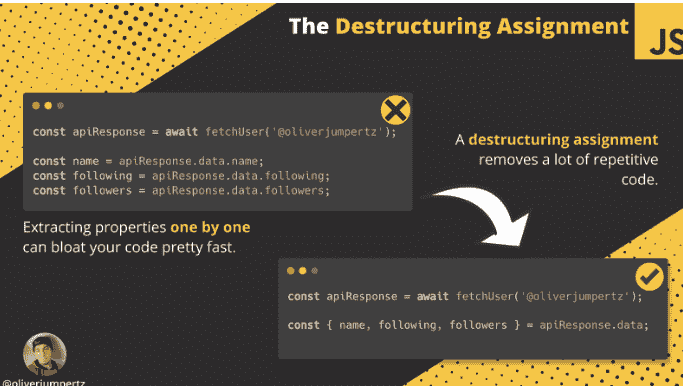

2015 年发布的 ES6 首次在 JavaScript 的历史中添加了许多新的重要功能。除了 `let`、`const` 和箭头函数之外，ES6 还添加了解构赋值。每当你需要从对象中提取一个或多个属性时，从现在开始你可以省去用点表示法访问属性的麻烦。使用 `let` 或 `const`，用花括号括住你想要提取的属性，并在它们之间加上逗号，你就得到了一个更具可读性的语句，它仅用一行就完成了多项操作。一个巧妙的副作用是你只需在一个地方更改要提取的对象路径，而不是多个地方。

### 从可能未定义的属性中解构

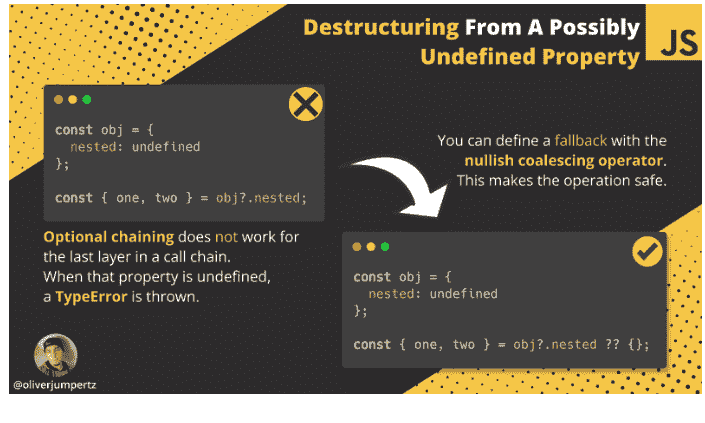

解构本身非常棒，但它有其局限性。当你尝试从一个为 `null` 或 `undefined` 的对象中解构时，可能会在运行时迅速遇到 `TypeError`。可选链（在属性后追加 `?`）在调用链的最后一个属性上不起作用。

空值合并运算符在值为 `null` 或 `undefined` 时提供回退。如果链的最后一个属性不存在，提供一个空对象作为回退可以使你的语句在运行时有效并防止 `TypeError`。所有提取的属性都将是 `undefined`，但这是你可以处理的。有时对 `null`/`undefined` 做额外检查比用 `try-catch` 块包裹解构语句更好。

### 将对象解构到已有变量中

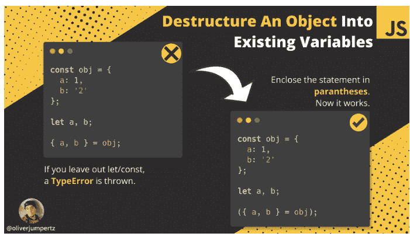

虽然对象解构非常直观，但解构到已有变量中则不然。如果你不在花括号前放置 `let` 或 `const`（如通常所做的那样），你会遇到令人不快的 `SyntaxError`。这是因为运行时将花括号视为一个代码块，并在该代码块中发现一个或多个由逗号分隔的标识符。这不是 JavaScript 语法通常在代码块中提供的内容，因此会抛出 `SyntaxError`。然而，如果你用括号将整个语句括起来，语法就会再次正确，你的语句也能工作。如果你现在问自己可能在哪里需要这样做，特别是模块级别的延迟初始化变量，就可以用这种方式初始化。

### 无限展平任意数组

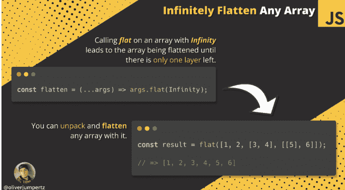

`flat` 是一个有趣的数组方法。它的主要用例是接受一个多维数组，并将其展平一个或多个维度。层级由你作为参数传入的数字定义。一个三维数组，通过 `.flat(1)` 展平后，将变成二维数组，依此类推。

这在哪里有用？首先，当你处理多维数组时，你需要展平。但另一个用例就是上面所示的。当一个函数接受许多可能也包含数组的参数，而你希望将它们全部放入一个长的一维数组中时，你可以使用像上面那样的工具函数将它们全部展平。`Infinity` 是这里唯一的参数，因为它比 JavaScript 中任何其他数字都大。这使得 `flat` 会一直工作，直到它在原始数组中找不到更多嵌套数组。

### 数组解构

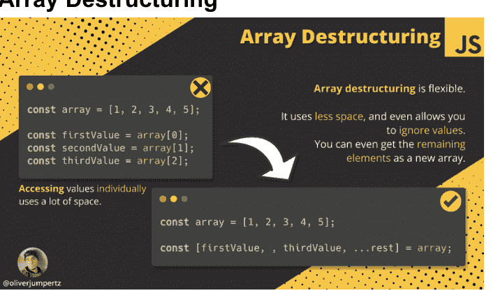

ES6 不仅引入了对对象的解构赋值，也为数组引入了同样的特性。它的工作方式与对象几乎相同，但使用的是方括号而不是花括号。使用场景也与对象相同。当你想从数组中提取多个值时，通常需要多行代码。一行提取一个元素。而解构语句让你可以在一行中完成，甚至允许跳过中间的元素。具体用法是：先在前面放置 `let` 或 `const`，然后使用左方括号，并定义你想要提取的值。第一个变量被赋值为数组索引 0 处的元素，第二个变量为索引 1 处的元素，依此类推。接着用右方括号关闭左侧，后跟一个等号，再跟上要解构的数组路径。

正如你可能已经注意到的，你甚至可以在某个位置留空，只放另一个逗号。该索引处的元素将被忽略，不会被提取。

### 使用解构在数组内交换元素

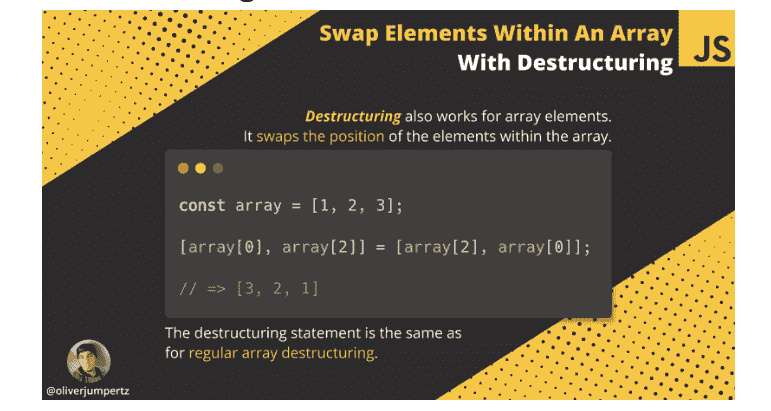

你是否曾经写过这样的代码？

```javascript
const array = [1, 2, 3];
const tmp = array[0];
array[0] = array[2];
array[2] = tmp;
```

这是经典的交换操作。它需要三行代码并借助一个临时变量。但自从 ES6 引入数组解构以来，就有了这种多行交换的替代方案。

这里发生的不过是一个数组解构语句。你可以这样理解：

创建一个数组，将 `array[2]` 放在索引 0 处，将 `array[0]` 放在索引 1 处。然后通过解构将这个数组的值分别赋给 `array[0]` 和 `array[2]`，即将索引 0 处的值放入 `array[0]`，索引 1 处的值放入 `array[2]`。

看到了吗？与使用临时变量的交换没有太大区别，但写得更简洁，只需一行而不是三行。

### 使用数组展开保持数组不可变

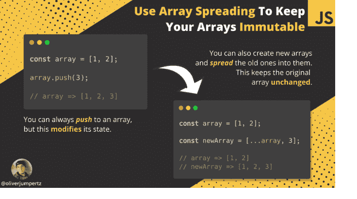

数组本质上是可变的。尽管 JavaScript 的数组并非原生数组，但它仍然是可变的数据结构。你随时可以追加元素或删除它们。不过，所有的函数式方法都会创建新数组，这是有充分理由的。不可变性让开发者的工作更加轻松。可变性的一个常见问题出现在 React 中。你是否曾经尝试向一个在 JSX 中引用的数组追加元素？如果是，你可能已经注意到什么都没有发生。这是因为 React 期望不可变的数据。如果引用发生变化，你需要更新引用（例如使用 `setState`）。使用展开运算符创建新数组来保持数组不可变，是确保不可变性的一种模式。你创建一个新数组，复制旧数组的内容，然后追加你想要追加的元素。

### 将稀疏数组作为参数展开

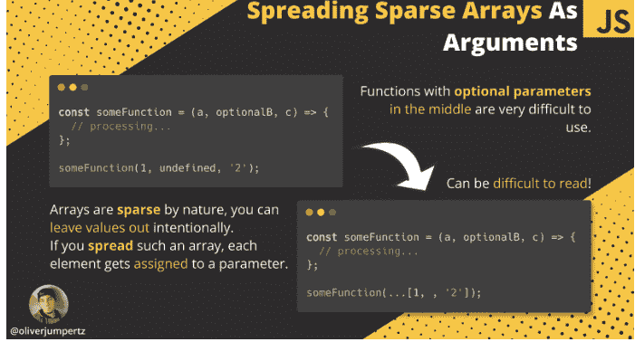

作为开发者，我们并不总是面对最优的功能，有时即使是库开发者也会犯错。其中之一就是将可选参数放在函数参数列表的中间。你不能跳过它们，但你也不需要它们。

你现在可以直接在那里传入一个显式的 `undefined`，放在调用中间，但这看起来不太好。

另一种方法是使用一个小技巧，尽管你需要小心，因为可读性有时会受到影响。

其核心思想是将稀疏数组展开到函数中。稀疏意味着有元素被省略。这对数组是有效的，运行时会假设该值隐式为 `undefined`。你在数组元素列表中看到的只是一个空位。如果你现在将这样的稀疏数组作为函数的参数展开，每个数组元素都会被分配给参数列表中对应的参数。第一个元素成为第一个参数，以此类推。

有时，这可以省去一些麻烦，但也不应该过于频繁地使用。

### 合并多个对象

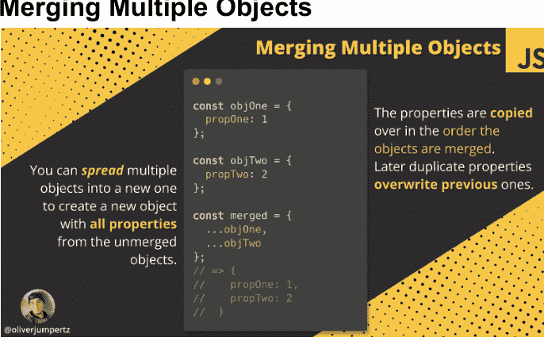

将多个对象合并成一个一直是一项常见的操作。每当你想处理选项对象和默认值时，合并就是方法。你先取默认选项，然后合并用户填写了数据的对象，最终得到你的函数或 API 可以使用的结果。

很长一段时间里，你会这样做：

```javascript
const myFunc = (options) => {
  const mergedOptions = Object.assign({}, defaults,
    options);
};
```

然而，thanks to 展开语法，如今这个操作变得前所未有的简单。创建你的新对象，然后按顺序将所有其他对象展开到其中。它的工作方式也与 `Object.assign()` 相同：

在链中后面展开的对象的属性会覆盖已经存在的属性。

### 使用 `Freeze` 使对象不可变

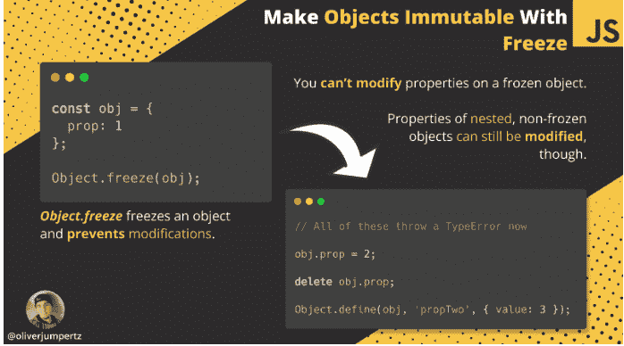

不可变性是函数式编程的核心概念。然而，JavaScript 有着相当坎坷的历史。它最初在几天内创建，被设想为一种具有原型继承的语言，却混杂了许多不同的概念。我们最终得到的结果是，例如，直到最近才在类上引入了私有属性。也没有任何关键字可以使对象上的属性不可变。

幸运的是，Object 有一些相当有用的辅助方法来处理各种对象，其中之一就是 `freeze()`。`freeze()` 的作用是使任何对象完全不可变。被冻结对象的任何属性都无法再修改，从此固定不变。然而，这只是一个浅层操作。任何本身是对象的嵌套属性仍然未冻结，可以被修改。

如果你想深度冻结一个对象，你需要么使用像 lodash 这样的库，要么编写自己的递归深度冻结函数。

### 使用 `Freeze` 使数组不可变

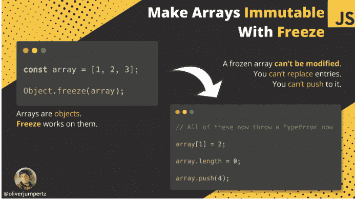

数组不过是具有一些独特功能的对象，这意味着 `freeze()` 对数组也同样有效。如果你冻结一个数组，它会变得和其他任何对象一样不可变。无论之后你尝试什么操作，都会抛出 `TypeError`。唯一的缺点是，这个操作对数组和对对象一样都是浅层的。如果你还想冻结所有可能嵌套的数组或对象，你需要使用深度冻结函数。

如果你只想处理不可变数据，请冻结你的数组。唯一的缺点是查询所有操作都会在运行时抛出异常，这使得你的用户很难进行推理。

如果你想要一个万无一失的方案，唯一的替代方案是使用库中的不可变数组实现，比如 Immutables，它们甚至不提供可变方法。这是确保你的用户在使用你的数组或集合时不会遇到意外情况的唯一方法。

### 处理对象时使用 `Array.findIndex`

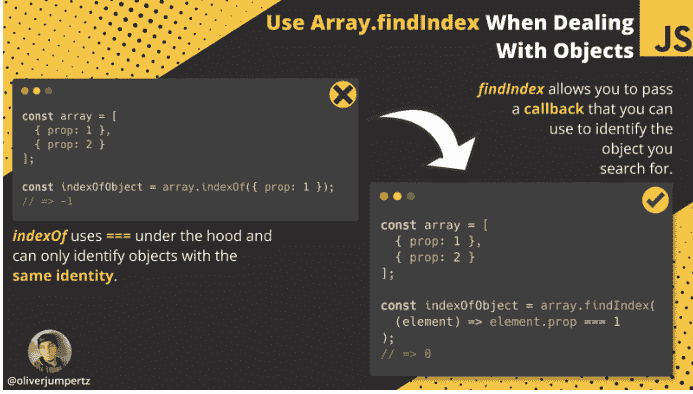

数组的 `indexOf()` 方法有所欠缺。在底层，它使用严格相等比较运算符（`===`）来比较元素和你搜索的值。如果你曾经尝试在 JavaScript 中比较两个内容相同的不同对象，你就知道这行不通。`===` 对对象只测试同一性。你永远无法可靠地使用 `indexOf` 来查找数组中某个对象的索引。

幸运的是，数组有了 `findIndex()` 方法，它接受一个回调而不是仅仅一个值。使用这个方法，你可以传入一个（箭头）函数并实现你自己的相等性测试。这允许你通过测试属性的存在性和相等性来可靠地识别对象。

每当你知道自己在处理对象时，最好直接使用 `findIndex()`。它肯定能为你省去很多麻烦。

### 解构函数参数以提高用户可读性

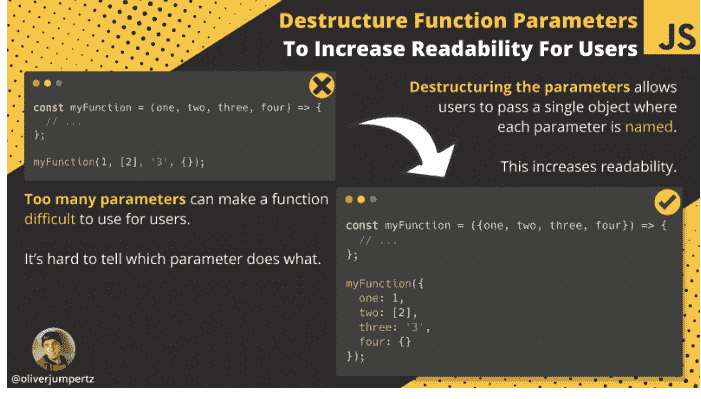

函数的冗长参数列表难以阅读和理解。许多 IDE 和编辑器至少会显示工具提示来标识每个参数及其含义，但你仍然会经常感到困扰。JavaScript 是动态的，这意味着你可以在任何地方传递任何东西，所以你甚至手头没有类型提示。

传递一个对象是让你的函数更易于使用的好方法。而在实现端，你可以直接在参数列表中解构这个对象。这允许你在函数体内使用单独的变量，而你的用户可以传入一个带有命名属性的普通对象。

一个好的经验法则是，在超过三个参数后，将单独参数切换为对象。请记住，这对现有函数来说是一个破坏性变更，所以最好事先周密计划。

### 获取数组的最后几项


JavaScript 对数组的灵活性不如 Python 对其列表那么强，但也并非完全无能为力。Python 有切片语法，而 JavaScript 有 `slice()` 方法来获取数组的特定切片。该方法足够灵活，可以通过传入负数来获取数组的最后 n 个元素。

你得到的是一个新数组，包含原始数组的最后 n 个元素，顺序保持不变。这对于大多数用例来说已经绰绰有余，而这些用例本身也相当少见。你通常并不需要频繁使用它，但当你确实需要时，你知道手头有工具可以完成任务。

### 使用 `Array.at` 从末尾访问元素

虽然在数组上调用 `slice()` 并传入负数会返回该数组的最后 n 个元素作为新数组，但 `Array.at()` 是在 ES2022 中专门引入的，为开发者提供了一种轻松访问数组中任意位置单个元素的方法。

当使用正数调用时，该方法本身并没有太大意义。在这种情况下，它并不比方括号表示法提供更多实用功能。然而，负数允许你从数组末尾访问元素。传递 `-1` 通常比 `array.length - 1` 更具可读性。

### 使用默认参数使参数变为必需

JavaScript 是一种动态类型语言。没有类型，就无法轻松声明一个变量或参数是否可以是 `undefined`。

在 JavaScript 中，你通常通过运行时检查和文档记录函数的必需参数来解决这个问题。函数的参数越多，函数体的可读性就越差。

但好消息是，你可以使用默认参数来使函数体摆脱所有样板代码。每当参数为 `undefined` 时，就会触发默认参数。在这种情况下，会调用一个预制函数，该函数抛出一个错误。将这些检查放在函数的参数列表中，可以让函数体专注于实际实现。如果你现在将函数的参数列表格式化为每个参数占一行，你就能得到相当可读的代码。

### 数字分隔符

数字分隔符看起来不起眼，但它们是 JavaScript 的一个绝佳补充。在 ES2021 中引入，你可能仍需要使用 Babel 才能在生产应用中可靠地使用它们。

易于阅读的大型数字对于快速理解代码至关重要。如果你曾不得不猜测一个超过六位数的数字代表什么，你就会明白与之相关的痛苦。

从现在开始，你可以在数字中构建逻辑分组，从而更轻松地快速获取正确的值。

数字分隔符适用于所有类型的数字，包括二进制、八进制、十六进制和科学计数法：

```
const bytes = 0b111_001_101;
const octal = 0o123_476;
const hex = 0xFAB_F01;
const scientificNotation = 1.123_312_32e-16;
```

### 快速过滤掉数组中的所有假值

一等函数很棒，你可以像使用任何其他变量一样，将它们作为参数使用。在底层，函数是使用调用者提供的所有参数来调用的。

`Boolean` 构造函数是 JavaScript 中处理真值和假值的专家。当你进行比较并且某些内容被隐式转换为布尔值时，底层就会调用此函数。这使得它成为传递给 `filter` 以快速排除所有假值的首选。底层的调用如下所示：

```
const result = array.filter(
  (element, index, array) =>
    Boolean(element, index, array)
);
```

`index` 和 `array` 被忽略了，因为 `Boolean()` 只接受一个参数，这里就是 `element`。

### 从数组中获取所有唯一值

这种从数组中获取所有唯一值的方法结合了一些对 JavaScript 来说较新的技术。首先，它使用 `Set`。这是一种只包含唯一值的数据结构（与数学集合原理相同）。`Set` 是所谓的可迭代对象，可迭代对象是元素的集合，这些元素都可以被迭代。当用于可迭代对象时，扩展运算符从这些可迭代对象中提取所有值，并将其放置在扩展运算符使用的位置。在这个例子中，该 `Set` 中的所有唯一值都被放入一个新数组中，从而创建了一个唯一值的集合。然而，这种方法有一个缺点。它不适用于对象，因为 `Set` 构造函数在底层使用 `===` 来检查相同的元素。正如你可能在本书前面记得的，即使两个对象在内容上完全相等，对于 `===` 来说也永远不能被视为等价，因为该操作符检查的是对象的身份。

### `Promise.race` vs `Promise.any`

你可能已经使用过 `Promise.all()` 来收集多个 Promise 并等待它们全部完成。不过，Promise 对象本身包含更多静态实用方法。

`Promise.race()` 是一个方法，它接受多个 Promise，并恰好等到其中一个 Promise 决定（settled）。它并不关心该 Promise 是拒绝（rejected）还是 fulfilled（已实现）。如果 Promise 成功，你会得到其值。如果被拒绝，则会抛出一个错误，你可以捕获该错误。

`Promise.any` 也接受多个 Promise，并等待第一个 Promise 成功决定。即使 10 个 Promise 中有 9 个被拒绝，只有最后一个成功决定，你也会得到成功那个的结果。只有当所有 Promise 都被拒绝时，`Promise.any()` 才会抛出一个 `AggregateError`。

### 如何创建一个可取消的 Promise 延迟

异步操作通常遵循相同的模式：你启动它们，等待它们完成，在此期间你可以做其他事情。这就是 Promise 的工作原理。特定代码的执行会暂停，直到 Promise 解析（resolve）。与此同时，事件循环可以继续工作，并执行其他在此时刻不需要等待的代码。当 Promise 决定（settled）时，事件循环会再次获取它，并尽快运行它，无论 Promise 是失败还是被拒绝。然而，有时你希望在触发操作之前稍作等待。在这种情况下，你可以使用 `setTimeout()` 并将其与 Promise 结合使用。在指定的超时时间后，`setTimeout()` 成功决定 Promise，基于此，你可以使用 `then()` 方法链接任何你想要的操作。如果你不再需要 Promise 决定，你可以通过 `cancel()` 方法轻松中止它。如果超时被取消，Promise 会拒绝，你可以使用 try-catch 块或 `catch()` 来处理。

### 注意自动分号插入

JavaScript 有一个称为自动分号插入（ASI）的概念。在代码中的某些地方，运行时会在行尾期望一个分号。否则，它会为你“插入”一个（它只是假定有一个，并不会改变你的代码）。上面的例子是 ASI 可能会让你惊讶的更“常见”的情况之一。两个代码片段看起来几乎相同，但它们在一个微妙的细节上有所不同。左边的花括号放在新行上，return 语句单独成行。在右边，return 语句后面直接跟着同一行上的花括号。

左边的代码将触发自动分号插入。return 语句没有任何内容保持其开启状态，因此会被运行时关闭。一个空的 return 语句等同于返回 `undefined`，而你想要返回的对象则变成了无法访问的死代码。这就是为什么 linter 如此重要，它们可以警告你这种微妙的错误，甚至自动为你修复这些问题。

## 使用 Performance API 测量执行时间

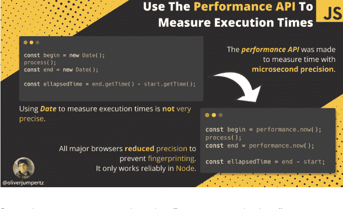

有时你会看到有人使用 `Date` 或 `console.time()` 来测量执行时间。然而，这些测量方法有一个缺点，那就是精度。听起来可能不算什么，但这两种方法都只能达到毫秒级精度。而 Performance API 则可以达到微秒级精度。给你一个直观的概念：1000 微秒等于 1 毫秒。你可能会问，这么高的精度真的有意义吗？但这里有一些数据供你参考：一次代码变更使某个函数的执行时间增加了 500 微秒。该函数每月被调用十亿次。这意味着额外增加了 138.89 小时的计算开销！使用毫秒级精度，你很难捕获这类性能回归。不过，这个 API 本身也有一个很大的缺点。它在浏览器中的精度会被降低，因此只能在 Node 中可靠使用。

## 处理可能返回值或 Promise 的返回值

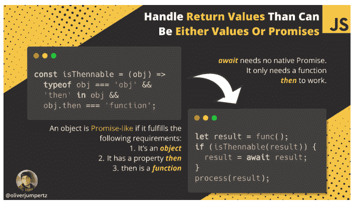

JavaScript 是动态类型语言。通常你只有查阅文档、了解返回值或者亲自尝试之后，才能知道调用一个函数会得到什么。而且也没有可靠的方法来判断一个函数是否是异步函数。很多测试形式在你把函数改成箭头函数后就会失效。不过，你可以利用 JavaScript 的两个特性来应对。首先，你不需要直接 `await` 一个 promise。其次，`await` 只需要一个 `.then()` 方法就能工作，它并不检查是否是原生 Promise。你的解决方案是：对于那些可能直接返回值也可能返回 Promise 的函数，对函数调用的结果进行检测。如果它是一个 Promise，它的类型是 object，且它有一个 `then` 属性，该属性是一个函数。在这种情况下，你可以随后对该结果使用 `await`，从而尽可能简洁地处理两种情况。

## 使用 Reduce 对数组值求和

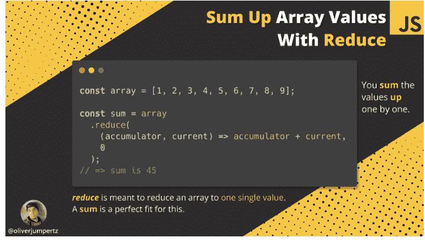

对数组值求和是 `reduce()` 最直接的用例之一。这是一个很好的入门示例，能帮你了解最重要的数组方法之一。

`reduce` 的方法名已经很好地说明了它的初衷——接受一个数组并将其缩减为单个值。对数组值求和正是这种缩减的典型场景。你接收一个数字数组，然后返回一个数字，表示该数组中所有数字的总和。

不过，你稍后会了解到 `reduce()` 还有更高级的用例，可以用来重新实现许多其他数组方法，这也体现了这个方法的重要性。

## 你的自动 React 版权页脚


这个技巧/说明最初只是年末的一个玩笑，但它背后确实很有道理。

很多开发者只是在页脚放一个静态的版权信息，然后就再也不管了。

然而，JavaScript 使得即使是这样简单的任务也可以轻松自动化。快速创建一个 `Date` 对象、获取完整的年份，然后将其动态渲染到页面页脚中，这并不需要花多少时间。

只需几分钟就能完成，却能为你省去多年的重复劳动。

## `for` 循环详解

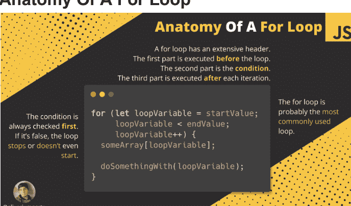

`for` 循环是几乎所有编程语言都有的基本循环。掌握这种循环是每个软件开发者的必备技能。

当然，JavaScript 也有 `for` 循环，其工作方式与许多其他语言相同。

`for` 循环的头部包含三个部分。左边的是初始化部分。你可以在这里放置多条语句，用逗号分隔，它们只在循环开始前执行一次。中间的部分是条件判断。它应始终返回一个布尔值，表示循环是否应继续执行。最右边的部分在每次迭代步骤之后执行一次。通常在这里递增循环计数器。你也可以在这里放置多条语句，用逗号分隔。

在循环体中，你放置每次迭代需要执行的所有语句。它可大可小，随你决定。不过一个好的经验法则是尽量保持简短，最好将过多的逻辑抽象到专门的函数中。

## `while` 循环详解

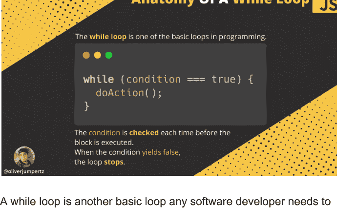

`while` 循环是每个软件开发者都需要了解的另一种基本循环。

当然，JavaScript 也有 `while` 循环，而且它的工作方式同样与许多其他语言相同。

在 `while` 关键字之后，你放置一个条件，只有满足该条件循环才会继续。该条件在每次迭代步骤之前被检查。这意味着如果条件始终不为 `true`，循环将永远不会执行。条件之后，你可以放置一个包含任意数量语句的代码块。所有语句在每次迭代中按顺序执行一次。

JavaScript 中有一点略有不同，那就是条件会被检测真值性（truthiness）。也就是说，除了 `true` 之外，它还接受字符串（空字符串除外）、数字（0 除外）、对象、数组等。但为了清晰起见，你通常应该坚持使用布尔值。也有一些例外情况可以利用假值性（falsy），但非常少见。在大多数情况下，最好使用布尔值，或者编写一个工具方法来进行检查并返回相应的布尔值，这样便于命名和理解。

## `do-while` 循环详解

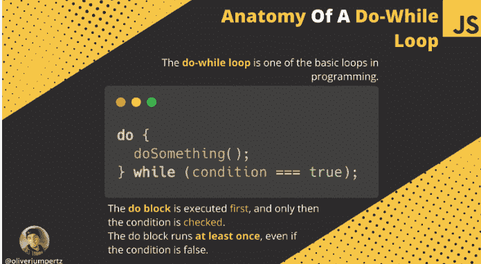

循环类型有很多，`do-while` 循环就是其中之一。你可以把 `do-while` 循环看作 `while` 循环的替代版本，它有一个特别的不同之处。它不是在每次迭代步骤之前检查条件，而是在之后检查。它的写法也体现了这一点。

首先是 `do` 语句，之后你可以打开一个代码块。在该代码块中，你可以放置任意数量的语句。代码块之后，一个 `while` 语句打开一个条件块，你在其中放置一个布尔表达式进行求值。这个语句顺序正是循环的执行顺序。`do` 块首先被执行，然后才检查条件。

这也导致了 `do-while` 循环的一个非常特定的行为：无论条件在开始时是 `true` 还是 `false`，`do` 块至少会执行一次。

因此，当条件依赖于某些需要先求值的东西时，`do-while` 循环始终是一个很好的选择。

## `for-of` 循环详解

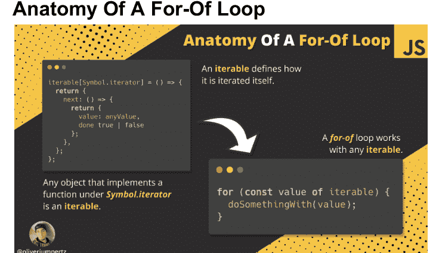

又一种循环，但这次它比其他的更特殊一些。`for-of` 循环是 JavaScript 中其他语言里 for-each 循环的变体。它不需要处理数组和索引等，只需要知道你要迭代的对象即可。

每个对象都可以有一个放在 `Symbol.iterator` 下的方法。该方法返回一个包含一个专用方法 `next()` 的对象。这个方法返回一个包含两个属性的对象：`value`，即当前迭代步骤的值；以及 `done`，表示循环是否已完成。

一旦一个对象提供了这个接口，你就可以为它创建一个 `for-of` 循环。循环头部包含关键字 `for` 和括号内的一个代码块。你用 `const` 或 `let` 声明一个变量（每一步都会重新声明），在 `of` 关键字之后放置所谓的可迭代对象（iterable）。那就是在 `Symbol.iterator` 下实现了方法的对象。

这种循环是不泄露实现细节的一个典型示例。无论对象有索引还是其他什么，都不重要。

### 对象解构赋值的剖析

对象解构赋值是从对象中提取一个或多个属性的好方法。如果你想让代码更易读，它们确实是省时省力的好帮手。使用起来相对简单，不过你需要先熟悉一下语法。但一旦习惯了，这种写法会比通过长属性链访问对象好得多。语法本身值得记住：以 `let` 或 `const` 开头，然后放上花括号，里面列出所有要提取的属性名。在花括号内，你可以重命名每个变量并设置默认值。之后是一个普通的赋值语句，只是在这个场景下，它指明了要从哪个对象中提取属性。

### `Array.map` 的剖析

`map()` 是一个函数式数组方法，其作用是将一种类型的值转换为另一种类型的值。

这个函数属于一系列将“如何做”抽象掉、让开发者专注于“做什么”的函数之一。开发者无需关心数组的迭代过程，`map()` 会处理。开发者唯一需要关心的是想实现什么。这里具体指的就是值的转换。

来看这个例子：

```
const numbers = [1, 2, 3];
const multipliedByTwo = numbers.map((num) => num * 2);
```

你只需要指定值如何转换即可。在这个例子中，你想将每个值乘以二。对你而言，`map()` 使用 `for` 循环、`for...of` 循环还是其他方式并不重要。你知道当 `map()` 执行完毕时，你会得到一个新数组，其元素是原数组值乘以 2 的结果。

38

### `Array.flatMap` 的剖析

`flatMap()` 是另一个函数式数组方法。它的工作方式类似于 `map()`，但有一个区别。它不是将一个值转换为另一个值，而是将一个值转换为一个值的数组。然后这些值会被追加到一个新数组中。来看一个简单的例子。假设你有一个 `authors` 对象，其中包含了每位作者出版的所有书籍。现在，你想获取一组特定作者的所有书籍。

```
const authors = [{books: [...]}, {books: [...]}];
const allBooks = authors.flatMap((author) =>
  author.books);
// allBooks 现在是一个包含所有书籍的扁平化数组
```

如果使用 `map()`，你现在得到的将是一个二维数组。而 `flatMap()` 为你提供了一个单一数组，其中的书籍按以下顺序排列：首先是第一位作者的所有书籍，然后是第二位作者的所有书籍，依此类推。

### `Array.forEach` 的剖析

`forEach()` 是一个函数式数组方法，其存在是为了让你执行副作用操作。与 `map()` 或 `flatMap()` 不同，`forEach()` 不期望从回调函数返回任何值。它的唯一目的是让你消费数组的值。当你使用 `forEach()` 时，不会得到一个新数组作为结果。这意味着你无法继续链式调用其他函数式方法。`forEach()` 有两个常见的使用场景：一个是打印数组的元素，另一个是作为 `for` 循环的替代品，利用闭包实现，例如下面这样：

```
const books = ...;
books.forEach((book) => {
  if (book.author === 'Steven King') {
    stevenKing.push(book);
  }
});
```

你只需声明你想要做什么。`forEach()` 会为你处理剩下的事情。

### `Array.every` 的剖析

`every()` 是又一个函数式数组方法。其作用是测试数组中的所有元素是否都满足传递给它的回调函数中指定的条件。

`every()` 的一个用例是当你想测试一个数组是否是另一个数组的子集时，就像这样：

```
const array = [1, 2, 3];
const containsTwo = array.some((element) => element
=== 2);
// => true
```

你还会在本书后面的几页中发现 `some()` 的另一个好用例。

41


### 如何格式化 `JSON.stringify()` 的输出

可能不太为人所知，但 `JSON.stringify()` 有三个参数。第一个是要序列化的对象。第二个是替换器，你可以用来转换值。第三个是缩进。如果你曾想以人类可读的方式格式化 JSON，而不是全部挤在一行，你可以使用这个参数，传入一个数字或字符串。传入数字表示用于缩进的空白字符数（最大为 10）。如果使用字符串，则该字符串的前十个字符将用于缩进序列化后的 JSON 输出。

### `Array.entries()`

尽管有多种遍历数组的方式，`entries()` 似乎并不起眼。但事实上，考虑到 `Set` 和 `Map` 也有相同的方法，`entries()` 是一个非常有用的数组方法。对于数组、集合和映射，你涵盖了 JavaScript 所有内置的数据结构。这意味着我们拥有的所有数据结构都可以通过一种通用的方式来遍历。

通过使用 `entries()`，你可以编写通用的逻辑，通过“键”和“值”来处理 JavaScript 中的任何数据结构。

对于数组，`entries()` 返回一个迭代器，产生 `[index, value]` 元组。对于集合，它返回 `[value, value]` 元组。对于映射，`entries()` 返回 `[key, value]` 元组。

得益于数组解构，你可以将“键”和“值”作为单独的变量获取，并按你的意愿处理它们。这使得 `entries()` 成为唯一能在所有数据结构上统一工作的迭代接口。

### 如何测试数组是否包含特定对象

JavaScript 有其奇特之处。其中之一就是，如果没有库中的 `deepEquals` 函数帮助，你无法可靠地比较两个对象。这也影响了内置的数组方法，如 `includes()`、`indexOf()` 等。

你不能使用 `includes()` 来测试数组中是否包含一个对象。即使你的对象与传入 `includes()` 的对象完全匹配，它也不起作用，因为它们具有不同的标识。幸运的是，数组的 `some()` 方法允许你传入一个回调函数。通过这个回调函数，你可以自己实现相等性检查。如果你测试通常是原始类型的所有属性，你可以准确地提示需要查找什么。

更妙的是，`some()` 在数组中至少有一个元素满足检查时就返回 `true`。这正是你需要的；一次命中就足以验证该对象包含在数组中。

### 模板字面量

模板字符串是在 ES6 中引入的，旨在让开发者更容易地进行字符串插值。它们还提供了一种创建多行字符串的简单方式。

模板字符串的工作方式如下：

```javascript
`You can add any ${variable} inside the backticks and ${theJavaScriptRuntime} takes care of ${creatingOneString} for you. Even better, inside the blocks, you can even call methods or do calculations like ${1 + 2 * 10}.`
```

这种构建字符串的方式比使用 `+` 运算符拼接字符串更具可读性。尤其是语法高亮功能，使得模板字符串的使用非常直观。

如今，几乎没有理由再使用 `+` 运算符拼接字符串，除非是在循环中追加变量。后者当然仍然是一个非常有效的用例。

### `Array.length` 并非普通属性

数组的 `length` 属性在很多方面都是个例外。它最有趣的行为之一是，你可以通过将 `length` 设置为 0 来截断数组。是的，你没看错。你可以设置 `length` 属性并用它来清空数组。

这是因为 `length` 被实现为一个 getter 和 setter 方法。这样，每当有人访问或赋值给这个属性时，你都可以执行操作。

这种行为令人惊讶，所以我并不推荐任何人这样做。我们区分属性和函数是有原因的。如果我调用 `length()` 或 `length(arg)`，我期望会有不同的事情发生，因为括号表示这是一个函数。

我个人不知道最初为什么会实现这种行为。尽管如此，似乎连语言的创建者也后悔了这个选择，因为这种技术在 JavaScript 标准库中并未广泛使用。

### 正确对数字进行排序

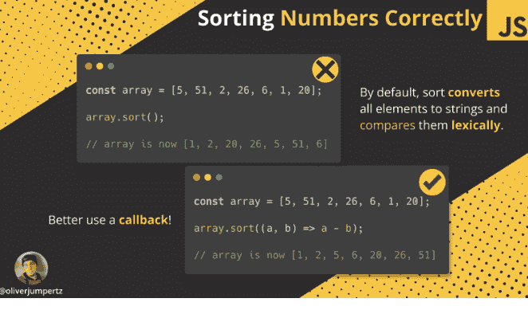

JavaScript 在排序方面的行为相当独特，但原因相对简单。如果你曾尝试对数字数组调用 `sort()`，你可能会惊讶地发现数字并没有按你期望的方式排序。这是因为 JavaScript 是动态类型的。一个数组可以包含多种不同类型的元素，而只有一种通用类型能涵盖所有其他可能的类型，那就是字符串。因此，`sort()` 在没有回调函数时，会将元素转换为字符串，然后进行字典序比较。`[1, 2, 11, 21]` 排序后 thus 变成 `[1, 11, 2, 21]`。你可以通过向 `sort()` 传递一个回调函数来解决这个问题，其预期逻辑如下：如果 `a > b`，返回正数；如果 `a < b`，返回负数；如果 `a === b`，返回 0。`a - b` 正好实现了这一点。当你传递这个回调函数时，就能轻松地将数字数组按升序排列。如果你想要降序排列，`b - a` 就是你的方法。

### 使用 `Array.includes()` 代替 `indexOf()`

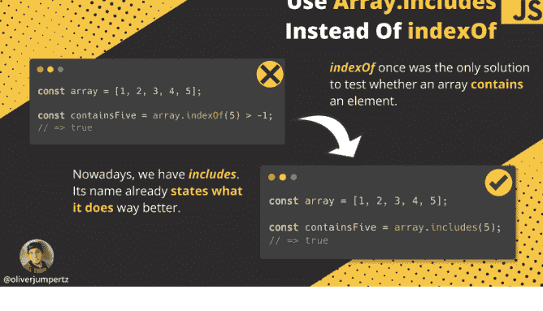

如果你在较早的时候使用 JavaScript，你可能还记得用 `indexOf()` 来测试数组是否包含某个特定元素。这是因为当时数组没有 `contains/includes` 方法。

值得庆幸的是，现在我们有了 `includes()` 方法，你终于可以抛弃所有检查 `indexOf` 是否返回 0 或任何正数的变通方案了。

代码可读性是你始终需要密切关注的最重要因素之一。作为软件开发人员，我们读代码的时间比写代码的时间更多。每次遇到 bug 时，我们很可能需要阅读代码来理解发生了什么。有时，我们会对代码进行重构以提升性能或改进代码。那也需要大量阅读。使用具有描述性的方法名已经能极大地改善这种情况。你可以争辩说其他开发者知道 `indexOf(whatever) > -1` 是在检查数组是否包含某个特定元素，但阅读 `includes(whatever)` 时你甚至不需要思考一秒钟。一眼就能看明白发生了什么。

### 防止对象键成为可枚举属性


可枚举属性是指 `Object.keys()` 或 `for-in` 循环会捕获到的属性。当你想要深度克隆对象时，这非常有帮助。遍历对象的键，把所有能捕获到的属性都复制过去。然而，有时你不想让某个属性成为可枚举的。

`undefined` 是模糊的。它要么意味着“没有键”，要么意味着“没有值”。如果你创建一个对象并显式地将它的某个键设置为 `undefined`，该键存在，但没有属性值。这使得该键成为可枚举的。

对于单个属性没有问题，直接省略它即可。但如果有多个属性呢？相信我，那会产生大量的 `if` 语句。如果你想寻找更简单的解决方案，那么只需像上面那样有条件地展开每个属性即可。如果值不存在，键也不会出现在对象上。

### 使用逻辑 AND 进行短路求值

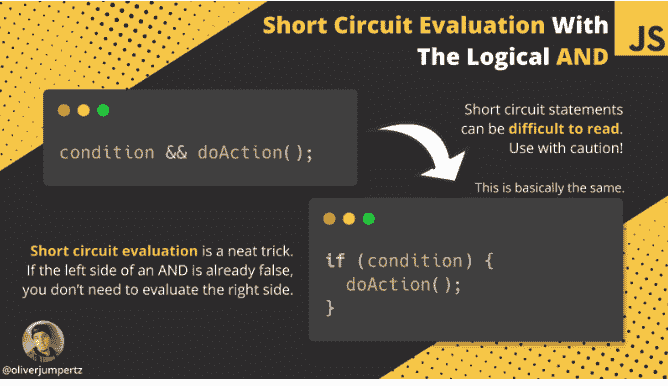

短路求值实际上是布尔代数相关的特性。布尔表达式可以通过只执行真正必要的工作来优化。如果你在整个表达式求值完成之前就能安全地断定条件为真，就不需要再对剩余部分求值了。

逻辑 AND 仅当与其相关的两个条件都为真时才为真。这就是它的定义。只有 `true && true` 为真，其他情况都为假。只有当左侧已经为真时，你才需要查看右侧。

在 JavaScript 中，你可以在布尔表达式中放置任何语句，JavaScript 会帮你进行转换。例如，你可以将布尔条件与逻辑 AND 以及函数调用组合在一起。只有当条件为真时，函数调用才会被执行。这与 `if` 语句的行为相同。只有当条件为真时，代码块才会被执行。如果条件为假，代码块被跳过。

### 使用逻辑 OR 进行短路求值

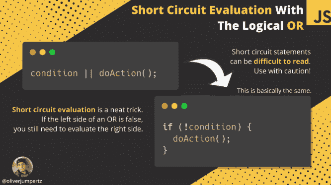

对逻辑 AND 有效的技巧同样适用于逻辑 OR。OR 和 AND 之间的唯一区别是 OR 代表语句中的否定条件。

逻辑 OR 只要表达式至少有一侧为真即为真。如果左侧已经为真，就不需要评估右侧。但如果左侧为假，仍然需要检查右侧。如果你现在将布尔条件与逻辑 OR 以及函数调用组合在一起，你得到的行为正好与检查否定条件的 `if` 语句相同。只有当否定检查为真时（即实际条件为假），代码块才会被执行。不过，对这两个技巧有一句忠告：它难以阅读。许多 JavaScript 开发者使用它时自以为很聪明，但实际上并非如此。这通常是代码压缩工具用来减小代码体积的技巧，但 `if` 语句远比这种捷径更具可读性。

### `Array.copyWithin()`

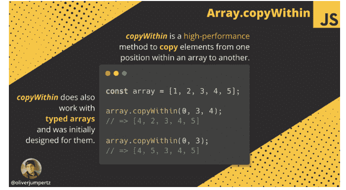

`copyWithin()` 是数组上的高性能方法。它是专门为类型化数组设计的，旨在尽可能快地在数组内部执行复制操作。

在某些情况下，比如处理图形（2D、3D）或矩阵数学时，使用可变数据并快速复制数据是有意义的。

在这种情况下，使用 `copyWithin()` 比自己手动复制数据要好得多。

### 代理（Proxies）

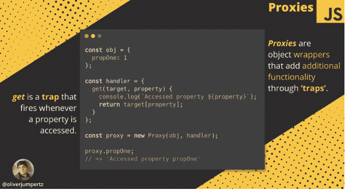

代理是一种包装对象。代理的行为、气味、外观都像它包装的对象。然而，在底层，代理允许开发者注入任意逻辑。这种注入通过所谓的“陷阱”（trap）来工作。陷阱是一种特殊的函数，对特定事件作出反应。例如，`get` 陷阱在对象上的任何属性被访问时触发，`set` 陷阱在给属性赋值时触发。开发者还可以为代理实现许多其他陷阱。所有这些使得开发者能够向对象注入高级逻辑，而这些对象甚至不需要知道它们正在被增强。例如，你可以生成代理，在对象状态改变时自动将状态同步到数据库。这是 ORM 的基本功能。

### Void 运算符


曾经有一段时间，`undefined` 是可以被重新定义的。是的，这是真的。然而，如今 `undefined` 就是 `undefined`，保持不变。

但在当时，一旦 `undefined` 被重新定义，只有一种方法可以获取它：使用 `void` 运算符。

该运算符将任何东西都转换为 `undefined`，无论它是什么。

如今，`void` 运算符只剩下少数几个使用场景：

1. 确保无论函数如何更改其返回类型，你都能得到 `undefined`。
2. 阻止浏览器跟踪由 JavaScript 组成的 `href` 的链接。

第二种情况仍然非常合理。如果你在链接的 `href` 标签中放置 JavaScript 代码，并想用 `onclick` 处理程序来处理实际的导航，你应该在该代码前使用 `void`。否则，大多数浏览器会加载一个新页面，显示纯 JavaScript 代码。

### 如何检查一个数字是否为 2 的幂

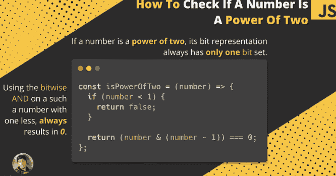

可能没有多少场景真的需要检查一个数字是否为 2 的幂。但有一件事让这个技巧非常有价值：它展示了了解事物的工作原理可以带来巨大收益。

在这种情况下，你可以利用二进制数字的一个特性。一个 2 的幂的数字总是这样的：

```text
10 (2)

100 (4)
```

现在我们来看看减 1 会发生什么：

```text
01 (1)

011 (3)
```

你可以永远继续这个规律，你会发现它始终遵循相同的模式。如果你现在对这些数字对使用二进制 AND，结果将始终为 0。这使得实现你上面看到的算法变得超级简单。

### 使用 `Reduce` 构建自定义管道函数

管道（Piping）是一个函数式概念。它接收一个值，将其输入到一个函数中。该函数的结果随后作为下一个函数的输入，如此依次执行。当你在数组上使用 `map()`、`filter()` 等方法时，通常会看到其面向对象与函数式的结合应用。我们来看另一个例子，以便你更好地理解管道是什么：

```javascript
const result = multiplyBy5(flatMap(filter(value)));
```

使用的函数越多，这行代码的可读性就越差。当然，你也可以用更具可读性的方式来格式化代码，但这里使用 `pipe()` 的版本是这样的：

```javascript
const piped = pipe(filter, flatMap, multiplyBy5);
const result = piped(value);
```

正如你所见，这个 `pipe()` 函数非常简洁，不是吗？

### 使用 `reduce()` 实现 `map()`

`reduce()` 是最重要的函数式方法之一。你可以用它来重新实现任何其他数组方法。尽管你可能会争辩说，在这种情况下，`reduce()` 只是被滥用来遍历数组，但它实际上是许多函数式语言中用于实现所有其他函数的基础函数。组合（Composition）在这里是一个重要的概念。

`map()` 所做的无非是从数组中取出每个元素，对其应用一个函数，然后将结果值推入一个新数组。最终，你会得到一个与之前数组元素数量相同的新数组，只不过这些元素被转换了。

### 使用 `reduce()` 实现 `flatMap()`

你可以将实现 `map()` 时已经应用的相同原则，同样应用于 `flatMap()`。`flatMap()` 与 `map()` 只有一个重要区别：它期望每个回调返回一个数组而不是一个新值。所有这些单独的数组随后被追加到一个结果数组中。这通常会产生一个一维数组，而不是二维数组。

`flatMap()` 本身并不常用，但它有其用武之地。每当一个函数接收一个输入（即原始数组的元素），并返回多个值（一个数组）时，`flatMap()` 就是将这些值提取到单维数组的好方法。这可以省去你后续处理嵌套数组的麻烦。你不再推送调用回调的结果，而是在新数组上使用 `concat`。这确保了所有结果以正确的顺序被追加，并融入数组中，而不是作为一个数组元素被放置。

### 使用 `reduce()` 实现 `filter()`

`filter()` 是另一个可以用 `reduce()` 重新实现的候选者。从根本上说，它与其他所有数组方法应用相同的原则。

`filter()` 获取数组的每个元素，并用回调函数对其进行测试。只要回调返回一个真值（truthy value）（true、非零数字、非空字符串等），该元素就会被放入新数组中。回调返回假值（falsy value）的所有元素都会被过滤掉，因此得名。

实现这个逻辑非常简单。你只需要一个 `if` 语句来测试回调。并且只有当回调返回真值时，你才将元素推送到新数组。仅此而已。

### 使用 `reduce()` 实现 `forEach()`

`forEach()` 是循环的函数式替代方案。虽然 `map()`、`flatMap()` 和 `filter()` 当然也代表了遍历数组元素的特殊情况，但 `forEach()` 是其最纯粹的形式。

它的目的是消费数组的元素。该方法本身不返回新数组，这使其成为一个所谓的终端操作（terminal operation）。这是一个会终结链式调用的操作。在这个特定案例中，我们仍然返回一个新数组，以便用户可能继续链式调用其他操作。

总的来说，`forEach()` 的实现与其他所有重新实现的实现几乎相同。回调不再推送或追加元素到新数组，它只是消费该元素，仅此而已。没有元素被转换或过滤。

### 使用 `reduce()` 实现 `flat()`

`flat()` 方法，嗯，是用于扁平化数组的。这意味着：取决于你传递给 `flat()` 的数字，它会按相同的维度数扁平化数组。

如果你在二维数组上调用 `flat(1)`，你会得到一个一维数组。它按照你要求的次数解包嵌套数组。

一个特殊情况是使用 `Infinity` 调用 `flat()`。在这种情况下，所有嵌套数组都会被解包，直到只剩下一个一维数组。而这正是这个实现所做的。当它遇到嵌套数组时，它会递归地调用自身，并将递归调用的结果连接到结果数组中。如果元素不是数组，则直接追加。

### 使用 `reduce()` 实现 `groupBy`

按键分组值可以是一个非常常见的操作，具体取决于你处理的数据。尽管如此，它仍然是一个值得实现的优秀算法。

如果你将其归纳到基础，你只需要两件事：

- 一种从值派生键的方法
- 一种为每个键存储值的方法

在本例中，第一点最好通过使用一个函数来解决，该函数将数组的每个元素作为输入，并从中派生出一个键。第二点则是通过使用一个简单的对象作为映射（map）来解决，因为对象通过其方括号访问方式，非常易于用作映射。

为每个键分配一个数组，并在遇到该键时向该数组推送值，这构成了该算法主逻辑的全部内容，而 `reduce` 是用于此操作的一个良好基础。

当然，你也可以用传统的循环来解决这个任务，但既然 `reduce` 如此灵活，何不使用函数式的方式呢？

## JavaScript 算法

### 阶乘的实现

阶乘是一个写作 `n!` 的数字。它的意思无非是“将从 1 到 n 指定的所有正整数相乘”。

因此，`2!` 是 `1 * 2 = 2`。`3!` 是 `1 * 2 * 3 = 6`。`4!` 是 `1 * 2 * 3 * 4 = 24`。依此类推。

为这个编写算法对初学者来说是一个好任务，因为它不需要高级技术。迭代解决方案不过是一个执行乘法的循环。而阶乘是递归解决方案的一个典型例子。它看起来有点紧凑，但最终你所做的不过是反复将 `n` 与同一个函数的另一次调用相乘，每次将 `n` 递减 1，直到达到数字 1。

发生的情况是，`3!` 被计算为 `3 * 2 * 1`。而这正是这种递归方法背后的魔力所在。

### 一个带记忆化的斐波那契函数

斐波那契数是数学中的一个特殊数列。每个数都是从 0 开始，将之前所有值相加的结果。前几个斐波那契数是 `0, 1, 1, 2, 3, 5, 8` 等等。实现斐波那契数的计算是一项简单的任务；你只需要将数字相加。有趣的是，斐波那契数是递归函数的一个绝佳应用，这也带来了使用记忆化（Memoization）的机会。


记忆化是一种存储已计算结果的技术，这样你就不需要重新计算它们。每当你需要一个结果时，你首先确定是否已经计算过它。如果是，你可以使用存储的结果，而不是再次计算。

这个实现正是这样做的。每当它计算出一个结果，它就将其存储在一个用作类似映射类型的对象中。每个数都是递归计算两个较小数字的结果。因此，整个计算是逆序执行的，因为数字每次都在变小。

## 检查回文

回文是指一个单词、数字、短语或其他字符序列，其正向和反向读取都相同。例如“madam”或“racecar”。

对于初学者来说，实现一个回文检测算法是绝佳的练习题。该解决方案不需要任何高级技巧，一个简单的循环就能实现。

许多初学者常犯的一个错误是忽略了标点符号等特殊字符不影响回文判定。这意味着即使是“racecar”也是一个有效的回文。

上述实现使用正则表达式排除了空格和标点符号等特殊字符。之后，字符串会从两端开始进行比较。

以“racecar”为例。循环的第一步比较索引0和6，然后是1和5，接着是2和4。这意味着：“r” === “r”、 “a” === “a”、 “c” === “c”。算法无需将同一字符与自身进行比较。

如你所见，所有字符比较都成功了，因此算法验证了“racecar”确实是一个回文。

### 惰性范围函数

范围（Range）是一种函数式模式，常用于纯函数式语言。当你无需声明变量时，仍需要一种方式进行特定次数的迭代。范围通过提供创建可迭代数字序列的方式填补了这一空白。而惰性范围则更进一步，仅在需要时才生成数字。这意味着在任何时刻，内存中只有一个数字，旧数字一旦被使用就可以立即丢弃。

在`JavaScript`中，一个带有循环变量的简单`for`循环本质上做着同样的事情，只不过它每次都会递增循环变量。然而，有时你希望尽可能消除像带有冗长头部的`for`循环这样的命令式构造，并依赖函数式概念。在这种情况下，范围函数就是一个有效的替代方案。当“迭代器辅助”提案最终进入第三阶段时，你也将能够在迭代器上使用`map`、`flatMap`、`filter`等方法，这也包括这个惰性范围。

### 类Python的范围函数

你可能已经知道如何用生成器创建惰性范围函数了，但目前，我们仍然没有为可迭代对象提供我们所钟爱的函数式单子方法`map`、`flatMap`、`filter`等。这意味着你仍然需要使用命令式的`for-of`循环。

不过，有时你想摆脱所有的命令式构造，这也没问题。在这种特定情况下，你可以使用`Array.from`即时创建一个数组，并用你想要的所有范围数字预先填充它。然后，这个数组就可以像任何其他数组一样使用。你可以对值进行`map`、`flatMap`，也可以随心所欲地进行`filter`。

只需记住，这种方法会占用大量内存。数组存在于堆上，因此只要数组存在，所有元素就会一直留在内存中。尤其是巨大的序列可能会导致问题。

### 如何反转字符串

反转字符串并不是你职业生涯中会实现的最高级的算法，但至少这是一个连`JavaScript`字符串都没有内置方法来完成的任务。

对于这个算法，你可以利用`JavaScript`中字符串和数组的三个特定特性：

- 字符串可以转换为字符数组。
- 数组可以反转。
- 数组可以转换为字符串。

除此之外，唯一需要的就是一个守卫语句，用于检查字符串是否存在或过短，并在那种情况下返回。

之后，其他所有工作就是链式调用内置方法。

就这样。你现在已经成功反转了一个字符串。

### 反转整数

反转整数有多种方法。一种方法是简单地将整数转换为字符串，反转该字符串，然后再创建一个数字。这本身就是一个解决方案！一些公司喜欢在面试中考察你的算法和数学技能，这时使用字符串方法就力不从心了。当你需要执行数千到数百万次反转时，情况也是如此。

你看到的上面那个算法使用数学方法来解决这个任务。其过程无非是数学上逐位提取数字并将其“放入”一个新数字的方式。

如你所见，你只需循环一次，甚至还节省了许多字符串分配。

### Fisher-Yates 洗牌算法

Fisher-Yates 洗牌是一种公平的洗牌算法。算法本身看起来并不复杂，但其结果却令人难以置信。不过，在我们继续之前，我们先快速了解一些理论。数组的排列（Permutation）只是该数组内容相同但表示不同的另一种形式。例如，`[1, 2]` 和 `[2, 1]` 是彼此的不同排列。内容保持不变，但顺序改变了。这正是洗牌所做的。它创建了数组的另一个排列。

Fisher-Yates 洗牌算法将其提升到了一个新的水平，它产生的排列中，每个可能的排列发生的概率都是相等的。正是这一点使其如此公平。它没有任何偏差。

### 统计数组中元素出现的次数

在访问竞赛编程网站时，你一再看到的一个任务是统计数组中元素出现的次数。

这个任务非常适合用`reduce()`和一个`Map`对象来完成。你将初始数组规约为一个单一的对象，该对象充当你的映射表。

最终，该算法的核心是将数组的元素作为键添加到你的映射表中，然后每次遇到一个元素就递增一个计数器。仅此而已。但它对初学者来说又是一个很好的算法。你可能需要一些时间才能理解它，但之后你就学到了宝贵的一课。这一课可以应用到你编写的下一个算法中。如此循环往复。

### 汉明距离

汉明距离可能有个花哨的名字，但归根结底，它不过是计算两个等长字符串在多少个字符位置上不同。

这是一个非常简单的算法，适合初学者。由于两个字符串必须等长，因此只需遍历一个字符串，然后比较相同索引位置上的字符即可。

如果你认为这个算法你永远用不上，那你就错了。例如，汉明距离常用于网络协议中。它被用作传输质量的指标。在更复杂的场景中，该算法用于识别应予以纠正的错误传输字节。

### 线性查找

线性查找是你能实现的最简单的搜索算法。它适用于所有线性数据结构，并且不包含任何高级逻辑。顾名思义，它线性地（从头到尾）遍历一个列表（这里是数组）。这就是它全部的奥秘。你循环遍历数组并测试每个元素。第一个满足测试条件的元素的索引将作为结果返回。线性查找在大多数情况下都有效。当你的数组未排序，甚至当它存在空洞（未定义的元素）时，它都能工作。这使它区别于其他有特定前提条件的搜索算法。这使得它成为最慢的搜索算法之一，因为你无法对其进行优化，但至少它是所有搜索算法中适用范围最广的。

## 埃拉托斯特尼筛法

埃拉托斯特尼筛法是一种用于查找和预先计算质数的数学算法。它更多地依赖于逻辑事实，而非复杂的公式。

早在古代，埃拉托斯特尼就发现，要找到质数并不需要做大量计算。总的来说，我们知道0和1不是质数，可以“标记”这两个数。接下来未被标记的数是2，它是一个质数。但2的所有倍数都不可能是质数，所以我们可以直接排除它们。3也是一个质数，因为它尚未被标记。同样地，我们可以将3的所有倍数标记为非质数。然后算法就这样不断进行，直到达到指定的上限。最终，你会得到一个质数列表，可以继续使用。

### 素性测试

虽然埃拉托斯特尼筛法是在0和给定上限之间预先计算和查找质数的好方法，但当你想判断某个特定数字是否为质数时，它并不是一个好的选择。

这正是素性测试的用武之地。这是另一种非常基础的算法，通过计算来判断一个数是否为质数。但我们先快速回顾一下什么是质数：

质数是指只能被1和它本身整除的正整数；0和1不是质数。

一旦记住这个定义，潜在的算法就变得很容易实现。对于每个数，测试它是否能被除自身和1以外的数整除。为了稍微优化算法，你可以先排除所有偶数（能被2整除的数）。此外，你只需要测试到该数平方根为止的除数。现已证明，如果在某个数的平方根以内没有除数，那么该数就没有其他除数。

### 幂集

你可能不太需要经常计算一个集合的幂集，但所有的算法训练都是好训练，所以这里再介绍一个算法供你练习。

一个集合的幂集是另一个集合，它包含原集合的所有可能子集，包括空集。它在概率论中有大量应用，用于查找一个操作或行为的所有潜在结果。

实现幂集算法的方法有很多，但 Definitely 简洁明了的一种是使用`reduce`。总的来说，这个算法看起来比实际更难。归根结底，它从一个二维数组开始。在每次迭代步骤中，它遍历所有已找到的子集，并将当前元素附加到这些子集上。如果你拿张纸，用简单的集合如`{0, 1, 2}`来尝试一下，你很快就会意识到这个实现有多巧妙，因为这样做会自动生成一个集合的所有可能子集。

### 基础快速深克隆

克隆是一项基本操作。特别是在处理不可变数据时。当你不修改现有数据时，需要在返回修改后的状态之前复制一个对象。但真正的深克隆可能非常复杂。它需要递归、复杂的对象检测等等。

然而，对于非常基础的对象——即那些只包含基本类型和其他嵌套对象的对象——`JSON.stringify()`和`JSON.parse()`是有效的替代方案。序列化和反序列化一个对象隐式地创建了一个深克隆，这足以创建你自己版本的深克隆。

如前所述，一旦你的对象中包含更复杂的类型，如`Date`或自定义类，这种方法就开始不够用了。如果没有复原函数（reviver），`JSON.parse()`只会重新水合基本对象，而不会恢复你的自定义类的实例。

### 用牛顿法计算平方根

你会需要实现一个计算根或平方根的函数吗？除非你有机会参与语言标准库的开发，否则大概不会。但了解事物的运作原理总是好的。

就根而言，更具体地说是平方根，艾萨克·牛顿爵士很久以前就发现了适合这个问题的算法。这是你的计算器使用的方法，也是计算机以某种方式实现的方法。

这个算法的有趣之处在于，它只是真实结果的近似值，因为平方数的小数位数往往是无限的。这也是一种相当重复的方法，但好在重复正是计算机非常擅长的。

### 快速幂

有什么情况会让你必须实现自己的幂函数吗？大概没有，但了解编程语言标准库的创建者是如何实现的，大概也没有坏处。此外，一个优化的幂算法还是优化技术的绝佳展示。但我们快速回顾一下`x`的`y`次方的定义。它无非就是`y`个`x`相乘。那就是在循环中将`x`与自身相乘，循环计数`y`次；一个时间复杂度为`O(n)`的算法。不算太糟，但也并不特别。然而，聪明的数学家们发现，可以通过分割计算来更高效地计算幂（你上面的公式）。当你以这种方式实现，并使用递归时，你会得到更少的迭代次数和对数级的时间复杂度。这大概也是你最喜欢的语言的标准库所使用的实现。

### 汉诺塔

汉诺塔是一个相对简单的游戏。你有一组不同大小（从小到大）的盘子放在一根杆上。作为玩家，你的任务是将整个塔移到最后一根杆上。然而有几条规则。首先，只允许将较小的盘子放在较大的盘子上面。其次，塔必须按正确的顺序组装。

为这个实现游戏算法是绝佳的例子，它不使用计算，也不使用其他技术，而只是对现实进行建模。玩这个游戏只有一种方式，一系列明确定义的移动步骤，最终将塔重新组装到第三根杆上。没有任何细微差别，这正是这个算法所做的。它实现了移动塔所需的步骤序列。唯一让它看起来稍微复杂一点的是递归的使用，因为当移动是重复的时候，没有必要硬编码所有移动。

### 欧几里得算法

另一个利用一些有趣事实的数学算法是欧几里得算法。它以希腊数学家的名字命名，他发现两个数的最大公约数在将较大数替换为它与较小数的差时不会改变。如果你反复这样做，最终会得到两个数的最大公约数。这个算法的一个更优化版本利用了这样一个事实：除了较大数与较小数的差之外，两者相除的余数能更快地得到结果。将其转化为算法是递归的绝佳应用，因为它使实现非常易读。而这个实现只需要做两件事：

- 检查较小数是否已达到零（此时你已在较大数中找到了结果）。
- 通过带余数除法交换较小数和较大数的位置，然后再次调用函数本身。

### 简单移动平均线


移动平均线是一种常见于交易图表中的算法。它是一种用于降低图表噪声、使趋势更加清晰的技术。

移动平均线背后的思路相对简单：从一组数字（如股票价格）中取出`X`个数值，计算它们的平均值，然后创建一个整体条目更少的新数值序列。当绘制这个结果序列时，其图表中的波动更小，能更好地反映你基于其构建移动平均线的数字的整体趋势。

实现这个算法和它的定义一样简单直接。你需要遍历一个数字列表，对其中`X`个数值计算平均值，然后将结果值推入一个新列表。就是这样。这项技术的名称比它的实际实现要花哨得多。

## TypeScript

### 工具类型 Partial

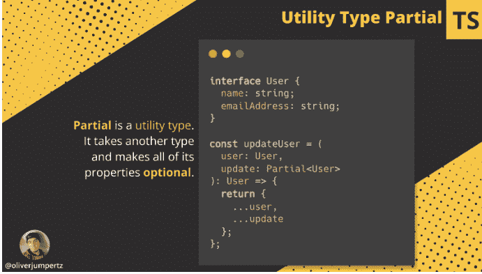

TypeScript 拥有完整的类型系统。TypeScript 区分`null`/`undefined`和引用。这是许多其他语言做不到的。

以`Java`或`Go`为例。一个类型始终可以是其自身类型，或者`null`/`nil`。在`TypeScript`中，情况并非如此。如果你不显式地将类型声明为可选的，它就始终是必需的。如果你不使用问号将对象类型的属性标记为可选的，编译器就会期望它们持有有效的引用。

然而，有时你想要完全相同的对象，但其所有属性都是可选的。配置对象就是这样一个用例。你可能需要一组特定的属性，但还需要提供一组默认值。在这种情况下，你不需要创建一个全新的类型，只需用`Partial`包装你的类型即可。这节省了大量代码，并将你的内联类型直接与原始类型关联起来。

### 工具类型 Required


`Required`是`Partial`的反面。`Partial`将类型的所有属性标记为可选的，而`Required`则使它们成为必需的。应用于`Partial`的原则同样适用于此。它使你能够快速定义内联类型，无需定义新的类型或接口并手动复制原始类型的所有属性。不过，你需要理解的一个重要概念是，`Required`和所有工具类型一样，仅在编译时生效。使用`Required`永远不会导致运行时错误，TypeScript 编译器也不会生成任何可能进行运行时检查的额外代码。一旦脱离 TypeScript 的世界，`Required`就不复存在。这个工具类型不会以任何方式限制 JavaScript 用户使用你的代码。

### 工具类型 Readonly

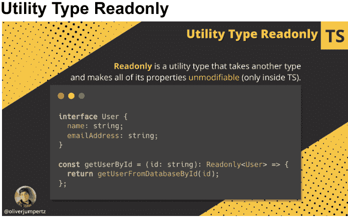

`Readonly`是一个使类型的所有属性变为只读的工具类型。这意味着，至少在 TypeScript 代码中，你无法以任何方式修改这些属性。这样做会导致编译时错误。

当你希望从函数返回特定对象并将其用作其他函数的输入时，这个类型尤其有用。当用户在这样的一系列操作中修改了你为他们创建的对象属性时，你可能会遇到依赖于这些对象状态的逻辑问题。每当出现这种情况，使用`Readonly`创建编译时不可变对象是一个不错的选择。

### 工具类型 Record

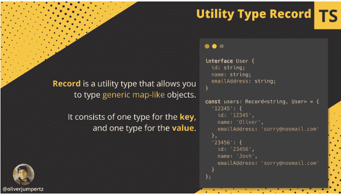

当你想将对象用作映射类型时，`Record`是一个非常实用的工具类型。尽管 JavaScript 及其 TypeScript 现在有了专门的`Map`数据结构，但对象仍然具有特定的灵活性。你可以使用方括号表示法访问元素，也可以用这种方式设置元素。对于一些开发者，尤其是那些使用 JavaScript 时间更长的人来说，在 Map 出现之前就是这么做的。

然而，TypeScript 对对象有点挑剔。如果你不显式标注类型，编译器总是会尽可能地缩小该类型范围。这意味着：一个包含两个属性`a`和`b`且都为数字的对象，会导致一个包含两个属性`a`和`b`且都为数字的类型。

如果你想存放和访问任意数据，可以使用工具类型`Record`。它创建一个接受任意字符串键和在`Record`泛型声明中定义的统一值类型的类型。

### 工具类型 Pick

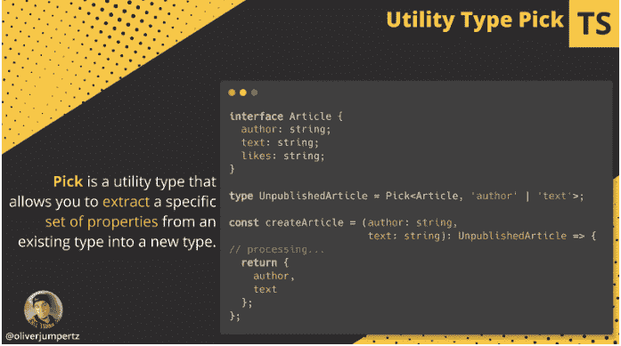

`Pick`是你在使用 TypeScript 时可能经常用到的工具类型之一。它允许你通过从现有类型中提取特定属性来创建新类型。

这种方法有其妙处。特别是当你需要现有类型的不完整变体时，你可以快速提取所需的属性，并将这个新的不完整类型用作参数或返回值。

举个例子，假设你有一个定义了应用所有配置设置的类型。你读取这些设置并将其传递出去。各个函数只处理完整配置的一部分，并设置应用的相应部分。

你可以通过仅从配置中选取真正需要的属性，将这些函数的输入直接与你的配置关联起来。每当你的配置发生变化且这些属性消失时，TypeScript 编译器会直接提示你，某个处理器现在缺少了必需的输入。

### 工具类型 Omit

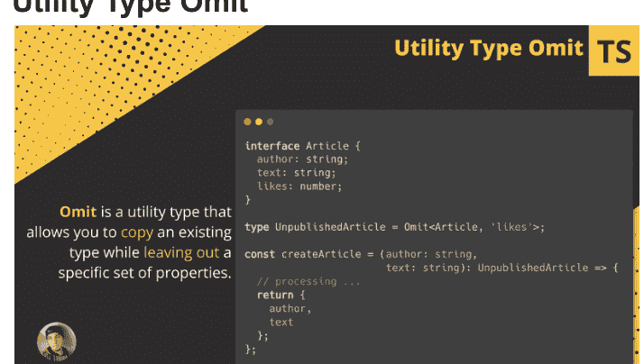

`Omit`是`Pick`的对应项。`Pick`提取特定属性，而`Omit`则移除指定属性，只保留未指定的所有属性。

你可以在与`Pick`几乎相同的用例中应用它，只是方式相反。你获取一个类型，从中移除特定属性以得到一个新类型。

回到配置对象的例子。现在想象你有一些函数需要几乎所有的配置值，但并非全部。在这种情况下，你省略其中一些属性，接受一个更轻量的对象作为输入参数。通过将类型紧密关联在一起，当某些东西出问题时你会更早得到通知。

如果配置对象发生变化，由`Omit`创建的类型也会随之变化。即使你移除的不是被省略的属性，你仍然会看到你的函数现在缺少了一些必需的参数。

### 工具类型 ReturnType

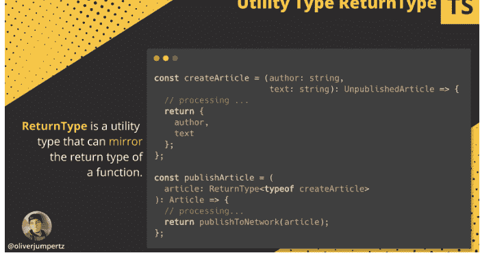

`ReturnType`不是 TypeScript 历史上使用最多的工具类型，但它有其用武之地。它提取函数的返回类型并据此创建一个新类型。这意味着结果类型直接与该函数绑定。如果该函数更改了其返回类型（无论是显式还是隐式），你会注意到并可以通过做出必要的调整（或回滚不期望的破坏性更改）来应对。

### 将函数的返回类型与其参数关联起来

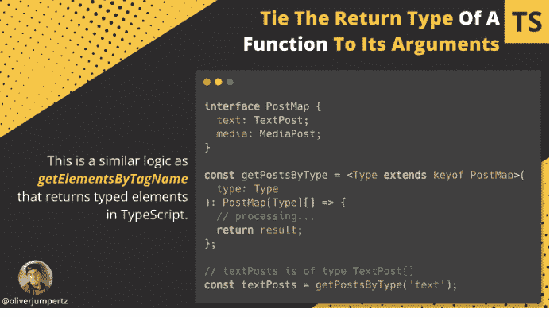


有些场合下，你可以让使用特定函数的人的体验变得非常简单。其中一个场合就是在通常会返回联合类型时自动缩小类型。联合类型是可以为类型 A 或 B 或 C 的类型（你懂的）。`document.getElementsByTagName` 就是这样一个能很好利用自动缩小类型的函数。该 API 实际上只返回一个通用 HTML 元素的集合。但只要你传入一个有效的标签名，你就会注意到类型立即缩小了。以下代码返回一个 `HTMLInputElement` 集合。

```javascript
const elements =
document.getElementsByTagName('input');
```

这更实用了。而这一切都是由输入字符串触发的。如果你有这样的函数，就要善用它。它能极大地改善开发体验。

## 接口

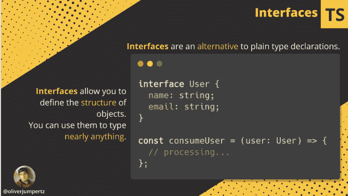

接口是 TypeScript 中定义类型的两种方式之一。它允许你定义对象及其属性的具体结构。但与许多其他语言不同，类和对象不需要显式实现接口才能被视为有效。任何满足接口的对象都会自动被视为匹配。

这种整体方法有一个巨大的优势：它允许模块的完全解耦。你不需要从另一个模块甚至库中导入接口来使用函数。只要你的对象具有与所需类型相同的结构，它就能神奇地工作。你甚至可以重新创建相同的接口来为你的对象定义类型，它仍然可以工作。这在其他语言中是行不通的。

## 类型别名

类型别名是你在 TypeScript 中创建类型的第二种方式。它们与接口不同，并且借助组合现有类型的高级特性提供了更大的灵活性。通过类型别名，你可以**交叉**现有类型（也就是说将两个类型合并，从它们的所有属性中创建一个新类型）、创建**联合**（即类型 A *或* 类型 B *或* 类型 C，甚至值 A *或* 值 B 等），以及显式地为函数添加类型。一个好的经验法则是：在需要类型别名的灵活性之前，始终优先使用接口。如果那种需求出现了，你再使用类型别名。

### 类型推断

如果你曾在 Java 10 之前的版本上工作过，你可能仍然会对显式类型变量声明心有余悸。总是不得不在赋值左侧显式地声明类型，尽管右侧显然已经说明了类型，这看起来是不必要的。

值得庆幸的是，TypeScript 团队通过允许编译器在必要时推断类型解决了这个问题。如果你不愿意，几乎永远不必显式声明变量的类型。编译器会从赋值的右侧推断类型，并尽可能将其收窄。只有当你认为它把类型收窄得太过分时，你可以显式声明一个不那么窄的类型来帮助编译器。

然而，类型推断**不**适用于函数参数。你仍然需要显式地为它们添加类型（这是可以理解的）。函数返回类型也可以被推断，但你最好始终显式地为函数添加类型。如果你不小心将函数的返回值从 `string` 改成了 `number`，你会在函数内部看到这个错误，而不是在别处预期返回 `string` 的地方。

### 类型收窄

类型收窄是 TypeScript 中的一个概念，它允许编译器对一个它本来不确定的类型变得更加具体。**联合类型**就是这样一种情况，TypeScript 编译器不确定且无法可靠地预测它实际处理的是什么类型。作为开发者，你可以帮助编译器围绕这类类型建立一些安全性。例如，通过 `typeof` 检查，你可以给编译器绝对的保证：如果该检查返回 `true`，你处理的就是那个确切的类型。在该检查 `true` 情况的任何后续代码路径中，你可以将该变量视为你检查过的类型。而且编译器甚至足够智能，知道对于有两个可能类型的联合类型，其 `else` 情况只能是之前未被检查过的类型。

### 类型谓词

类型谓词是具有特殊签名的函数，最终只返回一个布尔值。然而，这个布尔值有着特殊的含义。它表示：“这个变量是 X 类型”。所有这些都有助于 TypeScript 编译器在那些只有你能帮上忙的地方收窄类型。

类型谓词是类型收窄的一种高级形式和实用工具。它们涵盖那些简单的 `typeof` 检查已经不再足够的场景。如果你在 `if` 语句或 `switch` 中使用这些特殊函数，编译器可以将任何变量的类型收窄到谓词测试的具体类型。在该谓词测试 `true` 情况的所有后续代码路径中，该变量被视为属于该特定类型。这允许你访问它的所有属性而不会出错。但一旦离开该 `true` 情况，类型就会恢复到之前的状态。

谓词在你处理**继承**和**联合类型**时特别有用。而且它们的实现并不复杂。

### 泛型

声明类型是件好事。它创造安全性，帮助开发者在编译时捕获错误——在代码运行时崩溃之前。然而，有时类型可能成为一种负担。特别是如果你想让函数或类具有更广泛的适用性。与其为了让它适用于不同类型而一遍又一遍地重复你的代码，你可以使用**泛型**。正如它们的名字所暗示的，它们使代码更加通用，并拥有强大的功能。

最简单的用例就是上面图表中所示。`assertPresent` 将函数的返回类型与它接收的类型绑定。如果传入的是 `string`，它就返回 `string`，等等。在函数体内部，你只能在最通用基类型的层次上访问泛型类型。在上面的例子中，就是 `unknown`，因为那是所有类型共有的。

有时，使用泛型类型比使用 `any` 要好得多，因为后者仍然可能导致运行时错误——如果你访问了不存在的属性。

## Web 3 - Ethers

### 使用 ethers 查询代币余额

总体而言，所有区块链都提供某种形式的 HTTP JSON RPC API。它不是 REST，不是 SOAP，也不是其他什么。它是相对特殊的一种，但工作得很好。

从概念上讲，每个智能合约都是一个由其合约地址标识的 API 端点。所有公开可访问的方法基本上都是该合约的 API 端点。

这就是 JavaScript 作为一门相当出色的语言（除了它在浏览器中的主导地位之外）来动态地与智能合约交互的原因。

`ethers` 允许你传入任何合约的 ABI 及其地址。该 ABI 不过是智能合约 Solidity 代码的函数原型。有了这个，`ethers` 可以动态创建一个完整可用的 API，允许你调用该合约上的任何函数。查询代币余额只是其中一个例子。

### 使用 ethers 发送以太币

每个区块链都有自己的原生加密货币。它通常用于支付 gas 费用和矿工/验证者的服务费用。

以太坊也不例外。你可以与区块链进行的最基本交互之一就是将自己的账户中的货币发送到另一个账户。

使用 `ethers`，这个过程很简单。你所需要的只是一个 `provider`（提供者）和一个 `signer`（签名者）。第一个是读取 API 对象。后者是一个写入 API 对象，保存着你签署交易所需的私钥。

`sendTransaction()` 返回一个待处理交易的对象，如果确实需要等待交易完成，你可以等待它。

### 使用 ethers 获取地址余额

与区块链的另一个基本交互是查询你自己在链上原生货币的余额。与发送交易不同，你只需要一个 `provider` 即可。这是因为区块链上的所有数据对所有人都是透明的，你的地址余额也不例外。因此，你不需要私钥，也不需要签名消息来查询任何合约的余额。

不过，以太坊及其衍生链有点特殊。它们目前**不**支持浮点数（至少不完全支持）。相反，它们提供对 256 位整数的支持。这就是为什么你获取到的余额实际上是 `Wei`，以太坊的最小单位。一个 Ether 等于 1e18 Wei，要得到以 Ether 为单位的余额，你需要先进行转换。

### 使用 ethers 获取地址历史记录

你可能认为在区块链上查询一切都很简单，但你错了。虽然区块链包含所有数据，但访问更复杂的数据实际上极其困难。即使是获取链上地址的历史记录，通过区块链节点提供的 API 也不是直接的。这是 Etherscan、PolygonScan、BscScan 等网站存在的主要原因之一。

值得庆幸的是，`ethers` 有一个特殊的 `provider`，你可以用它来访问 Etherscan——一个索引区块链数据的网站和平台。借助 `EtherscanProvider`，你可以轻松查询任何区块链地址的完整历史记录。

不过，这个 `provider` 和这种方法有一个缺点：如果不传入 API 密钥（这需要付费），则会使用一个公开可用的配额。可以这么说，你与其他所有人共享这个配额。

### 使用 ethers 进行消息签名与验证

区块链技术基于公钥/私钥密码学。正如你可能了解的那样，我们也使用这种技术来加密和解密消息及请求（例如 SSL/TLS）。因此，使用公钥和私钥对消息进行签名也是区块链客户端的一个显而易见的用例，而且这一过程甚至很有帮助。加密、解密和验证消息是使用用户网页钱包为其提供签名的最佳方式之一。这使您能够在不必明确知道任何用户个人详细信息的情况下执行身份验证。

### 使用 ethers 订阅和过滤事件

区块链会定期发出事件。确切地说，它们会发出大量事件。每一次链上原生货币的转账都会产生一个事件，许多智能合约在特定场合下也会发出事件。这些事件正是 Etherscan 等网站订阅用来填充其数据库的内容。它们为这些事件建立索引，进行处理，然后提供给公众（以及付费用户）。

订阅事件当然也是 `ethers` 提供的一些基础功能。您只需要一个描述您想要监听哪些事件的筛选对象。然后，这个筛选对象会被传递给提供者的 `on()` 方法。通过回调函数，您可以定义如何处理这些事件。

### ethers 中的 API 提供者

`ethers` 不仅是区块链客户端库，还附带许多高级 API 提供者，让您能够执行不同的操作。其中一些提供者让您能够访问包含区块链索引数据的高级数据库，另一些则允许您与通过 Alchemy 和 Infura 等平台提供者部署的区块链基础设施进行交互。

这些提供者的妙处在于，如果您使用某些提供者背后的平台，就无需集成另一个客户端库。归根结底，这是一个很棒的实用工具。

### 使用 ethers 进行 ENS 查询

ENS（以太坊域名服务）是以太坊世界的 DNS。任何人都可以购买一个附加了特定地址的 NFT。从那时起，这个地址就可以作为您地址（以 `0x` 开头的公钥表示）的替代。

`ethers` 支持 ENS 解析，这意味着您可以将任何 ENS 地址解析为区块链地址，反之亦然。此外，该逻辑还允许 `ethers` 让您直接向 ENS 地址发送交易，而无需事先查询地址。

### 使用 ethers 估算智能合约调用的 Gas 成本

如果您曾经作为用户与区块链打过交道，您可能已经了解 gas 成本。Gas 是支付给矿工/验证者的服务费，本质上是执行智能合约逻辑和处理交易。虽然调用的 gas 消耗是确定性的（意思是：如果您查看执行的代码，就知道需要多少 gas），但 gas 价格始终在波动。与区块链交互的人越多，gas 就越贵。这样的人越少，gas 就越便宜。gas 背后存在一个市场。`ethers` 提供了一些实用方法，让您能够对当前调用的大致成本进行估算。如果您的后台有定期自动运行的逻辑，这会很有帮助。在这种情况下，等待 gas 价格降至某个低点再执行调用是合理的。这可以带来从几分钱到每年数千美元不等的节省。

### 使用 ethers 等待交易完成

正如您可能已经了解的那样，发送交易只会返回一个表示待处理交易的对象。根据不同的区块链，交易可能需要更长的时间才能结算。这个时间可能从几秒到几分钟不等。

去中心化应用通常不会等待交易结算，而是显示一个中间状态，直到交易最终完成。

但有时，您可能确实希望等到交易结算完成后再让用户继续他们的操作。

在这种情况下，待处理交易对象提供了一个 `wait()` 方法，它返回一个 Promise，只有当交易被追加到下一个区块时才会解决。

这是一个可能非常耗时的操作。您应该只在真正必要时才使用它。

### 使用 ethers 响应网络变更

任何用户都可以随时更改其网页钱包连接的网络。这经常导致去中心化应用出现一些有趣的问题。您可能仍在监听事件或等待交易返回。在这种情况下，最好响应网络变更，至少重新加载整个应用，以便重置所有陈旧状态。通常，您可能还想向用户显示他们连接到了错误的网络，因为您的去中心化应用只在以太坊或 Polygon 等网络上运行。

当这种情况发生时，您可以使用 `ethers` 提供的 `network` 钩子。在回调函数中，您可以执行任何必要的操作，比如重新加载您的网站或设置一些状态，以便向用户显示消息。

该钩子在首次连接到应用时也会被调用。这就是为什么您应该始终包含一个守护语句来检查回调的第二个参数（在此案例中为 `oldNetwork`）是否已设置。如果没有设置，那就是首次连接，您不需要做任何事情。

### 使用 ethers 在不使用 MetaMask 的情况下连接节点

`ethers` 不仅仅是用于前端应用的库。您也可以在后台使用它。然而，以这种方式使用时，没有 MetaMask 或其他钱包来为您处理与托管区块链节点的连接。

在这种情况下，您需要自己连接到一个节点，这就是为什么 `ethers` 还提供了 `JsonRpcProvider`，它可以连接到任何节点的 API，从那时起，它的行为就与在前端时通常一样。

然而，要实例化您的签名者，您只需要您的私钥或助记词。请谨慎处理它们。如果您不小心将它们暴露给外界（比如不小心推送到 GitHub），您可以肯定您的所有资金将在几秒钟内消失。

因此，只将它们作为环境变量导入是个好主意，这些环境变量由应用启动时的安全存储提供。

# Web 3 - Solidity

## 一个简单的智能合约

智能合约无非就是一个对象，至少从概念上讲是这样。这个对象的伟大之处在于它可以远程访问。您可以使用区块链客户端调用该合约/对象上标记为公开可用的任何函数。

这已经是智能合约的基本魔力所在。如果您曾经在另一种语言中创建过类，您也可以创建智能合约；只是需要用到一些不同的关键字。

智能合约甚至可以调用其他合约，而且可以包含持久化到区块链的状态。您在区块链上不需要数据库，因为您的代码已经在其中运行了。

## 可见性

如果您曾经在 JavaScript 或 TypeScript 中处理过私有属性，或者如果您曾经在另一种编程语言如 C# 或 Java 中工作过，您已经知道函数和属性有不同的可见性。

可见性帮助开发者在不同层级封装逻辑。有时，并非所有函数或属性都应该从外部访问，因为它们不属于合约的公共 API。而有时，您只想提供可以在继承合约中使用的基础逻辑。

在 Solidity 中，可见性甚至会影响合约调用的 gas 消耗。由于底层 EVM（以太坊虚拟机）的特性，更改函数的可见性可以减少 gas 消耗，因为调用可以在底层进行优化。

## 函数类型

Solidity 了解不同的函数类型，它们各有其用途。与可见性类似，这些类型也会影响函数的气体消耗。

总的来说，如上所述，有三种函数类型，它们是开发者表达意图并让编译器进行一些基本检查以帮助识别错误的好方法。例如，纯函数永远无法访问合约的状态。如果你现在，即使是意外地，改变了某些状态，编译器会通知你，并帮助你在投入生产前识别出 bug。

除此之外，将函数标记为 `view` 或 `pure` 还有一个很好的副作用：调用这些函数不需要消耗 gas。尽管这只影响调用本身。如果你在其中一个函数内进行大量计算，你仍然需要为此付费。

## 函数修饰符

函数修饰符是 Solidity 的一个很棒的特性。如果你曾经使用过 Python 和 TypeScript 中的装饰器，或者甚至使用过 Java 中的注解，你可能已经知道函数修饰符基本上是什么了。

函数修饰符，顾名思义，修饰一个函数。它本身是一个特殊函数，不能直接调用。相反，它被显式地添加到另一个函数中，然后包装该函数。每当调用这样一个被修饰的函数时，修饰符函数会首先被调用，然后，根据其实现，实际的修饰函数才会被执行。

修饰符函数的两个最常见的用例是守卫语句和可重入锁。

守卫语句是一个检查，通常位于函数顶部，用于验证输入本身或某些合约状态。只有当该检查成功时，函数才能运行。如果失败，守卫语句将抛出错误，函数执行停止。

可重入锁是一种确保函数一次只能被调用一次的方法。

## 事件

事件是 Solidity 和 Ethereum 的日志消息。任何合约都可以定义一个或多个事件，然后在任何时候发出它们。它们就像没有函数的对象。它们只能包含数据，其中一些数据可以标记为索引。索引属性是你可以用来过滤和搜索事件的东西。其他智能合约无法订阅这些事件。它们仅面向客户端库。

事件有助于理解区块链上发生的事情，因为交易有时可能非常难以阅读。它们说明了哪个合约和函数被调用了，但你通常不容易弄清楚到底发生了什么。这就是事件的用武之地。它们通过自己的类型和数据，明确说明了导致这个特定事件的操作是什么。

## 抛出错误

像许多其他编程语言一样，Solidity 当然也有错误/异常的概念。

错误表明像函数调用这样的操作没有成功，它们的定义与事件几乎相同。每个错误都有一个名称，并且可以包含数据。

与其他通常“抛出”错误的语言相反，Solidity 使用回滚的概念。当发生错误时，合约及其所有状态都会回滚到函数调用之前的状态。无论一个函数在使用错误语句 `revert` 之前改变了多少状态，所有之前的操作都会被回滚。

此外，回滚合约通常会退还所有剩余的气体。

这意味着如果你的函数有 10000 gas 可用，并且已经用掉了 5000，那么当 `revert` 语句被调用时，会退还 5000。

## 处理错误

你可能还记得，在 Solidity 中，合约可以调用其他合约。这就是为什么该语言也有处理错误的概念。如果一个合约发出的调用被回滚，你需要有机会对这种情况做出反应。

Solidity 使用与许多其他编程语言相同的 `try-catch` 机制，只是有一些微小的差异。`try` 语句后面总是跟着可能抛出错误的调用。在 `try` 块中，你可以添加更多语句，如果调用成功则执行。

`catch` 语句后面跟着要捕获的错误类型，就像在其他语言中一样。在随后的块中，你可以放置任意多的语句来处理错误，或者甚至进一步回滚你自己的合约。

## 结构体

结构体是 Solidity 中另一种类型的对象。你可以将它们视为合约的小兄弟。虽然合约是包含属性和函数的 API 层，但结构体只是数据容器。像事件和错误一样，它们不能包含函数，只能包含属性。

它们的目的是帮助开发者以更有意义的方式将多个属性组合在一起。此外，在某些情况下，它们还有助于节省 gas。

结构体可以用作参数和返回值，你可以像处理任何其他变量一样处理它们。当有一组至少两个属性需要在多个地方定期使用时，使用结构体通常开始变得有意义。

## 映射


映射是 Solidity 中的映射或字典。它们实际上是任何智能合约最重要的数据结构之一。每当你需要键值关系时，映射就是要使用的原生类型。

映射构成了许多重要标准的基础。例如，ERC20 代币在映射中跟踪你的余额，甚至你最喜欢的 NFT 也在映射中跟踪你的 CryptoPunk 或 APE。

映射本身只提供基本的公共 API。它主要由方括号访问组成，允许你读取和设置值。这实际上与你可以在 JavaScript 中对对象使用动态属性访问的方式相同。

## 枚举

枚举，或更长的枚举值，是有限的一组常量值。虽然字符串可以采用你能想象到的任何形式，但枚举只能采用你为它们定义的值。当你只需要一个可以基于其构建逻辑的特定值集合时，它们是一个好方法。

枚举甚至可以用作公共函数的参数。然而，在这种情况下，客户端需要传入枚举的数值值。这是一个小缺点，因为它比传入枚举的字符串值实用性差得多。

每个枚举值都被分配一个 `uint8` 值。数字的顺序与数组的工作方式相同。第一个值的值为 `0`，第二个值的值为 `1`，依此类推。如果我们将其应用于上面的例子，Active 是 `0`，Locked 是 `1`。

当枚举是参数时，运行时会自动添加一个守卫语句来检查无效输入。这意味着你不需要一个 `require()` 来检查值的有效性。当在函数体内部时，这已经自动执行了。

## 连接字符串

在其他语言中非常直接的事情在 Solidity 中可能很快成为一个问题。在这种情况下，就是连接字符串。没有内置的方法附加到字符串上以使其以任何方式成为可能。

有多种不同的原因导致这种情况，但实际上，最重要的是底层以太坊虚拟机处理字符串的方式。它们只是字节序列，根据其编码进行解释。这与实际上在其他语言中的方式没有太大不同，但 EVM 是特殊的。它是一个非常有限的虚拟机，为了在区块链环境中尽可能好地工作而做出了一些权衡。

在 Solidity 中有多种连接字符串的方法，但实际上，只有一种方法你需要知道，因为它是气体效率最高的。`abi.encodePacked()` 接受多个输入参数，提取它们的字节，并连接它们。

调用的结果是一个包含连接结果的字节数组。如果你从该字节数组创建一个字符串，你就得到了你的连接字符串。

## 库

库是特殊的合约。它们不能被实例化，而是包含实用函数。如果你了解 Java 中的静态方法或 JavaScript 中附加到对象的函数，那么你已经理解了这个概念。

库可以被导入到任何合约中，并附加到特定类型。这基本上就是扩展方法的概念。你可以从外部扩展任何类型，当你导入这样一个库并将其附加到某个类型时，该类型就获得了所有适用于它的实用函数。

这样，你终于可以为字符串添加那个 `concat()` 函数，或者将单位转换方法附加到任何 `uint` 上。

如果你现在问自己“适用”是什么意思：当一个库函数以 `uint` 作为其第一个参数时，它适用于所有的 `uint`。所有其他类型也是如此——字符串对应字符串，字节对应字节，等等。

## 回退函数

`fallback()` 函数是一个特殊函数。每个合约只能有一个。

正如你现在可能知道的，客户端基本上可以调用智能合约上的任何东西。最终，客户端只使用以太坊节点的 HTTP JSON RPC API。这意味着没有任何东西是类型安全的。而这反过来又意味着客户端基本上可以调用一个不存在的函数。有趣的是，这不仅影响客户端，还影响其他智能合约。

但是，如果有人调用一个不存在的函数会发生什么？嗯，如果那个合约有 `fallback()` 函数，调用就会被委派给这个函数。这允许你捕获那些原本错误的调用，并仍然对调用数据做一些处理。

回退函数的一个常见用例是代理合约。这样的代理通过其 `fallback()` 函数捕获所有调用，并将调用委派给它包装的另一个合约。这允许你在运行时升级智能合约；否则这是不可能的。

## Receive 函数

`receive()` 函数是另一个特殊函数。任何具有 `receive()` 函数的智能合约都可以接收以太币。如果合约没有 `receive()` 函数，它就不能接收以太币。

有趣的是，只需要该函数存在即可。它不需要任何特殊的逻辑。函数的存在本身就允许合约通过 `transfer()` 或 `send()` 接收以太币。合约本身的以太币余额可以通过使用 `address(this).balance` 来访问。

将 `receive()` 函数留空是完全没问题的。这通常甚至是个好主意，因为 `send()` 和 `transfer()` 没有多少 gas 可用。如果 `receive()` 做的事情太多，调用会耗尽 gas 并中止。

## Require

实用函数 `require()` 实际上是 Solidity 中最重要的函数之一。它是 Solidity 实现守卫语句的原生方式。

你不需要自己实现检查，然后在检查失败时手动回退你的合约。`require()` 会以最节省 gas 的方式为你完成所有这些工作。

该函数接受一个布尔值作为第一个参数。该参数也可以是任何布尔表达式。如果该布尔值或表达式产生 `false`，`require()` 会自动抛出一个错误。

第二个可选参数是一个字符串。这是在错误被抛出时分配给该错误的消息。这是开发者向其函数调用者提示具体哪里失败的一种方式。

你通常会看到相对较短的字符串作为错误消息，这是有充分理由的。虽然 `require()` 本身是节省 gas 的，但字符串在你已部署合约的字节码中占用大量空间，这可能会大幅增加你合约的部署成本。

## Assert

虽然 `require()` 是你进行守卫语句的首选函数，但 `assert()` 是一个最后的手段语句。当 `assert()` 调用失败时，意味着发生了极其严重的错误，以至于无法挽救任何东西。

一个通用的经验法则是使用 `assert()` 来测试不变量或内部问题。你有时甚至将这些语句放在明显的位置，例如检查从用户余额中减去是否确实导致了正确的结果。

`assert()` 还有另一个你可以利用的强大功能：工具可以在部署你的合约之前分析你的代码，并显示 `assert()` 是否会抛出错误。

当 `assert()` 抛出错误时，所有剩余的 gas 都会被消耗。这是 `assert()` 和 `require()` 之间的另一个区别，因为 `require()` 在失败时会退还剩余的 gas。

## 持久化数据存储

许多有抱负的智能合约开发者需要适应的一个概念是，所有合约属性（那些建模其状态的属性）都是持久化的。

开发智能合约时，你不需要数据库。无需读取、更新、创建或删除。每当你修改智能合约的一个属性时，你都需要一笔交易。在那笔交易完成后，你的合约状态就被持久化了，并且更改对所有其他人都是可见的。

这就是智能合约不可思议的地方。在某些方面，开发它们更容易，但它并不像你想象的那么容易。你不应该现在就把所有东西都持久化到区块链上。例如，一篇博客文章占用大量空间，而区块可以包含的数据大小是有限的。

作为智能合约开发者，你有替代方案来存储数据。例如，去中心化数据库是很好的替代方案，因为它们正是为那些你无法轻易在链上持久化的数据而设计的。

## 接口

接口是为智能合约定义一组通用逻辑的方式，它们的工作方式与大多数其他语言相同。

接口定义了一个实现该接口的智能合约必须提供的函数。实现接口的智能合约必须实现接口定义的所有函数。除此之外，接口还可以提供结构体和事件，任何实现合约都可以使用。

在用户端，另一个智能合约只需要知道接口就可以与任何实现交互。

你通常会在想要实现标准的场景中特别使用接口。例如，ERC20、ERC777、ERC721、ERC1155 等都可以通过接口很好地描述和定义。

## 抽象合约

虽然接口只允许定义函数、结构体和事件，但抽象合约也可以包含逻辑。更准确地说，抽象合约可以决定实现函数，或者只将它们保留为声明。

抽象合约本身不能被实例化，但其他智能合约可以从它派生，并继承所有通过相应可见性修饰符可访问的基础逻辑。

让我们以 `Ownable` 为例。那通常是一个抽象合约，实现了基本合约访问控制所需的所有逻辑。尽管 `Ownable` 通常没有未实现的函数，但它仍然是抽象的，因为实例化 `Ownable` 本身没有意义。其他合约从它派生以获得其所有功能。

## 不可变状态变量

合约状态变量可以被标记为不可变。在这种情况下，你只能设置它们一次，可以在声明时或在合约的构造函数中。

一旦设置，不可变状态变量就不能被更改。此外，访问这样的变量成本更低，因为当你的合约实例被创建时，所有出现的不可变变量都会被替换为它们各自的值。

当你绝对确定一旦设置变量后就永远不需要更改它时，将合约变量设置为不可变是非常有意义的。这样，你可以节省大量的 gas，特别是当你的合约被频繁创建和调用时。

## 常量状态变量

常量状态变量类似于不可变变量，但只能在声明时设置其值。这类变量正如其名所示，是常量。圆周率（Pi）就是一个例子，它是数学中的一个常数，永远不会改变。

常量是一种规避所谓“魔法数字”或“无上下文字符串”的好方法。既然可以将其命名为 Pi，何必到处使用 `3.14` 呢？

常量状态变量的所有出现位置都会在编译时被替换为各自的值。这意味着常量状态变量在合约部署时甚至不存在。它纯粹是开发者用来提高可读性和价值理解的工具。

## 元组

元组实际上是一种源于数学的构造。元组是元素的有限有序列表，但这听起来可能比实际更复杂。

可以这样理解：数组可以包含同类型元素的列表。从概念上讲，数组模拟了一个列表，列表中元素的顺序并不重要。

然而，元组可以包含不同类型的元素，而且它们的顺序很重要。

在 Solidity 中，元组是内置类型。你可以声明和初始化它们，也可以从函数中返回元组。每当一个函数需要返回多个值时（是的，就像 Python 中那样），它会返回一个元组。而且元组甚至可以解构为单独的值。

这给 Solidity 开发者和智能合约带来了很多灵活性。有时，返回一个元组比调用两个不同的函数更加节省 gas。

此外，元组是结构体的匿名替代方案。

## 命名返回值变量

命名返回值变量是 Solidity 中一个简洁的特性。它们允许开发者在函数头部预先声明构成返回值的变量名。

命名返回值变量会自动声明，并在函数体内立即可用。此外，命名返回值变量会自动从函数中返回，而且赋值给返回值变量是第一个还是最后一个赋值都无关紧要。

## 就这样

你已经读完了这本书，太棒了！希望你喜欢浏览我的信息图合集，以及我为每一张图撰写的所有额外解释。愿它在您困惑或试图学习更多知识时，成为您的灵感来源或有用的资源。

如果您喜欢这本书，可以通过关注我在各个不同社交网络和媒体上活跃账号来表达感谢！

[Twitter](https://twitter.com)

[Instagram](https://instagram.com)

## [我的 Newsletter](link)

## [LinkedIn](link)

## [Facebook](link)
