# 探索 Beaglebone：嵌入式Linux构建工具与技术（第2版）

## 表格列表

1.  第 1 章
    1.  表 1-1：近期 Beagle 板的高级比较
    2.  表 1-2：扩展排针上可用的功能
    3.  表 1-3：从 FTDI 线缆到 BeagleBone 或...的串行调试连接
2.  第 2 章
    1.  表 2-1：通过 USB 上网的优缺点
    2.  表 2-2：常规以太网的优缺点
    3.  表 2-3：交叉线缆网络的优缺点
    4.  表 2-4：Linux 中有用的初始命令
    5.  表 2-5：基本文件系统命令
    6.  表 2-6：一些节省时间的终端键盘快捷键
    7.  表 2-7：Nano 快捷键——快速参考
    8.  表 2-8：常用包管理命令（以 nano 为例）...
3.  第 3 章
    1.  表 3-1：常用 systemd 命令
    2.  表 3-2：与 SysV 运行级别对应的 systemd 目标
    3.  表 3-3：操作用户、组和权限的命令
    4.  表 3-4：Linux 顶级目录
    5.  表 3-5：文件系统常用命令
    6.  表 3-6：有用的管道示例
    7.  表 3-7：有用的`tar`命令
    8.  表 3-8：主要 Git 命令总结
4.  第 4 章
    1.  表 4-1：两款商用 7408 TTL 和 CMOS IC 的比较...
5.  第 5 章
    1.  表 5-1：*n*体算法 500 万次迭代的数值计算时间...
    2.  表 5-2：命令脚本的优缺点
    3.  表 5-3：Beagle 平台上 Java 的优缺点
    4.  表 5-4：Beagle 板上 C/C++的优缺点
6.  第 6 章
    1.  表 6-1：GPIO 引脚用户配置设置
    2.  表 6-2：AM335x 上的 PWMSS 及 BeagleBone Black 上连接的引脚...
7.  第 8 章
    1.  表 8-1：BeagleBone 和 PocketBeagle 上 Debian Linux 镜像的 I²C 总线...
    2.  表 8-2：Beagle 板上 I²C 与 SPI 的比较
    3.  表 8-3：SPI 通信模式
    4.  表 8-4：Beagle 板上的 SPI 引脚示例
    5.  表 8-5：Beagle 板 UART 排针引脚（PocketBeagle 引脚在括号中）
    6.  表 8-6：UART 通信的优缺点
    7.  表 8-7：Beagle 板上的 CAN 总线引脚（均为复用模式 2）
8.  第 9 章
    1.  表 9-1：常见电机类型总结比较
    2.  表 9-2：模拟传感器类型及应用示例
    3.  表 9-3：典型数字与模拟传感器设备的比较
    4.  表 9-4：MCP3208 的输入/输出引脚
    5.  表 9-5：74HC595 数据位到字符 LCD 模块输入的映射...
9.  第 11 章
    1.  表 11-1：服务器与客户端应用的特征
    2.  表 11-2：Crontab 字段
10. 第 12 章
    1.  表 12-1：不同无线标准的总结比较
    2.  表 12-2：XBee 型号比较
11. 第 13 章
    1.  表 13-1：不同 UI 架构的优缺点
    2.  表 13-2：重要 Qt 模块总结

## 插图列表

1.  第 1 章
    1.  图 1-1：(a) BeagleBone Black Wireless，(b) PocketBeagle，(c) Adafrui...
    2.  图 1-2：(a) 搭载 Octavo OSD3358 SiP 的 BeagleBone Blue，(b) 原始...
    3.  图 1-3：BeagleBone 和 PocketBeagle 子系统及连接器表格
    4.  图 1-4：BeagleBone Black (BBB) 顶部和底部视图
    5.  图 1-5：PocketBeagle 顶部和底部视图
    6.  图 1-6：(a) 母头和公头排针连接器；(b) 带有公头排针的 PocketBeagle...
    7.  图 1-7：为 PocketBeagle 添加低成本 USB 插座适配器以增加...
    8.  图 1-8：(a) BBB 连接 micro-HDMI 转 HDMI 适配器，再连接低成本...
    9.  图 1-9：(a) USB 转 TTL 3.3V 串行线缆；(b) 其与 BB...的连接
    10. 图 1-10：(a) USB Wi-Fi 适配器；(b) Logitech C920 摄像头；(c) Vellem...
    11. 图 1-11：LCD4 cape（顶部和底部视图）
    12. 图 1-12：(a) Proto cape；(b) 合适的保护外壳
2.  第 2 章
    1.  图 2-1：`START.htm` 设置板卡指南（在 Windows 下运行）...
    2.  图 2-2：`START.htm` 指南将高亮显示活动连接
    3.  图 2-3：Windows 网络连接，包含通过 USB 上网的连接和...
    4.  图 2-4：在 Windows 下配置网络连接共享属性
    5.  图 2-5：Windows 设备管理器及打开 PuTTY 串行连接到...
    6.  图 2-6：Windows PC 上的 PuTTY SSH 配置设置，旁边是打开的 SSH...
    7.  图 2-7：Secure Shell Chrome 扩展
    8.  图 2-8：连接到 PocketBea...的 Windows 版 WinSCP SFTP 和 FTP 客户端
    9.  图 2-9：在 PuTTY L...中使用 GNU nano 编辑器编辑示例文件
    10. 图 2-10：连接到 Node.js Web 服务器
    11. 图 2-11：在 PocketBeagle 上运行的 Cloud9 IDE，执行 SimpleWe...
    12. 图 2-12：在 PocketBeagle 上运行的 Cloud9 IDE，执行 BoneScri...
3.  第 3 章
    1.  图 3-1：Beagle 板上的完整启动序列
    2.  图 3-2：Linux 用户空间和内核空间架构
    3.  图 3-3：在 Beagle 板上运行的 Apache 服务器
    4.  图 3-4：Linux 目录列表和文件权限
    5.  图 3-5：基本 Git 工作流程
    6.  图 3-6：在 Windows 主机上运行 Debian 9.4 作为客户操作系统的 VirtualBox...
4.  第 4 章
    1.  图 4-1：Waveforms 应用程序生成信号并显示结果...
    2.  图 4-2：(a) 欧姆定律电路示例，(b) 分压器示例


3. 图 4-3：(a) 电位器与可变电压电源的使用，(b) 一个...
4. 图 4-4：带有 7408 IC（四路双输入与门）的试验板
5. 图 4-5：(a) 连接到 PocketBeagle 的定制 SPI 连接器，(b) ...
6. 图 4-6：测量电压、电流和电阻
7. 图 4-7：(a) KA7805A/LM7805 稳压器，(b) 一个示例稳压...
8. 图 4-8：1N4001 二极管在 5 V 交流电源和 1... 下的电路与行为
9. 图 4-9：LED 示例及驱动 LED 的电路（含适当正向...）
10. 图 4-10：脉宽调制（PWM）信号的占空比
11. 图 4-11：1N4001 二极管在 5 V 交流电源、1 kΩ ... 下的电路与行为
12. 图 4-12：陶瓷（无极性）和电解（有极性）电容器及...
13. 图 4-13：双极结型晶体管（BJT）
14. 图 4-14：作为开关使用的 BJT
15. 图 4-15：晶体管作为开关（饱和）的实现及验证...
16. 图 4-16：BJT 电路的频率响应（频率为 500 kHz 和 1 ...）
17. 图 4-17：作为开关使用的场效应管
18. 图 4-18：FET 电路在开关频率增加时的频率响应...
19. 图 4-19：光耦（617A）电路及其捕获的输入输出特性...
20. 图 4-20：各种开关及其配置
21. 图 4-21：(a) 仅含开关和 1... 时的开关抖动，(b) ...
22. 图 4-22：通用逻辑门
23. 图 4-23：(a) IC 封装示例（按比例），(b) JK 触发器
24. 图 4-24：逻辑门输入和输出的门信号电平 (a) TTL,...
25. 图 4-25：当开关... 时，输入意外悬空的与门
26. 图 4-26：下拉电阻和上拉电阻，用于确保开关...
27. 图 4-27：开漏电平转换示例
28. 图 4-28：(a) 输出端灌电流，(b) TTL 扇出示例
29. 图 4-29：(a) 理想运算放大器，(b) 开环比较器示例
30. 图 4-30：比较器电路的输出
31. 图 4-31：电压跟随器运放电路

## 第 5 章
1. 图 5-1：在 Beagle 板上构建 C/C++ 应用程序
2. 图 5-2：在 32 位 Beagle 板上运行的变量内存分配
3. 图 5-3：在 Beagle 板上使用 C/C++ 指针的示例（32 位地址...）

## 第 6 章
1. 图 6-1：BeagleBone P8/P9 排针及其引脚名称，描述每个引脚的...
2. 图 6-2：PocketBeagle P1/P2 排针及其引脚名称，描述每个引脚的...
3. 图 6-3：连接到 GPIO 60 的 FET 驱动 LED 电路（在 (a) BeagleBone... 上）
4. 图 6-4：`config-pin` 工具的使用
5. 图 6-5：测量 GPIO 控制... 最大切换速率的示波器输出
6. 图 6-6：启用内部上拉电阻的 GPIO 按钮输入示例...
7. 图 6-7：BeagleBone 内部下拉电阻示例，带有外部电阻...
8. 图 6-8：P8 排针引脚及等效的 PocketBeagle (PB) 引脚
9. 图 6-9：P9 排针引脚及等效的 PocketBeagle (PB) 引脚
10. 图 6-10：TI PinMux 工具
11. 图 6-11：光耦输出电路
12. 图 6-12：光耦输入电路
13. 图 6-13：使 LED 闪烁的 C++ 类
14. 图 6-14：AM335x 上的扁平设备树
15. 图 6-15：ADC 光敏电阻电路（不推荐）
16. 图 6-16：使用电压跟随器电路的 ADC 光敏电阻电路（推荐）
17. 图 6-17：运放处于电压跟随器... 时的测量电压和电流值
18. 图 6-18：EHRPWM0A 输出，频率 250 kHz，占空比 25%...
19. 图 6-19：(a) 两个 PWM 通道，占空比分别为 25% 和 50%，(b) ...
20. 图 6-20：使用 PWM 控制伺服电机，定位范围从 −90° 到 +90°...
21. 图 6-21：BoneScript 输出 (a) PWM 示例，(b) 按钮/LED ...
22. 图 6-22：在约 0 ... 时按下按钮后点亮 LED 的延时

## 第 7 章
1. 图 7-1：在 Eclipse 中创建新的 C++ 项目：(a) 项目设置和...
2. 图 7-2：在 Eclipse 中创建和交叉编译 C++ 项目
3. 图 7-3：Eclipse Oxygen 交叉编译设置
4. 图 7-4：首次使用 RSE 连接到 Beagle 板
5. 图 7-5：终端窗口，连接到 PocketBeagle 并执行...
6. 图 7-6：Eclipse GitHub 集成，显示 `exploringBB` 仓库
7. 图 7-7：设置调试配置
8. 图 7-8：设置远程调试器
9. 图 7-9：设置 gdbserver 端口
10. 图 7-10：添加到“调试”菜单
11. 图 7-11：调试透视图视图
12. 图 7-12：Doxygen HTML 输出示例
13. 图 7-13：Linux 4.14.47 的内核配置菜单
14. 图 7-14：(a) PREEMPT_RT menuconfig 选项，(b) ... 的结果直方图
15. 图 7-15：使用 GParted 工具创建 fat32 和 ext4 分区

## 第 8 章
1. 图 8-1：I²C 总线配置
2. 图 8-2：连接到 PocketBeagle 板 I2C1 总线的两个 I²C 设备
3. 图 8-3：DS3231 寄存器摘要
4. 图 8-4：使用 `i2cget` 从 RTC 的寄存器... 读取秒数
5. 图 8-5：重要的 ADXL345 寄存器
6. 图 8-6：与 ADXL345 设备通信所需的捕获和时序...
7. 图 8-7：(a) 使用 SPI 从 PocketBeagle 连接一个从设备，(b) ...


## 第 8 章
8. 图 8-8：PocketBeagle 上 500kHz 的 SPI 硬件回环测试
9. 图 8-9：74HC595 七段数码管 SPI 示例（支持多个数码管...）
10. 图 8-10：74HC595 的 SPI 信号与输出
11. 图 8-11：ADXL345 的 SPI 通信时序图（来自 ADXL345 数据手册...）
12. 图 8-12：(a) BBB 与 ADXL345 的 SPI 连接，(b) PocketBeagle 与 ADXL345 的 SPI 连接...
13. 图 8-13：使用 SPI 读取 ADXL345 的 0x00 寄存器
14. 图 8-14：BBB 使用 GPIO 引脚和额外...控制多个从设备
15. 图 8-15：典型单字节传输的 UART 传输格式
16. 图 8-16：(a) UART 回环测试，(b) 配置 minicom 程序...
17. 图 8-17：逻辑分析仪显示...的回环串行传输
18. 图 8-18：一个监听来自...消息的 PuTTY 桌面 COM 终端
19. 图 8-19：(a) LED 串行服务器电路，(b) PC 上的 PuTTY 与...通信
20. 图 8-20：PocketBeagle 与 GPS 模块的 UART 连接
21. 图 8-21：`gpsmon`输出显示
22. 图 8-22：标准 CAN 帧（还有扩展 CAN 帧，...）
23. 图 8-23：(a) 单端通信与差分通信对比，(b) 电压...
24. 图 8-24：使用 DCAN0 和 DCAN1 进行硬件回环测试的 PocketBeagle CAN 总线测试
25. 图 8-25：图...中 CAN 总线电路的逻辑分析仪和示波器捕获
26. 图 8-26：Adafruit 四通道、Adafruit 八通道和 Watterott 四通道...
27. 图 8-27：基于 BSS138 的电平转换器在...从 3.3V 切换到 5V 逻辑电平

## 第 9 章
1. 图 9-1：(a) 一个带集成 131¼:1 减速箱的 12V 直流电机（$40），(b)...
2. 图 9-2：图 9-1(b)中轴编码器在旋转时的输出：...
3. 图 9-3：简化的 H 桥描述
4. 图 9-4：使用示例 H 桥驱动扩展板驱动直流电机
5. 图 9-5：(a) Pololu 简易电机控制器，(b) 相关的电机...
6. 图 9-6：(a) 步进电机外部与内部结构；(b) 整步和半步...
7. 图 9-7：使用开源硬件 EasyDriver 板驱动步进电机
8. 图 9-8：使用 PocketBeagle 和 EasyDriver...驱动步进电机
9. 图 9-9：(a) 使用 PocketBeagle 控制继电器；(b) 示例继电器...
10. 图 9-10：典型的二极管钳位电路（不推荐）
11. 图 9-11：使用 1.8V 供电的运算放大器保护 ADC 输入（推荐...）
12. 图 9-12：PocketBeagle SPI ADC 电路及其与 TMP36...的连接
13. 图 9-13：使用带运算放大器 ADC 保护的分压电路缩放输入信号
14. 图 9-14：(a) 一个通用的运算放大器信号调理电路，用于反相...
15. 图 9-15：连接到 BBB 的信号调理电路，增益通过...设置
16. 图 9-16：(a) 夏普红外距离测量传感器；(b) 其模拟输出...
17. 图 9-17：(a) 为 GP2D12 传感器配置的分压电路；(b)...
18. 图 9-18：ADXL335 模拟加速度计及其与 BBB...的连接
19. 图 9-19：(a) MAX7219 八位七段数码管模块连接到...
20. 图 9-20：MAX7219 八位七段数码管因列表...而计数
21. 图 9-21：使用 74HC595 8 位串行...与字符 LCD 模块的 SPI 接口
22. 图 9-22：列表 9-9 在 Newhaven 显示模块上的输出

## 第 10 章
1. 图 10-1：使用(a) MCP23017 I²C GPIO 扩展器和...为 PocketBeagle 添加 GPIO
2. 图 10-2：MCP23x17 寄存器
3. 图 10-3：将最多八个 MCP23S17 菊花链连接为单个 SPI 总线设备
4. 图 10-4：向设备地址为 000 的 MCP23S17 发送 SPI 写请求，以设置...
5. 图 10-5：三种低成本 USB 转 TTL 转换器
6. 图 10-6：Arduino 板（按相对比例）：(a) Arduino UNO 和(b)...
7. 图 10-7：Arduino 平台的“Hello World”示例和 Arduino Pro Mini...
8. 图 10-8：PocketBeagle 与 Arduino UNO/Pro Mini 之间的 UART 通信
9. 图 10-9：PocketBeagle 与...之间 UART 通信的分析
10. 图 10-10：向 Arduino 发送命令“LED 255\0”并接收...
11. 图 10-11：带有 TMP36 模拟温度传感器的 Arduino I²C 从设备测试电路
12. 图 10-12：写入和读取已创建的 0x04 寄存器...
13. 图 10-13：HC-SR04 超声波距离传感器电路（上拉电阻...）
14. 图 10-14：HC-SR04 的信号响应

## 第 11 章
1. 图 11-1：本章中实现的不同软件通信架构...
2. 图 11-2：PocketBeagle TMP36 温度传感器电路
3. 图 11-3：运行在 8080 端口的 Apache Web 服务器的第一个网页
4. 图 11-4：简单 CGI 脚本的输出
5. 图 11-5：温度传感器网页
6. 图 11-6：一个 PHP 温度传感器示例
7. 图 11-7：LED Cgicc 表单提交示例
8. 图 11-8：Express Hello World 示例
9. 图 11-9：使用图...中 TMP36 传感器电路的 ThingSpeak Web 传感器示例
10. 图 11-10：一个 ThingSpeak MATLAB 示例
11. 图 11-11：Gmail 设置安全选项
12. 图 11-12：(a) 示例 IFTTT 配方，(b) 基于...收到的短信
13. 图 11-13：典型的物联网解决方案架构
14. 图 11-14：本节使用的 MQTT 消息架构
15. 图 11-15：Mosquitto 发布者客户端在主题...上发送四条消息
16. 图 11-16：虚拟机 MQTT 配置的 NAT 规则


17. 图 11-17：在 Windows 下运行的 mqtt-spy 应用程序：(a) 发布...
18. 图 11-18：Adafruit IO 平台运行中
19. 图 11-19：创建 Adafruit IO 数据流并识别 AIO 密钥
20. 图 11-20：创建 Adafruit IO 仪表盘并添加可视化模块
21. 图 11-21：客户端/服务器示例
22. 图 11-22：使用 Linux Dash 进行 Beagle 板远程监控
23. 图 11-23：Adafruit 伪 PoE 线缆
24. 图 11-24：T-568B 布线方案的真 PoE 连接

## 12. 第 12 章

1. 图 12-1：通过 USB-A 转接板连接到 PocketBeagle 板的蓝牙
2. 图 12-2：使用蓝牙连接 PocketBeagle 的安卓手机
3. 图 12-3：Wi-Fi 适配器选择及测试结果
4. 图 12-4：低成本 NodeMCU（第 2 版）Wi-Fi 模块的底部和顶部视图
5. 图 12-5：(a) Windows 下的 NodeMCU 设备配置文件，以及(b) NodeMCU...
6. 图 12-6：与 NodeMCU ESP8266 设备通信的 ESPlorer 窗口
7. 图 12-7：NodeMCU Web 服务器示例
8. 图 12-8：NodeMCU Wi-Fi 从机测试：(a) 测试电路，以及(b) 网页...
9. 图 12-9：(a) 带线天线的 XBee Pro S2/S2C 和 XBee S2/S2C 设备...
10. 图 12-10：Digi XCTU 软件：(a) 使用 XBee USB 适配器进行设备发现...
11. 图 12-11：(a) XCTU 固件更新复位警告，以及(b) 复位按钮...
12. 图 12-12：配置 Arduino XBee 以连接 PocketBeagle XBee...
13. 图 12-13：(a) XBeeA 电路配置，以及(b) PocketBeagle XBee...
14. 图 12-14：XCTU 控制台工作模式，接收来自 Arduino 的 JSON 消息...
15. 图 12-15：(a) 将 XBee1 配置为 PAN ID 为 1234 的协调器，以及(b) 配置...
16. 图 12-16：(a) XBee1 PocketBeagle 协调器电路，以及(b) 独立...
17. 图 12-17：(a) XBee S2/S2C 引脚排列，以及(b) 针对 XBee 的 XCTU I/O 设置...
18. 图 12-18：使用 5V USB 接口为 BeagleBone 提供的 Adafruit NFC/RFID 接口...
19. 图 12-19：(a) 低成本 PN532 NFC 转接板（5–16 美元）；(b) RFID 卡...

## 13. 第 13 章

1. 图 13-1：(a) 连接 HDMI 和蓝牙适配器，(b) 蓝牙...
2. 图 13-2：图 13-1 中 BBB 显示器显示的屏幕截图
3. 图 13-3：CircuitCo LCD4 扩展板
4. 图 13-4：Windows 上的 VNC Viewer 连接到 Beagle 板上的 LXQt 窗口管理器...
5. 图 13-5：GTKsimple 应用程序
6. 图 13-6：GTKtemperature 应用程序
7. 图 13-7：使用 VNC 执行的 Qt“hello world”Beagle 板示例
8. 图 13-8：QTimer 信号与槽示例
9. 图 13-9：直接在 Beagle 板上运行的 Qt Creator IDE 可视化设计编辑器...
10. 图 13-10：Qt Creator IDE 测试应用程序
11. 图 13-11：Qt TMP36 温度传感器 GUI 应用程序
12. 图 13-12：UI 组件及关联的槽
13. 图 13-13：Qt 胖客户端 GUI 应用程序的客户端/服务器架构
14. 图 13-14：菜单和服务器设置对话框
15. 图 13-15：BBB 上的多线程服务器
16. 图 13-16：Qt 加速度计客户端/服务器应用程序
17. 图 13-17：Qt 加速度计客户端/服务器应用程序的程序结构

## 14. 第 14 章

1. 图 14-1：罗技 USB 高清网络摄像头：(a) C270，(b) C310，(c) C920
2. 图 14-2：(a) 使用 gpicview 显示的 fswebcam 网络摄像头捕获图像（1280×720）...
3. 图 14-3：OpenCV 图像处理示例：(a) 网络摄像头图像；(b) ...
4. 图 14-4：(a) 对 Lena 图像文件进行 OpenCV 人脸检测，以及(b) OpenCV...
5. 图 14-5：(a) 带多个适配器的七端口 USB 集线器，(b) Sound Blaster...

## 15. 第 15 章

1. 图 15-1：PRU-ICSS 架构
2. 图 15-2：使用 pr1_pru0_pru_r30_5 作为输出和...的示例 PRU0 电路
3. 图 15-3：带有`ebb-set-pr`的 systemd analyze plot 命令输出...
4. 图 15-4：以 10 Hz 频率干净地闪烁 LED
5. 图 15-5：PRU 寄存器位字段表示法
6. 图 15-6：PRU-ICSS 内存地址映射
7. 图 15-7：PRU 指令集摘要
8. 图 15-8：按键 LED 响应测试，分别用(a) C 语言和(b) 汇编...
9. 图 15-9：使用 20 MHz 示波器测量：(a) 按键汇编测试，...
10. 图 15-10：PWM 发生器输出：(a) 75%占空比（~2.5V），(b) 25%...
11. 图 15-11：使用 PWM C 程序的 PWM 发生器输出：(a) 25%占空比...
12. 图 15-12：不同时基下的用户自定义正弦波形输出：(a) 带...
13. 图 15-13：HC-SR04 超声波距离传感器电路
14. 图 15-14：HC-SR04 的信号响应
15. 图 15-15：超声波项目示例中 HC-SR04 的信号响应...

## 16. 第 16 章

1. 图 16-1：Linux 内核与用户空间架构
2. 图 16-2：(a) 用于测试 GPIO LKM 的 LED 和按键电路，使用...

## 指南

1. 封面
2. 目录
3. 开始阅读

## 页码

1. iii
2. iv
3. v
4. vii
5. ix
6. xi
7. xiii
8. xiv
9. xxix
10. xxx
11. xxxi
12. xxxii
13. xxxiii
14. xxxiv
15. 1
16. 3
17. 4
18. 5
19. 6
20. 7
21. 8
22. 9
23. 10
24. 11
25. 12


26.  13
27.  14
28.  15
29.  16
30.  17
31.  18
32.  19
33.  20
34.  21
35.  22
36.  24
37.  25
38.  26
39.  27
40.  28
41.  29
42.  31
43.  32
44.  33
45.  34
46.  35
47.  36
48.  37
49.  38
50.  39
51.  40
52.  41
53.  42
54.  43
55.  44
56.  45
57.  46
58.  47
59.  48
60.  49
61.  50
62.  51
63.  52
64.  53
65.  54
66.  55
67.  56
68.  57
69.  58
70.  59
71.  60
72.  61
73.  62
74.  63
75.  64
76.  65
77.  66
78.  67
79.  68
80.  69
81.  71
82.  72
83.  73
84.  74
85.  75
86.  76
87.  77
88.  78
89.  79
90.  80
91.  81
92.  82
93.  83
94.  84
95.  85
96.  86
97.  87
98.  88
99.  89
100. 90
101. 91
102. 92
103. 93
104. 94
105. 95
106. 96
107. 97
108. 98
109. 99
110. 100
111. 101
112. 102
113. 103
114. 104
115. 105
116. 106
117. 107
118. 108
119. 109
120. 110
121. 111
122. 112
123. 113
124. 114
125. 115
126. 116
127. 117
128. 118
129. 119
130. 120
131. 121
132. 122
133. 123
134. 124
135. 125
136. 126
137. 127
138. 128
139. 129
140. 130
141. 131
142. 132
143. 133
144. 134
145. 135
146. 136
147. 137
148. 139
149. 140
150. 141
151. 142
152. 143
153. 144
154. 145
155. 146
156. 147
157. 148
158. 149
159. 150
160. 151
161. 152
162. 153
163. 154
164. 155
165. 156
166. 157
167. 158
168. 159
169. 160
170. 161
171. 162
172. 163
173. 164
174. 165
175. 166
176. 167
177. 168
178. 169
179. 170
180. 171
181. 172
182. 173
183. 174
184. 175
185. 176
186. 177
187. 178
188. 179
189. 180
190. 181
191. 182
192. 183
193. 185
194. 186
195. 187
196. 188
197. 189
198. 190
199. 191
200. 192
201. 193
202. 194
203. 195
204. 196
205. 197
206. 198
207. 199
208. 200
209. 201
210. 202
211. 203
212. 204
213. 205
214. 206
215. 207
216. 208
217. 209
218. 210
219. 211
220. 212
221. 213
222. 214
223. 215
224. 216
225. 217
226. 218
227. 219
228. 220
229. 221
230. 222
231. 223
232. 224
233. 225
234. 226
235. 227
236. 228
237. 229
238. 230
239. 231
240. 232
241. 233
242. 234
243. 235
244. 236
245. 237
246. 238
247. 239
248. 240
249. 241
250. 242
251. 243
252. 244
253. 245
254. 247
255. 248
256. 249
257. 250
258. 251
259. 252
260. 253
261. 254
262. 255
263. 256
264. 257
265. 258
266. 259
267. 260


268.  261

269.  262

270.  263

271.  264

272.  265

273.  266

274.  267

275.  268

276.  269

277.  270

278.  271

279.  272

280.  273

281.  274

282.  275

283.  276

284.  277

285.  278

286.  279

287.  280

288.  281

289.  282

290.  283

291.  284

292.  285

293.  286

294.  287

295.  288

296.  289

297.  290

298.  291

299.  292

300.  293

301.  294

302.  295

303.  296

304.  297

305.  298

306.  299

307.  300

308.  301

309.  302

310.  303

311.  304

312.  305

313.  306

314.  307

315.  308

316.  309

317.  310

318.  311

319.  312

320.  313

321.  314

322.  315

323.  316

324.  317

325.  318

326.  319

327.  320

328.  321

329.  322

330.  323

331.  324

332.  325

333.  326

334.  327

335.  328

336.  329

337.  330

338.  331

339.  332

340.  333

341.  334

342.  335

343.  336

344.  337

345.  338

346.  339

347.  340

348.  341

349.  342

350.  343

351.  344

352.  345

353.  346

354.  347

355.  348

356.  349

357.  350

358.  351

359.  352

360.  353

361.  354

362.  355

363.  356

364.  357

365.  358

366.  359

367.  360

368.  361

369.  362

370.  363

371.  364

372.  365

373.  366

374.  367

375.  368

376.  369

377.  370

378.  371

379.  372

380.  373

381.  374

382.  375

383.  376

384.  377

385.  378

386.  379

387.  380

388.  381

389.  382

390.  383

391.  384

392.  385

393.  386

394.  387

395.  388

396.  389

397.  390

398.  391

399.  392

400.  393

401.  394

402.  395

403.  396

404.  397

405.  398

406.  399

407.  401

408.  402

409.  403

410.  404

411.  405

412.  406

413.  407

414.  408

415.  409

416.  410

417.  411

418.  412

419.  413

420.  414

421.  415

422.  416

423.  417

424.  418

425.  419

426.  420

427.  421

428.  422

429.  423

430.  424

431.  425

432.  426

433.  427

434.  428

435.  429

436.  430

437.  431

438.  432

439.  433

440.  434

441.  435

442.  436

443.  437

444.  438

445.  439

446.  440

447.  441

448.  442

449.  443

450.  444

451.  445

452.  446

453.  447

454.  448

455.  449

456.  450

457.  451

458.  452

459.  453

460.  454

461.  455

462.  456

463.  457

464.  458

465.  459

466.  460

467.  461

468.  462

469.  463

470.  464

471.  465

472.  466

473.  467

474.  468

475.  469

476.  470

477.  471

478.  472

479.  473

480.  474

481.  475

482.  476

483.  477

484.  478

485.  479

486.  480

487.  481

488.  482

489.  483

490.  484

491.  485

492.  486

493.  487

494.  488

495.  489

496.  490

497.  491

498.  492

499.  493

500.  495

501.  497

502.  498


503.  499
504.  500
505.  501
506.  502
507.  503
508.  504
509.  505
510.  506
511.  507
512.  508
513.  509
514.  510
515.  511
516.  512
517.  513
518.  514
519.  515
520.  516
521.  517
522.  518
523.  519
524.  520
525.  521
526.  522
527.  523
528.  524
529.  525
530.  526
531.  527
532.  528
533.  529
534.  530
535.  531
536.  532
537.  533
538.  534
539.  535
540.  536
541.  537
542.  538
543.  539
544.  540
545.  541
546.  542
547.  543
548.  544
549.  545
550.  546
551.  547
552.  548
553.  549
554.  550
555.  551
556.  552
557.  553
558.  554
559.  555
560.  556
561.  557
562.  558
563.  559
564.  560
565.  561
566.  562
567.  563
568.  564
569.  565
570.  566
571.  567
572.  568
573.  569
574.  570
575.  571
576.  572
577.  573
578.  574
579.  575
580.  576
581.  577
582.  578
583.  579
584.  580
585.  581
586.  582
587.  583
588.  584
589.  585
590.  586
591.  587
592.  588
593.  589
594.  590
595.  591
596.  592
597.  593
598.  594
599.  595
600.  596
601.  597
602.  599
603.  600
604.  601
605.  602
606.  603
607.  604
608.  605
609.  606
610.  607
611.  608
612.  609
613.  610
614.  611
615.  612
616.  613
617.  614
618.  615
619.  616
620.  617
621.  618
622.  619
623.  620
624.  621
625.  622
626.  623
627.  624
628.  625
629.  626
630.  627
631.  628
632.  629
633.  630
634.  631
635.  632
636.  633
637.  634
638.  635
639.  636
640.  637
641.  638
642.  639
643.  640
644.  641
645.  643
646.  644
647.  645
648.  646
649.  647
650.  648
651.  649
652.  650
653.  651
654.  652
655.  653
656.  654
657.  655
658.  656
659.  657
660.  658
661.  659
662.  660
663.  661
664.  662
665.  663
666.  664
667.  665
668.  666
669.  667
670.  668
671.  669
672.  670
673.  671
674.  673
675.  674
676.  675
677.  676
678.  677
679.  678
680.  679
681.  680
682.  681
683.  682
684.  683
685.  684
686.  685
687.  686
688.  687
689.  688
690.  689
691.  690
692.  691
693.  692
694.  693
695.  694
696.  695
697.  696
698.  697
699.  698
700.  699
701.  700
702.  701
703.  702
704.  703
705.  704
706.  705
707.  706
708.  707
709.  708
710.  709
711.  710
712.  711
713.  712
714.  713
715.  714
716.  715
717.  717
718.  718
719.  719
720.  720
721.  721
722.  722
723.  723
724.  724
725.  725
726.  726
727.  727
728.  728
729.  729
730.  730
731.  731
732.  732
733.  733
734.  734
735.  735
736.  736
737.  737


738.  738
739.  739
740.  740
741.  741
742.  742
743.  743
744.  744
745.  745
746.  746
747.  747
748.  748
749.  749
750.  750
751.  751
752.  752
753.  753
754.  754
755.  755
756.  756
757.  757
758.  758
759.  759
760.  760
761.  761
762.  762
763.  763
764.  764
765.  765
766.  766
767.  767

# 引言

Beagle 平台总能带来惊喜！随着智能手机的普及，人们很容易将“手持一台每秒能执行 20 亿条指令的计算机”视为理所当然——但能够修改如此小巧而强大设备的硬件和软件，使其适应自身需求并创造自己的发明，这本身就是一件令人惊叹的事情。更棒的是，你只需花费 25 美元，就能以`PocketBeagle`的形式购买到一块开发板。

Beagle 板本身过于复杂，不适合普通用户直接使用；正是这些板卡运行 Linux 的能力，使得最终平台变得易于访问、适应性强且功能强大。Linux 与嵌入式系统相结合，为设备开发提供了便利，这些设备能够应对智能建筑、物联网（IoT）、机器人技术、智慧能源、智慧城市、人机交互（HCI）、信息物理系统、3D 打印、智能制造、交互艺术、先进车辆系统以及更多应用领域的未来挑战。

高级 Linux 软件与低级电子技术的集成，代表了嵌入式系统开发中的一次范式转变。你可以构建一个低级电子电路，然后仅用几条简短命令安装 Linux 网络服务器，从而通过互联网控制该电路，这堪称革命性。你可以轻松地将 Beagle 板用作通用 Linux 计算机，但更富挑战性和趣味性的是深入其内部，将其与你自行设计的电子电路完全连接——而这正是本书的用武之地！

本书应能广泛吸引发明家、创客、学生、企业家、黑客、艺术家、梦想家——简而言之，任何希望将嵌入式 Linux 的强大功能融入其产品、发明、创作或项目，并真正深入了解 Beagle 平台细节的人。这不是一本菜谱书——除少数例外，本书中演示的所有内容都经过详细解释，使您能够设计、构建和调试自己对这些概念的扩展。本书末尾也没有任何需要您购买指定组件和外设才能实现特定结果的大型设计项目。相反，本书旨在为您提供足够的背景知识和“幕后”技术细节，以激发并支持您自己的探索。

我坚信“做中学”，因此我使用低成本、广泛可用的硬件来呈现示例，以便您能跟随实践。通过这些动手示例，我详细描述了每一步的含义，这样当您替换自己的硬件组件、模块和外设时，就能调整本书内容以满足您的需求。至于那个宏伟的项目或发明——那就留给您和您的想象力了！

在撰写本书时，我设定了以下目标和目的：

*   解释嵌入式 Linux 及其与电子电路的交互——带您从神秘走向精通！

*   提供关于 Linux、电子技术和编程技能的深入信息和指导，这些技能是掌握该领域广泛而全面主题所必需的。

*   为书中每个主题创建一套实用的“Hello World”硬件和软件示例，涵盖从低级接口、通用输入输出（GPIO）、模数转换器（ADC）、总线、UART，到高级库（如 OpenCV、Qt），以及复杂而强大的主题（如使用 PRU-ICSS 进行实时接口和 Linux 内核编程）。

*   确保每个电路和代码段都专门设计用于 Beagle 板。本书中的每个电路和代码示例均在 BeagleBone Black wireless 和 PocketBeagle 板上构建并测试。

*   利用“Hello World”示例构建一个代码库，供您在自己的 Beagle 项目中直接使用或改编。

*   将所有代码以易于使用的形式发布在 GitHub 上。

*   为本书提供强大的数字内容支持，例如 DerekMolloyDCU YouTube 频道上的视频，以及自定义网站 [`www.exploringbeaglebone.com`](http://www.exploringbeaglebone.com)。

*   确保在本书结束时，您已拥有想象、创建和构建*高级* Beagle 板项目所需的一切。

我撰写第二版是因为第一版《探索 BeagleBone》广受欢迎。本版的页数比第一版增加了 20%以上，新增内容包括以下主要部分：

*   全面覆盖新型 Beagle 板，特别侧重于 PocketBeagle 和 BeagleBone Black wireless 板

*   更新内容以反映 Linux 内核和操作系统的最新变化

*   包含电子接口方法，例如使用光耦保护 I/O 引脚、CAN 总线，以及使用外部 I/O 电路的更多接口应用示例

*   使用外部从处理器进行实时接口的新工作，特别侧重于构建 I²C 数字传感器

*   全面介绍新的物联网（IoT）全栈框架，重点介绍 MQTT 和与 Adafruit IO 的接口

*   全面覆盖使用 Wi-Fi、蓝牙、NFC 和 ZigBee 等技术构建无线传感器网络

*   完全重写 PRU-ICSS 章节，以反映德州仪器决定从 UIO 转向 Linux Remoteproc

*   包含编写 Linux 可加载内核模块（LKM）的新工作

## 为什么选择 BeagleBone 和 PocketBeagle？

Beagle 板是功能强大的单板计算机（SBC），虽然市场上还有其他 SBC，例如 Raspberry Pi 和 Intel NUC 板，但 Beagle 平台有一个关键区别——它生来就是为了被连接！例如，Beagle 板的微处理器封装甚至包含两个额外的片上微控制器，可用于实时接口——这是其他 Linux SBC 难以企及的领域。

与大多数其他 SBC 不同，Beagle 板是完全开源硬件的。[BeagleBoard.org](http://BeagleBoard.org) 基金会提供原理图源文件、硬件布局、完整的物料清单以及全面的技术参考手册，使您能够修改 Beagle 平台的设计并将其集成到自己的产品中。事实上，您甚至可以在 Upverter（[`www.upverter.com`](http://www.upverter.com)）上以知识共享-署名-相同方式共享许可协议（参见 [`tiny.cc/beagle001`](http://tiny.cc/beagle001) 获取完整原理图）分支硬件设计。如果您决定将最新发明推向市场，这将是一个有用的功能！

## 本书结构


毫无疑问，本书中的一些主题相当复杂——Beagle 板本身就是复杂的设备！不过，你掌握这些设备所需的一切内容都包含在本书的三个主要部分中。

*   第一部分，“Beagle 板基础”
*   第二部分，“接口、控制与通信”
*   第三部分，“高级 Beagle 板系统”

在本书的第一部分中，你将在第 1 章和第 2 章中了解 Beagle 板平台的硬件和软件，随后通过以下三个入门章节获得更多知识：

*   第 3 章，“探索嵌入式 Linux 系统”
*   第 4 章，“电子接口”
*   第 5 章，“实用 Beagle 板编程”

如果你是 Linux 专家、电子高手和/或软件大师，那么可以跳过这些入门章节；但对于其他人来说，你将找到一套简洁而详细的材料，确保你获得有效且安全地连接 Beagle 板所需的所有知识。

本书的第二部分，第 6 章至第 10 章，提供了关于 Beagle 板 GPIO、模拟输入、总线（I²C、SPI、CAN 总线）、UART 设备、USB 外设以及与从处理器实时接口的详细信息。你将学习如何配置交叉编译环境，以便构建大规模软件应用程序。这部分还描述了如何将硬件和软件结合起来，使你的板能够有效地与其物理环境进行交互。

本书的最后一部分，第 11 章至第 16 章，描述了 Beagle 板如何用于高级应用，例如物联网（IoT）；丰富的用户界面；图像、视频和音频；使用 PRU-ICSS 进行实时接口；以及内核编程。在此过程中，你将接触到许多技术，包括 TCP/IP、ThingSpeak、Adafruit IO、PoE、Wi-Fi、蓝牙、Zigbee、RFID、MQTT、cron、Apache、PHP、电子邮件、IFTTT、VNC、GTK+、Qt、XML、JSON、多线程、客户端/服务器编程、V4L2、视频流、OpenCV、Boost、USB 音频、蓝牙 A2DP、文本转语音和 Remoteproc。

## 本书使用的约定

本书包含大量源代码示例和片段，你可以用来构建自己的应用程序。代码和命令显示如下：

```
这就是源代码的样子。
```

当在 Linux 终端中展示操作时，通常需要在单个示例中同时显示输入和输出。使用粗体来区分用户输入和输出。示例如下：

```
debian@ebb:~$ ping www.exploringbeaglebone.com
PING lb1.reg365.net (195.7.226.20) 56(84) bytes of data.
64 bytes from lb1.reg365.net (195.7.226.20): icmp_req=1 ttl=55 time=25.6 ms
64 bytes from lb1.reg365.net (195.7.226.20): icmp_req=2 ttl=55 time=25.6 ms
… 
```

`$` 提示符表示普通 Linux 用户正在执行命令，`#` 提示符表示 Linux 超级用户正在执行命令。省略号符号（`…`）用于省略对理解主题不重要的代码或输出。我这样编辑输出是为了让你能够只关注最有用的信息。建议你自己重复本书中的步骤，届时你将看到完整的输出。此外，所有示例的完整源代码随书提供。

文本中还有一些其他样式。以下是一些示例：

*   新术语和重要词汇在首次出现时以*斜体*显示。
*   键盘按键显示为：Ctrl+C。
*   本书中的所有 URL 均以此字体显示：[`www.exploringbeaglebone.com`](http://www.exploringbeaglebone.com)。
*   使用 URL 缩短服务为书中出现的长 URL 创建别名。这些别名的形式为 [`tiny.cc/beagle102`](http://tiny.cc/beagle102)（例如，第 1 章中的链接 2）。如果本书出版后链接地址发生变化，别名将更新。

本书使用了若干特性来标识内容特别重要或存在额外信息的情况。

## 你需要准备什么

理想情况下，你应该在开始阅读本书之前拥有一块 Beagle 板，以便跟随文中的众多示例进行操作。如果你还没有板子，建议在订购前先阅读第 1 章。目前，该板由 CircuitCo 和 Embest 两家公司生产——两家制造商生产的板子与本书中的设计和操作兼容。你可以从美国的在线商店（如 Adafruit Industries、Digi-Key、Mouser、SparkFun 和 Jameco Electronics）购买其中一款板子。国际上的商店（如 Farnell、Radionics、Watterott 和 Tigal）也有售。

第 1 章提供了 Beagle 平台推荐和可选配件的完整列表。此外，每章都包含如果你想跟随文本操作所需的电子元件和模块列表。本书网站提供了这些元件获取途径的详细信息。

## 勘误

我已非常努力地确保本书没有错误；但总有可能遗漏某些内容。每章的网页上都有完整的勘误表，可在配套网站上找到。如果你在文本或源代码示例中发现任何错误，请通过配套网站发送错误信息，以便我更新网页勘误表和代码仓库中的源代码示例，我将不胜感激。

## 数字内容与源代码

本书的主要配套网站是 [`www.exploringbeaglebone.com`](http://www.exploringbeaglebone.com)。它包含视频、源代码示例以及进一步阅读的链接。每章都有独立的网页。万一该网站不可用，你可以在 [`www.wiley.com/go/exploringbeaglebone2e`](http://www.wiley.com/go/exploringbeaglebone2e) 找到代码。

所有源代码均可通过 GitHub 获取，你可以使用一条命令将代码下载到你的 Beagle 板上。你也可以在线轻松查看代码，网址为 [`tiny.cc/beagle002`](http://tiny.cc/beagle002)。将源代码下载到你的板子非常简单，只需在 Linux shell 提示符下输入以下命令：

```
debian@ebb:$ git clone https://github.com/derekmolloy/exploringbb.git
```

如果你从未使用过 Git，不用担心——第 3 章会详细解释。现在，开始冒险吧！

# 第一部分

Beagle 板基础

## 本部分内容

*   **第 1 章：** Beagle 硬件平台
*   **第 2 章：** Beagle 软件
*   **第 3 章：** 探索嵌入式 Linux 系统
*   **第 4 章：** 电子接口
*   **第 5 章：** 实用 Beagle 板编程

# 第 1 章

Beagle 硬件平台

在本章中，你将了解 BeagleBone 平台硬件及其变体板。本章特别关注 BeagleBone 和 PocketBeagle 板，以及这些板的各种子系统和物理输入/输出。此外，本章还列出了有助于开发你自己的基于 Beagle 项目的配件。到本章结束时，你应该能够体会到这个计算平台的强大与复杂性。你还应该了解保护你的板子免受物理损坏的首要步骤。

## 板子简介


Beagle 板是紧凑、低成本、开源的 Linux 计算平台，可用于构建将高级软件与低级电子电路对接的复杂应用。这些平台非常适合利用 Linux 的强大与自由，同时结合对输入/输出引脚和总线的直接访问，从而与电子元件、模块和 USB 设备进行交互的原型项目和产品设计。以下是单板计算机（SBC）的一些特性：

*   它们功能强大，搭载的处理器每秒可执行多达 20 亿条指令。
*   它们价格相对低廉，根据所选板卡不同，售价低至 25 至 90 美元。
*   它们支持多种电子设备的标准接口。
*   它们功耗低，运行功耗在 1 W（空闲）到 2.3 W（峰值）之间。
*   它们可通过子板和 USB 设备进行扩展。
*   它们得到了庞大的创新者和爱好者社区的强力支持。
*   它们是开源硬件，并支持用于商业和非商业应用的开源软件工具。

BeagleBone 和 PocketBeagle 板运行 Linux 操作系统，这意味着你可以直接使用许多开源软件库和应用程序。开源软件驱动的可用性还使你能够将 USB 摄像头、键盘和 Wi-Fi 适配器等设备与你的项目对接，而无需寻找专有替代品。因此，你可以访问由才华横溢的开源社区构建的全面代码库；但重要的是要记住，这些代码通常不附带任何形式的保修或保证。如果出现问题，你需要依靠社区的良好意愿来解决。当然，你也可以自己修复问题并将解决方案公开。

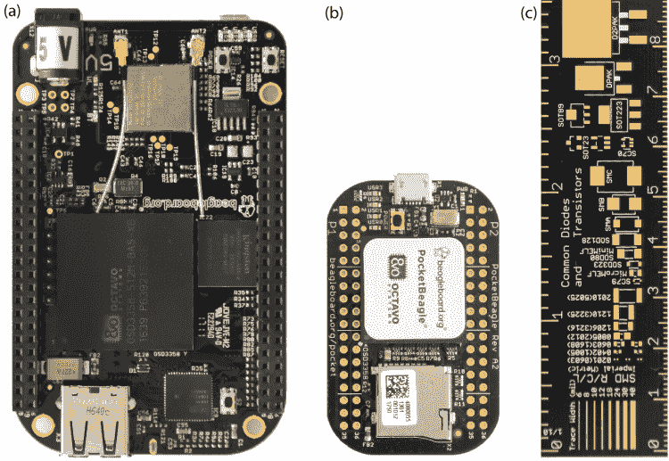

**图 1-1****：** (a) BeagleBone Black Wireless，(b) PocketBeagle，以及 (c) 用于相对尺寸参考的 Adafruit PCB Ruler

[`BeagleBoard.org`](http://BeagleBoard.org) 基金会是一家美国非营利组织，旨在提供开源硬件和软件方面的嵌入式系统教育。在过去十年中，该基金会开发了高质量的板卡，这些板卡在开源社区中以其详细的文档、广泛的支持以及在创意原型与商业产品设计之间搭建的坚实桥梁而闻名。

这些平台板卡由高性能微处理器集成在印刷电路板（PCB）上，并配合丰富的软件生态系统构成。物理 PCB 并非完整产品，而是一个原型参考设计，你可以用它来构建完整产品。它是一个开源硬件平台，意味着你可以直接下载并在自己的产品设计中使用 BeagleBone 或 PocketBeagle 的硬件原理图和布局。事实上，尽管这些板卡功能强大，但它们并未完全暴露德州仪器 Sitara AM335x 系统级芯片（SoC）的所有特性和接口。

最近的 BeagleBone 和 PocketBeagle 板采用了 Octavo Systems 的系统级封装（SiP），该封装将 Sitara AM335x 处理器、DDR 内存、电源管理功能以及所有必要的无源元件集成到单个球栅阵列（BGA）封装中，如图 1-1 所示。这种 SiP 设计方法极大地简化了基于 AM335x 处理器平台的板卡电路布局，并使得 PocketBeagle 的小尺寸成为可能。如果你决定将设计商业化，应牢记这种方法，因为它可能将最终产品的上市时间缩短数月。

Beagle 平台的一个令人印象深刻的特点是，板卡功能可以通过称为 *capes* 的子板进行扩展，这些子板连接到扩展排针（图 1-1(a) 中的两排黑色 2×23 连接器，或图 1-1(b) 中未焊接的 2×18 排针）。你可以设计自己的 capes，并使用这些排针将其牢固地连接到板卡上。此外，许多 capes 可供购买，用于扩展板卡的功能。本章稍后将介绍其中一些示例。

前五款 BeagleBone PCB 由 Gerald Coley 设计，他是 [BeagleBoard.org](http://BeagleBoard.org) 基金会的联合创始人，现任 Embedded Product Design（[`www.emprodesign.net`](http://www.emprodesign.net)）总裁。过去几年中，这些板卡及其部分 capes 由 CircuitCo（[`www.circuitco.com`](http://www.circuitco.com)）、Element14（[`www.element14.com`](http://www.element14.com)）及其子公司 Embest（[`www.embest-tech.com`](http://www.embest-tech.com)）制造。因此，当你购买 Beagle 板时，并非直接从 [BeagleBoard.org](http://BeagleBoard.org) 基金会购买；相反，该基金会是开发者与用户社区的焦点。

### 谁应该使用 Beagle 平台

任何希望将工程概念转化为真实交互式电子产品、项目、原型或艺术作品的人都应考虑使用 Beagle 平台。话虽如此，将高级软件与低级电子电路集成并非易事。然而，实现的难度取决于项目所需的复杂程度。

[BeagleBoard.org](http://BeagleBoard.org) 社区正在努力确保其平台能够被所有有兴趣将其集成到项目中的人所使用，无论他们是学生、创客、艺术家还是爱好者。工具和软件开发环境，例如 Jason Kridner（BeagleBoard.org 联合创始人）的 BoneScript Node.js 库以及 Cloud9 集成开发环境（IDE），使用户能够直接在能够控制电子硬件的 Web 浏览器中编写和构建代码。BoneScript 库将在第 2 章中介绍。

对于具备电子或计算知识的高级用户，Beagle 平台支持额外的开发和定制，以满足特定项目需求。同样，这种定制并非易事：你可能是电子专家，但高级软件编程和/或 Linux 操作系统可能会让你感到困难。或者，你可能是编程大师，但从未连接过 LED！本书旨在满足所有类型的用户，为每种读者提供足够的 Linux、电子和软件知识，确保无论你之前的经验水平如何，都能高效工作。

### 何时使用 Beagle 板

Beagle 板非常适合在任何类型的项目中集成高级软件和低级电子电路。无论你是计划构建自动化家庭管理系统、机器人、智能显示器、传感器网络、自动售货机，还是联网的交互式艺术作品，这些板卡都具备足够的处理能力，能够实现你对嵌入式设备的任何想象。


与更传统的嵌入式系统（如 Arduino、PIC 和 AVR 微控制器）相比，最大的优势在于你可以在项目中利用 Linux 操作系统。例如，如果你使用 BeagleBone 构建了一个家庭自动化系统，然后决定将某些信息发布到互联网上，只需安装一个 Web 服务器即可。接着，你可以使用服务器端脚本或你喜欢的编程语言与家庭自动化系统交互，捕获并共享信息。或者，你的项目可能需要安全的远程访问。在这种情况下，你可以通过 Linux 命令`sudo apt install sshd`（这些命令将在第 2 章中介绍）轻松安装安全外壳（SSH）服务器。这可能会为你节省数周的开发工作。此外，你可以放心，同样的软件正在全球数百万台机器上安全运行。Linux 还为你提供了许多 USB 外设和适配器的设备驱动程序支持，使你能够将摄像头、Wi-Fi 适配器和其他低成本消费类外设直接连接到你的平台，而无需进行复杂和/或昂贵的软件驱动程序开发。如果你要将嵌入式系统连接到互联网或显示器（例如触摸屏或显示器），你应该首先考虑像 Beagle 板这样的 Linux SBC，而不是其他选项。

### 何时不应使用 Beagle 板

Linux 操作系统并非为实时或可预测处理而设计。因此，在确定性处理任务（例如精确地每百万分之一秒采样一次传感器）中使用该操作系统会面临重大挑战。因此，在默认状态下，Beagle 板并不是实时系统应用的理想平台。虽然存在复杂的实时版本 Linux，但它们目前针对的是有经验的 Linux 开发者。然而，与许多其他 Linux SBC 不同，BeagleBone 确实有一个板载解决方案，可以在一定程度上解决这个接口问题。在 AM335x SoC 内部，有两个板载微控制器，称为*可编程实时单元*（PRU），可以编程用于实时接口应用。这是一个高级主题，将在第 15 章中描述。

对于实时采样和控制任务（例如 TI MSP430 或 SimpleLink 有线和无线 MCU），有低成本的专用解决方案可用，这些可能更适合实时接口。同样重要的是要记住，你可以通过电气总线（例如 I²C、UART、CAN 总线和以太网）将此类实时微控制器与 Beagle 板互连，并让 Linux SBC 充当分布式控制系统的中央处理器。这是物联网（IoT）中的一个重要概念，将在第 10 章、第 11 章和第 12 章中详细描述。

Beagle 平台难以胜任的第二种应用类型是播放或处理高清视频。软件解码和播放编码视频流的处理开销巨大，超出了 BeagleBone 在高清视频分辨率下的能力。树莓派（[`www.raspberrypi.org`](http://www.raspberrypi.org)）板具有此能力，因为其 Broadcom BCM2835/7 处理器专为多媒体应用设计，并且具有 H.264/MPG-4 解码器和编码器的硬件实现。对于运行 Kodi 家庭媒体中心（[`kodi.tv`](http://kodi.tv)）等应用，你最好购买树莓派 3（Model B+）。此外，你当然应该购买我的书《探索树莓派》，同样来自 Wiley 迷你系列！

如果你的目标是开发嵌入式 Linux 图像处理或计算机视觉平台，那么你应该考虑 Xilinx Zynq 平台（[`tiny.cc/beagle102`](http://tiny.cc/beagle102)），因为它集成了基于 ARM 的处理器，可以运行 Linux，同时具备 FPGA 的硬件可编程性。这使得计算密集型但可并行化的图像处理功能可以从 Linux 内核卸载到可编程逻辑硬件上。像 PYNQ、ZYBO 或 Arty Z7 这样的板子是可用的，但请注意它们是复杂的设备。

对于将 Linux 与电子电路接口，很难有比 Beagle 板更好的选择，因为其输入/输出范围、平台的开放性以及可用文档的质量都是无与伦比的。

## BeagleBone 文档

本书将我开发 Beagle 平台的经验与嵌入式 Linux、软件开发和通用电子学的背景资料相结合，创建了使用该平台构建的深入指南。然而，一本书不可能涵盖所有内容，因此我避免了重复本节中列出的关键文档和网站中的信息。支持文档的第一个起点始终是：

*   **[BeagleBoard.org](http://BeagleBoard.org)网站：** 该网站提供该平台的主要支持，包括软件指南、社区链接和下载，以支持你的开发。在[`www.beagleboard.org`](http://www.beagleboard.org)上可以找到优秀的“入门”指南和博客。

关于 BeagleBone 平台有大量文档可用，但最重要的文档如下：

*   **Sitara AM335x ARM Cortex-A8 技术参考手册（TRM）：** ¹ Beagle 板的关键组件是其德州仪器 SoC，该文档包含你可能想知道的关于 AM335x 内部工作原理的一切。它是一个复杂的设备，这反映在 AM3358 TRM 的长度上——5113 页！如果你需要了解 BeagleBone 或 PocketBeagle 上微处理器内部工作原理或设备配置的某些内容，答案很可能就在该文档中。我在本书中引用了 TRM 中的表格，以便你能够熟悉其中的语言。该文档和 SoC 的数据表可从[`www.ti.com/product/am3358`](http://www.ti.com/product/am3358)免费获取。

*   **PocketBeagle 系统参考手册（SRM）：** 这是一个实时维基文档，描述了 PocketBeagle 硬件。由 BeagleBoard 社区维护：[`tiny.cc/beagle103`](http://tiny.cc/beagle103)。

*   **BeagleBone Black 系统参考手册（SRM）：** 这是描述 BeagleBone Black 硬件的核心文档。可在[`tiny.cc/beagle104`](http://tiny.cc/beagle104)获取。

还有一些关键网站可以支持你在此平台上的学习，它们结合了教程、讨论论坛、示例代码库、Linux 发行版和项目创意，以激发你的创造力。以下是一些重要网站：

*   **本书网站：** [`www.exploringbeaglebone.com`](http://www.exploringbeaglebone.com)

*   **我的个人博客：** [`www.derekmolloy.ie`](http://www.derekmolloy.ie)

*   **[eLinux.org](http://eLinux.org)维基：** [`www.elinux.org`](http://www.elinux.org)

*   **Linux 基金会：** [`www.linuxfoundation.org`](http://www.linuxfoundation.org)

Beagle 平台软件的入门介绍在第 2 章中。本章的其余部分将讨论物理板子，解释可用的功能，总结 SRM，并提供一些你可能想连接到板子的外设和扩展板类型的示例。

## Beagle 硬件


Beagle 板卡的核心是德州仪器 Sitara AM335x Cortex A8 ARM 微处理器。虽然本书重点介绍 BeagleBone 和 PocketBeagle，但 [BeagleBoard.org](http://BeagleBoard.org) 还开发了其他板卡，包括 BeagleBoard、BeagleBoard XM 和 Arduino Tre（BeagleBoard 与 Arduino 合二为一的板卡）。下一节将详细讨论 BeagleBone 和 PocketBeagle，但这里先按历史顺序列出不同板卡的一些概要信息：

*   **（2008 年）BeagleBoard（125 美元）：** 首款支持高清视频的开源 ARM 开发板。它搭载 720 MHz ARM A8 处理器，但无板载以太网。
*   **（2010 年）BeagleBoard xM（149 美元）：** 与 BeagleBoard 类似，但采用 1 GHz ARM（AM37x）处理器、512 MB 内存、四个 USB 端口并支持以太网。尽管新款 BeagleBone 板卡价格低廉，但 BeagleBoard xM 因其用于数字信号处理（DSP）应用的 C64+TMDSP 内核而广受欢迎。
*   **（2011 年）BeagleBone（89 美元）：** 比 BeagleBoard 更小巧。它搭载 720 MHz 处理器、256 MB 内存、支持以太网、具备低级输入/输出（例如模数转换器），但无板载视频支持。
*   **（2013 年）BeagleBone Black（45–55 美元）：** 该板卡增强了 BeagleBone，配备 1 GHz 处理器、512 MB DDR3 内存、以太网、eMMC 存储和 HDMI 视频支持。
*   **（2014-2018 年）BeagleBone Green、BeagleBone Enhanced、BeagleBone Black Wireless**、**BeagleBone Blue Wireless 和 PocketBeagle（25–90 美元）：** 这些变体板卡基本基于 BeagleBone Black 平台。
*   **（2017 年）BeagleBoard X15（270 美元）：** 基于 Sitara AM5728 的高性能 BeagleBoard，配备双核 1.5 GHz ARM Corex-A15 处理器，集成 C66x DSP、ARM Cortex-M4 实时处理器和 PRU（[`tiny.cc/beagle105`](http://tiny.cc/beagle105)）。

本书重点介绍 BeagleBone 和 PocketBeagle 板卡，主要是因为与其他产品相比，它们的功能集和价格点更具优势；不过，本书中的大部分讨论内容普遍适用于所有平台。

### BeagleBone 版本

如前所述，BeagleBone 有多个版本可用，如 图 1-2 所示，特别是较旧的 BeagleBone White（或简称 BeagleBone）、BeagleBone Black（BBB）以及无线版本。所有板卡都采用小尺寸设计，可以整齐地放入 Altoids 薄荷糖铁盒中；事实上，PocketBeagle 甚至可以放入一个微型的 Altoids Smalls 铁盒中。

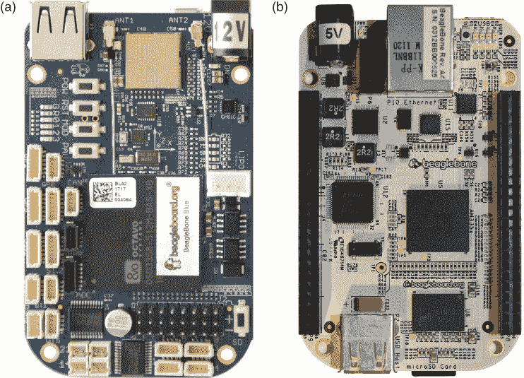

**图 1-2****：** (a) 采用 Octavo OSD3358 SiP 的 BeagleBone Blue，(b) 采用 AM335x SoC 的原始 BeagleBone White

为了实现如此小的外形尺寸，BeagleBone 上的组件密集排列，并采用六层 PCB 来实现互连。例如，BeagleBone Black 平台上使用的 AM335x（ZCZ）处理器具有 324 个引脚的球栅阵列，球间距为 0.80 mm。

表 1-1 列出了当前 Beagle 板卡之间的主要相似点和差异。显而易见的选择因素是价格和网络连接选项。

*   非无线版 BBB 具有以太网连接，这对于板卡充当网络桥接路由器（例如用于 6LoWPAN 应用）的场景特别有用。
*   当需要无线网络时，BBB Wireless 在可能需要视频的移动连接嵌入式应用中表现出色，而 BeagleBone Blue 则擅长与电机接口的移动任务，适用于机器人和自动化等应用。
*   当成本、尺寸和重量成为项目的重要考虑因素时，PocketBeagle 特别有用。尽管没有板载无线连接，但可以根据特定项目添加和定制。例如，您可以通过将模块连接到板卡的 USB 或 UART 接口，为项目添加 Wi-Fi、蓝牙或基于 802.15.4 的通信。有趣的是，PocketBeagle 的底面没有组件，这意味着它可以齐平安装在载板印刷电路板（PCB）上。

| **型号** | **BEAGLEBONE BLACK** | **BEAGLEBONE BLACK WIRELESS** | **POCKETBEAGLE** | **BEAGLEBONE BLUE** | **BEAGLEBOARD X15** |
| --- | --- | --- | --- | --- | --- |
| **大致价格** | 55 美元 | 70 美元 | 25 美元 | 90 美元 | 270 美元 |
| **处理器** | 1 GHz AM335x，带两个 32 位 PRU | 1 GHz AM335x，带两个 32 位 PRU | 1 GHz AM335x，带两个 32 位 PRU | 1 GHz AM335x，带两个 32 位 PRU | 双核 1.5 GHz ARM A15、C66 DSP 内核、双核 ARM M4 和四个 PRU |
| **内存** | 512 MB DDR3 | 512 MB DDR3 | 512 MB DDR3 | 512 MB DDR3 | 2 GB DDR3 |
| **存储** | 板载 4 GB eMMC 和 micro-SD 卡槽 | 板载 4 GB eMMC 和 micro-SD 卡槽 | micro-SD 卡槽 | 板载 4 GB eMMC 和 micro-SD 卡槽 | 板载 4 GB eMMC 和 micro-SD 卡槽 |
| **视频** | 板载 HDMI | 板载 HDMI | 无 | 无 | 板载 HDMI（全尺寸） |
| **调试** | JTAG 焊盘 | JTAG 焊盘 | JTAG 焊盘 | JTAG 焊盘 | 20 针 JTAG 排针 |
| **接口** | 两个 46 针母头 GPIO 排针 | 两个 46 针母头 GPIO 排针 | 两个 36 针未焊接排针 | JST 接口和 24 针公头排针组 | 四个 60 针排针 |
| **有线以太网** | 10/100 以太网 | 无 | 无 | 无 | 双千兆以太网 |
| **无线网络** | 无；可通过 USB Wi-Fi 适配器实现 | 802.11bgn 和蓝牙 4.1（含 BLE） | 无 | 802.11bgn 和蓝牙 4.1（含 BLE） | 无 |
| **供电** | 5 V USB 或 DC 插孔 | 5 V USB 或 DC 插孔 | 5 V USB 及通过排针供电 | 12 V DC 插孔 | 12 V DC 插孔（5 A） |
| **应用** | 带视频和以太网的通用原型设计 | 带视频和 Wi-Fi/蓝牙的通用原型设计 | 自包含的 Linux IoT 或接口应用 | 移动机器人应用；包含 IMU、气压计、LiPo 支持和 H 桥 | 高端 DSP 和实时接口应用，包括 eSATA 和 USB3 |

**表 1-1****：** 近期 Beagle 板卡的高级对比

### Beagle 硬件

图 1-3、1-4 和 1-5 详细展示了 BBB 和 PocketBeagle 板卡的核心系统。第一组标注（1 到 8）标识并描述了 BBB 上的关键系统。BBB 上的微处理器是德州仪器 Sitara AM335x Cortex A8 ARM 微处理器²。它是一种精简指令集计算（RISC）处理器，因此在 1,000 MHz 频率下，该处理器每秒执行 20 亿条指令（MIPS）。处理器在空闲时功耗约为 1W，在重负载处理时约为 2.3 W。


**图 1-3****：** BeagleBone 和 PocketBeagle 子系统及连接器表格

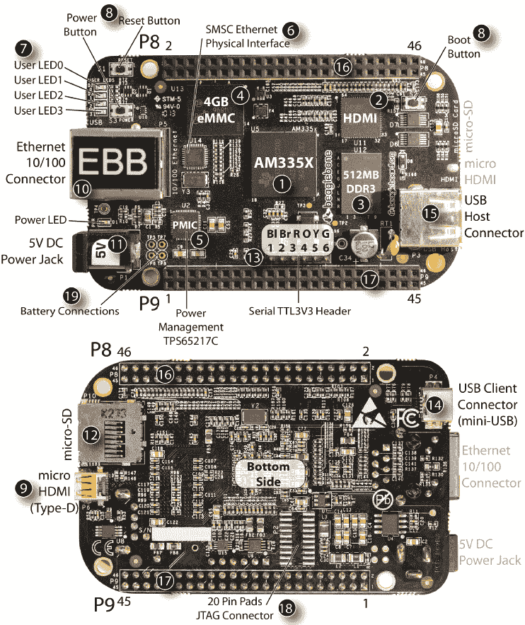

**图 1-4****：** BeagleBone Black (BBB) 顶部和底部视图

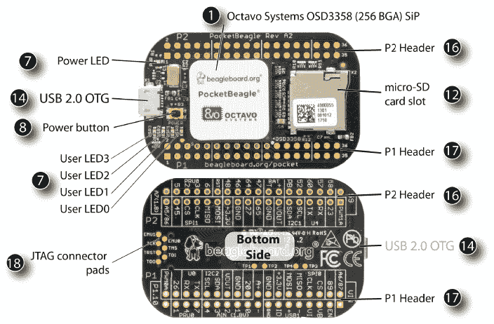

**图 1-5****：** PocketBeagle 顶部和底部视图

下一组标注（9 到 19）标识了 BBB 上的各种连接器、它们的物理特性及其功能。对于连接器 18（JTAG 连接器），有 20 个预镀锡焊盘。您需要为此购买一个连接器（例如 Samtec FTR-110-03-G-D-06），并小心地将其焊接到板卡上。


表 1-2 详细列出了扩展排针上可用的各种输入和输出。BeagleBone 的排针上有 92 个引脚（2 × 46），PocketBeagle 上有 72 个引脚（2 × 36）；但并非所有引脚都可用于通用输入/输出（GPIO）。其中一些连接具有固定配置：

| 扩展排针 | BEAGLEBONE P8 和 P9 | POCKETBEAGLE P1 和 P2 | 注意：此处列出的功能并非全部可同时使用。详情请参见第 6 章。 |
| --- | --- | --- | --- |
| GPIO | 65 | 44 | 所有通用输入/输出均为 3.3 V 耐受，且只能提供或吸收相对较小的电流。 |
| PWM | 8 | 4 | 脉宽调制（PWM）输出可发送一种可变模拟输出（0 V 至 3.3 V）。PWM 可用于控制伺服电机或 LED。 |
| 模拟输入 | 7 | 8 | 12 位 1.8 V 模拟输入，始终可在排针上使用（非复用）。可用于读取传感器值，但需注意它们仅耐受 1.8 V。注意：PocketBeagle 上有 6 个引脚耐受 1.8 V，但另外 2 个引脚耐受 3.3 V。 |
| 电源 | 5 V、3.3 V | 5 V、3.3 V | 提供 5 V 和 3.3 V 电源。ADC 电路还提供 1.8 V 参考电压，但不应将其用作通用电源。 |
| 定时器 | 4 | 4 | 可用于生成外部时钟，以便与设备接口。 |
| I2C | 2 | 2 | I2C 是一种数字总线，允许您同时将多个模块连接到这两条双线总线。有两条公共总线和一条额外的私有总线。 |
| UART | 4 | 3 | 用于两个设备之间的串行通信。UART0 是 BeagleBone 上的串行调试连接器。 |
| CAN | 2 | 2 | CAN 总线用于控制器局域网（CAN），常用于工业过程或车辆中，以便在各种网络系统之间进行通信。BeagleBone 有可用的 CAN 扩展板。 |
| SPI | 2 | 2 | 串行外设接口（SPI）提供短距离同步串行数据链路。它采用主/从配置，需要四根线进行通信。 |
| GPMC | 1 | 1 | 通用内存控制器（GPMC）用于连接外部存储设备，如 FPGA 或 ASIC。该快速总线与 BeagleBone 上的 eMMC 冲突。 |
| MMC | 2 | 2 | 用于将 micro-SD 卡和 eMMC 连接到处理器的接口总线。 |
| LCD | 1 | 1 | 适用于 LCD 屏幕（例如 LCD 扩展板）。该接口与 BeagleBone 上的 HDMI 帧缓冲器冲突。 |
| McASP | 2 | 2 | 通用音频串行端口——多通道音频串行端口（McASP），连接到 BeagleBone 上的 HDMI 帧缓冲器。 |

**表 1-2****：**扩展排针上可用的功能

*   若干引脚连接到地。
*   需要一些引脚来支持模拟输入（例如，1.8 V 参考电压）。
*   一些引脚分配给 3.3 V 和 5 V 电压电源。

其余连接器可复用为多种不同功能，其中一些列于表 1-2 中。每种输入/输出类型的功能将在第 6 章和第 8 章中讨论。

## Beagle 配件

大多数板卡（PocketBeagle 除外）都附带一根 USB 2.0 线缆（mini-USB 插头或 micro-USB 转 USB-A 插头），用于将 BeagleBone（通过 USB 客户端连接器）连接到台式计算机。板卡不附带 micro-SD 卡，特别是 PocketBeagle 需要您自行准备一张。BeagleBone 开箱即可启动，无需 SD 卡，因为 Linux 系统已预装在板载 eMMC 上。

板卡可通过 HDMI 线缆连接显示器（BeagleBone Blue 和 PocketBeagle 除外），但本书中的大多数示例假设板卡以无头模式使用——即不直接连接显示器，而是将板卡用作网络设备，与电子电路、USB 模块和无线传感器进行交互。

### 强烈推荐的配件

建议您随板卡一起购买以下配件。如果您计划进行开发工作，那么最好拥有其中大部分配件。

#### PocketBeagle 的排针

如果您计划将 PocketBeagle 与电子电路连接，那么首先要做的是为 P1/P2 扩展排针添加公针或母针排针，因为这些排针原本是未焊接的。根据您的应用，您可以使用两个 2 × 18 的母排针（间距 2.54 mm/0.1 英寸）或可切割成 2 × 18 尺寸的分离式公排针（间距 2.54 mm/0.1 英寸），如图 1-6(a)所示。这些排针可以安装在 PocketBeagle 的顶部或底部；然而，当安装在顶部时，排针与 OSD3358 模块贴合不佳。底部还有一个有用的引脚标识键，如图 1-5 所示。令人惊讶的是，OSD3358 模块的尺寸也使得板卡的元件面可以平放在工作台上。因此，我倾向于将排针安装在底部，如图 1-6(b)所示。

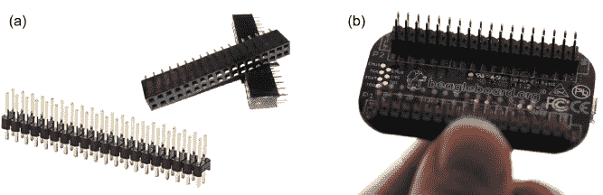

**图 1-6****：**(a) 母排针和公排针连接器；(b) 将公排针焊接到板卡底部的 PocketBeagle

根据我的经验，使用母排针比公排针更安全，因为当公排针以 2 × 18 阵列排列时，很容易意外短路两个相邻的公排针。而且，您只需用几根导线即可连接到母排针。

#### micro-SD 卡（用于启动或刷写 eMMC）

micro-SD 卡使您能够启动任何板卡，或将新的 Linux 镜像写入带有 eMMC 的板卡。如果您有 BeagleBone，那么在实验过程中意外损坏 Linux 文件系统时，这张卡就很重要，因为 micro-SD 卡可以让您使用“刷写器”配置来恢复系统。理想情况下，您应该准备两张专用的 SD 卡，一张用于启动镜像，一张用于刷写器配置。注意不要混淆它们！

购买一张正品、有品牌的 micro-SD 卡，容量至少为 4 GB。理想情况下，您应该使用具有磨损均衡功能的 8–64 GB micro-SD 卡。更大容量的 micro-SD 卡也可以使用，但可能成本过高——增加存储容量的替代方法包括使用 USB 存储设备。

您可能还需要一个 micro-SD 转 SD 适配器，以便在计算机的读卡器中使用。许多 micro-SD 卡都附带适配器，这比单独购买更便宜。micro-SD 卡应为 Class 10 或更高等级，因为更快的读写速度尤其能节省您写入镜像的时间。空白 micro-SD 卡也可用于额外的文件系统存储（在第 3 章中讨论），因此卡容量越大越好。

#### 外部 5V 电源（用于外设）

您可以直接通过台式机/笔记本电脑的 USB 连接，将板卡上的 USB 客户端连接器供电。对于入门来说，这完全没问题；然而，一旦您开始连接 Wi-Fi 适配器、USB 摄像头或板载显示器等配件，USB 提供的功率可能不足以满足您的配置。

您可以购买一个直接插入电源插座的 5 V DC 稳压开关电源。其最小直流输出电流应为 1 A。但如果可能，建议使用 2 A 电流的电源（2 A × 5 V = 10 W）。


BeagleBone Blue 需要一款输出电流为 3 A 的 12 V 直流电源。所有电源的 5 V 桶形连接器（直径 5.5 mm）均应为正极中心。

#### 以太网线缆（用于有线 BBB 网络连接）

Beagle 板可以使用一种名为“USB 网络共享”的特殊网络模式，在板卡与桌面电脑之间创建虚拟网络；不过，如果你要将 BBB 连接到家庭网络，则可以使用 Cat5 网络跳线，通过其 RJ 45 10/100 以太网连接器将 BBB 接入网络。如果你计划同时使用多个 BBB，且网络稳定性对你的应用至关重要，可以考虑投资一个低成本的多端口交换机，将其放置在桌面电脑附近。

#### HDMI 线缆（用于连接显示器/电视）

多款 Beagle 板都配有 HDMI 帧缓冲器和连接器，可以轻松连接到带有 HDMI 或 DVI 连接器的显示器或电视。BBB 配备的是 micro-HDMI 插座（HDMI-D），因此请务必根据你的显示器/电视类型（通常为 HDMI-A 或 DVI-D）进行匹配。你可能需要的线缆是“HDMI-Micro-D 插头转 HDMI-A 公头”。一根 1.8 m（6 ft.）的线缆价格不应超过 10 美元。购买时需注意——HDMI-C（mini-HDMI）连接器无法适配 BBB。

或者，你也可以购买一个低成本的（3 美元）micro-HDMI（HDMI-D）插头转标准 HDMI（HDMI-A）插座适配器，或 micro-HDMI（HDMI-D）插头转 DVI-D 插座适配线缆。这些适配器可让你使用标准尺寸的 HDMI-A 连接器，或连接到 DVI-D 设备（参见图 1-8(a)）。

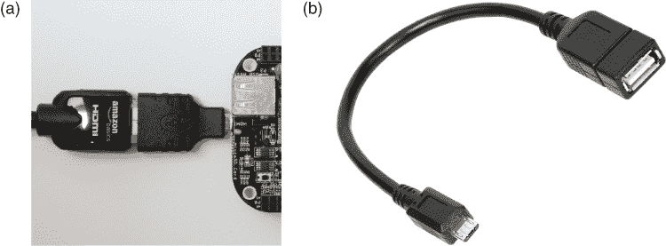

**图 1-8****：** (a) BBB 连接 micro-HDMI 转 HDMI 适配器，再连接低成本 HDMI-A 转 DVI-D 线缆；(b) PocketBeagle 上的 USB OTG 连接器

#### USB 转串口 UART TTL 3.3（用于故障排查）

当板卡上的 Linux 系统出现问题时，USB 转串口 UART TTL 串行线缆是一种非常实用的配件。它可以为你提供板卡的控制台接口，无需连接外部显示器和键盘。

请确保购买 3.3 V 电平版本，并最好选购带有预装六路单向 0.1 英寸母排针的版本，以便与 BeagleBone 或 PocketBeagle 配合使用。该线缆包含芯片组，需要在桌面电脑上安装驱动程序，以创建一个新的 COM 端口。如图 1-9(a) 所示的 FTDI TTL-232R-3V3 线缆工作良好且连接稳定（约 20 美元）。有关该适配器线缆的数据手册和软件驱动程序的“VCP”链接，请参见 [`tiny.cc/beagle106`](http://tiny.cc/beagle106)。市面上也有更便宜的替代品（0.60 美元），例如图 1-9(c) 所示的 CH340G 芯片组设备，但请务必确保将电压选择器设置为 3.3 V。

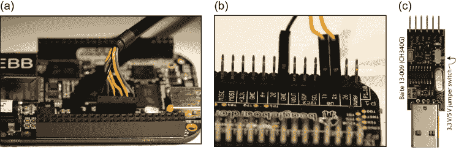

**图 1-9****：** (a) USB 转 TTL 3.3 V 串行线缆；(b) 其与 BBB 的连接（连接线颜色为黑、棕、红、橙、黄、绿）；(c) 低成本 USB 转 TTL 连接器

该线缆连接到 BeagleBone 或 PocketBeagle 板上的串行 UART。使用常规 USB 5 V 电源为 Beagle 板供电后，按照表 1-3 所述以及图 1-9(b) 所示的方式连接线缆。

| **功能** | **FTDI 线缆** | **BEAGLEBONE** | **POCKETBEAGLE** |
| --- | --- | --- | --- |
| 地线 | 黑色 GND 线 | J1 排针引脚 1 GND | P1 排针 GND |
| TX→RX | 橙色发送线 | J1 排针引脚 4 RXD | P1 排针 U0 RX |
| RX←TX | 黄色接收线 | J1 排针引脚 5 TXD | P1 排针 U0 TX |

**表 1-3****：** 从 FTDI 线缆到 BeagleBone 或 PocketBeagle 板的串行调试连接

请注意，扩展排针的详细说明见第 6 章。如果你计划向 BeagleBone 刷写自己的镜像，或者你的板卡无法启动，我建议你购买其中一根线缆。该线缆的使用方法将在第 2 章和第 3 章中讨论。

### 可选配件

以下各节介绍你可能需要的可选配件，具体取决于你正在开发的应用（参见图 1-10）。

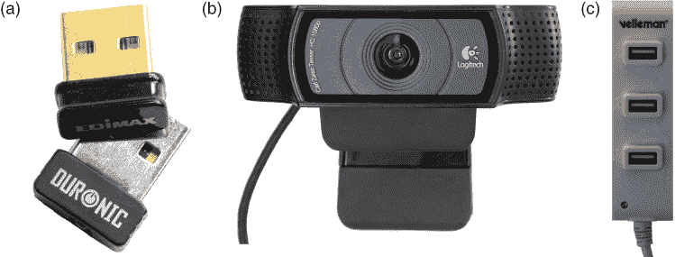

**图 1-10****：** (a) USB Wi-Fi 适配器；(b) 罗技 C920 摄像头；(c) Velleman USB 集线器（总线供电）

#### USB 集线器（用于将多个 USB 设备连接到一个 USB 主机）

如果你计划同时将多个 USB 设备连接到板卡，则需要一个 USB 集线器。USB 集线器分为总线供电和外部供电两种。外部供电的集线器更贵；不过，如果你要为多个功耗较高的适配器（尤其是 Wi-Fi）供电，则可能需要一个供电集线器。请务必在给 Beagle 板通电*之前*将 USB 集线器插入 Beagle 板的主机连接器。我尝试过不同品牌的 USB 集线器，它们都能正常工作，没有遇到问题。

#### Micro-HDMI 转 VGA 适配器（用于 VGA 视频和音频）

市面上有几种低成本的 micro-HDMI 转 VGA 适配器（例如在亚马逊或 eBay 上出售），用于将 HDMI 输出转换为 VGA 输出。除了提供 VGA 视频输出外，许多此类连接器还提供独立的 3.5 mm 音频线路输出，如果你希望使用 BeagleBone 播放音频，而不需要电视、高端放大器或显示器，则可以使用该输出。此外，还有 USB 音频适配器，可提供高质量的播放和录音功能。这些适配器及其使用方法将在第 14 章中介绍。

#### Wi-Fi 适配器（用于无线网络）

BeagleBone Wireless 板卡自带板载 Wi-Fi，但对于 BBB 和 PocketBeagle，你可以使用 USB Wi-Fi 适配器。市面上有多种适配器可供选择，例如图 1-10(a) 中的那些；但并非所有适配器都能在 Linux 下工作。Linux 发行版和适配器内部的芯片组将决定成功的可能性。你可以在 [`tiny.cc/beagle107`](http://tiny.cc/beagle107) 找到一份已验证可用的适配器列表。但请注意，制造商可能会在同一产品中更换芯片组，因此从列表中购买适配器并不能保证其一定可用。如果你能确认计划购买的适配器中的芯片组，并与列表进行比对，成功的可能性会更高。Wi-Fi 配置和应用将在第 12 章中详细讨论，该章测试了一系列广泛可用的低成本适配器。

#### USB 网络摄像头（用于图像采集和视频流传输）

连接 USB 网络摄像头是一种将图像和视频采集集成到项目中的低成本方法。此外，利用 Video 4 Linux 和开源计算机视觉库（OpenCV）等 Linux 库，你可以构建“视觉”应用。


在第 14 章中，我们考察了不同的网络摄像头，但文本重点介绍了罗技 C920 网络摄像头在视频流应用中的使用（参见图 1-10(b)）。这款摄像头价格相对较高（约 70 美元），但由于内置了 H.264/MPG-4 硬件编码，它能够在使用 Beagle 板时直接传输全高清视频。这大大减轻了主板的工作负载，使处理器可以用于其他任务。与 Wi-Fi 适配器类似，在购买摄像头用于特定目的之前，最好确认它在 Linux 下能否正常工作。我们将在第 14 章中介绍几种摄像头类型。

#### USB 键盘和鼠标（用于通用计算）

可以将 USB 键盘和鼠标分别连接到 USB 集线器，或者使用 2.4 GHz 无线键盘和鼠标组合。市面上有小型无线手持组合设备，例如 iPazzPort Wireless Mini、Rii i8 和 eSynic mini，它们都包含带集成触摸板的手持键盘。USB 蓝牙适配器对于将外设连接到主板也很有用。

## 扩展板

扩展板是子板，可以连接到 BeagleBone 板上的 P8/P9 扩展排针，或 PocketBeagle 上的 P1/P2 扩展排针。由于这些板子的形状像超人披风一样包裹在 BBB 的 RJ45 以太网连接器周围，因此被称为*扩展板*（capes）。当扩展板彼此兼容时，你可以同时连接最多四个扩展板。

有些扩展板使用了大量引脚。例如，你将在第 13 章中看到 LCD4 扩展板。LCD4 扩展板使用了 P8 排针的 27 到 46 号引脚，以及部分模拟输入用于其按钮和电阻式触摸接口。如果你使用 eMMC 启动 BBB，那么留给 GPIO 使用的引脚就很少了。此外，LCD 扩展板不会将排针延续下去。图 1-11 展示了该扩展板连接到 BBB 并运行标准 Debian Linux 发行版时的两个视图。其他扩展板也会出现类似问题。

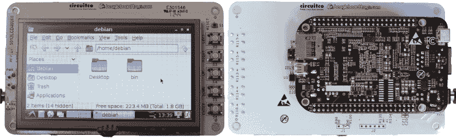

**图 1-11****：** LCD4 扩展板（顶部和底部视图）

目前有超过 100 种扩展板可用于 BeagleBone 和 PocketBeagle 板；你可以在[`www.beagleboard.org/cape`](http://www.beagleboard.org/cape)找到完整列表。以下是一些你可能在项目中会用到的示例扩展板：

*   LCD 扩展板有不同尺寸：7 英寸（800×480）、4 英寸（480×272）和 3 英寸（320×240），图 1-11 中展示的是 4 英寸版本。这些扩展板带有电阻式触摸屏，意味着你需要使用触控笔（或指甲）与屏幕交互。这与现代手机/平板电脑上的电容式触摸屏不同。Manga Screen 2 是一款兼容 HDMI 的多点触控 LCD 屏幕替代品，有 4.8 英寸（720p）或 5.9 英寸（1080p）版本。参见[`tiny.cc/beagle108`](http://tiny.cc/beagle108)。

*   Adafruit Proto 扩展板，如图 1-12(a)所示，是一款低成本（约 10 美元）的裸板，你可以用它来将面包板设计转移到更稳固的平台。BeagleBone 和 PocketBeagle 板还有多种其他面包板和原型扩展板可用。特别值得一提的是 BaconBits 扩展板（[`tiny.cc/beagle110`](http://tiny.cc/beagle110)），它为 PocketBeagle 增加了七段数码管、加速度计、LED、电位器、按钮和 USB 转串口桥接器。

*   Replicape（179 美元）是一款令人印象深刻的开源 3D 打印机扩展板，具有五个步进电机驱动器，支持微步进。更多信息请参见[`www.thing-printer.com`](http://www.thing-printer.com)。

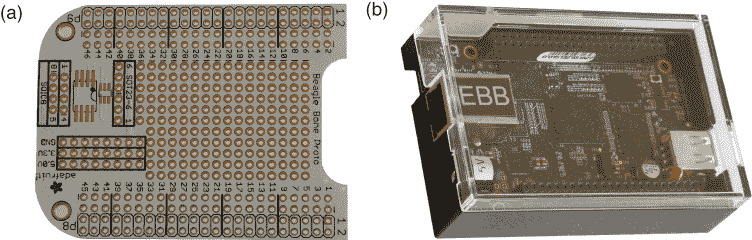

**图 1-12****：** (a) Proto 扩展板；(b) 合适的外壳

在互连扩展板时，你必须注意兼容性。在[`tiny.cc/beagle109`](http://tiny.cc/beagle109)上有一张涵盖常见扩展板的兼容性表。上述列表只是很小的一部分。还有更多扩展板可用，并且随着时间的推移，很可能还会开发出更多的扩展板。

## 如何毁掉你的主板！

Beagle 板是复杂而精密的设备，如果不小心使用，很容易损坏。如果你从 Arduino 等板子升级到 Beagle 平台，那么在连接为该平台构建的电路时必须格外小心。与 Arduino Uno 不同，主板上的微处理器无法更换——如果损坏了 SoC 或 SiP，你将需要购买一块新板！

以下是你*绝对不要*做的事情：

*   不要通过拔掉电源插头/USB 电源来关闭主板。应通过软件关机（例如，按一次电源按钮）或按住电源按钮约八秒进行“硬”关机来正确关闭主板。这能使电源管理 IC（PMIC）正确关闭主板。如果需要通过断开电源来移除电源，请在按住复位按钮的同时进行操作，以降低系统功耗。

*   不要将通电的主板放在金属表面（例如铝制外壳的电脑）或带有散落/剪断的导线、电阻等的工作台上。如果短路了扩展排针上的引脚（或焊点），很容易损坏主板。你可以从 Adafruit 等供应商处购买外壳（参见图 1-12(b)）。或者，你也可以在主板上安装小型橡胶脚垫。

*   不要连接从扩展排针提供/吸收超过极低电流的电路。许多排针引脚可提供的最大电流为 4-6 mA，可吸收的最大电流为 8 mA。电源轨和地引脚可以提供和吸收更大的电流。Arduino 允许每个输入/输出引脚有 40 mA 的电流。这个问题将在第 4 章和第 6 章中讨论。

*   GPIO 引脚耐压 3.3 V（大多数 ADC 耐压 1.8 V）。不要连接以 5 V 供电的电路，否则会损坏主板。这在第 4 章、第 6 章和第 8 章中讨论。

*   不要在主板未通电时连接向扩展排针供电的电路。确保所有自供电的接口电路都通过 3.3 V 电源线或光耦进行门控。这在第 6 章中讨论。

以下是*始终*要遵循的两个步骤：

*   仔细检查你正在使用的引脚编号。每个排针都有大量引脚，很容易插到排针连接器 17 而不是 15。对于排针中间的连接，我总是数两遍——从左向上数和从右向下数。

*   在连接你自己设计的复杂电路之前，详细阅读主板的 SRM 手册。

如果你的主板坏了，而且*确实*是你的错，那么恐怕在你完成[`www.beagleboard.org/support`](http://www.beagleboard.org/support)上的所有检查后，你将不得不购买一块新板。如果*不是*你的错，那么请参阅 BBB/PocketBeagle SRM 手册和[`www.beagleboard.org/support`](http://www.beagleboard.org/support)网站，通过申请退货授权（RMA）编号将有缺陷的主板退回维修。

## 总结

完成本章后，你应该能够做到以下几点：

*   描述 Beagle 板的能力及其对不同项目类型的适用性


*   获取有助于你使用 Beagle 平台的重要文档来源
*   描述不同板卡上的主要硬件系统和子系统
*   识别可购买的重要外设和配件，以增强板卡的功能
*   理解 Beagle 板作为物理计算设备的强大与复杂性
*   了解保护板卡免受物理损坏的首要步骤

## 支持

本章前面列出了额外支持文档的主要来源。如果你在使用 Beagle 平台时遇到困难，且文档中未描述相关问题，则应使用以下两个资源：

*   BeagleBoard Google 群组，可通过 [`groups.google.com/d/forum/beagleboard`](http://groups.google.com/d/forum/beagleboard) 访问。在发布新问题前，请先阅读常见问题（FAQ）并搜索现有问题。
*   可通过 [`www.beagleboard.org/chat`](http://www.beagleboard.org/chat) 或直接加入 Beagle IRC 频道（在 [`irc.freenode.net`](http://irc.freenode.net) 上加入 `#beagle`）进行实时聊天，使用免费的 IRC 客户端，如 Linux 上的 X-Chat、Windows 上的 HexChat 或 macOS 上的 Colloquy。

请记住，该群组和 IRC 频道中的成员是自愿抽出时间回答问题的社区成员。

## 备注

# 第 2 章

## Beagle 软件

本章将介绍 Linux 操作系统以及可用于 Beagle 板卡的软件工具。本章旨在确保你能够连接到板卡并对其进行控制。通过本章的学习，你将能够按照逐步指南，在 Linux 终端窗口中使用 Linux shell 命令“闪烁”系统 LED。此外，本章还将介绍一个名为 `BoneScript` 的软件函数库，该库可与 Node.js 和 Cloud9 集成开发环境配合使用，构建用于闪烁同一系统 LED 的代码。

### 本章所需设备：

*   任意 Beagle 板卡
*   USB 线缆（通常为 USB A 公头转 mini 或 micro USB A 公头）
*   Micro-SD 卡（4 GB 或更大；Class 10+）
*   网络基础设施和线缆（可选）

本章的更多详细信息可在此处获取：

[`www.exploringbeaglebone.com/chapter2/.`](http://www.exploringbeaglebone.com/chapter2/)

## Beagle 板上的 Linux

*Linux 发行版* 是一种公开可用的 Linux 版本，附带一组软件程序和工具。有许多不同的 Linux 发行版，通常专注于不同的应用。例如，高端服务器所有者可能会安装 Red Hat Enterprise、CentOS、Debian 或 OpenSUSE；桌面用户可能会安装 Ubuntu、Debian、Fedora 或 Linux Mint。列表无穷无尽，但所有发行版的核心都是共同的 Linux 内核，该内核由 Linus Torvalds 于 1991 年构思并创建。

在为嵌入式系统平台选择 Linux 发行版时，明智的做法是选择具有以下属性的发行版：

*   发行版稳定且得到良好支持。
*   拥有良好的包管理器。
*   发行版精简，适合嵌入式设备的低存储占用。
*   针对你的特定设备有良好的社区支持。
*   支持你想要连接的任何外设的设备驱动程序。

### Beagle 板的 Linux 发行版

嵌入式系统平台有许多不同的 Linux 发行版，包括用于实时编程的昂贵专有版本。它们的核心都使用主线 Linux 内核，但每个发行版包含不同的工具和配置，从而带来截然不同的用户体验。Beagle 板社区使用的主要开源发行版包括 Debian、Ångström、Ubuntu 和 Arch Linux。

*Debian*（“Debbie 和 Ian”的缩写）是一个社区驱动的 Linux 发行版，强调开源开发。Debian 的开发没有商业组织参与；事实上，有一份正式的社会契约（[`tiny.cc/beagle201`](http://tiny.cc/beagle201)）声明 Debian 将完全保持自由（指软件自由）。本书中的许多实践步骤都使用 Debian 发行版；实际上，它被推荐为 Beagle 板的首选发行版，并且目前随新的 BeagleBone 板一起分发。此外，本书全程使用 Debian 作为 Linux 桌面计算机的发行版，因为它通过 Debian 交叉工具链（参见 [`wiki.debian.org/CrossToolchains`](http://wiki.debian.org/CrossToolchains)）为跨平台开发提供了出色的支持。目前，可从 [BeagleBoard.org](http://BeagleBoard.org) 网站下载不同版本的 Debian。

*   *Debian Stretch LXQt*，安装了轻量级 Qt 桌面（LXQt）环境。如果你将板卡连接到显示器或 LCD 面板，应使用此版本。
*   *Debian Stretch IoT*，这是一个无头镜像，在 micro-SD 卡上占用空间更小，更重要的是，在 BeagleBone 的 eMMC 上占用空间也更小。

*Ångström* 是一个稳定且精简的 Linux 发行版，广泛用于嵌入式系统。Ångström 背后的开发团队在定制嵌入式设备（如机顶盒、移动设备和网络设备）的 Linux 发行版方面经验丰富。令人印象深刻的是，Ångström 可以缩减到只有几兆字节闪存存储的设备。Ångström 大量使用 *BusyBox*，这是一个多调用二进制文件（一个可执行文件可完成多项工作），用于创建 Linux 系统上命令行工具的紧凑版本。我的许多 YouTube 视频都使用 Ångström，因为它在一段时间内是 BeagleBone 的主要发行版。

*Ubuntu* 与 Debian 关系密切；事实上，Ubuntu 网站（[`www.ubuntu.com`](http://www.ubuntu.com)）上这样描述：“Debian 是 Ubuntu 赖以建立的基石。”Ubuntu 是最流行的桌面 Linux 发行版之一，主要因为它专注于让 Linux 对新用户更易用。它易于安装，拥有出色的桌面驱动程序支持，并且有针对 Beagle 板的二进制发行版。

*Arch Linux* 是一个轻量级且灵活的 Linux 发行版，旨在“保持简单”，特别针对有能力的 Linux 用户，让他们完全控制并负责系统配置。有针对 Beagle 板的预构建 Arch Linux 发行版；然而，与其他发行版相比，它目前对 Linux 新用户的支持较少（参见 [`www.archlinux.org`](http://www.archlinux.org)）。

### 创建 Linux Micro-SD 卡镜像

设置 SD 卡以便用于启动 PocketBeagle 或其他 Beagle 板的最简单方法是从 [`beagleboard.org/latest-images`](http://beagleboard.org/latest-images) 下载 Linux 发行版镜像文件（压缩为 `.xz` 格式的 `.img` 文件），然后使用镜像写入工具（如 Etcher（[`etcher.io`](http://etcher.io)））将其写入 SD 卡。Etcher 特别有用，因为它可以直接使用压缩镜像文件。该应用程序适用于 Windows、Mac 和 Linux 主机。

## 与板卡通信


当你准备好尝试使用 Beagle 板时，首先要做的是用 USB 线将其连接到台式电脑。通电后，板子会以 USB 客户端模式连接到台式机。一旦连接并被识别，你的文件管理器（如 Windows 资源管理器）将显示板子 FAT 分区的内容，如图 2-1 所示。[BeagleBoard.org](http://BeagleBoard.org) 团队编写了一份非常出色的 HTML 入门指南。你应该双击 `START.htm` 文件，在网页浏览器中查看该指南，如图 2-1 所示。


**图 2-1****：** `START.htm` 设置板子的指南（在 Windows 10 下运行）

### 安装驱动程序

按照图 2-1 所示指南中的步骤操作。使用最新的 Beagle 板 Linux 镜像，你通常不再需要为操作系统安装驱动程序。如果你使用的是较旧的镜像并需要安装驱动程序，请浏览到 `Drivers` 文件夹并安装正确的版本。一旦板子完全启动，你的台式电脑上应该会出现几个新设备。例如，你将拥有以下设备：

*   访问板子的 FAT 分区（如同 USB 存储密钥）。
*   通过新的 Gadget Serial 驱动程序 COM 端口进行串行访问。
*   一个 Linux USB 以太网/RNDIS 小工具（用于通过 USB 上网）。RNDIS 代表远程网络驱动程序接口规范。

这些新设备可用于连接板子。当板子连接到你的电脑时，随着你逐步阅读指南，指南会高亮显示活动连接，如图 2-2 所示。Linux 和 Mac 台式电脑的类似步骤可在启动指南中找到。

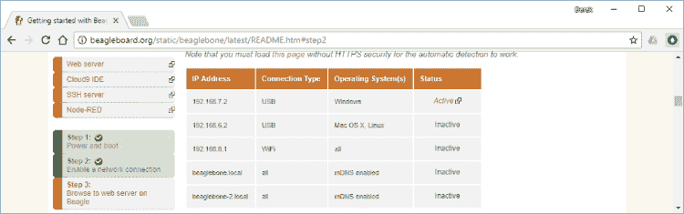

**图 2-2****：** `START.htm` 指南将高亮显示活动连接

### 有线网络连接

通过有线网络连接并与板子通信主要有三种方式，每种方式各有优缺点。第一种方式是使用 USB 上网，它通过一根 USB 线创建一个“私有”虚拟局域网。这种方法适用于所有 Beagle 板，但以下两种方式需要板子具备以太网适配器。第二种方式是使用常规以太网，第三种是使用以太网交叉线。通过网络连接板子对初学者来说可能是一个障碍。如果你在家工作并能控制自己的网络，通常很简单；然而，复杂的网络（如大学中的网络）可能包含多个有线和无线通信子网。在这种复杂网络中，路由限制可能使得通过常规以太网连接板子变得困难，甚至不可能。

#### USB 上网（所有板子）

标准的 [BeagleBoard.org](http://BeagleBoard.org) Linux 发行版通过 Linux USB 以太网/RNDIS 小工具设备支持 USB 上网。对于新用户以及处于复杂网络基础设施中的用户来说，这可能是开始使用板子的最佳方式。这种设置只需要板子、一根 USB 线和一台台式电脑（最好具有管理员访问权限）。表 2-1 描述了 USB 上网连接板子的优缺点。

| **优点** | **缺点** |
| --- | --- |
| 为初学者提供稳定的网络设置。 | 除非付出大量努力，否则每台台式机只能连接一块板子。 |
| 当你无法访问或控制网络基础设施硬件时，仍可将板子连接到互联网。 | 网络共享配置可能很困难，尤其是在 Macintosh 台式电脑上。还需要在板子的 Linux 操作系统上进行额外配置。 |
| 通过 USB 由台式机供电。 | 台式机必须运行才能与互联网传输数据。 |

**表 2-1****：** USB 上网的优缺点

例如，如果你在 Windows 下完全安装了板子驱动程序，现在应该有一个新的网络连接（点击“开始”，输入“查看网络状态和任务”，然后选择“更改适配器设置”）。图 2-3 显示了 Windows 下的典型网络连接窗口。在此例中，“以太网 3”是 Linux USB 以太网/RNDIS 小工具设备。台式电脑仍连接到你的常规局域网（本例中通过以太网 2），该局域网提供对互联网的访问，同时还有一个仅包含台式电脑（例如 192.168.7.1）和你的板子（例如 192.168.7.2）的新私有局域网。你可以打开网页浏览器，在地址栏输入 192.168.7.2（在 Mac/Linux 机器上为 192.168.6.2）连接到板子的 Web 服务器，如图 2-3 所示。


**图 2-3****：** 带有 USB 上网连接和网页浏览器连接的 Windows 网络连接

此时，你可以使用网页浏览器连接到板子的 Web 服务器，从而拥有一个功能完整的私有网络；不过，你可能还希望板子能直接完全访问互联网，以便直接在板子上下载文件和更新 Linux 软件。为此，你需要共享主网络适配器，使来自板子的流量能够通过台式电脑路由到互联网。例如，在 Windows 下，请执行以下步骤：

1.  选择提供互联网访问的台式机/笔记本电脑网络适配器。右键单击它并选择“属性”。
2.  在出现的对话框中（如图 2-4 左侧所示），单击顶部的“共享”选项卡，并启用“允许其他网络用户...”。
3.  在下拉列表中，选择你的私有局域网（例如，参照图 2-4，本例中为“以太网 3”）。单击“确定”。
4.  右键单击私有局域网（例如以太网 3）并选择“属性”。
5.  双击“Internet 协议版本 4”。在此对话框中，选择“自动获得 IP 地址”并启用“自动获得 DNS 服务器地址”（参见图 2-4 右侧）。
6.  单击“确定”，然后“关闭”以保存配置。

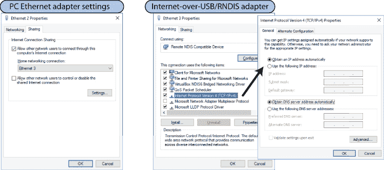

**图 2-4****：** 在 Windows 下配置网络连接共享属性

在 macOS 下的步骤类似，通过 Apple 菜单 → 系统偏好设置 → 共享。如果一切顺利，此时你不会注意到任何差异，并且应该能够重新加载图 2-3 中显示的网页。网络配置最终确定可能需要大约一分钟。请注意，最后两步的效果只有在打开与板子的终端连接时才能体现出来。

#### 常规以太网（仅限 BBB 和 BeagleBoard）


所谓“常规”以太网，是指像用有线连接台式电脑一样，将开发板连接到网络。对于 BeagleBone Black（BBB）的家庭用户和高级用户而言，常规以太网可能是联网和连接开发板的最佳方案。表 2-2 列出了使用这种连接的优缺点。主要问题在于网络的复杂性——如果你了解自己的网络配置并能访问路由器设置，那么这无疑是最佳配置。如果你的网络路由器离台式电脑较远，可以使用一个小型网络交换机，价格仅需 10 到 20 美元。或者，你也可以花 25 到 35 美元购买一个带有多端口路由器的无线接入点，这样就能集成 BeagleBone Black Wireless（BBBW）开发板。

| **优点** | **缺点** |
| --- | --- |
| 你可以完全控制 IP 地址设置以及动态/静态 IP 设置。 | 你可能需要网络基础设施的管理权限或相关知识。 |
| 你可以将多个 BBB 连接并互连到同一个网络（包括无线设备）。 | BBB 需要电源（可以是市电适配器）。 |
| BBB 无需台式电脑开机即可连接互联网。 | 如果网络结构复杂，初学者设置起来会更麻烦。 |

**表 2-2****：** 常规以太网的优缺点

这种配置的第一个挑战是在网络上找到你的 BBB。默认情况下，开发板配置为请求一个 `Dynamic Host Configuration Protocol`（DHCP）IP 地址。在家庭网络环境中，该服务通常由运行在集成调制解调器-防火墙-路由器-LAN（或类似配置）上的 DHCP 服务器提供，该设备将家庭网络连接到互联网服务提供商（ISP）。

`DHCP servers` 会从一个地址池中动态分配 IP 地址，并设定一个固定时间间隔，称为 `lease time`（租约时间），该时间在 DHCP 配置中指定。当租约到期后，你的开发板下次连接到网络时会被分配一个不同的 IP 地址。这可能会令人沮丧，因为你可能需要在网络上重新搜索你的开发板。你可以将开发板的 IP 地址设置为 `static`（静态），这样每次连接时都会固定在同一地址。无线连接和静态 IP 连接将在第 12 章中讨论。

有几种不同的方法可以找到开发板的动态 IP 地址。

*   使用网页浏览器访问你的家庭路由器（通常地址为 `192.168.1.1`、`192.168.0.1` 或 `10.0.0.1`）。登录后，在“状态”等菜单下查找“DHCP 表”。你应该能看到一个条目，详细列出了主机名为 `beaglebone` 的设备所分配的 IP 地址、物理 MAC 地址以及剩余租约时间。示例如下：

    ```
    租约表
    IP 地址          MAC 地址        客户端主机名    注册信息
    192.168.1.116   c8:a0:30:c0:6b:48  beaglebone     剩余 23:59:51 
    ```

*   使用端口扫描工具，例如 Linux 下的 `nmap` 或 Windows 下可用的 `Zenmap` 图形界面版本（参见 [`tiny.cc/beagle202`](http://tiny.cc/beagle202)）。命令 `nmap -T4 -F 192.168.1.*` 将扫描子网上的设备。你需要查找一个通常开放五个端口的条目（例如，22 端口用于 SSH，53 端口用于 DNS，80 端口用于 [BeagleBoard.org](http://BeagleBoard.org) 网页指南，3000 端口用于 Cloud 9 IDE，8080 端口用于 Apache 网络服务器）。该设备还应标识为 Texas Instruments。

*   你可以通过串行 over USB 连接连接到开发板，然后输入 `ifconfig` 来查找 IP 地址。该地址是与 `eth0` 适配器关联的 `inet addr` 值。这一点稍后会讨论。

一旦获得 IP 地址，你可以将其输入到网页浏览器的地址栏中（上例中为 `192.168.1.116`）来测试其有效性。浏览器应显示与图 2-3 相同的页面。

#### 以太网交叉线（仅限 BBB 和 BeagleBoard）

以太网交叉线是一种经过修改的网线，可以使两个以太网设备直接连接，无需以太网交换机。它可以作为线缆或即插即用适配器购买。表 2-3 描述了这种连接类型的优缺点。

| **优点** | **缺点** |
| --- | --- |
| 当你无法使用网络基础设施硬件时，仍可连接到 BBB。 | 如果你的台式机只有一个网络适配器，你将失去互联网访问。最好与具有多个适配器的设备一起使用。 |
| 如果台式机有两个网络适配器，BBB 可能可以访问互联网。 | BBB 仍需要电源（可以是市电适配器）。 |
| 提供相当稳定的网络设置。 | 与通过 USB 共享互联网功能重复，因此建议先尝试那种方法。 |

**表 2-3****：** 交叉线网络的优缺点

大多数现代台式机具有自动交叉检测功能（Auto-MDIX），因此可以使用常规以太网线。Beagle 开发板的网络接口也支持 Auto-MDIX；因此，当你无法使用网络基础设施时，可以使用这种连接类型。如果你的台式机有两个网络适配器（例如，带有有线和无线网络适配器的笔记本电脑），你可以通过桥接两个适配器轻松地与 BBB 共享互联网连接。例如，在 Windows 操作系统下需要执行以下步骤：

1.  将一根常规（或交叉）以太网线的一端插入 BBB，另一端插入笔记本电脑的以太网接口。

2.  通过连接 USB 电源为 BBB 供电。

3.  然后桥接两个网络连接——在 Windows 下点击“开始”，输入 `view network status` 和任务，选择“更改适配器设置”，同时选中两个网络适配器（有线和无线），右键单击，然后选择“桥接”。一段时间后，两个连接应显示状态为“已启用，已桥接”，并出现一个网络桥接。

4.  重新启动 BBB。开发板重启后，它应该会直接从网络的 DHCP 服务器获取 IP 地址。

然后，你可以使用下一节中描述的步骤，从网络上的任何位置（包括 PC/笔记本电脑本身）直接与 BBB 通信。这种连接类型在复杂的网络基础设施中（例如大学网络）特别有用，因为笔记本电脑可以使用分配的地址连接到 BBB。BBB 也可以继续连接互联网。

### 与开发板通信

一旦开发板联网，接下来要做的就是与之通信。你可以通过 USB 串行连接、USB 转 TTL 或网络连接（如刚才讨论的）连接到 Beagle 开发板。网络连接应该是你的主要关注点，因为这种连接为开发板提供了完整的互联网访问。串行连接通常用作网络连接出现问题时的一种备用连接。因此，你可以跳过下一节，但此处提供的信息可作为问题出现时的参考。

#### 通过 USB 的串行连接


如果你在前一节中为 Beagle 板安装了设备驱动程序，`Gadget Serial device` 将允许你直接使用终端模拟程序连接到该板。当板靠近台式计算机并通过 USB 电缆连接时，串行连接尤其有用。当板上的网络配置或软件服务出现问题时，它通常是一种备用通信方法。

要通过串行连接连接到板，你需要一个终端程序。Windows 上有多个第三方应用程序可用，例如 RealTerm（[`realterm.sourceforge.io`](http://realterm.sourceforge.io)）和 PuTTY（[`www.putty.org`](http://www.putty.org)）。下一节也会用到 PuTTY。大多数桌面 Linux 发行版都包含一个终端程序（尝试 Ctrl+Alt+T 或使用 Alt+F2 并在 Debian 下输入 `gnome-terminal`）。macOS 默认包含一个终端模拟器（例如，输入 `screen/dev/tty.usbmodemfa133 115200`）。

要通过 USB 串行连接连接到 Beagle 板，你需要了解一些信息。

*   **COM 端口号：** 你可以通过打开 Windows 设备管理器并在端口部分下查找来找到它。图 2-5 显示了一个设备管理器示例，其中 Gadget Serial 设备被列为 COM3。这在不同的机器上会有所不同。

*   **连接速度：** 默认情况下，你需要输入 `115,200` 波特率才能连接到板。

*   **其他终端应用程序可能需要的信息：** `数据位 = 8`；`停止位 = 1`；`奇偶校验 = 无`；以及 `流控制 = XON/XOFF`。

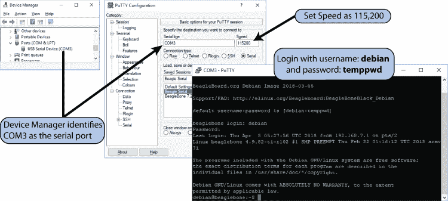

**图 2-5****：** Windows 设备管理器以及打开到板的 PuTTY 串行连接

使用会话名称保存配置，以便每次想要连接时都可以使用。单击“打开”，重要的是*当窗口出现时按 Enter 键*。连接到 Debian 时，你应该看到以下输出：

```
Debian GNU/Linux 9 beaglebone ttyGS0

BeagleBoard.org Debian Image 2018-03-05
Support/FAQ: http://elinux.org/Beagleboard:BeagleBoneBlack_Debian
default username:password is [debian:temppwd]
beaglebone login: debian
Password: temppwd
debian@beaglebone:~$ 
```

这允许你使用用户名 `debian` 和密码 `temppwd` 登录。

在 Linux 桌面计算机上，你可以安装 `screen` 程序并使用以下命令连接到串行转 USB 设备：

```
molloyd@debian:~$ sudo apt-get install screen
molloyd@debian:~$ screen /dev/ttyUSB0/ 115200 
```

#### 使用 USB 转 TTL 3.3V 电缆的串行连接

对于这种串行连接类型，你需要第 1 章中描述的专业电缆（或图 1-9(c) 中更便宜的替代品）。从 Windows 设备管理器中找到与名为 USB Serial Port 的设备关联的 COM 端口。将电缆插入 P9 排针旁边的六针连接器（黑色引线连接到白点/J1），如图 1-9(a) 所示，或插入 PocketBeagle 扩展排针，如图 1-9(b) 所示。

然后你可以使用 PuTTY（`115,200` 波特率）打开串行连接，你将看到与之前相同的登录提示。但是，当你重新启动板时，你还会看到板启动时的完整控制台输出，它以以下内容开头（以 PocketBeagle 为例）：

```
U-Boot SPL 2018.01-00002-ge9ff418fb8 (Feb 20 2018 - 20:14:57)
Trying to boot from MMC1
U-Boot 2018.01-00002-ge9ff418fb8 (Feb 20 2018 - 20:14:57 -0600), 
Build: jenkins-github_Bootloader-Builder-38
CPU  : AM335X-GP rev 2.1
I2C:   ready
DRAM:  512 MiB
…
Model: BeagleBoard.org PocketBeagle
… 
```

这是最终的备用连接，因为它允许你查看启动过程中发生的情况，这将在下一章中描述。

#### 通过安全外壳连接

`安全外壳`（SSH）是一种有用的网络协议，用于网络设备之间的安全加密通信。你可以使用 SSH 终端客户端连接到在板端口 22 上运行的 SSH 服务器，这允许你执行以下操作：

*   远程登录到板并执行命令

*   使用 `SSH 文件传输协议`（SFTP）向板传输文件或从板传输文件

*   转发 X11 连接，这允许你执行虚拟网络计算（在第 13 章中介绍）

默认情况下，BeagleBone Linux 发行版运行一个绑定到端口 22 的 SSH 服务器（Debian 上为 `sshd`，Ångström 上为 `Dropbear`）。将 SSH 服务器作为远程登录板的默认方法有几个优点。特别是，你可以使用路由器的端口转发功能将板的端口 22 开放到互联网。请确保在执行此操作之前为 root 用户帐户设置密码。然后，如果你知道板的 IP 地址，就可以从世界任何地方远程登录到你的板。大多数路由器支持一种称为 `动态 DNS` 的服务，该服务允许你的路由器将其最新地址注册到在线服务。然后，该在线服务将你选择的域名映射到 ISP 给你的最新 IP 地址。动态 DNS 服务通常有年度费用，它将为你提供一个形式为 [`MyBeagle.servicename.com`](http://MyBeagle.servicename.com) 的地址。

#### 使用 PuTTY 的安全外壳连接

前面提到过 PuTTY（[`www.putty.org`](http://www.putty.org)）是一种通过串行转 USB 连接到板的方法。PuTTY 是一个免费的开源终端模拟器、串行控制台和 SSH 客户端，你也可以使用它通过网络连接到板。PuTTY 有一些有用的功能。

*   它支持串行和 SSH 连接。

*   它安装了一个名为 `psftp` 的应用程序，使你能够从台式计算机通过网络向 Beagle 板传输文件或从 Beagle 板传输文件。

*   它支持 SSH X11 转发，这在第 13 章中是必需的。

图 2-6 显示了 PuTTY 配置设置。选择 SSH 作为连接类型，输入你的板的 IP 地址（`192.168.7.2` 或如果你使用互联网转 USB，则为 `192.168.6.2`），使用端口 22（默认），然后使用一个有用的名称保存会话以备将来使用。单击“打开”并使用你的用户名和密码登录。你可能会收到一个安全警报，警告中间人攻击，这在不安全的网络上可能是一个问题。接受指纹并继续。macOS 和 Linux 用户可以使用类似的设置运行终端应用程序（例如，`ssh -X root@192.168.6.2`）。

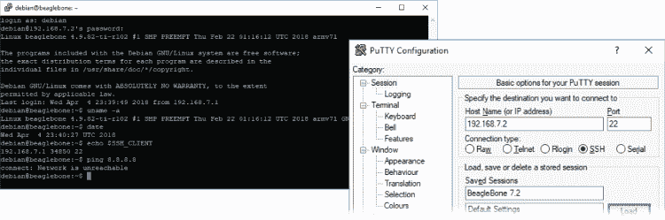

**图 2-6****：** Windows PC 上的 PuTTY SSH 配置设置，旁边是一个打开的 SSH 终端连接

你将看到本章后面可以发出的基本 Linux 命令，但首先需要检查如何向板传输文件或从板传输文件。

#### Chrome 应用：安全外壳客户端

Chrome 网络浏览器支持 Chrome 扩展程序——这些应用程序的行为类似于本地安装（或原生）应用程序，但使用 HTML5、JavaScript 和 CSS 编写。其中许多应用程序使用 Google 的 Native Client（NaCl，或 Salt！），这是一个沙箱，用于直接在网络浏览器中运行编译后的 C/C++ 应用程序，无论操作系统如何。NaCl 的好处是应用程序可以达到接近原生的性能水平，因为它们可以包含使用低级指令的代码。


有一个名为 *Secure Shell Extension* 的实用 Chrome 扩展程序可用。在 Chrome 浏览器中打开一个新标签页，然后点击“应用”图标。前往 Chrome 网上应用店，搜索 *Secure Shell*。安装完成后，再次点击“应用”图标时，它就会显示为 Secure Shell 应用。启动 Secure Shell 应用后，你需要按照图 2-6 设置连接参数，应用界面将如图 2-7 所示。

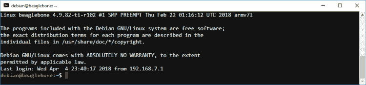

**图 2-7****：** Secure Shell Chrome 扩展

#### *通过 SSH 使用 PuTTY/`psftp` 传输文件*

PuTTY 安装包还包含文件传输协议（FTP）支持，使你能够通过网络连接向开发板传输文件或从开发板接收文件。你可以在 Windows 开始菜单的命令文本框中输入 `psftp` 来启动 `psftp`（PuTTY 安全文件传输协议）应用。

在 `psftp>` 提示符下，输入 `open debian@192.168.7.2`（例如，Windows PC 上通过 USB 联网的板卡地址）即可连接到开发板。此时，你的桌面电脑被称为*本地*机器，而 Beagle 板被称为*远程*机器。当你发出命令时，通常是在远程机器上执行。连接后，你会进入所使用的用户账户的主目录。因此，在 Debian 发行版中，如果你以用户 `debian` 身份连接，你会进入 `/home/Debian/` 目录。

要将单个文件 `c:\temp\test.txt` 从本地桌面电脑传输到 Beagle 板，可以按照以下步骤操作：

```
psftp: no hostname specified; use "open host.name" to connect
psftp> open debian@192.168.7.2
Using username "debian".
Remote working directory is /home/debian
psftp> lcd c:\temp
New local directory is c:\temp
psftp> mkdir test
mkdir /home/debian/test: OK
psftp> put test.txt
local:test.txt => remote:/home/debian/test.txt
psftp> dir test.*
Listing directory /home/debian
-rw-r--r--    1 debian   debian          0 Apr  5 00:46 test.txt 
```

以 `l` 开头的命令表示针对本地机器执行的命令，例如 `lcd`（本地切换目录）或 `lpwd`（本地显示当前工作目录）。要传输单个文件，使用 `put` 命令，该命令将文件从本地机器传输到远程机器。`get` 命令则用于反向传输文件。要“put”或“get”多个文件，可以使用 `mput` 或 `mget` 命令。如果忘记了某个命令，可以使用 `help`。

Windows 上有免费的基于 GUI 的 SFTP 应用程序，例如 图 2-8 中显示的 WinSCP。你可以从 [`winscp.net`](http://winscp.net) 免费下载。其他替代方案包括 FileZilla（[`filezilla-project.org`](http://filezilla-project.org)）和 Cyberduck（[`cyberduck.io`](http://cyberduck.io)），它们支持 Windows 和 Mac。

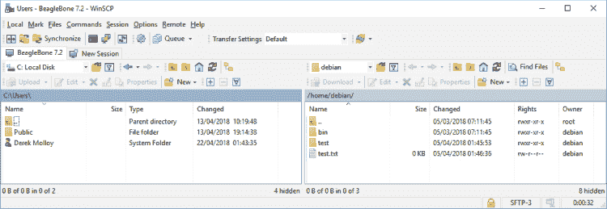

**图 2-8****：** 连接到 PocketBeagle 的 Windows 版 WinSCP SFTP 和 FTP 客户端

如果你使用的是 Linux 客户端机器，可以使用 `sftp` 命令代替 `psftp`。其他几乎所有内容都相同。SFTP 客户端应用程序也默认安装在 [BeagleBoard.org](http://BeagleBoard.org) Linux 发行版中，因此你可以反转通信顺序，即让开发板充当客户端，另一台机器充当服务器。

以下是一些关于 `psftp`/`sftp` 命令的有用提示和技巧：

*   `mget -r *` 将递归获取一个目录。如果你想要传输一个包含多个子文件夹的文件夹，这会很有用。`-r` 选项也可以用于 `get`、`put` 和 `mput` 命令。
*   `dir *.txt` 将应用过滤器，仅显示当前目录中的 `.txt` 文件。
*   `mv` 可用于将远程机器上的文件/目录移动到远程机器上的新位置。
*   `reget` 可用于恢复被中断的下载。部分下载的文件必须存在于本地机器上。

## 控制 Beagle 板

至此，你应该能够使用 SSH 客户端应用程序与开发板通信，因此本节将介绍一些命令，用于你首次与这个 Linux SBC 进行交互。

### 基本 Linux 命令

当你首次通过 SSH 连接到开发板时，系统会提示你登录。在 Debian 下，你可以使用用户名 `debian` 和密码 `temppwd` 登录。

```
login as: debian
debian@192.168.7.2's password: temppwd
Linux beaglebone 4.9.82-ti-r102 #1 SMP PREEMPT Thu Feb 22 01:16:12 UTC 
2018 armv7l The programs included with the Debian GNU/Linux system are 
free software; the exact distribution terms for each program are 
described in the individual files in /usr/share/doc/*/copyright.
Debian GNU/Linux comes with ABSOLUTELY NO WARRANTY, to the extent
permitted by applicable law.
Last login: Thu Apr  5 00:08:01 2018 from 192.168.7.1
debian@beaglebone:~$ 
```

现在你已经连接到开发板，Linux 终端已准备好接收你的命令。`$` 提示符表示你以普通用户账户登录（超级用户使用 `#` 提示符）。对于 Linux 新手来说，这一步可能相当令人望而生畏，因为不清楚有哪些命令可供使用。本节将为你提供足够的 Linux 技能，以便你能够应付。它作为带有示例的参考编写，以便你在需要帮助时可以回来查阅。其中一些命令在第 3 章中有更详细的描述。

#### *第一步*

你可能想做的第一件事是确定你正在运行的 Linux 版本。当你在论坛上提问时，这会很有用。

```
debian@beaglebone:~$ uname -a
Linux beaglebone 4.9.82-ti-r102 #1 SMP PREEMPT Thu Feb 22 01:16:12 UTC 
2018 armv7l GNU/Linux
debian@beaglebone:~$ cat /etc/dogtag
BeagleBoard.org Debian Image 2018-03-05 
```

在这个例子中，使用的是 Linux 4.9.82，它是为 ARMv7 架构构建的，构建日期如上所列，并打包为 [BeagleBoard.org](http://BeagleBoard.org) 镜像，镜像日期在“dog tag”中列出。

Linux 内核版本由 *X.Y.Z* 形式的数字描述。*X* 数字很少变化（3.0 版本于 2011 年发布，4.0 于 2015 年发布）。*Y* 值每年变化几次（4.8 于 2016 年 10 月发布，4.9¹ 于 2016 年 12 月发布）。*Z* 值则定期变化。

接下来，你可以使用 `passwd` 命令为 `debian` 用户账户设置一个非默认密码。

```
debian@beaglebone:~$ passwd
Changing password for debian.
(current) UNIX password: temppwd
Enter new UNIX password: newpasswd
Retype new UNIX password: newpasswd
passwd: password updated successfully 
```

表 2-4 列出了其他有用的第一步命令。

| **命令** | **描述** |
| --- | --- |
| `more /etc/issue` | 返回你正在使用的 Linux 发行版。 |
| `ps -p $$` | 返回你当前使用的 shell（例如 `bash`）。 |
| `whoami` | 返回你当前登录的用户名（例如 `debian`）。 |
| `uptime` | 返回系统已运行的时间。 |
| `top` | 列出所有正在运行的进程和程序。按 Ctrl+C 关闭视图。 |

**表 2-4****：** Linux 中有用的初始命令

#### *基本文件系统命令*


本节介绍在 Linux 文件系统中移动和操作所需的基本命令。使用 Debian 和 Ubuntu 用户账户时，通常必须在某些命令的开头加上 `sudo` 一词。这是因为 `sudo` 是一个允许用户以超级用户的安全权限运行程序的程序。用户账户将在下一章讨论。目前，你需要的基本文件系统命令列在表 2-5 中。

| 名称 | 命令 | 选项及更多信息 | 示例 |
| --- | --- | --- | --- |
| 列出文件 | `ls` | `-a` 显示所有文件（包括隐藏文件）。`-l` 显示长格式。`-R` 递归列出。`-r` 反向列出。`-t` 按最后修改时间排序。`-S` 按文件大小排序。`-h` 以人类可读格式显示文件大小。 | `ls –al` |
| 当前目录 | `pwd` | 打印工作目录。`-P` 打印物理位置。 | `pwd -P` |
| 切换目录 | `cd` | 切换目录。输入 `cd` 然后回车或 `cd ~/` 进入主目录。`cd /` 进入文件系统根目录。`cd ..` 返回上一级。 | `cd /home/debian` `cd /` |
| 创建目录 | `mkdir` | 创建一个目录。 | `mkdir test` |
| 删除文件或目录 | `rm` | 删除文件。`-r` 递归删除（用于目录）。`-d` 删除空目录。 | `rm bad.txt` `rm -r test` |
| 复制文件或目录 | `cp` | `-r` 递归复制。`-u` 仅当源文件比目标文件新或目标文件不存在时复制。`-v` 详细输出（即显示过程）。 | `cp a.txt b.txt` `cp -r test testa` |
| 移动文件或目录 | `mv` | `-i` 覆盖前提示。移动目录不需要 `-r`。移动到同一目录相当于重命名。 | `mv a.txt c.txt` `mv test testb` |
| 创建空文件 | `touch` | 创建空文件或更新已有文件的修改日期。 | `touch d.txt` |
| 查看文件内容 | `more` | 查看文件内容。按空格键翻到下一页。 | `more d.txt` |
| 获取日历 | `cal` | 显示基于文本的日历。 | `cal 01 2019` |

表 2-5：基本文件系统命令

以上涵盖了基础知识，但还有更多内容！下一章将介绍文件所有权、权限、搜索、I/O 重定向等。本节的目标是让你能够快速上手。表 2-6 介绍了一些在使用大多数 Linux shell 时能提高效率的快捷键。

| 快捷键 | 说明 |
| --- | --- |
| 上箭头（重复） | 显示你输入的上一条命令，重复按则显示更早的命令。 |
| Tab 键 | 自动补全文件名、目录名甚至可执行命令名。例如，要切换到 Linux 的 `/tmp` 目录，可以输入 `cd /t` 然后按 Tab，它会自动补全为 `cd /tmp/`。如果有多个选项，再按一次 Tab 键会以列表形式显示所有选项。 |
| Ctrl+A | 将光标移到当前行的开头。 |
| Ctrl+E | 将光标移到当前行的末尾。 |
| Ctrl+U | 清除到行首。按 Ctrl+E 再按 Ctrl+U 可清除整行。 |
| Ctrl+L | 清屏。 |
| Ctrl+C | 终止当前正在运行的进程。 |
| Ctrl+Z | 将当前进程放入后台。输入 `bg` 使其在后台继续运行，输入 `fg` 则将其调回前台。这将在下一章的“Linux 进程”部分讨论。 |

表 2-6：一些节省时间的终端键盘快捷键

下面是一个示例，使用表 2-5 中的几个命令创建一个名为 `test` 的目录，并在其中创建一个空文本文件 `hello.txt`。然后将整个 `test` 目录复制到 `/tmp` 目录（该目录位于 Linux 根目录下）。

```
debian@beaglebone:~$ cd ~/
debian@beaglebone:~$ pwd
/home/debian
debian@beaglebone:~$ mkdir test
debian@beaglebone:~$ cd test
debian@beaglebone:~/test$ touch hello.txt
debian@beaglebone:~/test$ ls
hello.txt
debian@beaglebone:~/test$ cd ..
debian@beaglebone:~$ cp -r test /tmp
debian@beaglebone:~$ cd /tmp/test/
debian@beaglebone:/tmp/test$ ls -l
total 0
-rw-r--r-- 1 debian debian 0 Apr  5 00:50 hello.txt 
```

#### *环境变量*

*环境变量* 是描述 Linux 环境配置的命名值，例如可执行文件的位置或默认编辑器。要了解你板子上设置的环境变量，可以执行 `env` 命令，它会列出你账户下的环境变量。以下是在 Debian IoT 镜像上调用 `env` 的结果：

```
debian@beaglebone:~$ env
…
USER=debian
PWD=/home/debian
HOME=/home/debian
SSH_CLIENT=192.168.7.1 6233 22
SSH_TTY=/dev/pts/0
PATH=/home/debian/bin:/usr/local/sbin:/usr/local/bin:/usr/sbin:/usr/bin:
/sbin:/bin:/usr/local/games:/usr/games
… 
```

你可以按照以下示例查看和修改环境变量，该示例将 `temp` 用户目录添加到 `PATH` 环境变量中：

```
debian@beaglebone:~$ echo $PATH
/home/debian/bin:/usr/local/sbin:/usr/local/bin:/usr/sbin:/usr/bin
:/sbin:/bin:/usr/local/games:/usr/games
debian@beaglebone:~$ export PATH=$PATH:~/temp
debian@beaglebone:~$ echo $PATH
/home/debian/bin:/usr/local/sbin:/usr/local/bin:/usr/sbin:/usr/bin
:/sbin:/bin:/usr/local/games:/usr/games:/home/debian/temp 
```

此更改在重启后会丢失。要永久设置环境变量，需要在 `sh`、`ksh` 或 `bash` shell 中修改 `.profile` 文件；在 `csh` 或 `tcsh` shell 中修改 `.login` 文件。为此，你需要能够在 Linux 终端窗口中进行文件编辑。

### 基本文件编辑

有多种编辑器可用，但对于新用户来说，最容易上手的编辑器之一同时也是最强大的——*GNU nano 编辑器*。你可以通过输入 `nano` 后跟现有或新文件名来启动编辑器；例如，输入 `nano hello.txt` 将显示图 2-9 中捕获的视图（在输入文本之后！）。输入 `nano -c hello.txt` 还会显示行号，这在调试程序代码时非常有用。你可以使用箭头键在窗口内自由移动，并在光标位置编辑或写入文本。你可以在编辑器窗口底部的栏上看到一些 nano 快捷键，但还有更多，其中一些列在表 2-7 中。

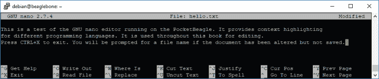

图 2-9：在 PuTTY Linux 终端窗口中使用 GNU nano 编辑器编辑示例文件

| 按键 | 命令 | 按键 | 命令 |
| --- | --- | --- | --- |
| Ctrl+G | 帮助 | Ctrl+Y | 上一页 |
| Ctrl+C | 取消 | Ctrl+_ 或 Ctrl+/ | 跳转到行号 |
| Ctrl+X | 退出（提示保存） | Alt+/ | 跳转到文件末尾 |
| Ctrl+L | 启用长行换行 | Ctrl+6 | 开始标记文本（然后用箭头键移动以高亮） |
| Ctrl+O | 保存 | Ctrl+K 或 Alt+6 | 剪切标记的文本 |
| 箭头键 | 移动光标 | Ctrl+U | 粘贴文本 |
| Ctrl+A | 跳转到行首 | Ctrl+R | 插入另一个文件的内容（提示输入文件位置） |
| Ctrl+E | 跳转到行尾 | Ctrl+W | 搜索字符串 |
| Ctrl+空格 | 下一个单词 | Alt+W | 查找下一个 |
| Alt+空格 | 上一个单词 | Ctrl+D | 删除光标下的字符 |
| Ctrl+V | 下一页 | Ctrl+K | 删除整行 |

表 2-7：Nano 快捷键——快速参考

### 现在几点了？


像这样一个简单的问题带来的困难超乎你的想象。如果你在 shell 提示符下输入 `date`，可能会得到如下结果：

```
debian@beaglebone:~$ date
Thu Apr  5 01:06:59 UTC 2018 
```

在这个例子中，即使开发板通过 USB 网络共享连接到台式电脑，日期也落后了几个月。不过，如果你通过“常规”以太网连接，日期和时间很可能是正确的。

如果时间不对，为什么 [BeagleBoard.org](http://BeagleBoard.org) 团队没有在你的开发板上设置时钟呢？答案是：他们做不到。与台式电脑不同，开发板上没有电池备份来确保 BIOS/UEFI 设置得以保留——事实上，根本没有 BIOS 或 UEFI！这个话题将在下一章详细讨论，但目前你需要一种设置时间的方法，为此你可以使用网络时间协议（NTP）。NTP 是一种用于在计算机之间同步时钟的网络协议。如果你的开发板时间正确，那只是因为它从你的网络中获取了时间。在最近的 Debian 镜像中，这是由 `systemd` 特殊单元完成的。

```
root@beaglebone:~# systemctl status time-sync.target
• time-sync.target - System Time Synchronized
   Loaded: loaded (/lib/systemd/system/time-sync.target; static; 
   vendor preset: enabled)
   Active: active since Sun 2018-04-22 23:51:53 IST; 19min ago 
```

如果时间不正确，很可能是你没有互联网连接。请参阅以下功能：“Internet-over-USB Network Settings”。

一旦时间正确，使用以下命令，它会提供一个基于文本的用户界面，允许你选择所在位置。在本例中，开发板现在设置为爱尔兰标准时间（IST）。

```
debian@beaglebone:~$ sudo dpkg-reconfigure tzdata
Current default time zone: 'Europe/Dublin'
Local time is now:      Mon Apr 23 00:06:21 IST 2018.
Universal Time is now:  Sun Apr 22 23:06:21 UTC 2018\. 
```

### 包管理

在本章开头，一个好的包管理器被列为合适 Linux 发行版的关键特性之一。*包管理器*是一组软件工具，用于自动化在 Linux 操作系统中安装、配置、升级和删除软件包的过程。不同的 Linux 发行版使用不同的包管理器：Ångström 使用 *OPKG*，Ubuntu 和 Debian 使用基于 *DPKG*（Debian 包管理系统）的 *APT*（高级打包工具），而 Arch Linux 使用 *Pacman*。每个都有其自己的使用语法，但操作方式大致相似。例如，表 2-8 中的第一行列出了使用不同管理器安装软件包的命令。该表还列出了其他可用的包管理命令。

| **命令** | **ÅNGSTRÖM** | **DEBIAN/UBUNTU** |
| --- | --- | --- |
| 安装一个软件包。 | `opkg install nano` | `sudo apt install nano` |
| 更新软件包索引。 | `opkg update` | `sudo apt update` |
| 升级系统上的软件包。 | `opkg upgrade` | `sudo apt upgrade2` ² |
| nano 是否已安装？ | `opkg list-installed \| grep nano` | `dpkg-query -l \| grep nano` |
| 是否存在包含字符串 `nano` 的软件包？ | `opkg list \| grep nano` | `apt search nano` |
| 获取关于某个软件包的更多信息。 | `opkg info nano` | `apt show nano` `apt policy nano` |
| 获取帮助。 | `opkg` | `apt help` |
| 将软件包下载到当前目录。 | `opkg download nano` | `apt download nano` |
| 删除一个软件包。 | `opkg remove nano` | `sudo apt remove nano` |
| 清理旧软件包。 | 较复杂。搜索 `opkg-clean script`。 | `sudo apt autoremove` `sudo apt clean` |

**表 2-8****：** 常用包管理命令（以 nano 为例）

你应该定期更新软件包列表（`sudo` 密码是你的 Debian 账户密码），使用 `apt update` 命令。调用 `apt update` 会从文件 `/etc/apt/sources.list` 中指定的互联网位置下载软件包列表。这并不会安装新版本的软件，而是更新软件包列表及其依赖关系。

```
debian@beaglebone:~$ sudo apt update
[sudo] password for debian:
Ign:1 http://deb.debian.org/debian stretch InRelease
…
Get:14 http://repos.rcn-ee.com/debian stretch/main armhf Packages [516 kB]
Fetched 10.7 MB in 11s (896 kB/s)
Reading package lists… Done
Building dependency tree
Reading state information… Done
75 packages can be upgraded. Run 'apt list --upgradable' to see them.
debian@beaglebone:~$ sudo apt list --upgradable
Listing… Done
apache2/stable 2.4.25-3+deb9u4 armhf [upgradable from: 2.4.25-3+deb9u3]
… 
```

完成后，你可以使用 `apt upgrade` 命令自动下载并安装可用软件的最新版本。显然，你应该始终在 `apt upgrade` 之前执行 `apt update` 命令。请注意，其中一些步骤（尤其是升级）可能需要相当长的时间才能完成——甚至可能几个小时，具体取决于你的镜像的新旧程度和网络连接速度。

Wavemon 是一个有用的工具，可用于配置 Wi-Fi 连接（参见第 12 章）。如果你执行该命令，你会看到该软件包尚未安装。

```
debian@beaglebone:~$ wavemon
-bash: wavemon: command not found 
```

一旦确定了软件包名称，就可以使用特定平台（此处为 Debian）的包管理器来安装该软件包。

```
debian@beaglebone:~$ apt search wavemon
Sorting… Done … Full Text Search… Done
wavemon/stable 0.8.1-1 armhf
 Wireless Device Monitoring Application
debian@beaglebone:~$ sudo apt install wavemon
Reading package lists… Done
…
Setting up wavemon (0.8.1-1) … 
```

现在 `wavemon` 命令可以执行了，但不幸的是，在配置无线适配器之前它不会做任何事情（参见第 12 章）。

```
debian@beaglebone:~$ wavemon
wavemon: no supported wireless interfaces found! Check manpage for help. 
```

### Beagle 专用命令

有一些由 [BeagleBoard.org](http://BeagleBoard.org) 社区开发的 Beagle 专用工具可用于配置你的开发板。这些工具简化了一些原本相当困难的任务。它们位于 `/opt/scripts/tools` 目录中，本节将对其进行描述。在使用这些工具之前，请检查你是否拥有最新版本。

```
debian@beaglebone:~$ cd /opt/scripts/tools/
debian@beaglebone:/opt/scripts/tools$ git pull || true
Already up-to-date.
debian@beaglebone:/opt/scripts/tools$ ls
beaglebone-black-eMMC-flasher.sh  grow_partition.sh     update_kernel.sh
developers                        init-eMMC-flasher.sh  version.sh
dtc                               non-mmc-rootfs        wm
eMMC                              readme.txt
graphics                          software 
```

#### *扩展 SD 卡上的文件系统*

如果你在容量大于 4 GB 的 micro-SD 卡上安装了 [BeagleBoard.org](http://BeagleBoard.org) Linux 镜像，那么你应该扩展文件系统以使用完整的卡容量。在此示例中，PocketBeagle 使用了一张 32 GB 的 micro-SD 卡，而 Debian IoT 镜像大小为 4 GB。使用 `lsblk` 工具（参见第 3 章），你可以看到大部分 SD 卡空间不可用，而 `df` 工具显示 Linux 分区已使用了 54%。

```
debian@beaglebone:~$ lsblk
NAME        MAJ:MIN RM  SIZE RO TYPE MOUNTPOINT
mmcblk0     179:0    0 29.8G  0 disk
└_mmcblk0p1 179:1    0  3.3G  0 part /
debian@beaglebone:~$ df -k
Filesystem     1K-blocks    Used Available Use% Mounted on
udev              219844       0    219844   0% /dev
tmpfs              49624    4972     44652  11% /run
/dev/mmcblk0p1   3357264 1684596   1482412  54% /
… 
```


你可以按如下方式使用分区扩容工具：

```
debian@beaglebone:/opt/scripts/tools$ sudo ./grow_partition.sh
Media: [/dev/mmcblk0]
sfdisk: 2.26.x or greater
Disk /dev/mmcblk0: 29.8 GiB, 32010928128 bytes, 62521344 sectors
…
debian@beaglebone:/opt/scripts/tools$ sudo reboot 
```

重启后，通过使用 `lsblk` 工具可以清楚地看到 micro-SD 卡已完全可用。现在整个 SD 卡都已可用，可以安全地调用 `apt upgrade` 命令。

```
debian@beaglebone:~$ lsblk
NAME        MAJ:MIN RM  SIZE RO TYPE MOUNTPOINT
mmcblk0     179:0    0 29.8G  0 disk
└_mmcblk0p1 179:1    0 29.8G  0 part /
debian@beaglebone:~$ sudo apt upgrade
debian@beaglebone:~$ df -k
Filesystem     1K-blocks    Used Available Use% Mounted on
udev              219332       0    219332   0% /dev
tmpfs              49520    5012     44508  11% /run
/dev/mmcblk0p1  30707172 1953168  27455072   7% / 
```

### 更新内核

你也可以使用更新内核工具，将内核更新到 [BeagleBoard.org](http://BeagleBoard.org) 提供的最新版本，操作如下：

```
debian@beaglebone:~$ uname -a
Linux beaglebone 4.9.82-ti-r102 #1 SMP PREEMPT Thu Feb 22 01:16:12 UTC 2018
armv7l GNU/Linux
debian@beaglebone:~$ cd /opt/scripts/tools/
debian@beaglebone:/opt/scripts/tools$ sudo ./update_kernel.sh
…
Kernel version options:
-----------------------------
LTS44: --lts-4_4
LTS49: --lts-4_9
LTS414: --lts-4_14
STABLE: --stable
TESTING: --testing
info:you are running:[4.9.82-ti-r102],latest is:[4.9.88-ti-r111] updating…
debian@beaglebone:~$ sudo reboot
debian@beaglebone:~$ uname -a
Linux beaglebone 4.9.88-ti-r111 #1 SMP PREEMPT Sun Apr 22 2018 armv7l GNU/Linux 
```

重启开发板后，可以看到版本号已更新（本例中从 102 更新到 111）。你也可以使用此工具从之前显示的选项中选择特定的内核。示例如下：

```
/opt/scripts/tools$ sudo ./update_kernel.sh --ti-rt-channel --lts-4_14
/opt/scripts/tools$ sudo reboot
debian@beaglebone:~$ uname -a
Linux beaglebone 4.14.35-ti-rt-r44 #1 SMP PREEMPT RT Sun Apr 22 06:04:23 
```

### 与板载 LED 交互

在本节中，你将学习如何更改 Beagle 板载用户 LED（即板上成组排列的四个蓝色 LED）的行为。每个 LED 都可以提供关于板子状态的信息。

*   USR0 以心跳序列闪烁，表示板子处于活动状态。
*   USR1 在 micro-SD 卡活动时闪烁。
*   USR2 根据 CPU 活动级别闪烁。
*   USR3 在 eMMC 活动时闪烁（在 PocketBeagle 上默认设置为无操作）。

你可以根据自己的需要更改这些 LED 的行为，但会暂时丢失这些有用的活动信息。

Sysfs 是一个虚拟文件系统，在较新的 Linux 内核中可用。它让你能够访问设备和驱动程序，而这些原本只能在受限的内核空间内访问。这个话题将在第 6 章中详细讨论；不过，在此处简要探讨一下如何使用 sysfs 改变用户 LED 的行为机制会很有帮助。

使用你的 SSH 客户端，连接到开发板并浏览到目录 `/sys/class/leds/`。输出如下：

```
debian@beaglebone:~$ cd /sys/class/leds
debian@beaglebone:/sys/class/leds$ ls
beaglebone:green:usr0  beaglebone:green:usr2
beaglebone:green:usr1  beaglebone:green:usr3 
```

你可以看到四个（绿色！）LED 的 sysfs 映射——`usr0`、`usr1`、`usr2` 和 `usr3`。你可以切换目录来更改其中一个 LED 的属性——例如 `usr3`（使用 Tab 键减少输入）。

```
debian@beaglebone:/sys/class/leds$ cd beaglebone\:green\:usr3
debian@beaglebone:/sys/class/leds/beaglebone:green:usr3$ ls
brightness  device  max_brightness  power  subsystem  trigger  uevent 
```

这里你可以看到各种不同的文件条目，它们提供了更多信息并允许访问设置。请注意，本节使用了一些将在下一章详细解释的命令。

你可以通过输入以下命令来确定 LED 的当前状态：

```
/sys/class/leds/beaglebone:green:usr3$ cat trigger
[none] rc-feedback rfkill-any kbd-scrolllock kbd-numlock kbd-capslock 
kbd-kanalock kbd-shiftlock kbd-altgrlock kbd-ctrllock kbd-altlock 
kbd-shiftllock kbd-shiftrlock kbd-ctrlllock kbd-ctrlrlock usb-gadget 
usb-host mmc0 timer oneshot disk-activity ide-disk mtd nand-disk 
heartbeat backlight gpio default-on panic 
```

在这里你可以看到 USR3 LED 当前未配置任何特定功能（即 `[none]`）。如果你的板子上它恰好被配置了，你可以将其设置为 none，如下所示：

```
/sys/class/leds/beaglebone:green:usr3$ echo none > trigger 
```

你可以使用以下命令完全打开或关闭 USR3 LED：

```
/sys/class/leds/beaglebone:green:usr3$ echo 1 > brightness
/sys/class/leds/beaglebone:green:usr3$ echo 0 > brightness 
```

你甚至可以设置 LED 以你选择的时间间隔闪烁。如果仔细观察，你会注意到 sysfs 的动态特性。如果此时执行 `ls` 命令，目录将显示如下，但很快就会改变：

```
/sys/class/leds/beaglebone:green:usr3$ ls
brightness  device  max_brightness  power  subsystem  trigger  uevent 
```

要使 LED 闪烁，你需要将触发器设置为定时器模式，输入 `echo timer > trigger`。你会看到 USR3 LED 以一秒的间隔闪烁。注意，在 `beaglebone:green:usr3` 目录中出现了新的 `delay_on` 和 `delay_off` 文件条目，如下所示：

```
/sys/class/leds/beaglebone:green:usr3$ echo timer > trigger
/sys/class/leds/beaglebone:green:usr3$ ls
brightness  delay_on  max_brightness  subsystem  uevent
delay_off   device    power           trigger 
```

LED 闪烁定时器使用了这些新的 `delay_on` 时间和 `delay_off` 时间文件条目。你可以使用连接（catenate）命令来获取关于这些值的更多信息。示例如下：

```
/sys/class/leds/beaglebone:green:usr3$ cat delay_on
500 
```

这报告了以毫秒为单位的时间延迟。要使 USR3 LED 以 10 Hz 的频率闪烁（即亮 50 ms，灭 50 ms），你可以使用以下命令：

```
debian@beaglebone:/sys/class/leds/beaglebone:green:usr3$ sudo -i
root@beaglebone:~# cd /sys/class/leds/beaglebone\:green\:usr3
root@beaglebone:/sys/class/leds/beaglebone:green:usr3# echo 50 > delay_on
root@beaglebone:/sys/class/leds/beaglebone:green:usr3# echo 50 > delay_off 
```

你需要使用 root 账户来执行上述操作，因为 `delay_on` 和 `delay_off` 条目归 `root` 所有。

```
root@beaglebone:/sys/class/leds/beaglebone:green:usr3# ls -l delay*
-rw-r--r-- 1 root root 4096 Apr 24 02:08 delay_off
-rw-r--r-- 1 root root 4096 Apr 24 02:07 delay_on 
```

输入 `echo none > trigger` 会将 LED 恢复到 PocketBeagle 上的默认状态，这会导致 `delay_on` 和 `delay_off` 文件条目消失。

### 关机

本节要讨论的最后一个问题是开发板的正确关机步骤，因为不正确的关机可能会损坏 ext4 文件系统，和/或由于文件系统检查而导致启动时间变长。以下是关于关机、重启和启动开发板的一些重要要点：

*   输入 `sudo shutdown -h now` 可以正确关闭开发板。你可以通过输入 `sudo shutdown -h +5` 将关机延迟五分钟。
*   输入 `sudo reboot` 将正确重置并重启开发板。
*   你可以按一次电源按钮（参见图 1-4 和图 1-5）来“软”（即软件方式）正确关闭开发板。


*   按住电源按钮约八秒钟可执行硬系统关机。除非主板死机且无法执行软关机，否则应避免此操作。

*   按下电源按钮启动主板。尽量避免物理断开和重新连接电源插头或 USB 线。

如果您的项目设计是封闭的，并且需要外部软关机，可以将外部按钮连接到扩展接头上的 GPIO 输入，并编写一个在启动时运行的 shell 脚本，用于轮询 GPIO 输入。如果检测到该输入，则可以直接调用`/sbin/shutdown -h now`。

## Node.js、Cloud9 和 BoneScript

[BeagleBoard.org](http://BeagleBoard.org) Linux 发行版附带了一套技术，您可以使用这些技术快速开始在板上开发软件和硬件应用程序。这些技术包括 Node.js、Cloud9 和 BoneScript——*Node.js* 是一种编程语言，*Cloud9* 是一个在线软件集成开发环境（IDE），您可以在其中编写 Node.js 代码，而 *BoneScript* 是 Node.js 的一个代码库，允许您与 Beagle 板硬件进行交互。

### Node.js 简介

Node.js 是一个用于构建网络应用的平台，它使用与 Google Chrome 网络浏览器相同的 JavaScript 引擎。JavaScript 是一种常用于在网页中创建交互界面的编程语言。简单来说，Node.js 是服务器端的 JavaScript。其运行时环境和代码库使您无需浏览器，直接在 Linux shell 提示符下运行 JavaScript 代码应用程序。

Node.js 采用事件驱动、非阻塞输入/输出模型。事件驱动编程在用户界面编程中很常见。它本质上意味着程序的执行流程由用户操作或从其他线程/进程传递的消息驱动。有趣的是，它使用非阻塞 I/O，这意味着它适合与板上的输入/输出引脚接口，并与其他应用程序安全地共享资源。与所有新语言一样，您应该从一个“Hello World!”示例开始。清单 2-1 将字符串“Hello World!”发送到标准输出（通常是 Linux 终端）。

```
console.log("Hello World!"); 
```

**清单 2-1:** `/chp02/HelloWorld.js`

打开与板的 SSH 连接，创建一个目录来存放 `HelloWorld.js` 文件，然后使用 nano 输入清单 1 中的代码。

```
debian@beaglebone:~$ cd ~/
debian@beaglebone:~$ mkdir nodeTest
debian@beaglebone:~$ cd nodeTest/
debian@beaglebone:~/nodeTest$ nano HelloWorld.js 
```

要执行此代码，请在包含 JavaScript 文件的目录中键入 `node HelloWorld.js`。您应该看到以下输出：

```
debian@beaglebone:~/nodeTest$ ls
HelloWorld.js
debian@beaglebone:~/nodeTest$ node HelloWorld.js
Hello World! 
```

这应该能让您了解如何为板编写 Node.js 程序。`node` 命令之所以有效，是因为 Node.js 运行时环境已预装在 [BeagleBoard.org](http://BeagleBoard.org) Linux 镜像中。

清单 2-2 提供了一个更复杂的 Node.js 示例。它创建了一个在板上端口 5050 运行的 Web 服务器，并提供一个简单的“Hello World!”消息。将程序代码写入同一个 `/nodeTest` 目录。

```
// A Simple Example Node.js Webserver Running on Port 5050
var http = require('http');  // require the http module
var server = http.createServer(
    function(req,res) {
        res.writeHead(200, {'Content-Type': 'text/plain'});
        res.end('Hello from the Beagle board!\n');
    });
server.listen(5050);     
console.log('Beagle Web Server running at http://192.168.7.2:5050/'); 
```

**清单 2-2:** `/chp02/SimpleWebServer.js`

清单 2-2 中的示例代码首先引入 Node.js 的 `http` 模块。然后调用 `http.createServer()` 方法，该方法返回一个 `http.Server` 对象。在 `http.Server` 对象上调用 `server.listen()` 方法，使服务器接受指定端口号（即 5050）上的连接。此方法是异步的，意味着它不必在下一行调用 `console.log()` 方法之前完成。实际上，除非您在板上终止该进程，否则 `server.listen()` 方法将一直监听。当与端口 5050 建立连接时，服务器将调用监听函数 `function(req,res)`，并向其传递 HTTP 请求和响应引用的副本。在此例中，该函数以一条简短的纯文本消息作为响应。

要执行此程序，请在包含源代码文件的目录中键入 `node SimpleWebServer.js`，您应该得到以下结果：

```
debian@beaglebone:~/nodeTest$ ls
HelloWorld.js  SimpleWebServer.js
debian@beaglebone:~/nodeTest$ node SimpleWebServer.js
Beagle Web Server running at http://192.168.7.2:5050/ 
```

输出表明服务器正在运行并监听端口 5050。然后您可以打开一个 Web 浏览器并连接到这个简单的 Node.js Web 服务器，您将看到输出，如图 2-10 所示。您可以在 SSH 窗口中使用 Ctrl+C 终止 Web 服务器。

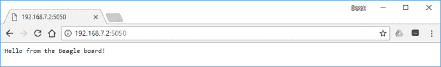

**图 2-10****:** 连接到 Node.js Web 服务器

### Cloud9 IDE 简介

如果有一种方法可以将 Node.js 代码的开发与执行环境集成在一起，那岂不是很好？这正是 Cloud9 IDE 的用武之地。Cloud9 集成开发环境（IDE）是一个令人印象深刻的基于 Web 的编码平台，支持多种编程语言，包括 JavaScript 和 Node.js。它使您能够直接在 Web 浏览器中编写、运行和调试代码，而无需安装任何特定于操作系统的工具或应用程序。如果这还不够令人印象深刻，那么 Cloud9 服务的开销足够低，可以直接在 Beagle 板上运行，并且它已预装在 [BeagleBoard.org](http://BeagleBoard.org) Linux 镜像中。

要使用 Cloud9 IDE，请打开 Google Chrome 或 Firefox，并通过端口 3000 连接到板的地址。例如，使用地址栏打开 192.168.7.2:3000，如图 2-11 所示。当您首次打开 Cloud9 时，它会提供出色的用户界面和控件介绍。

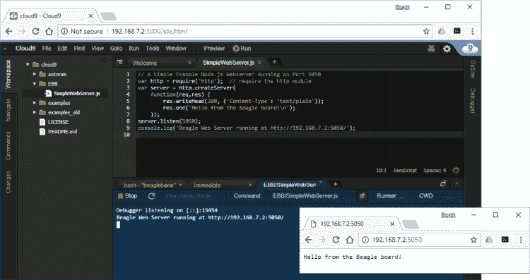

**图 2-11****:** 在 PocketBeagle 上运行的 Cloud9 IDE，执行 SimpleWebServer.js 示例

Cloud9 界面无需在桌面计算机上编写代码再传输到板，它可以直接将文件保存到板的 Linux 文件系统中，甚至可以直接执行它们。在图 2-11 中，创建了一个新的 `.js` 文件，其中包含清单 2-2 中的代码。*您必须通过“文件 → 保存”来保存文件*。您可以单击“运行”按钮来执行应用程序。如果出现调试器窗口，请单击“继续”。您可以单击输出控制台中的超链接，应用程序输出将显示在出现的浏览器窗口中，如图 2-11 所示。

请记住，这个 `SimpleWebServer.js` 程序是在 Beagle 板本身上运行的。实际上，如果您通过 SSH 登录到板（或使用 Cloud9 的 `bash` 终端窗口）并执行以下命令（在第 3 章中描述），您可以看到应用程序进程正在运行，如下所示：


```
debian@beaglebone:~# ps aux|grep SimpleWebServer
debian 2157 0.3 2.2 … node … "/var/lib/cloud9/EBB/SimpleWebServer.js" … 
```

在 Cloud9 IDE 中点击“停止”按钮将终止此进程。

### BoneScript 简介

BoneScript 是一个为 Beagle 特定功能编写的库，由 [BeagleBoard.org](http://BeagleBoard.org) 联合创始人 Jason Kridner 为 Node.js 开发。BoneScript 库提供了 Arduino 用户熟悉的输入/输出功能，但其优势在于它基于 Beagle 平台上运行的 Node.js 的网络能力。有关 BoneScript 及其功能的详细描述，请访问 [`beagleboard.org/support/bonescript`](http://beagleboard.org/support/bonescript)。

你可以使用 BoneScript 构建一个简单的应用程序来改变系统 LED 的状态。清单 2-3 中的代码通过 BoneScript 库每秒闪烁一次板载 `USR3` LED。

```
var b = require('bonescript'); // 使用 BoneScript
var LED3Pin = "USR3";          // USR3 是 Beagle 板上的 D5

b.pinMode(LED3Pin, b.OUTPUT);  // 将 LED3Pin 设置为输出
var isOn = false;              // isOn 是一个布尔标志
setInterval(toggleLED, 500);   // 每半秒调用一次 toggleLED()

function toggleLED(){
   isOn = !isOn;              // 每次调用时反转 isOn 状态
   if (isOn) b.digitalWrite(LED3Pin, 1);  // 点亮 LED
   else b.digitalWrite(LED3Pin, 0);       // 关闭 LED
   console.log('LED On is: ' + isOn);     // 输出状态
} 
```

**清单 2-3:** /chp02/BlinkLED3.js

该程序需要 `bonescript` 模块，在代码中简称为 `b`——例如，通过使用 `b.someMethod()`。因此，`b.pinMode()` 使用字符串字面量 `"USR3"` 来标识要设置为输出模式的引脚。一个临时布尔值 `isOn` 用于在代码中保留 LED 的状态。Node.js 的异步全局函数 `setInterval()` 被设置为每 500 毫秒调用一次 `toggleLED()` 回调函数。每次调用 `toggleLED()` 函数时，使用 NOT 运算符（即 `!true=false` 和 `!false=true`）反转 `isOn` 布尔变量。如果 `isOn` 为 true，则将 LED 引脚置为高电平；如果为 false，则置为低电平，并将状态输出到控制台。

该程序可以直接在 Cloud9 IDE 中执行。但重要的是要记住，你仍然可以在 Linux 终端提示符下直接运行包含 BoneScript 库调用的程序。因此，例如，在 Beagle 板上的 Cloud9 位置执行 `BlinkLED3.js` 代码（如图 2-12 所示）也能完美运行，每秒闪烁一次 `USR3` LED。

```
debian@beaglebone:/var/lib/cloud9/EBB$ ls
BlinkLED3.js  SimpleWebServer.js
debian@beaglebone:/var/lib/cloud9/EBB$ node BlinkLED3.js
LED On is: true
LED On is: false
LED On is: true
LED On is: false …
```

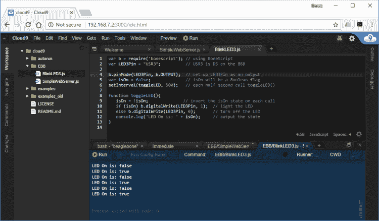

**图 2-12****:** 在 PocketBeagle 上运行的 Cloud9 IDE，执行 BoneScript 的 BlinkLED3.js 示例

BoneScript 对于系统的快速原型设计非常有用，特别是当这些系统涉及需要连接到互联网的电子设备时。然而，它并不适合高性能的大规模应用——本书后续章节将介绍用于此类应用的替代语言和方法。

## 本章小结

完成本章后，你应该能够做到以下几点：

*   使用网络连接（例如通过 USB 的互联网和常规以太网）从桌面计算机与 Beagle 板通信

*   使用备用串行连接（例如通过 USB 的串行连接或使用自定义 USB 转 TTL 3.3V 线缆）与板子通信

*   使用简单的 Linux 命令与板子交互并控制它

*   使用 Linux 终端执行基本的文件编辑

*   管理 Linux 软件包并设置系统时间

*   使用 Linux sysfs 影响板子硬件的状态

*   安全地关闭和重启板子

*   使用 Node.js、Cloud9 和 BoneScript 编写与板子硬件交互的基本应用程序和代码

## 延伸阅读

本章提供了许多网站和文档的链接。以下附加链接提供了所涵盖主题的更多信息：

*   本章网页包含一个关于通过 USB 的互联网入门以及将新镜像烧录到 SD 卡的视频：[`www.exploringbeaglebone.com/chapter2/`](http://www.exploringbeaglebone.com/chapter2/)

*   Node.js API 文档：[`nodejs.org/api/`](http://nodejs.org/api/)

*   BoneScript 库指南：[`beagleboard.org/support/bonescript`](http://beagleboard.org/support/bonescript)

## 注释

# 第 3 章

探索嵌入式 Linux 系统

本章将向你介绍有效管理基于 Beagle 的嵌入式 Linux 系统所需的核心概念、命令和工具。本章的第一部分是描述性的，解释了嵌入式 Linux 的基础知识和 Linux 启动过程。之后，你将逐步学习如何管理 Linux 系统。对于这个练习，强烈建议你打开一个连接到板子的终端并跟随操作。接下来，本章介绍了 Git 源代码管理系统。这个主题很重要，因为本书中的源代码示例是通过 GitHub 分发的。还介绍了桌面虚拟化，它对于后续章节中的跨平台开发非常有用。本章最后描述了如何下载本书的源代码示例。

本章所需设备：

*   任何带有终端连接的 Beagle 板，最好运行 Debian

有关本章的更多详细信息，请访问 [`www.exploringbeaglebone.com/chapter3/`](http://www.exploringbeaglebone.com/chapter3/)。

## 嵌入式 Linux 简介

首先，尽管本章标题中使用了“嵌入式 Linux”一词，但实际上并不存在所谓的嵌入式 Linux！并没有专门针对嵌入式系统的特殊 Linux 内核版本；它只是在嵌入式系统上运行的主线 Linux 内核。尽管如此，“嵌入式 Linux”一词已被广泛使用；因此，这里使用它来代替更准确的表述“嵌入式系统上的 Linux”。

术语“嵌入式 Linux”中的“嵌入式”一词用于表示存在一个*嵌入式系统*，这个概念可以粗略地解释为某种具有集成软件的计算机硬件，专为特定应用而设计。这个概念与个人计算机（PC）形成对比，后者是一种通用计算设备，设计用于多种应用，如网页浏览、文字处理和游戏。嵌入式系统和通用计算设备之间的界限正在模糊。例如，BeagleBone Black (BBB) 或 BeagleBoard 可以两者兼用，许多用户会将它们仅作为功能强大的通用计算设备来部署。然而，嵌入式系统具有一些显著特征。

*   它们往往具有特定且专用的应用。

*   它们通常处理能力有限、内存和存储能力有限。

*   它们通常是更大系统的一部分，可能连接到外部传感器或执行器。

*   它们通常扮演着可靠性至关重要的角色（例如，汽车、飞机和医疗设备中的控制器）。

*   它们通常实时工作，其输出直接与当前输入相关（例如，控制系统）。


*   近年来，连接性已成为嵌入式系统的核心特性，使其成为物联网（IoT）的构建模块。

嵌入式系统在日常生活中无处不在。例如自动售货机、家用电器、手机/智能手机、制造/装配线、电视、游戏机、汽车（如动力转向和倒车传感器）、网络交换机、路由器、无线接入点、音响系统、医疗监控设备、打印机、楼宇门禁、停车计时器、智能水/电表、手表、建筑工具、数码相机、显示器、平板电脑、电子阅读器、任何机器人设备、智能卡支付/门禁系统等等。

嵌入式 Linux 设备的迅猛发展，部分归功于智能手机技术的快速演进，这有助于降低基于 ARM 的处理器单价。ARM Holdings PLC 是一家英国公司，将其 ARM 处理器的知识产权授权给德州仪器（Beagle 板所用处理器的制造商），收取前期费用以及基于处理器售价的小额版税。

### 嵌入式 Linux 的优缺点

嵌入式平台种类繁多，各有优缺点。有低成本嵌入式平台，批量价格低于 1 美元，例如 Microchip AVR 或 PIC 或德州仪器 MSP43x 处理器；也有成本超过 150 美元的高端专用平台，例如多核数字信号处理器（DSP）。这些平台通常使用 C 和/或汇编语言编程，要求你在开发有用应用程序之前了解底层系统架构。嵌入式 Linux 为这些平台提供了一种替代方案，即无需深入了解底层架构即可开始构建应用程序。但是，如果你需要与电子模块或组件交互，则仍需具备一些相关知识。

以下是嵌入式 Linux 得以如此增长的一些原因：

*   Linux 是一种高效且可扩展的操作系统（OS），可运行于从低成本消费类设备到昂贵的大型服务器等各种设备上。它经过多年发展，从计算机远不如今天强大的时代一路走来，但保留了许多高效特性。
*   已有大量开源程序和工具可供开发，可以轻松部署到嵌入式应用中。如果你的嵌入式应用需要 Web 服务器，你可以安装与 Linux 服务器上可能使用的相同服务器。
*   对于许多不同的外设和设备（从网络适配器到显示器），都有出色的开源支持。
*   它是开源的，使用无需付费。
*   内核和应用程序代码在全球如此多的设备上运行，以至于 bug 很少出现，且能被快速检测到。

嵌入式 Linux 的一个缺点是，由于操作系统开销，它并不适合实时应用。因此，对于高精度、快速响应的应用（如模拟信号处理），嵌入式 Linux 可能不是完美的解决方案。然而，即使在实时应用中，它也常被用作专用实时传感器网络阵列的“中央智能”和控制接口（参见第 10 章）。此外，*实时操作系统*（RTOS）Linux 方面也在不断开发，旨在以抢占方式使用 Linux，在需要时随时中断操作系统以维持实时进程。

### Linux 是开源且免费的吗？

Linux 根据 *GNU* 通用公共许可证（GPL）发布，该许可证授予用户以任何方式使用和修改其代码的自由；因此，*免费*通常指的是“自由”而非“零成本”。事实上，一些最昂贵的 Linux 发行版正是针对嵌入式架构的。你可以在 [`www.gnu.org`](http://www.gnu.org) 找到 GPLv3 的快速指南，其中列出了每个用户应享有的四项自由（Smith, 2013）。

> *使用软件用于任何目的的自由*
> *修改软件以满足你需求的自由*
> *与朋友和邻居分享软件的自由*
> *以及分享你所做修改的自由*

即使你使用的是“免费”下载的发行版，也可能需要付出大量努力来定制库和设备驱动程序，以适配你希望在产品开发中使用的特定组件和模块。

### 启动 Beagle 板

当你启动台式计算机时，首先看到的应该是 *统一可扩展固件接口*（UEFI），它为基本输入/输出系统（BIOS）服务提供传统支持。启动屏幕显示系统信息，并提示你按某个键更改这些设置。UEFI 测试硬件组件（如内存），然后加载操作系统，通常从固态硬盘（SSD）/硬盘加载。因此，当台式计算机通电时，UEFI/BIOS 执行以下步骤：

1.  接管计算机处理器的控制权
2.  初始化并测试硬件组件
3.  从 SSD/硬盘加载操作系统

UEFI/BIOS 为操作系统与显示器及其他输入/输出外设（如鼠标/键盘和存储设备）的交互提供了一个抽象层。其设置存储在 NAND 闪存和电池供电的内存中——你可以在 PC 主板上看到一块支持实时系统时钟的小型纽扣电池。

#### *引导加载程序*

与大多数嵌入式 Linux 设备一样，Beagle 板默认没有 UEFI/BIOS 或电池供电的内存（第 8 章 中会在板上添加一个电池供电的实时时钟）。相反，它使用一组 *引导加载程序* 的组合。引导加载程序通常是小型程序，执行将板卡特定硬件与 Linux 操作系统连接起来的关键功能。引导加载程序执行以下操作：

*   初始化控制器（内存、图形、I/O）
*   为操作系统准备和分配系统内存
*   定位操作系统并提供加载它的功能
*   加载操作系统并将控制权移交给它

Beagle 板使用一个名为 `Das U-Boot`（“通用”引导加载程序）的开源 Linux 引导加载程序。它是利用对硬件描述的详细了解，为每个 Beagle 板定制的，这些描述在板卡特定的软件补丁中提供。

`/boot` 目录包含 Linux 内核以及启动板卡所需的其他文件。例如，在 PocketBeagle 上（有两个不同的内核版本），你会看到如下目录列表：

```
debian@beaglebone:/boot$ ls -l
-rw-r--r-- 1 root root   159786 Apr 22 07:17 config-4.14.35-ti-rt-r44
-rw-r--r-- 1 root root   163837 Apr 22 11:44 config-4.9.88-ti-rt-r111
drwxr-xr-x 6 root root     4096 Apr 25 01:14 dtbs
-rw-r--r-- 1 root root  4468991 Apr 24 01:01 initrd.img-4.14.35-ti-rt-r44
-rw-r--r-- 1 root root  6523044 Apr 25 01:34 initrd.img-4.9.88-ti-rt-r111
-rw-r--r-- 1 root root      492 Mar  5 13:11 SOC.sh
-rw-r--r-- 1 root root  3634267 Apr 22 07:17 System.map-4.14.35-ti-rt-r44
-rw-r--r-- 1 root root  3939313 Apr 22 11:44 System.map-4.9.88-ti-rt-r111
drwxr-xr-x 2 root root     4096 Mar  5 07:14 uboot
-rw-r--r-- 1 root root     1882 Apr 25 01:26 uEnv.txt
-rwxr-xr-x 1 root root 10379776 Apr 22 07:17 vmlinuz-4.14.35-ti-rt-r44
-rwxr-xr-x 1 root root 10070592 Apr 22 11:44 vmlinuz-4.9.88-ti-rt-r111 
```

这些文件具有以下功能：

*   Linux 内核位于压缩的 `vmlinuz*` 文件中。
*   初始 RAM 磁盘（内存中的文件系统）位于 `initrd*` 文件中，它创建一个临时根文件系统（称为 *早期用户空间*），用于识别硬件并加载启动“真正”文件系统所需的内核模块。


*   `uEnv.txt` 文件用于设置开发板的启动参数。你可以编辑此文件来设置自定义启动属性（例如，按照第 2 章所述设置烧录镜像）。

*   `System.map*` 文件提供了从内核特定构建代码到人类可读符号的调试映射，以便分析任何崩溃转储文件。此文件并非启动必需。

*   `config*` 文件列出了构建内核时所选的选项。它是人类可读的，并非启动必需。你可以输入 `more /boot/config-4.xxx` 查看构建配置。

*   `SOC.sh` 是一个脚本，包含引导加载程序升级时所需的引导加载程序信息。它是人类可读的，并非启动必需。

*   `/boot/dtbs/` 目录包含多个子目录，其中存放了启动开发板所需的设备树二进制文件。每个子目录为特定的内核构建提供二进制文件。

图 3-1 展示了 Beagle 开发板上的启动过程，其中每个引导加载程序阶段由前一阶段的引导加载程序加载并调用。当复位向量被调用时，AM335x 中的*主程序加载器*开始执行。它从 eMMC/SD 卡加载名为 `MLO` 的*第一阶段引导加载程序*（也称为*第二阶段程序加载器*）。该加载程序初始化时钟和内存，并从 eMMC/SD 卡加载第二阶段引导加载程序 `u-boot.img`。`MLO`（约 92 KB）和 `u-boot.img`（约 420 KB）文件位于 SD 卡的原始区域中，该区域位于 Linux ext4 分区之前。¹ 例如，当你调用 `lsblk` 时，会看到 ext4 分区从扇区 8,192（4,194,304 字节）开始，如下所示：


**图 3-1****：** Beagle 开发板上的完整启动序列

```
debian@beaglebone:/boot$ sudo fdisk -l
Disk /dev/mmcblk0: 29.8 GiB, 32010928128 bytes, 62521344 sectors
Units: sectors of 1 * 512 = 512 bytes
Sector size (logical/physical): 512 bytes / 512 bytes
I/O size (minimum/optimal): 512 bytes / 512 bytes
Disklabel type: dos
Disk identifier: 0xaf2e67c6
Device         Boot Start      End  Sectors  Size Id Type
/dev/mmcblk0p1 *     8192 62521343 62513152 29.8G 83 Linux 
```

这为存储这些文件提供了足够的空间。

这种文件系统设计的优点是，意外删除这些关键文件的可能性很小。重要的是，`u-boot.img` 和 `MLO` 文件是使用标准 U-Boot 发行版的修补版本构建的，该版本充分了解 Beagle 开发板的硬件描述。第二阶段引导加载程序（U-Boot）执行额外的初始化，然后加载并将控制权传递给 Linux 内核，该内核位于 ext4 分区的 `/boot/` 目录中。

以下输出是使用第 1 章中介绍的 USB 转 UART TTL 3V3 串行线捕获的典型启动序列。该线连接到 BeagleBone 排针，如图 1-11(a) 所示，数据以 115,200 的波特率捕获。以下是 BBB 启动时控制台输出的摘录。它显示了重要的系统信息，例如内存映射。

```
U-Boot SPL 2018.01-00002-ge9ff418fb8 (Feb 20 2018 - 20:14:57)
Trying to boot from MMC2

U-Boot 2018.01-00002-ge9ff418fb8 (Feb 20 2018 - 20:14:57 -0600),
Build: jenkins-github_Bootloader-Builder-38
CPU  : AM335X-GP rev 2.1
I2C:   ready
DRAM:  512 MiB
Reset Source: Power-on reset has occurred.
MMC:   OMAP SD/MMC: 0, OMAP SD/MMC: 1
Using default environment

Board: BeagleBone Black
<ethaddr> not set. Validating first E-fuse MAC
BeagleBone Black:
BeagleBone: cape eeprom: i2c_probe: 0x54:
BeagleBone: cape eeprom: i2c_probe: 0x55:
BeagleBone: cape eeprom: i2c_probe: 0x56:
BeagleBone: cape eeprom: i2c_probe: 0x57:
Net:   eth0: MII MODE
cpsw, usb_ether
Press SPACE to abort autoboot in 2 seconds
board_name=[A335BNLT] …
board_rev=[00C0] …
Card did not respond to voltage select!
mmc_init: -95, time 13
gpio: pin 56 (gpio 56) value is 0
gpio: pin 55 (gpio 55) value is 0
gpio: pin 54 (gpio 54) value is 0
gpio: pin 53 (gpio 53) value is 1
Card did not respond to voltage select!
mmc_init: -95, time 13
switch to partitions #0, OK
mmc1(part 0) is current device
Scanning mmc 1:1…
gpio: pin 56 (gpio 56) value is 0
gpio: pin 55 (gpio 55) value is 0
gpio: pin 54 (gpio 54) value is 0
gpio: pin 53 (gpio 53) value is 1
switch to partitions #0, OK
mmc1(part 0) is current device
gpio: pin 54 (gpio 54) value is 1
Checking for: /uEnv.txt …
Checking for: /boot.scr …
Checking for: /boot/boot.scr …
Checking for: /boot/uEnv.txt …
gpio: pin 55 (gpio 55) value is 1
1879 bytes read in 22 ms (83 KiB/s)
Loaded environment from /boot/uEnv.txt
Checking if uname_r is set in /boot/uEnv.txt…
gpio: pin 56 (gpio 56) value is 1
Running uname_boot …
loading /boot/vmlinuz-4.9.82-ti-r102 …
9970640 bytes read in 655 ms (14.5 MiB/s)
uboot_overlays: [uboot_base_dtb=am335x-boneblack-uboot.dtb] …
uboot_overlays: Switching too: dtb=am335x-boneblack-uboot.dtb …
loading /boot/dtbs/4.9.82-ti-r102/am335x-boneblack-uboot.dtb …
61622 bytes read in 56 ms (1 MiB/s)
uboot_overlays: [fdt_buffer=0x60000] …
uboot_overlays: loading /lib/firmware/BB-BONE-eMMC1-01-00A0.dtbo …
1440 bytes read in 605 ms (2 KiB/s)
uboot_overlays: loading /lib/firmware/BB-HDMI-TDA998x-00A0.dtbo …
5127 bytes read in 80 ms (62.5 KiB/s)
uboot_overlays: loading /lib/firmware/BB-ADC-00A0.dtbo …
711 bytes read in 397 ms (1000 Bytes/s)
uboot_overlays: loading /lib/firmware/univ-bbb-EVA-00A0.dtbo …
62008 bytes read in 470 ms (127.9 KiB/s)
loading /boot/initrd.img-4.9.82-ti-r102 …
6510886 bytes read in 435 ms (14.3 MiB/s)
debug: [console=ttyO0,115200n8 bone_capemgr.uboot_capemgr_enabled=1
root=/dev/mmcblk1p1 ro rootfstype=ext4 rootwait coherent_pool=1M
net.ifnames=0 quiet] …
debug: [bootz 0x82000000 0x88080000:635926 88000000] …
## Flattened Device Tree blob at 88000000
   Booting using the fdt blob at 0x88000000
   Loading Ramdisk to 8f9ca000, end 8ffff926 … OK
   reserving fdt memory region: addr=88000000 size=7e000
   Loading Device Tree to 8f949000, end 8f9c9fff … OK

Starting kernel …
[    0.001915] clocksource_probe: no matching clocksources found
[    1.459462] wkup_m3_ipc 44e11324.wkup_m3_ipc: could not get rproc handle
[    1.751983] omap_voltage_late_init: Voltage driver support not added
[    1.759505] PM: Cannot get wkup_m3_ipc handle
rootfs: clean, 82338/239520 files, 481317/957440 blocks

Debian GNU/Linux 9 beaglebone ttyS0
BeagleBoard.org Debian Image 2018-03-05
Support/FAQ: http://elinux.org/Beagleboard:BeagleBoneBlack_Debian
default username:password is [debian:temppwd]
beaglebone login: 
```

你可以看到初始硬件状态已设置，但大多数条目目前看起来相当神秘。以下是一些需要注意的重要点（如上述输出片段中突出显示的）：

*   首先加载 U-Boot SPL 第一阶段引导加载程序。

*   接下来加载 U-Boot 第二阶段引导加载程序，然后提供完整的硬件描述。

*   检查 GPIO 以确定是从 eMMC 还是 SD 卡启动（例如，检查启动按钮是否按下）。

*   加载并解析配置文件 `/boot/uEnv.txt`。

*   加载 Linux 内核版本（例如 `4.9.82-ti-r102`）。

*   U-Boot 加载 U-Boot 叠加层以配置硬件（例如 HDMI、模数转换器）。

*   内核开始执行。


Beagle 板的主配置文件是 `/boot/uEnv.txt`。你可以手动编辑此文件（例如，`sudo nano /boot/uEnv.txt`），通过注释和取消注释行来启用/禁用硬件、提供 Linux 命令行参数以及使用 eMMC 烧录脚本。例如，下面是一个精简的配置文件：

```
debian@ebb:/boot$ more uEnv.txt
#Docs: http://elinux.org/Beagleboard:U-boot_partitioning_layout_2.0
###Master Enable
enable_uboot_overlays=1

###Custom Cape
#dtb_overlay=/lib/firmware/<file8>.dtbo
###
###Disable auto loading of virtual capes (emmc/video/wireless/adc)
#disable_uboot_overlay_emmc=1
#disable_uboot_overlay_video=1
#disable_uboot_overlay_audio=1
#disable_uboot_overlay_wireless=1
#disable_uboot_overlay_adc=1

###Cape Universal Enable
enable_uboot_cape_universal=1

cmdline=coherent_pool=1M net.ifnames=0 quiet

##enable Generic eMMC Flasher:
##make sure, these tools are installed: dosfstools rsync
#cmdline=init=/opt/scripts/tools/eMMC/init-eMMC-flasher-v3.sh 
```

移除文件中最后一行的注释，即可调用一个脚本，用 SD 卡上的 Linux 镜像覆盖 BeagleBone 的 eMMC。

Das U-Boot 使用一个称为*设备树*（也称为*设备树二进制文件*）的板级配置文件，其中包含内核启动该板所需的板级特定信息。该文件包含了描述内存大小、时钟速度、板载设备等所有必要信息。这个设备树二进制文件（DTB），即*二进制文件*，是通过*设备树编译器*（`dtc`）从 DTS（源文件）创建的。该主题在第 6 章中详细描述，届时将探讨如何与 Beagle 板的 GPIO 进行接口。

```
debian@ebb:/boot/dtbs/4.9.82-ti-r102$ ls -l *.dtb
…
-rw-r--r-- 1 root root  64035 Feb 22 01:26 am335x-boneblack.dtb
-rw-r--r-- 1 root root  66633 Feb 22 01:26 am335x-boneblack-wireless.dtb
-rw-r--r-- 1 root root 137415 Feb 22 01:26 am335x-boneblue.dtb
-rw-r--r-- 1 root root  61710 Feb 22 01:26 am335x-bonegreen.dtb
…
-rw-r--r-- 1 root root 132769 Feb 22 01:26 am335x-pocketbeagle.dtb
… 
```

DTS 的语法与以下摘录相同，其中详细说明了 BBB 上的四个用户 LED 引脚和两个 I²C 总线之一：

```
am33xx_pinmux: pinmux@44e10800 {
   pinctrl-names = "default";
   pinctrl-0 = <&userled_pins>;

   userled_pins: pinmux_userled_pins {
      pinctrl-single,pins = <
         0x54 0x07       /* gpmc_a5.gpio1_21, OUTPUT        | MODE7 */
         0x58 0x17       /* gpmc_a6.gpio1_22, OUTPUT_PULLUP | MODE7 */
         0x5c 0x07       /* gpmc_a7.gpio1_23, OUTPUT        | MODE7 */
         0x60 0x17       /* gpmc_a8.gpio1_24, OUTPUT_PULLUP | MODE7 */
      >;
    };
    i2c0_pins: pinmux_i2c0_pins {
       pinctrl-single,pins = <
          0x188 0x70      /* i2c0_sda, SLEWCTRL_SLOW | INPUT_PULLUP */
          0x18c 0x70      /* i2c0_scl, SLEWCTRL_SLOW | INPUT_PULLUP */
       >;
    }; …
}; 
```

Linux 4.*x*.*x* 的设备树源文件的完整描述可在本书的源代码发行版中的第 3 章目录中找到。你将在本章末尾看到如何下载此代码。该树结构将在第 6 章中详细讨论，届时将把自定义电路与 Beagle 板进行接口。

#### *内核空间与用户空间*

Linux 内核运行在系统内存中称为*内核空间*的区域，而普通用户应用程序运行在系统内存中称为*用户空间*的区域。这两个空间之间的硬边界防止用户应用程序访问 Linux 内核所需的内存和资源。这有助于防止因编写不良的用户代码而导致 Linux 内核崩溃；同时，由于它阻止属于一个用户的应用程序干扰属于另一个用户的应用程序和资源，因此也提供了一定程度的安全性。

Linux 内核“拥有”并完全访问 Beagle 板上的所有物理内存和资源。因此，必须小心，只允许最稳定和最受信任的代码在内核空间中运行。你可以在图 3-2 中看到架构和接口的图示，其中用户应用程序使用 GNU C 库（`glibc`）向内核的系统调用接口发出调用。然后，通过系统调用以受控的方式将内核服务提供给用户空间。

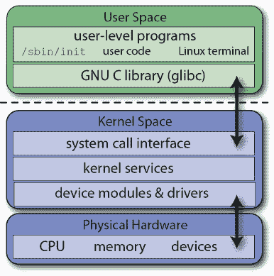

**图 3-2****：** Linux 用户空间和内核空间架构

*内核模块*是一个包含二进制代码的目标文件，可以根据需要从内核中加载和卸载。在许多情况下，内核甚至可以在执行过程中加载和卸载模块，而无需重启板子。例如，如果你将 USB Wi-Fi 适配器插入板子，内核可以使用可加载内核模块（LKM）来利用该适配器。如果没有这种模块化能力，Linux 内核将变得极其庞大，因为它必须支持任何 Beagle 板上可能需要的所有驱动程序。而且，每次添加新硬件时，都必须重新构建内核。LKM 的一个缺点是必须为每个设备维护驱动程序文件。（本书通篇描述了与 LKM 的交互，你将在第 16 章中看到如何编写自己的 LKM。）

如图 3-1 所述，引导加载程序阶段在内核被解压缩到内存后，将控制权传递给内核。然后内核挂载根文件系统。内核在引导过程中的最后一步是调用 `systemd init`（在带有 Debian Stretch 镜像的 Beagle 板上为 `/sbin/init`），这是启动的第一个用户空间进程，也是接下来要讨论的主题。

#### *systemd 系统与服务管理器*

*系统与服务管理器*根据板子的当前状态（例如，启动、关闭）启动和停止服务（例如，Web 服务器、安全外壳 [SSH] 服务器）。*systemd* 系统与服务管理器是 Linux 中一个较新且有些争议的补充，旨在取代 System V（SysV）init 并保持向后兼容。SysV init 的一个主要缺点是它串行启动任务，等待一个任务完成后再开始下一个，这可能导致较长的启动时间。systemd 系统在 Debian 9（Stretch）中默认启用。它并行启动系统服务，有助于缩短启动时间，尤其是在多核处理器（如 BeagleBoard X15）上。实际上，你可以使用以下命令显示启动时间（你可能会在用户空间进程完成之前就能登录）：

```
debian@beaglebone:~$ systemctl --version
systemd 232 +PAM +AUDIT +SELINUX +IMA +APPARMOR +SMACK +SYSVINIT
+UTMP +LIBCRYPTSETUP +GCRYPT +GNUTLS +ACL +XZ +LZ4 +SECCOMP +BLKID
+ELFUTILS +KMOD +IDN
debian@beaglebone:~$ systemd-analyze time
Startup finished in 15.638s (kernel) + 45.405s (userspace) = 1min 1.044s 
```

除了作为系统与服务管理器之外，systemd 还包含一个用于登录管理、日志记录、设备管理、时间同步等的软件包。systemd 的批评者声称其开发项目遭受了“任务蔓延”，并且承担了超出其核心使命的开发工作。在某种程度上，这种使命的变化导致 systemd 成为 Linux 本身未来的核心，甚至可能剥夺了用户的选择权；然而，很明显 systemd 正被许多 Linux 发行版广泛采用，并且会继续存在。


你可以使用 `systemctl` 命令来检查和控制 systemd 的状态。如果不带参数调用，它会列出你板子上正在运行的所有服务（典型板子上可能有 100 多个服务在运行）。使用空格键翻页，使用 Q 键退出。

```
debian@beaglebone:~$ systemctl
UNIT                        LOAD   ACTIVE SUB       DESCRIPTION
-.mount                     loaded active mounted   Root Mount
apache2.service             loaded active running   The Apache HTTP Server
bonescript-autorun.service  loaded active running   Bonescript autorun
connman.service             loaded active running   Connection service
cron.service                loaded active running   Regular background …
getty@tty1.service          loaded active running   Getty on tty1
serial-getty@ttyGS0.service loaded active running   Serial Getty on ttyGS0
serial-getty@ttyS0.service  loaded active running   Serial Getty on ttyS0
ssh.service                 loaded active running   OpenBSD Secure Shell
… 
```

systemd 使用*服务文件*，这些文件带有 `.service` 扩展名，用于配置不同服务在启动、关闭、重载等时的行为；请参见 `/lib/systemd/system` 目录。

Apache 服务在安装后默认运行。可以使用 systemd 系统来管理板子上的此类服务。例如，你可以通过以下步骤识别确切的服务名称并获取其状态：

```
debian@beaglebone:~$ systemctl list-units -t service | grep apache
apache2.service    loaded active running The Apache HTTP Server
debian@beaglebone:~$ systemctl status apache2.service
• apache2.service - The Apache HTTP Server
   Loaded: loaded (/lib/systemd/system/apache2.service; enabled; …
   Active: active (running) since Wed 2018-05-02 16:04:32 IST; 1h 41min ago
  Process: 1029 ExecStart=/usr/sbin/apachectl start
 Main PID: 1117 (apache2)
    Tasks: 55 (limit: 4915)
   CGroup: /system.slice/apache2.service
           └_1117 /usr/sbin/apache2 -k start
           └_1120 /usr/sbin/apache2 -k start
           └_1122 /usr/sbin/apache2 -k start
May 02 16:04:28 beaglebone systemd[1]: Starting The Apache HTTP Server…
May 02 16:04:32 beaglebone systemd[1]: Started The Apache HTTP Server. 
```

此时，你可以使用 Web 浏览器连接到板子的 8080 端口，验证 Apache 服务器是否作为服务在板子上运行，如图 3-3 所示。

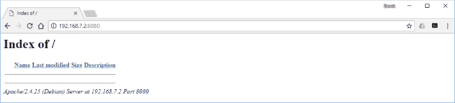

**图 3-3****：** Beagle 板上运行的 Apache 服务器

你可以使用 `systemctl` 命令停止 `apache2` 服务，之后浏览器将显示“连接被拒绝”的消息。

```
debian@beaglebone:~$ sudo systemctl stop apache2
[sudo] password for debian:
debian@beaglebone:~$ systemctl status apache2
• apache2.service - The Apache HTTP Server
   Loaded: loaded (/lib/systemd/system/apache2.service; enabled; …
   Active: inactive (dead) since Wed 2018-05-02 17:51:12 IST; 17s ago
  Process: 1969 ExecStop=/usr/sbin/apachectl stop
  Process: 1029 ExecStart=/usr/sbin/apachectl start
 Main PID: 1117 (code=exited, status=0/SUCCESS) 
```

然后可以按如下方式重新启动服务：

```
debian@beaglebone:~$ sudo systemctl start apache2 
```

表 3-1 总结了 systemd 命令，以 `apache2` 服务作为语法示例。其中许多命令需要使用 `sudo` 工具提升到超级用户权限，如下一节所述。

| **命令** | **描述** |
| --- | --- |
| `systemctl` | 列出所有正在运行的服务。 |
| `systemctl start apache2` | 启动一个服务。重启后不持久。 |
| `systemctl stop apache2` | 停止一个服务。重启后不持久。 |
| `systemctl status apache2` | 显示服务状态。 |
| `systemctl enable apache2` | 启用一个服务，使其在启动时运行。 |
| `systemctl disable apache2` | 禁用一个服务，使其不在启动时运行。 |
| `systemctl is-enabled apache2` | 显示系统服务是否在启动时运行。 |
| `systemctl restart apache2` | 重启一个服务（先停止再启动）。 |
| `systemctl condrestart apache2` | 仅当服务正在运行时重启它。 |
| `systemctl reload apache2` | 重新加载服务的配置文件而不停止它。 |
| `journalctl –f` | 跟踪 systemd 日志文件。按 Ctrl+C 退出。 |
| `sudo hostnamectl --static set-hostname ebb` | 更改主机名。 |
| `hostname` | 显示主机名。 |
| `timedatectl` | 显示时间和时区信息。 |
| `systemd-analyze time` | 显示启动时间。 |

**表 3-1****：** 常用 systemd 命令

*运行级别*描述了板子的当前状态，可用于控制 `init` 系统启动哪些进程或服务。在 SysV 下，有不同的运行级别，标识为 `0`（停机）、`1`（单用户模式）、`2` 到 `5`（多用户模式）、`6`（重启）和 `S`（启动）。当 `init` 进程开始时，运行级别从 `N`（无）开始。然后进入运行级别 `S` 以单用户模式初始化系统，最后进入一个多用户运行级别（`2` 到 `5`）。要确定当前运行级别，请键入以下命令：

```
debian@beaglebone:~$ who -r
         run-level 5  2018-05-02 16:05 
```

在这种情况下，板子运行在运行级别 `5`。你可以通过键入 `init` 后跟级别编号来更改运行级别。例如，你可以通过键入以下命令重启板子：

```
debian@beaglebone:~$ sudo hostnamectl --static set-hostname ebb
debian@beaglebone:~$ hostname
ebb 
```

另外，编辑 `/etc/hosts` 文件，为 `ebb` 添加一个条目，否则在使用 `sudo` 命令时会收到“无法解析主机”的消息。

```
debian@beaglebone:~$ more /etc/hosts
127.0.0.1       localhost
127.0.1.1       beaglebone.localdomain  beaglebone  ebb
…
debian@beaglebone:~$ sudo init 6
```

如上所示，systemd 保留了与 SysV 运行级别及其编号的一些向后兼容性，因为之前的 SysV 命令在 systemd 下也能正常工作。然而，在 systemd 中使用运行级别被认为是一种过时的做法。相反，systemd 使用命名的*目标单元*，其中一些列在表 3-2 中，该表还包含了与 SysV 运行级别的指示性对应关系。你可以识别板子上的当前默认目标。

```
debian@ebb:~$ systemctl get-default
graphical.target 
```

| **目标名称** | **SysV** | **描述和示例用途** |
| --- | --- | --- |
| `poweroff.target` | 0 | 停止系统：所有服务进入关机状态 |
| `rescue.target` | 1,S | 单用户模式：用于管理功能，如检查文件系统 |
| `multi-user.target` | 2-4 | 常规多用户模式，无窗口显示 |
| `graphical.target` | 5 | 常规多用户模式，带窗口显示 |
| `reboot.target` | 6 | 重启系统：所有服务进入重启状态 |
| `emergency.target` | — | 仅在主控制台上提供紧急 shell |

**表 3-2****：** systemd 目标与 SysV 运行级别的对应关系

这表明当前配置是让板子具有带窗口的显示。你还可以通过以下命令查看目标加载的单元列表：


```
debian@ebb:~$ systemctl list-units --type=target
UNIT                  LOAD   ACTIVE SUB     DESCRIPTION
basic.target          loaded active active  Basic System
cryptsetup.target     loaded active active  Encrypted Volumes
getty.target          loaded active active  Login Prompts
graphical.target      loaded active active  Graphical Interface
local-fs-pre.target   loaded active active  Local File Systems (Pre)
local-fs.target       loaded active active  Local File Systems
multi-user.target     loaded active active  Multi-User System
… 
```

如果你将开发板用作没有连接显示器的网络连接设备（即无头设备），那么运行窗口服务会浪费 CPU/内存资源。² 你可以通过以下调用切换到无头目标，此时 LXQt 窗口界面将不再存在，并且 `graphical.target` 条目将不再出现在单元列表中。

```
debian@ebb:~$ sudo systemctl isolate multi-user.target
debian@ebb:~$ who -r
         run-level 3  2018-05-02 16:18      last=5 
```

并且，你可以使用以下命令重新启用带显示器的图形界面：

```
debian@ebb:~$ sudo systemctl isolate graphical.target
debian@ebb:~$ who -r
         run-level 5  2018-05-02 16:20      last=3 
```

最后，要设置开发板在启动时使用不同的默认运行级别（例如，用于无头显示），你可以使用以下命令：

```
debian@ebb:~$ sudo systemctl set-default multi-user.target
Created symlink /etc/systemd/system/default.target →
/lib/systemd/system/multi-user.target.
debian@ebb:~$ systemctl get-default
multi-user.target 
```

重启后，窗口服务（如果存在）不会启动，并且对应的 SysV 运行级别显示为运行级别 `3`。

## 管理 Linux 系统

在本节中，你将基于第 2 章中描述的命令和工具，更详细地研究 Linux 文件系统，以确保你对开发板拥有完全的管理控制权。

### 超级用户

在 Linux 系统上，系统管理员账户对所有命令和文件拥有最高级别的安全访问权限。通常，这个账户被称为 *root 账户* 或 *超级用户*。在 Debian 中，该用户账户的用户名为 `root`，但默认情况下通常是禁用的；不过，你可以通过从已登录 debian 用户账户（用户名：`debian`，密码：`temppwd`）的 shell 中键入 `sudo passwd root` 来启用它。

```
debian@ebb:~$ sudo passwd root
Enter new UNIX password: myrootpassword
Retype new UNIX password: myrootpassword
passwd: password updated successfully 
```

建议在 Linux 系统上执行常规操作时，尽量避免以超级用户身份登录；但也要记住，在使用嵌入式 Linux 系统时，通常不会运行拥有数千个用户账户的服务器！在许多应用中，一个使用非默认密码的单一 root 用户账户可能就足够了。然而，使用非超级用户账户进行开发工作可以保护你免受自身误操作的影响——例如，意外删除文件系统。Debian 中的 debian 用户账户经过精心配置，以简化与硬件的交互，使其能够用于本书中描述的大多数任务。然而，了解这个自定义用户账户是如何配置的以及它为何能如此良好地工作是很重要的。

在许多 Linux 发行版（包括 Debian）中，当你想要执行系统管理命令时，会使用一个名为 `sudo`（*超级用户执行*）的特殊工具。通常，该工具会提示你输入管理员密码，然后授权你在短时间内执行管理员操作，同时也会警告你“能力越大，责任越大”。Debian 中的 debian 用户账户已配置为需要输入密码才能提升为超级用户。

下一节将讨论用户账户管理，但如果你创建了一个新用户账户并希望使其能够使用 `sudo` 工具，则必须使用 `visudo` 工具（以 root 身份登录时键入 `visudo`，或以 debian 身份登录时键入 `sudo visudo`）将该账户名称添加到 *sudoers 文件* `/etc/sudoers` 中。`/etc/sudoers` 文件的最后几行提供了 debian 用户账户的配置（使用 # 符号注释掉的行）。它通过设置一个名为 sudo 的组的属性来实现，而用户 debian 是该组的成员：

```
debian@ebb:~$ sudo more /etc/sudoers
# User privilege specification
root      ALL=(ALL:ALL) ALL
# Allow members of group sudo to execute any command
%sudo     ALL=(ALL:ALL) ALL   … 
```

在此配置中，sudo 组中的任何用户都被授予在所有（第一个 `ALL`）主机名上以任何用户（第二个 `ALL`）身份执行任何命令（第三个 `ALL`）的权限。`sudo` 工具运行良好，但它会使命令输出的重定向变得更加复杂，这将在本章后面体现。你可以按如下方式将用户添加到 sudo 组：

```
debian@ebb:~$ sudo adduser debian sudo
Adding user 'debian' to group 'sudo' …
Adding user debian to group sudo
Done. 
```

Linux 中还有另一个命令可以让你以替代用户身份运行 shell：`su`。键入 `su -`（等同于 `su - root`）会打开一个具有完全超级用户访问权限的新 shell，并且在启用 root 登录后，可以按如下方式使用：

```
debian@ebb:~$ su -
Password: mySuperSecretPassword
root@ebb:~# whoami
root
root@ebb:~# exit
logout
debian@ebb:~$ whoami
debian 
```

除了这样做，你还可以通过 `sudo` 命令创建一个交互式 shell（`-i`），如下所示：

```
debian@ebb:~$ sudo -i
root@ebb:~# whoami
root 
```

这意味着 shell 会读取登录特定的资源（例如 `.profile`）。`#` 提示符表示你已登录到超级用户账户。要重新禁用对开发板的 root 登录，你可以键入 `sudo passwd -l root`。

### 系统管理

*Linux 文件系统* 是一个用于在 Linux 系统上组织文件的目录层次结构。本节将研究文件的所有权、符号链接的使用以及文件系统权限的概念。

#### *Linux 文件系统*

Linux 使用称为 *inode* 的数据结构来表示文件系统对象，如文件和目录。当在物理磁盘上创建 Linux *扩展*文件系统（例如 ext3/ext4）时，会创建一个 *inode 表*。该表链接到该物理磁盘上每个文件和目录的 inode 数据结构。每个文件和目录的 inode 数据结构存储诸如权限属性、指向原始物理磁盘块位置的指针、时间戳和链接计数等信息。你可以通过执行根目录的列表 `ls -ail` 来查看这一点，其中 `-i` 使 `ls` 显示 inode 索引。你将看到 `/tmp` 目录条目如下：

```
debian@ebb:~$ cd /
debian@ebb:/$ ls -ail | grep tmp
41337 drwxrwxrwt  10 root root  4096 May  2 18:17 tmp 
```

因此，`41337` 是 `/tmp` 目录的 *inode 索引*。如果你使用 `cd` 进入 `/tmp` 目录，创建一个临时文件（`a.txt`），并执行 `ls -ail`，你将看到当前（`.`）目录具有相同的 inode 索引。

```
debian@ebb:/$ cd tmp
debian@ebb:/tmp$ touch a.txt
debian@ebb:/tmp$ ls -ail
total 40
 41337 drwxrwxrwt 10 root   root   4096 May  2 18:36 .
     2 drwxr-xr-x 21 root   root   4096 Apr 23 01:47 ..
  1893 -rw-r--r--  1 debian debian    0 May  2 18:36 a.txt 
```

你还可以看到根目录（`.`）的 inode 索引为 2，而文本文件（`a.txt`）也有一个 inode 索引 1893。因此，你不能直接 `cd` 到一个 inode 索引，因为该 inode 索引可能不指向一个目录。


图 3-4 展示了与在 Linux 下处理文件相关的 Linux 目录列表和文件权限。第一个字母表示文件类型——例如，该条目是（`d`）目录、（`l`）链接还是（`-`）普通文件。还有一些更不常见的文件类型：（`c`）字符特殊、（`b`）块特殊、（`p`）命名管道和（`s`）套接字。目录和普通文件无需进一步解释，但链接需要特别注意，如下所述。

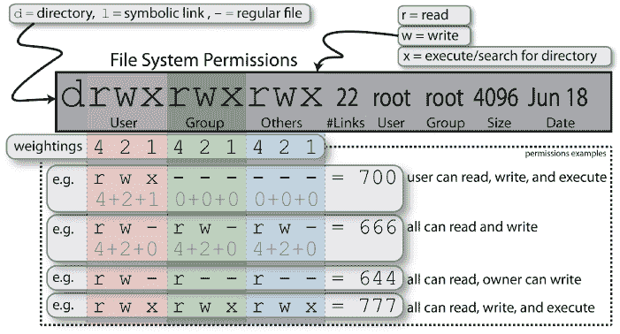

**图 3-4****：** Linux 目录列表和文件权限

#### *文件和目录的链接*

Linux 中有两种类型的链接：*软链接*和*硬链接*。软链接（或*符号链接*）是一个指向另一个文件或目录位置的文件。相反，硬链接直接链接到 inode 索引，但不能链接到目录。使用`ln /path/to/file.txt linkname`创建链接。通过在调用中添加`-s`来创建符号链接。为了说明用法，以下示例创建了指向文件`/tmp/test.txt`的软链接和硬链接：

```
debian@ebb:~$ cd /tmp
debian@ebb:/tmp$ touch test.txt
debian@ebb:/tmp$ ln -s /tmp/test.txt softlink
debian@ebb:/tmp$ ln /tmp/test.txt hardlink
debian@ebb:/tmp$ ls -ail
total 40
 41337 drwxrwxrwt 10 root   root   4096 May  2 18:40 .
     2 drwxr-xr-x 21 root   root   4096 Apr 23 01:47 ..
  2172 -rw-r--r--  2 debian debian    0 May  2 18:40 hardlink
  2268 lrwxrwxrwx  1 debian debian   13 May  2 18:40 softlink -> /tmp/test.txt
  2172 -rw-r--r--  2 debian debian    0 May  2 18:40 test.txt 
```

硬链接与`test.txt`文件具有相同的 inode 索引，你还可以看到在文件`test.txt`和`hardlink`条目前面（文件权限之后）有一个数字 2。这是与该文件关联的硬链接数量。这是一个计数值，当创建名为`hardlink`的硬链接时，该值增加了 1。如果删除硬链接（例如使用`rm hardlink`），该计数器将递减回 1。为了说明软链接和硬链接之间的区别，向`test.txt`文件中添加一些文本。

```
debian@ebb:/tmp$ echo "testing links on the BB" >> test.txt
debian@ebb:/tmp$ more hardlink
testing links on the BB
debian@ebb:/tmp$ more softlink
testing links on the BB
debian@ebb:/tmp$ mkdir sub
debian@ebb:/tmp$ mv test.txt sub/
debian@ebb:/tmp$ more hardlink
testing links on the BB
debian@ebb:/tmp$ more softlink
more: stat of softlink failed: No such file or directory 
```

可以看到，当`test.txt`文件被移动到子目录时，软链接失效，但硬链接仍然正常工作。因此，当链接的文件被移动时，符号链接不会更新，但硬链接始终指向源文件，即使被移动或删除也是如此。为了说明最后一点，可以使用以下命令删除`test.txt`文件：

```
debian@ebb:/tmp$ rm sub/test.txt
debian@ebb:/tmp$ more hardlink
testing links on the BB
debian@ebb:/tmp$ ls -ail hardlink
2172 -rw-r--r-- 1 debian debian 24 May  2 18:59 hardlink 
```

然而，文件仍然存在！除非删除名为`hardlink`的硬链接，否则它不会被删除，从而将链接计数减为零。通过检查`hardlink`条目，可以看到当前计数为 1。因此，如果一个文件的硬链接计数为零且没有被任何进程使用，它将被删除。实际上，文件名`test.txt`本身就是一个硬链接。请注意，不能跨不同文件系统创建硬链接，因为每个文件系统都有自己的 inode 索引表，从 1 开始。因此，inode 269（即`/tmp`目录的 inode 索引）在另一个文件系统上可能描述的是完全不同的内容。输入命令`man ln`可以查看一个特别有用的链接指南。

#### *用户和组*

Linux 是一个多用户操作系统，它使用以下三个不同的类别来管理访问权限：

*   **用户：** 你可以在开发板上创建不同的用户账户。如果你想限制对进程和文件系统区域的访问，这很有用。`root`用户账户是 Debian 的超级用户，可以访问所有文件；因此，例如，如果服务器支持本地脚本，则从该账户或 debian 用户账户运行公共 Web 服务器可能不安全。

*   **组：** 用户账户可以被标记为属于一个或多个组，每个组对不同资源（例如 GPIO、I²C 总线）具有不同的访问级别。

*   **其他：** 这包括系统中除文件所有者或权限中列出的组成员之外的所有用户。

你可以在 Linux 终端创建用户。通过输入`more /etc/group`可以查看完整的组列表。以下示例演示了如何在开发板上创建新用户账户并修改该账户的属性以满足你的需求。通过在 shell 提示符下输入`groups`可以列出用户所属的组。

```
debian@ebb:~$ groups
debian adm kmem dialout cdrom floppy audio dip video plugdev
users systemd-journal i2c bluetooth netdev cloud9ide xenomai
weston-launch tisdk spi admin eqep pwm gpio 
```

为了练习本章前面介绍的主题，以下示例使用 molloyd 用户账户执行。第一个示例演示了如何使用*ch*ange *own*ership（更改所有者）命令`chown`更改文件的所有权，以及使用*ch*ange *gr*ou*p*（更改组）命令`chgrp`更改文件的组所有权。

为了使`sudo`工具在示例中正确调用，用户 molloyd 必须存在于 sudo 组中，用户`debian`和用户`molloyd`（来自上一个示例）都属于该组。

或者，你可以编辑`sudoers`文件，这可以通过 debian 用户账户执行`visudo`命令来实现。可以修改该文件以包含一个`molloyd`条目，如下所示：

```
debian@ebb:~$ sudo visudo
debian@ebb:~$ sudo tail -n 1 /etc/sudoers
molloyd ALL=(ALL) ALL 
```

现在，molloyd 用户账户可以执行`sudo`命令，并且必须输入其用户密码才能执行。

#### *文件系统权限*

*文件系统权限*规定了每个权限类别对文件或目录的访问级别。*ch*ange *mod*e（更改模式）命令`chmod`允许用户更改文件系统对象的访问权限。你可以以相对方式指定权限。例如，`chmod a+w test.txt`赋予所有用户对文件`test.txt`的写权限，但保持其他权限不变。你也可以以绝对方式应用权限。例如，`chmod a=r test.txt`将所有用户设置为仅对文件`test.txt`具有读权限。下一个示例演示了如何使用`chmod`命令修改文件的文件系统权限。

表 3-3 提供了`chown`和`chgrp`命令结构的示例。它还列出了一些用于处理用户、组和权限的示例命令。

| **命令** | **描述** |
| --- | --- |
| `chown molloyd a.txt`<br>`chown molloyd:users a.txt`<br>`chown -Rh molloyd /tmp/test` | 更改文件所有者。<br>同时更改所有者和组。<br>递归更改`/tmp/test`的所有权。<br>`-h`影响符号链接而非引用的文件。 |
| `chgrp users a.txt`<br>`chgrp -Rh users /tmp/test` | 更改文件的组所有权。<br>递归更改，`-h`与`chown`相同。 |
| `chmod 600 a.txt`<br>`chmod ugo+rw a.txt`<br>`chmod a-w a.txt` | 更改权限（如图 3-4 所示），使用户对文件具有读/写权限；组或其他用户无权限。<br>赋予用户、组和其他用户对`a.txt`的读/写权限。<br>移除所有用户的写权限。 |


使用 `a` 移除所有用户的写入权限，其中 `a` 表示*所有*（用户、组和其他人的集合）。

| `chmod ugo=rw a.txt` | 将所有用户的权限设置为读/写。 |
| --- | --- |
| `umask` `umask -S` | 列出默认权限设置。使用 `-S` 以更可读的形式显示 umask。 |
| `umask 022` `umask u=rwx,g=rx,o=rx` | 更改所有新创建文件和目录的默认权限。这里的两个 `umask` 命令是等效的。如果设置此掩码值并创建文件或目录，则目录的权限为 `drwxr-xr-x`，文件的权限为 `-rw-r--r--`。你可以在账户的 `.login` 文件中设置特定于用户的 `umask`。 |
| `chmod u+s myexe` `chmod g+s myexe` | 设置一个称为 *setuid 位*（设置用户 ID 执行）和 *setgid 位*（设置组 ID 执行）的特殊位 `s`，它允许程序以其他登录用户的身份执行，但具有文件所有者或组的权限。例如，你可以使用它来允许某个特定程序以 root 用户账户的身份执行。如果文件不可执行，则显示大写 `S`，而不是小写 `s`。 |
| `chmod 6750 myexe` `chmod u=rwxs,g=rxs,o=myexe` | 以绝对方式设置 setuid 位。两个示例都会将 `myexe` 的权限设置为 `-rwsr-s---`，其中 setuid 和 setgid 位都已设置（注意 `myexe` 前的空格）。出于安全原因，setuid 位不能应用于 shell 脚本。 |
| `stat /tmp/test.txt` | 提供文件或目录的有用文件系统状态信息，例如其物理设备和 inode 信息、最后访问时间以及修改/更改时间。 |

**表 3-3****：** 处理用户、组和权限的命令

以下是 表 3-3 中最后一项 `stat` 命令的示例：

```
molloyd@ebb:/tmp$ stat /tmp/test.txt
  File: /tmp/test.txt
  Size: 0               Blocks: 0     IO Block: 4096   regular empty file
Device: b301h/45825d    Inode: 2305   Links: 1
Access: (0644/-rw-r--r--)  Uid: (0/ root)   Gid: ( 0/ root)
Access: 2018-05-02 20:03:01.164235706 +0100
Modify: 2018-05-02 20:03:01.164235706 +0100
Change: 2018-05-02 20:03:35.020235710 +0100
 Birth: - 
```

请注意，Linux 中的每个文件都保留访问、修改和更改时间。你可以分别使用 `touch -a text.txt` 和 `touch -m test.txt` 人为更新访问和修改时间（更改时间在两种情况下都会受到影响）。更改时间也会受到系统操作（如 `chmod`）的影响；修改时间受文件写入的影响；而访问时间理论上受文件读取的影响。然而，这种操作行为意味着读取文件会导致写入！Linux 的这一特性会导致 BeagleBone 的 eMMC 或 SD 卡显著磨损，并导致 I/O 性能缺陷。因此，通常在启动 eMMC/SD 卡上使用 `/etc/fstab` 配置文件中的挂载选项 `noatime` 来禁用文件访问时间特性（下一节将介绍）。请注意，还有一个类似的 `nodiratime` 选项，可用于仅禁用目录的访问时间更新；但是，`noatime` 选项会同时禁用文件和目录的访问时间更新。你可以通过以下方式在 `/etc/fstab` 中看到启动分区上设置的 `noatime` 选项：

```
molloyd@ebb:~$ more /etc/fstab | grep mmcblk
/dev/mmcblk0p1  /  ext4  noatime,errors=remount-ro  0  1 
```

为了结束对 图 3-4 的讨论：图中的示例有 22 个指向该文件的硬链接。对于目录，这表示子目录的数量、父目录（`..`）和自身（`.`）。该条目由 root 拥有，并且属于 root 组。下一个条目 `4096` 是存储该目录中包含的文件元数据所需的大小（最小大小为一个扇区，通常为 4,096 字节）。

最后一点：如果你在根目录中执行目录列表 `ls -ld`，你将看到 `/tmp` 目录的权限中有一个 `t` 位。这称为 *粘滞位*，意味着仅拥有写入权限不足以删除文件。因此，在 `/tmp` 目录中，任何用户都可以创建文件，但任何用户都不能删除其他用户的文件。

```
molloyd@ebb:~$ cd /
molloyd@ebb:/$ ls -dhl tmp
drwxrwxrwt 11 root root 4.0K May  2 20:32 tmp 
```

`ls -dhl` 命令列出（`d`）目录名称（而非其内容），并以（`h`）人类可读的文件大小和（`l`）长格式显示。

#### *Linux 根目录*

对于 Linux 新手来说，探索 Linux 文件系统可能令人望而生畏。如果你在板上使用 `cd /` 进入顶级目录并输入 `ls`，你将得到如下形式的顶级目录结构：

```
molloyd@ebb:/$ ls
bbb-uEnv.txt  boot  etc  ID.txt  lost+found  mnt   opt  root
sbin          sys   usr  bin     dev         home  lib  media
nfs-uEnv.txt  proc  run  srv     tmp         var 
```

这一切意味着什么？嗯，每个目录都有其作用，如果你理解了这些作用，你就能开始知道在哪里搜索所需的配置文件或二进制文件。表 3-4 简要描述了每个顶级 Linux 子目录的内容。

| **目录** | **描述** |
| --- | --- |
| `bin` | 包含所有用户使用的二进制可执行文件，默认情况下存在于 `PATH` 环境变量中。另一个目录 `/usr/bin` 包含非系统启动或修复核心的可执行文件。 |
| `boot` | 包含用于启动板的文件。 |
| `dev` | 包含设备节点（链接到设备驱动程序）。 |
| `etc` | 本地系统的配置文件。 |
| `home` | 包含用户的主目录（例如 `/home/debian`）。 |
| `lib` | 包含标准系统库。 |
| `lost+found` | 运行 `fsck`（文件系统检查和修复）后，未链接的文件会显示在此处。如果 `lost+found` 目录被删除，`mklost+found` 命令会重新创建它。 |
| `media` | 用于挂载可移动介质，例如 micro-SD 卡。 |
| `mnt` | 通常用于挂载临时文件系统。 |
| `opt` | 安装第三方（非核心 Linux）可选软件的好地方。 |
| `proc` | 板上运行进程的虚拟文件表示。（例如，如果你 `cd /proc` 并输入 `cat iomem`，你可以看到一些内存映射地址。） |
| `root` | Debian Linux 发行版中 root 账户的主目录。（在其他几个发行版中，这是 `/home/root`。） |
| `run` | 提供自上次启动以来运行系统的信息。 |
| `sbin` | 包含用于 root 用户（超级用户）系统管理的可执行文件。 |
| `srv` | 存储与 FTP、Web 服务器、rsync 等相关的数据。 |
| `sys` | 包含描述系统的虚拟文件系统。 |
| `tmp` | 包含临时文件。 |
| `usr` | 包含所有用户的程序，以及许多子目录，例如 `/usr/include`（C/C++ 头文件）、`/usr/lib`（C/C++ 库文件）、`/usr/src`（Linux 内核源代码）、`/usr/bin`（用户可执行文件）、`/usr/local`（类似于 `/usr`，但用于本地用户）和 `/usr/share`（用户之间共享的文件和媒体）。 |
| `var` | 包含可变文件，例如系统日志。 |

**表 3-4****：** Linux 顶级目录

#### *文件系统命令*

除了用于处理文件系统上文件和目录的命令外，还有用于处理文件系统本身的命令。你应该首先检查的命令是 `df`（记住为 *d*isk *f*ree，磁盘空闲）和 `mount`。`df` 命令提供板上文件系统的概览。添加 `-T` 会列出文件系统类型。


```
molloyd@ebb:~$ df -T
Filesystem     Type     1K-blocks    Used Available Use% Mounted on
udev           devtmpfs    219200       0    219200   0% /dev
tmpfs          tmpfs        49496    5604     43892  12% /run
/dev/mmcblk0p1 ext4      30707172 2066088  27342152   8% /
tmpfs          tmpfs       247476       0    247476   0% /sys/fs/cgroup
… 
```

`df` 命令有助于判断磁盘空间是否不足；在此例中，可以看到根文件系统（`/`）使用了 8%，还有 27.3 GB（来自 32 GB 的 SD 卡）可用于安装额外软件。此外还列出了几个临时文件系统（`tmpfs`）条目，它们实际上指向虚拟文件系统，这些虚拟文件系统映射到板载的 DDR 内存。（`/sys/fs/*` 条目将在第 8 章中详细讨论。）

列出块设备的命令 `lsblk` 会以简洁的树状结构列出连接到板上的块设备，例如 SD 卡、USB 存储钥匙和 USB 读卡器（如果有的话）。如下输出所示，可以看到 `mmcblk0`（BeagleBone 上的启动 SD 卡）有一个分区 `p1`，它挂载在文件系统的根目录 `/` 上。在此例中，BeagleBone 上的 eMMC 显示为 `mmcblk1`，尽管板子是通过 SD 卡启动的：

```
molloyd@ebb:~$ lsblk
NAME         MAJ:MIN RM  SIZE RO TYPE MOUNTPOINT
mmcblk0      179:0    0 29.8G  0 disk
└_mmcblk0p1  179:1    0 29.8G  0 part /
mmcblk1      179:8    0  3.7G  0 disk
└_mmcblk1p1  179:9    0  3.7G  0 part
mmcblk1boot0 179:24   0    1M  1 disk
mmcblk1boot1 179:32   0    1M  1 disk 
```

USB 端口（或 BeagleBone 上的 SD 卡）可用于扩展存储，这在捕获视频数据且 eMMC/系统 SD 卡容量不足时非常有用。你可以通过下面的示例测试 SD 卡的性能，以确保它们满足应用程序的需求。

使用不带参数的 `mount` 命令可以获取有关板上文件系统的更多信息。

```
molloyd@ebb:~$ mount
/dev/mmcblk0p1 on / type ext4 (rw,noatime,errors=remount-ro,data=ordered)
sysfs on /sys type sysfs (rw,nosuid,nodev,noexec,relatime)
proc on /proc type proc (rw,nosuid,nodev,noexec,relatime)  … 
```

如前所述，文件系统组织成以根目录 `/` 为根的单一树。输入 `cd /` 即可进入根目录。`mount` 命令用于将物理磁盘上的文件系统挂载到这棵树上。不同物理设备上的文件系统都可以挂载到该单一树中任意位置的命名点上。表 3-5 描述了一些可用于管理文件系统的命令，随后是两个示例，演示如何利用 `mount` 命令完成重要的 Linux 系统管理任务。

| **命令** | **描述** |
| --- | --- |
| `du -h /opt` `du -hs /opt/*` `du -hc *.jpg` | 磁盘使用情况：查看目录树占用了多少空间。选项：（`-h`）人类可读形式，（`-s`）汇总，（`-c`）总计。最后一个命令查找当前目录中 JPG 格式文件的总大小。 |
| `df -h` | 以（`-h`）人类可读形式显示系统磁盘空间。 |
| `lsblk` | 列出块设备。 |
| `dd if=test.img of=/dev/sdX`<br>`dd if=/dev/sdX of=test.img` | 将镜像写入驱动器。`dd` 用于转换和复制文件，其中 `if` 是输入文件，`of` 是输出文件。在 Linux 下使用此命令将镜像写入 SD 卡。创建驱动器的镜像。通常在桌面 Linux 下使用以下形式：<br><br>`sudo dd if=./BB*.img of=/dev/sdX`<br><br>其中 `/dev/sdX` 是 SD 卡读/写设备。 |
| `cat /proc/partitions` | 列出所有已注册的分区。 |
| `mkfs /dev/sdX` | 创建 Linux 文件系统。还有 `mkfs.ext4`、`mkfs.vfat`。此操作会销毁设备上的数据。请非常小心地使用此命令！ |
| `fdisk -l` | 注意：`fdisk` 可用于管理磁盘、创建分区、删除分区等。`fdisk -l` 显示所有现有分区。 |
| `badblocks /dev/mmcblkX` | 检查 SD 卡上的坏块。SD 卡具有磨损均衡控制器电路。如果出现错误，请更换新卡；不要使用 `fsck` 记录它们。以 root 权限运行此命令，并注意运行需要一些时间。 |
| `mount /media/store` | 如果分区列在 `/etc/fstab` 中，则挂载该分区。 |
| `umount /media/store` | 卸载分区。如果该分区上有文件处于打开状态，系统会提示你。 |
| `sudo apt install tree` `tree ~/` | 安装 `tree` 命令，并使用它显示用户账户的目录结构。 |

**表 3-5****：** 文件系统常用命令

## find 和 whereis

`find` 命令用于在目录结构中搜索特定文件。它非常全面；输入 `man find` 可查看完整的选项列表。例如，使用以下调用在文件系统中查找 C++ 头文件 `iostream`（使用 `sudo` 可避免访问权限问题）：

```
molloyd@ebb:/$ sudo find . -name iostream*
./usr/include/c++/6/iostream
./usr/share/ti/cgt-pru/include/iostream
./usr/share/ti/cgt-pru/lib/src/iostream
./usr/share/ti/cgt-pru/lib/src/iostream.cpp … 
```

使用 `-iname` 代替 `-name` 可以忽略搜索名称中的大小写。

以下示例分别查找 `/home/` 中在过去 24 小时内修改过的文件，以及超过 24 小时前修改过的文件：

```
molloyd@ebb:~$ echo "Test file" >> new.txt
molloyd@ebb:~$ sudo find /home -mtime -1
/home/molloyd
/home/molloyd/.bash_history
/home/molloyd/new.txt
molloyd@ebb:~$ sudo find /home -mtime +1
/home/debian
/home/debian/.xsessionrc
/home/debian/.bash_logout    … 
```

此外，还可以使用访问时间（`-atime`）、大小（`-size`）、所有者（`-user`）、组（`-group`）和权限（`-perm`）。

`whereis` 命令则不同，它可以用于搜索程序的二进制可执行文件、源代码和手册页。

```
molloyd@ebb:~$ whereis find
find: /usr/bin/find /usr/share/man/man1/find.1.gz /usr/share/info/find.info.gz 
```

在此例中，二进制命令位于 `/usr/bin/`，手册页位于 `/usr/share/man/man1`（以 gzip 格式存储以节省空间）。

## more 或 less

`more` 命令已经使用过多次，你可能已经了解了它的用途。它允许你一次一页地查看大文件或输出流。因此，要查看长文件，可以输入 `more filename`。例如，日志文件 `/var/log/messages` 包含内核输出消息。你可以通过输入 `more /var/log/messages` 逐页查看该文件。不过，如果你希望保持显示简洁，可以使用 `-5` 将页面长度设置为五行。

```
molloyd@ebb:~$ more -5 /var/log/messages
Apr 30 06:25:05 beaglebone liblogging-stdlog:  …
Apr 30 03:37:41 beaglebone kernel: [    0.000000] Booting Linux …
Apr 30 03:37:41 beaglebone kernel: [    0.000000] Linux version …
--More--(0%) 
```

你可以使用空格键翻页，按 Q 键退出。还有一个更强大的命令叫做 `less`，你也可以使用。

```
molloyd@ebb:~$ less /var/log/messages
```

`less` 命令通过键盘提供完全交互式的视图。选项太多，无法在此一一列举。例如，你可以使用箭头键上下移动。或者，使用空格键向下翻页，通过输入 `/` 来搜索字符串（例如，输入 `/usb` 查找与 USB 设备相关的消息），然后按 N 键跳转到下一个匹配项（或按 Shift+N 键跳转到上一个匹配项）。

最后，还有一个专门用于显示内核环形缓冲区的命令，它会以彩色标记格式化输出，只需调用以下命令即可：

```
molloyd@ebb:~$ dmesg 
```


#### *SD 卡/eMMC 文件系统的可靠性*

单板计算机（SBC）最可能发生故障的部件之一是其 SD 卡，更常见的叫法是多媒体卡（MMC），当它集成在 SBC 上时（如 BeagleBone 的情况），则称为嵌入式 MMC（eMMC）。基于 NAND 的闪存（如 MMC 中的闪存）容量大、成本低，但容易磨损，可能导致文件系统错误。

MMC 的高容量主要得益于多层单元（MLC）存储器的发展。与单层单元（SLC）存储器不同，单个存储单元中可以存储超过 1 位的数据。擦除存储单元所需的高电压会干扰相邻单元，因此 NAND 闪存以 1KB 到 4KB 的块为单位进行擦除。随着时间的推移，写入 NAND 闪存的过程会导致电子被捕获，从而降低设定状态与擦除状态之间的电导率差异。（关于高可靠性应用中 SLC 与 MLC 的讨论，请参见[`tiny.cc/beagle301`](http://tiny.cc/beagle301)。）MLC 使用不同的电荷水平和更高的电压，在单个单元中存储更多状态（商用 MLC 产品通常每个单元提供 4 到 16 种状态）。由于 SLC 只存储单一状态，因此在可靠性方面具有优势（通常为 60,000–100,000 次擦写周期），而 MLC 通常为 10,000 次。MMC 完全适用于日常应用，如数码摄影或安防摄像头录像；以每天整卡写入一次计算，10,000 次周期应能持续超过 27 年。

然而，嵌入式 Linux 设备会持续向 MMC 写入数据，例如在`/var/log/`中记录系统事件。如果您的板卡每天向日志文件写入 20 次，SD 卡的使用寿命可能低至 8 个月。这些是保守数字，得益于*磨损均衡算法*，实际寿命可能长得多。MMC 在数据写入时采用磨损均衡，确保重写操作均匀分布在整个 MMC 介质上，从而避免因集中修改（如日志文件变更）导致 Linux 设备系统故障。

对于您的 Beagle 板，请确保购买高品质的品牌 SD 卡。此外，SD 卡上未使用的空间越多越好，因为这会进一步增强磨损均衡性能。BeagleBone 使用 eMMC 存储——本质上是一种芯片上的 MMC，其可靠性与 SD 卡相当。然而，eMMC 的一个重要优势是板卡制造商可以控制所用存储设备的质量和规格。最后，大多数消费级 SSD 也基于 MLC，而更昂贵的基于 SLC 的 SSD 通常保留给企业级服务器。

对于需要更高可靠性的 Beagle 应用，可以使用 RAM 文件系统（`tmpfs`）来挂载`/tmp`目录、`/var/cache`目录以及日志文件（特别是`/var/log/apt`）。您可以通过编辑`/etc/fstab`文件，将所需目录挂载到内存中来实现这一点。例如，如果您的进程需要共享文件数据以进行数据交换，可以通过编辑`/etc/fstab`文件，将`/tmp`目录用作 RAM 文件系统（`tmpfs`），如下所示：

```
molloyd@ebb:/etc$ sudo nano fstab
molloyd@ebb:/etc$ more fstab
/dev/mmcblk0p1  /   ext4  noatime,errors=remount-ro  0  1
debugfs         /sys/kernel/debug  debugfs  defaults  0  0
tempfs          /tmp   tempfs size=100M  0  0
molloyd@ebb:/etc$ mkdir /tmp/swap
然后可以使用 mount 命令应用这些设置：
molloyd@ebb:/etc$ sudo mount -a
接着检查设置是否已应用：
molloyd@ebb:/etc$ mount
…
tmpfs on /tmp/swap type tmpfs (rw,relatime,size=102400k) 
```

根目录（`/`）默认以`noatime`属性挂载，这大大减少了写入次数并提高了 I/O 性能（如前文所述）。在可能的情况下，应对所有固态存储设备（例如 USB 存储密钥）应用此属性，但对于基于 RAM 的存储则非必需。

请记住，写入`tmpfs`的任何数据在重启后都会丢失。因此，如果您将`tmpfs`用于`/var/log`，那么导致板卡崩溃的任何系统错误在重启后将不可见。您可以通过在之前配置的`/tmp/swap/`目录中创建一个文件并重启来验证这一点。

实际 RAM 分配会根据`tmpfs`磁盘上的文件使用情况而增减；因此，您可以相当慷慨地分配内存。以下是一个挂载了 100 MB `/tmp/swap/` `tmpfs`的示例：

```
molloyd@ebb:/tmp/swap$ cat /proc/meminfo | grep MemFree:
MemFree:          213404 kB
molloyd@ebb:/tmp/swap$ fallocate -l 50000000 test.txt
molloyd@ebb:/tmp/swap$ ls -l test.txt
-rw-r--r-- 1 molloyd molloyd 50000000 May  4 12:30 test.txt
molloyd@ebb:/tmp/swap$ cat /proc/meminfo | grep MemFree:
MemFree:          164548 kB
molloyd@ebb:/tmp/swap$ rm test.txt
molloyd@ebb:/tmp/swap$ cat /proc/meminfo | grep MemFree:
MemFree:          213296 kB 
```

使用只读文件系统（例如 SquashFS 压缩文件系统）可以提高 SD 卡的使用寿命和文件系统的稳定性，但这需要大量工作，不适合本书中进行的原型开发类型。不过，在最终项目或产品部署中，如果系统稳定性至关重要，请记住这一点。

### Linux 命令

当您在 Linux 终端中工作并输入诸如`date`之类的命令时，这些命令的输出会发送到标准输出。因此，输出会显示在您的终端窗口中。

#### *输出和输入重定向（`>`、`>>`和`<`）*

可以使用重定向符号`>`和`>>`将输出重定向到文件。本章前面曾使用`>>`符号将文本添加到临时文件中。`>`符号可用于将输出发送到新文件。示例如下：

```
molloyd@ebb:/tmp$ date > a.txt
molloyd@ebb:/tmp$ more a.txt
Fri May  4 12:33:32 IST 2018
molloyd@ebb:/tmp$ date > a.txt
molloyd@ebb:/tmp$ more a.txt
Fri May  4 12:33:45 IST 2018 
```

`>>`符号表示您想要追加到文件。以下示例说明了`>>`与新文件`a.txt`的用法：

```
molloyd@ebb:/tmp$ date >> a.txt
molloyd@ebb:/tmp$ more a.txt
Fri May  4 12:33:45 IST 2018
Fri May  4 12:34:23 IST 2018 
```

使用`<`符号的标准输入工作方式类似。包含`-e`可以启用转义字符的解析，例如回车符（`\n`），这会将每种动物类型放在新的一行。

```
molloyd@ebb:/tmp$ echo -e "dog\ncat\nyak\ncow" > animals.txt
molloyd@ebb:/tmp$ sort < animals.txt
cat
cow
dog
yak 
```

您可以组合输入和输出重定向操作。使用相同的`animals.txt`文件，可以执行如下操作：

```
molloyd@ebb:/tmp$ sort < animals.txt > sorted.txt
molloyd@ebb:/tmp$ more sorted.txt
cat
cow
dog
yak 
```

#### *管道（`|`和`tee`）*

简单来说，*管道*（`|`）使您能够连接 Linux 命令。就像您将输出重定向到文件一样，您可以将一个命令的输出重定向到另一个命令的输入。例如，要列出根目录（从系统任意位置）并将输出发送（或*管道*）到`sort`命令，在其中以逆序（`-r`）列出，请使用以下命令：

```
molloyd@ebb:~$ ls / | sort -r
var
usr
…
bin 
```


你可以识别出 `/opt` 目录中哪些用户安装占用了最多的磁盘空间：`du` 命令可以显示磁盘使用情况。传递参数 `-d1` 表示仅列出当前目录下一级子目录的大小，`-h` 表示以人类可读的形式显示数值。你可以将此输出通过管道传递给 `sort` 过滤命令，以进行反向数值排序（最大的在最上面）。因此，命令如下：

```
molloyd@ebb:~$ du -d1 -h /opt | sort -nr
500K    /opt/backup
198M    /opt
98M     /opt/source
75M     /opt/cloud9
25M     /opt/scripts 
```

另一个有用的工具 `tee` 允许你将输出重定向到文件，同时将其传递给管道中的下一个命令（例如，存储并查看）。使用前面的例子，如果你希望将 `du` 的未排序输出保存到文件，但显示排序后的输出，可以输入以下命令：

```
molloyd@ebb:~$ du -d1 -h /opt | tee unsorted.txt | sort -nr
500K    /opt/backup
198M    /opt
98M     /opt/source
75M     /opt/cloud9
25M     /opt/scripts
molloyd@ebb:~$ more unsorted.txt
500K    /opt/backup
25M     /opt/scripts
98M     /opt/source
75M     /opt/cloud9
198M    /opt 
```

你还可以使用 `tee` 将输出同时写入多个文件：

```
molloyd@ebb:~$ du -d1 -h /opt | tee 1.txt 2.txt 3.txt
500K    /opt/backup
…
molloyd@ebb:~$ ls
1.txt  2.txt  3.txt  unsorted.txt 
```

#### 过滤命令（从 sort 到 xargs）

每个过滤命令都提供了一项有用的功能：

*   `sort`：该命令有多个选项：`-r` 反向排序，`-f` 忽略大小写，`-d` 使用字典排序并忽略标点，`-n` 进行数值排序，`-b` 忽略空白，`-i` 忽略控制字符，`-u` 仅显示重复行一次，`-m` 将多个输入合并为一个输出。

*   `wc`（单词计数）：计算流中的单词数、行数或字符数。示例如下：

    ```
    molloyd@ebb:/tmp$ more animals.txt
    dog
    cat
    yak
    cow
    molloyd@ebb:/tmp$ wc < animals.txt
    4  4 16 
    ```

该命令返回结果：有 4 行、4 个单词和 16 个字符（包括隐藏字符，例如回车符）。你可以通过行数（`-l`）、单词数（`-w`）和字符数（`-m`）分别选择这些值，而 `-c` 则打印字节数（本例中也是 16）。

*   `head`：该命令显示输入的前几行，当你有一个很长的文件或信息流，只想查看前几行时非常有用。默认显示前 10 行。你可以使用 `-n` 选项指定行数。例如，要获取 `dmesg` 命令（显示内核消息缓冲区）输出的前两行，请使用以下命令：

```
 molloyd@ebb:~$ dmesg | head -n2
     [    0.000000] Booting Linux on physical CPU 0x0
     [    0.000000] Linux version 4.9.88-ti-rt-r111 … 
```

*   `tail`：该命令与 `head` 类似，但显示文件或流的最后几行。与 `dmesg` 结合使用可提供有用的输出，如下所示：

```
 molloyd@ebb:~$ dmesg | tail -n2
     [  178.194805] pvrsrvkm: loading out-of-tree module taints kernel.
     [  178.556171] [drm] Initialized pvr 1.14.3699939 20110701 on minor 0 
```

*   `grep`：该命令使用文本和正则表达式解析行。你可以使用此命令通过选项过滤输出，包括忽略大小写（`-i`）、匹配五次后停止（`-m 5`）、静默模式（`-q`，找到匹配时退出并返回状态 0）、指定模式（`-e`）、打印匹配计数（`-c`）、仅打印匹配文本（`-o`）以及列出包含匹配项的文件名（`-l`）。例如，以下命令检查 `dmesg` 输出中前三个出现的字符串 `usb`，并使用 `-i` 忽略大小写：

```
 molloyd@ebb:~$ dmesg | grep -i -m3 usb
     [    0.809529] usbcore: registered new interface driver usbfs
     [    0.809622] usbcore: registered new interface driver hub
     [    0.809795] usbcore: registered new device driver usb 
```

你可以组合管道。例如，通过使用 `head` 并仅显示 `grep` 输出的前两行，可以得到相同的输出。

```
 molloyd@ebb:~$ dmesg | grep -i -m3 usb | head -n2
     [    0.809529] usbcore: registered new interface driver usbfs
     [    0.809622] usbcore: registered new interface driver hub 
```

*   `xargs`：该命令允许你构建一个参数列表，用于调用另一个命令或工具。在以下示例中，一个包含三个字符串的文本文件 `args.txt` 被用来创建三个新文件。`cat` 的输出通过管道传递给 `xargs`，它将三个字符串作为参数传递给 `touch` 命令，从而创建三个新文件：`a.txt`、`b.txt` 和 `c.txt`。

    ```
    molloyd@ebb:~$ echo "a.txt b.txt c.txt" > args.txt
    molloyd@ebb:~$ cat args.txt | xargs touch
    molloyd@ebb:~$ ls
    args.txt  a.txt  b.txt  c.txt 
    ```

其他有用的过滤命令包括 `awk`（用于编程任何类型的过滤器）、`fmt`（用于格式化文本）、`uniq`（用于查找唯一行）和 `sed`（用于操作流）。这些命令超出了本文的讨论范围；例如，`awk` 是一种完整的编程语言！表 3-6 描述了一些有用的管道命令，以帮助你了解如何使用它们。

| **命令** | **描述** |
| --- | --- |
| `apt list --installed \| grep camera` | 列出已安装的软件包，并搜索包含搜索字符串 camera 的软件包。本表中的每个命令都在单行中输入。 |
| `ls -lt \| head` | 按时间顺序显示当前目录中的文件。 |
| `cat urls.txt \| xargs wget` | 下载文本文件 `urls.txt` 中 URL 列出的文件。 |
| `dmesg \| grep -c usb` | 统计 `dmesg` 输出中找到 `usb` 的次数。 |
| `find . -name "*.mp3" \| grep -vi "effects" > /tmp/playlist.txt` | 在你的板子上搜索（例如，使用 `sudo` 从 `/` 运行）`.mp3` 文件，忽略任何音效文件，以在 `/tmp` 中创建播放列表文件。 |

**表 3-6：** 有用的管道示例

#### echo 和 cat

`echo` 命令简单地将字符串、命令输出或值回显到标准输出。以下是一些示例：

```
molloyd@ebb:~$ echo 'hello'
hello
molloyd@ebb:~$ echo "Today's date is $(date)"
Today's date is Fri May  4 13:45:36 IST 2018
molloyd@ebb:~$ echo $PATH
/usr/local/bin:/usr/bin:/bin:/usr/local/games:/usr/games 
```

在第一种情况下，回显了一个简单的字符串。在第二种情况下，由于在 `echo` 调用中执行了一个命令，因此使用了 `" "`；最后一种情况回显了 `PATH` 环境变量。

`echo` 命令还允许你使用 `$?` 查看命令的退出状态。示例如下：

```
molloyd@ebb:~$ ls
args.txt  a.txt  b.txt  c.txt
molloyd@ebb:~$ echo $?
0
molloyd@ebb:~$ ls /nosuchdirectory
ls: cannot access '/nosuchdirectory': No such file or directory
molloyd@ebb:~$ echo $?
2 
```

显然，`ls` 的退出状态在成功调用时为 0，在无效参数时为 2。这在编写脚本以及从 `main()` 函数返回值的程序时非常有用。

`cat` 命令（连接）允许你在命令行中将两个文件连接在一起。以下示例使用 `echo` 创建两个文件：`a.txt` 和 `b.txt`；`cat` 将文件连接起来创建一个新文件 `c.txt`。如果你希望启用传递给 `echo` 的字符串中的转义字符解释，则需要使用 `-e`。

```
molloyd@ebb:~$ echo "Hello" > a.txt
molloyd@ebb:~$ echo -e "from\nthe\nPocketBeagle" > b.txt
molloyd@ebb:~$ cat a.txt b.txt > c.txt
molloyd@ebb:~$ more c.txt
Hello
from
the
PocketBeagle 
```

#### diff


`diff` 命令可以帮助你找出两个文件之间的差异。它提供基本的输出。

```
molloyd@ebb:~$ echo -e "dog\ncat\nbird" > list1.txt
molloyd@ebb:~$ echo -e "dog\ncow\nbird" > list2.txt
molloyd@ebb:~$ diff list1.txt list2.txt
2c2
< cat
---
> cow 
```

输出中的 `2c2` 表示第一个文件的第 2 行 *c*hanged（更改）为第二个文件的第 2 行，具体变化是 *cat* 变成了 *cow*。字符 `a` 表示追加（appended），`d` 表示删除（deleted）。要进行并排比较，可以使用以下命令：

```
molloyd@ebb:~$ diff -y -W30 list1.txt list2.txt
dog             dog
cat           | cow
bird            bird 
```

其中 `-y` 启用并排视图，`-W30` 将显示宽度设置为 30 个字符列。

如果你想要更直观（但也更具挑战性）的两个文件差异显示，可以使用 `vimdiff` 命令（通过 `sudo apt install vim` 安装），它会使用 vim（Vi IMproved）文本编辑器显示文件的并排比较（输入 `vimdiff list1.txt list2.txt`，然后使用 VI 按键序列：按两次 `Escape : q !` 退出，或按 `Escape : w q` 保存更改并退出）。Vim 需要练习才能掌握按键序列。

#### `tar`

`tar` 命令是一个归档工具，可以将文件和目录合并成一个文件（类似于未压缩的 zip 文件）。然后可以压缩该文件以节省空间。要归档并压缩一个文件目录（例如 `/tmp`），请使用以下命令：

```
molloyd@ebb:~$ tar cvfz backup.tar.gz /tmp
molloyd@ebb:~$ ls -l backup.tar.gz
-rw-r--r-- 1 molloyd molloyd 416 May  4 13:54 backup.tar.gz 
```

其中 `c` 表示新建归档，`v` 表示详细列出文件，`z` 表示用 gzip 压缩，`f` 表示后面跟归档文件名。你可能还会看到 `.tar.gz` 表示为 `.tgz`。更多示例请参见表 3-7。

| **命令** | **描述** |
| --- | --- |
| `tar cvfz name.tar.gz /tmp` | 使用 gzip 格式压缩。 |
| `tar cvfj name.tar.bz2 /tmp` | 使用 bzip2 压缩（通常耗时更长，但文件更小）。本表中的所有命令均在一行内输入。 |
| `tar cvfJ name.tar.xz /tmp` | 使用 xz 文件格式压缩（用于 `.deb` 包文件）。 |
| `tar xvf name.tar.*` | 解压压缩文件（`x` 表示 e*x*tract，即提取）。它会自动检测压缩类型（例如 gzip、bz2）。 |
| `tar rvf name.tar filename` | 向归档中添加另一个文件。 |
| `tar cfz name-$(date +%m%d%y).tar.gz /dir/filename` | 创建带有当前日期的归档；适用于脚本和 cron 作业备份。注意 `date` 和 `+%m%d%y` 之间必须有一个空格。 |

**表 3-7****：** 有用的 `tar` 命令

#### `md5sum`

`md5sum` 命令允许你检查哈希码，以验证文件在传输过程中未被恶意或意外损坏。在以下示例中，wavemon 工具作为 `.deb` 包下载但未安装。可以使用 `md5sum` 命令生成 md5 校验和。

```
molloyd@ebb:~$ sudo apt download wavemon
Get:1 http://deb.debian.org/debian stretch/main armhf wavemon armhf
0.8.1-1 [49.3 kB] Fetched 49.3 kB in 0s (247 kB/s)
molloyd@ebb:~$ ls -l *.deb
-rw-r--r-- 1 root root 49286 Jan  2  2017 wavemon_0.8.1-1_armhf.deb
molloyd@ebb:~$ md5sum wavemon_0.8.1-1_armhf.deb
557728e1da32bb7f68b09099755c9ca3  wavemon_0.8.1-1_armhf.deb 
```

现在你可以将此校验和与官方校验和进行比对，以确保文件有效。不幸的是，在线查找单个包的校验和可能比较困难。如果 `wavemon` 已安装，校验和位于 `/var/lib/dpkg/info/wavemon.md5sums`。你可以在 Debian 下安装一个名为 `debsums` 的工具来检查文件及其组成部分的完整性。

```
molloyd@ebb:~$ sudo apt install debsums wavemon
molloyd@ebb:~$ debsums wavemon_0.8.1-1_armhf.deb
/usr/bin/wavemon                                                       OK
…
/usr/share/man/man5/wavemonrc.5.gz                                     OK
/usr/share/menu/wavemon                                                OK 
```

如果你正在构建自己的包并希望分发，那么同时分发一个校验和文件会很有用，用户可以用它来验证下载的仓库。`md5sum` 的替代方案是 `sha256sum`，其使用方法相同。

```
molloyd@ebb:~$ sha256sum wavemon_0.8.1-1_armhf.deb
6536009848b1063e831d7d9aae70f6505e46e8ecc88e161f6bd7034ba11ae1dc 
```

### Linux 进程

进程是在操作系统上运行的程序的一个实例。你需要能够管理板上运行的进程，理解前台和后台进程，并终止被锁定的进程。

#### 如何控制 Linux 进程

`ps` 命令列出当前在板上运行的进程。输入 `ps` 会显示以下 PocketBeagle 正在运行两个用户进程：进程 ID（PID）为 1953 的 `bash` shell，以及 PID 为 1968 的 `ps` 命令本身。每次运行 `ps` 时，其 PID 都不同，因为它每次都会运行到完成。

```
molloyd@ebb:~$ ps
  PID TTY          TIME CMD
 1953 pts/0    00:00:00 bash
 1968 pts/0    00:00:00 ps 
```

要查看所有正在运行的进程，请使用 `ps ax`。在以下示例中，它被过滤以搜索字符串“apache”，从而发现板上运行的 `apache2` 进程的信息：

```
molloyd@ebb:~$ ps ax | grep apache
 1107 ?        Ss     0:00 /usr/sbin/apache2 -k start
 1110 ?        Sl     0:00 /usr/sbin/apache2 -k start
 1111 ?        Sl     0:00 /usr/sbin/apache2 -k start
 1970 pts/0    S+     0:00 grep apache 
```

很明显，该服务运行了三个不同的进程，使其能够处理多个同时连接。在此示例中，所有线程当前都在等待事件完成（`S`），PID 1107 是会话领导者（`Ss`），1110 和 1111 是其多线程克隆（`Sl`），而 1970 的 `grep` 进程位于前台组（`S+`）。如前所述，调用 `systemctl status apache2` 会提供有关 PocketBeagle 上运行的服务的信息——如果你执行该调用，你会看到进程 PID 与调用 `ps` 显示的 PID 相匹配。

#### 前台和后台进程

Linux 是一个多任务操作系统，允许你在使用前台运行的程序的同时，在后台运行进程。这个概念类似于窗口系统（例如 Windows、macOS）的行为。例如，当你使用网页浏览器时，桌面时钟会持续更新时间。

在终端窗口中运行的应用程序也是如此。为了演示这一点，这里有一段简短的 C 代码，用于在 Linux 终端中每五秒显示一次“Hello World!”。具体工作原理将在第 5 章中介绍，但目前你可以将代码逐字输入到 molloyd 用户主目录下名为 `HelloBeagle.c` 的文件中，使用 nano 文件编辑器，如下所示：

```
molloyd@ebb:~$ nano HelloBeagle.c
molloyd@ebb:~$ more HelloBeagle.c
#include<unistd.h>
#include<stdio.h>
int main(){
   int x=0;
   do{
      printf("Hello Beagle!\n");
      sleep(5);
   }while(x++<50);
   return 0;
} 
```

该程序有 50 次迭代，每次迭代显示一条消息并休眠五秒。将文件保存为 `HelloBeagle.c` 后，可以通过输入以下命令将其编译为可执行文件（`-o` 指定可执行文件名）：

```
molloyd@ebb:~$ gcc HelloBeagle.c -o hello
molloyd@ebb:~$ ls -l hello
-rwxr-xr-x 1 molloyd molloyd 8384 May  4 16:26 hello 
```


如果一切正常，你现在将拥有源文件和名为 `hello` 的可执行程序（注意可执行文件已设置 `x` 权限）。然后就可以运行它了。

```
molloyd@ebb:~$ ./hello
Hello Beagle!
Hello Beagle!
^C 
```

它会每五秒持续输出这条消息；你可以使用 Ctrl+C 终止它。不过，如果你想在后台运行它，有两种选择。

第一种方法是，不要用 Ctrl+C 终止进程，而是使用 Ctrl+Z，然后在提示符下输入 `bg`（*b*ack*g*round，后台）命令。

```
molloyd@ebb:~$ ./hello
Hello Beagle!
^Z
[1]+  Stopped                 ./hello
molloyd@ebb:~$ bg
[1]+ ./hello &
molloyd@ebb:~$ Hello Beagle!
Hello Beagle!
Hello Beagle! 
```

当你按下 Ctrl+Z 时，输出中会显示 `^Z`。输入 `bg` 后，进程被置于后台并继续执行。事实上，你可以继续使用终端，但这会令人烦恼，因为每五秒就会显示一次“Hello Beagle!”。你可以使用 `fg` 命令将该进程带回前台。

```
molloyd@ebb:~$ fg
./hello
Hello Beagle!
^C
molloyd@ebb:~$ 
```

当输入 Ctrl+C 时（显示为 `^C`），应用程序被终止。

将应用程序置于后台的第二种方法是在应用程序名称后加上 `&` 符号来执行它。

```
molloyd@ebb:~$ ./hello &
[1] 1992
molloyd@ebb:~$ Hello Beagle!
Hello Beagle!
Hello Beagle! 
```

在这种情况下，进程已被置于后台，PID 为 1992。要停止该进程，可以使用 `ps` 命令加上这个 PID，或者通过 `ps` 命令查找 PID。

```
molloyd@ebb:~$ ps |grep hello
 1992 pts/0    00:00:00 hello
molloyd@ebb:~$ Hello Beagle! 
```

要终止进程，请使用 `kill` 命令。

```
molloyd@ebb:~$ kill 1992
[1]+  Terminated              ./hello 
```

你可以再次使用 `ps` 确认进程是否已终止。如果进程没有终止，可以使用 `-9` 参数来确保它终止！（例如 `kill -9 1992`）。另一个命令 `pkill` 可以根据进程名称终止进程，因此在这种情况下，你可以按如下方式终止进程：

```
molloyd@ebb:~$ pkill hello 
```

还有一个值得一提的命令是 `watch`，它会定期执行一个命令，并在终端上全屏显示结果。例如，要查看内核消息日志，请使用以下命令：

```
molloyd@ebb:~$ watch dmesg 
```

你可以使用 `-n` 后跟秒数来指定每次执行之间的时间间隔。理解 `watch` 的一个好方法是按如下方式执行它：

```
molloyd@ebb:~$ watch -n 1 ps a
Every 1.0s: ps a       ebb: Fri May  4 16:34:52 2018
  PID TTY      STAT   TIME COMMAND
 1033 tty1     Ss+    0:00 /sbin/agetty --noclear tty1 linux
 …
 2018 pts/0    S+     0:00 watch -n 1 ps a
 2046 pts/0    S+     0:00 watch -n 1 ps a
 2047 pts/0    S+     0:00 sh -c ps a
 2048 pts/0    R+     0:00 ps a 
```

你会看到 `ps`、`sh` 和 `watch` 的 PID 每秒钟都在变化，这清楚地表明 `watch` 实际上是通过 `sh -c` 将命令（`ps`）传递给一个新的 shell 来执行的。`watch` 在列表中出现两次的原因是它在执行 `ps a` 的那一刻临时生成了自身。

### 其他 Linux 主题

在本书的这一部分，我已经介绍了在 Beagle 板上使用 Linux 的核心命令；然而，关于管理 Linux 系统的话题还有很多需要介绍。例如，如何配置 Wi-Fi 适配器？如何使用 `cron` 来调度任务？这些主题以及许多其他内容将在你阅读本书的过程中详细说明。例如，cron 任务将在第 11 章中，在物联网的背景下进行介绍。

## 使用 Git 进行版本控制

简单来说，*Git* 是一个系统，它使你能够跟踪软件项目在开发过程中内容的变化。Git 由 Linus Torvalds 设计，如今用于主线 Linux 内核的开发。Git 是一个非常有用的系统，理解它主要有两个原因：你可以在开发自己的软件时使用 Git，并且可以了解如何处理 Linux 内核源代码分发。在开发自己的软件时，Git 对于备份代码并将其重新部署到多个 Beagle 板特别有用。

Git 是一个用于源代码控制管理的分布式版本控制系统（DVCS）。*版本控制系统*（VCS）跟踪和管理任何类型文档的更改。通常，被更改的文档会标有修订号和时间戳。可以比较修订版本，甚至可以回退到文档的旧版本。VCS 有两种类型。

*   **集中式：** 这类系统，如 Apache Subversion（SVN），基于项目只有一个“主”副本的原则工作。工作流程很简单：你从中央服务器拉取更改，进行修改，然后将更改提交回主副本。

*   **分布式：** 使用这类系统，如 Git 和 Selenic Mercurial，你不会拉取更改；相反，你会克隆整个仓库，包括其完整的历史记录。克隆的仓库与主副本一样完整，如果需要，甚至可以成为主副本。值得庆幸的是，按照今天的标准，文本文档和编程源代码不会占用太多磁盘空间。重要的是，DVCS 模型并不阻止你拥有一个所有人都使用的中央主仓库；请查看 [`git.kernel.org`](http://git.kernel.org)。

DVCS 相对于 CVCS 的主要优势在于，你可以快速地在本地系统上提交和测试更改，而无需将它们推送到主副本；但是，当更改达到适当的质量水平时，可以将其推送。唯一显著的缺点是存储项目及其完整历史记录所需的磁盘空间量，这会随着时间的推移而增长。

Git 是一个专注于编程源代码控制和管理的 DVCS。它使你能够创建不影响原始版本的并行开发。你甚至可以回退到某个源代码文件的旧版本或整个项目的旧版本。项目及其相关文件和历史记录被称为*仓库*。这种能力在大型编程项目中特别有用，因为你可能会沿着一条最终不成功的开发路径前进。并行开发的功能对于多人同时处理同一个项目也很重要。

Git 是用 C 语言编写的，虽然它源于 Linux 内核代码开发中对版本控制工具的需求，但它也被许多其他开源项目使用，例如 Eclipse 和 Android。

理解 Git 最简单的方法是实际使用它。因此，下一节将以逐步指南的形式呈现。如果尚未安装 Git，可以使用 `sudo apt install git` 轻松安装，因此你应该能够直接在终端中按照步骤操作。本书使用 *GitHub* 作为提供源代码示例的远程仓库。除了将源代码推送到服务器之外，你可以在没有 GitHub 帐户的情况下完成本指南中的所有操作。GitHub 提供免费的公共仓库帐户，但对私有仓库（例如那些需要保留知识产权的仓库）收费。

### 基于实践的介绍

在本指南中，我在 GitHub 上创建了一个名为 *test* 的仓库。最初，它只包含一个 `README.md` 文件，其中包含对“test”项目的简短描述。


如图 3-5 所示，几乎所有操作都是本地操作。Git 在存储每个文件之前都会对其执行校验和。校验和确保 Git 能够察觉在 Git 自身之外进行的任何修改，包括文件系统损坏。Git 使用 40 字符的哈希码作为校验和。这有助于 Git 跟踪本地仓库与远程仓库之间的变更，从而支持各种本地操作。

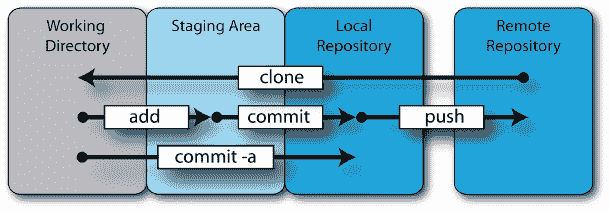

**图 3-5****：** Git 基本工作流

## 克隆仓库（`git clone`）

克隆仓库意味着在本地文件系统上复制仓库中的所有文件，以及该项目的变更历史。此操作只需执行一次。要克隆仓库，请执行命令 `git clone` 后跟完整的仓库名称：

```
molloyd@ebb:~$ cd ~/
molloyd@ebb:~$ git clone https://github.com/derekmolloy/test.git
Cloning into 'test'…
remote: Counting objects: 20, done.
remote: Total 20 (delta 0), reused 0 (delta 0), pack-reused 20
Unpacking objects: 100% (20/20), done. 
```

现在，你在 `/test/` 目录中拥有了 test 仓库的完整副本。你的仓库与 GitHub 服务器上的版本一样完整；如果你将其部署到网络、文件系统、其他 Git 服务器甚至不同的 GitHub 账户上，它都可以承担该仓库主版本的角色。虽然不需要中央服务器，但通常情况如此，因为它允许多个用户将源代码“签入”到已知的主仓库中。仓库创建在 `/test/` 目录中，当前包含以下内容：

```
molloyd@ebb:~/test$ ls -al
total 20
drwxr-xr-x 3 molloyd molloyd 4096 May  4 23:18 .
drwxr-xr-x 4 molloyd molloyd 4096 May  4 23:16 ..
drwxr-xr-x 8 molloyd molloyd 4096 May  4 23:16 .git
-rw-r--r-- 1 molloyd molloyd    4 May  4 23:16 .gitignore
-rw-r--r-- 1 molloyd molloyd   59 May  4 23:16 README.md 
```

你可以看到在 GitHub 上初始化项目时创建的 `README.md` 文件；可以使用 `more` 查看该文件的内容。该目录还包含一个隐藏的 `.git` 子目录，其中包含以下文件和目录：

```
molloyd@ebb:~/test$ cd .git
molloyd@ebb:~/test/.git$ ls
branches  config   description  HEAD  hooks  index  info
logs      objects  packed-refs  refs 
```

隐藏的 `.git` 文件夹包含仓库的所有信息，例如提交消息、日志和数据对象。例如，远程仓库的位置保存在 `config` 文件中。

```
molloyd@ebb:~/test/.git$ more config | grep url
        url = https://github.com/derekmolloy/test.git 
```

本章末尾的“延伸阅读”部分将引导你阅读一本关于 Git 的优秀书籍，该书可在线免费获取，详细描述了 `.git` 目录结构的性质。幸运的是，在接下来的讨论中，你无需修改 `.git` 目录结构，因为 Git 命令会为你完成这些操作。

## 查看状态（`git status`）

现在仓库已存在，下一步是将一个新的文本文件添加到工作目录中，该文件将处于未跟踪状态。当你调用命令 `git status` 时，可以看到一条消息，指出存在“未跟踪的文件”。

```
molloyd@ebb:~/test$ echo "Just some text" > newfile.txt
molloyd@ebb:~/test$ git status
On branch master
Your branch is up-to-date with 'origin/master'.
Untracked files:
  (use "git add <file>…" to include in what will be committed)
        newfile.txt
nothing added to commit but untracked files present (use "git add" to track) 
```

下一步是将任何未跟踪的文件添加到暂存区。但是，如果你不想添加一组文件，也可以创建一个 `.gitignore` 文件来忽略这些文件。例如，如果你正在构建 C/C++ 项目，并且决定不添加中间 `.o` 文件，这将非常有用。以下是一个创建 `.gitignore` 文件以忽略 C/C++ `.o` 文件的示例：

```
molloyd@ebb:~/test$ echo "*.o" > .gitignore
molloyd@ebb:~/test$ more .gitignore
*.o
molloyd@ebb:~/test$ touch testobject.o
molloyd@ebb:~/test$ git status
On branch master
Your branch is up-to-date with 'origin/master'.
Untracked files:
  (use "git add <file>…" to include in what will be committed)
        newfile.txt
nothing added to commit but untracked files present (use "git add" to track) 
```

在这种情况下，有两个文件未跟踪，但没有提到 `testobject.o` 文件，因为它被正确忽略了。请注意，`.gitignore` 文件本身是仓库的一部分，因此在克隆仓库时会保留，连同其修订历史等。

## 添加到暂存区（`git add`）

现在可以通过输入 `git add` 将工作目录中的文件添加到暂存区。

此命令会添加工作目录中的所有文件，但被忽略的文件除外。在此示例中，两个文件从工作目录添加到暂存区，然后可以使用以下命令显示仓库的状态：

```
molloyd@ebb:~/test$ git add .
molloyd@ebb:~/test$ git status
On branch master
Your branch is up-to-date with 'origin/master'.
Changes to be committed:
  (use "git reset HEAD <file>…" to unstage)
       new file:   .gitignore
       new file:   newfile.txt 
```

要从暂存区删除（*r*e*m*ove）文件，请使用 `git rm somefile.ext`。

## 提交到本地仓库（`git commit`）

将文件添加到暂存区后，你可以将更改从暂存区提交到本地 Git 仓库。首先，你可能需要添加你的姓名和电子邮件地址变量，以标识谁在提交更改。

```
molloyd@ebb:~/test$ git config --global user.name "Derek Molloy"
molloyd@ebb:~/test$ git config --global user.email " derek@myemail.com" 
```

这些值针对你的 Linux 用户账户设置，因此下次登录时会保留。你可以通过输入 `more ~/.gitconfig` 来查看它们。

要永久地将文件添加提交到本地 Git 仓库，请使用 `git commit` 命令。

```
molloyd@ebb:~/test$ git commit -m "Testing repository for BeagleBone"
[master b2137ee] Testing repository for BeagleBone
 2 files changed, 2 insertions(+)
 create mode 100644 newfile.txt
 create mode 100644 .gitignore 
```

更改会使用用户名进行标记，并且还需要一条消息。如果你想内联详细说明消息，请使用 `-m` 设置提交消息。

## 推送到远程仓库（`git push`）

要执行此步骤，你必须拥有自己的 GitHub 账户。`git push` 命令将任何代码更新推送到远程仓库。你必须注册才能对远程仓库进行更改，以便应用更改。在 Git 2.0 中，采用了一种更保守的新方法，称为 *simple*，用于推送到远程仓库。默认情况下会选择它，但可以消除警告消息，并按如下方式执行推送（将用户详细信息和仓库名称替换为你自己的账户详细信息）：

```
molloyd@ebb:~/test$ git config --global push.default simple
molloyd@ebb:~/test$ git push
Username for 'https://github.com': derekmolloy
Password for 'https://derekmolloy@github.com': mySuperSecretPassword
Counting objects: 4, done.
Compressing objects: 100% (2/2), done.
Writing objects: 100% (4/4), 350 bytes | 0 bytes/s, done.
Total 4 (delta 0), reused 0 (delta 0)
To https://github.com/derekmolloy/test.git
   61b6ee4..b2137ee  master -> master 
```


代码推送到远程仓库后，你可以通过在任何机器的本地仓库目录中执行 `git pull` 命令，将更改拉取回本地仓库。

```
molloyd@ebb:~/test$ git pull
Already up-to-date. 
```

在这个例子中，一切已经是最新状态。

### Git 分支

Git 支持分支的概念，这使你能够在项目中处理多个不同版本的文件集。例如，要在项目中开发一个新功能（版本 2），同时维护当前版本（版本 1）的代码，你可以创建一个新分支（版本 2）。对版本 2 所做的新功能和更改不会影响版本 1 中的代码。然后你可以轻松地在分支之间切换。

#### 创建分支（`git branch`）

假设你想创建一个名为 `mybranch` 的新分支；你可以使用命令 `git branch mybranch` 来创建，然后使用 `git checkout mybranch` 切换到该分支，如下所示：

```
molloyd@ebb:~/test$ git branch mybranch
molloyd@ebb:~/test$ git checkout mybranch
Switched to branch 'mybranch' 
```

现在，为了演示其工作原理，假设向仓库中添加了一个名为 `testmybranch.txt` 的临时文件。这可能是你项目的一个新代码文件。你可以看到分支的状态清楚地表明工作目录中包含一个未跟踪的文件。

```
molloyd@ebb:~/test$ touch testmybranch.txt
molloyd@ebb:~/test$ ls
newfile.txt  README.md  testmybranch.txt  testobject.o
molloyd@ebb:~/test$ git status
On branch mybranch
Untracked files:
  (use "git add <file>…" to include in what will be committed)
        testmybranch.txt
nothing added to commit but untracked files present (use "git add" to track) 
```

然后你可以使用相同的命令将这个新文件添加到分支的暂存区。

```
molloyd@ebb:~/test$ git add .
molloyd@ebb:~/test$ git status
On branch mybranch
Changes to be committed:
  (use "git reset HEAD <file>…" to unstage)
        new file:   testmybranch.txt 
```

你可以将此更改提交到本地仓库的 `mybranch` 分支。此更改会影响 `mybranch` 分支，但对 master 分支没有影响。

```
molloyd@ebb:~/test$ git commit -m "Test commit to mybranch"
[mybranch 63cae5f] Test commit to mybranch
 1 file changed, 0 insertions(+), 0 deletions(-)
 create mode 100644 testmybranch.txt
molloyd@ebb:~/test$ git status
On branch mybranch
nothing to commit, working tree clean
molloyd@ebb:~/test$ ls
newfile.txt  README.md  testmybranch.txt  testobject.o 
```

从上面的输出可以看出，文件 `testmybranch.txt` 已提交到本地仓库，并且你可以在目录中看到该文件。

如果你现在使用 `git checkout master` 从 `mybranch` 分支切换到 master 分支，你会发现当请求目录列表时会发生一些有趣的事情。

```
molloyd@ebb:~/test$ git checkout master
Switched to branch 'master'
Your branch is up-to-date with 'origin/master'.
molloyd@ebb:~/test$ ls
newfile.txt  README.md  testobject.o 
```

是的，文件 `testmybranch.txt` 从目录中消失了！它仍然存在，但以 blob 形式存在于 `.git/objects/` 目录中。如果你返回该分支并列出目录，你会看到以下内容：

```
molloyd@ebb:~/test$ git checkout mybranch
Switched to branch 'mybranch'
molloyd@ebb:~/test$ ls
newfile.txt  README.md  testmybranch.txt  testobject.o 
```

文件现在重新出现。因此，你可以看到分支系统的集成程度有多高。此时，你可以回到 master 分支并对原始代码进行更改，而 `mybranch` 分支中的更改不会对 master 代码产生任何影响。即使你在同一个文件中更改代码，也不会影响 master 分支中的原始代码。

#### 合并分支（`git merge`）

如果你想将 `mybranch` 分支中所做的更改应用到 master 项目中，该怎么办？你可以通过使用 `git merge` 来实现。

```
molloyd@ebb:~/test$ git checkout master
Switched to branch 'master'
Your branch is up-to-date with 'origin/master'.
molloyd@ebb:~/test$ git merge mybranch
Updating b2137ee..63cae5f
Fast-forward
 testmybranch.txt | 0
 1 file changed, 0 insertions(+), 0 deletions(-)
 create mode 100644 testmybranch.txt
molloyd@ebb:~/test$ git status
On branch master
Your branch is ahead of 'origin/master' by 1 commit.
  (use "git push" to publish your local commits)
nothing to commit, working tree clean
molloyd@ebb:~/test$ ls
newfile.txt  README.md  testmybranch.txt  testobject.o 
```

现在 `testmybranch.txt` 文件位于 master 分支中，并且对 master 中其他文档所做的任何更改都已应用。本地仓库现在比远程仓库领先一个提交，你可以使用 `git push` 来更新远程仓库。

#### 删除分支（`git branch -d`）

如果你想删除一个分支，请使用 `git branch -d mybranch` 命令。

```
molloyd@ebb:~/test$ git branch -d mybranch
Deleted branch mybranch (was 63cae5f).
molloyd@ebb:~/test$ ls
newfile.txt  README.md  testmybranch.txt  testobject.o 
```

在这种情况下，文件 `testmybranch.txt` 仍然存在于 master 项目中——这是应该的，因为该分支已与 master 项目合并。如果在执行合并之前删除了该分支，该文件就会丢失。

### 常用 Git 命令

表 3-8 总结了主要的 Git 命令。至此，你已经了解了 Git 的核心用法。如果你直接在 Beagle 板上开发代码，Git 会非常有用，因为你可以轻松地将你的开发成果推送到远程仓库。这一功能在备份代码以及将代码重新部署到多个板子上时非常有用。

| **操作** | **描述** | **操作** | **描述** |
| --- | --- | --- | --- |
| `git clone` | 从远程仓库克隆。 | `git rm` | 从暂存区删除文件或目录。 |
| `git init` | 创建一个全新的仓库。 | `git mv` | 在暂存区移动或重命名文件或文件夹。 |
| `git pull` | 从主仓库合并更改。 | `git log` | 显示提交日志。项目历史记录。 |
| `git fetch` | 查找主仓库中已更改的内容（不合并）。 | `git tag` | 为提交命名（例如，版本 2）。 |
| `git status` | 显示项目状态。 | `git merge [name]` | 合并分支。 |
| `git add` | 添加新文件或编辑现有文件。 | `git show` | 获取当前或其他提交的详细信息。 |
| `git diff` | 显示将要提交的差异。 | `git branch [name]` | 创建新分支。（使用 `-d` 删除。） |
| `git commit` | 提交到仓库。 | `git checkout [name]` | 切换到不同的分支。 |
| `git push` | 将更改从本地仓库推送到远程仓库。 |  |  |

**表 3-8****：**主要 Git 命令总结

## 桌面虚拟化

BeagleBone 和 BeagleBoard 是功能强大的通用计算平台，但如果你计划构建 Linux 内核或进行跨平台开发（参见第 7 章），强烈建议使用基于 PC 的 Linux 安装。你可以使用单启动/双启动 Linux PC，或者如果你使用的是 Windows/Mac 原生系统，则应考虑桌面虚拟化。

桌面*虚拟化*使单台桌面计算机能够同时运行多个操作系统实例。它使用称为*虚拟机监控程序*的技术，该技术由硬件、固件和软件元素组成，用于创建和运行软件模拟的机器，称为*虚拟机*（VM）。如果你想在一台计算机上运行多个操作系统实例，VM 提供了创建多启动配置的替代方案。


在虚拟化技术中，通常存在两个或更多不同的操作系统实例。*宿主机*操作系统是物理机上最初安装的那个。然后使用虚拟机监控程序在虚拟机内创建一个*客户机*操作系统。图 3-6 展示了一台运行 Windows 的宿主机桌面计算机，其窗口内运行着一个客户机 Debian 64 位 Linux Stretch 虚拟机。该 Debian 安装有 Cairo-Dock 桌面界面。

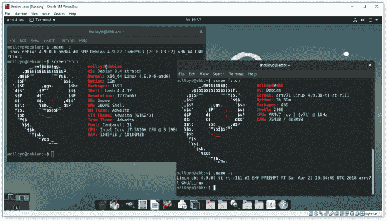

**图 3-6****：** VirtualBox 在 Windows 宿主机上运行 Debian 9.4 作为客户机操作系统，并通过 SSH 会话连接到 PocketBeagle 板

市面上有许多虚拟化产品，但大多数成本高昂、拥有专有许可证，并且对支持的客户机和宿主机操作系统类型有限制。两款最流行的 Linux 桌面虚拟化产品是 VMware Player 和 VirtualBox。VMware Player（[www.vmware.com/products/player/](http://www.vmware.com/products/player/)）供个人免费使用。VirtualBox（[www.virtualbox.org](http://www.virtualbox.org)）以 GNU GPLv2 许可证提供（某些功能在专有许可证下免费提供）。

这两款产品都使用*托管型虚拟机监控程序*（类型 2）进行虚拟化，这意味着它们运行在常规操作系统内，使您可以同时使用两台机器。VirtualBox 可在 Windows、macOS 和 Linux 机器上运行，并可用于托管 Linux、Windows 和 macOS 等客户机操作系统。目前，VMware Player 不支持在 macOS 宿主机上安装；您需要购买名为 VMware Fusion 的产品。

这两款产品功能强大，难以区分；不过，VirtualBox 以 GPL 许可证发布，并支持一项名为*快照*的有用功能。通过用户界面，您可以拍摄客户机操作系统的快照并保存以供日后使用。例如，在对客户机操作系统进行重大配置更改之前拍摄快照，这样在出现问题时可以回滚到该配置。快照会存储虚拟机设置、虚拟磁盘内容的更改以及该时刻机器的内存状态。因此，当恢复快照时，虚拟机将从拍摄快照时的同一位置继续运行。

如果安装了 VirtualBox 增强功能，您可以在客户机和宿主机操作系统之间复制粘贴文本、共享目录，甚至动态调整窗口大小。本章的网页（[www.exploringbeaglebone.com/chapter3/](http://www.exploringbeaglebone.com/chapter3/)）提供了在 Windows 宿主机下安装 Linux 客户机操作系统的建议。

## 本书代码

现在您已经在 VirtualBox 下运行了桌面 Linux 安装，或者正在运行常规的 Linux 桌面安装，您可以通过打开 Linux 终端会话/窗口并输入以下命令（在桌面机和 Beagle 板上）来下载本书讨论的所有源代码、脚本和文档：

```
molloyd@ebb:~$ sudo apt install git
molloyd@ebb:~$ git clone https://github.com/derekmolloy/exploringBB.git
Cloning into 'exploringBB' …
molloyd@ebb:~$ cd exploringBB/
molloyd@ebb:~/exploringBB$ ls
chp02  chp05  chp08  chp10  chp12  chp14  extras   License.txt
chp03  chp06  chp09  chp11  chp13  chp15  library  README.md 
```

如果您想从 Windows 或 macOS 下载代码，可以从[windows.github.com](http://windows.github.com)和[mac.github.com](http://mac.github.com)获取用于处理 GitHub 仓库的图形用户界面。

## 总结

完成本章后，您应该能够做到以下几点：

*   描述嵌入式 Linux 系统的基本概念

*   描述嵌入式 Linux 设备（如 Beagle 板）如何启动 Linux 操作系统

*   描述重要的 Linux 概念，如内核空间、用户空间以及使用 systemd 进行系统初始化

*   在 Beagle 板上执行 Linux 系统管理任务

*   有效使用 Linux 文件系统

*   使用一系列 Linux 命令进行文件和进程管理

*   使用 Git 管理自己的软件开发项目

*   使用桌面虚拟化工具（如 VirtualBox）在桌面计算机宿主机操作系统上安装 Linux 发行版

*   使用 Git 下载本书的源代码

## 延伸阅读

以下资料可帮助您进一步了解嵌入式 Linux、Linux 管理、Git 和虚拟化：

*   Christopher Hallinan 的《嵌入式 Linux 基础：实用真实世界方法，第二版》（Upper Saddle River, NJ: Prentice Hall, 2011）。

*   Debian 策略手册：[www.debian.org/doc/debian-policy/](http://www.debian.org/doc/debian-policy/)。

*   要了解更多关于 Git 的信息，请先调用`man gittutorial`，然后如果需要详细信息，请参阅 Scott Chacon 的优秀参考书《Pro Git》，网址为[www.git-scm.com/book/en/v2](http://www.git-scm.com/book/en/v2)；也有平装版（New York: Apress Media, 2009）。

## 参考文献

*   Git FAQ. (2013, 3 9). Retrieved 2 22, 2014, from Git Wiki: [`git.wiki.kernel.org/index.php/GitFaq#Why_the_.27Git.27_name.3F`](https://git.wiki.kernel.org/index.php/GitFaq#Why_the_.27Git.27_name.3F)

*   Smith, B. (2013, 7 29). A Quick Guide to GPLv3. Retrieved June 14, 2015, from [www.gnu.org/licenses/quick-guide-gplv3.html](http://www.gnu.org/licenses/quick-guide-gplv3.html)

## 注释

# 第 4 章

电子接口

本章将介绍您需要正确且有效地将电子电路与 Beagle 板连接时所需的实用电子学知识。本章首先描述了一些有助于开发和调试电子电路的设备。接着提供了电路设计与分析的实用入门指南，鼓励您搭建电路并使用本章开头介绍的设备。然后讨论了可与 Beagle 板上的通用输入输出（GPIO）接口的典型分立元件，包括二极管、电容、晶体管、光耦合器、开关和逻辑门。最后，描述了模数转换（ADC）的重要原理，因为与 Beagle 板 ADC 接口需要这些知识。

本章所需设备：

*   本章所需元件（如需跟随操作）：完整列表见本章末尾。

*   Digilent Analog Discovery（版本 1 或 2）*或* 数字万用表、信号发生器和示波器。

本章更多详细信息请访问[www.exploringbeaglebone.com/chapter4/](http://www.exploringbeaglebone.com/chapter4/)。

## 分析您的电路

在为 Beagle 板开发电子电路时，拥有以下工具非常有用，这样您可以在将电路连接到板的输入/输出之前对其进行分析，以减少损坏板的风险。特别地，拥有数字万用表和混合信号示波器非常有用。

### 数字万用表

数字万用表（DMM）是测量电路电压、电流和电阻/通断的宝贵工具。如果您还没有，请尽量购买具备以下功能的型号：

*   **自动关机：** 电池很容易浪费。

*   **自动量程：** 能够选择不同的测量范围至关重要。中档万用表通常具有自动量程选择功能，可减少测量所需时间。

*   **通断测试：** 除非导体断开（或电阻过大），此功能应发出蜂鸣声。


*   **真有效值读数：** 大多数低成本万用表采用平均值法计算交流（~）电流/电压。真有效值万用表通过真正的均方根（RMS）计算来处理读数，从而在读数时能够考虑波形失真。此功能对于分析相位控制设备、固态器件、电机驱动设备等非常有用。
*   **其他实用选项：** 这些选项并非严格必需，但很有帮助：背光显示屏、测量保持、大数字显示、更多有效数字、PC 连接（最好带光隔离）、温度探头和二极管测试。
*   **外壳：** 寻找质量良好的橡胶化塑料外壳。

通常，上述大多数功能在中价位数字万用表（DMM）上都能找到，这些万用表具有较高的精度（1%或更好）、高输入阻抗（>10 MΩ）和良好的测量范围。高端万用表主要提供更快的测量速度和更高的测量精度；有些还可能提供测量电容、频率、使用红外传感器的温度、湿度以及晶体管增益等功能。一些最知名的品牌包括 Fluke、Tenma、Agilent、Extech 和 Klein Tools。

### 示波器

标准数字万用表为您提供了一种多功能工具，可以测量平均电压、电流和电阻。示波器通常只测量电压，但能让您看到电压随时间的变化。通常，您可以同时查看两个或多个在特定带宽和模拟采样数（内存）内捕获的电压波形。带宽定义了示波器能够准确测量的信号频率范围（通常到 3 dB 点，即正弦波幅度比真实幅度低约 30%的频率点）。为了获得准确的结果，模拟采样数需要是带宽的倍数（您将在本章后面讨论奈奎斯特速率时了解原因）；对于现代示波器，这个值通常是带宽的四到五倍，因此一台 25 MHz 的示波器应具有每秒 1 亿次采样或更高。带宽和模拟采样数对示波器成本的影响最大。

市面上有几种低成本的双通道示波器，例如 Owon PDS5022S 25 MHz（约 200 美元）、功能丰富的 Siglent SDS1022DL 25 MHz（约 325 美元）、Rigol DS1052 50 MHz（约 325 美元）和 Owon SDS6062 60 MHz（约 349 美元）。随着带宽的增加，价格大幅上涨，300 MHz 的示波器价格约为 1500 美元。Agilent 数字存储（DSOX）和混合信号（MSOX）系列示波器被视为中高端产品，价格从 3000 美元（100 MHz）到 16000 美元（1 GHz）不等。混合信号示波器还提供数字总线分析工具。

本书中所有电路均使用 Digilent Analog Discovery 2（带 Waveforms 软件，见图 4-1）进行测试。Analog Discovery（以及类似的 Analog Discovery 2）是一款适用于 Windows 环境的 USB 示波器、波形发生器、数字模式发生器和逻辑分析仪。最近发布的 Waveforms 软件现已支持 Linux（包括 ARM）和 macOS。Analog Discovery 2 通常售价 279 美元。如果您刚开始学习或想重温电子技能，这款设备性价比极高。

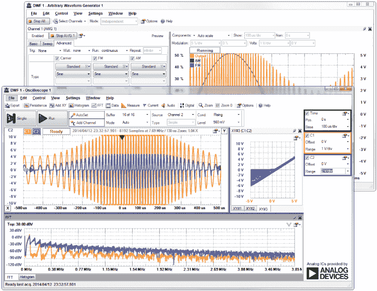

**图 4-1****：** Waveforms 应用程序生成信号并显示物理电路的响应

本书中所有示波器图均使用 Analog Discovery 生成，因为所有示例都是通过实际电路实现的。该示波器仅限于两个通道，每个通道 5 MHz，波形发生器和差分示波器的采样率均为每秒 5000 万次。因此，Analog Discovery 主要面向学生和学习者；不过，它也有助于您为下一台更昂贵的设备确定“必备”功能。

还有其他混合信号 USB 示波器，例如 PicoScopes，价格从 160 美元到 10000 美元不等（[`www.picotech.com`](http://www.picotech.com)），以及 BitScope DSO，价格从 150 美元到 1000 美元不等（[`www.bitscope.com`](http://www.bitscope.com)），支持 Linux。然而，基于当前 USB 示波器提供的功能集，一台带有 USB 逻辑分析仪的台式示波器可能是“性价比最高”的选择。

## 基本电路原理

电子电路包含各种元件的组合，这些元件可分为无源元件和有源元件。有源元件（如晶体管）能够自适应地控制电流的流动，而无源元件（如电阻、电容、二极管）则不能。构建电路的挑战在于设计出合适元件的恰当组合。幸运的是，有一些电路分析方程可以帮助您。

### 电压、电流、电阻和欧姆定律

您需要理解的最重要的方程是欧姆定律。其表述如下：


其中：

*   电压（*V*），单位为伏特（V），是迫使电流在电路中流动的势能差。用水类比来理解电压很有帮助：许多房屋的阁楼上有一个缓冲水箱，连接到屋内的水龙头。由于水箱的高度和重力作用，打开水龙头时水就会流出。如果水龙头与水箱顶部处于同一高度，则不会有水流出，因为没有势能。电压的行为与此类似；当元件（如电阻）一侧的电压高于另一侧时，电流就能流过该元件。
*   电流（*I*），单位为安培（A），是电荷的流动。继续用水类比，电流就是从水箱（高电位）流向水龙头（较低电位）的水流。请记住，水龙头仍然有电位，水会从水槽排水管流出，除非它处于地电位（GND）。为了理解电流的大小，当我们构建与 Beagle 板 GPIO 接口的电路时，它们通常仅提供或吸收约 5 mA，而 1 毫安等于千分之一安培。
*   电阻（*R*），单位为欧姆（Ω），阻碍电荷的流动。电阻是一种通过消耗功率来减小电流的元件。它以线性方式工作，消耗的功率（单位为瓦特 W）由给出，或者通过整合欧姆定律得到：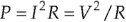。功率以热量的形式耗散，所有电阻都有最大额定耗散功率。常见的金属膜或碳膜电阻通常耗散 0.125 W 到 1 W，如果该值需要超过 3 W，价格会大幅上涨。最后用水类比，电阻就是水与管道之间的摩擦力，导致发热效应并减少水流。这种阻力可以通过增加水流经过的表面积（同时保持管道横截面积不变，例如在主水管内放置小管道）来增大。


举例来说，如果你需要购买一个电阻，用于在 5 V 电源下将电流限制在 100 mA，如图图 4-2(a)所示，你应该购买哪个电阻？电阻两端的电压降`V[R]`必须是 5 V，因为它是电路中唯一的元件。由于，因此电阻的阻值应为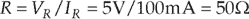，而该电阻消耗的功率可以使用任意通用公式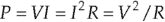计算得出，为 0.5 W。

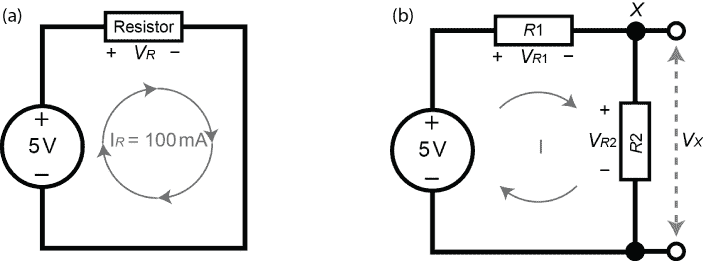

**图 4-2****：** (a) 欧姆定律电路示例，(b) 分压器示例

购买一个通孔、固定阻值、1%公差（精度）的金属膜电阻，0.33 W 规格的约需 0.10 美元，1 W 额定功率的约需 0.45 美元。你应当注意电路中使用的电阻的额定功率，因为额定功率不足的电阻可能会烧毁。一个 30 W 的电阻售价 2.50 美元，并且会变得非常烫——并非所有电阻都生而平等！

### 分压

如果将图 4-2(a)中的电路修改为串联另一个电阻，如图图 4-2(b)所示，会对电路产生什么影响？

*   由于一个电阻接在另一个之后（它们串联），电流在电路中循环必须通过的总电阻是两个阻值之和：。
*   电源电压必须降落在两个电阻上，因此可以说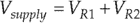。每个电阻上的电压降与该电阻的阻值成反比。这种电路称为*分压器*。

假设你想在纸上计算图 4-2(b)中`X`点的电压值，已知`R1` = 25 Ω，`R2` = 75 Ω。电路中的总电阻为，电阻上的总电压降必须为 5 V；因此，利用欧姆定律，电路中流过的电流为`I = V/R` = 5 V/100 Ω = 50 mA。如果`R1`的阻值为 25 Ω，则上的电压降为，而上的电压降为。可以看到这些电压之和为 5 V，从而遵循基尔霍夫电压定律，该定律指出串联电路中电压降之和等于施加的总电压。

为了完整回答这个问题，在此电路中，`R1`上的电压降为 1.25 V，`R2`上的电压降为 3.75 V，那么`X`点的电压是多少？要知道这一点，你必须相对于其他点来测量`X`！如果你相对于电源负极端子测量`X`，则电压降为图 4-2(b)中的`V[X]`，它与`R2`上的电压降相同，因此为 3.75 V。然而，同样可以合理地问：“相对于电源正极端子，`X`点的电压是多少？”在这种情况下，它将是`R1`上电压降的负值（因为`X`相对于负极端子为 3.75 V，而正极端子相对于负极端子为+5 V）；因此，相对于电源正极端子，`X`点的电压为−1.25 V。

要计算图 4-2(b)中`V[X]`的值，分压规则可以概括如下：

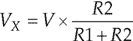

你可以使用此规则来确定电压`V[X]`，但遗憾的是，这种配置在实践中相当有限，因为连接到此电压源`V[X]`的电路本身很可能具有电阻（或负载）。这会改变分压电路的特性，从而改变电压`V[X]`。不过，大多数接在分压器之后的电路通常是具有非常高输入阻抗的输入电路，因此对`V[X]`的影响很小。

图 4-3(a)展示了一个可变电阻或电位器（pot），以及一个将其用作独立分压器的相关电路。引脚 1 和 3 之间的电阻是固定值，对于多圈电位器而言为 10 kΩ；然而，引脚 3 与滑臂引脚（引脚 2）之间的电阻在 0 Ω到 10 kΩ之间变化。因此，如果引脚 2 和 3 之间的电阻为 2 kΩ，则引脚 1 和 2 之间的电阻将为 10 kΩ − 2 kΩ = 8 kΩ。在这种情况下，输出电压`V[out]`将为 1 V，并且可以通过使用微调工具或螺丝刀转动电位器上的小螺丝，在 0 V 到 5 V 之间变化。

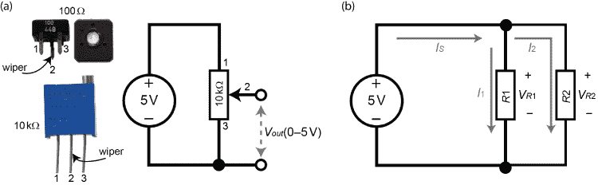

**图 4-3****：** (a) 电位器及使用可变电压源，(b) 分流器示例

### 分流

如果将电路修改为如图图 4-3(b)所示，将两个电阻并联，则得到分流电路。电流将遵循最小电阻路径，因此如果`R1` = 100 Ω，`R2` = 200 Ω，则更大比例的电流将流经`R1`。那么，这个比例是多少？在这种情况下，`R1`和`R2`两端的电压降均为 5 V。因此，电流`I[1]`将为`I = V/R` = 5 V/100 Ω = 50 mA，而电流`I[2]`将为`I` = 5 V/200 Ω = 25 mA。因此，流经 100 Ω电阻的电流是流经 200 Ω电阻的两倍。显然，电流偏爱最小电阻路径。

基尔霍夫电流定律指出，流入一个节点的电流之和等于流出该节点的电流之和。这意味着`I[S] = I[1] + I[2]` = 25 mA + 50 mA = 75 mA。分流规则可以一般性地表述如下：

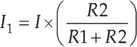，以及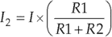

然而，这要求你知道进入节点的电流`I`（此处为`I[S]`）的值。要直接计算`I[S]`，你需要计算两个并联电阻的等效电阻（`R[T]`），其计算公式如下：

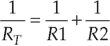 或 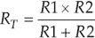

在图 4-3(b)中，该值为 66.66 Ω；因此`I[S] = V/R` = 5 V/66.66 Ω = 75 mA，这与初始计算一致。

电源提供的功率： 这应等于和消耗的功率之和，总计 0.375 W，证实了能量守恒定律成立！

### 在面包板上实现电路

面包板是原型电路开发的绝佳平台，并且与 Beagle 板完美配合。图 4-4 展示了一块面包板，描述了如何使用两条水平电源轨提供 3.3 V 和 5 V 电源。Beagle 板上的 GPIO 排针通常是母头排针，这意味着你可以使用导线进行连接。

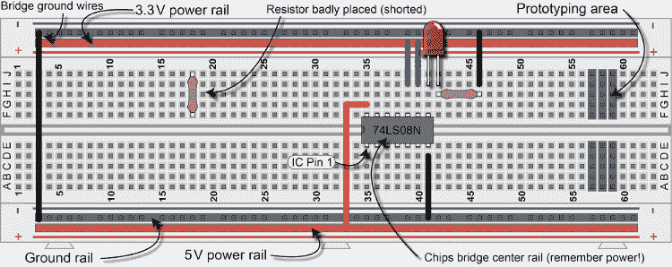

**图 4-4****：** 带有 7408 IC（四路双输入与门）的面包板


像图 4-4 中那样的优质面包板（830 个连接点）价格约为 6 到 10 美元。大型面包板（3220 个连接点）售价约 20 美元。以下是使用面包板的一些技巧：

* 尽可能将 IC 的 1 号引脚放在左下角，这样便于调试电路。在施加压力并“咔嗒”按入到位之前，务必仔细将引脚与面包板孔对齐。另外，IC 需要供电！
* 断开导线与将其连接到 GND（本章后面讨论）是不同的。
* 使用平头螺丝刀从两端缓慢地将 IC 从面包板上撬起，以避免弯曲 IC 的引脚。
* 注意不要将电阻和其他元件的两个引脚放在同一垂直导轨上，以免形成桥接。另外，在将电阻放入面包板之前，修剪其引线，因为过长的引线可能意外接触，导致电路调试困难。
* 瞬时按钮通常有四个引脚，两两相连；确保正确定向（使用 DMM 通断测试）。
* 订书钉是极好的桥接工具！
* 有些面包板的电源导轨有断开处；必要时需进行桥接。
* 面包板的连接点间距通常为 0.1 英寸（引脚间距），即公制 2.54 毫米。尽量购买具有相同间距的所有元件和连接器。对于 IC，选择 DIP/PDIP 封装（IC 代码以 N 结尾）；对于其他元件，选择“通孔”形式。
* 使用不同颜色的连接线表示特定含义——例如，红色代表 5 V，黑色代表 GND；这在调试电路时非常有帮助。实心 22AWG 导线是理想的连接线，有多种不同颜色的绝缘层可供选择。也有预成型的跳线，但长导线会导致电路杂乱。选择不同颜色的连接线和优质剥线工具，才能实现最整洁、最稳定的面包板布局。

### 数字万用表与面包板

在考虑一些规则后（参考图 4-6），测量电压、电流和电阻相当直接：

* **直流电压**（DCV）的测量是与承受电压降的元件并联（即跨接）。万用表的黑表笔应插入 COM（公共）输入端。
* **直流电流**（DCA）的测量是串联进行的，因此你需要“断开”电路中的连接，并将万用表像串联元件一样接入你正在测量电流的电路中。使用 COM 端的黑表笔和μAmA 输入端（或等效端）的红表笔。不要使用 10 A 无保险丝输入端。
* **电阻**通常不能在电路中进行测量，因为其他电阻或元件会在测量中充当并联/串联负载。隔离该元件，将万用表红表笔插入 VΩ输入端，并将万用表设置为测量Ω。通断测试可以在断电的电路中合理有效地使用。


**图 4-6：** 测量电压、电流和电阻

如果万用表无法工作，可能是内部保险丝烧断了。断开万用表表笔，打开万用表找到小型玻璃保险丝。如果你有另一块万用表，可以进行通断测试以判断保险丝是否烧断。用相同规格（或 PTC）的保险丝更换——不要使用市电保险丝！

### 示例电路：电压调节

现在你已经了解了原理，本节将讨论一个更复杂的电路，然后在后续章节中详细分析各个元件。不要在本节中搭建电路；它仅作为介绍互联元件概念的示例。

电压调节器是一种复杂但易于使用的器件，它接受变化的输入电压，并输出几乎与所接负载无关的恒定电压，且输出电压低于输入电压。电压调节器将输出电压维持在一定容差范围内，防止电压波动损坏下游电子设备。

Beagle 板具有先进的电源管理 IC（PMIC），可以在不同输出引脚上为不同设备提供不同电压等级。例如，有 5 V 输出、3.3 V 输出以及用于模数转换器的 1.8 V 参考电压。你可以使用板上的 5 V 和 3.3 V 电源来驱动你的电路，但仅限于一定的电流供应限制内。如果 BBB 通过 5 V 插孔连接到直流电源，则 P9 排针（引脚 5 和 6）上的`VDD_5V`引脚可提供高达 1 A 的电流，而`DC_3.3V`引脚（引脚 3 和 4）可提供 250 mA 的电流。

如果你需要为驱动电机等应用抽取更大电流，可能需要使用像图 4-7 中那样的电压调节器。你可以直接在面包板上搭建，也可以从 SparkFun（[`www.sparkfun.com`](http://www.sparkfun.com)）购买“面包板电源棒 5 V/3.3 V”，价格约 15 美元。


**图 4-7：** (a) KA7805A/LM7805 电压调节器，(b) 示例调节电路

如图 4-7 所示，调节器左侧的引脚是电压供应输入。当输出 500 mA 电流时，KA7805/LM7805 电压调节器可接受 8 V–20 V 的输入电压范围，并在右侧输出 4.8 V–5.2 V 范围内的电压。中间引脚应连接到地线导轨。电压调节器背面的铝板用于散热。其上的孔允许你安装散热器，从而实现高达 1 A 的更大输出电流。

驱动 KA7805/LM7805 电压调节器所需的最小输入电压约为 8 V。如果你的电源电压低于此值，则可以使用低压差（LDO）电压调节器，它仅需低至 6 V 的电源即可驱动 5 V 调节器。图 4-7 中的实现电路包含以下附加元件，使其能够提供干净稳定的 5 V、1 A 电源：

* 二极管确保如果电源极性接反（例如意外交换 9 V 和 GND），电路免受损坏。像 1N4001（1 A 电源）这样的二极管成本非常低，但缺点是调节器前端的二极管上会有较小的正向压降（1 A 时约为 1 V）。
* 开关可用于接通或断开电路电源。滑动开关可使电路保持持续通电。
* 正温度系数（PTC）可复位保险丝有助于防止过电流故障（如意外短路或元件故障）造成的损坏。PTC 允许保持电流通过，仅产生很小的电阻（约 0.25 Ω）；但一旦超过更大的跳闸电流，电阻会迅速增大，类似于断路器。断电后，PTC 会冷却（几秒钟），并恢复跳闸前的特性。在此电路中，使用 60R110 或等效的 Polyfuse 是合适的，因为它在最大 60 V 直流电压下具有 1.1 A 的保持电流和 2.2 A 的跳闸电流。
* 0.33 μF 电容器位于调节器的电源侧，0.1 μF 电容器位于调节器的输出侧。这些是数据手册中推荐的用于消除电源噪声（纹波抑制）的数值。电容器将在稍后讨论。


LED 和合适的限流电阻提供了一个指示灯，当电源供电时，该灯会清晰显示。

## 分立元件

前面的示例电路使用了许多分立元件来构建一个独立的电源电路。本节将更详细地讨论构成电源电路的元件类型。这些元件可应用于许多不同的电路设计，现在讨论它们很重要，因为其中许多元件用于设计 第 6 章 中与 Beagle 板输入/输出接口的电路。

### 二极管

简单来说，二极管是一种分立半导体元件，允许电流单向通过，而反向则不能。顾名思义，“半”导体既不是导体也不是绝缘体。硅是一种半导体材料，但当它掺杂了磷等杂质时，会变得更有趣。这种负（n 型）掺杂会在价带中产生一个弱束缚电子。它也可以进行正掺杂（p 型），使用硼等杂质在价带中产生一个空穴。当将一小块 p 型和 n 型掺杂的硅连接在一起时，就得到了一个 pn 结——一个二极管！n 型硅价带中的自由电子流向 p 型硅，形成一个耗尽层和一个电压势垒，必须克服这个势垒才能让电流流动。

当二极管正向偏置时，它允许电流通过；当反向偏置时，没有电流能通过。当阳极（`+ve`）端的电压大于阴极（`-ve`）端的电压时，二极管处于正向偏置；然而，偏置还必须超过耗尽层势垒（膝点电压）才能让电流流动，对于硅二极管，这个电压通常在 0.5 V 到 0.7 V 之间。如果通过在阴极施加比阳极更大的电压来使二极管反向偏置，那么几乎没有电流能通过（大约 1 nA）。然而，如果反向偏置电压不断增加，最终二极管会击穿，允许电流反向流动。如果电流很小，这不会损坏二极管——事实上，有一种特殊的二极管叫做齐纳二极管，它被设计成工作在这个击穿区域，并且可以配置成类似稳压器的行为。

1N4001 是一种低成本硅二极管，可用于一个简单电路（参见 图 4-8）来演示二极管的使用和行为。1N4001 的峰值反向击穿电压为 50 V。在该电路中，使用 Analog Discovery 的波形发生器施加一个从 +5 V 到 −5 V 交替的正弦波。当 `V[in]` 电压为正且超过膝点电压时，电流会流动，负载电阻 `V[load]` 上会有电压降，略低于 `V[in]`。二极管 `V[d]` 上有一个小的电压降，从示波器测量中可以看到这是 0.67 V，这在硅二极管的预期范围内。

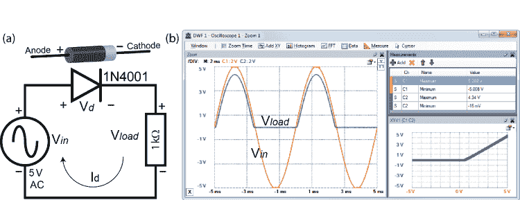

**图 4-8****：** 1N4001 二极管在 5 V 交流电源和 1 kΩ 负载电阻下的电路与行为

该二极管在 图 4-7 的电路中用作反极性保护器。从 图 4-8 的图中可以清楚看出其有效性，因为当 `V[in]` 为负时，`V[load]` 为零。这是因为当二极管反向偏置时，电流无法通过。如果电压超过二极管的击穿电压，电流就会流动；但由于 1N4001 的击穿电压为 50 V，在这种情况下不会发生。注意，图 4-8 的右下角显示了一个输出电压（*y* 轴）与输入电压（*x* 轴）的 XY 图。可以看到，对于负输入电压，输出电压为 0，但一旦达到膝点电压（0.67 V），输出电压随输入电压线性增加。这个电路被称为*半波整流器*。可以将四个二极管连接成桥式结构来创建一个全波整流器。

### 发光二极管

发光二极管（LED）是一种基于半导体的光源，常用于各种设备中的状态指示灯。如今，高功率 LED 被用于汽车灯、电视背光，甚至取代白炽灯用于通用照明（例如家庭照明、交通灯等），主要是因为其寿命长且将电能转换为光输出的效率极高。LED 提供有关电路的有用状态和调试信息，通常用于指示状态是真还是假。

与二极管一样，LED 是有极性的。LED 的符号如 图 4-9 所示。要使 LED 发光，需要将阳极（+）连接到比阴极（−）更正极的电源，从而使二极管正向偏置。例如，阳极可以连接到 +3.3 V，阴极连接到 GND；但也要记住，将阳极连接到 0 V 而阴极连接到 −3.3 V 也能达到同样的效果。


**图 4-9****：** 一个 LED 示例以及驱动 LED 并使其具有适当正向电流和电压水平的电路

图 4-9 展示了一个 LED，其一条腿比另一条长。较长的腿是阳极（+），较短的腿是阴极（−）。LED 的塑料外壳还有一个平边，指示 LED 的阴极（−）腿。当 LED 在电路中且引脚已被剪短时，这个平边指示特别有用。

LED 有特定的工作需求，由正向电压和正向电流定义。每个 LED 都不同，需要查阅 LED 的数据手册来确定这些值。LED 没有显著的电阻，因此如果直接将 LED 连接到 Beagle 板的 3.3 V 电源上，LED 会像短路一样，导致大电流通过 LED，损坏它——但更重要的是，损坏你的板子！因此，为了在 LED 的极限范围内工作，需要一个串联电阻，称为*限流电阻*。仔细选择这个值，以最大化 LED 的光输出并保护电路。

参考 图 4-9，如果你从 Beagle 板的 3.3 V 电源为 LED 供电，并且希望 LED 上的正向压降为 1.3 V，那么需要将 2 V 的差值降在限流电阻上。LED 规格要求将电流限制在 9 mA，因此需要按如下方式计算限流电阻值：

由于 *V* = *IR*，则 *R* = *V*/*I* = 2 V / 0.009 A = 222 Ω

因此，点亮 LED 的电路应如 图 4-9 所示。这里将一个 220 Ω 电阻与 LED 串联。3.3 V 电源和电阻的组合驱动 9 mA 电流通过正向偏置的 LED；由于该电流在电阻上产生 2 V 压降，相应地，LED 上的正向压降为 1.3 V。请注意，如果连接到 BBB 的 `DC_3.3V` 输出，这是可以的，但*不*适用于 BBB 的 GPIO，因为 BBB 从 GPIO 引脚提供的最大电流约为 4–6 mA。稍后你将看到解决方案，并在 第 6 章 中再次看到。


另外值得一提的是，不应通过降低 LED 两端的电压来调暗 LED。LED 应被视为电流控制器件，驱动电流通过 LED 会导致正向压降。因此，尝试用可变电压控制 LED 不会达到预期效果。要调暗 LED，可以使用脉冲宽度调制（PWM）信号，即快速开关 LED。例如，如果对 LED 施加一个快速 PWM 信号，其中一半时间关闭、一半时间开启，那么 LED 看起来只会发出约一半正常工作条件下的光强。如果变化足够快，我们的眼睛不会察觉到单个变化；它们会平均明暗间隔，从而看到恒定但较暗的照明。

图 4-10 展示了不同占空比下的 PWM 方波信号。占空比是指信号高电平时间与低电平时间的百分比。在此示例中，高电平表示为 3.3 V 电压，低电平表示为 0 V 电压。占空比为 0% 表示信号始终为低电平，占空比为 100% 表示信号始终为高电平。


**图 4-10****：** 脉冲宽度调制（PWM）信号的占空比

PWM 可用于控制 LED 的光强，也可用于控制直流电机的速度、伺服电机的位置以及更多应用。你将在第 6 章中看到这样一个示例，届时将使用 Beagle 板的内置 PWM 功能。

重复信号（周期信号）的周期（`T`）是完成一个完整周期所需的时间。在图 4-10 的示例中，三种情况下信号的周期均为 4 ms。周期信号的频率（`f`）描述信号在给定时间内完成完整周期的次数。因此，对于周期为 4 ms 的信号，它每秒循环 250 次（1/0.004），即 250 赫兹（Hz）。我们可以表述为 `f(Hz) = 1/T(s)` 或 `T(s) = 1/f(Hz)`。一些高端数字万用表可以测量频率，但通常使用示波器来测量频率。PWM 信号需要以适合被控器件的频率进行切换；通常，电机控制的频率在 kHz 范围内。

### 平滑电容与去耦电容

电容是一种无源电子元件，当两个绝缘板之间存在电压差时，可用于在两个绝缘板之间存储电能。能量存储在两个板之间的电场中，正电荷积聚在一个板上，负电荷积聚在另一个板上。当电压差被移除或降低时，电容会将其能量释放到连接的电路中。

例如，如果你修改图 4-8(a) 中的二极管电路，在负载电阻上并联一个 10 μF 的平滑电容，输出电压将如图 4-11 所示。当二极管正向偏置时，电容两端存在电位差，它会快速充电（同时电流也流过并联的负载电阻）。当二极管反向偏置时，没有外部电源在电容/电阻组合两端产生电位差，因此电容两端的电位（由于其电荷）会导致电流流过负载电阻，电容开始放电。这种变化的影响是，负载电阻两端的电压现在更加稳定，在 2.758 V 和 4.222 V 之间变化（纹波电压为 1.464 V），而不是在 0 V 和 4.34 V 之间变化。

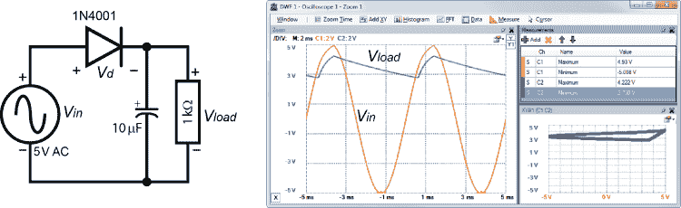

**图 4-11****：** 1N4001 二极管在 5 V 交流电源、1 kΩ 负载和并联 10 μF 电容下的电路与行为

电容使用介电材料（如陶瓷、玻璃、纸或塑料）来绝缘两个带电板。两种常见的电容类型是陶瓷电容和电解电容。陶瓷电容体积小、成本低，但会随时间退化。电解电容可以存储更多能量，但也会随时间退化。玻璃、云母和钽电容通常更可靠，但价格昂贵得多。

图 4-12 展示了一个 100 nF（0.1 μF）的陶瓷电容和一个 47 μF 的电解电容。注意电解电容是有极性的，负极引线在电容表面用带子标记；与 LED 类似，负极引线比正极引线短。

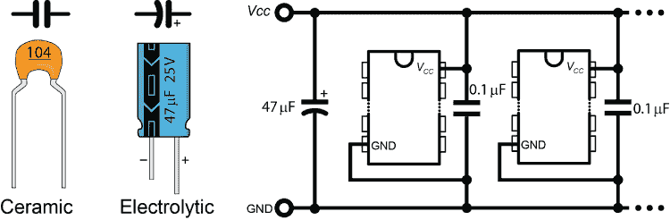

**图 4-12****：** 陶瓷（无极性）和电解（有极性）电容，以及一个示例去耦电路

电容的编号相当直接；不幸的是，在陶瓷电容上，编号可能很小且难以辨认。

*   第一个数字是电容值的第一位数字。
*   第二个数字是电容值的第二位数字。
*   第三个数字是零的个数，电容值单位为 pF（皮法）。
*   附加字母代表电容的容差和额定电压，但暂时可以忽略。

因此，例如：

*   104 = 100000 pF = 100 nF = 0.1 μF
*   102 = 1,000 pF = 1 nF
*   472 = 4,700 pF = 4.7 nF

前面介绍的稳压电路（参见图 4-7）使用了两个电容，通过充放电来抵消电源中的纹波。电容还可用于一种相关功能，称为*去耦*。

耦合通常是电路中两个部分之间因共享电源连接而产生的不良关系。这种关系意味着，如果电路某一部分突然需要高功率，电源电压会略微下降，从而影响电路其他部分的供电电压。集成电路（IC）会在电源线上施加可变负载——实际上，快速变化的负载会导致其他 IC 的电源线上出现高频电压波动。随着电路中 IC 数量的增加，问题会变得更加复杂。

小型电容，称为*去耦电容*，可以作为能量存储元件，消除因 IC 负载变化而可能出现在电源线上的噪声信号。图 4-12 展示了一个示例电路，其中较大的 47 μF 电容滤除较低频率的变化，而 0.1 μF 电容滤除较高频率的噪声。理想情况下，0.1 μF 电容的引线应尽可能短，以避免产生不良效应（与电感相关），从而限制其滤除最高频率的能力。即使是 Beagle 板上用于对 AM335x 的球栅阵列（BGA）引脚进行去耦的表面贴装电容，也会产生约 1–2 nH 的小电感。因此，建议每两个电源球使用一个 0.1 μF 电容，并且走线（板级线路）必须“尽可能短”（Texas Instruments, 2011）。完整指南请参见 [`tiny.cc/beagle402`](http://tiny.cc/beagle402)。

### 晶体管


晶体管是 AM335x 微处理器的核心组成部分之一，实际上几乎所有其他电子系统也是如此。简单来说，它们的功能可以是放大信号，或者根据需要打开或关闭信号。Beagle 板的 GPIO 只能处理较小的电流，因此当我们需要将它们与需要更大电流才能运行的电子电路连接时，就需要借助晶体管。

双极结型晶体管（BJT），通常简称为*晶体管*，是通过在 pn 结二极管上再添加一个掺杂层形成的，构成 p-n-p 或 n-p-n 型晶体管。还有其他类型的晶体管，例如场效应晶体管（FET），稍后会讨论。*双极*这个名称源于电流由电子和空穴共同承载的事实。它们有三个端子，第三个端子连接到夹层结构的中间层，该层非常窄，如图 4-13 所示。

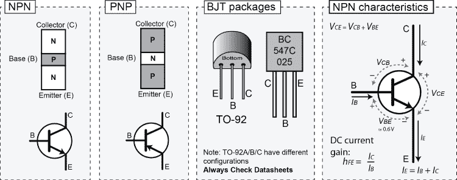

**图 4-13****：** 双极结型晶体管（BJT）

图 4-13 展示了关于晶体管的大量信息，包括各端子的命名：基极（B）、集电极（C）和发射极（E）。尽管 BJT 晶体管主要有两种类型（NPN 和 PNP），但 NPN 晶体管是最常用的。实际上，本章中的所有晶体管示例都使用单一的 BC547 NPN 晶体管类型。

BC547 是一款 45 V、100 mA 的通用晶体管，常见、低成本，并采用带引线的 TO-92 封装。BC547 管脚的识别方法已在图 4-13 中给出，但请注意，这种顺序并非适用于所有晶体管——务必查阅数据手册！BC547 的最大`V[CE]`（也称为`V[CEO]`）为 45 V，最大集电极电流（`I[C]`）为 100 mA。其典型直流电流增益（`h[FE]`）在 180 到 520 之间，具体取决于所使用的分组（例如 A、B、C）。这些特性将在后续章节中解释。

#### *晶体管作为开关*

让我们分析图 4-13（最右侧示意图）中所示的 NPN 晶体管特性。如果基极-发射极结正向偏置，并且有少量电流进入基极（`I[B]`），晶体管的行为是：一个成比例但大得多的电流（）将被允许流入集电极端子，因为对于像 BC547 这样的晶体管，`h[FE]`的值在 180 到 520 之间。由于`I[B]`远小于`I[C]`，你也可以认为`I[E]`近似等于`I[C]`。

图 4-14 展示了 BJT 用作开关的示例。在(a)部分中，电压电平被选择为与 Beagle 板上可用的电压相匹配。基极电阻选择为 2.2 kΩ，以便基极电流较小（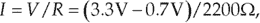，约为 1.2 mA）。集电极电阻较小，因此集电极电流将相当大（）。

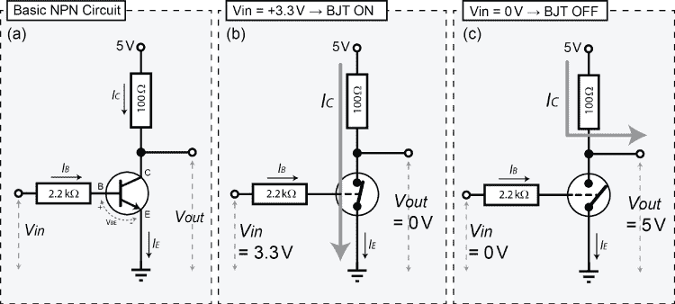

**图 4-14****：** BJT 作为开关

图 4-14(b)展示了当 3.3 V 的输入电压施加到基极端子时发生的情况。较小的基极电流使晶体管表现为集电极与发射极之间的闭合开关（电阻非常低）。这意味着集电极-发射极之间的压降几乎为零，所有电压都降落在 100 Ω的负载电阻上，导致电流通过发射极直接流向地。晶体管处于饱和状态，因为它无法通过更多电流。由于集电极-发射极之间几乎没有压降，输出电压`V[out]`将几乎为 0 V。

图 4-14(c)展示了当输入电压`V[in]` = 0 V 施加到基极端子且没有基极电流时发生的情况。晶体管表现为一个断开开关（电阻非常大）。没有电流能流过集电极-发射极结，因为该电流始终是基极电流的倍数，而基极电流为零；因此，几乎所有电压都降落在集电极-发射极之间。在这种情况下，输出`V[out]`可高达+5 V（不过，正如通过输出端子流过的`I[C]`所示，`V[out]`的确切值取决于`I[C]`的大小，因为任何流过 100 Ω电阻的电流都会在其上产生压降）。

因此，该开关的行为有点像反相器。如果输入电压为 0 V，输出电压为+5 V；如果输入电压为+3.3 V，输出电压将为 0 V。你可以在图 4-15 中看到该电路的实际测量值，此时 3.3 V 的输入电压施加到基极端子。在此情况下，使用 Analog Discovery 波形发生器输出一个 1 kHz 的方波，幅度为 1.65 V，偏移量为+1.65 V（形成 0 V 至 3.3 V 的方波信号），因此它看起来像一个 3.3 V 的电源每秒开启和关闭 1000 次。该图中的所有测量值都是在输入为 3.3 V 时捕获的。基极-发射极结正向偏置，就像之前的二极管一样，其正向电压约为 0.7 V。基极-发射极之间的实际压降为 0.83 V，因此基极电阻上的压降为 2.440 V。实际基极电流为 1.1 mA（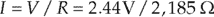）。该电流使晶体管导通，使其进入饱和状态，因此集电极-发射极之间的压降非常小（测量值为 0.2 V）。因此，集电极电流为 49.8 mA（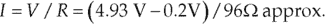）。为了选择合适的基极电阻使 BJT 深度饱和，请使用以下实用公式：

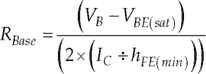 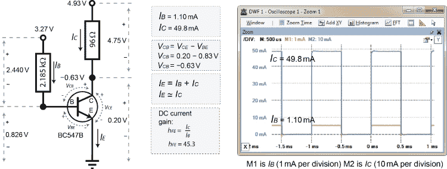

**图 4-15****：** 晶体管作为开关（饱和）的实现，并确认所有关系成立^(1)

对于基极电源为 3.3 V、集电极电流为 50 mA 且最小增益`h[FE(min)]`为 100 的情况，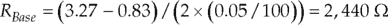。

你可以在晶体管的数据手册中找到所有这些值。`V[BE(sat)]`通常以室温下`V[BE]`与`I[C]`的关系图形式提供，其中我们需要`I[C]`为 50 mA。对于 BC547，`V[BE(sat)]`的值在 0.6 V 到 0.95 V 之间，具体取决于集电极电流和室温。电阻值进一步除以 2，以确保晶体管深度饱和（最大化`I[C]`）。因此，在此情况下使用了 2.2 kΩ电阻，因为它是最接近的常用标称值。


为什么你应该关心比格犬板（Beagle boards）的这个特性？因为这些板子的 GPIO 引脚只能提供或吸收非常小的电流，你可以将 GPIO 引脚连接到晶体管的基极，这样进入基极的小电流就能切换一个更大电流、电压范围更宽的电路。请记住，在图 4-15 的示例中，1.1 mA 的电流能够切换 49.8 mA 的大电流（大了 45 倍，但仍低于 BC547 的 100 mA 限制）。将这种晶体管配置与比格犬板一起使用，通过选择合适的电阻值，可以让 GPIO 输出的 3.3 V、5 mA 电流安全地驱动高达 45 V、100 mA 的电流。

使用晶体管驱动电路的一个限制是它们有最大开关频率。如果你将图 4-16 中电路的输入信号频率提高到 500 kHz，输出会失真，尽管它仍然能从低电平切换到高电平。然而，将频率提高到 1 MHz 意味着受控电路将永远不会关断。

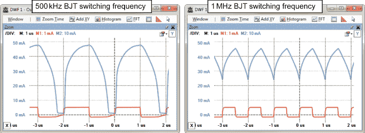

**图 4-16****：** BJT 电路的频率响应（频率为 500 kHz 和 1 MHz）

#### *场效应管作为开关*

使用场效应管（FET）作为开关是比使用 BJT 更简单的替代方案。FET 与 BJT 的不同之处在于，负载电路中的电流是由控制输入端的电压而非电流控制的。因此，FET 被称为电压控制器件，而 BJT 是电流控制器件。FET 的控制输入端称为*栅极*（G），受控电流在漏极（D）和源极（S）之间流动。

图 4-17 说明了如何将 N 沟道 FET 用作开关。与 BJT 不同，控制电路中的电阻（1 MΩ）从输入端连接到 GND，这意味着会有非常小的电流（`I = V/R`）流向 GND，但栅极电压将与 `V[in]` 电压相同。FET 的一个显著优势是几乎没有电流流入栅极控制输入端。然而，栅极上的电压控制着受控电流 `I[D]` 的导通与关断，在本例中该电流从漏极流向源极。


**图 4-17****：** 场效应管作为开关

当输入电压为高电平（3.3 V）时，漏源电流会流动（`I[D]` = 50 mA），因此输出端的电压为 0.17 V；但当输入电压为低电平（0 V）时，没有漏源电流流动。与 BJT 类似，如果你测量漏极端的电压，当输入电压为低时输出电压（`V[out]`）为高，当输入电压为高时输出电压为低，不过“高”输出电压的实际值取决于后续电路所汲取的电流。

飞兆半导体 BS270 N 沟道增强型 FET 是一款低成本器件（约 0.10 美元），采用 TO-92 封装，能够在漏源电压高达 60 V 时提供高达 400 mA 的连续漏极电流（`I[D]`）。然而，在栅极电压（`V[G]`）为 3.3 V 时，BS270 可以切换的最大漏极电流约为 130 mA。这使得它非常适合与比格犬板一起使用，因为 GPIO 电压在范围内，并且导通 FET 所需的电流约为 3 μA–6 μA，具体取决于所选的栅极电阻。使用 FET 作为开关的另一个特点是它能处理更高的开关频率，如图 4-18 所示。请记住，在图 4-16 中，BJT 的开关波形在 1 MHz 时严重失真。从图 4-18 可以清楚地看出，FET 电路能够处理比 BJT 电路高得多的开关频率。


**图 4-18****：** FET 电路的频率响应，开关频率设置为 1 MHz 和 5 MHz

BS270 还带有一个大电流二极管，用于保护栅极免受反向感应电压浪涌的影响，这种浪涌可能在 FET 驱动直流电机时出现。

如前所述，BS270 的一个小缺点是，在栅极电压为 3.3 V 时，它只能切换约 130 mA 的最大漏极电流。然而，栅极的高输入阻抗意味着你可以并联使用两个（甚至更多）BS270，从而在相同栅极电压下将最大电流加倍至约 260 mA。此外，BS270 可用作功率 FET 的栅极驱动器，后者可以切换更大的电流。

### 光耦合器/光隔离器

光耦合器（或光隔离器）是小型、低成本的数字开关器件，用于将两个电路彼此隔离。如果你担心连接电路的设计问题可能从你的板子提供或吸收大电流，那么这对于你的比格犬板电路来说可能很重要。它们以低成本（约 0.15 美元）的四引脚 DIP 封装形式提供。

光耦合器使用一个靠近光电探测器晶体管的 LED 发射器，两者之间由硅胶穹顶内的绝缘薄膜隔开。当电流（`I[f]`）流过 LED 发射器引脚时，从 LED 照射到光电探测器晶体管上的光允许一个独立的电流（`I[c]`）流过光电探测器晶体管的集电极-发射极引脚（参见图 4-19）。当 LED 发射器关闭时，没有光照射到光电探测器晶体管上，因此几乎没有集电极-发射极电流（`I[c]`）。封装的一侧与另一侧之间没有电气连接，因为信号仅通过光传输，对于像 SFH617A 这样的光耦合器，可提供高达 5,300 `V[RMS]` 的电气隔离。你甚至可以将 PWM 与光耦合器一起使用，因为它是一个二进制开/关信号。


**图 4-19****：** 光耦合器（617A）电路及其捕获的输入和输出特性

图 4-19 展示了一个示例光耦合器电路以及针对所选电阻和电压值得到的示波器迹线。这些值的选择与你在比格犬板上可能使用的值一致。选择 470 Ω 的电阻值是为了让 3.3 V 输出能够驱动约 4.5 mA 的正向电流 `I[f]` 通过 LED 发射器。根据数据手册中的图 4，² 这导致二极管两端的正向电压约为 1.15 V； 因此，电路使用最接近的标称值 470 Ω 搭建。


示波器通过使用 Analog Discovery 的差分输入来测量已知电阻两端的电压，并利用两个数学通道除以电阻值，从而显示电流。在图 4-19 中，你可以看到 `I[f]` 为 4.571 mA，`I[c]` 为 2.766 mA。两者差值的比例即为电流传输比（CTR），它随 `I[f]` 的大小和工作温度而变化。因此，在 4.571 mA 时的电流传输比为 60.5%（），这与数据手册一致。上升时间和下降时间也与数据手册中的值一致：`t[r]` = 4.6 µs，`t[f]` = 15 µs。这些值限制了开关频率。此外，如果你的电路需要实现高 CTR，可以使用内置达林顿晶体管配置的光耦，其 CTR 可达 2000%（例如 6N138 或 HCPL2730）。最后，还有高线性度模拟光耦（例如 Avago 的 HCNR200）可用于对模拟信号进行电气隔离。

## 开关与按钮

你可能需要使用的其他元件是开关和按钮。它们有多种形式：拨动开关、按钮开关、选择开关、接近开关、操纵杆、干簧管、压力开关、温度开关等。然而，它们都遵循相同的二进制原理：要么中断电流（断开），要么导通电流（闭合）。图 4-20 展示了几种常见的开关类型，并概述了它们的一般连接方式。


**图 4-20****：** 各种开关及其配置

瞬时按钮开关（SPST——单刀单掷），如图 4-20 所示，要么是常开（NO），要么是常闭（NC）。常开意味着你需要按下开关才能让电流通过，而常闭则意味着当你按下按钮时，电流不会通过。对于图示的特定按钮开关，引脚 1 的两个触点始终相连，引脚 2 的两个触点也始终相连，而在你按下按钮的持续时间内，所有四个引脚都连接在一起。对于滑动开关（SPDT——单刀双掷），公共端（COM）根据滑动位置连接到引脚 1 或引脚 2。对于微动开关和大电流按钮开关，当开关被按下时，COM 引脚连接到 NC；当开关被释放时，COM 引脚连接到 NO。最后，图示的船型开关通常带有一个 LED，当开关闭合时，LED 会点亮，将电源（VCC）引脚连接到电路（CCT）引脚。

所有这些开关类型都存在机械开关抖动问题，当与像 Beagle 板这样的微处理器接口时，这可能会带来极大的麻烦。开关是机械装置，当它们被按下时，接触力会导致开关在接触点反复弹跳。弹跳持续时间很短（通常为毫秒级），但足以让开关向微处理器输入一系列信号。

图 4-21(a) 利用 Analog Discovery 示波器的上升/下降沿触发条件展示了实际中的抖动问题。将一个瞬时按钮开关与一个 10 kΩ 电阻串联在简单电路中，并测量电阻两端的电压。当开关接触时，输出突然变高，但随后开关从接触点弹回，电压再次下降。大约 2 ms–3 ms（或更长时间）后，电压几乎完全稳定。不幸的是，这种微小抖动可能导致数字电路接收到错误的输入。例如，如果阈值为 3 V，则可能被读作 101010101，而不是更正确的 000001111。


**图 4-21****：** (a) 仅使用开关和 10 kΩ 电阻时的开关抖动；(b) 点 *B* 处的低通滤波输出；(c) 施密特触发电路；(d) 施密特触发电路在点 *C* 处的输出，与点 *A* 处的输入对比

在微处理器接口中处理开关抖动有几种方法：

- 可以添加一个由电阻-电容电路构成的低通滤波器，如图 4-21(c) 所示，使用一个 1 μF 电容。不幸的是，这会导致输入延迟。如果检查时间基准，输入达到 1 V 大约需要 2 ms。此外，抖动条件可能会进一步延迟这一过程。这些值是根据 RC 时间常数  选择的，因此  是电容充电至约 63.2% 或放电至约 36.8% 所需的时间。该值在图 4-21(b) 中标记为约 1.9 V。

- 可以编写软件，使得在上升沿发生后延迟几毫秒，然后再读取“真实”状态。

- 对于滑动开关（SPDT），可以使用 SR 锁存器。

- 对于瞬时按钮开关（SPST），可以使用施密特触发器（74HC14N），配合 RC 低通滤波器，如图 4-21(c) 所示，下一节将讨论施密特触发器。

#### 迟滞

迟滞被设计到电子电路中，以避免快速开关，因为快速开关会磨损电路。施密特触发器表现出迟滞特性，这意味着其输出取决于当前输入以及先前输入的历史。这可以用一个在 350 华氏度下烘烤蛋糕的烤箱例子来解释。

- **无迟滞：** 加热元件将烤箱加热到 350°F。一旦达到 350°F，元件就会关闭。烤箱冷却到低于 350°F，元件再次开启。快速开关！

- **有迟滞：** 电路设计为将烤箱加热到 360°F，此时元件关闭。烤箱冷却，但设计为直到温度降至 340°F 时才重新开启。开关不会很频繁，从而保护了烤箱，但烘烤温度的变化会更大。

对于设计有迟滞的烤箱，在 350°F 时元件是*开启*还是*关闭*？这取决于输入的历史——如果烤箱正在加热，则*开启*；如果烤箱正在冷却，则*关闭*。

图 4-21(c) 中的施密特触发器表现出相同类型的行为。M74HC14 施密特触发器的 `V[T+]` 为 2.9 V，`V[T−]` 为 0.93 V（在 5 V 输入下运行），这意味着上升输入电压必须达到 2.9 V 输出才会变为高电平，而下降输入电压必须降至 0.93 V 输出才会变为低电平。在此范围内的任何信号抖动都会被忽略。低通滤波器降低了高频抖动的可能性。响应如图 4-21(d) 所示。注意时间基准为 1 ms/格，展示了输出信号有多么“干净”。该配置使用了一个上拉电阻，其必要性将在稍后讨论。

## 逻辑门


布尔代数函数只有两种可能的结果：真或假，这使得它们非常适合用于构建描述电子电路（开或关，即高电平或低电平）的框架。逻辑门执行这些布尔代数函数和运算，构成了现代微处理器（如 AM335x）内部功能的基础。布尔值与二进制数不同。（二进制数是整数和小数的基 2 表示，而布尔值指的是一种只有两种可能值（真或假）的数据类型。）

通常情况下，你需要使用 Beagle 板的 GPIO 与不同类型的逻辑门和系统进行接口，以执行诸如门控输入或向移位寄存器发送数据等操作。逻辑门主要分为两类：

*   **组合逻辑：** 当前输出仅取决于当前输入（例如，与门、或门、译码器、多路复用器等）。
*   **时序逻辑：** 当前输出取决于当前输入和先前输入。可以说它们具有不同的状态，给定输入的结果取决于它们所处的状态（例如，锁存器、触发器、存储器、计数器等）。

组合逻辑电路对于相同的输入集将提供相同的输出，无论输入应用的顺序如何。图 4-22 展示了核心组合逻辑门及其逻辑符号、真值表和 IC 编号。真值表提供了在应用所列输入时从门获得的输出。


**图 4-22****：** 通用逻辑门

IC 有一个编号，描述其制造商、功能、逻辑系列和封装类型。例如，图 4-23(a)中的 MM74HC08N，其制造商代码为 MM（飞兆半导体），是 7408（四路双输入与门），属于 HC（CMOS）逻辑系列，采用 N（塑料双列直插式封装）形式。


**图 4-23****：** (a) IC 封装示例（按比例），以及(b) JK 触发器

IC 有不同的封装类型。图 4-23(a)按比例展示了 PDIP（塑料双列直插式封装）和一种小外形封装 TSSOP（薄型缩小小外形封装）。有许多类型：表面贴装、扁平封装、小外形封装、芯片级封装和球栅阵列（BGA）。订购 IC 时必须小心，确保你有能力使用它们。DIP/PDIP IC 非常适合在面包板上进行原型设计，因为它们具有 0.1 英寸的引脚间距。有适配板可用于将小外形封装转换为 0.1 英寸引脚间距。不幸的是，BGA IC（如 AM335x SoC 和 OSD3358 SiP）需要复杂的设备进行焊接。

目前可用的 IC 系列通常是晶体管-晶体管逻辑（TTL）（带低功耗肖特基（LS））或某种形式的互补金属氧化物半导体（CMOS）。表 4-1 使用各自的数据手册比较了这两种 7408 IC 系列。*传播延迟*是对于逻辑门的所有可能输入，从输入值变化到输出值变化的最长延迟。该延迟限制了逻辑门的运行速度。

| **特性** | **SN74LS08N** | **SN74HC08N** |
| --- | --- | --- |
| 系列 | 德州仪器 TTL PDIP 低功耗肖特基 (LS) | 德州仪器 CMOS PDIP 高速 CMOS (HC) |
| `V[CC]` 电源电压 | 4.5 V 至 5.5 V（典型值 5 V） | 2 V 至 6 V |
| `V[IH]` 高电平输入电压 | 最小值 2 V | `V[CC]` 为 5 V 时最小值 = 3.5 V |
| `V[IL]` 低电平输入电压 | 最大值 0.8 V | `V[CC]` 为 5 V 时最大值 = 1.5 V |
| 时间传播延迟 (`T[PD]`) | 典型值 12 ns (*↑*) 17.5 ns (*↓*) | 典型值 8 ns (*↑↓*) |
| 功耗（5 V 时） | 5 mW（最大值） | 0.1 mW（最大值） |

**表 4-1****：** 两种市售 TTL 和 CMOS IC（用于 7408 四路双输入与门 IC）的比较

图 4-24 展示了当`V[DD]` = 5 V 时，TTL 和 CMOS 逻辑门可接受的输入和输出电压电平。噪声容限是输出电压电平与输入电压电平之间的绝对差值。该噪声容限确保如果一个逻辑门的输出连接到第二个逻辑门的输入，噪声不会影响输入状态。CMOS 逻辑系列的输入逻辑电平取决于电源电压`V[DD]`，其中高电平阈值为 0.7 × `V[DD]`，低电平阈值为 0.3 × `V[DD]`。从图 4-24 中可以清楚地看出，行为存在差异。例如，如果输入电压为 2.5 V，则 TTL 门会将其感知为逻辑高电平，但 CMOS 门（在 5 V 下）会将其感知为未定义电平。此外，当`V[DD]` = 3.3 V 时，CMOS 门的输出将提供足够的输出电压来触发 TTL 门的逻辑高输入，但无法触发`V[DD]` = 5.0 V 的 CMOS 门。


**图 4-24****：** 逻辑门输入和输出上的门信号电平 (a) TTL，以及 (b) 5 V CMOS

高速 CMOS（HC）可以支持宽范围的电压电平，包括 Beagle 板的 3.3 V 输入/输出。GND 标签通常用于指示接地电源电压，而`V[EE]`常用于基于 BJT 的器件，`V[SS]`用于基于 FET 的器件。传统上，`V[CC]`用作基于 BJT 器件的正电源电压标签，`V[DD]`用于基于 FET 的器件；然而，现在常见的是`V[CC]`同时用于两者。

图 4-23(b) 展示了一个时序逻辑电路，称为*JK 触发器*。JK 触发器是计数器等电路中的核心构建模块。它们与组合逻辑电路的不同之处在于，当前状态取决于当前输入和先前状态。从真值表中可以看出，如果输入为`J = 0`且`K = 0`，则输出`Q[n]`的值将是上一个时间步的输出值（它表现为一位存储器）。时间步由时钟输入（CLK）定义，时钟输入是一个方波同步信号。Beagle 板上也存在相同类型的定时信号——即时钟频率，1 GHz 的时钟每秒经历多达 1,000,000,000 个方波周期！

#### *浮动输入*

使用数字逻辑电路时的一个常见错误是让未使用的逻辑门输入“浮动”或断开连接。芯片系列对此错误的结果有很大影响。对于 TTL 逻辑系列，这些输入将“浮动”为高电平，并且可以合理地预期被视为逻辑高输入。对于 TTL IC，最好将输入“绑定”（即连接）到地或电源电压，以便始终绝对确定输入上断言的逻辑电平。

对于 CMOS 电路，输入对静电和电噪声可能产生的高电压非常敏感，也绝不应让其浮动。图 4-25 给出了一个按图中所示接线的与门可能的输出。正确的结果显示在“所需 (A.B)”列中。


**图 4-25****：** 开关断开时输入意外悬空的与门

未使用的 CMOS 输入如果悬空（介于`V[DD]`与 GND 之间），会因漏电流而逐渐充电，根据 IC 设计的不同，可能导致错误输入或通过产生直流电流（从`V[DD]`流向 GND）而浪费功耗。为解决此问题，可根据所需的输入状态使用上拉或下拉电阻（这些是阻值合适的普通电阻——其作用在于“上拉”或“下拉”），下一节将对此进行说明。

#### *上拉电阻与下拉电阻*

为避免输入悬空，可以使用上拉或下拉电阻，如图 4-26 所示。如果希望开关断开时保证门电路的输入为低电平，则使用下拉电阻；如果希望开关断开时保证输入为高电平，则使用上拉电阻。


**图 4-26****：** 下拉电阻和上拉电阻，用于确保开关不会造成输入悬空

这些电阻很重要，因为当开关闭合时，如果省略电阻而直接用导线连接，开关会形成对地短路。下拉/上拉电阻的阻值也很重要：其值必须足够低，以便在开关断开时可靠地将输入拉低/拉高，但又必须足够高，以防止开关闭合时流过过大电流。理想逻辑门具有无限阻抗，任何电阻值（只要不是无穷大）都可行。然而，实际逻辑门存在漏电流，必须克服这种漏电。为最小化功耗，应选择能实际将输入拉低/拉高的最大阻值。3.3 kΩ–10 kΩ的电阻通常工作良好，但 3.3 V 电压会分别驱动 1 mA–0.33 mA 的电流，并在开关闭合时分别消耗 3.3 mW–1 mW 的功率。对于对功耗敏感的应用，可以测试 50 kΩ或更大的电阻。

Beagle 板具有弱内部上拉和下拉电阻，可用于此目的。这将在第 6 章中讨论。另一个问题是输入对地存在一些杂散电容。在输入端添加电阻会形成一个 RC 低通滤波器，从而延迟输入信号。对于手动按钮来说，这并不重要，因为上述示例中的延迟约为 0.1 µs，但可能会影响数字通信总线线路的速度。

#### *集电极开路与漏极开路输出*

到目前为止，本章中的所有 IC 都具有常规输出，即输出被驱动至接近 GND 或 IC 的电源电压（`V[CC]`）。如果连接到使用相同电压电平的其他 IC 或元件，则没有问题。然而，如果第一个 IC 的电源电压为 3.3 V，而需要驱动输出到电源电压为 5 V 的 IC，则可能需要进行电平转换。

许多 IC 提供集电极开路输出形式，这对于不同逻辑系列之间的接口以及电平转换特别有用。这是因为输出并非处于特定电压电平，而是连接到 IC 内部 NPN 晶体管的基极输入。IC 的输出是晶体管的“开路”集电极，而晶体管的发射极连接到 IC 的 GND。也可以在 IC 内部使用 FET（74HC03）代替 BJT（74LS01），虽然概念相同，但称为*漏极开路输出*。图 4-27 说明了这一概念，并给出了一个使用 74HC03（四路双输入漏极开路与非门）驱动 5 V 电路的示例电路。漏极开路配置的优势在于 CMOS IC 支持 Beagle 板 GPIO 上可用的 3.3 V 电平。本质上，图 4-17 中使用的漏极电阻被放置在 IC 封装外部，如图 4-27 所示，本例中其阻值为 10 kΩ。


**图 4-27****：** 漏极开路电平转换示例

有趣的是，将一个输入端接高电平（或将两个输入端短接）的与非门行为类似于非门。事实上，与非门或或非门各自都能复制任何逻辑门的功能，因此它们被称为*通用门*。

集电极开路输出常用于将多个设备连接到总线上。在第 8 章描述 Beagle 板的 I²C 总线时，你将看到这一点。当查看 IC（如 74HC03）数据手册中的真值表时，你会看到字母`Z`用于表示输出（如图 4-27 所示）。这意味着它是高阻抗输出，外部上拉电阻可以将输出拉至高电平。

#### *门电路互连*

为了创建有用的电路，逻辑门需要与其他逻辑门和元件互连。理解门电路的互连能力存在限制非常重要。

第一个限制是逻辑门提供或吸收电流的能力。当门电路输出为逻辑高电平时，它充当电流源，为相连的逻辑门或图 4-26 中所示的 LED 提供电流。如果门电路输出为逻辑低电平，则门电路充当电流吸收器，电流流入输出端。图 4-28(a)通过在`V[CC]`与逻辑门输出之间放置一个限流电阻和一个 LED（LED 阴极连接到逻辑门输出）来演示这一点。当门电路输出为高电平时，没有电位差，LED 熄灭；但当输出为低电平时，产生电位差，电流流过 LED 并被逻辑门输出吸收。根据 74HC08 的数据手册，其输出电流限制（`I[O]`）为±25 mA，意味着它可以提供或吸收 25 mA 的电流。超过这些值会损坏 IC。


**图 4-28****：** (a) 输出端吸收电流，(b) TTL 扇出示例


通常需要将单个（驱动）门的输出连接到多个其他门的输入。每个被连接的门都会消耗电流，从而限制了可连接门的总数。扇出是指连接到驱动门输出的门数量。如图 4-28(b)所示，对于 TTL 电路，最大扇出取决于输出（`I[O]`）和输入电流（`I[I]`）在低电平状态（`I[OL(max)]/I[IL(max)]`）和高电平状态（`I[OH(max)]/I[IH(max)]`）下的需求值。取两者中较小的值，通常为 10 或更大。集成电路的扇入是指其输入端的数量。对于 7408 芯片，它是二输入与门，因此扇入为 2。

CMOS 门电路的输入电阻极大，几乎不消耗电流，因此具有较大的扇出能力（>50）；然而，每个输入都会增加一个小电容（`C[L]` ≈ 3–10 pF），需要由前一级的输出进行充放电。扇出越大，驱动门上的容性负载就越大，从而延长传播延迟。例如，74HC08 的传播延迟（`t[pd]`）约为 11 ns，输入电容（`C[I]`）为 3.5 pF（本例假设每个连接导致`t[pd] = RC =` 3.5 ns 的延迟）。如果一个 78HC08 驱动 10 个其他类似的门，每个门增加 3.5 ns 的延迟，那么传播延迟将增加到 ns，最大工作频率从 91 MHz 降至 22 MHz。

## 模数转换

Beagle 板具有多个模数转换器（ADC）输入，可用于接收模拟信号并生成该信号的数字表示。这使我们能够连接多种不同类型的传感器，例如距离传感器、温度传感器、光照传感器等。但是，使用这些输入时必须小心，因为它们不应提供或吸收电流，因为传感器的模拟输出可能对输出端并联的任何额外负载非常敏感。要解决这个问题，首先需要了解运算放大器的工作原理。

模拟信号是连续信号，代表对某种物理现象的测量。例如，麦克风是一种模拟设备，通常称为换能器，可将声波转换为电信号，该信号根据声波幅度在−5 V 到+5 V 之间变化。模拟信号使用连续的值范围来表示信息，但如果想用 Beagle 板处理该信号，则需要信号的离散数字表示。这种表示在离散时间点进行采样，随后量化为离散的电压或电流值。例如，音频信号随时间变化；因此，为了对换能器信号进行采样以数字方式捕获人类语音（例如语音识别），需要注意两个因素：

*   **采样率：** 定义对信号进行采样的频率。显然，如果每隔一秒采样一次电压来创建离散数字样本，语音将无法辨认。

*   **采样分辨率：** 定义在信号采样时刻用于表示电压的数字表示的数量。显然，如果只有一位，则只能捕获信号是更接近+5 V 还是−5 V，同样语音信号将无法辨认。

### 采样率

用离散形式完美表示连续信号需要无限量的数字数据。幸运的是，人类听觉的性能有限，因此我们可以限制需要离散化的数据量。例如，44.1 kHz 和 48 kHz 是编码 MP3 文件时常用的数字音频采样率，这意味着如果使用前者，每秒需要存储 44,100 个换能器电压样本。采样率通常由保留信号特定频率内容的需求决定。例如，人类（尤其是儿童）可以听到频率约为 20 Hz 至 20 kHz 的音频信号。奈奎斯特采样定理指出，采样频率必须至少是信号中最高频率分量的两倍。因此，如果要对音频信号进行采样，需要使用至少两倍于 20 kHz 的采样率，即 40 kHz，这有助于解释 MP3 音频文件编码中使用的采样率大小（通常为每秒 44,100 个样本，即 44.1 kS/s）。

### 量化

Beagle 板具有多个 12 位 ADC 输入，工作范围为 0–1.8 V，这意味着该采样分辨率有 2¹² = 4,096 种可能的离散表示（数字）。如果电压恰好为 0 V，可以用十进制数 0 表示。如果电压恰好为 1.8 V，可以用数字 4,095 表示。那么，十进制数 1 代表多少电压？它是。因此，0 到 4,095（共 4,096 个值）之间的每个十进制数代表约 0.44 mV 的步进。

前面的音频采样示例也说明了 Beagle 板配置面临的一个挑战。如果传感器输出电压为−5 到+5 V，或者更常见的 0 V 到+5 V，则需要将该范围调整为 0 到 1.8 V，以与 ADC 兼容。在第 6 章中，将探讨如何解决这个问题。第二个更复杂的问题是，我们不能从 Beagle 板的 ADC 电路提供或吸收电流，为了解决这个问题，需要引入一个早于数字计算机的强大概念，称为*运算放大器*。

### 运算放大器

运算放大器（op-amp）由单个 IC（例如 LM741）内的多个 BJT 或 FET 组成。它们可用于创建多种有用的电路，其中一种将在第 9 章中用于正确连接模拟传感器。

#### *理想运算放大器*

图 4-29(a)展示了一个理想运算放大器，置于无反馈（即开环）的基本电路中。运算放大器有两个输入端，同相输入端（+）和*反相*输入端（−），其输出与两者之差成正比，即`V[out] = G(V[1] − V[2])`，其中`V[1]`和`V[2]`分别是这两个输入端的电压电平。理想运算放大器的一些特性包括：

*   无限的开环增益`G`

*   无限的输入阻抗

*   零输出阻抗


**图 4-29****：** (a) 理想运算放大器，以及 (b) 开环比较器示例


没有实际运算放大器具有无限的开环增益，但电压增益在 200,000 到 30,000,000 之间很常见。这样的增益可视为无穷大，这意味着理论上，即使输入端之间存在微小差异，也会导致完全不切实际的输出。例如，`V[1]` 和 `V[2]` 之间 1 V 的差异将导致至少 200,000 V 的电压输出！如果真是这样，我现在就得对运算放大器的使用发出健康警告了！输出电压当然受电源电压限制（图 4-29(a) 中的 `V[CC+]` 和 `V[CC−]`）。因此，如果你使用 Beagle 板为运算放大器提供 `V[CC+]` = +5 V 和 `V[CC−]` = 0 V（GND），实际的最大输出大约在 0 V 到 5 V 范围内，具体取决于所使用的运算放大器。同样，实际运算放大器没有无限输入阻抗，但其范围在 250 kΩ 到 2 MΩ 之间。这里使用术语 *阻抗* 而非 *电阻*，因为输入可能是交流而非仅直流电源。同样，零输出阻抗也是不可能的，但很可能 <100 Ω。

LM358 双运算放大器用于以下电路配置（[`www.ti.com/product/lm358`](http://www.ti.com/product/lm358)）。它是一个八引脚 PDIP 封装的 IC，包含两个运算放大器，典型开环差分电压增益为 100 dB，即电压增益为 100,000（`电压增益（dB）= 20 × log (V[out]/V[in])`）。该 IC 的一个优点是电源范围宽，在 3 V 到 32 V 之间，这意味着你可以使用 Beagle 板的 3.3 V 或 5 V 电源轨。LM358 在输出端通常可提供高达 30 mA 的电流或吸收高达 20 mA 的电流。

开环运算放大器的行为最好通过一个示例来解释，如图 4-29(b) 所示。注意，在这种情况下，输入连接到运算放大器的反相输入端（`−ve`），而非同相输入端（`+ve`），这意味着当 `V[in]` 低于参考电压时，`V[out]` 将为正。该电路使用 LM358 构建，电源为 `V[CC+]` = 5 V 和 `V[CC−]` = 0 V（GND）。使用一个 100 kΩ 电位器来改变 `+ve` 输入端的电压。这个电压正是我们实际与输入电压进行比较的电压，因此该电路被称为 *比较器*。当 `−ve` 输入端的电压大于 `+ve` 输入端（即使只大一点点）时，输出将迅速向负方向饱和至 0 V。当 `−ve` 输入端的电压小于 `+ve` 输入端的电压时，输出 `V[out]` 将立即向 `+ve` 方向饱和，达到该配置下由所施加的 `V[CC]` 值允许的最大值。

该电路的实际输出如图 4-30(a) 所示。在此视图中，电位器被调节为在 `V+` 输入端提供 1.116 V 的电压。当 `V−` 低于该值时，输出 `V[out]` 饱和至最大正值。在本例中，该值为 3.816 V（LM358 正饱和电压）。当 `V−` 大于 1.116 V 时，输出 `V[out]` 饱和至最低值，几乎为零（−2 mV）。注意这里发生的反相。


**图 4-30****：** 比较器电路的输出

如果一切保持不变，但电位器被调节为给 `V+` 提供不同的值（本例中为 0.645 V），则输出将如图 4-30(b) 所示，其中输出 `V[out]` 的占空比将不同。该比较器电路还可用于检测低电压情况——例如，如果电池的电压输出低于某个值，则点亮一个警告 LED。图 4-29(b) 中使用的电路示例可用于根据控制电压 `V+` 生成具有可控占空比的 PWM 信号。

大的开环增益意味着运算放大器通常与反馈一起使用，反馈被引向运算放大器的负或正输入端。这种反馈为运算放大器开辟了极其广泛的其他应用。

#### *负反馈与电压跟随器*

当将运算放大器的输出（`V[out]`）连接回反相输入端（`V−`）时，就形成了负反馈。当你向同相输入端（`V+`）施加一个电压（`V[in]`）并缓慢增加时，随着 `V[in]` 的增加，`V+` 和 `V−` 之间的差值也会增加；然而，输出电压也会根据 `G(V[1] − V[2])` 增加，并且这会反馈到 `V−` 输入端，导致输出电压 `V[out]` 降低。本质上，运算放大器通过调整输出来试图使反相（`V−`）输入端的电压与同相（`V+`）输入端的电压相同。这一作用的影响是，`V[out]` 的值被稳定为与 `V+` 上的 `V[in]` 电压相同；运算放大器的增益越高，这个差值就越接近零。

这种作用本身对我们来说并不是很有用，除了设置输入电压所需的电流很小，而运算放大器可以在输出侧控制大得多的电流。由于负反馈使输出电压与输入电压相同，因此整个配置的增益为 1。这种配置被称为 *电压跟随器* 或 *单位增益缓冲器*，如图 4-31 所示。这种配置很重要，因为它用于第 6 章 来保护 Beagle 板中的 ADC 电路，并且还用于确保 ADC 参考电压不会因连接到电路而改变。


**图 4-31****：** 电压跟随器运算放大器电路

#### *正反馈*

负反馈是与运算放大器一起使用的最常见反馈类型，因为它具有稳定作用。正反馈配置的运算放大器是指输出返回到运算放大器的正同相输入端。在这种情况下，反馈信号支持输入信号。例如，通过将 `V[out]` 通过一个正反馈电阻连接到 `V+`，正反馈可用于为开环运算放大器比较器电路增加迟滞。这可用于减少比较器对输入信号噪声的响应。

## 总结建议

本章涵盖了大量内容。最后，这里有一些关于使用电子元件和 Beagle 板的一般性建议：

*   切勿让输入端悬空。在所有开关上使用上拉/下拉电阻。检查未使用的 IC 引脚是否需要接高/接低。

*   确保电路中所有 GND 都已连接。

*   记住以正确的电压水平为芯片供电。

*   不要假设新的二极管、FET、BJT 或逻辑门具有与之前使用的元件相同的引脚布局。

*   就像编程一样，先构建一个简单电路，进行测试，然后再增加下一层复杂性。永远不要假设某个东西能工作！

*   不要让导线接头和鳄鱼夹连接处悬空，以免它们相互接触——面包板上的电阻也是如此。

*   使用平头螺丝刀从面包板上取下 IC，因为很容易将 IC 引脚弯曲到无法修复。

*   CMOS IC 对静电敏感，因此用手指触摸可能会因身体上积累的静电而损坏它们。在触摸 IC 之前，先触摸电脑背面或某个接地的金属物体。


*   不要假设元件具有精确或一致的值——特别是晶体管的增益和电阻器的阻值范围。

## 总结

完成本章后，你应该能够做到以下几点：

*   描述电路运行的基本原理，在面包板上搭建电路，并测量电压和电流值
*   在自己的电路设计中使用分立元件，如二极管、LED、晶体管和电容器
*   使用晶体管和场效应管作为开关，控制比单独使用 Beagle 板输出所能处理的更高电流和电压信号
*   互连并连接逻辑门，特别注意“悬空”输入引发的问题
*   描述模数转换的原理，并设计基本的运算放大器电路
*   综合运用所有这些技能，构建对安全连接 Beagle 板 GPIO 至关重要的电路类型

## 延伸阅读

本章已列出供进一步阅读的文档和链接，但这里还有一些额外的参考资料：

*   T. R. Kuphaldt，《电路教程》，一套关于电学和电子学的免费系列教材：[`www.ibiblio.org/kuphaldt/electricCircuits/`](http://www.ibiblio.org/kuphaldt/electricCircuits/)
*   All About Circuits：[`www.allaboutcircuits.com`](http://www.allaboutcircuits.com) 提供了多种电子电路的优秀应用实例
*   Electronics Club：[`www.electronicsclub.info`](http://www.electronicsclub.info) 为初学者和参考提供电子项目
*   Neil Storey，《电子学：系统方法》，第 5 版，纽约：Pearson，2013 年

以下是本章使用的全部元件清单：

*   面包板
*   二极管：1N4001，通用 LED
*   晶体管：NPN：BC547，场效应管：BS270
*   稳压器：KA7805/LM7805
*   PTC：60R110
*   按钮和开关：通用单刀单掷和单刀双掷
*   集成电路：74HC73N、74HC03N、74LS08N、74HC08N、74HC14、LM358N
*   电阻器：1 MΩ、2.2 kΩ、2×10 kΩ、50 kΩ、100 Ω、50 Ω、1 kΩ、470 Ω、220 Ω、100 kΩ 电位器
*   电容器：10 μF、1 μF、0.33 μF、0.1 μF
*   光耦：SFH617A

## 注意

# 第 5 章

实用的 Beagle 板编程

本章介绍 Beagle 板的几种不同编程选项，包括脚本语言和编译语言。所有语言均提供了一个 LED 闪烁示例，以便你研究每种语言的结构和语法。同时讨论了每种语言的优缺点并给出了使用示例。随后，本章重点介绍 C/C++ 编程语言，阐述其原理以及为什么面向对象编程（OOP）对于开发可扩展的嵌入式系统应用是合适且必要的。最后，本章详细说明了如何通过 GNU C 库直接与 Linux 内核交互。由于一章只能触及该主题的表面，因此本章重点放在物理编程任务上，这些任务将在本书后续部分中反复用到。

本章所需设备：

*   带有终端连接的 Beagle 板（参见第 2 章）
*   桌面 Linux 安装（例如，虚拟机中的 Debian——参见第 3 章）

## 引言

如第 3 章所述，嵌入式 Linux 本质上就是“嵌入式系统上的 Linux”。如果你喜欢的编程语言在 Linux 下可用，那么它很可能也适用于 Beagle 板。那么，你喜欢的语言是否适合为你的板子编程？这取决于你打算用板子做什么。你是要连接电子设备/模块吗？你计划编写丰富的用户界面吗？你打算为 Linux 编写设备驱动程序吗？性能是否重要，还是你正在开发早期的预原型？这些问题的答案都会影响你选择哪种语言。在本章中，你将了解几种不同的语言，并概述每类语言的优缺点。阅读本章时，尽量不要只关注自己喜欢的语言，而是根据手头的任务选择正确的语言。

嵌入式系统编程与桌面计算机编程相比如何？以下是一些需要考虑的要点：

*   你应该始终编写最清晰、最简洁且尽可能易于维护的代码，就像在桌面 PC 上一样。
*   在确定代码完整之前，不要进行优化。
*   与在桌面计算机上编程相比，你通常需要更加注意资源的消耗方式。数据类型的大小很重要，正确传递数据也至关重要。你需要关注内存可用性、文件系统大小以及数据通信的可用性/带宽。
*   你通常需要了解底层硬件平台。它如何处理连接的硬件？有哪些数据总线可用？如何与操作系统和底层库交互？是否存在实时约束？

在接下来的讨论中，假设你计划进行某种物理计算——即连接板上的不同输入或输出。因此，用于描述不同语言结构和语法的示例是一个简单的接口示例。在介绍语言本身之前，我们首先对 Beagle 平台上运行的不同语言进行简要的性能评估，以便将后续讨论置于上下文中。

### 不同语言的性能

哪种语言在 Beagle 平台上最好？嗯，这是一个非常情绪化且难以回答的问题。不同的语言在不同的基准测试和不同任务上表现更好。此外，用特定语言编写的程序可以针对该语言进行优化，以至于几乎无法辨认出原始代码。执行速度也并非总是重要因素；你可能更关心内存使用、代码的可移植性或快速应用更改的能力。

然而，如果你计划开发高速或实时的数值计算应用，那么性能可能是你选择编程语言的关键因素。此外，如果你打算学习一门新语言，并且未来可能开发算法密集型程序，那么牢记性能可能会很有用。

我们设置了一个简单的测试，以确定本章讨论的语言的 CPU 性能。该测试使用了来自 [`benchmarksgame.alioth.debian.org`](http://benchmarksgame.alioth.debian.org) 的 *n*-体基准测试（太阳系行星的引力相互作用）代码。所有语言使用相同的算法，并且板子在所有情况下都处于相同状态。测试使用 500 万次迭代，以确保用于计时的脚本不需要高度精确。所有程序都给出了相同正确的结果，表明它们都正确运行并完成。该测试位于本书 Git 仓库的 `chp05/performance/` 目录中。请注意，你必须在板子上安装 Java 和其他语言才能运行所有测试。使用以下命令执行测试：

```
/chp05/performance$ ./run
Running the Tests:
The C/C++ Code Example
-0.169075164  -0.169083134
It took 34 seconds to run the C/C++ test …
Finished Running the Benchmarks 
```


测试结果显示在表 5-1 中。第一列展示了 PocketBeagle 在其最高处理器频率 1 GHz 下运行的结果。对于这个数值密集型应用，通用语言 C++在 34 秒内完成了任务。这个时间被加权为 1 个单位。因此，Java 完成相同任务所需时间是 C++的 1.15 倍，高度优化的 Rust 比 C++更快，Node.js（用于 BoneScript）是 1.24 倍，Perl 是 26.8 倍，Python 是 57 倍。括号内给出了以秒为单位的处理时长。当你横向查看各列时，可以看到这种性能表现相对一致，即使调整了处理器频率（将在下一节讨论）或使用了桌面级 i7 64 位处理器也是如此。

| **值** | **类型** | **POCKETBEAGLE¹ 在 1 GHZ** | **POCKETBEAGLE 在 600  MHZ** | **INTEL 64 位 I7 DEBIAN PC²** |
| --- | --- | --- | --- | --- |
| C++³ | 编译型 | 1.00× (34 s) | 1.00× (57 s) | 1.00× (0.641 s) |
| C (gcc) | 编译型 | 0.95× (32 s) | 0.96× (55 s) | 0.97× (0.623s) |
| Rust⁴ | 编译型 | 0.85× (29 s) | 0.86× (49 s) | 0.66× (0.425 s) |
| C++14 | 编译型 | 1.06× (36 s) | 1.07× (61 s) | 0.95× (0.608 s) |
| Haskell⁵ | 编译型 | 1.06× (36 s) | 1.05× (60 s) | 1.78× (1.141 s) |
| Java⁶ | JIT | 1.15× (39 s) | 1.16× (66 s) | 1.28× (0.818 s) |
| Node.js⁷ | JIT | 1.24× (42 s) | 1.30× (74 s) | 1.67× (1.071 s) |
| Mono C# | JIT | 1.50× (51 s) | 1.53× (87.4 s) | 2.13× (1.363 s) |
| Cython⁸ | 编译型 | 1.97× (67 s) | 1.96× (112 s) | 1.19× (0.765 s) |
| Lua⁹ | 解释型 | 6.41× (218 s) | 6.31× (360 s) | 28.6× (18.304 s) |
| Cython | 编译型 | 22.0× (751 s) | 22.1× (1262 s) | 55.8× (35.742 s) |
| Perl | 解释型 | 26.8× (910 s) | 20.3× (1156 s) | 59.6× (38.214 s) |
| Ruby¹⁰ | 解释型 | 34.2× (1162 s) | 31.0× (1770 s) | 46.0× (29.454 s) |
| Python | 解释型 | 57.0× (1937 s) | 58.2× (3318 s) | 98.3× (63.032 s) |

**表 5-1****：** 在[BeagleBoard.org](http://BeagleBoard.org) Debian Stretch 硬浮点镜像上，对*n*体算法进行 5,000,000 次迭代的数值计算时间

表 5-1 中的第二列指明了语言类型，其中*编译型*指原生编译语言，*JIT*指即时编译语言，*解释型*指由解释器执行的代码。这些语言类型的区别将在本章中详细描述，并不像表中呈现的那样泾渭分明。

所有程序在执行期间都使用了 98%到 99%的 CPU。Java、Node.js 和 Mono C#的相对性能令人印象深刻，因为它们的代码是动态编译（“即时编译”）的，这将在本章后面讨论。任何动态编译的延迟都已包含在计时中，因为测试脚本包含了以下 Bash 脚本代码来计算每个程序的执行时长：

```
Duration="5000000"
echo -e "\nC++代码示例"
T="$(date +%s%N)"
./n-body $Duration
T="$(($(date +%s%N)-T))"
T=$((T/1000000))
echo "运行 C++测试耗时 ${T} 毫秒" 
```

C++14 代码是 2014 年发布的 C++编程语言版本（需要 gcc 5+才能完全支持）。这将在本章后面再次讨论。该程序包含针对此 C++版本的优化，有趣的是，虽然此版本在桌面计算机上表现更好，但在 PocketBeagle 上却略逊一筹。Java 程序使用了`+AggressiveOpts`标志来启用性能优化，之所以使用它，是因为它不需要修改源代码。

Python 的结果特别差，这是由该问题的算法性质决定的。然而，基准测试（[`benchmarksgame.alioth.debian.org`](http://benchmarksgame.alioth.debian.org)）表明，对于从一般处理到算法密集型代码，其速度范围比优化后的 C++代码慢 9 到 100 倍。如果你熟悉 Python 并希望提高其性能，可以研究*Cython*，这是一个 Python 编译器，它会自动移除动态类型功能，并允许你直接从 Python 代码生成 C 代码。Cython 以及使用 C/C++扩展 Python 的内容将在本章末尾讨论。

最后一列提供了相同代码在桌面计算机虚拟机上运行的结果。你可以看到，各应用程序的相对性能大致一致，但也要注意，C++程序在单个 i7 线程上的运行速度比在 1 GHz 的 PocketBeagle 上快 40 倍。我希望这能帮助你设定对标准 Beagle 板所能实现的数值处理类型的预期，尤其是在研究信号处理和计算机视觉等计算密集型应用时。

如前所述，这只是一个面向数值的基准测试，但它在一定程度上表明了每种语言应有的性能表现。关于语言性能的研究有很多；然而，Hundt（2011）的一项详细分析发现，在性能方面，“C++以很大优势胜出。但它也需要最广泛的调优工作，其中许多调优的复杂程度是普通程序员无法企及的。”

### 设置 CPU 频率

在上一节中，Beagle 板的时钟频率在运行时被动态调整。[BeagleBoard.org](http://BeagleBoard.org) Debian 镜像提供了多种*调控器*，可用于分析性能/功耗比。例如，如果你正在构建一个处理需求较低的电池供电 PocketBeagle 应用，可以降低时钟频率以节省电量。你可以通过输入以下命令来了解板的当前状态：

```
debian@ebb:~$ sudo apt install cpufrequtils
debian@ebb:~$ cpufreq-info
…  
可用的 cpufreq 调控器：conservative, ondemand, userspace, 
powersave, performance, schedutil
 当前策略：频率应在 300 MHz 到 1000 MHz 之间。
                  调控器"performance"可决定在此范围内使用哪个速度。
  当前 CPU 频率为 1000 MHz。
  cpufreq 统计：300 MHz:0.00%, 600 MHz:0.00%, 720 MHz:0.00%, 
  800 MHz:0.00%, 1000 MHz:100.00% 
```

你可以看到不同的调控器可用，其配置文件名称分别为`conservative`、`ondemand`、`userspace`、`powersave`、`performance`和`schedutil`。要启用其中一个调控器，请输入以下命令：

```
debian@ebb:~$ sudo cpufreq-set -g ondemand
debian@ebb:~$ cpufreq-info
… 调控器"ondemand"可决定在此范围内使用哪个速度。
debian@ebb:~$ sudo cpufreq-set -f 600MHz
debian@ebb:~$ cpufreq-info
… 当前 CPU 频率为 600 MHz。 
```

`ondemand`很有用，因为它能动态切换 CPU 频率。例如，如果当前 CPU 频率为 600 MHz，且调控器采样之间的平均 CPU 使用率高于阈值（称为`up_threshold`），则 CPU 频率将自动提高。你可以通过它们的 sysfs 条目来调整这些设置及其他设置。例如，要将 CPU 频率上升的阈值设置为 CPU 负载达到可用容量的 90%，请使用以下命令：


```
debian@ebb:~$ sudo cpufreq-set -g ondemand
debian@ebb:~$ cd /sys/devices/system/cpu/cpufreq/ondemand/
debian@ebb:/sys/devices/system/cpu/cpufreq/ondemand$ ls
ignore_nice_load  min_sampling_rate  sampling_down_factor  up_threshold
io_is_busy        powersave_bias     sampling_rate
debian@ebb: … /ondemand$ cat up_threshold
95
debian@ebb: … /ondemand$ sudo sh -c "echo 90 > up_threshold"
debian@ebb: … /ondemand$ cat up_threshold
90 
```

如果你的板子上没有安装这些工具，你必须安装 `cpufrequtils` 包。在 Debian Stretch 上，默认的调控器是 `performance`，但你可以通过编辑 `/etc/init.d/` 中的 `cpufrequtils` 文件切换到 `ondemand`，如下所示：

```
debian@ebb:~$ cd /etc/init.d
debian@ebb:/etc/init.d$ more cpufrequtils | grep GOVERNOR=
GOVERNOR="performance"
debian@ebb:/etc/init.d$ sudo nano cpufrequtils
debian@ebb:/etc/init.d$ more cpufrequtils | grep GOVERNOR=
GOVERNOR="ondemand"
debian@ebb:/etc/init.d$ sudo reboot 
```

## 脚本语言

脚本语言是一种计算机编程语言，用于指定脚本文件，这些文件由运行时环境*直接解释*以执行任务。有许多可用的脚本语言，例如 Bash、Perl、Lua 和 Python，它们可用于自动化 Beagle 板上的任务执行，例如系统管理、交互，甚至与电子元件的接口。

### 脚本语言选项

你应该为 Beagle 板选择哪种脚本语言？有很多强烈的意见，这是一个困难的话题，因为 Linux 用户往往有自己偏爱的脚本语言；然而，你应该选择功能适合当前任务的脚本语言。以下是一些示例：

*   **Bash 脚本：** 对于不需要高级编程结构的短脚本来说，这是一个很好的选择。本书中广泛使用 Bash 脚本来处理小型、定义明确的任务，例如上一节中的定时代码。你可以在 Bash 脚本中使用第 3 章中讨论的 Linux 命令。

*   **Perl：** 对于解析文本文档或处理数据流的脚本来说，这是一个很好的选择。它使你能够编写直接的脚本，甚至支持面向对象编程（OOP）范式，这将在本章后面讨论。

*   **Lua：** 是一种快速且轻量级的脚本语言，由于其占用空间小，可用于嵌入式应用。*Lua* 支持面向对象编程（OOP）范式（使用表和函数）和动态类型，这将在稍后讨论。Lua 在第 12 章中对 NodeMCU Wi-Fi 模块的编程起着重要作用。

*   **Python：** 非常适合需要更复杂结构且可能在未来被构建或修改的脚本。Python 支持 OOP 范式和动态类型，这将在稍后讨论。

这四种脚本语言可用于 Beagle 标准 Debian 镜像。了解所有这些脚本语言会很有用，因为你可能会发现第三方工具或库使当前项目变得简单。本节简要概述了每种语言，包括一段简洁的代码，这些代码在每种语言中执行类似的功能。最后，讨论了一般脚本语言的优缺点。

在第 2 章中，描述了一种使用 Linux shell 命令更改板载 LED 状态的方法。可以打开或关闭 LED，甚至使其闪烁。例如，你可以使用以下命令：

```
root@ebb:/sys/class/leds/beaglebone:green:usr3# echo none > trigger
root@ebb:/sys/class/leds/beaglebone:green:usr3# echo 1 > brightness
root@ebb:/sys/class/leds/beaglebone:green:usr3# echo 0 > brightness 
```

来打开和关闭用户 LED。本节将研究如何以结构化的编程形式完成相同的任务。

### Bash

Bash 脚本非常适合不需要高级编程结构的短脚本，而这正是这里要开发的应用程序。第一个程序利用 Linux 控制台命令（如 `echo` 和 `cat`）创建了清单 5-1 中的简洁脚本，该脚本允许你通过命令行参数选择是打开、关闭 USR3 LED 还是将其置于闪烁模式。例如，通过调用 `./bashLED on` 使用此脚本将打开 USR3 LED。它还为你提供触发状态信息。

```
#!/bin/bash
LED3_PATH=/sys/class/leds/beaglebone:green:usr3

function removeTrigger 
{
  echo "none" >> "$LED3_PATH/trigger"
}

echo "Starting the LED Bash Script"
if [ $# != 1 ]; then
  echo "There is an incorrect number of arguments. Usage is:"
  echo -e " bashLED Command \n  where command is one of "
  echo -e "   on, off, flash or status  \n e.g. bashLED on "
  exit 2
fi
echo "The LED Command that was passed is: $1"
if [ "$1" == "on" ]; then
  echo "Turning the LED on"
  removeTrigger
  echo "1" >> "$LED3_PATH/brightness"
elif [ "$1" == "off" ]; then
  echo "Turning the LED off"
  removeTrigger
  echo "0" >> "$LED3_PATH/brightness"
elif [ "$1" == "flash" ]; then
  echo "Flashing the LED"
  removeTrigger
  echo "timer" >> "$LED3_PATH/trigger"
  echo "50" >> "$LED3_PATH/delay_on"
  echo "50" >> "$LED3_PATH/delay_off"
elif [ "$1" == "status" ]; then
  cat "$LED3_PATH/trigger";
fi
echo "End of the LED Bash Script" 
```

**清单 5-1:** chp05/bashLED/bashLED

该脚本位于目录 `/chp05/bashLED/` 中。如果你使用 `nano` 编辑器手动输入了脚本，那么该文件需要设置可执行标志才能执行（git 仓库保留可执行标志）。因此，要允许所有用户执行此脚本，请使用以下命令：

```
/chp05/bashLED$ chmod ugo+x bashLED 
```

这个脚本内部发生了什么？首先，所有这些命令脚本都以一个 *sha-bang* `#!` 开头，后跟要使用的解释器的名称和位置，因此这里是 `#!/bin/bash`。该文件只是一个普通的文本文件，但 sha-bang 是一个*魔数*代码，用于通知操作系统该文件是可执行文件。接下来，脚本使用变量 `LED3_PATH` 定义了要更改状态的 LED 的路径。如果你想使用不同的用户 LED 或路径，可以轻松更改默认值。

该脚本包含一个名为 `removeTrigger` 的函数，主要是为了演示 Bash 脚本中函数的结构。该函数在脚本后面被调用。每个 `if` 都以 `fi` 结束。`if` 语句后的 `;` 终止该语句，并允许将 `then` 放在同一行。`elif` 关键字表示 `else if`，允许你在一个 `if` 块中进行多个比较。换行符 `\n` 终止语句。

第一个 `if` 语句确认传递给脚本的参数数量（`$#`）不等于 `1`。请记住，调用此脚本的正确形式是 `./bashLED on`。因此，`on` 将是传递的第一个用户参数（`$1`），并且总共有一个参数。如果没有参数，将显示正确的用法，并且脚本将以返回码 `2` 退出。该值与 Linux 系统命令一致，其中退出值 2 表示用法不正确。成功由返回值 `0` 表示，因此任何其他非零返回值通常表示脚本失败。


如果传入的参数是 `on`，则代码会显示一条消息；调用 `removeTrigger` 函数；并将字符串 `"1"` 写入 LED3 `/sys/` 目录下的 `brightness` 文件。其余函数以与第 2 章相同的方式修改 USR3 LED 的值。你可以按如下方式执行脚本：

```
debian@ebb:~/exploringbb/chp05/bashLED$ ./bashLED
   There are no arguments. Usage is:
   bashLED Command where command is one of
   on, off, flash or status e.g. bashLED on
debian@ebb:~/exploringbb/chp05/bashLED$ ./bashLED status
   The LED Command that was passed is: status
   none … mmc0 [timer] oneshot disk-activity …
debian@ebb:~/exploringbb/chp05/bashLED$ ./bashLED on
The LED Command that was passed is: on
Turning the LED on
debian@ebb:~/exploringbb/chp05/bashLED$ sudo ./bashLED flash
debian@ebb:~/exploringbb/chp05/bashLED$ ./bashLED off 
```

请注意，只有在调用 flash 功能时，脚本前面才加了 `sudo` 前缀。这是因为 flash 功能启用了 LED 上的定时器状态，这会在目录中创建两个新的文件条目，名为 `delay_on` 和 `delay_off`。与该目录中的其他条目不同，这两个新条目不属于 `gpio` 组，因此用户 debian 没有写入权限。

```
debian@ebb:/sys/class/leds/beaglebone:green:usr3$ ls -l
-rw-rw-r-- 1 root gpio 4096 May 13 09:16 brightness
-rw-r--r-- 1 root root 4096 May 13 17:42 delay_off
-rw-r--r-- 1 root root 4096 May 13 17:42 delay_on  … 
```

出于安全原因，你不能在脚本上使用 setuid 位来使其以 root 身份执行。如果用户对该脚本具有写入权限，并且其 setuid 位被设置为 root，那么他们就可以向脚本中注入任何他们想要的命令，从而获得对系统的*事实上*超级用户访问权限。有关 Bash 脚本编写的全面在线指南，请参阅 Mendel Cooper 的“高级 Bash 脚本编程指南”，网址为 [`www.tldp.org/LDP/abs/html/`](http://www.tldp.org/LDP/abs/html/)。

### Lua

Lua 是表 5-1 中性能最好的解释型语言，且优势明显。除了性能出色之外，Lua 还具有简洁直观的语法，初学者也能轻松上手。Lua 解释器占用空间很小——大约 131 KB（`ls -lh /usr/bin/lua5.3`），因此非常适合低占用空间的嵌入式应用。例如，Lua 可以成功应用于第 12 章中描述的超低成本（2–5 美元）ESP Wi-Fi 模块，尽管这些模块的内存分配有限。事实上，只要平台拥有 ANSI C 编译器，就可以为其构建 Lua 解释器。不过，一个缺点是，与其他更通用的脚本语言（如 Python）相比，其标准函数库有些有限。你可以使用 `sudo apt install lua5.3` 安装 Lua 解释器。

代码清单 5-2 提供了一个 Lua 脚本，其结构与 Bash 脚本相同，因此无需详细讨论。

```
#!/usr/bin/lua5.3
local LED3_PATH = "/sys/class/leds/beaglebone:green:usr3/"

-- Example function to write a value to the GPIO
function writeLED(directory, filename, value)
   file = io.open(directory..filename, "w") -- append dir and file names
   file:write(value)                        -- write the value to the file
   file:close()
end

print("Starting the Lua LED Program")
if arg[1]==nil then                         -- no argument provided?
   print("This program requires a command")
   print("   usage is: ./luaLED.lua command")
   print("where command is one of on, off, or status")
   do return end
end
if arg[1]=="on" then
   print("Turning the LED on")
   writeLED(LED3_PATH, "trigger", "none")
   os.execute("sleep 0.1")
   writeLED(LED3_PATH, "brightness", "1")
elseif arg[1]=="off" then
   print("Turning the LED off")
   writeLED(LED3_PATH, "trigger", "none")
   os.execute("sleep 0.1")
   writeLED(LED3_PATH, "brightness", "0")
elseif arg[1]=="status" then
   print("Getting the LED status")
   file = io.open(LED3_PATH.."brightness", "r")
   print(string.format("The LED state is %s.", file:read()))
   file:close()
else
   print("Invalid command!")
end
print("End of the Lua LED Program") 
```

**代码清单 5-2:** chp05/luaLED/luaLED.lua

你可以像执行 `bashLED` 脚本一样执行此脚本（例如，`./luaLED.lua on` 或在 `/chp05/luaLED/` 目录下输入 `lua luaLED.lua on`），它将产生类似的输出。使用 Lua 时需要注意两点：字符串索引从 1 开始，而不是 0；函数可以返回多个值，这与大多数语言不同。Lua 具有与 C/C++ 的简单接口，这意味着你可以在 Lua 中执行编译后的 C/C++ 代码，或者在 C/C++ 程序中将 Lua 用作解释器模块。有一个优秀的参考手册，网址为 [`www.lua.org/manual/`](http://www.lua.org/manual/)，以及一份六页的 Lua 摘要，网址为 [`tiny.cc/beagle501`](http://tiny.cc/beagle501)。

### Perl

Perl 是一种功能丰富的脚本语言，可让你访问庞大的可重用模块库，并具有跨其他操作系统（包括 Windows）的可移植性。Perl 以其文本处理和正则表达式模块而闻名。在 20 世纪 90 年代末，它是用于动态生成网页的服务器端脚本的流行语言。后来被 Java Servlet、Java Server Pages (JSP) 和 PHP 等技术所取代。该语言自 20 世纪 80 年代诞生以来不断发展，现在已支持 OOP 范式。Debian Linux 映像默认安装了 Perl 5（v5.24+）。代码清单 5-3 提供了一个 Perl 示例片段，其结构与 Bash 脚本相同，因此无需详细讨论。除了语法之外，翻译成 Perl 后实际上变化很小。

```
#!/usr/bin/perl
$LED3_PATH = "/sys/class/leds/beaglebone:green:usr3";
$command = $ARGV[0];

# Perl Write to LED3 function, the filename  $_[0] is the first argument
#   and the value to write is the second argument $_[1]
sub writeLED3{
  open(FILE, ">" . $LED3_PATH . $_[0] )
     or die "Could not open the file, $!";
  print FILE $_[1] ;
  close(FILE);
}
sub removeTrigger{
  writeLED3 ( "/trigger", "none");
}

print "Starting the LED Perl Script\n";
# 0 means that there is exactly one argument
if ( $#ARGV != 0 ){
  print "There are an incorrect number of arguments. Usage is:\n";
  print " bashLED Command, where command is one of\n";
  print "   on, off, flash or status e.g. bashLED on\n";
  exit 2;
}
print "The LED Command that was passed is: " . $command . "\n";
if ( $command eq "on" ){
  print "Turning the LED on\n";
  removeTrigger();
  writeLED3 ("/brightness", "1");
}
…  //full listing available in chp05/perlLED/perlLED.pl 
```

**代码清单 5-3:** chp05/perlLED/perlLED.pl（片段）

代码中有几个小点值得注意。文件名上的 `<` 或 `>` 符号分别表示文件是以读取还是写入方式打开的；参数通过 `$ARGV[0…n]` 传递，参数个数可通过 `$#ARGV` 获取。打开文件、读取或写入、然后关闭文件，是将值写入 `/sys/` 所必需的；参数传递给子程序 `writeLED3`，并通过 `$_[0]` 和 `$_[1]` 接收，这虽然不是最优雅的编程语法，但运行良好。要执行此代码，只需输入 `sudo ./perlLED.pl on`，因为 sha-bang 标识了 Perl 解释器。你也可以通过输入 `perl perlLED.pl status` 来执行它。

有关安装和使用 Perl 5 的入门好资源，请参阅 [`learn.perl.org`](http://learn.perl.org) 上的指南“学习 Perl”。

### Python


Python 是一种动态且强类型的面向对象编程语言，设计初衷是易于学习和理解。*动态类型*意味着你无需将类型（例如整数、字符、字符串）与变量关联；相反，变量的值会“记住”自己的类型。因此，如果你创建一个变量 `x=5`，变量 `x` 的行为将如同整数；但如果你随后用 `x="test"` 赋值，它就会表现得像字符串。*静态类型*语言（如 C/C++ 或 Java）不允许以这种方式（在同一作用域内）重新定义变量。*强类型*意味着将变量从一种类型转换为另一种类型需要显式转换。面向对象编程结构的优势将在本章后面讨论。Python 默认安装在 BeagleBoard Debian 镜像中。用于闪烁 LED 的 Python 示例见清单 5-4。

```
#!/usr/bin/python
import sys
LED3_PATH = "/sys/class/leds/beaglebone:green:usr3"

def writeLED ( filename, value, path=LED3_PATH ):
   "This function writes the passed value to the file in the path"
   fo = open( path + filename,"w")
   fo.write(value)
   fo.close()
   return

def removeTrigger():
   writeLED (filename="/trigger", value="none")
   return

print "Starting the LED Python Script"
if len(sys.argv)!=2:
   print "There are an incorrect number of arguments"
   print "  usage is:  pythonLED.py command"
   print "  where command is one of on, off, flash or status."
   sys.exit(2)
if sys.argv[1]=="on":
   print "Turning the LED on"
   removeTrigger()
   writeLED (filename="/brightness", value="1")
elif sys.argv[1]=="off":
   print "Turning the LED off"
   removeTrigger()
   writeLED (filename="/brightness", value="0")
elif sys.argv[1]=="flash":
   print "Flashing the LED"
   writeLED (filename="/trigger", value="timer")
   writeLED (filename="/delay_on", value="50")
   writeLED (filename="/delay_off", value="50")
elif sys.argv[1]=="status":
   print "Getting the LED trigger status"
   fo = open( LED3_PATH + "/trigger", "r")
   print fo.read()
   fo.close()
else:
   print "Invalid Command!"
print "End of Python Script" 
```

**清单 5-4:** chp05/pythonLED/pythonLED.py

这段代码的格式很重要——事实上，Python 通过将缩进作为结构元素来强制执行代码布局。例如，在 `if len(sys.argv)!=2:` 这一行之后，接下来的几行会“缩进”。如果你没有缩进其中一行——比如 `sys.exit(2)` 这一行——那么它就不会成为条件 `if` 语句的一部分，并且程序在此处总会退出。要执行此示例，请在 `pythonLED` 目录中输入以下内容：

```
debian@ebb:~/exploringbb/chp05/pythonLED$ sudo ./pythonLED.py flash
Flashing the LED
debian@ebb:~/exploringbb/chp05/pythonLED$ ./pythonLED.py status
… [timer] oneshot disk-activity ide-disk mtd nand-disk heartbeat … 
```

Python 在 Beagle 平台上因良好的教学原因而广受欢迎，但随着用户将注意力转向更高级的应用，性能缺陷就难以忽视了。本章最后讨论了如何使用 Cython 或将 Python 与 C/C++ 结合来显著提升 Python 的性能。然而，Cython 本身的复杂性应该促使你考虑直接使用 C/C++。

为了结束关于脚本语言的讨论，Beagle 平台上的应用有几种强有力的选择。表 5-2 列出了命令脚本语言在编译语言（稍后讨论）背景下的主要优缺点。

| **优点** | **缺点** |
| --- | --- |
| 非常适合自动化需要调用 Linux 命令的 Linux 系统管理任务。 | 对于复杂的数值或算法任务，性能较差。 |
| 易于修改和适应变化。源代码始终存在，并且不需要复杂的工具链（参见第 7 章）即可进行修改。通常，`nano` 是你唯一需要的工具。 | 通常，对数据结构、图形用户界面、套接字、线程等的编程支持相对较差/较慢。 |
| 通常，编程语法和结构直观，与 C++ 和 Java 等语言相比更容易学习。 | 通常，对涉及多个用户开发模块或组件的复杂应用支持较差（Python 和 Perl 支持面向对象编程）。 |
| 通常，偶尔编程的人员可以快速完成编码解决方案。 | 代码是开放的。直接访问查看代码可能涉及知识产权或安全问题。 |
|  | 缺乏开发工具（例如重构）。 |

**表 5-2****:** 命令脚本语言的优缺点

## 动态编译语言

对于刚才讨论的解释型语言，源代码文本文件由用户传递给运行时解释器来“执行”，然后解释器逐行翻译或执行每一行代码。JavaScript 和 Java 具有不同的生命周期，并且是截然不同的语言。

### Beagle 板上的 JavaScript 和 Node.js

如第 2 章中“Node.js、Cloud9 和 BoneScript”一节所述，Node.js 是在服务器端运行的 JavaScript。JavaScript 本质上是一种解释型语言；然而，得益于 Google 为其 Chrome 浏览器开发的 V8 引擎，Node.js 实际上在引擎加载 JavaScript 时将其编译为原生机器指令。这被称为*即时编译*（JIT）或*动态翻译*。正如本章开头所示，由于针对 ARMv7 平台的优化，Node.js 在数值计算任务上的性能对于解释型语言来说令人印象深刻。

清单 5-5 是使用 JavaScript 编写的相同 LED 代码示例，并通过调用 `nodejs` 可执行文件来运行。

```
// Ignore the first two arguments (nodejs and the program name)
var myArgs = process.argv.slice(2);
var LED3_PATH = "/sys/class/leds/beaglebone:green:usr3"

function writeLED( filename, value, path ){
  var fs = require('fs');
  try {
  // The next call must be syncronous, otherwise the timer will not work
     fs.writeFileSync(path+filename, value);
  }
  catch (err) {
     console.log("The Write Failed to the File: " + path+filename);
  }
}

function removeTrigger(){
   writeLED("/trigger", "none", LED3_PATH);
}

console.log("Starting the LED Node.js Program");
if (myArgs[0]==null){
   console.log("There is an incorrect number of arguments.");
   console.log("  Usage is: nodejs nodejsLED.js command");
   console.log("  where command is one of: on, off, flash or status.");
   process.exit(2);   //exits with the error code 2 (incorrect usage)
}
switch (myArgs[0]) {
   case 'on':
      console.log("Turning the LED On");
      removeTrigger();
      writeLED("/brightness", "1", LED3_PATH);
      break;
   case 'off':
      console.log("Turning the LED Off");
      removeTrigger();
      writeLED("/brightness", "0", LED3_PATH);
      break;
   case 'flash':
      console.log("Making the LED Flash");
      writeLED("/trigger", "timer", LED3_PATH);
      writeLED("/delay_on", "50", LED3_PATH);
      writeLED("/delay_off", "50", LED3_PATH);
      break;
   case 'status':
      console.log("Getting the LED Status");
      fs = require('fs');
      fs.readFile(LED3_PATH+"/trigger", 'utf8', function (err, data) {
         if (err) { return console.log(err); }
         console.log(data);
      });
      break;
   default:
      console.log("Invalid Command");
}
console.log("End of Node.js script"); 
```

**清单 5-5:** chp05/nodejsLED/nodejsLED.js


代码位于 `/chp05/nodejsLED/` 目录中，可以通过输入 `nodejs nodejsLED.js [option]` 来执行。代码的结构与之前的示例相同，语法差异不大；然而，Node.js 与其他语言之间有一个主要区别：*函数是异步调用的*。到目前为止，所有讨论过的语言都遵循顺序执行模式。因此，当调用一个函数时，*程序计数器*（也称为*指令指针*）会进入该函数，直到函数执行完毕才会退出。例如，考虑如下代码：

```
functionA();
functionB(); 
```

`functionA()` 被调用，`functionB()` 只有在 `functionA()` 完全执行完毕后才会被调用。但在 Node.js 中并非如此！在 Node.js 中，`functionA()` 首先被调用，然后 Node.js 继续执行后续代码，包括进入 `functionB()`，而此时 `functionA()` 中的代码仍在执行。这给当前应用程序带来了一个严重的问题，特别是以下这段代码：

```
case 'flash':
      console.log("Making the LED Flash");
      writeLED("/trigger", "timer", LED3_PATH);
      writeLED("/delay_on", "50", LED3_PATH);
      writeLED("/delay_off", "50", LED3_PATH);
      break; 
```

第一次调用 `writeLED()` 会设置 `sysfs` 文件系统（如第 2 章所述），使其包含新的 `delay_on` 和 `delay_off` 文件条目。然而，由于调用的异步特性，第一次 `writeLED()` 调用尚未完成文件系统的设置，接下来的两次 `writeLED()` 调用就已经执行了。这意味着找不到 `delay_on` 和 `delay_off` 文件系统条目，导致写入它们的代码失败。你可以通过将程序顶部的调用从 `fs.writeFileSync(…)` 改为 `fs.writeFile(…)` 来测试这一点。

为了解决这个问题，你可以*同步化*（防止线程被中断）调用三个 `writeLED()` 函数的代码块，确保这些函数按顺序执行。或者，如本代码示例所示，你可以使用 Node.js 的 `writeFile()` 函数的一个特殊版本 `writeFileSync()`，以确保第一个修改文件系统的函数调用会阻止其他 `writeFileSync()` 调用发生。

Node.js 允许异步调用，因为这有助于确保代码保持“活跃”。例如，如果你执行一个数据库查询，你的代码可以在等待结果的同时做其他有用的事情。当结果可用时，会执行一个*回调函数*来处理接收到的数据。这种异步结构非常适合互联网连接的应用，在这些应用中，网站和 Web 服务会发布和请求数据，而响应何时到达（甚至是否到达）并不明确。Node.js 有一个*事件循环*来管理所有异步调用，根据需要为每个调用创建线程，并确保当异步调用完成其分配的任务时，回调函数被执行。Node.js 将在第 11 章讨论物联网时再次提及。

### Beagle 板上的 Java

到目前为止，本章讨论的是*解释型语言*，这意味着源代码文件（文本文件）在运行时由解释器或动态翻译器执行。重要的是，代码以源代码形式存在，直到使用解释器执行的那一刻。

对于传统的*编译型语言*，源代码（文本文件）通过一组工具（我们暂时称之为*编译器*）直接翻译成特定平台的机器码。翻译发生在代码开发阶段；一旦编译完成，代码无需任何额外的运行时工具即可执行。

Java 是一种混合语言：你将 Java 代码写在源文件中，例如 `example.java`，这是一个普通的文本文件。Java 编译器（`javac`）编译并将此源代码翻译成 Java *虚拟机*（VM）的机器码指令（称为*字节码*）。常规编译代码在不同硬件架构之间不可移植，但字节码文件（`.class` 文件）可以在任何实现了 Java VM 的平台上执行。最初，Java VM 在运行时解释字节码文件；然而，最近 VM 采用动态翻译技术，在运行时将字节码转换为本地机器指令。

这种生命周期的主要优势在于编译后的字节码可以在不同平台之间移植，并且由于它被编译成通用的机器指令码，动态翻译成“真实”机器码的效率很高。与编译型语言相比，这种结构的缺点在于 VM 会给最终可执行文件的执行增加开销。

Java 运行时环境（JRE）提供了 Java 虚拟机（JVM），但默认情况下并未安装在 Beagle Debian 镜像中，因为安装后大约占用 177 MB。

清单 5-6 提供了一个源代码示例，该示例也以字节码形式存在于 GitHub 仓库中。

```
package exploringBB;
import java.io.*;

public class LEDExample {
  private static String LED3 = "/sys/class/leds/beaglebone:green:usr3";

  private static void writeLED(String fname, String value, String path){
     try{
        BufferedWriter bw = new BufferedWriter(new FileWriter(path+fname));
        bw.write(value);
        bw.close();
     }
     catch(IOException e){
        System.err.println("Failed to access Sysfs: " + fname);
     }
  }

  private static void removeTrigger(){
     writeLED("/trigger", "none", LED3);
  }

  public static void main(String[] args) {
     System.out.println("Starting the LED Java Application");
     if(args.length!=1) {
        System.out.println("Incorrect number of arguments."); …
        System.exit(2);
     }
     if(args[0].equalsIgnoreCase("On")||args[0].equalsIgnoreCase("Off")){
        System.out.println("Turning the LED " + args[0]);
        removeTrigger();
        writeLED("/brightness",args[0].equalsIgnoreCase("On")?"1":"0",LED3);
     }
     …  // full code available in the repository directory
  }
} 
```

**清单 5-6：** chp05/javaLED/LEDExample.java（片段）

该程序可以使用 `/chp05/javaLED/` 目录中的 `run` 脚本执行。你可以看到该类被放置在包目录 `exploringBB` 中。

早期版本的 Java 计算性能较差；然而，较新的版本利用了运行时的动态翻译（即时编译，即 JIT 编译），并且如本章开头所示，其性能（包括动态翻译）比本地编译的 C++ 代码慢不到 15%，仅增加了少量内存开销。表 5-3 列出了在 Beagle 平台上使用 Java 进行开发的一些优缺点。

| **优点** | **缺点** |
| --- | --- |
| 代码可移植。在 PC 上编译的代码可以在任何 Beagle 板或其他嵌入式 Linux 平台上执行。 | 沙盒应用程序无法访问系统内存、寄存器或系统调用（除了通过 `/proc/` 或 Java 本地接口（`JNI`））。 |
| 有大量可用的代码库，可以完全集成到你的项目中。 | 由于所需的环境变量，以 root 身份执行稍显困难。 |
| 完全支持面向对象编程。 | 不适合脚本编写。 |
| 可用于连接显示器的 Beagle 板上的用户界面应用程序开发。 | 计算性能尚可，但比优化的 C/C++ 程序慢。内存占用稍高。 |


| 对多线程的强力支持。 | 强类型且无无符号整数类型。 |
| 使用垃圾收集器自动分配和释放内存，消除了内存泄漏的担忧。 | 如果部署到“涉及或控制硬件”的平台，则需要支付版税。¹¹ |

**表 5-3：** Beagle 平台上 Java 的优缺点

要在 Debian 下执行需要访问`/sys/`目录的 Java 应用程序，你需要让应用程序以 root 权限运行。不幸的是，由于你需要将字节码（`.class`）文件传递给 Java 虚拟机，你必须调用`sudo`并创建一个临时 shell，形式为`sudo sh -c 'java myClass'`。可以使用以下命令执行应用程序：

```
…/chp05/javaLED$ sudo sh -c 'java exploringBB.LEDExample Off'
Starting the LED Java Application
Turning the LED Off
…/chp05/javaLED$ sudo sh -c 'java exploringBB.LEDExample On'
Starting the LED Java Application
Turning the LED On 
```

## Beagle 板上的 C 和 C++

C++是由 Bjarne Stroustrup 在贝尔实验室（现 AT&T 实验室）于 1983 年至 1985 年间开发的。它基于 C 语言（1972 年命名），而 C 语言是由 Dennis Ritchie 在 20 世纪 70 年代初（1969-1973）为 AT&T 的 UNIX 系统开发的。除了添加*面向对象*（OO）框架（最初称为“带类的 C”）之外，C++还通过添加更好的类型检查等特性改进了 C 语言。它迅速获得了广泛使用，这主要归功于它与 C 编程语言语法的相似性，以及它允许在可能的情况下使用现有的 C 代码。C++不是纯粹的 OO 语言，而是一种混合体，具有 OO 语言的组织结构，但保留了 C 的效率，例如类型化变量和指针。

与 Java 不同，C++并非由某一家公司“拥有”。1998 年，国际标准化组织（ISO）委员会通过了一项全球统一的语言规范，旨在消除各种 C++编译器之间的不一致性（Stroustrup, 1998）。这一标准化工作至今仍在继续，C++11 于 2011 年获得 ISO 批准（gcc 4.7+支持标志`-std=c++11`），C++14 由 gcc 5 版本完全支持，而 C++17 的许多特性在 gcc 6 版本中得到支持（gcc 7 版本将提供更多）。在撰写本文时，当前 gcc 版本和可用特性的确切集合可以通过以下方式确定：

```
debian@ebb:~/exploringbb/chp05/overview$ g++ -v
…
gcc version 6.3.0 20170516 (Debian 6.3.0-18+deb9u1)
debian@ebb:~/exploringbb/chp05/overview$ more version.cpp
#include <iostream>
int main(int argc, char** argv) {
  std::cout << __cplusplus << std::endl;
  return 0;
}
…/chp05/overview$ g++ version.cpp -o version
…/chp05/overview$ ./version
201402
…/chp05/overview$ g++ -std=c++17 version.cpp -o version
…/chp05/overview$ ./version
201500 
```

虽然了解你的 gcc 版本所提供的功能很重要，但 C++的许多较新特性对于在嵌入式设备上开发代码并非至关重要。

为什么我在本书中比其他语言更详细地介绍 C 和 C++？

*   首先，我相信如果你能理解 C 和 C++的工作原理，那么你就能理解任何语言的工作原理。事实上，大多数编译器（Java 本地方法、Java 虚拟机、JavaScript）和解释器（Bash、Lua、Perl 和 Python）都是用 C 编写的。

*   在本章开头，描述了 C/C++相对于许多其他语言的显著性能优势（是的，仅通过一次随机测试就证明了！）。同样重要的是要记住，在 PocketBeagle 上以 1 GHz 运行的相同代码，比在 Intel i7-5820K（3.3 GHz）的仅一个线程（共 12 个）上运行的相同代码慢大约 53 倍。

*   第 16 章解释了如何开发 Linux 可加载内核模块（LKM），这需要对 C 编程语言有合理的掌握。本章后面提供了代码，演示了如何使用 GNU C 库（glibc）直接与 Linux 内核空间通信。

*   本书中的许多应用程序示例，例如流式网络数据和图像处理，都使用 C++和一个名为 Qt 的全面 C++代码库。

表 5-4 列出了在 Beagle 板上使用 C/C++的一些优缺点。下一节将回顾 C 和 C++编程的一些基础知识，以确保你具备本书其余章节所需的技能。在一本书的一章中不可能涵盖 C 和 C++编程的各个方面。本章末尾的“进一步阅读”部分将引导你阅读推荐文本。

| **优点** | **缺点** |
| --- | --- |
| 你可以直接在板上构建代码，也可以交叉编译代码。C/C++语言是 ISO 标准，不由单一供应商拥有。 | 编译后的代码不可移植。为你的 x86 桌面编译的代码无法在 Beagle 板的 ARM 处理器上运行。 |
| C++完全支持过程式编程、OOP，并通过使用 STL（标准模板库）支持泛型。 | 许多人认为这些语言难以掌握。存在一种倾向，即需要先了解一切才能做任何事情。 |
| 它提供了出色的计算性能，尤其是在优化后；然而，优化可能很困难，并且可能降低代码的可移植性。 | 指针的使用和可用的低级控制使代码容易发生内存泄漏。通过仔细编码可以避免这些问题，并且可以比动态内存管理方案更高效。 |
| 可以使用第三方库在 Beagle 板上进行用户界面应用程序开发。诸如 Qt 和 Boost 之类的库为组件、网络等提供了广泛的额外资源。 | 默认情况下，C 和 C++不支持图形用户界面、网络套接字等。需要第三方库。 |
| 提供对 glibc 的低级访问，以便与 Linux 系统集成。程序可以`setuid`为 root。 | 不适合脚本编写（有一种 C shell，`csh`，其语法类似于 C）。也不适合 Web 开发。 |
| Linux 内核是用 C 编写的，了解 C/C++可以帮助你编写设备驱动程序或为 Linux 内核开发做出贡献。 | C++试图涵盖从低级到高级的编程任务，但编写非常可扩展的企业或 Web 应用程序可能很困难。 |

**表 5-4：** Beagle 板上 C/C++的优缺点

下一节将回顾应用于 Beagle 板示例的核心原则。它旨在作为一个概述和一组参考示例，你可以反复查阅。它还侧重于导致我的学生遇到困难的主题，指出常见错误。另外，请记住，我的面向对象编程模块的课程笔记以及更多支持材料可在[`ee402.eeng.dcu.ie`](http://ee402.eeng.dcu.ie)上公开获取。

### C 和 C++语言概述

以下示例可以使用 nano 编辑器编辑，并直接在 Beagle 板上使用默认安装的 gcc 和 g++编译器进行编译。代码位于目录`chp05/overview/`中。

在任何新语言中，你应该始终编写的第一个示例是“Hello World”。清单 5-7 和 5-8 分别提供了 C 和 C++代码，以便直接比较这两种语言。

```
#include <stdio.h>
int main(int argc, char *argv[]){
   printf("Hello World!\n");
   return 0;
} 
```

**清单 5-7：** `chp05/overview/helloworld.c`


```
#include<iostream>
int main(int argc, char *argv[]){
   std::cout << "Hello World!" << std::endl;
   return 0;
} 
```

**清单 5-8:** `chp05/overview/helloworld.cpp`

`#include` 调用是一个预处理指令，它在 C 语言中有效加载 `stdio.h` 文件（`/usr/include/stdio.h`）的内容，在 C++ 中加载 `iostream` 头文件（`/usr/include/c++/6/iostream`）的内容，并将代码复制粘贴到源文件中这个确切的位置。这些头文件包含函数原型，使编译器能够链接并理解诸如 `stdio.h` 中的 `printf()` 以及 `iostream` 中的 `cout` 等流函数的格式。这些函数的实际实现位于共享库依赖中。包含文件名周围的尖括号（`< >`）表示这是一个标准包含，而不是用户自定义的 `include`（后者会使用双引号）。

`main()` 函数是应用程序代码的起点。在你的应用程序中只能有一个名为 `main()` 的函数。`main()` 前面的 `int` 表示程序将向 shell 提示符返回一个数字。如前所述，通常用 `0` 表示成功完成，`2` 表示无效使用，其他数字表示失败状态。在本例中，通过 `return 0` 这一行将该值返回给 shell 提示符。`main()` 函数默认会返回 `0`。请记住，你可以在 shell 提示符下使用 `echo $?` 查看最后返回的值。

`main()` 函数的*参数*是 `int argc` 和 `char *argv[]`。正如你在脚本示例中看到的，shell 可以向你的应用程序传递*参数*，提供参数数量（`argc`）和一个字符串数组（`*argv[]`）。在 C/C++ 中，第一个传递的参数是 `argv[0]`，它包含用于执行应用程序的名称和完整路径。

C 代码行 `printf("Hello World!\n");` 允许你向 Linux shell 写入内容，其中 `\n` 表示换行。`printf()` 函数为你提供了额外的格式化指令，用于输出数字、字符串等。请注意，每条语句都以分号结尾。

C++ 代码行 `std::cout << "Hello World!" << std::endl;` 与 `printf()` 函数一样输出字符串。在这里，`cout` 表示输出流，实际使用的函数是 `<<`，它被称为*输出流运算符*。语法将在后面讨论，但 `std::cout` 表示命名空间 `std` 中的输出流。`endl`（end line）表示与 `\n` 相同。这看起来可能更冗长，但稍后在讨论 C++ 类时你会明白它的用处。这些程序可以通过输入以下命令直接在 Beagle 板上编译和执行：

```
…/chp05/overview$ gcc helloworld.c -o helloworldc
…/chp05/overview$ ./helloworldc
Hello World!
…/chp05/overview$ g++ helloworld.cpp -o helloworldcpp
…/chp05/overview$ ./helloworldcpp
Hello World! 
```

C 和 C++ 可执行文件的大小不同，这是因为使用了不同的头文件、输出函数以及确切的编译器。

```
debian@ebb:~/exploringbb/chp05/overview$ ls -l helloworldc*
-rwxr-xr-x 1 debian debian 8348 May 14 02:48 helloworldc
-rwxr-xr-x 1 debian debian 9152 May 14 02:48 helloworldcpp 
```

#### *编译与链接*

你刚刚看到了如何构建 C 或 C++ 应用程序，但在前面的示例中有几个中间步骤并不明显，因为默认情况下中间阶段的输出不会被保留。图 5-1 展示了从预处理到链接的完整构建过程。


**图 5-1****：**在 Beagle 板上构建 C/C++ 应用程序

你可以自己执行图 5-1 中的步骤。以下是使用 `Helloworld.cpp` 代码示例实际执行的步骤示例。可以按如下方式显式执行这些步骤，以便查看每个阶段的输出：

```
debian@ebb:/tmp$ ls -l helloworld.cpp
-rw-r--r-- 1 debian debian 114 May 14 02:51 helloworld.cpp
debian@ebb:/tmp$ g++ -E helloworld.cpp > processed.cpp
debian@ebb:/tmp$ ls -l processed.cpp
-rw-r--r-- 1 debian debian 641377 May 14 02:51 processed.cpp
debian@ebb:/tmp$ g++ -S processed.cpp -o helloworld.s
debian@ebb:/tmp$ ls -l helloworld.s
-rw-r--r-- 1 debian debian 3161 May 14 02:52 helloworld.s
debian@ebb:/tmp$ g++ -c helloworld.s
debian@ebb:/tmp$ ls
helloworld.cpp     helloworld.o     helloworld.s    processed.cpp
debian@ebb:/tmp$ g++ helloworld.o -o helloworld
debian@ebb:/tmp$ ls -l helloworld
-rwxr-xr-x 1 debian debian 9148 May 14 02:53 helloworld
debian@ebb:/tmp$ ./helloworld
Hello World! 
```

你可以通过输入 `less processed.cpp` 查看预处理后的文本格式输出，你会看到必要的头文件被粘贴到代码顶部。在文件底部你会找到你的代码。该文件被传递给 C/C++ 编译器，编译器验证代码并生成平台无关的汇编代码（`.s`）。你可以通过输入 `less helloworld.s` 查看此代码，如图 5-1 所示。

然后，这个 `.s` 文本文件被传递给汇编器，汇编器将平台无关的指令转换为 Beagle 板的二进制指令（`.o` 文件）。你可以使用板上的 `objdump`（对象文件转储）工具查看生成的汇编语言代码，输入 `objdump -D helloworld.o`，如图 5-1 所示。

目标文件包含通用的二进制汇编代码，但尚未提供足够的信息以在板上执行。然而，在链接最终的可执行代码后，`helloworld` 包含了与库（根据需要静态和动态）结合后的目标特定汇编语言代码——你可以再次对可执行文件使用 `objdump` 工具，结果如下：

```
…/chp05/overview$ objdump -d helloworldcpp | less
helloworldcpp:     file format elf32-littlearm
Disassembly of section .init:
00000668 <_init>:
 668:   e92d4008        push    {r3, lr}
 66c:   eb00002f        bl      730 <call_weak_fn>
 670:   e8bd8008        pop     {r3, pc}
… 
```

第一列是内存地址，每条指令之间步进 4 字节（32 位）（即 `66c` − `668` = `4`）。第二列是该地址处的完整 4 字节指令。第三列和第四列是第二列的人类可读版本，描述了 4 字节指令的操作码和操作数。例如，地址 `668` 处的第一条指令是 `push`，它将 `r3`（ARM 处理器的 16 个 32 位寄存器之一，标记为 `r0-r15`）以及 `lr`（链接寄存器，`r14`）压入堆栈。

理解 ARM 指令本身就是另一本书的内容（参见 [`infocenter.arm.com`](http://infocenter.arm.com)）。然而，了解任何本地编译的代码，无论是否使用 OOP 范式，最终都会产生底层机器码，而机器码不支持动态类型、OOP 或任何此类高级结构，这一点很有用。事实上，无论你使用解释型语言还是编译型语言，代码最终都必须转换为机器码，才能在板的 ARM 处理器上执行。

#### *编写最短的 C/C++ 程序*

`HelloWorld` 示例是 C 或 C++ 中能编写的最短程序吗？不，清单 5-9 是最短的有效 C 和 C++ 程序。

```
main(){} 
```

**清单 5-9:** `chp05/overview/short.c`


这是一个功能完整的 C 和 C++ 程序，编译无错误且运行完美，尽管没有输出。因此，在构建 C/C++ 程序时，不需要库；无需为 `main()` 指定返回类型，因为它默认为 `int`；在 C++ 中 `main()` 函数默认返回 `0`，而在 C 中返回未定义的值（参见下面的 `echo $?` 调用）；空函数也是有效的函数。该程序可以按如下方式编译为 C 或 C++ 程序：

```
…/chp05/overview$ gcc short.c -o shortc
short.c:1:1: warning: return type defaults to 'int' …
…/chp05/overview$ g++ short.c -o shortcpp
…/chp05/overview$ ls -l shortc*
-rwxr-xr-x 1 debian debian 8276 May 14 03:10 shortc
-rwxr-xr-x 1 debian debian 8292 May 14 03:10 shortcpp
…/chp05/overview$ ./shortc
…/chp05/overview$ echo $?
0
…/chp05/overview$ ./shortcpp
…/chp05/overview$ echo $?
0 
```

这是 C 和 C++ 最大的弱点之一。它假设你在编写任何代码之前就已经了解语言运作的所有细节。事实上，上述示例中的某些方面可能被程序员用来展示他们有多聪明，但实际上他们是在展示不良实践——让代码对不那么“专业”的程序员来说难以阅读。例如，如果你重写 `short.cpp` 中的 C++ 代码，加入注释和显式语句，创建 `short2.cpp`，然后使用 `-O3` 优化标志编译两者，输出如下：

```
…/chp05/overview$ more short.cpp
main(){}
…/chp05/overview$ more short2.cpp
// A really useless program, but a program nevertheless
int main(int argc, char *argv[]){
   return 0;
}
…/chp05/overview$ g++ -O3 short.cpp -o short01
…/chp05/overview$ g++ -O3 short2.cpp -o short02
…/chp05/overview$ ls -l short0*
-rwxr-xr-x 1 debian debian 8292 May 14 03:15 short01
-rwxr-xr-x 1 debian debian 8292 May 14 03:15 short02 
```

注意，可执行文件大小完全相同！添加注释、显式返回语句、显式返回类型和显式参数对最终二进制应用程序的大小没有影响。然而，好处是代码的实际功能更容易被新手程序员理解。

#### *静态编译与动态编译*

你可以使用 `-static` 标志进行构建，以静态链接库，而不是默认的与共享库动态链接的形式。这意味着编译器和链接器会将代码所需的所有库例程直接放入程序可执行文件中。

```
…/chp05/overview$ g++ -O3 short.cpp -static -o short_static
…/chp05/overview$ ls -l short_static
-rwxr-xr-x 1 debian debian 448792 May 14 03:19 short_static 
```

很明显，程序可执行文件的大小从 8 KB 显著增长到 449 KB。这种形式的一个优点是，程序可以在未安装 C++ 标准库的 ARM 系统上执行。

对于动态链接，值得注意的是，你可以通过调用 `ldd` 来发现编译后的代码使用了哪些共享库依赖项。

```
…/chp05/overview$ ldd shortcpp
linux-vdso.so.1 (0xbefcd000)
libstdc++.so.6 => /usr/lib/arm-linux-gnueabihf/libstdc++.so.6 (0xb6dcf000)
libm.so.6 => /lib/arm-linux-gnueabihf/libm.so.6 (0xb6d57000)
libgcc_s.so.1 => /lib/arm-linux-gnueabihf/libgcc_s.so.1 (0xb6d2e000)
libc.so.6 => /lib/arm-linux-gnueabihf/libc.so.6 (0xb6c40000)
/lib/ld-linux-armhf.so.3 (0xb6eed000) 
```

从输出中可以看出，Beagle 板 Debian 镜像上的 `g++` 编译器（以及 `glibc`）已被修补，默认支持生成硬浮点（`gnueabihf`）指令。这使得浮点数的代码执行速度比使用软浮点 ABI（应用程序二进制接口）在软件中模拟浮点支持（`gnueabi`）更快。

#### *C/C++ 中的变量与运算符*

*变量*是存储在为其预留的内存块中的数据项。变量的类型定义了预留的内存量及其行为方式（参见图 5-2）。该图描述了清单 5-10 中代码示例 `sizeofvariables.c` 的输出。


**图 5-2：** 在 32 位 Beagle 板上运行的变量内存分配

清单 5-10 详细介绍了 C/C++ 中可用的各种变量。当你创建一个*局部变量* `c` 时，会根据其类型在*栈*（预定的保留快速内存）上分配一个内存块/框。在本例中，`c` 是一个 `int` 值；因此，分配了四个字节（32 位）的内存来存储该值。假设 C/C++ 中的变量用任意值初始化；因此，在本例中 `c = 545;` 通过将数字 `545` 放入框中来替换该初始随机值。无论你在该框中存储数字 `0` 还是 `2,147,483,647`，它仍然会占用 32 位内存！请注意，局部变量内存的顺序没有保证——在这个特定示例中，它恰好是线性的。

```
#include<stdio.h>
#include<stdbool.h>     //required for the C bool typedef

int main(){
   double a = 3.14159;
   float b = 25.0;
   int c = 545;         // note: variables are not = 0 by default!
   long int d = 123;
   char e = 'A';
   bool f = true;       // no need for definition in C++
   printf("a val %.4f & size %d bytes (@addr %p).\n", a, sizeof(a),&a);
   printf("b val %4.2f & size %d bytes (@addr %p).\n", b, sizeof(b),&b);
   printf("c val %d (oct %o, hex %x) & " \
          "size %d bytes (@addr %p).\n", c, c, c, sizeof(c), &c);
   printf("d val %d & size %d bytes (@addr %p).\n", d, sizeof(d), &d);
   printf("e val %c & size %d bytes (@addr %p).\n", e, sizeof(e), &e);
   printf("f val %5d & size %d bytes (@addr %p).\n", f, sizeof(f), &f);
} 
```

**清单 5-10：** chp05/overview/sizeofvariables.c

`sizeof(c)` 运算符返回变量类型的大小（以字节为单位）。在本例中，它将为 `int` 类型返回 `4`。`&c` 调用可以理解为“`c` 的*地址*”。它提供了存储变量 `c` 的第一个字节的地址，在本例中返回 `0xbe8d6688`。第一行的 `%.4f` 表示将浮点数显示到小数点后四位。在 PocketBeagle 上执行此程序会得到以下结果：

```
/chp05/overview$ ./sizeofvariables
a val 3.1416 & size 8 bytes (@addr 0xbe8d6690).
b val 25.00 & size 4 bytes (@addr 0xbe8d668c).
c val 545 (oct 1041, hex 221) & size 4 bytes (@addr 0xbe8d6688).
d val 123 & size 4 bytes (@addr 0xbe8d6684).
e val A & size 1 bytes (@addr 0xbe8d6683).
f val     1 and size 1 bytes (@addr 0xbe8d6682). 
```

Beagle 板采用 32 位微处理器，因此使用四个字节来表示 `int` 类型。可以分配的最小内存单元是一个字节，因此，是的，你用一个字节来表示布尔值，而实际上它可以存储八个独立的布尔值。你可以使用运算符直接对变量进行操作。清单 5-11 中的程序 `operators.c` 包含了一些在 C/C++ 中经常引起困难的地方：

```
#include<stdio.h>

int main(){
   int a=1, b=2, c, d, e, g;
   float f=9.9999;
   c = ++a;
   printf("The value of c=%d and a=%d.\n", c, a);
   d = b++;
   printf("The value of d=%d and b=%d.\n", d, b);
   e = (int) f;
   printf("The value of f=%.2f and e=%d.\n", f, e);
   g = 'A';
   printf("The value of g=%d and g=%c.\n", g, g);
   return 0;
} 
```

**清单 5-11：** chp05/overview/operators.c


这将输出以下内容：

```
/chp05/overview$ ./operators
The value of c=2 and a=2.
The value of d=2 and b=3.
The value of f=10.00 and e=9.
The value of g=65 and g=A. 
```

在 `c=++a;` 这一行中，`a` 的值在赋值给左侧的 `c` 之前进行了前置递增。因此，`a` 在赋值给 `c` 之前增加到了 `2`，所以这一行等价于两行：`a=a+1; c=a;`。然而，在 `d=b++;` 这一行中，`b` 的值是后置递增的，等价于两行：`d=b; b=b+1;`。`d` 被赋值为 `b` 的值（即 `2`），然后 `b` 的值才递增到 `3`。

在 `e=(int)f;` 这一行中，使用了 C 风格的强制类型转换，将浮点数转换为整数值。实际上，当程序员使用强制类型转换时，他们是在通知编译器，他们知道将浮点数转换为 `int` 会损失精度（并且编译器会引入转换代码）。小数部分将被截断，因此 `9.9999` 被转换为 `e=9`，因为 `.9999` 被截断掉了。另一点需要注意的是，`printf("%.2f",f)` 将浮点变量显示为两位小数，这与四舍五入不同。

在 `g='A'` 这一行中，`g` 被赋值为大写字母 A 的 ASCII 等效值，即 `65`。`printf("%d %c",g, g);` 会根据使用的格式说明符显示 `g` 的 `int` 值（如果使用 `%d`）或 ASCII 字符值（如果使用 `%c`）。

`const` 关键字可用于防止变量被修改。还有一个 `volatile` 关键字，用于通知编译器某个特定变量可能在其控制之外被修改，并且编译器不应对该值应用任何类型的优化。在 Beagle 板上，如果所讨论的变量与另一个进程或物理输入/输出共享，则此通知非常有用。

在 C/C++ 中，可以使用 `typedef` 关键字定义自己的类型。例如，如果你不想在之前的 `sizeofvariables.c` 示例中包含头文件 `stdbool.h`，可以这样定义：

```
typedef char bool;
#define true 1
#define false 0 
```

C/C++ 编程中最常见且最容易被误解的错误可能出现在以下代码中：

```
if (x=y){ 
   // 执行主体语句 Z
} 
```

主体语句 `Z` 何时会被执行？答案是当 `y` 不等于 `0` 时（`x` 的当前值无关紧要！）。错误在于在 `if` 语句中使用了单个 `=`（赋值）而不是 `==`（比较）。赋值运算符返回右侧的值，如果 `y` 不等于 `0`，该值会自动转换为 `true`。如果 `y` 等于零，则返回 `false`。Java 不允许这种错误，因为 `0` 和 `false` 之间以及 `1` 和 `true` 之间没有隐式转换。

#### C/C++ 中的指针

指针是一种特殊类型的变量，它存储内存中另一个变量的地址——我们说指针“指向”该变量。代码清单 5-12 是一个代码示例，演示了如何创建指针 `p` 并使其指向变量 `y`。

```
#include<stdio.h>

int main(){
   int y = 1000;
   int *p;
   p = &y;
   printf("The variable has value %d and the address %p.\n", y, &y);
   printf("The pointer stores %p and points at value %d.\n", p, *p);
   printf("The pointer has address %p and size %d.\n", &p, sizeof(p));
   return 0;
} 
```

**代码清单 5-12:** chp05/overview/pointers.c

编译并执行此代码后，将输出以下内容：

```
/chp05/overview$ ./pointers
The variable has value 1000 and the address 0xbede26bc.
The pointer stores 0xbede26bc and points at value 1000.
The pointer has address 0xbede26b8 and size 4\. 
```

那么，这个示例中发生了什么？图 5-3 展示了内存位置和涉及的步骤。在步骤 1 中，创建了变量 `y` 并赋初始值 `1000`。然后创建了一个指针 `p`，其解引用类型为 `int`。本质上，这意味着指针 `p` 被设置为指向 `int` 值。在步骤 2 中，语句 `p = &y;` 表示“让 `p` 等于 `y` 的地址”，这将 `p` 的值设置为 32 位地址 `0xbede26bc`。现在我们说 `p` 指向 `y`。这两个步骤可以通过调用 `int *p = &y;` 合并（即创建一个解引用类型为 `int` 的指针 `p`，并将其赋值为 `y` 的地址）。


**图 5-3****:** Beagle 板上 C/C++ 指针的示例（使用 32 位寻址）

为什么指针需要解引用类型？举个例子，如果指针需要移动到数组中的下一个元素，那么它需要知道应该移动四个字节、八个字节还是其他大小。此外，在 C++ 中，你需要能够根据指针的类型来处理指针处的数据。代码清单 5-13 是另一个使用指针的示例，解释了意图上的简单错误如何导致严重问题。

```
#include<stdio.h>

int main(){
   int y  = 1000, z;
   int *p = &y;
   printf("The pointer  p has the value %d and address: %p\n", *p, p);
   // 意图：让 z = 1000 + 5，并将 p 和 y 递增到 1001 —— 错误！！！
   z = *p++ + 5;
   printf("The pointer  p has the value %d and address: %p\n", *p, p);
   printf("The variable z has the value %d\n", z);
   return 0;
} 
```

**代码清单 5-13:** chp05/overview/pointers2.c

这将输出以下内容：

```
debian@ebb:~/exploringbb/chp05/overview$ ./pointers2
The pointer  p has the value 1000 and address: 0xbeef357c
The pointer  p has the value 1005 and address: 0xbeef3580
The variable z has the value 1005 
```

在这个示例中，指针 `p` 的解引用类型为 `int`，并被设置为指向 `y` 的地址。在代码的这一点上，输出符合预期，因为 `p` 的“值”为 `1000`，“地址”为 `0xbeef357c`。在下一行，意图可能是将 `y` 的值后置递增 `1` 到 `1001`，并将 `z` 赋值为 `1005`（即在后置递增发生之前）。然而，可能与你的意图相反，`p` 现在的“值”为 `1005`，“地址”为 `0xbeef3580`。

为什么会发生这种情况？在 C/C++ 中使用指针的难点之一在于理解 C/C++ 中的操作顺序，即所谓的运算符*优先级*。例如，如果你编写语句

```
int x = 1 + 2 * 3; 
```

`x` 的值会是多少？在这种情况下，它将是 7，因为在 C/C++ 中，乘法运算符的优先级高于加法运算符。类似地，代码清单 5-13 中的问题在于你可能意图使用 `*p++` 来将 `p` 的“值”递增 `1`。


在 C/C++ 中，后自增运算符（`p++`）的优先级高于解引用运算符（`*p`）。这意味着 `*p++` 实际上是对指针 `p` 的“地址”后自增一个 `int`（即 4 字节），但在自增之前，它先被解引用（本例中为 `1000`），因此该值被加到 `5` 上并赋值给 `z`（如第三行输出所示）。最令人担忧的是第二行输出，因为显然 `p` 现在“指向”了 `z`，而 `z` 恰好位于下一个地址——它实际上可能指向程序内存分配之外的地址。如果不使用第 7 章中描述的调试工具，这类意图错误很难调试。要按你的意图修正代码，只需使用 `(*p)++`，这明确表示应该对 `p` 的“值”进行后自增 1，结果使 `p` 的“值”为 `1001`，`z` 的值为 `1005`。如果应用此更改，指针 `p` 的地址将不会自增。

C++ 中大约有 58 个运算符，分为 18 个不同的主要优先级级别。即使你了解优先级表，也应该使用圆括号（`()`）来向其他用户明确表达语句中的意图，圆括号的优先级仅次于作用域解析（`::`）、自增（`++`）和自减（`--`）运算符。因此，你应该始终编写如下代码：

```
int x = 1 + (2 * 3); 
```

最后，关于 C 指针的话题，还有一种 *void 指针*，可以声明为 `void *p;`，这实际上表明指针 `p` 没有解引用类型，需要在后续阶段（参见 `/chp05/overview/void.c`）使用以下语法进行赋值：

```
 int a = 5;
   void *p = &a;
   printf("p points at address %p and value %d\n", p, *((int *)p)); 
```

执行时，这段代码将输出类似以下内容：

```
 The pointer p points at address 0xbea546c8 and value 5 
```

因此，可以将指针从一种解引用类型转换为另一种，而 *void 指针* 可能用于存储任何解引用类型的指针。在第 6 章中，void 指针被用于开发增强型 GPIO 接口。

#### *C 风格字符串*

C 语言没有内置的字符串类型，而是使用以空字符（`\0`）结尾的字符类型数组来表示字符串。有一个标准的 C 字符串库可以使用，如清单 5-14 所示。

```
#include<stdio.h>
#include<string.h>
#include<stdlib.h>

int main(){
   char a[20] = "hello ";    
   char b[] = {'w','o','r','l','d','!','\0'};  // the \0 is important 

   a[0]='H';                        // set the first character to be H
   char *c = strcat(a,b);           // join/concatenate a and b
   printf("The string c is: %s\n", c);
   printf("The length of c is: %d\n", strlen(c));  // call string length

   // find and replace the w with a W
   char *p = strchr(c,'w');  // returns pointer to first 'w' char
   *p = 'W';
   printf("The string c is now: %s\n", c);

   if (strcmp("cat", "dog")<=0){      // ==0 would be equal
      printf("cat comes before dog (lexiographically)\n");
   }
   //insert "to the" into middle of "Hello World!" string - very messy!
   char *d = " to the";
   char *cd = malloc(strlen(c) + strlen(d));
   memcpy(cd, c, 5);
   memcpy(cd+5, d, strlen(d));
   memcpy(cd+5+strlen(d), c+5, 6);
   printf("The cd string is: %s\n", cd);

   //tokenize cd string using spaces
   p = strtok(cd," ");
   while(p!=NULL){
      printf("Token:%s\n", p);
      p = strtok(NULL, " ");
   }
   return 0;
} 
```

**清单 5-14:** `chp05/overview/cstrings.c`

代码由示例中的注释解释。执行时，这段代码将输出以下内容：

```
/chp05/overview$ ./cstrings
The string c is: Hello world!
The length of c is: 12
The string c is now: Hello World!
cat comes before dog (lexiographically)
The cd string is: Hello to the World
Token:Hello
Token:to
Token:the
Token:World 
```

### 用 C 语言实现 LED 闪烁应用

现在你已经掌握了足够的 C 语言编程知识，可以看看如何用 C 语言编写 LED 闪烁应用。在清单 5-15 中，保留了与其他示例相同的结构。

```
#include<stdio.h>
#include<stdlib.h>
#include<string.h>

#define LED3_PATH "/sys/class/leds/beaglebone:green:usr3"

void writeLED(char filename[], char value[]);  //function prototypes
void removeTrigger();

int main(int argc, char* argv[]){
   if(argc!=2){
        printf("Usage is makeLEDC and one of:\n");
        printf("   on, off, flash or status\n");
        printf(" e.g. makeLED flash\n");
        return 2;
   }
   printf("Starting the makeLED program\n");
   printf("The current LED Path is: " LED3_PATH "\n");

   // select whether command is on, off, flash or status
   if(strcmp(argv[1],"on")==0){
        printf("Turning the LED on\n");
        removeTrigger();
        writeLED("/brightness", "1");
   }
   else if (strcmp(argv[1],"off")==0){
        printf("Turning the LED off\n");
        removeTrigger();
        writeLED("/brightness", "0");
   }
   else if (strcmp(argv[1],"flash")==0){
        printf("Flashing the LED\n");
        writeLED("/trigger", "timer");
        writeLED("/delay_on", "50");
        writeLED("/delay_off", "50");
   }
   else if (strcmp(argv[1],"status")==0){
      FILE* fp;   // see writeLED function below for description
      char  fullFileName[100];
      char line[80];
      sprintf(fullFileName, LED3_PATH "/trigger");
      fp = fopen(fullFileName, "rt"); //reading text this time
      while (fgets(line, 80, fp) != NULL){
         printf("%s", line);
      }
      fclose(fp);
   }
   else{
        printf("Invalid command!\n");
   }
   printf("Finished the makeLED Program\n");
   return 0;
}

void writeLED(char filename[], char value[]){
   FILE* fp;   // create a file pointer fp
   char  fullFileName[100];  // to store the path and filename
   sprintf(fullFileName, LED3_PATH "%s", filename); // write path/name
   fp = fopen(fullFileName, "w+"); // open file for writing
   fprintf(fp, "%s", value);  // send the value to the file
   fclose(fp);  // close the file using the file pointer
}

void removeTrigger(){
  writeLED("/trigger", "none");
} 
```

**清单 5-15:** `chp05/makeLED/makeLED.c`

通过调用 `/chp05/makeLED/` 目录下的 `./build` 脚本来构建此程序，并使用 `./makeLEDC on`、`./makeLEDC off` 等命令执行它。

你之前唯一没有接触过的主题是 C 语言中的文件使用，但工作示例应该能通过 `writeLED()` 函数为你提供所需的信息。`FILE` 指针 `fp` 指向一个文件描述，该描述标识了流、读写位置及其状态。文件通过 `stdio.h` 中定义的 `fopen()` 函数打开，该函数返回一个 FILE 指针。在本例中，它以写入/更新（`w+`）模式打开。其他可选模式如下：读取（`r`）、写入（`w`）、追加（`a`）、读取/更新（`r+`）和追加/更新（`a+`）。如果你处理的是二进制文件，则需要在状态后附加 `b`——例如，`w+b` 会以更新（写入和读取）模式打开一个新的二进制文件。此外，`t` 可用于明确声明文件为文本格式。

有关标准库中可用 C 函数的完整参考，请参见 [`www.cplusplus.com/reference/`](http://www.cplusplus.com/reference/)。

### C++ 中的 C 部分

如前所述，C++ 语言建立在 C 语言之上，增加了对面向对象编程（OOP）类的支持；然而，当你开始进行一般的 C++ 编程时，还会立即发现其他一些差异。首先，你注意到的最大变化是输入/输出流的使用以及字符串的通用用法。

#### *C++ 中的第一个示例和字符串*


清单 5-16 展示了使用 C++字符串库重写的字符串示例。

```
#include<iostream>
#include<sstream>    // 用于分割字符串
//#include<cstring>  // 如果需要，C++中对应 C 头文件的等价物
using namespace std;

int main(){
   string a = "hello ";
   char temp[] = {'w','o','r','l','d','!','\0'};  // \0 很重要！
   string b(temp);

   a[0]='H';
   string c = a + b;
   cout << "字符串 c 是: " << c << endl;
   cout << "c 的长度是: " << c.length() << endl;

   int loc = c.find_first_of('w');
   c.replace(loc,1,1,'W');
   cout << "现在字符串 c 是: " << c << endl;

   if (string("cat")< string("dog")){
      cout << "cat 在 dog 之前（按字典序）\n";
   }
   c.insert(5," to the");
   cout << "现在字符串 c 是: " << c << endl;

   // 使用空格分割字符串 - 可以使用 Boost.Tokenizer
   // 或 C++11 来改进语法。这次使用 stringstream。
   stringstream ss;
   ss << c;  // 将字符串 c 放入 stringstream
   string token;
   while(getline(ss, token, ' ')){
      cout << "Token: " << token << endl;
   }
   return 0;
} 
```

**清单 5-16:** `chp05/overview/cppstrings.cpp`

通过输入 `g++ cppstrings.cpp -o cppstrings` 来构建此代码。执行后，该代码的输出与 `cstrings.c` 示例相同。C++ 在某些方面更直观，但也有一些值得注意的地方。

代码使用了 `iostream` 和 `sstream` 头文件，这些都是 C++ 头文件。如果你想使用 C 头文件，需要在名称前加上 *c*；因此，要使用 C 的 `string.h` 头文件，你应该使用 `#include<cstring>`。C++ 中有一个称为 *命名空间* 的概念，它允许程序员将函数或类限制在特定作用域内。在 C++ 中，所有标准库函数和类都限制在标准命名空间中。你可以通过使用 `std::string` 来显式指定要使用 `std` 命名空间中的类。但这相当冗长。另一种方法是使用 `using namespace std;` 语句，它将整个命名空间引入你的代码。**不要**在 C++ 头文件中这样做，因为它会污染任何使用你头文件的人的命名空间。

代码使用了 `cout`（标准输出流）和输出流运算符（`<<`）来显示字符串。还有等效的标准输入流（`cin`）和输入流运算符（`>>`）。输出流运算符“查看”其右侧并识别数据的类型。它会根据数据类型显示数据，因此无需像在 `printf()` 函数中那样使用 `%s`、`%d`、`%p` 等。`endl` 流操作函数会插入一个换行符并刷新流。

在此示例中，字符串对象通过使用 `+` 来拼接两个字符串，使用 `<` 或 `==` 来比较两个字符串。这些运算符本质上是像 `append()` 和 `strcmp()` 这样的函数。在 C++ 中，你可以为自己的数据类型定义这些运算符的行为（运算符重载）。

#### 按值传递、按指针传递和按引用传递

正如你在代码示例中所见，函数使我们能够编写一段代码，该代码可以从代码中的不同位置多次调用。向函数传递值有三种主要方式。

*   **按值传递：** 这会创建一个新变量（以下代码示例中的 `val`），并将源变量（`a`）的值的一个副本存储在这个新变量中。对变量 `val` 的任何更改都不会影响源变量 `a`。如果你希望防止原始数据被修改，可以使用按值传递；但是，必须复制数据，如果你传递的是大型数据数组（如图像），那么复制将带来内存和计算成本。按值传递的替代方法是*按常量引用传递*。在以下示例中，`a` 也作为第二个参数通过常量引用传递给函数，并作为值 `cr` 接收。可以在函数中读取 `cr` 的值，但不能修改它。

*   **按指针传递：** 你可以传递指向源数据的指针。对指针（`ptr`）所指向值的任何修改都会影响源数据。调用函数时必须传递一个地址（`&b`——`b` 的地址）。

*   **按引用传递：** 在 C++ 中，你可以按引用传递值。函数通过使用 & 符号来确定参数是按值传递还是按引用传递。在以下示例中，`&ref` 表示值 `c` 是按引用传递的。函数中对 `ref` 的任何修改都会影响 `c` 的值。

以下是一个包含所有四种情况的函数（`passing.cpp`）：

```
int afunction(int val, const int &cr, int *ptr, int &ref){
   val+=cr;
// cr+=val; // 不允许，因为它是常量
   *ptr+=10;
   ref+=10;
   return val;
}

int main(){
   int a=100, b=200, c=300;
   int ret;
   ret = afunction(a, a, &b, c);
   cout << "a 的值 = " << a << endl;
   cout << "b 的值 = " << b << endl;
   cout << "c 的值 = " << c << endl;
   cout << "返回值 = " << ret << endl;
   return 0;
} 
```

执行后，此代码将产生以下输出：

```
/chp05/overview$ ./passing
a 的值 = 100
b 的值 = 210
c 的值 = 310
返回值 = 200 
```

如果你想在 C++ 中向函数传递一个值，并且该值将被函数修改，那么你可以通过指针或引用传递；但是，除非你传递的值可能为 `NULL`，或者你需要在函数中重新分配指针（例如，遍历数组），否则始终使用按引用传递。现在你已经准备好用 C++ 编写 LED 代码了！

#### 使用 C++（非面向对象）闪烁 LED

C++ 的 LED 闪烁代码位于 `/chp05/makeLED/` 目录下的 `makeLED.cpp` 中。由于大部分代码与 C 示例类似，此处不再重复。但值得展示以下片段，它使用 `fstream` 文件流类来打开文件。在这种情况下，输出流运算符（`<<`）将字符串发送到 `fstream`，其中 `c_str()` 方法将 C++ 的 `string` 作为 C 的 `string` 返回。

```
void writeLED(string filename, string value){
   fstream fs;
   string path(LED3_PATH);
   fs.open((path + filename).c_str(), fstream::out);
   fs << value;
   fs.close();
} 
```

### 编写多调用二进制文件

多调用二进制文件可以在 Linux 中用于构建一个执行多项任务的单一应用程序（例如，Linux 中的 BusyBox 在一个可执行文件中提供了多个系统工具）。在 `chp05/makeLEDmulti/` 目录中有一个名为 `makeLEDmulti.cpp` 的示例，它使用第一个命令行参数根据调用的命令名称来切换应用程序的功能。此代码已修改，添加了一个小函数：

```
bool endsWith(string const &in, string const &comp){
   return (0==in.compare(in.length()-comp.length(),comp.length(),comp));
} 
```

此函数检查 `in` 字符串是否*以* `comp` 字符串的内容*结尾*。这一点很重要，因为应用程序可能通过 `./flashled` 或 `./chp05/makeLEDmulti/flashled` 调用，具体取决于其位置。切换比较如下所示：

```
if(endsWith(cmd,"onled")){
   cout << "正在打开 LED" << endl;
   removeTrigger();
   writeLED("/brightness", "1");
} 
```

如果在调用 `./build` 后列出目录中的文件，你将看到以下文件和符号链接：


```
debian@ebb:~/exploringbb/chp05/makeLEDmulti$ ls -l
-rwxr-xr-x 1 debian debian   542 May 13 00:14 build
lrwxrwxrwx 1 debian debian    12 May 14 04:42 flashled -> makeLEDmulti
lrwxrwxrwx 1 debian debian    12 May 14 04:42 ledstatus -> makeLEDmulti
-rwxr-xr-x 1 debian debian 15344 May 14 04:42 makeLEDmulti
-rw-r--r-- 1 debian debian  2474 May 13 00:14 makeLEDmulti.cpp
lrwxrwxrwx 1 debian debian    12 May 14 04:42 offled -> makeLEDmulti
lrwxrwxrwx 1 debian debian    12 May 14 04:42 onled -> makeLEDmulti 
```

这些符号链接中的每一个看起来都像是一个独立的命令，尽管它们都指向同一个可执行文件`makeLEDmulti`。`makeLEDmulti`解析`argv[0]`来确定使用了哪个符号链接。你可以在这里看到其效果，当这些符号链接被调用时：

```
debian@ebb:~/exploringbb/chp05/makeLEDmulti$ ./onled
The current LED Path is: /sys/class/leds/beaglebone:green:usr3
… Turning the LED on …
debian@ebb:~/exploringbb/chp05/makeLEDmulti$ ./ledstatus
… Current trigger details:
… [none] rc-feedback kbd-scrolllock … 
```

## 面向对象编程概述

面向对象编程是一种编程方法，它允许将软件组织为对象的集合，这些对象包含数据和行为。与你到目前为止看到的函数式编程示例不同，你首先问的不是“它做什么？”而是“它是什么？”理论上，这意味着你的代码编写方式允许将来对功能进行更改，而无需重新设计代码结构。此外，它还意味着你可以将代码分解为模块，这些模块可以在未来的项目中由你和其他人重用。

以下讨论强调了在编写面向对象代码之前需要理解的几个核心概念。讨论使用伪代码，因为这些概念适用于所有支持 OOP 范式的语言，包括 C++、Python、Rust、Lua 表、C#、Java、JavaScript、Perl、Ruby、OOHaskell 库等。

### 类与对象

想想电视的概念：你不需要拆开外壳就能使用它，因为前面板和遥控器上有控制按钮；即使它连接到游戏机，你仍然可以理解电视；购买时它已经完整，具有明确的外部要求，如电源和信号输入；而且你的电视不应该崩溃！在很多方面，这个描述抓住了类应该具备的特性。

`class`是一种描述。它应该描述一个定义良好的代码接口；代表一个清晰的概念；完整且有良好的文档；并且健壮，具有内置的错误检查。类描述由两个构建块组成。

*   **状态（或数据）：** 类的状态值。
*   **方法（或行为）：** 类如何与其数据交互。方法名称通常包含一个动作动词（例如，`setX()`）。

例如，下面是一个说明性的`Television`类的伪代码（即不是真正的 C++代码）：

```
class Television{
   int channelNumber;
   bool on;
   powerOn() { on = true; }
   powerOff(){ on = false;}
   changeChannel(int x) { channelNumber = x; }
}; 
```

因此，示例`Television`类有两个状态和三个方法。这种结构的好处是，你将状态和方法紧密地绑定在一个类结构中。`powerOn()`方法在这个类之外没有任何意义。实际上，你可以在许多不同的类中编写`powerOn()`方法，而无需担心命名冲突。

`object`是类描述的实现——类的一个实例。继续类比，`Television`类是描述如何制造电视的蓝图，而`Television`对象则是这些计划在物理电视上的具体实现。在伪代码中，这种实现可能如下所示：

```
void main(){
   Television dereksTV();
   Television johnsTV();
   dereksTV.powerOn();
   dereksTV.changeChannel(52);
   johnsTV.powerOn();
   johnsTV.changeChannel(1);
} 
```

因此，`dereksTV`和`johnsTV`是`Television`类的对象。每个对象都有自己独立的状态，所以改变`dereksTV`的频道不会影响`johnsTV`。要调用方法，必须在其前面加上要调用的对象名称（例如，`johnsTV.powerOn()`）；在`johnsTV`对象上调用`changeChannel()`方法不会对`dereksTV`对象产生任何影响。

在本书中，类名通常以大写字母开头，例如`Television`，而对象通常以小写字母开头，例如`dereksTV`。这与许多语言（如 Java）中使用的命名约定一致。不幸的是，C++标准库类（例如`string`、`sstream`）并不遵循这一命名约定。

### 封装

*封装*用于隐藏对象的内部机制。在物理电视的类比中，封装由保护内部电子系统的外壳提供。然而，你仍然有遥控器，它直接影响内部工作方式的功能。

在 OOP 中，你可以使用称为`private`的*访问说明符*关键字来决定哪些工作要隐藏（例如，电视电子设备），并使用访问说明符关键字`public`来决定哪些是*接口*（电视遥控器）的一部分。最佳实践是将类的状态始终设置为私有，这样你就可以控制它们如何被你设计的公共接口方法修改。例如，伪代码可能变成如下所示：

```
class Television{
   private:
      int channelNumber;
      bool on;
      remodulate_tuner();
   public:
      powerOn() { on = true; }
      powerOff(){ on = false;}
      changeChannel(int x) {
         channelNumber = x; 
         remodulate_tuner();
      }
}; 
```

现在，`Television`类具有私有状态数据（`on`、`channelNumber`），这些数据仅受公共接口方法（`powerOn()`、`powerOff()`、`changeChannel()`）的影响，以及一个私有实现方法`remodulate_tuner()`，该方法不能从类外部调用。

这种方法有许多优点。首先，这个类的用户（另一个程序员）不需要理解`Television`类的内部工作原理；他们只需要理解公共接口。其次，`Television`类的作者可以修改和/或完善类的内部工作，而不会影响其他程序员的代码。

### 继承

*继承*是 OOP 的一个特性，它允许从其他类描述构建类描述。人类一直在这样做；例如，如果有人问你，“鸭子是什么？”你可能会回答，“它是一种会游泳的鸟，它有扁嘴而不是喙。”这个描述相当准确，但它假设鸟的概念也被理解。重要的是，描述指出鸭子具有*额外行为*（游泳），但也具有*替换行为*（有扁嘴而不是喙）。你可以用伪代码粗略地编码如下：

```
class Bird{
   public:
     void fly();
     void describe() { cout << "Has a beak and can fly"; }
};

class Duck: public Bird{   // Duck IS-A Bird
      Bill bill;
   public:
      void swim();
      void describe() { cout << "Has a bill and can fly and swim"; }
};
```

在这种情况下，你可以创建一个`Duck`类的对象：

```
int main(){
   Duck d;        //creates the Duck instance object d
   d.swim();      //specific to the Duck class
   d.fly();       //inherited from the parent Bird class
   d.describe();  //describe() is inheritated and overridden in Duck
                  //so, "Has a bill and can fly and swim" would appear
} 
```


这里的例子说明了为什么继承如此重要。你可以通过继承并扩展类描述（例如 `swim()`）来构建代码，或者继承父类并替换某个行为（例如 `describe()`）以提供更具体的实现——这被称为方法的*重写*，它是*多态*（多种形态）的一种形式。多态的另一种形式称为*重载*，这意味着同一个类中可以有多个同名方法，编译器通过不同的参数类型来区分它们。

你可以通过*IS-A*（是一个）测试来检查是否存在继承关系；例如，“鸭子是一种鸟”是成立的，但“鸟是一只鸭子”则不成立，因为并非所有鸟都是鸭子。这与*IS-A-PART-OF*（是……的一部分）关系形成对比；例如，“鸭嘴是鸭子的一部分”。IS-A-PART-OF 关系表明鸭嘴是类的一个成员/状态。当类关系变得复杂时，使用这种简单的检查会很有用。

你也可以对类的对象使用指针；例如，要动态分配两个 `Duck` 对象的内存，可以使用以下代码：

```
int main(){
   Duck *a = new Duck();
   Bird *b = new Duck(); //父类指针可以指向子类对象
   b->describe();        //实际上会描述一只鸭子（如果是虚函数）
   //b->swim();          //不允许！Bird 不知道 swim()
} 
```

有趣的是，`Bird` 指针 `b` 被允许指向一个 `Duck` 对象。由于 `Duck` 类是 `Bird` 类的子类，`Bird` 指针能调用的所有方法都被 `Duck` 对象“知晓”。因此，可以调用 `describe()` 方法。箭头符号（`b->describe()`）只是 `(*b).describe()` 的一种更简洁写法。在这种情况下，`Bird` 指针 `b` 具有*静态类型* `Bird` 和*动态类型* `Duck`。

最后一点是，通过继承可以使用一个额外的访问说明符 `protected`。如果你希望在父类中创建一个方法或状态，使其对子类可用，但又不想公开，那么可以使用 `protected` 访问说明符。

### 面向对象的 LED 闪烁代码

现在，这些 OOP 概念可以应用于 Beagle 板上的实际 C++ 应用程序，方法是将面向功能的 C++ 代码重构为一个名为 `LED` 的类，该类包含状态和方法。与清单 5-17 中给出的代码的一个区别是，它允许你使用相同的面向对象代码控制四个用户 LED。因此，使用 LED 类，创建了四个不同的 LED 实例对象，每个对象控制板上的一个物理用户 LED。

```
#include<iostream>
#include<fstream>
#include<string>
#include<sstream>
using namespace std;

#define LED_PATH "/sys/class/leds/beaglebone:green:usr"

class LED{
   private:
      string path;
      int number;
      virtual void writeLED(string filename, string value);
      virtual void removeTrigger();
   public:
      LED(int number);
      virtual void turnOn();
      virtual void turnOff();
      virtual void flash(string delayms);
      virtual void outputState();
      virtual ~LED();
};

LED::LED(int number){
   this->number = number;    // 将 number 状态设置为传入的数字
   // 下一部分使用 C++11（见第 7 章）的 to_string(number) 会更简单
   ostringstream s;          // 使用流来构造路径
   s << LED_PATH << number;  // 将 LED 编号追加到 LED_PATH
   path = string(s.str());   // 从流转换回字符串
}

void LED::writeLED(string filename, string value){
   ofstream fs;
   fs.open((path + filename).c_str());
   fs << value;
   fs.close();
}

void LED::removeTrigger(){
   writeLED("/trigger", "none");
}

void LED::turnOn(){
   cout << "打开 LED" << number << "。" << endl;
   removeTrigger();
   writeLED("/brightness", "1");
}

void LED::turnOff(){
   cout << "关闭 LED" << number << "。" << endl;
   removeTrigger();
   writeLED("/brightness", "0");
}

void LED::flash(string delayms = "50"){
   cout << "使 LED" << number << "闪烁。" << endl;
   writeLED("/trigger", "timer");
   writeLED("/delay_on", delayms);
   writeLED("/delay_off", delayms);
}

void LED::outputState(){
   ifstream fs;
   fs.open( (path + "/trigger").c_str());
   string line;
   while(getline(fs,line)) cout << line << endl;
   fs.close();
}

LED::~LED(){   // 析构函数——当对象被销毁时调用
   cout << "正在销毁路径为 " << path << " 的 LED" << endl;
}

int main(int argc, char* argv[]){
   if(argc!=2){
        cout << "用法是 makeLEDs <command>" << endl;
        cout << "  command 可以是以下之一：on, off, flash 或 status" << endl;
        cout << " 例如 makeLEDs flash" << endl;
   }
   cout << "启动 makeLEDs 程序" << endl;
   string cmd(argv[1]);

   // 创建四个 LED 对象并将它们放入数组
   LED leds[4] = { LED(0), LED(1), LED(2), LED(3) };

   // 对所有四个 LED 执行相同操作——易于修改！
   for(int i=0; i<=3; i++){
      if(cmd=="on")leds[i].turnOn();
      else if(cmd=="off")leds[i].turnOff();
      else if(cmd=="flash")leds[i].flash("100"); //默认是 "50"
      else if(cmd=="status")leds[i].outputState();
      else{ cout << "无效命令！" << endl; }
   }
   cout << "完成 makeLEDs 程序" << endl;
   return 0;
} 
```

**清单 5-17:** chp05/makeLEDOOP/makeLEDs.cpp

可以通过输入以下命令来构建和执行此代码：

```
/chp05/makeLEDOOP$ ./build
/chp05/makeLEDOOP$ ./makeLEDs status
/chp05/makeLEDOOP$ sudo ./makeLEDs flash
/chp05/makeLEDOOP$ sudo ./makeLEDs off 
```

在 `/chp05/` 目录中有脚本可以将 LED 恢复到标准状态，名为 `restoreLEDsBeagleBone` 和 `restoreLEDsPocketBeagle`：

```
/chp05$ sudo ./restoreLEDsBeagleBone
/chp05$ sudo ./restoreLEDsPocketBeagle 
```

此代码被构造为一个单独的 `LED` 类，其中包含路径和编号的私有状态，以及私有实现方法 `writeLED()` 和 `removeTrigger()`。这些状态和辅助方法在类外部不可访问。公共接口方法是 `turnOn()`、`turnOff()`、`flash()` 和 `outputState()`。还有两个公共方法。

*   第一个是*构造函数*，它允许你初始化对象的状态。它通过 `LED led(0)` 调用，以创建编号为 `0` 的 `LED` 类的对象 `led`。这类似于你为 `int` 赋初始值的方式，例如 `int x = 5;`。构造函数必须与类名相同（此处为 `LED`），并且不能返回任何内容，甚至不能返回 `void`。

*   最后一个是*析构函数*（`~LED()`）。与构造函数一样，它必须与类名相同，并以波浪号（~）字符为前缀。当对象被销毁时，此方法会自动调用。当你运行代码示例时，可以看到这种情况发生。

关键字 `virtual` 也是新的。你可以将这个关键字理解为“允许在对象动态绑定时进行重写”。它应该始终存在（构造函数除外），除非你确定绝对不会有子类。移除 `virtual` 关键字会使代码性能略有提升。

语法 `void LED::turnOn(){...}` 仅用于声明 `turnOn()` 方法是与 LED 类关联的方法。在一个 `.cpp` 文件中可以有多个类，并且两个类可能都有 `turnOn()` 方法；因此，显式关联允许你告知编译器正确的关系。我将此代码写在一个文件中，因为这是第一个示例。然而，你将在后面的示例中看到，更好的做法是将代码拆分为*头文件*（`.h`）和*实现文件*（`.cpp`）。


理想情况下，C++ 版本的 LED 闪烁代码布局此时已清晰明了。这种面向对象编程（OOP）版本的优点在于，当你希望提供额外功能与系统 LED 交互时，可以基于此结构进行扩展。在后续章节中，你将看到如何构建类似的结构来封装电子模块（如加速度计和温度传感器），以及如何利用 OOP 的封装特性，向与代码交互的程序员隐藏一些更复杂的计算。

## 与 Linux 操作系统交互

在第 3 章中，讨论了 Linux 目录结构，其中涉及的目录之一是 `/proc/` 目录——进程信息虚拟文件系统。它提供有关内核运行时状态的信息，并允许你向内核发送控制信息。实际上，它为你提供了一个从用户空间到内核空间的基于文件的接口。关于 `/proc/` 文件系统的 Linux 内核指南可参见 [`tiny.cc/beagle502`](http://tiny.cc/beagle502)。例如，如果你输入以下内容：

```
debian@ebb:/proc$ cat cpuinfo
processor       : 0
model name      : ARMv7 Processor rev 2 (v7l)
BogoMIPS        : 995.32
Features        : half thumb fastmult vfp edsp thumbee neon vfpv3 tls vfpd32
CPU implementer : 0x41
CPU architecture: 7
CPU variant     : 0x3
CPU part        : 0xc08
CPU revision    : 2       … 
```

它会提供有关 CPU 的信息。尝试在同一目录下执行以下命令：`cat uptime`、`cat interrupts`、`cat version`。示例程序 `chp05/proc/readUptime.cpp` 提供了一个读取系统运行时间并计算系统空闲时间百分比的示例程序。

许多 `/proc/` 条目可以被普通用户账户执行的程序读取；然而，许多条目只能由具有超级用户权限的程序写入。例如，`/proc/sys/kernel/` 中的条目允许你在 Linux 内核运行时配置其参数。

你需要小心 `/proc/` 中文件的一致性。Linux 内核提供了*原子*操作——即不可中断执行的指令。`/proc/` 中的某些“文件”（如 `/proc/uptime`）是完全原子的，在读取时不会被中断；然而，其他文件（如 `/proc/net/tcp`）仅在文件的每一行内是原子的，这意味着文件在读取过程中会发生变化，因此简单地读取文件可能无法提供一致的快照。

### Glibc 与系统调用

Linux GNU C 库 *glibc* 提供了大量系统调用的包装函数。它包含处理文件、信号、数学、进程、用户等功能。有关 GNU C 库的完整描述，请参见 [`tiny.cc/beagle503`](http://tiny.cc/beagle503)。

调用 glibc 函数比解析等效的 `/proc/` 条目要直接得多。清单 5-18 提供了一个 C++ 示例，该示例使用 glibc 的 `passwd` 结构来查找当前用户的信息。它还直接使用 `syscall()` 函数来确定用户 ID 并更改文件的访问权限——请参见清单中的注释。

```
#include<gnu/libc-version.h>
#include<sys/syscall.h>
#include<sys/types.h>
#include<pwd.h>
#include<cstdlib>
#include<sys/stat.h>
#include<iostream>
#include<signal.h>
#include<unistd.h>
using namespace std;

int main(){
   // 使用辅助函数获取系统信息：
   cout << "GNU libc version is: " << gnu_get_libc_version() << endl;

   // 使用 glibc passwd 结构获取用户信息 - 未进行错误检查！：
   struct passwd *pass = getpwuid(getuid());
   cout << "The current user's login is: " << pass->pw_name << endl;
   cout << "-> their full name is: " << pass->pw_gecos << endl;
   cout << "-> their user ID is: " << pass->pw_uid << endl;

   // 可以使用 getenv() 函数获取环境变量
   cout << "The user's shell is: " << getenv("SHELL") << endl;
   cout << "The user's path is: "  << getenv("PATH") << endl;

   // 一个示例系统调用，用于获取用户 ID -- 参见 sys/syscall.h
   int uid = syscall(0xc7);
   cout << "Syscall gives their user ID as: " << uid << endl;

   // 直接调用 chmod -- 输入 "man 2 chmod" 获取更多信息
   int ret = chmod("test.txt", 0666);
   // 可以使用 syscall 执行相同操作
   ret  = syscall(SYS_chmod, "test.txt", 0666);
   return 0;
} 
```

**清单 5-18:** `/exploringbb/chp05/syscall/glibcTest.cpp`

可以按如下方式测试此代码，你可以看到程序更改了文件权限，并显示了当前用户的信息：

```
…/chp05/syscall$ touch test.txt
…/chp05/syscall$ chmod 644 test.txt
…/chp05/syscall$ ls -l test.txt
-rw-r--r-- 1 debian debian 0 May 15 03:40 test.txt
…/chp05/syscall$ sudo usermod -c "Exploring BeagleBone" debian
…/chp05/syscall$ g++ glibcTest.cpp -o glibcTest
…/chp05/syscall$ ./glibcTest
GNU libc version is: 2.24
The current user's login is: debian
-> their full name is: Exploring BeagleBone
-> their user ID is: 1000
The user's shell is: /bin/bash
The user's path  is: /home/debian/bin:/usr/local/sbin:/usr/…
Syscall gives their user ID as: 1000
…/chp05/syscall$ ls -l test.txt
-rw-rw-rw- 1 debian debian 0 May 15 03:40 test.txt 
```

glibc 函数有很多，但 `syscall()` 函数需要特别关注。它使用你传递给函数的参数执行通用系统调用。第一个参数是系统调用号，定义在 `/sys/syscall.h` 中——你需要跟踪头文件包含链以找到定义。或者，你可以使用 [`syscalls.kernelgrok.com`](http://syscalls.kernelgrok.com) 搜索定义（例如，搜索 `SYS_getuid`，你会看到寄存器 `eax` = `0xc7`，正如清单 5-18 中所用）。显然，使用 `SYS_getuid` 更好。

## 提高 Python 性能

尽管 Python 很流行，但从表 5-1 可以清楚地看出，如果你将其用于某些嵌入式应用，可能需要增强性能。本节描述了两种解决性能问题的替代方法：研究 Cython，以及使用 Boost.Python 用 C/C++ 代码扩展 Python 的替代方法。

无论采用哪种方法，第一步都是设置你的板子，以便构建 C/C++ 模块。为此，你需要安装与你正在使用的 Python 版本完全对应的 Python 开发包。请根据以下步骤调整本节的说明，使用你识别出的库版本：

```
debian@ebb:~$ python --version
Python 2.7.13
debian@ebb:~$ python3 --version
Python 3.5.3
debian@ebb:~$ sudo apt install python3-dev
debian@ebb:~$ sudo apt install python-dev
debian@ebb:~$ ls /usr/lib/arm-linux-gnueabihf/libpython*.so
/usr/lib/arm-linux-gnueabihf/libpython2.7.so
/usr/lib/arm-linux-gnueabihf/libpython3.5m.so 
```

### Cython

Cython 是 Python 的优化编译器，也是一种用 C 风格功能扩展 Python 的语言。通常，Cython 编译器使用你的 Python 代码生成高效的 C 共享库，然后你可以将其导入其他 Python 程序。然而，要充分利用 Cython，你必须调整 Python 代码以使用 Cython 特定的语法。表 5-1 中性能最高的 Cython 条目（即 1.97 倍）位于 `/performance/cython_opt/nbody.pyx`。如果你检查代码，会看到使用了 `cdef` C 变量声明和各种变量类型（例如 `double`、`int`），这表明从基础 Python 版本（`/performance/n-body.py`）中移除了动态类型。


这里开发了一个简洁的示例，用于描述将 Python 代码改编为 Cython 代码的第一步。示例代码通过应用简单的数值积分方法，证明了  的关系，如列表 5-19 所示。

```
from math import sin
def integrate_sin(a,b,N):
   dx = (b-a)/N
   sum = 0
   for i in range(0,N):
      sum += sin(a+i*dx)
   return sum*dx 
```

列表 5-19：`/chp05/cython/test.py`

列表 5-19 中的代码可以直接在 Python 解释器中执行，如下所示（在 Python3 下使用 `exec(open("test.py").read())`）：

```
debian@ebb:~/exploringbb/chp05/cython$ python
Python 2.7.13 (default, Nov 24 2017, 17:33:09)
>>> from math import pi
>>> execfile('test.py')
>>> integrate_sin(0,pi,1000)
1.9999983550656624
>>> integrate_sin(0,pi,1000000)
1.9999999999984077 
```

并且，可以引入计时器来评估其性能。

```
>>> import timeit
>>> print(timeit.timeit("integrate_sin(0,3.14159,1000000)",setup →
="from __main__ import integrate_sin", number=10))
66.1992490292
>>> quit() 
```

`timeit` 模块允许你确定函数调用的执行时长。在此示例中，PocketBeagle 花费了 66 秒来评估函数 10 次，其中 `N` 等于 1,000,000。

可以使用以下方法获取源代码中计算开销较大的动态 Python 行为的报告：

```
debian@ebb:~/exploringbb/chp05/cython$ sudo apt install cython
debian@ebb:~/exploringbb/chp05/cython$ cython -a test.py
debian@ebb:~/exploringbb/chp05/cython$ ls -l *.html
-rw-r--r-- 1 debian debian 30610 May 17 01:27 test.html 
```

HTML 报告中某一行上的黄色阴影越深，表明该行发生的动态行为程度越高。

Cython 支持静态类型定义，这极大地提高了代码的性能。代码可以改编为列表 5-20 中的 `test.pyx`，其中显式定义了变量类型和返回类型。

```
cdef extern from "math.h":
   double sin(double x)

cpdef double integrate_sin(double a, double b, int N):
   cdef double dx, s
   cdef int i
   dx = (b-a)/N
   sum = 0
   for i in range(0,N):
      sum += sin(a+i*dx)
   return sum*dx 
```

列表 5-20：`/chp05/cython/test.pyx`

还需要一个额外的配置文件 `setup.py`，如列表 5-21 所示，以便 Cython 能够正确编译模块。

```
from distutils.core import setup
from distutils.extension import Extension
from Cython.Distutils import build_ext

ext_modules = [Extension("test", ["test.pyx"])]
setup(
   name = 'random number sum application',
   cmdclass = {'build_ext' : build_ext },
   ext_modules = ext_modules
) 
```

列表 5-21：`/chp05/cython/setup.py`

Python 可以使用 `setup.py` 配置文件直接将 `test.pyx` 文件构建为 C 代码（`test.c`），然后编译并链接以创建共享库（`test.so`）。该库代码可以直接在 Python 中执行，如下所示，执行时长为 49 秒——性能有所提升。

```
…/chp05/cython$ python setup.py build_ext --inplace
running build_ext…
…/chp05/cython$ ls
build  setup.py  test.c  test.html  test.py  test.pyx  test.so
…/chp05/cython$ python
Python 2.7.13 (default, Nov 24 2017, 17:33:09)
>>> import timeit
>>> print(timeit.timeit("test.integrate_sin(0,3.14159,1000000)", →
setup="import test",number=10))
49.4493851662 
```

Cython 在一定程度上解决了你在使用 Python 时可能遇到的性能问题；然而，为了效率而改编 Python 代码需要相当长的学习曲线，这里只是浅尝辄止。另一种方法是编写自定义的 C/C++ 代码模块来增强 Python 的功能，而不是使用 Cython。

### Boost.Python

另一种方法是使用一个名为 *Boost.Python* 的包装器来扩展 Python，该包装器将 C/C++ 和 Python 绑定在一起，本质上是对 Python/C API 的封装。此外，它简化了语法，并提供了对 C++ 对象的调用支持。你可以搜索最新版本，并使用以下步骤在你的板子上安装 Boost.Python（约 119 MB）：

```
debian@ebb:~$ apt-cache search libboost-python
libboost-python-dev - Boost.Python Library development files (default version)
libboost-python1.62-dev - Boost.Python Library development files
libboost-python1.62.0 - Boost.Python Library
debian@ebb:~$ sudo apt install libboost-python1.62-dev 
```

可以开发一个 C++ 程序，如列表 5-22 所示，它使用 Boost.Python 库及其特殊的 `BOOST_PYTHON_MODULE(name)` 宏来声明 Python 模块初始化函数——本质上替代了列表 5-21 中冗长的语法。

```
#include<string>
#include<boost/python.hpp>           // .hpp convention for c++ headers
using namespace std;                 // just like cpp for source files

namespace exploringbb{               // keep the global namespace clean

   string hello(string name) {       // e.g., returns "Hello Derek!"
      return ("Hello " + name + "!");
   }

   double integrate(double a, double b, int n) {     // same as before
      double sum=0, dx = (b-a)/n;
      for(int i=0; i<n; i++){  sum += sin((a+i)*dx);  }
      return sum*dx;
   }
}

BOOST_PYTHON_MODULE(ebb){             // the module is called ebb
   using namespace boost::python;     // require the boost.python namespace
   using namespace exploringbb;       // bring in custom namespace
   def("hello", hello);               // make hello() visible to Python
   def("integrate", integrate);       // make integrate() also visible
} 
```

列表 5-22：`/chp05/boost/ebb.cpp`

该代码可以像之前一样构建为共享库。确保在构建选项中包含 `boost_python` 库。

```
…/chp05/boost$ g++ -O3 ebb.cpp -fPIC -shared -I/usr/include/ →
python2.7/-lpython2.7 -lboost_python -o ebb.so
…/chp05/boost$ ls -l *.so
-rwxr-xr-x 1 debian debian 30092 May 17 01:56 ebb.so 
```

然后，该库可以被 Python 脚本使用，例如列表 5-23 中的脚本。

```
#!/usr/bin/python
# A Python program that calls C program code
import ebb

print "Start of the Python program"
print ebb.hello("Derek")
val = ebb.integrate(0, 3.14159, 1000000)
print "The integral result is: ", val
print "End of the Python program" 
```

列表 5-23：`/chp05/boost/test.py`

列表 5-23 中的脚本可以执行，输出如下：

```
debian@ebb:~/exploringbb/chp05/boost$ ./test.py
Start of the Python program
Hello Derek!
The integral result is:  1.99999999999
End of the Python program 
```

该代码可以直接在 Python 中执行，如下所示，执行时长为 6.7 秒——性能显著提升。

```
debian@ebb:~/exploringbb/chp05/boost$ python
>>> import timeit
>>> print(timeit.timeit("ebb.integrate(0, 3.14159, →
1000000)",setup="import ebb",number=10))
6.69945406914 
```

尽管占用空间较大，但 Boost.Python 是集成 C/C++ 和 Python 代码的推荐方法，因为它性能优越、语法简洁，并且支持 C++ 类。更多详情请参见 [`tiny.cc/beagle504`](http://tiny.cc/beagle504)。

## 总结

完成本章后，你应该能够：

*   描述影响你在为 Beagle 平台构建应用程序时选择编程语言的众多问题

*   在你的板子上编写基本的脚本语言程序代码，以与板载 LED 进行交互


*   对比并区分脚本语言、混合型语言和编译型编程语言，以及它们在嵌入式 Linux 应用中的使用
*   编写与 Beagle 板载 LED 交互的 C 代码示例
*   将 C 代码封装到 C++ 类中，以提供更好的程序结构
*   编写能够与 Linux 操作系统命令交互的高级 C/C++ 代码
*   编写可直接从 Python 调用的 C/C++ 模块

## 延伸阅读

本章大部分小节都包含指向相关网站的链接，供进一步阅读和参考。以下是与本章内容相关的一些编程书籍列表：

*   *《Bad to the Bone: Crafting Electronics Systems with BeagleBone Black》*，Steven Barrett 和 Jason Kridner 著（Morgan & Claypool，2015）
*   *《BeagleBone Cookbook: Software and Hardware Problems and Solutions》*，Mark A. Yoder 和 Jason Kridner 著（O'Reilly Media，2015）
*   *《BeagleBone for Dummies》*，Rui Santos 和 Luís Miguel Costa Perestrelo 著（Wiley，2015）

## 参考书目

*   debian.org. (2013, 12 1). The Computer Language Benchmarks Game. Retrieved 5 17, 2018, from Debian.org: [`benchmarksgame.alioth.debian.org`](http://benchmarksgame.alioth.debian.org)
*   Hundt, R. (2011). Loop Recognition in C++/Java/Go/Scala. Proceedings of Scala Days 2011\. Mountain View, CA.: [`www.scala-lang.org`](http://www.scala-lang.org)
*   Stroustrup, B. (1998, 10 14). International standard for the C++ programming language published. Retrieved 5 17, 2018, from www.stroustrup.com: [`www.stroustrup.com/iso_pressrelease2.html`](http://www.stroustrup.com/iso_pressrelease2.html)

## 注释

# 第二部分

接口、控制与通信

## 本部分内容

*   **第 6 章:** 与 Beagle Board 输入/输出接口
*   **第 7 章:** 交叉编译、Eclipse 与构建 Linux
*   **第 8 章:** 与 Beagle Board 总线接口
*   **第 9 章:** 与物理环境交互
*   **第 10 章:** 使用外部从处理器实现实时接口

# 第 6 章

与 Beagle Board 输入/输出接口

本章将整合前几章中关于 Linux、编程和电子学的基础知识，向你展示如何构建电路并编写程序，与 Beagle board 的单线输入和输出进行接口。在本章中，你将看到实际示例，解释如何使用通用输入/输出（GPIO）输出二进制信号来点亮 LED，或读取来自按钮的二进制输入。还将讨论光耦电路，以便你可以安全地与外部供电电路接口。此外，还包括读取模拟输入和发送脉宽调制（PWM）输出所需的步骤。首先使用 `sysfs` 进行 GPIO 接口，以确保你具备可迁移到其他嵌入式 Linux 设备的技能。接着，研究 `BoneScript` 和内存映射方法，这些方法主要针对 AM335x SoC。最后，简要讨论 `udev` 规则和 Linux 权限对 GPIO 接口的影响。

**本章所需设备：**

*   BeagleBone 或 PocketBeagle SBC
*   第 4 章中的通用元件以及一个通用光敏电阻
*   Hitec HS-422 伺服电机（或等效型号）

本章的更多详细信息可访问 [`www.exploringbeaglebone.com/chapter6/`](http://www.exploringbeaglebone.com/chapter6/)。

## 通用输入/输出

在本书的这个阶段，你已经了解了如何管理 Linux 系统、编写高级编程代码以及构建基本但实用的电子接口电路。现在是时候将这些不同的概念结合起来，以便你可以构建在 Linux 上运行的软件应用程序，来控制或接收来自你自己设计的电子电路的输入。

### GPIO 接口简介

可以通过多种方式将电子电路和模块连接到 Beagle 板。以下是一些示例：

*   **使用扩展排针上的 GPIO：** 这为你提供了连接电路类型的灵活性，这也是本章的主题。
*   **使用总线（例如 I²C、SPI、CAN 总线）或扩展排针上的 UART：** 总线连接使得与传感器和显示器等复杂模块进行通信成为可能。此主题将在第 8 章中讨论。
*   **连接 USB 模块（例如键盘、Wi-Fi）：** 如果 Linux 驱动程序可用，许多不同类型的电子设备都可以连接到 Beagle 板。后续章节中会提供示例。
*   **通过以太网/Wi-Fi/蓝牙/ZigBee 与电子模块通信：** 可以构建网络连接的传感器，通过网络连接与 Beagle 板通信。第 11 章和第 12 章将重点讨论此主题。

使用 Beagle 板的下一步是通过扩展排针的 GPIO 和模拟输入将其连接到电路（如第 1 章的图 1-5 和图 1-6 所示）。前几章的背景材料非常重要，因为这是一个出奇复杂的主题，需要一些时间来适应，尤其是关于 Linux 设备树和引脚复用的内容。不过，本章提供了代码和示例电路，你可以用来帮助构建自己的电路。

图 6-1 为你提供了 BeagleBone 的 P8 和 P9 排针上输入/输出功能的初步视图。许多这些引脚是“复用”的，意味着它们具有比图中显示的更多的功能。列出的名称通常描述了引脚的默认操作。图 6-2 为 PocketBeagle 的 P1 和 P2 排针提供了等效的图示。


**图 6-1****：** BeagleBone P8/P9 排针及其引脚名称，描述了每个引脚的默认功能


**图 6-2****：** PocketBeagle P1/P2 排针及其引脚名称，描述了每个引脚的默认功能

本章讨论如何通过以下方式与扩展排针引脚接口：

*   **数字输出：** 如何使用 GPIO 打开或关闭电路。示例使用 LED，但原理适用于任何电路类型；例如，你甚至可以使用继电器来打开/关闭大功率设备。提供了一个电路以确保你不会从 GPIO 吸取过多电流。开发了一个 C++ 类，使软件接口变得简单高效。
*   **数字输入：** 如何将电路的数字输出读入到 Linux 下运行的软件应用程序中。提供了电路以确保对板子的安全操作。在本章末尾，还讨论了更高级的数字输入，允许高效检测输入状态变化。
*   **模拟输入：** 如何使用 Beagle 板上的模数转换器（ADC）读取 0 V 到 1.8 V（或某些 PocketBeagle 引脚上的 3.3 V）范围内的电路模拟输出。提供了一个电路以确保你不会从参考电源吸取电流，否则其电压值将无法保证。
*   **模拟输出：** 如何使用 PWM 输出一个比例信号，该信号可用作模拟电压电平或作为某些类型设备（如伺服电机）的控制信号。


本章假设您已阅读第 4 章——特别是使用 FET 切换电路以及上拉/下拉电阻的使用。

### GPIO 数字输出

图 6-3 中展示的示例输出配置使用连接到 FET 的 GPIO，在 BeagleBone 和 PocketBeagle 板上通过同一 GPIO 切换电路。如第 4 章所述，当向 FET 的栅极输入施加电压时，它会闭合虚拟的漏极-源极“开关”，使电流从 5V 电源通过 220Ω限流电阻，再通过发光 LED 流向 GND。这种电路的优势在于可应用于许多开/关数字输出场景，因为 BS270 FET 数据手册表明，它能在漏极-源极间驱动高达 400mA 的持续电流（以及高达 2A 的脉冲电流），电压最高可达 60V。然而，本电路中的最大电流并非受 FET 限制，而是因为`SYS_5V`/`VOUT(5V)`引脚（`P9_07`/`P2.13`）最多只能提供 250mA。作为 BeagleBone 上的替代方案，`VDD_5V`（`P9_05`和`P9_06`）可提供高达 1A 的电流，但仅当电源插入 5V DC 插孔时才有效。


**图 6-3****：** 连接到 GPIO 60 的 FET 驱动 LED 电路，分别位于(a) BeagleBone 和(b) PocketBeagle 上

Beagle 板的 GPIO 支持 3.3V 电平，每个引脚最多可提供 4–6 mA 电流，吸收约 8 mA 电流。在本示例中，使用 5V 电源驱动 LED 是安全的，因为 FET 的漏源电路从未连接到栅极输入。您还会注意到，与第 4 章中的示例不同，FET 的栅极上没有电阻。在这种特定情况下不需要电阻，因为 BeagleBone 或 PocketBeagle 默认在该引脚上启用了`内部`下拉电阻。这一点稍后会讨论。

如图 6-1 和图 6-2 所示，BeagleBone 上的`P9`排针和 PocketBeagle 上的`P2`排针提供了不同的 GPIO。`GPIO1_28`在 BeagleBone 的`P9`引脚 12 上可用，在 PocketBeagle 的`P2`引脚 8 上可用。一旦电路搭建并连接到 Beagle 板，您可以启动板子并通过 Linux 终端控制 LED。

AM335x 有四个 GPIO 组（0–3），每组 32 个 GPIO，编号为 0 到 31。这意味着`GPIO1_28`是第二个 GPIO 芯片（共四个，编号 0–3）上的第 28 个 GPIO（共 32 个）。由于每个 GPIO 芯片有 32 个 GPIO，对应引脚`GPIO1_28`的内部 GPIO 编号计算如下：`(1×32) + 28 = 60`。总范围为 GPIO 0（即`GPIO0_0`）到 GPIO 127（即`GPIO3_31`），但如前所述，并非所有 AM335x GPIO 都可在不同 Beagle 板的排针上使用。

也可以使用 BeagleBone `P8`排针或 PocketBeagle `P1`排针上的 GPIO，但为了图示简洁，选择了 BeagleBone 的`P9`排针 GPIO 和 PocketBeagle 的`P2`排针 GPIO。要将 GPIO 60 用作输出，请在 PocketBeagle 的`p2.08`（对于 BeagleBone 替换为`p9.12`）上的 Linux shell 提示符下使用以下命令：

```bash
debian@ebb:~$ config-pin -a p2.08 out
debian@ebb:~$ config-pin -q p2.08
P2_08 Mode: gpio Direction: out Value: 0 
```

查询结果显示该引脚现已设置为输出模式的 GPIO。

然后您可以浏览到相关的 GPIO sysfs 目录，以便直接控制引脚。`/sys/class/gpio/`目录列出了可用的 GPIO 以及四个 GPIO 组（标记为 0、32、64 和 96）。

```bash
debian@ebb:~$ cd /sys/class/gpio/
debian@ebb:/sys/class/gpio$ ls
export   gpio117  gpio23  gpio41  gpio50  gpio7       gpiochip96
gpio110  gpio12   gpio26  gpio42  gpio52  gpio86      unexport
gpio111  gpio13   gpio27  gpio43  gpio57  gpio87
gpio112  gpio14   gpio3   gpio44  gpio58  gpio88
gpio113  gpio15   gpio30  gpio45  gpio59  gpio89
gpio114  gpio19   gpio31  gpio46  gpio60  gpiochip0
gpio115  gpio2    gpio4   gpio47  gpio64  gpiochip32
gpio116  gpio20   gpio40  gpio5   gpio65  gpiochip64 
```

您可以看到 PocketBeagle 板上当前可用的所有 GPIO。不可用的 GPIO 要么被用于其他功能（参见图 6-2），要么未物理连接到排针。

```bash
debian@ebb:/sys/class/gpio$ cd gpio60
debian@ebb:/sys/class/gpio/gpio60$ ls -l
total 0
-rw-rw-r-- 1 root gpio 4096 Jan  1  2000 active_low
lrwxrwxrwx 1 root gpio    0 May 17 03:25 device -> …
-rw-rw-r-- 1 root gpio 4096 Jan  1  2000 direction
-rw-rw-r-- 1 root gpio 4096 Jan  1  2000 edge
-rw-rw-r-- 1 root gpio 4096 Jan  1  2000 label
drwxrwxr-x 2 root gpio    0 Jan  1  2000 power
lrwxrwxrwx 1 root gpio    0 May 17 03:25 subsystem -> …
-rw-rw-r-- 1 root gpio 4096 Jan  1  2000 uevent
-rw-rw-r-- 1 root gpio 4096 Jan  1  2000 value
debian@ebb:/sys/class/gpio/gpio60$ cat label
P2_08
debian@ebb:/sys/class/gpio/gpio60$ cat direction
out 
```

确认 GPIO 为输出模式，并且可以更改其值，从而控制连接到`GPIO1_28`（如图 6-3 所示）的 LED 的亮灭。

```bash
debian@ebb:/sys/class/gpio/gpio60$ echo 1 > value
debian@ebb:/sys/class/gpio/gpio60$ echo 0 > value 
```

为了测试这种方法的性能，下面是一个使用 bash shell 脚本尽可能快地闪烁 LED 的简短脚本。这不会产生可见的“闪烁”，因为 LED 闪烁速度超过了肉眼可观察的范围；但可以使用示波器观察到。

```bash
debian@ebb:~/exploringbb/chp06/flash_script$ more flash.sh
#!/bin/bash
# Short script to toggle a GPIO pin at the highest frequency
#  possible using Bash - by Derek Molloy
echo "out" > /sys/class/gpio/gpio60/direction
COUNTER=0
while [ $COUNTER -lt 100000 ]; do
    echo 0 > /sys/class/gpio/gpio60/value
    echo 1 > /sys/class/gpio/gpio60/value
    let COUNTER=COUNTER+1
done
debian@ebb:~/exploringbb/chp06/flash_script$ ./flash.sh 
```

从图 6-5 的示波器迹线可以看出，输出大约每 0.54 ms 循环一次（尽管并非所有周期长度相同），相当于约 1.86 kHz 的频率，这对于嵌入式控制器来说并不高。此外，`top`命令（在另一个 Linux 终端窗口中执行）显示该脚本的 CPU 负载为 98%。如果连接万用表，您还会看到驱动 LED 的电流为 12 mA，如果该电流直接由 GPIO 提供或吸收，则足以损坏 Beagle 板。


**图 6-5****：** 示波器输出，测量使用`flash.sh`脚本控制的 GPIO 的最大切换速率

本章后面将介绍一个可用于控制 GPIO 的 C++类，它能实现更高的切换频率，但 CPU 负载相似。如果您需要高频周期性切换信号，则可以使用本章后面讨论的 PWM。PWM 可以实现 1 MHz 或更高的频率，且不会显著增加 CPU 负载。如果您需要高频非周期性输出，则必须研究第 15 章中的可编程实时单元（PRU）。然而，许多应用需要在低频下激活开关电路（例如控制电机、智能家居控制等），在这种情况下，这种配置是完全有效的。

### GPIO 数字输入


下一个应用将 GPIO 用作*数字输入*，使板上的软件能够读取按钮或任何其他逻辑高/低输入的状态。此任务首先使用 Linux 终端执行，然后使用 C/C++ 代码执行。构建此电路时，图 6-3 中的 LED 电路可以保持连接。

图 6-6 所示的电路使用一个常开按钮（SPST），连接到 `GPIO1_14`，即 BeagleBone P8 排针的第 16 引脚或 PocketBeagle P2 排针的第 22 引脚。你会注意到，尽管在第 4 章中讨论了按钮开关需要上拉或下拉电阻，但此电路中并未出现。这并非偶然，因为我们可以使用 `config-pin` 工具控制 Beagle 板上的内部上拉和下拉电阻。


**图 6-6****：** 启用内部上拉电阻的 GPIO 按钮输入示例：(a) BeagleBone 和 (b) PocketBeagle

在此示例中，假设你要将按钮配置为在输入引脚上启用上拉电阻。这意味着当按钮未按下时，输入为高电平（通过内部电阻上拉到 3.3V），当按钮按下时，输入为低电平（通过按钮连接到 GND）。你可以在 PocketBeagle 上按如下方式设置此配置，将 P2 排针的第 22 引脚配置为带内部上拉电阻（`+`）的 GPIO 输入（`in`）（在 BeagleBone 板上使用 `p8.16` 代替 `p2.22`）：

```
debian@ebb:~$ config-pin -q p2.22
P2_22 Mode: default Direction: in Value: 0
debian@ebb:~$ config-pin -a p2.22 in+
debian@ebb:~$ config-pin -q p2.22
P2_22 Mode: gpio_pu Direction: in Value: 1 
```

最后一行查询（`-q`）输出表明 GPIO 处于上拉模式（即 `gpio_pu`）的输入，且当前输入值为高电平（`1`）。

你可以使用 `sysfs` 通过 Linux 终端读取按钮状态，其中 `GPIO1_14` 是 GPIO 46（即 `(1 × 32) + 14`）：

```
debian@ebb:~$ cd /sys/class/gpio/gpio46
debian@ebb:/sys/class/gpio/gpio46$ ls -l
-rw-rw-r-- 1 root gpio 4096 Jan  1  2000 active_low
lrwxrwxrwx 1 root gpio    0 May 17 03:25 device -> …
-rw-rw-r-- 1 root gpio 4096 May 20 17:09 direction
-rw-rw-r-- 1 root gpio 4096 Jan  1  2000 edge
-rw-rw-r-- 1 root gpio 4096 Jan  1  2000 label
drwxrwxr-x 2 root gpio    0 Jan  1  2000 power
lrwxrwxrwx 1 root gpio    0 May 17 03:25 subsystem -> …
-rw-rw-r-- 1 root gpio 4096 Jan  1  2000 uevent
-rw-rw-r-- 1 root gpio 4096 Jan  1  2000 value
debian@ebb:/sys/class/gpio/gpio46$ cat direction
in
debian@ebb:/sys/class/gpio/gpio46$ cat value
1 
```

当按钮按下然后释放时，你会看到：

```
debian@ebb:/sys/class/gpio/gpio46$ cat value
0
debian@ebb:/sys/class/gpio/gpio46$ cat value
1 
```

重申一下，由于输入上启用了内部上拉电阻，当没有输入连接时，它被“上拉”到 3.3V。这意味着按钮未按下时输入值为 1。当按钮按下时，输入接地，读取到值为 0。每次输入 `cat value` 时，你都在*轮询*输入以检查其值。这种方法的缺点是，除非你不断轮询 `value` 状态，否则无法识别输入值的变化。

有趣的是，如果你使用以下命令将 `p2.22` 重新配置为下拉电阻（`-`）而不是上拉电阻：

```
debian@ebb:/sys/class/gpio/gpio46$ config-pin -a p2.22 in-
debian@ebb:/sys/class/gpio/gpio46$ cat value
0
debian@ebb:/sys/class/gpio/gpio46$ cat value
0 
```

你会发现无论按钮按下还是释放，输入值始终为 0。这是因为该输入通过内部*下拉*电阻连接到地，意味着无论哪种情况输入都接地。此时应该清楚，你需要了解 GPIO 配置（包括这些内部电阻）才能正确使用 GPIO 引脚。

### GPIO 配置

第 4 章 详细讨论了上拉和下拉电阻的重要性。它们确保断开的开关不会让 GPIO 输入悬空。这类外部电阻通常是“强”上拉/下拉电阻，因为它们使用相对较低的电阻值（例如 5-10 kΩ）将输入“强”拉到高/低电平。

#### *内部上拉和下拉电阻*

Beagle 板具有“弱”*内部上拉*和*内部下拉*电阻，可以通过设置 AM335x SoC 的内部寄存器进行配置。你可以通过将 100kΩ 电阻连接到引脚和 GND 之间（如图 6-7(a) 所示，阴影区域表示 AM335x 内部功能），然后连接到引脚和 3.3V 电源之间（如图 6-7(b) 所示），来物理检查引脚上是否启用了内部上拉或下拉电阻。如果你将 100kΩ 电阻（我使用的实际值为 98.6kΩ）连接到 `P8_12` 并测量其两端电压，你会看到当电阻连接到 GND 时压降为 0V，而当连接到 3.3V 电源轨时我测量到 2.739V（不是 3.3V）。这表明启用了内部下拉电阻，并且这些电阻的组合行为类似于分压电路。你甚至可以像图 6-7(b) 那样估算内部下拉电阻的值。


**图 6-7****：** 内部 BeagleBone 下拉电阻示例，外部电阻连接 (a) 从引脚到 GND，以及 (b) 从引脚到 3.3V 电源

显然，`P8_12`（即 `GPIO1_12`）在此情况下启用了内部下拉电阻，但如果你对 `P8_26`（即 `GPIO1_29`）执行相同测试，应该会得到完全不同的响应。当你按图 6-7(a) 所示连接电阻时，100kΩ 电阻两端压降约为 2.624V，而按图 6-7(b) 连接时几乎为 0V（约 0.162V）。这是因为 `P8_26` 默认启用了内部上拉电阻。执行相同计算可得内部上拉电阻值约为 28.6kΩ。

你需要将这些电阻值纳入输入/输出电路的行为考虑，并且需要在某些情况下能够更改内部电阻配置。

#### *GPIO 引脚配置设置*

除了将引脚配置为上拉或下拉电阻配置外，每个引脚还有七种不同的模式。这称为引脚的*多路复用器模式*（*mmode*），使用三位二进制数设置，如表 6-1 第一行所述。该表基于 *AM335x TRM*（GPIOs conf_<module>_<pin> - TRM 表 9-60）提供的信息。使用这些位设置，你可以构造一个七位值，用于在 Linux 中通过设备树覆盖（稍后讨论）配置 GPIO 引脚的确切行为。

| **位** | **AM335X 字段** | **描述** |
| --- | --- | --- |


| 0,1,2 | `mmode` | 多路复用器模式：使用最低三位，您可以选择 0 到 7 之间的模式，例如`000`=0，`111`=7。这使得每个引脚最多可以有八种不同的模式。 |
| 3 | `puden` | 启用内部上拉/下拉电阻：启用=`0`，禁用=`1`。 |
| 4 | `putypesel` | 选择内部上拉或下拉形式：下拉=`0`，上拉=`1`。 |
| 5 | `rxactive` | 输入激活：接收器禁用=`0`，输入启用=`1`。如果此位设置为高，则引脚为输入；否则为输出。 |
| 6 | `slewctrl` | 压摆控制：快速=`0`，慢速=`1`。*压摆率*控制输出的上升/下降时间。仅当使用长互连（例如 I²C 总线）时，才应将此值设置为慢速。 |

**表 6-1****：** GPIO 引脚用户配置设置

`mmode`稍后会讨论，但在使用 GPIO 时，`mmode`通常为 7，因此用于配置 GPIO 设置的最常见十六进制值如下（位 6 是最高有效位[MSB]，位于左侧）：

*   `0x27` (0**1**00111) 快速，**输入**，下拉，启用，多路复用模式 7
*   `0x37` (01**1**0111) 快速，输入，**上拉**，启用，多路复用模式 7
*   `0x07` (000**0**111) 快速，输出，下拉，**启用**，多路复用模式 7
*   `0x17` (0010**111**) 快速，输出，上拉，启用，**多路复用模式 7**
*   `0x2F` (010**1**111) 快速，输入，下拉，**禁用**，多路复用模式 7

这些配置值很有用，因为它们使您能够将引脚设置到所需的确切操作模式。图 6-8 和 6-9 中显示的表格提供了与基于 AM335x 的 Beagle 板接口时所需的最重要信息。这些表格是根据 SRM、AM335x TRM 以及从 Debian Linux 发行版中收集的信息生成的。这些图展示了 BeagleBone 的 P8 和 P9 排针以及 PocketBeagle 的 P1 和 P2 排针上可用的`mmode`选项。它们以 PDF 形式存放在 GitHub 仓库（`chp06/headers/`）中，以便在计算机上以彩色显示并按需打印。


**图 6-8****：** P8 排针引脚及等效 PocketBeagle（PB）引脚


**图 6-9****：** P9 排针引脚及等效 PocketBeagle（PB）引脚

这两个表格中包含了相当多的信息，本书后续章节将经常引用它们。目前，请注意几个特别重要的点：

*   `$PINS`列中高亮显示的任何引脚都已分配，除非您禁用其分配的功能（例如 HDMI 输出或 eMMC），否则不应使用。详情请参阅“Notes”列。
*   Mode7 是 GPIO 的`mmode`。
*   如前所述，GPIO 编号的计算方式为：取 GPIO 芯片编号，乘以 32，然后加上偏移量。例如，GPIO1_12 = (1 × 32) + 12 = GPIO 44。
*   `$PINS`编号*不是*GPIO 编号。表中的`$PINS`编号是每个引脚的软件参考，这些值在表格的第二列中提供。
*   Mode6 和 Mode5 列中高亮显示的项目与 PRU 功能相关，将在第 15 章中讨论。

排针引脚 P9_12/P2_08（用于输出）和 P8_16/P2_22（用于输入）可作为这些表格信息的示例。这些是之前描述中实际测试过的引脚。如果您查看图 6-8，您会在 P8_12 和 P8_26 下方看到以下值：

```
Head   $PINS  ADDR/OFFSET  GPIO      Name     Mode7
P9_12    30    0x878/078    60     GPIO1_28  gpio1[28] …
P8_16    14    0x838/038    46     GPIO1_14  gpio1[14] … 
```

这些信息与在 PocketBeagle 上执行`show-pins.pl`脚本时的输出一致。

```
debian@ebb:~$ cd /opt/scripts/device/
debian@ebb:/opt/scripts/device$ ls
blue  bone  x15
debian@ebb:/opt/scripts/device$ cd bone
debian@ebb:/opt/scripts/device/bone$ perl show-pins.pl | grep 1.28
P9.12    30 U18 fast rx down 7 gpio 1.28
         ocp/P2_08_pinmux (pinmux_P2_08_default_pin)
debian@ebb:/opt/scripts/device/bone$ perl show-pins.pl | grep 1.14
P8.16    14 V13 fast rx down 7 gpio 1.14
         ocp/P2_22_pinmux (pinmux_P2_22_default_pin)
```

您可以看到 P8_16/P2_22 引脚的`$PINS`编号为 14，物理焊盘编号为 AM335x 上的 V13，快速压摆率，输入模式（rx），下拉电阻启用（down），并且处于 GPIO 模式 7（7），即 GPIO1_14。该引脚映射到 BeagleBone P8 排针的引脚 16 和 PocketBeagle P2 排针的引脚 22。

引脚名称与其 Mode7 值相同这一事实意味着 Mode7 很可能默认启用。您可以在 Linux 中按如下方式测试（必须使用超级用户账户）：

```
debian@ebb:~$ sudo -i
root@ebb:~# cd /sys/kernel/debug/pinctrl/44e10800.pinmux/
root@ebb:/sys/kernel/debug/pinctrl/44e10800.pinmux# ls
gpio-ranges  pingroups  pinmux-functions  pinmux-pins  pins
root@ebb:/sys/kernel/debug/pinctrl/44e10800.pinmux# cat pins
registered pins: 142
pin   0 (PIN0)   44e10800 00000027 pinctrl-single
…
pin  14 (PIN14)  44e10838 00000027 pinctrl-single
… 
```

引脚编号是所讨论引脚的`$PINS`值。因此，您可以看到 P8_16（`$PINS`值 14）处于模式`0x27`，这是一个输入模式（Mode7，gpio1[14]），并启用了上拉电阻。请注意，当您使用`config-pin`工具时，这些值会发生变化。

您实际上可以使用直接访问`/dev/mem`的 C 代码来查询内存地址本身的值。由于 P8_16（`$PINS`14）映射到内存地址`44e10838`（参见图 6-8 中的 ADDR 列，或前面的`pins`文件），您可以使用以下步骤安装 Jan-Derk Bakker 的`devmem2`程序（如第 3 章所述）：

```
~$ wget http://www.lartmaker.nl/lartware/port/devmem2.c
~$ gcc devmem2.c -o devmem2
~$ sudo ./devmem2 0x44e10838
/dev/mem opened.
Memory mapped at address 0xb6fc6000.
Value at address 0x44E10838 (0xb6fc6838): 0x27 
```

对于`$PINS`14，预期值为`0x27`。您可以研究`devmem2`的源代码，了解如何将其集成到您的项目中。

### 与外部供电直流电路接口

Beagle 板本身为图 6-3 和 6-6 中所示的输出和输入电路提供所需电源。这些电路能够提供或吸收的电流受特定板卡规格的限制。因此，通常需要与由外部电源供电的电路进行接口。

当您的板卡与具有自身电源的电路（例如大功率 LED、汽车报警器、车库开门器）接口时，必须小心。例如，您应该设计电路，使其在板卡断电时不会尝试从 GPIO 提供电流或吸收电流。此外，理想情况下，您应避免在电路与 Beagle 板之间共享 GND 连接，以防电路或其电源出现故障。


一个良好的解决方案是使用低成本光耦，例如第 4 章中描述的那些，来设计电路，使得 Beagle 板与外部供电电路之间没有任何电气连接。图 6-11 展示了一个输出电路，其中包含一个 NPN 晶体管，它与光耦以*达林顿对*的形式连接，用于接通或断开外部供电电路的负载。本例中使用 5V 外部电源，但也可以使用更高的直流电源电压。此外，最大开关电流受晶体管特性（例如 BC547）的限制，而非光耦输出电流*I*[*c*]电平的限制。


**图 6-11****：** 光耦输出电路

当*I*[*f*] = 1mA（即`GPIO1_28`为高电平时），617A 光耦的电流传输比（CTR）约为 0.5，导致输出电流*I*[*c*] = 0.5mA，该电流进入 BC547 晶体管的基极。这个微小电流使 BC547 晶体管导通，进而为本例中的电阻负载提供*I*[*L*] = 40mA 的电流。这种配置的一个缺点是负载的供电电压会因达林顿对的*V*[*CE*]（约 1V）而降低。另一种替代方案是使用*Sziklai 对*，如图 6-11 所示，其中 PNP 晶体管连接到光耦输出。这两种配置都会限制输出电路的开关频率能力（通常限制在几十千赫兹范围内）。与 617A 不同，4N25 暴露了光耦接收器的基极，这允许放置额外的基极发射极电阻以改善电路的频率响应。

光耦也可以连接到 GPIO，以接收来自外部供电直流电路的输入，如图 6-12 所示。重要的是，该电路可以适应任何直流供电电压，并且在电路板断电时不会向 GPIO 输入灌入任何电流。你必须为光耦输入侧选择一个电阻值，以限制二极管的正向电流（对于 617A/4N25，*I*[*f(max)*] < 60mA¹）。


**图 6-12****：** 光耦输入电路

`GPIO1_14`可以配置为默认使用内部下拉电阻，因此当按钮未按下时，它处于低电平状态。图 6-12 中的 GPIO 输入电路在按钮按下时向`GPIO1_14`灌入约 60μA 电流。同样，这是该电路将灌入的最大电流（当*I*[*f*]和*V*[*f*]超过光耦的最小电平时）。该电路可以通过使用稳压器来适应变化的直流输入电压（在一定范围内），以保持所选光耦的*I*[*f*]值小于*I*[*f(max)*]。

### GPIO 的 C++控制

本书编写了一个 C++类，封装了 Beagle 板上的 GPIO 功能，使 GPIO 更易于使用。代码清单 6-1 提供了该类描述的一个片段，列出了其基本 I/O 功能。从该代码片段中移除的更高级功能将在本章末尾讨论。这些功能的实现与之前为 Beagle 板 LED 编写的代码类似。完整代码清单位于`/chp06/GPIO/GPIO.h`和`GPIO.cpp`中。

C++代码分为头文件（`.h`）和实现文件（`.cpp`），以这种形式构建应用程序的过程称为*分离编译*。分离编译使大型项目的构建更高效，但管理所有文件可能很困难。下一章将介绍用于交叉编译的 Eclipse 集成开发环境（IDE），它可以使这一过程无缝衔接。

```
 // GPIO Class written by Derek Molloy (www.derekmolloy.ie)
    #include<string>
    #include<fstream>
    using std::string;
    using std::ofstream;
    #define GPIO_PATH "/sys/class/gpio/"

    namespace exploringBB {  //All code is within a namespace

    // Enumerations are used to restrict the options
    enum GPIO_DIRECTION{ INPUT, OUTPUT };
    enum GPIO_VALUE    { LOW=0, HIGH=1 };
    enum GPIO_EDGE     { NONE,  RISING, FALLING, BOTH };

    class GPIO {
    private:
       int number, debounceTime;
       string name, path;
    public:
       GPIO(int number);       //constructor will export the pin
       virtual int getNumber() { return number; }

       // General Input and Output Settings
       virtual int setDirection(GPIO_DIRECTION);
       virtual GPIO_DIRECTION getDirection();
       virtual int setValue(GPIO_VALUE);
       virtual int toggleOutput();
       virtual GPIO_VALUE getValue();
       virtual int setActiveLow(bool isLow=true);  //low=1, high=0
       virtual int setActiveHigh(); //default
       //software debounce input (ms) - default 0
       virtual void setDebounceTime(int time){this->debounceTime = time;}

       // Advanced OUTPUT: Faster write using a stream (~20x)
       virtual int streamOpen();
       virtual int streamWrite(GPIO_VALUE);
       virtual int streamClose();

       // Advanced INPUT: presented at the end of this chapter
       virtual ~GPIO();  //destructor will unexport the pin

    private: // Hidden functionality
       int write(string path, string filename, string value);
       int write(string path, string filename, int value);
       string read(string path, string filename);
       ofstream stream;
       …
    };/* End of GPIO class */
    } /* namespace exploringBB */ 
```

**代码清单 6-1：** /chp06/GPIO/GPIO.h（部分清单）

你可以通过继承来扩展这个类，以添加所需的功能，并且可以将其集成到你的项目中，使用不受限制。以下简短代码示例代码清单 6-2 演示了该类的使用，该示例与本章前面描述的 LED 和按钮电路进行交互：

```
 #include<iostream>
    #include<unistd.h> //for usleep
    #include"GPIO.h"
    using namespace exploringBB;
    using namespace std;

    int main(){
       GPIO outGPIO(60), inGPIO(46);

       // Basic Output - Flash the LED 10 times, once per second
       outGPIO.setDirection(OUTPUT);
       for (int i=0; i<10; i++){
          outGPIO.setValue(HIGH);
          usleep(500000); //micro-second sleep 0.5 seconds
          outGPIO.setValue(LOW);
          usleep(500000);
       }
       // Basic Input example
       inGPIO.setDirection(INPUT);
       cout << "The value of the input is: "<< inGPIO.getValue() << endl;

       // Fast write to GPIO 1 million times
       outGPIO.streamOpen();
       for (int i=0; i<1000000; i++){
          outGPIO.streamWrite(HIGH);
          outGPIO.streamWrite(LOW);
       }
       outGPIO.streamClose();
       return 0;
    } 
```

**代码清单 6-2：** /chp06/GPIO/simple.cpp

你可以按如下方式构建并执行此代码：

```
…/chp06/GPIO$ g++ simple.cpp GPIO.cpp -o simple -pthread
…/chp06/GPIO$ ./simple
The value of the input is: 0 
```

其中，你需要将两个`.cpp`文件都传递给编译器，因为由于分离编译，源代码分布在多个文件中。`-pthread`标志用于本章后面描述的类功能。


此代码示例使 LED 闪烁 10 次，读取按钮状态，然后使 LED 闪烁 100 万次（在 PocketBeagle 上大约需要 25 秒）。为了测试此结构的性能，图 6-13 捕获了 (a) 中使用 `setValue()` 方法且无休眠调用时 LED 闪烁的信号输出，以及 (b) 中使用 `streamWrite()` 方法时的信号输出。在 (a) 中，闪烁频率约为 5.5 kHz，在 (b) 中约为 125 kHz。遗憾的是，C++ 应用程序必须占用 93% 的 CPU 使用率才能生成这些输出，这在像 Linux 这样的多用户、多进程操作系统上并不实用，而且效率显然很低。


**图 6-13****：** C++ 类使 LED 闪烁

PWM 将在本章后面讨论，说明如何使用规则的周期性信号以固定频率切换 GPIO，且 CPU 负载可忽略不计。对于使用非周期性信号的快速 GPIO 切换，可能需要 PRU-ICSS（参见第 15 章）。还有一种不安全的技巧，即直接访问系统内存；虽然绝对不推荐，但接下来会解释它，因为它有助于了解“底层”的工作原理。

## Linux 设备树

首次介绍 Linux 启动过程是在第 3 章，其中明确指出，在 Beagle 板等嵌入式设备上运行的 Linux 没有 BIOS。相反，为了启动和配置设备，它使用 SD 卡或 eMMC 上描述机器硬件的文件。每种嵌入式 Linux 设备都有自己独特的文件集来描述其平台硬件。

当最初的 Beagle 板运行较旧的 Linux 内核时，对这些内核所需的特定修改是通过使用名为 `board-am335xevm.c` 的文件直接应用于 Linux 源代码的。基于 ARM 的微处理器的普及导致 Linux 内核定制激增。因此，Linus Torvalds 对直接添加到主线 Linux 中以描述每个正在生产的 ARM 设备的每个功能（`board-am335xevm.c` 有超过 4000 行代码）的代码量感到不满。因此，使用最新 Linux 内核的新 ARM 板转而采用*扁平设备树*（FDT）模型，这是 PowerPC 开发者已经使用多年的技术。

设备树最初设计为人类可读的形式，然后转换为高效的机器可读格式。1994 年，它被正式指定为 *IEEE 启动（初始化配置）固件标准*，为启动固件的要求和实践提供了标准——参见 [`tiny.cc/beagle604`](http://tiny.cc/beagle604)。早在 1995 年，它就被用于 PowerPC（Apple/Motorola）和 Sun Microsystems，作为描述硬件的树形结构。鉴于 ARM 设备的普及，开发者重新审视设备树是有意义的，如今已有超过 1000 个基于 ARM 的板使用设备树模型。直到最近，设备树模型仅在 Linux 内核启动阶段实现。

U-Boot 第二阶段引导加载程序在第 3 章中介绍，并给出了一个板启动后的示例输出。近年来，U-Boot 已发展到支持设备树模型，以避免将硬件拓扑硬编码到 U-Boot 中。这是通过使用精简版的 Linux 驱动模型实现的，从而避免了对自定义 C/C++ 驱动的需求。如今，U-Boot 可以将多个内核版本与设备树一起存储在扁平镜像树（FIT）格式中，该格式可以签名以允许安全启动多个启动镜像。这使得单个镜像可以启动多个板，这就是为什么单个 Linux 镜像可以启动具有不同硬件配置的板，例如 PocketBeagle、BeagleBone Black Wireless 等。

### Beagle 板上的扁平设备树

扁平设备树是一种人类可读的数据结构，用于描述特定 Beagle 板上的硬件。FDT 使用设备树源（DTS）文件来描述，其中 `.dts` 文件包含板级定义，`.dtsi` 文件通常包含 SoC 级定义。`.dtsi` 文件通常被包含到 `.dts` 文件中。图 6-14 展示了 AM335x SoC（更准确地说，是更通用的 AM33xx 系列 SoC）的扁平设备树结构。


**图 6-14****：** AM335x 上的扁平设备树

在下面的 GitHub 仓库目录中，提供了 Beagle 板 Linux 4.17.0 内核的设备树源文件，供您查阅：

```
debian@ebb:~/exploringbb/chp06/deviceTree/DTSource4.17.0$ ls
am335x-boneblack-common.dtsi   am335x-bonegreen.dts
am335x-boneblack.dts           am335x-bonegreen-wireless.dts
am335x-boneblack-wireless.dts  am335x-pocketbeagle-common.dtsi
am335x-boneblue.dts            am335x-pocketbeagle.dts
am335x-bone-common.dtsi        am33xx.dtsi
am335x-bone.dts                am57xx-beagle-x15-common.dtsi
am335x-bonegreen-common.dtsi   am57xx-beagle-x15.dts 
```

特别地，检查文件 `am335x-boneblack.dts` 的开头部分（如清单 6-3 所示），它描述了 BeagleBone Black 的设备树。该文件很短，主要包含包含文件，其中部分内容在清单 6-4、清单 6-5 和清单 6-6 中提供。

```
 /* Copyright (C) 2012 Texas Instruments Incorporated … */
    /dts-v1/;
    #include "am33xx.dtsi"
    #include "am335x-bone-common.dtsi"
    #include "am335x-boneblack-common.dtsi"
    / {
        model = "TI AM335x BeagleBone Black";
        compatible = "ti,am335x-bone-black", "ti,am335x-bone", "ti,am33xx";
    };
    … 
```

**清单 6-3：** chp06/deviceTree/DTSource4.17.0/am335x-boneblack.dts


```
 /* Device Tree Source for AM33XX SoC … */
    #include <dt-bindings/gpio/gpio.h>
    #include <dt-bindings/pinctrl/am33xx.h>
    #include <dt-bindings/clock/am3.h>
    / {
           compatible = "ti,am33xx";
           interrupt-parent = <&intc>;
           chosen { };
            …
           ocp {
                compatible = "simple-bus";
                #address-cells = <1>;
                #size-cells = <1>;
                ranges;
                ti,hwmods = "l3_main";
                ….
                gpio0: gpio@44e07000 {
                compatible = "ti,omap4-gpio";
                     ti,hwmods = "gpio1";
                     gpio-controller;
                     interrupt-controller;
                     reg = <0x44e07000 0x1000>;
                     interrupts = <96>;
                };
                …
                uart0: serial@44e09000 {
                     compatible = "ti,am3352-uart", "ti,omap3-uart";
                     ti,hwmods = "uart1";
                     clock-frequency = <48000000>;
                     reg = <0x44e09000 0x2000>;
                     interrupts = <72>;
                     status = "disabled";
                     dmas = <&edma 26 0>, <&edma 27 0>;
                     dma-names = "tx", "rx";
                };
                …
                epwmss1: epwmss@48302000 {
                     compatible = "ti,am33xx-pwmss";
                     reg = <0x48302000 0x10>;
                     ti,hwmods = "epwmss1";
                     #address-cells = <1>;
                     #size-cells = <1>;
                     status = "disabled";
                     ranges = <0x48302100 0x48302100 0x80   /* ECAP */
                               0x48302180 0x48302180 0x80   /* EQEP */
                               0x48302200 0x48302200 0x80>; /* EHRPWM */
                     …
                };
           };
    }; 
```

**列表 6-4:** `chp06/deviceTree/DTSource4.17.0/am33xx.dtsi`

```
 /*  Copyright (C) 2012 Texas Instruments Incorporated … */
    / {
            cpus {
                    cpu@0 {
                            cpu0-supply = <&dcdc2_reg>;
                    };
            };

            memory@80000000 {
                    device_type = "memory";
                    reg = <0x80000000 0x10000000>; /* 256 MB */
            };

            chosen {
                    stdout-path = &uart0;
            };

            leds {
                    pinctrl-names = "default";
                    pinctrl-0 = <&user_leds_s0>;
                    compatible = "gpio-leds";
                    led3 {
                            label = "beaglebone:green:mmc0";
                            gpios = <&gpio1 22 GPIO_ACTIVE_HIGH>;
                            linux,default-trigger = "mmc0";
                            default-state = "off";
                    };
    … 
```

**列表 6-5:** `DTSource4.17.0/am335x-bone-common.dtsi`

```
 #include <<dt-bindings/display/tda998x.h>
    &mmc1 {
            vmmc-supply = <&vmmcsd_fixed>;
    };

    &mmc2 {
            vmmc-supply = <&vmmcsd_fixed>;
            pinctrl-names = "default";
            pinctrl-0 = <&emmc_pins>;
            bus-width = <8>;
            status = "okay";
    };

    &am33xx_pinmux {
            nxp_hdmi_bonelt_pins: nxp_hdmi_bonelt_pins {
                pinctrl-single,pins = <
    …
            }; 
```

**列表 6-6:** `/DTSource4.17.0/am335x-boneblack-common.dtsi`

这些文件描述了 CPU、基础内存、GPIO、PWM、UART、用户 LED 等属性。关于 FDT 中每个字段的完整说明，请参见 [`elinux.org/Device_Tree_Usage`](http://elinux.org/Device_Tree_Usage)。

其中一些值应该看起来很熟悉；例如，`GPIO0` 的偏移量列为 `44e10800`，正如“基于内存的 GPIO 切换（高级）”特性中所述。你可以看到用户 `led3` 连接到 `GPIO1_22`，默认情况下它指示 `mmc0` 的活动。另外，请注意列表 6-4 中 `uart0` 位于地址 `44e09000`，其中一个 PWM 输出（`epwmss1`）位于地址 `48302000`，这在本章后面很重要。

这些文件通过*设备树编译器*（DTC）编译成二进制形式，并放置在 Linux 启动镜像的 `/boot/dtbs/` 目录下，如下面的 PocketBeagle 示例所示：

```
debian@ebb:/boot/dtbs/4.14.35-ti-rt-r44$ ls -l am335x-pocketbeagle.dtb
-rw-r--r-- 1 root root 124178 Apr 22 07:18 am335x-pocketbeagle.dtb 
```

DTC 只是执行从 DTS（人类可读）到 DTB（二进制计算机可读）格式的文件转换。这是一个直接且可逆的过程，与使用 `gcc`/`g++` 编译截然不同。

DTB 文件作为启动过程的一部分使用。要修改板上配置的硬件描述，你可以修改这些 DTS 文件，使用 DTC 编译它们，部署到启动目录，然后重新启动板子。

### 修改板级设备树

可以通过获取设备树源码、编辑它，然后使用设备树编译器编译来修改板级设备树。然而，确保你拥有当前构建所需的精确版本的设备树源文件是具有挑战性的。

```
debian@ebb:~/exploringbb/chp06/deviceTree/DTSource4.17.0$ cp * /tmp
debian@ebb:~/exploringbb/chp06/deviceTree/DTSource4.17.0$ cd /tmp
debian@ebb:/tmp$ ls -l am335x-pocket*
-rw-r--r-- 1 debian debian 64233 May 27 04:25 am335x-pocketbeagle-common.dtsi
-rw-r--r-- 1 debian debian 27474 May 27 04:25 am335x-pocketbeagle.dts
debian@ebb:/tmp$ dtc -version
Version: DTC 1.4.4 
```

Robert C. Nelson 提供了一种更直接的方法，使用 `dtb-rebuilder` 脚本来构建设备树二进制文件。你可以按如下方式下载并使用它：

```
debian@ebb:~$ git clone git://github.com/RobertCNelson/dtb-rebuilder.git
debian@ebb:~$ cd dtb-rebuilder/
debian@ebb:~/dtb-rebuilder$ git branch
* 4.4-ti
debian@ebb:~/dtb-rebuilder$ uname -a
Linux ebb 4.9.88-ti-rt-r111 #1 SMP PREEMPT RT …
debian@ebb:~/dtb-rebuilder$ git checkout 4.9-ti
Branch 4.9-ti set up to track remote branch 4.9-ti from origin.
Switched to a new branch '4.9-ti' 
```

其中分支根据当前板子版本选择。

然后你可以编辑设备树源文件（`.dts` 和 `.dtsi`）以进行任何必要的修改。

```
debian@ebb:~/dtb-rebuilder$ ls
Bindings  COPYING  dtc-overlay.sh  include  Makefile  README  scripts  src
debian@ebb:~/dtb-rebuilder$ cd src/arm/
debian@ebb:~/dtb-rebuilder/src/arm$ ls am335x-pocketbeagle*
am335x-pocketbeagle-common.dtsi  am335x-pocketbeagle-simplegaming.dts
am335x-pocketbeagle.dts 
```

在这种情况下，对 PocketBeagle 设备树做了一个简单的更改，将 USR3 板载 LED 的默认触发器从“mmc1”改为“heartbeat”。

```
debian@ebb:~/dtb-rebuilder/src/arm$ nano am335x-pocketbeagle-common.dtsi
debian@ebb:~/dtb-rebuilder/src/arm$ more am335x-pocketbeagle-common.dtsi
…
                led@5 {
                        label = "beaglebone:green:usr3";
                        gpios = <&gpio1 24 GPIO_ACTIVE_HIGH>;
                        linux,default-trigger = "heartbeat";
                        default-state = "off";
                };
…
debian@ebb:~/dtb-rebuilder/src/arm$ cd ../../
debian@ebb:~/dtb-rebuilder$ make all
debian@ebb:~/dtb-rebuilder/src/arm$ ls -l am335x-pocketbeagle.dtb
-rw-r--r-- 1 debian debian 132761 May 27 04:52 am335x-pocketbeagle.dtb 
```

你可以备份当前的设备树二进制文件，并用这个新二进制文件替换，如下所示：


```
debian@ebb:/boot/dtbs/4.9.88-ti-rt-r111$ ls -l am335x-pocketbeagle.dtb
-rw-r--r-- 1 root root 132757 Apr 22 11:44 am335x-pocketbeagle.dtb
…$ sudo mv am335x-pocketbeagle.dtb am335x-pocketbeagle.dtb_backup
…$ sudo cp ~/dtb-rebuilder/src/arm/am335x-pocketbeagle.dtb .
…$ ls -l am335x-pocketbeagle.dtb
-rw-r--r-- 1 root root 132761 May 27 04:57 am335x-pocketbeagle.dtb 
```

重启后，USR0 和 USR3 两个 LED 现在都会以心跳模式闪烁，你可以在 `usr3` sysfs 目录中确认它们的状态。

```
debian@ebb:~$ cd /sys/class/leds/beaglebone\:green\:usr3
debian@ebb:/sys/class/leds/beaglebone:green:usr3$ ls
brightness  device  invert  max_brightness  power  subsystem  trigger  uevent
debian@ebb:/sys/class/leds/beaglebone:green:usr3$ cat trigger
none … [heartbeat] backlight gpio default-on 
```

### 启动配置文件

BeagleBone 上较早版本的 Linux 内核使用内核覆盖层“插槽”框架（本书第一版中通篇使用），以实现硬件的动态重新配置，这在扩展板插入 Beagle 板时是必需的。扩展板通过存储在板载 EEPROM 中的识别码和版本码来标识自身。内核扩展板管理器会利用这些信息在 `/lib/firmware/` 目录中搜索正确的覆盖层。目前，[`BeagleBoard.org`](http://beagleboard.org) 开发团队正在逐步淘汰内核覆盖层，转而使用 U-Boot 覆盖层。

目前，你可以通过 `/boot/uEnv.txt` 配置文件在启动时控制硬件的配置，清单 6-7 中提供了该文件的一个片段。

```
 #Docs: http://elinux.org/Beagleboard:U-boot_partitioning_layout_2.0
    uname_r=4.14.54-ti-rt-r63
    #uuid=
    #dtb=

    ###U-Boot Overlays###
    ###Documentation: http://elinux.org/Beagleboard:BeagleBoneBlack_Debian
    #U-Boot_Overlays
    ###Master Enable
    enable_uboot_overlays=1
    ###
    ###Overide capes with eeprom
    #uboot_overlay_addr0=/lib/firmware/<file0>.dtbo
    …
    ###
    ###Additional custom capes
    #uboot_overlay_addr4=/lib/firmware/<file4>.dtbo
    …
    ###
    ###Custom Cape
    #dtb_overlay=/lib/firmware/<file8>.dtbo
    ###
    ###Disable auto loading of virtual capes (emmc/video/wireless/adc)
    #disable_uboot_overlay_emmc=1
    #disable_uboot_overlay_video=1
    #disable_uboot_overlay_audio=1
    #disable_uboot_overlay_wireless=1
    #disable_uboot_overlay_adc=1
    ###
    ###PRUSS OPTIONS
    ###pru_rproc (4.4.x-ti kernel)
    #uboot_overlay_pru=/lib/firmware/AM335X-PRU-RPROC-4-4-TI-00A0.dtbo
    ###pru_uio (4.4.x-ti, 4.14.x-ti & mainline/bone kernel)
    #uboot_overlay_pru=/lib/firmware/AM335X-PRU-UIO-00A0.dtbo
    ###
    ###Cape Universal Enable
    enable_uboot_cape_universal=1
    ###
    ###Debug: disable uboot autoload of Cape
    #disable_uboot_overlay_addr0=1
    …
    ###
    ###U-Boot fdt tweaks… (60000 = 384KB)
    #uboot_fdt_buffer=0x60000
    ###U-Boot Overlays###
    cmdline=coherent_pool=1M net.ifnames=0 quiet

    #In the event of edid real failures, uncomment this next line:
    #cmdline=coherent_pool=1M net.ifnames=0 quiet video=HDMI-A-1:1024x768
    @60e

    ##enable Generic eMMC Flasher:
    ##make sure, these tools are installed: dosfstools rsync
    #cmdline=init=/opt/scripts/tools/eMMC/init-eMMC-flasher-v3.sh 
```

**清单 6-7:** /boot/uEnv.txt（片段）

目前，该配置文件允许你：

*   通过用 `#` 注释掉 `enable_uboot_overlays=1` 这一行，恢复到旧的内核覆盖层“插槽”模型。这样做风险自负！

*   通过取消注释相关行（例如 `disable_uboot_overlay_adc=1`）来禁用板载设备（例如 eMMC、HDMI、板载 Wi-Fi 和 ADC）。

*   通过如下方式指定自定义覆盖层：`dtb_overlay=/lib/firmware/<custom>.dtbo`。`/lib/firmware/` 目录提供了覆盖层的仓库。

*   如第 15 章所述，选择启用 PRU-ICSS（`rpoc` 或 `uio`）的覆盖层。

第 15 章中的“启动时自动引脚配置”功能描述了一种在启动时初始化排针引脚模式的方法。

## 模拟输入与输出

在第 4 章中，介绍了模数转换的概念，并描述了一种可用于安全读取模拟输入的运算放大器电压跟随器电路。本节将介绍如何将此类电路连接到 Beagle 板，并使用 Linux sysfs 将值读入你的软件应用程序。

### 模拟输入

AM335x 具有一个 12 位*逐次逼近寄存器*（SAR）ADC，每秒可进行 200,000 次采样。SAR 的输入通过一个 8:1 模拟开关在内部选择，该板在 P9/P1 排针上提供了其中七个开关输入作为 ADC 输入。除此之外，模拟输入还可以配置为四线、五线或八线电阻式触摸屏控制器（TSC），该应用在第 13 章中使用。在本节中，ADC 输入被用作简单的单线 ADC 输入。默认情况下，这些输入在该板上是启用的。

#### *启用模拟输入*

模拟输入可以通过默认加载的虚拟扩展板来启用。要检查虚拟扩展板是否未被禁用（或要禁用该扩展板），请确认以下条目已被注释掉，如下所示：

```
debian@ebb:/boot$ more uEnv.txt | grep adc
###Disable auto loading of virtual capes (emmc/video/wireless/adc)
#disable_uboot_overlay_adc=1 
```

如果 ADC 已启用，则可以直接通过 sysfs 使用 `/sys/bus/iio/devices/` 目录访问它们，在该目录中你会找到允许直接读取原始 ADC 值的文件条目。

```
debian@ebb:~$ cd /sys/bus/iio
debian@ebb:/sys/bus/iio$ ls
devices  drivers  drivers_autoprobe  drivers_probe  uevent
debian@ebb:/sys/bus/iio$ cd devices/
debian@ebb:/sys/bus/iio/devices$ ls
iio:device0
debian@ebb:/sys/bus/iio/devices$ cd iio\:device0
debian@ebb:/sys/bus/iio/devices/iio:device0$ ls
buffer           in_voltage2_raw  in_voltage6_raw  power
dev              in_voltage3_raw  in_voltage7_raw  scan_elements
in_voltage0_raw  in_voltage4_raw  name             subsystem
in_voltage1_raw  in_voltage5_raw  of_node          uevent 
```

如果使用 `cat in_voltage0_raw` 读取模拟输入（AIN0），且未连接任何东西，结果将是一个介于 0 到 4,095 之间的整数值。Beagle 板具有 12 位 ADC（2¹² = 4,096），这意味着将返回一个介于 0 到 2¹² − 1（0 到 4,095）之间的值。你可以通过以下方式测试：

```
debian@ebb:/sys/bus/iio/devices/iio:device0$ cat in_voltage0_raw
3994
debian@ebb:/sys/bus/iio/devices/iio:device0$ cat in_voltage0_raw
3993 
```

你可以通过将输入（P1.19/P9_39 AIN0）连接到模拟地/负引脚（P1.17/P9_34 VREFN）和正参考电压引脚（P1.18/P9_32 VREFP）来测试 ADC 输入的整个范围（在 PocketBeagle/BeagleBone 上）。执行这些连接将得到以下输出：

```
debian@ebb:/sys/bus/iio/devices/iio:device0$ cat in_voltage0_raw
0
debian@ebb:/sys/bus/iio/devices/iio:device0$ cat in_voltage0_raw
4095 
```

接下来，将构建一个简单的光强计应用程序，以演示如何将传感器电路连接到 Beagle 板，用于采样和数据记录应用。

#### *模拟输入应用——一个简单的光强计*


要为典型的光敏电阻（LDR）分压电路选择合适的配对电阻值 `R`，一个实用的经验法则是使用公式 ，其中 `R[MIN]` 是 LDR 被遮挡（例如用手指）时测得的电阻值，`R[MAX]` 是光源（例如手机手电筒应用）靠近其表面时测得的电阻值。在本例中，LDR 被遮挡时的电阻为 6kΩ，光源靠近时为 100Ω。因此，上述公式给出的 `R` 值为 775Ω，所以将一个 470Ω 和一个 330Ω 电阻串联即可为分压器提供合适的值。你可以按照图 6-15 所示连接电路，但这不是推荐的配置。


**图 6-15****：** ADC LDR 电路（不推荐）

图 6-15 中的电路问题在于，它会从 `Vref`/`VADC`（P9_32）引脚汲取电流，并充当可变负载。`Vref` 与 `AGND` 之间的电阻在最亮时为 900Ω，在最暗时为 6.8kΩ。在最亮的情况下，由于 `Vref` = 1.8V，这意味着从 `Vref` 输出的电流 `I` = 1.8V/900Ω = 2mA。如果你连接七个这样的独立电路，最终可能从 `Vref` 输出高达 14mA 的电流，这可能会损坏电路板。AM335x 模拟前端（AFE）会在输入之间切换，但所有七个电路的电源电压将保持供电。即使电流不足以损坏电路板，从 `Vref` 汲取电流也会影响参考电压本身的电平，从而违背了使用参考电压的初衷。

为了避免从 1.8V 的 `Vref` 引脚汲取任何显著电流，可以使用运算放大器电压跟随器电路。这种运放配置在第 4 章中讨论。图 6-16 中描述的实现使用了 LM358P（双运放）IC，其中 `V[CC]` 连接到 `SYS_5V` 电源轨（也可以使用 DC_3.3V），第二个运放的正输入端（2IN+）连接 BeagleBone 的 1.8V 模拟参考电压 `Vref`/`VADC`（P9_32）。


**图 6-16****：** 使用电压跟随器电路的 ADC LDR 电路（推荐）

可以使用 `sysfs` 从 ADC 读取原始电压值。对于以下示例值，第一次读数是在正常室内光照条件下获取的，第二次读数是在 LDR 表面被遮挡时获取的，第三次读数是在光源非常靠近传感器时获取的。

```
/sys/bus/iio/devices/iio:device0# cat in_voltage0_raw
959
/sys/bus/iio/devices/iio:device0# cat in_voltage0_raw
304
/sys/bus/iio/devices/iio:device0# cat in_voltage0_raw
3651 
```

由于本节开头的电阻计算，该电路提供了良好的十进制输入值范围。对于 LM358，输入失调和输入偏置所需的电流通常分别为 2nA 和 20nA，这意味着它不会从 BeagleBone 的 `Vref` 引脚（P9_32）汲取任何显著电流。该电路的实际测量电压和电流值显示在图 6-17 中，其中从 `in_voltage0_raw` 读取的“光照水平”值为 3,466。从该图可以清楚地看出，尽管流过 LDR 的电流约为 2mA（因为室内光照较强，LDR 电阻较低），但几乎没有电流从模拟 `Vref`、`AGND` 或 `AIN0` 引脚输出或流入。


**图 6-17****：** 运放处于电压跟随器配置时的测量电压和电流值

重要的是，这种配置对 `Vref` 输出没有*负载效应*。这与图 6-15 中的配置形成对比，后者中 LDR 和电阻对 `Vref` 输出施加负载，导致参考电压随负载（随光照水平变化）而偏移。请注意，底部 GND 电源轨上的 1.97mA 电流是返回接地点（其行为与图 4-2(a) 中电阻的返回连接完全相同）的电流。

以下是一个简单的 C++ 应用程序，用于读取 LDR 值。其结构允许通过将引脚编号（0–6）传递给 `readAnalog()` 函数，从任意 AIN 引脚读取单个值：

```
~/exploringbb/chp06/ADC# more readLDR.cpp
#include<iostream>
#include<fstream>
#include<string>
#include<sstream>
using namespace std;

#define LDR_PATH "/sys/bus/iio/devices/iio:device0/in_voltage"

int readAnalog(int number){   // 返回输入值（整数）
   stringstream ss;
   ss << LDR_PATH << number << "_raw";
   fstream fs;
   fs.open(ss.str().c_str(), fstream::in);
   fs >> number;
   fs.close();
   return number;
}

int main(int argc, char* argv[]){
   cout << "Starting the readLDR program" << endl;
   int value = readAnalog(0);
   cout << "The LDR value was " << value << " out of 4095." << endl;
   return 0;
}
~/exploringbb/chp06/ADC# g++ readLDR.cpp -o readLDR
~/exploringbb/chp06/ADC# ./readLDR
Starting the readLDR program
The LDR value was 463 out of 4095. 
```

这段代码对于偶尔读取传感器来说效果很好，但不适合每秒多次读取传感器。

### 模拟输出（PWM）

接下来要研究的功能是使用 Beagle 板的脉宽调制（PWM）输出，以实现低频数模转换（DAC），或为电机和某些类型的舵机生成控制信号。AM335x 上有八个 PWM 输出：三个 eHRPWM 模块（每个模块两个输出）和两个 eCAP 模块。这些输出在图 6-8 和 6-9 中进行了描述，从中可以看到六个 eHRPWM 输出各自可在两个独立的引脚上使用（例如，输出 2B 可在 P8_13 和 P8_46 上使用）。请参阅表 6-2 了解 BeagleBone Black（BBB）和 PocketBeagle（PB）板上 PWM 的位置。²

| **硬件名称** | **硬件地址** | **BBB 芯片³** | **通道** | **BBB 引脚** | **PB 芯片** | **PB 引脚** |
| --- | --- | --- | --- | --- | --- | --- |
| `EHRPWM0` | 0x48300200 | `pwmchip0` | 0A | P9_22/P9_31 | `pwmchip0` | P1.08/P1.36 |
|  | 0x48300260 | `pwmchip0` | 0B | P9_21/P9_29 | `pwmchip0` | P1.10/P1.33 |
| `EHRPWM1` | 0x48302200 | `pwmchip2` | 1A | P9_14/P8_36 | `pwmchip2` | P2.01 |
|  | 0x48302260 | `pwmchip2` | 1B | P9_16/P8_34 | `pwmchip2` | 无 |
| `EHRPWM2` | 0x48304200 | `pwmchip5` | 2A | P8_19/P8_45 | `pwmchip4` | 无 |
|  | 0x48304260 | `pwmchip5` | 2B | P8_13/P8_46 | `pwmchip4` | P2.03 |
| `ECAP0` | 0x48300100 | `pwmchipX` | 无 | P9_42 | 无 | P2.29 |
| `ECAP2` | 0x48304100 | `pwmchipX` | 无 | P9_28 | 无 | P1.32/P2.30 |

**表 6-2****：** AM335x 上的 PWMSS 以及 BeagleBone Black（BBB）和 PocketBeagle（PB）板上的连接引脚

有关脉宽调制子系统（PWMSS）的完整详细信息，请参阅 AM335x TRM 的第 15 章。Linux PWM 系统的详细描述请参见 [`tiny.cc/beagle605`](http://tiny.cc/beagle605)。


要在输出引脚上启用 PWM，请使用`config-pin`工具并选择`pwm`设置。例如，要在 PocketBeagle 的 P1.08 上启用 PWM，请使用以下命令：

```
debian@ebb:~$ config-pin -a p1.08 pwm
debian@ebb:~$ config-pin -q p1.08
P1_08 Mode: pwm 
```

然后可以使用相应的`pwmchip`设备控制 PWM 引脚。以下是 BeagleBone 上的示例：

```
debian@ebb:/sys/class/pwm$ ls
pwmchip0  pwmchip2  pwmchip3  pwmchip5  pwmchip6 
```

或者，以下是 PocketBeagle 上的示例：

```
debian@ebb:/sys/class/pwm$ ls -l
… pwmchip0 -> …/48300000.epwmss/48300200.pwm/pwm/pwmchip0
… pwmchip2 -> …/48302000.epwmss/48302200.pwm/pwm/pwmchip2
… pwmchip4 -> …/48304000.epwmss/48304200.pwm/pwm/pwmchip4 
```

然后可以按如下方式控制 PWM：

```
debian@ebb:/sys/class/pwm$ cd pwmchip0
debian@ebb:/sys/class/pwm/pwmchip0$ echo 0 > export
debian@ebb:/sys/class/pwm/pwmchip0$ ls
device  export  npwm  power  pwm-0:0  subsystem  uevent  unexport
debian@ebb:/sys/class/pwm/pwmchip0$ cd ..
debian@ebb:/sys/class/pwm$ ls
pwm-0:0  pwmchip0  pwmchip2  pwmchip4
debian@ebb:/sys/class/pwm$ cd pwm-0\:0
debian@ebb:/sys/class/pwm/pwm-0:0$ ls -l
-rw-rw-r-- 1 root pwm 4096 Jul 17 05:27 capture
lrwxrwxrwx 1 root pwm    0 Jul 17 05:27 device -> …
-rw-rw-r-- 1 root pwm 4096 Jul 17 05:27 duty_cycle
-rw-rw-r-- 1 root pwm 4096 Jul 17 05:27 enable
-rw-rw-r-- 1 root pwm 4096 Jul 17 05:27 period
-rw-rw-r-- 1 root pwm 4096 Jul 17 05:27 polarity
drwxrwxr-x 2 root pwm    0 Jul 17 05:27 power
lrwxrwxrwx 1 root pwm    0 Jul 17 05:27 subsystem -> …
-rw-rw-r-- 1 root pwm 4096 Jul 17 05:27 uevent 
```

要设置 PWM 信号（EHRPWM0A），周期以纳秒为单位提供。因此，要输出一个周期为 4 μs、占空比为 25%的 PWM 信号，你需要将时间周期设置为 1 μs，而不是占空比百分比。

```
debian@ebb:/sys/class/pwm/pwm-0:0$ sudo sh -c "echo 4000 > period"
debian@ebb:/sys/class/pwm/pwm-0:0$ sudo sh -c "echo 1000 > duty_cycle"
debian@ebb:/sys/class/pwm/pwm-0:0$ cat polarity
normal
debian@ebb:/sys/class/pwm/pwm-0:0$ sudo sh -c "echo 1 > enable" 
```

这将产生图 6-18(a)所示的输出。从测量结果可以看出，周期为 4 μs，频率为 250 kHz（即 1/4 μs）。


**图 6-18****：** EHRPWM0A 输出，频率为 250 kHz，占空比为 25%

相同的 EHRPWM0A 输出也可在 PocketBeagle 的 P1.36 上获得，可按如下方式启用：

```
debian@ebb:~$ config-pin -q p1.36
P1_36 Mode: default Direction: in Value: 0
debian@ebb:~$ config-pin -a p1.36 pwm
debian@ebb:~$ config-pin -q p1.36
P1_36 Mode: pwm 
```

这将产生图 6-18(b)所示的输出，两个通道完全重叠。

现在，如果你在 PocketBeagle 上同时使用 P1.08 和 P1.10（它们共享同一个 PWM 设备但使用不同通道 0A 和 0B），会发生以下情况：

```
debian@ebb:~$ config-pin -a p1.10 pwm
debian@ebb:/sys/class/pwm/pwmchip0$ ls
device  npwm   pwm-0:0  subsystem  unexport
export  power  pwm-0:1  uevent
debian@ebb:/sys/class/pwm/pwm-0:1$ ls
capture  duty_cycle  period    power      uevent
device   enable      polarity  subsystem
debian@ebb:/sys/class/pwm/pwm-0:1$ sudo sh -c "echo 4000 > period"
debian@ebb:/sys/class/pwm/pwm-0:1$ sudo sh -c "echo 2000 > duty_cycle"
debian@ebb:/sys/class/pwm/pwm-0:1$ cat polarity
normal
debian@ebb:/sys/class/pwm/pwm-0:1$ sudo sh -c "echo 1 > enable" 
```

这将产生图 6-19(a)所示的输出，两个输出具有相同的频率但不同的占空比（本例中为 25%和 50%）。重要的是，当两个通道都被导出时，你不能更改周期。实际上，要更改任一通道的频率，你必须事先禁用一个通道。如果你不禁用一个通道，或者尝试设置的周期持续时间（纳秒）长于频率持续时间（纳秒），则会看到以下错误：


**图 6-19****：** (a) 两个 PWM 通道，占空比分别为 25%和 50%，频率为 250 kHz；(b) 频率为 1 MHz、占空比为 50%的 PWM

```
debian@ebb:/sys/class/pwm/pwm-0:0$ sudo sh -c "echo 8000 > period"
sh: echo: I/O error 
```

如果你在 PWM 引脚和 GND 之间连接一个数字万用表（DMM），当占空周期设置为 5000、周期设置为 10000 时（即输出在一半周期内为 3.314V，另一半为 0V，DMM 平均值为 1.657V），测得的电压应为 1.657V。更改占空周期会导致以下默认 DMM 测量值：0 → 3.314V，2500 → 2.485V，7500 → 0.828V，10000 → 0.6mV。通过更改极性`echo inversed > polarity`，可以反转此关系（即 10000 → 3.314V）。设置这些值可提供 DAC 功能，该功能可与光耦合器结合使用，以限制从 GPIO 引脚汲取的电流。

#### *输出应用——控制伺服电机*

伺服电机由一个直流电机、一个电位器和一个控制电路组成。电机轴的位置可以通过向控制器发送 PWM 信号来控制。

Hitec HS-422 是一款低成本（不到 10 美元）、质量好且广泛使用的伺服电机，可使用 5V 电源供电。其额定旋转范围为从中心位置±45°。它可以在±90°范围内旋转，但电位器在±45°范围之外的行为不是线性的。根据其数据手册，HS-422 期望每 20ms 接收一个脉冲，脉冲持续时间从 1100μs（将位置设置为从中心位置-45°）到 1900μs（将位置设置为从中心位置+45°）。中心位置可以通过发送持续时间为 1500μs 的脉冲来设置。

图 6-20 展示了伺服电机的连接和时序，使其能够使用 570μs 的脉冲从-90°旋转到使用 2350μs 的脉冲旋转到+90°。这些值以及中心点 1460μs 是手动校准的，并且每个伺服电机都会有所不同。


**图 6-20****：** 使用 PWM 控制伺服电机，通过不同的脉冲宽度从-90°定位到+90°

伺服电机有三根引线：黑色、红色和黄色。黑色引线连接到 GND（P9_01/P1.16），红色引线连接到 5V 电源（P9_07/P1.24），黄色引线通过 1kΩ电阻连接到 P9_22/P1.08 上的 PWM 输出（`ehrpwm0A`）。1kΩ电阻将 P9_22/P1.08 提供的电流限制在约 0.01mA。要使用`sysfs`手动控制伺服电机，请执行以下步骤：

```
debian@ebb:/sys/class/pwm/pwmchip0$ echo 0 > export
debian@ebb:/sys/class/pwm/pwmchip0$ cd ..
debian@ebb:/sys/class/pwm$ ls
pwm-0:0  pwmchip0  pwmchip2  pwmchip4
debian@ebb:/sys/class/pwm$ cd pwm-0\:0 
```

对于伺服电机，极性值应设置为`normal`，这样占空比值就代表高脉冲的持续时间。如果极性值为`inversed`，则信号被反转，`duty_cycle`值实际上将指定低脉冲的持续时间，而信号在周期的其余部分为高电平。周期设置为 20ms，并启用输出。


```
…/sys/class/pwm/pwm-0:0$ sudo sh -c "echo normal > polarity"
…/sys/class/pwm/pwm-0:0$ sudo sh -c "echo 20000000 > period"
…/sys/class/pwm/pwm-0:0$ sudo sh -c "echo 1 > enable"
```

机械臂可以旋转到 −90°，然后是 0°，最后是 +90°，最后一步关闭输出，消除保持力矩，并降低电机的功耗：

```
…/sys/class/pwm/pwm-0:0$ sudo sh -c "echo 570000 > duty_cycle"
…/sys/class/pwm/pwm-0:0$ sudo sh -c "echo 1460000 > duty_cycle"
…/sys/class/pwm/pwm-0:0$ sudo sh -c "echo 2350000 > duty_cycle"
…/sys/class/pwm/pwm-0:0$ sudo sh -c "echo 0 > enable"
```

## BoneScript

如第 2 章最初所述，BoneScript 是一个用于在 Beagle 板上使用 Node.js 解释器进行物理计算的 JavaScript 库。JavaScript 语言使用异步回调函数，你可以通过 Cloud9 IDE 或在 Linux 终端提示符下执行代码来构建应用程序。在本节中，BoneScript 库用于将 Beagle 板与数字和模拟输入/输出电路连接，为你提供一种使用 Beagle 板快速构建原型电路的方法。

### 数字读取与写入

清单 6-8 给出了一个简单的数字读/写示例，它复制了 C/C++ 示例中描述的部分功能，此时电路板接线方式如图图 6-3 和图 6-6 所示。该程序使连接到 GPIO 60 的 LED 闪烁五次，同时读取连接到 GPIO 46 的按钮输入一次。

```
 var b      = require('bonescript');
    var led    = "P2_08";          // GPIO1_28 (GPIO 60)
    var button = "P2_22";          // GPIO1_14 (GPIO 46)
    var isOn   = false;            // isOn 是一个布尔标志

    console.log('Setting up the inputs and outputs');
    b.getPlatform(displayPlatform);
    b.pinMode(button, b.INPUT, 7, 'pullup', 'fast');
    b.pinMode(led, b.OUTPUT);

    console.log('Flashing the LED on GPIO 60');
    timer = setInterval(toggleLED, 500); // 每 0.5 秒调用一次 toggleLED()
    setTimeout(stopTimer, 5000);         // 5 秒后停止

    console.log('Reading the button on GPIO 46');
    b.digitalRead(button, display);

    console.log('End of the application');

    function displayPlatform(platform){
       console.log('Platform name is ' + platform.name);
    };

    function toggleLED(){
       isOn = !isOn;               // 每次调用时反转 isOn 状态
       if (isOn) b.digitalWrite(led, 1);  // 点亮 LED
       else b.digitalWrite(led, 0);       // 熄灭 LED
    };

    function stopTimer(){
       clearInterval(timer);
    };

    function display(x) {
        console.log('Button value = ' + x.value);
    };
```

**清单 6-8:** `/chp06/bone/simple.js`

当你执行代码时，会注意到在发生任何操作之前有一个短暂的延迟。这是由于加载和初始化 Node.js 以及 BoneScript 库所需的时间造成的。该代码示例在按钮按下和释放时分别输出如下结果：

```
debian@ebb:~/exploringbb/chp06/bone$ node simple.js
Setting up the inputs and outputs
Platform name is TI AM335x PocketBeagle
Flashing the LED on GPIO 60
Reading the button on GPIO 46
End of the application
Button value = 1
debian@ebb:~/exploringbb/chp06/bone$ node simple.js
Setting up the inputs and outputs
Platform name is TI AM335x PocketBeagle
Flashing the LED on GPIO 60
Reading the button on GPIO 46
End of the application
Button value = 0
```

### 模拟读取

清单 6-9 提供了一个使用 Node.js 和 BoneScript 库读取 ADC 输入的示例。该示例测试 PocketBeagle 上的 P2.35 引脚，这是一个 3.3V 输入，但任何 ADC 输入都可以替代使用。

```
 var b = require('bonescript');
    var adc = "P2.35";   // AIN0 P1.19  AIN1 P1.21  AIN2 P1.23
                         // AIN3 P1.25  AIN4 P1.27  AIN5 P2.35 (3.3)
                         // AIN6 P1.02 (3.3V)  AIN7 P2.36
    var sampleTime = 1000;
    var endTime = 10000;
    console.log('Reading AIN on '+adc+' every '+sampleTime+'ms');
    timer = setInterval(readAIN, sampleTime);
    setTimeout(stopTimer, endTime);

    function readAIN() {
        value = b.analogRead(adc);
        console.log('ADC Value = ' + value);
    };

    function stopTimer(){
       clearInterval(timer);
    };
```

**清单 6-9:** `/chp06/bone/analogRead.js`

该代码示例每秒读取一次 ADC 输入，持续 10 秒，并将输出显示在控制台上。当选择 AIN5 且输入在 3.3V 和 GND 之间变化时，输出结果如下：

```
debian@ebb:~/exploringbb/chp06/bone$ node analogRead.js
Reading AIN on P2.35 every 1000ms
ADC Value = 0.9545787545787546
ADC Value = 0.9545787545787546
ADC Value = 0
ADC Value = 0
ADC Value = 0
ADC Value = 0
ADC Value = 0.9543345543345544
ADC Value = 0.9543345543345544
ADC Value = 0.9545787545787546
```

`analogRead()` 函数返回归一化电压（例如，对于 1.8V 输入，0.0 = 0V，1.0 = 1.8V），该值表示 ADC 输入上的电压。

### 模拟写入（PWM）

BoneScript 通过其 `analogWrite()` 函数提供对脉宽调制（PWM）输出的支持。在清单 6-10 中，该函数接收引脚号字符串（`"P2.01"`）、归一化浮点数的占空比值（例如 `0.75`）、调制频率（Hz）以及一个完成时调用的回调函数（`display()`）。确保你没有在 sysfs 中导出与程序代码中使用的 PWM 相关的任何 PWM 输出，这一点很重要，因为它们可能会冲突。

```
 var b = require('bonescript');
    var pin = "P2_01";
    var dutyCycle = 0.75;
    var frequency = 10000;

    b.pinMode(pin, b.OUTPUT);
    b.getPinMode(pin, printPinMux);
    b.analogWrite(pin, dutyCycle, frequency, display);

    function printPinMux(val){
       console.log('mux = '+val.mux);
       console.log('name = '+val.name);
    }

    function display(val){
       console.log(val);
    }
```

**清单 6-10:** `/chp06/bone/pwm.js`

要执行此示例，必须在当前 Linux 发行版下以 root 权限运行，因为该库使用了本章前面描述的相同类型的 sysfs 调用。

```
debian@ebb:~/exploringbb/chp06/bone$ sudo nodejs pwm.js
{}
mux = 6
name = EHRPWM1A
```

该代码示例的输出如图图 6-21(a)所示，确认了输出频率为 10kHz，占空比为 75%。


**图 6-21****：** BoneScript 输出：(a) PWM 示例，(b) 按钮/LED 响应示例

### GPIO 性能

本节中的最后一个 BoneScript 代码示例清单 6-11 用于评估 BoneScript 对硬件事件的响应速度。在该示例中，GPIO 46 上的按钮用于触发连接到 GPIO 60 的 LED 输出值的变化。然后可以使用示波器确定按钮按下与 LED 状态变化之间的精确时间。


```
 var b      = require('bonescript');
    var led    = "P2_08";          // GPIO1_28 (GPIO 60)
    var button = "P2_22";          // GPIO1_14 (GPIO 46)
    var isOn   = false;            // isOn 是一个布尔标志

    console.log('Testing the inputs output response');
    b.getPlatform(displayPlatform);
    b.pinMode(button, b.INPUT, 7, 'pullup', 'fast');
    b.pinMode(led, b.OUTPUT);

    console.log('Attaching interrupt to GPIO 46');
    b.attachInterrupt(button, true, b.CHANGE, buttonPressed);
    console.log('End of the application');

    function displayPlatform(platform){
       console.log('Platform name is ' + platform.name);
    };

    function buttonPressed(){
       isOn = !isOn;              // 每次调用时反转 isOn 状态
       if (isOn) b.digitalWrite(led, 1);  // 点亮 LED
       else b.digitalWrite(led, 0);       // 熄灭 LED
    }; 
```

**列表 6-11:** `/chp06/bone/gpioTest.js`

你可以按如下方式执行此代码以进行测试：

```
debian@ebb:~/exploringbb/chp06/bone$ node gpioTest.js
Testing the inputs output response
Platform name is TI AM335x PocketBeagle
Attaching interrupt to GPIO 46
End of the application 
```

程序会持续运行，直到在 Linux 终端窗口中按下 `Ctrl+C`。按下按钮时 LED 会切换状态，松开按钮时再次切换。图 6-21(b) 中的示波器输出显示，从按下按钮到 LED 点亮之间的响应时间约为 1.75ms。

如果这种性能水平不能满足你的特定应用需求，那么你可以考虑在本章末尾实现增强型 GPIO 类，对于相同的电路配置，其响应时间为 0.3ms。

## 高级 GPIO 主题

前面描述的 GPIO 数字输入应用存在一个严重问题：它需要反复轮询 `sysfs` 文件以确定其状态是否发生变化。这会占用大量处理器资源，或者如果降低检查频率，则容易导致长延迟。本节将探讨如何通过显著增强的 GPIO C++ 类来解决这个问题。

### 更多 C++ 编程

要理解第一种技术，有必要研究 C/C++ 中一些额外的编程概念，这些概念将被使用，并且可以普遍应用于增强你的 Beagle 板应用。回调函数、POSIX 线程以及 Linux 系统轮询的使用可以创建一个高效的 GPIO 轮询，其 CPU 开销可忽略不计，且响应时间快（即小于 0.5ms）。本章编写的 GPIO 类经过增强以支持此功能，因此你只需了解这些编程技术的概述即可。

#### *回调函数*

第 2 章 描述了回调函数在 Node.js 中与异步函数调用一起使用的方式。本质上，*回调函数*（或*监听函数*）是在某种事件发生时执行的函数。这对于 JavaScript 中的异步函数调用至关重要，但在 C++ 应用程序中也很有用。例如，在增强型 `GPIO` 类中，使用这种结构使得当物理按钮被按下时可以执行一个函数。

回调函数在 C++ 中通常使用函数指针实现。*函数指针*是存储函数地址的指针。可以将这些指针传递给其他函数，这些函数可以解引用函数指针并调用传递的函数。列表 6-12 中的代码示例演示了这一点。

```
 typedef int (*CallbackType)(int);

    // 某个接收回调函数的函数
    int doSomething(CallbackType callback){
       return callback(10);  // 执行回调函数，传递 10
    }

    // 接收 int 值的回调函数
    int callbackFunction(int var){
       cout << "I am the Callback Function! var=" << var << endl;
       return 2*var;
    }

    int main() {
       cout << "Hello Beagle board" << endl;
       // 将 callbackFunction() 的地址传递给 doSomething()
       int y = doSomething(&callbackFunction);
       cout << "Value of y is: " << y << endl;
    } 
```

**列表 6-12:** `/chp06/callback/callback.cpp`

使用 `typedef` 创建类型只是为了使以后更改类型更容易，并稍微清理语法。`callbackFunction()` 方法的地址作为指针传递给 `doSomething()` 函数。执行时，此代码的输出如下：

```
Hello Beagle board
I am the Callback Function! var=10
Value of y is: 20 
```

这种编程结构在用户界面编程中（及其底层）非常常见，当用户与显示用户界面组件（如按钮和菜单）交互时可以调用函数。将相同的结构应用于物理按钮和开关是合理的。

#### *POSIX 线程*

*POSIX 线程*（*Pthreads*）是一组 C 函数、类型和常量，提供了在 Beagle 板上的 C/C++ 应用程序中实现线程所需的一切。在代码中添加*线程*允许代码的不同部分看似并发执行（AM335x 具有单核处理器），每个线程获得一个处理时间“片”。

要在应用程序中使用 Pthreads，你需要包含 `pthread.h` 头文件，并在使用 `gcc/g++` 编译和链接代码时使用 `-pthread` 标志⁴。所有 Pthread 函数都以 `pthread_` 为前缀。列表 6-13 是一个在板上使用 Pthreads 创建两个并行计数器的示例（注释描述了代码的结构）。

```
 #include <iostream>
    #include <pthread.h>
    #include <unistd.h>
    using namespace std;

    // 线程创建时将执行的线程函数
    // 它通过 void 指针传递和接收数据（参见第 5 章）
    void *threadFunction(void *value){
       int *x = (int *)value; // 将传递的数据转换为 int 指针
       while(*x<5){           // 当 x 的值小于 5 时
          usleep(1000);       // 休眠 1ms - 鼓励主线程运行
          (*x)++;             // 将 x 的值增加 1
       }
       return x;              // 返回指针 x（作为 void*）
    }

    int main() {              // 主线程
       int x=0, y=0;
       pthread_t thread;      // 这是我们的 pthread 句柄
       // 创建线程，传递引用、函数的地址和数据
       if(pthread_create(&thread, NULL, &threadFunction, &x)){
          cout << "Failed to create the thread" << endl;
          return 1;
       }
       // 此时线程已成功创建
       while(y<5){            // 循环并递增 y，显示值
       cout << "The value of x=" << x << " and y=" << y++ << endl;
          usleep(1000);         // 鼓励 pthread 运行
        }
        void* result;            // 可选：从 pthread 接收数据
        pthread_join(thread, &result);   // 允许 pthread 完成
        int *z = (int *) result;         // 从 void* 转换为 int* 以获取 z
        cout << "Final: x=" << x << ", y=" << y << " and z=" << *z << endl;
        return 0;
    } 
```

**列表 6-13:** `/chp06/pthreads/pthreads.cpp`

按如下方式构建并执行将产生以下输出：

```
~/exploringbb/chp06/pthreads$ g++ -pthread pthreads.cpp -o pthreads
~/exploringbb/chp06/pthreads$ ./pthreads
The value of x=0 and y=0
The value of x=0 and y=1
The value of x=1 and y=2
The value of x=2 and y=3
The value of x=3 and y=4
Final: x=5, y=5 and z=5 
```

再次运行，你可能会得到不同的输出！


```
x=0 且 y=0
x=1 且 y=1
x=1 且 y=2
x=2 且 y=3
x=3 且 y=4
最终结果：x=5, y=5 且 z=5
```

每次运行这段代码，结果可能略有不同。引入 `usleep()` 调用是为了鼓励线程管理器在此处切换到主线程。虽然输出顺序可能改变，但由于 `pthread_join()` 函数调用会在此处阻塞执行，直到线程运行完毕，最终结果始终一致。

#### Linux poll (`sys/poll.h`)

本章开头展示了一段代码，用于通过检查 `value` 文件的状态来检测按钮状态。这是一个非常消耗处理器资源的操作，并不实用。如果你列出了 `/sys/class/gpio/` 目录的内容，可能还会注意到一个名为 `edge` 的文件条目，它到目前为止还没有被用到。

```
debian@ebb:/sys/class/gpio$ cd gpio115
debian@ebb:/sys/class/gpio/gpio115$ ls
active_low  device  direction  edge  label  power
subsystem   uevent  value 
```

你可以使用来自 `sys/poll.h` 头文件的系统函数 `poll()`，其语法如下：

```
int poll(struct pollfd *ufds, unsigned int nfds, int timeout); 
```

其中第一个参数指定一个指向 `pollfd` 结构体数组的指针，每个结构体标识一个要监视的文件条目以及要监视的事件类型（例如，`EPOLLIN` 用于读操作，`EPOLLET` 用于边沿触发，`EPOLLPRI` 用于紧急数据）。下一个参数 `nfds` 标识第一个参数数组中有多少个元素。最后一个参数标识超时时间（毫秒）。如果该值为 `-1`，则内核将无限期等待数组中标识的活动。这段代码已被添加到以下增强型 `GPIO` 类的 `waitForEdge()` 方法中。

### 增强型 GPIO 类

刚刚讨论的编程概念很复杂，如果你是第一次接触，可能难以理解；然而，这些技术已被用于增强 `GPIO` 类，使其比以前更快、更高效。清单 6-14 中的代码整合了之前的 `GPIO` 功能和刚刚介绍的编程概念。同时还提供了公共接口方法。

```
 #define GPIO_PATH "/sys/class/gpio/"
    namespace exploringBB {

    typedef int (*CallbackType)(int);
    enum GPIO_DIRECTION{ INPUT, OUTPUT };
    enum GPIO_VALUE{ LOW=0, HIGH=1 };
    enum GPIO_EDGE{ NONE, RISING, FALLING, BOTH };

    class GPIO {
    private:
       int number, debounceTime;
       string name, path;
    public:
       GPIO(int number); //构造函数将导出引脚
       virtual int getNumber() { return number; }

       // 通用输入和输出设置
       virtual int setDirection(GPIO_DIRECTION);
       virtual GPIO_DIRECTION getDirection();
       virtual int setValue(GPIO_VALUE);
       virtual int toggleOutput();
       virtual GPIO_VALUE getValue();
       virtual int setActiveLow(bool isLow=true);  //low=1, high=0
       virtual int setActiveHigh(); //默认
       //软件去抖输入（毫秒）- 默认为 0
       virtual void setDebounceTime(int time) { this->debounceTime = time; }

       // 高级输出：通过保持流活动实现更快的写入（约快 20 倍）
       virtual int streamOpen();
       virtual int streamWrite(GPIO_VALUE);
       virtual int streamClose();

       virtual int toggleOutput(int time); //线程化，每 X 毫秒反转输出
       virtual int toggleOutput(int numberOfTimes, int time);
       virtual void changeToggleTime(int time) { this->togglePeriod = time; }
       virtual void toggleCancel() { this->threadRunning = false; }

       // 高级输入：检测输入边沿；支持线程化和非线程化
       virtual int setEdgeType(GPIO_EDGE);
       virtual GPIO_EDGE getEdgeType();
       virtual int waitForEdge(); // 等待直到按钮被按下
       virtual int waitForEdge(CallbackType callback); // 带回调的线程化
       virtual void waitForEdgeCancel() { this->threadRunning = false; }

       virtual ~GPIO();  //析构函数将取消导出引脚
    …
    } /* namespace exploringBB */ 
```

**清单 6-14:** `/chp06/GPIO/GPIO.h`

评估该类性能的测试作为如何使用该类的示例提供。测试电路是图 6-6 中的按钮电路和图 6-3 中的 LED 电路的组合。因此，按钮连接到 P8_16/P2.22（`GPIO` 46），LED 连接到 P9_12/P2.08（`GPIO` 60）。在这些测试中，按下按钮时 LED 会亮起。

清单 6-15 测试了同步轮询的性能，该轮询强制程序在继续执行之前等待按钮被按下。

```
 #include<iostream>
    #include<unistd.h>
    #include"GPIO.h"
    using namespace exploringBB;
    using namespace std;

    int main(){
       GPIO outGPIO(60), inGPIO(46);
       inGPIO.setDirection(INPUT);    //按钮是输入
       outGPIO.setDirection(OUTPUT);  //LED 是输出
       inGPIO.setEdgeType(FALLING);   //等待下降沿
       outGPIO.streamOpen();          //快速写入，准备文件
       outGPIO.streamWrite(LOW);      //关闭 LED
       cout << "按下按钮：" << endl;
       inGPIO.waitForEdge();          //将无限等待
       outGPIO.streamWrite(HIGH);     //按钮按下，点亮 LED
       outGPIO.streamClose();         //关闭输出流
       return 0;
    } 
```

**清单 6-15:** `/chp06/GPIO/tests/test_syspoll.cpp`

这段代码的响应时间如图 6-22(a) 所示。由于轮询由 Linux 内核高效处理，该代码运行时 CPU 负载约为 0%。使用示波器测量从按钮按下的第一个上升沿到 LED 点亮之间的电气响应时间。该程序在 0.3 毫秒内响应，这完全在物理去抖滤波时间范围内。使用该类的去抖滤波器不会影响此性能，只会影响重复按下按钮之间的延迟。这段代码的缺点是程序在等待按钮按下时无法执行其他操作。


**图 6-22****：** 在约 0% CPU 使用率下，响应按钮按下点亮 LED 的时间延迟 (a) 使用 `sys/poll.h` (b) 集成回调函数和 Pthreads

第二个示例，如清单 6-16 所示，测试了对 `waitForEdge()` 方法的异步调用性能，该方法接受一个函数指针，并使用 Pthreads 释放程序以执行其他操作。在此示例中，主线程休眠，但它也可以执行其他任务。


```
 #include<iostream>
    #include<unistd.h> //for usleep
    #include"GPIO.h"
    using namespace exploringBB;
    using namespace std;

    GPIO *outGPIO, *inGPIO;           //global pointers

    int activateLED(int var){
       outGPIO->streamWrite(HIGH);    //turn on the LED
       cout << "Button Pressed" << endl;
       return 0;
    }

    int main(){
       inGPIO = new GPIO(46);         //button
       outGPIO = new GPIO(60);        //LED
       inGPIO->setDirection(INPUT);   //button is an input
       outGPIO->setDirection(OUTPUT); //LED is an output
       outGPIO->streamOpen();         //fast write to LED
       outGPIO->streamWrite(LOW);     //turn the LED off
       inGPIO->setEdgeType(RISING);   //wait for rising edge
       cout << "You have 10 seconds to press the button:" << endl;
       inGPIO->waitForEdge(&activateLED); //pass the function
       cout << "Listening, but also doing something else…" << endl;
       usleep(10000000);              //allow 10 seconds
       outGPIO->streamWrite(LOW);     //turn off the LED after 10 seconds
       outGPIO->streamClose();        //shutdown
       return 0;
    } 
```

`清单 6-16:` `/chp06/GPIO/tests/test_callback.cpp`

这段代码的重要变化是，当调用`setEdgeType()`方法时，该方法内部会创建一个新线程，并立即返回控制权，以便主线程可以继续执行操作。在这种情况下，主线程在关闭 LED 之前只是休眠 10 秒。如果按下按钮，`activateLED()`函数将被调用。无论按钮是否按下，LED 都会关闭，程序在休眠结束后退出。

这段代码的响应时间如图图 6-22(b)所示，仅比之前的代码稍慢（约 20μs），这是回调函数和 Pthreads 代码的开销。同样，这段代码对 CPU 没有显著负载。完整的实现代码可在`GPIO.cpp`文件中找到，并且可以根据需要进行编辑。更高级的版本会使用*仿函数*（函数对象）和 C++标准模板库（STL）来消除回调代码中对全局变量的需求。

### 不使用 sudo 使用 GPIO

在本章中，与输入/输出（例如 PWM 输出）交互的程序和脚本有时会使用`sudo`执行。这可能会令人沮丧，但以超级用户身份运行应用程序的替代方案是危险的，因为编码错误可能会损坏文件系统。

最新的 Beagle 板 Debian 镜像不需要 root 权限来控制 GPIO，允许它们由特定用户或组拥有，同时仍然保护根文件系统。这是通过使用 Linux 的一个高级特性——*udev 规则*来实现的，该规则允许你自定义运行在 Debian Linux 发行版上的*udevd*服务的行为。该服务让你对板上的设备拥有一些用户空间控制权，例如重命名设备、更改权限以及在设备连接时执行脚本。第一步是查找关于`/sys/class/gpio/`目录的信息。

```
debian@ebb:~$ udevadm info --path=/sys/class/gpio --attribute-walk
Udevadm info starts with the device specified by the devpath and then
walks up the chain of parent devices. It prints for every device
found, all possible attributes in the udev rules key format.
A rule to match, can be composed by the attributes of the device
and the attributes from one single parent device.

  looking at device '/class/gpio':
    KERNEL=="gpio"
    SUBSYSTEM=="subsystem"
    DRIVER==""     … 
```

规则包含在`/etc/udev/rules.d/`目录中。可以使用这些值将新规则添加为文件，文件名以优先级数字开头，数字越小优先级越高。Debian 发行版上当前的规则集如下：

```
debian@ebb:/etc/udev/rules.d$ ls
50-hidraw.rules          81-pwm-noroot.rules       beagle-tester.rules
50-spi.rules             82-gpio-config-pin.rules  tisdk.rules
60-omap-tty.rules        83-eqep-noroot.rules      uio.rules
70-persistent-net.rules  84-gpio-noroot.rules
80-gpio-noroot.rules     85-gpio-noroot.rules 
```

GPIO 规则具有中低优先级（80），因此不会干扰更高优先级的设备规则。该规则动态更改 GPIO 权限，以便 Linux `gpio`组中的用户可以读取或写入它们。

```
debian@ebb:/etc/udev/rules.d$ more 80-gpio-noroot.rules
# /etc/udev/rules.d/80-gpio-noroot.rules
# Corrects sys GPIO permissions on the BB so non-root users in the
# gpio group can manipulate bits
# Change group to gpio
SUBSYSTEM=="gpio", PROGRAM="/bin/sh -c '/bin/chown -R root:gpio →
/sys/devices/platform/ocp/*.gpio'"
# Change permissions to ensure user and group have read/write permissions
SUBSYSTEM=="gpio", PROGRAM="/bin/sh -c '/bin/chmod -R ug+rw →
/sys/devices/platform/ocp/*.gpio'" 
```

本质上，该规则执行一个单行脚本，在添加 GPIO 设备时将其组更改为`gpio`。你可以编辑此规则，例如，如果你只想将其应用于特定用户，并按如下方式测试其是否有效：

```
debian@ebb:/etc/udev/rules.d$ udevadm test --action=add /class/gpio
calling: test
version 232
…
Reading rules file: /etc/udev/rules.d/80-gpio-noroot.rules
…
ACTION=add
DEVPATH=/class/gpio
SUBSYSTEM=subsystem
USEC_INITIALIZED=245064723516
net.ifnames=0
Unload module index
Unloaded link configuration context. 
```

关于编写 udev 规则的全面指南，请参见[`tiny.cc/beagle607`](http://tiny.cc/beagle607)。

### 使用 setuid 的根权限

为你的应用程序编写 udev 规则的另一种方法是使用 Linux 的 setuid 位。如第 3 章所述，该位允许程序以另一个登录用户的身份执行，但具有文件所有者或组的权限。为了测试此功能，在清单 6-17 中编写了一个简短的程序。该程序使用 Linux 的`geteuid()`函数来获取执行二进制代码的用户的有效用户 ID。如果此函数返回 0，则用户具有系统的完全 root 访问权限，并且可以访问任何输入或输出，无论其权限如何。

```
 #include <stdio.h>
    #include <stdlib.h>
    #include <fcntl.h>
    #include <errno.h>
    #include <stdint.h>
    #include <unistd.h>

    int main(){
       printf("Start of GPIO test program.\n");
       if(geteuid()!=0) {    // Get effective UID
          printf("You must run this program as root. Exiting.\n");
          return -EPERM;
       }
       printf("Doing something here with root privileges!\n");
       return 0;
    } 
```

`清单 6-17:` `/chp06/root/root_test.c`

该程序可以按如下方式构建和执行，然后程序将无法进入仅限于 root 用户的代码部分。

```
debian@ebb:~/exploringbb/chp06/root$ gcc root_test.c -o root_test
debian@ebb:~/exploringbb/chp06/root$ ./root_test
Start of GPIO test program.
You must run this program as root. Exiting. 
```

你可以尝试将程序的所有者更改为 root（允许组和其他用户执行权限），并以用户`debian`身份执行，但这会失败。示例如下：

```
debian@ebb:~/exploringbb/chp06/root$ sudo chown root root_test
[sudo] password for debian:
debian@ebb:~/exploringbb/chp06/root$ ls -l root_test
-rwxr-xr-x 1 root debian 8384 Jul 18 02:06 root_test
debian@ebb:~/exploringbb/chp06/root$ ./root_test
Start of GPIO test program.
You must run this program as root. Exiting. 
```


将所有者更改为 root 是不够的，因为程序仍然由 `debian` 用户执行。然而，当设置了 setuid 位且文件归 root 所有时，程序将如同由 root 执行一样运行，无论实际执行它的用户账户是谁。

```
debian@ebb:~/exploringbb/chp06/root$ sudo chmod u+s root_test
debian@ebb:~/exploringbb/chp06/root$ ls -l root_test
-rwsr-xr-x 1 root debian 8384 Jul 18 02:12 root_test
debian@ebb:~/exploringbb/chp06/root$ ./root_test
Start of GPIO test program.
Doing something here with root privileges! 
```

如果你重新构建可执行文件，那么 setuid 位会被取消（即使你在调用 `g++` 时使用了 `sudo`）。这是出于安全原因，否则用户可能会将恶意源代码插入到二进制可执行文件中。

```
debian@ebb:~/exploringbb/chp06/root$ gcc root_test.c -o root_test
debian@ebb:~/exploringbb/chp06/root$ ls -l root_test
-rwxr-xr-x 1 debian debian 8384 Jul 18 02:14 root_test 
```

## 总结

完成本章后，你应该能够做到以下几点：

*   使用 Beagle 板的 GPIO 向数字电路输出二进制信号，或从数字电路读取二进制输入。
*   编写 shell 脚本和 C++ 代码来控制 Beagle 板的 GPIO。
*   描述内部上拉和下拉电阻的用途。
*   描述用于配置 Beagle 板上某些硬件的设备树模型，并对模型进行小幅修改。
*   使用 PWM 引脚输出模拟电压，或作为电机和某些类型舵机的控制信号。
*   使用模拟输入安全地从模拟电路读取数值，并利用运算放大器保护电路板免受损坏或避免无效测量。
*   编写利用高级功能的 C++ 代码，通过自定义的 `GPIO` 类高效读取数字输入。
*   使用允许用户级控制 sysfs 条目的高级 Linux 配置。

## 延伸阅读

本章提供了许多网站和文档的链接。以下附加链接提供了所涵盖主题的更多信息：

*   [`www.exploringbeaglebone.com/chapter6/:`](http://www.exploringbeaglebone.com/chapter6/) 本章的所有链接和视频均在此网站提供。
*   [`www.exploringbeaglebone.com/API/:`](http://www.exploringbeaglebone.com/API/) 提供本章所述类的文档。

## 备注

# 第 7 章

交叉编译、Eclipse 和构建 Linux

到目前为止，本书中的所有代码都是直接在 Beagle 板上构建和执行的。然而，对于较大的项目，这可能不切实际，因为你可能需要在单个项目中管理许多源文件。此外，在 Beagle 板上构建大型项目时，编译时间可能很慢。本章首先介绍如何使用桌面计算机开发可直接部署到任何 Beagle 板上的应用程序。然后介绍 Eclipse 集成开发环境（IDE），它支持远程调试等高级开发功能。本章最后概述了如何构建和部署自定义 Linux 内核。

本章所需设备：

*   一个 Linux（最好是 Debian 9+）独立或虚拟机（VM）桌面实例（参见第 3 章）
*   用于部署和调试的任何 Beagle 板

本章的更多详细信息可在 [`www.exploringbeaglebone.com/chapter7/`](http://www.exploringbeaglebone.com/chapter7/) 获取。

## 设置交叉编译工具链

本节介绍如何建立一个功能齐全的交叉编译环境，以便使用桌面计算机为 Beagle 板构建代码。在桌面计算机（例如 Intel x86）上执行的典型 C/C++ 编译器只会为该平台构建可执行的机器代码。因此，需要*交叉编译器*，它能够直接从桌面计算机为 ARM 平台创建可执行代码，即使桌面计算机具有不同的硬件架构。通常在此任务中使用 Linux 桌面计算机，因为在 Windows/macOS 下编写代码并交叉编译以在 ARM Linux 设备上运行是一个具有挑战性的过程，尤其是在集成第三方库时。因此，如果你使用 Windows/macOS，可以使用第 3 章中描述的 VirtualBox 配置。事实上，本书中的所有桌面工作都使用了 VirtualBox Debian 64 位虚拟机。

跨平台开发的环境和配置是不断发展的过程。虽然本章中的所有步骤在出版时均有效，但随着 Linux 内核、工具链和 Eclipse 开发环境的更新，本章中的某些步骤很可能会发生变化。本章的主要目的是确保你理解交叉编译背后的概念，并看到这些工具的实际应用示例。

交叉编译 Linux 应用程序的第一步是安装*Linux 工具链*。*工具链*这个名称很贴切，因为它是一组软件开发工具和库（例如 `gcc`、`gdb`、`glibc`），它们链接在一起，使你能够在一台机器的一种操作系统上构建可执行代码（例如 Intel x86 机器上的 64 位 Linux 操作系统），但在不同的操作系统和/或不同的架构上执行（例如 ARM 设备上的 32 位 Linux 操作系统）。

首先，你可以通过单独或使用 `&&` 组合输入以下命令，来发现 Beagle 板上 Linux 版本的详细信息。这些信息在决定使用哪个特定工具链时很有价值。

```
debian@ebb:~$ uname -a && cat /etc/os-release && cat /proc/version
Linux ebb 4.14.44-ti-rt-r51 #1 SMP PREEMPT 2018 armv7l GNU/Linux
PRETTY_NAME="Debian GNU/Linux 9 (stretch)" …
Linux version 4.14.44-ti-rt-r51 (Debian 6.3.0-18+deb9u1)
#1 SMP PREEMPT Fri Jun 1 08:15:35 UTC 2018 
```

### 在 Debian 下进行交叉编译

传统上，安装工具链是一项复杂的任务，涉及许多不同工具和平台配置的集成。值得庆幸的是，最新版本的 Debian 通过交叉工具链仓库对交叉构建提供了强大的支持。还有其他可用的工具链，例如 Linaro（[`www.linaro.org/downloads/`](http://www.linaro.org/downloads/)），但 Debian 交叉工具链是一个很好的起点。你可以按如下方式列出可用的工具链：

```
molloyd@desktop:~$ apt-cache search cross-build-essential
crossbuild-essential-arm64 - Info list of cross-build-essential packages
crossbuild-essential-armel - Info list of cross-build-essential packages
crossbuild-essential-armhf - Info list of cross-build-essential packages
crossbuild-essential-mipsel - Info list of cross-build-essential packages
crossbuild-essential-powerpc - Info list of cross-build-essential packages
crossbuild-essential-ppc64el - Info list of cross-build-essential packages 
```

你需要 ARM 硬浮点（`armhf`）包来构建部署到 Beagle 板的软件。

```
molloyd@desktop:~$ sudo apt install crossbuild-essential-armhf
Setting up gcc-6-arm-linux-gnueabihf (6.3.0-18cross1) …
Setting up g++-6-arm-linux-gnueabihf (6.3.0-18cross1) …
Setting up crossbuild-essential-armhf (12.3) … 
```

可以通过直接调用编译器来测试安装。

```
molloyd@desktop:~$ arm-linux-gnueabihf-g++ -v
COLLECT_GCC=arm-linux-gnueabihf-g++ …
Thread model: posix
gcc version 6.3.0 20170516 (Debian 6.3.0-18) 
```


编译器名称前有一个三重 `X-Y-Z`，其中 `X` 标识架构为 `arm`，`Y` 标识供应商（对于 Linux 通常为空），`Z` 标识 `应用程序二进制接口`（ABI）为 `linux-gnueabihf`。`嵌入式 ABI`（EABI）定义了编译程序、编译库和操作系统之间标准化的机器码级接口，旨在确保使用一个工具链创建的二进制代码可以与使用不同工具链或编译器的项目链接。因此，`linux-gnueabihf` 可以理解为支持硬件加速浮点运算（即 `硬浮点`）的 Linux GNU EABI。硬浮点运算比软浮点运算快得多，因为它利用微处理器的片上 `浮点单元`（FPU），而不是必须通过软件执行计算（即 `软浮点`）。

### 测试工具链

你可以通过编写一个简短的 C++ 程序 `testcross.cpp` 来测试工具链是否正常工作，该程序可以使用交叉编译器编译成二进制代码。

```
molloyd@desktop:~$ nano testcross.cpp
molloyd@desktop:~$ more testcross.cpp
#,include<iostream>
using namespace std;
int main(){
   cout << "Testing cross compilation for armhf" << endl;
   return 0;
}
molloyd@desktop:~$ arm-linux-gnueabihf-g++ testcross.cpp -o testcross
molloyd@desktop:~$ ls -l testcross*
-rwxr-xr-x 1 molloyd molloyd 9184 Jun  6 19:05 testcross
-rw-r--r-- 1 molloyd molloyd  125 Jun  6 19:03 testcross.cpp 
```

二进制文件具有可执行标志，但当调用该二进制文件时，它无法执行。这并不奇怪，因为我们正试图在 Intel x86 机器上执行 ARM 二进制指令。

```
molloyd@desktop:~$ ./testcross
bash: ./testcross: cannot execute binary file: Exec format error 
```

然而，可以使用 `sftp` 将该程序传输到 Beagle 板，如下所示：

```
molloyd@desktop:~$ sftp debian@192.168.7.2
debian@192.168.7.2's password:
Connected to 192.168.7.2.
sftp> put testcross
Uploading testcross to /home/debian/testcross
sftp> bye 
```

然后从桌面机器通过 SSH 连接到 Beagle 板，以确认程序正常工作。

```
molloyd@desktop:~$ ssh debian@192.168.7.2
debian@192.168.7.2's password: temppwd
debian@ebb:~$ ls -l testcross
-rwxr-xr-x 1 debian debian 9184 Jun  4 05:59 testcross
debian@ebb:~$ ./testcross
Testing cross compilation for armhf 
```

成功！如果你看到这个输出，那么你就能够在桌面机器上构建一个可以直接在 Beagle 板上执行的二进制文件。

最后，你可以使用 `ldd` 工具显示程序的共享库依赖关系，这在调试依赖问题时非常有用。

```
debian@ebb:~$ ldd testcross
   linux-vdso.so.1 (0xbef55000)
   libstdc++.so.6 => /usr/lib/arm-linux-gnueabihf/libstdc++.so.6 (0xb6e9b000)
   libm.so.6 => /lib/arm-linux-gnueabihf/libm.so.6 (0xb6e23000)
   libgcc_s.so.1 => /lib/arm-linux-gnueabihf/libgcc_s.so.1 (0xb6dfa000)
   libc.so.6 => /lib/arm-linux-gnueabihf/libc.so.6 (0xb6d0c000)
   /lib/ld-linux-armhf.so.3 (0xb6fb9000) 
```

### 模拟 armhf 架构

可以在桌面机器上安装一个名为 QEMU 的软件包，以便模拟 armhf 架构。这被称为 `用户模式模拟`。QEMU 还可以执行完整的 `计算机模式模拟`，就像 VirtualBox 一样。你可以按如下方式安装 QEMU 用户模式模拟（请确认你已回到桌面机器）：

```
molloyd@desktop:~$ sudo apt install qemu-user-static 
```

然后，你必须通知 `dpkg` 你希望在当前机器上安装来自多个架构的库包——在本例中为 armhf。

```
molloyd@desktop:~$ sudo dpkg --add-architecture armhf
molloyd@desktop:~$ dpkg --print-foreign-architectures
armhf 
```

调用 `apt update` 现在将列出与此新外部架构相关的额外软件包。

```
molloyd@desktop:~$ sudo apt update
…
Get:7 http://ftp.us.debian.org/debian stretch-updates/main armhf Packages
Get:8 http://ftp.us.debian.org/debian stretch/main armhf Packages
…
All packages are up to date. 
```

现在可以在 x86 机器上模拟 armhf 指令（会有性能损失），并且测试程序可以在桌面机器上执行。

```
molloyd@desktop:~$ arm-linux-gnueabihf-g++ -static testcross.cpp -o testcross
molloyd@desktop:~$ ./testcross
Testing cross compilation for armhf 
```

`-static` 标志表示库代码将被静态构建到可执行二进制文件中。否则会出现错误，因为 x86 机器上正确位置没有相应的库。

```
molloyd@desktop:~$ arm-linux-gnueabihf-g++ testcross.cpp -o testcross
molloyd@desktop:~$ ./testcross
/lib/ld-linux-armhf.so.3: No such file or directory 
```

此错误表明 `ld-linux-armhf.so.3` 文件不在系统库目录中。在文件系统中搜索，发现它位于 `/usr/arm-linux-gnueabihf/lib/` 目录中。

```
molloyd@desktop:~$ stat /usr/arm-linux-gnueabihf/lib/ld-linux-armhf.so.3
  File: /usr/arm-linux-gnueabihf/lib/ld-linux-armhf.so.3 -> ld-2.24.so
  Size: 10           Blocks: 0          IO Block: 4096   symbolic link
Device: 801h/2049d   Inode: 3673783     Links: 1
Access: (0777/lrwxrwxrwx)  Uid: (    0/    root)   Gid: (    0/    root)
Access: 2018-06-06 19:05:59.596392591 -0400
Modify: 2017-05-16 00:01:45.000000000 -0400
Change: 2018-06-06 18:53:51.324392591 -0400 
```

解决此问题的一种方法是显式调用 QEMU 工具并指定库目录，这样程序就能正确模拟。

```
molloyd@desktop:~$ qemu-arm-static -L /usr/arm-linux-gnueabihf/ testcross
Testing cross compilation for armhf 
```

### 使用第三方库进行交叉编译（多架构）

本节对于交叉编译 C/C++ 应用程序并非必需；然而，未来你很可能需要添加第三方库来完成图像处理、数值计算等任务。传统上，这是一个难题，但得益于 Debian 和 Ubuntu 的最新版本，这个问题已经变得容易处理得多。

此时，你已经有了一个交叉编译器，并且应该能够交叉编译使用标准 C/C++ 库的应用程序。但是，如果你想构建一个使用包含编译代码的第三方库的 C/C++ 应用程序，该怎么办？如果你在 x86 桌面机器上安装该库，那么该库代码将包含原生 x86 指令。如果你想使用该第三方库并将其部署到你的板上，那么你需要使用包含 ARM 机器码指令的库。

传统上，开发者使用像 `xapt` 这样的工具，它可以即时将 Debian 软件包转换为跨平台版本（例如 `xapt -a armhf -m libopencv-dev`）。然而，Debian 8+ 的最新版本现在对 `multiarch`（多架构软件包安装）提供了强大的支持。

可以使用支持多架构的软件包安装器在桌面机器上安装 armhf 库。`dpkg` 的版本必须大于 1.16.2 才能支持多架构。另外，如果你还没有这样做，你应该添加 armhf 目标架构。

```
molloyd@desktop:~$ dpkg --version
Debian 'dpkg' package management program version 1.18.24 (amd64)…
molloyd@desktop:~$ sudo dpkg --add-architecture armhf
molloyd@desktop:~$ dpkg --print-foreign-architectures
armhf 
```

然后，在执行更新后安装一个示例第三方库包（注意包名后的 `armhf`）。

```
molloyd@desktop:~$ sudo apt update
molloyd@desktop:~$ sudo apt install libicu-dev:armhf
Reading package lists… Done …
The following additional packages will be installed:
  gcc-6-base:armhf icu-devtools libasan3:armhf … 
```


用于处理 Unicode 的 `libicu-dev` 库安装在 `/usr/lib/arm-linux-gnueabihf/` 目录中。这样它们就与存储在 `/usr/lib` 目录中的 x86 库分离开来，否则它们会覆盖你当前的 x86 库，从而引发问题。

```
molloyd@desktop:/usr/lib/arm-linux-gnueabihf$ ls libicu*
libicudata.a        libicui18n.so.57.1  libicule.so.57    … 
```

大功告成！如有必要，你可以配置 C++ 构建环境，使其包含 `/usr/lib/arm-linux-gnueabihf/` 目录。此方法效果良好且相当直接；不过，它在 Linux 上相对较新，目前会出现相互依赖的问题。更多信息请参见 [`wiki.debian.org/Multiarch/HOWTO`](http://wiki.debian.org/Multiarch/HOWTO)。

## 使用 Eclipse 进行交叉编译

Eclipse 是一个集成开发环境（IDE），可让你管理代码并集成交叉编译工具、调试器及其他插件，从而构建一个复杂的开发平台。它甚至可以扩展，为实际运行在 Beagle 板上的应用程序提供完整的远程调试支持。这是一项强大的功能，使你能够调试与项目中真实硬件交互的软件应用程序，同时在桌面 Eclipse 环境中查看调试值。

Eclipse 用 Java 编写，最初专注于 Java 软件开发。不过，Eclipse 通过 C/C++ 开发工具（CDT）扩展对 C/C++ 开发提供了出色的支持。

### 在桌面 Linux 上安装 Eclipse

使用 Linux 桌面或运行在 Windows 下的 Linux 桌面虚拟机（参见第 3 章）上的网页浏览器，从 [`www.eclipse.org`](http://www.eclipse.org) 下载 Eclipse 安装程序。本指南使用的 Eclipse 版本是 2018 年 4 月发布的 Oxygen。

下载 Eclipse 后，决定是要为所有用户安装还是仅为当前用户安装，方法是将压缩包解压到合适的位置。Iceweasel、Firefox 或 Chromium 浏览器会将文件下载到用户的 `~/Downloads/` 目录。因此，请按照以下步骤在用户账户中安装 Eclipse：

```
molloyd@desktop:~$ mkdir temp
molloyd@desktop:~$ cd Downloads/
molloyd@desktop:~/Downloads$ ls eclipse*
eclipse-inst-linux64.tar.gz
molloyd@desktop:~/Downloads$ tar -xvf eclipse* -C ~/temp/
molloyd@desktop:~/Downloads$ cd ~/temp/eclipse-installer/
molloyd@desktop:~/temp/eclipse-installer$ sudo ./eclipse-inst 
```

此时，你应该选择“Eclipse IDE for C/C++ Developers”选项，并选择一个文件夹（例如 `/home/molloyd/eclipse/cpp-oxygen/`）作为安装文件夹。或者，你也可以使用 `sudo` 运行安装程序，并选择一个公共目录（例如 `/opt/eclipse/cpp-oxygen/`）。按如下方式启动 Eclipse IDE（使用 `&` 作为后台进程）：

```
molloyd@desktop:~/eclipse/cpp-oxygen/eclipse$ ./eclipse &
[1] 26682 
```

至此，你可以使用 Eclipse 在桌面机器上创建 C++ 应用程序，并将其部署到桌面机器上。但由于目标平台是你的 Beagle 板，因此必须将 Eclipse 配置为交叉编译。

### 配置 Eclipse 进行交叉编译

Eclipse 启动后，你可以选择默认的工作空间目录，然后会看到一个简要的 C/C++ 开发指南。你可以通过“File → New → C++ project”创建新项目来开始配置。如图 7-1(a) 所示，将项目名称设置为 `Beagle test`，选择项目类型为“Hello World C++ Project”，并将工具链设置为“Cross GCC”。反复点击“Next”，直到看到“Cross GCC Command”对话框，如图 7-1(b) 所示。在交叉编译器前缀中输入 `arm-linux-gnueabihf-`，并将其路径设置为 `/usr/bin`。最后点击“Finish”。


**图 7-1****：** 在 Eclipse 中创建新的 C++ 项目：(a) 项目设置，(b) 交叉编译器前缀

现在，Eclipse IDE 已配置为使用本章开头设置的交叉编译工具链进行交叉编译。你可以选择“Project → Build All”，然后通过点击绿色箭头（或“Run → Run”）在桌面机器上运行。在图 7-2 中，这会在控制台窗口中显示消息 `!!!Hello World!!!`。只有在安装了 QEMU 的情况下，该消息才会出现在桌面计算机上，因为可执行文件包含 ARM 机器码，这一点从二进制文件名“Beagle test - [arm/le]”可以明显看出，该文件名在图 7-2 的左上角高亮显示。

![Eclipse 工作空间 - Beagle test/src/Beagle test.cpp - Eclipse 窗口截图，选中了项目资源管理器选项卡，其中 beagle test-[arm/le] 高亮显示，表示是为 arm/le 构建的二进制可执行文件。](images/c07f002.jpg)

**图 7-2****：** 在 Eclipse 中创建并交叉编译 C++ 项目

上述步骤提供了一种在 Eclipse Oxygen 中快速配置交叉编译设置的方法。较旧版本的 Eclipse（例如 Kepler）要求你通过项目设置来配置交叉编译器。该选项在 Eclipse Oxygen 中仍然可用——选择刚刚创建的项目，然后转到“Project → Properties”。（如果该选项呈灰色，很可能意味着项目未被选中。）转到“C/C++ Build → Settings”，在“Tool Settings”选项卡中，你应该会看到“Cross Settings”，如图 7-3 所示。实际上，这些设置意味着将使用 `arm-linux-gnueabihf-g++` 命令来编译项目代码。


**图 7-3****：** Eclipse Oxygen 的交叉编译设置

通常不需要显式设置 C/C++ 包含和库路径，因为 gcc/g++ 默认会包含它们。不过，在后续阶段，特别是使用第三方库时，可能需要进行设置。为此，请转到“Project → Properties → C/C++ General → Paths and Symbols”，并进行以下设置：

*   选择“Includes → GNU C”（包含目录）→ “Add” → “File System” → “File System”，输入 `/usr/include/arm-linux-gnueabihf/`，然后点击“OK”。

*   选择“Includes → GNU C++”（包含目录）→ “Add” → “File System” → “File System”，输入 `/usr/include/arm-linux-gnueabihf/c++/6/`，然后点击“OK”。

*   选择“Library Paths”（不是“Libraries”）→ “Add” → “File System” → “File System”，输入 `/usr/lib/arm-linux-gnueabihf/`。点击“OK”应用配置。

现在，你应该能够将二进制应用程序直接部署到 Beagle 板上，因为它包含 ARM 机器码指令。你可以使用 `sftp` 将二进制应用程序传输到板上，但从长远来看，最好能在 Eclipse 内部与板子建立直接连接——为此，你可以使用 Remote System Explorer 插件。

### Remote System Explorer

Remote System Explorer（RSE）插件使你能够通过网络连接，利用板上的 SSH 服务器，在 Eclipse 环境与 Beagle 板之间建立直接连接。你可以在 Eclipse 中通过“Help → Install New Software”安装 RSE。在“Work with”部分选择“Oxygen…”，然后选择“General Purpose Tools → Remote System Explorer User Actions”。点击“Next”，按照步骤操作，然后重启 Eclipse。


现在，你应该已经在 Eclipse 中拥有了 RSE 功能。转到 Window → Show View → Other → Remote Systems → Remote Systems。在出现的 Remote Systems 框架中，点击 Define a Connection to Remote System 图标，然后在 New Connection 对话框中，选择以下选项：

*   选择 Linux Type，然后点击 Next。
*   对于 Host Name，输入你板子的 IP 地址——例如 `192.168.7.2`。
*   对于 Connection Name，将其改为 PocketBeagle，然后点击 Next。
*   对于 [Files] Configuration，选择 `ssh.files`，然后点击 Next。
*   对于 [Processes] Configuration，选择 `processes.shell.linux`，然后点击 Next。
*   对于 [Shells] Configuration，选择 `ssh.shells`，然后点击 Finish。

要安装终端，请使用 Help → Install New Software。在“Work with”部分选择“Oxygen…”，然后搜索 *terminal*。安装 TM Terminal View RSE 插件。

然后，你可以右键点击 Remote Systems 选项卡上的 PocketBeagle 条目，选择 Open Terminal。你应该会看到如图 7-4 所示的对话框。在这个例子中，PocketBeagle 上使用了 `debian` 用户账户作为可执行代码部署的账户。方便的是，Eclipse 使用主密码系统来管理所有单独连接的密码。


**图 7-4****：** 首次使用 RSE 连接到 Beagle 板

一旦连接到板子，你可以进入 Project Explorer 窗口，右键点击刚刚构建的可执行文件（`Beagle test [arm/le]`），选择 Copy。然后转到 Remote Explorer 上的某个目录，例如 `testCross`（参见图 7-5）。右键点击它并选择 Paste。现在文件就在 PocketBeagle 上了，可以从 Terminal 窗口执行——右键点击 Remote Systems 选项卡中的 PocketBeagle 条目，选择 Open Terminal。测试程序的输出如图 7-5 所示。第一次需要将文件设置为可执行，并重命名以去除空格——不要在可执行文件名中使用空格！你可以通过 Project → Properties → C/C++ Build → Settings → Build Artifact → Artifact name 来断开项目名称与构建可执行文件名称之间的链接。


**图 7-5****：** Terminal 窗口，连接到 PocketBeagle 并执行交叉编译的 C++ 应用程序

一种将文件从桌面计算机自动复制到 Beagle 板的方法是使用安全复制命令 `scp`。你可以设置桌面计算机，使其在通过 `ssh` 连接到 PocketBeagle 时无需使用密码，方法是在桌面计算机上执行以下步骤（当提示时，应将密码短语留空）：

```
molloyd@desktop:~$ ssh-keygen
Generating public/private rsa key pair.
Enter file in which to save the key (/home/molloyd/.ssh/id_rsa):
Enter passphrase (empty for no passphrase):
Enter same passphrase again:
Your identification has been saved in /home/molloyd/.ssh/id_rsa.
…
molloyd@desktop:~$ ssh-copy-id debian@192.168.7.2
…
debian@192.168.7.2's password: temppwd
molloyd@desktop:~$ ssh-add
Identity added: /home/molloyd/.ssh/id_rsa (/home/molloyd/.ssh/id_rsa)
molloyd@desktop:~$ ssh debian@192.168.7.2
Linux ebb 4.9.88-ti-rt-r111 #1 SMP PREEMPT RT 2018 armv7l
… 
```

现在你应该能够无需密码即可通过 `ssh` 连接到 PocketBeagle。然后你可以在 Eclipse 中配置 Project → Properties → C/C++ Build → Settings，选择 Build Steps 选项卡。在“Post-build steps”部分（不是“Pre-build steps”部分）将 Command 字段设置为 `scp BeagleTest debian@192.168.7.2:/home/debian/testCross/`。

在配置 Eclipse IDE 之前，你可以在终端提示符下测试此命令。

```
molloyd@desktop:~/eclipse-workspace/Beagle test/Debug$ scp BeagleTest →
debian@192.168.7.2:/home/debian/testCross/
BeagleTest                               100%   95KB   2.4MB/s   00:00
debian@ebb:~/testCross$ ls -l
-rwxr-xr-x 1 debian debian 96888 Jun  4 20:39 BeagleTest 
```

### 将 GitHub 集成到 Eclipse 中

有一个有用的插件可以安装到 Eclipse 中，它允许完全集成 GitHub，使你能够链接到自己的 GitHub 仓库，或者轻松访问本书的示例代码和资源。要安装它，请选择 Help → Install New Software，并在“Work with”部分选择“Oxygen…”。然后，在树形项 Collaboration 下，选择“Eclipse GitHub integration with task focused interface”。

安装此插件后，你可以选择 Window → Show View → Other → Git，其中有几个选项，例如 Git Interactive Rebase、Git Reflog、Git Repositories、Git Staging 和 Git Tree Compare。如果你选择 Git Repositories，则会得到 Clone a Git repository 选项，然后选择 Clone URI，并可以搜索 *Derek Molloy*。你应该能找到仓库 `derekmolloy/exploringBB`。

如果没有，你可以返回 Clone URI 选项，直接使用以下地址添加仓库：`git://github.com/DerekMolloy/Exploringbb.git`（你可以克隆仓库的所有版本）。然后，你将能够直接从 Eclipse IDE 中完全访问本书的源代码，如图 7-6 所示。由于此仓库中有太多项目，使用这些代码最简单的方法是将需要的文件复制到一个新项目中。


**图 7-6****：** Eclipse GitHub 集成，显示 `exploringBB` 仓库

### 远程调试

远程调试是开发全功能交叉开发平台配置的下一步。由于你可能计划与物理连接到 Beagle 板的硬件模块进行交互，因此能够在板上实时调试代码将是理想的选择。使用 Eclipse 进行远程调试，你可以控制执行步骤，甚至可以直接在桌面机器的 Eclipse 中查看调试消息和内存值。

清单 7-1 中的简短程序用于测试远程调试是否正常工作。此程序可以直接在 `/chp07/` 仓库目录中使用，以检查本地命令行调试和远程调试是否正常工作。

```
 #include<iostream>
    using namespace std;
    int main(){
       int x = 5;
       x++;
       cout << "The value of x is " << x << endl;
       return 0;
    } 
```

**清单 7-1：** `/chp07/test.cpp`

你需要调试服务器 `gdbserver` 在 Beagle 板上运行，以便 Eclipse 桌面安装能够连接到调试器。使用以下命令安装或更新它：

```
debian@ebb:~$ sudo apt install gdbserver 
```

`gdb` 服务器在板上执行，并由桌面机器上的 Eclipse IDE 控制。构建的可执行文件仍然使用前面描述的 RSE 配置传输到板上。

Linux 桌面机器需要一个兼容 ARM 的调试器，该调试器可以连接到 Beagle 板上的 `gdb` 服务器。你可以在桌面机器上安装 GNU 多架构调试器，如下所示：


```
molloyd@desktop:~$ sudo apt install gdb-multiarch
molloyd@desktop:~$ gdb-multiarch --version
GNU gdb (Debian 7.12-6) 7.12.0.20161007-git 
```

要完成此配置，你可能需要在项目文件夹中创建一个名为 `.gdbinit` 的文件，该文件将远程架构定义为 `arm`（它还可以允许其他设置，例如默认断点等）。

```
…~/eclipse-workspace/Beagle test$ echo "set architecture arm" >> .gdbinit
…~/eclipse-workspace/Beagle test$ more .gdbinit
set architecture arm 
```

请检查你的 `gdb-multiarch` 版本不是 7.7.*x*，因为已知该版本在远程调试 ARM 代码时存在问题。

必须配置 Eclipse，使其能够连接到 Beagle 板的 gdb 服务器。转到 Run → Debug Configurations → Debugger，并删除所有当前的调试配置。在左侧选择 C/C++ Remote Applications，然后右键单击以创建新配置。在本示例中，该配置名为 Beagle test Debug，如图 图 7-7 所示。Connection 条目可以设置为 PocketBeagle 连接（如远程系统资源管理器部分所述），并且你应该能够浏览到 C/C++ 应用程序的远程路径（即在 Beagle 板上），如图所示。


**图 7-7****：** 设置调试配置

将 GDB 调试器从 `gdb` 更改为 `gdb-multiarch` 或 `arm-linux-gnueabihf-gdb`，如图 图 7-8 所示。你还应指定刚刚创建的 `.gdbinit` 文件。单击“GDB command file”右侧的 Browse 按钮，找到你的工作空间目录。你可能需要右键单击文件资源管理器窗口并选择“显示隐藏文件”才能找到隐藏文件 `.gdbinit`。该配置文件可用于设置更多配置选项。例如，它可用于进一步配置远程服务器并指定不同的默认断点。


**图 7-8****：** 设置远程调试器

任何程序参数都可以添加到 图 7-8 的 Arguments 选项卡中。最后，在 Gdbserver Settings 选项卡（参见 图 7-9）中，为 `gdbserver` 命令设置可执行路径和任意端口号。这允许台式计算机远程调用 Beagle 板上的 `gdbserver` 命令，并通过其端口号通过 TCP 连接到它。


**图 7-9****：** 设置 gdbserver 端口

如图 图 7-10 所示，你可以通过使用 Common 选项卡，将此调试配置添加到主窗口的调试器“bug”菜单中（参见 图 7-11）。最后，你可以通过单击同一对话框窗口中的 Debug 按钮开始调试。


**图 7-10****：** 添加到“bug”菜单


**图 7-11****：** 调试透视图

当提示时，你应接受切换到调试透视图，该视图如图 图 7-11 所示。你可以看到程序当前在程序代码的第 15 行的一个断点处暂停。输出显示在底部的 Console 窗口中，而 Variables 窗口显示此时程序中 `x` 的当前值为 `6`。

在开发复杂应用程序时，这种调试视图非常宝贵，尤其是当板子连接到电子电路和模块时。你可以使用 Step over 按钮逐行执行代码，观察变量值，同时查看程序如何与物理连接的电路交互。

## 自动文档（Doxygen）

随着嵌入式项目在能力和复杂性上的增长，代码的自我文档化变得尤为重要。如果你在命名变量和方法时遵循良好的编程实践（如 第 5 章 所述），那么你就不必记录每一行代码。相反，你应该使用 Doxygen 或 Javadoc 等自动文档工具，为每个类、方法和状态编写内联文档注释。这将使其他程序员能够立即理解你的代码的功能及其结构。

*Javadoc* 是一个自动文档生成器，它直接从 Java 源代码生成 HTML 代码。同样，*Doxygen* 是一个工具，可用于从带注释的 C/C++ 源文件生成 HTML、LaTeX 和其他格式的文档。Doxygen 还可以为 第 5 章 中讨论的其他编程语言生成文档，但以下讨论重点介绍如何将其用于 C++ 文档以及如何与 Eclipse IDE 集成。图 图 7-12 显示了一个示例输出，该输出记录了 第 6 章 中的 C++ GPIO 类。


**图 7-12****：** Doxygen HTML 输出示例

首先，你需要使用以下命令在 Linux 台式机上安装 Doxygen：

```
molloyd@desktop:~$ sudo apt install doxygen 
```

安装完成后，你可以立即开始为项目生成文档。例如，将 `chp06/GPIO/` 目录中的 `GPIO.h` 和 `GPIO.cpp` 文件复制到临时目录（如 `~/temp/`），然后按如下方式构建文档：

```
molloyd@desktop:~/temp$ ls
GPIO.cpp  GPIO.h
molloyd@desktop:~/temp$ doxygen -g
Configuration file 'Doxyfile' created …
molloyd@desktop:~/temp$ ls
Doxyfile  GPIO.cpp  GPIO.h
molloyd@desktop:~/temp$ doxygen -w html header.html footer.html stylesheet.css
molloyd@desktop:~/temp$ ls
Doxyfile  footer.html  GPIO.cpp  GPIO.h  header.html  stylesheet.css 
```

这会自动生成 HTML 文件，你可以根据自己的项目进行自定义，添加页眉、页脚和样式表以满足需求。接下来，在 `Doxyfile` 配置上调用 `doxygen` 命令。

```
molloyd@desktop:~/temp$ doxygen Doxyfile
molloyd@desktop:~/temp$ ls
Doxyfile  footer.html     GPIO.cpp  GPIO.h  header.html  html
latex     stylesheet.css 
```


你可以看到，其中包含 `html` 和 `latex` 文件夹，里面存放着自动生成的文档。你可以通过浏览（例如在 Chromium/Iceweasel/Firefox 中，在地址栏输入 `file://` 并按回车）到 `~/temp/html/` 目录并打开 `index.html` 文件来查看输出。关于 Doxygen 功能的详细手册，请访问 [`www.doxygen.org`](http://www.doxygen.org)。

#### *在 Eclipse 中添加 Doxygen 编辑器支持*

前面步骤生成的文档相当有限。它包含超链接，并捕获了类的方法和状态，但没有更深入的描述。通过将 Doxygen 集成到 Eclipse 中，你可以提供内联注释，这些注释会整合到生成的文档输出中。你可以在编辑器中启用 Doxygen 来实现这一点。在 Eclipse 中，选择 Window → Preferences → C/C++ → Editor。在底部的窗口中，在“Workspace default”下选择 Doxygen。应用设置后，在编辑器中，在任何方法上方输入 `/**` 后按回车键，IDE 将自动生成如下注释：

```
/**
 * @param number
 */
GPIO::GPIO(int number) { 
```

然后你可以添加对该方法功能的描述，如下例所示：

```
/**
 * Constructor for the General Purpose Input/Output (GPIO) class. It
 * will export the GPIO automatically.
 * @param number The GPIO number for the Beagle board pin
 */
GPIO::GPIO(int number) { 
```

## 交叉构建 Linux

Linux 内核本质上是一个大型 C 程序，构成了 Linux 操作系统的核心——与可加载内核模块（LKM）一起，它负责管理基于 Linux 的单板计算机上几乎所有的事情。内核是为每种架构类型定制的，这意味着 ARMv7 PocketBeagle 所需的内核与 Cortex-A15 BeagleBoard-X15 所需的内核不同。为 ARM 设备定制的内核使用设备树二进制（DTB）文件，该文件提供了设备的标准化描述，以减少每个设备型号所需的定制代码量。

Debian 镜像包含一个完整的 Linux 发行版，其中包含内核；然而，高级用户可能希望用最新的或用户配置的内核替换该内核。通常，这涉及从源代码构建内核，可以直接在板上进行，但可能需要相当长的时间。或者，可以使用本章描述的交叉编译工具，通过利用一台功能强大的 Linux 桌面机的资源，可以大大减少编译时间。

以下描述假设你已经按照本章开头所述安装了交叉编译工具链。

### 下载内核源码

[`BeagleBoard.org`](http://beagleboard.org) 基金会通过 Robert C Nelson 在 GitHub 仓库中维护了为 Beagle 板构建内核所需的代码。与从 [`www.kernel.org`](http://www.kernel.org) 克隆“纯净”仓库相比，这降低了构建过程的复杂性，因为 GitHub 仓库包含有用的配置文件和脚本。你可以按如下方式在桌面机上克隆此仓库并构建 Linux 内核：

```
molloyd@desktop:~$ git clone https://github.com/RobertCNelson/bb-kernel.git
Cloning into 'bb-kernel'…
molloyd@desktop:~$ cd bb-kernel/ 
```

你可以通过列出可用分支并检出所需版本来选择特定的内核版本。

```
molloyd@desktop:~/bb-kernel$ git branch -a
  master
* tmp
  remotes/origin/3.8.13-xenomai
  remotes/origin/HEAD -> origin/master
  remotes/origin/am33x-rt-v4.11
  remotes/origin/am33x-rt-v4.13
  remotes/origin/am33x-rt-v4.14
  remotes/origin/am33x-rt-v4.16
…
  remotes/origin/am33x-v4.9
  remotes/origin/master
molloyd@desktop:~/bb-kernel$ git checkout origin/am33x-rt-v4.14 -b tmp
Branch tmp set up to track remote branch am33x-rt-v4.14 from origin.
Switched to a new branch 'tmp' 
```

### 构建 Linux 内核

[`BeagleBoard.org`](http://beagleboard.org) 提供的脚本使构建内核变得简单，因为它们会自动识别缺失的依赖项并下载所需的工具链。

```
molloyd@desktop:~/bb-kernel$ ./build_kernel.sh
+ Detected build host [Debian GNU/Linux 9.4 (stretch)] …
Debian/Ubuntu/Mint: missing dependencies, please install:
sudo apt-get install bc lzma lzop gettext bison flex
* Failed dependency check
molloyd@desktop:~/bb-kernel$ sudo apt-get install bc lzma lzop →
gettext bison flex 
```

一旦安装了所有缺失的依赖项，应重新启动内核构建。不久之后，你应该会看到内核配置菜单，如图 7-13 所示。


**图 7-13****:** Linux 4.14.47 的内核配置菜单

```
molloyd@desktop:~/bb-kernel$ ./build_kernel.sh
+ Detected build host [Debian GNU/Linux 9.4 (stretch)] …
gcc-linaro-7.2.1-2017.11-x86_64_arm-linux-gnueabihf.tar.xz … 
```

你应该浏览配置菜单，查看一些可能与 Beagle 板平台相关的条目。

*   在 Kernel Features 菜单中，你可以更改抢占模型（见图 7-14(a)）。

*   在 CPU Power Management 下，你可以使用“CPU Frequency scaling”菜单启用/禁用第 3 章中描述的各种调节器。如果你愿意，还可以将默认调节器从“performance”（当前默认）更改为其他调节器之一。

*   在“Floating point emulation”菜单中，你可以看到配置包含 ARM 平台的“Advanced SIMD (NEON) Extension support”。

*   Device Drivers 菜单提供了配置 I²C、SPI、USB 设备等的选项。


**图 7-14****:** (a) PREEMPT_RT menuconfig 选项，(b) 使用 RT 和非 RT 内核的 cyclictest 结果直方图

退出此工具时，配置会保存在 `.config` 文件中，脚本将继续构建内核、其关联的 LKM 和 DTB。在具有单个 Intel i7 处理器核心的虚拟机上构建内核大约需要 40 分钟。请注意，在后续内核构建之间，你可能需要执行 `make clean`。

最终输出的内核文件位于 `deploy/` 子目录中，如下所示：

```
molloyd@desktop:~/bb-kernel$ cd deploy/
molloyd@desktop:~/bb-kernel/deploy$ ls -s1
total 28164
  420 4.14.47-bone-rt-r14-dtbs.tar.gz
17544 4.14.47-bone-rt-r14-modules.tar.gz
10044 4.14.47-bone-rt-r14.zImage
  156 config-4.14.47-bone-rt-r14 
```

这些文件的大小和角色与第 3 章中描述的 Beagle 板目录 `/boot/`、`/boot/dtbs/` 和 `/lib/modules/` 中的内核文件一致。

### 构建 Poky Linux 发行版（高级）

在上一节中，我们创建了一个新的 Linux 内核，以便将其应用于现有的 Debian 镜像发行版。也可以使用开源项目（如 *OpenWRT* ([`www.openwrt.org`](http://www.openwrt.org))、*Buildroot* ([`buildroot.uclibc.org`](http://buildroot.uclibc.org)) 和 *Yocto Project* ([`www.yoctoproject.org`](http://www.yoctoproject.org))）为 Beagle 板构建自定义 Linux 发行版。这些项目旨在创建工具、模板和流程，以支持你构建自定义的嵌入式 Linux 发行版。


`Poky` ([`www.pokylinux.org`](http://www.pokylinux.org)) 是 Yocto 项目中的一个开源参考发行版，可用于为更复杂的嵌入式系统（如 Beagle 板）构建定制化的 Linux 镜像。Poky 平台构建器源自 `OpenEmbedded`，能够通过自动下载并构建所有 Linux 应用程序（例如 SSH 服务器、gcc、X11 应用程序），并在根文件系统中配置和安装它们，从而构建可直接安装的 Linux 文件系统镜像。如果不使用像 Poky 这样的构建系统，你就需要手动配置每个 Linux 应用程序，并匹配依赖版本——这是一项艰巨的任务，且必须为每种系统类型重复进行。

Poky 使用 `BitBake` 构建工具来执行下载、编译和安装软件包及文件系统镜像等任务。BitBake 应执行哪些任务的指令包含在元数据 `recipe`（`.bb`）文件中。有一本完整的《Poky 手册》，由 Linux 基金会的 Richard Purdie 合著，可在 [`tiny.cc/beagle701`](http://tiny.cc/beagle701) 找到。

以下是一份简短指南，介绍了当前为 BeagleBone 构建最小 Linux 发行版所需的步骤。这旨在作为一次学习练习，让你初步了解预期内容——关于这个主题已有完整的书籍！根据你 PC 的规格，这些步骤可能需要几个小时才能完成：

1.  克隆 Poky 仓库（约 221 MB），并在该仓库中克隆 TI 元数据层（约 12 MB）。

    ```
     molloyd@desktop:~$ git clone git://git.yoctoproject.org/poky.git
            Cloning into 'poky'…
            molloyd@desktop:~$ cd poky
            molloyd@desktop:~/poky$ git clone git://git.yoctoproject.org/meta-ti 
    ```

2.  配置构建环境，创建构建目录以及可用于配置构建的文件。

    ```
     molloyd@desktop:~/poky$ source oe-init-build-env
            You had no conf/local.conf file. This configuration file has
            therefore been created for you with some default values…
            You can now run 'bitbake <target>'
            Common targets are: core-image-minimal …
            molloyd@desktop:~/poky/build$ cd conf 
    ```

    将构建机器配置为 BeagleBone，并让构建包含 Dropbear SSH 服务器。

    ```
     molloyd@desktop:~/poky/build/conf$ nano local.conf
            molloyd@desktop:~/poky/build/conf$ more local.conf | grep beagle
            MACHINE ?= "beaglebone-yocto"
            molloyd@desktop:~/poky/build/conf$ more local.conf | grep drop
            CORE_IMAGE_EXTRA_INSTALL +="dropbear" 
    ```

3.  将 `meta-ti` 配方目录添加到 `bblayers.conf` 文件中的 `BBLAYERS` 条目中。

    ```
     molloyd@desktop:~/poky/build/conf$ more bblayers.conf
            …
            BBLAYERS ?= " \
              /home/molloyd/poky/meta \
              /home/molloyd/poky/meta-poky \
              /home/molloyd/poky/meta-yocto-bsp \
              /home/molloyd/poky/meta-ti \
            " 
    ```

4.  设置交叉编译器变量，然后就可以开始构建 BeagleBone 镜像了。最小镜像是可启动的最小镜像，包含 SSH 支持，因此在此使用：

    ```
     molloyd@desktop:~/poky$ sudo apt install chrpath diffstat →
             libsdl-dev texinfo
            molloyd@desktop:~/poky$ bitbake core-image-minimal
            Build Configuration:
            BB_VERSION           = "1.39.0"
            BUILD_SYS            = "x86_64-linux"
            NATIVELSBSTRING      = "debian-9"
            TARGET_SYS           = "arm-poky-linux-gnueabi"
            MACHINE              = "beaglebone-yocto"
            DISTRO               = "poky"
            DISTRO_VERSION       = "2.5+snapshot-20180609"
            TUNE_FEATURES        = "arm armv7a vfp neon … cortexa8"
            TARGET_FPU           = "hard" … 
    ```

    你可以按如下方式进行进一步的配置更改：

    ```
     molloyd@desktop:~/poky/build$ bitbake-layers show-recipes
            molloyd@desktop:~/poky/build$ bitbake -c menuconfig busybox 
    ```

    你可能需要多次运行步骤 5，直到解决所有缺失的依赖关系。此时，构建应该开始——在分配了六个 i7 线程的虚拟机上大约需要一小时。构建结果输出如下：

    ```
     …~/poky/build/tmp/deploy/images/beaglebone-yocto$ ls
            am335x-boneblack.dtb
            am335x-bone.dtb
            am335x-bonegreen.dtb
            …
            MLO
            modules-beaglebone-yocto.tgz
            u-boot.img
            zImage
            zImage-am335x-boneblack.dtb
            zImage-am335x-bone.dtb
            zImage-am335x-bonegreen.dtb
            zImage-beaglebone-yocto.bin 
    ```

5.  你可以创建一个合适的 SD 卡文件系统，然后将最终镜像写入 SD 卡。在 Linux 虚拟机上，SD 卡显示为 `sdb`。如图 7-15 所示，可以使用 GParted 创建一个 fat32 分区和一个 ext4 分区，用于存放步骤 4 中的文件。

    ```
     molloyd@desktop:~$ lsblk
            NAME   MAJ:MIN RM   SIZE RO TYPE MOUNTPOINT
            …
            sdb      8:16   1  59.6G  0 disk
            └_sdb1   8:17   1  59.6G  0 part /media/molloyd/disk
            molloyd@desktop:~$ sudo apt install gparted
            molloyd@desktop:~$ sudo gparted
            molloyd@desktop:~$ lsblk
            NAME   MAJ:MIN RM   SIZE RO TYPE MOUNTPOINT
            …
            sdb      8:16   1  59.6G  0 disk
            └_sdb1   8:17   1    50M  0 part
            └_sdb2   8:18   1  59.6G  0 part 
    ```

    然后，你可以将这些分区挂载到桌面 Linux 虚拟机上的临时位置，并将文件复制到适当的位置。

    ```
     molloyd@desktop:~$ sudo mkdir /mnt/fat
            molloyd@desktop:~$ sudo mkdir /mnt/linux
            molloyd@desktop:~$ sudo mount /dev/sdb1 /mnt/fat
            molloyd@desktop:~$ sudo mount /dev/sdb2 /mnt/linux
            …~/poky/build/tmp/deploy/images/beaglebone-yocto$ sudo cp →
             MLO-beaglebone-yocto /mnt/fat/MLO
            …~/poky/build/tmp/deploy/images/beaglebone-yocto$ sudo cp →
             u-boot-beaglebone-yocto.img /mnt/fat/u-boot.img
            …~/poky/build/tmp/deploy/images/beaglebone-yocto$ sudo tar →
             -xvf core-image-minimal-beaglebone-yocto.tar.bz2 -C /mnt/linux/ 
    ```

    最后，你需要在 fat32 分区上创建一个 `uEnv.txt` 文件，用于配置内核，如下所示：

    ```
     molloyd@desktop:/mnt/fat$ sudo nano uEnv.txt
            molloyd@desktop:/mnt/fat$ more uEnv.txt
            loadzimage=load mmc 0:2 ${loadaddr} /boot/zImage
            loadfdt=load mmc 0:2 ${fdtaddr} /boot/${fdtfile}
            mmcargs=setenv bootargs console=ttyO0,115200n8  root=/dev/        mmcblk0p2 ro          rootfstype= ext4 rootwait fixrtc  ${optargs}
            uenvcmd=run loadzimage; run loadfdt; run mmcargs; bootz         ${loadaddr} -         ${fdtaddr}
            molloyd@desktop:~$ sudo umount /dev/sdb1
            molloyd@desktop:~$ sudo umount /dev/sdb2 
    ```

一旦使用新发行版启动板子，你就可以通过其 IP 地址（参见第 2 章）或串行连接连接到它，并以 root 身份登录（无需密码）。


```
…
Sat Jun  9 11:26:32 UTC 2018
INIT: Entering runlevel: 5
Starting Dropbear SSH server: dropbear.
Starting syslogd/klogd: done
Poky (Yocto Project Reference Distro) 2.5… beaglebone-yocto /dev/ttyO0
beaglebone-yocto login: root
root@beaglebone-yocto:~# uname -a
Linux beaglebone-yocto 4.15.13-yocto-standard #1 PREEMPT … 2018 armv7l
root@beaglebone-yocto:~# df -h
Filesystem                Size      Used Available Use% Mounted on
/dev/root                58.4G     64.2M     55.3G   0% /
devtmpfs                236.9M         0    236.9M   0% /dev
tmpfs                   245.4M     64.0K    245.3M   0% /run
tmpfs                   245.4M     44.0K    245.3M   0% /var/volatile 
```

这个最小镜像上的 ext4 分区大小约为 64MB，因此你无法像在 Debian 镜像中那样使用同样丰富的工具集。通常，软件包是在构建阶段添加到发行版中的，但也可以添加诸如 deb/apt 之类的包管理器。¹ 然而，为你的自定义构建添加典型的包管理功能，需要将板上的 `/etc/apt/sources.list` 指向你自己的 Web 服务器，该服务器包含为你的发行版自定义构建的软件包（例如，来自 `/poky/build/tmp/deploy/`）。

在此阶段，你可以调整配置文件，而 bitbake 只会重新构建受更改影响的软件包。例如，你可以在此阶段使用 `menuconfig` 工具（如图 7-13 所示）配置内核设置，并在几分钟内重新构建 SD 镜像：

```
molloyd@desktop:~/poky/build$ bitbake virtual/kernel -c menuconfig
molloyd@desktop:~/poky/build$ bitbake virtual/kernel -c compile -f
molloyd@desktop:~/poky/build$ bitbake virtual/kernel 
```

Poky 构建工具的一个关键优势在于其强大的社区支持——请参阅 [`pokylinux.org/support/`](http://pokylinux.org/support/)。

## 总结

完成本章后，你应该能够：

*   在桌面 Linux 下安装交叉编译工具链，用于在桌面 PC 上为 Beagle 板构建应用程序。

*   使用包管理器安装交叉编译可能需要的多架构第三方库。

*   使用 QEMU 在桌面 PC 上模拟 ARM 架构。

*   安装并配置 Eclipse 集成开发环境，用于交叉编译以构建 Linux 应用程序。

*   配置 Eclipse 以实现应用程序的远程部署、远程调试、GitHub 集成以及自动化文档。

*   构建自定义 Linux 内核和 Poky Linux 发行版。

## 注释

# 第 8 章

## 与 Beagle 板总线接口

本章详细介绍了总线通信，解释并比较了 Beagle 板上可用的不同总线类型。它描述了如何配置它们以供使用，以及如何使用 Linux 工具和自定义开发的 C/C++ 代码与 I²C、SPI 和 UART 设备进行通信和控制。提供了使用不同低成本总线设备的实际示例，例如实时时钟、加速度计、带七段显示器的串行移位寄存器、USB 转 TTL 3.3V 电缆以及 GPS 接收器。最后，使用 AM335x DCAN 控制器通过 Linux SocketCAN 向 CAN 总线发送和接收消息。阅读本章后，你应该具备开始将几乎任何类型的总线设备与 Beagle 板接口所需的技能。

**本章所需设备：**

*   任意 Beagle 板

*   分线板上的实时时钟（例如 DS3231）

*   I²C/SPI 分线板上的 ADXL345 加速度计

*   74HC595 移位寄存器、七段显示器和电阻

*   USB 转 TTL 3.3V 电缆（参见第 1 章和第 2 章）

*   低成本 UART GPS 接收器（例如 GY-GPS6MV2）

*   低成本物理层 CAN 总线模块（最好带有 TI SN65HVD230 CAN 控制器）

有关该设备和章节的更多详细信息，请访问 [`www.exploringbeaglebone.com/chapter8`](http://www.exploringbeaglebone.com/chapter8)。

## 总线通信简介

第 6 章详细讨论了通用输入/输出（GPIO）的使用，明确了如何将 Beagle 板连接到独立组件。本章探讨了使用 Beagle 板上可用的总线接口进行更复杂的通信。*总线通信*是一种机制，它使用标准化的通信协议，使数据能够在嵌入式平台的高级组件之间传输。Beagle 板上提供了三种最常用的嵌入式系统总线，它们是本章的主题：*内部集成电路*（I²C）、*串行外设接口*（SPI）和*控制器局域网*（CAN 总线）。此外，还讨论了*通用异步收发器*（UART）设备。这些是计算机硬件设备，可以配置并用于发送和接收串行数据。当与适当的驱动接口结合时，UART 可以实现标准的串行通信协议，例如 RS-232、RS-422 或 RS-485。

理解总线通信协议和设备的行为及使用，使得构建高级 Beagle 板电子系统成为可能。有大量复杂的传感器、执行器、输入设备、I/O 扩展器和其他微控制器符合这些通信协议，而 Beagle 板能够与它们全部进行通信。在第 9 章中，将使用其中几种设备，通过传感器和执行器将板与物理环境接口。此外，第 10 章描述了如何使用流行的微控制器构建你自己的高级总线设备，这些设备可以通过这些总线直接与板接口。

本章讨论的主题均通过实际示例进行演示，所使用的设备主要基于其广泛可用性和低成本进行选择。然而，本章的重点是传授使用板载总线所采用的技术理解，而不仅仅是描述所使用的特定总线设备。为此，本章提供了通用通信代码，你可以使用这些代码将所描述的原理应用于你选择的任何设备。

## I²C

*内部集成电路*（IIC 或 I²C）是一种双线总线，由飞利浦公司在 20 世纪 80 年代设计，用于将微处理器或微控制器与低速外围设备接口。一个*主*设备（例如 Beagle 板）控制总线，多个可寻址的*从*设备可以连接到同一对线上。多年来它一直很受欢迎，主要是因为其相对简单和广泛采用。目前它被用于智能手机、大多数微控制器，甚至大型服务器群中的环境管理应用。以下是 I²C 总线的一些一般特性：

*   通信仅需要两条信号线：*串行数据*（SDA）线用于双向数据传输，以及*串行时钟*（SCL）线用于同步数据传输。由于总线使用此同步时钟信号，因此数据传输被称为*同步*。传输被称为*双向*，因为同一根 SDA 线可用于发送和接收数据。

*   总线上的每个设备都可以充当主设备或从设备。*主设备*是发起通信的设备，*从设备*是响应的设备。指定的从设备不能主动与主设备通信。

*   连接到总线的每个从设备都预先分配了一个唯一地址，该地址可以是 7 位或 10 位形式。在以下示例中，使用 7 位寻址，即 `0x00` 到 `0x7F`（2⁷ = 128[10] = `0x80`）。


*   它具备真正的*多主总线*功能，包括当两个或多个主设备同时激活时的冲突检测和仲裁。
*   片内噪声滤波作为标准功能内置。

### I²C 硬件

图 8-1 展示了多个从设备与 I²C 总线的互连方式。所有连接到 SDA 和 SCL 线的输出均采用开漏配置（详见第 4 章），即所有设备共享一个公共地连接。这意味着不同逻辑系列的设备可以在总线上混合使用，并且可以添加大量设备到单条总线上。理论上，单条总线最多可连接 128 个设备，但这会大大增加互连线的电容。该总线设计用于短距离通信，因为长总线线路容易受到电气干扰和*电容效应*的影响（例如，一对 22 AWG 屏蔽线的电容约为 15pF/ft）。


**图 8-1****：** I²C 总线配置

*传输线电容*对数据传输速率有巨大影响。在第 4 章（参见图 4-11）中，当将一个 10μF 电容与电阻负载并联并施加交流电压源时，电容对负载两端的电压有明显的平滑作用。这种平滑作用在数字数据传输中是不受欢迎的；例如，如果一个随机二进制信号（0V–3.3V）以高频切换，那么严重的平滑可能导致恒定的 1.65V 信号，该信号不携带任何二进制信息。通常，总线长度越长，连接的 I²C 设备越多，数据传输速度就越慢。市面上有 I²C 中继器可用作电流放大器，有助于解决长线路相关的问题。有关 I²C 总线的更多文档可直接从 NXP 获取，网址为 [`tiny.cc/beagle801`](http://tiny.cc/beagle801)。

#### *Beagle 板上的 I²C*

Beagle 板上的 I²C 支持 7 位/10 位寻址，总线频率最高可达 400kHz。NXP（原飞利浦）推出了更新的 I²C 快速模式增强版（Fm+）设备，通信速率可达 1MHz¹，但 Beagle 板不支持此功能。

I²C 总线需要在 SDA 和 SCL 线上连接上拉电阻（`R[P]`），如图 8-1 所示。这些电阻称为*终端电阻*，其值通常在 1kΩ 到 10kΩ 之间。它们的作用是当没有 I²C 设备将 SDA 和 SCL 线拉低到 GND 时，将其上拉到 `V[CC]`。这种上拉配置使得多个主设备能够控制总线，并且从设备可以“拉伸”时钟信号（即保持 SCL 为低电平）。*时钟拉伸*可由从设备用于减慢数据传输，直到其处理完毕并准备好发送。终端电阻通常也存在于与 I²C 设备相关的分线板上。这可能是一个有用的特性，但应将其等效并联电阻纳入设计考虑，特别是当你在同一条总线上使用多个板时。在本章讨论的 I²C 演示应用中，PocketBeagle 是主设备，ADXL345 从设备位于一个分线板上，该板已带有 4.7kΩ 的终端电阻。

图 8-1 中所示的可选*串联电阻*（`R[S]`）通常具有较低的值（例如 250Ω），有助于防止过流情况。I²C 设备通常通过内置施密特触发器输入（见第 4 章）连接到 SDA 和 SCL 线，通过引入一定程度的开关迟滞来减少信号噪声的影响。

#### *Beagle 板上的 I²C 设备*

I²C 总线默认存在于 Debian Linux 镜像中，并在表 8-1 中描述。I²C 设备在 `/dev/` 目录下可见。

| **硬件总线** | **软件设备** | **SDA 引脚** | **SCL 引脚** | **描述** |
| --- | --- | --- | --- | --- |
| I2C0 | `/dev/i2c-0` | N/A | N/A | 用于 HDMI 控制的内部总线 |
| I2C1 | `/dev/i2c-2` | P9_18/P2.11 | P9_17/P2.9 | 通用 I²C 总线 |
| I2C2 | `/dev/i2c-1` | P9_20/P1.26 | P9_19/P1.28 | 通用 I²C 总线 |

**表 8-1****：** BeagleBone 和 PocketBeagle 板上 Debian Linux 镜像的 I²C 总线

```
debian@ebb:/dev$ ls -l i2c*
crw-rw---- 1 root i2c 89, 0 Jun  9 19:24 i2c-0
crw-rw---- 1 root i2c 89, 1 Jun  9 19:25 i2c-1
crw-rw---- 1 root i2c 89, 2 Jun  9 19:25 i2c-2 
```

你可以看到这些设备属于 `i2c` 组，用户 `debian` 是该组的成员。

```
debian@ebb:/dev$ whoami
debian
debian@ebb:/dev$ groups
debian … i2c … pwm gpio 
```

`c` 文件属性表示这些是字符设备。字符设备通常用于与用户应用程序之间传输数据——它们像管道或串行端口一样工作，以字符流的形式即时读取或写入字节数据。它们为许多典型驱动程序提供了框架，例如与串行通信硬件接口所需的驱动程序。

### I²C 测试电路

有许多 I²C 设备可以连接到 Beagle 板，本节介绍两种不同类型的设备——实时时钟和加速度计。选择这些特定设备是因为它们成本低、广泛可用、实用且具有高质量的数据手册。

#### *实时时钟*

与台式计算机不同，Beagle 板没有板载电池供电的时钟。这意味着每次板子重启时，时钟时间都会丢失；然而，连接到网络的 Beagle 板可以使用*网络时间协议*（NTP）从网络获取当前时间。如果你使用的板子无法保持稳定网络连接，那么电池供电的*实时时钟*（RTC）将是一个有价值的补充。

设备仅偶尔与 RTC 同步时间，因此 RTC 通常连接到 I²C 总线。如果你购买模块，应确保它得到内核的 LKM（或内核本身）支持。这允许 RTC 完全集成到操作系统中，稍后将讨论这一点。

```
debian@ebb:~$ uname -a
Linux ebb 4.14.44-ti-rt-r51 #1 SMP PREEMPT …
debian@ebb:~$ cd /lib/modules/4.14.44-ti-rt-r51/
debian@ebb:/lib/modules/4.14.44-ti-rt-r51$ cd kernel/drivers/rtc/
debian@ebb:/lib/modules/4.14.44-ti-rt-r51/kernel/drivers/rtc$ ls
rtc-bq4802.ko.xz  rtc-ds1742.ko.xz           rtc-msm6242.ko.xz
rtc-cmos.ko.xz    rtc-ds2404.ko.xz           rtc-rp5c01.ko.xz
rtc-ds1286.ko.xz  rtc-hid-sensor-time.ko.xz  … 
```

并且在以下位置有内置驱动程序的证据：

```
debian@ebb:/sys/bus/i2c/drivers$ ls
…     at24        rtc-ds1307      rtc-max6900      rtc-rx8581   … 
```

本章选择了 DS3231，因为它是一款高精度 RTC，每年时间误差在 ±63 秒以内（即 0°C–50°C 时 ±2ppm²），并且以模块形式广泛可用，成本极低（甚至低于 1 美元）。DS3231 与 DS1307 LKM（`rtc-ds1307.ko`）或内置内核代码兼容。

#### *ADXL345 加速度计*


Analog Devices ADXL345 是一款小型、低成本的*加速度计*，能够测量相对于地球重力方向的角位置。例如，一个单轴加速度计静止在地球表面，其敏感轴与地球重力平行时，会测量到垂直向上的 1*g*（9.81m/s²）加速度。虽然加速度计能提供绝对方向测量，但容易受到高频噪声干扰，因此常与陀螺仪配合使用，以精确测量方向变化（例如在游戏手柄中）——这一过程称为*传感器融合*。然而，在需要测量低频绝对旋转的应用中，加速度计具有出色的特性。为简单起见，后续讨论中仅单独使用加速度计，因为主要目的是帮助理解 I²C 总线。

ADXL345 可设置为以固定 10 位分辨率测量，或以高达 ±16*g* 的 13 位分辨率测量。模拟加速度计 ADXL335 在第 9 章中使用——其输出端提供与方向成比例的电压。数字加速度计（如 ADXL345）包含模数转换电路和实时滤波功能——它们是更复杂的器件，具有许多可配置选项，但实际上比模拟等效器件更容易连接到电路板上。ADXL345 可通过 I²C 或 SPI 总线与电路板连接，这使其成为本章中作为两种总线类型示例的理想传感器。本章网页列出了可购买该传感器的供应商。

I²C 从机地址由从机设备本身决定。例如，ADXL345 分线板的地址为 0x53，该地址在制造时确定。包括 ADXL345 在内的许多器件都有选择输入引脚，允许你在一定范围内更改此值。³ 如果器件没有地址选择输入引脚，则不能将两个相同的器件连接到同一总线上，因为它们的地址会发生冲突。不过，有可用的 I²C 多路复用器可以解决此问题。

ADXL345 的数据手册是一份重要文档，应结合本章阅读。可在 [`www.analog.com/ADXL345`](http://www.analog.com/ADXL345) 获取。

#### *连接测试电路*

图 8-2 展示了一个测试电路，可用于评估连接到 PocketBeagle 的 I²C 器件的功能。在该电路中，一个 ADXL345 和一个 DS3231 分线板连接到同一个 I2C1 总线。ADXL345 的地址为 0x53，DS3231 的地址为 0x68，因此不会发生冲突。ADXL345 分线板的 CS 输入被置为高电平，以将模块置于 I²C 模式。


**图 8-2****：** 两个 I²C 器件连接到 PocketBeagle 板上的 I2C1 总线

即使你没有这些特定的传感器，以下讨论也完全代表了将任何类型的 I²C 传感器连接到 Beagle 板所需的步骤。请参见表 8-1 了解 BeagleBone 板上要使用的引脚。

### 使用 Linux I2C-Tools

Linux 提供了一套名为 *i2c-tools* 的工具，用于与 I²C 总线设备交互；它包括总线探测工具、芯片转储工具和寄存器级访问辅助工具。你可以使用以下命令安装这些工具：

```
debian@ebb:~$ sudo apt install i2c-tools 
```

#### *i2cdetect*

第一步是检测总线上是否存在设备。当 I²C 总线启用后，`i2cdetect` 命令会显示如下信息：

```
debian@ebb:~$ i2cdetect -l
i2c-1   i2c             OMAP I2C adapter                        I2C adapter
i2c-2   i2c             OMAP I2C adapter                        I2C adapter
i2c-0   i2c             OMAP I2C adapter                        I2C adapter 
```

如果电路按照图 8-2 连接，并将 ADXL345 和 DS3231 分线板连接到 `/dev/i2c-1` 总线，则可以探测连接的设备，结果将如下所示：

```
debian@ebb:~$ i2cdetect -y -r 1
     0  1  2  3  4  5  6  7  8  9  a  b  c  d  e  f
00:          -- -- -- -- -- -- -- -- -- -- -- -- --
10: -- -- -- -- -- -- -- -- -- -- -- -- -- -- -- --
20: -- -- -- -- -- -- -- -- -- -- -- -- -- -- -- --
30: -- -- -- -- -- -- -- -- -- -- -- -- -- -- -- --
40: -- -- -- -- -- -- -- -- -- -- -- -- -- -- -- --
50: -- -- -- 53 -- -- 56 -- -- -- -- -- -- -- -- --
60: -- -- -- -- -- -- -- -- 68 -- -- -- -- -- -- --
70: -- -- -- -- -- -- -- -- 
```

默认显示十六进制地址范围 0x03 到 0x77。使用 `-a` 将显示完整范围 0x00 到 0x7F。当显示 `--` 时，表示已探测该地址但无设备响应。如果显示 `UU`，则表示跳过探测，因为该地址已被驱动程序占用。

ADXL345 分线板占用地址 0x53，DS3231 ZS-042 分线板占用地址 0x68 和 0x56。⁴ 每个连接的分线板定义了自己的地址，这意味着如果两个具有相同地址的从机设备连接到同一总线，就会出现问题。许多 I²C 器件提供地址选择选项，通常涉及将附加输入引脚置高/置低，这在分线板上通常通过跳线连接或可用焊锡桥接的接触点来实现。

#### *i2cdump*

`i2cdump` 命令可用于读取连接到 I²C 总线的器件寄存器的值，并以十六进制块形式显示。在未查阅从机设备数据手册的情况下，不应使用此命令，因为在某些模式下 `i2cdump` 命令会向设备写入数据。参数 `-y` 会忽略相关警告。图 8-2 中的器件可以安全使用，当在 `i2c-1` 总线上以字节模式（`b`）探测地址 `0x68` 时，结果如下：

```
debian@ebb:~$ i2cdump -y 1 0x68 b
     0  1  2  3  4  5  6  7  8  9  a  b  c  d  e  f    0123456789abcdef
00: 19 02 03 06 25 10 02 00 00 00 00 00 00 00 1c 88    ????%??…….??
10: 00 17 00 XX XX XX XX XX XX XX XX XX XX XX XX XX    .?.XXXXXXXXXXXXX 
```

如果快速连续再次探测该设备，则会得到类似的输出，但在此示例中，地址 0x00 的寄存器值从 19 变为 41。该值实际上表示 RTC 模块上的时钟秒数（十进制形式）。因此，在两次调用 `i2cdump` 命令之间经过了 22 秒。

```
debian@ebb:~$ i2cdump -y 1 0x68 b
     0  1  2  3  4  5  6  7  8  9  a  b  c  d  e  f    0123456789abcdef
00: 41 02 03 06 25 10 02 00 00 00 00 00 00 00 1c 88    A???%??…….??
10: 00 17 00 XX XX XX XX XX XX XX XX XX XX XX XX XX    .?.XXXXXXXXXXXXX 
```

要理解这些寄存器的含义，你需要阅读器件的数据手册。DS3231 的数据手册可在 [`tiny.cc/beagle802`](http://tiny.cc/beagle802) 获取，最重要的寄存器如图 8-3 所示。在该图中，使用 `hwclock` 函数（参见后续的“利用 Linux 硬件 RTC 设备”专题）显示 RTC 模块的时间值。然后调用 `i2cdump` 命令（几秒后）显示寄存器，以便验证其含义。请注意，爱尔兰标准时间（IST）时区会导致时间比 UTC/GMT 快一小时。


**图 8-3：** DS3231 寄存器汇总

#### `i2cget`

`i2cget` 命令可用于读取寄存器的值，以测试设备或作为 Linux shell 脚本的输入。例如，要读取时钟的秒数，可以使用以下命令：

```
debian@ebb:~$ i2cget -y 1 0x68 0x00
0x30 
```

可以使用 Analog Discovery 数字逻辑分析仪功能来分析物理 I²C 总线，以查看在向 I²C 总线写入数据和从中读取数据时 SDA 和 SCL 信号的交互情况。逻辑分析仪功能具有针对 I²C 总线、SPI 总线、CAN 总线和 UART 通信的解释器，可以显示总线上串行数据的数值等效值。**图 8-4** 捕捉了前面示例中使用的 `i2cget` 命令的信号转换。在这里，您可以看到时钟以 *I*^(*2*)*C 标准数据传输模式*（即 100kHz）运行。


**图 8-4：** 使用 `i2cget` 从寄存器 0x00 读取 RTC 的秒数

ADXL345 加速度计可以像 RTC 模块一样进行访问。**图 8-5** 说明了本章中使用的重要寄存器。要测试 ADXL345 是否正确连接到总线，请读取所连接设备的 `DEVID`，该值应返回为 0xE5。


**图 8-5：** 重要的 ADXL345 寄存器

```
debian@ebb:~$ i2cget -y 1 0x53 0x00
0xe5 
```

您可以看到地址 0x00 的第一个值是 0xE5，该值与**图 8-5** 中的 `DEVID` 条目相对应——通信已成功验证。

#### `i2cset`

如前所述，Analog Devices 的 ADXL345 数据手册可在 [`www.analog.com/ADXL345`](http://www.analog.com/ADXL345) 获取。这是一份全面且编写良好的数据手册，详细介绍了该设备的每个功能。事实上，使用新总线设备时真正的挑战在于解读数据手册以及设备行为的复杂性。ADXL345 有 30 个公共寄存器，**图 8-5** 说明了本章中访问的那些寄存器。其他寄存器使您能够设置省电非活动周期、方向偏移以及用于自由落体、单击和双击检测的中断设置。

*x*、*y* 和 *z* 轴的加速度值使用 10 位或 13 位分辨率存储；因此，每次读数需要两个字节。此外，数据采用 16 位二进制补码形式（参见**第 4 章**）。要以 13 位采样，ADXL345 必须设置为 ±16 *g* 范围。**图 8-6**（基于 ADXL345 数据手册）描述了读取和写入设备所需的信号序列。例如，要向设备寄存器写入单个字节，使用第一行中的主/从访问模式，如下所示：

1.  主设备发送一个*起始位*（即，在 SCL 为高电平时将 SDA 拉低）。
2.  在时钟切换期间，7 位从设备地址逐位传输。
3.  根据主设备是要读取还是写入从设备寄存器，发送读取位 (1) 或写入位 (0)。
4.  从设备响应一个*应答位*（ACK = 0）。
5.  在写入模式下，主设备逐位发送一个字节的数据，然后从设备发回一个 ACK 位。要写入寄存器，先发送寄存器地址，然后发送要写入的数据值。
6.  最后，为了结束通信，主设备发送一个*停止位*（即，它允许 SDA 浮空至高电平，同时 SCL 为高电平）。


**图 8-6：** 与 ADXL345 设备通信所需的捕获和时序

`i2cset` 命令可用于设置寄存器。例如，需要这样做才能将 ADXL345 从省电模式中唤醒，方法是将 0x08 写入位于 0x2D 的 `POWER_CTL` 寄存器。写入值后，通过以下方式确认：

```
debian@ebb:~$ i2cset -y 1 0x53 0x2D 0x08
debian@ebb:~$ i2cget -y 1 0x53 0x2D
0x08 
```

对 `i2cset` 和 `i2cget` 的调用会调用 ADXL345 数据手册中描述并在**图 8-6** 中说明的握手序列，该图也标识了这些编号的步骤。

随后使用 `i2cdump` 命令时，寄存器 0x32 到 0x37（如**图 8-5** 中所标识）会显示加速度值，这些值会随着传感器物理旋转以及重复调用 `i2cdump` 命令而变化。下一步是编写能够解释 DS3231 和 ADXL345 寄存器中包含的值的程序代码。

### C 语言中的 I²C 通信

第一个 C 程序示例（**清单 8-1**）读取所有 DS3231 RTC 寄存器并显示当前时间和温度。时间以二进制编码十进制（BCD）形式包含在寄存器 0x00（秒）、0x01（分钟）和 0x02（小时）中。温度以十六进制形式包含在寄存器 0x11（整数温度）和 0x12 的两个最高有效位（小数部分——即 00[2]=0、01[2]=¼、10[2]=½ 和 11[2]=¾）中。

这是一个有用的第一个示例，因为它自包含，可以在所有通用嵌入式 Linux 平台上运行，并且可以适用于其他 I²C 设备。

```
 #include<stdio.h>
    #include<fcntl.h>
    #include<sys/ioctl.h>
    #include<linux/i2c.h>
    #include<linux/i2c-dev.h>
    #include<unistd.h>
    #define BUFFER_SIZE 19      //0x00 to 0x13

    // the time is in the registers in encoded decimal form
    int bcdToDec(char b) { return (b/16)*10 + (b%16); }

    int main(){
       int file;
       printf("Starting the DS3231 test application\n");
       if((file=open("/dev/i2c-1", O_RDWR)) < 0){
          perror("failed to open the bus\n");
          return 1;
       }
       if(ioctl(file, I2C_SLAVE, 0x68) < 0){
          perror("Failed to connect to the sensor\n");
          return 1;
       }
       char writeBuffer[1] = {0x00};
       if(write(file, writeBuffer, 1)!=1){
          perror("Failed to reset the read address\n");
          return 1;
       }
       char buf[BUFFER_SIZE];
       if(read(file, buf, BUFFER_SIZE)!=BUFFER_SIZE){
          perror("Failed to read in the buffer\n");
          return 1;
       }
       printf("The RTC time is %02d:%02d:%02d\n", bcdToDec(buf[2]),
             bcdToDec(buf[1]), bcdToDec(buf[0]));
       // note that 0x11 = 17 decimal and 0x12 = 18 decimal
       float temperature = buf[0x11] + ((buf[0x12]>>6)*0.25);
       printf("The temperature is %f°C\n", temperature);
       close(file);
       return 0;
    } 
```

**清单 8-1：** `exploringbb/chp08/i2c/test/testDS3231.c`

代码可以按如下方式构建和执行：

```
debian@ebb:~/exploringbb/chp08/i2c/test$ gcc testDS3231.c -o testDS3231
debian@ebb:~/exploringbb/chp08/i2c/test$ ./testDS3231
Starting the DS3231 test application
The RTC time is 00:53:46
The temperature is 22.50°C 
```

温度功能用于通过模拟环境温度对计时的影响来提高此 RTC 的精度——它每 64 秒更新一次，并且精度仅为 ±3°C。


`ADXL345`数字加速度计使用模拟传感器测量三个轴上的加速度，这些模拟信号根据寄存器中的设置进行内部采样和滤波。然后，加速度值可供您从这些寄存器中读取。因此，传感器执行了原本需要 Beagle 板来完成的时序关键型信号处理。然而，仍然需要进一步的数值处理，将寄存器中存储的 16 位二进制补码值转换为描述俯仰角和横滚角的值。因此，如果需要实时性能，C/C++是此类数值处理的良好选择。

为了显示所有寄存器并处理加速度计值，编写了一个新程序（`chp08/i2c/test/ADXL345.cpp`），它将调用分解为函数，例如`readRegisters()`函数。

```
int readRegisters(int file){   // 读取所有 64(0x40)个寄存器到缓冲区
   writeRegister(file, 0x00, 0x00);  // 设置地址为 0x00 以进行块读取
   if(read(file, dataBuffer, BUFFER_SIZE)!=BUFFER_SIZE){
      cout << "无法读取完整缓冲区。" << endl;
      return 1;
   }
   if(dataBuffer[DEVID]!=0xE5){
      cout << "检测到问题！设备 ID 错误" << endl;
      return 1;
   }
   return 0;
} 
```

这段代码将地址 0x00 写入设备，使其返回全部 64（0x40）个寄存器（`BUFFER_SIZE`）。为了处理两个原始的 8 位加速度寄存器，编写了将两个字节合并为一个 16 位值的代码，如下所示：

```
short combineValues(unsigned char upper, unsigned char lower){
   // 将最高有效字节左移 8 位，然后与最低有效字节进行或运算
   return ((short)upper<<8)|(short)lower;
} 
```

此函数中的数据类型至关重要，因为寄存器数据以二进制补码形式返回。如果使用`int`类型（32 位，`int32_t`）而不是`short` 16 位整型数据（`int16_t`），则符号位将位于错误的位位置（即不在最高有效位，位 31）。此函数将高字节左移（乘以）八位（相当于乘以 2⁸ = 256），并将结果与低字节进行或运算，从而用移位引入的八个零替换低字节。这产生了一个由两个单独的 8 位值（`uint8_t`）创建的 16 位有符号值（`int16_t`）。执行时，`ADXL345.cpp`应用程序将给出以下输出，程序在同一终端行上更新加速度数据：

```
debian@ebb:~/exploringbb/chp08/i2c/test$ g++ ADXL345.cpp -o ADXL345
debian@ebb:~/exploringbb/chp08/i2c/test$ ./ADXL345
启动 ADXL345 传感器应用程序
设备 ID 为: e5
POWER_CTL 模式为: 08
DATA_FORMAT 为: 00
X=40 Y=1 Z=276 sample=12 
```

需要额外的代码将这些值转换为俯仰角和横滚角形式。这将在下一节中添加到 C++类中。供您参考，逻辑分析仪显示，在 100kHz 的总线速度下，读取全部 64 个寄存器需要 4.19ms。

### 使用 C++类封装 I²C 设备

面向对象编程在第 5 章中被描述为开发嵌入式系统代码的合适框架。可以编写一个特定的 C++类来封装`ADXL345`加速度计的功能；由于您可能需要编写代码来控制多种不同类型的 I²C 设备，因此将通用的 I²C 代码提取出来并放入父类中会很有用。为此，本章编写了一个名为`I2CDevice`的类，它捕获了与 I²C 总线设备相关的一般功能。您可以扩展此代码以控制任何类型的 I²C 设备。它位于`chp08/i2c/cpp/`目录下的`I2CDevice.cpp`和`I2CDevice.h`文件中。该类具有清单 8-2 中描述的结构。

```
 class I2CDevice {
    private:
      unsigned int bus, device;
      int file;
    public:
      I2CDevice(unsigned int bus, unsigned int device);
      virtual int open();
      virtual int write(unsigned char value);
      virtual unsigned char readRegister(unsigned int registerAddress);
      virtual unsigned char* readRegisters(unsigned int number,
                                           unsigned int fromAddress=0);
      virtual int writeRegister(unsigned int registerAddress, unsigned
                                char value);
      virtual void debugDumpRegisters(unsigned int number);
      virtual void close();
      virtual ~I2CDevice();
    }; 
```

**清单 8-2:** `/exploringbb/chp08/i2c/cpp/I2CDevice.h`

实现代码位于`chp08/i2c/cpp/`目录中。此类可以扩展以控制任何类型的 I²C 设备，在本例中，它被用作特定设备实现类`ADXL345`的父类。因此，可以说`ADXL345` *是一个* `I2CDevice`。这种继承关系意味着`I2CDevice`类中可用的任何方法现在在清单 8-3 中的`ADXL345`类中也可用（例如，`readRegister()`）。

```
 class ADXL345:protected I2CDevice{
       //  受保护继承意味着 I2C 的公共方法不再能被 ADXL345 类的对象公开访问
    public:
       enum RANGE {        // 枚举用于限制选项
          PLUSMINUS_2_G = 0,
          PLUSMINUS_4_G = 1,
          PLUSMINUS_8_G = 2,
          PLUSMINUS_16_G = 3
       };
       enum RESOLUTION { NORMAL = 0, HIGH = 1 };

    private:
       unsigned int I2CBus, I2CAddress;
       unsigned char *registers;
       ADXL345::RANGE range;
       ADXL345::RESOLUTION resolution;
       short accelerationX, accelerationY, accelerationZ;
       float pitch, roll;  // 单位为度
       short combineRegisters(unsigned char msb, unsigned char lsb);
       void calculatePitchAndRoll();
       virtual int updateRegisters();

    public:
       ADXL345(unsigned int I2CBus, unsigned int I2CAddress=0x53);
       virtual int readSensorState();
       virtual void setRange(ADXL345::RANGE range);
       virtual ADXL345::RANGE getRange() { return this->range; }
       virtual void setResolution(ADXL345::RESOLUTION resolution);
       virtual ADXL345::RESOLUTION getResolution() {return this->resolution;}
       virtual short getAccelerationX() { return accelerationX; }
       virtual short getAccelerationY() { return accelerationY; }
       virtual short getAccelerationZ() { return accelerationZ; }
       virtual float getPitch() { return pitch; }
       virtual float getRoll() { return roll; }
       virtual void displayPitchAndRoll(int iterations = 600);
       virtual ~ADXL345();
    }; 
```

**清单 8-3:** `/exploringbb/chp08/i2c/cpp/ADXL345.h`

枚举用于将量程和分辨率选择限制为仅包含有效选项。一个简短的示例（`application.cpp`）可用于测试此结构，如下所示：

```
int main(){
   ADXL345 sensor(1,0x53);      // 传感器位于总线 1，地址 0x53
   sensor.setResolution(ADXL345::NORMAL);      // 使用 10 位分辨率
   sensor.setRange(ADXL345::PLUSMINUS_4_G);    // 量程为±4g
   sensor.displayPitchAndRoll();        // 将传感器置于显示模式
   return 0;
} 
```

此代码可以按如下方式构建和执行，其中俯仰角和横滚角是角度值，每个值在±90°之间变化：

```
/chp08/i2c/cpp $ g++ application.cpp I2CDevice.cpp ADXL345.cpp -o ADXL345
debian@ebb:~/exploringbb/chp08/i2c/cpp$ ./ADXL345
Pitch:42.0089 Roll:-4.03966 
```

您可以使用这种方法为任何类型的嵌入式 Linux 设备上的任何类型的 I²C 传感器构建封装类。

## SPI


*串行外设接口*（SPI）总线是一种快速、全双工的同步串行数据链路，使 Beagle 板等设备能够在短距离内与其他设备通信。因此，与 I²C 类似，SPI 总线是同步的，但与 I²C 总线不同，SPI 总线是*全双工*的。这意味着它可以通过使用独立的发送和接收数据线路同时传输和接收数据。

在本节中，将介绍 SPI 总线，并开发两个独立的应用程序。第一个应用程序使用 SPI 总线驱动一个七段 LED 显示器，采用通用的 74HC595 8 位移位寄存器。第二个应用程序再次与 ADXL345 加速度计接口，但这次使用的是其 SPI 总线，而非之前使用的 I²C 总线。

### SPI 硬件

SPI 通信发生在单个主设备与一个或多个从设备之间。图 8-7(a) 展示了一个单从设备的示例，其中 PocketBeagle 主设备与从设备之间连接了四条信号线。要与从设备通信，需执行以下步骤：

1.  *SPI 主设备*定义用于同步数据通信通道的时钟频率。
2.  SPI 主设备将*片选*（CS）线拉低，从而激活客户端设备——因此它被称为低电平有效。该线也称为*从设备选择*（SS）。
3.  经过短暂延迟后，SPI 主设备发出时钟周期，通过*主出从入*（MOSI）线发送数据，并通过*主入从出*（MISO）线接收数据。*SPI 从设备*从 MOSI 线读取数据，并在 MISO 线上传输数据。每个时钟周期发送一位并接收一位。数据通常以 1 字节（8 位）块的形式发送。
4.  完成后，SPI 主设备停止发送时钟信号，然后将 CS 线拉高，从而停用 SPI 从设备。


**图 8-7****：** (a) 使用 SPI 从 PocketBeagle 连接一个从设备，(b) 使用回环配置在 BeagleBone 上测试 SPI

与 I²C 不同，SPI 总线不需要在通信线上加装上拉电阻，因此连接非常简单。表 8-2 提供了 I²C 与 SPI 的对比总结。

|  | **I²C** | **SPI** |
| --- | --- | --- |
| 连接性 | 两根线，最多可连接 128 个可寻址设备。 | 通常为四根线，且需要额外逻辑才能连接多个从设备。 |
| 数据速率 | I²C 快速模式为 400 kHz。采用半双工通信。 | Beagle 板上性能更快（约 10MHz）。采用全双工（三线变体除外）。 |
| 硬件 | 需要上拉电阻。 | 不需要上拉电阻。 |
| 支持 | 完全支持，有两个外部总线（外加一个 HDMI）。 | 完全支持，有一个总线。所有板上都有两个从设备选择引脚。 |
| 特性 | 可有多主设备。从设备有地址、确认传输，并能控制数据流。 | 简单快速，但只有一个主设备，无寻址，从设备无法控制数据流。 |
| 应用 | 间歇访问的设备，例如 RTC、EEPROM。 | 用于提供数据流的设备，例如 ADC。 |

**表 8-2****：** Beagle 板上 I²C 与 SPI 的对比

SPI 总线以四种不同模式之一运行，具体模式根据 SPI 设备数据手册中定义的规格选择。数据通过时钟信号同步，并设置表 8-3 中列出的*SPI 通信模式*之一来描述同步方式。*时钟极性*定义了时钟空闲时（即 CS 为高时）是低电平还是高电平。*时钟相位*定义了 MOSI 和 MISO 线上的数据是在时钟信号的上升沿还是下降沿捕获。当时钟极性为 1 时，时钟信号相当于极性为 0 的同一信号的反相版本。因此，一种时钟极性下的上升沿相当于另一种极性下的下降沿。你需要查阅从设备的数据手册以确定正确的 SPI 模式。

| **模式** | **时钟极性 (CPOL)** | **时钟相位 (CPHA)** |
| --- | --- | --- |
| **0** | **0**（空闲时为低） | **0**（在时钟信号上升沿捕获数据） |
| **1** | **0**（空闲时为低） | **1**（在时钟信号下降沿捕获数据） |
| **2** | **1**（空闲时为高） | **0**（在时钟信号下降沿捕获数据） |
| **3** | **1**（空闲时为高） | **1**（在时钟信号上升沿捕获数据） |

**表 8-3****：** SPI 通信模式

SPI 协议本身并未定义最大数据速率、流量控制或通信确认。因此，不同设备的实现各不相同，所以研究每种 SPI 从设备的数据手册非常重要。存在一些三线 SPI 变体，它们使用一条双向的 MISO/MOSI 线代替两条独立的线。例如，ADXL345 传感器支持 I²C，以及*四线*和*三线 SPI* 通信。

### Beagle 板上的 SPI

第 6 章的图 6-6 和图 6-7 中的表格指出，SPI 总线可从 GPIO 排针访问，如表 8-4 所示。请注意，SPI0 在 BeagleBone 上默认不可用，因此必须启用。

|  | **BBB SPI0** | **BBB SPI1** | **POCKET SPI0** | **POCKET SPI1** |
| --- | --- | --- | --- | --- |
| **片选** | **P9_17** | **P9_28** | **P1.06** | **P2.31** |
| **MOSI** | **P9_18** | **P9_29** | **P1.12** | **P2.25** |
| **MISO** | **P9_21** | **P9_30** | **P1.10** | **P2.27** |
| **时钟** | **P9_22** | **P9_31** | **P1.08** | **P2.29** |

**表 8-4****：** Beagle 板上的 SPI 引脚示例

Linux 设备位于 `/dev/` 目录中。

```
debian@ebb:/dev$ ls -l spi*
crw-rw---- 1 root spi 153, 0 Jan  1  2000 spidev0.0
crw-rw---- 1 root spi 153, 1 Jan  1  2000 spidev1.0
crw-rw---- 1 root spi 153, 2 Jan  1  2000 spidev1.1 
```

尽管 `/dev/` 中有两个 `spidev1` 的条目，但实际上只有一个 SPI 设备 `spidev1`，它有两种不同的使能模式（`0` 和 `1`）。

#### *测试 SPI 总线*

要测试 SPI 总线，可以使用一个名为 `spidev_test.c` 的程序，该程序可从 [`www.kernel.org`](http://www.kernel.org) 获取。然而，在撰写本文时，最新版本已增加了对双线和四线数据线 SPI 传输的支持，但 Beagle 板不支持这些功能。该代码的旧版本已放置在 `/chp08/spi/spidev_test/` 中，并可通过以下命令构建：

```
…/chp08/spi/spidev_test$ gcc spidev_test.c -o spidev_test 
```

如果此代码在未连接 SPI1 引脚的情况下执行，则 `spidev_test` 程序显示的输出将是一块 `0x00` 或 `0xFF` 值，具体取决于 MISO 引脚配置为下拉还是上拉。

```
…/chp08/spi/spidev_test$ ./spidev_test -D /dev/spidev1.0
spi mode: 0
bits per word: 8
max speed: 500000 Hz (500 KHz)
FF FF FF FF FF FF
FF FF FF FF FF FF
FF FF FF FF FF FF
FF FF FF FF FF FF
FF FF FF FF FF FF
FF FF FF FF FF FF
FF FF 
```

`spidev_test.c` 程序的源代码包含一个硬编码的值数组，用于测试 SPI 通信线路是否正常工作。这些值如下：


```
uint8_t tx[] = {
        0xFF, 0xFF, 0xFF, 0xFF, 0xFF, 0xFF,
        0x40, 0x00, 0x00, 0x00, 0x00, 0x95,
        0xFF, 0xFF, 0xFF, 0xFF, 0xFF, 0xFF,
        0xFF, 0xFF, 0xFF, 0xFF, 0xFF, 0xFF,
        0xFF, 0xFF, 0xFF, 0xFF, 0xFF, 0xFF,
        0xDE, 0xAD, 0xBE, 0xEF, 0xBA, 0xAD,
        0xF0, 0x0D,
}; 
```

如果 SPI MOSI 和 SPI MISO 引脚连接在一起，如 `SPI0` 的 图 8-7(b) 所示。要在 BeagleBone 上测试 `SPI0`，请使用 `P9_29` 和 `P9_30`；在 PocketBeagle 上，请使用 `P2.25` 和 `P2.27`。再次执行测试程序时，输出应如下所示：

```
…/chp08/spi/spidev_test$ ./spidev_test -D /dev/spidev1.0
spi mode: 0
bits per word: 8
max speed: 500000 Hz (500 KHz)
FF FF FF FF FF FF
40 00 00 00 00 95
FF FF FF FF FF FF
FF FF FF FF FF FF
FF FF FF FF FF FF
DE AD BE EF BA AD
F0 0D 
```

这正是 `spidev_test.c` 代码中 `tx[]` 数组定义的数据块。因此，在这种情况下，数据块已成功从 `SPI1` MOSI 发送并由 `SPI1` MISO 接收。您可以在 图 8-8 中看到使用逻辑分析仪捕获的相同数据流。SCLK 的时钟频率为 500kHz。


**图 8-8****：** PocketBeagle 上 500kHz 的 SPI 硬件环回测试

该程序可以在 `SPI0` 总线上按如下方式执行：

```
…/chp08/spi/spidev_test$ ./spidev_test -D /dev/spidev0.0 
```

### 第一个 SPI 应用（`74HC595`）

测试 SPI 总线的第一个电路应用如 图 8-9 所示。它使用了一个 `74HC595`，这是一个带有锁存输出的 8 位移位寄存器，可在 3.3V 逻辑电平下供电。`74HC595` 通常可在 20MHz 或更高频率下使用，具体取决于电源电压 *V*[*CC*]。图 8-9 中的电路使用了一个七段数码管和电阻，以构建一个能够显示七段符号的电路。


**图 8-9****：** `74HC595` 七段数码管 SPI 示例（支持多个显示模块）

七段数码管通常由八个 LED 组成，可用于显示十进制或十六进制数字，并带有一个“小数点”。它们有多种尺寸和颜色可供选择，并被描述为*共阴极*或*共阳极*显示。这意味着构成数码管的 LED 阵列的阴极或阳极连接在一起，如 图 8-9 右上角所示。不应通过在共阳极或共阴极连接上放置单个电阻来限制通过数码管的电流，因为有限的电流将在点亮的段之间共享。这会导致不均匀的亮度，其强度取决于点亮的段数。因此，每个七段数码管需要八个限流电阻（或一个电阻网络）。

可以使用每个七段模块八个 GPIO 引脚来驱动这些数码管，但使用串行移位寄存器和 SPI 接口的优势在于，无论菊花链连接的段数有多少，都只需要三个 SPI 引脚。

#### 连接 `74HC595` 电路

`74HC595` 使用四条 SPI 线中的三条连接到 PocketBeagle，因为不需要来自 `74HC595` 的 MISO 响应。除了 5V 和 GND 输入外，SPI 连接如下：

*   `SPI1-CLK` 连接到 `74HC595` 的串行时钟输入（引脚 11）。该线用于同步 MOSI 线上的 SPI 数据传输。

*   `SPI1-MOSI` 是 MOSI 线，用于将数据从 PocketBeagle 传输到 `74HC595` 的串行输入（引脚 14）。每次将发送一个字节，这是 `74HC595` 的全部容量。

*   `SPI-CS` 连接到串行寄存器时钟输入，用于将 `74HC595` 的状态锁存到输出引脚，从而点亮 LED。

为避免需要外部电源，该电路使用板载 5V 电源供电。然而，这意味着电路现在使用 5V 逻辑电平，*如果将任何 `74HC595` 输出（例如 Q*[*H’*]）连接回板子，将会损坏板子*。

可以安全地将板子的 MOSI 线直接连接到电路，因为 3.3V 输出可以安全地连接到 5V 输入。但严格来说，3.3V 略低于 5V 逻辑电平 CMOS IC 输入所需的 3.5V 阈值（即低于 5V 的 30%）（参见第 4 章中的图 4-24）。在实践中，该电路工作正常；然而，使用 `74LS595`（在 *V*[*CC*] = 5V 时）或 `74LVC595`（在 *V*[*CC*] = 3.3V 时）会更合适，尽管它们成本较高且不易获得。

七段数码管上的 LED 将根据传输的字节点亮。例如，如果设置正确，发送 0xAA 应点亮每隔一个 LED 段（包括小数点），因为 0xAA = 10101010[2]。该电路对于使用单条串行数据线控制八个输出非常有用，并且可以通过将 `74HC595` IC 菊花链连接来扩展到更多的七段数码管，如 图 8-9 所示。

一旦在 Beagle 板上启用 SPI 设备，就可以按如下方式直接写入设备以点亮*大部分* LED（`-n` 抑制换行符，`-e` 启用转义字符解释，`\x` 将后续值转义为十六进制）：

```
debian@ebb:~$ echo -ne "\xFF" > /dev/spidev1.1 
```

以下命令将关闭*大部分* LED。

```
debian@ebb:~$ echo -ne "\x00" > /dev/spidev1.1 
```

这可能不会完全按预期工作，因为当前的 SPI 通信模式默认与 `74HC595` 的操作不对齐，如 图 8-9 中接线所示。然而，这是一个有用的测试，可以确认电路有一定程度的响应。传输模式问题将在下一节的代码示例中解决。

#### 使用 C 语言进行 SPI 通信

可以编写一个 C 程序来控制七段数码管。对 `/dev/spidevX.Y` 设备的基本 `open()` 和 `close()` 操作是可行的，但如果需要更改底层 SPI 传输参数，则需要更复杂的接口。

以下程序使用 Linux 用户空间 SPI API，该 API 支持对 SPI 从设备进行读写。它通过 Linux `ioctl()` 请求访问，这些请求通过 `sys/ioctl.h` 和 `linux/spi/spidev.h` 头文件支持 SPI。关于此 API 使用的完整指南可在 [`www.kernel.org/doc/Documentation/spi/`](http://www.kernel.org/doc/Documentation/spi/) 找到。

代码清单 8-4 中的程序在单个七段数码管上以十六进制计数（即 `0` 到 `F`），使用每个数字的编码值。例如，在 图 8-10 中，仅点亮段 *A*、*B*、*C*、*D*、*E* 和 *F* 即可得到 `0`——该值在 代码清单 8-4 中编码为 `0b00111111`，其中 *A* 是编码值的最低有效位（右侧），*H*（小数点）是最高有效位（左侧）。`transfer()` 函数是代码示例中最重要的部分，因为它将每个编码值传输到 `74HC595` IC。


**图 8-10****：** `74HC595` SPI 信号和输出


```
#include<stdio.h>
#include<fcntl.h>
#include<unistd.h>
#include<sys/ioctl.h>
#include<stdint.h>
#include<linux/spi/spidev.h>
#define SPI_PATH "/dev/spidev1.1"

// The binary data that describes the LED state for each symbol
// A(top)         B(top right) C(bottom right)  D(bottom)
// E(bottom left) F(top left)  G(middle)        H(dot)
const unsigned char symbols[16] = {             //(msb) HGFEDCBA (lsb)
     0b00111111, 0b00000110, 0b01011011, 0b01001111,  // 0123
     0b01100110, 0b01101101, 0b01111101, 0b00000111,  // 4567
     0b01111111, 0b01100111, 0b01110111, 0b01111100,  // 89Ab
     0b00111001, 0b01011110, 0b01111001, 0b01110001   // CdEF
};

int transfer(int fd, unsigned char send[], unsigned char rec[], int len){
   struct spi_ioc_transfer transfer;        //transfer structure
   transfer.tx_buf = (unsigned long) send;  //buffer for sending data
   transfer.rx_buf = (unsigned long) rec;   //buffer for receiving data
   transfer.len = len;                      //length of buffer
   transfer.speed_hz = 1000000;             //speed in Hz
   transfer.bits_per_word = 8;              //bits per word
   transfer.delay_usecs = 0;                //delay in us
   transfer.cs_change = 0;       // affects chip select after transfer
   transfer.tx_nbits = 0;        // no. bits for writing (default 0)
   transfer.rx_nbits = 0;        // no. bits for reading (default 0)
   transfer.pad = 0;             // interbyte delay - check version
   // send the SPI message (all of the above fields, inc. buffers)
   int status = ioctl(fd, SPI_IOC_MESSAGE(1), &transfer);
   if (status < 0) {
      perror("SPI: SPI_IOC_MESSAGE Failed");
      return -1;
   }
   return status;
}

int main(){
   int fd, i;                          // file handle and loop counter
   unsigned char null=0x00;            // sending only a single char
   uint8_t mode = 3;                   // SPI mode 3

   // The following calls set up the SPI bus properties
   if ((fd = open(SPI_PATH, O_RDWR))<0){
      perror("SPI Error: Can't open device.");
      return -1;
   }
   if (ioctl(fd, SPI_IOC_WR_MODE, &mode)==-1){
      perror("SPI: Can't set SPI mode.");
      return -1;
   }
   if (ioctl(fd, SPI_IOC_RD_MODE, &mode)==-1){
      perror("SPI: Can't get SPI mode.");
      return -1;
   }
   printf("SPI Mode is: %d\n", mode);
   printf("Counting in hexadecimal from 0 to F now:\n");
   for (i=0; i<=15; i++)
   {
      // This function can send and receive data, just sending now
      if (transfer(fd, (unsigned char*) &symbols[i], &null, 1)==-1){
         perror("Failed to update the display");
         return -1;
      }
      printf("%4d\r", i);   // print the number in the terminal window
      fflush(stdout);       // need to flush the output, no \n
      usleep(500000);       // sleep for 500ms each loop
   }
   close(fd);               // close the file
   return 0;
} 
```

**清单 8-4：** `/exploringbb/chp08/spi/spi595Example/spi595.c`

`main()`函数设置 SPI 控制参数。这些是通过`ioctl()`请求实现的，允许你覆盖设备的当前设置，参数如下，其中`xx`同时代表`RD`（读取）和`RW`（写入）：

*   `SPI_IOC_xx_MODE`：SPI 传输模式（0–3）。
*   `SPI_IOC_xx_BITS_PER_WORD`：每个字的位数。
*   `SPI_IOC_xx_LSB_FIRST`：0 表示 MSB 优先，1 表示 LSB 优先。
*   `SPI_IOC_xx_MAX_SPEED_HZ`：最大传输速率（Hz）。

当前 Linux 实现仅支持同步传输。执行此代码时，会在终端窗口的一行上产生如下输出，计数值从`0`到`F`不断递增：

```
debian@ebb:~/exploringbb/chp08/spi/spi595Example$ ./spi595
SPI Mode is: 3
Counting in hexadecimal from 0 to F now:
   5 
```

同时，此代码正在向 74HC595 发送信号，如图 8-10 中逻辑分析仪的 SPI 解释器所捕获的那样，其中七段数码管正在显示符号`0`（即`0b00111111`）。在此期间，`CS`（`SPI1-CS`）线被拉低，而“空闲时为高”的`SCLK`时钟（`SPI1-CLK`）在短暂延迟后被 SPI 主机切换。然后数据通过`SDIO`（`SPI1-MOSI`）线以`MSB`优先的方式发送到 74HC595，并在时钟信号的上升沿传输。这证实了 SPI 传输是在模式 3 下进行的，如表 8-3 所述。

数据传输耗时约 9μs。这意味着如果通道保持打开状态，在处理器时钟频率为 1MHz 时，最大传输速率约为 111kB/s（约 0.9Mb/s）。

### C/C++中的双向 SPI 通信

74HC595 示例仅将数据从板子发送到 74HC595，因此是一个单向通信示例。本节将开发一个双向通信示例，涉及使用 ADXL345 传感器上的寄存器。如前所述，ADXL345 同时具有 I²C 和 SPI 通信接口。这使得它成为研究双向 SPI 通信的有用设备，因为本章前面已经详细描述了其寄存器结构。

#### *ADXL345 SPI 接口*

SPI 并非由标准机构控制其实现的正式标准，因此研究你想要连接到 Beagle 板上的设备的数据手册至关重要。特别是，应详细研究 SPI 通信时序图。ADXL345 的时序图如图 8-11 所示。


**图 8-11****：** ADXL345 SPI 通信时序图（来自 ADXL345 数据手册）

底层图像由 Analog Devices, Inc.提供。

注意以下重要点，这些点可以直接从数据手册图中观察到，如图 8-11 所总结：

*   要写入一个地址，`SDI`线上的第一位必须为低电平。要读取一个地址，`SDI`线上的第一位必须为高电平。
*   第二位称为`MB`。根据数据手册的进一步分析，该位允许对寄存器进行多字节读写（即发送第一个地址后，数据将从该寄存器开始连续读取）。这样第一个字节中剩下 6 位用于地址（2⁶ = 64[10] = 40[16]），足以覆盖所有可用寄存器。
*   如图 8-11 所示，`SCLK`线在空闲时为高电平，数据在时钟信号的上升沿传输。因此，ADXL345 设备必须在通信模式 3 下使用（参见表 8-3）。
*   写入时（上图），地址（前导 0）被写入`SDI`，随后是要写入该地址的字节值。
*   读取时（下图），地址（前导 1）被写入`SDI`。第二个字节被写入`SDI`但会被忽略。当第二个（被忽略的）字节被写入`SDI`时，响应将通过`SDO`返回，详细说明该寄存器地址中存储的值。

#### *将 ADXL345 连接到 Beagle 板*

ADXL345 分线板可以连接到 SPI 总线，如图 8-12(a)所示，其中`BBB`上的`MOSI`连接到`SDA`，`MISO`连接到`SDO`。时钟线和从设备选择线也相互连接。图 8-12(b)显示了 PocketBeagle 板的等效连接。


**图 8-12****：** (a) BBB 与 ADXL345 的 SPI 连接，以及(b) PocketBeagle 与 ADXL345 的 SPI 连接


再次强调，逻辑分析仪对于调试 SPI 总线通信中可能出现的问题非常有用。例如，图 8-13 捕获了一次对地址`0x00`的读取操作。你可能会注意到，发送的值是`0x80`而不是`0x00`。这是因为（如图 8-11 所述）首位必须为 1 表示读取，为 0 表示写入地址。发送`0x00`是对地址`0x00`的写入请求（这是不可能的），而发送`0x80`（即**1**0000000 + 00**000000**）则是请求读取地址`0x00`的值。在这两种情况下，第二位都是 0，因此在此示例中禁用了多字节读取功能。


**图 8-13****：** 使用 SPI 读取 ADXL345 的`0x00`寄存器

代码清单 8-4 中的代码已在`/spi/spiADXL345/spiADXL345.c`中进行了调整，使其读取 ADXL345 的第一个寄存器（`0x00`），该寄存器应返回`DEVID`，如图 8-5 所示。该值应为`E5[16]`，即`229[10]`。ADXL345 推荐的最大 SPI 时钟速度为 5MHz，因此程序代码中使用了该值。

```
debian@ebb:~/exploringbb/chp08/spi/spiADXL345$ gcc spiADXL345.c -o spiADXL345
debian@ebb:~/exploringbb/chp08/spi/spiADXL345$ ./spiADXL345
spi mode: 0x3
bits per word: 8
max speed: 5000000 Hz (5000 KHz)
Return value: 229 
```

#### *使用 C++类封装 SPI 设备*

代码清单 8-5 中提供了一个 C++类，它使用第 5 章中描述的 OOP 技术封装了 SPI 总线的软件接口。该类与代码清单 8-2 中描述的`I2CDevice`类非常相似。

```
 class SPIDevice {
    public:
       enum SPIMODE{   //!< SPI 模式
          MODE0 = 0,   //!< 空闲时为低电平，在时钟上升沿捕获
          MODE1 = 1,   //!< 空闲时为低电平，在时钟下降沿捕获
          MODE2 = 2,   //!< 空闲时为高电平，在时钟下降沿捕获
          MODE3 = 3    //!< 空闲时为高电平，在时钟上升沿捕获
       };
    public:
       SPIDevice(unsigned int bus, unsigned int device);
       virtual int open();
       virtual unsigned char readRegister(unsigned int registerAddress);
       virtual unsigned char* readRegisters(unsigned int number, unsigned int fromAddress=0);
       virtual int writeRegister(unsigned int registerAddress, unsigned char value);
       virtual void debugDumpRegisters(unsigned int number = 0xff);
       virtual int write(unsigned char value);
       virtual int write(unsigned char value[], int length);
       virtual int setSpeed(uint32_t speed);
       virtual int setMode(SPIDevice::SPIMODE mode);
       virtual int setBitsPerWord(uint8_t bits);
       virtual void close();
       virtual ~SPIDevice();
       virtual int transfer(unsigned char read[], unsigned char write[], int length);
    private:
       std::string filename; //!< SPI 设备的精确文件名
       int file;             //!< 设备的文件句柄
       SPIMODE mode;         //!< 根据 SPIMODE 枚举定义的 SPI 模式
       uint8_t bits;         //!< 每字的位数
       uint32_t speed;       //!< 传输速度，单位 Hz
       uint16_t delay;       //!< 传输延迟，单位微秒
    }; 
```

**代码清单 8-5：** `/chp08/spi/spiADXL345_cpp/SPIDevice.h`

代码清单 8-5 中的 SPI 类可以独立使用，适用于任何 SPI 设备类型。例如，代码清单 8-6 演示了如何探测`ADXL345`设备。

```
 #include <iostream>
    #include <sstream>
    #include "bus/SPIDevice.h"
    #include "sensor/ADXL345.h"
    using namespace std;
    using namespace exploringBB;

    int main(){
       SPIDevice spi(0,0);
       spi.setSpeed(5000000);
       cout << "设备 ID 为：" << (int) spi.readRegister(0x00) << endl;
       spi.setMode(SPIDevice::MODE3);
       spi.writeRegister(0x2D, 0x08);
       spi.debugDumpRegisters(0x40);
    } 
```

**代码清单 8-6：** `/chp08/spi/spiADXL345_cpp/SPITest.cpp`

构建并执行后，将得到以下输出（`0xE5` = `229[10]`）：

```
debian@ebb:~/exploringbb/chp08/spi/spiADXL345_cpp$ ./build
debian@ebb:~/exploringbb/chp08/spi/spiADXL345_cpp$ ./SPITest
The device ID is: 229
SPI Mode: 3
Bits per word: 8
Max speed: 5000000
Dumping Registers for Debug Purposes:
e5 00 00 00 00 00 00 00 00 00 00 00 00 00 00 4a
82 00 30 00 00 01 fe 08 00 00 00 ea 00 00 00 00
00 00 00 00 00 00 00 00 00 00 00 00 0a 08 00 00
02 0b 3a 00 db ff 17 01 00 00 00 00 00 00 00 00 
```

同样的`SPIDevice`类可以作为修改代码清单 8-3 中`ADXL345`类的基础，使其支持 SPI 总线而非 I²C 总线。代码清单 8-7 提供了该类的部分代码，完整代码位于`/chp08/spi/spiADXL345_cpp/`目录中。

```
 class ADXL345{
    public:
       enum RANGE {  …  };
       enum RESOLUTION {   …   };
    private:
       SPIDevice *device;
       unsigned char *registers;
       …
    public:
       ADXL345(SPIDevice *busDevice);
       virtual int readSensorState();
       …
       virtual void displayPitchAndRoll(int iterations = 600);
       virtual ~ADXL345();
    }; 
```

**代码清单 8-7：** `/chp08/spi/spiADXL345_cpp/ADXL345.h`（片段）

代码清单 8-7 中的完整类可用于构建示例，如代码清单 8-8 所示。该示例有助于演示如何将连接到某个总线上的嵌入式设备用高级 OOP 类进行封装。

```
 #include <iostream>
    #include <sstream>
    #include "bus/SPIDevice.h"
    #include "sensor/ADXL345.h"
    using namespace std;
    using namespace exploringBB;

    int main(){
       cout << "启动 EBB ADXL345 SPI 测试" << endl;
       SPIDevice *busDevice = new SPIDevice(0,0);
       busDevice->setSpeed(5000000);
       ADXL345 acc(busDevice);
       acc.displayPitchAndRoll(100);
       cout << "EBB ADXL345 SPI 测试结束" << endl;
    } 
```

**代码清单 8-8：** `/chp08/spi/spiADXL345_cpp/testADXL345.cpp`

执行该程序时，它会在终端窗口的单行上显示当前加速度计的俯仰和横滚值。

```
debian@ebb:~/exploringbb/chp08/spi/spiADXL345_cpp$ ./build
debian@ebb:~/exploringbb/chp08/spi/spiADXL345_cpp$ ./testADXL345
Starting EBB ADXL345 SPI Test
Pitch:47.1902 Roll:-6.48042 
```

#### *三线 SPI 通信*

ADXL345 支持*三线 SPI*（*半双工*）模式。在此模式下，数据通过同一条 SDIO 线进行读取和发送。要在 ADXL345 上启用此模式，必须将值`0x40`写入`0x31`（`DATA_FORMAT`）寄存器，并在 ADXL345 的 SD0 和*V*[*CC*]之间放置一个 10kΩ电阻。在`chp08/spi/spiADXL345/3-wire/`目录中有一个草案项目，但在撰写本文时，当前 Linux 发行版对此模式的支持尚不完善。

### 多个 SPI 从设备

SPI 总线的优点之一是它可以与*多个从设备*共享，前提是通信时只有一个从设备处于活动状态。在大多数微控制器上，GPIO 引脚可用作从设备选择引脚，并且可以为 Beagle 板开发类似的结构。虽然 Debian 镜像通过`/dev/`目录中的条目在内核层面支持 SPI 总线上的多个从设备选择引脚，但在 Beagle 板上尚未完全实现。其思路是将多个设备（0 和 1）与`SPI1`关联，并通过使用以下条目之一来激活每个设备：


```
debian@ebb:/dev$ ls -l spidev1*
crw-rw---- 1 root spi 153, 1 Jan  1  2000 spidev1.0
crw-rw---- 1 root spi 153, 2 Jan  1  2000 spidev1.1 
```

如果你希望让 Linux SPI 接口库代码保留对从设备选择功能的控制权，那么可以采用类似于图 8-14 的接线配置。该配置使用或门和一个反相器，确保同一时刻只有一个 CS 输入被拉低。在图 8-14 (a) 中，当 CS = 0 且 GPIO = 0 时，ADXL345 从设备被激活；在图 8-14 (b) 中，当 CS = 0 且 GPIO = 1 时，第二个从设备被激活。


**图 8-14****：** 使用 GPIO 引脚和额外逻辑电路，BBB 控制多个从设备

根据所使用的具体从设备，GPIO 输出配合单个反相器可能就足够了，因为你可以“永久”地将从设备上的  线拉低，忽略主设备的 CS 输出。然而，这种方法不适用于 74HC595 示例，因为 Beagle 板的 CS 线用于将数据锁存到输出 LED。

对于两个以上的从设备，3 线转 8 线译码器（如 74HC138）是一个很好的解决方案。它具有反相输出，这意味着同一时刻其八个输出中只有一个为低电平。该器件可以使用板上的三个 GPIO 进行控制，并且可以启用八个从设备中的一个（2³ = 8）。还有带反相输出的 4 线转 16 线译码器，如 74HC4515，它允许你仅用四个 GPIO 控制 16 个从设备（2⁴ = 16）。对于这两种器件，Beagle 板的 CS 输出可以连接到它们的  使能输入。

## UART

*通用异步收发器*（UART）是一种微处理器外设，用于在两个电子设备之间逐位串行传输数据。UART 最初是独立的 IC，但现在通常与主微处理器/微控制器集成在一起。严格来说，UART 并不是一种总线，但它实现串行数据通信的能力与前面描述的 I²C 和 SPI 总线类似。UART 被称为*异步*，因为发送方无需向接收方发送时钟信号来同步传输；而是约定一种通信结构，使用起始位和停止位来同步数据传输。由于不需要时钟，数据通常仅使用两条信号线传输。就像普通的电话线一样，一端的*发送数据连接*（*TXD*）连接到另一端的*接收数据连接*（*RXD*），反之亦然。

传统上，UART 与电平转换器/线路驱动器一起使用，以实现 RS-232 或 RS-485 等接口，但对于短距离通信，可以直接使用 UART 输出和输入的原始逻辑电平，使两个 UART 相互通信。请注意，这是一种完全可行但非标准化的 UART 使用方式。

每秒的符号数称为*波特率*或调制速率。在某些编码方案中，一个符号可以表示两个比特（即四种状态，例如使用正交相移键控 [QPSK]）。那么*比特率*将是波特率的两倍。然而，对于简单的双电平 UART 连接，波特率与比特率相同。

发送器和接收器在通信开始前约定一个比特率。*字节率*略低于比特率的 1/8，因为串行数据传输存在开销位。传输开始时，发送器发送一个*起始位*（逻辑低电平），如图 8-15 所示。在接收端，检测到起始位的下降沿，然后在 1.5 个位周期后，对第一个位值进行采样。之后每隔 1.0 个位周期采样一个位，直到传输完约定的位数（通常为 7 或 8 位）。*奇偶校验位*是可选的（但两个设备必须配置为要么都使用，要么都不使用）；如果使用，它可以识别是否发生了传输错误。该位为高或低，取决于采用*奇校验*还是*偶校验*。最后，发送一个*停止位*（或可选的两个停止位），始终为逻辑高电平。本节后续示例均使用标准的 *8N1* 格式，即每帧发送 8 位数据，无奇偶校验位，一个停止位。


**图 8-15****：** 典型单字节传输的 UART 传输格式

### Beagle 板 UART

Beagle 板各有四个 UART，可通过 GPIO 扩展排针访问，引脚位置列于表 8-5。此外，UART3 未引出到 GPIO 排针。

|  | **UART0** | **UART1** | **UART2** | **UART4** | **UART5** |
| --- | --- | --- | --- | --- | --- |
| TXD | 无 (P1.30) | P9_24 (P2.9) | P9_21 (P1.10) | P9_13 (P2.7) | P8_37 (无) |
| RXD | 无 (P1.32) | P9_26 (P2.11) | P9_22 (P1.8) | P9_11 (P2.5) | P8_38 (无) |

**表 8-5****：** Beagle 板 UART 排针引脚（括号内为 PocketBeagle）

以下示例使用 UART4。如表 8-5 所述，UART4 的引脚如下：

*   **UART4-TXD：P9_13**（BeagleBone 上）或 **P2.7**（PocketBeagle 上）。这是一个输出引脚，用于向接收器发送数据。
*   **UART4-RXD：P9_11**（BeagleBone 上）或 **P2.5**（PocketBeagle 上）。这是一个输入引脚，用于从发送器接收数据。

第 9 章 描述了如何使用 USB 设备为 Beagle 板添加额外的 UART，但本章重点介绍内置 UART。第一个测试是将这两个引脚连接在一起，如图 8-16(a) 所示，这样板上的 UART 实际上是在“与自己对话”。


**图 8-16****：** (a) UART 环回测试，(b) 配置 minicom 程序设置

`/dev` 目录包含 `ttyO0` 到 `ttyO4`（字母 *O*，不是数字 0）的条目。这是“电传打字”（终端）设备，是一个软件接口，允许你通过板载 UART 发送和接收数据。首先，检查终端设备是否列出（在 PocketBeagle 上）。

```
debian@ebb:/dev$ ls -l ttyO*
lrwxrwxrwx 1 root root 5 Jan  1  2000 ttyO0 -> ttyS0
lrwxrwxrwx 1 root root 5 Jan  1  2000 ttyO1 -> ttyS1
lrwxrwxrwx 1 root root 5 Jan  1  2000 ttyO2 -> ttyS2
lrwxrwxrwx 1 root root 5 Jan  1  2000 ttyO4 -> ttyS4 
```

要测试该设备，你可以使用 `agetty`（*alternative getty*）命令或 `minicom` 终端仿真器，两者都允许你在 `ttyO4` 设备上发送和接收数据。`minicom` 程序允许你在运行时动态更改串行设置（例如帧中的位数、停止位数、奇偶校验设置），方法是按 Ctrl+A 然后按 Z。使用以下命令安装并执行 `minicom`：


```
debian@ebb:/dev$ sudo apt install minicom
debian@ebb:/dev$ minicom -b 115200 -o -D /dev/ttyO4
Welcome to minicom 2.7
OPTIONS: I18n
Compiled on Apr 22 2017, 09:14:19.
Port /dev/ttyO4, 04:02:08
Press CTRL-A Z for help on special keys 
```

此时，你应该按下 Ctrl+A，然后按 Z，再按 E 以开启本地回显。现在，当电路板按照图 8-16(a) 连接好，你按下某个键时，输入字母应该会看到如下输出：

```
hheelllloo PPoocckkeettBBeeaaggllee 
```

无论你按下哪个键，它都会以二进制形式（如图 8-17 所示）从 TXD 输出端发送，并在控制台上回显。当字符在 RXD 输入端被接收后，它就会显示在终端上。因此，如果你能看到按下的键对应的字符出现了两次，那么简单的 UART 测试就工作正常。你可以通过短暂断开图 8-16(a) 中 TXD-RXD 环回线的一端来验证这一点，此时按键只会出现一次。


**图 8-17****：** 逻辑分析仪显示字母 *h* (0x68) = 01101000[2] 在 115,200 波特率下的环回串行传输

Analog Discovery 有一个可用于分析串行数据通信的解释器。逻辑分析仪可以并联连接到 TXD 和 RXD 线路上，以分析数据从电路板到其他设备的传输。在图 8-16(a) 的环回测试中，当仅传输字母“h”时，图 8-17 显示了所得信号的一个示例。可以观察到起始位和停止位，以及八位数据（LSB 优先）从 TXD 引脚发送到 RXD 引脚的过程，采样位周期为 8.7μs。在 115,200 波特率下，由于传输起始位、停止位和奇偶校验位的开销，有效字节率会略低。

至此，本章描述了 SPI、I²C 通信以及 UART。然而，使用 UART 连接可能是最直接的方法，而且它还有一个额外优势，即两个控制器之间可以有一定程度的物理距离。表 8-6 列出了使用 UART 与使用 I²C 或 SPI 相比的一些优缺点。

| **优点** | **缺点** |
| --- | --- |
| 简单，单线发送和单线接收数据，并带有错误检查。 | 与 SPI 相比，典型最大数据速率较低（通常为 460.8kb/s）。 |
| 易于连接嵌入式设备和台式计算机等，尤其是当通信在设备外部和/或跨越一定距离（几十英尺）时。I²C 和 SPI 不适合外部/远距离通信。 | 由于是异步通信，两个设备上的时钟必须精确，尤其是在较高波特率下。对于高速外部异步数据传输，应考虑控制器局域网（CAN）总线（本章后面会介绍）。 |
| 可直接连接到流行的 RS-232 物理接口，实现远距离通信（15 米或更长）。电缆越长，速度越低。RS-422/485 允许在 100 米距离内以超过 1Mb/s 的速度运行。 | UART 设置需要在传输前已知，例如波特率、数据大小和奇偶校验类型。 |

**表 8-6****：** UART 通信的优缺点

### C 语言中的 UART 示例

下一步是在电路板上编写 C 代码，使其能够通过 USB 转 TTL 3.3V 电缆（参见第 2 章）与台式计算机通信，连接方式如图 8-19(a) 所示。你应该首先在台式 PC 上打开一个串行终端连接（例如使用 PuTTY）来测试连接，然后在 Beagle 板上使用 `minicom` 与台式 PC 通信。

#### Beagle 板串行客户端

代码清单 8-9 中的 C 程序将一个字符串发送到正在监听连接另一端的台式机（或任何其他设备）（例如使用 PuTTY）。它使用了 Linux 的 `termios` 库，该库提供了一个通用的终端接口，可以控制异步通信端口。

```
 #include<stdio.h>
    #include<fcntl.h>
    #include<unistd.h>
    #include<termios.h>
    #include<string.h>

    int main(int argc, char *argv[]){
       int file, count;
       if(argc!=2){
           printf("Please pass a message string to send, exiting!\n");
           return -2;
       }
       if ((file = open("/dev/ttyO4", O_RDWR | O_NOCTTY | O_NDELAY))<0){
          perror("UART: Failed to open the device.\n");
          return -1;
       }
       struct termios options;
       tcgetattr(file, &options);
       options.c_cflag = B115200 | CS8 | CREAD | CLOCAL;
       options.c_iflag = IGNPAR | ICRNL;
       tcflush(file, TCIFLUSH);
       tcsetattr(file, TCSANOW, &options);

       // send the string plus the null character
       if ((count = write(file, argv[1], strlen(argv[1])+1))<0){
          perror("UART: Failed to write to the output.\n");
          return -1;
       }
       close(file);
       printf("Finished sending the message, exiting.\n");
       return 0;
    } 
```

**代码清单 8-9：** `exploringbb/chp08/uart/uartC/uart.c`

这段代码使用了 `termios` 结构体，设置标志位来定义应进行的通信类型。`termios` 结构体包含以下成员：

*   `tcflag_t c_iflag`：设置输入模式
*   `tcflag_t c_oflag`：设置输出模式
*   `tcflag_t c_cflag`：设置控制模式
*   `tcflag_t c_lflag`：设置本地模式
*   `cc_t c_cc[NCCS]`：用于特殊字符

关于 `termios` 功能和标志设置的完整描述，可以在 Linux shell 提示符下输入 `man termios` 查看。

```
debian@ebb:~/exploringbb/chp08/uart/uartC$ gcc uart.c -o uart
…/exploringbb/chp08/uart/uartC$ ./uart "Hello Desktop!"
Finished sending the message, exiting.
…/exploringbb/chp08/uart/uartC$ ./uart " From the PocketBeagle."
Finished sending the message, exiting.
…/exploringbb/chp08/uart/uartC$ echo " Using echo!" >> /dev/ttyO4 
```

当 PuTTY 设置为监听正确的串行端口（例如，在我的情况下是 COM5）时，输出会出现在台式 PC 上，如图 8-18 所示。C 程序的功能类似于简单的回显到终端设备；不过，它确实可以设置底层模式，例如波特率、奇偶校验类型等。


**图 8-18****：** 一个监听 Beagle 板消息的 PuTTY 桌面 COM 终端

#### LED 串行服务器

对于某些应用，允许台式计算机主机控制 Beagle 板从机可能很有用。在本节中，一个串行服务器在 PocketBeagle 上运行，并等待来自桌面串行终端的命令。同样使用了 USB 转 TTL 3.3V 电缆；但需要注意的是，也可以使用无线技术（如蓝牙、红外发射器/接收器和串行 ZigBee）开发类似的设置（参见第 12 章）。


在此示例中，PocketBeagle 连接到一个简单的 LED 电路和 USB 转 TTL 线缆，如图 Figure 8-19(a) 所示。当桌面计算机上的 PuTTY 客户端发出诸如 `LED on` 和 `LED off` 之类的简单字符串命令时，如图 Figure 8-19(b) 所示，连接到板上的硬件 LED 会执行相应的操作。重要的是，该程序允许对板进行安全的远程控制，因为它不允许串行客户端访问板上的任何其他功能——实际上，串行服务器的行为就像一个只有三个命令的 shell！请注意，您可能需要在终端窗口中打开本地回显（例如，在 PuTTY 中使用 Terminal → Local echo 并选择“Force on”选项）。


**Figure 8-19****：** (a) LED 串行服务器电路，以及 (b) PC 上的 PuTTY 与 LED 串行服务器通信

串行服务器的源代码见 Listing 8-10。该示例使用 `sysfs` 控制 LED 电路（参见 Chapter 5）。执行时，当您提供 Figure 8-19(b) 中捕获的输入字符串时，服务器会显示以下输出：

```
debian@ebb:~/exploringbb/chp08/uart/server$ gcc server.c -o server
debian@ebb:~/exploringbb/chp08/uart/server$ ./server
EBB Serial Server running
LED on
Server>>>[Turning the LED on]
LED off
Server>>>[Turning the LED off]
quit
Server>>>[goodbye] 
```

然后，您可以为此处的服务器代码添加一个新的服务条目，使其在启动时运行。如果您打算将此程序作为服务运行，那么当然应该移除客户端控制的“quit”功能！

```
 #include<stdio.h>
    #include<fcntl.h>
    #include<unistd.h>
    #include<termios.h>
    #include<string.h>
    #include<stdlib.h>
    #define  LED_PATH  "/sys/class/gpio/gpio60/"

    // Sends a message to the client and displays the message on the console
    int message(int client, char *message){
       int size = strlen(message);
       printf("Server>>>%s\n", (message+1));   // print message with new line
       if (write(client, message, size)<0){
          perror("Error: Failed to write to the client\n");
          return -1;
       }
       write(client, "\n\rEBB>", 7);           // display a simple prompt
       return 0;                               // \r for a carriage return
    }

    void makeLED(char filename[], char value[]){
       FILE* fp;   // create a file pointer fp
       char  fullFileName[100];  // to store the path and filename
       sprintf(fullFileName, LED_PATH "%s", filename); // write path and filename
       fp = fopen(fullFileName, "w+"); // open file for writing
       fprintf(fp, "%s", value);  // send the value to the file
       fclose(fp);  // close the file using the file pointer
    }

    // Checks to see if the command is one that is understood by the server
    int processCommand(int client, char *command){
       int val = -1;
       if (strcmp(command, "LED on")==0){
          val = message(client, "\r[Turning the LED on]");
          makeLED("value", "1");        // turn the physical LED on
       }
       else if(strcmp(command, "LED off")==0){
          val = message(client, "\r[Turning the LED off]");
          makeLED("value", "0");        // turn the physical LED off
       }
       else if(strcmp(command, "quit")==0){    // shutting down server!
          val = message(client, "\r[goodbye]");
       }
       else { val = message(client, "\r[Unknown command]"); }
       return val;
    }

    int main(int argc, char *argv[]){
       int client, count=0;
       unsigned char c;
       char *command = malloc(255);
       makeLED("direction", "out");            // the LED is an output
       if ((client = open("/dev/ttyO4", O_RDWR | O_NOCTTY | O_NDELAY))<0){
          perror("UART: Failed to open the file.\n");
          return -1;
       }
       struct termios options;
       tcgetattr(client, &options);
       options.c_cflag = B115200 | CS8 | CREAD | CLOCAL;
       options.c_iflag = IGNPAR | ICRNL;
       tcflush(client, TCIFLUSH);
       fcntl(STDIN_FILENO, F_SETFL, O_NONBLOCK);  // make reads non-blocking
       tcsetattr(client, TCSANOW, &options);
       if (message(client, "\n\rEBB Serial Server running")<0){
          perror("UART: Failed to start server.\n");
          return -1;
       }

       // Loop forever until the quit command is sent from the client or
       //  Ctrl-C is pressed in the server's terminal window
       do {
          if(read(client,&c,1)>0){
              write(STDOUT_FILENO,&c,1);
              command[count++]=c;
              if(c=='\n'){
                 command[count-1]='\0';  // replace /n with /0
                 processCommand(client, command);
                 count=0;                // reset the command string
              }
          }
          if(read(STDIN_FILENO,&c,1)>0){ // can send from stdin to client
              write(client,&c,1);
          }
       }
       while(strcmp(command,"quit")!=0);
       close(client);
       return 0;
    } 
```

**Listing 8-10：** `/exploringbb/chp08/uart/server/server.c`

### UART 应用：GPS

选择了一个低成本的*全球定位系统*（GPS）模块作为示例设备，以演示与 Beagle 板 UART 设备的互连。GY-GPS6MV2 分线板（约 10 美元）使用 u-blox NEO-6M 系列 GPS 模块（[`tiny.cc/beagle804`](http://tiny.cc/beagle804)）。它可以在 3.3V 电压下供电，因此可以直接连接到 Beagle 板的 UART 引脚。

Figure 8-20 展示了板 UART 与 GPS 模块的连接。与所有 UART 连接一样，请确保将板的发送引脚连接到设备的接收引脚，并将板的接收引脚连接到设备的发送引脚。


**Figure 8-20****：** PocketBeagle 与 GPS 模块的 UART 连接

GPS 模块默认设置为 9600 波特率，因此要连接到该模块，您可以使用以下命令：

```
debian@ebb:~$ sudo minicom -b 9600 -o -D /dev/ttyO4
Welcome to minicom 2.7
OPTIONS: I18n
Compiled on Apr 22 2017, 09:14:19.
Port /dev/ttyO4, 23:40:20
Press CTRL-A Z for help on special keys
$GPRMC,133809.00,A,5323.12995,N,00615.36410,W,1.015,,190815,,,A*60
$GPVTG,,T,,M,1.015,N,1.879,K,A*21
$GPGGA,133809.00,5323.12995,N,00615.36410,W,1,08,1.21,80.2,M,52.9,M,,*73
$GPGSA,A,3,21,16,18,19,26,22,07,27,,,,,2.72,1.21,2.44*06
$GPGSV,4,1,14,04,07,227,17,07,24,306,16,08,33,278,09,13,05,018,*7A
$GPGSV,4,2,14,15,04,048,08,16,61,174,25,18,39,096,31,19,35,275,21*78
$GPGSV,4,3,14,20,12,034,08,21,36,061,23,22,29,142,21,26,32,159,12*71
$GPGSV,4,4,14,27,75,286,26,30,10,334,*75
$GPGLL,5323.12995,N,00615.36410,W,133809.00,A,A*78 
```

GPS 模块输出 NEMA 0183 语句，这些语句可以被解码以提供传感器位置、方向、速度等信息。解码这些语句涉及大量工作，因此最好使用客户端应用程序来测试传感器的性能。以下是一个示例：

```
debian@ebb:~$ sudo apt install gpsd-clients
debian@ebb:~$ gpsmon /dev/ttyO4 
```


此操作的结果如图 8-21 所示，直观地展示了 NEMA 0183 语句。当模块捕获到有效数据时，其上的 LED 会以每秒 1 个脉冲（PPS）的频率闪烁。该脉冲极为精确，因此可用作其他应用的校准方法。`gpsmon` 应用程序是在我的办公室中运行的，办公室俯瞰庭院，因此我很惊讶这款低成本传感器竟能与 11 颗卫星实现视距连接。


**图 8-21****：** `gpsmon` 输出显示

Walter Dal Mut（`@walterdalmut`）提供了一个用于与 GPS 传感器交互的 C 语言库。该库可以轻松集成到您的项目中以使用 GPS，操作如下：

```
debian@ebb:~$ git clone git://github.com/wdalmut/libgps
正在克隆到 'libgps'…
debian@ebb:~$ cd libgps
debian@ebb:~/libgps$ make
/usr/bin/make -C src all
运行测试应该是个好主意…
make tests…
debian@ebb:~/libgps$ sudo make install
debian@ebb:~/libgps$ ls /usr/lib/libgps.a
/usr/lib/libgps.a 
```

安装该库后，您可以使用一个简单的 C 程序来识别 GPS 信息，如代码清单 8-11 所示。

```
#include<stdio.h>
#include<stdlib.h>
#include<gps.h>

int main() {
   gps_init();                   // 初始化设备
   loc_t gps;                    // 位置结构体
   gps_location(&gps);           // 确定位置数据
   printf("板卡位置为 (%lf,%lf)\n", gps.latitude, gps.longitude);
   printf("海拔: %lf 米. 速度: %lf 节\n", gps.altitude, gps.speed);
   return 0;
} 
```

**代码清单 8-11**：`/exploringbb/chp08/uart/gps/gps_test.c`

您可以按如下方式编译并执行该代码：

```
…/exploringbb/chp08/uart/gps$ gcc gps_test.c -o gps_test -lgps -lm
…/exploringbb/chp08/uart/gps$ ./gps_test
板卡位置为 (53.385511,-6.256224)
海拔: 81.900000 米. 速度: 0.060000 节 
```

您可以将这对坐标输入 [`maps.google.com`](http://maps.google.com)，找到我在都柏林城市大学的办公室（[`tiny.cc/beagle805`](http://tiny.cc/beagle805)）！

## CAN 总线

控制器局域网（CAN）由博世公司开发，用于工业通信应用。与 I²C 类似，CAN 支持多主消息传递，速率高达 1MB/秒。与本章描述的其他总线不同，CAN 使用称为*帧*的短消息，如图 8-22 所示。这些帧具有一个标识符，允许在总线上进行优先级消息传递，其中值越低，消息优先级越高。共有四种帧类型。

*   数据帧是常规的数据传输帧。
*   远程帧是向另一个节点请求传输的帧。
*   错误帧在发生错误（如校验和不正确）时使用，并导致原始发送方重新发送消息。
*   过载帧在节点过忙时使用。它在每帧之间的通信中插入延迟，以便给节点处理时间。


**图 8-22****：** 标准 CAN 帧（还有扩展 CAN 帧，带有额外的 18 位标识符扩展）

CAN 主要设计用于分布式实时控制，特别是在安全性、成本、低延迟和高错误容错性作为重要设计标准的情况下。因此，CAN 如今用于汽车和工业控制。CAN 支持 CSMA/CD+AMP，这意味着：

*   载波侦听多路访问（CSMA）允许总线参与者在发送消息前等待总线空闲。即使有这种侦听，两个参与者也可能同时开始发送。
*   带消息优先级仲裁的冲突检测（CD + AMP）使用逐位仲裁，每个参与者逐位将帧放置到总线上，然后检查其值。优先级较高的消息总是赢得总线访问权，因为帧中首先传输的位代表标识符。

本章至此描述的总线使用单端信号，即信号在数据线上发送，并通过 GND 返回。CAN 总线使用差分通信模型，即使用平衡信号来传输信号，如图 8-23(a) 所示。由*电磁干扰*（EMI）引起的噪声很可能对两条线路产生同等影响，因此会被抵消。差分信号也用于 USB 和以太网通信，因为它比单端通信具有更好的信号电压与功耗比。


**图 8-23****：** (a) 单端通信与差分通信对比，(b) 5V CAN 总线信号中使用的电压电平（3.3V CAN 通常以 2.3V 为中心）

图 8-23(b) 展示了 5V CAN 总线信号中使用的电压电平，其中显性位（逻辑低电平）通过将 `CAN_H` 线设置为约 3.5V、`CAN_L` 线设置为约 1.5V 来传输。当总线空闲时，位为隐性（逻辑高电平），两条线路的电压均弱偏置在约 2.5V。

### Beagle 板 CAN 总线

AM335x SoC 包含一个 DCAN 控制器，提供两个 CAN 总线设备（`DCAN0` 和 `DCAN1`），可通过扩展接头访问，如表 8-7 所述。DCAN 控制器支持 CAN 协议 2.0 版（A 和 B），比特率高达 1Mbit/s。您需要为 Beagle 板添加 CAN 收发器（发送器和接收器）硬件，以驱动图 8-23(b) 所示的物理层电压电平。使用 TI SN65HVD230 CAN 总线收发器 IC 的模块在此任务中很受欢迎（[`tiny.cc/beagle810`](http://tiny.cc/beagle810)），因为它们工作在 3.3V 逻辑电平，支持高达 1Mbit/s 的数据速率，并且以模块形式提供，每个仅需 1 美元。

| **硬件总线** | **POCKETBEAGLE** | **BEAGLEBONE** |
| --- | --- | --- |
| `CAN0 RX` | `P1.28 或 P1.30` | `P9_19` |
| `CAN0 TX` | `P1.26 或 P1.32` | `P9_20` |
| `CAN1 RX` | `P2.09 或 P2.25` | `P9_24` |
| `CAN1 TX` | `P2.11 或 P2.27` | `P9_26` |

**表 8-7****：** Beagle 板上的 CAN 总线引脚（所有复用模式 2）

### SocketCAN

Linux 通过网络子系统和 SocketCAN 提供对 CAN 的支持。SocketCAN 是一个与硬件无关的 CAN API，允许对 CAN 设备进行多用户用户空间控制。这种设计的优点是用户可以轻松编写程序代码，通常用于向总线发送和从总线接收原始 CAN 帧。缺点是这种方法对原本设计为低延迟的总线使用了全栈网络方法，并且数据包调度器与其他总线共享（例如，以太网上的高网络流量）。您可以按如下方式配置 `DCAN0` 的引脚：

```
debian@ebb:~$ config-pin -q P1.28
P1_28 模式: default 方向: in 值: 0
debian@ebb:~$ config-pin -q P1.26
P1_26 模式: default 方向: in 值: 0
debian@ebb:~$ config-pin P1.28 can
debian@ebb:~$ config-pin P1.26 can
debian@ebb:~$ config-pin -q P1.28
P1_28 模式: can
debian@ebb:~$ config-pin -q P1.26
P1_26 模式: can 
```

以及 `DCAN1` 的引脚配置如下：


```
debian@ebb:~$ config-pin P2.9 can
debian@ebb:~$ config-pin P2.11 can
debian@ebb:~$ config-pin -q P2.9
P2_09 Mode: can
debian@ebb:~$ config-pin -q P2.11
P2_11 Mode: can 
```

加载 CAN 的 LKM（很可能只需要最后一个模块），然后检查 LKM 是否正确加载。

```
debian@ebb:~$ dmesg|grep can
[    1.210665] c_can_platform 481cc000.can: c_can_platform device
registered (regs=fa1cc000, irq=39)
[    1.211749] c_can_platform 481d0000.can: c_can_platform device
registered (regs=fa1d0000, irq=40)
[    1.328253] can: controller area network core (rev 20170425 abi 9)
debian@ebb:~$ sudo modprobe can
debian@ebb:~$ sudo modprobe can-dev
debian@ebb:~$ sudo modprobe can-raw
debian@ebb:~$ lsmod|grep can
can_raw                20480  0
debian@ebb:~$ dmesg|grep raw
[  625.214610] can: raw protocol (rev 20170425) 
```

然后可以按如下方式启动 CAN 总线设备，其中指定了 125Kbit/s 的比特率（该值最高可达 1,000,000，即 1Mbit/s）：

```
debian@ebb:~$ sudo ip link set can0 up type can bitrate 125000
debian@ebb:~$ sudo ip link set can1 up type can bitrate 125000
debian@ebb:~$ sudo ifconfig can0 up
debian@ebb:~$ sudo ifconfig can1 up
debian@ebb:~$ ifconfig
can0: flags=193<UP,RUNNING,NOARP>  mtu 16
        unspec 00-00-00-00-00-00-00-00-00-00-00-00-00-00-00-00
        …
        device interrupt 39
can1: flags=193<UP,RUNNING,NOARP>  mtu 16
        unspec 00-00-00-00-00-00-00-00-00-00-00-00-00-00-00-00
        …
        device interrupt 40…
debian@ebb:~$ ip -details link show can0
2: can0: <NO-CARRIER,NOARP,UP,ECHO> mtu 16 qdisc pfifo_fast state DOWN
mode DEFAULT group default qlen 10
    link/can  promiscuity 0
    can state BUS-OFF (berr-counter tx 248 rx 0) restart-ms 0
          bitrate 125000 sample-point 0.875 …
debian@ebb:~$ dmesg
[  727.310927] c_can_platform 481cc000.can can0: setting BTR=1c0b BRPE=0000
[  727.319229] IPv6: ADDRCONF(NETDEV_CHANGE): can0: link becomes ready
[  822.875931] c_can_platform 481d0000.can can1: setting BTR=1c0b BRPE=0000
[  822.883165] IPv6: ADDRCONF(NETDEV_CHANGE): can1: link becomes ready 
```

### CAN 总线测试电路

你可以使用 PocketBeagle 或 BeagleBone 上的两个 CAN 总线来创建一个真正的硬件回环测试。你也可以通过在两块独立板上使用一个 CAN 接口来执行此测试。重要的是，你需要获取并连接两个 CAN 物理层模块（例如基于 TI SN65HVD230 的模块），如图 8-24 所示。此时，其他第三方 CAN 总线设备也可以添加到总线上。


**图 8-24****：** 使用 DCAN0 和 DCAN1 进行硬件回环测试的 PocketBeagle CAN 总线测试，搭配 SN65HVD230 CAN 模块

CAN 总线需要在 CAN_H 和 CAN_L 线上放置与电缆标称阻抗匹配的终端电阻。ISO 11898 CAN 标准要求电缆的标称阻抗为 120Ω。你应在电缆两端各放置两个这样的电阻，如图 8-24 所示。

设备属性可在 `/sysfs/` 和 `/proc/` 的以下位置查看：

```
debian@ebb:~$ ls /sys/class/net/
can0  can1  lo  usb0  usb1
debian@ebb:~$ ls /sys/class/net/can0/
addr_assign_type  dormant       name_assign_type  speed
address           duplex        netdev_group      statistics
addr_len          flag          operstate         subsystem  …
debian@ebb:~$ cat /proc/net/can/version
rev 20170425 abi 9
debian@ebb:~$ cat /proc/net/can/stats
        0 transmitted frames (TXF)
        0 received frames (RXF)   … 
```

### Linux CAN-utils

你可以使用 SocketCAN Can-utils 工具（[`elinux.org/Can-utils`](http://elinux.org/Can-utils)）测试图 8-24 中的配置。这些工具默认安装在 [`BeagleBoard.org`](http://BeagleBoard.org) Linux 镜像的 `/usr/bin/` 目录下。

```
debian@ebb:/usr/bin$ ls can*
canbusload           candump    cangen  canlogserver  cansend
can-calc-bit-timing  canfdtest  cangw   canplayer     cansniffer 
```

`cansend` 工具可用于向 CAN 总线发送消息。你可以指定 CAN 设备（例如 `can0`），后跟 CAN ID 和数据负载，格式为 `<can_id>#<data>`。

```
debian@ebb:~$ cansend can1 123#11.22.33.44.55.66.77.88
debian@ebb:~$ cansend can0 123#11.22.33 
```

`candump` 工具可用于从总线读取消息。如果你打开两个终端窗口（每个 CAN 设备一个），并在每个窗口中运行 `candump` 工具，当调用 `cansend` 命令时，你将看到以下输出：

```
debian@ebb:~$ candump can0
  can0  123   [8]  11 22 33 44 55 66 77 88
  can0  123   [3]  11 22 33

debian@ebb:~$ candump can1
  can1  123   [8]  11 22 33 44 55 66 77 88
  can1  123   [3]  11 22 33

debian@ebb:~$ cat /proc/net/can/stats
       42 transmitted frames (TXF)
       84 received frames (RXF)
       32 matched frames (RXMF) … 
```

通常会有大量消息发送到活动总线上，因此 `candump` 工具还支持*过滤器*，使你能够仅接收特定范围内的帧。例如，要接收 0x100 到 0x2FF 之间的所有帧，请使用以下命令：

```
debian@ebb:~$ candump can0,100:2FF 
```

图 8-25 显示了当以下消息被发送到总线时，图 8-24 中 CAN 总线的捕获结果。你还可以看到总线的电压电平曲线与图 8-23(b) 一致。⁵


**图 8-25****：** 图 8-24 中 CAN 总线电路的逻辑分析仪和示波器捕获，发送消息 123#11.22.33.44.55.66.77.88

```
debian@ebb:~$ cansend can0 123#11.22.33.44.55.66.77.88 
```

### SocketCAN C 语言示例

SocketCAN 极大地简化了读写 CAN 帧到总线所需的代码复杂度。它使用与 TCP/IP 套接字通信相同的框架，只是协议族为 `PF_CAN`，并且数据包通过原始接口发送。为了方便起见，下面列出了来自 SocketCAN 维基百科页面（[`en.wikipedia.org/wiki/SocketCAN`](http://en.wikipedia.org/wiki/SocketCAN)）的标准 SocketCAN 示例的修改版本，如代码清单 8-12 所示。

```
 #include <stdio.h>
    #include <stdlib.h>
    #include <unistd.h>
    #include <string.h>
    #include <net/if.h>
    #include <sys/types.h>
    #include <sys/socket.h>
    #include <sys/ioctl.h>
    #include <linux/can.h>
    #include <linux/can/raw.h>

    int main(void) {
        int s, nbytes;
        struct sockaddr_can addr;
        struct can_frame frame;
        struct ifreq ifr;
        const char *ifname = "can0";
        if((s = socket(PF_CAN, SOCK_RAW, CAN_RAW)) < 0) {
           perror("Error while opening socket");
           return -1;
        }
        strcpy(ifr.ifr_name, ifname);
        ioctl(s, SIOCGIFINDEX, &ifr);
        addr.can_family  = AF_CAN;
        addr.can_ifindex = ifr.ifr_ifindex;
        printf("%s at index %d\n", ifname, ifr.ifr_ifindex);
        if(bind(s, (struct sockaddr *)&addr, sizeof(addr)) < 0) {
           perror("Error in socket bind");
           return -2;
        }
        frame.can_id  = 0x123;  // can0 123#11.22.33
        frame.can_dlc = 3;
        frame.data[0] = 0x11;
        frame.data[1] = 0x22;
        frame.data[2] = 0x33;
        nbytes = write(s, &frame, sizeof(struct can_frame));
        printf("Wrote %d bytes\n", nbytes);
        return 0;
    } 
```


清单 8-12：`/chp08/can/simpleCAN.c`

该代码可按如下方式编译和执行，随后会向总线发送一条消息，并由在另一个终端窗口中运行的 `candump` 工具接收，前提是电路按图 8-24 配置。

```
debian@ebb:~/exploringbb/chp08/can$ gcc simpleCAN.c -o simple
debian@ebb:~/exploringbb/chp08/can$ ./simple
can0 at index 2
Wrote 16 bytes
debian@ebb:~$ candump can0
  can0  123   [3]  11 22 33 
```

## 逻辑电平转换

正如本章所述，了解与 Beagle 板通信时使用的电压电平非常重要。如果你连接了一个使用 5V 逻辑电平的设备，那么当该设备向板子发送高电平时，它会在板子的输入引脚上施加 5V 电压。这很可能会永久损坏板子。许多嵌入式系统具有过压容限输入，但 Beagle 板不具备。因此，如果你想将总线连接到 5V 或 1.8V 逻辑电平电路，就需要使用*逻辑电平转换*电路。

对于*单向数据总线*（如四线 SPI），可以使用二极管（利用其约 0.6V 的正向压降特性）与电阻或晶体管组合来实现逻辑电平转换。然而，像 I²C 总线这样的*双向数据总线*则更为复杂，因为电平必须在单条线上双向转换。这需要使用诸如 N 沟道 MOSFET（例如 `BSS138`）的电路。这些器件通常采用表面贴装封装，遗憾的是，很少有直插式替代品。幸运的是，这是一个常见问题，多家供应商提供了简单的单向和双向分线板解决方案，包括：

*   SparkFun 双向逻辑电平转换器（`BOB-12009`），使用 `BSS138` MOSFET（约 3 美元）。

*   Adafruit 四通道双向电平转换器（`ID:757`），使用 `BSS138` MOSFET（1.8V 至 10V 转换）（约 4 美元）。

*   Adafruit 八通道双向逻辑电平转换器（`ID:395`；约 8 美元），使用 TI `TXB0108` 电压电平转换器，可自动检测方向（1.2–3.6V 或 1.65–5.5V 转换）。请注意，由于需要上拉电阻，它不适用于 I²C。但它可以在超过 10MHz 的频率下切换。

*   Watterott 四通道电平转换器（`20110451`），使用 `BSS138` MOSFET（约 2 美元）。

其中一些产品如图 8-26 所示。除了 Adafruit 八通道转换器外，它们都使用 `BSS138` MOSFET。对这些器件的开关频率进行了小测试，如图 8-27 所示，从示波器迹线可以清楚地看出，使用这些器件时存在数据开关性能限制，你必须在电路设计中考虑这一点。在该测试中，3.3V 输入使用方波切换 5V 电平输出，很明显输出信号在较高频率下会发生失真。例如，在 1MHz 切换时，失真意味着输出信号实际上无法达到 5V 电平。


图 8-26：Adafruit 四通道、Adafruit 八通道和 Watterott 四通道逻辑电平转换器


图 8-27：在 50 kHz、200 kHz 和 1 MHz 下将基于 BSS138 的转换器从 3.3V 切换到 5V 逻辑电平

有关 I²C 总线设计中逻辑电平转换技术的更多信息，请参阅 NXP 的应用笔记（`AN97055`），该笔记链接在本章网页上，也可在 [`tiny.cc/beagle806`](http://tiny.cc/beagle806) 获取。

## 总结

完成本章后，你应该能够做到以下几点：

*   描述 Beagle 板上最常用的总线或接口，并为你的应用选择正确的总线

*   配置 Beagle 板以启用 I²C、SPI、CAN 总线和 UART 功能

*   将电路连接到 Beagle 板的 I²C 总线，并使用 Linux `I2C-tools` 与这些电路通信

*   使用移位寄存器构建与 SPI 总线接口的电路，并编写控制底层 SPI 通信的 C 代码

*   编写 C/C++ 代码，与连接到 I²C 和 SPI 总线的设备接口并“封装”其功能

*   使用 Linux 工具和自定义 C 代码在 UART 设备之间进行通信

*   构建一个基本的分布式系统，利用 UART 连接到板子，使其能够从台式 PC 控制

*   使用 UART 连接与低成本 GPS 传感器接口

*   构建与 Beagle 板 CAN 总线接口的电路，并使用 Linux SocketCAN 向总线发送和接收消息

*   在电路中添加逻辑电平转换电路，以在不同逻辑电平电压的设备之间进行通信

## 延伸阅读

本章中已列出了供进一步阅读的文档和链接，但这里还有一些额外的参考文档：

*   *The I*^(*2*)*C Manual*，Jean-Marc Irazabal 和 Steve Blozis，飞利浦半导体，2003 年 1 月 27 日在加利福尼亚州圣何塞 DesignCon 2003 上的 TecForum，网址：[`tiny.cc/beagle807`](http://tiny.cc/beagle807)

*   *The Linux I*^(*2*)*C Subsystem*，网址：[`i2c.wiki.kernel.org`](http://i2c.wiki.kernel.org)

*   *Serial Programming Guide for POSIX Operating Systems*，第 5 版，Michael R. Sweet，1994–1999，网址：[`tiny.cc/beagle808`](http://tiny.cc/beagle808)

*   *Serial Programming HOWTO*，Gary Frerking，修订版 1.01，网址：[`tiny.cc/beagle809`](http://tiny.cc/beagle809)

## 注释

# 第 9 章 与物理环境交互

在本章中，你将学习如何基于 GPIO 和总线接口的知识进行构建。特别是，你可以将硬件和软件结合起来，使 Beagle 板能够通过以下三种方式与其物理环境交互：首先，通过控制电机等执行器，板子可以影响其环境，这对于机器人技术和家庭自动化等应用非常重要。其次，板子可以通过与传感器通信来收集其物理环境的信息。第三，通过连接显示模块，板子可以呈现信息。本章将解释如何实现这些交互。物理交互硬件和软件使你能够构建高级项目，例如构建能够感知环境并与之交互的机器人平台。本章最后讨论了如何构建自己的 C/C++ 代码库并与它们交互，以构建高度可扩展的项目。

本章所需设备：

*   Beagle 板、数字万用表和示波器

*   直流电机和 H 桥接口板

*   步进电机、EasyDriver 接口板和 5V 继电器

*   运算放大器（`LM358`、`MCP6002/4`）、二极管、电阻、5V 继电器

*   `TMP36` 温度传感器和夏普红外距离传感器

*   `MCP3208` SPI ADC、运算放大器（`MCP6002/4`）、二极管和电阻

*   LCD 字符显示模块

*   `MAX7219` 七段显示模块

*   `ADXL335` 模拟三轴加速度计

本章的更多详细信息可在 [`www.exploringbeaglebone.com/chapter9/`](http://www.exploringbeaglebone.com/chapter9/) 获取。

## 与执行器接口


电机可以通过 Beagle 板进行控制，从而使物理设备移动或运行。它们将电能转换为机械能，设备可利用这种机械能对其周围环境施加作用。将能量转换为运动的设备通常称为执行器。将板卡与执行器连接可提供多种应用可能性，包括机器人控制、家庭自动化（例如控制锁具、控制百叶窗）、相机控制、无人机（UAV）、3D 打印机控制等。

电机通常提供围绕固定轴的旋转运动，可用于驱动车轮、泵、皮带、电动阀门、履带、炮塔、机械臂等。与此相反，直线执行器产生直线运动，这对于计算机数控（CNC）机床和 3D 打印机中的位置控制非常有用。在某些情况下，它们通过使用丝杠轴将旋转运动转换为直线运动，丝杠轴在旋转时沿其长度方向移动螺纹螺母。在其他情况下，螺线管通过电流的磁效应线性移动轴。

嵌入式 Linux 板卡常用的电机主要有三种类型：伺服电机、直流电机和步进电机。表 9-1 提供了这些电机类型的概要比较。通过使用 PWM 输出连接伺服电机（也称为精密执行器）的方法已在第 6 章中讨论，因此本节重点介绍直流电机和步进电机的连接。

|  | **伺服电机** | **直流电机** | **步进电机** |
| --- | --- | --- | --- |
| 典型应用 | 需要高扭矩、精确旋转时。 | 需要快速、连续旋转时。 | 需要缓慢且精确旋转时。 |
| 控制硬件 | 通过 PWM 控制位置。无需控制器。可能需要 PWM 调谐。 | 通过 PWM 控制速度。需要额外电路来管理功率需求。 | 通常需要控制器来激励步进线圈。Beagle 板可以承担此角色，但外部控制器更可取且更安全。 |
| 控制类型 | 闭环，使用内置控制器。 | 通常为闭环，使用光学编码器的反馈。 | 通常为开环，因为运动精确且步数可计数。 |
| 特性 | 已知绝对位置。通常旋转角度有限。 | 可驱动大负载。通常带有齿轮以提供高扭矩。 | 静止时保持全扭矩。可在低速下旋转大负载。有振动倾向。 |
| 应用示例 | 转向控制器、相机控制和小型机械臂。 | 移动机器人运动、风扇、水泵和电动汽车。 | CNC 机床、3D 打印机、扫描仪、直线执行器和相机镜头。 |

**表 9-1****：**常见电机类型概要比较

本节讨论的应用通常需要辅助电源，对于移动平台而言可能是外部电池组，对于大功率电机则可能是高电流电源。板卡需要与这些电源隔离；因此，这里描述了用于连接直流电机和步进电机的通用电机控制器板。电路也经过精心设计，用于连接继电器设备。

### 直流电机

直流电机用于从玩具到高级机器人的许多应用中。当需要连续旋转时（例如电动汽车的车轮），它们是理想的电机。通常，它们只有两个电气端子，施加电压即可工作。旋转速度和方向可以通过改变该电压来控制。力使物体绕其轴旋转的趋势称为扭矩，对于直流电机，扭矩通常与施加的电流成正比。

齿轮比越高，旋转速度越慢，堵转扭矩越大。例如，图 9-1(a) 中的直流电机空载速度为 80 转/分钟（rpm），堵转扭矩为 250 oz·in（18 kg·cm）。¹ 类似地，如果使用 70:1 的齿轮比，旋转速度变为 150 rpm，但堵转扭矩降至 200 oz·in（14.4 kg·cm）。图 9-1(a) 中的直流电机在 12 V 电压下的空载电流为 300 mA，但堵转电流为 5 A——这是一个必须在电路设计中考虑的大电流。


**图 9-1****：** (a) 一个 12 V 直流电机，带有集成的 131¼:1 齿轮箱（$40），以及 (b) 一个集成的每转计数（CPR）霍尔效应传感器轴编码器

大多数直流电机需要的电流超过 Beagle 板所能提供的；因此，您可能会尝试仅使用晶体管或 FET 从板卡驱动它们。不幸的是，由于一种称为电感反冲的现象，这无法正常工作，该现象会导致大电压尖峰，这是由于流经电感器（即电机的线圈绕组）的电流惯性突然被切断所致。即使对于中等功率的电机电源，这个高电压也可能在短时间内超过 1 kV。第 4 章 中讨论的 FET 的漏源电压不能超过 60 V，因此会被如此大的电压尖峰损坏。

一种解决方案是在 FET 的漏源端子（或晶体管的集电极-发射极）之间放置一个齐纳二极管。齐纳二极管将漏源端子之间的电压限制在其反向击穿电压值。这种配置的缺点是接地电源必须吸收大电流尖峰，这可能导致第 4 章 中讨论的电路噪声。采用这两种保护措施中的任何一种，都可以使用 Beagle 板的 PWM 输出来控制直流电机的速度。当 PWM 占空比为 50% 时，电机将以直接连接到电机电源电压时速度的一半旋转。

图 9-1 中的直流电机带有一个 64 每转计数（CPR）的正交编码器，该编码器连接到电机轴上，这意味着齿轮电机轴每转一圈有 64 × 131.25 = 8,400 个计数。轴编码器通常与直流电机一起使用，以确定电机的位置和速度。例如，当顺时针旋转时，编码器的输出如图 9-2(a) 所示，逆时针旋转时如图 9-2(b) 所示。脉冲的频率与电机的速度成正比，两个输出信号中上升沿的顺序描述了旋转方向。请注意，霍尔效应传感器需要供电，因此六根电机线中的四根用于编码器：`A` 输出（黄色）、`B` 输出（白色）、编码器电源（蓝色）、GND（绿色）。其余两根线用于电机电源（红色和黑色）。


**图 9-2****：** 图 9-1(b) 中的轴编码器在旋转时的输出：(a) 顺时针，以及 (b) 逆时针


这种配置的替代方案是在场效应管的漏-源极之间（或晶体管的集电极-发射极之间）并联一个齐纳二极管。齐纳二极管将漏-源极之间的电压限制在其反向击穿电压值。这种替代方案的缺点是接地电源必须吸收一个大的电流尖峰，这可能导致电路中产生第 4 章讨论的那种噪声。采用这两种保护方式中的任何一种，都可以使用 Beagle 板的 PWM 输出来控制直流电机的转速。当 PWM 占空比为 50%时，电机的转速将是直接连接电机电源电压时的一半。

对于`双向电机控制`，可以使用一种称为`H 桥`的电路配置，其电路布局呈字母`H`的形状，如图 9-3 所示。注意，它使用了齐纳二极管来保护四个场效应管。为了驱动电机正向（假设为顺时针）旋转，可以导通左上角和右下角的场效应管。这会使电流从直流电机的正极流向负极。当导通另一对场效应管时，电流从电机的负极流向正极，电机反转（逆时针旋转）。如果两个相对的场效应管都关断（开路），电机则不旋转。


**图 9-3****：** 简化的 H 桥说明

可以将 Beagle 板的四个 PWM 排针连接到 H 桥电路，但必须特别小心，确保电路左侧或右侧的两个场效应管不会同时导通，因为这会导致大电流（`直通电流`）——电机电源实际上会被短路（`V[M]`到 GND）。由于电机电源通常使用大电流能力的电源，这是危险的，甚至可能导致电源或电池爆炸！一种更简单、更安全的方法是使用已经封装在 IC 中的 H 桥驱动器，例如 SN754410，这是一个四路高电流半 H 驱动器，每个驱动器可在 4.5V 至 36V 电压下驱动 1A 电流（参见[`tiny.cc/beagle901`](http://tiny.cc/beagle901)）。

#### *驱动小型直流电机（最高 1.5A）*

近年来推出了许多更新的驱动器，它们可以使用比 SN754410 更小的封装尺寸驱动更大的电流。在本例中，使用了来自[`www.pololu.com`](http://www.pololu.com)的 DRV8835 双低电压电机驱动器载板（4 美元），如图 9-4 所示。DRV8835 本身的尺寸仅为 2mm × 3mm，每个 H 桥可在最高 11V 的电机电源电压下驱动 1.5A（最大）电流。它可以使用 2V 至 7V 的逻辑电平驱动，因此可以直接与 Beagle 板配合使用。


**图 9-4****：** 使用示例 H 桥驱动器载板驱动直流电机

DRV8835 载板可以按照图 9-4 所示连接到 BeagleBone。该电路使用了 BeagleBone 的四个引脚：

*   `P9_3` 为控制逻辑电路提供 3.3V 电源。
*   `P9_45` 为逻辑电源电路提供 GND。
*   `P9_42` 提供来自 BeagleBone 的 PWM 输出，可用于控制电机的转速，因为它连接到 DRV8835 的`A[ENABLE]`输入。
*   `P9_41` 提供 GPIO 输出，可用于设置电机顺时针或逆时针旋转，因为它连接到`A[PHASE]`输入。

电机电源电压根据所选直流电机的规格设定。通过将`Mode`引脚拉高，DRV8835 进入 PHASE/ENABLE 模式，这意味着一个输入用于方向控制，另一个用于确定转速。

#### *使用 sysfs 控制直流电机*

按照图 9-4 所示连接电路后，可以使用`sysfs`控制直流电机。在本例中，`P9_41`（GPIO3_20 = 116）连接到`A[PHASE]`输入。因此，可以启用该引脚，并使用以下命令控制电机的旋转方向：

```
debian@ebb:~$ config-pin -a P9_41 out
debian@ebb:~$ config-pin -q P9_41
P9_41 Mode: gpio Direction: out Value: 0
debian@ebb:~$ cd /sys/class/gpio/gpio116
debian@ebb:/sys/class/gpio/gpio116$ ls
active_low  device  direction  edge  label  power  subsystem  uevent  value
debian@ebb:/sys/class/gpio/gpio116$ echo out > direction
debian@ebb:/sys/class/gpio/gpio116$ echo 1 > value
debian@ebb:/sys/class/gpio/gpio116$ echo 0 > value 
```

电机的转速可以使用 BeagleBone 的 PWM 输出来控制。可以加载设备树覆盖层，并使用与`P9_42`关联的 PWM 覆盖层来控制电机，如下所示：

```
debian@ebb:~$ config-pin -l P9_42
default gpio gpio_pu gpio_pd gpio_input spi_cs spi_sclk uart pwm pru_ecap
debian@ebb:~$ config-pin -a P9_42 pwm
debian@ebb:~$ config-pin -q P9_42 pwm
P9_42 Mode: pwm
debian@ebb:~$ cd /sys/class/pwm
debian@ebb:/sys/class/pwm$ ls
pwmchip0  pwmchip1  pwmchip3  pwmchip5  pwmchip6 
```

如第 6 章所述，`P9_42`连接到 ECAP0，该接口映射到`pwmchip0`设备。必须启用并配置该设备，然后修改占空比即可控制电机的转速。

```
debian@ebb:/sys/class/pwm$ cd pwmchip0
debian@ebb:/sys/class/pwm/pwmchip0$ ls
device  export  npwm  power  subsystem  uevent  unexport
debian@ebb:/sys/class/pwm/pwmchip0$ echo 0 > export
debian@ebb:/sys/class/pwm/pwmchip0$ ls
device  export  npwm  power  pwm-0:0  subsystem  uevent  unexport
debian@ebb:/sys/class/pwm/pwmchip0$ cd pwm-0\:0/
debian@ebb:/sys/class/pwm/pwmchip0/pwm-0:0$ ls
capture  device  duty_cycle  enable  period  polarity  power  subsystem  uevent
debian@ebb:/sys/class/pwm/pwmchip0/pwm-0:0$ sudo sh -c "echo 4000 > period"
debian@ebb:/sys/class/pwm/pwmchip0/pwm-0:0$ sudo sh -c "echo 1000 > duty_cycle"
debian@ebb:/sys/class/pwm/pwmchip0/pwm-0:0$ cat polarity
normal
debian@ebb:/sys/class/pwm/pwmchip0/pwm-0:0$ sudo sh -c "echo 1 > enable"
debian@ebb:/sys/class/pwm/pwmchip0/pwm-0:0$ sudo sh -c "echo 2000 > duty_cycle"
debian@ebb:/sys/class/pwm/pwmchip0/pwm-0:0$ sudo sh -c "echo 4000 > duty_cycle"
debian@ebb:/sys/class/pwm/pwmchip0/pwm-0:0$ sudo sh -c "echo 0 > enable" 
```

这里，PWM 频率设置为 250kHz，占空比从 25%调整到 50%，再到 100%，相应地改变电机的转速。与伺服电机一样，直流电机应使用设置为`normal`（而非`inversed`）的 PWM 极性进行控制，这样占空周期表示脉冲为高电平的时间，而非低电平。旋转方向可以在任何阶段通过`gpio116` sysfs 目录进行调整。

#### *驱动大型直流电机（大于 1.5A）*

图 9-5(a)所示的 Pololu *Simple Motor Controller*系列（30–55 美元）支持强大的有刷直流电机，连续电流高达 23A，最大电压 34V。它支持 USB、TTL 串行、模拟和业余无线电控制（RC）PWM 接口。该控制器使用 3.3V 逻辑电平，但也兼容 5V。


**图 9-5****：** (a) Pololu 简易电机控制器，(b) 配套的电机配置工具

尽管名称如此，但这其实是一款高级控制器，可配置最大加速/减速、可调启动速度、电子制动、过温阈值/响应等参数，因此非常适合大规模机器人应用。该控制器可通过 Windows GUI 应用程序进行配置，如图 9-5(b) 所示，也可通过 Linux 命令行用户界面进行配置。Windows 配置工具还可用于监控电机温度和电压状况，并通过 USB 控制速度设置、制动、PWM、通信设置等，即使电机通过 TTL 串行接口连接到 Beagle 板时也能使用。

对于嵌入式应用而言，3.3 V TTL 串行接口很可能是最佳选择，因为它可以直接与 UART 设备配合使用。如第 8 章所述，UART 设备可用于通信。

简易电机控制器可配置为串行 ASCII 模式，此时可通过 Beagle 板上的 UART 设备使用 `minicom` 进行控制。例如，在输入设置选项卡（见图 9-5(b)）中启用 ASCII 模式并设置固定波特率 115,200（8N1）后，板子可直接连接电机控制器并发送基于文本的命令来控制电机，例如 `V`（版本）、`F`（前进）、`B`（制动）、`R`（反转）、`GO`（退出安全启动模式）、`X`（停止）等。完整命令列表请参阅综合手册（[`tiny.cc/beagle902`](http://tiny.cc/beagle902)）。

```
debian@ebb:/dev$ minicom -b 115200 -o -D /dev/ttyO4
V
!161 01.04
GO
.
F 50%
.
B
?
GO
.
R 25%
. 
```

简易电机控制器也可直接使用第 8 章中描述的 C/C++ UART 通信代码进行控制。配置工具可将串行 TTL 模式设置为二进制模式，波特率为 115,200。假设电机控制器连接到 `/dev/ttyO4`（如前所示），则可以使用 `/chp09/simple/` 目录中的 `motor.c` 代码示例直接控制电机。

```
debian@ebb:~/exploringbb/chp09/simple$ gcc motor.c -o motor
debian@ebb:~/exploringbb/chp09/simple$ ./motor
启动电机控制器示例
错误状态：0x0000
当前目标速度为 0。
将目标速度设置为 3200。 
```

#### *使用 C++ 控制直流电机*

GitHub 仓库中提供了一个可用于控制直流电机的 C++ 类。构造函数需要一个已通过 sysfs 配置的命名 PWM 输入，以及一个 GPIO 对象或 GPIO 编号。代码清单 9-1 展示了 `DCMotor` 类的 C++ 头文件。

```
class DCMotor {
public:
   enum DIRECTION{ CLOCKWISE, ANTICLOCKWISE };
private:
   …
public:
   DCMotor(PWM *pwm, GPIO *gpio);
   DCMotor(PWM *pwm, int gpioNumber);
   DCMotor(PWM *pwm, GPIO *gpio, DCMotor::DIRECTION direction);
   DCMotor(PWM *pwm, int gpioNumber, DCMotor::DIRECTION direction);
   DCMotor(PWM *pwm, GPIO *gpio, DCMotor::DIRECTION direction, float speedPercent);
   DCMotor(PWM *pwm, int gpioNumber, DCMotor::DIRECTION direction, float speedPercent);
   virtual void go();
   virtual void setSpeedPercent(float speedPercent);
   virtual float getSpeedPercent() { return this->speedPercent; }
   virtual void setDirection(DIRECTION direction);
   virtual DIRECTION getDirection() { return this->direction; }
   virtual void reverseDirection();
   virtual void stop();
   virtual void setDutyCyclePeriod(unsigned int period_ns);
   virtual ~DCMotor();
}; 
```

**代码清单 9-1：** library/motor/DCMotor.h

代码清单 9-2 提供了一个使用 `DCMotor` 类的示例应用程序。请注意头文件位于 `motor` 子目录中。

```
#include <iostream>
#include <unistd.h>
#include "motor/DCMotor.h"
using namespace std;
using namespace exploringBB;

int main(){
   cout << "启动 EBB 直流电机示例" << endl;
   DCMotor dcm(new PWM("pwmchip0/pwm-0:0/"), 116); // 导出 GPIO116
   dcm.setDirection(DCMotor::ANTICLOCKWISE);
   dcm.setSpeedPercent(50.0f);   // 明确传递浮点数
   dcm.go();
   cout << "以 50% 速度逆时针旋转" << endl;
   usleep(5000000);    // 休眠 5 秒
   dcm.reverseDirection();
   cout << "以 50% 速度顺时针旋转" << endl;
   usleep(5000000);
   dcm.setSpeedPercent(100.0f);
   cout << "以 100% 速度顺时针旋转" << endl;
   usleep(5000000);
   dcm.stop();
   cout << "EBB 直流电机示例结束" << endl;
} 
```

**代码清单 9-2：** /chp09/dcmotor/DCMotorApp.cpp

构建脚本假设示例应用程序源代码位于 `/exporingbb/chp09/dcmotor/`，共享库和头文件位于 `/exploringbb/library/` 目录。这符合 GitHub 仓库的目录结构。代码可使用 `dcmotor` 目录中的构建脚本进行构建，并执行如下命令：

```
debian@ebb:~/exploringbb/chp09/dcmotor$ more build 
#!/bin/bash
g++ DCMotorApp.cpp ../../library/libEBBLibrary.so -o DCApp -I "../../library"
debian@ebb:~/exploringbb/chp09/dcmotor$ ./build 
debian@ebb:~/exploringbb/chp09/dcmotor$ ls     
DCApp  DCMotorApp.cpp  build
debian@ebb:~/exploringbb/chp09/dcmotor$ sudo ./DCApp 
启动 EBB 直流电机示例
以 50% 速度逆时针旋转
以 50% 速度顺时针旋转
以 100% 速度顺时针旋转
EBB 直流电机示例结束 
```

本章末尾提供了如何将代码构建为动态库（如 `libEBBLibrary.so`）的说明。这使您能够根据需要修改库。

### 步进电机

与施加直流电压时连续旋转的直流电机不同，*步进电机*通常以离散的固定角度步进旋转。例如，本章使用的步进电机每转 200 步，因此步进角为 1.8°。每次向输入施加脉冲时，电机就会步进一次，因此旋转速度与施加脉冲的速率成正比。

步进电机可以精确定位，因为其定位误差通常小于一个步进的 5%（即通常为 ±0.1°）。该误差不会在多个步进中累积，因此步进电机可以开环控制，无需反馈。与伺服电机不同，但与直流电机类似，如果不添加旋转编码器等设备，则无法知道轴的绝对位置；旋转编码器通常包含一个绝对位置参考，可通过执行单次轴旋转来定位。

如图 9-6(a) 所示，步进电机具有固定在旋转轴上的齿形永磁体，称为*转子*。转子被固定于电机静止体（*定子*）上的线圈（分组为*相*）包围。这些线圈是电磁铁，通电时会吸引齿形轴齿，使其顺时针或逆时针方向转动，具体取决于线圈的激活顺序，如图 9-6(b) 中全步进驱动所示。

*   **全步进：** 两相始终通电（最大扭矩）。

*   **半步进：** 步进分辨率加倍。在两相通电和单相通电之间交替（扭矩约为最大值的 3/4）。

*   **微步进：** 使用正弦和余弦波形作为相电流来驱动电机，而不是图 9-6(b) 所示的通断电流，因此可实现更高的步进分辨率（尽管扭矩显著降低）。


图 9-6：(a) 步进电机外部与内部结构；(b) 整步与半步驱动信号

#### EasyDriver 步进电机驱动器

生成步进电机脉冲信号的一种简便方法是使用步进电机驱动板。EasyDriver 板（如图 9-7 所示）是一款低成本（约 15 美元）的开源硬件步进电机驱动板，广泛易得。它可用于驱动四线、六线和八线步进电机。该板每相输出驱动能力为 7 V 至 30 V，±750 mA。该板采用 Allegro A3967 微步进驱动器（带译码器），支持整步、半步、四分之一步和八分之一步微步进模式。此外，该板可由 5 V 或 3.3 V 逻辑电平驱动，因此非常适合与 Beagle 板配合使用。对于 3.3 V 逻辑控制电平，有一个跳线（SJ2）需要通过焊接桥接。


图 9-7：使用开源硬件 EasyDriver 板驱动步进电机

研究该板的价值在于，许多用于更高功率步进电机的驱动板都采用了类似的设计。

#### Beagle 板步进电机驱动电路

EasyDriver 板可按图 9-8 所示连接到 PocketBeagle，每个控制信号使用一个 GPIO。EasyDriver 板上的引脚描述见图 9-7，图中还提供了 MS1/MS2 输入的表。有一个名为 `StepperMotor` 的 C++ 类，它接受可选的 GPIO 编号。


图 9-8：使用 PocketBeagle 和 EasyDriver 接口板驱动步进电机

#### 使用 C++ 控制步进电机

清单 9-3 展示了一个类的描述，该类可使用五个 PocketBeagle GPIO 引脚控制 EasyDriver 板。此代码可适配用于从任何 Beagle 板驱动大多数类型的步进驱动板。

```
class StepperMotor {
public:
   enum STEP_MODE { STEP_FULL, STEP_HALF, STEP_QUARTER, STEP_EIGHT };
   enum DIRECTION { CLOCKWISE, ANTICLOCKWISE };
private:
   // GPIO 引脚 MS1、MS2（微步进选项）、STEP（低电平到高电平步进）
   // SLP（休眠 - 低电平有效）和 DIR（方向）
   GPIO *gpio_MS1, *gpio_MS2, *gpio_STEP, *gpio_SLP, *gpio_DIR;
   …
public:
   StepperMotor(GPIO *gpio_MS1, GPIO *gpio_MS2, GPIO *gpio_STEP, GPIO *gpio_SLP,
               GPIO *gpio_DIR, int speedRPM = 60, int stepsPerRevolution = 200);
   StepperMotor(int gpio_MS1, int gpio_MS2, int gpio_STEP, int gpio_SLP,
               int gpio_DIR, int speedRPM = 60, int stepsPerRevolution = 200);
   virtual void  step();
   virtual void  step(int numberOfSteps);
   virtual int   threadedStepForDuration(int numberOfSteps, int duration_ms);
   virtual void  threadedStepCancel() { this->threadRunning = false; }
   virtual void  rotate(float degrees);
   virtual void  setDirection(DIRECTION direction);
   virtual DIRECTION getDirection() { return this->direction; }
   virtual void  reverseDirection();
   virtual void  setStepMode(STEP_MODE mode);
   virtual STEP_MODE getStepMode() { return stepMode; }
   virtual void  setSpeed(float rpm);
   virtual float getSpeed() { return speed; }
   virtual void  setStepsPerRevolution(int steps) { stepsPerRevolution = steps; }
   virtual int   getStepsPerRevolution() { return stepsPerRevolution; }
   virtual void  sleep();
   virtual void  wake();
   virtual bool  isAsleep() { return asleep; }
   virtual ~StepperMotor();
   …   //完整代码见 /library/motor/StepperMotor.h
}; 
```

**清单 9-3：** `/library/motor/StepperMotor.h`（片段）

该库代码在清单 9-4 中用于创建一个 `StepperMotor` 对象，并以整步分辨率逆时针旋转电机 10 圈。然后，它使用线程步进函数以八分之一步分辨率在五秒内顺时针微步进电机一整圈。

```
#include <iostream>
#include <unistd.h>
#include "motor/StepperMotor.h"
using namespace std;
using namespace exploringBB;

int main(){
   cout << "启动 EBB 步进电机示例：" << endl;
   //使用 5 个 GPIO，RPM=60，每转 200 步
   //MS1=52, MS2=44, STEP=64, SLP=60, DIR=46
   StepperMotor m(52,44,64,60,46,60,200);
   m.setDirection(StepperMotor::ANTICLOCKWISE);
   m.setStepMode(StepperMotor::STEP_FULL);
   m.setSpeed(100);  //rpm
   cout << "以 100 rpm 逆时针旋转 10 圈，整步模式…" << endl;
   m.rotate(3600.0f);   //以度为单位
   cout << "完成常规（非线程）旋转）" << endl;
   m.setDirection(StepperMotor::CLOCKWISE);
   cout << "使用微步进在 5 秒内执行 1 次线程旋转：" << endl;
   m.setStepMode(StepperMotor::STEP_EIGHT);
   if(m.threadedStepForDuration(1600, 5000)<0){
      cout << "启动步进线程失败" << endl;
   }
   cout << "线程现在应正在运行…" << endl;
      for(int i=0; i<10; i++){ // 休眠 10 秒。
      usleep(1000000);
      cout << i+1 << " 秒已过去…" << endl;
   }
   m.sleep();   // 切断步进电机电源
   cout << "步进电机示例结束" << endl;
} 
```

**清单 9-4：** `/chp09/stepper/StepperMotorApp.cpp`

调用关联的构建脚本后，程序可执行，并应产生以下输出：

```
debian@ebb:~/exploringbb/chp09/stepper$ ./StepperApp 
启动 EBB 步进电机示例：
以 100 rpm 逆时针旋转 10 圈，整步模式…
完成常规（非线程）旋转）
使用微步进在 5 秒内执行 1 次线程旋转：
线程现在应正在运行…
1 秒已过去…
2 秒已过去…
…
10 秒已过去…
步进电机示例结束 
```

需要注意的是，线程旋转在五秒后完成旋转。计数器继续运行五秒，在此期间施加保持力矩。最后调用 `m.sleep()` 会切断步进电机线圈的电源，从而移除保持力矩。

通过使用 `74HC595` IC 和 `SPI` 总线，可以进一步减少本电机控制示例中使用的引脚数量，如第 8 章所述。

### 继电器

传统继电器是机电开关，通常用于使用低电压/低电流信号控制高电压/高电流信号。它们的设计使得低功率电路能够对内部可动开关施加磁力。内部开关可以接通或断开第二个电路，该电路通常包含高功率直流或交流负载。继电器的选择取决于功率要求；电路设计是高功率电路常通电还是常断电；以及并联切换的电路数量。


机电继电器（EMR）容易出现触点抖动和机械疲劳，因此使用寿命有限，尤其是在每分钟切换频率超过几次的情况下。频繁切换 EMR 还可能导致其过热。较新的固态继电器（SSR）是由场效应管、晶闸管和光耦合器组成的电子开关。它们没有运动部件，因此使用寿命更长，最高切换频率更高（约 1 kHz）。缺点是 SSR 价格更高，并且由于过载或接线不当容易发生故障（通常处于“导通”状态）。它们通常需要安装散热器，并在负载电路上配备快速熔断保险丝。

可用的 EMR 和 SSR 能够切换大电流和高电压。这使得它们特别适用于智能家居安装、市电供电设备控制、汽车应用中切换大电流直流负载，以及机器人应用中为大电流感性负载供电等场景。**重要的是，市电接线仅限专业用户操作，因为即使是低电流与高电压结合也可能致命。** **如果涉及任何形式的大电流或高电压（包括但不限于交流市电电压），请寻求当地专业建议。**

图 9-9(a)展示了可用于将 PocketBeagle 连接到继电器的电路类型。重要的是，所选继电器必须能够在 5 V 电压下切换，并且与图 9-3 中的电机电路类似，需要在继电器的感性负载上并联一个续流二极管，以保护场效应管免受损坏。Pololu（[`www.pololu.com`](http://www.pololu.com)）销售一种小型 SPDT 继电器套件（约 4 美元），如图 9-9(b)所示，该套件使用欧姆龙 G5LE 功率继电器，可在 30 V 直流电压下切换 8 A 电流。该分线板包含一个 BSS138 场效应管、续流二极管以及 LED 指示灯，用于指示继电器何时切换至使能状态——即闭合与常开（NO）输出端连接的电路。


**图 9-9****：** (a) 使用 PocketBeagle 控制继电器；(b) 示例继电器分线板

继电器可以连接到常规 GPIO 进行控制。例如，如果继电器按图 9-9(a)所示连接到`P2.17`（`GPIO2.1`），即`GPIO 65`，则可以使用以下命令进行切换：

```
debian@ebb:/sys/class/gpio/gpio65$ echo out > direction
debian@ebb:/sys/class/gpio/gpio65$ cat value
0
debian@ebb:/sys/class/gpio/gpio65$ echo 1 > value
debian@ebb:/sys/class/gpio/gpio65$ echo 0 > value 
```

## 与模拟传感器的接口

*换能器*是一种将一种能量形式的变化转换为另一种能量形式成比例变化的装置。例如，麦克风是一种声学换能器，它将声波的变化转换为电信号的成比例变化。实际上，执行器也是换能器，因为它们将电能转换为机械能。

换能器的主要作用是将物理环境的信息转换为电信号（电压或电流），这类换能器被称为*传感器*。传感器可能包含额外的电路来进一步调理电信号（例如，通过滤除噪声或随时间平均数值），这种组合通常被称为*仪器*。实际上，*传感器*、*换能器*和*仪器*这些术语经常互换使用，因此不必过分纠结它们之间的区别。与传感器接口使您能够使用 Beagle 板构建种类极其丰富的项目，其中一些在表 9-2 中进行了描述。

| **测量量** | **应用** | **示例传感器** |
| --- | --- | --- |
| 温度 | 智能家居、天气监测。 | TMP36 温度传感器。MAX6605 低功耗温度传感器。 |
| 光照强度 | 家庭自动化、显示对比度调节。 | 微型光敏电阻/光电探测器（PDV-P8001）。 |
| 距离 | 机器人导航、倒车感应。 | 夏普红外接近传感器（例如 GP2D12）。 |
| 触摸 | 用户界面、接近检测。 | 电容式触摸。AM335x ADC 具有触摸屏功能。 |
| 加速度 | 确定方向、冲击检测。 | 加速度计（ADXL335）。陀螺仪（LPR530）检测方向变化。 |
| 声音 | 语音录制与识别、紫外线测量。 | 驻极体麦克风（MAX9814）、MEMS 麦克风（ADMP401）。 |
| 磁场 | 非接触式电流测量、家庭安防、非接触式开关。 | 100 A 非侵入式电流传感器（SCT-013-000）。霍尔效应和干簧管开关。线性磁场传感器（AD22151）。 |
| 运动检测 | 家庭安防、野生动物摄影。 | 被动红外运动传感器（SE-10）。 |

**表 9-2****：** 示例模拟传感器类型及应用

ADXL345 I²C/SPI 数字加速度计在第 8 章中讨论过，表 9-2 中列出了另一种加速度计 ADXL335，它是一种模拟加速度计。本质上，ADXL345 数字加速度计是一个模拟传感器，同时包含滤波电路、模数转换和输入/输出电路。通常，模拟和数字传感器都可以执行类似的任务。表 9-3 提供了数字传感器与模拟传感器的对比总结。

| **数字传感器** | **模拟传感器** |
| --- | --- |
| ADC 由传感器处理，释放了有限的微控制器 ADC 输入。 | 提供连续电压输出，并具备快速采样率的能力。 |
| 嵌入式 Linux 相关的实时问题（如可变采样周期）不那么显著。 | 通常成本较低，但可能需要外部元件来配置传感器参数。 |
| 通常包含可通过寄存器配置和控制的高级滤波器。 | 输出通常易于理解，无需复杂的数据手册。 |
| 总线接口允许连接多个传感器设备。 | 相对容易接口。 |
| 抗噪声能力更强。 |  |

**表 9-3****：** 典型数字与模拟传感器设备对比

数字传感器通常具有更高级的功能（例如，ADXL345 具有双击和自由落体检测），但成本和复杂度也更高。许多传感器没有数字封装版本，因此了解如何将模拟传感器连接到 Beagle 板非常重要。理想情况下，连接的模拟传感器不应需要每秒数千次的采样率，否则会显著增加 CPU 开销。

### 保护 ADC 输入

Beagle 板的 ADC 很容易损坏，因为它主要设计为 AM335x 的触摸屏控制器，而非通用 ADC。此外，表 9-2 中描述的许多模拟传感器需要 3.3 V 或 5 V 电源。在原型设计新的传感器接口电路时，这一点尤其值得关注，因为一次连接错误就可能物理损坏板子。ADC 输入确实有一些内部保护电路，但并非设计用于承载即使是中等电流超过短时间。内部电路主要用于静电放电（ESD）保护，而非依赖其钳位输入信号。因此，外部电路保护有助于防止损坏。

#### *二极管钳位*


图 9-10(a)展示了一个简单的*二极管钳位*电路，通常用于限制施加到 ADC 的电压电平。该电路由两个二极管和一个限流电阻组成。当电压电平在 0 V 至`Vref`范围内时，二极管反向偏置。电流流向名义上的`AIN0`输入，当施加一个在 0 V 至`Vref`范围内振荡的正弦波（`V[IN]`）时，电路行为正常，如图图 9-10(b)所示。然而，如果`V[IN]`超过`Vref`电平（加上二极管的正向压降），则上方的二极管正向偏置，电流将流向`Vref`轨。如果`Vref`为 1.8 V 且使用硅二极管（正向压降约 0.7 V），则该信号将被钳位在 2.5 V。对于下方的二极管，如果`V[IN]`降至 0 V–0.7 V 以下，则二极管正向偏置，`AGND`将提供电流。电阻`R`可用于限制上方的电流电平。当输入施加超出允许范围的正弦波时，产生的钳位输出如图图 9-10(c)所示。


**图 9-10****：** 典型的二极管钳位电路（不推荐）

图 9-10(a)中的钳位电路不推荐与`AM335x`一起使用，原因有二。首先，典型硅二极管的正向压降将非钳位范围扩展到约-0.7 V 至 2.5 V，这远远超出了可接受的水平。可以使用更昂贵的肖特基二极管，其在 2 mA 和 25°C 下的正向压降约为 0.25 V（例如`1N5817G`）。这些二极管可将有效输出范围降至约-0.25 V 至 2.05 V，虽然有所改善，但仍不理想。第二个原因是，当发生钳位时，电流需要从 Beagle 板的`AGND`或`Vref`轨提供或吸收。将电流吸收到`Vref`轨可能会损坏`Vref`输入和/或影响参考电压电平。然而，二极管钳位总比没有任何保护要好。

#### 运算放大器钳位

图 9-11(a)展示了一种推荐的保护 ADC 电路的电路。虽然看起来复杂，但连接起来相当容易，因为它只需要三个 IC 和七个电阻来保护所有七个或八个`AIN`。该电压跟随器电路使用一个 5 V 供电的单运算放大器封装，为低压运算放大器阵列提供 1.8 V 电压参考源。Microchip 的`MCP6001/2`或`LM358`可用于此电压供给任务。


**图 9-11****：** 使用 1.8 V 供电的运算放大器保护 ADC 输入（推荐）；(a) 保护 BeagleBone 和 PocketBeagle 板上所有模拟输入的电路；(b) 线性响应特性；(c) 对超出范围输入的削波响应；(d) 对严重超出范围输入的削波响应

一组现代运算放大器，供电电压为 1.8 V（即`V[CC+]` = 1.8 V），配置为电压跟随器形式，并放置在每个 ADC 输入`AIN0`至`AIN6/7`的前端。对于 PocketBeagle 上的`AIN5`和`AIN6`输入，可以使用 3.3 V 参考电压。

这些运算放大器的供电为`V[DD]` = `V[CC+]` = 1.8 V，`V[SS]` = `V[CC-]` = `GND`，因此其输出电压电平不可能超过 0 V 至 1.8 V 的范围。`MCP600x`是一款适合此用途的低成本 DIP 封装运算放大器。特别是，`MCP6004`在一个封装内包含四个运算放大器，因此只需要两个`MCP6004`（加上 1.8 V 供电电路运算放大器）即可保护所有七个/八个 ADC 输入。

图 9-11(b)展示了当 0.9 V 幅度的正弦波（偏置在+0.9 V）施加到`Analog0`电路输入时该电路的行为。输出信号精确地叠加在输入信号上。较旧的运算放大器（包括`LM358`）在这种*轨到轨操作*（即 0 V 至 1.8 V）中会遇到困难，并且在接近轨电压时会表现出非线性行为。如图 9-11(b)中`Analog0`输入与`AIN0`输出的关系图所示，即使在电源轨电压电平下，也存在强线性关系。图 9-11(c)和(d)展示了输入信号（意外）超出允许范围时的后果。在这两种情况下，输出都被钳位到 0 V 至 1.8 V 范围，从而保护了`AM335x` ADC，尽管（当然）输入到 ADC 的信号被失真了。

该电路可以按照图 9-11(a)所示连接到 Beagle 板，并且可以在终端中使用以下步骤评估其影响（例如在 PocketBeagle 上）：

```
debian@ebb:~$ cd /sys/bus/iio/devices/iio\:device0
debian@ebb:/sys/bus/iio/devices/iio:device0$ ls
buffer           in_voltage2_raw  in_voltage6_raw  power
dev              in_voltage3_raw  in_voltage7_raw  scan_elements
in_voltage0_raw  in_voltage4_raw  name             subsystem
in_voltage1_raw  in_voltage5_raw  of_node          uevent 
```

将`Analog0`（`P1.19`）的直流电压电平设置为 0 V（`P1.19`连接到`P1.17` `VREFN`）、0.9 V、1.8 V 和 2.1 V，得到来自 12 位 ADC（0-4095）的相应原始输入值如下：

```
debian@ebb:/sys/bus/iio/devices/iio:device0$ cat in_voltage0_raw
0
debian@ebb:/sys/bus/iio/devices/iio:device0$ cat in_voltage0_raw
2107
debian@ebb:/sys/bus/iio/devices/iio:device0$ cat in_voltage0_raw
4026
debian@ebb:/sys/bus/iio/devices/iio:device0$ cat in_voltage0_raw
4024 
```

100 kΩ电阻确保电流通过电阻流向`GND`，而不是通过`AINx`输入。（供参考，触摸屏控制器 ADC 功能框图见`AM335x` TRM 的图 12-2。）`AM335x`数据手册（位于[`tiny.cc/beagle903`](http://tiny.cc/beagle903)）提供了关于`AM335x` ADC 限制的更多细节。

### 模拟传感器信号调理

模拟传感器的一个问题是，它们的输出信号电压电平可能与`AM335x` ADC 所需的电平相差很大。例如，本节用作示例的 Sharp `GP2D12`距离传感器，当检测到距离为 10 cm 的物体时输出约 2.6 V 的直流电压，当检测到距离为 80 cm 的物体时输出约 0.4 V。如果将该传感器连接到图 9-11(a)中的钳位电路，`AM335x` ADC 不会损坏，但传感距离范围会因钳位而减小。

*信号调理*是一个术语，用于描述对模拟信号进行处理，使其适合下一阶段处理的过程。为了将传感器输出调理为 Beagle 板的输入，这通常意味着确保信号范围小于 1.8 V，且直流偏置为+0.9 V。

#### 使用分压进行缩放

第 4 章开头描述的分压电路可用于调理传感器输出。如果传感器的输出电压大于 1.8 V 但不小于 0 V，则可以使用分压电路将电压线性降低，使其保持在 0 V–1.8 V 范围内。


图 9-13 展示了一个分压电路及其与上一节讨论的 1.8 V 运算放大器保护电路的集成。电压跟随器电路也起到*缓冲*电路的作用。AM335x ADC 输入的最大输入阻抗范围从最高频率时的约 76 kΩ到低频时的数兆欧姆。³ 分压电路会进一步加载传感器输出阻抗（可能需要在分压前增加额外的单位增益缓冲器）。然而，MCP6002 将充当缓冲器，防止传感器电路超过 ADC 的最大输入阻抗（请记住，理想的电压跟随器电路具有无限输入阻抗和零输出阻抗）。关于此电路，有几个重要注意事项：

*   电阻器存在制造公差（通常为电阻值的 5%–10%），这会影响分压电路的缩放精度。您可能需要尝试不同的组合，或使用电位器来调整电阻比。

*   如果需要降低噪声，可以在`V[OUT]`两端添加一个电容器`C[1]`。`C[1]`的值可根据`R[1]`的值和所需的截止频率`f[C]`来选择，公式为  ，其中  （即`R[1]`与`R[2]`并联）。下一节将给出一个示例。

*   对于多运算放大器封装，未使用的输入端应按图 9-13 所示（浅灰色部分）连接，以避免随机开关噪声。


**图 9-13****：** 使用分压和运算放大器 ADC 保护电路对输入信号进行缩放

该电路适用于线性缩小输入信号，但不适用于零中心或负偏置的输入信号。对于这种情况，需要一个更通用且稍复杂的运算放大器电路。

#### *信号偏移与缩放*

图 9-14(a)提供了一个通用运算放大器电路，可用于设置输入信号的增益和偏移。请勿将此电路直接连接到 Beagle 板——它被设计为一个可调节的原型电路，需配合示波器使用，以便为您的特定应用设计一个固定的信号调理电路。关于此电路的几点说明：

*   运算放大器的`Vcc-`输入端接地，这代表了使用 Beagle 板构建的电路类型，因为–5 V 电源轨不易获得。

*   如果使用 LM358，则需要一个负载电阻，以防止输出被钳位在 0.7 V 以下。根据国家半导体公司（1994）的说法，“LM358 的输出电压需要比地电位高大约一个二极管压降，以偏置片上的垂直 PNP 晶体管，用于输出电流吸收应用。”

*   1.8 V 电平可由 Beagle 板上的模拟电压基准提供，但必须像之前所示那样使用电压跟随器电路才能连接。或者，也可以使用 5 V 电源轨配合分压器。

*   可以在`V[IN]`输入端使用一个 100 nF 的去耦电容来去除输入传感器信号的直流分量。然而，对于许多传感器电路，传感器信号的直流分量很重要，不应去除。


**图 9-14****：** (a) 一个通用的运算放大器信号调理电路，对输入进行反相；(b) 当`Vin`为 0 V 至 5 V 时的调理输出；(c) 当`Vin`为−5 V 至+5 V 时的输出；(d) 当输入信号为 1.9 V 至 2.1 V 时的调理和放大输出

图 9-14(a)中的电路根据电位器的设置对输入信号进行放大（或衰减）、偏移和反相：

*   增益通过可调增益电位器设置，其中  。

*   偏移通过可调偏移电位器设置。这可用于将输出信号中心对准 0.9 V。

*   输出电压近似为  。因此，输出是输入信号的反相缩放版本。

*   信号的反相（您可以看到当输入最小时输出最大）是所用电路的结果。同相电路是可能的，但配置起来更困难。反相可以通过软件轻松纠正，只需从 4,095 中减去接收到的 ADC 输入值即可。

在图 9-14(b)、(c)和(d)中，偏移电压设置为 0.9 V，增益被调整以最大化输出信号（在 0 到 1.8 V 之间），同时不削波信号。在图 9-14(b)中，增益和偏移被调整，将 0 V 至+5 V 的信号映射为 1.8 V 至 0 V 的反相输出信号。在图 9-14(c)中，–5 V 至+5 V 的信号被映射为 1.8 V 至 0 V 的信号。最后，在图 9-14(d)中，1.9 V 至 2.1 V 的输入信号被映射为 1.3 V 至 0 V 的输出（这是本例中 LM358 的极限）。最后一种情况将在下一节的示例应用中应用。

图 9-15 展示了连接到 BeagleBone 板上的运算放大器信号调理电路的完整实现。在此示例中，总共只需要两个运算放大器。这是因为左侧的 MCP6002 既用于调理信号，又用于保护 ADC 输入。这是可能的，因为它由右侧的 1.8 V 电压跟随器电路提供的`V[CC]` = 1.8 V 电源供电。MCP6002 是一个双运算放大器封装，之所以使用它，是因为 MCP6001 在 DIP 封装中不易获得。您可以使用 MCP6002 来调理两个独立的传感器信号。


**图 9-15****：** 连接到 BBB 的信号调理电路，增益由`R[1]`和`R[2]`设置，偏移由`R[3]`和`R[4]`设置

图 9-14 中的电位器在图 9-15 中被替换为固定值电阻，以演示如何配置固定偏移和增益。此外，MCP6002 在输出端不需要负载电阻，但使用了一个 100 kΩ电阻来保护 ADC 输入。

如果输入电压为–5 V 至+5 V，则此电路将给出 0.048 V 至 1.626 V 的输出，电阻值为`R[1]` = 9.1 kΩ、`R[2]` = 1.5 kΩ、`R[3]` = 4.7 kΩ、`R[4]` = 6.5 kΩ。描述输入与输出之间关系的一般方程可确定如下：

 

当`V[IN]` = 5 V 时，`V[OUT]` = –0.05 V；当`V[IN]` = –5 V 时，`V[OUT]` = 1.71 V。

清单 9-5 显示了一个测试程序，可用于以约 20 Hz 的频率从 AIN0 读取 1,000 个值，输出显示在一行上。

```
#define LDR_PATH "/sys/bus/iio/devices/iio:device0/in_voltage"

int readAnalog(int number){
   stringstream ss;
   ss << LDR_PATH << number << "_raw";
   fstream fs;
   fs.open(ss.str().c_str(), fstream::in);
   fs >> number;
   fs.close();
   return number;
}

int main(int argc, char* argv[]){
   cout << "The value on the ADC is:" << endl;
   for(int i=0; i<1000; i++){
      int value = readAnalog(0);
      cout << "  = " << readAnalog(0) << "/4095    " << '\r' << flush;
      usleep(50000);
   }
   return 0;
} 
```


**清单 9-5：** `/exploringbb/chp09/testADC/testADC.cpp`（片段）

构建并执行此代码后，将输出以下内容：

```
debian@ebb:~/exploringbb/chp09/testADC$ ./build
debian@ebb:~/exploringbb/chp09/testADC$ ./testADC
The value on the ADC is: = 2140/4095 
```

如果输入频率为 0.1 Hz 的正弦波，则程序的输出将在接近 0 和接近 4095 的值之间缓慢增减。

### 模拟接口示例

现在，Beagle 板的 ADC 输入可以通过运算放大器钳位电路来防止损坏，本节将讨论两个模拟接口示例。第一个示例演示如何对传感器的响应进行建模，第二个示例则涉及信号偏移和缩放。

#### *红外距离传感*

夏普（Sharp）红外距离测量传感器在机器人导航应用（例如物体检测和循线）以及接近开关（例如自动水龙头和节能开关）中非常有用。这些传感器还可以连接到伺服电机，用于计算距离地图（例如在移动机器人的前方）。它们在室内环境中表现良好，但在直射阳光下使用受限。其响应时间约为 ~39 ms，因此每秒 25–26 次读数无法提供密集的距离图像。图 9-16(a) 展示了一款低成本传感器——夏普 GP2D12 的两个视角图。


**图 9-16****：** (a) 夏普红外距离测量传感器；(b) 其模拟输出响应

这是一个很好的模拟传感器集成示例，因为需要解决四个问题，这些问题在其他传感器中也普遍存在。

1.  图 9-16(b) 中的传感器响应高度非线性，因此两个不同的距离可能产生相同的传感器输出。因此，你需要找到一种方法来消除传感器输出的歧义。例如，如果传感器输出为 1.5 V，则可能意味着检测到的物体距离传感器 5 cm 或 17 cm。解决此问题的常见方法是安装传感器，使得物体在物理上不可能距离传感器小于 10 cm。此处不再深入探讨此问题，并假设检测到的物体距离传感器不小于 10 cm。

2.  电压值（0 V 至 2.6 V）超出了 ADC 的范围。如图所示，可以设计一个信号调理电路来解决此问题。

3.  输出信号容易受到高频噪声的影响。可以设计一个低通 RC 滤波器来解决此问题。

4.  即使对于假设的 10 cm 或更远的距离，距离与电压输出之间的关系仍然是非线性的。如果需要线性关系（例如，阈值应用不需要线性关系——只需设定一个值），则可以采用曲线拟合过程来解决此问题。

为了解决第二个问题，可以采用分压器配置，将输出电压范围从 0 V–2.6 V 映射到 0 V–1.8 V。可以使用一个 10 kΩ 电位器来完成此任务，如图 9-17(a) 所示，其中 69.2%（100 × 1.8 V/2.6 V）的电压需要降在下部电阻上。因此，如果总电阻为 10 kΩ，则下部电阻应为 6.92 kΩ。如果要用固定值电阻永久替换可调电位器，则可以使用 6.8 kΩ 和 3.3 kΩ。精度并不关键，因为运算放大器电路保护了 ADC 输入，并且传感器本身会根据实际使用的电阻值进行单独校准。


**图 9-17****：** (a) 为 GP2D12 传感器配置的分压器电路；(b) 来自 gnuplot 的拟合数据图

为了解决第三个问题，图 9-17(a) 中的电路包含一个低通 RC 滤波器，用于去除高频信号噪声。上一步确定串联电阻约为 3.3 kΩ；因此，必须选择一个电容值来匹配截止采样频率，本例中约为 52 Hz（即 2 × 26 Hz）（考虑奈奎斯特准则）。根据公式  ，1 μF 的电容值提供了一个合适的值。

为了解决最后一个问题，可以搭建一个小型测试台来校准距离传感器。可以在传感器前方放置一个卷尺，并将一个大物体放置在距离传感器 10 cm 到 80 cm 之间的不同距离处。在我的案例中，这为图 9-17(b) 中的表格提供了原始数据，该数据在图表中用方形标记绘制。

这些原始数据不够精细，无法确定与方形标记对应的 ADC 测量值之间的中间距离值。因此，可以采用曲线拟合来提供一个可以在程序代码中实现的表达式。可以将数据提供给 Wolfram Alpha 网站上免费提供的曲线拟合工具，网址为 [`www.wolframalpha.com`](http://www.wolframalpha.com)。使用以下命令字符串：

```
exponential fit {{3925,10}, {2790,15}, {2200,20}, {1755,25}, {1528,30}, 
{1273,40}, {851,50}, {726,60}, {620,70}, {528,80}} 
```

得到表达式  （参见 [`tiny.cc/beagle906`](http://tiny.cc/beagle906)）。该曲线在图 9-17(b) 中用三角形标记绘制。也可以使用以下命令字符串用二次函数进行建模：

```
quadratic fit {{3925,10}, {2790,15}, {2200,20}, {1755,25}, {1528,30}, 
{1273,40}, {851,50}, {726,60}, {620,70}, {528,80}} 
```

得到表达式  （参见 [`tiny.cc/ebb907`](http://tiny.cc/ebb907)）。

请注意，此过程可用于许多模拟传感器类型，以提供一个表达式，用于在测量的传感器值之间进行插值。哪种拟合曲线最适合数据，将根据传感器的底层物理过程而有所不同。例如，你可以使用 Wolfram Alpha 网站上的 `linear fit` 命令来推导第 6 章中描述的 LDR 的表达式。可以编写一个 C++ 代码示例来读取 ADC 值并将其转换为距离，如清单 9-6 所示，其中指数修正表达式被编码在一行中。

```
…
int main(int argc, char* argv[]){
   cout << "Starting the IR distance sensor program:" << endl;
   for(int i=0; i<1000; i++){
      int value = readAnalog(0);
      float distance = 115.804f * exp(-0.000843107f * (float)value);
      cout << "The distance is: " << distance << " cm" << '\r' << flush;
      usleep(100000);
   }
   return 0;
} 
```

**清单 9-6：** `/exploringbb/chp09/IRdistance/IRdistance.cpp`（片段）

执行该代码示例时，它会持续输出检测到的物体的距离（以厘米为单位），持续约 100 秒。

```
debian@ebb:~/exploringbb/chp09/IRdistance$ ./build
debian@ebb:~/exploringbb/chp09/IRdistance$ ./IRdistance
Starting the IR distance sensor program:
The distance is: 17.7579 cm 
```


如果此类代码的执行速度在应用中至关重要，则最好使用转换后的值填充查找表（LUT）。这意味着每个值只需计算一次，可以在程序初始化阶段，也可以在代码开发期间，而不是每次读取并需要转换时都进行计算。当程序运行时，后续的内存访问（用于读取 LUT）比相应的浮点运算高效得多。这是可行的，因为 12 位 ADC 只能输出 4096 个唯一值，在程序关联的内存中存储包含这 4096 个可能结果的数组并非不合理。

### *ADXL335 调理示例*

ADXL335 是一款小型三轴加速度计，输出经过调理的模拟信号。它的行为与 ADXL345 类似，只是输出来自三个模拟引脚，每个轴对应一个引脚。

在 ±1*g* 范围内测量时，x 轴在 0° 时输出约 1.30 V，在 90° 时输出约 1.64 V，在 180° 时输出约 1.98 V。这意味着该分线板的输出信号以 1.64 V 为中心，变化范围为 ±0.34 V。可以设计如图 图 9-18 所示的电路，将中心点映射到 0.9 V，并将变化范围扩展到整个 1.8 V 范围。


**图 9-18****：** ADXL335 模拟加速度计及其与 BBB 的连接，并带有进一步的信号调理

遗憾的是，这款特定的 ADXL335 分线板存在输出阻抗问题，调理电路中的分压电路无法正常工作。因此需要一个缓冲电路，可以使用电压跟随器配置的运算放大器。1.8 V 供电的运算放大器无法用于此任务，因为传感器上限输出（1.98 V）超过了该运放的 1.8 V 输出限制，会被钳位。右侧 1.8 V 供电的运放 IC 的极限为 5 V，因此用于此任务。

该电路略显复杂，可能有些过度设计，因为信号的放大并不一定能提高该信号的信息含量——噪声会与信号一起被放大。对于这款特定传感器，12 位 ADC 在 1.3 V 至 1.98 V 的线性缩放范围内，其性能很可能与在完整的 0 V–1.8 V 范围内一样好。然而，让您了解使用运放进行偏移和缩放的过程非常重要，因为许多传感器类型都需要这样做，尤其是那些以 0 V 为中心的传感器，例如麦克风音频信号。

之前使用的 `testADC` 程序可用于打印来自加速度计的数字化 AIN 值。在本例中，程序输出：

```
debia@ebb:~/exploringbb/chp09/testADC$ ./testADC
The value on the ADC is:  = 2174/4095 
```

在静止状态（90°）下为 2174，在 0° 时为 250，在 +180° 时为 4083。可以使用简单的线性插值来近似中间值。

## 与本地显示器的接口

如第 1 章所述，许多 Beagle 板可以通过 HDMI 输出接口连接到计算机显示器和数字电视。此外，LCD Cape 和 SPI LCD 显示器可以连接到扩展排针。这类显示器的缺点在于，对于某些应用来说，它们可能不实用，或者过于昂贵。当需要向用户传递少量信息时，可以使用简单的 LED；例如，板载电源和活动 LED 是表明电路板继续运行的有用指示器。对于更复杂的信息，两种可行方案是与低成本 LED 显示器和低成本字符 LCD 模块进行接口。

在第 8 章中，提供了一个使用 SPI 和 74HC595 串行移位寄存器 IC 驱动七段显示器的示例。这是一个有用的教学练习，但对于多位数字，布线很快就会变得不切实际。在接下来的章节中，将介绍更高级的解决方案，用于为您的电路板添加低成本板载显示器。

### MAX7219 显示模块

Maxim Integrated 的 MAX7219 是一款串行接口的八位 LED 显示驱动器，广泛可用，并内置于低成本的多位七段显示模块中。图 9-19(a) 中的模块（2–3 美元）是一个 5 V 八位红色 LED 显示器，包含 MAX7219 IC，可通过 SPI 进行接口。该 IC 的数据手册可在 [`tiny.cc/beagle908`](http://tiny.cc/beagle908) 获取。


**图 9-19****：** (a) 连接到 PocketBeagle 上 SPI1 总线的 MAX7219 八位七段显示模块，以及 (b) MAX7219 的寄存器汇总表

该模块可以使用 SPI 总线连接到 PocketBeagle，本例中为 SPI1 总线，如图 图 9-19(a) 所示。请注意，该模块使用 5V 线路供电，但使用 3.3V 逻辑电平进行控制。不要将模块上的 DOUT 线直接连接回 PocketBeagle 的 SPI1-MISO 输入，否则可能会损坏您的电路板！

在解码模式下，该模块可以显示八位数字，包括数值 0–9（带小数点）、字母 *H*、*E*、*L*、*P*、空格和短划线。解码模式也可以禁用，从而允许直接控制每个七段。例如，以下步骤使用 图 9-19(b) 中的寄存器汇总列表，通过向设备发送字节对（寄存器地址和要写入的数据值）来测试模块是否正确配置：

1.  打开模块，然后将其置于测试模式（即所有段点亮）。⁴

    ```
    debian@ebb:/dev$ echo -ne "\x0C\x01" > /dev/spidev1.1
    debian@ebb:/dev$ echo -ne "\x0F\x01" > /dev/spidev1.1 
    ```

2.  将模块退出测试模式（恢复到之前的状态）。

    ```
    debian@ebb:/dev$ echo -ne "\x0F\x00" > /dev/spidev1.1 
    ```

3.  切换到八段模式，并使用最后两位数字（即右侧）显示数字 6.5。

    ```
    debian@ebb:/dev$ echo -ne "\x09\xFF" > /dev/spidev1.1
    debian@ebb:/dev$ echo -ne "\x01\x05" > /dev/spidev1.1
    debian@ebb:/dev$ echo -ne "\x02\x86" > /dev/spidev1.1 
    ```

4.  显示单词“Hello ”（即带有三个尾随空格），如 图 9-19(a) 所示。

    ```
    debian@ebb:/dev$ echo -ne "\x08\x0C" > /dev/spidev1.1
    debian@ebb:/dev$ echo -ne "\x07\x0B" > /dev/spidev1.1
    debian@ebb:/dev$ echo -ne "\x06\x0D" > /dev/spidev1.1
    debian@ebb:/dev$ echo -ne "\x05\x0D" > /dev/spidev1.1
    debian@ebb:/dev$ echo -ne "\x04\x00" > /dev/spidev1.1
    debian@ebb:/dev$ echo -ne "\x03\x0F" > /dev/spidev1.1
    debian@ebb:/dev$ echo -ne "\x02\x0F" > /dev/spidev1.1
    debian@ebb:/dev$ echo -ne "\x01\x0F" > /dev/spidev1.1 
    ```

5.  将 LED 亮度调整到最暗和最亮。

    ```
    debian@ebb:/dev$ echo -ne "\x0A\x00" > /dev/spidev1.1
    debian@ebb:/dev$ echo -ne "\x0A\x0F" > /dev/spidev1.1 
    ```

6.  关闭模块。

    ```
    debian@ebb:/dev$ echo -ne "\x0C\x00" > /dev/spidev0.1 
    ```

清单 9-7 中的代码使用第 8 章中的 `SPIDevice` 类创建了一个高速计数器。该显示模块在 10 MHz 的 SPI 总线速度下响应迅速，大约在 18 秒内更新显示 1,000,000 次。清单 9-7 中程序的输出显示在图 9-20 中。显示器正在快速计数，因此右侧模糊的数字是由于计数更新速度相对于用于拍摄此照片的相机快门速度造成的。


**图 9-20****：** MAX7219 八位七段数码管根据清单 9-7 进行计数（计数时拍摄）

```
#include <iostream>
#include "bus/SPIDevice.h"
using namespace exploringBB;
using namespace std;

int main(){
   cout << "Starting the MAX7219 example" << endl;
   SPIDevice *max = new SPIDevice(1,1);
   max->setSpeed(10000000);              // 最大速度 10MHz
   max->setMode(SPIDevice::MODE0);

   // 打开显示并禁用测试模式——以防万一：
   max->writeRegister(0x0C, 0x01);       // 打开显示
   max->writeRegister(0x0F, 0x00);       // 禁用测试模式
   max->writeRegister(0x0B, 0x07);       // 设置 8 位模式
   max->writeRegister(0x09, 0xFF);  // 设置解码模式开启

   for(int i=1; i<9; i++){          // 清除所有数字，显示为横线
      max->writeRegister((unsigned int)i, 0x0A); 
   }
   for(int i=0; i<=100000; i++){    // 计数到 100,000
      int val = i;                  // 需要显示每一位数字
      unsigned int place = 1;       // 当前十进制位
      while(val>0){                 // 反复取余和除法
        max->writeRegister( place++, (unsigned char) val%10);
        val = val/10;
      }
   }
   max->close();
   cout << "End of the MAX7219 example" << endl;
   return 0;
} 
```

**清单 9-7：** chp09/max7219/max7219.cpp

### 字符 LCD 模块

*字符 LCD 模块* 是带有预编程字库的 LCD 点阵显示器，无需复杂的显示软件即可显示简单的文本信息。它们有多种字符行和列规格（常见的有 2×8、2×16、2×20 和 4×20），通常包含 LED 背光，并提供多种颜色。最近，*OLED*（有机 LED）版本和 *E-paper*（电子墨水）版本也已发布，可提供更高的显示对比度。

要了解字符 LCD 模块的使用方法，应研究其数据手册。虽然大多数字符 LCD 模块具有通用接口（通常使用 Hitachi HD44780 控制器），但 Newhaven 的显示模块拥有最好的数据手册之一。典型 Newhaven 显示模块的数据手册可在 [`tiny.cc/beagle910`](http://tiny.cc/beagle910) 获取。建议结合本讨论阅读该数据手册。HD44780 控制器的数据手册可在 [`tiny.cc/beagle911`](http://tiny.cc/beagle911) 获取。以下代码适用于所有基于该控制器的字符 LCD 模块。

存在集成 I²C 和 SPI 接口的字符 LCD 模块，但大多数模块采用 8 位和 4 位并行接口。通过在电路中添加 74HC595，可以开发自定义 SPI 接口，从而在模块选择上获得更大的灵活性。可以使用 图 9-21 所示的接线配置将通用字符 LCD 模块连接到 BBB。


**图 9-21****：** 使用 74HC595 8 位串行移位寄存器通过 SPI 接口连接字符 LCD 模块

你可以使用 8 位或 4 位模式连接字符 LCD 模块，但两种模式在功能上没有区别。4 位接口需要的连接更少，但每个 8 位值必须分两步写入——先写低 4 位（*半字节*），再写高 4 位（半字节）。

向字符 LCD 模块写入数据需要两条线：RS 线（寄存器选择信号）和 E 线（操作使能信号）。图 9-21 中的电路设计为使用 4 位接口，因为它只需要 6 条线，而 8 位接口需要 10 条线。这意味着在 4 位模式下，只需一个 8 位 74HC595 即可连接模块。缺点是软件编写稍显复杂，因为每个字节必须分两个半字节写入。4 位接口使用 DB4–DB7 输入，而 8 位接口需要使用 DB0–DB7。

可以从显示器读取数据值，但本应用中不需要；因此，R/W（读/写选择信号）接地（GND），使显示器处于写入模式。电源由 VCC（5 V）和 VSS（GND）提供。VEE 设置显示对比度电平，必须介于 VSS 和 VCC 之间。可以使用 10 kΩ 多圈电位器精确控制显示对比度。最后，LED+ 和 LED 连接为 LED 背光供电。

图 9-21 中的模块上显示了显示字符地址码。使用*命令*（数据手册第 6 页），可以将*数据*值发送到这些地址。例如，要在左上角显示字母 *A*，可以使用以下 4 位接口步骤：

*   通过向 D4–D7 发送值 `00000001` 来清除显示。该值应分两部分发送：低半字节（`0001`），然后是高半字节（`0000`）。每次发送半字节后，将 E 线置高再置低。需要 1.52 ms 的延迟（数据手册第 6 页）。当 RS 线为低电平时，模块期望发送*命令*。发送此命令后，光标将置于左上角。

*   写入数据 `01000001` = 65[10] = A（数据手册第 9 页），先发送低半字节，再发送高半字节。每次发送半字节后，将 E 线置高再置低。当 RS 线为高电平时，模块期望发送*数据*。

有一个 C++ 类可供你使用，通过 SPI 将 Beagle 板连接到显示模块。该类假设 74HC595 的连线如图 9-21 所示，数据表示如表 9-5 所示。代码未使用 74HC595 的位 2（`Q[D]`）和位 3（`Q[C]`），因此你可以将这些引脚重新用于自己的应用。例如，一个引脚可以连接到 FET 的栅极，用于开关背光。类定义见清单 9-8，实现位于关联的 `LCDCharacterDisplay.cpp` 文件中。

|  | **位 7 MSB** | **位 6** | **位 5** | **位 4** | **位 3** | **位 2** | **位 1** | **位 0 LSB** |
| --- | --- | --- | --- | --- | --- | --- | --- | --- |
| 字符 LCD 模块 | D7 | D6 | D5 | D4 | 未使用 | 未使用 | E | RS |
| 74HC595 引脚 | `Q[H]` | `Q[G]` | `Q[F]` | `Q[E]` | `Q[D]` | `Q[C]` | `Q[B]` | `Q[A]` |

**表 9-5****：** 74HC595 数据位到字符 LCD 模块输入的映射，适用于 C++ LCDCharacterDisplay 类

```
class LCDCharacterDisplay {
private:
   SPIDevice *device;
   int width, height;
   …
public:
   LCDCharacterDisplay(SPIDevice *device, int width, int height);
   virtual void write(char c);
   virtual void print(std::string message);
   virtual void clear();
   virtual void home();
   virtual int  setCursorPosition(int row, int column);
   virtual void setDisplayOff(bool displayOff);
   virtual void setCursorOff(bool cursorOff);
   virtual void setCursorBlink(bool isBlink);
   virtual void setCursorMoveOff(bool cursorMoveOff);
   virtual void setCursorMoveLeft(bool cursorMoveLeft);
   virtual void setAutoscroll(bool isAutoscroll);
   virtual void setScrollDisplayLeft(bool scrollLeft);
   virtual ~LCDCharacterDisplay();
}; 
```

**清单 9-8：** library/display/LCDCharacterDisplay.h


构造函数需要一个 `SPIDevice` 对象以及字符显示模块的宽度和高度（以字符为单位）的详细信息。构造函数提供了在显示器上定位光标以及描述光标行为（例如闪烁或向左/向右移动）的功能。此类可按清单 9-9 所示使用，以创建一个 `LCDCharacterDisplay` 对象，显示一个字符串，并在模块上显示从 0 到 10,000 的计数。

```
#include <iostream>
#include <sstream>
#include "display/LCDCharacterDisplay.h"
using namespace std;
using namespace exploringBB;

int main(){
   cout << "Starting EBB LCD Character Display Example" << endl;
   SPIDevice *busDevice = new SPIDevice(2,0); //Using second SPI bus (both loaded)
   busDevice->setSpeed(1000000);      // Have access to SPI Device object
   ostringstream s;                   // Using this to combine text and int data
   LCDCharacterDisplay display(busDevice, 16, 2); // Construct 16x2 LCD Display
   display.clear();                   // Clear the character LCD module
   display.home();                    // Move the cursor to the (0,0) position
   display.print("EBB by D. Molloy"); // String to display on the first row
   for(int x=0; x<=10000; x++){       // Do this 10,000 times
      s.str("");                      // clear the ostringstream object s
      display.setCursorPosition(1,3); // move the cursor to second row
      s << "X=" << x;                 // construct a string that has an int value
      display.print(s.str());         // print the string X=*** on the LCD module
   }
   cout << "End of EBB LCD Character Display Example" << endl;
} 
```

**清单 9-9:** `chp09/LCDcharacter/LCDApp.cpp`

清单 9-9 中的代码示例可通过以下步骤构建并执行：

```
debian@ebb:~/exploringbb/chp09/LCDcharacter$ ./build
debian@ebb:~/exploringbb/chp09/LCDcharacter$ ./LCDApp 
```

计数在显示器上逐步更新，最终输出如图 9-22 所示。


**图 9-22****:** 清单 9-9 在 Newhaven 显示模块上的输出

显示从 0 到 10,000 的计数需要 26 秒，相当于每秒约 385 次局部屏幕更新。这意味着你可以将多个显示模块连接到一个 SPI 总线上，同时仍能获得合理的屏幕刷新率。你需要使用第 8 章中讨论的多 SPI 从设备电路类型，该电路对于 `x` 个模块需要  个 GPIO。在最大刷新率下，`top` 命令给出以下输出：

```
 PID USER      PR  NI  VIRT  RES  SHR S  %CPU %MEM    TIME+  COMMAND
18227 root      20   0     0    0    0 S  34.6  0.0  25:02.50 spi2
20967 debian    20   0  2708  988  856 S  33.9  0.2  0:04.15  LCDApp 
```

这表明，在此极端模块显示刷新率（每秒 385 次更新）下，`LCDApp` 程序及其关联的 `spi2` 平台设备占用了 68.5% 的可用 CPU 时间。需要明确的是，显示器在没有任何 Linux 开销的情况下保持其当前显示状态，仅当需要更改显示内容时才进行刷新。

## 构建 C/C++ 库

在本章中，许多不同的执行器、传感器和显示设备通过独立的代码示例与 Beagle 板进行接口连接。如果你着手进行一个大型设计项目，很快就有必要将这些代码示例组合成一个单一的软件项目。此外，如果每次更改都需要重新编译项目中的每一行代码，那将是不理想的。为了解决这个问题，你可以构建自己的 C/C++ 代码库，并且为了协助你完成此任务，你可以使用 makefile，甚至更好的 CMake。

### Makefile

随着 C/C++ 项目复杂性的增加，可以使用 Eclipse 等 IDE 来管理编译器选项和程序代码的相互依赖关系。然而，有时需要命令行编译；当项目复杂时，需要一种结构化的方法来管理构建过程。一个好的解决方案是使用 `make` 程序和 makefile。

最好通过一个示例来解释这个过程。要在没有 makefile 的情况下编译单个项目中的 `hello.cpp` 程序和 `test.cpp` 程序，构建脚本可以如下所示：

```
debian@ebb:~/exploringbb/chp09/makefiles$ more build
#!/bin/bash
g++ -o3 hello.cpp -o hello
g++ -o3 test.cpp -o test 
```

该脚本运行良好；然而，如果项目的复杂性需要分离编译，那么这种方法缺乏结构。以下是一个可以替代使用的简单 `Makefile` 文件（重要的是使用 Tab 键缩进此处显示的 `<Tab>` 标记行）：

```
debian@ebb:~/exploringbb/chp09/makefiles$ more Makefile
all: hello test

hello:
<Tab> g++ -o3 hello.cpp -o hello

test:
<Tab> g++ -o3 test.cpp -o test

debian@ebb:~/exploringbb/chp09/makefiles$ rm hello test
debian@ebb:~/exploringbb/chp09/makefiles$ make
g++ -o3 hello.cpp -o hello
g++ -o3 test.cpp -o test 
```

如果在此目录中发出 `make` 命令，则会检测到 `Makefile` 文件，并自动调用 `make all`。这将执行 `hello:` 和 `test:` 标签下的命令，从而构建这两个程序。然而，这个 `Makefile` 文件在结构上并没有增加太多内容，因此需要一个更完整的版本，例如：

```
debian@ebb:~/exploringbb/chp09/makefiles2$ more Makefile
CC      = g++
CFLAGS  = -c -o3 -Wall
LDFLAGS =

all: hello test

hello: hello.o
<tab>   $(CC) $< -o $@
hello.o: hello.cpp
<tab>   $(CC) $(CFLAGS) $< -o $@
test: test.o
<tab>   $(CC) $(LDFLAGS) $< -o $@
test.o: test.cpp
<tab>   $(CC) $(CFLAGS) $< -o $@
clean:
<tab>   rm -rf *.o hello test 
```

在这个版本中，编译器选择、编译器选项和链接器选项在 `Makefile` 文件的顶部定义。这使得可以轻松地为项目中的所有文件更改这些选项。此外，目标文件（`.o` 文件）被保留，当项目中有许多源文件时，这大大减少了重复编译的时间。这个 `Makefile` 文件中使用了一些简写语法。例如，`$<` 是第一个先决条件的名称（第一次使用时为 `hello.o`），`$@` 是目标的名称（第一次使用时为 `hello`）。现在可以使用以下步骤构建项目：

```
debian@ebb:~/exploringbb/chp09/makefiles2$ ls
hello.cpp  Makefile  test.cpp
debian@ebb:~/exploringbb/chp09/makefiles2$ make
g++ -c -o3 -Wall hello.cpp -o hello.o
g++ hello.o -o hello
g++ -c -o3 -Wall test.cpp -o test.o
g++  test.o -o test
debian@ebb:~/exploringbb/chp09/makefiles2$ ls
hello  hello.cpp  hello.o  Makefile  test  test.cpp  test.o
debian@ebb:~/exploringbb/chp09/makefiles2$ make clean
rm -rf *.o hello test
debian@ebb:~/exploringbb/chp09/makefiles2$ ls
hello.cpp  Makefile  test.cpp 
```

这个描述仅仅触及了 `make` 命令和 makefile 使用能力的皮毛。你可以在 [`tiny.cc/beagle912`](http://tiny.cc/beagle912) 找到完整的 GNU 指南。

### CMake


不幸的是，对于构建包含多个子目录的项目或需要部署到多个平台的项目等任务，makefile 可能会变得过于复杂。构建复杂项目正是 CMake 的强项；CMake 是一个跨平台的 makefile 生成器。简单来说，CMake 会自动为你的项目生成 makefile。它的功能远不止于此（例如，构建 MS Visual Studio 解决方案），但本讨论将聚焦于库代码的编译。第一步是在你的开发板上安装 CMake。

```
debian@ebb:~$ sudo apt install cmake
debian@ebb:~$ cmake -version
cmake version 3.7.2 
```

## Hello World 示例

用于测试 CMake 的第一个项目位于 `/chp09/cmake/` 目录中。它包含 `hello.cpp` 文件和一个名为 `CMakeLists.txt` 的文本文件，如代码清单 9-10 所示。

```
cmake_minimum_required(VERSION 3.7.2)
project (hello)
add_executable(hello hello.cpp) 
```

**代码清单 9-10:** `/chp09/cmake/CMakeLists.txt`

代码清单 9-10 中的 `CMakeLists.txt` 文件包含三行。

*   第一行设置了该项目所需的最低 CMake 版本，本例中主版本号为 `3`，次版本号为 `7`，补丁版本号为 `2`。这个版本号有些随意，但提供版本号可以为你的构建环境提供未来支持。因此，你应该使用系统上当前的 CMake 版本。

*   第二行是 `project()` 命令，用于设置项目名称。

*   第三行是 `add_executable()` 命令，它要求使用 `hello.cpp` 源文件构建一个可执行文件。`add_executable()` 函数的第一个参数是要构建的可执行文件的名称，第二个参数是用于构建该可执行文件的源文件。

现在可以通过执行 `cmake` 工具，并将包含源代码和 `CMakeLists.txt` 文件的目录传递给它来构建 Hello World 项目。在本例中，`.` 表示当前目录。

```
debian@ebb:~/exploringbb/chp09/cmake$ ls
CMakeLists.txt  hello.cpp
debian@ebb:~/exploringbb/chp09/cmake$ cmake .
-- The C compiler identification is GNU 6.3.0
-- The CXX compiler identification is GNU 6.3.0
…
debian@ebb:~/exploringbb/chp09/cmake$ ls
CMakeCache.txt  cmake_install.cmake  hello.cpp
CMakeFiles      CMakeLists.txt       Makefile 
```

CMake 识别了 Linux 设备的环境设置，并为该项目创建了 `Makefile`。你可以查看该文件的内容，但不要对其进行编辑，因为任何编辑都会在下次执行 `cmake` 工具时被覆盖。现在你可以使用 `make` 命令来构建项目。

```
debian@ebb:~/exploringbb/chp09/cmake$ make
Scanning dependencies of target hello
[ 50%] Building CXX object CMakeFiles/hello.dir/hello.cpp.o
[100%] Linking CXX executable hello
[100%] Built target hello
debian@ebb:~/exploringbb/chp09/cmake$ ls -l hello
-rwxr-xr-x 1 debian debian 9144 Jul  1 02:38 hello
debian@ebb:~/exploringbb/chp09/cmake$ ./hello
Hello from the Beagle board! 
```

对于构建一个简单的 Hello World 示例来说，这增加了不少额外的工作量，但随着项目规模的扩大，这种方法会变得非常宝贵。

## 构建 C/C++ 库

本书中使用的代码可以分组并组织到一个单一的目录结构中，以便你可以在项目中将其作为代码库使用。例如，选定的代码被组织在仓库的 `library` 目录中，如下所示：

```
debian@ebb:~/exploringbb/library$ tree .
…
└─ bus
│  └─ BusDevice.cpp
│  └─ BusDevice.h
│  └─ I2CDevice.cpp
│  └─ I2CDevice.h
│  └─ SPIDevice.cpp
│  └─ SPIDevice.h
└─ CMakeLists.txt
└─ display
│  └─ LCDCharacterDisplay.cpp
│  └─ LCDCharacterDisplay.h
│  └─ SevenSegmentDisplay.cpp
│  └─ SevenSegmentDisplay.h
…
25 directories, 93 files 
```

一个 `build` 目录（最初应为空）用于存放最终的二进制库以及构建所需的任何临时文件。`CMakeLists.txt` 文件创建在库的根目录中，如代码清单 9-11 所示。

```
debian@ebb:~/exploringbb/library$ more CMakeLists.txt
cmake_minimum_required(VERSION 3.7.2)
project(EBBLibrary)
find_package (Threads)
set(CMAKE_BUILD_TYPE Release)
#set(CMAKE_BUILD_TYPE Debug)

#Only available from version 2.8.9 on
set(CMAKE_POSITION_INDEPENDENT_CODE TRUE)

#Bring the headers, such as Student.h into the project
include_directories(bus display gpio motor network sensor)

#However, the file(GLOB…) will allow for wildcard additions:
file(GLOB_RECURSE SOURCES "./*.cpp")

#Can build statically to libEBBLibrary.a using the next line
#add_library(EBBLibrary STATIC ${SOURCES})

#Building shared library to libEBBLibrary.so using the next line
add_library(EBBLibrary SHARED ${SOURCES})

target_link_libraries(EBBLibrary ${CMAKE_THREAD_LIBS_INIT})

install (TARGETS EBBLibrary DESTINATION /usr/lib) 
```

**代码清单 9-11:** `/library/CMakeLists.txt`

代码清单 9-11 中 `CMakeLists.txt` 文件的重要特性如下：

*   `find_package(Threads)` 为构建添加了 `pthread` 支持。

*   `set(CMAKE_BUILD_TYPE Release)` 函数用于设置构建类型。Release 构建的执行性能会略有提升。接下来的 `set()` 调用为构建添加了 `-fPIC` 编译标志，使得机器代码不依赖于特定的内存地址，从而适合包含在库中。

*   `include_directories()` 函数用于将头文件引入构建环境。

*   `file()` 命令用于将源文件添加到项目中。`GLOB`（或 `GLOB_RECURSE`）用于创建所有符合通配表达式（即 `src/*.cpp`）的文件列表，并将其添加到变量 `SOURCES` 中。

*   本例使用了 `add_library()` 函数。库使用 `SHARED` 标志构建为共享库（其他选项为 `STATIC` 或 `MODULE`），并将 `EBBLibrary` 用作共享库的名称。

*   最后一行使用 `install()` 函数定义了库的安装位置（本例中为 `/usr/lib/` 目录）。在这种情况下，通过调用 `sudo make install` 来执行部署。

一旦创建了 `CMakeLists.txt` 文件，就可以按如下方式构建库：

```
debian@ebb:~/exploringbb/library/build$ cmake ..
-- The C compiler identification is GNU 6.3.0
-- The CXX compiler identification is GNU 6.3.0
debian@ebb:~/exploringbb/library/build$ make
Scanning dependencies of target EBBLibrary
[  5%] Building CXX object …
[100%] Built target EBBLibrary
debian@ebb:~/exploringbb/library/build$ ls -l *.so
-rwxr-xr-x 1 debian debian 95448 Jul  1 02:52 libEBBLibrary.so 
```

`CMakeLists.txt` 文件还包含一个部署步骤，允许你将库安装到合适且可访问的位置。共享库的位置可以添加到路径中，或者如果你希望所有用户都能使用这些库，可以将它们部署到 `/usr/lib/` 目录。此步骤需要 root 权限才能写入 `/usr/lib/` 目录。例如，可以按如下方式为所有用户安装 `libEBBLibrary.so` 库：

```
debian@ebb:~/exploringbb/library/build$ sudo make install
[sudo] password for debian:
[100%] Built target EBBLibrary
Install the project…
-- Install configuration: "Release"
-- Installing: /usr/lib/libEBBLibrary.so
debian@ebb:~/exploringbb/library/build$ cd /usr/lib
debian@ebb:/usr/lib$ ls -l libEBB*
-rw-r--r-- 1 root root 132378 Jun 16 02:27 libEBBLibrary.a
-rw-r--r-- 1 root root  95448 Jul  1 02:52 libEBBLibrary.so 
```


你还会在构建目录中找到一个名为 `install_manifest.txt` 的文件，它描述了 `make install` 命令应用更改的位置。

### 使用共享（.so）或静态（.a）库

一旦库开发完成，下一个问题就是如何在项目中使用该库。为了简化这一过程，可以再次使用 CMake 来生成项目的 makefile。

清单 9-12 提供了一个 `CMakeLists.txt` 文件的源代码，该文件可用于构建一个链接到项目库（动态或静态）的程序。本例中使用的是 `libEBBLibrary.so` 共享库。清单 9-13 中提供了一个简短的 C++ 程序，它利用了共享库的功能，在本例中是在 LCD 字符显示屏上显示一条消息。该代码位于 `/chp09/libexample/` 目录下。

```
cmake_minimum_required(VERSION 3.0.2)
project (TestEBBLibrary)

#For the shared library:
set ( PROJECT_LINK_LIBS libEBBLibrary.so )
link_directories( ~/exploringbb/library/build )

#For the static library:
#set ( PROJECT_LINK_LIBS libEBBLibrary.a )
#link_directories( ~/exploringbb/library/build )

include_directories(~/exploringbb/library/)

add_executable(libtest libtest.cpp)
target_link_libraries(libtest ${PROJECT_LINK_LIBS} ) 
```

**清单 9-12:** `/chp09/libexample/CMakeLists.txt`

```
#include <iostream>
#include <sstream>
#include "display/LCDCharacterDisplay.h"
using namespace exploringBB;
using namespace std;

int main() {
   cout << "Testing the EBB library" << endl;
   SPIDevice *busDevice = new SPIDevice(1,1);
   busDevice->setSpeed(1000000);      // access to SPI Device object
   ostringstream s;                   // using to combine text and ints
   LCDCharacterDisplay display(busDevice, 20, 2); // a 20x4 display
   display.clear();                   // Clear the character LCD module
   display.home();                    // Move to the (0,0) position
   display.print("   Exploring BB");
   cout << "End of the EBB library test" << endl;
   return 0;
} 
```

**清单 9-13:** `/chp09/libexample/libtest.cpp`

项目中只有两个文件（清单 9-12 和 清单 9-13）。代码库（`libEBBLibrary.so`）及其关联的头文件假定位于 `~/exploringbb/library/` 目录下。以下步骤可用于构建可执行文件：

```
debian@ebb:~/exploringbb/chp09/libexample$ ls
CMakeLists.txt  libtest.cpp
debian@ebb:~/exploringbb/chp09/libexample$ mkdir build
debian@ebb:~/exploringbb/chp09/libexample$ cd build
debian@ebb:~/exploringbb/chp09/libexample/build$ cmake ..
-- The C compiler identification is GNU 6.3.0
-- The CXX compiler identification is GNU 6.3.0
…
debian@ebb:~/exploringbb/chp09/libexample/build$ make
Scanning dependencies of target libtest
…
debian@ebb:~/exploringbb/chp09/libexample/build$ ls -l libtest
-rwxr-xr-x 1 debian debian 14324 Jul  1 03:19 libtest
debian@ebb:~/exploringbb/chp09/libexample/build$ ./libtest
Testing the EBB library
End of the EBB library test 
```

需要注意的是，对清单 9-13 中 `libtest.cpp` 程序的任何更改都不需要重新编译库。事实上，同一项目中的其他 C/C++ 文件也是如此。有关 CMake 的更多信息，请参阅 [`www.cmake.org`](http://www.cmake.org) 网站。特别是，CMake 文档索引提供了可用命令的有用列表。

## 总结

完成本章后，你应该能够做到以下几点：

*   与执行器（如直流电机、步进电机和继电器）进行接口
*   使用运算放大器钳位保护 AM335x ADC 免受损坏
*   对传感器信号进行调理，使其能够与 Beagle 板 ADC 接口，无论输出电压电平如何
*   将模拟传感器（如距离传感器和加速度计）与 Beagle 板接口
*   与低成本显示模块（如七段数码管和字符 LCD 显示屏）接口
*   将 C/C++ 代码构建为动态库，以便在 Linux SBC 上使用

## 延伸阅读

以下附加链接提供了本章主题的更多信息：

*   日立 HD44780 数据手册：[`tiny.cc/beagle913`](http://tiny.cc/beagle913)

## 注释

# 第 10 章

使用外部从处理器进行实时接口

在本章中，你将学习如何与 Beagle 板进行实时接口。Linux 在执行某些实时接口任务（例如在 GPIO 上高速生成或采样位模式）时存在困难。本章描述了如何扩展 Beagle 板上可用的 GPIO 和 UART 设备数量。本章探讨了专用实时外部从处理器及其相关通信框架的使用。有许多合适的从处理器可用，但本章只关注一个平台——Arduino。本章描述了 Beagle 板如何通过 UART 串行和 I²C 通信与 Arduino 有效接口。提供了 Arduino 作为输入/输出扩展器和专用高速从处理器的示例。

本章所需设备：

*   任意 Beagle 板
*   GPIO 扩展器 IC（MCP23017、MCP23S17）
*   USB UART 设备（例如 CP2102 或 CH340G 兼容）
*   Arduino Uno 或等效设备（带逻辑电平转换器）和/或具有 3.3 V 或 5 V 逻辑电平的 Arduino Pro Mini
*   传感器：TMP36 模拟温度传感器和 HC-SR04 距离传感器

本章的更多资源可在 [`www.exploringbeaglebone.com/chapter10/`](http://www.exploringbeaglebone.com/chapter10/) 获取。

## 实时 Beagle 板

本书通篇描述了将 Linux 操作系统与嵌入式系统集成的优势。Linux 平台上可用的设备驱动程序、软件包、编程语言和软件 API 的数量和质量都非常庞大。然而，某些即使在低成本微控制器上也可能被视为理所当然的功能，在 Linux 上可能缺失——其中最显著的是以时间关键方式执行输入/输出操作的能力。如果系统能够保证在指定时间范围内（通常为毫秒/微秒量级）提供有效响应，而无论其系统负载如何，则称该系统为*实时*系统。

实时系统通常用于关键任务应用。*硬实时系统*用于那些错过截止时间可能导致系统完全故障的应用（例如，电动助力转向、自平衡机器人）。*软实时系统*用于需要满足截止时间的应用。在这类应用中，错过截止时间可能导致服务质量下降，但肯定不会导致系统故障（例如，实时视频传输、移动电话通信）。主线 Linux 内核通常能够满足软实时要求（例如，播放桌面音频），但它并非为满足硬实时要求而设计。

### 实时内核


Beagle 板 GPIO 的使用在第 6 章中有详细描述，同时还包括使用 sysfs 时存在的开关频率限制。特别是，图 6-5 展示了一个 shell 脚本的结果，该脚本以约 1.8 kHz 的频率切换 GPIO 输出，从中可以明显看出输出信号存在*抖动*（即周期性信号偏离真实周期性的现象）。当在第 6 章中使用更复杂的 C/C++程序来提高开关频率时，同样会出现抖动问题。可能某个时刻需要以时间关键的方式切换 GPIO，但 Linux 进程调度器可能已经决定让 Apache Web 服务器执行。因此，GPIO 的切换会被延迟，从而产生信号抖动。

*抢占式调度*意味着内核调度基于待执行任务的优先级。因此，如果 GPIO 切换任务被指定为比 Apache Web 服务器更高的优先级，那么 Apache 任务将被中断，即使其内核服务时间尚未到期。对于硬实时系统，*抢占周期*通常为微秒级或更短。任务的*延迟*是衡量系统实时性能的关键指标，它很大程度上取决于同一台机器上以相同或更高优先级运行的任务。

如第 7 章所述，在 Beagle 板上实现抢占式调度的一种方法是将 RT-Preempt 补丁（即`PREEMPT_RT`）应用于 Linux 内核构建。该补丁将主线 Linux 内核转换为完全可抢占的系统（中断处理和某些由自旋锁保护的区域除外）。要应用该补丁，必须重新构建 Linux 内核，并在构建配置中添加`CONFIG_PREEMPT_RT_FULL=y`（详情参见[`tiny.cc/beagle1001`](http://tiny.cc/beagle1001)）。当应用于 Beagle 板时，RT-Preempt 补丁在执行 C/C++实时应用程序时，通常会导致最坏情况下的延迟时间为两位数毫秒。

Xenomai（[`www.xenomai.org`](http://www.xenomai.org)）提供了另一种解决方案。它用一个名为 Cobalt 的实时协内核来补充主线 Linux，该协内核负责执行所有时间关键的活动。协内核的优先级高于 Linux——它处理硬件中断，并将虚拟中断传递给底层 Linux 内核。Machinekit（[`machinekit.io`](http://machinekit.io)）Debian 发行版是在 BeagleBone 上开始使用 Xenomai 的好方法，因为它基于官方的[BeagleBoard.org](http://BeagleBoard.org) Debian 版本。该发行版专门针对计算机数控（CNC）和 3D 打印应用。

另请注意，Beagle 板可以在没有主线 Linux 的情况下使用。例如，以下平台可以免费下载：

* **适用于基于 ARM 的 TI Sitara 处理器的 StarterWare：** 这是一个针对 AM335x 等设备的*无操作系统*平台。它提供了一个设备抽象层（例如，用于 UART、SPI、I²C、LCD、以太网），可以使用开源工具和基于 C 的库 API 进行编程，以构建能够执行外设配置和 I/O 的应用程序。详情参见[`tiny.cc/beagle1002`](http://tiny.cc/beagle1002)。

* **OMAP 和 Sitara 上的 QNX Neutrino RTOS：** 这是一个功能齐全的实时操作系统（RTOS），可用于车载、数字仪表和智能家居显示器的 AM335x 参考设计。参见[`tiny.cc/beagle1003`](http://tiny.cc/beagle1003)和[`tiny.cc/beagle1004`](http://tiny.cc/beagle1004)。

虽然这两种商业产品适用于硬实时应用，但它们并非通用操作系统，并且需要相当的专业知识。

### 实时硬件解决方案

本章后面将描述一个通信框架，该框架可用于将实时处理卸载到低成本微控制器上，例如 Arduino、Atmel AVR 和 TI MSP 平台。该框架使用 UART 设备和 I²C 总线进行通信。使用此框架，可以将一组微控制器连接到 Beagle 板，并负责硬实时处理和接口连接。然后，Beagle 板可用于集中的高级任务，例如 GUI 显示、网络通信、数据聚合/存储和算法调优。

BBB 有可用于实时处理的复杂扩展板，其中最著名的是*Valent F(x) LOGi-Bone-2 FPGA 开发板*。¹ 可以使用硬件描述语言（HDL），如 Verilog 或 VHDL，对*现场可编程门阵列*（FPGA）进行编程，以创建高速逻辑电路。FPGA 特别适用于并行处理，因为它们可以在单个时钟周期内执行数千次操作。不幸的是，并非所有任务都适合并行实现，并且开发 FPGA 软件的学习曲线很陡峭。LOGi-Bone-2 扩展板为 FPGA 开发提供了良好的入门介绍，因为相关应用程序是开源的，并且越来越多的用户社区正在该平台上工作。[`tiny.cc/beagle1005`](http://tiny.cc/beagle1005)上的指南详细概述了将扩展板连接到 BBB 所需的步骤。在下一节中，将研究 GPIO 扩展器，它们可以通过使用中断掩码提供一定程度的输入/输出可编程性。

AM335x 处理器有两个可编程实时单元（PRU），可用于某些实时接口操作，这些是第 15 章的重点。

## 扩展 GPIO 可用性

Beagle 板 GPIO 的使用在第 6 章中有详细描述，其中讨论了复用排针上有大量可用的 GPIO；然而，这些引脚很快被 HDMI 等功能消耗掉，这些功能需要大量引脚（例如，用于将 LCD 面板连接到板）。

可以使用低成本的 I/O 扩展器，例如 Microchip 16 位 MCP23017 I²C I/O 扩展器和 16 位 MCP23S17 SPI 扩展器，两者均以 PDIP 形式提供，价格为 1–2 美元。图 10-1(a)展示了 MCP23017 与 I²C 总线的连接，图 10-1(b)展示了 MCP23S17 与 SPI 总线的连接。这些是不同的物理器件，但它们的引脚布局一致，这有助于设计可能的总线互换。事实上，这两个器件由同一份数据手册描述：[`tiny.cc/beagle1006`](http://tiny.cc/beagle1006)。


**图 10-1****：** 使用（a）MCP23017 I²C GPIO 扩展器和（b）MCP23S17 SPI GPIO 扩展器为 PocketBeagle 添加 GPIO

以下是每个器件的一些物理特性，应注意：

* MCP23017 有三个地址引脚（A0–A2），允许将最多八个 IC 连接到单个 I²C 总线，从而便于在每个 I²C 总线上添加最多 128 个 GPIO。该器件支持 100 kHz、400 kHz 和 1.7 MHz 的总线速度。

* MCP23S17 也有三个地址引脚（A0–A2），用于寻址不同的器件，这些器件以菊花链方式连接成一个 SPI 设备（稍后讨论）。通过使用两个片选引脚，这便于在 Beagle 板的单个 SPI 总线上添加最多 256 个 GPIO。MCP23S17 支持高达 10 MHz 的 SPI 总线速度。


首先需要说明的是，这些设备功能强大且异常复杂。例如，GPIO 引脚可配置为输入/输出，支持内部上拉/下拉电阻配置，输入极性可选，并可配置不同类型的中断条件。所有这些实用功能都能大幅提升 Beagle 板（及其他嵌入式设备）的 I/O 能力，因此值得花时间熟悉其配置与使用方法。

两款设备的内部寄存器配置一致。它们各有两组寄存器（A 和 B），每组对应八个可配置的 GPIO。此外，设备还有两个中断引脚（`INTA`和`INTB`），可配置为对一组可编程的输入条件做出响应。

图 10-1 中的插图各包含三个测试电路，本节将借助它们解释这些设备的功能：

*   一个按钮电路连接到`GPA7`，该引脚稍后将被配置为启用内部上拉电阻。
*   一个 LED 电路连接到`GPB7`，该引脚被配置为输出。当`GPB7`为高电平时，LED 点亮。
*   一个 LED 电路连接到中断引脚`INTA`，用于测试设备的中断功能。

首先研究 I²C 设备，因为 Linux 的`i2c-tools`（参见第 8 章）有助于熟悉新设备的寄存器。

### `MCP23017`与 I²C 总线

`MCP23017`默认出现在总线地址 0x20 上。你可以通过将`A0`、`A1`和`A2`引脚拉高或拉低来更改此地址。例如，如果`A0`和`A1`连接到 3.3V 线，则设备地址变为 0x23。在默认配置下（如图 10-1(a)所示），你可以验证设备地址。

```
debian@ebb:~$ i2cdetect -y -r 1
     0  1  2  3  4  5  6  7  8  9  a  b  c  d  e  f
00:          -- -- -- -- -- -- -- -- -- -- -- -- --
10: -- -- -- -- -- -- -- -- -- -- -- -- -- -- -- --
20: 20 -- -- -- -- -- -- -- -- -- -- -- -- -- -- -- … 
```

然后可以使用`i2cdump`命令显示寄存器，如图 10-2 所示。该图标识了每个寄存器的名称和功能，这些寄存器成对排列，以对应设备上的两个 8 位端口（端口 A 和端口 B）。


**图 10-2****：** `MCP23x17`寄存器

要熟悉这些设备的使用，一个很好的起点是使用`i2cset`和`i2cget`命令来控制 LED 电路和按钮电路，这两个电路均在图 10-1(a)中展示。

#### *控制 GPIO LED 电路*

输出 LED 连接到端口 B 的第 7 引脚（`GPB7`），如图 10-1(a)所示。要设置 LED 的状态，首先需要执行以下步骤：

1.  将`IOCONB`配置和控制寄存器（0x0B）的状态设置为 0x3A，如图 10-2 右侧所示：

    ```
    debian@ebb:~$ i2cset -y 1 0x20 0x0B 0x3A 
    ```

2.  在`IODIRB`（0x01）方向寄存器中将`GPB7`设置为输出模式，即将第 7 位设为低电平（注意，以下调用会将所有八个 GPB 引脚都设为输出）：

    ```
    debian@ebb:~$ i2cset -y 1 0x20 0x01 0x00 
    ```

3.  要点亮连接到`GPB7`的 LED，可以将`OLATB`输出锁存寄存器（0x15）的第 7 位设为高电平。然后可以使用`GPIOB`寄存器（0x13）读取当前端口 B 的状态，如下所示：

    ```
    debian@ebb:~$ i2cset -y 1 0x20 0x15 0x80
    debian@ebb:~$ i2cget -y 1 0x20 0x13
    0x80 
    ```

4.  此时 LED 点亮，GPIO 第 7 位（0b10000000 = 0x80）被置位。将第 7 位设为低电平即可关闭 LED。

    ```
    debian@ebb:~$ i2cset -y 1 0x20 0x15 0x00
    debian@ebb:~$ i2cget -y 1 0x20 0x13
    0x00 
    ```

请注意，上述所有操作都会影响所有`GPB`输入/输出。例如，通过写入 0x00 关闭 LED 也会将`GPB0`–`GPB6`置为低电平。为解决此问题，可以先使用`GPIOB`寄存器（0x13）读取当前输出状态，修改所需位的值，然后将其写回`OLATB`寄存器（0x15）。例如，如果读取`GPIOB`返回 0x03，则`GPB0`和`GPB1`为高电平。要保留此状态并将`GPB7`置为高电平，应将两个值进行或运算（即`0x03|0x80`），得到 0x83。如果将此值写入`OLATB`，则三个引脚（`GPB0`、`GPB1`和`GPB7`）都将被置为高电平。

#### *读取 GPIO 按钮状态*

要读取连接到 Bank A 第 7 引脚（`GPA7`）的按钮状态，可以使用类似的方法：

1.  将`IOCONA`控制寄存器设置为 0x3A，如图 10-2 右侧所示：

    ```
    debian@ebb:~$ i2cset -y 1 0x20 0x0A 0x3A 
    ```

2.  使用`IODIRA`寄存器（0x00）将`GPA7`设置为输入：

    ```
    debian@ebb:~$ i2cset -y 1 0x20 0x00 0x80 
    ```

3.  使用`GPPUA`输入上拉配置寄存器（0x0C）将`GPA7`设置为上拉模式：

    ```
    debian@ebb:~$ i2cset -y 1 0x20 0x0C 0x80 
    ```

4.  使用`GPIOA`输入寄存器（0x12）读取端口 A 状态：

    ```
    debian@ebb:~$ i2cget -y 1 0x20 0x12
    0x80
    debian@ebb:~$ i2cget -y 1 0x20 0x12
    0x00 
    ```

*   当按钮未按下时，状态为 0b10000000（0x80）；当按钮按下时，状态为 0b00000000（0x00），表明按钮电路工作正常且已配置为上拉。

#### *中断配置示例（高级）*

这些设备可编程为在以下两种可配置条件之一发生时激活中断输出（`INTA`或`INTB`）：

1.  输入状态从当前状态发生变化，此时可使用`GPINTENx`寄存器设置掩码来检查或忽略单个位。

2.  输入状态与定义的值不同，该值通过`DEFVALx`寄存器设置。

`INTA`和`INTB`输出引脚可单独配置为激活，也可编程为在任一端口触发中断时同时激活。

中断的使用最好通过示例来说明，该示例同样在图 10-1(a)中展示。在此示例中，设备配置为：如果连接到`GPA7`的按钮被按下（或释放），则连接到`INTA`引脚的 LED 将点亮。

*   按照前一个示例所述，将按钮设置为输入。请记住，按钮处于上拉配置，因此当按钮未按下时，输出如下：

    ```
    debian@ebb:~$ i2cget -y 1 0x20 0x12
    0x80 
    ```

*   设置`GPINTENA`中断变化控制寄存器（0x04）以启用`GPB7`。`DEFVALA`默认中断变化比较值（0x06）应设置为 0x80，`INTCONA`中断控制寄存器（0x08）也应设置为 0x80。

    ```
    debian@ebb:~$ i2cset -y 1 0x20 0x04 0x80
    debian@ebb:~$ i2cset -y 1 0x20 0x06 0x80
    debian@ebb:~$ i2cset -y 1 0x20 0x08 0x80 
    ```

*   读取输出会清除中断。如果`INTA` LED 当前点亮，则使用`GPIOA`输入寄存器（0x12）显示端口 A 状态应使其熄灭。

    ```
    debian@ebb:~$ i2cget -y 1 0x20 0x12
    0x80 
    ```

*   此时按下按钮应触发中断，并使`INTA` LED 点亮。然后可以使用`INTFA`中断标志寄存器（0x0E）识别哪个输入导致了中断，并使用`INTCAPA`捕获寄存器（0x10）确定中断发生时的端口 A 状态。


```
debian@ebb:~$ i2cget -y 1 0x20 0x0E
0x80
debian@ebb:~$ i2cget -y 1 0x20 0x10
0x00 
```

*   读取 `INTCAPA` 的值会清除中断。因此，当按钮按下时，它再次准备好触发中断。

显然，你不需要如此复杂的安排来在按下按钮时触发 LED！然而，可以配置设备，使得端口 A 和端口 B 引脚上的特定比特模式用于触发中断。我的测试表明，在此示例中，LED 在按下按钮后 190 ns 点亮，与第 6 章中报告的 Beagle 板 GPIO 响应时间相比，这非常快。显然，可以使用逻辑门构建一个硬件电路，能够更快地对比特模式做出反应，但重要的是要记住，这种行为是软件可配置的，并且可以在运行时动态更改。

稍后将介绍一个代码示例，以方便这些设备的结构化使用。

### MCP23S17 与 SPI 总线

`MCP23017` I²C 设备的 SPI 版本 `MCP23S17` 具有相同的寄存器配置，因此图 10-1(a) 和图 10-1(b) 中所示的输入/输出电路是相同的。

SPI 设备上的寄存器使用与第 8 章中描述相同的技术进行访问。然而，该设备的操作方式与迄今为止检查的其他 SPI 总线设备相比有一个重要区别——它实现了一个自定义的内部设备寻址架构。图 10-3 说明了如何将最多八个 `MCP23S17` 设备作为单个 SPI 设备连接到单个 SPI 总线上。地址线 A0–A2 用于为每个设备分配一个唯一的 3 位硬件地址，每个设备使用该地址来决定是否应对总线上的消息做出响应或忽略。


**图 10-3****：** 将最多八个 `MCP23S17` 菊花链连接为单个 SPI 总线设备

如图 10-3 所示，所有设备共享相同的 MOSI、MISO、CLK 和 CS 线，这意味着所有数据读/写请求同时发送到所有菊花链设备。每个设备必须根据其硬件定义的地址（A0–A2）以及 SPI 数据消息中包含的寻址信息，识别哪些请求应响应，哪些请求应忽略。因此，SPI 消息的结构与第 8 章中描述的不同。例如，每个写请求必须包含设备地址、寄存器地址以及要写入寄存器地址的数据。图 10-4 展示了一个正在进行的数据写事务示例，其形式如下：“在设备 000 上，将 `IOCONA` 控制寄存器（0x0A）设置为值 0x3A。”


**图 10-4****：** 一个 SPI 写请求到设备地址 000 的 `MCP23S17`，将 `IOCONA` 寄存器设置为 0x3A

### 用于 MCP23x17 设备的 C++ 类

一个简化 `MCP23x17` 设备使用的 C++ 类在清单 10-1 中提供，并位于 `/chp10/gpioExpander/` 目录中。该类封装了图 10-2 中所示的寄存器功能，并提供了访问 `MCP23017` 和 `MCP23S17` 设备的通用功能和中断功能的框架。

```cpp
class GPIOExpander {
private:
   I2CDevice *i2cDevice;
   SPIDevice *spiDevice;
   bool isSPIDevice;
   unsigned char spiAddress; configRegister;

public:
   enum PORT { PORTA=0, PORTB=1 };
   int writeDevice(unsigned char address, unsigned char value);
   unsigned char readDevice(unsigned char address);
   GPIOExpander(I2CDevice *i2cDevice);
   GPIOExpander(SPIDevice *spiDevice, unsigned char address=0x00);
   // 16-bit -- PORTA is LSB (8-bits), PORTB is MSB (8-bits)
   virtual int setGPIODirections(PORT port, unsigned char value); 
   virtual int setGPIODirections(unsigned short value);

   virtual unsigned char getOutputValues(PORT port);
   virtual unsigned short getOutputValues();
   virtual std::string getOutputValuesStr();
   virtual int setOutputValues(PORT port, unsigned char value);
   virtual int setOutputValues(unsigned short value);

   virtual unsigned char getInputValues(PORT port);
   virtual unsigned short getInputValues();
   virtual std::string getInputValuesStr();
   virtual int setInputPolarity(PORT port, unsigned char value);
   virtual int setInputPolarity(unsigned short value);

   // Pull-up resistors for the input ports -- 100k Ohm value
   virtual int setGPIOPullUps(PORT port, unsigned char value);
   virtual int setGPIOPullUps(unsigned short value);
   virtual int updateConfigRegister(unsigned char value);
   virtual int setInterruptOnChange(PORT port, unsigned char value);
   virtual int setInterruptOnChange(unsigned short value);

   // Get the value on the port when interrupt occurs
   virtual unsigned char getInterruptCaptureState(PORT port);
   virtual unsigned short getInterruptCaptureState();
   virtual std::string getInterruptCaptureStateStr();

   // Sets if the interrupt is configured on change or on comparison
   virtual int setInterruptControl(PORT port, unsigned char value);
   virtual int setInterruptControl(unsigned short value);

   // Sets the default comparison register 
   virtual int setDefaultCompareValue(PORT port, unsigned char value);
   virtual int setDefaultCompareValue(unsigned short value);

   // Get the interrupt flag register 
   virtual unsigned char getInterruptFlagState(PORT port);
   virtual unsigned short getInterruptFlagState();
   virtual std::string getInterruptFlagStateStr();
   virtual void dumpRegisters();  …
}; 
```

**清单 10-1**：`/chp10/gpioExpander/gpioExpander.h`（片段）

在清单 10-2 中提供了一个示例，该示例使用 `GPIOExpander` 类执行与 Linux `i2c-tools` 描述的相同测试操作，以控制图 10-1 中所示的电路。


```cpp
int main(){
   cout << "Starting the GPIO Expander Example" << endl;
   SPIDevice *spiDevice = new SPIDevice(0,0);
   spiDevice->setSpeed(10000000);                  // MCP23S17 总线速度
   spiDevice->setMode(SPIDevice::MODE0);

// I2CDevice *i2cDevice = new I2CDevice(1, 0x20);  // 用于 I2C 设备
// GPIOExpander gpio(i2cDevice);                   // 用于 I2C 设备
   GPIOExpander gpio(spiDevice, 0x00);             // SPI 设备地址 000
   cout << "The GPIO Expander was set up successfully" << endl;

   // PORTA 为输入，PORTB 为输出——可混合位
   gpio.setGPIODirections(GPIOExpander::PORTA, 0b11111111); // 输入=1
   gpio.setGPIODirections(GPIOExpander::PORTB, 0b00000000); // 输出=0
   gpio.setGPIOPullUps(GPIOExpander::PORTA, 0b10000000);    // 上拉 GPA7
   gpio.setInputPolarity(GPIOExpander::PORTA, 0b00000000);  // 非反相

   // 示例：读取 PORTA 的值并相应设置 PORTB
   unsigned char inputValues = gpio.getInputValues(GPIOExpander::PORTA);
   cout << "The values are in the form [B7,..,B0,A7,..,A0]" << endl;
   cout << "The PORTA values are: [" << gpio.getInputValuesStr() << "]\n";
   cout << "Setting PORTB to be " << (int)inputValues << endl;
   gpio.setOutputValues(GPIOExpander::PORTB, inputValues);

   // 示例：为 GPIOA GPA7 附加变化中断
   cout << "Interrupt flags[" << gpio.getInterruptFlagStateStr() << "]\n";
   cout << "Capture state[" << gpio.getInterruptCaptureStateStr() << "]\n";
   gpio.setInterruptControl(GPIOExpander::PORTA, 0b00000000);  // 变化时触发
   gpio.setInterruptOnChange(GPIOExpander::PORTA, 0b10000000); // 针对 GPA7
   gpio.dumpRegisters();                           // 显示寄存器
   cout << "End of the GPIO Expander Example" << endl;
} 
```

**清单 10-2:** `/chp10/gpioExpander/example.cpp`

该代码示例读取端口 A 输入的状态并相应设置端口 B（请记住 `GPA7` 处于上拉配置，因此当按钮未按下时它为高电平）。此外，还为 `INTA` 设置了变化中断配置，当按钮按下时，该配置会点亮连接到 `INTA` 的 LED：

```
debian@ebb:~/exploringbb/chp10/gpioExpander $ ./example
Starting the GPIO Expander Example
The GPIO Expander was set up successfully
The values are in the form [B7,..,B0,A7,..,A0]
The PORTA values are: [1000000010000000]
Setting PORTB to be 128
Interrupt flags[0000000000000000]
Capture state[0000000000000000]
Register Dump:
Register IODIRA  :   255  B: 0
Register IPOLA   :     0  B: 0
Register GPINTENA:   128  B: 0
Register DEFVALA :     0  B: 0
Register INTCONA :     0  B: 0
Register IOCONA  :    58  B: 58
Register GPPUA   :   128  B: 0
Register INTFA   :     0  B: 0
Register INTAPA  :     0  B: 0
Register GPIOA   :   128  B: 128
Register OLATA   :     0  B: 128
End of the GPIO Expander Example 
```

此时，程序已运行完毕，但需要注意的是，中断仍会在未来任何时刻触发。MCP23x17 被编程为独立于 Beagle 板处理中断。

如果按下按钮，中断被触发，调用同一目录下的 `display` 程序会显示寄存器状态。在此示例中，中断标志寄存器 (`INTFA`) 指示 `GPA7` 引起了中断（即 128[10] = 0b10000000）：

```
debian@ebb:~/exploringbb/chp10/gpioExpander $ ./display
Starting the SPI GPIO Expander Example
Register Dump:
Register IODIRA  :   255  B: 0
Register IPOLA   :     0  B: 0
Register GPINTENA:   128  B: 0
Register DEFVALA :     0  B: 0
Register INTCONA :     0  B: 0
Register IOCONA  :    58  B: 58
Register GPPUA   :   128  B: 0
Register INTFA   :   128  B: 0
Register INTAPA  :     0  B: 0
Register GPIOA   :   128  B: 128
Register OLATA   :     0  B: 128
End of the GPIO Expander Example 
```

`display` 程序读取 GPIOx 寄存器，因此即使不再次执行 `example` 程序，中断也会再次准备就绪。此外，如果你按住按钮并同时执行 `display` 程序，那么当你释放按钮时中断会被触发，这演示了已配置的变化中断条件。

## 添加外部 UART

如第 8 章所述，UART 设备为与分立模块（如 GPS 单元、微处理器、微控制器、传感器模块、执行器模块等）进行串行通信提供了一种机制。此外，UART 可以与线路驱动器硬件（如 RS-485 模块）结合，用于长距离通信——RS-485 支持最多 32 个设备组成的网络，使用一对双绞线和公共接地连接，通信距离可达 4000 英尺（1200 米）。²

可以使用 SPI 或 I²C 总线为 Beagle 板添加 UART 设备。例如，SparkFun SC16IS750 模块（15 美元）使用同名的 NXP 芯片支持高速（最高 921,600 波特）通信。你可以使用类似于本章描述的方法将该设备连接到 Beagle 板。然而，更简单的解决方案是使用 USB 端口和 USB 转 TTL 转换器，这些转换器具有 Linux 驱动程序支持。

市面上有几种低成本的 USB 转 TTL 转换器，其中许多具有稳定的 Linux 驱动程序支持。图 10-5 展示了三种此类设备，价格低至 1-2 美元。它们可以直接连接到 Beagle 板的 USB 端口或连接到多端口 USB 集线器；但要注意确保一个适配器的引脚不会接触到插入相邻 USB 集线器插槽的适配器底部的引脚或走线。


**图 10-5****：** 三款低成本 USB 转 TTL 转换器

现代 Linux 内核支持 USB 热插拔，允许在 Beagle 板启动后插入 USB 设备。内核随后会为该设备加载正确的 LKM。你可以使用 `dmesg` 命令显示系统级驱动程序消息，这有助于诊断任何设备驱动程序问题。然后，你可以使用 `lsusb` 命令列出连接的 USB 设备，此时会显示一个新设备：

```
debian@ebb:~$ lsusb
…
Bus 001 Device 004:ID 1a86:7523 QinHeng Elec HL-340 USB-Serial adapter 
```

还有与该设备关联的新加载的 LKM：

```
debian@ebb:~$ lsmod | grep ch34
ch341                   4921  0 … 
```

当三个设备插入板子时，每个 USB 设备在 `/dev/` 目录中都有自己的设备条目。

```
debian@ebb:~$ lsusb
Bus 001 Device 004: ID 1a86:7523 QinHeng Elec HL-340 USB-Serial adapter
Bus 001 Device 006: ID 1a86:7523 QinHeng Elec HL-340 USB-Serial adapter
Bus 001 Device 005: ID 10c4:ea60 Cygnal Integrated Products, CP210x UART …
debian@ebb:~$ ls -l /dev/ttyUSB*
crw-rw---T 1 root dialout 188, 0 Aug 30 15:40 /dev/ttyUSB0
crw-rw---T 1 root dialout 188, 1 Aug 30 15:44 /dev/ttyUSB1
crw-rw---T 1 root dialout 188, 2 Aug 30 15:44 /dev/ttyUSB2 
```

一些可用的 USB 设备内置了逻辑电平转换电路，这对于与 3.3V 和 5V 兼容设备接口非常有用。例如，YP-02 有一个跳线，你可以移动它以桥接其 VCC 和 5V 引脚，或者 VCC 和 3V3 引脚，如图 10-5 所示。Baite 模块在其侧面有一个滑块选择开关，可用于选择逻辑电平。

## Arduino


*Arduino*（[`www.arduino.cc`](http://www.arduino.cc)）是一款流行、低成本且功能强大的微控制器，可作为 Beagle 板的得力协处理器。Arduino 被设计为嵌入式系统的入门平台。它使用 Arduino 编程语言在 Arduino 开发环境中进行编程，这两者都旨在尽可能用户友好。

对 Arduino 的深入介绍超出了本书的范围；相反，本章重点介绍 Arduino 与 Beagle 板平台之间可能的交互。特别是，Arduino 被用于开发一个 Beagle 板应用程序框架，该框架将高速嵌入式系统工作负载分配给从处理器，同时保持高级控制。

图 10-6 展示了两个 Arduino 型号的相对比例。图 10-6(a) 中的 Arduino UNO 是 Arduino 的一个流行版本，包含一个 DIP 封装的可更换 ATmega IC。图 10-6(b) 中的 Arduino Pro Mini 是同一平台更小、更低成本的版本；然而，ATmega IC 是表面贴装的，如果意外损坏，不易更换。


**图 10-6****：** Arduino 板（相对比例）：(a) Arduino UNO 和 (b) Arduino Pro Mini（3.3 V 或 5 V）

由于 Arduino 是开源硬件，它有许多不同的形式。然而，本章选择开源硬件 Arduino Pro Mini（ATmega168 或 ATmega328）作为重点，原因如下：

*   提供 3.3 V 版本，简化了与 Beagle 板的通信，因为无需逻辑电平转换电路。本章也使用了更常见的 5 V 版本。
*   它是一种低成本、开源硬件设备（5–10 美元），尺寸仅为 1.3"× 0.7"（33 mm × 18 mm）；因此，你可以将多个板连接到单个 Beagle 板，同时保持较小的占用空间。
*   板上没有 USB 输入（减小了尺寸和成本），但可以使用 UART 连接进行编程。
*   为该板描述的原理可以轻松适用于任何 Arduino 型号。

图 10-7 展示了 Arduino 编程环境，用于开发一个程序来闪烁大多数 Arduino 板上连接到引脚 13 的板载 LED（参见清单 10-3）。程序启动时，会向桌面计算机发送字符串“Hello from the Arduino”。Arduino 草图扩展名为 `.INO`（早期版本使用 `.PDE`），但它本质上是一个由 Arduino 预处理器解析的 C++ 程序。


**图 10-7****：** Arduino 平台“Hello World”示例及 Arduino Pro Mini 编程配置

Arduino Pro Mini 可以通过连接 USB 转串口 TTL 线缆/设备从桌面计算机进行编程，如图 10-7 所示。请检查你所用板的连接；不同型号略有差异。同一根线缆还可用于提供串行监控功能，这在调试程序代码时非常有用。本章介绍的低成本 USB 转串口 TTL 设备也可用于从桌面计算机对 Arduino 进行编程。此外，有些设备可通过跳线连接或板载开关选择 5 V/3.3 V 电平。请使用与你所选 Arduino 逻辑电平电压匹配的 USB 转串口线缆/设备。

```
int ledPin = 13;                    // Arduino 板载 LED

void setup() {                      // 此函数在启动时运行一次
  Serial.begin(9600, SERIAL_8N1);   // 8 位，无校验，1 个停止位
  pinMode(ledPin, OUTPUT);          // ledPin 为输出
  Serial.write("Hello from the Arduino");   // 发送一次消息
}

void loop() {                       // 函数无限循环（每 1 秒）
  digitalWrite(ledPin, HIGH);       // 设置 LED 引脚为高电平（LED 亮）
  delay(500);                       // 每秒高/低（1Hz 闪烁）
  digitalWrite(ledPin, LOW);        // 设置 LED 引脚为低电平（LED 灭）
  delay(500);                       // 休眠 500ms
} 
```

**清单 10-3：** `/chp10/hello/hello.ino`

清单 10-3 中的 `setup()` 函数在程序启动时被调用一次。它将串口配置为使用 9600 波特率（8N1 格式）。程序以 1 Hz 的频率无限闪烁板载 LED（连接到引脚 13）。它通过 `loop()` 函数实现，该函数尽可能快地重复执行。在此例中，它被编程为在 LED 亮时休眠 500 ms，在 LED 灭时休眠 500 ms，因此每个循环大约执行 1 秒。

你可以在 Arduino 开发环境中通过按下右上角的按钮打开串行监视器窗口。选择与程序代码中对应的波特率。当在文本字段中输入字符串并按下发送按钮时，该字符串会被发送到 Arduino，任何响应都会显示在文本区域中。

克服前几章讨论的 Beagle 板实时限制的一种方法是将部分工作负载外包给其他嵌入式控制器，例如 Arduino、Microchip PIC、TI SimpleLink MCU 和 TI MSP430 提供的控制器。这些嵌入式微控制器与 Beagle 板共享常见的通信接口，可用于此任务，包括 UART 设备、I²C 和 SPI。以下各节将介绍如何将 Arduino 用作从处理器来控制不同类型的电路和设备，以及如何使用 UART 和 I²C 通信协议进行接口连接。同样的方法也可用于所有其他微控制器系列。

### Arduino 串行从机

使用 Beagle 板和 Arduino 之间的 UART 连接可能是建立从处理器框架最直接的方法。如第 8 章所述，UART 通信的优势在于两个设备之间可以有一定程度的物理距离。

以下示例可以使用板载 UART 设备或 USB 转 TTL 适配器。但是，你*必须*停止要使用的 UART 设备上的任何 `serial-getty` 服务。

#### *UART 回显测试示例*

Arduino Pro Mini 用于测试 Beagle 板的 UART 通信能力，首先使用 `minicom` 程序，然后编写一个 C 程序来向 Arduino 回显信息或从 Arduino 接收回显信息。这种方法进一步发展为创建一个串行客户端/服务器命令控制框架。

##### 回显 `Minicom`（带 LED 闪烁）

清单 10-4 提供了一个 Arduino 程序，该程序等待 RXD 引脚上有串行数据可用。当数据可用时，LED 亮起，并从引脚读取一个字符。然后将该字符写入 Arduino TXD 引脚。程序休眠 100 ms 以确保 LED 闪烁可见。然后程序循环，准备接收 RXD 引脚上的下一个字符。


```
int ledPin = 11;   // 按键按下时闪烁的 LED

void setup() {                      // 启动时调用一次
   // 波特率 115200（8 位无校验，1 个停止位）
   Serial.begin(115200, SERIAL_8N1);
   pinMode(ledPin, OUTPUT);         // LED 为输出
}

void loop() {                       // 无限循环
   byte charIn;
   digitalWrite(ledPin, LOW);       // 关闭 LED
   if(Serial.available()){          // 接收到一个字节
      charIn = Serial.read();       // 从 Beagle 读取字符
      Serial.write(charIn);         // 将字符发送回 Beagle
      digitalWrite(ledPin, HIGH);   // 点亮 LED
      delay(100);                   // 延时使 LED 可见
   }
} 
```

**清单 10-4:** `/chp10/uart/echo/echo.ino`

该程序应上传到 Arduino，上传后它将执行，等待其 RXD 引脚上的通信。该程序存储在 Arduino 的 EEPROM 中，一旦通电就会开始执行。

下一步是断开 USB 转串口 TTL 线缆/设备，并将 Arduino 连接到 Beagle 板，如图 10-8（针对 PocketBeagle 板）所示，确保板上的 TXD 引脚连接到 Arduino 的 RXD 引脚，板上的 RXD 引脚连接到 Arduino 的 TXD 引脚。


**图 10-8****:** PocketBeagle 与 Arduino UNO/Pro Mini 5V 之间通过 PWM LED 示例进行 UART 通信

当你修改 Arduino 源代码并将其上传到 Arduino 时，每次都应断开与 Beagle 板的 UART 连接；否则，Arduino 的编程过程可能会失败。³

一旦 Arduino 连接到 Beagle 板，下一步是打开`minicom`程序并测试连接。Arduino 代码中设置的波特率为 115,200，因此必须将相同的设置传递给`minicom`命令。如果连接显示错误数据，请将 Arduino 代码中的波特率降低到较低的值，例如 57,600、19,200 或 9,600：

```
debian@ebb:~$ minicom -b 115200 -o -D /dev/ttyO4
Welcome to minicom 2.7
OPTIONS: I18n
Compiled on Apr 22 2017, 09:14:19.
Port /dev/ttyO4, 15:10:57
Press CTRL-A Z for help on special keys
TTeessttiinngg  KKeeyypprreessss  AArrdduuiinnoo 
```

当启用`minicom`本地回显功能时，字符会出现两次——一次是本地按键的结果，另一次是 Arduino 回显传输的字符后。此外，图 10-8 中连接到 Arduino 引脚 11 的 LED 在每次按键时会短暂闪烁。

Analog Discovery 逻辑分析仪可以并联到 TXD 和 RXD 线上，以分析从 PocketBeagle 到 Arduino 的数据传输。当仅传输字母*H*时，图 10-9(a)显示了结果信号的示例。可以观察到起始位和停止位，以及 8 位数据（LSB 优先）从 PocketBeagle 发送到 Arduino，采样位周期为 8.7 µs。在 115,200 波特率下，由于传输起始位、停止位和校验位的开销，有效字节率会略低。Arduino 响应延迟是指 Arduino 从其 RXD 输入读取字符并将其发送回其 TXD 输出所需的时间。在将 Arduino 直接连接到 PocketBeagle 之前，请测试来自 Arduino 的接收线上的电压电平，如图 10-9(b)所示。


**图 10-9****:** PocketBeagle 与 Arduino Pro Mini 之间 UART 通信的分析：（a）逻辑分析仪和（b）示波器上的相同字母*H*

##### C 语言中的 UART 回显示例

下一步是在 Beagle 板上编写能够与 Arduino 程序通信的 C 代码。清单 10-4 中的 Arduino 代码需要稍作调整，移除 LED 闪烁，因为这会减慢通信速度。

清单 10-5 中的 C 程序向 Arduino 发送一个字符串，并读取响应的回显。它使用了 Linux termios 库（参见第 8 章），该库为控制异步通信端口提供了通用的终端接口。此示例使用`ttyO4` UART 设备。请根据你选择的设备（例如`ttyO1`、`ttyUSB0`）相应调整源代码。

```
#include<stdio.h>
#include<fcntl.h>
#include<unistd.h>
#include<termios.h>   // 使用 termios.h 库
int main() {
   int file, count;
   if ((file = open("/dev/ttyO4", O_RDWR | O_NOCTTY | O_NDELAY))<0){
      perror("UART: 打开文件失败。\n");
      return -1;
   }
   struct termios options;       // termios 结构体至关重要
   tcgetattr(file, &options);    // 设置文件的参数

   // 设置通信选项：
   // 115200 波特率，8 位，启用接收器，无调制解调器控制线
   options.c_cflag = B115200 | CS8 | CREAD | CLOCAL;
   options.c_iflag = IGNPAR | ICRNL;   // 忽略奇偶校验错误
   tcflush(file, TCIFLUSH);            // 丢弃文件信息
   tcsetattr(file, TCSANOW, &options); // 立即生效
   unsigned char transmit[20] = "Hello Beagle board!";  // 发送字符串
   if ((count = write(file, &transmit, 20))<0){         // 发送
      perror("写入输出失败\n");
      return -1;
   }
   usleep(100000);             // 给 Arduino 一个响应的机会
   unsigned char receive[100]; // 声明接收数据的缓冲区
   if ((count = read(file, (void*)receive, 100))<0){   // 接收数据
      perror("从输入读取失败\n");
      return -1;
   }
   if (count==0) printf("没有可读取的数据！\n");
   else printf("读取到以下内容 [%d]: %s\n",count,receive);
   close(file);
   return 0;
} 
```

**清单 10-5:** `/chp10/uart/echoC/echo.c`

该程序可以按如下方式构建和执行，电路连接如图 10-8 所示：

```
debian@ebb:~/exploringbb/chp10/uart/echoC$ gcc echo.c -o echo
debian@ebb:~/exploringbb/chp10/uart/echoC$ ./echo
读取到以下内容 [20]: Hello Beagle Board! 
```

#### *Arduino 的 UART 命令控制*

清单 10-4 中的 Arduino 代码经过调整，如清单 10-6 所示，以在 Arduino 从机上创建一个简单的 LED 亮度控制器。Arduino 上的程序期望从主机接收格式为`LED`后跟一个空格，再跟一个 0 到 255 之间的整数值的字符串命令。该整数值定义了连接到 Arduino PWM 输出（引脚 11）的 LED 的亮度。程序检查该值是否在范围内，如果不在则发出错误信息。如果命令字符串无法识别，Arduino 程序会将其回显给发送者。该程序将在 Arduino 上永远运行。


```
int ledPin = 11;          // 带 PWM 亮度控制的 LED

void setup() {            // 启动时调用一次
   // 波特率 9600（8 位无校验，1 个停止位）
   Serial.begin(9600, SERIAL_8N1);
   pinMode(ledPin, OUTPUT);         // LED 为输出
}

void loop() {              // 无限循环
   String command;
   char buffer[100];       // 每次循环存储返回缓冲区
   if (Serial.available()>0){                 // 收到字节
      command = Serial.readStringUntil('\0'); // C 字符串以\0 结尾
      if(command.substring(0,4) == "LED "){   // 以"LED "开头？
         String intString = command.substring(4, command.length());
         int level = intString.toInt();       // 提取整数
         if(level>=0 && level<=255){          // 是否在范围内？
            analogWrite(ledPin, level);       // 是，写入
            sprintf(buffer, "Set brightness to %d", level);
         }
         else{                                // 否，返回错误信息
            sprintf(buffer, "Error: %d is out of range", level);
         }
      }                                       // 否则，未知命令
      else{ sprintf(buffer, "Unknown command: %s", command.c_str()); }
      Serial.print(buffer);              // 将缓冲区发送到 PocketBeagle
   }
} 
```

**清单 10-6:** `/chp10/uart/command/command.ino`

清单 10-7 中提供的 C 程序是一个通用测试程序，它通过 UART 连接将命令行参数发送到 Arduino。其语法与上一节中的回显示例相同。

```
#include<stdio.h>
#include<fcntl.h>
#include<unistd.h>
#include<termios.h>
#include<string.h>

int main(int argc, char *argv[]){
   int file, count;
   if(argc!=2){
       printf("参数数量无效，退出！\n");
       return -2;
   }
   if ((file = open("/dev/ttyO4", O_RDWR | O_NOCTTY | O_NDELAY))<0){
      perror("UART: 打开文件失败。\n");
      return -1;
   }
   struct termios options;
   tcgetattr(file, &options);
   options.c_cflag = B9600 | CS8 | CREAD | CLOCAL;
   options.c_iflag = IGNPAR | ICRNL;
   tcflush(file, TCIFLUSH);
   tcsetattr(file, TCSANOW, &options);
   // 发送字符串及空字符
   if ((count = write(file, argv[1], strlen(argv[1])+1))<0){
      perror("写入输出失败\n");
      return -1;
   }
   usleep(100000);
   unsigned char receive[100];
   if ((count = read(file, (void*)receive, 100))<0){
      perror("从输入读取失败\n");
      return -1;
   }
   if (count==0) printf("没有可读取的数据！\n");
   else {
      receive[count]=0;  // Arduino 未发送空字符
      printf("读取到以下内容 [%d]: %s\n",count,receive);
   }
   close(file);
   return 0;
} 
```

**清单 10-7:** `/chp10/uart/command/command.c`

该程序可按如下方式构建并执行，LED 会根据提供的整数值改变亮度。此外，数据传输过程可在逻辑分析仪上观察，如图 10-10 所示。

```
debian@ebb:~/exploringbb/chp10/uart/command$ gcc command.c -o command
debian@ebb:~/exploringbb/chp10/uart/command$ ./command "LED 255"
读取到以下内容 [21]: Set brightness to 255
debian@ebb:~/exploringbb/chp10/uart/command$ ./command "LED 50"
读取到以下内容 [20]: Set brightness to 50
debian@ebb:~/exploringbb/chp10/uart/command$ ./command "LED 10"
读取到以下内容 [20]: Set brightness to 10
debian@ebb:~/exploringbb/chp10/uart/command$ ./command "LED 0"
读取到以下内容 [19]: Set brightness to 0
debian@ebb:~/exploringbb/chp10/uart/command$ ./command "LED 699"
读取到以下内容 [26]: Error: 699 is out of range
debian@ebb:~/exploringbb/chp10/uart/command$ ./command "wrong"
读取到以下内容 [22]: Unknown command: wrong 
```


**图 10-10****:** 向 Arduino 发送命令`"LED 255\0"`并以 115200 波特率接收响应字符串`"Set brightness to 255"`

通过定义单字节命令和响应的列表，可以减少数据传输时间，从而改进此代码的性能。该框架可用于创建简单的分布式嵌入式控制器平台，其限制仅在于 Beagle 板上可用的 UART 设备数量。

### 一个 Arduino I²C 从设备

第 8 章描述了如何通过 I²C 总线将数字设备（如 ADXL345 加速度计和实时时钟）连接到 Beagle 板。它描述了如何通过读写设备寄存器来控制这些设备。Arduino 可以配置为 I²C 从设备，这实际上允许您创建自己的 I²C 数字传感器和控制器。这种架构因多种原因而非常有用。

*   可以使用单个 Beagle 板的每个 I²C 总线连接大量 Arduino 微控制器。⁴
*   Arduino 可以与同一总线上的其他 I²C 设备混合使用。每个 Arduino 可以分配任意地址。
*   如第 8 章所述，通过使用寄存器读写 I²C 设备，已有良好的框架。
*   在 Arduino 上使用双线接口（TWI）使其能够执行其他功能，而无需显式检查传入通信。

相对于 SPI 或 UART 串行通信，I²C 的一个缺点是最大数据速率；然而，主/从安排通常让从设备执行高速接口工作，而主设备和从设备之间仅传递管理命令和状态信息。考虑到这些因素，I²C 通信是主/从安排的强有力选择。

#### *一个 I²C 测试电路*

图 10-11 展示了一个测试电路，该电路在后续几个小节中用于演示 I²C 主/从安排的能力。它使用了一个 TMP36 模拟温度传感器，连接到 Arduino 的 10 位模拟输入。此外，一个 LED 连接到引脚 11 的 PWM 输出。本章后续的几个示例使用此配置来演示如何从温度传感器读取数据以及写入值来控制 LED 亮度。


**图 10-11****:** 带有 TMP36 模拟温度传感器的 Arduino I²C 从设备测试电路

可以使用 USB 转 TTL 线缆或本章前面描述的 USB 转 TTL 适配器之一，用台式电脑对 Arduino 进行编程。不要将电源引脚（红色）连接到 TTL 适配器，因为此配置使用 Beagle 板为 Arduino 供电。在此示例中，使用了 5V 的 Arduino Pro Mini，但您会注意到没有使用逻辑电平转换电路。如前所述，上拉电阻连接到 3.3V，并且此特定 Arduino 上没有上拉电阻。因此，Arduino 可以安全地连接到 Beagle 板，因为 SDA 和 SCL 线只能被拉高到最大 3.3V。但是，如果您使用的 Arduino 型号带有板上上拉电阻，此配置会损坏您的板子；如有疑问，请使用与双向数据传输兼容的逻辑电平转换器，例如第 8 章末尾描述的那些。

#### *I²C 寄存器回显示例*


第一个示例不需要温度传感器或 LED 电路，而是对 I²C 通信本身的测试。本节在 PocketBeagle 上使用 Linux 的`i2c-tools`，在检查 C 代码示例之前，确保与 Arduino 的通信正在进行。

清单 10-8 是一个 Arduino 草图，它使用 Arduino 的`Wire`库和 ATmega 的双线接口（`TWI`）将 Arduino 配置为从设备。⁵在此示例中，`setup()`函数显式设置了一个与 PocketBeagle 的 I²C 波特率一致的时钟频率。`setup()`函数将 Arduino 配置为具有任意的 I²C 总线地址`0x44`。然后它注册了两个通信监听函数：`receiveRegister()`，当通过 I²C 总线向设备写入数据时调用；以及`respondData()`，当从设备读取数据时调用。重要的是，你不需要直接从`loop()`函数调用这些函数；它们会被自动调用。

```
#include <Wire.h>                  // 使用双线接口 (TWI)

const byte slaveAddr = 0x44;       // Arduino 的从设备地址
int registerAddr;                  // 共享的寄存器地址变量

void setup() {                     // setup 函数——只调用一次
  TWBR=100000L;                    // i2c 时钟频率：100000L = 100kHz
  Wire.begin(slaveAddr);           // 将 Arduino 设置为 I2C 从设备
  Wire.onReceive(receiveRegister); // 注册下面的接收监听器
  Wire.onRequest(respondData);     // 注册下面的响应监听器
}

void loop() {
  delay(1000);                     // 每秒循环一次——降低负载
}

void receiveRegister(int x){       // 当数据可用时调用的处理函数
  registerAddr = Wire.read();      // 从 PB 读取一个字节的地址
}

void respondData(){                // 响应时调用的处理函数
  Wire.write(registerAddr);        // 即，将数据发送回 PB
} 
```

**清单 10-8:** `/chp10/i2c/echo/echo.ino`

在此示例中，Arduino 代码读取来自 PocketBeagle 主设备的请求字节（存入`registerAddr`变量），并将其作为响应写回。这意味着 Arduino 回显了请求的地址值作为响应数据。

当 Arduino 按照图 10-11 所述连接到 PocketBeagle 时（即使没有 LED 和温度传感器），调用`i2cdump`命令会产生以下输出：

```
debian@ebb:~/exploringbb/chp10/i2c/echo$ i2cdetect -y -r 1
     0  1  2  3  4  5  6  7  8  9  a  b  c  d  e  f
…
40: -- -- -- -- 44 -- -- -- -- -- -- -- -- -- -- --
debian@ebb:~/exploringbb/chp10/i2c/echo$ i2cdump -y 1 0x44 b
     0  1  2  3  4  5  6  7  8  9  a  b  c  d  e  f    0123456789abcdef
00: 00 01 02 03 04 05 06 07 08 09 0a 0b 0c 0d 0e 0f    .???????????????
10: 10 11 12 13 14 15 16 17 18 19 1a 1b 1c 1d 1e 1f    ????????????????
…
f0: f0 f1 f2 f3 f4 f5 f6 f7 f8 f9 fa fb fc fd fe ff    ???????????????. 
```

从输出中可以看出，Arduino 程序被设计为简单地响应所请求的地址。因此，当 PocketBeagle 请求地址`0x0A`处的数据时，Arduino 返回数据值`0x0A`。这是一个有用的测试，可以在继续下一节之前执行。

#### *I²C 温度传感器示例*

下一个示例将 Arduino 用作 I²C 从设备，为 TMP36 模拟温度传感器提供数字接口。

在此示例中，Arduino 使用其 10 位 ADC 读取 TMP36 传感器的模拟输出，然后使用 TMP36 数据手册中提供的公式计算摄氏温度。温度随后存储在两个字节值中：一个用于温度的整数部分，另一个用于小数部分。

此示例与第 9 章中的 TMP36 示例类似，不同之处在于所有处理都在 Arduino 从处理器上执行，而不是在 Beagle 板上。实际上，Arduino 还执行从摄氏度到华氏度的转换，并将转换后的值提供在两个额外的寄存器地址中。此示例的重要性在于，同样的方法可以应用于连接到 Arduino 的任何模拟传感器，从而帮助你构建自己的数字传感器。

清单 10-9 提供了 Arduino 草图，该草图与连接到引脚`A0`（模拟输入 0）的 TMP36 模拟温度传感器接口，如图 10-11 所示。Arduino 每五秒计算一次温度，并将摄氏值存储在字节`data[0]`和`data[1]`中，将华氏值存储在字节`data[2]`和`data[3]`中。这些`data[]`值的索引与 PocketBeagle 请求并由`respondData()`监听函数返回的寄存器值对齐。

```
#include <Wire.h>                  // 使用双线接口 (TWI)
const byte slaveAddr = 0x44;       // Arduino 的从设备地址
int registerAddr;                  // 共享的寄存器地址变量
const int analogInPin = A0;        // TMP36 的模拟输入
int data[4];                       // 数据寄存器 00 到 0x03

void setup(){
  TWBR=100000L;                    // 设置 i2c 时钟频率，例如 100000L
  Wire.begin(slaveAddr);           // 将 Arduino 设置为 I2C 从设备
  Wire.onReceive(receiveRegister); // 注册下面的接收监听器
  Wire.onRequest(respondData);     // 注册下面的响应监听器
}

void loop(){                       // 每五秒更新寄存器
  int adcValue = analogRead(analogInPin);           // 使用 10 位 ADC
  float curVoltage = adcValue * (5.0f/1024.0f);     // Vcc = 5.0V, 10 位
  float tempC = 25.0 + ((curVoltage-0.75f)/0.01f);  // 来自数据手册
  float tempF = 32.0 + ((tempC * 9)/5);             // 摄氏度转华氏度
  data[0] = (int) tempC;                            // 摄氏整数部分 (0x00)
  data[1] = (int) ((tempC - data[0])*100);          // 摄氏小数部分 (0x01)
  data[2] = (int) tempF;                            // 华氏整数部分 (0x02)
  data[3] = (int) ((tempF - data[2])*100);          // 华氏小数部分 (0x03)
  delay(5000);                                      // 延迟 5 秒
}

void receiveRegister(int x){       // 传递字节数
  registerAddr = Wire.read();      // 读取一个字节的地址
}

void respondData(){                // 响应函数
  byte dataValue = 0x00;           // 默认响应值为 0x00
  if ((registerAddr >= 0x00) && (registerAddr <0x04)){
     dataValue = data[registerAddr];
  }
  Wire.write(dataValue);           // 将数据发送回 PB
} 
```

**清单 10-9:** `/chp10/i2c/i2cTMP36/i2cTMP36.ino`

注意，两个监听函数独立于`loop()`函数运行，仅在 PocketBeagle 发出请求时被调用。换句话说，`loop()`函数不需要在每次迭代中显式检查数据请求，而这在 UART 示例中是必需的。

一旦代码编译并部署到 Arduino，你就可以使用`i2cdump`命令查看寄存器值：

```
debian@ebb:~/exploringbb/chp10/i2c/i2cTMP36$ i2cdump -y 1 0x44 b
     0  1  2  3  4  5  6  7  8  9  a  b  c  d  e  f    0123456789abcdef
00: 17 49 4a 47 00 00 00 00 00 00 00 00 00 00 00 00    ?IJG . . . . . .
10: 00 00 00 00 00 00 00 00 00 00 00 00 00 00 00 00    . . . . . . . . 
…
debian@ebb:~/exploringbb/chp10/i2c/i2cTMP36$ i2cget -y 1 0x44 0x00 b
0x17
debian@ebb:~/exploringbb/chp10/i2c/i2cTMP36$ i2cget -y 1 0x44 0x01 b
0x49 
```

这些值是十六进制形式；因此，此示例中的温度值为 23.73°C[10]（即 17.49°C[16]），相当于 74.71°F[10]（即 4A.47°F[16]）。

#### *带警告 LED 的 I²C 温度传感器*


下一个示例在前一个示例的基础上增加了一个警告 LED，当室温超过用户定义的阈值时，该 LED 会亮起。此示例的重要性在于，它演示了如何从 PocketBeagle 向 Arduino 发送数据——实际上是通过向 I²C 设备上的寄存器写入一个值。图 10-11 展示了本例中的警告 LED 电路。

从 PocketBeagle 的角度来看，整数警报阈值存储在 Arduino 的地址`0x04`处。例如，如果将值`0x20`写入地址`0x04`，则警告 LED 将保持熄灭，除非温度超过`0x20`（即 32°C）。这个值适合测试，因为你可以通过用手指捏住 TMP36 传感器来达到这个温度。

清单 10-10 是所需的 Arduino 草图，用于从 PocketBeagle 读取警报阈值并将其存储在字节`data[4]`中。`receiveRegister(int x)`监听函数检查 PocketBeagle 是否正在访问寄存器`0x04`，以及是否恰好传递了两个字节的数据（即地址和值）。如果是，则传递的第二个字节（值）被存储在`data[4]`中。该示例还包含一些被注释掉的代码，用于写入 Arduino 串行控制台。你可以启用这些代码行来帮助调试任何更改。

```
#include <Wire.h>                  // uses the Two-Wire Interface (TWI)
const byte slaveAddr = 0x44;       // the slave address of the Arduino
int registerAddr;                  // the shared register address variable
const int analogInPin = A0;        // analog input pin for the TMP36
int data[5];                       // the data registers 00 to 0x04
int alertTemp = 0xFF;              // alert temperature not set by default
int ledPin = 11;                   // the warning light LED

void setup(){
  pinMode(ledPin, OUTPUT);         // LED provides a visible temp alert
  TWBR=100000L;                    // set the i2c clk freq e.g. 100000L
  Wire.begin(slaveAddr);           // set up the Arduino as an I2C slave
  Wire.onReceive(receiveRegister); // register receive listener below
  Wire.onRequest(respondData);     // register respond listener below*/
  //Serial.begin(115200, SERIAL_8N1);  // remove for debug
}

void loop(){                       // update registers every five seconds
  int adcValue = analogRead(analogInPin);           // using a 10-bit ADC
  //Serial.print("\nThe ADC value is: ");           // remove for debug
  //Serial.print(adcValue);                         // remove for debug
  float curVoltage = adcValue * (3.3f/1024.0f);     // Vcc = 3.3V, 10-bit
  float tempC = 25.0 + ((curVoltage-0.75f)/0.01f);  // from datasheet
  float tempF = 32.0 + ((tempC * 9)/5);             // deg. C to deg. F
  data[0] = (int) tempC;                            // whole deg C (0x00)
  data[1] = (int) ((tempC - data[0])*100);          // fract deg C (0x01)
  data[2] = (int) tempF;                            // whole deg F (0x02)
  data[3] = (int) ((tempF - data[2])*100);          // fract deg F (0x03)
  data[4] = alertTemp;                              // alert tmp C (0x04)
  if (alertTemp <= tempC) {                         // test alert?
     digitalWrite(ledPin, HIGH);                    // yes, set LED on
  }
  else {
     digitalWrite(ledPin, LOW);                     // else LED off
  }
  delay(5000);
}

void receiveRegister(int x){       // passes the number of bytes
  registerAddr = Wire.read();      // read in the one-byte address
  if(registerAddr==0x04 && x==2){  // if writing the alert value
    alertTemp = Wire.read();       // read in the alert temperature
  }
}

void respondData(){                // respond function
  byte dataValue = 0x00;           // default response value is 0x00
  if ((registerAddr >= 0x00) && (registerAddr <= 0x04)){
     dataValue = data[registerAddr];
  }
  Wire.write(dataValue);           // send the data back to the PB
} 
```

**清单 10-10:** `/chp10/i2c/i2cTMP36warn/i2cTMP36warn.ino`

一旦该程序上传到 Arduino，就可以使用 Linux 的 i2c-tools 来查询寄存器。你可以在地址`0x04`处看到第五个寄存器，其初始值为`0xFF`。

```
…/chp10/i2c/i2cTMP36warn$ i2cdump -y 1 0x44 b
     0  1  2  3  4  5  6  7  8  9  a  b  c  d  e  f    0123456789abcdef
00: fd c5 19 35 ff 00 00 00 00 00 00 00 00 00 00 00    ???5 . . . . . .
… 
```

你可以使用`i2cset`命令更改此值，如下所示：

```
…/chp10/i2c/i2cTMP36warn$ i2cget -y 1 0x44 0x04 b
0xff
…/chp10/i2c/i2cTMP36warn$ i2cset -y 1 0x44 0x04 0x20
…/chp10/i2c/i2cTMP36warn$ i2cget -y 1 0x44 0x04 b
0x20 
```

这些事务被逻辑分析仪捕获，如图 10-12 所示。在我的案例中，LED 当前处于关闭状态，因为室温约为 27°C；然而，一旦传感器被我的手指捏住，温度迅速升至 32°C（`0x20`）以上，警告 LED 就会亮起。


**图 10-12:** 对 Arduino 上创建的`0x04`寄存器进行写入和读取操作

重要的是，`loop()`函数中的代码完全独立于 Beagle 板运行。例如，设置新的温度阈值后，LED 可能需要几秒钟才能亮起或熄灭。这是因为 Arduino 代码中的主循环在每次读取之间有五秒的延迟，而阈值比较发生在循环末尾。务必使监听函数（即`receiveRegister()`和`respondData()`）尽可能简短，否则 I²C 通信可能会变得响应迟缓。

#### *使用 C/C++进行 Arduino 从机通信*

关于 I²C 设备读写操作的 C/C++代码示例已在第 8 章中给出，但为了完整性，这里再提供一个示例。清单 10-11 是一个用于读写 Arduino 从机设备的 C 程序。

```
#include<stdio.h>
#include<fcntl.h>
#include<unistd.h>
#include<sys/ioctl.h>
#include<linux/i2c.h>
#include<linux/i2c-dev.h>
#define BUFFER_SIZE 5      //0x00 to 0x04

int main(int argc, char **argv){
   int file, i, alert=0xFF;
   printf("Starting the Arduino I2C temperature application\n");

   // check if alert temperature argument passed
   if(argc==2){           // convert argument string to int value
      if (sscanf(argv[1],"%i",&alert)!=1) {
         perror("Failed to read the alert temperature\n");
         return 1;
      }
      if (alert>255 || alert<0) {
         perror("Alert temperature is outside of range\n");
         return 1;
      }
   }
   if((file=open("/dev/i2c-1", O_RDWR)) < 0){
      perror("failed to open the bus\n");
      return 1;
   }
   if(ioctl(file, I2C_SLAVE, 0x44) < 0){
      perror("Failed to connect to the Arduino\n");
      return 1;
   }
   char rec[BUFFER_SIZE], send;
   for(i=0; i<BUFFER_SIZE; i++){       // sending char by char
     send = (char) i;
     if(write(file, &send, 1)!=1){
        perror("Failed to request a register\n");
        return 1;
     }
     if(read(file, &rec[i], 1)!=1){
        perror("Failed to read in the data\n");
        return 1;
     }
   }
   printf("The temperature is %d.%d°C\n", rec[0], rec[1]);
   printf(" which is %d.%d°F\n", rec[2], rec[3]);
   printf("The alert temperature is %d°C\n", rec[4]);

   if(alert!=0xFF) {
     char alertbuf[] = {0x04, 0};     // writing alert to 0x04
     alertbuf[1] = (char) alert;      // value read as argument
     printf("Setting alert temperature to %d°C\n", alert);
     if(write(file, alertbuf, 2)!=2){
        perror("Failed to set the alert temperature!\n");
        return 1;
     }
   }
   close(file);
   return 0;
} 
```


**清单 10-11:** `/chp10/i2c/i2cTMP36warn/i2cTMP36.c`

该程序可按如下方式构建并执行：

```
debian@ebb:…/chp10/i2c/i2cTMP36warn$ gcc i2cTMP36.c -o i2cTMP36
debian@ebb:…/chp10/i2c/i2cTMP36warn$ ./i2cTMP36
The temperature is 17.67°C which is 63.81°F
The alert temperature is 30°C
debian@ebb:…/chp10/i2c/i2cTMP36warn$ ./i2cTMP36 40
The temperature is 17.67°C which is 63.81°F
The alert temperature is 30°C
Setting alert temperature to 40°C
debian@ebb:…/chp10/i2c/i2cTMP36warn$ ./i2cTMP36
The temperature is 17.67°C which is 63.81°F
The alert temperature is 40°C 
```

当提供一个参数时，程序将该值从字符串转换为整数，并通过 I²C 总线写入 Arduino 上的寄存器 `0x04`。该值随后成为警报阈值温度，一旦超过该温度，就会触发 LED 点亮。如果未提供参数，程序将显示 Arduino 从设备当前状态的正确格式化信息。

#### *一个 I²C 超声波传感器应用*

HC-SR04 是一款低成本（2–5 美元）的超声波传感器，你可以利用声速来确定与障碍物之间的距离。该传感器的测量范围约为 1 英寸（2.5 厘米）到 13 英尺（4 米）。与第 10 章中使用的红外距离传感器不同，它不受阳光影响，但对于不能良好反射声波的软材料（例如衣物和软垫家具）表现不佳。图 10-13 展示了如何通过 Arduino UNO 将该传感器连接到 PocketBeagle。使用 Arduino UNO 仅为示意，同样可以使用 5 V 的 Arduino PRO mini。


**图 10-13****:** HC-SR04 超声波距离传感器电路（上拉电阻至 3.3 V）

图 10-14 展示了与该传感器的交互方式。向传感器的 Trig 输入发送一个 10 µs 的触发脉冲；随后传感器在其 Echo 输出上响应一个脉冲，该脉冲的宽度对应于障碍物的距离（大约 150 µs 到 25 ms，如果范围内没有障碍物则为 38 ms）。对于单个传感器，每秒的最大采样数约为 20。


**图 10-14****:** HC-SR04 的信号响应

直接使用 Linux 用户空间的常规 GPIO 来操作该传感器以获得精确结果是可能的，但很困难。存在包含微控制器的 UART 版本传感器，但价格昂贵得多。这里提供的解决方案速度足够快，允许你将多个此类传感器连接到单个 Arduino——可以同时向多个传感器发送单个触发信号，并使用不同的 GPIO 来测量每个传感器的响应信号。清单 10-12 是该示例的 Arduino 代码。该代码基于清单 10-10 构建，并添加了生成触发脉冲和读取回波脉冲宽度的代码。

```
#include <Wire.h>                   // 使用双线接口 (TWI)
const byte slaveAddr = 0x55;        // Arduino 的从设备地址
int registerAddr;                   // 共享的寄存器地址变量
int triggerPin = 2;                 // 连接到 trig
int echoPin = 3;                    // 连接到 echo
int ledPin = 13;                    // 板载 LED
byte data[4];                       // 数据寄存器 0x00 到 0x03

void setup() {
   // Serial.begin(115200);         // 用于调试
   pinMode(triggerPin, OUTPUT);     // 用于发送 10us 脉冲的引脚
   pinMode(echoPin, INPUT);         // 用于测量的响应引脚
   pinMode(ledPin, OUTPUT);         // 板载 LED 指示
   TWBR=100000L;                    // 设置 i2c 时钟频率，例如 100000L
   Wire.begin(slaveAddr);           // 将 Arduino 设置为 I2C 从设备
   Wire.onReceive(receiveRegister); // 注册下面的接收监听器
   Wire.onRequest(respondData);     // 注册下面的响应监听器
}

void loop() {                       // 每秒循环 20 次
  int duration;                     // 响应脉冲宽度
  float distancecm, distancein;     // 转换后的值

  digitalWrite(triggerPin, HIGH);   // 发送 10us 脉冲
  delayMicroseconds(10);         
  digitalWrite(triggerPin, LOW);
  duration = pulseIn(echoPin, HIGH);  // 测量响应脉冲（单位 us）

  distancecm = (float) duration / 58.0;    // 时间转换为厘米
  data[0] = (int) distancecm;              // 整数部分 (0x00)
  data[1] = (int) ((distancecm - data[0])*100); // 小数部分 (0x01)
  distancein = (float) duration / 148.0;   // 时间转换为英寸
  data[2] = (int) distancein;              // 整数部分 (0x02)
  data[3] = (int) ((distancein - data[2])*100); // 小数部分 (0x03)

  // 可添加用于调试程序的代码
  // Serial.print(distancecm);  Serial.println(" cm");
  // Serial.print(distancein);  Serial.println(" inches");
  digitalWrite(ledPin, LOW);        // LED 关闭
  delay(50);                        // 每秒 20 个样本
  digitalWrite(ledPin, HIGH);       // 短暂闪烁
}

void receiveRegister(int x){        // 传递字节数
  registerAddr = Wire.read();       // 读取单字节地址
}

void respondData(){                 // 响应函数
  byte dataValue = 0x00;            // 默认响应值为 0x00
  if ((registerAddr >= 0x00) && (registerAddr <0x04)){      
     dataValue = data[registerAddr];
  }
  Wire.write(dataValue);            // 将数据发送回 PB
} 
```

**清单 10-12:** `/chp10/i2c/sr04/sr04.ino`

一旦该程序构建并上传到 Arduino，就可以通过 PocketBeagle 使用以下命令进行测试：

```
debian@ebb:… /chp10/i2c/sr04$ i2cdetect -y -r 1
     0  1  2  3  4  5  6  7  8  9  a  b  c  d  e  f
…
50: -- -- -- -- -- 55 -- -- -- -- -- -- -- -- -- --
…
debian@ebb:…/chp10/i2c/sr04$ i2cdump -y 1 0x55 b
     0  1  2  3  4  5  6  7  8  9  a  b  c  d  e  f    0123456789abcdef
00: 0a 1b 04 02 00 00 00 00 00 00 00 00 00 00 00 00    ???? . . . . . .
… 
```

通过一行脚本，你可以使用以下调用找到这些寄存器表示的十进制值。（确保在包裹 `i2cget` 调用时使用反引号 `` ` `` 而不是单引号 `'`；该键通常位于键盘上 Esc 键的正下方。）

```
…/sr04$ printf "Distance is %d.%02d cm\n" `i2cget -y 1 0x55 0x00` →
`i2cget -y 1 0x55 0x01`
Distance is 10.27 cm
…/sr04$ printf "Distance is %d.%02d inches\n" `i2cget -y 1 0x55 0x02` →
`i2cget -y 1 0x55 0x03`
Distance is 4.02 inches 
```

清单 10-11 中的 C 程序可以改编，以读取 HC-SR04 Arduino 程序的寄存器值。这样的程序将能够轻松地通过 I²C 与 Beagle 板通信，并以传感器允许的最大速率（约 20 Hz）读取计算出的寄存器值。请注意，HC-SR04 将在第 15 章中再次与 AM335x PRU-ICSS 板载实时微控制器一起使用。

## 总结

完成本章后，你应该能够做到以下几点：

*   描述可在 Beagle 板上使用的实时内核和硬件解决方案

*   通过 I²C 和 SPI GPIO 扩展器增加 Beagle 板上可用的 GPIO 数量，并利用此类设备提供的中断功能

*   通过使用低成本的 USB 转 TTL 设备配合 USB 集线器，增加 Beagle 板上可用的串行 UART 设备数量


*   使用 UART 串行连接将 Beagle 板与 Arduino 接口，创建主/从通信框架
*   使用 I²C 总线将 Beagle 板与 Arduino 接口，并采用基于寄存器的框架读写 Arduino 的值
*   构建利用此 I²C 寄存器框架的高速实时接口应用示例

## 延伸阅读

本章提供了许多网站和文档的链接。关于本章主题的更多链接和进一步信息，请访问[`www.exploringbeaglebone.com/chapter10/`](http://www.exploringbeaglebone.com/chapter10/)。

## 注释

# 第三部分

高级 Beagle 板系统

## 本部分内容

*   **第 11 章：** 物联网
*   **第 12 章：** 无线通信与控制
*   **第 13 章：** 具有丰富用户界面的 Beagle 板
*   **第 14 章：** 图像、视频与音频
*   **第 15 章：** 使用 PRU-ICSS 进行实时接口
*   **第 16 章：** 嵌入式内核编程

# 第 11 章

物联网

本章介绍如何将 Beagle 板用作物联网（IoT）的核心构建模块。你将了解网络编程、物联网以及将传感器连接到互联网的概念。本章描述了多种不同的通信架构：第一种架构将 Beagle 板配置为 Web 服务器，使用各种服务器端脚本技术显示传感器数据。接着，介绍了自定义 C/C++代码，可将传感器数据推送到互联网以及平台即服务（PaaS）产品，例如使用 MQTT 的 ThingSpeak 和 Adafruit IO 服务。最后，介绍了一对用于高速传输控制协议（TCP）套接字通信的客户端/服务器。本章后半部分介绍了一些管理分布式 Beagle 板传感器的技术以及物理网络主题：为 Beagle 板设置静态 IP 地址，以及使用以太网供电（PoE）为 Beagle 板供电。学完本章后，你应该能够构建自己的互联嵌入式物联网设备。

本章所需设备：

*   Beagle 板（任何具有有效互联网连接的型号）
*   TMP36 温度传感器和一个 LED 电路

本章更多详细信息请访问[`http://exploringbeaglebone.com/chapter11/`](http://exploringbeaglebone.com/chapter11/)。

## 物联网

*物联网*（IoT）和*信息物理系统*（CPS）这两个术语被广泛用于描述通过连接分布式嵌入式设备将 Web 和互联网扩展到物理领域。目前，互联网在很大程度上是人的互联网——物联网概念设想，如果物理传感器和执行器能够连接到互联网，那么一系列全新的应用和服务将成为可能。例如，如果家庭环境中的传感器能够相互通信并与互联网通信，那么它们就能“智能”地运行——一个能够获取天气预报的家庭供暖系统可能更高效，并能提供更舒适的环境（以 Google Nest 恒温器为例）。在智能家居中，物联网设备应能自动完成繁重任务；管理安全；并提高能源效率、可访问性和便利性。然而，物联网也广泛应用于许多大型行业，如能源管理、安全、医疗、交通和物流。

在第 9 章中，详细讨论了与物理环境的交互。当物理世界可以通过连接到互联网的设备（如执行器）进行作用时，这些设备通常被称为 CPS。物联网和 CPS 这两个术语经常互换使用，某些行业（如智能制造）更倾向于使用 CPS。然而，将 CPS 视为一个组成构建块，与 Web 传感器和大规模通信框架结合后形成物联网，也并非不合理。

本章描述了可用于实现物联网或 CPS 的几种软件通信架构的实现。图 11-1 总结了本章实现的几种不同通信架构。


**图 11-1****：** 本章实现的不同软件通信架构

图 11-1 中的每种架构都有不同的结构，每种架构可应用于不同的通信应用。

1.  **Beagle 板 Web 服务器**：连接传感器并运行 Web 服务器的板卡，可在 Web 浏览器请求时向 Web 呈现信息。通信使用*超文本传输协议*（HTTP）进行。
2.  **Beagle 板 Web 客户端**：Beagle 板可以使用 HTTP 请求发起与 Web 服务器的联系，以发送和接收数据。编写一个 C/C++程序，使用 TCP 套接字构建一个基本的 Web 浏览器，该浏览器可以通过 HTTP 进行通信，或者在必要时通过*安全 HTTP*（HTTPS）进行安全通信。
3.  **Beagle 板 TCP 客户端/服务器**：提供自定义的 C++客户端和服务器，它们可以使用用户定义的通信协议进行高速互通信。
4.  **使用 PaaS 的 Beagle 板 Web 传感器**：编写代码使 Beagle 板能够使用 HTTP 和 MQTT 向 ThingSpeak 和 Adafruit IO 等 Web 服务发送数据，并从这些服务接收数据。此代码使您能够构建大型传感器阵列，这些传感器可以相互通信并将数据存储在远程服务器上。此外，这些 Web 服务可用于可视化存储的数据。

在检查这些通信架构之前，您需要一个可以连接到互联网的*物*，您可以使用本书前面介绍的任何传感器。

## Beagle 板物联网传感器

本书充满了可用于创建*物*的传感器和执行器示例。例如，通过将 TMP36 温度传感器直接连接到 ADC 输入，可以将 Beagle 板变成一个*物*，从而创建室温传感器。

TMP36 在 25°C 时提供 750 mV 的输出。它具有线性输出，输出比例因子为 10 mV/°C。这意味着在−40°C 时的最小输出电压为 0.75 V – (65 × 0.01 V) = 0.1 V，在+125°C 时的最大输出电压为 0.75 V + (100 × 0.01 V) = 1.75 V。因此，只要室温不超过+130°C（266°F）¹，将其连接到 1.8V ADC 输入是安全的，如图 11-2 所示！


**图 11-2****：** PocketBeagle TMP36 温度传感器电路

您可以使用 AIN0 输入（连接到`in_voltage0_raw`）从 TMP36 传感器读取当前温度，如下所示：

```
debian@ebb:/sys/bus/iio/devices/iio:device0$ cat in_voltage0_raw
1748
```

可以使用清单 11-1 中的代码计算摄氏度和华氏度的温度。


```
#include <iostream>
#include <sstream>
#include <fstream>
using namespace std;

#define ADC_PATH "/sys/bus/iio/devices/iio:device0/in_voltage"
#define ADC 0

float getTemperature(int adc_value) {     // from the TMP36 datasheet
   float cur_voltage = adc_value * (1.80f/4096.0f); // Vcc = 1.8V, 12-bit
   float diff_degreesC = (cur_voltage-0.75f)/0.01f;
   return (25.0f + diff_degreesC);
}

int readAnalog(int number){
   stringstream ss;
   ss << ADC_PATH << number << "_raw";
   fstream fs;
   fs.open(ss.str().c_str(), fstream::in);
   fs >> number;
   fs.close();
   return number;
}

int main(){
   std::cout << "Starting the TMP36 example" << std::endl;
   std::cout << "The ADC value input is: " << readAnalog(ADC) << endl;
   float temp = getTemperature(readAnalog(ADC));
   float fahr = 32 + ((temp * 9)/5);    // convert deg. C to deg. F
   cout << "Temperature is " << temp << "°C (" << fahr << "°F)" << endl;
} 
```

**清单 11-1:** `/chp11/tmp36adc/tmp36adc.cpp`

该代码的构建和执行方式如下：

```
debian@ebb:~/exploringbb/chp11/tmp36adc$ g++ tmp36adc.cpp -o tmp36adc
debian@ebb:~/exploringbb/chp11/tmp36adc$ ./tmp36adc
Starting the TMP36 example
The ADC value input is: 1735
Temperature is 26.2891°C (79.3203°F) 
```

你可以使用任何传感器替代 TMP36，例如第 6 章中的 LDR 模拟电路。

## 作为传感器网络服务器的 Beagle Board

嵌入式 Linux 设备相对于传统嵌入式系统的一个显著优势是拥有大量可用的开源软件。在本节中，我们将在 Beagle 板上安装并配置一个网络服务器。与典型的非 Linux 嵌入式平台所需的步骤相比，这是一个简单的过程。事实上，较难的挑战之一是选择使用哪个 Linux 网络服务器！有低开销的服务器，如 lighttpd、Boa、Monkey 和 Nginx，也有功能齐全的网络服务器，如流行的 Apache 服务器。Apache 网络服务器是一个足够轻量级的服务器，其开销适合在 Beagle 板上运行。它在 [BeagleBoard.org](http://BeagleBoard.org) Debian 镜像发行版中默认安装，这使其成为本节的一个不错选择。

在 Beagle 板上运行网络服务器为你提供了多种应用可能性，包括：

*   向世界展示常规网络内容
*   集成传感器并向世界显示其数值
*   集成传感器并使用网络服务器在设备之间进行通信
*   为 Beagle 板上运行的工具提供基于网络的接口

### 安装和配置网络服务器

如前所述，Apache 服务器目前存在于 [BeagleBoard.org](http://BeagleBoard.org) Debian Linux 发行版中。你可以使用以下命令安装或升级 Apache 服务器：

```
debian@ebb:~$ dpkg --get-selections|grep apache
apache2                                         install
apache2-bin                                     install
apache2-data                                    install
apache2-utils                                   install
debian@ebb:~$ sudo apt update
debian@ebb:~$ sudo apt install apache2
… apache2 is already the newest version (2.4.25-3+deb9u4). 
```

在 [BeagleBoard.org](http://BeagleBoard.org) Debian 镜像中，Apache 网络服务器默认运行在端口 8080 上。*端口号*是一个标识符，可以与 IP 地址结合使用，为通信会话提供端点。它实际上用于标识客户端所需的服务器上运行的软件服务。例如，你可以使用网络统计（`netstat`）和 `systemctl` 命令查看板上监听端口的服务列表：

```
debian@ebb:~$ hostname -I
192.168.7.2 192.168.6.2
debian@ebb:~$ sudo netstat -tlpn
Active Internet connections (only servers)
Proto   Local Address   Foreign Address   State    PID/Program name
tcp6    :::80           :::*              LISTEN   1/init
tcp6    :::8080         :::*              LISTEN   982/apache2
tcp6    :::53           :::*              LISTEN   1112/dnsmasq
tcp6    :::22           :::*              LISTEN   920/sshd    …
debian@ebb:~$ systemctl -all list-sockets
LISTEN             UNIT                      ACTIVATES
[::]:1880          node-red.socket           node-red.service
[::]:3000          cloud9.socket             cloud9.service
[::]:80            bonescript.socket         bonescript.service … 
```

因此，当收到发往端口 8080 的网络请求时，它会被定向到 `apache2` 网络服务器应用程序（进程 ID 982）。非安全网络流量的常用端口号是 80——当你在网络浏览器中输入 URL 时会默认使用此端口——目前它被定向到 `init`。`init` 进程随后调用 `bonescript.service` 向客户端浏览器提供 Bone101 网页。你还可以看到发往端口 22 的流量被定向到 SSH 服务器（`sshd`），发往端口 3000 的流量被定向到 `cloud9.service`，这在第 2 章中进行了演示。

```
debian@ebb:~$ service --status-all
 [ + ]  apache-htcacheclean
 [ + ]  apache2
 … 
```

你还可以在执行服务器重启之前获取对服务器配置所做更改的信息，如下所示：

```
debian@ebb:~$ apachectl configtest
Syntax OK
debian@ebb:~$ sudo service apache2
Usage: apache2 {start|stop|graceful-stop|restart|reload|force-reload}
debian@ebb:~$ apachectl
Usage: /usr/sbin/apachectl start|stop|restart|graceful|graceful-
  stop|configtest|status|fullstatus|help
       /usr/sbin/apachectl <apache2 args>
       /usr/sbin/apachectl -h     (for help on <apache2 args>) 
```

这些测试在识别配置问题方面特别有用。

#### *配置 Apache 网络服务器*

Apache 可以使用 `/etc/apache2/` 目录中的文件进行配置。

```
debian@ebb:/etc/apache2$ ls
apache2.conf    conf-enabled  magic           mods-enabled  sites-available
conf-available  envvars       mods-available  ports.conf    sites-enabled 
```

其中关键配置文件如下：

*   `apache2.conf` 是服务器的主配置文件。
*   `ports.conf` 用于配置虚拟服务器端口号（在 [BeagleBoard.org](http://BeagleBoard.org) Debian 镜像中默认设置为端口 8080）。
*   `sites-available` 目录包含任何虚拟站点的配置文件，而 `sites-enabled` 目录应包含指向 `sites-available` 目录中配置文件的符号链接，以激活站点。应使用 `a2ensite` 和 `a2dissite` 命令来启用和禁用站点。其中有一个示例配置文件，你应在其中设置 `ServerAdmin` 电子邮件地址和文档根目录（默认为 `/var/www`）。

除了配置文件之外，Apache 的功能还可以通过使用模块进一步扩展（例如，提供 Python 支持）（完整列表请参见 [`tiny.cc/beagle1101`](http://tiny.cc/beagle1101)）。你可以使用以下命令识别已编译到 Apache 中的当前模块：

```
debian@ebb:~$ apache2 -l
Compiled in modules:  core.c  mod_so.c     mod_watchdog.c   http_core.c  
          mod_log_config.c    mod_logio.c  mod_version.c    mod_unixd.c 
```

#### *创建网页和网络脚本*

要为 Beagle 板网络服务器创建一个简单的网页，你可以使用 nano 文本编辑器和一些基本的 HTML 语法，如下所示：

```
debian@ebb:/var/www/html$ sudo nano index.html
debian@ebb:/var/www/html$ more index.html
<HTML>
<TITLE>Beagle Board First Web Page</TITLE>
<BODY>
<H1>Beagle Board First Page</H1>
The Beagle board's test web page.
</BODY>
</HTML> 
```


现在，当你使用网页浏览器连接到板上的 Web 服务器时，你将看到如图 11-3 所示的输出。


**图 11-3****：** Apache Web 服务器在 8080 端口上运行的首个网页

网页非常适合呈现*静态网页内容*，通过使用 KompoZer、CoffeeCup 或 Notepad++ 等编辑器，你可以快速为个人 Web 服务器构建 HTML 内容。然后，你可以利用家用路由器的端口转发功能以及动态 DNS 服务，与世界分享你的静态网页内容。

还可以为 Beagle 平台开发更高级的*动态网页内容*，使其与物理环境交互，例如读取传感器数据或驱动电机。一种相对简单的方法是使用*通用网关接口*（CGI）脚本。`sites-enabled` 目录中的配置文件（或链接到的文件）指定了一个目录位置，脚本可以放置在该目录中，以便通过 Web 浏览器请求执行。默认位置是 `/usr/lib/cgi-bin/` 目录，可以在其中创建如下简单脚本（参见 GitHub 仓库中的 `/chp11/cgi-bin/test.cgi`）：

```
debian@ebb:~$ cd /usr/lib/cgi-bin/
debian@ebb:/usr/lib/cgi-bin$ sudo nano test.cgi
debian@ebb:/usr/lib/cgi-bin$ more test.cgi
#!/bin/bash
printf "Content-type: text/html\n\n"
printf "<html><head>"
printf "<meta charset=\"UTF-8\">"
printf "<title>Hello Beagle Board</title></head>"
printf "<body><h1>Hello Beagle Board</h1><para>"
hostname
printf " has been up "
uptime
printf "</para></html>" 
```

然后必须使脚本可执行，并可按如下方式测试：

```
debian@ebb:/usr/lib/cgi-bin$ sudo chmod ugo+x test.cgi
debian@ebb:/usr/lib/cgi-bin$ ./test.cgi
Content-type: text/html
<html><head><meta charset="UTF-8"><title>Hello Beagle Board</title></head><body><h1>Hello Beagle Board</h1><para>ebb has been up  
02:48:42 up 3 days,  1:41,  2 users,  load average: 0.04, 0.02, 0.00 
```

接下来，你必须启用 Apache 以提供 CGI 脚本。为此，请执行以下步骤：

```
…/usr/lib/cgi-bin$ cd /etc/apache2/mods-enabled/
…/etc/apache2/mods-enabled$ sudo ln -s ../mods-available/cgi.load
…/etc/apache2/mods-enabled$ ls -l cgi.load
lrwxrwxrwx 1 root root 26 Jul  7 02:36 cgi.load -> ../mods-available/cgi.load 
```

然后重启 apache2 服务。

```
debian@ebb:/etc/apache2/mods-enabled$ sudo service apache2 reload 
```

最后，你可以使用 `curl` 命令测试 Web 服务器，该命令的连接方式与 Web 浏览器完全相同。

```
debian@ebb:~$ curl localhost:8080/cgi-bin/test.cgi
<html><head><meta charset="UTF-8"><title>Hello Beagle Board</title>
</head><body><h1>Hello Beagle Board</h1><para>ebb has been up  
02:55:15 up 3 days,  1:48,  2 users,  load average: 0.01, 0.01, 0.00 
```

脚本代码相当冗长，但你可以看到使用它调用系统命令（例如 `hostname` 和 `uptime`）非常容易。在终端窗口中测试脚本时，其输出显示的是 HTML 源代码。然而，当使用 Web 浏览器查看此输出时（如图 11-4 所示），HTML 会被正确渲染和呈现。


**图 11-4****：** 简单 CGI 脚本的输出

除了调用 Linux 系统命令，你还可以执行用 C/C++ 编写的程序。为了演示这一能力，可以修改清单 11-1 中的 `tmp36adc.cpp` 程序，使其在执行时仅输出以摄氏度为单位的原始温度。然后将这个名为 `tmp36raw` 的新二进制可执行文件复制到 `/usr/local/bin/` 目录，以便“永久”安装在板上。

```
debian@ebb:~/exploringbb/chp11/tmp36adc$ g++ tmp36raw.cpp -o tmp36raw
debian@ebb:~/exploringbb/chp11/tmp36adc$ sudo cp tmp36raw /usr/local/bin
debian@ebb:~/exploringbb/chp11/tmp36adc$ cd /usr/local/bin/
debian@ebb:/usr/local/bin$ ./tmp36raw
26.2012 
```

然后可以修改 CGI 脚本，使其直接从 TMP36 传感器输出温度值，如下所示（参见 `chp11/cgi-bin/temperature.cgi`）：

```
debian@ebb:/usr/lib/cgi-bin$ sudo nano temperature.cgi
debian@ebb:/usr/lib/cgi-bin$ sudo chmod ugo+x temperature.cgi
debian@ebb:/usr/lib/cgi-bin$ more temperature.cgi
#!/bin/bash
printf "Content-type: text/html\n\n"
printf "<html><head>"
printf "<meta charset=\"UTF-8\">"
printf "<title>Beagle Board Temperature</title></head>"
printf "<body><h1>Beagle Board Temperature</h1><para>"
printf "The temperature in the room is "
/usr/local/bin/tmp36raw
printf " degrees Celsius</para></html>" 
```

此脚本产生的输出如图 11-5 所示。如果你的 CGI 脚本遇到问题，可以帮助你诊断问题的日志文件存储在 `/var/log/apache2/` 中，可以使用超级用户权限查看。


**图 11-5****：** 温度传感器网页

### *Beagle Board 上的 PHP*

CGI 脚本适用于上一节中使用的简短脚本——它们轻量且易于编辑。然而，除了安全问题（例如通过 URL 操纵的攻击）之外，它们的扩展性也不太好（例如与数据库交互）。一种替代方案是使用 PHP 服务器端脚本语言。PHP 是一种相当轻量级的开源脚本语言，具有类似 C 的语法，可以直接写在 HTML 页面中。它能够提供复杂的网站服务，并且尤其以作为多种内容管理系统（CMS，如 WordPress）的编写语言而闻名。可以按如下方式为 Apache 安装它：

```
debian@ebb:~$ sudo apt install libapache2-mod-php7.0
debian@ebb:~$ sudo a2enmod php7.0
…
Module php7.0 already enabled 
```

为了测试服务器是否正常工作，你可以将清单 11-2 中的示例 `hello.php`（参见 `chp11/php/hello.php`）复制到 `/var/www/html/` 目录（即之前编写第一个网页 `index.html` 的位置）。

```
debian@ebb:/var/www/html$ sudo cp ~/exploringbb/chp11/php/hello.php .
debian@ebb:/var/www/html$ ls -l
total 8
-rw-r--r-- 1 root root 317 Jul  7 03:27 hello.php
-rw-r--r-- 1 root root 138 Jul  7 00:27 index.html 
```

与 CGI 脚本类似，它通过执行 `tmp36raw` 程序与 TMP36 传感器交互，产生的输出如图 11-6 所示。


**图 11-6****：** PHP 温度传感器示例

```
<?php $temperature = shell_exec('/usr/local/bin/tmp36raw'); ?>
<html>
<head>
<title>Beagle Board PHP Test</title></head>
<body>
 <h2>Hello from the Beagle Board!</h2>
 </p>Your IP address is: <?php echo $_SERVER['REMOTE_ADDR']; ?></p>
 </p>The temperature at the board is: <?php echo $temperature ?> &#186C</p>
 </body>
</html> 
```

**清单 11-2：** `/chp11/php/hello.php`

### GNU Cgicc 应用程序（高级）

CGI 允许 Web 浏览器通过 HTTP POST 或 GET 请求将环境和应用程序信息传递给脚本/程序。几乎所有编程语言都可以用来构建 CGI 应用程序，因为它们在事务中的唯一角色是解析服务器发送给它们的输入，并构建合适的 HTML 输出响应。


GNU Cgicc 是一个用于构建 CGI 应用程序的 C++ 库。它功能强大，极大地简化了构建应用程序的过程，使您能够通过基于 HTML 表单的界面，在互联网上与 Beagle 板进行交互。有人可能会认为，这是解决嵌入式系统 Web 服务器与 Web 浏览器客户端交互问题的一种“过时方法”——它自 20 世纪 90 年代就已存在。从某种程度上说，这确实没错。目前有更强大的替代方案，例如 Java servlet、Node.js、Dart 和 PHP；然而，这种方法：

*   在 Beagle 板上的开销非常低，因为代码是编译型而非解释型
*   允许直接访问系统调用
*   可以使用代码库轻松与硬件交互

其缺点是不太适合新手程序员，输出格式语法可能冗长，且会话管理复杂。即便如此，值得指出的是，一些大型 Web 应用程序（包括 Google 和 Amazon 的）确实在其服务器上使用 C++ 来处理对性能要求较高的系统。Beagle 板并非高端服务器，因此任何性能优化都值得欢迎，即使以增加复杂性为代价。

Cgicc 可以通过以下步骤下载和安装：²

```
debian@ebb:~$ <b>mkdir cgicc</b>
debian@ebb:~$ cd cgicc/
debian@ebb:~/cgicc$ wget ftp://ftp.gnu.org/gnu/cgicc/cgicc-3.2.19.tar.gz
debian@ebb:~/cgicc$ tar xvf cgicc-3.2.19.tar.gz
debian@ebb:~/cgicc$ cd cgicc-3.2.19/
debian@ebb:~/cgicc/cgicc-3.2.19$ ./configure --prefix=/usr
debian@ebb:~/cgicc/cgicc-3.2.19$ make
debian@ebb:~/cgicc/cgicc-3.2.19$ sudo make install
debian@ebb:~/cgicc/cgicc-3.2.19$ ls /usr/lib/libcgi*
/usr/lib/libcgicc.a   /usr/lib/libcgicc.so    /usr/lib/libcgicc.so.3.2.10
/usr/lib/libcgicc.la  /usr/lib/libcgicc.so.3 
```

作为一个示例应用程序，Cgicc 可用于控制连接到 Beagle 板 GPIO 的 LED。使用第 6 章中图 6-3 的电路，可以将 LED 连接到 Beagle 板的 GPIO1_28（即 GPIO 60），并开发一个 Web 界面，如图 11-7 所示，仅使用 Web 浏览器即可控制 LED——这个界面可以在世界任何地方使用！


**图 11-7****：** LED Cgicc 表单 POST 示例

代码清单 11-3 提供了一个表单 POST 示例。表单可以包含复选框、单选组件、按钮和文本字段等元素。该代码动态生成图 11-7 中的 HTML Web 表单，并通过选择相应的单选组件来更新页面输出，显示 LED 的当前状态。

该代码清单使用 Cgicc 函数（如 `HTTPHTMLHeader()`、`html()` 和 `body()`）生成输出的 HTML 内容。此外，该示例还演示了如何在 HTML 表单中与单选按钮交互。重要的是，必须在程序代码的开头解析表单数据，因为之前提交的表单数据需要传播到新的输出中。显然，第一次请求此表单时没有数据，程序开头的代码会分配一个默认值（例如 `cmd="off"`）。如果不这样做，程序将导致段错误。从那时起，表单输出需要保持状态，这就是为什么这些值出现在 HTML 生成代码中的原因。

```
#include <iostream>         // for the input/output
#include <stdlib.h>         // for the getenv call
#include <sys/sysinfo.h>    // for the system uptime call
#include <cgicc/Cgicc.h>    // the cgicc headers
#include <cgicc/CgiDefs.h>
#include <cgicc/HTTPHTMLHeader.h>
#include <cgicc/HTMLClasses.h>
#define LED_GPIO "/sys/class/gpio/gpio60/"
using namespace std;
using namespace cgicc;

void writeGPIO(string filename, string value){
   fstream fs;
   string path(LED_GPIO);
   fs.open((path + filename).c_str(), fstream::out);
   fs << value;
   fs.close();
}

int main(){
   Cgicc form;                      // the CGI form object
   string cmd;                      // the Set LED command
   writeGPIO("direction", "out");
   // get the state of the form that was submitted - script calls itself
   bool isStatus = form.queryCheckbox("status");
   form_iterator it = form.getElement("cmd");  // the radio command
   if (it == form.getElements().end() || it->getValue()==""){
      cmd = "off";                     // if it is invalid use "off"
   }
   else { cmd = it->getValue(); }      // otherwise use submitted value
   char *value = getenv("REMOTE_ADDR");    // The remote IP address

   // generate the form but use states that are set in the submitted form
   cout << HTTPHTMLHeader() << endl;       // Generate the HTML form
   cout << html() << head() << title("LED Example") << head() << endl;
   cout << body() << h1("Exploring BB POST LED Example") << endl;;
   cout << "<form action=\"/cgi-bin/led.cgi\" method=\"POST\">\n";
   cout << "<div>Set LED: <input type=\"radio\" name=\"cmd\" value=\"on\""
        << ( cmd=="on" ? "checked":"") << "/> On ";
   cout << "<!input type=\"radio\" name=\"cmd\" value=\"off\""
        << ( cmd=="off" ? "checked":"") << "/> Off ";
   cout << "<input type=\"submit\" value=\"Set LED\"/>";
   cout << "</div>
</form>";

   // process the form data to change the LED state
   if (cmd=="on") writeGPIO("value", "1");              // turn on
   else if (cmd=="off") writeGPIO("value", "0");        // turn off
   else cout << "<div> Invalid command! </div>";        // not possible
   cout << "<div> The CGI REMOTE_ADDR value is " << value << "</div>";
   cout << body() << html();
   return 0;
} 
```

**代码清单 11-3：** `/chp11/cgicc/led.cpp`

您可以按如下方式构建和部署此应用程序：

```
debian@ebb:~/exploringbb/chp11/cgicc$ g++ led.cpp -o led.cgi -lcgicc
debian@ebb:~/exploringbb/chp11/cgicc$ ls -l led.cgi
-rwxr-xr-x 1 debian debian 33356 Jul  7 15:42 led.cgi
debian@ebb:~/exploringbb/chp11/cgicc$ sudo cp led.cgi /usr/lib/cgi-bin/
debian@ebb:~/exploringbb/chp11/cgicc$ sudo chmod +s /usr/lib/cgi-bin/led.cgi 
```

这个示例只是冰山一角，展示了在 Beagle 板上使用 CGI 和 C++ 可以实现的功能。对于复杂的应用程序，您可能更适合研究其他框架，但对于简单的高性能 Web 界面，GNU Cgicc 库提供了一个非常合适的解决方案。

值得注意的是，当前示例有一个重要的限制。它是一个单会话解决方案——如果两个用户同时访问 `led.cgi` 脚本，那么显示的 LED 状态将不一致。对于更复杂的应用程序，会话管理非常重要。

有关 Cgicc 库的更多信息，请参阅 GNU Cgicc 库文档，网址为 [`tiny.cc/beagle1102`](http://tiny.cc/beagle1102)。浏览类列表，您会发现该库能够处理 cookie、文件传输以及更多功能。

### 用 Apache 替换 Bone101

Bone101 Web 服务器提供了有关 Beagle 板入门的宝贵信息；但是，它占用了默认的 Web 端口（端口 80）。如果您想用自定义 Web 服务器替换 Bone101，可以关闭 `bonescript` 服务，并将自定义服务器配置为使用端口 80。要关闭 `bonescript` 服务，可以使用以下步骤。第一个调用如下所示：

```
debian@ebb:~$ systemctl list-units -t service | grep bonescript
 bonescript-autorun.service  loaded active running Bonescript autorun          
 bonescript.service          loaded active running Bonescript server 
```


这确认了 `bonescript.service` 正在运行。要停止该服务，你需要先停止 `bonescript.socket`，然后才能禁用该服务，操作如下：

```
debian@ebb:~$ sudo systemctl stop bonescript.socket
debian@ebb:~$ sudo systemctl stop bonescript.service
debian@ebb:~$ sudo systemctl disable bonescript.socket
Removed /etc/systemd/system/sockets.target.wants/bonescript.socket.
debian@ebb:~$ sudo systemctl disable bonescript.service 
```

然后，你可以通过修改 `ports.conf` 文件来配置 Apache2 服务器使用 80 端口，使其监听 80 端口，操作如下：

```
debian@ebb:/etc/apache2$ sudo nano ports.conf
debian@ebb:/etc/apache2$ more ports.conf | grep 80
Listen 80 
```

并重启 Apache2 服务器，操作如下：

```
debian@ebb:/etc/apache2$ sudo systemctl restart apache2.service 
```

## 一个 C/C++ Web 客户端

在 Beagle 板上安装 Web 服务器，为其提供了一种简单直观的方式，将信息呈现给客户端 Web 浏览器应用程序。需要理解的是，*客户端*和*服务器*之间的区别与互联设备的硬件能力无关；而是与每个设备在特定时间点所扮演的角色有关。例如，当使用 Beagle 板上的 Apache Web 服务器检索网页时，台式计算机的 Web 浏览器就是 Beagle 板 Web 服务器的客户端。表 11-1 总结了这两种应用程序的特点，它们一起使用时被称为*客户端-服务器模型*。

| **服务器应用程序** | **客户端应用程序** |
| --- | --- |
| 专用应用程序，通常专用于一项服务。 | 通常临时成为客户端，但在本地执行其他计算。 |
| 通常在系统启动时调用，并尝试永远运行。 | 通常由用户为单个会话调用。 |
| 被动等待（可能永远等待）客户端应用程序的联系。 | 主动发起与服务器的联系。客户端必须知道服务器的地址。 |
| 接受客户端应用程序的联系。 | 可以同时访问多个服务器。 |
| 通常在共享机器上运行。 | 通常在本地机器上运行。 |

**表 11-1****：** 服务器与客户端应用程序的特点

当 Beagle 板作为服务器时，它被动等待来自客户端机器的连接，但很多情况下，板子可能需要主动联系另一台机器上的服务器。在这种情况下，板子必须充当该服务器的客户端。在本书的这一部分，你已经使用过板子上的许多此类客户端网络应用程序，例如 `ping`、`wget`、`ssh`、`sftp` 等，这些应用程序可以在 shell 脚本中使用。然而，如果你能从程序代码中生成客户端请求，那也会很有用，为此你可以使用网络套接字。

### 网络通信入门

*套接字*是一个网络端点，通过 IP 地址和端口号来定义。*IP 地址*（版本 4）就是一个 32 位数字，表示为四个 8 位值（例如 192.168.7.2），而*端口号*是一个 16 位无符号整数（0–65,535），可用于实现单个 IP 地址上的多个同时通信。1024 以下的端口通常限制为 root 访问，以防止用户劫持核心服务（例如 80 用于 HTTP，20/21 用于 FTP，22 用于 SSH，443 用于 HTTPS）。

套接字的描述还必须定义*套接字类型*，指明它是*流套接字*还是*数据报套接字*。流套接字使用*传输控制协议*（TCP），该协议提供可靠的数据传输，传输时间不是关键因素。其可靠性意味着它用于 HTTP、电子邮件（SMTP）和 FTP 等服务，这些服务必须可靠且正确地传输数据。第二种套接字是数据报套接字，它使用*用户数据报协议*（UDP），该协议可靠性较低，但比 TCP 快得多，因为数据包没有错误检查。对时间要求严格的应用（如 IP 语音 VoIP）使用 UDP，因为数据中的错误会在输出中表现为噪声，但对话不会因等待丢失的数据重发而暂停。

当两个网络套接字之间建立通信时，称为*连接*。然后可以使用写入和读取函数在此连接上发送和接收数据。需要注意的是，连接也可以在同一台机器上运行的两个进程（程序）之间创建，从而用于*进程间通信*。

### 一个 C/C++ Web 客户端

通过在程序中包含 `sys/socket.h` 头文件，可以添加对套接字通信的完整 C/C++ 支持。此外，`sys/types.h` 头文件包含系统调用中使用的数据类型，`netint/in.h` 头文件包含处理互联网域地址所需的结构。

清单 11-4 是一个基本 Web 浏览器应用程序的 C 源代码，可用于连接到 HTTP Web 服务器、检索网页并以原始 HTML 形式显示——就像普通的 Web 浏览器，但没有漂亮的渲染效果。该代码执行以下步骤：

1.  服务器名称作为字符串参数传递给程序。程序使用 `gethostbyname()` 函数将此字符串转换为 IP 地址（存储在 `hostent` 结构中）。

2.  客户端使用 `socket()` 系统调用创建一个 TCP 套接字。

3.  使用 `hostent` 结构和端口号（80）创建一个 `sockaddr_in` 结构，该结构指定要连接套接字的端点地址。此结构还将地址族设置为基于 IP（`AF_INET`）并设置网络字节序。

4.  使用 `connect()` 系统调用将 TCP 套接字连接到服务器——通信通道现已打开。

5.  使用 `write()` 系统调用向服务器发送 HTTP 请求，并使用 `read()` 系统调用从服务器读取固定长度的响应。显示 HTML 响应。

6.  客户端断开连接，并使用 `close()` 关闭套接字。


```
#include <stdio.h>
#include <sys/socket.h>
#include <sys/types.h>
#include <netinet/in.h>
#include <netdb.h>
#include <strings.h>
#include <unistd.h>

int main(int argc, char *argv[]){
   int    socketfd, portNumber, length;
   char   readBuffer[2000], message[255];
   struct sockaddr_in serverAddress; //describes endpoint to a socket
   struct hostent *server;           //stores information about host name

   // The command string for a HTTP request to get / (often index.html)
   sprintf(message, "GET / HTTP/1.1\r\nHost: %s\r\nConnection: 
              close\r\n\r\n", argv[1]);
   printf("Sending the message: %s", message);
   if (argc<=1){  // must pass the hostname
      printf("Incorrect usage, use: ./webBrowser hostname\n");
      return 2;
   }
   // gethostbyname accepts a string name and returns host name struct
   server = gethostbyname(argv[1]);
   if (server == NULL) {
      perror("Socket Client: error - unable to resolve host name.\n");
      return 1;
   }
   // Create the socket of IP address type, SOCK_STREAM is for TCP
   socketfd = socket(AF_INET, SOCK_STREAM, 0);
   if (socketfd < 0){
      perror("Socket Client: error opening TCP IP-based socket.\n");
      return 1;
   }
   // clear the data in the serverAddress sockaddr_in struct
   bzero((char *) &serverAddress, sizeof(serverAddress));
   portNumber = 80;
   serverAddress.sin_family = AF_INET; //set the addr. family to be IP
   serverAddress.sin_port = htons(portNumber);   //set port num to 80
   bcopy((char *)server->h_addr,(char *)&serverAddress.sin_addr.s_addr,
      server->h_length);  //set the addr. to the resolved hostname addr.

   // try to connect to the server
   if (connect(socketfd, (struct sockaddr *) &serverAddress, 
        sizeof(serverAddress)) > 0){
      perror("Socket Client: error connecting to the server.\n");
      return 1;
   }
   // send the HTTP request string
   if (write(socketfd, message, sizeof(message)) < 0){
      perror("Socket Client: error writing to socket");
      return 1;
   }
   // read the HTTP response to a maximum of 2000 characters
   if (read(socketfd, readBuffer, sizeof(readBuffer)) < 0){
      perror("Socket Client: error reading from socket");
      return 1;
   }
   printf("**START**\n%s\n**END**\n", readBuffer);  //display response
   close(socketfd);                                 //close socket
   return 0;
} 
```

**清单 11-4：** /chp11/webbrowser/webbrowser.c

该代码可以按如下方式构建和执行。在此示例中，通过使用 *localhost*（本质上表示“此设备”）请求本地 Beagle 板 Apache Web 服务器上的简单网页，并使用 Linux *环回虚拟网络接口*（`lo`），其 IP 地址为 127.0.0.1：

```
debian@ebb:~/exploringbb/chp11/webbrowser$ gcc webbrowser.c -o webbrowser
debian@ebb:~/exploringbb/chp11/webbrowser$ ./webbrowser localhost
Sending the message: GET / HTTP/1.1
Host: localhost
Connection: close

**START**
HTTP/1.1 200 OK
Date: Sat, 07 Jul 2018 16:17:34 GMT
Server: Apache/2.4.25 (Debian)
Last-Modified: Fri, 06 Jul 2018 23:27:01 GMT
ETag: "8a-5705d0030eb6b"
Accept-Ranges: bytes
Content-Length: 138
Vary: Accept-Encoding
Connection: close
Content-Type: text/html

<HTML>
<TITLE>Beagle Board First Web Page</TITLE>
<BODY>
<H1>Beagle Board First Page</H1>
The Beagle board's test web page.
</BODY>
</HTML>
**END** 
```

该示例正确运行，返回了通过 Apache 服务器发送的 `/var/www/` 目录中的 `index.html` 文件。它还可以连接到其他 Web 服务器（例如，调用 `./webbrowser` [`www.google.com`](http://www.google.com)）。

### 使用 OpenSSL 进行安全通信

上一节中 TCP 套接字应用程序的一个限制是，所有通信都以“明文”形式在 IP 网络上传输。对于家庭网络来说这可能不是问题，但如果客户端和服务器位于不同的物理网络上，则传输的数据很容易在中间网络上被查看。有时需要在客户端和服务器之间进行安全通信——例如，当您向在线服务发送用户名和密码时。此外，在 Beagle 板可以驱动电机或继电器的应用中应特别小心——恶意攻击可能导致物理破坏。实现安全通信的一种方法是使用 OpenSSL 工具包。

*OpenSSL*（[`www.openssl.org`](http://www.openssl.org)）是一个实现*安全套接字层*（SSL）、*传输层安全*（TLS）和密码学库的工具包。可以使用以下命令安装该库：

```
debian@ebb:~$ sudo apt install openssl libssl-dev 
```

OpenSSL 是一个复杂且全面的工具包，可用于加密所有类型的通信。本节提供一个示例应用程序来说明其用法。在此示例中，C/C++ Web 客户端代码被修改为支持 SSL 通信，如清单 11-5 所示。此示例中涉及的代码与清单 11-4 中的代码相同，但有以下区别：

1.  TCP 套接字连接建立到 *HTTP 安全*（即 *HTTPS*）端口，默认端口为 443。
2.  使用 `SSL_Library_init()` 函数初始化 *SSL 库*。
3.  使用 *SSL 上下文对象*来建立 TLS/SSL 连接。可以在该对象中设置安全性和证书选项。
4.  将网络连接分配给 SSL 对象，并使用 `SSL_connect()` 函数执行握手。
5.  使用 `SSL_read()` 和 `SSL_write()` 函数。
6.  使用 `SSL_free()` 函数关闭 TLS/SSL 连接，释放套接字和 SSL 上下文对象。

```
/*** After the connection to the server is formed:  ***/
// Register the SSL/TLS ciphers and digests
SSL_library_init();
// Create an SSL context object to establish TLS/SSL enabled connections
SSL_CTX *ssl_ctx = SSL_CTX_new(SSLv23_client_method());
// Attach an SSL Connection to the socket
SSL *conn = SSL_new(ssl_ctx); // create an SSL structure for an SSL session
SSL_set_fd(conn, socketfd);   // Assign a socket to an SSL structure
SSL_connect(conn);            // Start an SSL session with a remote server
// send data across a SSL session
if (SSL_write(conn, message, sizeof(message)) < 0){ … }
// read data scross a SSL session
if (SSL_read(conn, readBuffer, sizeof(readBuffer)) < 0){ … }
printf("**START**\n%s\n**END**\n", readBuffer);  //display the response
SSL_free(conn);                                  //free the connection
close(socketfd);                                 //close the socket
SSL_CTX_free(ssl_ctx);                           //free the SSL context 
```

**清单 11-5：** /chp11/webbrowserSSL/webbrowserSSL.c（片段）

完整源代码位于 `/chp11/webbrowserSSL/` 目录中。可以使用以下命令编译和测试：

```
…/chp11/webbrowserSSL$ gcc webbrowserSSL.c -o webbrowserSSL -lcrypto -lssl
…/chp11/webbrowserSSL$ ls -l webbrowserSSL
-rwxr-xr-x 1 debian debian 9188 Jul  7 17:33 webbrowserSSL
…/chp11/webbrowserSSL$ ./webbrowserSSL www.google.com 
```

该应用程序可以成功与安全 Web 服务器（例如 [`www.google.com`](http://www.google.com)）上的 SSL 端口（443）通信。当前代码不验证服务器所有者的真实性，但确实对通信进行了加密。

## 将 Beagle 板作为“物”

在本章前面，我们在 Beagle 板上配置了一个 Web 服务器，以便它可以向互联网发送温度信息。这种机制很有用，因为它提供了传感器输出的时间快照。为了提供趋势数据，可以将数据存储在平面文件中，或者在 Beagle 板上安装轻量级数据库（例如 MongoDB）。可以使用诸如 *phpChart* 和 *pChart* 之类的 PHP 图表工具来直观地表示数据。


另一种收集和可视化网络传感器信息的方法是将 Beagle 板连接到在线数据聚合服务，这样可以直接从板子将传感器数据推送到云端。本节将直接在板子上运行的 C/C++ 程序中使用在线服务。这使您可以开发轻量级操作，利用互联网服务在不同网络上的多个板子之间进行通信。同时，还可以在不同物理网络上同时从多个“网络传感器”收集传感器数据。

### ThingSpeak

ThingSpeak 是一个开源的物联网应用和 API，可用于存储来自网络传感器（*things*）的数据。通过 HTTP，传感器可以将数值或字母数字数据推送到服务器，在那里进行处理和可视化。ThingSpeak 应用程序可以安装在运行 *Ruby on Rails* Web 应用程序框架和 SQL 数据库的服务器上。

在本例中，Beagle 板将室内温度数据推送到 [`www.thingspeak.com`](http://www.thingspeak.com) 上的免费托管服务，数据也可以像 图 11-9 所示那样进行可视化。一旦您设置了一个免费的 MathWorks 账户，就可以在 ThingSpeak 上创建一个新的 *channel*，该频道会为您提供该频道的读写 API 密钥。


**图 11-9****：** 一个使用 图 11-2 中 TMP36 传感器电路的 ThingSpeak 网络传感器示例

本例提供了一个 C++ 的 `SocketClient` 类。这个类简单地封装了 代码清单 11-4 中用于 C/C++ Web 浏览器应用程序的 C 代码。代码清单 11-6 提供了该类的接口定义。

```
class SocketClient {
private:
    int         socketfd;
    struct      sockaddr_in   serverAddress;
    struct      hostent       *server;
    std::string serverName;
    int         portNumber;
    bool        isConnected;
public:
   SocketClient(std::string serverName, int portNumber);
   virtual int connectToServer();
   virtual int disconnectFromServer();
   virtual int send(std::string message);
   virtual std::string receive(int size);
   bool isClientConnected() { return this->isConnected; }
   virtual ~SocketClient();
}; 
```

**代码清单 11-6：** /chp11/thingSpeak/network/SocketClient.h

代码清单 11-7 中的代码示例使用了这个 `SocketClient` 类。该示例读取温度传感器数据，并通过 HTTP `POST` 请求将其推送到托管的 ThingSpeak 服务器。

```
#include <iostream>
#include <sstream>
#include <fstream>
#include "network/SocketClient.h"
#define ADC_PATH "/sys/bus/iio/devices/iio:device0/in_voltage"
#define ADC 0
using namespace std;
using namespace exploringBB;

float getTemperature(int adc_value) {     // 来自 TMP36 数据手册
   float cur_voltage = adc_value * (1.80f/4096.0f); // Vcc = 1.8V, 12-bit
   float diff_degreesC = (cur_voltage-0.75f)/0.01f;
   return (25.0f + diff_degreesC);
}

int readAnalog(int number){
   stringstream ss;
   ss << ADC_PATH << number << "_raw";
   fstream fs;
   fs.open(ss.str().c_str(),fstream::in);
   fs >> number;
   fs.close();
   return number;
}

int main() {
   ostringstream head, data;
   cout << "启动 ThingSpeak 示例" << endl;
   SocketClient sc("api.thingspeak.com",80);
   data << "field1=" << getTemperature(readAnalog(ADC)) << endl;
   cout << "发送温度数据：" <<  
           getTemperature(readAnalog(ADC)) << endl;
   sc.connectToServer();
   head << "POST /update HTTP/1.1\n"
     << "Host: api.thingspeak.com\n"
     << "Connection: close\n"
     // 此密钥可从图 11-9 的 API 密钥选项卡获取
     << "X-THINGSPEAKAPIKEY: G6MTQ21IVBFGYEBB\n"
     << "Content-Type: application/x-www-form-urlencoded\n"
     << "Content-Length:" << string(data.str()).length() << "\n\n";
   sc.send(string(head.str()));
   sc.send(string(data.str()));
   string rec = sc.receive(1024);
   cout << "[" << rec << "]" << endl;
   cout << "ThingSpeak 示例结束" << endl;
} 
```

**代码清单 11-7：** /chp11/thingSpeak/thingSpeak.cpp

为了按固定时间间隔向服务器发送数据，可以在 代码清单 11-7 的代码中添加 POSIX 线程和 `sleep()` 调用。不过，更简单的替代方案是使用 Linux cron 基于时间的任务调度器。代码清单 11-7 中的代码可以按如下方式构建和执行：

```
…/chp11/thingSpeak$ g++ thingSpeak.cpp network/SocketClient.cpp →
      -o thingSpeak
…/chp11/thingSpeak$ ./thingSpeak
启动 ThingSpeak 示例
发送温度数据：27.168
HTTP/1.1 200 OK
Content-Type: text/html; charset=utf-8
Content-Length: 1  …. 
```

### Linux Cron 调度器

Linux *cron* 守护进程（以希腊时间之神 Chronos 命名）是一个高度可配置的实用程序，用于在特定时间和日期调度要执行的任务。它通常用于系统管理任务，例如备份数据、清理临时文件、轮换日志文件、更新软件包仓库或在非高峰时段构建软件包。

当传感器或执行器连接到 Beagle 板时，cron 也可用于诸如在长时间内以固定间隔记录传感器数据等应用。在 Beagle 板上，您可以使用调度器执行诸如收集传感器数据、构建步进电机时钟、延时摄影、设置安全警报等任务。

#### 系统 crontab

Cron 每分钟唤醒一次，并检查其配置文件（称为 *crontabs*），以查看是否有任何命令计划执行。它可以用于调度任务，最大频率为每分钟一次，最小频率为每年一次。cron 的配置文件可以在 `/etc/` 目录中找到。

```
debian@ebb:~$ cd /etc/cron.<Tab><Tab>
cron.d/   cron.daily/   cron.hourly/   cron.monthly/  cron.weekly/ 
```

`crontab` 文件包含 cron 守护进程的调度指令，根据 [表 11-2 中列出的 crontab 字段。`crontab` 文件的每一行指定命令字段应执行的时间。可以使用通配符值（`*`）——例如，如果将其放在小时字段中，则命令应在每天的每个小时执行。

| **字段** | **范围** | **描述** |
| --- | --- | --- |
| `m` | 0–59 | 分钟字段 |
| `h` | 0–23 | 小时字段 |
| `dom` | 1–31 | 月份中的日期字段 |
| `mon` | 1–12 或名称 | 年份中的月份（可以使用前三个字母） |
| `dow` | 0–7 或名称 | 0 或 7 表示星期日（可以使用前三个字母） |
| `user` |  | 可以指定执行命令的用户 |
| `command` |  | 在此时间点要执行的命令 |

**表 11-2****：** Crontab 字段

允许使用范围（例如，`1-5` 表示周一到周五），也允许使用时间列表（例如，1, 3, 5）。此外，可以使用字符串代替前五个字段：@reboot、@yearly、@annually、@monthly、@weekly、@daily、@midnight 和 @hourly。代码清单 11-8 中的自定义 `crontab` 文件提供了一些示例。文件中有注释来解释条目的功能。


```
# /etc/crontab: system-wide crontab
SHELL=/bin/sh
PATH=/usr/local/sbin:/usr/local/bin:/sbin:/bin:/usr/sbin:/usr/bin

# m h dom mon dow usercommand
# Go to bed message, every night at 1am, sent to all users using wall
0 1  * * *  root  echo Go to bed! | wall
# Extra reminder, every work day night (i.e. 1:05am Monday-Friday)
5 1  * * 1-5 root  echo You have work in the morning! | wall
# Perform a task each day (same as 0 0  * * *). Clear the /tmp directory
@daily     root  rm -r /tmp/*

# The following are present in the default Debian crontab file:
17 *    * * *  root    cd / && run-parts --report /etc/cron.hourly
25 6    * * *  root    test -x /usr/sbin/anacron || ( cd / && run-parts 
--report /etc/cron.daily ) … 
```

**列表 11-8:** `/etc/crontab`

在 `crontab` 文件中添加了示例，用于发送消息和清理 `/tmp` 目录（参见列表注释）。你还可以通过在分钟字段中使用 `*/10` 来指定每 10 分钟执行一次命令。

你可能还注意到 `crontab` 文件中引用了 `anacron` 命令的其他条目。`Anacron`（异步 cron）是一种专门用于设备（如笔记本电脑和嵌入式系统）的 `cron` 工具，这些设备预计不会全天候运行。如果常规的 `cron` 被配置为每周备份文件，但 Beagle 板恰好在那时断电，那么备份将永远不会执行。然而，使用 `anacron`，备份将在 Beagle 板下次启动时执行（即任务被排队）。你可以使用以下命令安装 `anacron`：

```
debian@ebb:~$ sudo apt install anacron 
```

现在将有一个新的 `/etc/anacrontab` 文件，其作用与 `crontab` 对 `cron` 的作用相同。`anacron` 的配置文件可以在 `/etc/init/anacron.conf` 中找到。

在一个系统上同时安装 `cron` 和 `anacron` 的一个问题是，`cron` 可能会运行 `anacron` 已经运行过的任务，反之亦然。这就是 列表 11-8 末尾出现 `crontab` 条目的原因。这些条目确保仅当 Beagle 板上未安装 `anacron` 时才执行 `run-parts`。这是通过调用 `test -x /usr/sbin/anacron` 来测试的，如果存在 `anacron` 命令则返回 `0`，否则返回 `1`。调用 `echo $?` 会显示输出值。

另一种直接向 `crontab` 文件添加条目的方法是将脚本添加到 `/etc/` 目录下的某个子目录中：`cron.daily`、`cron.hourly`、`cron.monthly` 或 `cron.weekly`。这些目录中的任何脚本都由 `cron` 执行。例如，你可以在 `cron.hourly` 目录中创建一个脚本，用于更新 ThingSpeak 上的温度，如下所示：

```
…/chp11/thingSpeak$ sudo cp thingSpeak /usr/local/bin
…/chp11/thingSpeak$ cd /etc/cron.hourly/
debian@ebb:/etc/cron.hourly$ sudo nano thingSpeakTemp
debian@ebb:/etc/cron.hourly$ more thingSpeakTemp
#!/bin/bash
/usr/local/bin/thingSpeak
debian@ebb:/etc/cron.hourly$ sudo chmod a+x thingSpeakTemp
debian@ebb:/etc/cron.hourly$ ls -l
-rwxr-xr-x 1 root root 38 Jul  8 00:16 thingSpeakTemp 
```

另一种替代方法是使用用户 `crontab` 直接在用户账户中执行二进制文件，这将在下一节中描述。

#### 用户 `crontab`

每个用户账户都可以拥有自己的 `crontab`。这些文件位于 `/var/spool/cron/crontabs` 目录中，但不应在此位置编辑。以下为 debian 用户创建了一个 `crontab`：

```
debian@ebb:~$ crontab -e
no crontab for debian - using an empty one 
```

你可以编辑用户 `crontab` 文件，通过添加以下行来每 15 分钟将室温上传到 ThingSpeak：

```
# m  h  dom mon dow  command
*/15 *  *   *   *    /usr/local/bin/thingSpeak > /dev/null 2>&1 
```

该命令的末尾将标准输出重定向到 `/dev/null`。调用 `2>&1` 将标准错误重定向到标准输出，因此也重定向到 `/dev/null`。如果没有这一行，默认情况下 `thingSpeak` 命令的输出将通过电子邮件发送给系统管理员（如果板上配置了邮件）。你可以按如下方式备份 `crontab` 文件：

```
debian@ebb:~$ crontab -l > crontab-backup
debian@ebb:~$ ls -l crontab-backup
-rw-r--r-- 1 debian debian 954 Jul  8 00:26 crontab-backup 
```

要使用 `crontab` 恢复此备份文件，请使用以下命令：

```
debian@ebb:~ $ crontab crontab-backup 
```

管理员账户可以通过在 `/etc/` 目录中放置 `cron.allow` 或 `cron.deny` 文件来控制哪些用户可以访问 `cron`。在 Debian 中，默认情况下所有用户都可以拥有自己的 `crontab`。使用以下命令可以移除这一能力：

```
debian@ebb:/etc$ more cron.deny
debian
debian@ebb:~ $ crontab -e
You (debian) are not allowed to use this program (crontab) 
```

使用之前的 `crontab` 条目，`thingSpeak` 程序每 15 分钟将传感器温度数据上传到 ThingSpeak 服务器，如 图 11-9 中的图表所示。ThingSpeak 还支持 MATLAB 服务器端代码执行。例如，图 11-10 展示了一个简短的 MATLAB 程序，用于将最新温度从摄氏度转换为华氏度。该示例的结构是将转换后的结果填充到另一个 ThingSpeak 数据通道中。


**图 11-10****:** 一个 ThingSpeak MATLAB 示例

### 从 Beagle 板发送电子邮件

直接从 Beagle 板发送电子邮件非常有用，这样检测到的系统问题可以传递给可能远程的管理员。此外，当传感器事件发生时发送电子邮件也很有用——例如，如果室温超过 30°C，可以发送一封电子邮件。有许多邮件客户端应用程序，但如果你使用的是安全的*简单邮件传输协议*（SMTP）服务器（如 Gmail），那么 `ssmtp` 程序效果很好。使用以下命令安装 `ssmtp`：

```
debian@ebb:~$ sudo apt install ssmtp mailutils 
```

在文件 `/etc/ssmtp/ssmtp.conf` 中配置电子邮件设置。例如，要将你的板配置为通过 Gmail 账户发送电子邮件，请替换以下内容中的账户名和密码字段，并将主机名更改为 `localhost`：

```
debian@ebb:/etc/ssmtp$ more ssmtp.conf 
# Config file for sSMTP sendmail
root=MyName@gmail.com
mailhub=smtp.gmail.com:587
AuthUser=MyName@gmail.com
AuthPass=MyPassword
AuthMethod=LOGIN
UseTLS=YES
UseSTARTTLS=YES
TLS_CA_File=/etc/ssl/certs/ca-certificates.crt
rewriteDomain=gmail.com
hostname=localhost 
```

可以通过从终端发送电子邮件来测试设置：

```
debian@ebb:~ $ ssmtp toname@destination.com
To: toname@destination.com
From: myaccountname@gmail.com
Subject: Testing 123
Hello World!
^d 
```

在消息末尾输入 Ctrl+D 即可发送电子邮件。另一种方法是将消息文本（与上面显示的相同，包括 To/From/Subject 行）放入一个文件（例如 `~/.message`），然后使用以下调用发送：

```
debian@ebb:~ $ ssmtp toname@destination.com < ~/.message 
```

或者，你可以直接使用 `mail` 工具（来自 `mailutils` 包）：

```
debian@ebb:~ $ echo "Test Body" | mail -s "Test Subject" →
   toname@destination.com 
```

所有消息都使用用户 Gmail 账户发送。此命令可以添加到脚本中，或封装在 C++ 程序中，使用 `system()` 调用，如 列表 11-9 所示。此示例可以使用 C 或 C++，但 C++ 字符串使此任务更直接。


```
#include <iostream>
#include <sstream>
#include <stdlib.h>
using namespace std;

int main(){
  string to("xxx@yyy.com");
  string subject("Hello Derek");
  string body("Test Message body…");
  stringstream command;
  command << "echo \""<< body <<"\" | mail -s \""<< subject <<"\" "<< to;
  int result = system(command.str().c_str());
  cout << "Command: " << command.str() << endl;
  cout << "The return value was " << result << endl;
  return result;
} 
```

**清单 11-9:** `/chp11/cppMail/cppMail.cpp`

执行后，清单 11-9 中的程序输出如下：

```
…/chp11/cppMail $ g++ cppMail.cpp -o cppMail
…/chp11/cppMail $ ./cppMail 
Command: echo "Test Message body…" | mail -s "Hello Derek" x@y.com
The return value was 0 
```

这里的返回值 0 表示成功。除了发送通知消息外，电子邮件还可以通过诸如 [`www.ifttt.com`](http://www.ifttt.com) 之类的网络服务来触发其他类型的事件，这将在下一节中讨论。

### 如果这样，那么那样

*如果这样，那么那样*（IFTTT）是一项网络服务，它允许你在在线渠道之间创建连接，例如 Twitter、LinkedIn、Google 日历、iPhone/Android 集成、YouTube、Adafruit IO 等等。它的工作原理是通过简单的语句连接*触发器*和*动作*：“如果*这个*，那么*那个*”，其中触发器是*这个*，动作是*那个*。例如，“如果*是夜间*，那么*将手机铃声静音*”，或者“如果*天气预报说明天有雨*，那么*向我发送 Android 或 iOS 通知*”。这些语句被称为*配方*，可以在 IFTTT 账户中激活，甚至可以与其他用户共享。

IFTTT 可以通过从关联的 Gmail 账户发送到 `trigger@applet.ifttt.com` 的电子邮件来触发。可以使用标签（例如 `#EBB`）来区分不同的事件，电子邮件的主题和正文可以作为配方的*原料*。例如，图 11-12(a) 中的配方说明：“如果*从 xxx@gmail.com 向 trigger@applet.ifttt.com 发送一封标记为 #EBB 的电子邮件，那么向 00353xxx 发送一条短信*。”电子邮件的正文可以作为原料传递给短信，从而允许从 Beagle 板通过短信发送个性化消息（在许多情况下是免费的）。

```
如果从 x@gmail.com 向 trigger@applet.ifttt.com 发送一封标记为 #EBB 的电子邮件，
那么向 00353xxxxxxxx 发送一条短信
```


**图 11-12****:** (a) IFTTT 配方示例，(b) 基于该配方收到的短信

该配方应包含以下正文文本：

```
Beagle: {{Body}} {{AttachmentUrl}} 
```

然后可以通过从 Beagle 板发送电子邮件来触发该配方。

```
debian@ebb:~ $ ssmtp trigger@applet.ifttt.com
To: trigger@applet.ifttt.com
From: xxxxxx@gmail.com
Subject: #EBB
Hello Derek!
^d 
```

这将导致收到一条包含配方消息和电子邮件正文（即“`Beagle: Hello Derek!`”）的短信，如图 11-12(b) 所示。

IFTTT 允许你通过简单地在特定事件发生时从 Beagle 板发送电子邮件来构建相当复杂的交互。例如，如果触发了运动传感器，那么你可以向某人发送消息。某些物理设备也可以通过 IFTTT 触发，例如 Nest 设备、智能手机、Automatic/Dash 汽车 OBD 传感器、WeMo 开关、Fitbit Flex 医疗设备、Lifx RGB 智能照明、SmartThings 设备、Ubi 语音控制以及 Quirky+GE Aros 智能空调。

物联网的一些示例配方包括：

*   如果检测到移动，则接收紧急电话。
*   日出时，关闭安全灯。
*   远程设置你的 Nest 恒温器至……。
*   如果明天要下雨，则延迟浇灌花园。
*   每天在……时间打开灯。

IFTTT 支持 Webhooks（[`ifttt.com/maker_webhooks`](http://ifttt.com/maker_webhooks)），允许为 DIY 项目直接在 Web 服务器上发出 URL 请求。例如，你可以使用 Google Home Assistant 调用在 Beagle 板上运行的 Web 服务器上的 CGI 脚本（类似于清单 11-3）。唯一的复杂之处在于，你的 Beagle 板必须对互联网可见，并且可以在家庭网络之外寻址（例如，通过动态 DNS）。

## 物联网框架

本章介绍的 ThinkSpeak 解决方案是对托管平台即服务（PaaS）产品的有用介绍，并演示了将 Beagle 板连接到物联网所需的一些底层通信技术。然而，将单个设备连接到互联网以记录数据并不能解决所有物联网挑战——事实上，这只是物联网的起点。图 11-13 展示了更全面实现物联网平台所需的一些大规模交互。


**图 11-13****:** 典型的物联网解决方案架构

在不久的将来，物联网将涉及数百亿台设备交换数万亿条消息，并且必须以安全且可扩展的方式进行。所涉及的挑战是巨大的，一些世界上最大的云解决方案提供商正在参与解决方案的开发。IBM 于 2015 年 8 月发布了 Bluemix 物联网服务，2015 年 10 月亚马逊推出了 AWS IoT 平台，用于构建、管理和分析物联网。这些都是企业级解决方案，其定价计划根据使用量进行扩展。例如，亚马逊对物联网设备交换的每十亿条消息收取约 1 美元，但对设备影子与注册表（每百万次操作 1 美元）和规则引擎调用（每触发百万条规则 1 美元）单独收费。

在本节中，将使用 MQTT 消息传递 API 和服务器来确保应用程序的供应商可移植性。

### MQ 遥测传输

消息队列遥测传输（MQTT）是一种用于机器对机器（M2M）通信的轻量级连接协议。它于 1999 年构思，此后一直用于工业领域；然而，它对新兴物联网领域的适用性使其成为焦点，2014 年 MQTT（版本 3.1.1）成为 OASIS 标准。MQTT 的轻量级特性意味着它可以用于低级嵌入式设备，并且能够有效利用网络资源，同时仍然提供可靠的事务处理。TCP/IP 端口 1883 保留给 MQTT 协议，端口 8883 保留给基于 SSL 的协议。除了 SSL 之外，MQTT 还支持用户名/密码事务。

MQTT 使用发布/订阅设计模型，其中发布者和订阅者完全解耦。*发布者客户端*在命名*主题*（例如“ebb/temp”）上向*代理*发送消息，代理以确认消息和状态码进行响应。任何连接到代理并监听该命名主题消息的*订阅者客户端*随后从代理接收消息。图 11-14 展示了本节中实现的架构。发布者在发送消息时不知道特定主题上有多少订阅者（如果有的话）。*主题*本质上是代理维护的消息队列，以及作为会话一部分对这些队列的订阅。


**图 11-14****:** 本节中使用的 MQTT 消息传递架构


MQTT 通过使用极小的消息尺寸（最小仅两个字节）以及不同的服务质量（QoS）配置，实现了高效可靠的通信：

*   QoS 等级 0：最多一次投递，无需确认（即发即忘）。
*   QoS 等级 1：需要确认，因此至少有一次消息投递（但可能多次）。可使用消息 ID 来识别重复消息。
*   QoS 等级 2：需要确认，且确保恰好一次消息投递。

MQTT 使用 TCP，而 TCP 本身内置了 QoS 功能。但需要记住的是，物联网实现通常涉及运行在不可靠网络中的无线设备，这些设备可能频繁断电或存在信号范围问题。因此，这些应用层的 QoS 配置能够极大地提高通信可靠性。例如，如果一条 QoS 等级 1 的消息从代理发送给订阅者后未收到确认，代理会持续重新发送该消息（设置重复标志并使用相同的消息 ID），直到收到（对应消息 ID 的）确认为止。重要的是，代理会采用退避策略，确保不会用重复消息淹没（可能已过载的）网络，从而避免加剧网络问题。

MQTT 支持*保留消息*，允许发布者标记一条消息，让代理在某个主题上保留该消息，当订阅者首次订阅该主题时，这条消息会被发送给订阅者。这在发布者发送消息频率很低，或仅在传感器值发生变化时才发送消息（*增量消息*）时尤为重要；例如，一个无源供电的恒温器可能每小时只发送一条消息。如果没有保留消息，供暖系统订阅者连接到代理后，可能需要等待长达一小时才能收到传感器读数。而有了保留消息，包含最近一次温度值的消息会立即发送给供暖系统。

MQTT 消息还可以包含用户名、密码以及一条*遗言*消息。*遗言*消息可用于在该客户端意外断开连接时通知其他客户端。这对于感知故障条件尤为重要——例如，家庭报警传感器可能已在代理处存储了一条*遗言*消息，以便在其与网络断开时锁门。

图 11-14 展示了本章实现的 MQTT 消息架构。它使用运行在台式机上的 Mosquitto MQTT 服务器来代理所有消息。运行在 Beagle 板上的 MQTT 发布者客户端可以使用图 11-2 中所示的 TMP36 电路，在自定义主题 `ebb/temp` 上发送包含当前温度的消息。然后代理将这些消息发送给任何先前订阅了该主题的 MQTT 订阅者。在本例中，如果温度值超过设定阈值，LED 执行器 PocketBeagle 将点亮一个 LED。另外，mqtt-spy 订阅者用于调试。

### MQTT 服务器/代理

你需要为此任务在台式机上安装 Mosquitto 服务器（也称为 Mosquitto 代理）。如果你运行的是 Windows，可以直接安装 Mosquitto 服务器，无需 Linux。不过，如果你运行的是 Windows 或 macOS，我建议你安装 VirtualBox 并在机器上安装 Debian 客户操作系统，因为后续集成软件库可能会比较困难。

```
molloyd@desktop:~$ sudo apt update
molloyd@desktop:~$ sudo apt install mosquitto
…  
The following additional packages will be installed:
  libev4 libwebsockets8
molloyd@desktop:~$ sudo apt install mosquitto-clients net-tools 
```

此时服务器通常会自动启动。在这种情况下，你应该会看到 MQTT 服务器绑定到 Linux 台式机上的 1883 端口。

```
molloyd@desktop:~$ netstat -at
Active Internet connections (servers and established)
Proto Recv-Q Send-Q Local Address     Foreign Address          State      
tcp        0      0 0.0.0.0:1883      0.0.0.0:*                LISTEN     
tcp        0      0 desktop:34682     ftp-nyc.osuosl.org:http  TIME_WAIT  
tcp6       0      0 [::]:1883         [::]:*                   LISTEN 
```

如果它没有自动启动，你应该可以使用 `sudo start mosquitto` 来启动它。如果需要，Mosquitto 服务器的配置文件位于以下位置：

```
molloyd@desktop:~$ cd /etc/mosquitto/
molloyd@desktop:/etc/mosquitto$ ls -l
drwxr-xr-x 2 root root 4096 Jul  7 23:15 ca_certificates
drwxr-xr-x 2 root root 4096 Jul  7 23:15 certs
drwxr-xr-x 2 root root 4096 Jul  7 23:15 conf.d
-rw-r--r-- 1 root root  348 Dec 22  2017 mosquitto.conf 
```

你可以使用台式机上的 Mosquitto 客户端应用程序来测试代理是否正常工作：

*   `mosquitto_pub`：一个发布者客户端，用于向代理主机（默认为 `localhost`）的指定主题（`-t`）发送消息（`-m`）。它还支持 QoS 等级和认证消息。
*   `mosquitto_sub`：一个订阅者客户端，用于监听代理（默认为 `localhost`）上指定主题（`-t`）的消息。它支持通配符订阅（例如 `+` 和 `#`）³

在图 11-15 所示的示例中，右侧的订阅者客户端订阅了主题 `ebb/test`。左侧的发布者客户端发布了六条不同的消息，但只有那些在主题 `ebb/test` 上发布的消息被订阅者接收。重要的是，发布者和订阅者并非直接相连，而是通过 Mosquitto 代理连接。


**图 11-15：** Mosquitto 发布者客户端在主题 `ebb/test` 上发送四条消息，订阅者仅接收相关消息

### Beagle 板上的 MQTT 发布者/订阅者

在 Beagle 板上编写自己的代码之前，你应该先测试你的板子能否看到网络上的 MQTT 代理。首先在板子上安装 Mosquitto 客户端应用程序，并测试你能否在某个主题上发送和接收消息，其中 `-x` 指定了你的台式机地址（参见端口转发功能说明）：

```
debian@ebb:~$ sudo apt install mosquitto-clients nmap
debian@ebb:~$ nmap -T4 192.168.7.1
Starting Nmap 7.40 ( https://nmap.org ) at 2018-07-08 17:57 IST
Nmap scan report for 192.168.7.1
Host is up (0.0073s latency).
Not shown: 996 closed ports
PORT    STATE SERVICE
22/tcp  open  ssh
135/tcp open  msrpc
139/tcp open  netbios-ssn
445/tcp open  microsoft-ds … 
```

然后你可以订阅代理上的一个主题（`ebb/test`），使用 `-h` 选项指定其地址。建议使用调试模式（`-d`），这样你可以看到所有 MQTT 消息，以便识别连接问题。

```
debian@ebb:~$ mosquitto_sub -v -t 'ebb/test' -h 192.168.7.1 -d
Client mosqsub/25610-ebb sending CONNECT
Client mosqsub/25610-ebb received CONNACK
Client mosqsub/25610-ebb sending SUBSCRIBE(Mid:1,Topic:ebb/test,QoS:0)
Client mosqsub/25610-ebb received SUBACK
Subscribed (mid: 1): 0
Client mosqsub/25610-ebb received PUBLISH(d0,q0,r0,m0,'ebb/test',32bytes)
ebb/test Message from the desktop machine
Client mosqsub/25610-ebb sending PINGREQ
Client mosqsub/25610-ebb received PINGRESP 
```

高亮显示的消息是以下在台式机上调用后的结果：

```
molloyd@desktop:~$ mosquitto_pub -t 'ebb/test' -m 'Message from the 
  desktop machine' 
```

注意，`PINGREQ` 和 `PINGRESP` 消息由订阅者在后台使用，以保持与代理的 TCP 连接存活。

### mqtt-spy 调试工具


有许多用于调试 MQTT 应用程序的有用工具，但我推荐跨平台的 mqtt-spy 应用程序。你可以从 [`tiny.cc/beagle1104`](http://tiny.cc/beagle1104) 下载它。它是一个 Java 应用程序，因此你的机器上需要安装 JVM（例如 Oracle JDK）。你应该能够双击 `.jar` 文件来运行它。打开后，你可以配置一个连接到运行在 Linux（或 VirtualBox Linux）主机上的 MQTT 代理的连接。在我的例子中，代理的 IP 地址是 192.168.7.1:1883，因此连接可以像图 11-17 那样配置。请注意，当你更改任何字段中的值时，必须按 Enter 键，否则更改将不会生效。


图 11-17：在 Windows 下运行的 mqtt-spy 应用程序：(a) 发布和订阅 `ebb/test` 主题；(b) 订阅 `ebb/Temp` 主题

### 编写 MQTT 代码

Eclipse Paho 项目（[`www.eclipse.org/paho/`](http://www.eclipse.org/paho/)）提供了 MQTT 在 C/C++、Java、Python、JavaScript 和其他语言中的开源实现，可用于构建占用空间小、可靠的 MQTT 客户端应用程序。此外，Eclipse IoT 工作组（[`iot.eclipse.org`](http://iot.eclipse.org)）为开发开源物联网解决方案提供了强大的支持文档和工具。

要在 Beagle 板上下载、构建和安装 Paho 库，请使用以下步骤：

```
debian@ebb:~$ sudo apt install libssl-dev git
debian@ebb:~$ git clone http://github.com/eclipse/paho.mqtt.c
Cloning into 'paho.mqtt.c'…
debian@ebb:~$ cd paho.mqtt.c/
debian@ebb:~/paho.mqtt.c$ make 
```

在 make 过程中可能会有警告，但不应有错误。你可以使用以下命令测试库是否位于正确的位置：

```
debian@ebb:~/paho.mqtt.c$ sudo make install
debian@ebb:~/paho.mqtt.c$ ls /usr/local/lib/libpaho*
/usr/local/lib/libpaho-mqtt3a.so  /usr/local/lib/libpaho-mqtt3c.so
… 
```

#### 一个 Paho MQTT 发布者示例

清单 11-10 是一个 Paho 发布者示例，它以文本格式将温度传感器消息发送到代理。它利用图 11-2 中的电路连接到 TMP36 传感器。此代码改编自 Paho 库附带的示例。

该清单首先定义连接到代理所需的字段，例如其地址、要发布到的主题、客户端 ID 以及（如果需要）身份验证数据。配置 Mosquitto 服务器以要求身份验证数据很容易，但在第一个示例中并非必要。后面的代码示例使用身份验证字段连接到 Adafruit IO 服务器。

```
#include <iostream>
#include <sstream>
#include <fstream>
#include <string.h>
#include "MQTTClient.h"
using namespace std;

//请将以下地址替换为你的服务器地址
#define ADDRESS    "tcp://192.168.7.1:1883"
#define CLIENTID   "Beagle1"       // 任何 ID 都可以
#define TOPIC      "ebb/Temp"      // 这是消息的主题
#define QOS        1               // 至少收到一条消息
#define TIMEOUT    10000L
#define ADC_PATH   "/sys/bus/iio/devices/iio:device0/in_voltage"
#define ADC 0                      // 改为你的 ADC

float getTemperature(int adc_value) {   // 来自 TMP36 数据手册
   float cur_voltage = adc_value * (1.80f/4096.0f); // Vcc = 1.8V, 12-bit
   float diff_degreesC = (cur_voltage-0.75f)/0.01f;
   return (25.0f + diff_degreesC);
}

int readAnalog(int number){
   stringstream ss;
   ss << ADC_PATH << number << "_raw";
   fstream fs;
   fs.open(ss.str().c_str(), fstream::in);
   fs >> number;
   fs.close();
   return number;
}

int main(int argc, char* argv[]) {
   char str_payload[100];          // 在此设置最大消息大小
   MQTTClient client;
   cout << "Starting Beagle board MQTT Publish Example" << endl;
   MQTTClient_connectOptions opts = MQTTClient_connectOptions_initializer;
   MQTTClient_message pubmsg = MQTTClient_message_initializer;
   MQTTClient_deliveryToken token;
   MQTTClient_create(&client, ADDRESS, CLIENTID, 
                     MQTTCLIENT_PERSISTENCE_NONE, NULL);
   opts.keepAliveInterval = 20;
   opts.cleansession = 1;
   int rc;
   if ((rc = MQTTClient_connect(client, &opts)) != MQTTCLIENT_SUCCESS) {
      cout << "Failed to connect, return code " << rc << endl;
      return -1;
   }
   sprintf(str_payload, "Temperature=%f", getTemperature(readAnalog(ADC)));
   pubmsg.payload = str_payload;
   pubmsg.payloadlen = strlen(str_payload);
   pubmsg.qos = QOS;
   pubmsg.retained = 0;
   MQTTClient_publishMessage(client, TOPIC, &pubmsg, &token);
   cout << "Waiting for up to " << (int)(TIMEOUT/1000) <<
        " seconds for publication of " << str_payload <<
        " \non topic " << TOPIC << " for ClientID: " << CLIENTID << endl;
   rc = MQTTClient_waitForCompletion(client, token, TIMEOUT);
   cout << "Message with token " << (int)token << " delivered." << endl;
   MQTTClient_disconnect(client, 10000);
   MQTTClient_destroy(&client);
   return rc;
} 
```

清单 11-10：`/chp11/mqtt/publish.cpp`

此代码可以按如下方式构建和执行，其中使用了“经典”的 Paho 同步库（异步库也可用）：

```
…/chp11/mqtt$ g++ publish.cpp -o publish -lpaho-mqtt3c
…/chp11/mqtt$ ./publish
Starting Beagle board MQTT Publish Example
Waiting for up to 10 seconds for publication of Temperature=28.354490
on topic ebb/Temp for ClientID: Beagle1
Message with token 1 delivered.
…/chp11/mqtt$ ./publish
Starting Beagle board MQTT Publish Example
Waiting for up to 10 seconds for publication of Temperature=30.024410
on topic ebb/Temp for ClientID: Beagle1
Message with token 1 delivered. 
```

每次执行程序时，当前室温值都会发布到代理上的 `ebb/Temp` 主题。任何订阅了此主题的客户端都将收到这些消息。例如，mqtt-spy 订阅了此主题，输出可见于图 11-17(b)。

#### 一个 Paho MQTT 订阅者示例

清单 11-11 是一个客户端示例，可用于订阅 MQTT 代理上的主题。在此示例中，我的代理运行在 192.168.7.1 的 1883 端口，客户端订阅了 `ebb/Temp` 主题。

在此示例中，连接到 GPIO 60 的 LED（参见第 6 章中的图 6-3）将在温度超过 30°C 时点亮——用手指捏住传感器即可超过该值。重要的是要记住，发布者将消息发送到代理，订阅者从代理接收消息，如图 11-14 所示——它们并不直接相互通信。


```
#include <iostream>
#include <fstream>
#include <stdio.h>
#include <stdlib.h>
#include <string.h>
#include "MQTTClient.h"
using namespace std;

#define ADDRESS     "tcp://192.168.7.1:1883"
#define CLIENTID    "Beagle2"        // Could be a different board
#define TOPIC       "ebb/Temp"       // The MQTT topic
#define QOS         1
#define TIMEOUT     10000L
#define LED_GPIO    "/sys/class/gpio/gpio60/"
#define THRESHOLD   30               // LED triggered if Temp>30

// Use this function to control the LED
void writeGPIO(string filename, string value){
   fstream fs;
   string path(LED_GPIO);
   fs.open((path + filename).c_str(), fstream::out);
   fs << value;
   fs.close();
}

volatile MQTTClient_deliveryToken deliveredtoken;

void delivered(void *context, MQTTClient_deliveryToken dt) {
    printf("Message with token value %d delivery confirmed\n", dt);
    deliveredtoken = dt;
}

// Called each time a message arrives for the stated topic
int msgarrvd(void *context, char *topicName, int topicLen, 
             MQTTClient_message *message) {
    int i;
    char* payloadptr;
    printf("Message arrived\n");
    printf("     topic: %s\n", topicName);
    printf("   message: ");
    payloadptr = (char*) message->payload;

    //Hack offset ptr by 12 -- the message is the form "temperature=x.xxxx"
    float temperature = atof(payloadptr+12);   //float at 12th character in
    printf("The temperature is %f\n", temperature);
    temperature>THRESHOLD ? writeGPIO("value", "1"):writeGPIO("value", "0");
    MQTTClient_freeMessage(&message);
    MQTTClient_free(topicName);
    return 1;
}

void connlost(void *context, char *cause) {
    printf("\nConnection lost\n");
    printf("     cause: %s\n", cause);
}

int main(int argc, char* argv[]) {
    MQTTClient client;
    MQTTClient_connectOptions opts = MQTTClient_connectOptions_initializer;
    int rc;
    int ch;
    writeGPIO("direction", "out");

    MQTTClient_create(&client, ADDRESS, CLIENTID, 
                      MQTTCLIENT_PERSISTENCE_NONE, NULL);
    opts.keepAliveInterval = 20;
    opts.cleansession = 1;

    MQTTClient_setCallbacks(client, NULL, connlost, msgarrvd, delivered);
    if ((rc = MQTTClient_connect(client, &opts)) != MQTTCLIENT_SUCCESS) {
        printf("Failed to connect, return code %d\n", rc);
        exit(-1);
    }
    printf("Subscribing to topic %s\nfor client %s using QoS%d\n\n"
           "Press Q<Enter> to quit\n\n", TOPIC, CLIENTID, QOS);
    MQTTClient_subscribe(client, TOPIC, QOS);

    do {
        ch = getchar();
    } while(ch!='Q' && ch != 'q');
    MQTTClient_disconnect(client, 10000);
    MQTTClient_destroy(&client);
    return rc;
} 
```

**清单 11-11：** `/chp11/mqtt/subscribe.cpp`

这段代码可以像之前一样编译和执行，之后订阅客户端将永远监听代理，直到有消息发布到 `ebb/Temp` 主题。实际上，订阅客户端会向代理发送“隐藏”消息以保持 TCP 连接活跃，正如之前使用 `mosquitto_sub` 工具的调试模式（`-d`）所展示的那样。

```
debian@ebb:~/exploringbb/chp11/mqtt$ ./subscribe
Subscribing to topic ebb/Temp for client Beagle2 using QoS1
Press Q<Enter> to quit
Message arrived
     topic: ebb/Temp
   message: The temperature is 26.860350
Message arrived
     topic: ebb/Temp
   message: The temperature is 26.728512
Message arrived
     topic: ebb/Temp
   message: The temperature is 30.024410 
```

### Adafruit IO

Adafruit 在创客社区中因销售电子硬件以及开发高质量模块和相关软件库而备受推崇。为了支持新兴的联网嵌入式设备，Adafruit 开发了在线 IoT 数据记录和通信服务，尤其面向创客社区。本节将探讨如何使用 MQTT 与 Adafruit IO 平台进行通信。

在撰写本文时，Adafruit IO 有一个免费层平台，支持每分钟最多 30 条消息、10 个独立数据流、5 个可视化仪表板，并提供 30 天的存储。Adafruit IO+ 订阅服务支持无限数据流、无限仪表板、更高的数据速率和更长的数据存储时长，每月费用为 10 美元。有趣的是，你可以将 Adafruit IO 账户连接到 IFTTT 账户，从而将 Adafruit IO 数据流用作 IFTTT 事件的触发器。这一功能可让你轻松构建一个 PocketBeagle 防盗报警器，当报警传感器被触发时，它会向你的手机发送短信。

图 11-18 展示了本节指令的结果，其中 Adafruit IO 账户被配置为与上一节中的 MQTT 发布者客户端代码协同工作，从而创建一个温度传感器记录平台。然后，Beagle 板上的另一个 MQTT 订阅客户端可以连接到 Adafruit IO 服务，以检索传感器测量值。


**图 11-18****：** 运行中的 Adafruit IO 平台

#### *配置 Adafruit IO 账户*

必须执行以下步骤来创建此应用程序：

1.  在 Adafruit IO 平台 [`io.adafruit.com`](http://io.adafruit.com) 上创建一个 Adafruit 用户账户。无需付费。

2.  使用图 11-19 中的“数据流”菜单创建一个新数据流。在本例中，数据流在 `weather` 组中命名为 `temperature`。该数据流在 Adafruit IO 平台和程序代码中被称为 `weather.temperature`。

3.  识别你的 AIO 密钥并确保其安全（例如，不要将其分享在书中！）。如果密钥泄露，你可以生成一个新密钥，但必须在所有现有程序中更新该值。该密钥将在下一节的程序代码示例中使用。

4.  创建一个新的仪表板，以可视化你的 IoT 数据，如图 11-20 所示。该仪表板包含多个块，这些块是可视化图形元素，可用于表示你传递给 Adafruit IO 服务器的数据。在图 11-18 中，我使用了仪表盘和折线图块。只要数据流也是公开的，这些仪表板就可以公开共享。


**图 11-19****：** 创建 Adafruit IO 数据流并识别 AIO 密钥


**图 11-20****：** 创建 Adafruit IO 仪表板并添加可视化块

完成这些步骤后，你就可以编写程序代码，在 Adafruit IO 平台上发布和订阅数据流。

#### *通过 MQTT 连接到 Adafruit IO*

上一节中的代码可以稍作修改，以连接到 Adafruit IO 平台，而不是本地 MQTT 代理。代码修改相对简单，主要涉及启用 Paho API 的身份验证功能。清单 11-12 提供了一段代码，其中包含了清单 11-11 所需的修改。该代码标识了我的用户名、我的私有身份验证令牌（已失效！）以及主题名称。主题名称必须以你的用户名和 `feeds` 标识符作为前缀。


```
//Please replace the following address with the address of your server
#define ADDRESS    "tcp://io.adafruit.com"
#define CLIENTID   "Beagle1"
//Please note that the username must precede the feed name and that 
// "feeds" must be present. Topic groupings are dot separated.
#define TOPIC      "molloyd/feeds/weather.temperature"
#define AUTHMETHOD "molloyd"
#define AUTHTOKEN  "feb8ea6179c64b638b35b93ef87d4b42"
…
float getTemperature(int adc_value) { …  }
int readAnalog(int number){ … }

int main(int argc, char* argv[]) {
   char str_payload[100];          // Set your max message size here
   MQTTClient client;
   cout << "Starting Beagle board MQTT Adafruit publish Example" << endl;
   MQTTClient_connectOptions opts = MQTTClient_connectOptions_initializer;
   MQTTClient_message pubmsg = MQTTClient_message_initializer;
   MQTTClient_deliveryToken token;
   MQTTClient_create(&client, ADDRESS, CLIENTID, 
                     MQTTCLIENT_PERSISTENCE_NONE, NULL);
   opts.keepAliveInterval = 20;
   opts.cleansession = 1;
   opts.username = AUTHMETHOD;
   opts.password = AUTHTOKEN;
   int rc;
   if ((rc = MQTTClient_connect(client, &opts)) != MQTTCLIENT_SUCCESS) {
      cout << "Failed to connect, return code " << rc << endl;
      return -1;
   }
   sprintf(str_payload, "%f", getTemperature(readAnalog(ADC)));
   …
   if(rc == MQTTCLIENT_SUCCESS) {
     cout << "Message with token " << (int)token << " delivered." << endl;
   }
   else {
     cout << "Did not complete with error code: " << rc << endl;
     // MQTTCLIENT_SUCCESS 0          MQTTCLIENT_FAILURE -1
     // MQTTCLIENT_DISCONNECTED -3    MQTTCLIENT_MAX_MESSAGES_INFLIGHT -4
     // MQTTCLIENT_BAD_UTF8_STRING -5 MQTTCLIENT_NULL_PARAMETER -6
     // MQTTCLIENT_TOPICNAME_TRUNCATED -7   MQTTCLIENT_BAD_STRUCTURE -8
     // MQTTCLIENT_BAD_QOS  -9        MQTTCLIENT_SSL_NOT_SUPPORTED  -10
   }
} 
```

**清单 11-12：** `/chp11/adafruit/publish.cpp`（片段）

清单 11-12 还提供了一份错误代码及其含义的列表，以帮助您调试与 Adafruit IO 服务器的连接。该代码可按如下方式构建并执行：

```
debian@ebb:~/exploringbb/chp11/adafruit$ ./build
debian@ebb:~/exploringbb/chp11/adafruit$ ./publish
Starting Beagle board MQTT Adafruit Publish Example
Waiting for up to 10 seconds for publication of 25.366211
on topic molloyd/feeds/weather.temperature for ClientID: Beagle1
Message with token 1 delivered.
debian@ebb:~/exploringbb/chp11/adafruit$ ./publish
Starting Beagle board MQTT Adafruit Publish Example
Waiting for up to 10 seconds for publication of 25.454098
on topic molloyd/feeds/weather.temperature for ClientID: Beagle1
Message with token 1 delivered. 
```

`chp11/Adafruit/` 文件夹中还包含一个 `subscriber.cpp` 示例，它与清单 11-11 类似，但增加了身份验证代码。该代码可在第二个 Linux 终端窗口中执行，它将连接到 Adafruit IO 平台并订阅所需的数据流，如下所示：

```
debian@ebb:~/exploringbb/chp11/adafruit$ ./subscribe
Subscribing to topic molloyd/feeds/weather.temperature
for client Beagle2 using QoS1
Press Q<Enter> to quit
Message arrived
     topic: molloyd/feeds/weather.temperature
   message: The temperature is 25.366211
Message arrived
     topic: molloyd/feeds/weather.temperature
   message: The temperature is 25.454098 
```

与清单 11-11 中的程序类似，`subscribe` 程序也配置为在温度超过 30°C 时点亮连接到 GPIO 60 的 LED，如第 6 章的图 6-3 所示。

#### *一个 MQTT Node.js 发布示例*

清单 11-13 中的代码使用 Node.js 读取图 11-2 中的温度传感器，并通过 MQTT 将其值发送到 Adafruit IO 平台。此示例的重要性在于，它演示了如何使用不同的编程语言（但仍使用相同的 MQTT 配置）将 Beagle 板上的传感器连接到 Adafruit IO 平台。

```
// This example uses mqtt.js to upload the TMP36 val to Adafruit IO
var mqtt      = require('mqtt');   // required module
var fs        = require('fs')
var DEVID     = 'Beaglejs';        // the individual device id
var AUTHTOKEN = 'feb8ea6179c64b638b35b93ef87d4b42';  // auth token
var PORT      = 1883;              // reserved MQTT port
var BROKER    = 'io.adafruit.com';
var URL       = 'mqtt://' + BROKER + ':' + PORT;
var AUTHMETH  = 'molloyd';         // using username
var client    = mqtt.connect(URL, { clientId: DEVID,
                username: AUTHMETH, password: AUTHTOKEN });
var TOPIC     = 'molloyd/feeds/weather.temperature';
var TEMP      = '/sys/bus/iio/devices/iio:device0/in_voltage0_raw'

console.log(URL);
console.log('Starting the Beagle MQTT Adafruit IO Example');

// Convert ADC value into a temperature
function getTemperature(adc_value) {       // from TMP36 datasheet
   var cur_voltage = (parseInt(adc_value) * 1.80) / 4096; 
   var diff_degreesC = (cur_voltage-0.75)/0.01;
   return (25.0 + diff_degreesC);
}

client.on('connect', function() {
   setInterval(function(){
      var tempStr = 'invalid', temp;
      try {
         tempStr = fs.readFileSync(TEMP, 'utf8');
         temp = getTemperature(tempStr).toFixed(4);
      }
      catch (err){
         console.log('Failed to Read the temperature sensor.');
      }
      console.log('Sending Temp: ' + temp.toString() + '°C to Adafruit IO');
      client.publish(TOPIC, temp.toString());
   }, 10000);                  // publish data every ten seconds
}); 
```

**清单 11-13：** `/chp11/adafruitjs/adafruit.js`

要使用此代码示例，您必须首先安装 Node.js MQTT 模块。然后即可执行代码，它将使用 MQTT 设置连接到 IoT 平台。当 `adafruit.js` 脚本执行时，数据点会出现在 Adafruit 仪表盘可视化中，如前文图 11-18 所示。

```
debian@ebb:~/exploringbb/chp11/adafruitjs$ npm install mqtt --save
… + mqtt@2.18.2 …
debian@ebb:~/exploringbb/chp11/adafruitjs$ node adafruit.js
mqtt://io.adafruit.com:1883
Starting the Beagle MQTT Adafruit IO Example
Sending Temp: 24.9268°C to Adafruit IO
Sending Temp: 24.8828°C to Adafruit IO
Sending Temp: 29.0137°C to Adafruit IO
… 
```

## C++ 客户端/服务器

本章前面描述的 C/C++ 客户端应用程序使用 HTTP 和 HTTPS 连接到 Web 服务器并检索网页。本节将描述一个 TCP 服务器，TCP 客户端可以连接到该服务器以交换信息，这些信息不必是 HTTP 格式。本章前面使用的同一个 `SocketClient` 类将在本节中重用，并描述一个名为 `SocketServer` 的新类。此示例的重要性在于，它允许客户端和服务器之间进行高速通信，适用于视频、音频和实时状态数据的传输，其速度仅受网络连接速度的限制。

图 11-21 说明了此客户端/服务器示例通信过程中发生的步骤：

1.  步骤 1：运行在 Beagle 板上、IP 地址为 192.168.7.2 的 TCP 服务器开始监听用户定义的 TCP 端口（54321）。它将永久监听此端口，等待客户端的联系。


2.  在步骤 2 中，执行一个 TCP 客户端应用程序。客户端应用程序必须知道要连接的服务器的 IP 地址和端口号。客户端应用程序使用下一个可用的 Linux 端口分配打开一个客户端套接字。服务器（可以在不同的 Beagle 板上运行，或者在同一 Beagle 板的不同终端窗口中运行）接受来自客户端的连接请求。然后，它获取客户端 IP 地址和端口号的引用。连接建立后，客户端向该连接写入一条消息，即“Hello from the Client.”

3.  在步骤 3 中，服务器从连接中读取消息，并向客户端发送一条新消息，即“The Server says thanks!”客户端读取响应消息并将其显示在终端上。然后客户端和服务器都关闭网络套接字。程序异步运行——在此情况下运行至完成。


**图 11-21****:** 一个客户端/服务器示例

完整示例位于`chp11/clientserver/`目录中。清单 11-14 中的`client.cpp`程序使用了网络子目录中的`SocketClient`类（参见清单 11-6）。

```
#include <iostream>
#include "network/SocketClient.h"
using namespace std;
using namespace exploringBB;

int main(int argc, char *argv[]){
   if(argc!=2){
      cout << "Incorrect usage: " << endl;
      cout << "   client server_name" << endl;
      return 2;
   }
   cout << "Starting Beagle Board Client Example" << endl;
   SocketClient sc(argv[1], 54321);
   sc.connectToServer();
   string message("Hello from the Client");
   cout << "Sending [" << message << "]" << endl;
   sc.send(message);
   string rec = sc.receive(1024);
   cout << "Received [" << rec << "]" << endl;
   cout << "End of Beagle Board Client Example" << endl;
} 
```

**清单 11-14:** `/chp11/clientserver/client.cpp`

清单 11-15 中的`SocketServer`类是新增的，其行为与`SocketClient`类截然不同。创建该类的对象时，将端口号传递给构造函数。当调用`listen()`方法时，程序计数器将不会从该方法调用返回，直到服务器接受了连接。

```
class SocketServer {
private:
   int     portNumber;
   int     socketfd, clientSocketfd;
   struct  sockaddr_in   serverAddress;
   struct  sockaddr_in   clientAddress;
   bool    clientConnected;
public:
   SocketServer(int portNumber);
   virtual int listen();
   virtual int send(std::string message);
   virtual std::string receive(int size);
   virtual ~SocketServer();
}; 
```

**清单 11-15:** `/chp11/clientserver/network/SocketServer.h`

清单 11-16 中的`server.cpp`代码示例创建了一个`ServerSocket`类的对象，并等待客户端连接。

```
#include <iostream>
#include "network/SocketServer.h"
using namespace std;
using namespace exploringBB;

int main(int argc, char *argv[]){
   cout << "Starting Beagle Board Server Example" << endl;
   SocketServer server(54321);
   cout << "Listening for a connection…" << endl;
   server.listen();
   string rec = server.receive(1024);
   cout << "Received from the client [" << rec << "]" << endl;
   string message("The Server says thanks!");
   cout << "Sending back [" << message << "]" << endl;
   server.send(message);
   cout << "End of Beagle Board Server Example" << endl;
   return 0;
} 
```

**清单 11-16:** `/chp11/clientserver/server.cpp`

此示例的代码可以使用`chp11/clientserver/`目录中的`build`脚本构建。然后可以执行服务器。

```
debian@ebb:~/exploringbb/chp11/clientserver$ ./server
Starting Beagle Board Server Example
Listening for a connection… 
```

此时服务器将等待，直到收到客户端请求。要执行客户端应用程序，可以在同一 Beagle 板、另一个 Beagle 板或 Linux 桌面机器上使用单独的终端会话。⁴ 客户端应用程序可以通过传递服务器的 IP 地址来执行。端口号（54321）在客户端程序代码中定义。

```
debian@ebb:~/exploringbb/chp11/clientserver$ ./client localhost
Starting Beagle Board Client Example
Sending [Hello from the Client]
Received [The Server says thanks!]
End of Beagle Board Client Example 
```

当客户端连接到服务器时，客户端和服务器同时执行，产生如下输出：

```
debian@ebb:~/exploringbb/chp11/clientserver$ ./server
Starting Beagle Board Server Example
Listening for a connection…
Received from the client [Hello from the Client]
Sending back [The Server says thanks!]
End of Beagle Board Server Example 
```

本书后续部分将进一步改进此代码，添加线程支持，并使其能够以比简单字符串更好的结构进行通信。然而，应该清楚的是，这段代码使您能够与位于世界任何地方的 Linux 客户端/服务器进行相互通信。客户端/服务器对通过发送和接收字节进行通信；因此，通信可以以非常高的数据速率进行，并且仅受物理网络基础设施的限制。

## IoT 设备管理

远程网络传感器的困难之一在于它们可能位于物理上无法访问和/或遥远的位置。此外，一段时间的系统停机可能导致大量传感数据丢失。如果问题变得明显，您可以通过 SSH 进入 Beagle 板并重新启动应用程序或执行系统重启。在本节中，描述了两种截然不同的管理方法——第一种是手动的基于 Web 的监控，第二种是通过使用 Linux 看门狗定时器自动进行。

### Beagle 板的远程监控

本章中安装 Web 服务器的优点之一是它支持许多额外的开源服务。其中一个例子是名为*Linux-dash*的远程监控服务。为简单起见，以下步骤使用 Node.js 作为服务器：

```
debian@ebb:~$ sudo git clone https://github.com/afaqurk/linux-dash.git
debian@ebb:~$ cd linux-dash/
debian@ebb:~/linux-dash $ sudo npm install 
```

使用环境变量配置 Linux-dash 使用不同于端口 80 的端口号（例如，此处为 81）。

```
debian@ebb:~/linux-dash$ sudo -i
root@ebb:~# cd /home/debian/linux-dash
root@ebb:/home/debian/linux-dash# export LINUX_DASH_SERVER_PORT=81
root@ebb:/home/debian/linux-dash# echo $LINUX_DASH_SERVER_PORT
81
root@ebb:/home/debian/linux-dash# bin/linux-dash
Linux Dash Server Started on port 81! 
```

这些步骤会在 Beagle 板上使用所选端口号运行一个服务；例如，`http://192.168.7.2:81/`。然后您可以使用 Web 浏览器远程连接到 Beagle 板以查看系统信息，如图 11-22 所示。这种方法可以帮助您快速识别系统问题，例如异常负载、网络流量等，但仍需要您手动检查网页。


**图 11-22****:** 使用 Linux Dash 远程监控 Beagle 板

### Beagle 板看门狗定时器


一种自动判断应用程序是否出现严重问题的解决方案是使用看门狗定时器。AM335x 完全支持硬件看门狗定时器，可用于在系统死锁时自动复位开发板。在物联网应用中，如果开发板无法访问或正在执行不应中断的重要任务（例如，基于 PocketBeagle 的入侵警报器），看门狗定时器可能至关重要。你可以通过以下步骤测试其功能：

```
debian@ebb:/dev$ ls -l watchdog
crw------- 1 root root 10, 130 Jul  1 17:21 watchdog
debian@ebb:/dev$ sudo -i
root@ebb:/dev# cat > watchdog
Testing but quitting now ^C 
```

上述步骤不应导致开发板重启。但是，如果你向 `watchdog` 写入任何内容，不要关闭文件，并在按下最后一次回车键后等待 50 秒，那么开发板将会重启！

```
root@ebb:/dev# cat > watchdog
This will reboot the BBB 50 seconds after I hit Return. Now!
Even if I type really slowly on this line but don't hit Return 
```

这是因为看门狗已被激活、保持打开状态，并且在 50 秒内未被“喂狗”，这是 Debian 发行版中看门狗的默认超时时间。

看门狗定时器可以直接集成到程序代码中。例如，清单 11-17 是一个看门狗定时器示例，它打开看门狗设备，并在每次按下 `f` 键“喂狗”时向该设备写入数据。如果超过 30 秒（代码清单中用户定义的时间间隔）未向设备写入数据，开发板将会重启。

```
#include<stdio.h>
#include<stdlib.h>
#include<sys/fcntl.h>
#include<sys/ioctl.h>
#include<sys/stat.h>
#include<unistd.h>
#include<linux/watchdog.h>
#define WATCHDOG "/dev/watchdog"

int main(){
   int fd, interval=30, state;
   if ((fd = open(WATCHDOG, O_RDWR))<0){
     perror("Watchdog: Failed to open watchdog device\n");
     return 1;
   }               // set the timing interval to 30 seconds
   if (ioctl(fd, WDIOC_SETTIMEOUT, &interval)!=0){
     perror("Watchdog: Failed to set the watchdog interval\n");
     return 1;
   }
   printf("Press f to feed the dog, h to say hello and q to quit:\n");
   do{
      state = getchar();
      switch(state){
      case 'f':
         printf("[feed!]");
         ioctl(fd, WDIOC_KEEPALIVE, NULL);
         break;
      case 'h':
         printf("[hello]");
         break;
      }
   } while (state!='q');
   printf("Closing down the application\n");
   close(fd);
   return 0;
} 
```

**清单 11-17:** /chp11/watchdog/watchdog.c

如果你将此代码的原理构建到应用程序中，那么每次执行重要代码块时都应“喂狗”。例如，如果代码示例中每 15 秒读取一次传感器值，那么每次读取传感器值时也应“喂狗”。这样，如果应用程序死锁，开发板将自动重启。在物联网应用中，如果开发板无法访问或正在执行不应中断的重要任务，看门狗定时器可能至关重要。

```
debian@ebb:~/exploringbb/chp11/watchdog$ sudo ./watchdog
Press f to feed the dog, h to say hello and q to quit:
f
[feed!]  <board reboots 30 seconds later> 
```

### 静态 IP 地址

Beagle 开发板默认配置为使用*动态主机配置协议*（DHCP）分配有线和无线 IP 地址。网络路由器通常运行 DHCP 服务器，为连接到网络的设备分配一个地址池。虽然 DHCP 对于本地网络上的大多数设备运行良好，但如果你希望通过端口转发使 Beagle 开发板在家庭防火墙外部可见，则可能会带来困难。这是因为 DHCP 设备每次启动时可能获得不同的 IP 地址（取决于路由器的租约时间）。*端口转发*（又称*端口映射*）意味着可以将 Beagle 开发板上的特定端口（例如端口 80）映射到防火墙外部可见的端口，从而使开发板上的服务对外部世界可见。许多路由器/防火墙要求 Beagle 开发板具有静态 IP 地址才能设置端口转发。

要为网络适配器分配静态 IP 地址，你可以修改 `/etc/network/interfaces` 配置文件，手动指定地址（例如 192.168.1.33）、网络掩码和网络网关，格式如下：

```
debian@ebb:/etc/network $ more interfaces 
# The primary network interface
auto eth0
allow-hotplug eth0
iface eth0 inet static
   address 192.168.1.33
   netmask 255.255.255.0
   gateway 192.168.1.1 
```

重启后，Beagle 开发板便拥有静态 IP 地址。类似的过程适用于其他适配器条目，例如 `wlan0` 无线以太网适配器，但它使用 connman，如第 12 章所述。不要选择 DHCP 池内或已分配给其他设备的静态地址，否则可能导致网络上的 IP 冲突。

### 以太网供电

将 Beagle 开发板用作网络传感器时，一个常见困难与供电有关。可以使用电池为 Beagle 开发板供电，并且有许多*USB 电池组*解决方案可以胜任此角色。例如，*IntoCircuit Portable Charger 26.8Ah*（约 44 美元）是一个受欢迎的选择，理论上可以在平均负载下为开发板供电 30 到 50 小时（如果使用 Wi-Fi，此持续时间将大幅下降）。例如，这种电池配置可用于移动机器人平台。

当需要在偏远位置（例如花园、大门/入口）进行固定安装，且电源插座不易获得时，*以太网供电*（PoE）是一个不错的选择。常规以太网电缆（Cat 5e 或 Cat 6）包含四对双绞线，用于抵消外部电源的电磁干扰。因此，低成本的*非屏蔽双绞线*（UTP）电缆可以在长达 100 米/328 英尺的距离内传输数据（和电力）。

对于标准以太网（100Base-T），实际上只有两对双绞线用于数据传输；因此，另外两对可用于传输电力。然而，也可以将*共模电压*注入到承载数据信号的那对线上。这是可行的，因为基于双绞线的以太网（类似于 CAN 总线、USB 和 HDMI）使用*差分信号*，这意味着接收器读取两个信号之间的差值，而不是它们相对于地的电压电平。外部干扰对双绞线的影响相同，因此其影响被差分信号有效抵消。因此，PoE 可以利用网络电缆向连接的设备供电。这种结构常用于 VoIP 电话和 IP 摄像头，使它们无需单独的市电电源点。

Beagle 开发板内部不支持 PoE，因此有两种主要的外部选项可用：

*   **使用伪 PoE 布线结构：** Adafruit 销售*无源 PoE 注入器电缆套件*（约 6 美元），如图 11-23 所示，你可以使用常规 5V 市电电源将电力注入未使用的双绞线对，然后在电缆另一端提取该电力。你可以使用第 4 章中描述的压接工具，将直流电源连接器端接一个 DuPont 连接器，以便连接到 Beagle 开发板的 GPIO 排针。**请勿将此类电缆连接到真正的 PoE 交换机！**

*   **使用真正的 PoE（IEEE 802.3af）交换机：** 为了远距离传输电力，PoE 交换机提供 48V 直流电源。因此，需要一个*PoE 电源提取模块*来将此电压*降压*到 Beagle 开发板可接受的水平。


**图 11-23****：** Adafruit 伪 PoE 线缆

#### *PoE 电源提取模块（高级主题）*

图 11-23 中的布局存在一个问题：由于电缆电阻的影响，随着电缆长度增加，5 V 供电电压会下降。近年来，具备 PoE 功能的低成本网络交换机已经面市。可以购买*电源提取模块*（PEM）将这类交换机提供的 48 V 直流电压降压为较低的固定直流电平（例如 3.3 V、5 V、12 V）。本节使用的低成本（10–15 美元）PEM 是 PEM1305（[`tiny.cc/ebb1103`](http://tiny.cc/ebb1103)），可用于为 Beagle 板提供 5 V 电源。PoE（802.3af）交换机可为每个连接的设备提供高达 15.4 W 的功率。IEEE 802.3af 标准（IEEE 标准协会，2012）要求真正的 PoE 设备支持两种 PoE 类型：

*   **B 型 PoE：** 使用备用线对传输电源。数据线对不受影响。
*   **A 型 PoE：** 在数据线上使用 48 V 共模直流电压传输电源。备用线对未使用。

千兆以太网使用全部四对线传输数据，因此未来 PoE 网络交换机中 A 型 PoE 很可能占据主导地位。

图 11-24 展示了一个电路，该电路可利用 PoE（IEEE 802.3af）电源为 Beagle 板供电。PEM1305 可从 A 型和 B 型 PoE 配置中提取电源。但是，必须将模块连接到直流隔离变压器，才能从数据线上提取电源。为此，可以使用带有中心抽头输出的 *MagJack*（集成磁性元件的插座），例如 Belfuse 0826-1X1T-GJ-F。MagJack 包含所需的隔离变压器，用于向 PoE PEM 提供 48 V 电源，并以以太网信号电压电平安全地将数据对传输到 Beagle 板以太网插座。


**图 11-24****：** T-568B 接线方案的真正 PoE 连接

放置在 PEM1305 输入侧的电阻用于选择 PoE 交换机的功率输出电平——准确选择功率输出电平可实现更高能效的实现。输出电压调节电阻可以进一步微调 PEM 输出电压电平。PEM 引脚输出可直接连接到 BBB 电源插孔或 PocketBeagle 排针上的电源引脚。

## 总结

完成本章后，您应能够完成以下任务：

*   在 Beagle 板上安装并配置 Web 服务器，用于显示静态 HTML 内容
*   增强 Web 服务器以发送动态 Web 内容，使用 CGI 脚本和 PHP 脚本与 Beagle 板传感器交互
*   编写 C/C++ 客户端应用程序代码，使其能够通过 HTTP 或 HTTPS 进行通信
*   使用 Mosquitto 和 Paho 构建完整的本地 MQTT 架构
*   通过 HTTP 和 MQTT 与平台即服务（PaaS）产品（如 ThingSpeak 和 Adafruit IO）交互
*   使用 Linux cron 调度器在 Beagle 板上构建工作流
*   直接从 Beagle 板发送电子邮件，并将其用作 IFTTT 等 Web 服务的触发器
*   构建 C++ 客户端/服务器应用程序，使其能够在任意两个 TCP 设备之间以高速和低开销进行通信
*   使用监控软件和看门狗代码管理远程 Beagle 板设备，确保部署的服务稳定可靠
*   配置 Beagle 板使用静态 IP 地址，并接线以利用以太网供电（PoE）

## 注释

# 第 12 章

无线通信与控制

本章介绍如何配置 Beagle 板，使其能够通过无线方式连接到互联网，并使用不同的通信标准与设备和传感器进行无线交互。本章首先描述如何利用蓝牙通信，通过移动应用开发无线远程控制框架。接着，介绍如何配置 Beagle 板使用 USB Wi-Fi 适配器连接到互联网。关于 Wi-Fi 的讨论继续展开，描述如何使用低成本的 NodeMCU（ESP8266）Wi-Fi 微控制器构建本地无线物联网网络，将传感器值传输到 Beagle 板以及物联网 PaaS。然后，使用 ZigBee 协议构建基于流行 XBee ZigBee 设备的点对点无线网络。最后，利用 NFC/RFID 构建一个简单的安全门禁系统。通过本章的学习，您应能够选择适合需求的无线通信标准，并能够构建复杂的无线物联网应用。

本章所需设备：

*   Beagle 板（任何型号）
*   BeagleBone Black Wireless 或 USB 蓝牙适配器
*   可访问 Android 移动设备
*   BeagleBone Black Wireless 或 USB Wi-Fi 适配器
*   NodeMCU 微处理器（ESP8266 版本 2）
*   ZigBee 模块（理想情况下为 Digi XBee S2/S2C ZigBee 型号）
*   一个 XBee USB 探索器及两个 XBee 转面包板适配器
*   一个 RFID 读卡器（理想情况下为 PN532 NFC 兼容）
*   TMP36 温度传感器（或其他模拟传感器）

本章更多详情请访问 [`www.exploringbeaglebone.com/chapter12/`](http://www.exploringbeaglebone.com/chapter12/)。

## 无线通信简介

为 Beagle 板增加无线功能，进一步拓展了其在机器人、环境感知和远程成像等领域的应用可能性。BeagleBone Black Wireless（BBBW）具备板载无线能力，而通过使用 USB 设备及连接通信模块，所有 Beagle 板均可实现多种通信类型。例如，低成本的 USB Wi-Fi 和蓝牙适配器广泛可用，其中许多具有 Linux 驱动支持。此外，其他通信标准如 *ZigBee* 和*近场通信*（NFC）可通过连接具有串行 UART 接口的模块来实现。没有适用于所有项目的单一最佳解决方案；相反，每种无线通信标准都有不同的优缺点。

*   *蓝牙*（802.15.1）是连接计算机外设、音频设备、*个人区域网*（PAN）和移动设备的流行标准——这些应用对数据传输速率要求不高。它具有低成本和低功耗的特点，特别适合电池供电设备。蓝牙*低功耗*（LE）在保持可比通信范围的同时，支持极低功耗应用。
*   *Wi-Fi*（802.11）通信比蓝牙更适合需要高数据传输速率的大规模网络应用；因此，它在富媒体互联网连接设备和笔记本电脑中很受欢迎。不幸的是，Wi-Fi 功耗较高（在类似通信任务下，功耗可达蓝牙的 40 倍¹），且连接建立时间较慢。


基于 *ZigBee*（802.15.4）的通信标准也可被 Beagle 板使用，通常通过 UART 设备与 *XBee 模块* 进行接口连接。XBee 设备设计为低功耗，能够在较远距离上通信，并形成网状网络拓扑以进一步扩展网络范围。遗憾的是，与蓝牙和 Wi-Fi 相比，其最大数据速率相当有限；然而，低通信延迟和快速连接建立时间意味着该标准适用于实时控制。ZigBee 基于 802.15.4，并提供了额外的路由、认证和加密功能。需要注意的是，还有其他类似的 802.15.4 框架，最著名的是 6LoWPAN，它在 802.15.4 之上提供了 IPv6 协议栈，特别适用于希望配置设备使其可直接从互联网访问的场景。

NFC（ISO/IEC 14443/18000-3）是一种短距离无线电通信标准，建立在 *射频识别*（RFID）通信之上。它支持最远 8 英寸的通信距离，并且在设备几乎接触（即小于 2 英寸）时能够实现非常高的数据速率。NFC 支持使用 *电感耦合* 与无源设备进行通信。

不同无线标准的一般特性总结在表 12-1 中。显然，数据速率和通信范围是选择模块的重要因素。本章将把这些技术中的每一种与 Beagle 板进行接口连接，以便您有一个可以着手工作的起点。

|  | **蓝牙** | **Wi-Fi** | **ZigBee** | **NFC/RFID** |
| --- | --- | --- | --- | --- |
| 标准 | IEEE 802.15.1 | IEEE 802.11 | IEEE 802.15.4 | ISO/IEC |
| 范围 | 10 米 至 100 米 | 50 米 至 100 米 | 30 米 至 100 米以上 | <20 厘米 |
| 功耗 | 低 | 高 | 极低 | 极低 |
| 数据速率 | <2.1 Mb/s | 10 至 300 Mb/s | <250 kb/s | 最高 20 Mb/s |
| 拓扑结构 | 星型 | 星型 | 网状/星型 | 点对点 |
| 组织 | 蓝牙技术联盟 | Wi-Fi 联盟 | ZigBee 联盟 | NFC 论坛 |

**表 12-1****：**不同无线标准的对比总结

## 蓝牙通信

蓝牙是一种流行的无线通信系统，由爱立信创建，现由蓝牙 *特别兴趣小组*（SIG）管理。蓝牙被设计为一种开放标准，使不同类型的设备能够在短距离内进行无线通信。它常用于音频耳机、键盘、鼠标、医疗设备等应用的数字数据传输。只有 BBBW 板载支持蓝牙，但可以通过使用低成本的 USB 蓝牙适配器为其他 Beagle 板型号添加支持。

### 安装蓝牙适配器

USB 蓝牙适配器的选择很重要；并非所有适配器都有 Linux 驱动程序支持。理想情况下，您应在购买前确定该设备有 Linux 支持且能与您的板子配合使用。遗憾的是，这并不总是可行的；此外，由于 Linux 设备驱动程序支持通常依赖于芯片组，甚至可能出现两个型号相同、外观功能相同的设备使用不同芯片组的情况，导致一个受 Linux 支持而另一个不支持。本节使用的 USB 蓝牙适配器是 Kinivo BTD-400 蓝牙 4.0 USB 适配器（约 15 美元），如图 12-1 所示。该适配器常见易得，当前版本使用博通芯片组，具有良好的 Linux 支持。


**图 12-1****：**通过 USB-A 转接板连接到 PocketBeagle 板的蓝牙设备

第一步是在所有 Beagle 板型号上安装蓝牙连接所需的软件包，这些软件包可能已经是最新版本：

```
debian@ebb:~$ sudo apt update
debian@ebb:~$ sudo apt install bluetooth bluez
bluetooth is already the newest version (5.43-2+deb9u1).
bluez is already the newest version (5.43-2+deb9u1). 
```

安装完成后，可以将 USB 适配器“热插拔”到 Beagle 板的 USB 插座中，或者对于 PocketBeagle 则插入自定义 USB 插座，如图 12-1 所示。您可以使用以下命令列出当前连接到板子的 USB 模块，其中 Broadcom Corp. 条目表示 USB 适配器已被检测到：

```
debian@ebb:~$ lsusb
Bus 002 Device 002: ID 0a5c:2198 Broadcom Corp. Bluetooth 3.0 Device
Bus 002 Device 001: ID 1d6b:0002 Linux Foundation 2.0 root hub
Bus 001 Device 001: ID 1d6b:0002 Linux Foundation 2.0 root hub 
```

#### 检查 LKM

如前几章所述，Linux *可加载内核模块*（LKM）是一种在运行时向 Linux 内核添加代码的机制。LKM 非常适合设备驱动程序，使内核能够与硬件通信，而无需了解硬件的工作原理。如果不使用 LKM，则需要将每个驱动程序的代码都编译进 Linux 内核，这将导致内核体积过大且需要频繁重新编译。LKM 在运行时加载，但这些模块并不存在于用户空间——它们本质上是内核的一部分。当蓝牙适配器插入 Beagle 板（或 BBBW 上启用板载蓝牙）时，您可以使用 `lsmod` 命令查看已加载的模块。例如，使用 USB 蓝牙适配器时，您可以看到 `btusb` 模块已加载：

```
debian@ebb:~$ lsmod
Module                  Size  Used by
bnep                   28672  2
btusb                  49152  0
btrtl                  16384  1 btusb
btbcm                  16384  1 btusb
btintel                16384  1 btusb
bluetooth             540672  26 btrtl,btintel,bnep,btbcm,btusb … 
```

`modprobe` 命令允许您在运行时向 Linux 内核添加或移除 LKM。不过，如果一切正常，模块应该已经自动加载。您可以通过 `dmesg` 检查可能出现的错误。使用 `cat /proc/modules` 可以提供关于已加载模块的类似信息，但可读性较差。然后，您可以按如下方式测试 systemd 下蓝牙服务的状态：

```
debian@ebb:~$ dmesg
[  130.206616] Bluetooth: Core ver 2.22 …
[  131.219889] usbcore: registered new interface driver btusb
[  198.523584] Bluetooth: BNEP (Ethernet Emulation) ver 1.3
[  198.523602] Bluetooth: BNEP filters: protocol multicast
[  198.523659] Bluetooth: BNEP socket layer initialized
debian@ebb:~$ systemctl status bluetooth
• bluetooth.service - Bluetooth service
   Loaded: loaded (/lib/systemd/system/bluetooth.service; enabled; vendor preset
   Active: active (running) since Wed 2018-07-18 18:42:10 IST; 3 weeks 5 days ag
     Docs: man:bluetoothd(8)
 Main PID: 1501 (bluetoothd)
   Status: "Running"
    Tasks: 1 (limit: 4915)
   CGroup: /system.slice/bluetooth.service
           └─1501 /usr/lib/bluetooth/bluetoothd 
```

#### 配置蓝牙适配器

`hcitool` 命令用于配置蓝牙连接，如果传递 `dev` 参数，则会提供本地蓝牙设备的信息。

```
debian@ebb:~$ hcitool dev
Devices: hci0   00:02:72:CB:C3:53 
```

这是连接到我的板子的适配器的硬件设备地址。使用此命令，您可以扫描设备、显示连接、显示功率级别以及执行更多功能——请查看 `man hcitool` 了解更多详细信息。


此时，你应该能够扫描附近的蓝牙设备。确保设备处于*可发现*状态——即扫描时能够被找到。例如，在 Windows 下，你需要通过“Windows 设置 → 设备 → 蓝牙和其他设备”显式地将适配器设为可发现，并开启该功能。你可以使用 BlueZ 的 `l2ping` 工具（按 Ctrl+C 退出）发送回显请求，来扫描开发板附近的蓝牙设备并测试通信。

```
debian@ebb:~$ hcitool scan
Scanning …
        00:21:04:F9:35:8E       S68H
        40:E2:30:13:CA:09       DEREK-OFFICE-PC
debian@ebb:~$ sudo l2ping 40:E2:30:13:CA:09
Ping: 40:E2:30:13:CA:09 from 00:02:72:CB:C3:53 (data size 44) …
0 bytes from 40:E2:30:13:CA:09 id 0 time 5.17ms
0 bytes from 40:E2:30:13:CA:09 id 1 time 10.18ms … 
```

这意味着 PocketBeagle 上的适配器已发现我的台式电脑 `DEREK-OFFICE-PC`（`hcitool scan` 命令可能会激活附近房间中使用蓝牙遥控器的设备——例如，智能电视可能会神奇地激活！）。开发板可以使用以下命令查询台式电脑上可用的服务：

```
debian@ebb:~$ sdptool browse 40:E2:30:13:CA:09
Browsing 40:E2:30:13:CA:09 …
Service Name: Service Discovery
Service Description: Publishes services to remote devices
Service Provider: Microsoft
Service RecHandle: 0x0 … 
```

此输出后面跟着一长串可用服务列表，例如 AV 遥控、语音网关、音频源、音频接收器、FTP 服务器、打印服务等，每个服务都有自己唯一的通道号。第 13 章 探讨了如何将用户界面设备与开发板配对；然而，本讨论的重点是如何从台式机、平板电脑或手机向 Beagle 开发板发送命令。这种框架适用于对开发板进行本地化无线遥控，例如机器人控制或家庭自动化等应用。

#### 使 Beagle 开发板可发现

如果 Beagle 开发板要充当无线服务器，那么它必须能被客户端机器发现，这一点至关重要。`hciconfig` 命令可以配置蓝牙设备（`hci0`）以启用寻呼扫描和查询扫描，如下所示：

```
debian@ebb:~$ hciconfig
hci0:   Type: Primary  Bus: USB
        BD Address: 00:02:72:CB:C3:53  ACL MTU: 1021:8  SCO MTU: 64:1
        UP RUNNING
        RX bytes:4480 acl:25 sco:0 events:108 errors:0
        TX bytes:3389 acl:22 sco:0 commands:70 errors:0
debian@ebb:~$ sudo hciconfig hci0 piscan
debian@ebb:~$ sudo hciconfig hci0 name PocketBeagle
debian@ebb:~$ sudo hciconfig hci0 name
hci0:   Type: Primary  Bus: USB
        BD Address: 00:02:72:CB:C3:53  ACL MTU: 1021:8  SCO MTU: 64:1
        Name: 'PocketBeagle' 
```

开发板上需要一个*串行端口配置文件*（SPP）来定义如何通过蓝牙连接虚拟串行端口。可以使用 `sdptool` 为蓝牙通道 22 上的*串行端口*（SP）配置一个配置文件，并使用以下命令查找有关可用服务的详细信息：

编辑此文件后，必须重启蓝牙服务。

```
debian@ebb:~$ sudo sdptool add --channel=22 SP
Serial Port service registered
debian@ebb:~$ sudo sdptool browse local
Browsing FF:FF:FF:00:00:00 …
Service Name: Serial Port
Service Description: COM Port
Service Provider: BlueZ
Service RecHandle: 0x10005
Service Class ID List:  "Serial Port" (0x1101)
Protocol Descriptor List:  
  "L2CAP" (0x0100)  "RFCOMM" (0x0003) Channel: 22 … 
```

此时，可以使用台式电脑或平板/手机设备扫描设备，如图 12-2(a) 所示（使用 Android 手机）。Beagle 开发板应能通过本节前面定义的主机名（即 `PocketBeagle`）被检测到。然而，为了实现开发板与台式电脑或移动设备之间的通信，需要建立到通道 22 的串行连接。开发板必须运行一个服务，该服务可以监听该特定蓝牙通道上的传入连接，例如使用 `rfcomm` 工具。

```
debian@ebb:~$ sudo rfcomm listen /dev/rfcomm0 22
Waiting for connection on channel 22 
```


**图 12-2****：** 使用蓝牙连接到 PocketBeagle 的 Android 手机：(a) 设备配对，(b) 蓝牙终端应用设置，(c) 终端通信

然后，你可以在台式机上使用关联的 COM 端口打开串行终端，或者使用蓝牙终端应用（例如 Qwerty 的应用），如图 12-2(b) 所示，连接到 PocketBeagle 的 `rfcomm` 设备（即 `/dev/rfcomm0`）。

然后，可以从手机或平板电脑打开串行终端，如图 12-2(c) 所示。当与 PocketBeagle 建立连接时，SSH 窗口会显示以下内容：

```
debian@ebb:~$ sudo rfcomm listen /dev/rfcomm0 22
Waiting for connection on channel 22
Connection from D0:B1:28:55:BD:78 to /dev/rfcomm0
Press CTRL-C for hangup 
```

*不要*停止此服务。在服务监听期间，打开第二个 SSH 终端连接到 PocketBeagle。在第二个 SSH 终端中，你可以对与蓝牙串行连接 `rfcomm0` 关联的设备执行 `cat` 和 `echo` 操作。

```
debian@ebb:~$ cat /dev/rfcomm0
hello from my phone^C
debian@ebb:~$ echo "Hello phone from the PocketBeagle!" > /dev/rfcomm0
debian@ebb:~$ echo "Hello phone from the PocketBeagle!" > /dev/rfcomm0 
```

图 12-2(c) 从移动设备的角度捕捉了由此产生的通信。此时，很明显设备正在工作，你可以将 `minicom` 终端连接到移动应用或 Windows 终端，如下所示（在 minicom 中开启本地回显）：

```
debian@ebb:~$ minicom -b 115200 -o -D /dev/rfcomm0
Welcome to minicom 2.7
OPTIONS: I18n 
Port /dev/rfcomm0, 06:01:34
Hello from the Android device
Hello from the PocketBeagle 
```

由此产生的对话是双向的，每次按下回车键都会发送一条消息。一旦你在两个设备之间建立了串行通信，可能的应用程序数量就没有限制了。其中一个应用是使用运行在 Android 移动设备上的图形用户界面（GUI）对 Beagle 开发板进行命令控制——下一节将对此进行概述。

### 使用蓝牙的 Android 应用开发

Android 和 iOS 都有许多可用于蓝牙移动应用开发的资源。移动应用可用于机器人平台遥控等项目。例如，应用图形用户界面可以有前进、后退、左转和右转按钮，这些按钮会向运行在 PocketBeagle 上的自定义串行服务器发送字符串消息。此类服务器的代码在第 8 章“LED 串行服务器”一节中提供。

移动应用开发的一个绝佳起点是 MIT App Inventor（[`appinventor.mit.edu/`](http://appinventor.mit.edu/)）。它包含一个创新的基于 Web 的图形化编程语言（类似于 MIT Scratch），用于移动应用开发。你可以将 Android 平板或手机与 App Inventor 环境配对，并在移动设备上实时查看代码开发情况。App Inventor API 具有蓝牙客户端和服务器库，可以集成到你的程序代码中。使用 App Inventor 2 开发的应用可以像常规应用一样分发（例如，使用 `.apk` 文件侧载到 Android 设备上）。

## Wi-Fi 通信


蓝牙非常适合对 Beagle 板进行本地无线遥控，但 Wi-Fi 更适合高数据速率的无线应用。Wi-Fi 也可用于对板子进行无线遥控，但它需要复杂的控制器，例如手机/平板电脑。如前所述，存在低成本蓝牙遥控设备，可与 Beagle 板配对并用于遥控应用，如第 8 章（参见“LED 串行服务器”一节）所述。然而，如果你想将板子无线连接到互联网，那么 Wi-Fi 是明确的解决方案，尽管它存在复杂性和功耗成本。

### 安装 Wi-Fi 适配器

本节测试了各种流行的低功耗 USB *Wi-Fi 适配器*以及 BeagleBone Black Wireless（BBBW）板载适配器²，适配器和汇总结果如图 12-3 所示。该表格列出了指示性性能结果，这些结果可能无法重复，因为产品修订版和 Linux 更新可能会影响结果。


**图 12-3****:** 精选的 Wi-Fi 适配器及测试结果

一旦将 USB Wi-Fi 适配器插入（热插拔）Beagle 板，你可以使用`lsusb`命令确认网络适配器已被检测到，该命令应输出如下形式的结果：

```
debian@ebb:~$ lsusb
Bus 001 Device 002: ID 148f:5370 Ralink Tech, Corp. RT5370 Wireless Adapter 
```

适配器应被板子检测到，并识别其芯片组。有时你可能需要搜索适配器可用的最新固件：

```
debian@ebb:~$ sudo apt update
debian@ebb:~$ apt-cache search RTL8188
firmware-realtek - Binary firmware for Realtek wired/wifi/BT adapters
debian@ebb:~$ sudo apt install firmware-realtek
firmware-realtek is already the newest version … 
```

在所有情况下，`dmesg`命令都会为你提供有关插入板子的 USB 设备操作状态的有用信息。

```
[ 1381.345612] usb 1-1: new high-speed USB device number 2 using musb-hdrc
[ 1381.504867] usb 1-1: New USB device found, idVendor=148f, idProduct=5370
[ 1381.504889] usb 1-1: New USB device strings: Mfr=1, Product=2, SerialNumber=3
[ 1381.504898] usb 1-1: Product: 802.11 n WLAN
[ 1381.504906] usb 1-1: Manufacturer: Ralink
[ 1381.504913] usb 1-1: SerialNumber: 1.0
[ 1381.717635] usb 1-1: reset high-speed USB device number 2 using musb-hdrc … 
```

在这种情况下，可能需要一个带电源的 USB 集线器或不同的板子电源配置。

最新版本的[BeagleBoard.org](http://BeagleBoard.org) Linux 发行版使用 ConnMan 守护进程来管理互联网连接。ConnMan 专门针对嵌入式设备，通过将多个网络服务整合到单一服务中来管理互联网通信。你可以使用 ConnMan 在 Beagle 板上配置 Wi-Fi，如下所示：

```
debian@ebb:~$ sudo connmanctl
connmanctl> enable wifi
Error wifi: Already enabled
connmanctl> scan wifi
Scan completed for wifi
connmanctl> services
    Tesla       wifi_f45eab38d5f9_5465736c76_managed_psk
    Galileo     wifi_f45eab38d5f9_47616c696c665f_managed_psk 
```

由于你的网络连接可能已加密，你还需要提供密码短语。

```
connmanctl> agent on
Agent registered
connmanctl> connect wifi_f45eab38d5f9_47616c696c665f_managed_psk
Agent RequestInput wifi_f45eab38d5f9_47616c696c665f_managed_psk
  Passphrase = [ Type=psk, Requirement=mandatory, Alternates=[ WPS ] ]
  WPS = [ Type=wpspin, Requirement=alternate ]
Passphrase? MySecretPassword
connmanctl> exit 
```

然后你可以使用`ifconfig`测试你的网络连接。在此例中，我的 BBBW 连接在地址`192.168.1.116`上。

```
debian@ebb:~$ ifconfig
SoftAp0: flags=4163<UP,BROADCAST,RUNNING,MULTICAST>  mtu 1500 …
lo: flags=73<UP,LOOPBACK,RUNNING>  mtu 65536 …
usb0: flags=4163<UP,BROADCAST,RUNNING,MULTICAST>  mtu 1500 …
usb1: flags=4099<UP,BROADCAST,MULTICAST>  mtu 1500 …
wlan0: flags=-28605<UP,BROADCAST,RUNNING,MULTICAST,DYNAMIC>  mtu 1500
        inet 192.168.1.116  netmask 255.255.255.0  broadcast 192.168.1.255
        inet6 fe80::f65e:abff:fe38:d5f9  prefixlen 64  scopeid 0x20<link>
        ether f4:5e:ab:38:d5:f9  txqueuelen 1000  (Ethernet) … 
```

可以使用`hostname`命令列出与板子关联的当前 IP 地址，如果存在 IPv6 地址，也会包含在内。

```
debian@ebb:~$ hostname -I
192.168.7.2 192.168.6.2 192.168.1.116 192.168.8.1 
fd4d:a035:2d8d:1:f65e:abff:fe38:d5f9 
```

如果前面的步骤出现问题，你可以使用以下命令深入了解你的网络配置。例如，你可以使用`iwlist`命令列出可用的接入点并获取信号强度信息。

```
debian@ebb:~$ sudo iwlist wlan0 scan
wlan0     Scan completed :
          Cell 01 - Address: 98:FC:11:B5:32:96
                    Channel:11
                    Frequency:2.462 GHz (Channel 11)
                    Quality=34/70  Signal level=-76 dBm
                    Encryption key:on
                    ESSID:"Galileo"
                    Bit Rates:1 Mb/s; 2 Mb/s; 5.5 Mb/s; … 
```

如有必要，你可以重启 ConnMan 服务，并使用`systemctl`检查其状态。示例如下：

```
debian@ebb:~$ sudo systemctl restart connman
debian@ebb:~$ sudo systemctl status connman
• connman.service - Connection service
   Loaded: loaded (/lib/systemd/system/connman.service; enabled; vendor preset:
   Active: active (running) since Sun 2018-08-19 23:07:53 UTC; 37s ago
 Main PID: 2748 (connmand)
    Tasks: 1 (limit: 4915)
   CGroup: /system.slice/connman.service
           └─2748 /usr/sbin/connmand -n --nodnsproxy 
```

如果这些命令失败，则应使用`dmesg`检查问题（例如，`dmesg|grep wlan0|more`）。如果适配器仍然无法正常工作，则可能需要为板子构建驱动程序。例如，对于 Realtek 适配器，你可以从`www.realtek.com.tw/downloads/`下载自定义驱动程序源代码，并在 Beagle 板上构建它们。你还可以使用`iwconfig`获取有关适配器配置的有用信息。

```
debian@ebb:~$ iwconfig wlan0
wlan0     IEEE 802.11  ESSID:"Galileo"
          Mode:Managed  Frequency:2.462 GHz  Access Point: 98:FC:11:B5:32:69
          Bit Rate=19.5 Mb/s   Tx-Power=20 dBm … 
```

类似地，你可以使用以下命令显示信号强度属性，该命令每秒更新一次显示：

```
debian@ebb:~$ watch -n 1 cat /proc/net/wireless
Inter-| sta-|  Quality        |Discarded packets          |Missed| WE
 face | tus |link level noise |nwid crypt  frag retry misc|beacon| 22
 wlan0: 0000  34\.  -77\.  -256   0     0     0    17     8    0 
```

或者，你可以使用`wavemon`应用程序（`sudo apt install wavemon`）将这些数据格式化为适合 Linux 终端显示的形式。

嵌入式设备上 Linux 的一个关键优势是，利用大量低成本的 Wi-Fi 适配器，可以轻松地将设备连接到互联网。显然，第 11 章中的 Web 服务器代码、物联网代码和高速客户端/服务器代码示例都直接适用于无线 Linux 设备。使用 Wi-Fi，你可以构建无束缚的物联网设备和机器人，通常用于室内应用，这些设备可直接连接到互联网。

### NodeMCU Wi-Fi 从处理器


在第 10 章中，Arduino 被用作 Beagle 板的从处理器，Beagle 板可以控制其 GPIO 并读取其 ADC 的模拟值。Arduino 可以通过 Wi-Fi 扩展板（$30+）进行扩展，或者使用 Arduino Yún（$75）来构建无线从处理器。然而，还有一种更便宜且体积小巧的选项，可以直接作为无线从处理器与 Beagle 板连接：NodeMCU。

NodeMCU（[`nodemcu.com`](http://nodemcu.com)）使用低成本的 ESP8266 Wi-Fi 微控制器模块（$2–$3）来创建用于物联网应用的低成本基于 Lua 的开发平台。NodeMCU 版本 2（$5–$10）可直接用于面包板，并可通过 micro USB 进行编程，使其成为开发无线从设备的合适原型平台。图 12-4 展示了 NodeMCU 处理器的底部和顶部视图，以及其各种输入/输出能力，包括 ADC、GPIO、PWM、SPI、基于软件的 I²C 和串行 UART。


**图 12-4****：**低成本 NodeMCU（版本 2）Wi-Fi 从处理器的底部和顶部视图

ESP8266 模块本身包含微控制器，并作为一个小型子板固定在 NodeMCU 原型平台顶部。可以在没有 NodeMCU 的情况下使用 ESP8266，但必须将 ESP8266 模块固定到转接板上，使其与面包板兼容。NodeMCU 的文档可在 [`tiny.cc/beagle1201`](http://tiny.cc/beagle1201) 获取，ESP8266 的数据手册可在 [`tiny.cc/beagle1202`](http://tiny.cc/beagle1202) 获取。

## 刷写最新固件

NodeMCU 变体板使用 CP2102 或 CH340 串行芯片组实现内部 USB 到 UART 转换。Linux 和 Windows 通常内置对这些芯片组的驱动程序支持。³ 升级 NodeMCU 固件最直接的方法是从 [`github.com/nodemcu/nodemcu-flasher`](http://github.com/nodemcu/nodemcu-flasher)（在某个发布子目录中）下载开源 NodeMCU 固件编程器。

您可以使用 [`nodemcu-build.com`](http://nodemcu-build.com) 上的构建工具构建自定义版本的 NodeMCU 以适应您的应用。在以下示例中，选择了 ADC、文件、GPIO、HTTP、net、node、UART、timer、SPI、I²C、MQTT 和 Wi-Fi 支持。完成选择后，点击“Start your Build”。几分钟后，构建服务器会通知您构建完成，并提供固件文件。本节使用不带浮点支持的“整数”版本，因为它占用的资源更少，并且有助于研究没有浮点运算支持的限制。

NodeMCU 应作为设备出现在主机操作系统上，如 Windows 下的图 12-5(a) 所示。图 12-5(b) 展示了正在运行的 NodeMCU 固件编程器。请注意，您可能需要按下 NodeMCU 上的重置按钮才能开始固件更新。


**图 12-5****：** (a) Windows 下的 NodeMCU 设备配置文件，(b) 写入映像时捕获的 NodeMCU 固件编程器

## 将 NodeMCU 连接到 Wi-Fi

一旦 NodeMCU 刷写了最新固件，您可以使用 PuTTY 或 `minicom` 以 115,200 波特率（旧版本使用 9,600 波特率）连接到设备。或者，您可以使用来自 [`tiny.cc/beagle1204`](http://tiny.cc/beagle1204) 的 ESPlorer 工具通过串行端口（COM10/COM11）连接到模块，如图 12-6 所示。该工具允许您与设备通信，并包含一个 Lua 编辑器，使软件开发变得简单。连接到板子后，右侧会列出可用的模块，如图 12-6 所示。在该图中，您可以看到列出的模块与之前的映像构建选项相对应。


**图 12-6****：** ESPlorer 窗口与 NodeMCU ESP8266 设备通信

您还可以使用 USB 转 micro-USB 线缆将 NodeMCU 直接连接到 Beagle 板。通过 USB 连接后，按下 NodeMCU 上的重置按钮；您应该会看到以下输出：

```
debian@ebb:~$ lsusb
Bus 001 Device 097: ID 1a86:7523 QinHeng Electronics HL-340 USB-Serial adapter
Bus 001 Device 001: ID 1d6b:0002 Linux Foundation 2.0 root hub
debian@ebb:~$ ls -l /dev/ttyUSB*
crw-rw---- 1 root dialout 188, 0 Aug 19 21:37 /dev/ttyUSB0
debian@ebb:~$ sudo apt install minicom
debian@ebb:~$ sudo minicom -b 115200 -o -D /dev/ttyUSB0 -s 
```

按下 NodeMCU 上的重置按钮；可能会出现一些奇怪的字符。*不要*在 `minicom` 中启用本地回显，并确保禁用硬件流控制。

如果一切顺利，您现在可以通过 Lua 脚本使用 ESPlorer 或 Beagle 板直接连接向 NodeMCU 发出命令。如第 5 章所述，Lua 开销低，使其适合在此设备上使用。您应该采取的第一步是配置 NodeMCU，使其能够连接到您的 Wi-Fi 网络。

```
NodeMCU custom build by frightanic.com
modules: adc,file,gpio,http,i2c,mqtt,net,node,spi,tmr,uart,wifi
  build created on 2018-08-20 00:48
powered by Lua 5.1.4 on SDK 2.2.1(cfd48f3)
lua: cannot open init.lua
>station_cfg={}
>station_cfg.ssid="MySSID"
>station_cfg.pwd="MyPassword"
>station_cfg.save=true
>=wifi.sta.config(station_cfg)
true
>wifi.sta.connect()
>=wifi.sta.getip()
192.168.1.119  255.255.255.0  192.168.1.1
>=wifi.sta.getmac()
5c:cf:7f:19:08:29
>=wifi.sta.status()
5 
```

您应该会看到一条消息，提示板子无法打开 `init.lua`。此时，在脚本完全正常工作之前，您不希望它们在电源循环时自动执行。

`wifi.sta.status()` 输出的最终值 5 表示 NodeMCU“站点”现在有了 IP 地址。这些 Wi-Fi 设置在 NodeMCU 电源循环后仍然存在，因为之前使用了 `station_cfg.save=true` 这一行。

## 编程 NodeMCU

要将 Lua 程序上传到 NodeMCU，您可以使用 ESPlorer 工具（图 12-6）或直接从 Linux 机器（包括 Beagle 板）使用 `luatool`。`luatool` 可以通过以下方式下载和安装：

```
debian@ebb:~$ git clone https://github.com/4refr0nt/luatool
Cloning into 'luatool'…
debian@ebb:~$ cd luatool/luatool/
debian@ebb:~/luatool/luatool$ ls
init.lua  luatool.py  main.lua  telnet_srv.lua 
```

您可以通过将工具放置在 `/usr/local/bin/` 目录中，为 Linux 机器上的所有用户安装该工具：

```
debian@ebb:~/luatool/luatool$ sudo cp luatool.py /usr/local/bin 
```

在 `/chp12/nodemcu/test/` 和清单 12-1 中提供了一个示例程序，该程序在 NodeMCU 上建立了一个简单的 Web 服务器。该简单的 Web 服务器监听端口 80 上的 TCP 套接字连接，并向 Web 客户端返回一个 HTML“hello world”消息。

您也可以使用 ESPlorer 直接上传此程序，如图 12-7 所示，两种方法都会生成如图 12-7 中 Web 浏览器窗口所示的网页。


**图 12-7****：** NodeMCU Web 服务器示例

```
-- a simple http server
srv=net.createServer(net.TCP) 
gpio.mode(1,gpio.INPUT)
srv:listen(80,function(conn) 
    conn:on("receive",function(conn,payload) print(payload) 
       conn:send("HTTP/1.1 200 OK\n\n")
       conn:send("<html><body><h1> Hello from the NodeMCU.</h1>")
       conn:send("<h2> GPIO 1 = ")
       conn:send(gpio.read(1))
       conn:send("</h2></body></html>")
       conn:on("sent",function(conn) conn:close() end)
    end) 
end) 
```

**列表 12-1：** `/chp12/nodemcu/test/main.lua`

你必须断开`minicom`通信会话，才能使用`luatool`将程序上传到 NodeMCU 设备——这两个程序不能共享同一个 UART 设备连接。由于`luatool`安装在`/usr/local/bin/`目录中，你可以直接从本书的仓库目录中执行它，如下所示：

```
debian@ebb…/chp12/nodemcu/test$ ls
main.lua
debian@ebb…/chp12/nodemcu/test$ luatool.py -p /dev/ttyUSB0 -b 115200
->file.open("main.lua", "w") -> ok
->file.close() -> ok
->file.remove("main.lua") -> ok
->file.open("main.lua", "w+") -> ok
->file.writeline([==[-- a simple http server]==]) -> ok
->file.writeline([==[srv=net.createServer(net.TCP)]==]) -> ok  …
--->>> All done <<<--- 
```

上传成功后，你可以再次使用`minicom`连接到 NodeMCU。该程序在 NodeMCU 上名为`main.lua`，因此警告信息仍然与缺少`init.lua`有关。这完全没问题——你只应在确定`main.lua`运行正常后，才编写一个在启动时自动调用`main.lua`的`init.lua`脚本。目前，最好手动调用`main.lua`脚本，如下所示，以便你可以在`minicom`会话中观察任何输出错误：

```
debian@ebb:~$ minicom -b 115200 -o -D /dev/ttyUSB0 -s
NodeMCU custom build by frightanic.com … 
lua: cannot open init.lua
> node.restart() 
…
powered by Lua 5.1.4 on SDK 2.2.1(cfd48f3)lua: cannot open init.lua   
> =node.info()
2  2  0  1640489  1458400  4096  2  40000000
> =wifi.sta.getip()
192.168.1.119  255.255.255.0  192.168.1.1 
```

然后你可以按如下方式执行程序：

```
> dofile("main.lua") 
```

程序启动后，你可以在桌面机器上打开一个 Web 浏览器，并将其指向 NodeMCU 设备的 IP 地址（在我的例子中是 192.168.1.119）。除了问候消息外，Lua 程序还显示 D1 引脚（GPIO 5）的状态。如果你将该引脚拉高（至 3.3V）或拉低（至 GND），当在 Web 浏览器中点击“重新加载”按钮时，你会看到网页发生变化，显示当前的 GPIO 状态。

#### NodeMCU Web 服务器接口

NodeMCU 可以用作 Beagle 板的无线从处理器，通信通过 TCP/IP 进行，使用第 11 章中描述的基于套接字的技术。图 12-8(a)展示了一个电路，可用于读取 GPIO、写入 GPIO 以及读取 NodeMCU 上的 10 位 ADC。NodeMCU 使用 3.3V 逻辑电平，尽管它通过 Vin 引脚以 5V 供电。然而，当 NodeMCU 通过 USB 线连接到 Beagle 板（或 PC）时，不需要外部电源。但请记住，通信（如图 12-8(b)所示）是通过 Wi-Fi 进行的，而不是通过 USB 线。开发完成后，可以移除 USB 线，NodeMCU 可以通过外部电源（如 5V 电池）使用 Vin 和 GND 引脚供电。


**图 12-8****：** NodeMCU Wi-Fi 从机测试 (a) 测试电路，以及 (b) 网页输出

本例的代码见列表 12-2。该程序将 TMP36 传感器提供的 ADC 值转换为温度值；但仅使用基于整数的计算。如前所述，不支持浮点运算的固件占用空间更小，性能更好。如果你需要浮点支持，可以按照本章前面的描述下载并刷写支持浮点运算的 NodeMCU 固件。

每次收到请求时，LED 都会闪烁。注意，当图 12-8(b)中的 Chrome 浏览器发送请求时，它会闪烁两次，因为浏览器实际上发送了两个请求：一个用于 HTML 页面，另一个用于网站图标。

```
srv=net.createServer(net.TCP)                  
gpio.mode(1,gpio.INPUT)                    -- the button
gpio.mode(7,gpio.OUTPUT)                   -- the LED
srv:listen(80,function(conn) 
    conn:on("receive",function(conn,payload) print(payload) 
        gpio.write(7, gpio.HIGH)
        conn:send("HTTP/1.1 200 OK\n\n")
        conn:send("<html><body><h1> Hello Beagle from the NodeMCU</h1>")
        conn:send("<div> The device ID is = ")
        conn:send(node.chipid())
        -- using integers only! float version uses more memory
        raw_voltage = adc.read(0) - 233    -- 233 is 25C
        diff_degC   = raw_voltage / 6      -- 6 steps is 1C
        temperature  = diff_degC + 25      -- add/sub from 25
        conn:send("<div> The temperature is ")
        conn:send(temperature)
        conn:send(" degrees Celsius</div>")
        conn:send("<div> The GPIO 1 Value = ")
        conn:send(gpio.read(1))
        conn:send("</div></body></html>")
        gpio.write(7, gpio.LOW)
        conn:on("sent",function(conn) conn:close() end)
    end) 
end) 
```

**列表 12-2：** `/chp12/nodemcu/web/main.lua`

你可以按照上一节描述的步骤上传此程序、启动并测试它。你也可以使用第 11 章中描述的 Web 浏览器代码直接从 Beagle 板测试输出。示例如下：

```
debian@ebb:…/chp11/webbrowser$ ./webbrowser 192.168.1.119
Sending the message: GET / HTTP/1.1
Host: 192.168.1.119
Connection: close
**START**
HTTP/1.1 200 OK

<html><body><h1> Hello Beagle from the NodeMCU</h1>
<div> The device ID is = 1640489<div> The temperature is 40 degrees Celsius</div><div> The GPIO 1 Value = 1</div></body></html>
**END** 
```

这为你提供了一种在 Beagle 板上编写代码的方法，该代码可以与 NodeMCU 从处理器通信，通过 TCP/IP 检索信息。然而，如果数据比本例中的 HTML 输出更容易解析，那将是更好的解决方案——为此你可以使用 JSON。

#### JSON

JSON 是一种轻量级的数据交换格式，支持从字符串中序列化和反序列化数据值。格式化要传输的消息相对简单，但解析接收到的消息则更困难。`JsonCpp`是一个轻量级的 C++库，可用于此任务，但首先必须在 Beagle 板上构建和部署它。值得注意的是，该库也有 Python 绑定。你可以按如下方式在 Beagle 板上安装`JsonCpp`库：

```
debian@ebb:~$ git clone https://github.com/open-source-parsers/jsoncpp.git
Cloning into 'jsoncpp'…
debian@ebb:~$ cd jsoncpp/
debian@ebb:~/jsoncpp$ sudo apt install cmake
debian@ebb:~/jsoncpp$ mkdir -p build/debug
debian@ebb:~/jsoncpp$ cd build/debug/
debian@ebb:~/jsoncpp/build/debug$ cmake -DCMAKE_BUILD_TYPE=debug →
 -DBUILD_STATIC_LIBS=ON -DBUILD_SHARED_LIBS=OFF -DARCHIVE_INSTALL_DIR=. → 
 -G "Unix Makefiles" ../..
-- The C compiler identification is GNU 6.3.0 …
debian@ebb:~/jsoncpp/build/debug$ make
debian@ebb:~/jsoncpp/build/debug$ sudo make install 
```


清单 12-3 是一个简短的 JSON 数据文件，可用于在 Beagle 板上测试 JsonCpp 库。该文件包含两个字段：一个浮点型温度值和一个描述按钮状态的布尔值。

```
{
   "temperature" : 28.5,
   "button" : true
} 
```

**清单 12-3：** `/chp12/json/data.json`

清单 12-4 是一个 C++ 示例程序，它使用 JsonCpp 库来解析清单 12-3 中的 `data.json` 文件。

```
#include "json/json.h"
#include<iostream>
#include<<fstream>
using namespace std;

int main(){
   Json::Value root;           // 解析后的数据位于根节点
   Json::CharReaderBuilder builder;
   ifstream data("data.json",  ifstream::binary);
   string error;
   bool success = parseFromStream(builder, data, &root, &error);
   if(!success){               // 解析是否失败？
      cout << "Failed: " << error << endl;
   }
   // 反序列化后的数据可以转换为浮点数和布尔值
   float temperature = root.get("temperature", "UTF-8").asFloat();
   bool button = root.get("button", "UTF-8").asBool();
   cout << "The temperature is " << temperature << "°C" << endl;
   cout << "The button is " << (button ? "pressed":"not pressed") << endl;
   return 0;
} 
```

**清单 12-4：** `/chp12/json/json_test.cpp`

打开数据文件后，调用 `root.get("temperature", "UTF-8").asFloat()` 来获取 `temperature` 字段的值。需要注意的是，反序列化后的返回值类型为 `float`。JSON 库已经完成了解析文件、识别温度字段以及反序列化数据的所有工作。该程序可以按如下方式构建并执行：

```
…/chp12/json$ g++ json_test.cpp /usr/local/lib/libjsoncpp.a -o test
…/chp12/json$ ls -l test
-rwxr-xr-x 1 debian debian 1132704 Aug 22 04:39 test
…/chp12/json$ ./test
The temperature is 28.5°C
The button is pressed 
```

JSON 将在本章后面再次用于 XBee 设备之间的通信，并在下一章中用于数据通信。

#### NodeMCU 与 MQTT

NodeMCU 固件内置了对 MQTT 的完整支持。因此，第 11 章 中描述的 MQTT 框架可用于 NodeMCU 与 Beagle 板之间的代理通信。例如，NodeMCU 可以将传感器数据发布到物联网平台即服务（PaaS），而 Beagle 板可以订阅同一数据流。清单 12-5 提供了一个直接在 NodeMCU 上运行的 MQTT 示例。要使用此示例，您必须按照第 11 章 中的说明在 MQTT PaaS 上创建一个账户。以下示例使用 MQTT 从 NodeMCU 连接到 Adafruit IO 平台。

清单 12-5 中的 Lua 代码使用这些属性将 NodeMCU 连接到 Adafruit IO。该程序打开一个 MQTT 连接，并以十秒为间隔发布温度传感器的十个采样值。发送完十个采样值后，程序关闭与 Adafruit IO 的连接。该程序使用了图 12-8(a) 中所示的相同电路。

```
-- 一个简单的 NodeMCU MQTT 发布示例，用于 AdaFruit IO
BROKER  = "io.adafruit.com"
BRPORT  = 1883
BRUSER  = "molloyd"
BRPWD   = "feb8ea6179c64b638b35b93ef87d4b42"
DEVID   = "NodeMCU1"
TOPIC   = "molloyd/feeds/weather.temperature"
count   = 0             -- 用于计数已发送的采样数

gpio.mode(7, gpio.OUTPUT)
gpio.write(7, gpio.HIGH)
print("Starting the NodeMCU MQTT client test")
print("Current heap is: " .. node.heap())   -- .. 用于拼接字符串
m = mqtt.Client(DEVID, 120, BRUSER, BRPWD)  -- 保活时间 120 秒
m:connect(BROKER, BRPORT, 0, function(conn) -- 关闭安全连接
   print("Connected to MQTT Broker: " .. BROKER)
   tmr.alarm(0, 10000, 1, function()        -- 重复开启
      publish_sample()
      print("Time for another sample")
      count = count + 1
   end)
end)

function publish_sample()
   raw_voltage = adc.read(0) - 233    -- 233 对应 25°C
   diff_degC   = raw_voltage / 6      -- 6 步对应 1°C
   temp        = diff_degC + 25       -- 以 25 为基准加减
   msg = string.format("%d", temp)
   m:publish(TOPIC, msg, 0, 0, function(conn)
      print("Published a message: " .. msg)
      print("Value of count is: " .. count)
      if count>=10 then 
         close()
         timer.cancel(0)
      end
   end)
end

function close()
   m:close()
   print("End of the NodeMCU MQTT Example")
   gpio.write(7, gpio.LOW)
end 
```

**清单 12-5：** `/chp12/nodemcu/mqtt/main.lua`

该程序可以从 PC/Beagle 板上传，并在 NodeMCU 上按如下方式执行：

```
debian@ebb …/chp12/nodemcu/mqtt $ luatool.py -p /dev/ttyUSB0 -b 115200
NodeMCU 0.9.6 build 20150704  powered by Lua 5.1.4 on SDK 2.2.1(cfd48f3)
lua: cannot open init.lua
> node.restart() 
> dofile("main.lua")  
Starting the NodeMCU MQTT client test   
Current heap is: 37464
Connected to MQTT Broker: io.adafruit.comTime for another sample
Published a message: 33
 Value of count is: 1
…
Published a message: 34
 Value of count is: 10
End of the NodeMCU MQTT Example 
```

连接到 NodeMCU 的 LED 在程序开始时亮起，在通信事务完成时熄灭。

NodeMCU 的这个最终应用展示了物联网框架的多种可能性——可以让许多低成本设备（如 NodeMCU）通过无线方式将传感器数据发布到云平台，然后云平台可以执行程序来分析数据，并在订阅了数据流的其他此类设备上触发事件。Beagle 板强大的计算能力意味着它可以本地聚合数据，并/或为物联网应用执行高级交互（例如，使用计算机视觉技术识别人脸）。最后，该示例也证实了 MQTT 的低开销特性，因为它显然可以在像 ESP8266 这样的低成本微控制器上用于持久数据通信。

## ZigBee 通信

*ZigBee* 是一种面向低功耗、低数据速率嵌入式无线通信的全球标准。它支持无线网状网络的概念，其中节点协作中继数据。这使得网络的范围可以远远超出单接入点模型所能达到的范围。此外，如果网络中的某个节点丢失，网状网络可以自我修复。ZigBee 标准由 *ZigBee 联盟*（[`zigbee.org`](http://zigbee.org)）维护，该联盟是一个拥有约 450 名成员的非营利协会，致力于推广 ZigBee 的使用。

### XBee 设备简介

Digi（[`digi.com`](http://digi.com)）的 *XBee* 设备（如图 12-9(a)](#c12.xhtml_c12-fig-0009) 所示）可能是 ZigBee 标准最著名的硬件实现。然而，并非所有 XBee 设备都与 ZigBee 兼容。事实上，Digi 还生产使用专有 *DigiMesh* 协议进行网状网络的设备，该协议与 ZigBee 不兼容。⁴ 在选择设备时必须小心谨慎。ZigBee 协议定义了三种类型的节点：

*   *协调器*。每个网络中有一个协调器，用于建立网络和分发安全密钥。对于 Beagle 板应用，协调器通常通过 UART 连接直接连接到板子。

*   *路由器*。这些节点在设备之间中继数据，并且不允许休眠。

*   *终端设备*。这些设备是网络中的叶节点。它们从传感器设备获取信息，并将信息传输给路由器和协调器。终端设备不能中继来自其他节点的数据，但允许休眠。


**图 12-9****:** (a) 带有线天线的 XBee Pro S2/S2C 和 XBee S2/S2C 设备，(b) SparkFun XBee USB 探索板

相比之下，DigiMesh 协议通过仅使用一种可以承担任何 ZigBee 角色的节点来简化网状结构。不幸的是，它与 ZigBee 协议或其他供应商的解决方案不兼容。另外还有独立的 *XBee 802.15.4* 标准版本，但它只支持点对点或点对多点网络——不支持网状网络。Digi 使用的型号编号方案令人困惑，但一旦你理解了 ZigBee 和 DigiMesh 之间的区别，就可以相应地选择模块。表 12-2 总结了这些差异，并列出了当前设备的命名惯例，这些设备均在 2.4 GHz 频率下工作，并采用通孔封装。

| **XBEE 名称** | **协议/拓扑** | **描述** |
| --- | --- | --- |
| Series 2 ZigBee | ZigBee/网状 | 标准化，可与其他供应商解决方案互操作。此型号支持 AT 和 API 模式。每个网络中必须有一个协调器。协调器和路由器不能休眠。 |
| XBee³ | 多标准 | 增强型 Series 2 模块，采用多种外形尺寸，支持双模无线电、多种协议和频率。可使用 XCTU 轻松配置设备，并可使用 MicroPython 进行编程。 |
| Series 1 802.15.4 | 802.15.4/多点 | 良好的点对点和点对多点支持。 |
| Series 1 DigiMesh | DigiMesh/网状 | 使用固件在 Series 1 模块上实现专有网状网络。只需要一种类型的节点。 |

**表 12-2****:** XBee 型号对比

来源：[`www.digi.com/lp/xbee`](http://www.digi.com/lp/xbee)

XBee Pro S2/S2C 和 XBee S2/S2C 设备并排显示在图 12-9(a) 中。这些设备具有兼容的引脚布局，但 XBee Pro S2/S2C 物理上更长。Pro 版本稍贵（约 29 美元对比约 19 美元），功耗更高（63 mW 对比 2 mW），但能够实现长达 1 英里的自由空间通信距离，而非 Pro 版本则限制在大约 400 英尺。图 12-9(a) 中的版本包含板载线天线，这是一种精致但方便的选择。其他配置包括 PCB 迹线天线或外部 u.FL/RP-SMA 天线。如果你打算将项目放置在金属和/或密封防水的盒子中，后者特别有用。大多数 XBee 设备（包括 XBee3 外形尺寸）与 Wi-Fi 设备一样，工作在 2.4 GHz。该频段无需许可证，因为该频段的传输不会干扰许可频段，例如用于无线电广播和蜂窝电话的频段。

请注意，XBee 模块上 2 mm 的引脚间距与 0.1 英寸（2.5 mm）的面包板间距不兼容，这意味着原型制作工作需要一块适配板（2-3 美元）。另外，请记住至少购买两个 XBee 模块——它们单独使用没什么用！

#### *AT 模式与 API 模式*

XBee 设备可以在两种模式下使用，理解它们的区别很重要。

*   *AT 命令模式*。*AT*tention 命令是用于控制调制解调器等串行设备的指令。这些设备精确地传输数据，但当特定字符串发送到设备时，它会进入特殊的 AT 模式。这是 XBee 设备的默认操作模式，它隐藏了底层通信的许多复杂性。实际上，在这种模式下配置的两个 XBee 设备的行为有点像无线串行 UART 连接。但是，在这种模式下，当字符 `+++` 发送到设备时，XBee 设备会进入 AT 命令模式。随后可以发出以字符 `AT` 为前缀的 AT 命令。例如，`ATID` 返回网络 ID（PAN ID）。这个主题稍后会详细讨论。

*   *API 模式*。Digi XBee 设备也可以在 API 模式下使用，该模式用于传输结构化的数据帧。数据帧可以寻址并发送到单个模块，而无需重新编程设备。此外，API 模式便于与 XBee 模块的输入/输出（I/O）功能进行交互，并支持接收数据传输确认。

API 模式比 AT 模式功能强大得多，但编程也更复杂。在以下部分中，将在这两种模式下开发一个应用程序。

### XBee 配置

一旦你有了 XBee 设备，第一步就是使用你的台式电脑和诸如 SparkFun XBee USB 探索板之类的设备来配置它们，如图 12-9(b) 所示。配置 XBee 设备最直观的方法是使用 Digi 的 *XCTU* 软件平台。

#### *XCTU*

XCTU 是 Digi 提供的用于 XBee 设备的全功能基于 GUI 的配置平台。它可以发现通过 XBee USB 探索板连接到台式电脑的模块，如图 12-10(a) 所示，并配置网络属性，例如 PAN ID，如图 12-10(b) 所示。XCTU 在 Windows、macOS 和 Linux 上免费提供。你可以从 [`www.digi.com/xctu`](http://www.digi.com/xctu) 下载。


**图 12-10****:** Digi XCTU 软件：(a) 使用 XBee USB 适配器进行设备发现，(b) 设备配置窗口

#### *使用 XCTU 配置 XBee 网络*

使用 XCTU 时，首先要做的是将 XBee 模块更新到最新固件。点击更新固件按钮（参见图 12-10b），然后选择产品系列、功能集和固件版本。根据你使用的是 AT 模式还是 API 模式，以及你设置的是协调器、路由器还是终端设备，有不同的固件版本。这些选项将在本节中描述。

要配置基于 AT 或 API 的网络，你必须设置一个 *PAN ID*。*个人区域网络 ID* 是一个 16 位地址，允许你将一组 XBee 设备配置到同一网络上。这个网络 ID 功能允许你创建多个相互独立的设备网络，即使在同一物理位置也是如此。要建立一个网络，请确保所有设备具有相同的 PAN ID。

接下来的两个示例提供了在 AT 和 API 模式下配置 XBee 设备的分步说明。每个示例都识别并使用不同的固件版本，这需要使用 XCTU 重新编程设备的固件。

### XBee AT 模式示例

在此示例中，Arduino 被配置为 PocketBeagle 的无线温度传感器。Arduino 从 TMP36 温度传感器读取模拟值，并将电压值转换为摄氏度（或华氏度）。一个处于 AT 模式的 XBee 路由器模块连接到 Arduino（称为 XBeeA）。另一个处于 AT 模式的 XBee 协调器模块连接到 PocketBeagle（称为 XBeePB）。需要明确的是，两个模块物理上是相同的，但由于写入的固件不同，它们将扮演不同的角色。最终电路如图 12-13 所示，但此时不应连接，因为模块必须先进行配置。在 AT 模式下，XBee 模块的行为类似于无线 UART 连接，但你必须先配对设备以建立通信。每个设备必须配置目标地址为另一个 XBee 模块的地址。

#### *设置 Arduino XBee 设备（XBeeA）*


将 `XBeeA` 模块插入 XBee USB 探索板，并连接到你的台式机——确保 XBee 模块与 XBee USB 探索板上的引脚编号对齐。在 XCTU 中点击“发现”按钮（如图 12-10b 所示）；该设备会出现在可用模块列表中。在我的例子中，`XBeeA` 的 MAC 地址为 `0013A200 40C8B460`。

在 XCTU 中，执行以下配置步骤：

*   将固件更新为 ZigBee 路由器 AT 的最新版本。
*   将 PAN ID 更改为 `5432`。两个 XBee 设备都将使用此地址。
*   将串行波特率（`BD`）更改为 `115,200`。当你将此值写入 XBee 时，XCTU 会更新设备设置。
*   从 `XBeePB` 底部读取目标地址（`DH`/`DL`）（参见图 12-12a），并将其作为 `XBeeA` 的目标地址：在我的例子中，`DH` 为 `0013A200`，`DL` 为 `40E8E355`，如图图 12-12(b)所示。


**图 12-12**：配置 Arduino XBee 以连接 PocketBeagle XBee 设备：(a) PocketBeagle XBee，(b) Arduino XBee XCTU 设置

将 `XBeeA` 连接到 Arduino，如图图 12-13(a)所示，但此时不要连接 RX 和 TX 线。代码清单 12-6 是一个 Arduino 草图，它连接模拟输入引脚 A0，读取当前电压，并将其转换为摄氏度（如第 10 章所述）。然后代码通过串行连接发送一个 JSON 字符串。你可以将 `tempC` 改为 `tempF`，以华氏度传输温度。


**图 12-13**：(a) `XBeeA` 电路配置，(b) PocketBeagle `XBeePB` 电路配置

```
const int analogInPin = A0;          // TMP36 的模拟输入

void setup(){
   pinMode(13, OUTPUT);
   Serial.begin(115200, SERIAL_8N1);  
}

void loop(){                         // 每五秒更新寄存器
  digitalWrite(13, HIGH);                          // LED 短暂亮起
  delay(100);                                      // 100ms + 处理时间
  int adcValue = analogRead(analogInPin);          // 使用 10 位 ADC
  float curVoltage = adcValue * (3.3f/1024.0f);    // Vcc = 5.0V, 10 位
  float tempC = 25.0 + ((curVoltage-0.75f)/0.01f); // 来自数据手册
  float tempF = 32.0 + ((tempC * 9)/5);            // 摄氏度转华氏度
  Serial.print("{ \"Temperature\" : ");            // 以 JSON 消息发送
  Serial.print(tempC);                             // 温度值
  Serial.println(" }");                            // 关闭 JSON 消息
  digitalWrite(13, LOW);                           // LED 关闭
  delay(4900);                                     // 延迟约 5 秒
} 
```

**代码清单 12-6：** `/chp12/xbee/at/xbee.ino`

使用 USB 转 UART 线缆将程序写入 Arduino，如第 10 章所述。然后，打开 Arduino 编程环境中的串行控制台（使用波特率 115,200）；你应该会看到每五秒出现以下 JSON 格式的消息。如果握住 TMP36 传感器，温度应该会变化。

```
{ "Temperature" : 22.19 }
{ "Temperature" : 22.19 }
{ "Temperature" : 24.44 } 
```

现在，你可以将 Arduino 的 RX/TX 引脚连接到 XBee，如图图 12-13(a)所示。你可以保持 Arduino 串行控制台打开。板载 LED 作为状态指示器，每次传输读数时短暂闪烁。Arduino XBee 配置完成。

#### 设置 PocketBeagle XBee 设备（`XBeePB`）

第二个 XBee 模块 `XBeePB` 必须配置为以 `XBeeA` 作为通信目标。将 `XBeePB` 模块插入 XBee USB 探索板，并连接到你的台式机。在 XCTU 中点击“发现”按钮；在我的例子中，该模块显示的 MAC 地址为 `0013A200 40E8E355`，符合预期。然后使用 XCTU 执行以下步骤：

1.  将设备固件更新为 ZigBee 协调器 AT。注意，此模块应设置为协调器，与 `XBeeA` 路由器不同。
2.  将 PAN ID 更改为 `5432`，并将波特率设置为 `115,200`，以符合 `XBeeA` 的设置。
3.  根据 `XBeeA` 的 MAC 地址（在我的例子中为 `0013A200 40C8B460`）设置目标地址 `DH` 和 `DL` 的值。

当 `XBeePB` 模块仍在 XBee USB 探索板中时，你可以点击“发现无线节点”按钮，`XBeeA` 应出现在列表中。由于设备处于 AT 模式，你无法查看或配置设置；但你可以切换到控制台工作模式并点击“连接”，此时你应该会看到类似图 12-14 的输出。该输出表明 Arduino 正在与 `XBeePB` 模块成功通信，现在你可以将其连接到 PocketBeagle 板。


**图 12-14**：XCTU 控制台工作模式接收来自 Arduino XBee 设备的 JSON 消息

可以将 `XBeePB` 从 XBee USB 探索板上取下，并连接到 PocketBeagle，如图图 12-13(b)所示。可以使用 `minicom` 测试连接，如下所示（请注意，如果串行调试服务绑定到 `UART0`，则必须禁用它）：

```
debian@ebb:~$ sudo systemctl stop serial-getty@ttyS0.service
debian@ebb:~$ sudo minicom -b 115200 -o -D /dev/ttyS0
Welcome to minicom 2.7
OPTIONS: I18n
Compiled on Apr 22 2017, 09:14:19.
Port /dev/ttyS0, 05:56:43
Press CTRL-A Z for help on special keys
{ "Temperature" : 25.73 }
{ "Temperature" : 26.05 } … 
```

每五秒间隔后会出现一个新的 JSON 格式温度读数。可以使用第 10 章中的 Arduino UART 代码在 C/C++ 中读取这些值，并使用本章前面的 JSON 代码解析数据字符串。

请记住，此电路是一个双向通信通道——UART 命令控制代码也可用于控制 Arduino，如第 10 章所述。

### XBee API 模式示例

不幸的是，XBee AT 模式无法访问 ZigBee 设备上可用的高级功能。在前面的示例中，两个设备的源和目标点是手动配置的。XBee API 模式使用数据帧，每个帧都有一个软件可配置的地址，允许 API 模式下的其他模块有选择地接收数据。

#### 设置 PocketBeagle XBee 设备（`XBee1`）

在本节中，两个相同的 XBee S2/S2C ZigBee 设备通过写入新固件配置为 API 模式。如图图 12-15 所示，`XBee1` 配置为 ZigBee 协调器（API 模式），`XBee2` 配置为 ZigBee 路由器（API 模式）。在此示例中，协调器连接到 PocketBeagle，而 XBee 路由器用作独立的微控制器，如图图 12-16 所示。


**图 12-15**：(a) 将 `XBee1` 配置为 PAN ID 为 `1234` 的协调器，(b) 将 `XBee2` 配置为 PAN ID 为 `1234` 的路由器


**图 12-16**：(a) `XBee1` PocketBeagle 协调器电路，(b) 带有示例 I/O 连接的独立 `XBee2` 路由器电路

两个设备的 PAN ID 都设置为 `1234`。为 `XBee1` 设置 PAN ID 后，可以将其从 XBee USB 探索板上断开，并连接到 PocketBeagle，如图图 12-16(a)所示。

#### 设置独立 XBee 设备（`XBee2`）


XBee2 可插入 XBee USB 探索板，并烧录 ZigBee 路由器固件。然后，点击“无线扫描设备”按钮（如图 12-15b 所示）即可执行扫描。应能检测到连接在 PocketBeagle 上的 XBee1 协调器设备，由于两个设备均处于 API 模式，因此可以无线更改 XBee1 设备的设置。

在此示例中，XBee2 路由器设备并未连接到 Arduino，而是作为独立的微控制器使用，如图 12-16(b) 所示。完整的输入/输出列表见图 12-17(a)，而在 XCTU 中配置这些 I/O 的设置则如图 12-17(b) 所示。


**图 12-17****：** (a) XBee S2/S2C 引脚排列，(b) XBee S2/S2C 模块的 XCTU I/O 设置

此时，你可能会尝试使用 `minicom` 连接到 PocketBeagle 上的 XBee1 设备——但不幸的是，这不会成功，因为 XBee 设备配置为 API 模式，因此期望接收数据帧。不过，你可以使用多种语言编写的代码与 XBee 模块交互，包括 Node.js 和 C/C++。

#### XBee API 模式与 Node.js

`xbee-api` Node.js 模块（[`tiny.cc/beagle1207`](http://tiny.cc/beagle1207)）是一种快速有效的方式，用于编写在 API 模式下使用 XBee 设备的应用程序。该模块完全支持本节使用的 XBee Series 2/2C (ZigBee) 设备。要使用该 Node.js 模块，首先必须确保你拥有较新版本的 Node.js。（关于更新 Node.js 的说明，请参见第 11 章中的“LAMP 和 MEAN”专题。）

代码清单 12-7 是一个 Node.js 程序，用于显示节点标识符 (NI) 信息以及通过 PAN ID 1234 发送的任何数据帧。

```
// 来自 www.npmjs.com/package/xbee-api 的示例代码
var util       = require('util');
var SerialPort = require('serialport');
var xbee_api   = require('xbee-api');
var C          = xbee_api.constants;

var xbeeAPI = new xbee_api.XBeeAPI({ // 提供两种 API 模式
  api_mode: 1
});

var serialport = new SerialPort("/dev/ttyS0", {
  baudRate: 9600,                    // 默认波特率
});

serialport.pipe(xbeeAPI.parser);
xbeeAPI.builder.pipe(serialport);

serialport.on("open", function() {   // 使用 serialport 模块
  var frame_obj = {                  // 要发送的 AT 请求…
    type: C.FRAME_TYPE.AT_COMMAND,   // 准备发送 AT 命令
    command: "NI",                   // 节点标识符命令
    commandParameter: [],            // 无需参数
  };
  xbeeAPI.builder.write(frame_obj);
});

// 此函数输出接收到的数据帧
xbeeAPI.parser.on("data", function(frame) {
    console.log("Object> ", frame);
}); 
```

**代码清单 12-7：** `/chp12/xbee/nodejs/test.js`

要执行此代码，首先需要使用 Node 包管理器 (`npm`) 安装所需的 `xbee-api` 和 `serialport` 模块，操作如下：

```
debian@ebb:…/chp12/xbee/nodejs$ npm update -g
debian@ebb:…/chp12/xbee/nodejs$ npm install serialport
debian@ebb:…/chp12/xbee/nodejs$ npm install xbee-api
debian@ebb:…/chp12/xbee/nodejs$ sudo node test.js
Object>  { type: 136,
  id: 1,
  command: 'NI',
  commandStatus: 0,
  commandData: <Buffer 20 52 50 69 43 6f 6f 72 64 69 6e 61 74 6f 72> }
Object>  { type: 146,
  remote64: '0013a20040c296e6',
  remote16: '885e',
  receiveOptions: 1,
  digitalSamples: { DIO2: 1, DIO3: 1, DIO4: 1 },
  analogSamples: { AD1: 601 },
  numSamples: 1 } 
```

程序输出节点标识符信息，然后每隔 60 秒（如图 12-17(b) 中配置的那样），XBee2 路由器设备读取其 ADC 输入并将值传输给 XBee1 协调器节点。你可以看到，这里接收到的值是 601（即来自 10 位 ADC），并且按钮 (DIO2) 已被按下。

每次接收到新的数据帧时，都会调用 `xbeeAPI.on()` 函数，并将该帧传递给它。该帧描述了以下内容：

*   `type` 指帧类型。本例中为 146 (0x92)，即“IO 数据采样 Rx 指示符”。

*   `remote64` 是发送数据的节点的地址，对应于图 12-16(b) 中 XBee2 的地址。

*   `remote16` 是发送数据的设备的网络地址，本例中为 0x885E。

交互式 *XBee API 帧生成器* 工具可在 XCTU 的“工具”菜单中找到。它详细描述了此类帧的内容。

你可以看到 Node.js 的输出是 JSON 格式。Node.js 内置了对 JSON 的支持，可以使用 `JSON.parse()` 方法将字符串转换为可用的数据值。

#### XBee 与 C/C++

有一个名为 `libxbee` 的 C/C++ 库可用于支持 XBee API 模式设备。它不像 Node.js 模块那样易于使用，但完全支持 API 模式传输。要开始使用该库，可以按照以下步骤下载并构建它：

```
debian@ebb:~$ git clone https://github.com/attie/libxbee3
debian@ebb:~$ cd libxbee3/ 
```

运行 `make configure` 会将一个通用配置文件复制到主构建目录中。在 Beagle 板上构建之前，应通过取消注释 `XBEE_NO_RTSCTS` 行来禁用 RTS/CTS 支持，操作如下：

```
debian@ebb:~/libxbee3$ make configure
debian@ebb:~/libxbee3$ nano config.mk
debian@ebb:~/libxbee3$ more config.mk |grep RTSCTS
OPTIONS+=       XBEE_NO_RTSCTS
debian@ebb:~/libxbee3$ make
debian@ebb:~/libxbee3$ sudo make install 
```

使用与图 12-16 相同的电路配置，可以执行 `/chp12/xbee/cpp/` 中的 `simple.c` 程序来测试该库（记得在 `simple.c` 文件中设置 XBee UART 设备）：

```
debian@ebb:~/exploringbb/chp12/xbee/cpp$ gcc simple.c -o simple -lxbee
debian@ebb:~/exploringbb/chp12/xbee/cpp$ sudo XBEE_LOG_LEVEL=100 ./simple
 20#[xbee.c:160] xbee_vsetup() 0x1296128: Created new libxbee instance …
  5#[rx.c:212] xbee_rxHandler() 0x1296128: connectionless 'Transmit Status'
 12#[rx.c:203] xbee_rxHandler() 0x1296128: received 'I/O' type packet…
  5#[rx.c:212] xbee_rxHandler() 0x1296128: connectionless 'I/O' packet…
 10#[conn.c:181] xbee_conLogAddress() 0x1296128:address @ 0xb6624ce4…
 10#[conn.c:182] xbee_conLogAddress() 0x1296128:broadcast: No
 10#[conn.c:184] xbee_conLogAddress() 0x1296128:16-bit addr:0x885E
 10#[conn.c:191] xbee_conLogAddress() 0x1296128:64-bit:0x13A20040C296E6
 10#[conn.c:198] xbee_conLogAddress() 0x1296128:endpoints: --
 10#[conn.c:203] xbee_conLogAddress() 0x1296128:profile ID: ----
 10#[conn.c:208] xbee_conLogAddress() 0x1296128:cluster ID: ---- 
```

`libxbee` C/C++ 库需要详细研究才能理解如何解析生成的数据帧。入门指南可在 [`tiny.cc/beagle1208`](http://tiny.cc/beagle1208) 获取，该库的完整文档可在 [`github.com/attie/libxbee3/`](http://github.com/attie/libxbee3/) 获取。

## 近场通信


*近场通信*（NFC）是一种无线技术，允许物理上靠近的两个设备进行双向通信。NFC 是*射频识别*（RFID）的一种专用高频版本，支持安全通信和点对点通信。例如，NFC 是使用移动设备进行非接触式支付的核心技术，也用于手机之间的信息共享（例如，通过将两个设备碰触在一起）。NFC 设备的工作频率与高频 RFID（13.56 MHz）相同，这意味着许多 NFC 设备也可以与无源或有源 RFID 设备交互。常见的 RFID 卡没有电源，而是包含一个线圈。NFC 设备利用磁场在线圈中产生电能，从而启动通信。

为 NFC/RFID 开发软件的难点之一在于解决方案的复杂性和大量专有方案。开源 `libnfc`（[`nfc-tools.org`](http://nfc-tools.org)）是一个与平台无关的、用于 NFC/RFID 的低级软件开发工具包，可以安装在 Beagle 板上。不过，你还需要 NFC/RFID 硬件。图 12-18 所示的电路可用于此任务——它使用了飞利浦 PN532 NFC 控制器。


**图 12-18****：** 使用 5 V USB 转 UART 模块的 BeagleBone 用 Adafruit NFC/RFID 接口

飞利浦 PN532 NFC 控制器（[`tiny.cc/beagle1209`](http://tiny.cc/beagle1209)）支持使用 ISO14443A/MIFARE 和 FeliCa 通信方案在 13.56 MHz 下进行非接触式通信。它支持 SPI、I²C 和串行 UART 接口；但仅提供表面贴装封装，且必须连接外部天线。幸运的是，Adafruit 和其他公司开发了简化该技术开发的 breakout 板。有 Arduino 扩展板和一个独立接口板，零售价均约为 40 美元。还有其他非常低成本的 PN532 控制器——请确保购买一个提供 UART 连接的型号，例如图 12-19(a) 中所示的那些。此外，无源供电的 13.56 MHz RFID/NFC 贴纸、卡片、钥匙扣、按钮、塑料钉、手环和洗衣标签也以低成本提供，这开辟了各种应用可能性——参见图 12-19(b)。


**图 12-19****：** (a) 低成本 PN532 NFC breakout 板（5–16 美元）；(b) RFID 卡片和钥匙链标签

最新版本的 `libnfc` 可以按如下方式下载和配置：

```
debian@ebb:~$ lsusb
Bus 002 Device 002: ID 1a86:7523 QinHeng Electronics HL-340 USB-Serial adapter
Bus 002 Device 001: ID 1d6b:0002 Linux Foundation 2.0 root hub
Bus 001 Device 001: ID 1d6b:0002 Linux Foundation 2.0 root hub
debian@ebb:~$ ls -l /dev/ttyUSB*
crw-rw---- 1 root dialout 188, 0 Aug 22 08:54 /dev/ttyUSB0
debian@ebb:~$ git clone https://github.com/nfc-tools/libnfc
debian@ebb:~/libnfc$ cd libnfc/
debian@ebb:~/libnfc$ sudo apt install libusb-dev
debian@ebb:~/libnfc$ sudo mkdir /etc/nfc
debian@ebb:~/libnfc$ sudo cp libnfc.conf.sample /etc/nfc/libnfc.conf 
```

这组命令的最后一步将示例配置文件复制到板上，用于标识 NFC 设备配置。在图 12-18 中，使用了一个 USB 转 UART 设备来连接板子，以处理逻辑电平问题，因此必须在配置文件中指定如下：

```
debian@ebb:~/libnfc$ sudo nano /etc/nfc/libnfc.conf
debian@ebb:~/libnfc$ more /etc/nfc/libnfc.conf
device.name = "microBuilder.eu"
device.connstring = "pn532_uart:/dev/ttyUSB0" 
```

配置文件就位后，可以按如下方式为 Beagle 板构建 `libnfc`。`ldconfig` 步骤用于更新共享库缓存。

```
debian@ebb:~/libnfc$ cmake .
debian@ebb:~/libnfc$ make
debian@ebb:~/libnfc$ sudo make install
debian@ebb:~/libnfc$ sudo ldconfig -v
debian@ebb:~/libnfc$ ls /usr/local/lib/libnfc*
libnfc.so         libnfc.so.5.0.1      libnfc.so.5
debian@ebb:~/libnfc$ ls /usr/local/bin/nfc*
/usr/local/bin/nfc-anticol   /usr/local/bin/nfc-list … 
```

如果现在按照图 12-18 连接接口板，则可以使用 `libnfc` 附带的二进制工具测试配置。

```
debian@ebb:~$ sudo nfc-list
nfc-list uses libnfc 1.7.1
NFC device: microBuilder.eu opened 
```

如果遇到共享库错误，请检查 `ldconfig` 步骤。（可以使用第 5 章中“静态与动态编译”一节描述的 `ldd` 工具来测试共享库依赖关系。）现在，当两个不同的 RFID 卡与电路一起使用时，你会看到不同但一致的 ID。

```
debian@ebb:~$ sudo nfc-poll
nfc-poll uses libnfc 1.7.1
NFC reader: microBuilder.eu opened
NFC device will poll during 30000 ms (20 pollings of 300 ms for 5 modulations)
ISO/IEC 14443A (106 kbps) target:
    ATQA (SENS_RES): 00  04
       UID (NFCID1): 9a  1b  24  2b
      SAK (SEL_RES): 08 …
debian@ebb:~$ sudo nfc-poll
nfc-poll uses libnfc 1.7.1
NFC reader: microBuilder.eu opened
NFC device will poll during 30000 ms (20 pollings of 300 ms for 5 modulations)
ISO/IEC 14443A (106 kbps) target:
    ATQA (SENS_RES): 00  04
       UID (NFCID1): e9  6b  7b  9e
      SAK (SEL_RES): 08 … 
```

在 `/chp12/nfc/nfc_test.c` 中提供了一个示例 C 程序，可用于构建你自己的 NFC 访问控制程序。该程序将 UID 存储为字符数组（`char secretCode[] = {0x9a, 0x1b, 0x24, 0x2b};`），并与从不同 RFID 卡读取的各个 RFID 值进行比较。当出示带有该“秘密”ID 的正确卡片时，程序授予象征性访问权限，如下面的测试示例所示：

```
debian@ebb:~/exploringbb/chp12/nfc$ ./build
debian@ebb:~/exploringbb/chp12/nfc$ ./nfc_test
EBB NFC reader: microBuilder.eu opened
 Waiting for you to use an RFID card or tag….
The following tag was found:
  UID (NFCID1): 9a  1b  24  2b
 *** EBB Access allowed! ***
debian@ebb:~/exploringbb/chp12/nfc$ ./nfc_test
EBB NFC reader: microBuilder.eu opened
 Waiting for you to use an RFID card or tag….
The following tag was found:
  UID (NFCID1): e9  6b  7b  9e
 *** EBB Access NOT allowed! *** 
```

## 总结

完成本章后，你应该能够做到以下几点：

*   为你的项目选择合适的无线通信协议及相关硬件

*   为 Beagle 板配置 USB 蓝牙适配器，并从移动设备连接它，以构建基本的远程控制应用

*   在 Beagle 板上安装 USB Wi-Fi 适配器，并配置板子以连接到安全的 Wi-Fi 网络

*   使用 NodeMCU 设备构建由 Beagle 板控制的分布式无线物联网网络

*   基于第 11 章中培养的技能，构建可无线的物联网设备

*   使用 AT 模式下的 XBee 适配器采用 ZigBee 协议建立无线串行数据链路

*   研究使用配置为 API 模式的 XBee 设备的 ZigBee，该模式允许使用高级 ZigBee 功能，如网状网络

*   使用 NFC/RFID 设备构建基本的访问控制系统

## 注释

# 第 13 章

具有丰富用户界面的 Beagle 板


在本章中，你将了解 Beagle Board 平台上的丰富用户界面（UI）架构和应用程序开发。丰富的 UI 能够实现与应用程序的深度交互，这是命令行界面（CLI）无法做到的。特别是，添加图形显示元素可以使应用程序更易于使用。此外，还介绍了支持丰富 UI 的不同 Beagle Board 架构，例如通用计算、触摸屏显示模块和虚拟网络计算（VNC）。针对丰富 UI 开发，探讨了不同的软件应用框架，如 GTK+ 和 Qt。Qt 框架是讨论的重点，主要是因为其全面的代码库。为使用 TMP36 温度传感器的 Beagle Board 开发了一个示例丰富 UI 应用程序。最后，开发了一个功能丰富的远程胖客户端应用程序框架，并描述了两个示例应用程序——一个使用 TMP36 传感器，另一个使用 ADXL345 加速度计。

本章所需设备：

*   Beagle Board（最好带有 HDMI 输出）
*   Analog Devices TMP36 温度传感器
*   第 1 章中的 USB/HDMI 配件（可选）
*   ADXL345 加速度计（可选）

本章的更多资源可在 [`www.exploringbeaglebone.com/chapter13/`](http://www.exploringbeaglebone.com/chapter13/) 获取。

## 丰富 UI 的 Beagle Board 架构

在第 9 章中，介绍了低成本 LED 显示屏和字符 LCD 显示屏。它们可以与传感器、开关或键盘模块结合，形成简单的低成本 UI 架构，足以满足许多应用，例如配置或与硬件设备交互（如自动售货机、打印机控制界面等）。然而，Beagle Board 拥有强大的处理器，结合 Linux 操作系统，能够提供复杂的用户界面——类似于你在台式机和/或移动设备上习惯使用的界面。

BeagleBone Black（BBB）的 LCD 控制器和 HDMI 帧器使其能够直接连接到物理显示器（例如显示器、电视或 LCD 触摸屏），从而创建一个复杂的独立物理 UI 设备。这是 BBB 的一个应用，特别展示了嵌入式 Linux 的优势，因为它支持开源 UI 开发框架，如 GTK+ 和 Qt。这些框架提供了可视化组件（即*小部件*）的库，你可以组合它们来创建具有深度交互的应用程序。

在探讨软件开发框架之前，本节将介绍 BBB 板上可用的四种 UI 硬件架构：

*   **通用计算：** 通过 HDMI 将 BBB 连接到显示器/电视，并通过 USB 连接键盘和鼠标，可将其用作通用计算机。
*   **LCD 触摸屏显示：** 将 LCD 触摸屏扩展板连接到 BBB 的 P8/P9 排针，可将其用作独立的 UI 设备。
*   **虚拟网络计算（VNC）：** 通过网络连接的 Beagle Board 使用远程访问和控制软件，可在虚拟显示器上控制 UI。
*   **远程胖客户端应用程序：** 通过网络连接的 Beagle Board 使用自定义客户端/服务器编程，通过发送和接收消息与远程 UI 交互。

本节将详细描述这些架构，但为了给讨论提供一些背景，表 13-1 总结了每种方法在 Beagle Board 上使用的优缺点。

| **方法** | **优点** | **缺点** |
| --- | --- | --- |
| 作为通用计算机（通过 HDMI） | 低成本计算平台，功耗低。通过连接到电视/显示器，非常适合作为网络连接的信息显示点应用。可使用 USB 键盘和鼠标进行交互。 | 需要专用显示器/电视。Beagle Board 的处理能力不足以替代现代台式计算机。BBB 的 HDMI 分辨率有限，且占用大量 P8/P9 排针引脚。 |
| 使用 LCD 触摸屏（通过排针） | 便携式交互显示器，可电池供电。非常适合自定义 UI 过程控制。有多种显示尺寸可选。 | 价格昂贵。占用大量排针引脚（其余引脚无法继续使用）。通常为电阻式触摸，而非电容式触摸。 |
| VNC（通过网络） | 板上无需显示器（释放排针引脚）。板子可电池供电且无线连接。 | 需要台式计算机/平板设备和网络连接。通过网络连接更新显示可能较慢。 |
| 胖客户端应用程序（通过网络） | 板上无需显示器。板子可电池供电且无线连接。处理器开销低，因为显示由台式计算机更新。可同时支持多个显示。 | 需要自定义应用程序开发（例如使用 TCP 套接字编程）。需要网络连接和运行胖客户端应用程序的设备。 |

**表 13-1****：** 不同 UI 架构的优缺点

### Beagle Board 作为通用计算机

Beagle Board 是功能强大的嵌入式设备，主要得益于其慷慨的处理器和内存规格。当板卡具备 HDMI 视频输出能力时，可直接连接到显示器/电视，从而配置为通用台式计算机。例如，图 13-1(a) 展示了使用 micro-HDMI 适配器（在第 1 章中描述）以及 Kinivo 蓝牙适配器，共同提供视频输出和键盘/鼠标输入支持。图 13-1(b) 显示了一个用于此示例的低成本蓝牙键盘/触摸板——这是一个紧凑型设备，按比例显示在 BBB 旁边。


**图 13-1****：** (a) 连接到 HDMI 和蓝牙适配器，(b) 蓝牙键盘/触摸板

以太网连接器（或通过 USB 的网络）可用于提供网络支持，而供电的 USB 集线器可连接到 Beagle Board，以支持更多设备，例如 Wi-Fi 适配器或单独的键盘和鼠标外设。图 13-2 显示了 BBB 通过 HDMI 接口直接连接到计算机显示器时的显示输出屏幕截图。


**图 13-2****：** 图 13-1 中 BBB 显示器输出的屏幕截图

需要明确的是，此显示器运行在独立的显示器上，屏幕截图是在 BBB 上使用名为 `scrot` 的 Linux 工具捕获的，该工具可通过 CLI 安装并执行，命令如下：

```
debian@ebb:~$ sudo apt install scrot
debian@ebb:~$ scrot screenshot.png 
```

#### *连接蓝牙输入外设*

对于此架构，常规的 USB 键盘和鼠标可以直接连接到 Beagle Board。蓝牙键盘/触摸板也很有用，因为它们可以在其他应用中重复使用，例如无线机器人控制和家庭自动化。BeagleBone Black Wireless（BBBW）或任何带有 Kinivo 蓝牙适配器的 BeagleBone（参见第 9 章）可以直接与手持式 *iPazzPort 蓝牙键盘和触摸板*（约 20 美元）等设备连接。设备可通过以下步骤进行配置：


```
debian@ebb:~$ sudo apt install bluez bluetooth
bluetooth is already the newest version (5.43-2+deb9u1).
bluez is already the newest version (5.43-2+deb9u1).
debian@beaglebone:~$ sudo bluetoothctl
[NEW] Controller 38:D2:69:E0:BB:06 beaglebone #2 [default]
[NEW] Controller 00:02:72:CB:C3:53 beaglebone
[bluetooth]# agent KeyboardOnly
Agent registered
[bluetooth]# default-agent
Default agent request successful
[bluetooth]# scan on
Discovery started
[CHG] Controller 38:D2:69:E0:BB:06 Discovering: yes
[CHG] Device 54:46:6B:01:E2:13 Name: bluetooth iPazzport
[CHG] Device 54:46:6B:01:E2:13 Alias: bluetooth iPazzport …
[bluetooth]# pair 54:46:6B:01:E2:13
Attempting to pair with 54:46:6B:01:E2:13
[CHG] Device 54:46:6B:01:E2:13 Connected: yes
[agent] PIN code: 218596 
```

要配对设备，上述指令中的工具会提供一个 PIN 码 218596，因此必须在蓝牙键盘设备上输入 218596（然后按回车键），这将产生以下输出：

```
[CHG] Device 54:46:6B:01:E2:13 Paired: yes
Pairing successful
[CHG] Device 54:46:6B:01:E2:13 ServicesResolved: no
[CHG] Device 54:46:6B:01:E2:13 Connected: no
[bluetooth]# trust 54:46:6B:01:E2:13
[CHG] Device 54:46:6B:01:E2:13 Trusted: yes
Changing 54:46:6B:01:E2:13 trust succeeded
[bluetooth]# connect 54:46:6B:01:E2:13
Attempting to connect to 54:46:6B:01:E2:13
[CHG] Device 54:46:6B:01:E2:13 Connected: yes
Connection successful
[CHG] Device 54:46:6B:01:E2:13 ServicesResolved: yes
[bluetooth iPazzport]# info 54:46:6B:01:E2:13
Device 54:46:6B:01:E2:13
        Name: bluetooth iPazzport        Alias: bluetooth iPazzport
        Class: 0x002540                  Icon: input-keyboard
        Paired: yes                      Trusted: yes
        Blocked: no                      Connected: yes 
```

现在蓝牙键盘/触摸板已连接到 BBBW，此后它将自动连接。它可以控制图 13-2 中显示的通用计算环境。

### 带有 LCD 触摸屏扩展板的 BeagleBone

AM335x 片上系统 (SoC) 包含一个 *LCD 控制器* (LCDC)，能够使用 TI Linux LCDC 和背光驱动器驱动 LCD 模块（最高支持 2048×2048 分辨率，24 位每像素有源 TFT 配置）。如第 1 章 中讨论的 LCD4 扩展板这样的 LCD 触摸屏显示器，可以连接到 BBB，如图 13-3 所示。LCD4 的 4.3 英寸 TFT 显示屏分辨率为 480×272 像素，这限制了通用计算应用的桌面空间。该扩展板还占用了许多 P8/P9 排针，包括用于触摸接口和控制按钮的 ADC 输入。尽管有这些限制，它仍可用于构建复杂的 UI 应用程序。


**图 13-3****：** CircuitCo LCD4 扩展板

来自 CircuitCo 的 LCD 扩展板与 BBB 完全兼容，[BeagleBoard.org](http://BeagleBoard.org) Debian 镜像无需特定软件配置即可使用它们。触摸屏接口在首次使用时需要进行校准——对于此任务以及一般使用，尼龙尖头触控笔是一个有用的配件，因为电阻式触摸屏需要施加压力，可能会导致划痕。上一节中的蓝牙键盘/触摸板也可用于在 BBB 连接到 LCD 显示屏时控制它，这很有用，因为使用屏幕上的触摸键盘输入文本可能会令人沮丧。

### 虚拟网络计算

*虚拟网络计算* (VNC) 使一台计算机（服务器）上的桌面应用程序能够被另一台计算机（客户端）共享和远程控制。VNC 客户端上的按键和鼠标交互通过网络传输到 VNC 服务器。VNC 服务器确定这些交互的影响，然后更新远程客户端机器上的*帧缓冲区*（包含位图图像数据的 RAM）。VNC 使用*远程帧缓冲区协议*，该协议类似于与 Windows 操作系统紧密耦合的*远程桌面协议* (RDP)，但由于 VNC 在帧缓冲区级别工作，因此可用于许多操作系统。

Beagle 板不需要物理显示器即可充当 VNC 服务器，这意味着任何分配给 HDMI 输出的排针都可以重新分配用途。重要的是，使用 VNC 时，Linux 应用程序在板上使用其处理器执行，但帧缓冲区显示在远程机器上更新。

#### *使用 VNC Viewer 的 VNC*

有许多 VNC 客户端应用程序可用，但此处介绍 VNC Viewer，因为它适用于 Windows、macOS 和 Linux 平台。可以从 [`www.realvnc.com`](http://www.realvnc.com) 免费下载和安装。一旦执行，就会出现一个登录屏幕，要求输入 VNC 服务器地址。但是，对于此配置，您必须确保您的板子正在运行 VNC 服务器，然后才能登录。`tightvncserver` 默认在 [BeagleBoard.org](http://BeagleBoard.org) Debian 发行版中可用。首次执行服务器时，系统会提示您定义远程访问的密码，如下所示：

```
debian@ebb:~$ sudo apt install tightvncserver
debian@ebb:~$ tightvncserver
You will require a password to access your desktops.
Password: MyPassword
Verify: MyPassword
Would you like to enter a view-only password (y/n)? n
New 'X' desktop is ebb:1
Starting applications specified in /home/debian/.vnc/xstartup
Log file is /home/debian/.vnc/ebb:1.log 
```

要从控制台手动启动图形显示（此时板子上连接了物理显示器、键盘和鼠标），请使用：

```
debian@ebb:~$ startx 
```

服务器运行后，您可以检查进程描述以确定端口号——此处它运行在端口 5901 上：

```
debian@ebb:~$ ps aux | grep vnc
debian 1914 1.3 1.3 7928 6516 pts/0 S 03:00 0:00 Xtightvnc :1 -desktop 
X -auth /home/debian/.Xauthority -geometry 1024x768 -depth 24 -rfbwait 
120000 -rfbauth /home/debian/.vnc/passwd -rfbport 5901 -fp … 
```

然后可以在您的桌面机器上使用服务器地址及其端口号（例如 192.168.7.2:5901）启动 VNC Viewer 会话。Beagle 板桌面包含在一个窗口框架内，如图 13-4 所示。


**图 13-4****：** Windows 上的 VNC Viewer 连接到 Beagle 板上的 LXQt 窗口管理器

#### *使用 Xming 和 PuTTY 的 VNC*

Windows 的 Xming X Server ([`tiny.cc/beagle1301`](http://tiny.cc/beagle1301)) 与 PuTTY 结合使用，是完成相同任务的不同方法；但是，它不需要在 Beagle 板上运行 VNC 服务器。一旦安装并执行 Xming，它只会以“X”图标出现在 Windows 任务栏中。可以使用 Connection → SSH → X11 配置 PuTTY Beagle 板会话，将“Enable SSH X11 forwarding”设置为本地 X 显示位置，并将 X 显示位置设置为 `:0.0`。

当打开到 Beagle 板的 SSH 会话时，您可以简单地执行以下指令，这将显示一个 `xterm` 和 `xeyes` 显示。`xterm` 窗口是 X Window 系统的标准终端模拟器，而“神奇”的 `xeyes` 会跟随您的鼠标光标在桌面计算机上移动。请记住，`xeyes` 显示是由 Beagle 板更新的，而不是桌面计算机。

```
debian@ebb:~$ sudo apt-get install x11-apps xterm
debian@ebb:~$ xterm &
debian@ebb:~$ xeyes & 
```


这种方法的一个优点是，你可以将 Beagle 板应用程序与桌面显示器上的 Windows 应用程序无缝集成。你还可以通过调用 `lxqt-panel` 启动板的 LXQt 标准面板，从而显示底部菜单栏（参见图 13-4）。

#### 使用 Linux 桌面计算机的 VNC

如果你将 Linux 作为桌面操作系统运行（例如，虚拟机上的 Debian x64），那么通常可以按照以下步骤启动 VNC 会话，其中 `-X` 启用 X11 转发，`-C` 请求在传输帧缓冲数据时使用压缩。

```
molloyd@debian:~$ ssh -XC debian@192.168.7.2
debian@192.168.7.2's password: MyPassword
debian@ebb:~$ xeyes &
debian@ebb:~$ xterm & 
```

### 胖客户端应用程序

在第 11 章的开头，Beagle 板被配置为 Web 服务器——本质上，Beagle 板向在客户端机器上执行的*瘦客户端* Web 浏览器提供数据。温度传感器应用程序在 Beagle 板上执行，数据通过 Apache Web 服务器和 CGI/PHP 脚本提供给客户端的 Web 浏览器。对于瘦客户端应用程序，大部分处理发生在服务器端（*服务器端*）。相比之下，*胖客户端*（又称*厚客户端*）应用程序在客户端机器上执行（客户端），并向服务器发送和接收数据消息。

近期的计算架构设计趋势已从胖客户端架构转向基于浏览器的瘦客户端（和云）框架。然而，后者通常部署在强大的服务器集群上，不适合在嵌入式设备上使用。在使用 Beagle 板时，客户端桌面计算机很可能是计算能力更强的设备。

胖客户端应用程序通常比瘦客户端应用程序更复杂，开发和部署难度更大，但它减少了对服务器的需求，同时允许在客户端机器上实现高级功能和用户交互。在本章后面，将开发在桌面计算机上执行并通过 TCP 套接字与 Beagle 板通信的胖客户端 UI 应用程序。反过来，Beagle 板与 TMP36 温度传感器和 ADXL345 加速度计接口，并将其传感器数据提供给远程 UI 应用程序。重要的是，胖客户端应用程序利用桌面计算机的资源进行图形显示，因此 Beagle 板上的计算开销最小。因此，不同桌面计算机上的多个胖客户端应用程序可以同时与单个 Beagle 板通信。

## 富 UI 应用程序开发

一旦你的板有了显示框架，下一步很可能是编写能够利用其优势的富 UI 应用程序。这类应用程序被称为*图形用户界面*（GUI）应用程序；如果你使用过桌面计算机、平板电脑或智能手机，那么你对它们的使用并不陌生。在 Beagle 板上实现 GUI 应用程序有多种方式——例如，Java 通过其抽象窗口工具包（AWT）库提供了对 GUI 开发的全面内置支持，而 Python 则有 pyGTK、wxPython 和 Tkinter 等库。

要在 Beagle 板下使用 C/C++ 开发 GUI 应用程序，有两个明确的选择：*GIMP 工具包*（*GTK+*）和 *Qt* 跨平台开发框架。本节介绍如何开始使用这两种选项。需要注意的是，本节中的应用程序无论直接在 Beagle 板上使用（即通用计算机或触摸屏形式）还是通过 VNC 使用，都能正常运行。GTK+ 和 Qt 也可以作为构建胖客户端应用程序的基础，这将在本章后面介绍。

### Beagle 板上的 GTK+ 简介

GTK+（[`www.gtk.org`](http://www.gtk.org)）是一个用于创建 GUI 应用程序的跨平台工具包。它最著名的用途是在 Linux GNOME 桌面和 *GNU 图像处理程序*（GIMP）中。图 13-5 展示了一个在 Beagle 板上通过 VNC 运行的 GTK+ 示例应用程序。如果应用程序直接在 Beagle 板上运行，同样的应用程序也能完美运行。


**图 13-5****：** GTKsimple 应用程序

#### “Hello World” GTK+ 应用程序

图 13-5 中所示应用程序的代码见代码清单 13-1。该应用程序由一个标签组成，其中包含已添加到 GTK+ 窗口的文本“Hello Beagle Board”。代码的每一行都在清单中进行了注释，以解释重要步骤。

```
#include<gtk/gtk.h>   // GTK+ 库头文件

int main(int argc, char *argv[]){
               // 此应用程序将包含一个窗口和一个标签
   GtkWidget *window, *label;
                       // 初始化 GTK+ 工具包，传递命令行参数
   gtk_init(&argc, &argv);
               // 创建顶层窗口（尚未可见）
   window = gtk_window_new(GTK_WINDOW_TOPLEVEL);
               // 将窗口标题设置为“Exploring BB v2”
   gtk_window_set_title ( GTK_WINDOW (window), "Exploring BB v2");
               // 创建一个标签
   label = gtk_label_new ("Hello Beagle Board");
               // 将标签添加到窗口
   gtk_container_add(GTK_CONTAINER (window), label);
               // 使标签可见（每个小部件都必须执行此操作）
   gtk_widget_show(label);
               // 使窗口在显示器上可见
   gtk_widget_show(window);
               // 运行主循环，直到调用 gtk_main_quit()
   gtk_main(); // 例如，如果输入 Ctrl C
   return 0;
} 
```

**代码清单 13-1:** `/exploringbb/chp13/gtk/GTKsimple.cpp`

可以使用以下调用编译该应用程序，该调用也包含在 Git 仓库构建脚本中（使用反引号字符 `，而不是单开引号字符 ’）：

```
…/chp13/gtk$ sudo apt install gtk+-2.0 glib-2.0 libgtk2.0-dev
…/chp13/gtk$ g++ `pkg-config --libs --cflags glib-2.0 gtk+-2.0` →
  GTKsimple.cpp -o gtksimple
…/chp13/gtk$ ./gtksimple 
```

此调用使用了 `pkg-config`，这是一个在 Linux 下构建应用程序和库时非常有用的工具，因为它会插入正确的系统相关选项。它通过收集 Linux 系统上安装的库的元数据来实现这一点。例如，要获取当前 GTK+ 库的信息，可以使用以下命令：

```
debian@ebb:~$ pkg-config --modversion gtk+-2.0
2.24.31 
```

图 13-5 中的应用程序在点击 X 按钮（右上角）时不会退出——窗口本身会消失，但程序会继续执行。这是因为前面的代码没有定义点击 X 按钮时应发生什么——你需要将一个“关闭”函数与点击按钮时生成的信号关联起来。

#### 事件驱动编程模型


GUI 应用程序通常采用*事件驱动编程模型*。在该模型下，应用程序在主循环中等待，直到检测到某个事件（例如用户点击按钮的操作），从而触发执行回调函数。在 GTK+ 中，用户操作会使主循环向 GTK+ 传递一个事件，该事件由调用 `gtk_init()` 初始化。GTK+ 随后将该事件传递给图形控件，这些控件进而发出信号。这些信号可以连接到您自行设计的回调函数或窗口函数。例如，以下 GTK+ 代码在点击窗口的 X 按钮时退出应用程序：

```
g_signal_connect(window, "destroy", G_CALLBACK (gtk_main_quit), NULL); 
```

该信号连接到 `window` 句柄，以便在收到名为 `destroy` 的信号时调用 `gtk_main_quit()` 函数，从而导致应用程序退出。最后一个参数是 `NULL`，因为无需向 `gtk_main_quit()` 函数传递任何数据。

#### *GTK+ 温度应用程序*

代码清单 13-2 提供了一个更完整的 GTK+ 应用程序的完整源代码，该程序在 Beagle 板上运行，如图 13-6 所示。它使用了与第 11 章（图 11-2 和代码清单 11-1）相同的 TMP36 温度传感器和 ADC 配置。该示例是一个 GUI 应用程序，当点击按钮时读取 Beagle 板的 ADC，然后在标签中显示温度。在此示例中，一个信号连接到 `button` 对象，因此当按钮被点击时，会调用回调函数 `getTemperature()`。


**图 13-6****：** GTKtemperature 应用程序

```
#include<gtk/gtk.h>
…
#define LDR_PATH "/sys/bus/iio/devices/iio:device0/in_voltage"

// 与第 11 章中读取 ADC 值的函数相同（代码清单 11-1）
int readAnalog(int number){ … }

// 与按钮关联的回调函数。传递一个指向标签的指针，
// 以便标签可以显示温度
static void getTemperature(GtkWidget *widget, gpointer temp_label){
   // 将通用 gpointer 转换为 GtkWidget 标签
   GtkWidget *temperature_label = (GtkWidget *) temp_label;
   int adc_value = readAnalog(0);
   float cur_voltage = adc_value * (1.80f/4096.0f);
   float diff_degreesC = (cur_voltage-0.75f)/0.01f;
   float temperature = 25.0f + diff_degreesC;
   stringstream ss;
   ss << "Temperature: "  << temperature << " degrees C";
   // 设置标签中的文本
   gtk_label_set_text( GTK_LABEL(temp_label), ss.str().c_str());
   ss << endl;  // 为字符串添加换行符以输出到标准输出
   g_print(ss.str().c_str());  // 输出到终端（标准输出）
}

int main(int argc, char *argv[]){
   GtkWidget *window, *temp_label, *button, *button_label;
   gtk_init(&argc, &argv);
   window = gtk_window_new(GTK_WINDOW_TOPLEVEL);
   gtk_window_set_title(GTK_WINDOW (window), "Exploring BB v2");

   // 固定窗口大小，使其无法调整
   gtk_widget_set_size_request(window, 220, 50);
   gtk_window_set_resizable(GTK_WINDOW(window), FALSE);
   // 在窗口内边缘周围放置 5 像素的边框
   gtk_container_set_border_width (GTK_CONTAINER (window), 5);

   // 如果按下 X 按钮则退出应用程序
   g_signal_connect(window, "destroy", G_CALLBACK (gtk_main_quit), NULL);

   // 使用 vbox 设置窗口以包含两个垂直堆叠的控件
   GtkWidget *vbox = gtk_vbox_new(FALSE, 5);  // 间距为 5
   gtk_container_add (GTK_CONTAINER (window), vbox); // 将 vbox 添加到窗口
   gtk_widget_show (vbox);                    // 设置 vbox 可见

   // 用于显示温度的标签
   temp_label = gtk_label_new ("Temperature is Undefined");
   gtk_widget_show(temp_label);               // 使其可见
   gtk_label_set_justify( GTK_LABEL(temp_label), GTK_JUSTIFY_LEFT);
   // 将标签添加到 vbox
   gtk_box_pack_start (GTK_BOX (vbox), temp_label, FALSE, FALSE, 0);

   // 创建一个按钮并将其连接到 getTemperature() 回调函数
   button = gtk_button_new();
   button_label = gtk_label_new ("Get Temperature"); // 按钮上的文本标签
   gtk_widget_show(button_label);             // 显示标签
   gtk_widget_show(button);                   // 显示按钮
   gtk_container_add(GTK_CONTAINER (button), button_label);  // 按钮的标签
   // 将回调函数 getTemperature() 连接到按钮按下事件
   g_signal_connect(button, "clicked", 
                    G_CALLBACK (getTemperature), (gpointer) temp_label);
   // 将按钮添加到 vbox
   gtk_box_pack_start (GTK_BOX (vbox), button, FALSE, FALSE, 0);
   gtk_widget_show(window);
   gtk_main();
   return 0;
} 
```

**代码清单 13-2：** `/exploringbb/chp13/gtk/GTKtemperature.cpp`（片段）

### Beagle 板的 Qt 简介

Qt（发音为“cute”）是一个强大的跨平台开发框架，使用标准 C++。它提供了用于 GUI 应用程序开发以及数据库访问、线程管理、网络等功能的 C++ 代码库。重要的是，在此框架下开发的代码可以在 Windows、Linux、macOS、Android 和 iOS 以及嵌入式平台（如 Beagle 板）上执行。Qt 可以在开源或商业条款下使用，并得到免费开发工具（如 `qmake` 和 Qt Creator）的支持。该框架的功能和灵活性使其成为直接在 Beagle 板或控制该板的设备上运行的 GUI 应用程序的理想选择。

Qt 将在下一节中更详细地描述，但通过一个简单的“hello world”示例开始使用是很有帮助的，如图 13-7 所示，该示例可以直接在 Beagle 板上编译和执行，或通过 VNC 执行。


**图 13-7****：** 使用 VNC 执行的 Qt “hello world” Beagle 板示例

#### *安装 Qt 开发工具*

第一步是在 Beagle 板上安装 Qt 开发工具。以下代码片段中的最后一个命令安装了一整套工具（根据当前配置，需要约 20 MB 到 200 MB 的存储空间）。中间的命令列出了该套件的组成组件。

```
debian@ebb:~$ sudo apt update
debian@ebb:~$ apt-cache search qt5
debian@ebb:~$ sudo apt install qt5-default 
```

然后，您可以使用以下命令测试安装的版本：

```
debian@ebb:~$ qmake -version
QMake version 3.0
Using Qt version 5.7.1 in /usr/lib/arm-linux-gnueabihf 
```

#### *“Hello World” Qt 应用程序*

代码清单 13-3 是一个简洁的 Qt 应用程序，可用作测试——它不代表良好的 Qt 编程实践！它使用 `QLabel` 类的对象（该类是 `QWidget` 类的子类）在应用程序中显示消息。*控件*是用于使用 Qt 创建 GUI 的主要 UI 元素。父类 `QWidget` 提供了在屏幕显示上渲染（绘制）子类对象所需的代码。

```
#include <QApplication>
#include <QLabel>
int main(int argc, char *argv[ ]){
   QApplication app(argc, argv);
   QLabel label("Hello BeagleBoard!");
   label.resize(200, 100);
   label.show();
   return app.exec();
} 
```

**代码清单 13-3：** `/exploringbb/chp13/simpleQt/simpleQt.cpp`

在执行以下步骤之前，目录中只需要包含 代码清单 13-3 中的 `simpleQt.cpp` 文件。然后可以使用 `qmake` 跨平台 makefile 生成器来创建默认项目。


```
debian@ebb:~/exploringbb/chp13/simpleQt$ ls
simpleQt.cpp
debian@ebb:~/exploringbb/chp13/simpleQt$ qmake -project
debian@ebb:~/exploringbb/chp13/simpleQt$ ls
simpleQt.cpp  simpleQt.pro 
```

编辑项目文件，通过添加此处高亮显示的行来指定你正在使用非默认的 `widgets` 模块：

```
debian@ebb:~/exploringbb/chp13/simpleQt$ more simpleQt.pro
######################################################################
# Automatically generated by qmake (3.0) Tue Aug 28 00:28:43 2018
######################################################################

TEMPLATE = app
TARGET = simpleQt
QT +=widgets
INCLUDEPATH += .

# Input
SOURCES += simpleQt.cpp 
```

这个项目 `.pro` 文件描述了项目设置；如果需要，可以手动编辑以添加额外的依赖项。然后可以再次执行 `qmake` makefile 生成器，这次不带 `-project` 参数：

```
debian@ebb:~/exploringbb/chp13/simpleQt$ qmake
Info: creating stash file …/chp13/simpleQt/.qmake.stash
debian@ebb:~/exploringbb/chp13/simpleQt$ ls
Makefile  simpleQt.cpp  simpleQt.pro 
```

这一步会在当前目录中生成一个 `Makefile` 文件，允许通过调用 `make` 来构建可执行文件，而 `make` 又会使用 `g++` 来构建最终的应用程序。

```
debian@ebb:~/exploringbb/chp13/simpleQt$ make
g++ -c -pipe -O2 -Wall -W -fPIC … -o simpleQt.o simpleQt.cpp … 
```

现在可执行文件已存在于目录中，可以按如下方式执行，结果会显示在前面图 13-7 所示的视觉界面中：

```
debian@ebb:~/exploringbb/chp13/simpleQt$ ls
Makefile  simpleQt  simpleQt.cpp  simpleQt.o  simpleQt.pro
debian@ebb:~/exploringbb/chp13/simpleQt$ ./simpleQt 
```

显然，使用 `qmake` 构建 Qt 应用程序还涉及其他步骤，但这些步骤对于利用 Qt 的跨平台特性是必要的。例如，你可以在桌面机器上执行类似的步骤来构建相同的应用程序，无论其操作系统是什么。

## Qt 入门

Qt 是一个用 C/C++ 编写的完整跨平台开发框架。在前面的章节中，它被用于 UI 编程，但它也支持数据库、线程、定时器、网络、多媒体、XML 处理等。Qt 通过添加宏和*内省*（一种在运行时检查对象类型和属性的代码，C++ 本身并不提供）来扩展 C++。需要注意的是，*所有代码仍然是纯 C++*！

### Qt 概念

Qt 以模块方式构建，每个模块可以通过在 C++ 程序中包含必要的头文件，并在项目 `.pro` 文件中标识该模块已被使用来添加到你的项目中。例如，要包含 QtNetwork 模块中的类，你需要在程序代码中添加 `#include<QtNetwork>`，并通过在 qmake 的 `.pro` 文件中添加 `QT += network` 来链接该模块。表 13-2 列出了重要的 Qt 模块。

| **名称** | **描述** |
| --- | --- |
| QtCore | 包含核心的非 GUI 类，例如 `QString`、`QChar`、`QDate`、`QTimer` 和 `QVector`。Qt 项目默认包含此模块，因为所有其他 Qt 模块都依赖于它。 |
| QtGui | 核心模块，为 QtCore 模块添加 GUI 支持，包含 `QDialog`、`QWidget`、`QToolbar`、`QLabel`、`QTextEdit` 和 `QFont` 等类。此模块默认包含——如果你的应用程序没有 GUI，则可以在 `.pro` 文件中添加 `Qt -= gui`。 |
| QtMultimedia | 包含用于低级多媒体功能的类，例如 `QVideoFrame`、`QAudioInput` 和 `QAudioOutput`。要使用此模块，请在源文件中添加 `#include <QtMultimedia>`，并在 `.pro` 文件中添加 `QT += multimedia`。 |
| QtNetwork | 包含用于通过 TCP 和 UDP 进行网络通信的类，包括 SSL 通信，例如 `QTcpSocket`、`QFtp`、`QLocalServer`、`QSslSocket` 和 `QUdpSocket`。如前所述，使用 `#include <QtNetwork>` 和 `QT += network`。 |
| QtOpenGL | *开放图形库*（OpenGL）是一个用于 3D 计算机图形的跨平台应用程序编程接口（API），广泛应用于工业可视化和计算机游戏应用。此模块通过 `QGLBuffer`、`QGLWidget`、`QGLContext` 和 `QGLShader` 等类，使在应用程序中包含 OpenGL 变得简单。如前所述，使用 `#include <QtOpenGL>` 和 `QT += opengl`。AM335x 具有 OpenGL 硬件加速能力，但难以利用。 |
| QtScript | 使你的 Qt 应用程序具有*脚本化*能力。*脚本*用于 Microsoft Excel 和 Adobe Photoshop 等应用程序，使用户能够自动执行重复性任务。QtScript 包含一个 JavaScript 引擎，你可以在核心应用程序中使用它来互连脚本中的功能。它还可以用于向用户暴露应用程序的内部功能，使他们能够添加新功能而无需 C++ 编译。如前所述，使用 `#include <QtScript>` 和 `QT += script`。 |
| QtSql | 包含用于使用 SQL 编程语言与数据库交互的类，例如 `QSqlDriver`、`QSqlQuery` 和 `QSqlResult`。如前所述，使用 `#include <QtSql>` 和 `QT += sql`。 |
| QtSvg | 包含用于创建和显示标量矢量图形（SVG）文件的类，例如 `QSvgWidget`、`QSvgGenerator` 和 `QSvgRenderer`。如前所述，使用 `#include <QtSvg>` 和 `QT += svg`。 |
| QtTest | 包含用于使用 QTestLib 工具对 Qt 应用程序进行单元测试的类，例如 `QSignalSpy` 和 `QTestEventList`。如前所述，使用 `#include <QtTest>` 和 `QT += testlib`。 |
| QtWebKit | 提供一个 Web 浏览器引擎以及用于渲染和与 Web 内容交互的类，例如 `QWebView`、`QWebPage` 和 `QWebHistory`。如前所述，使用 `#include <QtWebKit>` 和 `QT += webkit`。 |
| QtXml | 可扩展标记语言（XML）是一种人类可读的文档格式，可用于传输和存储数据。QtXml 模块为 XML 数据提供了流读取器和写入器，包含 `QXmlReader`、`QDomDocument` 和 `QXmlAttributes` 等类。如前所述，使用 `#include <QtXml>` 和 `QT += xml`。 |

**表 13-2****:** 重要 Qt 模块总结

#### *QObject 类*

`QObject` 类几乎是所有 Qt 类和所有小部件的基类。¹ 这意味着大多数 Qt 类共享处理内存管理、属性和事件驱动编程的通用功能。

Qt 通过在其*元对象系统*中使用 `QMetaObject` 对象存储每个派生自 `QObject` 的类的信息来实现内省。当你使用 Qt 构建项目时，你会看到构建目录中出现了新的 `.cpp` 文件——这些文件是由*元对象编译器*（`moc`）创建的。² 然后 C++ 编译器会将这些文件编译成常规的 C/C++ 目标文件（`.o`），最终链接生成可执行应用程序。

#### *信号与槽*

与 GTK+ 类似，Qt 具有事件驱动编程模型，通过一种称为*信号与槽*的机制，使事件和状态变化能够与反应相互连接。例如，可以配置一个 Qt 按钮小部件，使其在被点击时生成一个*信号*，该信号已连接到一个*槽*。槽类似于回调函数，在接收到信号时执行用户定义的函数。重要的是，信号与槽机制可以应用于非 GUI 对象——它可以用于任何以任何方式派生自 `QObject` 类的对象之间的相互通信。信号与槽提供了一种强大的机制，可能是 Qt 框架最独特的功能。


一个功能完备的 Qt 温度传感器应用被快速开发出来，它大量使用了信号与槽。例如，该应用每五秒通过读取 ADC 值更新一次温度显示；图 13-8 展示了这一过程。在这个例子中，`QTimer`类有一个名为`timeout()`的信号，每当名为`timer`的对象“超时”（即五秒后）时，该信号就会被发射。这个信号被连接到`QMainWindow`类的一个对象`mainWindow`上的`on_updateTemperature()`槽。连接通过以下形式的调用实现：

```
QObject::connect(source,SIGNAL(signature),destination,SLOT(signature)); 
```


**图 13-8****：** QTimer 信号与槽示例

其中`source`和`destination`是派生自`QObject`类的类的对象。`signature`是函数名和参数类型（不含变量名）。

网站[`www.qt.io`](http://www.qt.io)提供了关于信号与槽行为的出色详细描述，但这里有一些关于信号、槽和连接的进一步总结要点，可以帮助你入门：

*   信号可以连接到任意数量的槽。
*   信号在代码的 signals 部分定义（在`signals:`标签下，通常位于类头文件中）。
*   信号“方法”必须返回`void`，并且不能有任何实现。
*   可以使用`emit`关键字显式发射信号。
*   槽可以连接到任意数量的信号。
*   槽在代码的 slots 部分定义（在`slots:`标签下，可以是 public、private 或 protected）。
*   槽是具有完整实现的常规方法。
*   连接可以显式创建（如前面计时器示例所示），也可以在使用下一节中的 Qt 图形设计工具时自动创建。

### Qt 开发工具

Qt 框架还附带了一些开发工具。除了`qmake`工具外，还有一个功能完备的 IDE，名为*Qt Creator*，它在本质上类似于 Eclipse，但专门为 Qt 开发量身定制。该 IDE（如图图 13-9 所示）可用于 Linux、Windows 和 macOS，其*Qt Designer*工具甚至可以直接在 Beagle 板上运行。Qt Creator 可用于构建原生应用程序，也可以通过安装跨平台工具链（类似于 Eclipse）来为板子交叉编译应用程序。


**图 13-9****：** Qt Creator IDE 可视化设计编辑器通过 VNC 直接在 Beagle 板上运行

要在 Beagle 板上安装并运行 Qt Creator（例如通过 VNC），请使用以下步骤，之后 IDE 将如图图 13-9 所示。Qt Creator 大约需要 400 MB 的安装空间。

```
debian@ebb:~$ sudo apt install qtcreator
debian@ebb:~$ qtcreator & 
```

Qt Creator 提供的关键功能之一是其*可视化设计编辑器*，它允许你交互式地将小部件拖放到窗口设计（称为*表单*）上。该界面可以轻松配置小部件的属性，并提供了一种直接的方式来启用信号并将槽与 UI 组件关联。例如，要编写在点击“Press Me”按钮时执行的代码（参见图 13-9），你可以直接右键单击该按钮并选择“Go to slot”，这将弹出一个对话框，列出可用的信号（如`clicked()`、`pressed()`和`released()`）。³一旦选择了信号，IDE 将自动启用该信号，提供槽代码模板，并将信号与槽关联起来。表单 UI 的属性存储在一个 XML 文件中，并与项目关联（例如`mainwindow.ui`）。

### 第一个 Qt Creator 示例

你可以按照以下步骤，使用 Qt Creator 在 Beagle 板上创建一个简单的 Qt GUI 应用程序：

*   通过 VNC 或直接在 Beagle 板上开发，使用以下命令启动 Qt Creator：

    ```
    debian@ebb:~$ qtcreator & 
    ```

*   创建一个类型为 Qt Widgets Application 的新项目。将其命名为`QtTest`，并创建在`/home/debian/`目录下。

*   选择 Desktop 套件，并选择默认的类信息。这将在 Qt Creator 中创建一个新项目，当你双击`mainwindow.ui`表单条目时，项目将如图图 13-9 所示。

*   在此窗口视图中，添加一个 Push Button 组件和一个 Text Edit（`QTextEdit`）组件，如图图 13-9 所示。

*   右键单击文本编辑框，选择 Change objectName。将对象名称改为`output`。

*   将按钮标题改为 Press Me，然后右键单击该按钮。选择 Go to Slot，然后选择一个信号，例如`clicked()`。这将在`mainwindow.cpp`文件中创建一个名为`on_pushButton_clicked()`的新函数。参见图 13-10。

*   然后你可以向该方法添加一行代码，用于设置`output` `QTextEdit`组件的文本，该组件通过`ui`主窗口访问。

    ```
    void MainWindow::on_pushButton_clicked() {
        ui->output->setText("Hello from the Beagle Board!");
    } 
    ```


**图 13-10****：** Qt Creator IDE 测试应用程序

可以通过点击图 13-10 左下角的 Play 按钮来运行该应用程序。应用程序窗口出现在同一张图的右侧。当点击“Press Me”按钮时，文本“Hello from the Beagle Board!”会出现在`output` `QTextEdit`组件中。

### 一个 Qt 温度传感器 GUI 应用程序

在本节中，将使用 Qt Creator IDE 构建一个功能完备的 GUI 温度传感器应用程序，如图图 13-11 所示。该应用程序直接在 Beagle 板上运行，无论使用何种 UI 架构。该应用程序展示了 Qt 在 Beagle 板上的一些能力，同时注意了需要学习的代码量。它可以被大幅扩展。例如，它还可以提供历史图表或精美的显示表盘。这个示例应用程序支持以下功能：

*   一个定时器线程每五秒从 Beagle 板 ADC 输入读取一次数据，使用 TMP36 温度传感器（参见第 11 章的图 11-2）。
*   使用 LCD 风格的浮点温度显示。
*   提供最低和最高温度的显示。
*   使用一个滑块，让你选择触发警报的温度。警报会触发一个对话框的显示。
*   提供一种机制，通过点击华氏度单选小部件，将主显示从摄氏度转换为华氏度。
*   窗口底部使用状态显示。


**图 13-11****：** Qt TMP36 温度传感器 GUI 应用程序

该应用程序的完整源代码和可执行文件可在 Git 仓库的`/exploringbb/chp13/QtTemperature/`目录中找到。


需要描述这个应用程序的三个重要源文件，第一个在列表 13-4 中。它提供了应用程序的`main()`入口点，其中创建了`QApplication`和`MainWindow`类的实例。`QApplication`类管理 GUI 应用程序的控制流（主循环）。`MainWindow`类定义在列表 13-5 和 13-6 中。

```
#include "mainwindow.h"
#include <QApplication>

int main(int argc, char *argv[]){
   QApplication a(argc, argv); // manages GUI application control flow
   MainWindow w;               // the user-defined class
   w.show();                   // shows the user-defined class UI
   return a.exec();            // without a.exec() the program would end here
}                              // it is the main loop that processes events 
```

**列表 13-4:** `/exploringbb/chp13/QtTemperature/main.cpp`

`MainWindow`类是`QMainWindow`类的子类（`QMainWindow`是`QWidget`的子类，最终是`QObject`的子类）。这意味着父类中可用的任何方法在`MainWindow`类中也同样可用。

图 13-12 展示了 UI 组件与在列表 13-5 中声明并在列表 13-6 中定义的槽之间的关系。定时器代码也进行了总结——它不是一个 GUI 组件，但它确实会生成一个`timeout()`信号，该信号连接到`on_updateTemperature()`槽。列表 13-5 和 13-6 中代码的具体性质由注释描述。然而，完全理解代码最清晰的方法是编辑它并查看编辑带来的影响。你不需要温度传感器来执行代码，但在没有传感器的情况下，温度显示将固定在 25°C。


**图 13-12****:** UI 组件及关联槽

```
#include <QMainWindow>      // for the main GUI interface
#include <QTimer>           // for a timer that periodically reads temperature
#include <QDateTime>        // to find out the date/time of the sample
#include <QMessageBox>      // for pop-up message boxes - e.g., alert!

namespace Ui {
   class MainWindow;        // Places class MainWindow in UI namespace
}

class MainWindow : public QMainWindow   // a child of the QMainWindow class
{
   // This macro must appear in the private section of a class that
   // declares its own signals and slots
   Q_OBJECT
public:
   explicit MainWindow(QWidget *parent = 0);      // constructor
   ~MainWindow();                                 // destructor
private slots:
   void on_setAlertButton_clicked();
   void on_isFahrenheitRadio_toggled(bool checked);
   void on_clearAlertButton_clicked();
   void on_alertTempSlider_valueChanged(int value);  // if alert slider moved
   void on_updateTemperature();  // this slot is triggered by the timer
private:
   Ui::MainWindow *ui;           // the main user interface
   QTimer *timer;                // timer thread that triggers after a delay
   bool  isFahrenheit;           // is the main display deg C or deg F
   int   alertTemperature;       // the alert temperature value
   bool  isAlertSet;             // is the alert set?
   float minTemperature, maxTemperature;          // min and max temp values
   float celsiusToFahrenheit(float valueCelsius); // function for conversion
   float getTemperature();       // get the temperature from the sensor
   int   readAnalog(int number); // used by getTemperature to read the ADC
}; 
```

**列表 13-5:** `/exploringbb/chp13/QtTemperature/mainwindow.h`


```
#include "mainwindow.h"
#include "ui_mainwindow.h"
#include <fstream>
#include <sstream>
using namespace std;
#define LDR_PATH  "/sys/bus/iio/devices/iio:device0/in_voltage"

// Constructor used to set up the default values for the created object
MainWindow::MainWindow(QWidget *parent) :
   QMainWindow(parent), ui(new Ui::MainWindow)  {
   ui->setupUi(this);
   this->isFahrenheit = false;                 // default to Celsius
   this->isAlertSet = false;                   // no alert set
   statusBar()->showMessage("No alert set");   // status at bottom of window
   this->timer = new QTimer(this);             // create a new timer
     // when the timer times out, call the slot on_updateTemperature()
   connect(timer, SIGNAL(timeout()), this, SLOT(on_updateTemperature()));
   this->maxTemperature = -100.0f;             // pick an impossible min
   this->minTemperature = 200.0f;              // pick an impossible max
   this->on_updateTemperature();         // explicitly update the display
   timer->start(5000);                  // set the time out to be 5 sec
}

MainWindow::~MainWindow() { delete ui; }       // destructor, destroys UI

void MainWindow::on_setAlertButton_clicked() { // set the alert temperature
   int sliderValue = ui->alertTempSlider->value();  // get the slider value
   if(sliderValue < getTemperature()){         // lower than current temp?
      QMessageBox::warning(this, "EBB Temperature",
                           "Alert setting too low!", QMessageBox::Discard);
   }
   else{                                       // alert value fine
      QString tempStr("Alert is set for: ");   // form a message
      tempStr.append(QString::number(sliderValue)); // with the alert temp
      statusBar()->showMessage(tempStr);       // display the message
      this->isAlertSet = true;                 // alert is set
      this->alertTemperature = sliderValue;    // alert temp set
   }
}

void MainWindow::on_isFahrenheitRadio_toggled(bool checked){
   this->isFahrenheit = checked;               // pressed the toggle button
   if(checked){
      ui->isCelsiusLabel->setText("Fahrenheit"); // display F on top-right
   }
   if(!checked){
      ui->isCelsiusLabel->setText("Celsius");  // display C on top-right
   }
   this->on_updateTemperature();               // update the temperature value
}

void MainWindow::on_clearAlertButton_clicked(){// remove the alert
   this->isAlertSet = false;
   statusBar()->showMessage("No alert set");
}

void MainWindow::on_alertTempSlider_valueChanged(int value) {
   ui->alertEdit->setText(QString::number(value)); // update alert text field
}

float MainWindow::getTemperature(){ … }       // same as Chp.10 code (10-5)

int MainWindow::readAnalog(int number){ … }   // same as Chp.10 code (10-5)

float MainWindow::celsiusToFahrenheit(float valueCelsius){
   return ((valueCelsius * (9.0f/5.0f)) + 32.0f);
}

// slot for the timer, called every 5 sec, and also explicitly in the code.
void MainWindow::on_updateTemperature() {     // called whenever temp updated
   float temperature = this->getTemperature();
   QDateTime local(QDateTime::currentDateTime()); // display sample time
   statusBar()->showMessage(QString("Last update: ").append(local.toString()));
   if(temperature >= this->maxTemperature){   // is this the max temperature?
      this->maxTemperature = temperature;
      ui->maxEdit->setText(QString::number(temperature));
   }
   if(temperature <= this->minTemperature){   // is this the min temperature?
      this->minTemperature = temperature;
      ui->minEdit->setText(QString::number(temperature));
   }
   if(this->isFahrenheit){                    // is the display in Fahrenheit?
      ui->temperatureLCD->display((double)this->celsiusToFahrenheit(temperature));
   }
   else{                                      // must be Celsius
      ui->temperatureLCD->display((double)temperature);
   }
   if(this->isAlertSet){                         // is the alert enabled?
      if(temperature>=this->alertTemperature){   // does it exceed alert temp?
         QString message("Alert! It is ");
         message.append(QString::number(temperature)).append(" degrees C!");
         QMessageBox::information(this, "EBB Temp", message, QMessageBox::Ok);
      }
   }
} 
```

**列表 13-6：** `/exploringbb/chp13/QtTemperature/mainwindow.cpp`

该代码可以在 Beagle 板上从 Qt Creator 内部执行，也可以手动从终端窗口执行，如下所示：

```
molloyd@desktop:~$ ssh -XC debian@192.168.7.2
debian@ebb:~$ cd ~/exploringbb/chp13/QtTemperature/
debian@ebb:~/exploringbb/chp13/QtTemperature$ ./Temperature 
```

## 远程 UI 应用程序开发

在第 11 章中，介绍了一个 C++客户端/服务器应用程序，该程序可用于两台不同机器（或同一台机器）上运行的两个进程之间通过 TCP 套接字进行直接互通信。这些机器可以位于同一个物理/无线网络中，甚至可以位于不同的大洲。直接套接字通信要求程序员自行构建互通信协议。这虽然增加了编程开销，但也带来了高效的通信，其速度仅受网络速度的限制。

在本节中，我们将 Qt 温度传感器 GUI 应用程序的功能与 C++客户端/服务器应用程序（来自第 11 章）相结合。这使得我们可以创建一个胖客户端 GUI 温度应用程序，该程序能够与运行在 Beagle 板上的温度服务进行互通信。温度服务服务器代码在第 11 章的基础上进行了增强，使其支持多线程。这一改动使得多个客户端应用程序可以同时连接到服务器。其架构如图 13-13 所示。


**图 13-13****：** Qt 胖客户端 GUI 应用程序客户端/服务器架构

Qt GUI 应用程序的完整源代码位于`chp13/QtSocketsTemperature`目录中，服务器源代码位于`chp13/threadedTemperatureServer`目录中。

### 胖客户端 Qt GUI 应用程序

在本节中，我们对本章前面介绍的 Qt 温度传感器 GUI 应用程序进行修改，使其具备“互联网功能”。这一改动意味着应用程序不必在 Beagle 板上运行；相反，GUI 应用程序可以在桌面机器上运行，并通过 TCP 套接字与板载传感器进行通信。为实现这一目标，我们对 GUI 应用程序代码进行了以下修改：

1.  在应用程序中添加了一个新的对话框窗口，用于输入服务器 IP 地址、服务端口号和读取刷新频率。该对话框如图 13-14 所示。

2.  GUI 应用程序不再从 Beagle 板 ADC 读取数据，而是打开一个 TCP 套接字并与 Beagle 板服务器应用程序通信。客户端应用程序向服务器发送字符串`"getTemperature"`。服务器被编程为响应温度值，该温度值从连接到 ADC 输入的 TMP36 传感器读取。温度以 JSON 格式编码。

3.  在应用程序 UI 上启用了一个菜单，可用于打开服务器设置对话框或退出应用程序。也可以使用相应的快捷键`Ctrl+S`和`Ctrl+X`。


**图 13-14****：** 菜单和服务器设置对话框


第一个改动是在项目中添加一个名为 `ServerSettingsDialog` 的新类，如清单 13-7 所述，该类与对话框（及其 `serversettingsdialog.ui` XML 文件）相关联。这个类的作用是作为对话框中输入值的封装器——例如，当调用其 `getIPAddress()` 方法时，它会返回一个 32 位的 `unsigned int`（`quint32`），即用户在 `QSpinBox` 控件中输入的 IPv4 地址。

```
class ServerSettingsDialog : public QDialog
{
   Q_OBJECT                           // the Qt macro required for
public:
   explicit ServerSettingsDialog(QWidget *parent = nullptr); //pass ref to mainwindow
   ~ServerSettingsDialog();
   quint32 virtual getIPAddress();    // return the IP address as a 32-bit int
   int virtual getTimeDelay()  { return timeDelay; }  // the sample time
   int virtual getServerPort() { return serverPortNumber; } // the port number
private slots:
   void on_buttonBox_accepted();      // OK button is pressed
   void on_buttonBox_rejected();      // Cancel button is pressed
private:
   Ui::ServerSettingsDialog *ui;      // pointer to the UI components
   int serverPortNumber;              // port number (default 5555)
   int timeDelay;                     // time delay sec (default 30)
   int address[4];                    // IP address (default 192.168.7.2)
}; 
```

**清单 13-7:** `/chp13/QtSocketsTemperature/serversettingsdialog.h`

第二个改动是在 `getSensorTemperature()` 方法中添加套接字代码，如清单 13-8 所示。这段代码使用了 `QtNetwork` 模块，因此需要在 `SocketsTemperature.pro` 项目文件中添加以下内容：

```
QT       += core gui network 
```

以便项目链接到该模块。`QTcpSocket` 类用于创建与 Beagle 板 TCP 温度服务器的客户端连接。Beagle 板上使用的是常规 TCP 套接字，这不会给字符串数据的传输带来任何困难。有趣的是，你可以在连接的任何一端等效地使用 Java 套接字代码——只需注意确保字节顺序保持一致即可。

```
int MainWindow::getSensorTemperature(){
   // Get the server address and port from the settings dialog box
   int serverPort = this->dialog->getServerPort();  // get from the dialog box
   quint32 serverAddr = this->dialog->getIPAddress();   // from the dialog box
   QTcpSocket *tcpSocket = new QTcpSocket(this);    // create socket
   tcpSocket->connectToHost(QHostAddress(serverAddr), serverPort); // connect
   if(!tcpSocket->waitForConnected(1000)){    //wait up to 1s for a connection
      statusBar()->showMessage("Failed to connect to server…");
      return 1;
   }
   // Send the message "getTemperature" to the server
   tcpSocket->write("getTemperature");
   if(!tcpSocket->waitForReadyRead(1000)){    // wait up to 1s for the server
      statusBar()->showMessage("Server did not respond…");
      return 1;
   }
   // If the server has sent bytes back to the client
   if(tcpSocket->bytesAvailable()>0){
      int size = tcpSocket->bytesAvailable(); // how many bytes are ready?
      char data[20];                          // upper limit of 20 chars
      tcpSocket->read(&data[0], static_cast<qint64>(size)); // read the number of bytes rec.
      data[size]='\0';                        // termintate the string
      //this->curTemperature = atof(data);      // string -> float conversion
      cout << "Received the data [" << this->curTemperature << "]" << endl;
      this->parseJSONData(QString(data));
   }
   else{
      statusBar()->showMessage("No data available…");
   }
   return 0;    // the on_updateTemperature() slot will update the display
}

void MainWindow::createActions(){
    QAction *exit = new QAction("&Exit", this);
    exit->setShortcut(QKeySequence(tr("Ctrl+X")));
    QAction *settings = new QAction("&Settings", this);
    settings->setShortcut(QKeySequence(tr("Ctrl+S")));
    QMenu *menu = menuBar()->addMenu("&Menu");
    menu->addAction(settings);
    menu->addAction(exit);
    connect(exit, SIGNAL(triggered()), qApp, SLOT(quit()));  //quit application
    connect(settings, SIGNAL(triggered()), this, SLOT(on_openSettings()));
}

void MainWindow::on_openSettings(){
    this->dialog->exec();                             // display the dialog box
    this->timer->start(1000*this->dialog->getTimeDelay()); //update timer delay
}

int MainWindow::parseJSONData(QString str){
   QJsonDocument doc = QJsonDocument::fromJson(str.toUtf8());
   QJsonObject obj = doc.object();
   QJsonObject sample = obj["sample"].toObject();
   this->curTemperature = sample["temperature"].toDouble();
   cout << "The temperature is " << this->curTemperature << endl;
   return 0;
} 
```

**清单 13-8:** `/chp13/QtSocketsTemperature/mainwindow.cpp`（片段）

第三个改动由清单 13-8 中的 `createActions()` 方法实现，当类构造函数调用该方法时，它会创建 GUI 菜单。该方法向菜单添加了两个操作：退出项用于退出应用程序，设置项用于触发 `on_openSettings()` 槽的执行，该槽会打开服务器设置对话框。

在这种架构中，Beagle 板无需更新应用程序的客户端 GUI。相反，它管理 TCP 套接字连接、处理字符串并从 ADC 输入读取数值。这些操作在 Beagle 板上的开销很低，因此它能够同时处理多个客户端请求。遗憾的是，第 11 章中给出的服务器代码无法处理多个*同时*请求；它只能按顺序处理请求，如果当前正忙，则会拒绝连接。

### 多线程服务器应用程序

对于许多服务器应用程序来说，能够处理多个同时请求至关重要。例如，如果谷歌搜索引擎网页只能按顺序处理请求，那么可能会出现很长的排队队列和/或大量被拒绝的连接！图 13-15 展示了在 BBB 上运行的多线程服务器应用程序与两个独立客户端应用程序同时通信时必须执行的步骤。步骤如下：

1.  TCP 客户端 1 请求连接到 BBB TCP 服务器。它必须知道服务器的 IP 地址（或名称）和端口号。
2.  BBB TCP 服务器创建一个新线程（连接处理程序 1），并将 TCP 客户端的 IP 地址和端口号传递给它。BBB TCP 服务器立即开始监听新连接（在端口 5555 上）。然后，连接处理程序 1 线程与 TCP 客户端 1 建立连接并开始通信。
3.  TCP 客户端 2 请求连接到 BBB TCP 服务器。此时连接处理程序 1 线程正在与 TCP 客户端 1 通信，但 BBB TCP 服务器也在监听连接。
4.  BBB TCP 服务器创建一个新线程（连接处理程序 2），并将第二个 TCP 客户端的 IP 地址和端口号传递给它。BBB TCP 服务器立即开始监听新连接。然后，连接处理程序 2 线程与 TCP 客户端 2 建立连接并开始通信。


**图 13-15****:** BBB 上的多线程服务器


此时，客户端/连接处理器对之间同时进行通信，而服务器主线程正在监听新连接。客户端/连接处理器的通信会话可能会持续很长时间——例如，用于 YouTube 或 Netflix 等视频流互联网服务。

如果连接处理器对象未实现为线程，那么服务器必须等待客户端/连接处理器通信完成，才能再次监听新连接。按照所描述的结构，服务器仅在构建新的连接处理器线程对象时不可用。一旦对象创建完成，服务器便返回监听状态。客户端套接字连接具有可配置的超时限制（通常为秒级），因此服务器短暂的处理延迟不应导致连接被拒绝。

C++ 多线程客户端/服务器示例位于 `chp13/threadedclientserver` 目录中。`ConnectionHandler` 类中人为添加了五秒延迟，以确凿证明同时通信正在发生。例如，你可以在开发板上打开三个终端会话并启动服务器。

```
~/exploringbb/chp13/threadedclientserver$ ls
build  client  client.cpp  network  server  server.cpp
~/exploringbb/chp13/threadedclientserver$ ./server
Starting EBB Server Example
Listening for a connection… 
```

然后在下一个终端中启动 TCP 客户端 1。

```
~/exploringbb/chp13/threadedclientserver$ ./client localhost
Starting EBB Client Example
Sending [Hello from the Client] 
```

然后在最后一个终端中启动 TCP 客户端 2（要快——延迟只有五秒！）。

```
~/exploringbb/chp13/threadedclientserver$ ./client localhost
Starting EBB Client Example
Sending [Hello from the Client] 
```

第二个客户端能够在第一个客户端等待（人为延迟的）响应时连接成功，这一事实意味着服务器必须是多线程的。服务器的最终输出如下：

```
~/exploringbb/chp13/threadedclientserver$ ./server
Starting EBB Server Example
Listening for a connection…
Received from the client [Hello from the Client]
Sending back [The Server says thanks!]
  but going asleep for 5 seconds first….
Received from the client [Hello from the Client]
Sending back [The Server says thanks!]
  but going asleep for 5 seconds first…. 
```

两个客户端将显示相同的最终输出。

```
~/exploringbb/chp13/threadedclientserver$ ./client localhost
Starting EBB Client Example
Sending [Hello from the Client]
Received [The Server says thanks!]
End of EBB Client Example 
```

`ConnectionHandler` 类的类定义见清单 13-9。该类结构稍显复杂，以便在创建类的对象时创建并启动一个线程。此代码可用作模板——只需重写 `threadLoop()` 实现即可。

```
class SocketServer;  // 类声明，由于循环引用问题
                     // 以及 C/C++ 单一定义规则。 
class ConnectionHandler {
public:
   // 构造函数期望一个指向调用它的服务器的引用，
   // 以及传入的套接字和文件描述符
   ConnectionHandler(SocketServer *server, sockaddr_in *in, int fd);
   virtual ~ConnectionHandler();
   int  start();
   void wait();
   void stop() { this->running = false; }  // 停止线程循环
   virtual int send(std::string message);  // 向客户端发送消息
   virtual std::string receive(int size);  // 接收消息
protected:
   virtual void threadLoop();     // 用户定义的线程循环
private:
   sockaddr_in  *client;          // 客户端套接字句柄
   int          clientSocketfd;   // 客户端套接字文件描述符
   pthread_t    thread;           // 线程
   SocketServer *parent;          // 服务器对象句柄
   bool         running;          // 线程是否正在运行（默认为 true）

   // 静态方法，用于在创建对象时启动线程
   static void * threadHelper(void * handler){
          ((ConnectionHandler *)handler)->threadLoop();
          return NULL;
   }
}; 
```

**清单 13-9:** `/chp13/threadedclientserver/network/ConnectionHandler.h`

### 多线程温度服务

本节对上一节中的代码进行了修改，以创建清单 13-10 中的多线程温度服务，该代码位于 `chp13/threadedTemperatureServer/` 目录中。你不太可能需要每隔几分之一秒就检查一次室温。因此，在此示例中，多线程方法有些大材小用。然而，这种结构对于流式传输数据的应用程序非常重要，因此了解它很有用。

```
int ConnectionHandler::readAnalog(int number){ … // 与之前相同 }

float ConnectionHandler::getTemperature(int adc_value){ … // 与之前相同 }

void ConnectionHandler::threadLoop(){
           cout << "*** Created a Temperature Connection Handler threaded Function" << endl;
    string rec = this->receive(1024);
    if (rec == "getTemperature"){
       cout << "Received from the client [" << rec << "]" << endl;
       stringstream ss;
       ss << " { \"sample\": { \"temperature\" : ";
          ss <<  this->getTemperature(this->readAnalog(0)) << " } } ";  //JSON 字符串
       this->send(ss.str());
       cout << "Sent [" << ss.str() << "]" << endl;
    }
    else {
       cout << "Received from the client [" << rec << "]" << endl;
       this->send(string("Unknown Command"));
    }
    cout << "*** End of the Temperature Connection Handler Function" << endl;
    this->parent->notifyHandlerDeath(this);
} 
```

**清单 13-10:** `/threadedTemperatureServer/network/ConnectionHandler.cpp`

温度服务器代码可以通过使用与服务器位于同一目录下的 `temperatureClientTest` CLI 测试应用程序进行测试，方法如下：

```
…/chp13/threadedTemperatureServer$ ./temperatureServer
Starting EBB Server Example
Listening for a connection… 
```

然后在另一个终端中执行测试客户端。

```
…/…/threadedTemperatureServer$ ./temperatureClientTest localhost
Starting EBB Temperature Client Test
Sending [getTemperature]
Received [ { "sample": { "temperature" : 21.4551 } } ]
End of EBB Temperature Client Test 
```

服务器的最终输出如下：

```
…/chp13/threadedTemperatureServer$ ./temperatureServer
Starting EBB Server Example
Listening for a connection…
Starting the Connection Handler thread
*** Created a Temperature Connection Handler threaded Function
Received from the client [getTemperature]
Sent [ { "sample": { "temperature" : 21.4551 } } ]
*** End of the Temperature Connection Handler Function … 
```

主机名 `localhost` 被解析为回环地址 127.0.0.1，这使得开发板能够与自身通信。如果客户端应用程序输出一个温度值（例如 21.4551°C），则此测试成功，并且 Qt 胖客户端 GUI 应用程序也应能连接到服务器，如图 13-14 所示。

#### *解析流数据*

在服务器和客户端之间发送数据的显而易见的方法是使用字节数据，并进行*编组*和*解组*数据值。这可以通过手动将数值数据转换为字符串值来实现；然而，手动转换容易产生解析错误，尤其是在通信复杂性增加时。解决此问题的一种方法是使用 XML 格式在客户端和服务器之间进行通信。例如，示例数据可以结构化为简单的 XML 消息格式。

```
<sample><temperature>21.4551</temperature></sample> 
```


Qt 框架在 `QtXml` 模块中通过 `QXmlStreamReader` 类提供了对 XML 解析的完整支持。

另一种解决方案是使用 *JavaScript 对象表示法*（JSON），这也是一种人类可读的格式，常用于服务器与 Web 应用程序之间传输数据。你可能已经注意到，Qt 温度客户端/服务器应用程序中的示例数据以 JSON 格式传输，如下所示：

```
{ 
   "sample": { 
      "temperature" : 21.4551, 
   } 
} 
```

Qt 框架还通过 `QJsonDocument` 类提供了对 JSON 数据解析的完整支持。清单 13-11 是 Qt 温度客户端应用程序中解析 JSON 数据格式并提取浮点温度值的代码片段。通过将字节数据转换为 `QJsonObject` 类的 `sample` 对象，可以调用 `sample["name"].toDouble()` 来获取数据值，其中 `name` 是要获取值的字符串名称。其他数据类型也有类似的函数，例如 `toInt()`、`toString()`、`toBool()` 和 `toArray()`。

```
int MainWindow::parseJSONData(QString str){
   QJsonDocument doc = QJsonDocument::fromJson(str.toUtf8());
   QJsonObject obj = doc.object();
   QJsonObject sample = obj["sample"].toObject();
   this->curTemperature = sample["temperature"].toDouble();
   cout << "The temperature is " << this->curTemperature << endl;
   return 0;
} 
```

**清单 13-11:** `/chp13/QtSocketsTemperature/mainwindow.cpp`（片段）

该框架非常灵活，可应用于 Beagle 板上的许多客户端/服务器应用程序。事实上，它甚至可以反过来使用，让 Beagle 板作为客户端，而桌面/服务器机器充当 TCP 服务器。无论如何，相同的多线程和数据交换原则都可以使用。

### 胖客户端作为服务器

在前面的示例中，Qt 胖客户端 GUI 应用程序使用服务器的 IP 地址（或主机名）和服务端口号发起与温度服务的连接。可以通过将 GUI 应用程序编程为服务器、Beagle 板编程为客户端来反转这种关系。显然，这种变化意味着 Beagle 板负责与 GUI 应用程序建立通信，因此它需要知道桌面计算机的 IP 地址和服务端口号。

对于单客户端到单服务器的安排，选择哪个设备作为服务器并不那么重要。这个选择很可能通过决定哪一方最有可能发起连接来解决，然后将其选为客户端。事实上，可以在双方都构建客户端和服务器功能，但这会显著增加程序设计的复杂性。然而，对于单方到多方的关系，决策则更为清晰。例如，温度服务应用程序的设计使得许多客户端应用程序可以连接到一个服务器。在这种情况下，反转客户端/服务器关系将极其困难，因为 Beagle 板温度传感器必须设法识别每个 GUI 应用程序并推送温度读数。

有些应用程序适合让 GUI 应用程序作为服务器，Beagle 板作为客户端。特别是当一个 GUI 应用程序负责聚合来自多个服务和/或 Beagle 板设备的传感器读数时，情况更是如此。图 13-16 展示了这样一个示例。在此示例中，BBB 通过 I²C 总线连接到 ADXL345 加速度计。BBB 将加速度计数据流式传输到 GUI 应用程序，该应用程序提供 ADXL345 俯仰角和翻滚角的“实时”图形显示。为简洁起见，此示例使用一个 BBB 客户端，但可以轻松调整为使用多个客户端，并显示多个 GUI 界面或对样本数据进行平均。


**图 13-16****:** Qt 加速度计客户端/服务器应用程序

在此示例中，Qt GUI 服务器应用程序上的控件*不用于输入*；相反，它们会根据 ADXL345 的俯仰角和翻滚角动态变化——GUI 应用程序上唯一的输入控件是退出按钮和菜单。当前的俯仰角和翻滚角各由三个 Qt 小部件描述：顶部的 `QDoubleSpinBox`，以 `double` 类型显示值；一个 `QDial`，当值从 −90° 变化到 +90° 时旋转（0° 时拨盘指示器位于最顶部）；以及一个带刻度的 `QSlider`，从 −90° 滑动到 +90°（0° 是中心值）。此应用程序与之前的 Qt GUI 应用程序在多个方面有所不同。

*   BBB 是客户端，GUI 应用程序是服务器。

*   BBB 发送连续的数据流，共 1000 个读数，每个读数每 50 毫秒发送一次。GUI 显示即时更新，没有延迟问题（地理距离会产生影响）。

*   GUI 应用程序是多线程的，以便保持“活跃”。创建一个线程对象来处理与客户端的通信，使主循环能够继续其角色。如果不使用线程，则无法通过单击退出按钮退出。

*   消息协议更加复杂，因为它使用 XML 数据进行通信。这个问题稍后会讨论。

Qt GUI 服务器应用程序位于 Git 仓库目录 `/chp13/QtSocketsAccelerometer` 中，BBB 客户端应用程序位于目录 `/chp13/ADXL345Client` 中。清单 13-12 提供了用于与 ADXL345 传感器客户端通信的核心线程循环。以这种方式使用线程意味着代码结构可以轻松适应与多个客户端设备同时通信。

```
void ServerThread::run(){                 // 主线程循环
   QTcpSocket clientSocket;               // clientSocket 对象
   this->running = true;                  // 主线程循环布尔标志
   if (!clientSocket.setSocketDescriptor(socketDescriptor)){ // 设置套接字
      qDebug() << "Failed to set up the Socket";  // 调试输出
   }
   while(running){                        // 循环直到标志改变
      if(!clientSocket.waitForReadyRead(1000)){ // 等待最多 1 秒
          this->running = false;                // 失败 - 退出循环
      }
      while(clientSocket.bytesAvailable()>0)    // 是否有可用字节？
      {
          int x = clientSocket.bytesAvailable();  // 有多少？
          qDebug() << "There are " << x << " bytes available"; // 调试
          char data[2000];                // 最多容纳 2000 字节
          x = (qint64) clientSocket.read(&data[0], (qint64) x);
          data[x] = '\0';                 // 添加空字符以便打印输出
          this->parse(&data[0]);          // 解析 XML 字符串
      }
   }
   clientSocket.close();                  // 如果循环结束，关闭套接字
   qDebug() << "The client just disconnected";    // 调试输出
} 
```

**清单 13-12:** `/chp13/QtSocketsAccelerometer/serverthread.cpp`（片段）

Qt GUI 服务器应用程序包含多个类，如图 13-17 所示。当应用程序执行时，会创建 `QMainWindow` 对象。其主要角色是更新 UI，它通过一个名为 `sampleConsume()` 的槽来执行此操作，该槽在数据发送到服务器时接收 `SensorSample` 类的对象。`SensorSample` 对象包含一个俯仰角值和一个翻滚角值，用于更新 UI 组件。


**图 13-17****：** Qt 加速度计客户端/服务器应用程序结构

当创建 `QMainWindow` 对象时，它会实例化一个 `AccelerometerServer` 类（`QTcpServer` 的子类）的对象。该服务器对象等待传入连接；当收到连接时，它会创建一个 `ServerThread` 类（`QThread` 的子类）的对象。然后，`ServerThread` 对象与 BBB ADXL345 客户端应用程序建立读写连接。客户端应用程序以 XML 形式发送加速度计数据，`ServerThread` 对象解析这些数据以创建 `SensorSample` 对象。如果数据解析成功，则会触发一个信号，将 `SensorSample` 对象传递给 `sampleConsume()` 槽。

#### *使用 XML 解析流数据*

如前文讨论 JSON 时所述，在客户端和服务器之间来回发送字符串数据容易导致解析错误，尤其是在通信复杂度增加时。本示例使用 XML 格式在客户端和服务器之间进行通信。本示例使用简单的 XML 消息传递样本数据：

```
<sample><acc><pitch>4.4666</pitch><roll>-85.447</roll></acc></sample> 
```

Qt 框架通过 `QtXml` 模块中的 `QXmlStreamReader` 类完全支持 XML 解析。它可以高效地将此类 XML 字符串转换为数据结构，具有以下优点：

*   如果数据流损坏（例如，通过搜索流中的下一个有效标签），可以从通信错误中恢复。

*   具有人类可读的格式可以极大地帮助调试代码。

*   可以向流中添加额外的标签，并且不会影响正在读取流的旧版应用程序。例如，可以在 `<sample>` 标签中引入新的 `<gyro> … </gyro>` 标签，而不会阻止此应用程序运行。

*   可以编写 DTD（文档类型定义）或 XML Schema 来描述 XML 的规则（例如，元素的嵌套和出现），以正式支持第三方通信。

缺点是额外的标签信息会增加要传输的数据量，并且处理 XML 会产生开销。清单 13-13 提供了此应用程序中用于解析从 BBB ADXL345 客户端应用程序发送的 XML 数据的源代码。

```
int ServerThread::parse(char *data){
  QXmlStreamReader xml(data);
  while(!xml.atEnd() && !xml.hasError()){
    if((xml.tokenType()==QXmlStreamReader::StartElement) &&    // found <sample>
       (xml.name()=="sample")){
      // this is a data sample <sample> - need to loop until </sample>
      float pitch = 0.0f, roll = 0.0f;
      xml.readNext();                                    // read next token
      while(!((xml.tokenType()==QXmlStreamReader::EndElement)&&    // </sample>
              (xml.name()=="sample"))){
        qDebug() << "Found a sample";
        if((xml.tokenType()==QXmlStreamReader::StartElement)       // <acc>
                  &&(xml.name()=="acc")){
          xml.readNext();
          qDebug() << "-- it has an acceleration element";
          while(!((xml.tokenType()==QXmlStreamReader::EndElement)  // </acc>
                    &&(xml.name()=="acc"))){
            if(xml.tokenType() == QXmlStreamReader::StartElement){ // <pitch>
              if(xml.name() == "pitch") {
                QString temp = xml.readElementText();    // read the value
                pitch = (temp).toFloat();                // convert to float
              }
              if(xml.name() == "roll") {                           // <roll>
                QString temp = xml.readElementText();
                roll = (temp).toFloat();
              }
            }
            xml.readNext();
          }
        }
        xml.readNext();
      }
      SensorSample sample(pitch, roll);      // create a sample object and
      emit sampleReceived(sample);           // emit it as a signal -- caught
      }                                          // by a slot in mainWindow, which
    xml.readNext();                          // updates the display widgets
    }
  return 0;
} 
```

**清单 13-13：** `/chp13/QtSocketsAccelerometer/serverthread.cpp`（片段）

另一种解决方案是再次使用 JSON 格式。相同的加速度计数据可以按如下 JSON 格式传输：

```
{
    "acc": {
        "pitch": 32.55,
        "roll": 65.55
    }
} 
```

#### *Beagle Board 客户端应用程序*

在此应用程序示例中，更复杂的编程在 Qt GUI 服务器应用程序中，而不是在客户端中。事实上，客户端应用程序的代码（见清单 13-14）相当简单。它使用了本书中开发的代码库，以及简单的字符串处理来构建传输的 XML 消息。

```
#include <iostream>
#include "network/SocketClient.h"               // using the EBB library
#include "bus/I2CDevice.h"                      // I2CDevice class see CHP8
#include "sensor/ADXL345.h"                     // ADXL345 see CHP8
#include "sstream"                              // to format the string
#include <unistd.h>                             // for the usleep()
using namespace std;
using namespace exploringBB;

int main(int argc, char *argv[]){
   if(argc!=2){
      cout << "Usage:  accClient server_name" << endl;
      return 2;
   }
   cout << "Starting EBB ADXL345 Client Example" << endl;
   I2CDevice i2c(1,0x53);                       // the I2C device P9_19 P9_20
   ADXL345 sensor(&i2c);                        // pass device to ADXL const.
   sensor.setResolution(ADXL345::NORMAL);       // regular resolution
   sensor.setRange(ADXL345::PLUSMINUS_4_G);     // regular +/- 2G
   SocketClient sc(argv[1], 4444);                  // server addr and port number
   sc.connectToServer();                        // connect to the server
   for(int i=0; i<1000; i++){                   // going to send 1000 samples
      stringstream ss;                              // use a stringstream for msg.
      sensor.readSensorState();                 // update the sensor state
      float pitch = sensor.getPitch();          // get pitch and roll
      float roll = sensor.getRoll();            // structure as XML string
      ss << "<sample><acc><pitch>" << pitch << "</pitch>";
      ss << "<roll>" << roll << "</roll></acc></sample>";
      cout << ss.str() << '\xd';                    // print to output on one line
      cout.flush();                                 // flush to update the display
      sc.send(ss.str());                            // send the same str to server
      usleep(50000);                            // 50ms between samples
   }
   cout << "End of EBB Client Example" << endl;
} 
```

**清单 13-14：** `/exploringbb/chp13/ADXL345Client/accClient.cpp`

可以使用构建脚本构建代码，并通过提供服务器机器的地址（本例中为 192.168.7.1）来执行：

```
debian@ebb:~/…/ADXL345Client$ ./accClient 192.168.7.1
Starting EBB ADXL345 Client Example
<sample><acc><pitch>0.493899</pitch><roll>0.493899</roll></acc></sample> 
```

显示在同一行上持续更新，同时将数据发送到服务器应用程序。使用 XML 消息和服务器线程意味着客户端应用程序可以停止并重新启动，而无需重新启动服务器应用程序。

## 总结

完成本章后，您应该能够做到以下几点：


*   将 Beagle 板配置为通用计算设备，并使用蓝牙外设进行控制
*   获取用于 LCD 触摸屏显示应用的硬件
*   使用虚拟网络计算（VNC）在 Beagle 板上远程执行图形用户界面（GUI）应用
*   使用 GTK+和 Qt 框架构建直接在 Beagle 板上执行的丰富用户界面（UI）应用
*   构建具有高级界面的 Qt 应用，这些界面与 Beagle 板上的硬件传感器交互
*   构建胖客户端远程 Qt 应用，通过 TCP 套接字与在 Beagle 板上执行的服务器通信
*   增强 TCP 服务器代码以支持多线程，允许来自 TCP 客户端应用的多个同时连接
*   构建远程 Qt GUI 服务器应用，通过 TCP 套接字和 XML 与 Beagle 板上的客户端应用通信

## 延伸阅读

以下附加链接提供了本章主题的更多信息：

*   本章网页：[`www.exploringbeaglebone.com/chapter13`](http://www.exploringbeaglebone.com/chapter13)
*   GTK+2.0 核心文档：[`tiny.cc/beagle1302`](http://tiny.cc/beagle1302)
*   Qt 信号与槽：[`tiny.cc/beagle1303`](http://tiny.cc/beagle1303)

## 注释

# 第 14 章

图像、视频和音频

本章将 USB 外设连接到 Beagle 板，以便使用底层 Linux 驱动程序和 API 捕获图像、视频和音频数据。本章介绍了可用于将捕获的视频和音频数据流式传输到互联网的 Linux 应用程序和工具。研究了开源计算机视觉（OpenCV）图像处理和计算机视觉方法，使 Beagle 板能够从捕获的图像数据的信息内容中推断出结论。描述了音频流的捕获和播放，以及蓝牙音频的使用。本章还涵盖了 Beagle 板上音频的一些应用，包括流式音频、网络电台和文本转语音。

本章所需设备：

*   Beagle 板（最好带有 HDMI 和 USB 接口）
*   Linux USB 摄像头（理想情况下为 Logitech HD Pro C920）
*   USB 音频和/或蓝牙适配器

本章的更多资源可在[`www.exploringbeaglebone.com/chapter14/`](http://www.exploringbeaglebone.com/chapter14/)获取。

## 捕获图像和视频

在本节中，Beagle 板被用作从 USB 摄像头捕获图像和视频数据并将数据保存到板载文件系统的平台。这对于机器人技术、家庭安全、家庭自动化和航空等 Beagle 板应用非常有用，尤其是在无法进行网络图像流式传输的情况下——例如，如果应用是无线的且远离无线网络。借助合适的外设，该板可以捕获高质量的视频流，并可异步查看。视频流的持续时间仅受板上可用存储空间的限制。（第 3 章描述了在文件系统上挂载大容量 micro-SD 卡或 USB 存储设备的方法。）或者，视频可以流式传输到网络，这将在本章下一节中讨论。

### USB 摄像头

本节主要关注 USB 摄像头，因为它们广泛可用，并且可以重复用作通用桌面外设。选择了 Logitech HD C270（26 美元）、HD C310（30 美元）和 HD Pro C920（70 美元），如图 14-1 所示，因为它们是常见的 HD 摄像头，已知可在 Linux 下正常工作。实际上，在以下测试中，使用第 1 章中显示的 USB 集线器将三个摄像头同时连接到 Beagle 板。这不是一个带电源的 USB 集线器，但在此情况下，板子连接到了 5V 2A 的电源。


**图 14-1****：** Logitech USB HD 摄像头 (a) C270, (b) C310, (c) C920

当三个 USB 摄像头通过 USB 集线器同时连接到板子时，“列出 USB 设备”工具提供以下输出：

```
debian@ebb:~$ lsusb
Bus 001 Device 002: ID 1a40:0201 Terminus Technology Inc. FE 2.1 7-port Hub
Bus 001 Device 001: ID 1d6b:0002 Linux Foundation 2.0 root hub
Bus 002 Device 001: ID 1d6b:0002 Linux Foundation 2.0 root hub
Bus 001 Device 003: ID 046d:082d Logitech, Inc. HD Pro Webcam C920
Bus 001 Device 004: ID 046d:0825 Logitech, Inc. Webcam C270
Bus 001 Device 005: ID 046d:081b Logitech, Inc. Webcam C310 
```

输出列出了摄像头的设备 ID、两个 USB 声卡适配器和一个蓝牙适配器。设备 ID 旁边列出了“Logitech”，这表明板上已经存在对这些设备的一定程度的 Linux 支持。如果不是这种情况，则必须从摄像头制造商处获取专有的 Linux 驱动程序。通常，这些驱动程序需要在摄像头使用之前构建并部署到板上。

可以使用以下命令显示 USB 摄像头可用模式的完整信息：

```
debian@ebb:~$ lsusb -v | less 
```

此命令会产生详细且冗长的输出。此外，可以使用以下命令列出当前针对这些外设加载的可加载内核模块（LKM）：

```
debian@ebb:~$ lsmod
Module                  Size  Used by
snd_usb_audio         184320  0
uvcvideo               90112  0
snd_hwdep              20480  1 snd_usb_audio
videobuf2_vmalloc      16384  1 uvcvideo
videobuf2_memops       16384  1 videobuf2_vmalloc
snd_rawmidi            32768  1 snd_usbmidi_lib
videobuf2_v4l2         24576  1 uvcvideo
videobuf2_core         45056  2 uvcvideo,videobuf2_v4l2 … 
```

`uvcvideo` LKM 支持符合 UVC（USB 视频类）标准的设备，例如连接的摄像头。`videobuf2_vmalloc` LKM 是 Video4Linux 视频缓冲区的内存分配器。如果一切正常，应该会有新的视频和音频设备可用，可以使用以下命令列出：

```
debian@ebb:~$ ls /dev/{vid,aud}*
/dev/audio   /dev/audio2  /dev/video0  /dev/audio1  /dev/video2
/dev/audio3  /dev/video1 
```

设备`/dev/audio`映射到 HDMI 音频设备，仅当启用了 HDMI 虚拟 cape 时才会出现。其他音频设备映射到 USB 音频适配器和 USB 摄像头。

### Video4Linux2 (V4L2)

Video4Linux2 (V4L2) 是一个视频捕获驱动程序框架，与 Linux 内核紧密集成，并由`uvcvideo` LKM 支持。它为视频设备（如摄像头、PCI 视频捕获卡和电视（DVB-T/S）调谐卡/外设）提供驱动程序。V4L2 主要通过以下类型的接口支持视频（和音频）设备：

*   **视频捕获接口：** 用于从捕获设备（如摄像头、电视调谐器或视频捕获设备）捕获视频
*   **视频输出接口：** 用于视频输出设备，例如视频传输设备或视频流设备
*   **视频叠加接口：** 允许直接显示视频数据，无需 CPU 处理数据
*   **视频消隐间隔（VBI）接口：** 提供对模拟视频信号 VBI 期间传输的遗留数据（例如图文电视）的访问
*   **无线电接口：** 提供对 AM/FM 调谐器音频流的访问

V4L2 支持多种类型的设备，简单来说，它很复杂！除了支持视频输入/输出外，V4L2 API 还具有用于编解码器和视频效果设备的存根，这些存根允许操作视频流数据。本节重点介绍使用 V4L2 从摄像头设备捕获视频数据，通过执行以下步骤（顺序不一定如此）：

*   打开 V4L2 设备


*   更改设备属性（例如，摄像头亮度）
*   商定数据格式和输入/输出方法
*   执行数据传输
*   关闭 V4L2 设备

V4L2 的主要文档来源位于 [`www.kernel.org`](http://www.kernel.org) 的 [`tiny.cc/beagle1402`](http://tiny.cc/beagle1402)，V4L2 API 规范可在 [`tiny.cc/beagle1403`](http://tiny.cc/beagle1403) 获取。

#### *图像捕获工具*

第一步是安装 V4L2 开发库、抽象层、工具以及一个适用于 V4L2 兼容设备的简单网络摄像头应用程序。在安装系统库之前，务必更新软件包列表以获取最新软件包及其依赖关系的信息：

```
debian@ebb:~$ sudo apt-get update
debian@ebb:~$ apt-cache search v4l2
libv4l-dev - Collection of video4linux support libraries.. 
```

然后，安装本节所需的软件包：

```
debian@ebb:~$ sudo apt-get install fswebcamgpicview libav-tools libv4l-dev 
```

接着，可以使用 `fswebcam` 应用程序测试连接的摄像头是否正常工作。这是一个功能强大且易于使用的应用程序，最佳使用方式是编写配置文件，如清单 14-1 所示，其中包含选择设备、捕获分辨率、输出文件类型以及添加标题横幅的设置。甚至可以通过添加 `loop` 条目（指定帧捕获之间的时间间隔，以秒为单位）使其连续循环运行。

```
device /dev/video0
input 0
resolution 1280x720
bottom-banner
font /usr/share/fonts/truetype/ttf-dejavu/DejaVuSans.ttf
title "Exploring BeagleBone v2"
timestamp "%H:%M:%S %d/%m/%Y (%Z)"
png 0
save exploringBB.png 
```

**清单 14-1:** `/exploringbb/chp14/fswebcam/fswebcam.conf`

通过在执行时传递配置文件名，可以使用这些设置配置 `fswebcam` 应用程序：

```
…/chp14/fswebcam$ ls
fswebcam.conf
…/chp14/fswebcam$ sudo fswebcam -c fswebcam.conf
--- Opening /dev/video0… Trying source module v4l2…
/dev/video0 opened. --- Capturing frame…  … 
```

然后可以使用 `gpicview` 查看图像，这需要将显示器（例如 VNC 连接）连接到 Beagle 板：

```
…/chp14/fswebcam$ gpicview exploringBB.png 
```

这将产生类似于图 14-2(a) 的输出。图像数据已被修改，包含一个格式化的底部文本横幅，其中包含标题以及图像捕获的日期和时间。全分辨率捕获示例图像可在本章网页上获取。


**图 14-2****:** (a) 通过 VNC 使用 `gpicview` 显示的 `fswebcam` 网络摄像头捕获图像（1280 × 720）；(b) Cheese 应用程序显示一些可用的图像滤镜

有趣的是，`fswebcam` 应用程序可以循环执行，并与 Apache Web 服务器（如第 11 章所述）结合，创建一个简单的网络摄像头，该摄像头使用一个链接到 Beagle 板文件系统上捕获图像文件的网页。

#### *Video4Linux2 工具*

V4L2 提供了一组用户空间工具，可用于获取有关连接的 V4L2 兼容设备的信息。也可以使用这些用户空间工具更改摄像头设置；但是，执行的应用程序可能会被编程为覆盖此类更改。这些工具最重要的作用是验证连接的 V4L2 设备是否正常工作。可以使用以下命令列出可用的 V4L2 设备：

```
debian@ebb:~$ v4l2-ctl --list-devices
HD Pro Webcam C920 (usb-musb-hdrc.1-1):    /dev/video0 
```

设备按连接到 USB 集线器的顺序显示。可以通过列出其模式来获取特定设备的信息（其中 `-d 0` 在此实例中指的是 HD Pro C920）。

```
debian@ebb:~$ v4l2-ctl --all -d 0
Driver Info (not using libv4l2):
        Driver name   : uvcvideo
        Card type     : HD Pro Webcam C920
        Bus info      : usb-musb-hdrc.1-1
        Driver version: 4.14.54
        Capabilities  : 0x84200001 Video Capture Streaming 
```

某些控件可用于配置摄像头，可以使用 `--list-ctrls` 选项访问这些控件，如下所示：

```
debian@ebb:~$ v4l2-ctl --list-ctrls -d 0
 brightness (int)  : min=0 max=255 step=1 default=128 value=128
 contrast (int)    : min=0 max=255 step=1 default=128 value=128
 saturation (int)  : min=0 max=255 step=1 default=128 value=128
 white_balance_temperature_auto (bool)   : default=1 value=1
 gain (int)        : min=0 max=255 step=1 default=0   value=255 … 
```

对于 C920，其他控件包括白平衡、色温、锐度、背光补偿、曝光（自动或绝对）、对焦、变焦以及支持平移/倾斜。例如，要将设备 0 的亮度更改为 100（当前为 128，如前面片段所示），可以使用以下命令：

```
debian@ebb:~$ v4l2-ctl --set-ctrl=brightness=100 -d 0
debian@ebb:~$ v4l2-ctl --list-ctrls -d 0 | grep brightness
 brightness (int)  : min=0 max=255 step=1 default=128 value=100 
```

还可以列出摄像头的模式。在这种情况下，有三种不同的视频捕获像素格式，带有 `fourcc` 色彩空间视频代码：`YUYV`（一种常见的广播格式，具有一个亮度通道和两个色度通道）、`H264`（一种常见的现代帧间视频压缩格式）和 `MJPG`（一种常见但较旧的仅帧内运动 JPEG 视频压缩格式）。使用以下命令获取列表：

```
debian@ebb:~$ v4l2-ctl --list-formats -d 0
ioctl: VIDIOC_ENUM_FMT
    Index       : 0                    Type  : Video Capture
    Pixel Format: 'YUYV'               Name  : YUYV 4:2:2
    Index       : 1                    Type  : Video Capture
    Pixel Format: 'H264' (compressed)  Name  : H.264
    Index       : 2                    Type  : Video Capture
    Pixel Format: 'MJPG' (compressed)  Name  : Motion-JPEG 
```

C270 和 C310 摄像头没有 H.264 模式，但它们分别在索引 `0` 和 `1` 处具有 `YUYV` 和 `MJPG` 压缩像素格式。可以显式设置摄像头的分辨率和像素格式，如下所示：

```
~$ v4l2-ctl --set-fmt-video=width=1920,height=1080,pixelformat=1 -d 0
~$ v4l2-ctl --all -d 0
Driver Info (not using libv4l2):
        Driver name   : uvcvideo
        Card type     : HD Pro Webcam C920 
        Bus info      : usb-musb-hdrc.1-1
        Driver version: 4.14.54       …
        Capabilities  : 0x84000001     Video Capture    Streaming
Format Video Capture:
        Width/Height  : 1920/1080      Pixel Format    : 'H264'
        Field         : None           Bytes per Line  : 3840
        Size Image    : 4147200        Colorspace      : SRGB
Crop Capability Video Capture:
        Bounds        : Left 0, Top 0, Width 1920, Height 1080
        Default       : Left 0, Top 0, Width 1920, Height 1080
        Pixel Aspect  : 1/1
Video input : 0 (Camera 1: ok)
Streaming Parameters Video Capture:
        Capabilities  : timeperframe   Frames per second: 30.000 (30/1)
        Read buffers  : 0              Priority: 2 
```

此输出提供了有用的状态信息，例如分辨率、视频帧图像大小、帧率等。

#### *编写 Video4Linux2 程序*


与 Linux 中的其他设备（例如第 8 章中的 SPI）类似，可以通过调用文件 `open()` 打开视频设备的 `/dev/videoX` 文件系统条目来向其发送数据或从中接收数据。遗憾的是，这种方法无法提供视频设备所需的控制级别或性能。相反，需要使用低级输入/输出控制（`ioctl()`）调用来配置设备设置，并使用内存映射（`mmap()`）调用来执行图像帧内存复制，而不是采用逐字节的串行传输。

Git 仓库中的 `/chp14/v4l2/` 目录包含使用 V4L2 及其低级 `ioctl()` 调用来执行视频帧捕获和视频捕获任务的程序。

* `grabber.c`：使用 libv4l2 从网络摄像头将原始图像帧数据抓取到内存中。图像可以写入文件系统。
* `capture.c`：将原始视频数据抓取到流或文件中。其速度足以用于实时视频捕获。

这些代码示例几乎完全基于 V4L2 项目团队提供的示例。代码过长，此处无法展示，但您可以在 Git 仓库中查看。要构建并执行这些代码示例，请使用以下步骤：

```
~/exploringbb/chp14/v4l2$ sudo apt install libv4l-dev
…/chp14/v4l2$ ls *.c
capture.c  grabber.c
…/chp14/v4l2$ gcc -O2 -Wall `pkg-config --cflags --libs libv4l2` →
 grabber.c -o grabber
…/chp14/v4l2$ gcc -O2 -Wall `pkg-config --cflags --libs libv4l2` →
 capture.c -o capture
…/chp14/v4l2$ ./grabber
…/chp14/v4l2$ ls *.ppm
grabber000.ppm  grabber005.ppm  grabber010.ppm  grabber015.ppm …
…/chp14/v4l2$ gpicview grabber000.ppm 
```

`.ppm` 文件格式描述了一种未压缩的彩色图像格式，gpicview 可以显示它。您可以使用 gpicview 上的“前进”按钮逐步浏览 20 个图像帧。要使用 `capture.c` 程序捕获数据，请使用以下选项中的一部分：

```
…/chp14/v4l2$ ./capture -h
Usage: ./capture [options]
Version 1.3    Options:
-d | --device name   Video device name [/dev/video0] …
-f | --format        Force format to 640x480 YUYV
-F | --formatH264    Force format to 1920x1080 H264
-c | --count         Number of frames to grab [100] - use 0 for infinite
Example usage: capture -F -o -c 300 > output.raw
Captures 300 frames of H264 at 1920x1080\. Use raw2mpg4 script to convert to mpg4 
```

如果您有 C920 摄像头，可以使用以下第一条命令捕获 100 帧 H.264 数据。然后使用第二条命令将 `.raw` 文件转换为 `.mp4` 文件格式，该格式可在桌面计算机上播放。

```
…/chp14/v4l2$ ./capture -d /dev/video0 -F -o -c 100 > output.raw
Force Format 2
…………………………………………………………….
…/chp14/v4l2$ avconv -f h264 -i output.raw -vcodec copy output.mp4
…/chp14/v4l2$ ls -l output*
-rw-r--r-- 1 debian debian 1355695 Sep  3 22:23 output.mp4
-rw-r--r-- 1 debian debian 1353801 Sep  3 22:23 output.raw 
```

文件大小几乎相同，因为视频数据实际上是以原始 H.264 格式捕获的。转换使用 `avconv`（Libav）工具完成，该工具是 FFmpeg 项目的一个分支，在 Debian Linux 发行版中得到良好支持。`-vcodec copy` 选项允许在不转码视频数据格式的情况下复制视频。

`capture.c` 程序也可用于 C270 和 C310 等摄像头，这些摄像头没有硬件 H.264 功能；但功能较为有限。

```
…$ v4l2-ctl --set-fmt-video=width=1280,height=720,pixelformat=1 -d 1
…$ v4l2-ctl --all -d 1
Format Video Capture: Width/Height:1280/720   Pixel Format:'MJPG'
…/chp14/v4l2$ ./capture -d /dev/video1 -o -c 100 > output.raw
Force Format 0 ………………………………………………
…/chp14/v4l2$ ls -l output.raw
-rw-r--r-- 1 debian debian 4476448 Sep  3 01:58 output.raw
…/chp14/v4l2$ avconv -f mjpeg -i output.raw output.mp4
…/chp14/v4l2$ ls -l output.mp4
-rw-r--r-- 1 debian debian 1456040 Sep  3 02:06 output.mp4 
```

在 Beagle 板上使用 avconv 进行真正的视频转换可能需要相当长的时间！在此示例中，您可以看到 H.264 视频文件比 MJPEG 文件占用空间小得多，因为它是一种更高效的帧间视频编码格式。

## 流式视频

可以使用 Beagle 板捕获并流式传输实时视频。Logitech C920 特别适合此用途，因为它内置了 H.264 硬件编码器。原始的 1080p H.264 数据可以直接从摄像头流传递到网络流，无需转码，这意味着 Beagle 板上的计算负载相当低。流式传输脚本位于 `/chp14/v4l2/` 仓库目录中。例如，清单 14-2 提供了一个脚本，用于通过 C920 网络摄像头将 H.264 视频数据通过 UDP 发送到 IP 地址为 192.168.7.1 的桌面 PC。

```
#!/bin/bash
echo "Video Streaming for the Beaglebone - Exploring BeagleBone v2"
v4l2-ctl --set-fmt-video=width=1920,height=1080,pixelformat=1
v4l2-ctl --set-parm=15
./capture -F -o -c300000|avconv -i - -vcodec copy -f rtp rtp://192.168.7.1:8090/ 
```

**清单 14-2:** /exploringbb/chp14/v4l2/streamVideo

该脚本将捕获程序的原始视频输出通过管道传递给 avconv 应用程序，avconv 使用 RTP 将原始数据“复制”到网络流。还有一个额外的脚本（`streamVideoMulti`）用于使用广播网络地址 `226.0.0.1` 将视频流多播到多个网络节点。我的 YouTube 频道上有一个完整视频详细描述了相关步骤：[`tiny.cc/beagle1404`](http://tiny.cc/beagle1404)。

您可以直接执行此脚本，但还必须从其输出中复制此处高亮显示的文本，并将其粘贴到一个新的文本文件中（您可以将此新文件命名为 `stream.sdp`），然后将其放置在您的主机上。

```
debian@ebb:~/exploringbb/chp14/v4l2$ ./streamVideo
Frame rate set to 15.000 fps
Force Format 2 …
Output #0, rtp, to 'rtp://192.168.7.1:8090/':
  Metadata:
    encoder         : Lavf57.56.101
    Stream #0:0: Video: h264 (Constrained Baseline), yuvj420p(pc, prog), 
    1920x1080 [SAR 1:1 DAR 16:9], q=2-31, 30 fps, 30 tbr, 90k tbn, 30 tbc
SDP:
v=0
o=- 0 0 IN IP4 127.0.0.1
s=No Name
c=IN IP4 192.168.7.1
t=0 0
a=tool:libavformat 57.56.101
m=video 8090 RTP/AVP 96
a=rtpmap:96 H264/90000
a=fmtp:96 packetization-mode=1; sprop-parameter-
sets=Z0JAKLtAPAES8uAokAAAAwAQAAADA8YEAALcbAAtx73vheEQjUA=,aM44gA==; 
profile-level-id=424028

Stream mapping:
  Stream #0:0 -> #0:0 (copy)…
  frame= 1120 fps= 34 q=-1.0 Lsize=13901kB … bitrate=3052.5kbits/s 
video:13756kB audio:0kB subtitle:0kB other streams:0kB … 
```

然后，您可以使用 VLC 等媒体播放器打开此 `stream.sdp` 文件，随后将看到来自执行 `streamVideo` 脚本的 Beagle 板的实时视频流。

可以构建一个自定义的 Qt 应用程序，在桌面计算机上接收视频流。这可以与第 11 章中的 Qt 客户端/服务器应用程序结合使用，以提供网络控制和对视频流的支持。更多详细信息请访问 [`tiny.cc/beagle1405`](http://tiny.cc/beagle1405)。

可以使用第二个 Beagle 板来接收网络视频流；然而，它没有足够的能力实时将高清视频流渲染到显示器上。有趣的是，可以使用 Raspberry Pi 2/3 来捕获 UDP 流，并利用 Raspberry Pi 的 H.264 硬件解码器通过视频播放器显示它。例如，OMXplayer 支持硬件解码，可以使用以下命令打开网络广播流：

```
molloyd@raspberryPI$ omxplayer -o hdmi udp://226.0.0.1:123 
```

Raspberry Pi 可以解码 C920 视频流并实时显示在显示器上，尽管延迟程度会有所不同。

## 图像处理与计算机视觉


一旦将 USB 摄像头或摄像头扩展板连接到 Beagle 板，就可以使用名为开源计算机视觉（OpenCV）的综合高级库来捕获图像并进行处理。OpenCV（[`www.opencv.org`](http://www.opencv.org)）提供了一个跨平台的函数库，用于计算机视觉，例如手势识别、运动理解、运动跟踪、增强现实和运动恢复结构。它还提供了用于人工神经网络、支持向量机、分类和决策树学习等应用的辅助库。OpenCV 使用 C/C++ 编写，并针对实时应用进行了优化，包括对多核编程的支持。可以使用以下命令安装 OpenCV 库：

```
debian@ebb ~ $ sudo apt install libopencv-dev 
```

### 使用 OpenCV 进行图像处理

OpenCV 支持 V4L2，并提供了一个用于捕获图像数据的高级接口，可以替代 `grabber.c` 程序。清单 14-3 是一个 OpenCV 应用程序，它从网络摄像头捕获数据，并使用一些简单的图像处理技术对其进行过滤。它执行的步骤如下：

1.  从网络摄像头捕获图像。
2.  将图像转换为灰度形式。
3.  对图像进行模糊处理以去除高频噪声。
4.  检测图像中亮度急剧变化的区域。这是通过一种称为*边缘检测器*的图像处理算子实现的——本例中使用的是 Canny 边缘检测器。
5.  将图像文件存储到 Beagle 板的文件系统中。

OpenCV 使用一种文件命名约定，其中 `.hpp` 文件扩展名用于包含 C++ 代码的头文件。这种约定允许 C 版本的头文件（例如 `opencv.h`）与 C++ 头文件（例如 `opencv.hpp`）共存。由于 OpenCV 混合了 C 和 C++ 代码，这是区分两者的一种合适方式。

```
#include<iostream>
#include<opencv2/opencv.hpp>   // C++ OpenCV 包含文件
using namespace std;
using namespace cv;            // 同时使用 cv 命名空间

int main()
{
    VideoCapture capture(0);   // 从 /dev/video0 捕获
    cout << "开始处理 - 捕获图像" << endl;
    // 设置 VideoCapture 对象中的任何属性
    capture.set(CV_CAP_PROP_FRAME_WIDTH,1280);   // 宽度（像素）
    capture.set(CV_CAP_PROP_FRAME_HEIGHT,720);   // 高度（像素）
    capture.set(CV_CAP_PROP_GAIN, 0);            // 启用自动增益
    if(!capture.isOpened()){   // 连接到摄像头
       cout << "无法连接到摄像头。" << endl;
    }
    Mat frame, gray, edges;    // 原始图像、灰度图像和边缘图像
    capture >> frame;          // 将图像捕获到 frame 中
    if(frame.empty()){         // 捕获是否成功？
       cout << "捕获图像失败" << endl;
       return -1;
    }
    cout << "处理中 - 执行图像处理" << endl;
    cvtColor(frame, gray, CV_BGR2GRAY);     // 转换为灰度
    blur(gray, edges, Size(3,3));           // 使用 3x3 内核模糊图像
    // 使用 Canny 边缘检测器，输出到同一图像
    // 低阈值 = 10，高阈值 = 30，内核大小 = 3
    Canny(edges, edges, 10, 30, 3);         // 运行 Canny 边缘检测器
    cout << "处理完成 - 保存图像" << endl;

    imwrite("capture.png", frame);     // 存储原始图像 
    imwrite("grayscale.png", gray);    // 存储灰度图像
    imwrite("edges.png", edges);       // 存储处理后的边缘图像
    return 0;
} 
```

**清单 14-3:** `/exploringbb/chp14/openCV/boneCV.cpp`

此示例可以按如下方式构建和执行，输出结果如图 14-3 所示：

```
…/chp14/openCV$ g++ -O2 `pkg-config --cflags --libs opencv` →
 boneCV.cpp -o boneCV
…/chp14/openCV$ ./boneCV
开始处理 - 捕获图像
处理中 - 执行图像处理
处理完成 - 保存图像
…/chp14/openCV$ ls *.png
capture.png  edges.png  grayscale.png 
…/chp14/openCV$ gpicview capture.png
…/chp14/openCV$ gpicview edges.png 
```


**图 14-3****:** OpenCV 图像处理示例：(a) 网络摄像头图像；(b) 边缘处理后的图像

同一目录下的第二个示例应用程序可用于测试使用 OpenCV 进行图像处理的性能。在每次迭代中，它以 640 × 480 的分辨率捕获图像，将图像转换为灰度形式，并执行边缘检测操作。该程序执行 100 次迭代，之后测量执行时间。

```
debian@ebb:~/exploringbb/chp14/openCV$ ./boneCVtiming
处理 100 帧耗时 12.3263 秒
每秒捕获和处理 8.11274 帧 
```

在此测试期间，应用程序使用了 95% 的 CPU 和 6% 的内存容量。

### 使用 OpenCV 进行计算机视觉

图像处理涉及通过滤波器（例如平滑、对比度增强）或变换（例如缩放、旋转、拉伸）来操作图像，目的是增强甚至减少数字图像的信息内容。图像处理是*计算机视觉*中使用的工具之一，计算机视觉的目标通常是“理解”数字图像中的信息内容。

计算机视觉应用通常试图通过基于视觉数据进行推理、做出决策和采取行动来复制人类视觉的能力。例如，本节描述的 OpenCV 应用程序使用 BeagleBone 处理图像数据，并应用计算机视觉技术来确定网络摄像头图像帧或图像文件中是否存在人脸。重要的是，该方法旨在进行人脸检测，而非人脸识别。人脸检测可用于安全和摄影等应用；然而，所需的处理具有显著的计算开销，不适合在 Beagle 板上实现高帧率。

清单 14-4 提供了一个使用 OpenCV 进行人脸检测的计算机视觉应用示例。它使用基于 Haar 特征的级联分类器，该分类器利用相邻矩形图像区域的特征来识别感兴趣区域——例如，在人脸中，眼睛附近的区域比脸颊区域的强度更暗。可以利用这些观察结果来检测人脸。有用的是，OpenCV 提供了一些用于检测人脸的编码规则，本示例中使用了这些规则。

计算机视觉是一个完整的研究领域，在能够执行一些更复杂的操作之前，需要投入大量时间。“延伸阅读”部分提供了入门资源的链接。


```
#include <iostream>
#include <opencv2/highgui/highgui.hpp>
#include <opencv2/objdetect/objdetect.hpp>
#include <opencv2/imgproc/imgproc.hpp>
using namespace std;
using namespace cv;

int main(int argc, char *args[])
{
   Mat frame;
   VideoCapture *capture; //capture needs full scope of main(), using ptr
   cout << "Starting face detection application" << endl;
   if(argc==2){  // loading image from a file
      cout << "Loading the image " << args[1] << endl;
      frame = imread(args[1], CV_LOAD_IMAGE_COLOR);
   }
   else {
      cout << "Capturing from the webcam" << endl;
      capture = new VideoCapture(0);
      // set any  properties in the VideoCapture object
      capture->set(CV_CAP_PROP_FRAME_WIDTH,1280);   // width pixels
      capture->set(CV_CAP_PROP_FRAME_HEIGHT,720);   // height pixels
      if(!capture->isOpened()){   // connect to the camera
         cout << "Failed to connect to the camera." << endl;
         return 1;
      }
      *capture >> frame;    // populate the frame with captured image
      cout << "Successfully captured a frame." << endl;
   }
   if (!frame.data){
      cout << "Invalid image data… exiting!" << endl;
      return 1;
   }
   // loading the face classifier from a file (standard OpenCV example)
   CascadeClassifier faceCascade;
   faceCascade.load("haarcascade_frontalface.xml");

   // faces is a STL vector of faces - will store the detected faces
   std::vector<Rect> faces;
   // detect objects in the scene using the classifier above (frame, 
   // faces, scale factor, min neighbors, flags, min size, max size)
   faceCascade.detectMultiScale(frame, faces, 1.1, 3,
                      0 | CV_HAAR_SCALE_IMAGE, Size(50,50));
   if(faces.size()==0){
      cout << "No faces detected!" << endl;     // display the image
   }
   // draw oval around the detected faces in the faces vector
   for(int i=0; i<faces.size(); i++)
   {
      // Using the center point and a rectangle to create an ellipse
      Point cent(faces[i].x+faces[i].width*0.5, 
                 faces[i].y+faces[i].height*0.5);
      RotatedRect rect(cent, Size(faces[i].width,faces[i].width),0);
      // image, rectangle, color=green, thickness=3, linetype=8
      ellipse(frame, rect, Scalar(0,255,0), 3, 8);
      cout << "Face at: (" << faces[i].x << "," <<faces[i].y << ")" << endl;
   }
   imshow("EBB OpenCV face detection", frame);  // display image results
   imwrite("faceOutput.png", frame);    // save image too
   waitKey(0);                          // dislay image until key press
   return 0;
} 
```

**清单 14-4:** `/exploringbb/chp14/openCV/face.cpp`

人脸检测示例可通过以下命令构建并执行：

```
…/chp14/openCV$ g++ -O2 `pkg-config --cflags --libs opencv` face.cpp -o face
…/chp14/openCV$ ./face
Starting face detection application
Capturing from the webcam
Successfully captured a frame.
Face at: (697,470)  Face at: (470,152)  Face at: (82,192) Face at: (966,296)
…/chp14/openCV$ ./face Lena.png
Starting face detection application
Loading the image Lena.png
Face at: (217,201) 
```

执行后，会显示图 14-4(a) 中的图像（如果配置了 X Window 会话），并用椭圆标出图像中检测到的所有人脸。


**图 14-4****:** (a) 使用 Lena 图像文件进行 OpenCV 人脸检测，(b) 运行中的 OpenCV3 示例

在源代码仓库和 [`tiny.cc/beagle1408`](http://tiny.cc/beagle1408) 上提供了大量 OpenCV3 示例。这些示例可以在 Beagle 板上按如下方式构建并执行：

```
…/chp14/openCV3$ g++ -O2 `pkg-config --cflags --libs opencv` edge.cpp -o edge
…/chp14/openCV3$ ls
build  edge  edge.cpp  fruits.jpg
…/chp14/openCV3$ ./edge fruits.jpg 
```

这将直接打开图 14-4(b) 中的交互式阈值边缘检测窗口。

### Boost

与 OpenCV 类似，Boost（[`www.boost.org`](http://www.boost.org)）提供了一个全面的免费 C++ 源代码库，可用于 Beagle 板上的许多应用。其中包括多线程、数据结构、算法、正则表达式、内存管理、数学等库。可用的库范围过于广泛，无法在此详述，但完整列表可在 [`www.boost.org/doc/libs/`](http://www.boost.org/doc/libs/) 找到。可以使用以下命令在板上安装 Boost：

```
debian@ebb:~$ sudo apt install libboost-dev
… Unpacking libboost-dev:armhf (1.62.0.1) … 
```

清单 14-5 提供了一个使用 Boost 库计算二维点之间几何距离的示例。

```
#include <boost/geometry.hpp>
#include <boost/geometry/geometries/point_xy.hpp>
using namespace boost::geometry::model::d2;
#include <iostream>

int main(){
   point_xy<float> p1(1.0,2.0), p2(3.0,4.0);
   float d = boost::geometry::distance(p1,p2);
   std::cout << "The distance between points is: " << d << std::endl;
   return 0;
} 
```

**清单 14-5:** `/exploringbb/chp14/boost/testBoost.cpp`

与 OpenCV 类似，它使用 `.hpp` 扩展名形式，并大量使用 C++ 命名空间。上述代码可通过以下命令构建并执行：

```
debian@ebb:~/exploringbb/chp14/boost$ g++ testBoost.cpp -o testBoost
debian@ebb:~/exploringbb/chp14/boost$ ./testBoost
Distance between points is: 2.82843 
```

## BeagleBone 音频

在 Beagle 板上使用音频输入和输出有多种方法，包括：

*   **HDMI 音频：** 此输出在 BeagleBone 板上默认启用，允许通过 HDMI（而非 DVI）将音频信号发送到电视。

*   **USB 音频：** 可以将低成本 USB 适配器连接到 Beagle 板，这些适配器具有 Linux 驱动程序支持，用于音频输入/输出。此外，USB 摄像头可用作音频输入设备。

*   **蓝牙音频：** 可以使用兼容 Linux 的蓝牙适配器从外部蓝牙录音机/扬声器设备输入或输出音频。

*   **多通道音频串行端口 (McASP)：** 一些 Beagle 板具有用于 McASP 的排针，可用于连接支持 McASP 的音频编解码器（例如 TI TLV320AIC 系列）。这是一项复杂的任务，需要专有（通常为 SMT）组件。

还可以使用内置 ADC 输入以低采样率捕获音频事件。例如，SparkFun 驻极体麦克风分线板 (BOB-09964) 可以通过运算放大器电路连接到 Beagle 板 ADC（在 GND 线上使用 10 kΩ 电位器），并用于冲击检测（例如敲门声）等任务。通过使用具有 SPI 接口的外部 ADC（例如低成本（3 美元）的 MCP3008，它具有八个 10 位 ADC），可以改善此类麦克风电路的采样率。此外，TI ADS8326 16 位 250 kS/s SPI 输出可以连接到 PRU-ICSS，这在第 15 章中进行了描述。

在本节中，将介绍最常用的方法以及使您能够执行基本音频输入/输出任务的软件。

### 核心音频软件工具

本书本节使用了以下工具：

*   **MPlayer：** 一个 Linux 电影播放器，内置了对音频设备的优化支持。它在 Beagle 板上作为 MP3 音频流播放器表现良好。

*   **ALSA 工具：** 包含用于配置和使用 ALSA（高级 Linux 声音架构）设备的工具。其中包括用于播放和录制音频流的 `aplay`/`arecord` 工具、用于控制音量的 `amixer` 工具以及 `speaker-test` 工具。


*   **Libav：** 包含用于处理多媒体数据的库和程序。特别地，`avconv` 是一个快速的音视频转换工具，也可用于从设备捕获音频数据或向网络传输数据（参见 [`libav.org/avconv.html`](http://libav.org/avconv.html)）。

要安装这些工具，请确保你的软件包列表是最新的，然后按如下方式安装：

```
debian@ebb:~$ sudo apt-get update
debian@ebb:~$ sudo apt-get install mplayer alsa-utils libav-tools 
```

### Beagle 板的音频设备

安装好核心软件后，下一步是使用连接到 Beagle 板的音频设备。本节以一个示例来说明，该示例中多个音频设备同时连接到 Beagle 板——HDMI 音频接口、一个网络摄像头以及两个 USB 音频适配器。请记住，必须启用 HDMI 虚拟 cape 才能使用 HDMI 音频输出。

#### HDMI 和 USB 音频播放设备

图 14-5(a) 展示了连接了三个 USB 设备的 USB 集线器——两个 USB 音频适配器和一个蓝牙适配器。当三个网络摄像头也连接到 Velleman USB 集线器时，调用 `lsusb` 会得到以下结果：

```
Linux ebb 4.14.54-ti-rt-r63 #1 SMP PREEMPT RT …
debian@ebb:~$ lsusb
Bus 001 Device 005: ID 0d8c:013c C-Media Elec CM108 Audio Controller
Bus 001 Device 004: ID 041e:30d3 Creative Tech, Sound Blaster Play!
Bus 001 Device 006: ID 0a5c:2198 Broadcom Corp. Bluetooth 3.0 Device
Bus 001 Device 003: ID 046d:082d Logitech, Inc. HD Pro Webcam C920
Bus 001 Device 002: ID 1a40:0201 Terminus TechFE 2.1 7-port Hub
Bus 001 Device 001: ID 1d6b:0002 Linux Foundation 2.0 root hub 
```


**图 14-5****：** (a) 带有多个适配器的七端口 USB 集线器，(b) Sound Blaster 音频适配器；(c) Dynamode USB 音频适配器

图 14-5(a) 中的 USB 集线器不是有源集线器；然而，板子通过 5V 连接器使用 2A 电源供电，这提供了足够的电力来同时使用所有这些设备。Sound Blaster（20 美元）和 Dynamode（5 美元）USB 适配器分别如图 14-5(b) 和 (c) 所示。这些适配器可以热插拔到板子上，在 Linux 运行期间，它们的 LKM 可以动态加载和卸载。

当各种适配器连接到 Beagle 板时，你可以通过以下方式获取它们的信息：

```
debian@ebb:~$ cat /proc/asound/pcm
00-00: davinci-mcasp.0-i2s-hifi i2s-hifi-0 :  : playback 1
01-00: USB Audio : USB Audio : capture 1
02-00: USB Audio : USB Audio : playback 1 : capture 1
03-00: USB Audio : USB Audio : playback 1 : capture 1 
```

在这种情况下，HDMI 适配器仅支持播放，两个 USB 适配器支持播放和捕获，而 USB 网络摄像头仅支持捕获。另一种方法是使用 `aplay` 工具列出可用的播放设备。

```
debian@ebb:~$ aplay -l
**** List of PLAYBACK Hardware Devices ****
card 0: Black [TI BeagleBone Black], device 0: davinci-mcasp.0-i2s-hifi …
  Subdevices: 0/1
  Subdevice #0: subdevice #0
card 2: U0x41e0x30d3 [USB Device 0x41e:0x30d3], device 0: USB Audio …
  Subdevices: 0/1
  Subdevice #0: subdevice #0
card 3: Device [USB PnP Sound Device], device 0: USB Audio …
  Subdevices: 0/1
  Subdevice #0: subdevice #0 
```

一旦你识别出设备，就可以分别使用 `mplayer` 和 `aplay` 工具在 Dynamode 和 Creative Sound Blaster USB 适配器上播放音频文件，如下所示：

```
…/chp14/audio$ mplayer -ao alsa:device=hw=2 320sample.mp3
…/chp14/audio$ mplayer -ao alsa:device=hw=3 320sample.mp3
…/chp14/audio$ aplay -D plughw:2,0 cheering.wav 
```

Sound Blaster 适配器（声卡 2）的音质明显比 Dynamode 适配器（声卡 3）更丰富。不过，Dynamode 适配器就其价格而言音质不错，而且其手动音量控制功能也很实用。

HDMI 设备适配器也可以使用，方法是将 Beagle 板直接连接到 HDMI 接收器或 HDMI 电视（或带有内置扬声器的显示器），或者使用 VGA 适配器将 HDMI 音频通道提取到 3.5 毫米立体声音频插孔。从后者设备中提取的音频质量可能差异很大，并且在没有播放音频流时可能会受到自动增益线路噪声的影响。

要测试输出设备，你可以使用 `speaker-test` 工具（其中 `-c2` 表示要测试两个声道）。

```
../chp14/audio$ speaker-test -D plughw:2,0 -c2 
```

ALSA 工具还为你提供了有关 USB 设备能力的详细信息。例如，`amixer` 可用于获取和设置适配器的可用属性。在 Sound Blaster 设备上使用 `amixer` 会提供其当前状态信息：

```
debian@ebb:~/exploringbb/chp14/audio$ amixer -c 2
Simple mixer control 'Speaker',0
  Capabilities: pvolume pswitch pswitch-joined
  Playback channels: Front Left - Front Right
  Limits: Playback 0 - 151
  Mono: Front Left: Playback 44 [29%] [-20.13dB] [on]
  Front Right: Playback 44 [29%] [-20.13dB] [on]
Simple mixer control 'Mic',0
  Capabilities: pvolume pvolume-joined cvolume cvolume-joined pswitch 
    pswitch-joined cswitch cswitch-joined
  Playback channels: Mono       Capture channels: Mono
  Limits: Playback 0 - 32 Capture 0 - 16
  Mono: Playback 23 [72%] [34.36dB] [off] Capture 0 [0%] [0.00dB] [on]
Simple mixer control 'Auto Gain Control',0
  Capabilities: pswitch pswitch-joined
  Playback channels: Mono       Mono: Playback [on] 
```

要获取其可用的控制设置，请使用以下命令：

```
debian@ebb:~/exploringbb/chp14/audio$ amixer -c 2 controls
numid=3,iface=MIXER,name='Mic Playback Switch'
numid=4,iface=MIXER,name='Mic Playback Volume'
numid=7,iface=MIXER,name='Mic Capture Switch'
numid=8,iface=MIXER,name='Mic Capture Volume' … 
```

因此，要控制扬声器播放音量设置，你可以使用以下命令：

```
…$ amixer -c 2 cset iface=MIXER,name='Speaker Playback Volume' 10,10
numid=6,iface=MIXER,name='Speaker Playback Volume'
  ; type=INTEGER,access=rw---R--,values=2,min=0,max=151,step=0
  : values=10,10 | dBminmax-min=-28.37dB,max=-0.06dB 
```

这会调整 Sound Blaster USB 声卡扬声器输出的音量——`10,10` 是左右声道的音量百分比设置，因此 `0,30` 会关闭左声道并将右声道音量设置为 30%。

#### 网络电台播放

你可以使用相同的 `mplayer` 应用程序播放网络电台频道。例如，通过 [`www.internet-radio.com`](http://www.internet-radio.com)，你可以搜索自己喜欢的广播电台以确定其 IP 地址。然后，你可以使用以下命令将音频流传输到 USB 适配器：

```
…/chp14/audio$ mplayer -ao alsa:device=hw=2 http://178.18.137.246:80
MPlayer 1.3.0 (Debian), built with gcc-6.2.1 (C) 2000-2016 MPlayer Team
do_connect: could not connect to socket
connect: No such file or directory
Failed to open LIRC support. You will not be able to use your remote control.
Playing http://178.18.137.246:80.
Resolving 178.18.137.246 for AF_INET6…
Couldn't resolve name for AF_INET6: 178.18.137.246
Connecting to server 178.18.137.246[178.18.137.246]: 80…
Name   : Pinguin Radio           Genre  : Alternative
Website: http://www.pinguinradio.com
Public : yes                     Bitrate: 320kbit/s
Cache size set to 320 Kbytes     Cache fill:  0.00% (0 bytes)
ICY Info: StreamTitle='Placebo & David Bowie  - Without You I'm Nothing 
';StreamUrl='http://www.pinguinradio.com';  … 
```


该流在 BBB 上运行时，CPU 占用率为 10%，内存占用率为 5%，音质良好（无论你对音乐本身有何看法！）。实际上，使用多个音频输出设备，配置 Beagle 板同时连接多个网络广播流并将音频流传输到独立的音频适配器并不困难。

#### 录制音频

USB 适配器和 USB 摄像头可用于将音频直接捕获到 Beagle 板的文件系统中。你可以使用 `arecord` 工具列出可用设备——例如，连接一个摄像头和两个 USB 音频适配器时：

```
debian@ebb:~$ arecord -l
**** List of CAPTURE Hardware Devices ****
card 1: C920 [HD Pro Webcam C920], device 0: USB Audio [USB Audio]
  Subdevices: 1/1    Subdevice #0: subdevice #0
card 2: U0x41e0x30d3 [USB Device 0x41e:0x30d3], device 0: USB Audio …
  Subdevices: 1/1    Subdevice #0: subdevice #0
card 3: Device [USB PnP Sound Device], device 0: USB Audio [USB Audio]
  Subdevices: 1/1    Subdevice #0: subdevice #0 
```

这些设备也会在以下 `/proc` 位置建立索引：

```
debian@ebb:~$ cat /proc/asound/cards
 0 [Black          ]: TI_BeagleBone_B - TI BeagleBone Black
 1 [C920           ]: USB-Audio - HD Pro Webcam C920
 2 [U0x41e0x30d3   ]: USB-Audio - USB Device 0x41e:0x30d3
 3 [Device         ]: USB-Audio - USB PnP Sound Device 
```

你可以使用 `arecord` 工具和设备的地址，从每个音频捕获设备录制音频。有趣的是，当这些摄像头仅录制音频时，其 LED 指示灯不会亮起！

```
debian@ebb:~/tmp$ arecord -f cd -D plughw:2,0 -d 20 test.wav
Recording WAVE 'test.wav' : Signed 16 bit Little Endian, Rate 44100 Hz 
```

波形音频文件格式（WAV）存储未压缩的音频数据，这会迅速消耗你的文件存储空间。为避免这种情况，你可以使用 LAME MP3 编码器将 WAV 文件压缩为流行的 MP3 压缩格式，如下所示：

```
debian@ebb:~$ sudo apt install lame
debian@ebb:/tmp$ lame test.wav output.mp3
LAME 3.99.5 32bits (http://lame.sf.net)
Using polyphase lowpass filter, transition band: 16538 Hz - 17071 Hz
Encoding test.wav to output.mp3
Encoding as 44.1 kHz j-stereo MPEG-1 Layer III (11x) 128 kbps qval=3
    Frame       | CPU time/estim | REAL time/estim | play/CPU | ETA
   767/767(100%)|   0:09/    0:09|    0:09/    0:09|   2.1909x| 0:00 
```

在 BBB 上使用两个 USB 适配器分别进行了录音测试。使用 Zoom H1 手持录音机（[`www.zoom.co.jp`](http://www.zoom.co.jp)）录制我的声音。将 Zoom H1 的模拟立体声线路输出连接到每个适配器的模拟立体声线路输入，并按照以下步骤为每个适配器录制音频：

```
…/audio/testMicrophone$ arecord -f cd -D plughw:2,0 -d 45 testX.wav
…/chp14/audio/testMicrophone$ lame -b 128 testX.wav testX.mp3 
```

Git 仓库中还提供了音频的数字副本（即从 Zoom H1 数字拷贝的版本）以供比较。所有三个文件均以 44.1 kS/sec 的采样率和 128 Kb/sec 的比特率编码。你可以通过地址 [`tiny.cc/beagle1407`](http://tiny.cc/beagle1407) 在桌面电脑上直接播放这些文件。

```
…/chp14/audio/testMicrophone$ ls
ZoomH1DigitalSource.mp3  testCreative.mp3  testDynamode.mp3 
```

与原始数字音频数据相比，两个版本中都能听到线路噪声，但两个 USB 音频适配器的录音质量没有显著差异。

#### 音频网络流

本章前面部分描述了使用 `avconv` 向网络传输视频流。同样，也可以使用同一应用程序在音频设备捕获音频时实时将其流式传输到网络。例如，以下命令将连接到地址 `2,0` 的设备上的音频通过 UDP 流式传输到桌面电脑（位于 192.168.7.1）：

```
debian@ebb:/tmp$ avconv -ac 1 -f alsa -i hw:2,0 -acodec libmp3lame →
  -ab 32k -ac 1 -f mp3 udp://192.168.7.1:12345
ffmpeg version 3.2.12-1~deb9u1 Copyright (c) 2000-2018 the FFmpeg developers
  built with gcc 6.3.0 (Debian 6.3.0-18+deb9u1) 20170516  …
Guessed Channel Layout for Input Stream #0.0 : mono
Input #0, alsa, from 'hw:2,0':
  Duration: N/A, start: 1536103924.360745, bitrate: 768 kb/s
    Stream #0:0: Audio: pcm_s16le, 48000 Hz, mono, s16, 768 kb/s
Output #0, mp3, to 'udp://192.168.7.1:12345':
  Metadata: TSSE : Lavf57.56.101
    Stream #0:0: Audio: mp3 (libmp3lame), 48000 Hz, mono, s16p, 32 kb/s
    Metadata: encoder : Lavc57.64.101 libmp3lame
Stream mapping: Stream #0:0 -> #0:0 (pcm_s16le (native) -> mp3 (libmp3lame))
Press [q] to stop, [?] for help
size=      73kB time=00:00:18.52 bitrate=  32.1kbits/s speed=0.993x 
```

可以使用桌面播放器（如 VLC）打开网络 UDP 流。例如，在 VLC 中，选择“媒体”→“打开网络串流”，并将网络 URL 设置为：`udp://@:12345`。

#### 蓝牙 A2DP 音频

蓝牙适配器的使用首次在第 12 章中介绍，用于通用串行通信。在第 13 章中再次使用它来连接外设到 BBB。这里，蓝牙同样可以与 Beagle 板配合使用——这次是与音频设备通信。

蓝牙无线通信系统最常见的用途之一是将智能手机连接到车载音频系统或家庭娱乐中心。为此，蓝牙*高级音频分发配置文件*（A2DP）可用于将高质量立体声音频从媒体源流式传输到媒体接收端。*源设备*（SRC）充当数字音频流的来源（例如蓝牙耳机、智能手机媒体播放器），以压缩格式发送到*接收设备*（SNK）（例如蓝牙耳机、立体声接收器、车载接收器）。

当连接到 USB 蓝牙适配器时，Beagle 板可以配置为 A2DP 源或接收端。在此示例中，板被配置为源，连接到 Hi-Fi 系统和 Windows PC 接收端。市面上有许多低成本的 A2DP 音频接收器，它们通过 3.5 mm 立体声插孔提供音频输出，可用于为 Hi-Fi 系统后期添加 A2DP 功能。然而，用作测试平台的索尼 Hi-Fi 系统内置了 A2DP 支持。

将蓝牙适配器连接到板后，第一步是安装必要的软件包，配置它以支持 A2DP，并测试蓝牙音频接收端是否可见。

```
debian@ebb:~$ hcitool scan
Scanning …   40:E2:30:13:CA:09       HOMEOFFICE-PC
               00:1D:BA:2E:BC:36       CMT-HX90BTR
               00:21:04:F9:35:8E       S68H 
```

板检测到了桌面 PC、一台三星设备以及索尼 Hi-Fi 系统（CMT-HX90BTR）。

对于较新的 A2DP 服务，还需要一个名为 PulseAudio 的额外 Linux 服务，这是一个后台进程，用于重新路由所有音频流。它旨在支持旧设备，并为网络音频（例如 VNC）提供支持。最新的 [BeagleBoard.org](http://BeagleBoard.org) Debian 镜像默认安装了 PulseAudio。它还提供了有用的用户界面工具，例如 `pavucontrol`，可以通过以下命令安装：

```
debian@ebb:~$ sudo apt install pulseaudio pavucontrol →
 pulseaudio-module-bluetooth
debian@ebb:~$ pulseaudio --version
pulseaudio 10.0
debian@ebb:~$ pulseaudio --dump-modules 
```

PulseAudio 可以按如下方式配置：

```
debian@ebb:/etc/pulse$ sudo nano default.pa 
```

可以使用以下命令启动和停止该服务（注意：无需 `sudo`）：

```
debian@ebb:~$ pulseaudio --kill
debian@ebb:~$ pulseaudio --start 
```

调试 PulseAudio 问题的最佳方法之一是终止服务，然后使用 `pulseaudio -v` 启动服务以获取详细输出。


一旦你确认 PulseAudio 工作正常，就可以在守护进程模式下运行它，并开始将开发板与蓝牙设备配对的过程。

```
debian@ebb:~$ pulseaudio -D
debian@ebb:~$ sudo bluetoothctl
[bluetooth]# scan on
Discovery started …
[CHG] Device 00:1D:BA:2E:BC:36 Name: CMT-HX90BTR
[CHG] Device 00:1D:BA:2E:BC:36 Alias: CMT-HX90BTR
[CHG] Device 00:1D:BA:2E:BC:36 LegacyPairing: yes 
```

然后，你可以使用以下命令连接到 SNK（你可能需要在两个设备上都输入一个代码 [例如 0000] 来完成第一步的配对）：

```
[bluetooth]# pair 00:1D:BA:2E:BC:36
Attempting to pair with 00:1D:BA:2E:BC:36
[CHG] Device 00:1D:BA:2E:BC:36 Connected: yes
[CHG] Device 00:1D:BA:2E:BC:36 Paired: yes
[bluetooth]# trust 00:1D:BA:2E:BC:36
[CHG] Device 00:1D:BA:2E:BC:36 Trusted: yes
Changing 00:1D:BA:2E:BC:36 trust succeeded
[bluetooth]# paired-devices
Device 00:1D:BA:2E:BC:36 CMT-HX90BTR
[bluetooth]# info 00:1D:BA:2E:BC:36
Device 00:1D:BA:2E:BC:36
        Name: CMT-HX90BTR      Alias: CMT-HX90BTR
        Class: 0x240428        Icon: audio-card
        Paired: yes            Trusted: yes
        Blocked: no            Connected: no
        LegacyPairing: yes     UUID: Audio Sink  …
[bluetooth]# connect 00:1D:BA:2E:BC:36
Attempting to connect to 00:1D:BA:2E:BC:36
[CHG] Device 00:1D:BA:2E:BC:36 Connected: yes
Connection successful 
```

现在，如果你使用 PulseAudio 声音配置工具 `pacmd`，你会看到蓝牙设备已经作为一个音频接收端可用。

```
debian@ebb:~$ pacmd
Welcome to PulseAudio 10.0! Use "help" for usage information.
>>> list-sinks
3 sink(s) available …
index: 2      name: <bluez_sink.00_1D_BA_2E_BC_36> …
>>> set-default-sink 2 
```

然后，你可以通过将 PulseAudio 作为设备来播放音频文件到蓝牙设备。

```
debian@ebb:~/exploringbb/chp14/audio$ aplay -D pulse cheering.wav 
Playing WAVE 'cheering.wav' : Unsigned 8 bit, Rate 11025 Hz, Mono 
```

### 文本转语音

一旦你有一个正常工作的播放适配器连接到你的 Beagle 开发板，你就可以利用 Linux 工具和在线服务来执行一些有趣的音频应用。其中一个应用是文本转语音（TTS）——可以使用 eSpeak、FestVox Festival 和 pico2wave 等工具从文本生成音频。目前，pico2wave 必须从源码构建，但 eSpeak 和 Festival 在 Debian 发行版中以二进制形式提供。

你可以安装 eSpeak 并将其输出音频到 `aplay` 应用程序，如下所示：

```
debian@ebb:~$ sudo apt install espeak
debian@ebb:~$ espeak "Hello Pocket Beagle" --stdout | aplay -D plughw:2,0
Playing WAVE 'stdin' : Signed 16 bit Little Endian, Rate 22050 Hz, Mono 
```

你可以安装 Festival 并使用它将文本文件输出为 WAV 格式文件，如下所示：

```
debian@ebb:~$ sudo apt install festival festival-freebsoft-utils
debian@ebb:~$ nano hello.txt
debian@ebb:~$ more hello.txt 
Hello Pocket Beagle
debian@ebb:~$ text2wave hello.txt -o hello.wav
debian@ebb:~$ ls -l *.wav
-rw-r--r-- 1 debian debian 52528 Sep  5 02:05 hello.wav
debian@ebb:~$ aplay -D plughw:2,0 hello.wav
Playing WAVE 'hello.wav' : Signed 16 bit Little Endian, Rate 16000 Hz, Mono 
```

文本可以通过管道传递给 `text2wave` 应用程序，如下所示：

```
debian@ebb:~$ echo 'Hello Beagle' | text2wave -o test.wav
debian@ebb:~$ aplay -D plughw:2,0 test.wav
Playing WAVE 'test.wav' : Signed 16 bit Little Endian, Rate 16000 Hz, Mono 
```

TTS 引擎可以集成到你自己的应用程序中。例如，你可以像下面这样使用二进制应用程序的输出（以 date 应用程序为例）来提供动态语音输出：

```
debian@ebb:~$ echo $(date +"It is %M minutes past %l %p") | → 
   text2wave -o test.wav
debian@ebb:~$ aplay -D plughw:2,0 test.wav
Playing WAVE 'test.wav' : Signed 16 bit Little Endian, Rate 16000 Hz, Mono
debian@ebb:~$ lame test.wav test.mp3
debian@ebb:~$ mplayer -ao alsa:device=hw=2 test.mp3
debian@ebb:~$ ls -l test*
-rw-r--r-- 1 debian debian  7992 Sep  5 02:09 test.mp3
-rw-r--r-- 1 debian debian     0 Apr  5 01:46 test.txt
-rw-r--r-- 1 debian debian 81966 Sep  5 02:08 test.wav 
```

最后，还可以在 Beagle 开发板上安装 CMU Sphinx 语音识别工具包。与 Nuance 的 Dragon NaturallySpeaking 等商业产品相比，开源语音识别工具的训练难度众所周知。然而，投入一些时间后，PocketSphinx 可以被训练出良好的效果。

## 总结

完成本章后，你应该能够做到以下几点：

*   使用 USB 摄像头结合 Linux Video4Linux2 驱动和 API，在 Beagle 开发板上捕获图像和视频数据。

*   使用 Video4Linux2 工具获取视频捕获设备的信息并调整其属性。

*   使用 Linux 应用程序以及 UDP、多播和 RTP 流，将视频数据流式传输到互联网。

*   使用 OpenCV 在嵌入式 Linux 设备上执行基本的图像处理。

*   使用 OpenCV 执行计算机视觉人脸检测任务。

*   在 Beagle 开发板上使用 Boost C++ 库。

*   使用 HDMI 音频和 USB 音频适配器播放音频数据。音频数据可以是原始波形数据，也可以是来自开发板文件系统或网络电台流的压缩 MP3 数据。

*   使用 USB 音频适配器或摄像头录制音频数据。

*   使用 UDP 将音频数据流式传输到互联网。

*   将音频播放到蓝牙 A2DP 音频设备，例如高保真音响系统。

*   使用文本转语音（TTS）方法将 Beagle 开发板上执行的命令的文本输出转化为语音。

## 延伸阅读

本章提供了许多网站和文档的链接。关于这些主题的更多链接和进一步信息，请访问 [`www.exploringbeaglebone.com/chapter14/`](http://www.exploringbeaglebone.com/chapter14/) 以及以下内容：

*   Video4Linux2 核心文档：[`tiny.cc/beagle1402`](http://tiny.cc/beagle1402)

*   V4L2 API 规范：[`tiny.cc/beagle1403`](http://tiny.cc/beagle1403)

*   Boost C++ 库，Boris Schäling：[`theboostcpplibraries.com`](http://theboostcpplibraries.com)

*   计算机视觉级联分类：[`tiny.cc/beagle1409`](http://tiny.cc/beagle1409)

*   CVonline：不断发展的、分布式的、非专有的在线计算机视觉汇编，网址为 [`tiny.cc/beagle1410`](http://tiny.cc/beagle1410)

# 第 15 章

使用 PRU-ICSS 进行实时接口

Beagle 开发板的 AM335x SoC 包含两个可编程实时单元（PRU），可用于某些实时操作，这也是本章的重点。本章首先通过输入和输出示例来帮助解释 PRU 及其包含的工业通信子系统（PRU-ICSS）的工作原理。AM335x 的实时能力通过两个应用进行演示——第一个在 GPIO 上生成自定义波形，第二个使用低成本的超声波距离传感器，该传感器需要精确的时序来传达与障碍物的距离。

本章所需设备：

*   任意 Beagle 开发板

*   LED、FET（例如 BS270）、按钮、电容和电阻

*   示波器（可选但有用）

*   HC-SR04 超声波传感器和逻辑电平转换板

本章的更多资源可在 [`www.exploringbeaglebone.com/chapter15/`](http://www.exploringbeaglebone.com/chapter15/) 获取。

## PRU-ICSS

Beagle 开发板 AM335x SoC 上的可编程实时单元和工业通信子系统（PRU-ICSS）包含两个 32 位 200 MHz RISC 内核，称为 PRU。这些 PRU 拥有自己的本地内存分配，但它们也可以使用 BeagleBone P8/P9 或 PocketBeagle P1/P2 排针引脚，并与 Linux 主机设备共享内存。


PRU-ICSS 是对通用嵌入式 Linux 平台的一个宝贵补充，因为它可以为具有硬实时约束的接口应用提供支持。需要注意的是，PRU-ICSS 并非硬件加速器——它不能用于提升在 Linux 主机设备上执行的代码的通用性能。相反，它可以用于操作输入、输出和内存映射数据结构，以实现自定义通信接口（例如，简单的 I/O 操作、位敲击、SPI、UART）。例如，在本章中，PRU-ICSS 被用于通过精确测量 PWM 信号属性来连接超声波距离传感器。

### PRU-ICSS 架构

图 15-1 概述了 PRU-ICSS 的架构。它包含两个独立的 32 位 RISC PRU 核心（PRU0 和 PRU1），每个核心拥有 8 KB 的程序存储器和 8 KB 的数据存储器。程序存储器存储每个 PRU 要执行的指令，数据存储器通常用于存储由程序指令操作的单个数据值或数据数组。PRU0 使用 Data RAM0，PRU1 使用 Data RAM1；然而，每个 PRU 都可以访问另一个 PRU 的数据存储器，以及一个独立的 12 KB 通用共享存储器。


**图 15-1****：** PRU-ICSS 架构

图片由德州仪器提供，针对 Beagle 板进行了定制

AM335x 上可用的 PRU-ICSS 子系统是第二代的 PRUSSv2，但并非所有特性都在 Beagle 板平台上可用。除了 PRU 核心和存储器块之外，最重要的模块如图 15-1 所示，包括以下内容：

*   **增强型 GPIO（EGP）：** PRU 子系统拥有一组特定的快速 GPIO，其中许多可通过 BBB 的 P8/P9 和 PocketBeagle 的 P1/P2 排针访问。

*   **OCP 主端口：** 便于访问外部 Linux 主机内存。例如，该模块还允许 PRU 操作第 6 章中使用的 GPIO 状态。

*   **可选累加乘法器（MAC）：** 该模块可用于将两个 32 位操作数相乘，并产生一个 64 位结果。

*   **中断控制器（INTC）：** 中断控制器可用于通知每个 PRU 某个事件已发生，或通知主机设备事件（例如，PRU 可执行程序已运行完毕）。

*   **暂存区（SPAD）：** 提供三个 30 × 32 位寄存器组，在两个 PRU 核心之间共享。

*   **UART0：** Beagle 板排针上提供了一个具有专用 192 MHz 时钟的 UART 设备。

交换中央资源（SCR）将 PRU 连接到 PRU-ICSS 内部的其他资源。PRU 通过接口/OCP 主端口访问 AM335x 上的资源（例如，常规 GPIO）。PRU 也可以使用 Linux 主机内存；然而，其使用速度比使用 PRU 内存慢数倍，因为内存访问需要路由到 PRU-ICSS 外部，再通过 PRU-ICSS 接口/OCP 从端口返回。

### 远程处理器框架

Linux 远程处理器框架 `remoteproc` 旨在允许异构多处理器 SoC（HMPSoC）以统一的方式控制各种远程/从处理器。AM335x 是一个 HMPSoC，因为 PRU-ICSS 的硬件架构与 Arm Cortex-A8 主处理器不同。

`remoteproc` 框架允许运行 Linux 的主处理器通过操作系统设备绑定来控制从处理器。例如，通过在 Beagle 板上使用以下简单命令，您可以关闭、加载新固件并打开 PRU 设备：

```
root@ebb:/sys/class/remoteproc/remoteproc1# echo 'stop' > state
root@ebb:/sys/class/remoteproc/remoteproc1# cat state
offline
root@ebb:…/remoteproc1# echo 'am335x-pru0-fw' > firmware
root@ebb:…/remoteproc1# echo 'start' > state
root@ebb:…/remoteproc1# cat state
running 
```

在此示例中，控制的是 PRU0，并且从 `/lib/firmware/am335x-pru0-fw` 文件加载固件到 PRU 中。您可以在运行时更改此文件，从而将新的二进制固件（目前必须是 ELF32 格式）加载到 PRU。在向设备写入新的 PRU 程序（即固件）之前，必须停止 PRU。

`remoteproc` 框架提供了高级特性，例如*远程处理器消息传递框架*（`rpmsg`），它允许内核驱动程序与处理器通信。每个 `rpmsg` 设备是一个通信通道，称为 `channel`，远程设备称为 `destination` `rpmsg` 地址。驱动程序监听一个通道，其中接收回调与一个唯一的地址值相关联。当消息到达时，由 `rpmsg core` 将其分派给已注册的驱动程序。

### 重要文档

以下列出了描述 PRU-ICSS 的最重要文档，也可在章节网页上找到：

*   **PRU-ICSS 参考指南：** 该文档是 PRU-ICSS 硬件的主要参考：[`tiny.cc/beagle1501`](http://tiny.cc/beagle1501)

*   **Linux 上的 PRU-ICSS 入门指南：** [`tiny.cc/beagle1502`](http://tiny.cc/beagle1502)

*   **PRU 调试器用户指南：** [`tiny.cc/beagle1503`](http://tiny.cc/beagle1503)

*   **远程处理器框架：** [`tiny.cc/beagle1504`](http://tiny.cc/beagle1504)

*   **处理器消息传递框架：** [`tiny.cc/beagle1505`](http://tiny.cc/beagle1505)

本章中的描述会反复引用上述文档，因此手头备有这些文档会很有帮助。

## PRU-ICSS 的开发工具

必须安装两个工具来构建和测试本章中描述的示例应用程序：PRU CGT 和 PRU 调试器。

### PRU 代码生成工具

德州仪器于 2017 年 5 月发布了 PRU 代码生成工具（CGT）。这些开发工具完全支持远程处理器框架。

*   *编译器*（`clpru`）接收 C/C++（C89/C99）源代码并生成汇编语言代码。

*   *汇编器*（内置于 `clpru`）将汇编语言代码转换为机器目标（`.object`）文件。

*   *链接器*（`lnkpru`）将目标文件组合成一个可执行目标文件（`.out`）。这个可执行目标文件可以直接在 PRU 设备上执行。

可以调用编译器，其一般用法如下：

```
clpru [options][filenames][--run_linker[link_options] [object files]] 
```

其中源文件名必须放在 `--run_linker` 选项之前，所有链接器选项必须放在此选项之后。在本章中，由于需要大量配置选项，`clpru` 是从 `Makefile` 文件中调用的。有关 CGT 的更多详细信息，请访问 [`tiny.cc/beagle1506`](http://tiny.cc/beagle1506)，有关编译器的详细信息，请访问 [`tiny.cc/beagle1507`](http://tiny.cc/beagle1507)。

第一步是在您的 Beagle 板上安装编译器。浏览到 [`www.ti.com/tool/download/PRU-CGT-2-1/`](http://www.ti.com/tool/download/PRU-CGT-2-1/) 并确定最新下载版本的链接。在撰写本文时，版本为 2.1.5，可以按如下方式安装：


```
debian@ebb:~$ wget http://software-dl.ti.com/codegen/esd/cgt_publ →
ic_sw/PRU/2.1.5/ti_cgt_pru_2.1.5_armlinuxa8hf_busybox_installer.sh
…~$ chmod ugo+x ti_cgt_pru_2.1.5_armlinuxa8hf_busybox_installer.sh
…~$ sudo ./ti_cgt_pru_2.1.5_armlinuxa8hf_busybox_installer.sh
Installing PRU Code Generation tools version 2.1.5 into /
  please wait, or press CTRL-C to abort
Extracting archive
Installing files
[####################] 100%
Installed successfully into /
debian@ebb:~$ clpru --compiler_revision
2.1.5
debian@ebb:~$ whereis clpru
clpru: /usr/bin/clpru 
```

### PRU 调试器

PRU 调试器 `prudebug`（[`sourceforge.net/projects/prudebug/`](http://sourceforge.net/projects/prudebug/)）是一款用于识别 PRU 程序代码问题的实用工具。它可以在单独的终端中运行，并在 PRU 程序暂停时用于查看寄存器。例如，它可以显示如下寄存器内容（请注意，`R00` 到 `R07` 中不寻常的寄存器值来自本章的一个示例）：

```
root@ebb:~# prudebug
PRU Debugger v0.25
(C)2011, 2013 by Arctica Technologies.  All rights reserved.
Written by Steven Anderson
Using /dev/mem device.
Processor type          AM335x
PRUSS memory address    0x4a300000
PRUSS memory length     0x00040000
   offsets below are in 32-bit word addresses (not ARM byte addr)
   PRU         Instruction    Data         Ctrl
   0           0x0000d000     0x00000000   0x00008800
   1           0x0000e000     0x00000800   0x00009000
PRU0> r
Register info for PRU0
   Control register: 0x00000001+
    Reset PC:0x0000 STOPPED, FREE_RUN, COUNTER_DISABLED, NOT_SLEEPING, 
    PROC_DISABLED   Program counter: 0x003b
    Current instruction: HALT
   R00: 0x00010008  R08: 0xd767338a  R16: 0x00000020  R24: 0x80000000
   R01: 0xebbfeed0  R09: 0xfcccfbf7  R17: 0xffffff50  R25: 0x733c6942
   R02: 0xebbfeed1  R10: 0xbaff8256  R18: 0x00000403  R26: 0x3a8215cd
   R03: 0xebbfeed2  R11: 0x43935b82  R19: 0x00091e38  R27: 0xaa7935e9
   R04: 0xebbfeed3  R12: 0x5097debd  R20: 0xc0490000  R28: 0xff5fe5dd
   R05: 0xebbfeed4  R13: 0xb3b7db2e  R21: 0x40490000  R29: 0xe6b79da6
   R06: 0xebbfeed5  R14: 0x00000003  R22: 0x00000000  R30: 0x00000000
   R07: 0xebbfeed6  R15: 0x0000003b  R23: 0x00000000  R31: 0x00000000 
```

PRU 调试器还可用于将二进制文件加载到 PRU 中、显示指令/数据存储空间、反汇编指令存储空间，以及启动/暂停或单步执行 PRU。这非常有用，因为由于缺乏标准输出，调试在 PRU 上运行的程序十分困难。例如，你可以通过以下命令切换 PRU：

```
PRU0> pru 1
Active PRU is PRU1\. 
```

或者，你可以显示 PRU 数据存储器中的当前值：

```
PRU0> DD
Absolute addr = 0x0000, offset = 0x0000, Len = 16
[0x0000] 0xebbfeed0 0xebbfeed1 0x00000000 0x00000000
[0x0004] 0x00000000 0x00000000 0x00000000 0x00000000
[0x0008] 0x00000000 0x00000000 0x00000000 0x00000000
[0x000c] 0x00000000 0x00000000 0x00000000 0x00000000 
```

使用 `Q` 退出调试器，`RESET` 重置当前 PRU，`SS` 单步执行，`G` 启动处理器，`BR` 设置断点。在第一个 PRU 程序示例中，我们将很快再次用到调试器。

## 使用 AM335x PRU-ICSS

默认情况下，Beagle 板并未配置 PRU-ICSS；因此，你必须先启用它并测试其是否正常工作。

### 为 Remoteproc 设置板子

Beagle 板提供了虚拟 cape，可以让你轻松启用 PRU。`/boot/uEnv.txt` 配置文件允许你在两种 PRU 接口模型 `remoteproc` 和 `UIO` 之间进行选择。`UIO` 在本书第一版中使用，但在最新的内核版本中已不再支持。

按如下方式编辑 `/boot/uEnv.txt` 文件，取消注释 `pru_rproc` 行，并修改该行以识别当前运行内核版本的设备树二进制文件（`.dtbo`）。在我的情况下，我运行的是 Linux 4.14.67，因此我必须从 `/lib/firmware/` 目录中选择 `AM335X-PRU-RPROC-4-14-TI-00A0.dtbo`。

```
root@ebb:/boot# uname -r
4.14.67-ti-rt-r73
root@ebb:/boot# ls /lib/firmware/AM335X-PRU*
/lib/firmware/AM335X-PRU-RPROC-4-14-TI-00A0.dtbo
/lib/firmware/AM335X-PRU-RPROC-4-14-TI-PRUCAPE-00A0.dtbo
/lib/firmware/AM335X-PRU-RPROC-4-4-TI-00A0.dtbo
…
/lib/firmware/AM335X-PRU-UIO-00A0.dtbo
root@ebb:/boot# more uEnv.txt
…
###PRUSS OPTIONS
###pru_rproc (4.4.x-ti kernel)
#uboot_overlay_pru=/lib/firmware/AM335X-PRU-RPROC-4-4-TI-00A0.dtbo
uboot_overlay_pru=/lib/firmware/AM335X-PRU-RPROC-4-14-TI-00A0.dtbo
###pru_uio (4.4.x-ti, 4.14.x-ti & mainline/bone kernel)
#uboot_overlay_pru=/lib/firmware/AM335X-PRU-UIO-00A0.dtbo
… 
```

PRU 引脚列在第 6 章的图 6-8 和图 6-9 中，它们以 `pr1_pru0_` 或 `pr1_pru1_` 为前缀。例如，图 6-9 中的 `P9_27/P2.34` 可以在模式 6（`pr1_pru0_pru_r31_0`）下配置为 PRU 输入，在模式 5（`pr1_pru0_pru_r30_0`）下配置为输出。这种表示法稍后会介绍。不过，你会注意到许多 PRU 引脚，尤其是 BeagleBone P8 排针上的引脚，已经被 HDMI 占用。此时，你可能还需要编辑 `uEnv.txt` 文件以禁用视频虚拟 cape。

```
root@ebb:~$ more /boot/uEnv.txt
…
###Disable auto loading of virtual capes (emmc/video/wireless/adc)
#disable_uboot_overlay_emmc=1
disable_uboot_overlay_video=1
… 
```

重启后，你可以使用 `dmesg` 命令检查因编辑 `uEnv.txt` 配置文件而产生的错误。例如，一个功能完整的 PRU-ICSS 会产生类似如下的启动信息：

```
root@ebb:~# dmesg |grep pru
[  279.649950] pruss 4a300000.pruss: creating PRU cores and →
other child platform devices
[  279.823196] remoteproc remoteproc1: 4a334000.pru is available
[  279.823424] pru-rproc 4a334000.pru: PRU rproc node →
/ocp/pruss_soc_bus@4a326004/pruss@0/pru@34000 probed successfully
[  279.919415] remoteproc remoteproc2: 4a338000.pru is available
[  279.919695] pru-rproc 4a338000.pru: PRU rproc node →
/ocp/pruss_soc_bus@4a326004/pruss@0/pru@38000 probed successfully 
```

注意，`4a334000.pru`（PRU0）与 Linux `remoteproc1` 关联，`4a338000.pru`（PRU1）与 Linux `remoteproc2` 关联。调用 `lsmod` 也会列出相关的 LKM。

```
debian@ebb:~$ lsmod|grep pru
pruss_soc_bus          16384  0
pru_rproc              28672  0
pruss                  16384  1 pru_rproc
pruss_intc             20480  1 pru_rproc 
```

### 在 Linux 下测试 Remoteproc

Remoteproc 绑定到 sysfs 下的多个位置，提供了一种直接的方式来加载固件并与各个 PRU 交互。加载后，PRU 应显示如下，其中 `0x4a334000` 是 PRU0 的地址，`0x4a338000` 是 PRU1 的地址。

```
root@ebb:/sys/bus/platform/drivers/pru-rproc# ls -l
lrwxrwxrwx 1 root root    0 Sep  6 05:54 4a334000.pru …
lrwxrwxrwx 1 root root    0 Sep  6 05:54 4a338000.pru …
lrwxrwxrwx 1 root root    0 Sep  6 05:54 module …
--w------- 1 root root 4096 Nov  3  2016 uevent
root@ebb:/sys/bus/platform/drivers/pru-rproc# cd 4a334000.pru
root@ebb:/sys/bus/platform/drivers/pru-rproc/4a334000.pru# ls
driver     driver_override  modalias  of_node  power  remoteproc  
subsystem  uevent 
```

每个 PRU 都可以通过其 `/sys/kernel/debug/` 绑定进行控制。例如，以下调用显示了这些绑定的结构，其中 `remoteproc1` 绑定到 PRU0，`remoteproc2` 绑定到 PRU1。`remoteproc0` 的条目与 Wakeup M3（CM3）remoteproc 驱动程序相关，该驱动程序帮助 AM33xx 系列设备中的 Cortex M3 协处理器处理低功耗任务——它在控制 PRU-ICSS 方面不起作用。


```
root@ebb:/sys/kernel/debug/remoteproc# ls
remoteproc0  remoteproc1  remoteproc2
root@ebb:/sys/kernel/debug/remoteproc# cd remoteproc1
root@ebb:/sys/kernel/debug/remoteproc/remoteproc1# ls -l
-r-------- 1 root root 0 Sep  6 05:51 carveout_memories
-r-------- 1 root root 0 Sep  6 05:51 name
-r-------- 1 root root 0 Sep  6 05:51 recovery
-r-------- 1 root root 0 Sep  6 05:51 regs
-r-------- 1 root root 0 Sep  6 05:51 resource_table
-rw------- 1 root root 0 Sep  6 05:51 single_step 
```

请注意，这提供了与本章前面 PRU 调试器输出一致的寄存器视图。

你还可以使用每个 PRU 的 `/sys/class/remoteproc/` 绑定来控制它，这允许你更新固件以及启动和停止每个 PRU。

```
root@ebb:/sys/class/remoteproc# ls
remoteproc0  remoteproc1  remoteproc2
root@ebb:/sys/class/remoteproc# tree remoteproc1
remoteproc1
├└─ device -> ../../../4a334000.pru
├└─ firmware
├└─ power
│  ├└─ async
│  ├└─ autosuspend_delay_ms
│  ├└─ control
│  ├└─ runtime_active_kids
│  ├└─ runtime_active_time
│  ├└─ runtime_enabled
│  ├└─ runtime_status
│  ├└─ runtime_suspended_time
│  └└─ runtime_usage
├└─ state
├└─ subsystem -> ../../../../../../../../class/remoteproc
└└─ uevent 
```

例如，要启动和停止 PRU，可以使用以下命令：

```
root@ebb:/sys/class/remoteproc/remoteproc1# echo 'stop' > state
root@ebb:/sys/class/remoteproc/remoteproc1# echo 'start' > state
root@ebb:/sys/class/remoteproc/remoteproc1# echo 'start' > state
-bash: echo: write error: Device or resource busy 
```

PRU 不能启动两次，如果你尝试这样做，或者在其运行时向设备写入固件，将会出现前面所示的错误。

## 第一个 PRU 示例

本节开发了一个“Hello World”LED 闪烁应用程序，以便你快速上手 PRU-ICSS。后续章节将提供更详细的说明和更复杂的示例。

### PRU-ICSS 增强型 GPIO

每个 PRU 都有一组具有增强功能的 GPIO，例如并行到串行转换。它们的内部信号名称遵循以下命名约定：`pr1_pru``X``_pru_r3``Y``_``Z`，其中 `X` 是 PRU 编号（0 或 1），`Y` 定义引脚是输入（1）还是输出（0），`Z` 是引脚编号（0–16）。例如，`pr1_pru0_pru_r30_5` 是 PRU0 的输出 5，`pr1_pru0_pru_r31_3` 是 PRU0 的输入 3。

在第 6 章中，图 6-8 和图 6-9 列出了 P8/P9 和 P1/P2 排针上可用的增强型 GPIO 引脚。从这些图中可以清楚地看出，必须使用 `config-pin` 工具将引脚复用配置为 Mode5 或 Mode6，才能使用这些输入/输出。并非所有引脚都引出到 BeagleBone 的 P8/P9 排针或 PocketBeagle 的 P1/P2 排针上。

图 15-2 展示了一个使用两个增强型 PRU 引脚的电路。本章的几个示例都使用了该电路。


**图 15-2****：** BBB 和 PocketBeagle 板上使用 `pr1_pru0_pru_r30_5` 作为输出、`pr1_pru0_pru_r31_3` 作为输入的 PRU0 示例电路

必须将引脚配置为 PRU 模式。在本示例中，`P9_27`（或 PocketBeagle 上的 `P2.34`）必须配置为 PRU 输出，如下所示：

```
debian@ebb:~$ config-pin -l P9_27
default gpio gpio_pu gpio_pd gpio_input qep pruout pruin
debian@ebb:~$ config-pin P9_27 pruout
debian@ebb:~$ config-pin -q P9_27
P9_27 Mode: pruout 
```

并且，`P9_28`（或 PocketBeagle 上的 `P2.30`）必须配置为 PRU 输入：

```
debian@ebb:~$ config-pin -l P9_28
default gpio gpio_pu gpio_pd gpio_input spi_cs pwm pwm2 pruout pruin
debian@ebb:~$ config-pin P9_28 in-
debian@ebb:~$ config-pin -q P9_28
P9_28 Mode: gpio_pd Direction: in Value: 0
debian@ebb:~$ config-pin P9_28 pruin
debian@ebb:~$ config-pin -q P9_28
P9_28 Mode: pruin 
```

### 第一个 PRU 程序

第一个 PRU 程序旨在闪烁连接到 `pr1_pru0_pru_r30_5`（`P9_27`/`P2.34`）的 LED，直到按下连接到 `pr1_pru0_pru_r31_3`（`P9_28`/`P2.30`）的按钮（参见图 15-2）。本示例以 C 语言和汇编语言形式提供。

#### *第一个 PRU 程序（C 语言）*

PRU 程序的代码如清单 15-1 所示。这段 C 代码看起来与常规 C 代码略有不同，因为它不在 Linux 用户空间执行，而是在 PRU 上执行。LED 由寄存器 `r30` 中的位 5 控制，该位以十六进制 `0x0000 0020`（即 `100000[2]`）访问。类似地，按钮由寄存器 `r31` 中的位 3 控制，该位以十六进制 `0x0000  0008`（即 `1000[2]`）访问。有关这些示例中执行的位运算的更多详细信息，请参阅第 6 章中的“C/C++ 中的位操作”专题。

```
/* Source Modified by Derek Molloy for Exploring BeagleBone Rev2
 * Based on the examples distributed by Texas Instruments  */

#include <stdint.h>
#include <pru_cfg.h>
#include "resource_table_empty.h"

volatile register uint32_t __R30;   // output gpio register
volatile register uint32_t __R31;   // input gpio register

void main(void) {
    volatile uint32_t led, button;  // for bit identifiers

    // Use pru0_pru_r30_5 as an output i.e., 100000 or 0x0020
    led = 0x0020;

    // Use pru0_pru_r31_3 as a button i.e., 1000 or 0x0008
    button = 0x0008;

    // Stop the loop when the button is pressed
    while (!(__R31 && button)) {    // while button bit not set
       __R30 ^= led;            // invert/flash the LED bit
       // delay for approx. 0.25s (one quarter second)
       __delay_cycles(50000000);
    }
    __halt();                   // end the program
} 
```

**清单 15-1：** `/exploringbb/chp15/pru/ledFlash/ledFlash.c`

清单 15-1 中的 C 程序放置在包含以下文件的项目目录中：

*   `Makefile` 包含项目的所有构建选项。你可以调用 `make`、`make clean` 来清除构建文件，以及 `make install_PRUx` 将二进制可执行文件部署到 PRU。

*   `AM335x_PRU.cmd` 是一个链接器命令文件，用于链接使用编译器构建的 PRU 程序。它包含 PRU 架构的内存映射和定义。

*   `resource_table_empty.h` 是 remoteproc 所需的，用于定义 PRU 内核所需的资源表。

```
debian@ebb:~/exploringbb/chp15/pru/ledFlashC$ ls -l
-rw-r--r-- 1 debian debian 3505 Sep  7 05:29 AM335x_PRU.cmd
-rw-r--r-- 1 debian debian 2326 Sep 18 00:09 ledFlash.c
-rw-r--r-- 1 debian debian 3616 Sep  7 05:29 Makefile
-rw-r--r-- 1 debian debian 2789 Sep  7 05:29 resource_table_empty.h 
```

可以使用 `Makefile` 文件构建此项目，如下所示：


```
…/chp15/pru/ledFlashC$ make
Building project: ledFlashC
Building file: ledFlash.c
Invoking: PRU Compiler
/usr/bin/clpru --include_path=/usr/lib/ti/pru-software-support-package/include 
--include_path=/usr/lib/ti/pru-software-support-package/include --
include_path=/usr/lib/ti/pru-software-support-package/include/am335x -v3 -O2 
--display_error_number --endian=little --hardware_mac=on --obj_directory=gen 
--pp_directory=gen -ppd -ppa -fe gen/ledFlash.object ledFlash.c
Building target: gen/ledFlashC.out
Invoking: PRU Linker
/usr/bin/clpru -v3 -O2 --display_error_number --endian=little --hardware_mac=on 
--obj_directory=gen --pp_directory=gen -ppd -ppa -z 
-i/usr/lib/ti/pru-software-support-package/lib 
-i/usr/lib/ti/pru-software-support-package/include --reread_libs 
--warn_sections --stack_size=0x100 --heap_size=0x100 -o gen/ledFlashC.out 
gen/ledFlash.object -mgen/ledFlashC.map ./AM335x_PRU.cmd --library=libc.a 
--library=/usr/lib/ti/pru-software-support-package/lib/rpmsg_lib.lib
<Linking>
Finished building target: gen/ledFlashC.out
Output files can be found in the "gen" directory
Finished building project: ledFlashC 
```

然后使用 `make install_PRU0` 部署到 PRU0：

```
…/chp15/pru/ledFlashC$ sudo make install_PRU0
Stopping current PRU0 application (/sys/class/remoteproc/remoteproc1)
Stop…  Installing firmware… Deploying firmware…
am335x-pru0-fw… Starting new PRU0 application… Start 
```

实际上，这个 `Makefile` 在 `gen/` 目录下构建了一个二进制文件 `ledFlashC.out`，然后将其复制到 `/lib/firmware/am335x-pru0-fw`（因此需要超级用户权限）。按照本章前面描述的方式，PRU0 被停止，固件文件被写入 PRU0 程序存储器，然后重新启动。

```
…/chp15/pru/ledFlashC$ cd gen
…/chp15/pru/ledFlashC/gen$ ls
ledFlashC.map  ledFlashC.out  ledFlash.object  ledFlash.pp
…/chp15/pru/ledFlashC/gen$ ls -l ledFlashC.out
-rw-r--r-- 1 debian debian 32284 Sep 18 01:15 ledFlashC.out
…/chp15/pru/ledFlashC/gen$ cd ..
…/chp15/pru/ledFlashC$ ls -l /lib/firmware/am335x-pru0-fw
-rw-r--r-- 1 root root 32284 Sep 18 01:14 /lib/firmware/am335x-pru0-fw 
```

#### *第一个 PRU 汇编程序*

也可以用汇编语言编写这个程序，在设计时序关键型程序时，汇编语言有时更直接。汇编代码的扩展名为 `.asm`，但你仍然需要一个 C 容器程序，例如清单 15-2 中提供的程序。

```
#include <stdint.h>
#include <pru_cfg.h>
#include "resource_table_empty.h"

// the function is defined in ledFlashASM.asm in same dir
// declaration is here, definition is linked to the .asm

extern void start(void);  // not defined here, but in the .asm

void main(void) {
   START();               // call START in ledFlashASM.asm  
} 
```

**清单 15-2:** `/exploringbb/chp15/pru/ledFlashASM/main.c`

项目 `ledFlashASM.asm` 中的 LED 闪烁代码使用了清单 15-3 中的原始汇编代码。LED 亮 50 ms，然后灭 50 ms，这意味着 LED 将以 10 Hz（即每秒 10 次）的频率闪烁，结果如图 15-4 所示。


**图 15-4****:** 以 10 Hz 频率干净地闪烁 LED

```
 .cdecls "main.c"
        .clink
        .global START
        .asg "5000000",  DELAY   ; hard define the DELAY
START:
        SET     r30, r30.t5      ; set the output LED pin (LED on)
        LDI32   r0, DELAY        ; load the delay value into REG0
DELAYON:
        SUB     r0, r0, 1        ; subtract 1 from the REG0 value
        QBNE    DELAYON, r0, 0   ; loop to DELAYON, unless REG0=0
LEDOFF:
        CLR     r30, r30.t5      ; clear the output pin (LED off)
        LDI32   r0, DELAY        ; Reset REG0 to the length of the delay
DELAYOFF:
        SUB     r0, r0, 1        ; decrement REG0 by 1
        QBNE    DELAYOFF, r0, 0  ; loop to DELAYOFF, unless REG0=0
        QBBC    START, r31, 3    ; is the button pressed? If not, loop
END:
        HALT                     ; halt the pru program 
```

**清单 15-3:** `/exploringbb/chp15/pru/ledFlashASM/ledFlashASM.asm`

关于可用汇编语言指令的详细信息将在本章后面提供，但清单 15-3 中使用的重要指令如下：

*   `SET r30.t5`：将寄存器 30 的第 5 位设置为高电平。REG30 用于将 PRU0 GPIO 引脚设置为高电平。第 5 位专门控制 `pr1_pru0_pru_r30_5` 引脚输出。

*   `LDI32 r0, DELAY`：将 32 位延迟值（即 5,000,000）加载到寄存器 REG0 中。这里使用寄存器，就像在 C 语言中使用变量一样。汇编操作在寄存器上执行。

*   `DELAYON`：用户定义的标签，代码可以跳转到该标签。

*   `SUB r0, r0, 1`：从 REG0 中减去 `1`，并将结果存储回 REG0。这本质上等同于代码 `REG0 = REG0 - 1`。

*   `QBNE DELAYON, r0, 0`：如果 REG0 不等于 0，则执行快速分支。这创建了一个循环，将这两条指令循环执行 5,000,000 次（正好耗时 50 ms！）。

*   `CLR r30, r30.t5`：清除寄存器 30 的第 5 位，将输出设置为低电平并关闭 LED。

*   `QBBC START, r31.t3`：如果 `r31.t3` 位被清除（即 `0`），则快速跳转到 `START`。REG31 是输入寄存器，用于读取输入状态——`t3` 是第 3 位，连接到 `pr1_pru0_pru_r31_3` 引脚。由于按键输入引脚配置为启用下拉电阻，未按下时返回 `0`，按下时返回 `1`。如果按键未按下，程序将无限循环，持续闪烁 LED。当程序执行到此时首次检测到按键处于按下状态，则程序继续执行下一行。

*   程序最后调用 `HALT` 结束。

可以使用 `make` 命令构建此程序，然后按如下方式部署到您选择的 PRU：

```
…/chp15/pru/ledFlashASM$ make
…/chp15/pru/ledFlashASM$ sudo make install_PRU0 
```

这将在 `gen/` 目录下生成文件 `ledFlashASM.out`。

每次执行程序时，LED 将以 10 Hz 的频率闪烁，直到按下按键。该应用程序的一个令人印象深刻的特点是输出信号的规律性，当电路连接到示波器时可以观察到这一点。图 15-4 展示了输出和频率测量结果，从测量结果可以清楚地看出，该信号没有受到第 6 章中类似电路所影响的抖动问题。此外，该程序运行时几乎没有 Linux 开销。

## PRU-ICSS 详解

有一个可用的工作示例很有帮助，但 PRU-ICSS 的某些功能必须更详细地介绍，以确保您可以编写基于上述示例的自己的应用程序。

### 寄存器

在前面的示例中，一个寄存器（REG0）被用作存储和递减时间延迟的内存位置。`寄存器`提供了访问数据的最快方式——汇编指令应用于寄存器，并在单个时钟周期内完成。然而，每个 PRU 内核有 32 个寄存器（0–31）。寄存器 REG1 到 REG29 是通用寄存器，而 REG30 和 REG31 是专用寄存器，REG0 用于索引（或作为通用寄存器）。需要注意的是，对于微控制器来说，30 个通用寄存器是一个相当充裕的数量，因为这些寄存器可以重复使用。例如，在前面的 PRU 程序中，两个延迟都使用单个寄存器完成。


寄存器值是 32 位变量，可通过后缀表示法访问，如图 15-5 所示。在前文展示的代码清单 15-3 中，使用`r30.t5`访问`REG30`的第 5 位。共有三种后缀。

*   字 `.w``n`（其中`n`为 0…2）
*   字节 `.b``n`（其中`n`为 0…3）
*   位 `.t``n`（其中`n`为 0…31）


**图 15-5****：** PRU 寄存器位域表示法

需要注意的是，共有三个字索引——`w1`偏移了 8 位，因此与`w0`和`w2`的内容各有一半重叠。图 15-5 还提供了一些用法示例——例如，`r2.w1.b1`请求字 1 的字节 1，长度为 8 位（即`r2`的第 16 至 23 位）。这等价于请求`r2.b2`（8 位），但*不*等价于`r2.w2`，后者起始地址相同但长度为 16 位。非法寄存器调用的示例包括`r2.w2.b2`、`r2.t4.b1`、`r2.w1.t16`和`r2.b0.b0`。

`REG31`被称为`PRU 事件/状态寄存器`（`r31`）。这是一个特别复杂的寄存器，其行为因写入或读取而异。写入`REG31`时，它提供了一种向中断控制器（INTC）发送输出事件的机制。通过将事件编号（0 至 31）写入五个最低有效位（`PRU_VEC[4:0]`）并将第 5 位（`PRU_VEC_VALID`）置高，即可向 Linux 主机发送一个输出事件。

读取`REG31`时，它提供增强型 GPIO 输入的状态。例如，在代码清单 15-3 中，`QBBC START, r31.t3`这一行从`REG31`读取第 3 位，以判断按钮是否处于按下状态。本质上，它读取了连接到第 3 位的 GPIO 的状态。

`REG30`由 PRU 用于设置增强型 GPIO 输出。例如，在代码清单 15-3 中，`SET r30.t5`这一行用于将`REG30`的第 5 位置高。这进而导致关联的 GPIO 输出点亮 LED。

### 本地与全局内存

PRU 拥有通用本地内存，PRU 程序可使用它来存储和检索数据。由于此本地 PRU 内存被映射到 Linux 主机上的全局地址空间，因此它也可用于在 PRU 程序与运行于 Linux 主机上的程序之间共享数据。图 15-6 展示了内存映射。


**图 15-6****：** PRU-ICSS 内存地址映射

图片根据德州仪器提供的数据创建

需要注意的是，PRU 内存空间之间存在细微差异。PRU0 在地址`0x0000 0000`访问其主内存（Data RAM0），PRU1 也在地址`0x0000 0000`访问其主内存（Data RAM1）。然而，每个 PRU 还可以在地址`0x0000 2000`访问另一个 PRU 的数据 RAM。此外，两个 PRU 可在本地地址`0x0001 0000`使用 12 KB 的共享内存。PRU 内核也可以使用全局内存映射，但由于访问需通过 OCP 从端口路由（参见图 15-1），因此存在延迟。

代码清单 15-4 是一个简短的 C 程序，它使用 PRU0 将七个 32 位值写入三个不同的内存位置：PRU0 内存、PRU1 内存和共享 PRU 内存。每个内存位置的地址如图 15-6 所示。所选值易于识别，即`0xEBBFEEDx`。

```
#include <stdint.h>
#include <pru_cfg.h>
#include "resource_table_empty.h"

#define PRU0_DRAM  0x00000000
volatile uint32_t *pru0Mem = (unsigned int *) PRU0_DRAM;
#define PRU1_DRAM  0x00002000
volatile uint32_t *pru1Mem = (unsigned int *) PRU1_DRAM;
#define SHARE_MEM  0x00010000
volatile uint32_t *shared =  (unsigned int *) SHARE_MEM;

extern void start(void);

void main(void) {
   pru0Mem[0] = 0xEBBFEED0;
   pru0Mem[1] = 0xEBBFEED1;
   pru1Mem[0] = 0xEBBFEED2;
   pru1Mem[1] = 0xEBBFEED3;
   shared[0]  = 0xEBBFEED4;
   shared[1]  = 0xEBBFEED5;
   shared[2]  = 0xEBBFEED6;
   start();
} 
```

**代码清单 15-4：** `/exploringbb/chp15/pru/pruTest/pruTest.c`

代码清单 15-5 中的代码是一个 PRU 程序，由代码清单 15-4 中对`start()`的调用启动。该汇编程序简单地将不同内存位置的值加载到寄存器`r1`至`r7`中。寄存器`r0`用作临时寄存器，存储要加载的地址值。

```
 .cdecls "pruTest.c"
   .clink
        .global start
start:
   LDI32   r0, 0x00000000   ; 将 PRU0 地址加载到 r0
   LBBO    &r1, r0, 0, 4    ; 将 r0 处的值 EBBFEED0 加载到 r1
   LDI32   r0, 0x00000004   ; 将下一个 PRU0 地址加载到 r0
   LBBO    &r2, r0, 0, 4    ; 将 EBBFEED1 加载到 r2

   LDI32   r0, 0x00002000   ; 将 PRU1 地址加载到 r0
   LBBO    &r3, r0, 0, 4    ; 将 r0 处的值 EBBFEED2 加载到 r3
   LDI32   r0, 0x00002004   ; 将下一个 PRU1 地址加载到 r0
   LBBO    &r4, r0, 0, 4    ; 将 EBBFEED3 加载到 r4

   LDI32   r0, 0x00010000   ; 将共享地址加载到 r0
   LBBO    &r5, r0, 0, 4    ; 将 EBBFEED4 加载到 r5
   LDI32   r0, 0x00010004   ; 将下一个共享地址加载到 r0
   LBBO    &r6, r0, 0, 4    ; 将 EBBFEED5 加载到 r6
   LDI32   r0, 0x00010008   ; 将下一个共享地址加载到 r0
   LBBO    &r7, r0, 0, 4    ; 将 EBBFEED6 加载到 r7

   HALT 
```

**代码清单 15-5：** `/exploringbb/chp15/pru/pruTest/pruTest.asm`

该项目可通过以下命令构建并执行：

```
debian@ebb:~/exploringbb/chp15/pru/pruTest$ make
debian@ebb:~/exploringbb/chp15/pru/pruTest$ sudo make install_PRU0 
```

执行此代码后，您可以使用`devmem2`工具和图 15-6 中的地址映射从 Linux 用户空间访问内存地址，结果如下：

```
debian@ebb:~/exploringbb/chp15/pru/pruTest$ sudo -i
root@ebb:~# /home/debian/devmem2 0x4a300000
Memory mapped at address 0xb6f6a000.
… Value at address 0x4A300000 (0xb6f6a000): 0xEBBFEED0
root@ebb:~# /home/debian/devmem2 0x4a300004
… Value at address 0x4A300004 (0xb6fe8004): 0xEBBFEED1
root@ebb:~# /home/debian/devmem2 0x4a302000
… Value at address 0x4A302000 (0xb6fe3000): 0xEBBFEED2
root@ebb:~# /home/debian/devmem2 0x4a302004
… Value at address 0x4A302004 (0xb6f03004): 0xEBBFEED3
root@ebb:~# /home/debian/devmem2 0x4a310000
… Value at address 0x4A310000 (0xb6fae000): 0xEBBFEED4
root@ebb:~# /home/debian/devmem2 0x4a310004
… Value at address 0x4A310004 (0xb6f51004): 0xEBBFEED5
root@ebb:~# /home/debian/devmem2 0x4a310008
… Value at address 0x4A310008 (0xb6feb008): 0xEBBFEED6 
```

上述值证实了图 15-6 中的映射是正确的，并且`devmem2`对于验证内存中的值是否符合预期非常有用。请记住，它也可用于写入内存位置。

您可以使用`remoteproc`寄存器视图来确认寄存器已加载，如代码清单 15-5 所述。


```
root@ebb:/sys/kernel/debug/remoteproc/remoteproc1# cat regs
============== 控制寄存器 ==============
CTRL      := 0x00000001
STS (PC)  := 0x0000003b (0x000000ec)
…
=============== 调试寄存器 ===============
GPREG0  := 0x00010008   CT_REG0  := 0x00020000
GPREG1  := 0xebbfeed0   CT_REG1  := 0x48040000
GPREG2  := 0xebbfeed1   CT_REG2  := 0x4802a000
GPREG3  := 0xebbfeed2   CT_REG3  := 0x00030000
GPREG4  := 0xebbfeed3   CT_REG4  := 0x00026000
GPREG5  := 0xebbfeed4   CT_REG5  := 0x48060000
GPREG6  := 0xebbfeed5   CT_REG6  := 0x48030000
GPREG7  := 0xebbfeed6   CT_REG7  := 0x00028000 … 
```

你也可以使用 PRU 调试器来确认相同的寄存器和内存值。

```
root@ebb:~# prudebug
PRU Debugger v0.25
(C)2011, 2013 by Arctica Technologies. All rights reserved.
Written by Steven Anderson
Using /dev/mem device.
Processor type          AM335x
PRUSS memory address    0x4a300000
PRUSS memory length     0x00040000
offsets below are in 32-bit word addresses (not ARM byte addresses)
         PRU            Instruction    Data         Ctrl
         0              0x0000d000     0x00000000   0x00008800
         1              0x0000e000     0x00000800   0x00009000
PRU0> dd
Absolute addr = 0x0000, offset = 0x0000, Len = 16
[0x0000] 0xebbfeed0 0xebbfeed1 0x00000000 0x00000000
…
PRU0> r
Register info for PRU0
  Control register: 0x00000001
   Reset PC:0x0000  STOPPED, FREE_RUN, COUNTER_DISABLED, 
     NOT_SLEEPING, PROC_DISABLED
  Program counter: 0x003b
   Current instruction: HALT
  R00: 0x00010008  R08: 0xd767338a  R16: 0x00000020  R24: 0x80000000
  R01: 0xebbfeed0  R09: 0xfcccfbf7  R17: 0xffffff50  R25: 0x733c6942
  R02: 0xebbfeed1  R10: 0xbaff8256  R18: 0x00000403  R26: 0x3a8215cd
  R03: 0xebbfeed2  R11: 0x43935b82  R19: 0x00091e38  R27: 0xaa7935e9
  R04: 0xebbfeed3  R12: 0x5097debd  R20: 0xc0490000  R28: 0xff5fe5dd
  R05: 0xebbfeed4  R13: 0xb3b7db2e  R21: 0x40490000  R29: 0xe6b79da6
  R06: 0xebbfeed5  R14: 0x00000003  R22: 0x00000000  R30: 0x00000000
  R07: 0xebbfeed6  R15: 0x0000003b  R23: 0x00000000  R31: 0x00000000 
```

PRU 有一个 `constants table`，其中包含一系列常用地址，这些地址常用于内存加载和存储操作。这减少了将内存指针加载到寄存器所需的时间。大多数常量是固定的，但有些可以通过 PRU 控制寄存器进行编程。常量表将在后续使用，以便 PRU 能够访问 PRU-ICSS 外部的常规 GPIO。

### PRU 汇编指令集

PRU-ICSS 拥有一个相对较小的 RISC `instruction set architecture`（ISA），包含大约 45 条指令，可分为算术运算、逻辑运算、寄存器加载与存储以及程序流程控制。每条指令的简要说明见图 15-7。每条指令的完整说明可在 *PRU-ICSS 参考指南* 中找到。


**图 15-7****：** PRU 指令集汇总

图片信息来源于德州仪器（Texas Instruments）

指令由 `operation code`（`opcode`）和可变数量的操作数组成，其中第三个操作数通常可以是寄存器或 `immediate value`（一个简单的数字或可求值为常量的表达式）。以下是一个示例：

```
ADD REG1, REG2, OP(255) 
```

其中 `ADD` 是一个助记符，对应一个操作码（例如，ADD 对应 `0x01`），`REG1` 是目标寄存器，`REG2` 是源寄存器，`OP(255)` 可以是另一个寄存器字段或立即数——对于 ADD 操作，它必须为或求值为 `0[10]` 到 `255[10]` 范围内的值。以下是一些示例用法（参见 `chp15/pru/testASM/` 项目）：

```
 LDI32      r1, 0x25            ; 设置 r1 = 0x25 = 37（十进制）
     LDI32   r2, 4           ; 设置 r2 = 4（十进制）
     ADD     r1, r1, 5       ; 设置 r1 = r1 + 5 = 42（十进制）
     ADD     r2, r2, 1<<4    ; 设置 r2 = r2 + 10000（二进制）= 20（十进制）
     ADD     r1, r2, r1.w0   ; 设置 r1 = r2 + r1.w0 = 20 + 42 = 62（十进制）
     LDI32   r0, 0x00002000  ; 将 PRU1 数据 RAM1 基地址放入 r0
     SBBO    &r1, r0, 4, 4   ; 将 r1 写入存储在 r0 中的地址
                                    ; 偏移量 = 4 字节，数据大小 = 4 字节 
```

如果此示例在 PRU0 上运行，则 `r1` 的值（62[10] = `0x3e`）会被写入 PRU1 数据 RAM1，该 RAM 在 PRU1 内存空间中的地址为 `0x00002000`，在 Linux 主机内存空间中的地址为 `0x4A302000`。该值写入时带有 4 字节的偏移量，因此它出现在 Linux 主机内存空间的地址 `0x4A302004` 处。当使用 4 字节偏移量时，此代码段不会覆盖 `0xEBBFEED2` 值（来自前一个示例）：

```
root@ebb:~# /home/debian/devmem2 0x4a302000
Value at address 0x4A302000 (0xb6fd9000): 0xEBBFEED2
root@ebb:~# /home/debian/devmem2 0x4a302004
Value at address 0x4A302004 (0xb6f85004): 0x3E 
```

## PRU-ICSS 应用

在本节中，将开发几个示例应用来测试 PRU-ICSS 的性能，并说明如何构建与之交互的 Linux 主机应用。每个应用都会引入 PRU-ICSS 的额外特性，因此即使你不打算构建特定类型的应用，也请务必阅读每一个。

### PRU-ICSS 性能测试

在第 6 章中，描述了一个测试，该测试评估了按下按钮时点亮 LED 的 Linux 用户空间 C/C++ 应用的性能。这里将介绍一组使用 PRU-ICSS 的类似测试。所有这些测试都使用图 15-2 中所示的电路。测试如下：

*   `汇编按钮按下、LED 响应测试` 位于 `/chp15/pru/perfTestASM/` 目录和清单 15-6 中。该测试旨在评估当代码用汇编语言编写时，PRU 对输入的最快响应。

*   `C 语言按钮按下、LED 响应测试` 位于 `/chp15/pru/perfTest/` 目录和清单 15-7 中。该测试旨在评估当代码用 C 编程语言编写时，PRU 对输入的最快响应。

*   `高频 LED 闪烁测试` 位于 `/chp15/pru/blinkLED/` 目录和清单 15-8 中。该测试旨在以 1 MHz 的频率稳定闪烁 LED。

这些测试考验了 Analog Discovery（5 MHz，50 MSPS）的能力。采样值在图 15-8 中以“x”标记表示，间隔为 10 ns（使用曲线拟合来显示输出）。尽管 Analog Discovery 存在不足，但这些图表仍能表明 PRU-ICSS 的高性能能力。


**图 15-8****：** 按钮按下 LED 响应测试，分别用（a）C 语言和（b）汇编语言编写

每个测试都是一个独立的项目及可执行二进制文件。每个代码清单中的注释描述了测试的执行方式。

```
 .cdecls "perfTestContainer.c"
        .clink
        .global start
start:
        CLR     r30, r30.t5      ; 关闭 LED
        WBS     r31, 3           ; 等待位设置——即按钮按下
        SET     r30, r30.t5      ; 设置输出位——打开 LED

        HALT 
```

**清单 15-6：** `/chp15/pru/perfTestASM/perfTestASM.asm`


```
#include <stdint.h>
#include <pru_cfg.h>
#include "resource_table_empty.h"

volatile register uint32_t __R30;
volatile register uint32_t __R31;

void main(void) {
   volatile uint32_t led, button;

   // 使用 pru0_pru_r30_5 作为输出，即 100000 或 0x0020
   led = 0x0020;
   // 使用 pru0_pru_r31_3 作为按钮，即 1000 或 0x0008
   button = 0x0008;

   // 关闭 LED
   __R30 &= !led;

   // 当按钮按下时停止循环
   while (!(__R31 && button)) {
      // 什么都不做
   }
   // 打开 LED
   __R30 ^= led;

   __halt();
}
```

**清单 15-7:** `/chp15/pru/perfTest/perfTest.c`

```
 .cdecls "main.c"
        .clink
        .global START
        .asg "48",  DELAY        ; 需要计入控制逻辑
START:
        SET     r30, r30.t5
        LDI32   r0, DELAY
DELAYON:
        SUB     r0, r0, 1
        QBNE    DELAYON, r0, 0   ; 循环至 DELAYON，除非 REG0=0
LEDOFF:
        CLR     r30, r30.t5      ; 清除输出引脚（LED 关闭）
        LDI32   r0, DELAY        ; 将 REG0 重置为延迟长度

DELAYOFF:
        SUB     r0, r0, 1        ; REG0 减 1
        QBNE    DELAYOFF, r0, 0  ; 循环至 DELAYOFF，除非 REG0=0
        QBBC    START, r31, 3    ; 按钮是否按下？若未按下则循环
END:                             ; 通知调用程序已完成
        HALT                     ; 暂停 PRU 程序
```

**清单 15-8:** `/chp15/pru/perfTestLED/perfTestLED.asm`

各项测试的结果如下：

1.  对于纯汇编程序（清单 15-7），LED 在按钮按下后约 39 ns 点亮（使用高分辨率示波器时为 31 ns）——参见图 15-8(b)。为了直观理解这个数值，在这段时间内，光脉冲在自由空间中大约传播了 9 米（以 3×10⁸ m/s 计），而声音在空气中仅传播了百分之一毫米（海平面 340 m/s）。后者意味着，这种时间分辨率配合适当的声学传感器，使得 PRU-ICSS 能够实现精确的距离测量。图 15-9(a) 使用更高带宽的示波器确认了 Analog Discovery 的测量结果。

2.  对于 C 程序，LED 在按钮按下后约 67 ns 点亮——参见图 15-8(a)。对于自动编译为汇编的代码来说，这是一个令人印象深刻的结果。

3.  LED 测试（如图 15-9(b) 所示）表明，每个 PRU 可用于以非常高的频率输出用户可配置的信号（注意，PRU-ICSS 还具有专用的时钟输出——例如 192 MHz 的 UART 时钟）。


**图 15-9****：** 使用 20 MHz 示波器的测量结果：（a）按钮按下汇编测试，（b）LED 测试，闪烁频率为 1 MHz

重要的是，这些测试均未对 Linux 主机造成显著的 CPU 或内存负载。要运行这些测试，请选择测试目录（`perfTest`、`perfTestASM` 或 `perfTestLED`），然后使用以下命令：

```
debian@ebb:…/chp15/pru/perfTestASM$ make
debian@ebb:…/chp15/pru/perfTestASM$ sudo make install_PRU0
```

### 利用常规 Linux GPIO

每个 PRU 都连接到一个 OCP 主端口，如图 15-1 所示，该端口允许访问 Linux 主机设备上的内存地址。此功能使 PRU 能够操纵第 6 章中使用的常规 GPIO 的状态。第一步是使用以下指令启用 OCP 主端口：

```
LBCO  &r0, C4, 4, 4  ; 将 SYSCFG 寄存器加载到 r0（使用 c4 常量地址）
CLR   r0,  r0, 4     ; 清除第 4 位（STANDBY_INIT）
SBCO  &r0, C4, 4, 4  ; 将修改后的 r0 存回加载地址
```

这里，`c4` 指的是常量表中的第 4 项，即 PRU_ICSS CFG（本地）地址。因此，偏移量 4 指向 `SYSCFG` 寄存器。`CLR` 指令将第 4 位（`STANDBY_INIT`）设置为 `0`，从而在将 `r0` 通过 `SBCO`（使用常量表偏移量的存储字节突发）指令写回 `SYSCFG` 寄存器时启用 OCP 主端口。

下一步是确定 GPIO 的显式 Linux 主机内存地址——这在第 6 章的“基于内存的 GPIO 切换”特性中有所描述。可以使用以下地址和偏移量定义 GPIO 组地址和状态：

```
.asg  0x44e07000, GPIO0     ; GPIO 组 0，参见 AM335x TRM
.asg  0x4804c000, GPIO1     ; GPIO 组 1，表 2.2 外设映射
.asg  0x481ac000, GPIO2     ; GPIO 组 2，
.asg  0x481ae000, GPIO3     ; GPIO 组 3，
.asg  0x190, GPIO_CLRDATAOUT; 用于清除 GPIO 寄存器
.asg  0x194, GPIO_SETDATAOUT; 用于设置 GPIO 寄存器
.asg  0x138, GPIO_DATAIN    ; 用于读取 GPIO 寄存器
.asg  1<<30, GPIO0_30       ; P9_11 gpio0[30] 输出 - 第 30 位
.asg  1<<31, GPIO0_31       ; P9_13 gpio0[31] 输入 - 第 31 位
```

PRU 代码如清单 15-9 所示。它与清单 15-8 类似，不同之处在于 GPIO 地址必须加载到寄存器中并在位级别进行操作。此处未列出 C 代码，因为它与清单 15-2 类似。但完整项目可在 `/chp15/pru/ledFlashASM_OCP/` 仓库目录中找到。

```
; 该程序在 P9_11/P2.05 上闪烁 LED，直到按下连接到 P9_13/P2.07 的按钮。
  .cdecls "main.c"
  .clink
  .global START
  .asg  "5000000",  DELAY
  .asg  0x44e07000, GPIO0       ; GPIO 组 0，参见 AM335x TRM
  .asg  0x4804c000, GPIO1       ; GPIO 组 1，表 2.2 外设映射
  .asg  0x481ac000, GPIO2       ; GPIO 组 2，
  .asg  0x481ae000, GPIO3       ; GPIO 组 3，
  .asg  0x190, GPIO_CLRDATAOUT  ; 用于清除 GPIO 寄存器
  .asg  0x194, GPIO_SETDATAOUT  ; 用于设置 GPIO 寄存器
  .asg  0x138, GPIO_DATAIN      ; 用于读取 GPIO 寄存器
  .asg  1<<30, GPIO0_30         ; P9_11/P2.05 gpio0[30] 输出 - 第 30 位
  .asg  1<<31, GPIO0_31         ; P9_13/P2.07 gpio0[31] 输入 - 第 31 位
  .asg  32, PRU0_R31_VEC_VALID  ; 允许通知程序完成
  .asg  3,  PRU_EVTOUT_0        ; 发送回的事件编号

START:
     ; 启用 OCP 主端口
     LBCO    &r0, C4, 4, 4    ; 将 SYSCFG 寄存器加载到 r0（使用 c4 常量地址）
     CLR     r0,  r0, 4       ; 清除第 4 位（STANDBY_INIT）
     SBCO    &r0, C4, 4, 4    ; 将修改后的 r0 存回加载地址

MAINLOOP:
     LDI32   r1, (GPIO0|GPIO_SETDATAOUT)  ; 加载 GPIO 设置数据的地址到 r1
     LDI32   r2, GPIO0_30     ; 将 GPIO0_30 写入 r2
     SBBO    &r2, r1, 0, 4    ; 将 r2 写入 r1 地址值 - LED 亮
     LDI32    r0, DELAY        ; 将延迟长度存入 REG0
DELAYON:
     SUB     r0, r0, 1
     QBNE    DELAYON, r0, 0   ; 循环至 DELAYON，除非 REG0=0
LEDOFF:
     LDI32   r1, (GPIO0|GPIO_CLRDATAOUT) ; 加载 GPIO 清除数据的地址
     LDI32   r2, GPIO0_30     ; 将 GPIO_30 写入 r2
     SBBO    &r2, r1, 0, 4    ; 将 r2 写入 r1 地址 - LED 灭
     LDI32   r0, DELAY        ; 将 REG0 重置为延迟长度
DELAYOFF:
     SUB     r0, r0, 1        ; REG0 减 1
     QBNE    DELAYOFF, r0, 0  ; 循环至 DELAYOFF，除非 REG0=0

     LDI32   r5, (GPIO0|GPIO_DATAIN)   ; 加载 DATAOUT 的读取地址
     LBBO    &r6, r5, 0, 4    ; 将 r5 处的值加载到 r6
     QBBC    MAINLOOP, r6, 31 ; 按钮是否按下？若未按下则循环
END:                          ; 通知已完成
     LDI32   R31, (PRU0_R31_VEC_VALID|PRU_EVTOUT_0)
       HALT                    ; 暂停 PRU 程序
```

**清单 15-9:** `/chp15/pru/ledFlashASM_OCP/ledFlashASM_OCP.asm`


有两个常规 GPIO 引脚：P9_11/P2.05（输出）和 P9_13/P2.07（输入）。P9_11/P2.05 引脚应连接到 FET 栅极输入，P9_13/P2.07 应连接到按钮，如图 15-2 所述。在运行应用程序之前，请确保 GPIO 配置如下：

```
root@ebb:~/PRU# config-pin -a P9_11 out
root@ebb:~/PRU# config-pin -q P9_11
P9_11 Mode: gpio Direction: out Value: 0
root@ebb:~/PRU# config-pin -a P9_11 hi
root@ebb:~/PRU# config-pin -a P9_11 lo
root@ebb:~/PRU# config-pin -q P9_13 in-
P9_13 Mode: default Direction: in Value: 0 
```

执行时，代码将输出类似于图 15-9(b) 所示的结果。

```
…/chp15/pru/ledFlashASM_OCP$ make
…/chp15/pru/ledFlashASM_OCP$ sudo make install_PRU0 
```

### PRU PWM 发生器

如第 6 章所述，PWM 有许多应用，例如电机和照明控制，并且 Beagle 板卡上提供了硬件 PWM 支持，可直接从 Linux 用户空间访问。然而，sysfs 在调整占空比时速度较慢，并且容易出现与常规 GPIO 相同的延迟问题。在下一节中，PWM 用于通过快速改变高频开关数字输出的占空比（随时间循环变化）来输出正弦波信号。在本节中，我们通过设置具有恒定占空比的方波来为这一应用做准备。

清单 15-10 是汇编代码的 Linux 容器代码。它还使用 `main()` 函数来传递 PWM 占空比百分比和延迟因子（即每个周期 100 个样本中每个样本应有多少条指令 × 5 ns）。清单 15-10 中的代码传递的值将产生一个占空比为 75%、周期约为 11 µs 的 PWM 信号（即每个周期 100 个样本 × 每个样本 10 个延迟步长 × 每个延迟 2 条指令 × 每条指令 5 ns + 循环开销）。

```
#include <stdint.h>
#include <pru_cfg.h>
#include <pru_ctrl.h>
#include "resource_table_empty.h"

#define PRU0_DRAM   0x00000
volatile unsigned int *shared = (unsigned int *)(PRU0_DRAM);

extern void START(void);

void main(void) {
   // 将 PWM 百分比（0-100）和延迟因子复制到 PRU 内存中
   shared[0] = 75;
   // 延迟因子——将其写入内存中的下一个字位置（即 4 字节之后）
   shared[1] = 10;
   START();
} 
```

**清单 15-10:** `/exploringbb/chp15/pru/pwm/main.c`

汇编代码如清单 15-11 所示。它包含一个主循环，该循环在每个信号周期循环一次，直到按下连接到 `r31.t3` 的按钮。主循环内部有两个嵌套循环。一个循环迭代信号为高电平的样本数，另一个循环迭代信号为低电平的样本数。嵌套迭代的总数为 100，每次迭代都有一个用户可配置的延迟。

```
; 由 Derek Molloy 为 Exploring BeagleBone v2 编写
; 该程序根据 0x00000000（百分比）和 0x00000004（延迟）中的值，将 PRU 用作 PWM 控制器
  .cdecls "main.c"
  .clink
  .global START
  .asg  32, PRU0_R31_VEC_VALID  ; 允许通知程序完成
  .asg  3,  PRU_EVTOUT_0        ; 发送回的事件编号

START:
        ; 将 C 程序设置的内存读取到寄存器中
        ; r1 - 读取 PWM 高电平百分比（0-100）
        LDI32   r0, 0x00000000     ; 加载内存地址
        LBBO    &r1, r0, 0, 4      ; 将百分比值加载到 r1
        ; r2 - 加载采样时间延迟
        LDI32   r0, 0x00000004     ; 加载内存地址
        LBBO    &r2, r0, 0, 4      ; 将步进延迟值加载到 r2
        ; r3 - 信号为低电平的 PWM 百分比（100-r1）
        LDI32   r3, 100            ; 将 100 加载到 r3
        SUB     r3, r3, r1         ; 从 100 中减去 r1（高电平）
MAINLOOP:
        MOV     r4, r1             ; 起始计数器为高电平步数
        SET     r30, r30.t5        ; 设置输出 P9_27/P2.34 为高电平
SIGNAL_HIGH:
        MOV     r0, r2             ; 延迟步长 - 上面加载的 r2
DELAY_HIGH:
        SUB     r0, r0, 1          ; 递减延迟循环计数器
        QBNE    DELAY_HIGH, r0, 0  ; 重复直到步进延迟完成
        SUB     r4, r4, 1          ; 信号高电平持续了一个步进
        QBNE    SIGNAL_HIGH, r4, 0 ; 重复直到信号高电平步数完成
        ; 现在信号将变为低电平，持续 100%-r1% - 即 r3
        MOV     r4, r3             ; 加载低电平步数
        CLR     r30, r30.t5        ; 设置输出 P9_27/P2.34 为低电平
SIGNAL_LOW:
        MOV     r0, r2             ; 延迟步长 - 上面加载的 r2
DELAY_LOW:
        SUB     r0, r0, 1          ; 递减循环计数器
        QBNE    DELAY_LOW, r0, 0   ; 重复直到步进延迟完成
        SUB     r4, r4, 1          ; 信号低电平持续了一个步进
        QBNE    SIGNAL_LOW, r4, 0  ; 重复直到信号低电平百分比完成

        QBBS    END, r31, 3        ; 如果按下 P9_28/P2.30 上的按钮则退出
        QBA     MAINLOOP           ; 否则永远循环
END:                               ; 程序结束，发送回中断
        LDI32   R31, (PRU0_R31_VEC_VALID|PRU_EVTOUT_0)
        HALT                       ; 暂停 PRU 程序 
```

**清单 15-11:** `/exploringbb/chp15/pru/pwm/pwm.asm`

电路连接如图 15-2 所示，本示例使用相同的引脚配置。电路的输出显示在图 15-10 中。在 P9_27/P2.34 输出引脚上添加了一个简单的低通滤波器，结果得到图 15-2 中的“低通滤波输出”信号。在本示例中，RC 滤波器由一个连接到 P9_27/P2.34 的 4.7 kΩ 电阻和一个从电阻输出侧连接到 GND 的 0.1 μF 电容组成（即*不是*直接连接在 P9_27/P2.34 和 GND 之间）。RC 滤波器产生一个时间平均输出，该输出代表占空比。例如，如果 PWM 占空比为 75%，则 RC 滤波器的输出电压约为 0.75 × 3.3 V = 2.625 V，如图 15-10 所示。


**图 15-10****：** PWM 发生器输出：（a）75% 占空比（~2.5V）和（b）25% 占空比（0.8V）

相同的示例在清单 15-12 中使用 C 代码构建，代码可能更容易理解。

```
#include <stdint.h>
#include <pru_cfg.h>
#include "resource_table_empty.h"

// 定义 PWM 频率的延迟因子
#define DELAYFACTOR 10
volatile register uint32_t __R30;
volatile register uint32_t __R31;

void main(void) {
   volatile uint32_t gpio, button;
   uint32_t percent, count;

   // 正半周期的 PWM 百分比（0-100）
   percent = 75;
   // 使用 pru0_pru_r30_5 作为输出，即 100000 或 0x0020
   gpio = 0x0020;
   // 使用 pru0_pru_r31_3 作为按钮，即 1000 或 0x0008
   button = 0x0008;

   // 当按钮按下时停止循环
   while (!(__R31 && button)) {
      for(count=0; count<100; count++) {
         // 使用两次比较来均衡时序
         if(count<=percent) { __R30 |=  gpio;    }
         if(count> percent) { __R30 &= (~gpio);  }
         __delay_cycles(DELAYFACTOR);
      }
   }
   __halt();
} 
```

**清单 15-12:** `/exploringbb/chp15/pru/pwmC/pwmC.c`

有趣的是，这个示例展示了在尝试保持精确时序的同时，用 C 语言为 PRU 编写代码所面临的挑战。例如，以下代码行：


```
 if(count<=percent) { __R30 |=  gpio;   }
         if(count> percent) { __R30 &= (~gpio); } 
```

通常会被写成这样：

```
 if(count<=percent) { __R30 |=  gpio;   }
         else { __R30 &= (~gpio);  } 
```

然而，在测试后一段代码时，时序并不一致，并且会产生一个与占空比成正比的偏差。通过使用两个 `if()` 语句，时序在整个占空比范围内得到了平衡。

图 15-11 展示了 PWM C 程序运行时的情形，其中使用高带宽示波器确认了 图 15-10 中观察到的一致性。


**图 15-11****：** 使用 PWM C 程序生成的 PWM 发生器输出：（a）25% 占空比，（b）75% 占空比

### 一个 PRU 正弦波发生器

上一节中的 PRU PWM 发生器代码可以经过调整，在 GPIO 引脚上生成用户自定义的波形。这是通过快速随时间改变 PWM 信号占空比，并将输出通过低通滤波器来实现的。图 15-10 展示了这样一个电路的输出，其中使用了一个 4.7 kΩ 电阻和一个 4.7 nF 电容来构成所需的低通滤波器。平滑效果实际上比之前的 RC 元件值持续时间更短。图 15-12(a) 显示了占空比随时间变化的 PWM 信号。低通滤波后的输出显示在 图 15-12(b) 中，可以明显看出它很好地近似于正弦波形信号。完整项目位于 `chp15/pru/sineWave/` 目录下。


**图 15-12****：** 不同时基下用户自定义正弦波形输出：（a）包含 PWM 信号，（b）仅低通输出

PRU C 代码见清单 15-13。该代码的主要新颖之处在于生成了一组 100 个值，代表正弦波的一个周期。正弦波周期的值被设计为振幅 50、偏移 +50，这样输出可以直接用作上一节描述的 PWM 发生器代码的占空比百分比值。

```
#include <stdint.h>
#include <pru_cfg.h>
#include "resource_table_empty.h"
#include <math.h>

// 定义 PWM 频率的延迟因子
#define DELAYFACTOR 0
volatile register uint32_t __R30;
volatile register uint32_t __R31;

void main(void) {
   volatile uint32_t gpio, button;
   uint32_t count, i;
   uint32_t waveform[100];
   float gain = 50.0f;                   // 希望覆盖整个范围 0-99
   float phase = 0.0f;                   // 相位可以改变
   float bias = 50.0f;                   // 以 1.65V 为中心，全范围
   float freq = 2.0f * 3.14159f / 100.0f;
   for (i=0; i<100; i++){                // 通用正弦波方程
      waveform[i] = (unsigned int)(bias + (gain * sin((i * freq) + phase)));
   }
   // 使用 pru0_pru_r30_5 作为输出，即 100000 或 0x0020
   gpio = 0x0020;
   // 使用 pru0_pru_r31_3 作为按钮，即 1000 或 0x0008
   button = 0x0008;

   // 当按钮按下时停止循环
   while (!(__R31 && button)) {
      for(i=0; i<100; i++){
         for(count=0; count<100; count++){
            // 使用两个比较来均衡时序
            if(count<=waveform[i]) { __R30 |=  gpio;    }
            if(count> waveform[i]) { __R30 &= (~gpio); }
            __delay_cycles(DELAYFACTOR);
         }
      }
   }
   __halt();
} 
```

**清单 15-13：** /exploringbb/chp15/pru/sineWave/sineWave.c

清单 15-13 中的 PRU 代码建立在清单 15-12 的 PWM 代码之上。主要区别在于增加了一个循环，为每个数据数组值加载一个 PWM 占空比。该代码可以输出传递给它的任何周期性波形，在此示例中，最大周期采样长度略低于 8 KB（PRU0 RAM0）。可以改进代码以扩展此限制，或使用更少的指令进行迭代。然而，该代码证明了 PRU 可以利用其数字 GPIO 输出生成任意自定义模拟波形的原理。

### 一个超声波传感器应用

如第 10 章所述，HC-SR04 是一种低成本（约 5 美元）的超声波传感器，可以利用声速确定到障碍物的距离。该传感器的测量范围约为 1 英寸（2.5 厘米）到 13 英尺（4 米）。它是一个 5V 传感器，因此需要逻辑电平转换电路（如第 8 章末尾所述）。最终电路如图 15-13 所示。它使用了本章前面描述的相同引脚配置。


**图 15-13****：** HC-SR04 超声波距离传感器电路

图 15-14 展示了与该传感器的交互方式。向传感器的“Trig”输入发送一个 10 µs 的触发脉冲；然后传感器在其“Echo”输出上响应一个脉冲，其宽度对应于障碍物的距离（大约 150 µs 到 25 ms，如果范围内没有障碍物则为 38 ms）。


**图 15-14****：** HC-SR04 的信号响应

Linux 的非确定性特性意味着，使用常规 GPIO 直接从 Linux 用户空间使用该传感器会很困难。虽然有包含微控制器的 UART 版本传感器，但价格昂贵得多。事实上，这里提供的解决方案速度足够快，可以让您将十个或更多此类传感器连接到单个 PRU——可以向多个传感器同时发送单个触发信号，并且可以使用不同的增强型 GPIO 来测量每个传感器的响应信号。为此应用开发了汇编语言代码，结构如下：

1.  进行初始化以设置共享内存。

2.  主循环开始。

3.  向输出引脚发送一个脉冲。输出引脚（P9_27/P2.34）置高，代码延迟恰好 10 μs 后再置低。

4.  然后轮询输入引脚（P9_28/P2.30），直到它变为高电平。此时，“宽度”定时器开始计数，直到输入引脚变为低电平。

5.  将宽度定时器值写入共享内存。主循环再次开始。

项目代码位于目录 `/chp15/pru/ultrasonic/` 中。

```
#include <stdint.h>
#include <pru_cfg.h>
#include <pru_ctrl.h>
#include "resource_table_empty.h"

#define PRU0_DRAM   0x00000000
volatile unsigned int *shared = (unsigned int *)(PRU0_DRAM);

extern void START(void);

void main(void) {
   // 采样数量
   shared[0] = 5000;
   // 采样延迟（毫秒）
   shared[1] = 2;
   START();
} 
```

**清单 15-14：** /exploringbb/chp15/pru/ultrasonic/main.c

PRU 代码见清单 15-15。程序按描述循环，并在每次迭代时将当前值存储在内存中。


```
; 为 Derek Molloy 的《Exploring BeagleBone v2》编写
; 该程序将 PRU 用作超声波控制器，基于
; 0x00000000（百分比）和 0x00000004（延迟）中的值
  .cdecls "main.c"
  .clink
  .global START
  .asg  32, PRU0_R31_VEC_VALID  ; 允许通知程序完成
  .asg  3,  PRU_EVTOUT_0        ; 发送回的事件编号
  .asg  1000, TRIGGER_COUNT     ;
  .asg  100000, SAMPLE_DELAY_1MS

; 使用寄存器 0 进行所有临时存储（多次重用）
START:
   ; 读取要采样的样本数和采样间延迟
   LDI32  r0, 0x00000000        ; 加载内存位置，样本数
   LBBO   &r1, r0, 0, 4         ; 将值加载到内存中 - 保留 r1
   ; 读取采样延迟
   LDI32  r0, 0x00000004        ; 采样延迟位于第二个 32 位中
   LBBO   &r2, r0, 0, 4         ; 采样延迟存储在 r2 中

MAINLOOP:
   LDI32  r0, TRIGGER_COUNT     ; 存储触发脉冲延迟的长度
   SET    r30, r30.t5           ; 将触发信号置高

TRIGGERING:                     ; 延迟 10us
   SUB    r0, r0, 1             ; 递减循环计数器
   QBNE   TRIGGERING, r0, 0     ; 除非为零，否则重复循环
   CLR    r30, r30.t5           ; 10us 结束，将触发信号置低 - 脉冲已发送
   ; 清除计数器并等待回波信号变高
   LDI32  r3, 0                 ; r3 将存储回波脉冲宽度
   WBS    r31, 3                ; 等待直到回波信号变高

   ; 开始计数（测量回波脉冲宽度）直到回波信号变低
COUNTING:
   ADD    r3, r3, 1             ; 计数器加 1
   QBBS   COUNTING, r31, 3      ; 如果回波信号仍为高，则循环
   ; 此时回波信号已变低 - 将值写入共享内存
   LDI32  r0, 0x00000008        ; 将结果写入此地址
   SBBO   &r3, r0, 0, 4         ; 在此地址存储计数值
   ; 又完成了一次采样迭代
   SUB    r1, r1, 1             ; 迭代次数减 1
   MOV    r0, r2                ; 需要在采样之间延迟

SAMPLEDELAY:                    ; 执行此循环 r2 次（每次延迟 1ms）
   SUB    r0, r0, 1             ; 计数器减 1
   LDI32  r4, SAMPLE_DELAY_1MS  ; 将 1ms 延迟加载到 r4

DELAY1MS:
   SUB    r4, r4, 1
   QBNE   DELAY1MS, r4, 0       ; 持续直到 1ms 过去
   QBNE   SAMPLEDELAY, r0, 0    ; 除非为零，否则重复循环
   QBNE   MAINLOOP, r1, 0       ; 如果迭代次数未完成，则循环

END:                            ; 程序结束，发送回中断
   LDI32  R31, (PRU0_R31_VEC_VALID|PRU_EVTOUT_0)
   HALT                         ; 暂停 PRU 程序
```

**清单 15-15：** `/exploringbb/chp15/pru/ultrasonic/ultrasonic.asm`

清单 15-16 中的 C 代码是一个独立的 Linux 用户空间程序，它访问 PRU 内存地址 `0x4a30 0008` 并读取当前定时值。然后使用 `displayDistance()` 函数将该值转换为等效的英寸和厘米距离。

```
#include <stdio.h>
…
#include <sys/mman.h>

#define MAP_SIZE 4096UL
#define MAP_MASK (MAP_SIZE - 1)

void displayDistance(unsigned int raw_distance) {
   float distin = ((float)raw_distance / (100 * 148));
   float distcm = ((float)raw_distance / (100 * 58));
   printf("距离为 %f 英寸（%f 厘米）             \r", distin, distcm);
}

int main(int argc, char **argv) {
    int fd, i, j;
    void *map_base, *virt_addr;
    unsigned long read_result, writeval;
    unsigned int numberOutputSamples = 1;
    off_t target = 0x4a300008;

    if((fd = open("/dev/mem", O_RDWR | O_SYNC)) == -1){
        printf("无法打开内存！\n");
        return -1;
    }
    fflush(stdout);
    map_base = mmap(0, MAP_SIZE, PROT_READ | PROT_WRITE, MAP_SHARED, 
                    fd, target& ~MAP_MASK);
    if(map_base == (void *) -1) {
       printf("无法映射基地址\n");
       return -1;
    }
    fflush(stdout);

    for(j=0; j<1000; j++){
       for(i=0; i<numberOutputSamples; i++){
           virt_addr = map_base + (target & MAP_MASK);
           read_result = *((unsigned long *) virt_addr);
           //printf("地址 0x%X 处的值为：0x%X\n", target, read_result);
           displayDistance((unsigned int)read_result);
           usleep(500000);
       }
       fflush(stdout);
    }
    if(munmap(map_base, MAP_SIZE) == -1) {
       printf("无法取消映射内存");
       return -1;
    }
    close(fd);
    return 0;
} 
```

**清单 15-16：** `/exploringbb/chp15/pru/ultrasonic/readDistance.c`

该代码示例可以使用构建脚本构建，执行时会产生以下输出：

```
debian@ebb:~/exploringbb/chp15/pru/ultrasonic$ make
debian@ebb:~/exploringbb/chp15/pru/ultrasonic$ sudo make install_PRU0
debian@ebb:~/exploringbb/chp15/pru/ultrasonic$ sudo ./readDistance
距离为 5.335135 英寸（13.551244 厘米）
```

程序输出在每次采样时更新在单个 shell 控制台行上。这持续到程序退出。信号输出显示在图 15-15 中。本例中的采样率是可变的。如果需要，可以将其改为固定采样周期；但是，固定采样率必须考虑传感器在未检测到障碍物时返回的 38 ms 脉冲。


**图 15-15****：** 超声波项目示例中 HC-SR04 的信号响应

## 总结

完成本章后，您应该能够做到以下几点：

*   描述可在 Beagle 板上使用的实时内核和硬件解决方案

*   使用 PRU 调试器和德州仪器 PRU 代码生成工具（CGT）等工具进行 PRU-ICSS 应用开发

*   编写一个 PRU 程序，使 LED 闪烁，并使用 remoteproc 将其传输到 PRU-ICSS

*   描述 PRU-ICSS 的重要特性，例如其结构、寄存器、内存寻址和汇编语言指令

*   编写一个与 Linux 主机应用程序共享内存的 PRU 程序

*   编写一个与 Linux 主机空间中的常规 GPIO 接口的 PRU 程序

*   编写一个生成 PWM 信号并使其在 GPIO 引脚上输出用户定义的模拟波形的 PRU 程序

*   将 PRU 应用于时间测量至关重要的传感器接口应用，例如与超声波距离传感器的接口

## 延伸阅读

本章提供了许多网站和文档的链接。有关本章主题的更多链接和更多信息，请访问 [`www.exploringbeaglebone.com/chapter15/`](http://www.exploringbeaglebone.com/chapter15/)。

《BeagleBone Cookbook》的合著者 Mark A. Yoder 教授编写了《PRU Cookbook》，对于计划开发 PRU 应用程序的人来说，这是一个极好的资源。请参阅 [`markayoder.github.io/PRUCookbook/`](http://markayoder.github.io/PRUCookbook/)。

Mark A.Yoder, Jason Kridner, *BeagleBone Cookbook: Software and Hardware Problems and Solutions*, O'Reilly Media Inc., ISBN: 1491905395, 2015.

# 第 16 章

嵌入式内核编程


在本章中，你将学习如何在嵌入式设备（如 Beagle 板）上进行 Linux 内核编程。内核编程是一个高级主题，需要深入研究 Linux 内核的源代码；然而，本章以实用的逐步指南形式组织，专注于编写与通用输入/输出（GPIO）交互的 Linux 可加载内核模块（LKM）这一具体任务。第一个示例是一个简单的“Hello World”模块，可用于在板上建立 LKM 开发的配置。第二个 LKM 示例介绍了中断服务例程（ISR），并将一个简单的 GPIO 按钮和 LED 电路与 Linux 内核空间连接起来。还提供了另外两个示例，分别介绍 `kobject` 接口以及使用内核线程为板构建内核空间 `sysfs` 设备。通过本章的学习，你应该熟悉编写内核代码所需的步骤，并理解此类开发所涉及的编程约束。

本章所需设备：

*   运行 Linux 4.x.x 或更高版本的 Beagle 板（任何型号）

本章的更多详细信息请访问 [`www.exploringbeaglebone.com/chapter16/`](http://www.exploringbeaglebone.com/chapter16/)。

## 引言

如第 3 章所述，可加载内核模块（LKM）是一种在运行时向 Linux 内核添加或移除代码的机制。LKM 非常适合设备驱动程序，使内核能够与硬件通信，而无需了解硬件的工作原理。如果没有这种模块化能力，Linux 内核将会非常庞大，因为它必须支持板上可能需要的所有驱动程序。而且，每次添加新硬件或更新设备驱动程序时，都必须重新构建内核。LKM 的缺点是需要为每个设备维护驱动程序文件。LKM 在运行时加载，但它们不在用户空间执行；它们本质上是内核的一部分。

内核模块运行在内核空间，应用程序运行在用户空间，如图 16-1 所示。内核空间和用户空间各自拥有独立且不重叠的内存地址空间。这种方法确保在用户空间运行的应用程序无论硬件平台如何，都能获得一致的硬件视图。然后，通过系统调用以受控的方式将内核服务提供给用户空间。内核还通过使用保护级别（例如，超级用户与普通用户权限）防止各个用户空间应用程序相互冲突或访问受限资源。


**图 16-1****：** Linux 内核和用户空间架构

### 为什么要编写内核模块？

在嵌入式 Linux 下与电子电路交互时，你会接触到 `sysfs` 以及使用底层文件操作来与电子电路交互。这种方法可能看起来效率低下（尤其是如果你有传统嵌入式系统的经验）；然而，这些文件条目是内存映射的，其性能足以满足许多应用。如第 6 章所述，通过使用 pthreads、回调函数和 `sys/poll.h`，可以在 Linux 用户空间内实现约三分之一毫秒的响应时间，且 CPU 开销可忽略不计。

第 6 章还描述了一种绕过 AM335x 上 Linux 内核的方法，即使用直接内存操作来控制 SoC 的输入和输出。不幸的是，这种方法意味着你的程序将无法移植到其他不使用 AM335x 的嵌入式 Linux 平台。此外，由于 Linux 内核不知道这种直接内存操作，你可能会产生资源冲突。

另一种方法是使用支持中断的内核代码。然而，内核代码难以编写和调试。我的建议是，除非你确定没有其他可能的方法，否则应始终尝试在 Linux 用户空间中完成你的任务！

### 可加载内核模块基础

典型计算机程序的运行时生命周期相当简单：加载器为程序分配内存，并将程序与所需的共享库一起加载。然后从某个入口点（在 C/C++ 程序中通常由 `main()` 点标识）开始执行指令，执行语句，抛出异常，动态分配和释放内存，程序最终运行结束。程序退出时，操作系统将分配给程序的内存释放回堆内存池。

内核模块是用 C 语言编写的，但它们不是程序；首先，没有 `main()` 函数！一些关键区别在于内核模块：

*   **不按顺序执行：** 内核模块使用其初始化函数注册自身以处理请求，该函数运行后终止。它可以处理的请求类型在模块代码中定义。这与图形用户界面（GUI）应用程序中常用的事件驱动编程模型非常相似。

*   **不会自动清理：** 分配给模块的任何资源必须在模块卸载时手动释放，否则它们可能直到系统重启才可用。

*   **没有 `printf()` 函数：** 内核代码无法访问为 Linux 用户空间编写的代码库。内核模块存在于内核空间并运行在其中，拥有自己的内存地址空间。内核空间和用户空间之间的接口被明确定义和控制。但是，有一个可用的 `printk()` 函数，可用于输出信息，这些信息可以在用户空间内查看。

*   **可以被中断：** 内核模块在概念上一个难点是它们可以被多个不同的程序/进程同时使用。模块必须构建成在中断时具有一致且有效的行为。BeagleBoard X15 具有多核处理器，这意味着你还必须考虑多个进程同时访问所涉及的问题。

*   **具有更高的执行权限：** 通常，分配给内核模块的 CPU 周期比用户空间程序多。这听起来像是一个优势；但是，你必须小心，确保你的模块不会对系统的整体性能产生不利影响。

*   **不支持浮点运算：** 是内核代码使用陷阱从整数模式转换到浮点模式，以供用户空间应用程序使用。然而，在内核空间中执行这些陷阱很困难。另一种方法是手动保存和恢复浮点运算——这是一项最好避免的任务，应留给用户空间代码。

## 第一个 LKM 示例

刚才描述的概念很多，需要消化，重要的是它们都要被处理，但不是在第一个示例中全部处理！清单 16-1 提供了第一个示例 LKM 的代码。当没有提供内核参数时，代码使用 `printk()` 函数在内核日志中显示“Hello world!”。如果提供了参数“Derek”，则日志显示“Hello Derek!”。清单 16-1 中的注释采用 Doxygen 格式（参见第 7 章），描述了每个语句的作用。代码清单之后有进一步的说明。


```
/**
 * @file    hello.c
 * @author  Derek Molloy
 * @date    2018 年 9 月 10 日
 * @version 0.1
 * @brief  一个入门级的“Hello World!”可加载内核模块（LKM），
 * 在模块加载和卸载时，可在 /var/log/kern.log 文件中显示一条消息。
 * 该模块在加载时可接受一个参数——名称，该名称会出现在内核日志文件中。
*/

#include <linux/init.h>      // 用于标记函数的宏，例如 __init
#include <linux/module.h>    // 加载 LKM 的核心头文件
#include <linux/kernel.h>    // 包含内核类型、宏、函数

MODULE_LICENSE("GPL");       // 许可证类型（影响行为）
MODULE_AUTHOR("Derek Molloy");  // 作者，可通过 modinfo 查看
MODULE_DESCRIPTION("一个用于 Beagle 的简单 Linux LKM。"); // 描述
MODULE_VERSION("0.1");       // 模块版本

static char *name = "world"; // 示例 LKM 参数，默认值为 "world"
// 参数描述：charp = 字符指针，默认值为 "world"
module_param(name, charp, S_IRUGO); // S_IRUGO 表示可读但不可修改
MODULE_PARM_DESC(name, "要在 /var/log/kern.log 中显示的名称");

/** @brief LKM 初始化函数
 * static 关键字将函数的作用域限制在此 C 文件内。
 * __init 宏表示对于内置驱动（非 LKM），该函数仅在初始化时使用，
 * 之后可被丢弃并释放其内存。
 * @return 成功时返回 0  */
static int __init helloEBB_init(void) {
   printk(KERN_INFO "EBB: Hello %s from the Beagle LKM!\n", name);
   return 0;
}

/** @brief LKM 清理函数
 * 与初始化函数类似，也是 static 的。__exit 宏通知：
 * 如果此代码用于内置驱动（非 LKM），则不需要此函数。    */
static void __exit helloEBB_exit(void) {
   printk(KERN_INFO "EBB: Goodbye %s from the Beagle LKM!\n", name);
}

/** @brief 模块必须使用 linux/init.h 中的 module_init() 和 module_exit() 宏，
 * 它们分别标识插入时的初始化函数和清理函数（如上所列）。    */
module_init(helloEBB_init);
module_exit(helloEBB_exit); 
```

**清单 16-1：** `/exploringbb/chp16/hello/hello.c`

除了清单 16-1 中注释描述的点之外，还有一些值得注意的额外要点。

*   语句 `MODULE_LICENSE("GPL")` 通过 `modinfo` 提供有关你所开发模块的许可条款信息，从而允许你的 LKM 用户确保他们使用的是自由软件。由于内核是在 GPL 下发布的，你的许可证选择会影响内核对待你模块的方式。对于非 GPL 代码，你可以选择 `"Proprietary"`，但内核会被标记为“污染”，并出现警告。GPL 还有一些非污染的替代方案，例如 `"GPL v2"`、`"GPL and additional rights"`、`"Dual BSD/GPL"`、`"Dual MIT/GPL"` 和 `"Dual MPL/GPL"`。更多信息请参见 `linux/module.h`。

*   `name`（`char *`）被声明为 `static`，并初始化为包含字符串 `"world"`。在内核模块中应避免使用全局变量；这比在应用程序编程中更为重要，因为全局变量在内核范围内是共享的。应使用 `static` 关键字将变量的作用域限制在模块内部。如果必须使用全局变量，请添加一个对你所编写模块唯一的前缀。

*   `module_param(name, type, permissions)` 宏有三个参数：`name`（向用户显示的参数名称以及模块中的变量名）、`type`（参数类型——即 `byte`、`int`、`uint`、`long`、`ulong`、`short`、`ushort`、`bool`、反布尔值 `invbool` 或字符指针 `charp` 之一）和 `permissions`（使用 sysfs 时对该参数的访问权限，稍后会介绍）。值为 `0` 会禁用该条目，而 `S_IRUGO` 允许用户/组/其他人读取；请参见 [`tiny.cc/beagle1601`](http://tiny.cc/beagle1601) 上的 *访问权限模式位指南*。

*   模块中的函数可以任意命名（例如 `helloEBB_init()` 和 `helloEBB_exit()`）；但是，必须将相同的名称传递给清单 16-1 末尾的特殊宏 `module_init()` 和 `module_exit()`。

*   `printk()` 的用法与熟悉的 `printf()` 函数类似，你可以从内核模块代码中的任何位置调用它。唯一显著的区别是，调用该函数时应指定一个日志级别。日志级别在 `linux/kern_levels.h` 中定义为以下之一：`KERN_EMERG`、`KERN_ALERT`、`KERN_CRIT`、`KERN_ERR`、`KERN_WARNING`、`KERN_NOTICE`、`KERN_INFO`、`KERN_DEBUG` 和 `KERN_DEFAULT`。该头文件通过 `linux/kernel.h` 头文件包含，而后者又通过 `linux/printk.h` 包含。

本质上，当加载此模块时，会执行 `helloEBB_init()` 函数；当卸载模块时，会执行 `helloEBB_exit()` 函数。

### LKM 的 Makefile

构建内核模块需要一个 `Makefile` 文件；实际上，它是一个特殊的 kbuild Makefile。构建内核模块所需的 kbuild Makefile 如清单 16-2 所示。（请记住，在 `Makefile` 文件中，对 `make` 的调用前面必须有一个 Tab 字符。）

```
obj-m+=hello.o

all:
     make -C /lib/modules/$(shell uname -r)/build/ M=$(PWD) modules
clean:
     make -C /lib/modules/$(shell uname -r)/build/ M=$(PWD) clean 
```

**清单 16-2：** `/exploringbb/chp16/hello/Makefile`

`Makefile` 文件的第一行称为目标定义，它定义了要构建的模块（`hello.o`）。其语法出奇地复杂。例如，`obj-m` 定义了一个可加载模块目标，而 `obj-y` 则表示一个内置对象目标。当模块由多个对象构建时，语法会变得更加复杂，但清单 16-2 足以构建此示例 LKM。

`Makefile` 文件的其余部分与常规 Makefile 类似。`$(shell uname -r)` 是一个有用的调用，用于返回当前内核构建版本；这确保了 Makefile 具有一定的可移植性。`-C` 选项在执行任何 make 任务之前将目录切换到内核目录。`M=$(PWD)` 变量赋值告诉 `make` 命令实际项目文件所在的位置。`modules` 目标是外部内核模块的默认目标。另一个目标是 `modules_install`，它会安装模块。（`make` 命令必须以超级用户权限执行，并且需要指定模块安装路径。）

### 在 Beagle 板上构建 LKM

得益于 [BeagleBoard.org](http://BeagleBoard.org) 基金会在维护内核版本和内核头文件方面所做的工作，在最新的 Debian Linux 镜像上构建 LKM 的过程非常简单。要构建 LKM，首先必须在板上安装 Linux 内核头文件。Linux 内核头文件是 C 头文件，定义了不同内核模块之间以及内核与用户空间之间的接口。这些头文件是构建外部 LKM 所必需的，并且它们必须与你要构建模块的内核版本相同。

首先要做的是安装与设备或机器上的 Linux 内核发行版完全一致的 Linux 内核头文件。`uname` 命令提供长描述（`-a` 表示全部）和内核发行版输出（`-r` 表示发行版），如下所示：

```
debian@ebb:~$ uname -a
Linux ebb 4.14.67-ti-rt-r73 #1 SMP PREEMPT RT … armv7l GNU/Linux
debian@ebb:~$ uname -r
4.14.67-ti-rt-r73 
```

内核发行版输出可用于搜索相应的 Linux 头文件：


```
debian@ebb:~$ apt-cache search linux-headers-$(uname -r)
linux-headers-4.14.67-ti-rt-r73 - →
 Linux kernel headers for 4.14.67-ti-rt-r73 on armhf
debian@ebb:~$ sudo apt install linux-headers-$(uname -r) 
```

此时，头文件应安装在`/lib/modules/$(uname -r)/build/`中，该目录很可能是一个指向`/usr/src/linux/$(uname -r)/`位置的符号链接。由于历史原因，通常还会在`/usr/src/linux/`处提供一个额外的符号链接。

```
debian@ebb:/usr/src$ ls -l
drwxr-xr-x 24 root root 4096 Sep 9 linux-headers-4.14.67-ti-rt-r73
…
debian@ebb:/lib/modules/4.14.67-ti-rt-r73$ ls -l build
lrwxrwxrwx … build -> /usr/src/linux-headers-4.14.67-ti-rt-r73 
```

一旦 Linux 内核头文件就位，你就可以使用清单 16-2 中的`Makefile`文件来构建`hello` LKM。以下是一个示例：

```
debian@ebb:~/exploringbb/chp16/hello$ make
make -C /lib/modules/4.14.67-ti-rt-r73/build/ →
  M=/home/debian/exploringbb/chp16/hello modules
make[1]: Entering dir '/usr/src/linux-headers-4.14.67-ti-rt-r73'
  CC [M]  /home/debian/exploringbb/chp16/hello/hello.o
  Building modules, stage 2.
  MODPOST 1 modules
  CC      /home/debian/exploringbb/chp16/hello/hello.mod.o
  LD [M]  /home/debian/exploringbb/chp16/hello/hello.ko
make[1]: Leaving dir '/usr/src/linux-headers-4.14.67-ti-rt-r73' 
```

此时，LKM 已在当前目录下创建，名称为`hello.ko`。请注意，此 LKM 只能在你的 Beagle 板上执行，并且仅适用于当前内核版本。接下来将提供如何测试此模块的说明。

```
debian@ebb:~/exploringbb/chp16/hello$ ls -l
total 32
-rw-r--r-- 1 debian debian 2202 Sep 10 01:01 hello.c
-rw-r--r-- 1 debian debian 4828 Sep 10 01:01 hello.ko
-rw-r--r-- 1 debian debian  921 Sep 10 01:01 hello.mod.c
-rw-r--r-- 1 debian debian 2340 Sep 10 01:01 hello.mod.o
-rw-r--r-- 1 debian debian 3092 Sep 10 01:01 hello.o
-rw-r--r-- 1 debian debian  154 Sep 10 01:00 Makefile
-rw-r--r-- 1 debian debian   53 Sep 10 01:01 modules.order
-rw-r--r-- 1 debian debian    0 Sep 10 01:01 Module.symvers 
```

### 测试第一个 LKM 示例

然后，可以通过将“Hello World!” LKM 加载到内核中来在 Beagle 板上进行测试。同样，这些步骤需要超级用户权限：

```
debian@ebb:~/exploringbb/chp16/hello$ sudo -i
root@ebb:~# cd /home/debian/exploringbb/chp16/hello
root@ebb:/home/debian/exploringbb/chp16/hello# ls
hello.c  hello.ko  hello.mod.c  hello.mod.o  hello.o  
Makefile  modules.order  Module.symvers
root@ebb:/home/debian/exploringbb/chp16/hello# ls -l *.ko
-rw-r--r-- 1 debian debian 4828 Sep 10 01:01 hello.ko 
```

可以使用`insmod`程序将 LKM 加载到 Linux 内核中：

```
root@ebb:…/exploringbb/chp16/hello# insmod hello.ko
root@ebb:…/exploringbb/chp16/hello# lsmod | grep hello
Module                  Size  Used by
hello                  16384  0 
```

你可以使用`modinfo`命令获取已加载 LKM 的信息，该命令会识别描述、作者以及 LKM 源代码定义的任何模块参数。

```
root@ebb:/home/debian/exploringbb/chp16/hello# modinfo hello.ko
filename:   /home/debian/exploringbb/chp16/hello/hello.ko
version:    0.1
description:A simple Linux LKM for the Beagle.
author:     Derek Molloy
license:    GPL
srcversion: B8B4B178374781B4A6AB86B
depends:
name:       hello
vermagic:   4.14.67-ti-rt-r73 SMP preempt mod_unload ARMv7 p2v8
parm:       name: The name to display in /var/log/kern.log (charp) 
```

你可以看到内核版本被编译到模块中，并且任何模块参数都是可见的，例如本例中的`name`。

可以使用`rmmod`程序从 Linux 内核中移除该模块。

```
root@ebb:…/exploringbb/chp16/hello# rmmod hello.ko 
```

你可以重复这些步骤，并实时查看内核日志中的输出，这是由于使用了清单 16-1 中的`printk()`函数。我建议你使用第二个终端窗口，在加载和卸载 LKM 时实时查看输出，如下所示：

```
root@ebb:/var/log# tail -f kern.log
…[328594.240926] hello: loading out-of-tree module taints kernel.
…[328594.247654] EBB: Hello world from the Beagle LKM!
…[328717.701464] EBB: Goodbye world from the Beagle LKM! 
```

```
debian@ebb:~$ dmesg | grep -i taint
[328594.240926] hello: loading out-of-tree module taints kernel
[754433.963405] CPU:0 PID:6302 Comm:insmod Tainted:G O 4.14.67
debian@ebb:~$ cat /proc/sys/kernel/tainted
4608 
```

该值是 4096（已加载外部树模块）和 512（发生内核警告）之和。内核污染值列表可在[`www.kernel.org/doc/Documentation/sysctl/kernel.txt`](http://www.kernel.org/doc/Documentation/sysctl/kernel.txt)找到。

#### *测试 LKM 参数*

清单 16-1 中的代码包含一个自定义 LKM 参数，可以在加载模块时设置。以下是一个示例：

```
root@ebb:…/chp16/hello# insmod hello.ko name=Derek 
```

如果此时查看`/var/log/kern.log`，会看到消息`Hello Derek`代替了`Hello world`：

```
root@ebb:…/exploringbb/chp16/hello# tail -f /var/log/kern.log
… [330060.720442] EBB: Hello Derek from the Beagle LKM! 
```

不过，你也可以查看已加载内核模块的信息，如下所示：

```
root@ebb:/home/debian/exploringbb/chp16/hello# cd /proc
root@ebb:/proc# cat modules | grep hello
hello 16384 0 - Live 0xbf191000 (O) 
```

这与`lsmod`命令提供的信息相同，但它还提供了已加载模块的当前内核内存偏移量，这对调试很有用。

LKM 在`/sys/module/`下也有一个条目，它允许你直接访问自定义参数的状态。以下是一个示例：

```
root@ebb:/proc# cd /sys/module
root@ebb:/sys/module# ls -l | grep hello
drwxr-xr-x 6 root root 0 Sep 10 01:35 hello
root@ebb:/sys/module# cd hello/
root@ebb:/sys/module/hello# ls
coresize  initsize   notes       refcnt    srcversion  uevent
holders   initstate  parameters  sections  taint       version
root@ebb:/sys/module/hello# cat version
0.1
root@ebb:/sys/module/hello# cat taint
O 
```

版本值为 0.1，与清单 16-1 中的`MODULE_VERSION("0.1")`条目一致；污染值为`O`，与所选择的许可证`MODULE_LICENSE("GPL")`一致。

自定义参数值可以如下查看：

```
root@ebb:/sys/module/hello# cd parameters/
root@ebb:/sys/module/hello/parameters# ls -l
total 0
-r--r--r-- 1 root root 4096 Sep 10 01:38 name
root@ebb:/sys/module/hello/parameters# cat name
Derek 
```

通过这个目录结构，你可以看到 name 变量的状态被显示出来。由于在定义模块参数时使用了`S_IRUGO`参数，读取该值不需要超级用户权限。可以将其配置为可写访问，但你的模块代码需要检测这种状态变化并做出相应处理。最后，你可以移除模块并观察输出。

```
root@ebb:/sys/module/hello/parameters# cd ~/
root@ebb:~# rmmod hello.ko
root@ebb:~# tail /var/log/kern.log -n 2
… [330060.720442] EBB: Hello Derek from the Beagle LKM!
… [330255.806194] EBB: Goodbye Derek from the Beagle LKM! 
```

在卸载 LKM 之前，务必离开与 LKM 相关的任何目录，否则，即使是简单的`ls`调用也可能导致内核恐慌。

## 一个嵌入式 LKM 示例


现在你已经构建了第一个 LKM，就可以开发更复杂的设备驱动程序了。例如，请参阅本章网页中关于如何构建字符设备的内容。不过，本章剩余示例将重点介绍如何使用基于内核的 GPIO 代码将 LKM 代码与简单硬件电路连接。本章使用单个电路，如图 Figure 16-2(a) 所示。硬件配置与 第 6 章 中描述的用户空间 GPIO 电路类似。


**图 16-2：** (a) 使用 BBB 和 PocketBeagle 测试 GPIO LKM 的 LED 和按钮电路，(b) LKM 性能结果（禁用软件消抖）

与 Linux 用户空间不同，Linux 内核空间完全支持中断。本节第一个示例演示了如何编写一个使用 GPIO 和中断的 LKM，以实现比用户空间更快的响应时间。我并不是建议你将所有 GPIO 代码都写在内核空间，但这些示例可能会为你提供灵感，让你在内核空间中执行一些离散任务；更高级的代码仍然可以在 Linux 用户空间中编写。

首先，通过将 GPIO60（P9_12/P2.8）设置为输出来测试 LED，并将 GPIO46（P8_16/P2.22）设置为输入来测试按钮，确保电路正常工作。

```
debian@ebb:/sys/class/gpio$ config-pin -q P9_12
P9_12 Mode: default Direction: out Value: 0
debian@ebb:/sys/class/gpio$ cd gpio60/
debian@ebb:/sys/class/gpio/gpio60$ echo out > direction
debian@ebb:/sys/class/gpio/gpio60$ echo 1 > value
debian@ebb:/sys/class/gpio/gpio60$ echo 0 > value
debian@ebb:/sys/class/gpio/gpio60$ cd ..
debian@ebb:/sys/class/gpio$ config-pin -q P8_16
P8_16 Mode: default Direction: in Value: 0
debian@ebb:/sys/class/gpio$ cd gpio46
debian@ebb:/sys/class/gpio/gpio46$ cat value
0
debian@ebb:/sys/class/gpio/gpio46$ cat value
1 
```

有趣的是，在 Linux 内核空间中控制 GPIO 的步骤与之前类似。使用 `linux/gpio.h` 中描述的函数，可以轻松地从内核空间访问和控制 Linux GPIO。以下是包含此内核头文件后可用的一些最重要函数：

```
/usr/src/linux-headers-4.14.67-ti-rt-r73/include/linux$ more gpio.h
static inline bool gpio_is_valid(int number)
static inline int  gpio_request(unsigned gpio, const char *label)
static inline int  gpio_direction_input(unsigned gpio)
static inline int  gpio_get_value(unsigned gpio)
static inline int  gpio_direction_output(unsigned gpio, int value)
static inline int  gpio_set_debounce(unsigned gpio, unsigned debounce)
static inline int  gpio_sysfs_set_active_low(unsigned gpio, int value)
static inline void gpio_free(unsigned gpio)
static inline int  gpio_to_irq(unsigned gpio) 
```

重要的是，你可以使用上表最后一个函数将中断请求（IRQ）与 GPIO 关联起来。IRQ 使你能够构建高效、高性能的代码，以检测输入状态的变化。

### 中断服务例程

中断是从连接的硬件设备、软件应用程序或电路发送给微处理器的信号，用于指示发生了需要关注的事件。中断是高优先级条件；该术语本质上意味着“中断你当前正在做的事情，转而执行其他任务”。处理器暂停当前活动，保存当前状态，并执行中断处理函数，该函数也称为*中断服务例程*（ISR）。一旦处理函数运行完毕，处理器会重新加载之前的状态，并继续执行之前的活动。

LKM 驱动程序必须为中断注册一个处理函数，该函数定义了中断应执行的操作。在本示例中，处理函数名为 `ebb_gpio_irq_handler()`，其形式如下：

```
static irq_handler_t ebb_gpio_irq_handler(unsigned int irq, 
   void *dev_id, struct pt_regs *regs) {
   // 中断应执行的操作
   … } 
```

然后，使用 `request_irq()` 函数将此处理函数注册到中断请求（IRQ），如下所示：

```
result = request_irq(irqNumber,         // 中断号
   (irq_handler_t) ebb_gpio_irq_handler,// 指向处理函数的指针
   IRQF_TRIGGER_RISING,                 // 上升沿触发中断
   "ebb_gpio_handler",                  // 用于标识所有者
   NULL);                 // *dev_id 用于共享中断线，此处为 NULL 
```

在 清单 16-3 的代码示例中，`irqNumber` 通过使用与相应 GPIO 号关联的中断号自动确定。重要的是，GPIO 号并非中断号，但两者存在直接的一一映射关系。

要撤销 IRQ 请求，还有 `free_irq()` 函数。在本示例中，`free_irq()` 函数在 `ebb_gpio_exit()` 函数中调用，该函数在卸载 LKM 时被调用。

在本示例中，使用一个简单的瞬时按钮（如图 Figure 16-2(a) 所示）在按钮按下的上升沿产生中断。也可以在下降沿产生中断。（完整的中断定义集可在 `/include/linux/interrupt.h` 中找到。）这些标志可以通过按位或运算符组合，以精确控制中断配置。

第一个 GPIO LKM 的完整源代码见 清单 16-3。清单中的注释描述了每个函数的作用。


```
#include <linux/init.h>
#include <linux/module.h>
#include <linux/kernel.h>
#include <linux/gpio.h>                 // for the GPIO functions
#include <linux/interrupt.h>            // for the IRQ code

MODULE_LICENSE("GPL");
MODULE_AUTHOR("Derek Molloy");
MODULE_DESCRIPTION("A Button/LED test driver for the Beagle");
MODULE_VERSION("0.1");

static unsigned int gpioLED = 60;       // P9_12/P2.8 (GPIO60)
static unsigned int gpioButton = 46;    // P8_16/P2.22 (GPIO46)
static unsigned int irqNumber;          // share IRQ num within file
static unsigned int numberPresses = 0;  // store number of presses
static bool         ledOn = 0;          // used to invert state of LED

// prototype for the custom IRQ handler function, function below
static irq_handler_t  ebb_gpio_irq_handler(unsigned int irq, void
                                    *dev_id, struct pt_regs *regs);

/** @brief The LKM initialization function */
static int __init ebb_gpio_init(void){
   int result = 0;
   printk(KERN_INFO "GPIO_TEST: Initializing the GPIO_TEST LKM\n");
   if (!gpio_is_valid(gpioLED)){
      printk(KERN_INFO "GPIO_TEST: invalid LED GPIO\n");
      return -ENODEV;
   }
   ledOn = true;
   gpio_request(gpioLED, "sysfs");          // request LED GPIO
   gpio_direction_output(gpioLED, ledOn);   // set in output mode and on
// gpio_set_value(gpioLED, ledOn);          // not required
   gpio_export(gpioLED, false);             // appears in /sys/class/gpio
                                       // false prevents direction change
   gpio_request(gpioButton, "sysfs");       // set up gpioButton
   gpio_direction_input(gpioButton);        // set up as input
// gpio_set_debounce(gpioButton, 200);      // debounce delay of 200ms
   gpio_export(gpioButton, false);          // appears in /sys/class/gpio

   printk(KERN_INFO "GPIO_TEST: button value is currently: %d\n",
          gpio_get_value(gpioButton));
   irqNumber = gpio_to_irq(gpioButton);     // map GPIO to IRQ number
   printk(KERN_INFO "GPIO_TEST: button mapped to IRQ: %d\n", irqNumber);

   // This next call requests an interrupt line
   result = request_irq(irqNumber,         // interrupt number requested
            (irq_handler_t) ebb_gpio_irq_handler, // handler function
            IRQF_TRIGGER_RISING,  // on rising edge (press, not release)
            "ebb_gpio_handler",   // used in /proc/interrupts
            NULL);                // *dev_id for shared interrupt lines
   printk(KERN_INFO "GPIO_TEST: IRQ request result is: %d\n", result);
   return result;
}

/** @brief The LKM cleanup function  */
static void __exit ebb_gpio_exit(void){
   printk(KERN_INFO "GPIO_TEST: button value is currently: %d\n",
          gpio_get_value(gpioButton));
   printk(KERN_INFO "GPIO_TEST: pressed %d times\n", numberPresses);
   gpio_set_value(gpioLED, 0);    // turn the LED off
   gpio_unexport(gpioLED);        // unexport the LED GPIO
   free_irq(irqNumber, NULL);     // free the IRQ number, no *dev_id
   gpio_unexport(gpioButton);     // unexport the Button GPIO
   gpio_free(gpioLED);            // free the LED GPIO
   gpio_free(gpioButton);         // free the Button GPIO
   printk(KERN_INFO "GPIO_TEST: Goodbye from the LKM!\n");
}

/** @brief The GPIO IRQ Handler function
 * A custom interrupt handler that is attached to the GPIO. The same
 * interrupt handler cannot be invoked concurrently as the line is
 * masked out until the function is complete. This function is static
 * as it should not be invoked directly from outside of this file.
 * @param irq    the IRQ number associated with the GPIO
 * @param dev_id the *dev_id that is provided - used to identify
 * which device caused the interrupt. Not used here.
 * @param regs   h/w specific register values -used for debugging.
 * return returns IRQ_HANDLED if successful - return IRQ_NONE otherwise.
 */
static irq_handler_t ebb_gpio_irq_handler(unsigned int irq,
                        void *dev_id, struct pt_regs *regs){
   ledOn = !ledOn;                     // invert the LED state
   gpio_set_value(gpioLED, ledOn);     // set LED accordingly
   printk(KERN_INFO "GPIO_TEST: Interrupt! (button is %d)\n",
          gpio_get_value(gpioButton));
   numberPresses++;                    // global counter
   return (irq_handler_t) IRQ_HANDLED; // announce IRQ handled
} 
```

**清单 16-3:** `…/chp16/gpio/gpio_test.c`

清单 16-3 中描述的 LKM 可以使用与第一个 LKM 示例相同的步骤进行构建和加载。

```
debian@ebb:~/exploringbb/chp16/gpio$ ls -l
-rw-r--r-- 1 debian debian 4608 Sep 14 01:58 gpio_test.c
-rw-r--r-- 1 debian debian  158 Sep 14 01:53 Makefile
debian@ebb:~/exploringbb/chp16/gpio$ make
make -C /lib/modules/4.14.67-ti-rt-r73/build/ …
make[1]: Entering dir '/usr/src/linux-headers-4.14.67-ti-rt-r73'
  CC [M]  /home/debian/exploringbb/chp16/gpio/gpio_test.o
  Building modules, stage 2.
  MODPOST 1 modules
  CC      /home/debian/exploringbb/chp16/gpio/gpio_test.mod.o
  LD [M]  /home/debian/exploringbb/chp16/gpio/gpio_test.ko
make[1]: Leaving dir '/usr/src/linux-headers-4.14.67-ti-rt-r73'
debian@ebb:~/exploringbb/chp16/gpio$ ls
gpio_test.c   gpio_test.mod.c  gpio_test.o  modules.order
gpio_test.ko  gpio_test.mod.o  Makefile     Module.symvers
debian@ebb:~/exploringbb/chp16/gpio$ sudo insmod gpio_test.ko 
```

然后，当按下按照图 16-2(a) 方式连接的物理瞬时按钮时，内核日志的反应如下：

```
debian@ebb:~/exploringbb/chp16/gpio$ dmesg
[678135.343606] GPIO_TEST: Initializing the GPIO_TEST LKM
[678135.344229] GPIO_TEST: button value is currently: 0
[678135.344240] GPIO_TEST: button mapped to IRQ: 109
[678135.350039] GPIO_TEST: IRQ request result is: 0
[678150.761332] GPIO_TEST: Interrupt! (button is 1)
[678150.905016] GPIO_TEST: Interrupt! (button is 1) 
```

此时，你可以查看 `/proc/interrupts` 条目，可以看到中断处理程序的名称为 `ebb_gpio_handler`，正如清单 16-3 的代码中所配置的那样。你还可以看到与该 GPIO 关联的中断编号为 109，这与前面内核日志中输出的值一致。

```
debian@ebb:/proc$ cat interrupts | grep 109:
109:          8  4804c000.gpio  14 Edge    ebb_gpio_handler 
```

再次强调，需要注意的是，中断编号 109 并非 GPIO 编号，按钮的 GPIO 编号是 `GPIO46`（$PINS 14）。当模块被卸载时，日志输出如下：

```
debian@ebb:~/exploringbb/chp16/gpio$ sudo rmmod gpio_test
debian@ebb:~/exploringbb/chp16/gpio$ dmesg | tail -n 5
[678151.485877] GPIO_TEST: Interrupt! (button is 1)
[678151.486047] GPIO_TEST: Interrupt! (button is 1)
[678597.926764] GPIO_TEST: button value is currently: 0
[678597.926784] GPIO_TEST: pressed 6 times
[678597.936407] GPIO_TEST: Goodbye from the LKM! 
```

### 性能

该 LKM 的一个有用特性是，它允许你评估整个系统的响应时间（中断延迟时间）。按下瞬时按钮会导致 LED 状态反转；如果 LED 亮着，按下按钮时它会熄灭。为了测量这个延迟，使用了示波器，并将其配置为在按钮信号的上升沿触发。示波器提供了独立的时间测量，其输出显示在图 16-2(b) 中。延迟大约为 90 µs。在重复测试中，该延迟在大约 80 µs 到 100 µs 之间变化。

## 增强型按钮 GPIO 驱动 LKM


第三个示例在第二个示例的基础上构建了一个增强型 GPIO 驱动程序，允许用户通过 sysfs 配置 GPIO 按钮并与之交互。该模块可将 GPIO 按钮映射到 Linux 用户空间，从而直接使用。解释该模块功能的最佳方式是通过一个用例示例。在此示例中，按钮连接到 GPIO46，加载 LKM 后，可按如下方式访问和操作：

```
debian@ebb:~/exploringbb/chp16/button$ sudo insmod button.ko
debian@ebb:~/exploringbb/chp16/button$ lsmod | grep button
button                 16384  0
debian@ebb:~/exploringbb/chp16/button$ cd /sys/ebb/gpio46/
debian@ebb:/sys/ebb/gpio46$ ls -l
total 0
-r--r--r-- 1 root root 4096 Sep 14 23:09 diffTime
-rw-rw-r-- 1 root root 4096 Sep 14 23:09 isDebounce
-r--r--r-- 1 root root 4096 Sep 14 23:09 lastTime
-r--r--r-- 1 root root 4096 Sep 14 23:09 ledOn
-rw-rw-r-- 1 root root 4096 Sep 14 23:09 numberPresses
debian@ebb:/sys/ebb/gpio46$ cat numberPresses
0
debian@ebb:/sys/ebb/gpio46$ cat numberPresses
2
debian@ebb:/sys/ebb/gpio46$ cat ledOn
1
debian@ebb:/sys/ebb/gpio46$ cat lastTime
22:09:46:727954425
debian@ebb:/sys/ebb/gpio46$ cat diffTime
0.226262367
debian@ebb:/sys/ebb/gpio46$ sudo sh -c "echo 0 > isDebounce"
debian@ebb:/sys/ebb/gpio46$ cat isDebounce
0
debian@ebb:/sys/ebb/gpio46$ sudo sh -c "echo 1 > isDebounce"
debian@ebb:/sys/ebb/gpio46$ cat isDebounce
1 
```

尽管创建此 LKM 涉及复杂性，但用户界面非常直观，可由嵌入式系统上任何编程语言编写的可执行程序使用。Sysfs 是一种基于内存的文件系统，提供了一种将内核数据结构、属性和链接导出到 Linux 用户空间的机制。支持 sysfs 运行的基础设施在很大程度上依赖于 kobject 接口。

### kobject 接口

Linux 中的驱动模型使用了 kobject 抽象。要理解此模型，首先必须了解以下重要概念：¹

*   `kobject`：kobject 是一个结构体，包含名称、引用计数、类型、sysfs 表示以及指向父对象的指针（参见清单 16-4）。重要的是，kobject 本身并无用处；相反，它们被嵌入到其他数据结构中，用于控制访问。这类似于面向对象概念中的通用顶级父类（例如 Java 中的 `Object` 类，或 Qt 中的 `QObject` 类）。

*   `ktype`：ktype 是 kobject 所嵌入对象的类型。它控制对象创建和销毁时的行为。

*   `kset`：kset 是一组 kobject，这些 kobject 可以属于不同的 ktype。可以将 kobject 的 kset 视为一个 sysfs 目录，其中包含一组子目录（kobject）。

```
#define KOBJ_NAME_LEN   20

struct kobject {
    char               *k_name;    // kobject 名称指针（非 NULL）
    char               name[KOBJ_NAME_LEN];  // 短内部名称
    struct kref        kref;       // 引用计数
    struct list_head   entry;      // 链接到 kset 成员的链表
    struct kobject     *parent;    // 父 kobject
    struct kset        *kset;      // kobject 可以是某个集合的成员
    struct kobj_type   *ktype;     // kobj_type 描述对象类型
    struct dentry      *dentry;    // sysfs 目录项
}; 
```

**清单 16-4：** kobject 结构体

对于此示例 LKM，需要一个单一的 kobject，它映射到文件系统中的 `/sys/ebb/`。这个单一的 kobject 包含前面演示交互所需的所有属性（例如查看 `numberPresses` 条目）。在清单 16-5 中，通过使用 `kobject_create_and_add()` 函数实现了这一点，如下所示：

```
static struct kobject *ebb_kobj; 
ebb_kobj = kobject_create_and_add("ebb", kernel_kobj->parent); 
```

`kernel_kobj` 指针提供了对 `/sys/kernel/` 的引用。如果去掉对 `->parent` 的调用，`ebb` 条目将被放置在 `/sys/kernel/ebb/` 下，但为了清晰起见，我将其放在了 `/sys/ebb/` 下；这并非最佳实践！（此外，`sysfs_create_dir()` 也起到相同作用。）对于此示例 LKM，必须实现一组子系统特定的回调函数，以通过 sysfs 暴露其属性，这些函数的形式如下：

```
static ssize_t dev_attribute_show(struct kobject *kobj, 
                   struct kobj_attribute *attr, char *buf);
static ssize_t dev_attribute_store(struct kobject *kobj, 
                   struct kobj_attribute *attr, char *buf); 
```

当读取或写入 sysfs 属性时，会分别调用 `_show` 和 `_store` 函数。`sysfs.h` 头文件定义了以下辅助宏，使定义属性更加简便：

*   `__ATTR(_name,_mode,_show,_store)`：长格式版本。必须传递属性变量名 `_name`、访问模式 `_mode`（例如 `0664` 表示读写访问，但*其他用户*除外）、指向 show 函数的指针 `_show` 以及指向 store 函数的指针 `_store`。

*   `__ATTR_RO(_name)`：简写只读属性宏。必须传递属性变量名 `_name`，该宏将 `_mode` 设置为 `0444`（只读），并将 `_show` 函数设置为 `_name_show`。

*   `__ATTR_WO(_name)` 和 `__ATTR_RW(_name)`：只写和读写。

清单 16-5 提供了增强型 GPIO 按钮 LKM 的完整源代码。它可能看起来相当冗长，但你会发现这是因为包含大量注释和额外的 `printk()` 调用，以便在代码执行时准确了解发生了什么。此示例基于清单 16-3 的工作构建；它还包含一个 LED，以便你可以在电路本身观察交互。


```
#include <linux/init.h>
#include <linux/module.h>
#include <linux/kernel.h>
#include <linux/gpio.h>       // 需要 GPIO 函数
#include <linux/interrupt.h>  // 需要 IRQ 代码
#include <linux/kobject.h>    // 使用 kobject 实现 sysfs 绑定
#include <linux/time.h>       // 使用时钟测量按键按下时间
#define  DEBOUNCE_TIME 200    // 默认消抖时间 -- 200ms

MODULE_LICENSE("GPL");
MODULE_AUTHOR("Derek Molloy");
MODULE_DESCRIPTION("一个用于 Beagle 的简单 Linux GPIO 按键 LKM");
MODULE_VERSION("0.1");

static bool isRising = 1;                 // 默认上升沿 IRQ 属性
module_param(isRising, bool, S_IRUGO);    // S_IRUGO 只读/不可修改
MODULE_PARM_DESC(isRising, " 上升沿 = 1（默认），下降沿 = 0");

static unsigned int gpioButton = 46;      // 默认 GPIO 为 46
module_param(gpioButton, uint, S_IRUGO);  // S_IRUGO 只读/不可修改
MODULE_PARM_DESC(gpioButton, " GPIO 按键编号（默认=46）");

static unsigned int gpioLED = 60;         // 默认 GPIO 为 60
module_param(gpioLED, uint, S_IRUGO);     // S_IRUGO 只读/不可修改
MODULE_PARM_DESC(gpioLED, " GPIO LED 编号（默认=60）");

static char   gpioName[8] = "gpioXXX";    // 以 null 结尾的默认字符串
static int    irqNumber;                  // 用于共享 IRQ 编号
static int    numberPresses = 0;          // 存储按键按下次数
static bool   ledOn = 0;                  // 用于反转 LED 状态
static bool   isDebounce = 1;             // 用于存储消抖状态
static struct timespec ts_last, ts_current, ts_diff;  // 纳秒精度

// 自定义 IRQ 处理函数的函数原型
static irq_handler_t  ebb_gpio_irq_handler(unsigned int irq,
                                     void *dev_id, struct pt_regs *regs);

/** @brief 输出 numberPresses 变量的回调函数
 *  @param kobj 出现在 sysfs 文件系统中的内核对象设备
 *  @param attr 指向 kobj_attribute 结构体的指针
 *  @param buf 用于写入按键次数的缓冲区
 *  @return 返回写入缓冲区的总字符数
 */
static ssize_t numberPresses_show(struct kobject *kobj,
                                  struct kobj_attribute *attr, char *buf) {
   return sprintf(buf, "%d\n", numberPresses);
}

/** @brief 读取 numberPresses 变量的回调函数 */
static ssize_t numberPresses_store(struct kobject *kobj, struct
                    kobj_attribute *attr, const char *buf, size_t count) {
   sscanf(buf, "%du", &numberPresses);
   return count;
}

/** @brief 显示 LED 是开还是关 */
static ssize_t ledOn_show(struct kobject *kobj, struct kobj_attribute *attr,
                          char *buf) {
   return sprintf(buf, "%d\n", ledOn);
}

/** @brief 显示上次按键按下的时间 - 手动输出 */
static ssize_t lastTime_show(struct kobject *kobj,
                             struct kobj_attribute *attr, char *buf){
   return sprintf(buf, "%.2lu:%.2lu:%.2lu:%.9lu \n", (ts_last.tv_sec/3600)%24,
          (ts_last.tv_sec/60) % 60, ts_last.tv_sec % 60, ts_last.tv_nsec );
}

/** @brief 以秒.纳秒（9 位）形式显示时间差 */
static ssize_t diffTime_show(struct kobject *kobj,
                             struct kobj_attribute *attr, char *buf){
   return sprintf(buf, "%lu.%.9lu\n", ts_diff.tv_sec, ts_diff.tv_nsec);
}

/** @brief 显示按键消抖是开还是关 */
static ssize_t isDebounce_show(struct kobject *kobj,
                               struct kobj_attribute *attr, char *buf){
   return sprintf(buf, "%d\n", isDebounce);
}

/** @brief 存储并设置消抖状态 */
static ssize_t isDebounce_store(struct kobject *kobj, struct kobj_attribute
                                *attr, const char *buf, size_t count){
   unsigned int temp;
   sscanf(buf, "%du", &temp);       // 使用临时变量进行正确的 int->bool 转换
   gpio_set_debounce(gpioButton,0);
   isDebounce = temp;
   if(isDebounce) { gpio_set_debounce(gpioButton, DEBOUNCE_TIME);
      printk(KERN_INFO "EBB Button: 消抖开启\n");
   }
   else { gpio_set_debounce(gpioButton, 0);  // 将消抖时间设置为 0
      printk(KERN_INFO "EBB Button: 消抖关闭\n");
   }
   return count;
}

/**  使用这些辅助宏来定义 kobj_attributes 的名称和访问级别。
 * kobj_attribute 包含一个属性 attr（名称和模式）、show 和 store 函数指针。
 * count 变量与 numberPresses 变量关联，并使用上面的 numberPresses_show 和
 * numberPresses_store 函数以模式 0664 暴露。
 */
static struct kobj_attribute count_attr = __ATTR(numberPresses, 0664, →
  numberPresses_show, numberPresses_store);  
static struct kobj_attribute debounce_attr = __ATTR(isDebounce, 0664, →
  isDebounce_show, isDebounce_store);

/**  __ATTR_RO 宏定义了一个只读属性。无需指明函数名为 _show，但必须存在。
 * __ATTR_WO 可用于仅写属性（仅 Linux 3.11.x+）
*/
static struct kobj_attribute ledon_attr = __ATTR_RO(ledOn);
static struct kobj_attribute time_attr  = __ATTR_RO(lastTime);
static struct kobj_attribute diff_attr  = __ATTR_RO(diffTime);

/**  ebb_attrs[] 是一个属性数组，用于创建下面的属性组。
 * 使用 kobj_attribute 的 attr 属性来提取属性结构体。
 */
static struct attribute *ebb_attrs[] = {
      &count_attr.attr,      // 按键按下次数
      &ledon_attr.attr,      // LED 是开还是关？
      &time_attr.attr,       // 按键按下时间（HH:MM:SS:NNNNNNNNN）
      &diff_attr.attr,       // 最后两次按下之间的时间差
      &debounce_attr.attr,   // 消抖状态是真还是假
      NULL,
};

/**  属性组使用属性数组和一个名称，该名称暴露在 sysfs 中——在本例中为 gpio46，
 * 它将在下面的 ebb_button_init() 函数中使用加载模块时可传递的自定义内核参数自动定义。
 */
static struct attribute_group attr_group = {
      .name  = gpioName,       // 在 ebb_button_init() 中生成的名称
      .attrs = ebb_attrs,      // 上面定义的属性数组
};

static struct kobject *ebb_kobj;

/** @brief LKM 初始化函数 */
static int __init ebb_button_init(void){
   int result = 0;
   unsigned long IRQflags = IRQF_TRIGGER_RISING;
   printk(KERN_INFO "EBB Button: 初始化按键 LKM\n");
   sprintf(gpioName, "gpio%d", gpioButton);   // 创建 /sys/ebb/gpio46

   // 在 /sys/ebb 创建 kobject sysfs 条目
   ebb_kobj = kobject_create_and_add("ebb", kernel_kobj->parent);
   if(!ebb_kobj){
      printk(KERN_ALERT "EBB Button: 创建 kobject 映射失败\n");
      return -ENOMEM;
   }
   // 将属性添加到 /sys/ebb/，例如 /sys/ebb/gpio46/numberPresses
   result = sysfs_create_group(ebb_kobj, &attr_group);
   if(result) {
      printk(KERN_ALERT "EBB Button: 创建 sysfs 组失败\n");
      kobject_put(ebb_kobj);               // 清理并移除条目
      return result;
   }
   getnstimeofday(&ts_last);                // 将上次时间设置为当前时间
   ts_diff = timespec_sub(ts_last, ts_last);  // 设置初始时间差为 0

   // 设置 LED。它是输出模式的 GPIO，默认点亮
   ledOn = true;
   gpio_request(gpioLED, "sysfs");          // gpioLED 硬编码为 60
   gpio_direction_output(gpioLED, ledOn);   // 设置为输出模式
   gpio_export(gpioLED, false);             // 出现在 /sys/class/gpio/
   gpio_request(gpioButton, "sysfs");       // 设置 gpioButton
   gpio_direction_input(gpioButton);        // 设置为输入
   gpio_set_debounce(gpioButton, DEBOUNCE_TIME); // 对按键进行消抖
   gpio_export(gpioButton, false);          // 出现在 /sys/class/gpio/
   printk(KERN_INFO "EBB Button: 按键状态: %d\n",
          gpio_get_value(gpioButton));
   irqNumber = gpio_to_irq(gpioButton);
   printk(KERN_INFO "EBB Button: 按键映射到 IRQ: %d\n", irqNumber);
   if(!isRising){                           // 如果内核参数 isRising=0
      IRQflags = IRQF_TRIGGER_FALLING;      // 设置为下降沿触发
   }
   // 下一个调用请求一个中断线
   result = request_irq(irqNumber,          // 中断编号
                        (irq_handler_t) ebb_gpio_irq_handler,
                        IRQflags,           // 使用自定义内核参数
                        "ebb_button_handler", // 用于 /proc/interrupts
                        NULL);              // 共享线的 *dev_id
   return result;
}

static void __exit ebb_button_exit(void){
   printk(KERN_INFO "EBB Button: 按键被按下了 %d 次\n",
          numberPresses);
   kobject_put(ebb_kobj);           // 清理，移除 kobject sysfs 条目
   gpio_set_value(gpioLED, 0);      // 关闭 LED，设备已卸载
   gpio_unexport(gpioLED);          // 取消导出 LED GPIO
   free_irq(irqNumber, NULL);       // 释放 IRQ 编号，此处不需要 *dev_id
   gpio_unexport(gpioButton);       // 取消导出按键 GPIO
   gpio_free(gpioLED);              // 释放 LED GPIO
   gpio_free(gpioButton);           // 释放按键 GPIO
   printk(KERN_INFO "EBB Button: 再见，来自 EBB 按键 LKM！\n");
}

/** @brief GPIO IRQ 处理函数
 *  这是一个自定义中断处理函数，连接到上面的 GPIO。
 *  同一个中断处理函数不能并发调用，因为中断线在函数完成之前被屏蔽。
 *  该函数是静态的，不应从此文件外部直接调用。
 *  @param irq   与 GPIO 关联的 IRQ 编号——用于日志记录。
 *  @param dev_id 提供的 *dev_id——可用于识别哪个设备引起了中断。
 *    本示例中未使用，传递 NULL。
 *  @param regs   硬件特定的寄存器值——仅用于调试。
 *  @return 成功返回 IRQ_HANDLED，否则返回 IRQ_NONE。
 */
static irq_handler_t ebb_gpio_irq_handler(unsigned int irq,
                                          void *dev_id, struct pt_regs *regs){
   ledOn = !ledOn;                   // 每次按键按下时反转 LED
   gpio_set_value(gpioLED, ledOn);   // 相应地设置物理 LED
   getnstimeofday(&ts_current);      // 获取当前时间作为 ts_current
   ts_diff = timespec_sub(ts_current, ts_last);   // 计算时间差
   ts_last = ts_current;             // 将当前时间存储为 ts_last
   printk(KERN_INFO "EBB Button: 当前按键状态为: %d\n",
                   gpio_get_value(gpioButton));
   numberPresses++;                  // 统计按下次数
   return (irq_handler_t) IRQ_HANDLED;  // 声明 IRQ 已正确处理
}

// 以下调用是必需的——它们标识初始化函数和清理函数（如上）。
module_init(ebb_button_init);
module_exit(ebb_button_exit); 
```


`清单 16-5:` … `/chp16/button/button.c`

`清单 16-5`中的代码由贯穿全文的注释描述；不过，还有几点值得提及。

*   提供了三个模块参数，可在加载 LKM 时进行配置（`isRising`、`gpioButton`和`gpioLED`）。LKM 参数的使用在第一个 LKM 示例中已有描述。这允许你为按键输入和 LED 输出定义不同的 GPIO；它们的 sysfs 挂载名称会自动调整。代码还支持下降沿中断，以替代默认的上升沿中断。

*   与 kobject 条目（`ebb`）关联的属性有五个。分别是`diffTime`、`isDebounce`、`lastTime`、`ledOn`和`numberPresses`。除`isDebounce`和`numberPresses`外（即可以设置为任意值，例如重置为`0`），它们都是只读的。

*   `ebb_gpio_irq_handler()`函数负责大部分计时工作。时钟时间被存储，每次处理中断时都会计算出两次按下之间的时间间隔。

该模块可以以下降沿模式加载，并通过以下命令进行测试：

```
debian@ebb:~/exploringbb/chp16/button$ make
debian@ebb:~/exploringbb/chp16/button$ sudo insmod button.ko
debian@ebb:~/exploringbb/chp16/button$ lsmod | grep button
button                 16384  0
debian@ebb:~/exploringbb/chp16/button$ cd /sys/ebb
debian@ebb:/sys/ebb$ ls
gpio46
debian@ebb:/sys/ebb$ cd gpio46/
debian@ebb:/sys/ebb/gpio46$ ls -l
-r--r--r-- 1 root root 4096 Sep 14 23:03 diffTime
-rw-rw-r-- 1 root root 4096 Sep 14 23:03 isDebounce
-r--r--r-- 1 root root 4096 Sep 14 23:03 lastTime
-r--r--r-- 1 root root 4096 Sep 14 23:03 ledOn
-rw-rw-r-- 1 root root 4096 Sep 14 23:03 numberPresses
debian@ebb:/sys/ebb/gpio46$ cat numberPresses
0
debian@ebb:/sys/ebb/gpio46$ cat numberPresses
2
debian@ebb:/sys/ebb/gpio46$ cat diffTime
0.258064856
debian@ebb:/sys/ebb/gpio46$ cat lastTime
22:03:08:843581297
debian@ebb:/sys/ebb/gpio46$ sudo sh -c "echo 0 > numberPresses"
debian@ebb:/sys/ebb/gpio46$ cat numberPresses
0
debian@ebb:/sys/ebb/gpio46$ cat numberPresses
1
debian@ebb:/sys/ebb/gpio46$ cd ~/exploringbb/chp16/button/
debian@ebb:~/exploringbb/chp16/button$ sudo rmmod button 
```

注意`isDebounce`和`numberPresses`条目的权限（`0664`），这与`清单 16-5`中的程序代码直接相关。确保在卸载模块之前退出`/sys/ebb/`目录；否则，如果你执行诸如`ls`之类的操作，将会导致内核恐慌。

内核日志（`/var/log/kern.log`）中的同步输出如下：

```
debian@ebb:~/exploringbb/chp16/button$ dmesg
[752877.425661] EBB Button: Initializing the button LKM
[752877.426364] EBB Button: button state: 0
[752877.426376] EBB Button: button mapped to IRQ: 109
[752908.518265] EBB Button: The button state is currently: 1
[752908.776338] EBB Button: The button state is currently: 1
[752953.694400] EBB Button: The button state is currently: 1
[752972.465413] EBB Button: The button was pressed 1 times
[752972.473613] EBB Button: Goodbye from the EBB Button LKM! 
```

## 增强型 LED GPIO 驱动 LKM

本章最后一个示例是一个使用 LKM 控制 LED 的驱动程序。该示例旨在介绍内核线程（kthreads）的使用，这些线程可以在 LKM 中发生事件时启动。在本示例中，kthreads 用于以用户定义的间隔闪烁 LED。

### 内核线程

本示例代码的总体结构在`清单 16-6`中给出。这是 Linux 内核中一个相当不寻常的线程，因为我们需要一个特定的睡眠时间来获得一致的闪烁周期。通常通过调用`schedule()`将资源返回给 kthread 调度器。

调用`kthread_run()`与用户空间的 pthread 函数`pthread_create()`非常相似。（参见`第 6 章`中关于 POSIX 线程的部分。）`kthread_run()`调用需要一个指向线程函数的指针（本例中为`flash()`）、要发送给线程的数据（本例中为 NULL）以及线程的名称，该名称会显示在`top`或`ps`命令的输出中。`kthread_run()`函数返回一个`task_struct`，该结构在此 C 文件中的各个函数之间共享，作为`*task`。

```
#include <linux/kthread.h>
static struct task_struct *task;         // 指向线程任务的指针

static int flash(void *arg) {
   while(!kthread_should_stop()){        // kthread_stop()调用返回 true
      set_current_state(TASK_RUNNING);   // 暂时阻止睡眠
      …                                // 状态更改指令（闪烁）
      set_current_state(TASK_INTERRUPTIBLE);    // 睡眠但可被唤醒
      msleep(…);                                // 毫秒级睡眠 
   }
}

static int __init ebb_LED_init(void) {
   task = kthread_run(flash, NULL, "LED_flash_thread");   // 启动 kthread
   …
}

static void __exit ebb_LED_exit(void) {
   kthread_stop(task);                 // 停止 LED 闪烁 kthread
   …
} 
```

`清单 16-6:` kthread 实现概要

最终的源代码在此处未给出，因为它较长且与`清单 16-5`类似，只是增加了线程代码。它位于`/chp16/LED/led.c`，其中的注释提供了所有任务集成的完整描述。不过，还有几点值得注意。

*   使用一个名为*modes*的枚举来定义三种可能的运行状态。当向 LKM 传递命令时，必须仔细解析数据以确保其有效且在范围内。在本示例中，字符串命令只能是三个值之一（`"on"`、`"off"`或`"flash"`），并且周期值必须在`2`到`10000`（毫秒）之间。

*   `kthread_should_stop()`返回一个`bool`值。当对 kthread 调用诸如`kthread_stop()`之类的函数时，该函数将唤醒并返回 true。这会导致 kthread 运行至完成，之后 kthread 的返回值将由`kthread_stop()`函数返回。

本示例可以按如下方式构建和执行，你可以通过将睡眠周期减少到 2 毫秒来增加闪烁频率，从而观察 CPU 负载，使用以下调用：

```
debian@ebb:~/exploringbb/chp16/LED$ make
debian@ebb:~/exploringbb/chp16/LED$ sudo insmod led.ko
debian@ebb:~/exploringbb/chp16/LED$ lsmod | grep led
led                    16384  0
debian@ebb:~/exploringbb/chp16/LED$ cd /sys/ebb/led60/
debian@ebb:/sys/ebb/led60$ ls -l
total 0
-rw-rw-r-- 1 root root 4096 Sep 14 23:29 blinkPeriod
-rw-rw-r-- 1 root root 4096 Sep 14 23:29 mode
debian@ebb:/sys/ebb/led60$ cat blinkPeriod
1000
debian@ebb:/sys/ebb/led60$ sudo sh -c "echo 100 > blinkPeriod"
debian@ebb:/sys/ebb/led60$ cat blinkPeriod
100 
```

该 LKM 的 CPU 负载非常低，当以 2 毫秒的睡眠持续时间闪烁时，CPU 占用率约为 0.0%：

```
debian@ebb:/sys/ebb/led60$ sudo sh -c "echo 2 > blinkPeriod"
debian@ebb:/sys/ebb/led60$ ps aux | grep LED
root  6330 0.0 0.0 0  0 ?  D  23:29 0:00 [LED_flash_thread]
debian@ebb:/sys/ebb/led60$ sudo sh -c "echo off > mode"
debian@ebb:/sys/ebb/led60$ sudo sh -c "echo on > mode"
debian@ebb:/sys/ebb/led60$ sudo sh -c "echo flash > mode"
debian@ebb:/sys/ebb/led60$ cd ~/exploringbb/chp16/LED/
debian@ebb:~/exploringbb/chp16/LED$ sudo rmmod led 
```

内核日志输出如下：

```
[754476.056631] EBB LED: Initializing the EBB LED LKM
[754476.063535] EBB LED: Thread has started running
[754734.149136] EBB LED: Thread has run to completion
[754734.155086] EBB LED: Goodbye from the Beagle LED LKM! 
```


与 Linux 用户空间中的类似测试相比，这种方法的结果相当令人印象深刻。结果具有一致的约 50%占空比，且频率值的范围也非常一致。

## 结论

请记住，内核本质上是一个程序——一个庞大而复杂的程序，但终究是一个程序。可以对内核代码进行修改、重新编译、重新部署，然后重启，这是一个相当漫长的过程。本章向你介绍了如何编写自己的 Linux 可加载内核模块，这允许你创建可以在运行时从内核加载和卸载的二进制代码。

本章中提供的示例仅供学习之用。你不太可能需要编写 LKM 来直接控制按钮或 LED。例如，Linux 中提供了 GPIO 按键和 GPIO LED 驱动程序，为这类电路提供复杂的内核支持。然而，这些示例应该能为其他嵌入式 LKM 开发任务提供坚实的基础。

有关 Linux 下 GPIO 内核编程的更多信息，请参阅以下内容：

*   用户空间的 GPIO Sysfs 接口：[`tiny.cc/beagle1602`](http://tiny.cc/beagle1602)

*   GPIO 接口（内核空间）：[`tiny.cc/beagle1603`](http://tiny.cc/beagle1603)

*   *Linux 内核开发*，Robert Love 著，Addison-Wesley Professional 出版社，第三版（2010 年 7 月 2 日），ISBN 978-0672329463

## 总结

完成本章后，你应该能够做到以下几点：

*   编写一个基本的 Linux 可加载内核模块（LKM），该模块可以接收内核参数

*   在 Beagle 板上构建、加载和卸载自定义 LKM

*   执行构建用于控制 GPIO 的嵌入式设备模块所需的步骤

*   理解在嵌入式 Linux 设备上构建 LKM 所需的一些概念，例如中断、kobject 和内核线程

## 注

# 索引

*   >> Linux 命令，113–114

*   > Linux 命令，113–114

## A

*   A2DP（高级音频分发配置文件）音频，666–667

*   ABI（应用程序二进制接口），310

*   加速度计，ADXL345，347

*   配件，19

    *   以太网线缆，22

    *   HDMI 线缆，22–23

    *   微型 HDMI 转 VGA 适配器，25

    *   微型 SD 卡，20–21

    *   可选配件，24–26

    *   PocketBeagle，排针，20

    *   电源，外部，5V，22

    *   USB 集线器，25

    *   USB 键盘和鼠标，26

    *   USB 转串口 UART TTL 线缆，23–24

    *   USB 摄像头，25–26

*   访问说明符关键字，231

*   执行器，402

    *   线性执行器，402

    *   精密执行器，402

    *   继电器

        *   EMR（机电继电器），417–418

        *   SSR（固态继电器），417–418

*   Adafruit IO 服务，MQTT 与，497

*   Adafruit Proto 扩展板，27

*   适配器

    *   微型 HDMI 转 VGA，25

    *   支持，7

    *   Wi-Fi，25

*   ADC（模数转换），139

    *   输入

        *   二极管钳位电路，421–422

        *   运算放大器钳位，422–426

    *   运算放大器

        *   理想运算放大器，178–180

        *   负反馈，181

        *   正反馈，181

    *   量化，178

    *   采样率，177–178

    *   采样分辨率，177

    *   逐次逼近，280

*   ADXL335 信号调理，436–437

*   ADXL345 SPI 接口，370–373

*   `.a`库，452–453

*   Altoids 铁盒，11

*   AM335x ARM 技术参考手册（TRM），84–85

*   AM335x（ZCZ）处理器，11

    *   PRU-ICSS

        *   remoteproc 设置，679–680

        *   remoteproc 测试，680–682

*   安培，143

*   模拟输入

    *   启用，280–282

    *   光照计应用，282–284

    *   SAR（逐次逼近寄存器），280

    *   虚拟扩展板，280

    *   Vref，283–285

*   模拟输出

    *   PWM（脉冲宽度调制），285–290

    *   伺服电机应用，289–290

*   模拟读取，BoneScript 与，292–293

*   模拟传感器

    *   加速度，419

    *   ADC 输入，420

        *   二极管钳位电路，421–422

        *   运算放大器钳位，422–426

    *   应用，419

    *   数字传感器，比较，420

    *   距离，419

    *   仪器，419

    *   接口示例

        *   ADXL335 信号调理，436–437

        *   红外距离传感，431–436

    *   光照强度，419

    *   磁场，419

    *   运动检测，419

    *   传感器，419

    *   信号调理，缩放

        *   信号偏移与，428–431

        *   分压与，427–428

    *   声音，419

    *   温度，419

    *   触摸，419

    *   换能器，418–419

    *   类型，419

*   外部模数转换器，424–426

*   模拟写入，PWM（脉冲宽度调制），293–294

*   Android 应用开发，蓝牙与，563–564

*   Ångström，33

    *   Dropbear，44

*   Apache 服务器，86–87

*   应用

    *   PRU-ICSS

        *   GPIO，702–704

        *   性能测试，698–701

        *   PWM 发生器，704–707

        *   正弦波发生器，708–709

        *   超声波传感器，709–714

    *   实时接口，7

*   `apt update`，313

*   Arch Linux，33

*   Arduino 微控制器，7，471–474

    *   I²C 从设备

        *   C/C++从设备通信，488–490

        *   寄存器回显示例，482–484

        *   温度传感器示例，484–485

        *   带警告 LED 的温度传感器，486–488

        *   测试电路，481–482

        *   超声波传感器，490–493

    *   串行从设备，474

        *   UART 回显测试，475–478

    *   UART 命令控制，478–481

*   参数，函数，211


*   armhf 架构仿真，312–313
*   ARM NEON，188
*   ASLA 工具，音频与，661
*   汇编语言，PRU 程序，688–690
*   音频
    *   蓝牙，660
    *   HDMI，660
    *   McASP（多通道音频串行端口），660
    *   软件工具
        *   ASLA 工具，661
        *   Libav，661
        *   MPlayer，661
    *   USB，660
*   音频设备
    *   蓝牙 A2DP，666–667，666–669
    *   HDMI，661–664
    *   网络收音机，664
    *   网络流媒体，666
    *   录音，664–665
        *   WAV 文件，665
    *   文本转语音，669–670
    *   USB，661–664
*   AVR 微控制器，7

## B

*   后台进程，122–124
*   球栅阵列（BGA）封装，5
*   bash，192，193–197
*   `bash` 终端窗口，Cloud9，67
*   BeagleBoard，10
*   BeagleBoard Black 系统参考手册（SRM），9
*   BeagleBoard.org，文档，8–9
*   BeagleBoard.org 基金会，4
*   Beagle 板。*参见* 板
*   BeagleBoard X15，10
*   BeagleBoard xM，10
*   BeagleBone，10
    *   按钮，15
    *   连接器，15
    *   DC 电源，15
    *   调试，15
    *   以太网处理器，15
    *   扩展排针，15
    *   图形，15
    *   LED，15
    *   内存，15
    *   网络，15
    *   板载存储，15
    *   电源，15
    *   电源管理，15
    *   处理器，15
    *   SD 卡，15
    *   串行调试，15
        *   线缆与，24
    *   子系统，15
    *   USB，15
    *   版本，10–12
    *   视频输出，15
*   BeagleBone Black（BBB），10，16
    *   以太网，11
    *   UI（用户界面），600
*   BeagleBone Black Wireless，10
*   BeagleBone Blue Wireless，10，12
*   BeagleBone Enhanced，10
*   BeagleBone Green，10
*   BeagleBone White，10
*   BGA（球栅阵列），5
*   双向数据总线，396–397
*   双向传输，343
    *   C 语言中的 SPI，370–376
*   二进制文件，多调用，228–229
*   二进制数，169–170
*   BJT（双极型晶体管），158
*   Black Wireless 板，5–6
*   蓝牙，557–558
    *   A2DP 音频，666–667
    *   适配器安装，558–559
        *   配置，560–561
        *   可发现性，561–563
        *   LKM（可加载内核模块），559–560
    *   Android 应用开发，563–564
    *   音频，660
    *   GPIO（通用输入/输出）与，248
    *   输入外设，连接，603–604
    *   LE（低功耗），556
    *   SIG（特殊兴趣小组），557
    *   SNK（接收设备），667
    *   SPP（串行端口配置文件），561
    *   SRC（源设备），667
*   Boa，501
*   板，3–4
    *   音频设备
        *   蓝牙 A2DP，666–667，666–669
        *   HDMI，661–664
        *   网络收音机，664
        *   网络流媒体，666
        *   录音，664–666
        *   文本转语音，669–670
        *   USB，661–664
    *   Black Wireless，5–6
    *   启动
        *   引导加载程序，74–83
        *   内核空间，83–85
        *   系统和服务管理器，85–90
        *   用户空间，83–85
    *   扩展板，26–27
    *   注意事项，27–29
    *   对比，13–14
    *   驱动程序，安装，34–35
    *   电子邮件，524–526
    *   I²C（内部集成电路）与，344–346
    *   Octavo Systems 系统级封装（SiP），5
    *   开源硬件，4
    *   开源软件，4
    *   PCB（印刷电路板），4–5
    *   PHP，506–507
    *   外观，4
    *   功耗，4
    *   SBC（单板计算机）板，4
    *   德州仪器 Sitara AM 335x 片上系统（SOC），5
    *   Web 客户端，498
    *   Web 服务器，498
        *   传感器，501–512
    *   何时不使用，7–8
    *   何时使用，7
*   Bone101，511–512
*   BoneScript，64
    *   模拟读取，292–293
    *   模拟写入，PWM（脉冲宽度调制），293–294
    *   数字读取/写入，290–292
    *   GPIO 与，294–295
*   `bonescript` 模块，68
*   BoneScript Node.js 库，6，67–69
    *   `bonescript` 模块，68
*   Boost，659–660
*   Boost.Python，239–242
*   启动
    *   启动配置文件，278–279
    *   引导加载程序，74–75
        *   `/boot` 目录，75
        *   启动顺序，77
        *   为板构建，77–78
        *   Das U-Boot，75，82–83
        *   设备树，82
        *   DTB（设备树二进制），82
        *   `dtc`（设备树编译器），82
        *   FAT 分区，81–82
        *   文件删除，77
        *   第一阶段引导加载程序，76
        *   `getting started` 目录，76


*   内核，75
*   内核模块，84
*   内核空间，83–85
*   内存映射，78–80
*   `MLO`，76
*   主程序加载器，76
*   第二阶段程序加载器，76
*   系统和服务管理器，85–90
*   `u-boot.img`，76
*   用户空间，83–85
*   面包板
    *   电路，实现，147–148
    *   数字万用表，149
    *   集成电路，移除，148
*   构建板，5
*   总线通信，342。*另请参阅* I²C（内部集成电路）；SPI（串行外设接口）
    *   双向传输，343
    *   电容效应，344
    *   数据传输，343
    *   逻辑电平转换，396–398
    *   多主总线设施，343
*   总线，GPIO（通用输入/输出），248
*   BusyBox，33
*   按钮，166–168
    *   BeagleBone，15
    *   PocketBeagle，15

## C

*   布线
    *   以太网，22
        *   交叉线，35
    *   HDMI，22–23
    *   USB 转串口 UART TTL，23–24
*   Cairo-Dock 桌面，134
*   `cal` Linux 命令，51
*   CAN（控制器局域网）总线，342，388–389
    *   Beagle 板，389–390
    *   SocketCAN，390–392
        *   Can-utils 工具，393–394
        *   C 示例，394–396
    *   测试电路，392–393
*   电容效应，344
*   电容器
    *   去耦，156–158
    *   平滑，156–158
*   扩展板，26–27
*   `cat` Linux 命令，117–118
*   C/C++，187，207–208。*另请参阅* gcc
    *   优点/缺点，209–210
    *   客户端/服务器，545–548
    *   编译，211–213
        *   动态，215
        *   静态，215
    *   构造函数，235
    *   `cout`，226
    *   C 风格字符串，221–222
    *   直流电机，411–412
    *   析构函数，235
    *   指令，`#include`，210
    *   函数
        *   参数，211
        *   回调函数，295–296
        *   `fopen()`，224
        *   函数指针，296
        *   `main()`，210–211
        *   输出流运算符，211
        *   参数，211
        *   向函数传递值，226–227
        *   `printf()`，226
        *   `writeLED()`，224
    *   GPIO（通用输入/输出）
        *   回调函数，295–296
        *   Linux poll，298–299
        *   POSIX 线程（Pthreads），297–298
    *   头文件，210，236
        *   `iostream`，210，226
        *   `sstream`，226
    *   I²C（内部集成电路），356–358
        *   类，358–360
    *   实现文件，236
    *   关键字
        *   `typedef`，218
        *   virtual，236
    *   LED 闪烁，223–224，227–228
    *   `less helloworld.s`，212
    *   `less processed.cpp`，212
    *   库，445–446
        *   CMake，447–453
        *   `makefiles`，446–447
    *   链接，211–213
    *   方法
        *   `flash()`，235
        *   `outputState()`，235
        *   重写，232
        *   `powerOn()`，230
        *   `removeTrigger()`，235
        *   `turnOff()`，235
        *   `turnOn()`，235
        *   `writeLED()`，235
    *   命名空间，226
    *   运算符，215–218
        *   `sizeof(c)`，215–216
    *   指针，219–221
    *   PRU 程序，686–688
    *   最短程序，213–214
    *   SPI（串行外设接口），367–370
        *   双向通信，370–376
    *   SPI 设备，类，373–374
    *   步进电机，415–417
    *   字符串库，225–226
    *   变量，215–218
        *   局部变量，215
*   `cd` Linux 命令，50
*   CentOS，32
*   CGI（通用网关接口），504
*   字符 LCD 模块，441–445
*   `chown` Linux 命令，98
*   Chrome
    *   安全 Shell 扩展，46
    *   SSH 客户端，45–46
*   CircuitCo，6
*   电路
    *   安培，143
    *   面包板实现，147–148
    *   电容器
        *   去耦，156–158
        *   平滑，156–158
    *   电流，143
        *   分流，146–147
    *   直流，接口，265–267
    *   二极管，151，152–153
    *   DMM（数字万用表），140–141
    *   半波整流器，153
    *   JK 触发器电路，172
    *   LED（发光二极管），153–156
    *   欧姆，144
    *   光耦合器/光隔离器，164–165
    *   示波器，141–143
    *   PTC（正温度系数），151
    *   电阻，144
    *   开关，151
    *   电压，143
        *   分压，145–146
        *   稳压，150–151
    *   伏特，143
*   类
    *   C，I²C（内部集成电路），358–360
    *   `fstream`，227–228
    *   OOP


*   行为，229
*   数据，229
*   方法，229
*   状态，229
*   `QObject`，617
*   客户端-服务器模型，513
*   时钟相位，362
*   时钟极性，362
*   时钟拉伸，345
*   Cloud9 IDE，6，64，66–67
    *   `bash` 终端窗口，67
    *   PocketBeagle，68
*   CMake，447–448
    *   `.a` 库，452–453
    *   C/C++ 库，449–452
    *   Hello World，448–449
    *   `.so` 库，452–453
*   Coley, Gerald，6
*   组合逻辑，169，170
*   命令行调试，323–324
    *   远程，324–325
*   命令
    *   数据值，442–443
    *   过滤命令，115–117
    *   Git，133
    *   `git add`，128–129，133
    *   `git branch`，130–132
    *   `git branch -d`，132–133
    *   `git clone`，133
    *   `git commit`，129，133
    *   `git diff`，133
    *   `git fetch`，133
    *   `git init`，133
    *   `git merge`，132
    *   `git pull`，133
    *   `git push`，129–130，133
    *   `git status`，128，133
    *   Linux，48
        *   Beagle 专用命令，58–60
        *   `cal`，51
        *   `cat`，117–118
        *   `cd`，50
        *   `chown`，98
        *   `cp`，50
        *   `date`，54
        *   `diff`，118–119
        *   `echo`，117–118
        *   环境变量，52–53
        *   `extundelete`，52
        *   文件系统，50–51
        *   过滤命令，115–117
        *   `find`，109–110
        *   `i2cdetect`，348–349
        *   `i2cdump`，349–353
        *   `i2cset`，354–355
        *   `kill`，123
        *   `ls`，50
        *   `md5sum`，120–121
        *   `mkdir`，50
        *   `more`，49，51，110–111
        *   `mv`，51
        *   输出，113–114
        *   包管理，56–58
        *   `passwd`，49
        *   管道（|），113–114
        *   `ps`，49
        *   `pwd`，50
        *   重定向，113–114
        *   `rm`，50
        *   `sudo shutdown`，63
        *   `tar`，119–120
        *   `top`，49
        *   `touch`，51
        *   `uptime`，49
        *   `whereis`，109–110
        *   `whoami`，49
    *   `man`，94
    *   `sudo apt install sshd`，7
    *   `sudo passwd root`，91
    *   `sudo visudo`，91
    *   `systemctl`，86–87
    *   systemd，87–88
*   共阳极显示器，366
*   共阴极显示器，366
*   编译型语言，204
    *   编译器，204
*   编译，C/C++，211–213
    *   动态，215
    *   静态，215
*   COM 端口号，串行连接，42
*   计算机模式仿真，312–313
*   `config-pin` 工具，252
*   连接
    *   串行
        *   通过 USB，42–43
        *   速度，42
        *   USB 转 TTL 3.3V 线缆，43–44
    *   速度，串行连接，42
    *   SSH（安全外壳），44
        *   PuTTY 与，45
    *   `START.htm` 指南，35
    *   有线，35–36
        *   以太网
            *   交叉线缆，35，40–41
            *   普通线缆，35，39–40
        *   通过 USB 上网，35，36–39
*   连接器
    *   Beaglebone，15
    *   PocketBeagle，15
*   `connect()` 系统调用，514
*   `console.log()` 方法，65
*   `cout`，226
*   `cp` Linux 命令，50
*   CPS（信息物理系统），498–499
*   CPU，频率，设置，190–191
*   `cron` 调度器，`crontab`，521–522
    *   系统，521–522
    *   用户，523–524
*   交叉构建，Linux，330–331
    *   内核，331–335
    *   Poky，335–340
*   交叉编译，308–309
    *   ABI（应用程序二进制接口），310
    *   EABI（嵌入式 ABI），310
    *   Eclipse
        *   配置，316–318
        *   调试，远程，322–328
        *   桌面 Linux 安装，315–316
        *   Doxygen，328–330
        *   GitHub 与，322
        *   RSE（远程系统资源管理器），318–322
    *   第三方库，314–315
    *   工具链
    *   armhf 架构仿真，312–313
    *   Debian，309–311
    *   多架构，314–315
    *   测试，311–312
    *   第三方库，314–315
*   电流
    *   电路，143
    *   DCA（直流电流），149
    *   分流，146–147
*   限流电阻，154
*   CVCS（集中式版本控制系统），125
*   Cython，189，239–242

## D

*   DAC（数模转换），285
*   达林顿对配置，266
*   Das U-Boot，272
*   数据传输


*   双向，343

    *   同步，343

*   数据值，命令，442–443

*   `date` Linux 命令，54

*   DCA（直流电流），149

*   直流电路，供电，接口连接，265–267

*   直流电机，402–403，403–406

    *   C++ 与，411–412

    *   大型，驱动，409–410

    *   小型，驱动，406–407

    *   sysfs，407–409

*   直流电源

    *   BeagleBone，15

    *   PocketBeagle，15

*   DCV（直流电压），149

*   Debian，32

    *   交叉编译，308–309

    *   debootstrap，310

*   Debian 交叉工具链，32

*   Debian Stretch IoT，33

*   Debian Stretch LXQt，32

*   debootstrap，310–311

*   调试

    *   BeagleBone，15

    *   命令行，323–324

        *   远程，324–325

    *   PocketBeagle，15

    *   远程，Eclipse，322–328

*   去耦电容，156–158

*   解引用，指针，219–220

*   桌面 Linux，网络共享设置，38–39

*   桌面虚拟化，134–135

*   设备驱动程序，7

*   设备树

    *   启动配置文件，278–279

    *   FDT（扁平设备树），271，272–276

        *   DTS（设备树源），272

    *   IEEE 启动（初始化配置）固件标准，271–272

    *   修改，276–277

*   DHCP（动态主机配置协议），39，551

    *   IP 地址，40

    *   租约时间，40

*   `diff` Linux 命令，118–119

*   Digilent Analog Discovery 2 与 Waveforms 示波器，141–143

*   DigiMesh 协议，579–580

*   BoneScript 中的数字读写，290–292

*   数字传感器，模拟比较，420

*   二极管钳位，421–422

*   二极管，151

    *   正向偏置，152

    *   半波整流器，153

    *   反向偏置，152

    *   齐纳，152

*   目录

    *   列表，93

    *   根目录，102–103

*   DMM（数字万用表），140–141

    *   面包板，149

*   文档

    *   BeagleBoard Black 系统参考手册（SRM），9

    *   BeagleBoard.org，8–9

    *   本书相关，135–136

    *   Doxygen，328–330

    *   PocketBeagle 系统参考手册（SRM），9

    *   Sitara AM335x ARM Cortex-A8 技术参考手册（TRM），9

    *   网站，9

*   Doxygen，328–330

*   驱动程序，4

    *   安装，34–35

*   `Drivers` 文件夹，34–35

*   Dropbear，44

*   `dtb-rebuilder` 脚本，276

*   DTS（设备树源），272

*   DVCS（分布式版本控制系统），125

*   动态编译语言

    *   函数

        *   异步调用，202

        *   指令指针，202

        *   程序计数器，202

    *   JavaScript，201–203

    *   Node.js，201–203

*   动态编译，C/C++，215

*   动态翻译，201

*   动态类型，面向对象编程，232

*   动态网页内容，504

## E

*   EABI（嵌入式 ABI），310

*   EasyDriver 步进电机驱动器，413–414

    *   驱动电路，414

*   `echo` Linux 命令，117–118

*   Eclipse

    *   交叉编译与

        *   配置，316–318

        *   调试，远程，322–328

        *   桌面 Linux 安装，315–316

        *   Doxygen，328–330

        *   GitHub 与，322

        *   RSE（远程系统资源管理器），318–322

    *   Oxygen，317–318

*   电子电路。*参见* 电路

*   Element14，6

*   eLinux.org Wiki，9

*   电子邮件，524–526

*   嵌入式 Linux，72

    *   优点，73

    *   特点，72

    *   缺点，73

    *   示例，72

*   嵌入式产品设计，6

*   Embest，6

*   仿真，armhf 架构，312–313

*   封装（面向对象编程），230–231

*   环境变量，Linux 命令，52–53

*   以太网

    *   BeagleBone Black (BBB)，11

    *   网线，22

    *   交叉网线，35，40–41

    *   GPIO（通用输入输出）与，248

    *   普通网线，35，39–40

*   以太网处理器

    *   BeagleBone，15

    *   PocketBeagle，15

*   扩展排针

    *   BeagleBone，15

    *   可用功能，17–19

    *   GPIO（通用输入输出），248

    *   接口连接，250

    *   PocketBeagle，15

*   `extundelete` Linux 命令，52

## F

*   胖客户端应用，608

    *   Qt GUI，626–629

*   作为服务器的胖客户端，635–641

*   FDT（扁平设备树），272–276

    *   DTS（设备树源），272

*   Fedora，32

*   FET（场效应晶体管），162–163

*   文件编辑，Linux，GNU nano 编辑器，53–54

*   文件权限，93

*   文件

    *   硬链接，94–95

    *   服务文件，86

    *   软链接，94–95

*   文件系统，Linux

    *   更改所有权，98

    *   命令，103–109

        *   `find`，109–110

        *   `more`，110–111

        *   `whereis`，109–110

    *   目录，93

    *   组，95–98

    *   硬链接，94–95

    *   inode，92

    *   inode 表，92


*   手册页，94
*   权限，93，98–101
*   根目录，102–103
*   SD 卡/eMMC，111–113
*   软链接，94–95
*   用户，95–98
*   文件传输
    *   `psftp`（PuTTY 安全文件传输协议），46–48
    *   PuTTY，46–48
*   过滤命令，115–117
*   `find` Linux 命令，109–110
*   防火墙，Linux 内核，39
*   烧录镜像，60
*   闪烁 LED
    *   C/C++，223–224，227–228
    *   面向对象编程与，233–236
*   `flash()`方法，235
*   浮空输入，逻辑门，173
*   文件夹，`Drivers`，34–35
*   `fopen()`函数，224
*   前台进程，122–124
*   正向偏置二极管，152
*   FPGA（现场可编程门阵列），458
*   FPU（浮点运算单元），310
*   `fstream`文件流类，227–228
*   `function()`方法，65
*   函数
    *   调用
        *   异步，202
        *   指令指针，202
        *   程序计数器，202
    *   C/C++
        *   参数，211
        *   `fopen()`，224
        *   `main()`，210–211
        *   输出流运算符，211
        *   形参，211
        *   向函数传递值，226–227
        *   `printf()`，226
        *   `writeLED()`，224
    *   `gethostbyname()`，514

## G

*   Gadget Serial 设备，42
*   Gadget Serial 驱动 COM 端口，35
*   `gcc`，208
*   `gcc/g++`编译器，215
*   `gdb`，323–324
*   `gdbserver`，324
*   `gethostbyname()`函数，514
*   Git，124–126
    *   命令
        *   `git add`，128–129，133
        *   `git branch`，130–132
        *   `git branch -d`，132–133
        *   `git clone`，133
        *   `git commit`，129，133
        *   `git diff`，133
        *   `git fetch`，133
        *   `git init`，133
        *   `git merge`，132
        *   `git pull`，133
        *   `git push`，129–130，133
        *   `git status`，128，133
*   `git add`命令，128–129，133
*   `git branch`命令，130–132
*   `git branch -d`命令，132–133
*   `git clone`命令，133
*   `git commit`命令，129，133
*   `git diff`命令，133
*   `git fetch`命令，133
*   GitHub，125
    *   Eclipse 与，322
    *   仓库，克隆，126–127
*   `git init`命令，133
*   `git merge`命令，132
*   `git pull`命令，133
*   `git push`命令，129–130，133
*   `git status`命令，128，133
*   `glibc`（GNU C 库），84
*   全局内存，PRU-ICSS，692–696
*   GNU 调试器，323–324
*   `gnueabihf`，215
*   GNU GPL（通用公共许可证），74
*   GNU nano 编辑器，快捷键，54
*   `gnuplot`，434–435
*   GPIO（通用输入输出），139，247，456，717
    *   蓝牙与，248
    *   BoneScript 与，294–295
    *   总线，248
    *   C/C++
        *   回调函数，295–296
        *   控制，267–271
        *   Linux poll，298–299
        *   POSIX 线程（Pthreads），297–298
    *   配置，257
        *   内部下拉电阻，258
        *   内部上拉电阻，258
        *   引脚配置设置，258–265
    *   增强类，299–302
    *   以太网与，248
    *   扩展接头，248
        *   模拟输入，250
        *   模拟输出，250
        *   数字输入，250，255–257
        *   数字输出，250–255
    *   扩展可用性，458–468
    *   `MCP23S17`，464–465
    *   `MCP23x17`设备，C++类，465–468
    *   `MCP23017`，460–461
        *   GPIO 按钮状态，462
        *   中断配置，463–464
        *   LED 电路控制，461–462
    *   `mmode`（多路复用器模式），258–259
    *   PRU-ICSS，702–704
    *   根权限，304–305
    *   `sudo`与，302–304
    *   切换，基于内存，270
    *   USB 模块，248
    *   Wi-Fi 与，248
    *   ZigBee 与，248
*   GPL（通用公共许可证），74
*   GPS 应用，UART，386–388
*   图形
    *   BeagleBone，15
    *   PocketBeagle，15
*   `GTK+`
    *   事件驱动编程模型，610–611
    *   Hello World 应用，609–610
    *   温度应用，611–612
*   GUI（图形用户界面），608
    *   胖客户端应用，626–629

## H

*   半波整流器，153
*   硬链接，94–95
*   硬实时系统，456
*   硬件
    *   Altoids 铁盒，11
    *   BeagleBoard，10
    *   BeagleBoard X15，10
    *   BeagleBoard xM，10
    *   BeagleBone，10
    *   BeagleBone Black，10
    *   BeagleBone Black（BBB），16
    *   BeagleBone Black Wireless，10
    *   BeagleBone Blue Wireless，10
    *   BeagleBone Enhanced，10


* BeagleBone Green，10
* JTAG 连接器，12
* 开源硬件系统，5
* PocketBeagle，10
* 实时，458
* Sitara AM335x Cortex A8 ARM，12
* SPI（串行外设接口），361–363
* UI（用户界面）架构
    * 比较，601
    * 通用计算，600，601–604
    * LCD 触摸屏显示，600，604–605
    * 远程胖客户端应用，600，608
    * VNC（虚拟网络计算），600，605–608
* HDL（硬件描述语言），458
* HDMI
    * 音频，660
    * 音频播放设备，661–664
    * 线缆，22–23
* 头文件
    * C/C++
        * `iostream,` 210，226
        * `sstream,` 226
* 排针，PocketBeagle，20
* 高清视频，8
* 托管型虚拟机管理程序，135
* HTTP（超文本传输协议），498
* HTTPS（安全 HTTP），498
* 虚拟机管理程序，134
    * 托管型虚拟机管理程序，135
* 迟滞，168

## I

* I²C（集成电路间总线），342
    * ADXL345 加速度计，347–348
    * Beagle 板与 I²C，344–346
    * 双向传输，343
    * C 语言与 I²C，356–358
        * 类，358–360
    * 电容效应，344
    * 时钟拉伸，345
    * Debian Linux 镜像，345
    * 快速模式 Plus 设备，344–345
    * 硬件，343–344
    * 主设备，343
    * MCP23017 与 I²C，460–464
    * 多主总线设施，343
    * NTP（网络时间协议），346
    * SCL（串行时钟）线，343
    * SDA（串行数据）线，343
    * 串联电阻 R[s]，345
    * 从设备，Arduino 微控制器
        * C/C++ 从设备通信，488–490
        * 寄存器回显示例，482–484
        * 温度传感器示例，484–485
        * 带警告 LED 的温度传感器，486–488
        * 测试电路，481–482
        * 超声波传感器，490–493
    * 从设备，343
    * SPI 比较，362
    * 同步传输，343
    * 端接电阻，345
    * 测试电路
        * RTC（实时时钟），346–347，350–353
        * 接线，348
* `i2cdetect` Linux 命令，348–349
* `i2cdump` Linux 命令，349–353
* `i2cset` Linux 命令，354–355
* i2c-tools，348
    * `i2cdetect,` 348–349
    * `i2cdump,` 349–353
    * `i2cget,` 353–354
* 集成电路
    * 编号，170
    * 开集电极输出，175
    * 封装类型，171
    * PMIC（电源管理集成电路），150
    * 电源，147
    * 电源线负载，158
    * 从面包板上移除，148
    * TTL（晶体管-晶体管逻辑），171，173
* IEEE 启动（初始化配置）固件标准，271–272
* `ifconfig,` 40
* IFTTT（如果这样则那样），526–528
* 图像捕获
    * USB 摄像头，644–645
    * V4L2（Video4Linux2），646
        * 图像捕获工具，647–648
        * 工具，648–650
        * 编写程序，650–652
* 图像处理
    * Boost，659–660
    * OpenCV 与图像处理，654–656
        * 计算机视觉与图像处理，656–659
* 图像
    * 烧录镜像，60
    * OpenCV（开源计算机视觉库），643
* 实现文件，C/C++，236
* `#include` 指令，210
* 继承，面向对象编程，231–233
* 索引节点，92
* 索引节点表，92
* 输入/输出。*另请参阅* 接口
    * 模拟
        * 启用，280–282
        * 测光应用，282–285
        * PWM（脉宽调制），285–290
        * SAR（逐次逼近寄存器），280
        * 伺服电机应用，289–290
        * 虚拟扩展板，280
    * GPIO（通用输入/输出），247
        * 蓝牙与 GPIO，248
        * 总线，248
        * 配置，257–265
        * 数字输入，255–257
        * 数字输出，250–255
        * 以太网与 GPIO，248
        * 扩展排针，248，250–255
        * USB 模块，248
        * Wi-Fi 与 GPIO，248
        * ZigBee 与 GPIO，248
    * PWM（脉宽调制）输出，247
* 安装，驱动程序，34–35
* 接口。*另请参阅* 输入/输出；丰富 UI（用户界面）
    * 扩展排针，250
    * Linux 操作系统
        * glibc，238
        * `syscall( ),` 238
    * 供电直流电路，265–267
* 通过 USB 的互联网连接，35，36–39
    * 时间与，55–56
* 互联网广播播放，664
* 解释型编程语言，203
    * 优点/缺点，200
    * bash，192，193–197
    * Lua，192
    * Perl，192，197–198
    * Python，192，198–200
* `int` 类型，217
* `iostream` 头文件，210
* IoT（物联网），497，498–499，528–529


    *   Adafruit IO，539–540
        *   账户配置，540–541
        *   连接，MQTT 与，542–543
        *   Node.js 发布，543–544
    *   设备
        *   PoE（以太网供电），551–554
        *   远程监控，548–549
        *   静态 IP 地址，551
        *   看门狗定时器，549–551
    *   MQTT（消息队列遥测传输）
        *   代理，529
        *   代码编写，535–539
        *   增量消息，530–531
        *   遗嘱消息，531
        *   mqtt-spy 调试工具，534
        *   发布者客户端，529
        *   发布者/订阅者，533–534
        *   保留消息，530
        *   服务器/代理，531–533
        *   订阅者客户端，529
        *   主题，529
    *   传感器，499–501
*   IP 地址
    *   DHCP，40
    *   查找，40
    *   静态，40
*   `iptables`，Linux 内核防火墙，39
*   IR（红外）距离感应，431–436
*   ISR（中断服务例程），717

## J

*   Java，187
    *   Beagle 与，优点/缺点，206–207
    *   字节码，205
    *   安装，204
    *   `javac`（Java 编译器），205
    *   JRE（Java 运行时环境），205
    *   Oracle Java SE，207
    *   VM（虚拟机），205
*   JavaScript，201–203
*   JDK（Java 开发工具包），204
*   JIT（即时）编译语言，189，201
*   抖动，456
*   JK 触发器电路，172
*   JSP（Java 服务器页面），197
*   JTAG 连接器，12

## K

*   内核
    *   LKM（可加载内核模块），84
    *   实时内核，456–457
        *   抖动，456
    *   更新，60
*   内核模块，84
    *   可加载
        *   清理，719
        *   执行，719
        *   执行特权级别，720
        *   浮点支持，720
        *   可中断，720
        *   `printf()`，719
    *   编写，718–719
*   内核空间，引导加载程序，83–85
*   关键字
    *   C/C++，`typedef`，218
    *   OOP，访问说明符，231
    *   `virtual`，236
*   `kill` 命令，123
*   基尔霍夫电压定律，145–147，146–147
*   Kridner, Jason，67
    *   BoneScript Node.js 库，6

## L

*   语言。*参见* 编程语言
*   延迟，457
*   布局，5
*   LCD 扩展板，26–27，604–605
*   LCD 模块，字符 LCD 模块，441–445
*   租约时间，40
*   LED（发光二极管），153
    *   BeagleBone，15
    *   限流电阻与，154
    *   闪烁
        *   C/C++，227–228
        *   在 C/C++ 中，223–224
        *   OOP 与，233–236
    *   板载，交互，61–63
    *   PocketBeagle，15
*   Libav，音频与，661
*   库
    *   `.a`，452–453
    *   C/C++
        *   CMake，447–453
        *   `makefiles`，446–447
    *   `.so`，452–453
    *   C/C++ 中的字符串库，225–226
*   模拟输入的光度计应用，282–284
*   线性执行器，402
*   链接，C/C++，211–213
*   Linux，4。*另请参阅* 嵌入式 Linux
    *   命令，48
        *   `<`，113–114
        *   `>`，113–114
        *   `>>`，113–114
        *   Beagle 专用，58–60
        *   `cal`，51
        *   `cat`，117–118
        *   `cd`，50
        *   `chown`，98
        *   `cp`，50
        *   `date`，54
        *   `diff`，118–119
        *   `echo`，117–118
        *   环境变量，52–53
        *   `extundelete`，52
        *   过滤命令，115–117
        *   `find`，109–110
        *   `i2cdetect`，348–349
        *   `i2cdump`，349–353
        *   `i2cset`，354–355
        *   `kill`，123
        *   `ls`，50
        *   `md5sum`，120–121
        *   `mkdir`，50
        *   `more`，49，51，110–111
        *   `mv`，51
        *   输出，113–114
        *   包管理，56–58
        *   `passwd`，49
        *   管道（`|`），114–115
        *   `ps`，49
        *   `pwd`，50
        *   重定向，113–114
        *   `rm`，50
        *   `sudo shutdown`，63
        *   `tar`，119–120
        *   `top`，49
        *   `touch`，51
        *   `uptime`，49
        *   `whereis`，109–110
        *   `whoami`，49
    *   交叉构建，330–331
        *   内核源码下载，331–332
        *   Poky，335–340
    *   桌面用户，网络共享设置，38–39
    *   设备树，271–272
        *   启动配置文件，278–279
        *   FDT（扁平设备树），271，272–276
        *   IEEE 启动（初始化配置）固件标准，271–272
        *   修改，276–277
    *   发行版，32
        *   Ångström，33
        *   Arch Linux，33
        *   BusyBox，33


*   Debian 交叉工具链，32
*   Debian Stretch IoT，33
*   Debian Stretch LXQt，32
*   Ubuntu，33
*   文件编辑，GNU nano 编辑器，53–54
*   文件权限，93
*   i2c-tools，348–349，349–353，353–354
*   镜像，烧录镜像，60
*   内核
    *   交叉构建，330–335
    *   防火墙，39
    *   更新，60
*   微控制器与，7
*   微型 SD 卡镜像，33–34
*   开源，74
*   进程
    *   后台，122–124
    *   控制，121
    *   前台，122–124
*   快捷键，51–52
*   udev 规则，303
*   < Linux 命令，113–114
*   Linux 基金会，9
*   Linux 操作系统，接口连接，236–237
    *   glibc，237–238
    *   `syscall( )`，238
*   Linux 系统
    *   根账户，90
    *   超级用户，90
    *   系统管理
        *   文件系统，92–93
        *   文件系统命令，103–111
        *   文件系统权限，98–101
        *   用户组，95–98
        *   硬链接，94–95
        *   根目录，102–103
        *   SD 卡/eMMC 文件系统，111–113
        *   软链接，94–95
        *   用户，95–98
    *   用户权限，91
*   Linux USB 以太网/RNDIS 小工具，35
*   LKM（可加载内核模块），84，209，717，718
    *   在 Beagle 板上构建，723–724
    *   增强型 GPIO 驱动，733–734
        *   kobject，734–741
    *   增强型 LED GPIO 驱动，741
        *   内核线程，742–743
    *   示例，720–722
        *   嵌入式示例，727–728
        *   测试，724–727
    *   中断服务，729–733
    *   `Makefile`，722–723
    *   性能，733
*   本地显示器
    *   字符 LCD 模块，441–445
    *   MAX7219，438–441
*   本地内存，PRU-ICSS，692–696
*   局部变量
    *   C/C++，215
    *   内存栈与，215
*   逻辑门，169–173
    *   二进制数与，169–170
    *   组合逻辑，169，170
    *   输入，浮空，173
    *   互连，175–176
    *   输出
        *   集电极开路，174–175
        *   漏极开路，174–175
    *   传播延迟与，171
    *   电阻，上拉/下拉，173–174
    *   时序逻辑，169
    *   通用门，175
*   逻辑电平转换，396–398
*   `ls` Linux 命令，50
*   Lua，192
*   LXQt（轻量级 Qt 桌面），32，90

## M

*   `main( )` 函数，210–211
*   `makefiles`，446–447
*   `man` 命令，94
*   man 手册页，94
*   McASP（多通道音频串行端口），音频，660
*   MCP23S17，SPI 总线，464–465
*   MCP23017，I²C 总线与，460–464
*   `md5sum` Linux 命令，120–121
*   内存，216
    *   BeagleBone，15
    *   PocketBeagle，15
    *   值，直接读取，84–85
*   内存栈，局部变量与，215
*   方法
    *   C/C++
        *   `flash( )`，235
        *   `outputState( )`，235
        *   重写，232
        *   `powerOn( )`，230
        *   `removeTrigger( )`，235
        *   `turnOff( )`，235
        *   `turnOn( )`，235
        *   `writeLED( )`，235
    *   `console.log( )`，65
    *   `function( )`，65
    *   OOP，229
    *   `server.listen( )`，65
*   微控制器
    *   Arduino，7
    *   AVR，7
    *   PIC，7
    *   PRU（可编程实时单元），7
    *   实时，7–8
*   微型 HDMI 转 VGA 适配器，25
*   微处理器，Sitara AM335x Cortex A8 ARM，12
*   微型 SD 卡，20–21
    *   文件系统扩展，59
    *   Linux 发行版镜像，33–34
*   Mint，32
*   MISO（主输入从输出），361
*   `mkdir` Linux 命令，50
*   MMC（多媒体卡），111–113
*   Monkey，501
*   `more` Linux 命令，49，51，110–111
*   MOSI（主输出从输入），361
*   电机
    *   直流电机，403–406
        *   C++ 与，411–412
        *   大型电机，驱动，409–410
        *   小型电机，驱动，406–407
        *   sysfs，407–409
    *   步进电机，412–413
        *   C++ 与，415–417
        *   EasyDriver，413–414
        *   驱动电路，414
    *   类型，402–403
*   Mozilla，188
*   MPlayer，661
*   multiarch，交叉编译，314–315
*   多调用二进制文件，228–229
*   复用引脚，248–249
*   `mv` Linux 命令，51

## N

*   命名空间，C/C++，226
*   基于 NAND 的闪存，111–113
*   *n* 体问题，187
    *   数值计算时间，188
*   Nelson, Robert C.，276
*   网络
    *   BeagleBone，15
    *   连接，514
    *   进程间通信，514
    *   IP 地址，513
    *   OpenSSL，516–517
    *   PocketBeagle，15


*   端口号，513
*   套接字，513
    *   数据报套接字，513
    *   流套接字，513
    *   TCP，513
    *   类型，513
*   UDP（用户数据报协议），514
*   VNC（虚拟网络计算），599
*   VoIP（IP 语音），514
*   NFC（近场通信），556，593–596
    *   RFID（射频识别），593
*   Nginx，501
*   `nmap`，40
*   Node.js，64，67–69，187，201–203
    *   连接，Web 服务器，65
    *   事件驱动编程，64
    *   `http`模块，65
    *   非阻塞 I/O，64
*   NodeMCU 从处理器，568
    *   连接，570–571
    *   ESP32，568–569
    *   固件，569
    *   JSON，575–577
    *   MQTT，577–579
    *   编程，571–573
    *   USB 转 UART 转换，569
    *   Web 服务器接口，574–575
*   NTP（网络时间协议），346

## O

*   Octavo Systems 系统级封装（SiP），5
*   欧姆，144
*   OLED（有机发光二极管），441
*   板载 LED，61
    *   闪烁 LED，62
        *   定时器，62–63
    *   USR3 LED，62
*   板载存储
    *   BeagleBone，15
    *   PocketBeagle，15
*   OO（面向对象）框架，207
*   OOP（面向对象编程），185
    *   类
        *   行为，229
        *   数据，229
        *   方法，229
        *   状态，229
    *   封装，230–231
    *   继承，231–233
    *   关键字，访问说明符，231
    *   LED 闪烁，233–236
    *   Lua，192
    *   重载，232
    *   Perl，192
    *   多态，232
    *   Python，192
    *   类型
        *   动态，232
        *   静态，232
*   运算放大器钳位，422–426
*   OpenCV（开源计算机视觉库），643
    *   计算机视觉，656–659
    *   图像处理，654–656
*   开源硬件平台，5
*   开源软件，驱动程序，4
*   OpenSSL，516–517
*   OpenSUSE，32
*   运算放大器，ADC（模数转换）
    *   理想，178–181
    *   负反馈，181
    *   正反馈，181
*   运算符，C/C++，215–218
    *   `sizeof(c)`，215–216
*   光耦合器/光隔离器，164–165
*   示波器，141–143
    *   Digilent Analog Discovery 2（带 Waveforms 软件），141–143
*   输出命令，113–114
*   `outputState( )`方法，235
*   重写方法，232
*   氧气，317–318

## P

*   PaaS（平台即服务），497
*   包管理，命令，56
*   参数，函数，211
*   `passwd`命令，49
*   PCB（印刷电路板），4–5
*   性能测试，PRU-ICSS，698–701
*   外设，支持，7
*   Perl，187，192，197–198
*   权限，root，setuid，304–305
*   PHP，506–507
*   PIC 微控制器，7
*   `pinmux`工具，264
*   引脚，复用，248–249
*   管道（|），113–114
*   平台
    *   用户，6
    *   Xilinx Zynq 平台，8
*   PMIC（电源管理集成电路），150
*   PocketBeagle，10，12
    *   配件，排针，20
    *   板卡，5–6
    *   按钮，15
    *   Cloud9 IDE，68
    *   连接器，15
    *   DC 电源，15
    *   调试，15
    *   以太网处理器，15
    *   扩展排针，15
    *   图形，15
    *   LED，15
    *   内存，15
    *   网络，15
    *   板载存储，15
    *   电源，15
    *   电源管理，15
    *   处理器，15
    *   SD 卡，15
    *   串行调试，15
        *   线缆连接，24
    *   子系统，15
    *   USB，15
        *   端口，添加，21
    *   USB On-the-Go（OTG），12
    *   视频输出，15
*   PocketBeagle 系统参考手册（SRM），9
*   PoE（以太网供电），497
*   指针
    *   C/C++，219–221
    *   向函数传递值，226–227
*   多态，OOP，232
    *   重载，232
*   端口转发，551
*   端口映射，551
*   端口扫描，`nmap`，40
*   POSIX 线程（Pthreads），GPIO，297–298
*   电源
    *   BeagleBone，15
    *   PocketBeagle，15
*   有源直流电路，接口连接，265–267
*   电源管理
    *   BeagleBone，15
    *   PocketBeagle，15
*   `powerOn( )`方法，230
*   电源，外部，5V，22
*   精密执行器，402
*   抢占周期，457
*   抢占式调度，457
*   `printf( )`函数，226
*   进程
    *   后台，122–124
    *   控制，121
    *   前台，122–124
*   处理器
    *   BeagleBone，15
    *   PocketBeagle，15
*   编程


*   CPU 频率，190–191
*   概述，186
*   编程语言，186–190
    *   C，207–208
    *   C++，207–208
    *   编译型语言，编译器，204
    *   Cython，189
    *   动态编译
        *   JavaScript，201–203
        *   Node.js，201–203
    *   函数
        *   异步调用，202
        *   指令指针，202
        *   程序计数器，202
    *   解释型，189
    *   解释型语言
        *   优点/缺点，200
        *   bash，192，193–197
        *   Lua，192
        *   Perl，192，197–198
        *   Python，192，198–200
    *   JIT（即时编译），189
    *   OO（面向对象）框架，207
    *   脚本语言
        *   优点/缺点，200
        *   bash，192，193–197
        *   Lua，192
        *   Perl，192，197–198
        *   Python，192，198–200
    *   传播延迟，逻辑门与，171
    *   PRU 调试器用户指南，676
    *   PRU-ICSS（可编程实时单元与工业通信子系统），674
        *   AM335x
            *   remoteproc 设置，679–680
            *   remoteproc 测试，680–682
        *   应用
            *   GPIO，702–704
            *   性能测试，698–701
            *   PWM 发生器，704–707
            *   正弦波发生器，708–709
            *   超声波传感器，709–714
        *   架构，674–675
            *   增强型 GPIO，675
            *   INTC（中断控制器），675
            *   接口/OCP 从端口，675
            *   MAC（带可选累加的乘法器），675
            *   OCP 主端口，675
            *   SCR（交换中央资源），675
            *   SPAD（便签存储器），675
            *   UART0，675
        *   汇编指令集，696–697
        *   开发工具，676
            *   CGT（代码生成工具），677
            *   PRU 调试器，677–679
        *   文档，676
        *   增强型 GPIO，683–685
        *   立即数，696
        *   ISA（指令集架构），696
        *   存储器
            *   全局，692–696
            *   本地，692–696
        *   操作码，696
        *   PRU-ICSS 参考指南，696
        *   PRU 程序
            *   汇编语言，688–690
            *   C，686–688
        *   寄存器，691–692
        *   remoteproc 框架，675–676
            *   rpmsg（远程处理器消息传递框架），676
    *   Linux 上的 PRU-ICSS 入门指南，676
    *   PRU-ICSS 参考指南，676
    *   PRU（可编程实时单元），7，673
        *   常量表，695–696
    *   psftp（PuTTY 安全文件传输协议），文件传输，46–48
    *   `ps` Linux 命令，49
    *   PuTTY，42，606–607
        *   安全 Shell 连接，45
        *   Windows 设备管理器，42
    *   `pwd` Linux 命令，50
    *   PWM 发生器，PRU-ICSS，704–707
    *   PWM（脉宽调制）输出，247
        *   模拟写入，293–294
    *   Python，187，192，198–200
        *   Boost.Python，242–243
        *   Cython，239–242
        *   动态类型，198
        *   静态类型，198
        *   强类型，198

## Q

*   `QMetaObject` 对象，617
*   OMAP 和 Sitara 上的 QNX Neutrino RTOS，457
*   `QObject` 类，617
*   Qt，612–613
    *   开发工具，618–619
    *   开发工具安装，613
    *   胖客户端 GUI 应用程序，626–629
    *   Hello World 应用程序，613–615
    *   元对象系统，617
    *   模块
        *   QtCore，615
        *   QtGui，615
        *   QtMultimedia，615
        *   QtNetwork，616
        *   QtOpenGL，616
        *   QtScript，616
        *   QtSql，616
        *   QtSvg，616
        *   QtTest，616
        *   QtWebKit，616
        *   QtXml，616
    *   `QObject` 类，617
    *   Qt Creator，618
        *   应用程序示例，620–621
        *   表单，619
        *   GUI 温度传感器，621–625
        *   可视化设计编辑器，619
    *   Qt Designer，618
    *   信号与槽，617–618
*   量化，ADC（模数转换），178

## R

*   Raspberry Pi 开发板，8
*   `read( )` 系统调用，514
*   读/写
    *   模拟读取，BoneScript 与，292–293
    *   模拟写入，PWM（脉宽调制），293–294
    *   数字输入，BoneScript，290–292
*   RealTerm，42
*   实时
    *   控制任务，8
    *   硬实时系统，456
    *   硬件解决方案，458
    *   接口应用，7
    *   内核，456–457
        *   抖动，456
    *   延迟，457
    *   微控制器，7–8
    *   抢占周期，457
    *   抢占式调度，457
    *   采样，8


* 软实时系统，456
* 录制音频，664–665
    * WAV 文件，665
* 红帽企业版，32
* 重定向命令，113–114
* 引用，向函数传递值，226–227
* 常规以太网，35，39–40
* 继电器
    * EMR（机电继电器），417–418
    * SSR（固态继电器），417–418
* 远程调试
    * 命令行，324–325
    * Eclipse，322–328
* 远程处理器框架，676
* remoteproc 框架，675–676
    * rpmsg（远程处理器消息传递框架），676
        * 通道，676
        * 目标 rpmsg 地址，676
        * rpmsg 核心，676
* 远程 UI 应用程序
    * 胖客户端应用程序，626–629
    * 多线程服务器应用程序，629–632
    * 多线程温度服务，632–635
* `removeTrigger( )` 方法，235
* Replicape，27
* 仓库
    * `git add` 命令，128–129
    * `git commit` 命令，129
    * `git push` 命令，129–130
    * `git status` 命令，128
    * 版本控制，125
* 电阻，149
    * 电路，144
* 上拉/下拉电阻，173–174
* 反向偏置二极管，152
* RFID（射频识别），557
* 丰富 UI（用户界面），599
    * 应用程序开发，608–609
        * GTK+ 与，609–612
        * Qt，612–615
    * 板卡架构，600–608
* Ritchie, Dennis，207
* `rm` Linux 命令，50
* RNDIS（远程网络驱动接口规范），35
* 根目录，102–103
* 根权限，setuid 与，304–305
* RSE（远程系统浏览器），318–322
* `rsync`，321
* RTC（实时时钟），350–353
    * 时钟相位，362
    * 时钟极性，362
    * I²C（内部集成电路），346–347
* RTOS（实时操作系统），73
* Rust，187，188

## S

* 采样率，ADC（模数转换），177–178
* 采样分辨率，ADC（模数转换），177
* SBC（单板计算机）板卡，4
* 调度，抢占式调度，457
* 原理图，5
* SCL（串行时钟线），343
* `scp`，320–321
* SCR（交换中心资源），675
* 脚本语言
    * 优点/缺点，200
    * bash，192，193–197
    * Lua，192
    * Perl，192，197–198
    * Python，192，198–200
* 本书脚本，135–136
* SDA（串行数据）线，343
* SD 卡
    * BeagleBone，15
    * 文件系统，可靠性，111–113
    * 微型，20–21
    * PocketBeagle，15
* SD 卡/eMMC 文件系统，111–113
* 安全复制，320–321
* Secure Shell 扩展（Chrome），46
* 半导体，二极管，151
* 传感器融合，347
* 时序逻辑，169
    * JK 触发器电路，172
* 串行连接
    * 通过 USB，42–43
    * USB 转 TTL 3.3V 线缆，43–44
* 串行调试
    * BeagleBone，15
    * PocketBeagle，15
* 串联电阻（R[s]），345
* `server.listen( )` 方法，65
* 服务文件，86
* 伺服电机，402–403
* setuid，根权限与，304–305
* SFTP（SSH 文件传输协议），44
* 快捷键
    * GNU nano 编辑器，54
    * Linux，51–52
* 关机，63
* `SimpleWebServer.js`，67
* 正弦波发生器，PRU-ICSS，708–709
* SiP（系统级封装），5
* Sitara AM335x ARM Cortex-A8 技术参考手册（TRM），9
* Sitara AM335x Cortex A8 ARM，12
* Sitara AM335x 片上系统（SOC），5
* `sizeof(c)` 运算符，215–216
* 从设备，实时内核，456–457
* 平滑电容，156–158
* 快照，135
* SOC（片上系统），5
* SocketCAN，390–392
    * Can-utils 工具，393–394
    * C 示例，394–396
* `SocketClient` 类，545–546
* `SocketServer` 类，546–547
* `socket( )` 系统调用，514
* 软链接，94–95
* 软实时系统，456
* 音频软件
    * ALSA 工具，661
    * Libav，661
    * MPlayer，661
* `.so` 库，452–453
* 本书源代码，135–136
* SPI（串行外设接口），342，360–361
    * 74HC5956，365–366
        * 电路接线，366–367
    * 应用，365–370
    * 总线测试，363–365
    * C 语言与，367–370
        * 双向通信，370–376
    * C/C++ 类，373–374
    * 通信模式，362
    * 四线通信，363
    * 全双工，361
    * 硬件，361–363
    * I²C 比较，362
    * 主设备，361–363
    * 从设备，361–363
        * 多个，376–377
    * 三线通信，363，375–376
* SPP（串行端口配置文件），561
* SSH（安全外壳）服务器，7，44
    * Chrome 应用，45–46
    * PuTTY 与，45


*   适用于基于 ARM 的 TI Sitara 处理器的 StarterWare，457
*   `START.htm`指南，35
*   状态，面向对象编程，229
*   静态编译，C/C++，215
*   静态类型，面向对象编程，232
*   步进电机，402–403，412–413
    *   C++与步进电机，415–417
    *   EasyDriver，413–414
        *   驱动电路，414
*   流式音频，666
*   流式视频，652–654
*   字符串
    *   C/C++，225–226
    *   C 风格字符串，221–222
*   Stroustrup, Bjarne，207
*   子系统
    *   BeagleBone，15
    *   PocketBeagle，15
*   `sudo`与 GPIO，302–304
*   `sudo apt install sshd`命令，7
*   `sudo passwd root`命令，91
*   `sudo shutdown` Linux 命令，63
*   `sudo visudo`命令，91
*   支持，网站资源，9
*   开关，166–168
    *   迟滞，168
*   同步数据传输，343
*   `syscall( )`函数，238
*   sysfs，61–63
*   `systemctl`命令，86–87
*   systemd
    *   命令，87–88
    *   服务文件，86
    *   目标单元，89
*   System V (SysV) init，85
*   Sziklai 对，266

## T

*   目标单元，systemd，89
*   `tar` Linux 命令，119–120
*   TCP（传输控制协议），497
    *   客户端/服务器，498
*   终端电阻，345
*   测试，交叉编译，310–311
*   德州仪器 Sitara AM 335x 片上系统（SOC），5
*   文本转语音，669–670
*   处理器消息框架，676
*   ThingSpeak，497，518–520
*   TI PinMux 工具，264–265
*   `top` Linux 命令，49
*   Torvalds, Linus，32
*   `touch` Linux 命令，51
*   传感器，418–419
*   文件传输
    *   psftp（PuTTY 安全文件传输协议），46–48
    *   PuTTY，46–48
*   晶体管
    *   BJT（双极结型晶体管），158
        *   NPN，158
        *   PNP，158
    *   FET（场效应晶体管），158，162–163
*   传输线电容，344
*   `turnOff( )`方法，235
*   `turnOn( )`方法，235
*   `typedef`，218

## U

*   UART（通用异步收发器）设备，342，377–378
    *   板卡，378–380
    *   C 语言与 UART，380–381
        *   LED 串行服务器，383–385
        *   串行客户端，381–382
    *   外部 UART，468–471
    *   GPS 应用，386–388
*   Ubuntu，32，33
*   udev 规则，303
    *   USB 设备，470–471
*   UI（用户界面）。参见丰富 UI（用户界面）
    *   硬件架构
        *   比较，601
        *   通用计算，600，601–604
        *   LCD 触摸屏显示，600，604–605
        *   远程胖客户端应用，600，608
        *   VNC（虚拟网络计算），600，605–608
    *   远程应用，625–626
        *   胖客户端应用，626–629
        *   多线程服务器应用，629–632
        *   多线程温度服务，632–635
    *   超声波传感器，PRU-ICSS，709–714
    *   单向数据总线，396–397
    *   通用逻辑门，175
    *   `uptime` Linux 命令，49
    *   USB
        *   音频，660
            *   ALSA 工具，663–664
        *   音频播放设备，661–664
        *   BeagleBone，15
        *   集线器，25
        *   键盘，26
        *   模块，GPIO（通用输入输出），248
        *   鼠标，26
        *   PocketBeagle，15
        *   端口，添加到 PocketBeagle，21
        *   串行连接，42–43
        *   支持，7
        *   udev 规则，470–471
        *   Velleman USB 集线器，661–662
        *   网络摄像头，25–26
            *   图像捕获，644–645
    *   USB On-the-Go (OTG)，PocketBeagle，12
    *   USB 转串口 UART TTL 线缆，23–24
    *   USB 转 TTL 3.3V 线缆，串行连接，43–44
    *   用户，权限，91
    *   用户空间，引导加载程序，83–85

## V

*   V4L2 (Video4Linux2)，图像捕获，646
    *   图像捕获工具，647–648
    *   工具，648–650
    *   编写程序，650–652
*   Valent F(x) LOGi-Bone-2 FPGA 开发板，458
*   值
    *   内存，直接读取，84–85
    *   传递给函数，226–227
*   变量
    *   C/C++
        *   局部变量，215–218
        *   指针，219–221
    *   环境变量，Linux 命令，52–53
*   VCS（版本控制系统），125
*   Velleman USB 集线器，661–662
*   Verilog，458
*   版本控制
    *   Git，124–126
    *   仓库，125
*   视频，高清，8
*   视频输出
    *   BeagleBone，15
    *   PocketBeagle，15
*   视频流，652–654
*   VirtualBox，134
*   虚拟 cape，280
*   虚拟化
    *   桌面虚拟化，134–135
    *   快照，135
*   virtual 关键字，236
*   `visudo`，91
*   VM（虚拟机），134
    *   Java 虚拟机，205
*   VMware Player，134
*   VNC（虚拟网络计算），599


*   UI 架构
    *   桌面 Linux，607–608
    *   PuTTY，606–607
    *   VNC 查看器，605–606
    *   Xming，606–607
*   空类型指针，221
*   电压
    *   电路，143
    *   DCV（直流电压），149
    *   分压，145–146
    *   稳压，150–151
*   伏特，143
*   Vref，283–285

## W
*   WAV 文件，665
*   Web 客户端，498
    *   C/C++，512–518
    *   本地主机，516
    *   回环虚拟网络接口，516
*   Web 传感器，PaaS（平台即服务），498
*   Web 服务器，498
    *   Bone101，511–512
    *   动态 Web 内容，504
    *   GNU Cgicc，508–510
    *   安装，502–507
    *   传感器，501–512
*   网站，支持，9
*   `whereis` Linux 命令，109–110
*   `whoami` Linux 命令，49
*   小部件，600
*   Wi-Fi，555
    *   适配器，25
    *   GPIO（通用输入/输出）与，248
    *   NodeMCU 从处理器，568
        *   连接，570–571
        *   ESP32，568–569
        *   固件，569
        *   JSON，575–577
        *   MQTT 与，577–579
        *   编程，571–573
        *   USB 转 UART 转换，569
        *   Web 服务器接口，574–575
    *   Windows 设备管理器，PuTTY 串行连接，42
    *   有线连接，35–36
        *   以太网，35，39–40
        *   通过 USB 上网，35，36–39
    *   无线通信
        *   蓝牙，556，557–558
            *   适配器安装，558–563
            *   Android 应用开发，563–564
            *   LE（低功耗），556
        *   NFC（近场通信），556，593–596
        *   PAN（个人区域网络），556
        *   RFID（射频识别），557
        *   Wi-Fi，556
            *   适配器安装，564–567
            *   NodeMCU 从处理器，568–579
        *   ZigBee，556，557
    *   `writeLED()`，224，235
    *   `write()`系统调用，514

## X-Z
*   XBee ZigBee 设备，555，579–582
    *   配置，582–584
*   Xenomai，457
*   Xilinx Zyng 平台，8
*   Xming，606–607
*   齐纳二极管，152
*   Zenmap，40
*   ZigBee，555，557
    *   GPIO（通用输入/输出）与，248
    *   XBee
        *   API 模式，589–593
        *   配置，XCTU，582–584
        *   设备，579–582
        *   AT 模式，584–588

**探索 BeagleBone®：基于嵌入式 Linux®的构建工具与技术，第二版**

出版方：

**John Wiley & Sons, Inc.**

10475 Crosspoint Boulevard

Indianapolis, IN 46256

[`www.wiley.com`](http://www.wiley.com)

版权所有 © 2019 John Wiley & Sons, Inc.，印第安纳州印第安纳波利斯

同时在加拿大出版

ISBN：978-1-119-53316-0

ISBN：978-1-119-53315-3（电子书）

ISBN：978-1-119-53317-7（电子书）

未经出版人事先书面许可，或通过向版权清算中心支付适当的每份复制费用（地址：222 Rosewood Drive, Danvers, MA 01923，电话：(978) 750-8400，传真：(978) 646-8600），不得以任何形式或任何方式（电子、机械、影印、录制、扫描等）复制、存储于检索系统或传播本出版物的任何部分，但 1976 年美国版权法第 107 条或第 108 条允许的情况除外。向出版人请求许可应联系许可部门，John Wiley & Sons, Inc.，111 River Street, Hoboken, NJ 07030，电话：(201) 748-6011，传真：(201) 748-6008，或在线访问[`http://www.wiley.com/go/permissions`](http://www.wiley.com/go/permissions)。

**责任限制/免责声明：** 出版人和作者对本作品内容的准确性或完整性不作任何陈述或保证，并明确否认所有保证，包括但不限于对特定用途的适用性保证。不得通过销售或促销材料创建或扩展任何保证。本文包含的建议和策略可能不适用于所有情况。本作品以出版人不提供法律、会计或其他专业服务的理解出售。如果需要专业协助，应寻求合格专业人士的服务。出版人和作者均不对由此产生的损害承担责任。本作品中提及某个组织或网站作为引用和/或进一步信息的潜在来源，并不意味着作者或出版人认可该组织或网站可能提供的信息或推荐。此外，读者应注意，本作品中列出的互联网网站在本作品编写时和阅读时可能已更改或消失。

有关我们其他产品和服务的常规信息，请在美国境内联系客户服务部，电话：(877) 762-2974，美国境外请拨打(317) 572-3993，或传真(317) 572-4002。

Wiley 以多种印刷和电子格式以及按需印刷方式出版。标准印刷版本中包含的某些材料可能不包含在电子书或按需印刷版本中。如果本书提及未包含在您购买版本中的媒体（如 CD 或 DVD），您可以从[`http://booksupport.wiley.com`](http://booksupport.wiley.com)下载此材料。有关 Wiley 产品的更多信息，请访问[`www.wiley.com`](http://www.wiley.com)。

**国会图书馆控制号：** 2018962584

**商标：** Wiley 和 Wiley 徽标是 John Wiley & Sons, Inc.和/或其关联公司在美国和其他国家的商标或注册商标，未经书面许可不得使用。BeagleBone 是[BeagleBoard.org](http://BeagleBoard.org)基金会的注册商标。Linux 是 Linus Torvalds 的注册商标。所有其他商标均为其各自所有者的财产。John Wiley & Sons, Inc.与本书中提及的任何产品或供应商均无关联。

*献给 Sally、Daragh、Eoghan、Aidan 和 Sarah*

# 关于作者


**德里克·莫洛伊博士**是爱尔兰都柏林城市大学工程与计算学院电子工程系的副教授。他在本科和研究生阶段讲授嵌入式系统面向对象编程、数字与模拟电子学以及连接嵌入式系统等课程。他的研究贡献主要集中在计算机与机器视觉、嵌入式系统、3D 图形/可视化以及电子学习领域。

德里克制作了一个广受欢迎的 YouTube 视频系列，已向数百万人介绍了嵌入式 Linux 和数字电子学主题。2013 年，他推出了个人网站/博客，每天有数千人访问，该网站整合了他的 YouTube 视频、支持材料、源代码和用户讨论。2015 年，他出版了关于 BeagleBone 平台的第一版书籍《探索 BeagleBone》，并于 2016 年 6 月推出了《探索树莓派》。这两本书因其深度和易读性而广受好评。

德里克曾多次获得教学与学习奖项。他是 2012 年爱尔兰学习技术协会（ILTA）全国教学创新奖的得主。该奖项表彰他在本科工程教育中采用“做中学”的方法，该方法利用了电子套件和在线视频内容。2012 年，由于学生和同行的热烈提名，他还获得了都柏林城市大学校长卓越教学与学习奖。这种“做中学”的方法在他的书中得到了充分体现。

您可以在他的个人网站[`www.derekmolloy.ie`](http://www.derekmolloy.ie)上了解更多关于德里克、他的工作以及其他出版物的信息。

# 关于技术编辑

**玛西娅·K·威尔伯**是一名技术传播顾问，专注于半导体领域，尤其是工业物联网（IIoT）。玛西娅拥有计算机科学、技术传播和信息技术学位。作为铜管 Linux 用户组的临时主席，她深度参与东谷创客社区，定期领导树莓派、BeagleBone、香蕉派/Pro 和 ESP8266 项目，包括家庭自动化、游戏主机、监控、网络、多媒体及其他“派趣”项目。

除了动手制作，她还志愿帮助受灾地区获取公共领域内容，使学生能够继续学习。作为娱乐，她以 Linux Respin（一款备份和发行版定制工具）的首席 Debian 开发者身份服务社区。

# 致谢

再次感谢约翰·威利父子公司的每一位成员在本项目中的卓越工作：感谢吉姆·米纳特尔鼓励我承担本书的修订工作，并支持深化学习型书籍的改进；感谢德文·刘易斯指导项目推进，并在本书开发过程中提供专业支持和帮助；感谢项目编辑阿达奥比·奥比·图尔顿以最高效的方式推动项目完成——第三次与如此出色且娴熟的编辑合作真是莫大的荣幸；感谢文字编辑金·温普塞特将本书翻译成可读的美式英语；感谢制作编辑巴拉特·库马尔·拉贾塞卡兰整合所有内容，打造出最终的精美成品。感谢技术编辑玛西娅·威尔伯对本书技术内容的仔细审阅和建设性反馈。继续感谢我以往作品的技术编辑汤姆·贝特卡、罗伯特·朱（微软）和杰森·克里德纳（BeagleBoard.org 基金会），本书的编写基于他们的建议。还要感谢凯茜·威克斯（德州仪器）在本书开发过程中提供的建议和支持。

持续感谢成千上万花时间在我的 YouTube 视频、博客和网站文章上留言的人们。我始终珍视你们的反馈、建议和评论——它们对我所有书籍主题的开发帮助极大。

都柏林城市大学电子工程系是一个极好的工作场所，这主要归功于其团队精神以及对严谨、创新和易学工程教育的承诺。再次感谢系里所有同事在本书开发过程中给予的支持、鼓励和包容。特别感谢诺埃尔·墨菲和康纳·布伦南在我再次沉浸于写作时分担了系里的行政工作。再次感谢我的兄弟大卫·莫洛伊提供的专业软件建议和支持。感谢詹妮弗·布鲁顿、马丁·科利尔、帕斯卡·朗代、米歇尔·普林格尔、罗伯特·萨德莱尔、罗南·斯卡夫和约翰·惠兰在我撰写各本书籍过程中持续提供的专业知识、支持和建议。

当然，最大的感谢必须再次献给我的家人。本次修订历时六个月，主要在夜间和周末完成。感谢我的妻子莎莉以及我们的孩子达拉、奥根、艾丹和莎拉，在我写作本书期间（再次）容忍我。感谢妈妈、爸爸、大卫和卡特里奥娜给予我终生的灵感、支持和鼓励。最后，感谢我的大家庭一直以来的支持、理解和陪伴。

# 威利最终用户许可协议

请访问[www.wiley.com/go/eula](http://www.wiley.com/go/eula)查看威利的电子书最终用户许可协议。

