# ES6 探索指南


这是一本 [Leanpub](https://leanpub.com) 图书。Leanpub 通过精益出版流程赋能作者和出版商。[精益出版](https://leanpub.com/manifesto)是指使用轻量级工具和多次迭代来发布进行中的电子书，以获取读者反馈、不断调整，直到找到合适的书籍方向，并在成型后建立影响力。


*本书献给那位不可思议的女孩，她教会了我许多关于爱与生活的事。*


## 关于本书你需要了解的内容

本书介绍 ECMAScript 6（其正式名称为 ECMAScript 2015），这是 JavaScript 的一个新版本。

## 受众：JavaScript 程序员

要理解本书，你应该已经了解 JavaScript。如果你不了解：我的另一本书《Speaking JavaScript》¹ 在网上免费提供，向程序员讲授 JavaScript 的全部内容（直至并包括 ECMAScript 5）。

## 为什么要读这本书？

本书非常详细地涵盖了 ECMAScript 6，但结构安排上也便于你快速获取概览。它不仅告诉你 ES6 如何工作，还告诉你为什么以这种方式工作。

## 如何阅读本书

本书内容很多，但其结构便于你调整所面对的详细程度。有三个详细层次：

- **快速入门：** 从"ECMAScript 6 初探"这一章开始。此外，几乎每一章都以一个概述章节开头，介绍该章内容。
- **坚实基础：** 每一章总是从要点开始，然后逐渐深入细节。标题应该能让你知道何时停止阅读，但我偶尔也会在侧边栏中就了解某事的重要性给出提示。
- **深入知识：** 阅读整章，包括深入部分。

其他需要了解的事项：

¹ http://speakingjs.com/

- **建议：** 我偶尔会推荐一些简单的规则。这些旨在作为指导方针，让你安全地编程，而无需了解（或记住）所有细节。我倾向于主流而非优雅，因为大多数代码并非存在于真空中。然而，我会始终给你足够的信息，以便你自己做出判断。
- **论坛：** "Exploring ES6" 主页 [链接到一个论坛](http://exploringjs.com/#forum)，你可以在那里讨论与本书相关的问题和想法。
- **勘误（错别字、错误等）：** 在 ["Exploring ES6" 主页](http://exploringjs.com/#errata)上，有提交勘误的表单链接和已提交勘误的列表。

## 术语和约定

- **方法调用的接收者（Receiver）：** 给定方法调用 `obj.m(...)`，`obj` 是该方法调用的*接收者*，在方法内部可通过 `this` 访问。
- **函数（或方法）的签名：** 函数的（类型）签名描述了如何调用该函数，其输入和输出是什么。本书中使用的是 Microsoft TypeScript 和 Facebook Flow 建立的语法。一个签名的例子：

```
parseInt(string : string, radix? : number) : number
```

你可以看到 `parseInt()` 期望一个字符串和一个数字，并返回一个数字。如果参数的类型很明显，我经常会省略类型注解。

## 类的文档记录

类 C 的 API 通常按以下方式记录：

- C 构造函数
- 静态 C 方法
- C.prototype 方法

## 大小写规范

在英语中，我对 JavaScript 术语的大小写规定如下：

- 原始实体的名称不大写：布尔值、数字值、符号、字符串。我这样做的一个原因是 TypeScript 和 Flow 做了区分：
  - 类型 String：其成员是对象，String 的实例。
  - 类型 string：其成员是原始值，字符串。
- 数据结构 Map 大写。理由：与数组方法 map() 区分。
- 数据结构 Set 大写。理由：与动词 set 区分。
- Array 和 Promise 大写。理由：容易与英语单词混淆。
- 不大写的（目前）：object、generator、proxy。

## GitHub 上的演示代码

GitHub 上的几个仓库包含本书中展示的代码：

- [async-examples](https://github.com/rauschma/async-examples)
- [babel-on-node](https://github.com/rauschma/babel-on-node)
- [demo_promise](https://github.com/rauschma/demo_promise)
- [generator-examples](https://github.com/rauschma/generator-examples)
- [node-es6-demo](https://github.com/rauschma/node-es6-demo)
- [promise-examples](https://github.com/rauschma/promise-examples)
- [webpack-es6-demo](https://github.com/rauschma/webpack-es6-demo)

## 侧边栏

侧边栏是带有图标标记的文本框。它们补充正文内容。

> **阅读提示**
> 给你阅读方面的提示（跳过哪些内容等）。

> **GitHub 上的代码**
> 告诉你从哪里可以下载本书中展示的演示代码。

> **信息**
> 一般信息。

> **问题**
> 以 FAQ 风格提出问题并解答。

警告

需要注意的事项。

外部材料

指向网络上某处托管的相关材料。

规范的相关部分

解释在 ES6 规范的哪个位置可以找到当前正在讲解的特性。

## 脚注

偶尔，我通过脚注引用（公开可用的）外部材料。两个来源用方括号中的前缀标记：

- [Spec] 指 ES6 规范 HTML 版本中的内容。
- [Speaking JS] 指《Speaking JavaScript》HTML 版本中的内容。

## 前言

你正在阅读一本关于 ECMAScript 6 (ES6) 的书，这是 JavaScript 的一个新版本。我们终于可以使用这个版本了，这很棒——它有着漫长而多事的过去：它最初被构想为 ECMAScript 4，即 ECMAScript 3（于 1999 年 12 月发布）的继任者。2008 年 7 月，计划发生了变化，JavaScript 的下一个版本将首先是一个小的增量版本（即 ES5），然后是一个更大、更强大的版本。后者代号为 Harmony，其中一部分成为了 ES6。

ECMAScript 5 于 2009 年 12 月标准化。我第一次听说并在[博客](http://www.2ality.com/2011/01/brendan-eichs-dream-for-next-version-of.html)上提及 ECMAScript 6 是在 2011 年 1 月，当时它还被称为 *Harmony*。原计划于 2013 年完成 ES6，但事情耗时更长，最终于 2015 年 6 月标准化。（ES6 历史的更详细描述见[下一章](#)）。

除了一些小的例外，我对 ECMAScript 6 的最终结果感到满意。本书描述了我对其特性的经验和研究。与 ES6 类似，完成它也花了很长时间——从某种意义上说，我在 2011 年初就开始撰写了。与我上一本书 "[Speaking JavaScript](http://speakingjs.com/)"¹² 类似，我将其大部分作为一系列博客文章撰写。我喜欢这种开放过程带来的讨论和反馈，这就是为什么这本书在网上免费提供。

*Exploring ES6* 的离线版本（PDF、EPUB、MOBI）以*活书*的形式销售：你购买早期版本，并在完全完成前获得免费升级。完全完成还需要一段时间，但尽管如此，它已经是一本非常完整的书。

我希望阅读本书能传达一些我调查和玩转 ES6 时的乐趣。

*Axel*

¹¹ http://www.2ality.com/2011/01/brendan-eichs-dream-for-next-version-of.html
¹² http://speakingjs.com/

## 致谢

许多人——直接或间接地——为本书做出了贡献，通过回答问题、指出博客文章中的错误等方式：

Jake Archibald、André Bargull、Guy Bedford、James Burke、Mathias Bynens、Raymond Camden、Domenic Denicola、Brendan Eich、Eric Elliott、Michael Ficarra、Aaron Frost、Andrea Giammarchi、Jaydson Gomes、Jordan Harband、David Herman、James Kyle、Russell Leggett、Dmitri Lomov、Sebastian McKenzie、Calvin Metcalf、Mark S. Miller、Alan Norbauer、Mariusz Novak、Addy Osmani、Claude Pache、John K. Paul、Philip Roberts、Mike Samuel、Tom Schuster、Kyle Simpson (getify)、Kevin Smith、Dmitry Soshnikov、Ingvar Stepanyan、Tom Van Cutsem、Šime Vidas、Rick Waldron、Allen Wirfs-Brock、Nicholas C. Zakas、Ondřej Žára、Juriy Zaytsev (kangax)。还有更多！


# 一 背景

## 1. 关于 ECMAScript 6（ES6）

历经漫长的过程，ECMAScript 6——JavaScript 的下一版本——终于成为现实：

- 它于 2015 年 6 月成为正式标准。
- 其特性正逐步出现在 JavaScript 引擎中（详见 kangax 的 [ES6 兼容性表格](http://kangax.github.io/compat-table/es6/)¹）。
- 转译器（如 [Babel](https://babeljs.io/)² 和 [Traceur](https://github.com/google/traceur-compiler)³）可以将 ES6 编译为 ES5。

以下各节将解释 ES6 世界中的一些重要概念。

### 1.1 TC39（Ecma 技术委员会 39）

[TC39（Ecma 技术委员会 39）](http://www.ecma-international.org/memento/TC39.htm)⁴ 是推动 JavaScript 演进的委员会。其成员为各大公司（其中包括所有主流浏览器厂商）。[TC39 定期召开会议](http://www.ecma-international.org/memento/TC39-M.htm)⁵，会议由成员派出的代表和受邀专家出席。会议记录可[在线获取](https://github.com/tc39/tc39-notes)⁶，能让你很好地了解 TC39 的运作方式。

### 1.2 ECMAScript 6 的设计过程

ECMAScript 6 的设计流程围绕着特性的*提案*展开。提案通常由开发者社区的建议触发。为避免委员会设计，提案由* champions（1–2 名委员会代表）维护。

提案在成为标准之前需要经历以下阶段：

- 草案（非正式名称："strawman proposal"）：对所提特性的初步描述。
- 提案：如果 TC39 认为某个特性很重要，它将被提升为正式提案状态。这并不保证它一定会成为标准，但会大大增加其机会。ES6 提案的截止日期为 2011 年 5 月，此后不再考虑主要的新提案。
- 实现：被提议的特性必须得到实现，最好是在两个 JavaScript 引擎中实现。实现和社区的反馈将推动提案的演进。
- 标准：如果提案持续证明自身价值并被 TC39 接受，它最终将被纳入 ECMAScript 标准的某个版本。至此，它便成为标准特性。

[本节来源：David Herman 的 "The Harmony Process"。]

#### 1.2.1 ES6 之后的设计流程

从 ECMAScript 7（其正式名称为 ECMAScript 2016）开始，TC39 将对发布进行时间盒管理。计划是每年发布一个新版本的 ECMAScript，包含届时已准备就绪的所有特性。这意味着从现在起，ECMAScript 的各版本将是相对较小的升级。ECMAScript 2016（及后续版本）的工作已经启动，当前提案列在 GitHub 上。流程也已改变，详见 TC39 流程文档。

### 1.3 JavaScript 与 ECMAScript

JavaScript 是人们对这门语言的普遍称呼，但该名称是注册商标（属于 Oracle，Oracle 从 Sun 继承了该商标）。因此，JavaScript 的正式名称是 *ECMAScript*。该名称来源于管理该语言标准的标准组织 Ecma。自 ECMAScript 诞生以来，组织名称从首字母缩略词"ECMA"改为了正式名称"Ecma"。JavaScript 的版本由带有该语言官方名称的规范定义。因此，JavaScript 的第一个正式标准版本是 ECMAScript 1，即"ECMAScript Language Specification, Edition 1"的缩写。ECMAScript x 通常缩写为 ESx。

### 1.4 升级到 ES6

Web 上的相关方包括：

- JavaScript 引擎的实现者
- Web 应用的开发者
- 用户

这些群体之间几乎无法相互控制。这就是升级一门 Web 语言如此困难的原因。

一方面，升级引擎很有挑战性，因为它们必须面对 Web 上各种各样的代码，其中一些可能非常古老。同时你希望引擎升级对用户来说是自动且无感的。因此，ES6 是 ES5 的超集，没有移除任何内容<sup>10</sup>。ES6 在不引入版本或模式的情况下对语言进行了升级。它甚至通过模块（modules）机制成功地使严格模式成为事实上的默认模式，同时没有加大其与宽松模式之间的裂痕。这种方法被称为"One JavaScript"（一个 JavaScript），在单独的章节中有详细说明。

另一方面，升级代码也很有挑战性，因为你的代码必须在目标受众所使用的所有 JavaScript 引擎上运行。因此，如果你想在代码中使用 ES6，你只有两个选择：要么等到你的目标受众中不再有人使用非 ES6 引擎。这需要数年时间；当 ES6 在 2015 年 6 月成为标准时，主流受众在 ES5 方面才刚达到这个阶段。而 ES5 是在 2009 年 12 月标准化的！要么你可以将 ES6 编译为 ES5，从而现在就使用它（具体方法在单独的章节中有说明）。

ES6 的设计中，目标与需求相互碰撞：

- 目标是修复 JavaScript 的缺陷并添加新特性。
- 需求是这两者都必须在不破坏现有代码、不改变语言轻量级本质的前提下完成。

### 1.5 ES6 的目标

Harmony/ES6<sup>11</sup> 的原始项目页面包含了若干目标。以下小节将逐一审视其中部分目标。

#### 1.5.1 目标：成为更好的语言

目标是：成为一种更好的语言，用于编写：

1. 复杂的应用程序；
2. 这些应用程序共享的库（可能包括 DOM）；
3. 以新版本为目标的代码生成器。

子目标（i）承认了用 JavaScript 编写的应用程序已经变得非常庞大。实现这一目标的一个关键 ES6 特性是内置模块。

模块也是对目标（ii）的回应。顺便提一下，DOM 在 JavaScript 中的实现是出了名的困难。ES6 代理（Proxy）应该能在此提供帮助（详见[单独的章节](https://exploringjs.com/es6/ch_proxies.html#_intro)）。

有些特性被专门添加进来，并非为了改进 JavaScript，而是为了使其更容易被编译成 JavaScript。例如：

- `Math.fround()`——将数字四舍五入为 32 位浮点数
- `Math.imul()`——计算两个 32 位整数的乘积

它们对于例如通过 [Emscripten](https://github.com/kripken/emscripten)¹² 将 C/C++ 编译为 JavaScript 等场景非常有用。

#### 1.5.2 目标：改善互操作性

目标是：改善互操作性，在可能的情况下采用事实上的标准。
三个例子：

- 类（Class）：基于构造函数当前的使用方式。
- 模块（Module）：采纳了 CommonJS 模块格式的设计思想。
- 箭头函数（Arrow function）：语法借鉴自 CoffeeScript。
- 命名函数参数：没有内置对命名参数的支持。取而代之的是，通过[参数定义中的解构](https://exploringjs.com/es6/ch_destructuring.html#_parameter-handling)支持了现有的通过对象字面量命名参数的做法。

#### 1.5.3 目标：版本控制

目标是：尽可能保持版本控制简单且线性。
如前所述，ES6 通过"One JavaScript"避免了版本控制：在 ES6 代码库中，一切都是 ES6，不存在仅属于 ES5 的部分。

### 1.6 ES6 特性概览

引用 ECMAScript 6 规范的引言：

> > ECMAScript 6 的一些主要增强包括模块、类声明、词法块作用域、迭代器和生成器、用于异步编程的 Promise、解构模式和正确的尾调用。ECMAScript 内置库已扩展以支持额外的数据抽象，包括 Map、Set 和二进制数值数组，以及对字符串和正则表达式中 Unicode 补充字符的额外支持。内置功能现在可通过子类化进行扩展。

特性可分为三大类：

- 为已有特性提供更好的语法（例如通过库实现）。例如：
  - 类
  - 模块
- 标准库中的新功能。例如：
  - 字符串和数组的新方法
  - Promise
  - Map、Set
- 全新的特性。例如：
  - 生成器（Generator）
  - 代理（Proxy）
  - WeakMap

### 1.7 ECMAScript 简史

本节描述了 ECMAScript 6 之路上发生的事件。

#### 1.7.1 早期岁月：ECMAScript 1–3

- ECMAScript 1（1997 年 6 月）是 JavaScript 语言标准的第一个版本。
- ECMAScript 2（1998 年 6 月）包含少量修改，以保持规范与单独的 JavaScript ISO 标准同步。
- ECMAScript 3（1999 年 12 月）引入了许多后来成为该语言流行组成部分的特性¹³：

#### 1.7.2 ECMAScript 4（2008 年 7 月被放弃）

ES4 的工作在 1999 年 ES3 发布之后启动。2003 年发布了一份中期报告，此后 ES4 的工作暂停。该中期报告中描述的语言子集被 Adobe（在 ActionScript 中）和 Microsoft（在 JScript.NET 中）分别实现。

2005 年 2 月，Jesse James Garrett 观察到，使用 JavaScript 实现动态前端应用的新技术已经流行起来。[他将这些技术称为 Ajax](http://www.adaptivepath.com/ideas/ajax-new-approach-web-applications/)¹⁴。Ajax 催生了全新类型的 Web 应用，并引发了人们对 JavaScript 的空前兴趣。

这可能促使 TC39 在 2005 年秋季恢复了 ES4 的工作。他们以 ES3、ES4 中期报告以及 ActionScript 和 JScript.NET 的经验为基础来设计 ES4。

此时有两个团队在为 ECMAScript 的未来版本工作：

¹³来源：ES6 规范引言。

> [...] 正则表达式、更好的字符串处理、新的控制语句、try/catch 异常处理、更严格的错误定义、数值输出格式化以及其他增强。[1]

¹⁴http://www.adaptivepath.com/ideas/ajax-new-approach-web-applications/


ECMAScript 4 由 Adobe、Mozilla、Opera 和 Google 设计，是一次重大升级。其计划的功能集包括：

- 大规模编程（classes、interfaces、namespaces、packages、program units、可选的类型注解，以及可选的静态类型检查和验证）
- 渐进式编程与脚本编写（structural types、duck typing、type definitions 和 multimethods）
- 数据结构构造（parameterized types、getters and setters，以及 meta-level methods）
- 控制抽象（proper tail calls、iterators 和 generators）
- 内省（type meta-objects 和 stack marks）

ECMAScript 3.1 由 Microsoft 和 Yahoo 设计。它被计划作为 ES4 的一个子集，以及 ECMAScript 3 的增量升级，包含错误修复和少量新特性。ECMAScript 3.1 最终成为了 ECMAScript 5。

两个团队对 JavaScript 的未来存在分歧，双方之间的紧张关系持续升级。

## 本节来源：

- [《Proposed ECMAScript 4th Edition – Language Overview》](http://www.ecmascript.org/es4/spec/overview.pdf)。2007-10-23
- [《ECMAScript Harmony》](http://ejohn.org/blog/ecmascript-harmony/)，作者 John Resig。2008-08-13

### 1.7.3 ECMAScript Harmony

2008 年 7 月底，在奥斯陆举行了一场 TC39 会议，Brendan Eich 对会议结果的[描述](https://mail.mozilla.org/pipermail/es-discuss/2008-August/006837.html)如下：

> 众所周知，JavaScript 标准机构 Ecma 的技术委员会 39 已经分裂了一年多，一些成员支持 ES4 [...]，而另一些成员则倡导 ES3.1 [...]。现在，我很高兴地报告，分裂已经结束了。

会议上达成的协议包含以下四点：

1. 开发 ECMAScript 的增量更新（后来成为 ECMAScript 5）。
2. 开发一个重大的新版本，它比 ECMAScript 4 更保守，但范围远大于 ECMAScript 3 之后的版本。这个版本的代号是 *Harmony*，这源于孕育它的会议的性质。
3. 从 ECMAScript 4 中放弃的特性包括：packages、namespaces、early binding。
4. 其他想法将与 TC39 全体成员协商一致后开发。

因此：ES4 团队同意让 Harmony 不如 ES4 激进，TC39 的其他成员则同意继续推进各项工作。

ECMAScript 的后续版本包括：

- **ECMAScript 5（2009 年 12 月）**。这是当今大多数浏览器支持的 ECMAScript 版本。它为标准库带来了多项增强，并通过*严格模式（strict mode）*更新了语言语义。
- **ECMAScript 6（2015 年 6 月）**。这个版本经历了多次名称变更：
  - ECMAScript Harmony：这是 ECMAScript 5 之后 JavaScript 改进计划的最初代号。
  - ECMAScript.next：Harmony 的计划对于单个版本来说过于雄心勃勃，这一点变得显而易见，因此其特性被分为两组：第一组特性优先级最高，将成为 ES5 之后的下一个版本。该版本的代号是 ECMAScript.next，这是为了避免过早地确定版本号——这在 ES4 身上已被证明存在问题。第二组特性则留待 ECMAScript.next 之后实现。
  - ECMAScript 6：随着 ECMAScript.next 的成熟，其代号被弃用，大家开始称它为 ECMAScript 6。
  - ECMAScript 2015：2014 年底，TC39 决定将 ECMAScript 6 的官方名称改为 ECMAScript 2015，以配合即将到来的每年发布一次规范的计划。然而，考虑到"ECMAScript 6"这个名字已经多么深入人心，以及 TC39 改变主意的时间有多么晚，我预计大家会继续用那个名字来称呼这个版本。
- **ECMAScript 2016** 此前被称为 ECMAScript 7。从 ES2016 开始，该语言标准将每年进行较小的发布。

## 2. FAQ：ECMAScript 6

本章回答了关于 ECMAScript 6 的一些常见问题。

### 2.1 ECMAScript 6 现在不是改叫 ECMAScript 2015 了吗？

是，也不是。官方名称是 ECMAScript 2015，但 每个人都 知 道 并使用 **ES6** 这个名字。这就是为什么我决定在本书中使用后者。

在 ES6 之后，ECMAScript 版本将通过[一个新的流程](https://tc39.github.io/process-document/)¹ 和每年发布一次的周期来创建。这似乎是一个改用新命名方案的好机会。因此，我将用"ECMAScript 2016"来称呼 ES6 之后的那个版本。

### 2.2 当前引擎原生支持多少 ES6 特性？

检查各种引擎对 ES6 支持程度的最佳方式是 [Kangax 的 ES6 兼容性表格](http://kangax.github.io/compat-table/es6/)²。

### 2.3 如何将我的 ECMAScript 5 代码迁移到 ECMAScript 6？

无需任何操作：ECMAScript 6 是 ECMAScript 5 的超集。因此，你所有的 ES5 代码自动就是 ES6 代码。ES6 如何完全保持向后兼容，在["One JavaScript"](.)一章中有详细说明。

如果你想知道如何立即使用新的 ES6 特性（这是另一个不同的问题），请参阅["部署 ECMAScript 6"](.)一章。

### 2.4 学习 ECMAScript 5 还有意义吗？

正如["部署 ECMAScript 6"](.)一章所展示的，你现在就可以完全使用 ES6 进行编程，而无需用旧版本的 JavaScript 编写代码。这是否意味着你不再需要学习 ECMAScript 5 了呢？并不是，原因有以下几点：

¹https://tc39.github.io/process-document/
²http://kangax.github.io/compat-table/es6/

- ECMAScript 6 是 ECMAScript 5 的超集——新的 JavaScript 版本绝不能破坏现有代码。因此，你学到的任何关于 ECMAScript 5 的知识都不会白费。
- 有一些 ECMAScript 6 特性在某种程度上替代了 ECMAScript 5 的特性，但仍然以它们为基础。理解这些基础很重要。两个例子：classes 在内部被转换为 constructors，而 methods 仍然是函数（正如它们一直以来的那样）。
- 只要 ECMAScript 6 被编译为 ECMAScript 5，理解编译过程的输出就是有价值的。而且你需要将代码编译为 ES5 相当长一段时间（可能是几年），直到你可以依赖所有相关浏览器都支持 ES6。
- 能够理解遗留代码很重要。

### 2.5 ES6 是否过于臃肿？

我曾看到有人抱怨 ES6 让 JavaScript 变得臃肿，并引入了太多无用的"语法糖"（为已经存在的东西提供更便捷的语法）。

如果有人有这种感觉，我建议他们用一下 ES6。没有人强迫你使用任何新特性。你可以从小处开始（例如 [template literals](https://example.com) 和 [arrow functions](https://example.com)），然后在逐渐熟悉 ES6 的过程中使用更多新特性。到目前为止，我收到的来自真正使用过 ES6 的人（而不是仅仅阅读过它的人）的反馈绝大多数都是积极的。

此外，表面上看起来像是语法糖的东西（如 classes 和 modules）为语言带来了急需的标准化，并且为未来特性的开发奠定了基础。

最后，有几个特性不是为普通程序员创建的，而是为库作者创建的（例如 generators、iterators、proxies）。普通程序员 即使需要了解它们，也只需 superficially 了解即可。

### 2.6 ES6 规范不是非常庞大吗？

ECMAScript 规范确实增长非常迅猛：ECMAScript 5.1 的 PDF 有 245 页，而 ES6 的 PDF 有 593 页。但相比之下，Java 8 语言规范有 724 页（不包括索引）。此外，ES6 规范包含了许多其他语言规范在实现定义中省略的细节。它还指定了其标准库的工作方式[^1]。

### 2.7 ES6 有数组推导式吗？

最初，ES6 计划包含 Array 和 Generator 推导式（类似于 Haskell 和 Python）。但由于 TC39 希望探索两个方向，它们被推迟到了 ES6 之后：

- 也许可以创建适用于任意数据类型的推导式（请思考微软的LINQ）。
- 也可能通过迭代器的方法来实现推导式能做的事情，是更好的方式。

## 2.8 ES6是静态类型的吗？

静态类型并非ES6的组成部分。然而，以下两种技术为JavaScript添加了静态类型。类似的功能最终也可能被标准化。

- **微软TypeScript**：基本上是ES6加上可选的类型注解。目前，它被编译为ES5，并在过程中丢弃类型信息。可选地，它也可以在运行时提供这些信息，用于类型内省和运行时类型检查。
- **Facebook Flow**：是一个基于流分析的ECMAScript 6类型检查器。因此，它只是为语言添加了可选的类型注解，并推断和检查类型。它不帮助将ES6编译为ES5。

静态类型有三个好处：

- 它允许你更早地检测到某一类错误，因为代码是静态分析的（在开发期间，无需运行代码）。因此，静态类型与测试是互补的，能捕获不同的错误。
- 它有助于IDE进行自动补全。

TypeScript和Flow都使用相同的表示法。类型注解是可选的，这使得这种方法相对轻量级。即使没有注解，类型通常也能被推断出来。因此，这种类型检查甚至对完全没有注解的代码也很有用，可以作为一致性检查。

## 2.9 我应该避免使用类吗？

我建议使用它们。我在[关于类的章节](the chapter on classes)中解释了它们的优缺点。

## 2.10 ES6有trait或mixin吗？

没有，但类的目标之一是成为可以构建trait（或类似多重继承方式）的基础。

库[traits.js](traits.js)让你预览一下trait可能的样子。由于它是一个库，在语法上有所限制；如果trait最终成为语言特性，它们会有更优美的语法。

<sup>4</sup>http://soft.vub.ac.be/~tvcutsem/traitsjs/

## 2.11 为什么ES6中有“胖”箭头函数（`=>`），但没有“瘦”箭头函数（`->`）？

ECMAScript 6拥有词法`this`函数的语法，即所谓的*箭头函数*。但是，它没有用于动态`this`函数的箭头语法。这个省略是刻意的；方法定义涵盖了瘦箭头的大部分用例。如果你确实需要动态`this`，你仍然可以使用传统的函数表达式。

## 2.12 在哪里可以找到更多ES6资源？

以下是两个ES6资源列表：

- Addy Osmani的"[ECMAScript 6 Tools](https://github.com/addyosmani/es6-tools)"。
- Eric Douglas的"[ECMAScript 6 Learning](https://github.com/ericdouglas/ES6-Learning)"。

# 3. 统一JavaScript：在ECMAScript 6中避免版本化

向语言添加新功能的最佳方式是什么？本章描述了ECMAScript 6采取的方法。它被称为*统一JavaScript (One JavaScript)*，因为它避免了版本化。

## 3.1 版本化

原则上，语言的新版本是一个清理语言的机会，通过移除过时的功能或改变功能的工作方式。这意味着新代码在旧的语言实现中无法工作，而旧代码在新实现中也无法工作。每段代码都与语言的特定版本相关联。处理版本差异有两种常见方法。

首先，你可以采取“全有或全无”的方法，要求如果一个代码库要使用新版本，它必须完全升级。Python在从Python 2升级到Python 3时就采用了这种方法。它的一个问题是，一次性迁移所有现有代码库可能不可行，尤其是当代码库很大时。此外，这种方法对于Web来说不是一个选项，在Web上你总会遇到旧代码，并且JavaScript引擎是自动更新的。

其次，你可以通过为代码标记版本，允许代码库包含多个版本的代码。在Web上，你可以通过专用的[互联网媒体类型](http://en.wikipedia.org/wiki/Internet_media_type)来标记ECMAScript 6代码。这样的媒体类型可以通过HTTP头与文件关联：

```
Content-Type: application/ecmascript;version=6
```

也可以通过`<script>`元素的`type`属性（其[默认值](http://www.w3.org/TR/html5/scripting-1.html#attr-script-type)为`text/javascript`）来关联：

```
<script type="application/ecmascript;version=6">
    ...
</script>
```

这指定了*带外*版本，即在实际内容之外指定版本。另一种选择是在内容*内*（*带内*）指定版本。例如，通过以以下行开始文件：

```
use version 6;
```

这两种标记方式都有问题：带外版本脆弱且可能丢失，带内版本会增加代码的杂乱。

一个更根本的问题是，允许每个代码库使用多个版本会有效地将语言分叉成必须并行维护的子语言。这会导致以下问题：

- 引擎变得臃肿，因为它们需要实现所有版本的语义。这对于分析语言的工具（例如JSLint等风格检查器）也适用。
- 程序员需要记住不同版本之间的差异。
- 代码变得难以重构，因为在移动代码块时需要考虑版本。

因此，版本化是应该避免的，特别是对于JavaScript和Web。

### 3.1.1 无版本化的演进

但我们如何摆脱版本化呢？通过始终保持向后兼容。这意味着我们必须放弃一些关于清理JavaScript的雄心壮志：我们不能引入破坏性更改。向后兼容意味着不移除功能和不更改功能。这一原则的口号是：“不要破坏Web”。

然而，我们可以添加新功能并使现有功能更强大。

因此，新引擎不需要版本，因为它们仍然可以运行所有旧代码。David Herman将这种避免版本化的方法称为*统一JavaScript (One JavaScript, 1JS) [1]*，因为它避免了将JavaScript分割成不同的版本或模式。正如我们稍后将看到的，1JS甚至会撤销由于严格模式已经存在的一些分裂。

统一JavaScript并不意味着你必须完全放弃清理语言。你不是清理现有功能，而是引入新的、干净的功能。一个例子是`let`，它声明块作用域变量，是`var`的改进版本。然而，它并不取代`var`，它与`var`并存，作为更优的选项。

有一天，甚至可能消除没有人再使用的功能。一些ES6功能是通过调查Web上的JavaScript代码设计的。两个例子是：

- `let`声明很难添加到非严格模式，因为在该模式下`let`不是保留字。唯一看起来像有效ES5代码的`let`变体是：

```
let[x] = arr;
```

研究发现，Web上没有代码在非严格模式下以这种方式使用变量`let`。这使得TC39能够将`let`添加到非严格模式。具体如何操作将在本章后面描述。

- 函数声明偶尔会出现在非严格块中，这就是为什么ES6规范描述了Web浏览器可以采取的措施，以确保此类代码不会中断。**细节稍后解释。**

**下一章**描述了与我们刚刚看的相反的内容：部署ES6代码，使其既能在支持ES6的引擎上运行，也能在不支持ES6的引擎上运行。

## 3.2 严格模式与ECMAScript 6

严格模式<sup>3</sup>是在ECMAScript 5中引入的，用于清理语言。通过在文件或函数开头放置以下行来启用：

```
'use strict';
```

严格模式引入了三种破坏性更改：

- 语法更改：一些以前合法的语法在严格模式下被禁止。例如：
  - with语句被禁止。它允许用户将任意对象添加到变量作用域链中，这会减慢执行速度，并使确定变量引用变得棘手。
  - 禁止删除限定符标识符（变量，而非属性）。
  - 函数只能在作用域的顶层声明。
  - 更多标识符被保留<sup>4</sup>：implements interface let package private protected public static yield
- 更多错误。例如：
  - 给未声明的变量赋值会导致ReferenceError。在非严格模式下，这种情况下会创建一个全局变量。
  - 更改只读属性（例如字符串的长度）会导致TypeError。在非严格模式下，它完全没有效果。
- 不同的语义：一些结构在严格模式下行为不同。例如：
  - arguments不再跟踪参数的当前值。
  - `this`在非方法函数中是undefined。在非严格模式下，它引用全局对象（window），这意味着如果你在没有`new`的情况下调用构造函数，会创建全局变量。

严格模式是为什么版本化很棘手的一个好例子：尽管它使得JavaScript的更干净版本成为可能，但其采用率仍然相对较低。主要原因是它破坏了一些现有代码，可能减慢执行速度，并且很难添加到文件中（更不用说交互式命令行了）。我热爱严格模式的*理念*，但使用得还不够频繁。

<sup>3</sup>http://speakingjs.com/es5/ch07.html#strict_mode

<sup>4</sup>http://ecma-international.org/ecma-262/5.1/#sec-7.6.1.2


 ## 3.2.1 支持松散（非严格）模式

One JavaScript 意味着我们不能放弃松散模式：它将继续存在（例如，在 HTML 属性中）。因此，我们不能在严格模式之上构建 ECMAScript 6，而必须将其特性同时添加到严格模式和松散模式（又称 sloppy 模式）中。否则，严格模式将成为该语言的一个不同版本，我们将重新回到版本化的问题。不幸的是，有两个 ECMAScript 6 特性难以添加到松散模式中：`let` 声明和块级函数声明。让我们来探讨一下原因，以及如何仍然将它们添加进去。

#### 3.2.2 松散模式中的 `let` 声明

`let` 允许你声明块级作用域变量。它难以添加到松散模式中，因为 `let` 仅在严格模式中才是保留字。也就是说，以下两个语句在 ES5 松散代码中是合法的：

```
var let = [];
let[x] = 'abc';
```

在严格模式下的 ECMAScript 6 中，第 1 行会抛出异常，因为你正在将保留字 `let` 用作变量名。而第 2 行的语句则被解释为 `let` 变量声明（使用了解构）。

在松散模式下的 ECMAScript 6 中，第 1 行不会引发异常，但第 2 行仍然被解释为 `let` 声明。这种使用标识符 `let` 的方式在网页上极为罕见，因此 ES6 可以承受这种解释。其他书写 `let` 声明的方式不会被误认为是松散 ES5 语法：

```
let foo = 123;
let {x,y} = computeCoordinates();
```

#### 3.2.3 松散模式中的块级函数声明

ECMAScript 5 严格模式禁止在块中声明函数。该规范允许它们在松散模式中存在，但没有规定它们应该如何表现。因此，各种 JavaScript 实现都支持它们，但处理方式各不相同。

ECMAScript 6 希望块中的函数声明对该块是局部的。这作为 ES5 严格模式的扩展没有问题，但会破坏一些松散代码。因此，ES6 为浏览器提供了"Web 遗留兼容语义⁵"，使得块中的函数声明可以存在于函数作用域中。

⁵ http://www.ecma-international.org/ecma-262/6.0/#sec-block-level-function-declarations-web-legacy-compatibility-semantics

#### 3.2.4 其他关键字

标识符 `yield` 和 `static` 仅在 ES5 严格模式中是保留字。ECMAScript 6 使用特定于上下文的语法规则使它们在松散模式中也能工作：

- 在松散模式中，`yield` 仅在生成器函数内部才是保留字。
- `static` 目前仅在类字面量中使用，而类字面量是隐式严格的（见下文）。

#### 3.2.5 隐式严格模式

ECMAScript 6 中，模块和类的主体隐式处于严格模式中——无需 `'use strict'` 标记。鉴于将来几乎所有代码都将存在于模块中，ECMAScript 6 实际上将整个语言升级到了严格模式。

其他构造（如箭头函数和生成器函数）的主体本也可以设为隐式严格。但考虑到这些构造通常很小，在松散模式中使用它们会导致代码在两种模式之间碎片化。而类和尤其是模块足够大，使得碎片化问题不那么严重。

#### 3.2.6 无法修复的问题

One JavaScript 的缺点是无法修复现有的怪癖，尤其是以下两个。

首先，`typeof null` 应该返回字符串 `'null'` 而不是 `'object'`。但修复这一点会破坏现有代码。另一方面，为新的操作数类型添加新的结果是可行的，因为当前的 JavaScript 引擎已经偶尔会为宿主对象返回自定义值。一个例子是 ECMAScript 6 的符号：

```
> typeof Symbol.iterator
'symbol'
```

其次，全局对象（浏览器中的 `window`）不应该在变量的作用域链中。但现在即使是改变这一点也为时已晚。至少，在模块中不会存在全局作用域，而且 `let` 永远不会创建全局对象的属性，即使在全局作用域中使用也是如此。

## 3.3 结论

One JavaScript 意味着使 ECMAScript 6 完全向后兼容。这一成功令人欣喜。尤其值得称赞的是，模块（以及我们的大部分代码）隐式处于严格模式中。

短期内，将 ES6 构造同时添加到严格模式和松散模式中，在编写语言规范和引擎实现方面需要做更多工作。长期来看，规范和引擎都能从语言不被分叉中获益（减少膨胀等）。程序员能立即从 One JavaScript 中获益，因为它使上手 ECMAScript 6 变得更加容易。

## 3.4 延伸阅读

[1] 最初的 1JS 提案（警告：已过时）："[ES6 不需要选择加入](http://esdiscuss.org/topic/es6-doesn-t-need-opt-in)"，作者 David Herman。

# 4. 迈出 ECMAScript 6 的第一步

本章帮助你迈出使用 ECMAScript 6 的第一步：

- 解释如何交互式地尝试 ES6。
- 列出易于采纳的 ES6 特性，以及这些特性在 ES5 中的编码方式。

## 4.1 尝试 ECMAScript 6

有三种简单的方式可以体验 ES6：

1. **Web 浏览器：** 使用[在线 Babel REPL](http://babeljs.io/repl/)，一个将 ES6 编译为 ES5 的交互式游乐场。此选项无需安装任何内容。
2. **命令行：** 使用 babel-node，一个理解 ES6 的 Node.js 可执行文件版本（在内部将其编译为 ES5）。可以通过 npm 安装。
3. **各种 JavaScript 引擎：** 查看[kangax 的 ES6 兼容性表格](https://kangax.github.io/compat-table/es6/)，了解哪些 ES6 特性在何处原生支持。

以下将详细介绍选项 1 和 2。

### 4.1.1 Babel REPL

Babel REPL 有四个主要部分：

- 左上角窗格包含 ES6 源代码。
- 左下角窗格显示在 ES6 代码中发现的语法错误。
- 右上角窗格包含 ES6 代码被编译到的 ES5 代码。
- 右下角窗格显示通过 `console.log()` 产生的输出。

[1](http://babeljs.io/repl/)
[2](https://kangax.github.io/compat-table/es6/)

19

## 4.1.2 babel-node

babel-node 可执行文件可以通过 npm 安装：

```
$ npm install --global babel
```

你可以像使用 Node.js 可执行文件 node 一样使用它。与 node 一样，交互式 REPL 可以这样启动：

```
$ babel-node
```

进入该 REPL 后，你可以执行 ES6 代码：

```
> let arr = [1, 2, 3];
> arr.map(x => x * x)
[ 1, 4, 9 ]
```

请注意，[babel-node 目前不支持多行输入](https://github.com/babel/babel/issues/1741)。

Babel 网站有[关于 Babel CLI 工具的更多信息](http://babeljs.io/docs/usage/cli/)。

本章剩余部分将描述易于采纳的 ES6 特性。

## 4.2 从 `var` 到 `let`/`const`

ES6 有两种声明变量的新方法：

- `let`（大致）是 `var` 的块级作用域版本。
- `const` 类似于 `let`，但创建的是*常量*，即值不能改变的变量。

通常你可以将每个 `var` 替换为 `let` 或 `const`。但你不应盲目这样做，因为不同种类的作用域会改变代码的行为。例如，看看下面的 ES5 代码：

```
var x = 3;
function func(randomize) {
    if (randomize) {
        var x = Math.random(); // (A) 作用域：整个函数
        return x;
    }
    return x; // 访问第 A 行的 x
}
func(false); // undefined
```

`func()` 返回 `undefined` 可能令人惊讶。如果你重写代码使其更贴近实际发生的情况，就能看出原因：

```
var x = 3;
function func(randomize) {
    var x;
    if (randomize) {
        x = Math.random();
        return x;
    }
    return x;
}
func(false); // undefined
```

如果在初始版本中将 `var` 替换为 `let`，你会得到不同的行为：

```
let x = 3;
function func(randomize) {
    if (randomize) {
        let x = Math.random();
        return x;
    }
    return x;
}
func(false); // 3
```

因此，盲目地将 `var` 替换为 `let` 或 `const` 是有风险的。我的建议是：

- 只在新代码中使用 `let`/`const`。
- 旧代码保持不变或谨慎地进行重构。

**更多信息：** 章节"变量与作用域"。

## 4.3 从 IIFE 到块级作用域

在 ES5 中，如果你想让变量保持局部作用域，就必须使用 IIFE（立即执行函数）：

```
(function () { // 开启 IIFE
    var tmp = ...;
    ...
})(); // 关闭 IIFE

console.log(tmp); // ReferenceError
```

在 ECMAScript 6 中，你只需使用一个块和 `let` 声明即可：

```
{ // 开启块
    let tmp = ...;
    ...
} // 关闭块

console.log(tmp); // ReferenceError
```

**更多信息：** 小节"在 ES6 中避免使用 IIFE"。

## 4.4 从字符串拼接到模板字面量

借助 ES6，JavaScript 终于有了用于字符串插值和多行字符串的字面量。

### 4.4.1 字符串插值

在 ES5 中，你需要将值与字符串片段拼接来将值放入字符串中：

```
function printCoord(x, y) {
    console.log('(' + x + ', ' + y + ')');
}
```

在 ES6 中，你可以通过模板字面量使用字符串插值：

```
function printCoord(x, y) {
    console.log(`(${x}, ${y})`);
}
```

### 4.4.2 多行字符串

模板字面量也有助于表示多行字符串。
例如，在 ES5 中你需要这样做来表示一个多行字符串：

```
var HTML5_SKELETON =
    '<!doctype html>\n' +
    '<html>\n' +
    '<head>\n' +
    '    <meta charset="UTF-8">\n' +
    '    <title></title>\n' +
    '</head>\n' +
    '<body>\n' +
    '</body>\n' +
    '</html>\n';
```

如果你用反斜杠来转义换行符，看起来会稍微好一些（但你仍然必须显式添加换行符）：

```
var HTML5_SKELETON = '\
<!doctype html>\n\
<html>\n\
<head>\n\
<meta charset="UTF-8">\n\
<title></title>\n\
</head>\n\
<body>\n\
</body>\n\
</html>';
```

ES6 的模板字面量可以跨越多行：

```
const HTML5_SKELETON = `
<!doctype html>
<html>
<head>
    <meta charset="UTF-8">
    <title></title>
</head>
<body>
</body>
</html>`;
```

（这些示例包含的空白符有所不同，但在这种情况下并无影响。）

**更多信息**：章节"模板字面量和标签模板"。

## 4.5 从函数表达式到箭头函数

在当前的 ES5 代码中，每当使用函数表达式时，你都必须小心处理 `this`。在下面的示例中，我创建了一个辅助变量 `_this`（第 A 行），以便在第 B 行中访问 UiComponent 的 `this`。

```
function UiComponent() {
    var _this = this; // (A)
    var button = document.getElementById('myButton');
    button.addEventListener('click', function () {
        console.log('CLICK');
        _this.handleClick(); // (B)
    });
}
UiComponent.prototype.handleClick = function () {
    ...
};
```

在 ES6 中，你可以使用箭头函数，它不会遮蔽 this（第 A 行，*词法* this）：

```
class UiComponent {
    constructor() {
        let button = document.getElementById('myButton');
        button.addEventListener('click', () => {
            console.log('CLICK');
            this.handleClick(); // (A)
        });
    }
    handleClick() {
        ...
    }
}
```

箭头函数特别适合那些只返回表达式结果的简短回调。

在 ES5 中，此类回调相对冗长：

```
var arr = [1, 2, 3];
var squares = arr.map(function (x) { return x * x });
```

在 ES6 中，箭头函数更加简洁：

```
let arr = [1, 2, 3];
let squares = arr.map(x => x * x);
```

定义参数时，如果参数只有一个标识符，甚至可以省略圆括号。因此：`(x) => x * x` 和 `x => x * x` 都是允许的。

**更多信息：** 章节"[箭头函数](arrow_functions.xhtml)"。

某些函数或方法通过数组或对象返回多个值。在 ES5 中，如果你想访问这些值，总是需要创建中间变量。在 ES6 中，你可以通过解构来避免中间变量。

## 4.6.1 通过数组返回多个值

exec() 通过一个类数组对象返回捕获的分组。在 ES5 中，即使你只关心分组，也需要一个中间变量（下面示例中的 matchObj）：

```
var matchObj =
    /^(\d\d\d\d)-(\d\d)-(\d\d)$/
    .exec('2999-12-31');
var year = matchObj[1];
var month = matchObj[2];
var day = matchObj[3];
```

在 ES6 中，解构使这段代码更简洁：

```
let [, year, month, day] =
    /^(\d\d\d\d)-(\d\d)-(\d\d)$/
    .exec('2999-12-31');
```

数组模式开头的空位会跳过索引为零的数组元素。

## 4.6.2 通过对象返回多个值

方法 Object.getOwnPropertyDescriptor() 返回一个**属性描述符**，这是一个在其属性中保存多个值的对象。

在 ES5 中，即使你只关心对象的属性，仍然需要一个中间变量（下面示例中的 propDesc）：

```
var obj = { foo: 123 };

var propDesc = Object.getOwnPropertyDescriptor(obj, 'foo');
var writable = propDesc.writable;
var configurable = propDesc.configurable;

console.log(writable, configurable); // true true
```

在 ES6 中，你可以使用解构：

```
let obj = { foo: 123 };

let {writable, configurable} =
    Object.getOwnPropertyDescriptor(obj, 'foo');

console.log(writable, configurable); // true true
```

`{writable, configurable}` 是以下写法的简写：

```
{ writable: writable, configurable: configurable }
```

更多信息：章节"[解构](...)"。

## 4.7 从 `for` 到 `forEach()` 再到 `for-of`

在 ES5 之前，你这样遍历数组：

```
var arr = ['a', 'b', 'c'];
for (var i=0; i<arr.length; i++) {
    var elem = arr[i];
    console.log(elem);
}
```

在 ES5 中，你可以选择使用数组方法 `forEach()`：

```
arr.forEach(function (elem) {
    console.log(elem);
});
```

`for` 循环的优势在于你可以从中 `break`，而 `forEach()` 的优势在于简洁。

在 ES6 中，`for-of` 循环结合了两者的优点：

```
let arr = ['a', 'b', 'c'];
for (let elem of arr) {
    console.log(elem);
}
```

如果你想同时获取每个数组元素的索引和值，`for-of` 也为你提供了支持，通过新的数组方法 `entries()` 和解构即可实现：

```
for (let [index, elem] of arr.entries()) {
    console.log(index+'. '+elem);
}
```

更多信息：小节"`for-of` 循环"。

## 4.8 处理参数默认值

在 ES5 中，你这样为参数指定默认值：

```
function foo(x, y) {
    x = x || 0;
    y = y || 0;
    ...
}
```

ES6 的语法更好：

```
function foo(x=0, y=0) {
    ...
}
```

一个额外的好处是，在 ES6 中，参数默认值只在参数为 `undefined` 时才会触发，而在之前的 ES5 代码中，任何 falsy 值都会触发。

更多信息：小节"参数默认值"。

## 4.9 处理命名参数

在 JavaScript 中，一种常见的命名参数方式是通过对象字面量（即所谓的*选项对象模式*）：

```
selectEntries({ start: 0, end: -1 });
```

这种方式有两个优点：代码更具自描述性，并且更容易省略任意参数。

在 ES5 中，你可以这样实现 selectEntries()：

```
function selectEntries(options) {
    var start = options.start || 0;
    var end = options.end || -1;
    var step = options.step || 1;
    ...
}
```

在 ES6 中，你可以在参数定义中使用解构，代码变得更简洁：

```
function selectEntries({ start=0, end=-1, step=1 }) {
    ...
}
```

### 4.9.1 使参数可选

在 ES5 中，要使参数 options 可选，你需要在代码中添加第 A 行：

```
function selectEntries(options) {
    options = options || {}; // (A)
    var start = options.start || 0;
    var end = options.end || -1;
    var step = options.step || 1;
    ...
}
```

在 ES6 中，你可以指定 {} 作为参数默认值：

```
function selectEntries({ start=0, end=-1, step=1 } = {}) {
    ...
}
```

更多信息：小节"模拟命名参数"。

## 4.10 从 arguments 到剩余参数

在 ES5 中，如果你希望一个函数（或方法）接受任意数量的参数，必须使用特殊变量 arguments：
```


function logAllArguments() {
    for (var i=0; i < arguments.length; i++) {
        console.log(arguments[i]);
    }
}

在 ES6 中，你可以通过 `...` 运算符声明一个剩余参数（`args` 即下面的示例）：

function logAllArguments(...args) {
    for (let arg of args) {
        console.log(arg);
    }
}

如果你只关心末尾的参数，剩余参数会更加方便：

function format(pattern, ...args) {
    ...
}

在 ES5 中处理这种情况则比较笨拙：

function format() {
    var pattern = arguments[0];
    var args = arguments.slice(1);
    ...
}

剩余参数让代码更易读：只需查看函数的参数定义，就能看出该函数具有可变数量的参数。

**更多信息**："Rest parameters" 一节。

## 4.11 从 `apply()` 到扩展运算符（`...`）

在 ES5 中，你通过 `apply()` 将数组转换为参数。ES6 为此提供了扩展运算符。

### 4.11.1 `Math.max()`

ES5 – `apply()`：

> Math.max.apply(null, [-1, 5, 11, 3])
> 11

ES6 - 扩展运算符：

> Math.max(...[-1, 5, 11, 3])
> 11

### 4.11.2 Array.prototype.push()

ES5 - apply()：

var arr1 = ['a', 'b'];
var arr2 = ['c', 'd'];

arr1.push.apply(arr1, arr2);
    // arr1 is now ['a', 'b', 'c', 'd']

ES6 - 扩展运算符：

let arr1 = ['a', 'b'];
let arr2 = ['c', 'd'];

arr1.push(...arr2);
    // arr1 is now ['a', 'b', 'c', 'd']

**更多信息**："The spread operator (...)" 一节。

## 4.12 从 concat() 到扩展运算符 (...)

扩展运算符还可以将其操作数的内容转换为数组元素。这意味着它成为了 Array 方法 `concat()` 的替代方案。

ES5 - concat()：

var arr1 = ['a', 'b'];
var arr2 = ['c'];
var arr3 = ['d', 'e'];

console.log(arr1.concat(arr2, arr3));
// [ 'a', 'b', 'c', 'd', 'e' ]

ES6 – 扩展运算符：

let arr1 = ['a', 'b'];
let arr2 = ['c'];
let arr3 = ['d', 'e'];

console.log([...arr1, ...arr2, ...arr3]);
// [ 'a', 'b', 'c', 'd', 'e' ]

更多信息："The spread operator (...)" 一节。

## 4.13 从构造函数到类

ES6 类在很大程度上只是构造函数更便捷的语法。

### 4.13.1 基类

在 ES5 中，你直接实现构造函数：

function Person(name) {
    this.name = name;
}
Person.prototype.describe = function () {
    return 'Person called '+this.name;
};

在 ES6 中，类为构造函数提供了稍微更便捷的语法：

class Person {
    constructor(name) {
        this.name = name;
    }
    describe() {
        return 'Person called '+this.name;
    }
}

### 4.13.2 派生类

在 ES5 中，子类化比较复杂，特别是涉及超类构造函数和超类属性时。以下是创建 Person 的子构造函数 Employee 的标准方法：

function Employee(name, title) {
    Person.call(this, name); // super(name)
    this.title = title;
}
Employee.prototype = Object.create(Person.prototype);
Employee.prototype.constructor = Employee;
Employee.prototype.describe = function () {
    return Person.prototype.describe.call(this) // super.describe()
            + ' (' + this.title + ')';
};

ES6 通过 extends 子句内置了对子类化的支持：

class Employee extends Person {
    constructor(name, title) {
        super(name);
        this.title = title;
    }
    describe() {
        return super.describe() + ' (' + this.title + ')';
    }
}

**更多信息**："Classes" 一章。

## 4.14 从自定义错误构造函数到 Error 的子类

在 ES5 中，无法子类化内置的异常构造函数 Error（"Speaking JavaScript" 中的 "Subclassing Built-ins" 一章解释了原因）。下面的代码展示了一种变通方案，该方案为构造函数 MyError 提供了诸如堆栈跟踪等重要特性：

function MyError() {
    // Use Error as a function
    var superInstance = Error.apply(null, arguments);
    copyOwnPropertiesFrom(this, superInstance);
}
MyError.prototype = Object.create(Error.prototype);
MyError.prototype.constructor = MyError;

在 ES6 中，所有内置构造函数都可以被子类化，因此下面的代码实现了 ES5 代码只能模拟的效果：

class MyError extends Error {
}

更多信息："Subclassing built-in constructors" 一节。

## 4.15 从对象字面量中的函数表达式到方法定义

在 JavaScript 中，方法是指值为函数的属性。
在 ES5 的对象字面量中，方法与其他属性的创建方式相同。属性值通过函数表达式提供。

var obj = {
    foo: function () {
        ...
    },
    bar: function () {
        this.foo();
    }, // trailing comma is legal in ES5
}

ES6 具有*方法定义*，即创建方法的专用语法：

let obj = {
    foo() {
        ...
    },
    bar() {
        this.foo();
    },
}

**更多信息**："Method definitions" 一节。

## 4.16 从对象到 Map

在 JavaScript省直，将语言构造*对象*用作从字符串到任意值的映射（一种数据结构）一直是一种权宜之计。最安全的方法是创建一个原型为 `null` 的对象。即便如此，你仍然必须确保没有任何键是字符串 `'__proto__'`，因为在许多 JavaScript 引擎中，该属性键会触发特殊功能。

下面的 ES5 代码包含函数 `countWords`，它使用对象 `dict` 作为映射：

var dict = Object.create(null);
function countWords(word) {
    var escapedWord = escapeKey(word);
    if (escapedWord in dict) {
        dict[escapedWord]++;
    } else {
        dict[escapedWord] = 1;
    }
}
function escapeKey(key) {
    if (key.indexOf('__proto__') === 0) {
        return key+'%';
    } else {
        return key;
    }
}

在 ES6 中，你可以使用内置的数据结构 Map，而无需转义键。缺点是，在 Map 中递增值的便利性较差。

let map = new Map();
function countWords(word) {
    let count = map.get(word) || 0;
    map.set(word, count + 1);
}

Map 的另一个好处是，你可以使用任意值作为键，而不仅仅是字符串。

更多信息：

-   "Speaking JavaScript" 中的 "The dict Pattern: Objects Without Prototypes Are Better Maps" 一节
-   "Maps and Sets" 一章

## 4.17 从 CommonJS 模块到 ES6 模块

即使在 ES5 中，基于 AMD 语法或 CommonJS 语法的模块系统也大多已经取代了手写解决方案，如揭示模块模式。

ES6 内置了对模块的支持。可惜，目前还没有 JavaScript 引擎原生支持它们。但 browserify、webpack 或 jspm 等工具让你可以使用 ES6 语法来创建模块，从而使你编写的代码具有前瞻性。

### 4.17.1 多重导出

在 CommonJS 中，你按如下方式导出多个实体：

//------ lib.js ------
var sqrt = Math.sqrt;
function square(x) {
    return x * x;
}
function diag(x, y) {
    return sqrt(square(x) + square(y));
}
module.exports = {
    sqrt: sqrt,
    square: square,
    diag: diag,
};

//------ main1.js ------
var square = require('lib').square;
var diag = require('lib').diag;

console.log(square(11)); // 121
console.log(diag(4, 3)); // 5

或者，你可以将整个模块作为对象导入，并通过它访问 `square` 和 `diag`：

//------ main2.js ------
var lib = require('lib');
console.log(lib.square(11)); // 121
console.log(lib.diag(4, 3)); // 5

在 ES6 中，多重导出被称为*命名导出*，处理方式如下：

//------ lib.js ------
export const sqrt = Math.sqrt;
export function square(x) {
    return x * x;
}

export function diag(x, y) {
    return sqrt(square(x) + square(y));
}

//------ main1.js ------
import { square, diag } from 'lib';
console.log(square(11)); // 121
console.log(diag(4, 3)); // 5


将模块导入为对象的语法如下所示（第A行）：

```
//-------- main2.js --------
import * as lib from 'lib'; // (A)
console.log(lib.square(11)); // 121
console.log(lib.diag(4, 3)); // 5
```

## 4.17.2 单一导出

Node.js 扩展了 CommonJS，允许你通过 `module.exports` 从模块导出单个值：

```
//-------- myFunc.js --------
module.exports = function () { ··· };

//-------- main1.js --------
var myFunc = require('myFunc');
myFunc();
```

在 ES6 中，通过 `export default` 实现同样的功能：

```
//-------- myFunc.js --------
export default function () { ··· } // 没有分号！

//-------- main1.js --------
import myFunc from 'myFunc';
myFunc();
```

**更多信息**："[模块](Modules)"章节。

## 4.18 接下来做什么

现在你已经对 ES6 有了初步了解，接下来该做什么呢？我有两个建议：

- 在本书中，ES6 的每个主要特性都有自己的章节，且每个章节都以概述开头。因此，浏览这些章节是全面了解 ES6 的好方法。
- 下一章"[部署 ECMAScript 6](Deploying ECMAScript 6)"介绍了在当前 JavaScript 环境中部署 ES6 的选项。

# 5. 部署 ECMAScript 6

本章介绍了在当前 JavaScript 环境中部署 ECMAScript 6 的选项。它在涵盖的工具数量上是有选择性的。如果你想查看完整的工具列表，我建议你看看 Addy Osmani 的"[ECMAScript 6 Tools](https://github.com/addyosmani/es6-tools)"。

## 5.1 今天就开始使用 ECMAScript 6

今天使用 ECMAScript 6 有哪些选项？

ECMAScript 6 的功能正在不断出现在引擎中。你可以在 Kangax 的"[ECMAScript 6 兼容性表格](http://kangax.github.io/compat-table/es6/)"中查询哪些功能已经在哪些地方得到支持。我预计第一批 JavaScript 引擎将在 2015 年底或 2016 年初完全支持 ES6。但要让所有当前引擎都支持还需要更长时间。

特别是考虑到对旧版引擎的支持，将 ES6 编译为 ES5 在相当长一段时间内将是使用 ES6 的唯一可行选择。将源代码编译为源代码也称为*转译*。你可以在部署前（静态地）或运行时（动态地）转译 ES6。下一节将解释其工作原理，后续章节将介绍其他 ES6 工具和库。

ES6 的好处在于它是 ES5 的超集，这意味着你所有的 ES5 代码库已经是有效的 ES6。这极大地有助于采用 ES6 特有的功能，因为你可以逐步进行。

### 5.1.1 原生使用 ECMAScript 6

从第一个引擎完全支持 ES6 开始，直到所有非 ES6 引擎消失之前，客户端应用可以采用混合方法：

- 服务器上每个文件有两个版本：原生 ES6 版本及其转译后的 ES5 版本。
- 当 Web 应用启动时，使用特性检测来检查是否完全支持 ES6。如果是，则使用应用的 ES6 版本；否则，使用 ES5 版本。

检测 ECMAScript 版本很困难，因为许多引擎在完全支持某个版本之前会先支持其部分功能。例如，以下是你检查引擎是否支持 ECMAScript 6 的 `for-of` 循环的方法——但这可能是它唯一支持的 ES6 功能：

```
function isForOfSupported() {
  try {
    eval("for (var e of ['a']) {}");
    return true;
  } catch (e) {
    // 可能：检查 e instanceof SyntaxError
  }
  return false;
}
```

Kyle Simpson 的库 [ES Feature Tests](https://github.com/getify/es-feature-tests) 可以检测引擎是否支持 ES6：

```
var ReflectSupports = require("es-feature-tests");

ReflectSupports("all", function (results) {
  if (results.letConst && results.arrow) {
    // 原生使用 ES6
  } else {
    // 使用转译后的 ES6
  }
});
```

npm 最终可能会支持同一模块的两个版本，这将使你能够为 Node.js、io.js 和基于 npm 的客户端模块系统同时提供 ES5 和 ES6 的库。

## 5.2 转译工具

对于转译，你必须做出三个关键选择：

- 转译器（用于你的代码）
- 包管理器（用于安装现有库）
- 模块系统（用于完整的应用）

注意，这些选择并非完全独立，并非每个模块系统都能与每个包管理器等配合工作。接下来的章节将更详细地解释每个选择。

### 5.2.1 选择转译器

转译器将 ES6 代码编译为 ES5 代码。流行的选择有：

- TypeScript：基本上是 ECMAScript 6 加上可选的类型注解。
- Traceur：是 Google 推出的 ES6 转译器，第一个流行的转译器。法语发音为 /tʁa.sœʁ/；英语近似发音为 "truh-SIR"（来源，听母语为法语的人发音）。
- Babel：是一个较新的 ES6 转译器，最近 popularity 增长迅猛。除了 ES6，Babel 还支持 React 的 JSX 语法。发音为 "babble"。

你可以通过以下方式转译代码：

- 静态转译（部署前）
- 动态转译（运行时）

#### 5.2.1.1 静态转译

作为构建步骤，TypeScript、Traceur 和 Babel 允许你生成以下模块格式的 ES5 代码。你可以直接调用它们，或使用构建工具（grunt、gulp、broccoli 等）。

- AMD
- CommonJS
- ES6 模块加载器 API：ES6 代码被转译为使用此 API 的 ES5 代码，通过 polyfill 实现。TypeScript 不支持此格式。

在浏览器中，这类 ES5 模块通过稍后介绍的模块系统之一加载。在 Node.js 上，你可以使用内置的模块系统（还有其他选项，例如 webpack 和 ES6 Module Loader Polyfill）。

#### 5.2.1.2 动态转译

在浏览器中，你可以通过库加上自定义的 `<script type="...">` 进行动态转译。Traceur 和 Babel 都支持此选项。

对于 Node.js，Babel 有用于即时编译的工具。这些将在另一节中介绍。

> 4http://www.typescriptlang.org/
> 5https://github.com/google/traceur-compiler
> 6https://github.com/google/traceur-compiler/issues/1875
> 7http://www.forvo.com/word/traceur/
> 8https://babeljs.io/
> 9https://github.com/ModuleLoader/es6-module-loader
> 10https://github.com/google/traceur-compiler/wiki/Getting-Started
> 11https://babeljs.io/docs/usage/browser/

### 5.2.2 选择包管理器

你需要包管理器来安装第三方库。以下是三个流行的选择：

- npm<sup>12</sup>（CommonJS 模块）：最初为 Node.js 创建的包管理器，但由于 browserify 和 webpack 等模块打包和加载工具的出现，在客户端开发中也越来越受欢迎。
- Bower<sup>13</sup>（CommonJS 或 AMD 模块）：用于客户端代码的包管理器。
- jspm<sup>14</sup>：用于 SystemJS 的包管理器（见下一点列表）。它可以从多种来源安装模块，包括 GitHub 和 npm。jspm 的一个关键特性是外部模块也可以用 ES6 编写（并会被转译），而不仅限于你自己的模块。

### 5.2.3 选择模块系统

模块系统为 ES5 浏览器带来模块支持（Node.js 有内置的模块系统）。这样，你就可以用模块构建应用——包括你自己的模块和库模块。流行的模块系统有：

- RequireJS<sup>15</sup>：AMD 模块的加载器，可通过 TypeScript、Traceur 或 Babel 静态创建。*加载器插件*（基于 Traceur 和 Babel）使其能够加载 ES6 模块。
- Browserify<sup>16</sup>：打包 CommonJS 模块（包括通过 npm 安装的模块），使其能够在浏览器中加载。通过基于 Traceur 和 Babel 的 *transforms*（插件）支持 ES6 模块。
- webpack<sup>17</sup>：CommonJS 模块（包括通过 npm 安装的模块）或 AMD 模块（包括通过 Bower 安装的模块）的打包器和加载器。通过基于 Traceur 和 Babel 的 *自定义加载器*（插件）支持 ES6 模块。
- SystemJS<sup>18</sup>：基于 ES6 Module Loader Polyfill 的模块系统，支持 ES6 模块和 ES5 模块格式 CommonJS、AMD 和 "ES6 module loader API"。

## 5.3 其他有用的 ES6 工具和库

- 测试工具（如 Jasmine 和 mocha）大多可以原样使用，因为它们处理的是转译后的代码，不需要理解原始的 ES6 代码。[Babel 的文档](https://babeljs.io/docs/using-babel/#misc)<sup>19</sup> 中有关于如何与各种测试工具配合使用的信息。

<sup>12</sup>https://www.npmjs.com/
<sup>13</sup>http://bower.io/
<sup>14</sup>http://jspm.io/
<sup>15</sup>http://requirejs.org/
<sup>16</sup>http://browserify.org/
<sup>17</sup>http://webpack.github.io/
<sup>18</sup>https://github.com/systemjs/systemjs
<sup>19</sup>https://babeljs.io/docs/using-babel/#misc


## 5.4 ES6 REPLs

市面上有很多用于交互式学习ES6的REPL（命令行）工具。最直接的选择是以下项目的在线交互式演示平台：

- TypeScript Playground²⁸
- Babel REPL²⁹
- Traceur Transcoding Demo³⁰

此外，Babel通过其`babel-node`工具为Node.js REPL提供了ES6支持。

## 5.5 是否有无法转译为ES5的ES6特性？

某些ECMAScript 6特性无法被转译（编译）为ES5。ES6包含三类特性：

- 现有特性的更佳语法
- 标准库的新功能
- 全新的特性

接下来的小节将分别说明各类特性转译为ES5的难度。

### 5.5.1 现有特性的更佳语法

ES6为已通过库实现的功能提供了更佳语法。两个示例：

- 类
- 模块

两者都可相对容易地编译为ES5。例如，这是一个ES6类：

```
class Point {
    constructor() {
        this.x = x;
        this.y = y;
    }
    toString() {
        return `(${this.x}, ${this.y})`;
    }
}
```

在*宽松模式*下，Babel会生成更简洁的ES5代码，代价是不完全忠实于ES6语义。以下是上述代码在宽松模式下的转译结果：

```
"use strict";

var _classCallCheck = function (instance, Constructor) {
    if (!(instance instanceof Constructor)) {
        throw new TypeError("Cannot call a class as a function");
    }
};

var Point = (function () {
    function Point() {
        _classCallCheck(this, Point);

        this.x = x;
        this.y = y;
    }

    Point.prototype.toString = function toString() {
        return "(" + this.x + ", " + this.y + ")";
    };

    return Point;
})();
```

### 5.5.2 标准库的新功能

ES6拥有比ES5更完善的标准库。新增内容包括：

- 字符串、数组的新方法
- Promise
- Map、Set

这些功能可通过库来提供。其中大部分功能（如`String.prototype.repeat()`）甚至对ES5也有用。[后续章节](#)列出了一些此类库。

### 5.5.3 全新的特性

某些ES6特性是全新的，与现有功能无关。此类特性无法被完全忠实地转译。但其中一些特性可以被合理地模拟，例如：

- **let 和 const**：被转译为var，并在必要时重命名标识符以避免名称冲突。这会产生快速的代码，且在实践中应能良好工作，但你无法获得原生ES6中const所创建的不可变绑定。
- **Symbol**：被转译为带有唯一ID的对象。它们可以用作属性键，因为方括号运算符会将它们强制转换为字符串。此外，一些属性枚举函数（如`Object.keys()`）需要被修改以忽略来自symbol的属性键。
- **Generator**：被编译为状态机，这是一个复杂的转换，但效果出奇地好。例如，这个generator函数：

```
function* gen() {
    for (let i=0; i < 3; i++) {
        yield i;
    }
}
```

被翻译为以下ES5代码：

```
var marked0$0 = [gen].map(regeneratorRuntime.mark);
function gen() {
    var i;
    return regeneratorRuntime.wrap(function gen$(context$1$0) {
        while (1) switch (context$1$0.prev = context$1$0.next) {
            case 0:
                i = 0;

            case 1:
                if (!(i < 3)) {
                    context$1$0.next = 7;
                    break;
                }

                context$1$0.next = 4;
                return i;

            case 4:
                i++;
                context$1$0.next = 1;
                break;

            case 7:
            case "end":
                return context$1$0.stop();
        }
    }, marked0$0[0], this);
}
```

你可以在代码中看到状态机，下一个状态存储在`context$1$0.next`中。

欲了解更多信息，请查阅Facebook的regenerator库。

- **WeakMap**：将键映射到值，且不以阻止键被垃圾回收的方式指向键。WeakMap的ES5模拟是一个包含唯一ID（如'weakmap_072c-4328-af75'的字符串）但除此之外为空的对象。其每个键值条目通过在键上存储值来管理，使用一个名称为WeakMap ID的属性。这相当取巧：浪费内存且键必须是可变的。但原生WeakMap的一个重要特性得以保留：键可以被垃圾回收。该模拟之所以有效，是因为所有WeakMap操作（get、set、has、delete）都需要一个键。无法清除它们或枚举其条目、键或值。

其他特性则无法被转译（以直接通用的方式）：

> ¹https://github.com/facebook/regenerator

Proxy：拦截代理操作只有在你可以使对象的所有操作都可拦截时才可能。而这会导致巨大的性能损失。

可子类化的内置构造函数（例如`Error`和`Array`）

尾调用优化（参见[专门章节](#)）：在ES5中普遍实现尾调用优化将需要对ES6代码进行彻底转换（例如[蹦床化](#)^{32}）。生成的代码会相当缓慢。

## 5.6 示例转译设置

接下来的几节将描述三个示例设置：

- [通过webpack和Babel在客户端使用ES6](#)（浏览器、webpack、静态转译）
- [通过Babel在Node.js上动态转译ES6](#)（Node.js、Babel、动态转译）
- [通过Babel和gulp在Node.js上静态转译ES6](#)（Node.js、Babel、gulp、静态转译）

## 5.7 示例设置：通过webpack和Babel在客户端使用ES6

[webpack](#)^{33}是一个客户端模块构建器和模块加载器。本节将展示如何用它编写ECMAScript 6代码。

此处展示的代码位于GitHub上的[`webpack-es6-demo`](#)^{34}项目中。

### 5.7.1 webpack特性

值得注意的webpack特性包括：

- 支持的模块格式：AMD、CommonJS
  - 通过*loader*（插件）：ES6
- 支持的包管理器：Bower、npm
- 用于非代码的loader：CSS、模板等...
- 按需加载（分块传输）
- 内置开发服务器

### 5.7.2 安装webpack

安装webpack：

```
npm install -g webpack
```

启用对ECMAScript 6的支持（通过[Babel](https://babeljs.io/)）[^35]：选择以下三个选项之一。

- 按项目安装：`npm install babel-loader --save-dev`
- 在用户主目录安装：`cd $HOME ; npm install babel-loader`
- 全局安装：`npm install -g babel-loader`

### 5.7.3 在项目中使用webpack和ES6

示例项目具有以下结构：

```
webpack-es6-demo/
    es6/
        Point.js
        main.js
    index.html
    webpack.config.js
```

目录`es6/`包含webpack将转译为ES5的ES6代码，`index.html`是Web应用的入口页面，`webpack.config.js`是webpack的配置文件。文件内容将在后文展示。

以下命令会持续监视目录`es6/`中的JavaScript文件。每当其中一个文件发生更改（或首次执行命令时），它们会被编译成单个文件`bundle.js`：

```
webpack --watch
```

> 💡 在实际项目中，你可能不会直接使用webpack，而是通过grunt和gulp等构建工具使用。

执行上述命令后，你可以在Web浏览器中打开`index.html`（也可以直接从文件系统打开）。`index.html`加载`bundle.js`，这意味着你将看到`main.js`正在做什么：

- 以下代码检查工具都支持ES6，但支持程度各不相同：
  - JSLint²⁰（重点：强制执行编码实践）
  - JSHint²¹（重点：强制执行编码实践）
  - ESLint²²（重点：允许人们实现自己的风格规则）
  - JSCS²³（重点：强制执行代码风格）
- Shim/polyfill使你可以在ES5代码中使用大部分ECMAScript 6标准库：
  - es6-shim²⁴
  - Core.js²⁵（Babel使用）
- ES6解析器：
  - Esprima²⁶
  - Acorn²⁷


### 5.7.3.1 webpack.config.js

这是 webpack 的配置文件：

```javascript
// This module helps us with the configuration data
var path = require('path');

// Configuration data
module.exports = {
    entry: './es6/main.js',
    output: {
        path: __dirname,
        filename: 'bundle.js'
    },
    module: {
        loaders: [
            { test: path.join(__dirname, 'es6'),
              loader: 'babel-loader' }
        ]
    }
};
```

该文件是一个模块，导出一个包含配置数据的对象。它使用了 Node.js 变量 `__dirname`，该变量包含当前执行模块的父目录路径。配置数据包含以下属性：

- `entry`：这是 JavaScript 代码执行的起点。webpack 从这里开始编译，然后继续编译其依赖项（导入的模块），接着编译依赖项的依赖项，以此类推。
- `output`：webpack 将入口文件及其所有依赖项打包到输出文件 `bundle.js` 中。我使用 Node.js 变量 `__dirname` 来指定 `bundle.js` 的存放位置（与 `webpack.config.js` 同一目录）。
- `module.loaders`：通过模块加载器 `babel-loader` 启用 ES6 支持。
  - `test` 属性指定加载器应该转译哪些文件。你可以指定单个测试或多个测试：
    - `*` 单个测试：通过正则表达式或字符串匹配绝对路径
    - `*` 多个测试：单个测试的数组（逻辑"与"）

### 5.7.3.2 ECMAScript 6 代码

以下两个 ECMAScript 6 文件被打包到 `bundle.js` 中。

`main.js`：

```javascript
import Point from './Point.js';
var body = document.querySelector('body');
body.textContent = 'Good point: ' + new Point(1, 23);
```

`Point.js`：

```javascript
class Point {
    constructor(x, y) {
        this.x = x;
        this.y = y;
    }
    toString() {
        return '('+this.x+','+this.y+')';
    }
}
export default Point;
```

> 导入模块所使用的路径遵循 Node.js 的约定。

### 5.7.3.3 使用 npm 包

你可以通过 npm 安装包，并在你的 ES6 代码中无缝使用它们。例如：首先安装 `lodash`[^36]。

[^36]: https://lodash.com/

然后在你的 ES6 代码中任何地方使用它：

```javascript
import { zip } from 'lodash';
console.log(zip(['1', '2'], ['a', 'b']));
```

## 5.8 示例配置：在 Node.js 上通过 Babel 动态转译 ES6

本节介绍如何在 Node.js 中使用 [ES6 转译器 Babel](https://babeljs.io/)。


你可以在 GitHub 上[下载本节所示的代码](https://github.com/rauschma/babel-on-node)。


## 替代方案：静态转译

本节介绍的方法对于实验和开发非常方便。但它使用的是即时转译，这意味着启动较慢，而且需要在生产系统上安装 Babel。如果你想避免这些开销，可以进行静态转译，如[下一节](the next section)所述。对于库，你通常别无选择，必须将其静态转译为 ES5，因为你不应该强制你的客户进行动态转译。

### 5.8.1 通过 Babel 运行普通的 Node.js 代码

npm 包 `babel` 为 Node.js 带来了 Babel 支持：

```bash
$ npm install --global babel
```

该包包含 shell 脚本 `babel-node`，它是 `node` 的 Babel 化版本。它会将所有从 ES6 运行或 require 的内容编译为 ES5。

#### 5.8.1.1 通过 `babel-node` 获取 ES6 REPL

例如，你可以通过以下 shell 命令启动一个 REPL：

```bash
$ babel-node
```

在 REPL 中，你可以使用 ES6：

```javascript
> [1,2,3].map(x => x * x)
[ 1, 4, 9 ]
```

#### 5.8.1.2 通过 `babel-node` 运行 ES6 脚本

`babel-node` 还允许你运行 Node.js 脚本，如下所示。

```javascript
// point.js
export class Point {
    constructor(x, y) {
        this.x = x;
        this.y = y;
    }
}
if (require.main === module) {
    let pt = new Point(7,4);
    console.log(`My point: ${JSON.stringify(pt)}`);
}
```

以下 shell 命令运行 `point.js`：

```bash
$ babel-node point.js
My point: {"x":7,"y":4}
```

#### 5.8.1.3 更多 babel 功能

`babel` 包还有更多功能，所有功能都在 Babel 网站上有文档说明³⁹。例如，从普通的 Node 模块中，你可以安装一个 "require hook"，它会通过 Babel 编译所有被 require 的模块（默认情况下，`node_modules` 中的模块除外）。

### 5.8.2 通过 Babel 运行 Jasmine 单元测试

另一个 npm 包 `babel-jest`⁴⁰ 是基于 Jasmine 的单元测试工具 Jest⁴¹ 的预处理器。安装 `babel-jest` 的一种方式是在你的 `package.json` 的 `devDependencies` 中声明它：

```json
{
  "devDependencies": {
    "babel-jest": "*",
    "jest-cli": "*"
  },
  "scripts": {
    "test": "jest"
  },
  "jest": {
    "scriptPreprocessor": "<rootDir>/node_modules/babel-jest",
    "testFileExtensions": ["js"],
    "moduleFileExtensions": ["js", "json"],
    "testDirectoryName": "spec"
  }
}
```

之后，你只需要在 `package.json` 所在的目录中执行以下命令，`babel-jest` 和 Jest 的命令行界面（CLI）就会被安装。

```bash
npm install
```

Jest 的配置选项在其网站上有[文档说明](http://facebook.github.io/jest/docs/api.html)⁴²。我使用了 `testDirectoryName` 来指定测试位于 `spec` 目录中（默认是 `__tests__`）。让我们在该目录中添加以下测试文件：

```javascript
// spec/point.spec.js
import '../auto_mock_off';
import { Point } from '../point';

describe('Point', () => {
    it('sets up instance properties correctly', () => {
        let p = new Point(1, 5);
        console.log(JSON.stringify(p));
        expect(p.x).toBe(1);
        expect(p.y).toBe(5);
    });
});
```

（导入 `'../auto_mock_off'` 是一个技巧，这样 Jest 就不会自动 mock。）

因为我们在 `package.json` 中指定了 `scripts.test`，所以我们可以通过以下命令运行 `spec/` 中的所有测试：

```bash
npm test
```

## 5.9 示例配置：在 Node.js 上通过 Babel 和 gulp 静态转译 ES6

本节介绍如何通过 Babel 和 gulp 将 ES6 静态转译为 ES5，从而在 Node.js 上使用 ES6。

上一节展示了如何在运行时动态转译 ES6（也是通过 Babel）。这种方式更方便，应该适用于许多项目，但有时你可能希望为运行时环境提供更简单、更快捷的配置。

### 5.9.1 安装

本节中使用的演示项目 `node-es6-demo`<sup>43</sup> 可在 GitHub 上获取。

安装步骤包括下载项目并执行以下命令，这些命令会安装项目依赖的所有 npm 包：

```bash
$ cd node-es6-demo/
$ npm install
```

该仓库的结构如下：

```
node-es6-demo/
    es5/
    es6/
        myapp.js
    gulpfile.js
```

### 5.9.2 Source map

Source map 在编程语言编译为 JavaScript 时非常有用。将源代码编译为源代码也称为转译。转译的示例包括：

- 代码压缩（普通 JavaScript 到压缩的 JavaScript）
- CoffeeScript
- ECMAScript 6（ES6 到 ES5）

Source map 是一个伴随转译输出的文件，它将输出的行映射到输入文件的行。此信息可被错误消息和调试器用来引用原始文件中的行，而不是转译结果中的行。有两种方式可以让工具知道 source map：转译输出在最后一行引用 source map 文件，或者在最后一行嵌入该文件的内容。

## 更多关于 source map 的信息

有关 source map 的更多信息，请参阅 Ryan Seddon 在 HTML5 Rocks 上的文章"[JavaScript Source Maps 入门指南](http://www.html5rocks.com/en/tutorials/developertools/sourcemaps/)"。

### 5.9.3 gulp 文件

我通过构建工具 [gulp](http://gulpjs.com/) 来处理转译。它通过项目目录中的 `gulpfile.js` 文件进行配置。该文件是一个普通的 Node.js 模块，它 require 了一个 `gulp` 模块并用它来定义*构建任务*（对项目文件执行的各种操作）。

我们的 `gulpfile.js` 如下所示：

```javascript
// Various helper modules
var gulp = require('gulp');
var sourcemaps = require('gulp-sourcemaps');
var babel = require('gulp-babel');

var path = require('path');

// I manage the paths of this project via an object
var paths = {
    es6: ['es6/**/*.js'],
    es5: 'es5',
    // Must be absolute or relative to source map
    sourceRoot: path.join(__dirname, 'es6'),
};

// First task: transpile the ES6 code
gulp.task('babel', function () { // (A)
    return gulp.src(paths.es6)
```


## 5.9.4 转译

文件 `es6/myapp.js` 包含了 Node.js 应用的 ES6 代码：

```
import { install } from 'source-map-support';
install();

console.log([1,2,3].map(x => x * x));

throw new Error('Test!');
```

为了让 gulp 执行操作，你需要这样调用它：

```
$ gulp «name_of_task»
```

我们的 gulpfile 定义了两个任务：`babel`（行 A）和 `watch`（行 D）。如果你不带任何参数调用 `gulp`，则会触发默认任务。在这个文件中，默认任务是 `watch`（行 E）。

源映射是通过行 B 和行 C 的代码创建的。如果你在行 C 中省略路径，源映射会内联到输出文件中（而不是存储在单独的文件中）。

希望你现在对 gulp 文件的工作方式有了一个大致的了解。对于尚未解决的问题，请查阅 gulp 文档[^46]。

唉，Node.js 本身并不内置对源映射的支持。但可以通过一个库来启用它，例如 npm 包 `source-map-support`[^47]。该库至少需要在应用中被调用一次。上面代码的前两行就完成了这个工作。它们也展示了你可以通过 ES6 语法使用任何通过 npm 安装的包。

以下 gulp 调用会转译 `myapp.js`：

```
$ gulp babel
```

或者，你可以使用 `gulp` 或 `gulp watch` 来持续监视 ES6 文件，并在它们发生更改时进行转译。

转译的结果位于 `es5/` 目录中：

```
es5/
    myapp.js
    myapp.js.map
```

你可以看到 `es6/myapp.js` 的 ES5 版本和源映射文件 `myapp.js.map`。前一个文件的内容是：

```
'use strict';

var _install = require('source-map-support');

_install.install();

console.log([1, 2, 3].map(function (x) {
    return x * x;
}));

throw new Error('Test!');
//# sourceMappingURL=myapp.js.map
```

[^46]: https://github.com/gulpjs/gulp/blob/master/docs/README.md

## 5.9.5 运行转译后的代码

转译后的代码是一个普通的 ES5 Node.js 应用，照常运行即可：

```
$ node es5/myapp.js
```

它会产生以下输出。请注意，得益于源映射，堆栈跟踪报告异常是在第 6 行抛出的。这是 ES6 文件中正确的行号。

```
[ 1, 4, 9 ]
/tmp/node-es6-demo/es6/myapp.js:6
throw new Error('Test!');
      ^
Error: Test!
    at Object.<anonymous> (/tmp/node-es6-demo/es6/myapp.js:6:7)
    at Module._compile (module.js:456:26)
    at Object.Module._extensions..js (module.js:474:10)
    at Module.load (module.js:356:32)
    at Function.Module._load (module.js:312:12)
    at Function.Module.runMain (module.js:497:10)
    at startup (node.js:119:16)
    at node.js:906:3
```

# II 数据

## 6. 新的数字和 Math 特性

本章描述了 ECMAScript 6 的新数字和 Math 特性。

### 6.1 概述

你现在可以使用二进制和八进制表示法来指定整数：

```
> 0xFF // ES5：十六进制
255
> 0b11 // ES6：二进制
3
> 0o10 // ES6：八进制
8
```

全局对象 `Number` 增加了一些新属性。其中包括：

- `Number.EPSILON`：用于在容许舍入误差的情况下比较浮点数。
- 用于确定 JavaScript 整数是否*安全*（在符号位占 53 位范围内，精度不会丢失）的方法和常量。

### 6.2 新的整数字面量

ECMAScript 5 已经有了十六进制整数字面量：

```
> 0x9
9
> 0xA
10
> 0x10
16
> 0xFF
255
```

ECMAScript 6 引入了两种新的整数字面量：

- 二进制字面量以 `0b` 或 `0B` 为前缀：

```
> 0b11
3
> 0b100
4
```

- 八进制字面量以 `0o` 或 `0O` 为前缀（是的，那是数字零后面跟着大写字母 O；如果你使用第一种变体，也没问题）：

```
> 0o7
7
> 0o10
8
```

请记住，方法 `Number.prototype.toString(radix)` 可用于将数字转回：

```
> (255).toString(16)
'ff'
> (4).toString(2)
'100'
> (8).toString(8)
'10'
```

#### 6.2.1 八进制字面量的用例：Unix 风格的文件权限

在 Node.js 的[文件系统模块](https://nodejs.org/api/fs.html)中，多个函数都有 `mode` 参数。它的值用于指定文件权限，使用了一种源自 Unix 的编码方式：

- 权限针对三类用户指定：
  - User：文件的所有者
  - Group：与文件关联的组的成员
  - All：所有人

- 对于每一类用户，可以授予以下权限：
  - r（read）：该类别的用户允许读取文件
  - w（write）：该类别的用户允许修改文件
  - x（execute）：该类别的用户允许运行文件

这意味着权限可以用 9 位（3 个类别，每个类别 3 个权限）来表示：

> ¹https://nodejs.org/api/fs.html

| | User | Group | All |
| --- | --- | --- | --- |
| Permissions | r, w, x | r, w, x | r, w, x |
| Bit | 8, 7, 6 | 5, 4, 3 | 2, 1, 0 |

单个类别用户的权限存储在 3 位中：

| Bits | Permissions | Octal digit |
| --- | --- | --- |
| 000 | --- | 0 |
| 001 | --x | 1 |
| 010 | -w- | 2 |
| 011 | -wx | 3 |
| 100 | r-- | 4 |
| 101 | r-x | 5 |
| 110 | rw- | 6 |
| 111 | rwx | 7 |

这意味着八进制数是所有权限的紧凑表示，你只需要 3 位数字，每位数字对应一个用户类别。两个例子：

- 755 = 111,101,101：我可以修改、读取和执行；其他人只能读取和执行。
- 640 = 110,100,000：我可以读取和写入；组成员可以读取；其他人完全无法访问。

## 6.2.2 parseInt() 和新的整数字面量

`parseInt()` 的签名如下：

```
parseInt(string, radix?)
```

它为十六进制字面量表示法提供了特殊支持——如果满足以下条件，会移除 `string` 的前缀 `0x`（或 `0X`）：

- `radix` 缺失或为 0。此时 `radix` 被设置为 16。
- `radix` 已经是 16。

例如：

新的数字和 Math 特性

63

```
> parseInt('0xFF')
255
> parseInt('0xFF', 0)
255
> parseInt('0xFF', 16)
255
```

在所有其他情况下，数字只会被解析到第一个非数字字符为止：

```
> parseInt('0xFF', 10)
0
> parseInt('0xFF', 17)
0
```

然而，`parseInt()` 并没有为二进制或八进制字面量提供特殊支持！

```
> parseInt('0b111')
0
> parseInt('0b111', 2)
0
> parseInt('111', 2)
7
```

```
> parseInt('0o10')
0
> parseInt('0o10', 8)
0
> parseInt('10', 8)
8
```

如果你想解析这类字面量，需要使用 `Number()`：

```
> Number('0b111')
7
> Number('0o10')
8
```

或者，你也可以移除前缀，并使用适当的基数来调用 `parseInt()`：

```
> parseInt('111', 2)
7
> parseInt('10', 8)
8
```

### 6.3 新的静态 Number 属性

本节描述了构造函数 `Number` 在 ECMAScript 6 中获得的新属性。

#### 6.3.1 之前作为全局函数

四个与数字相关的函数已经作为全局函数可用，并被作为方法添加到了 `Number` 中：`isFinite`、`isNaN`、`parseFloat` 和 `parseInt`。它们的工作方式与其全局对应函数几乎相同，但 `isFinite` 和 `isNaN` 不再将参数强制转换为数字，这对 `isNaN` 尤其重要。以下小节将解释所有细节。

##### 6.3.1.1 Number.isFinite(number)

`number` 是一个实际的数字吗（既不是 `Infinity` 也不是 `-Infinity` 也不是 `NaN`）？

```
> Number.isFinite(Infinity)
false
> Number.isFinite(-Infinity)
false
> Number.isFinite(NaN)
false
> Number.isFinite(123)
true
```

这个方法的优点是它不会将参数强制转换为数字（而全局函数会）：

```
> Number.isFinite('123')
false
> isFinite('123')
true
```

##### 6.3.1.2 Number.isNaN(number)

`number` 的值是 `NaN` 吗？通过 `===` 进行这种检查是不严谨的。`NaN` 是唯一一个不等于自身的值：


### 6.3.1.3 Number.parseFloat 和 Number.parseInt

以下两种方法的工作方式与同名的全局函数完全相同。将它们添加到 Number 对象是为了完整性；现在所有与数字相关的函数都在其中可用。

- Number.parseFloat(string)²
- Number.parseInt(string, radix)³

## 6.3.2 Number.EPSILON

特别是在处理小数时，舍入误差在 JavaScript⁴ 中可能成为问题。例如，0.1 和 0.2 不能精确表示，当你将它们相加并与 0.3（它也不能精确表示）进行比较时就会注意到这一点。

```
> let x = NaN;
> x === NaN
false
```

因此，通常使用以下表达式来检查 NaN：

```
> x !== x
true
```

使用 Number.isNaN() 更具自描述性：

```
> Number.isNaN(x)
true
```

Number.isNaN() 还有一个优点，它不会将其参数强制转换为数字（而全局函数会）：

```
> Number.isNaN('???')
false
> isNaN('???')
true
```

```
> 0.1 + 0.2 === 0.3
false
```

Number.EPSILON 指定了在比较浮点数时一个合理的误差范围。它提供了一种比较浮点值的更好方法，如下列函数所示。

```
function epsEqu(x, y) {
    return Math.abs(x - y) < Number.EPSILON;
}
console.log(epsEqu(0.1+0.2, 0.3)); // true
```

## 6.3.3 Number.isInteger(number)

JavaScript 只有浮点数（双精度）。因此，整数就是没有小数部分的浮点数。

Number.isInteger(number) 在 number 是一个数字且没有小数部分时返回 true。

```
> Number.isInteger(-17)
true
> Number.isInteger(33)
true
> Number.isInteger(33.1)
false
> Number.isInteger('33')
false
> Number.isInteger(NaN)
false
> Number.isInteger(Infinity)
false
```

## 6.3.4 安全整数

JavaScript 数字只有足够的存储空间来表示 53 位有符号整数。也就是说，范围在 $-2^{53} < i < 2^{53}$ 内的整数 *i* 是*安全的*。这到底意味着什么稍后解释。以下属性有助于确定一个 JavaScript 整数是否安全：

- Number.isSafeInteger(number)
- Number.MIN_SAFE_INTEGER
- Number.MAX_SAFE_INTEGER

安全整数的概念核心在于数学整数在 JavaScript 中如何表示。在范围 (-2^53, 2^53)（不包括下限和上限）内，JavaScript 整数是安全的：它们与所代表的数学整数之间存在一一映射。

超出此范围，JavaScript 整数是不安全的：两个或多个数学整数被表示为同一个 JavaScript 整数。例如，从 2^53 开始，JavaScript 只能表示每隔一个数学整数：

```
> Math.pow(2, 53)
9007199254740992

> 9007199254740992
9007199254740992
> 9007199254740993
9007199254740992
> 9007199254740994
9007199254740994
> 9007199254740995
9007199254740996
> 9007199254740996
9007199254740996
> 9007199254740997
9007199254740996
```

因此，一个安全的 JavaScript 整数是指能明确表示单个数学整数的整数。

### 6.3.4.1 与安全整数相关的静态 Number 属性

两个指定安全整数上下限的静态 Number 属性可以定义如下：

```
Number.MAX_SAFE_INTEGER = Math.pow(2, 53)-1;
Number.MIN_SAFE_INTEGER = -Number.MAX_SAFE_INTEGER;
```

Number.isSafeInteger() 用于判断一个 JavaScript 数字是否是安全整数，可以定义如下：

```
Number.isSafeInteger = function (n) {
    return (typeof n === 'number' &&
        Math.round(n) === n &&
        Number.MIN_SAFE_INTEGER <= n &&
        n <= Number.MAX_SAFE_INTEGER);
}
```

对于给定值 n，此函数首先检查 n 是否是一个数字并且是一个整数。如果两项检查都通过，那么当 n 大于或等于 MIN_SAFE_INTEGER 并且小于或等于 MAX_SAFE_INTEGER 时，n 就是安全的。

### 6.3.4.2 何时整数运算是正确的？

我们如何确保整数运算的结果是正确的？例如，以下结果显然是不正确的：

```
> 9007199254740990 + 3
9007199254740992
```

我们有两个安全的操作数，但结果是不安全的：

```
> Number.isSafeInteger(9007199254740990)
true
> Number.isSafeInteger(3)
true
> Number.isSafeInteger(9007199254740992)
false
```

以下结果也是不正确的：

```
> 9007199254740995 - 10
9007199254740986
```

这次，结果是安全的，但其中一个操作数不是：

```
> Number.isSafeInteger(9007199254740995)
false
> Number.isSafeInteger(10)
true
> Number.isSafeInteger(9007199254740986)
true
```

因此，只有当所有操作数和结果都是安全的时候，应用整数运算符 op 的结果才被保证是正确的。更正式地说：

```
isSafeInteger(a) && isSafeInteger(b) && isSafeInteger(a op b)
```

蕴含着 a op b 是一个正确的结果。

> 本节来源
> Mark S. Miller 发送给 es-discuss 邮件列表的邮件“Clarify integer and safe integer resolution⁵”。

## 6.4 Math

全局对象 Math 在 ECMAScript 6 中有几个新方法。

### 6.4.1 各种数值功能

#### 6.4.1.1 Math.sign(x)

返回 x 的符号，为 -1 或 +1。除非 x 是 NaN 或零；则返回 x⁶。

```
> Math.sign(-8)
-1
> Math.sign(3)
1

> Math.sign(0)
0
> Math.sign(NaN)
NaN

> Math.sign(-Infinity)
-1
> Math.sign(Infinity)
1
```

#### 6.4.1.2 Math.trunc(x)

移除 x 的小数部分。它补充了其他舍入方法 Math.floor()、Math.ceil() 和 Math.round()。

```
> Math.trunc(3.1)
3
> Math.trunc(3.9)
3
> Math.trunc(-3.1)
-3
> Math.trunc(-3.9)
-3
```

你可以这样实现 Math.trunc()：

```
function trunc(x) {
  return Math.sign(x) * Math.floor(Math.abs(x));
}
```

#### 6.4.1.3 Math.cbrt(x)

返回 x 的立方根（³√x）。

```
> Math.cbrt(8)
2
```

### 6.4.2 在指数和对数运算中使用 0 而不是 1

一个小数部分如果在零之后，可以更精确地表示。我将用十进制小数来演示这一点（JavaScript 的数字内部以基数 2 存储，但同样的推理也适用）。

基数为 10 的浮点数内部表示为*尾数* × 10^*指数*。*尾数*在小数点前有一个数字，而*指数*根据需要“移动”小数点。这意味着，如果你将一个小数部分转换为内部表示，小数点前的零比小数点前的一会导致更小的尾数。例如：

- (A) 0.000000234 = 2.34 × 10⁻⁷。有效数字：234
- (B) 1.000000234 = 1.000000234 × 10⁰。有效数字：1000000234

从精度角度看，这里重要的量是尾数的容量，以有效数字衡量。这就是为什么 (A) 比 (B) 提供更高的精度。

你可以在以下交互中看到这一点：第一个数字（1 × 10⁻¹⁶）被识别为与零不同，而相同的数字加到 1 上则被识别为 1。

```
> 1e-16 === 0
false
> 1 + 1e-16 === 1
true
```

#### 6.4.2.1 Math.expm1(x)

返回 Math.exp(x)−1。它是 Math.log1p() 的反函数。

因此，当 Math.exp() 的结果接近 1 时，此方法提供更高的精度。你可以在以下交互中看到两者的区别：

```
> Math.expm1(1e-10)
1.00000000005e-10
> Math.exp(1e-10)-1
1.000000082740371e-10
```

前者是更好的结果，你可以使用任意精度浮点数（“大浮点数”）库（例如 [decimal.js](https://github.com/MikeMcl/decimal.js/)）来验证：

```
> var Decimal = require('decimal.js').config({precision:50});
> new Decimal(1e-10).exp().minus(1).toString()
'1.0000000000500000000016666666667083333333e-10'
```

#### 6.4.2.2 Math.log1p(x)

返回 Math.log(1 + x)。它是 Math.expm1() 的反函数。

因此，此方法允许你以更高的精度指定接近 1 的参数。我们已经确定 1 + 1e-16 === 1。因此，以下两次对 log() 的调用产生相同的结果也就不足为奇了：

```
> Math.log(1 + 1e-16)
0
> Math.log(1 + 0)
0
```

相比之下，log1p() 产生不同的结果：

```
> Math.log1p(1e-16)
1e-16
> Math.log1p(0)
0
```

### 6.4.3 以 2 和 10 为底的对数

#### 6.4.3.1 Math.log2(x)

计算以 2 为底的对数。

```
> Math.log2(8)
3
```

#### 6.4.3.2 Math.log10(x)

计算以 10 为底的对数。

```
> Math.log10(100)
2
```


## 6.4.4 对编译至 JavaScript 的支持

Emscripten<sup>8</sup> 开创了一种编程风格，后来被 asm.js<sup>9</sup> 所采纳：虚拟机（可以理解为字节码）的操作被表达为 JavaScript 的一个静态子集。该子集可以被 JavaScript 引擎高效执行：如果它是由 C++ 编译而来的结果，其运行速度大约能达到原生速度的 70%。

以下 Math 方法主要是为了支持 asm.js 和类似的编译策略而添加的，它们对于其他应用来说用处不大。

### 6.4.4.1 Math.fround(x)

将 x 四舍五入为 32 位浮点数值（float）。asm.js 使用此方法来告诉引擎内部使用 float 值。

### 6.4.4.2 Math.imul(x, y)

将两个 32 位整数 x 和 y 相乘，并返回结果的低 32 位。这是唯一一个无法通过使用 JavaScript 运算符并将结果强制转换回 32 位来模拟的 32 位基本数学运算。例如，`idiv` 可以如下实现：

```javascript
function idiv(x, y) {
    return (x / y) | 0;
}
```

相比之下，两个大的 32 位整数相乘可能会产生一个如此之大的双精度数，以至于低位数据丢失。

## 6.4.5 位运算

- Math.clz32(x)
  计算 32 位整数 x 中前导零的个数。

```javascript
> Math.clz32(0b01000000000000000000000000000000)
1
> Math.clz32(0b00100000000000000000000000000000)
2
> Math.clz32(2)
30
> Math.clz32(1)
31
```

这为何有趣？引用 Miro Samek 的 "[Fast, Deterministic, and Portable Counting Leading Zeros](http://embeddedgurus.com/state-space/2014/09/fast-deterministic-and-portable-counting-leading-zeros/)" 一文：

> 在整数中计算前导零是许多 DSP 算法中的关键操作，例如在声音或视频处理中对样本进行归一化，以及在实时调度器中快速找到最高优先级的就绪运行任务。

## 6.4.6 三角函数方法

- `Math.sinh(x)`：计算 x 的双曲正弦。
- `Math.cosh(x)`：计算 x 的双曲余弦。
- `Math.tanh(x)`：计算 x 的双曲正切。
- `Math.asinh(x)`：计算 x 的反双曲正弦。
- `Math.acosh(x)`：计算 x 的反双曲余弦。
- `Math.atanh(x)`：计算 x 的反双曲正切。
- `Math.hypot(...values)`：计算其参数平方和的平方根。

## 6.5 常见问题：数字

### 6.5.1 如何使用超出 JavaScript 53 位范围的整数？

JavaScript 的整数范围为 53 位。每当需要 64 位整数时，这就是一个问题。例如：在其 JSON API 中，Twitter 在推文 ID 变得过大时，不得不从整数切换到字符串。

目前，绕过此限制的唯一方法是使用支持更高精度数字的库（bigints 或 bigfloats）。其中一个这样的库是 [decimal.js](https://github.com/MikeMcl/decimal.js/)¹¹。

支持 JavaScript 中更大整数的计划已经存在，但可能还需要一段时间才能实现。

# 7. 新的字符串特性

本章介绍 ECMAScript 6 中字符串的新特性。

## 7.1 概述

新的字符串方法：

```javascript
> 'hello'.startsWith('hell')
true
> 'hello'.endsWith('ello')
true
> 'hello'.includes('ell')
true
> 'doo '.repeat(3)
'doo doo doo '
```

ES6 引入了一种新的字符串字面量：*模板字面量*：

```javascript
// 通过模板字面量（在反引号中）进行字符串插值
let first = 'Jane';
let last = 'Doe';
console.log(`Hello ${first} ${last}!`);
    // Hello Jane Doe!

// 模板字面量还允许你创建包含多行的字符串
let multiLine = `
This is
a string
with multiple
lines`;
```

## 7.2 Unicode 码点转义

在 ECMAScript 6 中，有一种新的 Unicode 转义方式，让你可以指定任何码点（甚至是超出 16 位的码点）：

```javascript
console.log('\u{1F680}');    // ES6: 单个码点
console.log('\uD83D\uDE80'); // ES5: 两个码元
```

关于转义的更多信息，请参阅 [Unicode 章节](https://exploringjs.com/es6/ch_unicode.html)。

## 7.3 字符串插值、多行字符串字面量和原始字符串字面量

模板字面量在其[专属章节](https://exploringjs.com/es6/ch_template-literals.html)中有深入描述。它们提供了三个有趣的功能。

首先，模板字面量支持字符串插值：

```javascript
let first = 'Jane';
let last = 'Doe';
console.log(`Hello ${first} ${last}!`);
    // Hello Jane Doe!
```

其次，模板字面量可以包含多行：

```javascript
let multiLine = `
This is
a string
with multiple
lines`;
```

第三，如果你用标签 `String.raw` 前缀模板字面量，它就是“原始”的——反引号不是特殊字符，`\n` 等转义序列不会被解释：

```javascript
let raw = String.raw`Not a newline: \n`;
console.log(raw === 'Not a newline: \\n'); // true
```

## 7.4 遍历字符串

字符串是可迭代的（`iterable`），这意味着你可以使用 `for-of` 来遍历它们的字符：

```javascript
for (let ch of 'abc') {
    console.log(ch);
}
// 输出：
// a
// b
// c
```

并且你可以使用展开运算符（`...`）将字符串转换为数组：

```javascript
let chars = [...'abc'];
    // ['a', 'b', 'c']
```

### 7.4.1 遍历遵循 Unicode 码点

字符串迭代器沿着码点边界分割字符串，这意味着它返回的字符串由一个或两个 JavaScript 字符组成：

```javascript
for (let ch of 'x\uD83D\uDE80y') {
    console.log(ch.length);
}
// 输出：
// 1
// 2
// 1
```

### 7.4.2 计算码点数量

迭代提供了一种快速计算字符串中 Unicode 码点数量的方法：

```javascript
> [...'x\uD83D\uDE80y'].length
3
```

### 7.4.3 反转包含非 BMP 码点的字符串

迭代也有助于反转包含非 BMP 码点（大于 16 位，编码为两个 JavaScript 字符）的字符串：

```javascript
let str = 'x\uD83D\uDE80y';

// ES5: \uD83D\uDE80（错误地）被反转了
console.log(str.split('').reverse().join(''));
    // 'y\uDE80\uD83Dx'

// ES6: \uD83D\uDE80 的顺序被保留了
console.log([...str].reverse().join(''));
    // 'y\uD83D\uDE80x'
```

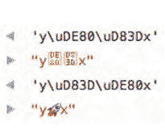

Firefox 控制台中反转后的两个字符串。

⚠️ **剩余问题：组合标记**
*组合标记* 是两个 Unicode 码点的序列，显示为一个符号。我在此介绍的 ES6 反转字符串的方法适用于非 BMP 码点，但不适用于组合标记。对于组合标记，你需要一个库，例如 Mathias Bynens 的 [Esrever](https://github.com/mathiasbynens/esrever)。

## 7.5 码点的数值

新方法 `codePointAt()` 返回字符串中给定索引处码点的数值：

```javascript
let str = 'x\uD83D\uDE80y';
console.log(str.codePointAt(0).toString(16)); // 78
console.log(str.codePointAt(1).toString(16)); // 1f680
console.log(str.codePointAt(3).toString(16)); // 79
```

该方法与字符串迭代结合使用时效果很好：

```javascript
for (let ch of 'x\uD83D\uDE80y') {
    console.log(ch.codePointAt(0).toString(16));
}
// 输出：
// 78
// 1f680
// 79
```

`codePointAt()` 的反向方法是 `String.fromCodePoint()`：

```javascript
> String.fromCodePoint(0x78, 0x1f680, 0x79) === 'x\uD83D\uDE80y'
true
```

## 7.6 检查包含关系和重复字符串

三个新方法用于检查一个字符串是否存在于另一个字符串中：

```javascript
> 'hello'.startsWith('hell')
true
> 'hello'.endsWith('ello')
true
> 'hello'.includes('ell')
true
```

这些方法中的每一个都有一个可选的第二个参数 position，它指定要搜索的字符串的起始或结束位置：

```javascript
> 'hello'.startsWith('ello', 1)
true
> 'hello'.endsWith('hell', 4)
true

> 'hello'.includes('ell', 1)
true
> 'hello'.includes('ell', 2)
false
```

`repeat()` 方法用于重复字符串：

```javascript
> 'doo '.repeat(3)
'doo doo doo '
```

## 7.7 所有新的字符串方法

带标签的模板：

- String.raw(callSite, ...substitutions) : string
  用于“原始”内容的模板标签（反斜杠不会被解释）。

Unicode 和码点：

- String.fromCodePoint(...codePoints : number[]) : string
  将表示 Unicode 码点的数字转换为字符串。
- String.prototype.codePointAt(pos) : number
  返回从位置 pos 开始的码点的数字（包含一个或两个 JavaScript 字符）。
- String.prototype.normalize(form? : string) : string
  不同的码点组合可能看起来相同。[Unicode 归一化](https://unicode.org/faq/normalization.html)将它们全部更改为相同的值，即所谓的*规范表示*。这有助于比较和搜索字符串。对于一般文本，建议使用 'NFC' 形式。

查找字符串：

- String.prototype.startsWith(searchString, position=0) : boolean
  接收者是否以 searchString 开头？`position` 允许你指定要检查的字符串的起始位置。
- String.prototype.endsWith(searchString, endPosition=searchString.length) : boolean
  接收者是否以 searchString 结尾？`endPosition` 允许你指定要检查的字符串的结束位置。
- String.prototype.includes(searchString, position=0) : boolean
  接收者是否包含 searchString？`position` 允许你指定要搜索的字符串的起始位置。

重复字符串：

- String.prototype.repeat(count) : string
  返回接收者自身连接 count 次后的结果。


 ## 8. Symbols

Symbols are a new primitive type in ECMAScript 6. This chapter explains how they work.

## 8.1 Overview

### 8.1.1 Use case 1: unique property keys

Symbols are mainly used as unique property keys – a symbol never clashes with any other property key (symbol or string). For example, you can make an object *iterable* (usable via the `for-of` loop and other language mechanisms), by using the symbol stored in `Symbol.iterator` as the key of a method (more information on iterables is given in the chapter on iteration):

```
let iterableObject = {
    [Symbol.iterator]() { // (A)
        let data = ['hello', 'world'];
        let index = 0;
        return {
            next() {
                if (index < data.length) {
                    return { value: data[index++] };
                } else {
                    return { done: true };
                }
            }
        };
    }
}
for (let x of iterableObject) {
    console.log(x);
}
// Output:
// hello
// world
```

In line A, a symbol is used as the key of the method. This unique marker makes the object iterable and enables us to use the `for-of` loop.

### 8.1.2 Use case 2: constants representing concepts

In ECMAScript 5, you may have used strings to represent concepts such as colors. In ES6, you can use symbols and be sure that they are always unique:

```
const COLOR_RED    = Symbol();
const COLOR_ORANGE = Symbol();
const COLOR_YELLOW = Symbol();
const COLOR_GREEN  = Symbol();
const COLOR_BLUE   = Symbol();
const COLOR_VIOLET = Symbol();

function getComplement(color) {
    switch (color) {
        case COLOR_RED:
            return COLOR_GREEN;
        case COLOR_ORANGE:
            return COLOR_BLUE;
        case COLOR_YELLOW:
            return COLOR_VIOLET;
        case COLOR_GREEN:
            return COLOR_RED;
        case COLOR_BLUE:
            return COLOR_ORANGE;
        case COLOR_VIOLET:
            return COLOR_YELLOW;
        default:
            throw new Exception('Unknown color: '+color);
    }
}
```

## 8.2 A new primitive type

ECMAScript 6 introduces a new primitive type: symbols. They are tokens that serve as unique IDs. You create symbols via the factory function `Symbol()` (which is loosely similar to `String` returning strings if called as a function):

```
let symbol1 = Symbol();
```

`Symbol()` has an optional string-valued parameter that lets you give the newly created Symbol a description:

```
> let symbol2 = Symbol('symbol2');
> String(symbol2)
'Symbol(symbol2)'
```

Every symbol returned by `Symbol()` is unique, every symbol has its own identity:

```
> Symbol() === Symbol()
false
```

You can see that symbols are primitive if you apply the `typeof` operator to one of them – it will return a new symbol-specific result:

```
> typeof Symbol()
'symbol'
```

### 8.2.1 Symbols as property keys

Symbols can be used as property keys:

```
const MY_KEY = Symbol();
let obj = {};

obj[MY_KEY] = 123;
console.log(obj[MY_KEY]); // 123
```

Classes and object literals have a feature called *computed property keys*: You can specify the key of a property via an expression, by putting it in square brackets. In the following object literal, we use a computed property key to make the value of `MY_KEY` the key of a property.

```
const MY_KEY = Symbol();
let obj = {
    [MY_KEY]: 123
};
```

A method definition can also have a computed key:

```
const FOO = Symbol();
let obj = {
    [FOO]() {
        return 'bar';
    }
};
console.log(obj[FOO]()); // bar
```

### 8.2.2 Enumerating own property keys

Given that there is now a new kind of value that can become the key of a property, the following terminology is used for ECMA Script 6:

- *Property keys* are either strings or symbols.
- String-valued property keys are called *property names*.
- Symbol-valued property keys are called *property symbols*.

Let's examine the API for enumerating own property keys by first creating an object.

```
let obj = {
    [Symbol('my_key')]: 1,
    enum: 2,
    nonEnum: 3
};
Object.defineProperty(obj,
    'nonEnum', { enumerable: false });
```

`Object.getOwnPropertyNames()` ignores symbol-valued property keys:

```
> Object.getOwnPropertyNames(obj)
['enum', 'nonEnum']
```

`Object.getOwnPropertySymbols()` ignores string-valued property keys:

```
> Object.getOwnPropertySymbols(obj)
[Symbol(my_key)]
```

`Reflect.ownKeys()` considers all kinds of keys:

```
> Reflect.ownKeys(obj)
[Symbol(my_key), 'enum', 'nonEnum']
```

`Object.keys()` only considers enumerable property keys that are strings:

```
> Object.keys(obj)
['enum']
```

The name `Object.keys` clashes with the new terminology (only string-valued keys are listed). `Object.names` or `Object.getEnumerableOwnPropertyNames` would be a better choice now.

## 8.3 Using symbols to represent concepts

In ECMAScript 5, one often represents concepts (think enum constants) via strings. For example:

```
var COLOR_RED     = 'RED';
var COLOR_ORANGE  = 'ORANGE';
var COLOR_YELLOW  = 'YELLOW';
var COLOR_GREEN   = 'GREEN';
var COLOR_BLUE    = 'BLUE';
var COLOR_VIOLET  = 'VIOLET';
```

However, strings are not as unique as we'd like them to be. To see why, let's look at the following function.

```
function getComplement(color) {
    switch (color) {
        case COLOR_RED:
            return COLOR_GREEN;
        case COLOR_ORANGE:
            return COLOR_BLUE;
        case COLOR_YELLOW:
            return COLOR_VIOLET;
        case COLOR_GREEN:
            return COLOR_RED;
        case COLOR_BLUE:
            return COLOR_ORANGE;
        case COLOR_VIOLET:
            return COLOR_YELLOW;
        default:
            throw new Exception('Unknown color: ' +color);
    }
}
```

It is noteworthy that you can use arbitrary expressions as switch cases, you are not limited in any way. For example:

```
function isThree(x) {
    switch (x) {
        case 1 + 1 + 1:
            return true;
        default:
            return false;
    }
}
```

We use the flexibility that switch offers us and refer to the colors via our constants (`COLOR_RED` etc.) instead of hard-coding them (`'RED'` etc.).

Interestingly, even though we do so, there can still be mix-ups. For example, someone may define a constant for a mood:

```
var MOOD_BLUE = 'BLUE';
```

Now the value of `BLUE` is not unique anymore and `MOOD_BLUE` can be mistaken for it. If you use it as a parameter for `getComplement()`, it returns `'ORANGE'` where it should throw an exception.

Let's use symbols to fix this example. Now we can also use the ES6 feature `const`, which lets us declare actual constants (you can't change what value is bound to a constant, but the value itself may be mutable).

```
const COLOR_RED    = Symbol();
const COLOR_ORANGE = Symbol();
const COLOR_YELLOW = Symbol();
const COLOR_GREEN  = Symbol();
const COLOR_BLUE   = Symbol();
const COLOR_VIOLET = Symbol();
```

Each value returned by `Symbol` is unique, which is why no other value can be mistaken for `BLUE` now. Intriguingly, the code of `getComplement()` doesn't change at all if we use symbols instead of strings, which shows how similar they are.

## 8.4 Symbols as keys of properties

Being able to create properties whose keys never clash with other keys is useful in two situations:

- If several parties contribute internal properties to the same object, via mixins.
- To keep meta-level properties from clashing with base-level properties.

### 8.4.1 Symbols as keys of internal properties

Mixins are object fragments (sets of methods) that you can use to augment the functionality of an object or a prototype. If their methods have symbols as keys, they can't clash with other methods (of other mixins or of the object that they are added to), anymore.

Public methods are seen by clients of the object a mixin is added to. For usability's sake, you probably want those methods to have string keys. Internal methods are only known to the mixin or only needed to communicate with it. They profit from having symbols as keys.

Symbols do not offer real privacy, because it is easy to find out the symbol-valued property keys of an object. But the guarantee that a property key can't ever clash with any other property key is often enough. If you truly want to prevent the outside from accessing private data, you need to use WeakMaps or closures. For example:

```
// One WeakMap per private property
let _counter = new WeakMap();
let _action = new WeakMap();
class Countdown {
    constructor(counter, action) {
        _counter.set(this, counter);
        _action.set(this, action);
    }
    dec() {
        let counter = _counter.get(this);
        if (counter < 1) return;
        counter--;
        _counter.set(this, counter);
        if (counter === 0) {
            _action.get(this)();
        }
    }
 socialism
```

The instances of `Countdown` are keys in the WeakMaps `_counter` and `_action`. The WeakMap does not prevent the instances from being garbage-collected. Entries whose keys are objects that don't exist anymore, are removed from WeakMaps.

The same code looks as follows if you use a symbol key for the internal property.


## 8.4.2 符号作为元级属性的键

符号具有唯一标识，这使它们成为公有属性的理想键，这些公有属性存在于与“普通”属性键不同的层级，因为元级键和普通键不能冲突。元级属性的一个例子是对象可以实现的方法，用于自定义库如何处理它们。使用符号键可以保护库，使其不会将普通方法误认为自定义方法。

ECMAScript 6 中的*可迭代性*就是这样一个自定义特性。如果一个对象有一个键为符号（存储在）`Symbol.iterator` 中的方法，那么该对象就是*可迭代的*。在下面的代码中，`obj` 是可迭代的。

```javascript
let obj = {
    data: [ 'hello', 'world' ],
    [Symbol.iterator]() {
        const self = this;
        let index = 0;
        return {
            next() {
                if (index < self.data.length) {
                    return {
                        value: self.data[index++]
                    };
                } else {
                    return { done: true };
                }
            }
        };
    }
};
```

obj 的可迭代性使你能够使用 for-of 循环和类似的 JavaScript 特性：

```javascript
for (let x of obj) {
    console.log(x);
}
```

```
// Output:
// hello
// world
```

## 8.5 使用符号跨越领域

*代码领域*（简称：领域）是代码片段存在的上下文。它包括全局变量、加载的模块等等。尽管代码存在于一个领域“内部”，但它可能有权访问其他领域的代码。例如，浏览器中的每个框架都有自己的领域。执行可以从一个框架跳转到另一个框架，如下面的 HTML 所示。

```html
<head>
    <script>
        function test(arr) {
            var iframe = frames[0];
            // This code and the iframe's code exist in
            // different realms. Therefore, global variables
            // such as Array are different:
            console.log(Array === iframe.Array); // false
            console.log(arr instanceof Array); // false
            console.log(arr instanceof iframe.Array); // true

            // But: symbols are the same
            console.log(Symbol.iterator ===
                    iframe.Symbol.iterator); // true
        }
    </script>
</head>
<body>
    <iframe srcdoc="<script>window.parent.test([])</script>">
</iframe>
</body>
```

问题是每个领域都有自己的 `Array` 本地副本，并且由于对象具有单独的标识，这些本地副本被视为不同的，即使它们本质上是同一个对象。类似地，库和用户代码每个领域只加载一次，并且每个领域都有相同对象的不同版本。

相比之下，布尔值、数字和字符串等原始类型的成员没有单独的标识，相同值的多个副本不是问题：副本是“按值”比较的（查看内容，而不是标识），并且被认为是相等的。

符号具有单独的标识，因此不能像其他原始值那样顺畅地跨越领域。对于应该在所有领域工作的符号（如 `Symbol.iterator`）来说，这是一个问题：如果一个对象在一个领域中是可迭代的，那么它在其他领域中也应该是可迭代的。如果跨领域符号由 JavaScript 引擎管理，引擎可以确保在每个领域中使用相同的值。然而，对于库，我们需要额外的支持，这种支持以*全局符号注册表*的形式出现：该注册表对所有领域都是全局的，并将字符串映射到符号。对于每个符号，库需要想出一个尽可能唯一的字符串。要创建符号，他们不使用 `Symbol()`，而是要求注册表提供该字符串映射到的符号。如果注册表已有该字符串的条目，则返回关联的符号。否则，首先创建条目和符号。

你通过 `Symbol.for()` 向注册表请求符号，并通过 `Symbol.keyFor()` 检索与符号关联的字符串（其*键*）：

```javascript
> let sym = Symbol.for('Hello everybody!');
> Symbol.keyFor(sym)
'Hello everybody!'
```

如预期的那样，由 JavaScript 引擎提供的跨领域符号（如 `Symbol.iterator`）不在注册表中：

```javascript
> Symbol.keyFor(Symbol.iterator)
undefined
```

## 8.6 符号的包装对象

虽然所有其他原始值都有字面量，但你需要通过调用 `Symbol` 函数来创建符号。因此，很容易意外地将 `Symbol` 作为构造函数调用。这会产生 `Symbol` 的实例，但并不十分有用。因此，当你尝试这样做时，会抛出一个异常：

```javascript
> new Symbol()
TypeError: Symbol is not a constructor
```

仍然有一种方法可以创建包装对象，即 Symbol 的实例：`Object`，作为函数调用时，会将所有值转换为对象，包括符号。

```javascript
> let sym = Symbol();
> typeof sym
'symbol'

> let wrapper = Object(sym);
> typeof wrapper
'object'
> wrapper instanceof Symbol
true
```

### 8.6.1 通过 [ ] 访问属性

用于访问属性的方括号运算符 [ ] 会解包字符串包装对象和符号包装对象。让我们使用以下对象来研究这个现象。

```javascript
const sym = Symbol('yes');
let obj = {
    [sym]: 'a',
    str: 'b',
};
```

交互：

```javascript
> let wrappedSymbol = Object(sym);
> typeof wrappedSymbol
'object'
> obj[wrappedSymbol]
'a'

> let wrappedString = new String('str');
> typeof wrappedString
'object'
> obj[wrappedString]
'b'
```

#### 8.6.1.1 规范中的属性访问

获取和设置属性的运算符使用内部操作 ToPropertyKey()，其工作方式如下：

- 通过 ToPrimitive() 将操作数转换为原始值，首选类型为字符串：
  - 原始值按原样返回。
  - 大多数对象通过 toString() 方法转换 - 如果它返回原始值。否则，使用 valueOf() - 如果它返回原始值。否则，抛出 TypeError。
  - 符号对象是一个例外：它们被转换为它们包装的符号。
- 如果结果是符号，则返回它。
- 否则，通过 ToString() 将结果强制转换为字符串。

## 8.7 将符号转换为其他原始类型

下表显示了将符号显式或隐式转换为其他原始类型时会发生什么：

| 转换为 | 显式转换 | 强制转换（隐式转换） |
| :--- | :--- | :--- |
| boolean | `Boolean(sym)` → OK | `!sym` → OK |
| number | `Number(sym)` → TypeError | `sym*2` → TypeError |
| string | `String(sym)` → OK | `''+sym` → TypeError |

### 8.7.1 陷阱：强制转换为字符串

禁止强制转换为字符串很容易让你出错：

```javascript
const sym = Symbol();

console.log('A symbol: ' + sym); // TypeError
console.log(`A symbol: ${sym}`); // TypeError
```

要解决这些问题，你需要显式转换为字符串：

```javascript
console.log('A symbol: '+String(sym)); // OK
console.log(`A symbol: ${String(sym)}`); // OK
```

### 8.7.2 理解强制转换规则

符号的强制转换（隐式转换）通常被禁止。本节解释原因。

#### 8.7.2.1 允许真值检查

强制转换为布尔值总是允许的，主要是为了启用 if 语句和其他位置的真值检查：

```javascript
if (value) { ··· }

param = param || 0;
```

#### 8.7.2.2 意外将符号转换为属性键

符号是特殊的属性键，这就是为什么你要避免意外地将它们转换为字符串，字符串是不同类型的属性键。如果你使用加法运算符计算属性名，就可能发生这种情况：

```javascript
myObject['__' + value]
```

这就是为什么如果 value 是符号，会抛出 TypeError。

#### 8.7.2.3 意外将符号转换为数组索引

你也不想意外地将符号转换为数组索引。如果 value 是符号，以下代码可能发生这种情况：

```javascript
myArray[1 + value]
```

这就是为什么在这种情况下加法运算符会抛出错误。

### 8.7.3 规范中的显式和隐式转换

#### 8.7.3.1 转换为布尔值

要将符号显式转换为布尔值，你可以调用 `Boolean()`[^1]，它对符号返回 true：

[^1]: http://www.ecma-international.org/ecma-262/6.0/#sec-boolean-constructor-boolean-value


## 8.7.3.2 转换为数字

要显式将 symbol 转换为数字，需要调用 `Number()`⁶：

```javascript
> const sym = Symbol('hello');
> Number(sym)
TypeError: can't convert symbol to number
```

`Number()` 通过内部操作 `ToNumber()`⁷ 计算结果，而 `ToNumber()` 对 symbol 会抛出 TypeError。

强制类型转换同样使用 `ToNumber()`：

```javascript
> +sym
TypeError: can't convert symbol to number
```

## 8.7.3.3 转换为字符串

要显式将 symbol 转换为字符串，需要调用 `String()`⁸：

```javascript
> const sym = Symbol('hello');
> String(sym)
'Symbol(hello)'
```

如果 `String()` 的参数是 symbol，则它会自行处理转换，并在创建时提供的描述信息前后加上 `Symbol()` 返回结果字符串。如果没有提供描述信息，则使用空字符串：

```javascript
> String(Symbol())
'Symbol()'
```

`toString()` 方法返回与 `String()` 相同的字符串，但这两个操作之间不会互相调用，它们都调用同一个内部操作 `SymbolDescriptiveString()`⁹。

```javascript
> Symbol('hello').toString()
'Symbol(hello)'
```

强制类型转换通过内部操作 `ToString()`¹⁰ 处理，该操作对 symbol 会抛出 TypeError。`Number.parseInt()` 就是一个将参数强制转换为字符串的方法：

```javascript
> Number.parseInt(Symbol())
TypeError: can't convert symbol to string
```

## 8.7.3.4 禁止：通过二元加法运算符 (+) 进行转换

加法运算符¹¹ 的工作方式如下：

1.  将两个操作数都转换为原始值。
2.  如果其中一个操作数是字符串，则将两个操作数都强制转换为字符串（通过 `ToString()`），连接它们并返回结果。
3.  否则，将两个操作数都强制转换为数字，相加后返回结果。

无论是转换为字符串还是数字，强制转换都会抛出异常，这意味着不能（直接）对 symbol 使用加法运算符：

```javascript
> '' + Symbol()
TypeError: can't convert symbol to string
> 1 + Symbol()
TypeError: can't convert symbol to number
```

## 8.8 JSON 与 symbol

### 8.8.1 通过 JSON.stringify() 生成 JSON

`JSON.stringify()` 将 JavaScript 数据转换为 JSON 字符串。预处理步骤允许你自定义该转换：一个回调函数，即所谓的 *replacer*（替换器），可以将 JavaScript 数据中的任何值替换为另一个值。这意味着它可以将不兼容 JSON 的值（如 symbol 和日期）编码为兼容 JSON 的值（如字符串）。`JSON.parse()` 通过类似的机制<sup>12</sup> 让你可以逆此过程。

然而，stringify 会忽略非字符串的属性键，因此这种方法仅在 symbol 作为属性值时才有效。例如，像这样：

```javascript
function symbolReplacer(key, value) {
    if (typeof value === 'symbol') {
        return '@@' + Symbol.keyFor(value) + '@@';
    }
    return value;
}
const MY_SYMBOL = Symbol.for('http://example.com/my_symbol');
let obj = { [MY_SYMBOL]: 123 };

let str = JSON.stringify(obj, symbolReplacer);
console.log(str);
```

symbol 通过在键前后添加 '@@' 来编码为字符串。注意，只有那些通过 `Symbol.for()` 创建的 symbol 才具有这样的键。

### 8.8.2 通过 JSON.parse() 解析 JSON

`JSON.parse()` 将 JSON 字符串转换为 JavaScript 数据。后处理步骤允许你自定义该转换：一个回调函数，即所谓的 *reviver*（恢复器），可以将初始输出中的任何值替换为另一个值。这意味着它可以解码存储在 JSON 数据（如字符串）中的非 JSON 数据（如 symbol 和日期）<sup>13</sup>。如下所示：

```javascript
const REGEX_SYMBOL_STRING = /^@@(.*)@@$/;
function symbolReviver(key, value) {
    if (typeof value === 'string') {
        let match = value.match(REGEX_SYMBOL_STRING);
        if (match) {
            let symbolKey = match[1];
            return Symbol.for(symbolKey);
        }
    }
    return value;
}

let parsed = JSON.parse(str, symbolReviver);
console.log(parsed);
```

以 '@@' 开头和结尾的字符串会被转换为 symbol，方法是提取中间的 symbol 键。

## 8.9 常见问题：symbol

### 8.9.1 我可以使用 symbol 来定义私有属性吗？

最初计划让 symbol 支持私有属性，但由于该特性会与代理产生不良交互，因此被取消。关于类（class）的章节解释了在类实例中保持数据私有的可选方案：将其存储在构造函数环境中、带有标记键的属性中，或 WeakMap 中。

### 8.9.2 symbol 是原始值还是对象？

在某些方面，symbol 类似于原始值；在其他方面，它们又类似于对象：

- 就用途而言，symbol 类似于字符串（原始值）：作为概念的表示和属性键。
- 就每个 symbol 都具有自己的身份而言，symbol 类似于对象。

那么 symbol 到底是什么——原始值还是对象？最终，它们被归类为原始值，原因有二。

第一，symbol 更像字符串，而不是对象：它们是语言的基本值，不可变，且可用作属性键。symbol 具有唯一身份这一特性，并不一定与它们类似于字符串相矛盾：UUID 算法就能产生准唯一的字符串。

第二，symbol 最常被用作属性键，因此针对这一用例来优化 JavaScript 规范及其实现是合理的。这样的话，对象的许多能力就变得不必要了：

- 对象可以成为其他对象的原型。
- 用代理包装对象不会降低它的可用性。
- 对象可以被内省：通过 `instanceof`、`Object.keys()` 等方式。

symbol 不具备这些能力，这让规范和实现的编写更加轻松。V8 团队也有报告称，在处理属性键时，将原始值与对象区别对待更为简单。

### 8.9.3 我们真的需要 symbol 吗？字符串不够用吗？

与字符串不同，symbol 是唯一的，可以防止名称冲突。这对于颜色等标记（token）来说固然很好，但对于支持元层级方法（如键为 `Symbol.iterator` 的方法）来说则是必不可少的。Python 使用特殊名称 `__iter__` 来避免冲突。你可以将双下划线名称保留给编程语言机制使用，但库该怎么办呢？有了 symbol，我们就有了一种对所有人都适用的扩展机制。正如稍后你可以在公共 symbol 一节中看到的，JavaScript 本身已经大量使用了这一机制。

在避免冲突的属性键方面，symbol 有一个假设性的替代方案：使用命名约定。例如，带有 URL 的字符串（如 `'http://example.com/iterator'`）。但这会引入第二类的属性键（与"普通"的属性名称相对，后者通常是有效标识符，不包含冒号、斜杠、点号等），而这基本上就是 symbol 的定义所在。因此，更优雅的做法是明确地将这些键转换为不同种类的值。

### 8.9.4 JavaScript 的 symbol 和 Ruby 的 symbol 一样吗？

不，它们不一样。Ruby 的 symbol 更像 JavaScript 的字符串字面量——它们不可变，并且经常被 *interned*（驻留）：如果相同的字符串字面量出现在多个位置，存储空间会被复用。JavaScript 引擎通过一个将字符串值映射到存储位置的表来管理这一点。

## 8.10 symbol API

本节概述 ECMAScript 6 的 symbol API。

---
**脚注：**
⁵http://www.ecma-international.org/ecma-262/6.0/#sec-toboolean
⁶http://www.ecma-international.org/ecma-262/6.0/#sec-number-constructor-number-value
⁷http://www.ecma-international.org/ecma-262/6.0/#sec-tonumber
⁸http://www.ecma-international.org/ecma-262/6.0/#sec-string-constructor-string-value
⁹http://www.ecma-international.org/ecma-262/6.0/#sec-symboldescriptivestring
¹⁰http://www.ecma-international.org/ecma-262/6.0/#sec-tostring
¹¹http://www.ecma-international.org/ecma-262/6.0/#sec-addition-operator-plus
¹²http://www.ecma-international.org/ecma-262/6.0/#sec-json.stringify
¹³http://www.ecma-international.org/ecma-262/6.0/#sec-json.parse

### 8.10.1 `Symbol` 函数

- `Symbol(description?) : symbol`
  创建一个新的符号。可选参数 `description` 允许你为符号添加描述，这在调试时很有用。

Symbol 不打算用作构造函数——如果你通过 `new` 调用它，会抛出异常。

### 8.10.2 内置符号

[一些内置符号](http://www.ecma-international.org/ecma-262/6.0/#sec-well-known-symbols)可以通过 `Symbol` 的属性访问。它们都被用作属性键，并使你能够自定义 JavaScript 处理对象的方式。

自定义基础语言操作：

- `Symbol.hasInstance`（方法）
  让对象 C 自定义 `x instanceof C` 的行为。

- `Symbol.toPrimitive`（方法）
  让对象自定义如何转换为原始值。这是当某事物被强制转换为原始类型（通过运算符等）时的第一步。

- `Symbol.toStringTag`（字符串）
  被 `Object.prototype.toString` 调用，用于计算对象 obj 的默认字符串描述：`'[object ' + obj[Symbol.toStringTag]+']'`。

**迭代**（在[关于迭代的章节](#)中解释）：

- `Symbol.iterator`（方法）
  使对象可迭代。返回一个迭代器。

**正则表达式**：四个具有正则表达式参数的字符串方法直接转发给这些参数。它们转发到的方法具有以下键：

- `Symbol.match` 被 `String.prototype.match` 使用。

- `Symbol.replace` 被 `String.prototype.replace` 使用。

- `Symbol.search` 被 `String.prototype.search` 使用。

- `Symbol.split` 被 `String.prototype.split` 使用。

**其他：**

- `Symbol.unscopables`（对象）
  让对象对 `with` 语句隐藏某些属性。

- `Symbol.species`（方法）
  有助于克隆类型化数组以及 `RegExp`、`ArrayBuffer` 和 `Promise` 的实例。详细信息在关于类的章节中解释。

- `Symbol.isConcatSpreadable`（布尔值）
  指示 `Array.prototype.concat` 是应该连接对象的索引元素，还是将对象作为一个元素进行连接。

### 8.10.3 全局符号注册表

如果你希望一个符号在所有作用域（realm）中同名，你需要通过全局符号注册表创建它。以下方法允许你这样做：

- `Symbol.for(str)` : symbol
  返回注册表中键为字符串 `str` 的符号。如果 `str` 尚未在注册表中，则创建一个新符号，并以键 `str` 存档在注册表中。

另一个方法允许你进行反向查找，找出字符串在注册表中存储在哪个键下。这对于序列化符号可能很有用。

- `Symbol.keyFor(sym)` : string
  返回与注册表中符号 `sym` 关联的字符串。如果 `sym` 不在注册表中，此方法返回 `undefined`。

# 9. 模板字面量和标签模板

本章涵盖两种新的字面量：模板字面量和标签模板。

## 9.1 概述

以下三件事是不同的——尽管名称和外观相似：

- Web 模板（数据）：带有待填充空格的 HTML
- 模板字面量（代码）：多行字符串字面量加上插值
- 标签模板（代码）：函数调用

模板字面量是可以跨越多行并包含插值表达式的字符串字面量：

```
const firstName = 'Jane';
console.log(`Hello ${firstName}!
How are you
today?`);
```

```
// 输出：
// Hello Jane!
// How are you
// today?
```

标签模板是通过在模板字面量前提及一个函数来创建的。它们导致一个函数调用，其中前缀被调用，模板字面量提供参数：

```
> String.raw`A \tagged\ template`
'A \\tagged\\ template'
```

## 9.2 介绍

字面量是产生值的语法构造。例如包括字符串字面量（产生字符串）和正则表达式字面量（产生正则表达式对象）。ECMAScript 6 有两种新的字面量：

- 模板字面量：是支持插值和多行的字符串字面量。
- 标签模板：是参数通过模板字面量提供的函数调用。

重要的是要记住，模板字面量和标签模板的名称略有误导性。它们与 *模板* 无关，模板在 Web 开发中经常使用：带有可以通过（例如）JSON 数据填充的空格的文本文件。

### 9.2.1 模板字面量

模板字面量是一种新的字符串字面量，可以跨越多行并 *插值* 表达式（包含它们的结果）。例如：

```
const firstName = 'Jane';
console.log(`Hello ${firstName}!
How are you
today?`);

// 输出：
// Hello Jane!
// How are you
// today?
```

字面量本身由反引号（`）分隔，字面量内部的插值表达式由 `${` 和 `}` 分隔。模板字面量总是产生字符串。

### 9.2.2 标签模板

以下是一个 *标签模板*（*标签模板字面量* 的简称）：

```
tagFunction`Hello ${firstName} ${lastName}!`
```

将模板字面量放在表达式之后会调用该表达式。这类似于参数列表（括号中以逗号分隔的值）的效果。前面的代码执行以下函数调用（实际上，函数接收更多信息，但这将在后面解释）：

```
tagFunction(['Hello ', ' ', '!'], firstName, lastName)
```

因此，反引号内容前面的名称是要调用的函数的名称，即标签函数。标签函数接收两种不同类型的数据：

- 模板字符串，如 'Hello '。
- 替换项，如 firstName（由美元符号和大括号分隔）。替换项可以是任何表达式。

模板字符串是静态已知的（在编译时），替换项仅在运行时已知。标签函数可以随心所欲地处理其参数：它可以完全忽略模板字符串，返回任何类型的值等。

## 9.3 使用标签模板的示例

为了理解标签模板的用途，让我们看一些示例。你会发现标签模板使你能够毫不费力地实现自定义嵌入式子语言（有时称为 *领域特定语言*），因为 JavaScript 为你完成了大部分解析工作。你只需要编写一个接收结果的函数。

以下一些示例借用了 [模板字面量和标签模板的原始提案](http://wiki.ecmascript.org/doku.php?id=harmony:quasis)，其中它们通过旧名称 *准字面量* 来指代。

### 9.3.1 原始字符串

ES6 包含用于 *原始字符串* 的标签函数 `String.raw`，其中反斜杠没有特殊含义：

```
let str = String.raw`This is a text
with multiple lines.
Escapes are not interpreted,
\n is not a newline.`;
```

### 9.3.2 转义正则表达式的部分

有两种创建正则表达式实例的方法。

- 静态地，通过正则表达式字面量：`/^abc$/i`
- 动态地，通过 RegExp 构造函数：`new RegExp('^abc$', i)`

如果你使用后者，那是因为你必须等到运行时，以便所有必要的要素都可用：你通常正在连接正则表达式片段和要逐字匹配的文本。后者必须正确转义（点、方括号等）。正则表达式标签函数 `escRegExp` 可以帮助完成此任务：

```
const NUMBER = escRegExp`\d+(${localeSpecificDecimalPoint}\d+)?`;
```

`escRegExp` 的一个简单实现将在后面展示。

### 9.3.3 用于更强大正则表达式的标签模板

Steven Levithan 给出了一个[示例](https://gist.github.com/4222600)，说明如何将标签模板用于他的正则表达式库 [XRegExp](http://xregexp.com)。

> 如果你正在处理正则表达式，强烈推荐 XRegExp。它提供了许多高级功能，但性能损失很小——仅在创建时一次——因为 XRegExp 将其输入编译为原生正则表达式。

没有标签模板，你会编写如下代码：

```
var parts = '/2012/10/Page.html'.match(XRegExp(
  '^ # match at start of string only \n' +
  '/ (?<year> [^/]+ ) # capture top dir name as year \n' +
  '/ (?<month> [^/]+ ) # capture subdir name as month \n' +
  '/ (?<title> [^/]+ ) # capture base name as title \n' +
  '\\.html? $ # .htm or .html file ext at end of path ', 'x'
));

console.log(parts.year); // 2012
```

我们可以看到 XRegExp 给了我们命名组（`year`、`month`、`title`）和 `x` 标志。有了这个标志，大多数空白符被忽略，并且可以插入注释。

字符串字面量在这里工作不好的原因有两个。首先，我们必须为每个正则表达式反斜杠输入两次，以便为字符串字面量进行转义。其次，输入多行很麻烦：你也可以在行尾用反斜杠结束字符串，而不是添加字符串。但这很脆弱，而且你仍然必须通过 `\n` 显式添加换行符。标签模板解决了这两个问题：


 ```
var parts = '/2012/10/Page.html'.match(XRegExp.rx`
    ^ # match at start of string only
    / (?<year> [^/]+ ) # capture top dir name as year
    / (?<month> [^/]+ ) # capture subdir name as month
    / (?<title> [^/]+ ) # capture base name as title
    \.html? $ # .htm or .html file ext at end of path
`);
```

标签模板还可以通过 ${v} 插入值。我期望一个正则表达式库能够对字符串进行转义，并原样插入正则表达式。例如：

```
var str    = 'really?';
var regex = XRegExp.rx`(${str})*`;
```

这等价于

```
var regex = XRegExp.rx`(really\?)*`;
```

## 9.3.4 查询语言

示例：

```
`a.${className}[href=~'//${domain}/']`
```

这是一个 DOM 查询，查找所有 CSS 类为 className 且目标 URL 属于给定域名的 <a> 标签。标签函数 $ 确保参数被正确转义，使这种方法比手动字符串拼接更安全。

## 9.3.5 通过标签模板实现 React JSX

[Facebook 的 React 用户界面库](https://facebook.github.io/react/)有一个可选的语言扩展 JSX，它允许你在 JavaScript 中嵌入 HTML。这个扩展可以使代码更简洁，但它也破坏了与 JavaScript 生态系统中其他部分的兼容性。Jonathan Raphaelson 使用标签模板实现了 JSX 的一个近似版本。看起来如下所示。

```
class EchoComponent {
    ...
    render() {
        return jsx`
            <div>
                <input
                    ref='input'
                    onChange='${this.handleChange}'
                    defaultValue='${this.state.value}' />
                ${this.state.value}
            </div>
        `;
    }
}
let comp = jsx`<${EchoComponent} />`;
React.renderComponent(comp, document.body);
```

你可以在 [GitHub](https://gist.github.com/lygaret/a68220defa69174bdec5) 上查看完整的示例和标签函数 `jsx` 的实现。

## 9.3.6 文本本地化（L10N）

本节介绍一种简单的文本本地化方法，支持不同的语言和区域设置（如何格式化数字、时间等）。给定以下消息。

```
alert(msg`Welcome to ${siteName}, you are visitor
                        number ${visitorNumber}:d!`);
```

标签函数 `msg` 的工作方式如下。

首先，将字面量部分拼接成一个字符串，用于在表中查找翻译。查找字符串的一个示例是：

```
'Welcome to {0}, you are visitor number {1}!'
```

德语翻译的一个示例是：

```
'Besucher Nr. {1}, willkommen bei {0}!'
```

英语的"翻译"与查找字符串相同。

其次，使用查找结果来显示替换内容。因为查找结果包含索引，所以可以重新排列替换内容的顺序。在德语中就是这样做的，访客编号出现在站点名称之前。替换内容的格式化方式可以通过 `:d` 等注释来影响。这个注释表示应该为 `visitorNumber` 使用特定区域设置的十进制分隔符。因此，可能的英语结果是：

```
Welcome to ACME Corp., you are visitor number 1,300!
```

在德语中，我们有如下结果：

```
Besucher Nr. 1.300, willkommen bei ACME Corp.!
```

## 9.4 实现标签函数

以下是一个标签模板：

```
tagFunction`lit1\n${subst1} lit2 ${subst2}`
```

它在内部被转换为函数调用：

```
{
    // 全局：将模板对象添加到每个领域的模板映射中

    // "煮熟的"模板字符串：反斜杠被解释
    const templateObject = ['lit1\n', ' lit2 ', ''];
    // "原始的"模板字符串：反斜杠按原样保留
    templateObject.raw  = ['lit1\\n', ' lit2 ', ''];

    // 包含模板字符串的数组被冻结
    Object.freeze(templateObject.raw);
    Object.freeze(templateObject);

    __templateMap__[716] = templateObject;
}

// 就地：标签函数的调用
 tagFunction(__templateMap__[716], subst1, subst2)
```

标签函数的参数分为两类：

1. 模板对象：你可以在其中获取模板字符串，包括经过转义解释的（"煮熟的"）和未解释的（"原始的"）。模板字符串的数量总是比替换内容多一个。如果替换内容在字面量的开头，它前面会有一个空模板字符串。如果替换内容在末尾，它后面会有一个空模板字符串（如前面的示例所示）。
2. 替换内容：其值成为后续参数。

其思路是同一个字面量可能会被多次执行（例如在循环或函数中）。通过模板对象，标签函数可以缓存来自先前调用的数据：(1) 是潜在可缓存的数据，(2) 随每次调用而变化。缓存按 *领域*（相当于浏览器中的 frame）进行。也就是说，每个调用点和领域都有一个模板对象。

## 规范中的标签模板

[关于标签模板的一节](http://www.ecma-international.org/ecma-262/6.0/#sec-tagged-templates)解释了它们如何被解释为函数调用。[另一节](http://www.ecma-international.org/ecma-262/6.0/#sec-template-literals-runtime-semantics-argumentlistevaluation)解释了模板字面量如何被转换为参数列表：模板对象和替换内容。

### 9.4.1 标签模板中的转义：煮熟的 vs. 原始的

在标签模板中，有更多的转义规则，因为*模板字符串*（反引号内的文本片段，不包括替换内容）有两种解释方式：煮熟的和原始的。规则如下：

- 在煮熟的和原始的解释中，美元符号 ($) 前面的反斜杠 (\) 可以防止 ${ 被解释为开始一个替换。
- 然而，每个单独的反斜杠都会在原始解释中被提及，即使是转义替换内容的那些。

标签函数 `describe` 允许我们探索这意味着什么。

```
function describe(tmplObj, ...substs) {
    console.log('Cooked:', intersperse(tmplObj, substs));
    console.log('Raw:   ', intersperse(tmplObj.raw, substs));
}
function intersperse(tmplStrs, substs) {
    // tmplStrs 中始终至少有一个元素
    let result = tmplStrs[0];
    substs.forEach((subst, i) => {
        result += String(subst);
        result += tmplStrs[i+1];
    });
    return result;
}
```

让我们使用这个标签函数（我没有显示这些函数调用的 undefined 结果）：

```
> describe`${3+3}`
Cooked: 6
Raw:    6

> describe`\${3+3}`
Cooked: ${3+3}
Raw:    \${3+3}

> describe`\\${3+3}`
Cooked: \6
Raw:    \\6

> describe`\\\${3+3}`
Cooked: \${3+3}
Raw:    \\\${3+3}
```

如你所见，每当煮熟的解释中有替换时，原始的解释中也有替换。然而，字面量中的所有反斜杠都会出现在原始解释中；如果反斜杠在 ${ 字符之前，则它会阻止替换。

反斜杠的其他出现方式解释类似：

- 在煮熟模式下，反斜杠的处理方式与字符串字面量中相同。
- 在原始模式下，反斜杠按原样使用。

例如：

```
> '\n'
'\n'
> String.raw`\n`
'\\n'
```

反斜杠在原始模式下唯一有影响的情况是当它出现在替换内容前面时（它会转义替换内容）。

**规范中标签模板的转义**

在模板字面量的语法中，你可以看到，在模板字面量内，美元符号 ($) 后面不能跟左花括号 ({})。然而，转义的美元符号 (\$) 后面可以跟左花括号。解释模板字面量字符的规则在另一节中说明。

### 9.4.2 示例：实现用于 HTML 模板化的标签函数

在本节中，我将解释如何使用标签模板进行 HTML 模板化。该方法基于 Claus Reinke 的一个想法。

#### 9.4.2.1 定义和使用 HTML 模板

你定义 HTML 模板的方式如下。它依赖于标签函数 `html`（稍后展示）。

```
const tmpl = addrs => html`
  <table>
    ${addrs.map(addr => html`
      <tr>$${addr.first}</tr>
      <tr>$${addr.last}</tr>
    `)}
  </table>
`;
```

诀窍在于每个替换内容 `${}` 内部可以是任意表达式。我们在第一个替换内容中使用 `map()` 创建一个字符串数组（`html()` 将其转换为适当的字符串）。多亏了箭头函数，`map()` 的回调非常简洁。

在回调内部，我们再次"调用" `html`。因此，调用函数 `tmpl` 会导致函数 `html` 被多次调用。
```


模板字面量与标签模板

112

`$${addr.last}`中的双美元符号并非 ES6 语法，它只是替换式 `${addr.last}` 前面的普通文本"$"。但标签函数对前面带有美元符号的替换式处理方式不同——它会将替换式返回的字符串进行 HTML 转义。

模板的用法如下：

```
console.log(tmpl([
  { first: '<Jane>', last: 'Bond' },
  { first: 'Lars', last: '<Croft>' },
]));
```

这段代码会产生以下输出：

```
<table>

  <tr>Jane</tr>
  <tr>&lt;Bond&gt;</tr>

  <tr>&lt;Lars&gt;</tr>
  <tr>Croft</tr>

</table>
```

请注意，Jane 和 Croft 周围的尖括号被转义了，而 `<tr>` 没有。

## 9.4.2.2 标签函数

标签函数出奇地简单：

```
function html(templateObject, ...substs) {
  // 使用原始模板字符串：我们不希望
  // 反斜杠（\n 等）被解释
  let raw = templateObject.raw;

  let result = '';

  substs.forEach((subst, i) => {
    // 获取当前替换式之前的模板字符串
    let lit = raw[i];

    // 在示例中，map() 返回一个数组：
    // 如果替换式是数组（且不是字符串），
    // 我们将其转换为字符串
    if (Array.isArray(subst)) {
        subst = subst.join('');
    }

    // 如果替换式前面有美元符号，
    // 我们就转义其中的特殊字符
    if (lit.endsWith('$')) {
        subst = htmlEscape(subst);
        lit = lit.slice(0, -1);
    }
    result += lit;
    result += subst;
  });
  // 处理最后一个模板字符串
  // （这不会失败，因为一个空的标签模板
  // 会产生一个模板字符串，即一个空字符串）
  result += raw[raw.length-1]; // (A)

  return result;
}
```

每个替换式总是被模板字符串包围。如果标签模板以替换式结尾，最后一个模板字符串就是空字符串。因此，以下表达式始终为真：

```
templateObject.length === substs.length + 1
```

这就是为什么我们需要在 A 行追加最后一个模板字符串。

以下是 `htmlEscape()` 的一个简单实现。

```
function htmlEscape(str) {
    return str.replace(/&/g, '&amp;') // 首先！
            .replace(/>/g, '&gt;')
            .replace(/</g, '&lt;')
            .replace(/"/g, '&quot;')
            .replace(/'/g, '&#39;')
            .replace(/`/g, '&#96;');
}
```

### 9.4.2.3 更多想法

通过这种模板方法，你还可以做更多事情：

- 这种方法不仅限于 HTML，它同样适用于其他类型的文本。显然，转义方式需要相应调整。
- 模板中的 if-then-else 逻辑可以通过三元运算符（`条件?真值:假值`）或逻辑或运算符（`||`）来实现：

```
${addr.first ? addr.first : '(No first name)'}
${addr.first || '(No first name)'}
```

- 如果第一行的第一个非空白字符定义了第一列的位置，那么每行的前导空白可以部分修剪。
- 可以使用解构：

```
${addrs.map(({first,last}) => html`
    <tr>$${first}</tr>
    <tr>$${last}</tr>
`)}
```

### 9.4.2.4 我应该在生产代码中使用它吗？

如果你需要快速实现一个简单的功能，可以使用这种方法。它不如 [Handlebars.js](http://handlebarsjs.com/) 及类似模板引擎支持的模板语法易读。另一方面，它很轻量，控制流机制（循环和 if-then-else）很容易理解，因为它们就是普通的 JavaScript。

### 9.4.3 示例：转义正则表达式的部分内容

让我们实现前面提到的标签函数 `escRegExp`，它在组装正则表达式时对替换式进行转义。

```
function escRegExp(tmplObj, ...substs) {
    // 模板字符串按原样使用
    let regexText = tmplObj.raw[0];
    for ([i, subst] of substs.entries()) {
        regexText += quoteText(String(subst));
        regexText += tmplObj.raw[i+1];
    }
    return new RegExp(regexText);
}
function quoteText(text) {
    return text.replace(/[\\^$.*+?()\[\]{}|!=!<>:-]/g, '\\$&');
}
```

这是 escRegExp 的使用示例：

```
// 注意单个反斜杠
let re = escRegExp`\$${dot}\$`;
    // re = /\$\.$/
re.test('$.'); // true
re.test('$_$'); // false
```

## 9.5 常见问题解答：模板字面量与标签模板

### 9.5.1 模板字面量和标签字面量从何而来？

模板字面量和标签模板借鉴自 E 语言，该语言称此特性为*准字面量*^{12}。

### 9.5.2 宏和标签模板有什么区别？

宏允许你实现具有自定义语法的结构。为语法如此复杂的语言（如 JavaScript）提供宏是困难的，并且是正在进行的研究课题（参见 Mozilla 的 [sweet.js](http://sweetjs.org/)^{13}）。虽然宏在实现子语言方面比标签模板强大得多，但它们依赖于语言的词法分析。因此，标签模板是互补的，因为它们专门处理文本内容。

^{12} http://www.erights.org/elang/grammar/quasi-overview.html
^{13} http://sweetjs.org/

### 9.5.3 我能从外部源加载模板字面量吗？

如果我想从外部源（例如文件）加载一个模板字面量，比如 `Hello ${name}!`，该怎么办？

请注意，如果你这样做，就是在滥用此机制。鉴于模板字面量可以包含任意表达式并且它是一个字面量，从其他地方加载它类似于加载一个表达式或字符串字面量——你必须使用 `eval()` 或类似的方法。

回到这个例子，你可以这样做：

```
let str = '`Hello ${name}!`'; // 外部源

let func = new Function('name', str);
let name = 'Jane';
let result = func(name);
```

任何未在模板字面量内部声明的变量都必须成为我们正在创建的函数 `func` 的参数。或者，你可以加载整个函数并对其进行 eval^{14}：

```
let str = '(name) => `Hello ${name}!`'; // 外部源
let func = eval.call(null, str); // 间接 eval
let name = 'Jane';
let result = func(name);
```

### 9.5.4 为什么反引号是模板字面量和标签模板的定界符？

反引号是少数几个尚未使用的 ASCII 字符之一。插值语法 `${}` 是事实上的标准（Unix shells 等）。

### 9.5.5 模板字面量以前不是叫模板字符串吗？

模板字面量这个术语在 ES6 规范制定后期才发生变化。以下是旧术语：

- 模板字符串（字面量）：*模板字面量*的旧称。
- 标签模板字符串（字面量）：*标签模板*的旧称。
- 模板处理器：*标签函数*的旧称。
- 字面量部分：*研究字符串*的旧称（术语*替换式*保持不变）。

## 10. 变量与作用域

本章探讨 ECMAScript 6 中变量和作用域的处理方式。

### 10.1 概述

ES6 提供了两种声明变量的新方式：`let` 和 `const`，它们在很大程度上取代了 ES5 中声明变量的方式 `var`。

#### 10.1.1 let

`let` 的工作方式与 `var` 类似，但它声明的变量是*块级作用域*的，它只存在于当前块内。`var` 是*函数作用域*的。

在以下代码中，你可以看到 `let` 声明的变量 `tmp` 只存在于 A 行开始的代码块中：

```
function order(x, y) {
    if (x > y) { // (A)
        let tmp = x;
        x = y;
        y = tmp;
    }
    console.log(tmp===x); // ReferenceError: tmp is not defined
    return [x, y];
}
```

#### 10.1.2 const

`const` 的工作方式与 `let` 类似，但你声明的变量必须立即初始化，且其值之后不能更改。

```
const foo;
// SyntaxError: missing = in const declaration

const bar = 123;
bar = 456;
// TypeError: `bar` is read-only
```

### 10.1.3 变量声明方式

下表概述了 ES6 中声明变量的六种方式：

| | 提升 | 作用域 | 创建全局属性 |
|---|---|---|---|
| var | 声明 | 函数 | 是 |
| let | 暂时性死区 | 块 | 否 |
| const | 暂时性死区 | 块 | 否 |
| function | 完全提升 | 块 | 是 |
| class | 否 | 块 | 否 |
| import | 完全提升 | 模块全局 | 否 |

## 10.2 通过 let 和 const 实现块级作用域

`let` 和 `const` 都创建具有块级作用域的变量——它们只存在于包含它们的最内层块中。以下代码演示了 `let` 声明的变量 `tmp` 只存在于 if 语句的 then 块内：

```
function func() {
    if (true) {
        let tmp = 123;
    }
    console.log(tmp); // ReferenceError: tmp is not defined
}
```

相比之下，`var` 声明的变量是函数作用域的：

块级作用域意味着你可以在函数内部覆盖变量：

```
function func() {
    let foo = 5;
    if (…) {
        let foo = 10; // 覆盖外部的 `foo`
        console.log(foo); // 10
    }
    console.log(foo); // 5
}
```

## 10.3 const 创建不可变变量

由 `let` 创建的变量是可变的：

```
let foo = 'abc';
foo = 'def';
console.log(foo); // def
```

常量，即由 `const` 创建的变量，是不可变的——你不能给它们赋不同的值：

```
const foo = 'abc';
foo = 'def'; // TypeError
```

### 10.3.1 陷阱：const 并不会使值不可变

`const` 仅意味着变量始终具有相同的值，但它不会使可变的值变得不可变。例如，`obj` 是一个常量，但它指向的值是可变的——我们可以给它添加属性：

```
const obj = {};
obj.prop = 123;
console.log(obj.prop); // 123
```

然而，我们不能给 `obj` 赋一个不同的值：

```
obj = {}; // TypeError
```

如果你希望 `obj` 的值不可变，你必须自行处理，例如通过[冻结它](http://speakingjs.com/es5/ch17.html#freezing_objects)：

```
const obj = Object.freeze({});
obj.prop = 123; // TypeError
```

### 10.3.2 循环体中的 const

一旦创建了 const 变量，它就不能被更改。但这并不意味着你不能重新进入其作用域并以新值重新开始。例如，通过循环：

```
function logArgs(...args) {
    for (let [index, elem] of args.entries()) {
        const message = index + '. ' + elem;
        console.log(message);
    }
}
logArgs('Hello', 'everyone');

// 输出：
// 0. Hello
// 1. everyone
```

## 10.4 暂时性死区

由 let 或 const 声明的变量有一个所谓的*暂时性死区*（TDZ）：当进入其作用域时，在执行到达声明之前，它不能被访问（获取或设置）。

让我们先看看 var 变量的生命周期，它们没有暂时性死区：

- 当进入 var 变量的作用域（其周围的函数）时，会为其创建存储空间（一个所谓的绑定）。该变量立即被初始化，设置为 undefined。
- 当执行到达作用域内的声明时，变量被设置为初始化器（一个赋值）指定的值——如果有的话。如果没有，变量的值保持为 undefined。

通过 let 声明的变量具有暂时性死区，这意味着它们的生命周期如下：

- 当进入 let 变量的作用域（其周围的块）时，会为其创建存储空间（一个所谓的绑定）。该变量保持未初始化状态。
- 获取或设置未初始化的变量会导致 ReferenceError。
- 当执行到达作用域内的声明时，变量被设置为初始化器（一个赋值）指定的值——如果有的话。如果没有，变量的值被设置为 undefined。

const 变量的工作方式与 let 变量类似，但它们必须有一个初始化器（即，立即设置为一个值）并且不能被更改。

在 TDZ 内部，如果获取或设置变量会抛出异常：

```
if (true) { // 进入新作用域，TDZ 开始
  // 为 `tmp` 创建未初始化的绑定

  tmp = 'abc'; // ReferenceError
  console.log(tmp); // ReferenceError

  let tmp; // TDZ 结束，`tmp` 被初始化为 `undefined`
  console.log(tmp); // undefined

  tmp = 123;
  console.log(tmp); // 123
}
```

以下示例说明了死区确实是基于时间的（temporal），而不是基于位置的（spatial）：

```
if (true) { // 进入新作用域，TDZ 开始
    const func = function () {
        console.log(myVar); // OK!
    };

    // 这里我们在 TDZ 内部，
    // 访问 `myVar` 会导致 `ReferenceError`

    let myVar = 3; // TDZ 结束
    func(); // 在 TDZ 外部调用
}
```

### 10.4.1 typeof 和暂时性死区

变量在暂时性死区内不可访问意味着你甚至不能对它应用 typeof：

```
if (true) {
    console.log(typeof tmp); // ReferenceError
    let tmp;
}
```

我不认为这对大多数程序员来说会是个问题：以这种方式检查变量是否存在主要是在库（尤其是 polyfill）中进行的。如果暂时性死区成为一个问题，你可以通过（例如通过 window）来解决它。最后，从长远来看，模块会减少对这种技巧的需求。

## 10.5 循环头中的 let 和 const

以下循环允许你在循环头中声明变量：

- for
- for-in
- for-of

要进行声明，你可以使用 var、let 或 const。它们每一个都有不同的效果，我接下来会解释。

### 10.5.1 for 循环

在 for 循环的头部用 var 声明一个变量会为该变量创建一个单一的绑定：

```
let arr = [];
for (var i=0; i < 3; i++) {
    arr.push(() => i);
}
arr.map(x => x()); // [3,3,3]
```

三个箭头函数体中的每个 `i` 都引用同一个绑定，这就是为什么它们都返回相同的值。

如果你用 `let` 声明一个变量，每次循环迭代都会创建一个新的绑定：

```
let arr = [];
for (let i=0; i < 3; i++) {
    arr.push(() => i);
}
arr.map(x => x()); // [0,1,2]
```

这一次，每个 `i` 引用的是特定迭代的绑定，并保留了当时当前的值。因此，每个箭头函数返回一个不同的值。

`const` 的行为类似于 `var`，但你不能更改用 `const` 声明的变量的初始值。每次迭代都获得一个新的绑定起初可能看起来很奇怪，但当你使用循环创建引用循环变量的函数（例如事件处理的回调）时，它非常有用。

> **for 循环：规范中的逐次迭代绑定**
> `for` 循环的求值将 `var` 作为第二种情况处理，将 `let`/`const` 作为第三种情况处理。只有用 `let` 声明的变量会被添加到 perIterationLets 列表（第 9 步），该列表作为倒数第二个参数 perIterationBindings 传递给 `ForBodyEvaluation()`。

### 10.5.2 for-of 循环和 for-in 循环

在 `for-of` 循环中，`var` 创建一个单一的绑定：

```
let arr = [];
for (var i of [0, 1, 2]) {
    arr.push(() => i);
}
arr.map(x => x()); // [2,2,2]
```

let 为每次迭代创建一个绑定：

```
let arr = [];
for (let i of [0, 1, 2]) {
    arr.push(() => i);
}
arr.map(x => x()); // [0,1,2]
```

const 也为每次迭代创建一个绑定，但它创建的绑定是不可变的。

for-in 循环的工作方式类似于 for-of 循环。

> ⚙️ **for-of 循环：规范中的逐次迭代绑定**

for-of 中的逐次迭代绑定由 [ForIn/OfBodyEvaluation](http://www.ecma-international.org/ecma-262/6.0/#sec-runtime-semantics-forin-div-ofbodyevaluation-lhs-stmt-iterator-lhskind-labelset) 处理。在第 5.b 步，创建一个新的环境，并通过 [BindingInstantiation](http://www.ecma-international.org/ecma-262/6.0/#sec-runtime-semantics-bindinginstantiation) 将绑定添加到其中（对于 let 是可变的，对于 const 是不可变的）。当前的迭代值存储在变量 `nextValue` 中，并以两种方式之一用于初始化绑定：

- 单个变量的声明（第 5.h.i 步）：通过 [InitializeReferencedBinding](http://www.ecma-international.org/ecma-262/6.0/#sec-initializereferencedbinding) 处理。
- 解构（第 5.i.iii 步）：通过 [BindingInitialization](http://www.ecma-international.org/ecma-262/6.0/#sec-for-in-and-for-of-statements-runtime-semantics-bindinginitialization) 的一种情况（ForDeclaration）处理，该情况调用 [BindingInitialization](http://www.ecma-international.org/ecma-262/6.0/#sec-destructuring-binding-patterns-runtime-semantics-bindinginitialization) 的另一种情况（BindingPattern）。

## 10.6 参数

### 10.6.1 参数与局部变量

如果你用 `let` 声明一个与参数同名的变量，你会得到一个静态（加载时）错误：


function func(arg) {
    let arg; // static error: duplicate declaration of `arg`
}

在块级作用域中执行同样的操作会遮蔽参数：

function func(arg) {
    {
        let arg; // 遮蔽参数 `arg`
    }
}

相比之下，用 `var` 声明一个与参数同名的变量则不会有任何效果，就如同在同一个作用域内重复声明一个 `var` 变量一样不会有任何效果。

function func(arg) {
    var arg; // 无任何效果
}

function func(arg) {
    {
        // 我们仍处于 `arg` 的相同 `var` 作用域内
        var arg; // 无任何效果
    }
}

### 10.6.2 参数默认值与暂时性死区

如果参数具有默认值，它们会被视为一系列 `let` 语句，并受暂时性死区的约束：

```javascript
// 正常：`y` 在 `x` 声明之后访问 `x`
function foo(x=1, y=x) {
    return [x, y];
}
foo(); // [1,1]

// 异常：`x` 试图在 TDZ 内访问 `y`
function bar(x=y, y=2) {
    return [x, y];
}
bar(); // ReferenceError
```

### 10.6.3 参数默认值看不到函数体的作用域

参数默认值的作用域与函数体的作用域是分开的（前者包围后者）。这意味着在参数默认值内部"定义"的方法或函数看不到函数体的局部变量：

```javascript
let foo = 'outer';
function bar(func = x => foo) {
    let foo = 'inner';
    console.log(func()); // outer
}
bar();
```

## 10.7 全局对象

JavaScript 的全局对象⁹（在 Web 浏览器中为 `window`，在 Node.js 中为 `global`）与其说是一个特性，不如说是一个缺陷，尤其在性能方面。因此，ES6 引入了以下区分并不令人意外：

- 全局对象的所有属性都是全局变量。在全局作用域中，以下声明会创建此类属性：
  - `var` 声明
  - 函数声明
- 但是现在也存在一些全局变量，它们不是全局对象的属性。在全局作用域中，以下声明会创建此类变量：
  - `let` 声明
  - `const` 声明
  - 类声明

## 10.8 函数声明与类声明

函数声明……

- 是块级作用域的，类似于 `let`。
- 在全局对象上创建属性（在全局作用域中时），类似于 `var`。
- 会***提升***：无论函数声明在其作用域中的何处被提及，它总是在该作用域的开头被创建。

以下代码演示了函数声明的提升：

```javascript
{ // 进入一个新的作用域

    console.log(foo()); // 正常，由于提升
    function foo() {
        return 'hello';
    }
}
```

类声明……

- 是块级作用域的。
- 不会在全局对象上创建属性。
- ***不会***被提升。

类不会被提升可能令人意外，因为究其本质，它们创建的是函数。这种行为的原因在于，它们的 `extends` 子句的值是通过表达式定义的，而这些表达式必须在恰当的时刻执行。

```javascript
{ // 进入一个新的作用域

    const identity = x => x;

    // 这里我们处于 `MyClass` 的暂时性死区中
    let inst = new MyClass(); // ReferenceError

    // 注意 `extends` 子句中的表达式
    class MyClass extends identity(Object) {
    }
}
```

## 10.9 编码风格：var 与 let 与 const

`var` 能做一件 `let` 和 `const` 做不到的事：通过它声明的变量会成为全局对象的属性。但同样的效果可以通过赋值给 `window`（在浏览器中）或 `global`（在 Node.js 中）来实现。因此，我建议始终使用 `let` 和 `const`。

对于完全不可变的事物，使用 `const`：

```javascript
// 原始值是不可变的
const PUBLIC_SYMBOL = Symbol();
const MAX_ENTRIES = 1000;

// 一些对象是不可变的
const EMPTY_ARRAY = Object.freeze([]);
```

对于可变的事物，使用 `let`：

```javascript
// 值会发生变化的原始值
let counter = 0;
counter++;

// 可变对象
let obj = {};
obj.foo = 123;
```

这不是一条死板的规则。我认为对可变对象使用 `const` 也没有问题。

# 11. 解构

ECMAScript 6 支持***解构***，这是一种从（可能嵌套的）对象和数组中存储的数据里提取值的便捷方式。本章介绍其工作原理及其实用性的示例。

## 11.1 概览

在接收数据的位置（例如赋值运算符的左侧），解构允许你使用模式来提取该数据的一部分。

以下代码是解构的一个示例：

```javascript
let obj = { first: 'Jane', last: 'Doe' };
let { first: f, last: l } = obj; // (A)
    // f = 'Jane'; l = 'Doe'
```

在第 A 行，我们对 `obj` 进行解构：通过赋值运算符 (=) 左侧的模式从中提取数据，并将这些数据赋值给变量 `f` 和 `l`。这些变量会自动预先声明，因为该行以 `let` 开头。

你也可以解构数组：

```javascript
let [x, y] = ['a', 'b']; // x = 'a'; y = 'b'
```

解构可以在以下位置使用：

```javascript
// 变量声明：
let [x] = ['a'];
const [x] = ['a'];
var [x] = ['a'];

// 赋值：
[x] = ['a'];

// 参数定义：
function f([x]) { ··· }
f(['a']);
```

你也可以在 `for-of` 循环中进行解构：

```javascript
// 按变量声明处理：
for (let [k,v] of arr.entries()) ...

// 按赋值处理
for ({name: n, age: a} of arr) ...
```

## 11.2 背景：构造数据（对象和数组字面量）与提取数据（解构）

要完整理解解构是什么，让我们首先考察其更广泛的背景。JavaScript 具有用于构造数据的操作：

```javascript
let obj = {};
obj.first = 'Jane';
obj.last = 'Doe';
```

它也有用于提取数据的操作：

```javascript
let f = obj.first;
let l = obj.last;
```

注意，我们使用的是与构造时相同的语法。构造有一种更优雅的语法——对象字面量：

```javascript
let obj = { first: 'Jane', last: 'Doe' };
```

ECMAScript 6 中的解构为提取数据提供了相同的语法，这被称为**对象模式**：

```javascript
let { first: f, last: l } = obj;
```

正如对象字面量允许我们同时创建多个属性一样，对象模式允许我们同时提取多个属性。你也可以通过模式来解构数组：

```javascript
let [x, y] = ['a', 'b']; // x = 'a'; y = 'b'
```

## 11.3 模式

解构涉及以下两方：

- **解构源**：要被解构的数据。例如，解构赋值中的右侧。
- **解构目标**：用于解构的模式。例如，解构赋值中的左侧。

解构目标以下列三种模式之一：

- **赋值目标**。例如：`x`
  - 在变量声明和参数定义中，只允许变量引用。在解构赋值中，你有更多选项，稍后我会解释。
- **对象模式**。例如：`{ first: «pattern», last: «pattern» }`
  - 对象模式的组成部分是属性，属性值又是模式（递归地）。
- **数组模式**。例如：`[ «orbis», «pattern» ]`
  - 数组模式的组成部分是元素，元素又是模式（递归地）。

这意味着你可以任意深度地嵌套模式：

```javascript
let obj = { a: [{ foo: 123, bar: 'abc' }, {}], b: true };
let { a: [{foo: f}] } = obj; // f = 123
```

## 11.3.1 按需提取

如果你解构一个对象，只提及你感兴趣的属性：

```javascript
let { x: x } = { x: 7, y: 3 }; // x = 7
```

如果你解构一个数组，你可以选择只提取前缀：

```javascript
let [x,y] = ['a', 'b', 'c']; // x='a'; y='b';
```

## 11.4 模式如何访问值的内部？

在赋值 `pattern = someValue` 中，模式如何访问 `someValue` 的内部？

### 11.4.1 对象模式将值强制转换为对象

对象模式在访问属性之前将解构源强制转换为对象。这意味着它可以与原始值一起工作：

```
let {length : len} = 'abc'; // len = 3
let {toString: s} = 123; // s = Number.prototype.toString
```

### 11.4.1.1 对象解构值失败的情况

强制转换为对象不是通过 Object() 执行的，而是通过内部操作 ToObject()¹。Object() 永远不会失败：

```
> typeof Object('abc')
'object'
> var obj = {};
> Object(obj) === obj
true
> Object(undefined)
{}
> Object(null)
{}
```

ToObject() 在遇到 undefined 或 null 时会抛出 TypeError。因此，以下解构会失败，甚至在解构访问任何属性之前就已经失败了：

```
let { prop: x } = undefined; // TypeError
let { prop: y } = null; // TypeError
```

因此，你可以使用空对象模式 {} 来检查一个值是否可以被强制转换为对象。正如我们所见，只有 undefined 和 null 不行：

```
({} = [true, false]); // OK，数组可以被强制转换为对象
({} = 'abc'); // OK，字符串可以被强制转换为对象

({} = undefined); // TypeError
({} = null); // TypeError
```

表达式周围的括号是必需的，因为在 JavaScript 中，语句不能以花括号开头。

## 11.4.2 数组模式适用于可迭代对象

数组解构使用迭代器来获取源的元素。因此，你可以对任何可迭代的值进行数组解构。让我们来看一些可迭代值的例子。

字符串是可迭代的：

```
let [x,...y] = 'abc'; // x='a'; y=['b', 'c']
```

不要忘记，字符串上的迭代器返回的是码点（"Unicode 字符"，21 位），而不是码元（"JavaScript 字符"，16 位）。（有关 Unicode 的更多信息，请参阅 "Speaking JavaScript" 中的 "第 24 章. Unicode 和 JavaScript"。）例如：

```
let [x,y,z] = 'a\uD83D\uDCA9c'; // x='a'; y='\uD83D\uDCA9'; z='c'
```

你无法通过索引访问 Set 的元素，但可以通过迭代器访问。因此，数组解构对 Set 有效：

```
let [x,y] = new Set(['a', 'b']); // x='a'; y='b';
```

Set 迭代器总是按照元素插入的顺序返回元素，这就是前面解构的结果总是一致的原因。

**无限序列。** 解构也适用于无限序列的迭代器。生成器函数 `allNaturalNumbers()` 返回一个迭代器，产生 0、1、2 等。

```
function* allNaturalNumbers() {
  for (let n = 0; ; n++) {
    yield n;
  }
}
```

以下解构提取该无限序列的前三个元素。

```
let [x, y, z] = allNaturalNumbers(); // x=0; y=1; z=2
```

### 11.4.2.1 数组解构值失败的情况

一个值如果有一个键为 `Symbol.iterator` 的方法并返回一个对象，那么它就是可迭代的。如果要解构的值不可迭代，数组解构会抛出 `TypeError`：

```
let x;
[x] = [true, false]; // OK，数组是可迭代的
[x] = 'abc'; // OK，字符串是可迭代的
[x] = { *[Symbol.iterator]() { yield 1 } }; // OK，可迭代

[x] = {}; // TypeError，空对象不可迭代
[x] = undefined; // TypeError，不可迭代
[x] = null; // TypeError，不可迭代
```

TypeError 甚至在访问可迭代对象的元素之前就已经抛出，这意味着你可以使用空数组模式 [] 来检查一个值是否可迭代：

```
[] = {}; // TypeError，空对象不可迭代
[] = undefined; // TypeError，不可迭代
[] = null; // TypeError，不可迭代
```

## 11.5 如果某部分没有匹配

与 JavaScript 处理不存在的属性和数组元素的方式类似，如果目标中提到的部分在源中不存在，解构会静默失败：该部分的内部与 undefined 匹配。如果该内部是一个变量，这意味着该变量被设置为 undefined：

```
let [x] = []; // x = undefined
let {prop:y} = {}; // y = undefined
```

记住，对象模式和数组模式在与 undefined 匹配时会抛出 TypeError。

### 11.5.1 默认值

默认值是模式的一个特性：如果某部分（对象属性或数组元素）在源中没有匹配，它会与以下内容匹配：

- 它的*默认值*（如果指定了）
- undefined（否则）

也就是说，提供默认值是可选的。

让我们来看一个例子。在以下解构中，索引 0 处的元素在右侧没有匹配。因此，解构继续将 x 与 3 匹配，导致 x 被设置为 3。

```
let [x=3, y] = []; // x = 3; y = undefined
```

你也可以在对象模式中使用默认值：

```
let {foo: x=3, bar: y} = {}; // x = 3; y = undefined
```

### 11.5.1.1 undefined 触发默认值

如果某部分确实有匹配，并且该匹配是 undefined，也会使用默认值：

```
let [x=1] = [undefined]; // x = 1
let {prop: y=2} = {prop: undefined}; // y = 2
```

这种行为的原理在下一章关于参数默认值的部分中解释。

### 11.5.1.2 默认值按需计算

默认值本身只在需要时才计算。换句话说，这个解构：

```
let {prop: y=someFunc()} = someValue;
```

等价于：

```
let y;
if (someValue.prop === undefined) {
    y = someFunc();
} else {
    y = someValue.prop;
}
```

如果你使用 console.log()，可以观察到这一点：

```
> function log(x) { console.log(x); return 'YES' }

> let [a=log('hello')] = [];
hello
> a
'YES'

> let [b=log('hello')] = [123];
> b
123
```

在第二个解构中，默认值没有被触发，`log()` 没有被调用。

### 11.5.1.3 默认值可以引用模式中的其他变量

默认值可以引用任何变量，包括同一模式中的另一个变量：

```
let [x=3, y=x] = [];    // x=3; y=3
let [x=3, y=x] = [7];   // x=7; y=7
let [x=3, y=x] = [7, 2]; // x=7; y=2
```

然而，顺序很重要：变量 `x` 和 `y` 是从左到右声明的，如果在声明之前访问它们，会产生 ReferenceError：

```
let [x=y, y=3] = []; // ReferenceError
```

### 11.5.1.4 模式的默认值

到目前为止，我们只见过变量的默认值，但你也可以将它们与模式关联：

```
let [{ prop: x } = {}] = [];
```

这是什么意思？回想默认值的规则：

> 如果该部分在源中没有匹配，解构继续用默认值 [...]。

索引 0 处的元素没有匹配，这就是为什么解构继续如下：

```
let { prop: x } = {}; // x = undefined
```

如果你将模式 { prop: x } 替换为变量模式，就更容易理解为什么是这样工作的：

```
let [pattern = {}] = [];
```

**更复杂的默认值。** 让我们进一步探索模式的默认值。在以下示例中，我们通过默认值 { prop: 123 } 给 x 赋值：

```
let [{ prop: x } = { prop: 123 }] = [];
```

因为右侧索引 0 处的数组元素没有匹配，所以解构继续如下，x 被设置为 123。

```
let { prop: x } = { prop: 123 }; // x = 123
```

然而，如果右侧在索引 0 处有元素，就不会以这种方式给 x 赋值，因为默认值不会被触发。

```
let [{ prop: x } = { prop: 123 }] = [{}];
```

在这种情况下，解构继续如下：

```
let { prop: x } = {}; // x = undefined
```

因此，如果你想让 x 在对象或属性缺失时都为 123，你需要为 x 本身指定一个默认值：

```
let [{ prop: x=123 } = {}] = [{}];
```

在这里，无论右侧是 [{}] 还是 []，解构都继续如下：

```
let { prop: x=123 } = {}; // x = 123
```

## 还是困惑？

后面的部分从另一个角度，即算法的角度，解释了解构。这可能会给你额外的启发。

## 11.6 更多的对象解构特性

### 11.6.1 属性值简写

属性值简写是对象字面量的一个特性：如果属性的值是通过一个与键同名的变量提供的，你可以省略键。这也适用于解构：

```
let { x, y } = { x: 11, y: 8 }; // x = 11; y = 8
```

这个声明等价于：

```
let { x: x, y: y } = { x: 11, y: 8 };
```

你也可以将属性值简写与默认值结合使用：

```
let { x, y = 1 } = {}; // x = undefined; y = 1
```

### 11.6.2 计算属性键

计算属性键是另一个也适用于解构的对象字面量特性：如果你将表达式放在方括号中，可以通过表达式指定属性的键：

```
const FOO = 'foo';
let { [FOO]: f } = { foo: 123 }; // f = 123
```

计算属性键允许你解构键为符号的属性：

```
// 创建并解构一个键为符号的属性
const KEY = Symbol();
let obj = { [KEY]: 'abc' };
let { [KEY]: x } = obj; // x = 'abc'
```

```
// 提取 Array.prototype[Symbol.iterator]
let { [Symbol.iterator]: func } = [];
console.log(typeof func); // function
```

## 11.7 更多的数组解构特性

### 11.7.1 省略

省略允许你使用数组"空洞"的语法在解构过程中跳过元素：


```markdown
### 11.7.2 Rest 运算符 (...)

Rest 运算符允许你将数组的剩余元素提取到一个新数组中。该运算符只能在数组模式的最后部分使用：

```
let [x, ...y] = ['a', 'b', 'c']; // x='a'; y=['b', 'c']
```

> Rest 运算符用于提取数据。相同的语法 (...) 也被 spread 运算符使用，后者向数组字面量和函数调用中添加数据，这将在下一章中解释。

如果运算符找不到任何元素，它会将其操作数匹配为空数组。也就是说，它永远不会产生 undefined 或 null。例如：

```
let [x, y, ...z] = ['a']; // x='a'; y=undefined; z=[]
```

Rest 运算符的操作数不必是变量，你也可以使用模式：

```
let [x, ...[y, z]] = ['a', 'b', 'c'];
    // x = 'a'; y = 'b'; z = 'c'
```

这触发了以下的解构过程：

```
[y, z] = ['b', 'c']
```

> Spread 运算符 (...) 看起来与 rest 运算符完全相同，但它用于函数调用和数组字面量中（而不是解构模式内部）。

## 11.8 你可以赋值给不仅仅是变量的目标

如果通过解构进行赋值，每个赋值目标可以是普通赋值左侧所允许的任何东西，包括对属性的引用（obj.prop）和对数组元素的引用（arr[0]）。

```
let obj = {};
let arr = [];
({ foo: obj.prop, bar: arr[0] }) = { foo: 123, bar: true };
console.log(obj); // {prop:123}
console.log(arr); // [true]
```

你也可以通过 rest 运算符 (...) 向对象属性和数组元素赋值：

```
let obj = {};
[first, ...obj.rest] = ['a', 'b', 'c'];
// first = 'a'; obj.rest = ['b', 'c']
```

如果你通过解构声明变量或定义参数，则必须使用简单的标识符，不能引用对象属性和数组元素。

## 11.9 解构的隐患

使用解构时，有两件事需要注意：

- 你不能以花括号开头写一条语句。
- 在解构过程中，你可以声明变量或给它们赋值，但不能同时进行。

接下来的两节将详细介绍。

### 11.9.1 不要以花括号开头写语句

因为代码块以花括号开头，所以语句不能以花括号开头。这在使用对象解构赋值时很不方便：

```
{ a, b } = someObject; // SyntaxError
```

解决方法是将整个表达式放在括号中：

```
({ a, b } = someObject); // ok
```

### 11.9.2 不能混合声明变量和给现有变量赋值

在解构变量声明中，源中的每个变量都会被声明。在下面的例子中，我们试图声明变量 b 并引用现有变量 f，但这行不通。

```
let f;
...
let { foo: f, bar: b } = someObject;
    // 解析期间（代码运行之前）：
    // SyntaxError: Duplicate declaration, f
```

解决方法是使用解构赋值，并提前声明 b：

```
let f;
...
let b;
({ foo: f, bar: b }) = someObject;
```

## 11.10 解构示例

让我们从几个较小的示例开始。

for-of 循环支持解构：

```
let map = new Map().set(false, 'no').set(true, 'yes');
for (let [key, value] of map) {
  console.log(key + ' is ' + value);
}
```

你可以使用解构来交换值。这是引擎可以优化的操作，因此不会创建数组。

```
[a, b] = [b, a];
```

你可以使用解构来拆分数组：

```
let [first, ...rest] = ['a', 'b', 'c'];
    // first = 'a'; rest = ['b', 'c']
```

### 11.10.1 解构返回值

一些内置的 JavaScript 操作返回数组。解构有助于处理它们：

```
let [all, year, month, day] =
    /^\d\d\d\d-\d\d-\d\d$/
    .exec('2999-12-31');
```

如果你只对分组感兴趣（而不是完整匹配 all），你可以使用省略来跳过索引为 0 的数组元素：

```
let [, year, month, day] =
    /^\d\d\d\d-\d\d-\d\d$/
    .exec('2999-12-31');
```

如果正则表达式不匹配，exec() 返回 null。不幸的是，你无法通过默认值来处理 null，这就是为什么在这种情况下必须使用 Or 运算符 (||)：

```
let [, year, month, day] =
    /^\d\d\d\d-\d\d-\d\d$/
    .exec(someStr) || [];
```

### 11.10.2 多返回值

为了说明多返回值的用途，让我们实现一个函数 findElement(a, p)，它搜索数组 a 中第一个使函数 p 返回 true 的元素。问题是：该函数应该返回什么？有时我们对元素本身感兴趣，有时对它的索引感兴趣，有时对两者都感兴趣。以下实现同时返回两者。

```
function findElement(array, predicate) {
    for (let [index, element] of array.entries()) { // (A)
        if (predicate(element)) {
            return { element, index }; // (B)
        }
    }
    return { element: undefined, index: -1 };
}
```

在第 A 行，数组方法 entries() 返回一个 [index,element] 对的可迭代对象。我们每次迭代解构一对。在第 B 行，我们使用属性值简写来返回对象 { element: element, index: index }。

让我们使用 findElement()。在下面的例子中，几个 ECMAScript 6 特性使我们能够编写更简洁的代码：回调是箭头函数，返回值通过带有属性值简写的对象模式进行解构。

```
let arr = [7, 8, 6];
let {element, index} = findElement(arr, x => x % 2 === 0);
    // element = 8, index = 1
```

由于 `index` 和 `element` 也是属性键，因此它们提到的顺序无关紧要：

```
let {index, element} = findElement(···);
```

我们已经成功处理了需要同时获取索引和元素的情况。如果我们只对其中之一感兴趣呢？事实证明，多亏了 ECMAScript 6，我们的实现也能处理这种情况。与单返回值函数相比，语法开销很小。

```
let a = [7, 8, 6];

let {element} = findElement(a, x => x % 2 === 0);
    // element = 8

let {index} = findElement(a, x => x % 2 === 0);
    // index = 1
```

每次，我们只提取我们需要的那一个属性的值。

## 11.11 解构算法

本节从另一个角度来看待解构：作为一个递归的模式匹配算法。

> 这个不同的角度应该特别有助于理解默认值。如果你觉得还没有完全理解它们，请继续阅读。

最后，我将使用该算法来解释以下两个函数声明之间的区别。

```
function move({x=0, y=0} = {})     { ··· }
function move({x, y} = { x: 0, y: 0 }) { ··· }
```

### 11.11.1 算法

解构赋值如下所示：

```
«pattern» = «value»
```

我们想要使用 `pattern` 从 `value` 中提取数据。我现在将描述一个用于此目的的算法，在函数式编程中被称为*模式匹配*（简称：*匹配*）。该算法为解构赋值指定了运算符 `←`（"匹配"），它将 `pattern` 与 `value` 进行匹配，并在这样做的同时给变量赋值：

```
«pattern» ← «value»
```

该算法通过递归规则来指定，这些规则拆解 `←` 运算符的两个操作数。声明式表示可能需要一些时间来适应，但它使算法的规范更加简洁。每条规则有两个部分：

- 头部指定哪些操作数由该规则处理。
- 主体指定接下来做什么。

我只展示了解构赋值的算法。解构变量声明和解构参数定义的工作方式类似。

我也不涉及高级特性（计算属性键；属性值简写；对象属性和数组元素作为赋值目标）。只涉及基础知识。

#### 11.11.1.1 模式

模式可以是以下之一：

- 变量：`x`
- 对象模式：`{«properties»}`
- 数组模式：`[«elements»]`

以下各节分别描述这三种情况之一。

#### 11.11.1.2 变量

- (1) `x ← value`（包括 undefined 和 null）

```
x = value
```

#### 11.11.1.3 对象模式

- (2a) `{«properties»} ← undefined`
```


 ## 11.11.1.4 数组模式

数组模式与可迭代对象。数组解构的算法从一个数组模式和一个可迭代对象开始：

```
• (3a) [«elements»] ← non_iterable
  assert(!isIterable(non_iterable))

  throw new TypeError();

• (3b) [«elements»] ← iterable
  assert(isIterable(iterable))

  let iterator = iterable[Symbol.iterator]();
  «elements» ← iterator
```

辅助函数：

```
throw new TypeError();
```

- • (2b) {«properties»} ← null

  throw new TypeError();

- • (2c) {key: «pattern», «properties»} ← obj

  «pattern» ← obj.key
  {«properties»} ← obj

- • (2d) {key: «pattern» = default_value, «properties»} ← obj

  let tmp = obj.key;
  if (tmp !== undefined) {
      «pattern» ← tmp
  } else {
      «pattern» ← default_value
  }
  {«properties»} ← obj

- • (2e) {} ← obj

  // 没有剩余属性，无需操作

Destructuring

146

```
function isIterable(value) {
    return (value !== null
        && typeof value === 'object'
        && typeof value[Symbol.iterator] === 'function');
}
```

**数组元素与迭代器**。算法继续处理模式的元素和一个迭代器（从可迭代对象获取）。

- • (3c) «pattern», «elements» ← iterator
    
    «pattern» ← getNext(iterator) // 最后一项之后为 undefined
    «elements» ← iterator

- • (3d) «pattern» = default_value, «elements» ← iterator
    
    let tmp = getNext(iterator);  // 最后一项之后为 undefined
    if (tmp !== undefined) {
        «pattern» ← tmp
    } else {
        «pattern» ← default_value
    }
    «elements» ← iterator

- • (3e) , «elements» ← iterator (空洞，省略)
    
    getNext(iterator); // 跳过
    «elements» ← iterator

- • (3f) ...«pattern» ← iterator (始终为最后部分!)
    
    let tmp = [];
    for (let elem of iterator) {
        tmp.push(elem);
    }
    «pattern» ← tmp

- • (3g) ← iterator
    
    // 没有剩余元素，无需操作

辅助函数：

```
function getNext(iterator) {
    let {done,value} = iterator.next();
    return (done ? undefined : value);
}
```

## 11.11.2 算法的应用

下面的函数定义具有*命名参数*，这是一种有时被称为*选项对象*的技术，在[参数处理章节](#)中解释。这些参数使用了解构和默认值，使得 x 和 y 可以被省略。但参数对象本身也可以省略，如下面的代码最后一行所示。这个功能通过函数定义头部的 `= {}` 启用。

```
function move1({x=0, y=0} = {}) {
    return [x, y];
}
move1({x: 3, y: 8}); // [3, 8]
move1({x: 3}); // [3, 0]
move1({}); // [0, 0]
move1(); // [0, 0]
```

但是，为什么要把参数定义成上面代码片段中的样子呢？为什么不像下面这样——这也是完全合法的 ES6 代码？

```
function move2({x, y} = { x: 0, y: 0 }) {
    return [x, y];
}
```

要理解为什么 `move1()` 是正确的，让我们用两个例子来分别使用这两个函数。在此之前，我们先看看参数的传递如何通过匹配来解释。

### 11.11.2.1 背景：通过匹配传递参数

对于函数调用，形参（函数定义内部）与实参（函数调用内部）进行匹配。例如，看下面的函数定义和函数调用。

```
function func(a=0, b=0) { ··· }
func(1, 2);
```

参数 a 和 b 的设置方式类似于下面的解构。

```
[a=0, b=0] ← [1, 2]
```

### 11.11.2.2 使用 `move2()`

我们来检查 `move2()` 的解构工作原理。

示例 1. `move2()` 导致以下解构：

```
[{x, y} = { x: 0, y: 0 }] ← []
```

左侧唯一的数组元素在右侧没有匹配项，因此 {x,y} 与默认值匹配，而不是与右侧的数据匹配（规则 3b、3d）：

```
{x, y} ← { x: 0, y: 0 }
```

左侧包含*属性值简写*，它是以下形式的简写：

```
{x: x, y: y} ← { x: 0, y: 0 }
```

这次解构导致以下两个赋值（规则 2c、1）：

```
x = 0;
y = 0;
```

然而，这是唯一使用默认值的情况。

示例 2. 我们来检查函数调用 `move2({z:3})`，它导致以下解构：

```
[{x, y} = { x: 0, y: 0 }] ← [{z:3}]
```

在右侧索引 0 处有一个数组元素。因此，默认值被忽略，下一步是（规则 3d）：

```
{x, y} ← { z: 3 }
```

这导致 `x` 和 `y` 都被设置为 `undefined`，这不是我们想要的结果。

### 11.11.2.3 使用 `move1()`

我们来试试 `move1()`。

示例 1：`move1()`

```
[{x=0, y=0} = {}] ← []
```

我们在右侧索引 0 处没有数组元素，因此使用默认值（规则 3d）：

```
{x=0, y=0} ← {}
```

左侧包含属性值简写，这意味着这次解构等价于：

```
{x: x=0, y: y=0} ← {}
```

属性 x 和属性 y 在右侧都没有匹配项。因此，使用默认值，并继续执行以下解构（规则 2d）：

```
x ← 0
y ← 0
```

这导致以下赋值（规则 1）：

```
x = 0
y = 0
```

**示例 2：** move1({z:3})

```
[{x=0, y=0} = {}] ← [{z:3}]
```

数组模式的第一个元素在右侧有匹配项，该匹配项被用于继续解构（规则 3d）：

```
{x=0, y=0} ← {z:3}
```

与示例 1 类似，右侧没有属性 x 和 y，因此使用默认值：

```
x = 0
y = 0
```

## 11.11.3 结论

这些示例表明，默认值是模式部分（对象属性或数组元素）的一个特性。如果某个部分没有匹配项，或者与 undefined 匹配，则使用默认值。也就是说，模式将与默认值进行匹配。

# 12. 参数处理

参数处理在 ECMAScript 6 中得到了显著升级。现在它支持参数默认值、剩余参数（可变参数）和解构。

> 对于本章，熟悉解构（在上一章中解释）会很有帮助。

## 12.1 概述

默认参数值：

```
function findClosestShape(x=0, y=0) {
    // ...
}
```

剩余参数：

```
function format(pattern, ...params) {
    return params;
}
console.log(format('a', 'b', 'c')); // ['b', 'c']
```

通过解构实现命名参数：

```
function selectEntries({ start=0, end=-1, step=1 } = {}) {
    // 对象模式是以下形式的简写：
    // { start: start=0, end: end=-1, step: step=1 }

    // 在此处使用变量 `start`、`end` 和 `step`
    ...
}
```

### 12.1.1 展开运算符 (...)

在函数和构造函数调用中，展开运算符将可迭代值转换为参数：

```
> Math.max(-1, 5, 11, 3)
11
> Math.max(...[-1, 5, 11, 3])
11
> Math.max(-1, ...[-1, 5, 11], 3)
11
```

在数组字面量中，展开运算符将可迭代值转换为数组元素：

```
> [1, ...[2,3], 4]
[1, 2, 3, 4]
```

## 12.2 参数处理即解构

ES6 处理参数的方式等价于通过形参对实参进行解构。也就是说，以下函数调用：

```
function func(«FORMAL_PARAMETERS») {
    «CODE»
}
func(«ACTUAL_PARAMETERS»);
```

大致等价于：

```
{
    let [«FORMAL_PARAMETERS»] = [«ACTUAL_PARAMETERS»];
    {
        «CODE»
    }
}
```

示例——以下函数调用：

```
function logSum(x=0, y=0) {
    console.log(x + y);
}
logSum(7, 8);
```

等价于：

```
{
    let [x=0, y=0] = [7, 8];
    {
        console.log(x + y);
    }
}
```

接下来我们看具体的特性。

## 12.3 参数默认值

ECMAScript 6 允许你为参数指定默认值：

```
function f(x, y=0) {
  return [x, y];
}
```

省略第二个参数会触发默认值：

```
> f(1)
[1, 0]
> f()
[undefined, 0]
```

注意——undefined 也会触发默认值：

```
> f(undefined, undefined)
[undefined, 0]
```

默认值是按需计算的，仅在真正需要时才计算：


 ```
> const log = console.log.bind(console);
> function g(x=log("x"), y=log("y")) {return 'DONE'}
> g()
x
y
'DONE'
> g(1)
y
'DONE'
> g(1, 2)
'DONE'
```

## 12.3.1 为什么 `undefined` 会触发默认值？

为什么 `undefined` 应该被解释为缺失的参数、对象或数组的一部分，这一点并不直观。这样做的理由是它使你能够委托定义默认值。让我们来看两个例子。

在第一个例子中（来源：[Rick Waldron 2012-07-24 的 TC39 会议笔记](https://github.com/rwaldron/tc39-notes/blob/master/es6/2012-07/july-24.md#413-destructuring-issues)），我们不必在 `setOptions()` 中定义默认值，可以将该任务委托给 `setLevel()`。

```
function setLevel(newLevel = 0) {
    light.intensity = newLevel;
}
function setOptions(options) {
    // 缺失的属性返回 undefined => 使用默认值
    setLevel(options.dimmerLevel);
    setMotorSpeed(options.speed);
    ...
}
setOptions({speed:5});
```

在第二个例子中，`square()` 不必为 `x` 定义默认值，它可以将该任务委托给 `multiply()`：

```
function multiply(x=1, y=1) {
    return x * y;
}
function square(x) {
    return multiply(x, x);
}
```

默认值进一步巩固了 `undefined` 作为表示某物不存在、而 `null` 表示空的角色。

## 12.3.2 在默认值中引用其他参数

在参数默认值中，你可以引用任何变量，包括其他参数：

```
function foo(x=3, y=x) { ··· }
foo();       // x=3; y=3
foo(7);      // x=7; y=7
foo(7, 2);  // x=7; y=2
```

然而，顺序很重要：参数从左到右声明。在默认值中，如果你访问一个尚未声明的参数，会得到 `ReferenceError`。

## 12.3.3 在默认值中引用"内部"变量

默认值存在于它们自己的作用域中，该作用域位于函数周围的"外部"作用域与函数体的"内部"作用域之间。因此，你无法从默认值中访问"内部"变量：

```
let x = 'outer';
function foo(a = x) {
    let x = 'inner';
    console.log(a); // outer
}
```

如果前面的例子中没有外部 `x`，默认值 `x` 将产生 `ReferenceError`（如果被触发）。

如果默认值是闭包，这种限制可能最令人惊讶：

```
function bar(callback = () => QUX) {
    const QUX = 3; // 无法从默认值访问
    callback();
}
bar(); // ReferenceError
```

要理解为什么会这样，请看以下 `bar()` 的实现，它大致等同于前一个：

```
function bar(...args) { // (A)
    let [callback = () => QUX] = args; // (B)
    { // (C)
        const QUX = 3; // 无法从默认值访问
        callback();
    }
}
```

在 A 行末尾的开花括号开始的作用域内，你只能引用在该作用域或其周围作用域中声明的变量。因此，C 行开始的作用域中声明的变量对于 B 行的语句是不可达的。

## 12.4 Rest 参数

将 rest 操作符 (...) 放在最后一个形式参数前面意味着它将接收数组中的所有剩余实际参数。

```
function f(x, ...y) {
    ...
}
f('a', 'b', 'c'); // x = 'a'; y = ['b', 'c']
```

如果没有剩余参数，rest 参数将被设置为空数组：

```
f(); // x = undefined; y = []
```

> 展开操作符 (...) 看起来与 rest 操作符完全相同，但它用于函数调用和数组字面量中（而非解构模式内）。

## 12.4.1 不再需要 arguments！

Rest 参数可以完全替代 JavaScript 臭名昭著的特殊变量 arguments。它们的优势在于始终是数组：

```
// ECMAScript 5: arguments
function logAllArguments() {
    for (var i=0; i < arguments.length; i++) {
        console.log(arguments[i]);
    }
}
```

```
// ECMAScript 6: rest 参数
function logAllArguments(...args) {
    for (let arg of args) {
        console.log(arg);
    }
}
```

### 12.4.1.1 结合解构和访问解构后的值

`arguments` 的一个有趣特性是你可以同时拥有普通参数和所有参数的数组：

```
function foo(x=0, y=0) {
    console.log('Arity: '+arguments.length);
    ...
}
```

在这种情况下，如果你将 rest 参数与数组解构结合，可以避免使用 `arguments`。生成的代码更长，但更明确：

```
function foo(...args) {
    let [x=0, y=0] = args;
    console.log('Arity: '+args.length);
    ...
}
```

同样的技术也适用于命名参数（options 对象）：

```
function bar(options = {}) {
    let { namedParam1, namedParam2 } = options;
    ...
    if ('extra' in options) {
        ...
    }
}
```

### 12.4.1.2 arguments 是可迭代的

arguments 在 ECMAScript 6 中是*可迭代的*²，这意味着你可以使用 `for-of` 和展开操作符：

```
> (function () { return typeof arguments[Symbol.iterator] }())
'function'
> (function () { return Array.isArray([...arguments]) }())
true
```

## 12.5 模拟命名参数

在编程语言中调用函数（或方法）时，你必须将实际参数（由调用者指定）映射到形式参数（函数定义中）。有两种常见的方法：

- *位置参数* 按位置映射。第一个实际参数映射到第一个形式参数，第二个实际参数映射到第二个形式参数，依此类推。
- *命名参数* 使用*名称*（标签）来执行映射。名称与函数定义中的形式参数相关联，并在函数调用中标记实际参数。命名参数出现的顺序无关紧要，只要它们被正确标记。

命名参数有两个主要优点：它们在函数调用中为参数提供描述，并且对于可选参数很有效。我将首先解释优点，然后向你展示如何在 JavaScript 中通过对象字面量模拟命名参数。

## 12.5.1 作为描述的命名参数

一旦函数有多个参数，你可能会对每个参数的用途感到困惑。例如，假设你有一个函数 `selectEntries()`，它从数据库返回条目。给定函数调用：

参数处理

158

```
selectEntries(3, 20, 2);
```

这两个数字是什么意思？Python 支持命名参数，它们使理解发生了什么变得容易：

```
## Python 语法
selectEntries(start=3, end=20, step=2)
```

## 12.5.2 可选命名参数

可选位置参数只有在从末尾省略时才工作良好。在其他任何地方，你都必须插入占位符（如 null），以便剩余参数具有正确的位置。使用可选命名参数则没有这个问题。你可以轻松省略其中任何一个。以下是一些例子：

```
## Python 语法
selectEntries(step=2)
selectEntries(end=20, start=3)
selectEntries()
```

## 12.5.3 在 JavaScript 中模拟命名参数

JavaScript 不像 Python 和许多其他语言那样原生支持命名参数。但有一种相当优雅的模拟方法：通过对象字面量命名参数，作为单个实际参数传递。当你使用这种技术时，`selectEntries()` 的调用看起来如下：

```
selectEntries({ start: 3, end: 20, step: 2 });
```

函数接收一个具有 start、end 和 step 属性的对象。你可以省略其中任何一个：

```
selectEntries({ step: 2 });
selectEntries({ end: 20, start: 3 });
selectEntries();
```

在 ECMAScript 5 中，你可以这样实现 `selectEntries()`：

```
function selectEntries(options) {
    options = options || {};
    var start = options.start || 0;
    var end = options.end || -1;
    var step = options.step || 1;
    ...
}
```

在 ECMAScript 6 中，你可以使用解构，如下所示：

```
function selectEntries({ start=0, end=-1, step=1 }) {
    ...
}
```

如果你用零个参数调用 `selectEntries()`，解构会失败，因为你无法将对象模式与 `undefined` 匹配。这可以通过默认值来修复。在以下代码中，如果没有至少一个参数，对象模式将与 `{}` 匹配。

```
function selectEntries({ start=0, end=-1, step=1 } = {}) {
    ...
}
```

你还可以将位置参数与命名参数结合。通常后者排在最后：

```
someFunc(posArg1, { namedArg1: 7, namedArg2: true });
```

原则上，JavaScript 引擎可以优化这种模式，使得不会创建中间对象，因为调用点的对象字面量和函数定义中的对象模式都是静态的。

> 在 JavaScript 中，此处显示的命名参数模式有时被称为 *options* 或 *option object*（例如，jQuery 文档中的称呼）。

## 12.6 参数处理中使用解构的例子

### 12.6.1 提醒：箭头函数单参数的括号

在以下章节中，我将偶尔使用箭头函数。因此，快速提醒一下：如果箭头函数有单个参数且该参数是标识符，你可以省略其周围的括号。例如，在以下 REPL 交互中，`x` 周围没有括号：
```

```
> [1,2,3].map(x => 2 * x)
[ 2, 4, 6 ]
```

然而，当单个参数不仅仅是一个标识符时，你确实需要使用圆括号：

```
> [[1,2], [3,4]].map(([a,b]) => a + b)
[ 3, 7 ]
```

```
> [1, undefined, 3].map((x='yes') => x)
[ 1, 'yes', 3 ]
```

更多细节请参阅[关于箭头函数的章节](the chapter on arrow functions)。

## 12.6.2 forEach() 与解构

你可能主要会使用 ECMAScript 6 中的 for-of 循环，但数组方法 `forEach()` 同样受益于解构。更准确地说，是它的回调函数受益。

第一个示例：解构数组中的数组。

```
let items = [ ['foo', 3], ['bar', 9] ];
items.forEach(([word, count]) => {
    console.log(word+' '+count);
});
```

第二个示例：解构数组中的对象。

```
let items = [
    { word:'foo', count:3 },
    { word:'bar', count:9 },
];
items.forEach(({word, count}) => {
    console.log(word+' '+count);
});
```

## 12.6.3 转换 Map

ECMAScript 6 的 Map 没有 `map()` 方法（不像数组）。因此，你必须：

1.  将其转换为 [key,value] 对的数组。
2.  对该数组使用 `map()`。
3.  将结果转换回 Map。

代码如下所示。

```
let map0 = new Map([
    [1, 'a'],
    [2, 'b'],
    [3, 'c'],
]);

let map1 = new Map( // 步骤 3
    [...map0] // 步骤 1
    .map(([k, v]) => [k*2, '_'+v]) // 步骤 2
);
// 结果 Map: {2 -> '_a', 4 -> '_b', 6 -> '_c'}
```

## 12.6.4 处理通过 Promise 返回的数组

工具方法 `Promise.all()` 的工作方式如下：

-   输入：一个 Promise 数组。
-   输出：一个 Promise，当最后一个输入的 Promise 解决时，该 Promise 就会解决为一个数组。这个数组包含了输入 Promise 的解决方案。

解构有助于处理 `Promise.all()` 解决后的结果数组：

```
let urls = [
    'http://example.com/foo.html',
    'http://example.com/bar.html',
    'http://example.com/baz.html',
];

Promise.all(urls.map(downloadUrl))
.then(([fooStr, barStr, bazStr]) => {
    ...
});
```

```
// 此函数返回一个 Promise，该 Promise 解决为
// 一个字符串（文本）
function downloadUrl(url) {
    return fetch(url).then(request => request.text());
}
```

`fetch()` 是 `XMLHttpRequest` 的基于 Promise 的版本。它是 [Fetch 标准的一部分](https://fetch.spec.whatwg.org/#fetch-api)。

## 12.7 代码风格提示

本节提到了一些用于描述性参数定义的技巧。它们很聪明，但也有缺点：它们增加了视觉上的混乱，并可能使你的代码更难理解。

### 12.7.1 可选参数

我偶尔使用参数默认值 `undefined` 来将参数标记为可选的（除非它已经有默认值）：

```
function foo(requiredParam, optionalParam = undefined) {
    ...
}
```

### 12.7.2 必需参数

在 ECMAScript 5 中，你有几种方法来确保提供了必需的参数，但这些方法都相当笨拙：

```
function foo(mustBeProvided) {
    if (arguments.length < 1) {
        throw new Error();
    }
    if (! (0 in arguments)) {
        throw new Error();
    }
    if (mustBeProvided === undefined) {
        throw new Error();
    }
    ...
}
```

在 ECMAScript 6 中，你可以（滥用）默认参数值来实现更简洁的代码（致谢：Allen Wirfs-Brock 的想法）：

```
/**
 * 当参数缺失且默认值被求值时调用。
 */
function mandatory() {
    throw new Error('Missing parameter');
}
function foo(mustBeProvided = mandatory()) {
    return mustBeProvided;
}
```

交互示例：

```
> foo()
Error: Missing parameter
> foo(123)
123
```

### 12.7.3 强制最大参数数量

本节介绍了三种强制最大参数数量的方法。运行示例是一个最大参数数量为 2 的函数 f —— 如果调用者提供了超过 2 个参数，则应抛出一个错误。

第一种方法将所有实际参数收集到形式剩余参数 `args` 中，并检查其长度。

```
function f(...args) {
    if (args.length > 2) {
        throw new Error();
    }
    // 提取真实参数
    let [x, y] = args;
}
```

第二种方法依赖于不想要的实际参数在形式剩余参数中为空。

```
function f(x, y, ...empty) {
    if (empty.length > 0) {
        throw new Error();
    }
}
```

第三种方法使用一个哨兵值，如果存在第三个参数，该值就会消失。一个需要注意的地方是，如果存在一个值为 `undefined` 的第三个参数，也会触发默认值 `OK`。

```
const OK = Symbol();
function f(x, y, arity=OK) {
    if (arity !== OK) {
        throw new Error();
    }
}
```

遗憾的是，这些方法中的每一种都引入了大量的视觉和概念上的混乱。我倾向于建议检查 `arguments.length`，但我也希望 `arguments` 能消失。

```
function f(x, y) {
    if (arguments.length > 2) {
        throw new Error();
    }
}
```

## 12.8 展开操作符 (...)

展开操作符 (...) 看起来与剩余操作符完全相同，但作用相反：

-   剩余操作符用于提取数组，用于剩余参数和解构。
-   展开操作符将数组的元素转换为函数调用的参数或数组字面量的元素。

### 12.8.1 展开到函数和方法调用中

`Math.max()` 是一个很好的例子，可以展示展开操作符在方法调用中的工作原理。`Math.max(x1, x2, ...)` 返回值最大的参数。它接受任意数量的参数，但不能应用于数组。展开操作符解决了这个问题：

```
> Math.max(-1, 5, 11, 3)
11
> Math.max(...[-1, 5, 11, 3])
11
```

与剩余操作符相反，你可以在一系列部分中的任何位置使用展开操作符：

```
> Math.max(-1, ...[-1, 5, 11], 3)
11
```

另一个例子是 JavaScript 没有方法来破坏性地将一个数组的元素附加到另一个数组。然而，数组确实有方法 `push(x1, x2, ···)`，它将所有参数附加到其接收者。以下代码展示了如何使用 `push()` 将 `arr2` 的元素附加到 `arr1`。

```
let arr1 = ['a', 'b'];
let arr2 = ['c', 'd'];

arr1.push(...arr2);
// arr1 现在是 ['a', 'b', 'c', 'd']
```

### 12.8.2 展开到构造函数中

除了函数和方法调用，展开操作符也适用于构造函数调用：

```
new Date(...[1912, 11, 24]) // 1912 年的平安夜
```

这是在 ECMAScript 5 中难以实现的⁴。

### 12.8.3 展开到数组中

展开操作符也可以在数组内部使用：

```
> [1, ...[2,3], 4]
[1, 2, 3, 4]
```

这为你提供了一种连接数组的便捷方式：

```
let x = ['a', 'b'];
let y = ['c'];
let z = ['d', 'e'];

let arr = [...x, ...y, ...z]; // ['a', 'b', 'c', 'd', 'e']
```

#### 12.8.3.1 将可迭代对象或类数组对象转换为数组

展开操作符允许你将任何可迭代对象转换为数组：

```
let arr = [...someIterableObject];
```

让我们将一个 Set 转换为数组：

```
let set = new Set([11, -1, 6]);
let arr = [...set]; // [11, -1, 6]
```

你自己的可迭代对象也可以以同样的方式转换为数组：

```
let obj = {
    *[Symbol.iterator]() {
        yield 'a';
        yield 'b';
        yield 'c';
    }
};
let arr = [...obj]; // ['a', 'b', 'c']
```

请注意，就像 for-of 循环一样，展开操作符只适用于可迭代对象。大多数重要对象都是可迭代的：数组、Map、Set 和 arguments。大多数 DOM 数据结构最终也将是可迭代的。

如果你遇到不是可迭代但类数组（带索引的元素加上 length 属性）的对象，你可以使用 `Array.from()`⁵ 将其转换为数组：

## 参数处理

```
let arrayLike = {
    '0': 'a',
    '1': 'b',
    '2': 'c',
    length: 3
};
```

```
// ECMAScript 5:
var arr1 = [].slice.call(arrayLike); // ['a', 'b', 'c']
```

```
// ECMAScript 6:
let arr2 = Array.from(arrayLike); // ['a', 'b', 'c']
```

```
// TypeError: Cannot spread non-iterable object.
let arr3 = [...arrayLike];
```


## III 模块化

## 13. ECMAScript 6 中的可调用实体

本章提供了关于如何正确使用 ES6 中可通过函数调用、方法调用等方式调用的实体的建议。它包含三个部分：

- 可调用实体的概述。
- 关于在何种情况下使用何种可调用实体的建议。
- 对两种调用方法的方式以及它们在 ES6 中如何变化的考察：
  - 分派方法调用，例如 `obj.m(x, y)`
  - 直接方法调用，例如 `obj.m.call(obj, x, y)`

### 13.1 ES6 中的可调用实体

在 ES6 中，存在以下可调用实体：

- 传统函数（通过函数表达式和函数声明创建）
- 生成器函数（通过生成器函数表达式和生成器函数声明创建）
- 箭头函数（只有表达式形式）
- 方法（通过对象字面量和类定义中的方法定义创建）
- 生成器方法（通过对象字面量和类定义中的生成器方法定义创建）
- 类（通过类表达式和类声明创建）

请注意，我区分：

- 实体：例如传统函数
- 创建实体的语法：例如函数表达式和函数声明

尽管它们的行为有相当大的差异（如下文所述），但所有这些实体都是函数。例如：

```
> typeof (() => {}) // arrow function
'function'
> typeof function* () {} // generator function
'function'
> typeof class {} // class
'function'
```

接下来，我们将更详细地了解每种可调用实体。

### 13.1.1 ES6 中的调用方式

有些调用可以在任何地方进行，而有些则受限于特定位置。

#### 13.1.1.1 可在任何地方进行的调用

在 ES6 中，有三种调用可以在任何地方进行：

- 函数调用：`func(3, 1)`
- 方法调用：`obj.method('abc')`
- 构造函数调用：`new Constr(8)`

对于函数调用，重要的是要记住，大多数 ES6 代码将包含在模块中，而模块体隐式地处于严格模式。

#### 13.1.1.2 通过 `super` 的调用受限于特定位置

有两种调用可以通过 `super` 关键字进行；它们的使用受限于特定位置：

- 超方法调用：`super.method('abc')`
  仅在对象字面量或派生类定义内的方法定义中可用。
- 超构造函数调用：`super(8)`
  仅在派生类定义内的特殊方法 `constructor()` 中可用。

#### 13.1.1.3 非方法函数与方法

在 ECMAScript 6 中，非方法函数和方法之间的区别正变得越来越明显。现在两者都有专门的实体，以及只有它们才能做的事情：

- 箭头函数是为非方法函数而生的。它们从周围的作用域中获取 `this`（和其他变量）（“词法 this”）。
- 方法定义是为方法而生的。它们提供了对 `super` 的支持，以引用超属性和进行超方法调用。

### 13.1.2 传统函数

这些是你从 ES5 就知道的函数。有两种创建方式：

- 函数表达式：

```
const foo = function (x) { ··· };
```

- 函数声明：

```
function foo(x) { ··· }
```

`this` 的规则：

- 函数调用：在严格模式下 `this` 是 `undefined`，在非严格模式下是全局对象。
- 方法调用：`this` 是方法调用的接收者（或 `call`/`apply` 的第一个参数）。
- 构造函数调用：`this` 是新创建的实例。

### 13.1.3 生成器函数

生成器函数在[关于生成器的章节](link)中有解释。它们的语法类似于传统函数，但它们有一个额外的星号：

- 生成器函数表达式：

```
const foo = function* (x) { ··· };
```

- 函数声明：

```
function* foo(x) { ··· }
```

`this` 的规则如下。请注意，它从不指代生成器对象。

- 函数/方法调用：`this` 的处理方式与传统函数相同。此类调用的结果是生成器对象。
- 构造函数调用：在生成器函数内访问 `this` 会导致 `ReferenceError`。构造函数调用的结果是一个生成器对象。

### 13.1.4 方法定义

方法定义可以出现在[对象字面量内部](link)：

```
let obj = {
    add(x, y) {
        return x + y;
    }, // comma is required
    sub(x, y) {
        return x - y;
    }, // comma is optional
};
```

以及类定义内部：

```
class AddSub {
    add(x, y) {
        return x + y;
    } // no comma
    sub(x, y) {
        return x - y;
    } // no comma
}
```

如你所见，你必须在对象字面量中用逗号分隔方法定义，但在类定义中它们之间没有分隔符。前者是为了保持语法一致性，特别是在 getter 和 setter 方面。

方法定义是唯一可以使用 super 引用超属性的地方。只有使用 super 的方法定义才会生成具有 [[HomeObject]] 属性的函数，这是该功能所必需的（详细说明在关于类的章节中解释）。

规则：

- 函数调用：如果你提取一个方法并将其作为函数调用，它的行为就像传统函数一样。
- 方法调用：与传统函数的工作方式相同，但另外允许你使用 super。
- 构造函数调用：会产生 TypeError。

在类定义内部，名为 `constructor` 的方法是特殊的，如下文所述。

### 13.1.5 生成器方法定义

生成器方法在生成器章节中有解释。它们的语法类似于方法定义，但它们有一个额外的星号：

```
let obj = {
    * generatorMethod(···) {
        ···
    },
};
class MyClass {
    * generatorMethod(···) {
        ···
    }
}
```

规则：

- 调用生成器方法会返回一个生成器对象。
- 你可以像在普通方法定义中一样使用 `this` 和 `super`。

### 13.1.6 箭头函数

箭头函数在[其自身章节](其自身章节)中有解释：

```
let squares = [1,2,3].map(x => x * x);
```

以下变量在箭头函数内是*词法*的（从周围作用域中获取）：

- `arguments`
- `super`
- `this`
- `new.target`

规则：

- 函数调用：词法 `this` 等。
- 方法调用：你可以使用箭头函数作为方法，但它们的 `this` 继续是词法的，不指向方法调用的接收者。
- 构造函数调用：会产生 `TypeError`。

### 13.1.7 类

类在[其自身章节](其自身章节)中有解释：

```
// Base class: no `extends`
class Point {
    constructor(x, y) {
        this.x = x;
        this.y = y;
    }
    toString() {
        return `(${this.x}, ${this.y})`;
    }
}

// This class is derived from `Point`
class ColorPoint extends Point {
    constructor(x, y, color) {
        super(x, y);
        this.color = color;
    }
    toString() {
        return super.toString() + ' in ' + this.color;
    }
}
```

`constructor` 方法是特殊的，因为它“变成”了类。也就是说，类与构造函数非常相似：

```
> Point.prototype.constructor === Point
true
```

规则：

- 函数/方法调用：类不能作为函数或方法调用（原因在关于类的章节中解释）。
- 构造函数调用：遵循支持子类化的协议。在基类中，会创建一个实例，`this` 指向它。派生类从其超类接收实例，这就是为什么在访问 `this` 之前它需要调用 `super`。

## 13.2 关于风格的思考

以下是关于在何种情况下使用何种可调用实体的几点建议。

### 13.2.1 优先使用箭头函数作为回调

只要你能够，你就应该使用箭头函数作为回调，而不是传统函数。箭头函数更方便，因为你获得了词法 this 和更紧凑的语法。

#### 13.2.1.1 问题：this 作为隐式参数

唉，一些 JavaScript API 将 this 用作其回调的隐式参数，这阻止你使用箭头函数。例如：第 B 行的 this 是第 A 行函数的隐式参数。

```
beforeEach(function () { // (A)
    this.addMatchers({ // (B)
        toBeInRange: function (start, end) {
            ...
        }
    });
});
```

这种模式不够明确，并且阻止你使用箭头函数。

#### 13.2.1.2 解决方案 1：更改 API

这很容易修复，但需要 API 进行更改：

```
beforeEach(api => {
    api.addMatchers({
        toBeInRange(start, end) {
            ...
        }
    });
});
```

我们将 API 从隐式参数 this 变成了显式参数 api。我喜欢这种明确性。

#### 13.2.1.3 解决方案 2：以某种其他方式访问 this 的值

在某些 API 中，有其他方式可以获取 this 的值。例如，以下代码使用了 this。


## 13.2.2 谨慎使用函数声明

只要不访问`this`，函数声明作为非方法函数是安全的。（这是否应该由 linter 强制执行？）

```javascript
function foo(arg1, arg2) {
    ...
}
```

你也可以选择使用`const`配合箭头函数，这样可以获得词法`this`，但—— arguably ——看起来没那么美观：

```javascript
const foo = (arg1, arg2) => {
    ...
};
```

## 13.2.3 优先使用方法定义来定义方法

方法定义是创建使用`super`的方法的唯一方式。它们在对象字面量和类中是很自然的选择（在类中它们是定义方法的唯一方式），但如果要给现有对象添加方法呢？例如：

```javascript
MyClass.prototype.foo = function (arg1, arg2) {
    ...
};
```

以下是在 ES6 中快速实现相同功能（且略带取巧）的方式：

```javascript
Object.assign(MyClass.prototype, {
    foo(arg1, arg2) {
        ...
    }
});
```

如需了解更多信息和注意事项，请参阅[关于 Object.assign() 的章节](https://www.ecma-international.org/ecma-262/6.0/#sec-object.assign)。

## 13.2.4 方法与回调的区别

带方法的对象和带回调的对象之间存在微妙的区别。

### 13.2.4.1 属性为方法的对象

方法的`this`是方法调用的接收者（例如，如果方法调用是`obj.m(...)`，则`this`是`obj`）。例如，你可以如下使用 [WHATWG streams API](https://streams.spec.whatwg.org/)：

```javascript
let surroundingObject = {
    surroundingMethod() {
        let obj = {
            data: 'abc',
            start(controller) {
                ...
                console.log(this.data); // abc (*)
                this.pull(); // (**)
                ...
            },
            pull() {
                ...
            },
            cancel() {
                ...
            },
        };
        let stream = new ReadableStream(obj);
    },
};
```

也就是说，`obj`是一个属性`start`、`pull`和`cancel`都是方法的对象。因此，这些方法可以使用`this`来访问对象本地状态（第 * 行）并相互调用（第 ** 行）。

### 13.2.4.2 属性为回调的对象

箭头函数的`this`是其周围作用域的`this`（*lexical this*）。箭头函数非常适合作为回调，因为对于回调（真正的、非方法函数）来说，这正是你通常想要的行为。回调不应该拥有自己的`this`，从而遮蔽周围作用域的`this`。

如果属性`start`、`pull`和`cancel`是箭头函数，那么它们会获取`surroundingMethod()`的`this`（它们的周围作用域）：

```javascript
let surroundingObject = {
    surroundingData: 'xyz',
    surroundingMethod() {
        let obj = {
            start: controller => {
                ...
                console.log(this.surroundingData); // xyz (*)
                ...
            },

            pull: () => {
                ...
            },

            cancel: () => {
                ...
            },
        };
        let stream = new ReadableStream(obj);
    },
};
```

如果第 * 行的输出让你感到惊讶，那么考虑以下代码：

```javascript
let obj = {
    foo: 123,
    bar() {
        let f = () => console.log(this.foo); // 123
        let o = {
            p: () => console.log(this.foo), // 123
        };
    },
}
```

在方法`bar()`内部，`f`和`o.p`的作用相同，因为两个箭头函数具有相同的周围词法作用域`bar()`。后一个箭头函数被对象字面量包围并不会改变这一点。

## 13.2.5 在 ES6 中避免使用 IIFE

本节提供在 ES6 中避免使用 IIFE 的技巧。

### 13.2.5.1 用块级作用域替换 IIFE

在 ES5 中，如果你想保持变量局部化，必须使用 IIFE：

```javascript
(function () {  // 打开 IIFE
    var tmp = ...;
    ...
})();  // 关闭 IIFE

console.log(tmp); // ReferenceError
```

在 ECMAScript 6 中，你可以简单地使用块级作用域和`let`声明：

```javascript
{  // 打开块级作用域
    let tmp = ...;
    ...
}  // 关闭块级作用域

console.log(tmp); // ReferenceError
```

### 13.2.5.2 用模块替换 IIFE

在不通过库（如 RequireJS、browserify 或 webpack）使用模块的 ECMAScript 5 代码中，*揭示模块模式*很流行，它基于 IIFE。其优点在于清晰地区分了公共部分和私有部分：

```javascript
var my_module = (function () {
    // 模块私有变量：
    var countInvocations = 0;

    function myFunc(x) {
        countInvocations++;
        ...
    }

    // 模块导出：
    return {
        myFunc: myFunc
    };
})();
```

这种模块模式会产生一个全局变量，使用方式如下：

```javascript
my_module.myFunc(33);
```

在 ECMAScript 6 中，模块是内置的，因此采用它们的门槛很低：

```javascript
// my_module.js

// 模块私有变量：
let countInvocations = 0;

export function myFunc(x) {
    countInvocations++;
    ...
}
```

这个模块不会产生全局变量，使用方式如下：

```javascript
import { myFunc } from 'my_module.js';

myFunc(33);
```

### 13.2.5.3 立即执行箭头函数

在 ES6 中，有一种场景仍然需要立即执行函数：有时你只能（通过）一系列语句（而非单个表达式）来产生结果。如果你想内联这些语句，就必须立即执行一个函数。在 ES6 中，你可以使用立即执行箭头函数：

```javascript
const SENTENCE = 'How are you?';
const REVERSED_SENTENCE = (() => {
    // 遍历字符串得到的是码点
    // （比字符更适合反转）
    let arr = [...SENTENCE];
    arr.reverse();
    return arr.join('');
})();
```

注意必须如所示的那样加括号（括号围绕箭头函数，而非围绕完整的函数调用）。详细说明见[箭头函数章节](#the chapter on arrow functions)。

## 13.2.6 使用类

ES6 类并不完美，也有反对者。但我仍然推荐使用它们，因为有若干客观论据支持它们，详见[类章节](#in the chapter on classes)。

## 13.3 ECMAScript 5 和 6 中的分派方法与直接方法调用

在 JavaScript 中有两种调用方法的方式：

- 通过分派，例如 `obj.someMethod(arg0, arg1)`
- 直接调用，例如 `someFunc.call(thisValue, arg0, arg1)`

本节解释这两种方式的工作原理，以及为什么在 ECMAScript 6 中很少需要直接调用方法。开始之前，我先回顾下有关原型链的知识。

### 13.3.1 背景知识：原型链

请记住，JavaScript 中每个对象实际上是一个或多个对象的链。第一个对象从后续对象继承属性。例如，Array ['a', 'b'] 的原型链如下：

1. 实例，保存元素 'a' 和 'b'
2. `Array.prototype`，Array 构造函数提供的属性
3. `Object.prototype`，Object 构造函数提供的属性
4. `null`（链的末端，严格来说不是链的成员）

可以通过 `Object.getPrototypeOf()` 查看原型链：

```javascript
> var arr = ['a', 'b'];
> var p = Object.getPrototypeOf;

> p(arr) === Array.prototype
true
> p(p(arr)) === Object.prototype
true
> p(p(p(arr)))
null
```

"前面"对象中的属性会覆盖"后面"对象中的属性。例如，`Array.prototype` 提供了 Array 专用的 `toString()` 方法版本，覆盖了 `Object.prototype.toString()`。

```javascript
> var arr = ['a', 'b'];
> Object.getOwnPropertyNames(Array.prototype)
[ 'toString', 'join', 'pop', … ]
> arr.toString()
'a,b'
```

### 13.3.2 分派方法调用

观察方法调用 `arr.toString()`，可以看到它实际上执行了两个步骤：

1. 分派：在 `arr` 的原型链中，检索第一个名为 `toString` 的属性的值。
2. 调用：调用该值，并将隐式参数 `this` 设置为方法调用的*接收者* `arr`。

你可以使用函数的 `call()` 方法显式执行这两个步骤：

```javascript
> var func = arr.toString; // 分派
> func.call(arr) // 直接调用，为 `this` 提供值
'a,b'
```

### 13.3.3 直接方法调用

在 JavaScript 中有两种直接调用方法的方式：

- `Function.prototype.call(thisValue, arg0?, arg1?, …)`
- `Function.prototype.apply(thisValue, argArray)`


方法 `call` 和方法 `apply` 都是在函数上调用的。它们与普通函数调用的区别在于，你需要为 `this` 指定一个值。`call` 通过单独的参数提供方法调用的参数，`apply` 则通过数组来提供参数。

通过动态分派调用方法的一个问题是，该方法需要位于对象的原型链中。`call()` 使你能够直接调用方法，同时指定接收者。这意味着你可以从当前原型链之外的对象中借用方法。例如，你可以借用 `Object.prototype.toString`，从而将 `toString` 的原始、未被覆盖的实现应用到 `arr`：

```
> Object.prototype.toString.call(arr)
'[object Array]'
```

能够与多种对象一起工作（不仅仅是与"它们自己的"构造函数的实例）的方法被称为*泛型*方法。*Speaking JavaScript* 中有[一个列表](http://speakingjs.com/es5/ch17.html#list_of_generic_methods)，列出了所有泛型方法。该列表包括大多数 Array 方法以及所有 `Object.prototype` 的方法（它们必须与所有对象一起工作，因此隐式地是泛型的）。

## 13.3.4 直接方法调用的使用场景

本节涵盖直接方法调用的使用场景。每次，我都会先描述 ES5 中的使用场景，然后说明它在 ES6 中如何变化（在 ES6 中，你很少需要直接方法调用）。

### 13.3.4.1 ES5：通过数组向方法提供参数

某些函数接受多个值，但每个参数只能有一个值。如果你想通过数组来传递这些值呢？

例如，`push()` 允许你破坏性地向数组追加多个值：

```
> var arr = ['a', 'b'];
> arr.push('c', 'd')
4
> arr
[ 'a', 'b', 'c', 'd' ]
```

但你不能破坏性地追加整个数组。你可以使用 `apply()` 来解决这个限制：

```
> var arr = ['a', 'b'];
> Array.prototype.push.apply(arr, ['c', 'd'])
4
> arr
[ 'a', 'b', 'c', 'd' ]
```

同样，`Math.max()` 和 `Math.min()` 只对单个值有效：

```
> Math.max(-1, 7, 2)
7
```

使用 `apply()`，你可以将它们用于数组：

```
> Math.max.apply(null, [-1, 7, 2])
7
```

### 13.3.4.2 ES6：展开运算符 (...) 大部分替代了 apply()

仅仅因为你想将数组转换为参数就通过 `apply()` 进行直接方法调用是笨拙的，这就是为什么 ECMAScript 6 为此提供了展开运算符 (...)。它甚至在分派的方法调用中也提供了这个功能。

```
> Math.max(...[-1, 7, 2])
7
```

另一个例子：

```
> let arr = ['a', 'b'];
> arr.push(...['c', 'd'])
4
> arr
[ 'a', 'b', 'c', 'd' ]
```

作为额外好处，展开运算符也可以与 `new` 运算符一起使用：

```
> new Date(...[2011, 11, 24])
Sat Dec 24 2011 00:00:00 GMT+0100 (CET)
```

注意 `apply()` 不能与 `new` 一起使用——上述功能在 ECMAScript 5 中只能通过复杂的方法实现³。

### 13.3.4.3 ES5：将类数组对象转换为数组

JavaScript 中的某些对象是*类数组的*，它们几乎就是数组，但没有任何数组方法。让我们来看两个例子。

首先，函数的特殊变量 `arguments` 是类数组的。它有 `length` 和对元素的索引访问。

```
> var args = function () { return arguments }('a', 'b');
> args.length
2
> args[0]
'a'
```

但 `arguments` 不是 `Array` 的实例，也没有 `forEach()` 方法。

```
> args instanceof Array
false
> args.forEach
undefined
```

其次，DOM 方法 `document.querySelectorAll()` 返回 `NodeList` 的实例。

```
> document.querySelectorAll('a[href]') instanceof NodeList
true
> document.querySelectorAll('a[href]').forEach // 没有数组方法！
undefined
```

因此，对于许多复杂操作，你需要先将类数组对象转换为数组。这是通过 `Array.prototype.slice()` 实现的。该方法将其接收者的元素复制到一个新数组中：

```
> var arr = ['a', 'b'];
> arr.slice()
[ 'a', 'b' ]
> arr.slice() === arr
false
```

如果你直接调用 `slice()`，可以将 `NodeList` 转换为数组：

```
var domLinks = document.querySelectorAll('a[href]');
var links = Array.prototype.slice.call(domLinks);
links.forEach(function (link) {
    console.log(link);
});
```

你也可以将 arguments 转换为数组：

```
function format(pattern) {
    // 参数从 arguments[1] 开始，跳过 `pattern`
    var params = Array.prototype.slice.call(arguments, 1);
    return params;
}
console.log(format('a', 'b', 'c')); // ['b', 'c']
```

### 13.3.4.4 ES6：类数组对象不再那么繁琐

一方面，ECMAScript 6 有 `Array.from()`，一种将类数组对象转换为数组的更简单的方案：

```
let domLinks = document.querySelectorAll('a[href]');
let links = Array.from(domLinks);
links.forEach(function (link) {
    console.log(link);
});
```

另一方面，你将不再需要类数组的 `arguments`，因为 ECMAScript 6 有*剩余参数*（通过三个点声明）：

```
function format(pattern, ...params) {
    return params;
}
console.log(format('a', 'b', 'c')); // ['b', 'c']
```

### 13.3.4.5 ES5：安全地使用 `hasOwnProperty()`

`obj.hasOwnProperty('prop')` 告诉你 `obj` 是否具有*自身的*（非继承的）属性 `prop`。

```
> var obj = { prop: 123 };
```

```
> obj.hasOwnProperty('prop')
true
```

```
> 'toString' in obj // 继承的
true
> obj.hasOwnProperty('toString') // 自身的
false
```

然而，如果 `Object.prototype.hasOwnProperty` 被覆盖，通过分派调用 `hasOwnProperty` 可能会停止正常工作。

```
> var obj1 = { hasOwnProperty: 123 };
> obj1.hasOwnProperty('toString')
TypeError: Property 'hasOwnProperty' is not a function
```

如果 `Object.prototype` 不在对象的原型链中，`hasOwnProperty` 也可能无法通过分派使用。

```
> var obj2 = Object.create(null);
> obj2.hasOwnProperty('toString')
TypeError: Object has no method 'hasOwnProperty'
```

在这两种情况下，解决方案是对 `hasOwnProperty` 进行直接调用：

```
> var obj1 = { hasOwnProperty: 123 };
> Object.prototype.hasOwnProperty.call(obj1, 'hasOwnProperty')
true
```

```
> var obj2 = Object.create(null);
> Object.prototype.hasOwnProperty.call(obj2, 'toString')
false
```

### 13.3.4.6 ES6：对 `hasOwnProperty()` 的需求减少

`hasOwnProperty()` 主要用于通过对象实现 Map。幸运的是，ECMAScript 6 有内置的 `Map` 数据结构，这意味着你将更少需要 `hasOwnProperty()`。

### 13.3.4.7 ES5：避免中间对象

对字符串应用 `join()` 等数组方法通常涉及两个步骤：

字符串是类数组的，可以成为泛型数组方法的 `this` 值。因此，直接调用让你可以避免第 1 步：

```
var str = 'abc';
var joined = Array.prototype.join.call(str, '-');
```

同样，你可以将 `map()` 应用于字符串，要么在拆分之后，要么通过直接方法调用：

```
> function toUpper(x) { return x.toUpperCase() }
> 'abc'.split('').map(toUpper)
[ 'A', 'B', 'C' ]

> Array.prototype.map.call('abc', toUpper)
[ 'A', 'B', 'C' ]
```

注意，直接调用可能更高效，但也远不如前者优雅开得优雅。务必确认它们真的值得！

### 13.3.4.8 ES6：避免中间对象

如果你提供回调作为第二个参数，`Array.from()` 可以在一步中完成转换和映射。

```
> Array.from('abc', ch => ch.toUpperCase())
[ 'A', 'B', 'C' ]
```

作为提醒，两步解决方案是：

```
> 'abc'.split('').map(function (x) { return x.toUpperCase() })
[ 'A', 'B', 'C' ]
```

### 13.3.5 `Object.prototype` 和 `Array.prototype` 的简写

你可以通过空对象字面量（其原型为 `Object.prototype`）访问 `Object.prototype` 的方法。例如，以下两种直接方法调用是等价的：

```
Object.prototype.hasOwnProperty.call(obj, 'propKey')
{}.hasOwnProperty.call(obj, 'propKey')
```

同样的技巧也适用于 `Array.prototype`：

```
Array.prototype.slice.call(arguments)
[].slice.call(arguments)
```

这种模式已经相当流行。它没有较长版本那样清晰地反映作者的意图，但要简洁得多。在速度方面⁴，这两种版本没有太大差异。

⁴http://jsperf.com/array-prototype-slice-call-vs-slice-call/17

 ## 14. 箭头函数

## 14.1 概述

箭头函数有两个优点。首先，它们比传统函数表达式更简洁：

```
let arr = [1, 2, 3];
let squares = arr.map(x => x * x);

// 传统函数表达式：
let squares = arr.map(function (x) { return x * x });
```

其次，它们的 `this` 是从外界（词法环境）继承而来的。因此，你不再需要 `bind()` 或 `that = this` 了。

```
function UiComponent {
    let button = document.getElementById('myButton');
    button.addEventListener('click', () => {
        console.log('CLICK');
        this.handleClick(); // 词法 `this`
    });
}
```

以下变量都是词法的：

- `arguments`
- `super`
- `this`
- `new.target`

### 14.2 传统函数作为非方法函数表现不佳，原因在于 this

在 JavaScript 中，传统函数可以用作：

1. 非方法函数
2. 方法
3. 构造函数

这些角色相互冲突：由于角色 2 和 3，函数始终拥有自己的 `this`。但这会阻止你从回调函数（角色 1）内部访问外层方法的 `this`。

你可以在以下 ES5 代码中看到这一点：

```
function Prefixer(prefix) {
    this.prefix = prefix;
}
Prefixer.prototype.prefixArray = function (arr) { // (A)
    'use strict';
    return arr.map(function (x) { // (B)
        // 无法工作：
        return this.prefix + x; // (C)
    });
};
```

在 C 行，我们希望访问 `this.name`，但无法做到，因为 B 行函数的 `this` 遮蔽了 A 行方法的 `this`。在严格模式下，非方法函数中的 `this` 是 undefined，因此如果使用 `Prefixer` 我们会得到错误：

```
> var pre = new Prefixer('Hi ');
> pre.prefixArray(['Joe', 'Alex'])
TypeError: Cannot read property 'prefix' of undefined
```

在 ECMAScript 5 中，有三种方法可以解决这个问题。

#### 14.2.1 方案 1：`that = this`

你可以将 `this` 赋值给一个不会被遮蔽的变量。这就是下方 A 行所做的事情：

```
function Prefixer(prefix) {
    this.prefix = prefix;
}
Prefixer.prototype.prefixArray = function (arr) {
    var that = this; // (A)
    return arr.map(function (x) {
        return that.prefix + x;
    });
};
```

现在 `Prefixer` 按预期工作了：

```
> var pre = new Prefixer('Hi ');
> pre.prefixArray(['Joe', 'Alex'])
[ 'Hi Joe', 'Hi Alex' ]
```

#### 14.2.2 方案 2：为 `this` 指定一个值

一些数组方法有一个额外的参数，用于指定调用回调时 `this` 应该具有的值。这就是下方 A 行的最后一个参数。

```
function Prefixer(prefix) {
    this.prefix = prefix;
}
Prefixer.prototype.prefixArray = function (arr) {
    return arr.map(function (x) {
        return this.prefix + x;
    }, this); // (A)
};
```

#### 14.2.3 方案 3：`bind(this)`

你可以使用 `bind()` 方法将一个 `this` 由调用方式决定（通过 `call()`、函数调用、方法调用等）的函数，转换为一个 `this` 始终固定不变的函数。这就是我们在下方 A 行所做的事情。

```
function Prefixer(prefix) {
    this.prefix = prefix;
}
Prefixer.prototype.prefixArray = function (arr) {
    return arr.map(function (x) {
        return this.prefix + x;
    }.bind(this)); // (A)
};
```

#### 14.2.4 ECMAScript 6 解决方案：箭头函数

箭头函数本质上就是方案 3，只是语法更方便。使用箭头函数，代码如下所示。

```
function Prefixer(prefix) {
    this.prefix = prefix;
}
Prefixer.prototype.prefixArray = function (arr) {
    return arr.map((x) => {
        return this.prefix + x;
    });
};
```

要完全使用 ES6 风格重写代码，你可以使用类和更紧凑的箭头函数变体：

```
class Prefixer {
    constructor(prefix) {
        this.prefix = prefix;
    }
    prefixArray(arr) {
        return arr.map(x => this.prefix + x); // (A)
    }
}
```

在 A 行，我们通过调整箭头函数的两个部分来节省一些字符：

- 如果只有一个参数，且该参数是一个标识符，则可以省略括号。
- 箭头后面的表达式会使该表达式被返回。

在代码中，你还可以看到 `constructor` 和 `prefixArray` 方法使用了一种新的、更紧凑的 ES6 语法来定义，这种语法在对象字面量中同样适用。

### 14.3 箭头函数语法

选择"胖"箭头 `=>`（相对于瘦箭头 `->`）是为了与 CoffeeScript 兼容，后者的胖箭头函数非常相似。

指定参数：

```
() => { ... } // 无参数
x => { ... } // 一个参数，一个标识符
(x, y) => { ... } // 多个参数
```

指定函数体：

```
x => { return x * x } // 语句块
x => x * x // 表达式，等同于上一行
```

语句块的行为与普通函数体相同。例如，你需要 `return` 来返回值。使用表达式体时，表达式总是隐式返回。

注意箭头函数使用表达式体可以大幅减少冗长度。比较：

```
let squares = [1, 2, 3].map(function (x) { return x * x });
let squares = [1, 2, 3].map(x => x * x);
```

### 14.4 词法变量

#### 14.4.1 变量值的来源：静态与动态

变量可以通过以下两种方式获得其值。

第一种，静态地（词法地）：它的值由程序结构决定，从外层作用域获取其值。例如：

```
let x = 123;
function foo(y) {
    return x; // 静态获取值
}
```

第二种，动态地：它通过函数调用获取其值。例如：

```
function bar(arg) {
    return arg; // 动态获取值
}
```

#### 14.4.2 箭头函数中的词法变量

`this` 的来源是箭头函数的一个重要区别特征：

- 传统函数具有*动态的* `this`，其值由调用方式决定。
- 箭头函数具有*词法的* `this`，其值由外层作用域决定。

[完整列表](http://www.ecma-international.org/ecma-262/6.0/#sec-arrow-function-definitions-runtime-semantics-evaluation)中其值词法决定的变量包括：

- `arguments`
- `super`
- `this`
- `new.target`

### 14.5 语法陷阱

有一些与语法相关的细节有时会让你出错。

#### 14.5.1 箭头函数绑定非常松散

箭头函数的绑定非常松散。原因是你会希望表达式体中出现的每一个表达式都"粘在一起"，它应该比箭头函数绑定得更紧密。

因此，如果箭头函数出现在其他地方，你通常需要用括号将其包裹。例如：

```
console.log(typeof () => {}); // SyntaxError
console.log(typeof (() => {})); // OK
```

另一方面，你可以将 `typeof` 用作表达式体，而无需将其放在括号中：

```
const f = x => typeof x;
```

#### 14.5.2 立即调用箭头函数

还记得[立即调用函数表达式（IIFE）](http://speakingjs.com/es5/ch16.html#iife)吗？它们看起来如下，用于在 ECMAScript 5 中模拟块级作用域和返回值的块：

```
(function () { // 打开 IIFE
    // IIFE 内部
}()); // 关闭 IIFE
```

如果使用立即调用箭头函数（IIAF），你可以节省几个字符：

```
(() => {
    return 123
}());
```

与 IIFE 类似，你应该用分号终止 IIAF（或使用[等效措施](http://speakingjs.com/es5/ch16.html#iife_prefix)），以避免两个连续的 IIAF 被解释为函数调用（第一个作为函数，第二个作为参数）。

即使 IIAF 具有语句块体，你也必须将其包裹在括号中，因为它不能（直接）被函数调用，由于它的绑定过于松散。注意，括号必须包裹箭头函数本身。对于 IIFE，你有选择：可以将括号放在整个语句周围，也可以只放在函数表达式周围。

如上一节所述，箭头函数绑定松散对于表达式体很有用，你希望这个表达式：

```
const value = () => foo()
```

被解释为：

```
const value = () => (foo())
```

而不是：

```
const value = (() => foo)()
```

[关于可调用实体的章节中有一节](http://speakingjs.com/es5/ch16.html#iife_prefix)提供了更多关于在 ES6 中使用 IIFE 和 IIAF 的信息。

#### 14.5.3 省略单参数周围的括号

只有当参数由单个标识符组成时，才能省略其周围的括号：


## 14.5.4 不能将语句用作表达式体

### 14.5.4.1 表达式与语句

快速回顾（更多信息请查阅《精通JavaScript》⁴）：

表达式产生（求值得到）值。示例：

```
3 + 4
foo(7)
'abc'.length
```

语句执行操作。示例：

```
while (true) { ... }
return 123;
```

大多数表达式⁵都可以用作语句，只需将其放在语句位置：

```
function bar() {
    3 + 4;
    foo(7);
    'abc'.length;
}
```

### 14.5.4.2 箭头函数的函数体

如果表达式是箭头函数的函数体，则不需要花括号：

```
asyncFunc.then(x => console.log(x));
```

然而，语句必须放在花括号中：

```
asyncFunc.catch(x => { throw x });
```

## 14.5.5 返回对象字面量

在表达式体之外还有一个块体，这意味着如果你想让表达式体是一个对象字面量，就必须将其放在括号中。

这个箭头函数的函数体是一个带有标签 `bar` 和表达式语句 123 的块。

```
let f = x => { bar: 123 }
```

这个箭头函数的函数体是一个表达式，一个对象字面量：

```
let f = x => ({ bar: 123 })
```

## 14.6 箭头函数与普通函数

箭头函数与普通函数只有两个不同之处：

- 以下构造是词法作用域的：`arguments`、`super`、`this`、`new.target`
- 不能用作构造函数：没有允许通过 `new` 调用普通函数的内部方法 `[[Construct]]`，也没有 `prototype` 属性。因此，`new (() => {})` 会抛出错误。

除此之外，箭头函数和普通函数之间没有可观察到的差异。例如，`typeof` 和 `instanceof` 产生相同的结果：

```
> typeof () => {}
'function'
> () => {} instanceof Function
true

> typeof function () {}
'function'
> function () {} instanceof Function
true
```

查阅[关于可调用实体的章节](the chapter on callable entities)以获取有关何时使用箭头函数、何时使用传统函数的更多信息。

# 15. 除类之外的新的面向对象特性

类（在[下一章]()中解释）是 ECMAScript 6 中*主要*的新的面向对象特性。然而，它还包括对象字面量的新特性以及 Object 中新的实用方法。本章将描述它们。

# ## 15.1 概述

### 15.1.1 对象字面量的新特性

方法定义：

```
let obj = {
    myMethod(x, y) {
        ...
    }
};
```

属性值简写：

```
let first = 'Jane';
let last = 'Doe';

let obj = { first, last };
// 等同于：
let obj = { first: first, last: last };
```

计算属性键：

```
let propKey = 'foo';
let obj = {
    [propKey]: true,
    ['b'+'ar']: 123
};
```

这种新语法也可用于方法定义：

```
let obj = {
    ['h'+'ello']() {
        return 'hi';
    }
};
console.log(obj.hello()); // hi
```

计算属性键的主要用例是方便地将 symbol 用作属性键。

### 15.1.2 Object 中的新方法

Object 最重要的新方法是 assign()。传统上，此功能在 JavaScript 世界中称为 extend()。与这个经典操作的工作方式不同，Object.assign() 仅考虑*自身*（非继承）属性。

```
let obj = { foo: 123 };
Object.assign(obj, { bar: true });
console.log(JSON.stringify(obj));
    // {"foo":123,"bar":true}
```

## 15.2 对象字面量的新特性

### 15.2.1 方法定义

在 ECMAScript 5 中，方法是值为函数的属性：

```
var obj = {
    myMethod: function (x, y) {
        ...
    }
};
```

在 ECMAScript 6 中，方法仍然是值为函数的属性，但现在有一种更紧凑的定义方式：

```
let obj = {
    myMethod(x, y) {
        ...
    }
};
```

getter 和 setter 继续像在 ECMAScript 5 中一样工作（注意它们在语法上与方法定义的相似性）：

```
let obj = {
    get foo() {
        console.log('GET foo');
        return 123;
    },
    set bar(value) {
        console.log('SET bar to ' + value);
        // 返回值被忽略
    }
};
```

让我们使用 obj：

```
> obj.foo
GET foo
123
> obj.bar = true
SET bar to true
true
```

还有一种方法可以简洁地定义值为 generator 函数的属性：

```
let obj = {
    * myGeneratorMethod() {
        ...
    }
};
```

这段代码等同于：

```
let obj = {
    myGeneratorMethod: function* () {
        ...
    }
};
```

### 15.2.2 属性值简写

属性值简写允许你缩写对象字面量中的属性定义：如果指定属性值的变量名也是属性键，那么你可以省略键。看起来像这样。

```
let x = 4;
let y = 1;
let obj = { x, y };
```

最后一行等同于：

```
let obj = { x: x, y: y };
```

属性值简写与解构配合得很好：

```
let obj = { x: 4, y: 1 };
let {x,y} = obj;
console.log(x); // 4
console.log(y); // 1
```

属性值简写的一个用例是多个返回值（在解构的章节中解释）。

### 15.2.3 计算属性键

请记住，在设置属性时，有两种指定键的方式。

1.  通过固定名称：`obj.foo = true;`
2.  通过表达式：`obj['b'+'ar'] = 123;`

在对象字面量中，在 ECMAScript 5 中只有选项 #1。ECMAScript 6 额外提供了选项 #2：

```
let propKey = 'foo';
let obj = {
    [propKey]: true,
    ['b'+'ar']: 123
};
```

这种新语法也可用于方法定义：

```
let obj = {
    ['h'+'ello']() {
        return 'hi';
    }
};
console.log(obj.hello()); // hi
```

计算属性键的主要用例是 symbol：你可以定义一个公共 symbol 并将其用作始终唯一的特殊属性键。一个著名的例子是存储在 Symbol.iterator 中的 symbol。如果一个对象有一个具有该键的方法，它就变成了可迭代的：该方法必须返回一个迭代器，该迭代器被诸如 for-of 循环之类的构造用于遍历对象。以下代码演示了其工作原理。

```
let obj = {
    * [Symbol.iterator]() { // (A)
        yield 'hello';
        yield 'world';
    }
};
for (let x of obj) {
    console.log(x);
}
// 输出：
// hello
// world
```

行 A 开始了一个带有计算键（存储在 Symbol.iterator 中的 symbol）的 generator 方法定义。

## 15.3 Object 的新方法

### 15.3.1 Object.assign(target, source_1, source_2, ...)

此方法将源对象合并到目标对象：它修改目标，首先将 source_1 的所有可枚举自身属性复制到其中，然后复制 source_2 的所有自身属性，依此类推。最后，它返回目标对象。

```
let obj = { foo: 123 };
Object.assign(obj, { bar: true });
console.log(JSON.stringify(obj));
    // {"foo":123,"bar":true}
```

让我们更仔细地看看 Object.assign() 的工作原理：

- 两种属性键：Object.assign() 支持字符串和 symbol 作为属性键。
- 仅可枚举的自身属性：Object.assign() 忽略继承的属性和不可枚举的属性。
- 通过赋值复制：目标对象中的属性通过赋值（内部操作 [[Put]]）创建。这意味着如果目标有（自身或继承的）setter，它们将在复制过程中被调用。另一种方式可以是*定义*新属性，这个操作总是创建新的自身属性，从不调用 setter。最初有一个 Object.assign() 变体的提案，它使用定义而不是赋值。该提案在 ECMAScript 6 中被拒绝，但可能会在未来的版本中重新考虑。
- 无法移动使用 super 的方法：此类方法有一个内部属性 [[HomeObject]]，将其绑定到创建它的对象。如果你通过 Object.assign() 移动它，它将继续引用原始对象的 super 属性。详细信息在[类章节的一节中解释]。

#### 15.3.1.1 Object.assign() 的用例

让我们看几个用例。

**15.3.1.1.1 向 this 添加属性** 你可以在构造函数中使用 Object.assign() 向 this 添加属性：

```
> [1,2,3].map(x => 2 * x)
[ 2, 4, 6 ]
```

只要还有其他任何东西，你就必须输入括号，即使只有一个参数。例如，如果你解构单个参数，你需要括号：

```
> [[1,2], [3,4]].map(([a,b]) => a + b)
[ 3, 7 ]
```

如果单个参数有默认值（undefined 触发默认值！），你需要括号：

```
> [1, undefined, 3].map((x='yes') => x)
[ 1, 'yes', 3 ]
```


##### 15.3.1.1.2 为对象属性提供默认值

`Object.assign()` 也可用于为缺失的属性填充默认值。在下面的示例中，我们有一个带有属性默认值的 `DEFAULTS` 对象，以及一个包含数据的 `options` 对象。

```javascript
const DEFAULTS = {
    logLevel: 0,
    outputFormat: 'html'
};
function processContent(options) {
    options = Object.assign({}, DEFAULTS, options); // (A)
    ...
}
```

在第 A 行，我们创建了一个新对象，将默认值复制到其中，然后将 `options` 复制进去，覆盖默认值。`Object.assign()` 返回这些操作的结果，我们将其赋值给 `options`。

##### 15.3.1.1.3 为对象添加方法

另一个用例是为对象添加方法：

```javascript
Object.assign(SomeClass.prototype, {
    someMethod(arg1, arg2) {
        ...
    },
    anotherMethod() {
        ...
    }
});
```

你也可以手动赋值函数，但这样就无法使用优雅的方法定义语法，而且每次都需要提到 `SomeClass.prototype`：

```javascript
SomeClass.prototype.someMethod = function (arg1, arg2) {
    ...
};
SomeClass.prototype.anotherMethod = function () {
    ...
};
```

##### 15.3.1.1.4 克隆对象

`Object.assign()` 的最后一个用例是快速克隆对象：

```javascript
function clone(orig) {
    return Object.assign({}, orig);
}
```

这种克隆方式也有些粗糙，因为它不会保留 `orig` 的属性特性。如果你需要保留这些特性，就必须使用属性描述符[^1]。
如果你希望克隆对象与原对象具有相同的原型，可以使用 `Object.getPrototypeOf()` 和 `Object.create()`：

```javascript
function clone(orig) {
    let origProto = Object.getPrototypeOf(orig);
    return Object.assign(Object.create(origProto), orig);
}
```

### 15.3.2 `Object.getOwnPropertySymbols(obj)`

`Object.getOwnPropertySymbols(obj)` 检索 `obj` 的所有自有[^2] 的、值为 symbol 类型的属性键。它补充了 `Object.getOwnPropertyNames()`，后者检索所有值为字符串类型的自有属性键。有关遍历属性键的更多细节，请参阅后续章节。

### 15.3.3 `Object.is(value1, value2)`

严格相等运算符（`===` ）处理两个值的方式可能与预期不同。
首先，`NaN` 不等于它自身。

[^1]: http://speakingjs.com/es5/ch17.html#property_attributes
[^2]: 对象的自有属性是指那些不通过其原型链继承而来的属性。

这很不幸，因为它常常阻碍我们检测 `NaN`：

```javascript
> [0,NaN,2].indexOf(NaN)
-1
```

其次，JavaScript 有[两个零](http://speakingjs.com/es5/ch11.html#two_zeros)，但严格相等将它们视为相同的值：

```javascript
> -0 === +0
true
```

这样做通常是一件好事。

`Object.is()` 提供了一种比 `===` 更精确的比较值的方式。它的工作方式如下：

```javascript
> Object.is(NaN, NaN)
true
> Object.is(-0, +0)
false
```

其他所有情况都与 `===` 的比较方式相同。

### 15.3.3.1 使用 `Object.is()` 查找数组元素

如果我们把 `Object.is()` 与新的 ES6 数组方法 `findIndex()` 结合起来，就可以在数组中找到 `NaN`：

```javascript
function myIndexOf(arr, elem) {
    return arr.findIndex(x => Object.is(x, elem));
}

myIndexOf([0,NaN,2], NaN); // 1
```

相比之下，`indexOf()` 无法很好地处理 `NaN`：

```javascript
> [0,NaN,2].indexOf(NaN)
-1
```

### 15.3.4 `Object.setPrototypeOf(obj, proto)`

此方法将 `obj` 的原型设置为 `proto`。在 ECMAScript 5 中，非标准的做法（被许多引擎支持）是通过赋值给特殊属性 `__proto__` 来实现。设置原型的推荐方式仍与 ECMAScript 5 相同：在创建对象时，通过 `Object.create()`。这总是比先创建对象再设置其原型更快。显然，如果你想更改现有对象的原型，这个方法就不适用了。

## 15.4 在 ES6 中遍历属性键

在 ECMAScript 6 中，属性的键可以是字符串或 symbol。现在有五个工具方法可以检索对象 `obj` 的属性键：

- `Object.keys(obj) : Array<string>` 检索所有可枚举的自有（非继承）属性的字符串值键。
- `Object.getOwnPropertyNames(obj) : Array<string>` 检索所有自有属性的字符串值键。
- `Object.getOwnPropertySymbols(obj) : Array<symbol>` 检索所有自有属性的 symbol 值键。
- `Reflect.ownKeys(obj) : Array<string|symbol>` 检索所有自有属性的键。
- `Reflect.enumerate(obj) : Iterator` 检索所有可枚举属性的字符串值键。

### 15.4.1 属性键的遍历顺序

所有遍历属性键的方法都遵循相同的顺序：

```javascript
> Reflect.ownKeys({ [Symbol()]:0, b:0, 10:0, 2:0, a:0 })
['2', '10', 'b', 'a', Symbol()]
```

**为什么规范要标准化返回属性键的顺序？**

Tab Atkins Jr.[^4] 的回答：

> 因为，至少对于对象而言，所有实现都使用了大致相同的顺序（与当前规范一致），而且大量代码无意中依赖于这种顺序，如果以不同的顺序枚举，这些代码就会崩溃。由于浏览器必须实现这种特定的顺序以保证 Web 兼容性，因此它被规范化为强制性要求。
>
> 关于在 Map/Set 中打破这一惯例曾有过一些讨论，但这样做将要求我们指定一种*不可能*被代码依赖的顺序；换句话说，我们必须强制要求顺序是*随机的*，而不仅仅是未指定的。这被认为过于复杂，而且创建顺序具有合理的价值（例如 Python 中的 OrderedDict），因此最终决定让 Map 和 Set 与对象保持一致。

本章节涉及规范中的两个部分：

- [数组异质对象](http://www.ecma-international.org/ecma-262/6.0/#sec-array-exotic-objects)[^5] 章节中有关数组索引的说明。
- [内部方法 [[OwnPropertyKeys]]](http://www.ecma-international.org/ecma-262/6.0/#sec-ordinary-object-internal-methods-and-internal-slots-ownpropertykeys)[^6] 章节定义了属性返回的顺序。

## 15.5 常见问题：对象字面量

### 15.5.1 我可以在对象字面量中使用 super 吗？

可以！详情在[类相关章节](https://esdiscuss.org/topic/nailing-object-property-order)中解释。

[^4]: https://esdiscuss.org/topic/nailing-object-property-order
[^5]: http://www.ecma-international.org/ecma-262/6.0/#sec-array-exotic-objects
[^6]: http://www.ecma-international.org/ecma-262/6.0/#sec-ordinary-object-internal-methods-and-internal-slots-ownpropertykeys


[content]

## 16. 类

本章介绍 ES6 类的工作方式。

### 16.1 概览

一个类及其子类：

```js
class Point {
    constructor(x, y) {
        this.x = x;
        this.y = y;
    }
    toString() {
        return `(${this.x}, ${this.y})`;
    }
}

class ColorPoint extends Point {
    constructor(x, y, color) {
        super(x, y);
        this.color = color;
    }
    toString() {
        return super.toString() + ' in ' + this.color;
    }
}
```

在底层，ES6 类并非全新的东西：它们主要是提供了更便捷的语法来创建传统的构造函数。如果使用 `typeof`，你可以看到这一点：

```
> typeof Point
'function'
```

使用这些类：

```
> let cp = new ColorPoint(25, 8, 'green');

> cp.toString();
'(25, 8) in green'

> cp instanceof ColorPoint
true
> cp instanceof Point
true
```

### 16.2 核心要点

#### 16.2.1 基类

在 ECMAScript 6 中，类是这样定义的：

```js
class Point {
    constructor(x, y) {
        this.x = x;
        this.y = y;
    }
    toString() {
        return `(${this.x}, ${this.y})`;
    }
}
```

你可以像使用 ES5 构造函数一样使用这个类：

```
> var p = new Point(25, 8);
> p.toString()
'(25, 8)'
```

实际上，类定义的结果就是一个函数：

```
> typeof Point
'function'
```

但是，你只能通过 `new` 调用类，而不能通过函数调用（这样做的原因稍后解释）：

```
> Point()
TypeError: Classes can't be function-called
```

>只要帮我把给定英文文本翻译成中文 /

> 在规范中，函数调用类是被禁止的，这体现在[函数对象内部方法 [[Call]]](http://www.ecma-international.org/ecma-262/6.0/#sec-ecmascript-function-objects-call-thisargument-argumentslist) 中。

##### 16.2.1.1 类声明不会被提升

函数声明是*提升的*：当进入某个作用域时，其中声明的函数会立即可用——无论声明出现在哪里。这意味着你可以调用后面才声明的函数：

```js
foo(); // 有效，因为 `foo` 被提升了

function foo() {}
```

相比之下，类声明不会被提升。因此，类只在执行到达其定义并被求值后才存在。在此之前访问它会导致 ReferenceError：

```js
new Foo(); // ReferenceError

class Foo {}
```

这一限制的原因是类可以有一个 `extends` 子句，其值可以是任意表达式。该表达式必须在正确的"位置"求值，不能将其提升。

没有提升比你想象的限制性更小。例如，位于类声明之前的函数仍然可以引用该类，但你必须等到类声明被求值后才能调用该函数。

```js
function functionThatUsesBar() {
    new Bar();
}

functionThatUsesBar(); // ReferenceError
class Bar {}
functionThatUsesBar(); // OK
```

##### 16.2.1.2 类表达式

与函数类似，*类定义*也有两种形式：*类声明*和*类表达式*。

也与函数类似，类表达式的标识符只在表达式内部可见：

```js
const MyClass = class Me {
    getClassName() {
        return Me.name;
    }
};
let inst = new MyClass();
console.log(inst.getClassName()); // Me
console.log(Me.name); // ReferenceError: Me is not defined
```

#### 16.2.2 类定义的体内

类体只能包含方法，不能包含数据属性。原型中有数据属性通常被认为是一种*反模式*，所以这只是强制执行了一项最佳实践。

##### 16.2.2.1 constructor、静态方法、原型方法

让我们来看看类定义中常见的三种方法。

```js
class Foo {
    constructor(prop) {
        this.prop = prop;
    }
    static staticMethod() {
        return 'classy';
    }
    prototypeMethod() {
        return 'prototypical';
    }
}

let foo = new Foo(123);
```

该类声明的对象示意图如下。理解提示：[[Prototype]] 是对象之间的继承关系，而 prototype 是一个普通属性，其值为一个对象。prototype 属性的特殊之处仅在于 `new` 运算符会使用它的值作为所创建实例的原型。

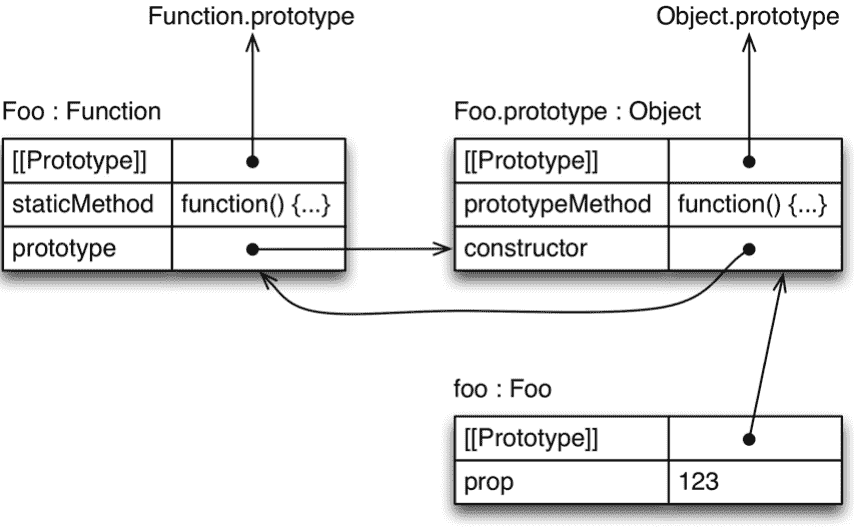

首先，伪方法 **constructor**。这个方法是特殊的，因为它定义了代表类的函数：

```
> Foo === Foo.prototype.constructor
true
> typeof Foo
'function'
```

它有时被称为 `class constructor`（类构造函数）。它具有普通构造函数所没有的特性（主要是能够通过 `super()` 调用其父构造函数，这将在后面解释）。

其次，**静态方法**。*静态属性*（或 *类属性*）是 `Foo` 本身的属性。如果你在方法定义前加上 `static`，就创建了一个类方法：

```
> typeof Foo.staticMethod
'function'
> Foo.staticMethod()
'classy'
```

第三，**原型方法**。Foo 的 *原型属性* 是 `Foo.prototype` 的属性。它们通常是方法，并由 Foo 的实例继承。

```
> typeof Foo.prototype.prototypeMethod
'function'
> foo.prototypeMethod()
'prototypical'
```

#### 16.2.2.2 静态数据属性

目前，类只允许你创建静态方法，而不能创建静态数据属性。对此有两种解决方法。

第一种，你可以手动添加一个静态属性：

```js
class Point {
    constructor(x, y) {
        this.x = x;
        this.y = y;
    }
}
Point.ZERO = new Point(0, 0);
```

第二种，你可以创建一个静态 getter：

```js
class Point {
    constructor(x, y) {
        this.x = x;
        this.y = y;
    }
    static get ZERO() {
        return new Point(0, 0);
    }
}
```

在这两种情况下，你都会得到一个可读取的 `Point.ZERO` 属性。在第一种情况下，你可以使用 `Object.defineProperty()` 来创建只读属性，但我更喜欢简单直接的赋值方式。

##### 16.2.2.3 Getter 和 setter

getter 和 setter 的语法与 [ECMAScript 5 对象字面量中的](http://speakingjs.com/es5/ch17.html#getters_setters)相同：

```js
class MyClass {
    get prop() {
        return 'getter';
    }
    set prop(value) {
        console.log('setter: '+value);
    }
}
```

你可以这样使用 `MyClass`。

```
> let inst = new MyClass();
> inst.prop = 123;
setter: 123
> inst.prop
'getter'
```

##### 16.2.2.4 计算属性方法名

你可以通过表达式来定义方法的名称，只需将其放在方括号中。例如，以下定义 `Foo` 的方式都是等价的。

```js
class Foo {
    myMethod() {}
}
```

```js
class Foo {
    ['my'+'Method']() {}
}
```

```js
const m = 'myMethod';
class Foo {
    [m]() {}
}
```

ECMAScript 6 中的几个特殊方法具有 symbol 类型的键。计算属性方法名允许你定义这样的方法。例如，如果一个对象具有键为 `Symbol.iterator` 的方法，它就是*可迭代的*。这意味着它的内容可以被 `for`-`of` 循环及其他语言机制遍历。

```js
class IterableClass {
    [Symbol.iterator]() {
        ...
    }
}
```

##### 16.2.2.5 生成器方法

如果你在方法定义前加上星号（*），它就成为了*生成器方法*。生成器在很多方面都很有用，其中之一就是用来定义键为 `Symbol.iterator` 的方法。下面的代码演示了它是如何工作的。

```js
class IterableArguments {
    constructor(...args) {
        this.args = args;
    }
    *[Symbol.iterator]() {
        for (let arg of this.args) {
            yield arg;
        }
    }
}
```

```js
for (let x of new IterableArguments('hello', 'world')) {
    console.log(x);
}
```

```
// 输出：
// hello
// world
```

## 16.2.3 子类化

`extends` 子句让你能够基于现有构造函数创建子类（无论该构造函数是否通过类定义）：

## 16.2.3.1 子类的原型是超类

在 ECMAScript 6 中，子类的原型是超类：

```
Object.getPrototypeOf(ColorPoint) === Point
true
```

这意味着静态属性会被继承：

```
class Foo {
    static classMethod() {
        return 'hello';
    }
}

class Bar extends Foo {
}
Bar.classMethod(); // 'hello'
```

你甚至可以 super 调用静态方法：

```
class Foo {
    static classMethod() {
        return 'hello';
    }
}

class Bar extends Foo {
    static classMethod() {
        return super.classMethod() + ', too';
    }
}
Bar.classMethod(); // 'hello, too'
```

## 16.2.3.2 超类构造函数调用

在派生类中，你必须在使用 this 之前调用 super()：

```
class Foo {}

class Bar extends Foo {
    constructor(num) {
        let tmp = num * 2; // OK
        this.num = num; // ReferenceError
        super();
        this.num = num; // OK
    }
}
```

隐式地离开派生构造函数而不调用 super() 也会导致错误：

```
class Foo {}

class Bar extends Foo {
    constructor() {
    }
}

let bar = new Bar(); // ReferenceError
```

## 16.2.3.3 覆盖构造函数的返回值

与 ES5 一样，你可以通过显式返回一个对象来覆盖构造函数的结果：

```
class Foo {
    constructor() {
        return Object.create(null);
    }
}
console.log(new Foo() instanceof Foo); // false
```

如果这样做，this 是否已经初始化并不重要。换句话说：如果以这种方式覆盖结果，在派生构造函数中不必调用 super()。

## 16.2.3.4 类的默认构造函数

如果没有为基类指定构造函数，则使用以下定义：

对于派生类，使用以下默认构造函数：

```
constructor(...args) {
    super(...args);
}
```

## 16.2.3.5 继承内置构造函数

在 ECMAScript 6 中，你终于可以继承所有内置构造函数（ES5³ 中有变通方法，但有重大限制）。

例如，你现在可以创建自己的异常类（在大多数引擎中将继承具有堆栈跟踪的特性）：

```
class MyError extends Error {
}
throw new MyError('Something happened!');
```

你还可以创建 `Array` 的子类，其实例能正确处理 `length`：

```
class MyArray extends Array {
    constructor(len) {
        super(len);
    }
}
```

```
// `MyArray` 的实例就像真正的 Array：
let myArr = new MyArray(0);
console.log(myArr.length); // 0
myArr[0] = 'foo';
console.log(myArr.length); // 1
```

注意，继承内置构造函数是引擎必须原生支持的，你无法通过转译器获得此功能。

## 16.3 类的细节

到目前为止我们看到的是类的基本要点。如果你只关心里面的运作原理，请继续阅读。让我们从类的语法开始。以下是 [ECMAScript 6 规范第 A.4 节⁴](http://www.ecma-international.org/ecma-262/6.0/#sec-functions-and-classes) 中显示的语法的稍修改版本。

类

223

```
ClassDeclaration:
    "class" BindingIdentifier ClassTail
ClassExpression:
    "class" BindingIdentifier? ClassTail

ClassTail:
    ClassHeritage? "{" ClassBody? "}"
ClassHeritage:
    "extends" AssignmentExpression
ClassBody:
    ClassElement+
ClassElement:
    MethodDefinition
    "static" MethodDefinition
    ";"

MethodDefinition:
    PropName "(" FormalParams ")" "{" FuncBody "}"
    "*" PropName "(" FormalParams ")" "{" GeneratorBody "}"
    "get" PropName "(" ")" "{" FuncBody "}"
    "set" PropName "(" PropSetParams ")" "{" FuncBody "}"

PropertyName:
    LiteralPropertyName
    ComputedPropertyName
LiteralPropertyName:
    IdentifierName /* foo */
    StringLiteral /* "foo" */
    NumericLiteral /* 123.45, 0xFF */
ComputedPropertyName:
    "[" Expression "]"
```

两个观察点：

- 要扩展的值可以由任意表达式产生。这意味着你可以编写如下代码：

    class Foo extends combine(MyMixin, MySuperClass) {}
- 方法之间允许使用分号。

## 16.3.1 各种检查

- 错误检查：类名不能是 `eval` 或 `arguments`；不允许重复的类元素名称；`constructor` 名称只能用于普通方法，不能用于 getter、setter 或生成器方法。
- 类不能被函数调用。如果被函数调用，会抛出 `TypeError`。
- 原型方法不能用作构造函数：

```
class C {
    m() {}
}
new C.prototype.m(); // TypeError
```

## 16.3.2 属性的特性

类声明创建（可变的）let 绑定。对于给定的类 `Foo`：

- 静态方法 `Foo.*` 是可写和可配置的，但不可枚举。使它们可写允许动态修补。
- 构造函数和其属性 `prototype` 中的对象有不可变的链接：
    - `Foo.prototype` 不可写、不可枚举、不可配置。
    - `Foo.prototype.constructor` 不可写、不可枚举、不可配置。
- 原型方法 `Foo.prototype.*` 是可写和可配置的，但不可枚举。

注意，对象字面量中的方法定义产生可枚举属性。

## 16.4 继承的细节

在 ECMAScript 6 中，继承看起来如下所示。

```
class Point {
    constructor(x, y) {
        this.x = x;
        this.y = y;
    }
    ...
}

class ColorPoint extends Point {
    constructor(x, y, color) {
super(x, y);
this.color = color;
}
...
}

let cp = new ColorPoint(25, 8, 'green');
```

这段代码产生以下对象。

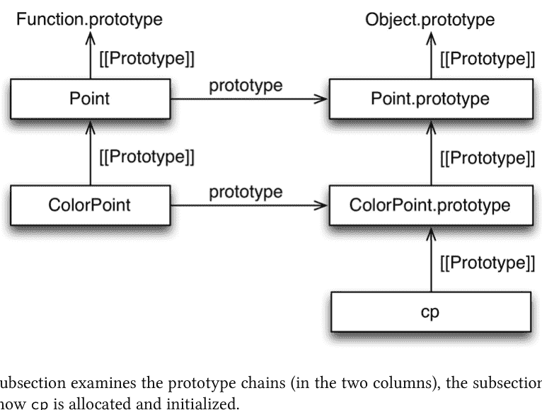

下一节将检查原型链（在两列中），再下一节将检查 cp 是如何分配和初始化的。

### 16.4.1 原型链

在图中，你可以看到有两条*原型链*（通过 [[Prototype]] 关系链接的对象，这是一种继承关系）：

- 左列：类（函数）。派生类的原型是它扩展的类。基类的原型是 Function.prototype，这也是函数的原型：

```
> const getProto = Object.getPrototypeOf.bind(Object);

> getProto(Point) === Function.prototype
true
> getProto(function () {}) === Function.prototype
true
```

- 右列：实例的原型链。类的全部目的就是建立这条原型链。原型链以 Object.prototype 结束（其原型为 null），这也是通过对象字面量创建的对象的原型：

```
> const getProto = Object.getPrototypeOf.bind(Object);

> getProto(Point.prototype) === Object.prototype
true
> getProto({}) === Object.prototype
true
```

左列的原型链导致静态属性被继承。

### 16.4.2 实例的分配和初始化

类构造函数之间的数据流与 ES5 中子类化的规范方式不同。在内部，大致如下所示。

```
// 实例在此处分配
function Point(x, y) {
    // 进入此构造函数之前执行：
    this = Object.create(new.target.prototype);

    this.x = x;
    this.y = y;
}
...

function ColorPoint(x, y, color) {
    // 进入此构造函数之前执行：
    this = uninitialized;

    this = Reflect.construct(Point, [x, y], new.target); // (A)
        // super(x, y);
```

class Point {
    constructor(x, y) {
        this.x = x;
        this.y = y;
    }
    toString() {
        return `(${this.x}, ${this.y})`;
    }
}

class ColorPoint extends Point {
    constructor(x, y, color) {
        super(x, y); // (A)
        this.color = color;
    }
    toString() {
        return super.toString() + ' in ' + this.color; // (B)
    }
}

同样，这个类的使用方式符合你的预期：

```
> let cp = new ColorPoint(25, 8, 'green');
> cp.toString()
'(25, 8) in green'

> cp instanceof ColorPoint
true
> cp instanceof Point
true
```

类有两种：

- Point 是一个*基类*，因为它没有 extends 子句。
- ColorPoint 是一个*派生类*。

使用 super 有两种方式：

- *类构造函数*（类定义中的伪方法 `constructor`）像函数调用一样使用它（`super(…)`），以进行超类构造函数调用（第 A 行）。
- 方法定义（在对象字面量或类中，带或不带 `static`）像属性引用（`super.prop`）或方法调用（`super.method(…)`）一样使用它，以引用超类属性（第 B 行）。


## 16.4.2.1 安全检查

- `this`在派生构造函数中最初是未初始化的，这意味着如果它们在调用`super()`之前以任何方式访问`this`，就会抛出错误。
- 一旦`this`被初始化，再次调用`super()`会产生一个`ReferenceError`。这可以防止你调用`super()`两次。
- 如果构造函数隐式返回（没有return语句），结果是`this`。如果`this`未初始化，会抛出`ReferenceError`。这可以防止你忘记调用`super()`。
- 如果构造函数显式返回一个非对象（包括`undefined`和`null`），结果是`this`（这种行为是为了保持与ES5及更早版本的兼容性）。如果`this`未初始化，会抛出`TypeError`。
- 如果构造函数显式返回一个对象，则该对象被用作其结果。此时`this`是否初始化并不重要。

## 16.4.2.2 extends 子句

让我们考察`extends`子句如何影响类的设置方式（[规范 14.5.14 节](http://www.ecma-international.org/ecma-262/6.0/#sec-runtime-semantics-classdefinitionevaluation)）。`extends`子句的值必须是"可构造的"（可通过`new`调用）。不过，`null`也是被允许的。

```
class C {
}
```

- 构造函数类型：base
- `C`的原型：`Function.prototype`（与普通函数相同）
- `C.prototype`的原型：`Object.prototype`（这也是通过对象字面量创建的对象的原型）

```
class C extends B {
}
```

- 构造函数类型：derived
- `C`的原型：`B`
- `C.prototype`的原型：`B.prototype`

```
class C extends Object {
}
```

- 构造函数类型：derived
- `C`的原型：`Object`
- `C.prototype`的原型：`Object.prototype`

注意与第一种情况的以下细微差别：如果没有`extends`子句，该类是基类并分配实例。如果一个类扩展了`Object`，它就是一个派生类，并且由`Object`分配实例。生成的实例（包括它们的原型链）是相同的，但实现方式不同。

```
class C extends null {
}
```

- 构造函数类型：derived
- C 的原型：Function.prototype
- C.prototype 的原型：null

这样的类可以让你避免在原型链中出现 Object.prototype。但这很少有用。此外，你必须小心：使用 new 调用这样的类会导致错误，因为默认构造函数会调用超类构造函数，而 Function.prototype（超类构造函数）不能被构造调用。消除错误的唯一方法是添加一个返回对象的构造函数：

```
class C extends null {
    constructor() {
        let _this = Object.create(new.target.prototype);
        return _this;
    }
}
```

`new.target`确保 C 可以正确地被继承——`_this`的原型将始终是 new 的操作数。

## 16.4.3 为什么不能在 ES5 中继承内置构造函数？

在 ECMAScript 5 中，大多数内置构造函数无法被继承（存在一些变通方法⁶）。为了理解原因，让我们使用经典的 ES5 模式来继承 Array。正如我们很快会发现的那样，这行不通。

```
function MyArray(len) {
    Array.call(this, len); // (A)
}
MyArray.prototype = Object.create(Array.prototype);
```

不幸的是，当我们实例化 MyArray 时，发现它不能正常工作：实例属性 length 不会在我们添加 Array 元素时做出响应：

```
> var myArr = new MyArray(0);
> myArr.length
0
> myArr[0] = 'foo';
> myArr.length
0
```

有两个障碍使 `myArr` 无法成为一个合格的 Array。

**第一个障碍：初始化。**你传递给构造函数 Array（在 A 行）的 this 完全被忽略了。这意味着你不能使用 Array 来设置为 MyArray 创建的实例。

```
> var a = [];
> var b = Array.call(a, 3);
> a !== b  // a 被忽略，b 是一个新对象
true
> b.length // 正确设置
3
> a.length // 未改变
0
```

**第二个障碍：分配。**Array 创建的实例对象是*异质的*（ECMAScript 规范用于描述具有普通对象不具备特性的对象的术语）：它们的属性 length 跟踪并影响 Array 元素的管理。一般来说，异质对象可以从头创建，但你不能将现有的普通对象转换为异质对象。不幸的是，这正是 Array 在 A 行被调用时必须做的：它必须将为 MyArray 创建的正常对象转换为异质 Array 对象。

### 16.4.3.1 解决方案：ES6 继承

在 ECMAScript 6 中，继承 Array 的方式如下：

```
class MyArray extends Array {
    constructor(len) {
        super(len);
    }
}
```

这可以工作（但这不是 ES6 转译器能够支持的，它取决于 JavaScript 引擎是否原生支持）：

```
> let myArr = new MyArray(0);
> myArr.length
0
> myArr[0] = 'foo';
> myArr.length
1
```

我们现在可以看到 ES6 的继承方法如何绕过这些障碍：

- 分配发生在基类构造函数中，这意味着`Array`可以分配一个异质对象。虽然新方法的大部分原因在于派生构造函数的行为，但这一步需要基类构造函数意识到`new.target`，并将`new.target.prototype`作为分配实例的原型。
- 初始化也发生在基类构造函数中，派生构造函数接收一个已初始化的对象并直接使用它，而不是将自己的实例传递给超类构造函数并要求它进行设置。

## 16.4.4 在方法中引用超类属性

以下 ES6 代码在 B 行进行了一个超类方法调用。

```
class Point {
    constructor(x, y) {
        this.x = x;
        this.y = y;
    }
    toString() { // (A)
        return `(${this.x}, ${this.y})`;
    }
}

class ColorPoint extends Point {
    constructor(x, y, color) {
        super(x, y);
        this.color = color;
    }
    toString() {
        return super.toString() // (B)
            + ' in ' + this.color;
    }
}
```

```
let cp = new ColorPoint(25, 8, 'green');
console.log(cp.toString()); // (25, 8) in green
```

要理解 super 调用如何工作，让我们看一下 `cp` 的对象图：

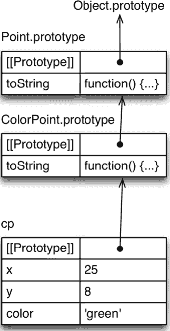

`ColorPoint.prototype.toString` 向它重写的那个方法（从 A 行开始）发起一个 super 调用（B 行）。让我们将存储方法的对象称为该方法的*归属对象*。例如，`ColorPoint.prototype` 就是 `ColorPoint.prototype.toString()` 的归属对象。

B 行的 super 调用涉及三个步骤：

1. 从当前方法的归属对象的原型开始搜索。
2. 查找一个名为 `toString` 的方法。该方法可能在搜索开始的对象中找到，或者在原型链的更后面找到。
3. 使用当前的 `this` 调用该方法。这样做的原因是：被 super 调用的方法必须能够访问相同的实例属性（在我们的例子中，是 `cp` 的属性）。

请注意，即使你只是获取或设置一个属性（不是调用方法），你仍然必须在步骤 #3 中考虑 `this`，因为该属性可能是通过 getter 或 setter 实现的。


## 类

让我们用三种不同但等效的方式来表达这些步骤：

```
// 变体1：ES5中的super方法调用
var result = Point.prototype.toString.call(this) // 步骤1,2,3
```

```
// 变体2：ES5，重构版
var superObject = Point.prototype; // 步骤1
var superMethod = superObject.toString; // 步骤2
var result = superMethod.call(this) // 步骤3
```

```
// 变体3：ES6
var homeObject = ColorPoint.prototype;
var superObject = Object.getPrototypeOf(homeObject); // 步骤1
var superMethod = superObject.toString; // 步骤2
var result = superMethod.call(this) // 步骤3
```

变体3是ECMAScript 6处理super调用的方式。这种方法由*环境*所具有的[两个内部绑定](http://www.ecma-international.org/ecma-262/6.0/#sec-function-environment-records)支持（*环境*为作用域中的变量提供存储空间，即所谓的绑定）：

- `[[thisValue]]`：这个内部绑定在ECMAScript 5中也存在，它存储this的值。
- `[[HomeObject]]`：指向环境所在函数的宿主对象。它通过所有使用super的方法都有的一个内部属性`[[HomeObject]]`来填充。这个绑定和属性都是ECMAScript 6中的新特性。

## 方法现在是一种特殊的函数

在类中，使用super的方法定义会创建一种特殊的函数：它仍然是一个函数，但它具有内部属性`[[HomeObject]]`。该属性由方法定义设置，在JavaScript中无法更改。因此，你无法有意义地将这样的方法移动到不同的对象上。（但也许在未来版本的ECMAScript中可以实现。）

## 16.4.4.1 在哪里可以使用super？

每当涉及原型链时，引用super属性都很方便，这就是为什么你可以在对象字面量和类定义的方法定义中使用它（类可以是派生的，也可以不是；方法可以是静态的，也可以不是）。

在函数声明、函数表达式和生成器函数中，不允许使用super来引用属性。

### 16.4.4.2 使用`super`的方法不能被移动

你不能移动一个使用super的方法：这样的方法有一个内部属性[[HomeObject]]，将其绑定到它被创建的对象。如果你通过赋值移动它，它将继续引用原始对象的super属性。在未来的ECMAScript版本中，可能会有一种方法来转移这样的方法。

## 16.5 通过JavaScript代码解释构造函数调用

本节中的JavaScript代码是对规范如何描述构造函数调用和super构造函数调用的一个简化版本。如果你更喜欢代码而不是人类语言的解释，这可能会让你感兴趣。在我们深入探讨实际功能之前，我们需要理解一些其他机制。

### 16.5.1 内部变量和属性

规范使用双括号（[[Foo]]）书写内部变量和属性。在代码中，我使用双下划线代替（__Foo__）。

代码中使用的内部变量：

- [[NewTarget]]：触发当前构造函数调用的new运算符的操作数（如果通过super()递归调用[[Construct]]，则会传递下去）。
- [[thisValue]]：存储this的值。
- [[FunctionObject]]：指向当前正在执行的函数。

代码中使用的内部属性：

- [[Construct]]：所有构造函数（包括由类创建的构造函数）都有这个自己的（非继承的）方法。它实现构造函数调用，并由new调用。
- [[ConstructorKind]]：构造函数的一个属性，其值为‘base’或‘derived’。

### 16.5.2 环境

*环境*为变量提供存储空间，每个作用域有一个环境。环境以栈的方式管理。栈顶的环境被认为是活动的。以下代码是环境如何处理的一个概要。

### 16.5.3 构造函数调用

让我们从默认方式（ES6规范第9.2.3节[^8]）开始，这是函数处理构造函数调用的方式：

```
/**
 * 函数环境是特殊的，它们比其他环境多一些
 * 内部变量。
 * （这里没有显示`Environment`）
 */
class FunctionEnvironment extends Environment {
    constructor(Func) {
        // __FunctionObject__是一个特定于函数的
        // 内部变量
        this.__FunctionObject__ = Func;
    }
}
```

```
/**
 * 将一个环境压入栈
 */
function PushEnvironment(env) { ... }
```

```
/**
 * 从栈中弹出最顶部的环境
 */
function PopEnvironment() { ... }
```

```
/**
 * 在栈上查找最顶部的函数环境
 */
function GetThisEnvironment() { ... }
```

[^8]: http://www.ecma-international.org/ecma-262/6.0/#sec-ecmascript-function-objects-construct-argumentslist-newtarget

```
/**
 * 所有可构造的函数都有这个自己的方法，
 * 它由`new`运算符调用
 */
AnyFunction.__Construct__ = function (args, newTarget) {
    let Constr = this;
    let kind = Constr.__ConstructorKind__;

    let env = new FunctionEnvironment(Constr);
    env.__NewTarget__ = newTarget;
    if (kind === 'base') {
        env.__thisValue__ = Object.create(newTarget.prototype);
    } else {
        // 当`this`未初始化时，获取或设置它
        // 会抛出`ReferenceError`
        env.__thisValue__ = uninitialized;
    }

    PushEnvironment(env);
    let result = Constr(...args);
    PopEnvironment();

    // 让我们假设有一种方法可以判断`result`
    // 是否被显式返回
    if (WasExplicitlyReturned(result)) {
        if (isObject(result)) {
            return result;
        }
        // 显式返回一个原始值
        if (kind === 'base') {
            // 基础构造函数必须向后兼容
            return env.__thisValue__; // 总是已初始化的！
        }
        throw new TypeError();
    }
    // 隐式返回
    if (env.__thisValue__ === uninitialized) {
        throw new ReferenceError();
    }
    return env.__thisValue__;
}
```

### 16.5.4 super构造函数调用

super构造函数调用的处理如下（ES6规范第12.3.5.1节）。

```
/**
 * 处理super构造函数调用
 */
function super(...args) {
  let env = GetThisEnvironment();
  let newTarget = env.__NewTarget__;
  let activeFunc = env.__FunctionObject__;
  let superConstructor = Object.getPrototypeOf(activeFunc);

  env.__thisValue__ = superConstructor
    .__Construct__(args, newTarget);
}
```

## 16.6 species模式

内置构造函数的另一个机制在ECMAScript 6中变得可扩展：如果像`Array.prototype.map()`这样的方法返回一个新实例，它应该使用什么构造函数来创建该实例？

以下三个小节中使用的辅助函数：

```
function isObject(value) {
  return (value !== null
    && (typeof value === 'object'
        || typeof value === 'function'));
}

/**
 * 规范内部操作，用于确定`x`是否可以用作构造函数。
 */
function isConstructor(x) {
  ...
}
```

### 16.6.1 标准species模式

用于自定义由`Array.prototype.map()`等方法创建的实例的模式称为*species模式*：

- 如果`this.constructor[Symbol.species]`存在，则使用它作为新实例的构造函数。
- 否则，使用默认构造函数（例如，对于数组是Array）。

在JavaScript中实现，这个模式看起来像这样：

```
function SpeciesConstructor(O, defaultConstructor) {
    let C = O.constructor;
    if (C === undefined) {
        return defaultConstructor;
    }
    if (! isObject(C)) {
        throw new TypeError();
    }
    let S = C[Symbol.species];
    if (S === undefined || S === null) {
        return defaultConstructor;
    }
    if (! isConstructor(S)) {
        throw new TypeError();
    }
    return S;
}
```

> 数组的标准species模式在规范中通过操作SpeciesConstructor() [^10]实现。

### 16.6.2 数组的species模式

这是species模式如何用于数组的一个近似表示：

```
function ArraySpeciesCreate(originalArray, length) {
    let C = undefined;
    if (Array.isArray(originalArray)) {
        C = originalArray.constructor;
        if (isObject(C)) {
            C = C[Symbol.species];
        }
    }
    if (C === undefined || C === null) {
        return new Array(length);
    }
    if (! IsConstructor(C)) {
        throw new TypeError();
    }
    return new C(length);
}
```

`Array.prototype.map()` 通过 `ArraySpeciesCreate(this, this.length)` 创建它返回的数组。

> 数组的物种模式（species pattern）在规范中通过操作 `ArraySpeciesCreate()`¹¹ 实现。

## 16.6.3 静态方法中的物种模式

Promise 使用了一种物种模式的变体用于静态方法，例如 `Promise.all()`¹²：

```
let C = this; // 默认值
if (! isObject(C)) {
    throw new TypeError();
}
// 默认值可以通过属性 `C[Symbol.species]` 被覆盖
let S = C[Symbol.species];
if (S !== undefined && S !== null) {
    C = S;
}
if (!IsConstructor(C)) {
    throw new TypeError();
}
let instance = new C(···);
```

## 16.6.4 在子类中覆盖默认物种

这是属性 `[Symbol.species]` 的默认 getter：

```
static get [Symbol.species]() {
    return this;
}
```

这个默认的 getter 由内建类 `Array`、`ArrayBuffer`、`Map`、`Promise`、`RegExp`、`Set` 和 `%TypedArray%` 实现。它会自动被这些内建类的子类继承。

有两种方式可以覆盖默认物种：使用你选择的构造函数，或使用 `null`。

### 16.6.4.1 将物种设置为你选择的构造函数

你可以通过静态 getter 来覆盖默认物种（第 A 行）：

```
class MyArray1 extends Array {
    static get [Symbol.species]() { // (A)
        return Array;
    }
}
```

结果是，`map()` 返回一个 `Array` 的实例：

```
let result1 = new MyArray1().map(x => x);
console.log(result1 instanceof Array); // true
```

如果你不覆盖默认物种，`map()` 返回子类的实例：

```
class MyArray2 extends Array { }
```

```
let result2 = new MyArray2().map(x => x);
console.log(result2 instanceof MyArray2); // true
```

### 16.6.4.1.1 通过数据属性指定物种

如果你不想使用静态 getter，你需要使用 `Object.defineProperty()`。你不能使用赋值，因为已经存在一个只有 getter 的同名属性。这意味着它是只读的，无法被赋值。

例如，这里我们将 `MyArray1` 的物种设置为 `Array`：

```
Object.defineProperty(
    MyArray1, Symbol.species, {
        value: Array
    });
```

### 16.6.4.2 将物种设置为 null

如果你将物种设置为 `null`，那么将使用默认构造函数（具体是哪一个取决于所使用的物种模式变体，详情请参考前面的章节）。

```
class MyArray3 extends Array {
    static get [Symbol.species]() {
        return null;
    }
}
```

```
let result3 = new MyArray3().map(x => x);
console.log(result3 instanceof Array); // true
```

## 16.7 关于类的常见问题

### 16.7.1 为什么类不能被函数式调用？

目前禁止通过函数式调用类。这样做是为了保留未来的选择余地，以便最终添加一种通过类处理函数调用的方式。一种可能性是通过一个特殊方法来实现（例如 `[Symbol.functionCall]`）。

### 16.7.2 给定一个参数数组，如何实例化一个类？

对于类来说，什么是 `Function.prototype.apply()` 的等价物？也就是说，如果我有一个类 `TheClass` 和一个参数数组 `args`，如何实例化 `TheClass`？

一种方法是通过展开运算符（`...`）：

```
function instantiate(TheClass, args) {
    return new TheClass(...args);
}
```

另一种选择是使用 `Reflect.construct()`：

```
function instantiate(TheClass, args) {
    return Reflect.construct(TheClass, args);
}
```

### 16.7.3 如何管理类的私有数据？

两种 ES5 的私有数据保护方式¹³也适用于类：

1. 你可以在类构造函数的环境中保留私有数据。我一直不喜欢这种方式，因为它迫使你向实例添加特权方法。
2. 你可以使用命名约定（例如前缀下划线）来标记私有属性。我喜欢这种方式。它不能提供完全保护，也会稍微混乱属性命名空间，但它能产生简单的代码。

在 ECMAScript 6 中，你还可以额外使用 `WeakMap` 来保存私有数据，这提供了方式 #1 usable`的完全保护，但代码更加优雅。这是如何做到的一个例子，详情请解释于[关于 WeakMaps 的章节](link)：

```
let _counter = new WeakMap();
let _action = new WeakMap();
class Countdown {
    constructor(counter, action) {
        _counter.set(this, counter);
        _action.set(this, action);
    }
    dec() {
        let counter = _counter.get(this);
        if (counter < 1) return;
        counter--;
        _counter.set(this, counter);
        if (counter === 0) {
            _action.get(this)();
        }
    }
}
```

### 16.7.4 类的下一步发展是什么？

类的设计格言是"**极简主义**"。曾讨论过几种高级特性，但最终被舍弃，以便获得一个能被 TC39 一致通过的设计。

> ¹³[Speaking JS] "Keeping Data Private"

ECMAScript 的未来版本现在可以扩展这个最小化设计——类将为诸如 traits（或 mixins）、值对象（内容相同的对象被视为相等）和 const 类（产生不可变实例）等特性提供基础。

## 16.8 类的优缺点

类在 JavaScript 社区中存在争议：一方面，来自基于类的语言的人们很高兴他们不必再处理 JavaScript 的非传统继承机制。另一方面，许多 JavaScript 程序员认为 JavaScript 复杂之处不在于原型继承，而在于构造函数。

ES6 类带来了几个明显的优势：

- 它们与大量现有代码向后兼容。
- 与构造函数和构造函数继承相比，类让初学者更容易上手。
- 子类化在语言内部得到支持。
- 内建构造函数可被继承。
- 不再需要继承库；代码在不同框架之间将更具可移植性。
- 它们为未来高级特性提供基础：traits（或 mixins）、不可变实例等。
- 它们有助于静态分析代码的工具（IDE、类型检查器、样式检查器等）。

让我们看看关于 ES6 类的一些常见抱怨。你会看到我在多数方面表示同意，但我也认为类的优势远大于其劣势。我很高兴它们被纳入 ES6，并且我建议使用它们。

### 16.8.1 抱怨：ES6 类掩盖了 JavaScript 继承的真实本质

是的，ES6 类确实掩盖了 JavaScript 继承的真实本质。类的外观（语法）与其行为（语义）之间存在一种不幸的脱节：它看起来像一个对象，但它是一个函数。我的偏好是让类成为*构造函数对象*，而不是构造函数函数。我在 [Proto.js 项目](https://github.com/rauschma/proto-js)¹⁴中通过一个小型库探索了这种方法（这证明了这种方法是多么合适）。

然而，向后兼容性很重要，因此类作为构造函数函数也有其道理。这样，ES6 代码和 ES5 代码更具互操作性。

¹⁴ https://github.com/rauschma/proto-js

语法和语义之间的脱节将在 ES6 及以后造成一些摩擦。但你可以简单地按字面意思接受 ES6 类，从而过上舒适的生活。我不认为这种幻觉会对你造成伤害。新手可以更快速地上手，然后再去了解幕后发生了什么（在他们对语言更加熟悉之后）。

### 16.8.2 抱怨：类只提供单继承

类只提供单继承，这严重限制了你在面向对象设计方面的表达自由。然而，计划一直是让它们成为多重继承机制（如 traits）的基础。

**traits.js：JavaScript 的 traits 库**

如果你对 traits 的工作原理感兴趣，请查看 [traits.js](http://soft.vub.ac.be/~tvcutsem/traitsjs/)（它们类似于你可能熟悉的 mixins）。

然后类就变成了一个可实例化的实体和一个组装 traits 的位置。在那之前，如果你想要多重继承，你需要借助库。

### 16.8.3 抱怨：由于强制的 new，类把你锁死了

如果你想实例化一个类，你在 ES6 中被迫使用 `new`。这意味着你无法在不改变调用点的情况下从类切换到工厂函数。这确实是一个限制，但有两个缓解因素：

- 你可以通过从类的 `constructor` 方法返回一个对象来覆盖 `new` 运算符返回的默认结果。
- 由于内置的模块和类，ES6 让 IDE 更容易重构代码。因此，从 `new` 切换到函数调用将变得简单。显然，如果你无法控制调用你代码的代码，这就帮不上忙了（比如对于库来说）。

因此，类在*语法上*确实*某种程度上*限制了你，但一旦 JavaScript 有了 traits，它们在*概念上*就不会限制你了（就面向对象设计而言）。

## 16.9 延伸阅读

以下文档是本章的重要来源：

- "[Instantiation Reform: One last time](https://github.com/rwaldron/tc39-notes/blob/master/es6/2015-01/jan2015-allen-slides.pdf)"，Allen Wirfs-Brock 的幻灯片。


## 17. 模块

本章解释了ECMAScript 6中内置模块的工作原理。

## 17.1 概述

在ECMAScript 6中，模块存储在文件中。每个文件恰好包含一个模块，每个模块对应一个文件。你有两种方式从模块中导出内容。这两种方式可以混合使用，但通常最好分开使用。

### 17.1.1 多个命名导出

可以有多个*命名导出*：

```
//------ lib.js ------
export const sqrt = Math.sqrt;
export function square(x) {
    return x * x;
}
export function diag(x, y) {
    return sqrt(square(x) + square(y));
}
```

```
//------ main.js ------
import { square, diag } from 'lib';
console.log(square(11)); // 121
console.log(diag(4, 3)); // 5
```

你也可以导入整个模块：

```
//------ main.js ------
import * as lib from 'lib';
console.log(lib.square(11)); // 121
console.log(lib.diag(4, 3)); // 5
```

### 17.1.2 单个默认导出

可以有一个*默认导出*。例如，一个函数：

```
//------ myFunc.js ------
export default function () { ... } // 没有分号！
```

```
//------ main1.js ------
import myFunc from 'myFunc';
myFunc();
```

或者一个类：

```
//------ MyClass.js ------
export default class { ... } // 没有分号！
```

```
//------ main2.js ------
import MyClass from 'MyClass';
let inst = new MyClass();
```

注意，如果默认导出一个函数或一个类（它们是匿名声明），末尾没有分号。

### 17.1.3 浏览器：脚本与模块

| | 脚本 | 模块 |
| --- | --- | --- |
| HTML 元素 | `<script>` | `<script type="module">` |
| 顶层变量作用域 | 全局 | 模块局部 |
| 顶层 `this` 的值 | `window` | `undefined` |
| 执行方式 | 同步 | 异步 |
| 声明式导入（`import` 语句） | 否 | 是 |
| 编程式导入（基于 Promise 的 API） | 是 | 是 |
| 文件扩展名 | .js | .js |

## 17.2 JavaScript 中的模块

尽管JavaScript从未内置模块，但社区已经形成了一种简单的模块风格，该风格在ES5及更早版本的库中得到支持。这种风格也被ES6采纳：

- 每个模块是一段加载后执行一次的代码。
- 在该代码中，可能有声明（变量声明、函数声明等）。
  - 默认情况下，这些声明的作用域限于模块内部。
  - 你可以将其中一些标记为导出，这样其他模块就可以导入它们。
- 模块可以从其他模块导入内容。它通过*模块标识符*引用这些模块，这些标识符是字符串，可以是：
    - 相对路径（`'../model/user'`）：这些路径相对于导入模块的位置进行解释。文件扩展名 `.js` 通常可以省略。
    - 绝对路径（`'/lib/js/helpers'`）：直接指向要导入模块的文件。
    - 名称（`'util'`）：模块名称指向什么需要配置。
- 模块是单例。即使一个模块被多次导入，也只存在一个“实例”。

这种模块方法避免了全局变量，唯一全局的是模块标识符。

### 17.2.1 ECMAScript 5 模块系统

令人印象深刻的是，ES5模块系统在没有语言显式支持的情况下工作得如此出色。两个最重要（但不幸的是不兼容）的标准是：

- **CommonJS 模块**：该标准的主要实现在 [Node.js¹](http://nodejs.org/api/modules.html) 中（Node.js模块有一些超出CommonJS的特性）。特点：
    - 语法紧凑
    - 设计用于同步加载
    - 主要用途：服务器
- **异步模块定义（AMD）**：该标准最流行的实现是 [RequireJS²](http://requirejs.org/)。特点：
    - 语法略复杂，使AMD无需 `eval()`（或编译步骤）即可工作
    - 设计用于异步加载
    - 主要用途：浏览器

以上只是ES5模块的简化说明。如果你想深入了解，请参阅Addy Osmani的“使用AMD、CommonJS和ES Harmony编写模块化JavaScript³”。

### 17.2.2 ECMAScript 6 模块

ECMAScript 6模块的目标是创建一种格式，让CommonJS和AMD的用户都满意：

- 与CommonJS类似，它们语法紧凑，偏好单一导出，并支持循环依赖。
- 与AMD类似，它们直接支持异步加载和可配置的模块加载。

内置在语言中使ES6模块超越了CommonJS和AMD（细节稍后解释）：

- 它们的语法比CommonJS更紧凑。
- 它们的结构可以被静态分析（用于静态检查、优化等）。
- 它们对循环依赖的支持比CommonJS更好。

ES6模块标准包含两部分：

- 声明式语法（用于导入和导出）
- 编程式加载器API：用于配置模块如何加载以及有条件地加载模块

## 17.3 ES6 模块基础

有两种导出：命名导出（每个模块可以有多个）和默认导出（每个模块一个）。

### 17.3.1 命名导出（每个模块多个）

模块可以通过在其声明前加上关键字 `export` 来导出多个内容。这些导出通过它们的名称区分，称为*命名导出*。

```
//------ lib.js ------
export const sqrt = Math.sqrt;
export function square(x) {
    return x * x;
}

export function diag(x, y) {
    return sqrt(square(x) + square(y));
}

//------ main.js ------
import { square, diag } from 'lib';
console.log(square(11)); // 121
console.log(diag(4, 3)); // 5
```

还有其他方法指定命名导出（稍后解释），但我发现这种方法很方便：只需像没有外部世界一样编写代码，然后用关键字标记你想要导出的所有内容。

如果你愿意，也可以导入整个模块，并通过属性表示法引用其命名导出：

```
//------ main.js ------
import * as lib from 'lib';
console.log(lib.square(11)); // 121
console.log(lib.diag(4, 3)); // 5
```

**CommonJS语法中的相同代码：** 有一段时间，我尝试了几种聪明的策略来减少在Node.js中模块导出的冗余。现在我更喜欢以下简单但略显冗长的风格，它让人想起[揭示模块模式](http://christianheilmann.com/2007/08/22/again-with-the-module-pattern-reveal-something-to-the-world/)：

```
//------ lib.js ------
var sqrt = Math.sqrt;
function square(x) {
    return x * x;
}
function diag(x, y) {
    return sqrt(square(x) + square(y));
}
module.exports = {
    sqrt: sqrt,
    square: square,
    diag: diag,
};
```

```
//------ main.js ------
var square = require('lib').square;
var diag = require('lib').diag;
console.log(square(11)); // 121
console.log(diag(4, 3)); // 5
```

### 17.3.2 默认导出（每个模块一个）

只导出单个值的模块在Node.js社区中非常流行。但它们在前端开发中也很常见，在前端开发中，你通常有用于模型和组件的类，每个模块一个类。ES6模块可以选择一个*默认导出*，即主要的导出值。默认导出特别容易导入。

以下ECMAScript 6模块“是”一个函数：

```
//------ myFunc.js ------
export default function () {} // 没有分号！

//------ main1.js ------
import myFunc from 'myFunc';
myFunc();
```

默认导出为类的ECMAScript 6模块如下所示：

```
//------ MyClass.js ------
export default class {} // 没有分号！

//------ main2.js ------
import MyClass from 'MyClass';
let inst = new MyClass();
```

默认导出有两种风格：

1. 声明的标签
2. 值的直接导出（由表达式产生）

#### 17.3.2.1 默认导出风格1：声明的标签

你可以在任何函数声明（或生成器函数声明）或类声明前加上关键字 `export default`，使其成为默认导出：

```
export default function foo() {} // 没有分号！
export default class Bar {} // 没有分号！
```

你也可以在这种情况下省略名称。这使得默认导出成为JavaScript中唯一拥有匿名函数声明和匿名类声明的地方：

```
export default function () {} // 没有分号！
export default class {} // 没有分号！
```


 ## 17.3.2.1.1 为什么使用匿名函数声明而不是匿名函数表达式？

当你看前面两行代码时，你可能会认为 `export default` 的操作数应该是表达式。它们之所以是声明，是为了保持一致性：操作数可以是有名称的声明，如果将它们的匿名版本解释为表达式，那会让人困惑（比引入新的声明类型还要令人困惑）。

如果你希望操作数被解释为表达式，你需要使用括号：

```
export default (function () {});
export default (class {});
```

## 17.3.2.2 默认导出风格 2：直接默认导出值

这些值是通过表达式产生的：

```
export default 'abc';
export default foo();
export default /^xyz$/;
export default { no: false, yes: true };
export default 5 * 7;
```

每个默认导出都具有以下结构。

`export default «expression»`;

这等价于：

`const __default__ = «expression»;
export { __default__ as default }; // (A)`

第 A 行的语句是一个 *导出子句*（export clause，在后面的章节中解释）。

## 17.3.2.2.1 为什么会有两种默认导出风格？

引入第二种默认导出风格是因为，如果变量声明了多个变量，就无法有意义地将其转换为默认导出：

```
export default const foo = 1, bar = 2, baz = 3; // 这不是合法的 JavaScript！
```

`foo`、`bar` 和 `baz` 这三个变量中，哪一个会作为默认导出呢？

## 17.3.3 导入会被提升

模块导入会被提升（在内部被移动到当前作用域的顶部）。因此，你在模块中的什么位置提到它们并不重要，下面的代码可以毫无问题地工作：

```
foo();

import { foo } from 'my_module';
```

## 17.3.4 导入是对导出的只读视图

ES6 模块的导入是对导出实体的只读视图。这意味着与模块体内声明的变量的连接保持实时，如下面的代码所示。

```
//------ lib.js ------
export let counter = 3;
export function incCounter() {
    counter++;
}
```

```
//------ main.js ------
import { counter, incCounter } from './lib';

// 导入的值 `counter` 是实时的
console.log(counter); // 3
incCounter();
console.log(counter); // 4
```

其底层工作原理在[后面的章节](#)中解释。

导入作为视图具有以下优点：

- 它们支持循环依赖，即使是非限定导入（如下一节所述）。
- 限定导入和非限定导入的工作方式相同（它们都是间接引用）。
- 你可以将代码拆分到多个模块中，它仍然可以正常工作（只要你不会尝试更改导入的值）。

## 17.3.5 对循环依赖的支持

如果模块 A 和 B 相互导入，即 A（可能间接/传递地）导入 B，同时 B 也导入 A，则它们是[循环依赖](#)⁵。如果可能的话，应避免循环依赖，它们会导致 A 和 B *紧密耦合*——它们只能一起使用和演进。

既然这样，为什么还要支持循环依赖呢？偶尔，你无法回避它们，这就是为什么支持循环依赖是一个重要的功能。[后面的章节](#)有更多相关信息。

让我们看看 CommonJS 和 ECMAScript 6 如何处理循环依赖。

## 17.3.5.1 CommonJS 中的循环依赖

以下 CommonJS 代码正确处理了两个模块 a 和 b 相互循环依赖的情况。

```
//------ a.js ------
var b = require('b');
function foo() {
    b.bar();
}
exports.foo = foo;

//------ b.js ------
var a = require('a'); // (i)
function bar() {
    if (Math.random()) {
        a.foo(); // (ii)
    }
}
exports.bar = bar;
```

如果先导入模块 a，那么在第 i 行，模块 b 会在导出被添加之前就获得 a 的导出对象。因此，b 无法在其顶层访问 a.foo，但一旦 a 的执行完成，该属性就存在了。如果之后调用 bar()，那么第 ii 行的方法调用就可以正常工作。

一般来说，请记住，在循环依赖的情况下，你无法在模块体中访问导入。这是该现象的固有特性，在 ECMAScript 6 模块中也不会改变。

CommonJS 方法的局限性在于：

- Node.js 风格的单值导出不起作用。在那里，你导出的是单个值而不是对象：

```
module.exports = function () { ... };
```

如果模块 a 这样做，那么模块 b 的变量 a 在赋值完成后将不会被更新。它将继续指向原始的导出对象。

- 你不能直接使用命名导出。也就是说，模块 b 不能像这样导入 foo：

```
var foo = require('a').foo;
```

foo 将会是 undefined。换句话说，你别无选择，只能通过 a.foo 来引用 foo。

这些局限性意味着导出方和导入方都必须意识到循环依赖的存在，并显式地支持它们。

## 17.3.5.2 ECMAScript 6 中的循环依赖

ES6 模块自动支持循环依赖。也就是说，它们没有上一节提到的 CommonJS 模块的两个局限性：默认导出可以工作，非限定命名导入也可以工作（下面示例中的第 i 行和第 iii 行）。因此，你可以这样实现相互循环依赖的模块：

```
//------ a.js ------
import {bar} from 'b'; // (i)
export function foo() {
    bar(); // (ii)
}
```

```
//------ b.js ------
import {foo} from 'a'; // (iii)
export function bar() {
    if (Math.random()) {
        foo(); // (iv)
    }
}
```

这段代码可以工作，因为正如上一节所述，导入是对导出的视图。这意味着即使是非限定导入（如第 ii 行的 bar 和第 iv 行的 foo）也是指向原始数据的间接引用。因此，面对循环依赖时，无论你是通过非限定导入还是通过其模块来访问命名导出，都存在间接引用，并且它总是有效的。

## 17.3.6 模块文件是普通的 JavaScript 文件

以下类型的文件都具有 `.js` 扩展名：

1. ECMAScript 6 模块
2. CommonJS 模块（例如通过 npm 交付的）
3. AMD 模块
4. 脚本文件（通过 HTML 文件中的 `<script src="file.js">` 加载）

也就是说，所有这些文件都只是"JavaScript 文件"。如何解释它们取决于使用它们的上下文。

## 17.3.7 谨慎使用 ES6 转译器

像 Babel 这样的 ES6 转译器将 ES6 模块编译为 ES5。在纯 JavaScript 中，导入作为对导出的视图这一特性很难实现。但集成传统模块系统则更加困难。因此，我建议保持简单，并对 ES6 模块中较为奇特的特性保持谨慎。

## 17.4 导入和导出的详细说明

### 17.4.1 导入风格

ECMAScript 6 提供了几种导入⁶风格：

- 默认导入：

```
import localName from 'src/my_lib';
```

- 命名空间导入：将模块作为对象导入（每个雪铁龙导出对应一个属性）。

```
import * as my_lib from 'src/my_lib';
```

- 命名导入：

```
import { name1, name2 } from 'src/my_lib';
```

你可以重命名命名导入：

```
// 重命名：将 `name1` 导入为 `localName1`
import { name1 as localName1, name2 } from 'src/my_lib';
```

- 空导入：仅加载模块，不导入任何内容。程序中第一个这样的导入会执行模块的主体。

```
import 'src/my_lib';
```

只有两种方式来组合这些风格，而且它们出现的顺序是固定的；默认导出总是排在第一位。

- 将默认导入与命名空间导入组合：

```
import theDefault, * as my_lib from 'src/my_lib';
```

- 将默认导入与命名导入组合

```
import theDefault, { name1, name2 } from 'src/my_lib';
```

### 17.4.2 导出风格：内联与子句

有两种方式⁷可以导出当前模块内部的内容。一方面，你可以用关键字 export 标记声明。


export var myVar1 = ...;
export let myVar2 = ...;
export const MY_CONST = ...;

export function myFunc() {
    ...
}
export function* myGeneratorFunc() {
    ...
}
export class MyClass {
    ...
}

默认导出（default export）的"操作数"是一个表达式（包括函数表达式和类表达式）。示例：

```
export default 123;
export default function (x) {
    return x
}
export default x => x;
export default class {
    constructor(x, y) {
        this.x = x;
        this.y = y;
    }
}
```

另一方面，你可以在模块末尾列出所有要导出的内容（这在风格上再次类似于揭示模块模式）。

```
const MY_CONST = ...;
function myFunc() {
    ...
}

export { MY_CONST, myFunc };
```

你也可以导出不同名称的内容：

```
export { MY_CONST as FOO, myFunc };
```

### 17.4.3 重新导出（Re-exporting）

重新导出意味着将另一个模块的导出添加到当前模块的导出中。你可以添加另一个模块的所有导出：

```
export * from 'src/other_module';
```

`export *` 会忽略默认导出。

或者你可以更有选择性地导出（可选择重命名）：

```
export { foo, bar } from 'src/other_module';
```

```
// 重命名：将 other_module 的 foo 导出为 myFoo
export { foo as myFoo, bar } from 'src/other_module';
```

### 17.4.3.1 将重新导出设为默认导出

以下语句将另一个模块 foo 的默认导出设为当前模块的默认导出：

```
export { default } from 'foo';
```

以下语句将模块 foo 的命名导出 myFunc 设为当前模块的默认导出：

```
export { myFunc as default } from 'foo';
```

### 17.4.4 所有导出风格

ECMAScript 6 提供了多种导出风格：

-   重新导出：
    -   重新导出所有内容（除了默认导出）：
        ```
        export * from 'src/other_module';
        ```
    -   通过子句重新导出：
        ```
        export { foo as myFoo, bar } from 'src/other_module';
        ```
-   通过子句导出：
    ```
    export { MY_CONST as FOO, myFunc };
    ```
-   内联导出：
    -   变量声明：
        ```
        export var foo;
        export let foo;
        export const foo;
        ```
    -   函数声明：
        ```
        export function myFunc() {}
        export function* myGenFunc() {}
        ```
    -   类声明：
        ```
        export class MyClass() {}
        ```
-   默认导出：
    -   函数声明（可以是匿名的，但仅限此处）：
        ```
        export default function myFunc() {}
        export default function () {}
        export default function* myGenFunc() {}
        export default function* () {}
        ```
    -   类声明（可以是匿名的，但仅限此处）：
        ```
        export default class MyClass() {}
        export default class () {}
        ```
    -   表达式：导出值。注意末尾的分号。
        ```
        export default foo;
        export default 'Hello world!';
        export default 3 * 7;
        export default (function () {});
        ```

### 17.4.5 在模块中同时拥有命名导出和默认导出

以下模式在 JavaScript 中出奇地常见：一个库是单个函数，但额外服务通过该函数的属性提供。例子包括 jQuery 和 Underscore.js。以下是作为 CommonJS 模块的 Underscore 的概略：

```
//------ underscore.js ------
var _ = function (obj) {
    ...
};
var each = _.each = _.forEach =
    function (obj, iterator, context) {
        ...
    };
module.exports = _;

//------ main.js ------
var _ = require('underscore');
var each = _.each;
...
```

戴上 ES6 的眼镜来看，函数 _ 是默认导出，而 each 和 forEach 是命名导出。事实证明，你实际上可以同时拥有命名导出和默认导出。例如，前面这个 CommonJS 模块重写成 ES6 模块后看起来像这样：

```
//------ underscore.js ------
export default function (obj) {
    ...
}
export function each(obj, iterator, context) {
    ...
}
export { each as forEach };

//------ main.js ------
import _, { each } from 'underscore';
...
```

请注意，CommonJS 版本和 ECMAScript 6 版本只是大致相似。后者具有扁平结构，而前者是嵌套的。

对于 ES6 模块，我通常建议在一个模块中要么只有默认导出，要么只有命名导出。也就是说，你不应该混用这些不同的导出风格。

### 17.4.5.1 默认导出只是另一种命名导出

默认导出实际上只是名称为特殊名称 `default` 的命名导出。也就是说，以下两个语句是等价的：

```
import { default as foo } from 'lib';
import foo from 'lib';
```

同样，以下两个模块具有相同的默认导出：

```
//------ module1.js ------
export default function foo() {} // 函数声明！

//------ module2.js ------
function foo() {}
export { foo as default };
```

### 17.4.5.2 default：可以作导出名，但不能作变量名

你不能使用保留字（如 `default` 和 `new`）作为变量名，但可以将它们用作导出名（在 ECMAScript 5 中，你也可以将它们用作属性名）。如果你想直接导入此类命名导出，必须将它们重命名为合适的变量名。

这意味着 `default` 只能出现在重命名导入的左侧：

```
import { default as foo } from 'some_module';
```

并且它只能出现在重命名导出的右侧：

```
export { foo as default };
```

在重新导出中，`as` 的两侧都是导出名：

```
// 以下两个语句是等价的：
export { default } from 'foo';
export { default as default } from 'foo';

export { myFunc as default } from 'foo';
export { default as otherFunc } from 'foo';
```

## 17.5 ECMAScript 6 模块加载器 API

除了用于处理模块的声明式语法外，还有一个程序化 API。它允许你：

-   以编程方式处理模块
-   配置模块加载

### 模块加载器 API 不属于 ES6 标准

它将在一份名为"JavaScript Loader Standard"的独立文档中指定，该文档的演进将比语言规范更加动态。[该文档的仓库](https://github.com/whatwg/loader/)说明：

> [JavaScript Loader Standard] 整合了 ECMAScript 模块加载语义与 Web 浏览器集成点的工作，以及 Node.js。

### 模块加载器 API 仍在进行中

正如你在 [JavaScript Loader Standard 的仓库](https://github.com/whatwg/loader/) 中看到的，模块加载器 API 仍在进行中。你在本书中读到的关于它的一切都是暂定的。若想了解该 API 可能的样貌，可以查看 GitHub 上的 [ES6 Module Loader Polyfill](https://github.com/ModuleLoader/es6-module-loader)。

### 17.5.1 加载器

加载器负责解析*模块标识符*（`import-from` 末尾的字符串 ID）、加载模块等。它们的构造函数是 `Reflect.Loader`。每个平台在全局变量 `System`（*系统加载器*）中保留一个默认实例，它实现了其特定的模块加载风格。

### 17.5.2 加载器方法：导入模块

你可以通过基于 [Promises](https://github.com/whatwg/loader/) 的 API 以编程方式导入模块：

```
System.import('some_module')
.then(some_module => {
    // Use some_module
})
.catch(error => {
    ...
});
```

`System.import()` 使你能够：

-   在 `<script>` 元素内部使用模块（模块语法不受支持的地方，详情请参考 [模块与脚本的相关章节]()）。
-   有条件地加载模块。

`System.import()` 获取单个模块，你可以使用 `Promise.all()` 来导入多个模块：

```
Promise.all(
    ['module1', 'module2', 'module3']
    .map(x => System.import(x)))
.then(([module1, module2, module3]) => {
    // Use module1, module2, module3
});
```

### 17.5.3 更多加载器方法

加载器还有更多方法。其中三个重要的是：

-   `System.module(source, options?)` 将 source 中的 JavaScript 代码求值为模块（通过 Promise 异步交付）。
-   `System.set(name, module)` 用于注册模块（例如，你通过 `System.module()` 创建的模块）。
-   `System.define(name, source, options?)` 既对 source 中的模块代码求值，又注册结果。

### 17.5.4 配置模块加载

模块加载器 API 将有各种钩子用于配置加载过程。用例包括：

1. 在导入时对模块进行代码检查（例如通过JSLint或JSHint）。
2. 在导入时自动翻译模块（它们可能包含CoffeeScript或TypeScript代码）。
3. 使用遗留模块（AMD、Node.js）。

可配置的模块加载是Node.js和CommonJS的一个局限领域。

## 17.6 在浏览器中使用ES6模块

让我们看看浏览器如何支持ES6模块。

> ⚠️ **浏览器对ES6模块的支持仍在进行中**

类似于模块加载，浏览器对模块支持的其他方面仍在开发中。你在这里读到的所有内容都可能发生变化。

### 17.6.1 浏览器：异步模块与同步脚本

在浏览器中，有两种不同的实体：脚本和模块。它们的语法略有不同，工作方式也不同。

这是差异概述，细节将在后面解释：

| | 脚本 | 模块 |
|---|---|---|
| HTML元素 | `<script>` | `<script type="module">` |
| 顶层变量是 | 全局的 | 局限于模块内 |
| 顶层 `this` 的值 | `window` | `undefined` |
| 执行方式 | 同步 | 异步 |
| 声明式导入模块（`import` 语法） | 否 | 是 |
| 通过基于Promise的加载器API导入模块 | 是 | 是 |
| 文件扩展名 | .js | .js |

### 17.6.1.1 脚本

脚本是传统的浏览器嵌入JavaScript和引用外部JavaScript文件的方式。脚本有一个[互联网媒体类型](http://en.wikipedia.org/wiki/Internet_media_type)^13，用作：

- 通过网络服务器提供的JavaScript文件的内容类型。
- `<script>` 元素的 type 属性的值。注意，对于HTML5，建议在包含或引用JavaScript的 `<script>` 元素中省略 `type` 属性。

以下是最重要的值：

- `text/javascript`：是一个遗留值，如果你在脚本标签中省略了 `type` 属性，它将被用作默认值。对于Internet Explorer 8及更早版本，它是[最安全的选择](http://stackoverflow.com/questions/359895/what-are-the-most-likely-causes-of-javascript-errors-in-ie8/703590#703590)。
- `application/javascript`：是[推荐](http://tools.ietf.org/html/rfc4329#section-7)用于当前浏览器的值。

脚本通常是同步加载或执行的。JavaScript线程会停止，直到代码被加载或执行完毕。

为了与JavaScript通常的运行到完成语义保持一致，模块的主体必须在不中断的情况下执行。这为导入模块留下了两个选项：

1. 同步加载模块，同时执行主体。这是Node.js的做法。
2. 在执行主体之前，异步加载所有模块。这是AMD模块的处理方式。对于浏览器来说，这是最佳选项，因为模块是通过互联网加载的，并且在加载过程中执行不必暂停。作为额外的好处，这种方法允许并行加载多个模块。

ECMAScript 6为你提供了两全其美的方案：Node.js的同步语法加上AMD的异步加载。为了使两者都成为可能，ES6模块在语法上不如Node.js模块灵活：导入和导出必须在顶层进行。这意味着它们也不能是条件性的。这种限制允许ES6模块加载器静态分析一个模块导入了哪些模块，并在执行其主体之前加载它们。

脚本的同步性质阻止了它们成为模块。脚本甚至不能声明式地导入模块（如果你想这样做，必须使用编程式的模块加载器API）。

可以通过一种新的完全异步的 `<script>` 元素变体在浏览器中使用模块：

```
<script type="module">
    import $ from 'lib/jquery';
    var x = 123;

    // 当前作用域不是全局作用域
    console.log('$' in window); // false
    console.log('x' in window); // false

    // `this` 仍然指向全局对象
    console.log(this === window); // true
</script>
```

如你所见，该元素有自己的作用域，其“内部”的变量局限于该作用域。注意，模块代码隐式地处于严格模式。这是个好消息——不再需要 `'use strict'`。

与普通的 `<script>` 元素类似，`<script type="module">` 也可以用来加载外部模块。例如，以下标签通过一个主模块启动一个Web应用程序（属性名 `import` 是我的发明，目前还不清楚将使用什么名称）。

```
<script type="module" import="impl/main"></script>
```

通过自定义 `<script>` 类型在HTML中支持模块的优势在于，可以通过填充库（polyfill）轻松地将该支持带到旧引擎。最终可能会也可能不会有一个专门的模块元素（例如 `<module>`）。

### 17.6.2 打包

现代Web应用程序由许多（通常是小的）模块组成。通过HTTP加载这些模块会对性能产生负面影响，因为每个模块都需要一个单独的请求。因此，将多个模块打包为一个文件在Web开发界有着悠久的传统。当前的方法复杂且容易出错，并且只适用于JavaScript。有两种解决方案：

- HTTP/2：将允许每个TCP连接多个请求，这使得打包变得不必要。然后你可以增量更新你的应用程序，因为如果一个模块发生了变化，浏览器不必再次下载完整的包。
- 包：此外，W3C技术架构小组正在制定一个关于“Web打包”^16 的标准。其想法是将整个目录放入一个包中（想想ZIP文件，但格式不同）。然后这个包URL：

```
http://example.org/downloads/editor.pack#url=/root.html;fragment=colophon
```

... 如果包被解压到Web服务器的根目录下，等同于以下的普通URL：

```
http://example.org/root.html#colophon
```

浏览器必须确保一旦你进入一个包，相对URL就能按预期工作。

- “模块：状态更新”^17，David Herman的幻灯片。
- “模块与脚本”^18，David Herman的电子邮件。

## 17.7 细节：作为导出视图的导入

本节的代码可在GitHub上找到^19。

导入在CommonJS和ES6中的工作方式不同：

- 在CommonJS中，导入是导出值的副本。
- 在ES6中，导入是对导出值的实时只读视图。

以下部分解释了这意味着什么。

### 17.7.1 在CommonJS中，导入是导出值的副本

使用CommonJS（Node.js）模块，事情的工作方式相对熟悉。
如果你将一个值导入到一个变量中，该值会被复制两次：一次在导出时（A行），一次在导入时（B行）。

```javascript
//------ lib.js ------
var counter = 3;
function incCounter() {
    counter++;
}
module.exports = {
    counter: counter, // (A)
    incCounter: incCounter,
};
```

```javascript
//------ main1.js ------
var counter = require('./lib').counter; // (B)
var incCounter = require('./lib').incCounter;

// 导入的值是副本的一个（断开的）副本
console.log(counter); // 3
incCounter();
console.log(counter); // 3

// 导入的值可以被更改
counter++;
console.log(counter); // 4
```

如果你通过导出对象访问该值，它仍然只被复制一次，即在导出时：

```javascript
//------ main2.js ------
var lib = require('./lib');

// 导入的值是一个（断开的）副本
console.log(lib.counter); // 3
lib.incCounter();
console.log(lib.counter); // 3

// 导入的值可以被更改
lib.counter++;
console.log(lib.counter); // 4
```

### 17.7.2 在ES6中，导入是对导出值的实时只读视图

与CommonJS相反，导入是对导出值的视图。换句话说，每个导入都是与导出数据的实时连接。导入是只读的：

- 非限定导入（`import x from 'foo'`）类似于用const声明的变量。
- 模块对象 `foo` 的属性（`import * as foo from 'foo'`）类似于冻结对象^20 的属性。

以下代码演示了导入如何像视图：

```javascript
//------ lib.js ------
export let counter = 3;
export function incCounter() {
    counter++;
}
```

```javascript
//------ main1.js ------
import { counter, incCounter } from './lib';

// 导入的值 `counter` 是实时的
console.log(counter); // 3
incCounter();
console.log(counter); // 4

// 导入的值不能被更改
counter++; // TypeError
```

如果你通过星号（`*`）导入模块对象，会得到相同的结果：

```javascript
//------ main2.js ------
import * as lib from './lib';

// 导入的值 `counter` 是实时的
console.log(lib.counter); // 3
lib.incCounter();
console.log(lib.counter); // 4

// 导入的值不能被更改
lib.counter++; // TypeError
```

为什么要引入这种相对复杂且偏离既定实践的机制？

- 循环依赖：主要优势是它甚至支持非限定导入的循环依赖。


+   - 限定导入和非限定导入的工作方式相同。在CommonJS中则不同：限定导入直接访问模块导出对象的一个属性，而非限定导入是其副本。
- 你可以将代码拆分成多个模块，并且它将继续工作（只要你不尝试更改导入的值）。

请注意，虽然不能更改导入的值，但可以更改它们引用的对象。例如：

```
//------ lib.js ------
export let obj = {};

//------ main.js ------
import { obj } from './lib';

obj.prop = 123; // OK
obj = {}; // TypeError
```

## 17.7.3 实现视图

导入是如何作为导出的视图在底层工作的？导出通过数据结构*导出条目*来管理。所有导出条目（除了那些用于重导出的）都有以下两个名称：

+   - 局部名称：是导出在模块内部存储时使用的名称。
- 导出名称：是导入模块需要用来访问导出的名称。

导入实体后，始终通过一个包含*模块*和*局部名称*两个组件的指针来访问该实体。换句话说，该指针指向模块内部的一个*绑定*（变量的存储空间）。

让我们来研究各种导出方式创建的导出名称和局部名称。下表（[改编自ES6规范](http://www.ecma-international.org/ecma-262/6.0/#table-42)）概述了这些内容，后续章节有更多细节。

| 语句 | 局部名称 | 导出名称 |
| --- | --- | --- |
| export {v}; | 'v' | 'v' |
| export {v as x}; | 'v' | 'x' |
| export let v = 123; | 'v' | 'v' |
| export function f() {} | 'f' | 'f' |
| export default function f() {} | 'f' | 'default' |
| export default function () {} | '*default*' | 'default' |
| export default 123; | '*default*' | 'default' |

### 17.7.3.1 导出子句

```
function foo() {}
export { foo };
```

+   - 局部名称：foo
- 导出名称：foo

```
function foo() {}
export { foo as bar };
```

+   - 局部名称：foo
- 导出名称：bar

### 17.7.3.2 内联导出

这是一个内联导出：

```
export function foo() {}
```

它等同于以下代码：

```
function foo() {}
export { foo };
```

因此，我们有以下名称：

+   - 局部名称：foo
- 导出名称：foo

### 17.7.3.3 默认导出

有两种默认导出：

+   - *提升声明*（函数声明、生成器函数声明）和类声明的默认导出类似于普通的内联导出，因为会创建并标记命名的局部实体。
- 所有其他默认导出都是关于导出表达式的结果。

#### 17.7.3.3.1 默认导出表达式

以下代码默认导出表达式123的结果：

```
export default 123;
```

它等同于：

```
const *default* = 123; // *not* legal JavaScript
export { *default* as default };
```

如果你默认导出一个表达式，你会得到：

+   - 局部名称：*default*
- 导出名称：default

选择这个局部名称是为了避免与任何其他局部名称冲突。

请注意，默认导出仍然会创建一个绑定。但是，由于*default*不是合法的标识符，你无法从模块内部访问该绑定。

#### 17.7.3.3.2 默认导出提升声明和类声明

以下代码默认导出一个函数声明：

```
export default function foo() {}
```

它等同于：

```
function foo() {}
export { foo as default };
```

这些名称是：

+   - 局部名称：foo
- 导出名称：default

这意味着你可以通过给foo赋一个不同的值来从模块内部更改默认导出的值。

（仅）对于默认导出，你还可以省略函数声明的名称：

```
export default function () {}
```

这等同于：

```
function *default*() {} // *not* legal JavaScript
export { *default* as default };
```

这些名称是：

+   - 局部名称：*default*
- 导出名称：default

## 17.7.4 规范中的导入视图

本节提供了指向ECMAScript 2015（ES6）语言规范的指引。

管理导入：

+   - [CreateImportBinding()](http://www.ecma-international.org/ecma-262/6.0/#sec-createimportbinding)为导入创建局部绑定。
- [GetBindingValue()](http://www.ecma-international.org/ecma-262/6.0/#sec-module-environment-records-getbindingvalue-n-s)用于访问它们。
- [ModuleDeclarationInstantiation()](http://www.ecma-international.org/ecma-262/6.0/#sec-moduledeclarationinstantiation)设置模块的环境（对比：[FunctionDeclarationInstantiation()](http://www.ecma-international.org/ecma-262/6.0/#sec-functiondeclarationinstantiation)，[BlockDeclarationInstantiation()](http://www.ecma-international.org/ecma-262/6.0/#sec-blockdeclarationinstantiation)）。

各种导出方式创建的导出名称和局部名称在"[源文本模块记录](http://www.ecma-international.org/ecma-262/6.0/#sec-source-text-module-records)"一节的[表42](http://www.ecma-international.org/ecma-262/6.0/#table-42)中展示。"[静态语义：导出条目](http://www.ecma-international.org/ecma-262/6.0/#sec-exports-static-semantics-exportentries)"一节有更多细节。你可以看到导出条目是静态设置的（在模块执行之前），导出语句的求值在"[运行时语义：求值](http://www.ecma-international.org/ecma-262/6.0/#sec-exports-runtime-semantics-evaluation)"一节中描述。

## 17.8 ES6模块的设计目标

如果你想理解ECMAScript 6模块，了解影响其设计的目标会有所帮助。主要目标有：

+   - 偏好默认导出
- 静态模块结构
- 同时支持同步和异步加载
- 支持模块之间的循环依赖

以下小节解释了这些目标。

### 17.8.1 偏好默认导出

建议默认导出“是”模块的语法可能看起来有点奇怪，但如果你考虑到一个主要的设计目标是让默认导出尽可能方便，这就说得通了。引用David Herman的话³¹：

> ECMAScript 6偏好单一/默认导出风格，并为导入默认导出提供了最简洁的语法。导入命名导出可以而且甚至应该稍微不那么简洁。

### 17.8.2 静态模块结构

在当前的JavaScript模块系统中，你必须执行代码才能找出导入和导出是什么。这是ECMAScript 6与那些系统决裂的主要原因：通过将模块系统构建到语言中，你可以从语法上强制执行静态模块结构。让我们先研究这意味着什么，然后看看它带来了什么好处。

模块的结构是静态的，意味着你可以在编译时（静态地）确定导入和导出——你只需要查看源代码，而无需执行它。以下是CommonJS模块如何使这成为不可能的两个例子。在第一个例子中，你必须运行代码才能知道它导入了什么：

```
var my_lib;
if (Math.random()) {
    my_lib = require('foo');
} else {
    my_lib = require('bar');
}
```

在第二个例子中，你必须运行代码才能知道它导出了什么：

```
if (Math.random()) {
    exports.baz = ...;
}
```

ECMAScript 6给了你更少的灵活性，它强制你使用静态结构。因此，你得到了几个好处，接下来将进行描述。

#### 17.8.2.1 好处1：更快的查找

如果你在CommonJS中引入一个库，你会得到一个对象：

```
var lib = require('lib');
lib.someFunc(); // 属性查找
```

因此，通过`lib.someFunc`访问命名导出意味着你必须进行属性查找，这很慢，因为它是动态的。

相反，如果你在ES6中导入一个库，你静态地知道其内容，并且可以优化访问：

```
import * as lib from 'lib';
lib.someFunc(); // 静态解析
```

#### 17.8.2.2 好处2：变量检查

使用静态模块结构，你总是静态地知道模块内部任何位置哪些变量是可见的：

+   - 全局变量：完全全局的变量将越来越少，仅来自语言本身。其他一切都将来自模块（包括来自标准库和浏览器的功能）。也就是说，你静态地知道所有全局变量。
- 模块导入：你也可以静态地知道它们。
- 模块局部变量：可以通过静态检查模块来确定。

这对于检查给定标识符是否拼写正确有极大的帮助。这类检查是JSLint和JSHint等代码检查工具的一个流行功能；在ECMAScript 6中，其中大部分可以由JavaScript引擎执行。

此外，任何对命名导入的访问（例如`lib.foo`）也可以静态检查。

#### 17.8.2.3 好处3：为宏做好准备

宏仍在JavaScript未来的路线图上。如果JavaScript引擎支持宏，你可以通过库为其添加新语法。[Sweet.js](http://sweetjs.org)是一个实验性的JavaScript宏系统。以下是Sweet.js网站上的一个例子：一个用于类的宏。

```markdown
## 17.8.2.4 好处4：为类型做好准备

静态类型检查所施加的约束类似于宏：只有当类型定义能够被静态地找到时，才能进行此检查。同样，只有当类型具有静态结构时，才能从模块中导入它们。

类型之所以吸引人，是因为它们使得编写静态类型的JavaScript高性能方言成为可能，关键性能代码可以在其中编写。其中一种这样的方言是[低级JavaScript](http://lljs.org) (LLJS)。它目前会编译成[asm.js](http://www.ality.com/2013/02/asm-js.html)。

### 17.8.2.5 好处5：支持其他语言

如果你想支持将带有宏和静态类型的编程语言编译成JavaScript，那么JavaScript的模块应该具有静态结构，原因如前两节所述。

### 17.8.2.6 本节来源

- “[静态模块解析](http://calculist.org/blog/2012/06/29/static-module-resolution/)”，作者：David Herman

### 17.8.3 支持同步和异步加载

ECMAScript 6模块必须独立于引擎是同步加载模块（例如在服务器上）还是异步加载模块（例如在浏览器中）而工作。它的语法非常适合同步加载，而其静态结构则使其能够实现异步加载：因为你可以静态地确定所有导入，所以可以在评估模块主体之前加载它们（这种方式让人联想到AMD模块）。

### 17.8.4 支持模块间的循环依赖

支持循环依赖是ES6模块的一个关键目标。原因如下：

循环依赖并非天生邪恶。特别是对于对象，有时你甚至希望有这种依赖关系。例如，在某些树结构（如DOM文档）中，父节点引用子节点，子节点又引用回父节点。在库中，通常可以通过仔细的设计来避免循环依赖。然而，在大型系统中，它们可能会发生，特别是在重构期间。这时，如果一个模块系统支持它们，就会非常有用，因为这样在重构时系统就不会崩溃。

[Node.js文档承认了循环依赖的重要性](http://nodejs.org/api/modules.html#modules_cycles)，并且[Rob Sayre提供了进一步的证据](https://mail.mozilla.org/pipermail/es-discuss/2014-July/038250.html)：

> 数据点：我曾经为Firefox实现了一个类似于[ECMAScript 6模块]的系统。上线三周后，我就被[要求](https://bugzilla.mozilla.org/show_bug.cgi?id=384168#c7)支持循环依赖。
>
> 那个由Alex Fritze发明并且我参与开发的系统并不完美，语法也不是很漂亮。但[它至今仍在使用](https://developer.mozilla.org/en-US/docs/Mozilla/JavaScript_code_modules/Using)，已经是7年之后了，所以它必定有某些方面做对了。

## 17.9 常见问题：模块

### 17.9.1 我可以使用变量来指定要从哪个模块导入吗？

`import`语句是完全静态的：其模块说明符始终是固定的。如果你想动态确定要加载哪个模块，你需要使用[编程式加载器API](link)：

```javascript
let moduleSpecifier = 'module_' + Math.random();
System.import(moduleSpecifier)
.then(the_module => {
    // 使用 the_module
});
```

### 17.9.2 我可以有条件地或按需导入模块吗？

导入语句必须始终位于模块的顶层。这意味着你不能将它们嵌套在`if`语句、函数等内部。因此，如果你想有条件地或按需加载模块，你必须使用[编程式加载器API](link)：

```javascript
if (Math.random()) {
    System.import('some_module')
    .then(some_module => {
        // 使用 some_module
    });
}
```

### 17.9.3 我可以在`import`语句中使用解构吗？

不，你不能。`import`语句只是看起来有点像解构，但完全不同（静态的、导入的是视图等）。

因此，你不能在ES6模块中这样做：

```javascript
var bar = require('some_module').foo.bar;
```

### 17.9.4 命名导出是必需的吗？为什么不直接导出对象呢？

你可能会想——如果我们能够像CommonJS那样直接导出对象，为什么还需要命名导出呢？答案是，你无法通过对象来强制静态结构，并且会失去所有相关的优势（这些优势[在本章](link)中有解释）。

### 17.9.5 我可以`eval()`模块吗？

不，你不能。模块对于`eval()`来说是过于高级的结构。[模块加载器API](https://github.com/umdjs/umd/blob/master/ModuleLoaderAPI.md)提供了从字符串创建模块的手段。从语法上讲，`eval()`接受的是脚本，而不是模块。

## 17.10 ECMAScript 6模块的好处

乍一看，在ECMAScript 6中内置模块似乎是一个无聊的功能——毕竟，我们已经有了几个不错的模块系统。但ECMAScript 6模块具有无法通过库添加的特性，比如更紧凑的语法和静态模块结构（这有助于优化、静态检查等）。它们还将——希望如此——结束目前占主导地位的标准CommonJS和AMD之间的碎片化。

拥有一个单一、原生的模块标准意味着：

- 不再需要UMD（[通用模块定义](https://github.com/umdjs/umd)^40^）：UMD是一种模式的名称，它使得同一个文件可以被多个模块系统（例如CommonJS和AMD）使用。一旦ES6成为唯一的模块标准，UMD就变得过时了。
- 新的浏览器API将成为模块，而不是全局变量或`navigator`的属性。
- 不再需要对象作为命名空间：在ECMAScript 5中，像`Math`和`JSON`这样的对象用作函数的命名空间。未来，此类功能可以通过模块来提供。

### 17.11 延伸阅读

- **CommonJS 对比 ES6**："[JavaScript模块](http://jsmodules.io/)"^41^（[Yehuda Katz](https://github.com/wycats/jsmodules)^42^ 著）是ECMAScript 6模块的快速入门。尤其有趣的是[第二页](http://jsmodules.io/cjs.html)^43^，其中CommonJS模块与其ECMAScript 6版本并排展示。

# IV 集合

## 18. 新的数组功能

本章解释ES6中的新数组功能。

### 18.1 概述

新的静态数组方法：

- Array.from(arrayLike, mapFunc?, thisArg?)
- Array.of(...items)

新的Array.prototype方法：

- 迭代：
    - Array.prototype.entries()
    - Array.prototype.keys()
    - Array.prototype.values()
- 查找元素：
    - Array.prototype.find(predicate, thisArg?)
    - Array.prototype.findIndex(predicate, thisArg?)
- Array.prototype.copyWithin(target, start, end=this.length)
- Array.prototype.fill(value, start=0, end=this.length)

### 18.2 新的静态数组方法

数组对象Array有了新方法。

#### 18.2.1 Array.from(arrayLike, mapFunc?, thisArg?)

Array.from()的基本功能是将两种对象转换为数组：

- 类数组对象<sup>1</sup>，它们具有length属性和索引元素。示例包括DOM操作的结果，如document.getElementsByClassName()。
- 可迭代对象，其内容可以一次检索一个元素。数组是可迭代的，ECMAScript的新数据结构Map和Set也是可迭代的。

以下代码是将类数组对象转换为数组的示例：

```javascript
// Define the macro
macro class {
    rule {
        $className {
            constructor $cparams $cbody
            $(($mname $mparams $mbody) ...) {
        }
    } => {
        function $className $cparams $cbody
        $(($className.prototype.$mname
            = function $mname $mparams $mbody; ) ...
    }
}

// Use the macro
class Person {
    constructor(name) {
        this.name = name;
    }
    say(msg) {
        console.log(this.name + " says: " + msg);
    }
}
var bob = new Person("Bob");
bob.say("Macros are sweet!");
```

对于宏，JavaScript引擎在编译之前执行一个预处理步骤：如果解析器产生的令牌流中的令牌序列与宏的模式部分匹配，它就会被通过宏体生成的令牌替换。只有当你能够静态地找到宏定义时，预处理步骤才有效。因此，如果你想通过模块导入宏，那么它们必须具有静态结构。

1http://speakingjs.com/es5/ch18.html#_pitfall_array_like_objects
```


 ```
let lis = document.querySelectorAll('ul.fancy li');
Array.from(lis).forEach(function (li) {
    console.log(node);
});
```

`querySelectorAll()` 的结果不是 Array，没有 `forEach()` 方法，因此我们需要先将其转换为 Array，然后才能使用该方法。

## 18.2.1.1 通过 Array.from() 进行映射

`Array.from()` 也是通用使用 `map()` 的便捷替代方案²：

```
let spans = document.querySelectorAll('span.name');
```

```
// map()，通用使用：
let names1 = Array.prototype.map.call(spans, s => s.textContent);
```

```
// Array.from()：
let names2 = Array.from(spans, s => s.textContent);
```

在本例中，`document.querySelectorAll()` 的结果同样是一个类 Array 对象，而不是 Array，因此我们无法直接在其上调用 `map()`。之前，我们将类 Array 对象转换为 Array 以便调用 `forEach()`。这里，我们通过通用方法调用和双参数版本的 `Array.from()` 跳过了这个中间步骤。

## 18.2.1.2 空位

`Array.from()` 会忽略 Array 中的空位，将其视为 `undefined` 元素：

```
> Array.from([0,,2])
[ 0, undefined, 2 ]
```

这意味着你可以使用 `Array.from()` 来创建并填充 Array：

```
> Array.from(new Array(5), () => 'a')
[ 'a', 'a', 'a', 'a', 'a' ]
> Array.from(new Array(5), (x,i) => i)
[ 0, 1, 2, 3, 4 ]
```

如果你想用固定值填充 Array（前两个例子中的第一个），那么 `Array.prototype.fill()`（见下文）是更好的选择。

> ²http://speakingjs.com/es5/ch17.html#generic_method

## 18.2.1.3 Array 子类中的 `from()`

`Array.from()` 的另一个用例是将类 Array 或可迭代对象转换为 `Array` 的子类的实例。例如，如果你创建了 `Array` 的子类 `MyArray`，并且想将这样的对象转换为 `MyArray` 的实例，只需使用 `MyArray.from()`。这样做的原因是，在 ECMAScript 6 中，构造函数之间可以相互继承（超构造函数是其子构造函数的原型）。

```
class MyArray extends Array {
    ...
}
let instanceOfMyArray = MyArray.from(anIterable);
```

你还可以将此功能与映射结合使用，以获得一个可以控制结果构造函数的映射操作：

```
// from() - 通过接收者确定结果的构造函数
// （在本例中为 MyArray）
let instanceOfMyArray = MyArray.from([1, 2, 3], x => x * x);

// map()：结果始终是 Array 的实例
let instanceOfArray  = [1, 2, 3].map(x => x * x);
```

### 18.2.2 `Array.of(...items)`

`Array.of(item_0, item_1, ...)` 创建一个元素为 `item_0`、`item_1` 等的 Array。

### 18.2.2.1 `Array.of()` 作为 Array 子类的 Array 字面量

如果你想将多个值转换为 Array，你应该始终使用 Array 字面量，尤其是因为当单个值为数字时，Array 构造函数无法正常工作（关于这个怪癖的[更多信息](http://speakingjs.com/es5/ch18.html#array_constructor)）：

```
> new Array(3, 11, 8)
[ 3, 11, 8 ]
> new Array(3)
[ , ,  ,]
> new Array(3.1)
RangeError: Invalid array length
```

但是，那你应该如何将值转换为 `Array` 的子构造函数的实例呢？这就是 `Array.of()` 的用武之地（记住，`Array` 的子构造函数继承了 `Array` 的所有方法，包括 `of()`）。

```
class MyArray extends Array {
    ...
}
console.log(MyArray.of(3, 11, 8) instanceof MyArray); // true
console.log(MyArray.of(3).length === 1); // true
```

## 18.3 新的 Array.prototype 方法

Array 实例可以使用以下几种新方法。

### 18.3.1 遍历 Array

以下方法有助于遍历 Array：

- Array.prototype.entries()
- Array.prototype.keys()
- Array.prototype.values()

上述每个方法的结果都是一个值序列，但它们不会作为 Array 返回；而是通过迭代器逐个揭示。让我们看一个例子。我使用 `Array.from()` 将迭代器的内容放入 Array：

```
> Array.from(['a', 'b'].keys())
[ 0, 1 ]
> Array.from(['a', 'b'].values())
[ 'a', 'b' ]
> Array.from(['a', 'b'].entries())
[ [ 0, 'a' ],
  [ 1, 'b' ] ]
```

我也可以使用展开运算符 (...) 将迭代器转换为 Array：

```
> [...['a', 'b'].keys()]
[ 0, 1 ]
```

#### 18.3.1.1 遍历 [index, element] 对

你可以将 `entries()` 与 ECMAScript 6 的 for-of 循环和解构结合使用，以便方便地遍历 [index, element] 对：

```
for (let [index, elem] of ['a', 'b'].entries()) {
    console.log(index, elem);
}
```

### 18.3.2 搜索 Array 元素

**Array.prototype.find(predicate, thisArg?)**

返回回调 predicate 返回 true 的第一个 Array 元素。如果没有这样的元素，则返回 `undefined`。示例：

```
> [6, -5, 8].find(x => x < 0)
-5
> [6, 5, 8].find(x => x < 0)
undefined
```

**Array.prototype.findIndex(predicate, thisArg?)**

返回回调 predicate 返回 true 的第一个元素的索引。如果没有这样的元素，则返回 -1。示例：

```
> [6, -5, 8].findIndex(x => x < 0)
1
> [6, 5, 8].findIndex(x => x < 0)
-1
```

回调 predicate 的完整签名是：

```
predicate(element, index, array)
```

#### 18.3.2.1 findIndex() 将空位视为 undefined 元素

`findIndex()` 将空位视为 `undefined` 元素（对于 `find()`，你无法判断它是否这样做，因为如果找不到任何元素，它会返回 `undefined`）：

```
> ['a',,'c'].findIndex(x => x === undefined)
1
```

#### 18.3.2.2 通过 findIndex() 查找 NaN

`Array.prototype.indexOf()` 的一个众所周知的局限性⁴是它无法找到 `NaN`，因为它通过 `===` 搜索元素：

> ⁴http://speakingjs.com/es5/ch18.html#_searching_for_values_nondestructive

```
> [NaN].indexOf(NaN)
-1
```

使用 `findIndex()`，你可以使用 `Object.is()`（在 OOP 章节中解释），不会有这样的问题：

```
> [NaN].findIndex(y => Object.is(NaN, y))
0
```

你也可以采用更通用的方法，创建一个辅助函数 `elemIs()`：

```
> function elemIs(x) { return Object.is.bind(Object, x) }
> [NaN].findIndex(elemIs(NaN))
0
```

### 18.3.3 Array.prototype.copyWithin()

此方法的签名是：

```
Array.prototype.copyWithin(target : number, start : number, end = this.length) : This
```

它将索引在 [start, end) 范围内的元素复制到索引 target 及其后续索引。如果两个索引范围重叠，则会确保在覆盖之前先复制所有源元素。

示例：

```
> let arr = [0,1,2,3];
> arr.copyWithin(2, 0, 2)
[ 0, 1, 0, 1 ]
> arr
[ 0, 1, 0, 1 ]
```

### 18.3.4 Array.prototype.fill()

此方法的签名是：

```
Array.prototype.fill(value : any, start=0, end=this.length) : This
```

用给定值填充 Array：

```
> let arr = ['a', 'b', 'c'];
> arr.fill(7)
[ 7, 7, 7 ]
> arr
[ 7, 7, 7 ]
```

空位不会得到特殊处理：

```
> new Array(3).fill(7)
[ 7, 7, 7 ]
```

你还可以选择限制填充的起始和结束位置：

```
> ['a', 'b', 'c'].fill(7, 1, 2)
[ 'a', 7, 'c' ]
```

# 19. Map 和 Set

在 ECMAScript 6 中，有以下四种新的数据结构：Map、WeakMap、Set 和 WeakSet。本章将解释它们的工作原理。

## 19.1 概述

### 19.1.1 Map

Map 的键可以是任意值：

```
> let map = new Map(); // 创建一个空 Map
> const KEY = {};

> map.set(KEY, 123);
> map.get(KEY)
123
> map.has(KEY)
true
> map.delete(KEY);
true
> map.has(KEY)
false
```

你可以使用包含 [key, value] 对的 Array（或任何可迭代对象）来设置 Map 的初始数据：

```
let map = new Map([
    [ 1, 'one' ],
    [ 2, 'two' ],
    [ 3, 'three' ], // 尾随逗号被忽略
]);
```

### 19.1.2 Set

Set 是唯一元素的集合：

```
let arr = [5, 1, 5, 7, 7, 5];
let unique = [...new Set(arr)]; // [ 5, 1, 7 ]
```

如你所见，如果你向构造函数传递一个可迭代对象（示例中的 `arr`），你就可以用元素初始化 Set。

### 19.1.3 WeakMap

WeakMap 是一种不会阻止其键被垃圾回收的 Map。这意味着你可以将私有数据与对象关联，而无需担心内存泄漏：

```
let _counter = new WeakMap();
let _action = new WeakMap();
class Countdown {
    constructor(counter, action) {
        _counter.set(this, counter);
        _action.set(this, action);
    }
    dec() {
        let counter = _counter.get(this);
        if (counter < 1) return;
        counter--;
        _counter.set(this, counter);
        if (counter === 0) {
            _action.get(this)();
        }
    }
}
```

## 19.2 Map

JavaScript 的标准库一直非常精简。严重缺乏的是将值映射到值的数据结构。在 ECMAScript 5 中，最好的做法是通过滥用对象来实现从字符串到任意值的 Map。即便如此，仍有一些[陷阱](http://speakingjs.com/es5/ch17.html#_pitfalls_using_an_object_as_a_map)¹ 可能让你措手不及。

ECMAScript 6 中的 Map 数据结构允许你使用任意值作为键，这是非常受欢迎的。

### 19.2.1 基本操作

处理单个条目：


let map = new Map();

map.set('foo', 123);
map.get('foo')
123

map.has('foo')
true
map.delete('foo')
true
map.has('foo')
false

确定 Map 的大小并清空它：

let map = new Map();
map.set('foo', true);
map.set('bar', false);

map.size
2
map.clear();
map.size
0

## 19.2.2 创建一个 Map

你可以通过一个键值“对”（包含两个元素的数组）的可迭代对象来创建一个 Map。一种可能性是使用一个数组（它是可迭代的）：

let map = new Map([
    [ 1, 'one' ],
    [ 2, 'two' ],
    [ 3, 'three' ], // 末尾逗号被忽略
]);

另外，`set()` 方法是可链式调用的：

let map = new Map()
.set(1, 'one')
.set(2, 'two')
.set(3, 'three');

### 19.2.3 键

任何值都可以作为键，甚至对象也可以：

let map = new Map();

const KEY1 = {};
map.set(KEY1, 'hello');
console.log(map.get(KEY1)); // hello

const KEY2 = {};
map.set(KEY2, 'world');
console.log(map.get(KEY2)); // world

### 19.2.3.1 哪些键被认为是相等的？

大多数 Map 操作需要检查一个值是否与某个键相等。它们通过内部操作 SameValueZero² 来实现，其行为类似于 `===`，但将 `NaN` 视为等于自身。

首先看看 `===` 如何处理 `NaN`：

> NaN === NaN
false

反过来，你也可以在 Map 中使用 `NaN` 作为键，就像使用任何其他值一样：

> let map = new Map();

> map.set(NaN, 123);
> map.get(NaN)
123

与 `===` 类似，`-0` 和 `+0` 被视为相同的值。这通常是处理两个零的最佳方式（细节在《JavaScript 语言精髓》³ 中解释）。

> map.set(-0, 123);
> map.get(+0)
123

不同的对象总是被认为是不同的。这是目前无法配置（至少在 FAQ 部分解释之前）的。

> new Map().set({}, 1).set({}, 2).size
2

获取一个不存在的键会返回 `undefined`：

> new Map().get('asfddsasadf')
undefined

## 19.2.4 迭代

让我们创建一个 Map 来演示如何对其进行迭代。

let map = new Map([
    [false, 'no'],
    [true, 'yes'],
]);

Map 记录元素插入的顺序，并在迭代键、值或条目时遵循该顺序。

### 19.2.4.1 键和值的可迭代对象

`keys()` 返回一个包含 Map 中所有键的可迭代对象：

for (let key of map.keys()) {
    console.log(key);
}
// 输出：
// false
// true

`values()` 返回一个包含 Map 中所有值的可迭代对象：

for (let value of map.values()) {
    console.log(value);
}
// 输出：
// no
// yes

### 19.2.4.2 条目的可迭代对象

`entries()` 返回一个将 Map 的条目表示为 `[key,value]` 对（数组）的可迭代对象。

for (let entry of map.entries()) {
    console.log(entry[0], entry[1]);
}
// 输出：
// false no
// true yes

解构赋值使你能够直接访问键和值：

for (let [key, value] of map.entries()) {
    console.log(key, value);
}

迭代 Map 的默认方式是 `entries()`：

> map[Symbol.iterator] === map.entries
true

因此，你可以使前面的代码片段更简洁：

for (let [key, value] of map) {
    console.log(key, value);
}

### 19.2.4.3 将可迭代对象转换为数组

展开操作符 (`...`) 可以将可迭代对象转换为数组的元素。这使我们能够将 `Map.prototype.keys()`（一个可迭代对象）的结果转换为数组：

> let map = new Map().set(false, 'no').set(true, 'yes');
> [...map.keys()]
[ false, true ]

Map 也是可迭代的，这意味着展开操作符可以将 Map 转换为数组：

> let map = new Map().set(false, 'no').set(true, 'yes');
> [...map]
[ [ false, 'no' ],
  [ true, 'yes' ] ]

## 19.2.5 遍历条目

Map 方法 `forEach` 的签名如下：

Map.prototype.forEach((value, key, map) => void, thisArg?) : void

第一个参数的签名与 `Array.prototype.forEach` 的回调签名相同，这就是为什么 `value` 排在 `key` 前面。

let map = new Map([
    [false, 'no'],
    [true,  'yes'],
]);
map.forEach((value, key) => {
    console.log(key, value);
});
// 输出：
// false no
// true yes

## 19.2.6 映射和过滤 Map

你可以对数组进行 `map()` 和 `filter()`，但没有针对 Map 的此类操作。解决方案是：

1.  将 Map 转换为 `[key,value]` 对的数组。
2.  对数组进行映射或过滤。
3.  将结果转换回 Map。

我将使用以下 Map 来演示其工作原理。

let originalMap = new Map()
.set(1, 'a')
.set(2, 'b')
.set(3, 'c');

映射 originalMap：

let mappedMap = new Map( // 步骤 3
    [...originalMap] // 步骤 1
    .map(([k, v]) => [k * 2, '_' + v]) // 步骤 2
);
// 结果 Map: {2 => '_a', 4 => '_b', 6 => '_c'}

过滤 originalMap：

let filteredMap = new Map( // 步骤 3
    [...originalMap] // 步骤 1
    .filter(([k, v]) => k < 3) // 步骤 2
);
// 结果 Map: {1 => 'a', 2 => 'b'}

步骤 1 是由展开操作符 (`...`) 执行的，我之前已经解释过。

## 19.2.7 合并 Map

没有用于合并 Map 的方法，这就是为什么必须使用上一节中的方法来进行此操作。
让我们合并以下两个 Map：

let map1 = new Map()
.set(1, 'a1')
.set(2, 'b1')
.set(3, 'c1');

let map2 = new Map()
.set(2, 'b2')
.set(3, 'c2')
.set(4, 'd2');

要合并 `map1` 和 `map2`，我通过展开操作符 (`...`) 将它们转换为数组并连接这些数组。之后，我将结果转换回 Map。所有这些都在第一行完成。

> let combinedMap = new Map([...map1, ...map2])
> [...combinedMap] // 转换为数组以显示
[ [ 1, 'a1' ],
  [ 2, 'b2' ],
  [ 3, 'c2' ],
  [ 4, 'd2' ] ]

## 19.2.8 Map API

构造函数：

- new Map(entries? : Iterable<[any,any]>)

如果你没有提供参数 `iterable`，则会创建一个空 Map。如果你提供了一个 `[key, value]` 对的可迭代对象，那么这些对将被用于向 Map 添加条目。例如：

let map = new Map([
    [ 1, 'one' ],
    [ 2, 'two' ],
    [ 3, 'three' ], // 末尾逗号被忽略
]);

处理单个条目：

- Map.prototype.get(key) : any
    返回此 Map 中键 `key` 映射到的值。如果此 Map 中不存在键 `key`，则返回 `undefined`。

- Map.prototype.set(key, value) : this
    将给定的键映射到给定的值。如果已经存在一个键为 `key` 的条目，则将其更新。否则，将创建一个新条目。此方法返回 `this`，这意味着你可以对其进行链式调用。

- Map.prototype.has(key) : boolean
    返回给定的键是否存在于此 Map 中。

- Map.prototype.delete(key) : boolean
    如果存在一个键为 `key` 的条目，则将其移除并返回 `true`。否则，不做任何操作并返回 `false`。

处理所有条目：

- get Map.prototype.size : number
    返回此 Map 中有多少个条目。

- Map.prototype.clear() : void
    从此 Map 中移除所有条目。

**迭代和循环：** 按条目添加到 Map 的顺序进行。

- Map.prototype.entries() : Iterable<[any,any]>
    返回一个可迭代对象，其中包含此 Map 中每个条目的一个 `[key,value]` 对。这些对是长度为 2 的数组。

- Map.prototype.forEach((value, key, collection) => void, thisArg?) : void
    第一个参数是一个回调函数，对于此 Map 中的每个条目调用一次。如果提供了 `thisArg`，则每次调用时 `this` 将被设置为它。否则，`this` 被设置为 `undefined`。

- Map.prototype.keys() : Iterable<any>
    返回一个包含此 Map 中所有键的可迭代对象。

- Map.prototype.values() : Iterable<any>
    返回一个包含此 Map 中所有值的可迭代对象。

- Map.prototype[Symbol.iterator]() : Iterable<[any,any]>
    迭代 Map 的默认方式。引用 `Map.prototype.entries`。

## 19.3 WeakMap

WeakMap 是一个不会阻止其键被垃圾回收的 Map。这意味着你可以将数据与对象关联起来，而无需担心内存泄漏。

WeakMap 是一种数据结构，其键必须是对象，而其值可以是任意值。它具有与 Map 相同的 API，但有一个显著差异：你无法迭代其内容——既不能迭代键，也不能迭代值，也不能迭代条目。你也无法清空 WeakMap。

这些限制的理由是：

- WeakMap 的易变性使得迭代变得困难。
- 不提供 `clear()` 方法提供了一个安全属性。引用 [Mark Miller](https://github.com/rwaldron/tc39-notes/blob/master/es6/2014-11/nov-19.md#412-should-weakmapweakset-have-a-clear-method-markm) 的话：“从 weakmap/键 到 值 的映射只能由同时拥有 weakmap 和键的人观察到或受到影响。如果有了 `clear()`，那么只有 WeakMap 的人也能影响 WeakMap-and-key-to-value 的映射。”

### 19.3.1 使用 WeakMap 存储私有数据

到目前为止，有两种常见的方式来存储对象的私有数据和方法⁵：

⁴https://github.com/rwaldron/tc39-notes/blob/master/es6/2014-11/nov-19.md#412-should-weakmapweakset-have-a-clear-method-markm
⁵[Speaking JS] "[Keeping Data Private](https://github.com/rwaldron/tc39-notes/blob/master/es6/2014-11/nov-19.md#412-should-weakmapweakset-have-a-clear-method-markm)"


## 19.3.2 WeakMap API

WeakMap 的构造函数和四个方法与其 Map 对应部分功能相同：

```
new WeakMap(entries? : Iterable<[any,any]>)
```

```
WeakMap.prototype.get(key) : any
WeakMap.prototype.set(key, value) : this
WeakMap.prototype.has(key) : boolean
WeakMap.prototype.delete(key) : boolean
```

## 19.4 Set

ECMAScript 5 同样没有 Set 数据结构。有两种可能的替代方案：

- 使用对象的键来存储字符串集合的元素。
- 将（任意的）集合元素存储在 Array 中：通过 indexOf() 检查是否包含某个元素，通过 filter() 移除元素等。这不是一个很快的解决方案，但实现起来很简单。需要注意的一个问题是 indexOf() 无法找到值 NaN。

ECMAScript 6 拥有 Set 数据结构，它适用于任意值，速度较快，并且能正确处理 NaN。

### 19.4.1 基本操作

管理单个元素：

```
> let set = new Set();
> set.add('red')
> set.has('red')
true
> set.delete('red')
true
> set.has('red')
false
```

确定 Set 的大小并清空它：

```
> let set = new Set();
> set.add('red')
> set.add('green')
> set.size
2
> set.clear();
> set.size
0
```

## 19.4.2 创建 Set

你可以通过集合元素的可迭代对象来创建 Set。例如，通过 Array：

```
let set = new Set(['red', 'green', 'blue']);
```

另外，add 方法支持链式调用：

```
let set = new Set().add('red').add('green').add('blue');
```

## 19.4.2.1 陷阱：`new Set()` 最多只有一个参数

Set 构造函数有零个或一个参数：

- 零个参数：创建一个空 Set。
- 一个参数：该参数需要是可迭代的；迭代项定义 Set 的元素。

额外的参数会被忽略，这可能导致意外结果：

```
> Array.from(new Set(['foo', 'bar']))
[ 'foo', 'bar' ]
> Array.from(new Set('foo', 'bar'))
[ 'f', 'o' ]
```

第二个 Set 中，只有 `'foo'`（它是可迭代的）被用来定义 Set。

## 19.4.3 比较 Set 元素

与 Map 类似，元素的比较方式与 `===` 类似，但 `NaN` 与任何其他值一样是个例外。

```
> let set = new Set([NaN]);
> set.size
1
> set.has(NaN)
true
```

第二次添加同一元素不会产生任何效果：

```
> let set = new Set();
> set.add('foo');
> set.size
1
> set.add('foo');
> set.size
1
```

与 `===` 类似，两个不同的对象永远不会被视为相等（目前无法自定义，如后面 FAQ 中解释的那样）：

```
> let set = new Set();
> set.add({});
> set.size
1
> set.add({});
> set.size
2
```

## 19.4.4 迭代

Set 是可迭代的，`for-of` 循环按预期工作：

```
let set = new Set(['red', 'green', 'blue']);
for (let x of set) {
    console.log(x);
}
// 输出：
// red
// green
// blue
```

如你所见，Set 保持迭代顺序。也就是说，元素总是按照它们被插入的顺序进行迭代。

前面讲解过的扩展运算符 (...) 适用于可迭代对象，因此可以让你将 Set 转换为 Array：

```
let set = new Set(['red', 'green', 'blue']);
let arr = [...set]; // ['red', 'green', 'blue']
```

我们现在有一种简洁的方法将 Array 转换为 Set 再转换回来，这具有消除 Array 中重复项的效果：

```
let arr = [3, 5, 2, 2, 5, 5];
let unique = [...new Set(arr)]; // [3, 5, 2]
```

## 19.4.5 映射和过滤

与 Array 不同，Set 没有 map() 和 filter() 方法。一种替代方案是将它们转换为 Array 再转换回来。

映射：

```
let set = new Set([1, 2, 3]);
set = new Set([...set].map(x => x * 2));
// 结果 Set: {2, 4, 6}
```

过滤：

```
let set = new Set([1, 2, 3, 4, 5]);
set = new Set([...set].filter(x => (x % 2) == 0));
// 结果 Set: {2, 4}
```

### 19.4.6 并集、交集、差集

ECMAScript 6 的 Set 没有计算并集（例如 addAll）、交集（例如 retainAll）或差集（例如 removeAll）的方法。本节解释如何绕过这一限制。

### 19.4.6.1 并集

并集（a ∪ b）：创建一个包含 Set a 和 Set b 元素的 Set。

```
let a = new Set([1,2,3]);
let b = new Set([4,3,2]);
let union = new Set([...a, ...b]);
    // {1,2,3,4}
```

模式总是相同的：

- 将一个或两个 Set 转换为 Array。
- 执行操作。
- 将结果转换回 Set。

扩展运算符 (...) 将某个可迭代对象（如 Set）的元素插入到 Array 中。因此，[...a, ...b] 意味着 a 和 b 被转换为 Array 并连接在一起。它等价于 [...a].concat([...b])。

### 19.4.6.2 交集

交集（a ∩ b）：创建一个包含 Set a 中也存在于 Set b 中的那些元素的 Set。

```
let a = new Set([1,2,3]);
let b = new Set([4,3,2]);
let intersection = new Set(
    [...a].filter(x => b.has(x)));
    // {2,3}
```

步骤：将 a 转换为 Array，过滤元素，将结果转换为 Set。

### 19.4.6.3 差集

差集（a \ b）：创建一个包含 Set a 中不存在于 Set b 中的那些元素的 Set。这个操作有时也称为*减集*（-）。

```
let a = new Set([1,2,3]);
let b = new Set([4,3,2]);
let difference = new Set(
    [...a].filter(x => !b.has(x)));
    // {1}
```

## 19.4.7 Set API

构造函数：

- `new Set(elements? : Iterable<any>)`

如果不提供可迭代对象参数，则创建一个空 Set。如果提供了，则迭代值将作为元素添加到 Set 中。例如：

```
let set = new Set(['red', 'green', 'blue']);
```

单个 Set 元素：

- `Set.prototype.add(value) : this`

将 value 添加到该 Set 中。此方法返回 this，这意味着它可以链式调用。

- `Set.prototype.has(value) : boolean`

检查 value 是否在该 Set 中。

- `Set.prototype.delete(value) : boolean`

从该 Set 中移除 value。

所有 Set 元素：

- `get Set.prototype.size : number`

返回该 Set 中的元素数量。

- `Set.prototype.clear() : void`

从该 Set 中移除所有元素。

迭代和循环：

- `Set.prototype.values() : Iterable<any>`

返回该 Set 所有元素的可迭代对象。

- `Set.prototype[Symbol.iterator]() : Iterable<any>`

遍历 Set 的默认方式。指向 Set.prototype.values。

- `Set.prototype.forEach((value, key, collection) => void, thisArg?)`

遍历该 Set 的元素，并对每个元素调用回调函数（第一个参数）。value 和 key 都设置为该元素，因此此方法的用法类似于 Map.prototype.forEach。如果提供了 thisArg，则每次调用时 this 都设置为该值。否则，this 设置为 undefined。

**与 Map 的对称性**：以下两个方法仅用于使 Set 的接口与 Map 的接口相似。每个 Set 元素都被视为一个 Map 条目，其键和值都是该元素。

- `Set.prototype.entries() : Iterable<[any,any]>`
- `Set.prototype.keys() : Iterable<any>`

## 19.5 WeakSet

WeakSet 是一种不会阻止其元素被垃圾回收的 Set。有关 WeakSet 为何不允许迭代、循环和清空的解释，请参阅 WeakMap 部分。鉴于你无法迭代其元素，WeakSet 的用例并不多见。它们确实可以用来标记对象。例如，如果你有一个代理的工厂函数，可以使用 WeakSet 来记录哪些对象是由该工厂创建的：

```
let proxies = new WeakSet();

function createProxy(obj) {
    let proxy = ...;
    proxies.add(proxy);
    return proxy;
}

function isProxy(obj) {
    return proxies.has(obj);
}
```

完整示例在代理章节中展示。

### 19.5.1 WeakSet API

WeakSet 的构造函数和三个方法与其 Set 对应部分功能相同：


```
new WeakSet(elements? : Iterable<any>)

WeakSet.prototype.add(value)
WeakSet.prototype.has(value)
WeakSet.prototype.delete(value)

## 19.6 常见问题：Map 和 Set

### 19.6.1 为什么 Map 和 Set 使用 `size` 属性而不是 `length`？

数组使用 `length` 属性来统计条目的数量。Map 和 Set 使用另一个属性 `size`。

这种差异的原因是，`length` 用于序列，即可通过索引访问的数据结构——如数组。`size` 用于主要无序的集合——如 Map 和 Set。

### 19.6.2 为什么不能配置 Map 和 Set 如何比较键和值？

如果能有一种方式来配置哪些 Map 键和哪些 Set 元素被认为是相等的，那将会很好。但该功能已被推迟，因为难以正确且高效地实现。

### 19.6.3 有没有办法在从 Map 中获取值时指定默认值？

如果使用键从 Map 中获取值，你偶尔会希望指定一个默认值，当键不在 Map 中时返回该默认值。ES6 Map 不允许你直接这样做。但你可以使用 `Or` 运算符（`||`），如下面的代码所示。`countChars` 返回一个将字符映射到出现次数的 Map。

```
function countChars(chars) {
    let charCounts = new Map();
    for (let ch of chars) {
        ch = ch.toLowerCase();
        const prevCount = charCounts.get(ch) || 0; // (A)
        charCounts.set(ch, prevCount+1);
    }
    return charCounts;
}
```

在第 A 行中，如果 `ch` 不在 `charCounts` 中且 `get()` 返回 `undefined`，则使用默认值 `0`。

### 19.6.4 什么时候应该使用 Map，什么时候使用对象？

如果要将字符串以外的任何内容映射到任何类型的数据，你别无选择：必须使用 Map。

然而，如果要将字符串映射到任意数据，你必须决定是否使用对象。一个粗略的一般指导原则是：

- 键是固定的吗？使用对象：`obj.key`
- 键是变化的吗（例如通过变量指定）？使用 Map：`map.get(someKey)`

## 20. 类型化数组

类型化数组是 ECMAScript 6 用于处理二进制数据的 API。本章解释它们的工作原理。

### 20.1 概述

代码示例：

```
let typedArray = new Uint8Array([0,1,2]);
console.log(typedArray.length); // 3
typedArray[0] = 5;
let normalArray = [...typedArray]; // [5,1,2]

// 元素存储在 typedArray.buffer 中。
// 获取同一数据的不同视图：
let dataView = new DataView(typedArray.buffer);
console.log(dataView.getUint8(0)); // 5
```

`ArrayBuffer` 的实例存储要处理的二进制数据。使用两种*视图*来访问数据：

- 类型化数组（`Uint8Array`、`Int16Array`、`Float32Array` 等）将 ArrayBuffer 解释为单一类型元素的索引序列。
- `DataView` 的实例让你可以访问多种类型元素（`Uint8`、`Int16`、`Float32` 等）的数据，在 ArrayBuffer 内的任意字节偏移处。

以下浏览器 API 支持类型化数组（[详情稍后提及](#)）：

- File API
- XMLHttpRequest
- Fetch API
- Canvas
- WebSockets
- 以及更多

### 20.2 简介

在 Web 上遇到的大量数据是文本：JSON 文件、HTML 文件、CSS 文件、JavaScript 代码等。对于处理此类数据，JavaScript 内置的字符串数据类型工作良好。然而，直到几年前，JavaScript 还不太适合处理二进制数据。2011 年 2 月 8 日，Typed Array Specification 1.0¹ 标准化了处理二进制数据的设施。如今，类型化数组已得到各种引擎的广泛支持²。随着 ECMAScript 6 的推出，它们成为了核心语言的一部分，并在此过程中获得了许多以前只有数组才有的方法（`map()`、`filter()` 等）。

类型化数组的主要使用场景是：

- 处理二进制数据：在 HTML Canvas 元素中操作图像数据、解析二进制文件、处理二进制网络协议等。
- 与原生 API 交互：原生 API 通常以二进制格式接收和返回数据，这在传统 JavaScript 中既无法很好地存储也无法操作。这意味着每当与这样的 API 通信时，每次调用都需要将数据从 JavaScript 转换为二进制，再转换回来。类型化数组消除了这一瓶颈。与原生 API 通信的一个例子是 WebGL，类型化数组最初就是为它而创建的。Ilmari Heikkinen 为 HTML5 Rocks 撰写的文章 "Typed Arrays: Binary Data in the Browser⁴" 中的 "History of Typed Arrays³" 一节有更多相关信息。

在类型化数组 API 中，两种对象协同工作：

- 缓冲区：`ArrayBuffer` 的实例保存二进制数据。
- 视图：提供访问二进制数据的方法。视图有两种：
  - 类型化数组构造函数（`Uint8Array`、`Float64Array` 等）的实例工作方式与普通数组非常相似，但只允许单一类型的元素，且不存在空位。
  - `DataView` 的实例让你可以访问缓冲区中任意字节偏移处的数据，并将其解释为多种类型之一（`Uint8`、`Float64` 等）。

这是类型化数组 API 结构的示意图（注意：所有类型化数组都有一个共同的超类）：

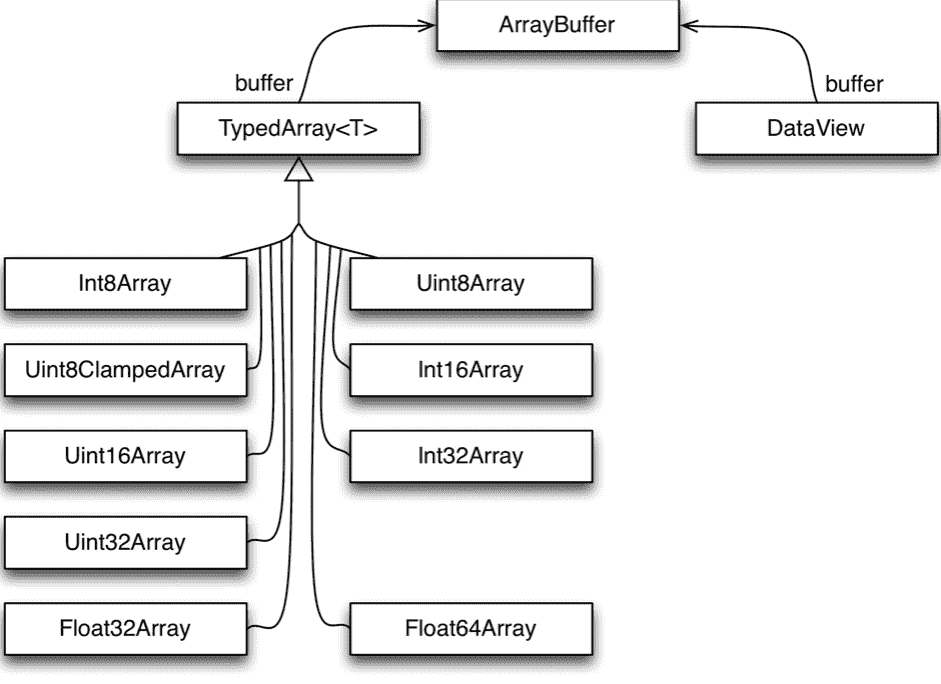

1. [https://www.khronos.org/registry/typedarray/specs/1.0/](https://www.khronos.org/registry/typedarray/specs/1.0/)
2. [http://caniuse.com/#feat=typedarrays](http://caniuse.com/#feat=typedarrays)
3. [http://www.html5rocks.com/en/tutorials/webgl/typed_arrays/#toc-history](http://www.html5rocks.com/en/tutorials/webgl/typed_arrays/#toc-history)
4. [http://www.html5rocks.com/en/tutorials/webgl/typed_arrays/#toc-history](http://www.html5rocks.com/en/tutorials/webgl/typed_arrays/#toc-history)

#### 20.2.1 元素类型

API 支持以下元素类型：

| 元素类型 | 字节 | 描述 | C 类型 |
|---|---|---|---|
| Int8 | 1 | 8 位有符号整数 | signed char |
| Uint8 | 1 | 8 位无符号整数 | unsigned char |
| Uint8C | 1 | 8 位无符号整数（截断转换） | unsigned char |
| Int16 | 2 | 16 位有符号整数 | short |
| Uint16 | 2 | 16 位无符号整数 | unsigned short |
| Int32 | 4 | 32 位有符号整数 | int |
| Uint32 | 4 | 32 位无符号整数 | unsigned int |
| Float32 | 4 | 32 位浮点数 | float |
| Float64 | 8 | 64 位浮点数 | double |

元素类型 `Uint8C` 比较特殊：它不受 `DataView` 支持，它的存在只是为了启用 `Uint8ClampedArray`。这种类型化数组被 canvas 元素使用（在那里它取代了 `CanvasPixelArray`）。`Uint8C` 和 `Uint8` 之间唯一的区别是如何处理溢出和下溢（如下一节所述）。建议避免使用前者——引用 Brendan Eich⁵ 的话：

> 就是为了超级清楚（而且它诞生时我就在场），Uint8ClampedArray *完全是* HTML5 canvas 元素的历史产物。除非你确实在做 canvas 相关的事情，否则应避免使用。

### 20.2.2 处理溢出和下溢

通常，当值超出元素类型的范围时，会使用取模运算将其转换为范围内的值。对于有符号和无符号整数，这意味着：

- 最高值加一转换为最低值（无符号整数为 0）。
- 最低值减一转换为最高值。

无符号 8 位整数的取模转换：

```
> let uint8 = new Uint8Array(1);
> uint8[0] = 255; uint8[0] // 范围内的最高值
255
> uint8[0] = 256; uint8[0] // 溢出
0
> uint8[0] = 0; uint8[0] // 范围内的最低值
0
> uint8[0] = -1; uint8[0] // 下溢
255
```

有符号 8 位整数的取模转换：

```
> let int8 = new Int8Array(1);
> int8[0] = 127; int8[0] // 范围内的最高值
127
> int8[0] = 128; int8[0] // 溢出
-128
> int8[0] = -128; int8[0] // 范围内的最低值
-128
> int8[0] = -129; int8[0] // 下溢
127
```

截断转换则不同：

- 所有下溢的值都转换为最低值。
- 所有溢出的值都转换为最高值。
```


 > let uint8c = new Uint8ClampedArray(1);
> uint8c[0] = 255; uint8c[0] // 范围内的最大值
255
> uint8c[0] = 256; uint8c[0] // 溢出
255
> uint8c[0] = 0; uint8c[0] // 范围内的最小值
0
> uint8c[0] = -1; uint8c[0] // 下溢
0
```

## 20.2.3 字节序

当某个类型（如`Uint16`）以多个字节存储时，*字节序*（*endianness*）就变得重要：

- 大端序（Big endian）：最高有效字节在前。例如，`Uint16`值`0xABCD`存储为两个字节——先是`0xAB`，然后是`0xCD`。
- 小端序（Little endian）：最低有效字节在前。例如，`Uint16`值`0xABCD`存储为两个字节——先是`0xCD`，然后是`0xAB`。

字节序通常是按CPU架构固定的 ഒരു，并且在原生API之间保持一致。Typed Array 用于与这些API通信，因此它们的字节序遵循平台的字节序，且不能更改。

另一方面，协议和二进制文件的字节序各不相同，并且跨平台固定。因此，我们必须能够使用任意字节序访问数据。DataView 满足了这一用例，让你在获取或设置值时可以指定字节序。

> 引用维基百科关于字节序的描述⁶：
>
> - 大端序表示是数据网络中最常见的约定；互联网协议套件的协议字段，如IPv4、IPv6、TCP和UDP，都以大端序传输。因此，大端字节序也被称为网络字节序。
> - 小端序存储在微处理器中很流行，部分原因是Intel Corporation对微处理器设计的历史性重大影响。

你可以使用以下函数来确定平台的字节序。

```
const BIG_ENDIAN = Symbol('BIG_ENDIAN');
const LITTLE_ENDIAN = Symbol('LITTLE_ENDIAN');
function getPlatformEndianness() {
    let arr32 = Uint32Array.of(0x12345678);
    let arr8 = new Uint8Array(arr32.buffer);
    switch ((arr8[0]*0x1000000) + (arr8[1]*0x10000) + (arr8[2]*0x100) + (arr8[3])) {
        case 0x12345678:
            return BIG_ENDIAN;
        case 0x78563412:
            return LITTLE_ENDIAN;
        default:
            throw new Error('Unknown endianness');
    }
}
```

还有一些平台以不同的字节序排列*字*（字节对），而字内部的字节顺序则不同。这称为混合字节序。如果你想支持这样的平台，扩展前面的代码很容易。

## 20.2.4 负索引

使用方括号运算符 [ ] 时，你只能使用非负索引（从0开始）。ArrayBuffers、Typed Arrays 和 DataViews 的方法工作方式不同：每个索引都可以是负数。如果是负数，则从长度开始倒数。换句话说，将其加到长度上以产生一个正常索引。因此 -1 指最后一个元素，-2 指倒数第二个元素，以此类推。普通 Array 的方法工作方式相同。

```
> let ui8 = Uint8Array.of(0, 1, 2);
> ui8.slice(-1)
Uint8Array [ 2 ]
```

另一方面，偏移量必须是非负的。例如，如果你将 -1 传递给：

```
DataView.prototype.getInt8(byteOffset)
```

那么你会得到一个 RangeError。

## 20.3 ArrayBuffers

ArrayBuffers 存储数据，*视图*（Typed Arrays 和 DataViews）让你读取和修改它。为了创建 DataView，你需要向它的构造函数提供一个 ArrayBuffer。Typed Array 构造函数可以选择性地为你创建一个 ArrayBuffer。

## 20.3.1 `ArrayBuffer` 构造函数

该构造函数的原型为：

```
ArrayBuffer(length : number)
```

通过 new 调用此构造函数会创建一个实例，其容量为 `length` 字节。其中每个字节最初都是0。

## 20.3.2 静态 `ArrayBuffer` 方法

- `ArrayBuffer.isView(arg)`
  如果 `arg` 是一个对象且是 ArrayBuffer 的视图，则返回 `true`。只有 Typed Arrays 和 DataViews 具有必需的内部属性 `[[ViewedArrayBuffer]]`。这意味着这个检查大致等同于检查 `arg` 是否是 Typed Array 或 `DataView` 的实例。

## 20.3.3 `ArrayBuffer.prototype` 属性

- get `ArrayBuffer.prototype.byteLength`
  返回此 ArrayBuffer 的容量，以字节为单位。
- `ArrayBuffer.prototype.slice(start, end)`
  创建一个新的 ArrayBuffer，包含此 ArrayBuffer 中索引大于或等于 `start` 且小于 `end` 的字节。`start` 和 `end` 可以为负数（参见 "[负索引](../errors.html#sec_traceur-missing-paren)" 一节）。

## 20.4 Typed Arrays

各种 Typed Array 仅在元素类型上有所不同：

- 元素为整数的 Typed Arrays：`Int8Array`、`Uint8Array`、`Uint8ClampedArray`、`Int16Array`、`Uint16Array`、`Int32Array`、`Uint32Array`
- 元素为浮点数的 Typed Arrays：`Float32Array`、`Float64Array`

## 20.4.1 Typed Arrays 与普通 Arrays 的对比

Typed Arrays 与普通 Arrays 非常相似：它们有 `length`，可以通过方括号运算符 `[]` 访问元素，并且拥有所有标准的 Array 方法。它们与 Arrays 的区别如下：

## 20.4.2 Typed Arrays 是可迭代的

Typed Arrays 实现了一个键为 `Symbol.iterator` 的方法，因此是可迭代的（有关更多信息，请参阅 "[可迭代对象和迭代器](./ch_generators.html#ch_generators)" 一章）。这意味着你可以在 ES6 中使用 `for`-`of` 循环和类似的机制：

```
let ui8 = Uint8Array.of(0,1,2);
for (let byte of ui8) {
    console.log(byte);
}
// 输出：
// 0
// 1
// 2
```

ArrayBuffers 和 DataViews 不是可迭代的。

## 20.4.3 Typed Arrays 与普通 Arrays 的相互转换

要将普通 Array 转换为 Typed Array，只需将其作为 Typed Array 构造函数的参数。例如：

```
> let tarr = new Uint8Array([0,1,2]);
```

将 Typed Array 转换为 Array 的经典方法是对其调用 `Array.prototype.slice`。这个技巧适用于所有类 Array 对象（如 `arguments`），而 Typed Arrays 就是类 Array 的。

```
> Array.prototype.slice.call(tarr)
[ 0, 1, 2 ]
```

在 ES6 中，你可以使用展开运算符（`...`），因为 Typed Arrays 是可迭代的：

```
> [...tarr]
[ 0, 1, 2 ]
```

另一个 ES6 的替代方案是 `Array.from()`，它适用于可迭代对象或类 Array 对象：

```
> Array.from(tarr)
[ 0, 1, 2 ]
```

## 20.4.4 Typed Arrays 的 Species 模式

某些方法创建与当前实例相似的新实例。Species 模式让你可以配置应该使用哪个构造函数来创建这些实例。例如，如果你创建了 `Array` 的子类 `MyArray`，那么默认情况下，`map()` 会创建 `MyArray` 的实例。如果你希望它创建 `Array` 的实例，你可以使用 Species 模式来实现。详细信息在关于类的章节中的 "Species 模式" 一节中解释。

ArrayBuffers 在以下位置使用 Species 模式：

- `ArrayBuffer.prototype.slice()`
- 在 Typed Array 或 DataView 内部克隆 ArrayBuffer 时。

Typed Arrays 在以下位置使用 Species 模式：

- `TypedArray<T>.prototype.filter()`
- `TypedArray<T>.prototype.map()`
- `TypedArray<T>.prototype.slice()`
- `TypedArray<T>.prototype.subarray()`

DataViews 不使用 Species 模式。

## 20.4.5 Typed Arrays 的继承层次结构

如本章开头的图表所示，所有 Typed Array 类（`Uint8Array`等）都有一个共同的超类。我将该超类称为 `TypedArray`，但它不能直接从 JavaScript 访问（ES6 规范称其为*内部对象* `%TypedArray%`）。`TypedArray.prototype` 包含了所有 Typed Array 的方法。

## 20.4.6 静态 TypedArray 方法

两个静态的 `TypedArray` 方法都继承自其子类（`Uint8Array` 等）。

### 20.4.6.1 `TypedArray.of()`

该方法的原型为：

```
TypedArray.of(...items)
```

它创建一个新的 Typed Array，是 `this`（调用 `of()` 的类）的实例。该实例的元素是 `of()` 的参数。

你可以将 `of()` 视为 Typed Arrays 的自定义字面量：

```
Float32Array.of(0.151, -8, 3.7)
// Float32Array [ 0.151, -8, 3.7 ]
```

### 20.4.6.2 TypedArray.from()

该方法的原型为：

```
TypedArray<U>.from(source : Iterable<T>, mapfn? : T => U, thisArg?)
```

它将可迭代的 `source` 转换为 `this`（一个 Typed Array）的实例。

例如，普通 Arrays 是可迭代的，可以用此方法转换：

```
Uint16Array.from([0, 1, 2])
// Uint16Array [ 0, 1, 2 ]
```

Typed Arrays 也是可迭代的：

```
let ui16 = Uint16Array.from(Uint8Array.of(0, 1, 2));
ui16 instanceof Uint16Array // true
```

可选的 `mapfn` 让你在将 `source` 的元素变为结果的元素之前对其进行转换。为什么要在一步中执行*映射*和*转换*这两个步骤？与通过 `source.map()` 单独执行第一步相比，有两个优点：

1. 不需要中间的 Array 或 Typed Array。
2. 当将 Typed Array 转换为元素精度更高的 Typed Array 时，映射步骤可以利用该更高精度。

为了说明第二个优点，让我们使用 `map()` 将 Typed Array 的元素加倍：


 ```
> Int8Array.of(127, 126, 125).map(x => 2 * x)
Int8Array [ -2, -4, -6 ]
```

正如你所看到的，数值发生了溢出，并被强制转换为 `Int8` 的值范围。如果通过 `from()` 方法进行映射，你可以选择结果的类型，从而避免数值溢出：

```
> Int16Array.from(Int8Array.of(127, 126, 125), x => 2 * x)
Int16Array [ 254, 252, 250 ]
```

根据 Allen Wirfs-Brock[^7] 的说法，在类型化数组之间进行映射正是 `from()` 方法中 `mapfn` 参数的动机所在。

## 20.4.7 TypedArray.prototype 属性

类型化数组方法接受的索引可以是负数（在这一点上，它们的工作方式与传统数组方法相同）。偏移量则必须是非负的。详情请参阅章节“负索引”。

### 20.4.7.1 类型化数组特有的方法

以下属性是类型化数组所特有的，普通数组没有这些属性：

- `get TypedArray<T>.prototype.buffer : ArrayBuffer` - 返回支持此类型化数组的缓冲区。
- `get TypedArray<T>.prototype.byteLength : number` - 返回此类型化数组缓冲区的大小（以字节为单位）。
- `get TypedArray<T>.prototype.byteOffset : number` - 返回此类型化数组在其 `ArrayBuffer` 中“起始”的偏移量。
- `TypedArray<T>.prototype.set(arrayOrTypedArray, offset=0) : void` - 将 `arrayOrTypedArray` 的所有元素复制到此类型化数组。`arrayOrTypedArray` 索引 0 处的元素会被写入到此类型化数组的索引 `offset` 处（依此类推）。
    - 如果 `arrayOrTypedArray` 是普通数组，其元素会先被转换为数字，然后再转换为此类型化数组的元素类型 `T`。
    - 如果 `arrayOrTypedArray` 是类型化数组，则其每个元素都会直接转换为此类型化数组的相应类型。如果两个类型化数组具有相同的元素类型，则会使用更快的按字节复制方式。
- `TypedArray<T>.prototype.subarray(begin=0, end=this.length) : TypedArray<T>` - 返回一个新的类型化数组，它与此类型化数组共享同一个缓冲区，但通常范围更小。如果 `begin` 是非负的，那么结果数组的第一个元素将是 `this[begin]`，第二个是 `this[begin+1]`（依此类推）。如果 `begin` 是负数，则会被适当地转换。

> https://twitter.com/awbjs/status/585199958661472257

### 20.4.7.2 数组方法

以下方法与普通数组的方法基本相同：

- `TypedArray<T>.prototype.copyWithin(target : number, start : number, end = this.length) : This`
    将索引在 start（包含）和 end（不包含）之间的元素复制到从 target 开始的索引位置。如果范围重叠且前者在前，则元素会按逆序复制，以避免在复制源元素之前被覆盖。
- `TypedArray<T>.prototype.entries() : Iterable<[number,T]>`
    返回一个可迭代对象，用于遍历此类型化数组的 [索引, 元素] 对。
- `TypedArray<T>.prototype.every(callbackfn, thisArg?)`
    如果 `callbackfn` 对类型化数组的每个元素都返回 true，则返回 true。否则，返回 false。当 `callbackfn` 第一次返回 false 时，`every()` 会停止处理。
- `TypedArray<T>.prototype.fill(value, start=0, end=this.length) : void`
    将索引范围从 start 到 end 的元素设置为 value。
- `TypedArray<T>.prototype.filter(callbackfn, thisArg?) : TypedArray<T>`
    返回一个新类型化数组，包含原数组中所有使得 `callbackfn` 返回 true 的元素。通常，结果数组比原数组短。
- `TypedArray<T>.prototype.find(predicate : T => boolean, thisArg?) : T`
    返回第一个使函数 `predicate` 返回 true 的元素。
- `TypedArray<T>.prototype.findIndex(predicate : T => boolean, thisArg?) : number`
    返回第一个使 `predicate` 返回 true 的元素的索引。
- `TypedArray<T>.prototype.forEach(callbackfn, thisArg?) : void`
    遍历此类型化数组，并对每个元素调用 `callbackfn`。
- `TypedArray<T>.prototype.indexOf(searchElement, fromIndex=0) : number`
    返回第一个严格等于 `searchElement` 的元素的索引。搜索从 `fromIndex` 开始。
- `TypedArray<T>.prototype.join(separator : string = ',') : string`
    将所有元素转换为字符串并连接起来，用 `separator` 分隔。
- `TypedArray<T>.prototype.keys() : Iterable<number>`
    返回一个可迭代对象，用于遍历此类型化数组的索引。
- `TypedArray<T>.prototype.lastIndexOf(searchElement, fromIndex?) : number`
    返回最后一个严格等于 `searchElement` 的元素的索引。搜索从 `fromIndex` 开始，向后进行。
- `get TypedArray<T>.prototype.length : number`
    返回此类型化数组的长度。
- `TypedArray<T>.prototype.map(callbackfn, thisArg?) : TypedArray<T>`
    返回一个新类型化数组，其中的每个元素都是对原数组相应元素应用 `callbackfn` 的结果。
- `TypedArray<T>.prototype.reduce(callbackfn : (previousValue : any, currentElement : T, currentIndex : number, array : TypedArray<T>) => any, initialValue?) : any` — `callbackfn` 一次接收一个元素，以及到目前为止计算出的结果，并计算出一个新结果。元素从左到右访问。
- `TypedArray<T>.prototype.reduceRight(callbackfn : (previousValue : any, currentElement : T, currentIndex : number, array : TypedArray<T>) => any, initialValue?) : any` — `callbackfn` 一次接收一个元素，以及到目前为止计算出的结果，并计算出一个新结果。元素从右到左访问。
- `TypedArray<T>.prototype.reverse() : This` — 反转此类型化数组的元素顺序并返回 this。
- `TypedArray<T>.prototype.slice(start=0, end=this.length) : TypedArray<T>` — 创建一个新的类型化数组，仅包含索引在 start（包含）和 end（不包含）之间的元素。
- `TypedArray<T>.prototype.some(callbackfn, thisArg?)` — 如果 `callbackfn` 对类型化数组的至少一个元素返回 true，则返回 true。否则，返回 false。当 `callbackfn` 第一次返回 true 时，`some()` 会停止处理。
- `TypedArray<T>.prototype.sort(comparefn? : (number, number) => number)` — 根据 `comparefn` 对此类型化数组进行排序。如果未提供 `comparefn`，则默认通过小于运算符（<）进行升序排序。
- `TypedArray<T>.prototype.toLocaleString(reserved1?, reserved2?)`
- `TypedArray<T>.prototype.toString()`
- `TypedArray<T>.prototype.values() : Iterable<T>` — 返回一个可迭代对象，用于遍历此类型化数组的值。

由于这些方法都适用于数组，你可以查阅以下两个资源以了解更多关于它们工作方式的信息：

- 以下方法是 ES6 中新增的，在章节“新数组特性”中进行了说明：`copyWithin`, `entries`, `fill`, `find`, `findIndex`, `keys`, `values`。
- 所有其他方法在《SpeakingJavaScript》的“数组”章节中进行了说明。

请注意，虽然普通数组的方法是通用的（任何类数组对象都可以），但本节列出的方法则不是（this 必须是一个类型化数组）。

## 20.4.8 «ElementType»Array 构造函数

每个类型化数组构造函数的名称都遵循 `«ElementType»Array` 的模式，其中 `«ElementType»` 是开头表格中的元素类型之一。这意味着有 9 个类型化数组构造函数：`Int8Array`, `Uint8Array`, `Uint8ClampedArray`（元素类型为 `Uint8C`）, `Int16Array`, `Uint16Array`, `Int32Array`, `Uint32Array`, `Float32Array`, `Float64Array`。

每个构造函数有五个*重载*版本——其行为取决于接收到的参数数量和类型：

- `«ElementType»Array(buffer, byteOffset=0, length?)`
    创建一个新的类型化数组，其缓冲区为 `buffer`。它从给定的 `byteOffset` 开始访问缓冲区，并将具有给定的长度。请注意，`length` 计算的是类型化数组的元素数量（每个元素 1-4 字节），而不是字节数。
- `«ElementType»Array(length)`
    创建一个具有给定长度和相应缓冲区（其字节大小为 `length * «ElementType»Array.BYTES_PER_ELEMENT`）的类型化数组。
- `«ElementType»Array()`
    创建一个长度为 0 的类型化数组。同时也会创建一个相关的空 `ArrayBuffer`。
- `«ElementType»Array(typedArray)`
    创建一个新的类型化数组，它与 `typedArray` 具有相同的长度和元素。过大或过小的值会被适当地转换。
- `«ElementType»Array(arrayLikeObject)`
    将 `arrayLikeObject` 视为数组，并创建一个具有相同长度和元素的新 `TypedArray`。过大或过小的值会被适当地转换。

以下代码展示了创建同一个类型化数组的三种不同方式：

```
let tarr = new Uint8Array([1,2,3]);

let tarr = Uint8Array.of(1,2,3);

let tarr = new Uint8Array(3);
tarr[0] = 0;
tarr[1] = 1;
tarr[2] = 2;
```

## 20.4.9 静态 «ElementType»Array 属性

- `«ElementType»Array.BYTES_PER_ELEMENT`
    计算存储单个元素所需的字节数：
```


## 20.4.10 «ElementType»Array.prototype 属性

- «ElementType»Array.prototype.BYTES_PER_ELEMENT
  与 «ElementType»Array.BYTES_PER_ELEMENT 相同。

## 20.4.11 连接 Typed Array

Typed Arrays 没有普通 Array 那样的 concat() 方法。解决方法是使用

```js
typedArray.set(arrayOrTypedArray, offset=0)
```

该方法将现有的 Typed Array（或普通 Array）复制到 typedArray 的 offset 索引处。然后你只需确保 typedArray 足够大，能够容纳所有想要连接的（Typed）Arrays：

```js
function concatenate(resultConstructor, ...arrays) {
  let totalLength = 0;
  for (let arr of arrays) {
    totalLength += arr.length;
  }
  let result = new resultConstructor(totalLength);
  let offset = 0;
  for (let arr of arrays) {
    result.set(arr, offset);
    offset += arr.length;
  }
  return result;
}
console.log(concatenate(Uint8Array,
  Uint8Array.of(1, 2), Uint8Array.of(3, 4)));
  // Uint8Array [1, 2, 3, 4]
```

## 20.5 DataViews

### 20.5.1 `DataView` 构造器

- `DataView(buffer, byteOffset=0, byteLength=buffer.byteLength-byteOffset)`
  创建一个数据存储在 ArrayBuffer `buffer` 中的新 DataView。默认情况下，新的 DataView 可以访问 `buffer` 的全部内容，最后两个参数允许你更改这一点。

### 20.5.2 `DataView.prototype` 属性

- get `DataView.prototype.buffer`
  返回此 DataView 的 ArrayBuffer。
- get `DataView.prototype.byteLength`
  返回此 DataView 可以访问的字节数。
- get `DataView.prototype.byteOffset`
  返回此 DataView 在其缓冲区中开始访问字节的偏移量。
- `DataView.prototype.get«ElementType»(byteOffset, littleEndian=false)`
  从此 DataView 的缓冲区中读取一个值。
  - «ElementType» 可以是：`Float32`, `Float64`, `Int8`, `Int16`, `Int32`, `Uint8`, `Uint16`, `Uint32`
- `DataView.prototype.set«ElementType»(byteOffset, value, littleEndian=false)`
  将 `value` 写入此 DataView 的缓冲区。
  - «ElementType» 可以是：`Float32`, `Float64`, `Int8`, `Int16`, `Int32`, `Uint8`, `Uint16`, `Uint32`

## 20.6 支持 Typed Arrays 的浏览器 API

Typed Arrays 已经存在一段时间了，因此有不少浏览器 API 支持它们。

### 20.6.1 File API

[File API](http://www.w3.org/TR/FileAPI/) 允许你访问本地文件。以下代码演示了如何在 ArrayBuffer 中获取提交的本地文件的字节。

```js
let fileInput = document.getElementById('fileInput');
let file = fileInput.files[0];
let reader = new FileReader();
reader.readAsArrayBuffer(file);
reader.onload = function () {
    let arrayBuffer = reader.result;
    ...
};
```

### 20.6.2 XMLHttpRequest

在更新版本的 [XMLHttpRequest API](http://www.w3.org/TR/XMLHttpRequest/) 中，你可以让结果以 ArrayBuffer 的形式返回：

```js
let xhr = new XMLHttpRequest();
xhr.open('GET', someUrl);
xhr.responseType = 'arraybuffer';

xhr.onload = function () {
    let arrayBuffer = xhr.response;
    ...
};

xhr.send();
```

### 20.6.3 Fetch API

与 XMLHttpRequest 类似，[Fetch API](https://fetch.spec.whatwg.org/) 允许你请求资源。但它基于 Promise，使用起来更加方便。以下代码演示了如何将 `url` 指向的内容以 ArrayBuffer 形式下载：

```js
fetch(url)
.then(request => request.arrayBuffer())
.then(arrayBuffer => ...);
```

### 20.6.4 Canvas

[引自 HTML5 规范](http://www.w3.org/TR/html5/scripting-1.html#the-canvas-element)：

canvas 元素为脚本提供了一个依赖于分辨率的位图画布，可用于即时渲染图表、游戏图形、艺术作品或其他视觉图像。

canvas 的 2D 上下文^13^ 允许你将位图数据作为 Uint8ClampedArray 的实例获取：

```js
let canvas = document.getElementById('my_canvas');
let context = canvas.getContext('2d');
let imageData = context.getImageData(0, 0, canvas.width, canvas.height);
let uint8ClampedArray = imageData.data;
```

### 20.6.5 WebSockets

WebSockets^14^ 允许你通过 ArrayBuffers 发送和接收二进制数据：

```js
let socket = new WebSocket('ws://127.0.0.1:8081');
socket.binaryType = 'arraybuffer';

// 等待 socket 打开
socket.addEventListener('open', function (event) {
    // 发送二进制数据
    let typedArray = new Uint8Array(4);
    socket.send(typedArray.buffer);
});

// 接收二进制数据
socket.addEventListener('message', function (event) {
    let arrayBuffer = event.data;
    ...
});
```

### 20.6.6 其他 API

- WebGL^15^ 使用 Typed Array API 来：访问缓冲区数据、为纹理映射指定像素、读取像素数据等等。
- Web Audio API^16^ 允许你解码通过 ArrayBuffer 提交的音频数据^17^。
- **Media Source Extensions^18^**：HTML 媒体元素目前是 `<audio>` 和 `<video>`。Media Source Extensions API 使你能够创建要通过这些元素播放的流。你可以通过 ArrayBuffers、Typed Arrays 或 DataViews 将二进制数据添加到此类流中。
- 与 **Web Workers^19^ 通信**：如果你通过 `postMessage()`^20^ 向 Worker 发送数据，消息（将被克隆）或可传输对象都可以包含 ArrayBuffers。
- **跨文档通信^21^**：工作与 Web Workers 通信类似，也使用 `postMessage()` 方法。

## 20.7 扩展示例：JPEG SOF0 解码器

以下示例的代码 [在 GitHub 上^22^](https://github.com/rauschma/typed-array-demos)。你也可以 [在线运行^23^](http://rauschma.github.io/typed-array-demos/)。

该示例是一个网页，允许你上传 JPEG 文件并解析其结构，以确定图像的高度和宽度等信息。

### 20.7.1 JPEG 文件格式

JPEG 文件是一系列*段*（typed data）。每个段以以下四个字节开头：

- 标记（两字节）：声明该段中存储的数据类型。两个字节中的第一个是 0xFF。每个标准标记都有一个可读的名称。例如，标记 0xFFC0 的名称是 "Start Of Frame (Baseline DCT)"，简称 "SOF0"。
- 段长度（两字节）：该段有多长（以字节为单位，包括长度本身）？

JPEG 文件在所有平台上都是大端序。因此，这个示例演示了在使用 DataViews 时能够指定字节序是多么重要。

### 20.7.2 JavaScript 代码

以下 `processArrayBuffer()` 函数是实际代码的删节版本；为了简洁起见，我移除了一些错误检查。`processArrayBuffer()` 接收一个包含提交的 JPEG 文件内容的 ArrayBuffer，并遍历其各个段。

```js
// JPEG 是大端序
var IS_LITTLE_ENDIAN = false;

function processArrayBuffer(arrayBuffer) {
    try {
        var dv = new DataView(arrayBuffer);
        ...
        var ptr = 2;
        while (true) {
            ...
            var lastPtr = ptr;
            enforceValue(0xFF, dv.getUint8(ptr),
                'Not a marker');
            ptr++;
            var marker = dv.getUint8(ptr);
            ptr++;
            var len = dv.getUint16(ptr, IS_LITTLE_ENDIAN);
            ptr += len;
            logInfo('Marker: '+hex(marker)+' ('+len+' byte(s))');
            ...

            // 我们找到了要找的东西吗？
            if (marker === 0xC0) { // SOF0
                logInfo(decodeSOF0(dv, lastPtr));
                break;
            }
        }
    } catch (e) {
        logError(e.message);
    }
}
```

此代码使用了以下辅助函数（此处未显示）：

- `enforceValue()` 如果期望值（第一个参数）与实际值（第二个参数）不匹配，则抛出错误。
- `logInfo()` 和 `logError()` 在页面上显示消息。
- `hex()` 将一个数字转换为两个十六进制数字的字符串。

`decodeSOF0()` 解析 SOF0 段：


```
function decodeSOF0(dv, start) {
    // 示例（16x16）：
    // FF C0 00 11 08 00 10 00 10 03 01 22 00 02 11 01 03 11 01
    var data = {};
    start += 4; // 跳过标记 0xFFC0 和段长度 0x0011
    var data = {
        bitsPerColorComponent: dv.getUint8(start), // 通常为 0x08
        imageHeight: dv.getUint16(start+1, IS_LITTLE_ENDIAN),
        imageWidth: dv.getUint16(start+3, IS_LITTLE_ENDIAN),
        numberOfColorComponents: dv.getUint8(start+5),
    };
    return JSON.stringify(data, null, 4);
}
```

更多关于 JPEG 文件结构的信息：

- "JPEG: Syntax and structure<sup>24</sup>"（维基百科）
- "JPEG File Interchange Format: File format structure<sup>25</sup>"（维基百科）

## 20.8 可用性

所有现代 JavaScript 引擎都实现了 Typed Array API 的大部分功能，但有几个特性是 ECMAScript 6 新增的：

- 从数组借用的静态方法：TypedArray<T>.from()、TypedArray<T>.of()
- 从数组借用的原型方法：TypedArray<T>.prototype.map() 等
- Typed Array 是可迭代的
- 支持 species 模式
- TypedArray<T> 是所有 Typed Array 类的超类的继承层次结构

这些功能要普及可能还需要一段时间。像往常一样，kangax 的 "ES6 兼容性表格<sup>26</sup>" 描述了当前状况。

## 21. 可迭代对象和迭代器

ECMAScript 6 引入了一个新的迭代接口：**Iterable**。本章解释它的工作原理、哪些语言结构通过它消费数据（例如，新的 for-of 循环）以及哪些数据源通过它提供数据（例如，数组）。

### 21.1 概述

以下两个实体在迭代中扮演重要角色：

- **Iterable（可迭代对象）**：可迭代对象是一种数据结构，它希望让公众能够访问其元素。它通过实现一个键为 Symbol.iterator 的方法来实现这一点。该方法是迭代器的工厂。
- **Iterator（迭代器）**：遍历数据结构元素的一种指针（类似数据库中的游标）。

以下值是可迭代的：

- 数组
- 字符串
- 映射（Maps）
- 集合（Sets）
- DOM 数据结构（工作进行中）
- 不可迭代的：普通对象（严格来说它们不是数据结构；后面会有更深入的解释）

通过迭代协议访问数据的语言结构：

- 通过数组模式解构：

```
let [a,b] = new Set(['a', 'b', 'c']);
```

- for-of 循环：

```
for (let x of ['a', 'b', 'c']) {
    console.log(x);
}
```

- Array.from()：

```
let arr = Array.from(new Set(['a', 'b', 'c']));
```

- 展开运算符（...）：

```
let arr = [...new Set(['a', 'b', 'c'])];
```

- 映射和集合的构造函数：

```
let map = new Map([[false, 'no'], [true, 'yes']]);
let set = new Set(['a', 'b', 'c']);
```

- Promise.all()、Promise.race()：

```
Promise.all(iterableOverPromises).then(…);
Promise.race(iterableOverPromises).then(…);
```

- yield*：

```
yield* anIterable;
```

### 21.2 可迭代性

可迭代性的思想如下。

- **数据消费者**：JavaScript 有一些消费数据的语言结构。例如，`for-of` 循环遍历值，展开运算符（`...`）将值插入数组或函数调用中。
- **数据源**：数据消费者可以从各种来源获取值。例如，你可能想要遍历数组的元素、映射中的键值对条目，或字符串中的字符。

让每个消费者都支持所有来源是不实际的，特别是因为应该能够创建新的来源（例如，通过库）。因此，ES6 引入了接口 `Iterable`。数据消费者使用它，数据源实现它：

| 数据消费者 | 接口 | 数据源 |
| --- | --- | --- |

鉴于 JavaScript 没有接口，`Iterable` 更多是一种约定：

- **来源**：如果一个值具有一个键为符号 `Symbol.iterator平等的英语表达iteracyof ` 的方法，该方法返回所谓的迭代器，则该值被认为是可迭代的。该迭代器是一个通过其方法 `next()` 返回值的 对象。我们说：它*枚举项目*，每次方法调用返回一个。
- **消费**：数据消费者使用迭代器来检索它们正在消费的值。

让我们看看数组 `arr` 的消费是什么样的。首先，你通过键为 `Symbol.iterator` 的方法创建一个迭代器：

```
> let arr = ['a', 'b', 'c'];
> let iter = arr[Symbol.iterator]();
```

然后你反复调用迭代器的方法 `next()` 来检索数组"内部"的项目：

```
> iter.next()
{ value: 'a', done: false }
> iter.next()
{ value: 'b', done: false }
> iter.next()
{ value: 'c', done: false }
> iter.next()
{ value: undefined, done: true }
```

正如你所见，`next()` 返回每个被包裹在对象中的项目，作为属性 `value` 的值。布尔属性 `done` 指示何时已到达项目序列的末尾。

`Iterable` 和迭代器是所谓的迭代*协议*（方法加上使用规则）的一部分。该协议的一个关键特征是它是顺序的：迭代器一次返回一个值。这意味着如果一个可迭代数据结构是非线性的（例如树），迭代将使其线性化。

### 21.3 可迭代数据源

我将使用 for-of 循环（后面会更详细地解释）来遍历各种可迭代数据。

#### 21.3.1 数组

数组（和 Typed Array）是可迭代的，遍历它们的元素：

```
for (let x of ['a', 'b']) {
    console.log(x);
}
// 输出：
// 'a'
// 'b'
```

#### 21.3.2 字符串

字符串是可迭代的，但它们枚举的是 Unicode 码点，每个码点可能包含一个或两个 JavaScript 字符：

```
for (let x of 'a\uD83D\uDC0A') {
    console.log(x);
}
// 输出：
// 'a'
// '\uD83D\uDC0A'（鳄鱼表情符号）
```

> 你刚刚看到原始值也可以是可迭代的。一个值不必是对象才能可迭代。

#### 21.3.3 映射（Maps）

映射是可迭代的，遍历它们的条目。每个条目编码为 [键, 值] 对，一个包含两个元素的数组。条目总是确定性地枚举，按照它们被添加到映射中的相同顺序。

```
let map = new Map().set('a', 1).set('b', 2);
for (let pair of map) {
    console.log(pair);
}
```

> // 输出：
// ['a', 1]
// ['b', 2]

请注意，WeakMap 不可迭代。

#### 21.3.4 集合（Sets）

集合是可迭代的，遍历它们的元素（按照它们被添加到集合中的相同顺序枚举）。

```
let set = new Set().add('').add('b');
for (let x of set) {
    console.log(x);
}
```

> // 输出：
// 'a'
// 'b'

请注意，WeakSet 不可迭代。

#### 21.3.5 arguments

尽管特殊变量 arguments 在 ECMAScript 6 中或多或少已经过时（由于剩余参数），但它是可迭代的：

```
function printArgs() {
    for (let x of arguments) {
        console.log(x);
    }
}
printArgs('a', 'b');
```

> // 输出：
// 'a'
// 'b'

#### 21.3.6 DOM 数据结构

大多数 DOM 数据结构最终将是可迭代的：

```
for (let node of document.querySelectorAll('div')) {
    ...
}
```

请注意，实现此功能正在进行中。但这样做相对容易，因为符号 Symbol.iterator 不会与现有属性键冲突。

#### 21.3.7 可迭代计算数据

并非所有可迭代内容都必须来自数据结构，它也可以即时计算。例如，所有主要的 ES6 数据结构（数组、Typed Array、映射、集合）都有三个返回可迭代对象的方法：

- **entries()** 返回一个可迭代的条目，编码为 [键, 值] 数组。对于数组，值是数组元素，键是它们的索引。对于集合，每个键和值都是相同的 —— 即集合元素。
- **keys()** 返回一个可迭代的条目键。
- **values()** 返回一个可迭代的条目的值。

让我们看看那是什么样的。entries() 提供了一种获取数组元素及其索引的好方法：

```
let arr = ['a', 'b', 'c'];
for (let pair of arr.entries()) {
    console.log(pair);
}
// 输出：
// [0, 'a']
// [1, 'b']
// [2, 'c']
```

#### 21.3.8 普通对象不可迭代

普通对象（由对象字面量创建）不可迭代：

```
for (let x of {}) { // TypeError
    console.log(x);
}
```

为什么默认情况下对象不能通过属性迭代？推理如下。在 JavaScript 中，你可以在两个层次上进行迭代：


## 21.4 迭代语言构造

以下 ES6 语言构造使用了迭代协议：

-   通过数组模式进行解构
-   for-of 循环
-   Array.from()
-   扩展运算符（...）
-   Map 和 Set 的构造函数
-   Promise.all()、Promise.race()
-   yield*

接下来的章节将逐一详细介绍。

### 21.4.1 通过数组模式进行解构

通过数组模式解构适用于任何可迭代对象：

```js
let set = new Set().add('a').add('b').add('c');
```

```js
let [x,y] = set;
// x='a'; y='b'
```

```js
let [first, ...rest] = set;
// first='a'; rest=['b','c'];
```

### 21.4.2 for-of 循环

for-of 是 ECMAScript 6 中新增的一种循环。其一种形式如下：

```js
for (let x of iterable) {
    ...
}
```

该循环遍历 iterable，将每个枚举项赋值给迭代变量 x，并让你在循环体中对其进行处理。x 的作用域仅限于循环内部，在循环外不存在。

需要注意 iterable 必须是可迭代的，否则 for-of 无法遍历该值。这意味着不可迭代的值必须被转换为可迭代的对象。例如，通过 Array.from() 将类数组值和可迭代对象转换为数组：

```js
let arrayLike = { length: 2, 0: 'a', 1: 'b' };
```

```js
for (let x of arrayLike) { // TypeError
    console.log(x);
}
```

```js
for (let x of Array.from(arrayLike)) { // OK
    console.log(x);
}
```

我预计 for-of 在很大程度上将取代 Array.prototype.forEach()，因为它功能更强大（forEach() 仅适用于类数组值），而且长期来看性能也更优（详见末尾的常见问题解答）。

#### 21.4.2.1 迭代变量：let 声明与 var 声明

如果你使用 let 声明迭代变量，则每次迭代都会创建一个新的绑定（槽位）。在以下代码片段中可以看出这一点，我们通过箭头函数将 elem 的当前绑定保存起来以供后续使用。之后你可以看到，箭头函数并没有共享同一个 elem 绑定，它们各自拥有不同的绑定。

```js
let arr = [];
for (let elem of [0, 1, 2]) {
    arr.push(() => elem); // save `elem` for later
}
console.log(arr.map(f => f())); // [0, 1, 2]

// `elem` only exists inside the loop:
console.log(elem); // ReferenceError: elem is not defined
```

const 声明与 let 声明的工作方式相同（但绑定是不可变的）。

看看使用 var 声明迭代变量会有什么不同，这很有启发性。现在所有箭头函数引用的都是同一个 elem 绑定。

```js
let arr = [];
for (var elem of [0, 1, 2]) {
    arr.push(() => elem);
}
console.log(arr.map(f => f())); // [2, 2, 2]

// `elem` exists in the surrounding function:
console.log(elem); // 2
```

每次迭代拥有独立的绑定在你通过循环创建函数时非常有用（例如添加事件监听器）。

如果在 for 循环和 for-in 循环中使用 let，你同样会获得每次迭代的独立绑定。详细内容在变量章节中解释。

#### 21.4.2.2 使用已有变量、对象属性和数组元素进行迭代

到目前为止，我们只看到了使用已声明的迭代变量的 for-of。但实际上还有其他几种形式。

你可以使用已有变量进行迭代：

```js
let x;
for (x of ['a', 'b']) {
    console.log(x);
}
```

你也可以使用对象属性进行迭代：

```js
let obj = {};
for (obj.prop of ['a', 'b']) {
    console.log(obj.prop);
}
```

还可以使用数组元素进行迭代：

```js
let arr = [];
for (arr[0] of ['a', 'b']) {
    console.log(arr[0]);
}
```

#### 21.4.2.3 使用解构模式进行迭代

将 for-of 与解构结合使用，对于遍历 [key, value] 对（编码为数组）的可迭代对象特别有用。Map 就是这样：

```js
let map = new Map().set(false, 'no').set(true, 'yes');
for (let [k,v] of map) {
    console.log(`key = ${k}, value = ${v}`);
}
// Output:
// key = false, value = no
// key = true, value = yes
```

Array.prototype.entries() 同样返回一个 [key, value] 对的可迭代对象：

```js
let arr = ['a', 'b', 'c'];
for (let [k,v] of arr.entries()) {
    console.log(`key = ${k}, value = ${v}`);
}
// Output:
// key = 0, value = a
// key = 1, value = b
// key = 2, value = c
```

因此，entries() 提供了一种根据位置不同来处理枚举项的方式：

```js
/** Same as arr.join(', ') */
function toString(arr) {
    let result = '';
    for (let [i,elem] of arr.entries()) {
        if (i > 0) {
            result += ', ';
        }
        result += String(elem);
    }
    return result;
}
```

该函数的使用方式如下：

```
> toString(['eeny', 'meeny', 'miny', 'moe'])
'eeny, meeny, miny, moe'
```

### 21.4.3 Array.from()

Array.from() 将可迭代对象和类数组值转换为数组。它也可用于类型化数组。

```
> Array.from(new Map().set(false, 'no').set(true, 'yes'))
[[false,'no'], [true,'yes']]
> Array.from({ length: 2, 0: 'hello', 1: 'world' })
['hello', 'world']
```

Array.from() 对于 Array 的子类（继承了这个类方法）也能按预期工作——它将可迭代对象转换为子类的实例。

### 21.4.4 扩展运算符（...）

扩展运算符将可迭代对象的值插入到数组中：

```
> let arr = ['b', 'c'];
> ['a', ...arr, 'd']
['a', 'b', 'c', 'd']
```

这意味着它提供了一种简洁的方式来将任何可迭代对象转换为数组：

```js
let arr = [...iterable];
```

扩展运算符还能将可迭代对象转换为函数、方法或构造函数调用的参数：

```
> Math.max(...[-1, 8, 3])
8
```

### 21.4.5 Map 和 Set

Map 的构造函数将 [key, value] 对的可迭代对象转换为 Map：

```
> let map = new Map([['uno', 'one'], ['dos', 'two']]);
> map.get('uno')
'one'
> map.get('dos')
'two'
```

Set 的构造函数将元素的可迭代对象转换为 Set：

```
> let set = new Set(['red', 'green', 'blue']);
> set.has('red')
true
> set.has('yellow')
false
```

WeakMap 和 WeakSet 的构造函数工作方式类似。此外，Map 和 Set 本身也是可迭代的（WeakMap 和 WeakSet 则不是），这意味着你可以使用它们的构造函数来克隆它们。

### 21.4.6 Promise

Promise.all() 和 Promise.race() 接受 Promise 的可迭代对象：

```
Promise.all(iterableOverPromises).then(···);
Promise.race(iterableOverPromises).then(···);
```

### 21.4.7 yield*

yield* 会产出可迭代对象枚举的所有项。

## 21.5 实现可迭代对象

```js
function* yieldAllValuesOf(iterable) {
    yield* iterable;
}
```

`yield*` 最重要的用例是递归调用生成器（生成器产生可迭代对象）。

迭代协议如下所示。

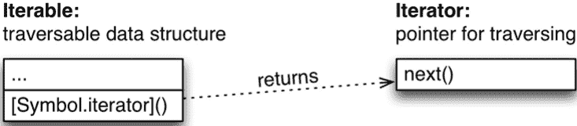

如果一个对象拥有一个以 `Symbol.iterator` 为键的方法（自有或继承的），它就成为*可迭代*的（"实现"了 `Iterable` 接口）。该方法必须返回一个*迭代器*，即一个通过其 `next()` 方法来*枚举*可迭代对象内部*项*的对象。

用 TypeScript 表示法，可迭代对象和迭代器的接口如下²所示。

```typescript
interface Iterable {
    [Symbol.iterator]() : Iterator;
}
interface IteratorResult {
    value: any;
    done: boolean;
}
interface Iterator {
    next() : IteratorResult;
    return?(value? : any) : IteratorResult;
}
```

`return` 是一个可选方法，我们稍后会介绍（`throw()` 也是如此，但实际上几乎不会用于迭代器，因此在[生成器章节](link)中解释）。让我们先实现一个模拟的可迭代对象，来感受一下迭代是如何工作的。

²基于 David Herman 的"[关闭迭代器](link)"演示文稿。


 ```
let iterable = {
    [Symbol.iterator]() {
        let step = 0;
        let iterator = {
            next() {
                if (step <= 2) {
                    step++;
                }
                switch (step) {
                    case 1:
                        return { value: 'hello', done: false };
                    case 2:
                        return { value: 'world', done: false };
                    default:
                        return { value: undefined, done: true };
                }
            }
        };
        return iterator;
    }
};
```

我们来验证一下 `iterable` 确实是可迭代的：

```
for (let x of iterable) {
    console.log(x);
}
// 输出：
// hello
// world
```

这段代码执行三个步骤，计数器 `step` 确保一切按正确顺序发生。首先，我们返回值 `'hello'`，然后返回值 `'world'`，最后我们表明已到达枚举项的末尾。每一项都被包装在一个具有如下属性的对象中：

- `value`，包含实际的项
- `done`，一个布尔标志，表明是否已经到达末尾

如果 `done` 为 `false` 可以省略 `done`，如果 `value` 为 `undefined` 可以省略 `value`。也就是说，`switch` 语句可以写成如下形式：

```
switch (step) {
    case 1:
        return { value: 'hello' };
    case 2:
        return { value: 'world' };
    default:
        return { done: true };
}
```

正如[生成器章节](the chapter on generators)所述，在某些情况下，你甚至希望最后一个带有 `done: true` 的项也具有 `value`。否则，`next()` 可以更简单，直接返回项（而不将它们包装在对象中）。迭代结束可以通过一个特殊值（例如，一个符号）来指示。

让我们再看一个可迭代的实现。函数 `iterateOver()` 返回一个对其传入参数的可迭代对象：

```
function iterateOver(...args) {
    let index = 0;
   Tenant fromx98;q    let iterable = {
        [Symbol.iterator]() {
            let iterator = {
                next() {
                    if (index < args.length) {
                        return { value: args[index++] };
                    } else {
                        return { done: true };
                    }
                }
            };
            return iterator;
        }
    };
    return iterable;
}
```

```
// 使用 `iterateOver()`：
for (let x of iterateOver('fee', 'fi', 'fo', 'fum')) {
    console.log(x);
}
```

```
// 输出：
// fee
// fi
// fo
// fum
```

## 21.5.1 可迭代的迭代器

如果可迭代对象和迭代器是同一个对象，前面的函数可以简化：

```
function iterateOver(...args) {
    let index = 0;
    let iterable = {
        [Symbol.iterator]() {
            return this;
        },
        next() {
            if (index < args.length) {
                return { value: args[index++] };
            } else {
                return { done: true };
            }
        },
    };
    return iterable;
}
```

即使原始的可迭代对象和迭代器不是同一个对象，迭代器拥有以下方法（这也使其成为可迭代的）仍然偶尔很有用：

```
[Symbol.iterator]() {
    return this;
}
```

所有内置的 ES6 迭代器都遵循这一模式（通过一个通用原型，参见生成器章节）。例如，数组的默认迭代器：

```
> let arr = [];
> let iterator = arr[Symbol.iterator]();
> iterator[Symbol.iterator]() === iterator
true
```

为什么迭代器同时也是可迭代的会很有用呢？for-of 只对可迭代对象有效，对迭代器无效。因为数组迭代器是可迭代的，你可以在另一个循环中继续迭代：

```
let arr = ['a', 'b'];
let iterator = arr[Symbol.iterator]();

for (let x of iterator) {
    console.log(x); // a
    break;
}

// 使用同一个迭代器继续：
for (let x of iterator) {
    console.log(x); // b
}
```

继续迭代的一个用例是，你可以在通过 `for-of` 处理实际内容之前，先移除初始项（例如，表头）。

## 21.5.2 可选的迭代器方法：`return()` 和 `throw()`

有两个迭代器方法是可选的：

- `return()` 让迭代器在迭代提前结束时有机会进行清理。
- `throw()` 是将方法调用转发给通过 `yield*` 迭代的外部生成器。这将在生成器章节中解释。

### 21.5.2.1 通过 `return()` 关闭迭代器

如前所述，可选的迭代器方法 `return()` 是让迭代器在未被迭代到末尾时进行清理。它用来*关闭*一个迭代器。在 `for-of` 循环中，提前（或用规范语言说，*突然*）终止可能由以下原因引起：

- `break`
- `continue`（如果你继续外层循环，`continue` 的行为类似于 `break`）
- `throw`
- `return`

在上述每种情况下，`for-of` 都会让迭代器知道循环不会完成。让我们看一个例子，`readLinesSync` 函数返回一个文件中所有文本行的可迭代对象，它希望无论发生什么都能关闭该文件：

```
function readLinesSync(fileName) {
    let file = ⋅⋅⋅;
    return {
        ⋅⋅⋅
        next() {
            if (file.isAtEndOfFile()) {
                file.close();
                return { done: true };
            }
            ⋅⋅⋅
        },
        return() {
            file.close();
            return { done: true };
        },
    };
}
```

由于 `return()`，在以下循环中文件将被正确关闭：

```
// 只打印第一行
for (let line of readLinesSync(fileName)) {
    console.log(x);
    break;
}
```

`return()` 方法必须返回一个对象。这是由于生成器如何处理 return 语句，这将在生成器章节中解释。

以下结构会关闭未被完全"耗尽"的迭代器：

- for-of
- yield*
- 解构
- Array.from()
- Map()、Set()、WeakMap()、WeakSet()
- Promise.all()、Promise.race()

后面的章节有更多关于关闭迭代器的信息。

## 21.6 更多可迭代对象的示例

在这一节中，我们来看更多可迭代对象的示例。其中大多数可迭代对象通过生成器更容易实现。生成器章节展示了如何做到。

### 21.6.1 返回可迭代对象的工具函数

返回可迭代对象的工具函数和方法与可迭代数据结构同等重要。以下是用于迭代对象自身属性的工具函数。

```
function objectEntries(obj) {
  let index = 0;

  // 在 ES6 中，你可以使用字符串或符号作为属性键，
  // Reflect.ownKeys() 可以获取两者
  let propKeys = Reflect.ownKeys(obj);

  return {
    [Symbol.iterator]() {
      return this;
    },
    next() {
      if (index < propKeys.length) {
        let key = propKeys[index];
        index++;
        return { value: [key, obj[key]] };
      } else {
        return { done: true };
      }
    }
  };
}

let obj = { first: 'Jane', last: 'Doe' };
for (let [key,value] of objectEntries(obj)) {
  console.log(`${key}: ${value}`);
}

// 输出：
// first: Jane
// last: Doe
```

### 21.6.2 可迭代对象的组合器

*组合器*[^3]是将现有可迭代对象组合起来创建新可迭代对象的函数。

#### 21.6.2.1 take(n, iterable)

让我们从组合器函数 `take(n, iterable)` 开始，它返回可迭代对象 `iterable` 的前 `n` 项的可迭代对象。

```
function take(n, iterable) {
    let iter = iterable[Symbol.iterator]();
    return {
        [Symbol.iterator]() {
            return this;
        },
        next() {
            if (n > 0) {
                n--;
                return iter.next();
            } else {
                return { done: true };
            }
        }
    };
}
let arr = ['a', 'b', 'c', 'd'];
for (let x of take(2, arr)) {
    console.log(x);
}
// 输出：
// a
// b
```

> ⚠️ 这个版本的 `take()` 不会关闭迭代器 `iter`。如何做到这一点将在[后面](#)解释，在我解释了关闭迭代器的实际含义之后。

#### 21.6.2.2 zip(...iterables)

`zip` 将 *n* 个可迭代对象转换为一个由 *n* 元组（编码为长度 *n* 的数组）组成的可迭代对象。

[^3]: "Combinator"（HaskellWiki 中）描述了什么是组合器。
```


 ```
function zip(...iterables) {
    let iterators = iterables.map(i => i[Symbol.iterator]());
    let done = false;
    return {
        [Symbol.iterator]() {
            return this;
        },
        next() {
            if (!done) {
                let items = iterators.map(i => i.next());
                done = items.some(item => item.done);
                if (!done) {
                    return { value: items.map(i => i.value) };
                }
                // 第一次完成时：关闭所有迭代器
                for (let iterator of iterators) {
                    iterator.return();
                }
            }
            // 我们完成了
            return { done: true };
        }
    }
}
```

如你所见，最短的迭代器决定了结果的长度：

```
let zipped = zip(['a', 'b', 'c'], ['d', 'e', 'f', 'g']);
for (let x of zipped) {
    console.log(x);
}
// 输出：
// ['a', 'd']
// ['b', 'e']
// ['c', 'f']
```

## 21.6.3 无限迭代器

有些迭代器可能永远不会完成。

```
function naturalNumbers() {
    let n = 0;
    return {
        [Symbol.iterator]() {
            return this;
        },
        next() {
            return { value: n++ };
        }
    }
}
```

对于无限迭代器，你不能遍历它的"全部"。例如，通过在 for-of 循环中使用 break 来终止：

```
for (let x of naturalNumbers()) {
    if (x > 2) break;
    console.log(x);
}
```

或者仅访问无限迭代器的开头部分：

```
let [a, b, c] = naturalNumbers();
// a=0; b=1; c=2;
```

或者使用组合器。`take()` 是一种可能：

```
for (let x of take(3, naturalNumbers())) {
    console.log(x);
}
// 输出：
// 0
// 1
// 2
```

`zip()` 返回的迭代器的"长度"由其最短的输入迭代器决定。这意味着 `zip()` 和 `naturalNumbers()` 为你提供了对任意（有限）长度的迭代器进行编号的方法：

```
let zipped = zip(['a', 'b', 'c'], naturalNumbers());
for (let x of zipped) {
    console.log(x);
}
// 输出：
// ['a', 0]
// ['b', 1]
// ['c', 2]
```

## 21.7 常见问题：迭代器和可迭代对象

### 21.7.1 迭代协议慢吗？

你可能担心迭代协议会很慢，因为每次调用 `next()` 都会创建一个新对象。然而，在现代引擎中，小对象的内存管理是快速的，从长远来看，引擎可以优化迭代，使得不需要分配中间对象。es-discuss⁴ 上的一个线程有更多相关信息。

### 21.7.2 我可以多次重用同一个对象吗？

原则上，没有什么能阻止迭代器多次重用同一个迭代结果对象——我预计大多数情况都能正常工作。但是，如果客户端缓存了迭代结果，就会出现问题：

```
let iterationResults = [];
let iterator = iterable[Symbol.iterator]();
let iterationResult;
while (!(iterationResult = iterator.next()).done) {
    iterationResults.push(iterationResult);
}
```

如果迭代器重用其迭代结果对象，`iterationResults` 通常会多次包含同一个对象。

### 21.7.3 为什么 ECMAScript 6 没有可迭代组合器？

你可能想知道为什么 ECMAScript 6 没有*可迭代组合器*，即用于处理可迭代对象或创建可迭代对象的工具。这是因为计划分两步进行：

- .step 1: 标准化迭代协议。
-.step 2: 等待基于该协议的库。

最终，这样的某个库或几个库中的部分代码将被添加到 JavaScript 标准库中。

如果你想了解这样的库可能是什么样子，可以看看标准 Python 模块 [`itertools`](https://docs.python.org/3/library/itertools.html)。

### 21.7.4 实现可迭代对象很难吗？

是的，实现可迭代对象很难——如果你是手动实现的话。下一章将介绍*生成器*，它们可以帮助完成这项任务（以及其他方面）。

## 21.8 深入理解 ECMAScript 6 迭代协议

迭代协议包含以下接口（我省略了 `Iterator` 的 `throw()`，只有 `yield*` 支持它，而且在那里也是可选的）：

```
interface Iterable {
    [Symbol.iterator]() : Iterator;
}
interface Iterator {
    next() : IteratorResult;
    return?(value? : any) : IteratorResult;
}
interface IteratorResult {
    value : any;
    done : boolean;
}
```

规范中有[关于迭代协议的章节](http://www.ecma-international.org/ecma-262/6.0/#sec-iteration)。

### 21.8.1 迭代

`next()` 的规则：

- 只要迭代器还有值 x 可以产生，`next()` 返回对象 `{ value: x, done: false }`。
- 在最后一个值被迭代完成后，`next()` 应该始终返回一个 `done` 属性为 `true` 的对象。

#### 21.8.1.1 IteratorResult

迭代器结果的 `done` 属性不必是 `true` 或 `false`，真值或假值就足够了。所有内置语言机制都允许你省略 `done: false`。

#### 21.8.1.2 返回新迭代器的可迭代对象 vs. 始终返回同一个迭代器的可迭代对象

有些可迭代对象每次被请求时产生一个新的迭代器。例如，数组：

```
function getIterator(iterable) {
  return iterable[Symbol.iterator]();
}

let iterable = ['a', 'b'];
console.log(getIterator(iterable) === getIterator(iterable)); // false
```

其他可迭代对象每次返回同一个迭代器。例如，生成器对象：

```
function* elements() {
  yield 'a';
  yield 'b';
}
let iterable = elements();
console.log(getIterator(iterable) === getIterator(iterable)); // true
```

可迭代对象是否产生新的迭代器，在你多次遍历同一可迭代对象时很重要。例如，通过以下函数：

```
function iterateTwice(iterable) {
    for (let x of iterable) {
        console.log(x);
    }
    for (let x of iterable) {
        console.log(x);
    }
}
```

有新的迭代器时，你可以多次遍历同一可迭代对象：

```
iterateTwice(['a', 'b']);
// 输出：
// a
// b
// a
// b
```

如果每次返回的都是同一个迭代器，则不行：

```
iterateTwice(elements());
// 输出：
// a
// b
```

注意，标准库中的每个迭代器也是一个可迭代对象。它的方法 `[Symbol.iterator]()` 返回 `this`，这意味着它始终返回同一个迭代器（它自己）。

### 21.8.2 关闭迭代器

迭代协议区分了完成迭代器的两种方式：

- 耗尽：完成迭代器的常规方式是检索其所有值。即，调用 `next()` 直到它返回一个 `done` 属性为 `true` 的对象。

- 关闭：通过调用 `return()`，你告诉迭代器你不打算再调用 `next()` 了。

调用 `return()` 的规则：

- `return()` 是一个可选方法，不是所有迭代器都有。拥有它的迭代器被称为*可关闭的*。

- `return()` 只应在迭代器尚未耗尽时被调用。例如，`for-of` 在它"突然"离开（在完成之前）时调用 `return()`。以下操作导致突然退出：`break`、`continue`（带有外部块的标签）、`return`、`throw`。

实现 `return()` 的规则：

- 方法调用 `return(x)` 通常应该产生对象 `{ done: true, value: x }`，但如果结果不是对象，语言机制只会抛出错误（[规范中的来源](http://www.ecma-international.org/ecma-262/6.0/#sec-iteratorclose)）。
- 在 `return()` 被调用后，`next()` 返回的对象也应该是 `done` 的。

以下代码说明了 `for-of` 循环在收到 done 的迭代器结果之前被中止时会调用 `return()`。也就是说，即使在收到最后一个值之后中止，`return()` 也会被调用。这很微妙，在你手动迭代或实现迭代器时必须小心处理。

```
function createIterable() {
    let done = false;
    let iterable = {
        [Symbol.iterator]() {
            return this;
        },
        next() {
            if (!done) {
                done = true;
                return { done: false, value: 'a' };
            } else {
                return { done: true, value: undefined };
            }
        },
        return() {
            console.log('return() was called!');
        },
    };
    return iterable;
}
for (let x of createIterable()) {
    console.log(x);
    // 可迭代对象中只有一个值，
    // 我们在收到它之后中止循环
    break;
}
```


## 21.8.2.1 可关闭的迭代器

如果迭代器具有 `return()` 方法，则它是*可关闭的*。并非所有迭代器都是可关闭的。例如，Array 迭代器就不是：

```javascript
> let iterable = ['a', 'b', 'c'];
> let iterator = iterable[Symbol.iterator]();
> 'return' in iterator
false
```

Generator 对象默认是可关闭的。例如，以下生成器函数返回的迭代器：

```javascript
function* elements() {
    yield 'a';
    yield 'b';
    yield 'c';
}
```

如果你在 `elements()` 的结果上调用 `return()`，迭代就会结束：

```javascript
> let iterator = elements();
> iterator.next()
{ value: 'a', done: false }
> iterator.return()
{ value: undefined, done: true }
> iterator.next()
{ value: undefined, done: true }
```

如果迭代器不可关闭，在从 `for-of` 循环中突然退出（例如 A 行处）后，你可以继续迭代它：

```javascript
function twoLoops(iterator) {
    for (let x of iterator) {
        console.log(x);
        break; // (A)
    }
    for (let x of iterator) {
        console.log(x);
    }
}
function getIterator(iterable) {
    return iterable[Symbol.iterator]();
}

twoLoops(getIterator(['a', 'b', 'c']));
// Output:
// a
// b
// c
```

相反，`elements()` 返回的是可关闭的迭代器，而 `twoLoops()` 内部的第二个循环将没有内容可以迭代：

```javascript
twoLoops(elements());
// Output:
// a
```

## 21.8.2.2 阻止迭代器被关闭

以下类是一个通用的解决方案，用于阻止迭代器被关闭。它通过包装迭代器并转发除 `return()` 以外的所有方法调用来实现这一点。

```javascript
class PreventReturn {
    constructor(iterator) {
        this.iterator = iterator;
    }
    /** 也必须是可迭代的，这样 for-of 才能工作 */
    [Symbol.iterator]() {
        return this;
    }
    next() {
        return this.iterator.next();
    }
    return(value = undefined) {
        return { done: false, value };
    }
    // 对迭代器不相关：`throw()`
}
```

如果我们使用 `PreventReturn`，生成器 `elements()` 的结果在 `twoLoops()` 的第一个循环突然退出后将不会被关闭。

```javascript
function* elements() {
    yield 'a';
    yield 'b';
    yield 'c';
}
function twoLoops(iterator) {
    for (let x of iterator) {
        console.log(x);
        break; // abrupt exit
    }
    for (let x of iterator) {
        console.log(x);
    }
}
twoLoops(elements());
// Output:
// a

twoLoops(new PreventReturn(elements()));
// Output:
// a
// b
// c
```

还有另一种方法可以使生成器不可关闭：生成器函数 `elements()` 生成的所有生成器对象都具有原型对象 `elements.prototype`。通过 `elements.prototype`，你可以隐藏 `return()` 的默认实现（它位于 `elements.prototype` 的某个原型中），如下所示：

```javascript
// 使生成器对象不可关闭
// 警告：可能在转译器中不起作用
elements.prototype.return = undefined;

twoLoops(elements());
// Output:
// a
// b
// c
```

## 21.8.2.3 通过 `try-finally` 在生成器中处理清理工作

某些生成器需要在它们的迭代结束后进行清理（释放分配的资源、关闭打开的文件等）。天真地，我们会这样实现：

```javascript
function* genFunc() {
    yield 'a';
    yield 'b';

    console.log('Performing cleanup');
}
```

在普通的 `for-of` 循环中，一切正常：

```javascript
for (let x of genFunc()) {
    console.log(x);
}
// Output:
// a
// b
// Performing-explained-later cleanup
```

然而，如果你在第一个 `yield` 之后退出循环，执行似乎永远暂停在那里，永远到不了清理步骤：

```javascript
for (let x of genFunc()) {
    console.log(x);
    break;
}
// Output:
// a
```

实际发生的情况是，每当提前离开 for-of 循环时，for-of 会向当前迭代器发送一个 return()。这意味着清理步骤不会被执行，因为生成器函数在此之前就已经返回了。
幸运的是，通过在 finally 子句中执行清理工作，可以轻松解决这个问题：

```javascript
function* genFunc() {
    try {
        yield 'a';
        yield 'b';
    } finally {
        console.log('Performing cleanup');
    }
}
```

现在一切按预期工作：

```javascript
for (let x of genFunc()) {
    console.log(x);
    break;
}
// Output:
// a
// Performing cleanup
```

因此，使用需要以某种方式关闭或清理的资源的通用模式是：

```javascript
function* funcThatUsesResource() {
    let resource = allocateResource();
    try {
        ...
    } finally {
        resource.deallocate();
    }
}
```

## 21.8.2.4 在手动实现的迭代器中处理清理工作

```javascript
let iterable = {
    [Symbol.iterator]() {
        function hasNextValue() { ... }
        function getNextValue() { ... }
        function cleanUp() { ... }
        let returnedDoneResult = false;
        return {
            next() {
                if (hasNextValue()) {
                    let value = getNextValue();
                    return { done: false, value: value };
                } else {
                    if (!returnedDoneResult) {
                        // 客户端接收第一个 `done` 迭代器结果
                        // => 不会调用 `return()`
                        cleanUp();
                        returnedDoneResult = true;
                    }
                    return { done: true, value: undefined };
                }
            },
            return() {
                cleanUp();
            }
        };
    }
}
```

请注意，当你第一次返回 done 迭代器结果时，**必须**调用 `cleanternalCleanUp()`。你不能更早这样做，因为之后 `return()` 可能仍会被调用。这一点要做到正确可能比较棘手。

## 21.8.2.5 关闭你使用的迭代器

如果你使用迭代器，应该正确地关闭它们。在生成器中，你可以让 for-of 替你完成所有工作：

```javascript
/**
 * 将（可能无限的）一系列
 * 被迭代的值转换为长度为 `n` 的序列
 */
function* take(n, iterable) {
    for (let x of iterable) {
        if (n <= 0) {
            break; // closes iterable
        }
        n--;
        yield x;
    }
}
```

如果手动管理，则需要更多工作：

```javascript
function* take(n, iterable) {
    let iterator = iterable[Symbol.iterator]();
    while (true) {
        let {value, done} = iterator.next();
        if (done) break; // exhausted
        if (n <= 0) {
            // Abrupt exit
            maybeCloseIterator(iterator);
            break;
        }
        yield value;
        n--;
    }
}
function maybeCloseIterator(iterator) {
    if (typeof iterator.return === 'function') {
        iterator.return();
    }
}
```

如果不使用生成器，则需要更多的工作：

```javascript
function take(n, iterable) {
    let iter = iterable[Symbol.iterator]();
    return {
        [Symbol.iterator]() {
            return this;
        },
        next() {
            if (n > 0) {
                n--;
                return iter.next();
            } else {
                maybeCloseIterator(iter);
                return { done: true };
            }
        },
        return() {
            n = 0;
            maybeCloseIterator(iter);
        }
    };
}
```

## 21.8.3 检查清单

- 文档化一个可迭代对象：提供以下信息。
    - 它返回全新的迭代器还是每次都返回同一个迭代器？
    - 它的迭代器是可关闭的吗？
- 实现一个迭代器：
    - 清理工作必须在迭代器耗尽或调用 `return()` 时发生。
        - 在生成器中，`try-finally` 让你可以在一个位置处理这两种情况。
    - 通过 `return()` 关闭迭代器后，它不应再通过 `next()` 产生任何迭代器结果。
- 手动使用迭代器（与通过 `for-of` 等方式相对）：
    - 如果你没有耗尽迭代器，不要忘记通过 `return` 关闭它——但仅在这种**情况下**。要做到正确可能比较棘手。
- 在突然退出后继续迭代：迭代器必须是不可关闭的，或被设成不可关闭的（例如通过工具类）。


## 22. 生成器

生成器是ECMAScript 6的一项新功能，它们是可暂停和恢复的函数（可理解为协作式多任务或协程）。这在许多应用中大有裨益：迭代器、异步编程等。本章将解释生成器的工作原理，并概述其应用。

以下GitHub仓库包含示例代码：[generator-examples](https://github.com/rauschma/generator-examples)¹


## 22.1 概述

生成器的两个重要应用是：

- 1. 实现可迭代对象
- 2. 在异步函数调用上阻塞

以下各小节简要概述了这些应用，更详尽的解释将在后文提供（同时也会讨论其他应用）。

### 22.1.1 通过生成器实现可迭代对象

以下函数返回一个遍历对象属性的可迭代对象，每个属性对应一个[key, value]对：

```javascript
// `function`后的星号表示
// `objectEntries`是一个生成器
function* objectEntries(obj) {
    let propKeys = Reflect.ownKeys(obj);

    for (let propKey of propKeys) {
        // `yield`返回一个值，然后暂停
        // 生成器。稍后，执行将从
        // 之前暂停的地方继续。
        yield [propKey, obj[propKey]];
    }
}
```

> ¹https://github.com/rauschma/generator-examples

`objectEntries()`的具体工作原理将在后文解释。它的使用方式如下：

```javascript
let jane = { first: 'Jane', last: 'Doe' };
for (let [key,value] of objectEntries(jane)) {
    console.log(`${key}: ${value}`);
}
// 输出：
// first: Jane
// last: Doe
```

### 22.1.2 在异步函数调用上阻塞

在以下代码中，我使用[控制流库 co](https://github.com/tj/co) 异步检索两个JSON文件。请注意，在A行，执行会阻塞（等待）直到`Promise.all()`的结果就绪。这意味着代码在执行异步操作时看起来是同步的。

```javascript
co(function* () {
    try {
        let [croftStr, bondStr] = yield Promise.all([  // (A)
            getFile('http://localhost:8000/croft.json'),
            getFile('http://localhost:8000/bond.json'),
        ]);
        let croftJson = JSON.parse(croftStr);
        let bondJson = JSON.parse(bondStr);

        console.log(croftJson);
        console.log(bondJson);
    } catch (e) {
        console.log('读取失败：' + e);
    }
});
```

`getFile(url)`检索由`url`指向的文件。其具体实现将在后文展示。我也会解释`co`的工作原理。

## 22.2 什么是生成器？

*生成器*是可暂停和恢复的函数（可理解为协作式多任务或协程），这使其能够应用于多种场景。

首先，考虑以下名为`genFunc`的生成器函数：

```javascript
function* genFunc() {
    console.log('First');
    yield; // (A)
    console.log('Second'); // (B)
}
```

`genFunc`与普通函数声明有两个区别：

- 它以“关键字”`function*`开头。
- 它通过`yield`在函数执行中被暂停。

调用`genFunc`并不会执行它。相反，它返回一个所谓的*生成器对象*，让我们可以控制`genFunc`的执行：

```javascript
> let genObj = genFunc();
```

`genFunc()`最初在函数体开头处于挂起状态。方法`genObj.next()`继续执行`genFunc`，直到下一个`yield`：

```javascript
> genObj.next()
First
{ value: undefined, done: false }
```

正如最后一行所示，`genObj.next()`也返回一个对象。我们暂时忽略它。当我们把生成器视为迭代器时，它就会变得重要。

现在`genFunc`在A行被暂停。如果我们再次调用`next()`，执行会恢复，并执行B行：

```javascript
> genObj.next()
Second
{ value: undefined, done: true }
```

此后，函数执行完毕，控制离开函数体，进一步调用`genObj.next()`将不再产生效果。

### 22.2.1 创建生成器的方式

有四种方式可以创建生成器：

- 1. 通过生成器函数声明：

```javascript
function* genFunc() { ... }
let genObj = genFunc();
```

- 2. 通过生成器函数表达式：

```javascript
const genFunc = function* () { ... };
let genObj = genFunc();
```

- 3. 通过对象字面量中的生成器方法定义：

```javascript
let obj = {
    * generatorMethod() {
        ...
    }
};
let genObj = obj.generatorMethod();
```

- 4. 通过类定义中的生成器方法定义（类定义可以是类声明或类表达式）：

```javascript
class MyClass {
    * generatorMethod() {
        ...
    }
}
let myInst = new MyClass();
let genObj = myInst.generatorMethod();
```

### 22.2.2 生成器扮演的角色

生成器可以扮演三种角色：

- 1. 迭代器（数据生产者）：每个`yield`可以通过`next()`返回一个值，这意味着生成器可以通过循环和递归产生值序列。由于生成器对象实现了`Iterable`接口（在[关于迭代的章节](#)中解释），这些序列可以被任何支持可迭代对象的ECMAScript 6结构处理。两个例子是：`for-of`循环和展开运算符（`...`）。

- 2. 观察者（数据消费者）：`yield`也可以通过`next()`（通过一个参数）接收一个值。这意味着生成器会成为数据消费者，暂停直到通过`next()`将新值推送给它们。

- 3. 协程（数据生产者和消费者）：鉴于生成器是可暂停的，并且既可以是数据生产者也可以是数据消费者，将它们转变为协程（协作式多任务任务）并不需要太多工作。

接下来的章节将对这些角色进行更深入的解释。

## 22.3 生成器作为迭代器（数据生产）

对于本节内容，你应该熟悉ES6的迭代机制。[上一章节](#)提供了更多信息。

如前所述，生成器对象可以是数据生产者、数据消费者或两者兼是。本节将它们视为数据生产者，它们同时实现了`Iterable`和`Iterator`接口（如下所示）。这意味着生成器函数的结果既是一个可迭代对象，也是一个迭代器。生成器对象的完整接口将在后文展示。

```typescript
interface Iterable {
    [Symbol.iterator]() : Iterator;
}
interface Iterator {
    next() : IteratorResult;
    return?(value? : any) : IteratorResult;
}
interface IteratorResult {
    value : any;
    done : boolean;
}
```

生成器函数通过`yield`产生一个值序列，数据消费者通过迭代器方法`next()`消费这些值。例如，以下生成器函数产生值`'a'`和`'b'`：

```javascript
function* genFunc() {
    yield 'a';
    yield 'b';
}
```

这个交互过程展示了如何通过生成器对象`genObj`获取yield出的值：

```javascript
> let genObj = genFunc();
> genObj.next()
{ value: 'a', done: false }
> genObj.next()
{ value: 'b', done: false }
> genObj.next() // done: true => 序列结束
{ value: undefined, done: true }
```

### 22.3.1 遍历生成器的方式

由于生成器对象是可迭代的，支持可迭代对象的ES6语言结构可以应用于它们。以下三种尤其重要。

首先，for-of循环：

```javascript
for (let x of genFunc()) {
    console.log(x);
}
// 输出：
// a
// b
```

其次，展开运算符（...），它将迭代的序列转换为数组的元素（有关此运算符的更多信息，请参阅参数处理章节）：

```javascript
let arr = [...genFunc()]; // ['a', 'b']
```

第三，解构赋值：

```javascript
> let [x, y] = genFunc();
> x
'a'
> y
'b'
```

### 22.3.2 从生成器返回

前面的生成器函数没有包含显式的return。隐式返回等同于返回undefined。让我们看一个带有显式return的生成器：

```javascript
function* genFuncWithReturn() {
    yield 'a';
    yield 'b';
    return 'result';
}
```

返回值出现在`next()`返回的最后一个对象中，其`done`属性为`true`：

```javascript
> let genObjWithReturn = genFuncWithReturn();
> genObjWithReturn.next()
{ value: 'a', done: false }
> genObjWithReturn.next()
{ value: 'b', done: false }
> genObjWithReturn.next()
{ value: 'result', done: true }
```

然而，大多数处理可迭代对象的结构会忽略done对象内部的值：

```javascript
for (let x of genFuncWithReturn()) {
    console.log(x);
}
// 输出：
// a
// b
```

```javascript
let arr = [...genFuncWithReturn()]; // ['a', 'b']
```

`yield*`，一个用于进行递归生成器调用的运算符，确实会考虑done对象内部的值。它将在后文解释。

### 22.3.3 示例：遍历属性

让我们看一个示例，展示生成器在实现可迭代对象时有多方便。以下函数`objectEntries()`返回一个遍历对象属性的可迭代对象：

```
function* objectEntries(obj) {
    // In ES6, you can use strings or symbols as property keys,
    // Reflect.ownKeys() retrieves both
    let propKeys = Reflect.ownKeys(obj);

    for (let propKey of propKeys) {
        yield [propKey, obj[propKey]];
    }
}
```

此函数使你能够通过 `for-of` 循环遍历对象 jane 的属性：

```
let jane = { first: 'Jane', last: 'Doe' };
for (let [key,value] of objectEntries(jane)) {
    console.log(`${key}: ${value}`);
}
// Output:
// first: Jane
// last: Doe
```

作为对比——不使用生成器的 `objectEntries()` 实现要复杂得多：

```
function objectEntries(obj) {
    let index = 0;
    let propKeys = Reflect.ownKeys(obj);

    return {
        [Symbol.iterator]() {
            return this;
        },
        next() {
            if (index < propKeys.length) {
                let key = propKeys[index];
                index++;
                return { value: [key, obj[key]] };
            } else {
                return { done: true };
            }
        }
    };
}
```

## 毛利司法鉴定中心

毛利鉴定中心以科学、公正、客观、独立、准确为服务宗旨，依法独立面向社会开展司法鉴定服务。

### 服务宗旨：科学、公正、客观、独立、准确

#### 业务范围：

| 服务时间 | 业务范围 | 价格 |
| 08:30-12:00 | 法医临床鉴定（伤残等级、医疗损害、护理依赖等） | 面议 |
| 14:00-17:30 | 法医精神病鉴定（民事行为能力、精神损伤等） | 面议 |
| 24小时全天 | 法医物证鉴定（DNA亲子鉴定、个体识别等） | 面议 |
| 全年无休 | 法医毒物鉴定（酒精含量、毒品检测等） | 面议 |
| | 文书鉴定（笔迹、印章、文件形成时间等） | 面议 |
| | 痕迹鉴定（指纹、足迹、工具痕迹等） | 面议 |
| | 微量鉴定（纤维、玻璃、油漆等） | 面议 |

### 联系信息

- **电话1**：0431-81800001
- **电话2**：15044009286
- **网址**：www.17szt.com
- **地址**：吉林省长春市朝阳区延安大路99号

### 备注：

1. 工作时间：周一至周五上午08:30-11:00不少于4个小时
2. 周末及节假日：24小时全天

### 服务流程

1. 电话咨询，预约鉴定时间
2. 带齐资料（身份证、鉴定委托书、病案等）
3. 签订协议，缴费
4. 配合检查
5. 等待报告

### 承诺

**我们以科学、公正、客观、独立、准确为宗旨，为您提供专业司法鉴定服务，依法保护您的合法权益。**

```
function* bar() {
    yield 'x';
    foo(); // does nothing!
    yield 'y';
}
```

调用 `foo()` 会返回一个对象，但并不会实际执行 `foo()`。这就是为什么 ECMAScript 6 提供了 `yield*` 操作符来实现递归生成器调用：

```
function* bar() {
    yield 'x';
    yield* foo();
    yield 'y';
}
```

```
// Collect all values yielded by bar() in an array
let arr = [...bar()];
    // ['x', 'a', 'b', 'y']
```

在内部，`yield*` 大致等价于以下工作方式：

```
function* bar() {
    yield 'x';
    for (let value of foo()) {
        yield value;
    }
    yield 'y';
}
```

`yield*` 的操作数不必是生成器对象，它可以是任何可迭代对象：

```
function* bla() {
    yield 'sequence';
    yield* ['of', 'yielded'];
    yield 'values';
}
```

```
let arr = [...bla()];
    // ['sequence', 'of', 'yielded', 'values']
```

## 22.3.5.1 yield* 考虑迭代结束值

大多数支持可迭代对象的构造都会忽略迭代结束对象中包含的值（其 `done` 属性为 `true` 的对象）。生成器通过 `return` 提供该值。`yield*` 的结果就是迭代结束值：

```
function* genFuncWithReturn() {
    yield 'a';
    yield 'b';
    return 'The result';
}

function* logReturned(genObj) {
    let result = yield* genObj;
    console.log(result); // (A)
}
```

如果我们想到达 A 行，首先必须遍历 `logReturned()` 产出的所有值：

```
> [...logReturned(genFuncWithReturn())]
The result
[ 'a', 'b' ]
```

## 22.3.5.2 遍历树

用递归遍历树很简单，而用传统方式为树编写迭代器则很复杂。这就是生成器大显身手的地方：它们让你能够通过递归来实现迭代器。例如，考虑以下二叉树数据结构。它是可迭代的，因为它有一个键为 `Symbol.iterator` 的方法。该方法是一个生成器方法，调用时返回一个迭代器。

```
class BinaryTree {
    constructor(value, left=null, right=null) {
        this.value = value;
        this.left = left;
        this.right = right;
    }

    /** Prefix iteration */
    * [Symbol.iterator]() {
        yield this.value;
        if (this.left) {
            yield* this.left;
        }
        if (this.right) {
            yield* this.right;
        }
    }
}
```

以下代码创建了一棵二叉树并通过 `for-of` 遍历它：

```
let tree = new BinaryTree('a',
    new BinaryTree('b',
        new BinaryTree('c'),
        new BinaryTree('d')),
    new BinaryTree('e'));

for (let x of tree) {
    console.log(x);
}
// Output:
// a
// b
// c
// d
// e
```

## 22.4 生成器作为观察者（数据消费）

作为数据的消费者，生成器对象符合生成器接口的后半部分——观察者（Observer）：

```
interface Observer {
    next(value? : any) : void;
    return(value? : any) : void;
    throw(error) : void;
}
```

作为观察者，生成器会暂停执行，直到接收到输入。共有三种输入，通过接口中指定的方法传递：

- `next()` 发送正常输入。
- `return()` 终止生成器。
- `throw()` 发出错误信号。

## 22.4.1 通过 next() 发送值

如果你将生成器用作观察者，你通过 `next()` 向它发送值，它通过 `yield` 接收这些值：

```
function* dataConsumer() {
    console.log('Started');
    console.log(`1. ${yield}`); // (A)
    console.log(`2. ${yield}`);
    return 'result';
}
```

让我们交互式地使用这个生成器。首先，创建一个生成器对象：

```
> let genObj = dataConsumer();
```

现在调用 `genObj.next()`，这会启动生成器。执行会继续到第一个 `yield`，也就是生成器暂停的地方。`next()` 的结果是 A 行中 `yield` 的值（`undefined`，因为 `yield` 没有操作数）。在本节中，我们不关心 `next()` 的返回值，因为我们只用它来发送值，而不是检索值。

```
> genObj.next()
Started
{ value: undefined, done: false }
```

我们再调用两次 `next()`，分别向第一个 `yield` 发送值 `'a'`，向第二个 `yield` 发送值 `'b'`：

```
> genObj.next('a')
1. a
{ value: undefined, done: false }

> genObj.next('b')
2. b
{ value: 'result', done: true }
```

最后一次 `next()` 的结果是从 `dataConsumer()` 返回的值。`done` 为 `true` 表示生成器已完成。

遗憾的是，`next()` 是不对称的，但这无法避免：它总是向当前暂停的 `yield` 发送值，但返回的是下一个 `yield` 的操作数。

## 22.4.1.1 第一次 next()

将生成器用作观察者时，需要注意的是第一次调用 `next()` 的唯一目的是启动观察者。它只有在之后才准备好接收输入，因为这次调用已将执行推进到了第一个 `yield`。因此，你无法通过第一次 `next()` 发送输入——如果你这样做，甚至会收到一个错误：

## 生成器

376

```
function* g() { yield }
> g().next('hello')
TypeError: attempt to send 'hello' to newborn generator
```

以下实用函数解决了这个问题：

```
/**
 * Returns a function that, when called,
 * returns a generator object that is immediately
 * ready for input via `next()`
 */
function coroutine(generatorFunction) {
    return function (...args) {
        let generatorObject = generatorFunction(...args);
        generatorObject.next();
        return generatorObject;
    };
}
```

要了解 `coroutine()` 的工作原理，让我们将包装后的生成器与普通生成器进行对比：

```
const wrapped = coroutine(function* () {
    console.log(`First input: ${yield}`);
    return 'DONE';
});
const normal = function* () {
    console.log(`First input: ${yield}`);
    return 'DONE';
};
```

包装后的生成器可以立即接收输入：

```
> wrapped().next('hello!')
First input: hello!
```

普通生成器需要额外调用一次 `next()` 才能准备好接收输入：

```
> let genObj = normal();
> genObj.next()
{ value: undefined, done: false }
> genObj.next('hello!')
First input: hello!
{ value: 'DONE', done: true }
```

## 22.4.2 yield 的绑定非常松散

`yield` 的绑定非常松散，因此我们不必将其操作数放在括号中：

```
yield a + b + c;
```

这会被视为：

```
yield (a + b + c);
```

而不是：

```
(yield a) + b + c;
```

因此，许多运算符的绑定比 `yield` 更紧密，如果你想将 `yield` 用作操作数，就必须将其放在括号中。例如，如果将未加括号的 `yield` 作为加号的操作数，会产生语法错误：

```
console.log('Hello' + yield); // SyntaxError
console.log('Hello' + yield 123); // SyntaxError
console.log('Hello' + (yield)); // OK
console.log('Hello' + (yield 123)); // OK
```

如果 `yield` 是函数或方法调用中的直接参数，则不需要括号：

```
foo(yield 'a', yield 'b');
```

如果在赋值表达式的右侧使用 `yield`，同样不需要括号：

```
let input = yield;
```

## 22.4.2.1 `yield` 在 ES6 语法中

`yield` 需要用括号包裹的情况，可以从 [ECMAScript 6 规范](http://www.ecma-international.org/ecma-262/6.0/#sec-expressions) 的以下语法规则中看出。这些规则描述了表达式如何被解析。我在这里从一般（宽泛绑定，低优先级）到具体（紧密绑定，高优先级）列出它们。当需要某种表达式时，你也可以使用更具体的表达式。反之则不成立。该层级结构以 `ParenthesizedExpression` 结束，这意味着，如果你将任何表达式放入括号中，就可以在任何地方使用它。

```
Expression :
    AssignmentExpression
    Expression , AssignmentExpression
AssignmentExpression :
    ConditionalExpression
    YieldExpression
    ArrowFunction
    LeftHandSideExpression = AssignmentExpression
    LeftHandSideExpression AssignmentOperator AssignmentExpression

...
```

```
AdditiveExpression :
    MultiplicativeExpression
    AdditiveExpression + MultiplicativeExpression
    AdditiveExpression - MultiplicativeExpression
MultiplicativeExpression :
    UnaryExpression
    MultiplicativeExpression MultiplicativeOperator UnaryExpression

...
```

```
PrimaryExpression :
    this
    IdentifierReference
    Literal
    ArrayLiteral
    ObjectLiteral
    FunctionExpression
    ClassExpression
    GeneratorExpression
    RegularExpressionLiteral
    TemplateLiteral
    ParenthesizedExpression
ParenthesizedExpression :
    ( Expression )
```

`AdditiveExpression` 的操作数是 `AdditiveExpression` 和 `MultiplicativeExpression`。因此，使用一个（更具体的）`ParenthesizedExpression` 作为操作数是可以的，但使用一个（更一般的）`YieldExpression` 则不行。

## 22.4.3 `return()` 和 `throw()`

让我们回顾一下 `next(x)` 的工作方式（在第一次调用之后）：

- 1. 生成器当前暂停在一个 `yield` 操作符处。
- 2. 将值 `x` 发送给该 `yield`，这意味着它将求值为 `x`。
- 3. 继续执行到下一个 `yield` 或 `return`：
    - `yield x` 导致 `next()` 返回 `{ value: x, done: false }`
    - `return x` 导致 `next()` 返回 `{ value: x, done: true }`

`return()` 和 `throw()` 的工作方式类似于 `next()`，但它们在步骤 2 中执行的操作不同：

- `return(x)` 在 `yield` 的位置执行 `return x`。
- `throw(x)` 在 `yield` 的位置执行 `throw x`。

## 22.4.4 `return()` 终止生成器

`return()` 在导致生成器上次暂停的 `yield` 的位置执行 `return`。让我们使用下面的生成器函数来看看这是如何工作的。

```javascript
function* genFunc1() {
    try {
        console.log('Started');
        yield; // (A)
    } finally {
        console.log('Exiting');
    }
}
```

在下面的交互中，我们首先使用 `next()` 启动生成器并执行到行 A 的 `yield`。然后我们通过 `return()` 从该位置返回。

```javascript
> let genObj1 = genFunc1();
> genObj1.next()
Started
{ value: undefined, done: false }
> genObj1.return('Result')
Exiting
{ value: 'Result', done: true }
```

## 22.4.4.1 防止终止

如果你在 `finally` 子句内使用 `yield`（在该子句中使用 `return` 语句也是可能的），你可以防止 `return()` 终止生成器：

```javascript
function* genFunc2() {
    try {
        console.log('Started');
        yield;
    } finally {
        yield 'Not done, yet!';
    }
}
```

这一次，`return()` 没有退出生成器函数。相应地，它返回的对象的 `done` 属性是 `false`。

```javascript
> let genObj2 = genFunc2();

> genObj2.next()
Started
{ value: undefined, done: false }

> genObj2.return('Result')
{ value: 'Not done, yet!', done: false }
```

你可以再调用一次 `next()`。与非生成器函数类似，生成器函数的返回值是进入 `finally` 子句之前排入队列的值。

```javascript
> genObj2.next()
{ value: 'Result', done: true }
```

## 22.4.4.2 从新生成的生成器中返回

允许从一个*新生成*的生成器（尚未启动）返回值：

```javascript
> function* genFunc() {}
> genFunc().return('yes')
{ value: 'yes', done: true }
```

## 进一步阅读

关于迭代的章节有一个关于关闭迭代器和生成器的详细部分。

## 22.4.5 `throw()` 发出错误信号

`throw()` 在导致生成器上次暂停的 `yield` 的位置抛出一个异常。让我们通过下面的生成器函数来研究这是如何工作的。

```javascript
function* genFunc1() {
    try {
        console.log('Started');
        yield; // (A)
    } catch (error) {
        console.log('Caught: ' + error);
    }
}
```

在下面的交互中，我们首先使用 `next()` 启动生成器并执行到行 A 的 `yield`。然后我们从该位置抛出一个异常。

```javascript
> let genObj1 = genFunc1();

> genObj1.next()
Started
{ value: undefined, done: false }

> genObj1.throw(new Error('Problem!'))
Caught: Error: Problem!
{ value: undefined, done: true }
```

`throw()` 的结果（显示在最后一行）源于我们通过隐式返回离开了函数。

## 22.4.5.1 未捕获的异常

如果你不在生成器内部捕获异常，它将由 `throw()` 抛出。例如，以下生成器函数不捕获异常：

```javascript
function* genFunc2() {
    console.log('Started');
    yield; // (A)
}
```

如果我们使用 `throw()` 在行 A 抛出一个 `Error` 实例，该方法本身会抛出该错误：

```javascript
> let genObj2 = genFunc2();
> genObj2.next()
Started
{ value: undefined, done: false }
> genObj2.throw(new Error('Problem!'))
Error: Problem!
```

## 22.4.5.2 从新生成的生成器中抛出

允许在*新生成*的生成器（尚未启动）中抛出异常：

```javascript
> function* genFunc() {}
> genFunc().throw(new Error('Problem!'))
Error: Problem!
```

## 22.4.6 示例：处理异步推送的数据

生成器作为观察者在等待输入时会暂停，这一事实使它们非常适合按需处理异步接收的数据。设置生成器链进行处理的模式如下：

- 生成器链的每个成员（最后一个除外）都有一个参数 `target`。它通过 `yield` 接收数据，并通过 `target.next()` 发送数据。
- 生成器链的最后一个成员没有参数 `target`，只接收数据。

整个链前缀有一个非生成器函数，该函数发起异步请求并通过 `next()` 将结果推送到生成器链中。

例如，让我们链接生成器来处理异步读取的文件。

> 此示例的代码位于文件 `generator-examples/node/readLines.js`⁴ 中。它必须通过 `babel-node` 执行。

以下代码设置了该链：它包含生成器 `splitLines`、`numberLines` 和 `printLines`。数据通过非生成器函数 `readFile` 推送到链中。

```javascript
readFile(fileName, splitLines(numberLines(printLines())));
```

当我展示它们的代码时，我会解释这些函数的作用。

如前所述，如果生成器通过 yield 接收输入，则对生成器对象的第一次 `next()` 调用不会做任何事情。这就是为什么我在这里使用之前展示的辅助函数 `coroutine()` 来创建协程。它为我们执行了第一次 `next()`。

`readFile()` 是启动一切的非生成器函数：

```javascript
import {createReadStream} from 'fs';
```

```javascript
/**
 * 为名为 `fileName` 的文件创建一个异步的 ReadStream，
 * 并将其馈送到生成器对象 `target`。
 *
 * @see ReadStream https://nodejs.org/api/fs.html#fs_class_fs_readstream
 */
function readFile(fileName, target) {
    let readStream = createReadStream(fileName,
        { encoding: 'utf8', bufferSize: 1024 });
    readStream.on('data', buffer => {
        let str = buffer.toString('utf8');
        target.next(str);
    });
    readStream.on('end', () => {
        // 表示输出序列结束
        target.return();
    });
}
```

生成器链从 `splitLines` 开始：

```javascript
/**
 * 将一系列文本块转换为一系列行
 * （其中行由换行符分隔）
 */
const splitLines = coroutine(function* (target) {
    let previous = '';
    try {
        while (true) {
            previous += yield;
            let eolIndex;
```


```
while ((eolIndex = previous.indexOf('\n')) >= 0) {
    let line = previous.slice(0, eolIndex);
    target.next(line);
    previous = previous.slice(eololIndex+1);
}
}
} finally {
    // 处理输入序列的结束
    // （通过 `return()` 发出信号）
    if (previous.length > 0) {
        target.next(previous);
    }
    // 发出输出序列结束的信号
    target.return();
}
});
```

注意一个重要的模式：

- `readFile` 使用生成器对象的 `return()` 方法来发出它发送的块序列结束的信号。
- `readFile` 在 `splitLines` 通过 `yield` 等待输入（在一个无限循环内）时发送该信号。`return()` 会跳出该循环。
- `splitLines` 使用 `finally` 子句来处理序列结束。

下一个生成器是 `numberLines`：

```
/**
 * 为一系列行添加行号前缀
 */
const numberLines = coroutine(function* (target) {
    try {
        for (let lineNo = 0; ; lineNo++) {
            let line = yield;
            target.next(`${lineNo}: ${line}`);
        }
    } finally {
        // 发出输出序列结束的信号
        target.return();
    }
});
```

最后一个生成器是 `printLines`：

```
/**
 * 接收一系列行（不含换行符）
 * 并将其输出（添加换行符）。
 */
const printLines = coroutine(function* () {
    while (true) {
        let line = yield;
        console.log(line);
    }
});
```

这段代码的巧妙之处在于，一切都是按需（惰性）发生的：行被分割、编号和打印都是在它们到达时进行的；我们不必等待所有文本都准备好才开始打印。

## 22.4.7 yield* 的完整说明

一个粗略的经验法则是，`yield*` 执行（相当于）从一个生成器（`调用者`）到另一个生成器（`被调用者`）的函数调用。

到目前为止，我们只看到了 `yield` 的一个方面：它将被调用者 yield 的值传播给调用者。现在我们关心生成器接收输入，另一个方面变得相关：`yield*` 还会将调用者接收到的输入转发给被调用者。

我将首先通过展示如何在 JavaScript 中实现它来解释 `yield*` 的完整语义。然后我给出简单的例子，其中调用者通过 `next()`、`return()` 和 `throw()` 接收到的输入被转发给被调用者。

以下语句：

```
let yieldStarResult = yield* calleeFunc();
```

大致等价于：

```
let yieldStarResult;

let calleeObj = calleeFunc();
let prevReceived = undefined;
while (true) {
    try {
        // 转发先前接收到的输入
        let {value,done} = calleeObj.next(prevReceived);
        if (done) {
```

```
yieldStarResult = value;
break;
}
prevReceived = yield value;
} catch (e) {
    // 假设 `return` 可以像异常一样被捕获
    if (e instanceof Return) {
        // 转发通过 return() 接收到的输入
        calleeObj.return(e.returnedValue);
        return e.returnedValue; // “重新抛出”
    } else {
        // 转发通过 throw() 接收到的输入
        calleeObj.throw(e); // 可能抛出
    }
}
}
```

为保持简单，此代码缺少以下几点：

- `yield*` 的操作数可以是任何可迭代值。
- `return()` 和 `throw()` 是可选的迭代器方法。我们只应在它们存在时才调用它们。
- 如果接收到异常，且 `throw()` 不存在但 `return()` 存在，则会调用 `return()`（在抛出异常之前），以给 `calleeObject` 清理的机会。
- `calleeObj` 可以通过返回一个属性 `done` 为 `false` 的对象来拒绝关闭。那么调用者也必须拒绝关闭，并且 `yield*` 必须继续迭代。

### 22.4.7.1 示例：`yield*` 转发 `next()`

以下生成器函数 `caller()` 通过 `yield*` 调用生成器函数 `callee()`。

```
function* callee() {
    console.log('callee: ' + (yield));
}
function* caller() {
    while (true) {
        yield* callee();
    }
}
```

`callee` 记录通过 `next()` 接收到的值，这允许我们检查它是否接收到了我们发送给 `caller` 的值 `'a'` 和 `'b'`。

```
> let callerObj = caller();

> callerObj.next() // 启动
{ value: undefined, done: false }

> callerObj.next('a')
callee: a
{ value: undefined, done: false }

> callerObj.next('b')
callee: b
{ value: undefined, done: false }
```

### 22.4.7.2 示例：yield* 转发 throw()

让我们使用以下代码来演示当 `yield*` 委托给另一个生成器时，`throw()` 是如何工作的。

```
function* callee() {
    try {
        yield 'b'; // (A)
        yield 'c';
    } finally {
        console.log('finally callee');
    }
}
function* caller() {
    try {
        yield 'a';
        yield* callee();
        yield 'd';
    } catch (e) {
        console.log('[caller] ' + e);
    }
}
```

我们首先创建一个生成器对象并推进到 A 行。

```
> let genObj = caller();
> genObj.next().value
'a'
> genObj.next().value
'b'
```

在该行，我们抛出一个异常：

```
> genObj.throw(new Error('Problem!'))
finally callee
[caller] Error: Problem!
{ value: undefined, done: true }
```

`callee` 没有捕获异常，这就是为什么它被传播到 `caller`，在 `caller` 结束前被记录。

### 22.4.7.3 示例：yield* 转发 return()

让我们使用以下代码来演示当 `yield*` 委托给另一个生成器时，`return()` 是如何工作的。

```
function* callee() {
    try {
        yield 'b';
        yield 'c';
    } finally {
        console.log('finally callee');
    }
}
function* caller() {
    try {
        yield 'a';
        yield* callee();
        yield 'd';
    } finally {
        console.log('finally caller');
    }
}
```

解构通过 `return()` 关闭一个迭代器（如果它没有迭代到结束）：

```
let [x, y] = caller(); // ['a', 'b']

// 输出：
// finally callee
// finally caller
```

有趣的是，`return()` 被发送到 `caller` 并被转发给 `callee`（它提前终止），但随后也终止了 `caller`（这是调用 `return()` 的人所期望的）。也就是说，返回值的传播方式与异常类似。

> ## 理解 return() 的技巧
> 要理解 `return()`，可以问自己一个问题：如果我将被调用函数的代码复制粘贴到调用函数的代码中，应该发生什么。

## 22.5 生成器作为协程（协作式多任务）

我们已经看到生成器被用作数据的源或汇。对于许多应用，严格分离这两个角色是一个好习惯，因为它使事情更简单。本节描述完整的生成器接口（结合了两种角色）以及一个需要两种角色的用例：协作式多任务，其中任务必须能够发送和接收信息。

### 22.5.1 完整的生成器接口

生成器对象的完整接口 `Generator` 处理输出和输入：

```
interface Generator {
    next(value? : any) : IteratorResult;
    throw(value? : any) : IteratorResult;
    return(value? : any) : IteratorResult;
}
interface IteratorResult {
    value : any;
    done : boolean;
}
```

> 此接口在规范的“生成器原型的属性”一节中描述。

接口 `Generator` 结合了我们之前见过的两个接口：用于输出的 `Iterator` 和用于输入的 `Observer`。

```
interface Iterator { // 数据生产者
    next() : IteratorResult;
    return?(value? : any) : IteratorResult;
}
```

```
interface Observer { // 数据消费者
    next(value? : any) : void;
    return(value? : any) : void;
    throw(error) : void;
}
```

### 22.5.2 协作式多任务

协作式多任务是生成器的一种应用，我们需要它们同时处理输出和输入。在我们深入讨论其工作原理之前，让我们先回顾一下 JavaScript 中并行的现状。

JavaScript 在单进程中运行。有两种方式正在废除这一限制：

- **多进程**：*Web Workers* 允许你在多个进程中运行 JavaScript。共享数据访问是多进程最大的陷阱之一。Web Workers 通过避免共享任何数据来规避此问题。也就是说，如果你想让 Web Worker 拥有一份数据，你必须发送副本或将数据转移给它（之后你就不能再访问它了）。
- **协作式多任务**：有各种模式和库在尝试协作式多任务。多个任务同时运行，但一次只运行一个。每个任务必须显式地挂起自己，从而完全控制何时发生任务切换。在这些实验中，数据通常在任务之间共享。但由于显式挂起，风险很小。

两个用例受益于协作式多任务，因为它们涉及的控制流主要是顺序的，偶尔有暂停：

- **流**：一个任务顺序处理数据流，如果没有可用数据则暂停。
    - 对于二进制流，WHATWG 目前正在基于回调和 Promise 的[标准提案](https://streams.spec.whatwg.org/)。
    - 对于数据流，通信顺序进程（CSP）是一个有趣的解决方案。本章后面将介绍一个基于生成器的 CSP 库。
```


## 22.5.2.1 通过生成器简化异步计算

- 异步计算：任务会阻塞（暂停），直到接收到长时间运行的计算结果。
- 在 JavaScript 中，[Promises](https://promisesaplus.com/) 已成为处理异步计算的流行方式。ES6 已原生支持 Promise。下一节将解释生成器如何使 Promise 的使用更加简单。

一些基于 Promise 的库通过生成器简化了异步代码。生成器作为 Promise 的客户端非常理想，因为它们可以在结果到达之前保持暂停状态。

下面的示例演示了如果使用 T.J. Holowaychuk 的 co<sup>7</sup> 库会是什么样子。我们需要两个库（如果我们通过 babel-node 运行 Node.js 代码）：

```
require('isomorphic-fetch'); // polyfill
let co = require('co');
```

co 是用于协作式多任务处理的实际库，isomorphic-fetch 是新的基于 Promise 的 fetch API（XMLHttpRequest 的替代品；更多信息请阅读 Jake Archibald 的 "That's so fetch!<sup>8</sup>"）的 polyfill。fetch 使得编写一个函数 getFile 变得容易，该函数通过 Promise 返回 url 处文件的文本：

```
function getFile(url) {
    return fetch(url)
        .then(request => request.text());
}
```

我们现在已经具备了使用 co 的所有要素。下面的任务读取两个文件的文本，解析其中的 JSON 并记录结果。

```
co(function* () {
    try {
        let [croftStr, bondStr] = yield Promise.all([ // (A)
            getFile('http://localhost:8000/croft.json'),
            getFile('http://localhost:8000/bond.json'),
        ]);
        let croftJson = JSON.parse(croftStr);
        let bondJson = JSON.parse(bondStr);

        console.log(croftJson);
        console.log(bondJson);
    } catch (e) {
        console.log('Failure to read: ' + e);
    }
});
```

注意这段代码看起来多么像同步代码，尽管它在 A 行进行了一次异步调用。生成器作为任务通过向调度函数 co yield 一个 Promise 来进行异步调用。yield 会暂停生成器。一旦 Promise 返回结果，调度器就会通过 next() 将结果传递给生成器以恢复其执行。co 的一个简单版本如下所示。

```
function co(genFunc) {
    let genObj = genFunc();
    run();

    function run(promiseResult = undefined) {
        let {value,done} = genObj.next(promiseResult);
        if (!done) {
            // A Promise was yielded
            value
            .then(result => run(result))
            .catch(error => {
                genObj.throw(error);
            });
        }
    }
}
```

## 22.5.3 通过生成器实现协作式多任务处理的局限性

协程是无限制的协作式多任务处理任务：在协程内部，任何函数都可以暂停整个协程（函数自身的激活、函数调用者的激活、调用者的调用者等）。

相比之下，您只能从生成器内部直接暂停生成器，并且只有当前函数激活会被暂停。由于这些限制，生成器偶尔被称为浅协程 [3]。

### 22.5.3.1 生成器局限性的好处

生成器的局限性有两个主要好处：

- 生成器与*事件循环*兼容，事件循环在浏览器中提供简单的协作式多任务处理。我将在稍后详细解释。
- 生成器相对容易实现，因为只需要暂停单个函数激活，而且浏览器可以继续使用事件循环。

JavaScript 已经有一种非常简单的协作式多任务处理风格：事件循环，它调度队列中任务的执行。每个任务通过调用函数开始，并在该函数结束时完成。事件、`setTimeout()` 和其他机制将任务添加到队列中。

> 这种对事件循环的解释是一种简化，但目前已经足够。如果您对细节感兴趣，请参阅关于异步编程的章节。

这种多任务处理风格保证了重要的一点：*运行至完成*；每个函数都可以依赖这样一个事实，即在完成之前不会被另一个任务中断。函数成为事务，可以执行完整的算法，而不会让任何人看到它们操作的数据处于中间状态。对共享数据的并发访问使多任务处理变得复杂，而 JavaScript 的并发模型不允许这样做。这就是为什么运行至完成是一件好事。

然而，协程阻止了运行至完成，因为任何函数都可能暂停其调用者。例如，下面的算法包含多个步骤：

```
step1(sharedData);
step2(sharedData);
lastStep(sharedData);
```

如果 `step2` 要暂停该算法，其他任务可能在算法的最后一步执行之前运行。这些任务可能包含应用程序的其他部分，它们会看到 `sharedData` 处于未完成状态。生成器保留了运行至完成的特性，它们只暂停自身并返回给其调用者。

`co` 和类似的库为您提供了协程的大部分能力，而没有它们的缺点：

- 它们为通过生成器定义的任务提供调度器。
- 任务"就是"生成器，因此可以完全被暂停。
- 递归（生成器）函数调用只有在通过 `yield*` 完成时才是可暂停的。这让调用者控制暂停。

## 22.6 生成器的示例

本节给出几个生成器用途的示例。

> 以下 GitHub 仓库包含示例代码：`generator-examples`<sup>9</sup>

## 22.6.1 通过生成器实现可迭代对象

在[关于迭代的章节](the chapter on iteration)中，我"手动"实现了几个可迭代对象。在本节中，我改用生成器。

### 22.6.1.1 可迭代组合器 take()

take() 将（可能无限的）迭代值序列转换为长度为 n 的序列：

```
function* take(n, iterable) {
    for (let x of iterable) {
        if (n <= 0) return;
        n--;
        yield x;
    }
}
```

以下是使用它的示例：

```
let arr = ['a', 'b', 'c', 'd'];
for (let x of take(2, arr)) {
    console.log(x);
}
// Output:
// a
// b
```

不使用生成器的 take() 实现更为复杂：

```
function take(n, iterable) {
    let iter = iterable[Symbol.iterator]();
    return {
        [Symbol.iterator]() {
            return this;
        },
        next() {
            if (n > 0) {
                n--;
                return iter.next();
            } else {
                maybeCloseIterator(iter);
                return { done: true };
            }
        },
        return() {
            n = 0;
            maybeCloseIterator(iter);
        }
    };
}
function maybeCloseIterator(iterator) {
    if (typeof iterator.return === 'function') {
        iterator.return();
    }
}
```

请注意，[可迭代组合器 zip()](link) 通过生成器实现并没有带来太多好处，因为它涉及多个可迭代对象，而且无法使用 `for-of`。

### 22.6.1.2 无限可迭代对象

naturalNumbers() 返回一个覆盖所有自然数的可迭代对象：

```
function* naturalNumbers() {
    for (let n=0;; n++) {
        yield n;
    }
}
```

此函数通常与组合器一起使用：

```
for (let x of take(3, naturalNumbers())) {
    console.log(x);
}
// Output
// 0
// 1
// 2
```

这里是非生成器实现，供您比较：

```
function naturalNumbers() {
    let n = 0;
    return {
        [Symbol.iterator]() {
            return this;
        },
        next() {
            return { value: n++ };
        }
    }
}
```

### 22.6.1.3 受数组启发的可迭代组合器：map、filter

数组可以通过 `map` 和 `filter` 方法进行转换。这些方法可以推广为以可迭代对象为输入和输出。

#### 22.6.1.3.1 广义的 **map()**

这是 map 的广义版本：

```
function* map(iterable, mapFunc) {
    for (let x of iterable) {
        yield mapFunc(x);
    }
}
```

map() 适用于无限可迭代对象：

```
> [...take(4, map(naturalNumbers(), x => x * x))]
[ 0, 1, 4, 9 ]
```

#### 22.6.1.3.2 广义的 **filter()**

这是 filter 的广义版本：

```
function* filter(iterable, filterFunc) {
    for (let x of iterable) {
        if (filterFunc(x)) {
            yield x;
        }
    }
}
```

`filter()` 可与无限可迭代对象配合使用：

```
> [...take(4, filter(naturalNumbers(), x => (x % 2) === 0))]
[ 0, 2, 4, 6 ]
```

## 22.6.2 用于惰性求值的生成器

接下来的两个示例展示了如何使用生成器来处理字符流。

- 输入是一个字符流。
- 步骤 1 – 词法分析（字符 → 单词）：将字符分组为*单词*，即匹配正则表达式 `/^[A-Za-z0-9]+$/` 的字符串。非单词字符会被忽略，但它们用于分隔单词。此步骤的输入是字符流，输出是单词流。
- 步骤 2 – 提取数字（单词 → 数字）：仅保留匹配正则表达式 `/^[0-9]+$/` 的单词，并将其转换为数字。
- 步骤 3 – 数字累加（数字 → 数字）：对于接收到的每个数字，返回迄今为止接收到的总和。

其巧妙之处在于，一切都是*惰性*计算的（增量且按需进行）：一旦第一个字符到达，计算就开始了。例如，我们不必等到拥有所有字符才能获得第一个单词。

### 22.6.2.1 惰性拉取（生成器作为迭代器）

使用生成器的惰性拉取工作方式如下。实现步骤 1–3 的三个生成器链接如下：

```
addNumbers(extractNumbers(tokenize(CHARS)))
```

链接中的每个成员都从一个源拉取数据并产生一个项目序列。处理从 `tokenize` 开始，其源是字符串 `CHARS`。

#### 22.6.2.1.1 步骤 1 – 词法分析

以下技巧使代码更简洁：序列结束的迭代器结果（其 `done` 属性为 `false`）被转换为哨兵值 `END_OF_SEQUENCE`。

```
/**
 * 返回一个可迭代对象，将输入的字符序列
 * 转换为输出的单词序列。
 */
function* tokenize(chars) {
    let iterator = chars[Symbol.iterator]();
    let ch;
    do {
        ch = getNextItem(iterator); // (A)
        if (isWordChar(ch)) {
            let word = '';
            do {
                word += ch;
                ch = getNextItem(iterator); // (B)
            } while (isWordChar(ch));
            yield word; // (C)
        }
        // 忽略所有其他字符
    } while (ch !== END_OF_SEQUENCE);
}
const END_OF_SEQUENCE = Symbol();
function getNextItem(iterator) {
    let {value,done} = iterator.next();
    return done ? END_OF_SEQUENCE : value;
}
function isWordChar(ch) {
    return typeof ch === 'string' && /^[A-Za-z0-9]$/.test(ch);
}
```

这个生成器如何体现惰性？当你通过 `next()` 请求一个标记时，它会尽可能地从其 `iterator`（第 A 行和第 B 行）拉取数据以产生一个标记，然后产生该标记（第 C 行）。接着它会暂停，直到再次被请求一个标记。这意味着词法分析一旦第一个字符可用就开始了，这对于流处理非常方便。

让我们试一下词法分析。注意空格和点是非单词字符。它们被忽略，但它们分隔单词。我们利用了字符串是字符（Unicode 码点）上的可迭代对象这一事实。`tokenize()` 的结果是一个单词上的可迭代对象，我们通过展开运算符（`...`）将其转换为数组。

```
> [...tokenize('2 apples and 5 oranges.')]
[ '2', 'apples', 'and', '5', 'oranges' ]
```

#### 22.6.2.1.2 步骤 2 – 提取数字

此步骤相对简单，我们只产生仅包含数字的单词，并通过 `Number()` 将其转换为数字。

```
/**
 * 返回一个可迭代对象，过滤输入的单词序列，
 * 只产生那些是数字的单词。
 */
function* extractNumbers(words) {
    for (let word of words) {
        if (/^[0-9]+$/.test(word)) {
            yield Number(word);
        }
    }
}
```

你再次可以看到惰性特性：如果你通过 `next()` 请求一个数字，一旦在 `words` 中遇到一个数字，你就会得到一个（通过 `yield`）。

让我们从一个单词数组中提取数字：

```
> [...extractNumbers(['hello', '123', 'world', '45'])]
[ 123, 45 ]
```

注意字符串被转换为数字。

## 22.6.2.1.3 步骤 3 – 数字累加

```
/**
 * 返回一个可迭代对象，对于 `numbers` 中的每个数字，
 * 包含迄今为止遇到的所有数字的总和。
 * 例如：7, 4, -1 --> 7, 11, 10
 */
function* addNumbers(numbers) {
    let result = 0;
    for (let n of numbers) {
        result += n;
        yield result;
    }
}
```

让我们试一个简单的例子：

```
> [...addNumbers([5, -2, 12])]
[ 5, 3, 15 ]
```

## 22.6.2.1.4 拉取输出

生成器链本身不会产生输出。我们需要通过展开运算符主动拉取输出：

```
const CHARS = '2 apples and 5 oranges.';
const CHAIN = addNumbers(extractNumbers(tokenize(CHARS)));
console.log([...CHAIN]);
    // [ 2, 7 ]
```

辅助函数 `logAndYield` 使我们能够检查是否确实进行了惰性计算：

```
function* logAndYield(iterable, prefix='') {
    for (let item of iterable) {
        console.log(prefix + item);
        yield item;
    }
}
```

```
const CHAIN2 = logAndYield(addNumbers(extractNumbers(tokenize(logAndYield(CHARS)))), '-> ');
[...CHAIN2];
```

```
// 输出：
// 2
//
// -> 2
// a
// p
// p
// l
// e
// s
//
// a
// n
// d
//
// 5
//
// -> 7
// o
// r
// a
// n
// g
// e
// s
// .
```

输出显示，一旦接收到字符 '2' 和 ' '，`addNumbers` 就产生了一个结果。

### 22.6.2.2 惰性推送（生成器作为可观察对象）

将之前的基于拉取的算法转换为基于推送的算法不需要太多工作。步骤是相同的。但不是通过拉取来结束，而是通过推送来开始。

如前所述，如果生成器通过 `yield` 接收输入，那么对生成器对象的第一次 `next()` 调用不会执行任何操作。这就是为什么我在这里使用之前展示的辅助函数 `coroutine()` 来创建协程。它为我们执行了第一次 `next()`。

以下函数 `send()` 执行推送。

```
/**
 * 将 `iterable` 的项目推送到 `sink`（一个生成器）。
 * 它使用生成器方法 `next()` 来完成此操作。
 */
function send(iterable, sink) {
    for (let x of iterable) {
        sink.next(x);
    }
    sink.return(); // 发送流结束信号
}
```

当生成器处理流时，它需要知道流的结束，以便正确清理。对于拉取，我们通过特殊的流结束哨兵来实现这一点。对于推送，流结束通过 `return()` 来通知。

让我们通过一个简单输出所有接收内容的生成器来测试 `send()`：

```
/**
 * 此生成器记录其通过 `next()` 接收的所有内容。
 */
const logItems = coroutine(function* () {
    try {
        while (true) {
            let item = yield; // 通过 `next()` 接收项目
            console.log(item);
        }
    } finally {
        console.log('DONE');
    }
});
```

让我们通过一个字符串（它是 Unicode 码点上的可迭代对象）向 `logItems()` 发送三个字符。

```
> send('abc', logItems());
a
b
c
DONE
```

#### 22.6.2.2.1 步骤 1 – 词法分析

注意这个生成器如何在两个 `finally` 子句中响应流结束（通过 `return()` 通知）。我们依赖于 `return()` 被发送到两个 `yield` 中的任何一个。否则，生成器将永远不会终止，因为从第 A 行开始的无限循环将永远不会终止。

```
/**
 * 接收一个字符序列（通过生成器对象方法 `next()`），
 * 将它们分组为单词，并将它们推送到生成器 `sink`。
 */
const tokenize = coroutine(function* (sink) {
    try {
        while (true) { // (A)
            let ch = yield; // (B)
            if (isWordChar(ch)) {
                // 一个单词开始了
                let word = '';
                try {
                    do {
                        word += ch;
                        ch = yield; // (C)
                    } while (isWordChar(ch));
                } finally {
                    // 单词完成。
                    // 我们在此处到达，如果：
                    // - 循环正常终止
                    // - 循环通过第 C 行的 `return()` 终止
                    sink.next(word); // (D)
                }
            }
            // 忽略所有其他字符
        }
    } finally {
        // 只有当无限循环通过
        // `return()`（在第 B 行或第 C 行）终止时，
        // 我们才会到达此处。
        // 将 `return()` 转发给 `sink`，以便它也
        // 意识到流的结束。
        sink.return();
    }
});

function isWordChar(ch) {
    return /^[A-Za-z0-9]$/.test(ch);
}
```

这一次，惰性由推送驱动：一旦生成器接收到足够组成一个单词的字符（在第 C 行），它就将单词推送到 `sink`（第 D 行）。也就是说，生成器不会等到接收到所有字符。

`tokenize()` 演示了生成器作为线性状态机实现的良好工作方式。在这种情况下，机器有两个状态：“在单词内部”和“不在单词内部”。

让我们对一个字符串进行词法分析：

```
> send('2 apples and 5 oranges.', tokenize(logItems()));
2
apples
and
5
oranges
```

#### 22.6.2.2.2 步骤 2 – 提取数字

此步骤很直接。
```

## 生成器

```
/**
 * 接收一个字符串序列（通过生成器对象的
 * 方法 `next()`），并且只将那些是"数字"的字符串
 *（仅由十进制数字组成）推送到生成器
 * `sink` 中。
 */
const extractNumbers = coroutine(function* (sink) {
    try {
        while (true) {
            let word = yield;
            if (/^[0-9]+$/.test(word)) {
                sink.next(Number(word));
            }
        }
    } finally {
        // 只有通过 `return()` 才能达到这里，继续转发。
        sink.return();
    }
});
```

一切都是惰性的：一旦遇到数字，它就会立即推送到 sink。

让我们从一个单词数组中提取数字：

```
> send(['hello', '123', 'world', '45'], extractNumbers(logItems()));
123
45
DONE
```

请注意，输入是一个字符串序列，而输出是一个数字序列。

## 22.6.2.2.3 第三步——数字相加

这一次，我们通过推送一个值然后关闭 sink 来对流结束作出响应。

```
/**
 * 接收一个数字序列（通过生成器对象的
 * 方法 `next()`）。对于每个数字，它将到目前为止的
 * 总和推送到生成器 `sink` 中。
 */
const addNumbers = coroutine(function* (sink) {
    let sum = 0;
    try {
        while (true) {
            sum += yield;
            sink.next(sum);
        }
    } finally {
        // 我们收到了流结束信号
        sink.return(); // 发出流结束信号
    }
});
```

让我们试试这个生成器：

```
> send([5, -2, 12], addNumbers(logItems()));
5
3
15
DONE
```

### 22.6.2.2.4 推送输入

生成器链从 `tokenize` 开始，到 `logItems` 结束，`logItems` 会记录它收到的所有内容。我们通过 `send` 将一个字符序列推入链中：

```
const INPUT = '2 apples and 5 oranges.';
const CHAIN = tokenize(extractNumbers(addNumbers(logItems())));
send(INPUT, CHAIN);
```

```
// 输出
// 2
// 7
// DONE
```

以下代码证明了处理确实是惰性的：

```
const CHAIN2 = tokenize(extractNumbers(addNumbers(logItems({ prefix: '-> ' }))));
send(INPUT, CHAIN2, { log: true });
```

```
// 输出
// 2
//
// -> 2
// a
// p
// p
// l
// e
// s
//
// a
// n
// d
//
// 5
//
// -> 7
// o
// r
// a
// n
// g
// e
// s
// .
// DONE
```

输出显示，当字符 `'2'` 和 `' '` 被推送时，`addNumbers` 就立即产生了一个结果。

### 22.6.3 通过生成器实现协作式多任务

#### 22.6.3.1 暂停长时间运行的任务

在这个例子中，我们创建 Respublika一个在网页上显示的计数器。我们从一个初始版本开始改进，最终得到一个协作式多任务的版本，不会阻塞主线程和用户界面。

这是网页中应该显示计数器的部分：

```
<body>
    Counter: <span id="counter"></span>
</body>
```

这个函数显示一个无限递增的计数器¹º：

> ¹º或者更确切地说，这个函数递增计数直到数字 `start` 溢出变为 `Infinity`，此时它就不再变化了。

```
function countUp(start = 0) {
    const counterSpan = document.querySelector('#counter');
    while (true) {
        counterSpan.textContent = String(start);
        start++;
    }
}
```

如果你运行这个函数，它会完全阻塞运行它的用户界面线程，其标签页将变得无响应。

让我们通过生成器来实现相同的功能，该生成器通过 `yield` 定期暂停（用于运行此生成器的调度函数稍后展示）：

```
function* countUp(start = 0) {
    const counterSpan = document.querySelector('#counter');
    while (true) {
        counterSpan.textContent = String(start);
        start++;
        yield; // 暂停
    }
}
```

让我们添加一个小改进。我们将用户界面的更新移到另一个生成器 `displayCounter` 中，并通过 `yield*` 调用它。由于它是一个生成器，它也可以处理暂停。

```
function* countUp(start = 0) {
    while (true) {
        start++;
        yield* displayCounter(start);
    }
}
function* displayCounter(counter) {
    const counterSpan = document.querySelector('#counter');
    counterSpan.textContent = String(counter);
    yield; // 暂停
}
```

最后，这是一个我们可以用来运行 `countUp()` 的调度函数。生成器的每个执行步骤由一个独立的任务处理，该任务通过 `setTimeout()` 创建。这意味着用户界面可以在中间调度其他任务，从而保持响应。

```
function run(generatorObject) {
    if (!generatorObject.next().done) {
        // 向事件队列添加新任务
        setTimeout(function () {
            run(generatorObject);
        }, 1000);
    }
}
```

借助 `run`，我们得到了一个（几乎）无限的递增计数，不会阻塞用户界面：

`run(countUp());`

你可以[在线运行这个示例](https://rauschma.github.io/generator-examples/nonblocking-counter/)¹¹。

#### 22.6.3.2 使用生成器和 Node.js 风格回调进行协作式多任务

如果你调用一个生成器函数（或方法），它无法访问自己的生成器对象；它的 `this` 是如果它是一个非生成器函数时应有的 `this`。一种解决方法是将生成器对象通过 `yield` 传递给生成器函数。

以下 Node.js 脚本使用了这种技术，但将生成器对象包装在一个回调中（`next`，第 A 行）。它必须通过 `babel-node` 运行。

```
import {readFile} from 'fs';

let fileNames = process.argv.slice(2);

run(function* () {
    let next = yield;
    for (let f of fileNames) {
        let contents = yield readFile(f, { encoding: 'utf8' }, next);
        console.log('#### ' + f);
        console.log(contents);
    }
});
```

在第 A 行，我们获得了一个可以与遵循 Node.js 回调规范的函数一起使用的回调。该回调使用生成器对象来唤醒生成器，正如你在 `run()` 的实现中所见：

```
function run(generatorFunction) {
    let generatorObject = generatorFunction();

    // 第一步：推进到第一个 `yield`
    generatorObject.next();

    // 第二步：传入一个生成器可以当作回调使用的函数
    function nextFunction(error, result) {
        if (error) {
            generatorObject.throw(error);
        } else {
            generatorObject.next(result);
        }
    }
    generatorObject.next(nextFunction);

    // `next()` 的后续调用由 `nextFunction` 触发
}
```

#### 22.6.3.3 通信顺序进程（CSP）

js-csp 库¹²将通信顺序进程（CSP）引入 JavaScript，这是一种协作式多任务风格，类似于 ClojureScript 的 core.async 和 Go 的 goroutines。js-csp 有两个抽象：

- **进程**：是协作式多任务的任务，通过将生成器函数交给调度函数 `go()` 来实现。
- **通道**：是进程间通信的队列。通道通过调用 `chan()` 来创建。

例如，让我们使用 CSP 来处理 DOM 事件，方式类似于函数式响应式编程。以下代码使用 `listen()` 函数（稍后展示）来创建一个输出 `mousemove` 事件的通道。然后在无限循环中通过 `take` 持续获取输出。多亏了 `yield`，该进程会阻塞直到通道有输出。

> ¹²https://github.com/ubolonton/js-csp

```
import csp from 'js-csp';

csp.go(function* () {
    let element = document.querySelector('#uiElement1');
    let channel = listen(element, 'mousemove');
    while (true) {
        let event = yield csp.take(channel);
        let x = event.layerX || event.clientX;
        let y = event.layerY || event.clientY;
        element.textContent = `${x}, ${y}`;
    }
});
```

`listen()` 的实现如下。

```
function listen(element, type) {
    let channel = csp.chan();
    element.addEventListener(type,
        event => {
            csp.putAsync(channel, event);
        });
    return channel;
}
```

> 这个示例取自 James Long 的博客文章"使用 JavaScript 中的 CSP 通道驯服异步野兽"。有关 CSP 的更多信息，请参阅这篇博客文章。

## 22.7 迭代 API 中的继承（包括生成器）

以下是各种对象在 ECMAScript 6 中如何连接的示意图（它基于 Allen Wirf-Brock 在 ECMAScript 规范中的图表）：


生成器

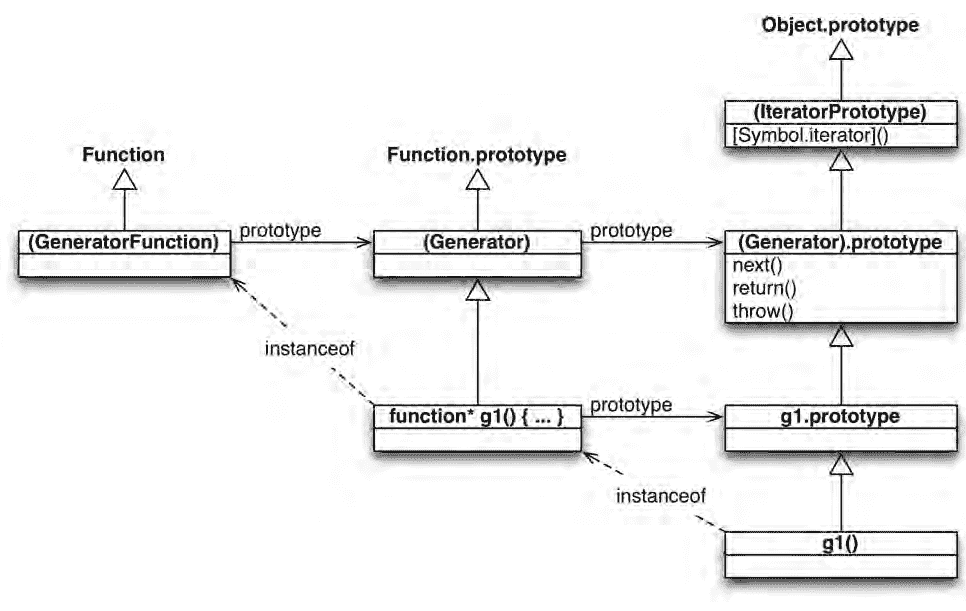

图例：

- 白色（空心）箭头表示对象之间的原型关系（继承）。换句话说：从 x 到 y 的白色箭头意味着 Object.getPrototypeOf(x) === y。
- 圆括号表示对象存在，但无法通过全局变量访问。
- 从 x 到 y 的 instanceof 箭头表示 x instanceof y。请记住，o instanceof C 等价于 C.prototype.isPrototypeOf(o)。
- 从 x 到 y 的 prototype 箭头表示 x.prototype === y。

该图揭示了两个有趣的事实：

首先，生成器函数 g 的工作方式非常类似于构造函数（你甚至可以通过 new 调用它，这基本上与普通调用效果相同）：它创建的生成器对象是它的实例，添加到 g.prototype 的方法会成为原型方法，等等：

```javascript
 > function* g() {}
 > g.prototype.hello = function () { return 'hi!'};
 > let obj = g();
 > obj instanceof g
true
 > obj.hello()
'hi!'
```

其次，如果你想让所有生成器对象都能使用某些方法，最好将它们添加到 (Generator.object)。访问该对象的一种方式是：

```javascript
 > let Generator_prototype = Object.getPrototypeOf(function* () {}).prototype;
 > Generator_prototype.hello = function () { return 'hi!'};
 > let generatorObject = (function* () {})();
 > generatorObject.hello()
'hi!'
```

## 22.7.1 IteratorPrototype

图中没有 (Iterator)，因为不存在这样的对象。但是，鉴于 instanceof 的工作原理，并且因为 (IteratorPrototype) 是 g1() 的原型，你仍然可以说 g1() 是 Iterator 的实例。

ES6 中所有迭代器的原型链中都包含 (IteratorPrototype)。该对象是可迭代的，因为它具有以下方法。因此，所有 ES6 迭代器都是可迭代的（作为结果，你可以对它们应用 for-of 等）。

```javascript
[Symbol.iterator]() {
    return this;
}
```

规范建议使用以下代码来访问 (IteratorPrototype)：

```javascript
const proto = Object.getPrototypeOf.bind(Object);
let IteratorPrototype = proto(proto([][Symbol.iterator]()));
```

你也可以使用：

```javascript
let IteratorPrototype = proto(proto(function* () {}.prototype));
```

引用 ECMAScript 6 规范：

ECMAScript 代码也可以定义继承自 IteratorPrototype 的对象。IteratorPrototype 对象提供了一个可以添加适用于所有迭代器对象的附加方法的位置。

IteratorPrototype 很可能会在即将到来的 ECMAScript 版本中直接可访问，并包含 map() 和 filter() 等工具方法（来源¹⁵）。

## 22.7.2 生成器中的 this 值

生成器函数结合了两个关注点：

1. 它是一个设置并返回生成器对象的函数。
2. 它包含生成器对象逐步执行的代码。

这就是为什么生成器内部的 `this` 值是什么并不立即可见。在函数调用和方法调用中，`this` 的值与 `gen()` 不是生成器函数而是普通函数时相同：

```javascript
function* gen() {
    'use strict'; // 以防万一
    yield this;
}

// 通过解构获取产出的值
let [functionThis] = gen();
console.log(functionThis); // undefined

let obj = { method: gen };
let [methodThis] = obj.method();
console.log(methodThis === obj); // true
```

如果你在通过 `new` 调用的生成器中访问 `this`，会得到 ReferenceError（来源：ES6 规范¹⁶）：

```javascript
function* gen() {
    console.log(this); // ReferenceError
}
new gen();
```

一种解决方案是将生成器包装在一个普通函数中，通过 next() 将生成器对象传递给生成器。这意味着生成器必须使用它的第一个 yield 来获取其生成器对象：

```javascript
let generatorObject = yield;
```

## 22.8 风格考量：星号前后的空白

合理且合法的星号格式变体包括：

- 星号前后都有空格：`function * foo(x, y) { ... }`
- 星号前有空格：`function *foo(x, y) { ... }`
- 星号后有空格：`function* foo(x, y) { ... }`
- 星号前后都没有空格：`function*foo(x, y) { ... }`

让我们弄清楚这些变体中哪些适用于哪些结构，以及原因。

## 22.8.1 生成器函数声明和表达式

在这里，星号只是因为 generator（或类似的东西）不能作为关键字使用而被使用。如果可以的话，生成器函数声明看起来会是这样：

```javascript
generator foo(x, y) {
    ...
}
```

ECMAScript 6 没有使用 generator，而是用一个星号标记 function 关键字。因此，function* 可以被视为 generator 的同义词，这建议将生成器函数声明写成如下形式。

```javascript
function* foo(x, y) {
    ...
}
```

匿名生成器函数表达式格式如下：

```javascript
const foo = function* (x, y) {
    ...
}
```

## 22.8.2 生成器方法定义

在编写生成器方法定义时，我建议按以下方式格式化星号。

```javascript
let obj = {
    * generatorMethod(x, y) {
        ...
    }
};
```

有三个理由支持在星号后写空格。

首先，星号不应该是方法名的一部分。一方面，它不是生成器函数名称的一部分。另一方面，星号只在定义生成器时提及，而在使用时不提及。

其次，生成器方法定义是以下语法的缩写。（为了说明我的观点，我也冗余地给函数表达式起了个名字。）

```javascript
let obj = {
    generatorMethod: function* generatorMethod(x, y) {
        ...
    }
};
```

如果方法定义是关于省略 `function` 关键字的，那么星号后应该跟一个空格。

第三，生成器方法定义在语法上类似于 getter 和 setter（它们在 ECMAScript 5 中已经可用）：

```javascript
let obj = {
    get foo() {
        ...
    }
    set foo(value) {
        ...
    }
};
```

关键字 get 和 set 可以被视为普通方法定义的修饰符。可以说，星号也是这样的修饰符。

## 22.8.3 格式化递归 yield

以下是生成器函数递归地产出自己的产出值的例子：

```javascript
function* foo(x) {
    ...
    yield* foo(x - 1);
    ...
}
```

星号标记了一种不同的 yield 运算符，这就是为什么上面的写法是有道理的。

## 22.8.4 记录生成器函数和方法

Kyle Simpson（@getify）提出了一个有趣的观点：既然我们在写函数和方法时经常附加括号，比如 `Math.max()`，那么在写生成器函数和方法时前置一个星号是否有意义呢？例如：我们应该写 `*foo()` 来指代前面小节中的生成器函数吗？让我来反驳一下。

在编写返回可迭代对象的函数时，生成器只是几种选项之一。我认为最好不要通过标记的函数名称暴露这个实现细节。

此外，你在调用生成器函数时不使用星号，但确实使用括号。

最后，星号不能提供有用的信息——`yield*` 也可以用于返回可迭代对象的函数。但是，标记返回可迭代对象的函数和方法（包括生成器）的名称可能是有意义的。例如，通过后缀 `Iter`。

## 22.9 结论

我希望本章能让你相信生成器是一个有用且多功能的工具。
我喜欢生成器让你实现协作式多任务处理的任务，这些任务在发出异步函数调用时阻塞。在我看来，这是异步调用的正确心智模型。希望 JavaScript 在未来能在这个方向上走得更远。

## 22.10 延伸阅读

本章来源：
[1] Jafar Husain 的 "[Async Generator Proposal<sup>17</sup>](https://github.com/jhusain/asyncgenerator)"
[2] David Beazley 的 "[A Curious Course on Coroutines and Concurrency<sup>18</sup>](http://www.dabeaz.com/coroutines/)"
[3] David Herman 的 "[Why coroutines won’t work on the web<sup>19</sup>](http://calculuslist.org/blog/2011/12/14/why-coroutines-wont-work-on-the-web/)"


 # V 标准库

# 23. 正则表达式新特性

本章讲解 ECMAScript 6 中的正则表达式新特性。如果你熟悉 ES5 的正则表达式特性和 Unicode 会更有帮助。如有需要，请参阅《Speaking JavaScript》中的以下两章：

- ["正则表达式"](http://speakingjs.com/es5/ch19.html)
- ["Unicode 与 JavaScript"](http://speakingjs.com/es5/ch24.html)

## 23.1 概述

以下正则表达式特性是 ECMAScript 6 新增的：

- 新标志位 `/y`（sticky，粘性）将正则表达式的每次匹配锚定在前一次匹配的末尾。
- 新标志位 `/u`（unicode，Unicode）将代理对（surrogate pairs，如 `\uD83D\uDE80`）作为码点处理，并允许在正则表达式中使用 Unicode 码点转义（如 `\u{1F680}`）。
- 新的数据属性 `flags` 让你能够访问正则表达式的标志位，就像 ES5 中 `source` 已经能够让你访问模式一样：
- 你可以使用构造函数 `RegExp()` 来复制一个正则表达式：

```
> /abc/ig.source // ES5
'abc'
> /abc/ig.flags // ES6
'gi'

> new RegExp(/abc/ig).flags
'gi'
> new RegExp(/abc/ig, 'i').flags // 更改标志位
'i'
```

## 23.2 新标志位 /y（sticky，粘性）

在将正则表达式 `re` 与字符串进行匹配时，新标志位 /y 会改变两件事：

- 锚定到 re.lastIndex：匹配必须从 `re.lastIndex` 开始（即前一次匹配后的索引）。这种行为类似于 `^` 锚点，但使用 `^` 时匹配必须始终从索引 0 开始。
- 重复匹配：如果找到了匹配，`re.lastIndex` 会被设置为匹配后的索引。这种行为类似于 `/g` 标志位。和 `/g` 一样，`/y` 通常用于多次匹配。

这种匹配行为的主要用例是词法分析（tokenizing），即希望每次匹配都紧接在前一次匹配之后。后面会给出通过粘性正则表达式和 `exec()` 进行词法分析的示例。

让我们看看各种正则表达式操作如何响应 `/y` Austin 标志位。下表给出了概览。稍后我会提供更多细节。

正则表达式的方法（`re` 是调用方法的正则表达式）：

| 标志位 | 开始匹配位置 | 锚定到 | 匹配结果 | 无匹配 | re.lastIndex |
|---|---|---|---|---|---|
| exec() | - | 0 | - | 匹配对象 | null | 不变 |
| | /g | re.lastIndex | - | 匹配对象 | null | 匹配后的索引 |
| | /y | re.lastIndex | re.lastIndex | 匹配对象 | null | 匹配后的索引 |
| | /gy | re.lastIndex | re.lastIndex | 匹配对象 | null | 匹配后的索引 |
| test() | （任意） | （同 exec()） | （同 exec()） | true | false | （同 exec()） |

字符串的方法（`str` 是调用方法的字符串，`r` 是正则表达式参数）：

| 标志位 | 开始匹配位置 | 锚定到 | 匹配结果 | 无匹配 | r.lastIndex |
|---|---|---|---|---|---|
| search() | -, /g | 0 | - | 匹配的索引 | -1 | 不变 |
| | /y, /gy | 0 | 0 | 匹配的索引 | -1 | 不变 |
| match() | - | 0 | - | 匹配对象 | null | 不变 |
| | /y | r.lastIndex | r.lastIndex | 匹配对象 | null | 匹配后的索引 |
| | /g | 前一次匹配后（循环） | - | 匹配数组 | null | 0 |
| | /gy | 前一次匹配后（循环） | 前一次匹配后 | 匹配数组 | null | 0 |
| split() | -, /g | 前一次匹配后（循环） | - | 匹配间字符串数组 | [str] | 不变 |
| | /y, /gy | 前一次匹配后（循环） | 前一次匹配后 | 空字符串数组 | [str] | 不变 |
| replace() | - | 0 | - | 替换首次匹配 | 不替换 | 不变 |

| 标志位 | 开始匹配位置 | 锚定到 | 匹配结果 | 无匹配 | r.lastIndex |
|-------|---------------|-------------|-----------------|----------|-------------|
| /y | 0 | 0 | 替换首次匹配 | 不替换 | 不变 |
| /g | 前一次匹配后（循环） | – | 替换所有匹配 | 不替换 | 不变 |
| /gy | 前一次匹配后（循环） | 前一次匹配后 | 替换所有匹配 | 不替换 | 不变 |

### 23.2.1 RegExp.prototype.exec(str)

如果未设置 `/g`，匹配始终从开头开始，但会跳过直到找到匹配。`REGEX.lastIndex` 不会改变。

```
const REGEX = /a/;

REGEX.lastIndex = 7; // 被忽略
const match = REGEX.exec('xaxa');
console.log(match.index); // 1
console.log(REGEX.lastIndex); // 7（不变）
```

如果设置了 `/g`，匹配从 `REGEX.lastIndex` 开始并跳过直到找到匹配。`REGEX.lastIndex` 被设置为匹配后的位置。这意味着如果循环直到 `exec()` 返回 null，你就能获得所有匹配。

```
const REGEX = /a/g;

REGEX.lastIndex = 2;
const match = REGEX.exec('xaxa');
console.log(match.index); // 3
console.log(REGEX.lastIndex); // 4（已更新）

// 索引 4 及以后无匹配
console.log(REGEX.exec('xaxa')); // null
```

如果仅设置了 `/y`，匹配从 `REGEX.lastIndex` 开始并锚定到该位置（不会跳过直到找到匹配）。`REGEX.lastIndex` 的更新方式与设置 `/g` 时类似。

```
const REGEX = /a/y;

// 索引 2 处无匹配
REGEX.lastIndex = 2;
console.log(REGEX.exec('xaxa')); // null

// 索引 3 处有匹配
REGEX.lastIndex = 3;
const match = REGEX.exec('xaxa');
console.log(match.index); // 3
console.log(REGEX.lastIndex); // 4

同时设置 /y 和 /g 与仅设置 /y 相同。
```

### 23.2.2 RegExp.prototype.test(str)

`test()` 的工作方式与 `exec()` 相同，但匹配成功时返回 true，匹配失败时返回 false（而不是匹配对象或 null）：

```
const REGEX = /a/y;

REGEX.lastIndex = 2;
console.log(REGEX.test('xaxa')); // false

REGEX.lastIndex = 3;
console.log(REGEX.test('xaxa')); // true
console.log(REGEX.lastIndex); // 4
```

### 23.2.3 String.prototype.search(regex)

`search()` 忽略 `/g` 标志位和 `lastIndex`（后者也不会改变）。它从字符串开头开始查找第一个匹配并返回其索引（如果没有匹配则返回 -1）：

```
const REGEX = /a/;

REGEX.lastIndex = 2; // 被忽略
console.log('xaxa'.search(REGEX)); // 1
```

如果设置了 `/y` 标志位，`lastIndex` 仍然被忽略，但正则表达式现在锚定到索引 0。

```
const REGEX = /a/y;
```

```
REGEX.lastIndex = 1; // 被忽略
console.log('xaxa'.search(REGEX)); // -1（无匹配）
```

## 23.2.4 String.prototype.match(regex)

`match()` 有两种模式：

- 如果未设置 `/g`，它的工作方式类似 `exec()`。
- 如果设置了 `/g`，它返回匹配到的字符串部分的数组，或 null。

如果未设置 `/g` 标志位，`match()` 像 `exec()` 一样捕获分组：

```
{
    const REGEX = /a/;
    
    REGEX.lastIndex = 7; // 被忽略
    console.log('xaxa'.match(REGEX).index); // 1
    console.log(REGEX.lastIndex); // 7（不变）
}
{
    const REGEX = /a/y;
    
    REGEX.lastIndex = 2;
    console.log('xaxa'.match(REGEX)); // null
    
    REGEX.lastIndex = 3;
    console.log('xaxa'.match(REGEX).index); // 3
    console.log(REGEX.lastIndex); // 4
}
```

如果仅设置了 `/g` 标志位，那么 `match()` 在数组中返回所有匹配的子串（或 null）。匹配始终从位置 0 开始。

```
const REGEX = /a|b/g;
REGEX.lastIndex =今年上半年 = 7;
console.log('xaxb'.match(REGEX)); // ['a', 'b']
console.log(REGEX.lastIndex); // 0
```

如果额外设置了 `/y` 标志位，那么匹配仍然重复进行，同时将正则表达式锚定到前一次匹配后的索引（或 0）。

```
const REGEX = /a|b/gyfasstIndex = 0; // 被忽略
console.log('xab'.match(REGEX)); // null
REGEX.lastIndex = 1; // 被忽略
console.log('xab'.match(REGEX)); // null

console.log('ab'.match(REGEX)); // ['a', 'b']
console.log('axb'.match(REGEX)); // ['a']
```

## 23.2.5 String.prototype.split(separator, limit)

`split()` 的完整细节[在《Speaking JavaScript》中有解释](http://speakingjs.com/es5/ch19.html#String.prototype.match)。

对于 ES6，有趣的是看看使用 `/y` 标志位时情况如何变化。

使用 `/y` 时，字符串必须以分隔符开头：

```
> 'x##'.split(/#/y) // 无匹配
[ 'x##' ]
> '##x'.split(/#/y) // 2 个匹配
[ '', '', 'x' ]
```

后续的分隔符只有在紧接第一个分隔符之后才会被识别：

```
> '#x#'.split(/#/y) // 1 个匹配
[ '', 'x#' ]
> '##'.split(/#/y) // 2 个匹配
[ '', '', '' ]
```

这意味着第一个分隔符之前的字符串以及分隔符之间的字符串总是空的。

像往常一样，你可以使用分组将分隔符的部分放入结果数组：

```
> '##'.split(/(#)/y)
[ '', '#', '', '#', '' ]
```

## 23.2.6 String.prototype.replace(search, replacement)

没有 `/g` 标志位时，`replace()` 只替换第一个匹配：

> http://speakingjs.com/es5/ch19.html#String.prototype.match


```
 const REGEX = /a/

// One match
console.log('xaxa'.replace(REGEX, '-')); // 'x-xa'

If only /y is set, you also get at most one match, but that match is always anchored to the beginning of the string. `lastIndex` is ignored and unchanged.

const REGEX = /a/y;

// Anchored to beginning of string, no match
REGEX.lastIndex = 1; // ignored
console.log('xaxa'.replace(REGEX, '-')); // 'xaxa'
console.log(REGEX.lastIndex); // 1 (unchanged)

// One match
console.log('axa'.replace(REGEX, '-')); // '-xa'

With /g set, `replace()` replaces all matches:

const REGEX = /a/g;

// Multiple matches
console.log('xaxa'.replace(REGEX, '-')); // 'x-x-'

With /gy set, `replace()` replaces all matches, but each match is anchored to the end of the previous match:

const REGEX = /a/gy;

// Multiple matches
console.log('aaxa'.replace(REGEX, '-')); // '--xa'

The parameter replacement can also be a function, consult ["Speaking JavaScript"](http://speakingjs.com/es5/ch19.html#String.prototype.replace) for details⁴.

## 23.2.7 示例：使用粘性匹配进行词法分析

粘性匹配的主要用例是*词法分析*，即将文本转换为一系列词元（token）。词法分析的一个重要特点是，词元是文本的片段，并且它们之间不能有间隙。因此，粘性匹配在这里非常合适。

```
function tokenize(TOKEN_REGEX, str) {
    let result = [];
    let match;
    while (match = TOKEN_REGEX.exec(str)) {
        result.push(match[1]);
    }
    return result;
}

const TOKEN_GY = /\s*(\+|[0-9]+)\s*/gy;
const TOKEN_G  = /\s*(\+|[0-9]+)\s*/g;
```

在一个合法的词元序列中，粘性匹配和非粘性匹配产生相同的输出：

```
> tokenize(TOKEN_GY, '3 + 4')
[ '3', '+', '4' ]
> tokenize(TOKEN_G, '3 + 4')
[ '3', '+', '4' ]
```

然而，如果字符串中存在非词法文本，粘性匹配会停止词法分析，而非粘性匹配会跳过非词法文本：

```
> tokenize(TOKEN_GY, '3x + 4')
[ '3' ]
> tokenize(TOKEN_G, '3x + 4')
[ '3', '+', '4' ]
```

粘性匹配在词法分析中的行为有助于错误处理。

## 23.2.8 示例：手动实现粘性匹配

如果你想手动实现粘性匹配，可以按如下方式进行：函数`execSticky()`在粘性模式下工作方式类似于`RegExp.prototype.exec()`。

```
function execSticky(regex, str) {
    // 将正则表达式锚定到字符串的开头
    let matchSource = regex.source;
    if (!matchSource.startsWith('^')) {
        matchSource = '^' + matchSource;
    }
    // 确保实例属性 `lastIndex` 被更新
    let matchFlags = regex.flags; // ES6 特性！
    if (!regex.global) {
        matchFlags = matchFlags + 'g';
    }
    let matchRegex = new RegExp(matchSource, matchFlags);

    // 确保在 `regex.lastIndex` 处开始匹配 `str`
    const matchOffset = regex.lastIndex;
    const matchStr = str.slice(matchOffset);
    let match = matchRegex.exec(matchStr);

    // 将索引从 `matchStr` 转换到 `str`
    regex.lastIndex = matchRegex.lastIndex + matchOffset;
    match.index = match.index + matchOffset;
    return match;
}
```

## 23.3 新标志 /u（unicode）

标志 /u 为正则表达式开启特殊的 Unicode 模式。该模式有两个特性：

- 你可以使用 Unicode 码点转义序列，如`\u{1F42A}`，通过码点来指定字符。普通的 Unicode 转义如`\u03B1`只有四位十六进制数字的范围（等于基本多文种平面）。
- 正则表达式模式和字符串中的"字符"是码点（而非 UTF-16 编码单元）。编码单元会被转换为码点。

[关于 Unicode 的章节中有一节](#)提供了更多关于转义序列的信息。接下来我将解释特性 2 的影响。我将使用两个 UTF-16 编码单元（例如`\uD83D\uDE80`）来代替 Unicode 码点转义（例如`\u{1F680}`）。这样可以清楚地表明代理对在 Unicode 模式下是被分组的，并且这在 Unicode 模式和非 Unicode 模式下都有效。

```
> '\u{1F680}' === '\uD83D\uDE80' // 码点 vs. 代理对
true
```

### 23.3.1 影响：正则表达式中的孤立代理只能匹配孤立代理

在非 Unicode 模式下，正则表达式中的孤立代理甚至可以被找到在（编码码点的）代理对内部：

```
> /\uD83D/.test('\uD83D\uDC2A')
true
```

在 Unicode 模式下，代理对成为原子单元，孤立代理不会在它们"内部"被找到：

```
> /\uD83D/u.test('\uD83D\uDC2A')
false
```

真正的孤立代理仍然可以被找到：

```
> /\uD83D/u.test('\uD83D \uD83D\uDC2A')
true
> /\uD83D/u.test('\uD83D\uDC2A \uD83D')
true
```

### 23.3.2 影响：你可以将码点放入字符类中

在 Unicode 模式下，你可以将码点放入字符类中，而它们将不再被解释为两个字符。

```
> /^[\uD83D\uDC2A]$/u.test('\uD83D\uDC2A')
true
> /^[\uD83D\uDC2A]$/.test('\uD83D\uDC2A')
false
```

```
> /^[\uD83D\uDC2A]$/u.test('\uD83D')
false
> /^[\uD83D\uDC2A]$/.test('\uD83D')
true
```

### 23.3.3 影响：点运算符 (.) 匹配码点，而非编码单元

在 Unicode 模式下，点运算符匹配码点（一个或两个编码单元）。在非 Unicode 模式下，它匹配单个编码单元。例如：

```
> '\uD83D\uDE80'.match(././gu).length
1
> '\uD83D\uDE80'.match(././g).length
2
```

### 23.3.4 影响：量词应用于码点，而非编码单元

在 Unicode 模式下，量词应用于码点（一个或两个编码单元）。在非 Unicode 模式下，它们应用于单个编码单元。例如：

```
> /\uD83D\uDE80{2}/u.test('\uD83D\uDE80\uD83D\uDE80')
true
> /\uD83D\uDE80{2}/.test('\uD83D\uDE80\uD83D\uDE80')
false
> /\uD83D\uDE80{2}/.test('\uD83D\uDE80\uDE80')
true
```

## 23.4 新数据属性 `flags`

在 ECMAScript 6 中，正则表达式具有以下数据属性：

- 模式：`source`
- 标志：`flags`
- 单个标志：`global`, `ignoreCase`, `multiline`, `sticky`, `unicode`
- 其他：`lastIndex`

顺便说一下，`lastIndex`现在是唯一的实例属性，所有其他数据属性都通过内部实例属性和 getter 实现，如`get RegExp.prototype.global`[5](http://www.ecma-international.org/ecma-262/6.0/#sec-get-regexp.prototype.global)。

属性`source`（在 ES5 中已存在）包含作为字符串的正则表达式模式：

```
> /abc/ig.source
'abc'
```

属性`flags`是新的，它以字符串形式包含标志，每个标志一个字符：

```
> /abc/ig.flags
'gi'
```

你无法更改现有正则表达式的标志（ignoreCase 等一直都是不可变的），但 flags 允许你制作一个标志已更改的副本：

```
function copyWithIgnoreCase(regex) {
    return new RegExp(regex.source, regex.flags+'i');
}
```

下一节解释了制作修改后正则表达式副本的另一种方法。

## 23.5 RegExp() 可以用作复制构造函数

在 ES6 中，构造函数 RegExp() 有两种变体（第二种是新的）：

- new RegExp(pattern : string, flags = '')
  按照 pattern 指定的内容创建一个新的正则表达式。如果缺少 flags，则使用空字符串 ''。
- new RegExp(regex : RegExp, flags = regex.flags)
  克隆 regex。如果提供了 flags，则它决定副本的标志。

以下交互演示了后一种变体：

```
> new RegExp(/abc/ig).flags
'gi'
> new RegExp(/abc/ig, 'i').flags // change flags
'i'
```

因此，RegExp 构造函数为我们提供了另一种更改标志的方法：

```
function copyWithIgnoreCase(regex) {
    return new RegExp(regex, regex.flags+'i');
}
```

## 23.6 使用正则表达式的字符串方法委托给正则表达式方法

以下字符串方法现在将其工作委托给正则表达式方法：

- `String.prototype.match` 调用 `RegExp.prototype[Symbol.match]`。
- `String.prototype.replace` 调用 `RegExp.prototype[Symbol.replace]`。
- `String.prototype.search` 调用 `RegExp.prototype[Symbol.search]`。
- `String.prototype.split` 调用 `RegExp.prototype[Symbol.split]`。

## 延伸阅读

如果你想更详细地了解正则表达式标志 /u 的工作原理，我推荐 Mathias Bynens 的文章 "Unicode-aware regular expressions in ECMAScript 6"。

https://mathiasbynens.be/notes/es6-unicode-regex


## 24. 异步编程（背景知识）

本章介绍 JavaScript 中异步编程的基础知识，为下一章讲解 ES6 Promise 提供背景知识。

## 24.1 JavaScript 调用栈

当函数 f 调用函数 g 时，g 需要知道执行完成后返回到哪里（f 内部）。这些信息通常由一个栈来管理，即*调用栈*（call stack）。让我们来看一个例子。

```javascript
function h(z) {
    // 打印堆栈跟踪
    console.log(new Error().stack); // (A)
}
function g(y) {
    h(y + 1); // (B)
}
function f(x) {
    g(x + 1); // (C)
}
f(3); // (D)
return; // (E)
```

最初，当上面的程序启动时，调用栈是空的。在行 D 调用函数 f(3) 后，栈中有一个条目：

- 全局作用域中的位置

在行 C 调用函数 g(x + 1) 后，栈中有两个条目：

- f 中的位置
- 全局作用域中的位置

在行 B 调用函数 h(y + 1) 后，栈中有三个条目：

- g 中的位置
- f 中的位置
- 全局作用域中的位置

在行 A 打印的堆栈跟踪显示了调用栈的样子：

```
Error
    at h (stack_trace.js:2:17)
    at g (stack_trace.js:6:5)
    at f (stack_trace.js:9:5)
    at <global> (stack_trace.js:11:1)
```

接下来，每个函数依次结束，每次都会从栈顶移除一个条目。函数 f 执行完毕后，我们回到全局作用域，调用栈为空。在行 E 处返回，栈为空，这意味着程序终止。

## 24.2 浏览器事件循环

简单来说，每个浏览器标签页运行在一个独立的进程中：事件循环¹。这个循环执行与浏览器相关的任务（即所谓的任务），这些任务通过任务队列提供给循环。任务的例子包括：

1. 解析 HTML
2. 执行 script 元素中的 JavaScript 代码
3. 响应用户输入（鼠标点击、按键等）
4. 处理异步网络请求的结果

第 2–4 项是通过浏览器内置引擎运行 JavaScript 代码的任务。它们在代码执行结束时终止，然后才能执行队列中的下一个任务。下图（灵感来自 Philip Roberts 的幻灯片 [1]）概述了所有这些机制是如何连接在一起的。

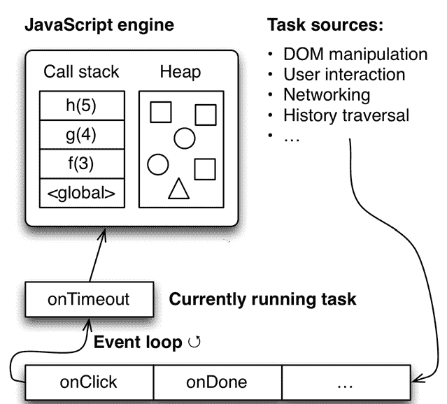

事件循环周围还有其他与之并行运行的进程（定时器、输入处理等）。这些进程通过向事件循环的任务队列中添加任务来进行通信。

### 24.2.1 定时器

浏览器具有定时器²。`setTimeout()` 创建一个定时器，等待其触发，然后将任务添加到队列中。它的签名是：

```javascript
setTimeout(callback, ms)
```

经过 ms 毫秒后，callback 被添加到任务队列中。需要注意的是，ms 仅指定 callback 被*添加*的时间，而不是实际执行的时间。实际执行可能会晚得多，特别是在事件循环被阻塞的情况下（本章稍后会演示）。

将 ms 设置为 0 的 `setTimeout()` 是一种常用的变通方法，用于立即将某事添加到任务队列中。然而，某些浏览器不允许 ms 低于某个最小值（Firefox 中为 4 毫秒）；如果低于该值，它们会将其设置*为*该最小值。

²https://html.spec.whatwg.org/multipage/webappapis.html#timers

### 24.2.2 显示 DOM 变化

对于大多数 DOM 变化（尤其是涉及重新布局的变化），显示不会立即更新。"布局在每个 16 毫秒的刷新周期中发生"（[@bz_moz](https://twitter.com/bz_moz/status/513777809287028736)），而且必须通过事件循环获得运行的机会。

有一些方法可以与浏览器协调频繁的 DOM 更新，以避免与其布局节奏冲突。详情请查阅关于 [requestAnimationFrame()](https://developer.mozilla.org/en/docs/Web/API/window.requestAnimationFrame) 的文档。

### 24.2.3 运行至完成语义

JavaScript 具有所谓的运行至完成（run-to-completion）语义：当前任务总是在执行下一个任务之前完成。这意味着每个任务都对所有当前状态有完全的控制权，不必担心并发修改的问题。

让我们来看一个例子：

```javascript
setTimeout(function () { // (A)
    console.log('Second');
}, 0);
console.log('First'); // (B)
```

从行 A 开始的函数被立即添加到任务队列中，但只有在当前代码Preference代码执行完毕后才会执行（特别是行 B！）。这意味着这段代码的输出将始终是：

```
First
Second
```

### 24.2.4 阻塞事件循环

正如我们所见，每个标签页（在某些浏览器中是整个浏览器）由一个单一进程管理——包括用户界面和所有其他计算。这意味着你可以在该进程中执行长时间运行的计算来冻结用户界面。以下代码演示了这一点。

### 24.2.5 避免阻塞

```html
<a id="block" href="">阻塞 5 秒</a>
<p>
<button>这是一个按钮</button>
<div id="statusMessage"></div>
<script>
    document.getElementById('block')
    .addEventListener('click', onClick);

    function onClick(event) {
        event.preventDefault();

        setStatusMessage('阻塞中...');

        // 给浏览器机会显示状态消息
        setTimeout(function () {
            blockMainThread(5000);
            setStatusMessage('完成');
        }, 0);
    }
    function setStatusMessage(msg) {
        document.getElementById('statusMessage').textContent = msg;
    }
    function blockMainThread(milliseconds) {
        var start = Date.now();
        while ((Date.now() - start) < milliseconds);
    }
</script>
```

你可以[在线](http://rauschma.github.io/async-examples/blocking.html)尝试这段代码。

每当点击开头的链接时，就会触发 `onClick()` 函数。它使用同步的 `sleep()` 函数将事件循环阻塞五秒钟。在这几秒钟内，用户界面无法工作。例如，你无法点击"简单按钮"。

有两种方法可以避免阻塞事件循环：

首先，不要在主进程中执行长时间运行的计算，而是将它们移到不同的进程中。这可以通过 [Worker API](https://developer.mozilla.org/en/docs/Web/API/Worker) 来实现。

其次，不要（同步地）等待长时间运行的计算结果（你自己的 Worker 进程中的算法、网络请求等），而是继续运行事件循环，让计算在完成后通知你。事实上，在浏览器中你通常别无选择，只能这样做。例如，没有内置的方式来同步休眠（就像之前实现的 `sleep()` 那样）。相反，`setTimeout()` 让你可以异步休眠。

下一节将解释异步等待结果的技术。

### 24.3 异步接收结果

异步接收结果的两种常见模式是：事件和回调。

### 24.3.1 通过事件接收异步结果

在这种异步接收结果的模式中，你为每个请求创建一个对象，并向其注册事件处理程序：一个用于成功的计算，另一个用于处理错误。以下代码展示了如何使用 `XMLHttpRequest` API 实现：

```javascript
var req = new XMLHttpRequest();
req.open('GET', url);

req.onload = function () {
    if (req.status == 200) {
        processData(req.response);
    } else {
        console.log('ERROR', req.statusText);
    }
};

req.onerror = function () {
    console.log('Network Error');
};

req.send(); // 将请求添加到任务队列
```

注意，最后一行实际上并不执行请求，而是将其添加到任务队列中。因此，你也可以在 `open()` 之后立即调用该方法，在设置 `onload` 和 `onerror` 之前。由于 JavaScript 的运行至完成语义，效果是一样的。

#### 24.3.1.1 隐式请求

浏览器 API IndexedDB 有一种略微特殊的事件处理风格：

```javascript
var openRequest = indexedDB.open('test', 1);

openRequest.onsuccess = function (event) {
    console.log('Success!');
    var db = event.target.result;
};

openRequest.onerror = function (error) {
    console.log(error);
};
```

你首先创建一个请求对象，向其添加监听结果的事件监听器。但是，你不需要显式地将请求加入队列，这是由 `open()` 完成的。它在当前任务完成后执行。这就是为什么你可以在调用 `open()` *之后*注册事件处理程序（事实上必须这样做）。

如果你习惯于多线程编程语言，这种处理请求的风格可能看起来很奇怪，好像容易出现竞态条件。但是，由于运行至完成的特性，事情总是安全的。

### 24.3.1.2 事件对于单次结果不太友好

如果你多次接收结果，这种处理异步计算结果的风格还可以。然而，如果只有一个结果，那么繁琐性就成了问题。对于这种用例，回调变得流行起来。

### 24.3.2 通过回调接收异步结果

如果你通过回调处理异步结果，你需要将回调函数作为尾随参数传递给异步函数或方法调用。

以下是 Node.js 中的一个例子。我们通过异步调用 `fs.readFile()` 来读取文本文件的内容：

```javascript
// Node.js
fs.readFile('myfile.txt', { encoding: 'utf8' },
    function (error, text) { // (A)
        if (error) {
            // ...
        }
        console.log(text);
    });
```

如果 `readFile()` 执行成功，A 行中的回调函数会通过参数 `text` 接收结果。如果执行失败，回调函数会通过其第一个参数接收一个错误（通常是 `Error` 的实例或其子构造函数）。

同样的代码用经典的函数式编程风格来写，看起来是这样的：

```javascript
// 函数式
readFileFunctional('myfile.txt', { encoding: 'utf8' },
    function (text) { // 成功
        console.log(text);
    },
    function (error) { // 失败
        // ...
    });
```

### 24.3.3 续传风格

使用回调的编程风格（尤其是前面展示的函数式方式）也被称为**续传风格**（continuation-passing style，简称 CPS），因为下一步（即*续体* continuation）被显式地作为参数传递。这使得被调用的函数对接下来发生什么以及何时发生有更多的控制权。

以下代码演示了 CPS：

```javascript
console.log('A');
identity('B', function step2(result2) {
    console.log(result2);
    identity('C', function step3(result3) {
        console.log(result3);
    });
    console.log('D');
});
console.log('E');

// 输出：A E B D C

function identity(input, callback) {
    setTimeout(function () {
        callback(input);
    }, 0);
}
```

每一步，程序的控制流都在回调函数内部继续。这导致了嵌套函数，有时被称为**回调地狱**。不过，你通常可以避免嵌套，因为 JavaScript 的函数声明是*提升的*（它们的定义在其作用域开始处就被求值）。这意味着你可以提前调用在程序后面定义的函数。以下代码利用提升将前面的例子扁平化。

```javascript
console.log('A');
identity('B', step2);
function step2(result2) {
    // 程序在这里继续
    console.log(result2);
    identity('C', step3);
    console.log('D');
}
function step3(result3) {
    console.log(result3);
}
console.log('E');
```

关于 CPS 的更多信息，请参阅 [3]。

### 24.3.4 在 CPS 中组合代码

在常规的 JavaScript 风格中，你可以通过以下方式组合代码片段：

1. 将它们一个接一个地放置。这再明显不过了，但值得提醒自己：常规风格中的代码串联就是顺序组合。
2. 使用数组方法，如 `map()`、`filter()` 和 `forEach()`
3. 使用循环，如 `for` 和 `while`

库 Async.js[7] 提供了组合子，让你可以在 CPS 中做类似的事情，使用 Node.js 风格的回调。在以下示例中，它被用来加载三个文件的内容，这些文件的名称存储在一个数组中。

```javascript
var async = require('async');

var fileNames = [ 'foo.txt', 'bar.txt', 'baz.txt' ];
async.map(fileNames,
    function (fileName, callback) {
        fs.readFile(fileName, { encoding: 'utf8' }, callback);
    },
    // 处理结果
    function (error, textArray) {
        if (error) {
            console.log(error);
            return;
        }
        console.log('TEXTS:\n' + textArray.join('\n----\n'));
    });
```

### 24.3.5 回调的优缺点

使用回调会导致一种截然不同的编程风格，即 CPS。CPS 的主要优势在于其基本机制易于理解。但它也有缺点：

- 错误处理变得更加复杂：现在有两种错误报告方式——通过回调和通过异常。你必须小心地将两者正确结合。
- 签名不够优雅：在同步函数中，输入（参数）和输出（函数结果）之间有明确的关注点分离。在使用回调的异步函数中，这些关注点混在一起：函数结果不再重要，一些参数用于输入，另一些用于输出。
- 组合更加复杂：由于"输出"这个关注点出现在参数中，因此通过组合子来组合代码变得更加复杂。

与函数式风格相比，Node.js 风格的回调有三个缺点：

- 用于错误处理的 `if` 语句增加了冗长性。
- 复用错误处理程序更加困难。
- 提供默认错误处理程序也更加困难。默认错误处理程序在你进行函数调用但不想编写自己的处理程序时很有用。如果调用者没有指定处理程序，函数也可以使用它。

## 24.4 展望未来

下一章将介绍 Promise 和 ES6 Promise API。Promise 在底层比回调更复杂。作为交换，它们带来了几个显著的优势，并消除了上述回调的大部分缺点。

## 24.5 延伸阅读

[1] "[Help, I'm stuck in an event-loop](http://vimeo.com/96425312)" by Philip Roberts (视频).

[2] "[Event loops](https://html.spec.whatwg.org/multipage/webappapis.html#event-loops)" in the HTML Specification.

[3] "[Asynchronous programming and continuation-passing style in JavaScript](http://www.2ality.com/2012/06/continuation-passing-style.html)" by Axel Rauschmayer.

## 25. 用于异步编程的 Promise

本章是对通过 Promise 进行异步编程的一般介绍，特别是对 ECMAScript 6 Promise API 的介绍。上一章解释了 JavaScript 中异步编程的基础。本章中如有不理解的地方，可以随时查阅上一章。

### 25.1 概述

以下函数通过 Promise 异步返回结果：

```javascript
function asyncFunc() {
    return new Promise(
        function (resolve, reject) {
            resolve(value); // 成功
            ...
            reject(error); // 失败
        });
}
```

你可以如下调用 `asyncFunc()`：

```javascript
asyncFunc()
.then(value => { /* 成功 */ })
.catch(error => { /* 失败 */ });
```

### 25.1.1 处理 Promise 数组

`Promise.all()` 让你可以对一组 Promise 做出响应。

例如，你可以通过数组方法 `map()` 创建一个 Promise 数组：

```javascript
let fileUrls = [
    'http://example.com/file1.txt',
    'http://example.com/file2.txt'
];
let promisedTexts = fileUrls.map(httpGet); // Promise 数组
```

如果你对这组 Promise 应用 `Promise.all()`，一旦所有 Promise 都 fulfilled，你就会收到一个值数组：

```javascript
Promise.all(promisedTexts)
// 成功
.then(texts => {
    for (let text of texts) {
        console.log(text);
    }
})
// 失败
.catch(reason => {
    // 接收 `promisedTexts` 中的第一个 rejection
});
```

## 25.2 Promise

Promise 是一种模式，有助于处理一类特定的异步编程：一个函数（或方法）异步返回其结果。要实现这样的函数，你需要返回一个 *Promise*，即一个作为结果占位符的对象。函数的调用者向 Promise 注册回调，以便在结果计算完成后收到通知。函数通过 Promise 发送结果。

JavaScript Promise 的事实标准称为 [Promises/A+](...) [1]。ECMAScript 6 Promise API 遵循该标准。

### 25.3 第一个示例

让我们看第一个示例，让你对使用 Promise 工作有个初步了解。

使用 Node.js 风格的回调，异步读取文件看起来是这样的：

```javascript
fs.readFile('config.json',
    function (error, text) {
        if (error) {
            console.error('读取配置文件时出错');
        } else {
            try {
                let obj = JSON.parse(text);
                console.log(JSON.stringify(obj, null, 4));
            } catch (e) {
                console.error('文件中的 JSON 无效');
            }
        }
    });
```

使用 Promise，同样的功能可以这样实现：

```javascript
readFilePromisified('config.json')
.then(function (text) { // (A)
    let obj = JSON.parse(text);
    console.log(JSON.stringify(obj, null, 4));
})
.catch(function (reason) { // (B)
    // 文件读取错误或 JSON 语法错误
    console.error('发生了错误', reason);
});
```

仍然有回调，但它们是通过在结果上调用的方法提供的（`then()` 和 `catch()`）。B 行中的错误回调在两个方面很方便：首先，它是一种统一的错误处理方式（而前一个例子中有 `if (error)` 和 `try-catch` 两种风格）。其次，你可以在一个位置处理 `readFilePromisified()` 和 A 行中回调的错误。`readFilePromisified()` 的代码稍后展示。

#### 25.4 创建和使用 Promise

让我们看看 Promise 在生产者和消费者两侧是如何操作的。

#### 25.4.1 产生一个 Promise

作为生产者，你创建 Promise 并通过它发送结果：

let promise = new Promise(
    function (resolve, reject) { // (A)
        ...
        if (...) {
            resolve(value); // 成功
        } else {
            reject(reason); // 失败
        }
    }
);

一个 Promise 总是处于三种（互斥）状态之一：

-   待定（Pending）：结果尚未计算完成
-   已兑现（Fulfilled）：结果已成功计算
-   已拒绝（Rejected）：计算过程中发生错误

一个 Promise 如果已兑现或已拒绝，则它已 *settled*（它所代表的计算已完成）。一个 Promise 只能 settle 一次，之后便保持 settled 状态。后续尝试 settle 它的操作不会产生任何效果。

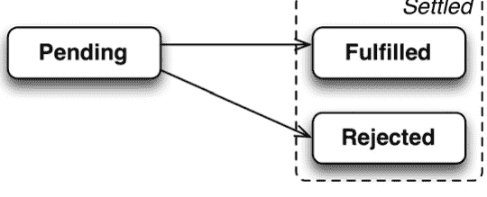

`new Promise()` 的参数（从 A 行开始）称为 *执行器（executor）*：

-   如果计算进展顺利，执行器通过 `resolve()` 发送结果。这通常会兑现该 Promise（如果你 resolve 一个 Promise，则可能不会，如后文所述）。
-   如果发生错误，执行器通过 `reject()` 通知 Promise 的消费者。这总是会拒绝该 Promise。

## 25.4.2 消费（Consuming）一个 Promise

作为 `promise` 的消费者，你通过 *反应（reactions）*——即你用 `then()` 方法注册的回调——来接收兑现或拒绝的通知：

```
promise.then(
    function (value) { /* 兑现 */ },
    function (reason) { /* 拒绝 */ }
);
```

Promise 之所以对异步函数（具有一次性结果）如此有用，是因为一旦一个 Promise settled，它就不会再改变。此外，永远不会存在竞态条件，因为无论你在 Promise settled 之前还是之后调用 `then()` 都无关紧要：

-   在 Promise settled 之前注册的反应，会在它 settled 时收到通知。
-   在 Promise settled 之后注册的反应，会“立即”收到缓存的 settled 值（它们的调用会作为任务排队执行）。

## 25.4.3 仅处理兑现或拒绝

如果你只对兑现感兴趣，可以省略 `then()` 的第二个参数：

```
promise.then(
    function (value) { /* 兑现 */ }
);
```

如果你只对拒绝感兴趣，可以省略第一个参数。`catch()` 方法是实现相同效果的更简洁的方式。

```
promise.then(
    null,
    function (reason) { /* 拒绝 */ }
);

// 等价于：
promise.catch(
    function (reason) { /* 拒绝 */ }
);
```

建议仅使用 `then()` 处理兑现，使用 `catch()` 处理错误，因为这样能清晰地标记回调，并且你可以同时处理多个 Promise 的拒绝（详情稍后解释）。

## 25.5 示例

在我们深入探讨 Promise 之前，让我们用目前所学的知识看几个例子。

本节中的一些示例可在 GitHub 仓库 [promise-examples](https://github.com/rauschma/promise-examples)¹ 中找到。

### 25.5.1 示例：将 fs.readFile() Promise 化

以下代码是 Node.js 内置函数 `fs.readFile()`² 的基于 Promise 的版本。

```
import {readFile} from 'fs';

function readFilePromisified(filename) {
    return new Promise(
        function (resolve, reject) {
            readFile(filename, { encoding: 'utf8' },
                (error, data) => {
                    if (error) {
                        reject(error);
                    }
                    resolve(data);
                });
        });
}
```

`readFilePromisified()` 的使用方式如下：

```
readFilePromisified(process.argv[2])
.then(text => {
    console.log(text);
})
.catch(error => {
    console.log(error);
});
```

### 25.5.2 示例：将 XMLHttpRequest Promise 化

以下是基于 Promise 的函数，用于通过基于事件的 [XMLHttpRequest](https://xhr.spec.whatwg.org/)³ API 执行 HTTP GET 请求：

```
function httpGet(url) {
    return new Promise(
        function (resolve, reject) {
            let request = new XMLHttpRequest();
            request.onreadystatechange = function () {
                if (this.status === 200) {
                    // 成功
                    resolve(this.response);
                } else {
                    // 出错（404 等）
                    reject(new Error(this.statusText));
                }
            }
            request.onerror = function () {
                reject(new Error(
                    'XMLHttpRequest Error: ' + this.statusText));
            };
            request.open('GET', url);
            request.send();
        });
}
```

使用 `httpGet()` 的方式如下：

```
httpGet('http://example.com/file.txt')
.then(
    function (value) {
        console.log('Contents: ' + value);
    },
    function (reason) {
        console.error('Something went wrong', reason);
    });
```

### 25.5.3 示例：延迟一个活动

让我们将 `setTimeout()` 实现为基于 Promise 的函数 `delay()`（类似于 *Q.delay()*）。

> https://github.com/kriskowal/q/wiki/API-Reference#qdelayms

```
function delay(ms) {
    return new Promise(function (resolve, reject) {
        setTimeout(resolve, ms); // (A)
    });
}
```

```
// 使用 delay():
delay(5000).then(function () { // (B)
    console.log('5 seconds have passed!')
});
```

注意在 A 行，我们调用 `resolve` 时没有传递参数，这等同于调用 `resolve(undefined)`。在 B 行，我们也不需要兑现值，直接忽略即可。在这里，仅仅收到通知就足够了。

### 25.5.4 示例：为 Promise 设置超时

```
function timeout(ms, promise) {
    return new Promise(function (resolve, reject) {
        promise.then(resolve);
        setTimeout(function () {
            reject(new Error('Timeout after '+ms+' ms')); // (A)
        }, ms);
    });
}
```

注意，超时后的拒绝（在 A 行）不会取消请求，但它会阻止该 Promise 用其结果兑现。

使用 `timeout()` 的方式如下：

```
timeout(5000, httpGet('http://example.com/file.txt'))
.then(function (value) {
    console.log('Contents: ' + value);
})
.catch(function (reason) {
    console.error('Error or timeout', reason);
});
```

## 25.6 链式调用 Promise

现在我们准备好深入探讨 Promise 的特性了。让我们首先探索如何链式调用 Promise。

方法调用的结果：

```
P.then(onFulfilled, onRejected)
```

是一个新的 Promise Q。这意味着你可以通过对 Q 调用 `then()` 来保持基于 Promise 的控制流：

-   Q 会用 `onFulfilled` 或 `onRejected` 的返回值来 resolve。
-   如果 `onFulfilled` 或 `onRejected` 抛出异常，Q 会 reject。

### 25.6.1 用普通值 resolve Q

如果你用一个普通值来 resolve `then()` 返回的 Promise Q，你可以在后续的 `then()` 中获取该值：

```
asyncFunc()
.then(function (value1) {
    return 123;
})
.then(function (value2) {
    console.log(value2); // 123
});
```

### 25.6.2 用 thenable 对象 resolve Q

你也可以用一个 thenable 对象 R 来 resolve `then()` 返回的 Promise Q。Thenable 是指任何具有 Promise 风格 `then()` 方法的对象。因此，Promise 本身就是 thenable。用 R 来 resolve（例如通过在 `onFulfilled` 中返回它）意味着它会被插入到 Q “之后”：R 的 settlement 会被转发给 Q 的 `onFulfilled` 和 `onRejected` 回调。在某种程度上，Q 变成了 R。

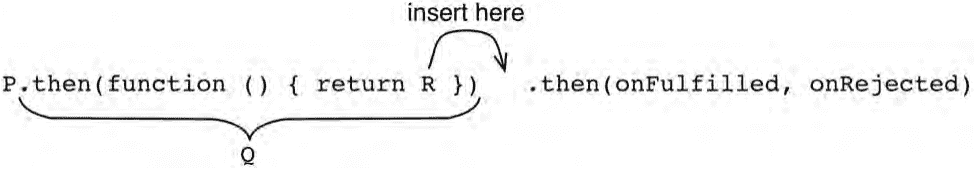

此机制的主要用途是扁平化嵌套的 `then()` 调用，如以下示例所示：

```
asyncFunc1()
.then(function (value1) {
    asyncFunc2()
    .then(function (value2) {
        ...
    });
})
```

扁平化的版本如下：

```
asyncFunc1()
.then(function (value1) {
    return asyncFunc2();
})
.then(function (value2) {
    ...
})
```

### 25.6.3 从 onRejected resolve Q

在错误处理程序中返回的任何内容都会成为兑现值（而非拒绝值！）。这允许你指定在失败情况下使用的默认值：

```
retrieveFileName()
.catch(function () {
    // 出错了，使用默认值
    return 'Untitled.txt';
})
.then(function (fileName) {
    ...
});
```

### 25.6.4 通过抛出异常 reject Q

在 `then` 的任一参数中抛出的异常都会传递给下一个错误处理程序：


```
asyncFunc()
.then(function (value) {
    throw new Error();
})
.catch(function (reason) {
    // 在此处处理错误
});
```

## 25.6.5 执行器中的异常

在执行器（`new Promise()`的回调函数）内部抛出的异常会被传递给该执行器所管理的 Promise 的错误处理程序：

```
new Promise(function (resolve, reject) {
    throw new Error();
})
.catch(function (err) {
    // 在此处处理错误
});
```

## 25.6.6 错误链

可能存在一个或多个没有错误处理程序的 `then()` 方法调用。那么错误会被传递下去，直到遇到错误处理程序。

```
asyncFunc1()
.then(asyncFunc2)
.then(asyncFunc3)
.catch(function (reason) {
    // 上面的某个地方出错了
});
```

## 25.7 组合

本节描述如何组合现有的 Promise 来创建新的 Promise。我们已经遇到过一种组合 Promise 的方式：通过 `then()` 进行顺序链接。`Promise.all()` 和 `Promise.race()` 提供了额外的组合方式。

### 25.7.1 通过 Promise.all() 使用 map()

Promise 的一个优点是，许多同步工具仍然有效，因为基于 Promise 的函数会返回结果。例如，你可以使用数组的 `map()` 方法：

```
let fileUrls = [
    'http://example.com/file1.txt',
    'http://example.com/file2.txt'
];
let promisedTexts = fileUrls.map(httpGet);
```

`promisedTexts` 是一个 Promise 数组。`Promise.all()` 接受一个 Promise 数组（thenable 和其他值会通过 `Promise.resolve()` 转换为 Promise），并且一旦所有 Promise 都 fulfill（兑现），它就会以这些 Promise 的值组成的数组来 fulfill：

```
Promise.all(promisedTexts)
.then(texts => {
    for (let text of texts) {
        console.log(text);
    }
})
.catch(reason => {
    // 接收到第一个被 reject 的 Promise 的原因
});
```

### 25.7.2 通过 Promise.race() 实现超时

`Promise.race()` 接受一个 Promise 数组（thenable 和其他值会通过 `Promise.resolve()` 转换为 Promise），并返回一个新的 Promise P。输入的 Promise 中第一个 settlement（无论是 fulfill 还是 reject）会传递给输出的 Promise。例如，让我们使用 `Promise.race()` 来实现一个超时：

```
Promise.race([
    httpGet('http://example.com/file.txt'),
    delay(5000).then(function () {
        throw new Error('Timed out')
    })
])
.then(function (text) { ... })
.catch(function (reason) { ... });
```

## 25.8 Promise 总是异步的

Promise 库完全控制结果是同步（立即）还是异步（在当前 continuation，即当前代码片段执行完毕后）传递给 Promise reactions（反应）。然而，Promises/A+ 规范要求必须始终使用后一种执行模式。它通过以下对 `then()` 方法的[要求](http://promisesaplus.com/#point-34) (2.2.4) 来规定：

> onFulfilled 或 onRejected 必须在执行上下文栈仅包含平台代码后才能被调用。

这意味着你的代码可以依赖 run-to-completion（运行至完成）语义（如第一部分所述），并且链接 Promise 不会剥夺其他任务的处理时间。

## 25.9 速查表：ECMAScript 6 Promise API

本节概述了 ECMAScript 6 Promise API，如[规范](http://www.ecma-international.org/ecma-262/6.0/#sec-promise-objects)中所述。

### 25.9.1 术语：Promise

Promise API 关于异步传递结果。一个 *Promise 对象*（简称 Promise）是结果的代表，结果通过该对象传递。

状态：
- Promise 始终处于三种互斥状态之一：
  - 在结果准备好之前，Promise 处于 *pending*（待定）状态。
  - 如果结果可用，则 Promise 处于 *fulfilled*（已兑现）状态。
  - 如果发生错误，则 Promise 处于 *rejected*（已拒绝）状态。
- 如果“事情完成”（无论是 fulfilled 还是 rejected），则 Promise 是 *settled*（已敲定）的。
- Promise 精确地 settle 一次，之后保持不变。

对状态变化的反应：
- *Promise reactions*（Promise 反应）是你通过 Promise 方法 `then()` 注册的回调函数，用于在 Promise 被 fulfill 或 reject 时得到通知。
- 一个 *thenable* 是一个具有 Promise 风格 `then()` 方法的对象。当 API 只关心在 settlement 时得到通知时，它只要求 thenable。

改变状态：有两个操作可以改变 Promise 的状态。一旦你调用了其中一个操作，后续调用将无效。
- *Rejecting*（拒绝）一个 Promise 意味着 Promise 变为 rejected 状态。
- *Resolving*（解决）一个 Promise 有不同的效果，具体取决于你用来解决的值：
  - 用一个普通（非 thenable）值解决一个 Promise 会使其 fulfill。
  - 用一个 thenable T 解决一个 Promise P，意味着 P 不能再被解决，并且现在将遵循 T 的状态，包括其 fulfillment 值或 rejection 值。一旦 T settle（如果 T 已经 settle，则立即调用），相应的 P reactions 就会被调用。

[^5] http://promisesaplus.com/#point-34
[^6] http://www.ecma-international.org/ecma-262/6.0/#sec-promise-objects

### 25.9.2 Promise 构造函数

Promise 的构造函数按如下方式调用：

```
let p = new Promise(function (resolve, reject) { ··· });
```

此构造函数的回调函数称为 executor（执行器）。执行器可以使用其参数来解决或拒绝新的 Promise p：
- resolve(x) 用 x 解决 p：
  - 如果 x 是 thenable，其 settlement 会转发给 p（这包括触发通过 then() 注册的 reactions）。
  - 否则，p 将被 fulfill，其值为 x。
- reject(e) 以值 e（通常是 Error[7] 的一个实例）拒绝 p。

### 25.9.3 静态 Promise 方法

Promise 的所有静态方法都支持子类化：
- 它们通过所谓的 species 模式（在关于类的章节中有详细解释）创建新的 Promise 实例：
  - 默认情况下使用接收者（this）作为构造函数。
  - 子类可以通过 [Symbol.species] 属性覆盖该默认值。
- 其他静态方法也通过 species 模式访问（不是通过 Promise 或 this）。

#### 25.9.3.1 创建 Promise

以下两个静态方法创建其接收者的新实例：
- Promise.resolve(x)：将任意值转换为 Promise，会感知 thenable 和 Promise。
  - 如果 x 是 thenable，则将其转换为 Promise — 接收者（this；这里不使用 species 模式）的一个实例。
  - 如果 x 已经是接收者的实例，则直接返回，不变。
  - 否则，返回一个新的接收者实例，该实例被 fulfill，其值为 x。
- Promise.reject(reason)：创建接收者的一个新实例（通过 species 模式配置），该实例被拒绝，其值为 reason。

#### 25.9.3.2 组合 Promise

直观地说，静态方法 `Promise.all()` 和 `Promise.race()` 将 Promise 的可迭代对象组合成单个 Promise。即：
- 它们接受一个可迭代对象。该可迭代对象的元素通过 `this.resolve()`[^1] 转换为 Promise。
- 它们返回一个新的 Promise。该 Promise 是接收者的一个新实例（通过 species 模式配置）。

这些方法是：
- `Promise.all(iterable)`：返回一个 Promise，该 Promise...
  - 在 `iterable` 中所有元素都 fulfilled 时被 fulfill。Fulfillment 值：包含 fulfillment 值的数组。
  - 在任意元素被 rejected 时被 rejected。Rejection 值：第一个 rejection 值。
- `Promise.race(iterable)`：`iterable` 中第一个 settlement 的元素用于 settlement 返回的 Promise。

### 25.9.4 Promise.prototype 方法

#### 25.9.4.1 Promise.prototype.then(onFulfilled, onRejected)

- 回调 `onFulfilled` 和 `onRejected` 称为 *reactions*（反应）。
- `onFulfilled` 在 Promise 已经 fulfilled 或即将 fulfilled 时立即调用。类似地，`onRejected` 在 reject 时被通知。
- `then()` 返回一个新的 Promise Q（通过接收者构造函数的 species 创建）：
  - 如果任一 reaction 返回一个值，则用它解决 Q。
  - 如果任一 reaction 抛出一个异常，则用它拒绝 Q。
- 省略的 reaction：
  - 如果 `onFulfilled` 被省略，则接收者的 fulfillment 会转发给 `then()` 的结果。
  - 如果 `onRejected` 被省略，则接收者的 rejection 会转发给 `then()` 的结果。

省略的 reaction 的默认值可以像这样实现：

[^1] 这是一个略微的简化。实际上，元素是通过 `C.resolve()` 转换的，其中 C 是通过 species 模式确定的。
```


 ```
function defaultOnFulfilled(x) {
    return x;
}
function defaultOnRejected(e) {
    throw e;
}
```

### 25.9.4.2 Promise.prototype.catch(onRejected)

- `p.catch(onRejected)` 与 `p.then(null, onRejected)` 等价。

## 25.10 Promise 的优缺点

### 25.10.1 优点

#### 25.10.1.1 统一异步 API

Promise 的一个重要优势在于，它们将被越来越多的异步浏览器 API 所采用，从而统一当前多样且不兼容的模式与约定。让我们来看两个即将推出的基于 Promise 的 API。

fetch API 是基于 Promise 的 `XMLHttpRequest` 替代方案：

```
fetch(url)
.then(request => request.text())
.then(str => ...)
```

`fetch()` 返回一个表示实际请求的 Promise，`text()` 返回一个将内容作为字符串的 Promise。

ECMAScript 6 中用于编程式导入模块的 API 同样基于 Promise：

```
System.import('some_module.js')
.then(some_module => {
    ...
})
```

#### 25.10.1.2 Promise 与事件

与事件相比，Promise 更适合处理一次性的结果。无论你是在结果计算完成之前还是之后注册获取结果，你都能得到它。Promise 的这一优势具有本质性。另一方面，Promise 不适合处理反复触发的事件。链式调用是 Promise 的另一个优势，但这一能力也可以被添加到事件处理中。

#### 25.10.1.3 Promise 与回调

与回调相比，Promise 具有更清晰的函数（或方法）签名。使用回调时，参数既用于输入也用于输出：

```
fs.readFile(name, opts?, (err, string | Buffer) => void)
```

使用 Promise 时，所有参数仅用于输入：

```
readFilePromisified(name, opts?) : Promise<string | Buffer>
```

Promise 的其他优势还包括更好的错误处理（集成了异常机制）以及更便捷的组合（因为你可以复用一些同步工具，如 `Array.prototype.map()`）。

### 25.10.2 缺点

Promise 非常适合处理单次异步结果。它们不适合用于：

- 反复触发的事件：如果你对此感兴趣，可以了解一下[响应式编程](https://reactive-extensions.github.io/RxJS/)，它为普通的事件处理添加了巧妙的链式调用方式。
- 数据流：目前有一个[标准](https://streams.spec.whatwg.org/)正在开发中，用于支持这一场景。

ECMAScript 6 的 Promise 缺少两个有时很有用的特性：

- 你无法取消它们。
- 你无法查询它们的进度（例如在客户端用户界面中显示进度条）。

Q Promise 库[支持](https://github.com/kriskowal/q#progress-notification)后者，并且 [Promises/A+](https://github.com/promises-aplus) 有[计划](https://github.com/promises-aplus)将这两项功能添加到 Promise 规范中。

## 25.11 Promise 与 generator

在下面的代码中，我使用 [co 控制流库](https://github.com/tj/co)来异步检索两个 JSON 文件。注意第 A 行中，执行会阻塞（等待）直到 `Promise.all()` 的结果就绪。这意味着代码在执行异步操作时看起来像同步代码。

```
co(function* () {
    try {
        let [croftStr, bondStr] = yield Promise.all([  // (A)
            getFile('http://localhost:8000/croft.json'),
            getFile('http://localhost:8000/bond.json'),
        ]);
        let croftJson = JSON.parse(croftStr);
        let bondJson = JSON.parse(bondStr);

        console.log(croftJson);
        console.log(bondJson);
    } catch (e) {
        console.log('Failure to read: ' + e);
    }
});
```

详细信息请参阅[关于 generator 的章节](.)。

## 25.12 调试 Promise

用于调试 Promise 的工具正逐步出现在浏览器中。让我们快速了解一下最新版 Google Chrome 提供了哪些功能。以下是一段 HTML 文件的部分内容，展示了 Promise 的两个常见问题：

```
<body>
    <script>
        // Unhandled rejection
        Promise.reject(new Error())
        .then(function (x) { return 'a'})
        .then(function (x) { return 'b'})

        // Unsettled Promise
        new Promise(function () {});
    </script>
</body>
```

首先，一个 rejection 未被处理。其次，一个 Promise 未被 settle。Chrome 的开发者工具可以帮助解决这两个问题。

未处理的 rejection 会被记录到控制台中：

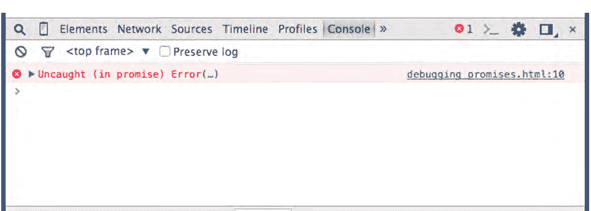

它们也会在"Sources"检查器中被高亮显示：

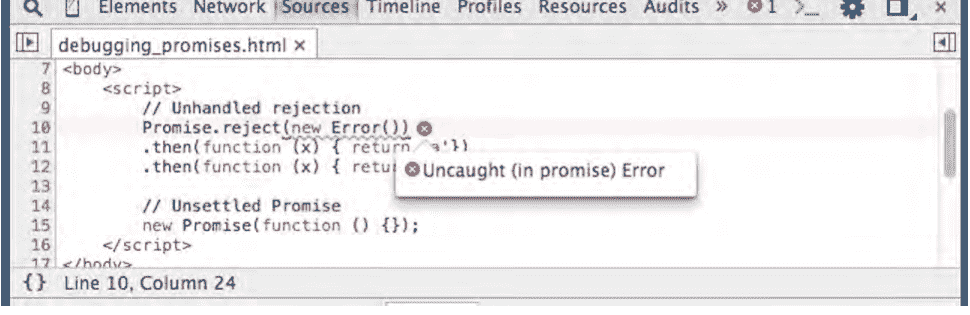

最后，还有一个专门的 Promise 检查器，它会记录网页创建的所有 Promise。除其他信息外，它还会记录：

- 哪些 Promise 已 fulfill（第一列为绿色圆点）、已 reject（红色圆点）以及仍处于 pending 状态（灰色圆点）
- Promise 之间的链式关系

| 状态 | 函数 | 创建位置 | Settled 位置 | Settle 耗时 |
|--------|----------|---------|---------|----------------|
| ● (rejected) | ▼ (匿名函数) | debugging_promises.html:10 | debugging_promises.html:10 | 0 ms |
| ● (rejected) | ▼ (匿名函数) | debugging_promises.html:11 | | 1 ms |
| ● (rejected) | (匿名函数) | debugging_promises.html:12 | | 1 ms |
| ● (pending) | (匿名函数) | debugging_promises.html:15 | | |

用于异步编程的 Promise

462

## 25.13 Promise 的内部原理

在本节中，我们将从另一个角度来看待 Promise：不学习如何使用 API，而是来看一个简单的 Promise 实现。这个不同的角度对我理解 Promise 有极大的帮助。

这个 Promise 实现名为 `DemoPromise`。为了便于理解，它并不完全匹配 API 规范。但它已经足够接近，仍能让你深入了解实际实现所面临的诸多挑战。


`DemoPromise` 可在 GitHub 的 [demo_promise](https://github.com/rauschma/demo_promise) 仓库中获取[^1]。

`DemoPromise` 是一个包含三个原型方法的类：

- `DemoPromise.prototype.resolve(value)`
- `DemoPromise.prototype.reject(reason)`
- `DemoPromise.prototype.then(onFulfilled, onRejected)`

也就是说，`resolve` 和 `reject` 是方法（而不是作为回调参数传递给构造函数的函数）。

### 25.13.1 独立的 Promise

我们的第一个实现是一个具有最小功能的独立 Promise：

- 你可以创建一个 Promise。
- 你可以 resolve 或 reject 一个 Promise，且只能执行一次。
- 你可以通过 `then()` 注册*反应*（回调）。它必须能独立于 Promise 是否已 settle 的状态来工作。
  - 此方法暂不支持链式调用——它不返回任何值。

以下是这个初始实现的使用方式：

```
let dp = new DemoPromise();
dp.resolve('abc');
dp.then(function (value) {
    console.log(value); // abc
});
```

下图展示了我们的第一个 DemoPromise 的工作方式：

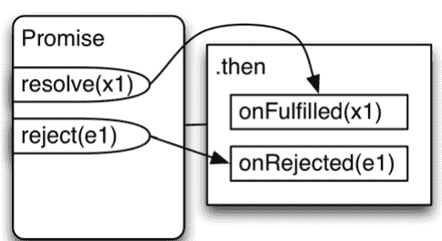

#### 25.13.1.1 DemoPromise.prototype.then()

让我们先来研究 `then()`。它需要处理两种情况：

- 如果 Promise 仍处于 pending 状态，它会将 onFulfilled 和 onRejected 的调用入队，以便在 Promise settle 后执行。
- 如果 Promise 已经 fulfilled 或 rejected，则 onFulfilled 或 onRejected 可以立即被调用。

```
then(onFulfilled, onRejected) {
    let self = this;
    let fulfilledTask = function () {
        onFulfilled(self.promiseResult);
    };
    let rejectedTask = function () {
        onRejected(self.promiseResult);
    };
    switch (this.promiseState) {
        case 'pending':
            this.fulfillReactions.push(fulfilledTask);
            this.rejectReactions.push(rejectedTask);
            break;
```

```
case 'fulfilled':
    addToTaskQueue(fulfilledTask);
    break;
case 'rejected':
    addToTaskQueue(rejectedTask);
    break;
}
}
```

上面的代码片段使用了以下辅助函数：

```
function addToTaskQueue(task) {
    setTimeout(task, 0);
}
```

#### 25.13.1.2 DemoPromise.prototype.resolve()

`resolve()` 的工作方式如下：如果 Promise 已经 settle，则它不执行任何操作（确保 Promise 只能 settle 一次）。否则，Promise 的状态变为 'fulfilled'，结果被缓存到 this.promiseResult 中。接下来，所有已入队的 fulfill 反应都会被触发。

```
resolve(value) {
    if (this.promiseState !== 'pending') return;
    this.promiseState = 'fulfilled';
    this.promiseResult = value;
    this._clearAndEnqueueReactions(this.fulfillReactions);
    return this; // 支持链式调用
}
_clearAndEnqueueReactions(reactions) {
    this.fulfillReactions = undefined;
    this.rejectReactions = undefined;
    reactions.map(addToTaskQueue);
}
```

`reject()` 与 `resolve()` 类似。

### 25.13.2 链式调用

我们要实现的下一个特性是链式调用：
```


-   `then()` 返回一个 Promise，该 Promise 的解析结果取决于 `onFulfilled` 或 `onRejected` 的返回值。
-   如果 `onFulfilled` 或 `onRejected` 被省略，它们原本应接收的值会被直接传递给 `then()` 返回的 Promise。

显然，只有 `then()` 方法发生了改变：

```
then(onFulfilled, onRejected) {
    let returnValue = new Promise(); // (A)
    let self = this;

    let fulfilledTask;
    if (typeof onFulfilled === 'function') {
        fulfilledTask = function () {
            let r = onFulfilled(self.promiseResult);
            returnValue.resolve(r); // (B)
        };
    } else {
        fulfilledTask = function () {
            returnValue.resolve(self.promiseResult); // (C)
        };
    }

    let rejectedTask;
    if (typeof onRejected === 'function') {
        rejectedTask = function () {
            let r = onRejected(self.promiseResult);
            returnValue.resolve(r); // (D)
        };
    } else {
        rejectedTask = function () {
            // `onRejected` 未被提供
            // => 我们必须传递拒绝原因
            returnValue.reject(self.promiseResult); // (E)
        };
    }
    ...
    return returnValue; // (F)
}
```

`then()` 方法创建并返回一个新的 Promise（第 A 行和 F 行）。此外，`fulfilledTask` 和 `rejectedTask` 的设置方式有所不同：在 Promise 状态确定后...

-   `onFulfilled` 的返回值用于解析 `returnValue`（第 B 行）。
    -   如果 `onFulfilled` 缺失，我们使用 fulfilled 的值来解析 `returnValue`（第 C 行）。
-   `onRejected` 的返回值用于解析（而非拒绝！）`returnValue`（第 D 行）。
    -   如果 `onRejected` 缺失，我们将拒绝值传递给 `returnValue`（第 E 行）。

## 25.13.3 展平

展平主要为了使链式调用更方便：通常情况下，从回调中返回的值会被传递给下一个 `then()`。如果我们返回一个 Promise，如果它能被自动“展开”那就太好了，就像下面的例子一样：

```
asyncFunc1()
.then(function (value1) {
    return asyncFunc2(); // (A)
})
.then(function (value2) {
    // value2 是 asyncFunc2() 返回的 Promise 的 fulfilled 值
    console.log(value2);
});
```

在 A 行我们返回了一个 Promise，而不需要在当前回调内嵌套调用 `then()`，我们可以直接在方法返回的结果上调用 `then()`。这样：没有嵌套的 `then()`，一切都保持扁平。我们通过让 `resolve()` 方法执行展平操作来实现这一点：

-   用一个 Promise Q 来解析一个 Promise P，意味着 Q 的状态决议将被转发给 P 的回调。
    -   P 将被“锁定”在 Q 上：它不能再被解析（包括拒绝），并且它的状态和结果始终与 Q 相同。

如果我们将 Q 的范围扩展到 thenable 对象（而不仅是 Promise），可以使展平更加通用。

为了实现“锁定”，我们引入了一个新的布尔标志 `this.alreadyResolved`。一旦它为 true，`this` 就被锁定，不能再被解析。请注意，`this` 的状态可能仍然是 pending，因为它的状态现在与它锁定的 Promise 相同。

```
resolve(value) {
    if (this.alreadyResolved) return;
    this.alreadyResolved = true;
    this._doResolve(value);
    return this; // 支持链式调用
}
```

实际的解析现在发生在私有方法 `_doResolve()` 中：

```
_doResolve(value) {
    let self = this;
    // `value` 是一个 thenable 对象吗？
    if (typeof value === 'object' && value !== null && 'then' in value) {
        // 将 `value` 的 fulfilled 和 rejected 状态转发给 `this`。
        // 添加到任务队列（而非立即执行）以保持异步语义。
        addToTaskQueue(function () { // (A)
            value.then(
                function onFulfilled(result) {
                    self._doResolve(result);
                },
                function onRejected(error) {
                    self._doReject(error);
                }
            );
        });
    } else {
        this.promiseState = 'fulfilled';
        this.promiseResult = value;
        this._clearAndEnqueueReactions(this.fulfillReactions);
    }
}
```

展平操作在第 A 行执行：如果 value 被 fulfilled，我们希望 self 也被 fulfilled；如果 value 被 rejected，我们希望 self 也被 rejected。转发通过私有方法 `_doResolve` 和 `_doReject` 进行，以绕过 `alreadyResolved` 的保护。

## 25.13.4 更详细的 Promise 状态

随着链式调用的使用，Promise 的状态变得更加复杂（如 ECMAScript 6 规范 25.4<sup>15</sup> 节所述）：

如果你只是*使用* Promise，通常可以采用简化的世界观并忽略“锁定”。最重要的状态相关概念仍然是“已决议”：一个 Promise 如果 fulfilled 或 rejected 就是已决议的。一旦 Promise 已决议，它就不再改变（状态和 fulfilled/rejected 的值）。

> <sup>15</sup>http://www.ecma-international.org/ecma-262/6.0/#sec-promise-objects

如果你想*实现* Promise，那么“解析”也变得重要，并且现在更难理解：

-   直观地说，“已解析”意味着“不能再被（直接）解析”。如果一个 Promise 已决议或已锁定，它就是已解析的。引用规范：“一个未解析的 Promise 总是处于 pending 状态。一个已解析的 Promise 可能是 pending、fulfilled 或 rejected。”
-   解析不一定导致决议：你可以用一个永远 pending 的 Promise 来解析一个 Promise。
-   解析现在包括拒绝（即，它更通用）：你可以通过用一个 rejected 的 Promise 来解析一个 Promise 从而拒绝它。

## 25.13.5 异常处理

作为我们的最后一个特性，我们希望我们的 Promise 能够将用户代码中的异常作为 rejection 来处理。目前，“用户代码”指的是 `then()` 的两个回调参数。

以下摘录展示了我们如何将 `onFulfilled` 内部的异常转换为 rejection——在第 A 行的调用周围包裹一个 try-catch。

```
then(onFulfilled, onRejected) {
  ...
  let fulfilledTask;
  if (typeof onFulfilled === 'function') {
    fulfilledTask = function () {
      try {
        let r = onFulfilled(self.promiseResult); // (A)
        returnValue.resolve(r);
      } catch (e) {
        returnValue.reject(e);
      }
    };
  } else {
    fulfilledTask = function () {
      returnValue.resolve(self.promiseResult);
    };
  }
  ...
}
```

## 25.13.6 揭示构造函数模式

如果我们想将 DemoPromise 变成一个实际的 Promise 实现，我们仍然需要实现揭示构造函数模式 [5]：ES6 的 Promise 不是通过方法来解析和拒绝，而是通过传递给执行器（构造函数的回调参数）的函数来完成的。

如果执行器抛出异常，那么“它的” Promise 必须被拒绝。

## 25.14 两个有用的附加 Promise 方法

本节描述了两个容易添加到 ES6 Promise 的有用方法。许多功能更全面的 Promise 库都包含它们。

### 25.14.1 done()

当你链式调用多个 Promise 方法时，可能会默默地丢弃错误。例如：

```
function doSomething() {
    asyncFunc()
    .then(f1)
    .catch(r1)
    .then(f2); // (A)
}
```

如果第 A 行的 `then()` 产生了一个 rejection，它将永远不会在任何地方被处理。Promise 库 Q 提供了一个 `done()` 方法，用作链式调用的最后一个元素。它要么替代最后一个 `then()`（接受一到两个参数）：

```
function doSomething() {
    asyncFunc()
    .then(f1)
    .catch(r1)
    .done(f2);
}
```

要么插入到最后一个 `then()` 之后（不接受参数）：

```
function doSomething() {
    asyncFunc()
    .then(f1)
    .catch(r1)
    .then(f2)
    .done();
}
```

引用 [Q 文档](https://github.com/kriskowal/q/wiki/API-Reference#promisedoneonfulfilled-onrejected-onprogress)¹⁶：

> 使用 done 与 then 的黄金法则是：要么将你的 promise 返回给别人，要么如果链条在你这里结束，就调用 done 来终止它。用 catch 终止是不够的，因为 catch 处理程序本身可能会抛出错误。

以下是您在 ECMAScript 6 中实现 `done()` 的方式：

¹⁶ https://github.com/kriskowal/q/wiki/API-Reference#promisedoneonfulfilled-onrejected-onprogress


 ```
Promise.prototype.done = function (onFulfilled, onRejected) {
    this.then(onFulfilled, onRejected)
    .catch(function (reason) {
        // Throw an exception globally
        setTimeout(() => { throw reason }, 0);
    });
};
```

虽然 `done` 的功能显然很有用，但它并没有被添加到 ECMAScript 6 中，因为这种检查可以由引擎自动执行（正如我们在[调试 Promises 的章节](https://exploringjs.com/es6/ch_promises.html#_resolving-promises-automatically)中所见）。

## 25.14.2 finally()

有时，无论是否发生错误，你都想执行某个操作。例如，在使用完某个资源后进行清理。这就是 Promise 方法 `finally()` 的用途，它的工作方式与异常处理中的 finally 子句非常相似。它的回调函数不接收任何参数，但会在完成（fulfillment）或拒绝（rejection）时被通知。

```
createResource(...)
.then(function (value1) {
    // Use resource
})
.then(function (value2) {
    // Use resource
})
.finally(function () {
    // Clean up
});
```

这是 Domenic Denicola [提议](https://github.com/domenic/promises-unwrapping/issues/18) 实现 `finally()` 的方式：

```
Promise.prototype.finally = function (callback) {
    let P = this.constructor;
    // We don't invoke the callback in here,
    // because we want then() to handle its exceptions
    return this.then(
        // Callback fulfills => continue with receiver's fulfillment or rejection
        // Callback rejects => pass on that rejection (then() has no 2nd parameter!)
        value  => P.resolve(callback()).then(() => value),
        reason => P.resolve(callback()).then(() => { throw reason })
    );
};
```

回调函数决定了接收方（`this`）的 settlement 是如何被处理的：

- 如果回调函数抛出异常或返回一个被拒绝的 Promise，那么该异常或拒绝值会成为/贡献拒绝值。
- 否则，接收方的 settlement（完成或拒绝）会成为 `finally()` 返回的 Promise 的 settlement。在某种程度上，我们把 `finally()` 从方法链中取了出来。

**示例 1**（由 [Jake Archibald](https://gist.github.com/jakearchibald/785f79b0dea5bf0e0c448) 提供）：使用 `finally()` 来隐藏加载动画。简化版本：

```
showSpinner();
fetchGalleryData()
.then(data => updateGallery(data))
.catch(showNoDataError)
.finally(hideSpinner);
```

**示例 2**（由 [Kris Kowal](https://github.com/domenic/promises-unwrapping/issues/18#issuecomment-27707922) 提供）：使用 `finally()` 来拆除测试环境。

```
let HTTP = require("q-io/http");
let server = HTTP.Server(app);
return server.listen(0)
.then(function () {
    // run test
})
.finally(server.stop);
```

## 25.15 兼容 ES6 的 Promise 库

市面上有很多 Promise 库。以下库符合 ECMAScript 6 API，这意味着你现在就可以使用它们，并且以后可以轻松迁移到原生 ES6。

- "RSVP.js<sup>20</sup>" 由 Stefan Penner 开发，是 ES6 Promise API 的超集。
- "ES6-Promises<sup>21</sup>" 由 Jake Archibald 开发，从 RSVP.js 中提取了纯粹的 ES6 API。
- "Native Promise Only (NPO)<sup>22</sup>" 由 Kyle Simpson 开发，"一个原生 ES6 Promise 的 polyfill，尽可能接近（无扩展）严格的规范定义"。
- "Lie<sup>23</sup>" 由 Calvin Metcalf 开发，"一个小巧、高性能的 Promise 库，实现了 Promises/A+ 规范"。
- Q.Promise<sup>24</sup> 由 Kris Kowal 开发，实现了 ES6 API。
- 最后，Paul Millr 的 "ES6 Shim<sup>25</sup>" 也包含了 Promise。

## 25.16 与传统异步代码的交互

当你使用 Promise 库时，有时需要使用非基于 Promise 的异步代码。本节解释了如何针对 Node.js 风格的异步函数和 jQuery deferred 进行操作。

### 25.16.1 与 Node.js 交互

Promise 库 Q 提供了几个工具函数<sup>26</sup>，用于将使用 Node.js 风格 (err, result) 回调的函数转换为返回 Promise 的函数（甚至还有一些函数可以执行相反的操作——将基于 Promise 的函数转换为接受回调的函数）。例如：

```
let readFile = Q.denodeify(FS.readFile);

readFile('foo.txt', 'utf-8')
.then(function (text) {
    ...
});
```

denodeify<sup>27</sup> 是一个微型库，仅提供 "denodification" 功能，并符合 ECMAScript 6 Promise API。

### 25.16.2 与 jQuery 交互

jQuery 有 deferred<sup>28</sup>，它们与 Promise 类似，但存在几个差异<sup>29</sup>，导致无法兼容。它们的 `then()` 方法与 ES6 Promise 的几乎一样（主要区别：它不会捕获 reaction 中的错误）。因此，我们可以通过 `Promise.resolve()` 将 jQuery deferred 转换为 ES6 Promise：

```
Promise.resolve(
    jQuery.ajax({
        url: 'somefile.html',
        type: 'GET'
    }))
.then(function (data) {
    console.log(data);
})
.catch(function (reason) {
    console.error(reason);
});
```

## 25.17 延伸阅读

[1] "[Promises/A+](http://promisesaplus.com/)"，由 Brian Cavalier 和 Domenic Denicola 编辑（JavaScript Promise 的事实标准）

[2] "[JavaScript Promises: There and back again](http://www.html5rocks.com/en/tutorials/es6/promises/)"，Jake Archibald（Promise 的通用入门介绍）

[3] "[Promise Anti-Patterns](http://taoofcode.net/promise-anti-patterns/)"，Tao of Code（技巧和技术）

[4] "[Promise Patterns](https://www.promisejs.org/patterns/)"，Forbes Lindesay

[5] "[The Revealing Constructor Pattern](http://domenic.me/2014/02/13/the-revealing-constructor-pattern/)"，Domenic Denicola（`Promise` 构造函数使用的正是这种模式）

^30 http://promisesaplus.com/
^31 http://www.html5rocks.com/en/tutorials/es6/promises/
^32 http://taoofcode.net/promise-anti-patterns/
^33 https://www.promisejs.org/patterns/
^34 http://domenic.me/2014/02/13/the-revealing-constructor-pattern/

## VI 杂项

## 26. ES6 中的 Unicode

本章介绍 ECMAScript 6 带来的 Unicode 支持改进。有关 Unicode 的通用介绍，请阅读 "[Unicode and JavaScript]<sup>1</sup>"（"Speaking JavaScript" 中的一章）。

### 26.1 ES6 对 Unicode 的支持更好

ECMAScript 6 在以下三个领域改进了对 Unicode 的支持：

- 16 位以上的 Unicode 转义：`\u{...}`
  可用于标识符、字符串字面量、模板字面量和正则表达式字面量。下一节将详细解释。
- 字符串：
  - 迭代遵循 Unicode 码点。
  - 通过 `String.prototype.codePointAt()` 读取码点值。
  - 通过 `String.fromCodePoint()` 从码点值创建字符串。
- 正则表达式：
  - 新标志 `/u`（加上布尔属性 `unicode`）改进了对代理对（surrogate pairs）的处理。

### 26.2 ES6 中的转义序列

JavaScript 中有三种参数化的转义序列用于表示字符：

- 十六进制转义（恰好两个十六进制数字）：`\xHH`
  > `'\x7A' === 'z'`
  > `true`
- Unicode 转义（恰好四个十六进制数字）：`\uHHHH`
  > `'\u007A' === 'z'`
  > `true`
- Unicode 码点转义（一个或多个十六进制数字）：`\u{...}`

```
> '\u{7A}' === 'z'
true
```

Unicode 码点转义是 ES6 的新特性。它们允许你指定 16 位以上的码点。如果要在 ECMAScript 5 中这样做，你必须将每个码点编码为两个 UTF-16 码元（一个代理对）。这些码元可以通过 Unicode 转义表示。例如，以下语句向大多数控制台输出一个火箭（码点 0x1F680）：

```
console.log('\uD83D\uDE80');
```

使用 Unicode 码点转义，你可以直接指定大于 16 位的码点：

```
console.log('\u{1F680}');
```

### 26.2.1 转义序列可以在哪里使用？

转义序列可用于以下位置：

| | \uHHHH | \u{···} | \xHH |
| --- | --- | --- | --- |
| 标识符 | ✓ | ✓ | |
| 字符串字面量 | ✓ | ✓ | ✓ |
| 模板字面量 | ✓ | ✓ | ✓ |
| 正则表达式字面量 | ✓ | 仅带标志 /u | ✓ |

标识符：

- 4 位 Unicode 转义 `\uHHHH` 变为单个码点。
- Unicode 码点转义 `\u{···}` 变为单个码点。

```
> let hello = 123;
> hell\u{6F}
123
```

字符串字面量：

- 字符串内部以 UTF-16 码元存储。
- 十六进制转义 `\xHH` 贡献一个 UTF-16 码元。
- 4 位 Unicode 转义 `\uHHHH` 贡献一个 UTF-16 码元。
```


 - Unicode 码点转义 `\u{···}` 贡献其码点的 UTF-16 编码（一个或两个 UTF-16 码元）。

模板字面量：

- 在模板字面量中，转义序列的处理方式与普通字符串字面量相同。
- 在带标签的模板中，转义序列的解释方式取决于标签函数。它可以在两种解释方式之间选择：
    -  cooked（ cooked ）：转义序列的处理方式与普通字符串字面量相同。
    -  raw（ raw ）：转义序列按字符序列处理。

```
> `hell\u{6F}` // cooked
'hello'
> String.raw`hell\u{6F}` // raw
'hell\\u{6F}'
```

正则表达式：

- Unicode 码点转义仅在设置 /u 标志时才被允许，否则 `\u{3}` 会被解释为字符 u 重复三次：

```
> /^\u{3}$/.test('uuu')
true
```

## 26.2.2 ES6 规范中的转义序列

各类信息：

- 规范将源代码视为 Unicode 码点序列："Source Text²"
- 标识符中的 Unicode 转义序列："Names and Keywords³"
- 字符串在内部以 UTF-16 码元序列存储："String Literals⁴"
- 字符串——各种转义序列如何转换为 UTF-16 码元："Static Semantics: SV⁵"
- 模板字面量——各种转义序列如何转换为 UTF-16 码元："Static Semantics: TV and TRV⁶"

## 26.2.2.1 正则表达式

规范区分了 BMP 模式（未设置 /u 标志）和 Unicode 模式（已设置 /u 标志）。第 ["Pattern Semantics"](http://www.ecma-international.org/ecma-262/6.0/#sec-pattern-semantics) 节解释了它们的处理方式及区别。

提醒一下，规范中的语法规则是如何参数化的：

- 如果语法规则 R 带有下标 [U]，则表示它有两个版本：R 和 R_U。
- 规则的某些部分可以通过 [?U] 传递该下标。
- 如果规则的某部分带有前缀 [+U]，则仅当下标 [U] 存在时该部分才存在。
- 如果规则的某部分带有前缀 [~U]，则仅当下标 [U] 不存在时该部分才存在。

你可以在 ["Patterns"](http://www.ecma-international.org/ecma-262/6.0/#sec-patterns) 节中看到这种参数化的实际应用，其中下标 [U] 为 BMP 模式和 Unicode 模式创建了独立的语法：

- *IdentityEscape*：在 BMP 模式中，许多字符可以成人的世界里没有容易二字


## 27.2.1.4 逗号运算符（,）

```
const a = () => (f() , g());
```

`f()` 不在尾部位置，但 `g()` 在尾部位置。要理解其中的原因，请看以下等价代码：

```
const a = () => {
    f();
    return g();
}
```

## 27.2.2 语句中的尾部调用

对于语句，适用以下规则。

只有以下复合语句可以包含尾部调用：

-   用 `{}` 分隔的块（有无标签均可）
-   `if`：在"then"子句或"else"子句中
-   `do-while`、`while`、`for`：在它们的循环体中
-   `switch`：在其主体中
-   `try-catch`：仅在 `catch` 子句中。`try` 子句有 `catch` 子句作为无法被优化掉的上下文
-   `try-finally`、`try-catch-finally`：仅在 `finally` 子句中，它是其他子句的无法被优化掉的上下文

在所有原子（非复合）语句中，只有 `return` 可以包含尾部调用。所有其他语句都有无法被优化掉的上下文。以下语句在 `expr` 包含尾部调用时包含一个尾部调用：

```
return «expr»;
```

## 27.2.3 尾部调用优化只能在严格模式下进行

在非严格模式下，大多数引擎具有以下两个属性，允许你检查调用栈：

-   `func.arguments`：包含 `func` 最近一次调用的参数
-   `func.caller`：引用最近调用 `func` 的函数

在尾部调用优化下，这些属性不起作用，因为它们依赖的信息可能已被移除。因此，严格模式禁止这些属性（[如语言规范所述](http://www.ecma-international.org/ecma-262/6.0/#sec-addrestrictedfunctionproperties)），而尾部调用优化仅在严格模式下生效。

## 27.2.4 陷阱：单独的函数调用永远不在尾部位置

以下代码中的函数调用 `bar()` 不在尾部位置：

```
function foo() {
    bar(); // 这在JS中不是尾部调用
}
```

原因是 `foo()` 的最后一个操作不是函数调用 `bar()`，而是（隐式地）返回 `undefined`。换句话说，`foo()` 的行为如下：

```
function foo() {
    bar();
    return undefined;
}
```

调用者可以依赖 `foo()` 始终返回 `undefined`。如果由于尾部调用优化，`bar()` 为 `foo()` 返回了一个结果，那将改变 `foo` 的行为。因此，如果我们想让 `bar()` 成为尾部调用，必须如下修改 `foo()`：

```
function foo() {
    return bar(); // 尾部调用
}
```

## 27.3 尾递归函数

如果函数的主要递归调用处于尾部位置，则该函数是*尾递归的*。例如，以下函数不是尾递归的，因为第 A 行的主要递归调用不在尾部位置：

```
function factorial(x) {
    if (x <= 0) {
        return 1;
    } else {
        return x * factorial(x-1); // (A)
    }
}
```

`factorial()` 可以通过尾递归辅助函数 `facRec()` 来实现。第 A 行的主要递归调用处于尾部位置。

```
function factorial(n) {
    return facRec(n, 1);
}
function facRec(x, acc) {
    if (x <= 1) {
        return acc;
    } else {
        return facRec(x-1, x*acc); // (A)
    }
}
```

也就是说，某些非尾递归函数可以转换为尾递归函数。

## 27.3.1 尾递归循环

尾部调用优化使得通过递归实现循环而不增长调用栈成为可能。以下是两个示例。

### 27.3.1.1 forEach()

```
function forEach(arr, callback, start = 0) {
    if (0 <= start && start < arr.length) {
        callback(arr[start], start, arr);
        return forEach(arr, callback, start+1); // 尾部调用
    }
}
forEach(['a', 'b'], (elem, i) => console.log(`${i}. ${elem}`));
```

```
// 输出：
// 0. a
// 1. b
```

### 27.3.1.2 findIndex()

```
function findIndex(arr, predicate, start = 0) {
    if (0 <= start && start < arr.length) {
        if (predicate(arr[start])) {
            return start;
        }
        return findIndex(arr, predicate, start+1); // 尾部调用
    }
}
findIndex(['a', 'b'], x => x === 'b'); // 1
```

## 28. 使用代理进行元编程

本章介绍 ECMAScript 6 的*代理（proxies）*特性。代理使你能够拦截和自定义对对象执行的操作（例如获取属性）。它们是一种*元编程*特性。

## 28.1 概述

在以下示例中，`target` 是我们要拦截其操作的对象，`handler` 是处理拦截操作的对象。在本例中，我们只拦截了一个操作 `get`（获取属性）。

```
let target = {};
let handler = {
    get(target, propKey, receiver) {
        console.log('get ' + propKey);
        return 123;
    }
};
let proxy = new Proxy(target, handler);
```

当我们获取属性 `proxy.foo` 时，handler 拦截了该操作：

```
> proxy.foo
get foo
123
```

本章末尾的某一节作为完整 API 的参考，列出了可以拦截的操作。

## 28.2 编程与元编程

在我们深入了解代理是什么以及它们为何有用之前，我们首先需要理解什么是*元编程*。

在编程中，存在不同的层次：

-   在基础层（也称为*应用层*），代码处理用户输入
-   在*元层*，代码处理基础层代码

基础层和元层可以是不同的语言。在以下元程序中，元编程语言是 JavaScript，基础编程语言是 Java。

```
let str = 'Hello' + '!'.repeat(3);
console.log('System.out.println("'+str+'")');
```

元编程可以采取不同的形式。在前面的示例中，我们将 Java 代码打印到了控制台。让我们使用 JavaScript 同时作为元编程语言和基础编程语言。一个经典的例子是 <u>eval() 函数<sup>1</sup></u>，它允许你动态地对 JavaScript 代码进行求值/编译。eval() 的<u>实际用例并不多<sup>2</sup></u>。在以下交互中，我们用它来计算表达式 5 + 2。

```
> eval('5 + 2')
7
```

其他 JavaScript 操作可能看起来不像元编程，但如果仔细观察，实际上它们就是：

```
// 基础层
let obj = {
    hello() {
        console.log('Hello!');
    }
};
```

```
// 元层
for (let key of Object.keys(obj)) {
    console.log(key);
}
```

该程序在运行时检查自身的结构。这看起来不像元编程，因为 JavaScript 中编程构造和数据结构之间的界限是模糊的。所有 <u>Object.* 方法<sup>3</sup></u> 都可以被视为元编程功能。

> <sup>1</sup> http://speakingjs.com/es5/ch23.html#_dynamically_evaluating_javascript_code_via_eval_and_new_function
> <sup>2</sup> http://speakingjs.com/es5/ch23.html#_legitimate_use_cases
> <sup>3</sup> http://speakingjs.com/es5/ch17.html#oop_cheat_sheet

### 28.2.1 元编程的种类

反射式元编程（Reflective meta programming）是指程序处理自身。Kiczales 等人 [2] 区分了三种反射式元编程：

-   **内省（Introspection）**：你对程序的结构拥有只读访问权限
-   **自修改（Self-modification）**：你可以改变该结构
-   **.intercession**：你可以重新定义某些语言操作的语义

让我们看一些示例。

**示例：内省。** `Object.keys()` 执行内省（参见前面的示例）。

**示例：自修改。** 以下函数 `moveProperty` 将属性从源对象移动到目标对象。它通过方括号访问操作符、赋值操作符和 delete 操作符执行自修改。（在生产代码中，你可能会使用[属性描述符](http://speakingjs.com/es5/ch17.html#property_attributes)来完成此任务。）

```
function moveProperty(source, propertyName, target) {
    target[propertyName] = source[propertyName];
    delete source[propertyName];
}
```

使用 `moveProperty()`：

```
> let obj1 = { prop: 'abc' };
> let obj2 = {};
> moveProperty(obj1, 'prop', obj2);

> obj1
{}
> obj2
{ prop: 'abc' }
```

ECMAScript 5 不支持 intercession，代理就是为填补这一空白而创建的。

> <sup>4</sup> http://speakingjs.com/es5/ch17.html#property_attributes


## 28.3 初探代理

ECMAScript 6 的代理为 JavaScript 引入了**拦截**机制。它们的工作原理如下。你可以对一个对象 `obj` 执行许多操作，例如：

- 获取对象 `obj` 的属性 `prop`（`obj.prop`）
- 检查对象 `obj` 是否具有属性 `prop`（`'prop' in obj`）

代理是一种特殊对象，允许你自定义其中一些操作。创建代理时需要两个参数：

- `handler`：对于每种操作，都有一个对应的处理方法。如果该方法存在，它就会执行该操作。这种方法会*拦截*操作（在到达目标对象之前），并被称为*陷阱*（此术语借鉴自操作系统领域）。
- `target`：如果处理程序没有拦截某个操作，则该操作会在目标对象上执行。也就是说，它充当了处理程序的后备对象。从某种意义上说，代理包装了目标对象。

在下面的例子中，处理程序拦截了 `get` 和 `has` 操作。

```
let target = {};
let handler = {
    /** 拦截：获取属性 */
    get(target, propKey, receiver) {
        console.log(`GET ${propKey}`);
        return 123;
    },

    /** 拦截：检查属性是否存在 */
    has(target, propKey) {
        console.log(`HAS ${propKey}`);
        return true;
    }
};
let proxy = new Proxy(target, handler);
```

当我们获取属性 `foo` 时，处理程序会拦截该操作：

```
> proxy.foo
GET foo
123
```

类似地，`in` 操作符会触发 `has` 陷阱：

```
> 'hello' in proxy
HAS hello
true
```

处理程序没有实现 `set` 陷阱（设置属性）。因此，设置 `proxy.bar` 会被转发到目标对象，导致 `target.bar` 被设置。

```
> proxy.bar = 'abc';
> target.bar
'abc'
```

## 28.3.1 函数专用陷阱

如果目标对象是一个函数，则还可以拦截两个额外的操作：

- `apply`：进行函数调用，通过以下方式触发：
  - `proxy(…)`
  - `proxy.call(…)`
  - `proxy.apply(…)`
- `construct`：进行构造函数调用，通过以下方式触发：
  - `new proxy(…)`

仅为函数目标启用这些陷阱的原因很简单：否则你将无法转发 `apply` 和 `construct` 操作。

## 28.3.2 可撤销代理

ECMAScript 6 允许你创建可以被*撤销*（禁用）的代理：

```
let {proxy, revoke} = Proxy.revocable(target, handler);
```

在赋值运算符（=）的左侧，我们使用解构赋值来访问 `Proxy.revocable()` 返回对象的 `proxy` 和 `revoke` 属性。在你首次调用 `revoke` 函数后，对 `proxy` 应用的任何操作都会导致 `TypeError`。后续调用 `revoke` 不再有效果。

```
let target = {}; // 从一个空对象开始
let handler = {}; // 不拦截任何操作
let {proxy, revoke} = Proxy.revocable(target, handler);

proxy.foo = 123;
console.log(proxy.foo); // 123

revoke();

console.log(proxy.foo); // TypeError: Revoked
```

## 28.3.3 代理作为原型

代理原型（proto）可以成为对象 `obj` 的原型。一些从 `obj` 开始的操作可能会在 `proto` 中继续执行。其中一种操作是 `get`。

```
let proto = new Proxy({}, {
    get(target, propertyKey, receiver) {
        console.log('GET '+propertyKey);
        return target[propertyKey];
    }
});

let obj = Object.create(proto);
obj.bla;

// 输出：
// GET bla
```

属性 `bla` 在 `obj` 中找不到，因此搜索会在 `proto` 中继续，并在那里触发 `get` 陷阱。还有更多操作会影响原型，它们将在本章末尾列出。

## 28.3.4 转发拦截到的操作

处理程序未实现陷阱的操作会自动转发到目标对象。有时，除了转发操作之外，你还想执行一些其他任务。例如，一个处理程序拦截所有操作并记录它们，但并不阻止它们到达目标对象：

## 使用代理进行元编程

```
let handler = {
    deleteProperty(target, propKey) {
        console.log('DELETE ' + propKey);
        return delete target[propKey];
    },
    has(target, propKey) {
        console.log('HAS ' + propKey);
        return propKey in target;
    },
    // 其他陷阱：类似
}
```

对于每个陷阱，我们首先记录操作的名称，然后通过手动执行来转发它。ECMAScript 6 有一个类似模块的对象 `Reflect`，可以帮助进行转发：对于每个陷阱

```
handler.trap(target, arg_1, ..., arg_n)
```

`Reflect` 有一个对应的方法

```
Reflect.trap(target, arg_1, ..., arg_n)
```

如果我们使用 `Reflect`，前面的示例将如下所示。

```
let handler = {
    deleteProperty(target, propKey) {
        console.log('DELETE ' + propKey);
        return Reflect.deleteProperty(target, propKey);
    },
    has(target, propKey) {
        console.log('HAS ' + propKey);
        return Reflect.has(target, propKey);
    },
    // 其他陷阱：类似
}
```

现在每个陷阱所做的操作都非常相似，以至于我们可以通过一个代理来实现处理程序：

```
let handler = new Proxy({}, {
    get(target, trapName, receiver) {
        // 返回名为 trapName 的处理程序方法
        return function (...args) {
            // 不记录 args[0]
            console.log(trapName.toUpperCase()+' '+args.slice(1));
            // 转发操作
            return Reflect[trapName](...args);
        }
    }
});
```

对于每个陷阱，代理通过 `get` 操作请求一个处理程序方法，我们提供一个。也就是说，所有处理程序方法都可以通过单个元方法 `get` 来实现。让此类虚拟化变得简单是代理 API 的目标之一。

让我们使用这个基于代理的处理程序：

```
> let target = {};
> let proxy = new Proxy(target, handler);
> proxy.foo = 123;
SET foo,123,[object Object]
> proxy.foo
GET foo,[object Object]
123
```

以下交互确认了 `set` 操作已正确转发到目标对象：

```
> target.foo
123
```

## 28.4 代理的使用场景

本节将展示代理可以用于什么。这也将为你提供查看 API 实际应用的机会。

## 28.4.1 在 JavaScript 中实现 DOM

浏览器文档对象模型（DOM）通常是用 JavaScript 和 C++ 混合实现的。用纯 JavaScript 实现它很有用，例如：

- 模拟浏览器环境，例如在 Node.js 中操作 HTML。jsdom 就是一个这样做的库。
- 加速 DOM（在 JavaScript 和 C++ 之间切换需要时间）。

然而，标准 DOM 可以做一些不容易用 JavaScript 复制的事情。例如，大多数 DOM 集合都是当前 DOM 状态的实时视图，当 DOM 发生变化时，它们会动态改变。因此，用纯 JavaScript 实现 DOM 效率不高。向 JavaScript 添加代理的原因之一就是帮助编写更高效的 DOM 实现。

## 28.4.2 访问 RESTful Web 服务

代理可用于创建一个可以在其上调用任意方法的对象。在下面的示例中，函数 `createWebService` 创建了这样一个对象 `service`。在 `service` 上调用一个方法会检索具有相同名称的 Web 服务资源的内容。检索通过一个 ECMAScript 6 Promise 来处理。

```
let service = createWebService('http://example.com/data');
// 读取 http://example.com/data/employees 中的 JSON 数据
service.employees().then(json => {
    let employees = JSON.parse(json);
    ...
});
```

以下是用 ECMAScript 5 对 `createWebService` 的快速而简单的实现。由于我们没有代理，需要事先知道将在 `service` 上调用哪些方法。参数 `propKeys` 提供了这些信息，它包含一个方法名称数组。

```
function createWebService(baseUrl, propKeys) {
    let service = {};
    propKeys.forEach(function (propKey) {
        Object.defineProperty(service, propKey, {
            get: function () {
                return httpGet(baseUrl+'/'+propKey);
            }
        });
    });
    return service;
}
```

ECMAScript 6 对 `createWebService` 的实现可以使用代理，并且更简单：


 ```
function createWebService(baseUrl) {
    return new Proxy({}, {
        get(target, propKey, receiver) {
            return httpGet(baseUrl + '/' + propKey);
        }
    });
}
```

两种实现都使用以下函数来发起 HTTP GET 请求（其工作原理在[Promise 章节](https://exploringjs.com/es6/ch_promises.html)中有所解释）。

```
function httpGet(url) {
    return new Promise(
        (resolve, reject) => {
            let request = new XMLHttpRequest();
            Object.assign(request, {
                onreadystatechange() {
                    if (this.status === 200) {
                        // Success
                        resolve(this.response);
                    } else {
                        // Something went wrong (404 etc.)
                        reject(new Error(this.statusText));
                    }
                },
                onerror() {
                    reject(new Error(
                        'XMLHttpRequest Error: ' + this.statusText));
                }
            });
            request.open('GET', url);
            request.send();
        });
}
```

## 28.4.3 追踪属性访问

本节中的示例灵感来自 Brendan Eich 的演讲[《代理很了不起》](https://jsconf.eu/2010/speaker/be_proxy_objects.html)：我们想要追踪一组给定属性在被读取或更改时的行为。为了演示其工作原理，让我们创建一个点类，并追踪其一个实例的属性访问。

```
class Point {
    constructor(x, y) {
        this.x = x;
        this.y = y;
    }
    toString() {
        return 'Point('+this.x+','+this.y+')';
    }
}
// 追踪属性 `x` 和 `y` 的访问
let p = new Point(5, 7);
p = tracePropAccess(p, ['x', 'y']);
```

现在对 p 的属性进行获取和设置操作会产生以下效果：

```
> p.x
GET x
5
> p.x = 21
SET x=21
21
```

有趣的是，当 Point 访问这些属性时，追踪同样有效，因为此时 `this` 指向的是代理，而不是 Point 的实例。

```
> p.toString()
GET x
GET y
'Point(21,7)'
```

在 ECMAScript 5 中，你可以这样实现 tracePropAccess()。我们将每个属性替换为能够追踪访问的 getter 和 setter。这些 setter 和 getter 使用一个额外的对象 propData 来存储属性的数据。注意，我们正在破坏性地改变原始实现，这意味着我们正在进行元编程。

```
function tracePropAccess(obj, propKeys) {
    // 在这里存储属性数据
    let propData = Object.create(null);
    // 将每个属性替换为 getter 和 setter
    propKeys.forEach(function (propKey) {
        propData[propKey] = obj[propKey];
        Object.defineProperty(obj, propKey, {
            get: function () {
                console.log('GET '+propKey);
                return propData[propKey];
            },
            set: function (value) {
                console.log('SET '+propKey+'='+value);
                propData[propKey] = value;
            },
        });
    });
    return obj;
}
```

在 ECMAScript 6 中，我们可以使用更简单的、基于代理的解决方案。我们拦截属性的获取和设置操作，而无需改变实现。

```
function tracePropAccess(obj, propKeys) {
    let propKeySet = new Set(propKeys);
    return new Proxy(obj, {
        get(target, propKey, receiver) {
            if (propKeySet.has(propKey)) {
                console.log('GET '+propKey);
            }
            return Reflect.get(target, propKey, receiver);
        },
        set(target, propKey, value, receiver) {
            if (propKeySet.has(propKey)) {
                console.log('SET '+propKey+'='+value);
            }
            return Reflect.set(target, propKey, value, receiver);
        },
    });
}
```

## 28.4.4 对未知属性的警告

在访问属性方面，JavaScript 非常宽容。例如，如果你尝试读取一个属性但拼错了名称，你不会得到异常，而会得到 `undefined` 作为结果。你可以使用代理在这种情况下获得异常。其工作方式如下：我们将代理作为对象的原型。

如果对象中找不到某个属性，就会触发代理的 get 陷阱。如果该属性在代理之后的原型链中也不存在，那么它确实缺失了，此时我们抛出异常。否则，我们返回继承属性的值。我们通过将 get 操作转发给目标来实现这一点（目标的原型也是代理的原型）。

```
let PropertyChecker = new Proxy({}, {
    get(target, propKey, receiver) {
        if (!(propKey in target)) {
            throw new PerlenceError('Unknown property: '+propKey);
        }
        return Reflect.get(target, propKey, receiver);
    }
});
```

让我们对创建的对象使用 PropertyChecker：

```
> let obj = { __proto__: PropertyChecker, foo: 123 };
> obj.foo  // 自有
123
> obj.fo
PerlenceError: Unknown property: fo
> obj.toString()  // 继承
'[object Object]'
```

如果我们将 PropertyChecker 变成一个构造函数，就可以通过 extends 将其用于 ECMAScript 6 类：

```
function PropertyChecker() { }
PropertyChecker.prototype = new Proxy(···);

class Point extends PropertyChecker {
    constructor(x, y) {
        this.x = x;
        this.y = y;
    }
}

let p = new Point(5, 7);
console.log(p.x); // 5
console.log(p.z); // PerlenceError
```

如果你担心*意外创建*属性，你有两个选择：你可以使用能够拦截 set 的代理来包装对象。或者你可以通过 `Object.preventExtensions(obj)` 使对象 `obj` 不可扩展⁷，这意味着 JavaScript 不允许你向 `obj` 添加新的（自有）属性。

## 28.4.5 负数组索引

一些数组方法允许你通过 `-1` 引用最后一个元素，通过 `-2` 引用倒数第二个元素，等等。例如：

```
> ['a', 'b', 'c'].slice(-1)
[ 'c' ]
```

然而，通过方括号运算符（`[]`）访问元素时，这并不适用。不过，我们可以使用代理来添加这一功能。以下函数 `createArray()` 创建支持负索引的数组。它通过用代理包装数组实例来实现这一点。这些代理拦截由方括号运算符触发的 get 操作。

```
function createArray(...elements) {
    let handler = {
        get(target, propKey, receiver) {
            let index = Number(propKey);
            // 检查负索引的粗略方式
            if (index < 0) {
                propKey = String(target.length + index);
            }
            return Reflect.get(target, propKey, receiver);
        }
    };
    // 用代理包装数组
    let target = [];
    target.push(...elements);
    return new Proxy(target, handler);
}
let arr = createArray('a', 'b', 'c');
console.log(arr[-1]); // c
```

致谢：此示例的灵感来自 hemanth.hm 的一篇[博客文章](http://h3manth.com/new/blog/2013/negative-array-index-in-javascript/)。

## 28.4.6 数据绑定

数据绑定是指在对象之间同步数据。一个流行的用例是基于 MVC（Model View Controller，模型-视图-控制器）模式的控件：通过数据绑定，如果更改*模型*（控件所可视化的数据），*视图*（控件）会保持最新状态。

要实现数据绑定，你必须观察对象并对对象所做的更改做出反应。在以下代码片段中，我概述了如何为数组观察更改。

```
let array = [];
let observedArray = new Proxy(array, {
    set(target, propertyKey, value, receiver) {
        console.log(propertyKey+'='+value);
        Reflect.set(target, propertyKey, value, receiver);
    }
});
observedArray.push('a');
```

输出：

```
0 = a
length = 1
```

数据绑定是一个复杂的话题。考虑到其流行度以及对代理性能不足的担忧，已经创建了一个专门用于数据绑定的机制：`Object.observe()`。它可能会成为 ECMAScript 7 的一部分，并且已经得到 Chrome 的[支持](http://kangax.github.io/compat-table/es7/#Object.observe)。

> 有关 `Object.observe()` 的更多信息，请参阅 Addy Osmani 的文章[《Data-binding Revolutions with Object.observe()》](http://www.html5rocks.com/en/tutorials/es7/observe/)。

## 28.4.7 可撤销引用

*可撤销引用* 的工作方式如下：客户端不允许直接访问重要资源（一个对象），只能通过引用（一个中间对象，资源的包装器）来访问。通常，应用于引用的每个操作都会被转发给资源。客户端使用完毕后，通过*撤销*引用来保护资源，将其关闭。此后，对引用应用操作会抛出异常，不再有任何内容被转发。

在以下示例中，我们为资源创建了一个可撤销引用。然后通过引用读取资源的某个属性。这可以成功，因为引用授予了我们访问权限。接下来，我们撤销该引用。现在引用不再允许我们读取该属性。

```
let resource = { x: 11, y: 8 };
let {reference, revoke} = createRevocableReference(resource);

// 访问已授权
console.log(reference.x); // 11

revoke();

// 访问被拒绝
console.log(reference.x); // TypeError: Revoked
```

代理非常适合实现可撤销引用，因为它们可以拦截和转发操作。这是 `createRevocableReference` 的一个简单基于代理的实现：
```


## 28.4.7.1 膜（Membranes）

*膜* 基于可撤销引用的概念构建：设计用于运行不可信代码的环境，会在该代码周围包裹一层膜，将其隔离并保护系统的其余部分。对象在膜的两个方向上流动：

- 代码可能从外部接收对象。
- 或者它可能向外部传递对象。

在这两种情况下，可撤销引用都会包裹在对象周围。由被包裹的函数或方法返回的对象也会被包裹。

一旦不可信代码执行完毕，所有这些引用都会被撤销。结果是，其外部的任何代码都无法再执行，并且它持有的外部对象也将失效。[Caja 编译器](https://developers.google.com/caja/)¹¹ 是“一个使第三方 HTML、CSS 和 JavaScript 能够安全嵌入您网站的工具”。它使用膜来实现此任务。

## 28.4.8 其他用例

代理还有更多的用例。例如：

- 远程调用：本地占位对象将方法调用转发给远程对象。此用例类似于 Web 服务示例。
- 数据库的数据访问对象：对对象的读写操作即是对数据库的读写。此用例类似于 Web 服务示例。
- 性能分析：拦截方法调用以跟踪每个方法花费的时间。此用例类似于跟踪示例。
- 类型检查：Nicholas Zakas 使用代理来[类型检查对象](http://www.nczonline.net/blog/2014/04/29/creating-type-safe-properties-with-ecmascript-6-proxies/)¹²。

但是，你不必自己实现可撤销引用，因为 ECMAScript 6 允许你创建可以撤销的代理。这次，撤销操作发生在代理内部，而不是在处理程序中。处理程序要做的就是将所有操作转发到目标。正如我们所见，如果处理程序没有实现任何陷阱，这个过程会自动发生。

```javascript
function createRevocableReference(target) {
    let handler = {}; // 转发所有操作
    let { proxy, revoke } = Proxy.revocable(target, handler);
    return { reference: proxy, revoke };
}
```

```javascript
function createRevocableReference(target) {
    let enabled = true;
    return {
        reference: new Proxy(target, {
            get(target, propKey, receiver) {
                if (!enabled) {
                    throw new TypeError('Revoked');
                }
                return Reflect.get(target, propKey, receiver);
            },
            has(target, propKey) {
                if (!enabled) {
                    throw new TypeError('Revoked');
                }
                return Reflect.has(target, propKey);
            },
            // ...其他陷阱
        }),
        revoke() {
            enabled = false;
        },
    };
}
```

代码可以通过上一节的代理作为处理程序技术进行简化。这次，处理程序基本上就是 Reflect 对象。因此，get 陷阱通常返回相应的 Reflect 方法。如果引用已被撤销，则会抛出 TypeError。

```javascript
function createRevocableReference(target) {
    let enabled = true;
    let handler = new Proxy({}, {
        get(dummyTarget, trapName, receiver) {
            if (!enabled) {
                throw new TypeError('Revoked');
            }
            return Reflect[trapName];
        }
    });
    return {
        reference: new Proxy(target, handler),
        revoke() {
            enabled = false;
        },
    };
}
```

## 28.5 代理 API 的设计

在本节中，我们将深入探讨代理的工作原理及其背后的原因。

### 28.5.1 分层：保持基础层与元层分离

Firefox 允许你进行一些拦截式元编程：如果你定义一个名为 `__noSuchMethod__` 的方法，每当调用一个不存在的方法时，它就会被通知。以下是使用 `__noSuchMethod__` 的示例。

```javascript
let obj = {
    __noSuchMethod__: function (name, args) {
        console.log(name+': '+args);
    }
};
// 以下两个方法都不存在，
// 但我们可以让它看起来存在
obj.foo(1);    // 输出：foo: 1
obj.bar(1, 2); // 输出：bar: 1,2
```

因此，`__noSuchMethod__` 的工作方式类似于代理陷阱。与代理相比，陷阱是对象本身或其继承的方法，而我们想拦截的正是这些对象的操作。这种方法的问题在于，基础层（普通方法）和元层（`__noSuchMethod__`）混在一起。基础层代码可能会意外调用或看到元层方法，并且有可能意外定义了元层方法。

即使在标准的 ECMAScript 5 中，基础层和元层有时也是混合的。例如，以下元编程机制可能失败，因为它们存在于基础层：

- `obj.hasOwnProperty(propKey)`：如果原型链中的属性覆盖了内置实现，此调用可能会失败。例如，如果 `obj` 是：
  `{ hasOwnProperty: null }`
  调用此方法的安全方式是：
  `Object.prototype.hasOwnProperty.call(obj, propKey)`
  `// 缩写版本：`
  `{}.hasOwnProperty.call(obj, propKey)`
- `func.call(···)`，`func.apply(···)`：对于这两个方法，问题和解决方案与 `hasOwnProperty` 相同。
- `obj.__proto__`：在大多数 JavaScript 引擎中，`__proto__` 是一个特殊属性，允许你获取和设置 `obj` 的原型。因此，当你使用对象作为字典时，必须小心避免将 `__proto__` 作为属性键¹³。

至此，让（基础层）属性键变得特殊是有问题的，这一点应该很明显。因此，代理是*分层的*——基础层（代理对象）和元层（处理程序对象）是分离的。

### 28.5.2 虚拟对象与包装器

代理在两个角色中使用：

- 作为*包装器*，它们*包裹*其目标，控制对它们的访问。包装器的示例包括：可撤销资源和跟踪代理。
- 作为*虚拟对象*，它们只是具有特殊行为的对象，其目标并不重要。一个例子是将方法调用转发到远程对象的代理。

代理 API 的早期设计将代理构想为纯粹的虚拟对象。然而，事实证明，即使在该角色中，目标也很有用，可以用于强制执行不变性（稍后解释）以及作为处理程序未实现的陷阱的后备。

### 28.5.3 透明虚拟化与处理程序封装

代理以两种方式受到保护：

- 无法确定一个对象是否是代理（*透明虚拟化*）。
- 你不能通过其代理访问处理程序（*处理程序封装*）。

这两个原则赋予了代理冒充其他对象的强大能力。强制执行*不变性*（稍后解释）的原因之一是约束这种能力。

如果你确实需要一种方法来区分代理和非代理，你必须自己实现。以下代码是一个模块 `lib.js`，它导出两个函数：一个创建代理，另一个确定对象是否是这些代理之一。

```javascript
// lib.js
let proxies = new WeakSet();

export function createProxy(obj) {
  let handler = {};
  let proxy = new Proxy(obj, handler);
  proxies.add(proxy);
  return proxy;
}

export function isProxy(obj) {
  return proxies.has(obj);
}
```

此模块使用 ECMAScript 6 数据结构 `WeakSet` 来跟踪代理。`WeakSet` 非常适合此目的，因为它不会阻止其元素被垃圾回收。
下一个示例展示了如何使用 `lib.js`。

```javascript
// main.js
import { createProxy, isProxy } from './lib.js';

let p = createProxy({});
console.log(isProxy(p)); // true
console.log(isProxy({})); // false
```

### 28.5.4 元对象协议与代理陷阱

本节探讨 JavaScript 的内部结构以及代理陷阱集是如何选择的。
术语*协议*在计算机科学中含义非常广泛。一个定义是：
协议是关于通过对象完成任务，它包含一组方法以及一组使用这些方法的规则。

请注意，此定义与将协议视为接口（例如 Objective C）的观点不同，因为它包含了规则。

ECMAScript 规范描述了如何执行 JavaScript 代码。它包含一个处理对象的协议。该协议在元层运行，有时被称为元对象协议（MOP）。JavaScript MOP 由所有对象都有的自身内部方法组成。

¹⁴ http://www.ecma-international.org/ecma-262/6.0/#sec-ordinary-and-exotic-objects-behaviours


“内部”方法是指仅存在于规范中的方法（JavaScript 引擎可能实现也可能不实现），并且无法从 JavaScript 中访问。内部方法的名称使用双括号编写。

获取属性的内部方法称为 `[[Get]]`<sup>15</sup>。如果我们假设带方括号的属性名是合法的，那么此方法在 JavaScript 中的大致实现如下：

```
// Method definition
[[Get]](propKey, receiver) {
    let desc = this.[[GetOwnProperty]](propKey);
    if (desc === undefined) {
        let parent = this.[[GetPrototypeOf]]();
        if (parent === null) return undefined;
        return parent.[[Get]](propKey, receiver); // (A)
    }
    if ('value' in desc) {
        return desc.value;
    }
    let getter = desc.get;
    if (getter === undefined) return undefined;
    return getter.[[Call]](receiver, []);
}
```

此代码中调用的 MOP 方法包括：

- [[GetOwnProperty]]（陷阱 getOwnPropertyDescriptor）
- [[GetPrototypeOf]]（陷阱 getPrototypeOf）
- [[Get]]（陷阱 get）
- [[Call]]（陷阱 apply）

在行 (A) 中，你可以看到为什么原型链中的代理在属性未在“早期”对象中找到时能发现 `get`：如果没有键为 `propKey` 的自有属性，搜索将继续在 `this` 的原型父级中进行。

**基本操作与派生操作。** 你可以看到 `[[Get]]` 调用了其他 MOP 操作。执行此操作的操作称为 *派生* 操作。不依赖于其他操作的操作称为 *基本* 操作。

## 28.5.4.1 代理的 MOP

[代理的元对象协议](http://www.ecma-international.org/ecma-262/6.0/#sec-proxy-object-internal-methods-and-internal-slots)不同于普通对象的协议。对于普通对象，派生操作会调用其他操作。对于代理，每个操作（无论它是基本的还是派生的）要么被处理程序方法拦截，要么被转发到目标对象。

哪些操作应该可以通过代理拦截？一种可能性是仅为基本操作提供陷阱。另一种选择是包括一些派生操作。这样做的好处是提高性能并更方便。例如，如果没有 `get` 陷阱，你就必须通过 `getOwnPropertyDescriptor` 来实现其功能。

派生陷阱的一个问题是它们可能导致代理行为不一致。例如，`get` 可能返回一个与 `getOwnPropertyDescriptor` 返回的描述符中的值不同的值。

## 28.5.4.2 选择性介入：哪些操作应该可被拦截？

代理的介入是选择性的：你无法拦截每一个语言操作。为什么某些操作被排除在外？让我们看看两个原因。

首先，稳定操作不适合介入。如果一个操作 *稳定*，则它对相同的参数总是产生相同的结果。如果代理可以拦截稳定操作，它可能变得不稳定，因此不可靠。[严格相等](http://speakingjs.com/es5/ch09.html#_strict_equality) (===) 就是这样一个稳定操作。它不能被拦截，并且其结果是通过将代理本身视为另一个对象来计算的。保持稳定性的另一种方法是将操作应用于目标对象而不是代理。正如稍后将解释的，当我们查看如何为代理强制执行不变量时，当 `Object.getPrototypeOf()` 应用于目标不可扩展的代理时，就会发生这种情况。

第二个不使更多操作可被拦截的原因是介入意味着在正常情况下不可能的情况下执行自定义代码。这种代码交错越多，就越难以理解和调试程序。它也会对性能产生负面影响。

## 28.5.4.3 陷阱：get 与 invoke

如果你想通过 ECMAScript 6 代理创建虚拟方法，你必须从 `get` 陷阱返回函数。这就提出了一个问题：为什么不为方法调用引入一个额外的陷阱（例如 `invoke`）？这将使我们能够区分：

- 通过 `obj.prop` 获取属性（陷阱 get）
- 通过 `obj.prop()` 调用方法（陷阱 invoke）

不这样做的原因有两个。

首先，并非所有实现都区分 `get` 和 `invoke`。例如，[Apple 的 JavaScriptCore 就不区分](https://mail.mozilla.org/pipermail/es-discuss/2010-May/011062.html)。

其次，提取方法并稍后通过 `call()` 或 `apply()` 调用它应该与通过分发调用该方法具有相同的效果。换句话说，以下两种变体应该等效工作。如果存在额外的陷阱 `invoke`，那么这种等效性将更难维持。

```
// Variant 1: call via dynamic dispatch
let result = obj.m();

// Variant 2: extract and call directly
let m = obj.m;
let result = m.call(obj);
```

### 28.5.4.3.1 invoke 的用例

有些事情只有在能够区分 `get` 和 `invoke` 时才能完成。因此，这些事情在当前的代理 API 下是不可能的。两个例子是：自动绑定和拦截缺失方法。让我们看看如果代理支持 `invoke` 该如何实现它们。

**自动绑定。** 通过使代理成为对象 `obj` 的原型，你可以自动绑定方法：

- 通过 `obj.m` 检索方法 `m` 的值会返回一个函数，其 `this` 绑定到 `obj`。
- `obj.m()` 执行方法调用。

自动绑定有助于将方法用作回调。例如，前面示例中的变体 2 变得更简单：

```
let boundMethod = obj.m;
let result = boundMethod();
```

**拦截缺失方法。** `invoke` 允许代理模拟 Firefox 支持的前述 `__noSuchMethod__` 机制。代理将再次成为对象 `obj` 的原型。它将根据未知属性 `foo` 的访问方式做出不同反应：

- 如果你通过 `obj.foo` 读取该属性，则不会发生介入，并返回 `undefined`。
- 如果你进行方法调用 `obj.foo()`，那么代理会拦截并，例如，通知一个回调。

## 28.5.5 为代理强制执行不变量

在我们查看什么是不变量以及如何为代理强制执行它们之前，让我们回顾一下如何通过不可扩展性和不可配置性来保护对象。

### 28.5.5.1 保护对象

有两种保护对象的方法：

- 不可扩展性保护对象
- 不可配置性保护属性（或者更准确地说，是它们的属性）

**不可扩展性。** 如果一个对象是不可扩展的，你就不能添加属性，也不能更改其原型：

```
'use strict'; // switch on strict mode to get TypeErrors

let obj = Object.preventExtensions({});
console.log(Object.isExtensible(obj)); // false
obj.foo = 123; // TypeError: object is not extensible
Object.setPrototypeOf(obj, null); // TypeError: object is not extensible
```

**不可配置性。** 属性的所有数据都存储在 *属性* 中。属性就像一条记录，属性就像该记录的字段。属性的例子：

- 属性 `value` 保存属性的值。
- 布尔属性 `writable` 控制属性的值是否可以更改。
- 布尔属性 `configurable` 控制属性的属性是否可以更改。

因此，如果一个属性既不可写也不可配置，它就是只读的，并且保持这种方式：

```
'use strict'; // switch on strict mode to get TypeErrors

let obj = {};
Object.defineProperty(obj, 'foo', {
    value: 123,
    writable: false,
    configurable: false
});
console.log(obj.foo); // 123
obj.foo = 'a'; // TypeError: Cannot assign to read only property

Object.defineProperty(obj, 'foo', {
    configurable: true
}); // TypeError: Cannot redefine property
```

有关这些主题的更多详细信息（包括 `Object.defineProperty()` 的工作原理），请参阅《Speaking JavaScript》中的以下部分：

- [属性和属性描述符](http://speakingjs.com/es5/ch17.html#property_attributes)
- [保护对象](http://speakingjs.com/es5/ch17.html#protecting_objects)

### 28.5.5.2 强制执行不变量

传统上，不可扩展性和不可配置性是：

- 普遍的：它们适用于所有对象。
- 单调的：一旦启用，就不能再次关闭。

这些以及其他在语言操作面前保持不变的特性称为 *不变量*。使用代理，很容易违反不变量，因为它们本质上并不受不可扩展性等的约束。

代理 API 通过检查处理程序方法的参数和结果来防止代理违反不变量。以下是四个不变量示例（对于任意对象 `obj`）以及如何为代理强制执行它们（完整列表在本章末尾给出）。

前两个不变量涉及不可扩展性和不可配置性。这是通过使用目标对象进行簿记来强制执行的：处理程序方法返回的结果必须与目标对象基本保持同步。

- 不变量：如果 `Object.preventExtensions(obj)` 返回 `true`，那么所有后续调用必须返回 `false`，并且 `obj` 现在必须是不可扩展的。
  - 通过抛出 `TypeError` 为代理强制执行，如果处理程序返回 `true`，但目标对象是可扩展的。
- 不变量：一旦对象变为不可扩展，`Object.isExtensible(obj)` 必须始终返回 `false`。
  - 通过抛出 `TypeError` 为代理强制执行，如果处理程序返回的结果（强制转换后）与 `Object.isExtensible(target)` 不同。

其余两个不变量是通过检查返回值来强制执行的：

- 不变量：`Object.isExtensible(obj)` 必须返回一个布尔值。
  - 通过将处理程序返回的值强制转换为布尔值为代理强制执行。
- 不变量：`Object.getOwnPropertyDescriptor(obj, ...)` 必须返回一个对象或 `undefined`。


- 通过在处理器返回不适当的值时抛出 `TypeError` 来对代理实施强制约束。

实施不变量有以下好处：

- 代理在可扩展性和可配置性方面的工作方式与所有其他对象相同。因此，通用性得以保持。这可以在不阻止代理虚拟化（伪装）受保护对象的情况下实现。
- 受保护对象无法通过在其周围包装代理来被错误表示。错误表示可能由漏洞或恶意代码引起。

接下来的两节给出实施不变量的示例。

## 28.5.5.3 示例：不可扩展目标的原型必须被如实表示

对于 `getPrototypeOf` 陷阱的响应，如果目标是不可扩展的，代理必须返回目标的原型。

为了演示这个不变量，让我们创建一个处理器，使其返回一个与目标原型不同的原型：

```
let fakeProto = {};
let handler = {
    getPrototypeOf(t) {
        return fakeProto;
    }
};
```

如果目标是可扩展的，伪造原型是有效的：

```
let extensibleTarget = {};
let ext = new Proxy(extensibleTarget, handler);
console.log(Object.getPrototypeOf(ext) === fakeProto); // true
```

然而，如果我们对不可扩展的对象伪造原型，就会得到一个错误。

```
let nonExtensibleTarget = {};
Object.preventExtensions(nonExtensibleTarget);
let nonExt = new Proxy(nonExtensibleTarget, handler);
Object.getPrototypeOf(nonExt); // TypeError
```

## 28.5.5.4 示例：不可写且不可配置的目标属性必须被如实表示

如果目标具有不可写且不可配置的属性，那么处理器在响应 get 陷阱时必须返回该属性的值。为了演示这个不变量，让我们创建一个处理器，使其对所有属性始终返回相同的值。

```
let handler = {
    get(target, propKey) {
        return 'abc';
    }
};
let target = Object.defineProperties(
    {}, {
        foo: {
            value: 123,
            writable: true,
            configurable: true
        },
        bar: {
            value: 456,
            writable: false,
            configurable: false
        },
    });
let proxy = new Proxy(target, handler);
```

属性 target.foo 并非同时不可写且不可配置，这意味着处理器可以假装其具有不同的值：

```
> proxy.foo
'abc'
```

然而，属性 target.bar 同时不可写且不可配置。因此，我们无法伪造其值：

```
> proxy.bar
TypeError: Invariant check failed
```

## 28.6 参考：代理 API

本节作为代理 API 的快速参考：全局对象 Proxy 和 Reflect。

### 28.6.1 创建代理

有两种创建代理的方式：

- `let proxy = new Proxy(target, handler)`
  使用给定的目标和给定的处理器创建一个新的代理对象。
- `let {proxy, revoke} = Proxy.revocable(target, handler)`
  创建一个可以通过 revoke 函数撤销的代理。revoke 可以被多次调用，但只有第一次调用有效，并会关闭代理。之后，在代理上执行的任何操作都会导致抛出 TypeError。

### 28.6.2 处理器方法

本小节说明处理器可以实现哪些陷阱，以及哪些操作会触发它们。某些陷阱返回布尔值。对于 has 和 isExtensible 陷阱，布尔值是操作的结果。对于所有其他陷阱，布尔值表示操作是否成功。

所有对象的陷阱：

- defineProperty(target, propKey, propDesc) : boolean
  - `Object.defineProperty(proxy, propKey, propDesc)`
- deleteProperty(target, propKey) : boolean
  - `delete proxy[propKey]`
  - `delete proxy.foo` // propKey = 'foo'
- enumerate(target) : Iterator
  - `for (x in proxy) ...`
- get(target, propKey, receiver) : any
  - `receiver[propKey]`
  - `receiver.foo` // propKey = 'foo'
- getOwnPropertyDescriptor(target, propKey) : PropDesc|Undefined
  - `Object.getOwnPropertyDescriptor(proxy, propKey)`
- getPrototypeOf(target) : Object|Null
  - `Object.getPrototypeOf(proxy)`
- has(target, propKey) : boolean
  - `propKey in proxy`
- isExtensible(target) : boolean
  - `Object.isExtensible(proxy)`
- ownKeys(target) : Array<PropertyKey>
  - `Object.getOwnPropertyNames(proxy)`（仅使用字符串键）
  - `Object.getOwnPropertySymbols(proxy)`（仅使用 symbol 键）
  - `Object.keys(proxy)`（仅使用可枚举的字符串键；可枚举性通过 Object.getOwnPropertyDescriptor 检查）
- preventExtensions(target) : boolean
  - `Object.preventExtensions(proxy)`
- set(target, propKey, value, receiver) : boolean
  - `receiver[propKey] = value`
  - `receiver.foo = value` // propKey = 'foo'
- setPrototypeOf(target, proto) : boolean
  - `Object.setPrototypeOf(proxy, proto)`

函数的陷阱（当目标是函数时可用）：

- apply(target, thisArgument, argumentsList) : any
  - `proxy.apply(thisArgument, argumentsList)`
  - `proxy.call(thisArgument, ...argumentsList)`
  - `proxy(...argumentsList)`
- construct(target, argumentsList) : Object
  - `new proxy(...argumentsList)`

#### 28.6.2.1 基本操作与派生操作

以下操作是*基本的*，它们不使用其他操作来完成工作：apply、defineProperty、deleteProperty、getOwnPropertyDescriptor、getPrototypeOf、isExtensible、ownKeys、preventExtensions、setPrototypeOf

所有其他操作是*派生的*，它们可以通过基本操作来实现。例如，对于数据属性，get 可以通过使用 getPrototypeOf 遍历原型链，并对链中的每个成员调用 getOwnPropertyDescriptor 来实现，直到找到自有属性或链结束。

### 28.6.3 处理器方法的不变量

不变量是处理器的安全约束。本小节记录了代理 API 实施了哪些不变量以及如何实施。当您在下方读到"处理器必须执行 X"时，意味着如果不这样做就会抛出 TypeError。某些不变量限制返回值，其他不变量限制参数。陷阱返回值的正确性通过两种方式确保：通常，非法值意味着抛出 TypeError。但当期望布尔值时，会使用类型转换将非布尔值转换为合法值。

以下是被实施的完整不变量列表：

- apply(target, thisArgument, argumentsList)
  - 不实施任何不变量。
- construct(target, argumentsList)
  - 处理器返回的结果必须是一个对象（不能是 null 或原始值）。
- defineProperty(target, propKey, propDesc)
  - 如果目标不可扩展，则不能添加属性，并且 propKey 必须是目标的自有键之一。
  - 如果 propDesc 将 configurable 属性设置为 false，则目标必须有一个键为 propKey 的不可配置的自有属性。
  - 如果 propDesc 被用于（重新）定义目标的自有属性，则不得导致异常。如果更改被 writable 和 configurable 属性禁止（不可扩展性由第一条规则处理），则会抛出异常。
- deleteProperty(target, propKey)
  - 目标的不可配置的自有属性不能被删除。
- enumerate(target)
  - 处理器必须返回一个对象。
- get(target, propKey, receiver)
  - 如果目标有一个键为 propKey 的自有、不可写、不可配置的数据属性，则处理器必须返回该属性的值。
  - 如果目标有一个不可配置的、无 getter 的访问器属性，则处理器必须返回 undefined。
- getOwnPropertyDescriptor(target, propKey)
  - 处理器必须返回一个对象或 undefined。
  - 目标的不可配置的自有属性不能被处理器报告为不存在。
  - 如果目标不可扩展，则处理器必须仅报告目标的自有属性为存在。
  - 如果处理器将某个属性报告为不可配置，则该属性必须是目标的不可配置的自有属性。
  - 如果处理器返回的结果被用于（重新）定义目标的自有属性，则不得导致异常。如果更改不被允许，则会抛出异常。

由属性 `writable` 和 `configurable` 所允许（非可扩展性由第三条规则处理）。因此，处理器无法  无法将不可配置的属性报告为可配置的，也无法为不可配置且不可写的属性报告不同的值。

- `getPrototypeOf(target)`
  - 结果必须是对象或 `null`。
  - 如果目标对象不可扩展，则处理器必须返回目标对象的原型。
- `has(target, propKey)`
  - 处理器不得隐藏（报告为不存在）目标的不可配置的自有属性。
  - 如果目标不可扩展，则目标的任何自有属性都不得被隐藏。
- `isExtensible(target)`
  - 处理器返回的结果会被强制转换为布尔值。
  - 强制转换为布尔值后，处理器返回的值必须与 `target.isExtensible()` 相同。
- `ownKeys(target)`
  - 处理器必须返回一个对象，该对象被视为类数组并转换为数组。
  - 结果中的每个元素必须是字符串或 Symbol。
  - 结果必须包含目标所有不可配置的自有属性的键。
  - 如果目标不可扩展，则结果必须恰好包含目标自有属性的键（不包含其他值）。
- `preventExtensions(target)`
  - 处理器返回的结果会被强制转换为布尔值。
  - 如果处理器返回真值（表示更改成功），则之后 `target.isExtensible()` 必须为 `false`。
- `set(target, propKey, value, receiver)`
  - 如果目标拥有一个键为 `propKey` 的自有、不可写、不可配置的数据属性，则 `value` 必须与该属性的值相同（即该属性无法被更改）。
  - 如果目标拥有一个不可配置且无 setter 的访问器属性，则会抛出 `TypeError`（即该属性无法被设置）。
- `setPrototypeOf(target, proto)`
  - 处理器返回的结果会被强制转换为布尔值。
  - 如果目标不可扩展，则原型无法更改。其强制执行方式如下：如果目标不可扩展且处理器返回真值（表示更改成功），则 `proto` 必须与目标的原型相同。否则，会抛出 `TypeError`。

在规范中，这些不变量列在 ["Proxy Object Internal Methods and Internal Slots"](http://www.ecma-international.org/ecma-262/6.0/#sec-proxy-object-internal-methods-and-internal-slots) 一节中。

## 28.6.4 影响原型链的操作

普通对象的以下操作会在原型链上的对象上执行操作。因此，如果该链中的某个对象是代理，则其陷阱会被触发。规范将这些操作实现为内部自有方法（对 JavaScript 代码不可见）。但在本节中，我们假设它们是与陷阱同名的普通方法。参数 `target` 成为方法调用的接收者。

- `target.enumerate()`
  - 通过 `getPrototypeOf` 遍历 `target` 的原型链。对于每个对象，通过 `ownKeys` 获取键，并通过 `getOwnPropertyDescriptor` 检查属性是否可枚举。
- `target.get(propertyKey, receiver)`
  - 如果 `target` 没有给定键的自有属性，则会在 `target` 的原型上调用 `get`。
- `target.has(propertyKey)`
  - 与 `get` 类似，如果 `target` 没有给定键的自有属性，则会在 `target` 的原型上调用 `has`。
- `target.set(propertyKey, value, receiver)`
  - 与 `get` 类似，如果 `target` 没有给定键的自有属性，则会在 `target` 的原型上调用 `set`。

所有其他操作仅影响自有属性，对原型链没有影响。

在规范中，这些（及其他）操作描述在 ["Ordinary Object Internal Methods and Internal Slots"](http://www.ecma-international.org/ecma-262/6.0/#sec-ordinary-object-internal-methods-and-internal-slots) 一节中。

## 28.6.5 Reflect

全局对象 `Reflect` 将 JavaScript 元对象协议的所有可拦截操作实现为方法。这些方法的名称与处理器方法相同，正如[我们所见](link)，这有助于将操作从处理器转发到目标。

- `Reflect.apply(target, thisArgument, argumentsList) : any`
  - 与 `Function.prototype.apply()` 相同。

- `Reflect.construct(target, argumentsList, newTarget=target) : Object`
  - 作为函数的 new 运算符。`target` 是要调用的构造函数，可选参数 `newTarget` 指向启动当前构造函数调用链的构造函数。有关 ES6 中构造函数调用如何链接的更多信息，请参阅[关于类的章节](http://eloquentjavascript.net)。

- `Reflect.defineProperty(target, propertyKey, propDesc) : boolean`
  - 类似于 `Object.defineProperty()`。

- `Reflect.deleteProperty(target, propertyKey) : boolean`
  - 作为函数的 `delete` 运算符。

- `Reflect.enumerate(target) : Iterator`
  - 返回一个迭代器，遍历 `target` 所有（自有和继承的）可枚举字符串属性键。换句话说，该迭代器返回 `for-in` 循环会遍历的所有值。

- `Reflect.get(target, propertyKey, receiver=target) : any`
  - 一个获取属性的函数。当 `get` 在原型链后方到达 getter 时，需要可选参数 `receiver` 来提供 `this` 的值。

- `Reflect.getOwnPropertyDescriptor(target, propertyKey) : PropDesc|Undefined`
  - 与 `Object.getOwnPropertyDescriptor()` 相同。

- `Reflect.getPrototypeOf(target) : Object|Null`
  - 与 `Object.getPrototypeOf()` 相同。

- `Reflect.has(target, propertyKey) : boolean`
  - 作为函数的 `in` 运算符。

- `Reflect.isExtensible(target) : boolean`
  - 与 `Object.isExtensible()` 相同。

- `Reflect.ownKeys(target) : Array<PropertyKey>`
  - 以数组形式返回所有自有属性键（字符串和 Symbol！）。

- `Reflect.preventExtensions(target) : boolean`
  - 类似于 `Object.preventExtensions()`。

- `Reflect.set(target, propertyKey, value, receiver?) : boolean`
  - 一个设置属性的函数。

- `Reflect.setPrototypeOf(target, proto) : boolean`
  - 设置对象原型的新标准方式。当前的非标准方式（在大多数引擎中有效）是设置特殊属性 `__proto__`。

多个方法返回布尔值。对于 `has` 和 `isExtensible`，返回的是操作的结果。对于其余方法，返回值指示操作是否成功。

除了转发操作之外，[为什么 Reflect 有用 [4]](http://eloquentjavascript.net)？

- 不同的返回值：Reflect 复制了 Object 的以下方法，但其方法返回指示操作是否成功的布尔值（而 Object 方法返回被修改的对象）。
  - `Object.defineProperty(obj, propKey, propDesc) : Object`
  - `Object.preventExtensions(obj) : Object`
  - `Object.setPrototypeOf(obj, proto) : Object`

- 作为函数的运算符：以下 `Reflect` 方法实现了通常只能通过运算符使用的功能：
  - `Reflect.construct(target, argumentsList, newTarget?) : Object`
  - `Reflect.deleteProperty(target, propertyKey) : boolean`
  - `Reflect.get(target, propertyKey, receiver?) : any`
  - `Reflect.has(target, propertyKey) : boolean`
  - `Reflect.set(target, propertyKey, value, receiver?) : boolean`

- 作为迭代器的 `for-in` 循环：这很少用到，但如果你需要，可以获取一个迭代器，遍历对象所有可枚举的（自有和继承的）字符串属性键。
  - `Reflect.enumerate(target) : Iterator`

- `apply` 的更短版本：调用内置函数方法 `apply` 的唯一安全方式是通过：

```
Function.prototype.apply.call(func, thisArg, args)
```

使用 `Reflect.apply()` 更简洁、更短：

```
Reflect.apply(func, thisArg, args)
```

## 28.7 总结

至此我们对代理 API 的深入探讨就结束了。对于每种应用，你都必须考虑性能——并在必要时进行测量。代理可能并不总是足够快。另一方面，性能往往不是关键因素，而代理赋予我们的元编程能力是非常有用的。正如我们所见，它们有许多可以提供帮助的用例。

## 28.8 扩展阅读

[1] ["On the design of the ECMAScript Reflection API"](http://soft.vub.ac.be/Publications/2012/vub-soft-tr-12-03.pdf)，作者 Tom Van Cutsem 和 Mark Miller。技术报告，2012年。[本章的重要来源。]

[2] ["The Art of the Metaobject Protocol"](http://mitpress.mit.edu/books/art-metaobject-protocol)，作者 Gregor Kiczales、Jim des Rivieres 和 Daniel G. Bobrow。书籍，1991年。

[3] ["Putting Metaclasses to Work: A New Dimension in Object-Oriented Programming"](http://www.pearsonhighered.com/educator/product/Putting-Metaclasses-to-Work-A-New-Dimension-in-ObjectOriented-Programming/9780201433050.page)，作者 Ira R.


Forman 和 Scott H. Danforth。书籍，1999。

[4] "Harmony-reflect: Why should I use this library?<sup>26</sup>" 作者：Tom Van Cutsem。[解释 Reflect 的用途。]

<sup>26</sup>https://github.com/tvcutsem/harmony-reflect/wiki

## 29. ECMAScript 6 的编码风格建议

本章列出了一些与 ES6 编码风格相关的想法：

- var 与 let 与 const 的比较（详见[变量章节](https://exploringjs.com/es6/ch_variables.html)）
  - 仅对完全不可变的内容使用 `const`：可变对象不是不可变的，但原始类型和（完全）冻结的对象是。
  - 对所有其他内容使用 `let`。
  - 避免使用 `var`。
- 箭头函数如果能放在一行中，效果最佳：

```
readFilePromisified(filename)
.then(text => console.log(text))
```

对于多行函数，我通常更倾向于使用传统函数：

```
readFilePromisified(filename)
.then(function (text) {
    let obj = JSON.parse(text);
    console.log(JSON.stringify(obj, null, 4));
});
```

单行函数往往是一次性的。如果一个函数不是一次性的，那么传统函数有一个优势，即你可以为它命名，这对于文档编写和调试都很有用。

- 模块：不要混合使用默认导出和命名导出。你的模块应该专注于单一功能，或者导出多个命名的内容。详见[模块章节](https://exploringjs.com/es6/ch_modules.html)。
- 按以下格式编写生成器：

```
// Generator function declaration
function* genFunc() { ... }

// Generator function expression
const genFunc = function* () { ... };

// Generator method definition in an object literal
let obj = {
    * generatorMethod() {
        ...
    }
};
```

```
// Generator method definition in a class definition
class MyClass {
    * generatorMethod() {
        ...
    }
}
```

详见生成器章节。

- 参数处理章节中有函数签名的风格建议：

```
// Mark optional parameters via the parameter default value `undefined`
function foo(optional = undefined) { ... }

// Mark required parameters via a function that throws an exception
function foo(required = throwException()) { ... }

// Enforcing a maximum arity (variant 1 of 2)
function f(x, y, ...empty) { // max arity: 2
    if (empty.length > 0) {
        throw new Error();
    }
}
// Enforcing a maximum arity (variant 2 of 2)
function f(x, y) { // max arity: 2
    if (arguments.length > 2) {
        throw new Error();
    }
}
```

- 关于可调用实体（传统函数、箭头函数、类等）的整章内容都是关于风格建议的：何时使用哪种方式，等等。

- 使用类：它们并不完美，但我仍然建议在适当的情况下使用它们，因为它们有几个客观优势。详见类章节。

此外，"Speaking JavaScript" 中的 ES5 编码风格建议¹ 对 ES6 仍然适用。
