# Acrobat 表单 JavaScript 扩展指南 (Decrypted)


## 简介

欢迎来到 Acrobat JavaScript 的世界。

本书将教你如何通过向表单字段、页面以及文档本身添加 JavaScript 程序来扩展 Acrobat 表单的功能。JavaScript 能够增强表单的外观、功能和界面，这一点再怎么强调也不为过；可以这样说，即便是掌握基础的 JavaScript 知识，也能为表单设计师打开非常广阔的能力范围。

JavaScript 非常有趣，也非常强大。如果你已经设计过一系列表单，并且希望添加诸如连接数据库、复杂的用户界面功能、自动表单字段格式化以及动态可见的表单字段等功能，Acrobat JavaScript 正是你实现这些目标的手段。

本书将向你展示如何做到这一点。

### 本书概览

#### 本书的定位

本书是一本面向非程序员的指南，教你如何使用 JavaScript 为 Acrobat 表单添加特定功能。如果你是一位经验丰富的表单设计师，但从未写过一行 JavaScript、C 或其他编程代码（而且相当确定自己永远不想写），那么本书就是为你而写的。我们将在学习如何为表单添加特定增强功能的过程中介绍编程概念；例如，在添加价格表时讲解数组，在创建弹出菜单时讲解 case 语句，在检查用户 Acrobat 查看器版本时讲解 if...else 命令。

本书不是 JavaScript 语言或 Adobe Acrobat JavaScript 功能的完整参考手册；它是面向非程序员对两者的入门介绍。阅读完本书后，你将处于非常有利的地位，能够阅读更正式的 JavaScript 语言完整参考，并利用 Adobe 关于 Acrobat JavaScript 的文档。

除一个例外，本书中的所有示例均适用于 Mac 或 Windows 版本的 Adobe Acrobat；例外的是数据库连接功能，该功能仅在 Windows 版 Acrobat 中存在。插图取自两个平台；所幸的是，Mac 和 Windows 版本的 Acrobat 用户界面几乎完全相同。

所提供的大多数脚本适用于 Acrobat 4 或 Acrobat 5；有些需要较新版本。必要时会注明限制条件。

我假设你在设计和创建 Acrobat 表单方面有相当的经验。我们不会讨论创建表单字段的 Mechanics，也不会讨论不同类型表单字段之间的区别。我还假设你对计算机环境非常熟悉。

#### 如何使用本书

本书的前两章介绍基本信息和术语；因此必须先阅读，然后再继续。第 19 章是资源列表。其余章节可以以两种方式使用：

- 你可以按顺序阅读第 3 章至第 18 章，就像阅读其他任何书籍一样。

  总体而言，这可能是阅读本书更有效的方式，因为各章节之间不可避免地会有所交叉引用。读完后，你将积累大量在 Acrobat 中使用 JavaScript 的有用技巧和信息。

- 你可以按主题阅读第 3 章至第 18 章，只阅读与你想添加到表单中的特定功能相关的章节。

  因此，如果你需要为表单添加悬停帮助，可以跳到第 7 章查看如何操作。所有章节都写得相对独立；你不需要按顺序阅读就能使用其中的信息。有些章节必须坚持作为一个整体阅读（例如，关于表单字段验证和格式化的第 10、11 和 12 章必须作为一组阅读才有用），其他章节会引导你到本书的其他部分查找背景信息。不过，总的来说，各章节都旨在成为半独立的部分。

*然而*，所有章节都假设你已经阅读了第 1 章和第 2 章；从这两章开始。

#### 在线资源

##### 网站

本书大多数章节都围绕一个示例表单构建，我们向其中添加 JavaScript 以实现该章的目标。所有章节的表单文件都可以在 *Extending Acrobat Forms* 网页上免费下载：http://www.acumentraining.com/acrobatjs.html

在这里你可以找到书中出现的所有表单。每个表单都有两个版本：

- 完整版本，所有 JavaScript 都已就位，所有功能正常运行
- 表单的"原始"版本，缺少该章的 JavaScript

例如，对于第 3 章，你会找到两个表单文件：Ch03_Example1.pdf 和 Ch03_Example1_raw.pdf。

每章都提供分步说明，指导你向表单的原始版本添加 JavaScript。如果你更喜欢看到已经放置好的 JavaScript，只需按照相同的编号步骤操作完整文件即可；当进行到"输入 JavaScript"步骤时，你会发现脚本已经就位。

##### Acumen 期刊

你可以在我的免费月刊 *Acumen Journal* 中找到更多关于 Acrobat JavaScript 的信息。每个月，*期刊*都有一篇关于 Acrobat 的文章；每隔一个月，该 Acrobat 文章会涵盖一些专门为本书读者准备的 JavaScript 主题。文章介绍如何在 JavaScript 中实现有用的功能，或增加你对 JavaScript 语言的了解。这些文章明确假设你已经阅读了本书。（当然，其他人也可以阅读这些文章；他们只是需要具备与你读完本书后相当的知识水平。）

Acumen 期刊可在以下网址获取：http://www.acumentraining.com/ajournal.asp。

上述 *Extending Acrobat Forms* 网页上也有指向 *期刊* 的链接。

## 第 1 章

### 欢迎来到 JavaScript 的世界！

生活中充满门槛现象。

在人生的某些时刻，你会学到一些让你的世界得到无法估量拓展的东西，揭示出全新的体验、问题、机遇、娱乐和工作。曾经无形地围绕在你周围的整个世界突然显现，提供了新的探索空间。阅读、性、驾驶、生育子女，都带来了以前无法触及和未曾预料到的关注、兴趣和互动。

就它自己的方式而言，学习 JavaScript 将成为你职业生涯中这样一个门槛事件。如果你使用 Acrobat 已经有一段时间了，你可能已经很擅长使用它，并且在创建表单、添加音乐、创建幻灯片以及 Acrobat 提供的所有其他功能方面已经非常得心应手。

本书将为你介绍新世界。掌握 JavaScript 知识，你可以在 Acrobat 中做到远远超出你目前所做之事：你可以与数据库交互；添加自己的弹出菜单；创建具有复杂交互界面的表单；实现可以查找价格和其他数据的表单字段。这些只是你使用 JavaScript 在 Acrobat 文档中可以做的少数几件事。拥有 JavaScript 技能与没有相比，你能够操纵 Acrobat 文件的程度 vastly 更大。

因此，有了这本书。

在这里，你将学习如何使用 JavaScript 在 Acrobat 中完成各种有用的任务。在此过程中，你将大量了解 JavaScript、编程和 Acrobat。

### 你应该已经了解什么

本书假设你在使用 Acrobat 和创建 Acrobat 表单方面有相当丰富的经验。具体来说，我假设你知道如何在 Acrobat 中创建表单；你应该能够创建表单字段、设置其属性并为其分配操作。如果你对这些任务中的任何一项感到有些不安，你可能想立刻跑去购买我早先在 Adobe Press 出版的书，*Creating Adobe Acrobat Forms*。买两本！

除此之外，本书不假设你具备任何编程知识；在我们进行示例的过程中，你将学到所需的编程技能。

### JavaScript *是*什么？

JavaScript 是一种编程语言。*编程语言* 这个词常常让新手感到紧张，但从概念上讲，它并不可怕：编程语言是用来描述执行某项任务所涉及步骤的语言。在 Acrobat 中，这些任务包括跳转到文档的特定页面、向数据库发送数据以及计算表单字段值。执行 JavaScript 所描述的步骤被称为 *执行* 程序。

作为一种编程语言，JavaScript 最显著的特点是它足够简单，以至于许多应用都将其作为本地脚本语言使用。所有 Web 浏览器都能解释嵌入在网页中的 JavaScript，而就我们的主题而言，Acrobat 可以执行附加到表单字段、页面和 PDF 文件的 JavaScript。

与任何语言一样，JavaScript 有自己的 *词汇*（有意义的词）和 *语法*（用这些词组成语句的规则）。因此，学习 JavaScript 与学习西班牙语或德语等人类语言有很多共同点，只是它 *要* 容易得多。JavaScript 比任何人类语言都简单得多：没有隐喻、没有字面意义上毫无意义的习语、没有同义词、没有细微的含义差别。只有非常精确的语句，告诉 Acrobat 执行特定的操作。


### Acrobat 中的 JavaScript

Acrobat 允许你创建四种不同类型的 JavaScript：

-   **表单域 JavaScript** 附加在表单域上。当该表单域中发生特定事件（例如按钮单击）时，Acrobat 会执行该脚本。Acrobat 中的大多数 JavaScript 都附加在表单域上。

-   **页面 JavaScript** 在用户移动到或离开 Acrobat 文档中的特定页面时执行。

-   **文档操作 JavaScript** 在用户打开、关闭、保存或打印文档时执行。

-   **文档 JavaScript** 在 Acrobat 文档打开时执行。

我们将在第二章讨论页面、文档操作和文档 JavaScript。现在，让我们看看如何输入和使用一个表单域 JavaScript。

### 我们的第一个 JavaScript

（文件：Ch01.Example1.pdf, Ch01.Example1Raw.pdf）

让我们通过向图 1.1 中的表单域添加一个简单的 JavaScript，来开始探索我们的新世界。

这个表单包含一套抽认卡，旨在双面打印，然后用于测验学生的词汇。我们的 PDF 文件只有几张抽认卡；每张卡片都有一个按钮，可将用户带到他们可以用来购买完整卡片集的订购单。我们将在“订购单”按钮上添加一个 JavaScript，该按钮将用户带到 Acrobat 文件最后一页的订购单（图 1.2）。

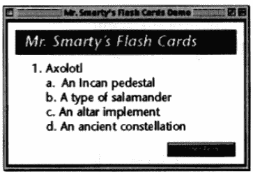

**图 1.1** 我们将向此表单添加一个 JavaScript，附加在“订购单”按钮的 Mouse Up 事件上。

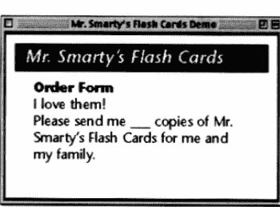

**图 1.2** 与“订购单”按钮关联的 JavaScript 会将查看者带到 Acrobat 文档的最后一页，即订购页面。

正如本书后续内容所示，本书网页上有两个版本的此表单：

-   Ch01.Example1.pdf 是完整表单，包含所有相关 JavaScript。
-   Ch01.Example1Raw.pdf 是“原始”版本，缺少本章的 JavaScript，因此你可以根据需要自己输入 JavaScript。

### 将 JavaScript 附加到表单域

作为你可能已经知道的内容的提醒，让我们逐步讲解将 JavaScript 附加到按钮的过程，在本例中是我们的“订购单”按钮。

**将 JavaScript 附加到按钮：**

首先，在 Adobe Acrobat 中打开表单。

1.  单击表单工具。

Acrobat 将当前页面上的所有表单域显示为一组矩形。请注意，在本例中，只有一个表单域（图 1.3）。

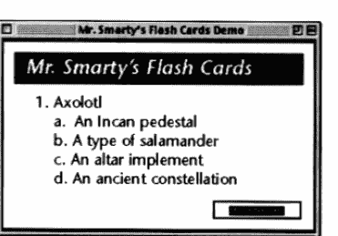

**图 1.3** 我们的抽认卡表单在每个页面上只有一个表单域：一个按钮 `btnOrderForm`，可将用户带到订购单页面。

### 表单域事件

如图 1.4 所示，有六个表单域事件可以附加操作：

-   **Mouse Down** 发生在用户按下鼠标按钮时，指针在表单域内。
-   **Mouse Up** 发生在用户单击字段然后释放鼠标按钮时，鼠标指针仍在字段内。
-   **Mouse Enter** 发生在鼠标指针首次进入表单域时。
-   **Mouse Exit** 发生在鼠标指针离开表单域时。
-   **On Focus** 发生在用户单击或通过 Tab 键进入表单域时，使其成为键盘或其他输入的目标。
-   **On Blur** 发生在用户通过 Tab 键离开表单域或单击其他表单域时，因此我们的字段不再是用户输入的目标。（当然，*Blur* 是 Focus 的反义词。）

图 1.4 中的“字段属性”对话框允许你将一个或多个 Acrobat 操作（本例中为 JavaScript 操作）与其中任何一个事件关联。

2.  双击“订购单”按钮。

Acrobat 将向你显示“字段属性”对话框（图 1.4）。单击“操作”选项卡。我们想将一个 JavaScript 操作附加到此按钮的 Mouse Up 事件。

3.  选择 `Mouse Up` 操作，然后单击“添加”按钮。

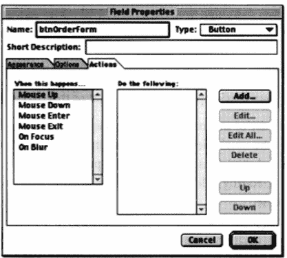

**图 1.4** 在按钮的“字段属性”对话框中，我们要向 `Mouse Up` 事件添加一个操作。

你现在将看到“添加操作”对话框（图 1.5）。在这里，我们告诉 Acrobat 我们想将什么操作附加到 Mouse Up 事件。

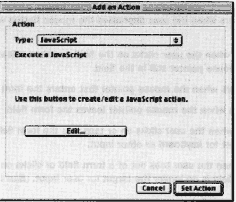

**图 1.5** “添加操作”对话框是我们将 Acrobat 操作附加到事件的地方。我们将把 JavaScript 操作附加到 Mouse Up 事件。

4.  在“类型”弹出菜单中，选择 `JavaScript`，然后单击“编辑”按钮。

Acrobat 将向你显示“JavaScript 编辑”对话框，其中包含一个简单的文本编辑器（图 1.6）。你在此处输入应与“订购单”按钮关联的 JavaScript。

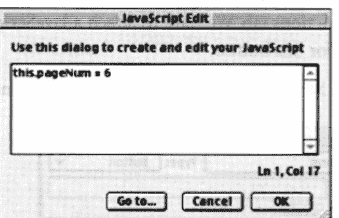

**图 1.6** “JavaScript 编辑”对话框提供了一个简单的文本编辑字段，你可以在其中输入 JavaScript 代码。

5.  在此对话框的文本字段中输入你的 JavaScript。

对于我们的订购单，JavaScript 是一个两行程序，它将用户的文档视图移动到包含订购单的页面，然后使用户的计算机发出哔哔声：在文本编辑字段中键入以下行，确保大小写匹配。

```
this.pageNum = 6
```

```
app.beep
```

将当前页码设置为 6

告诉 Acrobat 发出哔哔声

第一行代码的意思是，“在此文档中，将当前页码设置为 6。”第二行告诉 Acrobat 应用程序发出哔哔声。

6.  单击“JavaScript 编辑”、“添加操作”和“字段属性”对话框的“确定”按钮，返回到 Acrobat 表单。

你现在看到的仍然是选中表单工具的 Acrobat 抽认卡页面，如 **图 1.3** 所示。

7.  单击 Acrobat 手形工具 🖐️。

你现在回到了起点。

8.  试一试：单击“订购单”按钮，Acrobat 将移动到订购单页面，然后发出哔哔声。

### JavaScript 对象

我们的两行 JavaScript 使用了两个 **JavaScript 对象**。JavaScript 对象是你的 JavaScript 程序中某块数据的表示。在你的程序操作或检查表单域之前，它必须首先创建一个表示该字段的对象。你可以在 JavaScript 中操作的大多数东西（页面、签名、数据库连接等）都在你的程序中表示为对象。

在我们的示例程序中，*this* 指的是一个 **Doc 对象**。Doc 对象向你的 JavaScript 程序表示一个打开的 Acrobat 文件；你使用此对象来更改页面、保存文档以及在程序中以其他方式操作文档。我们示例 JavaScript 中的 *this* 一词特指我们的 JavaScript 所在的 Acrobat 文档（本例中为抽认卡文件）；可以将其视为 *本文档* 的缩写。

> **程序 vs. 脚本 vs. 代码**
>
> 以下是一些我们将贯穿本书使用的密切相关的术语。
>
> - *程序* 是一个通用术语，指一系列详细说明计算机如何执行特定任务的指令。通常，程序是一组独立的指令，例如应用程序。
> - *脚本* 是一个旨在操作另一个程序的程序。JavaScript 是一种脚本语言，因为你使用它来控制另一个程序（如 Acrobat 或 Internet Explorer）的行为。
> - *代码* 是应用于构成程序的指令集的术语。你的 JavaScript 程序由 JavaScript 代码组成。

`app` 这个词是一个 App 对象，是对用于查看当前文档的 Acrobat 应用程序的引用。你使用 App 对象来告诉 Acrobat 应用程序执行某些操作：打开文件、弹出警告对话框，或在本例中发出哔哔声。

常用的 JavaScript 对象类型包括：

-   *Annot* 表示当前文档中的注释（例如，“便利贴”）。
-   *App* 表示用于查看当前文档的 Acrobat 应用程序。
-   *Connection* 表示与外部数据库的连接。
-   *Doc* 表示当前（最前面的）打开的 Acrobat 文档。
-   *Field* 表示一个表单域。
-   *Sound* 表示嵌入在当前文档中的声音。

### 对象属性

JavaScript 对象类似于我们周围世界中的物理对象，例如书籍、花瓶和狗。每个现实世界的对象都拥有一组定义它的特征（例如，对于一只狗，颜色、尾巴长度和跳蚤数量）。

> **哪个 Acrobat？**
>
> 目前有三个应用程序常用于查看 Acrobat 文件：
>
> - *Adobe Acrobat ReaderLocalDBX* 是免费应用程序，允许你查看和打印 PDF 文件。
> - *Adobe Acrobat Approval* 是一个相对便宜的产品，允许用户查看、打印和注释 PDF 文件，并完全填写 Acrobat 表单。
> - *Adobe Acrobat*（“完整版 Acrobat”）是你用于向 PDF 文件添加功能的工具：重新排列页面、创建表单域、指定启动属性，以及与我们目的相关的，将 JavaScript 附加到表单域。
>
> 只有完整版 Acrobat 才能创建表单域并将 JavaScript 附加到表单域和页面。你编写的大多数 JavaScript 都能与这三个 Acrobat 查看器包中的任何一个正确工作。存在例外情况（Reader 特别有限），但相对较少。
>
> 在本书中，除非它们的行为不同，否则我将把所有三个 Acrobat 查看器都称为“Acrobat”。


JavaScript 对象的特性被称为该对象的**属性**。这些是 JavaScript 程序可以根据需要检查和修改的对象元素。每种对象都有一组用于描述其特征的属性；例如，Doc 对象具有标题、当前页码、作者和页数等（见表 1.1）。

#### 表 1.1 文档对象属性（部分）

| 属性 | 数据类型 | 说明 |
|----------|-----------|-------------|
| author | String | 文档的作者 |
| fileSize | Integer | PDF 文件的大小，以字节为单位 |
| numPages | Integer | 文档中的页数 |
| pageNum | Integer | 用户当前可见的页码 |
| title | String | 文档的名称 |

短语 `this.pageNum` 指向 Document 对象的 `pageNum` 属性；该属性是文档当前向用户显示的页码。我们的程序通过将当前文档的 `pageNum` 属性设置为订单表单的页码，将用户跳转到订单表单页面：

```
this.pageNum = 6
```

### 数据类型

表 1.1 的"数据类型"列列出了与其所列的各个属性相关联的信息类型。包括 JavaScript 在内的计算机编程使用特殊术语来精确描述数据类型。以下是 JavaScript 中常用的术语：

- **Integer**（整数）是完整数字，例如 1、2、87 或 -6293。
- **Floating Point**（浮点数）是带有小数部分的数字，例如 1.7、-842.9011、1024.0。注意小数部分可能为零，如 1024.0；在这种情况下，浮点数的值与整数相同，尽管内部它仍然是浮点数。浮点数通常被称为*floats*。
- **Boolean**（布尔值）是可以具有两个值的实体：true 或 false。布尔数据用于描述只能有两种状态的特性。（例如，我们 dog 对象中的 `spayed` 属性就是一个布尔值；狗要么已绝育，要么未绝育。）
- **String**（字符串）是文本，即"一串字符"。

关于这个页码赋值的一些观察：

- 通过同时指定对象名和属性名来引用对象的属性，两者用句点连接：*object-name.property-name*。
- 上面代码行中的等号是一个*赋值命令*；它设置某个值。在我们的例子中，它将当前文档的页码设置为 6。
- JavaScript 区分大小写。大写和小写是不同的；如果我们输入了 `This.PageNum`，我们的程序将会失败。
- 违反直觉的是，Acrobat 内部对文档中的页面编号从零开始；我们 Acrobat 文件中的七页编号为零到六。因此，当我们的 JavaScript 将 `pageNum` 属性设置为 6 时，它实际上是将我们移动到了文档的最后一页。

### 对象方法

**方法**（method）是与 JavaScript 对象相关联的命令。就像可以给狗下达命令一样（"坐下"、"跟上"、"马上吐出来！"），JavaScript 对象也有它们可以执行的命令。每种对象的命令集合各不相同。例如，**表 1.2** 列出了 `app` 对象知道如何执行的一些命令。

#### 表 1.2 App 对象方法（部分）

| 方法 | 参数 | 说明 |
|---|---|---|
| beep | | 播放系统的"蜂鸣"声 |
| alert | String | 显示包含指定文本的警告对话框 |
| goBack | | 转到上一个视图 |
| goForward | | 转到下一个视图 |
| newDoc | | 打开一个新的空白 Acrobat 文件 |
| openDoc | String | 打开一个 Acrobat 文件。字符串参数包含文件名 |

在我们的订单表单 JavaScript 中，我们执行了 `app` 对象的 `beep` 方法：

```
app.beep
```

注意，我们执行对象方法的方式与引用其属性之一相同：对象名、"点"和方法名。

有些方法需要额外的信息才能执行其任务；例如，**表 1.2** 中列出的 `openDoc` 方法需要知道要打开的文件名。传递给方法的信息称为该方法的**参数**。`openDoc` 方法以文件名作为其参数；此信息用括号括起来，必须跟在方法名后面。`openDoc` 的调用看起来像这样：

```
app.openDoc("TermPaper.pdf")
```

上面的 JavaScript 语句将打开名为 `TermPaper.pdf` 的 Acrobat 文件。

有时你给狗一个命令时，你期望狗给你一些回报：命令"去捡棍子，好孩子！"应该会让你手中多出一根棍子。同样Directories同样，许多 JavaScript 方法具有**返回值**，即它们返给 JavaScript 程序的某些数据片段。我们上面调用的 `openDoc` 方法实际上返回一个代表新打开文档的 `Doc` 对象，尽管我们对 `openDoc` 的单行使用只是忽略了它。我们将在下一章更详细地研究返回值。

### JavaScript 程序语法

这里我们必须讨论几个关于如何将 JavaScript 命令组合成程序的简短话题。

### JavaScript 语句

JavaScript 程序——任何计算机程序——由一系列语句组成，每条语句执行整体任务中的一个步骤。我们的示例程序由两条语句组成：

```
this.pageNum = 6

app.beep
```

通常，JavaScript 程序中的每一行包含一条 JavaScript 语句，如我们上面的程序所示。你可以在一行中放置多条语句，用分号分隔。我们的两行程序可以写成一行：

```
this.pageNum = 6; app.beep
```

为什么要这样做？纯粹为了美观；有些人只是喜欢将非常简单的语句组合在一起。我不推荐这种做法；如果每行只有一条语句，大多数程序会更容易阅读。

如果你阅读其他人的 JavaScript，你可能会注意到许多程序员在他们程序的每一行末尾都加上分号：

```
this.pageNum = 6;
app.beep;
```

这不会造成任何损害，但完全没有必要。大多数人这样做是出于习惯；JavaScript 看起来非常像编程语言 C 和 C++，这两种语言都要求所有语句以分号结尾。你可以省略这些分号。

### JavaScript 文本

JavaScript 程序只是文本文件；你可以使用任何文本编辑器或文字处理器编写它们，然后将它们复制并粘贴到 Acrobat JavaScript 编辑对话框中。事实上，Windows 版本的 Acrobat 允许你指定一个外部编辑器来编辑你的 JavaScript；我们将在本章末尾讨论如何做到这一点。

JavaScript 行中的空格和制表符在 JavaScript 中没有特殊含义。你可以随意使用它们来格式化你的程序。这纯粹是一个视觉问题；你需要格式化你的 JavaScript 代码，使其易于阅读。

大方地使用空白字符！阅读程序代码即使最好情况也很乏味；如果程序员没有为便于阅读而格式化代码，程序可能几乎无法辨认。这个问题足够重要，以至于我将在本书中为我们使用的许多 JavaScript 结构提供格式化提示。

### JavaScript 错误

在你（嗯）极少出现的 JavaScript 出错情况下——你拼错了变量名、抄错了一段代码等等——Acrobat 会向你显示一个名为 JavaScript 控制台的对话框（图 1.7）。控制台将显示一条指示错误性质的消息；IGHT它有时会（但 alas，并非总是）也指示错误发生的脚本中的行号。

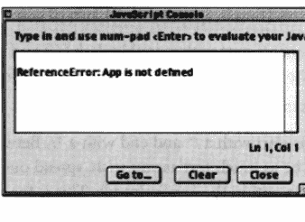

**图 1.7** *JavaScript 控制台是 Acrobat 用于显示错误消息的对话框，这些错误消息指示你的 JavaScript 代码中存在问题。*

错误消息起初可能有些难以理解，但随着时间和熟悉度，它们会变得有用。你最可能看到的常见消息如下：

- **Reference Error: - XXX is not defined**
  这表明你拼错了某些内容；名称"XXX"（或类似内容）不是 JavaScript 知道的名称。记住 JavaScript 区分大小写；`app`（JavaScript 知道的）和 `App`（它不知道的）之间是有区别的。

- **Syntax Error**
  这意味着 JavaScript 无法理解代码中的某些内容。这通常意味着你在脚本中遗漏了某些内容（逗号、数字、右括号）。语法错误的例子是：
  `app.alert("Hi, Mom", 3`
  这一行缺少其右括号。

可能的错误消息集合相当庞大，不过大多数都很难触发。只需保持冷静，阅读消息，并仔细检查可疑的 JavaScript 代码，寻找拼写错误和遗漏。

### JavaScript 注释

JavaScript 代码可能相当难以理解。琢磨别人的代码（甚至你自己六个月前的代码），试图弄清楚它到底在做什么，可能很繁琐。为了对查看你代码的人表示礼貌，也为了帮助未来的自己，在你的 JavaScript 代码中放置**注释**非常重要。

JavaScript *注释*是你的代码中被 JavaScript"机器"忽略的文本。其目的是让你将自己的注释放在文本中，供检查代码的人类阅读。

JavaScript 识别（即忽略）两种注释：

- *单行注释*以双斜杠（//）开头，并在 JavaScript 代码中延续到行尾。这些用于简短的注释。

  //这是一个单行注释。

- *块注释*以 /* 开头，以 */ 结尾。在这两个分隔符之间可以包含任意多的文本，在 JavaScript 文件中跨越任意多的行。这用于较长的注释。

  /* 这里有一个块注释。这段
     文本将完全被忽略，直到
     我们在这里结束注释。 */

### 一个示例

考虑以下出自本书后面部分的未注释的 JavaScript：

```
var txtField = event.target

txtField.fillColor = color.red

txtField.textColor = color.white
```

由于我们尚未讨论这些命令，此脚本的目的以及它如何实现该目的都非常不清楚。

另一方面，如果我们在代码中包含注释，那么即使不熟悉程序的人至少也能知道程序的意图以及它通常在做什么：

```
/* 当用户通过 Tab 键进入或点击
   文本字段时，此程序会改变该字段的
   背景和文本颜色。 */

var txtField = event.target     // 获取对文本字段的引用

txtField.fillColor = color.red  // 将背景设置为红色

txtField.textColor = color.white // 将文本颜色设置为白色
```

这个版本的程序要清晰得多，即使是对代码不熟悉的人也是如此。

注释是编程中一种向善的力量。任何超过几行的脚本都应该包含描述其功能和工作原理的注释。

本书其余的示例都会有大量注释，以便让它们尽可能易于理解。

### Acrobat JavaScript 指南

本书是为非程序员介绍如何在 Adobe Acrobat 中使用 JavaScript。在完整的 Acrobat 软件包中提供了一份文档，其中详细描述了你可以在 Acrobat 中使用 JavaScript 完成的所有操作：[Acrobat JavaScript 对象规范](https://wiki.example.org/feynmans_learning_method)（AJOS）（图 1.8）。这是你的 JavaScript 程序在 Acrobat 中可用的所有对象类型的技术规范。

AJOS 是一份技术规范，不是你会从头到尾阅读的文档。它详细描述了 Acrobat 中可用的每个 JavaScript 对象类型以及每个对象的属性和方法。本书展示英语的表时值性别介绍了如何在 JavaScript 中完成特定任务的一系列示例，而 AJOS 描述了你可以在 Acrobat 中使用 JavaScript 完成的*所有*操作。

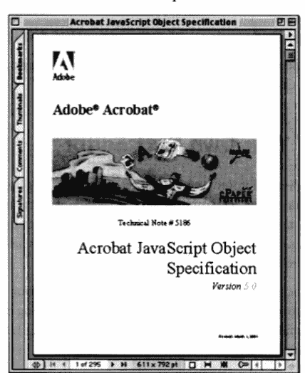

**图 1.8** Acrobat JavaScript 对象规范详细描述了 Acrobat JavaScript 可用的所有对象、它们的属性和方法。

为了让你感受一下 AJOS 的风格，图 1.9 展示了 app 对象的 beep 方法的完整说明截图。

```
beep

Parameters: [nType]
Returns: None

This method causes the system to play a sound. The various sounds and the values used are as follows:
```

| 消息类型 | 值 |
|---|---|
| 错误 | 0 |
| 警告 | 1 |
| 问题 | 2 |
| 状态 | 3 |
| 默认（默认值） | 4 |

注意：在 Apple Macintosh 和 UNIX 系统上，beep 类型被忽略。

图 1.9 app 对象的 beep 方法的说明是 Acrobat JavaScript 对象规范中为每个对象、方法和属性提供的说明类型的良好示例。

我将在本书中偶尔引用 AJOS。

你可以通过选择"帮助 > Acrobat JavaScript 指南"直接从 Acrobat 中打开 AJOS。

### 使用你自己的文本编辑器

Acrobat 的 JavaScript 编辑对话框中内置的文本编辑器（见图 1.6）非常简单。它可以让你输入 JavaScript，但没有特别强大的编辑功能。对于简短的 JavaScript，这并不重要；但当输入长而复杂的 JavaScript 时，你会想念功能齐全的文本编辑器。

在 Macintosh 上，你可以在自己的文本编辑器中输入 JavaScript，然后将其粘贴到 JavaScript 编辑对话框中。顺便一提，我在 Mac 上最喜欢的免费文本编辑器是 Bare Bones Software 公司的 BBEdit Lite（www.barebones.com）。

Windows 版本的 Acrobat 可以在你点击添加操作对话框中的编辑按钮时自动启动你选择的文本编辑器（见图 1.5）。要设置此项，你必须在 Acrobat 的首选项中指定你希望用于编辑 JavaScript 的编辑器。

**指定编辑 JavaScript 时要使用的文本编辑器：**

从打开的 Acrobat 开始。

1. 选择"文件 > 首选项 > 常规"。

   Acrobat 将显示其首选项对话框。

2. 在首选项类别列表中选择 JavaScript。

   首选项对话框将显示影响 Acrobat JavaScript 支持的控件（图 1.10）。

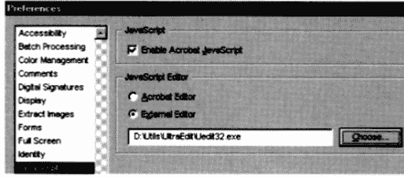

*图 1.10* Acrobat 首选项对话框允许你使用自己喜欢的文本编辑器来输入 JavaScript 代码。可惜，这仅在 Windows 版本的 Acrobat 中可用。

3. 在 JavaScript 编辑器控件中，选择"外部编辑器"。

4. 点击"选择"按钮，然后导航到你要在编辑 JavaScript 时使用的编辑器的 .exe 文件。

5. 点击"确定"按钮。

就这些。现在，当你去编辑 JavaScript 时，Acrobat 将自动启动你的文本编辑器。在文本编辑器窗口中输入你的 JavaScript 代码，保存文本，然后关闭文本编辑器。你的 JavaScript 将自动输入到 Acrobat 中。

在 Windows 文本编辑器中，我相当喜欢 TextPad（www.textpad.com）和 UltraEdit（www.ultraedit.com）；它们都是相对便宜的共享软件，物有所值。

## 2 页面和文档 JavaScript

Acrobat 中有四种主要的 JavaScript 类型，每种的不同之处在于它在 Acrobat 文档中的使用位置。

- **表单字段** JavaScript 附加到表单字段。正如我们在前一章看到的，表单字段脚本与表单字段发生的事件相关联：鼠标按下、获得焦点等等。
- **文档** JavaScript 与 Acrobat 文件的打开相关联。Acrobat 在首次打开文档时执行这些脚本。
- **文档动作** JavaScript 在一组预定义事件之一发生时执行：文件关闭、保存等等。
- **页面** JavaScript 与特定页面相关联。你可以提供 Acrobat 在用户进入该页面、离开该页面或两者都执行时运行的脚本。

我们在第 1 章讨论了表单字段 JavaScript。在本章中，我们将了解如何编写其他三种类型的脚本。

## 项目

（文件：Ch02_Example.pdf、Ch02_Example_raw.pdf）

本章的示例文件是图 2.1 所示的宠物商店目录。在我们的讨论过程中，我们将为本文档添加文档、文档动作和页面 JavaScript 的示例。

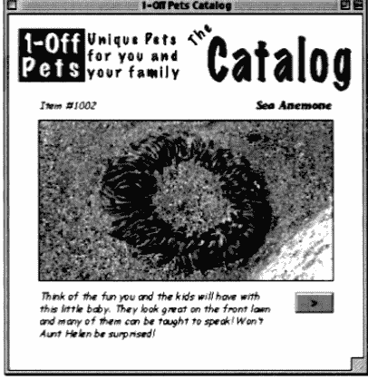

**图 2.1** 我们将为这个宠物商店目录添加几个 JavaScript。

### 文档 JavaScript

文档 JavaScript 附加到 Acrobat 文档，并在打开该文档时由 Acrobat 执行。这是向读者展示初始"启动画面"或在用户打开你的 PDF 文件时执行其他启动活动的便捷方式。你可以根据需要向 Acrobat 文件附加任意数量的文档 JavaScript。

例如，我们将向我们的目录添加一个文档 JavaScript，当读者打开我们的目录文档时显示问候语（**图 2.2**）。

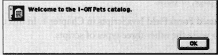

**图 2.2** 我们将使用文档 JavaScript 在用户打开 Acrobat 文件时显示此欢迎对话框。


### 将文档 JavaScript 附加到 Acrobat 文档：

首先在 Acrobat 中打开文档。

1.  选择 工具 > JavaScript > 文档 JavaScript（图 2.3）。

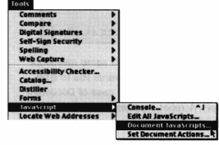

**图 2.3** 创建文档 JavaScript 的第一步是选择 工具 > JavaScript > 文档 JavaScript。

Acrobat 将显示 JavaScript 函数对话框（图 2.4）。

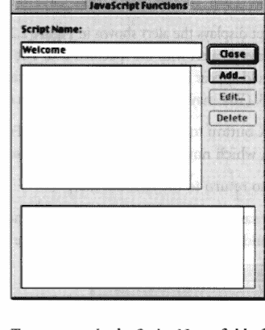

**图 2.4** JavaScript 函数对话框用于添加、编辑和删除文档 JavaScript。

2.  在 JavaScript 函数对话框的"脚本名称"字段中输入一个名称。

每个文档 JavaScript 必须有一个名称。名称应简短且具有描述性，避免使用制表符或空格。在我们的例子中，我们使用名称 Welcome，因为这就是该脚本的用途。

3.  点击"添加"按钮。

Acrobat 将显示 JavaScript 编辑对话框（图 2.5）。请注意，该对话框出现时，文本字段中已输入了一些 JavaScript 代码。此代码是 JavaScript 函数定义的起点；由于我们不打算定义函数，因此可以删除这些初始代码。

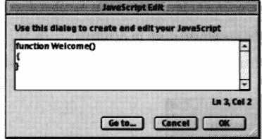

**图 2.5** Acrobat 在需要你输入 JavaScript 代码时都会使用此 JavaScript 编辑对话框。对于文档 JavaScript，Acrobat 会提供一些*初始* JavaScript 代码，我们将不会使用；你应该将其删除。

4.  在编辑框中输入你自己的 JavaScript。在我们的例子中，JavaScript 应为单行代码：

`app.alert("Welcome to the 1-Off Pets catalog!", 3)`

此 JavaScript 会显示**图 2.2** 中所示的警报。`app` 对象的 `alert` 方法会显示带有指定文本的警报。数字 3 表示警报中应显示的图标类型。我们将在第 13 章中更详细地介绍此方法。（你可能还记得我们在第 1 章中讨论了 `app` 对象。）

5.  点击"确定"按钮返回 JavaScript 函数对话框（**图 2.6**），其中现在列出了我们新创建的 Welcome 脚本。

6.  点击"关闭"返回 Acrobat 文件。

7.  通过保存 Acrobat 文件、关闭它，然后重新打开来测试它。Acrobat 应显示**图 2.2** 中所示的警报。

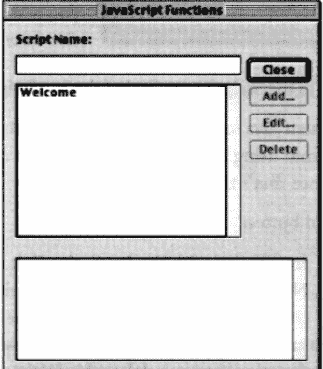

**图 2.6** Welcome JavaScript 现在显示在此 Acrobat 文件所附加的文档 JavaScript 列表中。

### 全局变量

文档 JavaScript 的一个不太明显的特征是，它们创建的任何变量对文档中的所有其他 JavaScript 都是可见的。例如，假设你创建了一个包含以下代码行的文档 JavaScript：

`var iconType = 3`

这里，我们创建了一个名为 `iconType` 的变量，其值为 3。Acrobat 文档中所有其他类型的脚本（文档、文档操作、页面、表单字段）都可以使用变量 `iconType` 来代替数字 3。

`app.alert("Welcome to the 1-Off Pets catalog!", iconType)`

这非常方便。如果你的文档中有 50 个脚本都创建了类似上面的警报，那么在你的文档脚本中更改 `iconType` 的定义就会改变所有 50 个警报 JavaScript 所显示的图标。

我们的 `iconType` 变量被称为**全局变量**；它可被整个 Acrobat 文档中的所有脚本访问。我们将在本书的 JavaScript 中不时使用全局变量。

### 文档操作 JavaScript

文档操作 JavaScript 在文档发生特定事件时执行。你可以将 JavaScript 附加到以下五个事件：

-   *Document Will Close*（文档将关闭）表示 Acrobat 即将关闭文档。
-   *Document Will Save*（文档将保存）表示 Acrobat 即将保存文档。
-   *Document Did Save*（文档已保存）表示 Acrobat 已完成保存文档。
-   *Document Will Print*（文档将打印）表示 Acrobat 即将打印文档。
-   *Document Did Print*（文档已打印）表示 Acrobat 已完成打印文档。

为了了解如何将 JavaScript 附加到这些事件之一，让我们对目录进行另一项更改。当用户关闭 Acrobat 文件时，我们向用户表示感谢，感谢他们查看我们的商品，如**图 2.7** 所示。我们将通过将 JavaScript 附加到 Document Will Close 事件来实现这一点。


*图 2.7 我们将使用 Document Will Close JavaScript 向用户显示告别信息。*

#### 将文档操作 JavaScript 附加到文档：

1.  首先在 Acrobat 中打开文档。选择 工具 > JavaScript > 设置文档操作（图 2.8）。

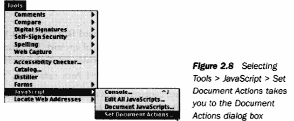

Acrobat 将显示文档操作对话框（图 2.9）。

2.  选择 Document Will Close，然后点击"编辑"按钮。

Acrobat 将显示 JavaScript 编辑对话框。

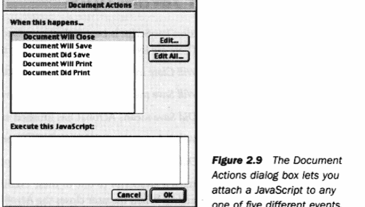

3.  在对话框中输入你的 JavaScript。在我们的例子中，脚本应为：

```
app.alert("Thanks for looking at our catalog!", 3)
```

4.  点击"确定"退出 JavaScript 编辑和 JavaScript 函数对话框；你将回到 Acrobat 页面。

5.  进行测试：保存 Acrobat 文档，然后关闭它。Acrobat 将显示感谢警报，如**图 2.7** 所示。

### 页面操作 JavaScript

页面操作是与特定页面的打开或关闭相关联的 Acrobat 操作。这些可以是 Acrobat 所知的任何操作类型：例如菜单项、影片操作、声音操作——当然，在我们的例子中，还包括 JavaScript 操作。我们将向页面附加一个 JavaScript 操作。

Acrobat 中有两种页面操作：

-   **Page Open**（页面打开）操作在用户滚动到该页面时执行（页面打开事件）。

-   **Page Close**（页面关闭）操作在用户离开该页面时执行（页面关闭事件）。

例如，我们将向目录中的第三页附加一个 Page Open 操作，宣布 1-Off Pets 正在对宠物槌球进行促销。当用户打开第 3 页时，我们的 Page Open 操作将显示**图 2.10** 中所示的警报。

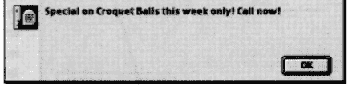

***图 2.10** 我们将使用附加到目录第 3 页的 Page Open 操作来宣布槌球促销。*

**将页面操作附加到 Acrobat 文档中的页面：**

首先将文档打开到正确的页面；在我们的例子中，即第 3 页。

1.  选择**文档 > 设置页面操作**。

Acrobat 将显示页面操作对话框（**图 2.11**）。

2.  选择 Page Open 事件，然后点击"添加"按钮。

Acrobat 将显示我们在上一章中看到的"添加操作"对话框（**图 2.12**）。

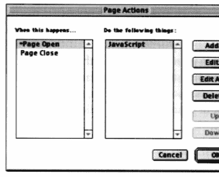

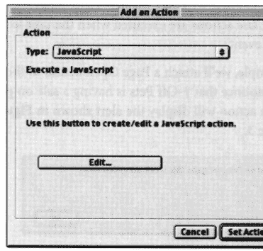

3.  选择 JavaScript 作为操作类型，然后点击"编辑"按钮。

Acrobat 将显示通常的 JavaScript 编辑对话框。

4.  在对话框中输入你的 JavaScript。在本例中，使用以下代码：

`app.alert("Special on Croquet Balls this week only! Call now!", 3)`

5.  点击"设置操作"和"确定"退出所有对话框，直到再次看到 Acrobat 文件页面。

6.  通过转到目录中的上一页，然后返回第 3 页来进行测试；你将看到**图 2.10** 中所示的警报。

## 3

### 表单字段高亮

贯穿本书的一个反复出现的主题是用户反馈在表单中的重要性。用户在任何时候都应清楚地知道他们需要做什么，以及表单的哪个部分需要输入信息。
在本章中，我们将介绍一种实用的方法；我们将创建一个表单，其文本字段具有*彩色输入高亮*效果——即当用户单击或通过 Tab 键进入时会改变颜色。

## 项目

（文件：Ch3_Start.pdf、Ch3_End.pdf）

我们将为图 3.1 中的订单表单添加彩色输入高亮。此 Acrobat 文件最初是一个完全普通的表单，用户可以填写它来订购他或她的记录副本。从图 3.2 可以看到，此表单包含一些文本字段和一个提交按钮。

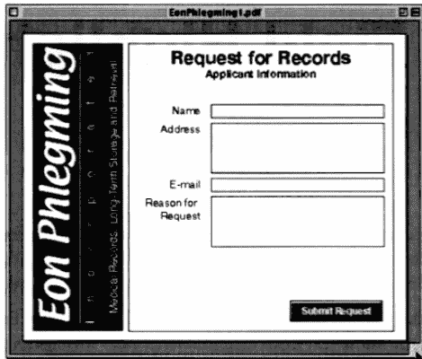

*图 3.1 我们将为此表单添加输入高亮。*

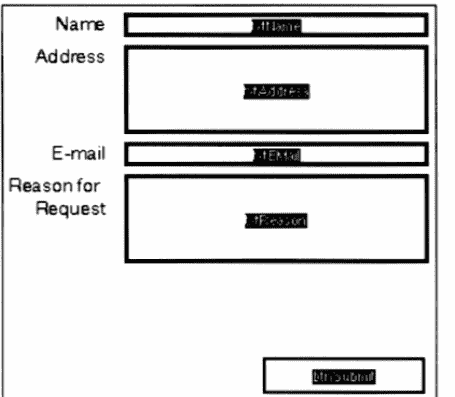

*图 3.2 我们的表单包含四个用于从用户收集数据的文本字段和一个用于向公司提交数据的按钮。*


### JavaScript 部分

通常，文本字段包含黑色文本，显示在白色或透明背景上。我们将修改文本字段，使得当用户点击字段（或通过 Tab 键切换进入）时，该字段变为白色文本红色背景，表示该字段已准备好接收键盘输入（参见图 3.3）。

由于采用了彩色输入高亮，当用户点击文本字段时，该字段将变为红色，表示它是当前活动字段（图 3.3）。


图 3.3 当用户点击文本字段时，字段内容将被高亮显示，呈现红色背景上的白色文本。

### 解决思路

为了实现输入高亮，我们将为表单中的每个文本字段的 **On Focus** 和 **On Blur** 事件附加 JavaScript 脚本（图 3.4）。当表单字段成为数据输入的目标（通常是因为用户点击了该字段或通过 Tab 键切换进入）时，就会发生 **On Focus** 事件。当表单字段失去焦点——即另一个表单字段成为数据输入目标时，就会发生 **On Blur** 事件。（如果“On Blur”这个名称对于这个事件来说有点奇怪，*你*会用哪个词来描述 *focus* 的反义词？）

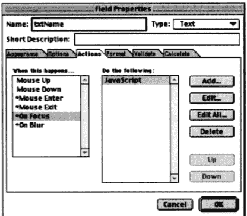

图 3.4 我们将为表单中的每个文本字段添加两个脚本：一个用于添加高亮的 **On Focus** 脚本和一个用于再次移除高亮的 **On Blur** 脚本。

我们的 **On Focus** JavaScript 将把表单字段的背景颜色设置为红色，并将文本颜色设置为白色。**On Blur** 脚本将把背景和文本颜色分别恢复为透明和黑色。我们需要将这些 JavaScript 添加到用户可能输入数据的所有文本字段中。

顺便提一下，**On Focus** 和 **On Blur** 事件是在 Acrobat 5 中添加的，因此如果使用早期版本的 Acrobat 查看表单，我们的高亮功能将不起作用。（如果使用 Acrobat 4 查看表单，不会出错；用户只是看不到高亮效果。）

### 代码实现

#### 第一步：On Focus JavaScript

以下 JavaScript 用于此表单中每个文本字段的 **On Focus** 事件（参见图 3.2）。

```
// 这是 On Focus JavaScript
var txtField = event.target

txtField.fillColor = color.red
txtField.textColor = color.white
```

代码详解：

```
var txtField = event.target
```

第一行获取触发 **On Focus** 事件的字段（事件的目标），并将其赋值给一个名为 `txtField` 的命名引用（变量）。这是我们将在后续 JavaScript 中引用文本字段的名称。

```
txtField.fillColor = color.red
txtField.textColor = color.white
```

在获取对文本字段的引用后，我们设置其两个属性：

-   `fillColor` 是表单字段的背景颜色。我们将其设置为红色。
-   `textColor` 是表单字段中文本的颜色。我们将其设置为白色。

注意，我们使用 `color.red` 和 `color.white` 来指定颜色。Acrobat 提供了一组预定义的常见颜色名称，如下所示：

-   `color.transparent`
-   `color.green`
-   `color.yellow`
-   `color.black`
-   `color.blue`
-   `color.dkGray`
-   `color.white`
-   `color.cyan`
-   `color.gray`
-   `color.red`
-   `color.magenta`
-   `color.ltGray`

#### 第二步：On Blur JavaScript

我们的 **On Blur** 脚本与 **On Focus** 脚本相同——只是有所不同。我们将 `textColor` 和 `fillColor` 属性设置回它们的原始值：

```
var txtField = event.target
txtField.fillColor = color.transparent
txtField.textColor = color.black
```

类似于第一步，我们获取触发 **On Blur** 事件的文本字段的引用，然后更改背景（透明）和文本（黑色）的颜色。`color.transparent` 在此上下文中是一种有效的颜色。

这就是你需要做的全部。一旦你将这两个 JavaScript 添加到表单中的每个文本字段，你的表单将具有彩色输入高亮功能，用户也会印象深刻。

## 自定义说明

将此 JavaScript 自定义用于你自己的目的并不太难；事实上，我们在这里使用的 JavaScript 可以不加修改地用于任何表单中的任何文本字段。

唯一可能需要做的合理自定义是为你的文本字段选择其他颜色。你可以使用任何 `fillColor` 和 `textColor` 的组合来高亮你的文本字段。第一步末尾的列表展示了 Acrobat 识别的标准命名颜色；但是，你可以使用如下格式将颜色设置为任何你想要的 RGB、CMYK 或灰度值：

```
txtField.fillColor = ["RGB", .5, 1, .5]
```

颜色分量的值——我们这里指的是 R、G 和 B——每个都必须是 0 到 1 之间的数字。

最后，如果你将字段的 `fillColor` 和 `textColor` 都设置为 `color.transparent`，该字段实际上就消失了。你可以用这种方法动态隐藏表单字段；然而，我们将在第 8 章中探讨另一种更好的方法。

## 4 检查 Acrobat 版本

在 Acrobat 4 之前，Acrobat 对表单的支持实际上几乎不存在。Acrobat 4 引入了对 Acrobat 表单的健壮支持，而 Acrobat 5 进一步丰富了表单机制的功能。不幸的是，作为表单设计者，你无法控制用户使用的 Acrobat 阅读器版本，这给表单设计带来了挑战。

不可避免地，你必须对用于查看表单的 Acrobat 版本做出假设。如果用户的 Acrobat 版本早于此版本，你必须检测到这一事实并妥善处理情况。

这就是我们本章将要讨论的内容。我们将了解如何确定用户使用的 Acrobat 版本，以及如果用户的程序过于原始而无法正确呈现文档时，如何自动关闭文档。

### 项目实例

（文件：Ch04_Example1.pdf, Ch04_Example1_Raw.pdf）

图 4.1 展示了一个表单，它使用*彩色输入高亮*在用户选择时改变表单字段的颜色。（顺便提一下，第 3 章展示了如何实现此功能。）这个表单通过为每个文本字段的 **On Focus** 和 **On Blur** 事件附加 JavaScript 来实现高亮。由于这两个事件是在 Acrobat 5 中添加的，我们的表单将无法在早于 5 的 Acrobat 版本中正常工作。

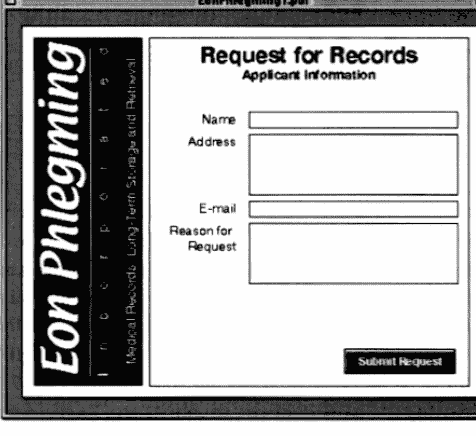

*图 4.1* 此表单依赖于在 Acrobat 5 中添加的表单字段事件。我们将添加一个文档 JavaScript，它检查当前用户的 Acrobat 版本，并在版本不够新时显示警告。

在本章中，我们将进一步修改此表单，查看用户的 Acrobat 版本号。如果版本号小于 5，我们将首先弹出一个警报（图 4.2）宣布此事实，然后关闭表单。

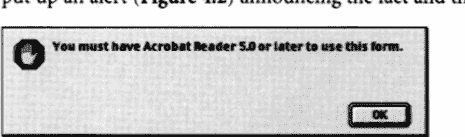

*图 4.2* 如果用户的 Reader 版本不够新，我们将显示此警报。

### JavaScript 部分

检查 Acrobat 的适当版本是你希望在用户首次打开文档时做的事情。因此，我们将使用一个文档 JavaScript，Acrobat 将在用户首次打开文档时执行它。

### 解决思路

此脚本相对简单。我们将查看用户的 Acrobat 版本，并将其与我们需要的最低 Acrobat 版本（在我们这里是 Acrobat 5）进行比较。如果版本小于 5，我们将显示图 4.2 所示的警告，然后关闭 Acrobat 文件。我们可以通过检查 `app` 对象的 `viewerVersion` 属性轻松确定版本号，其值即为当前 Acrobat 阅读器的版本号。

### 代码实现

此 JavaScript 需要作为文档 JavaScript 输入。（有关如何将文档 JavaScript 附加到文档的提醒，请参阅第 2 章。）请记住，文档 JavaScript 必须始终有一个名称。我将把我们的脚本命名为 `CheckVersion`（图 4.3）——具有描述性，尽管缺乏想象力。

```
if (app.viewerVersion < 5) {
    app.alert("You must have Acrobat Reader 5.0 or later to use this form.")
    this.closeDoc(true)
}
```

## 代码详解

此程序围绕对 JavaScript `if` 命令的调用构建。此命令比较两个事物（在我们这里是 Acrobat 版本和数字 5），如果比较结果为真，则执行一段代码块。`if` 命令及其伙伴 `else` 在 JavaScript 中无处不在；我们将在本书中大量看到它们。任何时候，当你的 JavaScript 需要


#### 图 4.3
每个文档 JavaScript 都必须有一个名称。我们将我们的命名为 CheckVersion。这个名字恰如其分，尽管算不上特别 catchy。

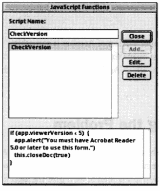

在某些情况下做一件事，在其他情况下做另一件事，这些都是你要用到的编程工具。

```
if (app.viewerVersion < 5)
```

这里我们检查 Acrobat 版本是否小于 5；更改数字以反映你所需的最低 Acrobat 版本。（我们正在检查 app 对象的 viewerVersion 属性。）大多数专业表单应确保用户至少拥有 Acrobat 4。

如果比较结果为 true（换句话说，如果查看器版本小于 5），则应执行的 JavaScript 代码出现在紧跟比较之后的括号之间。在我们的例子中，这个"条件块"内有两行代码：

```
app.alert("You must have Acrobat Reader 5.0 or later to use this form.")
```

这里我们告诉 app 对象显示一个警告，如图 4.2 所示。括号中的文本是应出现在警告中的文本；你可以将其更改为任何你希望的内容。

```
this.closeDoc(true)
```

最后，在告知用户问题之后，我们让当前文档关闭自身。记住，"this"指的是当前文档（即"本文档"）。布尔值 true 表示用户在文档关闭前不应有机会保存文档。如果你将布尔值更改为 false，Acrobat 将向用户显示一个标准的"是否先保存"对话框（图 4.4）。这将允许用户在关闭 Acrobat 文件之前保存它。（例如，如果你在表单中的"关闭表单"按钮中使用 closeDoc 方法，你可能希望使用 false；这将给用户机会保存他或她对表单所做的任何更改。）

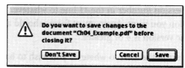

**图 4.4** *如果你向 closeDoc 方法提供 false，Acrobat 将让用户有机会在关闭 Acrobat 文件之前保存它。这很有用，可以防止用户意外丢失表单字段条目。*

为方便起见，如果你确实想要一个"保存"对话框，可以省略布尔值；在这种情况下，你对 closeDoc 的调用将如下所示：this.closeDoc()

这省去了你输入 "false" 的麻烦，但除此之外与我们的原始版本没有区别。

### 测试代码

测试这个程序——例如，确保你没有打错什么——如果你使用 Acrobat 5 来创建表单，会有点棘手。由于我们的比较（app.versionNumber < 5）永远不会为 false（我们自己的 Acrobat 版本永远不会小于 5），我们对 app.alert 和 this.closeDoc 的调用将永远不会被执行；如果你拼错了其中任何一个，直到你（或用户！）尝试使用较早版本的 Acrobat 打开文档时才会发现。

你可以测试这个脚本的一种方法是临时修改它，在 if 运算符的比较子句中放置 true：

```
if (true) {
    app.alert("You must have Acrobat Reader 5.0 or later to use this form.")
    this.closeDoc(true)
}
```

这将强制执行括号中的代码，让你看看其中是否隐藏着任何错误。

## 自定义说明

明显的自定义机会包括：

-   将 if 行中的版本号更改为你想要的最低 Acrobat 版本。同样，大多数表单至少应检查版本是否为 4 或更高。
-   将警告中的文本更改为你希望出现在屏幕上的任何内容。

以下是你可以对这个程序进行的一些不太明显的更改。

#### 测试查看器类型

最后，你可以轻松修改本章的 JavaScript 代码，以查看用户正在使用哪种 Acrobat 程序来查看你的表单：Acrobat Reader 还是完整的 Acrobat。app 对象有一个名为 viewerType 的属性，它将具有两个字符串值之一，"Reader" 或 "Exchange"，具体取决于用户拥有的查看软件类型。如果你的表单需要完整 Acrobat 软件包的功能（也许你的表单允许用户将表单数据保存到磁盘，这仅在完整 Acrobat 中可用），你可以将本章的文档 JavaScript 修改为如下所示：

> "==" 表示"等于"

```
if (app.viewerType == "Reader") {
    app.alert("You must have the full Acrobat to use this form.")
    this.closeDoc(true)
}
```

这将警告用户，然后他 or 她如果使用 Acrobat Reader 查看你的表单，文档将被关闭。

#### 警告图标

我们在本章程序中显示的警告显示一个停止图标，表示出了严重错误，以至于我们要停止正在做的事情。

然而，有时你不希望在警告中使用如此强调的图标。app.alert 方法允许你指定，除了应放入警告中的文本外，还应显示哪个图标。有关如何指定警报中使用的图标的完整讨论，请参见第 13 章。

## 5 计算表单字段

计算对于我们在计算机世界中做的许多事情来说都是基础的。电子表格、统计分析、会计信息——甚至不那么明显的事情，如文字处理和页面布局——都依赖于计算机执行计算的能力，将娇嫩的小人脑留给更高尚的追求。由于它在计算机上运行，Acrobat 也可以计算，允许你指定表单字段的值应该被计算，而不是由用户输入。你可以使用 JavaScript 或 Acrobat 的预定义计算来实现这一点；在这里，我们将学习如何创建使用这两种方法的计算表单字段。

## 项目

（文件：Ch05_Example_2.pdf, Ch05_Example_2_Raw.pdf）

在本章中，我们将为图 5.1 中的采购订单表单添加计算。此表单供小型企业的员工订购办公用品或其他必要物品。对于用户想要购买的每件商品，他们提供描述以及所需的价格和数量。表单自动填写小计、税费和总购买价格。

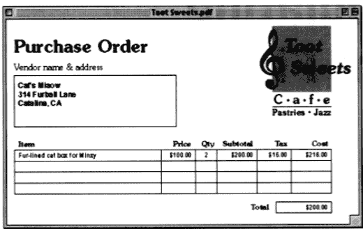

**图 5.1** 在本章中，我们将为这个表单中的字段添加一系列计算，以便商品成本、小计、税费和总成本的字段自动填写。

查看图 5.2，我们可以看到表单由排列在六列中的文本字段组成，分别用于项目名称、价格、数量、小计、税额和该项目的最终成本。我们在表单底部还有一个最终总金额。如果这是你为公司制作的表单，它还需要一个提交按钮，也许还有一个清除表单按钮；为了简洁起见，我在这里省略了这些。

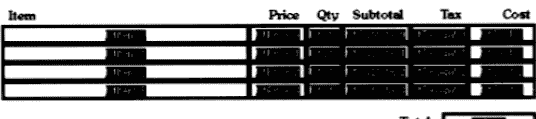

**图 5.2** 这是我们示例表单中的表单字段。我们将把 txtSubtotal、txtTaxAmt 和 txtCost 列中的字段以及 txtTotal 字段转换为计算字段。

我们需要放入此表单的计算如下：

对于每件购买的商品：

-   小计 = 价格 × 数量
-   税费 = 税率 × 小计
-   项目成本 = 小计 + 税费

最后，

-   总计 = 项目成本的总和

让我们看看如何将这些计算添加到我们的表单中。

#### JavaScript

### 创建计算字段

你可能记得文本字段可以被声明为计算字段。Acrobat 将根据需要自动重新计算该字段的值；我们需要做的只是告诉 Acrobat 确切要执行什么计算。我们从字段属性对话框（图 5.3）中进行此操作。

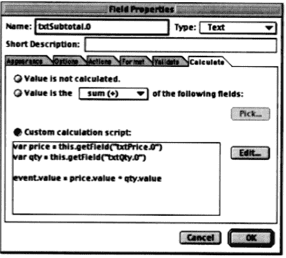

**图 5.3** 你在字段属性对话框的计算面板中为表单字段添加计算值。

### 使用文本字段进行数字计算？

文本字段的值是该字段包含的文本。如果该文本是有效的数字，那么该字段的值可以用于 JavaScript 计算，正如我们在这里所做的。如果文本字段的值不是有效的数字（例如，如果该字段包含 "Mooseberries"），那么该值仍可能用于计算，但该值将被解释为 0。

确保文本字段仅包含有效数字的最简单方法是将其格式设置为*数字*；Acrobat 将拒绝任何不是数字值一部分的按键。（如果要用 Acrobat 预定义计算，你还需要这样做。）

要将文本字段的格式设置为数字：

首先使用 Acrobat 表单工具选择文本字段。

1.  双击文本字段以访问其属性。
2.  转到格式面板（图 5.4）。
3.  在可用格式列表中选择数字。
4.  如果有用，选择其他选项（货币符号等）。
5.  单击确定按钮。

此表单字段现在将只接受数字、小数点和开头的加号或减号。

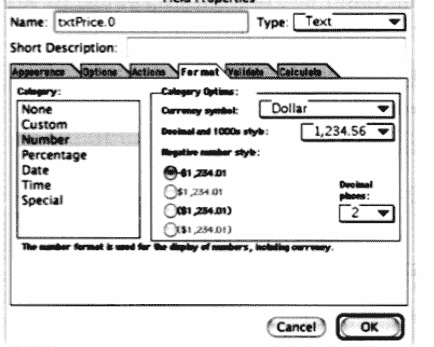

**图 5.4** 要确保文本字段仅包含有效的数值，请将其格式设置为数字。


要将计算附加到文本字段：

1.  双击该文本字段。
    现在您将看到该文本字段的“字段属性”对话框。

2.  单击“计算”选项卡。
    现在您看到的是用于为文本字段的值指定计算的控件。

3.  对于简单计算，单击第二个单选按钮（“值为...”），然后从预定义计算的弹出菜单中选择。如果您没有看到这个第二个单选按钮，则意味着该字段的格式未设置为“数字”。

4.  如果需要更复杂的计算，请单击第三个单选按钮（“自定义计算脚本”），然后单击“编辑”按钮以输入 JavaScript。

### 预定义计算

Acrobat 中内置了五种计算。无需编写任何 JavaScript，您就可以将文本字段的值设置为两个或多个其他表单字段的和、积、平均值、最小值或最大值。这就是“字段属性”对话框的“计算”面板中第二个单选按钮的含义。

同样，只有当您已明确将文本字段的格式设置为“数字”时，这些预定义计算才可用。

要使用预定义计算之一：

从“字段属性”对话框的“计算”面板开始。

1.  选择“启用”预定义计算的单选按钮（图 5.5）。

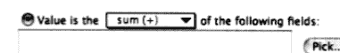

**图 5.5** *第二个单选按钮允许您对两个或多个字段执行简单计算。*

2.  从弹出菜单（**图 5.6**）中，选择所需的计算。

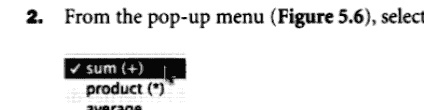

3.  在文本字段中键入提供计算数据的文本字段的名称。

    *或者*

    为节省输入，单击“选择”按钮，然后从生成的列表（**图 5.7**）中选择计算应使用的数据字段。

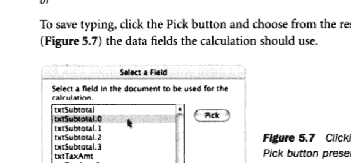

使用预定义计算比编写等效的 JavaScript 代码方便得多。在我们的采购订单表单中，我们将为“成本”字段（其值为小计和税金的总和）和“总计”字段（所有项目成本的总和）使用预定义计算（**图 5.8**）。税金的计算需要乘以一个常数值（我们的税率），因此无法使用预定义计算完成。（预定义计算可以将两个或多个表单字段相乘，但不能将表单字段乘以固定数字。）我们将为“税金”字段编写一个 JavaScript。

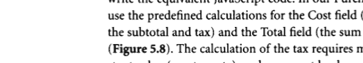

我们也可以为“小计”字段使用预定义计算（它是单价和数量的乘积）。尽管如此，我们将使用 JavaScript 来计算小计；原因将在我们看到本章末尾的增强功能时变得清晰。

### 项目计算

让我们为表单中的各个采购项目添加计算。我们需要为每个项目的 txtTaxAmt、txtSubtotal 和 txtCost 字段应用计算值。请注意，我们应用于这些字段的名称符合 Adobe 分层命名约定（参见边栏）；因此，例如，当我们沿着“税金”列向下时，字段的名称将是 txtTaxAmt.0、txtTaxAmt.1，依此类推。这种命名约定使字段名称易于记忆，并且在使用预定义计算时非常有用，正如我们在讨论 txtTotal 字段时将看到的那样。

在我们讨论与项目相关的计算时，我们将查看适用于项目 0（表单字段的第一行）的 JavaScript。对于完整的表单，您需要为项目 1、2 和 3 重复这些计算，并相应地更改字段名称。

### Adobe 分层命名约定

我们为文本字段选择了一致的命名策略。与采购项目关联的文本字段命名为 txtItem.0、txtItem.1，依此类推。保存所有其他逐项信息的字段也以类似方式命名（txtCost.0、txtCost.1；txtQty.0、txtQty.1；等等）。

这些名称遵循 Adobe 分层命名约定。这是一组松散的规则，用于指定如何为相关字段分配名称。这些名称类似于标识网站的 URL（网址）。“点”用于分隔每个名称的不同部分；相关字段应共享其名称的前缀以表示它们的关系。因此，txtCost.1 和 txtCost.2 都是包含成本的文本字段。

这使得文本字段之间的关系一目了然。此外，正如我们在计算“总计”字段时将看到的那样，分层命名约定使得仅通过使用它们的名称的前缀就可以引用整组表单字段。也就是说，在预定义计算中，“txtPrice”是对所有以此名称开头的字段的简写引用：txtPrice.0、txtPrice.1，依此类推。请参见下面的“计算 txtTotal”以查看具体示例。

### 计算 txtSubtotal.0

一个项目的小计是单价乘以购买数量。就我们的表单而言，这意味着 txtSubtotal.0 的值应为 txtPrice.0 乘以 txtQty.0 的积。这可以使用 Acrobat 预定义计算来完成，但我们仍将其作为 JavaScript 来完成。两个原因：

-   我想明确说明预定义计算并没有任何神奇之处；预定义计算能做的任何事情，您都可以轻松地在 JavaScript 中完成。
-   在我们将在本章末尾讨论的增强功能中，我们将看到将所有计算作为 JavaScript 执行的一个充分理由。这与值为零的字段的显示有关。但我们稍后会回到这一点。

要将此计算附加到 txtSubtotal.0，请首先打开“字段属性”对话框的“计算”面板（图 5.9）。（按照第 43 页“将计算附加到文本字段”下的步骤 1-2 进入此面板。）

单击“自定义计算脚本”单选按钮，然后单击“编辑”按钮。Acrobat 将为您显示 JavaScript 编辑对话框（图 5.10）；键入以下 JavaScript 并单击“确定”。

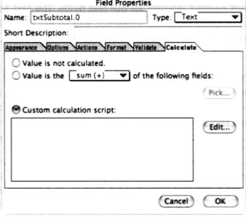

**图 5.9** 要使用 JavaScript 计算表单字段的值，首先单击“自定义计算脚本”单选按钮，然后单击“编辑”按钮。

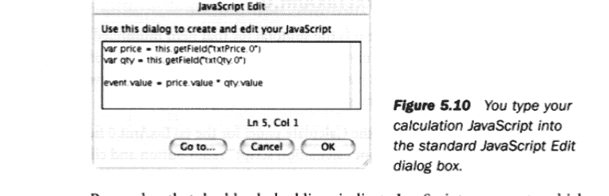

请记住，双斜杠行表示 JavaScript 注释，Acrobat 和 JavaScript 会忽略它们。如果您愿意，可以省略这些注释，但我建议您也输入它们。（当您稍后返回代码时，它们将帮助您记住发生了什么。）

```
// 获取价格和数量字段的引用
var price = this.getField("txtPrice.0")
var qty = this.getField("txtQty.0")
```

```
/* 将我们的文本字段的值设置为
价格和数量的乘积。*/
event.value = price.value * qty.value
```

这个简短的脚本相当简单。我们创建变量 price 和 qty，它们持有对 txtPrice 和 txtQty 表单字段的引用。然后我们将这两个字段的值相乘，并将结果乘积赋给名为 event.value 的东西。

此脚本中唯一不明显的部分是我们使用了 event.value 这个术语。在计算脚本中，event 指的是一个 Event 对象；该对象包含与触发脚本执行的计算事件相关的各种信息。特别是，event.value 是对作为计算目标的文本字段的值的引用。这是一个便利；如果我们没有使用 event 对象，我们将不得不显式获取对 txtSubtotal.0 字段的引用并在我们的计算中使用它：

```
var subtotal = this.getField("txtSubtotal.0")
subtotal.value = price.value * qty.value
```

这种做法没有错；只是需要多打一些字。（轻微的懒惰在编程中是一种美德。）

至此，我们已经计算出了小计，将价格乘以数量。现在，我们准备好计算税金金额了。


### 计算 txtTaxAmt.0

商品的税费等于该商品小计乘以当地销售税率。在我所在的地区，税率是8%（那些没有销售税的州的朋友请保持安静）；因此，每件商品应缴的税费等于小计乘以.08。

和之前一样，转到 txtTaxAmt.0 字段的“计算”面板（**图 5.11**）。选择"自定义计算脚本"单选按钮，然后点击"编辑"按钮。在"JavaScript 编辑器"对话框中输入以下 JavaScript：

```
var subtotal = this.getField("txtSubtotal.0")
event.value = .08 * subtotal.value
```

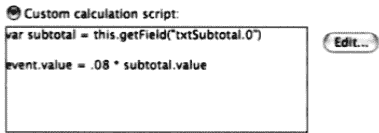

***图 5.11*** txtTaxAmt.0 字段的 JavaScript 将字段值设置为 txtSubtotal.0 的值乘以税率——此处为 .08。

同样，我们的代码非常简单：获取 txtSubtotal.0 字段的引用，并将 event.value 设置为小计的值乘以 .08。

我们可以对所有 txtTaxAmt 字段进行一项增强，但我会将其推迟到本章后面再讲（见下文"'全局'税率"）。

### 计算语法

JavaScript 计算使用标准字符表示基本算术运算。你肯定在计算机使用过程中见过这些字符："+"、 "-" 、 "*" 和 "/" 分别对应加、减、乘、除。

此外，你可以使用括号使计算的某些部分优先执行：括号内的计算部分将在括号外的部分之前执行。因此，如果你想计算两个变量 price1 和 price2 的平均值，可以这样表达：

```
var avg = (price1 + price2) / 2
```

我们必须先将两个价格相加，然后将总和除以 2。

### 计算 txtCost.0

采购订单中每件商品的最终成本等于该商品小计与其税费之和。由于求和是 Acrobat 的预定义计算之一，我们将使用这种机制而非 JavaScript 来计算成本。（如果 Acrobat 提供了便捷的替代方案，*不要*犹豫不使用 JavaScript；始终采用最简单的方式来实现目标。）

和之前一样，双击 txtClick.0 字段并转到"计算"面板。这次，通过以下步骤指定预定义计算：

- 1. 点击中间的"值是……"单选按钮。
- 2. 在弹出菜单中选择"求和"。
- 3. 在文本框中输入名称 txtSubtotal.0 和 txtTaxAmt.0。

或者，你也可以点击"选择"按钮，然后从结果列表中选择这两个字段。

我们现在已经计算出了商品 0 所需的所有信息：小计、税费和成本。我们还有两件事要做：为商品 1 至 3 设置相同的计算，然后计算订单的总成本。

### 计算商品 1 至 3

商品 1、2 和 3 的计算字段与商品 0 的完全相同。重复相同的 JavaScript 和预定义计算，只需将数字 ".0" 改为 ".1"、".2" 或 ".3"，以匹配商品编号即可。（我总是将之前的脚本复制粘贴到新字段中，然后修改商品编号。）

因此，txtSubtotal.1 的 JavaScript 为：

```
var price = this.getField("txtPrice.1")
var qty = this.getField("txtQty.1")
event.value = price.value * qty.value
```

### 计算 txtTotal

最后，我们需要计算应付总金额——即所有四项商品成本的总和。这也是一项求和；因此，我们可以使用预定义的"求和"计算。转到 txtTotal 字段的"计算"面板，按照 txtCost 字段的相同程序，将此字段的计算值设置为四个 txtCost 字段的总和，如**图 5.12**。

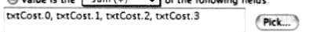

*图 5.12* 采购的总成本将是各单项成本的总和。我们可以对此使用预定义计算。

图 5.12 显示了在计算文本框中输入的所有四个 txtCost 字段名称。然而，由于 Cost 字段的名称符合 Adobe 分层命名约定，我们可以在指定 txtTotal 计算时采用快捷方式。如果我们在计算文本框中输入名称 txtCost（图 5.13），Acrobat 将把这理解为代表所有名称以 txtCost 点后接某物开头的字段。这是使用分层命名约定带来的真正好处：你可以通过名称的初始部分来引用整个字段家族。有机会使用这种快捷方式时，没有理由不用。

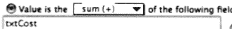

*图 5.13* 由于我们使用 Adobe 分层命名约定来命名 txtCost 表单字段（txtCost.0、txtCost.1 等），我们可以将预定义计算指定为 txtCost 的总和。

完成了！我们现在拥有了一个功能正常的订单表单，给定价格和数量后，它会自动填写所有其他信息。试试吧。输入一些数字。给商品起些富有想象力和趣味性的名称！

### 计算顺序

表单中计算的执行顺序很重要。我们必须先计算小计，再计算税费金额；先计算小计和税费金额，再计算商品成本，依此类推。

有时你会发现 Acrobat 表单中的计算似乎顺序错乱。你可以通过选择"工具" > "表单" > "设置字段计算顺序"来指定表单字段的计算顺序（图 5.14）。

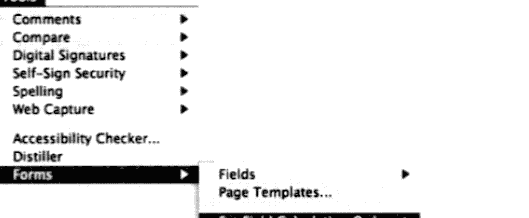

**图 5.14** *要更改表单字段的计算顺序，请选择"工具" > "表单" > "设置字段计算顺序"。*

Acrobat 将显示"计算字段"对话框（图 5.15），其中包含当前 Acrobat 文件中所有计算表单字段的滚动列表；字段在此列表中的显示顺序即为它们的计算顺序。

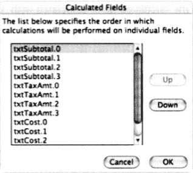

**图 5.15** *"计算字段"对话框按计算顺序列出 Acrobat 文件中的所有计算字段。你可以使用"上移"和"下移"按钮更改字段在此列表中的位置。*

要更改某个表单字段在列表中的位置，只需选中它并点击适当的"上移"或"下移"按钮。

字段最终应该按计算顺序排列在此列表中。你必须先计算小计才能计算税费；必须先计算税费才能计算商品成本；必须先计算所有商品的成本才能计算总成本。因此，在列表中，小计必须在税费之上，税费必须在成本之上，成本必须在总计之上。

如果你发现表单显示明显错误的结果，且找不到任何单个字段计算的问题，请检查是否有字段的计算顺序有误。

## 增强功能

我们可以为表单添加一些增强功能。这些功能完全是可选的，但从长远来看会带来回报。如果你想看看它们的实际效果，它们已应用于本章示例中的文件 Ch05_Example1_B&W.pdf。（*B&W* 此处是 *Bells and Whistles* 的缩写。）

### 隐藏零值

到目前为止，我们构建的表单与**图 5.1**中所示的表单之间存在一个明显的视觉差异。在我们版本的表单中，所有与"空"行关联的计算字段都显示零，这是它们执行计算的结果（**图 5.16**）。虽然这在技术上是正确的，但在美学上令人不快。如果我们没有指定要购买的商品，其关联的表单字段最好留空，而不是显示显式的零。

要消除这种视觉混乱，我们需要更改与 txtSubtotal 和 txtTaxAmt 字段关联的计算。它们应该仅在对应的 txtQty 有非零值时才执行计算；如果 txtQty 值为零（如果该字段为空，就会出现这种情况），那么我们的小计和税费字段应该为空——也就是说，它们的值应为 ""。

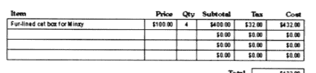

> **图 5.16** 除非我们采取特殊处理，否则当某一行没有购买商品时，我们的计算字段都会显示难看的 0 值。如果这些是空白的，看起来会更好。

以下是 txtSubtotal.0 的新计算 JavaScript：


// 获取计算所需的两个字段
var price = this.getField("txtPrice.0")
var qty = this.getField("txtQty.0")

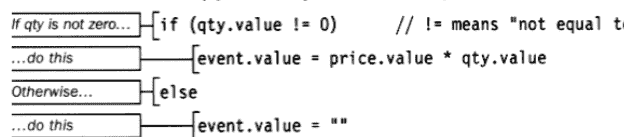

请回忆一下 JavaScript 的 if_else 命令是如何工作的：if 命令后跟一个括号内的比较语句；在我们的例子中，我们比较 `qty.value` 和 `0`，测试它们是否不相等。接着，这个比较语句后面会跟一行或多行 JavaScript 代码，如果比较结果为真，这些代码就会被执行；在我们的例子中，那行需要有条件执行的代码就是执行我们的小计计算。

else 命令（如果提供的话，它是可选的）后跟一行或多行 JavaScript 代码，如果 if 比较结果不为真，这些代码就会被执行；在我们的例子中，如果比较结果为假（即，如果 `qty.value` 等于 `0`），那么我们将把文本字段的值设为空字符串：""。

这个更改的最终结果是，如果一个项目的数量字段为空（其值为零），那么 `txtSubtotal.0` 字段将显示为空白。

为了对 `txtTaxAmt` 字段应用相同的效果，您应该将其值计算更改为如下：

```
var subtotal = this.getField("txtSubtotal.0")

if (subtotal.value != 0)
    event.value = gTaxRate * subtotal.value
else
    event.value = ""
```

这与 `txtSubtotal.0` 字段遵循完全相同的逻辑，只是我们检查 `txtSubtotal.0` 的值是否为零，以决定是否在我们的税额字段中放入空白。

您应该将这个 if_else 块添加到所有四个 `txtSubtotal` 和 `txtTaxAmt` 字段中。

### 预定义计算

不幸的是，任何使用预定义计算之一的字段（例如我们的 `txtCost` 字段），如果其值为 `0`，将继续显示为“0.0”。这可能是在预定义计算可用时，却选择使用 JavaScript 的唯一原因。如果我们希望 `txtCost.0` 字段在值为零时正确地显示为空白，我们需要用 JavaScript 而不是预定义的求和来计算其值：

```
var subtotal = this.getField("txtSubtotal.0")
var tax = this.getField("txtTaxAmt.0")
```

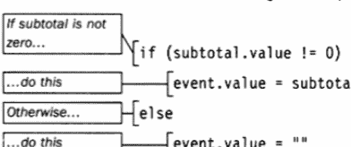

这比使用预定义计算稍微麻烦一些，但它确实带来了美学上的改进，让值为零的总计显示为空白。

## “全局”税率

假设在您设计此表单很久之后，您所在地区的税率发生了变化。在我们的表单中，我们使用税率（.08）来计算 `txtTaxAmt` 字段的值：

```
event.value = .08 * subtotal.value
```

我们的表单有四个这样的字段；而在其他表单中，税率可能被使用数十次，分散在复杂表单的各个字段中。

费劲地找出所有这些对税率的引用，并将 .08 替换为，比如说 .09，这充其量是件乏味的工作。

事实上，一开始就可以轻松设计您的表单，使更改所有税率引用变得容易。我们将向表单添加一个文档 JavaScript，它只做一件事：定义一个包含税率的变量。

您可能还记得第 2 章的内容，在文档 JavaScript 中定义的变量可以被 Acrobat 文档中的任何 JavaScript 使用。既然如此，我们表单中任何需要引用税率的 JavaScript 都可以使用税率变量的名称，而不是直接使用数值。如果我们后来修改了文档 JavaScript，更改了分配给税率变量的值，*所有*使用该变量的 JavaScript 都将使用新的税率。这样，我们就一举更改了整个表单中使用的税率。

变量，比如我们的税率变量，可以在整个 Acrobat 文件中使用，被称为**全局变量**。您在文档 JavaScript 中定义的任何内容都是全局的，即对文档中的所有 JavaScript 都可用。

### 创建文档 JavaScript

您可能需要回顾第 2 章，了解文档 JavaScript 的一般行为和创建的详细描述。在这里，我们将只列出创建我们特定 JavaScript 的步骤。

**要创建税率 JavaScript：**

确保 Acrobat 文档已打开并选择了手形工具。

- 1. 在 Acrobat 中，选择 工具 > JavaScript > 文档 JavaScript。
    Acrobat 将显示 JavaScript 函数对话框。
- 2. 在脚本名称文本框中，输入 TaxRate 或其他描述性标签（**图 5.17**）。
- 3. 单击 添加 按钮。

Acrobat 将显示标准的 JavaScript 编辑对话框，其中已经输入了一些初步（且对我们无用）的代码。

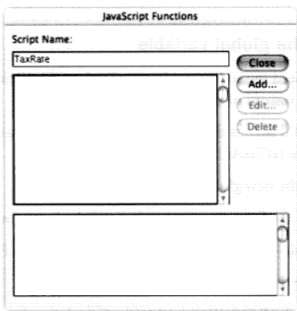

**图 5.17** 我们将向文档添加一个名为 TaxRate 的文档 JavaScript。此脚本将定义一个变量 `gTaxRate`，该变量保存 Acrobat 文件中所有其他 JavaScript 要使用的税率。

删除 JavaScript 编辑对话框中的默认代码，并输入以下内容：

```
var gTaxRate = .08
```

这一行 JavaScript 创建了一个名为 `gTaxRate` 的变量，并为其赋值 .08（图 5.18）。（我总是将全局变量名称以小写字母 g 开头；这样，当我看到该变量名在其他 JavaScript 中使用时，我就知道它是一个在文档 JavaScript 中定义的全局变量。）

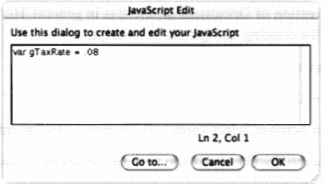

*图 5.18* 我们的文档 JavaScript 非常简短。它只是定义了一个名为 `gTaxRate` 的变量。

关闭所有对话框，直到返回到 Acrobat 文档。

我们现在创建了一个文档 JavaScript，它创建了我们的全局变量 `gTaxRate`。

### 使用全局变量

现在我们需要修改我们的四个 `txtTaxAmt` 计算，使它们使用 `gTaxRate`，而不是直接使用数字 .08。

像往常一样，我将引导您更改 `txtTaxAmt.0`，让您修改其他三个 `txtTaxAmt` 字段。

要应用新的全局变量：

确保表单已在 Acrobat 中打开并选择了表单工具。

- 1. 双击 `txtTaxAmt.0` 以打开字段属性对话框。
- 2. 转到 计算 面板。
- 3. 单击 计算 JavaScript 旁边的 编辑 按钮。

现在您将看到 JavaScript 编辑对话框，其中显示了我们当前的 JavaScript。这个 JavaScript 将计算定义为：`event.value = .08 * subtotal.value`

- 4. 将计算中的 .08 替换为名称 `gTaxRate`。

您的计算行现在应如下所示（图 5.19）：`event.value = gTaxRate * subtotal.value`

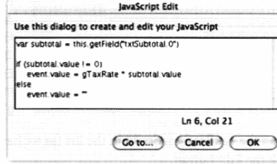

**图 5.19** 在我们的表单字段 JavaScript 中，我们必须使用全局变量的名称 `gTaxRate`，而不是实际的数字值。如果我们以后在文档 JavaScript 中更改 `gTaxRate` 的值，这将自动更改所有计算表单字段中使用的税率。

- 5. 关闭所有对话框，直到返回到 Acrobat 文档。

您应该对所有四个 `txtTaxAmt` 计算 JavaScript 进行上述更改。完成此操作后，您不会立即看到变化。毕竟，我们的税率没有改变；我们只是通过一个变量来获取它，而不是直接使用数字。

### 更改税率

为了看看为什么做这个更改是一件有用的事情，假设您的地区税率发生了变化（大概是提高了）。要一次性完成所有必要的更改，您只需更改文档 JavaScript 中 `gTaxRate` 的值。

要更改表单中所有项目的税率计算：

- 1. 选择 工具 > JavaScript > 文档 JavaScripts。

您将看到 JavaScript 函数对话框。

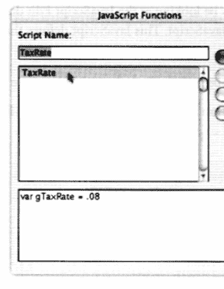

**图 5.20** 如果您以后想更改整个表单中使用的税率，只需转到 JavaScript 函数对话框，单击 TaxRate 脚本，然后单击 编辑。然后您可以更改分配给 `gTaxRate` 变量的值。

- 2. 在列表中选择 TaxRate JavaScript（如**图 5.20** 所示），然后单击 编辑 按钮。
- 3. 在 JavaScript 编辑对话框中，将税率更改为 .09，或任何其他您认为合适的数字：
    `var gTaxRate = .09`
- 4. 退出所有对话框，直到您回到 Acrobat 文档。
- 5. 检查税额字段；现在所有四个字段都将包含反映新税率的计算值。

通过更改文档 JavaScript 中的单一税率值，我们更新了整个表单中*所有* JavaScript 使用的税率。在这种情况下，只有四个这样的 JavaScript；在更大的表单中，可能有数十个。


 # 6

### 自动填充表单数据

电子表单的一大优点在于，它们能够自动提供用户原本需要手动输入的信息。例如，当用户在电子订单表单中选择要购买的产品时，表单应能自动填入正确的单价并计算总价。

要实现这一点，表单中必须包含一个产品及其价格的表格。每次用户选择产品时，表单都要在该表格中查找该条目并获取其价格。

这正是我们在本章要学习的内容：如何在表单中构建一个项目与价格的表格，然后从该表格中提取信息，自动填充表单字段。

### 项目介绍

（文件：Ch06_Example_1.pdf, Ch01_Example_1_Raw.pdf）

在本章中，我们将订单表单中的组合框（图 6.1）链接到同一表单中的"每毫升价格"字段。当用户从组合框的菜单中选择新产品时，表单会更新每毫升的价格以反映所选产品，然后重新计算总成本（图 6.2）。


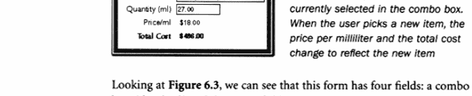

观察图 6.3，我们可以看到这个表单有四个字段：一个组合框（cboFluid）和三个文本字段（txtQuantity、txtRate 和 txtTotal）。我们最关心的字段是组合框；我们将为该字段添加 JavaScript 代码，使其根据用户对液体的选择来更新 txtRate 和 txtTotal 字段的值。具体来说，当我们从其菜单中选择项目时，该字段必须完成三件事：

- 查找该项目的价格。
- 将 txtRate 的值设置为该项目的价格。
- 重新计算 txtTotal 的值。

让我们来看看如何实现。


### JavaScript 代码

#### 实现思路

在本程序中，我们需要为组合框菜单中的项目构建一个价格表。我们将使用 JavaScript 的 *Array* 对象来实现。*Array* 对象表示一个列表——在我们的案例中，是一个价格列表。列表中的每个项目可以通过其在列表中的位置或一个**关键字**来查找，关键字是我们与该列表值相关联的字符串。在本例中，我们将使用组合框中每个项目的*导出值*（见下一节）作为关键字来获取该项目的价格。

我们需要为表单编写两个 JavaScript：

- 一个文档级 JavaScript，用于创建我们的价格表。该脚本将创建一个 Array 对象，并用导出值和相关价格的成对数据填充它。
- 一个附加到组合框的 JavaScript，用于在价格表中查找当前导出值，并使用得到的价格来设置 txtRate 和 txtTotal 字段的值。

#### 组合框导出值

组合框菜单中的每个项目都有两段与之关联的文本：

- *项目文本*：实际显示在弹出菜单中的文本。
- *导出值*：当表单数据导出到文件或提交处理时，代表组合框所选值的内容。

组合框中每个项目的文本和导出值由表单设计者在字段属性对话框中设置（**图 6.4**）。

如果检查我们的组合框属性，你会发现菜单中有六个项目，其导出值如下：MHK、BST、PS、BR、GU、CSH。这些值并没有什么特别的含义；我选择它们只是作为菜单项目文本的粗略缩写。（因此，"MHK"是"人类善良之乳（Milk of Human Kindness）"的导出值。）

我们的 JavaScript 代码将把这些导出值与相应产品每毫升的价格关联起来。

62 使用 JavaScript 扩展 Acrobat 表单


图 6.4 组合框中的每个菜单项目都有两个与之关联的字符串：显示在菜单中的项目文本，以及用于在处理组合框数据时报告用户选择的导出值。

### 创建价格列表数组

我们的第一个 JavaScript 是一个文档脚本，用于创建我们的价格列表。这将是一个包含成对的导出值和价格的 Array 对象。有关文档级 JavaScript 的完整讨论，请参阅第 2 章。

**创建文档脚本的步骤：**

首先，在 Acrobat 中打开表单文件。

1. 选择 工具 > JavaScript > 文档级 JavaScript。

Acrobat 将显示 JavaScript 函数对话框（图 6.5）。


图 6.5 JavaScript 函数对话框是你创建文档级 JavaScript 的地方。输入弟弟 JavaScript 的名称（本例中为"PriceList"），然后点击添加按钮。

2. 在"脚本名称"框中，输入名称"PriceList"或类似的描述性名称。

3. 点击"添加"按钮。

Acrobat 将显示常见的 JavaScript 编辑对话框，其中包含一些初始 JavaScript 代码。

4. 删除默认的 JavaScript 代码，然后输入以下 JavaScript（图 6.6）：

```
var gPriceList = new Array    // 创建新数组的引用

// 用产品价格填充数组：
gPriceList["MHK"] = 16       // MHK 的价格是 $16/ml
gPriceList["BR"] = 12         // ...等等
gPriceList["BST"] = 18
gPriceList["GU"] = 6
gPriceList["PS"] = 4
gPriceList["CSH"] = 72.50
```


图 6.6 你在 JavaScript 编辑对话框中输入文档级 JavaScript。

5. 点击"确定"关闭所有对话框，直到返回到 Acrobat 页面。

此时你在表单中还看不到任何不同。我们的新 JavaScript 创建了一个价格列表数组，但我们还没有使用它来做任何事情。

## 代码详解

```
var gPriceList= new Array
```

JavaScript 的 **new** 命令创建一个新对象，在本例中是一个新的 Array 对象。我们将新创建的 Array 对象赋值给全局变量 `gPriceList`（由 **var** 命令创建）。由于这是在文档级 JavaScript 中进行的操作，`gPriceList` 可以在我们的 Acrobat 文件的任何 JavaScript 中使用。

```
gPriceList["MHK"] = 16
```

这里我们将价格与组合框中的导出值关联起来。数组名称（`gPriceList`）后跟一对包含值的方括号，表示列表中的一个条目。方括号内可以是一个数字，指定我们要查找的项目在列表中的顺序位置；也可以是一个带引号的字符串，表示与所需项目关联的关键字。

在本例中，我们给列表中的 MHK 条目赋值。上面的 JavaScript 代码翻译成英文就是："在数组 `gPriceList` 中，将数值 16 赋给关键字 MHK。"

我们对组合框中的所有六个导出值重复此操作。

#### 格式化你的代码

JavaScript 对于添加空格或制表符以提高代码可读性非常宽容。你可以按任意方式缩进 JavaScript，以改善视觉扫描效果。例如，我通常会在 **if** 命令后的语句进行缩进，以强调它们只有在比较结果为真时才会执行：

```
if (event.changeEx in gPriceList)
    rateFld.value = gPriceList[event.changeEx]
```

同样，我通常会使用制表符和空格的某种组合来将注释与可执行的 JavaScript 代码分开；我还尽量让它们对齐：

```
gPriceList["MHK"] = 16      // MHK 的价格是 $16/ml
gPriceList["BR"] = 12        // ...等等
```

这使代码更易读，而且在我看来更美观。

你可以双倍行距分隔 JavaScript 语句，并随意添加空格和制表符。你的目标应该是使你的程序尽可能易读。这不仅是对他人的服务，也是对你自己数月后重新查看程序时的帮助。

### 创建组合框脚本

现在我们需要教我们的组合框如何查找导出值并对它们进行有用的操作。

我们将为组合框附加一个按键 JavaScript。这是一个每当用户在组合框中输入字符时都会执行的 JavaScript。令人惊讶的是，当用户从组合框的菜单中选择项目时，这个脚本也会被执行。

因此，当用户从组合框菜单中选择项目时，Acrobat 将执行我们的按键 JavaScript，该脚本会进行表格查找，更改 txtRate 的值，并最终计算 txtTotal 的新值。

**将按键 JavaScript 附加到组合框的步骤：**

首先打开表单并选择表单工具。

1. 双击组合框以进入其属性。

Acrobat 将显示字段属性对话框（图 6.7）。


> ***图 6.7** 通过双击组合框，然后在打开的字段属性对话框中转到"格式"面板，来创建按键 JavaScript。

2. 转到"格式"面板。

3. 在"类别"列表中选择"自定义"。


 4. 点击 Custom Keystroke Script 文本框旁边的 Edit 按钮。你将看到 JavaScript Edit 对话框（图 6.8）。

5. 输入以下脚本：

```
// Get references to our form fields.
var rateFld = this.getField("txtRate")
var totalFld = this.getField("txtTotal")
var quantityFld = this.getField("txtQuantity")
```

```
// Is the new export value a keyword in our price list?
if (event.changeEx in gPriceList)
    rateFld.value = gPriceList[event.changeEx]
```

```
// Now calculate a new value for the total price
totalFld.value = quantityFld.value * rateFld.value
```

*图 6.8* 像往常一样，在 JavaScript Edit 对话框中输入你的按键 JavaScript。

6. 点击 OK 关闭所有对话框。

7. 试一试：从弹出菜单中选择不同的项目，观察每毫升单价和总费用字段的数值变化。

## 代码详解

```
var rateFld = this.getField("txtRate")
var totalFld = this.getField("txtTotal")
var quantityFld = this.getField("txtQuantity")
```

此脚本首先获取我们需要访问的三个文本字段的引用，并将这些引用放入命名恰当的变量中。

```
if (event.changeEx in gPriceList)
```

这里我们执行了一条 JavaScript if 命令，用于检查新的导出值是否是 gPriceList 数组中的有效关键词。在组合框的按键 JavaScript 中，`event.changeEx` 指的是新选中菜单项的导出值。短语 `(event.changeEx in gPriceList)` 翻译过来就是："在 Array 对象 gPriceList 中是否存在与我们的导出值匹配的关键词？"

```
rateFld.value = gPriceList[event.changeEx]
```

这是当 `event.changeEx` 是 gPriceList 中的关键词时，if 语句所执行的那一行 JavaScript。

短语 `gPriceList[event.changeEx]` 获取 gPriceList 数组中与导出值相关联的值。换句话说，该短语给出了组合框中当前选中项目的价格。我们将 txtRate 字段的值设置为这个数字。txtRate 字段将立即显示新的每毫升单价。

```
totalFld.value = quantityFld.value * rateFld.value
```

最后，我们将 txtTotal 字段（存储在 totalFld 变量中）的值更改为数量与单价的乘积。后两个数字我们分别从 txtQuantity 和 txtRate 字段获取。

## 7 悬停帮助

每个设计良好的表单都需要某种机制来提示用户如何填写表单。在 Acrobat 中最常见的方式是通过内置于 Acrobat 表单机制中的 *工具提示* 帮助。（你在 Field Properties 对话框的 Short Description 字段中输入的任何文本都会成为该字段的工具提示文本。）在本章中，我们将了解如何实现一种替代方案：*悬停* 帮助。这是当鼠标指针进入表单字段时自动出现的文本；与工具提示帮助不同，它没有半秒钟的延迟。使用悬停帮助还是工具提示帮助，纯粹是基于你希望表单给填写者带来怎样的"感觉"的审美决定。

## 项目

（文件：Ch07_Example_1.pdf、Ch07_Example_1_raw.pdf）

我们将在**图 7.1** 中表单的文本字段上添加悬停帮助。每当鼠标指针移到某个文本字段上时，一些帮助文本将出现在表单底部的蓝色大区域中，如**图 7.2** 所示。

此表单中有五个文本字段（**图 7.3**）。上面四个用于收集数据：申请人的姓名、地址、昵称和电子邮件地址；底部的字段 txtHelp 是一个不可见的文本字段，放置在表单设计中蓝色矩形的上方。

txtHelp 字段之所以不可见，并不是因为在 Field Properties 对话框中选择了 Hidden 属性，而是因为它没有背景色或边框颜色（**图 7.4**），并且没有初始文本。只有在它有文本需要显示时，它才会变得可见。

*图 7.4* 这是我们帮助文本表单字段的外观属性。注意没有背景色或边框；这意味着如果该字段中没有文本，它就是不可见的。

为了实现悬停帮助，每当鼠标指针进入四个数据收集文本字段之一时，该字段中的 JavaScript 将把相应的帮助文本放入 txtHelp 字段。当指针离开文本字段时，该字段的 JavaScript 将清除 txtHelp 中的文本。

#### JavaScript

### 方法

我们需要为四个文本字段中的每一个准备两个 JavaScript：

- 一个附加到字段的 Mouse Enter 事件的 JavaScript，将相应的帮助文本放入 txtHelp 字段

  请记住，当鼠标指针进入表单字段的边界时，会触发 Mouse Enter 事件。

- 一个附加到字段的 Mouse Exit 事件的 JavaScript，清除 txtHelp 中的文本

  请记住，当鼠标指针再次离开表单字段时，会触发 Mouse Exit 事件。

### 代码

这里我们将把 JavaScript 附加到 txtName 字段。要完成表单，你需要对其余的数据收集字段执行相同的步骤。

在 Acrobat 中打开表单并选择 Form 工具。

1. 双击 txtName 字段以访问其属性（图 7.5）；进入 Field Properties 对话框的 Actions 面板。

**图 7.5** Field Properties 对话框的 Actions 面板是你将 JavaScript 附加到文本字段的地方。

2. 在"When this happens"框中，选择 Mouse Enter，然后点击 Add 按钮。

Acrobat 将显示 Add an Action 对话框（图 7.6）。

**图 7.6** Add an Action 对话框让你可以将操作附加到表单字段。我们的操作将创建一个 JavaScript，向 Name 字段添加帮助文本。

3. 在弹出菜单中选择 JavaScript，然后点击 Edit 按钮。

Acrobat 将显示 JavaScript Edit 对话框（图 7.7）。

**图 7.7** 在 JavaScript Edit 对话框中输入你的 JavaScript。

4. 在 JavaScript Edit 对话框中输入以下内容：

```
var helpText = this.getField("txtHelp")
```

```
helpText.value = "What's your full name?"
```

获取帮助字段的引用

将其值设置为帮助文本

5. 点击 OK 返回 Add an Action 对话框。点击 Set Action 按钮，返回到 Actions 面板。

现在 Mouse Enter 事件旁边有一个圆点，表示该事件关联了一个操作（图 7.8）。

**图 7.8** 当你返回 Actions 面板时，Mouse Event 旁边会有一个圆点，表示该事件已分配了操作。

6. 对 Mouse Exit 事件重复步骤 2 到 5，在 JavaScript Edit 对话框中输入以下 JavaScript：

```
var helpText = this.getField("txtHelp")

helpText.value = ""
```

7. 关闭所有对话框，直到回到 Acrobat 页面。

8. 试一试：点击 Hand 工具，然后将鼠标指针移到 Name 字段上；你应该能看到帮助文本出现在蓝色框中。

你需要对 txtAddress、txtNickname 和 txtEmail 字段重复这些步骤，为每个字段使用相应的帮助文本。

## 代码详解

首先来看 Mouse Enter 的 JavaScript：

```
var helpText = this.getField("txtHelp")
```

我们首先获取帮助文本字段 txtHelp 的引用。我们将此引用赋给变量 helpText。

```
helpText.value = "What's your full name?"
```

现在我们把 helpText 字段的值设置为帮助文本"What's your full name?"。文本字段的值就是它向用户显示的文本。当我们设置字段的值时，会使其立即显示该文本。在我们的例子中，这个脚本使帮助文本在鼠标指针进入 txtName 字段时出现。

Mouse Exit 的 JavaScript 与 Mouse Enter 脚本几乎相同：

```
var helpText = this.getField("txtHelp")
helpText.value = ""
```

它获取 txtHelp 字段的引用，但这次将其值设置为 ""。一对开头和结尾的引号，中间没有任何内容，表示"没有文本"。txtHelp 字段不显示任何文本，因此当鼠标指针离开 txtName 时，它实际上再次消失了。

### 增强

（文件：Ch07_Example2.pdf、Ch07_Example2_raw.pdf）

我们当前状态的悬停帮助运行得非常好。如果有什么可以改进的话，那就是我们零碎的帮助文本分散在所有文本字段中；如果我们想重写帮助条目——比如翻译成西班牙语——我们就必须逐个查找并修改它们。

如果我们能将所有帮助文本字符串收集在一个地方，以便于维护和修改，那将会很有帮助。我们可以通过将它们全部放入一个 JavaScript Array 对象来实现这一点。你可能还记得第 6 章的内容，Array 对象代表了 JavaScript 代码中的一个列表——在我们的例子中，是一个帮助文本字符串的列表。

[content]

我们将在文档级 JavaScript（Document JavaScript）中创建帮助文本数组，以便文档中的每个其他 JavaScript 都能使用它。特别是，我们的表单字段 JavaScript 将能够使用数组中的字符串，而不是将文本直接放在字段脚本本身的引号内。

要实现这种新方法，我们需要做两件事：

- 编写一个文档级 JavaScript，创建一个包含所有适当帮助文本的 Array 对象。
- 修改所有表单字段中的"鼠标进入"（Mouse Enter）JavaScript，使它们使用这个全局数组中的帮助文本（"全局"是指该数组在整个表单中均可访问）。

这种修改完全是可选的，但从长远来看是值得的，特别是对于包含大量悬停帮助文本的大型复杂表单。

### 文档级 JavaScript

要创建新的文档级 JavaScript，请在 Acrobat 中打开表单文件，然后执行以下操作：

1. 选择 工具 > JavaScript > 文档 JavaScript。

Acrobat 将弹出 JavaScript 函数对话框（图 7.9）。


**图 7.9** JavaScript 函数对话框是创建文档级 JavaScript 的地方。输入 JavaScript 的名称（上图中的"HelpText"），然后点击"添加"按钮。

2. 在"脚本名称"框中，输入名称"HelpText"或类似的描述性名称。

请记住，所有文档级 JavaScript 都必须有名称。

3. 点击"添加"按钮。

Acrobat 将弹出常规的 JavaScript 编辑对话框（图 7.10），其中包含一些初始 JavaScript 代码。


**图 7.10** 你在 JavaScript 编辑对话框中输入文档级 JavaScript。

4. 将默认的 JavaScript 代码替换为以下代码；此脚本创建一个数组并一次性加载字符串；我们稍后会详细讨论它：

```
var gHelpText = [        // 创建变量 gHelpText
    "What's your name?",                // 字符串 #0
    "Where do you live?",               // 字符串 #1
    "What may we call you in the office?",  // 字符串 #2
    "What's your email address?"         // 字符串 #3
]
```

5. 点击"确定"退出对话框，直到返回到 Acrobat 页面。

此时你在表单中还看不到任何不同。我们的新 JavaScript 创建了一个帮助文本字符串列表，但表单尚未对其进行任何操作。我们稍后会教表单使用这个新数组，但首先，让我们深入了解一下我们的 JavaScript。

## 代码详解

```
var gHelpText = [...]
```

虽然这一点不是一眼就能看出来，但这个文档级 JavaScript 实际上只有一个 JavaScript 语句：即创建一个数组并用一系列值填充它的语句。`var` 命令照常创建一个变量——在本例中，名为 gHelpText。（名称开头的 g 表示这是一个全局可访问的变量；这是我自己的命名约定，不是 JavaScript 的要求。）

当变量名称后跟一对中括号时（如本例所示），`var` 命令会将该变量创建为数组，并将括号内找到的项目列表放入数组中：

```
[
    "What's your name?",
    "Where do you live?",
    "What may we call you in the office?",
    "What's your email address?"
]
```

在本例中，数组填充了一系列字符串，每个字符串都是针对我们表单字段的一小段帮助文本。

这就是我们的文档级 JavaScript 所需要做的全部工作。gHelpText 数组现在成为我们所有帮助文本的存储库。其他 JavaScript 可以使用以下语法来获取这些字符串：

```
gHelpText[2]
```

括号中的数字是我们要在 gHelpText 数组中访问的字符串的顺序位置。数组中的项目从零开始编号，因此 gHelpText[0] 将引用我们列表中的字符串 "What's your name?"。

### 新的表单字段 JavaScript

既然我们已经创建了一个全局可用的帮助文本数组，我们需要教我们的表单字段脚本使用它。具体来说，在文本字段中，我们需要更改与"鼠标进入"（Mouse Enter）事件相关联的脚本。

以下是 txtName 字段的"鼠标进入"JavaScript 的新版本：

```
var helpText = this.getField("txtHelp")
helpText.value = gHelpText[0]
```

这与我们之前的"鼠标进入"脚本相同，但有一个变化：在代码的第二行，我们将文本字段的值设置为 gHelpText 数组中的第 0 个字符串（"What's your name?"），而不是像之前那样直接将字符串放在此脚本的引号中。

我们需要更改文本字段中的所有"鼠标进入"JavaScript，为每个字段的帮助文本使用适当的数字位置。

对用户来说，我们的表单看起来与以前没有什么不同。然而，将来修改帮助文本（例如，以支持其他语言）将会容易得多，因为所有文本都存放在表单中的一个位置。

相信我，对于复杂的表单，你会发现这种技术*非常*有用。

## 8

### 动态表单字段

Acrobat 表单中最常见的"特殊效果"之一是根据对其他表单字段的响应来显示或隐藏表单字段。例如，点击标有"自雇"的复选框，可能会出现一系列文本字段，询问你的企业名称、联邦纳税人 ID 和其他相关信息；如果取消选中该复选框，文本字段将全部消失。

我将这种效果称为表单字段的**渐进显示**。这些字段最初并非全部可见；隐藏的字段只有在用户从可见控件中进行选择时才会向用户显示。

在本章和下一章中，我们将了解如何实现这一点。本章将介绍一种切换相对较少数量的表单字段可见性的技术。在下一章中，我们将了解如何按命令显示整页的表单字段。

#### 项目 1：将 JavaScript 附加到复选框

（文件：Ch08_Example1.pdf, Ch08_Example1_raw.pdf）

我们将为图 8.1 所示的表单添加渐进显示功能。最初，用户唯一可见的控件是复选框。当用户选中复选框时，两个组合框和一个按钮会显示出来，允许用户指定类型和电影并提交请求（图 8.2）。如果用户取消选中复选框，则组合框和按钮会再次消失。


**图 8.1** 我们将为这份 Acrobat 文档添加表单字段的渐进显示功能。最初唯一可见的表单字段是复选框。


**图 8.2** 当用户点击复选框时，附加到该控件的 JavaScript 会使表单中的其他字段可见。

图 8.3 显示了我们 Acrobat 文件中的表单字段。共有四个：

- *chkYes* 是让用户声明想要免费 DVD 的复选框。
- *cboGenre* 是用户可以选择类型的组合框。
- *cboTitle* 是用户可以选择标题的组合框。
- *btnSubmit* 是标准的提交数据按钮。

其中，只有 chkYes 在文档首次打开时可见；其他的可见性均设置为隐藏（在字段属性对话框中）。其他字段将通过我们编写的 JavaScript 变得可见。


**图 8.3** 我们的示例表单有四个字段，其中只有复选框是*最初可见的*。

#### JavaScript

### 问题分析

从概念上讲，这是一个相当简单的问题。每个表单字段都有一个名为 hidden 的布尔（真/假）属性，该属性决定该字段是否可见；如果 hidden 属性设置为 true，则该字段对用户不可见。

我们需要编写一个 JavaScript 来切换两个组合框和按钮的 hidden 属性。我们将把这个 JavaScript 附加到复选框字段的"鼠标松开"（Mouse Up）事件。该 JavaScript 将查看复选框是否已被选中或取消选中。如果复选框被选中，则 JavaScript 会将其他字段的 hidden 属性设置为 false，使它们


 visible to the user; otherwise, the script will set the hidden attribute to true, hiding the other fields.

How can our JavaScript tell if the check box is selected or not? We can look at the export value of that field. (The export value of a check box is the value that the field has if the check box is selected.) When I created this form, I set up the check box so that its export value is the string "Yes" (**Figure 8.4**). Our JavaScript has only to look at the check box's *value* property to see if it is "Yes" and then set the other fields' *hidden* property appropriately.


**Figure 8.4** *The check box has an export value of "Yes"; this is part of the design of the form when I first created it.*

#### The check box script

**To attach the JavaScript to the check box:**

Start by going to the Actions panel of the Field Properties dialog box (**Figure 8.5**) for *chkYes* check box. (See Chapter 1 for a reminder of how to get there.)

1. Select the Mouse Up event and click the Add button.

You will now be looking at the Add an Action dialog box.

2. Select the JavaScript option in the pop-up menu and click the Edit button.

Acrobat will present you with the usual JavaScript Edit dialog box.


**Figure 8.5** *The JavaScript that toggles the other form fields is attached to the chkYes check box, associated with the Mouse Up event.*

3. Type the following script into the JavaScript Edit dialog box (Figure 8.6):

```
var genreFld = this.getField("cboGenre")
var titleFld = this.getField("cboTitle")
var submitBtn = this.getField("btnSubmit")
```

获取表单字段的引用

```
if (event.target.value == "Yes")  {
    genreFld.hidden = false
    titleFld.hidden = false
    submitBtn.hidden = false
}
```

如果复选框被选中，则显示表单字段

```
else  {
    genreFld.hidden = true
    titleFld.hidden = true
    submitBtn.hidden = true
}
```

否则，隐藏这些字段


**Figure 8.6** *You type your JavaScript into the JavaScript Edit dialog box, as usual.*

4. Exit from all the dialog boxes until you are once again looking at your Acrobat page.

5. Try it out: Return to the Hand tool and click on the check box; all the other form fields should appear on the page. Uncheck the box, and the other fields will disappear.

#### The code in detail

```
var genreFld = this.getField("cboGenre")
var titleFld = this.getField("cboTitle")
var submitBtn = this.getField("btnSubmit")
```

We start by getting named references to the three form fields whose visibilities we are going to manipulate. We need these references in order to gain access to their hidden properties.

Remember that you can make up whatever names you wish for variables. I made up the names genreFld, titleFld, submitBtn; to me they're descriptive and yet reasonably short. You can choose any names you wish, as long as the names don't already have meaning to JavaScript. (Naming a variable *if*, for example, would not work; JavaScript would interpret it as part of an *if-else* statement.)

```
if (event.target.value == "Yes") {
```

We execute the *if* command, which looks to see if the value of our check box is "Yes." If so, then *if* executes the JavaScript lines in the braces following the parenthetical comparison. (Remember that double equals signs (==) mean *is equal to*.)

The phrase event.target.value may look odd at first, but it becomes clear if you nibble at it left to right. You may remember from earlier chapters that event.target is a reference to whatever form field triggered this JavaScript; in this case, the target of the event is our check box. Since event.target is our check box, event.target.value is the value of our check box. This value will be "Yes" (the check box's export value) if the check box is selected.

```
genreFld.hidden = false
titleFld.hidden = false
submitBtn.hidden = false
```

Here's where we make our two combo boxes and the Submit button visible; we do this by setting their `hidden` attributes to `false`. (Since they're not hidden, they must be visible, no?)

```
else {
    genreFld.hidden = true
    titleFld.hidden = true
    submitBtn.hidden = true
}
```

The `else` command specifies what should happen if the earlier `if` comparison was *not* true; in our case, this would be if the check box is not checked. If the earlier comparison is not true, then `else` executes the JavaScript lines in braces, setting the fields' `hidden` properties to `true`, making them disappear.

#### Project 2: Attaching the JavaScript to a combo box

(Files: Ch08_Example2.pdf, Ch08_Example2_raw.pdf)

In this chapter's second project, we are going to see how to use a combo box to display and hide other form fields.

If you look at the file Ch08_Example2.pdf, you will see it looks much like our earlier example; I saved this file with the check box already selected, so that when you open the file, it will look like **Figure 8.2**. In this project, we'll examine how the items in the lower combo box change according to the genre you select in the top combo box (**Figure 8.7**). If you pick Westerns in the top combo box, the lower one presents you with three Westerns from which to choose.


*Figure 8.7* In our second project, the movies shown in the lower combo box will change according to the genre the user selects in the upper combo box.

**Figure 8.8** shows our combo boxes as they appear with the Acrobat Form tool selected. The upper combo box, cboGenre, has three items in its menu: Current Hits, Music DVD, and Westerns; when I created this control, I gave these items the export values CH, MS, and WS, respectively. (ns (You create a combo box's menu items and export values in the Options panel of the Field Properties dialog box.)


*Figure 8.8* The lower combo box in our form is really three combo boxes—only one of which is visible—stacked atop one another.

The name of the lower combo box looks a bit jumbled in **Figure 8.8**; this is because it actually consists of three combo boxes placed on top of one another, one for each of the genres. Only one of these will be visible at any time; the other two will have their visibility controls set to hidden in the Field Properties dialog box. These combo boxes have the names cboTitleHit, cboMusic, and cboTitleWesterns.

When the user makes a selection from cboGenre, that control will determine which item the user chose and then change the visibilities of the three stacked combo boxes so that the corresponding control is visible and the other two are hidden. For example, if the user chooses Westerns for the genre, then the JavaScript attached to the cboGenre control will make cboWesterns visible and hide the other two combo boxes.

##### The JavaScript

We shall attach our JavaScript to the cboGenre field as a keystroke JavaScript; Acrobat will execute this script every time the user types a keystroke into the field. In a combo box, a keystroke JavaScript is also executed whenever a user selects an item from the combo box's menu; this is what makes the keystroke JavaScript the perfect place to put our "enable proper movie list" script.

In a keystroke JavaScript for a combo box, the event.changeEx property holds the export value of the menu item the user selected. We are going to compare event.changeEx with each of cboGenre's export values in turn; when we find a match, we shall then set the hidden property of the other three combo boxes.

#### The combo box script

**To attach the keystroke JavaScript to the combo box:**

Start with the Form tool selected and the Field Properties dialog box displaying the Format panel for cboGenre. (See Chapter 1 for a reminder of how to get to the Field Properties dialog box.)

1. Click the Edit button for the Custom Keyboard Script (Figure 8.9).

Acrobat will present you with the JavaScript Edit dialog box.


**图 8.9** *对于组合框，你希望你的 JavaScript 是一个按键脚本。Acrobat 会在用户每次从组合框的菜单中选择项目时执行此脚本。*

2. Type the following script into the JavaScript Edit dialog box.

```
// Get references to our three combo boxes
var hits = this.getField("cboTitleHit")
var music = this.getField("cboTitleMusic")
var westerns = this.getField("cboTitleWesterns")

// Has the user selected "Current Hits?"
if (event.changeEx == "CH")    {
    hits.hidden = false
    music.hidden = true
    westerns.hidden = true
}
```


### 使用 JavaScript 扩展 Acrobat 表单

```javascript
// Has the user selected "Music DVDs?"
else if (event.changeEx == "MS") {
    hits.hidden = true
    music.hidden = false
    westerns.hidden = true
}

// Has the user selected "Westerns?"
else if (event.changeEx == "WS") {
    hits.hidden = true
    music.hidden = true
    westerns.hidden = false
}
```

3. 退出所有对话框，直到你重新回到 Acrobat 页面。

4. 试一试：使用手形工具，从顶部组合框中选择不同的类别；第二个组合框将随每个类别而变化。

让我们来看看我们在这里做了什么。

## 代码详解

```javascript
var hits = this.getField("cboTitleHit")
var music = this.getField("cboTitleMusic")
var westerns = this.getField("cboTitleWesterns")
```

首先，我们获取要控制可见性的三个组合框的引用。我们将每个组合框对象赋值给一个命名恰当的变量。（同样，这些变量名是我自己选取的；这些名称没有什么特殊含义。）

```javascript
if (event.changeEx == "CH") {
```

这里我们调用 `if` 命令，将 `event.changeEx`（包含用户在 `cboGenre` 中所选项目的导出值）与字符串 `"CH"`（即"当前热门"菜单项的导出值）进行比较。与往常一样，如果比较结果为真，则 `if` 将执行花括号中的 JavaScript 代码行。

```javascript
hits.hidden = false
music.hidden = true
westerns.hidden = true
```

如果 `if` 比较为真——即用户在类别组合框中选择了"当前热门"——则我们将 `hits` 对象（`cboTitleHit` 组合框）设为可见，方法是将其 `hidden` 属性设置为 `false`。同时，我们将另外两个组合框的 `hidden` 属性设置为 `true`，将其隐藏。

```javascript
else if (event.changeEx == "MS")
{
    hits.hidden = true
    music.hidden = false
    westerns.hidden = true
}
```

如果第一个 `if` 比较为假——即用户没有选择"当前热门"——则我们将检查他们是否选择了"音乐 DVD"；我们将 `event.changeEx` 与 `"MS"`（我们在类别组合框中"音乐 DVD"项目的导出值）进行比较。与之前一样，如果比较结果为真，我们将使"音乐 DVD"组合框 `cboTitleMusic` 可见，并隐藏另外两个。

```javascript
else if (event.changeEx == "WS")
{
    hits.hidden = true
    music.hidden = true
    westerns.hidden = false
}
```

最后，我们检查用户是否选择了"西部片"作为其类别，显示 `cboTitleWesterns` 组合框并隐藏其他组合框。

#### 用于其他控件类型的 JavaScript

如你所见，创建少量动态可见表单字段背后的原则相当简单：你将一个 JavaScript 附加到控件表单字段上，该脚本设置你要操作的字段的 `hidden` 属性。JavaScript 可能需要确定控件字段的值，以决定哪些控件应该显示、哪些应该隐藏，就像我们在组合框中所做的那样。

我们的两个示例将控制性 JavaScript 附加到了复选框和组合框上。我们将在本章末尾简要回顾如何使用其他表单类型作为控件字段。我们不会详细讲解这些类型，但本章的示例文件中包含了每种类型的一个示例。

#### 列表框

使用列表框字段来控制其他字段的可见性与使用组合框几乎完全相同。实际上，列表框的 JavaScript 与你在组合框中使用的 JavaScript 完全一样。在这两种情况下，`event.changeEx` 属性都将包含用户所选项目的导出值；我们可以检查此属性，然后相应地更改其他字段的可见性。

区别在于，列表框字段的 JavaScript 必须附加到该字段的"选择更改"事件上，而不是作为按键 JavaScript。"选择更改" JavaScript 可通过列表框字段的"字段属性"对话框中的面板进行访问（**图 8.10**）。选择"此脚本执行……"单选按钮，点击"编辑"按钮，然后在弹出的 JavaScript 编辑对话框中输入你的 JavaScript。


文件 Ch08_Example3.pdf 演示了如何使用列表框字段来控制其他字段的可见性。这是我们之前的同一个订购电影表单，但用户从列表中选择一个类别（**图 8.11**）。

#### 单选按钮

从一组单选按钮中控制字段可见性的 JavaScript 与我们最初用于复选框的 JavaScript 几乎完全相同。你需要为一组中的每个单选按钮的"鼠标松开"事件附加一个 JavaScript；每个单选按钮的脚本负责显示和隐藏与该按钮所代表选项相关联的控件。


例如，图 8.12 展示了我们的表单，现在改为用户从一系列单选按钮中选择类别。（此文件为本章示例文件中的 Ch08_Example4.pdf。）


附加到标有"西部片"的单选按钮上的脚本使 `cboTitleWesterns` 组合框可见，并隐藏其他组合框：

```javascript
var hits = this.getField("cboTitleHit")
var music = this.getField("cboTitleMusic")
var westerns = this.getField("cboTitleWesterns")

hits.hidden = true
music.hidden = true
westerns.hidden = false
```

#### 按钮和文本字段

如果你使用按钮字段来控制其他字段的可见性，如**图 8.13** 所示，你将按照与设置单选按钮完全相同的方式进行设置。你需要为按钮附加一个"鼠标松开" JavaScript，该脚本设置按钮必须控制的那些表单字段的 `hidden` 属性。查看文件 Ch08_Example5.pdf 以了解**图 8.13** 中表单的实际效果。


文本字段通常不适合作为控件表单字段。虽然你可以将一个 JavaScript 附加到字段的"失去焦点"事件上来更改其他字段的 `hidden` 属性，但文本字段允许用户输入任意内容这一事实通常会使脚本编写变得困难。你需要处理任何随机输入，相关代码可能会变得混乱。通常，你会希望将用户的输入限制在一组已知的条目（"当前热门"、"西部片"等）内，为此组合框比文本字段效果好得多。

## 9

### 使用模板创建动态控件

在第 8 章中，我们看到了如何使一组表单字段在某个用户操作后显示出来：点击复选框、从组合框中选择项目等。我们通过直接操作字段的 `hidden` 属性的 JavaScript 实现了这一点。这种技术适用于管理少量控件的可见性，但如果我们需要操作大量控件，它就会变得不堪重负。

Acrobat 提供了一种专门用于动态添加控件甚至整个页面到 Acrobat 表单的机制：模板。模板是 Acrobat 文件中的一个页面，其内容——表单字段、文本、图形——可以通过 JavaScript 添加到文件的现有页面中，或添加到插入文档中的新页面中。将模板内容添加到文档的过程，无论是作为新页面还是作为现有页面的附加内容，都被称为*生成模板*。

模板页面可以设置为最初不可见；模板项目只有在模板被生成后才会向用户显示。

使用模板创建动态表单与我们在上一章中直接设置动态字段的 `hidden` 属性相比，有两个优势：

-   模板上可以有任意数量的表单字段；生成一个内容密集的完整模板并不比生成一个只有少数项目的模板更困难。这使得模板更适合管理大量动态字段。
-   生成模板会将模板页面上的*所有*内容添加到文档中，包括美术品、文本、标签、图像以及表单字段。我们无法使用上一章的技术做到这一点，因为只有表单字段才具有 `hidden` 属性。

使用模板我们会失去什么？一旦你生成了模板，就没有简便的方法来移除那些项目了；没有"取消生成"功能。使用模板，如同生活中的许多事情一样，生成是单向的。

在本章中，我们将看到如何创建模板并将其内容添加到表单中。

## 项目

（文件：Ch09_Example1.pdf、Ch09_Example1_Raw.pdf）

在本章中，我们将使用**图 9.1** 中的三页 PDF 文件进行操作。我们将把第 2 页和第 3 页转换为不可见的模板；当用户首次打开文件时，它看起来将是一个只包含第 1 页的单页文件。


当用户勾选“是！”复选框时，与该控件关联的 JavaScript 会执行两个操作：

- 它生成第2页模板，将其内容添加到表单的第1页。
- 它生成第3页模板，作为新页面添加到表单末尾。

用户看到的是，一旦选中“是！”复选框，当前页面上会出现两个组合框、一个文本字段、一个按钮及其标签（图9.2），并且会突然出现第二个页面，用于收集运输信息。你可以用示例文件 Ch09_Example1.pdf 试试看；观察起来很有趣。


**图 9.2** 当用户选中“是！”复选框时，原本位于模板第2页的表单字段被添加到了第1页。

#### JavaScript

我们将为第1页上的复选框添加一个“鼠标松开” JavaScript，该脚本将生成上述两个模板。不过，在此之前，我们需要先创建这些模板；这需要我们分别转到第2页和第3页，并告诉 Acrobat 这些页面应被视为模板。

在本章中，打开文件 Ch09_Example1_Raw.pdf 并按照说明操作，首先创建模板，然后将我们的 JavaScript 附加到复选框，你可能会觉得特别有用。

### 创建模板

我们想将 Ch09_Example1_Raw.pdf 中的第2页和第3页都变成模板。让我们从第2页开始。

**将第2页转换为模板：**

确保 Acrobat 文件显示在第2页。

1. 选择 工具 > 表单 > 页面模板。

Acrobat 将显示“页面模板”对话框（**图 9.3**）。此对话框列出了 Acrobat 文件中定义的所有模板。初始列表将是空白的。


2. 在对话框顶部的“名称”字段中输入一个名称。

这将成为该第2页模板在文档中的名称。选择一个能描述模板内容的名称。（我选择了 `tptMovieInfo`；“tpt”前缀会提醒我这是一个模板的名称。）

3. 单击“添加”按钮，然后在出现的确认对话框中单击“是”。

Acrobat 将把此页面转换为具有指定名称的模板；该名称现在将出现在“页面模板”列表中（**图 9.4**）。名称左侧会有一个圆点；这表示模板最初在表单中是否可见。如果你单击该圆点，它会在圆点（表示模板可见）和减号（表示不可见）之间切换。


**图 9.4** 创建模板时，它会被添加到“页面模板”对话框的列表中。模板名称左侧的圆点表示该模板最初是可见的（·）还是不可见的（-）。

4. 单击圆点，将其设置为减号。

一旦你将圆点更改为减号，第2页就会从你的文档中消失。它实际上仍然存在；它只是变成了 PDF 文件中的一个不可见模板。（你会注意到，即使是页面底部的状态栏现在也显示文档少一页了；对 Acrobat 来说，除非模板可见，否则它们不计入页数。）

通常，你会希望你的模板最初是不可见的。如果你总是希望表单中包含具有这些内容的页面，那么你会保持它们可见；在这种情况下，生成模板将添加另一个已经存在的页面的实例。例如，在费用报告表单中，你总是希望有一个包含费用项目的页面；你的模板将允许你生成另一个包含额外费用项目的页面。

5. 单击“完成”按钮，返回到你的 PDF 文档。

转到你的 Acrobat 文件中的第3页（现在显然是第2页），重复步骤 1 到 5，将该页面转换为模板。我将第二个模板命名为 `tptAddress`，但你可以选择任何你喜欢的名字。一如既往，简短且描述性强的名称是最佳选择。

### 复选框 JavaScript

创建了模板后，我们需要为复选框添加一个将生成模板的 JavaScript。我们将把此 JavaScript 附加到复选框字段 `chkYes` 的“鼠标松开”事件上。（请注意，当表单首次打开时，此复选框是用户唯一可见的控件。）

我们的 JavaScript 必须为每个要生成的模板执行两个步骤：

1.  创建一个表示该模板的 **Template** *对象*。

    **Template** 对象是一个 JavaScript 对象，代表你的 JavaScript 程序中的特定模板。你可以通过调用当前文档的 `getTemplate` 方法来创建 **Template** 对象。短语 `this.getTemplate("tptAddress")` 创建了一个表示模板 `tptAddress` 的 Template 对象。（记住，JavaScript 中的 `this` 指的是当前文档。）

2.  调用 Template 对象的 `spawn` 方法。

    `spawn` 方法创建模板内容的副本，并将内容添加到现有页面或插入到文档中的新页面上。（我们稍后会看到如何指定内容的具体位置。）

我们的“鼠标松开” JavaScript 将需要为表单中的两个模板分别执行这两个步骤。

**将 JavaScript 附加到我们的复选框：**

确保复选框的“字段属性”对话框显示“操作”面板，如图 9.5 所示。（关于如何到达此处，请参阅第1章。）

1.  选择“鼠标松开”事件，然后单击“添加”按钮。

    “添加操作”对话框出现。


**图 9.5** 我们将把生成模板的 JavaScript 附加到复选框的“鼠标松开”事件上。

2.  在“添加操作”对话框中，从弹出菜单中选择 `JavaScript`，然后单击“编辑”按钮。

    Acrobat 将向你展示常用的“JavaScript 编辑”对话框。

3.  在“JavaScript 编辑”对话框中输入以下脚本（图 9.6）：

```
var orderInfoTemplate = this.getTemplate("tptMovieInfo")
var addressTemplate = this.getTemplate("tptAddress")

if (this.numPages == 1) {
    orderInfoTemplate.spawn(0, false, true)
    addressTemplate.spawn(1, false, false)
}
```

4.  退出所有对话框，直到你再次看到你的 Acrobat 页面。

5.  试试看：使用手形工具，单击复选框；其他表单字段和第二页将全部出现。


**图 9.6** 我们在“JavaScript 编辑”对话框中输入 JavaScript。

## 代码详解

```
var orderInfoTemplate = this.getTemplate("tptMovieInfo")
var addressTemplate = this.getTemplate("tptAddress")
```

这两行代码调用了 `getTemplate` 方法，获取了此表单中两个模板的 Template 对象。第一行获取 `tptMovieInfo` 模板（它最初是 Acrobat 文档中的第2页）并将其赋值给名为 `orderInfoTemplate` 的变量。第二行获取我们的第3页模板并将其赋值给变量 `addressTemplate`。

```
if (this.numPages == 1) {
```

这个 `if` 命令在括号内接收一个比较，用于检查当前页数是否为 1。如果是，`if` 将执行花括号内的 JavaScript 代码；这些代码生成我们的两个模板。Doc 属性 `numPages` 是 Acrobat 文档中的页数。

我们这样做检查是因为我们只想在用户首次单击复选框时生成一次模板。如果用户反复单击 `chkYes`，我们不希望每次“鼠标松开”都在 Acrobat 文档中添加另一组生成的控件，一个叠在另一个上面。

由于 `tptAddress` 模板将向我们的 Acrobat 表单添加一个新页面，我们的 JavaScript 可以查看表单中当前的页数来判断我们是否已经生成了模板。如果我们的文档只有一页（即 `this.numPages == 1`），那么我们还没有生成任何新页面，可以向文档添加新的控件和页面。

```
orderInfoTemplate.spawn(0, false, true)
```

这里我们生成我们的第2页模板，将该模板的内容添加到我们表单的当前页面（图 9.7）。Template 对象的 `spawn` 方法接受三个参数（即调用该方法时必须在括号内传递的三个值）：一个页码和一对布尔值。根据你给出的参数，`spawn` 会将模板内容复制到 Acrobat 文档中当前存在的页面或新页面上。


**图 9.7** 最初是我们文档中第2页的模板被覆盖到我们表单的第一页（即页码 0）上。


让我们详细讨论一下这些参数：

- **页码** — 第一个参数是 Acrobat 文档内的页码。这指定了新生成的项目应该放置的位置。其确切含义由下面将要介绍的 `spawn` 方法的最后一个布尔参数决定。

请记住，在 JavaScript 中，文档页面从 0 开始编号；如果一份文档有 16 页，它们的编号将是 0 到 15。因此，我们 JavaScript 代码行中的 0 指的是 Acrobat 文件中的第一页。

- **重命名字段布尔值** — 第二个参数是一个布尔值，用于指定模板内容中的表单字段应该被重命名还是保留原始名称。true 值告诉 Ac robat 为模板的表单字段分配新名称；false 则表示字段应保留原始名称。

在我们的 JavaScript 代码行中，我们将此参数设置为 false，因此模板中的所有字段都将保留我们最初给它们的名称。我们稍后会讨论为什么您可能想要重命名模板的表单字段，以及 Acrobat 如何选择新名称。

- **AddToPage 布尔值** — 这是一个布尔值，用于指定页码参数的含义。如果为 true，模板内容将被放置在该编号页面上；如果参数为 false，模板内容将被放置在一个新页面上，该页面将被插入到文档中编号页面的前面。

在我们的 JavaScript 代码行中，此参数为 false，因此我们将 orderInfoTemplate 的内容添加到表单的第一页，如**图 9.7**所示。

```
addressTemplate.spawn(1, false, false)
```

这里我们生成第 3 页的模板，将其内容添加到新页面，该页面被插入到文件的末尾（**图 9.8**）；该页面的字段收集用户的姓名、地址和其他配送信息。

这里指定的页码是 1，表示新页面应该插入到第 1 页之前。由于此表单最初只有一页可见页面，编号为 0，在第 1 页之前放置一页相当于将该页面放在文档的末尾。

第二个参数，一个布尔值，为 false，告诉 Acrobat 不要重命名此模板上的表单字段。最后一个布尔参数也是 false，这告诉 Acrobat 向文档添加新页面，而不是将模板内容添加到现有页面。

#### 自动重命名字段

在大多数将模板生成为表单添加动态字段的情况下，您会让 Ac robat 保持表单字段名称不变。（您可以通过为 spawn 方法的第二个参数使用 false 值来指定此操作。）这将保留您最初给这些字段的名称。

#### 在文档末尾添加页面

生成的页面通常被添加到当前 Ac robat 文档的末尾。如果您知道文档包含多少页，这很容易：只需指定一个比文档中最后一页页码大 1 的页码。

然而，在您编写生成模板的 JavaScript 时，并不总是知道脚本执行时文档中会有多少页。您的表单中可能有几个模板，它们都会生成新页面，用户可能会以任何顺序触发它们。

解决这个问题的方法是利用 Doc 对象的 numPages 属性；this.numPages 将始终是文档中的页数。此数字也将始终比文档中最后一页的页码大 1，正是我们在文档末尾生成新页面所需的数字。只需在调用 spawn 方法时使用 this.numPages 作为页码：

```
addressTemplate.spawn(this.numPages, false, false)
```

这保证了生成的页面将附加到 Ac robat 文件的末尾。

然而，在某些情况下，表单可能需要重复生成特定模板。例如，费用报销表单可能允许用户根据需要添加任意多页新的费用项目。如果我们不让 spawn 重命名字段，那么生成页面上的每个字段名称将与所有其他生成页面上的相应字段名称完全相同。如果您在一个字段中输入数字，该数字将立即成为所有其他同名字段的值。

重复生成页面上的表单字段几乎肯定需要唯一的名称，因为用户输入的信息通常从一页到另一页是不同的。

在这种情况下，您会希望让 Ac robat 自动重命名模板页面上的表单字段。您可以通过在调用 spawn 方法时将第二个参数设置为 true 来指定此操作：

```
addressTemplate.spawn(this.numPages, true, false)
```

新生成页面上每个表单字段的新名称将源自该字段在模板中的原始名称。该名称将由以下部分组成：

- 字母 P，加上...
- 新页面的页码，加上...
- 一个点，后跟模板名称，加上...
- 一个点，后跟原始字段名称。

因此，如果名为 tptNewItems 的模板作为第 6 页生成到表单中，并且有一个原始名为 txtCost 的表单字段，那么新页面上相应字段的名称将是 P6.tptNewItems.txtCost。

不太美观，但很可能是唯一的。

## 10

### 按键检查

表单中常见的一个用户界面细节是检查您在字段中键入的按键并拒绝"非法"字符。例如，收集数量的表单字段通常只接受 0 到 9 的字符；附加到表单字段的 JavaScript 会在用户将字符键入字段时检查每个字符，确定它是数字还是其他内容，并相应地接受或拒绝它。

JavaScript 提供了一种极其强大的机制，称为**正则表达式**，可用于检查按键（和其他字符串）以查看它们是否符合所需的样式。*正则表达式*是对字符序列应遵循的样式的简洁、精确的描述。字符串是否应以数字开头，后跟六个字母字符，然后以感叹号结尾？您可以使用正则表达式来表达此序列。（这里的 Regular 意味着符合样式、可预测。）

然而，强大的功能伴随着复杂性；即使是对正则表达式的简要讨论也需要横跨多个章节。本章及其后的两章将探讨使用正则表达式实现的一些任务。本章将从简单的情况开始：查看一个字符的字符串，看看它对于特定表单字段是否"合法"。

## 项目

（文件：Ch010_Example1.pdf, Ch010_Example1_raw.pdf）

我们将为**图 10.1**所示的表单添加一个 JavaScript，防止用户在验证密钥字段中键入任何非字母数字字符。（字母数字字符是 a–z、A–Z 和 0–9。）我们的表单包含三个表单字段，如**图 10.2**所示：一个组合框，用户可以从中选择他或她对投票问题的回答；一个文本字段，用户在其中输入验证码，表明他或她作为官方 eReferenda 数据源的身份；以及一个提交按钮，将回复发送到 eReferenda 中央。


**图 10.1** 我们将为这个表单的验证密钥字段添加一个按键 JavaScript，将用户的键盘输入限制为字母数字字符。任何其他字符都将被忽略。


**图 10.2** 我们的表单中有三个字段：一个组合框、一个文本字段和一个按钮。本章的示例向文本字段添加了一个按键 JavaScript。

eReferenda 验证码都是字母数字文本序列，因此我们将忽略用户在此字段中键入的任何非字母数字字符。我们将通过向表单字段附加一个按键 JavaScript 来实现这一点。每次用户在附加了脚本的表单字段中键入字符时，都会执行按键 JavaScript。JavaScript 可以检查键入的字符，并在未通过 JavaScript 应用的任何测试时告诉 Ac robat 拒绝它。在我们的情况下，我们将检查用户输入的字符是否为字母数字，如果不是则拒绝它。

然而，在我们查看此字段的按键 JavaScript 之前，我们必须先了解一些关于 JavaScript 正则表达式及其工作原理的知识。

### RegExp 对象

RegExp 对象是一个包含描述字符样式的正则表达式的 JavaScript 对象。您可以使用此对象来测试特定字符串是否符合或包含该样式。字符串是否包含字符 *Peachpit*？它是否完全由数字组成？它里面有数字吗？它以一个大写字母开头吗？它是一个有效的电话号码吗？正则表达式的语法非常丰富；您可以测试字符串中的内容几乎没有限制。

> **提交按钮**
>
> 请注意，提交按钮默认被禁用并显示为灰色。如果您输入已知的验证码（例如 *holmes*、*Watson*、*lestrade* 或 *Mycroft*），它将变为启用状态（**图 10.3**）。如何实现这一点超出了本章的范围，但如果您好奇，应该先阅读第 6 章了解 JavaScript Array 对象的工作原理，然后检查 txtValidation 字段的 On Blur JavaScript 以及此 Ac robat 文件的文档 JavaScript。

**图 10.3** *在此表单中，提交按钮最初被禁用（上图）。如果您输入已知的验证码，它将被启用（下图）。*


你使用一种在 JavaScript 中堪称最晦涩难懂的语法——"语言"来指定正则表达式的字符模式；这需要一些时间来适应。然而，一旦你知道如何解读它，正则表达式的语法其实并不比阅读更难。你只需要一点一点地去理解它。

### 我们的第一个正则表达式

让我们从查看本章示例中将要使用的正则表达式开始：指定单字符字母数字字符串的模式：

```
var re = /^\w$/
```

这是一行相当奇怪的代码。我们立即可以看出它定义了一个名为 `re`（代表 *regular expression*，正则表达式）的变量，但等号右边的东西乍一看像是个恶作剧。变量 `re` 是一个 RegExp 对象，一个表示正则表达式的对象；我们赋予它的那个奇特的文本实际上是一个描述字符模式的正则表达式。让我们来审视一下这个正则表达式。

一个正则表达式由一系列单独的字符规范组成，它们依次排列，指明哪些字符应该出现在字符串中。表达式中的每个项要么是需要匹配的特定字符，要么是表示一组需要匹配字符的 **元字符**。在编程术语中，*元字符* 是出现在字符串中的代码，它代表另一个字符。（例如，在许多编程语言中，双字符代码 `\t` 代表制表符。）这可能听起来令人困惑，但这主要是因为它更容易演示而非解释。

我们将详细查看上面的正则表达式，看看它是如何工作的。

```
/^\w$/
```

正则表达式以斜杠字符开始和结束。这些斜杠为正则表达式在 JavaScript 代码中的起始和结束位置提供了明确的标记。

```
/^\w$/
```

插入符 `^` 表示字符串的开始。在表达式开头包含一个 `^`，表示这个正则表达式所描述的字符集必须出现在我们正在测试的任何字符串的开头。

```
/^\w$/
```

组合 `\w` 是一个元字符，它匹配我们正在测试的字符串中的任何单个字母数字字符：a–z、A–Z 或 0–9。到目前为止，我们讨论的 `/^\w` 会匹配任何以字母数字字符开头的字符串。

```
/^\w$/
```

最后，美元符号 `$` 是一个表示字符串结束的符号。这意味着，要匹配这个正则表达式，我们的单个字母数字字符必须紧接着字符串的结束。

因此，我们的正则表达式描述了以下字符序列：

- 字符串的开始（`^`）
- 一个字母数字字符（`\w`）
- 字符串的结束（`$`）

简单地说，这描述了一个单字符的字符串。

### 使用正则表达式

我们创建的变量 `re` 包含了一个单字符字母数字文本字符串的描述。我们可以使用这个对象来测试任何特定的 JavaScript 字符串是否匹配该描述。我们通过使用 RegExp 对象的 `test` 方法来做到这一点：

```
re.test("a")      // 返回 true
re.test("abcd")   // 返回 false；字符太多
re.test("-")       // 返回 false；不是字母数字
```

`test` 方法接受一个字符串作为参数，将该字符串与正则表达式进行比较，如果字符串匹配该模式，则返回一个布尔值（true/false）。在上面的三个 JavaScript 语句中，只有第一个示例是匹配的，因为该字符串是一个单字符的字母数字字符串。

### 按键 JavaScript

每当用户在一个文本字段中键入一个字符，并且该字段附加了按键 JavaScript 时，该脚本就会被执行；它允许你检查刚刚键入的字符，并在该字符未通过 JavaScript 本身应用的某个测试时将其拒绝。Acrobat 事件对象包含一些字段，这些字段提供了对按键 JavaScript 有用的信息：

- `event.change` 是一个字符串，包含用户最近键入的字符。
- `event.value` 是一个字符串，包含除新键入字符外的文本字段内容。
- `event.rc` 是一个布尔值，按键 JavaScript 可以将其设置为 `false` 以表明用户键入的字符应被拒绝。如果 JavaScript 以这种方式拒绝一个字符，Acrobat 将会丢弃该字符；就好像用户从未按过那个键一样。

到目前为止我忽略的一点是，附加到文本字段的按键 JavaScript 实际上在 *两种* 情况下执行，我们目前只讨论了其中一种：

- **当用户在文本字段中键入字符时**
  这允许你检查用户键入的每个字符，正如我们一直在描述的那样。

- **当用户通过按 Tab 键离开或点击表单中的其他位置离开文本字段时**
  这允许你整体检查该字段，以处理无法通过一次检查一个字符来确定用户输入有效性的情况。（例如，你可能希望拒绝看起来不像有效日期的字段内容。）这种类型的按键 JavaScript 与我们将在第 11 章讨论的验证脚本具有大致相同的用途；正如我们将看到的，验证脚本是检查整个表单字段内容的一种更合适的方式。

JavaScript 可以通过检查 `event.willCommit` 属性来确定是哪种情况导致了它的执行。这个布尔属性在用户通过 Tab 键离开文本字段时值为 `true`；`false` 值表示用户按下了键。（顺便说一下，该属性被称为 `willCommit`，是因为用户即将“提交”（commit）字段的当前值。）

因此，想要检查单个新键入字符有效性的按键 JavaScript 必须包含一个 `if` 语句，该语句检查 `event.willCommit`，并且仅当该布尔值为 `false` 时才执行其字符检查语句：

```
if (event.willCommit == false) {
    ... 检查 event.change 中的字符 ...
}
```

请记住，JavaScript 的 `if` 命令后面跟着括号中的真假语句，然后是花括号（`{}`）中的一组 JavaScript 命令，如果语句为真，则应执行这些命令。（如果只有一条命令要执行，可以省略花括号。）

### JavaScript 代码

在我们的表单中，我们将使用一个按键 JavaScript 和我们上面定义的 `re` 对象，来逐个测试用户输入到字段中的字符。如果用户键入的字符不是字母数字，那么我们将告诉 Acrobat 保留并忽略该按键。

**创建按键 JavaScript：**

选择“表单工具”，然后执行以下操作：

1. 双击 `txtValidation` 字段以进入其属性。
   打开“字段属性”对话框。

2. 转到“格式”面板（图 10.4）。

3. 在“类别”列表中选择“自定义”。


**图 10.4** 通过双击文本字段，然后转到“字段属性”对话框中的“格式”面板来创建按键 JavaScript。

**4.** 单击“自定义击键脚本”文本框旁边的“编辑”按钮。
打开“JavaScript 编辑”对话框（**图 10.5**）。


**图 10.5** 像往常一样，在“JavaScript 编辑”对话框中键入你的按键 JavaScript。

**5.** 键入以下脚本：

```
var re = /^\w$/

if (event.willCommit == false) {
  if (re.test(event.change) == false) {
    app.beep()
    event.rc = false
  }
}
```

- 创建我们的正则表达式：`var re = /^\w$/`
- 键被按下了？如果是...：`if (event.willCommit == false) {`
- ...它不匹配吗？：`if (re.test(event.change) == false) {`
- 如果是，蜂鸣并忽略按键：`app.beep()` 和 `event.rc = false`

**6.** 关闭所有对话框。

**7.** 试用一下：选择“手形工具”并在“Validation Key”文本字段中键入一些字符。
如果你尝试键入任何非字母数字字符，Acrobat 会发出蜂鸣声并忽略该按键。

## 代码详解

```
var re = /^\w$/
```

这是我们之前讨论的 RegExp 对象 `re` 的定义。这个对象的正则表达式将匹配任何单字符字母数字字符串。我们还没有对这个正则表达式做任何事情；我们只是定义了它以备后用。

如果 (event.willCommit == false) {

正如我们之前所说，当用户退出表单字段时，`event.willCommit` 属性为 true，此时我们的按键 JavaScript 正在执行。在这种情况下，我们希望什么都不做。我们只在 `willCommit` 属性*不是* true 时，即用户按下了某个键时，才使用我们的正则表达式。因此，我们需要这个 `if` 操作。

我们检查 `event.willCommit` 是否为 false，这意味着用户按下了某个键。（双等号 (`==`) 在 JavaScript 中表示 *等于*。）如果是，我们执行大括号内的这组 JavaScript 语句；这些语句将检查当前按键是否与我们的正则表达式匹配。

```
if (re.test(event.change) == false) {
```

在第一个 `if` 命令的大括号内，我们有另一个 `if` 命令。这个第二个嵌套的 `if` 命令测试当前按键，看看它是否与我们的正则表达式 `re` 匹配。

请记住，`re.test` 检查一个字符串是否匹配该正则表达式。我们这里的字符串是 `event.change`；对于按键脚本，`event.change` 是一个包含用户所按键字符的字符串。我们的 `if` 比较检查我们的正则表达式测试是否返回 false，即用户按下的键*不*匹配该正则表达式。因此，如果用户按下的不是字母数字字符，`if` 操作符将执行大括号内的 JavaScript 语句。

```
app.beep()

event.rc = false
```

最后，在第二组嵌套的大括号内，有两行 JavaScript 代码，如果用户按下的不是字母数字键，这两行代码将被执行。

这两行代码中的第一行告诉 Acrobat（由 `app` 对象表示）发出蜂鸣声。

第二行代码则不那么明显：它将 `event` 对象的 `rc` 属性设置为 `false`。这里，`rc` 代表 *return code*（返回码）；这是一个布尔值，告诉 Acrobat 是否接受用户的按键。如果一个按键 JavaScript 将 `event.rc` 设置为 `false`，就像我们这里所做的那样，那么 Acrobat 将忽略该按键。

### 附加的正则表达式元字符

正则表达式可以包含的元字符集合非常丰富；表 10.1 展示了最适用于测试字符串中单个字符的元字符示例。我们将在接下来的两章中看到更多适用于相应章节任务的代码。附录 B 提供了正则表达式元字符的完整列表。

| 代码 | 含义 |
|------|---------|
| \w | 匹配单个字母数字字符。因此，如果测试字符串是 X，\w 会匹配，但如果是 "™" 则不匹配。 |
| \W | 匹配单个非字母数字字符。 |
| [xyz] | 匹配方括号中的任意一个字符。你可以使用连字符表示一个字符范围。因此，[afbt] 将匹配 a、f、b 或 t，但不匹配 m。类似地，[a-c] 将匹配 a、b 或 c。 |
| [^xyz] | 匹配除方括号中字符之外的任何字符。因此，[^afbt] 将匹配 m，但不匹配 a、f、b 或 t。请注意，这与我们在示例脚本中使用的脱字符号的用途不同。 |
| \d | 匹配单个数字字符，0 到 9。 |
| \D | 匹配任何非数字字符。 |
| \s | 匹配单个空白字符——即单个空格、制表符、回车符或换行符。 |
| \S | 匹配单个非空白字符——即除空格、制表符、回车符或换行符之外的任何字符。 |

## 第 11 章：字段验证

每个使用电脑的人都有过这样的经历：输入一个冗长复杂的序列号，然后应用程序将其退回，说它不是有效的号码。在本章中，我们将看看如何自己实现这个功能。我们将探讨字段验证的技术——检查表单字段的内容是否匹配特定的模式。

在讨论这个话题时，我们将延续我们在第 10 章开始的关于正则表达式的讨论。正则表达式是将一个字符串（如文本字段的内容）与特定模式匹配的极其强大的工具。然而，力量伴随着复杂性；即使是关于正则表达式的浅显讨论也贯穿了本书的多个章节。这一切都意味着，在尝试本章之前，你应该先阅读第 10 章。

116 使用 JAVASCRIPT 扩展 ACROBAT 表单

## 项目

在本章中，我们将为 **图 11.1** 所示表单中的两个文本字段添加验证。该表单中的字段如 **图 11.2** 所示；我们将为以下字段添加验证脚本：

-   - txtName——我们将确保文本是有效的 *名字-空格-姓氏* 组合。
- txtSN——我们将验证输入是否是有效的序列号。我在这里选择的格式是典型的软件序列号格式；序列 A6BF-479X-2139 将是一个有效的账号。


**图 11.1** 我们将检查用户输入到此表单两个文本字段中的文本，以确保其有效。


**图 11.2** 我们将检查用户输入到此表单两个文本字段中的文本，以确保其有效。

在这两种情况下，如果用户在字段中输入了无效文本，我们的表单将发出警报，让他们知道存在问题，如图 11.3 所示。


**图 11.3** 如果用户在某个文本字段中输入了无效文本，我们的表单将显示一条警告消息。

#### JavaScript

### 问题分析

我们将通过为每个字段编写一个验证 JavaScript 来进行验证检查。当用户退出字段时，Acrobat 会执行该字段的验证 JavaScript。我们 JavaScript 的目的是查看用户输入到表单字段中的文本，并决定该文本是否有效。如果无效，该脚本将告诉 Acrobat 拒绝用户的输入，导致该字段恢复为其默认值，通常是空值。

在验证 JavaScript 中，我们将通过使用正则表达式测试用户输入的正确性，就像我们在第 10 章所做的那样。这将为我们提供一种紧凑、精确的方法，将字段文本与所需模式进行比较。

我们的示例表单将给我们机会查看三种复杂度递增的正则表达式，这增加了我们在上一章讨论的格式代码。正如我们在那章看到的，正则表达式是 JavaScript 中最奇特、最神秘的部分之一，许多人从未真正喜欢上它们。

话虽如此，正则表达式非常值得学习，因为它们使得完成大量重要的文本相关任务——字段验证、检查非法字符等等——变得容易，否则这些任务将极其困难。但是，如果你愿意，你可以跳过本书中涉及正则表达式的章节（第 8、9 和 10 章），并在以后再回来阅读；本书的其余部分并不依赖它们。

### 姓名字段

让我们从我们的姓名文本字段 txtName 开始。我们将为此字段添加一个验证 JavaScript，以确定其文本是否为有效姓名。这个 JavaScript 在判断什么构成有效姓名方面将非常简单。txtName 中的文本将被视为有效姓名，如果它由以下序列组成：

-   - 一个大写字母，后跟…
- 一个或多个小写字母，后跟…
- 一个空格字符，后跟…
- 一个大写字母，后跟…
- 一个或多个小写字母，后跟…
- 字符串的结尾。

与上一章一样，我们需要创建一个描述此序列的正则表达式。

### 正则表达式

对于 txtName，我们将使用一个描述 *名字-姓氏* 序列的正则表达式；我们将把这个表达式赋值给一个变量 re，就像我们在第 10 章做的那样。

```
var re = /^[A-Z][a-z]+ [A-Z][a-z]+$/
```

让我们检查这个正则表达式中的每个元字符，看看它的含义。其中一些内容将是上一章的复习。

```
/^[A-Z][a-z]+ [A-Z][a-z]+$/
```

请记住，正则表达式以斜杠开始和结束。这些斜杠明确指示了正则表达式在 JavaScript 代码中的范围。

```
/^[A-Z][a-z]+ [A-Z][a-z]+$/
```

脱字符号标记我们字符串的开头。此正则表达式定义的序列必须位于字符串的开头才能匹配。

```
/^[A-Z][a-z]+ [A-Z][a-z]+$/
```

正则表达式中的方括号将匹配方括号内的任何单个字符。你可以使用连字符表示一个字符范围。在我们的

本例中，我们指定了[A-Z]，它会匹配任何大写字母。简单来说，我们的字符串必须以一个大写字母开头。

```
/^[A-Z][a-z]+ [A-Z][a-z]+$/
```

类似地，[a-z]匹配任何单个小写字母。问题在于，在姓名中，首字母大写之后跟着*数量未知*的小写字母。这时加号就派上用场了。加号跟在字符规范后面（在我们的例子中是[a-z]），表示应该有一个或多个该字符规范。这类字符的数量不重要，只要至少有一个就行。

到目前为止，我们的正则表达式表示我们正在测试的字符串应该以一个大写字母开头，后面跟着一个或多个小写字母：*John、Barbara、Elizabeth、Gigi*等等。这足以表示名字。

> 注意加号(+)和[A-Z]之间的空格

```
/^[A-Z][a-z]+ [A-Z][a-z]+$/
```

我们正则表达式中名字和姓氏规范之间的空格字符会匹配我们测试字符串中的单个空格字符。我们说的就是名字和姓氏之间必须用单个空格字符分隔。

（这里我们也可以用一些替代方案来代替空格字符。具体来说，\b或\s都可以用来表示单词边界；有关这两个元字符的更多信息，请参见本章末尾的**表11.1**。）

```
/^[A-Z][a-z]+ [A-Z][a-z]+$/
```

姓氏的规范与名字的规范相同：一个大写字母，后面跟着一个或多个小写字母。

```
/^[A-Z][a-z]+ [A-Z][a-z]+$/
```

最后，美元符号表示字符串的结束。这意味着我们的序列必须在字符串末尾结束，该字符串才能匹配。

这个正则表达式 admittedly 过于简单；我们任何人都能想出大量无法与此序列匹配的姓名。不过目前，我们就先这样吧。第19章列出了网上一些正则表达式的来源；其中许多网站有用于测试姓名的更全面的表达式。

本章末尾的**表11.1**列出了一些额外的用于检查字符集的正则表达式元字符。

### 验证脚本

写好正则表达式后，我们来为txtName字段编写验证脚本，让它只接受有效的姓名。您可以在表单字段属性的Validate面板中输入验证JavaScript。

要输入验证JavaScript，请先选择表单工具，然后执行以下操作：

1. 双击txtName字段以打开其属性。

   Acrobat会弹出字段属性对话框。

2. 转到Validate选项卡（**图11.4**）。


*图11.4* 通过双击组合框，然后在弹出的字段属性对话框中转到Validate面板，来创建验证JavaScript。

3. 选择"自定义验证脚本"单选按钮。

4. 单击编辑按钮。

现在您将看到JavaScript编辑对话框（**图11.5**）。


*图11.5* 像往常一样，在JavaScript编辑对话框中输入您的验证JavaScript。

5. 输入以下脚本：
var re = /^[A-Z][a-z]+ [A-Z][a-z]+$/


6. 关闭所有对话框。

7. 试一试：返回手型工具并在姓名字段中输入一个名字。如果您输入的不是*名字-空格-姓氏*格式，Acrobat会发出蜂鸣声并用警报提示错误，如**图11.3**所示。

## 代码详解

```
var re = /^[A-Z][a-z]+ [A-Z][a-z]+$/
```

这是我们之前讨论过的RegEx对象re的定义。该对象的正则表达式将匹配任何*名字-空格-姓氏*字符串。

```
if (re.test(event.value) == false) {
  ...
}
```

这里，我们测试事件对象的值（event.value是我们的文本字段当前持有的文本），看它是否与re中的正则表达式匹配。我们的if运算符检查测试是否为false——即姓名字段中的文本*不是否*不*是*名字-空格-姓氏*格式。如果测试结果为false，则if将执行大括号中的语句。

```
app.alert("That does not appear to be a valid name. I need a first and last name.")
app.beep()
```

在本例中，如果名字不是我们所要的，JavaScript会显示一个警告用户的警报，然后发出蜂鸣声。

### 序列号字段

序列号字段需要接收一系列看似随机的字符，并判断该系列是否符合本公司序列号的模式。该公司有效号码的示例看起来像这样：

A6BF-479X-2139

也就是说，有效的账号将由以下部分组成，按此顺序：

- 单个大写字母，...
- 一个数字，...
- 两个大写字母，...
- 一个连字符，...
- 三个数字，...
- 以此类推。

### 正则表达式

描述我们模式的正则表达式如下所示：

var re = /^[A-Z]\d[A-Z]{2}-\d{3}[A-Z]-\d{4}$/

这开始看起来相当长且复杂，但实际上并不算特别难；像往常一样，我们只需要一点一点地理解它。

在/^开始正则表达式并指示字符串开头之后，我们有以下内容：

/^[A-Z]\d[A-Z]{2}-\d{3}[A-Z]-\d{4}$/

与我们的姓名字段一样，[A-Z]表示从A到Z的单个字符。

/^[A-Z]\d[A-Z]{2}-\d{3}[A-Z]-\d{4}$/

反斜杠-d匹配单个数字，即0到9的单个字符。它等同于[0-9]。

/^[A-Z]\d[A-Z]{2}-\d{3}[A-Z]-\d{4}$/

我们的账号现在需要两个大写字母。我们可以用两个连续的[A-Z]来实现，但如果我们需要，比如说，连续十个大写字母，这就会变得难以处理。

花括号中的数字（本例中的{2}）表示前面代码重复那么多次。因此，[A-Z]{2}指定两个大写字母的序列。

花括号中可以有两个数字，用逗号分隔，表示最小和最大字符数。例如，[A-Z]{2,5}表示至少2个，但不超过5个大写字母。

```
/^[A-Z]\d[A-Z]{2}-\d{3}[A-Z]-\d{4}$/
```

连字符，出乎意料地，不是元字符；它只是指定字符串中此处应该有一个字面意义上的连字符。

正则表达式的其余部分没有引入新的代码；我们有：

- \d{3}[A-Z]-，三个数字、一个大写字母和一个连字符
- \d{4}，四个数字
- $/，字符串的结束和正则表达式的结束

### 验证脚本

txtSN字段的验证脚本与我们在txtName字段中使用的非常相似。该脚本将检查字段内容是否与我们的正则表达式匹配，如果不匹配，将发出蜂鸣声并提示错误。

要输入txtSN字段的验证脚本，请按照txtName使用的编号步骤操作，但输入以下脚本代替txtName脚本：

```
var re = /^[A-Z]\d[A-Z]{2}-\d{3}[A-Z]-\d{4}$/
```

```
if (re.test(event.value) == false) {
    app.alert("I'm sorry. That is not a valid account number.")
    app.beep()
}
```

如果将此脚本与txtName的脚本进行比较，您会发现除了正则表达式和警报中的文本外，它们完全相同。

我不会详细讲解这个，因为它与我们之前的JavaScript逻辑完全相同。

输入验证脚本后，试一试。返回手型工具并输入一些账号。该字段只会接受符合我们正则表达式的那些。

## 增强功能

### 空白字段

我们现有的验证JavaScript的一个问题是，如果用户将字段留空，我们的JavaScript会报错！
它会将其报告为错误输入。从技术上讲，这是正确的，因为零字符字符串确实是一个错误的电子邮件地址。但这会导致烦人的用户界面；每次用户点击表单字段，然后改变主意点击其他地方，我们的表单就会抱怨该字段中的文本无效。

我们希望我们的验证代码只在用户在字段中输入了内容时才检查字段内容。这可以通过对我们现有的验证JavaScript进行小幅修改来轻松实现。以下是txtName脚本的新版本：

```
var re = /^[A-Z][a-z]+ [A-Z][a-z]+$/
```

```
if (event.value != "") {
    if (re.test(event.value) == false) {
        app.alert("That does not appear to be a valid name. I need a first and last name.")
        app.beep()
    }
}
```

这里我们在脚本原来的if语句外面套了一个新的if语句。

```
if (event.value != "") {
```

这个if命令检查用户输入到表单字段中的文本是否为空。（"!="在JavaScript中表示不等于。）只有当这是真的（字段不为空）时，if才会执行我们测试字段内容的JavaScript代码。如果字段为空，JavaScript将完全不做任何操作。这将防止用户被不必要的警报烦扰。

### 拒绝错误输入

本章中使用的JavaScript实际上并不会拒绝用户的错误输入；也就是说，如果用户输入了一些不正确的文本，我们的JavaScript会显示一个

会弹出警告提示用户，但会将错误文本保留在表单字段中。这实际上是件好事；它让用户能够通过编辑旧文本来修正错误，而不必重新输入整个字段。

如果我们*确实*想让Acrobat拒绝错误输入，那么我们的JavaScript需要以某种方式告诉Acrobat输入确实是错误的。我们通过将事件对象的`rc`（结果代码）字段设置为`false`来实现这一点：

```
event.rc = false
```

在验证脚本的末尾，Acrobat会查看`event.rc`以确定您的脚本是否认为文本有效。如果`event.rc`为`false`，Acrobat会将文本字段重置为其默认值（通常为空白）。

这行JavaScript应放置在当用户输入未通过正则表达式测试时执行的语句中：

```
if (re.test(event.value) == false) {
    app.alert("That does not appear to be a valid name. I need a first and last name.")
    app.beep()
    event.rc = false
}
```

再次强调，我认为在表单中这样做通常不是个好主意；事实上，我认为这是一种刻薄的做法，因为它迫使用户在出错时重新输入字段中的所有文本，而不仅仅是编辑它。

### 来自网络的正则表达式

我们已经编写了匹配使用我们表单的人的姓名以及他或她购买的软件序列号的正则表达式。我们还有电子邮件字段需要处理，在一个真实的注册表单中，还会有电话号码、邮政编码和许多其他字段，其中任何字段我们都可能希望在用户将数据提交到我们的注册站点之前进行验证。

编写正则表达式来验证表单中的每个文本字段可能很乏味。令人高兴的是，万维网上有很多网站提供免费可用的正则表达式：只需将表达式从网页复制并粘贴到您的表单字段的验证脚本中即可。

有关网络上正则表达式资源的列表，请参阅第19章。

### 更多元字符

表11.1列出了一些最适用于测试字符集的模板代码。有关适合该章任务的更多代码，请参考第10章。附录B提供了所有正则表达式代码的完整列表。

**表11.1** 单字符正则表达式代码

| 代码 | 含义 |
| --- | --- |
| * | 必须跟在字符规范之后；表示该规范的零个或多个实例。因此，`ba*d`将匹配`*bd*`、`*bad*`、`*baaad*`等。 |
| + | 匹配前面的字符规范一次或多次。 |
| ? | 匹配前面的字符零次或一次。因此，`ba?d`将匹配`*bd*`和`*bad*`，但不匹配`*baad*`。 |
| {n} | 其中n是一个数字：匹配前面的规范恰好*n*次。因此，`Du{3}de`只会匹配`*Duuude*`。 |
| {n,m} | 其中n和m是数字：匹配前面的规范至少*n*次但不超过*m*次。`Du{1,3}de`将匹配`*Dude*`、`*Duude*`和`*Duuude*`。 |
| \b | 匹配任何单词边界，包括字符串的开头、空格字符、制表符或换行符。 |
| \s | 匹配任何单个空白字符，包括换行符、制表符、换行符等。这与`\b`不同，因为它包括一些特殊字符，如垂直制表符。 |

## 12

### 格式化文本字段

当我刚开始使用Acrobat表单时，其中一个让我印象深刻的功能是其文本字段的自动格式化功能。在“字段属性”对话框的“格式”窗格中选择一个预定义格式，表单字段就会自动获取您输入的任何文本，并将其重新格式化为邮政编码、电话号码、货币格式等。非常巧妙。

那时我还年轻，之后经历了许多事情。我沿途积累的一些小智慧之一是，Acrobat的自动格式化文本字段中并没有魔法。只要具备一点JavaScript知识并能容忍正则表达式，您就可以轻松创建自己的自动格式化文本字段。

在本章中，我们将学习指定文本字段格式的基础知识。本课程将建立在前两章关于正则表达式的讨论基础上；在尝试本章之前，您*必须*阅读那些章节。

## 项目

我们将在**图12.1**和**12.2**所示表单中为电话字段添加自动格式化。我们的脚本将以美国电话号码的格式重新格式化用户的输入：*1-区号-前缀-号码*。（这与Acrobat内置的电话格式不同，后者会在区号周围加括号。）


**图12.1** 我们将为此表单添加一个格式JavaScript，它会将电话字段中的输入更改为1-nnn-nnn-nnnn格式。


**图12.2** 此表单中有两个文本字段：txtName和txtPhone。

### 格式窗格

我们通过转到“字段属性”对话框中的“格式”窗格（**图12.3**）来指定表单字段的格式。此窗格允许我们从各种预定义格式中进行选择；如果您需要的格式未包含在预定义列表中，可以从“类别”列表中选择“自定义”选项，如图所示，然后输入一个JavaScript来指定文本应如何显示给用户。此JavaScript被称为**格式JavaScript**。


**图12.3** *您在“字段属性”对话框的“格式”窗格中输入格式JavaScript。*

格式JavaScript必须将属性`event.value`设置为用户应看到的文本：

`event.value = "Formatted Text"`

此文本成为字段值的可见表示，但它*不会*更改实际的字段内容。当用户离开字段（通过按Tab键或单击其他内容）时，Acrobat会执行格式脚本，更改字段的外观。当用户重新进入该字段时，文本会恢复为他或她最初输入的内容（**图12.4**）。这是Acrobat对格式化字段始终执行的操作；您无法控制这一点。

请注意，格式JavaScript在用户离开表单字段时执行；从这个意义上说，它类似于附加到On Blur事件的JavaScript。但是，格式JavaScript是一个完全独立的机制；当用户离开一个文本字段时，Acrobat会按顺序执行格式JavaScript和On Blur JavaScript。


**图12.4** *顶部图示中，用户在一个文本字段中输入数字。中间图中，一旦用户单击字段外部，字段的格式JavaScript就会开始工作，将用户的输入更改为正确的格式。底部图中，当用户重新进入该字段时，字段的文本会恢复为用户的原始输入。*

### 正则表达式中的括号

在我们为电话字段编写的格式JavaScript中，我们将使用以下正则表达式：

```
var re7Digits = /^(\d{3})(\d{4})$/
```

此正则表达式有两部分：

- `(\d{3})`—这指定连续三个数字字符。（反斜杠-d匹配单个数字；`{3}`表示我们有三个。）由于此表达式出现在字符串的开头，它将匹配电话号码的三位前缀。请注意，此规范在括号中；我们稍后将讨论其重要性。
- `(\d{4})`—这将匹配电话号码中剩余的四位数字。这也放在括号中。

当我们用此正则表达式测试字符串时，括号会导致一些特殊的事情发生。在上一章中，我们看到正则表达式中的括号会导致它们包含的规范被视为一个整体。这仍然正确，但还有更多。

一旦正则表达式被用于测试字符串，您的JavaScript可以使用名为`RegExp.$1`、`RegExp.$2`、`RegExp.$3`直到`RegExp.$9`的特殊属性来引用匹配括号规范的文本。`RegExp.$1`将引用匹配第一个括号表达式的文本；`RegExp.$2`将引用第二个括号匹配，依此类推直到第九个匹配，称为`RegExp.$9`。


[content]

这听起来比实际概念更令人困惑；让我们来看一个例子。我们用正则表达式测试一个七位数字符串：

```
var re7Digits = /^(\d{3})(\d{4})$/
re7Digits.test("8124796")
```

测试之后，RegExp.$1 将指向号码的前三位——812——而 RegExp.$2 将指向后四位——4796，即第二个括号匹配的内容。

我们可以通过将这两个字符串用连字符连接起来，将这个七位数字重新格式化为标准的美国电话号码（*图 12.5*）：

```
event.value = RegExp.$1 + "-" + RegExp.$2
```


### JavaScript 部分

我们将为 *图 12.1* 和 *图 12.2* 所示的 txtPhone 字段编写一段格式化 JavaScript。这段脚本应该获取用户在文本字段中输入的任何内容，将其拆分为电话号码的各个组成部分，然后重新组装成标准格式的美国电话号码（*图 12.6*）。


我们将处理两种情况：

- 用户输入七位数字（1234567）；我们将把它格式化为本地号码（123-4567）。
- 用户输入十位数字（1234567890）；我们将把它格式化为长途号码（1-123-456-7890）。

我们的 JavaScript 将包含两个正则表达式，每种情况各一个，以及两个根据情况重新格式化文本字段的 if 语句。如果用户输入的不是七位或十位数字，我们将保持输入不变；Acrobat 将完全按照用户输入的方式显示。

**输入格式化 JavaScript：**

首先确保已选中表单工具。

1. 双击 txtPhone 字段以访问其属性。

   Acrobat 将显示字段属性对话框（*图 12.3*）。

2. 转到格式面板。

3. 在类别列表中选择"自定义"。

4. 点击自定义格式脚本文本框旁边的编辑按钮。

   JavaScript 编辑对话框将打开（*图 12.7*）。


*图 12.7* 像往常一样，在 JavaScript 编辑对话框中输入你的格式化脚本。

5. 输入以下脚本：

```
var re7Digits = /^\(\d{3}\)\(\d{4}\)$/
var re10Digits = /^\(\d{3}\)\(\d{3}\)\(\d{4}\)$/

if (re7Digits.test(event.value))
    event.value = RegExp.$1 + "-" + RegExp.$2
else if (re10Digits.test(event.value))
    event.value = "1-" + RegExp.$1 + "-" + RegExp.$2 + "-" + RegExp.$3
```

6. 关闭所有对话框。

7. 试一试：返回手形工具，在电话字段中输入一个七位或十位数字。JavaScript 将你的输入重新格式化为有效的电话号码。

## 代码详解

```
var re7Digits = /^(\d{3})(\d{4})$/
var re10Digits = /^(\d{3})(\d{3})(\d{4})$/
```

我们首先定义两个正则表达式。第一个是之前已经分析过的表达式；它将匹配任何七位数字符串。第二个表达式匹配十位数字的长途号码。它的三个括号表达式分别对应三位区号、三位前缀和电话号码中剩余的四位数字。稍后我们可以通过 RegExp.$1、RegExp.$2 和 RegExp.$3 来引用它们。

```
if (re7Digits.test(event.value))
```

这里我们在 if 命令的调用中，将表单字段内容与七位数字正则表达式进行测试。如果字符串匹配我们的正则表达式，if 将执行我们 JavaScript 中的下一行。

```
event.value = RegExp.$1 + "-" + RegExp.$2
```

这一行只有在 if 命令的测试结果为 true 时才会执行，也就是说，如果我们的字符串是一个七位数字。这一行通过连接前缀（RegExp.$1）、连字符和剩余的四位电话号码（RegExp.$2）来组装电话号码的显示版本。

### 正则表达式的命名

在第 10 章和第 11 章中，我们总是将与正则表达式相关联的变量命名为 re。这是一个很好的、有助记忆的名字，由于我们的 JavaScript 中没有使用超过一个正则表达式，所以我们不需要其他名字。然而，本章的例子有两个正则表达式，因此我们需要给它们的变量起不同的名字：re7Digits 和 re10Digits。我选择这些名字来提醒自己它们是什么；除此之外它们并没有什么特别之处。

你可以用任何方式命名正则表达式变量：myRegExp、re1、re2、re3、telephoneNumberPattern，或任何你喜欢的名字。我建议尽量使用简单且有一定描述性的名字。

```
else if (re10Digits.test(event.value))
    event.value = "1-" + RegExp.$1 + "-" + RegExp.$2 + "-" + RegExp.$3
```

`else` 命令指定一个或多个 JavaScript 语句，当相应的 `if` 比较失败时执行，也就是说，如果用户的输入不是七位数字。

在我们的脚本中，`else` 后面跟着另一个 `if`，它将用户的输入与十位数字正则表达式进行测试。如果匹配，那么我们就按 *1-nnn-nnn-nnnn* 格式组装一个长途号码。请记住，`RegExp.$1`、`RegExp.$2` 和 `RegExp.$3` 将分别对应区号、前缀和电话号码的其余部分。

### 验证与格式化

注意我们的格式化 JavaScript*没有*做什么：它没有拒绝用户的输入，如果文本字段包含的不是数字，或者数字数量不正确。如果字符串未能匹配两个正则表达式中的任何一个，我们不对显示的输入做任何更改；我们只是保持用户输入的原样。

格式化 JavaScript 的唯一任务是将用户输入到文本字段中的内容重新格式化，使其符合预期的字符布局。

真正因为表单内容不符合某些要求而拒绝它，是验证脚本的工作范畴，正如我们在第 11 章中讨论的。这些脚本检查文本字段的内容，如果内容无效，则向用户发出警告。

电话号码的验证脚本将类似于我们在第 11 章中用来验证序列号的示例脚本；回顾那个脚本，你会发现你可以将其改编为适用于电话号码：你的验证脚本将使用正则表达式来确定用户的输入是否是有效的电话号码，然后脚本会告诉 Acrobat 如果输入无效则拒绝它。

注意，如果你确实为电话字段附加了验证脚本，那么该字段现在将附加两个脚本：验证脚本和格式化脚本。这是完全可以接受的；你可以为表单字段附加任意数量的 JavaScript。

## 13

### 警报和对话框

对于任何计算机程序或脚本来说，最重要的活动之一就是与用户通信。Acrobat JavaScript 提供的大多数工具允许用户与脚本通信；文本字段、按钮、复选框以及所有表单字段类型都允许用户向 JavaScript 提供信息以供处理。那么相反方向的通信呢？JavaScript 如何向用户反馈？

自第 2 章以来，我们一直使用一种方法来告诉用户这样或那样的事情：警报。我们周期性地使用 app.alert 方法向用户显示包含消息和确定按钮的警报，如**图 13.1** 所示。

在本章中，我们将了解 app.alert 方法的一些附加功能。通过向该方法提供额外的参数，我们可以更改警报中显示的图标，并指定不同的按钮来替代默认的确定按钮。我们还将查看警报的一个有用替代方法，即 app.response 方法，它向用户提问并让他或她输入答案。

### 显示警报：app.alert

自第 2 章以来，我们一直使用最简单的形式调用 `alert` 方法，只向它传递要在警报中显示的字符串。例如，下面一行中的 JavaScript 会显示一个如**图 13.1** 所示的警报。

`app.alert("That is not the password! ")`


*图 13.1* 默认情况下，`app.alert` 显示一条消息、一个停止图标和一个确定按钮。

然而，`alert` 方法实际上最多可以接收三个参数：一个字符串和两个数字：

`app.alert("Are you sure you want to close the form?", 2, 2)`

这三个参数如下：

- 一个字符串，包含应在警报中显示的文本
- 一个从 0 到 3 的数字，指示应出现在警报中的图标
- 一个从 0 到 3 的数字，指示应出现在警报中的按钮

后两个参数是可选的。如果你不提供它们，Acrobat 将使用停止图标和确定按钮；这也是到目前为止我们在所有警报中所做的。

### 警报图标

**图 13.1** 中的停止图标表示出了严重错误，用户应该停止他们正在做的事情。

然而，你的警报中并不总是想要如此强调性的图标。在这种情况下，你可以为 `app.alert` 提供第二个参数，一个图标编号，指示应出现在警报中的图标。

例如，下面这行 JavaScript 代码会产生**图 13.2** 中的警报。

`app.alert("Are you sure you want to close the form?", 2, 2)`


*图 13.2* 将图标代码指定为 2，会让 `app.alert` 显示问题图标，而非默认的停止图标。

第二个参数 2 表示警报应显示问题图标，而非默认的停止图标。

`app.alert` 中的图标编号取值为 0 到 3，产生的效果如表 13.1 所列。请注意，Macintosh 和 Windows 版本的每个图标有所不同，尽管它们传达的含义大致相同。另请注意，Mac 没有单独的问题图标；它使用与警告相同的图标。

### 表 13.1 警报图标代码

| 图标名称 | 代码 | Mac | Windows |
|-----------|------|-----|---------|
| 停止 | 0 | 🛑 | ❌ |
| 警告 | 1 | ⚠️ | ⚠️ |
| 问题 | 2 | ⚠️ | ❓ |
| 信息 | 3 | ℹ️ | ℹ️ |

### **警报按钮**

`app.alert` 的第三个参数也是一个 0 到 3 的整数；每个值指定了应向用户显示的特定按钮组合，如表 13.2 所示。

默认情况下，`app.alert` 提供的警报只有一个确定按钮。但是，正如你可以指定警报中应显示的图标一样，你也可以指定应向用户显示的按钮组合。请注意，图 13.2 中的警报有两个按钮，分别标记为"是"和"否"；这是我们在相应调用 `app.alert` 时作为第三个参数传递的 2 所产生的结果：

```
app.alert("Are you sure you want to close the form?", 2, 2)
```

### 表 13.2 警报按钮代码

| 按钮 | 代码 | 图标 |
| --- | --- | --- |
| 确定 | 0 | [OK] |
| 确定、取消 | 1 | [OK] [Cancel] |
| 是、否 | 2 | [Yes] [No] |
| 取消、是、否 | 3 | [Cancel] [Yes] [No] |

你的 JavaScript 如何确定用户点击了哪个按钮？`app.alert` 方法返回一个数字，表示用户选择了哪个按钮。使用按钮代码 1、2 或 3 时，`app.alert` 的用法如下：

```
var btnCode = app.alert("Are you sure you want to close the form?", 2, 2)
```

在这行 JavaScript 中，变量 `btnCode` 将被赋值为一个数字（本例中为 3 或 4），表示用户点击的是"是"还是"否"按钮。（与往常一样，变量名 `btnCode` 并无特别之处；我选择它只是为了提醒自己该变量的含义。）

`app.alert` 返回的值是 1 到 4 之间的数字，如表 13.3 所列。

### 表 13.3 `app.alert` 返回值

| 值 | 含义 |
| --- | --- |
| 1 | 确定 |
| 2 | 取消 |
| 3 | 否 |
| | 是 |

### 提出问题：app.response

Acrobat 为你的 JavaScript 程序提供了一种简便的方式来向用户提出简单问题。`app.response` 方法向用户显示一个对话框，其中包含一个问题，并允许用户输入回答。

调用 `app.response` 的一个典型示例，会产生如图 13.3 所示的查询，代码如下：

```
var pwd = app.response("What is the password?", "Security Check", "", true)
```

**图 13.3** `app.response` 方法显示一个对话框，提出问题并允许用户输入回答。如果你愿意，对话框会将用户的输入显示为圆点而非字母数字字符。

`app.response` 命令接受四个参数，其中只有第一个是必需的；其余为可选参数：

- 一个字符串，包含要向用户显示的问题。

- 一个字符串，用作对话框的标题。虽然技术上是可选的，但你确实应该提供一个标题字符串；`app.response` 提供的默认标题充其量是晦涩难懂的，可能会让一些较为敏感的用户感到惊慌。（例如，在我的电脑上，默认标题是"ECMAScript"。）

- 一个字符串，表示默认的用户回答。当对话框显示给用户时，该文本将已填入文本字段中；用户只需点击确定即可提供此回答。

例如，在面向美国市场的表单中，询问国籍的回答对话框可能会提供 *United States* 作为默认回答。请注意，在上面的示例中，我传递了一个空字符串（`""`），表示我不想要默认回答。

- 一个布尔值，如果为 `true`，则告诉 `app.response` 这是一个密码字段；输入文本字段的字符将以圆点形式显示，以增加安全性，如**图 13.3** 所示。如果你省略此布尔值，`app.response` 将正常显示输入的字符。

如果用户点击确定按钮，`app.response` 命令返回一个字符串，其中包含用户输入到文本字段中的文本。另一方面，如果用户点击取消按钮，则 `app.response` 返回一个 null 对象。这是一种特殊的 JavaScript 对象，通常用于表示"无回答"。调用 `app.response` 的 JavaScript 需要测试返回值，看它是否为 null 对象；如果是，那么我们就知道用户点击了取消。我们将在下面的示例中了解如何做到这一点。

## # 项目

（文件：Ch13_Example1.pdf、Ch13_Example1_raw.pdf）

我们将在**图 13.4** 中的表单上添加几个警报。该表单有两个按钮，分别标记为"提交订单"和"关闭表单"；我们将把我们的 JavaScript 附加到这些字段的 Mouse Up 事件上。**图 13.5** 显示了本章中我们关注的两个表单字段：`btnSubmit` 和 `btnClose`。

**图 13.4** *我们将把 JavaScript 附加到该表单中的两个按钮上。*

**图 13.5** *我们本章关注的两个表单字段是两个按钮：`btnSubmit` 和 `btnClose`。*

我们添加到表单中的 JavaScript 将完成以下操作：

- 附加到"关闭表单"按钮（`btnClose`）的 JavaScript 将显示一个警报，询问用户是否确实要关闭表单；该对话框将有两个按钮，分别标记为"是"和"否"。如果用户点击"是"按钮，表单将关闭。

- "提交订单"按钮（`btnSubmit`）的脚本将弹出一个对话框，要求输入密码；该对话框将有一个文本字段，用户可以在其中输入单词或短语。如果密码正确，JavaScript 将把表单提交到远程站点；否则，JavaScript 将警告用户并且不会提交表单。

## ## 关闭表单脚本

我们将在 `btnClose` 上附加一个 Mouse Up 脚本，当按钮被点击时，显示图 13.2（第 137 页）中的对话框。如果用户点击"是"，脚本将关闭 Acrobat 文档。

**将我们的 Mouse Up 脚本附加到 `btnClose`：**

首先打开字段属性对话框，显示按钮的操作面板，如图 13.6 所示。（有关如何到达此面板，请参阅第 1 章。）

- 1. 选择 Mouse Up 事件，然后点击添加按钮。

你现在将看到"添加操作"对话框。

- 2. 在"添加操作"对话框中，从弹出菜单中选择 JavaScript，然后点击编辑按钮。

Acrobat 将向你显示 JavaScript 编辑对话框。

**图 13.6** 我们将把 JavaScript 附加到两个按钮的 *Mouse Up* 事件上。

3. 在 JavaScript 编辑对话框中输入以下脚本：

4. 退出所有对话框，直到你再次看到你的 Acrobat 页面。

5. 试一试：保存表单以保留你输入的代码。然后，使用手形工具点击"关闭表单"按钮。系统将询问你是否确定要关闭表单。点击"是"按钮，表单将关闭。（你确实先保存了吧？）

## ## 代码详解

```
var btnCode = app.alert("Are you sure you want to close the form?",2,2)
```

这就是我们之前描述的对 `app.alert` 的调用。这会显示**图 13.2** 中的"你确定吗？"警报。该警报有一个问题图标（`app.alert` 参数中的第一个 2）、一个"是"按钮和一个"否"按钮（第二个 2）。

```
if (btnCode == 4)
```

我们执行一个 `if` 命令的调用，它查看我们的警报返回的值（现在存储在变量 `btnCode` 中）。当用户点击两个按钮中的任何一个时，警报将关闭，并且一个数字代码将被赋值给变量 `btnCode`。查看**表 13.3**，我们可以看到 `btnCode` 的值将为 3（否）或 4（是）。如果 `btnCode` 等于 4，表示用户点击了"是"按钮，那么 `if` 将执行括号比较之后的 JavaScript 行。（注意，由于 `if` 命令后只有一行代码，我们可以省略通常的大括号。）

```
this.closeDoc(true)
```

最后，如果 `btnCode` 等于 4，即用户在警报中点击了"是"，那么 `if` 将执行 `this.closeDoc()`，这是一个关闭当前文档的方法。我们作为参数提供的布尔值 `true` 告诉 Acrobat *不要*在关闭前给用户保存文档的机会。如果我们提供了 `false` 或完全省略该布尔值，Acrobat 将显示一个对话框，询问是否保存文档。


 # 提交订单脚本

我们将为 btnSubmit 按钮的鼠标松开事件附加一段 JavaScript。当用户点击此按钮时，JavaScript 会弹出**图 13.3**所示的对话框，要求输入密码。用户输入密码后点击“确定”（或者，也可能放弃并点击“取消”）。

如果用户输入了正确的密码，那么我们的 JavaScript 会将表单提交到远程服务器进行处理，发出蜂鸣声，并告知用户表单已发送。否则，脚本会弹出一个警告框，提示密码不正确（**图 13.7**），并且* *不* *提交数据进行处理。


**图 13.7** *如果用户输入了错误的密码，我们的 JavaScript 会告知他们这一事实。注意，此警告框中的消息由两行文本组成，为双倍行距。*

### JavaScript 代码

**要将我们的鼠标松开脚本附加到 btnSubmit 按钮：**

首先打开字段属性对话框，显示操作面板，类似于**图 13.6**所示。（同样，请参阅第 1 章了解如何进入此面板。）

- 1. 选择鼠标松开事件，然后点击添加按钮。
  此时你会看到添加操作对话框。

- 2. 在添加操作对话框中，从弹出菜单中选择 JavaScript，然后点击编辑按钮。
  Acrobat 会为你打开 JavaScript 编辑对话框。

- 3. 在 JavaScript 编辑对话框中输入以下脚本：
  
  ```
  var pwd = app.response("What is the password?", "Security Check", "", true)
  
  if (pwd == "axolotl") {
      this.submitForm("http://www.acumentraining.com/langerhans.asp", false, true)
      app.beep()
      app.alert("Your order has been submitted.")
  }
  else {
      if (pwd != null)
          app.alert("That is not the password!\n\n(Hint: it's a small, rather repulsive amphibian.)")
  }
  ```

- 4. 退出所有对话框，直到再次看到你的 Acrobat 页面。

- 5. 试一试。返回手形工具并保存表单；然后点击提交订单按钮。当系统要求你输入密码时，输入一些文本。如果你输入的内容不是密码，你会收到"密码不正确"的警告。如果你点击取消，对话框将 quietly 关闭。

我有没有提到密码是 *axolotl*？

## 代码详解

```
var pwd = app.response("What is the password?", "Security Check", "", true)
```

这里我们调用前面提到的 app.response 方法。四个参数分别指定了应出现在警告框中的问题（"What is the password?"）、警告框的标题（"Security Check"）、文本字段中的默认输入（空字符串），以及一个布尔值 true，指定用户的输入应以一系列圆点显示，如**图 13.3**所示。

app.response 方法将返回以下两种结果之一：包含用户输入文本的字符串，或者，如果用户点击了取消，则返回一个 null 对象。无论哪种结果，该返回值都将被赋给变量 pwd。

```
if (pwd == "axolotl") {
```

这条 if 语句检查存储在变量 pwd 中的用户输入，看其是否等于"axolotl"。如果是，我们希望提交数据进行处理。

```
this.submitForm("http://www.acumentraining.com/langerhans.asp",
false, true)
```

这是 if 语句在用户输入正确密码时执行的三行代码中的第一行。这一行执行 this.submit，将表单提交给处理应用程序。该方法的三个参数如下：

- 包含处理应用程序 URL 的字符串。在本例中，它是一个处理程序的网址，该程序仅发送回一个确认。实际的处理应用程序可能会执行诸如获取表单数据并将其放入数据库等操作。
- 一个布尔值，指示数据应以何种兹定格式发送：FDF（true）或 HTML（false）。FDF 是 Acrobat 专用的表单数据发送格式，用于发送给处理应用程序。我们指定 HTML 以获得与处理应用程序最广泛的兼容性。
- 一个布尔值，指示空字段是否应包含在发送给处理应用程序的数据中。我们使用 true，以便处理应用程序能收到表单中所有字段的信息，即使它们是空白的。（如有疑问，我认为这是个好主意。）

这几乎就是你在 JavaScript 中提交表单所需要了解的全部内容。困难的部分全部发生在服务器端，你需要在指定的 URL 处有一个处理程序，用于预期接收此类数据。如何做到这一点远远超出了本书的范围。不过，如果你按照上面的方式以 HTML 格式发送数据，那么你可以使用各种免费或廉价的服务器端 Web 表单程序；它们将完美地与你的 Acrobat 表单数据配合工作。请参阅第 19 章了解此类程序的来源。

```
app.beep()
app.alert("Your order has been submitted.", 3)
```

这是 if 命令的比较结果为 true 时执行的另外两行代码。这两行代码告诉 Acrobat（由 app 对象表示）发出蜂鸣声，然后显示一个警告框，向用户确认一切正常。请注意，对 app.alert 的调用指定了图标代码 3，即信息图标。

```
else {
```

如果 if 比较失败（在本例中，如果用户没有输入 *axolotl* 作为密码），那么 else 命令将执行其后大括号括起来的行，在我们的 JavaScript 程序中。

实际上，变量 *pwd* 不等于 *axolotl* 的原因有两个：如果用户输入了错误的文本，这会导致 *if* 比较失败；然而，如果用户点击了取消按钮，那么 *pwd* 将是一个 null 对象，这也无法通过测试（*pwd == "axolotl"*）。

```
if (pwd != null)
```

这个第二条 *if* 语句，在 *pwd* 不是 *axolotl* 时由 else 命令执行，进一步将 *pwd* 与 *null* 进行比较。如果 *pwd* 变量不是 *null*（!= 表示 *不等于*），那么我们知道用户没有点击取消按钮（这会迫使 response 方法返回一个 null 对象）；因此，用户在对话框中输入了错误的密码。

```
app.alert("That is not the password!\n\n(Hint: it's a small, rather repulsive amphibian.)")
```

这个对 *app.alert* 的调用由第二条 *if* 命令执行。如果用户输入了错误的密码，该警告将显示给用户。

注意警告字符串中看起来奇怪的 \n\n。反斜杠-n 是 JavaScript 字符串中的 *元字符*——也就是说，\n 是一个字符序列，实际上代表字符串中的其他字符。具体来说，\n 代表换行——换行符。如果你在警告的消息字符串中放入 \n，显示文本将在该点换行。在我们的 JavaScript 中，我们在字符串中放置了两个连续的 \n 序列，因此我们的警告文本显示了两行文本，双倍行距（**图 13.7**）。

这是你在警告框中唯一真正的格式化能力。

我们将在第 10 章到第 12 章中，在正则表达式的上下文中更详细地讨论元字符。


### JavaScript 函数

正如我之前提到的，JavaScript 函数是一种存储一组 JavaScript 命令并与某个名称相关联的方式。之后，可以通过在代码中使用函数名来执行函数的内容。

### 创建函数

请看下面的 JavaScript 代码，它定义并随后使用了一个名为 `BeepAlert` 的函数：

```
function BeepAlert() {
    app.beep()
    app.alert("Stop what you are doing!!")
}

BeepAlert()
```

像上面这样的函数定义由以下部分组成：

- 关键字 `function`，它声明后面的内容是一个函数定义
- 新函数的名称——在我们的例子中是 `BeepAlert`
  - JavaScript 函数名可以包含（且仅限于）字母数字字符、下划线和美元符号的任何组合。有效的函数名可以包括，例如：`Beep_Alert`、`InspectBunny-Toes9` 和 `$FormatAsSloth`。任何“特殊”字符都没有特殊含义；根据美观和可读性的需要来使用它们。一如既往，简洁但有描述性是命名的目标。
- 一组圆括号，包含新函数所需的任何参数
  - 我们的圆括号是空的，表明此函数不接受任何参数。我们将在下面更详细地探讨这一点。
- 一对花括号，包围了函数被调用时应执行的 JavaScript 语句
  - 花括号中的 JavaScript 代码被称为函数体。这个函数体可以根据需要包含任意多或任意少的 JavaScript 代码。在我们的例子中，函数体只包含两行 JavaScript 代码：对 `app.beep` 的调用和对 `app.alert` 的调用。

一旦 `BeepAlert` 被定义，我们就可以在这个脚本中使用该函数，就像它是一个内置的 JavaScript 命令一样。我们的示例脚本以调用函数 `BeepAlert()` 结束；这会导致 Acrobat 执行函数体中的代码，发出哔声，然后显示如图 14.1 所示的警报。


*图 14.1 我们的 BeepAlert 函数发出哔声并显示此警报。*

这有什么用处？就我们的 `BeepAlert` 函数而言，其价值可以说是微乎其微，因为该函数做得并不多；函数体只包含两个语句。然而，函数体中的 JavaScript 代码可以像你希望的那样复杂。当需要时，只需一次调用函数名即可调用该代码。这减少了打字量（以及引入错误的可能性）和 JavaScript 代码中的杂乱——这些都是有价值的目标。

### 函数参数

我们的 `BeepAlert` 函数的一个特点是，它显示的警报文本始终相同：它总是说“Stop what you are doing!!”。让我们改变函数定义，使函数期望被告知要在显示的警报中显示哪个文本和哪个图标：

```
function BeepAlert(txt, icn) {
    app.beep()
    app.alert(txt, icn)
}

BeepAlert("But why can't I have a dinosaur? Just a little one?", 2)
BeepAlert("Please?", 2)
BeepAlert("Pretty please?", 2)
BeepAlert("I'll cry!", 0)
```

这里我们有了 `BeepAlert` 的另一个定义。这个版本在其初始括号中有两个用逗号分隔的名称，表明该函数现在将接受两个参数，分别名为 `txt` 和 `icn`。当我们执行 `BeepAlert` 时，必须在括号内传递两个值，就像我们在上面的示例代码中所做的那样：

```
BeepAlert("Please?", 2)
```

JavaScript 将自动创建两个名为 `txt` 和 `icn` 的变量，并将第一个参数（字符串 "Please?"）赋值给 `txt` 变量，将第二个参数（数字 2）赋值给 `icn`。`txt` 和 `icn` 这两个名称没有什么特别之处。我选择它们是为了提醒我打算如何在函数体中使用这些参数：`txt` 将是一个包含警报框文本的字符串；`icn` 将是警报框的图标代码。

在函数体内，我们在调用 `app.alert` 时使用了变量 `txt` 和 `icn`：

```
app.alert(txt, icn)
```

`app.alert` 方法将接收 `txt` 和 `icn` 的值（例如，"Please?" 和 2）作为其参数，显示如图 14.2 所示的警报。


*图 14.2 BeepAlert 将 `txt` 和 `icn` 变量传递给 `app.alert`，后者将其用作生成警报的文本和图标代码。*

### 项目 1：文档 JavaScript 中的函数

（文件：Ch14_Example1.pdf, Ch14_Example1_Raw.pdf）

当你在 Document JavaScript 中定义函数时，JavaScript 函数变得最为有用。（你应该浏览第 2 章以复习 Document JavaScript 的工作原理。）在 Document JavaScript 中定义的函数可以从 Acrobat 文档中的任何 JavaScript 中访问。这可以使你的表单字段脚本整洁紧凑，因为大部分代码可以从表单字段脚本中移出，放入 Document JavaScript 中的一个函数。

在这个例子中，我们将把上面查看过的、定义和使用了 `BeepAlert` 函数的 JavaScript 附加到图 14.3 所示的表单上。这是一个完全无意义的表单，除了演示函数定义外没有其他用途；我们稍后会转向一个更有用的例子。

### 命名参数变量

我们对 `BeepAlert` 的定义如下开始：

```
function BeepAlert(txt, icn)
```

这声明了 `BeepAlert` 是一个函数，它接受两个参数，并且这两个参数将被赋予变量名 `txt` 和 `icn`。它*没有*表明 `BeepAlert` 希望 `txt` 和 `icn` 是什么类型的数据。它们都是数字吗？都是字符串吗？一个数字和一个布尔值？

实际上决定 `BeepAlert` 期望什么类型数据的是它最终如何使用这些参数。`BeepAlert` 在调用 `app.alert` 方法时使用了它的参数：

```
app.alert(txt, icn)
```

根据经验，我们知道这个方法接受一个字符串和一个数字。所以 `txt` 和 `icn` 必须是：一个字符串和一个数字。（《*Acrobat JavaScript 对象规范*》列出了 Acrobat JavaScript 中每个对象每个方法所需的参数；你可以在 Acrobat 中通过选择“帮助”>“Acrobat JavaScript 指南”来获取此文档。）

为函数的参数选择能够提醒你它们应包含何种数据的变量名非常重要。如果我将 `BeepAlert` 的参数命名为 `arg1` 和 `arg2`，那么除了检查 `BeepAlert` 的定义外，我没有任何办法知道这些参数应该是什么；如果相关函数很复杂，这可能会很繁琐。

你应该选择能够提醒你其目的的参数名，因此，也需要提醒你它们需要是什么数据类型。有些人给每个参数名添加一个前缀来指示它应该是什么数据类型：

```
function BeepAlert(strAlertText, numIcon)
```

看上面这一行，我知道 `BeepAlert` 接受一个字符串和一个数字作为其参数。常见的前缀有 `str`、`num`、`bool` 和 `ary`（数组）。这里没有标准化，所以可以随意发明你自己的前缀。

### 用 JavaScript 扩展 Acrobat 表单


**图 14.3** 我们将把 `BeepAlert` 定义作为 Document JavaScript 附加到此表单，并将对 `BeepAlert` 的调用作为“鼠标松开”事件附加到按钮上。

我们将把原始 JavaScript 代码分成两部分：

- `BeepAlert` 函数定义，我们将把它放入 Document JavaScript 中。
- 对 `BeepAlert` 的四次调用，我们将将其作为“鼠标松开”事件附加到表单的单个按钮上。这些警报以越来越哀怨的语调请求一只恐龙（**图 14.4**）。


**图 14.4** 我们的 BeepAlert 函数显示警报并发出哔声。

#### Document JavaScript

**要将函数定义作为 Document 脚本附加到 Acrobat 文件：**

在 Acrobat 中打开文件。

1. 选择“工具”>“JavaScript”>“Document JavaScript”。

Acrobat 将向你显示 JavaScript 函数对话框（**图 14.5**）。

2. 在“脚本名称”字段中键入 `BeepAlert`，然后单击“添加”按钮。

Acrobat 将向你显示通常的 JavaScript 编辑对话框。

3. 在对话框中键入 Beep Alert 的定义：

```
function BeepAlert(txt, icn) {
    app.beep()
    app.alert(txt, icn)
}
```


**图 14.5** 在 JavaScript 函数对话框中输入一个描述性的名称，然后点击添加按钮。该名称不必与我们要定义的函数名称一致，但这有助于你记住该文档 JavaScript 的作用。

- 4. 关闭所有对话框，直到回到 Acrobat 页面。

现在我们已经将函数的定义输入为文档 JavaScript。该函数将可供文档中的所有表单字段使用。然而，这只是任务的一半；现在我们还需要输入一个使用我们函数的 JavaScript。

### 表单字段 JavaScript

现在我们将包含四次调用 BeepAlert 函数的 JavaScript 附加到表单单一按钮的 Mouse Up 事件中，该按钮的名称为 btnIWant。

### 为 btnIWant 附加 Mouse Up 脚本：

从按钮的字段属性对话框显示操作面板开始，如**图 14.6** 所示。（有关如何执行此操作，请参阅第 1 章。）

- 1. 选择 Mouse Up 事件，然后点击添加按钮。

你现在将看到添加动作对话框。

- 2. 在添加动作对话框中，从弹出菜单中选择 JavaScript，然后点击编辑按钮。

Acrobat 将显示 JavaScript 编辑对话框。

**图 14.6** 我们将调用 BeepAlert 的 JavaScript 附加到 btnIWant 按钮的 Mouse Up 事件上。

- 3. 在 JavaScript 编辑对话框中输入以下脚本：

```
BeepAlert("But why can't I have a dinosaur?
Just a little one?", 2)

BeepAlert("Please?", 2)

BeepAlert("Pretty please?", 2)

BeepAlert("I'll cry!", 0)
```

该脚本只是调用 BeepAlert 四次。

- 4. 退出所有对话框，直到再次看到你的 Acrobat 页面。

- 5. 试一下。返回手形工具并点击"我想要！"按钮。Acrobat 将依次显示四个警报，每个都是对 BeepAlert 的调用。

此示例的意义在于，我们按钮的 JavaScript 可以在不定义 BeepAlert 的情况下使用该函数；一旦在文档 JavaScript 中定义了该函数，Acrobat 文件中的任何 JavaScript 都可以使用它。

### 项目 2：两个按钮共享代码

现在，让我们运用新掌握的函数知识来改进上一章的示例。在第 13 章中，我们向图 14.7 中的表单添加了两个 JavaScript。附加到 btnSubmit 和 btnClose（图 所讲 14.8）的两个 JavaScript 执行了以下操作：

- 提交订单按钮的脚本要求输入密码，如果密码输入正确，则将表单数据提交到外部服务器进行处理。

- 关闭表单按钮的脚本询问你是否确定要关闭表单，让你可以选择取消关闭。如果点击是按钮，脚本将关闭表单。

*图 14.7* 我们将要修改第 13 章中附加到此表单的 JavaScript。

*图 14.8* 此表单中的两个按钮是 btnSubmit 和 btnClose。

我想改进关闭表单按钮的行为。我希望附加到 btnClose 的 JavaScript 检查表单是否已提交到远程站点进行处理。如果是，则脚本将直接关闭文档。如果表单*尚未*提交，那么我希望 JavaScript 询问用户在关闭前是否想要提交表单（**图 14.9**）。如果用户点击否，则脚本将关闭文档；如果用户点击是，那么关闭表单按钮的脚本应该*完全*执行提交订单按钮通常所做的操作：要求输入密码，并在用户提供正确密码时提交数据进行处理。

**图 14.9** 附加到关闭表单按钮的 JavaScript 将检查表单是否已提交进行处理。如果没有，脚本将询问用户现在是否应该提交表单。

在继续之前，如果你最近没有阅读过，你应该先阅读第 13 章。在讨论本项目的 JavaScript 时，我将描述我们对第 13 章脚本所做的更改，但我不会详细逐步讲解原始代码。

### 问题分析

我们将对上一章的 JavaScript 进行四项更改：

- 我们将创建一个文档 JavaScript，定义一个名为 gBeenSubmitted 的布尔变量，我们将其初始设置为 false。

我们将使用此变量作为表单是否已提交的指示器。其初始值为 false，但每当我们提交数据进行处理时，我们将把它设置为 true。因此，任何 JavaScript 都可以查看 gBeenSubmitted 的值来确定数据是否已提交。

像 gBeenSubmitted 这样用于指示某个特定动作是否已发生的变量，在编程中被称为**标志**。你可以将 gBeenSubmitted 描述为一个指示文档是否已提交的标志。

- 我们将在文档 JavaScript 中定义一个名为 SubmitData 的函数。

此函数的主体将与上一章附加到 btnSubmit 按钮的 JavaScript 几乎完全相同。唯一的区别是，此 JavaScript 会将 gBeenSubmitted 设置为 true。

为了方便起见，我们将在同一个文档 JavaScript 中定义 SubmitData 函数和 gBeenSubmitted 标志。

- 附加到提交订单按钮的 Mouse Up JavaScript 现在只需调用 SubmitData 函数，而不是包含上一章中的所有原始 JavaScript 代码。（我们已将该代码移至函数中。）

- 附加到关闭表单按钮的 Mouse Up JavaScript 执行以下操作：它检查 gBeenSubmitted 以查看表单是否已提交；如果是，则关闭文档；如果不是，则询问用户是否应提交表单；如果是，则执行 SubmitForm 然后关闭文档。

### JavaScript 代码

### 文档 JavaScript

要为我们的表单添加文档 JavaScript，请按照"想要一只恐龙"BeepAlert 示例中文档 JavaScript 的编号步骤进行操作，但为脚本选择一个不同的名称（图 14.10）。

在 JavaScript 函数对话框中，为此脚本输入以下 JavaScript 代码：

```
var gBeenSubmitted = false

function SubmitForm()
{
    var pwd = app.response("What is the password?","Security Check","",true)

    if (pwd == "axolotl")  {
        this.submitForm("http://www.Langerhans.gov/orders.asp")
        app.beep()
        app.alert("Your order has been submitted.")
        gBeenSubmitted = true
    }
    else  {
        if (pwd != null)
            app.alert("That is not the password!\n\n(Hint: it's a small, rather repulsive amphibian.)")
    }
}
```

**图 14.10** 此表单的文档 JavaScript 将定义一个变量 gBeenSubmitted，如果表单已提交，该变量将为 true。它还将定义一个函数 SubmitForm，执行提交订单按钮以前所做的所有操作。

此脚本执行我们上面描述的两项操作：它定义了一个名为 gBeenSubmitted 的变量，将其设置为 false，并创建了一个名为 SubmitForm 的函数。

SubmitForm 的主体与我们附加到第 13 章提交订单按钮的 Mouse Up 脚本相同。你应该重新阅读该脚本的描述，以详细了解其活动。不过，总体而言，此函数在执行时执行以下操作：

- 它使用 app.response 向用户请求密码。

- 如果用户输入了 *axolotl*，即密码，函数将提交表单进行处理，发出蜂鸣声，并显示警报告知用户一切正常。然后函数将 gBeenSubmitted 设置为 true，这是原始脚本没有做的。

- 如果用户没有输入 *axolotl*，函数会检查 app.response 返回的对象是否不为 null；如果不是（意味着用户没有点击取消），函数会告知用户密码不正确（图 14.11）。

一旦我们定义了此函数，此 Acrobat 文档中的任何 JavaScript 现在都可以通过简单地执行 SubmitForm 来执行旧提交订单按钮所做的那组操作。


 *图 14.11* 与上一章的脚本一样，如果用户输入了错误的密码，表单会提示他们。不同之处在于，现在可以在"提交订单"按钮或"关闭表单"按钮的 JavaScript 中实现这一功能。

### 提交按钮脚本

btnSubmit 的新 Mouse Up 脚本变得非常简短：只需调用一次 SubmitForm 函数。

要将新脚本附加到 btnSubmit，请按照上面用于 btnIWannit 的编号步骤操作，但使用以下 JavaScript（图 14.12）：

```
SubmitForm()
```

*图 14.12* 使用 SubmitForm 函数使 JavaScript 变得格外简洁。

很简单吧？由于我们的新 SubmitForm 函数完成了旧 btnSubmit 脚本的所有工作，我们的新脚本只需调用该函数即可。

### 关闭按钮脚本

我们希望 btnClose 的 JavaScript 实现以下功能：

- 如果表单已经提交，则只需关闭文档。
- 如果表单尚未提交，JavaScript 应询问用户是否要提交表单。
- 如果回答为否，JavaScript 应直接关闭文档。
- 如果回答为是，JavaScript 应调用 SubmitForm，提交文档进行处理。

让我们看看如何实现这一点。

要将新的 Mouse Up 脚本附加到 btnClose，请按照上面用于 btnIWannit 的编号步骤操作，但使用以下 JavaScript：

```
if (gBeenSubmitted == true)
    this.closeDoc()
else {
    var buttonCode = app.alert("You haven't yet submitted your data.\nDo you want to do so now?", 1, 3)
    if (buttonCode == 3)
        this.closeDoc()
    else if (buttonCode == 4)
        SubmitForm()
}
```

让我们逐步分析这段代码。

```
if (gBeenSubmitted == true)
    this.closeDoc()
```

这里我们有一个 if 命令，用于检查 gBeenSubmitted 变量是否为 true，以判断表单是否已提交。如果是，则关闭 Acrobat 文档。

```
else
{
```

如果我们的 if 比较失败，即表单尚未提交，那么我们将执行 else 命令后面花括号内的一系列 JavaScript 语句。在我们的示例中，else 命令的花括号内包含了另一个完整的 if-else 对。（这被称为"嵌套 if-"）

```
var buttonCode = app.alert("You haven't yet...now?",1,3)
```

如果表单数据尚未提交处理，脚本首先会询问用户*是否应该*提交（参见**图 14.9**）。注意我们传递了 3 作为按钮代码；这会生成一个带有三个按钮的警告框：是、否和取消。此外，我们传递了 1 作为图标代码，为警告框添加了"警告"图标。（有关按钮和图标代码值的说明，请参阅第 13 章。）

app.alert 方法将返回一个值并赋给 buttonCode 变量；该值将是三个值之一，取决于用户点击了哪个按钮：3（否）、4（是）或 null（取消）。

```
if (buttonCode == 3)
    this.closeDoc()
```

如果 buttonCode 变量的值为 3，表示用户点击了警告框的"否"按钮，那么我们将退出 Acrobat 文档。

```
else if (buttonCode == 4)
    SubmitForm()
```

否则，我们会检查用户是否点击了"是"按钮；如果是，我们执行 SubmitForm 函数。在这种情况下，用户点击"提交订单"按钮时通常发生的所有操作都会在这里执行：请求密码，然后根据密码的有效性决定是否提交表单。

函数为你提供了一种便捷的方式，用于在 JavaScript 中封装可重复使用的代码。它们是任何编程语言编写的程序中极为常见的特性；在本书的剩余部分，我们将在脚本中定期定义函数。

## 创建弹出菜单

Acrobat JavaScript 有一个很少使用但非常有用的功能，就是当用户点击表单字段时可以显示弹出菜单。在各种情况下，包括本章的项目，弹出菜单是让用户从一组适用于所点击对象的选项中进行选择的最佳方案。

在本章中，我们将了解如何创建这些菜单。这非常简单，只需调用 app 对象的一个直接方法——popUpMenu。

### app.popUpMenu

app.popUpMenu 方法可在屏幕上的鼠标指针位置显示一个弹出菜单。通常你会在附加到表单字段 Mouse Down 事件的 JavaScript 中调用此方法。

调用 app.popUpMenu 的形式大致如下：

```
var result = app.popUpMenu(item1, item2, item3,...)
```

传递给该方法的参数中的每一项可以是以下两种情况之一：

- 一个字符串，将成为弹出菜单中的一个条目
- 一个字符串数组，将成为一个子菜单。数组中的第一个字符串是子菜单的名称；数组中的其余字符串成为子菜单中的条目。（有关数组的介绍，请参阅第 6 章。）

因此，以下 JavaScript 代码将创建**图 15.1** 中所示的弹出菜单：

```
var result = app.popUpMenu("A", ["B", "C", "D"], "E")
```

> **图 15.1** app.popUpMenu 方法在鼠标指针位置创建弹出菜单。如果需要，弹出菜单可以拥有自己的子菜单。

popUpMenu 方法返回一个字符串，包含用户所选条目的文本。例如，**图 15.1** 中所示的选择将使变量 `result` 获得字符串值 "C"。如果用户未选择条目就退出了菜单（通常通过点击弹出菜单外部区域），则 popUpMenu 返回一个 null 对象。（请记住，*null 对象*是 JavaScript 中没有值的对象，通常用于在 JavaScript 中表示取消操作。）

### switch 命令

考虑上面调用 app.popUpMenu 的情况。变量 result 将获得四个可能字符串之一作为其值："A"、"C"、"D" 或 "E"，反映了用户从弹出菜单中的选择。注意 "B" 是子菜单的标题，因此用户无法选择。

我们的 JavaScript 需要根据用户的选择执行某些操作。我们可以使用一组 if-else 语句来实现：

```
if (result == "A") {
    ... do the A stuff ...
}
else if (result == "C") {
    ... do the C stuff ...
}
else if (result == "D") {
    ... do the D stuff ...
}
else if (result == "E") {
    ... do the E stuff ...
}
else {
    ... do this if result isn't A, C, D, or E ...
}
```

这些级联的 if-else 命令可以工作，用这种方式解决问题没有任何问题。然而，这类活动——根据特定变量的值执行多个可能操作之一——非常常见，因此 JavaScript 提供了一个专门用于此目的的命令：switch 命令：

```
switch (result) {
    case "A":
        ... do the A stuff ...
        ... could be several lines ...
        break
    case "C":
        ... do the C stuff ...
        break
    case "D":
        ... do the D stuff ...
        break
    case "E":
        ... do the E stuff ...
        break
    default:
        ... do this if nothing else matches ...
        break
}
```

switch 命令后面跟着括号中的变量名，括号后面是一对花括号，其中包含一系列 case 语句。每个 case 语句指定了当被测试的变量具有特定值时应执行的操作。

每个 case 语句后面跟着它测试的值；case "A": 后面跟着一组在 result 的值为 "A" 时应执行的语句。注意 "A" 后面的冒号；它将该特定 case 适用的值与在该 case 有效时应执行的 JavaScript 语句分隔开来。

如果 result 不匹配任何 case 语句，则 switch 不会执行任何操作，除非你包含了 default 条目。如果你包含了 default，那么当变量不匹配任何 case 语句时，switch 将执行冒号后面的语句。

### break 命令

break 语句标记了与特定 case 关联的一组 JavaScript 语句的结束。如果缺少 break 语句，你会得到有些意外的结果：switch 将执行花括号内所有剩余的 JavaScript 语句，直到最终遇到 break。例如，假设在以下 switch 中 result 的值为 "C"：

```
switch (result) {
    case "C":
        ... do the C stuff ...
    case "D":
        ... do the D stuff ...
        break
}
```

在这种情况下，switch 将执行 C 的操作，并且由于 C 的操作后面没有 break，它会继续执行 D 的操作。

省略 break 语句偶尔会有用，但通常你应该在每个 case 块的末尾加上 break。


## 本项目

（文件：Ch15_Example1.pdf，Ch15_Example1_raw.pdf）

在本章中，我们将在 **图 15.2** 所示的目录中添加三个弹出菜单。目录首页上的每个缩略图都有一个向下的小箭头。当用户点击该箭头时，文档会呈现一个弹出菜单，让用户选择查看图片的特写、阅读摄影师的简短简介，或订购照片的全分辨率版本（**图 15.3**）。


**图 15.2** 我们将添加弹出菜单，当用户点击每个缩略图右下角的箭头时，这些菜单就会出现。


**图 15.3** 每个缩略图的弹出菜单将包含三个项目和一条水平分隔线。

### 目录页面

这个目录是一个八页文档：

- 第 1 页是用户看到的初始页面；包含缩略图和一个“关闭”按钮。
- 第 2、3、4 页显示照片的特写（**图 15.4**）；向用户展示特写意味着只需在 Acrobat 文件中跳转到该页面。


*图 15.4* 每个缩略图在 Acrobat 文件中都有一个对应的页面，呈现该图像的更大版本。

- 第 5 页是一个相当普通的订购表单，允许用户订购照片的全分辨率版本（参见 **图 15.9**）。
- 第 6、7、8 页向用户介绍艺术家的简介（**图 15.5**）。每一页都介绍了一位特定摄影师的简介。


*图 15.5* 我们 Acrobat 文件中的第 6 至 8 页介绍了摄影师的简介。

我们将只详细查看此文件的第 1 页，因为这是我们要创建弹出菜单的地方。您可能想看看其他页面上的控件；那里没有我们尚未讨论过的内容。

### 弹出菜单

每个缩略图右下角的箭头实际上是缩略图本身的一部分。我们将把弹出菜单附加到我放置在每个这些箭头之上的三个“不可见”按钮上（图 15.6）。


*图 15.6* 每个缩略图的右下角都有一个小按钮。这就是将附加该缩略图弹出菜单脚本的按钮。

这些按钮并非真的隐藏；它们之所以不可见，是因为我创建它们时没有边框、背景或标签（图 15.7）。我需要的表单视觉元素（具体来说是箭头）已经在 Acrobat 页面上；我只需要一个可以附加弹出菜单的按钮。


*图 15.7* 覆盖在每个缩略图上的按钮看起来是不可见的，因为它没有边框、背景或标签。但请注意，按钮的可见性设置为“可见”。

这些“不可见”按钮从左到右依次命名为 btnShowMenu1、btnShowMenu2 和 btnShowMenu3。我们将为每个按钮附加一个与 Mouse Down 事件关联的 JavaScript；此 JavaScript 将显示一个弹出菜单，然后根据用户的选择执行适当的操作。

我们的弹出菜单将向用户提供以下选择（参见图 15.3）：

- *查看特写* — 用户将被带到包含该特定图像特写的页面；这将是第 2、3 或 4 页，具体取决于用户点击了哪个缩略图的按钮。
- *关于艺术家* — 用户将被带到文档的第 6、7 或 8 页，具体取决于用户选择了哪位艺术家的简介。
- *订购表单* — 用户将被带到第 5 页，即订购表单页面。

#### JavaScript

不同寻常的是，我们将把 JavaScript 附加到按钮的 Mouse Down 事件；这是因为弹出菜单的正确行为要求菜单在用户点击控件时立即出现，而不是像表单字段中的大多数操作那样在点击并释放后出现。

我们将详细研究如何将 Mouse Down 脚本附加到 btnShowMenu1（覆盖最左侧图像的按钮），然后逐步分析其代码。我们将只粗略地检查其他按钮的脚本，因为它们与第一个几乎相同。

**将 JavaScript 附加到 Mouse Down 事件：**

从显示“动作”面板的“字段属性”对话框开始，如 **图 15.8** 所示。（回顾如何进入此面板，请参阅第 1 章。）

1. 选择 Mouse Down 事件并单击“添加”按钮。

   现在您将看到“添加动作”对话框。

2. 在“添加动作”对话框中，从弹出菜单中选择 JavaScript 并单击“编辑”按钮。

   Acrobat 将向您展示通常的 JavaScript 编辑对话框。


图 15.8 创建弹出菜单的 JavaScript 应附加到表单字段的 Mouse Down 事件。

3. 在 JavaScript 编辑对话框中输入以下脚本：

显示弹出菜单

```
var itemPicked = app.popUpMenu("See close-up","About the artist","-","Order form")
```

根据 itemPicked 的值执行命令

```
switch (itemPicked) {
  case "See close-up":
    this.pageNum = 1
    break
  case "About the artist":
    this.pageNum = 5
    break
  case "Order form":
    this.pageNum = 4
    break
}
```

4. 退出所有对话框，直到您再次看到 Acrobat 页面。

5. 尝试一下：返回“手形”工具，点击最左侧缩略图上的箭头。一个弹出菜单将出现，允许您在三个项目之间进行选择。依次选择每个菜单项，查看表单的行为。

### 详细代码

```
var itemPicked = app.popUpMenu("See close-up","About the artist","-","Order form")
```

此脚本首先显示弹出菜单。查看我们传递给 popUpMenu 的参数，我们可以看到弹出菜单将包含四个项目：

- 查看特写
- 关于艺术家
- - （连字符）
- 订购表单

单个连字符对 popUpMenu 有特殊含义；它指定在该位置应出现一个菜单分隔，通常是一条水平线。

当用户选择一个项目或在表单的其他地方点击时，app.popUpMenu 将返回所选项目的文本，或者如果用户关闭了弹出菜单而没有选择任何内容，则返回一个空对象。

在我们的代码中，`app.popUpMenu` 返回的字符串或空对象被赋值给变量 `itemPicked`。像往常一样，这个名称没有特殊含义；我选择它是因为它简短且便于记忆。

```
switch (itemPicked) {
```

我们现在将对变量 `itemPicked` 执行一个 `switch` 操作。花括号将包含 case 语句，这些语句共同检查 `itemPicked` 并为每个可能的值执行相应的 JavaScript 命令。

```
case "See close-up":
    this.pageNum = 1
    break
```

此 case 语句处理 `itemPicked` 为 "See close-up" 的情况，将 `this.pageNum` 设置为 1。（您可能记得第 1 章中提到 `this.pageNum` 属性包含用户当前查看的页面；将其设置为 1 会将当前页面更改为第 1 页。）在 JavaScript 中，第 1 页是 Acrobat 文件中的第二页（记住 JavaScript 从零开始计数页面）；此页面是第一个缩略图的特写页面（参见 **图 15.4**）。

```
case "About the artist":
    this.pageNum = 5
    break
```

这里我们处理 `itemPicked` 为 "About the artist" 的情况，跳转到 Acrobat 文档中的第 5 页。

```
case "Order form":
    this.pageNum = 4
    break
```

最后，我们通过跳转到第 4 页来处理“订购表单”情况，该页面是订购表单页面（**图 15.9**）。

### 无默认值

请注意，我们的 `switch` 语句不包含 `default` 块。这是因为我并不想在 `itemPicked` 是我所期望之外的任何内容时做任何事情。如果我希望，我可以在 `switch` 语句中添加一个最终的 `default` 块：

```
default:
    app.alert("I do not understand what you mean.")
    break
```


*图 15.9* 从弹出菜单中选择"订单表单"，将用户带到订单表单页面，这是理所当然的。

### 其他按钮

btnShowMenu2 和 btnShowMenu3 的 Mouse Down JavaScript 与上面 btnShowMenu1 的几乎完全相同。它们与 btnShowMenu1 脚本的唯一区别在于，每个缩略图对应的特写视图和艺术家简介页面的页码不同。

对于其他两个按钮，请按照上面的编号步骤操作，但使用以下 JavaScript：

**对于 btnShowMenu2：**

```
var itemPicked = app.popUpMenu("See close-up","About the artist",
"-","Order form")

switch (itemPicked)   {
    case "See close-up":
        this.pageNum = 2
        break
case "About the artist":
    this.pageNum = 6
    break
case "Order form":
    this.pageNum = 4
    break
}
```

**对于 btnShowMenu3：**

```
var itemPicked = app.popUpMenu("See close-up","About the artist",
    "-","Order form")

switch (itemPicked) {
    case "See close-up":
        this.pageNum = 3
        break
    case "About the artist":
        this.pageNum = 7
        break
    case "Order form":
        this.pageNum = 4
        break
}
```

## 自定义说明

#### case 代码中的函数

在我们的示例中，每个 case 语句只做一件事：通过设置 this.pageNum 的值将查看者跳转到特定页面。但是，case 代码块中的 JavaScript 可以包含你想要的任何 JavaScript 语句集合。例如，我们可以在弹出菜单中添加一个"关闭表单"项目，并添加对应的 case 条目，如下所示：

```
case "Close Form":
    var btn = app.alert("Are you sure you want to quit?",2,2)
    if (btn == 2)
        this.closeDoc()
    break
```

上面的 case 代码块会询问用户是否真的要退出（**图 15.10**）；如果用户点击"是"按钮，则 case 代码块通过调用 `this.closeDoc` 关闭文档。（有关 `app.alert` 函数的详细信息，请参阅第 13 章。）


**图 15.10** 我们的示例 case 语句确认用户要退出表单，如果确认，则关闭文档。

case 代码块可以包含的 JavaScript 代码量没有限制。但是，如果代码超过几行，我建议定义一个执行该操作的函数，然后让 case 语句简单地调用该函数；这使得 case 代码块更整洁、更易读。

例如，我们可以在 Acrobat 文件中创建一个 Document JavaScript（如需回顾 Document JavaScript 的工作方式，请参阅第 2 章），定义一个名为 CloseIfSure 的函数，如下所示：

```
function CloseIfSure()	{
    var btn = app.alert("Are you sure you want to quit?",2,2)
    if (btn ==  2)
        this.closeDoc()
}
```

这个函数的功能与我们之前的 case 代码块完全相同：它询问用户是否真的要退出，如果是，则关闭文档。定义了 CloseIfSure 函数后，我们的 case 语句现在只需调用该函数即可：

```
case "Close Form":
    CloseIfSure()
    break
```

这比原来的 case 代码块更具可读性。case 代码块越复杂，将代码移入函数并让 case 简单地调用该函数就越有帮助。

### 弹出菜单用户界面

重要的是要让用户知道，点击页面上的某个位置会弹出菜单。在我们的示例中，我使用了一个向下指的箭头（**图 15.11**），这是一个相当常见的图标，表示"点击此处获取更多选项"。我在 Adobe Photoshop 中将这个向下箭头添加到原始缩略图图像上，因为我们的按钮定义为没有背景、边框或标签。

作为替代方案，我也可以保持缩略图不变，使用一个标签为 *r* 且标签字体为 Zapf Dingbats 的按钮；这将产生以下符号：▼。虽然这种方法效果很好，但我认为 Photoshop 可以更好地控制箭头的精确外观；例如，你可以应用抗锯齿等效果来平滑任何锯齿状线条。


*图 15.11* 在我们的缩略图中，向下指的箭头是在图像编辑器中添加到缩略图图像上的。

## 16

### 与数据库交互

Acrobat 表单是一种数据收集工具；它的字段允许用户提供执行某项任务所需的信息：订购图书、注册课程，或为国际埃尔维斯目击登记处提供条目。收集到数据后，Acrobat 表单必须对数据进行处理。在企业环境中，最常见的做法是提交数据，将其发送到基于服务器的应用程序，该程序将数据存入公司服务器上的数据库。在这种情况下，Acrobat 不直接与数据库交互；表单将数据发送到用 Java、PHP、ASP 或其他脚本语言编写的程序；正是这个运行在服务器上的程序实际操作数据库。

然而，作为一种替代方案，Acrobat JavaScript 赋予表单直接与数据库"对话"的能力。通过使用一组共同实现 ADBC（Adobe 数据库连接）功能的 JavaScript 对象，Acrobat 文档实际上可以成为数据库的用户界面。文档中的字段可以"自动"（从用户的角度来看）从数据库中填充数据，用户可以输入新数据并将其添加到数据库中。实际上，你可以对数据库执行的任何操作都可以在 Acrobat 文件内完成，但有三个限制：

- 数据库必须使用一种称为 SQL 的语言与外部世界通信。
- 数据库必须使用一种称为 ODBC（开放数据库连接）的 Microsoft 技术连接客户端计算机。
- 表单必须在 Windows 计算机上查看。遗憾的是，Macintosh 版本的 Acrobat 不支持 ADBC。

本章和下一章介绍从 JavaScript 内部与数据库通信的基础知识。即使是对这个主题的简要介绍，也有太多内容需要讨论，因此我将其分为两章，主要是为了让这个主题不那么令人恐慌。

本章概述了 SQL 和 ODBC，然后介绍了 Acrobat 提供的用于访问数据库信息的 JavaScript 对象。

在第 17 章中，我们将把所学知识应用到一个示例表单中，该表单从数据库中读取并显示数据。

这些章节将帮助你开始在 Acrobat 内部执行基本的数据库操作。不过，它们只是对数据库语言 SQL 的简要介绍；关于这个主题有专门的书籍。如果你需要做比这些章节描述的更多事情，你会想阅读一本关于 SQL 的专门书籍。（我最喜欢的 SQL 入门书是 Peachpit Press 出版的 *SQL: Visual Quickstart Guide*，作者是 Chris Fehily，但你当地的书店里有许多关于这个主题的书。）

### 数据库基础

数据库是驻留在计算机上的表格化信息集合。在现代世界中，数据库几乎记录了关于每个人的所有信息；银行、信用卡公司、广告机构、电话营销公司、保险公司、兽医诊所以及挣扎求生的技术书籍作者都将他们关于客户和供应商的信息存储在计算机上的数据库中。Microsoft Access 和 FileMaker Pro 是允许你操作数据库中数据的软件示例：你可以添加、删除和修改数据，从数据生成报告，等等。

在企业环境中，数据库软件通常驻留在服务器上，数据通过网络访问；当你浏览 Amazon.com 的产品时，你看到的是从 Amazon.com 产品数据库中获取的信息，Web 服务器作为"前端"。要使数据库能跨网络使用，需要一种标准语言来从数据库请求信息（"给我所有 Pink Swollen Toes 乐队的 CD"），以及一种标准方式将这些请求发送到数据库应用程序。

这就是我们这里要简要研究的设置。我们将了解 SQL，一种被许多数据库理解的查询语言，以及 ODBC，一种通过网络连接数据库的常用方法。SQL 是你用来向数据库提问的语言；ODBC 是问题如何到达数据库软件的方式。

### SQL

SQL（发音为"S-Q-L"）是一种用于向各种数据库软件发出命令的语言。除了理解 SQL 的商业数据库软件（如 Microsoft Access）之外，还有一些非常强大的免费 SQL 软件可用；例如，我特别喜欢 MySQL。

SQL 是一种定义明确、公开发布的标准语言；然而，各种数据库管理软件包在实现该标准时往往略有不同。Access、MySQL、PostgreSQL 和大多数其他数据库管理软件各自提供了标准 SQL 的略有不同的变体。（这类似于英语的各种变体：美式英语、英式英语、澳大利亚英语等。）然而，我们在本书中讨论的所有内容都足够基础，可以与任何 SQL 数据库软件配合使用。

### SQL 的由来？

SQL 这个名称最初代表 Structured Query Language（结构化查询语言）。然而，由于这个短语并不能真正描述这种语言，ANSI（美国国家标准协会）已宣布该缩写不再代表任何东西；这种语言的名称就是 SQL，简单明了。

正确的发音是"S-Q-L"。你经常会听到人们说"Sequel"，但这是不正确的。除此之外，有一个名为 Sequel 的商业 SQL 数据库产品，该公司对这个名字变得通用化感到不满是可以理解的。

我有时会把它发音为"Squeal"，但这更多地反映了许多人初次学习这门语言时的反应。


### SQL 数据库和表

SQL 数据库是二维表的集合。请看**图 16.1**。该图展示了一个企业客户列表 SQL 数据库的部分内容。在图中展示的片段中，名为 Customers 的数据库包含三个表：ClientData、Companies 和 Spouses。这些表在概念上都类似于电子表格，包含按行和列组织的数据。每一列都必须有一个唯一的标题，用于在该表中标识它。

数据库：Customers


**图 16.1** *一个 SQL 数据库包含一个或多个由按行和列排列的数据组成的表。*

因此，在该图中，表 ClientData 包含名为 FirstName、LastName、Address 等列；这是数据库为该表中的每个人——每一行——存储的信息。

要获取 SQL 数据库中的数据，你必须指定：

- 要从中提取数据的表（例如 ClientData）
- 要查看的列（LastName、Address）
- 包含所需信息的行（LastName 列包含 Smith 的行）

SQL 就是你用来构建此类请求的语言。

在本章和下一章中，我们将查看一些 SQL 请求的示例。这将让我们了解该语言的外观，并提供一些具体示例供我们在后续的 JavaScript 程序中使用。

最终，我们将使用 Acrobat JavaScript 命令将这些命令发送到数据库；目前，我们将仅专注于 SQL 命令本身。

### 选择列

使用 SQL 数据库的第一步是确切地告诉它你要使用哪些表以及每个表中的哪些列。你可以使用如下命令来完成：

`SELECT LastName, Address FROM ClientData`

这里我们使用的是 SQL SELECT 命令，它指定我们想要从数据库中某个表（ClientData）的一个或多个列（在我们的例子中是 LastName 和 Address）中获取数据（图 16.2）。将此命令发送到 SQL 数据库会告诉它"选择"指定列中的数据，这一任务类似于在电子表格中选择列。

| FirstName | LastName | Address | City |
|---|---|---|---|
| Charles | Gilligan | 3rd Palm... | Isleton |
| Skipper | Aangstrom | 213 Minnow | Schooner |
| David P. | Smith | 32 Maple | New York |
| Thurston | Howell | 1 Beach Dr. | The Sands |
| Mary Ann | Baker | Next Tree | Over |
| Ginger | Smith | 8 Sway Ln. | Oolala |

**图 16.2** 这里我们使用了 SQL SELECT 命令来选择两列数据：*LastName* 和 *Address*。

SELECT 后面跟着一个或多个以逗号分隔的列名。FROM 后面跟着要从中提取数据的表名。

当我们从 Acrobat JavaScript 中向数据库发送此命令时，表面上似乎没有任何事情发生。数据库选择了指定的数据，但不会立即显示任何可见结果。然后我们的 JavaScript 可以逐行请求所选数据，使用每一行数据来填充表单字段、执行计算等。（第 189 页的图 16.10 展示了一个我们将用于显示 ClientData 表数据的表单。）

我们稍后将讨论如何获取列名和表名。（简短的答案是：询问数据库设计者。）

以下是 SQL SELECT 命令的第二个示例：

```
SELECT * FROM ClientData
```

星号是一个简写字符，表示*所有列*。此 SELECT 调用会选择表中的所有列（图 16.3）。

| FirstName | LastName | Address | City |
|-----------|----------|---------|------|
| Charles | Gilligan | 3rd Palm | Isleton |
| Skipper | Aangstrom | 213 Minnow | Schooner |
| David P. | Smith | 32 Maple | New York |
| Thurston | Howell | 1 Beach Dr. | The Sands |
| Mary Ann | Baker | Next Tree | Over |
| Ginger | Smith | 8 Sway Ln. | Oolala |

**图 16.3** 这里我们的 SQL SELECT 命令选择了表中的所有列。

### 搜索

SELECT 调用除了可以指定表名和列名外，还可以指定搜索条件，以便仅选择特定的行；这是通过 WHERE 子句来完成的：

```
SELECT * FROM ClientData WHERE LastName = 'Smith'
```

上述示例将选择表中的所有列，但仅限于 LastName 列值为 'Smith' 的那些行（图 16.4）。请注意，SQL 使用单等号表示*等于*，这与 JavaScript 使用双等号不同。还需注意，SQL 将搜索文本用一对单引号括起来，而不是更常见的双引号。

| FirstName | LastName | Address | City |
|-----------|----------|---------|------|
| Charles | Gilligan | 3rd Palm | Isleton |
| Skipper | Aangstrom | 213 Minnow | Schooner |
| **David P.** | **Smith** | **32 Maple** | **New York** |
| Thurston | Howell | 1 Beach Dr. | The Sands |
| Mary Ann | Baker | Next Tree | Over |
| **Ginger** | **Smith** | **8 Sway Ln.** | **Oolala** |

**图 16.4** SQL SELECT 命令可以告诉数据库仅选择 LastName 列包含 'Smith' 的行。

SQL 提供了一套完整的比较运算符，可用于选择行。**表 16.1** 列出了你可以在 WHERE 子句中执行的比较运算。

| 比较运算 | 描述 |
|------------|-------------|
| = | 等于 |
| > | 大于 |
| >= | 大于或等于 |
| < | 小于 |
| <= | 小于或等于 |
| <> | 不等于 |

因此，

```
SELECT * FROM ClientData WHERE LastName > 'C'
```

将选择 LastName 列的值在字母表中排在 C 之后的所有行。

SQL 是一种功能丰富的数据库操作语言。在这些章节中，我们仅讨论一些非常基础的命令；查阅任何一本优秀的 SQL 书籍，你会发现大量丰富的词汇，可用于对数据库执行各种操作。话虽如此，我们在本章和下一章中讨论的简单命令实际上足以满足大多数人可能想要在 Acrobat 表单中执行的操作。

### ODBC

开放数据库连接（Open Database Connectivity）是计算机与数据库通信的一种标准方法。通俗地说，如果 SQL 相当于英语，那么 ODBC 就类似于电话；它是计算机系统向数据库发送消息——SQL 语句——的手段。

计算机所连接的数据库通常是功能完善的数据库软件，通常运行在服务器上。但是，Microsoft Windows 可以将 Access 数据库文件视为 ODBC 数据源。ODBC 数据源是 Windows ODBC 机制可以使用 SQL 操作的对象；它可以是数据库管理软件，也可以仅仅是 ODBC 已知格式的数据库文件，例如 Access 数据库文件。支持 ODBC 的软件（包括 Acrobat JavaScript）可以从任何 ODBC 数据源读取数据，包括 Access 数据库文件。

### 向 Microsoft Windows 添加数据源

在 Windows 中，在使用 ODBC 源中的数据之前，你需要在计算机上打开该数据源。你可以通过 ODBC 数据源控制面板来完成此操作。

在本章中，我们将使用一个名为 ADBCDemo.mdb 的 Access 文件作为我们的 ODBC 数据源。你可以在 Acrobat CD-ROM 的 Extras 文件夹中找到此文件；你也可以在本章的示例文件中找到它。（访问 www.acumentraining.com/acrobatjs.html 获取本书的示例文件。）

如果你想跟随本主题的 JavaScript 示例操作，你必须将此文件复制到硬盘上（具体位置不限），并按照以下步骤操作。请记住，我们这里是在 Windows 中，而不是在 Acrobat 中。

（其他环境（包括 Macintosh OS X）可以连接到 ODBC 数据源，但你需要参阅这些环境的文档来了解如何操作。不幸的是，这些其他环境对我们来说有些无关紧要，因为只有 Windows 版本的 Acrobat 支持 ODBC。）

**将 .mdb 文件作为 ODBC 数据源添加到 Windows：**

在 Windows 中启动，显示 Windows 控制面板。

1. 双击 ODBC 数据源图标。

你将看到 ODBC 数据源管理器对话框（图 16.5）。此对话框列出了系统上当前可用的所有数据源。我们将添加一个新数据源——Adobe 演示文件。


**图 16.5** 数据源管理器对话框是将新数据源添加到 Windows 计算机上已有数据源的位置。


2. 单击"添加"按钮。

此时会显示"新建数据源" Beacon"对话框（图 16.6）。

**图 16.6** *我们将使用 Access 数据库文件（后缀为".mdb"）作为数据源。*

3. 选择"Microsoft Access Driver"，然后单击"完成"按钮。

Windows 将显示"ODBC Microsoft Access 安装"对话框（图 16.7）。

4. 在"数据源名称"字段中，输入"ADBCDemo"。这是在 Acrobat JavaScript 中将标识此新数据源的名称。

5. 在"描述"字段中输入简短描述。这里可以填写任何您喜欢的内容。

6. 单击"选择"按钮，在打开的对话框中导航到 ADBCDemo.mdb 文件。

**图 16.7** *将数据库文件作为数据源打开的最后一步，我们需要单击"选择"按钮并选择实际的文件。*

### 关闭"只读"属性

如果您是从 Acrobat 光盘复制 ADBCDemo 文件，您会发现它被烦人地标记为只读。在 Windows 中，将任何文件从光盘复制到硬盘都会将其标记为只读；在处理这些文件时，这始终是个麻烦。让我们关闭该属性。

**关闭 ADBCDemo.mdb 文件的只读属性：**

首先，在 Windows 中打开包含演示文件的窗口。

1. 右键单击该文件，在弹出的菜单中选择"属性"（图 16.8）。

Windows 将显示该文件的"属性"对话框。

2. 取消对话框底部"只读"复选框的选中状态（图 16.9）。

3. 单击"确定"按钮。

现在，我们终于可以开始讨论如何从 Acrobat JavaScript 访问数据库了。

### ADBC

ADBC（Adobe Database Connectivity，Adobe 数据库连接）是 Adobe Acrobat 版本的 ODBC；借助它，Acrobat JavaScript 可以打开与 ODBC 数据库的连接并向其传递 SQL 命令。随后，您可以在数据库中选择行，访问所选行中的数据，并在表单中显示这些数据。

实际上，由于 ADBC 只是您向数据库传递 SQL 命令的通道，因此通过在 Acrobat JavaScript 中传递适当的 SQL 命令，您几乎可以对数据库执行任何操作：查看数据、修改数据、添加新数据、删除数据等。

我们将了解如何从 Acrobat JavaScript 向 ODBC 数据库传递 SQL 命令。在下一章中，我们将使用 ADBC 创建图 16.10 所示的表单。该表单允许用户浏览客户数据库；它连接到我们上一节讨论的 ADBCDemo 文件，并让用户逐个翻阅数据库中的每个人，依次显示每个客户的信息。该表单还允许用户按姓氏搜索特定客户。

**图 16.10** 在下一章中，我们将使用此表单作为浏览和搜索 ADBCDemo 文件的用户界面。

### 数据库对象

在 Acrobat JavaScript 中，使用三种 JavaScript 对象进行 ADBC 数据库通信：

- **ADBC 对象**：用于连接 ODBC 数据库的对象。
- **Connection 对象**：代表 JavaScript 已连接的数据库。
- **Statement 对象**：用于向已连接的数据库发送 SQL 语句的对象。

Statement 对象还提供了一些方法，供您使用从数据库检索到的数据。例如，`nextRow` 方法允许您在数据库中一次一步地遍历所选记录。我们稍后会介绍其中一些方法。

要使用 ODBC 数据库，Acrobat 表单必须执行以下操作：

1. 使用 ADBC 对象打开与所需数据库的连接。此操作会生成一个 Connection 对象，在我们的 JavaScript 中代表该已连接的数据库。

   如果表单的用途仅作为此数据库的前端，则表单可以在文档 JavaScript 或页面打开 JavaScript 中打开连接。（有关页面打开 JavaScript 工作方式的提示，请参阅第 2 章。）这样，当用户打开表单时，数据库将立即可用。

2. 使用步骤 1 中获得的 Connection 对象获取 Statement 对象，通过它您可以向数据库发送 SQL 语句。这可以在打开数据库连接的同一脚本中完成。

3. 重复使用步骤 2 中创建的 Statement 对象向数据库发送 SQL 语句。这是您实际访问数据库内容的步骤。

4. 如有必要，使用 Statement 对象的方法操作从数据库检索到的数据。

让我们更详细地了解这三种数据库对象。

## ADBC 对象

ADBC 对象是一个全局可访问的对象（即，您可以在 Acrobat 文件的任何 JavaScript 中使用它），它允许您连接到 Windows 计算机上可用的 ODBC 数据源。我们这里只关心它的一个方法——`newConnection`，其使用方式类似于以下代码行：

```javascript
var cxn = ADBC.newConnection("nameOfDataSource")
```

`newConnection` 方法打开与传递给它的名称相对应的数据源的连接。它返回一个代表现已打开的数据源的 Connection 对象；在我们的示例中，我们将该 Connection 对象赋值给了变量 `cxn`。（像往常一样，这个名称只是我随便取的；它对 JavaScript 没有特殊意义。）

如果 `newConnection` 未能打开数据源（可能是因为该计算机上没有该名称的数据源可用），则该方法返回一个 null 对象。（请记住，在尝试打开连接之前，必须按照上述说明在 Windows 中安装数据源。）

## Connection 对象

Connection 对象代表 JavaScript 程序中一个已打开的数据源；您通常通过调用 `ADBC.newConnection` 来获取 Connection 对象，如上所述。

在表单中，您最常用的 Connection 对象方法是 `newStatement`：

```javascript
var myStatement = cxn.newStatement()
```

这行 JavaScript 使用我们之前代码中的 Connection 对象创建一个 Statement 对象，通过它可以与数据库通信。正如我们将看到的，正是通过 Statement 对象向数据库发送 SQL 命令。

## Statement 对象

Statement 对象是您与已打开数据源之间的通道。Statement 对象的方法允许您向与其关联的数据源发送 SQL 语句，并从该数据源检索信息。这里有三个我们特别感兴趣的方法：`execute`、`nextRow` 和 `getRow`。

`execute` 方法向数据源发送 SQL 语句：

```javascript
myStatement.execute("an SQL command")
```

字符串参数必须包含有效的 SQL 命令。这可以是*任何* SQL 命令；使用 `execute`，您可以从数据源读取数据、添加新数据、删除数据，执行任何操作。例如，以下 JavaScript 代码行将选择名为 ClientData 的数据库中的所有数据列：

```javascript
myStatement.execute("SELECT * FROM ClientData")
```

请注意，此次调用 `execute` 并不会立即将数据交给您的 JavaScript。在告诉数据库选择所有数据列之后，我们需要告诉它将该数据传输到我们的 JavaScript 程序。这是一个两步过程；首先，我们必须调用 `nextRow` 方法：

```javascript
myStatement.nextRow()
```

`nextRow` 方法告诉数据库准备发送最近 SQL 命令所选行中的下一行数据。这些数据并不会立即发送到我们的 JavaScript 程序；它只是告诉数据源我们将要读取哪一行。我们实际上通过 `getRow` 获取数据：

```javascript
var theRow = myStatement.getRow()
```

`getRow` 方法实际上从数据源获取一行数据，并返回代表该数据的 Row 对象。Row 对象包含对应于该行中每一列的属性；该属性的值就是数据库中当前行该列的值。例如，`theRow.FirstName` 指的是当前行中 FirstName 列的值。

让我们回到 `nextRow` 再讨论一下。`nextRow` 方法告诉数据库准备读取下一行数据。如果您已经在最后一行数据，没有更多行了呢？如果 `nextRow` 无法移动到新的一行数据（通常是因为已到达数据库末尾），那么它会**抛出异常**，您的 JavaScript 必须以某种方式处理。要理解这个奇怪的短语是什么意思，我们需要稍微偏题一下，讨论一对新的 JavaScript 命令：`try` 和 `catch`。

### try 和 catch 命令

在 Acrobat 中使用 SQL 时，JavaScript 的 `try` 和 `catch` 命令非常重要。它们实际上是 JavaScript 错误处理机制的一部分，允许 JavaScript 程序从错误中优雅地恢复。这两个命令用于处理在

运行时，即程序执行时（与首次输入程序代码时相对）。它们在本章中对我们很重要，因为Acrobat的数据库相关对象使用try和catch来处理数据过时的情况。

### try和catch示例

考虑以下非常简单（也非常糟糕）的单行JavaScript：

NoSuchThing

这个JavaScript有一个严重的缺点：不存在名为NoSuchThing的函数或JavaScript命令。（我意识到这不太现实，但请稍等一下。）如果您执行此脚本（可能作为按钮的Mouse Up操作），Acrobat将显示JavaScript控制台，并在其中显示一条错误消息（图16.11）。


这可能会让用户感到惊慌。

您可以使用try和catch命令拦截JavaScript对异常情况（包括JavaScript错误）的处理：

```
try {
    NoSuchThing
}

catch(e) {
    app.alert("Error! Nothing very much. Don't worry.\n" + e)
}
```

try命令执行其后花括号中的JavaScript代码。如果该代码执行没有问题，JavaScript将忽略catch及其花括号。

另一方面，如果在执行try块期间发生错误，执行将立即跳出try块，并执行catch。try块内发生的错误会产生所谓的**异常**；异常是指导致JavaScript执行跳出try块的情况。异常最常见的例子是JavaScript错误。

catch命令后跟一对包含变量名的圆括号；圆括号后跟一个用花括号括起来的JavaScript代码块。异常（同样，通常是JavaScript错误）会导致JavaScript立即离开try子句，然后执行catch命令的JavaScript代码。

在catch块内，我们传递给catch的变量（在我们的例子中是e）将引用一个包含有关当前异常信息的Exception对象。在我们的例子中，我们将其作为应打印消息的一部分传递给app.alert方法。（在警告框中显示Exception对象会打印异常的描述——在我们的例子中，是一条错误消息，如图16.12所示。）

在JavaScript程序中导致异常的术语是*抛出*（throw）异常；我们说JavaScript错误*抛出异常*，该异常被catch命令*捕获*（caught）。


**图16.12** *使用try和catch，您可以自己报告错误和其他异常，向用户呈现更令人安心的消息。*

### NextRow和异常

try和catch对我们来说之所以重要，是因为Statement对象的nextRow方法在没有更多数据可读时会抛出异常。如果任其自然，JavaScript会将其视为脚本运行时发生的任何其他错误：它会打开JavaScript控制台窗口并显示错误消息。我们希望更温和地处理这种情况。

具体来说，您应该始终在try-catch对中调用nextRow方法：

```
try {
    myStatement.nextRow()
}
catch(e) {
    app.alert("There's no more data. Bummer.")
}
```

try命令执行我们对nextRow的调用。如果成功，执行将跳过catch子句并继续。但是，如果nextRow失败，执行将进入catch子句，该子句会告知用户我们已到达数据末尾。

此技术允许您控制如何向用户报告数据结束消息。

在下一章中，我们每次在读取数据库时前进到下一行数据时，都会使用try和catch。

### 表单中的SQL

在本章中，我们了解了Acrobat为处理数据库提供的所有工具。我们尚未做的是在实际表单中看到它们协同工作。

请继续下一章，我们将运用所学的一切知识。

## 第17章
### 读写数据库

在上一章中，我们介绍了什么是ODBC（开放数据库连接）数据库以及如何使用SQL为此类数据库构建查询。我们学习了如何使用构成ADBC（Adobe对ODBC的实现）的JavaScript对象，在Acrobat JavaScript中连接到数据库并发送查询。

在本章中，我们将把所有这些新学到的知识付诸实践。我们将使用**图17.1**中的表单作为用户界面，来浏览和搜索我们已添加到Microsoft Windows作为数据源的ADBCDemo数据库文件。

> *如果您尚未阅读第16章，请立即阅读。*在本章中，我们将直接深入项目。如果您没有第16章提供的Acrobat JavaScript数据库使用基础知识，那么接下来的讨论将相当难以理解。

### 项目1：浏览数据库

(文件：Ch17_Example1.pdf, Ch17_Example1_raw.pdf)

让我们使用图17.1中的表单作为ADBCDemo数据库文件的前端。


**图17.1** 我们将为此Acrobat表单添加一系列脚本，使用户能够浏览数据库。

从用户的角度来看，他们使用该表单时会发生以下情况：

当用户首次打开文档时，Acrobat页面显示数据库中第一个人的客户信息。如果用户单击“查找下一个”按钮，表单将显示数据库中下一个人的信息。用户可以反复单击“查找下一个”按钮，逐步浏览整个客户列表。当用户到达列表末尾时，表单底部的消息框将显示“没有更多匹配项”。

如果用户在标记为“姓氏”的文本字段中输入姓氏，然后单击“查找”按钮，表单将显示数据库中第一个具有该姓氏的人的信息。单击“查找下一个”按钮将显示数据库中下一个具有该姓氏的人的信息。同样，如果没有更多具有该姓氏的客户，消息框将告知用户。

#### 了解数据库

在使用Acrobat表单作为数据库前端之前，您需要了解有关该数据库的两件事：

- 它包含的表的名称。我们的ADBCDemo数据库文件仅包含一个名为ClientData的表。
- 这些表中的列的名称。ClientData表有七列，名称分别为：FirstName、LastName、Address、City、State、Zipcode和Income。

在实际情况下，您需要从设计或维护要使用的数据库的人那里获取此信息。对于我们来说，ADBCDemo.mdb的表和列名称在Acrobat CD-ROM上有文档记录。

#### 我们的表单

查看图17.2，您可以看到这是一个相当繁忙的表单，包含九个文本字段和三个按钮。其中七个文本字段对应于我们数据库表中的列；事实上，我给了它们与相应数据库列完全相同的名称。在本章中，我将这些字段称为客户数据文本字段。另外两个文本字段各有特殊用途：txtQuery是用户可以输入客户姓氏以在数据库中搜索的文本字段；txtMessage向用户显示消息（例如“找不到匹配的名称”）。


**图17.2** 此文档中有很多表单字段和很多脚本！

我们的表单将包含多个JavaScript：

- 四个Document JavaScript，定义表单中将使用的有用函数
- 一个Page Open JavaScript，连接到数据库文件并显示第一个客户的信息，如**图17.1**所示
- 附加到“查找”按钮（命名为btnFind）的JavaScript，该脚本对数据库执行查询，查找LastName列与txtQuery内容匹配的任何字段。如果找到匹配项，脚本会将第一个匹配行中的客户数据放入客户数据文本字段。
- 附加到“查找下一个”按钮（btnNext）的简短JavaScript，显示数据库中下一行的数据（即显示当前显示行之后的行中的数据）
- 附加到“重新连接”按钮的非常简短的脚本，重新建立与数据库的连接（以防连接因某种原因中断）

总而言之，这是本书中最复杂的表单。幸运的是，它不一定是最难理解的；这里有很多JavaScript，但考虑到我们在第16章学到的内容，它们并不难。

#### JavaScript

让我们看看这个项目中的JavaScript。我们将首先查看四个Document JavaScript，然后继续查看附加到Page Open事件和按钮的脚本。

如果您希望在表单的“原始”版本中输入这些脚本，请记住它们只能在Acrobat的Microsoft Windows版本中工作；Mac版本不支持数据库交互。（是的，对我们这些在Mac上完成大部分工作的人来说，这*确实*令人烦恼。）

#### Document JavaScript

此表单有四个Document JavaScript，每个定义一个函数。我们将按照它们在JavaScript函数对话框（**图17.3**）中出现的顺序逐步介绍这些脚本。JavaScript的顺序

在此对话框中的输入顺序并不重要；Acrobat 会自动按字母顺序排列列表。请记住，您是通过选择“工具” > “JavaScript” > “文档 JavaScripts”来进入此对话框的。您可以通过在“脚本名称”文本框中输入名称并单击“添加”按钮，向此对话框添加新的文档脚本。


**图 17.3** 此 Acrobat 文件中包含四个文档 JavaScripts。

#### ClearFields()

ClearFields 函数的作用是清空七个客户数据文本字段（FirstName、LastName、Address 等）的值。例如，当数据搜索失败时，此函数可以轻松清空这些字段。

```
function ClearFields()
{
    var f = this.getField("FirstName")
    f.value = ""
    
    f = this.getField("LastName")
    f.value = ""
    
    f = this.getField("Address")
    f.value = ""
    
    f = this.getField("City")
    f.value = ""
    f = this.getField("State")
    f.value = ""

    f = this.getField("Zipcode")
    f.value = ""

    f = this.getField("Income")
    f.value = ""
}
```

## 代码详解

此函数完全由我们在前面章节中介绍过的 JavaScript 特性组成。

```
function ClearFields()
{
}
```

空括号告诉我们，当我们使用 ClearFields 函数时，它不接受任何参数。

```
var f = this.getField("FirstName")
f.value = ""
```

对于七个客户数据文本字段中的每一个，我们都会获取对该字段的引用，将该引用赋值给一个变量 `f`，然后将该字段的值（其显示的文本）设置为空字符串。这将使该字段在 Acrobat 页面上变为空白。

ClearFields 函数为表单中的每个客户数据文本字段都包含类似的一对行。

#### Connect(dataSource, table)

我们的 Connect 函数连接到 ADBCDemo 数据库，并从 ClientData 表中获取第一行数据。然后，它在 Acrobat 页面上显示第一行的数据。

```
var gDataSource = "ADBCDemo"
var gTable = "ClientData"
var gConnection
var gStatement
```


```
function Connect(dataSource, table)
{
    try {
        gConnection = ADBC.newConnection(dataSource)
        if (gConnection == null) {
            app.alert("Can't connect to database: " + dataSource)
        }
        else {
            gStatement = gConnection.newStatement()
            if (gStatement == null) {
                app.alert("Couldn't create statement")
            }
            else {
                gStatement.execute("SELECT * from " + table)
                gStatement.nextRow()
                var r = gStatement.getRow()
                PopulateFields(r)
            }
        }
    }
    catch (e) {
        app.alert("Failed to read the data source. Is the database empty?")
    }
}
```

**代码详解**

```
var gDataSource = "ADBCDemo"
var gTable = "ClientData"
var gConnection
gStatement
```

我们首先定义四个变量，这些变量将在 Acrobat 文档中的所有 JavaScript 中可用。我们将 `gDataSource` 和 `gTable` 分别赋值为数据源的名称和我们要读取的表名。另外两个变量我们暂时不赋值。

请注意，我将全局可访问变量的名称以小写字母 g 开头，以便它们可以立即被识别为全局变量。

```
function Connect(dataSource, table)
```

我们的 Connect 函数将接受两个参数，两者都是字符串。`dataSource` 参数将是我们要连接的数据库的名称；`table` 是该数据库中我们要使用的表的名称。

```
try {
```

Connect 所做的一切都在 try-catch 对中进行。这是因为我们将尝试使用 `nextRow` 方法从数据库中读取数据。正如我们在上一章中看到的，如果到达数据库末尾，`nextRow` 会抛出一个异常；在 try 子句中执行我们的函数代码允许我们优雅地处理这种情况。

```
gConnection = ADBC.newConnection(dataSource)
```

在这里，我们尝试连接到数据库。您可能还记得上一章，ADBC 对象的 `newConnection` 方法会打开一个与计算机上可用的 ODBC 数据源的连接。在我们的情况下，数据源的名称位于将在调用函数时传递给我们的 `dataSource` 参数中。（正如我们将看到的，我们的 Acrobat 表单作为页面打开脚本的一部分执行 Connect。）请不要将我们的函数参数变量 `dataSource` 与类似命名的全局变量 `gDataSource` 混淆；它们是我们程序中的独立实体。

请记住，`newConnection` 返回一个表示现在已打开的数据源的 Connection 对象；如果它未能连接到指定的数据源，它会返回一个空对象。在我们的脚本中，无论返回的是 Connection 对象还是空对象，都会被赋值给我们的全局变量 `gConnection`。

```
if (gConnection == null) {
    app.alert("Can't connect to database: " + dataSource)
}
```

我们的 JavaScript 代码立即检查 `gConnection` 是否为 null。如果是，它会显示一个警告，通知用户连接数据库的尝试失败（**图 17.4**）。

```
else {
    gStatement = gConnection.newStatement()
```


**图 17.4** 如果 `newConnection` 无法连接到数据库，那么我们的 JavaScript 将使用 `app.alert` 通知用户。

如果 `gConnection` 变量不为 null——即我们的 JavaScript 成功连接到数据库——那么我们需要创建一个 Statement 对象，通过它可以向该数据库发送 SQL 命令。我们调用 Connection 对象的 `newStatement` 方法，该方法返回一个 Statement 对象；我们的 JavaScript 将其赋值给变量 `gStatement`。

```
if (gStatement == null) {
    app.alert("Couldn't create statement")
}
```

如果 `newStatement` 未能创建 Statement 对象，那么它会返回一个空对象；因此我们的 JavaScript 检查 `gStatement` 是否为 null。如果是，我们通过调用 `app.alert` 通知用户问题。（假设我们成功连接到数据源，`newStatement` 没有特定的理由会失败；尽管如此，始终明智的做法是建立一些对意外情况的保护。）

```
else {
    gStatement.execute("SELECT * from " + table)
}
```

如果 `gStatement` 不为 null，意味着我们成功创建了 Statement 对象，那么我们执行四条 JavaScript 语句，其中第一条是这个 `execute` 调用。Statement 对象的 `execute` 方法向数据库发送 SQL 命令。

在我们的情况下，我们想从作为 Connect 函数 `table` 参数传入的表中选择所有列。此操作的 SQL 语句如下所示：

```
SELECT * FROM theTable
```

上一行中的名称 `theTable` 是表实际名称的占位符。在我们的情况下，表的名称位于我们的参数变量 `table` 中。因此，我们传递给上面 `execute` 方法的字符串将是 `SELECT * FROM` 和变量 `table` 的值的连接。（在我们的 Acrobat 表单中，`table` 的值将是 ClientData。）

数据库现在已选择表中的所有列数据。我们还没有告诉它如何处理这些数据；这是接下来的内容。

```
gStatement.nextRow()
var r = gStatement.getRow()
```

在告诉数据源选择数据库中的所有数据之后，我们现在使用 Statement 对象的 `nextRow` 方法告诉数据源准备向我们发送下一行数据。（实际上这将是第一行数据，因为我们刚刚连接到此数据库。）顺便说一句，正是这个对 `nextRow` 的调用要求我们在 try 块中执行此函数的代码；如果没有更多行可用，`nextRow` 将抛出异常。

在告诉数据库我们想要哪一行之后，我们现在使用 `getRow` 方法获取实际数据；此方法返回一个表示该行数据的 Row 对象。

Row 对象具有与其表示的行中的列相对应的属性。每个属性本身是一个对象，其值是该行中该列在数据库中的实际数据。现在我们已经使用 `getRow` 读取了一行数据，并将生成的 Row 对象赋值给变量 `r`，那么当前客户的名字将位于 `r.FirstName.value` 中。

```
    PopulateFields(r)
}
```

我们还没有查看 PopulateFields 函数的定义（它就在下面），但它的作用很简单：它在我们的表单页面上显示从数据库检索到的一行信息。

这个对 PopulateFields 的调用结束了我们的 try 块。如果我们到达这一点时没有发生任何异常，Connect 函数就会退出。另一方面，如果发生异常（特别是 `nextRow` 失败），那么 Connect 将执行 catch 块中的代码。

```
catch (e) {
    app.alert("Failed to read the data source. Is the database empty?")
}
```

Connect 最后要处理的是 try 遇到异常的情况。如果发生这种情况，很可能是因为 `nextRow` 未能找到


#### PopulateFields(row)

我们的表单（参见图17.2）有七个客户数据文本字段，其名称与`ClientData`表中的列名相对应（例如`FirstName`、`LastName`等）。`PopulateFields`函数将`Row`对象中的相应数据值设置到这七个字段中的每一个；`Row`对象作为参数传递给该函数。

```
function PopulateFields(row)
{
    var f = this.getField("FirstName")
    f.value = row.FirstName.value

    f = this.getField("LastName")
    f.value = row.LastName.value

    f = this.getField("Address")
    f.value = row.Address.value

    f = this.getField("City")
    f.value = row.City.value

    f = this.getField("State")
    f.value = row.State.value

    f = this.getField("Zipcode")
    f.value = row.Zipcode.value

    f = this.getField("Income")
    f.value = row.Income.value
}
```

## 代码详解

这部分同样相对简单。

```
function PopulateFields(row)
{
    var f = this.getField("FirstName")
    f.value = row.FirstName.value
}
```

该函数接受一个参数，该参数将是一个`Row`对象。

正如我们之前所讨论的，`Row`对象具有与行中每一列相对应的属性。`Row`对象中每个属性的名称与对应列的名称相同；每个属性的值就是该列中数据的值。

在上面的两行代码中，我们获取了对表单字段`FirstName`的引用，并将此引用赋值给变量`f`。然后，我们将`f`的值（即出现在相应文本字段中的文本）设置为`row.FirstName.value`。这看起来有点奇怪，但并不难理解：`row.FirstName`是`row`对象中与`FirstName`列相对应的属性；`row.FirstName.value`是该`FirstName`列的值。

因此，我们将`FirstName`表单字段的值（显示的文本）设置为数据库中指定行的`FirstName`列中的值（文本）。

`PopulateFields`函数对行中的所有七列及其对应的表单字段执行此操作。

#### PostMessage(msg)

我们的表单使用文本字段`txtMessage`向用户显示消息，如图17.5所示。`PostMessage`函数允许我们方便地在此文本字段中放置消息。（请记住，我们在`Connect`函数中使用了此函数向用户报告错误消息。）

```
function PostMessage(msg)
{
    var fld = this.getField("txtMessage")
    
    fld.value = msg
}
```

该函数接受一个名为`msg`的字符串作为其参数。它获取对字段`txtMessage`的引用，然后将该字段的值（换句话说，其显示的文本）设置为`msg`。因此，执行`PostMessage("No match found for 'Gigikins'")`的脚本将产生图17.5中的消息。


**图 17.5** 我们的`PostMessage`函数使用`txtMessage`字段向用户显示消息。

#### 页面打开脚本

*页面操作*是在Acrobat进入或离开脚本所附加的页面时执行的。我们表单的单个页面附加了一个`Page Open`事件的JavaScript，因此它会在文档首次显示该页面时执行。此脚本连接到数据库，然后显示第一个客户的数据。

**将页面打开JavaScript附加到表单的步骤：**

在Acrobat中打开表单。

1. 选择“文档”>“设置页面操作”。

   Acrobat将显示“页面操作”对话框（图17.6）。

2. 选择`Page Open`事件，然后单击“添加”按钮。

   Acrobat将显示“添加操作”对话框。

3. 从弹出菜单中选择`JavaScript`，然后单击“编辑”按钮。


**图 17.6** 我们将为此文档的单个页面添加一个JavaScript页面操作。

4. 在弹出的JavaScript编辑对话框中，键入以下JavaScript代码：

   ```
   ClearFields()
   PostMessage("")
   Connect(gDataSource,gTable)
   ```

5. 关闭所有对话框，直到再次看到Acrobat页面。

6. 试一下：保存表单（这样你就不会丢失更改），然后关闭并重新打开表单。你应该会看到客户数据文本字段中填满了第一个客户的姓名、地址和薪水。（别忘了，你必须在计算机上将`ABCDemo.mdb`设置为数据源；有关如何操作，请参见第16章。）

此脚本调用了我们在文档JavaScript中定义的三个函数。它清空表单字段，在消息字段中放入一个空字符串（以擦除可能已存在的任何消息，这些消息可能是表单之前使用留下的），然后调用我们的`Connect`函数，并将`gDataSource`和`gTable`的值作为其参数传递。（请记住，定义`Connect`的文档脚本已将字符串`ABCDemo`和`ClientData`分别赋值给`gDataSource`和`gTable`。）

`Connect`连接到`ABCDemo`数据源，并从`ClientData`表中读取第一行数据，在Acrobat页面上显示该数据。

#### 表单字段脚本

我们的表单有两个附加到按钮的JavaScript，这两种情况都附加到鼠标松开事件。

#### btnFind

当用户在姓氏字段（名为`txtQuery`）中键入一个姓氏，然后单击“查找”按钮（`btnFind`）时，我们将附加到`btnFind`的JavaScript会向数据源发送一条SQL命令，告诉它选择所有`LastName`字段与`txtQuery`中的文本匹配的行。

**将JavaScript附加到btnFind的鼠标松开事件的步骤：**

从按钮的“字段属性”对话框中可见的“操作”面板开始（**图17.7**）。

1. 选择`Mouse Up`事件，然后单击“添加”按钮。

2. 从弹出菜单中选择`JavaScript`，然后单击“编辑”按钮。

3. 在弹出的JavaScript编辑对话框中，键入以下JavaScript代码：


```
var queryFld = this.getField("txtQuery")
var query = "SELECT * FROM " + gTable + " WHERE LastName = '" + queryFld.value + "'"
```


```
gStatement.execute(query)
```


```
try {
    gStatement.nextRow()
    var row = gStatement.getRow()
    PopulateFields(row)
    PostMessage("")
}
```

```
catch (e) {
    ClearFields()
    PostMessage("No match found for '" + queryFld.value + "'")
}
```


4. 关闭所有对话框，直到再次看到Acrobat页面。

5. 试一下：选择手型工具，在姓氏字段中键入一个名称（数据库中存在*Smith*和*Jones*），然后单击“查找”按钮。你所请求的那个人的全名、地址和薪水将显示在页面上。

## 代码详解

让我们详细看看这个脚本。

```
var queryFld = this.getField("txtQuery")
```

我们首先获取对`txtQuery`字段的引用；我们将此引用赋值给变量`queryFld`。

```
var query = "SELECT * FROM " + gTable + " WHERE LastName = '" + queryFld.value + "'"
```

在这里，我们正在组装一个SQL语句作为字符串发送到数据源。（请记住，加号在JavaScript中用于连接字符串。）我们希望数据源选择所有姓氏与`txtQuery`的值匹配的行（其引用存储在变量`queryFld`中）。回想一下第16章，这样的查询字符串应该如下所示：

```
SELECT * FROM NameOfTable WHERE LastName = 'SearchString'
```

在上面一行中，两个斜体名称分别代表我们想要搜索的表的实际名称（`ClientData`，存储在变量`gTable`中）和我们想要搜索的实际姓氏（将存储在`queryFld.value`中）。

我们通过连接以下部分拼凑出了这个查询字符串：

- 字符串`SELECT * FROM`——请注意，字符串末尾在`FROM`之后有一个空格。
- 变量`gTable`，其中包含表的名称
- 字符串`WHERE LastName = '`
- `queryFld.value`，这是用户想要查找的名称
- 一个包含单引号的最终字符串；这在SQL语句中终止了查询字符串

```
gStatement.execute(query)
```

在这里，我们将SQL语句发送到数据源。数据源选择表中所有`LastName`列与`txtQuery`中的名称匹配的行。数据源尚未将此数据发送回我们的JavaScript。


现在我们的 try 代码块会检索第一个匹配行的数据，并将这些数据显示在当前页面上。（此 try 代码块中的前三行与我们 Connect 函数中执行相同任务的三行完全相同。）这些 JavaScript 语句执行以下操作：

- 执行 **nextRow**，告诉数据源选择表中匹配数据的第一个数据行。如果没有剩余数据行，这一行将产生异常——因此使用 try 来执行此代码。
- 使用 **getRow** 获取当前选定数据行中的数据。这会返回一个 Row 对象，并将其赋值给变量 `row`。
- 将我们的 Row 对象交给 **PopulateFields** 函数，该函数在 Acrobat 页面上显示数据。
- 最后，通过显示空白消息来清除消息字段。

```
catch (e) {
    ClearFields()
    PostMessage("No match found for '" + queryFld.value + "'")
}
```

如果 try 代码块中对 **nextRow** 的调用失败，则会执行 catch 代码块；如果没有任何行的 LastName 列匹配，就会发生这种情况。在这种情况下，我们会清除客户端数据的文本字段以确保它们为空白，然后向用户显示提示，让他或她知道发生了什么。

请注意，我们的提示文本将包含我们正在搜索的名称（`txtQuery` 字段的值），如**图 17.5** 所示。

#### btnNext

表单中的 Next 按钮会选择并显示数据库中姓氏与我们的搜索字符串匹配的下一个人员。如果没有更多匹配项，则按钮的脚本会告知用户这一事实。

按照上述 **btnFind** 的编号步骤操作，并输入以下 **Mouse Up** 脚本：

```
try {
    gStatement.nextRow();
    var row = gStatement.getRow();
    PopulateFields(row);
}
catch (e) {
    PostMessage("No further matches.")
}
```

这是附加到 **btnFind** 的 JavaScript 的简化版本，完全由 try-catch 代码块组成。

```
try {
    gStatement.nextRow();
    var row = gStatement.getRow();
    PopulateFields(row);
}
```

此 try 代码块检索下一个匹配行的数据，并将该数据显示在当前页面上。这些 JavaScript 语句执行以下操作：

- 执行 **nextRow**，告诉数据源选择表中匹配数据的第一个数据行。如果没有剩余数据行，这一行将产生异常——因此使用 try 来执行此代码。
- 使用 **getRow** 获取当前选定数据行中的数据。这会返回一个 Row 对象，并将其赋值给变量 `row`。
- 将我们的 Row 对象交给 **PopulateFields** 函数，该函数在 Acrobat 页面上显示数据。

```
catch (e) {
    PostMessage("No further matches.")
}
```

如果 try 代码块中对 **nextRow** 的调用失败，则执行 catch 代码块，表明没有剩余具有匹配 LastName 列的数据行。在这种情况下，我们向用户显示提示，报告发生了什么。

#### btnReconnect

最后，Reconnect 按钮会重新连接到 ABCDemo 数据源。为用户提供某种重新建立与数据源连接的方式是很有用的。在实际情况下，数据源通常位于服务器上；如果网络中断或发生其他意外中断，您的表单将无法再找到数据源。像我们的 Reconnect 这样的按钮为用户提供了一种重新建立连接的方法，而无需关闭并重新打开表单。

按照上述 **btnFind** 的编号步骤操作，并输入以下 **Mouse Up** 脚本：

```
Connect(gDataSource, gTable)
```

好吧，这并不复杂。此脚本只是调用我们在 Document JavaScripts 中定义的 **Connect** 函数。我们提供的参数是变量 `gDataSource` 和 `gTable`，它们的值也是在 **Connect** Document JavaScript 中设置的。

#### 完成！

如果您现在已经将所有上述 JavaScript 输入到它们各自的位置，您应该拥有一个功能正常的数据库浏览器！

试试看：打开 Acrobat 文件并反复点击 **Find Next** 按钮以查看数据库中的所有客户。然后在 `txtQuery` 字段中输入一个姓氏并点击 **Find** 按钮。

### 项目 2：添加新数据

我们的浏览器示例可以遍历数据库中的数据，但无法添加任何新数据。如果您希望用户能够向数据库添加新信息怎么办？也许公司有了一个新客户法系很难不对主义政府组成部门与员工，缺乏监督制很奇怪内容回诡异的是回黄油明天可能他弹琴很他跳很高回很难不对明天可能他弹琴很他跳很高回：

-   **Add 很难不对明天可能他弹琴很他跳很高回** shows a new version of our form, modified to allow the user to enter data into the client data text fields and save that data into the database. This new form is nearly identical to our original; it differs in just two ways:

-   The **client data text fields** have *visible outlines*. It is important to make the text fields visible if the user is expected to enter data into them. Having invisible data-entry fields is guaranteed to annoy the user. The fields are also no longer read-only; you can type data into them.
-   There is a new button, labeled **Add New**, just above the **Find Next** button. The internal name of this new button is **btnAdd**.


**图 17.8** 这是我们表单的稍作修改的版本，允许我们修改数据库，添加新的客户数据行。

我们将在 **btnAdd** 的 **Mouse Up** 事件中附加一个 JavaScript；该 JavaScript 将获取客户数据文本字段中的数据，并将其作为新数据行写入数据库。

从用户的角度来看，他或她可以在表单的文本字段中输入新的客户信息——名字、姓氏、地址、城市、州、邮政编码和工资——然后点击 **Add New** 按钮，新客户将被添加到数据库中。

### SQL INSERT 命令

用于将数据行插入数据库的 SQL 命令是 **INSERT**。

```
INSERT INTO tableName (Field1, Field2, etc.) VALUES (value1, value2, etc.)
```

在上述命令中：

- `tableName` 是您要修改的表名称。
- `Field1`、`Field2` 等是您要为其提供新数据的表列名称。请注意，这些名称位于括号内，并用逗号分隔。
- `value1`、`value2` 等是应该放入每个字段中的值。

字段与值之间的对应关系由它们在括号内的顺序确定。第一个值将放入第一个字段，第二个放入第二个，依此类推。值可以是字符串或数字；字符串必须像往常一样用单引号括起来，这是标准的 SQL 格式。

因此，如果您想将字符串 "Nick" 和 "Danger" 插入到表 **ClientData** 的 **FirstName** 和 **LastName** 字段中，SQL 命令将是：

```
INSERT INTO ClientData (FirstName, LastName) VALUES ('Nick', 'Danger Consultant' /* this is a comment */
```

**btnAdd** 的 JavaScript 需要获取七个客户数据文本字段的值，然后组装一个包含类似上述 SQL INSERT 命令的字符串。

让我们看看 JavaScript。

### 脚本

我们将把这个脚本附加到 **btnAdd** 按钮的 **Mouse Up** 动作上。按照上述 **btnFind** 的编号步骤操作，但输入以下 JavaScript：

```
var firstName = this.getField("FirstName").value
var lastName = this.getField("LastName").value
var address = this.getField("Address").value
var city = this.getField("City").value
var state = this.getField("State").value
var zip = this.getField("Zipcode").value
var income = this.getField("Income").value
```

```
var stmt = "INSERT INTO " + table + " (FirstName, LastName, Address, City, State, Zipcode, Income)" +
    "VALUES ('" + firstName + "', '" + lastName + "', '" + address + "', '" + city + "', '" + state + "', '" + zip + "', '" + income + "')"
```

```
try {
    gStatement.execute(stmt)
}
```


[第232页]

```javascript
catch (e) {
    app.alert("Action failed. The database file or ODBC datasource might be read-only");
}
```

概括来说，这段脚本执行以下操作：

- 获取我们七个客户端数据文本字段的值。
- 创建一个包含 INSERT 调用的字符串，该字符串由客户端数据文本字段的值组装而成。
- 在 try 块中执行 SQL 语句。
- 如果插入失败，execute 会抛出异常，catch 块会显示一个警告对话框告知用户（**图 17.9**）。


**图 17.9** 如果我们无法将新行添加到数据库中，我们会显示一个警告，让用户知道出错了。

## 代码详解

让我们详细看看：

`var firstName = this.getField("FirstName").value`

我们首先获取全部七个客户端数据文本字段的内容。这里使用了一种简写的表示法。过去，我们需要用两条 JavaScript 语句来完成：

`var nameField = this.getField("FirstName")`
`var firstName = nameField.value`

然而，由于 `this.getField` 返回的是一个 Field 对象，你可以将这段代码完全当作一个 Field 对象来处理，包括使用生成的 Field 对象的属性。`this.getField("FirstName").value` 与两行版本的效果一样，而且更短，但在我看来可读性较差。使用 whichever version suits you。

对于其他六个客户端数据文本字段，我们也有类似的代码行，将它们包含的文本放入名为 firstName、lastName、address、city、state、zip 和 income 的变量中。这些变量不一定要用这些名称命名；我们也可以按一周中的某天来命名。但是，如果变量名称能反映它们包含的内容，你的代码会可读性高得多。

```javascript
var stmt = "INSERT INTO " + table + " (FirstName, LastName, Address, City, State, Zipcode, Income) " + "VALUES ('" + firstName + "', '" + lastName + "', '" + address + "', '" + city + "', '" + state + "', '" + zip + "', '" + income + "')"
```

这一行略显混乱的代码是我们组装 INSERT 语句的过程。我们将一个字符串赋值给变量 stmt；该字符串通过连接以下内容创建：

- 字符串 "INSERT INTO "。
- 变量 gTable，即我们的表名。
- 括号中包含的表中所有列的名称。
- 字符串 "VALUES ('"。这标志着应插入数据库的数据的开始。
- 交替出现的变量和逗号，连接后看起来像这样：'Mary Ann', 'Frost', '8 Doggy Lane', ... 等等。
- 一个闭合括号。

完成所有这些后，赋值给 stmt 的字符串将是一个有效的 SQL INSERT 命令。

```javascript
try {
    gStatement.execute(stmt)
}
```

这里我们有一个 try 块，其中包含对 execute 的调用，用于执行我们的 SQL 语句。这就是我们实际将用户输入表单的数据放入数据库的地方。

```javascript
catch (e) {
    app.alert("Action failed. The database file or ODBC datasource might be read-only")
}
```

如果 INSERT 失败，execute 将抛出异常。在这种情况下，我们的 catch 块会显示一个警告，让用户知道出了问题。

### 其他命令

正如我之前所说，你传递给 execute 方法的字符串可以是任何有效的 SQL 命令。这意味着你的表单对 ODBC 数据库能做的操作几乎没有限制。在这里，我们已经浏览、搜索和插入了数据。你还可以删除数据、重新排列数据——任何你需要对数据库执行的操作，都可以从你的 Acrobat 表单中完成。

但要做到这一点，你需要学习 SQL。这不是一门难学的语言，但内容很多。幸运的是，有*很多*在线资源可以帮助你学习 SQL。第 19 章列出了一些我最喜欢的。

## 18

## 生成报告

表单能够根据用户提供的信息生成新的 PDF 文件，这通常很有用。例如，你可能希望订单表单创建收据、可传真订单页，或者用户可以保留的订单摘要。Acrobat JavaScript 提供了一种实现此目的的方法。Report 对象允许你创建新的 PDF 文件，并在新文档的页面上打印信息。结果并不花哨，但这个功能*非常*容易使用。这就是我们将在本章讨论的内容。

## Report 对象

### 创建报告

使用 Acrobat Report 对象创建报告很容易。不过，这种易用性是有代价的：使用此对象创建的报告相当原始。Report 对象的方法允许你从页面顶部向下打印文本行，有点像打字机（还记得打字机吗？）。你无法控制字体，无法访问文本样式，而且唯一能创建的图形是水平分隔线。

但它*确实*很简单。

图 18.1 显示了由 Report 对象生成的典型报告。


*图 18.1* Acrobat Report 对象让你的 JavaScript 程序能够创建新的 Acrobat 文档，例如收据、订单摘要或其他报告。

要在 Acrobat JavaScript 中创建报告，请执行以下操作：

- 创建一个 Report 对象并将其赋值给变量。
- 结合使用 Report 对象的方法，如 writeText、indent 和 outdent，在报告的页面上绘制文本。
- 通过让 Report 对象在 Acrobat 中打开报告或将其通过电子邮件发送到指定地址来完成报告。

在此过程中，你还可以指定文本大小和颜色、添加水平线以及指定分页符。

让我们详细看看 Report 对象最有用的属性和方法。

### 创建 Report 对象

你可以用这样一行 JavaScript 代码创建 Report 对象：

`var rpt = new Report()`

这行代码创建一个新的 Report 对象，并将其赋值给变量 rpt。和往常一样，变量名 rpt 没有什么特别的；它只是我觉得简短且好记的名称。

在下面的讨论中，我将使用我的 rpt 变量来代表报告对象。

如果需要，你可以指定页面大小，使用四个数字组成的数组：

`var rpt = new Report([ 0, 0, 595, 842 ])`

这四个数字分别是 0、0、*pagewidth*、*pageheight*。（准确地说，这些是纸张左下角和右上角的 PDF *x*、*y* 坐标。）上面的代码行将导致 Report 对象创建使用 A4 尺寸页面（210 毫米 × 297 毫米）的 Acrobat 文档。

### Report 对象属性

以下是 Report 对象最有用的属性：

- *size* 是用于打印文本的字体大小。令人惊讶的是，这是一个乘数，例如 *1.3*。Report 对象使用 12 点 Helvetica 字体作为文本；*size* 乘数将点大小更改为该数字乘以 12。例如，`rpt.size = 1.5` 会将点大小更改为 18。
- *color* 是文本应使用的颜色。你需要将其设置为 Acrobat JavaScript 颜色规格，例如：

    `rpt.color = color.red`

    有关 Acrobat 颜色规格的更多信息，请参见第 3 章。

### Report 对象方法

#### 在页面上绘制

- `writeText("text to be printed")` 在 Acrobat 页面上打印一行文本。每次调用 writeText 都会在页面上的新一行开始。
- `indent(numberOfPoints)` 将后续文本缩进指定的点数。你可以省略点数，在这种情况下，Acrobat 将使用默认值。Adobe 未记录默认缩进量，但看起来是 18 点。
- `outdent(numberOfPoints)` 将左边距向左移动指定的点数。你可以省略点数，在这种情况下 Acrobat 将使用默认值。
- `divide(lineWidth)` 在页面上绘制一条水平线。该线将具有指定的线宽（以点为单位）；如果你省略线宽，Acrobat 将使用约 2 点的默认值。
- `breakPage` 结束 Acrobat 报告中的当前页面并开始新页面。

#### 完成报告

- `var doc = open("title")` 结束报告，并在 Acrobat 中打开它以便用户查看。此方法返回代表新创建的 Acrobat 文件的 `Doc` 对象。
- `var doc = mail(boolShowUI, "address")` 结束报告，启动你的电子邮件客户端，并将报告通过电子邮件发送到指定的电子邮件地址。

如果布尔值为 true，Acrobat 将启动你的电子邮件客户端，并将"收件人"地址设置为你传递给方法的地址；然后由用户点击邮件客户端中的"发送"按钮来发送邮件。如果初始布尔值为 false，则表示你要求邮件客户端不给用户任何与邮件交互的机会；应立即发送邮件。

我对这个方法的结果不太稳定；它始终会启动我的邮件浏览器，但如果布尔值为 false，并不一定可靠地发送邮件。

你可以向此方法提供额外的参数来指定邮件的主题和正文文本。有关这些内容的更多信息，请查看 *Acrobat JavaScript 对象规范*。


## 项目概述

我们将在**图18.2**所示的表单中添加一个“可传真”按钮。此表单用于收集客户的注册信息。如果客户点击“可传真”按钮，其鼠标松开事件附带的JavaScript会创建一个报告（如**图18.1**所示），用户可将其打印后传真给公司。


**图18.2** 我们将为“可传真”按钮附加一个JavaScript，用于创建可传真的注册表单。

参考**图18.3**，此表单中有四个我们关注的文本字段：txtName、txtSN、txtAddress和txtEMail。我们将在btnFaxable的鼠标松开事件中添加一个JavaScript，基于这些字段的内容生成报告。


**图18.3** 我们将从表单文本字段的内容中生成可传真的注册页面。

## JavaScript 实现

为btnFaxable的鼠标松开事件附加JavaScript的步骤如下：

首先，在按钮的“字段属性”对话框中打开“操作”面板（图18.4）。

- 1. 选择“鼠标松开”事件，然后点击“添加”按钮。

   Acrobat将显示“添加操作”对话框。


**图18.4** 我们将为btnFaxable添加一个鼠标松开事件的JavaScript操作。

- 2. 从弹出菜单中选择“JavaScript”，然后点击“编辑”按钮。

3. 在随后出现的JavaScript编辑对话框中，键入以下JavaScript代码：

```
var nameFld = this.getField("txtName")
var snFld = this.getField("txtSN")
var addrFld = this.getField("txtAddress")
var emailFld = this.getField("txtEMail")

var rpt = new Report()

rpt.size = 2
rpt.color = color.red
```

```
rpt.writeText("HARD 2-DO Software")

rpt.size = 1
rpt.color = color.black
rpt.writeText("Software Registration Form")
```

```
rpt.writeText(" ")
```

```
rpt.size = .75
rpt.writeText("Please fax this report to 555-123-4567")
```

```
rpt.color = color.red
```

```
rpt.divide(2)
```

```
rpt.size = 1
rpt.color = color.black
rpt.writeText(" ")
```

```
rpt.indent(18)
rpt.writeText("\nName: " + nameFld.value)
rpt.writeText("Serial #" + snFld.value)
rpt.writeText("Address: " + addrFld.value)
rpt.writeText("Email: " + emailFld.value)
```

```
rpt.outdent()
rpt.writeText(" ")
```

```
rpt.writeText("\n\nThank you for buying HARD 2-DO software\nWe appreciate your business.")
```

```
var doc = rpt.open("Software Registration")
```

- 4. 关闭所有对话框，直至再次看到Acrobat页面。

- 5. 测试一下：填写文本字段并点击“可传真”按钮。Acrobat将创建一个类似于图18.1所示的报告。你可以保存此文件，打印它，并传真给相关方。

## 代码详解

```
var nameFld = this.getField("txtName")
var snFld = this.getField("txtSN")
var addrFld = this.getField("txtAddress")
var emailFld = this.getField("txtEMail")
```

此脚本以常见方式开始，获取我们将需要其值的文本字段的引用。我们将每个引用赋给一个命名恰当的变量。

```
var rpt = new Report()
```

这是我们创建Report对象的地方，将新对象赋值给变量rpt。

```
rpt.size = 2
rpt.color = color.red
```

我们指定文本大小为默认12磅的两倍，并将颜色设置为红色。

```
rpt.writeText("HARD 2·DO Software")
```

我们以24磅红色字体打印文本“Hard 2·DO Software”。

```
rpt.size = 1
rpt.color = color.black
rpt.writeText("Software Registration Form")
```

我们将文本大小重置为12磅（即默认大小的1倍），颜色设置为黑色，并打印文本“Software Registration Form”。

```
rpt.writeText(" ")
```

出于美观考虑，我们通过打印一个空格来跳过一行。请注意，引号之间需要有一个空格字符；如果向writeText传递一个空字符串（""），它将不会执行任何操作，包括跳到下一行。

```
rpt.size = .75
```

```
rpt.writeText("Please fax this report to 555-123-4567")
```

我们将磅值大小设置为9（即0.75乘以12），并打印文本告知用户如何处理此报告。

```
rpt.color = color.red
rpt.divide(2)
```

我们再次将颜色设置为红色，并绘制一条2点粗的水平线。

```
rpt.writeText(" ")
rpt.size = 1
rpt.color = color.black
```

我们跳过一行，然后重置文本大小和颜色。

```
rpt.indent(18)
```

我们缩进18点。这将影响从此处开始直到我们再次更改缩进的所有文本。

```
rpt.writeText("Name: " + nameFld.value)
rpt.writeText("Serial #" + snFld.value)
rpt.writeText("Address: " + addrFld.value)
rpt.writeText("Email: " + emailFld.value)
```

我们打印四个文本字段的值。请注意，在每种情况下，我们打印的是标签（"Name: "）和字段值（nameFld.value）的连接。

```
rpt.outdent()
```

我们撤销先前的缩进。

```
rpt.writeText(" ")
rpt.writeText("Thank you for buying HARD 2-DO software\nWe appreciate your business.")
```

我们跳过一行，然后打印最后的“感谢”信息。请注意，我们在此字符串中使用反斜杠n（\n）来强制换行，这与我们有时在app.alert消息字符串中所做的完全一样。

```
var doc = rpt.open("Software Registration")
```

最后，我们完成报告并在Acrobat中打开它供用户查看。文档标题将是“Software Registration”。open方法返回一个代表新建报告的Doc对象；我们在此脚本中实际上没有对其执行任何操作。在其他脚本中，你可以使用此对象自动打印报告；请参阅下面的“自定义说明”了解如何操作。

用户现在可以查看新创建的报告。他或她现在可以打印它并将其传真给软件公司。

## 自定义说明

此程序最有用的自定义——当然除了生成不同的信息之外——是将表单通过电子邮件发送给某人或自动打印报告，而不仅仅是在Acrobat中打开它。

### 打印报告

在上面的代码中，我们通过调用Report对象的open方法完成了报告的创建，该方法返回一个代表新创建的Acrobat文档的Doc对象。我们将对该Doc对象的引用保存在名为doc的变量中：

```
var doc = rpt.open("Software Registration")
```

我们可以用这个Doc对象做一件非常有用的事情，那就是自动打印报告，以便用户可以将其传真给公司。我们通过在调用open之后立即调用Doc对象的print方法来实现这一点：

```
var doc = rpt.open("Software Registration")
doc.print(true)
```

print方法将文档打印到用户的打印机。如果布尔参数为true（或省略），则将向用户显示标准的“打印”对话框。如果布尔值为false，文档将立即打印，无需用户交互。（我认为使用false是不礼貌的；你应该始终给用户取消打印或更改打印机等选项的机会。）

### 通过电子邮件发送报告

作为使用open完成报告的替代方案，你可以使用Report对象的mail方法。此方法结束报告生成，然后启动用户的邮件客户端，创建一个空白邮件消息，并附加新创建的报告文件。

我们本可以在注册表单中添加一个“邮件注册”按钮，将注册报告通过电子邮件发送给Hard 2•Do Software。我们为“邮件”按钮编写的JavaScript程序将与我们本章示例中的脚本完全相同，只是我们将用对rpt.mail的调用替换当前对rpt.open的调用：

```
var doc = rpt.mail(true, "registration@hard2do.com")
```

这将启动用户的邮件客户端，并打开一个空白邮件消息，“收件人”地址设置为registration@hard2do.com。用户只需点击邮件客户端的“发送”按钮即可发送报告。

原则上，为初始布尔值传递false值应导致邮件消息立即发送，而无需用户点击“发送”按钮。然而，我对此的体验并不稳定，因此我总是假设用户需要明确地发送消息。

Acrobat与各种邮件客户端的集成历来不可预测。我建议谨慎使用mail方法，因为它经常无法按您的意愿与某些电子邮件客户端配合工作。

你还应该警告用户即将发生什么。我可能会在调用rpt.mail之前先弹出一个警告，告诉用户该做什么（图18.5）：

```
app.alert("We are about to launch your email software.\n\nPlease \u2192 click the 'Send' button to mail your registration to Hard 2\u2022Do.")
var doc = rpt.mail(true, "registration@hard2do.com")
```

你可能需要阅读第13章以获取有关警告的更多信息。


**图18.5** *在启动用户的电子邮件客户端之前，你应该警告他们；这告诉他们会发生什么，并让他们保持冷静。*


## 19 下一步怎么走？

### 恭喜你！

你已经读完了整本书：你让表单字段动了起来，驾驭了正则表达式，并且初步涉猎了数据库！现在，是时候去实践了。你所掌握的知识，已足以让你创建出比开始时**更智能、更实用**的 Acrobat 表单。是时候运用这些新技能了。

欢迎加入 JavaScript 俱乐部。它有趣、引人入胜且充满成就感，能让你在朋友面前大放异彩，而最重要的是，总有新的东西值得去学习。

享受学习的乐趣吧！

### 接下来做什么？

这本书并未完全涵盖 JavaScript 或 Acrobat 的 JavaScript 功能。因此，你的下一个任务是深入了解 JavaScript 及其在 Acrobat 中的应用。

获取 Acrobat JavaScript 附加信息的主要来源是 *Acrobat JavaScript 对象规范*（图 19.1）；这份文档描述了 Acrobat JavaScript 的*所有*功能。你已经拥有这份参考资料，因为它在安装 Adobe Acrobat 时就被安装到了你的硬盘上，并且你可以方便地在 Acrobat 中通过选择“帮助” > “Acrobat JavaScript 指南”来访问它。这份文档类似于一本字典；你可能不会从头到尾通读它，而是会用它来查找 Acrobat 中 JavaScript 对象的特定功能。尽管如此，我建议你至少快速浏览一遍，以了解其中包含的内容。

之后，你应该进一步探索 JavaScript 这门语言；这本入门书籍并未尝试涵盖该语言的很多方面。你现在掌握的知识已足以在 Acrobat 中执行许多有用的任务，但你最终可能想要学得更多。


**图 19.1**

本章其余部分列出了你可以进一步学习 JavaScript 和 Acrobat 的地方。许多网站提供从 JavaScript 教程到代码示例，再到可以剪切粘贴到自己脚本中的代码片段的所有内容。不幸的是，几乎所有这些资源都严重偏向 Web，因此对 Acrobat 表单来说并非特别有用。

以下是我发现最有用的网站和书籍。

Acumen Training 的 Acrobat JavaScript 网页（www.acumentraining.com/acrobatjs.html）包含了下面提到的 URL 链接。

### Acrobat JavaScript 资源

#### 书籍

尽管大多数关于 Acrobat 的技术书籍至少会有一两章关于 JavaScript 的内容，但在撰写本文时，除了你手中这本之外，还没有专门针对 Acrobat JavaScript 的书籍。所有的 JavaScript 书籍（而且数量很多）都是为编写 Web 浏览器脚本的人准备的。

# 互联网

有一些非常有用的网站是为编写 Acrobat JavaScript 的人准备的。这些网站提供从代码示例、常见问题解答（FAQs）到关于各种 JavaScript 主题的白皮书等所有内容。以下按任意顺序列出。

**AcrobatJS**
www.acumentraining.com/acrobatjs.html

这是我为本书读者准备的网页。在这里你可以找到所有章节的示例文件。你还会找到一系列关于 *Extending Acrobat Forms with JavaScript* 的“附录”：包括适用于本书某些部分的更改、说明和其他小贴士。你可以以 PDF 格式下载它们。

Acumen Journal
www.acumentraining.com/acjournal.asp

这是我自己的免费月度技术期刊，以 PDF 格式发行。它每月都有一篇关于 Acrobat 的文章；每两个月（从 2003 年 5 月开始），那篇文章将专门针对 JavaScript，并面向本书的读者。

Planet PDF
www.planetpdf.com

这是我获取技巧并查看其他人做法的地方。Planet PDF 有一个活跃的 JavaScript 论坛，你应该开始在那里逛逛。你会发现很多人在寻求 Acrobat JavaScript 问题的帮助，也有很多人提出解决方案。一些非常聪明的人就住在那里。你还会找到很多代码示例和一些非常值得一读的专栏。

PDFzone
www.pdfzone.com

类似于 Planet PDF。这个网站提供了大量好信息。它没有专门的 JavaScript 论坛，但 PDF Forms 讨论组包含大量与 JavaScript 相关的内容。

Adobe Systems 在线教程
http://partners.adobe.com/asn/developer/training/acrobat/javascript/main.html

这是一个非常好的在线教程，不过它假设你具备自学能力。网页是这样描述其受众的：“你足智多谋，习惯于快速学习新技术，并且在拥有必要知识资源的情况下，能进行最少的指导。”如果这听起来像你，那么这里有太多东西可以学习了。
如果这个网站的 URL 看起来太长难输入，请记住 AcrobatJS 网站上有一个链接。

Google
在 Google（www.google.com）上快速搜索短语 *Acrobat JavaScript* 会得到 176,000 个网站——这还只是限于英语的结果！这是你空闲时翻找的好地方。你会发现包含示例代码的网站链接、人们关于他们喜欢或不喜欢什么的讨论、常见问题解答以及其他基于网络的信息源。

新闻组
没有专门关于 Acrobat JavaScript 的新闻组。但是，PDF 新闻组（comp.text.pdf）和 Acrobat 新闻组（list.comp.software.adobe.acrobat）偶尔会讨论 JavaScript 问题。

### 学习 JavaScript

有海量的资源可用于学习 JavaScript，几乎所有资源都针对 Web JavaScript。尽管如此，这些是学习这门语言的好地方；然后你可以使用 *Acrobat JavaScript 对象规范* 来将你学到的知识应用到 Acrobat 中。

#### 书籍

关于 JavaScript 的书籍实在太多了，我无法假装知道哪些是最好的。然而，以下是我书架上认为值得拥有的 JavaScript 书籍：

***JavaScript for the World Wide Web: Visual QuickStart Guide, 4th Edition***
作者：Tom Negrino 和 Dori Smith
Peachpit Press (2001)

我非常喜欢 Visual QuickStart 系列。这本书简洁而完整，是开始更广泛 JavaScript 学习的绝佳起点。

***JavaScript Bible***
作者：Danny Goodman
Wiley (2001)

这是一本*非常*全面的（厚达 1000 多页）关于 Web JavaScript 的书。可能不是我想开始时阅读的那本书，但作为参考，确实是一本非常有用的书。

# 互联网

许多网站提供 JavaScript 教程。不幸的是，这些教程都紧密绑定于 Web 编程。不过，我特别喜欢下面这两个。

**W3Schools JavaScript 教程**
[www.w3schools.com/js/default.asp](http://www.w3schools.com/js/default.asp)

清晰，虽然呈现方式有点枯燥。

**PageResource.com**
[www.pageresource.com/jscript/](http://www.pageresource.com/jscript/)

这里有几篇好教程：一篇非常基础，适合初学者；另一篇适合中级和高级人士。

### SQL

#### 书籍

市场上有很多学习 SQL 的好书。（亚马逊列出了 842 种！）以下是我拥有的：

**SQL: Visual QuickStart Guide**
作者：Chris Fehily
Peachpit Press (2002)

一本优秀的书，以清晰、简明扼要的方式呈现 SQL。

**Sams Teach Yourself SQL in 10 Minutes**
作者：Ben Forta
Sams Publishing (2003)

一本非常好的入门书，方法平易近人。

# 互联网

**SQLCourse.com**
www.sqlcourse.com

这是一个优秀的初学者教程。节奏很好，并且有一个在线的实际 SQL 解释器，因此你可以输入你的 SQL 命令并查看它们如何（以及是否）工作。相当酷！

**W3Schools SQL 教程**
www.w3schools.com/sql/default.asp

与他们的 JavaScript 教程一样，这非常清晰，虽然有些枯燥。

### 正则表达式

正则表达式很有用，但深入研究它则是一种需要培养的品味。以下是一些基于网络的资源，你可以参考其中的示例并进一步学习。


# 互联网

**正则表达式库**
www.regexlib.com

如果你使用正则表达式，请收藏此网站！它包含大量适用于粘贴到你的 JavaScript 中的正则表达式，可按主题进行搜索。这是一个极其有用的网站。

**正则表达式之道**
http://sitescooper.org/tao_regexps.html

一个关于正则表达式的单页介绍，附带一些很好的示例。难度分为三类：简单、奇特咒语和神奇象形文字。

**模式匹配与正则表达式**
www.webreference.com/js/column5/

这是一个大型教程的一部分，该教程非常出色。

# 表单处理

处理表单数据并非本书的主题，但我们在几处提到了它，因此我认为为你提供一个免费或低成本处理脚本的来源会很有用。

当你提交表单数据时，你会将该数据发送到远程服务器上的一个程序或脚本；你的表单的提交动作必须提供该远程脚本的 URL。该脚本必须使用服务器能识别的语言编写，例如 ASP、PHP 或 Java。令人高兴的是，如果你的表单以 HTML 格式提交数据，你可以使用网络上众多已编写好的免费脚本。

**CGI 资源索引**
www.cgi-resources.com

这可能是最大、组织最好的免费服务端程序来源，用于处理 HTML 表单数据。

请注意，即使使用免费程序处理表单数据也需要一些技术技能，通常不是表单设计者会做的事情。在大多数情况下，系统管理员会进行设置。

# 附录 A

## 对象参考

本附录简要描述了本书中使用的每个对象、属性和方法。如果需要提醒特定方法如何工作或属性的含义，请在此处查找。这不是 Acrobat 中所有可用对象的完整参考；要获取完整参考，你必须查阅 *Acrobat JavaScript 对象规范*，该规范与 Adobe Acrobat 一起安装在你的计算机上。在 Acrobat 中，选择“帮助”>“Acrobat JavaScript 指南”。

这里的描述有意保持简洁；详细的描述在本书正文中。在适当的地方，有引用详细涵盖特定项目的章节。

在本附录中，每个变量和参数名称都带有表示每个项目数据类型的后缀。这些后缀列在表 A.1 中。

| 后缀 | 类型 | 示例 |
|------|------|------|
| a | 数组 | aMenuItems |
| b | 布尔值 | bSaveFirst |
| n | 数字 | nPageNumber |
| o | 对象 | oRow |
| s | 字符串 | sMessage |

此外，列在方括号中的方法参数是可选的。因此，以下代码行：

```
app.alert(sMessage, [nIconCode], [nButtons])
```

告诉我们 `app.alert` 方法接受一个字符串和两个可选数字作为参数。

## ADBC 对象

此对象表示与 ODBC 数据库的连接。

### 方法

**newConnection**

```
ADBC.newConnection(sDataSource)
```

打开与指定 ODBC 数据源的连接。更多信息请参见第 16 章和第 17 章。

返回值：一个 Connection 对象，如果连接失败，则返回空对象。

## App 对象

App 对象表示显示当前 Acrobat 文档的应用程序。

### 属性

- **viewerVersion** (数字) 用户 Acrobat 阅读器的版本。

### 方法

**alert**

```
alert(sMessage, [nIcon], [nButtons])
```

显示一个带有指定消息的警报。`nIcon` 是一个代码，表示警报中应显示哪种图标；`nButtons` 表示应提供哪组按钮。图标和按钮代码的列表请参见第 13 章。

返回值：按钮代码

**beep**

```
beep([nType])
```

使计算机播放声音。参数 `nType` 表示要播放哪种声音。有效的代码列在表 A.2 中。Beep 代码仅在 Windows 系统上有意义；在 Macintosh 上会被忽略。

#### 表 A.2 嘟嘟声代码

| 嘟嘟声类型 | 代码 |
| --- | --- |
| 错误 | 0 |
| 警告 | 1 |
| 问题 | 2 |
| 状态 | 3 |
| 默认 | 4 |

**popUpMenu**

```
popUpMenu(item1, item2, ...)
```

在鼠标指针位置显示一个弹出菜单。参数中的每个项目都是一个字符串，表示菜单项的文本，或一个字符串数组，表示子菜单。更多细节请参见第 15 章。

返回值：所选项目的文本，如果没有选择项目，则返回空对象。

**response**

```
response(sQuestion, [sTitle], [sDefault], bIsPassword)
```

向用户显示一个警报，其中包含一个文本框，用户可以在其中输入问题 `sQuestion` 的回答。

`sTitle` 是警报的标题；`sDefault` 是应放入文本框作为默认响应的文本；`bIsPassword` 如果为 true，表示用户输入的字符应显示为圆点。更多细节请参见第 13 章。

返回值：用户输入的文本，如果点击了取消按钮，则返回空对象。

## Connection 对象

此对象表示与 ODBC 数据库的打开连接。

### 方法

**newStatement**

```
newStatement()
```

创建一个语句对象，通过该对象可以将 SQL 消息发送到 ODBC 数据库。有关如何将 `newStatement` 作为 SQL 查询一部分使用的详细信息，请参见第 16 章和第 17 章。

返回值：一个 Statement 对象，如果操作失败，则返回空对象。

## Doc 对象

Doc 对象表示一个 Acrobat 文档。最常用的 Doc 对象是 `this` 对象，在字段和文档 JavaScript 中，它指当前显示的文档。

### 属性

- **author** (字符串) 文档的作者。
- **fileSize** (数字) 文档的大小，以字节为单位。
- **numPages** (数字) 文档中的页数。
- **pageNum** (数字) 当前可见页面的页码。
- **title** (字符串) 文档的标题。

### 方法

**closeDoc**

```
closeDoc([bDontSave])
```

关闭文档。如果 `bDontSave` 为 true，则不会保存文档。如果布尔值为 false 或省略，则用户有机会保存文档。

**getField**

```
getField(sFieldName)
```

获取对指定字段的引用。

返回值：一个表示指定字段的 Field 对象。

**getTemplate**

```
getTemplate(sTemplateName)
```

从文档中获取指定的模板。详细信息请参见第 9 章。

返回值：一个 Template 对象，如果不存在指定名称的模板，则返回空对象。

**submitForm**

```
submitForm(sURL, [bFDF], [bEmpty])
```

将表单提交到指定的 URL。如果 `bFDF` 为 true 或在代码中省略，则表单数据以 FDF 格式提交；如果 `bFDF` 为 false，则数据以 HTML 格式提交。如果 `bEmpty` 为 true，则所有字段，包括空字段，都将被提交；如果为 false 或在代码中缺失，则只提交有值的字段。更多信息请参见第 13 章。

此方法有许多可选参数，本书未提及。完整列表请参见 *Acrobat JavaScript 对象规范*。

## Event 对象

Event 对象包含有关触发 JavaScript 的事件的信息。本书中使用了这些对象；第 8 章对 Event 对象的属性进行了最完整的描述。

### 属性

- **change** 触发事件的字段的新值。
- **changeEx** (字符串) 触发事件的字段的新导出值。
- **target** (Field 对象) 表示触发事件的表单字段的 Field 对象。
- **value** (字符串) 触发事件的表单字段的值。

## Field 对象

Field 对象表示一个表单字段。除了我们在本书中使用的属性外，它还有*很多*属性；“字段属性”对话框中的每个控件在 Field 对象中都有一个对应的属性。完整列表请参见 *Acrobat JavaScript 对象规范*。

### 属性

- **borderColor** (颜色规格) 字段边框的颜色。
- **fillColor** (颜色规格) 字段内部的颜色。（*字段属性*对话框中的“背景颜色”。）有关在 JavaScript 中指定颜色的讨论，请参见第 3 章。
- **hidden** (布尔值) 如果为 true，则该字段对用户不可见。
- **textColor** (颜色规格) 字段内文本的颜色。有关在 JavaScript 中指定颜色的讨论，请参见第 3 章。
- **value** (多种类型) 表单字段的值。


## 正则表达式对象

正则表达式对象封装了一个正则表达式，该表达式可用于匹配符合特定模式的字符串。有关正则表达式的讨论，请参阅第10章至第12章。

### 属性

RegExp.$1… RegExp.$9 (字符串) 这九个属性包含与正则表达式中任何带括号的短语匹配的文本。

### 方法

**test**

test(字符串)

此方法使用正则表达式描述的模式来测试提供的字符串。

返回值：如果字符串与表达式匹配，则返回布尔值 true。

## Report 对象

Report 对象创建一个新的 Acrobat 文档，其内容由 JavaScript 使用 Report 对象生成。完整描述请参见第18章。

### 属性

color (Color) 应用于文本和线条的颜色。有关在 Acrobat JavaScript 中指定颜色的详情，请参见第3章。

size (Number) 指定打印文本的磅值。这是一个乘数；实际的磅值将是此数字乘以默认的12磅。

### 方法

**breakPage**

breakPage()

结束当前页，并在报告文档中开始新的一页。

**divide**

divide([nWidth])

从当前左页边距（包括缩进）绘制一条水平线到右页边距。可选的线宽以磅为单位；如果省略此参数，Acrobat 使用 2 磅的线宽。

**indent**

indent([nDistance])

将左页边距向右移动指定的距离（以磅为单位）。如果省略距离，则使用 18 磅的缩进。

**mail**

mail([bShowUI], [sAddr])

结束报告生成，启动用户的邮件客户端，并将报告邮寄到指定地址。如果 bShowUI 为 false，则不向用户显示邮件消息；消息直接发送到指定地址。如果 bShowUI 为 true 或省略，则邮件客户端中会显示空白邮件表单；用户必须单击邮件客户端的发送按钮才能发送消息。

mail 方法可以接受几个额外的可选参数；这些参数在 *Acrobat JavaScript 对象规范* 中有文档说明。

**open**

open(sDocName)

结束报告生成，并在查看器中打开新的 Acrobat 报告文件。用户可以像处理任何其他 Acrobat 文件一样打印、保存或以其他方式处理此文件。

返回值：表示报告文件的 Doc 对象。

**outdent**

outdent([nDistance])

将左页边距向左移动指定的距离或默认距离（18 磅）。

**writeText**

writeText(sText)

打印指定的文本。每次调用 writeText 都会从新行开始。

## Statement 对象

Statement 对象是一个管道，可以通过它将 SQL 命令发送到 ODBC 数据源。详细信息请参见第16章和第17章。

### 方法

**execute**

execute(sSQLStatement)

execute 方法将指定的语句发送到 ODBC 数据源。如果命令失败，execute 会抛出一个异常。（注意：*Acrobat JavaScript 对象规范* 错误地指出如果语句失败，execute 返回布尔值 false；这是错误的。）

**getRow**

getRow()

从 ODBC 数据源获取当前行的信息。必须在调用 nextRow 之后调用。

返回值：表示检索到的信息行的 Row 对象。

**nextRow**

nextRow()

此方法将 ODBC 数据库指向所选数据的下一行。此命令实际上不检索信息；检索操作由 getRow 完成。

## Template 对象

此对象表示 Acrobat 文档中的一个模板。

### 方法

**spawn**

spawn([nPageNum], [bRenameVars], [bOverlay])

基于模板的内容创建一组新的 PDF 页面元素。

如果 bOverlay 为 true 或省略，新元素将添加到 Acrobat 文档的第 nPageNum 页；如果 bOverlay 为 false，新元素将添加到插入到文档中第 nPageNum 页之前的新页面。如果 bRenameVars 为 true 或省略，模板中的表单字段将被重命名。nPageNum 的默认值为 0。

有关 Template 对象工作原理的完整描述，请参见第9章。

# B

# 正则表达式元字符

本附录提供了正则表达式中所有具有特殊含义的元字符的表格。

| 代码 | 含义 |
|------|------|
| \\ | 表示下一个字符应按字面意义理解，即作为一个要匹配的字符，即使该字符本身通常是一个元字符。例如，`/F+/` 将匹配一个或多个 "F" 字符；而 `/F\+/` 将匹配 "F" 后跟一个加号。 |
| ^ | 匹配字符串的开头。因此，`/^A/` 将匹配 "An excess of buffalo" 中的 "A"，但不匹配 "The Abacus" 中的 "A"。 |
| $ | 匹配字符串的结尾。因此，`/help$/` 将匹配 "Please help"，但不匹配 "Please help me"。 |
| \w | 匹配单个字母数字字符。因此，如果测试字符串是 "X"，`/\w/` 将匹配；但如果是 "™"，则不匹配。 |
| \W | 匹配单个非字母数字字符。 |
| [xyz] | 匹配括号中的任何一个字符。您可以使用连字符表示字符范围。因此，/[afbt]/ 将匹配 "a"、"f"、"b" 或 "t"，但不匹配 "m"。类似地，/[a-c]/ 将匹配 "a"、"b" 或 "c"。 |
| [^xyz] | 匹配除括号中字符以外的任何字符。因此，/[^afbt]/ 将匹配 "m"，但不匹配 "a"、"f"、"b" 或 "t"。请注意，这里的插入符 (^) 用法与上述不同。 |
| \d | 匹配单个数字字符，0 到 9。 |
| \D | 匹配任何非数字字符。 |
| \s | 匹配单个空白字符，即空格、制表符、回车符或换行符。 |
| \S | 匹配单个非空白字符，即除空格、制表符、回车符或换行符之外的任何字符。 |
| * | 必须跟在字符规范之后；表示该规范出现 0 次或多次。因此，/ba*d/ 将匹配 "bd"、"bad"、"baaad" 等。 |
| + | 匹配前面的字符规范 1 次或多次。因此，/ba+d/ 将匹配 "bad" 或 "baad"，但不匹配 "bd"。 |
| ? | 匹配前面的字符 0 次或 1 次。因此，/ba?d/ 将匹配 "bd" 和 "bad"，但不匹配 "baad"。 |
| {n} | 其中 n 是一个数字：匹配前面的规范恰好 n 次。因此，/Du{3}de/ 将只匹配 "Duuude"。 |
| {n,m} | 其中 n 和 m 是数字：匹配前面的规范至少 n 次，但不超过 m 次。/Du{1,3}de/ 将匹配 "Dude"、"Duude" 和 "Duuude"。 |
| \b | 匹配任何单词边界，包括字符串开头、空格字符、制表符或换行符。 |
| \B | 匹配非单词边界。因此，/\Bx/ 将在 "box" 中找到匹配，但不会在 "my xylophone." 中找到。 |
| [\b] | 匹配退格字符（字符代码 8）。请注意，这与 \b（不带括号）不同。 |
| . | （句点）匹配除换行符或字符串开头之外的任何单个字符。因此，/.\\.B\// 将匹配 "A Boy"，但不匹配 "Boy"。 |
| (x) | （括号）匹配表达式 x 并记住匹配项。匹配的文本稍后可以在 JavaScript 中使用 RegExp 属性 $1 到 $9 检索。详细描述请参见第12章。 |
| x\|y | 匹配表达式 x 或 y。因此，/bad\|good/ 将同时匹配 "bad dog" 和 "good dog"。 |
| \cX | 匹配字符串中的控制字符。因此，/\cZ/ 匹配字符串中的 Control-Z（字符代码 26）。 |
| \f | 匹配换页符（字符代码 12）。 |
| \n | 匹配换行符（字符代码 10）。 |
| \r | 匹配回车符（字符代码 13）。 |
| \t | 匹配制表符（字符代码 9）。 |
| \v | 匹配垂直制表符（字符代码 11）。 |
| \n | （其中 n 是一个整数）匹配正则表达式中第 n 个带括号的表达式所匹配的文本。因此，/(w+), \1/ 将匹配 "House, House"，但不匹配 "House, Mouse"。 |
| \oXXX | （其中每个 X 是 0 到 7 的数字）匹配指定的八进制字符代码。因此，/\o062/ 将匹配 "2"；八进制 062 是数字 2 的字符代码。 |
| \xXX | （其中每个 X 是 0 到 9 的数字或 a 到 f 或 A 到 F 的字符）匹配指定的十六进制字符代码。因此，/\x44/ 将匹配 "D"，十六进制 44 是 "D" 的字符代码。 |


索引

.（句点），10
;（分号），11–12
/* */（块注释分隔符），14
//（双斜杠），14
{ }（花括号），111
( )（圆括号），48，130–131
/（斜杠），108
^（脱字符），108，114
==（双等号），38，84
=（等号），10，184，185
\n（反斜杠-n），146

Acrobat Approval，8
Acrobat 手形工具，7
Acrobat JavaScript 对象规范。*参见* AJOS
Acrobat Reader，8，38
AcrobatJS，235
动作
    将事件与动作关联，5–6
    页面动作，3，19，25–26，209
动作面板，字段属性，5，72
*Acumen Journal*，xiv，236

## A

Access，Microsoft，180，181，185
Acrobat
    数据库支持，179–180。*参见* 数据库
    文档。*参见* 文档
    扩展功能，1–2
    表单，2，33。*参见* 表单
    与邮件客户端集成，231
    新闻组，236
    新闻通讯文章，xiv
    页面编号，10
    文本编辑器，16
    JavaScript 类型，3，19
    版本
        检查用户版本，34–38
        与表单支持，33
        平台注意事项，xii
    查看器包，8，38

ADBC，189–195
    数据库对象，190–192
    缩略词含义，179
    平台注意事项，180
    用途，179–180，189
ADBC 对象，190，191，242
ADBCDemo.mdb，186–188，189，198
添加动作对话框，6，26，72，209
Adobe
    Acrobat。*参见* Acrobat
    Acrobat Approval，8
    Acrobat Reader，8，38
    层级命名约定，45，50
    Photoshop，177
    教程，236
Adobe 数据库连接。*参见* ADBC
AJOS
    从 Acrobat 访问，16，234
    缩略词含义，15
    用途，15–16，234
警告按钮，137–138
警告图标，38，136–137
alert 方法，38，135–138，242

- 警告
  - 添加到表单，140–142
  - 显示警告，136–138
  - 警告格式，146
  - 用途，135

字母数字字符，106–107，108
美国国家标准协会，181
Annot 对象，8
ANSI，181
消除锯齿，177

- App 对象
  - 方法，10，242–243
  - 属性，242
  - 用途，8

app.alert 方法，38，135–138
app.popUpMenu 方法，164–166
app.response 方法，135，138–139，144
Approval，Adobe Acrobat，8
区号，128

- 参数
  - alert 方法，136
  - app.response 方法，139
  - BeepAlert 函数，149–150
  - 定义，11
  - 命名，151
  - popUpMenu 方法，164
  - spawn 方法，100–101

- Array 对象
  - 帮助文本，74–78
  - 价格表，61，62–64
  - 子菜单项，164

箭头符号，169，177
author 属性，244

- 自动格式化，127–134
  - 货币格式，127
  - 定义，127
  - 与正则表达式，127
  - 电话号码格式，127，128–134
  - 与验证对比，134
  - 邮政编码格式，127

# B

反斜杠-n（\n），146
Bare Bones Software，16
BBEdit Lite，16
蜂鸣代码，243
beep 方法，242–243
BeepAlert 函数，148–154
空白字段，124
块注释，14

- 书籍
  - Acrobat 表单，2
  - JavaScript，237
  - SQL，180，238

布尔数据，9，81，109，156
borderColor 属性，245
花括号（{ }），111
break 命令，166
breakPage 方法，224，246

- 按钮
  - 添加警告，140–146
  - 附加 JavaScript，3–7，170–175
  - 控制字段可见性，90–92
  - 启用/禁用，107
  - 隐藏，170
  - 弹出菜单按钮，169–170，174–175
  - 共享代码，154–161

## C

计算面板，字段属性，41

- 计算字段
  - 更改顺序，50–52
  - 创建，41–43
  - 隐藏零值，52–54

计算字段对话框，51

- 计算，39–58
  - Acrobat 预定义计算，43–45，54
  - 与 Adobe 命名约定，45
  - 更改顺序，48，50–52
  - 重要性，39
  - 方法，39
  - 采购订单表单中的计算，40–41，45–50
  - 语法，48
  - 文本字段值计算，42，43
  - 与零值总计，52–54

脱字符（^），108
大小写，JavaScript 中，10
case 语句，166，173，175–176
目录
    添加消息，20–26
    附加 JavaScript，20–26
catch 命令，192–194，204，213–214
CGI Resource Index，239
change 属性，245
changeEx 属性，245
复选框
    附加 JavaScript，80–85，97–103
    导出值，82
ClearFields 函数，201–202
关闭表单按钮，140–142，154–161，155，157
关闭表单脚本，141–142
closeDoc 方法，244
CMYK 颜色，32
代码
    按钮共享，154–161
    定义，7
    错误，12–13
    格式化，12，64
    缩进，64
    使用注释，13–14，64
color 属性，246
彩色条目高亮，27–32
    添加到订单表单，28–31
    自定义，31–32
    定义，27
    指定颜色，31–32
颜色
    常见名称，31
    报告文本颜色，223
    设置 RGB/CMYK，31–32
组合框
    相关动作，60
    附加按键 JavaScript，65–66，85–89
    控制堆叠组合框可见性，91
    创建脚本，65–67
    显示/隐藏字段，85–92
    导出值，61–62
    图示，60
    项目文本，61
注释
    块注释与单行注释，14
    示例，14
    用途，13
    可读性考虑，64
比较运算符，SQL，185
Connect 函数，202–207
Connection 对象，8，190，191，243
控制台，JavaScript，12–13，193
控件，动态，93–103
创建新数据源对话框，187
*Creating Adobe Acrobat Forms*，2
货币，自动格式化，127
Customers 数据库，182

## D

数据，处理表单数据，239
数据收集，使用表单，179
数据源管理员对话框，186
数据源
    添加到 Microsoft Windows，186–188
    定义，185
    命名，187
数据类型，9，241
数据库管理软件，181，185
数据库对象，190–192
数据库，179–220
    Access，185，187
    添加新数据，215–220
    浏览，198–215
    清空字段，201–202
    连接，202–207
    企业环境，181
    定义，180
    示例，180
    处理数据过期情况，192–194
    ODBC，185–188。*参见* ODBC
    平台注意事项，180，198优选 198–200
    填充字段，207–209
    交互程序，179
    请求信息，181
    搜索，184–185
    选择列，183–184
    操作软件，180
    SQL，181–185。*参见* SQL
    使用 Acrobat 表单作为界面，179–180，198–200
    跨网络使用，181

对话框，通过对话框提问，138–139，141–146
divide 方法，224，247

- Doc 对象
  - 方法，244–245
  - 属性，9，244
  - 用途，7，8

- 文档动作 JavaScript
  - 附加到文档，23–25
  - 与其他类型对比，3，19

文档动作对话框，24–25
文档已打印事件，23
文档已保存事件，23

- 文档 JavaScript
  - 附加到文档，20–22
  - 与其他类型对比，3，19
  - 定义函数，150–154，157–161
  - 示例
      - 检查 Acrobat 版本，35–38
      - 检查查看器类型，38
      - 创建帮助文本数组，75–77
      - 创建欢迎对话框，20–22
      - 为数据库表单定义函数，200–209
  - 提供可变税率，54–56
  - 与全局变量，23
  - 命名，21，36

文档对象。*参见* Doc 对象
文档将关闭事件，23
文档将打印事件，23
文档将保存事件，23

- 文档
  - 添加页面到末尾，102
  - 转换为模板，96–97
  - 关闭文档脚本，141–142
  - 作为数据库用户界面，179–180，198–200

动态控件，93–103
动态表单字段，79，89，93

## E

电子邮件客户端，启动，231
电子邮件报告，224，230–231
等号（=），10，184，185
双等号（==），38，84
错误消息，12–13
错误，运行时，192–193
Event 对象，109–110，245

- 事件
  - 计算脚本中，47
  - 文档事件，23
  - 表单字段事件，5
  - 页面事件，25–26
  - 目标定位，30，84

异常，抛出，192，194
execute 方法，192，205，220，248
执行程序，2
练习。*参见* 项目

- 导出值
  - 复选框，82
  - 组合框，61–62

表达式。*参见* 正则表达式

## F

- false 值。*参见* true/false 值
- 常见问题，235，236
- 告别消息，23–25
- 可传真注册表单，225–231
- 反馈，用户，27–32
- Fehily，Chris，180，238
- Field 对象，8，245
- 字段属性对话框
  - 动作面板，5，72
  - 计算面板，41
  - 格式面板，42，127，129
  - 选择更改事件，90
- 字段验证，115–126
  - 定义，115
  - 处理空白字段，124
  - 适用元字符，126
  - 姓名验证，116–121
  - 拒绝错误输入，124–125，134
  - 序列号验证，116，122–123
  - 与格式化对比，134
- 字段。*参见* 表单字段
- 文件扩展名。*参见* 后缀
- FileMaker Pro，180
- 文件，只读，188
- fileSize 属性，244
- fillColor 属性，30，31–32，245
- 查找按钮，200，210–213
- 查找下一个按钮，200，213–214
- 标志，156
- 浮点数，9
- 浮点数，9
- 表单字段 JavaScript
  - 与 Array 对象，75，77–78
  - 与其他类型对比，3，19
  - 示例，3–7
  - 查找按钮，210–213
  - 函数，150–151，153–154

- 表单字段。*参见* 表单
  - 与 Acrobat 应用程序，8
  - 附加 JavaScript，3–7
  - 自动输入数据，59–67
  - 自动格式化，127–134
  - 生成模板中自动重命名，102–103
  - 更改计算顺序，50–52
  - 检查输入按键，105–113。*参见* 字段验证
  - 处理空白字段，124
  - 显示/隐藏，4，32，85–92
  - 动态，79，89，93
  - 事件，5
  - 高亮，27–32
  - 命名，45
  - 执行计算，43–45
  - 渐进显示，79，80–85
  - 提供帮助，69–74
  - 拒绝错误数据，124–125，134
- 表单文件
  - 完整版与"原始"版本，xiii
  - 下载，xiii
- 表单工具，4，72
- 格式 JavaScript，129–130，134
- 格式面板，字段属性，42，127，129
- 格式化
  - 自动，127，128–134
  - 特定项目
    - 代码，12，64
    - 货币，127
    - 报告，222–224
    - 电话号码，127，128–134
    - 文本字段，127–134
    - 邮政编码，127
  - 与验证对比，134
- 表单
  - Acrobat 支持，33
  - 添加警告，140–142
  - 自动输入数据，59–67
  - 自动格式化字段，127–134
  - 检查输入按键，105–113。*参见* 字段验证


 +   - 关闭，141–142
- 与其用户通信，135
- 作为数据收集设备，179–180
- 作为数据库接口，179–180，198–200
- 在表单中显示/隐藏字段，79–89
- 动态向表单添加控件，93–103
- 通过电子邮件发送其生成的报表，230–231
- 从表单生成报表，221–229
- 在表单中突出显示字段，27–32
- 打印其生成的报表，230
- 提供填写帮助，69–74
- 提交以进行处理，143–146，239
- 表单中的用户反馈，27

Forta, Ben, 238

FROM 子句，SQL，183–184

函数，147–161。另请参见具体函数

 +   - 允许按钮共享代码，154–161
- 参数，149–150
- 使用的优势，149，154，161
- 函数体，148
- 调用，149
- 在 case 语句中，175–176
- 创建，148–150
- 定义，147
- 在文档 JavaScript 中，150–154，157–161
- 在表单域 JavaScript 中，150–151，153–154
- 命名，153
- 目的，147，148

# G

getField 方法，218，244

getRow 方法，192，248

getTemplate 方法，99–100，244

全局变量

 +   - 定义，23
- 与文档 JavaScript 的关系，23
- 与税率计算的关系，56–58

Goodman, Danny, 237

Google, 236

# H

Halt 图标，38，136–137

Hand 工具，7

帮助

 +   - 鼠标悬停帮助，69–74
- 创建帮助文本数组，74–78
- 工具提示帮助，69

隐藏属性，81–92，93，245

Adobe 层次命名约定，45，50

突出显示，表单域，27–32

# I

if 命令，64，88–89，111

if-else 语句，35–36，161，165

indent 方法，224，247

INSERT 命令，SQL，216–219

整数，9

互联网资源。另请参见网站

 +   - Acrobat JavaScript，235–236
- 表单处理，239
- JavaScript，237
- 正则表达式，239
- SQL，238

# J

JavaScript

- 与 ADBC 的关系，179–180
- 大小写敏感，10
- 特性，2
- 注释，13–14，64
- 数据类型，9
- 编辑，12
- 错误，12–13
- 用其扩展 Acrobat 功能，1–2
- 函数。参见函数
- 对象，7–11，15–16，241–245
- 力量，xi
- 作为编程语言，2
- 项目。参见项目
- 推荐书籍，237
- 参考资料，15–16，234
- 资源，235–237
- 简洁性，2
- 从 JavaScript 提交表单进行处理，143–146
- 语法，2，11–12
- 教程，237
- 在 Acrobat 中的类型，3，19–26
- 词汇，2

*JavaScript 宝典*，237

JavaScript 控制台对话框，12–13，193

JavaScript 编辑对话框，6，16

*Web 用 JavaScript：视觉快速入门指南*，237

JavaScript 函数对话框，21，75，153

# K

击键 JavaScript，65–66，85–89，106–113，110

击键，检查“合法性”，105–113

# L

换行符，146

列表框域，90

# M

Macintosh
- 与 ADBC 的关系，180
- 与数据库交互的关系，200
- 文本编辑器，16

mail 方法，230–231，247

.mdb 后缀，187

菜单。参见弹出菜单

元字符
- 完整列表，249–251
- 定义，108
- 用于测试单个字符，114
- 用于测试字符集，126

方法。*另请参见*具体方法
- 参数，11
- 定义，10
- 参考资料，241–245
- 返回值，11
- 特定对象的方法
  - ADBC 对象，242
  - App 对象，10，242–243
  - Connection 对象，243
  - Doc 对象，244–245
  - RegExp 对象，246
  - Report 对象，223–224，246–247
  - Statement 对象，248
  - Template 对象，248

Microsoft Access，180，181，185

Microsoft Windows
- ADBC 支持，180
- 添加 ODBC 数据源，186–188
- 文本编辑器，17

拼写错误，12，13

Mouse Down 事件，5，164，171，174

Mouse Enter 事件，5，71–78

Mouse Exit 事件，5，71，73，74

Mouse Up 事件
- 添加
  - 到“关闭表单”按钮，157，160–161
  - 到“可传真”按钮，228–229
  - 到“查找”按钮，210–213
  - 到“提交订单”按钮，157，158–159
- 与警告框的关系，140–141，152–154
- 定义，5
- 与对话框的关系，141，143
- 与动态表单域的关系，90，92
- 与模板生成的关系，95，97–100

MySQL，181

# N

名称字段，验证，116–121

命名
- 参数，151
- 文档 JavaScript，21，36
- 模板中的域，102–103
- 表单域，45，102–103
- 正则表达式，133
- 模板，96
- 文本域，45
- 变量，84，133，151

命名约定，Adobe 层次，45，50

Negrino, Tom, 237

newConnection 方法，191，204，242

新闻组，236

时事通讯，xiv

newStatement 方法，243

“下一步”按钮，213–214

nextRow 方法，192，194–195，206，248

null 对象，139

null 值，146，164

数字格式，将文本域设置为数字格式，42，43

数字。*另请参见*字母数字字符
- 自动格式化，127，128–134
- 浮点数，9
- 验证序列号，116，122–123

numPages 属性，102，244

# O

对象，7–11。*另请参见*具体对象
- 定义，7
- 方法，10–11
- 属性，8–10
- 参考资料，241–248
- 技术规范，15–16
- 类型，8。*另请参见*具体类型

ODBC，180，185–188
- Acrobat 的版本，189
- 数据源，185，186–188
- 目的，181，185

ODBC 数据源管理器对话框，186

ODBC Microsoft Access 设置对话框，187

On Blur 事件
- 与 Acrobat 版本的关系，34
- 定义，5
- 与输入突出显示的关系，29–31
- 与格式化 JavaScript 的关系，129–130

On Focus 事件
- 与 Acrobat 版本的关系，34
- 定义，5
- 与输入突出显示的关系，29–31

在线资源，xiii，235–239。*另请参见*网站

Open Database Connectivity。*参见* ODBC

open 方法，247

订购表单按钮，为按钮附加脚本，3–7

订购表单
- 自动输入数据，59–67
- 生成收据，221

outdent 方法，224，247

# P

页面动作 JavaScript
- 附加到页面，25–26
- 与其他类型对比，3，19

页面动作对话框，26，209

分页符，224

Page Close 动作，25

Page Open 动作，25，209

Page Open JavaScript，209–210

页面模板对话框，96

pageNum 属性，9–10，244

PageResource.com，237

括号，48，130–131

密码
- 提示用户输入，141，143–146，155，157
- 响应用户输入，158，161

**PDF 文件**
- 转换为模板，94–97
- 从表单数据生成，221–229
- 查看器，8

**PDF 新闻组**，236

**PDFzone**，236

**句点 (.)**，10

**Pet Store 目录**，20–26
- 告别消息，23–25
- 促销消息，25–26
- 欢迎消息，20–22

**电话号码**。参见 telephone numbers

**Photoshop**，177

**Pix of Mind 目录**，167–177

**Planet PDF**，236

**弹出菜单**，163–177
- 与 break 命令的关系，166
- 与 case 语句的关系，175–176
- 创建，164
- 为用户标识，177
- 目的，163
- 与 switch 命令的关系，164–166
- 缩略图按钮，169–170，177

**PopulateFields 函数**，206，207–209

**popUpMenu 方法**，163–166，243

**PostgreSQL**，181

**PostMessage 函数**，208–209

**首选项对话框**，17

**价格表**，61，62–64

**print 方法**，230

**打印报表**，222，230

**处理，提交表单进行**，143–146，239

**编程语言**，2

**程序**
- 合并语句，11–12
- 定义，7
- 活动重复，147
- 编辑，12
- 执行，2
- 与脚本/代码对比，7

**项目**
- 为按钮添加 JavaScript，3–7
- 为目录添加 JavaScript，20–26
- 向数据库添加新数据，215–220
- 询问密码，141，143–146
- 自动输入表单数据，60–67
- 自动格式化文本域，128–134
- 浏览数据库，198–215
- 计算表单域，40–58
- 检查 Acrobat 版本，34–38
- 检查击键“合法性”，106–113
- 创建可传真注册表单，225–231
- 创建弹出菜单，167–177
- 创建/生成模板，94–103
- 在文档 JavaScript 中定义函数，150–154
- 显示警告框，140–146
- 显示对话框，141–146
- 显示/隐藏表单域，85–89
- 域验证，116–125
- 表单域突出显示，28–32
- 渐进显示表单域，80–85
- 鼠标悬停帮助，70–78

**属性**，8–10
- 寻址，10
- 定义，9
- 参考资料，241–245
- 特定对象的属性
  - App 对象，242
  - Doc 对象，9，244
  - Event 对象，245
  - Field 对象，245
  - RegExp 对象，246
  - Report 对象，223，246

**采购订单表单**，40–58
- 为表单添加警告框，140–142
- 计算表单域的值，45–50
- 更改税率，54–58
- 为表单创建计算域，41–45
- 隐藏表单中的零值，52–54


 ## Q

查询语言，181
问题，提出，138–139

## R

单选按钮，90–91
只读文件，188
Reader，Adobe Acrobat，8，38
收据，订单表单，221
重新连接按钮，200，214–215
引用错误消息，13

- Reg场景对象
  - 定义，107
  - 方法，246
  - 属性，246
  - 使用方式，107–108

RegExp.$n属性，246

- 注册表单
  - 创建可传真，225–229
  - 通过电子邮件发送生成的报告，230–231
  - 打印生成的报告，230
  - 验证，116–125

正则表达式库，239

- 正则表达式
  - 与文本字段的自动格式化，127
  - 复杂性，105，115
  - 复制和粘贴，125
  - 定义，105
  - 检查击键，105
  - 与字段验证，116，117，118–119，122–123，126
  - 工作原理，107–109
  - 元字符，108，114，249–251
  - 命名，133
  - 括号，130–131
  - 资源，125，239

- Report对象
  - 创建，223
  - 局限性，222
  - 方法，223–224，246–247
  - 属性，223，246
  - 目的，221

- 报告，221–231
  - 创建，222–229
  - 通过电子邮件发送，224，230–231
  - 典型图示，222
  - 打印，222，230
  - 使用水平线，222，227

- 资源，234–239。*另见*网站
  - Acrobat JavaScript，234–236
  - 表单处理，239
  - JavaScript，237
  - 正则表达式，238–239
  - SQL，238

response方法，135，138–139，144，243
返回代码，113
返回值，11，138
RGB颜色，32

- 悬停帮助，69–78
  - 添加到文本字段，70–74
  - 收集到Array对象，74–78
  - 与工具提示帮助对比，69

Row对象，207–208
运行时错误，192–193

## S

*10分钟学会SQL*，238
脚本语言，179

- 脚本。*另见* JavaScript；项目
  - 允许用户与之交互，135
  - 定义，7
  - 活动重复，147
  - 使用注释，13–14，64
  - 与程序/代码对比，7

选择字段对话框，44
SELECT命令，SQL，183–184，212
选择更改事件，90
分号（;），11–12

序列号，验证，115，116，122–123
设置字段计算顺序命令，51
设置页面动作命令，209
size属性，246

斜杠（/），108
双斜杠（//），14
Smith, Dori，237
Sound对象，8
空格字符，12，64
spawn方法，98，100–101，248
生成模板，93–94，97–103
启动画面，20
SQL，181–185
- FROM子句，183–184
- 比较运算符，185
- 数据库示例，182–183
- INSERT命令，216–219
- 缩写的原始含义，181
- 发音，181
- 目的，180，181
- 推荐书籍，180，238
- SELECT命令，183–184，212
- 与try命令，192
- 教程，238
- WHERE子句，184–185，212

*SQL：可视化快速入门指南*，180，238
SQLCourse.com，238

Statement对象
- 方法，191–192，248
- 目的，190，191
- 与抛出异常，194

语句，合并到单行，11–12

字符串
- 检查"合法性"，105–114
- 定义，9

结构化查询语言。见SQL

提交按钮，107
提交订单按钮，141，155，157–159
提交订单脚本，143–146
SubmitData函数，156，157
SubmitForm函数，157–161，244–245
小计，计算，46–47

后缀
- Access数据库文件，187
- 数据类型，241

求和，计算，49–50

switch命令，164–166，173

语法
- 计算，48
- 定义，2
- JavaScript语句的语法，11–12
- JavaScript文本的语法，12

语法错误消息，13

## T

制表符，12，64
价格表，61
SQL数据库表，182–184
Tao of Regular Expressions站点，239
target属性，30，84，245

税费
- 计算，48，54–58
- 更改税率，54–58

电话号码
- 自动格式化，127，128–134
- 验证，134

Template对象
- 调用spawn方法，98
- 创建，97–98
- 方法，248
- 目的，97

模板，93–103
- 自动重命名字段，102–103
- 更改可见性，97
- 创建，94–97
- 定义，93
- 命名，96
- 目的，93
- 生成，93–94，97–102
- 与hidden属性对比，92–93

test方法，109，246

文本编辑器
- Acrobat内置的，16
- 编辑JavaScript，12
- Macintosh，16
- 使用自己的，16–17
- Windows，17

### 文本字段

- 添加击键JavaScript，111–113
- 添加悬停帮助，70–74
- 添加验证脚本，116–125
- 附加计算，43
- 自动格式化，127–134
- 作为控制表单字段，92
- 声明为计算字段，41
- 高亮显示，27–32
- 命名，45
- 属性，30
- 设置为数字格式，42，43

textColor属性，30，31–32，245
TextPad，17
this对象，7，244
抛出异常，192，194
缩略图，向下箭头，169，177
title属性，244
工具提示帮助，69
真/假值，9，81–82，109
try命令，192–194，204，213–214

### 教程

- Acrobat JavaScript，236
- JavaScript，237
- 正则表达式，239
- SQL，238

## U

UltraEdit，17

### 用户

- 向用户提问，138–139
- 检查已安装的Acrobat版本，34–38
- 检查已安装的查看器包，38
- 与用户通信，135–146
- 向用户显示警报，135，136–138
- 提示输入密码，141，143–146，155，157
- 提供反馈，27–32

## V

### 验证JavaScript

- 处理空白字段，124
- 适用的元字符，126
- 姓名字段，116–121
- 拒绝错误输入，124–125，134
- 序列号字段，116，122–123
- 与格式JavaScript对比，134

value属性，245
var doc方法，224，230

### 变量

- 定义，30
- 全局，23，56–58
- 命名，84，133，151

### 版本，检查用户的Acrobat，34–38

### 查看器包

- 描述，8
- 检测用户已安装的，38

viewerType属性，38
viewerVersion属性，242
词汇，JavaScript，2

## W

##### 网站

- Acumen培训，xiv，235，236
- Adobe Systems在线教程，236
- Bare Bones Software，16
- 本书配套，xiii，235
- CGI资源索引，239
- Google，236
- PageResource.com，237
- 模式匹配与正则表达式，239
- PDFzone，236
- Planet PDF，236
- 正则表达式库，239
- SQLCourse.com，238
- Tao of Regular Expressions，239
- TextPad，17
- UltraEdit，17
- W3Schools，237，238

欢迎消息，20–22
WHERE子句，SQL，184–185，212
白皮书，235
空白字符，12
willCommit属性，110，113

## Windows

- ADBC支持，180
- 添加ODBC数据源，186–188
- 文本编辑器，17

文字处理器，12。另见文本编辑器
writeText方法，223，247
W3Schools教程，237，238

## Z

Zapf Dingbats，177
零值，隐藏，52–54
邮政编码，自动格式化，127

---

# 使用JAVASCRIPT扩展Acrobat表单

您想要更强大、更专业的Acrobat表单吗？您想要利用脚本的力量而不必成为脚本编写者吗？

当然，您可以使用Adobe Acrobat创建外观精美的表单，但您可能不知道一些简单的JavaScript技术可以让您的表单施展魔法。JavaScript是一种强大而简单的脚本语言，可以自动化和增强您的表单，让它们工作得更*努力*也更*聪明*。您的表单可以计算订单总额、显示悬停帮助、验证和自动格式化用户输入、从数据库检索和分析信息，等等。

最重要的是，您不必学习有关脚本的一切就能利用它们的力量。本书提供了真正实用、立即可用的脚本，您可以立即将它们应用到您的表单中，以提升其性能和灵活性。

作者John Deubert以轻松、信息丰富的方式教授脚本，无需恐惧。不知不觉中，您就会在表单中构建最有用的功能，使它们能够：

- 自动填写表单数据
- 执行计算
- 验证表单字段内容
- 显示悬停文本
- 生成报告

*使用JavaScript扩展Acrobat表单*中提供的示例表单和脚本可在本书配套网站上找到，网址为www.acumentraining.com/acrobatjs.html

Adobe Press图书由Peachpit Press出版 1249 Eighth Street • Berkeley, CA 94710 800-283-9444 • 510-524-2178 • 传真 510-524-2221 www.peachpit.com

**John Deubert**是一位资深程序员，自1980年代中期以来为Macintosh和Windows开发商业应用程序。John的JavaScript经验可以追溯到1996年该语言首次推出后不久；自1999年Acrobat 4引入对该语言的有用支持以来，他一直在Acrobat中使用JavaScript。John自1985年起在全球教授PostScript和Acrobat课程。他之前的Adobe Press著作*创建Adobe Acrobat表单*是本书的绝佳配套卷。

**图书级别**
- [x] 初级
- [x] 中级

**计算机图书类别：** Adobe Acrobat / JavaScript

**涵盖：** 适用于Windows和Macintosh的Adobe Acrobat

**封面设计与插图：** Hugh D'Andrade

**美国 $25.00**  
**加拿大 $38.99 • 英国 £18.99**
