# 使用 JavaScript 扩展 Acrobat 表单

## 引言

欢迎来到 Acrobat JavaScript 的世界。

本书将教你如何通过向表单字段、页面以及文档本身添加 JavaScript 程序，来扩展 Acrobat 表单的功能。JavaScript 对表单外观、功能和界面的提升程度怎么形容都不为过；可以说，即使只掌握最基本的 JavaScript 知识，也能为表单设计者打开非常广阔的功能大门。

JavaScript 非常有趣，也非常强大。如果你已经设计了一系列表单，并希望添加诸如数据库连接、高级用户界面功能、自动表单字段格式化以及动态显示表单字段等功能，Acrobat JavaScript 正是实现这些目标的手段。

本书将向你展示如何做到。

## 关于本书

### 本书是什么

本书是一本面向非程序员的指南，教你如何使用 JavaScript 为 Acrobat 表单添加特定功能。如果你是一位拥有丰富 Acrobat 经验的表单设计者，但此前从未写过一行 JavaScript、C 或其他编程代码（而且你一直确信自己永远不想这么做），那么这本书正是为你准备的。我们将在学习如何为表单添加特定增强功能的过程中引入编程概念；例如，我们在向表单添加价格表时讨论数组，在创建弹出菜单时讨论 `case` 语句，在检查用户 Acrobat 阅读器版本时讨论 `if...else` 命令。

本书并非 JavaScript 语言或 Adobe Acrobat JavaScript 功能的完整参考手册；它是面向非程序员的入门指南。阅读本书后，你将具备良好的基础，可以进一步阅读更正式的 JavaScript 语言完整参考手册，并利用 Adobe 的 Acrobat JavaScript 文档。

本书中除一个例外，所有示例均可在 Mac 和 Windows 版本的 Adobe Acrobat 上运行；该例外是数据库连接功能，它仅存在于 Windows 版的 Acrobat 中。插图来自两个平台；值得庆幸的是，Acrobat 的用户界面在 Mac 和 Windows 版本中几乎完全相同。

本书介绍的大多数脚本都适用于 Acrobat 4 或 Acrobat 5；部分脚本需要较高版本。如有版本限制，我们会酌情注明。

假设你拥有设计和创建 Acrobat 表单的丰富经验。我们不会讨论创建表单字段的具体操作步骤或不同表单字段类型之间的区别。同时假设你对自己的计算机操作环境非常熟悉。

### 如何使用本书

本书前两章介绍基础知识和术语；因此在继续阅读之前必须先阅读这两章。第 19 章是资源列表。其余章节可以采用两种方式使用：

- 你可以按顺序阅读第 3 章到第 18 章，就像阅读任何其他书籍一样按部就班地进行。

总体而言，这可能是阅读本书更有效的方式，因为各章节之间难免会在一定程度上相互引用。

读完之后，你将积累大量有用的技巧和关于在 Acrobat 中使用 JavaScript 的信息。

- 你可以按主题逐章阅读第 3 章到第 18 章，只阅读与你想要添加到表单中的特定功能相关的章节。

因此，如果你需要为表单添加悬停帮助功能，可以直接跳到第 7 章查看如何实现。各章节在编写时都力求具有一定的独立性；你无需按顺序阅读即可使用其中的信息。有些章节需要作为一个整体来阅读（例如，第 10、11 和 12 章关于表单字段验证和格式化的内容必须作为一个整体来阅读才能发挥作用），而其他章节会引导你参阅本书的其他部分以获取背景信息。但总体而言，各章节被设计为半独立的部分。

但**所有**章节都假设你已经阅读了第 1 章和第 2 章；请从这两章开始。

## 在线资源

### 网站

本书大多数章节都围绕一个示例表单展开，我们通过向其中添加 JavaScript 来实现该章的目标。所有章节的表单文件均可在 `Extending Acrobat Forms` 网页上免费下载：<http://www.acumentraining.com/acrobatjs.html>

你可以在该页面找到本书中出现的所有表单。每个表单有两个版本：

- 完整版表单，包含所有 JavaScript 并且所有功能正常运作。
- “原始”版本的表单，缺少该章节的 JavaScript。

例如，对于第 3 章，你会找到两个表单文件：`Ch03_Example1.pdf` 和 `Ch03_Example1_raw.pdf`。

每个章节都会提供将 JavaScript 添加到原始版本表单的分步说明。如果你希望查看已经包含 JavaScript 的版本，只需按照相同的编号步骤操作完整版文件即可；当你进行到“输入 JavaScript”这一步时，你会发现脚本已经存在。

### 敏锐期刊

您可以在我的免费月度通讯《敏锐期刊》中找到关于 Acrobat JavaScript 的更多信息。每月，《期刊》都会刊登一篇关于 Acrobat 的文章；每隔一个月，该 Acrobat 文章会涉及一些专门为本书读者准备的 JavaScript 主题。这些文章会介绍如何在 JavaScript 中完成一些有用的任务，或增加您对 JavaScript 语言的理解。这些文章明确假定您已经阅读了本书。（当然，其他人也可以阅读这些文章；他们只需要拥有您读完本书后将掌握的知识即可。）

《敏锐期刊》的获取地址为：<http://www.acumentraining.com/ajournal.asp>。

在前面提到的《扩展 Acrobat 表单》网页上，也有关于《期刊》的链接。

## 欢迎来到 JavaScript！

生活中充满了阈限现象。

在生活中，您会周期性地学到一些能极大地拓宽您世界的东西，揭示出全新的体验、问题、机遇、娱乐和工作领域。那些曾经无形地环绕着您的整个世界突然显现，提供了一个崭新的探索空间。阅读、性、驾驶、孩子，都带来了以前无法触及和未曾预料到的关注点、兴趣点和互动。

以它自己的方式，学习 JavaScript 将成为您职业生涯中这样一次阈限事件。如果您已经使用 Acrobat 了一段时间，您可能已经非常擅长它，并且对创建表单、添加音乐、创建幻灯片放映以及 Acrobat 提供的所有其他功能都感到相当得心应手。

本书将为您介绍一个新世界。掌握 JavaScript 知识能让您在 Acrobat 中完成远超您目前所做范围的事情：您可以与数据库交互；添加自己的弹出菜单；创建具有复杂交互界面的表单；以及实现可以查询价格和其他数据的表单字段。这些仅仅是您可以在 Acrobat 文档中使用 JavaScript 能做的事情的一小部分。拥有 JavaScript 技能后，您操作 Acrobat 文件的能力将比没有时强大得多。

因此，有了本书。

在这里，您将学习如何使用 JavaScript 在 Acrobat 中完成各种有用的任务。在此过程中，您还将学到大量关于 JavaScript、编程和 Acrobat 的知识。

## 您应已具备的知识

本书假定您在使用 Acrobat 和创建 Acrobat 表单方面拥有相当丰富的经验。特别是，我假定您知道如何在 Acrobat 中创建表单；您应该能够创建表单字段、设置其属性并为其分配操作。如果您对任何这些任务感到模糊的不安，您可能需要立刻去购买我之前由 Adobe Press 出版的书籍《创建 Adobe Acrobat 表单》。买两本！

除此之外，本书不假定您有任何编程知识；您将在我们通过示例进行的过程中学习所需的编程技能。

## JavaScript 是什么？

JavaScript 是一种编程语言。*编程语言*这个词常常会让新手感到紧张，但从概念上讲，它并不可怕：编程语言是一种用于描述执行某个任务所涉及步骤的语言。在 Acrobat 中，这些任务包括跳转到文档的特定页面、向数据库发送数据以及计算表单字段的值。执行 JavaScript 描述的步骤被称为*执行*程序。

作为一种编程语言，JavaScript 最显著的特点是它足够简单，以至于许多应用程序将其作为自己的原生脚本语言。所有 Web 浏览器都能解释嵌入在网页中的 JavaScript，而特别是对于我们讨论的主题，Acrobat 可以执行附加到表单字段、页面和 PDF 文件上的 JavaScript。

像任何语言一样，JavaScript 有其自己的*词汇*（具有含义的词）和*语法*（用这些词构成语句的规则）。因此，学习 JavaScript 与学习一门人类语言（如西班牙语或德语）有很多共同之处，只是它*容易*得多。JavaScript 比任何人类语言都要简单得多：没有比喻，没有字面上毫无意义的习语，没有同义词，没有微妙的意义差别。只有非常精确的语句，告诉 Acrobat 去做某件特定的事情。

## Acrobat 中的 JavaScript

Acrobat 允许您创建四种不同类型的 JavaScript：

- *表单字段 JavaScript* 附加到表单字段上。当该表单字段中发生特定事件（如按钮点击）时，Acrobat 会执行该脚本。Acrobat 中大多数 JavaScript 都附加到表单字段上。
- *页面 JavaScript* 在用户跳转到或离开 Acrobat 文档中的特定页面时执行。
- *文档操作 JavaScript* 在用户打开、关闭、保存或打印文档时执行。
- *文档 JavaScript* 在 Acrobat 文档打开时执行。

我们将在第 2 章讨论页面、文档操作和文档 JavaScript。现在，让我们看看如何输入和使用表单字段 JavaScript。

## 我们的第一个 JavaScript

（文件：`Ch01.Example1.pdf`，`Ch01.Example1Raw.pdf`）

让我们通过在**图 1.1**中的表单字段上添加一个简单的 JavaScript，来开始探索我们的新世界。

这个表单由一组闪卡组成，旨在双面打印后用于测试学生的词汇。我们的 PDF 文件只包含几张闪卡；每张卡片都有一个按钮，将用户带到他们可以用来购买完整卡片集的订单表单。我们将在“订单表单”按钮上添加一个 JavaScript，该 JavaScript 将用户带到位于 Acrobat 文件最后一页的订单表单（**图 1.2**）。

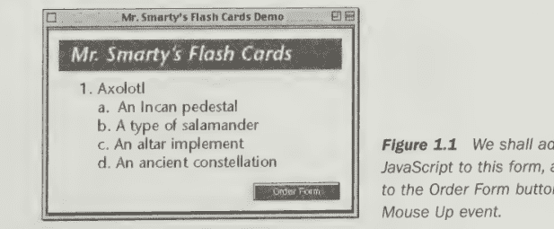

与本书其余部分一样，本书的网页上提供了该表单的两个版本：

- `Ch01.Example1.pdf` 是完整表单，包含所有相关的 JavaScript。
- `Ch01.Example1Raw.pdf` 是“原始”版本，缺少本章的 JavaScript，以便您可以根据需要自行输入 JavaScript。

## 将 JavaScript 附加到表单字段

作为对您可能已经知道的内容的提醒，让我们逐步介绍将 JavaScript 附加到按钮的过程，这里以我们的“订单表单”按钮为例。

**要将 JavaScript 附加到按钮：**

在 Adobe Acrobat 中打开表单。

1. 单击表单工具。

   Acrobat 将把当前页面上的所有表单字段显示为一组矩形。请注意，在我们的情况中，只有一个表单字段（**图 1.3**）。

   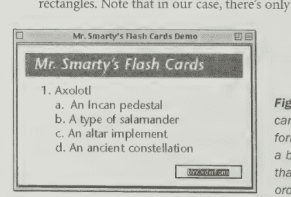

## 表单字段事件

如图 1.4 所示，有六种表单字段*事件*，您可以为它们附加操作：

- *鼠标按下*发生在用户在指针位于表单字段内时按下鼠标按钮。
- *鼠标释放*发生在用户点击该字段并在鼠标指针仍在该字段内时释放鼠标按钮。
- *鼠标进入*发生在鼠标指针首次进入表单字段时。
- *鼠标退出*发生在鼠标指针离开表单字段时。
- *获得焦点*发生在用户点击或通过 Tab 键切换到表单字段，使其成为键盘或其他输入的目标时。
- *失去焦点*发生在用户通过 Tab 键切换出表单字段或点击其他表单字段时，因此我们的字段不再是用户输入的目标。（当然，*失去焦点*是*获得焦点*的反义词。）

图 1.4 中的字段属性对话框允许您将一个或多个 Acrobat 操作（在我们的情况下是 JavaScript 操作）与这些事件中的任何一个相关联。

1. 双击“订单表单”按钮。

   Acrobat 将向您呈现字段属性对话框（图 1.4）。单击“操作”选项卡。我们希望将一个 JavaScript 操作附加到此按钮的鼠标释放事件上。

2. 选择鼠标释放操作，然后单击添加按钮。

   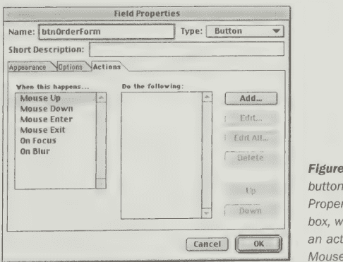

   **图 1.4** *在按钮的字段属性对话框中，我们要向鼠标释放事件添加一个操作。*

3. 在“类型”弹出菜单中，选择 JavaScript，然后点击“编辑”按钮。

   Acrobat 将为您呈现 JavaScript 编辑对话框，其中包含一个简单的文本编辑器（**图 1.6**）。您可以在这里输入应与订单表单按钮关联的 JavaScript。

   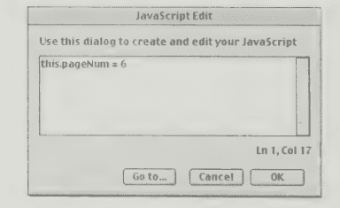

   **图 1.6** JavaScript 编辑对话框提供了一个简单的文本编辑字段，您可以在其中输入 JavaScript 代码。

4. 在此对话框的文本字段中输入您的 JavaScript。

   就我们的订单表单而言，JavaScript 是一个两行程序，将用户对文档的视图移动到包含订单表单的页面，然后使用户的计算机发出蜂鸣声：完全按照上述内容将这些行输入到文本编辑字段中，确保匹配大小写。

   ```javascript
   this.pageNum = 6
   app.beep
   ```

   > 将当前页码设置为 6。
   >
   > 告诉 Acrobat 发出蜂鸣声。

第一行代码说：“在此文档中，将当前页码设置为 6。”第二行告诉 Acrobat 应用程序发出蜂鸣声。

5. 点击 JavaScript 编辑、“添加动作”和“字段属性”对话框的“确定”按钮，返回到 Acrobat 表单。

   现在您看到的是 Acrobat 抽认卡页面，表单工具仍处于选中状态，如**图 1.3**所示。

6. 点击 Acrobat 手形工具。

   现在您回到了开始的位置。

7. 试试看：点击“订单表单”按钮，Acrobat 将移动到订单表单页面，然后发出蜂鸣声。

## JavaScript 对象

我们的两行 JavaScript 使用了两个 [JavaScript 对象](JavaScript objects)。JavaScript 对象是您的 JavaScript 程序中某些数据的表示。在您的程序可以操作或检查表单字段之前，它必须首先创建一个表示该字段的对象。大多数您可以在 JavaScript 中操作的东西（页面、签名、数据库连接等）在您的程序中都是以对象形式表示的。

在我们的示例程序中，`this` 指的是一个 [Doc 对象](Doc object)。Doc 对象代表一个打开的 Acrobat 文件给您的 JavaScript 程序；您使用此对象来更改页面、保存文档以及从程序内部以其他方式操作文档。我们示例 JavaScript 中的 `this` 一词特别指的是我们的 JavaScript 所在的 Acrobat 文档（在我们的例子中是抽认卡文件）；将其视为 *this document*（此文档）的缩写。

> **程序 vs. 脚本 vs. 代码**
>
> 以下是一些密切相关的术语，我们将在本书中贯穿使用。
>
> - *Program*（程序）是一系列指令的通用术语，它详细说明了计算机如何执行特定任务。通常，程序是一组独立的指令，例如一个应用程序。
> - *Script*（脚本）是一个旨在操作另一个程序的程序。JavaScript 是一种脚本语言，因为您使用它来控制另一个程序的行为，例如 Acrobat 或 Internet Explorer。
> - *Code*（代码）是应用于构成程序的一组指令的术语。您的 JavaScript 程序由 JavaScript 代码组成。

`app` 一词是一个 App 对象，是对用于查看当前文档的 Acrobat 应用程序的引用。您可以使用 App 对象来告诉 Acrobat 应用程序执行某些操作：打开文件、显示警告对话框，或者在我们的例子中，发出蜂鸣声。

常用的 JavaScript 对象类型包括：

- *Annot* 表示当前文档中的注释（例如，“便签”）。
- *App* 表示用于查看当前文档的 Acrobat 应用程序。
- *Connection* 表示与外部数据库的连接。
- *Doc* 表示当前（最前面）打开的 Acrobat 文档。
- *Field* 表示表单字段。
- *Sound* 表示嵌入当前文档中的声音。

## 对象属性

JavaScript 对象类似于我们周围的物理对象，例如书籍、花瓶和狗。每个真实世界的对象都拥有一组定义它的特征（例如，对于狗来说，颜色、尾巴长度和跳蚤数量）。

## 哪个 Acrobat？

目前有三种应用程序通常用于查看 Acrobat 文件：

- *Adobe Acrobat Reader* 是免费应用程序，允许您查看和打印 PDF 文件。
- *Adobe Acrobat Approval* 是一个相对便宜的产品，允许用户查看、打印和注释 PDF 文件以及完整填写 Acrobat 表单。
- *Adobe Acrobat*（“完整版 Acrobat”）是您用来向 PDF 文件添加功能的产品：重新排列页面、创建表单字段、指定启动属性，以及针对我们的目的，将 JavaScript 附加到表单字段。

只有完整版 Acrobat 才能创建表单字段并将 JavaScript 附加到表单字段和页面。您编写的大多数 JavaScript 都能在这三种 Acrobat 查看器包中正确工作。也有例外（Reader 特别有限），但相对较少。


在本书中，除非它们的行为不同，否则我将把这三种 Acrobat 查看器都称为 "Acrobat"。

JavaScript 对象的特征被称为该对象的`属性`。这些是我们的 JavaScript 程序可以根据需要检查和更改的对象元素。每种对象类型都有一组特征它的属性；例如，Doc 对象具有（其中包括）标题、当前页码、作者和页数等（见表 1.1）。

## 表 1.1 文档对象属性（部分）

| 属性 | 数据类型 | 描述 |
|----------|-----------|-------------|
| `author` | String | 文档的作者 |
| `fileSize` | Integer | PDF 文件的大小，以字节为单位 |
| `numPages` | Integer | 文档中的页数 |
| `pageNum` | Integer | 用户当前可见的页码 |
| `title` | String | 文档的名称 |

短语`this.pageNum`访问 Document 对象的`pageNum`属性；此属性是文档当前向用户显示的页码。我们的程序通过将当前文档的`pageNum`属性设置为订单表单的页码，将用户移动到订单表单页面：

```
this.pageNum = 6
```

## 数据类型

`表 1.1`的"数据类型"列列出了与其所列每个属性关联的信息类型。计算机编程，包括 JavaScript，使用特殊术语来精确描述数据类型。以下是 JavaScript 中常用的术语：

- `Integer`（整数）是完整数字，例如 1、2、87 或 -6293。
- `Floating Point`（浮点数）是带有小数部分的数字，例如 1.7、-842.9011、1024.0。请注意，小数部分可能为零，如 1024.0；在这种情况下，浮点数与整数值相同，但内部它仍然是浮点数。浮点数通常被称为`floats`（浮点数）。
- `Boolean`（布尔值）是一个可以具有两个值的实体：`true` 或 `false`。布尔数据用于描述只能具有两种状态的特性。（例如，我们 dog 对象中的`spayed`属性是一个布尔值；一只狗要么是么不是。）
- `String`（字符串）是文本，即"一串字符"。

关于此页码赋值的一些观察：

- 您通过命名对象和属性，并用句点连接来访问对象的属性：`对象名称.属性名称`。
- 上面代码行中的等号是`赋值命令`；它设置某物的值。在我们的例子中，它将当前文档的页码设置为 6。
- JavaScript 是区分大小写的。大写和小写是不同的；如果我们输入`This.PageNum`，我们的程序将会失败。
- 违反直觉的是，Acrobat 在内部将文档中的页面编号从零开始；我们 Acrobat 文件中的七页编号为零到六。因此，当我们的 JavaScript 将`pageNum`属性设置为 6 时，它正在将我们移动到文档的最后一页。

## 对象方法

`方法`是与 JavaScript 对象关联的命令。正如可以给狗下达命令（"坐下"、"跟上"、"马上吐出来！"），JavaScript 对象也有它们可以执行的命令。每组命令对于每种对象类型都是不同的。例如，`表 1.2`列出了`app`对象知道如何执行的一些命令。

`表 1.2 App 对象方法（部分）`

| 方法 | 参数 | 描述 |
| :--- | :--- | :--- |
| `beep` | | 播放系统的"蜂鸣"声音 |
| `alert` | String | 显示包含指定文本的警告对话框 |
| `goBack` | | 转到上一个视图 |
| `goForward` | | 转到下一个视图 |
| `newDoc` | | 打开一个新的空白 Acrobat 文件 |
| `openDoc` | String | 打开一个 Acrobat 文件。字符串参数包含文件名称 |

在我们的订单表单 JavaScript 中，我们执行了`app`对象的`beep`方法：

```
app.beep
```

请注意，我们执行对象的方法与引用其属性之一的方式相同：对象名称、"点"和方法名称。

某些方法需要额外的信息来完成它们的任务；例如，`表 1.2`中列出的`openDoc`方法需要知道你要打开的文件名。传递给方法的信息称为该方法的`参数`。`openDoc`方法以文件名作为其参数；这个信息用括号括起来，必须紧跟在方法名之后。调用`openDoc`的方式如下所示：

```
app.openDoc("TermPaper.pdf")
```

上述 JavaScript 语句将打开一个名为`TermPaper.pdf`的 Acrobat 文件。

有时当你给狗一个命令时，你期望狗给你一些回报：命令"Fetch the stick, boy!"应该会让你的手里 Put a stick in your hand。同样，许多 JavaScript 方法都有一个`返回值`，它们会把某些数据返回给 JavaScript 程序。我们上面调用的`openDoc`方法实际上会返回一个代表新打开文档的 Doc 对象，尽管我们对`openDoc`的单行使用只是忽略了它。我们将在下一章更详细地研究返回值。

## JavaScript 程序语法

在这里，我们必须讨论几个关于如何将 JavaScript 命令组合成程序的话题。

### JavaScript 语句

一个 JavaScript 程序——任何计算机程序——都由一系列语句组成，每个语句执行整体任务中的一步。我们的示例程序包含两个语句：

```
this.pageNum = 6

app.beep
```

通常，JavaScript 程序中的每一行包含一个 JavaScript 语句，就像我们上面的程序一样。你也可以在一行中放置多个语句，用分号分隔。我们的两行程序可以写成一行：

```
this.pageNum = 6; app.beep
```

为什么要这样做？纯粹是为了美观；有些人就是喜欢把非常简单的语句组合在一起。我不推荐这种做法；如果每行只有一个语句，大多数程序会更容易阅读。

如果你阅读别人的 JavaScript，你可能会注意到许多程序员在他们程序的每一行末尾加上分号：

`this.pageNum = 6;`

`app.beep;`

这不会有什么坏处，但完全没有必要。大多数人这样做是出于习惯；JavaScript 看起来非常像编程语言 C 和 C++，这两种语言都要求所有语句以分号结尾。你可以省略这些分号。

### JavaScript 文本

JavaScript 程序就是简单的文本文件；你可以用任何文本编辑器或文字处理器编写它们，然后复制粘贴到 Acrobat JavaScript 编辑对话框中。事实上，Windows 版本的 Acrobat 允许你指定一个外部编辑器来编辑你的 JavaScript；我们将在本章末尾讨论如何做到这一点。

JavaScript 行中的空格和制表符字符在 JavaScript 中没有特殊含义。你可以随意使用它们来格式化你的程序。这纯粹是一个视觉问题；你需要格式化你的 JavaScript 代码，使其易于阅读。

慷慨地使用空白字符！阅读程序代码本身就是繁琐的；如果程序员没有为了便于阅读而格式化代码，程序可能几乎无法辨认。这个问题非常重要，以至于在本书中，我将为我们使用的许多 JavaScript 结构提供格式化建议。

### JavaScript 错误

在（嗯）你 JavaScript 中出现错误的罕见情况下——你拼错了变量名、抄错了一段代码等等——Acrobat 会向你展示一个名为 JavaScript 控制台（`图 1.7`）的对话框。控制台会显示一条消息，指示错误的性质；它有时会（但遗憾的是，并不总是）还指示错误发生在脚本中的行号。

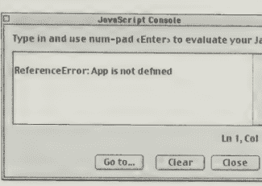

`图 1.7` JavaScript 控制台是 Acrobat 用来显示错误消息的对话框，这些错误消息指示你的 JavaScript 代码中存在问题。

错误消息起初可能有些令人费解，但随着时间和熟悉度的增加，它们会变得有用。你最可能看到的最常见的消息如下：

- `Reference Error: XXX is not defined`

  这表明你拼错了某些东西；名称"XXX"（或无论什么）不是 JavaScript 知道的名称。请记住 JavaScript 是区分大小写的；`app`（JavaScript 知道的）和`App`（它不知道的）之间是有区别的。

- `Syntax Error`

  这意味着 JavaScript 无法理解代码中的某些内容。这通常意味着你在脚本中遗漏了某些内容（逗号、数字、右括号）。语法错误的一个例子是：

  ```
  app.alert("Hi, Mom", 3
  ```

  这一行缺少它的右括号。

可能的错误消息集合相当大，尽管大多数都很难触发。只要坐稳，阅读消息，并仔细检查可疑的 JavaScript 代码中的拼写错误和遗漏。

### JavaScript 注释

JavaScript 代码可能相当令人费解。琢磨别人的代码（甚至你自己六个月前的代码），试图弄清楚它到底在做什么，可能是繁琐的。作为对查看你代码的他人的礼貌，以及为了帮助你未来的自己，在你的 JavaScript 代码中放置注释非常重要。

JavaScript`注释`是你代码中 JavaScript"机器"忽略的文本。目的是让你把自己的注释放在文本中，供查看代码的人类阅读。

JavaScript 识别（即忽略）两种注释：

- `单行注释`以双斜杠（`//`）开始，延伸到 JavaScript 代码中该行的末尾。这些用于简短的注释。

  ```
  //这是单行注释。
  ```

- `块注释`以`/*`开始，以`*/`结束。在这两个定界符之间可以有任意多的文本，在 JavaScript 文件中可以跨越任意多的行。这用于较长的注释。

  ```
  /* 这里有一个块注释。这个
     文本将完全被忽略，直到
     我们在这里结束注释。 */
  ```

### 一个示例

考虑下面这个来自本书后文的未注释的 JavaScript：

```
var txtField = event.target

txtField.fillColor = color.red

txtField.textColor = color.white
```

由于我们尚未讨论这些命令，这个脚本的目的以及它如何实现该目的非常不清楚。

另一方面，如果我们在代码中加入注释，那么即使是第一次接触该程序的人，至少也能知道程序的意图以及它大致在做什么：

```
/* 当用户标签进入或点击
   文本字段时，此程序改变文本字段的背景和文本颜色。 */

var txtField = event.target      // 获取对文本字段的引用

txtField.fillColor = color.red   // 将背景设置为红色

txtField.textColor = color.white // 将文本颜色设置为白色
```

这个版本的程序即使是初学者也清楚得多。

注释是编程中的向善力量。任何超过几行的脚本都应该包含描述其功能和工作原理的注释。

本书其余部分的所有示例都会有大量注释，以使它们尽可能易于理解。

## Acrobat JavaScript 指南

本书是非程序员使用 Adobe Acrobat 中 JavaScript 的入门介绍。你可以在完整 Acrobat 包中分发的文档中找到关于在 Acrobat 中使用 JavaScript 可以做所有事情的完整描述：《Acrobat JavaScript 对象规范》（AJOS）（`图 1.8`）。这是你 JavaScript 程序在 Acrobat 中可用的所有对象类型的技术规范。

AJOS 是一个技术规范，不是你会从头到尾阅读的文档。它详细描述了 Acrobat 中可用的每个 JavaScript 对象类型，以及每个对象的属性和方法。本书介绍如何在 JavaScript 中执行特定任务的一系列示例，而 AJOS 描述了在 Acrobat 中使用 JavaScript 可以做的`一切`。

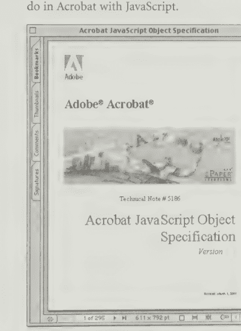

`图 1.8` Acrobat JavaScript 对象规范详细描述了 Acrobat JavaScript 可用的所有对象、它们的属性和它们的方法。

为了让你感受一下 AJOS 的风格，`图 1.9`展示了`app`对象的`beep`方法的完整描述的屏幕截图。

| 参数: | [nType] |
|---|---|
| 返回值: | 无 |

此方法使系统播放声音。各种声音及其对应的值如下：

| 消息类型 | 值 |
|---|---|
| 错误 | 0 |
| 警告 | 1 |
| 疑问 | 2 |
| 状态 | 3 |
| 默认（默认值） | 4 |

注意：在 Apple Macintosh 和 UNIX 系统上，蜂鸣类型将被忽略。

`图 1.9` 对`app`对象`beep`方法的描述是一个很好的示例，展示了 Acrobat JavaScript 对象规范中为每个对象、方法和属性提供的描述类型。

我将在本书中不时引用 AJOS。

你可以直接从 Acrobat 中打开 AJOS，方法是选择"帮助" > "Acrobat JavaScript 指南"。

## 使用你自己的文本编辑器

Acrobat JavaScript 编辑对话框（见图 1.6）中内置的文本编辑器非常简陋。它可以让你输入 JavaScript，但没有任何特别高级的编辑功能。对于简短的 JavaScript 来说，这并不重要；但在输入长而复杂的 JavaScript 时，你会想念功能齐全的文本编辑器。

在 Macintosh 上，你可以在自己的文本编辑器中输入 JavaScript，然后将其复制并粘贴到 JavaScript 编辑对话框中。顺便一提，我在 Mac 上最喜欢的免费文本编辑器是 Bare Bones Software 公司出品的 BBEdit Lite（www.barebones.com）。

Windows 版本的 Acrobat 可以在点击"添加动作"对话框（见图 1.5）中的"编辑"按钮时自动启动你选择的文本编辑器。要进行此设置，你必须在 Acrobat 的首选项中指定用于编辑 JavaScript 的编辑器。

## 指定编辑 JavaScript 时使用的文本编辑器

首先打开 Acrobat。

1. 选择"文件" > "首选项" > "常规"。

   Acrobat 将显示其首选项对话框。

2. 在首选项类别列表中选择"JavaScript"。

   首选项对话框将显示影响 Acrobat JavaScript 支持的控件（`图 1.10`）。

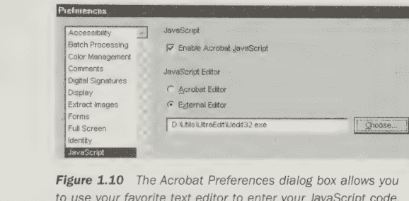

`图 1.10` Acrobat 首选项对话框允许你使用自己喜欢的文本编辑器来输入 JavaScript 代码。可惜，这仅在 Windows 版本的 Acrobat 中可用。

3. 在 JavaScript 编辑器控件中，选择"外部编辑器"。
4. 点击"选择"按钮，然后导航到要在编辑 JavaScript 时使用的编辑器的`.exe`文件。
5. 点击"确定"按钮。

就这样。现在，当你去编辑 JavaScript 时，Acrobat 将自动启动你的文本编辑器。在文本编辑器窗口中输入你的 JavaScript 代码，保存文本，然后关闭文本编辑器。你的 JavaScript 将自动输入到 Acrobat 中。

在 Windows 文本编辑器中，我偏爱 TextPad（www.textpad.com）和 UltraEdit（www.ultraedit.com）；它们都是价格相对低廉的共享软件，物有所值。

## 页面和文档 JavaScript

Acrobat 中有四种主要的 JavaScript 类型，每种在 Acrobat 文档中的使用位置不同。

- `表单字段` JavaScript 附加到表单字段上。如我们在上一章所见，表单字段脚本与表单字段发生的事件相关联：鼠标按下、获得焦点等等。
- `文档` JavaScript 与 Acrobat 文件的打开相关联。Acrobat 在文档首次打开时执行这些脚本。
- `文档动作` JavaScript 在一组预定义的事件之一发生在 Acrobat 文件上时执行：文件关闭、保存等等。
- `页面` JavaScript 与特定页面相关联。你可以提供脚本，让 Acrobat 在用户进入该页面、离开该页面，或两者都发生时执行。

我们在第 1 章讨论了表单字段 JavaScript。在本章中，我们将介绍如何编写其他三种类型的脚本。

## 项目

（文件：`Ch02_Example.pdf`、`Ch02_Example_raw.pdf`）

本章的示例文件是`图 2.1`所示的宠物商店目录。在我们的讨论过程中，我们将向此文件添加文档、文档动作和页面 JavaScript 的示例。


图 2.1 我们将向此宠物商店目录添加几个 JavaScript。

## 文档 JavaScript

文档 JavaScript 附加到 Acrobat 文档上，并在打开该文档时由 Acrobat 执行。这是向读者展示初始"启动画面"或在用户打开你的 PDF 文件时执行其他启动活动的便捷方式。你可以根据需要向 Acrobat 文件附加任意数量的文档 JavaScript。

例如，我们将向目录添加一个文档 JavaScript，当读者打开我们的目录文档时显示问候语（`图 2.2`）。


图 2.2 我们将使用文档 JavaScript 在用户打开 Acrobat 文件时显示此欢迎对话框。

## 将文档 JavaScript 附加到 Acrobat 文档

首先在 Acrobat 中打开文档。

1. 选择“工具”>“JavaScript”>“文档 JavaScript”（图 2.3）。

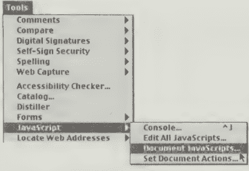

图 2.3 创建文档 JavaScript 的第一步是选择“工具”>“JavaScript”>“文档 JavaScript”。

Acrobat 将显示 JavaScript 函数对话框（图 2.4）。

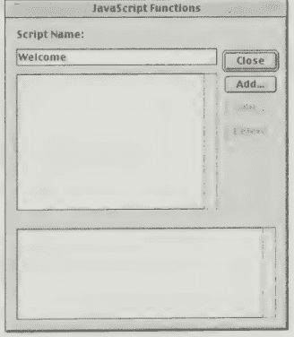

图 2.4 JavaScript 函数对话框是你添加、编辑和删除文档 JavaScript 的地方。

2. 在 JavaScript 函数对话框的“脚本名称”字段中输入名称。

每个文档 JavaScript 都必须有名称。使其简洁明了，避免使用任何制表符或空格。在我们的例子中，我们使用名称`Welcome`，因为这是此脚本的目的。

3. 点击“添加”按钮。

Acrobat 将显示 JavaScript 编辑对话框（图 2.5）。注意，此对话框出现时，文本字段中已输入了一些 JavaScript 代码。此代码是 JavaScript 函数定义的起点；由于我们不打算定义函数，可以删除这段初始代码。

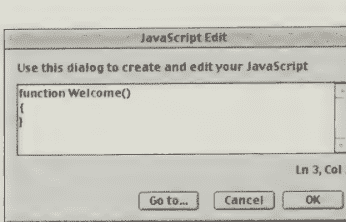

图 2.5 Acrobat 在需要您输入一些 JavaScript 代码时，都会使用这个 JavaScript 编辑对话框。对于文档 JavaScript，Acrobat 提供了一些初始 JavaScript 代码，我们不需要使用；您应该将其删除。

4. 在编辑框中输入您自己的 JavaScript。在我们的例子中，JavaScript 应该只有一行：

`app.alert("Welcome to the 1-Off Pets catalog!", 3)`

此 JavaScript 显示图 2.2 所示的警报。`app`对象的`alert`方法显示带有指定文本的警报。`3`表示警报中应显示的图标类型。我们将在第 13 章更详细地介绍此方法。（您可能还记得我们在第 1 章讨论过`app`对象。）

5. 点击“确定”按钮返回 JavaScript 函数对话框（图 2.6），该对话框现在列出了我们新的`Welcome`脚本。

6. 点击“关闭”返回 Acrobat 文件。

7. 通过保存 Acrobat 文件、关闭它，然后重新打开它来测试。Acrobat 应显示图 2.2 所示的警报。

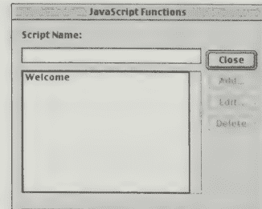

图 2.6 `Welcome` JavaScript 现在出现在附加到此 Acrobat 文件的文档 JavaScript 列表中。

## 全局变量

文档 JavaScript 的一个不明显的特点是，它们创建的任何变量对文档中的所有其他 JavaScript 都是可见的。例如，假设您创建了一个包含以下代码行的文档 JavaScript：

```javascript
var iconType = 3
```

这里，我们创建了一个名为`iconType`的变量，其值为`3`。我们 Acrobat 文档中的所有其他脚本，无论类型如何（文档、文档动作、页面、表单字段），都可以使用变量`iconType`而不是数字`3`。

```javascript
app.alert("Welcome to the 1-Off Pets catalog!", iconType)
```

这可能非常方便。如果您有，比如说，50 个脚本在文档中创建类似上面的警报，更改文档脚本中`iconType`的定义将更改所有这 50 个警报 JavaScript 显示的图标。

我们的`iconType`变量被称为全局变量；它可以被整个 Acrobat 文档中的所有脚本访问。我们将在本书的 JavaScript 中偶尔使用全局变量。

## 文档动作 JavaScript

文档动作 JavaScript 在文档发生特定事件时执行。有五个事件可以附加 JavaScript：

- *文档将关闭*表示 Acrobat 即将关闭文档。
- *文档将保存*表示 Acrobat 即将保存文档。
- *文档已保存*表示 Acrobat 已完成保存文档。
- *文档将打印*表示 Acrobat 即将打印文档。
- *文档已打印*表示 Acrobat 已完成打印文档。

要查看如何将 JavaScript 附加到这些事件之一，让我们对目录再做一次更改。当用户关闭 Acrobat 文件时，让我们感谢用户查看了我们的商品，如图 2.7 所示。我们将通过将 JavaScript 附加到“文档将关闭”事件来实现这一点。


图 2.7 我们将使用“文档将关闭”JavaScript 向用户呈现告别信息。

要将文档操作 JavaScript 附加到文档，请执行以下操作：

1. 首先在 Acrobat 中打开文档。选择“工具”>“JavaScript”>“设置文档操作”（图 2.8）。

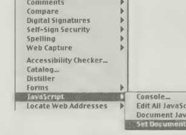

Acrobat 将显示“文档操作”对话框（图 2.9）。

2. 选择“文档将关闭”，然后单击“编辑”按钮。Acrobat 将显示 JavaScript 编辑对话框。

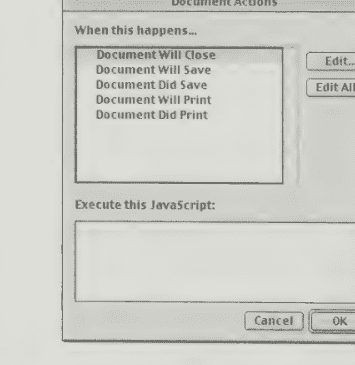

3. 在对话框中输入您的 JavaScript。就我们的目的而言，脚本应该是：

`app.alert("Thanks for looking at our catalog!", 3)`

4. 单击“确定”退出 JavaScript 编辑和 JavaScript 函数对话框；您现在将回到 Acrobat 页面。

5. 试一试：保存 Acrobat 文档，然后关闭它。Acrobat 将向您显示感谢提示，如图 2.7 所示。

## 页面操作 JavaScript

页面操作是与特定页面的打开或关闭相关联的 Acrobat 操作。这些操作可以是 Acrobat 所知道的任何操作类型：例如菜单项、电影操作、声音操作——当然，在我们的情况下，还有 JavaScript 操作。我们将为我们的页面附加一个 JavaScript 操作。

Acrobat 中有两种页面操作：

- *页面打开*操作在用户滚动到页面时执行（页面打开事件）。
- *页面关闭*操作在用户离开页面时执行（页面关闭事件）。

例如，我们将在目录的第三页附加一个页面打开操作，以宣布 1-Off Pets 正在对宠物槌球进行促销。当用户打开第 3 页时，我们的页面打开操作将显示图 2.10 所示的提示。

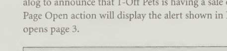

图 2.10 我们将使用附加到目录第 3 页的页面打开操作来宣布槌球促销。

### 要将页面操作附加到 Acrobat 文档中的页面

首先从打开到正确页面的文档开始；在我们的例子中，这是第 3 页。

1. 选择“文档”>“设置页面操作”。Acrobat 将显示页面操作对话框（图 2.11）。
2. 选择“页面打开”事件，然后单击“添加”按钮。

Acrobat 将向您呈现我们在前一章中看到的“添加操作”对话框（图 2.12）。

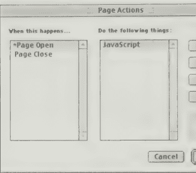

图 2.11 *页面操作对话框允许我们将操作与两个事件之一相关联：页面打开和页面关闭。*

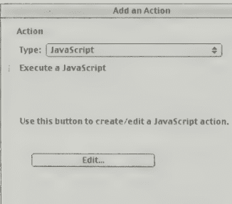

图 2.12 *添加操作对话框允许我们指定与事件相关联的操作的详细信息。在这里，我们将 JavaScript 操作与页面打开事件相关联。*

3. 选择 JavaScript 作为操作类型，然后单击“编辑”按钮。

Acrobat 将显示通常的 JavaScript 编辑对话框。

4. 在对话框中输入您的 JavaScript。在这种情况下，使用以下代码：

`app.alert("Special on Croquet Balls this week only! Call now!", 3)`

5. 单击“设置操作”和“确定”退出所有对话框，直到您再次看到 Acrobat 文件页面。

6. 通过转到目录中的上一页，然后返回第 3 页来试一试；您将看到图 2.10 所示的提示。

# 第 3 章

## 表单字段高亮

本书中一个反复出现的主题是表单中用户反馈的重要性。在任何时候，用户都应该清楚他或她应该做什么，以及表单的哪一部分正在期待信息。

在本章中，我们将研究一种实现这一目标的有用方法；我们将创建一个表单，其文本字段具有*彩色输入高亮*——也就是说，当用户单击它们或使用 Tab 键进入它们时，它们会改变颜色。

## 项目

（文件：`Ch3_Start.pdf`、`Ch3_End.pdf`）

我们将为图 3.1 中的订单表单添加彩色输入高亮。此 Acrobat 文件最初是一个完全普通的表单，用户填写该表单以订购他或她自己的记录副本。从图 3.2 可以看出，此表单包含一些文本字段和一个提交按钮。

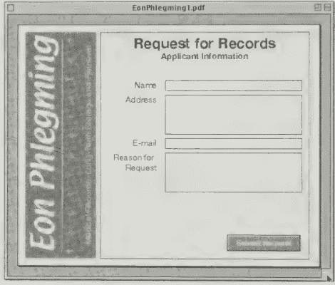

图 3.1 我们将为此表单添加输入高亮。

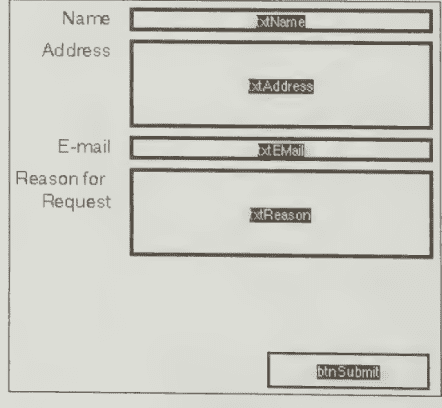

图 3.2 我们的表单包含四个用于从用户收集数据的文本字段和一个向公司提交数据的按钮。

由于彩色输入高亮，当用户单击文本字段时，该字段将变为红色，表明它是活动字段（图 3.3）。

图 3.3 当用户单击文本字段时，字段的内容将被高亮显示，以红色背景显示白色文本。

## JavaScript

通常，文本字段包含黑色文本，显示在白色或透明背景上。我们将修改文本字段，以便当用户单击字段（或使用 Tab 键进入字段）时，字段变为红色背景上的白色文本，表明该字段已准备好接收键盘输入（参见图 3.3）。

## 解决问题的方法

为了实现输入高亮，我们将 JavaScript 附加到表单中每个文本字段的“获得焦点”和“失去焦点”事件（图 3.4）。当表单字段成为数据输入的目标时，*获得焦点*事件发生，通常是因为用户单击了该字段或使用 Tab 键进入了该字段。当表单字段失去焦点时，*失去焦点*事件发生——也就是说，当其他表单字段成为数据输入的目标时。（如果名称“失去焦点”看起来有点奇怪，您会用哪个单词来描述*焦点*的相反含义？）

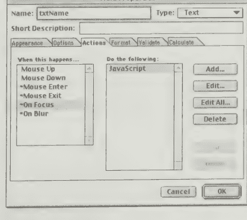

图 3.4 我们将向表单中的每个文本字段添加两个脚本：一个添加高亮的获得焦点脚本和一个再次移除高亮的失去焦点脚本。

我们的获得焦点 JavaScript 将表单字段的背景颜色设置为红色，并将文本颜色变为白色。失去焦点脚本将背景和文本颜色分别恢复为透明和黑色。我们需要将这些 JavaScript 添加到用户可能输入数据的所有文本字段中。

顺便说一下，获得焦点和失去焦点事件是在 Acrobat 5 中添加的，因此如果使用早期版本的 Acrobat 查看表单，我们的高亮将不起作用。（如果使用 Acrobat 4 查看表单，不会损坏任何东西；用户只是看不到高亮效果。）

## 代码

### 步骤 1：获得焦点 JavaScript

以下 JavaScript 适用于此表单中每个文本字段的获得焦点事件（参见图 3.2）。

```javascript
// This is the On Focus JavaScript
var txtField = event.target
txtField.fillColor = color.red
txtField.textColor = color.white
```

代码详解：

`var txtField = event.target`

第一行获取导致获得焦点事件发生的字段（事件的*目标*），并将其分配给一个名为`txtField`的命名引用（*变量*）。这是我们在 JavaScript 的其余部分中引用文本字段的名称。

```javascript
txtField.fillColor = color.red
txtField.textColor = color.white
```

获取对文本字段的引用后，我们设置其两个属性：

- `fillColor` 是表单字段的背景颜色。我们将其设置为红色。
- `textColor` 是表单字段中文本的颜色。我们将其设置为白色。

请注意，我们将颜色指定为`color.red`和`color.white`。Acrobat 提供了一组用于常见颜色的预定义名称，如下所示：

- `color.transparent`
- `color.green`
- `color.yellow`
- `color.black`
- `color.blue`
- `color.dkGray`
- `color.white`
- `color.cyan`
- `color.gray`
- `color.red`
- `color.magenta`
- `color.ltGray`

### 步骤 2：失去焦点 JavaScript

我们的失去焦点脚本与获得焦点脚本相同——只是有所不同。我们将`textColor`和`fillColor`属性设置回其原始值：

```javascript
var txtField = event.target
txtField.fillColor = color.transparent
txtField.textColor = color.black
```

与步骤 1 类似，我们获取对导致失去焦点事件的文本字段的引用，然后更改背景（透明）和文本（黑色）的颜色。`color.transparent`在这种情况下是有效的颜色。

这就是您需要做的全部。一旦您将这两个 JavaScript 添加到表单的每个文本字段中，您的表单将具有彩色输入高亮效果，您的用户将非常印象深刻。

## 自定义说明

将此 JavaScript 自定义为您自己的用途并不太难；事实上，我们在这里使用的 JavaScript 可以不加修改地用于任何表单中的任何文本字段。

您可能想要做的唯一合理的自定义是为文本字段选择其他颜色。您可以使用`fillColor`和`textColor`的任何组合来高亮显示文本字段。步骤 1 末尾的列表显示了

## 检查 Acrobat 版本

在 Acrobat 4 之前，Acrobat 对表单的支持几乎不存在。Acrobat 4 引入了强大的表单支持，而 Acrobat 5 进一步丰富了表单机制的功能。不幸的是，作为表单设计者，你无法控制用户使用的 Acrobat 查看器版本，这给表单设计带来了挑战。

inevitably，你必须假定用户使用的是某个版本的 Acrobat 来查看你的表单。如果用户使用的 Acrobat 版本早于这个版本，你必须检测到这个事实并优雅地处理这种情况。

这正是我们将在本章中讨论的内容。我们将看到如何确定用户拥有的 Acrobat 版本，以及如何在用户的程序过于原始、无法正确呈现文档时自动关闭文档。

## 项目

（文件：`Ch04_Example1.pdf`、`Ch04_Example1_Raw.pdf`）

图 4.1 展示了一个使用*彩色条目高亮*来在用户选择表单字段时改变其颜色的表单。（顺便说一下，第 3 章向你展示了如何做到这一点。）该表单通过为每个文本字段的“On Focus”和“On Blur”事件附加 JavaScript 来实现高亮效果。由于这两个事件是在 Acrobat 5 中添加的，我们的表单在早于 5 的 Acrobat 版本中无法正常工作。

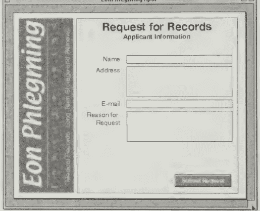

图 4.1 此表单依赖于在 Acrobat 5 中添加的表单字段事件。我们将添加一个文档 JavaScript 来检查当前用户的 Acrobat 版本，如果版本不够新，则显示警告。

在本章中，我们将进一步修改此表单，查看用户的 Acrobat 版本号。如果版本号小于 5，我们将首先显示一个警告（图 4.2）告知此事，然后关闭表单。

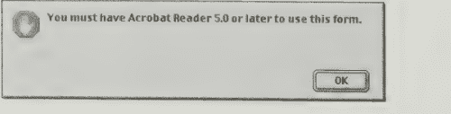

图 4.2 如果用户的 Reader 版本不够新，我们将显示此警告。

## JavaScript

检查正确的 Acrobat 版本是你希望在用户首次打开文档时执行的操作。因此，我们将使用文档 JavaScript，Acrobat 将在用户首次打开文档时执行它。

## 解决问题的方法

这个脚本相对简单。我们将查看用户的 Acrobat 版本，并将其与我们需要的最低版本（在我们的情况下是 Acrobat 5）进行比较。如果版本小于 5，我们将显示图 4.2 中所示的警告，然后关闭 Acrobat 文件。我们可以通过检查`app`对象的`viewerVersion`属性来轻松确定版本号，其值是当前 Acrobat 查看器的版本号。

## 代码

此 JavaScript 需要作为文档 JavaScript 输入。（有关如何将文档 JavaScript 附加到文档的提醒，请参阅第 2 章。）请记住，文档 JavaScript 必须始终具有名称。我将我们的脚本命名为`CheckVersion`（图 4.3）——描述性强，虽然缺乏想象力。

```javascript
if (app.viewerVersion < 5) {
    app.alert("You must have Acrobat Reader 5.0 or later to use this form.");
    this.closeDoc(true);
}
```


## 代码详解

这个程序围绕对 JavaScript `if` 命令的调用构建。该命令比较两个事物（在我们的情况下，是 Acrobat 版本和数字 5），如果比较结果为真，则执行一段代码。`if` 命令及其伙伴 `else` 在 JavaScript 中无处不在；我们将在本书中频繁看到它们。每当你的 JavaScript 需要在某些情况下做一件事，而在其他情况下做另一件事时，这些就是你使用的编程工具。

```javascript
if (app.viewerVersion < 5)
```

在这里，我们查看 Acrobat 版本是否小于 5；更改数字以反映你要求的最低 Acrobat 版本。（我们正在检查 `app` 对象的 `viewerVersion` 属性。）大多数专业表单应确保用户至少拥有 Acrobat 4。

如果比较为真（换句话说，如果查看器的版本小于 5），应该执行的 JavaScript 代码出现在紧跟在比较后面的花括号之间。在我们的情况下，此“条件块”中有两行：

```javascript
app.alert("You must have Acrobat Reader 5.0 or later to use this form.")
```

在这里，我们告诉 `app` 对象显示一个警告，如图 4.2 所示。括号中的文本是应该出现在警告中的文本；你可以将其更改为任何你希望的内容。

```javascript
this.closeDoc(true)
```

最后，在告知用户问题后，我们让当前文档自行关闭。请记住，`this` 指的是当前文档（即“此文档”）。布尔值 `true` 表示在关闭文档之前不应给用户保存文档的机会。如果你将布尔值更改为 `false`，Acrobat 将向用户显示一个标准的“你想先保存吗”对话框（图 4.4）。这将允许用户在关闭 Acrobat 文件之前保存它。（例如，如果你要在表单中的“关闭表单”按钮中使用 `closeDoc` 方法，你可能希望使用 `false`；这会给用户机会保存他或她对表单所做的任何更改。）

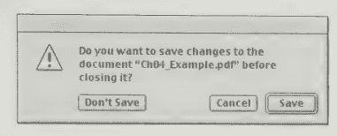

**图 4.4** *如果你向`closeDoc`方法提供`false`，Acrobat 将在关闭前给用户一个保存 Acrobat 文件的机会。这可能很有用，防止用户意外丢失表单字段条目。*

为了方便，如果你不想要“保存”对话框，可以省略布尔值；在这种情况下，你对 `closeDoc` 的调用将如下所示：

```javascript
this.closeDoc()
```

这让你不必输入“false”，但在其他方面与我们原来的版本没有区别。

## 测试代码

如果你使用 Acrobat 5 创建表单，测试此程序——以确保你没有输错某些内容——有点棘手。由于我们的比较（`app.viewerVersion < 5`）永远不会为假（我们自己的 Acrobat 版本永远不会小于 5），我们对 `app.alert` 和 `this.closeDoc` 的调用将永远不会被执行；如果你拼错了其中一个，在你（或用户！）尝试使用较早版本的 Acrobat 打开文档之前，你不会知道。

你可以测试此脚本的一种方法是临时修改它，在 `if` 运算符的比较子句中放置 `true`：

```javascript
if (true) {
    app.alert("You must have Acrobat Reader 5.0 or later to use this form.")
    this.closeDoc(true)
}
```

这强制执行花括号中的代码，让你看看其中是否隐藏着任何错误。

## 定制说明

明显的定制机会包括：

- 将 `if` 行中的版本号更改为你想要的任何最低 Acrobat 版本。再次强调，大多数表单应至少检查版本是否为 4 或更高。
- 将警告中的文本更改为你希望出现在屏幕上的任何内容。

以下是你可以对此程序进行的一些不太明显的更改。

## 测试查看器类型

最后，你可以轻松修改本章的 JavaScript 代码，以查看用户使用哪个 Acrobat 程序来查看你的表单：Acrobat Reader 还是完整的 Acrobat。`app` 对象有一个名为 `viewerType` 的属性，根据用户拥有的查看软件类型，它将具有两个字符串值之一：`"Reader"` 或 `"Exchange"`。如果你的表单需要完整 Acrobat 软件包的功能（也许你的表单允许用户将表单数据保存到磁盘，这仅在完整 Acrobat 中可用），你可以将本章的文档 JavaScript 修改如下：

> `==` 表示“等于”

```javascript
if (app.viewerType == "Reader") {
    app.alert("You must have the full Acrobat to use this form.")
    this.closeDoc(true)
}
```

如果用户使用 Acrobat Reader 查看你的表单，这将警告用户，然后关闭文档。

## 警告图标

我们在本章程序中显示的警告显示一个停止图标，表示出现了严重错误，以至于我们要停止正在做的事情。

然而，有时你不希望在警告中使用如此强调性的图标。`app.alert` 方法允许你指定，除了应该放入警告中的文本之外，还应该出现的图标。有关如何在警告中指定使用的图标的完整讨论，请参阅第 13 章。

Acrobat 认可的标准命名颜色；但是，你可以使用如下格式将颜色设置为你希望的任何 RGB、CMYK 或灰度值：

```javascript
txtField.fillColor = ["RGB", .5, 1, .5]
```

颜色分量的值——在我们的情况下是 R、G 和 B——必须都是 0 到 1 之间的数字。

最后，如果你将字段的 `fillColor` 和 `textColor` 都设置为 `color.transparent`，该字段实际上就会消失。你可以使用它来动态隐藏表单字段；不过，我们将在第 8 章中介绍另一种更好的方法。

# 5 计算表单字段

计算是我们计算机世界中所做之事的基础。电子表格、统计分析、会计信息——甚至像文字处理和页面布局这样不那么明显的事情——都依赖于计算机执行计算的能力，从而将脆弱的人类大脑解放出来，以追求更崇高的目标。由于 Acrobat 运行在计算机上，因此它也能进行计算，允许你指定表单字段的值应由计算得出，而非由用户输入。你可以使用 JavaScript 或 Acrobat 预定义的计算来实现这一点；在此，我们将学习如何创建同时使用这两种方法的计算表单字段。

## 项目

（文件：`Ch05_Example_2.pdf`，`Ch05_Example_2_Raw.pdf`）

在本章中，我们将为图 5.1 中的采购订单表单添加计算功能。此表单供小型企业员工订购办公用品或其他必需品使用。对于用户想购买的每件商品，他们提供描述、所需的价格和数量。表单会自动填写小计、税款和总采购价格。

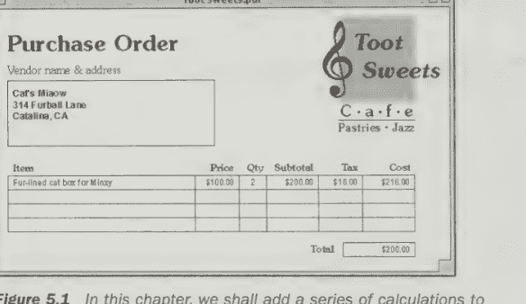

**图 5.1** *在本章中，我们将为此表单中的字段添加一系列计算，以便商品成本、小计、税款和总成本字段能够自动填充。*

观察图 5.2，我们可以看到该表单由按六列排列的文本字段组成，分别用于商品名称、价格、数量、小计、税款金额和该商品的最终成本。表单底部还有一个总计金额字段。如果这是一个你为公司制作的表单，它还需要一个提交按钮，也许还有一个清除表单按钮；为了简洁，我在此省略了它们。

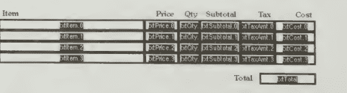

**图 5.2** *这是我们示例表单中的表单字段。我们将把`txtSubtotal`、`txtTaxAmt`和`txtCost`列中的字段以及`txtTotal`字段转换为计算字段。*

我们需要在此表单中进行的计算如下：

对于每个采购项目：

- 小计 = 价格 x 数量
- 税款 = 税率 x 小计
- 商品成本 = 小计 + 税款

最后：

- 总计 = 各商品成本之和

让我们看看如何将这些计算添加到我们的表单中。

## JavaScript

### 创建计算字段

你可能记得，一个文本字段可以被声明为计算字段。Acrobat 会根据需要自动重新计算该字段的值；我们只需要确切地告诉 Acrobat 要执行什么计算。我们通过“字段属性”对话框（图 5.3）来完成此操作。

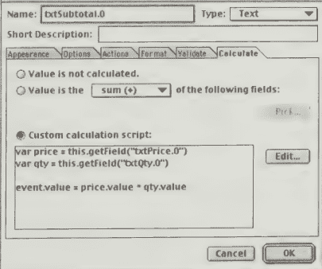

**图 5.3** 你在“字段属性”对话框的“计算”面板中为表单字段添加计算值。

### 使用文本字段进行数值计算？

文本字段的值就是该字段包含的文本。如果该文本是一个有效的数字，那么该字段的值就可以在 JavaScript 计算中使用，正如我们在此所做的那样。如果文本字段的值不是一个有效数字（例如，字段包含“Mooseberries”），那么该值仍可能用于计算，但该值将被解释为 0。

确保文本字段仅包含有效数字的最简单方法是将其格式设置为*数字*；然后，Acrobat 将拒绝任何不属于数字值的按键输入。（如果你想使用 Acrobat 预定义计算，也需要这样做。）

**要将文本字段的格式设置为数字：**

首先使用 Acrobat 表单工具选中文本字段。

1. 双击该文本字段以访问其属性。
2. 转到“格式”面板（图 5.4）。
3. 从可用格式列表中选择“数字”。
4. 如果需要，选择其他选项（货币符号等）。
5. 单击“确定”按钮。

现在，此表单字段将只接受数字、小数点以及作为开头的加号或减号。

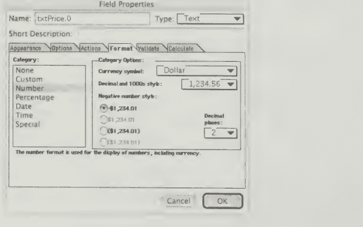

**图 5.4** 为确保文本字段仅包含有效的数值，请将其格式设置为数字。

**要将计算附加到文本字段：**

1. 双击文本字段。  
   现在你将看到该文本字段的“字段属性”对话框。
2. 单击“计算”选项卡。  
   现在你看到的是允许你为文本字段的值指定计算的控件。
3. 对于简单计算，单击第二个单选按钮（“值为...”），然后从预定义计算的弹出菜单中进行选择。如果你没有看到这第二个单选按钮，这意味着该字段的格式未设置为数字。
4. 如果你需要更复杂的计算，单击第三个单选按钮（“自定义计算脚本”），然后单击“编辑”按钮以输入 JavaScript。

## 预定义计算

Acrobat 内置了五种计算。无需编写任何 JavaScript，你就可以将一个文本字段的值设置为两个或多个其他表单字段的和、乘积、平均值、最小值或最大值。这就是“字段属性”对话框“计算”面板中第二个单选按钮的含义。

同样，这些预定义计算仅在你已明确将文本字段的格式设置为数字时才可用。

**要使用预定义计算之一：**

首先在“字段属性”对话框的“计算”面板中：

1. 选择“启用”预定义计算的单选按钮（图 5.5）。

   

   **图 5.5** 第二个单选按钮允许你对两个或多个字段执行简单计算。
2. 从弹出菜单（图 5.6）中，选择你需要的计算。

   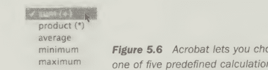
3. 在文本字段中输入提供计算数据的文本字段名称。

   **或者**

   为了节省输入，单击“拾取”按钮，然后从出现的列表（图 5.7）中选择计算应使用的数据字段。

   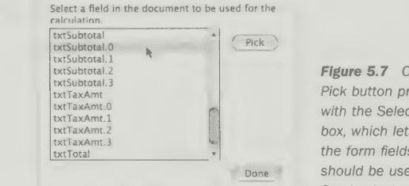

在预定义计算中进行选择比编写等效的 JavaScript 代码方便得多。在我们的采购订单表单中，我们将对成本字段（其值是小计和税款之和）和总计字段（所有商品成本之和）使用预定义计算（图 5.8）。税款的计算需要乘以一个常数值（我们的税率），因此无法使用预定义计算来完成。（预定义计算可以将两个或多个表单字段相乘，但不能将表单字段乘以固定数字。）我们将为税款字段编写 JavaScript。

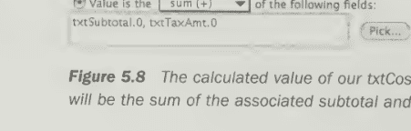

我们也可以对小计字段使用预定义计算（它是价格和数量的乘积）。尽管如此，我们将使用 JavaScript 来计算小计；原因将在本章末尾讨论增强功能时变得清晰。

### 项目计算

让我们为表单中各个采购项目添加计算。我们需要为每个项目的 `txtTaxAmt`、`txtSubtotal` 和 `txtCost` 字段应用计算值。请注意，我们为这些字段命名的名称符合 Adobe 分层命名约定（见侧边栏）；因此，例如，当我们向下查看税款列时，字段名称分别是 `txtTaxAmt.0`、`txtTaxAmt.1` 等等。这种命名约定使得字段名称易于记忆，并且在使用预定义计算时很有用，正如我们讨论 `txtTotal` 字段时将看到的那样。

在讨论与项目相关的计算时，我们将查看应用于项目 0（即表单字段的第一行）的 JavaScript。对于完整的表单，你需要为项目 1、2 和 3 重复这些计算，并相应地更改字段名称。

> ## Adobe 分层命名约定
>
> 我们为文本字段选择了一种一致的命名策略。与采购项目相关的文本字段命名为 `txtItem.0`、`txtItem.1` 等等。保存其他所有逐项信息的字段也以类似方式命名（`txtCost.0`、`txtCost.1`；`txtQty.0`、`txtQty.1`；等等）。
>
> 这些名称遵循 Adobe 分层命名约定。这是一套宽松的规则，指定如何为相关字段分配名称。这些名称类似于标识网站的 URL（网址）。“点”用于分隔每个名称的不同部分；相关字段应共享名称的开头部分以表明它们的关系。因此，`txtCost.1` 和 `txtCost.2` 都是包含成本的文本字段。
>
> 这使得查看文本字段之间的关系变得容易。此外，正如我们将在计算总计字段时看到的，分层命名约定使得仅使用字段名称的开头部分即可引用整组表单字段成为可能。也就是说，在预定义计算中，“txtPrice”是对所有以此名称开头的字段的简写引用：`txtPrice.0`、`txtPrice.1` 等等。请参阅下文“计算 `txtTotal`”以查看具体示例。

## 计算 `txtSubtotal.0`

某商品的小计就是单价乘以购买数量。就我们的表单而言，这意味着 `txtSubtotal.0` 的值应为 `txtPrice.0` 乘以 `txtQty.0` 的结果。这可以使用 Acrobat 预定义计算来完成，但我们仍然会用 JavaScript 来实现。原因有二：

- 我想明确告诉大家，预定义计算并没有什么神奇之处；预定义计算能做到的，你用 JavaScript 都能轻松实现。
- 在本章末尾讨论的增强功能中，我们会看到将所有计算都用 JavaScript 实现的一个充分理由。这与值为零的字段的显示方式有关。稍后我们会详细说明。

要将此计算附加到 `txtSubtotal.0`，首先打开“字段属性”对话框的“计算”面板（图 5.9）。（按照第 43 页“将计算附加到文本字段”下的步骤 1–2 操作，即可到达此面板。）

点击“自定义计算脚本”单选按钮，然后点击“编辑”按钮。Acrobat 会弹出 JavaScript 编辑对话框（图 5.10）；输入以下 JavaScript 代码，然后点击“确定”。

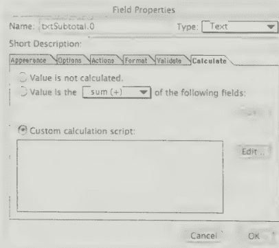

**图 5.9** 要使用 JavaScript 计算表单字段的值，首先点击“自定义计算脚本”单选按钮，然后点击“编辑”按钮。

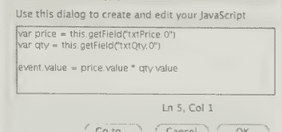

**图 5.10** 在标准的 JavaScript 编辑对话框中输入你的计算 JavaScript 代码。

请记住，双斜杠开头的行表示 JavaScript 注释，Acrobat 和 JavaScript 会忽略它们。你可以选择省略这些注释，但我建议你把它们也输入进去。（当你日后回头查看代码时，它们会帮助你理解代码的用途。）

```javascript
// Get references to the price and quantity fields
var price = this.getField("txtPrice.0")
var qty = this.getField("txtQty.0")
```

获取计算所需的表单字段。

```javascript
/* Set the value of our text field to the product of price and quantity.*/
event.value = price.value * qty.value
```

将两个字段的值相乘。

这段简短的脚本非常直观。我们创建了 `price` 和 `qty` 两个变量，分别持有对 `txtPrice` 和 `txtQty` 表单字段的引用。然后我们将这两个字段的值相乘，并将乘积赋值给一个叫做 `event.value` 的对象。

这段脚本中唯一不太直观的部分是我们使用了 `event.value` 这个术语。在计算脚本中，`event` 指的是一个 Event 对象；该对象包含了与触发脚本执行的计算事件相关的各种信息。具体来说，`event.value` 是对作为计算目标的文本字段值的引用。这是一个便利机制；如果我们没有使用 `event` 对象，就必须显式获取对 `txtSubtotal.0` 字段的引用，然后在计算中使用它：

```javascript
var subtotal = this.getField("txtSubtotal.0")
subtotal.value = price.value * qty.value
```

这种做法完全没有问题；只是需要多打一些字而已。（在编程中，适度的“懒惰”是一种美德。）

至此，我们已经完成了小计的计算，将单价乘以数量。现在，我们准备计算税额。

## 计算 `txtTaxAmt.0`

某商品的税款就是该商品的小计乘以当地的销售税率。在我所在的地区，税率为 8%（那些来自没有销售税的州的读者请保持安静）；因此每件商品应付的税款就是小计乘以 0.08。

和之前一样，转到 `txtTaxAmt.0` 字段的“计算”面板（图 5.11）。选择“自定义计算脚本”单选按钮并点击“编辑”按钮。在 JavaScript 编辑对话框中输入以下 JavaScript 代码：


```javascript
var subtotal = this.getField("txtSubtotal.0")

event.value = .08 * subtotal.value
```

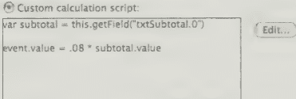

*图 5.11* `txtTaxAmt.0` 字段的 JavaScript 将该字段的值设置为 `txtSubtotal.0` 的值乘以税率——本例中为 0.08。

同样，我们的代码非常简单：获取对 `txtSubtotal.0` 字段的引用，然后将 `event.value` 设置为小计的值乘以 0.08。

我们还可以为所有的 `txtTaxAmt` 字段添加一项增强功能，但这会推迟到本章后面再讲（见下文“全局税率”）。

## 计算语法

JavaScript 计算使用标准字符来表示基本算术运算。毫无疑问，你在计算机使用过程中已经见过这些字符：“+”、“-”、“*”和“/”分别对应加法、减法、乘法和除法。

此外，你可以使用括号来使计算的某些部分优先执行：括号内的计算部分将在括号外的部分之前执行。因此，如果你想计算两个变量 `price1` 和 `price2` 的平均值，可以这样表达：

```javascript
var avg = (price1 + price2) / 2
```

我们必须先将两个价格相加，然后将总和除以 `2`。

## 计算 `txtCost.0`

我们采购订单表单中每件商品的最终费用是该商品的小计与其税款之和。由于求和是 Acrobat 的预定义计算之一，我们将使用该机制而非 JavaScript 来计算费用。（如果 Acrobat 提供了便捷的替代方案，不要犹豫不用 JavaScript；始终使用最简单的方式来实现目标。）

和之前一样，双击 `txtCost.0` 字段并转到“计算”面板。这次通过以下步骤指定预定义计算：

1. 点击中间的单选按钮（“值为……”）。
2. 在弹出菜单中选择“求和”。
3. 在文本框中输入 `txtSubtotal.0` 和 `txtTaxAmt.0` 两个字段名称。

> 另外，你也可以点击“选择”按钮，从弹出的列表中选择这两个字段。

至此，我们已经计算了商品 0 所需的全部信息：小计、税款和费用。我们还有两件事要做：为商品 1 到 3 设置相同的计算，然后计算订单的总费用。

## 计算商品 1 到 3

商品 1、2 和 3 的计算字段与商品 0 的完全相同。只需重复相同的 JavaScript 和预定义计算，但将编号“.0”分别改为“.1”、“.2”或“.3”，以对应商品编号即可。（我通常只是将之前的脚本复制粘贴到新字段中，然后修改商品编号。）

因此，`txtSubtotal.1` 的 JavaScript 代码为：

```javascript
var price = this.getField("txtPrice.1")
var qty = this.getField("txtQty.1")
event.value = price.value * qty.value
```

## 计算 `txtTotal`

最后，我们需要计算应付总金额——即所有四个商品费用之和。这同样是求和运算；因此我们可以使用预定义的“求和”计算。转到 `txtTotal` 字段的“计算”面板，按照与 `txtCost` 字段相同的操作步骤，将该字段的计算值设置为四个 `txtCost` 字段的总和，如图 5.12 所示。

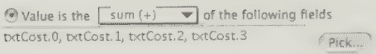

**图 5.12** 采购总费用将是各商品费用之和。我们可以使用预定义计算来实现。

**图 5.12** 显示了在计算文本框中输入的全部四个 `txtCost` 字段名称。然而，由于 Cost 字段的名称遵循 Adobe 层级命名约定，我们可以在指定 `txtTotal` 计算时使用一个快捷方式。如果我们在计算文本框中输入名称 `txtCost`（**图 5.13**），Acrobat 会将其视为所有以 `txtCost` 加点号再加某个后缀开头的字段的简写。这就是使用层级命名约定的真正好处：你可以通过字段名称的前缀来引用一整组字段。当有这个捷径可用时，没有理由不用它。

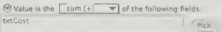

**图 5.13** 由于我们使用了 Adobe 层级命名约定来命名 `txtCost` 表单字段（`txtCost.0`、`txtCost.1` 等），因此可以将预定义计算指定为 `txtCost` 的总和。

我们完成了！现在我们拥有了一个功能完整的订单表单，只需输入价格和数量，它就会自动填写所有其他信息。试试看吧。输入一些数字。给商品起些富有想象力和趣味的名字！

## 计算顺序

表单中计算的执行顺序非常重要。我们必须在计算税额之前先计算小计，在计算商品费用之前先得到小计和税额，以此类推。

有时你会发现 Acrobat 表单中的计算似乎以错误的顺序执行。你可以指定

## 增强功能

我们可以为表单添加一些增强功能。这些功能严格来说是可选的，但从长远来看会带来回报。如果你想查看它们的实际效果，这些功能已应用于本章示例中的文件 `Ch05_Example1_B&W.pdf`。（*B&W* 在此是 *Bells and Whistles*（花哨功能）的缩写。）

## 隐藏零值

到目前为止，我们构建的表单与图 5.1 中所示的表单之间存在一个显著的视觉差异。在我们版本的表单中，所有与“空”行相关的计算字段都显示为零，这是它们执行计算的结果（图 5.16）。虽然这在技术上是正确的，但在视觉上令人不快。如果我们没有指定要购买的商品，其关联的表单字段最好留空，而不是显示明确的零。

为了消除这种视觉干扰，我们需要更改与 `txtSubtotal` 和 `txtTaxAmt` 字段关联的计算。它们应该仅在相应的 `txtQty` 具有非零值时才执行计算；如果 `txtQty` 的值为零（如果该字段为空，则会出现这种情况），那么我们的小计和税额字段应该为空——也就是说，它们的值应为 `""`。

| 项目 | 价格 | 数量 | 小计 | 税额 | 成本 |
|---|---|---|---|---|---|
| Minxy 的毛皮衬里猫箱 | $100.00 | 4 | $400.00 | $32.00 | $432.00 |
|  |  |  | $0.00 | $0.00 | $0.00 |
|  |  |  | $0.00 | $0.00 | $0.00 |
|  |  |  | $0.00 | $0.00 | $0.00 |
|  | 合计 |  | $432.00 |  |  |

以下是 `txtSubtotal.0` 的新计算 JavaScript：

```javascript
// 获取计算所需的两个字段
var price = this.getField("txtPrice.0")
var qty = this.getField("txtQty.0")

// 如果数量不为零...
if (qty.value != 0)      // != 表示“不等于”
    // ...则执行此操作
    event.value = price.value * qty.value
else
    // ...否则执行此操作
    event.value = ""
```

请记住 JavaScript 的 `if...else` 命令是如何工作的：`if` 命令后跟括号中的比较；在我们的例子中，我们比较 `qty.value` 和 `0`，测试它们是否不相等。比较之后，是应在此比较为真时执行的一行或多行 JavaScript；在我们的例子中，需要条件执行的单行执行小计计算。

`else` 命令（如果提供，它是可选的）后跟应在此比较不为真时执行的一行或多行 JavaScript；在我们的例子中，如果比较为假（即，如果 `qty.value` 等于 `0`），那么我们将把文本字段的值设置为空字符串：`""`。

此更改的最终结果是，如果某个项目的数量字段为空（其值为零），那么 `txtSubtotal.0` 字段将为空白。

要对 `txtTaxAmt` 字段应用相同的效果，您应将其值计算更改为：

```javascript
var subtotal = this.getField("txtSubtotal.0")

if (subtotal.value != 0)
    event.value = gTaxRate * subtotal.value
else
    event.value = ""
```

这体现了与 `txtSubtotal.0` 字段完全相同的逻辑，只是我们检查 `txtSubtotal.0` 的值是否为零，以决定是否在税额字段中放入空白。

您应该将此 `if...else` 块添加到所有四个 `txtSubtotal` 和 `txtTaxAmt` 字段中。

## 预定义计算

不幸的是，任何使用预定义计算的字段（例如我们的 `txtCost` 字段），如果其值为 0，仍将继续显示为“0.0”。这可能是唯一需要在预定义计算可行时改用 JavaScript 的原因。如果我们希望 `txtCost.0` 字段在为零时正确地显示为空白，我们需要用 JavaScript 计算其值，而不是使用预定义的求和：

```javascript
var subtotal = this.getField("txtSubtotal.0")
var tax = this.getField("txtTaxAmt.0")
```

如果小计不为零……

```javascript
if (subtotal.value != 0)
```

……则执行此操作：

```javascript
event.value = subtotal.value + tax.value
```

否则……

```javascript
else
```

……则执行此操作：

```javascript
event.value = ""
```

这比使用预定义计算稍微麻烦一些，但它确实带来了美观上的改进，使得零值的合计项显示为空白。

## “全局”税率

假设在您设计此表单很久之后，您所在地区的税率发生了变化。在我们的表单中，我们使用税率（.08）来计算 `txtTaxAmt` 字段的值：

```javascript
event.value = .08 * subtotal.value
```

我们的表单有四个这样的字段；在其他表单中，税率可能被多次使用，分散在复杂表单的各个字段中。追踪所有这些税率引用并将 `.08` 替换为，例如 `.09`，即使最好情况也是一项繁琐的工作。

事实上，从一开始就设计表单，使更改所有税率引用变得容易，是很容易做到的。我们将向表单添加一个文档 JavaScript，它只做一件事：定义一个包含税率的变量。

您可能还记得第 2 章的内容，在文档 JavaScript 中定义的变量可以被 Acrobat 文档中的任何 JavaScript 使用。既然如此，我们表单中任何需要引用税率的 JavaScript 都可以使用税率变量的名称，而不是直接使用数值。如果我们稍后修改文档 JavaScript，更改分配给税率变量的值，所有使用该变量的 JavaScript 都将使用新的税率。一劳永逸，我们将更改整个表单中使用的税率。

可以在整个 Acrobat 文件中使用的变量，例如我们的税率，被称为**全局变量**。您在文档 JavaScript 中定义的任何内容都是全局的，即对文档中的所有 JavaScript 都可用。

## 创建文档 JavaScript

您可能需要复习第 2 章，以了解文档 JavaScript 的一般行为和创建的详细描述。在这里，我们将仅列出创建特定 JavaScript 的步骤。

### 创建税率 JavaScript

从打开 Acrobat 文档并选择手形工具开始。

1. 在 Acrobat 中，选择工具 > JavaScript > 文档 JavaScript。

   Acrobat 将向您显示 JavaScript 函数对话框。

2. 在“脚本名称”文本框中，键入 `TaxRate` 或其他描述性标签（**图 5.17**）。
3. 单击“添加”按钮。

Acrobat 将显示标准 JavaScript 编辑对话框，其中已预先输入了一些（对我们无用的）代码。

4. 删除 JavaScript 编辑对话框中的默认代码，然后输入以下内容：

```javascript
var gTaxRate = .08
```

这一行 JavaScript 创建了一个名为 `gTaxRate` 的变量，并将其赋值为 .08（图 5.18）。（我总是以小写字母 `g` 开头来命名全局变量；这样，当我在其他 JavaScript 中看到该变量名时，我就知道它是一个在文档 JavaScript 中定义的全局变量。）

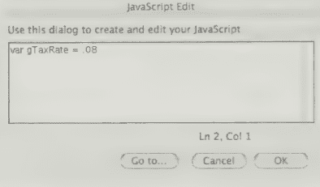

> **图 5.18** 我们的文档 JavaScript 非常简短。它只是定义了一个名为 `gTaxRate` 的单一变量。

5. 关闭所有对话框，直到返回到 Acrobat 文档。

我们现在已经创建了一个文档 JavaScript，用于创建我们的全局变量 `gTaxRate`。

## 使用全局变量

现在我们需要修改四个 `txtTaxAmt` 计算公式，使它们使用 `gTaxRate`，而不是直接使用数字 .08。

像往常一样，我将引导您更改 `txtTaxAmt.0`，然后由您来修改其他三个 `txtTaxAmt` 字段。

### 应用新的全局变量

在 Acrobat 中打开表单并选择表单工具。

1. 双击 `txtTaxAmt.0` 以打开字段属性对话框。
2. 转到计算面板。
3. 点击计算 JavaScript 旁边的编辑按钮。

您现在将看到显示我们当前 JavaScript 的 JavaScript 编辑对话框。该 JavaScript 将计算定义为：

```javascript
event.value = .08 * subtotal.value
```

4. 将计算中的 `.08` 替换为名称 `gTaxRate`。

您的计算行现在应如下所示（图 5.19）：

```javascript
event.value = gTaxRate * subtotal.value
```

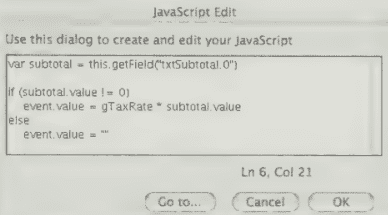

**图 5.19** 在我们的表单字段 JavaScript 中，必须使用全局变量 `gTaxRate` 的名称，而不是实际的数值。如果以后我们在文档 JavaScript 中更改 `gTaxRate` 的值，这将自动更改所有计算表单字段中使用的税率。

5. 关闭所有对话框，直到返回到 Acrobat 文档。

您应该对上述四个 `txtTaxAmt` 计算 JavaScript 都进行上述更改。

完成后，您不会立即看到任何变化。毕竟，我们的税率并没有改变；我们只是通过变量来获取它，而不是直接使用该数字。

## 更改税率

要理解为什么这种更改是有用的，假设您所在地区的税率发生了变化（presumably 是上调）。要一次性完成所有必要的更改，您只需在文档 JavaScript 中更改 `gTaxRate` 的值。

### 更改表单中所有项目的税务计算

1. 选择工具 > JavaScript > 文档 JavaScript。

   您将看到 JavaScript 函数对话框。

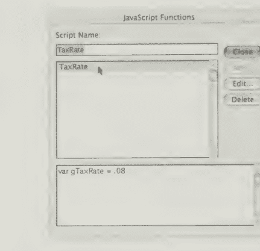

**图 5.20** 如果以后您想更改整个表单中使用的税率，只需转到 JavaScript 函数对话框，点击 `TaxRate` 脚本，然后点击编辑。接着您可以更改赋给 `gTaxRate` 变量的值。

2. 在列表中选择 `TaxRate` JavaScript（如**图 5.20**所示），然后点击编辑按钮。
3. 在 JavaScript 编辑对话框中，将税率更改为 .09，或任何其他您喜欢的数字：

```javascript
var gTaxRate = .09
```

4. 退出所有对话框，直到返回到您的 Acrobat 文档。
5. 查看税额字段；所有四个字段现在都将包含反映新税率的计算值。

通过在文档 JavaScript 中更改单一的税率值，我们更新了表单中所有 JavaScript 使用的税率。在这个例子中，只有四个这样的 JavaScript；在更大的表单中，可能会有几十个。

# 6 自动输入表单数据

电子表单的美丽之处之一就是它们能够提供用户原本需要输入的信息。例如，当用户在电子订单表单中选择要购买的产品时，表单应该能够自动填入正确的单价并计算总成本。

要实现这一点，表单必须包含一个产品及其价格的表格。每次用户选择产品时，表单必须在表格中查找该项目并获取该物品的价格。

这就是我们在本章将要学习的内容：如何在表单中构建一个物品和价格的表格，然后从该表格中获取信息以自动填充表单字段。

## 项目

（文件：`Ch06_Example_1.pdf`、`Ch01_Example_1_Raw.pdf`）

在本章中，我们将把订单表单中的组合框（**图 6.1**）链接到同一表单中的单价/ml 字段。当用户从组合框菜单中选择新产品时，表单将更改每毫升的价格以反映所选产品，然后重新计算总成本（**图 6.2**）。

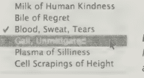

**图 6.1** 表单包含此组合框中所有项目的价格列表。

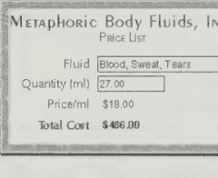

**图 6.2** 单价/ml 和总成本字段始终反映组合框中当前选定的项目。当用户选择新项目时，每毫升价格和总成本会随之更改以反映新项目。

查看**图 6.3**，我们可以看到这个表单有四个字段：一个组合框（`cboFluid`）和三个文本字段（`txtQuantity`、`txtRate` 和 `txtTotal`）。我们最关心的字段是组合框；我们将向此字段添加一个 JavaScript，以更改 `txtRate` 和 `txtTotal` 字段来反映用户选择的液体。具体来说，当我们从其菜单中选择一个项目时，该字段必须做三件事：

- 查找该物品的价格。
- 将 `txtRate` 的值设置为该物品的价格。
- 重新计算 `txtTotal` 的值。

让我们看看如何实现。

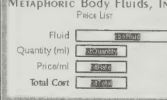

**图 6.3** 我们的表单中有四个字段：一个组合框和三个文本字段。

## JavaScript

## 方法


在这个程序中，我们需要为组合框菜单中的项目构建一个价格表。我们将使用 JavaScript `Array` 对象来实现这一点。`Array` 对象表示一个列表——在我们的例子中，是一个价格列表。列表中的每个项目都可以通过其在列表中的位置或关键字（我们已与该列表值关联的字符串）来查找。在我们的例子中，我们将使用组合框中每个项目的导出值（见下一节）作为关键字来获取该项目的价格。

我们需要为表单编写两个 JavaScript：

- 一个创建我们价格表的文档 JavaScript。该脚本将创建一个 `Array` 对象，然后用成对的导出值和相关价格填充它。
- 一个附加到组合框的 JavaScript，用于在价格表中查找当前导出值，并使用 resulting 价格来设置 `txtRate` 和 `txtTotal` 字段的值。

### 组合框导出值

组合框菜单中的每个项目都有两段与之关联的文本：

- 实际出现在弹出菜单中的项目文本。
- 当表单数据导出到文件或提交处理时代表组合框所选值的导出值。

组合框中每个项目的文本和导出值由表单设计器在字段属性对话框中设置（图 6.4）。

如果您检查组合框的属性，会发现菜单中有六个项目，其导出值如下：MHK、BST、PS、BR、GU、CSH。这些值并没有什么特别之处；我选择它们只是为了大致缩写菜单项文本。（因此，"MHK" 是 "Milk of Human Kindness" 的导出值。）

我们的 JavaScript 将把这些导出值分别与相应产品的每毫升价格关联起来。

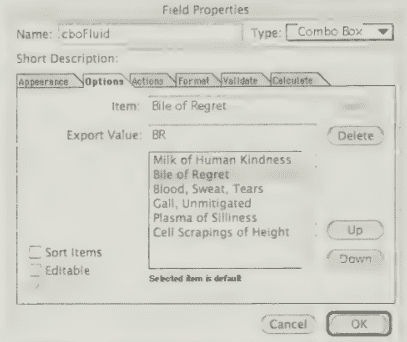

**图 6.4** 组合框中的每个菜单项都有两个字符串与之关联：显示在菜单中的项目文本，以及用于在组合框数据处理时报告用户选择的导出值。

## 创建价格列表数组

我们的第一个 JavaScript 是一个创建价格列表的文档脚本。这将是一个包含成对导出值和价格的 `Array` 对象。有关文档 JavaScript 的完整讨论，请参阅第 2 章。

**创建文档脚本：**

在 Acrobat 中打开表单文件。

1. 选择工具 > JavaScript > 文档 JavaScript。

Acrobat 将显示 JavaScript 函数对话框（图 6.5）。

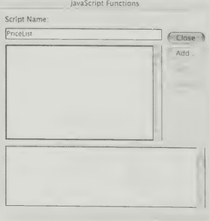

**图 6.5** JavaScript 函数对话框是您创建文档 JavaScript 的地方。输入 JavaScript 的名称（在本例中为 "PriceList"），然后点击添加按钮。

2. 在“脚本名称”框中，输入“PriceList”或类似具有描述性的名称。
3. 点击“添加”按钮。

Acrobat 将为您呈现一个常规的 JavaScript 编辑对话框，其中包含一些初始 JavaScript 代码。

4. 删除默认的 JavaScript 代码，并输入以下 JavaScript（图 6.6）：

```javascript
var gPriceList = new Array   // Create a reference to a new array

// Load the array up with prices for the products:
gPriceList["MHK"] = 16       // MHK's price is $16/ml
gPriceList["BR"] = 12        // ...etc.
gPriceList["BST"] = 18
gPriceList["GU"] = 6
gPriceList["PS"] = 4
gPriceList["CSH"] = 72.50
```

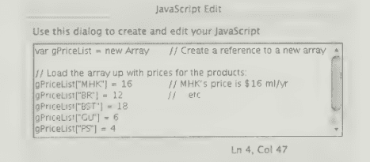

*图 6.6* 您在 JavaScript 编辑对话框中输入文档 JavaScript。

5. 点击“确定”退出所有对话框，直到返回到 Acrobat 页面。

此时，您的表单中不会显示任何变化。我们新的 JavaScript 创建了一个价格列表数组，但我们尚未使用它执行任何操作。

## 代码详解

```javascript
var gPriceList = new Array
```

JavaScript 的 `new` 命令创建一个新对象，在本例中，是一个新的 `Array` 对象。我们将新创建的 `Array` 对象赋值给一个全局变量 `gPriceList`（由 `var` 命令创建）。由于这发生在文档 JavaScript 内，因此 `gPriceList` 将在我们 Acrobat 文件中的任何 JavaScript 中可用。

```javascript
gPriceList["MHK"] = 16
```

在这里，我们将价格与组合框中的导出值关联起来。一个数组名（`gPriceList`）后跟一对方括号，其中包含一个值，表示列表中的一个条目。方括号内可以是一个数字，指定我们想要的特定项目在列表中的顺序位置；也可以是引号内的字符串，表示与所需项目关联的关键词。

在我们的例子中，我们为列表中的 `MHK` 条目赋值。上面的 JavaScript 行，翻译成中文意思是：“在数组 `gPriceList` 中，将数字 16 赋值给关键词 MHK。”

我们对组合框中所有六个导出值重复此操作。

## 格式化您的代码

JavaScript 对于添加空格或制表符以提高代码可读性非常宽容。您可以以任何您喜欢的方式缩进 JavaScript，以提高代码的扫描阅读性。例如，我通常会缩进 `if` 命令之后的语句，以强调它们仅在比较为真时才会执行：

```javascript
if (event.changeEx in gPriceList)
    rateFld.value = gPriceList[event.changeEx]
```

类似地，我通常使用制表符和空格的某种组合将我的注释与可执行的 JavaScript 代码分开；我也尽量让它们对齐：

```javascript
gPriceList["MHK"] = 16    // MHK's price is $16/ml
gPriceList["BR"] = 12     // ...etc.
```

这使得它们更具可读性，并且在我看来，更具美感。

您可以对 JavaScript 语句进行双倍行距，并根据需要添加空格和制表符。您的目标应该是使您的程序尽可能具有可读性。这不仅对他人是一种便利，而且在您几个月后返回查看自己的程序时，对您自己也是一种服务。

## 创建组合框脚本

现在我们需要教我们的组合框如何查找导出值并利用它们做一些有用的事情。

我们将为我们的组合框附加一个**击键 JavaScript**。这是一个每当用户在组合框中输入一个字符时就会执行的 JavaScript。令人惊讶的是，每当用户从组合框的菜单中选择一个项目时，此脚本也会被调用。

因此，当用户从组合框菜单中选择一个项目时，Acrobat 将执行我们的击键 JavaScript，该脚本将执行我们的表查找，更改 `txtRate` 的值，并最终计算 `txtTotal` 的新值。

**要将击键 JavaScript 附加到我们的组合框：**

从打开表单并选中表单工具开始。

1. 双击组合框以获取其属性。

Acrobat 将为您呈现字段属性对话框（图 6.7）。

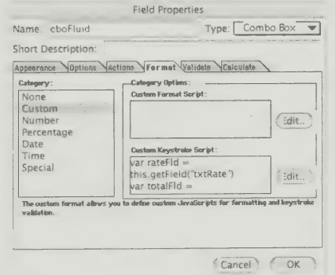

*图 6.7* 您通过双击组合框，然后转到所得字段属性对话框中的“格式”面板来创建击键 JavaScript。

2. 转到“格式”面板。
3. 在“类别”列表中选择“自定义”。
4. 单击“自定义击键脚本”文本框旁边的“编辑”按钮。现在您将看到 JavaScript 编辑对话框（图 6.8）。
5. 输入以下脚本：

```javascript
// Get references to our form fields.
var rateFld = this.getField("txtRate")
var totalFld = this.getField("txtTotal")
var quantityFld = this.getField("txtQuantity")

// Is the new export value a keyword in our price list?
if (event.changeEx in gPriceList)
    rateFld.value = gPriceList[event.changeEx]

// Now calculate a new value for the total price
totalFld.value = quantityFld.value * rateFld.value
```

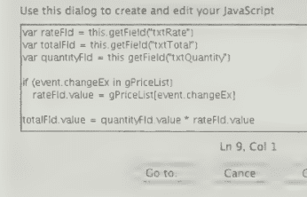

**图 6.8** 像往常一样，在 JavaScript 编辑对话框中输入您的击键 JavaScript。

6. 单击“确定”关闭所有对话框。
7. 试一试：从弹出菜单中选择不同的项目，并观察每毫升价格和总成本字段值的变化。

## 代码详解

```javascript
var rateFld = this.getField("txtRate")
var totalFld = this.getField("txtTotal")
var quantityFld = this.getField("txtQuantity")
```

此脚本首先获取我们需要访问的三个文本字段的引用，并将这些引用放入适当命名的变量中。

```javascript
if (event.changeEx in gPriceList)
```

我们在这里执行一个 JavaScript `if` 命令，该命令检查新的导出值是否是 `gPriceList` 数组中的有效关键词。在组合框的击键 JavaScript 中，`event.changeEx` 指的是新选中菜单项的导出值。短语（`event.changeEx in gPriceList`）翻译为：“数组对象 `gPriceList` 中是否有与我们的导出值匹配的关键词？”

```javascript
rateFld.value = gPriceList[event.changeEx]
```

这是当 `event.changeEx` 是 `gPriceList` 中的关键词时 `if` 执行的 JavaScript 行。

短语 `gPriceList[event.changeEx]` 从 `gPriceList` 数组中获取与导出值关联的值。换句话说，该短语为我们提供了组合框中当前选定项目的价格。我们将 `txtRate` 字段的值设置为该数字。`txtRate` 字段将立即显示新的每毫升价格。

```javascript
totalFld.value = quantityFld.value * rateFld.value
```

最后，我们将 `txtTotal` 字段（位于 `totalFld` 变量中）的值更改为数量和单价的乘积。后两个数字我们从 `txtQuantity` 和 `txtRate` 字段中获得。

## 鼠标悬停帮助

每个设计良好的表单都需要某种机制来提示用户如何填写表单。在 Acrobat 中，最常见的方法是利用内置于 Acrobat 表单机制的工具提示帮助。（您在字段属性对话框的“简要描述”字段中输入的任何文本都会成为该字段的工具提示文本。）在本章中，我们将看到如何实现一种替代方法：鼠标悬停帮助。这是当鼠标指针进入表单字段时自动出现的文本；它不像工具提示帮助那样有半秒钟的停顿。使用鼠标悬停帮助而不是工具提示帮助纯粹是一个美学决定，基于您希望填写表单的人对表单“感觉”如何。

## 项目

（文件：`Ch07_Example_1.pdf`、`Ch07_Example_1_raw.pdf`）

我们将为图 7.1 中表单的文本字段添加鼠标悬停帮助。每当鼠标指针移动到某个文本字段上时，一些帮助文本就会出现在表单底部的蓝色大区域中，如图 7.2 所示。

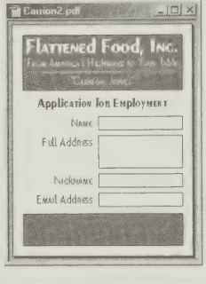

图 7.1 我们将为此表单中的文本字段添加鼠标悬停帮助。

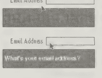

图 7.2 当鼠标指针移过文本字段时（顶部），描述性文本将出现在表单底部的蓝色区域中（如下所示）。

此表单中有五个文本字段（图 7.3）。前四个用于收集数据：申请人的姓名、地址、昵称和电子邮件地址；底部字段 `txtHelp` 是一个不可见的文本字段，位于表单设计中的蓝色矩形上方。

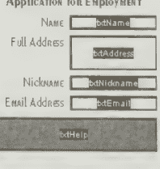

图 7.3 我们的表单有五个文本字段。我们将使用底部的字段为上方的四个字段显示帮助文本。

## JavaScript

### 实现思路

`txtHelp` 字段之所以不可见，并不是因为在字段属性对话框中选择了"隐藏"属性，而是因为它没有背景色或边框颜色（图 7.4），且其中没有初始文本。只有当它包含需要显示的文本时，它才会变得可见。

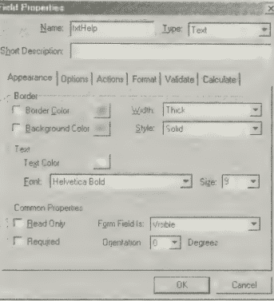

**图 7.4** 这是我们帮助文本表单字段的"外观"属性。注意，它没有背景和边框；这意味着如果字段中没有文本，该字段就是不可见的。

为了实现鼠标悬停帮助功能，每当鼠标指针进入四个数据输入文本字段之一时，该字段中的 JavaScript 就会将相应的帮助文本放入 `txtHelp` 字段中。当指针离开文本字段时，该字段的 JavaScript 会清除 `txtHelp` 中的文本。

我们需要为这四个文本字段各编写两个 JavaScript：

- 一个 JavaScript 附加到字段的 Mouse Enter（鼠标移入）事件，用于将相应的帮助文本放入 `txtHelp` 字段。请记住，Mouse Enter 事件在鼠标指针移入表单字段边界时触发。
- 一个 JavaScript 附加到字段的 Mouse Exit（鼠标移出）事件，用于清除 `txtHelp` 中的文本。请记住，Mouse Exit 事件在鼠标指针移出表单字段时触发。

## 代码实现

接下来我们将 JavaScript 附加到 `txtName` 字段上。要完成整个表单，你需要对其余的数据输入字段执行相同的步骤。

确保表单在 Acrobat 中处于打开状态，且"表单工具"已被选中。

1. 双击 `txtName` 字段以进入其属性设置（图 7.5）；切换到字段属性对话框的"操作"面板。

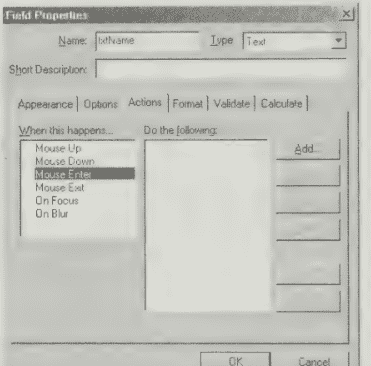

**图 7.5** 字段属性对话框的"操作"面板是你将 JavaScript 附加到文本字段的地方。

2. 在"当发生此事件时"下拉框中，选择 Mouse Enter，然后点击"添加"按钮。Acrobat 将弹出"添加操作"对话框（图 7.6）。


**图 7.6** "添加操作"对话框让你可以为表单字段附加一个操作。我们的操作将创建一个 JavaScript，用于向 Name 字段添加帮助文本。

3. 在弹出菜单中选择 JavaScript，然后点击"编辑"按钮。Acrobat 将弹出 JavaScript 编辑对话框（图 7.7）。


图 7.7 你在 JavaScript 编辑对话框中输入你的 JavaScript 代码。

4. 在 JavaScript 编辑对话框中输入以下代码：

```javascript
var helpText = this.getField("txtHelp")
helpText.value = "What's your full name?"
```

5. 点击"确定"返回到"添加操作"对话框。点击"设置操作"按钮，回到"操作"面板。此时 Mouse Enter 事件旁边出现了一个圆点，表示该事件已关联了一个操作（图 7.8）。


图 7.8 回到"操作"面板后，Mouse Event 旁边会出现一个圆点，表示该事件已分配了一个操作。

6. 重复步骤 2 到 5，为 Mouse Exit 事件编写操作，在 JavaScript 编辑对话框中输入以下代码：

```javascript
var helpText = this.getField("txtHelp")
helpText.value = ""
```

7. 关闭所有对话框，直到返回 Acrobat 页面。
8. 测试一下：点击手形工具，然后将鼠标指针移到 Name 字段上方；你应该能看到帮助文本出现在蓝色方框中。

你需要对 `txtAddress`、`txtNickname` 和 `txtEmail` 字段重复上述步骤，并为每个字段使用相应的帮助文本。

## 代码详解

首先来看 Mouse Enter 的 JavaScript：

```javascript
var helpText = this.getField("txtHelp")
```

我们首先获取帮助文本字段 `txtHelp` 的引用，并将其赋值给变量 `helpText`。

```javascript
helpText.value = "What's your full name?"
```


然后我们将 `helpText` 字段的值设置为帮助文本 "What's your full name?"。文本字段的值就是它向用户显示的文本。当我们设置字段的值时，它会立即显示该文本。在我们的例子中，这段脚本使得鼠标指针移入 `txtName` 字段时帮助文本就会出现。

Mouse Exit 的 JavaScript 与 Mouse Enter 脚本几乎相同：

```javascript
var helpText = this.getField("txtHelp")
helpText.value = ""
```

它同样获取 `txtHelp` 字段的引用，但这次将其值设置为 `""`。一对紧挨着的引号，中间没有任何内容，表示“没有文本”。当鼠标指针离开 `txtName` 时，`txtHelp` 字段不显示任何文本，因此实际上又“消失”了。

## 增强功能

（文件：`Ch07_Example2.pdf`、`Ch07_Example2_raw.pdf`）

目前状态下的鼠标悬停帮助功能运行良好。如果说有什么不足，那就是我们的帮助文本片段分散在所有文本字段中；如果我们想重写帮助条目——比如翻译成西班牙语——就需要逐一查找并修改它们。

如果我们能将所有帮助文本字符串集中到一处，便于维护和修改，那将会很有帮助。我们可以通过将它们全部放入一个 JavaScript 数组对象来实现。你可能还记得第 6 章的内容：数组对象在你的 JavaScript 代码中表示一个列表——在我们的例子中，就是帮助文本字符串的列表。

我们将在 Document JavaScript 中创建帮助文本数组，以便文档中所有其他 JavaScript 都能使用它。具体来说，我们的表单字段 JavaScript 将能够使用数组中的字符串，而不必在字段脚本本身中用引号包含文本。

要实现这种新方法，我们需要做两件事：

- 编写一个 Document JavaScript，创建一个包含所有相应帮助文本的数组对象。
- 修改所有表单字段中的 Mouse Enter JavaScript，使其使用这个全局数组中的帮助文本（称为“全局”是因为该数组在整个表单中都可访问）。

这种修改完全是可选的，但从长远来看是值得的，特别是对于包含大量鼠标悬停帮助文本的大型复杂表单。

### Document JavaScript

要创建新的 Document JavaScript，在 Acrobat 中打开表单文件，然后执行以下操作：

1. 选择“工具”>“JavaScript”>“Document JavaScript”。Acrobat 将弹出 JavaScript 函数对话框（图 7.9）。


**图 7.9** JavaScript 函数对话框是你创建 Document JavaScript 的地方。在其中输入 JavaScript 的名称（如上图中的“HelpText”），然后点击“添加”按钮。

2. 在“脚本名称”框中，输入名称“HelpText”或其他类似描述性的名称。请记住，所有 Document JavaScript 都必须有名称。
3. 点击“添加”按钮。Acrobat 将弹出常用的 JavaScript 编辑对话框（图 7.10），其中包含一些初始 JavaScript 代码。


*图 7.10* 你在 JavaScript 编辑对话框中输入你的 Document JavaScript。

4. 将默认的 JavaScript 代码替换为以下代码；这段脚本创建一个数组并一次性加载所有字符串；我们稍后会详细讨论它：

```javascript
var gHelpText = [         // Create a variable, gHelpText
    "What's your name?",              // String #0
    "Where do you live?",               // String #1
    "What may we call you in the office?",  // String #2
    "What's your email address?"        // String #3
]
```

5. 点击“确定”，关闭所有对话框，直到返回 Acrobat 页面。此时你的表单不会有任何变化。我们的新 JavaScript 创建了一个帮助文本字符串列表，但表单还没有使用它。我们稍后会教表单如何使用这个新数组，但首先，让我们深入了解一下这段 JavaScript 的内部机制。

## 代码详解

```javascript
var gHelpText = [
    "What's your name?",
    "Where do you live?",
    "What may we call you in the office?",
    "What's your email address?"
]
```

虽然不太明显，但这个文档 JavaScript 中其实只有一条 JavaScript 语句：即创建数组并加载一系列值的语句。`var` 命令一如既往地创建了一个变量，这次命名为 `gHelpText`。（名称开头的 `g` 表示这是一个全局可访问变量；这是我自己命名的约定，并非 JavaScript 的要求。）

当变量名后面跟着一对方括号时（如此处），`var` 命令会将变量创建为一个数组，并将方括号内找到的项目列表放入该数组中。

在此示例中，数组中填充了一系列字符串，每个字符串都是我们某个表单字段的一小段帮助文本。

这就是我们文档 JavaScript 所需做的全部工作。`gHelpText` 数组现在是我们所有帮助文本的存储库。其他 JavaScript 可以使用以下语法获取这些字符串：

```javascript
gHelpText[2]
```

方括号中的数字是我们想要的字符串在 `gHelpText` 数组中的顺序位置。数组中的项目从零开始编号，因此 `gHelpText[0]` 将引用我们列表中的字符串 "What's your name?"。

## 新表单字段 JavaScript

现在我们已经创建了一个全局可用的帮助文本数组，需要教我们的表单字段脚本来使用它。具体来说，在每个文本字段中，我们需要更改与 Mouse Enter（鼠标移入）事件关联的脚本。

以下是 `txtName` 字段的新版 Mouse Enter JavaScript：

```javascript
var helpText = this.getField("txtHelp")
helpText.value = gHelpText[0]
```

这与我们之前的 Mouse Enter 脚本相同，但有一个变化：在第二行代码中，我们将文本字段的值设置为 `gHelpText` 数组中的第 0 个字符串（"What's your name?"），而不是像之前那样直接将字符串放在脚本的引号中。

我们需要使用每个字段帮助文本对应的数字位置，更改我们文本字段中的每一个 Mouse Enter JavaScript。

对于用户来说，我们的表单看起来将与之前并无不同。但是，将来更改帮助文本（例如支持其他语言）会容易得多，因为所有文本都集中在我们表单的一个地方。

相信我，对于复杂的表单，你会发现这项技术非常有用。

## 动态表单字段

Acrobat 表单中最常见的“特效”之一，就是根据对其他表单字段的响应来显示和隐藏表单字段。例如，单击标记为“自雇”的复选框，可能会出现一系列文本字段，要求提供您的公司名称、联邦纳税人识别号和其他相关信息；如果取消选中该复选框，这些文本字段将全部消失。

我将这种效果称为表单字段的渐进式显示。这些字段并非最初全部可见；隐藏的字段仅当用户从可见控件中做出选择时才会向用户显示。

在本章和下一章中，我们将了解如何实现这一点。本章将介绍一种切换相对少量表单字段可见性的技术。在下一章中，我们将了解如何让整页表单字段按命令显示。

## 项目 1：将 JavaScript 附加到复选框

（文件：`Ch08_Example1.pdf`、`Ch08_Example1_raw.pdf`）

我们将为**图 8.1**所示的表单添加渐进式显示功能。最初，用户唯一可见的控件是复选框。当用户选中该复选框时，将显示两个组合框和一个按钮，允许用户指定类型和电影并提交请求（**图 8.2**）。如果用户取消选中该复选框，则组合框和按钮将再次消失。


**图 8.1** 我们将为此 Acrobat 文档中的表单字段添加渐进式显示。最初，唯一可见的表单字段是复选框。


**图 8.2** 当用户单击复选框时，附加到该控件的 JavaScript 会使表单中的其他字段可见。

图 8.3 显示了我们 Acrobat 文件中的表单字段。共有四个：

- `chkYes` 是复选框，允许用户声明希望获得免费 DVD。
- `cboGenre` 是组合框，用户可以从中选择一个类型。
- `cboTitle` 是组合框，用户可以从中选择一个标题。
- `btnSubmit` 是标准的数据提交按钮。

其中，`chkYes` 在文档首次打开时是唯一可见的；其他字段的可见性均设置为 `hidden`（在字段属性对话框中）。其他字段将因我们将编写的 JavaScript 而变为可见。


**图 8.3** 我们的示例表单有四个字段，其中只有复选框是最初可见的。

## JavaScript

### 解决方案思路

从概念上讲，这是一个相当简单的问题。每个表单字段都有一个名为 `hidden` 的布尔（真/假）属性，该属性决定该字段是否可见；如果 `hidden` 属性设置为 `true`，则该字段对用户不可见。

我们需要编写一个 JavaScript 来切换两个组合框和按钮的 `hidden` 属性。我们将把此 JavaScript 附加到复选框字段的 Mouse Up（鼠标释放）事件。JavaScript 将查看复选框是被选中还是被取消选中。如果复选框被选中，则 JavaScript 将其他字段的 `hidden` 属性设置为 `false`，使其对用户可见；否则，脚本将 `hidden` 属性设置为 `true`，隐藏其他字段。

我们的 JavaScript 如何判断复选框是否被选中？我们可以查看该字段的导出值。（复选框的导出值是该字段在复选框被选中时具有的值。）当我创建此表单时，我设置了复选框的导出值为字符串 "Yes"（图 8.4）。我们的 JavaScript 只需查看复选框的 `value` 属性，看它是否为 "Yes"，然后相应地设置其他字段的 `hidden` 属性。


**图 8.4** 复选框的导出值为 "Yes"；这是我创建表单时设计的一部分。

### 复选框脚本

要将 JavaScript 附加到复选框：

1. 首先，转到 `chkYes` 复选框的字段属性对话框的操作面板（图 8.5）。（回顾如何进入该面板，请参见第 1 章。）
2. 选择 Mouse Up 事件，然后单击“添加”按钮。您现在将看到“添加操作”对话框。
3. 在弹出菜单中选择 JavaScript 选项，然后单击“编辑”按钮。Acrobat 将向您显示通常的 JavaScript 编辑对话框。


**图 8.5** 切换其他表单字段的 JavaScript 附加在 `chkYes` 复选框上，并与 Mouse Up 事件关联。

4. 在 JavaScript 编辑对话框中键入以下脚本（**图 8.6**）：

```javascript
// Get references to the form fields
var genreFld = this.getField("cboGenre")
var titleFld = this.getField("cboTitle")
var submitBtn = this.getField("btnSubmit")

// If the check box is selected, make the form fields visible
if (event.target.value == "Yes") {
    genreFld.hidden = false
    titleFld.hidden = false
    submitBtn.hidden = false
}
// Otherwise, hide the fields
else {
    genreFld.hidden = true
    titleFld.hidden = true
    submitBtn.hidden = true
}
```


**图 8.6** 像往常一样，在 JavaScript 编辑对话框中输入您的 JavaScript。

5. 退出所有对话框，直到您再次看到 Acrobat 页面。
6. 试一试：返回手型工具并单击复选框；页面上应该出现所有其他表单字段。取消选中该复选框，其他字段将消失。

## 代码详解

```javascript
var genreFld = this.getField("cboGenre")
var titleFld = this.getField("cboTitle")
var submitBtn = this.getField("btnSubmit")
```

我们首先获取三个表单字段的命名引用，我们将操作这些字段的可见性。我们需要这些引用来访问它们的 `hidden` 属性。

记住，您可以为变量随意命名。我使用了 `genreFld`、`titleFld`、`submitBtn` 这些名字；对我而言，它们既具有描述性又足够简短。您可以选择任何您喜欢的名字，只要这些名字对 JavaScript 没有特殊含义即可。（例如，将变量命名为 `if` 将无法工作；JavaScript 会将其解释为 if-else 语句的一部分。）

```javascript
if (event.target.value == "Yes") {
```

我们执行 `if` 命令，该命令查看复选框的值是否为 "Yes"。如果是，那么 `if` 将执行括号比较后的花括号中的 JavaScript 行。（记住，双等号（`==`）表示“等于”。）

短语 `event.target.value` 一开始可能看起来很奇怪，但如果你从左到右仔细分析，它就会变得清晰。您可能记得前面章节中 `event.target` 是触发此 JavaScript 的表单字段的引用；在此示例中，事件的目标是我们的复选框。由于 `event.target` 是我们的复选框，`event.target.value` 就是我们复选框的值。如果复选框被选中，此值将为 "Yes"（复选框的导出值）。

```javascript
genreFld.hidden = false
titleFld.hidden = false
submitBtn.hidden = false
```

这里我们让两个组合框和提交按钮变得可见；通过将它们的隐藏属性设置为 `false` 来实现这一点。（既然它们没有被隐藏，那它们必然是可见的，不是吗？）

```javascript
else {
    genreFld.hidden = true
    titleFld.hidden = true
    submitBtn.hidden = true
}
```

`else` 命令指定了如果之前的 `if` 比较不为真时应发生什么；在我们的例子中，如果复选框未被勾选，情况就会是这样。如果之前的比较不为真，那么 `else` 就会执行大括号中的 JavaScript 代码行，将字段的隐藏属性设置为 `true`，使其消失。

## 项目 2：将 JavaScript 附加到组合框

（文件：`Ch08_Example2.pdf`、`Ch08_Example2_raw.pdf`）

在本章的第二个项目中，我们将学习如何使用组合框来显示和隐藏其他表单字段。

如果你查看文件 `Ch08_Example2.pdf`，你会发现它看起来与我们之前的例子很相似；我在保存此文件时，复选框已经被选中，因此当你打开文件时，它将如**图 8.2**所示。在这个项目中，我们将研究下方组合框中的项目如何根据你在上方组合框中选择的流派而变化（**图 8.7**）。如果你在上方组合框中选择“西部片”，下方的组合框将为你提供三部可供选择的西部片。


**图 8.7** *在我们的第二个项目中，下方组合框显示的电影将根据用户在上方组合框中选择的流派而变化。*

图 8.8 展示了在 Acrobat 表单工具被选中时，我们的组合框的外观。上方的组合框 `cboGenre` 在其菜单中有三个项目：当前热门、音乐 DVD 和西部片；在创建这个控件时，我分别为这些项目指定了导出值 `CH`、`MS` 和 `WS`。（你可以在字段属性对话框的选项面板中创建组合框的菜单项和导出值。）


*图 8.8* 我们表单中的下方组合框实际上是三个组合框——其中只有一个可见——彼此堆叠在一起。

在**图 8.8**中，下方组合框的名称看起来有些混乱；这是因为它实际上由三个彼此堆叠的组合框组成，每个流派对应一个。在任何时候，这些组合框中只有一个将是可见的；另外两个的可见性控件将在字段属性对话框中设置为隐藏。这些组合框的名称是 `cboTitleHit`、`cboMusic` 和 `cboTitleWesterns`。


当用户从`cboGenre`中做出选择时，该控件将确定用户选择了哪个项目，然后更改三个堆叠组合框的可见性，使对应的控件可见，而另外两个隐藏。例如，如果用户选择“西部片”作为流派，那么附加到`cboGenre`控件的 JavaScript 将使`cboWesterns`可见，并隐藏另外两个组合框。

## JavaScript

我们将把 JavaScript 作为击键 JavaScript 附加到`cboGenre`字段；每当用户在该字段中输入按键时，Acrobat 都会执行此脚本。在组合框中，每当用户从组合框的菜单中选择一个项目时，也会执行击键 JavaScript；这使得击键 JavaScript 成为放置我们的“启用适当电影列表”脚本的理想位置。

在组合框的击键 JavaScript 中，`event.changeEx`属性保存用户所选菜单项的导出值。我们将依次比较`event.changeEx`与`cboGenre`的每个导出值；当我们找到匹配项时，我们将设置其他三个组合框的`hidden`属性。

### 组合框脚本

要将击键 JavaScript 附加到组合框：

首先选择表单工具，并让字段属性对话框显示`cboGenre`的格式面板。（有关如何进入字段属性对话框，请参阅第 1 章。）

1. 点击“自定义键盘脚本”的编辑按钮（图 8.9）。

Acrobat 将为你呈现 JavaScript 编辑对话框。


> 图 8.9 对于组合框，你希望你的 JavaScript 是击键 JavaScript。每当用户从组合框的菜单中选择一个项目时，Acrobat 都会执行此脚本。

2. 在 JavaScript 编辑对话框中键入以下脚本。

```javascript
// 获取对三个组合框的引用
var hits = this.getField("cboTitleHit")
var music = this.getField("cboTitleMusic")
var westerns = this.getField("cboTitleWesterns")

// 用户是否选择了“当前热门”？
if (event.changeEx == "CH") {
    hits.hidden = false
    music.hidden = true
    westerns.hidden = true
}
```

```javascript
// 用户是否选择了“音乐DVD”？
else if (event.changeEx == "MS") {
    hits.hidden = true
    music.hidden = false
    westerns.hidden = true
}
// 用户是否选择了“西部片”？
else if (event.changeEx == "WS") {
    hits.hidden = true
    music.hidden = true
    westerns.hidden = false
}
```

3. 退出所有对话框，直到你再次回到 Acrobat 页面。

4. 试一试：使用手形工具，从上方组合框中选择不同的流派；第二个组合框将随每个流派而变化。

让我们看看我们在这里做了什么。

### 详细代码解析

```javascript
var hits = this.getField("cboTitleHit")
var music = this.getField("cboTitleMusic")
var westerns = this.getField("cboTitleWesterns")
```

我们首先获取对三个我们想要控制其可见性的组合框的引用。我们将每个组合框对象分配给一个相应命名的变量。（同样，这些变量名是我自己选的；这些名字没什么特别的。）

```javascript
if (event.changeEx == "CH") {
```

这里我们调用了`if`命令，它将`event.changeEx`（包含用户在`cboGenre`中选择的项目的导出值）与字符串`"CH"`进行比较，`"CH"`是“当前热门”菜单项的导出值。一如既往，如果比较为真，`if`将执行大括号中的 JavaScript 代码行。

```javascript
hits.hidden = false
music.hidden = true
westerns.hidden = true
```

如果`if`比较为真——即如果用户在流派组合框中选择了“当前热门”——那么我们将通过设置`hits`对象（即`cboTitleHit`组合框）的`hidden`属性为`false`使其可见。我们还将另外两个组合框的`hidden`属性设置为`true`，使其隐藏。

```javascript
else if (event.changeEx == "MS") {
    hits.hidden = true
    music.hidden = false
    westerns.hidden = true
}
```

如果第一个`if`比较为假——如果用户没有选择“当前热门”——那么我们将检查他们是否选择了“音乐DVD”；我们将`event.changeEx`与`"MS"`（“音乐DVD”项目在流派组合框中的导出值）进行比较。如前所述，如果比较为真，我们将使音乐 DVD 组合框`cboTitleMusic`可见，并隐藏其他两个。

```javascript
else if (event.changeEx == "WS") {
    hits.hidden = true
    music.hidden = true
    westerns.hidden = false
}
```

最后，我们检查用户是否选择了“西部片”作为流派，显示`cboTitleWesterns`组合框，并隐藏其他两个。

### 其他控件类型的 JavaScript

如你所见，创建少量动态可见表单字段背后的原则非常直接：你将 JavaScript 附加到控制表单字段上，该脚本为你想要操作的字段设置`hidden`属性。JavaScript 可能需要确定控制字段的值，以决定哪些控件可见，哪些隐藏，就像我们在组合框中所做的那样。

我们的两个例子将控制 JavaScript 附加到了复选框和组合框上。我们将通过简要回顾如何使用其他表单类型作为控制字段来结束本章。我们不会详细讲解这些，但每种类型的一个示例都在本章的示例文件中。

## 列表框

使用列表框字段来控制其他字段的可见性与使用组合框几乎相同。事实上，用于列表框的 JavaScript 与你在组合框中使用的 JavaScript 是相同的。在这两种情况下，`event.changeEx`属性都将包含用户所选项目的导出值；我们可以检查这个属性，然后相应地更改其他字段的可见性。

不同之处在于，列表框字段的 JavaScript 必须附加到该字段的“选择变更”事件，而不是作为击键 JavaScript。可以通过列表框字段的字段属性对话框中的面板访问“选择变更”JavaScript（图 8.10）。选择“当……时执行此脚本”单选按钮，点击编辑按钮，然后在随后的 JavaScript 编辑对话框中键入你的 JavaScript。


**图 8.10** 列表框字段的 JavaScript 应附加到列表的“选择变更”事件，该事件可在字段属性对话框中访问。

文件`Ch08_Example3.pdf`演示了如何使用列表框字段来控制其他字段的可见性。这是我们同一个订购电影的表单，但用户从一个列表中挑选流派（图 8.11）。

## 单选按钮

从一组单选按钮内部控制字段可见性的 JavaScript 与我们最初用于复选框的几乎相同。你将为一组中的每个单选按钮的“鼠标释放”事件附加一个 JavaScript；每个单选按钮的脚本负责使与该按钮所代表的选择相关的控件可见并隐藏其他控件。

图 8.11 这是一个列表框字段，它控制着我们堆叠组合框的可见性。

例如，图 8.12 展示了我们的表单，现在已更改，以便用户可以从一系列单选按钮中选择一个类型。（此文件是本章示例文件中的`Ch08_Example4.pdf`。）


图 8.12 此表单演示了一组单选按钮，用于控制我们堆叠组合框的可见性。

附加在标记为“西部片”的单选按钮上的脚本，会使`cboTitleWesterns`组合框可见，并隐藏其他组合框：

```javascript
var hits = this.getField("cboTitleHit")
var music = this.getField("cboTitleMusic")
var westerns = this.getField("cboTitleWesterns")

hits.hidden = true
music.hidden = true
westerns.hidden = false
```

## 按钮和文本字段

如果您使用按钮字段来控制其他字段的可见性，如图 8.13 所示，您需要像设置单选按钮一样设置该按钮。您需要向该按钮附加一个 Mouse Up JavaScript，用于设置该按钮必须控制的表单字段的`hidden`属性。请查看文件`Ch08_Example5.pdf`，以查看图 8.13 的表单实际运行效果。


图 8.13 此表单中的按钮控制着表单中所有其他控件的可见性。

文本字段通常不适合作为控制表单字段。虽然您可以向字段的 On Blur 事件附加一个 JavaScript 来更改其他字段的`hidden`属性，但文本字段允许用户输入任何他们希望的内容这一事实，通常会使脚本编写变得困难。您需要处理任何随机输入，相应的代码可能会变得混乱。通常，您希望将用户的输入限制在一组已知的条目（当前热门、西部片等），为此，组合框比文本字段效果好得多。

# 9 使用模板实现动态控件

在第 8 章中，我们了解了如何通过用户操作（如单击复选框、从组合框中选择一个项目等）使一组表单字段出现。我们通过直接操纵字段的`hidden`属性的 JavaScript 实现了这一点。如果我们管理的是少量控件的可见性，这种技术是合适的，但如果我们需要操纵大量控件，它就会变得负担沉重。

Acrobat 提供了一种专门用于动态添加控件甚至整个页面到 Acrobat 表单的机制：**模板**。模板是 Acrobat 文件中的一个页面，其内容（表单字段、文本、图形）可以通过 JavaScript 添加到文件的现有页面或文档中插入的新页面。将模板内容作为新页面或作为对现有页面的补充添加到文档的过程，被称为**生成**模板。

模板页面可以设置为初始不可见；只有当模板被生成时，模板项目才会对用户可见。

与上一章中我们直接设置动态字段`hidden`属性的方法相比，使用模板创建动态表单有两个优点：

- 模板可以包含所需数量的任意多的表单字段；生成一个内容密集、完整的模板并不比生成一个只有几个项目的模板更困难。这使得模板更适合管理大量的动态字段。
- 生成模板会将模板页面上的*所有内容*（包括艺术作品、文本、标签和图像以及表单字段）添加到文档中。使用上一章的技术我们无法做到这一点，因为只有表单字段才具有`hidden`属性。

使用模板会失去什么？一旦您生成了模板，就没有简单的方法可以再次移除这些项目；没有“取消生成”功能。在模板以及其他生活场景中，生成都是单向操作。

在本章中，我们将了解如何创建模板并将其内容添加到表单中。

## 项目

（文件：`Ch09_Example1.pdf`、`Ch09_Example1_Raw.pdf`）

在本章中，我们将处理图 9.1 所示的三页 PDF 文件。我们将把第 2 页和第 3 页转换为不可见的模板；当用户首次打开文件时，它看起来就像一个只有第 1 页的单页文件。


**图 9.1** 本章的示例文档有三页。我们将把第二页和第三页转换为模板，其内容只有在用户单击第一页上的复选框时才会变得可见。

当用户单击“Yes!”复选框时，附加到该控件的 JavaScript 会执行两件事情：

- 它会生成第 2 页模板，将其内容添加到表单的第 1 页。
- 它会生成第 3 页模板作为新页面添加到表单的末尾。

用户看到的是，选择“Yes!”复选框后，当前页面上出现了两个组合框、一个文本字段、一个按钮及其标签（图 9.2），并且突然出现了第二页，用于收集运输信息。使用示例文件`Ch09_Example1.pdf`尝试一下；观看这个过程很有趣。


## JavaScript

我们将向第 1 页上的复选框添加一个 Mouse Up JavaScript，如上所述，用于生成两个模板。然而，在此之前，我们需要先创建这些模板；这需要分别转到第 2 页和第 3 页，并告诉 Acrobat 这些页面应被视为模板。

在本章中，您可能会发现打开文件`Ch09_Example1_Raw.pdf`并按照说明操作特别有用，我们首先创建模板，然后将我们的 JavaScript 附加到复选框。

## 创建模板

我们要将`Ch09_Example1_Raw.pdf`中的第 2 页和第 3 页都转换为模板。让我们从第 2 页开始。

**要将第 2 页转换为模板：**

从 Acrobat 文件转到第 2 页。

1. 选择工具 > 表单 > 页面模板。

Acrobat 将显示“页面模板”对话框（图 9.3）。此对话框列出了 Acrobat 文件中定义的所有模板。列表最初将为空白。


2. 在对话框顶部的名称字段中输入一个名称。

这将成为文档中第 2 页模板的名称。选择一些能描述模板内容的名称。（我选择了`tptMovieInfo`；`"tpt"`前缀将提醒我以后这是一个模板的名称。）

3. 单击“添加”按钮，然后在弹出的确认对话框中单击“是”。

Acrobat 将把这个页面转换为具有指定名称的模板；该名称现在将出现在“页面模板”列表中（图 9.4）。名称左侧将有一个项目符号；这表明模板最初在表单中是可见的。如果您单击项目符号，它将在项目符号（表示模板可见）和减号（表示不可见）之间切换。


**图 9.4** 创建模板时，它会添加到“页面模板”对话框的列表中。模板名称左侧的项目符号指示模板最初是可见的（•）还是不可见的（-）。

4. 单击项目符号，将其设置为减号。

一旦您将项目符号更改为减号，第 2 页就会从您的文档中消失。它实际上仍然存在；它只是变成了 PDF 文件中的一个不可见模板。（您会注意到，即使页面底部的状态栏现在也显示文档少了一页；对 Acrobat 来说，除非模板是可见的，否则它们不计为页面。）

通常，您会希望模板最初是不可见的。如果您始终希望在表单中包含带有这些内容的页面，您可以让它们保持可见；在这种情况下，生成模板将添加一个已存在页面的另一个实例。例如，在费用报告表中，您可能始终希望有一个包含费用项目的页面；您的模板将允许您生成另一个包含额外费用项目的页面。

5. 单击“完成”按钮，返回到您的 PDF 文档。

转到您 Acrobat 文件中的第 3 页（现在显然是第 2 页），重复步骤 1 到 5，将该页面转换为模板。我将这第二个模板命名为`tptAddress`，但您可以选择任何您喜欢的名称。一如既往，简短且具有描述性的名称是最好的。

### 复选框 JavaScript

创建模板后，我们需要向复选框添加一个 JavaScript，用于生成模板。我们将此 JavaScript 附加到复选框字段`chkYes`的 Mouse Up 事件。（请注意，当表单首次打开时，此复选框是唯一对用户可见的控件。）

我们的 JavaScript 必须为我们想要生成的每个模板执行两个步骤：

1. 创建一个代表该模板的**Template 对象**。

   Template 对象是一个 JavaScript 对象，代表您 JavaScript 程序中的特定模板。您创建 Template 对象……

   通过调用当前文档的`getTemplate`方法来实现。短语`this.getTemplate("tptAddress")`会创建一个代表模板`tptAddress`的 Template 对象。（请记住，在 JavaScript 中，`this`指的是当前文档。）

2. 调用 Template 对象的`spawn`方法。

   `spawn`方法会创建模板内容的副本，并将这些内容添加到现有页面或一个新页面，该新页面会被插入到文档中。（我们稍后会看到如何具体指定内容放置的位置。）

我们的 Mouse Up JavaScript 需要针对表单中的这两个模板执行这两个步骤。

## 将 JavaScript 附加到我们的复选框

从复选框的“字段属性”对话框开始，确保“操作”面板处于显示状态，如图 9.5 所示。（可以参阅第 1 章回顾如何进入此界面。）

1. 选择“鼠标松开”事件，然后点击“添加”按钮。

“添加操作”对话框将出现。


**图 9.5** 我们将把用于生成模板的 JavaScript 附加到复选框的“鼠标松开”事件上。

2. 在“添加操作”对话框中，从弹出菜单中选择“JavaScript”，然后点击“编辑”按钮。

Acrobat 将会显示通常的“JavaScript 编辑”对话框。

3. 在“JavaScript 编辑”对话框中键入以下脚本（图 9.6）：


```javascript
var orderInfoTemplate = this.getTemplate("tptMovieInfo")
var addressTemplate = this.getTemplate("tptAddress")

if (this.numPages == 1) {
    orderInfoTemplate.spawn(0, false, true)
    addressTemplate.spawn(1, false, false)
}
```

4. 退出所有对话框，直到再次看到您的 Acrobat 页面。

5. 试一试：使用手形工具点击复选框；其他的表单字段和第二页将全部出现。


*图 9.6* *我们在“JavaScript 编辑”对话框中输入 JavaScript。*

## 代码详解

```javascript
var orderInfoTemplate = this.getTemplate("tptMovieInfo")
var addressTemplate = this.getTemplate("tptAddress")
```

这两行代码调用了`getTemplate`方法，获取了此表单中两个模板的`Template`对象。第一行获取了`tptMovieInfo`模板（它最初是 Acrobat 文档的第 2 页），并将其赋值给名为`orderInfoTemplate`的变量。第二行获取了我们的第 3 页模板，并将其赋值给变量`addressTemplate`。

```javascript
if (this.numPages == 1) {
```

这个`if`命令在括号内接收一个比较，用于检查当前页码是否为 1。如果是，`if`将执行花括号中的 JavaScript 行；这些行会生成我们的两个模板。Doc 属性`numPages`是 Acrobat 文档中的页数。

我们进行此测试是因为我们只想在用户首次点击复选框时生成一次模板。如果用户反复点击`chkYes`，我们不希望每次 Mouse Up 都在 Acrobat 文档中添加另一组生成的控件，一层叠着一层。

由于`tptAddress`模板将向我们的 Acrobat 表单添加一个新页面，我们的 JavaScript 可以查看表单当前的页数，以确定我们是否已经生成了模板。如果我们的文档只有一页（即`this.numPages == 1`），那么我们还没有生成任何新页面，我们可以将新的控件和页面添加到文档中。

```javascript
orderInfoTemplate.spawn(0, false, true)
```

这里我们生成第 2 页模板，将该模板的内容添加到表单的当前页面（**图 9.7**）。`Template`对象的`spawn`方法接受三个参数（即，调用该方法时必须在括号内传递的三个值）：一个页码和一对布尔值。根据传递给它的参数，`spawn`会将模板的内容复制到 Acrobat 文档中的现有页面或新页面上。


**图 9.7** 原本是文档第 2 页的模板被叠加到表单的第一页（换句话说，页码为 0）上。

让我们详细讨论一下这些参数：

- 页码 — 第一个参数是 Acrobat 文档中的页码。它指定了新生成的项目应该放置的位置。其确切含义由`spawn`方法的最后一个布尔参数决定，下文将进行描述。

  请记住，在 JavaScript 中，文档页面的编号从 0 开始；如果一个文档有 16 页，它们的编号将是 0 到 15。因此，我们 JavaScript 代码行中的 0 指的是 Acrobat 文件中的第一页。

- 重命名字段布尔值 — 第二个参数是一个布尔值，用于指定模板内容中的表单字段是否应该被重命名或保留其原始名称。`true`值告诉 Acrobat 为模板的表单字段分配新名称；`false`则指定字段应保留其原始名称。

  在我们的 JavaScript 代码行中，我们将此参数设置为`false`，这样模板中的所有字段都将保留我们最初给它们的名字。我们稍后将讨论为何你可能想要重命名模板的表单字段以及 Acrobat 如何选择新名称。

- 添加到页面布尔值 — 这是一个布尔值，用于指定页码参数的含义。如果为`true`，模板内容将放置在该编号的页面上；如果参数为`false`，模板内容将放置在一个新页面上，该新页面将插入到文档中编号页面的前面。

  在我们这一行 JavaScript 中，此参数为`false`，因此我们将`orderInfoTemplate`的内容添加到表单的第一页，如**图 9.7**所示。

```javascript
addressTemplate.spawn(1, false, false)
```

这里我们生成第 3 页模板，将其内容添加到一个新页面，该页面插入到文件的末尾（**图 9.8**）；该页面的字段用于收集用户的姓名、地址和其他配送信息。

这里指定的页码是 1，表示新页面应插入到第 1 页之前。由于此表单最初只有一个可见页面，编号为 0，因此在第 1 页之前放置一个页面，就是将其放在文档的末尾。

第二个参数是布尔值`false`，告诉 Acrobat 不要重命名此模板上的表单字段。最后一个布尔参数也是`false`，它告诉 Acrobat 向文档添加一个新页面，而不是将模板内容添加到现有页面。

## 自动重命名的字段

在大多数情况下，当你生成一个模板以向表单添加动态字段时，你会让 Acrobat 保持表单字段名称不变。（你通过使用`spawn`方法的第二个参数为`false`来指定这一点。）这将保留你最初赋予这些字段的名称。

## 在文档末尾添加页面

生成的页面通常被添加到当前 Acrobat 文档的末尾。如果你知道文档包含多少页，这很容易实现：只需指定一个比文档最后页码大 1 的页码即可。

然而，当你编写生成模板的 JavaScript 时，你并不总是知道脚本执行时文档将有多少页。你的表单中可能有多个模板，它们都会生成新页面，而用户可能以任何顺序触发它们。

解决这个问题的方法是利用 Doc 对象的`numPages`属性；`this.numPages`始终是文档中的页数。这个数字也始终比文档中的最后页码大 1，这正是我们需要在文档末尾生成新页所需的数字。只需在调用`spawn`方法时使用`this.numPages`作为页码：

```javascript
addressTemplate.spawn(this.numPages, false, false)
```

这保证了生成的页面将被附加到 Acrobat 文件的末尾。


**图 9.8** 原本是文档第 3 页的模板被添加为表单的一个新页面。生成的 Acrobat 文件现在有两页：原始的第 1 页和以前作为模板的新第 2 页。

然而，在某些情况下，表单可能需要反复生成某个特定模板。例如，一个报销表单可以让用户根据需要添加任意多页新的支出项目。如果我们不让生成过程重命名字段，那么每个生成页面上的字段名称将与其他所有生成页面上的对应字段名称完全相同。如果你在一个字段中输入数字，该数字会立即变成所有其他同名字段的值。

重复生成页面上的表单字段几乎肯定需要唯一的名称，因为用户输入的信息通常会在页面之间有所不同。

在这种情况下，你需要让 Acrobat 自动重命名模板页面上的表单字段。你可以在调用`spawn`方法时将第二个参数设为`true`来指定这一点：

```javascript
addressTemplate.spawn(this.numPages, true, false)
```

新生成页面上每个表单字段的新名称将从该字段在模板中的原始名称派生而来。该名称将由以下部分组成：

- 字母`P`，加上……

- 新页面的页码，加上……

- 一个点后跟模板名称，加上……

- 一个点后跟原始字段名称。

因此，如果一个名为`tptNewItems`的模板被生成到表单的第 6 页，并且有一个原来名为`txtCost`的表单字段，那么新页面上对应字段的名称将是`P6.tptNewItems.txtCost`。

不太美观，但很可能是唯一的。

# 10

## 按键检查

表单中常见的一种用户界面优化是检查你在字段中输入的按键，并拒绝“非法”的按键。例如，收集数量的表单字段通常只接受 0 到 9 的字符；附加到表单字段的 JavaScript 会在用户输入时检查每个字符，判断它是数字还是其他内容，并相应地接受或拒绝它。

JavaScript 提供了一种极其强大的机制，称为正则表达式，可用于检查按键（和其他字符串），看它们是否符合期望的模式。正则表达式是对字符序列应遵循的模式的简洁、精确的描述。字符串是否应以数字开头，后跟六个字母字符，然后以感叹号结尾？你可以使用正则表达式来表达这个序列。（这里的 Regular 指的是符合模式、可预测的。）

然而，强大的功能伴随着复杂性；即使是对正则表达式的简要讨论也会跨越多个章节。本章及接下来的两章将探索使用正则表达式可以实现的一些任务。本章将从简单的案例开始：查看一个单字符字符串，判断它对于特定表单字段是否“合法”。

## 项目

（文件：Ch010_Example1.pdf, Ch010_Example1_raw.pdf）

我们将为**图 10.1**所示的表单添加一个 JavaScript，防止用户在验证密钥字段中输入任何非字母数字字符。（字母数字字符包括 a–z、A–Z 和 0–9。）如**图 10.2**所示，我们的表单包含三个表单字段：一个用户可以选择其对投票问题回应的下拉组合框；一个文本字段，用户在其中输入验证代码，表明其作为 eReferenda 官方数据源成员的身份；以及一个将回应发送到 eReferenda Central 的提交按钮。


**图 10.1** 我们将为此表单的验证密钥字段添加一个按键 JavaScript，将用户的键盘输入限制为字母数字字符。任何其他字符都将被忽略。


**图 10.2** 我们的表单中有三个字段：一个组合框、一个文本字段和一个按钮。本章的示例为文本字段添加了一个按键 JavaScript。

eReferenda 验证代码都是字母数字文本序列，因此我们将忽略用户在此字段中输入的任何非字母数字字符。我们将通过为表单字段附加一个按键 JavaScript 来实现这一点。按键 JavaScript 在每次用户向附加了该脚本的表单字段输入字符时执行。JavaScript 可以检查输入的字符，并在未通过 JavaScript 应用的任何测试时告诉 Acrobat 拒绝它。在本例中，我们将检查用户输入的字符是否为字母数字，如果不是则拒绝它。

然而，在查看该字段的按键 JavaScript 之前，我们必须先了解一些关于 JavaScript 正则表达式及其工作原理的知识。

## RegExp 对象

RegExp 对象是一个 JavaScript 对象，包含描述字符模式的正则表达式。你可以使用此对象来测试特定字符串是否符合或包含该模式。字符串是否包含字符`Peachpit`？它是否完全是数字？它是否包含任何数字？它是否以大写字母开头？它是否是有效的电话号码？正则表达式语法异常丰富；在字符串中可以测试的内容实际上没有限制。

### 提交按钮

请注意，提交按钮默认是禁用且灰显的。如果你输入已知的验证代码（如`holmes`、`Watson`、`lestrade`或`Mycroft`），它将会启用（**图 10.3**）。如何实现这一点超出了本章的范围，但如果你好奇，应该先阅读第 6 章了解 JavaScript `Array`对象的工作原理，然后检查`txtValidation`字段的 On Blur JavaScript 以及此 Acrobat 文件的文档 JavaScript。


你使用一种“语言”来指定正则表达式的字符模式，这种语言堪称 JavaScript 中看起来最神秘的语法；需要一些时间才能习惯。然而，一旦你知道如何解读它，正则表达式语法并不比阅读更难。你只需要一点一点地来。

## 我们的第一个正则表达式

让我们从查看本章示例中将使用的正则表达式开始：指定单字符、字母数字字符串的模式：

```javascript
var re = /^\w$/
```

这是一行相当奇怪的代码。我们可以立即看出它定义了一个名为`re`的变量（表示正则表达式），但是等号右边的东西起初看起来像一个恶作剧。变量`re`是一个`RegExp`对象，一个表示正则表达式的对象；我们分配给它的神秘文本实际上是一个描述字符模式的正则表达式。让我们来研究这个正则表达式。

正则表达式由一系列逐个排列的字符规格组成，指示字符串中应该出现哪些字符。表达式中的每个项要么是要匹配的特定字符，要么是一个元字符，指示要匹配的一组字符。在编程术语中，元字符是出现在字符串中、代表另一个字符的代码。（例如，在许多编程语言中，两个字符的代码`\t`代表制表符。）这听起来可能令人困惑，但这是因为它更容易通过演示而非解释来说明。

我们将详细查看上面的正则表达式，看看它是如何工作的。

```text
/^\w$/
```

正则表达式以斜杠字符开始和结束。这些提供了明确的标记，表明表达式在 JavaScript 代码中的开始和结束位置。

```text
/^\w$/
```

插入符号表示字符串的开头。在表达式开头包含插入符号表示该正则表达式描述的一组字符必须出现在我们要测试的任何字符串的开头。

```text
/^\w$/
```

`\w`组合是一个元字符，用于匹配被检测字符串中的任意单个字母数字字符：a–z、A–Z 或 0–9。到目前为止我们讨论的`/^\w`会匹配任何以字母数字字符开头的字符串。

```text
/^\w$/
```

最后，美元符号是一个表示字符串结尾的代码。这意味着，要成为该正则表达式的匹配项，我们的单个字母数字字符必须紧跟在字符串的结尾之后。

因此，我们的正则表达式描述了以下字符序列：

- 字符串的开头（`^`）
- 单个字母数字字符（`\w`）
- 字符串的结尾（`$`）

简而言之，这描述的是一个单字符字符串。

## 使用正则表达式

我们创建的变量`re`包含了对单字符字母数字文本字符串的描述。我们可以使用这个对象来测试任何特定的 JavaScript 字符串是否匹配该描述。我们通过`RegExp`对象的`test`方法来实现：

```javascript
re.test("a")     // 返回 true
re.test("abcd")  // 返回 false；字符太多
re.test("-")     // 返回 false；不是字母数字字符
```

`test`方法以一个字符串作为参数，将该字符串与正则表达式进行比较，并在字符串匹配模式时返回布尔值（true/false）。在上面的三个 JavaScript 语句中，只有第一个示例是匹配的，该字符串是一个单字符的字母数字字符串。

## 按键 JavaScript

按键 JavaScript 在用户每次向所附加的文本字段中输入一个字符时执行；它允许你检查刚刚输入的字符，如果该字符没有通过 JavaScript 本身应用的某些测试，则可以拒绝它。Acrobat 事件对象包含一些提供对按键 JavaScript 有用信息的字段：

- `event.change`是一个字符串，包含用户最近输入的字符。
- `event.value`是一个字符串，包含文本字段的内容，不包括新输入的字符。
- `event.rc`是一个布尔值，按键 JavaScript 可以将其设置为`false`，以指示用户输入的字符应被拒绝。如果 JavaScript 以这种方式拒绝一个字符，Acrobat 将丢弃该字符；这就好像用户从未按下那个键一样。

到目前为止我一直忽略的一点是，附加到文本字段的按键 JavaScript 实际上在两种情况下执行，我们到目前为止只讨论了其中一种：

- 当用户在文本字段中输入字符时

  这允许你检查用户输入的每个字符，正如我们一直在描述的那样。

- 当用户通过 Tab 键离开文本字段或单击表单的其他位置时

  这允许你检查整个字段，以适应无法通过一次检查一个字符来确认用户输入有效性的情况。（例如，你可能想要拒绝看起来不像有效日期的字段内容。）这种类型的按键 JavaScript 与我们在第 11 章将讨论验证脚本的目的基本相同；正如我们将看到的，验证脚本是检查整个表单字段内容的更适当方式。

JavaScript 可以通过检查`event.willCommit`属性来确定是哪种情况导致它被执行。这个布尔属性在用户通过 Tab 键离开文本字段时值为`true`；`false`值表示用户按下了某个键。（顺便说一下，该属性之所以称为`willCommit`，是因为用户即将“提交”字段的当前值。）

因此，一个想要检查单个新输入字符有效性的按键 JavaScript 必须包含一个`if`语句，用于检查`event.willCommit`，并且仅当该布尔值为`false`时才执行其字符检查语句：

```javascript
if (event.willCommit == false) {
    ... 检查 event.change 中的字符 ...
}
```

请记住，JavaScript 的`if`命令后面跟着括号中的真假语句，然后是花括号（`{}`）中的一组 JavaScript 命令，如果该语句为真，则应执行这些命令。（如果只有一条命令要执行，则可以省略花括号。）

## JavaScript

在我们的表单中，我们将使用按键 JavaScript 与上面定义的对象`re`一起，逐一测试用户输入字段的字符。如果用户输入的字符不是字母数字字符，那么我们将让 Acrobat 发出蜂鸣声并忽略该按键。

要创建按键 JavaScript：

在选中表单工具的情况下，执行以下操作：

1. 双击`txtValidation`字段以打开其属性。

   字段属性对话框打开。

2. 转到格式面板（图 10.4）。

3. 在类别列表中选择“自定义”。


图 10.4 通过双击文本字段，然后在打开的字段属性对话框中转到格式面板，来创建按键 JavaScript。

4. 单击“自定义按键脚本”文本框旁边的编辑按钮。

JavaScript 编辑对话框打开（图 10.5）。


图 10.5 像往常一样，在 JavaScript 编辑对话框中输入你的按键 JavaScript。

5. 输入以下脚本：

```javascript
var re = /^\w$/
```

创建我们的正则表达式。

```javascript
if (event.willCommit == false) {
```

按下了键？如果是……

```javascript
if (re.test(event.change) == false) {
```

……是否不匹配？

```javascript
app.beep()
event.rc = false
```

如果是，蜂鸣并忽略该按键。

```javascript
}
}
```

6. 关闭所有对话框。

7. 试用一下：选择手形工具，并在“验证键”文本字段中输入一些字符。

如果你尝试输入任何非字母数字字符，Acrobat 将发出蜂鸣声并忽略该按键。

## 代码详解

```javascript
var re = /^\w$/
```

这是我们之前讨论的 RegExp 对象 `re` 的定义。该对象的正则表达式将匹配任何单字符字母数字字符串。我们还没有对这个正则表达式做任何操作；我们只是定义了它以备后用。

```javascript
if (event.willCommit == false) {
```

正如我们之前所说，如果按键 JavaScript 因为用户正在退出表单字段而被执行，属性 `event.willCommit` 将为 `true`。在这种情况下，我们想什么都不做。我们只想在 `willCommit` 属性不是 `true` 时使用我们的正则表达式，也就是说，如果用户按下了某个键。因此，我们的 `if` 操作。

我们正在查看 `event.willCommit` 是否为 `false`，这意味着用户已经按下了某个键。（JavaScript 中的双等号 `==` 表示等于。）如果是这样，我们执行花括号中的 JavaScript 语句；这些语句将检查当前按键是否与我们的正则表达式匹配。

```javascript
if (re.test(event.change) == false) {
```

在第一个 `if` 命令的花括号内部，我们有另一个 `if` 命令。第二个嵌套的 `if` 命令测试当前按键，看看它是否与我们的正则表达式 `re` 匹配。

请记住，`re.test` 检查一个字符串以确定它是否与正则表达式匹配。在我们的例子中，这个字符串是 `event.change`；对于按键脚本，`event.change` 是包含用户按下字符的字符串。我们的 `if` 比较检查我们的正则表达式测试是否返回 `false`，即用户按下的键不匹配正则表达式。因此，如果用户按下了字母数字字符以外的内容，`if` 运算符将执行花括号中的 JavaScript 语句。

```javascript
app.beep()
event.rc = false
```

最后，在第二组嵌套的花括号中，我们有两行 JavaScript 代码，如果用户按下了非字母数字键，这两行代码将被执行。

这两行中的第一行告诉 Acrobat（由 `app` 对象表示）发出蜂鸣声。

第二行不太明显：它将事件对象的 `rc` 属性设置为 `false`。这里，`rc` 代表 return code（返回代码）；这是一个布尔值，告诉 Acrobat 是否接受用户的按键。如果按键 JavaScript 将 `event.rc` 设置为 `false`，就像我们在这里所做的那样，那么 Acrobat 将忽略该按键。

## 额外的正则表达式元字符

正则表达式可以包含的元字符集合非常丰富；表 10.1 展示了一些最适用于测试字符串中单个字符的元字符示例。在接下来的两章中，我们将看到一些更适合那些章节任务的代码。附录 B 列出了正则表达式元字符的完整列表。

表 10.1 一些正则表达式元字符

| 代码 | 含义 |
|---|---|
| `\w` | 匹配单个字母数字字符。因此，如果测试字符串是 X，则 `\w` 匹配成功；但如果字符串是 “#”，则不匹配。 |
| `\W` | 匹配单个非字母数字字符。 |
| `[xyz]` | 匹配方括号中的任意一个字符。可以使用连字符来表示字符范围。因此，`[afbt]` 会匹配 `a`、`f`、`b` 或 `t`，但不会匹配 `m`。类似地，`[a-c]` 会匹配 `a`、`b` 或 `c`。 |
| `[^xyz]` | 匹配除方括号内字符以外的任何字符。因此，`[^afbt]` 会匹配 `m`，但不会匹配 `a`、`f`、`b` 或 `t`。注意，这与我们在示例脚本中使用脱字符的方式不同。 |
| `\d` | 匹配单个数字字符，即 0 到 9。 |
| `\D` | 匹配任何非数字字符。 |
| `\s` | 匹配单个空白字符——即单个空格、制表符、回车符或换行符。 |
| `\S` | 匹配单个非空白字符——即除空格、制表符、回车符或换行符以外的任何字符。 |

## 字段验证

每个使用电脑的人都曾有过这样的经历：输入一个冗长复杂的序列号后，应用程序却将其退回，提示该号码无效。在本章中，我们将了解如何自己实现这一功能。我们将探讨字段验证技术——检查表单字段的内容，看其是否与特定模式匹配。

在讨论这一主题时，我们将建立在第 10 章开始的正则表达式讨论基础之上。正则表达式是一种极其强大的工具，用于将字符串（如文本字段的内容）与特定模式进行匹配。然而，功能强大意味着复杂性；即使是对正则模式的简要讨论，也在这本书中横跨了多个章节。总而言之，在尝试本章内容之前，你应该先阅读第 10 章。

## 项目

在本章中，我们将为图 11.1 所示表单中的两个文本字段添加验证功能。图 11.2 展示了该表单中的字段；我们将为以下字段添加验证脚本：

- `txtName`——我们将确保文本是有效的名-空格-姓组合。
- `txtSN`——我们将验证输入是否为有效的序列号。我在这里选择的格式是典型的软件序列号格式；序列 `A6BF-479X-2139` 将是一个有效的账号。


**图 11.1** 我们将检查用户在此表单的其中两个文本字段中输入的文本，以确保其有效。


**图 11.2** 我们将检查用户在此表单的其中两个文本字段中输入的文本，以确保其有效。

在这两种情况下，如果用户在字段中输入了无效文本，我们的表单将弹出警告，提示用户存在问题，如**图 11.3** 所示。


**图 11.3** 如果用户在其中一个文本字段中输入了无效文本，我们的表单将显示一条警告消息。

## JavaScript 代码

### 解题思路

我们将通过为每个字段编写验证 JavaScript 来对这些字段进行验证检查。当用户退出字段时，Acrobat 会执行该字段的验证 JavaScript。我们的 JavaScript 的作用是查看用户在表单字段中输入的文本，并判断该文本是否有效。如果无效，脚本将告诉 Acrobat 拒绝用户的输入，导致该字段恢复为其默认值，通常为空白。

在验证 JavaScript 中，我们将通过与正则表达式进行比对来检查用户输入的正确性，正如我们在第 10 章所做的那样。这将为我们提供一种简洁、精确的方式，将字段文本与期望的模式进行比较。

我们的示例表单将让我们有机会查看三个复杂程度逐渐增加的正则表达式，这些表达式补充了我们在前一章中讨论的格式代码。正如我们在那一章中所见，正则表达式是 JavaScript 中最具异国情调、看起来最神秘的组成部分之一，许多人从未真正喜欢上它们。

话虽如此，正则表达式非常值得学习，因为它们能让我们轻松完成大量重要的文本相关任务——字段验证、检查非法字符等等——这些任务若用其他方式则极为困难。不过，如果你愿意，也可以跳过本书中涉及正则表达式的章节（第 8、9 和 10 章），稍后再回来学习；书中的其余部分并不依赖这些章节。

## 姓名字段

让我们从姓名文本字段 `txtName` 开始。我们将为这个字段添加一个验证 JavaScript，用于确定其文本是否为有效的姓名。这个 JavaScript 对于什么是有效姓名的判断将非常简单。`txtName` 中的文本将被视为有效姓名，如果它包含以下序列：

- 一个大写字母，后跟……
- 一个或多个小写字母，后跟……
- 一个单独的空格字符，后跟……
- 一个大写字母，后跟……
- 一个或多个小写字母，后跟……
- 字符串结尾。

与上一章一样，我们需要创建一个描述该序列的正则表达式。

### 正则表达式

对于 `txtName`，我们将使用一个描述名-姓序列的正则表达式；我们将这个表达式赋值给一个变量 `re`，正如我们在第 10 章所做的那样。

```javascript
var re = /^[A-Z][a-z]+ [A-Z][a-z]+$/
```

让我们检查这个正则表达式中的每个元字符，看看它们的含义。其中一些是对上一章内容的复习。

```text
/^[A-Z][a-z]+ [A-Z][a-z]+$/
```

请记住，正则表达式以斜杠开头和结尾。这些斜杠明确地标识了正则表达式在 JavaScript 代码中的范围。

```text
/^[A-Z][a-z]+ [A-Z][a-z]+$/
```

脱字符标记字符串的开头。由这个正则表达式定义的序列必须位于被匹配字符串的开头。

```text
/^[A-Z][a-z]+ [A-Z][a-z]+$/
```

正则表达式中的方括号将匹配括号内的任意一个字符。可以使用连字符来表示字符范围。在我们的例子中，我们指定了 `[A-Z]`，它将匹配任意大写字母字符。简单地说，我们的字符串必须以大写字母开头。

```text
/^[A-Z][a-z]+ [A-Z][a-z]+$/
```

类似地，`[a-z]` 匹配任意单个小写字母。问题在于，在姓名中，首字母大写后面跟着数量不确定的小写字母。这时加号就派上用场了。加号跟在字符规范后面（在我们的例子中是 `[a-z]`），表示应该有一个或多个该字符规范。这类字符的具体数量不重要，只要至少有一个即可。

到目前为止，我们的正则表达式表明，被测试的字符串应以大写字母开头，后跟一个或多个小写字母：`John`、`Barbara`、`Elizabeth`、`Gigi` 等等。这足以指定名字。

```text
/^[A-Z][a-z]+ [A-Z][a-z]+$/
```

> 注意加号（`+`）和 `[A-Z]` 之间的空格。

正则表达式中名字和姓氏规范之间的空格字符将匹配我们测试字符串中的单个空格字符。我们说的是名字和姓氏之间必须用一个空格字符隔开。

（这里我们本可以使用空格字符的替代方案。具体来说，`\b` 或 `\s` 都可以用来表示单词边界；有关这两个元字符的更多信息，请参阅本章末尾的**表 11.1**。）

```text
/^[A-Z][a-z]+ [A-Z][a-z]+$/
```

姓氏的规格与名字完全相同：一个大写字母，后跟一个或多个小写字母。

```text
/^[A-Z][a-z]+ [A-Z][a-z]+$/
```

最后，美元符号表示字符串的结尾。这意味着我们的序列必须在字符串末尾结束，该字符串才算匹配。

这个正则表达式 admittedly 过于简单；我们任何人都能想出大量无法匹配此序列的姓名。不过目前，让我们先保持这样。第 19 章列出了网上一些正则表达式的来源；这些网站中有许多更为全面的用于测试姓名的表达式。

本章末尾的**表 11.1** 展示了一些额外的正则表达式元字符，适用于检查字符集合。

### 验证脚本

编写好正则表达式后，让我们为 `txtName` 字段编写验证脚本，使其只接受有效的姓名。你需要将验证 JavaScript 代码输入到表单字段属性的“验证”面板中。

要输入验证 JavaScript 代码，请在选中“表单”工具的情况下执行以下步骤：

1. 双击 `txName` 字段以进入其属性。

   Acrobat 将显示“字段属性”对话框。

2. 转到“验证”选项卡（图 11.4）。

   

   **图 11.4** 你通过双击组合框，然后在随后出现的“字段属性”对话框中转到“验证”面板来创建验证 JavaScript。

3. 选择“自定义验证脚本”单选按钮。
4. 点击“编辑”按钮。

你现在将看到 JavaScript 编辑对话框（图 11.5）。


**图 11.5** 像往常一样，在 JavaScript 编辑对话框中输入你的验证 JavaScript。

5. 输入以下脚本：

```javascript
var re = /^[A-Z][a-z]+ [A-Z][a-z]+$/

if (re.test(event.value) == false) {
    app.alert("That does not appear to be a valid name. I need a first and last name.")
    app.beep()
}
```

6. 关闭所有对话框。
7. 试用一下：返回“手形”工具，在姓名字段中输入一个名字。如果你输入的不是名-空格-姓的序列，Acrobat 会发出哔声并弹出警告提示，如**图 11.3**所示。

## 代码详解

```javascript
var re = /^[A-Z][a-z]+ [A-Z][a-z]+$/
```

这是我们之前讨论过的正则表达式对象 `re` 的定义。该对象的正则表达式将匹配任何名-空格-姓的字符串。

```javascript
if (re.test(event.value) == false) {
    ...
}
```

这里，我们测试事件对象的值（`event.value` 是文本字段当前包含的文本），看它是否与 `re` 中的正则表达式匹配。我们的 `if` 操作符检查测试是否为假——也就是说，检查姓名字段中的文本不是一个名-空格-姓的序列。如果测试结果为假，那么 `if` 将执行花括号中的语句。

```javascript
app.alert("That does not appear to be a valid name. I need a first and last name.")
app.beep()
```

在我们的情况下，如果姓名不符合要求，JavaScript 会显示一个警告提示用户，然后发出哔声。

## 序列号字段

序列号字段需要接收一串看似随机的字符，并判断该序列是否符合该公司序列号的模式。该公司一个有效号码的示例如下所示：

`A6BF-479X-2139`

也就是说，一个有效的账号将按此顺序包含以下内容：

- 一个大写字母，……
- 一个数字，……
- 两个大写字母，……
- 一个连字符，……
- 三个数字，……
- 以此类推。

### 正则表达式

描述我们模式的正则表达式如下所示：

```javascript
var re = /^[A-Z]\d[A-Z]{2}-\d{3}[A-Z]-\d{4}$/
```

这开始看起来相当长且复杂，但它其实并不特别困难；像往常一样，我们只需要一点一点地分析它。

在正则表达式开头表示字符串开始的 ` /^` 之后，我们有以下内容：

```text
/^[A-Z]\d[A-Z]{2}-\d{3}[A-Z]-\d{4}$/
```

与我们的姓名字段一样，`[A-Z]` 表示从 A 到 Z 的单个字符。

```text
/^[A-Z]\d[A-Z]{2}-\d{3}[A-Z]-\d{4}$/
```

反斜杠 `\d` 匹配单个数字字符，即从 0 到 9 的单个字符。它等同于 `[0-9]`。

```text
/^[A-Z]\d[A-Z]{2}-\d{3}[A-Z]-\d{4}$/
```

我们的账号现在需要两个大写字母。我们可以用两个连续的 `[A-Z]` 代码来实现，但如果我们需要，比如，连续十个大写字母，这样做就会变得笨拙。

花括号中的数字（在我们的例子中是 `{2}`）表示前面的代码重复该数字次。因此，`[A-Z]{2}` 指定连续两个大写字母。

花括号中可以有两个数字，用逗号分隔，表示最小和最大字符数。例如，`[A-Z]{2,5}` 表示至少 2 个但不超过 5 个大写字母。

```text
/^[A-Z]\d[A-Z]{2}-\d{3}[A-Z]-\d{4}$/
```

令人惊讶的是，连字符不是元字符；它只是指定字符串中此处应有一个字面连字符。

正则表达式的其余部分没有引入新代码；我们有：

- `\d{3}[A-Z]-`，三个数字、一个大写字母和一个连字符
- `\d{4}`，四个数字
- `$/`，字符串的结束和正则表达式的结束

### 验证脚本

`txtSN` 字段的验证脚本与我们用于 `txtName` 字段的非常相似。该脚本将检查字段内容是否与我们的正则表达式匹配，如果不匹配，将发出哔声并报错。

要输入 `txtSN` 字段的验证脚本，请按照我们用于 `txtName` 的编号步骤操作，但输入以下脚本代替 `txtName` 的脚本：

```javascript
var re = /^[A-Z]\d[A-Z]{2}-\d{3}[A-Z]-\d{4}$/

if (re.test(event.value) == false) {
    app.alert("I'm sorry. That is not a valid account number.")
    app.beep()
}
```

如果你将这个脚本与 `txtName` 的脚本进行比较，你会看到除了正则表达式和提示文本外，它们完全相同。

我不会详细讲解这个，因为它完全符合我们之前 JavaScript 的逻辑。

输入验证脚本后，试用一下。返回手形工具并输入一些账号。该字段将只接受符合我们正则表达式的内容。

## 增强功能

### 空白字段


我们当前的验证 JavaScript 存在的一个问题是，如果用户将字段留空，我们的 JavaScript 会将其报告为无效输入。从技术上讲，这是正确的，因为零字符的字符串确实不是有效的电子邮件地址。然而，这会导致令人烦恼的用户界面；每次用户点击表单字段，然后改变主意点击其他地方时，我们的表单都会抱怨字段中的文本无效。

我们希望验证代码只在用户在字段中输入了内容时才检查字段内容。通过对当前的验证 JavaScript 进行微小修改，这很容易实现。以下是`txtName`脚本的新版本：

```javascript
var re = /^[A-Z][a-z]+ [A-Z][a-z]+$/

if (event.value != "") {
    if (re.test(event.value) == false) {
        app.alert("That does not appear to be a valid name. I need a first and last name.")
        app.beep()
    }
}
```

这里，我们在脚本原始的`if`语句周围放置了一个新的`if`语句。

```javascript
if (event.value != "") {
```

此`if`命令检查用户在表单字段中输入的文本*不是*空白。（在 JavaScript 中，`!=`表示*不等于*。）只有当此条件为真（即字段非空）时，`if`才会执行我们测试字段内容的 JavaScript 代码。如果字段为空，JavaScript 将完全不执行任何操作。这将防止用户因不必要的警告而感到烦恼。

### 拒绝无效输入

我们在本章中使用的 JavaScript 实际上并不拒绝用户的无效输入；也就是说，如果用户输入了一些不正确的文本，我们的 JavaScript 会显示一个警告提示他们，但它会将不正确的文本保留在表单字段中。这实际上是一件好事；它允许他们通过编辑旧文本来修正错误，而不是要求他们重新输入整个字段。

然而，如果我们*确实*希望 Acrobat 拒绝无效输入，那么我们的 JavaScript 需要以某种方式告诉 Acrobat 输入确实是无效的。我们通过将事件对象的`rc`（结果代码）字段设置为`false`来实现这一点：

`event.rc = false`

在验证脚本结束时，Acrobat 会查看`event.rc`来确定你的脚本是否认为文本有效。如果`event.rc`为假，Acrobat 会将文本字段重置为其默认值（通常为空白）。

这行 JavaScript 应该放在用户输入未能通过正则表达式测试时执行的语句中：

```javascript
if (re.test(event.value) == false) {
    app.alert("That does not appear to be a valid name. I need a first and last name.")
    app.beep()
    event.rc = false
}
```

同样，我认为这通常不是表单中的好做法；实际上，我认为这是一种刻薄的行为，因为它迫使用户在出错时重新输入整个字段的文本，而不是仅仅编辑它。

## 来自网络的正则表达式

我们编写了与使用我们表单的人员姓名以及他或她所购软件序列号相匹配的正则表达式。我们仍然需要处理电子邮件字段，在真实的注册表单中，还会有电话号码、邮政编码和许多其他字段，我们可能希望在用户将数据提交到我们的注册站点之前验证其中的任何字段。

为表单中的每个文本字段编写验证正则表达式可能很乏味。幸运的是，万维网上有许多网站提供你可以免费使用的正则表达式：只需将表达式从网页复制并粘贴到表单字段的验证脚本中即可。

有关网络上正则表达式资源的列表，请参见第 19 章。

## 更多元字符

表 11.1 列出了一些最适用于测试字符集的模板代码。更多适合第 10 章任务的代码，请参阅第 10 章。附录 B 提供了所有正则表达式代码的完整列表。

*表 11.1* 单字符正则表达式代码

| 代码 | 含义 |
|---|---|
| `*` | 必须紧跟在字符规范之后；表示该规范的零个或多个实例。因此，`ba*d` 可以匹配`bd`、`bad`、`baaad`等。 |
| `+` | 匹配前面字符规范的一个或多个实例。 |
| `?` | 匹配前面的字符零次或一次。因此，`ba?d`可以匹配`bd`和`bad`，但不能匹配`baad`。 |
| `{n}` | `n`为数字：精确匹配前面规范的`n`个实例。因此，`Du{3}de`只能匹配`Duuude`。 |
| `{n,m}` | `n`和`m`为数字：至少匹配`n`个但不超过`m`个前面规范的实例。`Du{1,3}de`将匹配`Dude`、`Duude`和`Duuude`。 |
| `\b` | 匹配任何单词边界，包括字符串的开头、空格字符、制表符或新行。 |
| `\s` | 匹配任何单个空白字符，包括换行符、制表符、新行等。这与`\b`的区别在于包含了一些特殊字符，如垂直制表符。 |

# 12

## 格式化文本字段

当我刚开始使用 Acrobat 表单时，让我印象深刻到极点的一个功能就是其文本字段的自动格式化能力。在“字段属性”对话框的“格式”窗格中选择一个预定义的格式，表单字段就会自动将您输入的文本重新格式化为邮政编码、电话号码、货币格式等。非常方便。

那时我还年轻，此后经历了许多。在我积累的些许智慧中，有一点就是 Acrobat 的自动格式化文本字段并没有什么魔力。只要掌握一点 JavaScript 知识，并对正则表达式有一定的容忍度，您就可以轻松创建能自动格式化自身的文本字段。

在本章中，我们将学习如何指定文本字段格式的基础知识。这一课将基于前两章对正则表达式的讨论；*必须*在阅读完那两章后再来学习本章。

## 项目

我们将要为图 12.1 和 12.2 中表单的电话字段添加自动格式化功能。我们的脚本将把用户输入的格式重新整理为美国电话号码格式：1-区号-前缀-号码。（这与 Acrobat 内置的电话格式不同，后者会在区号周围加上括号。）


*图 12.1* 我们将要为这个表单添加一个格式 JavaScript，将电话字段中的输入转换为 1-nnn-nnn-nnnn 格式。


*图 12.2* 此表单中有两个文本字段，`txtName`和`txtPhone`。

## 格式面板

我们通过转到“字段属性”对话框中的“格式”面板（**图 12.3**）来指定表单字段的格式。该面板允许我们从多种预定义格式中进行选择；如果您需要的格式不在预定义列表中，可以从“类别”列表中选择“自定义”选项，如图所示，然后输入一个 JavaScript 来指定文本应如何显示给用户。这个 JavaScript 被称为[格式 JavaScript](format JavaScript)。


**图 12.3** *您在“字段属性”对话框的“格式”面板中输入格式 JavaScript。*

格式 JavaScript 必须将`event.value`属性设置为用户应该看到的文本：

```javascript
event.value = "Formatted Text"
```

这段文本成为字段值的可见表示，但它*不会*改变实际的字段内容。当用户退出字段时（通过按 Tab 键或点击其他位置），Acrobat 会执行格式脚本，改变字段的外观。当用户重新进入字段时，文本会恢复为他或她最初输入的内容（**图 12.4**）。这是 Acrobat 对格式化字段始终会执行的操作；您无法控制这一点。

请注意，格式 JavaScript 在用户离开表单字段时执行；在这方面，它类似于附加到“失去焦点”（On Blur）事件的 JavaScript。然而，格式 JavaScript 是一个完全独立的机制；当用户离开文本字段时，Acrobat 会依次执行格式 JavaScript 和 On Blur JavaScript。


**图 12.4** *在上图中，用户在文本字段中输入数字。在中间图中，一旦用户点击字段外部，字段的格式 JavaScript 开始工作，将用户的输入转换为正确的格式。在底部图中，当用户重新进入字段时，字段文本恢复为用户原始输入。*

## 正则表达式中的括号

在电话字段的格式 JavaScript 中，我们将使用以下正则表达式：

```javascript
var re7Digits = /^\(\d{3}\)(\d{4})$/
```

这个正则表达式有两部分：

- `(\d{3})`——这指定三个连续的数字字符。（反斜杠-d 匹配单个数字；`{3}`表示我们有三个数字。）由于这个表达式出现在字符串的开头，这将匹配我们电话号码的三位前缀。请注意，这个规范是用括号括起来的；我们稍后会讨论其意义。
- `(\d{4})`——这将匹配我们电话号码的剩余四位数字。这也是用括号括起来的。

当我们用此正则表达式测试字符串时，括号会引起一些特殊的事情发生。在上一章中，我们看到正则表达式中的括号会使其中包含的规范被当作一个单独的单元处理。这仍然是对的，但还有更多功能。

一旦使用正则表达式测试了字符串，您的 JavaScript 就可以使用名为`RegExp.$1`、`RegExp.$2`、`RegExp.$3`，一直到`RegExp.$9`的特殊属性来引用与括号规范匹配的文本。`RegExp.$1`将引用与第一个括号表达式匹配的文本；`RegExp.$2`将引用第二个括号匹配，依此类推，直到第九个匹配，称为`RegExp.$9`。

这听起来比概念本身更令人困惑；看一个例子会有帮助。让我们使用我们的正则表达式测试一个七位字符串：

```javascript
var re7Digits = /^(\d{3})(\d{4})$/
re7Digits.test("8124796")
```

测试之后，`RegExp.$1`将引用我们号码中的前三位数字——812——而`RegExp.$2`将引用后四位数字——4796——即第二个括号匹配。

我们可以通过将两个字符串用连字符连接起来，将这个七位数字重新格式化为恰当的美国电话号码（图 12.5）：

```javascript
event.value = RegExp.$1 + "-" + RegExp.$2
```


*图 12.5* 正则表达式`/^(\d{3})(\d{4})$/`使我们能够分离七位数字的前三位和后四位。然后我们可以将它们显示为正确带连字符的电话号码，如下方字段所示。

## JavaScript 代码

我们将要为图 12.1 和 12.2 所示的`txtPhone`字段编写一个格式 JavaScript。这个 JavaScript 应该将用户在文本字段中输入的内容，分离成电话号码的各个组成部分，然后将它们重新组合成格式正确的美国电话号码（图 12.6）。


*图 12.6* 我们电话字段的 JavaScript 将重新格式化字段的内容（上方）为格式正确、带区号的电话号码（下方）。

我们将处理两种情况：

- 用户输入七位数字（1234567）；我们将格式化为本地号码（123-4567）。
- 用户输入十位数字（1234567890）；我们将格式化为长途号码（1-123-456-7890）。

我们的 JavaScript 将包含两个正则表达式，每种情况一个，以及两个`if`语句，用于根据不同情况重新格式化文本字段。如果用户输入的内容不是七位或十位数字，我们将保持输入不变；Acrobat 会完全按照用户键入的方式显示它。

输入格式化 JavaScript 的步骤如下：

确保已选择表单工具。

1. 双击`txtPhone`字段以访问其属性。Acrobat 将显示“字段属性”对话框（图 12.3）。
2. 转到“格式”面板。
3. 在“类别”列表中选择“自定义”。
4. 单击“自定义格式脚本”文本框旁边的“编辑”按钮。JavaScript 编辑对话框将打开（图 12.7）。
5. 键入以下脚本：

```javascript
var re7Digits = /^(\d{3})(\d{4})$/
var re10Digits = /^(\d{3})(\d{3})(\d{4})$/

if (re7Digits.test(event.value))
    event.value = RegExp.$1 + "-" + RegExp.$2
else if (re10Digits.test(event.value))
    event.value = "1-" + RegExp.$1 + "-" + RegExp.$2 + "-" +
        RegExp.$3
```

6. 关闭所有对话框。
7. 尝试一下：返回手形工具，在电话字段中键入一个七位或十位数字。JavaScript 会将你的输入重新格式化为有效的电话号码。

## 代码详解

```javascript
var re7Digits = /^(\d{3})(\d{4})$/
var re10Digits = /^(\d{3})(\d{3})(\d{4})$/
```

我们首先定义两个正则表达式。第一个是我们之前检查过的表达式；它将匹配任何七位数字字符串。第二个表达式匹配十位数字的长途号码。它的三个括号表达式分别对应三位区号、三位前缀和电话号码中剩余的四位数字。稍后我们将能够通过`RegExp.$1`、`RegExp.$2`和`RegExp.$3`来引用它们。

```javascript
if (re7Digits.test(event.value))
```

这里我们在`if`命令的调用中，将表单字段内容与七位数字正则表达式进行测试。如果字符串匹配我们的正则表达式，`if`将执行我们 JavaScript 中的下一行。

```javascript
event.value = RegExp.$1 + "-" + RegExp.$2
```

这一行只有在`if`命令的测试结果为`true`时才会执行，也就是说，如果我们的字符串是一个七位数字。这一行通过连接前缀（`RegExp.$1`）、连字符和剩余的四位电话号码（`RegExp.$2`）来组装我们电话号码的显示版本。

> **正则表达式的命名**
>
> 在第 10 章和第 11 章中，我们总是将与正则表达式相关联的变量命名为`re`。这是一个很好的、有助记忆的名称，而且我们永远不需要其他名称，因为在我们的 JavaScript 中从未使用过一个以上的正则表达式。然而，本章的示例有两个正则表达式，因此我们需要为它们的变量赋予不同的名称：`re7Digits`和`re10Digits`。我选择这些名称是为了提醒我自己它们是什么；除此之外并没有什么特别的。
>
> 你可以用任何方式命名正则表达式变量：`myRegExp`、`re1`、`re2`、`re3`、`telephoneNumberPattern`，或任何其他名称。我建议 strive for 简单且具有一定描述性的名称。

```javascript
else if (re10Digits.test(event.value))
    event.value = "1-" + RegExp.$1 + "-" + RegExp.$2 + "-" + RegExp.$3
```

`else`命令指定一个或多个 JavaScript 语句，当相应的`if`比较失败时执行，也就是说，如果用户输入的不是七位数字。

在我们的脚本中，`else`后面跟着另一个`if`，它将用户输入与十位数字正则表达式进行测试。如果匹配，那么我们将组装一个 1-nnn-nnn-nnnn 格式的长途号码。请记住，`RegExp.$1`、`RegExp.$2`和`RegExp.$3`将分别对应区号、前缀和电话号码的其余部分。

## 验证与格式化

请注意我们的格式化 JavaScript 没有做什么：如果文本字段包含的不是数字，或者数字数量不正确，它并没有拒绝用户的输入。如果字符串未能匹配两个正则表达式，我们不会对显示的输入做任何更改；我们只是保持用户输入的原样。

格式化 JavaScript 的唯一任务是根据用户键入的内容重新格式化文本字段的显示，使其符合预期的字符布局。

实际上，因为表单内容不符合某些要求而拒绝它，这是验证脚本的范围，正如我们在第 11 章讨论的那样。这些脚本检查文本字段的内容，如果内容无效则提醒用户。

电话号码的验证脚本将类似于我们在第 11 章中用于验证序列号的示例脚本；查看该脚本，你会发现你可以改编它以适应电话号码：你的验证脚本将使用正则表达式来确定用户输入是否为有效的电话号码，然后脚本会告诉 Acrobat 如果输入无效则拒绝它。

请注意，如果你确实为电话字段附加了验证脚本，那么该字段现在将附加两个脚本：验证脚本和格式化脚本。这是完全可以接受的；你可以根据需要为表单字段附加任意数量的 JavaScript。

# 13

## 警告和对话框

对于任何计算机程序或脚本来说，最重要的活动之一就是与用户通信。Acrobat JavaScript 提供的大多数工具允许用户与脚本通信；文本字段、按钮、复选框以及所有表单字段类型都允许用户提供信息供 JavaScript 处理。那么反方向的通信呢？JavaScript 如何向用户反馈信息？

从第 2 章开始，我们就一直使用一种方法来告诉用户这样或那样的事情：警告。我们定期使用`app.alert`方法向用户显示包含消息和 OK 按钮的警告，如图 13.1 所示。

在本章中，我们将看到`app.alert`方法的一些附加功能。通过向该方法提供额外的参数，我们可以更改警告中显示的图标，并用不同的按钮替换默认的 OK 按钮。我们还将研究一个警告的有用替代方法，即`app.response`方法，它向用户提问并让他或她键入答案。

## 显示警告：`app.alert`


从第 2 章开始，我们就以最简单的形式使用了`alert`方法，只向它传递要在警告中显示的字符串。例如，以下行中的 JavaScript 会呈现如**图 13.1**所示的警告。

```javascript
app.alert("That is not the password! ")
```


**图 13.1** *默认情况下，`app.alert`显示消息、停止图标和 OK 按钮。*

然而，`alert`方法实际上最多可以接收三个参数：一个字符串和两个数字：

```javascript
app.alert("Are you sure you want to close the form?", 2, 2)
```

这三个参数如下：

- 包含应在警告中显示的文本的字符串
- 一个从 0 到 3 的数字，指示警告中应出现哪个图标
- 一个从 0 到 3 的数字，指示警告中应出现哪些按钮

后两个参数是可选的。如果你不提供它们，Acrobat 将使用停止图标和 OK 按钮；到目前为止，我们在所有警告中都是这样做的。

## 警告图标

**图 13.1**中的停止图标表示出现了严重错误，用户应该停止正在做的操作。

然而，你并不总是希望在警告中使用如此强调的图标。在这种情况下，你可以为`app.alert`提供第二个参数，一个图标编号，指示警告中应显示哪个图标。

例如，以下 JavaScript 代码行会生成**图 13.2**中的警告。

```javascript
app.alert("Are you sure you want to close the form?", 2, 2)
```

## 警报按钮

第二个参数，数字 2，用于指定警报应显示“问题”图标，而不是默认的“停止”图标。

图 13.2 指定图标代码为 2，告诉`app.alert`显示“问题”图标，而不是默认的“停止”图标。

`app.alert`中的图标编号可以是 0 到 3，其对应结果如表 13.1 所示。请注意，每个图标在 Macintosh 和 Windows 版本中的样式不同，尽管它们传达的含义大致相同。同时注意，Mac 没有单独的“问题”图标；它使用与“警告”相同的图标。

表 13.1 警报图标代码

| 图标名称 | 代码 | MAC | WINDOWS |
| :--- | :--- | :--- | :--- |
| 停止 | 0 | ⦸ | ⊗ |
| 警告 | 1 | ⚠ | ⚠ |
| 问题 | 2 | ⚠ | ❓ |
| 信息 | 3 | ℹ | ℹ |

`app.alert`的第三个参数也是 0 到 3 之间的整数；每个值指定了应向用户呈现的特定按钮组，如表 13.2 所示。

默认情况下，`app.alert`提供的警报只有一个“确定”按钮。但是，就像你可以指定警报中应显示的图标一样，你也可以指定一组应呈现给用户的按钮。请注意，图 13.2 中的警报有两个按钮，分别标记为“是”和“否”；这是因为在相应的`app.alert`调用中，我们将 2 作为第三个参数传递的结果：

```javascript
app.alert("Are you sure you want to close the form?", 2, 2)
```

**138** 使用 JAVASCRIPT 扩展 ACROBAT 表单

表 13.2 警报按钮代码

| 按钮 | 代码 | 图标 |
| --- | --- | --- |
| 确定 | 0 | 确定 |
| 确定, 取消 | 1 | 确定, 取消 |
| 是, 否 | 2 | 是, 否 |
| 取消, 是, 否 | 3 | 取消, 是, 否 |

你的 JavaScript 如何确定用户点击了哪个按钮？`app.alert`方法返回一个数字，表示用户选择了哪个按钮。使用按钮代码 1、2 或 3 调用`app.alert`的方式如下：

```javascript
var btnCode = app.alert("Are you sure you want to close the form?", 2, 2)
```

在这行 JavaScript 中，变量`btnCode`将被赋予一个数字（在这种情况下是 3 或 4），表示用户点击的是“否”还是“是”按钮。（一如既往，`btnCode`这个名称本身并没有什么特别之处；我选它只是为了提醒自己这个变量指的是什么。）

`app.alert`返回的值将是 1 到 4 之间的数字，如表 13.3 所示。

表 13.3 `app.alert`返回值

| 值 | 含义 |
| --- | --- |
| 1 | 确定 |
| 2 | 取消 |
| 3 | 否 |
| 4 | 是 |

## 提问：`app.response`

Acrobat 为你的 JavaScript 程序提供了一种简单的方法来向用户提出一个简单的问题。`app.response`方法向用户显示一个对话框，其中显示一个问题，并允许用户输入回答。

一个典型的`app.response`调用，生成图 13.3 中的查询，如下所示：

```javascript
var pwd = app.response("What is the password?", "Security Check", "", true)
```

**图 13.3** *`app.response`方法显示一个对话框，提出问题并允许用户输入回答。如果你愿意，对话框会以项目符号（而不是字母数字字符）显示用户的输入。*

`app.response`命令接受四个参数，其中只有第一个是必需的；其他是可选的：

- 一个包含要向用户显示的问题的字符串。
- 一个将用作对话框标题的字符串。虽然从技术上讲是可选的，但你确实应该提供一个标题字符串；`app.response`提供的默认标题可能很晦涩，甚至可能让你的一些更敏感的用户感到恐慌。（例如，在我的电脑上，默认标题是“ECMAScript”。）
- 一个表示默认用户回答的字符串。当对话框呈现给用户时，这段文本将已经输入到文本字段中；用户所要做的就是单击“确定”提供此回答。

  例如，在针对美国市场的表单中，询问国籍的回答对话框可能会提供`United States`作为默认回答。请注意，在我上面的示例中，我传递了一个空字符串（`""`），表示我不想要默认回答。

- 一个布尔值，如果为`true`，则告诉`app.response`此字段是密码字段；输入到文本字段中的字符将以项目符号显示以增加安全性，如**图 13.3**所示。如果你省略此布尔值，`app.response`将正常显示输入的字符。

如果用户单击“确定”按钮，`app.response`命令返回一个字符串，其中包含用户在文本字段中键入的文本。另一方面，如果用户单击“取消”按钮，则`app.response`返回一个`null`对象。这是一种特殊的 JavaScript 对象，通常用于表示“无回答”。调用`app.response`的 JavaScript 将需要测试返回值是否为`null`对象；如果是，那么我们就知道用户单击了取消。我们将在下面的示例中看到如何做到这一点。

## 项目

（文件：`Ch13_Example1.pdf`，`Ch13_Example1_raw.pdf`）

我们将向**图 13.4**中的表单添加几个警报。此表单有两个按钮，分别标记为“提交订单”和“关闭表单”；我们将我们的 JavaScript 附加到这些字段的“鼠标松开”事件。**图 13.5**显示了本章我们关注的 Acrobat 表单中的两个表单字段：`btnSubmit`和`btnClose`。

**图 13.4** 我们将向此表单中的两个按钮添加 JavaScript。

**图 13.5** 本章我们关注的两个表单字段是两个按钮：`btnSubmit`和`btnClose`。

我们将添加到表单中的 JavaScript 将执行以下操作：

- 附加到“关闭表单”按钮（`btnClose`）的 JavaScript 将显示一个警报，询问用户是否确实应该关闭表单；此对话框将有两个按钮，标记为“是”和“否”。如果用户单击“是”按钮，表单将关闭。
- “提交订单”按钮（`btnSubmit`）的脚本将弹出一个对话框询问密码；此对话框将有一个文本字段，用户可以在其中输入一个单词或短语。如果密码正确，JavaScript 将表单提交到远程站点；否则，JavaScript 将责备用户并且不会提交表单。

## 关闭表单脚本

我们将把一个“鼠标松开”脚本附加到`btnClose`，当单击该按钮时，将显示第 137 页**图 13.2**中的对话框。如果用户单击“是”，脚本将关闭 Acrobat 文档。

**要将我们的“鼠标松开”脚本附加到`btnClose`：**

从显示按钮“操作”面板的“字段属性”对话框开始，如**图 13.6**所示。（有关如何到达此面板的提醒，请参见第 1 章。）

1. 选择“鼠标松开”事件，然后单击“添加”按钮。

   你现在将看到“添加操作”对话框。

2. 在“添加操作”对话框中，从弹出菜单中选择 JavaScript，然后单击“编辑”按钮。

   Acrobat 将向你显示 JavaScript 编辑对话框。

**图 13.6** 我们将 JavaScript 附加到两个按钮的“鼠标松开”事件。

3. 在 JavaScript 编辑对话框中输入以下脚本：

```javascript
var btnCode = app.alert("Are you sure you want to close the form?",2,2)
if (btnCode == 4)
this.closeDoc(true)
```

4. 退出所有对话框，直到再次看到你的 Acrobat 页面。

5. 试用一下：保存表单以保留你输入的代码。然后，使用“手形工具”单击“关闭表单”按钮。系统会询问你是否确定要关闭表单。单击“是”按钮，表单将关闭。（你确实先保存了它，对吧？）

## 代码详解

```javascript
var btnCode = app.alert("Are you sure you want to close the form?",2,2)
```

这是我们之前描述的相同的`app.alert`调用。这为我们提供了图 13.2 中的“确定吗？”警报。该警报有一个“问题”图标（`app.alert`参数中的第一个 2），一个“是”按钮和一个“否”按钮（第二个 2）。

```javascript
if (btnCode == 4)
```

我们执行一个`if`命令调用，它查看我们的警报返回的值（现在存储在变量`btnCode`中）。当用户单击两个按钮中的任意一个时，警报将关闭，一个数字代码将被分配给变量`btnCode`。查看表 13.3，我们可以看到`btnCode`的值将是 3（代表否）或 4（代表是）。如果`btnCode`等于 4，表示用户单击了“是”按钮，那么`if`将执行括号比较后的 JavaScript 行。（注意，由于我们在`if`命令后只有一行，我们可以省略通常的花括号。）

```javascript
this.closeDoc(true)
```

最后，如果`btnCode`等于 4，即如果用户在警报中单击了“是”，那么`if`将执行`this.closeDoc()`，这是一个关闭当前文档的方法。我们作为参数提供的布尔值`true`告诉 Acrobat 在关闭前不要给用户保存文档的机会。如果我们提供了`false`或完全省略了布尔值，Acrobat 将显示一个对话框询问是否应保存文档。

## 提交订单脚本

我们将为`btnSubmit`按钮的“鼠标松开”事件附加一段 JavaScript。当用户点击此按钮时，JavaScript 将显示如**图 13.3**所示的对话框，要求输入密码。用户输入密码并点击“确定”（或者，也许会临时退缩并点击“取消”）。

如果用户输入了正确的密码，那么我们的 JavaScript 将把表单提交到远程服务器进行处理，发出提示音，并告诉用户表单已发送。否则，脚本将显示一个警报，说明密码不正确（**图 13.7**），并且*不会*提交数据进行处理。


***图 13.7*** 如果用户输入了错误的密码，我们的 JavaScript 将告知他们这一事实。请注意，此警报中的消息由两行文本组成，行距为双倍。

## JavaScript

要将“鼠标松开”脚本附加到`btnSubmit`按钮：

从“字段属性”对话框开始，显示“操作”面板，类似于**图 13.6**。（再次提醒，请参阅第 1 章了解如何到达此面板。）

1. 选择“鼠标松开”事件，然后点击“添加”按钮。

   现在您将看到“添加操作”对话框。

2. 在“添加操作”对话框中，从弹出菜单中选择“JavaScript”，然后点击“编辑”按钮。

   Acrobat 将向您显示“JavaScript 编辑”对话框。

3. 在“JavaScript 编辑”对话框中输入以下脚本：

```javascript
var pwd = app.response("What is the password?","Security Check","",true)
if (pwd == "axolotl") {
    this.submitForm("http://www.acumentraining.com/langerhans.asp", false, true)
    app.beep()
    app.alert("Your order has been submitted.")
} else {
    if (pwd != null)
        app.alert("That is not the password!\n\n(Hint: it's a small, rather repulsive amphibian.)")
}
```

4. 退出所有对话框，直到您再次看到 Acrobat 页面。

5. 试用一下。返回“手形”工具并保存表单；然后点击“提交订单”按钮。当您被要求输入密码时，输入一些文本。如果您输入的不是密码，您将收到“密码错误”的警报。如果您点击“取消”，对话框将静默关闭。

我是否提到密码是`axolotl`？

## 代码详解

```javascript
var pwd = app.response("What is the password?","Security Check","",true)
```

这里我们调用了前面描述的`app.response`方法。四个参数分别指定了警报中显示的问题（“密码是什么？”）、警报的标题（“安全检查”）、文本字段中的默认条目（空字符串）以及一个布尔值`true`，它指定用户的输入应以项目符号系列的形式显示，如**图 13.3**所示。

`app.method`方法将返回两种情况之一：一个包含用户输入文本的字符串，或者，如果用户点击了取消，则返回一个空对象。无论是哪种情况，该返回值都将被赋值给变量`pwd`。

```javascript
if (pwd == "axolotl") {
```

此`if`语句检查存储在变量`pwd`中的用户输入，查看它是否等于`"axolotl"`。如果是，我们希望提交数据进行处理。

```javascript
this.submitForm("http://www.acumentraining.com/langerhans.asp", false, true)
```

这是用户输入正确密码后`if`执行的三行代码中的第一行。此行执行`this.submit`，将表单提交到处理应用程序。此方法的三个参数如下：

- 一个包含处理应用程序 URL 的字符串。在本例中，它是一个处理程序的 Web 地址，该程序只是发回确认信息。真正的处理应用程序会执行诸如获取表单数据并将其放入数据库之类的操作。
- 一个布尔值，指示数据应以何种格式发送：FDF (`true`) 还是 HTML (`false`)。FDF 是 Acrobat 特定的格式，用于将表单数据发送到处理应用程序。我们指定 HTML 是为了与处理应用程序具有最广泛的兼容性。
- 一个布尔值，指示是否应将空字段包含在发送到处理应用程序的数据中。我们使用`true`，以便处理应用程序将接收有关表单中所有字段的信息，即使它们是空白的。（当有疑问时，我认为这是一个好主意。）

这基本上就是您需要知道的关于从 JavaScript 内部提交表单的所有知识。困难的部分都发生在服务器端，您需要在指定的 URL 拥有一个处理程序，该程序旨在接收此类数据。如何做到这一点远超出了本书的范围。但是，如果您以 HTML 格式发送数据，如上所述，那么您可以使用各种免费或廉价的基于服务器的程序，这些程序专为 Web 表单设计；它们将与您的 Acrobat 表单数据完美配合。有关此类程序的来源，请参见第 19 章。

```javascript
app.beep()
app.alert("Your order has been submitted.", 3)
```

这是`if`命令比较为真时执行的另外两行。这两行告诉 Acrobat（由`app`对象表示）发出提示音，然后显示一个警报，向用户保证一切正常。请注意，调用`app.alert`时指定了图标代码 3，即信息图标。

```javascript
else {
```

如果`if`比较失败（在我们的例子中，如果用户没有输入`axolotl`作为密码），那么`else`命令将执行其后在 JavaScript 程序中用花括号括起来的行。

实际上，用户输入（变量`pwd`）不等于`axolotl`有两个原因：如果用户输入了错误的文本，这将导致`if`比较失败；但是，如果用户点击了“取消”按钮，那么`pwd`将是一个空对象，这也同样会使测试失败（`pwd == "axolotl"`）。

```javascript
if (pwd != null)
```

这第二个`if`语句，由`else`命令在`pwd`不是`axolotl`时执行，进一步将`pwd`与`null`进行比较。如果`pwd`变量不是`null`（`!=`意味着“不等于”），那么我们知道用户没有点击“取消”按钮（那会迫使`response`方法返回一个空对象）；因此，用户在对话框中输入了错误的密码。

```javascript
app.alert("That is not the password!\n\n(Hint: it's a small, rather\nrepulsive amphibian.)")
```

此对`app.alert`的调用由第二个`if`命令执行。如果用户输入了错误的密码，警报将显示给用户。


请注意警报字符串中看起来奇特的 `\n\n`。反斜杠-n 是 JavaScript 字符串中的一个元字符——也就是说，`\n` 是一个字符序列，实际上代表字符串中的其他字符。具体来说，`\n` 代表一个新行——一个换行。如果您在警报的消息字符串中放置一个 `\n`，显示的文本将在该点有一个换行。在我们的 JavaScript 中，我们在字符串中放置了两个连续的 `\n` 序列，因此我们的警报文本显示了两行文本，双倍行距（图 13.7）。

这是您在警报框中唯一真正的格式化能力。

我们将在第 10 至 12 章关于正则表达式的上下文中更详细地讨论元字符。

# 14 JavaScript 函数

在编程中，经常发生两个或多个脚本必须执行几乎相同活动的情况。例如，您可能有一个按钮提交表单数据进行处理，另一个按钮提交数据进行处理然后立即关闭表单。这两个脚本将大体相同，唯一的区别是其中一个将关闭表单作为其最后一个活动。拥有几乎相同的 JavaScript 并没有什么错，但似乎很遗憾必须在两个或多个单独的脚本中输入相同的代码。

在 JavaScript 中，您可以将常用代码放入一个命名的函数中。函数是一种 JavaScript 机制，允许您将一系列命令与一个名称关联起来；然后，您可以通过将该名称放在脚本中（就像使用内置的 JavaScript 命令或对象方法，如 `alert` 一样）来执行这些命令。

在上一章中，我们为采购订单上的“提交订单”按钮和“关闭表单”按钮添加了警报。在这里，我们将使用函数来扩展该表单，使表单的行为更加智能。在我们新版本的表单中，“关闭表单”按钮将检测我们是否已经提交了订单，如果我们还没有，它将给我们一个机会来执行与“提交订单”按钮完全相同的步骤。一旦我们理解了函数的工作原理，这将非常轻松。

这是一个重要的章节；后续章节将建立在我们对函数知识的基础上。

## JavaScript 函数

正如前面所提到的，JavaScript 函数是一种存储一组 JavaScript 命令并与一个名称相关联的方式。之后，JavaScript 可以通过在代码中使用函数名来执行函数的内容。

## 创建函数

考虑以下 JavaScript 代码，它定义了一个名为 `BeepAlert` 的函数，然后使用了该函数：

```javascript
function BeepAlert() {
    app.beep()
    app.alert("Stop what you are doing!!")
}

BeepAlert()
```

如上所示的函数定义，由以下部分组成：

- 关键字 `function`，用于声明后面的内容是一个函数定义。
- 新函数的名称——在我们的例子中是 `BeepAlert`。
- 一组圆括号，包含新函数所需的任何参数。
- 一对花括号，包围着函数被调用时应执行的 JavaScript 语句。

JavaScript 函数名可以包含字母数字字符、下划线和美元符号的任意组合，并且仅限于此。有效的函数名可以包括，例如：`Beep_Alert`、`InspectBunny-Toes9` 和 `$FormatAsSloth`。这些“特殊”字符没有任何特殊含义；根据美观和可读性的需要自行使用即可。一如既往，简短但有描述性是命名的目标。

我们的圆括号是空的，表示此函数不接受任何参数。我们将在下文中更详细地讨论这一点。

花括号中的 JavaScript 代码被称为函数体。此函数体可以包含任意多或任意少的 JavaScript 代码。在我们的例子中，函数体仅由两行 JavaScript 代码组成：一次调用 `app.beep` 和一次调用 `app.alert`。

一旦定义了 `BeepAlert`，我们就可以在该脚本中使用该函数，就像它是内置的 JavaScript 命令一样。我们的示例脚本以调用函数 `BeepAlert()` 结束；这会导致 Acrobat 执行函数体中的代码，发出提示音，然后显示如图 14.1 所示的警告对话框。


**图 14.1** 我们的 `BeepAlert` 函数发出提示音并显示此警告对话框。

为什么这很有用？以我们的 `BeepAlert` 函数为例，其价值可以说是很小的，因为这个函数并没有做很多事情；函数体只包含两个语句。然而，函数体中的 JavaScript 代码可以像你希望的那样复杂。之后，在需要时只需一次函数调用即可执行该代码。这减少了输入量（以及引入错误的可能性），并使你的 JavaScript 代码更加整洁——这些都是值得追求的目标。

### 函数参数

我们的 `BeepAlert` 函数的一个特点是，它显示的警告对话框始终包含相同的文本：总是显示 `"Stop what you are doing!!"`。让我们修改函数定义，使函数能够接受要在警告对话框中显示的文本和图标：

```javascript
function BeepAlert(txt, icn) {
    app.beep()
    app.alert(txt, icn)
}
```

```javascript
BeepAlert("But why can't I have a dinosaur? Just a little one?", 2)
BeepAlert("Please?", 2)
BeepAlert("Pretty please?", 2)
BeepAlert("I'll cry!", 0)
```

这里我们有一个 `BeepAlert` 的替代定义。此版本在其初始圆括号中有两个用逗号分隔的名称，表示该函数现在将接受两个参数，分别名为 `txt` 和 `icn`。当我们执行 `BeepAlert` 时，必须在圆括号内传递两个值，正如我们在上面的示例代码中所做的那样：

`BeepAlert("Please?", 2)`

JavaScript 将自动创建两个名为 `txt` 和 `icn` 的变量，并将第一个参数（字符串 `"Please?"`）赋值给 `txt` 变量，将第二个参数（数字 `2`）赋值给 `icn` 变量。`txt` 和 `icn` 这些名称没有什么特别之处。我选择它们是为了提醒我在函数体中打算如何使用这些参数：`txt` 将是一个包含警告框文本的字符串；`icn` 将是警告框的图标代码。

在函数体内，我们在调用 `app.alert` 时使用了变量 `txt` 和 `icn`：

`app.alert(txt, icn)`

`app.alert` 方法将接收到 `txt` 和 `icn` 的值（例如 `"Please?"` 和 `2`）作为其参数，显示如图 14.2 所示的警告对话框。


**图 14.2** `BeepAlert` 将 `txt` 和 `icn` 变量传递给 `app.alert`，后者将它们用作生成的警告对话框的文本和图标代码。

## 项目 1：Document JavaScript 中的函数

（文件：`Ch14_Example1.pdf`、`Ch14_Example1_Raw.pdf`）

当你在 Document JavaScript 中定义函数时，JavaScript 函数变得最为有用。（你应该浏览第 2 章以复习 Document JavaScript 的工作原理。）在 Document JavaScript 中定义的函数可以从 Acrobat 文档中的任何 JavaScript 代码中访问。这可以使你的表单字段脚本整洁且紧凑，因为大部分代码可以从表单字段脚本中移出，放到 Document JavaScript 中的函数里。

在本例中，我们将使用上面查看过的 JavaScript 代码，该代码定义并使用了 `BeepAlert` 函数，并将其附加到图 14.3 所示的表单上。这是一个完全无意义的表单，除了演示函数定义外没有任何实际用途；我们稍后会转向一个更有用的示例。

## 命名参数变量

我们对 `BeepAlert` 的定义如下：

```javascript
function BeepAlert(txt, icn)
```

这声明了 `BeepAlert` 是一个函数，它接受两个参数，并且这两个参数将被赋予变量名 `txt` 和 `icn`。它并没有指明 `BeepAlert` 期望 `txt` 和 `icn` 是什么类型的数据。它们都是数字吗？都是字符串吗？一个是数字一个是布尔值吗？

实际上决定 `BeepAlert` 期望什么类型数据的是它最终如何使用这些参数。`BeepAlert` 在调用 `app.alert` 方法时使用了其参数：

```javascript
app.alert(txt, icn)
```

根据经验我们知道，此方法接受一个字符串和一个数字。所以 `txt` 和 `icn` 必须是：一个字符串和一个数字。（*Acrobat JavaScript 对象规范*列出了 Acrobat JavaScript 中每个对象的每个方法所需的参数；你可以在 Acrobat 中通过选择“帮助” > “Acrobat JavaScript 指南”来获取此文档。）

为函数的参数选择能够提醒你它们应包含什么类型数据的变量名非常重要。如果我将 `BeepAlert` 的参数命名为 `arg1` 和 `arg2`，我将无法知道这些参数应该是什么，除非查看 `BeepAlert` 的定义；如果所讨论的函数比较复杂，这可能非常繁琐。

你应该选择能够提醒你其用途的参数名称，从而也能提醒你需要什么类型的数据。有些人会给每个参数名添加一个前缀来指示它应该是什么类型的数据：

```javascript
function BeepAlert(strAlertText, numIcon)
```

查看上面这行代码，我知道 `BeepAlert` 接受一个字符串和一个数字作为其参数。常见的前缀有 `str`、`num`、`bool` 和 `ary`（数组）。这里没有标准，所以你可以自由发明自己的前缀。

我们将把原始 JavaScript 代码分成两部分：

- `BeepAlert` 函数定义，我们将将其放入 Document JavaScript 中。
- 对 `BeepAlert` 的四次调用，我们将将其作为鼠标松开事件附加到表单的单个按钮上。这些警告对话框以越来越抱怨的语气要求拥有一只恐龙（图 14.4）。


### Document JavaScript

要将函数定义作为文档脚本附加到 Acrobat 文件：

在 Acrobat 中打开文件。

1. 选择“工具” > “JavaScript” > “Document JavaScript”。

   Acrobat 将显示“JavaScript 函数”对话框（图 14.5）。

2. 在“脚本名称”字段中输入 `BeepAlert`，然后单击“添加”按钮。

   Acrobat 将显示通常的 JavaScript 编辑对话框。

3. 在对话框中输入 `BeepAlert` 的定义：

```javascript
function BeepAlert(txt, icn)
{
  app.beep()
  app.alert(txt, icn)
}
```

## 表单字段 JavaScript

现在，我们将包含四次调用 `BeepAlert` 函数的 JavaScript 附加到表单唯一按钮的鼠标抬起（Mouse Up）事件中，该按钮的名称为 `btnIWantIt`。

### 将鼠标抬起脚本附加到 `btnIWantIt`

首先，在按钮的“字段属性”对话框中显示“动作”面板，如图 14.6 所示。（请参阅第 1 章了解如何操作。）

1. 选择“鼠标抬起”事件，然后点击“添加”按钮。

   此时将显示“添加动作”对话框。

2. 在“添加动作”对话框中，从弹出菜单中选择 JavaScript，然后点击“编辑”按钮。

   Acrobat 将显示 JavaScript 编辑对话框。

3. 在 JavaScript 编辑对话框中输入以下脚本：

   > 此脚本仅调用 `BeepAlert` 四次。

   ```javascript
   BeepAlert("But why can't I have a dinosaur?\nJust a little one?", 2)
   BeepAlert("Please?", 2)
   BeepAlert("Pretty please?", 2)
   BeepAlert("I'll cry!", 0)
   ```

4. 退出所有对话框，直到再次查看 Acrobat 页面。

5. 尝试一下。返回“手形工具”，然后点击“I Want It!”按钮。Acrobat 将依次显示四个警告框，每个都是对 `BeepAlert` 的调用。

此示例的意义在于，我们的按钮 JavaScript 可以使用 `BeepAlert` 函数，而无需定义它；一旦在文档级 JavaScript 中定义了该函数，Acrobat 文件中的任何 JavaScript 都可以使用它。

## 项目 2：两个按钮共享代码

现在，让我们运用关于函数的新知识来改进上一章的示例。在第 13 章中，我们向图 14.7 中的表单添加了两个 JavaScript。这两个 JavaScript 分别附加到 `btnSubmit` 和 `btnClose`（图 14.8），功能如下：

- “提交订单”按钮的脚本会要求输入密码，如果正确提供了密码，则将表单数据提交到外部服务器进行处理。
- “关闭表单”按钮的脚本会询问您是否确定要关闭表单，允许您取消关闭操作。如果点击“是”按钮，脚本将关闭表单。

**图 14.7** *我们将修改在第 13 章中附加到此表单的 JavaScript。*

**图 14.8** *此表单中的两个按钮是 `btnSubmit` 和 `btnClose`。*

我想改进“关闭表单”按钮的行为。我希望附加到 `btnClose` 的 JavaScript 检查表单是否已提交到远程站点进行处理。如果是，则脚本将直接关闭文档。如果表单尚未提交，则我希望 JavaScript 询问用户是否在关闭前提交表单（图 14.9）。如果用户点击“否”，则脚本将关闭文档；如果用户点击“是”，则“关闭表单”按钮的脚本应该完全执行“提交订单”按钮通常所做的操作：要求输入密码，如果用户提供了正确的密码，则提交数据进行处理。

**图 14.9** 附加到“关闭表单”按钮的 JavaScript 将检查表单是否已提交进行处理。如果尚未提交，脚本将询问用户现在是否应该提交表单。

在继续之前，如果您最近没有阅读过，应该先阅读第 13 章。在讨论本项目的 JavaScript 时，我将描述我们对第 13 章脚本所做的更改，但不会详细逐步讲解原始代码。

## 解决问题的方法

我们将对上一章的 JavaScript 进行四项更改：

- 我们将创建一个文档级 JavaScript，定义一个名为 `gBeenSubmitted` 的布尔变量，并将其初始设置为 `false`。我们将使用此变量作为表单是否已提交的指示器。其初始值为 `false`，但当我们提交数据进行处理时，将将其设置为 `true`。因此，任何 JavaScript 都可以查看 `gBeenSubmitted` 的值，以确定数据是否已提交。

  像 `gBeenSubmitted` 这样用于指示某个特定操作是否已发生的变量，在编程中被称为标志。你可以将 `gBeenSubmitted` 描述为一个指示文档是否已提交的标志。

- 我们将在文档级 JavaScript 中定义一个名为 `SubmitData` 的函数。

  此函数的主体将与附加到上一章 `btnSubmit` 按钮的 JavaScript 几乎完全相同。唯一的区别是，此 JavaScript 会将 `gBeenSubmitted` 设置为 `true`。

  为了方便起见，我们将在同一个文档级 JavaScript 中定义 `SubmitData` 函数和 `gBeenSubmitted` 标志。

- 附加到“提交订单”按钮的鼠标抬起 JavaScript 现在只需调用 `SubmitData` 函数，而不是包含上一章中的所有原始 JavaScript 代码。（我们已将那段代码移到函数中。）
- 附加到“关闭表单”按钮的鼠标抬起 JavaScript 执行以下操作：它检查 `gBeenSubmitted` 以查看表单是否已提交；如果是，则关闭文档；如果不是，则询问用户表单是否应该提交；如果是，则执行 `SubmitForm`，然后关闭文档。

## JavaScript 代码

### 文档级 JavaScript

要将文档级 JavaScript 添加到我们的表单，请按照“想要恐龙”的 `BeepAlert` 示例中文档级 JavaScript 的编号步骤操作，但为脚本选择不同的名称（图 14.10）。

在 JavaScript 函数对话框中，为此脚本键入以下 JavaScript 代码：


```javascript
var gBeenSubmitted = false

function SubmitForm()
{
    var pwd = app.response("What is the password?", "Security Check", "", true)
    if (pwd == "axolotl") {
        this.submitForm("http://www.Langerhans.gov/orders.asp")
        app.beep()
        app.alert("Your order has been submitted.")
        gBeenSubmitted = true
    }
    else {
        if (pwd != null)
            app.alert("That is not the password!\n\n(Hint: it's a small, rather repulsive amphibian.)")
    }
}
```

**图 14.10** 此表单的文档级 JavaScript 将定义一个变量`gBeenSubmitted`，如果表单已提交，该变量将为`true`。它还将定义一个函数`SubmitForm`，执行“提交订单”按钮以前所做的所有操作。

此脚本执行两件事，如上所述：它定义了一个名为`gBeenSubmitted`的变量，将其设置为`false`，并创建了一个名为`SubmitForm`的函数。

`SubmitForm`的主体与我们附加到第 13 章“提交订单”按钮的鼠标抬起脚本完全相同。您应该重新阅读该脚本的描述，以详细了解其活动。不过，概览来说，当执行此函数时，它会执行以下操作：

- 使用`app.response`向用户请求密码。
- 如果用户输入`axolotl`，即密码，函数将提交表单进行处理，发出蜂鸣声，并显示一个警告框告知用户一切正常。然后函数将`gBeenSubmitted`设置为`true`，这是原始脚本未执行的操作。
- 如果用户没有输入`axolotl`，函数会检查`app.response`返回的对象是否不是`null`；如果不是（即用户没有点击取消），则函数告诉用户密码不正确（图 14.11）。

一旦我们定义了这个函数，此 Acrobat 文档中的任何 JavaScript 现在都可以通过简单地执行`SubmitForm`来执行旧“提交订单”按钮所做的那组活动。

> **那不是密码！**
>
> （提示：它是一种小型的、相当令人厌恶的两栖动物。）

**图 14.11** 与上一章的脚本一样，如果用户输入了错误的密码，表单会通知他们。不同之处在于，这种情况现在可能发生在“提交订单”按钮或“关闭表单”按钮的 JavaScript 中。

## “提交”按钮脚本

`btnSubmit`的新 Mouse Up 脚本变得非常简短：对`SubmitForm`函数的一次单独调用。

要将新脚本附加到`btnSubmit`，请按照我们为`btnIWannit`使用的编号步骤操作，使用以下 JavaScript（**图 14.12**）：

```javascript
SubmitForm()
```


**图 14.12** 使用`SubmitForm`函数使得 JavaScript 异常整洁。

相当简单，对吧？由于我们新的`SubmitForm`函数执行了旧的`btnSubmit`脚本所做的所有操作，因此我们的新脚本只需要调用该函数即可。

## “关闭”按钮脚本

我们希望`btnClose`的 JavaScript 执行以下操作：

- 如果表单已经提交，则应直接关闭文档。
- 如果表单尚未提交，JavaScript 应询问用户是否想要提交表单。
- 如果答案是否定的，JavaScript 应直接关闭文档。
- 如果答案是肯定的，JavaScript 应调用`SubmitForm`，提交文档进行处理。

让我们看看这是如何实现的。

要将新 Mouse Up 脚本附加到`btnClose`，请按照我们为`btnIWannit`使用的编号步骤操作，使用以下 JavaScript：

```javascript
if (gBeenSubmitted == true)
    this.closeDoc()
else {
    var buttonCode = app.alert("You haven't yet submitted your data.\nDo you want to do so now?", 1, 3)
    if (buttonCode == 3)
        this.closeDoc()
    else if (buttonCode == 4)
        SubmitForm()
}
```


让我们逐步分析这段代码。

```javascript
if (gBeenSubmitted == true)
    this.closeDoc()
```

这里我们有一个`if`命令，它检查`gBeenSubmitted`变量是否为`true`，表示表单已提交。如果是，则关闭 Acrobat 文档。

```javascript
else {
```

如果我们的`if`比较失败，意味着表单尚未提交，那么我们将执行`else`命令后的一系列 JavaScript 行，这些行用大括号括起来。在我们的例子中，`else`命令的大括号内包含另一对完整的`if-else`结构。（这被称为“嵌套 if-else”。）

```javascript
var buttonCode = app.alert("You haven't yet...now?",1,3)
```

如果表单数据尚未提交处理，我们的脚本首先会询问用户是否应该提交（参见**图 14.9**）。注意我们将 3 作为按钮代码传递；这会显示一个带有三个按钮的警告框：是、否和取消。此外，我们将 1 作为图标代码传递，使我们的警告框带有“警告”图标。（有关按钮和图标代码值的说明，请参阅第 13 章。）

`app.alert`方法将返回一个值，该值被赋给`buttonCode`变量；根据用户点击的按钮，这将是三个值之一：3（否）、4（是）或`null`（取消）。

```javascript
if (buttonCode == 3)
    this.closeDoc()
```

如果`buttonCode`变量的值为 3，表示用户点击了警告框的“否”按钮，那么我们将退出 Acrobat 文档。

```javascript
else if (buttonCode == 4)
    SubmitForm()
```

否则，我们检查用户是否点击了“是”按钮；如果是，我们执行`SubmitForm`函数。在这种情况下，用户点击“提交订单”按钮时通常发生的一切都会在这里发生：请求输入密码，然后根据密码的有效性决定是否提交表单。

函数为你提供了一种方便的方法，可以将重复使用的代码封装在 JavaScript 中。它们是任何编程语言编写的程序中极为常见的特性；在本书的其余部分，我们将定期在脚本中定义函数。

# 15

## 创建弹出菜单

Acrobat JavaScript 中一个很少使用但相当有用的功能是，当用户点击表单字段时能够显示弹出菜单。在各种情况下，包括本章的项目，弹出菜单都是让用户从一组适用于他们所点击对象的选项中进行选择的最佳解决方案。

在本章中，我们将了解如何创建这些菜单。这非常简单，只需调用`app`对象的一个简单方法，名为`popUpMenu`。

### `app.popUpMenu`

`app.popUpMenu`方法使弹出菜单出现在屏幕上鼠标指针的位置。你通常会在附加到表单字段 Mouse Down 事件的 JavaScript 中调用此方法。

调用`app.popUpMenu`的代码看起来像这样：

```javascript
var result = app.popUpMenu(item1, item2, item3,...)
```

传递给该方法的参数中的每个条目都可以是以下两种之一：

- 一个字符串，它将成为弹出菜单中的一个条目。
- 一个字符串数组，它将成为一个子菜单。数组中的第一个字符串将是子菜单的名称；数组中剩余的字符串将成为子菜单内的条目。（有关数组的介绍，请参阅第 6 章。）

因此，以下 JavaScript 行将创建**图 15.1**中的弹出菜单：

```javascript
var result = app.popUpMenu("A", ["B", "C", "D"], "E")
```


`popUpMenu`方法返回一个字符串，其中包含用户选择的条目的文本。例如，**图 15.1**中所示的选择将导致变量`result`接收字符串值`"C"`。如果用户在没有选择任何项目的情况下退出菜单（通常通过点击弹出菜单外部），则`popUpMenu`返回一个`null`对象。（记住，`null`对象是一个没有值的 JavaScript 对象，通常用于在 JavaScript 中表示取消。）

### `switch`命令

考虑上面调用`app.popUpMenu`的代码。变量`result`将接收四个可能的字符串之一作为其值：`"A"`、`"C"`、`"D"`或`"E"`，反映了用户从弹出菜单中的选择。注意`"B"`是子菜单的标题，因此用户无法选择它。

我们的 JavaScript 希望根据用户的选择执行某些操作。我们可以使用一组`if-else`语句来实现：

```javascript
if (result == "A") {
    ... do the A stuff ...
}

else if (result == "C") {
    ... do the C stuff ...
}

else if (result == "D") {
    ... do the D stuff ...
}

else if (result == "E") {
    ... do the E stuff ...
}

else {
    ... do this if result isn't A, C, D, or E ...
}
```

这些级联的`if-else`命令可以工作，这样解决问题也没有错。然而，这种活动——根据特定变量的值执行几种可能操作之一——非常常见，以至于 JavaScript 专门提供了一个命令来做这件事：`switch`命令：

```javascript
switch (result) {
    case "A":
        ... do the A stuff ...
        ... could be several lines ...
        break
    case "C":
        ... do the C stuff ...
        break
    case "D":
        ... do the D stuff ...
        break
    case "E":
        ... do the E stuff ...
        break
}
```

```javascript
break

default:

    ... do this if nothing else matches ...

    break

}
```

`switch`命令后面跟着括号中的变量名，紧接着是一对大括号，其中包含一系列`case`语句。每个`case`语句指定了如果被测试的变量具有特定值时应该发生什么。

每个`case`语句后面跟着它要测试的值；`case "A":`前面的一组语句将在`result`的值为`"A"`时执行。注意`"A"`后面的冒号；它将该特定`case`适用的值与如果该`case`有效应执行的 JavaScript 语句分隔开来。

如果`result`不匹配任何`case`语句，则`switch`将什么都不做，除非你包含了一个`default`条目。如果你包含`default`，则如果变量不匹配任何`case`语句，`switch`将执行冒号后面的语句。

## `break`命令

`break`语句标记与特定`case`相关联的一组 JavaScript 语句的结束。如果缺少`break`语句，你会得到一些意想不到的结果：`switch`将执行`switch`大括号中所有剩余的 JavaScript 语句，直到最终遇到`break`。例如，假设以下`switch`中的`result`是`"C"`：

```javascript
switch (result) {

    case "C":

        ... do the C stuff ...

    case "D":

        ... do the D stuff ...

        break

}
```

在这种情况下，`switch`将执行 C 的内容，并且由于 C 的内容没有以`break`结束，它会继续执行 D 的内容。

偶尔省略`break`语句可能有用，但通常你会在每个`case`块的末尾加上`break`。

## 本项目

（文件：`Ch15_Example1.pdf`、`Ch15_Example1_raw.pdf`）

在本章中，我们将在**图 15.2**所示的目录中添加三个弹出菜单。目录首页上的三个缩略图各有一个指向下方的小箭头。当用户点击该箭头时，文档将显示一个弹出菜单，允许用户选择查看图片的特写、阅读摄影师的简短简介，或订购照片的高分辨率版本（**图 15.3**）。


**图 15.2** 我们将添加弹出菜单，当用户点击每个缩略图右下角的箭头时，菜单将会出现。


**图 15.3** 每个缩略图的弹出菜单将包含三个项目和一条水平分隔线。

## 目录页面

这个目录是一个八页的文档：

- 第 1 页是用户看到的初始页面；包含缩略图和一个关闭按钮。
- 第 2、3、4 页展示照片的特写（**图 15.4**）；向用户展示特写意味着只需跳转到 Acrobat 文件中的相应页面。


**图 15.4** 每个缩略图在 Acrobat 文件中都有一个对应的页面，用于呈现更大的图像版本。

- 第 5 页是一个相当普通的订单表格，允许用户订购照片的高分辨率版本（参见**图 15.9**）。
- 第 6、7、8 页向用户展示艺术家简介（**图 15.5**）。每一页都是特定摄影师的简介。

## 弹出菜单

我们将只详细查看本文件的第 1 页，因为这是我们创建弹出菜单的地方。您可能想查看其他页面上的控件；那里没有我们未讨论过的内容。


**图 15.5** 我们 Acrobat 文件中的第 6 至 8 页展示了摄影师的简介。

每个缩略图右下角的箭头实际上是缩略图本身的一部分。我们将把弹出菜单附加到我放置在每个箭头上的三个“不可见”按钮上（**图 15.6**）。


**图 15.6** 每个缩略图的右下角都有一个小按钮。这个按钮将用于附加该缩略图的弹出菜单脚本。

这些按钮并非真的隐藏；它们是不可见的，因为我在创建它们时没有设置边框、背景或标签（**图 15.7**）。表单所需的视觉元素（具体来说，箭头）已经存在于 Acrobat 页面上；我只需要一个可以附加弹出菜单的按钮。


**图 15.7** 覆盖在每个缩略图上的按钮看起来是不可见的，因为它没有边框、背景或标签。但请注意，该按钮被设置为可见。

这些“不可见”按钮从左到右分别命名为`btnShowMenu1`、`btnShowMenu2`和`btnShowMenu3`。我们将为每个按钮附加一个与 Mouse Down 事件关联的 JavaScript；此 JavaScript 将显示一个弹出菜单，然后根据用户的选择执行相应的操作。

我们的弹出菜单将为用户提供以下选择（参见**图 15.3**）：

- *查看特写*——用户将跳转到包含该特定图像特写的页面；根据用户点击哪个缩略图的按钮，将是第 2、3 或 4 页。
- *关于艺术家*——根据用户选择哪个艺术家的简介，用户将跳转到文档的第 6、7 或 8 页。
- *订单表格*——用户将跳转到第 5 页，即订单表格页面。

## JavaScript

不寻常的是，我们将把 JavaScript 附加到按钮的 Mouse Down 事件上；这是因为弹出菜单的正确行为要求菜单在用户点击控件时立即出现，而不是像表单字段中的大多数操作那样，在点击并释放后才出现。

我们将详细查看如何将 Mouse Down 脚本附加到覆盖最左侧图像的`btnShowMenu1`，然后我们将逐步解析其代码。对于其他按钮的脚本，我们只做粗略检查，因为它们与第一个几乎相同。

### 将 JavaScript 附加到 Mouse Down 事件

从显示操作面板的“字段属性”对话框开始，如**图 15.8**所示。（关于如何进入此面板，请参阅第 1 章。）

1. 选择 Mouse Down 事件，然后单击“添加”按钮。
   
   现在您将看到“添加操作”对话框。

2. 在“添加操作”对话框中，从弹出菜单中选择 JavaScript，然后单击“编辑”按钮。
   
   Acrobat 将显示通常的 JavaScript 编辑对话框。


> **图 15.8** 创建弹出菜单的 JavaScript 应附加到表单字段的 Mouse Down 事件。

3. 在 JavaScript 编辑对话框中键入以下脚本：


```javascript
var itemPicked = app.popUpMenu("See close-up","About the artist","-","Order form")

switch (itemPicked) {
    case "See close-up":
        this.pageNum = 1
        break
    case "About the artist":
        this.pageNum = 5
        break
    case "Order form":
        this.pageNum = 4
        break
}
```

4. 退出所有对话框，直到再次看到您的 Acrobat 页面。

5. 尝试一下：返回手形工具，然后单击最左侧缩略图中的箭头。将出现一个弹出菜单，允许您在三个项目中进行选择。依次选择每个菜单项，观察表单的行为。

## 代码详解

```javascript
var itemPicked = app.popUpMenu("See close-up","About the artist", "-","Order form")
```

此脚本首先显示弹出菜单。查看我们传递给`popUpMenu`的参数，可以看到我们的弹出菜单将包含四个项目：

- `See close-up`
- `About the artist`
- `-`（一个连字符）
- `Order form`

单个连字符对`popUpMenu`具有特殊含义；它指定在该点应出现菜单中的分隔符，通常是一条水平线。

当用户选择一个项目或在表单的其他地方单击时，`app.popUpMenu`将返回所选项目的文本，如果用户在未选择任何内容的情况下关闭了弹出菜单，则返回一个空对象。

在我们的代码中，`app.popUpMenu`返回的字符串或空对象被赋值给变量`itemPicked`。像往常一样，这个名字没有什么特别的；我选择它是因为它简短且易于记忆。

```javascript
switch (itemPicked) {
```

我们现在将对变量`itemPicked`执行`switch`操作。花括号将包含一系列`case`语句，共同检查`itemPicked`并为每个可能的值执行相应的 JavaScript 命令。

```javascript
case "See close-up":
    this.pageNum = 1
    break
```

此`case`语句处理`itemPicked`为 `"See close-up"` 的情况，将`this.pageNum`设置为 1。（您可能还记得第 1 章中，`this.pageNum`属性包含用户当前查看的页面；将其设置为 1 会将当前页面更改为第 1 页。）在 JavaScript 中，第 1 页是 Acrobat 文件中的第二页（记住 JavaScript 从零开始计数页面）；此页面是第一个缩略图的特写页面（参见图 15.4）。

```javascript
case "About the artist":
    this.pageNum = 5
    break
```

这里我们处理`itemPicked`为 `"About the artist"` 的情况，跳转到 Acrobat 文档中的第 5 页。

```javascript
case "Order form":
    this.pageNum = 4
    break
```

最后，我们通过跳转到第 4 页来处理“订单表格”情况，即订单表格页面（图 15.9）。

### 无默认值

请注意，我们的`switch`语句没有包含`default`块。这是因为如果`itemPicked`不是我所期望的值，我不希望执行任何操作。如果我希望的话，我本可以在`switch`语句中包含一个最终的`default`块：

```javascript
default:
    app.alert("I do not understand what you mean. ")
    break
```

## 其他按钮

`btnShowMenu2`和`btnShowMenu3`的鼠标按下 JavaScript 与上面`btnShowMenu1`的脚本几乎完全相同。它们与`btnShowMenu1`脚本的区别仅在于，对于每个缩略图，发送用户查看特写和艺术家简介的页面编号不同。

对于另外两个按钮，请按照上面的编号步骤操作，但使用以下 JavaScript：

**对于`btnShowMenu2`：**

```javascript
var itemPicked = app.popUpMenu("See close-up","About the artist",
"-","Order form")

switch (itemPicked) {
    case "See close-up":
        this.pageNum = 2
        break
    case "About the artist":
        this.pageNum = 6
        break
    case "Order form":
        this.pageNum = 4
        break
}
```

**对于`btnShowMenu3`：**

```javascript
var itemPicked = app.popUpMenu("See close-up","About the artist",
"-","Order form")

switch (itemPicked) {
    case "See close-up":
        this.pageNum = 3
        break
    case "About the artist":
        this.pageNum = 7
        break
    case "Order form":
        this.pageNum = 4
        break
}
```

## 自定义说明

### `case`代码中的功能

在我们的示例中，每个`case`语句只做一件事：通过设置`this.pageNum`的值将查看者移动到特定页面。然而，`case`块中的 JavaScript 可以包含您希望的任何 JavaScript 语句集合。例如，我们可以在弹出菜单中添加一个“关闭表单”项目，并带有相应的`case`条目，如下所示：

```javascript
case "Close Form":
    var btn = app.alert("Are you sure you want to quit?",2,2)
    if (btn == 2)
        this.closeDoc()
    break
```

上面的`case`块询问用户是否真的想要退出（图 15.10）；如果他或她点击“是”按钮，则该`case`块调用`this.closeDoc`关闭文档。（有关`app.alert`函数的详细信息，请参阅第 13 章。）

`case`块中包含的 JavaScript 数量没有限制。然而，如果将要超过几行，我更喜欢定义一个执行该活动的函数，并让`case`语句简单地执行该函数；这使`case`块更整洁、更易读。

例如，我们可以在 Acrobat 文件中创建一个文档 JavaScript（有关文档 JavaScript 工作原理的提醒，请参阅第 2 章），定义一个名为`CloseIfSure`的函数，如下所示：

```javascript
function CloseIfSure() {
    var btn = app.alert("Are you sure you want to quit?",2,2)
    if (btn == 2)
        this.closeDoc()
}
```

此函数与我们之前的`case`块功能完全相同：它询问用户是否真的想要退出，如果是，则关闭文档。定义了`CloseIfSure`函数后，我们的`case`语句现在可以简单地调用该函数：

```javascript
case "Close Form":
    CloseIfSure()
    break
```

这比原始的`case`块更易读。`case`块越复杂，将代码移入函数并让`case`简单地执行该函数就越有帮助。

## 弹出菜单用户界面

重要的是，您需要给用户一个提示，表明在页面上的某一点点击将会产生一个弹出菜单。在我们的示例中，我使用了一个向下指向的箭头（图 15.11），这是一个相当常见的图标，意思是“点击此处获取更多选择”。我将这个向下箭头添加到 Adobe Photoshop 中的原始缩略图图像中，因为我们的按钮被定义为没有背景、边框或标签。

作为替代方案，我可以保持缩略图不变，并使用一个标签为`t`且标签字体为 Zapf Dingbats 的按钮；这将产生以下符号：▼。虽然这种方法完全可行，但我认为 Photoshop 能更好地控制箭头的确切外观；例如，您可以应用抗锯齿等效果，使任何锯齿状线条变得平滑。

# 16 与数据库交互

Acrobat 表单是一种数据收集设备；其字段允许用户提供执行某些任务所需的信息：订购书籍、注册书单，或为国际猫王目击登记处提供条目。收集数据后，Acrobat 表单必须对其进行处理。在企业环境中，最常见的做法是提交数据，将其发送给基于服务器的应用程序，该应用程序将数据放入公司服务器上的数据库中。在这种情况下，Acrobat 并不直接与数据库交互；表单将数据发送给用 Java、PHP、ASP 或其他某种脚本语言编写的程序；正是这个在其他地方运行的程序实际操纵数据库。

然而，作为替代方案，Acrobat JavaScript 赋予表单直接“与数据库对话”的能力。使用一组共同实现称为`ADBC`（Adobe Database Connectivity，Adobe 数据库连接性）的 JavaScript 对象，Acrobat 文档实际上可以成为数据库的用户界面。文档中的字段可以“自动”（从用户的角度来看）从数据库填充数据，用户可以输入新数据并将其添加到数据库中。事实上，您可以用数据库做的任何事情都可以从 Acrobat 文件中完成，但需满足三个限制：

- 数据库必须使用称为 SQL 的语言与外界通信。
- 数据库必须使用一种称为 ODBC（Open Database Connectivity，开放式数据库连接性）的 Microsoft 技术与客户端计算机连接。
- 表单必须从 Windows 计算机上查看。不幸的是，Macintosh 版本的 Acrobat 不支持 ADBC。

本章和下一章将介绍从 JavaScript 内部与数据库通信的基础知识。即使是对这个主题的简要介绍，也有如此多的内容需要讨论，以至于我将其分为两章，主要是为了让这个话题不那么令人恐慌。

本章概述 SQL 和 ODBC，然后查看 Acrobat 提供的用于访问数据库中信息的 JavaScript 对象。

在第 17 章中，我们将把所学知识应用到一个示例表单上，该表单从数据库读取和显示数据。

这些章节将帮助您开始在 Acrobat 内部执行基本的数据库活动。然而，它们仅对数据库语言 SQL 做了简要介绍；关于这个主题有整本的书籍。如果您需要做的比这些章节描述的更多，您将需要阅读一本关于 SQL 的单独书籍。（我最喜欢的 SQL 入门书籍是 Peachpit Press 出版的 *SQL: Visual Quickstart Guide*，作者是 Chris Fehily，但您当地书店也有许多关于这个主题的书籍。）

## 数据库基础

数据库是驻留在计算机上的表格信息集合。在现代世界中，数据库几乎跟踪着每个人；银行、信用卡公司、广告代理商、电话营销公司、保险公司、兽医诊所和技术书籍的挣扎作者都将其关于客户和供应商的信息保存在计算机驻留数据库中。Microsoft Access 和 FileMaker Pro 是让您操作数据库中数据的软件示例：您可以添加、删除和修改数据，从数据生成报告，等等。

在企业环境中，数据库软件通常驻留在服务器上，数据通过网络访问；当您浏览 Amazon.com 的产品时，您正在查看从 Amazon.com 的产品数据库中获取的信息，使用 Web 服务器作为“前端”。要使数据库在网络中使用，需要有一种标准语言用于从数据库请求信息（“给我所有 Pink Swollen Toes 乐队的 CD。”）以及一种将这些请求传递给数据库应用程序的标准方式。

这种设置就是我们将在这里简要考察的内容。我们将查看 SQL，一种许多数据库都能理解的查询语言，以及 ODBC，一种通过网络连接数据库的常用方法。SQL 是您用来向数据库提问的语言；ODBC 是该问题如何到达数据库软件的方式。

## SQL

SQL（发音为 “S-Q-L”）是一种用于向各种数据库软件发出命令的语言。除了理解 SQL 的商业数据库软件（如 Microsoft Access）之外，还有一些非常强大的免费 SQL 软件可用；例如，我特别喜欢 MySQL。

SQL 是一种定义明确、已发布的标准语言；然而，各种数据库管理软件包在其实现该标准时往往略有不同。Access、MySQL、PostgreSQL 和大多数其他数据库管理软件都提供略有不同的标准 SQL 变体。（这类似于英语的所有变体：美式、英式、澳式等等。）然而，我们在本书中讨论的所有内容都足够基础，适用于任何 SQL 数据库软件。

> ### SQL 从何而来？
>
> **SQL**这个名称最初代表 **Structured Query Language**（结构化查询语言）。然而，由于这个短语并不能真正描述该语言，ANSI（美国国家标准协会）已声明这些缩写不再代表任何含义；该语言的名称就是`SQL`，纯粹而简单。
>
> 正确的发音是 “S-Q-L”。您会经常听到人们说 “Sequel”，但这是不正确的。除此之外，有一款商业 SQL 数据库产品名为 Sequel，该公司可以理解地对名称变得通用感到敏感。
>
> 我有时发音为 “Squeal”，但这主要反映了许多人初次学习该语言时的反应。

# SQL 数据库与表

SQL 数据库是二维表的集合。请看图 16.1。该图展示了某企业客户列表 SQL 数据库的一部分。在我们看到的这个片段中，名为`Customers`的数据库有三个表：`ClientData`、`Companies`和`Spouses`。这些表中的每一个在概念上都类似于电子表格，包含按行和列组织的数据。每一列必须有一个唯一的标题，以便在该表内标识它。


> 图 16.1 SQL 数据库包含一个或多个表，表内数据按行和列排列。

因此，在图中，`ClientData`表包含名为`FirstName`、`LastName`、`Address`等的列；这是该数据库为每个人——表中的每一行——存储的信息。

要访问 SQL 数据库中的数据，你必须指定：

- 你想要从中提取数据的表（例如，`ClientData`）。
- 你想要查看的列（`LastName`、`Address`）。
- 包含你想要的信息的行（`LastName`列包含 Smith 的那一行）。

SQL 就是你用来构建此类请求的语言。

在本章和下一章中，我们将看几个 SQL 请求的例子。这将让我们对这门语言有个直观感受，并提供一些具体的示例，以便稍后在我们的 JavaScript 程序中使用。

最终，我们将使用 Acrobat JavaScript 命令将这些命令发送到数据库；目前，我们只需要关注 SQL 命令本身。

## 选择列

使用 SQL 数据库的第一步是准确告诉它你想使用哪些表以及每个表中的哪些列。你可以使用如下命令来完成：

```sql
SELECT LastName,Address FROM ClientData
```

这里我们使用了 SQL `SELECT`命令，它指定我们想要处理数据库中某个表（在本例中为`ClientData`）中一个或多个列（`LastName`和`Address`）上的数据（图 16.2）。将此命令发送到 SQL 数据库会告诉它“选择”指定列中的数据，这项任务类似于在电子表格中选择列。

| FirstName | LastName | Address | City |
| --- | --- | --- | --- |
| Charles | Gilligan | 3rd Palm... | Isleton |
| Skipper | Aangstrom | 213 Minnow | Schooner... |
| David P. | Smith | 32 Maple... | New Yor... |
| Thurston | Howell | 1 Beach Dr. | The Sands |
| Mary Ann | Baler | Ne.t Tree | Over |
| Ginger | Smith | 8 Sway Ln. | Oolala |

*图 16.2* 这里我们使用了 SQL `SELECT`命令来选择两列数据：`LastName`和`Address`。

`SELECT`一词后跟一个或多个以逗号分隔的列名。`FROM`后跟你想从中提取数据的表名。

当我们从 Acrobat JavaScript 中向数据库发送此命令时，似乎没有任何即时反应。数据库会选择指定的数据，但不会立即显示任何可见的结果。然后，我们的 JavaScript 可以逐行请求选中的数据，使用每一行数据来填充表单字段、执行计算等等。（图 16.10，在第 189 页，展示了一个我们将用于显示`ClientData`表数据的表单。）

我们稍后会讨论如何获取列名和表名。（简短的回答是：询问数据库设计者。）

这是 SQL `SELECT`命令的第二个示例：

```sql
SELECT * FROM ClientData
```

星号是一个简写字符，表示*每一列*。此次对`SELECT`的调用会选择表中的所有列（图 16.3）。

| FirstName | LastName | Address | City |
| --- | --- | --- | --- |


| Charles | Gilligan | 3rd Palm... | Isleton |
|---|---|---|---|
| Skipper | Aangstrom | 213 Minnow... | Schooner... |
| David P. | Smith | 32 Maple... | New York |
| Thurston | Howell | 1 Beach Dr. | The Sands |
| Mary Ann | Baker | Next Tree... | Over |
| Ginger | Smith | 8 Sway Ln. | Oolala |

**图 16.3** 这里我们的 SQL `SELECT` 命令已选择表中的所有列。

## 搜索

`SELECT` 调用除了可以指定表名和列名外，还可以指定搜索条件，以便只选择某些行；这是通过使用 `WHERE` 子句来实现的：

```sql
SELECT * FROM ClientData WHERE LastName = 'Smith'
```

上述示例将选择表中的所有列，但仅限于 `LastName` 列的值为 `'Smith'` 的那些行（图 16.4）。请注意，SQL 使用单个等号（`=`）来表示*等于*，这与使用双等号的 JavaScript 不同。还要注意，SQL 将搜索的文本用一对单引号括起来，而不是更常见的双引号。

| FirstName | LastName | Address | City |
|---|---|---|---|
| Charles | Gilligan | 3rd Palm... | Isleton |
| Skipper | Aangstrom | 213 Minnow... | Schooner... |
| David P. | Smith | 32 Maple... | New York |
| Thurston | Howell | 1 Beach Dr. | The Sands |
| Mary Ann | Baker | Next Tree... | Over |
| Ginger | Smith | 8 Sway Ln. | Oolala |

**图 16.4** SQL `SELECT` 命令可以告诉数据库只选择那些 `LastName` 列包含 `'Smith'` 的行。

SQL 提供了一套完整的比较运算符，可用于选择行。**表 16.1** 列出了在 `WHERE` 子句中可以进行的比较。

| 比较运算符 | 说明 |
|---|---|
| `=` | 等于 |
| `>` | 大于 |
| `>=` | 大于或等于 |
| `<` | 小于 |
| `<=` | 小于或等于 |
| `<>` | 不等于 |

因此，

```sql
SELECT * FROM ClientData WHERE LastName > 'C'
```

将选择 `LastName` 列的值在字母表中排在 C 之后的所有行。

SQL 是一门操作数据库的丰富语言。在这些章节中，我们只讨论一些非常基本的命令；查看任何一本好的 SQL 书籍，你会发现一个庞大而多样的词汇表，用于对数据库执行各种操作。尽管如此，我们在本章和下一章中讨论的简单命令实际上足以满足大多数人在 Acrobat 表单中可能想要执行的活动。

## ODBC

开放式数据库连接（Open Database Connectivity）是计算机与数据库通信的标准方法。用人话来说，如果 SQL 相当于英语，那么 ODBC 就类似于电话；它是计算机系统向数据库发送消息——即 SQL 语句——的手段。

计算机连接的数据库通常是成熟的数据库软件，通常运行在服务器上。然而，Microsoft Windows 可以将 Access 数据库文件视为 ODBC 数据源。ODBC 数据源是 Windows ODBC 机制可以使用 SQL 进行操作的对象；它可以是数据库管理软件，也可以只是 ODBC 能够识别的格式的数据库文件，例如 Access 数据库文件。支持 ODBC 的软件，包括 Acrobat JavaScript，可以从任何 ODBC 数据源读取数据，包括 Access 数据库文件。

## 向 Microsoft Windows 添加数据源

在 Windows 中，在使用 ODBC 数据源的数据之前，你需要在计算机上打开该数据源。你可以通过 ODBC 数据源控制面板来完成此操作。

在本章中，我们将使用名为 `ABCDemo.mdb` 的 Access 文件作为我们的 ODBC 数据源。你可以在 Acrobat CD-ROM `extras` 文件夹中找到此文件；你也可以在本章的示例文件中找到它。（请访问 www.acumentraining.com/acrobatjs.html 获取本书的示例文件。）

如果你想跟随本主题的 JavaScript 示例进行操作，必须将此文件复制到你的硬盘中（具体位置无关紧要），并按照以下步骤操作。请记住，我们这里是在 Windows 中操作，而不是在 Acrobat 中。

（其他环境，包括 Macintosh OS X，也可以连接到 ODBC 数据源，但你需要参考这些环境的文档来了解如何操作。不幸的是，这些其他环境与我们这里的相关性不大，因为只有 Windows 版本的 Acrobat 支持 ODBC。）

**将 `.mdb` 文件作为 ODBC 数据源添加到 Windows：**

在 Windows 中开始，显示你的 Windows 控制面板。

1. 双击 ODBC 数据源图标。

你将看到 ODBC 数据源管理器对话框（**图 16.5**）。此对话框列出了你系统中当前可用的所有数据源。我们将添加一个新的数据源，即 Adobe 演示文件。


2. 单击“添加”按钮。

您将看到“创建新数据源”对话框（图 16.6）。

> 图 16.6 我们将使用一个 Access 数据库文件（后缀为 `.mdb`）作为我们的数据源。

3. 选择“Microsoft Access Driver”并单击“完成”按钮。

Windows 会弹出“ODBC Microsoft Access 安装”对话框（图 16.7）。

4. 在“数据源名称”字段中，输入“ADBCDemo”。这是新数据源在 Acrobat JavaScript 中的名称。

5. 在“描述”字段中输入简短描述。这可以是您喜欢的任何内容。

6. 单击“选择”按钮，在弹出的“打开”对话框中导航到 `ADBCDemo.mdb` 文件。

> 图 16.7 作为将数据库文件作为数据源打开的最后一步，我们需要单击“选择”按钮并选择实际的文件。

7. 关闭所有对话框，直到回到 Windows 桌面。

您不会看到任何可见的变化，但 Adobe 演示文件现在会被此计算机上所有 Windows ODBC 软件视为有效的数据源。

## 关闭“只读”属性

如果您是从 Acrobat 光盘复制 `ADBCDemo` 文件，您会发现它被烦人地标记为只读。在 Windows 中从光盘复制任何文件到硬盘都会将它们标记为只读；在使用这些文件时，这始终是一个麻烦。让我们关闭该属性。

要关闭 `ADBCDemo.mdb` 文件的只读属性：

首先打开 Windows 中包含演示文件的窗口。

1. 右键单击该文件，在弹出的菜单中选择“属性”（图 16.8）。

图 16.8 要访问文件的只读属性，您需要在 Windows 中右键单击该文件并选择“属性”。

Windows 会弹出该文件的“属性”对话框。

2. 取消选择对话框底部的“只读”复选框（图 16.9）。

图 16.9 在文件的“属性”对话框中，取消选择“只读”复选框。

3. 单击“确定”按钮。

现在，我们终于准备好讨论如何从 Acrobat JavaScript 访问数据库了。

## ADBC

ADBC，即 Adobe Database Connectivity，是 Adobe Acrobat 版本的 ODBC；使用它，Acrobat JavaScript 可以打开与 ODBC 数据库的连接，并向其传递 SQL 命令。然后，您可以在数据库中选择行，访问所选行中的数据，并在表单中显示这些数据。

实际上，由于 ADBC 只是您向其传递 SQL 命令的数据库通道，因此通过在 Acrobat JavaScript 中传递适当的 SQL 命令，您可以对数据库执行几乎任何操作：您可以查看数据库中的数据、更改数据、添加新数据、删除数据，等等。

我们将了解如何从 Acrobat JavaScript 向 ODBC 数据库传递 SQL 命令。在下一章中，我们将使用 ADBC 创建**图 16.10** 所示的表单。该表单允许用户浏览客户数据库；它连接到我们上一节讨论的 `ADBCDemo` 文件，并允许用户逐步浏览数据库中的每个人，依次显示每个客户的信息。该表单还允许用户按姓氏搜索特定客户。

**图 16.10** 在下一章中，我们将使用此表单作为浏览和搜索 `ADBCDemo` 文件的用户界面。

## 数据库对象

在 Acrobat JavaScript 中，使用三种类型的 JavaScript 对象进行 ADBC 数据库通信：

- **ADBC 对象**：通过它连接到 ODBC 数据库的对象。
- **Connection 对象**：表示 JavaScript 所连接的数据库。
- **Statement 对象**：通过它向已连接的数据库发送 SQL 语句的对象。

`Statement` 对象还提供了一些方法，用于使用从数据库检索的数据。例如，`nextRow()` 方法允许您在数据库中所选记录中逐行移动。我们稍后会看一下其中的一些方法。

要使用 ODBC 数据库，Acrobat 表单必须执行以下操作：

1. 使用 ADBC 对象打开与所需数据库的连接。此操作会生成一个 `Connection` 对象，该对象将在我们的 JavaScript 中表示该已连接的数据库。

   如果表单的唯一目的是作为此数据库的前端，则表单可以在文档 JavaScript 或页面打开 JavaScript 中打开连接。（有关页面打开 JavaScript 工作原理的提醒，请参阅第 2 章。）这样，数据库将在用户打开表单时立即可用。

2. 使用步骤 1 中获得的 `Connection` 对象获取 `Statement` 对象，通过它可以向数据库发送 SQL 语句。这可以在打开数据库连接的同一脚本中完成。

3. 反复使用步骤 2 中创建的 `Statement` 对象向数据库发送 SQL 语句。这是您实际访问 `jacket.xn--4tr` 内容的时候。

4. 如有必要，使用 `Statement` 对象的方法操作从数据库检索的数据。

让我们更详细地了解这三个数据库对象。

### ADBC 对象

ADBC 对象是一个全局可访问的对象（即，您可以在 Acrobat 文件中的任何 JavaScript 中使用它），用于连接到 Windows 计算机上可用的 ODBC 数据源。我们这里只关心它的一个方法——`newConnection()`，其使用方式类似于以下代码行：

```javascript
var cxn = ADBC.newConnection("nameOfDataSource")
```

`newConnection()` 方法打开与作为参数传递给它的名称的数据源的连接。它返回一个表示现在已打开的数据源的 `Connection` 对象；在我们的例子中，我们将该 `Connection` 对象赋值给变量 `cxn`。（像往常一样，这个名字只是我随便选的；它对 JavaScript 没有特别的意义。）

如果 `newConnection()` 无法打开数据源（可能是因为该计算机上没有该名称可用的数据源），则该方法返回 `null` 对象。（请记住，在尝试打开与此数据源的连接之前，必须按照我们上面描述的那样在 Windows 中安装数据源。）

### Connection 对象

`Connection` 对象表示 JavaScript 程序中已打开的数据源；您通常从调用 `ADBC.newConnection()` 获得 `Connection` 对象，如上所述。

您在表单中最常使用的 `Connection` 对象方法是 `newStatement()`：

```javascript
var myStatement = cxn.newStatement()
```

这行 JavaScript 使用我们上一行代码中的 `Connection` 对象创建一个 `Statement` 对象，通过它可以与数据库通信。正如我们将看到的，正是通过 `Statement` 对象，您向数据库发送 SQL 命令。

## Statement 对象

`Statement` 对象是通往已打开数据源的通道。`Statement` 对象的方法允许您向与其关联的数据源发送 SQL 语句，并从该数据源检索信息。这里有三个特别值得我们关注的方法：`execute()`、`nextRow()` 和 `getRow()`。

`execute()` 方法向数据源发送 SQL 语句：

```javascript
myStatement.execute("an SQL command")
```

字符串参数必须包含有效的 SQL 命令。这可以是*任何* SQL 命令；使用 `execute()`，您可以从数据源读取数据、添加新数据、删除数据，任何操作。例如，以下 JavaScript 代码行将选择名为 `ClientData` 的数据库中的所有数据列：

```javascript
myStatement.execute("SELECT * FROM ClientData")
```

请注意，此 `execute()` 调用不会立即将数据交给您的 JavaScript。在告诉数据库选择所有数据列之后，我们需要告诉它将该数据传输到我们的 JavaScript 程序。这是一个两步过程；首先我们必须调用 `nextRow()` 方法：

```javascript
myStatement.nextRow()
```

`nextRow()` 方法告诉数据库准备发送由最近 SQL 命令选择的行中的下一行数据。这些数据不会立即发送到我们的 JavaScript 程序；它只是告诉数据源我们想要读取哪一行。我们实际上使用 `getRow()` 获取数据：

```javascript
var theRow = myStatement.getRow()
```

`getRow()` 方法实际上从数据源获取一行数据，并返回表示该数据的 `Row` 对象。`Row` 对象包含对应于该行中每一列的属性；该属性的值是数据库中当前行该列的值。例如，`theRow.FirstName` 指的是当前行中 `FirstName` 列的值。

让我们回到 `nextRow()` 再说一下。`nextRow()` 方法告诉数据库准备读取下一行数据。如果您已经在最后一行数据，没有更多行怎么办？如果 `nextRow()` 无法移动到新的数据行（通常是因为您已到达数据库末尾），那么它会**抛出异常**，您的 JavaScript 必须以某种方式处理。要理解这个奇怪的短语是什么意思，我们需要稍微偏离一下，讨论一对新的 JavaScript 命令：`try` 和 `catch`。

## try 和 catch 命令

在 Acrobat 中使用 SQL 时，JavaScript 的 `try` 和 `catch` 命令非常重要。它们实际上是 JavaScript 错误处理机制的一部分，允许 JavaScript 程序从错误中优雅地恢复。这两个命令旨在处理发生在**运行时**，也就是程序执行时（与第一次输入程序代码时相对）。本章之所以重要，是因为 Acrobat 与数据库相关的对象使用 `try` 和 `catch` 来处理数据耗尽的情况。

## try 和 catch 示例

考虑下面这段非常简单（也非常糟糕）的单行 JavaScript：

```javascript
NoSuchThing
```

这段 JavaScript 有一个严重的缺点，那就是不存在名为 `NoSuchThing` 的函数或 JavaScript 命令。（我知道这不太现实，但请耐心听我说。）如果你执行这段脚本，例如作为按钮的鼠标抬起（Mouse Up）动作，那么 Acrobat 会显示 JavaScript 控制台，并在其中显示一条错误消息（**图 16.11**）。


**图 16.11** 通常，JavaScript 运行时错误会在 JavaScript 控制台窗口中报告为错误消息。这可能会让敏感的用户感到焦虑。

这可能会让用户感到恐慌。

你可以使用 `try` 和 `catch` 命令来拦截 JavaScript 对异常情况的处理，包括 JavaScript 错误：

```javascript
try {
    NoSuchThing
}

catch(e) {
    app.alert("Error! Nothing very much. Don't worry.\n" + e)
}
```

`try` 命令执行其后大括号中的 JavaScript 代码。如果该代码执行没有任何问题，那么 JavaScript 会忽略 `catch` 及其大括号。

另一方面，如果执行 `try` 块时发生错误，那么执行会立即跳出 `try` 块，并执行 `catch`。`try` 块中的错误会产生所谓的**异常**；异常是指导致 JavaScript 执行跳出 `try` 块的情况。最常见的异常例子就是 JavaScript 错误。

`catch` 命令后面跟着包含变量名的括号；括号后面是包含 JavaScript 代码的大括号。异常（同样，通常是 JavaScript 错误）会导致 JavaScript 立即离开 `try` 子句，然后执行 `catch` 命令的 JavaScript 代码。

在 `catch` 块内，我们传给 `catch` 的变量（在我们的例子中是 `e`）将引用一个**异常对象**（Exception object），该对象包含关于当前异常的信息。在我们的例子中，我们将该异常对象作为消息的一部分传给了 `app.alert()` 方法，供其打印。（在警报中显示异常对象会打印异常描述——在我们的例子中，是一条错误消息，如**图 16.12** 所示。）

在 JavaScript 程序中引发异常的术语是*抛出*异常；我们说 JavaScript 错误*抛出异常*，然后由 `catch` 命令*捕获*该异常。


**图 16.12** *使用 `try` 和 `catch`，你可以自己报告错误和其他异常，向用户呈现更令人安心的消息。*

## NextRow 和异常


`try` 和 `catch` 之所以引起我们的兴趣，是因为 `Statement` 对象的`nextRow`方法在没有更多数据可读时会抛出异常。如果放任不管，JavaScript 会像处理脚本运行时发生的任何其他错误一样处理这种情况：它会打开 JavaScript 控制台窗口并显示错误消息。我们希望以更温和的方式处理这种情况。

具体来说，你应该始终在 `try-catch` 对中调用 `nextRow` 方法：

```javascript
try {
    myStatement.nextRow()
}
catch(e) {
    app.alert("There's no more data. Bummer.")
}
```

`try` 命令执行我们对 `nextRow` 的调用。如果成功，那么执行会跳过 `catch` 子句并继续。然而，如果 `nextRow` 失败，那么执行会进入 `catch` 子句，告诉用户我们已经到了数据末尾。

这种技术允许你控制如何向用户报告数据结束的消息。

在下一章中，我们每次从数据库读取下一行数据时都会使用 `try` 和 `catch`。

## 表单中的 SQL

在本章中，我们已经了解了 Acrobat 提供的所有用于处理数据库的工具。但我们还没有看到所有这些工具在一个实际表单中协同工作的情况。

请继续阅读下一章，在那里我们将运用所学的一切知识。

# 第 17 章：数据库的读取和写入

在上一章中，我们介绍了什么是 ODBC（开放数据库连接）数据库，以及如何使用 SQL 向此类数据库构建查询。我们学习了如何从 Acrobat JavaScript 内部连接到数据库并向其发送查询，使用的是构成 ADBC（Adobe 对 ODBC 的实现）的 JavaScript 对象。

在本章中，我们将运用所有这些新学到的知识。我们将使用图 17.1 中的表单作为用户界面，来浏览和搜索我们已添加为 Microsoft Windows 数据源的 ADBCDemo 数据库文件。

> 如果你还没有阅读第 16 章，请立即阅读。我们将在本章直接深入项目。如果不具备该章提供的基本 Acrobat JavaScript 数据库使用知识，那么下面的讨论将很难理解。

## 项目 1：浏览数据库

（文件：`Ch17_Example1.pdf`、`Ch17_Example1_raw.pdf`）

让我们使用图 17.1 中的表单作为 ADBCDemo 数据库文件的前端。


**图 17.1** 我们将添加一系列脚本，让用户能够使用此 Acrobat 表单浏览数据库。

从用户的角度来看，使用表单时会发生以下情况：

当用户首次打开文档时，Acrobat 页面会显示数据库中第一个人的客户信息。如果用户点击“查找下一个”按钮，表单会显示数据库中下一个人的信息。用户可以反复点击“查找下一个”按钮来浏览整个客户列表。当用户到达列表末尾时，表单底部的消息框将显示“没有更多匹配项”的消息。

如果用户在标记为“姓氏”的文本字段中输入一个姓氏，然后点击“查找”按钮，表单将显示数据库中具有该姓氏的第一个人的信息。点击“查找下一个”按钮将显示数据库中具有该姓氏的下一个人的信息。如前所述，如果不再有具有该姓氏的客户，消息框会告知用户。

## 了解数据库

在使用 Acrobat 表单作为数据库前端之前，你需要了解该数据库的两件事：

- 它包含的表的名称。我们的 ADBCDemo 数据库文件只包含一个名为 `ClientData` 的表。
- 这些表中的列名。`ClientData` 表有七列，名称如下：`FirstName`、`LastName`、`Address`、`City`、`State`、`Zipcode` 和 `Income`。

在实际情况下，你需要从设计或维护你要使用的数据库的人那里获取这些信息。在我们的例子中，`ADBCDemo.mdb` 的表和列名称在 Acrobat CD-ROM 上有文档记录。

## 我们的表单

查看图 17.2，你可以看到这是一个相当繁忙的表单，包含九个文本字段和三个按钮。其中七个文本字段对应于我们数据库表中的列；实际上，我给它们起了与相应数据库列完全相同的名称。在本章中，我将这些字段称为客户数据文本字段（client data text fields）。另外两个文本字段各有一个特殊用途：`txtQuery` 是用户可以在其中输入客户姓氏以在数据库中搜索的文本字段；`txtMessage` 向用户显示消息（如“找不到匹配的姓名”）。


**图 17.2** 这个文档中有很多表单字段和很多脚本！

我们的表单将包含几个 JavaScript：

- 四个文档 JavaScript，定义了将在表单中使用的有用函数。
- 一个页面打开 JavaScript，连接到数据库文件并显示第一个客户的信息，如图 17.1 所示。
- 附加到查找按钮（名为 `btnFind`）的 JavaScript，对数据库执行查询，查找其 `LastName` 列与 `txtQuery` 内容匹配的任何字段。如果找到匹配项，脚本会将第一个匹配行的客户数据放入客户数据文本字段中。
- 附加到“查找下一个”按钮（`btnNext`）的短 JavaScript，显示数据库中的下一行数据（即，显示当前显示行之后那一行的数据）。
- 附加到重新连接按钮的非常短的脚本，重新建立与数据库的连接（以防连接因某种原因断开）。

总而言之，这是本书中最复杂的表单。幸运的是，它不一定是理解起来最困难的；这里有很多 JavaScript，但鉴于我们在第 16 章中学到的知识，它们并不难理解。

## JavaScript 脚本

让我们看看这个项目中的 JavaScript。我们将从四个文档 JavaScript 开始，然后继续查看附加到页面打开事件和按钮的脚本。

如果你想将这些脚本输入表单的“原始”版本，请记住它们只能在 Microsoft Windows 版本的 Acrobat 中工作；Mac 版本不支持数据库交互。（是的，对于主要在 Mac 上工作的人来说，这确实令人恼火。）

## 文档 JavaScript

此表单有四个文档 JavaScript，每个都定义一个函数。我们将按照它们在 JavaScript 函数对话框中出现的顺序逐步介绍这些脚本（图 17.3）。JavaScript 的顺序在此对话框中的内容并不重要；列表由 Acrobat 自动按字母顺序排列。请记住，通过选择“工具”>“JavaScript”>“文档 JavaScript”可以打开此对话框。通过在脚本名称文本字段中输入名称并点击添加按钮，可以在此对话框中添加新的文档脚本。


**图 17.3** 此 Acrobat 文件中包含四个文档 JavaScript。

## `ClearFields()`

`ClearFields` 函数的目的是清空七个客户数据文本字段（`FirstName`、`LastName`、`Address` 等）的值。例如，当数据搜索失败时，此函数可以方便地清除这些字段。

```javascript
function ClearFields()
{
    var f = this.getField("FirstName")
    f.value = ""

    f = this.getField("LastName")
    f.value = ""

    f = this.getField("Address")
    f.value = ""

    f = this.getField("City")
    f.value = ""

    f = this.getField("State")
    f.value = ""

    f = this.getField("Zipcode")
    f.value = ""

    f = this.getField("Income")
    f.value = ""
}
```

> 获取表单字段
>
> 将其值设为空字符串

## 代码详解

此函数完全由我们在前面章节中介绍过的 JavaScript 特性组成。

```javascript
function ClearFields()
{
```

空括号告诉我们，`ClearFields` 函数在使用时不接受任何参数。

```javascript
var f = this.getField("FirstName")
f.value = ""
```

对于七个客户数据文本字段中的每一个，我们获取该字段的引用，将引用赋给变量 `f`，然后将字段的值（显示的文本）设为空字符串。这将使该字段在 Acrobat 页面上变为空白。

`ClearFields` 对表单中七个客户数据文本字段中的每一个都执行类似的两行代码。

## `Connect(dataSource, table)`

`Connect` 函数连接到 ADBCDemo 数据库，并从 `ClientData` 表中提取第一行数据。然后，它在 Acrobat 页面上显示第一行的数据。

```javascript
var gDataSource = "ADBCDemo"
var gTable = "ClientData"
var gConnection
var gStatement
```


```javascript
function Connect(dataSource, table)
{
    try {
        gConnection = ADBC.newConnection(dataSource)
        if (gConnection == null) {
            app.alert("Can't connect to database: " + dataSource)
        }
        else {
            gStatement = gConnection.newStatement()
            if (gStatement == null) {
                app.alert("Couldn't create statement")
            }
            else {
                gStatement.execute("SELECT * from " + table)
                gStatement.nextRow()
                var r = gStatement.getRow()
                PopulateFields(r)
            }
        }
    }
    catch (e) {
        app.alert("Failed to read the data source. Is the database empty?")
    }
}
```

## 代码详解

```javascript
var gDataSource = "ADBCDemo"
var gTable = "ClientData"
var gConnection
var gStatement
```

我们首先定义四个变量，这些变量将在整个 Acrobat 文档中的 JavaScript 中使用。我们分别为 `gDataSource` 和 `gTable` 赋数据源名称和要读取的表名称。另外两个变量暂时不赋值。

注意，我将全局可访问变量的名称以小写字母 `g` 开头，以便立即识别它们是全局变量。

```javascript
function Connect(dataSource, table)
```

我们的 `Connect` 函数将接受两个参数，都是字符串。`dataSource` 参数将是我们要连接的数据库名称；`table` 是该数据库中我们要使用的表的名称。

```javascript
try {
```

`Connect` 函数的所有操作都在 `try-catch` 结构中进行。这是因为我们将在下一步使用 `nextRow` 方法从数据库读取数据。正如我们在上一章中看到的，如果处于数据库末尾，`nextRow` 会抛出异常；在 `try` 子句中执行函数的代码可以让我们优雅地处理这种情况。

```javascript
gConnection = ADBC.newConnection(dataSource)
```

在这里，我们尝试连接到数据库。你可能还记得上一章的内容，`ADBC` 对象的 `newConnection` 方法会打开到计算机上可用的 ODBC 数据源的连接。在我们的示例中，数据源的名称位于调用函数时传递给它的参数 `dataSource` 中。（正如我们将要看到的那样，我们的 Acrobat 表单将 `Connect` 作为页面打开脚本的一部分来执行。）不要将 `dataSource`（我们的函数参数变量）与 `gDataSource`（类似名称的全局变量）混淆；它们在我们的程序中是独立的实体。

请记住，`newConnection` 返回一个代表现已打开的数据源的 `Connection` 对象；如果无法连接到指定的数据源，则返回 `null` 对象。在我们的脚本中，返回值（无论是 `Connection` 对象还是 `null` 对象）都被赋给我们的全局变量 `gConnection`。

```javascript
if (gConnection == null) {
    app.alert("Can't connect to database: " + dataSource)
}
```

我们的 JavaScript 代码立即检查 `gConnection` 是否为 `null`。如果是，则显示一个警告，告知用户连接数据库的尝试失败（图 17.4）。

```javascript
else {
    gStatement = gConnection.newStatement()
```


> **图 17.4** 如果 `newConnection` 无法连接到数据库，则我们的 JavaScript 使用 `app.alert` 通知用户。

如果 `gConnection` 变量不是 `null`——也就是说，如果我们的 JavaScript 成功连接到了数据库——那么我们需要创建一个 `Statement` 对象，通过它我们可以向该数据库发送 SQL 命令。我们调用 `Connection` 对象的 `newStatement` 方法，该方法返回一个 `Statement` 对象；我们的 JavaScript 将其赋给变量 `gStatement`。

```javascript
if (gStatement == null) {
    app.alert("Couldn't create statement")
}
```

如果 `newStatement` 无法创建 `Statement` 对象，则 `newStatement` 返回 `null` 对象；因此我们的 JavaScript 检查 `gStatement` 是否为 `null`。如果是，我们通过调用 `app.alert` 告知用户问题所在。（假设我们成功连接到了数据源，`newStatement` 没有特别的理由会失败；尽管如此，始终建立一些针对意外情况的保护总是明智的。）

```javascript
else {
    gStatement.execute("SELECT * from " + table)
```

如果 `gStatement` 不是 `null`，意味着我们成功创建了 `Statement` 对象，那么我们执行四条 JavaScript 语句，其中第一条就是这对 `execute` 的调用。`Statement` 对象的 `execute` 方法向数据库发送 SQL 命令。

在我们的示例中，我们希望从作为 `Connect` 函数的 `table` 参数提供给我们的表中选择所有列。此操作的 SQL 语句如下所示：

```sql
SELECT * FROM theTable
```

上面一行中的 `theTable` 是表的实际名称的占位符。在我们的示例中，表的名称位于我们的参数变量 `table` 中。因此，我们交给 `execute` 方法的字符串将是 `SELECT * FROM` 与变量 `table` 的值的连接。（在我们的 Acrobat 表单中，`table` 的值将是 `ClientData`。）

数据库现在已经选择了表中的所有数据列。我们还没有告诉它如何处理这些数据；接下来就是这个。

```javascript
gStatement.nextRow()
var r = gStatement.getRow()
```

在告诉数据源选择数据库中的所有数据之后，我们现在使用 `Statement` 对象的 `nextRow` 方法来告诉数据源准备发送下一行数据。（这实际上将是第一行数据，因为我们刚刚连接到此数据库。）顺便说一下，正是这个 `nextRow` 调用要求我们将此函数的代码放在 `try` 块中执行；如果没有更多行可用，`nextRow` 将抛出异常。

在告诉数据库我们想要哪一行之后，我们现在使用 `getRow` 方法获取实际数据；此方法返回一个代表该数据行的 `Row` 对象。

`Row` 对象具有与该行所代表的列相对应的属性。每个属性本身是一个对象，其值是数据库中该列该行的实际数据。现在我们用 `getRow` 读取了一行数据，并将生成的 `Row` 对象赋给变量 `r`，当前客户的名字将位于 `r.FirstName.value` 中。

```javascript
PopulateFields(r)
}
```

我们还没有查看 `PopulateFields` 函数的定义（它接下来就会介绍），但它的作用很简单：它在我们的表单页面上显示从数据库检索到的行中的信息。

这对 `PopulateFields` 的调用结束了我们的 `try` 块。如果我们到达这一点而没有发生任何异常，`Connect` 函数将退出。另一方面，如果发生了异常（特别是，如果 `nextRow` 失败），那么 `Connect` 将执行 `catch` 块中的代码。


```javascript
catch (e) {
    app.alert("Failed to read the data source. Is the database empty?")
}
```

Connect 最后做的是处理`try`遇到异常的情况。如果发生这种情况，很可能是因为`nextRow`在数据库中找不到更多行了。

## `PopulateFields(row)`

我们的表单（参见图 17.2）有七个客户数据文本字段，其名称与 ClientData 表中的列名相对应（`FirstName`、`LastName`等）。`PopulateFields`函数将每个字段的值设置为`Row`对象中对应数据的值；该`Row`对象作为参数传递给函数。

```javascript
function PopulateFields(row)
{
    var f = this.getField("FirstName")
    f.value = row.FirstName.value

    f = this.getField("LastName")
    f.value = row.LastName.value

    f = this.getField("Address")
    f.value = row.Address.value

    f = this.getField("City")
    f.value = row.City.value

    f = this.getField("State")
    f.value = row.State.value

    f = this.getField("Zipcode")
    f.value = row.Zipcode.value

    f = this.getField("Income")
    f.value = row.Income.value
}
```

获取一个表单字段。

将其值设置为行数据。

### 详细代码说明

这同样相对简单。

```javascript
function PopulateFields(row)
{
```

该函数接受一个参数，该参数将是一个`Row`对象。

```javascript
var f = this.getField("FirstName")

f.value = row.FirstName.value
```

正如我们之前讨论的，`Row`对象有一个属性对应于行中的每一列。`Row`对象中每个属性的名称与对应列的名称相同；每个属性的值就是该列中数据的值。

在上面的两行代码中，我们获取了`FirstName`表单字段的引用，并将此引用赋值给变量`f`。然后，我们将`f`的值（即出现在相应文本字段中的文本）设置为`row.FirstName.value`。这看起来有点奇怪，但并不难理解：`row.FirstName`是`Row`对象中对应于`FirstName`列的属性；`row.FirstName.value`是该`FirstName`列的值。

因此，我们将`FirstName`表单字段的值（显示的文本）设置为数据库中指定行`FirstName`列的值（文本）。

`PopulateFields`函数对行中的所有七列及其对应的表单字段执行此操作。

## `PostMessage(msg)`

我们的表单使用文本字段`txtMessage`向用户显示消息，如图 17.5 所示。`PostMessage`函数使我们能够方便地将消息放入此文本字段。（请记住，我们在`Connect`函数中使用此函数向用户报告错误消息。）

```javascript
function PostMessage(msg)
{
    var fld = this.getField("txtMessage")
    fld.value = msg
}
```

该函数接受一个名为`msg`的字符串作为参数。它获取`txtMessage`字段的引用，然后将该字段的值（换句话说，它显示的文本）设置为`msg`。因此，执行`PostMessage("No match found for 'Gigikins'")`的脚本将产生如图 17.5 所示的消息。


图 17.5 我们的`PostMessage`函数使用`txtMessage`字段向用户显示消息。

## 页面打开脚本

页面操作在 Acrobat 移入或移出脚本所附加的页面时执行。我们表单的单页附加了一个 Page Open 事件的 JavaScript，因此它将在文档首次显示该页面时执行。此脚本连接到数据库，然后显示第一个客户的数据。

**要将页面打开 JavaScript 附加到表单：**

在 Acrobat 中打开表单。

1. 选择“文档”>“设置页面操作”。Acrobat 将显示“页面操作”对话框（图 17.6）。

2. 选择 Page Open 事件并点击“添加”按钮。Acrobat 将显示“添加操作”对话框。

3. 从弹出菜单中选择 JavaScript 并点击“编辑”按钮。


图 17.6 我们将向此文档的单页添加一个 JavaScript 页面操作。

4. 在随后出现的 JavaScript 编辑对话框中，键入以下 JavaScript：

```javascript
ClearFields()
PostMessage("")
Connect(gDataSource, gTable)
```

5. 关闭所有对话框，直到您再次看到 Acrobat 页面。

6. 测试一下：保存表单（这样您不会丢失更改），然后关闭并重新打开表单。您应该会看到客户数据文本字段已填入第一个客户的姓名、地址和薪水。（别忘记，您必须在计算机上设置`ADBCDemo.mdb`作为数据源；有关操作方法，请参阅第 16 章。）

此脚本调用了我们在 Document JavaScripts 中定义的三个函数。它清除表单字段，在消息字段中放入一个空字符串（以清除可能已存在的消息，也许是之前使用表单留下的），然后调用我们的`Connect`函数，将`gDataSource`和`gTable`的值作为参数传递。（请记住，定义`Connect`的 Document 脚本将字符串`ADBCDemo`和`ClientData`分别分配给了`gDataSource`和`gTable`。）

`Connect`连接到`ADBCDemo`数据源，并从`ClientData`表中读取第一行数据，然后在 Acrobat 页面上显示这些数据。

## 表单字段脚本

我们的表单有两个附加到按钮的 JavaScript，都是附加到鼠标松开事件。

### `btnFind`

当用户在姓氏字段（名为`txtQuery`）中输入姓氏，然后点击“查找”按钮（`btnFind`）时，我们将附加到`btnFind`的 JavaScript 会向数据源发送一个 SQL 命令，该命令告诉数据源选择所有`LastName`字段与`txtQuery`中文本匹配的行。

**要将 JavaScript 附加到`btnFind`的鼠标松开事件：**

从按钮的“字段属性”对话框中可见的“操作”面板开始（图 17.7）。

1. 选择 Mouse Up 事件并点击“添加”按钮。


图 17.7 我们将向`btnFind`添加一个 Mouse Up JavaScript。

Acrobat 将显示“添加操作”对话框。

2. 从弹出菜单中选择 JavaScript 并点击“编辑”按钮。

3. 在随后出现的 JavaScript 编辑对话框中，键入以下 JavaScript：

```javascript
var queryFld = this.getField("txtQuery")
var query = "SELECT * FROM " + gTable + " WHERE LastName = '" + queryFld.value + "'"
gStatement.execute(query)

try {
    gStatement.nextRow()
    var row = gStatement.getRow()
    PopulateFields(row)
    PostMessage("")
}

catch (e) {
    ClearFields()
    PostMessage("No match found for '" + queryFld.value + "'")
}
```

获取`txtQuery`字段。

创建 SQL 命令。

将命令发送到数据库。

获取并显示一行数据。

没有数据：告知用户。

4. 关闭所有对话框，直到您再次看到 Acrobat 页面。

5. 测试一下：选择手形工具，在姓氏字段中输入一个名字（数据库中存在`Smith`和`Jones`），然后点击“查找”按钮。您所查询的人的全名、地址和薪水将出现在页面上。

### 详细代码说明

让我们详细查看此脚本。

```javascript
var queryFld = this.getField("txtQuery")
```

我们首先获取`txtQuery`字段的引用；我们将此引用赋值给变量`queryFld`。

```javascript
var query = "SELECT * FROM " + gTable + " WHERE LastName = '" + queryFld.value + "'"
```

在这里，我们正在将一个 SQL 语句组装成一个字符串，以发送到数据源。（请记住，在 JavaScript 中，加号用于连接字符串。）我们希望数据源选择所有姓氏与`txtQuery`值匹配的行（该值的引用存储在变量`queryFld`中）。回顾第 16 章，这样的查询字符串应如下所示：

> Select * FROM *NameOfTable* WHERE LastName = '*SearchString*'

在上面的代码行中，两个斜体名称是实际要搜索的表名（存储在变量`gTable`中的`ClientData`）和要搜索的实际姓氏（将存储在`queryFld.value`中）的占位符。

我们通过连接以下部分拼凑出此查询字符串：

- 字符串`SELECT * FROM `

  注意，FROM 后面有一个空格。

- 包含表名的变量`gTable`。

- 字符串`WHERE LastName = '`。

- `queryFld.value`，即用户想要查找的名字。

- 最后一个包含单引号的字符串；这用于在 SQL 语句中终止查询字符串。

```javascript
gStatement.execute(query)
```

在这里，我们向数据源发送 SQL 语句。数据源从表中选择所有`LastName`列与`txtQuery`中名称匹配的行。数据源尚未将此数据发送回我们的 JavaScript。

```javascript
try {
    gStatement.nextRow()
    var row = gStatement.getRow()
    PopulateFields(row)
    PostMessage("")
}
```

现在，我们有了一个`try`块，它检索第一个匹配行的数据并在当前页面上显示该数据。（这个`try`块内的前三行与我们在`Connect`函数中执行相同任务的三行代码相同。）这些 JavaScript 语句执行以下操作：

- 执行`nextRow`告诉数据源选择表中匹配数据的第一行。如果没有剩余行，此行将引发异常——因此使用`try`来执行此代码。

- 使用`getRow`获取当前选定行中的数据。这返回一个`Row`对象，该对象被分配给变量`row`。

- 将我们的`Row`对象传递给`PopulateFields`函数，该函数在 Acrobat 页面上显示数据。

- 最后，通过显示空白消息来清除消息字段。

```javascript
catch (e) {
    ClearFields()
    PostMessage("No match found for '" + queryFld.value + "'")
}
```

如果`try`块对`nextRow`的调用失败，则执行`catch`块；如果没有匹配`LastName`列的行，就会发生这种情况。在这种情况下，我们清除客户端数据文本字段以确保它们为空，然后向用户显示警报，让他或她知道发生了什么。

请注意，我们的警报文本将包含我们搜索的名称（`txtQuery`字段的值），如图 17.5 所示。

## `btnNext`

表单中的“下一个”按钮选择并显示数据库中姓氏与我们搜索字符串匹配的下一个人。如果没有更多匹配项，则按钮的脚本会将此事实通知用户。

请遵循上面`btnFind`的编号步骤，并输入以下 Mouse Up 脚本：

```javascript
try {
    gStatement.nextRow();
    var row = gStatement.getRow();
    PopulateFields(row);
}
catch (e) {
    PostMessage("No further matches.")
}
```

这是附加到`btnFind`的 JavaScript 的简单版本，完全由一个`try-catch`块组成。

```javascript
try {
    gStatement.nextRow();
    var row = gStatement.getRow();
    PopulateFields(row);
}
```

这个`try`块检索下一个匹配行的数据并在当前页面上显示该数据。这些 JavaScript 语句执行以下操作：

- 执行`nextRow`告诉数据源选择表中匹配数据的第一行。如果没有剩余行，此行将引发异常——因此使用`try`来执行此代码。

- 使用`getRow`获取当前选定行中的数据。这返回一个`Row`对象，该对象被分配给变量`row`。

- 将我们的`Row`对象传递给`PopulateFields`函数，该函数在 Acrobat 页面上显示数据。

```javascript
catch (e) {
    PostMessage("No further matches.")
}
```

如果`try`块对`nextRow`的调用失败，则执行`catch`块，表示没有剩余行与`LastName`列匹配。在这种情况下，我们向用户显示警报，报告发生了什么。

## `btnReconnect`

最后，“重新连接”按钮重新连接到`ADBCDemo`数据源。为用户提供某种重新建立与数据库连接的方法很有用。在实际情况中，数据源通常位于服务器上；如果网络中断或发生其他意外中断，你的表单将无法再找到数据源。像我们的“重新连接”这样的按钮，为用户提供了一种无需关闭并重新打开表单即可重新建立连接的方法。

请遵循上面`btnFind`的编号步骤，并输入以下 Mouse Up 脚本：

```javascript
Connect(gDataSource, gTable)
```

好吧，这不是很复杂。这个脚本只是调用了我们在 Document JavaScripts 中定义的`Connect`函数。我们提供的参数是变量`gDataSource`和`gTable`，它们的值也在 Connect Document JavaScript 中设置。

## 完成！

如果你现在已经将所有上述 JavaScript 输入到它们各自的位置，你应该拥有一个功能正常的数据库浏览器了！

试试看：打开 Acrobat 文件，然后反复单击“查找下一个”按钮，查看数据库中的所有客户端。然后，在`txtQuery`字段中输入姓氏，然后单击“查找”按钮。

## 项目 2：添加新数据

我们的浏览器示例可以遍历数据库中的数据，但它不能添加任何新数据。如果你希望用户能够向数据库添加新信息该怎么办？也许公司有一个新客户；将该客户的数据添加到`ClientData`表中是合理的。

实际上，只需很少的工作就可以让我们之前的浏览器表单具备向表中插入新行的能力。

图 17.8 显示了我们表单的一个新版本，经过修改以允许用户在客户端数据文本字段中输入数据，并将该数据保存到数据库中。这个新表单与原始表单几乎相同；它只有两个不同之处：

- 客户端数据文本字段具有可见的轮廓。如果期望用户向其中输入数据，则使文本字段可见非常重要。不可见的数据输入字段肯定会惹恼用户。这些字段也不再是只读的；你可以向其中输入数据。

- 在“查找下一个”按钮正上方有一个新按钮，标签为“添加新项”。这个新按钮的内部名称是`btnAdd`。

图 17.8 我们这个略有不同的表单版本允许我们修改数据库，添加一行新的客户端数据。

我们将把一个 JavaScript 附加到`btnAdd`的 Mouse Up 事件上；这个 JavaScript 将获取客户端数据文本字段中的数据，并将其作为新数据行写入数据库。

从用户的角度来看，他或她可以在表单的文本字段中输入新的客户端信息——名字、姓氏、地址、城市、州、邮政编码和工资——然后单击“添加新项”按钮，新客户端将被添加到数据库中。

### SQL `INSERT`命令

你用来将一行数据插入数据库的 SQL 命令是`INSERT`。

```sql
INSERT INTO tableName (Field1, Field2, etc.) VALUES (value1, value2, etc.)
```

在上面的命令中：

- `tableName`是你要更改的表的名称。

- `Field1`、`Field2`等是你正在提供新数据的表列的名称。

请注意，它们在括号内并用逗号分隔。

- `value1`、`value2`等是要放入每个字段的值。

字段和值之间的对应关系由它们在括号内的顺序决定。第一个值将被放入第一个字段，第二个放入第二个，依此类推。值可以是字符串或数字；字符串必须用单引号括起来，这是标准的 SQL 格式。

因此，如果你想将字符串`"Nick"`和`"Danger"`插入到`ClientData`表的`FirstName`和`LastName`字段中，SQL 命令将是：


```sql
INSERT INTO ClientData (FirstName,LastName) VALUES ('Nick', 'Danger')
```

我们的`btnAdd` JavaScript需要获取七个客户端数据文本字段的值，然后组装一个包含类似上述 SQL `INSERT` 命令的字符串。

让我们看看这个 JavaScript。

## 脚本

我们将把这个脚本附加到`btnAdd`按钮的 Mouse Up 动作上。请遵循上面`btnFind`列出的编号步骤，但输入此 JavaScript：

```javascript
var firstName = this.getField("FirstName").value
var lastName = this.getField("LastName").value
var address = this.getField("Address").value
var city = this.getField("City").value
var state = this.getField("State").value
var zip = this.getField("Zipcode").value
var income = this.getField("Income").value

var stmt = "INSERT INTO " + table + " (FirstName, LastName, Address, City, State, Zipcode, Income) " + "VALUES ('" + firstName + "', '" + lastName + "', '" + address + "', '" + city + "', '" + state + "', '" + zip + "', '" + income + "')"

try {
    gStatement.execute(stmt)
}
```

- 获取所有字段的值
- 组装 SQL 命令
- 执行命令

## 代码详解

让我们详细看看这段代码：

```javascript
var firstName = this.getField("FirstName").value
```

我们首先获取七个客户数据文本字段的全部内容。我们使用了一种简写方式来完成此操作。在过去，我们会用两条 JavaScript 语句来完成：

```javascript
var nameField = this.getField("FirstName")
var firstName = nameField.value
```

然而，由于`this.getField`返回一个 Field 对象，你可以像处理 Field 对象本身一样对待这个表达式，包括使用返回的 Field 对象的属性。`this.getField("FirstName").value`这种写法与两行版本效果相同且更短，但在我看来，它的可读性稍差。请根据你的喜好选择使用哪种形式。

对于其他六个客户数据文本字段，我们有一行类似的代码，将它们包含的文本分别放入名为`firstName`、`lastName`、`address`、`city`、`state`、`zip`和`income`的变量中。变量名并非必须如此；我们甚至可以用星期几来命名它们。然而，如果变量名能反映其内容，你的代码会变得`易于阅读`得多。

```javascript
var stmt = "INSERT INTO " + table + " (FirstName, LastName,
Address, City, State, Zipcode, Income) " + "VALUES ('" + firstName
+ "', '" + lastName + "', '" + address + "', '" + city + "', '" +
state + "', '" + zip + "', " + income + ")"
```

这行相当冗长混乱的语句是我们组装 INSERT 语句的地方。我们将一个字符串赋值给变量`stmt`；这个字符串通过拼接以下部分创建而成：

- 字符串`"INSERT INTO "`。
- 变量`gTable`，即我们表的名称。
- 用括号括起来的所有表中列（行）的名称。
- 字符串`"VALUES ('"`。这标志着应插入到数据库中的数据的开始。
- 交替出现的变量和逗号，当它们拼接起来时，看起来会像这样：`'Mary Ann','Frost','8 Doggy Lane',...`等等。
- 一个右括号。

当这一切完成时，赋值给`stmt`的字符串将是一个有效的 SQL INSERT 命令。

```javascript
try {
    gStatement.execute(stmt)
}
```

这里我们有一个`try`块，其中包含对`execute`的调用，用于执行我们的 SQL 语句。正是在这里，我们真正将用户输入到表单中的数据放入数据库中。

```javascript
catch (e) {
    app.alert("Action failed. The database file or ODBC datasource
might be read-only")
}
```

如果 INSERT 失败，`execute`会抛出一个异常。在这种情况下，我们的`catch`块会显示一个警报，让用户知道出了问题。

概而言之，这个脚本执行以下操作：

- 获取七个客户数据文本字段中每一个的值。
- 创建一个包含 INSERT 调用的字符串，该字符串由客户数据文本字段的值组合而成。
- 在`try`块中执行 SQL 语句。
- 如果插入失败，`execute`抛出异常，`catch`块显示一个警报告知用户（图 17.9）。


**图 17.9** 如果我们未能将新行添加到数据库，我们会显示一个警报，让用户知道出了问题。

## 其他命令

正如我之前所说，你传递给`execute`方法的字符串可以是任何有效的 SQL 命令。这意味着你的表单在使用 ODBC 数据库时几乎无所不能。在这里，我们已经浏览、搜索和插入了数据。你还可以删除数据、重新排列数据——任何你需要用数据库完成的操作，都可以在你的 Acrobat 表单内完成。

但为了做到这一点，你需要学习 SQL。这门语言并不难，但内容很多。令人高兴的是，有`大量`在线资源可以帮助你学习 SQL。第 19 章列出了一些我的最爱。

# 18 生成报告

表单能够根据用户提供的信息生成一个新的 PDF 文件通常很有用。例如，你可能希望一个订单表单能创建一张收据、一份可传真的订单页面，或者一份供用户保留的订单摘要。Acrobat JavaScript 提供了一种实现此功能的方法。Report 对象允许你创建一个新的 PDF 文件，并将信息打印到新文档的页面上。生成的结果并不花哨，但这个功能`非常`易于使用。这正是我们本章要讨论的内容。

## Report 对象

### 创建报告

使用 Acrobat Report 对象来创建报告很容易。然而，这种易用性是有代价的：使用该对象能创建的报告相当基础。Report 对象的方法允许你从页面顶部向下逐行打印文本，有点像打字机（还记得打字机吗？）。你无法控制字体，也无法访问文本样式，而且你能创建的唯一图形是水平分隔线。

但它`确实`很简单。

**图 18.1** 显示了一个由 Report 对象生成的典型报告。


要在 Acrobat JavaScript 中创建报告，你需要执行以下步骤：

- 创建一个 Report 对象并将其赋值给一个变量。
- 组合使用 Report 对象的方法，如`writeText`、`indent`和`outdent`，将文本绘制到报告的页面上。
- 通过让 Report 对象在 Acrobat 中打开报告或将其通过电子邮件发送到指定地址来结束报告。

在此过程中，你还可以指定文本大小和颜色，添加水平线，以及指定分页。

让我们详细看看 Report 对象最有用的属性和方法。

### 创建 Report 对象

你可以用像这样的 JavaScript 语句创建 Report 对象：

```javascript
var rpt = new Report()
```

这行代码创建了一个新的 Report 对象，并将其赋值给变量`rpt`。和往常一样，变量名`rpt`没有什么特别之处；它只是我觉得简短且易于记忆的一个名字。

在下面的讨论中，我将使用我的`rpt`变量来代表报告对象。

如果你愿意，可以指定页面大小，使用包含四个数字的数组：

```javascript
var rpt = new Report([ 0, 0, 595, 842 ])
```

这四个数字是`0, 0, 页面宽度, 页面高度`。（严格来说，这些是纸张左下角和右上角的 PDF x,y 坐标。）上面的代码将使 Report 对象使用 A4 尺寸的页面（210 毫米 x 297 毫米）创建一个 Acrobat 文档。

### Report 对象属性

以下是 Report 对象最有用的属性：

- `size`是用于打印文本的字体大小。令人惊讶的是，这是一个乘数，例如`1.3`。Report 对象使用 12 点的 Helvetica 字体；大小乘数会将点数更改为该数字乘以 12。例如，`rpt.size = 1.5`会将点数更改为 18。
- `color`是用于文本的颜色。你需要将其设置为 Acrobat JavaScript 颜色规范，例如：

    ```javascript
    rpt.color = color.red
    ```

    有关 Acrobat 颜色规范的更多信息，请参见第 3 章。

### Report 对象方法

#### 在页面上绘图

- `writeText("text to be printed")`在 Acrobat 页面上打印一行文本。每次调用`writeText`都会从页面的新行开始。
- `indent(numberOfPoints)`将后续文本按指定点数缩进。你可以省略点数，在这种情况下，Acrobat 将使用默认值。Adobe 没有记录默认的缩进量，但看起来是 18 点。
- `outdent(numberOfPoints)`将左页边距向左移动指定的点数。你可以省略点数，在这种情况下 Acrobat 将使用默认值。
- `divide(lineWidth)`绘制一条横跨页面的水平线。该线将具有指定的点数线宽；如果省略线宽，Acrobat 将使用大约 2 点的默认值。
- `breakPage`结束 Acrobat 报告中的当前页并开始新的一页。

#### 完成报告

- `var doc = open("title")`结束报告，并在 Acrobat 中打开它以便用户查看。此方法返回一个代表新创建的 Acrobat 文件的 Doc 对象。
- `var doc = mail(boolShowUI, "address")`结束报告，启动你的电子邮件客户端，并将报告通过电子邮件发送到指定的电子邮件地址。

如果布尔值为`true`，则 Acrobat 将启动你的电子邮件客户端，并将“收件人”地址设置为你传递给该方法的地址；然后由用户在邮件客户端中单击发送按钮来发送邮件。如果初始布尔值为`false`，则表示你要求邮件客户端不给用户任何与邮件交互的机会；邮件消息应立即发送。

我对这个方法的使用结果参差不齐；它总是能启动我的邮件浏览器，但如果布尔值为`false`，它并不能可靠地发送消息。

你可以提供额外的参数给此方法，以指定邮件的主题和正文。有关更多信息，请查阅 *Acrobat JavaScript 对象规范*。

## 项目概述

我们将在图 18.2 所示的表单中添加一个“可传真”按钮。该表单用于收集客户的注册信息。如果客户点击“可传真”按钮，其 Mouse Up JavaScript 事件将生成一份报告（参见图 18.1），用户可以打印该报告，然后传真给公司。


**图18.2** 我们将为“可传真”按钮附加一个 JavaScript，用于创建可传真的注册表单。

查看图 18.3，此表单中有四个我们感兴趣的文本字段：`txtName`、`txtSN`、`txtAddress`和`txtEMail`。我们将在`btnFaxable`的 Mouse Up 事件中添加一个 JavaScript，根据这些字段的内容生成报告。


**图18.3** 我们将根据表单文本字段的内容生成一个可传真的注册页面。

## JavaScript代码

**为`btnFaxable`的 Mouse Up 事件附加 JavaScript：**

在按钮的“字段属性”对话框中，确保“操作”面板可见（**图18.4**）。

1. 选择 Mouse Up 事件，然后点击“添加”按钮。

   Acrobat 将显示“添加操作”对话框。


**图18.4** *我们将为`btnFaxable`添加一个 Mouse Up JavaScript 操作。*

2. 从弹出菜单中选择 JavaScript，然后点击“编辑”按钮。
3. 在随后出现的 JavaScript 编辑对话框中，输入以下 JavaScript 代码：

```javascript
var nameFld = this.getField("txtName")
var snFld = this.getField("txtSN")
var addrFld = this.getField("txtAddress")
var emailFld = this.getField("txtEMail")
```

```javascript
var rpt = new Report()
```

```javascript
rpt.size = 2
```

```javascript
rpt.color = color.red
```

```javascript
rpt.writeText("HARD 2·DO Software")
```

```javascript
rpt.size = 1
rpt.color = color.black
rpt.writeText("Software Registration Form")
```

```javascript
rpt.writeText(" ")
```

```javascript
rpt.size = .75
rpt.writeText("Please fax this report to 555-123-4567")
```

```javascript
rpt.color = color.red
rpt.divide(2)
```

```javascript
rpt.size = 1
rpt.color = color.black
rpt.writeText(" ")
```

```javascript
rpt.indent(18)
rpt.writeText("\nName: " + nameFld.value)
rpt.writeText("Serial #" + snFld.value)
rpt.writeText("Address: " + addrFld.value)
rpt.writeText("Email: " + emailFld.value)
```

```javascript
rpt.outdent()
rpt.writeText(" ")
```

```javascript
rpt.writeText("\n\nThank you for buying HARD 2·DO software\nWe appreciate your business.")
```

```javascript
var doc = rpt.open("Software Registration")
```

4. 关闭所有对话框，直到再次看到 Acrobat 页面。
5. 测试一下：填写文本字段并点击“可传真”按钮。Acrobat 将创建一个类似**图 18.1**所示的报告。你可以保存此文件，打印它，并传真给相关人员。

## 代码详解

```javascript
var nameFld = this.getField("txtName")
var snFld = this.getField("txtSN")
var addrFld = this.getField("txtAddress")
var emailFld = this.getField("txtEMail")
```

此脚本以常见方式开始，获取我们需要其值的文本字段的引用。我们将每个引用赋值给一个命名恰当的变量。

```javascript
var rpt = new Report()
```

这里我们创建 Report 对象，并将新对象赋值给变量`rpt`。

```javascript
rpt.size = 2
rpt.color = color.red
```

我们将文本大小指定为默认 12 磅的两倍，并将颜色设置为红色。

```javascript
rpt.writeText("HARD 2·DO Software")
```

我们使用 24 磅红色字体打印文本“HARD 2·DO Software”。

```javascript
rpt.size = 1
rpt.color = color.black
rpt.writeText("Software Registration Form")
```

我们将文本大小重置为 12 磅（即默认大小的 1 倍），颜色设置为黑色，并打印文本“Software Registration Form”。

```javascript
rpt.writeText(" ")
```

出于美观考虑，我们通过打印一个空格来跳过一行。请注意，引号之间需要有一个空格字符；如果你传递一个空字符串（`""`）给`writeText`，它不会执行任何操作，包括跳到下一行。

```javascript
rpt.size = .75
rpt.writeText("Please fax this report to 555-123-4567")
```

我们将磅值大小设置为 9（换句话说，0.75 乘以 12），并打印文本告知用户如何处理此报告。

```javascript
rpt.color = color.red
rpt.divide(2)
```

我们再次将颜色设置为红色，并绘制一条 2 磅厚的水平线。

```javascript
rpt.writeText(" ")
rpt.size = 1
color = color.black
```


我们跳过一行，然后重置文本大小和颜色。

```javascript
rpt.indent(18)
```

我们缩进 18 磅。这将影响从此时起直到我们再次更改缩进的所有文本。

```javascript
rpt.writeText("Name: " + nameFld.value)
rpt.writeText("Serial #" + snFld.value)
rpt.writeText("Address: " + addrFld.value)
rpt.writeText("Email: " + emailFld.value)
```

我们打印四个文本字段的值。请注意，在每种情况下，我们打印的都是标签（“Name: ”）和字段值（`nameFld.value`）的拼接结果。

```javascript
rpt.outdent()
```

我们撤销之前的缩进。

```javascript
rpt.writeText(" ")
rpt.writeText("Thank you for buying HARD 2·DO software\nWe appreciate your business.")
```

我们跳过一行，然后打印最终的“感谢”消息。请注意，我们在此字符串中使用了反斜杠-n（`\n`）来强制换行，这与我们有时在`app.alert`消息字符串中所做的完全相同。

```javascript
var doc = rpt.open("Software Registration")
```

最后，我们完成报告并在 Acrobat 中打开它供用户查看。文档标题将是 Software Registration。`open`方法返回一个代表新创建报告的`Doc`对象；我们实际上在此脚本中没有对它进行任何操作。在其他脚本中，你可以使用此对象自动打印报告；请参阅以下自定义说明以了解如何操作。

用户现在可以看到新创建的报告。他或她现在可以打印它并传真给软件公司。

230 使用 JavaScript 扩展 ACROBAT 表单

## 自定义说明

除了生成不同的信息之外，此程序最有用的自定义功能将是将表单通过电子邮件发送给某人或自动打印报告，而不仅仅是在 Acrobat 中打开它。

### 打印报告

在上面的代码中，我们通过调用`Report`对象的`open`方法完成报告的创建，该方法返回一个代表新创建的 Acrobat 文档的`Doc`对象。我们将该`Doc`对象的引用保存在名为`doc`的变量中：

```javascript
var doc = rpt.open("Software Registration")
```

我们可以用这个`Doc`对象做一些非常有用的事情，比如自动打印报告，以便用户可以将其传真给公司。我们通过在调用`open`之后立即调用`Doc`对象的`print`方法来实现这一点：

```javascript
var doc = rpt.open("Software Registration")
doc.print(true)
```

`print`方法将文档打印到用户的打印机。如果布尔参数为`true`（或省略），用户将看到一个标准的“打印”对话框。如果布尔值为`false`，文档将立即打印，无需任何用户交互。（我认为使用`false`是不礼貌的；你应该始终给用户取消打印或更改打印机等选项的机会。）

### 通过电子邮件发送报告

作为使用`open`完成报告的替代方案，你可以使用`Report`对象的`mail`方法。此方法结束报告生成，然后启动用户的邮件客户端，创建一个空白邮件消息，并附加新创建的报告文件。

我们可以在注册表单上添加一个“邮件注册”按钮，将注册报告通过电子邮件发送给 Hard 2·Do Software。我们为“邮件”按钮编写的 JavaScript 程序与本章示例中的脚本相同，只是我们将当前对`rpt.open`的调用替换为对`rpt.mail`的调用：

```javascript
var doc = rpt.mail(true, "registration@hard2do.com")
```

这将启动用户的邮件客户端，并打开一个空白邮件消息，“收件人”地址设置为`registration@hard2do.com`。用户只需点击邮件客户端的“发送”按钮即可发送报告。

原则上，为初始布尔值传递`false`值应该会导致邮件消息立即发送，而无需用户点击“发送”按钮。然而，我对此的体验时好时坏，因此我总是假设用户需要明确地将消息发送出去。

Acrobat 与各种邮件客户端的集成一直难以预测。我建议谨慎使用`mail`方法，因为它经常无法与某些电子邮件客户端按预期工作。

你还应该警告用户即将发生什么。我可能会在调用`rpt.mail`之前用一个`alert`告知用户该做什么（图 18.5）：

```javascript
app.alert("We are about to launch your email software.\n\nPlease click the 'Send' button to mail your registration to Hard 2·Do.")

var doc = rpt.mail(true, "registration@hard2do.com")
```

你可能需要阅读第 13 章以获取有关警报的更多信息。


*图 18.5* 你应该在启动用户的电子邮件客户端之前警告他们；这告诉他们会发生什么，并让他们保持冷静。

## 接下来去哪里？

恭喜你！

你已经读完了整本书：你让表单字段飞起，驾驭了正则表达式，还涉猎了数据库！现在，是时候去实践了。你现在已经掌握了足够的知识，能够创建比你刚开始时更智能、更有用的 Acrobat 表单。是时候运用这些新技能了。

欢迎来到 JavaScript 俱乐部。它有趣、引人入胜、令人满足，它让你的朋友们 impressed，而且，最重要的是，永远有更多东西可以学。

享受吧！

## 现在做什么？

这本书并未完全涵盖 JavaScript 或 Acrobat 的 JavaScript 功能。因此，你的下一个任务是更多地了解 JavaScript 及其在 Acrobat 中的实现。

获取 Acrobat JavaScript 额外信息的主要来源是*Acrobat JavaScript Object Specification*（**图 19.1**）；该文档描述了 Acrobat JavaScript*所有*的功能。你已经拥有这本参考书，因为它在你安装 Adobe Acrobat 时就已经安装在你的硬盘上了，你可以在 Acrobat 中通过选择“帮助 > Acrobat JavaScript 指南”方便地访问它。这份文档类似于字典；你可能不会从头到尾阅读它，而是用它来查找 Acrobat 中 JavaScript 对象的特定功能。不过，我仍建议至少浏览一下，以便了解里面有什么内容。


图 19.1 Acrobat 为你提供了这份全面的 JavaScript 参考。虽然它算不上轻松读物，但它可以是宝贵的资源。

本章的其余部分列出了你可以去了解更多关于 JavaScript 和 Acrobat 的地方。许多网站提供从 JavaScript 教程到代码示例，再到可以剪切粘贴到你自己的脚本中的代码片段等各种内容。不幸的是，几乎所有这些资源都严重面向 Web，因此对 Acrobat 表单来说并不是特别有用。

以下是我发现最有用的网站和书籍。

Acumen Training 的 Acrobat JavaScript 网页（`www.acumentraining.com/acrobatjs.html`）有下面提到的网址链接。

## Acrobat JavaScript 资源

### 书籍

虽然大多数关于 Acrobat 的技术书籍至少会有一两章关于 JavaScript 的内容，但截至本文撰写时，除了你手中的这本书之外，还没有专门介绍 Acrobat JavaScript 的书籍。所有的 JavaScript 书籍（数量众多）都是为编写 Web 浏览器脚本的人而写的。

## 互联网

有一些非常有用的网站面向编写 Acrobat JavaScript 的人。这些网站提供从代码示例到常见问题解答（FAQ）到各种 JavaScript 主题的白皮书等一切内容。以下按无特定顺序列出。

**AcrobatJS**

`www.acumentraining.com/acrobatjs.html`

这是我为本书读者设立的网页。在这里你可以找到所有章节的示例文件。你还会找到一系列《Extending Acrobat Forms with JavaScript》的“E-ddenda”：适用于本书各部分的更改、注释和其他小信息。你可以下载 PDF 格式的这些内容。

**Acumen Journal**

`www.acumentraining.com/acjournal.asp`

这是我自己的免费月刊技术期刊，以 PDF 格式分发。它每月有一篇关于 Acrobat 的文章；每隔一个月（从 2003 年 5 月开始），该文章将是关于 JavaScript 的，专门面向本书读者。

**Planet PDF**

`www.planetpdf.com`

这是我获取技巧和了解他人在做什么的地方。Planet PDF 有一个活跃的 JavaScript 论坛，你应该开始去逛逛。你会发现有很多人在寻求 Acrobat JavaScript 问题的帮助，还有很多人在提出解决方案。里面有一些*非常*聪明的人。你还会发现很多代码示例和一些非常值得一读的专栏。

**PDFzone**

`www.pdfzone.com`

与 Planet PDF 类似。这个网站提供很多有用的信息。它没有专门的 JavaScript 论坛，但 PDF 表单讨论列表中包含大量与 JavaScript 相关的讨论。

**Adobe Systems 在线教程**

`http://partners.adobe.com/asn/developer/training/acrobat/javascript/main.html`

这是一个非常好的在线教程，不过它假设你是自立的。该网页对其受众的描述如下：“你足智多谋，习惯于快速学习新技术，只需最少的指导，前提是你能获得必要的知识资源。”如果这听起来像你，那么这里有很多可以学习的东西。

如果这个网站的网址看起来太长不好输入，请记住 AcrobatJS 网站上有它的链接。

**Google**

在 Google（`www.google.com`）上快速搜索*Acrobat JavaScript*一词，会返回 176,000 个站点——而且这还是仅限制为英文的结果！这是你闲暇时翻找的好地方。你会找到链接到带有示例代码的站点、人们发表喜欢或不喜欢的见解、FAQ 以及其他基于 Web 的信息来源。

**新闻组**

没有专门关于 Acrobat JavaScript 的新闻组。不过，PDF 新闻组（`comp.text.pdf`）和 Acrobat 新闻组（`list.comp.software.adobe.acrobat`）偶尔会有关于 JavaScript 问题的讨论。

## 学习 JavaScript

有数不清的资源可用于学习 JavaScript，几乎全部都是面向 Web JavaScript 的。不过，这些仍然是学习这门语言的好地方；然后你可以使用*Acrobat JavaScript Object Specification*将所学应用到 Acrobat 中。

### 书籍

JavaScript 的书籍多到我无法假装知道哪些最好。不过，以下是我书架上有的、认为值得拥有的 JavaScript 书籍：

*JavaScript for the World Wide Web: Visual QuickStart Guide, 4th Edition*

Tom Negrino 和 Dori Smith 著

Peachpit Press（2001）

我很喜欢 Visual QuickStart 系列。这本书简洁而完整，是开始更广泛的 JavaScript 学习的绝佳起点。

*JavaScript Bible*

Danny Goodman 著

Wiley（2001）

这是一本*非常*全面的（多达 1000 多页）关于 Web JavaScript 的书籍。可能不是我想开始用的书，但是一本非常值得手头备着的参考书。

## 互联网

许多网站提供 JavaScript 教程。不幸的是，这些都紧密绑定于 Web 编程。不过，我特别喜欢下面两个。

**W3Schools JavaScript 教程**

`www.w3schools.com/js/default.asp`

清晰，不过 presentation 有点 dry。

**PageResource.com**

`www.pageresource.com/jscript/`

这里有几个不错的教程：一个非常基础的，适合初学者；另一个面向中级和高级读者。

## SQL

### 书籍

市面上有很多学习 SQL 的好书。（亚马逊列出了 842 本！）这些是我拥有的：

*SQL: Visual QuickStart Guide*

Chris Fehily 著

Peachpit Press（2002）

一本优秀的书，以清晰、小块的方式呈现 SQL。

*Sams Teach Yourself SQL in 10 Minutes*

Ben Forta 著

Sams Publishing（2003）

一本非常好的入门书，方式不吓人。

## 互联网

**SQLCourse.com**

`www.sqlcourse.com`

这是一个极好的初学者教程。节奏很好，而且有一个真正的在线 SQL 解释器，所以你可以输入你的 SQL 命令，看看它们如何工作（以及是否工作）。相当酷！

**W3Schools SQL 教程**

`www.w3schools.com/sql/default.asp`

和他们的 JavaScript 教程一样，非常清晰，如果有些 dry 的话。

## 正则表达式

正则表达式很有用，但深入研究它们是一种后天养成的品味。这里有几个基于 Web 的资源，你可以查看示例并进一步学习。

## 互联网

**正则表达式库**

`www.regexplib.com`

如果你使用正则表达式，请将该网站加入书签！它包含了大量适合粘贴到你的 JavaScript 中的正则表达式，可按主题搜索。这是一个非常有用的网站。

**正则表达式之道**

`http://sitescooper.org/tao_regexps.html`

一个单网页的正则表达式介绍，包含一些不错的示例。三个难度类别分别是：简单、奇异咒语和神秘象形文字。

**模式匹配与正则表达式**

`www.webreference.com/js/column5/`

一个较大教程的一部分，这个教程非常好。

## 表单处理

处理表单数据不是本书的主题，但我们在几个地方提到了它，因此我认为有必要为你指出一些免费或廉价的处理脚本来源。

当你提交表单数据时，你将数据发送到驻留在远程服务器上的程序或脚本；表单的提交操作必须提供该远程脚本的 URL。该脚本必须用服务器所知的语言编写，例如 ASP、PHP 或 Java。幸运的是，如果你的表单以 HTML 格式提交数据，你可以使用 Web 上大量免费提供的现成脚本。

**CGI 资源索引**

`www.cgi-resources.com`

这可能是最大、组织最好的免费服务器端程序来源，用于处理 HTML 表单数据。

请注意，即使使用免费程序处理表单数据也需要一定的技术技能，这通常不是你作为表单设计师会做的工作。在大多数情况下，系统管理员会设置这个。

## 对象参考

本附录简要描述了本书中使用的每个对象、属性和方法。在这里查找关于特定方法如何工作或属性含义的提示。这*不是* Acrobat 中所有可用对象的完整参考；为此，你必须查看*Acrobat JavaScript 对象规范*，该规范随 Adobe Acrobat 一起安装在你的计算机上。在 Acrobat 中，选择“帮助 > Acrobat JavaScript 指南”。

这里的描述有意保持简短；详细描述在本书正文中。在适当的地方，有关于详细涵盖特定项目的章节的参考。

在本附录中，每个变量和参数名称都有一个后缀，指示每个项目的数据类型。这些后缀列在表 A.1 中。

**表 A.1** *数据类型后缀*

| 后缀 | 类型 | 示例 |
| :--- | :--- | :--- |
| a | 数组 | `aMenuItems` |
| b | 布尔值 | `bSaveFirst` |
| n | 数字 | `nPageNumber` |
| o | 对象 | `oRow` |
| s | 字符串 | `sMessage` |

此外，列在方括号中的方法参数是可选的。因此，以下行：

```javascript
app.alert(sMessage, [nIconCode], [nButtons])
```

告诉我们`app.alert`方法接受一个字符串和两个可选数字作为参数。

### ADBC 对象

该对象表示与 ODBC 数据库的连接。

#### 方法

**newStatement**

```javascript
ADBC.newConnection(sDataSource)
```

打开与指定 ODBC 数据源的连接。详见第 16 章和第 17 章。

返回值：一个`Connection`对象，如果连接失败则返回`null`对象。

### App 对象

`App`对象表示显示当前 Acrobat 文档的应用程序。

#### 属性

**viewerVersion**（Number）

用户的 Acrobat 查看器版本。

#### 方法

**alert**

```javascript
alert(sMessage, [nIcon], [nButtons])
```

显示带有指定消息的警告。`nIcon`是指示警告中应显示哪种图标的代码；`nButtons`指示应呈现哪组按钮。详见第 13 章的图标和按钮代码列表。

返回值：按钮代码。

**beep**

```javascript
beep([nType])
```

使计算机播放声音。参数`nType`指示要播放哪种类型的声音。有效代码列在表 A.2 中。Beep 代码仅在 Windows 系统上有意义；在 Macintosh 上会被忽略。

**表 A.2** *Beep 代码*

| Beep 类型 | 代码 |
| :--- | :--- |
| 错误 | 0 |
| 警告 | 1 |
| 问题 | 2 |
| 状态 | 3 |
| 默认 | 4 |

**popUpMenu**


```javascript
popUpMenu(item1, item2, ...)
```

在鼠标指针位置显示弹出菜单。参数中的每个项目是一个字符串，指示菜单项的文本，或是一个字符串数组，指示子菜单。详见第 15 章。

返回值：所选项目的文本，如果没有选择任何项目则返回 `null` 对象。

## response

```javascript
response(sQuestion, [sTitle], [sDefault], bIsPassword)
```

向用户呈现一个包含文本字段的警告，用户可以在其中键入对问题`sQuestion`的回答。

`sTitle`是警告的标题；`sDefault`是作为默认回答应放入文本字段的文本；如果`bIsPassword`为`true`，则表示用户键入的字符应以圆点显示。详见第 13 章。

返回值：用户键入的文本，如果点击了“取消”按钮则返回`null`对象。

# Connection 对象

该对象表示与 ODBC 数据库的开放连接。

## 方法

### newStatement

```javascript
newStatement()
```

创建一个语句对象，通过它可以将 SQL 消息发送到 ODBC 数据库。详见第 16 章和第 17 章，了解如何将`newStatement`用作 SQL 查询的一部分。

返回值：一个 Statement 对象，如果操作失败则返回`null`对象。

# Doc 对象

Doc 对象表示一个 Acrobat 文档。最常用的 Doc 对象是`this`对象，在 Field 和 Document JavaScript 中，它指当前显示的文档。

## 属性

**author**（String）文档的作者。

**fileSize**（Number）文档的大小，以字节为单位。

**numPages**（Number）文档的页数。

**pageNum**（Number）当前可见页面的页码。

**title**（String）文档的标题。

## 方法

### closeDoc

```javascript
closeDoc([bDontSave])
```

关闭文档。如果`bDontSave`为`true`，则不会保存文档。如果该布尔值为`false`或被省略，则用户将有机会保存文档。

### getField

```javascript
getField(sFieldName)
```

获取对命名字段的引用。

返回值：表示命名字段的 Field 对象。

### getTemplate

```javascript
getTemplate(sTemplateName)
```

从文档中获取命名模板。详见第 9 章。

返回值：一个 Template 对象，如果不存在指定名称的模板则返回`null`对象。

### submitForm

```javascript
submitForm(sURL, [bFDF], [bEmpty])
```

将表单提交到指定的 URL。如果`bFDF`为`true`或从代码中省略，则表单数据以 FDF 格式提交；如果`bFDF`为`false`，则数据以 HTML 格式提交。如果`bEmpty`为`true`，则提交所有字段，包括空字段；如果为`false`或代码中未指定，则仅提交有值的字段。详见第 13 章。

该方法有大量可选参数，本书未提及。详见 *Acrobat JavaScript 对象规范* 的完整列表。

# Event 对象

Event 对象包含有关触发 JavaScript 的事件的信息。这些对象在整本书中都有使用；第 8 章给出了 Event 对象属性的最完整描述。

## 属性

| 属性 | 描述 |
| :--- | :--- |
| `change` | (String) 触发事件的字段的新值。 |
| `changeEx` | (String) 触发事件的字段的新导出值。 |
| `target` | (Field object) 表示触发事件的表单字段的 Field 对象。 |
| `value` | (String) 触发事件的表单字段的值。 |

# Field 对象

Field 对象表示一个表单字段。除了我们在本书中使用的属性之外，它还有很多属性；Field Properties 对话框中的每个控件在 Field 对象中都有对应的属性。详见 *Acrobat JavaScript 对象规范* 的完整列表。

## 属性

| 属性 | 描述 |
| :--- | :--- |
| `borderColor` | (Color Spec) 字段边框的颜色。 |
| `fillColor` | (Color Spec) 字段内部的颜色。（Field Properties 对话框中的“背景颜色”。）详见第 3 章关于在 JavaScript 中指定颜色的讨论。 |
| `hidden` | (Boolean) 如果为`true`，则用户看不到该字段。 |
| `textColor` | (Color Spec) 字段内文本的颜色。详见第 3 章关于在 JavaScript 中指定颜色的讨论。 |
| `value` | (Various) 表单字段的值。 |

# RegExp 对象

RegExp 对象封装了一个正则表达式，可用于匹配符合指定模式的字符串。关于正则表达式的讨论，请参阅第 10 章至第 12 章。

## 属性

**RegExp.$1... RegExp.$9**（字符串）这九个属性包含与正则表达式中任何括号表达式相匹配的文本。

## 方法

### test

```javascript
test(String)
```

此方法使用正则表达式所描述的模式对提供的字符串进行测试。

返回值：如果字符串与表达式匹配，返回布尔值`true`。

# Report 对象

Report 对象创建一个新的 Acrobat 文档，其内容由使用 Report 对象的 JavaScript 生成。完整描述请参阅第 18 章。

## 属性

**color**（Color）文本和线条应使用的颜色。有关在 Acrobat JavaScript 中指定颜色的详细信息，请参阅第 3 章。

**size**（Number）指定打印文本的字号。这是一个乘数；实际字号将是该数字乘以默认字号 12。

## 方法

### breakPage

```javascript
breakPage()
```

结束当前页面并在报告文档中开始新的一页。

### divide

```javascript
divide([nWidth])
```

从当前左边距（包括缩进）到右边距绘制一条水平线。可选的线宽以磅为单位；如果省略此参数，Acrobat 使用 2 磅的线宽。

### indent

```javascript
indent([nDistance])
```

将左边距向右移动指定的磅数。如果省略距离参数，则使用 18 磅的缩进量。

### mail

```javascript
mail([bShowUI], [sAddr])
```

结束报告生成，启动用户的邮件客户端，并将报告发送到指定的地址。如果`bShowUI`为`false`，则不向用户显示邮件内容；邮件将直接发送到指定地址。如果`bShowUI`为`true`或省略，则在邮件客户端中显示空白邮件表单；用户必须点击邮件客户端的“发送”按钮才能发送邮件。

`mail`方法还可以接受几个额外的可选参数；这些参数在 Acrobat JavaScript 对象规范中有详细文档说明。

### open

```javascript
open(sDocName)
```

结束报告生成并在查看器中打开新的 Acrobat 报告文件。用户可以打印、保存或像处理任何其他 Acrobat 文件一样处理此文件。

返回值：表示该报告文件的 Doc 对象。

### outdent

```javascript
outdent([nDistance])
```

将左边距向左移动指定的距离或默认距离（18 磅）。

### writeText

```javascript
writeText(sText)
```

打印指定的文本。每次调用`writeText`都会从新行开始。

# Statement 对象

Statement 对象是一个通道，通过它可以向 ODBC 数据源发送 SQL 命令。详细信息请参阅第 16 章和第 17 章。

## 方法

### execute

```javascript
execute(sSQLStatement)
```

`execute`方法将指定的语句发送到 ODBC 数据源。如果命令失败，`execute`会抛出一个异常。（注意：*Acrobat JavaScript 对象规范*错误地说明如果语句失败`execute`会返回布尔值`false`；这是不正确的。）

### getRow

```javascript
getRow()
```

从 ODBC 数据源获取当前行的信息。调用此方法前必须先调用`nextRow`。

返回值：表示检索到的信息行的 Row 对象。

### nextRow

```javascript
nextRow()
```

此方法将 ODBC 数据库指向下一条选定的数据行。此命令实际上并不检索信息；检索操作由`getRow`完成。

# Template 对象

此对象表示 Acrobat 文档中的一个模板。

## 方法

### spawn

```javascript
spawn([nPageNum], [bRenameVars], [bOverlay])
```

基于模板的内容创建一组新的 PDF 页面元素。

如果`bOverlay`为`true`或省略，新元素将被添加到 Acrobat 文档中的第`nPageNum`页；如果`bOverlay`为`false`，新元素将被添加到插入到文档中第`nPageNum`页前面的一个新页面。如果`bRenameVars`为`true`或省略，模板中的表单域将被重命名。`nPageNum`的默认值为 0。

有关 Template 对象完整工作方式的描述，请参阅第 9 章。

# B

## 正则表达式元字符

本附录提供了一个表格，列出了所有在正则表达式中具有含义的元字符。

| 代码 | 含义 |
| :--- | :--- |
| `\\` | 表示下一个字符应按字面意义匹配，即作为要匹配的字符，即使该字符通常是一个元字符。例如，`/F+/`将匹配一个或多个“F”字符；另一方面，`/F\\+/`将匹配“F”后跟一个加号。 |
| `^` | 匹配字符串的开头。因此，`/^A/`将匹配“An excess of buffalo”中的“A”，但不匹配“The Abacus”中的“A”。 |
| `$` | 匹配字符串的末尾。因此，`/help$/`将匹配“Please help”，但不匹配“Please help me”。 |
| `\\w` | 匹配单个字母数字字符。因此，`/\\w/`在测试字符串为“X”时会匹配，但为“™”时则不会匹配。 |
| `\\W` | 匹配单个非字母数字字符。 |

## 表 B.1 正则表达式元字符（续）

| 代码 | 含义 |
| :--- | :--- |
| `[xyz]` | 匹配方括号中的任意一个字符。你可以使用连字符来表示字符范围。因此，`/[afbt]/`将匹配“a”、“f”、“b”或“t”，但不匹配“m”。类似地，`/[a-c]/`将匹配“a”、“b”或“c”。 |
| `[^xyz]` | 匹配方括号以外的任意字符。因此，`/[^afbt]/`将匹配“m”，但不匹配“a”、“f”、“b”或“t”。注意，这与上面使用的脱字符用法不同。 |
| `\\d` | 匹配单个数字字符，0 到 9。 |
| `\\D` | 匹配任何非数字字符。 |
| `\\s` | 匹配单个空白字符，即单个空格、制表符、回车符或换行符。 |
| `\\S` | 匹配单个非空白字符，即除空格、制表符、回车符或换行符之外的任何字符。 |
| `*` | 必须跟在字符规范之后；表示该规范的零个或多个实例。因此，`/ba*d/`将匹配“bd”、“bad”、“baaad”等。 |
| `+` | 匹配前面的字符规范一次或多次。因此，`/ba+d/`将匹配“bad”或“baad”，但不匹配“bd”。 |
| `?` | 匹配前面的字符零次或一次。因此，`/ba?d/`将匹配“bd”和“bad”，但不匹配“baad”。 |
| `{n}` | 其中`n`是一个数字：恰好匹配前面的规范`n`次。因此，`/Du{3}de/`将只匹配“Duuude”。 |
| `{n,m}` | 其中`n`和`m`是数字：匹配前面的规范至少`n`次但不超过`m`次。`/Du{1,3}de/`将匹配“Dude”、“Duude”和“Duuude”。 |
| `\\b` | 匹配任何单词边界，包括字符串开头、空格字符、制表符或换行符。 |
| `\\B` | 匹配非单词边界。因此`/\\Bx/`将在“box”中找到匹配，但不在“my xylophone”中匹配。 |
| `[\\b]` | 匹配退格字符（字符代码 8）。注意这与`\\b`（不带方括号）不同。 |
| `.` | （句号）匹配除换行符或字符串开头之外的任何单个字符。因此，`\\.B\\.`将匹配“A Boy”，但不匹配“Boy”。 |
| `(X)` | （圆括号）匹配表达式 X 并记住该匹配。匹配的文本稍后可以在 JavaScript 中通过 RegExp 属性`$1`到`$9`检索。详细描述请参阅第 12 章。 |

## 表 B.1 正则表达式元字符（续）

| 代码 | 含义 |
| :--- | :--- |
| `x\|y` | 匹配表达式 x 或 y。因此，`/bad\|good/`将同时匹配“bad dog”和“good dog”。 |
| `\\cX` | 匹配字符串中的控制字符。因此，`/\\cZ/`匹配字符串中的 Control-Z（字符代码 26）。 |
| `\\f` | 匹配换页字符（字符代码 12）。 |
| `\\n` | 匹配换行字符（字符代码 10）。 |
| `\\r` | 匹配回车字符（字符代码 13）。 |
| `\\t` | 匹配制表符（字符代码 9）。 |
| `\\v` | 匹配垂直制表符（字符代码 11）。 |
| `\\n` | （其中 n 是一个整数）匹配与正则表达式中第`n`个括号表达式相匹配的文本。因此，`/(w+), \\1/`将匹配“House, House”，但不匹配“House, Mouse”。 |
| `\\oXXX` | （其中每个 X 是 0 到 7 的数字）匹配指定的八进制字符代码。因此，`/\\o062/`将匹配“2”；八进制 062 是数字 2 的字符代码。 |
| `\\xXX` | （其中每个 X 是 0 到 7 的数字或 a 到 f 或 A 到 F 的字符）匹配指定的十六进制字符代码。因此，`/\\x44/`将匹配“D”，十六进制 44 是“D”的字符代码。 |

# 索引

- `.`（句点），10
- `;`（分号），11–12
- `/* */`（块注释界定符），14
- `//`（双斜杠），14
- `{ }`（花括号），111
- `( )`（圆括号），48，130–131
- `/`（斜杠），108
- `^`（脱字符），108，114
- `==`（双等号），38，84
- `=`（等号），10，184，185
- `\n`（反斜杠-n），146
- Acrobat 审批，8
- Acrobat 手形工具，7
- Acrobat JavaScript 对象规范。*参见* AJOS
- Acrobat Reader，8，38
- AcrobatJS，235
- 动作
  - 关联事件，5–6
  - 页面，3，19，25–26，209
- 动作面板，字段属性，5，72
- *Acumen Journal*，xiv，236
- ADBC，189–195
  - 数据库对象，190–192
  - 缩写含义，179
  - 平台注意事项，180
  - 用途，179–180，189
- ADBC 对象，190，111，242
- ADBCDemo.mdb，186–188，189，198
- 添加动作对话框，6，26，72，209
- Adobe
  - Acrobat。*参见* Acrobat
  - Acrobat 审批，8
  - Acrobat Reader，8，38
  - 层级命名约定，45，50
  - Photoshop，177
  - 教程，236
- Adobe 数据库连接。*参见* ADBC
- AJOS
  - 从 Acrobat 访问，16，234
  - 缩写含义，15
  - 用途，15–16，234
- 警告按钮，137–138

## A

- Access，Microsoft，180，181，185
- Acrobat
  - 数据库支持，179–180。*另见* 数据库
  - 文档。*参见* 文档
  - 扩展其功能，1–2
  - 表单，2，33。*另见* 表单
  - 与邮件客户端集成，231
  - 新闻组，236
  - 时事通讯文章，xiv
  - 页码编号，10
  - 文本编辑器，16
  - JavaScript 类型，3，19
  - 版本
    - 检查用户版本，34–38
    - 与表单支持，33
    - 平台注意事项，xii
  - 查看器软件包，8，38
- 警告图标，38，136–137
- `alert`方法，38，135–138，242
- 警告
  - 添加到表单，140–142
  - 显示，136–138
  - 格式，146
  - 用途，135
- 字母数字字符，106–107，108
- 美国国家标准协会，181
- Annot 对象，8
- ANSI，181
- 抗锯齿，177
- App 对象
  - 方法，10，242–243
  - 属性，242
  - 用途，8
- `app.alert`方法，38，135–138
- `app.popupMenu`方法，164–166
- `app.response`方法，135，138–139，144
- Approval，Adobe Acrobat，8
- 区号，128
- 参数
  - `alert`方法，136
  - `app.response`方法，139
  - `BeepAlert`函数，149–150
  - 定义，11
  - 命名，151
  - `popUpMenu`方法，164
  - `spawn`方法，100–101


- `Array` 对象
  - 帮助文本，74–78
  - 价格列表，61，62–64
  - 子菜单项，164
- 箭头符号，169，177
- 作者属性，244
- 自动格式化，127–134
  - 货币，127
  - 定义，127
  - 与正则表达式，127
  - 电话号码，127，128–134
  - 与验证对比，134
  - 邮政编码，127

## B

- 反斜杠-n（`\\n`），146
- Bare Bones Software，16
- BBEdit Lite，16
- Beep 代码，243
- `beep` 方法，242–243
- `BeepAlert` 函数，148–154
- 空白字段，124
- 块注释，14
- 书籍
  - Acrobat 表单，2
  - JavaScript，237
  - SQL，180，238
- 布尔数据，9，81，109，156
- `borderColor` 属性，245
- 花括号（`{ }`），111
- `break` 命令，166
- `breakPage` 方法，224，246
- 按钮
  - 添加警告，140–146
  - 附加 JavaScript，3–7，170–175
  - 控制字段可见性，90–92
  - 启用/禁用，107
  - 隐藏，170
  - 用于弹出菜单，169–170，174–175
  - 共享代码，154–161

## C

- 计算面板，字段属性，41
- 计算字段
  - 更改顺序，50–52
  - 创建，41–43
  - 隐藏零值，52–54
- 计算字段对话框，51
- 计算，39–58
  - Acrobat 预定义，43–45，54
  - 与 Adobe 命名约定，45
  - 更改顺序，48，50–52
  - 重要性，39
  - 方法，39
  - 在采购订单表单中，40–41，45–50
  - 语法，48
  - 文本字段值的计算，42，43
  - 与零值总额，52–54
- 脱字符（`^`），108
- 大小写，在 JavaScript 中，10
- `case` 语句，166，173，175–176
- 目录
  - 添加消息，20–26
  - 附加 JavaScript，20–26
- `catch` 命令，192–194，204，213–214
- CGI 资源索引，239
- `change` 属性，245
- `changeEx` 属性，245
- 复选框
  - 附加 JavaScript，80–85，97–103
  - 导出值，82
- `ClearFields` 函数，201–202
- 关闭表单按钮，140–142，154–161，155，157
- 关闭表单脚本，141–142
- `closeDoc` 方法，244
- CMYK 颜色，32
- 代码
  - 按钮共享，154–161
  - 定义，7
  - 错误，12–13
  - 格式化，12，64
  - 缩进，64
  - 使用注释，13–14，64
- 颜色属性，246
- 彩色条目高亮，27–32
  - 添加到订单表单，28–31
  - 自定义，31–32
  - 定义，27
  - 指定颜色，31–32
- 颜色
  - 常用颜色名称，31
  - 报告文本颜色，223
  - 设置 RGB/CMYK，31–32
- 组合框
  - 关联的动作，60
  - 附加按键 JavaScript，65–66，85–89
  - 控制堆叠字段的可见性，91
  - 为组合框创建脚本，65–67
  - 显示/隐藏字段，85–92
  - 导出值，61–62
  - 图示，60
  - 项文本，61
- 注释
  - 块注释与单行注释，14
  - 示例，14
  - 用途，13
  - 可读性考虑，64
- 比较运算符，SQL，185
- `Connect` 函数，202–207
- `Connection` 对象，8，190，191，243
- 控制台，JavaScript，12–13，193
- 控件，动态，93–103
- 创建新数据源对话框，187
- 创建 Adobe Acrobat 表单，2
- 货币，自动格式化，127
- 客户数据库，182

## D

- 数据，处理表单数据，239
- 数据收集，使用表单，179
- 数据源管理员对话框，186
- 数据源
  - 添加到 Microsoft Windows，186–188
  - 定义，185
  - 命名，187
- 数据类型，9，241
- 数据库管理软件，181，185
- 数据库对象，190–192
- 数据库，179–220
  - Access，185，187
  - 添加新数据，215–220
  - 浏览，198–215
  - 清除字段，201–202
  - 连接，202–207
  - 在企业环境中，181
  - 定义，180
  - 示例，180
  - 处理过期数据情况，192–194
  - ODBC，185–188。另见 ODBC
  - 平台注意事项，180，198–200
  - 填充字段，207–209
  - 交互程序，179
  - 请求信息，181
  - 搜索，184–185
  - 选择列，183–184
  - 操作软件，180
  - SQL，181–185。另见 SQL
  - 使用 Acrobat 表单作为界面，179–180，198–200
  - 跨网络使用，181
- 对话框，通过对话框提问，138–139，141–146
- `divide` 方法，224，247
- `Doc` 对象
  - 方法，244–245
  - 属性，9，244
  - 用途，7，8
- 文档动作 JavaScript
  - 附加到文档，23–25
  - 与其他类型对比，3，19
- 文档动作对话框，24–25
- 文档已打印事件，23
- 文档已保存事件，23
- 文档 JavaScript
  - 附加到文档，20–22
  - 与其他类型对比，3，19
  - 在文档中定义函数，150–154，157–161
  - 示例
    - 检查 Acrobat 版本，35–38
    - 检查查看器类型，38
    - 创建帮助文本数组，75–77
    - 创建欢迎对话框，20–22
    - 为数据库表单定义函数，200–209
    - 提供可变税率，54–56
    - 与全局变量，23
    - 命名，21，36
- `Document` 对象。参见 `Doc` 对象
- 文档将关闭事件，23
- 文档将打印事件，23
- 文档将保存事件，23
- 文档
  - 向文档末尾添加页面，102
  - 转换为模板，96–97
  - 关闭脚本，141–142
  - 作为数据库用户界面，179–180，198–200
- 动态控件，93–103
- 动态表单字段，79，89，93
- 电子邮件客户端，启动，231
- 电子邮件报告，224，230–231
- 等号（`=`），10，184，185
- 双等号（`==`），38，84
- 错误消息，12–13
- 错误，运行时，192–193
- `Event` 对象，109–110，245
- 事件
  - 计算脚本中的事件，47
  - 文档事件，23
  - 表单字段事件，5
  - 页面事件，25–26
  - 事件目标，30，84
- 异常，抛出异常，192，194
- `execute` 方法，192，205，220，248
- 执行程序，2
- 练习。参见项目
- 导出值
  - 复选框，82
  - 组合框，61–62
- 表达式。参见正则表达式

## F

- 假值。参见真/假值
- 常见问题，235，236
- 告别消息，23–25
- 可传真的注册表，225–231
- 用户反馈，27–32
- Fehily，Chris，180，238
- `Field` 对象，8，245
- `Field Properties` 对话框
  - `Actions` 面板，5，72
  - `Calculate` 面板，41
  - `Format` 面板，42，127，129
  - `Selection Change` 事件，90
- 字段验证，115–126
  - 定义，115
  - 处理验证期间的空字段，124
  - 适用的元字符，126
  - 姓名验证，116–121
  - 拒绝验证期间的错误输入，124–125，134
  - 序列号验证，116，122–123
  - 与格式化的对比，134
- 字段。参见表单字段
- 文件扩展名。参见后缀
- FileMaker Pro，180
- 只读文件，188
- `fileSize` 属性，244
- `fillColor` 属性，30，31–32，245
- 查找按钮，200，210–213
- 查找下一个按钮，200，213–214
- 标志，156
- 浮点数，9
- 浮点数，9
- 表单字段 JavaScript
  - 与数组对象，75，77–78
  - 与其他类型的对比，3，19
  - 示例，3–7
  - 用于查找按钮，210–213
  - 其中的函数，150–151，153–154
- 表单字段。另见表单
  - 与 Acrobat 应用程序，8
  - 从中激活弹出菜单，163
  - 为其附加 JavaScript，3–7
  - 数据的自动输入，59–67
  - 自动格式化，127–134
  - 在派生模板中自动重命名，102–103
  - 更改计算顺序，50–52
  - 检查输入的按键，105–113。另见字段验证
  - 处理空字段，124
  - 显示/隐藏，4，32，85–92
  - 动态，79，89，93
  - 事件，5
  - 高亮显示，27–32
  - 命名，45
  - 执行计算，43–45
  - 渐进式显示，79，80–85
  - 提供填写帮助，69–74
  - 拒绝错误数据，124–125，134
- 表单文件
  - 完整与“原始”版本，xiii
  - 下载，xiii
- 表单工具，4，72
- 格式化 JavaScript，129–130，134
- `Field Properties` 的 `Format` 面板，42，127，129
- 格式化
  - 自动化，127，128–134
  - 特定项目
    - 代码，12，64
    - 货币，127
    - 报告，222–224
    - 电话号码，127，128–134
    - 文本字段，127–134
    - 邮政编码，127
  - 与验证的对比，134
- 表单
  - Acrobat 对其的支持，33
  - 添加警报，140–142
  - 数据的自动输入，59–67
  - 自动格式化字段，127–134
  - 检查输入的按键，105–113。另见字段验证
  - 关闭，141–142
  - 与用户通信，135
  - 作为数据收集设备，179–180
  - 作为数据库接口，179–180，198–200
  - 显示/隐藏字段，79–89
  - 动态添加控件，93–103
  - 通过电子邮件发送生成的报告，230–231
  - 从表单生成报告，221–229
  - 高亮显示字段，27–32
  - 打印生成的报告，230
  - 提供填写帮助，69–74
  - 提交以进行处理，143–146，239
  - 用户反馈，27
- Forta, Ben，238
- `FROM` 子句，SQL，183–184
- 函数，147–161。另见特定函数
  - 允许按钮共享代码，154–161
  - 参数，149–150
  - 使用的好处，149，154，161
  - 函数体，148
  - 调用，149
  - 在 `case` 语句中，175–176
  - 创建，148–150
  - 定义，147
  - 在 `Document` JavaScript 中，150–154，157–161
  - 在 `Form Field` JavaScript 中，150–151，153–154
  - 命名，153
  - 用途，147，148

## G

- `getField` 方法，218，244
- `getRow` 方法，192，248
- `getTemplate` 方法，99–100，244
- 全局变量
  - 定义，23
  - 与 `Document` JavaScript，23
  - 与税率计算，56–58
- Goodman，Danny，237
- Google，236

## H

- 停止图标，38，136–137
- 手形工具，7
- 帮助
  - 悬停帮助，69–74
  - 文本帮助，创建数组，74–78
  - 工具提示帮助，69
- `hidden` 属性，81–92，93，245
- Adobe 分层命名规范，45，50
- 高亮显示，表单字段，27–32

## I

- `if` 命令，64，88–89，111
- `if-else` 语句，35–36，161，165
- `indent` 方法，224，247
- `INSERT` 命令，SQL，216–219
- 整数，9
- 互联网资源。另见网站
  - Acrobat JavaScript，235–236
  - 表单处理，239
  - JavaScript，237
  - 正则表达式，239
  - SQL，238

## J

- JavaScript
  - 与 ADBC，179–180
  - 区分大小写，10
  - 特性，2
  - 注释，13–14，64
  - 数据类型，9
  - 编辑，12
  - 错误，12–13
  - 用 JavaScript 扩展 Acrobat 功能，1–2
  - 函数。参见函数
  - 对象，7–11，15–16，241–245
  - 强大之处，xi
  - 作为编程语言，2
  - 项目。参见项目
  - 推荐书籍，237
  - 参考资料，15–16，234
  - 资源，235–237
  - 简洁性，2
  - 从 JavaScript 提交表单以进行处理，143–146
  - 语法，2，11–12
  - 教程，237
  - Acrobat 中的类型，3，19–26
  - 词汇表，2
- `JavaScript Bible`，237
- `JavaScript Console` 对话框，12–13，193
- `JavaScript Edit` 对话框，6，16
- `JavaScript for the World Wide Web: Visual QuickStart Guide`，237
- `JavaScript Functions` 对话框，21，75，153

## K

- 按键 JavaScript，65–66，85–89，106–113，110
- 按键，检查“合法性”，105–113

## L

- 换行符，146
- 列表框字段，90

## M

- Macintosh
  - 与 ADBC，180
  - 与数据库交互，200
  - 文本编辑器，16
- `mail` 方法，230–231，247
- `.mdb` 后缀，187
- 菜单。参见弹出菜单
- 元字符
  - 完整列表，249–251
  - 定义，108
  - 测试单个字符，114
  - 测试字符集，126
- 方法。另见特定方法
  - 参数，11
  - 定义，10
  - 参考资料，241–245
  - 返回值，11
  - 特定对象的方法
    - ADBC 对象，242
    - `App` 对象，10，242–243
    - `Connection` 对象，243
    - `Doc` 对象，244–245
    - `RegExp` 对象，246
    - `Report` 对象，223–224，246–247
    - `Statement` 对象，248
    - `Template` 对象，248
- Microsoft Access，180，181，185
- Microsoft Windows
  - ADBC 支持，180
  - 添加 ODBC 数据源，186–188
  - 文本编辑器，17
- 拼写错误，12，13
- `Mouse Down` 事件，5，164，171，174
- `Mouse Enter` 事件，5，71–78
- `Mouse Exit` 事件，5，71，73，74
- `Mouse Up` 事件
  - 添加到
    - 关闭表单按钮，157，160–161
    - 可传真按钮，228–229
    - 查找按钮，210–213
    - 提交订单按钮，157，158–159
  - 与警报，140–141，152–154
  - 定义，5
  - 与对话框，141，143
  - 与动态表单字段，90，92
  - 与模板派生，95，97–100
- MySQL，181

## N

- 姓名字段，验证，116–121
- 命名
  - 参数，151
  - `Document` JavaScript，21，36
  - 模板中的字段，102–103
  - 表单字段，45，102–103
  - 正则表达式，133
  - 模板，96
  - 文本字段，45
  - 变量，84，133，151
- 命名规范，Adobe 分层，45，50
- Negrino，Tom，237
- `newConnection` 方法，191，204，242
- 新闻组，236
- 时事通讯，xiv
- `newStatement` 方法，243
- 下一个按钮，213–214
- `nextRow` 方法，192，194–195，206，248
- `null` 对象，139
- `null` 值，146，164
- 数字格式，将文本字段设置为，42，43


- 数字。*另见*字母数字字符
  - 自动格式化，127，128–134
  - 浮点数，9
  - 序列号验证，116，122–123
- `numPages` 属性，102，244

## O

- 对象，7–11。*另见*特定对象
  - 定义，7
  - 方法，10–11
  - 属性，8–10
  - 参考资料，241–248
  - 技术规格，15–16
  - 类型，8。*另见*特定类型
- ODBC，180，185–188
  - Acrobat 的版本，189
  - 数据源，185，186–188
  - 用途，181，185
- ODBC 数据源管理器对话框，186
- ODBC Microsoft Access 安装对话框，187
- On Blur 事件
  - 与 Acrobat 版本，34
  - 定义，5
  - 与输入高亮显示，29–31
  - 与格式化 JavaScript，129–130
- On Focus 事件
  - 与 Acrobat 版本，34
  - 定义，5
  - 与输入高亮显示，29–31
- 在线资源，xiii，235–239。*另见*网站
- 开放式数据库连接。*参见* ODBC
- `open` 方法，247
- 订单表单按钮，为其附加脚本，3–7
- 订单表单
  - 数据的自动输入，59–67
  - 生成收据，221
- `outdent` 方法，224，247

## P

- 页面操作 JavaScript
  - 附加到页面，25–26
  - 与其他类型的对比，3，19
- 页面操作对话框，26，209
- 分页符，224
- Page Close 操作，25
- Page Open 操作，25，209
- Page Open JavaScript，209–210
- 页面模板对话框，96
- `pageNum` 属性，9–10，244
- PageResource.com，237
- 圆括号，48，130–131
- 密码
  - 提示用户输入，141，143–146，155，157
  - 响应用户输入，158，161
- PDF 文件
  - 转换为模板，94–97
  - 从表单数据生成，221–229
  - 查看器，8
- PDF 新闻组，236
- PDFzone，236
- 句点（`.`），10
- 宠物商店目录，20–26
  - 告别消息，23–25
  - 销售消息，25–26
  - 欢迎消息，20–22
- 电话号码。*参见* telephone numbers
- Photoshop，177
- 思想之光目录，167–177
- Planet PDF，236
- 弹出菜单，163–177
  - 和 `break` 命令，166
  - 和 `case` 语句，175–176
  - 创建，164
  - 为用户识别，177
  - 用途，163
  - 和 `switch` 命令，164–166
  - 缩略图按钮，169–170，177
- `PopulateFields` 函数，206，207–209
- `popUpMenu` 方法，163–166，243
- PostgreSQL，181
- `PostMessage` 函数，208–209
- 首选项对话框，17
- 价格表，61，62–64
- `print` 方法，230
- 打印报告，222，230
- 处理，提交表单，143–146，239
- 编程语言，2
- 程序
  - 组合语句，11–12
  - 定义，7
  - 活动重复，147
  - 编辑，12
  - 执行，2
  - *与*脚本/代码*的对比*，7
- 项目
  - 向按钮添加 JavaScript，3–7
  - 向目录添加 JavaScript，20–26
  - 向数据库添加新数据，215–220
  - 索要密码，141，143–146
  - 自动输入表单数据，60–67
  - 自动格式化文本字段，128–134
  - 浏览数据库，198–215
  - 计算表单字段，40–58
  - 检查 Acrobat 版本，34–38
  - 检查按键的“合法性”，106–113
  - 创建可传真的注册表单，225–231
  - 创建弹出菜单，167–177
  - 创建/生成模板，94–103
  - 在文档 JavaScript 中定义函数，150–154
  - 显示警告，140–146
  - 显示对话框，141–146
  - 显示/隐藏表单字段，85–89
  - 字段验证，116–125
  - 表单字段高亮，28–32
  - 逐步显示表单字段，80–85
  - 滚动帮助，70–78
- 属性，8–10
  - 寻址，10
  - 定义，9
  - 参考，241–245
  - 特定对象的
    - App 对象，242
    - Doc 对象，9，244
    - Event 对象，245
    - Field 对象，245
    - RegExp 对象，246
    - Report 对象，223，246
- 采购订单表单，40–58
  - 添加警告到，140–142
  - 计算字段值，45–50
  - 更改税率，54–58
  - 为创建计算字段，41–45
  - 隐藏零值，52–54

## Q

- 查询语言，181
- 问题，询问，138–139

## R

- 单选按钮，90–91
- 只读文件，188
- Reader，Adobe Acrobat，8，38
- 收据，订单表单，221
- 重新连接按钮，200，214–215
- 引用错误消息，13
- RegExp 对象
  - 定义，107
  - 方法，246
  - 属性，246
  - 使用方式，107–108
- `RegExp.$n` 属性，246
- 注册表单
  - 创建可传真的，225–229
  - 通过电子邮件发送生成的报告，230–231
  - 打印生成的报告，230
  - 验证，116–125
- 正则表达式库，239
- 正则表达式
  - 和文本字段自动格式化，127
  - 复杂性，105，115
  - 复制和粘贴，125
  - 定义，105
  - 用检查按键，105
  - 和字段验证，116，117，118–119，122–123，126
  - 工作原理，107–109
  - 元字符，108，114，249–251
  - 命名，133
  - 圆括号，130–131
  - 资源，125，239
- Report 对象
  - 创建，223
  - 限制，222
  - 方法，223–224，246–247
  - 属性，223，246
  - 用途，221
- 报告，221–231
  - 创建，222–229
  - 通过电子邮件发送，224，230–231
  - 典型说明，222
  - 打印，222，230
  - 使用水平线，222，227
- 资源，234–239。*另见* Web 网站
  - Acrobat JavaScript，234–236
  - 表单处理，239
  - JavaScript，237
  - 正则表达式，238–239
  - SQL，238
- `response` 方法，135，138–139，144，243
- 返回代码，113
- 返回值，11，138
- RGB 颜色，32
- 滚动帮助，69–78
  - 添加到文本字段，70–74
  - 收集到 Array 对象中，74–78
  - *与*工具提示帮助*的对比*，69
- Row 对象，207–208
- 运行时错误，192–193

## S

- *Sams Teach Yourself SQL in 10 Minutes*，238
- 脚本语言，179
- 脚本。*另见* JavaScript；项目
  - 允许用户与之通信，135
  - 定义，7
  - 活动重复，147
  - 在中使用注释，13–14，64
  - *与*程序/代码*的对比*，7
- 选择字段对话框，44
- `SELECT` 命令，SQL，183–184，212
- 选择更改事件，90
- 分号（`;`），11–12
- 序列号，验证，115，116，122–123
- 设置字段计算顺序命令，51
- 设置页面操作命令，209
- `size` 属性，246
- 斜杠（`/`），108
- 斜杠（`///`），14
- Smith，Dori，237
- Sound 对象，8
- 空格字符，12，64
- `spawn` 方法，98，100–101，248
- 生成模板，93–94，97–103
- 启动屏幕，20
- SQL，181–185
  - FROM 子句，183–184
  - 比较运算符，185
  - 数据库示例，182–183
  - `INSERT` 命令，216–219
  - 首字母缩写的原始含义，181
  - 发音，181
  - 用途，180，181
  - 推荐书籍，180，238
  - `SELECT` 命令，183–184，212
  - 和 `try` 命令，192
  - 教程，238
  - WHERE 子句，184–185，212
- *SQL: Visual QuickStart Guide*，180，238
- SQLCourse.com，238
- Statement 对象
  - 方法，191–192，248
  - 用途，190，191
  - 和抛出异常，194
- 语句，在单行上组合，11–12
- 字符串
  - 检查“合法性”，105–114
  - 定义，9
- 结构化查询语言。*参见* SQL
- 提交按钮，107
- 提交订单按钮，141，155，157–159
- 提交订单脚本，143–146
- `SubmitData` 函数，156，157
- `SubmitForm` 函数，157–161，244–245
- 小计，计算，46–47
- 后缀
  - Access 数据库文件，187
  - 数据类型，241
- 总和，计算，49–50
- `switch` 命令，164–166，173
- 语法
  - 计算，48
  - 定义，2
  - JavaScript 语句，11–12
  - JavaScript 文本，12
- 语法错误消息，13

## T

- 制表符，12，64
- 价格表，61
- 表，SQL 数据库，182–184
- 正则表达式之道网站，239
- `target` 属性，30，84，245
- 税收
  - 计算，48，54–58
  - 更改税率，54–58
- 电话号码
  - 自动格式化，127，128–134
  - 验证，134
- Template 对象
  - 为调用 `spawn` 方法，98
  - 创建，97–98
  - 方法，248
  - 用途，97
- 模板，93–103
  - 自动重命名字段，102–103
  - 更改可见性，97
  - 创建，94–97
  - 定义，93
  - 命名，96
  - 用途，93
  - 生成，93–94，97–102
  - *与*隐藏属性*的对比*，92–93
- `test` 方法，109，246
- 文本编辑器
  - Acrobat 内置的，16
  - 用编辑 JavaScript，12
  - Macintosh，16
  - 使用您自己的，16–17
  - Windows，17
- 文本字段
  - 添加按键 JavaScript，111–113
  - 添加滚动帮助，70–74
  - 添加验证脚本，116–125
  - 附加计算，43
  - 自动格式化，127–134
  - 作为控制表单字段，92
  - 声明为计算字段，41
  - 高亮，27–32
  - 命名，45
  - 属性，30
  - 设置为数字格式，42，43
- `textColor` 属性，30，31–32，245
- TextPad，17
- `this` 对象，7，244
- 抛出异常，192，194
- 缩略图，向下的箭头，169，177
- `title` 属性，244
- 工具提示帮助，69
- 真/假值，9，81–82，109
- `try` 命令，192–194，204，213–214
- 教程
  - Acrobat JavaScript，236
  - JavaScript，237
  - 正则表达式，239
  - SQL，238
- UltraEdit，17
- 用户
  - 向询问问题，138–139
  - 检查已安装的 Acrobat 版本，34–38
  - 检查已安装的查看器包，38
  - 与之通信，135–146
  - 向显示警告，135，136–138
  - 提示输入密码，141，143–146，155，157
  - 提供反馈，27–32
- 验证 JavaScript，116–126
  - 处理空白字段，124
  - 适用的元字符，126
  - 用于名称字段，116–121
  - 拒绝错误输入，124–125，134
  - 用于序列号字段，116，122–123
  - *与*格式 JavaScript*的对比*，134
- `value` 属性，245
- `var doc` 方法，224，230
- 变量
  - 定义，30
  - 全局，23，56–58
  - 命名，84，133，151
- 版本，检查用户的 Acrobat 版本，34–38
- 查看器包
  - 描述，8
  - 测试用户已安装的，38
- `viewerType` 属性，38
- `viewerVersion` 属性，242
- 词汇表，JavaScript，2
- Web 网站
  - Acumen Training，xiv，235，236
  - Adobe Systems 在线教程，236
  - Bare Bones Software，16
  - 书籍配套，xiii，235
  - CGI 资源索引，239
  - Google，236
  - PageResource.com，237
  - 模式匹配和正则表达式，239
  - PDFzone，236
  - Planet PDF，236
  - 正则表达式库，239
  - SQLCourse.com，238
  - 正则表达式之道，239
  - TextPad，17
  - UltraEdit，17
  - W3Schools，237，238

## 用 JAVASCRIPT 扩展 Acrobat 表单

您是否希望拥有功能更强大、更专业的 Acrobat 表单？您是否希望利用脚本的强大功能，而无需成为一名脚本编写专家？

当然，您可以使用 Adobe Acrobat 创建外观精美的表单，但您可能不知道，一些简单的 JavaScript 技巧就能让您的表单产生神奇的效果。JavaScript 是一种功能强大且简单的脚本语言，它可以自动化并增强您的表单，使其工作更高效*也*更智能。您的表单可以计算订单总额、显示悬停帮助信息、验证并自动格式化用户输入、从数据库检索和分析信息，等等。

最重要的是，您无需了解脚本的所有知识就能利用其强大功能。本书提供了真正实用、可直接使用的脚本，您可以立即将其应用于您的表单，以提升其性能和灵活性。

作者 John Deubert 以轻松、易懂的风格教授脚本编写，让您不再心生畏惧。在您意识到之前，您就会将最有用的功能构建到您的表单中，使其能够：

- 自动填写表单数据
- 执行计算
- 验证表单字段内容
- 显示悬停文本
- 生成报告

《用 JAVASCRIPT 扩展 Acrobat 表单》一书中提供的示例表单和脚本可在本书的配套网站`www.acumentraining.com/acrobatjs.html`上获取。

Adobe Press 书籍由 Peachpit Press 出版

1249 Eighth Street • Berkeley, CA 94710

800-283-9444 • 510-524-2178 • fax 510-524-2221

`www.peachpit.com`

**John Deubert** 是一位资深程序员，自 20 世纪 80 年代中期以来一直为 Macintosh 和 Windows 开发商业应用程序。John 对 JavaScript 的经验可以追溯到该语言于 1996 年首次推出后不久；自 1999 年 Acrobat 4 引入对该语言的有用支持以来，他一直在 Acrobat 中使用 JavaScript。自 1985 年以来，John 一直在全球范围内教授 PostScript 和 Acrobat 课程。他之前为 Adobe Press 撰写的 *Creating Adobe Acrobat Forms* 一书是本书的优秀配套书籍。

书籍级别

入门 中级

**计算机书架类别：** Adobe Acrobat / JavaScript

**涵盖：** Windows 和 Macintosh 版 Adobe Acrobat

**封面设计与插图：** Hugh D'Andrade

US $25.00

Canada $38.99 • UK £18.99


- 欢迎消息，20–22
- WHERE 子句，SQL，184–185，212
- 白皮书，235
- 空白字符，12
- `willCommit` 属性，110，113
- Windows
  - ADBC 支持，180
  - 添加 ODBC 数据源，186–188
  - 文本编辑器，17


- 文字处理器，12。另见文本编辑器
- `writeText` 方法，223，247
- W3Schools 教程，237，238

## Z

- Zapf Dingbats，177
- 零值，隐藏，52–54
- 邮政编码，自动格式化，127
