# Facebook 应用开发（程序员到程序员）

## 在 Wrox.com 获取更多 Wrox 资源！

### 特别优惠

每月享受特别优惠。

### 免费章节预览

率先预览最新 Wrox 出版物的章节。

### 无限访问……

……访问 Wrox 参考图书馆中超过 200 本书（更多详情请在线查看）。

### 论坛，论坛，论坛

与 fellow 程序员一起积极参与在线讨论。

### 与 Wrox 作者见面！

阅读作者关于其编程经验以及其他想谈论的话题的实时评论。

## 浏览书籍

- .NET
- SQL Server
- Java
- XML
- Visual Basic
- C# / C++

## 加入社区！

在 [`newsletter.wrox.com`](http://newsletter.wrox.com) 注册我们的免费月度通讯。

由 Internet Archive 于 2016 年数字化，资金来自 Kahle/Austin 基金会。

> 献给我的妻子 Carolyn 和我的小女儿 Vanessa：感谢你们的忍耐，使这成为可能。

献给我的家人、朋友、同事和编辑们：谢谢你们。没有你们的支持，我无法完成这项工作。

# 关于作者

Nick Gerakines 是位于加利福尼亚州旧金山的 Yahoo! 公司的软件工程师，他在那里负责 `del.icio.us` 项目，并为众多其他项目和 Facebook 应用程序做出贡献。此外，他还编写了几个自己的 Facebook 应用程序，包括流行的 I Play WoW 应用程序。他是 Facebook 开发人员社区的活跃成员，并经常撰写相关主题的文章。他与妻子 Carolyn 和女儿 Vanessa 住在加利福尼亚州山景城。

# 致谢人员

### 执行编辑

Chris Webb

### 生产经理

Tim Tate

### 开发编辑

Kevin Shafer

### 副总裁兼执行集团出版人

Richard Swadley

### 技术编辑

Leslie M. Orchard

### 副总裁兼执行出版人

Joseph B. Wikert

### 制作编辑

Daniel Scribner

### 项目协调员、封面

Lynsey Stanford

### 文案编辑

Cate Caffrey

### 校对员

Sossity Smith

### 编辑经理

Mary Beth Wakefield

### 索引员

Robert Swanson

# 致谢

本书并非独立完成。Chris Webb、Kevin Shafer 和 Leslie M. Orchard 在其准备和制作过程中发挥了重要作用。

# 简介

开发 Facebook 应用程序既有趣又充满挑战。随着这种开发，会出现一系列独特的问题和可能性，需要采用与传统网站开发不同的思维方式。《Facebook 应用程序开发》将带你经历其中一些情况，并提供开发功能丰富的 Facebook 应用程序所需的工具和专业知识。

## 本书适合谁

本书适合刚接触 Facebook 平台或有一定经验并希望进一步发展的软件工程师。《Facebook 应用程序开发》假设你了解基本的 Web 技术并具备一定的 Web 开发经验。

具体而言，本书面向以下读者：

- Facebook 平台的初学者将从本书中受益最大，因为它将带你完成几个入门项目，并逐步深入到一些更高级的概念。
- 对 Facebook 平台有一定经验的开发者也将从本书中受益，因为它探索了支撑 Facebook 平台的许多看似简单的技术。
- 专注于 Facebook 应用程序开发中以用户为中心方面的设计师和开发者，可以将本书作为可靠的参考（特别是第 3 章和第 4 章）。

## 本书涵盖的内容

《Facebook 应用程序开发》涵盖各种主题和理论，这些内容可以立即应用于开发 Facebook 应用程序。包括（但不限于）以下内容：

- 使用 Facebook 标记语言（FBML）
- 使用 Facebook API 请求和响应，以及方法定义
- 使用 Facebook 查询语言（FQL）查询 Facebook
- 使用自动化和计划任务

请记住，Facebook 平台处于持续开发中，并且经常发生变化。本书的许多主题将保持不变，但肯定有一些主题会过时。

## 本书的结构

本书首先介绍 Facebook 平台，并解释什么是 Facebook 应用程序。它立即进入一个示例应用程序，演示一些入门概念，并让你体验 Facebook 应用程序开发是什么样子。

接下来的几章介绍了 Facebook 平台的核心组件，并提供了示例和常见用例。本书的最后几章继续深入 Facebook 平台，提供更多示例和关键概念的演示。

以下是《Facebook 应用程序开发》章节组织的细分：

- **第一部分：了解 Facebook 平台** — 本书的这一部分包括以下章节：
  - **第 1 章：作为平台的 Facebook** — 本章首先提供关于 Facebook 起源的背景信息，以及关于网站增长和全球使用情况的信息。然后，本章深入讨论 Facebook 背后的运营和技术。
  - **第 2 章：构建你的第一个应用程序** — 本章提供在 Facebook 平台上创建、配置和开发应用程序所需的信息。本章介绍的 Hello World 项目是用 PHP 编写的，并使用了 PHP 客户端库。
  - **第 3 章：Facebook 标记语言（FBML）** — 本章提供有关可用 FBML 实体的详细信息，以及渲染引擎应用于 FBML 的重要注意事项和规则。
  - **第 4 章：高级 FBML** — 本章描述了扩展和推动 FBML 超越简单标记语言的高级功能。本章还介绍了 Facebook JavaScript（FBJS），并探讨了扩展常用 JavaScript 函数和对象的 FBJS 函数和对象。
  - **第 5 章：使用 Facebook API** — 本章研究 Facebook API，包括 API 方法的请求和响应的格式和结构，以及错误处理和开发者在开发应用程序时可能遇到的一些特殊情况。
  - **第 6 章：使用 FQL 进行数据挖掘** — 本章通过讨论可用的表和字段以及这些字段返回的常见数据结构来探讨 FQL。
  - **第 7 章：身份验证** — 本章仔细研究身份验证，并探讨其组件如何分布在 Facebook 平台各处。
- **第二部分：构建 Facebook 应用程序** — 本书的这一部分包括以下章节：
  - **第 9 章：用 Hello World 做更多事情** — 本章描述如何通过添加几个主要功能来增强在第 2 章中创建的 Hello World 应用程序的功能。
  - **第 10 章：外部应用程序开发** — 本章讨论如何通过利用 Facebook 与 Facebook 平台外部网站或服务协作的方式，将外部应用程序开发集成到你自己的 Facebook 应用程序中。
  - **第 11 章：最佳实践** — 本章探讨在为 Facebook 应用程序处理特定情况和开发功能时使用的几种策略。
- **第三部分：附录** — 本书的这一部分包括以下附录：
  - **附录 A：PHP 文件参考** — 本附录提供三个重要 PHP 文件的代码清单。

## 使用本书的先决条件

《Facebook 应用程序开发》假设你对 Web 开发技术有良好的理解，包括 PHP 和 MySQL。具有 Perl、Ruby 或 Java 经验的开发者也将从实际示例中受益。

## 约定

为了帮助你从文本中获得最大收益并跟踪正在发生的事情，我们在本书中使用了许多约定。

像这样的方框包含重要且不应忘记的信息，这些信息与周围的文本直接相关。

> 当前讨论的提示、建议、技巧和旁注以这种斜体形式偏移放置。

至于文本中的样式：

- 当我们引入重要新术语和重要词汇时，会将其突出显示。
- 键盘按键显示如下：`Ctrl+A`。
- 文本中的 URL 和代码显示如下：`persistence.properties`。
- 代码呈现如下：

```
//这是一个代码示例。
```

## 源代码

在阅读本书中的示例时，你可以选择手动输入所有代码，或使用随书提供的源代码文件。本书中使用的所有源代码都可以在 [`www.wrox.com`](http://www.wrox.com) 下载。到达该网站后，只需找到本书的标题（使用搜索框或标题列表之一），然后在书籍详细信息页面上单击“下载代码”链接，即可获取本书的所有源代码。

> 因为许多书名相似，所以通过 ISBN 搜索可能最容易；本书的 ISBN 是 `978-0-470-24666-5`。

下载代码后，只需使用你喜欢的压缩工具解压即可。或者，你可以访问 [`www.wrox.com/dynamic/books/download.aspx`](http://www.wrox.com/dynamic/books/download.aspx) 的 Wrox 代码下载主页面，查看本书和所有其他 Wrox 书籍的可用代码。

## 勘误

我们尽一切努力确保文本或代码中没有错误。然而，没有人是完美的，错误确实会发生。如果你在我们的书中发现错误（例如拼写错误或有缺陷的代码），我们将非常感激你的反馈。通过发送勘误，你可以为另一位读者节省数小时的困扰，同时，你将帮助我们提供更高质量的信息。

要查找本书的勘误页面，请访问 [`www.wrox.com`](http://www.wrox.com)，并使用搜索框或标题列表之一找到书名。然后，在书籍详细信息页面上，单击“书籍勘误”链接。在此页面上，你可以查看为本书提交的所有勘误，以及 Wrox 编辑发布的勘误。完整的书籍列表（包括每本书的勘误链接）也可在 [`www.wrox.com/misc-pages/booklist.shtml`](http://www.wrox.com/misc-pages/booklist.shtml) 找到。

如果你在“书籍勘误”页面上没有发现“你的”错误，请访问 [`www.wrox.com/contact/techsupport.shtml`](http://www.wrox.com/contact/techsupport.shtml) 并完成那里的表格，向我们发送你发现的错误。我们将检查信息，如果合适，将在书籍的勘误页面上发布消息，并在本书的后续版本中修复该问题。

## `p2p.wrox.com`

要参与作者和同行讨论，请加入 [`p2p.wrox.com`](http://p2p.wrox.com) 的 P2P 论坛。这些论坛是一个基于 Web 的系统，你可以在其中发布与 Wrox 书籍和相关技术相关的信息，并与其他读者和技术用户互动。这些论坛提供订阅功能，当论坛有新帖子时，会通过电子邮件向你发送你选择的感兴趣的主题。Wrox 的作者、编辑、其他行业专家以及你的读者同伴都在这些论坛上。

# Facebook 作为平台

互联网上有大量社交网络和专注于帮助具有相同兴趣的人相互联系和互动的社区网站。社交网络侧重于为具有共同兴趣和活动的社区建立和验证在线社交网络，或者为有兴趣探索他人兴趣和活动的人提供服务——这需要借助软件来实现。然而，社交平台则更进一步。除了向用户提供自己的服务和内容外，它还允许其他开发者和社区扩展其社交属性和影响力。

本章分为两个部分。首先，我将提供一些关于 Facebook 起源的背景信息，以及有关该网站增长和全球使用的更多信息。之后，我将详细介绍 Facebook 背后的运营和技术。本章还将介绍 Facebook 应用，描述它是什么、如何工作，并概述应用的特性。

## Facebook 的演变

Facebook 于 2004 年 2 月初推出，本身就是一个社交网站。从 2004 年 2 月到 2004 年 3 月，哈佛大学本科课程中超过一半的学生成为了会员。在七个月内，用户数量达到了第一个百万。同年晚些时候，它还从天使投资人那里获得了第一轮融资。

2005 年 5 月，Facebook 从 Accel Partners 获得了另一轮风险投资，并开始打造自己的品牌。域名中去掉了 the，并购买了域名 `facebook.com`。Facebook 还启动了高中计划，允许美国各地高中的学生加入。到 2005 年 10 月，Facebook 已涵盖美国、加拿大和英国的大多数大学和专科学院。Facebook 用户群涵盖了美国、加拿大、墨西哥、英国、澳大利亚、新西兰和爱尔兰的 2,000 多所大学和 25,000 多所高中，全球用户超过 1,100 万。

# 第一部分：了解 Facebook 平台

2007 年 5 月，Facebook 从社交网络转变为社交平台，向应用开放其用户群，以扩展和深化社区的影响范围。截至 2007 年 7 月，它迅速成为拥有超过 3,000 万用户的顶级社交网站之一。它在 2007 年夏天被评为访问量最大的 20 个网站之一，是美国最大的照片共享网站。超过 85% 的美国大学生拥有 Facebook 账户。据 Facebook 称，超过 50% 的成员每天登录，平均每天在该网站上花费 19 分钟。

由于多种原因，2007 年对 Facebook 来说是美好的一年。应用编程接口（API）的开发和发布使这个快速增长的网站成为焦点，给了它一个闪耀的机会。2007 年 5 月，Facebook 平台正式发布，为行业带来了新思想和大量的关注。

据 ComScore 统计，独立月访客数量几乎翻了一番，从 2006 年 5 月的 1,400 万增加到 2007 年 5 月的 2,660 万。同期总页面浏览量增长了 140% 以上，从 2006 年 5 月的每月 65 亿次增加到 2007 年 5 月的每月 158 亿次。最引人注目的是，每位用户每月在网站上花费的平均时间在过去一年增长了 35%，从 2006 年 5 月的 138 分钟增加到 2007 年 5 月的每月 186 分钟。

Facebook 不再仅仅是给大学生用的。年龄在 25 至 34 岁之间的访客数量在 2006 年 5 月至 2007 年 5 月期间增长了 181%。同期，35 岁以上的访客也增加了 98%。

Facebook 平台的推出也引起了竞争对手的注意。在平台推出后的几周内，Facebook 的两家最大竞争对手就发布新闻公告，称他们将（或正在）推出类似的产品。

## Facebook 服务

Facebook 有几个基本服务构成了其核心服务，可供用户使用。通过 Facebook 平台，这些服务中的大部分以及其中包含的信息，都可通过 Facebook 应用提供给第三方。

- **社交图谱** — Facebook 的社交图谱由用户及其直接或间接关系组成。直接关系包括在聚会上或通过商业关系认识的人。间接关系可能包括社交、教育或地区网络。
- **用户个人资料** — 有关用户的信息可通过用户个人资料页面获取。这些页面包含用户生成的内容，以及从社交图谱中衍生出的信息。这些页面将这些信息提供给其他用户。此外，还有一些关于用户在 Facebook 中活动的提示，包括他们所在的照片和他们加入的群组。

用户个人资料页面包含通过消息链接与其他用户交流的不同方式，以及一个个人资料墙，用户可以在上面互相发布一次性消息。

### 第 1 章：Facebook 作为平台

- **消息** — 消息包括用户到用户的消息，以及一般通知。
- **页面** — Facebook 页面是 Facebook 较新的功能之一。页面是一种为企业、乐队或产品创建类似个人资料的方式，可以由一个或多个 Facebook 用户管理和修改。Facebook 页面允许 Facebook 用户通过成为粉丝或使用留言板与页面主题互动。
- **信息聚合** — 有了 Facebook 上所有可用的信息，筛选出用户真正感兴趣的内容本身就是一项工作。这是通过信息聚合来实现的，例如新闻推送或迷你动态（可在 Facebook 主页上找到），或者用户个人资料页面。

## Facebook 背后的技术

Facebook 建立在开源软件之上。Facebook 使用的一些开源技术包括 Apache、PHP、MySQL 和 memcached。Facebook 还根据开源许可证发布了几个项目，包括以下内容：

- **Thrift** — 这是一个开源软件包，用于创建能够高效相互通信的库和系统。它包含软件库和代码生成工具，用于构建客户端/服务器协议。它支持多种语言，并经过了广泛测试。正如 Facebook 所说，如果你正在使用 Facebook，你就是在使用 Thrift。更多信息可访问 [`http://developers.facebook.com/thrift/`](http://developers.facebook.com/thrift/)。
- **PhpEmbed** — 这是一个开源软件库，允许开发者将 PHP 嵌入到 C++ 项目和代码中。更多信息可访问 [`http://developers.facebook.com/phpembed/`](http://developers.facebook.com/phpembed/)。

Facebook 还在 [`http://mirror.facebook.com/`](http://mirror.facebook.com/) 上提供了其使用的开源项目和代码的镜像。

## 核心技术简介

与任何其他大型 Web 服务一样，Facebook 有许多动态的部分和组件，理解它们如何协同工作以创建 Facebook 平台非常重要。正是 Facebook 采用的平台模式，使其不仅仅是一个带有 API 的网站。

在最高层面上，Facebook 平台有四个主要职责：

1. 提供统一且一致的方法，用于在自身与第三方之间交换信息。
2. 管理用户之间的关系。
3. 提供在不同媒介上分发内容的方法。
4. 提供用户之间的交互方法。

从应用开发者的角度来看，有三个组件构成了平台。这些组件是应用程序接口（API）、Facebook 标记语言（FBML）和 Facebook 查询语言。这些是平台核心技术，允许开发者创建与 Facebook 交互的富应用。

从 Facebook 应用开发者的角度来看，有四个需要关注的组件：

1. **应用程序接口（API）** — Facebook API 是一组 REST 方法，允许开发者与 Facebook 平台进行信息交换。
2. **Facebook 标记语言（FBML）** — 这是一种标记语言，旨在为开发者和设计师提供一种快速创建简洁统一界面的媒介。
3. **Facebook 查询语言（FQL）** — 这是一种类 SQL 的查询语言，用于从 Facebook 平台挖掘数据。
4. **身份验证** — 虽然它本身不是一个独立的组件，但身份验证过程和模型需要一定程度的理解，而且如果不首先理解身份验证，其他任何组件都无法使用。


还有其他构成 Facebook 核心技术的组件，平台核心技术间接地访问和使用这些技术。这些包括身份验证、用户管理、用户关系管理和消息处理。

在很高的层面上，Facebook 本身是一个带有身份验证的模块化内容管理系统（CMS）。它管理高级用户功能和系统级身份验证，以及缓存和消息处理等子系统。Facebook 使用回调和钩子来允许更富功能的应用，并为 Facebook 提供的应用（如照片和群组）维护 API 到 API 的协议。

## 应用的角色

Facebook 上的应用是将 Facebook 转变为社交平台的关键部分。它们对用户有直接影响，而且随着平台的持续增长，它们将在 Facebook 的整体增长中发挥关键作用。越来越多的企业家发现，与其创建独立的社交网站，不如接入像 Facebook 这样的现有平台，这样更容易也更有效。可用的应用有助于将用户从使用`网站`过渡到使用`网络操作系统`。

平台发布后的数周内，就有超过六个应用拥有百万用户。其中一个在 2007 年 7 月下旬突破了 1000 万用户的大关。

## 应用的结构

`Facebook 应用`这个术语有点误导性，因为 Facebook 应用并不真正存在于 Facebook 或其任何服务器上。严格来说，Facebook 应用是一个 Web 应用，Facebook 用户通过 Facebook 借助`回调`来查看和使用它。

这种模式非常有效，为开发者提供了创建独特、富功能应用所需的一切，而不会影响 Facebook 的核心功能。通过使用回调，Facebook 使应用能够与 Facebook 非常紧密地集成。

Facebook 应用有两种类型的组件。第一种类型是应用渲染数据的目标。第二种类型是应用与其他应用以及 Facebook 本身共享的组件。

应用可以与用户以及整个 Facebook 进行交互。以下是应用直接绘制的区域：

- 应用画布
- 应用个人资料框
- 应用关于页面
- 动态新鲜事和迷你新鲜事
- 应用目录
- 应用提醒和通知
- Facebook 公共主页
- 消息附件

## 应用画布

`应用画布`（图 1-1）是应用可以直接渲染内容的区域，被视为应用主页。关于应用提供的标记的更多信息，请参见本章后面的“应用请求流程”部分。

FBML 为应用提供了一套常用元素，用于创建用户界面。应用生成的 FBML 由 Facebook 获取并在应用画布上渲染，但有几个注意事项。Facebook 会对可能的危险内容进行大量过滤，阻止其被访问。Facebook 平台还会解析这些 FBML 元素，并用结构化内容和 HTML 小部件替换它们。

## 应用个人资料框

应用个人资料框（图 1-2）是用户个人资料上应用可以显示内容的区域。个人资料框有两种形式：宽版和窄版。宽版显示在用户个人资料的右侧，窄版显示在左侧。每个版本的个人资料框内容由应用开发者明确设置。

应用个人资料框对可使用的 FBML 实体类型有几项限制。这是为了防止私人或其他敏感信息显示给用户。第 3 章提供了更多关于 FBML 的详细信息，并包含用户个人资料上可用的 FBML 实体的完整列表。

## 应用关于页面

应用关于页面（图 1-3）是应用尚未被用户安装时访问量最大的区域之一。这是用户去了解应用是关于什么的、他们的哪些朋友安装了它、谁开发了这个应用、以及应用更新频率的地方。应用关于页面还包括一个留言墙，用户可以在上面发布快速的一次性评论或消息，以及一个讨论板。

> 一旦你的应用上线且用户开始涌入，请务必关注留言墙帖子中的反馈和讨论板。这些为用户提供了表达他们对应用的感受以及他们可能遇到的问题的途径。如果讨论板很活跃，请务必跟上用户所说的内容，并留意任何可能在活动中丢失的消息和评论。

## 动态新鲜事和迷你新鲜事

`动态新鲜事`和`迷你新鲜事`是用于广播用户行为的共享平台组件。一些例子包括你网络中的用户添加应用、上传或添加新照片，或者你的一个或多个朋友添加了同一个人为好友。

动态新鲜事（图 1-4）和迷你新鲜事（图 1-5）之间的区别可能会令人困惑。动态新鲜事是主页的主要组件，是一个显示你朋友活动的实时流。迷你新鲜事是特定于单个用户的事件的紧凑视图，显示在用户的 Facebook 个人资料页面上。

Facebook 对应用可以向动态新鲜事和迷你新鲜事发送内容的频率施加了多项限制。用户对他们看到的更新类型以及更新来源也有相当大的控制权。用户还可以选择查看关于某些用户的更多信息，或屏蔽来自一系列用户的动态更新。

从开发者的角度来看，动态新鲜事是广播消息的绝佳方式。然而，考虑到所涉及的自定义程度，这并不是发布消息最可靠的方式。Facebook 平台对可供显示在动态新鲜事中的数据进行排序和组织，并剔除它认定不应显示的内容。无法保证某个特定故事会显示给用户的朋友。

## 应用目录

`应用目录`（图 1-6）是应用被分类和列出供用户浏览的地方。用户可以搜索目录中列出的应用，并获取一些基本信息，包括描述和添加它的用户数量。

> 应用必须经过一个审批流程才能被列入目录。至少，应用必须有一个图标、描述和至少五个用户。

开发者的应用不一定要添加到目录中才能被使用，甚至被广泛接受。被列入目录只是意味着 Facebook 的某位权威人士已批准该应用。

> 提交应用到目录时，请做好等待的准备。所有应用都会由人工查看和审查后才能获得批准。

# 第一章：Facebook 作为平台

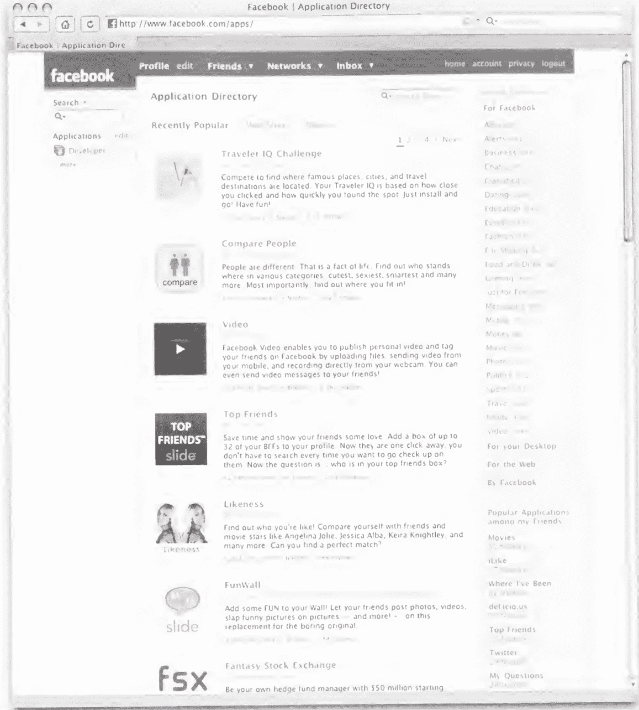

图 1-6：应用程序目录中的热门应用程序列表。

## 通知和请求

在 Facebook 内部，一个较好的功能是用于消息和共享内容的内部消息系统。应用程序也能够通过通知和请求实现类似的功能。

通知是让用户了解邀请或操作的一种方式。通知的范围从小到提示你有用户给你发送了消息（该消息在你的收件箱中），大到提示你轮到你玩拼字游戏了。

请求包括诸如好友详情确认和请求、群组和活动邀请等。与通知不同，请求需要在执行操作之前进行某种处理。图 1-7 展示了一个在查看用户资料之前需要批准好友请求的示例。

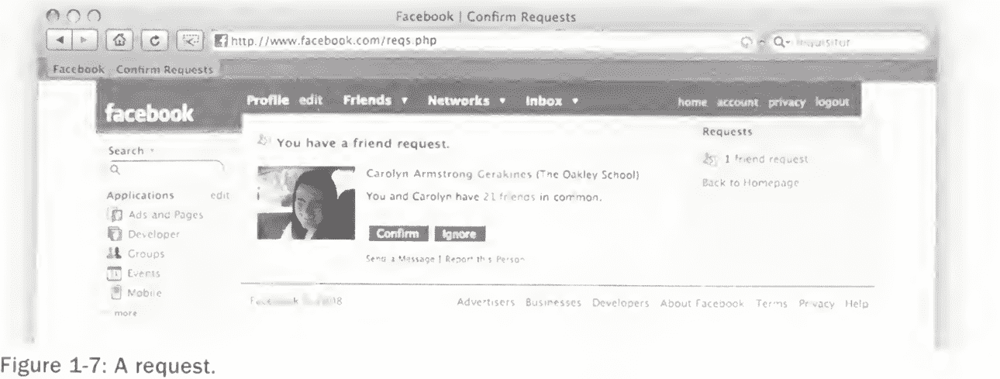

## Facebook 主页

Facebook 主页组件于 2007 年底推出，提供了一种为名人、组织、乐队、产品等创建 Facebook 资料的方式。Facebook 主页旨在允许这些实体与 Facebook 用户建立联系，进行互动和自我推广。

被视为一个或多个 Facebook 主页所有者的 Facebook 用户可以访问被视为该主页粉丝的用户的人口统计数据。他们还可以向 Facebook 主页粉丝发送群发消息。

## 消息附件

一个经常被忽视的功能是应用程序能够在用户之间的消息中包含附件（图 1-8）。这以按钮的形式显示在消息正文区域下方。当用户选择应用程序操作来包含附件时，应用程序会渲染必要的表单或正文以包含相关内容。图 1-8 展示了消息窗口下方的“添加音乐”按钮。点击该按钮将显示图 1-9 所示的窗口。

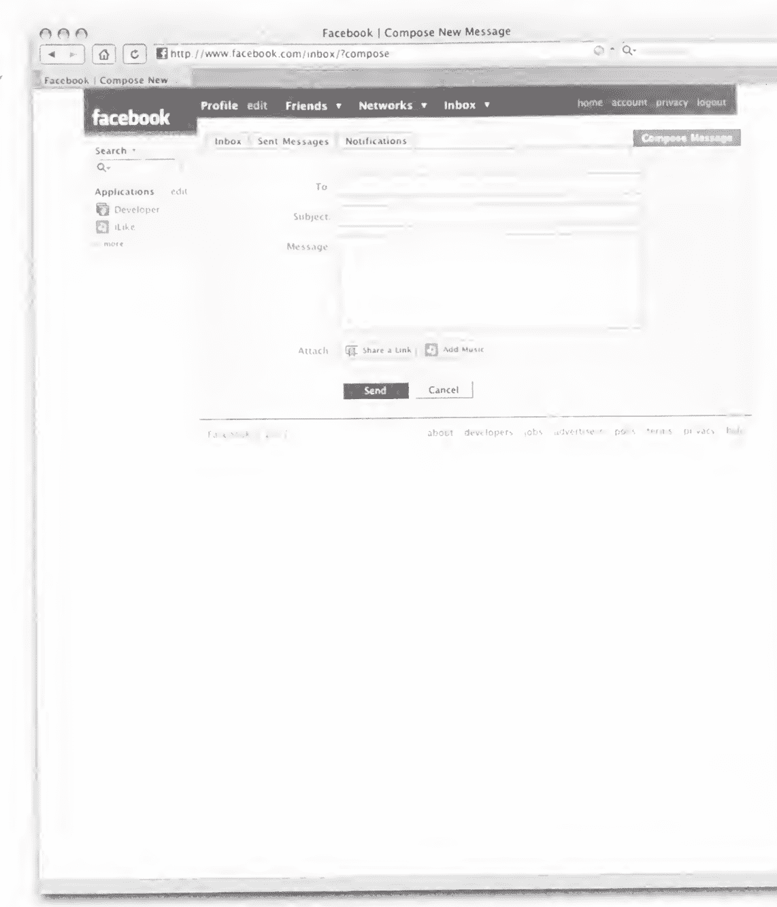

图 1-8：为你的消息添加链接或附件。

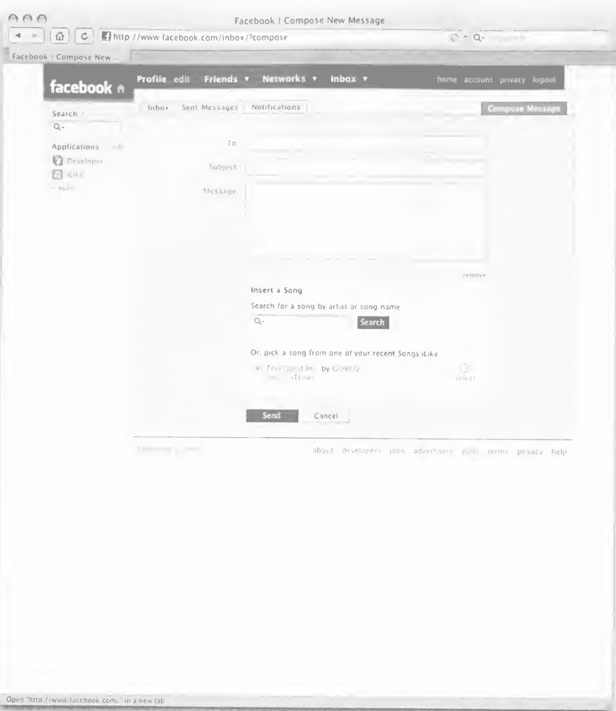

图 1-9：浏览要附加的文件。

## 应用程序请求流程

Facebook 将所有应用程序视为与之交互的模块化插件。Facebook 不托管应用程序，应用程序也不运行在 Facebook 网络上。因此，所有应用程序必须遵循严格的请求流程。

1. 用户通过`http://apps.facebook.com/exampleapp`访问应用程序`ExampleApp`。
2. Facebook 根据应用程序配置中提供的回调 URL 向该 URL 发送`POST`请求。
3. 应用程序解析`POST`正文并验证`POST`签名。
4. 应用程序执行其操作并生成要由 Facebook 显示的标记。
5. Facebook 分析提供的标记（FBML）并将其渲染到用户的浏览器中。

乍一看，显示应用程序所涉及的步骤可能看起来复杂且不必要，但仔细审视后会发现这个流程背后有许多合理性。以下是实现的两个主要目标：

- 所有业务逻辑以及数据存储和管理都可以由应用程序处理。
- Facebook 可以通过使用 FBML 强制应用程序遵循某些显示模式。

如上所述，每个应用程序请求都包含多个参数。这些`POST`参数因用途和应用程序请求类型而异。当用户通过应用程序画布访问应用程序时，以下参数将始终被包含：

- `fb_sig_in_canvas` — 值为 0 或 1，表示该请求是通过 Facebook 画布发起的。
- `fb_sig_added` — 值为 0 或 1，表示请求用户已添加该应用程序。
- `fb_sig_time` — 自 UNIX 纪元以来的当前时间（以秒为单位）。
- `fb_sig_api_key` — 应用程序的 API 密钥。
- `fb_sig` — 此参数用于验证请求是否来自 Facebook。有关验证此参数的更多信息，请参阅本章下方的“验证请求签名”部分。

已授予应用程序访问权限的用户会额外触发以下`POST`参数的发送（除上述已提到的参数外）：

- `fb_sig_user` — 请求用户的数字 ID。
- `fb_sig_friends` — 请求用户的好友的用户 ID（UID）的逗号分隔列表。
- `fb_sig_session_key` — 与应用程序和请求用户关联的当前会话密钥。
- `fb_sig_profile_update_time` — 请求用户上次更新用户资料以来的时间（以秒为单位）。

不同的请求参数组合导致四种不同的画布页面请求类型：

- 用户已登录 Facebook，但请求用户尚未授予应用程序访问权限。这以`fb_sig_user`参数的缺失来表示。
- 用户已登录 Facebook 并已授予应用程序访问权限，但尚未添加应用程序。这以`fb_sig_added`参数设置为 0 来表示。
- 用户已登录 Facebook，已授予应用程序访问权限，并且已添加应用程序。这以`fb_sig_added`参数设置为 1 来表示。

## 验证请求签名

验证 Facebook 应用程序的签名非常简单。根据 Facebook 文档，获取`key=value`对形式的`POST`参数。按键名字母顺序对列表进行排序。将排序后的列表拼接在一起，并追加应用程序的密钥。签名是该拼接字符串的消息摘要 5（MD5）加密结果。

## 客户端库

Facebook 已发布了官方`客户端库`以及`非官方库`的链接（由第三方创建并提供）。支持的两种语言是 PHP（4 和 5）和 Java。两个官方客户端库都包含相关类以及一个示例应用程序。

非官方库支持以下语言：

- ActionScript
- Cocoa
- ColdFusion
- .NET
- Perl
- PHP4
- Python
- Ruby
- VB.NET

> 请注意，Facebook 不支持这些库，提供它们的链接仅作为参考。

还应注意，微软与 Facebook 已合作，以便在 Visual Studio 中更轻松地开发 Facebook 应用程序。更多信息请访问 Visual Studio Express Showcase：`http://msdn2.microsoft.com/en-us/express/bb510381.aspx`。

## 开发者中心和开发者应用程序

Facebook 为开发者提供了两个获取 Facebook 平台更多信息的场所，同时还提供文档、客户端库和社区支持。

第一个是官方的 `Facebook 开发者应用程序`。这个 Facebook 应用程序是创建和配置应用程序的中心平台，也是获取 Facebook 平台最新状态和新闻的最佳渠道。开发者讨论板也在此提供：`www.facebook.com/developers`。

`Facebook 开发中心`是你查找官方文档、客户端库以及可用于调试应用程序的多个在线工具的地方。官方 wiki 也在此提供，包含涵盖众多主题的丰富信息。

`http://developers.facebook.com/`

`http://wiki.developers.facebook.com/index.php/Main_Page`

## 应用程序特征

有许多类型的应用程序执行各种不同的功能。有些基于新功能构建，有些扩展现有功能，还有一些仅仅是为了好玩。本节概述了 11 个应用程序，每个都具有一项或多项值得一提的显著特征。其中一些应用程序已突破百万用户里程碑，而另一些仅有数千用户。

## Top Friends

Slide 公司的 `Top Friends` 应用程序拥有近 1100 万用户。该允许用户在自己的资料页面上展示和排列其他用户的列表。这借鉴了 MySpace 最初提出的“前 8 名”概念，并且对该应用程序来说效果非常好。你最多可以展示 32 位好友。

该应用程序表现优异主要有两个原因。在社交操作方面，例如在你的排名列表中更改好友的位置时，会通知该用户此操作。如果该用户尚未添加该应用程序，系统会提示其添加。在大型网络中，这可能会导致“垃圾信息”行为，但总体来说是非常可靠的。`Top Friends` 还大力鼓励其用户在应用程序画布中邀请和积累更多用户。

该应用程序表现优异的第二个原因是它利用了用户的受欢迎程度。通过允许用户根据关系状态对其他用户进行排名和列表展示，它在社交网络内形成了一个“名人录”。它还会计算受欢迎程度并提供一个具体数字供用户展示。用户可以通过邀请其他用户以及提高自己在其他用户中的排名来尝试增加这个数字。

以下是关于 Top Friends 的一些关键信息：

- **显著特征** — 该应用程序在病毒式营销方面表现出色。由于其病毒式传播特性，它增长极为迅速，取得了巨大的成功。
- **URL** — `www.facebook.com/apps/application.php?id=2425101550`。

> 病毒式营销是一种营销现象，它促进并鼓励人们自愿为产品或服务做广告。

## iLike

iLike 公司的应用程序 `iLike` 目前拥有超过 400 万用户，是首批大型 Facebook 应用程序之一。该应用程序允许用户输入喜爱的音乐类型和艺术家。根据这些信息，你可以查找相似的音乐，并在你的资料页面上展示歌曲/艺术家供其他用户试听。

# 第一部分：理解 Facebook 平台

`iLike` 比许多其他 Facebook 应用程序具有更多实用功能。它的主要目的是让用户以多种方式发现和分享音乐兴趣。该应用提供指向 iTunes 音乐商店中歌曲的链接，使用户能够快速购买音乐和视频。`iLike` 还有几个建立在此基础上的辅助功能。用户可以通过演唱会联系彼此、互相点歌，并自定义个人资料中显示的内容。

以下是关于 `iLike` 的一些关键信息：

- **显著特点** — 该应用允许用户通过音乐联系和共同兴趣来建立和加强社交关系。
- **URL** — `www.facebook.com/apps/application.php?id=2413267546`。

## Extended Info

`Extended Info` 应用是一款由 Trey Philips 编写的个人资料增强工具。该应用允许您向个人资料添加自定义内容，类似于 Facebook 提供的个人资料信息。

除了是早期可用的应用之一外，它也是最早被收购的应用之一。Sidestep（Tips 应用的创建者）以未公开的价格收购了 `Extended Info` 应用。

这款应用是 Facebook 扩展其现有功能的完美例子。通过它，您可以向您的个人资料访客添加和显示更多相关信息。

以下是关于 `Extended Info` 的一些关键信息：

- **显著特点** — 该应用将一个非常好的想法实施得非常出色。
- **URL** — `www.facebook.com/apps/application.php?id=2374336051`。

## Art

`Art` 应用从用户角度来看纯粹是装饰性的。这款由 Matt Kraft 和 Phil Edwards 编写的应用拥有超过 53,000 名用户。它允许 Facebook 用户在他们的个人资料上展示一件艺术品。它是较小的应用之一，但绝对是很不错的一个。

一旦安装该应用，您将看到一个包含超过 160,000 件艺术作品的库，可以添加到您的个人资料中。您也可以筛选其他类型的图像，如乐队、电影、运动等。该应用提供通过 allposters.com 购买作品的链接，这使得展示您挂在 Facebook 个人资料中的喜爱作品变得非常容易。

以下是关于 `Art` 的一些关键信息：

- **显著特点** — 该应用值得注意，因为它并未试图成为一个社交应用。它只是一个个人资料装饰器，而且是一个很好的装饰器。
- **URL** — `www.facebook.com/apps/application.php?id=3021260327`。

## Fortune Cookie

`Fortune Cookie` 应用拥有超过 470 万用户，是另一个以内容为导向的应用。它在用户的个人资料上展示一个主题 fortune，供其他用户查看，并为尚未添加该应用的访客提供添加链接。

应用画布非常简单，提供 fortune 预览、一个循环到下一个 fortune 的按钮，以及一个将当前 fortune 发送给一个或多个朋友的界面。与其他应用不同，它具有非常被动的病毒式传播策略。

以下是关于 `Fortune Cookie` 的一些关键信息：

- **显著特点** — 该应用专注于小内容。唯一可用的用户输入是跳过到下一个 fortune。因此，该应用极其简单。
- **URL** — `www.facebook.com/apps/application.php?id=2355237624`。

## Honesty Box

`Honesty Box` 应用允许用户匿名评论其他用户。起初，这听起来可能是个非常糟糕的主意，但事实证明恰恰相反。拥有超过 250 万用户，该应用为 Facebook 提供的传统 Wall 应用（允许用户在您的个人资料上发布笔记和评论）提供了一个令人耳目一新的替代方案。

添加应用后，您会看到一个种子问题，供个人资料访客评论。在应用画布内，您可以配置电子邮件通知、查看评论历史记录并屏蔽用户（当然是匿名的）。

以下是关于 `Honesty Box` 的一些关键信息：


- **显著特点** — 该应用充分利用了匿名功能。鉴于大多数社交网络旨在暴露用户，该应用因其允许匿名（和半匿名）操作而令人耳目一新。
- **URL** — `www.facebook.com/apps/application.php?id=2552096927`

## Causes

`Causes`应用允许Facebook用户为他们关心的一些事业提供财务支持。它拥有超过220万用户，自推出以来一直有稳定的应用附加组件和热议。帮助部分很好地描述了其目标：

> Facebook平台提供了一个前所未有的机会，让我们这一代人（大多数都在Facebook上）抓住未来，并在我们周围的世界中有所作为。我们这一代人非常关心，但当前的系统疏远了我们。Facebook上的Causes提供了工具，使任何Facebook用户都可以利用他们真实朋友的网络来产生积极的改变。

该应用为用户可以加入或创建的事业创建个人资料。用户可以向一个或多个事业捐款，并在他们的个人资料上展示他们加入的事业。每个“事业”都有一个供用户讨论该事业的区域，以及关于该事业的信息。还有一个区域可用于包含统计数据和其他信息。每个事业都包含一个低级和高级描述，以及如何加入和提供帮助的信息。

以下是关于Causes的一些关键信息：

- **显著特点** — 这是最早的利他应用之一。它以一种非常有条理和深思熟虑的方式为在世界上行善提供了一个媒介。
- **URL** — `www.facebook.com/apps/application.php?id=2318966938`

## del.icio.us

`del.icio.us`应用允许用户展示他们在`del.icio.us`上保存的书签。它被列入此处是因为它是从用户角度来看几乎完全外部化的少数应用之一。`del.icio.us`作为一个社交工具，允许用户为自己和其他用户保存内容，并通过知识共享扩大共同知识。这与Facebook内部形成的紧密社交网络非常契合。

当用户首次添加此应用时，他们会进入`del.icio.us`设置页面，在那里他们可以关联他们的`del.icio.us`和Facebook账户，以及配置他们希望应用如何工作。应用本身在Facebook内没有任何存在，除了新闻源中的项目和用户个人资料中的内容。

以下是关于del.icio.us的一些关键信息：

- **显著特点** — 与其他应用相比，该应用是被动的。它根据外部网站上的活动更新用户的动态和资料。它从一个属于Facebook的应用转变为一个在Facebook中存在的应用，更侧重于用户的书签、内容和活动，而不是社交关系和Facebook。
- **URL** — `www.facebook.com/apps/application.php?id=2411052087`

## Pirates vs. Ninjas

`Pirates vs. Ninjas`是一个有趣的应用，让你招募你的朋友成为忍者或海盗。它拥有超过65万用户，使招募其他忍者或海盗以增加队伍变得非常容易。

这是日益增多的竞技应用之一。它由一个或多个团队组成，将根据用户数量和/或分数“击败”其他团队。

以下是关于Pirates vs. Ninjas的一些关键信息：

- **显著特点** — 这类Facebook应用由于其竞争性的“帮助朋友”性质而具有非常强的病毒式传播能力。
- **URL** — `www.facebook.com/apps/application.php?id=2400559068`

## Election '08

`Election '08`应用程序是众多专注于政治议题的Facebook应用程序之一。该应用向用户展示数位2008年总统大选候选人（同时也提供了独立候选人、绿党候选人及无党派选项），允许用户选择一位候选人并记录其投票。

该应用服务于多重目的。首先是允许用户在其个人主页上展示其政治立场及所支持的2008年总统候选人。Facebook本身允许用户选择展示一项政治立场，而此应用则更进一步。

其次，该应用承担着数据收集的功能。这款由NewsVine开发的应用能够收集大量关于Facebook用户群体政治倾向及候选人偏好的数据。

以下是关于Election '08的一些关键信息：

- **显著特点** — 其一是具有浓厚政治色彩的主题与目的。其二是具备收集有价值数据的能力。
- **URL** — `www.facebook.com/apps/application.php?id=2360172394`

## Scrabulous

这款Facebook应用是Facebook平台内的多人游戏。它允许你邀请最多三位其他用户参与这款基于回合制的拼字游戏。由于游戏不要求所有用户在彼此的回合时都在线，这使得游戏进行非常便捷，且游戏时长可由用户随意决定。

将Facebook作为游戏平台的构想十分有趣。回合制游戏、多人游戏以及单人Flash游戏都非常适合。

以下是关于Scrabulous的一些关键信息：

- **显著特点** — 其对用户回合时在线状态的宽松要求，使得在通常难以实现的情况下，朋友间也能轻松开始并继续游戏。它还允许未添加此应用的用户加入游戏。
- **URL** — `www.facebook.com/apps/application.php?id=3052170175`

## 应用程序特性概览

现在，让我们回顾并深入探讨此处提到的应用程序特性。正是这些特性与市场营销、目标受众定位、实用性和运气的结合，共同促成了应用程序的成功。

# 第一部分：理解Facebook平台

## 广告与营销

推广应用程序最常见的做法之一是进行市场营销和/或广告宣传。病毒式应用并非指其能自行安装，而是由用户有意或无意地推广。正是出于这个原因，许多应用程序被视为“病毒式”的。

应用程序开发者使用各种策略使其应用更具传播性。以下是一些最受欢迎的方式：

- **强制邀请** — 部分应用程序采取激进策略，要求已添加该应用的用户在能够充分利用其功能前必须邀请其他用户。有时通过在用户执行操作后显示邀请界面来实现。有时则通过跟踪用户发送的邀请数量并显示提醒，直至达到目标邀请数。这让人联想到旧时的共享软件时代。在某种程度上，这是一种必要的恶，尽管我并不提倡。已有很多应用通过如此激进的行为取得了巨大成功。如果用户真的反感，他们根本就不会使用该应用。
- **应用合作** — Facebook应用中的一个日益增长的趋势是与其他应用合作并相互推广。这有多种形式，例如在确认页面上出现简短介绍、一系列文本链接或更大型的视觉广告。视情况而定，这种方式可以非常有效。如果你拥有多个针对相同目标受众的应用，这将非常有益。它也是宣传应用并引起人们注意的好方法。
- **用户档案与动态** — 用户个人主页的展示空间非常宝贵。这一切的核心在于一个社交网络，用户会访问其他用户的主页。拥有一个赏心悦目的个人主页区块供其他用户观看，能起到很大作用。动态消息亦是如此。一些非常成功的应用将它们的成功很大程度上归功于News Feed和Mini-Feed。良好的信息传递和清晰度能让非应用用户感受到该应用的主旨。
- **口碑传播** — 没有什么比朋友的推荐更好的推广方式了。让应用用户传播好口碑是获取新用户最有效的方式。同样，在应用论坛和留言板上拥有良好的反馈和积极的评论也大有裨益。
- **建立关系** — 有些应用程序的唯一目的就是创建、建立和加强用户之间的关系。有时应用可能表现为人气竞赛（如Top Friends），但其本质是用户在描绘他们与朋友之间的关系。

## 完善单一创意

应用程序通常在专注于单一创意并将其做到极致时表现最佳。在Facebook平台内，轻松创建多个应用程序并使其服务于特定目的是可能的。将应用拆分开来，能为用户如何看待Facebook及其使用的工具提供更多影响机会。

## 添加新功能与扩展功能

并非所有系统都是完整的。随着Facebook平台的推出及应用程序的引入，Facebook承认了这一事实。Facebook应用程序是为Facebook添加新功能的好方法。还有什么比允许用户自己动手更能提升平台对用户的实用性呢？为Facebook添加新功能是该平台的首要目的。

平台的第二个目的是扩展和增强现有功能。除了指出系统并非尽善尽美，也可以说系统的初版往往不如后续版本。通过Facebook应用，开发者可以研究现有应用或功能，倾听用户反馈，并基于这些知识创建更好的应用。

通过观察无数复制和扩展Facebook内置功能的应用的使用情况，这一点已得到证实。

## 外观美化

无论是通过一张图片、一份你到访过所有地方的列表，甚至是你的宠物照片，用户都喜欢炫耀并美化属于他们的内容。个人主页的美化有多种形式，这也契合了其实现方式的多样性。

## 商业关系

Facebook正在让识别和区分职业网络与社交网络变得更容易。已有一些应用基于工作与家庭界限日益模糊的理念而构建。它们提供各种吸引商业社交而非个人社交的功能。

## Facebook信标

`Facebook Beacon` 服务于2007年底推出，作为第三方网站采取的行动及其在Facebook上如何呈现的桥梁。简而言之，当第三方网站上的用户执行操作（如将电影添加到收藏列表或保存书签）时，该第三方会向Facebook发送少量信息。随后，Facebook将该信息与用户账户关联，并根据用户的隐私设置，将信息显示在用户的News Feed或Mini-Feed上。

## 总结

本章回顾了Facebook的历史并展望了其未来走向。讨论涉及了Facebook和Facebook平台的核心组成部分。你了解了什么是应用程序，以及底层的请求与组件结构如何协同工作。最后，本章深入探讨了若干应用程序，并定义了使其独具特色的显著特性。

第2章将直接切入应用程序开发，采用更实践性的方法来探索Facebook平台。第2章通过一个使用Facebook Canvas页面、PHP客户端库和若干API方法的小型应用程序，将你所学知识付诸实践，从而与本章形成补充。

## 构建你的第一个应用

第 1 章讨论了 Facebook 和 Facebook 平台的起源与技术。在本章中，你将直接动手构建你的第一个 Facebook 应用，学习一种更加技术和实用的 Facebook 平台开发方法。

本章涵盖了在 Facebook 平台上创建、配置和开发应用所需的一切内容。开篇项目使用 PHP 编写，并采用官方支持的 PHP 客户端库。其中的理念和概念可以轻松移植到任何 Web 开发语言。

### 你需要什么

在开始之前，你需要准备以下内容：

- 一个 Facebook 账号
- 一台安装了 PHP 和 MySQL 的共享或专用服务器

你还需要安装官方的 Facebook Developer 应用，不过这将在本章后续创建和配置应用时进行讨论。

### 概述功能与特性

每个项目都始于设计蓝图，这个项目也不例外。让我们花几分钟来概述一下应用的功能和特性。

第一部分：理解 Facebook 平台

Hello World 应用是一个社交应用，允许用户向其社交网络中的其他用户发送问候。问候由应用定义，包含一个简单的"hello"。应用将返回 Facebook 标记语言（FBML），通过 Facebook Canvas 进行渲染，并使用 Facebook 提供的多个实体。

当应用用户向另一个用户发送问候时，应用将记录发送用户、目标用户和时间。应用还会更新发送用户的个人资料，如果目标用户已添加该应用，也会同时更新目标用户的个人资料。

## 创建应用

在 Facebook 平台上开发应用的第一步是在 Developer 应用中创建和配置它。

在创建应用之前，请确保你已知道项目将部署的 Web 地址和位置。例如，本章中描述的示例项目将通过以下地址被 Facebook 平台访问：`http://fbexample.socklabs.com/`。

## 介绍 Facebook Developer 应用

Developer 应用是 Facebook 中应用开发的核心。在这里你可以找到 Facebook 平台团队的最新新闻和更新，以及讨论区和名为`My Applications`的应用控制面板。以下是网址：`www.facebook.com/developers/`。

如果你还没有添加，请立即访问 Developer 应用并将其添加。没有它，在 Facebook 平台上开发应用将极其困难（甚至不可能）。

## 创建 'Hello World' 应用

在 Developer 应用内部，点击`My Applications`控制面板。最初你会看到一个空白列表和一个标题为`Apply for another key`的链接。接下来你会看到一个简单的表单，初始时唯一需要填写的字段是应用名称（图 2-1）。为了与本项目主题一致，请选择一个类似`Hello World`或`Friend Greetings`的名称。输入应用名称，如果你同意服务条款，请提交表单。

第二章：构建你的第一个应用

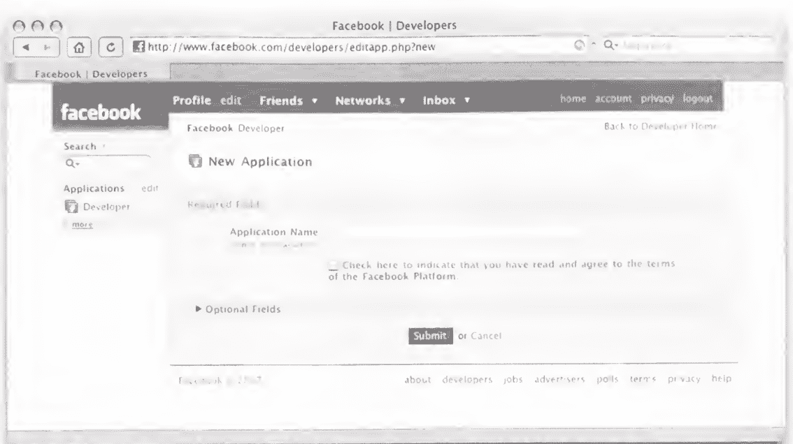

Hello World 应用现已创建完成，你应该会返回到`My Applications`页面，新创建的应用将显示在此处，同时包含`API Key`、`Secret Key`以及指向关于页面和配置页面的相关链接（图 2-2）。

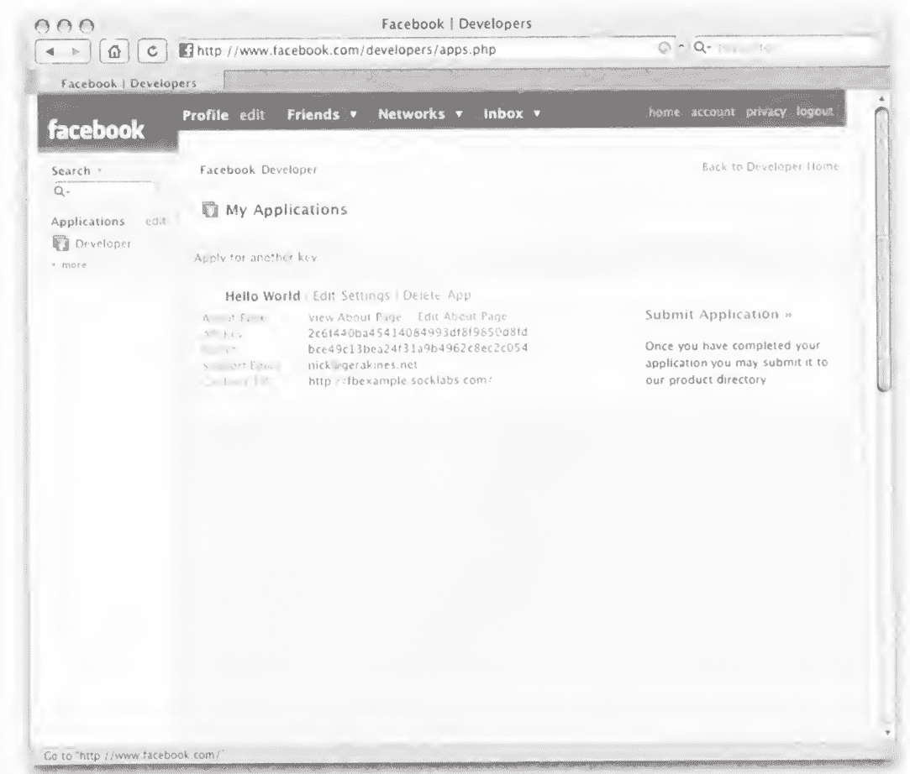

第一部分：理解 Facebook 平台

应用创建完成后，你必须填写更多信息。图 2-3 和图 2-4 展示了配置应用的可选字段。在应用能够运行之前，你必须提供`Callback URL`和`Canvas URL`，如图 2-3 中间所示。

- `Callback URL`应指向`htdocs/index.php`文件；在此示例中，完整 URL 为`http://fbexample.socklabs.com/index.php`。
- `Canvas URL`应是一个相对于项目名称的唯一名称。本项目使用`nghelloworld`。


第二章：构建你的第一个应用


如你所见，可选字段被分为三种类型：

- **基本选项** — 这些是描述应用类型和行为的核心选项。
- **安装选项** — 这些描述应用的安装流程和机制。
- **集成点** — 这些配置应用如何与 Facebook 的不同界面和组件进行交互。

第一部分：理解 Facebook 平台

### 基本选项

以下是本节中各字段的说明：

- **Support E-mail** — 这是 Facebook 用于就应用支持问题与你联系的电子邮件地址。默认情况下，它是你注册时使用的邮箱地址。根据应用的增长情况，建议更换此邮箱。
- **Callback URL** — 请记住，应用并不运行在 Facebook 的服务器上，而是运行在你自己的机器上。此 URL 应指向将通过 Application Canvas 页面显示的默认位置。可以将其理解为应用的主页或着陆页。
- **Canvas Page URL** — Facebook 应用运行在`apps.facebook.com`域名下，因此必须在此处提供一个唯一的 URL。为了保持整洁，我建议使用你的姓名缩写加`helloworld`。在文本框下方，你会看到两个单选按钮：`Use FBML`和`Use iframe`。这两个选项允许你使用 FBML 通过 Facebook 渲染应用，或者通过 iframe 直接嵌入 Callback URL 页面。默认情况下，以及在大多数情况下，使用 FBML 是最合适的选择。
- **Application Type** — 这一点很简单明了。如果是桌面应用，你需要设置此项。但请将其保持为`Website`。
- **IP Addresses of Servers Making Requests** — 此选项允许你设置将发出 API 请求的服务器的 IP 地址，并将 API 请求限制为仅这些服务器。对于大型应用来说，这是一个很好的安全措施。目前你可以将其留空。
- **Can Your Application Be Added on Facebook?** — 应设置为`Yes`。这允许其他用户添加该应用，并使其能够显示在侧边导航栏中。创建外部应用时不会设置此选项。此选项及外部应用的开发将在第 10 章中讨论。

### 安装选项

以下是本节中出现的选项：

- **Post-Add URL** — 当用户首次添加应用时，会被重定向到此 URL。
- **Application Description** — 应用描述会显示在应用的关于页面中。
- **Post-Remove URL** — 当用户移除应用时，会被重定向到此 URL。请注意，此 URL 不能是 Facebook Canvas 页面。
- **Default FBML** — 使用此选项，你可以设置一些标记，使其显示在用户个人资料的应用框中。如果尚未对该用户调用`facebook.profile.setFBML`方法，将显示此默认内容。
- **Default Profile Box Column** — 此选项指定用户首次添加应用时使用的个人资料列。
- **Developer Mode** — 此选项阻止非开发者使用该应用。

## 集成点

以下是本节中出现的选项：

- **Side Nav URL** — 侧边导航栏是 Facebook 内部核心的用户界面（UI）元素之一。此选项提供的 URL 是显示在侧边导航栏中的链接。
- **Privacy URL** — 此选项给出的 URL 是用户配置应用程序隐私选项时被定向到的链接。
- **Help URL** — 这是应用程序的帮助页面。
- **Private Installation** — 选择此选项后，当添加应用程序时，不会在 News Feed 或 Mini-Feed 中生成条目。


- `Attachments` — 此选项及随后的 `Attachment Callback URL` 用于配置应用程序中的附件。`Attachment Action` 是附件操作的标签，`Callback URL` 被调用以向创建新消息的附件部分渲染 FBML。

## 编写应用程序

一旦在 Facebook 中创建并配置好应用程序，你就可以开始填充应用程序的功能和特性。

## 准备应用程序环境

本应用程序使用单个表来存储用户之间发送的问候信息。请确保在本应用程序将要访问的 MySQL 数据库中，已创建一个具有给定模式（清单 2-1）的表。

### 清单 2-1：Greetings 表模式（MySQL）

```sql
CREATE TABLE greetings (
    user_from BIGINT NOT NULL,
    user_to BIGINT NOT NULL,
    row_created BIGINT NOT NULL
);
```

`user_from` 列是发送问候的用户的数字 Facebook 用户 ID（UID）。`user_to` 列是接收问候的用户的数字 Facebook 用户 ID。`row_created` 列是问候发送日期和时间的 UNIX 时间戳。

> Facebook 平台开发团队已明确表示，代表 Facebook 用户的 UID 可以是 64 位整数。因此，这里使用了 MySQL 的 `BIGINT` 类型。

## 应用程序布局与结构

本项目有两种类型的 PHP 文件：

- 公开访问的文件（例如 index 页面）
- 作为项目库包含的文件

配置库、PHP5 客户端库和项目类属于第二类。

> 请注意，`facebook_desktop.php` 类未包含在本项目中。

## 类概览

`lib` 目录包含多个 `.class.php` 文件，其中包含本项目的大部分逻辑。清单 2-2 展示了 `AppConfig` 类。

### 清单 2-2：AppConfig.class.php 文件（PHP）

```php
class AppConfig {
    // Facebook 特定的配置变量
    public static $app_name = 'HelloWorld';
    public static $app_id = '9937165273';
    public static $api_key = '2c6f440ba45414084993df8f9850d8fd';
    public static $secret = 'bce49c13bea24f31a9b4962c8ec2c054';
    // 应用程序特定的配置变量
    public static $db_ip = '127.0.0.1';
    public static $db_user = 'dbuser';
    public static $db_pass = 'dbpassword';
    public static $db_name = 'nghelloworld';
}
```

此类包含示例应用程序的所有配置。在该类内部，还有两种不同类型的配置变量：

- Facebook 内部应用程序特定的变量 — 这些是 `app_id`、`api_key` 和 `secret` 密钥。
- 应用程序在 Facebook 领域之外使用的配置变量 — 这些包括数据库配置、缓存配置等。

此类被抽象化，以便更容易更改在示例项目中设置的值。

清单 2-3 展示了 `HelloWorld` 类。

### 清单 2-3：HelloWorld 类构造函数（PHP）

```php
public $fbclient;

public function __construct($fbclient) {
    // 创建时，设置 facebook 客户端
    $this->fbclient = $fbclient;
}
```

# 第 2 章：构建你的第一个应用程序

在实例化新的 `HelloWorld` 对象时，必须传入一个有效的 `Facebook` 对象。`HelloWorld` 类在内部存储该 `Facebook` 对象，并在整个类中使用它。

清单 2-4 展示了 `wave_hello` 方法，它接受两个参数：发送问候的用户和接收问候的用户。该方法由两个 `try` 块组成。第一个尝试捕获将操作写入数据库时可能发生的任何异常。第二个尝试捕获写入用户个人资料时可能发生的任何异常。

### 清单 2-4：HelloWorld `wave_hello` 方法（PHP）

```php
function wave_hello($user_from, $user_to) {
  try {
    $conn = $this->get_db_conn();
    $sql = "INSERT INTO greetings SET user_from = $user_from, user_to = $user_to,
      row_created = UNIX_TIMESTAMP(NOW())";
    mysql_query($sql, $conn);
  } catch (Exception $e) {
    error_log($e->getMessage());
    return 0;
  }
  try {
    $this->update_profile($user_from);
    $this->update_profile($user_to);
  } catch (Exception $e) {
    error_log($e->getMessage());
    return 0;
  }
  return 1;
}
```

清单 2-5 展示了类方法 `get_greetings($type = 'user_from', $user, $limit = 5)`。这是一个简单的辅助方法，返回发给或来自给定用户的问候。方法 `get_greeting_count($type = 'user_from', $user)` 是其紧密相关的方法，返回发给或来自指定用户的问候数量。

### 清单 2-5：HelloWorld `get_greetings` 方法（PHP）

```php
function get_greetings($type = 'user_from', $user, $limit = 5) {
  $conn = $this->get_db_conn();
  $res = mysql_query("SELECT user_to, user_from, row_created FROM greetings WHERE
    $type = $user ORDER BY row_created DESC LIMIT $limit", $conn);
  $greetings = array();
  while ($row = mysql_fetch_assoc($res)) {
    $greetings[] = $row;
  }
  return $greetings;
}
```

清单 2-6 展示的 `update_profile($user)` 方法是较大的类方法之一，它为给定用户构建包含该用户最近收到和发出的问候的个人资料框，并将个人资料 FBML 提交到 Facebook。

# 第一部分：理解 Facebook 平台

### 清单 2-6：`HelloWorld` `update_profile` 方法（PHP）

```php
function update_profile($user) {
    $greetings_from = $self->get_greetings('user_from', $user);
    $gfromcount = count($greetings_from);
    $greetings_to = $self->get_greetings('user_to', $user);
    $gtocount = count($greetings_to);
    $fbml = $tomessage = $frommessage = '';
    $gf_str = $gt_str = '';
    if ($gtocount) {
      $tomessage = "<p><fb:name uid=\"$user\" firstnameonly=\"true\" useyou=\"false\" />
已被 wave 向 $gtocount 次。</p>";
    } else {
      $tomessage = "<p>尚未有人向 <fb:name uid=\"$user\"
firstnameonly=\"true\" useyou=\"false\" /> 发送 wave 问候！</p>";
    }
    if ($gfromcount) {
      $frommessage = "<p><fb:name uid=\"$user\" firstnameonly=\"true\" useyou=
\"false\" />
已向 $gfromcount 个人发送了 wave 问候。</p>";
    } else {
      $frommessage = "<p><fb:name uid=\"$user\" firstnameonly=\"true\" useyou=
\"false\" />
尚未向任何人发送 wave。</p>";
    }
    foreach ($greetings_from as $greeting) {
      $gf_str .= "<fb:if-can-see uid=\"$user\">";
      $gf_str .= '<li><fb:name uid="' . $greeting['to'] . '" useyou="false" /></li>';
      $gf_str .= '</fb:if-can-see>';
    }
    foreach ($greetings_to as $greeting) {
      $gt_str .= "<fb:if-can-see uid=\"$user\">";
      $gt_str .= '<li><fb:name uid="' . $greeting['from'] . '" useyou="false" /></li>';
      $gt_str .= '</fb:if-can-see>';
    }
    $fbml .= '<fb:wide>';
    $fbml .= "$frommessage\n<ul>$gf_str</ul>";
    $fbml .= "$tomessage<ul>$gt_str</ul>";
    $fbml .= '</fb:wide>';
    $fbml .= '<fb:narrow>';
    $fbml .= "$frommessage\n<ul>$gf_str</ul>";
    $fbml .= "$tomessage<ul>$gt_str</ul>";
    $fbml .= '</fb:narrow>';
    $this->fbclient->api_client->profile_setFBML($fbml, $user);
    return 1;
}
```

作为 Facebook PHP5 客户端库一部分的 `Facebook` 类包含几个与 Facebook 交互和操作的方法调用和函数。它通过创建方法来为你完成大部分工作，从而省去了提交和解析 API 方法调用的大量工作。此方法调用 `profile_setFBML`，用于设置在用户个人资料的应用程序块中显示的内容。

`update_profile` 方法引入了 FBML 和 Facebook API。FBML 是一种严格的 XML 标记语言，由 Facebook 向开发者提供。FBML 具有许多非常实用的功能，包括将 UID 关联到用户名、用于定义不同类型内容的标记、Ajax 工具等等。

它还使用了 Facebook 对象方法 `api_client->profile_setFBML(...)`，该方法用于将此方法生成的标记提交给 Facebook，以更新用户的个人资料。本项目中 API 调用的使用虽然最少但非常有效。唯一使用的 API 方法是 `facebook.profile.setFBML`，用于在用户个人资料上设置应用内容。关于 API 方法调用的处理方式、可用的不同响应格式以及 API 错误处理的更多信息，将在第 5 章中进行说明。

`facebook.profile.setFBML` 方法接受以下九个参数：

- `api_key`，字符串，— 发出此请求的应用程序的 API 密钥
- `session_key`，字符串，— 代表发送用户使用的有效会话密钥
- `call_id`，整数，— 请求的序列号
- `sig`，字符串，— 请求的签名
- `v`，字符串，— 要使用的 API 版本
- `format`，字符串，— 期望的响应格式类型
- `callback`，字符串，— 如果选择的格式是 JavaScript 对象表示法（JSON），则将响应包装在此参数指定的函数调用中。
- `markup`，字符串，— 用于渲染个人资料框的 FBML
- `uid`，字符串，— 即将更新个人资料的用户

此类的最后一个方法是 `get_db_conn()`。它获取 `AppConfig` 类中提供的数据库连接信息，尝试连接到数据库服务器，然后选择数据库。如果此操作失败，则会抛出一般异常。

## Canvas 页面

设置应用程序 Canvas 页面包含以下内容：

- 应用程序主页
- 操作 Canvas 页面

本项目由两个 Canvas 页面组成。第一个是索引页面，第二个是操作页面。

# 第一部分：了解 Facebook 平台

### 应用程序主页

通过 Facebook Canvas 显示的第一个也是主要的页面是 `htdocs/index.php`。此页面被视为应用程序主页，它不仅必须功能完善，还要赏心悦目。快速浏览代码可以发现它做了以下几件事：

- 创建新的 `Facebook` 和 `HelloWorld` 对象。
- 验证传入的请求，确认它是通过 Canvas 查看的，并且请求用户已添加了该应用程序。
- 检索发送给请求用户以及请求用户收到的问候列表。
- 创建将由 Facebook 处理的 FBML。

主页与大多数页面一样，还包含若干特殊的 FBML 辅助实体。这些实体使得创建指向用户个人资料的链接以及对用户进行断言变得更加容易。

在构建应用程序主页时，重要的是要记住此页面将承载应用程序的大部分流量。在大多数情况下，它是用户唯一可用的目的地，最终成为功能和特性的“大杂烩”。从此 Canvas 页面中移除繁重的操作和缓慢的查询将给用户留下良好的印象。

考虑以下代码：

```php
include_once '../lib/client/facebook.php';
include_once '../lib/AppConfig.class.php';
include_once '../lib/HelloWorld.class.php';

$facebook = new Facebook(AppConfig::$api_key, AppConfig::$secret);

$facebook->require_frame();

$user = $facebook->require_login();

$facebook->require_add();

$app = new HelloWorld($facebook);

$greetings_from = $app->get_greetings('user_from', $user, 5);
$greetings_to = $app->get_greetings('user_to', $user, 5);

$greetings_from_count = get_greeting_count('user_from', $user);
$greetings_to_count = get_greeting_count('user_to', $user);
```

如你所见，此应用程序对 `Facebook` 对象进行了三次调用，对 `HelloWorld` 对象进行了四次调用。在实例化 `Facebook` 对象后，你立即通过确保请求是通过 Facebook Canvas 发出的，以及请求用户是有效的并且已添加了应用程序，来断言请求是有效的。这样，任何之前未添加该应用程序的人都会被要求添加它。这还会验证 Facebook 发送的参数签名，以排除任何潜在的虚假或恶意请求。

# 第二章：构建你的第一个应用程序

在处理完这些杂务之后，你可以继续开发功能特性。在应用程序的主页上，你想展示一些关于用户发送的问候、用户收到的问候等通用信息。

在 PHP 代码块下方，你显示 Facebook 将通过 Canvas 渲染的标记，如下所示：


```html
<fb:dashboard>
<fb:action href="<?php echo AppConfig::$app_url ?>">View My Greetings</fb:action>
<fb:action href="<?php echo AppConfig::$app_url ?>wave.php">Send a greeting</fb:action>
</fb:dashboard>

<div style="padding: 10px;">
<h2>Hello <fb:name firstnameonly="true" uid="<?= $user ?>" useyou="false"/>!</h2>
<fb:if-is-app-user uid="<?= $user ?>">
<? if ($greetings_to_count) { ?>
<p>You have received <?= $greetings_from_count ?> greetings from your friends.</p>
<ul>
<? foreach ($greetings_to as $greeting) { ?>
<li><fb:name uid="<?= $greeting['user_from'] ?>" useyou="false" /></li>
<? } ?>
</ul>
<? } else { ?>
<p>You have not received any greetings</p>
<? } ?>
<? if ($greetings_from_count) { ?>
<p>You have sent <?= $greetings_from_count ?> greetings.</p>
<ul>
<? foreach ($greetings_from as $greeting) { ?>
<li><fb:name uid="<?= $greeting['user_to'] ?>" useyou="false" /></li>
<? } ?>
</ul>
<? } else { ?>
<p>You have not sent any greetings</p>
<? } ?>
<fb:else>
<p>You need to <a href="<?= $facebook->get_add_url() ?>">add <?= AppConfig::$app_name ?></a> to use it!</p>
</fb:else>
</fb:if-is-app-user>
</div>
```

> ### FBML 测试控制台

在 Facebook 开发者网站上有多个可用于预览和调试代码的工具。其中一个特别有用的工具是 FBML 测试控制台（图 2-5），它对于预览和调试 Facebook 应用程序 Canvas、新闻/迷你 Feed 以及用户个人资料页面中使用的 FBML 尤为实用。你可以在以下网址找到它：http://developers.facebook.com/tools.php?fbml。

# 第一部分：了解 Facebook 平台


`fb:dashboard` 实体用于构建仪表板。它主要在应用程序 Canvas 中使用，可以包含 `fb:action`、`fb:help` 和 `fb:create-button` FBML 实体。以下示例 FBML 渲染了图 2-6 所示的仪表板。

```html
<fb:dashboard>
    <fb:action href="users.php">Users</fb:action>
    <fb:action href="settings.php">Settings</fb:action>
    <fb:help href="help.php">Help</fb:help>
    <fb:create-button href="add.php">Add something</fb:create-button>
</fb:dashboard>
```

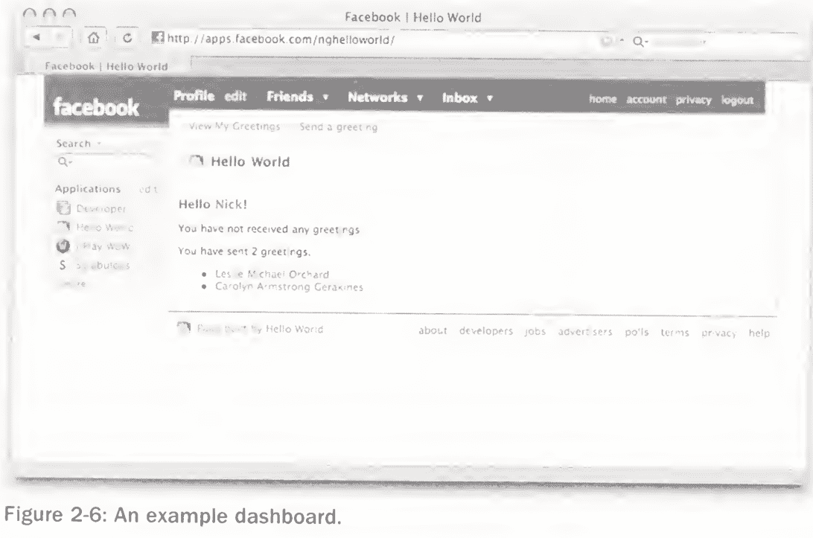

在示例项目中，`fb:dashboard` 实体用于在应用程序页面的 Canvas 部分顶部显示一个小标题栏。这里你绘制了两个链接，分别指向索引页面和操作页面。

`fb:name` 实体无疑是最常用的 FBML 实体之一。它可以将 UID 翻译为用户名，并且默认链接到该用户的个人资料。它能够显示所有格和反身形式，以及仅显示名或姓。默认情况下，只有一个必需属性，即 `uid`。以下代码渲染了图 2-7 所示的屏幕。

```text
以用户 500025891 登录时：
<fb:name uid="500025891" />
<fb:name uid="500025891" useyou="false" />
<fb:name uid="500025891" useyou="false" linked="true" />
```

# 第二章：构建你的第一个应用程序

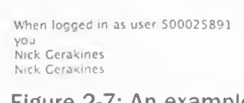

接下来使用的 FBML 实体 `fb:if-is-app-user` 和 `fb:else`（如下所示的代码中）在某种意义上是最重要的。包含在 `fb:if-is-app-user` 实体内部的内容仅对已授予应用程序完全权限的查看用户显示。此实体唯一的修饰符是 `uid` 属性，它表示应用此实体的用户 UID。

```html
<fb:if-is-app-user>
    Hello Application User!
    <fb:else>
        You must sign up to use this application.
    </fb:else>
</fb:if-is-app-user>
```

### 操作 Canvas 页面

操作页面负责将问候从一个用户发送给另一个用户。它的标记中包含用于表单的 `fb:editor` 实体，还包含显示在表单操作上的 `fb:explanation` 实体。

代码的第一部分与 `index.php` 非常相似。你创建一个 Facebook 客户端对象，并调用几个提供的方法来验证传入的签名，同时验证页面是通过 Facebook Canvas 查看的。

```php
$facebook = new Facebook(AppConfig::$api_key, AppConfig::$secret);
app.facebook.com/appname/
$facebook->require_frame();
$facebook->require_add();
$user = $facebook->require_login();

$app = new HelloWorld($facebook);

$target_user = null;
if (isset($_POST['friend_sel'])) {
    $target_user = (int) $_POST['friend_sel'];
}

$wave_success = false;
$action_wave = false;
$show_form = true;
if ($target_user) {
    $action_wave = true;
    $show_form = false;
    $wave_success = $app->wave_hello($user, $target_user);
}
```

这里值得注意的区别是在创建 `HelloWorld` 对象之后立即出现的。你首先检查的是 `friend_sel` POST 参数是否存在。如果已设置，那么你知道这是表单操作的结果。如果该 POST 参数的值是有效的 `int`，你就会设置 `wave_success`、`action_wave` 和 `show_form` 变量，这些变量控制着你为 Facebook 渲染而显示的内容。

# 第一部分：了解 Facebook 平台

与 `index.php` 中一样，就在 PHP 代码块下方，您使用 `fb:dashboard` 元素，并在其中包含一个 `fb:if-is-app-user` 元素，以防止尚未添加该应用程序的用户使用它。

就在 PHP 代码块下方，您显示 Facebook 将通过 Canvas 渲染的标记，如下所示：

```php
<fb:dashboard>
  <fb:action href="<?php echo AppConfig::$app_url ?>">View My Greetings</fb:action>
  <fb:action href="<?php echo AppConfig::$app_url ?>wave.php">Send a greeting</fb:action>
</fb:dashboard>

<div style="padding: 10px;">
  <h2>Hello <fb:name firstnameonly="true" uid="<?= $user ?>" useyou="false"/>!</h2><br/>
  <fb:if-is-app-user uid="<?= $user ?>">
  <?
  if ($action_wave) \<PageBreak>\f
    if ($wave_success) {
  ?>
  <fb:explanation>
      <fb:message><fb:name uid="<?= $target_user ?>" /></fb:message>
      You have sent a greeting to <fb:name uid="<?= $target_user ?>" />.
  </fb:explanation>
  <?
    }
  }
  ?>
  <? if ($show_form) { ?>
    <p>Give someone a smile, send them a greeting. To send someone a greeting start typing in their name and click on the Send button.</p>
    <fb:editor action="" labelwidth="100">
      <fb:editor-custom label="Tell us who:">
        <fb:friend-selector name="uid" idname="friend_sel" />
      </fb:editor-custom>
      <fb:editor-buttonset>
        <fb:editor-button value="Send"/>
        <fb:editor-cancel />
      </fb:editor-buttonset>
    </fb:editor>
  <? } ?>
  <fb:else>
    <p>You need to <a href="<?= $facebook->get_add_url() ?>">add <?= AppConfig::$app_name ?></a> to use it!</p>
  </fb:else>
  </fb:if-is-app-user>
</div>
```

结果显示在图 2-8 中。

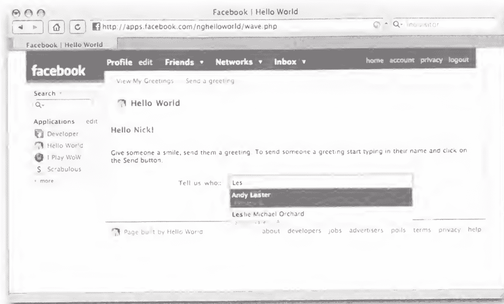

正如在第一个 PHP 代码块中确定的那样，如果提供了 `friend_sel` POST 参数，您希望显示已发送问候的状态。如果提供了，您将 `action_wave` 变量设置为 true。如果问候成功发送，您使用 `fb:explanation` 和 `fb:message` 实体来显示一个小的状态消息，如下所示：

```php
<?php
if ($action_wave) {
    if ($wave_success) {
?>
<fb:explanation>
    <fb:message>Greeting sent to <fb:name uid="<?= $target_user ?>" /></fb:message>
    You have sent a greeting to <fb:name uid="<?= $target_user ?>" />.
</fb:explanation>
<?php
    }
}
?>
```

`fb:explanation` 和 `fb:message` FBML 实体用于消息传递和内容组织。操作有事件，当事件发生时，Facebook 提供了几个 FBML 实体来更好地组织和显示该信息。这些 FBML 实体也符合 Facebook 使用的消息传递模式，使您的应用程序用户在整个 Facebook 中获得一致的行为。以下代码渲染了图 2-9 所示的屏幕。

```html
<fb:explanation>
<fb:message>Read this title!</fb:message>
It contains important information that you should pay attention to.
</fb:explanation>
```


如果 `friend_sel` POST 变量不存在，您希望显示用于选择要发送问候用户的表单。Facebook 提供了几个 FBML 实体，使创建表单变得非常轻松。有关创建表单的详细信息在第 3 章中提供。

如下所示，您使用 `fb:editor` FBML 实体来定义表单。在其中，您可以设置各种表单元素，但 `fb:editor-custom` 实体用于添加自定义表单元素。在 `fb:editor-custom` 实体内部，您包装 `fb:friend-selector` 并将其包含在表单中。

```php
<?php
if ($show_form) {
?>
<p>Give someone a smile, send them a greeting. To send someone a greeting start typing in their name and click on the Send button.</p>
<fb:editor action="" labelwidth="100">
<fb:editor-custom label="Tell us who:">
<fb:friend-selector name="uid" idname="friend_sel" />
</fb:editor-custom>
<fb:editor-buttonset>
<fb:editor-button value="Send"/>
<fb:editor-cancel />
</fb:editor-buttonset>
</fb:editor>
<?php
}
?>
```

当用户输入好友姓名并提交表单时，发送用户的个人资料页面会更新为最新信息。如果目标用户已添加该应用程序，目标用户的个人资料也会更新。如上所示，`HelloWorld::wave_hello` 方法被调用，该方法将问候信息写入数据库，并进行两个 API 方法调用以更新用户的个人资料。如图 2-10 所示，最终结果是一个描述所发生事情的简单消息。

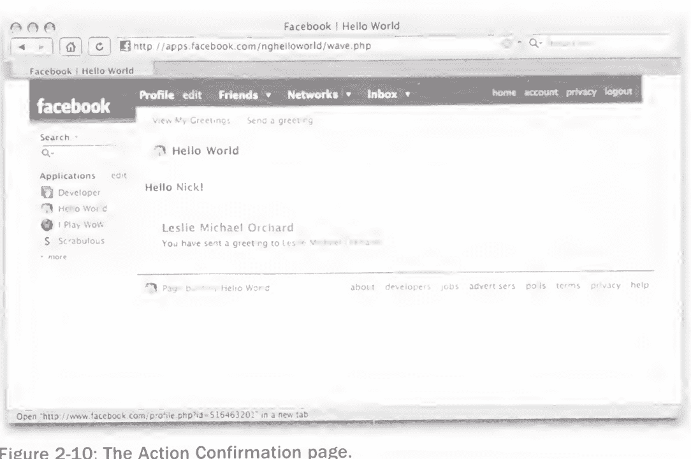

此项目中使用的最后一组 FBML 实体是 `fb:editor` 集合的一部分。它们控制 Facebook 应用程序中 HTML 表单的显示和使用。表单在第 3 章中介绍，但这里快速了解一下它们的处理方式。

通过使用 `fb:editor` FBML 实体，您可以勾勒出包含表单元素的区域。在此项目中，您希望使用 `fb:friend-selector` FBML 实体快速选择要发送问候的用户。`fb:friend-selector` 元素是用于您好友的 Ajax 自动完成表单元素。

`fb:editor-custom` FBML 实体用于包装 `fb:friend-selector` 并为其提供标签。您还可以使用 `fb:editor-button` 和 `fb:editor-cancel` 实体来显示提交按钮并提供取消操作的方式。

`fb:editor-custom` 实体对于添加没有 FBML 的表单元素非常有用。下拉菜单、图像和原始文本可以轻松包装在 `fb:editor-custom` 元素中，以样式化非表单内容并将其包含在表单中。

## 评估现状

示例项目可能已完成，但仍有很多工作要做。您已经了解了创建应用程序并使用 Facebook 开发者应用程序配置它的步骤，并且已经编写并安装了运行 Facebook 应用程序的代码。然而，仍有许多事情尚未涉及。

既然已经构建完成，让我们看看有什么问题或缺失。首先（也是最重要的）是缺乏错误处理。PHP 客户端库有几个方法可用于验证请求是否有效以及是否被正确查看，但 Facebook 绝不是您应用程序代码的纠错力量。操作页面没有错误处理来检查无效的表单数据，也没有在任何一点验证 Facebook 是否返回了失败。您也没有显示任何指示操作失败的消息。

以下是您应该采取的一些措施：

- **错误处理** — 您必须在操作页面上添加错误处理和更好的消息传递。如果 API 方法调用失败，或者即使您无法写入数据库，您也必须让用户知道操作失败及其原因。
- **通知** — 当用户向另一个此前从未收到过该用户问候的用户发送问候时，您应该使用 `$facebook->api_client->notifications_send($to_ids, $notification, $email='')` 方法发送通知。

## 小结

本章通过深入创建 Facebook 应用程序，采用了一种非常实践的方法来处理 Facebook 平台。您从使用 Facebook 开发者应用程序创建和配置应用程序开始，然后逐步分解应用程序以揭示其工作原理。

我再怎么强调 FBML 的实用性以及它为应用程序开发人员节省的时间都不为过。借助它，您创建了一个符合整体 Facebook 风格的界面。


第 3 章更侧重于 FBML 以及如何在实际应用程序中使用一些更复杂的实体。

# 第 3 章：Facebook 标记语言（FBML）

Facebook 应用程序将内容发布到用户个人资料，发送通知，通过应用程序 Canvas 显示内容，并发布到动态新闻和 Mini-Feed。如果没有 Facebook 标记语言（FBML），这一切都不可能实现。FBML 是 Facebook 平台使用的特殊标记语言，用于解析、渲染和增强对 Facebook 上用户以及您的应用程序体验有直接影响的内容。

第 2 章带您完成了 Facebook 应用程序的开发，并使用了 Facebook 平台的几个组件——其中之一就是 FBML 以及它所提供的一些实体。本章继续讨论这一概念，并引导您了解大量可用的 FBML 实体。

本章还将带您了解一些应用于 FBML 的注意事项和规则，这些由渲染引擎处理，并为一些更高级的概念提供理解基础。

## 了解 FBML

简而言之，FBML 是一种严格的标记语言，由 XML 实体组成，旨在为 Facebook 用户提供丰富的体验。FBML 是一种深深植根于 HTML 的混合标记语言。事实上，大多数可用实体直接取自 HTML，并有几个特殊例外。以下是 FBML 的一个示例：

```xml
<fb:name uid="12345"> is <strong>slick</strong>.
```

FBML 随 Facebook 平台在发布之日推出，但此后经历了多次修订。值得注意的变化包括为遏制用户个人资料内容滥用和保护用户隐私而提供的实体。本章不包含之前 FBML 版本中的任何已弃用实体。也不包含 Facebook 平台视为 "beta" 的 FBML 实体。

## 第一部分：了解 Facebook 平台

### 实体

FBML *实体* 本质上就是 `fb` 命名空间内的 XML 元素。`fb` XML 命名空间定义在 `http://apps.facebook.com/ns/1.0`。实体用于显示和设置信息，同时也作为操作符来控制内容的流程和组织。

接下来的几个部分将介绍定义不同类型 FBML 实体的主要类别。在阅读展示这些实体用途的讨论时，你可能会注意到，在某些情况下，同一个实体存在多种使用场景。

### HTML

几乎所有 HTML 实体都可用。此处列出的实体具有经过修改的行为。以下是 Facebook 认可的 HTML 实体列表：

| Abbr | del | h6 | pre | td |
| --- | --- | --- | --- | --- |
| acronym | dfn | hr | q | textarea |
| address | div | i | s | tfoot |
| b | dl | input | samp | th |
| bdo | dt | ins | select | thread |
| big | em | kbd | small span | tr |
| blockquote | fieldset | label | strike | tt |
| br | font | legend | strong | u |
| caption | h1 | li | style | ul |
| center | h2 | ol | sub | var |
| cite | h3 | optgroup | sup | a |
| code | h4 | option | table | form |
| dd | h5 | p | tbody | img |

在此列表中，有几个特殊情况。`a`、`form`、`img` 和 `script` HTML 实体具有开发人员需要注意的处理规则。

#### a

虽然应用画布（Canvas）允许相对和绝对 URL，但其他 FBML 实例需要绝对 URL。使用此 HTML 实体时，应始终使用绝对 URL。

#### form

表单会被扩展并以不同方式处理。请参阅本章后面"表单"一节。

#### img

`img` HTML 实体在渲染到浏览器之前会被处理。当 FBML 渲染引擎遇到图片 URL 时，该图片会由 Facebook 平台进行过滤、验证和缓存。最终结果是，给定的 URL 会被重写为缓存内容的位置。

Facebook 平台采取这些步骤是为了保护其用户和信息安全。这可以防止动画图片或大图片降低 Facebook 用户的体验。同时，这也减轻了应用程序的负载，将其转移到 Facebook 平台。

所有 `img` HTML 实体必须使用绝对 URL。

#### script

不允许使用传统 JavaScript。取而代之的是，Facebook 平台发布了 FBJS，这是一种 JavaScript 解析器和渲染系统，允许开发人员增强其 Facebook 应用程序。FBJS 实体及其相关概念将在第 4 章中讨论。

## 操作符

操作符控制 FBML 的流程、结构和组织。这些包括 `fb:if`、`fb:else`、`fb:switch`、`fb:default`、`fb:random` 和 `fb:random-option` FBML 实体。

### fb:if

以下是必需属性：

- `value` — 用于判断的真或假值

`fb:if` 元素是标准的 if/then 代码块。在渲染时，FBML 引擎将判断 `value` 属性的值是否为 `true`，如果是，则显示该实体的内容。默认值为 `false`。值得注意的是，使用 `fb:if` 实体是一种非常快速高效的 FBML 注释方法。

```xml
<fb:if value="true">
    Candy is dandy but liquor is quicker.
</fb:if>
```

### fb:else

`fb:else` 实体是 `fb:if` 实体的另一半。它处理 else 情况，显示其内容。此实体没有属性。

```xml
The truth is
<fb:if value="true">
absolute
<fb:else>relative</fb:else>
</fb:if>.
```

`fb:else` 实体也适用于其他几个实体，包括所有 `fb:if-*` 实体，以及 `fb:is-in-network` 实体。

### fb:switch

`fb:switch` 包含多个 FBML 实体，并将返回第一个解析为非空字符串的实体。

```xml
<fb:switch>
    <fb:photo pid="12345" />
    <fb:profile-pic uid="54321" />
</fb:switch>
```

### fb:default

`fb:default` 实体用于 `fb:switch` 实体中，以在找不到匹配项时提供默认结果。

```xml
<fb:switch>
    <fb:photo pid="12345" />
    <fb:profile-pic uid="54321" />
    <fb:default>You can't see either the photo or the profile pic</fb:default>
</fb:switch>
```

### fb:random

以下是可选属性：

- `pick` — 一个数字，表示要进行的最大选择数。默认值为 1。
- `unique` — 一个 `true` 或 `false` 值，强制返回的选择项之间具有唯一性。如果 `pick` 属性小于 2，则忽略此选项。默认值为 `true`。

`fb:random` 实体是 `fb:random-option` 实体的容器，这些选项将被随机返回。

```xml
<fb:random>
  <fb:random-option>Bounjour</fb:random-option>
  <fb:random-option>Hello</fb:random-option>
</fb:random>
```

### fb:random-option

以下是可选属性：

- `weight` — 与选项关联的数值

`fb:random-option` 实体用于 `fb:random` 实体中，以提供可供选择和返回的选项。这些选项的选择是随机的。但是，会考虑选项的权重因素。

```xml
<fb:random>
  <fb:random-option weight="50">You are a winner!</fb:random-option>
  <fb:random-option weight="1">Please try again.</fb:random-option>
</fb:random>
```

可用选项的权重是相对于可用选项总数的，前提是进行多次选择且所有选择必须唯一。

## 导航

导航类 FBML 实体允许开发人员为其应用程序的多个部分和区域展示一致的外观和风格。第 10 章提供了这些实体的完整比较，以及理想的使用案例和更多信息。

这包括以下 FBML 实体：

- `fb:dashboard`
- `fb:create-button`
- `fb:help`
- `fb:action`
- `fb:header`
- `fb:tabs`
- `fb:tab-item`
- `fb:mediaheader`
- `fb:header-title`
- `fb:owner-action`

### fb:dashboard

`fb:dashboard` 实体用于创建默认的 Facebook 仪表板。显示的标题文本是应用程序名称。此文本无法更改或配置。此实体没有可用属性。该实体可以包含任意数量的 `fb:action` 实体、一个 `fb:create-button` 实体和一个 `fb:help` 实体。

```xml
<fb:dashboard></fb:dashboard>
```

> 对于带有图标的应用程序，图标将显示在应用程序名称的正左侧。

### fb:create-button

以下是必需属性：

- `href` — 目标 URL。必须是画布（Canvas）URL。

以下是可选属性：

- `title` — 工具提示中显示的标题

`fb:create-button` 实体在仪表板右侧显示默认的"创建"按钮。它用于暗示用户可以通过此链接添加用户生成的内容。`fb:dashboard` 只能识别一个此类实体。实体内部的文本直接显示。但是，显示文本中的"+"符号无法删除或设置样式。

```xml
<fb:dashboard>
  <fb:create-button href="create.php">Add a meal</fb:create-button>
</fb:dashboard>
```

### fb:help

以下是必需属性：

- `href` — 目标 URL。必须是画布（Canvas）URL。

以下是可选属性：

- `title` — 工具提示中显示的标题

`fb:help` 实体将在仪表板小部件内创建一个右对齐的链接。

```xml
<fb:dashboard>
  <fb:help href="help.php">Help</fb:help>
</fb:dashboard>
```

> 链接文本和工具提示始终显示"Help"。此设置不可配置，也无法设置样式。

### fb:action

以下是必需属性：

- `href` — 目标 URL。必须是画布（Canvas）URL。

以下是可选属性：

- `title` — 工具提示中显示的标题

`fb:action` 实体可以在两个地方使用。第一个是在 `fb:dashboard` 实体中。在这种情况下，它会在仪表板中渲染一个左对齐的链接。

```xml
<fb:dashboard>
  <fb:action href="search.php">Search</fb:action>
</fb:dashboard>
```

此实体也可以在 `fb:subtitle` 实体的上下文中使用。在这种情况下，它会在副标题内创建一个右对齐的链接，指向提供的 URL。

```xml
<fb:subtitle>
  <fb:action href="http://apps.facebook.com/cowbell/more">More cowbell</fb:action>
  There have been 3 rings.
</fb:subtitle>
```

## fb:header

以下是可选属性：

- `icon` — 该布尔值用于切换应用程序图标是否在标题文本旁显示。默认值为 `true`。
- `decoration` — 该属性用于自定义标题和文本的外观。此属性的值可以是以下之一：
  - `add_border` — 为标题添加 1 像素实黑色样式。
  - `no_padding` — 从标题样式中移除 20 像素的内边距。
  - `shorten` — 从标题底部移除 20 像素。

`fb:header` 实体渲染一个标准的 Facebook 标题。默认情况下，应用程序图标显示在标题文本的左侧。开发者可通过在 `decoration` 属性中设置三个可用选项之一来自定义标题的样式。

```xml
<fb:header>Hello World</fb:header>
```

### fb:tabs

`fb:tabs` 实体渲染一组导航标签。该实体没有直接的选项。它包含多个 `fb:tab-item` 实体。

```xml
<fb:tabs></fb:tabs>
```

### fb:tab-item

以下是必需属性：

- `href` — 标签的目标 URL。必须是绝对 URL。
- `title` — 显示在标签工具提示中的文本。

以下是可选属性：

- `align` — 指定项目的对齐方式。可用选项为 `left` 和 `right`。默认值为 `left`。
- `selected` — 一个布尔值，用于高亮显示标签，表明它已被选中。

`fb:tab-item` 实体用于向 `fb:tabs` 实体填充一个或多个标签。

```xml
<fb:tabs>
  <fb:tab-item href="/exampleapp/home.php" title="My Home">Home</fb:tab-item>
  <fb:tab-item href="/exampleapp/search.php" title="Find other users">Search</fb:tab-item>
  <fb:tab-item href="/exampleapp/help.php" title="Help" align="right">Help</fb:tab-item>
</fb:tabs>
```

## fb:mediaheader

以下是必需属性：

- `uid` — 显示标题的用户对应的 Facebook 用户 ID。

该 `fb:mediaheader` FBML 实体渲染一个标准的媒体标题。其用途是显示由 Facebook 用户提供的内容。该实体有两种不同的行为。当查看用户不是由 `uid` 属性指定的用户时，会显示几个链接，用于联系该用户、查看该用户的个人资料以及"戳一下"该用户。当查看用户就是由 `uid` 属性指定的用户时，这些链接不会出现。

```xml
<fb:mediaheader uid="500025891"></fb:mediaheader>
```

### fb:header-title

该 `fb:header-title` FBML 实体用于 `fb:mediaheader` 实体内部，以设置媒体标题部件上显示的标题文本。

```xml
<fb:mediaheader uid="500025891">
  <fb:header-title>Nick's Photos</fb:header-title>
</fb:mediaheader>
```

### fb:owner-action

以下是必需属性：

- `href` — 操作的目标地址。

`fb:owner-action` FBML 实体用于在查看用户是 `fb:mediaheader` 父级 FBML 实体中指定的用户时显示一个操作链接。

```xml
<fb:mediaheader uid="500025891">
  <fb:header-title>Nick's stuff</fb:header-title>
  <fb:owner-action href="?edit=1">Edit</fb:owner-action>
</fb:mediaheader>
```

## 信息类

信息类 FBML 实体用于向用户显示消息和通知。此类包含 `fb:error`、`fb:explanation`、`fb:success` 和 `fb:message` FBML 实体。

### fb:error

以下是必需属性：

- `message` — 要显示的消息标题。

以下是可选属性：

- `decoration` — 使用以下两种选项之一来自定义错误框的外观：
  - `no_padding` — 移除 20 像素的内边距。
  - `shorten` — 从底部移除 20 像素。

`fb:error` 实体用于向用户传达警告或错误。它渲染一个大的红色框，标题和正文由 `message` 属性和实体内容指定。可使用可选的 `decoration` 属性来自定义错误消息的显示方式。

```xml
<fb:error message="You already invited that user.">
Do not try to invite users more than once. You have 10 invites left.
</fb:error>
```

### fb:explanation

以下是必需属性：

- `message` — 要显示的消息标题。

以下是可选属性：

- `decoration` — 使用以下两种选项之一来自定义说明框的外观：
  - `no_padding` — 移除 20 像素的内边距。
  - `shorten` — 从底部移除 20 像素。

`fb:explanation` 实体用于传达消息或通知。它渲染一个大的白色框，标题和正文由 `message` 属性和实体内容指定。可使用可选的 `decoration` 属性来自定义消息的显示方式。


```xml
<fb:explanation message="Someone attacked your base">
You lost 20 men but thwarted the attack. Morale has increased slightly.
</fb:explanation>
```

## `fb:success`

以下是必需属性：

- `message` — 要显示的消息标题。

以下是可选属性：

- `decoration` — 使用以下两种选项之一来自定义成功框的外观：
  - `no_padding` — 移除 20 像素的内边距。
  - `shorten` — 从底部移除 20 像素。

`fb:success` 实体用于传达成功消息或通知。它渲染一个大的黄色框，标题和正文由 `message` 属性和实体内容指定。可使用可选的 `decoration` 属性自定义消息的显示方式。

```xml
<fb:success message="A friend of yours added the application">
  Chris has added the application and is now in your application network. Hurray.
</fb:success>
```

## `fb:message`

`fb:message` 实体用于 `fb:error`、`fb:explanation` 和 `fb:success` 实体内部，作为 `message` 属性的即插即用替代方案。没有可用的配置选项或属性。

```xml
<fb:success>
  <fb:message>A friend of yours added the application</fb:message>
  Chris has added the application and is now in your application network. Hurray.
</fb:success>
```

## 用户和群组

用户和群组 FBML 实体用于显示有关用户或群组的信息。此类包含 `fb:name`、`fb:grouplink`、`fb:user`、`fb:pronoun` 和 `fb:profile-pic` FBML 实体。

## `fb:name`

以下是必需属性：

- `uid` — 该数值表示将要显示名称的用户的 Facebook 用户 ID。也可以指定值 `loggedinuser`。

以下是可选属性：

- `firstnameonly` — 一个布尔值，指示只显示用户的名字。该属性的默认值为 `false`。
- `lastnameonly` — 一个布尔值，指示只显示用户的姓氏。该属性的默认值为 `false`。
- `linked` — 一个布尔值，控制显示的文本是否链接到用户的个人资料。该属性的默认值为 `true`。
- `possessive` — 一个布尔值，将用户名称设为所有格（例如 `Joe's` 而非 `Joe`）。该属性的默认值为 `false`。
- `reflexive` — 一个布尔值，显示用户名称的反身形式（例如 `yourself` 或 `himself`）。该属性的默认值为 `false`。
- `useyou` — 一个布尔值，如果给定的 `uid` 是查看用户的 `uid`，则显示 `you`。该属性的默认值为 `true`。与 `reflexive` 属性一起使用时，将显示文本 `yourself`。
- `ifcantsee` — 如果查看用户没有权限查看该用户，则显示作为替代文本的字符串。默认值为空字符串。
- `capitalize` — 一个布尔值，将显示的文本首字母大写。该属性的默认值为 `false`。
- `subjectid` — 句子主语的 Facebook 用户 ID，在该句子中，此名称是动词宾语。在适当时将使用反身形式。

`fb:name` 实体在最基本的层面上提供了一个即插即用的替代方案，用于显示由 Facebook 用户 ID 指定的用户名称。通过多个属性，可以自定义名称的显示方式和用途。

```xml
Is <fb:name uid="12345" /> the same as <fb:name uid="loggedinuser"/>?
```

## `fb:grouplink`

以下是必需属性：

- `gid` — 要链接到的 Facebook 群组 ID。

`fb:grouplink` FBML 实体用于链接到一个 Facebook 群组。唯一可用的选项是 `gid` 属性，其值为要链接到的 Facebook 群组的数字 ID。

```xml
<fb:grouplink gid="2204910717" />
```

## `fb:user`

以下是必需属性：

- `uid` — 表示 Facebook 用户 ID 的数值。

`fb:user` FBML 实体是一个以用户为中心的控制元素。它接受一个选项，即 `uid` 属性，其值为有效的 Facebook 用户 ID。如果查看用户是提供给该 FBML 实体的用户 ID 所代表的用户，则显示内容。

```xml
<fb:user uid="12345">
This is for 12345's eyes only.
</fb:user>
```

## `fb:pronoun`

以下是必需属性：

- `uid` — 表示将要生成/显示名称的 Facebook 用户的数值。

以下是可选属性：

- `objective` — 一个布尔值，将显示的名称设为目标格（`him/her/you/them`）。该属性的默认值为 `false`。
- `usethey` — 一个布尔值，如果用户的性别未指定，则将显示的文本设为 `they`。该属性的默认值为 `true`。
- `reflexive` — 一个布尔值，显示用户名称的反身形式（例如 `yourself` 或 `himself`）。该属性的默认值为 `false`。
- `useyou` — 一个布尔值，如果给定的 `uid` 是查看用户的 `uid`，则显示 `你`。此属性的默认值为 `true`。与反身属性结合使用时，显示文本 `你自己`。
- `ifcantsee` — 一个字符串，如果查看用户无权查看该用户，则显示为替代文本。默认为空字符串。
- `capitalize` — 一个布尔值，用于将显示的文本首字母大写。此属性的默认值为 `false`。

`fb:pronoun` FBML 实体返回一个用户的代词。`uid` 属性必须是有效的 Facebook 用户 ID。

```xml
<fb:pronoun uid="12345" usethey="true" useyou="false" />
```

## `fb:profile-pic`

以下是必需属性：

- `uid` — 一个数值，表示其头像图片要显示的用户的 Facebook 用户 ID。

以下是可选属性：

- `size` — 要显示的图片尺寸。它必须是以下值之一，`thumb` 为默认值：
  - `thumb` 或 `t` — 宽 50 像素。
  - `small` 或 `s` — 宽 100 像素。
  - `normal` 或 `n` — 宽 200 像素。
  - `square` 或 `q` — 50 像素 × 50 像素。
- `linked` — 将图片链接到该用户的个人主页。默认为 `true`。

`fb:profile-pic` FBML 实体接受 `uid` 属性，并返回一个有效的 `img` HTML 实体，其中包含该用户的头像图片。

```xml
<fb:profile-pic uid="12345" size="thumb" linked="true" />
```

## 信息控制

Facebook 平台还提供可用于控制信息流和显示的实体。在向其他用户展示关于其他用户的内容时，这些实体可用于执行隐私和查看权限。

此组包括 `fb:is-in-network`、`fb:if-can-see`、`fb:if-can-see-photo`、`fb:if-is-app-user`、`fb:if-is-friends-with-viewer`、`fb:if-is-group-member`、`fb:if-is-own-profile`、`fb:if-is-user` 和 `fb:if-user-has-added-app` FBML 实体。

## `fb:is-in-network`

以下是必需属性：

- `network` — 表示要检查成员资格的 Facebook 网络的数字 ID。

以下是可选属性：

- `uid` — 表示要检查网络成员资格的 Facebook 用户的数字值。如果未提供值，则默认为 FBML 为其渲染的用户。

如果 `uid` 属性中提供的用户在 `network` 属性中提供的网络内，则此实体的内容将被渲染。

```xml
<fb:is-in-network network="67108896">
You are in the Silicon Valley, CA network.
</fb:is-in-network>
```

> 这是少数几个能够识别 `fb:else` 实体的非 `fb:if` 实体之一。

## `fb:if-can-see`

以下是必需属性：

- `uid` — 一个数字值，表示要验证的 Facebook 用户。

以下是可选属性：

- `what` — 要验证的策略名称。有效值包括：
  - `profile`
  - `friends`
  - `not_limited`
  - `online`
  - `statusupdates`
  - `wall`
  - `groups`
  - `courses`
  - `photosofme`
  - `notes`
  - `feed`
  - `contact`
  - `email`
  - `aim`
  - `cell`
  - `phone`
  - `mailbox`
  - `address`
  - `basic`
  - `education`
  - `professional`
  - `personal`
  - `seasonal`
  - `search`

默认值为 `search`。

```xml
<fb:if-can-see uid="12345" what="education">
  Did you go to school with <fb:name uid="12345" linked="true" />?
  <fb:else>Move on, nothing to see here.</fb:else>
</fb:if-can-see>
```

## `fb:if-can-see-photo`

以下是必需属性：

- `pid` — 由 Facebook 平台提供的表示照片的数字值。

以下是可选属性：

- `uid` — 一个数字值，表示要验证的 Facebook 用户。

`fb:if-can-see-photo` 实体用于验证用户是否可以查看照片。

```xml
<fb:if-can-see-photo uid="12345" pid="555123">
  <a href="/photos/555123">Check out this photo</a>.
</fb:if-can-see-photo>
```

## `fb:if-is-app-user`

以下是可选属性：

- `uid` — 表示要检查的 Facebook 用户的数字值。如果未提供值，则默认为 FBML 为其渲染的用户。

`fb:if-is-app-user` 实体仅在用户已授予应用完整权限时，才会显示实体的内容。

> 授予应用权限与添加应用不同。

```xml
<fb:if-is-app-user>
  <a href="/myapp/someaction">Use the app</a>
  <fb:else>
    You must grant this application permission to access your information before you can use the advanced features provided.
  </fb:else>
</fb:if-is-app-user>
```

## `fb:if-is-friends-with-viewer`

以下是必需属性：

- `uid` — 一个数字值，表示 Facebook 用户。
- `includeself` — 一个布尔值，表示如果查看用户是 `uid` 属性指定的用户，则评估将返回 `true`。

`fb:if-is-friends-with-viewer` FBML 实体仅在查看用户与 `uid` 属性指定的用户是好友时，才会显示实体的内容。

```xml
<fb:if-is-friends-with-viewer uid="12345">
  Hey compadre.
  <fb:else>
    Do you want to add <fb:name uid="12345" /> as a friend?
  </fb:else>
</fb:if-is-friends-with-viewer>
```

## `fb:if-is-group-member`

以下是必需属性：

- `gid` — 一个数字值，表示一个 Facebook 群组。

以下是可选属性：

- `uid` — 一个数字值，表示一个 Facebook 用户。
- `role` — 要检查的角色。默认值为 `member`。其他有效值为 `officer` 和 `admin`。

`fb:if-is-group-member` 实体仅在用户满足给定群组的角色要求时，才会显示实体的内容。

```xml
<fb:if-is-group-member uid="12345" gid="5555123" role="officer">
  This is an officer only message.
  <fb:else>
    Sorry, this message is for officers only.
  </fb:else>
</fb:if-is-group-member>
```

## `fb:if-is-own-profile`

`fb:if-is-own-profile` FBML 实体仅在查看用户是个人主页的所有者时，才会显示实体的内容。

```xml
<fb:if-is-own-profile>
  This is your profile
  <fb:else>
    This is not your profile.
  </fb:else>
</fb:if-is-own-profile>
```

## `fb:if-is-user`

以下是必需属性：

- `uid` — 一个数字值列表，表示 Facebook 用户。

`fb:if-is-user` FBML 实体仅在查看用户是 `uid` 属性中指定的用户之一时，才会显示实体的内容。

```xml
<fb:if-is-user uid="12345,55512">
  Keep this a secret.
  <fb:else>
    DO NOT WANT KTHNXBAI.
  </fb:else>
</fb:if-is-user>
```

## `fb:if-user-has-added-app`

以下是必需属性：

- `uid` — 一个数字值，表示一个 Facebook 用户。

`fb:if-user-has-added-app` FBML 实体仅在 `uid` 属性中的用户已将应用添加到其帐户时，才会显示实体的内容。

```xml
<fb:if-user-has-added-app uid="12345">
  Have a feature. No really. Have it.
  <fb:else>
    You must add this application to use this feature.
  </fb:else>
</fb:if-user-has-added-app>
```

## 个人主页

用户个人主页上显示的内容由几个特定于用户个人主页的 FBML 实体控制。此组包括 `fb:wide`、`fb:narrow`、`fb:profile-action`、`fb:subtitle`、`fb:user-table` 和 `fb:user-item` FBML 实体。这些实体只能用于显示用户个人主页内容。

## `fb:wide`

`fb:wide` 实体仅在应用程序个人主页框位于用户个人主页的宽栏时，才会显示实体内容。

```xml
<fb:wide>
  This is wide content. It has 10 items.
</fb:wide>
```

## `fb:narrow`

`fb:narrow` 实体仅在应用程序个人主页框位于用户个人主页的窄栏时，才会显示实体内容。

```xml
<fb:narrow>
  This is narrow content. It has 6 items.
</fb:narrow>
```

## `fb:profile-action`

以下是必需属性：

- `url` — 用户被导向的目标位置。此值必须是绝对 URL。

`fb:profile-action` 实体在用户头像照片下方渲染一个链接。每个应用程序可以设置一个个人主页操作链接。FBML 通过 `Facebook.profile.setFBML` API 方法设置。

```xml
<fb:profile-action url="http://example.com/books">See all books</fb:profile-action>
```


可以根据查看个人主页的用户，对`fb:profile-action`应用条件。

```
<fb:if-is-own-profile>
    <fb:profile-action url="http://example.com/user?uid=12345">View my challenges</fb:profile-action>
    <fb:else>
        <fb:if-is-app-user>
            <fb:profile-action url="http://example.com/challenge?uid=12345">Challenge this user</fb:profile-action>
            <fb:else>
                <fb:profile-action url="http://example.com/add?from=12345">Add this application</fb:profile-action>
            </fb:else>
        </fb:if-is-app-user>
    </fb:else>
</fb:if-is-own-profile>
```

# 第一部分：了解 Facebook 平台

## `fb:subtitle`

以下是可选属性：

- `seeallurl` — 一个绝对的应用画布页面 URL，用于显示“查看全部”链接

`fb:subtitle`实体定义了用户个人主页应用框的副标题。此 FBML 实体可以包含一个`fb:action`实体，用于在个人主页框副标题的右侧渲染一个操作链接。

```
<fb:subtitle seeallurl="http://apps.facebook.com/gifts?user=12345">
Displaying 3 recently given gifts.
</fb:subtitle>
```

## `fb:user-table`

以下是可选属性：

- `cols` — 要显示的列数

`fb:user-table` FBML 实体用于准备一个要显示的用户网格。

```
<fb:user-table cols="4">
<fb:user-item uid="12345" />
<fb:user-item uid="23456" />
<fb:user-item uid="34567" />
<fb:user-item uid="45678" />
<fb:user-item uid="56789" />
</fb:user-table>
```

## `fb:user-item`

以下是必需属性：

- `uid` — 代表 Facebook 用户的数值

`fb:user-item` FBML 实体将一个用户添加到`fb:user-table`网格中。

```
<fb:user-table cols="3">
<fb:user-item uid="123456" />
</fb:user-table>
```

## 个人主页可见性

这些实体控制显示在用户个人主页上的内容的可见性。自 FBML 1.2 起，所有发送到用户个人主页的内容都会发送到浏览器，但会根据这些实体应用的规则进行隐藏。因此，将任何可能敏感或私密的内容发送到用户的个人主页是不安全的（也不是一个好主意）。

此组包括`fb:visible-to-owner`、`fb:visible-to-friends`、`fb:visible-to-user`、`fb:visible-to-apps-users`和`fb:visible-to-added-app-users` FBML 实体。

## `fb:visible-to-owner`

`fb:visible-to-owner`实体定义的内容仅在查看个人主页的用户是个人主页所有者时可见。此实体不应用于显示私密或敏感内容。此实体在一个个人主页实体（`fb:wide`和`fb:narrow`）中只能使用一次。

```
<fb:wide>
<fb:visible-to-owner>
35 people have tagged you. 10 of those tags were private.
</fb:visible-to-owner>
</fb:wide>
```

## `fb:visible-to-friends`

`fb:visible-to-friends`实体定义的内容仅在查看个人主页的用户是个人主页所有者的朋友时可见。此实体不应用于显示私密或敏感内容。此实体在一个个人主页实体（`fb:wide`和`fb:narrow`）中只能使用一次。

```
<fb:wide>
<fb:visible-to-friend>
You lived with John in a bungalow in '67.
</fb:visible-to-friend>
</fb:wide>
```

## `fb:visible-to-user`

以下是必需属性：

- `uid` — 代表 Facebook 用户的数值

`fb:visible-to-user`实体定义的内容仅在查看个人主页的用户根据`uid`属性被指定为可见时才会显示。此实体不应用于显示私密或敏感内容。此实体在一个个人主页实体（`fb:wide`和`fb:narrow`）中只能使用一次。

```
<fb:wide>
<fb:visible-to-user uid="12345">
You rock my world.
</fb:visible-to-user>
</fb:wide>
```

## `fb:visible-to-apps-users`

`fb:visible-to-apps-users`实体定义的内容仅在查看个人主页的用户已授予创建该个人主页框的应用完全权限时可见。此实体不应用于显示私密或敏感内容。此实体在一个个人主页实体（`fb:wide`和`fb:narrow`）中只能使用一次。

```
<fb:wide>
<fb:visible-to-apps-users>
Challenge John to a duel!
</fb:visible-to-apps-users>
</fb:wide>
```

## `fb:visible-to-added-app-users`

`fb:visible-to-added-app-users`实体定义的内容仅在查看个人主页的用户已添加创建该个人主页框的应用时可见。此实体不应用于显示私密或敏感内容。此实体在一个个人主页实体（`fb:wide`和`fb:narrow`）中只能使用一次。

```
<fb:wide>
<fb:visible-to-added-app-users>
Challenge John to a duel!
</fb:visible-to-added-app-users>
</fb:wide>
```

## 媒体和外部内容

媒体和外部内容 FBML 实体允许开发者在其应用中包含不同类型的内容，以便在应用画布页面和用户个人主页上显示。

此组包括`fb:iframe`、`fb:photo`、`fb:mp3`、`fb:swf`、`fb:flv`和`fb:silverlight` FBML 实体。

## `fb:iframe`

以下是必需属性：

- `src` — 要在 IFrame 中显示的源 URL

以下是可选属性：

- `smartsize` — 一个布尔值，指示渲染的 iframe 实体扩展以消耗所有剩余可用空间，并禁用外部滚动条。

- `frameborder` — 一个布尔值，用于显示或隐藏框架边框。

- `scrolling` — 一个布尔值，用于显示或隐藏滚动条。

- `style` — 用于设置元素样式的标准样式属性。

- `width` — 渲染的 IFrame 的宽度。

- `height` — 渲染的 IFrame 的高度。

`fb:iframe` FBML 实体用于在应用画布内创建一个 IFrame HTML 元素。创建 IFrame 时，`src`属性定义的 URL 会被重写，以包含多个查询字符串参数，表明该请求是从 Facebook 平台有效发出的。`fb_sig_in_iframe`查询字符串参数也会相应地包含在内。

```
<fb:iframe src="http://search.yahoo.com/" smartsize="0" frameborder="0"
scrolling="0" width="320" height="45" />
```

## `fb:photo`

以下是必需属性：

- `pid` — 一个数值 ID，表示 API 给出的 ID，或与用户 ID 一起在查询字符串中找到的 ID。

以下是可选属性：

- `uid` — 与非 API 提供的`pid`一起在查询字符串中找到的`uid`。

- `size` — 要显示的图像大小。必须是以下值之一，默认值为`thumb`：

  - `thumb`或`t` — 50 像素宽

  - `small`或`s` — 100 像素宽

  - `normal`或`n` — 200 像素宽

  - `square`或`q` — 50 像素 × 50 像素

- `align` — 此属性可设置为`left`或`right`，以指示照片在应用画布上的对齐方式。此属性的默认值为`left`。

`fb:photo` FBML 实体用于显示上传到 Facebook 的照片。

```
<fb:photo pid="12345" />
```

## `fb:mp3`

以下是必需属性：

- `src` — 要播放的 MP3 文件的绝对 URL。

以下是可选属性：

- `title` — 歌曲的标题。

- `artist` — 歌曲的艺术家。

- `album` — 包含该歌曲的专辑。

- `width` — 播放器的宽度。默认值为 300。

- `height` — 播放器的高度。默认值为 29。

`fb:mp3` FBML 实体渲染一个 Flash MP3 播放器。

```
<fb:mp3 src="http://example.com/mp3" title="The Legendary Hero" />
```

## `fb:swf`

以下是必需属性：

- `swfsrc` — SWF 对象的绝对 URL。

以下是可选属性：

- `imgsrc` — 预览图像的位置。这必须是一个绝对 URL。如果未设置此属性，默认值为一个透明图像的 URL。

- `width` — 图像和 Flash 对象的宽度。

- `height` — 图像和 Flash 对象的高度。

- `imgstyle` — 一个有效的样式属性，用于将 CSS 应用于`imgsrc`定义的图像。

- `imgclass` — 一个有效的 CSS 类标识符，用于设置`imgsrc`定义的图像样式。

- `flashvars` — URL 编码的 Flash 变量。这还将包括本章后面“表单”部分描述的`fb_sig_`变量。

- `swfbgcolor` — SWF 对象的背景颜色。

- `waitforclick` — 一个布尔值，指示 SWF 对象应仅在用户单击时开始播放。在用户个人主页上渲染 Flash 时，此属性会自动设置为`true`。

- `salign` — 根据嵌入式 HTML 实体的`salign`值。

- `loop` — 一个布尔值，指示 SWF 对象应持续循环。

- `quality` — 应用于 SWF 对象的缩放比例。

- `align` — 一个值，指示浏览器应如何对齐 SWF 对象。有效值包括`left`、`right`和`center`。

- `wmode` — 指示 SWF 对象的透明度设置。有效值包括`transparent`、`opaque`或`window`。如果未指定此属性，默认值为`transparent`。

`fb:swf` FBML 实体渲染一个 SWF 对象。

```
<fb:swf
  swfsrc="http://example.com/flash/myflash.swf"
  imgsrc="http://example.com/flash/myflash-thumb.jpg"
  width="480"
  height="320"
/>
```

当包含 SWF 对象时，以下变量也会被传递：

- `allowScriptAccess` — 一个始终设置为`never`的字符串。

- `fb_sig_profile` — 正在显示 SWF 对象的用户的 Facebook 用户 ID。如果 SWF 对象未显示在用户的个人主页上，则此参数为空。

- `fb_sig_time` — 签名生成的时间。

- `fb_sig_user` — 当前登录用户的 Facebook 用户 ID。

- `fb_sig_session_key` — 当前登录用户的会话密钥。

- `fb_sig_expires` — 表示由`fb_sig_session_key`定义的会话密钥过期时间的 UNIX 时间戳。

- `fb_sig_api_key` — 您的应用的 API 密钥。

- `fb_sig_added` — 一个布尔值，指示当前登录用户是否已添加该应用。

- `fb_sig` — 一个有效的 Facebook 平台签名。

# 第 3 章：Facebook 标记语言（FBML）

> Facebook 要求所有`fb:swf` FBML 实体使用 Flash 9.0.0 版本。

## `fb:flv`

以下为必需属性：

- `src` — FLV 文件的绝对 URL

以下为可选属性：

- `width` — 视频容器的宽度，单位为像素

- `height` — 视频容器的高度，单位为像素

- `title` — 视频的标题

`fb:flv` FBML 实体渲染一个 Flash FLV 媒体播放器，允许应用开发者显示流媒体视频/音频文件。

```
<fb:flv
  src="http://example.com/video/aqd.flv"
  width="480"
  height="320"
  title="A quiet day"
/>
```

源视频必须已经是 FLV 编码的文件。开发者不得传递原始 AVI 或 MPEG 视频进行实时编码。此外，已知存在一个 bug：在 Internet Explorer 上，如果未传递高度和宽度，视频容器会将文件渲染为灰色的 1 × 1 像素方块。始终指定显示视频的高度、宽度和标题被认为是良好的做法。

## `fb:silverlight`

以下为必需属性：

- `silverlightsrc` — Silverlight 控件的绝对 URL

以下为可选属性：

- `width` — 视频容器的宽度，单位为像素

- `height` — 视频容器的高度，单位为像素

- `imgsrc` — 预览图像的绝对 URL，用于控制预览图像。必须是 .GIF 或 .JPEG 图像。如果此属性留空，则使用透明的 1 × 1 像素图像，这会使 FBML 实体实际上无法使用。

- `imgstyle` — 应用于图像的样式属性

- `imgclass` — 应用于图像的类属性

- `swfbgcolor` — 应用于 Silverlight 控件的默认背景。必须是十六进制编码值（例如，#006400）。

`fb:silverlight` FBML 实体渲染一个 Microsoft Silverlight 控件。

```
<fb:silverlight
  silverlightsrc="http://example.com/ms/silverlight/demo"
  width="400"
  height="200"
/>
```

在非应用画布页面上渲染 Silverlight 控件时，指定为`imgsrc`属性的图像将首先出现。用户必须点击该图像才能显示 Silverlight 控件。

## 通知和请求

通过 Facebook 平台发送通知或请求时，此类通知或请求的内容扩展到多个额外的 FBML 实体。该组包括`fb:notif-subject`、`fb:notif-page`、`fb:notif-email`、`fb:req-choice`、`fb:multi-friend-input`、`fb:request-form`和`fb:request-form-submit` FBML 实体。

### `fb:notif-subject`

`fb:notif-subject`实体通过 FBML 定义通知的主题行，而非额外的参数。

```
<fb:notif-subject>
  <fb:name uid="12345" linked="false" /> sent you a gift.
</fb:notif-subject>
```

### `fb:notif-page`

`fb:notif-page`实体定义用户收到通知时在通知页面上显示的内容。

```
<fb:notif-page>
  <fb:name uid="12345" linked="false" /> sent you a gift. Add the gifts application to receive the gift and display it on your profile.
</fb:notif-page>
```

### `fb:notif-email`

`fb:notif-email`实体用于定义通知电子邮件中显示的内容。

```
<fb:notif-email>
  Facebook user <fb:name uid="12345" linked="false" /> sent you a gift. Log into Facebook and add the gifts application to receive this gift and display it on your profile.
</fb:notif-email>
```

### `fb:req-choice`

以下为必需属性：


- `url` — 用户点击后被带到的目标地址
- `label` — 请求选项的标题

`fb:req-choice` 实体用于定义用户查看通知/请求时可以选择的一个或多个选项。这些选项显示在请求的底部，无论 FBML 实体在正文中的位置如何。

```html
<fb:req-choice url="http://apps.facebook.com/example/confirm?" label="Confirm"/>
<fb:req-choice url="http://example.com/about" label="More about this app"/>
<fb:req-choice url="http://example.com/block?uid=1234" label="Do not send me any more notifications or requests" />
```

### `fb:multi-friend-input`

以下为可选属性：

- `width` — 输入框的宽度。此属性的默认值为 350 像素。
- `border_color` — 此属性设置输入框的边框颜色。此属性的默认值为 `#8496ba`。
- `include_me` — 布尔值，告诉 Facebook 平台将当前查看用户作为一个选项包含在内。此属性的默认值为 `false`。
- `max` — 可选择的最大用户数。此属性的默认值为 20。
- `exclude_ids` — 要从选择中排除的用户列表，以逗号分隔

`fb:multi-friend-input` 元素与 `fb:friend-selector` 实体非常相似。它渲染一个输入框，在您输入时预测您选择的好友，并使这些预测可以快速选择。主要区别在于，使用此实体时，您可以选择多个好友。已被选择的 Facebook 用户无法再次选择，并以小组件形式出现在输入框内，可以被移除。

```html
<fb:multi-friend-input max="10" />
```

当此实体渲染到 Facebook 画布时，输出是一个隐藏输入字段。表单提交时，值以逗号分隔列表的形式在 POST 参数 `ids[]` 中发送。

```html
<input type="hidden" value="334455" name="ids[]"/>
```

### `fb:request-form`

以下为必需属性：

- `type` — 指示要生成的请求或邀请类型的字符串。这对应于主页和通知页面上显示的词语。通常使用 `invitation`、`request` 和 `event`。
- `content` — 请求或邀请的正文。该正文应为 HTML/FBML 格式，但只能包含链接和 `fb:req-choice` FBML 实体。渲染请求表单时，请确保对此字符串进行 HTML 编码。

以下为可选属性：

- `invite` — 布尔值，指示该请求是否为邀请
- `action` — 用户在确认步骤后提交表单时被带到的 URL。如果未指定此属性的值，则默认操作为当前页面。
- `method` — HTTP 表单方法（可以是 `POST` 或 `GET`）

`fb:request-form` FBML 实体创建一个结构化表单，允许 Facebook 用户向其他用户发送请求和邀请。它主要使用 `fb:multi-friend-selector` 创建一个简单的界面，允许用户在其好友列表中选择多人来接收封装的内容。

使用 `fb:multi-friend-selector` FBML 实体时，渲染的表单占据整个页面，并以鼓励用户选择大量好友的方式呈现。

```html
<fb:request-form
    type="Hug Me"
    action="invite/"
    content="Come use Hug Me!"
    invite="true"
>
    <fb:multi-friend-selector
        max="20"
        actiontext="Invite up to twenty of your friends."
        showborder="true"
        rows="5"
        exclude_ids="1234,2345,3456">
</fb:request-form>
```

此 FBML 实体还可以与 `fb:multi-friend-input`、`fb:friend-selector` 和 `fb:request-form-submit` FBML 实体一起使用，以自定义请求界面。

在不使用 `fb:multi-friend-selector` 的情况下使用 `fb:request-form` FBML 实体时，请务必使用 `fb:request-form-submit` FBML 实体来提交表单。否则，将不会发生任何操作。

```html
<fb:request-form
    type="Hug Me"
    action="invite/"
    content="Come use Hug Me!"
    invite="true"
>
    <fb:multi-friend-input
        width="350px"
        border_color="#8496ba"
        exclude_ids="1234,2345,3456" />
    <fb:request-form-submit />
</fb:request-form>
```

提交 `request-form` 时，用户会看到一个确认步骤，继续操作后，指定的消息将发送给选定的 Facebook 用户。

# 第 3 章：Facebook 标记语言（FBML）

当用户完成请求表单的邀请/通知流程后，有两个变量会回传给 Facebook 应用程序：

- `typeahead` — 该变量是用户在 `fb:request-form` FBML 实体的输入框中输入的任意文本。
- `ids` — 该变量是一个从零开始的数组，包含所有被用户选定接收通知或请求的用户 ID。

> 通过 IFrame 构建应用程序的开发者无法使用 `fb:request-form` FBML 实体。他们必须使用变通方法，例如 `fb_force_mode` 参数，通过 FBML 渲染引擎来渲染特定页面。

## `fb:request-form-submit`

以下为可选属性：

- `uid` — 一个 Facebook 用户 ID，代表单个接收邀请或通知的人
- `label` — 提交按钮上显示的标签。文本必须包含 `%n` 或 `%N`，它们将分别替换为用户 ID 对应的用户的名字或全名。

`fb:request-form-submit` FBML 实体渲染一个提交按钮，用于提交 `fb:request-form` FBML 实体。它可以与 `fb:multi-friend-input` 或 `fb:friend-selector` FBML 实体的任意组合一起使用，也可以在指定了 `uid` 属性时单独使用。点击该按钮后，将显示请求表单确认对话框，允许用户继续发送邀请或通知。

```html
<fb:request-form-submit />
```

当使用指定了 `uid` 属性的该实体时，标签可以显示由 `uid` 属性指定的用户的名字或全名。

```html
<fb:request-form-submit
  uid="1234"
  label="Invite %n to the party." />
```

## Facebook 小组件

Facebook 平台还包括多个 FBML 实体，为 Facebook 上使用的多个小组件提供完整的功能。这些组件包括留言板以及用于在应用程序中嵌入 Google Analytics 代码的辅助实体。FBML 实体包括 `fb:comments` 和 `fb:google-analytics`。

## `fb:comments`

以下为必填属性：

- `xid` — 评论处理器的唯一标识符
- `canpost` — 一个布尔标志，定义查看用户的发布权限
- `candelete` — 一个布尔标志，设置删除帖子的能力
- `numposts` — 显示的最大帖子数量

以下为可选属性：

- `callbackurl` — 用于刷新此配置的 URL。如果未定义，此值默认为当前 URL。
- `backurl` — 允许用户通过“返回”链接返回的 URL。如果未定义，此值默认为当前 URL。

`fb:comments` 实体允许开发者显示由开发者定义的实体的评论。Facebook 负责评论的创建、维护和显示以及评论表单。

该实体本质上是一个留言板框架，使开发者可以非常轻松地在其对象范围内为实体创建非线程式讨论。此实体有一些限制：

- 每次加载页面以发布和查看评论时，都会通过 `callbackurl` 属性刷新配置。
- 这些页面将回传 `fb_sig_xid` 参数，即开发者提供的唯一标识符。
- 当操作发生时，还会额外传递 `fb_sig_xid_action` 参数。目前，该参数可以是 `post` 或 `delete`。开发者可以使用此参数来判断是否发生了操作，如果发生了，则相应地调整 FBML。
- 刷新将以 `POST` 请求的形式发送到 `callbackurl`。这将模拟应用程序 Canvas 的行为。

该实体可以包含一个 `fb:title` 实体来设置留言板的标题。

```html
<fb:comments xid="uuid-ax3-aad-12345" canpost="true" candelete="false"
             returnurl="http://apps.facebook.com/example" />
```

## `fb:google-analytics`

以下为必填属性：

- `uacct` — Google Analytics 账户 ID

以下为可选属性：

- `page` — 传递给 `urchin()` 的页面或虚拟页面

`fb:google-analytics` FBML 实体是 Facebook 提供的辅助实体，帮助开发者更轻松地跟踪应用程序的使用情况和流量。设置 `page` 属性时，请记住它是绝对路径。

```html
<fb:google-analytics uacct="nkg01123-01" page="/example/home" />
```

# 第 3 章：Facebook 标记语言（FBML）

## 编辑器与表单

这些是定义显示在 Facebook 上的结构化表单的实体。它们可以非常容易地组合在一起，并允许在使用过程中进行自定义和调整。

该组包含以下 FBML 实体：

- `fb:friend-selector`
- `fb:editor`
- `fb:editor-text`
- `fb:editor-textarea`
- `fb:editor-time`
- `fb:editor-month`
- `fb:editor-date`
- `fb:editor-divider`
- `fb:editor-buttonset`
- `fb:editor-button`
- `fb:submit`
- `fb:editor-cancel`

## `fb:friend-selector`

以下为可选属性：

- `uid` — 你可以选择其好友的用户的 Facebook 用户 ID。默认为当前登录的用户。
- `idname` — 包含所选好友的 Facebook 用户 ID 的表单元素名称。此属性的默认值为 `friend_selector_id`。
- `include_me` — 一个布尔值，表示是否将当前查看的用户包含在可用用户列表中
- `exclude_ids` — 一个以逗号分隔的 Facebook 用户 ID 列表，从可用用户列表中排除
- `name` — 表单元素的名称。此属性的默认值为 `friend_selector_name`。

`fb:friend-selector` FBML 实体渲染一个表单输入字段，允许 Facebook 用户根据表单输入自动补全好友名称。

```html
<fb:friend-selector />
```

如果输入的文本与任何可用好友不匹配，则隐藏的表单输入 `idname` 将被设置为空字符串，隐藏的表单输入 `name` 将被设置为输入的文本。此外，如果未输入任何值，则在表单提交时，隐藏的表单输入 `idname` 不会被添加到 POST 变量中。

## `fb:editor`

以下为必填属性：

- `action` — 数据提交到的 URL。此 URL 不必是绝对路径，也不需要在应用程序 Canvas 页面上。

以下为可选属性：

- `width` — 表单和表格的宽度（以像素为单位）。如果未包含此属性，表单的默认宽度为 425 像素。
- `labelwidth` — 表单/表格第一列的宽度（以像素为单位）。如果未包含此属性，标签列的默认值为 75 像素。设置为 0 的值将被忽略。

`fb:editor` 实体包裹零个或多个与表单相关的 FBML 实体。此实体创建一个包含两列的表格——左列用于元素标签，右列用于表单字段。

```html
<fb:editor action="submit.php" width="100">
</fb:editor>
```

## `fb:editor-text`

以下为可选属性：

- `label` — 左侧显示的标签
- `name` — 控件的名称
- `value` — 此字段的默认值
- `maxlength` — 用户输入的最大长度

`fb:editor-text` 实体在表单内渲染一个标准输入框。

```html
<fb:editor action="submit.php" width="100">
  <fb:editor-text label="Name" name="myname" value="John Smith" />
</fb:editor>
```

## `fb:editor-textarea`

以下为可选属性：

- `label` — 左侧显示的标签
- `name` — 控件的名称
- `rows` — 文本区域的高度（基于行数）

`fb:editor-textarea` 实体在表单内渲染一个标准输入框。也可以通过设置 FBML 实体的文本来定义 `textarea` 元素的内容。

```html
<fb:editor action="submit.php" width="100">
  <fb:editor-textarea label="message" name="mymessage">
    I couldn't believe what John did!
  </fb:editor-textarea>
</fb:editor>
```

## `fb:editor-time`

以下为可选属性：

- `name` — 表单元素的名称。如果未定义此属性，表单实体的名称为 `time`。
- `label` — 实体显示的标签。如果未定义此属性，则不显示标签。
- `value` — 要选择的时间（以 UNIX 纪元时间表示）。

`fb:editor-time` 实体创建一个表单元素，允许用户通过创建三个 `select` 表单元素来选择时间（小时、分钟以及 `AM` 或 `PM`）。可以使用 `value` 属性预设时间。

```html
<fb:editor action="submit.php" width="100">
  <fb:editor-time name="aniversaire" value="1189135953" />
</fb:editor>
```

该实体的响应包含三个值（命名为 `hour`、`min` 和 `ampm`），前面会加上之前指定的 `name` 属性作为前缀。例如，将 `name` 属性设置为 `aniversaire` 将生成 `aniversaire_hour`、`aniversaire_min` 和 `aniversaire_ampm`。

> 开发者还应注意，指定的时间值会四舍五入到最近的 15 分钟间隔。

## `fb:editor-month`

以下为可选属性：

- `name` — 表单元素的名称。默认值为 `month`。
- `value` — 此属性允许你设置表单实体的值。该值为月份的数字。

`fb:editor-month` 实体创建一个表单元素，允许用户通过创建一个 `select` 表单元素来选择公历年的月份。可以使用 `value` 属性预设月份。

# 第一部分：了解 Facebook 平台

```html
<fb:editor action="submit.php" width="100">
  <fb:editor-month name="themonth" value="10" />
</fb:editor>
```

## `fb:editor-date`

以下是必需属性：

- `label` — 显示在控件左侧的标签

以下是可选属性：

- `value` — 要显示的日期的 UNIX 时间戳

`fb:editor-date` 实体创建两个下拉菜单，允许用户选择日期（月份和日期）。每个 Canvas 页面只能使用一个此 FBML 实体。表单提交时，会发送两个 POST 表单变量：`date_month` 和 `date_day`。

使用此实体时，建议对数据进行验证。该实体不会进行任何更正以验证用户是否选择了有效日期。用户有可能在提交表单时选择 2 月 31 日。要实现多个日期选择器，您应该创建一个或多个 `fb:editor-custom` 实体，并手动创建 HTML。

```html
<fb:editor action="submit.php" width="100">
  <fb:editor-date label="aniversaire" />
</fb:editor>
```

## `fb:editor-divider`

此实体创建一个水平分隔线。


```html
<fb:editor action="submit.php" width="100">
  <fb:editor-text name="name" label="Name" />
  <fb:editor-divider />
  <fb:editor-text name="city" label="City" />
</fb:editor>
```

## fb:editor-buttonset

`fb:editor-buttonset` 实体用于包裹一个或多个 `fb:editor-button` FBML 实体。

```html
<fb:editor action="submit.php" width="100">
  <fb:editor-date label="aniversaire" />
  <fb:editor-buttonset>
    <fb:editor-button value="Submit" />
  </fb:editor-buttonset>
</fb:editor>
```

## fb:editor-button

以下是必需属性：

- `value` — 显示在按钮上的标签

以下是可选属性：

- `name` — POST 中发送值的键

`fb:editor-button` 实体渲染一个用于提交表单的大型蓝色按钮。

```html
<fb:editor-buttonset>
  <fb:editor-button value="Add" name="add"/>
  <fb:editor-button value="Recommend" name="recommend"/>
</fb:editor-buttonset>
```

## fb:submit

以下是可选属性：

- `form_id` — 此按钮适用的表单的 ID

此实体并非 `fb:editor` 及其相关实体专属。它可以用作通用的表单提交机制。

`fb:submit` FBML 实体创建一个 JavaScript 表单提交机制。被此实体包裹的内容会在 `onclick` 时触发提交事件，提交父表单或通过关联的 `form_id` 属性指定的表单。

```html
<fb:submit></fb:submit>
```

## fb:editor-cancel

以下是可选属性：

- `value` — 链接的标题。默认值为 Cancel。
- `href` — 用户被导向的 URL。如果未声明此属性，默认值为 #。

`fb:editor-cancel` 实体在 `fb:editor-buttonset` 实体内渲染一个取消链接。

```html
<fb:editor-buttonset>
  <fb:editor-cancel value="Cancel This" href="http://www.yahoo.com/" />
</fb:editor-buttonset>
```

## System

本节介绍 FBML 系统实体，包括 `fb:fbml`、`fb:fbmlversion`、`fb:redirect`、`fb:attachment-preview`、`fb:user-agent` 和 `fb:mobile`。

## fb:fbml

以下是可选属性：

- `version` — 用于渲染所包含 FBML 的 FBML 版本

`fb:fbml` FBML 实体获取所包含的 FBML，并通过特定版本的 FBML 渲染引擎进行渲染。默认使用的版本对应当前生产就绪版本的 FBML 渲染引擎。

```html
<fb:fbml version="1.0">
  <fb:name uid="12345" />
</fb:fbml>
```

指定无效的 FBML 版本或使用特定版本中不支持的 FBML 将导致渲染错误。

```html
<fb:fbml version="11.13.33">
  You won't see this, version <fb:fbmlversion /> doesn't exist... yet.
</fb:fbml>
```

## fb:fbmlversion

此实体显示当前作用域内 FBML 渲染引擎的版本。

```html
<fb:fbmlversion /> wants to destroy my sweater.
```

## fb:redirect

以下是必需属性：

- `url` — 要重定向到的 URL

`fb:redirect` FBML 实体用于将用户浏览器重定向到应用 Canvas 内的不同 URL。

```html
<fb:redirect url="http://apps.facebook.com/example/?invalid_id=1" />
```

## fb:attachment-preview

`fb:attachment-preview` FBML 实体用于渲染创建应用附件时使用的附件预览。

```html
<fb:attachment-preview>Click here to preview attachment</fb:attachment-preview>
```

# 第 3 章：Facebook 标记语言（FBML）

## fb:user-agent

必须提供以下至少一个属性：

- `includes` — 以逗号分隔的浏览器列表，向这些浏览器显示所包含的内容
- `excludes` — 以逗号分隔的浏览器列表，对这些浏览器隐藏所包含的内容

`fb:user-agent` FBML 实体向匹配排除和包含规则（适用于请求的 user agent）的请求渲染此实体中包含的内容。当两个属性都给出时，顺序是先包含后排除。一个示例是向除 Firefox 2.0.1 以外的 Firefox 版本的用户显示一段内容。

```html
<fb:user-agent includes="firefox">
Spread the word!
</fb:user-agent>
<fb:user-agent excludes="safari">
Not bad
</fb:user-agent>
<fb:user-agent includes="ie">
You seem to have been assimilated.
</fb:user-agent>
```

## fb:mobile

`fb:mobile` FBML 实体中包含的内容会显示在移动应用 Canvas 页面上。

```html
<fb:mobile>Hey ho, lets go!</fb:mobile>
```

## 杂项

本节介绍各种杂项 FBML 实体，包括 `fb:share-button`、`fb:time`、`fb:title`、`fb:friend-selector` 和 `fb:ref`。

## fb:share-button

以下是必需属性：

- `class` — 被分享对象的类型

`fb:share-button` FBML 实体渲染在整个 Facebook 中使用的"share+"按钮。最简单的形式是用于分享简单的 URL，但也可以配置为分享更复杂的对象，如图片或视频。

当 `class` 属性设置为 `url` 时，必需选项包括以下内容：

- `href` — 要分享的 URL

```html
<fb:share-button class="url" href="http://apps.facebook.com/example" />
```

当 `class` 属性设置为 `meta` 时，适用以下规则：

- 无需进一步的直接属性，但可以指定多个子 FBML 实体。这些包括 `meta` 和 `link` 实体。
- `meta` 实体由 `name` 和 `content` 属性组成，用于描述被分享的对象。有效的 `name` 值包括以下内容：
  - `title` — 对象的标题
  - `description` — 对象的简短描述
  - `medium` — 用于定义被描述对象类型的属性。有效值包括 `audio`、`image`、`video`、`news`、`blog` 和 `mult`。
  - `audio_type` — 所描述音频文件的内容类型
  - `audio_title` — 所描述音频的名称
  - `audio_artist` — 艺术家的名称
  - `audio_album` — 专辑的名称
  - `video_height` — 视频的高度
  - `video_width` — 视频的宽度
  - `video_type` — 视频的内容类型
- `link` 实体由 `rel` 和 `href` 属性组成，链接到实际被分享的对象。
  - `image_src` — 图片的源文件。与 `audio_src` 属性一起使用时，这是曲目的专辑封面。与 `video_src` 属性一起使用时，这是视频的预览图。
  - `audio_src` — 音频曲目的源文件
  - `video_src` — 视频的源文件
  - `target_url` — 媒体所在的位置

```html
<fb:share-button class="meta">
  <meta name="medium" content="audio"/>
  <meta name="title" content="The legendary Hero"/>
  <meta name="audio_type" content="application/mp3"/>
  <meta name="description" content="Zro strikes again."/>
  <link rel="image_src" href="http://www.zreomusic.com/covers/Flash_Card_WW.jpg"/>
  <link rel="audio_src" href="http://www.zreomusic.com/music/8-ww/03-TheLegendaryHeroRedux.mp3"/>
  <link rel="target_url" href="http://www.zreomusic.com/listen"/>
</fb:share-button>
```

## fb:time

以下是必需参数：

- `t` — 以 Epoch 秒数显示的时间

以下是可选参数：

- `tz` — 用于显示时间的时间区域。可接受的格式包括 PHP 支持的所有时区，以及 -/+ 格式。默认值为已登录用户的时间区域。
- `preposition` — 该布尔值指示 FBML 渲染引擎在适当时添加介词。包括"on"和"at"。默认值为 `false`。

`fb:time` FBML 实体绘制一个人类友好的时间戳，包括小时和分钟，也可能包括年份、月份和日期。年份、月份和日期的值会根据需要展开。如果时间是在当天，则隐藏年份、月份和日期，仅显示小时和分钟。

```html
<fb:time t="1196313823" />
<fb:time t="1196313823" tz="America/Los_Angeles"/>
```

## fb:title

`fb:title` FBML 实体将其容器的标题设置为该实体的内容。在应用画布页面上使用时，会设置窗口标题。该实体还可用于在使用 `fb:comments` FBML 实体渲染留言墙时设置标题。

```html
<fb:title>Settings</fb:title>
```

最终结果是"Facebook | " + 应用名称 + " | " + 标题。

## fb:friend-selector

以下是可选属性：

- `uid` — 其好友可被选择的 Facebook 用户的数字用户 ID。该属性默认值为当前已登录的用户。
- `name` — POST 变量中值的键。该属性默认值为 `friend_selector_name`。
- `idname` — 表单元素的 ID。该属性默认值为 `friend_selector_id`。
- `include_me` — 一个布尔标志，表示使用表单的用户是否应被包含在内。该选项的默认值为 `false`。
- `exclude_ids` — 以逗号分隔的用户 ID 列表，这些用户将不被包含在选择器中。

`fb:friend-selector` 实体为用户创建一个可预测的好友选择器。当应用允许用户彼此交互时，该实体非常有用。该 FBML 实体也在上面的"编辑器和表单"部分中讨论过。

> 如果用户输入了该用户社交网络中无法识别的名称，则 `uid` 表示为 `undefined`。

---

## fb:ref

以下两个属性中必须提供其中一个：

- `url` — 调用并包含其内容的 URL
- `handle` — 与 Facebook 平台存储的一段数据相关联的键

`fb:ref` FBML 实体用于在 FBML 块中动态包含数据。这可以通过两种方式完成。第一种使用 `facebook.fbml.setRefHandle` API 方法，为 Facebook 平台存储的给定键显式设置一个值。第二种设置一个 URL，Facebook 平台会获取该 URL 并在本地缓存，然后在适当时包含。

```html
<fb:ref handle="profileHeader" />
<fb:ref url="http://example.com/fbapp/unframed/profile?user=1234" />
```

使用 `fb:ref` FBML 实体缓存或存储内容时，有以下规则和注意事项：

- 缓存 URL 的内容时，该内容将无限期存储。强烈建议开发者和应用所有者不要依赖此功能，并保留原始内容。
- 该 FBML 实体和实践旨在为众多用户或用途分发相同内容。在执行为众多用户提供相同内容的操作时，应考虑使用该 FBML 实体的变体。

> 目前可以嵌套 `fb:ref` FBML 实体。*不要这样做。*

## 动态 FBML 属性

本节讨论动态 FBML 属性，包括处理可见性、模拟 Ajax 和表单的属性。

## 可见性

虽然不允许直接使用 JavaScript，但允许使用一些模拟常见用例的功能。这包括实体上可用于操作其他实体可见性的多个属性。

- `clicktoshow` — 该属性用于显示另一个实体。
- `clicktohide` — 该属性用于隐藏另一个实体。
- `clicktotoggle` — 该属性为一个或多个实体维护可见性状态，并在点击时切换该状态。
- `clickthrough` — 该属性用于将点击动作传递到所包含的元素。当在表单元素上使用 `clicktohide`、`clicktoshow` 或 `clicktotoggle` 属性时使用。
- `requirelogin` — 该属性可应用于锚点标签，以设置点击该实体的用户必须是有效的 Facebook 登录用户的要求。

使用这些属性时，值是要操作的实体。

```html
<a href="#" id="showlabel" clicktohide="showlabel"
clicktoshow="entryamore,hidelabel">Show More</a>
<a href="#" id="hidelabel" clicktohide="entryamore,hidelabel"
clicktoshow="showlabel" style="display:none">Show Less</a>
<div id="entryamore" style="display:none">
More data ...
</div>
```

在此示例中，列出了三个 HTML 实体。一个 `a` 实体用于显示一些示例文本。另一个 `a` 实体用于隐藏示例文本。一个 `div` 包含示例文本。每个实体都有唯一的 ID。两个 `a` 实体具有 `clicktoshow` 和 `clicktohide` 属性，它们显示或隐藏与示例文本相关联的其他实体。

```html
<input type="checkbox" clicktotoggle="moreoptions" clickthrough="true"
name="moreoptions" />
<div id="moreoptions" style="display:none;">
<p>More complex options ...</p>
</div>
```

在此示例中，您可以看到 `clickthrough` 和 `clicktotoggle` 属性的实际应用。用例可能很简单，但它提供了很多功能。考虑将 FBML 封装在提供多个选项的表单中。为了让应用用户访问一些高级功能，您将它们封装在一个最初隐藏的 `div` 中，并使用一个复选框来切换这些选项的可见性。

```html
<a href="http://apps.facebook.com/myapp/settings" requirelogin="1">Settings</a>
```

通过这个示例，`requirelogin` 属性可以极大地帮助让已添加和未添加应用的用户都能使用应用，但仅对已添加应用的用户保留某些部分。

## 模拟 Ajax

与用于操作对象可见性的属性一样，有多个属性允许 Facebook 应用开发者模拟更传统的 Ajax 库提供的一些非常基本的功能。

- `clickrewriteid` — 被返回数据替换的实体的 ID
- `clickrewriteurl` — 获取数据的 URL
- `clickrewriteform` — 点击实体时要提交的表单的 ID

考虑以下示例。其中，您有一个表单，其中包含一个包含 `clickrewriteurl`、`clickrewriteid`、`clickrewriteform` 和 `clicktoshow` 模拟 Ajax 属性的简单 HTML 实体。当点击 `a` 实体时，您将 `pokeform` 提交到由 `clickrewriteurl` 属性指定的 URL，并指定 `pokeresponsediv` 实体来接收内容。您还使用 `clicktoshow` 属性来显示操作的响应。


```html
<form id="pokeform">
  <a href="#" clickrewriteurl="http://example.com/fbapp/unframed/poke/?user=12345"
     clickrewriteid="pokeresponse" clickrewriteform="pokeform"
     clicktoshow="pokeresponse">Poke <fb:name uid="12345" /></a>
</form>
<div id="pokeresponse" style="display:none;"></div>
```

### 表单

还有多个模拟 Ajax 的 FBML 实体属性可用于操作表单元素。这些包括：

- `clicktoenable` — 该属性将在点击时将目标实体设置为启用状态。
- `clicktodisable` — 该属性将在点击时将目标实体设置为禁用状态。

这两个属性都允许开发者通过在属性值中用逗号分隔来指定多个实体 ID。特别要注意的是，禁用的表单实体不会提交值。这在具有实体依赖关系的表单中尤其有用。最基本的示例涉及将此属性与 `clickthrough` 和 `clicktohide` 属性结合使用，以在点击后隐藏表单提交按钮。

```html
<form>
  <input type="text" id="firstname" name="firstname" />
  <input id="sendbutton" type="submit" value="Submit"
         clicktodisable="firstname" clicktohide="sendbutton" clickthrough="true" />
</form>
```

## 图片

Facebook 绝对是一个多媒体友好平台。有数十个应用利用这一点，允许用户使用和操作音频文件、视频文件和图片文件。

虽然 `img` 标签在技术上不是 FBML 实体，但它在 FBML 渲染引擎中得到了特殊处理。在处理 `img` 标签时，会处理并缓存 `src` 属性，将图片内容和目标托管在 Facebook 服务器上。如果内容不可用，则提供空白图片。Facebook 提供了 `facebook.fbml.refreshImgSrc('imgURL')` API 方法，允许开发者刷新已缓存的图片 URL。

# 第三章：Facebook 标记语言（FBML）

### 表单

表单在 Facebook 平台中受到非常特殊的处理。无一例外，所有表单实体都会被扩展，以包含几个隐藏输入实体，其中包含有关用户和应用程序的信息。

```html
<form>
    <input type="hidden" name="fb_sig_profile" value="12345"/>
    <input type="hidden" name="fb_sig_user" value="12345"/>
    <input type="hidden" name="fb_sig_session_key" value="abcd-1234"/>
    <input type="hidden" name="fb_sig_time" value="1176705186"/>
    <input type="hidden" name="fb_sig" value="hashof values"/>
</form>
```

如上所述，还有多个 FBML 实体可用于创建一致、用户友好的表单。它们包括通常可用的标准输入元素，甚至还包括日期/时间输入实体以及包含结构化自定义内容的方法。

```html
<fb:editor>
    <fb:editor-custom label="Selection">
        <select>
            <option value="1">San Francisco, CA</option>
            <option value="1">Los Angeles, CA</option>
            <option value="1">New York, NY</option>
        </select>
    </fb:editor-custom>
</fb:editor>
```

### CSS 与 DOM

FBML 渲染引擎会处理所有输入给它（input fed to it）的内容。这包括你在应用程序中包含的 FBML 实体，以及 HTML 实体。在识别特定实体时，这些 ID 会在整个响应中被重写。这样做有若干原因，主要是为了防止样式和实体特定操作与 Facebook 应用程序画布框架及其他应用程序发生冲突。

## 总结

至此，你应该对 FBML 有了更好的理解，以及它如何可以用于你 Facebook 应用程序的几乎每个方面。本章带你了解了所有对开发者可用的实体，并介绍了一些更复杂的选项。

第四章将深入探讨本章提及的一些高级 FBML 主题。内容将包括使用 Facebook JavaScript 解析器（FBJS）和渲染引擎，通过丰富的客户端脚本来增强你的应用程序。

# 第四章：高级 FBML

正如第三章所述以及第二章所演示的，FBML 是一种功能强大的标记语言。然而，其中包含的高级功能扩展并推动了 FBML，使其超越了简单的标记语言和控件系统。

许多这些功能存在于 Facebook JavaScript（FBJS）中，这是 FBML 的一个子系统，负责解析和渲染 JavaScript。FBJS 还提供了一系列扩展常用 JavaScript 函数和对象的函数与对象。

本章介绍 FBJS 及其优点。没有 FBJS，很难创建一些在日常 Web 应用程序中常见的高级客户端效果和特性。本章包含一些示例项目，演示 FBJS 的使用方法以及可以实现的功能。

### FBML 与 FBJS

Facebook 平台刚推出时，在动态客户端脚本方面提供的功能非常有限。有一些模拟 Ajax 的特性，给开发者提供了一定的工作空间，但它们无法与现代 Ajax 和控件库提供的灵活性和功能相媲美。

为了满足社区和应用开发者的需求，Facebook 推出了 FBJS。FBJS 由 JavaScript 处理和渲染组件，以及各种辅助函数、对象方法、最佳实践和 FBML 实体组成。

### 基础知识

传统 JavaScript 与 FBJS 的语法和结构完全相同。大多数开发者只需学习很少的内容并稍作调整，就能在自己的 Facebook 应用程序中开发 FBJS。然而，在操作文档对象模型（DOM）、处理事件等方面，存在一些特定的规则。

考虑以下 FBML 示例：

```html
<p>Hi <span id="myname"><fb:name uid="loggedinuser" useyou="false" /></span>.</p>
```

现在，考虑以下第一个 JavaScript 示例：

```javascript
<script>
<!--
function underline_object(obj) {
  obj.style.borderBottom = 'red';
}

underline_object(document.getElementById('myname'));
//-->
</script>
```

现在，请看以下第二个 JavaScript 示例：

```javascript
<script>
<!--
function underline_object(obj) {
  obj.setStyle('borderBottom', 'red');
}

underline_object(document.getElementById('myname'));
//-->
</script>
```

两个 JavaScript 代码块之间几乎没有区别。两个示例都创建了一个设置给定对象样式的函数，然后调用该函数，传递 `document.getElementById` 的返回值。请注意，在第二个 JavaScript 示例中，你不能直接设置对象样式。相反，你使用 FBJS 提供的 `setStyle(...)` 方法。

将 FBJS 集成到你的代码中时，只需像使用传统脚本 HTML 实体一样，如下所示：

```html
<div id="contentroot" style="margin: 5px;">
  <p>Hello <span id="myname">
    <fb:name uid="loggedinuser" firstnameonly="true" useyou="false" />
  </span>.
  </p>
</div>
<script>
<!--
function underline_object(obj) {
  obj.setStyle('border-bottom', '1px dashed red');
}
underline_object(document.getElementById('myname'));
//-->
</script>
```

### 元素创建

由于 FBML 实体在内容渲染并显示给用户之前就已经被解析，因此无法使用传统 JavaScript 方法创建 FBML 实体。要创建 FBML 实体，必须使用 FBJS 提供的 `document.createElement(...)` 方法，如下所示：

```html
<div id="bodycontent" style="margin: 5px;">
</div>
<script>
<!--
function show_swfobj(parent) {
    var newSwf = document.createElement('fb:swf');
    parent.appendChild(newSwf);
}
show_swfobj(document.getElementById('bodycontent'));
//-->
</script>
```

目前，这仅限于创建 `fb:swf` FBML 实体。

### 设置元素内容

出于安全考虑，也无法以传统方式设置元素内容。为此，可以使用 `setTextValue` 和 `setInnerFBML` 方法。`setInnerFBML` 方法使用 `fb:js-string` FBML 实体创建一个块数据变量，该变量可以在你的 FBJS 中引用。

- `object.setTextValue(string)` — 此方法接受单个参数，即元素文本要设置为的字符串。
- `object.setInnerFBML(token)` — 此方法接受单个令牌，代表对象的 data 将要设置为的 `fb:js-string` FBML 实体块。

考虑以下示例：

```html
<div id="contentroot" style="margin: 5px;">
  <p><span id="greeting"></span> <span id="myname"></span>.</p>
</div>
<fb:js-string var="loggedinname">
  <fb:name uid="loggedinuser" useyou="false" />
</fb:js-string>
<script>
<!--
function update_content() {
  document.getElementById('greeting').setTextValue('Hello');
  document.getElementById('myname').setInnerFBML(loggedinname);
}
update_content();
//-->
</script>
```

在此示例中，发生了若干操作，改变了 `greeting` 和 `myname` 两个 span 元素的内容。在 `script` 块正上方，创建了一个 `fb:js-string` FBML 实体，将变量 `loggedinname` 设置为当前登录用户的 `fb:name` FBML 实体的值。

在 FBJS 中，你必须创建 `update_content` 函数，引用两个 span 元素并适当设置内容。第一个调用 `setTextValue` 方法，将 `greeting` 元素的内容设置为纯文本值 "Hello"。第二个调用 `setInnerFBML` 方法，参数为 `fb:js-string` FBML 实体设置的 `loggedinname` 变量。

> 请注意，没有 `fb:js-string` FBML 实体而使用 `setInnerFBML` 方法将会静默失败。FBML 渲染引擎不会验证你的 FBJS，也不会检查所用变量是否存在。

### JavaScript 和 CSS 引入文件

Facebook 平台允许开发者在应用程序画布页面中包含包含相关层叠样式表（CSS）和 JavaScript 的引入文件（Include files）。这些引入文件的处理方式类似于传统的引入文件，并且可以被你的浏览器本地缓存。

在引用引入的 JavaScript 时，`src` 属性像往常一样应用于 `script` HTML 实体。FBML 渲染将外部资源的处理方式类似于处理图片。它会将资源缓存在本地，应用程序画布页面上显示的是本地 Facebook URL。

```html
<script src="http://example.com/js/include.js"></script>
```

以下是开发者在使用此功能时应该了解的一些规则和注意事项：

- 引入文件引用存在 1,000 个的硬上限。
- Facebook 会视情况移除缓存的引入文件。
- 引入文件的缓存策略是将它们设置为永不过期。开发者在发布新版本引入文件时，应采取必要步骤确保引用的是预期文件。这可以通过在引用引入文件的 FBML 中包含版本查询字符串参数来轻松实现，如下所示：

```html
<script src="http://example.com/js/include.js?build=123332"></script>
```

- Facebook 建议将每页的引入引用总数限制在 10 个或更少。

### 使用 `fb:js-string` 的 FBML 块

如上所述，`fb:js-string` FBML 实体可用于将 FBML 内容渲染到 JavaScript 变量中，以便在你的 FBJS 中后续使用。这有诸多好处，并且在某种意义上，对于开发现有 Facebook 应用程序中一些更高级的功能至关重要。

以下是必需参数：

- `var` — FBML 实体内容要设置到的 JavaScript 变量名称。

在最简单的形式中，简单的 FBML 会被渲染成一个字符串以供后续使用。

```xml
<fb:js-string var="myname">
<fb:name uid="loggedinuser" useyou="false" />
</fb:js-string>
<script>
obj.setInnerFBML(myname);
</script>
```

也可以用此 FBML 实体来填充数组元素。在设置名称时，每个键必须以字母开头。这意味着 `people` 和 `people.uid123` 是有效的键名，而 `people.123` 则是无效的。

```xml
<fb:js-string var="people.uid123"><fb:name uid="123" /></fb:js-string>
<fb:js-string var="people.uid234"><fb:name uid="234" /></fb:js-string>
<fb:js-string var="people.uid345"><fb:name uid="345" /></fb:js-string>
<script>
obj1.setInnerFBML(people['uid1239']);
obj2.setInnerFBML(people['uid2349']);
obj3.setInnerFBML(people['uid3459']);
</script>
```

## 元素与 ID 重命名

FBML 渲染引擎对于给定 FBML 块内的变量和函数名有特殊处理规则。大多数情况下，开发者不必担心经过处理的变量和函数名。但在某些情况下，了解其底层机制可能会有所帮助。

当 FBML 渲染引擎遇到变量或函数时，它会在前面添加字符串 "a"、应用程序 ID 以及下划线（"_"）。这将你应用程序的大部分代码移入沙箱中，防止其干扰任何其他应用程序的 FBJS，如下所示：

```javascript
<script>
  var myname = "Nick Gerakines";
  function describe_username(name) {
    return name + " is awesome";
  }
  describe_username(myname);
</script>
```

以此示例为例，如果你的应用程序 ID 是 `44556677`，则上述代码会被处理并渲染为：

```javascript
<script>
  var a44556677_myname = "Nick Gerakines";
  function a44556677_describe_username(name) {
    return a44556677_name + " is awesome";
  }
  a44556677_describe_username(a44556677_myname);
</script>
```

这些规则同样影响元素 ID 的渲染方式，以及应用于这些元素的 CSS 和样式。在重命名 HTML 和 CSS 元素 ID 时，它们会在前面添加字符串 "app"、Facebook 应用程序 ID 以及下划线（"_"），如下所示：


```css
<style>
#bodycontent {
  margin: 0px 20px 20px 20px;
}
.header {
  font-size: 150%;
  font-weight: bold;
}
li {
  color: blue;
}
</style>
<div id="bodycontent">
  <p class="header">Activities</p>
  <p>I play in the rain.</p>
  <p class="header">Favorite Authors</p>
  <ul>
    <li>Neil Stevenson</li>
    <li>William Gibson</li>
    <li>Leslie M. Orchard</li>
    <li>Mercedes Lackey</li>
  </ul>
</div>
```

此示例中的标记会被转换为以下内容：

```html
<style type="text/css">
.app_content_44556677 #app44556677_bodycontent { margin: 0px 20px 20px; }
.app_content_44556677 .header { font-size: 150%; font-weight: bold; }
.app_content_44556677 li { color: blue; }
</style>
<div id="app44556677_bodycontent" fbcontext="bdbu3ad3dsa">
  <p class="header">Activities</p>
  <p>I play in the rain.</p>
  <p class="header">Favorite Authors</p>
  <ul>
    <li>Neil Stevenson</li>
    <li>William Gibson</li>
    <li>Leslie M. Orchard</li>
    <li>Mercedes Lackey</li>
  </ul>
</div>
```

你还会注意到，当处理 `style` HTML 元素时，所有 CSS 规则都会前置类名 `.app_content_44556677`，这与给定应用程序 Canvas 页面渲染后 FBML 的根元素相对应。这使得 Facebook 能够强制应用程序定义的所有样式仅在给定 FBML 的上下文和范围内生效。

> 在包含中等大小的 CSS 代码块时，`fb:ref` FBML 实体会派上很大用场。通过它，你的应用程序可以设置一个能够被缓存并在需要时引用的 FBML 块。这可以显著简化你的 FBML 并加速开发过程。

## FBML Canvas 规则与注意事项

Facebook 实施了几项规则和条件来保护用户隐私，并增强网站的整体安全性。

- 公共 Canvas 页面（如用户个人资料）对显示内容有一些规定：
  - `fb:name` FBML 实体只显示用户的名字，以限制向通常不会看到该用户的人暴露信息。
  - `fb:profile-pic` FBML 实体是允许的，但前提是用户已将自己设为公开可搜索。如果用户限制了其个人资料照片的可见性，则会显示一个带问号的空白图像以保持统一性。
- 使用 `fb:swf`、`fb:flv`、`fb:mp3` 或 `fb:silverlight` FBML 实体时，它们必须被“激活”才能开始工作或运行。这是通过点击相关实体来实现的。
- 在用户个人资料页面上使用 JavaScript、FBJS 事件或 FBML 事件（如可见性属性）时，所定义的操作不会自动启动。它们必须以类似于媒体对象的方式被激活。这包括所有的鼠标悬停和点击事件。

## FBJS DOM 对象

FBJS 与传统 JavaScript 的大部分差异源于文档对象模型（DOM）的读取和操作方式。在 FBJS 中，有许多方法旨在覆盖和扩展传统 JavaScript 提供的功能。其中许多更改是因为元素标识符的重命名和处理方式；另一些则是出于安全考虑。

直接读取和查找对象的主要方式是通过 `document.getElementByID` 方法。创建新元素则通过 `document.createElement` 方法完成。在任何时候，开发者都可以使用 `this` 来引用当前对象。

在放置对象时，`appendChild`、`insertBefore`、`removeChild` 和 `cloneNode` 方法按预期工作。许多操作或读取对象属性的方法已被替换为 getter 和 setter 方法。

表 4-1 展示了已被替换的 JavaScript 方法和函数。

### 表 4-1：已替换的 JavaScript 方法和函数

| 方法或函数 | 获取器 | 说明 | 设置器 | 说明 |
| --- | --- | --- | --- | --- |
| `parentNode` | `getParentNode()` | 返回对象的父节点 | 不适用 | |
| `nextSibling` | `getNextSibling()` | 返回对象的下一个兄弟节点 | 不适用 | |
| `previousSibling` | `getPreviousSibling()` | 返回对象的上一个兄弟节点 | 不适用 | |
| `firstChild` | `getFirstChild()` | 返回对象的第一个子节点 | 不适用 | |
| `lastChild` | `getLastChild()` | 返回对象的最后一个子节点 | 不适用 | |
| `childNodes` | `getChildNodes()` | 返回对象的子节点列表 | 不适用 | |
| `innerHTML` | 不适用 | | `setInnerFBML(name)` | 与 `fb:js-string` FBML 实体配合使用，将对象的内容设置为指定 `fb:js-string` FBML 实体的内容 |
| `innerText` 和 `textContent` | 不适用 | | `setTextValue(text)` | 将对象的文本节点设置为传入的文本。如果对象有任何子节点，它们将被移除。只能传入纯文本（不能有 HTML 或 FBML）。 |
| `action` | `getAction()` | 返回对象上 `action` 属性的值 | `setAction(name)` | 设置对象的 `action` 属性 |
| `value` | `getValue()` | 返回对象上 `value` 属性的值 | `setValue(var)` | 设置对象上的 `value` 属性 |
| `href` | `getHref` | 返回对象上 `href` 属性的值 | `setHref(var)` | 设置 `href` 属性的值 |
| `target` | `getTarget()` | 返回对象上 `target` 属性的值 | `setTarget(var)` | 设置 `target` 属性的值 |
| `src` | `getSrc()` | 返回对象上 `src` 属性的值 | `setSrc(var)` | 设置 `src` 属性的值 |
| `className` | `getClassName()` | 返回 `class` 属性的值 | `setClassName(var)` | 设置 `class` 属性的值 |
| `tagName` | `getTagName()` | 返回对象的 `tag` 名称 | 不适用 | |
| `id` | `getId()` | 返回对象的 ID | `setId(var)` | 设置对象的 ID |
| `dir` | `getDir()` | 返回文档/对象的阅读方向 | `setDir(var)` | 设置文档/对象的阅读方向 |
| `checked` | `getChecked()` | 返回复选框的当前状态 | `setChecked()` | 设置复选框的选中状态 |
| `clientWidth` | `getClientWidth()` | | 不适用 | |
| `clientHeight` | `getClientHeight()` | | 不适用 | |
| `offsetWidth` | `getOffsetWidth()` | | 不适用 | |
| `offsetHeight` | `getOffsetHeight()` | | 不适用 | |
| `scrollTop` | `getScrollTop()` | | `setScrollTop()` | |
| `scrollLeft` | `getScrollLeft()` | | `setScrollLeft()` | |
| `scrollHeight` | `getScrollHeight()` | | 不适用 | |
| `scrollWidth` | `getScrollWidth()` | | 不适用 | |
| `tabIndex` | `getTabIndex()` | 返回对象的 Tab 键顺序 | `setTabIndex(var)` | 设置对象的 Tab 键顺序 |
| `title` | `getTitle()` | 返回 `title` 属性的值 | `setTitle(var)` | 设置 `title` 属性的值 |
| `name` | `getName()` | 返回 `name` 属性的值 | `setName(var)` | 设置 `name` 属性的值 |
| `cols` | `getCols()` | 返回对象的列数 | `setCols(var)` | 设置对象的列数 |
| `rows` | `getRows()` | 返回对象的行数 | `setRows(var)` | 设置对象的行数 |
| `accessKey` | `getAccessKey()` | 返回对象的快捷键 | `setAccessKey(var)` | 设置对象的快捷键 |
| `disabled` | `getDisabled()` | 返回对象的禁用状态 | `setDisabled(var)` | 设置对象的禁用状态 |
| `readOnly` | `getReadOnly()` | 返回对象是否为只读 | `setReadOnly(var)` | 设置对象的只读状态 |

## 第一部分：理解 Facebook 平台

| 方法或函数 | Getter | 描述 | Setter | 描述 |
| :--- | :--- | :--- | :--- | :--- |
| `type` | `getType()` | 返回对象的 `type` 属性值 | `setType(var)` | 设置对象的 `type` 属性值 |
| `selectedIndex` | `getSelectedIndex()` | 返回对象选中的子项的索引 | `setSelectedIndex(var)` | 设置对象的选中子项 |
| `selected` | `getSelected()` | 返回对象是否被选中 | `setSelected(var)` | 设置对象为选中或未选中状态 |
| `location` | N/A | | `setLocation()` | 设置浏览器的位置。用于客户端浏览器重定向。 |

除了表 4-1 中所示的方法外，还引入了以下新方法：

- `getAbsoluteTop()` — 返回元素相对于页面顶部的绝对位置。提供此方法是由于缺少 `offsetParent` 属性。
- `getAbsoluteLeft()` — 返回元素相对于页面左侧的绝对位置。
- `getRootElement()` — 返回 Canvas 区域的根元素。

```javascript
document.getRootElement().getFirstChild().setStyle('margin', '10px');
```

- `removeClassName()` — 清除对象的类值。
- `toggleClassName(var)` — 如果对象存在给定的类值，则清除它；否则，设置该类。
- `hasClassName(var)` — 返回对象是否具有给定的类。

## CSS 和样式

`style` 属性被有意移除，取而代之的是提供了 `setStyle` 方法。`setStyle` 方法接受两个参数。第一个是要应用于对象的样式名称，第二个是要应用于该键的值。

```javascript
myobj.setStyle('color', 'red');
```

也可以使用 JavaScript 对象表示法（JSON）编码的字符串来设置多个属性。

```javascript
myobj.setStyle({ color: 'red', background: '#006400' });
```

> 当设置任何表示大小或度量的数值时，必须包含指示类型的字符后缀。

```javascript
myobj.setStyle('margin', '20'); // 不正确
myobj.setStyle('margin', '20px'); // 正确
```

## 事件处理

FBJS 事件的操作方式与传统 JavaScript 事件非常相似。事件使用 `object.addEventListener(...)` 方法设置。例外是，指示用户想要启动捕获的第三个参数不受支持。

```html
<div id="contentroot">
  <p><a id="drinkmeobj" href="#">喝我</a></p>
  <p><a id="eatmeobj" href="#">吃我</a></p>
  <p id="alice">多么奇怪的感觉！</p>
</div>
<script type="text/javascript">
function shrinkText() {
  document.getElementById("alice").setStyle('fontSize', '50%');
}
function growText() {
  document.getElementById("alice").setStyle('fontSize', '200%');
}
function load() {
  document.getElementById("drinkmeobj").addEventListener("click", shrinkText);
  document.getElementById("eatmeobj").addEventListener("click", growText);
}
load();
</script>
```

此示例使用在 `load()` 函数中定义的 `addEventListener` 方法处理两个不同对象上的 `click` 事件。`drinkmeobj` 和 `eatmeobj` 分别绑定到 `shrinkText()` 和 `growText()`，并相应地操作 alice 对象。

除了提供的标准方法和函数外，还提供了两个额外的 FBJS 方法：

- `object.listEventListeners(eventname)` — 此方法返回一个 JavaScript 数组，包含与给定对象的指定事件相关的所有事件监听器。通过 FBML 使用 `on*` 属性添加的事件也包含在返回的列表中。
- `object.purgeEventListeners(eventname)` — 此方法移除给定事件名称上对象的所有事件监听器。这也会移除通过 FBML 分配的所有事件监听器。

## 第一部分：理解 Facebook 平台

当事件监听器触发时，事件处理程序会收到一个包含有关事件信息的对象进行调用。当事件处理程序作为属性添加时，传递的对象可以通过 `event()` 方法访问。该事件提供以下属性：

- `target` — 作为事件目标的对象。
- `type` — 触发的事件的命名类型。
- `pageX` — 事件的水平位置。
- `pageY` — 事件的垂直位置。
- `ctrlKey` — 用于触发事件的控制键（如果有）。
- `keyCode` — 用于触发事件的按键代码（如果有）。
- `metaKey` — 用于触发事件的元键（如果有）。
- `shiftKey` — 用于触发事件的 Shift 键（如果有）。

以下方法也可用：

- `stopPropagation` — 此方法阻止事件传播到 DOM 树中更上方可能存在的任何其他元素。
- `preventDefault` — 此方法移除事件的默认行为，而不阻止其他事件的传播。

## Ajax

通过 FBJS 提供的最有用的对象之一是 Ajax 对象。通过它，开发人员可以实现并创建真正的 Ajax 接口，以增强他们的应用程序并改进现有的功能。

开发人员应该注意，所有 Ajax 请求实际上都是通过一个代理进行的，后处理过滤器会清理响应数据。这包括 JSON 编码的数据，并允许在 Ajax 响应数据中使用 FBML 替换。

创建一个新的 Ajax 对象很简单：

```javascript
var ajaxobj = new Ajax
```

Ajax 对象支持多个属性，用于交互、操作和提交请求：

- `requireLogin` — 此属性设置一个布尔标志，用于指示 Ajax 调用只能由已登录应用程序的用户进行。如果满足此条件，Ajax 调用将使用包含用户信息的标准 `fb_sig_*` 参数进行。如果条件不满足且用户未登录，Ajax 调用将失败。
- `responseType` — 此属性设置 Ajax 对象的响应类型。
- `Ajax.RAW` — 此响应类型表示响应以其原始形式提供。未进行任何处理或解析。

## 第四章：高级 FBML

- `Ajax.JSON` — 此响应类型表示响应已作为有效的 JSON 对象进行解析并相应地处理。返回给回调函数的响应将以对象的形式存在。JSON 对象中以 `fbml_` 为前缀的属性将被解析为单独的 FBML 字符串，并作为 FBML 块返回。这些块可以使用 `setInnerFBML` 方法应用于 DOM 对象。响应中的每个变量及其值的总长度限制为 5,000 个字符。


- `Ajax.FBML` — 此响应类型表示响应已作为 FBML 块进行解析，返回给回调函数的数据是该 FBML 块的引用。此响应类型可与 `document.setInnerFBML` FBJS 函数一起使用。

`post` 和 `abort` 方法用于提交或中止 Ajax 请求。

- `post(url, query)` — 此方法提交 Ajax 请求。`url` 参数必须是指向远程地址的绝对 URL。`query` 参数必须是可以转换为字符串的字符串或对象。
- `abort()` — 此方法中止 Ajax 请求。

Ajax 对象还可以响应多个内部事件。

- `ondone(data)` — 当 Ajax 请求对象返回响应时触发此事件。发送给处理事件的函数的变量类型直接对应于 `responseType()` Ajax 对象方法指示的响应类型。
- `onerror` — 当 Ajax 对象内部发生错误时触发此事件。

为了演示 Ajax 对象及其功能，让我们创建一个简单的示例应用程序。ajaxidigg 示例应用程序可在本书网站上下载。

通过 Developers 应用程序创建此应用程序非常类似于第 2 章中“Hello World”示例项目的设置。

- 使用 Facebook Developers 应用程序，创建一个具有唯一名称和 URL 的新应用程序。对于此项目，请使用您的姓名首字母和 `ajaxidigg`。在为本书开发此应用程序时，使用了 `ngajaxidigg` 作为名称和 URL。
- 将包含的项目文件上传到可公开访问的 Web 空间，并在配置选项中将回调 URL 指向 `htdocs/index.php` 文件。

此项目由两个文件和 Facebook PHP 客户端库组成。第一个文件是位于 `lib/AppConfig.class.php` 的 `AppConfig` 类。此类包含 Facebook 应用程序 URL、API 密钥和应用程序的密钥。

```php
class AppConfig {
    public static $app_name = 'Ajax-i-Digg';
    public static $app_url = 'http://apps.facebook.com/ngajaxidigg/';
    public static $app_callback = 'http://fbapps.socklabs.com/ngajaxidigg/';
    public static $app_id = '75818452919';
    public static $api_key = '09972efed5f03eefefbada8cfd2527af';
    public static $secret = '5f75adc9751e712751156f6dc38cd71d';
}
```

# 第一部分：了解 Facebook 平台

`AppConfig` 类不会直接使用，因此它被排除在公开访问之外，放在 `htdocs` 目录之外。

`htdocs/index.php` 文件是此应用程序的主 Canvas 页面。这是由回调 URL 请求的页面，并将内容返回以在 Canvas 上渲染给用户。这是应用程序用户唯一可以公开访问的页面。

此示例应用程序不像以前的应用程序那样有一些更严格的要求。因此，你可以完全排除 Facebook PHP 客户端库。

第一块 PHP 代码包含 `AppConfig` 类，并设置 Ajax 对象将调用的 URL。

```php
<?php
include_once 'lib/AppConfig.class.php';
$ajax_url = AppConfig::$app_callback . 'update.php';
?>
```

构建页面的 FBML 分为两部分。第一部分是简单的标记，用于勾勒和包围将通过 Ajax 调用显示的内容。第二部分是包含大部分 FBJS 代码的 script HTML 实体。

```html
<fb:dashboard></fb:dashboard>
<div id="bodyroot" style="margin: 0 20px 20px 20px">
  <div id="ajaxstatus"></div>
  <div id="ajaxcontent"></div>
</div>
<fb:js-string var="pleasewait">
  <fb:success>
    <fb:message>Please wait while the feed updates.</fb:message>
  </fb:success>
</fb:js-string>
<fb:js-string var="errorgeneral">
  <fb:error>
    <fb:message>There was an error updating the feed.</fb:message>
  </fb:error>
</fb:js-string>
<script>
var statuselem = document.getElementById('ajaxstatus');
var contentelem = document.getElementById('ajaxcontent');

function loadDiggContent() {
  var ajax = new Ajax();
  ajax.responseType = Ajax.FBML;
  ajax.onerror = function() {
    contentelem.setStyle('display', 'none');
    statuselem.setInnerFBML(errorgeneral);
    statuselem.setStyle('display', '');
  }
  ajax.ondone = function(data) {
    contentelem.setInnerFBML(data);
    statuselem.setStyle('display', 'none');
    contentelem.setStyle('display', '');
  }
  ajax.requireLogin = 0;
  ajax.post('<?= $ajax_url ?>', '');
}

function reloadData() {
  loadDiggContent();
  setTimeout(function() { reloadData() }, 1000 * 50); // 3 minutes
}

statuselem.setInnerFBML(pleasewait);
reloadData();
</script>
```

在 FBML 标记的第一部分中，你创建了两个空 div 元素 `ajaxstatus` 和 `ajaxcontent` 的 `bodyroot` 元素。你还创建了两个 `fb:js-string` FBML 实体，用于存储应用程序使用的不同状态消息。

在 FBJS 代码块中，你定义了两个函数 `loadDiggContent` 和 `reloadData`。你还创建了两个变量 `statuselem` 和 `contentelem`，它们引用标记中的 `ajaxstatus` 和 `ajaxcontent` 元素。在函数定义之后，你立即调用 `statuselem` 对象上的 `setInnerFBML` 方法，将该元素的内容设置为以 `pleasewait` 为键的 `fb:js-string` FBML 实体定义的消息。

该过程通过调用 `reloadData()` 方法启动。该方法立即调用 `loadDiggContent()` 方法，然后设置一个计时器，在三分钟后再次调用 `reloadData()` 方法。

在 `loadDiggContent()` 方法中，你构造了一个 Ajax 对象并提交请求。此示例使用 `Ajax.FBML` 请求类型，因为你知道请求的数据可以直接干净地插入到标记中，而无需在 FBJS 中创建任何额外的元素。

捕获 `onerror` 和 `ondone` 事件以设置状态消息，并相应地切换 `ajaxstatus` 和 `ajaxcontent` 元素的可见性。请注意，查看用户登录以提交 Ajax 请求的要求已关闭。

`htdocs/update.php` 文件是 Ajax 请求的目标，并将 Digg 数据解析为可以显示的 FBML 块。

```php
<?php

function fetch_diggs() {
  $ch = curl_init();
  curl_setopt($ch, CURLOPT_URL, 'http://services.digg.com/stories/
?type=json&count=10&appkey=http%3A%2F%2Fwrox.com');
  curl_setopt($ch, CURLOPT_RETURNTRANSFER, 1);
  curl_setopt($ch, CURLOPT_USERAGENT, 'ExampleFacebookApp/0.1');
  $body = curl_exec($ch);
  if (curl_errno($ch)) {
    return array();
  } else {
    curl_close($ch);
    $data = json_decode($body);
    return $data;
  }
}

$data = fetch_diggs();

?>
<p>Displaying <?= $data->count ?> articles.</p>
<ul>
<?php foreach ($data->stories as $story) { ?>
<li><a href="<?= $story->href ?>"><?= $story->title ?></a></li>
<?php } ?>
</ul>
```

此页面包含 `fetch_diggs()` 函数，该函数创建一个 curl 请求来获取最近的 10 篇 Digg 文章。在内部，它使用 PHP `json_decode(...)` 函数来解析 JSON 编码的响应。在 PHP 代码块之后，你只需遍历 JSON 对象来创建一个简单的文章列表以及指向这些文章的相关链接。

## 对话框

FBJS 提供的另一个对象是 `Dialog` 对象，它使开发人员能够构建 Facebook 中使用的对话框窗口。明智地使用 Dialog 部件可以减少站点带宽，同时节省开发人员和设计师大量设计和开发页面的时间，这些页面可以简单地通过 Dialog 部件和 API 端点来处理。

构造 `Dialog` 对象与任何其他对象类似。它需要一个参数来指示要创建的对话框类型。

- `Dialog.DIALOG_POP` — 删除 Wall 帖子时显示的 Dialog 部件样式。
- `Dialog.DIALOG_CONTEXTUAL` — 删除 Mini-Feed 故事时显示的 Dialog 部件样式。

```javascript
dialogobj = new Dialog(Dialog.DIALOG_POP);
```

`Dialog` 对象提供了几个与 Dialog 部件交互和操作的属性和方法。

- `setStyle` — 此方法用于设置父 Dialog 部件的样式。
- `showMessage(title, content, button_confirm)` — 此方法显示一个 Dialog 部件。显示时唯一可见的组件是确认按钮。`title` 和 `content` 参数可以是字符串或由 `fb:js-string` FBML 实体设置的 FBML 块的引用。`button_confirm` 参数用于设置显示的按钮文本。它是可选的，如果未设置则默认为文本 Okay。
- `showChoice(title, content, button_confirm, button_cancel)` — 此方法显示一个包含确认和取消按钮的 Dialog 部件。`title` 和 `content` 可以设置为字符串或由 `fb:js-string` FBML 实体设置的 FBML 块的引用。`button_confirm` 和 `button_cancel` 参数分别用于设置确认和取消按钮上的文本。如果未设置，它们默认为 "Okay" 和 "Cancel"。
- `setContext` — 此方法仅适用于使用 `Dialog.DIALOG_CONTEXTUAL` 参数创建的 Dialog 部件。此方法设置 Dialog 部件的上下文。上下文是对 Dialog 部件应该聚焦的元素的引用。
- `hide` — 此方法将 Dialog 部件的可见性设置为隐藏。

除了列出的属性和方法之外，还可以捕获以下两个事件：

- `onconfirm` — 选择确认按钮时触发此事件。
- `oncancel` — 选择取消按钮时触发此事件。

为了演示 `Dialog` 对象的功能，让我们创建一个简单的示例应用程序。ngdialogs 示例应用程序可在本书的网站上下载。

通过开发者应用程序创建此应用程序与第 2 章中 "Hello World" 示例项目的设置非常相似。

- 使用 Facebook 开发者应用程序，创建一个具有唯一名称和 URL 的新应用程序。对于此项目，使用你的姓名首字母和 `yapa`。为本书开发此应用程序时，使用了 `ngpaya` 作为名称和 URL。
- 将包含的项目文件上传到可公开访问的 Web 空间，并在配置选项中将回调 URL 指向 `htdocs/index.php` 文件。
- 此项目足够小，不需要 `AppConfig` 类，因此未包含此类。

`htdocs/index.php` 文件是此应用程序的主 Canvas 页面。这是由回调 URL 请求的页面，并将内容返回以在 Canvas 上渲染给用户。此页面是应用程序用户唯一可以公开访问的页面。

此示例应用程序不像以前的应用程序那样有一些更严格的要求。因此，你可以完全排除 Facebook PHP 客户端库。此页面上的所有代码都在客户端。因此，不存在 PHP 代码。

构建页面的 FBML 分为两部分。第一部分包括定义一些显示消息的 `fb:js-string` FBML 实体，以及容纳所有 FBJS 的 `script` HTML 实体。

```html
<fb:js-string var="pinchconfirmstr">
  <fb:success>
    <fb:message>You pinched them!</fb:message>
  </fb:success>
</fb:js-string>
<fb:js-string var="pinchcancelstr">
  <fb:error>
    <fb:message>Chicken ... *brrgock*</fb:message>
  </fb:error>
</fb:js-string>
```

# 第一部分：了解 Facebook 平台


```html
（续）
</fb:js-string>
<script>
  var statuem = document.getElementById('actionstatus');

  function HugThemConfirm(username) {
    diaobj = new Dialog(Dialog.DIALOG_POP);
    var msg = 'You just gave ' + username + ' a big hug!';
    diaobj.showMessage('Show the love', msg);
  }

  function PokeThemConfirm(context, username) {
    diaobj = new Dialog(Dialog.DIALOG_CONTEXTUAL);
    diaobj.setContext(context);
    var msg = 'Do you really want to poke ' + username + '?';
    diaobj.showChoice(
      'Please Confirm',
      msg,
      'Poke',
      'Nevermind'
    );
  }

  function PinchThemConfirm(context, username) {
    diaobj = new Dialog(Dialog.DIALOG_CONTEXTUAL);
    diaobj.setContext(context);
    diaobj.onconfirm = function() {
      statuem.setInnerFBML(pinchconfirmstr);
      statuem.setStyle('display', '');
      setTimeout(function() { statuem.setStyle('display', 'none') }, 1000 * 10);
    };
    diaobj.oncancel = function() {
      statuem.setInnerFBML(pinchcancelstr);
      statuem.setStyle('display', '');
      setTimeout(function() { statuem.setStyle('display', 'none') }, 1000 * 10);
    };
    diaobj.showChoice(
      'Please Confirm',
      'Do you really want to pinch ' + username + '?',
      'Pinch',
      'Nevermind'
    );
  }
</script>
<div id="bodyroot" style="margin: 0 20px 20px 20px">
  <h3>YAPA (Yet Another Poke App)</h3>
  <p>Your friends are listed below. Do stuff to them.</p>
  <ul>
    <li>Nick - 
      <a href="#" onclick="PokeThemConfirm(this, 'Nick'); return false;">Poke</a>, 
      <a href="#" onclick="HugThemConfirm('Nick'); return false;">Hug</a>, 
      <a href="#" onclick="PinchThemConfirm(this, 'Nick'); return false;">Pinch</a>.
    </li>
  </ul>
  <div id="actionstatus"></div>
</div>
```

# 第四章：高级 FBML

在页面的第一部分，你定义了两个 `fb:js-string` FBML 实体：`pinchconfirmstr` 和 `pinchcancelstr`。接下来，是脚本 HTML 实体，其中你定义了一个变量和三个函数。定义的变量是 `actionstatus` 元素的引用，用于在事件触发时显示消息。你定义的函数是 `HugThemConfirm`、`PokeThemConfirm` 和 `PinchThemConfirm`。图 4-1 展示了“拥抱”操作显示的 Dialog 小部件。

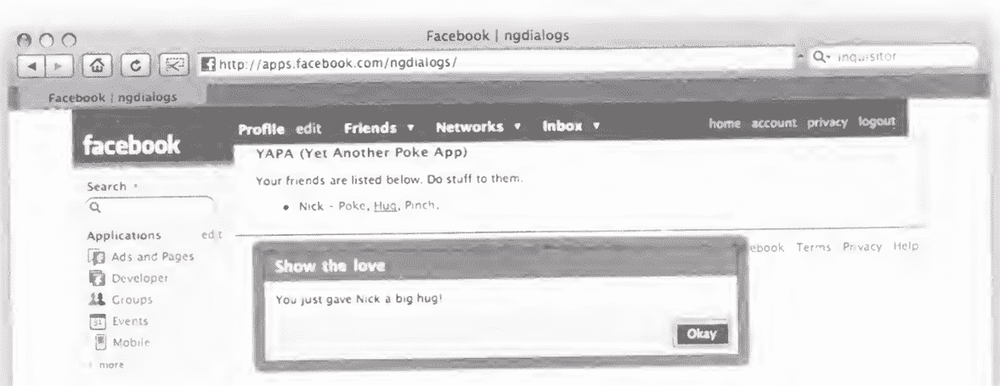

`HugThemConfirm` 函数创建了 Dialog 小部件最基本的表单。它接受 `username` 参数，对应被拥抱的目标用户。对象构造时定义的类型是 `Dialog.DIALOG_POP`，其目的是向用户显示一条简单的消息，表明操作已被处理。图 4-2 展示了“戳一下”操作显示的 Dialog。

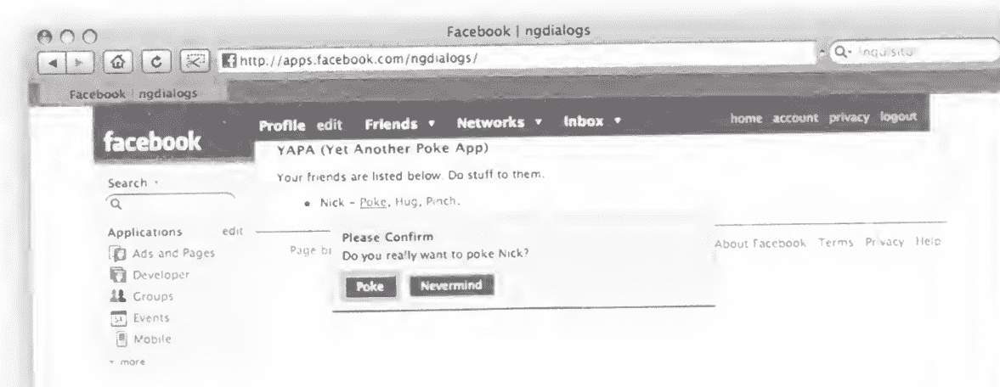

这种类型的 Dialog 小部件使用和实现起来都极其简单。在最基础的层面上，它可以用来向用户确认他们最近执行的任何操作已经发生。这种反馈能增强用户对你的应用程序正在按预期工作的信心。

下一个定义的函数是 `PokeThemConfirm`。它接受 `context` 和 `username` 参数，分别引用 Dialog 所属的父对象和被戳用户名。这里创建的 `Dialog` 对象被赋予 `Dialog.DIALOG_CONTEXTUAL` 类型，表示显示的 Dialog 小部件应相对于 FBML Canvas 上的某个已渲染对象。当需要将操作与页面上的特定元素关联时，这很有用，因为用户通常可能会混淆 Dialog 所引用的内容。显示 Dialog 小部件时，你调用 `showChoice` 方法，它会在 Dialog 显示时向用户提供两个选项。

最后一个定义的函数是 `PinchThemConfirm`。与 `PokeThemConfirm` 函数类似，它也接受 `context` 和 `username` 参数。这个函数演示了捕获 `Dialog` 对象事件并对其作出反应的能力。在这种情况下，当用户选择“确认”按钮时，定义的匿名函数将 `actionstatus` 元素的内容设置为 `pinchconfirmstr fb:js-string` FBML 实体中定义的 FBML。当用户选择“取消”按钮时，定义的匿名函数将 `actionstatus` 元素的内容设置为 `pinchcancelstr fb:js-string` FBML 实体中定义的 FBML。在这两种情况下，你还设置了一个计时器，在 10 秒后隐藏 `actionstatus` 元素。

页面上渲染的 FBML 相对简单。在这个示例应用程序中，你显示了一个简单的用户列表，其中包含了戳、拥抱和掐的链接，这些链接带有指向相应 FBJS 函数的 `onclick` 属性。

## 总结

现在，你应该能够将任何模拟 Ajax 和可见性 FBML 属性替换为你自己的 FBJS。虽然在大多数情况下，提供的内容已经很好用，但现在你有了通过真正的 Ajax 调用来扩展你的 Facebook 应用程序功能和特性的选择。

第五章延续了这种趋势，深入探讨特定的 Facebook 平台组件，并转向 Facebook API。

# 第一部分：了解 Facebook 平台

# 第五章：使用 Facebook API

Facebook API 包含一系列广泛的 API 方法，可供开发者用于与 Facebook 平台进行更深层次的交互。通过这些方法，你可以使你的应用程序能够检索用户数据、创建并与照片和相册交互、更新用户资料内容等等。

第三章和第四章揭示了 FBML 和用户界面开发的复杂世界。涵盖的 FBML 实体可用于创建用户期望的丰富而独特的界面。本章将带你更深入地了解 Facebook 平台，使你能够为应用程序带来更多功能。

本章探讨 Facebook API，包括 API 方法请求和响应的格式和结构，以及错误处理和开发应用程序时可能遇到的一些特殊情况。Web 应用程序和桌面应用程序都同样受益于本章的信息。桌面应用程序开发人员会发现本章最为有用，因为它是通往 Facebook 平台的门户。

每个审查的 API 方法都包含几个标准元素。这些包括 API 方法的描述和概述、必需和可选的请求参数、默认成功响应的结构以及可能返回的错误代码。

## 方法请求

方法请求是方法参数和请求目标的组合。简而言之，一个 API 请求是专门构造的发送到 `http://api.facebook.com/restserver.php` 的 HTTP `POST` 请求。每个请求都包含一组默认参数，一些 API 方法确实有特殊情况，但这个过程非常直接。一个 API 客户端可以简单到只封装一个网络请求库（如 `curl`），从而降低了与 Facebook 平台交互的门槛。

以下 HTTP 请求是 `facebook.users.isAppAdded` API 方法调用的示例。该请求被构造为发送到 `api.facebook.com` 服务器 URI `/restserver.php` 的 HTTP 1.1 `POST` 请求。请求在 content type `application/x-www-form-urlencoded` 下提交。

```http
POST /restserver.php HTTP/1.1
Host: api.facebook.com
Connection: close
User-Agent: ErlyFBClient/1.2 (Macintosh; U; Intel Mac OS X; en-us)
Accept: text/xml, application/xml
Accept-Language: en-us
Content-type: application/x-www-form-urlencoded
Content-length: 203

sig=955588f356e2aa1c8a8a0b11a0c14cd5&api_key=cde8787f00c09c05e8a6d562aa4f129a&call_id=1200781421044311&method=facebook.users.isAppAdded&session_key=d74543fc74d0aa3117df74ac-31232124&uid=500025891&v=1.0
```

这里没有任何花招或任何特殊之处。服务器的响应也非常简单，如下所示：

```http
HTTP/1.1 200 OK
Date: Sat, 12 Jan 2008 22:22:22 GMT
Server: Apache/1.3.37.fb1
Expires: Mon, 26 Jul 1997 05:00:00 GMT
Cache-Control: private, no-store, no-cache, must-revalidate, post-check=0, pre-check=0
Pragma: no-cache
Keep-Alive: timeout=60, max=875
Connection: Keep-Alive
Transfer-Encoding: chunked
Content-Type: text/xml;charset=utf-8

<?xml version=\"1.0\" encoding=\"UTF-8\"?>
<users_isAppAdded_response xmlns=\"http://api.facebook.com/1.0/\"
xmlns:xsi=\"http://www.w3.org/2001/XMLSchema-instance\"
xsi:schemaLocation=\"http://api.facebook.com/1.0/
http://api.facebook.com/1.0/facebook.xsd\">1</users_isAppAdded_response>
```

## 常用请求参数

所有可供开发者使用的 API 方法都有一组必须包含在每个请求中的默认方法参数。这些方法参数用于在内部引导请求并验证请求的真实性。

以下是所有 API 方法通用的几个请求参数：

- `method` —— 这是方法名称。没有这个参数，Facebook API 无法引导你的请求。示例值是 `facebook.fql.query`。
- `v` —— 这是 API 的版本。开发者唯一支持的版本是 `"1.0"`。
- `api_key` —— 此参数是请求应用程序的 `api_key`。
- `sig` —— 此参数是 API 方法请求的签名。该签名通过对请求中键/值对进行排序后进行哈希生成，其结构与通过 Facebook 向你的应用发出的 `POST` 请求所生成的签名相同。

还有一些可选参数：

- `format` —— 此参数代表请求的期望响应格式。可用的两种响应格式是 JSON 和 XML。默认值为 XML。
- `call_id` —— 此参数代表由客户端设置的唯一递增请求 ID。每次请求时，此参数的值必须大于前一次请求中发送的值。开发者和 API 客户端库的常见做法是使用当前的 UNIX 时间戳或微秒时间值。
- `callback` —— 此参数用于指定一个用于包装 JSON 响应的回调函数。如果 `format` 参数未设置为 JSON，则此参数将被忽略。

## 响应

Facebook API 可能为任何给定的 API 方法请求返回错误或成功结构。成功的响应在有效负载和正文结构上因请求而异。

## 错误处理

针对每种响应类型，提供了标准化的 API 错误和失败结构。基础结构始终包含 `error_code`、`error_msg` 和 `request_args` 键。`request_args` 元素是发送到 API 方法的初始请求中的键/值对列表。

`error_code` 元素是与错误条件关联的唯一数字错误代码。有一些错误代码可能在所有 API 方法中通用。有些错误代码是特定于方法的，但仍然是唯一的。`error_msg` 是人类可读的错误消息，解释错误或失败。

清单 5-1 展示了一个 JSON 序列化的 `facebook.fql.query` 错误，清单 5-2 展示了一个 XML 格式的 `facebook.fql.query` 错误。

### 清单 5-1：一个 JSON 序列化的 `facebook.fql.query` 错误

```json
{
  "error_code": 602,
  "error_msg": "xyz is not a member of the user table.",
  "request_args": [
    {"key":"query","value":"SELECT name FROM user\nWHERE uid = xyz"},
    {"key":"callback","value":""},
    {"key":"app_id","value":"2227470867"},
    {"key":"session_key","value":"cd617c16ca615e3ee73aa02e-500025891"},
    {"key":"v","value":"1.0"},
    {"key":"format","value":"json"},
    {"key":"method","value":"facebook.fql.query"},
    {"key":"api_key","value":"0289b21f46b2ee642d5c42145df5489f"},
    {"key":"call_id","value":"1189742501.7153"},
    {"key":"sig","value":"d750527eac855a6195da6f73fb1e1358"}
  ]
}
```

### 清单 5-2：一个 XML 格式的 `facebook.fql.query` 错误


```xml
<error_response xmlns="http://api.facebook.com/1.0/"
xmlns:xsi="http://www.w3.org/2001/XMLSchema-instance">
  <error_code>602</error_code>
  <error_msg>xyz is not a member of the user table.</error_msg>
  <request_args list="true">
    <arg>
      <key>query</key>
      <value>SELECT name FROM user WHERE uid = xyz</value>
    </arg>
    <arg>
      <key>callback</key>
      <value/>
    </arg>
    <arg>
      <key>app_id</key>
      <value>2227470867</value>
    </arg>
    <arg>
      <key>session_key</key>
      <value>cd617c16ca615e3ee73aa02e-500025891</value>
    </arg>
    <arg>
      <key>v</key>
      <value>1.0</value>
    </arg>
    <arg>
      <key>method</key>
      <value>facebook.fql.query</value>
    </arg>
    <arg>
      <key>api_key</key>
      <value>0289b21f46b2ee642d5c42145df5489f</value>
    </arg>
    <arg>
      <key>call_id</key>
      <value>1189743089.6994</value>
    </arg>
    <arg>
      <key>sig</key>
      <value>5729d584dc95a032d9a357a8d119c7e3</value>
    </arg>
  </request_args>
</error_response>
```

XML 和 JSON 序列化的错误之间差异很小。这里值得注意的例外是，当解析 XML 响应时，你可以通过查看根 `error_response` 元素轻松地确定响应是否出错。而当解析 JSON 格式的响应时，开发者需要做更多的工作来验证响应是否成功。

## XML

XML 序列化的响应具有标准化的根响应元素格式。根元素的名称将由方法组名、方法名和单词“response”通过下划线连接而成。换句话说，当向 `facebook.fql.query` 发起 API 请求时，根响应节点将是 `fql_query_response`。在错误的情况下，根元素名称为 `error_response`，如清单 5-1 所示。

XML 序列化的响应还在根元素中包含几个 XMLNS 声明。默认的 XML 命名空间被定义并设置为 `http://api.facebook.com/1.0/`。`xsi` XML 命名空间也被定义，并且 `xsi:schemaLocation` 属性被定义并设置为：

```text
http://api.facebook.com/1.0/
http://api.facebook.com/1.0/facebook.xsd.
```

## JSON

JSON 序列化的响应具有更灵活的结构，具体取决于调用的 API 方法。

## 方法定义

本章接下来的几个小节提供了可用的 Facebook API 方法的定义，并将给出示例响应。这些方法按一般功能分组。

# 认证

`auth.*` 方法用于验证和断言应用和用户认证信息的有效性。这些包括 `facebook.auth.createToken` 和 `facebook.auth.getSession`。

### facebook.auth.createToken

`facebook.auth.createToken` 方法创建一个对应用和用户唯一的单次使用令牌，用于为用户和应用创建 `session_key`。此方法主要由桌面应用程序使用，以启动认证过程。

此 API 方法没有可用的可选方法参数。

成功的响应包含一个新创建的 `auth` 令牌：

```xml
<auth_createToken_response ... >
  3e4a22bb2f5ed75114b0fc9995ea85f1
</auth_createToken_response>
```

错误代码包括以下内容：

- 1 — 发生未知错误。
- 2 — 服务暂时不可用
- 4 — 已达到应用请求限制
- 5 — 未授权的源 IP 地址
- 101 — 提交的 API 密钥与任何已知应用不关联。
- 104 — 签名不正确

### facebook.auth.getSession

`facebook.auth.getSession` API 方法根据有效的 `auth` 令牌返回绑定到用户和应用的 `session_key`。应在用户登录并返回 `auth_token` 后立即调用此方法。

以下是必需的参数：

- `auth_token` — 此参数是有效的认证令牌。

成功的响应是一个包含 `session_key`、`uid` 和 `expires` 元素的结构。`expires` 元素是 `session_key` 过期的日期和时间（以 UNIX 时间戳格式）。如果 `expires` 元素为 0，则除非用户明确注销，否则会话不会过期。

```xml
<auth_getSession_response ... >
    <session_key>5f34e11bfb97c762e439e6a5-8055</session_key>
    <uid>8055</uid>
    <expires>1173309298</expires>
</auth_getSession_response>
```

错误代码包括以下内容：

- 1 — 发生未知错误。
- 2 — 服务暂时不可用
- 4 — 已达到应用请求限制
- 5 — 未授权的源 IP 地址
- 100 — 无效参数
- 101 — 提交的 API 密钥与任何已知应用不关联。
- 104 — 签名不正确

## 动态消息和迷你动态消息

`feed.*` API 方法用于向用户的动态消息或迷你动态消息发布内容。这些包括 `facebook.feed.publishStoryToUser`、`facebook.feed.publishActionOfUser` 和 `facebook.feed.publishTemplatizedAction`。

### facebook.feed.publishStoryToUser

`facebook.feed.publishStoryToUser` API 方法向与 `session_key` 参数关联的用户动态消息发布一条故事。一个动态项由标题、可选正文以及最多四张在动态消息中显示的图像组成。

以下是必需的参数：

- `title` — 在动态项标题中呈现的标记
- `session_key` — 用于用户和应用的会话令牌

以下是可选参数：

- `body` — 在动态项正文中呈现的标记
- `image_1` — 要在动态项中显示的图像的 URL
- `image_1_link` — 点击 `image_1` 引用的图像后的目标 URL
- `image_2` — 要在动态项中显示的图像的 URL
- `image_2_link` — 点击 `image_2` 引用的图像后的目标 URL
- `image_3` — 要在动态项中显示的图像的 URL
- `image_3_link` — 点击 `image_3` 引用的图像后的目标 URL
- `image_4` — 要在动态项中显示的图像的 URL
- `image_4_link` — 点击 `image_4` 引用的图像后的目标 URL

此方法有几个限制和注意事项：

- `title` 参数限制为 60 个可显示字符。这不包括 HTML 或 FBML 实体。
- 标题可以包含零个或一个 `<a>` HTML 元素。不能使用其他 FBML 或 HTML。
- 正文是可选的，限制为 200 个可显示字符。它可以包括 `<a>`、`<b>` 和 `<i>` HTML 元素。
- 每张图像必须是完全限定的 URL 或 Facebook 内照片的照片 ID。图像将被 Facebook 调整为 75×75 像素并进行缓存。
- 每张图像必须有一个关联的链接。
- 应用被限制为每个用户每 12 小时只能调用一次此 API 方法。

并非所有发布到动态消息的内容都会显示在用户好友的动态消息中。Facebook 允许用户高度自定义在其动态消息中显示的内容，因此无法保证你的动态项会被显示。

> 开发者可以提交不限数量的 `facebook.feed.publishStoryToUser` 请求以鼓励测试和显示调整。这仅在向他们自己的账户提交请求时有效。

成功的响应体包含一个简单的 true 值（1）。如果响应体是一个 false 值（0），则表示在提交请求时出现权限错误。所有其他故障都由标准错误结构表示。

```xml
<feed_publishStoryToUser_response ... >
1
</feed_publishStoryToUser_response>
```

# 第一部分：了解 Facebook 平台

错误码包括以下内容：

- 1 — 发生未知错误。
- 2 — 服务暂时不可用
- 4 — 已达到应用请求上限
- 5 — 未授权的源 IP 地址
- 100 — 无效参数
- 101 — 提交的 API 密钥与任何已知应用无关。
- 102 — 会话密钥提交不当，或已超时。请引导用户前往登录页面获取新的会话密钥。
- 103 — 提交的 `call_id` 未大于该会话之前提交的 `call_id`。
- 104 — 签名不正确

## facebook.feed.publishActionOfUser

`facebook.feed.publishActionOfUser` API 方法用于向用户的动态（News Feed）发布一项操作。此方法与 `facebook.feed.publishStoryToUser` API 方法非常相似。主要区别在于其对 `title` 和 `body` 参数中可用的 HTML 和 FBML 实体的宽松规则。

以下是必需参数：

- `title` — 在动态条目标题中呈现的标记内容
- `session_key` — 与用户关联的会话密钥，该用户的动态中将发布此条目

以下是可选参数：

- `body` — 在动态条目正文中呈现的标记内容
- `image_1` — 要在动态条目中显示的图片的 URL
- `image_1_link` — 点击 `image_1` 引用的图片后的跳转 URL
- `image_2` — 要在动态条目中显示的图片的 URL
- `image_2_link` — 点击 `image_2` 引用的图片后的跳转 URL
- `image_3` — 要在动态条目中显示的图片的 URL
- `image_3_link` — 点击 `image_3` 引用的图片后的跳转 URL
- `image_4` — 要在动态条目中显示的图片的 URL
- `image_4_link` — 点击 `image_4` 引用的图片后的跳转 URL

# 第五章：使用 Facebook API

`title` 和 `body` 参数还有若干限制：

- `title` 参数限制为 60 个可显示字符，不包括 HTML 或 FBML 实体。
- 允许使用一个 `fb:userlink` FBML 实体，且 `uid` 必须是与该会话密钥关联的用户 ID（UID）。如果未包含该实体，`fb:userlink` FBML 实体会自动添加到 `title` 前面。提交“Josh fights spam”作为 `title` 将显示为“Josh (No Network) Josh fights spam”。
- 允许使用 `fb:name` FBML 实体，且可多次使用。
- `body` 参数为可选参数，可包含任意数量的 `fb:userlink`、`fb:name`、`a`、`b` 和 `i` FBML 及 HTML 元素。
- 每张图片必须是完整限定的 URL 或 Facebook 内部照片的照片 ID。图片将由 Facebook 调整为 75×75 像素并进行缓存。
- 每张图片必须关联一个链接。
- 应用在滚动 48 小时窗口内，对每个用户调用此 API 方法的次数限制为 10 次。

与 `facebook.feed.publishStoryToUser` API 方法类似，并非所有发布到动态的内容都会出现在用户好友的动态中。Facebook 允许用户高度自定义其动态中显示的内容，无法保证你发布的条目一定会被展示。

> 此方法会影响该用户的所有好友。无论开发者本身是否为目标用户，此方法都受相关限制约束。这与 `facebook.feed.publishStoryToUser` 方法的行为不同。

成功的响应在响应体中以 true（1）值表示。如果响应体为 false（0）值，则表示提交请求时存在权限错误。所有其他响应失败均由错误码表示。

```xml
<feed_publishActionOfUser_response ... >
1
</feed_publishActionOfUser_response>
```

错误码包括以下内容：

- 1 — 发生未知错误。
- 2 — 服务暂时不可用
- 4 — 已达到应用请求上限
- 5 — 未授权的源 IP 地址
- 100 — 无效参数
- 101 — 提交的 API 密钥与任何已知应用无关。
- 102 — 会话密钥提交不当，或已超时。请引导用户前往登录页面获取新的会话密钥。
- 103 — 提交的 `call_id` 未大于该会话之前提交的 `call_id`。
- 104 — 签名不正确

## Action 与 Story 的区别

`feed.publishActionOfUser` 和 `feed.publishStoryToUser` 方法非常相似，但效果截然不同，可能会让开发者产生混淆。表 5-1 对两种方法进行了比较。

表 5-1：publishActionOfUser 与 publishStoryToUser 的比较

| | PublishActionOfUser | PublishStoryToUser |
| --- | --- | --- |
| 使用限制 | 始终受限 | 对开发者无限制 |
| 发送限制 | 滚动 48 小时内每用户 10 次 | 每用户每 12 小时 1 次 |
| 标题中允许的标签 | 1 个 `fb:userlink`、1 个 `a`、`fb:name` | `a` |
| 正文中允许的标签 | `fb:name`、`a` | `a`、`b`、`i` |

## facebook.feed.publishTemplatizedAction

`facebook.feed.publishTemplatizedAction` 用于向用户或公共主页 Mini-Feed 发布动态。当发布给 Facebook 用户时，该动态也会发布到该用户好友的动态中。

以下是必需参数：

1. `actor_id` — 执行操作的用户或公共主页 ID。此 ID 代表的用户或公共主页必须已添加此应用，调用才能成功。
2. `title_template` — 用于渲染动态标题的标记模板

以下是可选参数：

1. `title_data` — 一个 JSON 编码的关联数组，包含用于表示标题模板中变量的键/值对
2. `body_template` — 用于渲染动态标题的标记模板
3. `body_data` — 一个 JSON 编码的关联数组，包含用于表示正文模板中变量的键/值对
4. `body_general` — 与特定动态相关的自由格式标记。当多条动态被聚合时，显示的动态中仅包含其中一个 `body_general` 值。
5. `image_1` — 要在动态条目中显示的图片的 URL
   - `image_1_link` — 点击 `image_1` 引用的图片后的跳转 URL
   - `image_2` — 要在动态条目中显示的图片的 URL
   - `image_2_link` — 点击 `image_2` 引用的图片后的跳转 URL
   - `image_3` — 要在动态条目中显示的图片的 URL
   - `image_3_link` — 点击 `image_3` 引用的图片后的跳转 URL
   - `image_4` — 要在动态条目中显示的图片的 URL
   - `image_4_link` — 点击 `image_4` 引用的图片后的跳转 URL
   - `target_ids` — 以逗号分隔的 Facebook 用户 ID 列表，用于当模板中使用 `{target}` 变量来引用动态操作所指向的 Facebook 用户

使用此方法时，必须充分理解适用于动态内容和分发的所有规则。

- `title_template` 参数限制为 60 个字符，不包括标签。
  - 标记中必须包含 `{actor}` 变量，代表执行操作的 Facebook 用户或公共主页。
  - 标记中可以包含 `{target}` 变量，用于向 Facebook 平台提示动态的结构。如果使用此变量，则必须包含 `target_ids` 参数。
  - 变量替换通过将变量用花括号括起来并放入 `title_data` 参数中实现。
  - 标题中允许使用 `fb:name`、`fb:pronoun`、`fb:if-multiple-actors` 以及 FBML 和 HTML 实体。不处理其他 FBML 实体。
- `body_template` 与 `body_general` 参数组合使用，总长度限制为 200 个字符。
  - 标记中可以包含 `{actor}` 和 `{target}` 变量。


- 正文中允许使用 `fb:userlink`、`fb:name`、`fb:pronoun`、`fb:if-multiple-actors`、`a`、`b` 和 `i` FBML 及 HTML 实体。不处理其他 FBML 实体。

- `facebook.feed.publishTemplatizedAction` 方法发布的两条或多条动态可能会被聚合。
  - 具有相同 `title_template` 和 `body_template` 值的动态会在可能的情况下进行聚合。此外，`target_ids` 以及表示 `title_data` 和 `body_data` 参数的键/值对的关联数组也必须相同。
  - 如果两条或多条动态被聚合，`"{actor}"` 变量将被替换为所有被聚合操作的用户或公共主页的名称。

- `body_general` 标记内容应与动态相关，但并非理解动态所必需。

- 在动态聚合中，`body_general` 变量和图片（如有）将来自同一动态来源。

## 第一部分：了解 Facebook 平台

- 对于任何给定的动态或动态聚合，最多显示四张图片。图片将被调整大小以适应 75×75 的正方形，由 Facebook 平台进行缓存和重新格式化。
- Facebook 平台对每用户或每页面在滚动 48 小时窗口内限制 10 次方法调用。
- 注册新模板时，可以启用选项，将发布的动态显示给未安装该应用的用户。

成功响应在正文中以 `true`（1）值表示。如果正文为 `false`（0）值，则表示提交请求时存在权限错误。所有其他响应失败均由错误代码表示。

```xml
<feed_publishTemplatizedAction_response ...>
1
</feed_publishTemplatizedAction_response>
```

错误代码包括以下内容：

- 1 — 发生了未知错误。
- 2 — 服务暂时不可用
- 4 — 已达到应用请求限制
- 5 — 未经授权的源 IP 地址
- 100 — 无效参数
- 101 — 提交的 API 密钥未与任何已知的应用相关联。
- 102 — 会话密钥提交不当，或已超时。请引导用户到登录页面获取新的会话密钥。
- 103 — 对于此会话，提交的 `call_id` 不大于之前提交的 `call_id`。
- 104 — 签名不正确
- 330 — 标记无效。
- 360 — 动态故事 `title_data` 参数不是有效的 JSON 编码数组。
- 361 — 动态故事标题模板缺少必需参数，或 `title_data` 数组中未定义所有参数。
- 362 — 动态故事 `body_data` 参数不是有效的 JSON 编码数组。
- 363 — 动态故事正文模板缺少必需参数，或 `body_data` 数组中未定义所有参数。
- 364 — 动态故事图片无法获取，或提供了错误的图片链接。
- 366 — 此故事的一个或多个目标 ID 无效。它们必须全部是操作用户的好友 ID。

## FQL

Facebook 查询语言（FQL）是一种强大而灵活的查询语言，允许开发者从 Facebook 平台挖掘数据。`fql.*` 方法是其接口。

### facebook.fql.query

`facebook.fql.query` API 方法用于评估 FQL 查询，并在可用时返回请求的信息。

以下是必需参数：

- `session_key` — 请求用户的会话密钥
- `query` — 要评估的 FQL 查询

查询范围从简单到复杂。第 6 章将更详细地探讨 FQL，以及其用途和注意事项。

成功响应包含基于请求字段的复杂元素结构。以下响应来自 FQL 查询 `SELECT name FROM user WHERE uid = 500025891`：

```xml
<fql_query_response ... >
    <user>
        <name>Nick Gerakines</name>
    </user>
</fql_query_response>
```

错误代码包括以下内容：

- 1 — 发生了未知错误。
- 2 — 服务暂时不可用
- 4 — 已达到应用请求限制
- 5 — 未经授权的源 IP 地址
- 100 — 无效参数
- 101 — 提交的 API 密钥未与任何已知的应用相关联。
- 102 — 会话密钥提交不当或已超时。请引导用户到登录页面获取新的会话密钥。
- 103 — 对于此会话，提交的 `call_id` 不大于之前提交的 `call_id`。
- 601 — 解析 FQL 语句时出错
- 602 — 您请求的字段不存在。
- 603 — 您请求的表不存在。
- 604 — 您的语句不可索引。
- 605 — 您调用的函数不存在。
- 606 — 传递给函数的参数数量错误。

## 好友

`friends.*` API 方法用于构建和探索 Facebook 维护的用户关系社交网络。这些方法包括 `facebook.friends.areFriends`、`facebook.friends.get` 和 `facebook.friends.getAppUsers`。

### facebook.friends.areFriends

`facebook.friends.areFriends` API 方法返回两个或更多人之间的关系。

此 API 方法与评估专门构建的 FQL 查询非常相似：

```sql
SELECT uid1, uid2 FROM friend WHERE uid1 = <x> AND uid2 = <y>
```

以下是必需参数：

- `uids1` — 与 `uids2` 进行比较的逗号分隔的 UID 列表
- `uids2` — 与 `uids1` 进行比较的逗号分隔的 UID 列表

`uids1` 和 `uids2` 参数是逗号分隔的 UID 列表。请记住，两个列表必须包含相同数量的 UID 才能进行比较，因为列表是逐行比较的。换句话说，先比较 `uids1` 和 `uids2` 中的第一个用户，然后比较第二个 `uids1` 和 `uids2` 用户，依此类推。

成功响应包含 `friend_info` 元素列表。这些元素使用 `uid1`、`uid2` 和 `are_friends` 子元素定义两个用户之间的关系。`uid1` 和 `uid2` 元素包含进行比较的两个 UID。`are_friends` 元素为 `true`（1）或 `false`（0）值，表示这两个用户是否是朋友。所有其他响应失败均由错误代码表示。

```xml
<friends_areFriends_response ... >
  <friend_info>
    <uid1>500025891</uid1>
    <uid2>1559580004</uid2>
    <are_friends>1</are_friends>
  </friend_info>
</friends_areFriends_response>
```

> 当请求用户的关系状态，且一个或多个用户对 Facebook 平台不可见时（由用户的隐私设置决定），以下 `friend_info` 块将包含一个 `are_friends` 元素，其 `xsi:nil` 属性设置为 `"true"`：

```xml
<friend_info>
  <uid1>500025891</uid1>
  <uid2>1559580004</uid2>
  <are_friends xsi:nil="true" />
</friend_info>
```

错误代码包括以下内容：

- 1 — 发生了未知错误。
- 2 — 服务暂时不可用
- 4 — 已达到应用请求限制
- 5 — 未经授权的源 IP 地址
- 100 — 无效参数
- 101 — 提交的 API 密钥未与任何已知的应用相关联。
- 102 — 会话密钥提交不当或已超时。请引导用户到登录页面获取新的会话密钥。
- 103 — 对于此会话，提交的 `call_id` 不大于之前提交的 `call_id`。
- 104 — 签名不正确

### facebook.friends.get

`facebook.friends.get` API 方法返回与会话密钥关联的用户可用的、可见的好友。此方法可以被以下 FQL 查询替代：

```sql
SELECT uid2 from FRIEND WHERE uid1 = loggedInUid
```

以下是必需参数：

- `session_key` — 会话密钥

成功响应包含 `uid` 元素列表，其中包含 `session_key` 用户的好友。

```xml
<friends_get_response ... >
    <uid>1233</uid>
    <uid>1234</uid>
</friends_get_response>
```

> 此方法仅返回对 Facebook 平台可见的 UID。此列表可能不包含所有可用内容。

错误代码包括以下内容：

- 1 — 发生了未知错误。
- 2 — 服务暂时不可用

### facebook.friends.getAppUsers

`facebook.friends.getAppUsers` API 方法返回已添加应用且被视为 `session_key` 关联用户的好友的用户列表。此方法可以被以下 FQL 查询替代：

```sql
SELECT uid
FROM user
WHERE uid IN (
  SELECT uid2 FROM friend WHERE uid1 = loggedInUser
) AND is_app_user
```

以下是必需参数：

- `session_key` — 请求用户的会话密钥

成功响应包含零个或多个代表用户的 `uid` 元素。

```xml
<friends_getappusers_response ... >
    <uid>1233</uid>
    <uid>1234</uid>
</friends_getappusers_response>
```

> 此方法仅返回对 Facebook 平台可见的 UID。此列表可能不包含所有可用内容。

错误代码包括以下内容：

- 1 — 发生了未知错误。
- 2 — 服务暂时不可用
- 4 — 已达到应用请求限制
- 5 — 未经授权的源 IP 地址
- 101 — 提交的 API 密钥未与任何已知的应用相关联。
- 102 — 会话密钥提交不当或已超时。请引导用户到登录页面获取新的会话密钥。

# 通知

`notifications.*` 方法用于在 Facebook 中发送和接收通知及请求。通知是用户与应用程序之间沟通的主要方式之一。这些方法包括 `facebook.notifications.get`、`facebook.notifications.send`、`facebook.notifications.sendrequest` 和 `facebook.notifications.sendEmail`。

## facebook.notifications.get

`facebook.notifications.get` API 方法返回与 `session_key` 关联的用户通知。

以下是必需参数：

- `session_key` — 请求目标用户的会话密钥

成功响应包含 `messages`、`pokes`、`shares`、`friend_requests`、`group_invites` 和 `event_invites` 元素。这些元素将包含 `unread` 和 `most_recent` 子元素。`unread` 元素定义父元素类型中未读通知的数量。`most_recent` 元素包含用逗号分隔的被视为该父元素类型“最近”的 ID 列表。例外是 `friend_requests` 元素，它包含代表向该用户发出好友请求的用户的 `uid` 元素列表。

```xml
<notifications_get_response ...>
  <messages>
    <unread>1</unread>
    <most_recent>1170644932</most_recent>
  </messages>
  <pokes>
    <unread>0</unread>
    <most_recent>0</most_recent>
  </pokes>
  <shares>
    <unread>1</unread>
    <most_recent>1170657686</most_recent>
  </shares>
  <friend_requests list="true">
    <uid>2231342839</uid>
    <uid>2231511925</uid>
    <uid>2239284527</uid>
  </friend_requests>
</notifications_get_response>
```

当某类通知的 `unread` 元素为 0 时，`most_recent` 元素将为空。

# 第一部分：了解 Facebook 平台

在您的应用程序中显示用户通知时，Facebook 建议您使用以下逻辑。

```javascript
if (unread > 0 && most_recent > old_most_recent) {
    // display notifications
}
old_most_recent = most_recent
```

此方法仅返回对平台可见的 ID。该列表可能不包含所有可用内容。

错误代码包括：

- 1 — 发生未知错误。
- 2 — 服务暂时不可用
- 4 — 达到应用程序请求限制
- 5 — 未授权的源 IP 地址
- 101 — 提交的 API 密钥未与任何已知应用程序关联。
- 102 — 会话密钥提交不当或已超时。引导用户前往登录页面获取新的会话密钥。
- 103 — 为此会话提交的 `call_id` 不大于之前提交的 `call_id`。
- 104 — 签名不正确

## facebook.notifications.send

`facebook.notifications.send` API 方法可用于代表应用程序向一个或多个用户发送通知。

以下是必需参数：

- `session_key` — 发送用户的会话密钥
- `to_ids` — 要发送通知的目标用户 UID 的逗号分隔列表
- `notification` — 在通知页面上渲染的 FBML

以下是可选参数：

- `email` — 在发送的电子邮件中渲染的 FBML。如果未传递此参数，则不会发送电子邮件。

此 API 方法有几个开发人员应注意的限制和注意事项：

- 向未添加应用程序的用户发送通知时，响应正文将包含用户必须访问的 URL。用户将看到必须确认并明确提交的通知。如果通知发送给的所有用户都已添加应用程序，则不需要此步骤。
- 一个应用程序每天最多可代表单个用户发送 40 条通知。除此之外，这些通知中只有 10 条可以包含电子邮件内容。
- 发件人姓名会自动添加到电子邮件正文前面。
- 一次最多可发送 10 条通知。
- 通知正文和电子邮件正文中允许的 FBML 会被大量剥离，结果仅为纯文本和链接。例外情况是设置 `email` 参数时，可以使用 `fb:notif-subject` FBML 实体来设置电子邮件主题。

成功响应包含通知确认 URL。

```xml
<notifications_send_response ...>
http://www.facebook.com/send_email.php?from=1&id=5551234
</notifications_send_response>
```

错误代码包括：

- 1 — 发生未知错误。
- 2 — 服务暂时不可用
- 4 — 达到应用程序请求限制
- 5 — 未授权的源 IP 地址
- 101 — 提交的 API 密钥未与任何已知应用程序关联。
- 102 — 会话密钥提交不当或已超时。引导用户前往登录页面获取新的会话密钥。
- 103 — 为此会话提交的 `call_id` 不大于之前提交的 `call_id`。
- 104 — 签名不正确

## facebook.notifications.sendrequest

`facebook.notifications.sendRequest` 方法已被弃用，不再受支持。

## facebook.notifications.sendEmail

`facebook.notifications.sendEmail` API 方法用于向已添加 API 密钥指定应用程序的用户发送电子邮件通知。

# 第一部分：了解 Facebook 平台

以下是必需参数：

- `session_key` — 发送用户的会话密钥
- `recipients` — Facebook 用户 ID 的逗号分隔列表。这些用户必须已经添加了该应用程序，一次最多可指定 100 个。
- `subject` — 电子邮件主题

以下是可选参数：

- `text` — 消息的纯文本正文。如果未提供 `fbml` 参数，则必须包含此项。
- `fbml` — 由 FBML 渲染引擎渲染的消息正文。如果未提供 `text` 参数，则必须包含此项。

开发人员应注意，设置 `fbml` 参数时，仅允许生成纯文本、链接和换行符的标签。这些包括 `p`、`a` 和 `br` HTML 实体。

成功响应由电子邮件发送到的 Facebook 用户 ID 的逗号分隔列表组成。这并不表示用户已阅读或收到消息。

```xml
<notifications_sendEmail_response ...>
123,234,345
</notifications_sendEmail_response>
```

错误代码包括：

- 1 — 发生未知错误。
- 2 — 服务暂时不可用
- 4 — 达到应用程序请求限制
- 5 — 未授权的源 IP 地址
- 101 — 提交的 API 密钥未与任何已知应用程序关联。
- 102 — 会话密钥提交不当或已超时。引导用户前往登录页面获取新的会话密钥。
- 103 — 为此会话提交的 `call_id` 不大于之前提交的 `call_id`。


- `104` — 签名不正确

# 个人资料

`profile.*` 方法用于读取和操作用户个人资料。这些方法包括 `facebook.profile.getFBML` 和 `facebook.profile.setFBML`。

## `facebook.profile.getFBML`

`facebook.profile.getFBML` API 方法返回为应用程序用户设置到应用程序个人资料框的 FBML。

以下是必需参数：

- `uid` — 目标用户的 UID
- `session_key` — 请求用户的会话密钥

成功响应包含响应正文中的个人资料 FBML。

```xml
<profile_getFBML_response ... >
Virtus Junxit Mors Non Separabit
</profile_getFBML_response>
```

错误代码包括：

- `1` — 发生未知错误。
- `2` — 服务暂时不可用
- `4` — 达到应用程序请求限制
- `5` — 未授权的源 IP 地址
- `100` — 参数 `CousinIsmar` 数缺失或无效
- `101` — 提交的 API 密钥未与任何已知应用程序关联。
- `102` — 会话密钥提交不当或已超时。引导用户前往登录页面获取新的会话密钥。
- `103` — 为此会话提交的 `call_id` 不大于之前提交的 `call_id`。
- `104` — 签名不正确

## `facebook.profile.setFBML`

`facebook.profile.setFBML` API 方法用于设置用户的个人资料内容。此内容包括应用程序个人资料框 FBML 以及个人资料操作链接。一旦为某用户调用此方法，个人资料内容将保持不变，除非再次调用此方法。

以下是必需参数：

- `session_key` — 请求用户的会话密钥
- `markup` — 在应用程序个人资料框中渲染的 FBML

以下是可选参数：

- `uid` — 目标用户的 UID。如果未设置此参数，则使用与 `session_key` 关联的用户。

# 第一部分：了解 Facebook 平台

开发者在设置个人资料 FBML 内容时，应考虑 64 kB（GZIP 压缩后）的内容大小限制。另一个需要注意的事项是，桌面应用程序只允许更新与会话密钥关联的用户的个人资料。

成功的响应由用于设置应用程序个人资料框的 FBML 内容表示。

```xml
<profile_setFBML_response>
Artephii Liber Secretus
</profile_setFBML_response>
```

错误代码包括：

- `1` — 发生了未知错误。
- `2` — 服务暂时不可用
- `4` — 已达到应用程序请求限制
- `5` — 未经授权的源 IP 地址
- `100` — 参数无效或缺失
- `101` — 提交的 API 密钥未与任何已知应用关联。
- `102` — 会话密钥提交不当或已超时。将用户引导至登录页面以获取新的会话密钥。
- `103` — 为此会话提交的 `call_id` 未大于之前提交的 `call_id`。
- `104` — 签名不正确
- `240` — 无法从桌面应用程序指定 UID。
- `330` — 标记无效。

## 用户

`users.*` 方法用于检索与 Facebook 用户相关的用户信息和元数据。这些方法包括 `facebook.users.isAppAdded`、`facebook.users.getInfo`、`facebook.users.getLoggedInUser`、`facebook.users.hasAppPermission`、`facebook.users.hasAppAdded` 和 `facebook.users.setStatus`。

## `facebook.users.isAppAdded`

可以调用 `facebook.users.isAppAdded` API 方法来确定会话密钥的用户是否已添加该应用程序。

以下是必需参数：

- `session_key` — 相关用户的会话密钥

成功的响应包含 true（1）或 false（0）值，表示用户是否已添加该应用程序。

```xml
<users_isAppAdded_response ... >
1
</users_isAppAdded_response>
```

错误代码包括：

- `1` — 发生了未知错误。
- `2` — 服务暂时不可用
- `4` — 已达到应用程序请求限制
- `5` — 未经授权的源 IP 地址
- `101` — 提交的 API 密钥未与任何已知应用关联。
- `102` — 会话密钥提交不当或已超时。将用户引导至登录页面以获取新的会话密钥。
- `103` — 为此会话提交的 `call_id` 未大于之前提交的 `call_id`。
- `104` — 签名不正确

## `facebook.users.getInfo`

`facebook.users.getInfo` API 方法返回有关一个或多个用户的信息。

以下是必需参数：

- `session_key` — 请求用户的会话密钥。此字段用于验证请求用户可用的字段。
- `uids` — 要检索信息的 UID 逗号分隔列表
- `fields` — 请求的字段逗号分隔列表

此 API 方法与评估专门构建的 FQL 查询非常相似，如下所示：

```sql
SELECT uid, fields FROM user WHERE uid IN (uids)
```

成功的响应包含基于调用 API 方法时传递的 `fields` 参数的众多可用复杂数据结构之一。这些数据结构包装在 `user` 元素中，以分隔多个 UID 请求。

```xml
<users_getInfo_response ... >
<user>
  <uid>12345</uid>
  <name>Nick Gerakines</name>
  <field2 />
</user>
</users_getInfo_response>
```

每个 `user` 元素始终包含 `uid` 子元素作为每个 `user` 元素中的第一个元素。所有其他数据结构通过 `fields` 参数指定。

`about_me` 字段返回与用户个人资料页面“关于我”部分对应的用户定义内容。`activities` 字段返回与用户个人资料页面活动部分对应的用户定义内容。

`affiliations` 字段用于返回代表用户所属网络的复杂数据结构。每个包含在 `affiliations` 父元素中的 `affiliation` 元素包含 `nid`、`name`、`type`、`year` 和 `status` 子元素。用户的主要网络关联将始终列在首位。`nid` 元素是网络的唯一标识符。`type` 元素的四个值是 `high school`、`college`、`work` 和 `region`。`status` 元素的值在关联类型为 `college` 时存在，表示该用户的毕业状态。

清单 5-3 显示了 `affiliations` 数据结构的示例。

### 清单 5-3：`affiliations` 数据结构示例

```xml
<user>
    <uid>500025891</uid>
    <affiliations list="true">
        <affiliation>
            <nid>3160</nid>
            <name>F&amp;AM</name>
            <type>organization</type>
            <status/>
            <year>0</year>
        </affiliation>
    </affiliations>
</user>
```

`birthday` 和 `books` 字段可用于返回与生日和最爱的书籍个人资料部分相关的用户定义内容。

`current_location` 和 `hometown_location` 字段分别代表用户定义的当前位置个人资料和家乡部分。这两个数据结构由 `city`、`state`、`country` 和 `zip` 子元素组成。清单 5-4 显示了 `current_location` 和 `hometown_location` 数据结构的示例。

### 清单 5-4：`current_location` 和 `hometown_location` 数据结构示例

```xml
<user>
    <uid>500025891</uid>
    <current_location>
        <city>Mountain View</city>
        <state>CA</state>
        <country>United States</country>
        <zip>94041</zip>
    </current_location>
    <hometown_location>
        <city>New Orleans</city>
        <state>LA</state>
        <country>United States</country>
        <zip/>
    </hometown_location>
</user>
```

`education_history` 字段返回用户的教育历史。请求这些数据目前只会返回大学信息。每个返回的 `education_info` 元素包含 `name`、`year` 和 `concentrations` 子元素。`concentrations` 元素的每个子元素都是用户定义的学校重点或专业方向。清单 5-5 显示了 `education_history` 数据结构的示例。

### 清单 5-5：`education_history` 数据结构示例

```xml
<user>
  <uid>14000941</uid>
  <education_history list="true">
    <education_info>
      <name>Union</name>
      <year>2007</year>
      <concentrations list="true">
        <concentration>Hating Cold Weather</concentration>
      </concentrations>
    </education_info>
    <education_info>
      <name>City College of San Francisco</name>
      <year>0</year>
      <concentrations list="true">
        <concentration>General Requirements</concentration>
      </concentrations>
    </education_info>
  </education_history>
</user>
```

`has_added_app` 和 `is_app_user` 字段用于返回与请求应用关联的用户元数据，由请求中的 `api_key` 定义。`has_added_app` 字段返回 true（1）或 false（0）值，表示用户是否已将该应用程序添加到其 Facebook 帐户。`is_app_user` 字段返回 true（1）或 false（0）值，表示用户是否曾经添加或使用过该应用程序。

`first_name`、`last_name` 和 `name` 元素返回从姓名个人资料部分派生的值。清单 5-6 显示了 `first_name`、`last_name` 和 `name` 数据结构的示例。

### 清单 5-6：`first_name`、`last_name` 和 `name` 数据结构示例

```xml
<user>
  <uid>500025891</uid>
  <first_name>Nick</first_name>
  <last_name>Gerakines</last_name>
  <name>Nick Gerakines</name>
</user>
```

`hs_info` 字段返回用户的高中信息。此数据结构由 `hs1_name`、`hs2_name`、`grad_year`、`hs1_id` 和 `hs2_id` 元素组成。清单 5-7 显示了 `hs_info` 数据结构的示例。

### 清单 5-7：`hs_info` 数据结构示例

```xml
<user>
    <uid>500025891</uid>
    <hs_info>
        <hs1_name>Mandeville High School</hs1_name>
        <hs2_name/>
        <grad_year>2002</grad_year>
        <hs1_id>8570</hs1_id>
        <hs2_id>0</hs2_id>
    </hs_info>
</user>
```

`interests`、`music` 和 `movies` 字段返回映射到兴趣、最爱音乐和最爱电影个人资料部分的用户定义内容。

可以调用 `meeting_for` 和 `meeting_sex` 字段来返回用户感兴趣的关系类型和异性。返回的值对应于“寻找”和“感兴趣”个人资料部分。这两个字段仅在用户已添加应用程序时才可见。清单 5-8 显示了 `meeting_for` 和 `meeting_sex` 数据结构的示例。

### 清单 5-8：`meeting_for` 和 `meeting_sex` 数据结构

```xml
<user>
    <uid>500033387</uid>
    <meeting_for list="true">
        <seeking>Friendship</seeking>
    </meeting_for>
    <meeting_sex list="true">
        <sex>female</sex>
    </meeting_sex>
</user>
```

`notes_count` 字段返回用户撰写或导入的笔记总数。

`pic`、`pic_big`、`pic_small` 和 `pic_square` 字段包含不同尺寸的用户个人资料图片，如表 5-2 所示。

### 表 5-2：`pic`、`pic_small`、`pic_big` 和 `pic_square` 字段的尺寸

| 字段       | 高度     | 宽度     |
|------------|----------|----------|
| `pic`      | 100 像素 | 300 像素 |
| `pic_big`  | 200 像素 | 600 像素 |
| `pic_small`| 50 像素  | 150 像素 |
| `pic_square` | 50 像素 | 50 像素 |

## 第五章：使用 Facebook API

`political` 字段返回与用户“政治观点”个人资料字段相关的用户自定义值。

`profile_update_time` 字段返回自纪元（Epoch）以来用户个人资料最后一次更新的时间（以秒为单位）。如果用户的个人资料从未更新过，该值为 0。

`quotes` 字段是显示在“Favorite Quotes”个人资料部分的用户自定义内容。

`relationship_status` 和 `significant_other_id` 字段可用于定义用户的恋爱状态。`relationship_status` 字段代表编辑 Facebook 个人资料时可用的恋爱类型之一。如果 `relationship_status` 字段的值不是 `Single`，用户可以选择另一位 Facebook 用户作为恋爱关系的另一方。该用户的 UID 在 `significant_other_id` 字段中表示。只有当两位用户都添加了发出请求的应用程序时，`significant_other_id` 字段才会返回值。清单 5-9 展示了 `relationship_status` 和 `significant_other_id` 的数据结构。

### 清单 5-9：`relationship_status` 和 `significant_other_id` 的数据结构

```xml
<user>
  <uid>500033387</uid>
  <relationship_status>Married</relationship_status>
  <significant_other_id xsi:nil="true" />
</user>
```

`religion` 字段返回与“宗教观点”个人资料字段相关的用户自定义值。该字段仅对添加了应用程序的用户可见。

`sex` 字段是用户自定义的性别。可用值为 `Male`、`Female` 和 `None`。

`status` 字段返回用户自定义的状态消息。该结构包含 `message` 元素（包含用户自定义的消息）和 `time` 元素（表示自纪元以来用户设置状态的时间，以秒为单位）。清单 5-10 展示了 `status` 数据结构的示例。

### 清单 5-10：`status` 数据结构示例

```xml
<user>
  <uid>500025891</uid>
  <status>
    <message>at the DMV.</message>
    <time>1189793740</time>
  </status>
</user>
```

`timezone` 字段是用户设置的用户时区。

`tv` 字段是与“最爱电视节目”个人资料部分相关的用户自定义内容。

`wall_count` 字段返回已写入用户 Wall 的 Wall 帖子总数。

# 第一部分：了解 Facebook 平台


`work_history`字段可用于检索用户的工作经历。每个`work_info`元素包含`location`、`company_name`、`position`、`description`、`start_date`和`end_date`元素。`location`元素由`city`、`state`和`country`组成。如果`end_date`元素为空，则表示用户仍在该公司工作。清单 5-11 展示了`work_history`数据结构的示例。

## 清单 5-11：`work_history`数据结构示例

```xml
<user>
    <uid>500025891</uid>
    <work_history list="true">
      <work_info>
        <location>
          <city>Sunnyvale</city>
          <state>CA</state>
          <country>United States</country>
        </location>
        <company_name>Yahoo</company_name>
        <position>Software Engineer, Delicious</position>
        <description/>
        <start_date>2006-11</start_date>
        <end_date/>
      </work_info>
    </work_history>
</user>
```

对于 Facebook 平台、请求用户或应用程序不可见的字段，将以空值返回，并将`xsi:null`属性设置为`"true"`。

```xml
<significant_other_id xsi:nil="true"/>
```

错误代码包括：

- `1` — 发生未知错误。
- `2` — 服务暂时不可用。
- `4` — 达到应用程序请求限制。
- `5` — 未经授权的源 IP 地址。
- `100` — 其中一个参数未指定或无效。
- `101` — 提交的 API 密钥未与任何已知的应用程序关联。
- `102` — 会话密钥提交不当或已超时。将用户引导至登录页面以获取新的会话密钥。
- `103` — 提交的`call_id`不大于该会话先前提交的`call_id`。
- `104` — 签名不正确。

## `facebook.users.getLoggedInUser`

`facebook.users.getLoggedInUser` API 方法返回与给定`session_key`关联的 UID。应缓存或本地存储返回的 UID，以避免过多调用此方法。

以下是必需参数：

- `session_key` — 会话密钥。

成功响应包含与`session_key`关联的 UID。

```xml
<users_getLoggedInUser_response ...>
1240077
</users_getLoggedInUser_response>
```

错误代码包括：

- `1` — 发生未知错误。
- `2` — 服务暂时不可用。
- `4` — 达到应用程序请求限制。
- `5` — 未经授权的源 IP 地址。
- `101` — 提交的 API 密钥未与任何已知的应用程序关联。
- `102` — 会话密钥提交不当或已超时。将用户引导至登录页面以获取新的会话密钥。
- `103` — 提交的`call_id`不大于该会话先前提交的`call_id`。
- `104` — 签名不正确。

## `facebook.users.hasAppPermission`

`facebook.users.hasAppPermission` API 方法用于确定给定用户是否已选择加入某项扩展应用程序权限。

以下是必需参数：

- `session_key` — 相关用户的会话密钥。
- `ext_perm` — 相关权限。必须是`status_update`、`create_listing`或`photo_upload`之一。

成功响应包含 true（1）值，表示用户的状态已更新。false（0）值表示状态未更新。所有其他错误由错误代码指示。

```xml
<users_hasAppPermission_response ...>
1
</users_hasAppPermission_response>
```

错误代码包括：

- `1` — 发生未知错误。
- `2` — 服务暂时不可用。
- `4` — 达到应用程序请求限制。
- `5` — 未经授权的源 IP 地址。
- `101` — 提交的 API 密钥未与任何已知的应用程序关联。
- `102` — 会话密钥提交不当或已超时。将用户引导至登录页面以获取新的会话密钥。
- `103` — 提交的`call_id`不大于该会话先前提交的`call_id`。
- `104` — 签名不正确。

## `facebook.users.hasAppAdded`

`facebook.users.hasAppAdded` API 方法用于确定给定用户是否已将应用程序添加到其 Facebook 账户。

以下是必需参数：

- `session_key` — 相关用户的会话密钥。

成功响应包含 true（1）或 false（0）。所有其他错误由错误代码指示。

```xml
<users_hasAppAdded_response ...>
1
</users_hasAppAdded_response>
```

错误代码包括：

- `1` — 发生未知错误。
- `2` — 服务暂时不可用。
- `4` — 达到应用程序请求限制。
- `5` — 未经授权的源 IP 地址。
- `101` — 提交的 API 密钥未与任何已知的应用程序关联。
- `102` — 会话密钥提交不当或已超时。将用户引导至登录页面以获取新的会话密钥。
- `103` — 提交的`call_id`不大于该会话先前提交的`call_id`。
- `104` — 签名不正确。

## `facebook.users.setStatus`

`facebook.users.setStatus` API 方法用于设置用户的状态消息。此方法需要`status_update`扩展应用程序权限。该权限的存在可以通过`facebook.users.hasAppPermission` API 方法进行验证。

以下是必需参数：

- `session_key` — 相关用户的会话密钥。

以下是可选参数：

- `status` — 表示要设置的状态消息的字符串。
- `clear` — 一个布尔值，指示要清除用户的状态，而不是设置为某条消息。
- `status_includes_verb` — 一个布尔值，指示`status`参数包含动词，设置时不应在状态前添加该字符串。

成功响应包含 true（1）或 false（0），指示请求的操作是否已执行。所有其他错误由错误代码指示。

```xml
<users_setStatus_response ...>
1
</users_setStatus_response>
```

错误代码包括：

- `1` — 发生未知错误。
- `2` — 服务暂时不可用。
- `4` — 达到应用程序请求限制。
- `5` — 未经授权的源 IP 地址。
- `101` — 提交的 API 密钥未与任何已知的应用程序关联。
- `102` — 会话密钥提交不当或已超时。将用户引导至登录页面以获取新的会话密钥。
- `103` — 提交的`call_id`不大于该会话先前提交的`call_id`。
- `104` — 签名不正确。

## 活动

`events.*`方法用于检索 Facebook 活动的一般信息和成员资格。这些方法包括`facebook.events.get`和`facebook.events.getMembers`。目前，无法通过 Facebook API 创建活动。

# 第一部分：了解 Facebook 平台

## `facebook.events.get`

`facebook.events.get` API 方法用于检索一个或多个用户创建的活动信息。返回的活动可以按活动的成员用户和/或特定的活动 ID 进行筛选。

以下是必需参数：

- `session_key` — 请求用户的会话密钥。

以下是可选参数：

- `uid` — 用于筛选活动的 Facebook UID。设置后，所有可用的活动将筛选为该用户是其成员的活动。
- `eids` — 用逗号分隔的活动 ID 列表，将返回的活动限制为这些活动 ID。
- `start_time` — 当包含此参数且不为零时，它提供了包含活动的下限。这是一个以 UNIX 时间戳格式表示时间的整数。
- `end_time` — 当包含此参数且不为零时，它提供了包含活动的上限。这是一个以 UNIX 时间戳格式表示时间的整数。
- `rsvp_status` — 此参数按 RSVP 状态筛选返回的活动。

如果未设置`uid`和`eids`参数，则返回的活动将是与`session_key`关联的用户具有成员身份的活动。

此方法返回的结果可以使用 FQL 查询检索。

```sql
SELECT eid, name, tagline, nid, pic, pic_big, pic_small, host, description,
    event_type, event_subtype, start_time, end_time, creator, update_time,
    location, venue
FROM event
WHERE
  eid IN (
    SELECT eid FROM event_member WHERE uid=uid AND rsvp_status=rsvp_status
  ) AND eid IN (eids)
  AND end_time >= start_time
  AND start_time < end_time
```

成功的响应包含零个或多个活动结构。活动结构包含`eid`、`name`、`tagline`、`nid`、`pic`、`pic_big`、`pic_small`、`host`、`description`、`event_type`、`event_subtype`、`start_time`、`end_time`、`creator`、`update_time`、`location`和`venue`子元素。

```xml
<events_get_response ...>
<event>
    <eid>5316827308</eid>
    <name>An evening in Azeroth</name>
    <tagline>Because who doesn't want to PVP after launch week?</tagline>
    <nid>0</nid>
    <pic/>
    <pic_big/>
    <pic_small/>
    <host>Medivh</host>
    <description>Log in, Slay some Horde and Hang out</description>
    <event_type>Party</event_type>
    <event_subtype>LAN Party</event_subtype>
    <start_time>1189832400</start_time>
    <end_time>1189843200</end_time>
    <creator>500025891</creator>
    <update_time>1189723648</update_time>
    <location>Iron Forge</location>
    <venue>
      <street/>
      <city/>
      <state/>
      <country/>
    </venue>
</event>
</events_get_response>
```

`eid`元素是在创建活动时设置的唯一活动 ID。`start_time`、`end_time`和`update_time`元素是以自纪元以来的秒数表示的日期/时间值。`venue`元素是由`street`、`city`、`state`和`country`子元素组成的复杂数据结构。此 API 方法返回的活动被视为公开的；无法返回私密活动。`nid`元素在全局活动中设置为 0。

`pic_*`元素遵循以下尺寸规则：

- `pic` — 100 像素（宽）× 300 像素（高）。
- `pic_big` — 200 像素 × 600 像素。
- `pic_small` — 50 像素 × 150 像素。

如果创建活动的用户对 Facebook 平台、应用程序或与`session_key`参数关联的请求用户不可见，则`creator`元素为空，并将包含设置为`"true"`的`xsi:null`属性。

```xml
<creator xsi:nil="true"/>
```

错误代码包括：

- `1` — 发生了未知错误。
- `2` — 服务暂时不可用。
- `4` — 已达到应用程序请求限制。
- `5` — 未经授权的源 IP 地址。
- `101` — 提交的 API 密钥未与任何已知的应用程序关联。
- `102` — 会话密钥提交不正确或已超时。引导用户到登录页面获取新的会话密钥。
- `103` — 为此会话提交的`call_id`不大于之前提交的`call_id`。
- `104` — 签名不正确。

## `facebook.events.getMembers`

`facebook.events.getMembers` API 方法返回多个被视为活动成员的用户列表。

以下是必需参数：

- `session_key` — 请求用户的会话密钥。
- `eid` — 要获取成员资格的活动 ID。

此方法返回的结果可以使用 FQL 查询检索。

```sql
SELECT uid, eid, rsvp_status FROM event_member WHERE eid=eid
```

成功的响应包含多个按成员类型分组的`uid`列表。这些组通过`attending`、`unsure`、`declined`和`not_replied`子元素表示。

```xml
<events_getMembers_response ...>
  <attending list="true">
    <uid>500025891</uid>
  </attending>
  <unsure list="true"/>
  <declined list="true"/>
  <not_replied list="true">
    <uid>4810273</uid>
    <uid>6851120</uid>
    <uid>12450363</uid>
    <uid>22702059</uid>
    <uid>509160944</uid>
    <uid>516463201</uid>
    <uid>1559580004</uid>
  </not_replied>
</events_getMembers_response>
```

> 此 API 方法不会返回未添加应用程序的用户的 UID。

错误代码包括：

- `1` — 发生了未知错误。
- `2` — 服务暂时不可用。
- `4` — 已达到应用程序请求限制。
- `5` — 未经授权的源 IP 地址。
- `101` — 提交的 API 密钥未与任何已知的应用程序关联。
- `102` — 会话密钥提交不正确或已超时。引导用户到登录页面获取新的会话密钥。
- `103` — 为此会话提交的`call_id`不大于之前提交的`call_id`。
- `104` — 签名不正确。

# 第 5 章：使用 Facebook API

## 群组

`groups.*`方法用于检索 Facebook 群组的一般信息和成员信息。这些方法包括`facebook.groups.get`和`facebook.groups.getMembers`。这些方法与`Events`方法组有许多共同元素。

### `facebook.groups.get`

`facebook.groups.get` API 方法可用于检索 Facebook 内用户创建的群组信息。

以下是必需参数：

- `session_key` — 请求用户的会话密钥。

以下是可选参数：

- `uid` — 用于筛选返回群组的 UID。设置此参数时，返回的群组必须将该用户作为成员。
- `gids` — 用逗号分隔的群组 ID 列表，用于筛选结果。

如果未设置`uid`或`gids`参数，API 方法将返回群组，如同`uid`参数设置为与`session_key`关联的用户一样。

此方法返回的结果可以使用 FQL 查询检索。

```sql
SELECT gid, name, nid, description, group_type, group_subtype, recent_news,
       pic, pic_big, pic_small, creator, update_time, office, website, venue
FROM group
WHERE
  gid IN (SELECT gid FROM group_member WHERE uid=uid)
  AND gid IN (gids)
```

成功的响应包含零个或多个群组数据结构。群组数据结构由`gid`、`name`、`nid`、`description`、`group_type`、`group_subtype`、`recent_news`、`pic`、`pic_big`、`pic_small`、`creator`、`update_time`、`office`、`website`和`venue`元素定义。`venue`由`street`、`city`、`state`和`country`子元素组成。


```xml
<groups_get_response ... >
  <group>
    <gid>17831253704</gid>
    <name>Wrox : Programmer to Programmer</name>
    <nid>0</nid>
    <description>Wrox Press, established in 1992 ... </description>
    <group_type>Internet &amp; Technology</group_type>
    <group_subtype>Languages &amp; Formats</group_subtype>
    <recent_news>Wrox is now providing news ... </recent_news>
    <pic>http://prof...359/22/s17831253704_7117.jpg</pic>
    <pic_big>http://prof...359/22/n17831253704_7117.jpg</pic_big>
    <pic_small>http://prof...359/22/t17831253704_7117.jpg</pic_small>
```

# 第一部分：了解 Facebook 平台

```xml
(continued)
<creator>677101506</creator>
<update_time>1189643054</update_time>
<office/>
<website>http://www.wrox.com/</website>
<venue>
    <street>10475 Crosspoint Blvd</street>
    <city> Acid ser</city>
    <state>IN</state>
    <country>United States</country>
</venue>
</group>
</groups_get_response>
```

此 API 方法返回的所有群组都应视为公开群组，创建者不应将其设置为私密。

`pic_*` 元素遵循以下尺寸规则：

- `pic` — 100 像素（宽）× 300 像素（高）
- `pic_big` — 200 像素 × 600 像素
- `pic_small` — 50 像素 × 150 像素

如果创建该群组的用户对 Facebook 平台、`session_key` 参数所关联的应用程序或请求用户不可见，则 `creator` 元素为空，并包含设置为 `"true"` 的 `xsi:null` 属性。

```xml
<creator xsi:nil="true"/>
```

错误代码包括以下内容：

- 1 — 发生了未知错误。
- 2 — 服务暂时不可用
- 4 — 已达到应用程序请求限制
- 5 — 未授权的源 IP 地址
- 101 — 提交的 API 密钥未与任何已知的应用程序关联。
- 102 — 会话密钥提交不当或已超时。引导用户前往登录页面获取新的会话密钥。
- 103 — 为此会话提交的 `call_id` 不大于此前提交的 `call_id`。
- 104 — 签名不正确

## facebook.groups.getMembers

`facebook.groups.getMembers` API 方法返回多个用户列表，这些用户被视为群组成员。

以下是必需参数：

- `session_key` — 请求用户的会话密钥
- `gid` — 要获取成员信息的群组 ID

此方法返回的结果可以使用 FQL 查询检索。

```sql
SELECT uid, gid, positions FROM group_member WHERE gid=gid
```

成功响应将包含零个或多个 `uid` 元素，按成员类型分组。成员类型由 `members`、`admins`、`officers` 和 `not_replied` 元素表示。

```xml
<groups_get_members_response ... >
  <members list="true">
    <uid>5117310</uid>
    <uid>24301449</uid>
    <uid>64800210</uid>
    <!-- ... -->
  </members>
  <admins list="true">
    <uid>660558037</uid>
    <uid>677101506</uid>
    <uid>680415718</uid>
  </admins>
  <officers list="true">
    <uid>660558037</uid>
    <uid>677101506</uid>
    <uid>680415718</uid>
  </officers>
  <not_replied list="true"/>
</groups_get_members_response>
```

> 此 API 方法不会返回未添加应用程序的用户 UID。

错误代码包括以下内容：

- 1 — 发生了未知错误。
- 2 — 服务暂时不可用
- 4 — 已达到应用程序请求限制
- 5 — 未授权的源 IP 地址
- 101 — 提交的 API 密钥未与任何已知的应用程序关联。
- 102 — 会话密钥提交不当或已超时。引导用户前往登录页面获取新的会话密钥。

## 照片

`photos.*` 方法用于在 Facebook 内创建、处理和检索照片。这些方法包括 `facebook.photos.upload`、`facebook.photos.createAlbum`、`facebook.photos.get`、`facebook.photos.getAlbums`、`facebook.photos.addTag` 和 `facebook.photos.getTags`。

### facebook.photos.upload

`facebook.photos.upload` API 方法用于应用程序代表用户将照片上传到照片相册。上传的照片将等待审核，用户必须明确批准照片后，其他 Facebook 用户才能看到。通过此 API 方法上传的照片归属于用户。

以下是必需参数：

- `session_key` — 请求用户的会话密钥
- `data` — 原始图像数据

以下是可选参数：

- `aid` — 目标相册的相册 ID。如果未指定此值，照片将被添加到应用程序的默认相册。如果默认相册不存在，将会创建。
- `caption` — 可选的标题说明

> 普通相册有 60 张照片的大小限制。应用程序相册有 1,000 张照片的大小限制。

此 API 方法在提交请求时有特殊要求。请求*必须*通过 HTTP POST 请求以 MIME 多部分消息的形式发送。每个方法参数必须指定为单独的表单数据块。

成功响应包括 `pid`、`aid`、`owner`、`src`、`src_big`、`src_small`、`link` 和 `caption` 元素。`pid` 元素是上传照片的唯一内部 ID。不应将其与在网络浏览器中查看照片时的 `pid` 查询字符串参数混淆。

```xml
<photos_upload_response ... >
    <pid>940915697041656</pid>
    <aid>940915667462717</aid>
    <owner>219074</owner>
    <src>http://ip002.face...74/s219074_31637752_5455.jpg</src>
    <src_big>http://ip002.face...74/n219074_31637752_5455.jpg</src_big>
    <src_small>http://ip002.face...74/t219074_31637752_5455.jpg</src_small>
    <link>http://www.facebook.com/photo.php?pid=31637752&id=219074</link>
    <caption>Under the sunset</caption>
</photos_upload_response>
```

错误代码包括以下内容：

- 1 — 发生了未知错误。
- 2 — 服务暂时不可用
- 4 — 已达到应用程序请求限制
- 5 — 未授权的源 IP 地址
- 101 — 提交的 API 密钥未与任何已知的应用程序关联。
- 102 — 会话密钥提交不当或已超时。引导用户前往登录页面获取新的会话密钥。
- 103 — 为此会话提交的 `call_id` 不大于此前提交的 `call_id`。
- 104 — 签名不正确
- 120 — 无效的相册 ID
- 321 — 相册已满。
- 324 — 缺少或无效的图像文件
- 325 — 待审核照片过多

## facebook.photos.createAlbum

`facebook.photos.createAlbum` API 方法通过应用程序代表用户为创建命名相册。

以下是必需参数：

- `session_key` — 请求用户的会话密钥
- `name` — 相册名称

以下是可选参数：

- `location` — 与此相册关联的位置
- `description` — 用户定义的相册描述

成功响应包括定义相册的 `aid`、`cover_pid`、`owner`、`name`、`created`、`modified`、`description`、`location`、`link` 和 `size` 元素。`owner` 元素应始终为与 `session_key` 参数关联的用户。`cover_pid` 在相册创建时始终设置为 0。

开发者应注意，返回的 `aid` 元素是 Facebook 平台内部用于标识相册的相册 ID。这与在浏览器中查看相册时查询字符串中出现的 `aid` 参数不同。

```xml
<photos_createAlbum_response ...>
    <aid>34595963571485</aid>
    <cover_pid>0</cover_pid>
    <owner>8055</owner>
    <name>Films you will never see</name>
    <created>1132553109</created>
    <modified>1132553363</modified>
    <description>No I will not make out with you</description>
    <location>York, PA</location>
    <link>http://www.facebook.com/album.php?aid=2002205&id=8055</link>
    <size>0</size>
</photos_createAlbum_response>
```

错误代码包括以下内容：

- 1 — 发生了未知错误。
- 2 — 服务暂时不可用
- 4 — 已达到应用程序请求限制
- 5 — 未授权的源 IP 地址
- 101 — 提交的 API 密钥未与任何已知的应用程序关联。
- 102 — 会话密钥提交不当或已超时。引导用户前往登录页面获取新的会话密钥。
- 103 — 为此会话提交的 `call_id` 不大于此前提交的 `call_id`。
- 104 — 签名不正确

## facebook.photos.get

`facebook.photos.get` API 方法用于返回方法参数中设置的筛选条件所定义的所有可见照片。

以下是必需参数：

- `session_key` — 请求用户的会话密钥

必须提供以下至少一个参数：

- `subj_id` — 将返回的照片限制为包含此用户的照片。
- `aid` — 将照片限制为此相册中的照片。
- `pid` — 将照片限制为此照片 ID。

# 第5章：使用 Facebook API

此方法返回的结果可以通过 FQL 查询获取。

```sql
SELECT pid, aid, owner, src, src_big, src_small, link, caption, created
FROM photo
WHERE
  pid IN (SELECT pid FROM photo_tag WHERE subject=subj_id)
  AND aid=aid
  AND pid IN (pids)
```

成功的响应包含零个或多个照片数据结构，其中包含可用照片的信息。照片数据结构包含 `pid`、`aid`、`owner`、`src`、`src_big`、`src_small`、`link`、`caption` 和 `created` 元素。

```xml
<photos_get_response ...>
  <photo>
    <pid>2147594848998313850</pid>
    <aid>2147594848998262913</aid>
    <owner>500025891</owner>
    <src>http://photos.../s500025891_53114_350.jpg</src>
    <src_big>http://photos.../n500025891_53114_350.jpg</src_big>
    <src_small>http://photos.../t500025891_53114_350.jpg</src_small>
    <link>http://www.facebook.com/photo.php?pid=53114&amp;id=500025891</link>
    <caption>Christmas 2006</caption>
    <created>1177514360</created>
  </photo>
  <!-- ... -->
</photos_get_response>
```

如果创建照片的用户对 Facebook 平台、应用程序或与 `session_key` 参数关联的请求用户不可见，则 `owner` 元素为空，并将包含设置为 `"true"` 的 `xsi:nil` 属性。

```xml
<owner xsi:nil="true"/>
```

错误代码包括：

- 1 — 发生了未知错误。
- 2 — 服务暂时不可用
- 4 — 达到应用程序请求限制
- 5 — 未经授权的源 IP 地址
- 101 — 提交的 API 密钥未与任何已知应用程序关联。
- 102 — 会话密钥提交不当或已超时。引导用户到登录页面获取新的会话密钥。
- 103 — 提交的 `call_id` 不大于此会话此前提交的 `call_id`。
- 104 — 签名不正确

# 第 I 部分：了解 Facebook 平台

## facebook.photos.getAlbums

`facebook.photos.getAlbums` 方法返回请求用户过滤条件中包含的所有相册。

以下是必需参数：

- `session_key` — 请求用户的会话密钥

必须提供以下至少一个参数。

- `uid` — 将返回的相册限制为此用户创建的相册。
- `pid` — 将相册限制为这些照片的容器的相册，以逗号分隔的照片 ID 列表。

此方法返回的结果可以通过 FQL 查询获取。

```sql
SELECT aid, cover_pid, owner, name, created, modified, description, location
FROM album
WHERE
    owner = uid
    AND aid IN (aids)
```

成功的响应包含零个或多个相册数据结构，由 `aid`、`cover_pid`、`owner`、`name`、`created`、`modified`、`description`、`location`、`link` 和 `size` 子元素组成。

```xml
<photos_getAlbums_response ... >
  <album>
    <aid>2147594848998260741</aid>
    <cover_pid>2147594848998260805</cover_pid>
    <owner>500025891</owner>
    <name>Santa Cruz</name>
    <created>1151815857</created>
    <modified>1151816736</modified>
    <description/>
    <location>Santa Cruz, CA</location>
    <link>http://www.facebook.com/album.php?aid=5&amp;id=500025891</link>
    <size>14</size>
  </album>
</photos_getAlbums_response>
```

错误代码包括：

- 1 — 发生了未知错误。
- 2 — 服务暂时不可用
- 4 — 达到应用程序请求限制
- 5 — 未经授权的源 IP 地址
- 101 — 提交的 API 密钥未与任何已知应用程序关联。
- 102 — 会话密钥提交不当或已超时。引导用户到登录页面获取新的会话密钥。
- 103 — 提交的 `call_id` 不大于此会话此前提交的 `call_id`。
- 104 — 签名不正确

## facebook.photos.addtag

调用 `facebook.photos.addTag` API 方法来代表用户“标记”照片中一个或多个用户。Facebook 上的照片标记与其他网站或服务使用的传统标记不同。Facebook 将标记视为对用户的引用。

以下是必需参数：

- `session_key` — 设置标记的请求用户的会话密钥
- `pid` — 要标记的照片 ID
- `x` — 标记的水平位置，以从左侧起 0 到 100 的百分比表示
- `y` — 标记的垂直位置，以从顶部起 0 到 100 的百分比表示

必须包含以下参数之一：


- `tag_uid` — 照片中 Facebook 用户的 UID
- `tag_text` — 描述照片中被识别人员的自由格式文本。如果设置了 `tag_uid` 参数，则此参数被忽略。

以下是可选参数：

- `tags` — 要添加到照片的 JSON 序列化标记列表

成功的响应包含一个 `true (0)` 值，表示标记已应用于照片。

```xml
<photos_addTag_response ...>
1
</photos_addTag_response>
```

错误代码包括：

- 1 — 发生了未知错误。
- 2 — 服务暂时不可用
- 4 — 达到应用程序请求限制
- 5 — 未经授权的源 IP 地址
- 101 — 提交的 API 密钥未与任何已知应用程序关联。
- 102 — 会话密钥提交不当或已超时。引导用户到登录页面获取新的会话密钥。
- 103 — 提交的 `call_id` 不大于此会话此前提交的 `call_id`。
- 104 — 签名不正确

## `facebook.photos.getTags`

`facebook.photos.getTags` API 方法返回与照片关联的标记。此方法仅返回直接引用 Facebook 用户的标记。不返回自由文本标记。

以下是必需参数：

- `session_key` — 请求用户的会话密钥
- `pid` — 要获取标记的照片

此方法返回的结果可以通过 FQL 查询获取。

```sql
SELECT pid, subject, xcoord, ycoord FROM photo_tag WHERE pid IN (pids)
```

成功的响应包含零个或多个 `photo_tag` 数据结构。`photo_tag` 由 `pid`、`subject`、`xcoord` 和 `ycoord` 元素组成。

```xml
<photos_getTags_response ...>
  <photo_tag>
    <pid>34995991612795</pid>
    <subject>1240078</subject>
    <xcoord>51.4901</xcoord>
    <ycoord>23.6203</ycoord>
  </photo_tag>
</photos_getTags_response>
```

如果标记创建者将标记设为对 Facebook 平台隐藏，则此方法将不会返回任何 `photo_tag` 数据结构。

错误代码包括：

- 1 — 发生了未知错误。
- 2 — 服务暂时不可用
- 4 — 达到应用程序请求限制
- 5 — 未经授权的源 IP 地址
- 101 — 提交的 API 密钥未与任何已知应用程序关联。
- 102 — 会话密钥提交不当或已超时。引导用户到登录页面获取新的会话密钥。
- 103 — 提交的 `call_id` 不大于此会话此前提交的 `call_id`。
- 104 — 签名不正确

## FBML

这些方法用于通过通知 Facebook 内容需要刷新来协助 FBML 渲染引擎。这些方法包括 `facebook.fbml.refreshImgSrc`、`facebook.fbml.refreshRefUrl` 和 `facebook.fbml.setrefhandle`。

### `facebook.fbml.refreshImgSrc`

`facebook.fbml.refreshImgSrc` API 方法用于通知 Facebook 平台某个图像应被使失效并重新获取。此 API 方法适用于非 Canvas 页面（动态消息、通知、用户个人资料等）上使用的图像。

以下是必需参数：

- `session_key` — 请求用户的会话密钥
- `url` — 要缓存的图像的绝对 URL

成功的响应包含一个 `true (1)` 值，表示 Facebook 平台已确认该请求。

```xml
<fbml_refreshImgSrc_response ...>
1
</fbml_refreshImgSrc_response>
```

错误代码包括：

- 1 — 发生了未知错误。
- 2 — 服务暂时不可用
- 4 — 达到应用程序请求限制
- 5 — 未经授权的源 IP 地址
- 101 — 提交的 API 密钥未与任何已知应用程序关联。
- 102 — 会话密钥提交不当或已超时。引导用户到登录页面获取新的会话密钥。
- 103 — 提交的 `call_id` 不大于此会话此前提交的 `call_id`。
- 104 — 签名不正确

### `facebook.fbml.refreshRefUrl`

`facebook.fbml.refreshRefUrl` API 方法用于通知 Facebook 平台 `fb:ref` FBML 实体中使用的 URL 内容已更改。

以下是必需参数：

- `session_key` — 请求用户的会话密钥
- `url` — 要缓存的图像的绝对 URL

# 第一部分：了解 Facebook 平台

成功的响应包含一个 `true (1)` 值，表示 Facebook 平台已确认该请求。

```xml
<fbml_refreshRefUrl_response ...>
1
</fbml_refreshRefUrl_response>
```

错误代码包括：

- 1 — 发生了未知错误。
- 2 — 服务暂时不可用
- 4 — 已达到应用程序请求限制
- 5 — 未经授权的源 IP 地址
- 101 — 提交的 API 密钥未与任何已知的应用程序关联。
- 102 — 会话密钥提交不当或已超时。引导用户到登录页面获取新的会话密钥。
- 103 — 对于此会话，提交的 `call_id` 不大于之前提交的 `call_id`。
- 104 — 签名不正确

# `facebook.fbml.setrefhandle`

`facebook.fbml.setRefHandle` API 方法用于设置给定密钥的 FBML 内容，该密钥用于与请求应用程序关联的 `fb:ref` FBML 实体。

Facebook 鼓励开发人员在向许多不同用户显示相同内容时使用 `fb:ref` FBML 实体。这种做法可以减少通过发出 `facebook.profile.setFBML` API 方法请求所产生的整体负载。

以下是必需参数：

- `session_key` — 请求用户的会话密钥
- `handle` — Facebook 已知的句柄密钥
- `fbml` — 使用给定句柄时由 `fb:ref` FBML 实体渲染的 FBML

成功的响应包含一个 `true (1)` 值，表示 Facebook 平台已确认该请求。

```xml
<fbml_setRefHandle_response ...>
1
</fbml_setRefHandle_response>
```

# 第 5 章：使用 Facebook API

错误代码包括：

- 1 — 发生了未知错误。
- 2 — 服务暂时不可用
- 4 — 已达到应用程序请求限制
- 5 — 未经授权的源 IP 地址
- 101 — 提交的 API 密钥未与任何已知的应用程序关联。
- 102 — 会话密钥提交不当或已超时。引导用户到登录页面获取新的会话密钥。
- 103 — 对于此会话，提交的 `call_id` 不大于之前提交的 `call_id`。
- 104 — 签名不正确

# 市场

这些方法允许开发人员与 Facebook 市场进行交互和操作，从而实现与 Facebook 的深度集成。这些方法包括 `facebook.marketplace.createListing`、`facebook.marketplace.getCategories`、`facebook.marketplace.getSubCategories`、`facebook.marketplace.getListings`、`facebook.marketplace.removeListing` 和 `facebook.marketplace.search`。

# `facebook.marketplace.createListing`

`facebook.marketplace.createListing` API 方法用于代表用户创建和更新 Facebook 市场列表。此外，列表只能为已设置 `create_listing` 扩展应用程序权限的用户创建。

以下是必需参数：

- `session_key` — 请求用户的会话密钥。此方法只能为此会话密钥关联的用户创建或更新列表。

以下是可选参数：

- `listing_id` — 正在修改的列表的 ID。如果请求中未包含此参数，则会创建一个新列表。
- `show_on_profile` — 此布尔参数指示 Facebook 平台在用户个人资料上显示该列表。
- `listing_attrs` — 定义列表的属性的 JSON 序列化字符串。

以下市场列表属性应包含在每个请求中：

- `category`
- `subcategory`
- `title`
- `description`

除了这些属性之外，根据类别和子类别，每个请求中还应包含其他属性。以下是需要特殊属性的类别列表。

> **这不是使用 Facebook 市场 API 方法时可用的类别和子类别的完整列表。该列表可从 `facebook.marketplace.getCategories` 和 `facebook.marketplace.getSubCategories` API 方法获取也可用。就是这样**

- `FORSALE`
  - `GENERAL` — `price`
  - `BOOKS` — `price`、`isbn`、`condition`
  - `TICKETS` — `price`
  - `ELECTRONICS` — `price`、`condition`
  - `FURNITURE` — `price`、`condition`
  - `AUTOS` — `price`、`condition`
- `HOUSING`
  - `GENERAL` — `num_beds`、`num_baths`、`dogs`、`cats`、`smoking`、`square_footage`、`street`、`crossstreet`、`postal`
  - `RENTALS` — `num_beds`、`num_baths`、`dogs`、`cats`、`smoking`、`square_footage`、`street`、`crossstreet`、`postal`、`rent`
  - `SUBLETS` — `num_beds`、`num_baths`、`dogs`、`cats`、`smoking`、`square_footage`、`street`、`crossstreet`、`postal`、`rent`
  - `REALESTATE` — `num_beds`、`num_baths`、`dogs`、`cats`、`smoking`、`square_footage`、`street`、`crossstreet`、`postal`、`price`
- `JOBS` — `pay`、`full`、`intern`、`summer`、`nonprofit`、`pay_type`
- `FORSALE_WANTED`
  - `BOOKS_WANTED` — `condition`、`isbn`
  - `FURNITURE_WANTED` — `condition`
  - `AUTOS_WANTED` — `condition`
  - `ELECTRONICS_WANTED` — `condition`
  - `GENERAL_WANTED` — `num_beds`、`num_baths`、`dogs`、`cats`、`smoking`、`square_footage`、`street`、`crossstreet`、`postal`
  - `SUBLETS_WANTED` — `num_beds`、`num_baths`、`dogs`、`cats`、`smoking`、`square_footage`、`street`、`crossstreet`、`postal`
  - `REALESTATE_WANTED` — `num_beds`、`num_baths`、`dogs`、`cats`、`smoking`、`square_footage`、`street`、`crossstreet`、`postal`

包含 `condition` 属性时，其值只能是 `ANY`、`NEW` 或 `USED`。

成功的响应包含被创建或修改的列表的 ID。如果 API 请求中包含了 `listing_id` 参数，则返回值应与之匹配。

```xml
<marketplace_createListing_response ...>
7444312
</marketplace_createListing_response>
```

错误代码包括：

- 1 — 发生了未知错误。请重新提交请求。
- 2 — 此时服务不可用。
- 4 — 应用程序已达到允许的最大请求数。时间窗口完成后将允许更多请求。
- 5 — 请求来自此应用程序不允许的远程地址。
- 100 — 一个指定的参数缺失或无效。
- 101 — 提交的 API 密钥未与任何已知的应用程序关联。
- 102 — 会话密钥提交不当或已超时。引导用户再次登录以获取另一个密钥。
- 103 — 对于此会话，提交的 `call_id` 不大于之前的 `call_id`。
- 104 — 签名不正确
- 140 — 无效类别
- 141 — 无效子类别
- 142 — 无效标题
- 143 — 无效描述
- 280 — 扩展权限 `create_listing` 尚未授予此应用程序。

# `facebook.marketplace.getCategories`

`facebook.marketplace.getCategories` API 方法可用于返回所有可用的 Facebook 市场类别。

以下是必需参数：

- `session_key` — 请求用户的会话密钥

成功的响应包含可用类别的 XML 结构。

```xml
<marketplace_getCategories_response ... list="true">
    <marketplace_category>FORSALE</marketplace_category>
    <marketplace_category>HOUSING</marketplace_category>
    <marketplace_category>JOBS</marketplace_category>
    ...
</marketplace_getCategories_response>
```

错误代码包括：

- 1 — 发生了未知错误。
- 2 — 服务暂时不可用
- 4 — 已达到应用程序请求限制
- 5 — 未经授权的源 IP 地址
- 100 — 一个参数缺失或无效。
- 101 — 提交的 API 密钥未与任何已知的应用程序关联。
- 102 — 会话密钥提交不当或已超时。引导用户到登录页面获取新的会话密钥。
- 103 — 对于此会话，提交的 `call_id` 不大于之前提交的 `call_id`。
- 104 — 签名不正确

# `facebook.marketplace.getSubCategories`

`facebook.marketplace.getCategories` API 方法可用于返回所有可用的 Facebook 市场类别。

以下是必需参数：

- `session_key` — 请求用户的会话密钥
- `category` — 要检索其子类别的类别名称

一个成功的响应包含一个 XML 结构，其中列出了可用的类别。

```xml
<marketplace_getSubCategories_response ... list="true">
  <marketplace_category>AUTOS</marketplace_category>
  <marketplace_category>BOOKS</marketplace_category>
  <marketplace_category>FURNITURE</marketplace_category>
  ...
</marketplace_getSubCategories_response>
```

错误代码包括以下内容：

- 1 — 发生了未知错误。
- 2 — 服务暂时不可用
- 4 — 应用请求次数已达上限
- 5 — 来源 IP 地址未授权
- 100 — 缺少或无效的参数之一。
- 101 — 提交的 API 密钥与任何已知的应用程序无关。
- 102 — 会话密钥提交不正确或已超时。请将用户引导至登录页面以获取新的会话密钥。
- 103 — 提交的 `call_id` 不大于本次会话之前提交的 `call_id`。
- 104 — 签名不正确

## `facebook.marketplace.getListings`

`facebook.marketplace.getListings` API 方法用于检索一个或多个 Facebook Marketplace 商品列表，可按用户或特定列表 ID 进行筛选。

以下是必需参数：

- `session_key` — 请求用户的会话密钥

必须包含以下参数中的至少一个：

- `listing_ids` — 以逗号分隔的 Facebook Marketplace 商品列表 ID 列表
- `uids` — 以逗号分隔的 Facebook 用户 ID 列表，对应于这些列表的创建者

一个成功的响应包含一个匹配的 Facebook Marketplace 商品列表的 XML 结构。


```xml
<marketplace_getListings_response ... list="true">
  <listing>
    <listing_id>31603160</listing_id>
    <url>http://www.facebook.com/marketplace/listing.php?classified_id=31603160</url>
    <title>Brotherly Love, Relief, and Truth</title>
    <description>What more could you want?</description>
    <poster>500025891</poster>
    <update_time>1200727571</update_time>
    <category>FREE</category>
    <subcategory>GENERAL</subcategory>
    <image_urls list="true"/>
  </listing>
</marketplace_getListings_response>
```

这个 API 方法与执行一个特别构建的 FQL 查询非常相似：

```sql
SELECT listing_id, url , title, description, price, poster, update_time, category, subcategory, image_urls, condition, isbn, num_beds, num_baths, dogs, cats, smoking, square_footage, street, crossstreet, postal, rent, pay, full, intern, summer, nonprofit, pay_type
FROM listings
WHERE poster in (uids) AND listing_id in (listing_ids)
SELECT uid1, uid2 FROM friend WHERE uid1 = <x> AND uid2 = <y>
```

错误代码包括以下内容：

- 1 — 发生了未知错误。
- 2 — 服务暂时不可用。
- 4 — 应用请求次数已达上限。
- 5 — 来源 IP 地址未授权。
- 100 — 缺少或无效的参数之一。
- 101 — 提交的 API 密钥与任何已知的应用程序无关。
- 102 — 会话密钥提交不正确或已超时。请将用户引导至登录页面以获取新的会话密钥。
- 103 — 提交的 `call_id` 不大于本次会话之前提交的 `call_id`。
- 104 — 签名不正确。

## `facebook.marketplace.removeListing`

`facebook.marketplace.removeListing` API 方法用于删除一个 Facebook Marketplace 商品列表。此外，只能为设置了 `create_listing` 扩展应用权限的用户删除列表。

以下是必需参数：

- `session_key` — 请求用户的会话密钥。此方法只能删除与此会话密钥关联的用户的列表。

以下是可选参数：

- `status` — 一个字符串，指示列表被移除的原因。可能的值有：`SUCCESS`、`DEFAULT` 和 `NOT_SUCCESS`。

一个成功的响应由真（1）值表示。所有其他响应都表示为错误。

```xml
<marketplace_removeListing_response ...>
1
</marketplace_removeListing_response>
```

错误代码包括以下内容：

- 1 — 发生了未知错误。
- 2 — 服务暂时不可用。
- 4 — 应用请求次数已达上限。
- 5 — 来源 IP 地址未授权。
- 100 — 缺少或无效的参数之一。
- 101 — 提交的 API 密钥与任何已知的应用程序无关。
- 102 — 会话密钥提交不正确或已超时。请将用户引导至登录页面以获取新的会话密钥。
- 103 — 提交的 `call_id` 不大于本次会话之前提交的 `call_id`。
- 104 — 签名不正确。
- 210 — 登录用户没有权限编辑指定的列表。
- 280 — 该应用没有 `create_listing` 扩展权限。

## `facebook.marketplace.search`

`facebook.marketplace.search` API 方法允许 Facebook 应用程序通过类别、子类别或搜索词在 Facebook Marketplace 中查找列表。

以下是必需参数：

- `session_key` — 请求用户的会话密钥。

必须包含以下参数中的至少一个：

- `category` — 用于筛选列表的 Facebook Marketplace 商品类别。
- `subcategory` — 用于筛选列表的 Facebook Marketplace 商品子类别。当包含此参数时，API 请求中必须包含 `category` 参数。
- `query` — 由 Facebook 平台处理以检索 Facebook Marketplace 商品列表的查询字符串。

一个成功的响应表示为零个或多个符合搜索条件的列表。开发者应注意，空的结果集不是错误。这表明查询已经执行，但没有符合条件的结果。返回的列表可能跨越多个类别，因此不同的列表可能具有不同的 XML 结构，具体取决于与这些列表的类别相关的任何附加列表属性。

```xml
<marketplace_removeListing_response ...>
  <listing />
  <listing />
  ...
</marketplace_removeListing_response>
```

错误代码包括以下内容：

- 1 — 发生了未知错误。
- 2 — 服务暂时不可用。
- 4 — 应用请求次数已达上限。
- 5 — 来源 IP 地址未授权。
- 100 — 缺少或无效的参数之一。
- 101 — 提交的 API 密钥与任何已知的应用程序无关。
- 102 — 会话密钥提交不正确或已超时。请将用户引导至登录页面以获取新的会话密钥。
- 103 — 提交的 `call_id` 不大于本次会话之前提交的 `call_id`。
- 104 — 签名不正确。

## 总结

Facebook API 已被证明对 Web 开发者以及桌面应用程序开发者非常有用。通过 Facebook API，开发者可以快速、轻松地构建高价值功能。对可用 API 方法的简单而直接的响应表明了这样的理念：API 应始终将实用性放在首位，扩展性次之。

如果您退后一步，您会注意到大多数 API 方法对实际用户数据的影响很小或没有影响。最接近的 API 方法具备为用户创建照片和相册的能力，但在这种情况下，用户仍然完全控制这些照片的隐私。Facebook 已非常明确地表示，通过 Facebook 平台开发和使用的应用程序应该是自包含的。作为应用程序开发者，您可以访问大量用户数据，但您对用户本身的影响有限。

在本章中，有一些小的例子展示了 FQL 的有用性，并且您已经看到在很多方面，它可以完全取代几个 Facebook API 方法。第 6 章将更详细地探讨 FQL。

## 使用 FQL 进行数据挖掘

Facebook 查询语言（FQL）是一种通用的类 SQL 查询语言，用于从 Facebook 平台检索数据。在很多方面，FQL 是其他组件（如 Facebook API）构建其上的核心组成部分之一。正如第 5 章所见，通过构建 FQL 查询，有几个方法可以变得过时。

第 5 章的重点是 Facebook API 及其在 Facebook 平台中的作用。可用的 API 方法按功能分组，并带有方法参数，讨论描述了返回的数据结构。

本章从第 5 章结束的地方继续讨论 FQL。本章讨论了可用的表和字段，以及这些字段返回的常见数据结构。此外，FQL 处理器中提供了几个高级功能，允许开发者与 Facebook 平台保护的数据进行交互。本章还讨论了 FQL 响应中的复杂数据结构、匿名字段和复杂的子查询。

## FQL 请求

一个 FQL 查询是通过 `facebook.fql.query` API 方法执行的。尽管这个方法在第 5 章中已经讨论过，但以下提供了简要回顾：

- FQL 查询是通过向 Facebook 平台发送 HTTP POST 请求来执行的，使用 `facebook.fql.query` API 方法。涉及的两个参数是 `session_key` 和 `query`。`session_key` 参数代表请求用户，用于控制用户对数据的访问。`query` 参数是您想要执行的 FQL 查询。
- 响应将包含一个根元素 `error_response` 或 `fql_query_response`，表示查询的成功或失败。

# 第一部分：了解 Facebook 平台

务必记住，`fql_query_response` 元素可以为空，但这并不意味着请求失败。这表明查询已经执行，但在查询条件下没有可用的结果。

## FQL 响应

一旦查询被构建并发送到 Facebook 平台，发起请求的客户端就必须解析和理解查询响应。正如第 5 章所定义的那样，`facebook.fql.query` 请求会返回一个根 `fql_query_response` 元素，其中包含零个或多个数据结构。

## XML

可扩展标记语言（XML）被认为是最常用的响应格式。在 FQL 查询中，响应格式由所请求的表和字段定义。在根 `fql_query_response` 元素内，会有零个或多个表元素，其包含所请求字段的子元素。

匿名字段是这里的特殊情况。所有匿名字段值都包含在 `anon` 元素中。开发者应特别注意，返回的字段将按照它们在请求时的顺序排列。请看以下示例：

```sql
SELECT "hello", "world" FROM user WHERE uid = 500025891
```

这将返回以下 XML：

```xml
<fql_query_response ...>
    <user>
        <anon>hello</anon>
        <anon>world</anon>
    </user>
</fql_query_response>
```

当从 `user` 表请求数据时，字段被封装在一个 `user` 元素中。以下查询返回用户指定好友组中的好友姓名：

```sql
SELECT name FROM user WHERE uid IN (
    SELECT uid FROM group_member WHERE gid = 2204910717
)
AND uid IN (
    SELECT uid2 FROM friend WHERE uid1 = 500025891
)
```

## JSON

将 JavaScript 对象表示法（JSON）作为 FQL 查询响应类型的开发者，能够获得非常精简紧凑的响应体。在许多方面，JSON 非常适合高带宽的 Facebook 应用程序。JSON 解析已经变得非常快速，而且在许多语言中，分解为非常简单的结构后可以轻松处理。

有关 JSON 及其可用解析器的更多信息，请访问 `www.json.org/`。

Facebook 平台将 JSON 结构返回为简单的列表和哈希。响应由列表组成，列表中包含零个或多个哈希，代表所请求字段的键/值对。

考虑以下 FQL 语句：

```sql
SELECT name FROM group WHERE gid = 17831253704
```

以下是该语句的 JSON 响应：

```json
[{"name":"Wrox : Programmer to Programmer"}]
```

复杂的数据结构（如 `user` 表的 `affiliations` 字段）也以列表和哈希格式表示。考虑以下 FQL 查询：

```sql
SELECT name, current_location FROM user WHERE uid = 500025891
```

以下是响应：

```json
[
    {
        "current_location": {
            "city": "Mountain View",
            "state": "CA",
            "country": "United States",
            "zip": "94041"
        },
        "name": "Nick Gerakines"
    }
]
```

需要注意的是，响应中键/值对的顺序与字段请求时的顺序不同。

JSON 请求的一个重大限制集中在匿名字段及其表示方式上。由于响应中每个项目返回的简单键/值对结构，只返回一个匿名字段。考虑以下 FQL 语句：

```sql
SELECT name, "hello", "world", uid FROM user WHERE uid = 500025891
```

如下所示，响应将包含最后请求的那个匿名字段：

```json
[{"name":"Nick Gerakines","uid":500025891,"anon":"world"}]
```

对于某些应用程序来说，这是一个致命问题；但对于很少使用匿名字段的开发者而言，这是一个可接受的缺陷。

## FQL 语法

FQL 查询被划分为三个组成部分，分别回答以下问题：

- 请求了什么？
- 请求的数据位于何处？
- 结果需要满足什么条件？

这分别直接对应于 SQL 语句的 `SELECT`、`FROM` 和 `WHERE` 子句。

```sql
SELECT
    field
    [, field ... ]
    [, expression ... ]
FROM
    table
WHERE
    [ condition ... ]
```

`SELECT` 部分通过提供一个定义 FQL 查询所请求数据的地方，回答了“请求了什么？”的问题。这里的字段或表达式对应于 Facebook 平台提供的可用字段和函数。

`FROM` 部分通过定义 `SELECT` 部分中列出字段所在的表，回答了“请求的数据位于何处？”的问题。

`WHERE` 部分通过提供一个添加应用于 FQL 查询结果的过滤器和条件的地方，回答了“结果需要满足什么条件？”的问题。

这三个部分转换为一种非常类似 SQL 的查询结构，可以轻松被 Facebook 平台解析。虽然它与 SQL 共享许多特性，但存在严格的限制，某些更高级的 SQL 组件不可用。

其中三个限制将要求开发者重新思考如何从 Facebook 平台查询数据：

- **开发者无法指定查询的排序顺序** — Facebook 平台对查询结果进行排序，且该排序顺序可能会随时更改。如果对应用程序很重要，开发者不应依赖该排序顺序保持一致。
- **无法在选择数据时设置限制或偏移量** — `LIMIT` 和 `OFFSET` SQL 组件在创建 FQL 请求时对开发者不可用。这阻止了分页功能。
- **构建 FQL 语句时，Facebook 平台不允许无边界查询** — 无法请求给定表的所有可能行。FQL 查询的 `WHERE` 部分中必须始终设置索引字段。

即使存在这些查询限制，FQL 并没有失去其实用性。

## 可用字段和表

可查询的九个表包括：

- `user`
- `friend`
- `group`
- `group_members`
- `event`
- `event_member`
- `album`
- `photo`
- `photo_tag`

### `user` 表

`user` 表包含了与标准 Facebook 用户账户相关的大部分信息。该表是所有可用表中最大且最复杂的。它的大量字段与许多独特的关联数据结构相对应。

该表上的字段包括：

| Column 1 | Column 2 | Column 3 |
|---|---|---|
| about_me | last_name | profile_update_time |
| activities | meeting_for | quotes |
| affiliations | meeting_sex | relationship_status |
| birthday | movies | religion |
| books | music | sex |
| current_location | name | significant_other_id |
| education_history | notes_count | status |
| first_name | pic | timezone |
| has_added_app | pic_big | tv |
| hometown_location | pic_small | uid |
| hs_info | pic_square | wall_count |
| interests | political | work_history |
| is_app_user | | |

所有可用字段均对应于第 5 章“Facebook.users.getInfo”部分中概述的字段，该部分讨论了 API 方法。请参阅该部分以了解有关这些字段代表的数据结构以及这些数据结构示例的更多信息。

该表上建立索引的两个字段是 `uid` 和 `name`。以下是使用 `user` 表的示例查询：

```sql
SELECT concat(name, " is ", relationship_status)
FROM user
WHERE uid = 500025891
```

以下是上述查询的 JSON 响应：

```json
[{"anon":"Nick Gerakines is Married"}]
```

### `friend` 表

`friend` 表存储了用户之间的用户关系映射，构成了 Facebook 维护的社交网络图谱。唯一返回的信息是两个用户之间存在关系。信息的缺失意味着这两个用户不是好友。

两个可用字段是 `uid1` 和 `uid2`。`uid1` 字段始终可索引，当查询条件中包含 `uid1` 字段时，`uid2` 字段可索引。

以下是使用 `friend` 表的示例查询：

```sql
SELECT uid1, uid2
FROM friend
WHERE uid1 = 500025891
  AND uid2 = 516463201
```

以下是上述查询的 JSON 响应：


```json
[{"uid1":"500025891","uid2":"516463201"}]
```

针对`friend`表的查询通常是其他表查询的子查询。在以下示例中，内部查询选择与由`uid1`定义的用户为好友的所有用户。外部查询则查找内部查询返回的所有用户的姓名。

```sql
select name from user where uid in (select uid2 from friend where uid1 = 500025891)
```

以下是上述查询的 JSON 响应：

```json
[{"name":"Corey Jackson"},{"name":"Leonard Lin"},{"name":"Dave McClure"}, ...]
```

开发者应注意，子查询中指定的字段不会列在父查询的输出中。在前面的示例中，值得注意的是`uid2`字段不会直接显示在 FQL 响应中。

### `group`表

`group`表是关于 Facebook 群组的信息库。

可用的字段包括：

| `gid` | `pic` | `creator` |
| --- | --- | --- |
| `name` | `description` | `update_time` |
| `nid` | `group_type` | `office` |
| `pic_small` | `group_subtype` | `website` |
| `pic_big` | `recent_news` | `venue` |

`gid`字段是此表中唯一被索引的字段。返回的字段与`facebook.groups.get` API 方法返回的字段直接对应。更多信息请参阅第 5 章中的“Facebook.groups.get”部分。

以下是使用`group`表的示例查询：

```sql
select name from group where gid = 17831253704
```

上述查询的 JSON 响应如下：

```json
[{"name":"Wrox : Programmer to Programmer"}]
```

## `group_members`表

`group_members`表存储了一个或多个群组中的成员用户。此表还存储了`position`字段，用于追踪群组成员的排名，暗示该用户在群组中的权限。

此表中的字段包括`uid`、`gid`和`position`。被索引的字段是`uid`和`gid`。以下是使用`group_members`表的示例查询：

```sql
SELECT uid, gid, positions FROM group_member WHERE uid = 500025891
```

针对`group_members`表的查询通常是用于从其他表中检索数据的子查询。

考虑以下示例及其嵌套查询。最内层的查询根据 WHERE 组件`uid1 = 500025891`检索该用户的好友。该查询结果随后被输入到一个查询中，返回这些用户的所有群组 ID。该查询结果再被输入到最外层查询中，检索这些群组的名称。

```sql
SELECT name FROM group WHERE gid IN (
  SELECT gid FROM group_member WHERE uid IN (
    SELECT uid2 FROM friend WHERE uid1 = 500025891
  )
)
```

上述查询的 JSON 响应如下：

```json
[{"name":"Lunch 2.0"},{"name":"Facebook Developers"},{"name":"OpenID"}, ...]
```

## `event`表

`event`表存储了 Facebook 中所有用户创建的活动。

可用的字段包括：

| Column 1 | Column 2 | Column 3 |
| --- | --- | --- |
| `eid` | `pic`、`host` | `end_time` |
| `name` | `description` | `creator` |
| `tagline` | `event_type` | `update_time` |
| `nid` | `event_subtype` | `location` |
| `pic_small` | `start_time` | `venue` |
| `pic_big` |  |  |

`eid`字段是唯一被索引的字段。返回的字段与`facebook.events.get` API 方法返回的字段直接对应。更多信息请参阅第 5 章中的“Facebook.events.get”部分。

以下是使用`event`表的示例查询：

```sql
SELECT name FROM event WHERE eid = 5316827308
```

上述查询的 JSON 响应如下：

```json
[{"name":"An evening in Azeroth"}]
```

## `event_member`表

`event_member`表将活动的所有成员映射到活动，以及用户指定的 RSVP 信息。

该表的字段包括`uid`、`eid`和`rsvp_status`。`uid`和`eid`字段均被索引。以下是使用`event_member`表的示例查询：

```sql
SELECT eid from event_member where uid = 500025891
```

上述查询的 JSON 响应如下：

```json
[{"eid":"8442662657"},{"eid":"8846751954"},{"eid":"14310280583"}, ...]
```

针对`event_member`表的查询通常是对其他表进行查询的子查询。以下示例查询返回用户已接受 RSVP 的将来活动的名称：

```sql
SELECT name FROM event WHERE eid IN (
  SELECT eid FROM event_member WHERE uid = 500025891 AND rsvp_status = 'attending'
) AND start_time > now()
```

上述查询的 JSON 响应如下：

```json
[{"name":"Superbowl Party"}]
```

## `album`表

`album`表包含有关用户创建的相册的信息。

该表具有`aid`、`cover_pid`、`owner`、`name`、`created`、`modified`、`description`、`location`和`size`字段。`aid`、`cover_pid`和`owner`字段被索引，因此允许开发者搜索相册所有者，并查找使用某张照片作为相册封面的相册。

以下是使用`album`表的示例查询：

```sql
SELECT name FROM album WHERE owner = 500025891
```

上述查询的 JSON 响应如下：

```json
[{"name":"Friends and Places"},{"name":"Life at home"}, ... ]
```

## `photo`表

`photo`表包含 Facebook 上用户上传照片的元数据。此表不存储实际的照片数据。

可供查询的字段有`pid`、`aid`、`owner`、`src_small`、`src_big`、`link`、`caption`和`created`。该表通过`pid`和`aid`字段建立索引。以下是使用`photo`表的示例查询：

```sql
SELECT src_small FROM photo WHERE aid IN (
  SELECT aid FROM album WHERE owner = 500025891
)
```

## `photo_tag`表

`photo_tag`表存储了 Facebook 用户创建的所有照片与标签的关系。在 Facebook 中，当用户在某张照片中标记另一个用户时，该用户实际上标记了另一个用户在照片中出现的坐标。开发者在读取照片标签数据时，可以处理这个位置信息。照片在 Facebook 中通过创建与其他 Facebook 用户、活动或地点之间的连接，发挥着更加以用户为中心的作用。

可用的字段有`pid`、`subject`、`text`、`xcoord`、`ycoord`和`created`。此表上的`pid`和`subject`字段均被索引。以下是使用`photo_tag`表的示例查询：

```sql
SELECT subject FROM photo_tag WHERE pid IN (
  SELECT pid FROM photo WHERE aid IN (
    SELECT aid FROM album WHERE owner = 500025891
  )
) AND subject != ''
```

上述查询的 JSON 响应如下：

```json
[{"subject":"500025891"},{"subject":"1559580004"}, ...]
```

`photo_tag`记录还可以包含自由格式的文本，用于标识不在 Facebook 中的用户或对象。一般规则是，对于每一张`photo_tag`记录，`text`字段都会有内容。如果`photo_tag`记录引用的是 Facebook 用户，则`subject`字段将包含该用户的 Facebook 用户 ID。

## 其他查询组件

除了查询的字段和表组件外，还有匿名字段、条件语句和函数。匿名字段是由函数、简单字符串或数学运算创建的字段。以下是匿名字段的示例：

```sql
SELECT (2 + (1/1)) FROM user WHERE uid = 500025891
```

上述查询的 JSON 响应如下：

```json
[{"anon":3}]
```

上述查询的 XML 响应如下：

```xml
<fql_query_response ... list="true">
  <user>
    <anon>3</anon>
  </user>
</fql_query_response>
```

匿名字段的注意事项是，当在 FQL 查询中选择一个或多个匿名字段时，您仍然必须提供一个表和索引字段来验证查询。

查询的条件被设置为过滤与请求的字段和表相关的结果。在构建 FQL 时，您应该注意以下规则：

1. 所有查询必须引用该表的至少一个索引字段。
2. 可以引用多个索引。
3. 一旦引用了索引字段，就可以对非索引字段应用附加条件。
4. 布尔比较运算符（如`=`、`>`、`<=`等）可用于查询条件。括号嵌套的布尔比较也可以使用。算术运算符（如`+`、`-`、`*`、`/`）以及查询函数也可以在查询中的任何点引用。对于某些运算符和函数，可以返回匿名字段。

函数对于复杂比较和数据操作非常有用。Facebook 向开发者提供了有限数量的函数，包括：

- `concat(string [, string ...])` — 连接多个字符串。
- `lower(string)` — 返回字符串的小写值。
- `now` — 返回当前时间。
- `strlen(string)` — 返回字符串的长度。
- `strpos(string1, string2)` — 返回`string2`在`string1`中的位置。如果未找到`string2`，则此函数返回 `-1`。
- `substr(string, start, length)` — 返回从字符串的`start`位置开始、长度为`length`的字符串。
- `upper` — 返回字符串的大写形式。

以下是使用函数和运算符的查询示例：

```sql
SELECT concat("You tagged ", text, " in photo ", pid) FROM photo_tag WHERE pid IN (
    SELECT pid FROM photo WHERE aid IN (
        SELECT aid FROM album WHERE owner = 500025891
    )
) AND subject != ''
```

以下是前述查询的 JSON 响应：

```json
[{"anon":"You tagged Nick Gerakines in photo 2147594848998313850"}, ... ]
```

## 具有复杂数据结构的字段

有几个字段（尤其是在`user`表中）表示复杂的数据结构。FQL 允许你在构建 FQL 查询时指定这些复杂数据结构的命名组件。

考虑以下示例，你想检索用户的从属关系：

```sql
SELECT affiliations FROM user where uid = 500025891
```

以下是前述查询的 JSON 响应：

```json
[{"affiliations":[
    {"nid":67108896,"name":"Silicon Valley, CA","type":"region","status":"","year":0},
    {"nid":50432537,"name":"Yahoo!","type":"work","status":"","year":0}]
}]
```

如果你只想检索这些从属关系的名称，可以在构建查询时轻松设置`affiliations`字段的`name`属性。

考虑以下示例，你想检索用户的从属关系：

```sql
SELECT affiliations.name FROM user where uid = 500025891
```

以下是前述查询的 JSON 响应：

```json
[{"affiliations":[{"name":"Silicon Valley, CA"},{"name":"Yahoo!"}]}]
```

## 在你的应用程序中使用它

FQL 可以在你的应用程序中扮演重要角色，但其使用往往特定于你的应用程序提供的功能。

### 方法替代

如第 5 章所述，FQL 可以直接用于替代开发者可用的许多 API 方法的功能。最常见的用例是从表中选择你需要的字段，否则 API 方法会返回许多你不需要或不想要的字段。

`facebook.friends.areFriends`方法可以被替换，通过创建 FQL 查询来验证`friend`表中一个或多个用户之间是否存在用户到用户的关系。以下示例展示了如何构建 FQL 查询来验证一个用户与其他几个用户的关系：

```php
<?php
$pfriends = array(680415718, 660558037, 677101506);
$myid = 500025891;
$fql = 'SELECT uid2 FROM friend WHERE uid1 = ' . $myid . ';
$fql .= ' AND uid2 IN (' . implode(', ', $pfriends) . ')';
$rlist = $facebook->api_client->fql_query($fql);
$rfriends = array();
foreach($rlist as $ritem) {
  array_push($rfriends, $ritem['uid2']);
}
foreach($pfriends as $user) {
  if (in_array($user, $rfriends)) {
    print "You are friends with $user.\n";
  } else {
    print "You are not friends with $user.\n";
  }
}
?>
```

### 存储数据

Facebook 平台服务条款规定，只有少量关键数据可以无限期地由 Facebook 应用程序存储。它还规定，用户数据可以从获取之时起存储最多 24 小时，以提高应用程序性能，并限制对 Facebook 平台的请求数量。

以下列表代表了 Facebook 应用程序开发者可以无限期存储的字段。所有字段除`notes_count`和`profile_update_time`外，都以 64 位整数存储。`notes_count`和`profile_update_time`可以作为常规整数存储。

- `uid` — Facebook 用户 ID
- `nid` — 主要网络 ID
- `eid` — 活动 ID
- `gid` — 群组 ID
- `pid` — 照片 ID
- `aid` — 照片相册 ID
- `notes_count` — 用户撰写或发布的笔记数量
- `profile_update_time` — 用户上次更新个人资料的时间

## 小结

FQL 是一个强大的数据挖掘工具，用于检索大量用户生成的数据以及与用户、他们与其他用户的关系、群组和照片相关的元数据。第 5 章讨论并举例说明了 FQL 查询的构建和解析，以及构成 FQL 查询的组件。

第 7 章讨论认证及其在 Facebook 平台中的作用。与 FQL 类似，认证是 Facebook 平台的关键部分，所有应用程序都以某种方式利用它。

# 认证

认证是 Facebook 平台以及应用程序开发的关键部分之一。Facebook 平台的每个其他组件都以某种形式或方式使用它。第 5 章描述了`facebook.auth`方法，全书都有签名创建和验证的明确示例，这些都是认证的一部分。

虽然第 6 章探讨了 FQL，但本章深入探讨认证，并考察其组件如何在 Facebook 平台中分布。

认证实际上是各种部件和组件的组合，个别可能属于 Facebook 平台的其他部分，但作为一个整体，在复杂的认证和验证过程中发挥作用。

由于存在不同类型的认证，许多不同的部件应运而生。内部、外部和桌面应用程序都有独特的认证形式，彼此之间存在很大差异。本章解释了不同类型的认证，并为你提供示例项目来演示认证的实际工作原理。

## 认证组件

从开发者的角度来看，认证过程包括以下关键组件：

- **认证令牌** — `API 密钥`、`密钥`和`会话密钥`属于`认证令牌`的范畴。这些通常由应用程序内部处理。这些组件用于在整个认证过程中验证和核实请求和响应。


- **用户登录凭据** — 用户登录凭据包括显而易见的用户登录名和用户密码，还包括应用程序访问控制和权限。在 Facebook 内部，用户可以指定授予应用程序的不同权限。一个已授予应用程序访问权限的用户与一个已将应用程序添加到其账户的用户之间存在明显区别，以及用户可能授予应用程序访问其账户的不同类型信息和控制。这些选项在用户首次添加应用程序或授予其访问其账户时可用。它们也可以在以下 URL 的“我的隐私”页面找到：`www.facebook.com/privacy.php`。

# 第一部分：理解 Facebook 平台

- **签名** — 签名是其自身的一类令牌。签名在 Facebook 平台中用于验证请求和响应。
- **应用程序配置选项和组合** — 不同的应用程序配置选项和组合也会影响 Facebook 平台如何看待和引用你的应用程序。
- **URL 和 URL 查询字符串参数** — 还有几个 URL 和 URL 查询字符串参数会影响认证流程和过程。
- **认证 API 方法** — 认证 API 方法在认证过程中扮演更具支持性的角色，为外部和桌面认证创建认证令牌。但它们还提供了一种在认证过程中检索会话和用户信息的方法。

## 识别应用程序

在 Facebook 平台中，有三样东西定义了一个应用程序并使其独一无二：

1. API 密钥
2. 密钥
3. 应用程序 ID

当创建应用程序时，这三个字段由 Facebook 平台生成，并通过官方开发者应用程序提供给应用程序所有者和开发者。

API 密钥是一个应用程序唯一的字符串，用于创建和验证请求，以及在整个 Facebook 平台中识别应用程序。该 API 是公钥/私钥模型中的公共部分。

密钥也是一个用于创建和验证请求的令牌。密钥代表公钥/私钥模型中的私钥。虽然 API 密钥是 API 方法或应用程序画布页面请求的可见参数，但密钥不直接可见，而是用于请求签名中。

> 它被称为密钥是有原因的！不要泄露密钥或将其留在公共场所。任何拥有应用程序的 API 密钥和密钥的人都可以冒充该应用程序，从而对其用户和数据拥有完全控制权。

生成的应用程序 ID（通常由一个大数字表示）对一般开发不是必需的。Facebook 内的几个位置可以使用应用程序 ID 来引用单个应用程序，包括应用程序关于页面、设置页面和应用程序统计页面。

## 会话

会话（通常称为会话密钥）是一个对象，代表用户在一定时间内对某个应用程序的访问。在 Facebook 平台中，会话密钥由一个全局唯一的字符串表示。每个生成的会话都是完全唯一的，其他应用程序或用户不会拥有相同的会话密钥。

会话密钥有两种格式：

- 有过期时间的会话：`6749c477929db0ac9bf14fc8`
- 无过期时间的会话：`6749c477929db0ac9bf14fc8-500025891`

请注意，两种格式都包含字母数字字符串，而第二种格式在字母数字字符串后面附加了连字符和 Facebook 用户 ID。

创建会话有多种方式。大多数开发者会依赖后台自动创建的会话，并通过应用画布请求传递给应用程序。在这些情况下，Facebook 会创建会话，因为它已经了解访问该应用程序的用户的状态。

会话也可以使用 Facebook API 方法 `facebook.auth.getSession` 来创建。该 API 方法的参数和响应已在第 5 章中概述。

鉴于会话是用户及其权限与应用程序在一段时期内的组合，这段时期可以是无限的。无限会话密钥对于让服务代表用户与 Facebook 交互至关重要，即使用户没有直接发起操作。一个例子是，当外部网站触发某个事件时，让计划任务将一条项目添加到用户的新鲜事（News Feed）中。

有两种方式可以创建无限会话：

1. 当用户在认证过程中被引导至登录页面时，用户可以主动选择“记住我的信息”复选框。该复选框默认未选中，可以通过命名查询字符串参数隐藏。
2. 应用程序可以将用户引导至一个特殊的 URL，该 URL 会生成一个 `auth token`，应用程序可以将其作为 `auth_token` 参数输入到 `facebook.auth.getSession` API 方法中。

```text
http://www.facebook.com/code_gen.php?v=1.0&api_key=[API_KEY]
```

当创建或请求会话时，请求的 `auth token` 起着重要作用。`auth token` 是一个临时令牌，用于将用户与应用程序关联。在这种情况下，要创建会话，应用程序必须创建一个 `auth token`，然后该令牌再与用户相关联以创建会话。

## 签名

签名是一个令牌，用于验证和保护往返于 Facebook 平台的请求的安全性。签名在每个传入和传出的请求中使用，以验证请求的参数。因此，它们在整个 Facebook 平台中覆盖面非常广。

要创建签名，需要将参数列表与应用程序密钥连接，然后对连接后的列表进行哈希运算，如下所示：

```text
arguments = alphabetically_sort arguments
tmpstr = secret
for each arg in arguments
    tmpstr .= arg_name + '=' + arg_value
end
signature = md5(tmpstr)
```

虽然签名可以验证请求的有效性，但它们无法验证请求来自何处，或请求是由谁发起的。

如 Facebook PHP 客户端库所示，创建签名是一个快速而简单的过程，如下面的 `generate_sig` 函数所示：

```php
public static function generate_sig($params_array, $secret) {
    $str = '';
    ksort($params_array);
    foreach ($params_array as $k => $v) {
        $str .= "$k=$v";
    }
    $str .= $secret;
    return md5($str);
}
```

## 应用程序认证

认证有多种使用场景，包括：

- Facebook 应用程序想要验证传入请求是否有效，是否通过了签名验证。
- Facebook 应用程序想要强制所有传入请求都来自已授予应用程序访问其账户权限的用户。
- 外部应用程序想要将本地用户与 Facebook 用户关联。
- 桌面应用程序想要创建会话并发起 API 请求。

## 验证请求

验证应用程序请求是 Facebook 应用程序非常常见的任务。这涉及读取请求参数并将请求的签名与生成签名进行比较。本章附带了一个 `auth_signature` 示例应用程序。

通过开发者应用程序创建此应用程序，与第 2 章中“Hello World”示例项目的设置非常相似。

1. 使用 Facebook 开发者应用程序，创建一个具有唯一名称和 URL 的新应用程序。对于此项目，请使用您的姓名首字母和 signature。为本书开发此应用程序时，我使用 ngsignature 作为名称和 URL。
2. 将包含的项目文件上传到可公开访问的网络空间，并将配置选项中的回调 URL 指向 `htdocs/index.php` 文件。

该项目包含两个文件和 Facebook PHP 客户端库。第一个是位于 `lib/AppConfig.class.php` 的 `AppConfig` 类。如清单 7-1 所示，该类包含 Facebook 应用程序 URL、API 密钥和应用程序密钥。

### 清单 7-1：`lib/AppConfig.class.php` PHP 类

```php
class AppConfig {
    public static $app_name = 'Signature';
    public static $app_url = 'http://apps.facebook.com/ngsignature/';
    public static $app_id = '6321806094';
    public static $api_key = '153a6a42e42bc27a0f1a0e7985b4496d';
    public static $secret = '2bad2d025de71b5162142e1fbd87d088';
}
```

`AppConfig` 类不会直接使用；因此，您将其排除在公共访问之外，将其放在 `htdocs` 目录之外。

`htdocs/index.php` 文件是该应用程序的主要画布页面。这是由回调 URL 请求的页面，并返回要在画布上为用户渲染的内容。此页面用于演示如何验证生成的签名。

此画布页面的前几行代码构建一个 Facebook 类对象并进行一些初始验证。`api_key` 和 `secret` 变量在 `AppConfig` 类中设置，作为 Facebook 类构造函数的输入。然后，设置页面的以下要求：

1. 传入请求必须通过有效的 Facebook 框架发出。
2. 请求用户必须已登录，且应用程序必须已被授予访问该用户的权限。
3. 请求用户需要添加应用程序并设置权限级别。

如清单 7-2 所示，默认的索引页面演示了如何解析传入的 Facebook 请求并根据签名进行验证。

### 清单 7-2：`htdocs/index.php` 画布页面

```php
<?php

include_once '../lib/client/facebook.php';
include_once '../lib/AppConfig.class.php';

// 创建一个新的 Facebook 客户端对象
$facebook = new Facebook(AppConfig::$api_key, AppConfig::$secret);

// 防止此页面在 http://app.facebook.com/appname/ 上下文之外被查看
$facebook->require_frame();

// 防止此页面在没有有效登录用户的情况下被查看
// -- 注意：这并不意味着登录用户已添加该应用程序
$user = $facebook->require_login();

// 要求查看用户已添加该应用程序
$facebook->require_add();

// 使用 get_valid_fb_params 返回 fb_sig_* 参数的数组
$app_params = $facebook->get_valid_fb_params($_POST, 48*3600, 'fb_sig');

// 使用 generate_sig 方法从应用程序参数和密钥创建签名
$request_sig = $facebook::generate_sig($app_params, AppConfig::$secret);

$sig_match = $facebook->verify_signature($app_params, $request_sig);

?>
<div style="padding: 10px;">
  <h2>Hello <fb:name firstnameonly="true" uid="<?= $user ?>" useyou="false"/>!</h2>
  <?php if ($sig_match) { ?>
    <p>The signature "<?= $request_sig ?>" does match the request parameters.</p>
  <?php } else { ?>
    <p>The signature "<?= $request_sig ?>" does not match the request parameters.</p>
  <?php } ?>
  <p>When we add foo => bar we get a mismatch.</p>
  <?php
  $app_params['foo_sig_foo'] = "bar";
  $new_sig = $facebook::generate_sig($app_params, AppConfig::$secret);
  ?>
    <p>The signature "<?= $new_sig ?>" does not match the request parameters.</p>
    <hr />
    <p>When we add fb_sig_foo => bar we get a mismatch.</p>
  <?php
  $app_params["fb_sig_foo"] = "bar";
  $new_sig = $facebook::generate_sig($app_params, AppConfig::$secret);
  $sig_match = $facebook->verify_signature($app_params, $new_sig);
  ?>
  <?php if ($sig_match) { ?>
    <p>The signature "<?= $request_sig ?>" does match the request parameters.</p>
  <?php } else { ?>
    <p>The signature "<?= $request_sig ?>" does not match the request parameters.</p>
  <?php } ?>
</div>
```

这段 PHP 代码通过包含所需的库和配置文件来为其余逻辑做准备。然后，立即按照 Facebook PHP 客户端库构建一个有效的 Facebook 对象，并传入存储在配置类 `lib/AppConfig.class.php` 中的 API 密钥和密钥。

然后，根据 Facebook 对象调用 `require_frame`、`require_login` 和 `require_add` 方法，以验证并强制所有请求都通过 Facebook 应用程序 Canvas 发出，并且由一个已将该应用添加到其 Facebook 账户的有效登录用户发出。

以下 PHP 代码块将部分签名验证过程从后台展示出来。首先调用 `get_valid_fb_params` 类方法，以返回所有 `fb_sig_*` 请求参数。接着，`generate_sig` 函数根据这些参数和应用程序密钥生成一个签名。最后，`verify_signature` 方法将请求中的签名与你生成的签名进行比较。

返回的第一组 FBML 会根据参数生成的签名是否与请求签名匹配来显示不同的消息。

既然你已经验证了成功的情况，现在可以尝试不同的请求参数组合来验证失败的情况。你可以通过向 `get_valid_fb_params` 类方法返回的参数列表中添加一个新参数来实现这一点。由于该参数不是原始请求的一部分，因此它不会包含在 Facebook 平台生成的签名中。

现在你已经了解了这个 Facebook 应用程序的代码和组件，可以将浏览器指向应用程序的 Canvas 页面（图 7-1）。在本例中，该页面是 `http://apps.facebook.com/ngsignature`。页面上渲染的内容将显示当前的签名，然后给出两个参数调整导致签名不匹配的示例。

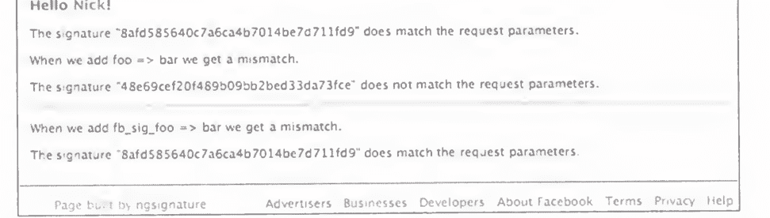

**图 7-1：** `ngSignature` 应用程序的 Canvas 页面。

## 强制视图

在上一节（以及第 2 章中使用的示例项目）中，采取了多个步骤来确保传入的请求来自有效用户、通过 Facebook 应用程序 Canvas 执行，并且用户已添加该应用。这些规则背后的实际工作都是由客户端库在后台完成的，但理解这些规则是如何强制执行的非常重要。

当对你的应用程序发出请求时，Facebook 平台会包含多个 `POST` 参数。这些参数可用于确定请求来自哪里、由谁发出以及请求的条件是什么。

- `fb_sig_in_canvas` — 当此参数值为 1 时，表示请求是通过 Facebook 应用程序 Canvas 发出的。要强制用户通过 Facebook 应用程序 Canvas，当此参数设置为 0 时，将用户重定向到 Facebook 应用程序 URL。

```text
http://apps.facebook.com/[application]
```

- `fb_sig_user` — 此参数是发出请求的用户 ID。此参数的缺失表明发出请求的用户未授予你的应用程序访问权限。当此请求参数缺失或未设置时，你可以通过将查看应用程序的用户重定向到相应的登录页面来强制他们登录。

```text
http://www.facebook.com/login.php?v=1.0&api_key=[API KEY]
```

- `fb_sig_added` — 当此参数值为 1 时，表示请求用户已添加了该应用程序，而不仅仅是授予了应用程序对其账户的访问权限。当此参数未设置为 1 时，你可以要求查看应用程序的用户必须已添加该应用，方法是将他们重定向到相应的应用添加页面。

```text
http://www.facebook.com/add.php?api_key=[API KEY]
```

## 外部应用程序身份验证

外部应用程序身份验证是身份验证过程中最棘手且文档记录最少的部分。因为 Facebook 平台不会通过应用程序 Canvas 向应用程序发出请求，所以外部应用程序必须依赖用户和 `facebook.auth.getSession` API 方法来为其用户创建有效的会话密钥。

外部应用程序用户通常在 Facebook 平台之外开始或参与该过程。他们访问一个网站，该网站具有与 Facebook 交互的伪服务，但要实现这一点，外部网站必须将其用户与 Facebook 用户关联起来。

从用户的角度来看，添加外部应用程序的过程非常简单：只需关注一个链接、登录 Facebook（如果需要）、添加 Facebook 应用程序，然后返回到外部网站。从开发者的角度来看，外部网站必须采取多个步骤来验证外部网站上用户的身份，这些步骤既通过 Facebook 进行，也通过 Facebook 平台进行。


外部应用程序的一个理想候选者是一个 wiki，它希望允许其编辑者和贡献者向其 Facebook 上的朋友展示他们的页面和内容。通过开发者应用程序创建外部应用程序时，wiki 所有者会设置一个回调 URL，该 URL 执行将 wiki 用户与 Facebook 用户关联的实际工作。

当已登录的 wiki 用户查看用户页面时，他们会看到一个指向 Facebook 登录页面的链接，该链接通过查询字符串附加`api_key`与 wiki 的 Facebook 应用程序关联，如下所示：

```
https://login.facebook.com/login.php?v=1.0&api_key=XYZ1ABC
```

用户将被带到 Facebook，在那里他们必须做两件事：登录并授予应用程序访问权限。如果用户未登录，系统会显示标准的登录表单。如果用户从未授予应用程序访问权限，系统会显示一个授权表单。该表单的一个显著特点是一个复选框，用户可以允许应用程序记住其信息。选择此复选框对于为用户和应用程序创建无限期会话密钥至关重要。

一旦用户登录并授予权限，用户将被重定向到应用程序在应用程序配置中设置的回调 URL。

再举一个例子，假设一个 wiki 希望允许其贡献者在他们的 Facebook 个人资料上展示他们的编辑和页面。当用户登录 wiki 时，他们会看到一个链接，该链接将他们带到 Facebook 登录页面。

外部应用程序是第 10 章的主题，将在那里进行更深入的研究。目前，请注意`auth_external`示例应用程序。此外，查询字符串包含一个由 Facebook 平台创建并与应用程序和用户关联的新鲜`auth_token`。此令牌是`facebook.auth.getsession` API 方法请求的主体，用于为用户检索会话。一旦检索到会话，应用程序就拥有了进行后续 API 方法请求、使用 FQL 查询 Facebook 平台以及与平台进行一般交互所需的一切。

通过开发者应用程序创建此应用程序非常类似于第 2 章中“Hello World”示例项目的设置：

- 使用 Facebook 开发者应用程序，创建一个具有唯一名称和 URL 的新应用程序。对于此项目，请使用你的首字母缩写加`external`。在开发本书的此应用程序时，我使用了`ngexternal`作为名称和 URL。
- 将 include 项目文件上传到一个公共可访问的 Web 空间，并在应用程序配置选项中将回调 URL 指向`htdocs/callback.php`文件。
- 此应用程序使用数据库来存储本地用户并将其与 Facebook 用户账户信息关联。在此数据库中，你存储通过`facebook.auth.getsession` API 方法检索到的会话密钥、会话过期时间和 Facebook 用户 ID（清单 7-2）。

`auth_external`示例应用程序（清单 7-3）包含四个文件，以及 Facebook PHP 客户端库文件。

## 清单 7-3：auth_external 项目使用的数据库模式

```sql
CREATE TABLE facebook_accounts (
    user_id INT(11) NOT NULL,
    fb_user_id INT(11) NOT NULL,
    session_key VARCHAR(44) NOT NULL,
    session_expires INT(11) NOT NULL,
    row_created INT(11) NOT NULL
);
```

第一个文件（如清单 7-4 所示）是位于`lib/AppConfig.class.php`的`AppConfig`类。此类包含 Facebook 应用程序 URL、API 密钥和应用程序的密钥。数据库连接信息也包含在此类中，以便应用程序类引用。

# 第一部分：了解 Facebook 平台

## 清单 7-4：`lib/AppConfig.class.php` PHP 类

```php
<?php
class AppConfig {
  public static $app_name = 'SuperStore';
  public static $app_url = 'http://apps.facebook.com/ngexternal/';
  public static $app_id = '6321806094';
  public static $api_key = '153a6a42e42bc27a0f1a0e7985b4496d';
  public static $secret  = '2bad2d025de71b5162142e1fbd87d088';
  public static $db_ip = '127.0.0.1';
  public static $db_user = 'user';
  public static $db_pass = 'password';
  public static $db_name = 'ngexternal';
}
```

`AppConfig`类并非直接使用；因此，它已被排除在公共访问之外，被放置在`htdocs`目录之外。

`lib/SuperStore.class.php`类（如清单 7-5 所示）定义并包含了 Facebook 应用程序使用的所有业务逻辑。它还处理任何发出的数据库类或 Facebook API 方法请求。`SuperStore`类以几个内部变量开头，这些变量被设置为引用所使用的 Facebook 类对象以及外部网站使用的账户。

## 清单 7-5：`lib/SuperStore.class.php` PHP 类

```php
<?php
class SuperStore {

  public $fbclient;
  public $account;

  //! 创建一个新的 SuperStore 对象
  /*! \param fbclient Facebook 客户端对象
   */
  public function __construct($fbclient) {
    // 创建时，设置 Facebook 客户端
    $this->fbclient = $fbclient;
  }

  // 返回一个代表某个虚构的 Super Store 2000 用户的用户 ID。
  function get_user_id() {
    return 3;
  }

  function has_account($user_id = null) {
    if (! $user_id) { $user_id = $this->get_user_id(); }
    if ($this->account['fb_user_id']) { return true; }
    $udata = $this->get_user($user_id);
    if (! $udata) { return false; }
    $this->account = $udata;
    return true;
  }

  function get_user($id) {
    $conn = $this->get_db_conn();
    // nkg：id 应该被转义……在 SQL 中使用原始变量 = 快但不好
    $sql = "SELECT user_id, fb_user_id, session_key, session_expires, row_created
    FROM facebook_accounts WHERE user_id = $id LIMIT 1";
    $res = mysql_query($sql, $conn);
    // nkg：错误检查？……算了
    $data = array();
    while ($row = mysql_fetch_assoc($res)) {
        $data = $row;
    }
    return $data;
  }

  function account_id() {
    $has_account = $this->has_account();
    if (! $has_account) { return 0; }
    return $this->account['fb_user_id'];
  }

  function account_expires() {
    $has_account = $this->has_account();
    if (! $has_account) { return false; }
    return $this->account['session_expires'];
  }

  function account_has_expired() {
    $has_account = $this->has_account();
    if (! $has_account) { return true; } // nkg：我觉得有道理
    $now = time;
    $expires = $this->account_expires();
    if ($expires > $now) { return true; }
    return false;
  }

  function tie_account() {
    $auth_token = $_GET['auth_token'];
    if (! $auth_token) { return false; }
    $session_response = $this->fbclient->api_client->auth_getSession($auth_token);
    $skey = $session_response['session_key'];
    $sexp = $session_response['expires'];
    $fbuid = $session_response['uid'];
    $uid = $this->get_user_id();
    $this->account = array('user_id' => $uid, 'fb_user_id' => $fbuid, 'session_key' => $skey, 'session_expires' => $sexp);
    try {
        $conn = $this->get_db_conn();
        $sql = "INSERT INTO facebook_accounts SET user_id = $uid, fb_user_id = $fbuid, session_key = \"$skey\", session_expires = $sexp, row_created = UNIX_TIMESTAMP(NOW())";
        mysql_query($sql, $conn);
    } catch (Exception $e) {
        return false;
    }
    return true;
  }

  // 返回一个数据库连接
  function get_db_conn() {
    $conn = mysql_connect(
        AppConfig::$db_ip,
        AppConfig::$db_user,
        AppConfig::$db_pass
    );
    // \exception Exception 连接数据库时出错
    if (! $conn) {
        throw new Exception('连接数据库时出错: ' . mysql_error());
    }
    $success = mysql_select_db(AppConfig::$db_name, $conn);
    // \exception Exception 连接数据库时出错
    if (! $success) {
        throw new Exception('连接数据库时出错: ' . mysql_error());
    }
    return $conn;
  }
}
```

# 第 7 章：身份验证

`SuperStore`类首先定义了两个内部使用的变量：`$fbclient`和`$account`。该类的构造函数接受一个参数，一个 Facebook 对象（根据 Facebook PHP 客户端库），该对象在内部使用。

`get_user_id`类方法抽象了一个用户 ID，该 ID 将是网站的登录用户。`has_account`方法用于执行内部查找，查看该用户是否已将其账户与 Facebook 账户关联。如果用户已关联，数据将存储在`account`类变量中。

`get_user`类方法执行对外部应用程序本地存储的潜在用户关联数据的实际查找。

`account_id`、`account_expires`和`account_has_expired`类方法是对`account`类变量中存储数据的简单访问器方法。这些方法用于替代直接访问变量，以进行错误检查和验证。如果账户变量尚未填充或数据不存在，它们将返回“0”或`false`。

当用户完成了与 Facebook 账户关联所需的步骤后，您需要将会话信息本地存储以供以后使用。`tie_account`方法采取了必要的步骤来执行此操作。该方法首先获取从 Facebook 平台传递过来的`auth_token`查询字符串参数，该参数在用户发起外部应用程序身份验证过程后传递。然后，您立即发出一个`facebook.auth.getsession` API 方法请求以检索会话信息。

一旦获得了会话信息，您将适当的数据填充到`account`类变量中，并将会话信息写入数据库以供以后使用。

# 第 7 章：身份验证

接下来是`htdocs/index.php`文件（清单 7-6）。这是在 Facebook 之外查看外部应用程序时向用户显示的页面。这代表了将代表其用户向 Facebook 发出请求的外部网站。访问此页面将显示外部内容上的任何内容，并执行一些逻辑来确定外部网站的用户是否已将其账户与 Facebook 账户关联。

## 清单 7-6：`htdocs/index.php`页面

```php
<?php

include_once '../lib/client/facebook.php';
include_once '../lib/AppConfig.class.php';
include_once '../lib/SuperStore.class.php';

// 创建一个新的 Facebook 客户端对象
$facebook = new Facebook(AppConfig::$api_key, AppConfig::$secret);

$this_app = new SuperStore($facebook);

$has_account = $this_app->has_account();

if ($has_account) {
    $current_user = $this_app->account_id();
    $expiration = $this_app->account_expires();
    $has_expired = $this_app->account_has_expired();
}

?>
<html>
    <head>
        <title>SuperStore 2000</title>
    </head>
    <body>
        <div style="padding: 10px; margin: 10px;">
            <h1>欢迎使用 Super Store 2000</h1>
<?php if ($has_account) { ?>
<?php if ($has_expired) { ?>
            <p>糟糕！您的 Facebook 会话已过期！请在继续之前<a
href="https://login.facebook.com/login.php?v=1.0&api_key=<?= AppConfig::$api_key
?>">登录 Facebook</a>。</p>
<?php } ?>
            <p>看起来您已将您的 Facebook 账户与 Super Store 2000 关联了。</p>
<?php } else { ?>
            <p>您使用 Facebook 吗？如果您使用，您可以将 Super Store 2000 与您的 Facebook 账户关联起来，在您的 Facebook 个人资料中更新酷炫的 Super Store 2000 内容！</p>
            <p><a href="https://login.facebook.com/login.php?v=1.0&api_key=<?=
AppConfig::$api_key ?>">登录 Facebook</a>。</p>
<?php } ?>
            <p>
        </div>
    </body>
</html>
```

# 第一部分：理解 Facebook 平台

开头的 PHP 代码块包含了几个 PHP 文件，并创建了一个新的`Facebook`对象和`SuperStore`对象。`SuperStore`类的`has_account`方法被引用，以确定当前查看用户是否已关联 Facebook 账户。如果用户已关联，你还会设置一些本地变量来修改向用户显示的内容。

此页面的主体非常简单。你执行几个小检查，根据用户是否已关联账户以及会话密钥是否过期，来显示不同的内容。如果用户尚未关联账户，你将显示一个链接，让用户启动关联流程。

`htdocs/callback.php`文件（清单 7-7）是此外部应用认证流程的核心。当用户完成添加外部应用的必要步骤后，Facebook 平台会引用此文件。

## 清单 7-7：`htdocs/callback.php`页面


```php
<?php

include_once 'lib/client/facebook.php';
include_once 'lib/AppConfig.class.php';
include_once 'lib NielsenStore.class.php';

// 创建一个新的 Facebook 客户端对象
$facebook = new Facebook(AppConfig::$api_key, AppConfig::$secret);

$success = false;

$this_app = new SuperStore($facebook);

$has_account = $this_app->has_account();

if (! $current_user) {
  $success = $this_app->tie_account();
}

$current_user = $this_app->account_id();
$expiration = $this_app->account_expires();

?>
<html>
  <head>
    <title>SuperStore 2000</title>
  </head>
  <body>
    <div style="padding: 10px; margin: 10px;">
      <h1>欢迎来到 Super Store 2000</h1>
<?php if ($success) { ?>
  <p>你已将你的 Facebook 账户与 Super Store 2000 关联。<a href="https://login.facebook.com/login.php?v=1.0&api_key=<?= AppConfig::$api_key ?>">前往你的 Facebook 个人主页</a>。</p>
<?php
} else {
  if ($has_account) { // 成功标志为 false，表示已存在账户
?>
```

# 第七章：认证

```php
<p>你已将你的 Super Store 2000 账户与 Facebook 账户关联。<a href="#">前往你的 Facebook 个人主页</a>。</p>
<?php } else { ?>
<p>发生错误。你的 Super Store 2000 账户与 Facebook 账户未能关联。</p>
<?php } } ?>
</div>
</body>
</html>
```

前几行包含了几个 PHP 文件，并创建了`Facebook`和`SuperStore`对象。你还快速检查了用户是否已关联账户。如果用户尚未关联，你将调用`tie_account`方法来获取 Facebook 平台传递的`auth_token`，并检索与该令牌用户关联的会话信息。成功后，你将向用户显示一条消息。

此页面显示的内容维护成本非常低。当成功关联一个账户时，你会通知用户。如果用户已有关联的账户，你也会提供一条简短消息。

当将用户引导至 Facebook 的登录页面时，可以使用查询字符串参数设置多个选项：

- `popup` — 设置此查询字符串参数将使登录窗口的样式有所不同。它将不包含通常的导航元素。此外，其样式针对 646 x 438 像素的框架进行了优化。
- `skipcookie` — 此查询字符串参数指示 Facebook 忽略当前登录的用户（如果有的话），并强制用户登录。这可用于强制进行干净的关联，忽略可能忘记注销的用户。如果你的服务或网站可通过公共终端使用，建议设置此选项。
- `hide_checkbox` — 此查询字符串参数指示 Facebook 隐藏“记住我的信息”复选框，该复选框用于创建无限期会话。这最适合仅一次性使用的外部应用。
- `canvas` — 设置此查询字符串参数会将用户引导至应用的 Canvas 页面，而不是直接带用户到登录页面。
- `next` — 设置后，此查询字符串参数会附加到用户登录并授予应用权限后被引导至的页面。这用于在登录过程中维持状态。

用户完成添加外部应用的必要步骤后被引导至的 URL 也可能存在一些变化，具体取决于最初设置的查询参数。如果设置了`next`参数，它也会出现在此 URL 上。

你可以通过将浏览器直接指向托管`htdocs/index.php`的服务器来使用此应用。这代表希望将其用户与 Facebook 用户关联的外部网站。一旦用户在外部网站上启动流程，他们就会经历包含`htdocs/callback.php`页面在内的关联流程。

## 从桌面应用创建会话

桌面应用是外部应用的一个变体，拥有自己的认证流程。与外部应用流程非常相似，此流程包括将用户引导至 Facebook 登录页面，并通过 API 方法请求验证响应。

最大的区别在于`auth token`和`secret`的处理方式。桌面应用使用`facebook.auth.createtoken` API 方法创建`auth token`，并在登录 URL 中传递该令牌以及 API 密钥，如下所示：

```
https://login.facebook.com/login.php?v=1.0&api_key=[api_key]&auth_token=[auth_token]
```

当用户遵循该 URL 并完成登录和添加应用的必要步骤（如果需要）后，用户不会被重定向到回调 URL，因为桌面应用没有回调 URL。相反，用户会被引导回桌面应用，在那里完成流程。

当用户返回桌面应用时，应用必须发出 API 请求到`facebook.auth.getsession` API 方法，以检索后续 API 请求所需的会话信息。这就是会话数据产生差异的地方。除了`session_key`、`expires`和`uid`字段外，响应中还会返回`secret`字段。返回的`secret`字段将用于替代标准的应用密钥，以进行所有使用该`session_key`的请求。

本章包含了`auth_desktop`示例应用，以演示桌面应用的认证流程。与之一起的还有三个引用了 Facebook Client Library 的 PHP 命令行脚本。

通过开发者应用创建此应用与第 2 章的“Hello World”示例项目的设置非常相似，但有一些变化：

- 使用 Facebook 开发者应用，创建一个具有唯一名称和 URL 的新应用。对于此项目，使用你的首字母缩写和`desktop`。在为本书开发此应用时，我使用了`ngdesktop`作为名称和 URL。
- 创建应用时，在“应用类型”下，选择“桌面”选项。

`step_one.php`文件（清单 7-8）启动了桌面应用认证的第一步。此脚本向`facebook.auth.createtoken` API 方法发送请求，并创建应将用户引导至的 URL。此命令行脚本接受两个参数：应用的`api_key`和`secret`。

### 清单 7-8：桌面应用认证的第一步

```php
#!/usr/bin/php
<?php

if (!$argv[0] || !$argv[1] || !$argv[2]) {
    print "./step_one.php <api_key> <secret>\n";
    exit();
}

$api_key = $argv[1];
```

```php
$secret = $argv[2];

include_once 'lib/client/facebook.php';

$client = new Facebook($api_key, $secret);
$result = $client->api_client->auth_createToken();

print '前往 http://www.facebook.com/login.php?api_key=' . $api_key . '&v=1.0&auth_token=' . $result . "\n";

?>
```

图 7-2 显示了结果。

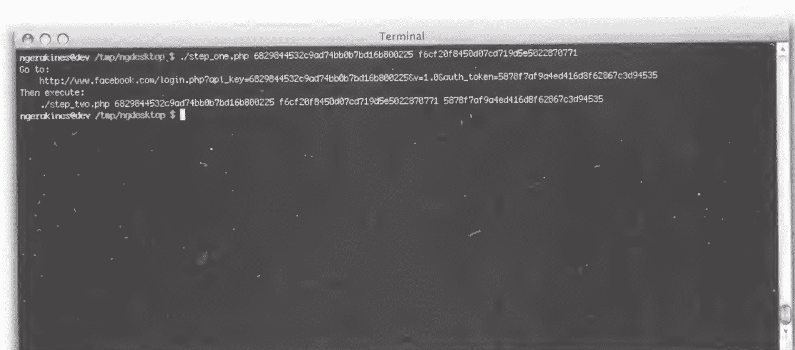

当前版本的 Facebook PHP Client Library 不包含对`facebook.auth.createToken` API 方法的任何引用，因此你必须自己添加。幸运的是，扩展该库相当简单。

在`facebookapi_php5_restlib.php`类中，附加以下类方法。这已在包含的`auth_desktop`示例应用中为你完成。

```php
public function auth_createToken() {
    $result = $this->call_method('facebook.auth.createToken');
    return $result;
}
```

# 第一部分：了解 Facebook 平台

`step_two.php`文件（清单 7-9）继续执行认证流程，获取与`step_one.php`中创建的`auth_token`相关的会话信息，该`auth_token`供用户登录并添加应用程序时使用。此脚本向`facebook.auth.getSession` API 方法发送请求，并返回后续使用的会话信息。它还会验证会话的有效性，并执行一个 FQL 查询来演示这一点。这个命令行脚本接受三个参数：`api_key`、`secret`和`auth_token`。

### 清单 7-9：桌面应用程序认证的第二步

```php
#!/usr/bin/php
<?php

if (! $argv[0] || !$argv[1] || !$argv[2] || !$argv[3]) {
    print "./step_two.php <api_key> <app secret> <auth_token>\n";
    exit();
}

$api_key = $argv[1];
$secret = $argv[2];
$auth_token = $argv[3];

include_once 'lib/client/facebook.php';
include_once 'lib/client/facebook_desktop.php';

$client = new FacebookDesktop($api_key, $secret);
$result = $client->do_get_session($auth_token);

print "Be sure to keep the session key and secret in a safe place!!\n\n";
print "Session: " . $result['session_key'] . "\n";
print "User ID: " . $result['uid'] . "\n";
print "Expires: " . $result['expires'] . "\n";
print "Application Secret: " . $secret . "\n";
print "Session Secret: " . $result['secret'] . "\n\n";

print 'Executing query: SELECT concat(name, " is ", relationship_status) FROM user
WHERE uid = ' . $result['uid'] ."\n\n";

$resp = $client->api_client->fql_query('SELECT concat(name, " is ",
relationship_status) FROM user WHERE uid = ' . $result['uid']);

var_dump($resp);

?>
```

图 7-3 展示了结果。


图 7-3：第二步的执行结果。

如图 7-2 和图 7-3 所示，为桌面应用程序用户创建会话的过程相对简单。经过一些修改，此过程可以适配到其他语言。

## 小结

如本章所演示和解释的，认证在 Facebook 平台的各个方面都扮演着重要角色。无论您是验证应用程序请求是否通过 Canvas 发出，还是从桌面应用程序创建签名的 API 请求，认证模型都是不可或缺的。本章延续了前几章关于认证模型的内容，并开启了外部应用程序认证的大门。

第 8 章将从本章结束的地方继续，探讨外部应用程序的开发。至此，Facebook 平台的大多数核心组件已经讨论完毕，您已具备所需的一切知识，可以开始通过外部应用程序将外部网站和服务与 Facebook 集成。

# 第二部分：构建 Facebook 应用程序

- 第 8 章：开发者资源
- 第 9 章：深入 Hello World
- 第 10 章：外部应用程序开发
- 第 11 章：最佳实践

# 开发者资源

在进一步开发之前，让我们先停下来了解一下 Facebook 应用程序开发者可用的资源。本章将回顾 Facebook 提供的官方开发者应用程序和开发者网站。本章还将涉及 Facebook 提供的社区支持 wiki 和错误追踪器。

开发社交应用程序的关键在于，主要关注点应始终放在用户和社区上。Facebook 平台允许开发者利用用户基础和框架来创建社交应用程序，但如果不关注用户，您的努力将会白费。

通过讨论板、官方 wiki、邮件列表和博客，有大量关于如何最好地做事、需要注意什么以及关注什么方面的知识。

## 开发者应用程序

所有 Facebook 应用程序开发者的大本营是官方的开发者应用程序。在开发者应用程序中，您会看到一个用于创建和管理 Facebook 应用程序的界面。该应用程序还提供了一种与 Facebook 应用程序开发者社区互动的方式，以及管理应用程序信息的功能。您可以通过以下网址访问该应用程序：

```
www.facebook.com/developers/
```

除了少数例外，开发者应用程序拥有所有 Facebook 应用程序都具备的多个组件。这包括讨论板、Canvas 页面和成员。Canvas 页面承载了几个开发者应用程序独有的服务，包括“我的应用程序”页面（统称为“应用程序控制面板”）、来自博客的更新动态（用于发布新闻和服务公告），以及应用程序统计和指标页面。

## 我的应用程序

表面上称为“我的应用程序”（图 8-1），开发者应用程序中的这个页面是应用程序创建和管理的核心。开发者在这里创建新的 Facebook 应用程序、修改其运作方式，以及（遗憾地）删除它们。这还包括应用程序关于页面的管理。

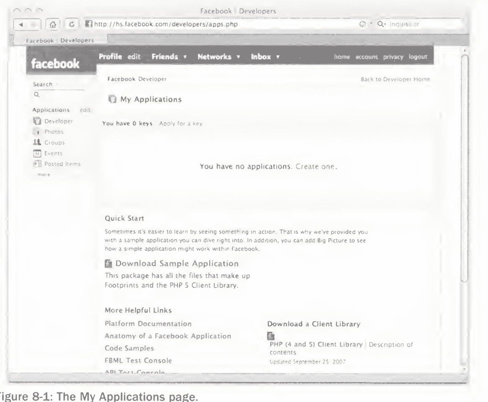

乍一看，“我的应用程序”页面向开发者展示了他 Newfoundlander们当前拥有的应用程序列表。标题为“申请密钥”的链接引导开发者开始创建新应用程序的流程。该流程也可以从开发者应用程序中启动。

如图 8-2 所示，列出的每个 Facebook 应用程序都包含链接，允许开发者编辑应用程序的设置和关于页面设置。还会快捷显示 Facebook 平台生成的 API 密钥和密钥（secret key）。如果应用程序已向用户发送通知，还会显示一个垃圾信息评分。如果应用程序已提交到目录，其接受状态会显示在最右侧。

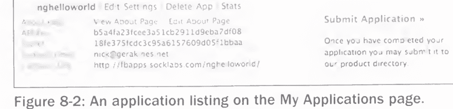

图 8-2：“我的应用程序”页面上的应用程序列表。

## 创建应用程序

通过开发者应用程序创建新应用程序非常简单。这个过程在第 2 章中逐步完成 Hello World 项目时已经深入介绍过。该流程通过开发者应用程序使用`editapp.php?new`链接启动，如下所示：

`http://www.facebook.com/developers/editapp.php?new`

图 8-3 显示了点击链接后的初始界面。

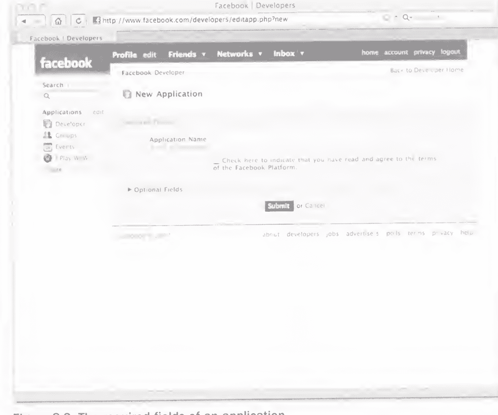

图 8-3：应用程序的必填字段。

如图 8-3 所示，在 Facebook 平台中创建新应用程序时，必填字段虽少但重要。它们包括一个全局唯一的应用程序名称，以及接受 Facebook 平台服务条款。

> 阅读完整的服务条款协议是个好主意。虽然它大多对开发者有利，但它当然首先是为保护和服务 Facebook 而设计的，其中包含一些可能影响您应用程序的注意事项和显著条款。您可以在以下网址查看服务条款：`www.facebook.com/developers/tos.php`。

除了应用程序名称和接受服务条款外，还有一组可展开的“可选字段”，即应用程序的可选配置设置，如图 8-4 所示。这些包括“回调 URL”、“Facebook URI”以及您可能想要授予应用程序访问权限的其他开发者。

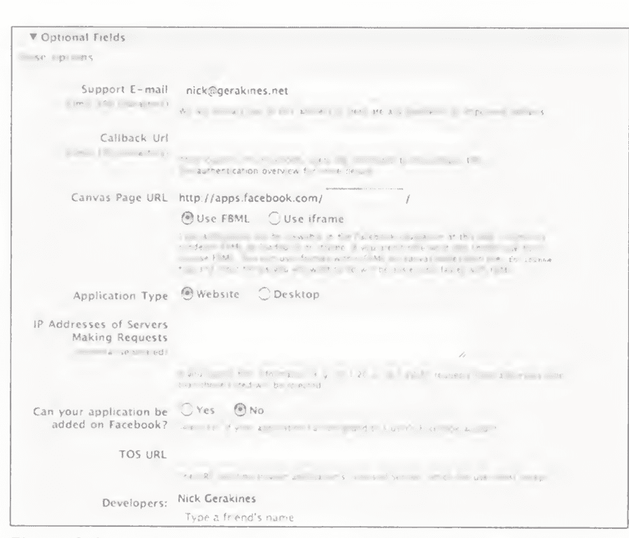

请注意，还有一个复选框，用于说明应用程序是否可以被添加。勾选该字段将展开更多配置选项集。

如图 8-5 所示，“安装选项”允许开发者设置各种选项，以决定用户添加应用程序时的行为方式。这包括“添加后回调 URL”、在用户个人资料文件中渲染的“默认 FBML”等等。

# Chapter 8: Resources for Developers

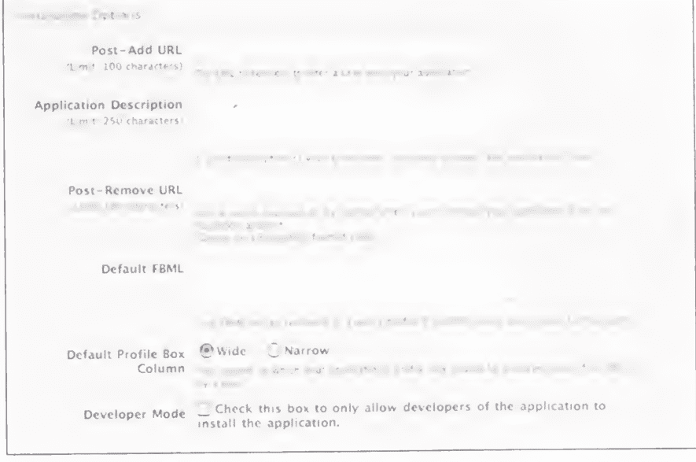

“Integration Points”配置选项集（如图 8-6 所示）决定了应用程序如何与 Facebook 的不同组件集成。这包括诸如“Help URL”以及应用程序处理附件的方式等内容。

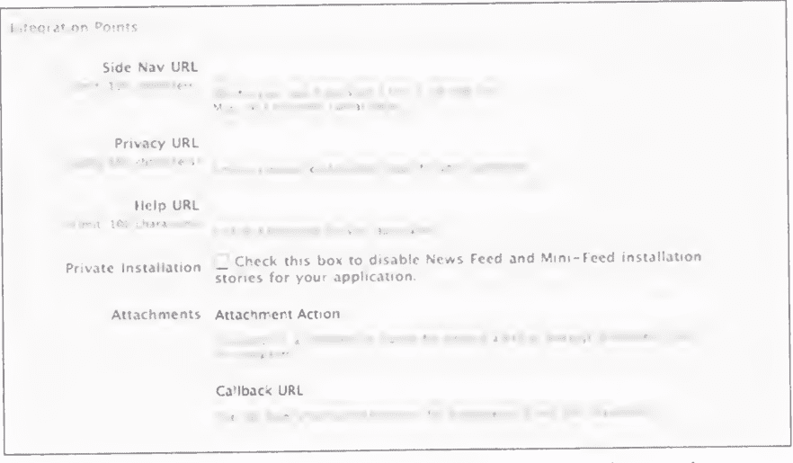

## Deleting an Application

删除一个应用程序与创建一个应用程序一样简单。当你在“My Applications”页面上点击“Delete Application”链接时，会看到一个确认消息（图 8-7），如果你选择继续，该应用程序将从 Facebook 平台移除。


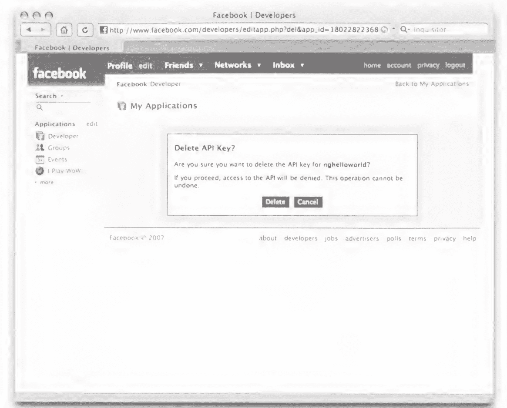

**图 8-7：** 删除应用程序时显示的确认对话框。

移除一个应用程序意味着该应用程序的所有记录都将丢失。API Key 和 secret 将立即失效，添加了该应用程序的用户资料也将更新以反映此变化。该应用程序的名称和 URL 将立即可供未来应用程序使用。

> 一旦删除了应用程序，就无法恢复关于它的任何信息。这包括安装它的用户，以及关于其使用情况的任何指标和统计数据。

## Editing the About Page

应用程序的 About 页面是用户在添加应用程序之前看到的第一批内容之一。应用程序的 About 页面由描述、可选的应用程序图片、Wall 和讨论区组成。还有指向应用程序 Canvas 页面（如果有的话）以及应用程序活跃用户数量的链接。

About 页面编辑器允许开发者自定义用户在 About 页面上看到的内容。它由两部分组成：`Application Info` 和 `Picture`。这不包括所需元素（如应用程序 About 页面的 Wall 或讨论区）的放置或移除。

# Chapter 8: Resources for Developers

如图 8-8 所示，`Application Info` 选项卡包含 `Description`、`Categories` 和 `Developer Information`。该应用程序可以关联的类别数量限制为两个。

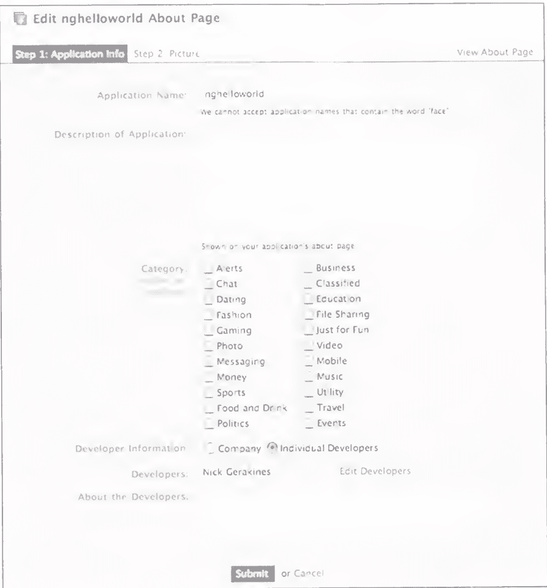

**图 8-8：** 编辑应用程序 About 页面的 `Application Info`。

`Picture` 选项卡（图 8-9）用于设置在应用程序 About 页面上显示的图片。

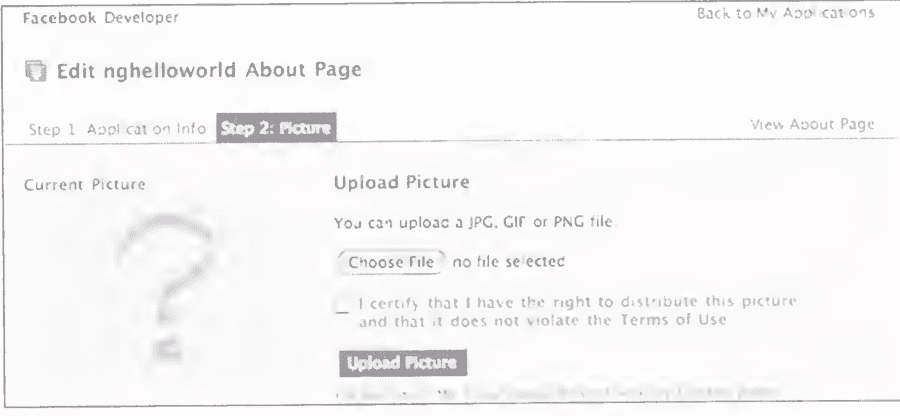

**图 8-9：** 编辑应用程序 About 页面的 `Picture`。

## The Application Directory

*Application Directory* 是一个庞大的 Facebook 应用程序目录。在创建应用程序并满足特定要求后，可以将该应用程序提交以批准进入目录，如图 8-10 所示。

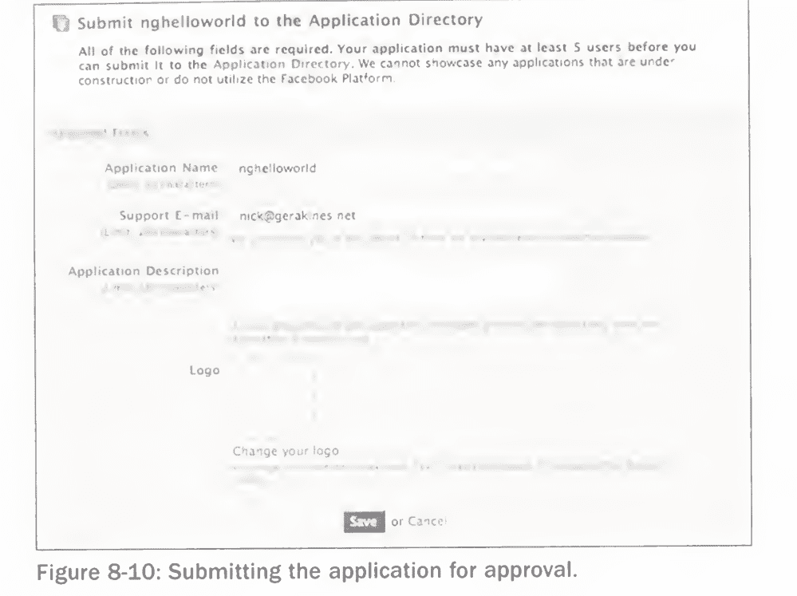

要在 Application Directory 中列出，该应用程序必须至少有五名用户，并且必须经过 Facebook 工作人员的批准。

如图 8-11 所示，Application Directory 由按类别列出的应用程序的分页视图和几个过滤器组成。这些过滤器包括 `Recently Popular`、`Most Activity`、`Most Active Users` 和 `Newest`。应用程序也可以按类型查看，包括通过 Facebook 使用的、桌面应用程序等。

## Discussion Board

*Discussion Board* 是 Facebook 中普遍存在的元素之一。开发者应用程序的 Discussion Board 为开发社区提供，旨在鼓励开发者和 Facebook 之间的交流。它已成为信息的集散地，并为许多开发者存在的问题提供答案。

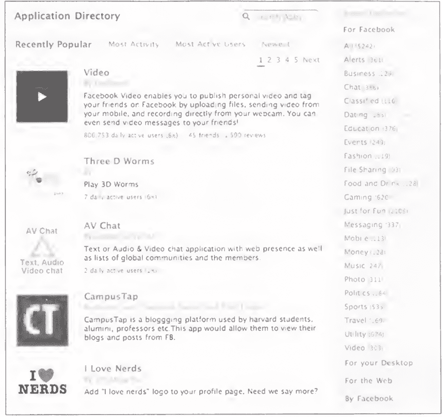

Discussion Board 也是与 Facebook 平台相关的非开发问题和讨论的家园。

## Updates and Service Announcements

在开发者应用程序上（就在 Discussion Board 和 `My Applications` 列表下方），有两个用于 Facebook 平台更新和服务器公告的部分。

`Latest News` 部分是 Facebook 新闻博客的摘要。该博客是 Facebook 公告和更新的家园。其最近的大部分帖子都与 Facebook 平台直接相关，并且通常侧重于新功能或服务变更。你可以在以下网址找到它：

```text
www.facebook.com/news.php?blog=1
```

`Platform Status` 部分是 Facebook 平台服务器公告的实时摘要。此部分包含有关 Facebook 平台状态的信息、有关生产变更的新闻以及停机时间。

## Application Stats

*Application Stats* 页面（如图 8-12 所示）是开发者应用程序的新功能。Application Stats 页面提供了从 Facebook 平台到你的应用程序的使用情况和流量的高级概览。

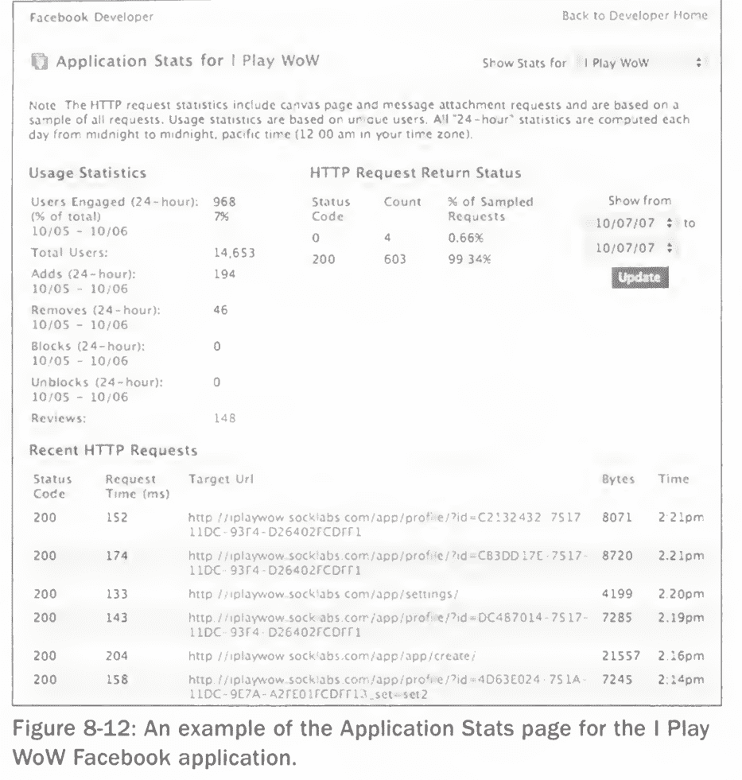

提供的指标包括（但不限于）以下内容：

- 当前添加了该应用程序的用户总数
- 过去 24 小时内使用过该应用程序的用户数量
- 近期的应用程序页面请求
- 请求状态代码的样本

> 除非另有说明，否则这些指标在午夜计算，并回溯 24 小时。

## The Developers Web Site

Developers Web Site（不要与 Developers Application 混淆）是官方文档、下载内容和用于在 Facebook 平台上开发的工具的所在地。Developers Web Site 的主要目的是为开发者提供尽可能多的信息，以参与 Facebook 平台并开始开发。

## Documentation

Developers Web Site 上的文档包含大量关于 Facebook Platform API、Facebook Query Language (FQL) 和身份验证过程的信息。Developers Web Site 不包含任何处于测试版或测试阶段的内容的文档。你可以在以下网址找到文档：

```text
http://developers.facebook.com/documentation.php
```

Facebook Markup Language (FBML) 的官方文档已移至 wiki，本节将不涉及。有关更多信息，请参阅 FBML wiki 页面，网址如下：

```text
http://wiki.developers.facebook.com/index.php/FBML
```

这里对 FQL 进行了详细的概述。FQL 文档还包括可用的表、字段和索引。

身份验证过程也有大量关于身份验证模型的内容。它涵盖了一些关于身份验证应用程序的一般用例。

文档还包括几个杂项页面：

- 链接模板列表，指向用户资料、群组页面、添加好友表单、发送消息等。你可以在此处找到：`http://developers.facebook.com/documentation.php?v=1.0&doc=other`。
- 概述了使用 Facebook 平台的第三方可以存储的信息。你可以在此处找到：`http://developers.facebook.com/documentation.php?v=1.0&doc=misc`。

这里对 FQL 进行了详细的概述。FQL 文档还包括可用的表、字段和索引。

身份验证过程也有大量关于身份验证模型的内容。它涵盖了一些关于身份验证应用程序的一般用例。

文档还包括几个杂项页面：

- 链接模板列表，指向用户资料、群组页面、添加好友表单、发送消息等。你可以在此处找到：`http://developers.facebook.com/documentation.php?v=1.0&doc=other`。
- 概述了使用 Facebook 平台的第三方可以存储的信息。你可以在此处找到：`http://developers.facebook.com/documentation.php?v=1.0&doc=misc`。

## Resources

Developers Web Site 的 Resources 部分是一个包含下载内容的库，包括 Facebook 平台的ntens外阴瘙痒ntens下面瘙痒是怎么.clientent库和示例项目。此区域还包含应用程序使用和交互的共享组件的简要概述。

PHP Client Library 可在此页面上使用。PHP Client Library 包含一组 PHP 4 类、PHP 5 类和示例“footprints”应用程序。官方的 Java Client Library 也可在此页面上使用：`http://developers.facebook.com/resources.php`。

## Tools

Developers Web Site 的 tools 区域包含 API Test Console 和 FBML Test Console。

## API Test Console

*API Test Console*（如图 8-13 所示）是验证和测试 API 请求最快的方式之一。

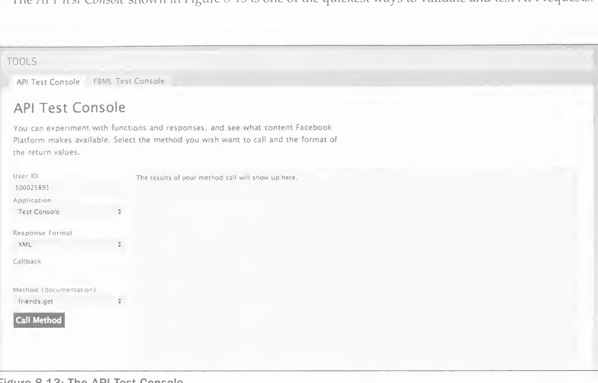

API Test Console 允许你提交 API 请求，并选择响应格式和 API 方法参数。可用的响应格式是 XML、JSON 和 serialized PHP。application 选项设置创建请求时使用的 API key 和 secret。

这个工具非常适合在将 FQL 和 API 方法实现到你的应用程序中之前进行测试。它也可以用于通过构造请求并基于响应构建来创建响应解析器。

## FBML Test Console

*FBML Test Console* 允许你在受控环境中制作和预览 FBML。它可以基于几种 FBML Canvas 配置应用规则，包括应用程序 Canvas、宽个人资料列和 feeds。

210

## Wiki

Facebook 为开发者社区提供了官方开发 wiki。通过它，开发者可以协作创建文档和代码，供其他开发者使用，从而使整个社区受益。你可以在以下网址找到它：`http://wiki.developers.facebook.com/index.php`。

Wiki 还允许开发者和 Facebook 员工记录测试版内容，并在测试 Facebook 平台功能时，随着功能的变化快速更新它们。每个 wiki 页面上的讨论组件也供开发者用来交流他们对 Facebook 平台特定部分的想法和意见。

Wiki 贡献者还大胆添加了示例代码、示例图片、功能请求列表，以及超出 Facebook 所提供的扩展文档。

> 还应该说明的是，wiki 不仅用于文档和示例代码。开发者还用它来讨论和开发功能请求、协作完善应用创意，以及组织社交活动。

## 缺陷追踪

面向开发者可用的最新资源是缺陷追踪工具。Facebook 平台团队创建了一个 Bugzilla 实例，开发者可以在上面提交和追踪缺陷。开发者还可以对他们希望提高优先级的缺陷进行投票。你可以在以下网址找到它：`http://bugs.developers.facebook.com`。

## 测试账户

鉴于大多数 Facebook 应用直接与用户互动并吸引他们，测试应用扮演着重要但困难的角色。Facebook 已经正式制定了一个流程，供开发者指定用于此目的的测试账户。

*测试账户*被定义为一个功能完整的 Facebook 用户账户，该账户被“隔离”（jailed），以避免与其他非测试账户互动。用户可以像其他任何人一样使用 Facebook，但只能与其他测试账户互动和交流。测试账户还被禁止成为应用的所有者或开发者。

创建测试账户与创建普通 Facebook 账户相同。账户创建后，必须使用“成为平台应用测试账户”功能，通过开发者应用将其与测试环境关联。这样做会将账户隔离，essentially 使其与普通 Facebook 用户群体脱离。

> 注意，此过程**不可逆转**。

你可以在以下网址找到关于测试账户的信息：`www.facebook.com/developers/become_test_account.php`。

创建测试账户的即时效果是该账户加入“Facebook 平台开发者测试账户”网络。其他测试账户会在那里列出，开发者应该乐于添加其他测试账户以协助应用测试。在此查看：`www.facebook.com/networks/?nk=838865800`。

## 总结

Facebook 试图向开发者传达的信息很明确：你并不孤单，帮助是可用的。Facebook 在为应用开发创建社区方面所付出的努力令人印象深刻。

开发者有多个地方可以获取信息和社区知识。开发者应用、开发者网站和 wiki 都包含了大量关于开发者面临的常见问题以及最佳实践的信息。

第 9 章将继续第 2 章开始的讨论，对 Hello World 应用进行增强。在第 9 章中，你将把前几章看到的一些概念付诸实践。你还将了解如何扩展和调整你的应用，以应对高负载性能。

# 第二部分：构建 Facebook 应用

# 9

## 让 Hello World 做得更好

第 8 章从主动开发转向，聚焦于面向开发者可用的资源和工具。Facebook 应用开发背后的社区正在显著增长，许多人投入了大量时间、精力和热情，记录他们的努力和经验以造福公众。

本章将回到应用开发，跟进第 2 章的示例应用。本章将对已创建的应用进行功能增强，添加几个核心功能。

## 回顾

那么，第 2 章究竟做了什么？在设定目标之前，让我们先回顾一下已完成的工作和需要改进的地方。从整体项目来看，第 2 章工作的真正价值在于创建了一个可以扩展的小框架。在第 2 章中，你取了一个简单的想法，并将结构化的业务逻辑和模板抽象出来，以便日后更容易增强。

正如第 2 章“概述功能”部分所述，所提供的示例项目旨在创建一个允许用户向好友列表中的人发送问候的小应用。虽然第 2 章的最终成品已经完成，但要将其转变为可行的 Facebook 应用，仍有工作要做。

旧应用与 Facebook 平台的交互很少。它的界面极简，缺乏今天更流行应用中存在的几个关键病毒式传播功能。

## 展望

本章我想展示的要点之一是：几乎为构建的每个功能都能提供洞察，让你了解用户如何看待和使用你的应用。几乎每个功能都可以有一个或多个相关指标，最终这对开发者有更大的好处。

第一个里程碑是对应用与 Facebook 平台在生成用户资料方面的交互进行全面改革。在很多方面，用户资料页面上显示的内容是描述和宣传你的应用的第一且最佳方式。通过用户的资料，你的应用有机会变得病毒式传播，通过行动解释你的应用做什么，以及为什么查看用户应该添加它。

第二个里程碑是通过“添加后”（Post-Add）和“移除后”（Post-Remove）应用事件添加信息跟踪。当应用接入 Facebook 平台的这部分时，这提供了巨大的潜力，让你了解用户如何找到你的应用，以及他们使用多长时间。

第二个里程碑引出第三个里程碑——实现邀请系统。应用邀请让你的用户通过亲自挑选他们认为可能会添加应用的好友来为你宣传和增长应用。在第三个里程碑中，你还将进行推荐跟踪，让你了解用户何时接受应用邀请，以及来自谁的邀请。

## 准备工作

所概述的变更将包括一些对应用配置和数据库的修改和添加。强烈建议按顺序进行这些增强，因为它们在多个方面相互关联。

`AppConfig` 类将使用新的 `app_home` 变量来跟踪应用在网络环境中的 Web 根目录，该目录独立于 Facebook 平台的上下文。清单 9-1 展示了更新后的 `AppConfig` 类。

### 清单 9-1：更新后的 `AppConfig` 类

```php
class AppConfig {
    public static $app_name = 'HelloWorld';
    public static $app_url = 'http://apps.facebook.com/nghelloworld/';
    public static $app_home = 'http://fbexample.socklabs.com/nghelloworld/';
    public static $app_id = '18266139880';
    public static $api_key = '69a09711ee2637755f0091ff5b497733';
    public static $secret  = '9d61409757a5ddae385bba8c2a9d37a3';
    public static $db_ip = '127.0.0.1';
    public static $db_user = 'nghelloworld';
    public static $db_pass = 'password';
    public static $db_name = 'nghelloworld';
}
```

# 第 9 章：让 Hello World 做得更好

数据库还将包含两个新表来存储应用邀请和用户，如清单 9-2 所示。

### 清单 9-2：应用的新表结构

```sql
CREATE TABLE users (
  fb_id INT(14) NOT NULL,
  ts_in INT(11) NOT NULL DEFAULT '0',
  ts_out INT(11) NOT NULL DEFAULT '0',
  total_actions INT(11) NOT NULL DEFAULT '0',
  deleted INT(1) NOT NULL DEFAULT '0'
);
CREATE TABLE invites (
  user_from INT(11) NOT NULL,
  user_to INT(11) NOT NULL,
  ts_sent INT(11) NOT NULL DEFAULT '0',
  accepted INT(1) NOT NULL DEFAULT '0'
);
```

## 创建更好的资料

第一个里程碑的目标是改进资料更新和更改的性能。originally，应用创建了一个静态的 FBML 代码块，发布到 Facebook 平台以在用户资料框内渲染，使用的是 `facebook.profile.setFBML` API 方法。对于许多应用来说，这是更新用户资料内容的完全可接受的方式，它通过展示如何系统地设置资料内容而表现良好。

这种方法效率低下的原因有几个：

- 该实现在每次资料更改时都进行昂贵的 API 请求。如果一个或多个用户在应用上活跃，没有池化机制来将单个用户的资料更改合并为单个请求。这对应用和 Facebook 平台来说都可能很昂贵。
- 应用还模糊了模板代码和业务逻辑的界限，在包含应用业务逻辑的 `HelloWorld` 类中生成资料内容。这使得用户资料模板的更改更难管理，而且在某些情况下，需要开发者而不是设计师来进行更改。


- 尽管用户资料内容共享了几个共同元素，应用仍然将用户资料的整个主体发布到 Facebook 平台，没有利用任何共享或缓存内容。

当前方法的替代方案是使用`fb:ref` FBML 实体。这是方法上的根本性改变，因为它将用户资料更改从`推送`（Push）模型转变为`拉取`（Pull）模型。总体思路是，与其将用户的资料内容提交给 Facebook 平台，不如一次性向资料发布一个`fb:ref` FBML 实体，其中包含一个拥有该资料内容的 URL。当资料内容更改时，你向 Facebook 平台发送命令，使其从指定 URL 刷新用户资料的内容。

## 第二部分：构建 Facebook 应用程序

这种方法的优点显而易见：

- 用户资料的内容可以一次性设置，后续的更新只需向 Facebook 平台发出小型请求即可完成。
- 资料内容可以非常轻松地查看和测试，无需使用复杂的方法来更新 Facebook 平台上的用户资料内容。

这个流程并不会取代`facebook.profile.setFBML` API 方法，而只是改变了它的使用方式。你仍然需要将用户资料内容设置为一个指向 URL 的值。当内容发生变化时，你再调用后续的`facebook.fbml.refreshRefUrl` API 方法。

要做到这一点，你必须对应用程序进行三处修改。第一处修改是在`lib/HelloWorld.class.php`文件中的`HelloWorld`类。在这里，你需要删除所有构建 FBML 的代码，这些代码原本是通过`facebook.profile.setFBML` API 方法发送的。你可以将其替换为一个较小的 FBML 代码块，其中包含引用应用程序所托管 URL 的`fb:ref` FBML 实体。这适用于你想要更新用户资料的场景。但要设置资料的初始内容，你必须引入一个新的类方法。

除了对`profile_update`方法的修改之外，你还要在应用程序类中添加`first_time`方法。这个方法将使用`facebook.profile.setFBML` API 方法设置包含`fb:ref`实体的初始 FBML，然后立即调用`facebook.fbml.refreshRefUrl` API 方法，以确保用户资料上有初始内容。清单 9-3 展示了更新后的`update_profile`和`first_time`方法。

## 清单 9-3：更新后的 `update_profile` 和 `first_time` 方法

```php
function update_profile($user) {
    $url = AppConfig::$app_home . 'profile.php?user=' . $user;
    $this->fbclient->api_client->fbml_refreshRefUrl($url);
    return 1;
}

function first_time($user) {
    $url = AppConfig::$app_home . 'profile.php?user=' . $user;
    $fbml = "<fb:ref url=\"$url\" />";
    $this->fbclient->api_client->profile_setFBML($fbml, $user);
    $this->fbclient->api_client->fbml_refreshRefUrl($url);
    return 1;
}
```

接下来，你必须在应用程序中添加`htdocs/profile.php`页面。此页面在`HelloWorld`类的`update_profile`方法中被引用，将用于提供显示用户资料内容所需的内容。

与本项目中的其他 Canvas 页面类似，此 PHP 文件遵循相似的行为模式。在代码的前几行中，它包含了必需的库并创建了新的 Facebook 和`HelloWorld`类对象。

在业务逻辑中，你首先要做的是解析通过`user`查询字符串参数传递的用户 ID。没有这个 ID，你就无法显示特定用户的资料内容。一旦获取了要显示其资料内容的用户 ID，你就继续调用`get_greetings`方法来获取发送给该用户和从该用户发出的问候。该逻辑直接取自你在`HelloWorld`类的`update_profile`方法中删除的代码。清单 9-4 展示了`htdocs/profile.php`页面。

# 第 9 章：Hello World 进阶

## 清单 9-4：`htdocs/profile.php` 页面

```php
<?php
include_once '../lib/client/facebook.php';
include_once '../lib/AppConfig.class.php';
include_once '../lib/HelloWorld.class.php';

$facebook = new Facebook(AppConfig::$api_key, AppConfig::$secret);
$app = new HelloWorld($facebook);
$user = 0;
if (isset($_GET['user'])) {
  $user = (int) $_GET['user'];
}

$greetings_from = $app->get_greetings('user_from', $user);
$gfromcount = count($greetings_from);
$greetings_to = $app->get_greetings('user_to', $user);
$gtocount = count($greetings_to);
$tomessage = "";
$frommessage = "";
if ($gtocount) {
  $tomessage = "<p><fb:name uid=\"profileowner\" firstnameonly=\"true\" useyou=\"false\" /> has been waved to $gtocount times.</p>";
} else {
  $tomessage = "<p>No one has waved hello to <fb:name uid=\"profileowner\" firstnameonly=\"true\" useyou=\"false\" />!</p>";
}
if ($gfromcount) {
  $frommessage = "<p><fb:name uid=\"profileowner\" firstnameonly=\"true\" useyou=\"false\" /> has waved hello to $gfromcount people.</p>";
} else {
  $frommessage = "<p><fb:name uid=\"profileowner\" firstnameonly=\"true\" useyou=\"false\" /> has not waved to anyone.</p>";
}
?>
<fb:wide>
<?php echo $frommessage; ?>
<ul>
<?php foreach ($greetings_from as $greeting) { ?>
<fb:if-can-see uid="<?= $user ?>">
<li><fb:name uid="<?= $greeting['user_to'] ?>" useyou="false" /></li>
</fb:if-can-see>
<?php } ?>
</ul>
<?php echo $tomessage; ?>
<ul>
<?php foreach ($greetings_to as $greeting) { ?>
<fb:if-can-see uid="<?= $user ?>">
<li><fb:name uid="<?= $greeting['user_from'] ?>" useyou="false" /></li>
</fb:if-can-see>
<?php } ?>
</ul>
```

**清单 9-4**（续）

```php
</fb:if-can-see>
<?php } ?>
</ul>
</fb:wide>
<fb:narrow>
<?php echo $frommessage; ?>
<ul>
<?php foreach ($greetings_from as $greeting) { ?>
<fb:if-can-see uid="<?= $user ?>">
<li><fb:name uid="<?= $greeting['user_to'] ?>" useyou="false" /></li>
</fb:if-can-see>
<?php } ?>
</ul>
<?php echo $tomessage; ?>
<ul>
<?php foreach ($greetings_to as $greeting) { ?>
<fb:if-can-see uid="<?= $user ?>">
<li><fb:name uid="<?= $greeting['user_from'] ?>" useyou="false" /></li>
</fb:if-can-see>
<?php } ?>
</ul>
</fb:narrow>
```

> 开发者应记住，此页面不打算通过 Facebook Canvas 查看。因此，你不会执行通常所做的常规检查。虽然它在 Facebook 中未显示或引用，但重要的是要记住，此页面是公开的，任何人都可能查看。

此里程碑的最后一项任务是触发一个事件来首次更新用户的内容。有两种方法可以实现，每种方法各有优缺点。

一种方法是设置一个包含`bool`值的表列，用于指示用户资料内容是否已初始设置。当调用`update_profile`方法时，它会快速查找该值，以确定是否需要在使用`facebook.fbml.refreshRefUrl` API 方法请求之前，使用`facebook.profile.setFBML` API 方法设置资料内容。

另一种方法是使用 Post-Add 回调 URL，该 URL 在用户首次添加应用程序时被调用。在这种情况下，当用户首次添加应用程序时，用户会被引导至应用程序内的一个 Canvas 页面，你可以在其中执行所需的任何特殊构建或初始化操作。

对于这个应用程序，我们使用 Post-Add 回调 URL。主要原因是你可以将 Post-Add 事件用于其他目的，做到一石二鸟。另一个额外的好处是，你可以避免在每次资料更改时都进行数据库查找。要做到这一点，你必须实现对`first_time`类方法的调用。

# 第 9 章：Hello World 进阶

在应用程序的配置选项页面（可在开发者应用程序中找到）中，"安装选项"配置选项组下有一个名为"Post-Add URL"的设置（图 9-1）。将此选项设置为`welcome.php` Canvas 页面并保存更改。

此选项需要添加`htdocs/welcome.php` Canvas 页面。欢迎 Canvas 页面将是用户在添加应用程序后立即看到的第一件事。如前所述，这是一个添加介绍和快速使用指南的理想场所。

> **欢迎你的新用户**
>
> 抓住这个机会，向用户充分解释他/她刚刚添加的应用程序。如果用户是因为其他用户的邀请或其他用户的资料页面而添加应用程序的，他/她可能不完全了解该应用程序的功能或使用方法。创建一个关于该应用程序的快速 60 秒指南，并包含一组功能介绍。

欢迎页面开始看起来与索引页面非常相似。你创建 Facebook 和`HelloWorld`类对象，并对页面请求执行多项验证检查。一旦确认请求有效且来自 Facebook，你就调用`first_time`类方法。清单 9-5 展示了`htdocs/welcome.php` Canvas 页面。

## 清单 9-5：`htdocs/welcome.php` Canvas 页面

```php
<?php
include_once '../lib/client/facebook.php';
include_once '../lib/AppConfig.class.php';
include_once '../lib/HelloWorld.class.php';

$facebook = new Facebook(AppConfig::$api_key, AppConfig::$secret);
$facebook->require_frame();
$user = $facebook->require_login();
$facebook->require_add();

$app = new HelloWorld($facebook);
$app->first_time($user);
?>
<fb:dashboard>
<fb:action href="/nghelloworld/">View My Greetings</fb:action>
<fb:action href="/nghelloworld/wave.php">Send a greeting</fb:action>
</fb:dashboard>
<div style="padding: 10px;">
  <h2>Hello <fb:name firstnameonly="true" uid="<?= $user ?>" useyou="false"/>!</h2>
  <p>Welcome to this application!</p>
</div>
```

# 第二部分：构建 Facebook 应用程序

## 使用应用事件进行事件跟踪

上一节介绍了当用户添加应用程序时，Facebook 平台会设置的 Post-Add 应用事件集。通过 Post-Add 和 Post-Remove 应用事件，可以跟踪应用程序的添加和移除行为，从而深入了解用户如何找到应用程序，以及最终是什么影响他们移除应用程序。Post-Add 和 Post-Remove 应用事件是执行新用户或回归用户初始化或清理操作的理想场所。

在通过开发者应用程序进行的应用程序配置中，“Post-Add URL”和“Post-Remove URL”选项位于配置选项的“Installation Options”组中（图 9-2）。如果您是按顺序进行这些增强操作，那么您应该已经设置了 Post-Add 配置选项，并且 Welcome 页面应该已经存在。

Post-Remove 配置有几个需要注意的事项，这会影响此实现。与 Post-Add URL 不同，Post-Remove URL 是在用户移除应用程序后立即由 Facebook 平台调用的。用户不会被重定向到该页面；该页面仅由 Facebook 平台调用。

Post-Add 配置选项应设置为应用程序画布中的`welcome.php`页面。在此示例中，应用程序画布位于`http://apps.facebook.com/nghelloworld/`。因此，Post-Add URL 设置为`http://apps.facebook.com/nghelloworld/welcome.php`。从 Facebook 平台的角度来看，Post-Remove URL 是一个外部 URL。在此示例中，应用程序位于`http://fbexample.socklabs.com/helloworld/`。因此，Post-Remove URL 设置为`http://fbexample.socklabs.com/helloworld/goodbye.php`。

继续上一节的内容，`htdocs/welcome.php`画布页面用于向用户显示初始欢迎内容，并执行应用程序所需的任何业务逻辑。在大多数情况下，这是不必要的，开发人员会将 Post-Add URL 设置为主应用程序画布页面。

Welcome 页面已经调用了`first_time`方法，因此您可以将更改集中在那里。在那里，您需要进行两项更改，为用户准备一个干净的环境，然后通过标记用户何时添加应用程序来继续。这是通过对数据库进行两次 SQL 调用来完成的。第一次执行 SQL`DELETE`语句，删除您可能为该用户拥有的任何记录。第二次是 SQL`INSERT`语句，用于跟踪用户何时添加了应用程序。

# 第 9 章：Hello World 的更多功能

```php
function first_time($user) {
    try {
        $conn = $this->get_db_conn();
        $sql = "DELETE FROM users WHERE fb_id = $user";
        error_log($sql);
        mysql_query($sql, $conn);
    } catch (Exception $e) {
        error_log($e->getMessage());
    }
    try {
        $conn = $this->get_db_conn();
        $sql = "INSERT INTO users SET fb_id = $user, ts_in = UNIX_TIMESTAMP(NOW())";
        error_log($sql);
        mysql_query($sql, $conn);
    } catch (Exception $e) {
        error_log($e->getMessage());
    }
    $url = AppConfig::$app_home . 'profile.php?user=' . $user;
    $fbml = "<fb:ref url=\"$url\" />";
    $this->fbclient->api_client->profile_setFBML($fbml, $user);
    $this->fbclient->api_client->fbml_refreshRefUrl($url);
    return 1;
}
```


要跟踪应用程序移除，您需要创建`htdocs/goodbye.php`（清单 9-6）。此页面被设置为 Post-Remove 回调 URL。Goodbye 页面的唯一目的是设置用户移除应用程序的日期和时间，并在您的记录中将该用户标记为已删除。通过这些小片段信息，您可以收集有关用户的信息，并根据您所知道的信息提示其他用户采取特定操作。

### 清单 9-6：`htdocs/goodbye.php` Post-Remove 回调页面

```php
<?php
include_once '../lib/client/facebook.php';
include_once '../lib/AppConfig.class.php';
include_once '../lib/HelloWorld.class.php';

$facebook = new Facebook(AppConfig::$api_key, AppConfig::$secret);
$app = new HelloWorld($facebook);
$user = $facebook->require_login();
$app->goodbye($user);

?>
```

使用 Post-Remove 回调 URL 时需要记住几件事：

- Facebook 用户不会被引导或重定向到该页面，该页面也不会包含在 Facebook 画布的任何部分中。因此，无需费心显示内容。
- Post-Remove 回调 URL 的请求是在用户移除应用程序后发送的。因此，POST 参数会有所不同。

## 第二部分：构建 Facebook 应用程序

由`goodbye.php`页面调用的`goodbye`方法将对数据库进行必要的更改。

```php
function goodbye($user) {
  try {
    $conn = $this->get_db_conn();
    $sql = "UPDATE users SET fb_id = $user, ts_out = UNIX_TIMESTAMP(NOW()),
deleted = 1";
    error_log($sql);
    mysql_query($sql, $conn);
  } catch (Exception $e) {
    error_log($e->getMessage());
  }
  return 1;
}
```

要跟踪的最后一个指标是用户执行的操作总数。在此应用程序中，只有一种类型的操作：“挥手”，或问候。您通过`users`表上名为`total_actions`的整数字段来跟踪这些操作。在这种情况下，当一个用户向另一个用户挥手时，您将该数字增加一。

```php
function wave_hello($user_from, $user_to) {
  try {
    $conn = $this->get_db_conn();
    $sql = "INSERT INTO greetings SET user_from = $user_from, user_to = $user_to,
row_created = UNIX_TIMESTAMP(NOW())";
    error_log($sql);
    mysql_query($sql, $conn);
    $sql = "UPDATE users SET total_actions = total_actions + 1 WHERE fb_id =
$user_from";
    error_log($sql);
    mysql_query($sql, $conn);
  } catch (Exception $e) {
    error_log($e->getMessage());
  }
  try {
    $this->update_profile($user_from);
    $this->update_profile($user_to);
  } catch (Exception $e) {
    error_log($e->getMessage());
  }
  return 1;
}
```

## 发送和跟踪邀请

应用程序邀请对许多应用程序来说都是一件大事——而且理由充分。应用程序邀请使得应用程序能够通过其用户实现增长。在 Facebook 平台内，用户可以精心挑选并邀请他们的朋友。

当 Facebook 平台首次推出时，应用程序使用现已弃用的`facebook.notifications.sendRequest` API 方法，代表用户向用户发送和接收应用程序邀请。Facebook 现在使用不同的流程和流程，从 Facebook 平台的角度来看更加直接和简洁。

允许用户发送应用程序邀请需要`fb:request-form` FBML 实体。就其本身而言，这就是全部所需，它以最原始的方式工作。但是，在这里您希望更进一步，实现跟踪邀请的能力，查看它们被接受的频率和时间。为此，您向项目添加一个新页面，并更新之前介绍的 Welcome 页面。

该项目将包含`htdocs/invite.php`画布页面，该页面将用作应用程序邀请的操作中心。清单 9-7 显示了 Invite 页面。

### 清单 9-7：`htdocs/invite.php`画布页面

```php
<?php
include_once '../lib/client/facebook.php';
include_once '../lib/AppConfig.class.php';
include_once '../lib/HelloWorld.class.php';

$facebook = new Facebook(AppConfig::$api_key, AppConfig::$secret);
$facebook->require_frame();
$user = $facebook->require_login();
$facebook->require_add();
$app = new HelloWorld($facebook);
if ($_[$_GET['ids']]) {
  foreach($_GET['ids'] as $key) {
    $app->record_invite($user, $key);
  }
}

$exclude_ids = $facebook->api_client->friends_getAppUsers();
$sent_invites = $app->get_invites($user);
$exclude_ids = array_merge($exclude_ids, $sent_invites);
$referralTracker = urlencode("?referralbyuser=" . $user);
$app_name = AppConfig::$app_name;
$app_key = AppConfig::$api_key;

$invite_fbml = <<<FBML
<fb:name uid="$user" firstnameonly="true" shownetwork="false"/> wants you to add
{$app_name} to receive greetings from <fb:pronoun objective="true"
possessive="false" uid="$user"/>.
<fb:req-choice url="http://www.facebook.com/add.php?api_key={$app_key}&next=
$referralTracker" label="Add {$app_name}" />
FBML;

?>
<fb:request-form type="<?= AppConfig::$app_name ?>" action="invite.php"
content="<?= htmlentities($invite_fbml) ?>" invite="true">
    <fb:multi-friend-selector max="20" actiontext="Invite up to twenty of your
friends." showborder="true" rows="5" exclude_ids="<?= join(',', $exclude_ids); ?>">
</fb:request-form>
```

## 第二部分：构建 Facebook 应用程序

邀请页面包含了许多其他应用程序用于创建必要对象和执行所需请求有效性检查的相同逻辑。通过这个邀请页面，你还可以将用户从邀请列表中排除。这可能包括已被该用户邀请过的用户，以及那些已经添加了该应用程序的用户。

在应用程序的邀请页面上，首先要做的事项之一是记录你可能刚刚发送的任何邀请。如`fb:request-form` FBML 实体所示，你将表单的操作设置为邀请页面，将所有邀请业务逻辑的各个方面集中到这个自包含的邀请页面中。当邀请发送时，它会将你刚刚邀请的用户的 ID 发布到自身。

```php
if ($_GET['ids']) {
    foreach($_GET['ids'] as $key) {
        $app->record_invite($user, $key);
    }
}
```

然后，你向`facebook.friends.getAppUsers` API 方法发送请求，以构建一个不应发送邀请的用户列表，因为他们已经添加了该应用程序。你还查找查看用户的所有历史邀请，并将该列表与 API 调用返回的`excluded_ids`列表合并。

```php
$exclude_ids = $facebook->api_client->friends_getAppUsers();
$sent_invites = $app->get_invites($user);
$exclude_ids = array_merge($exclude_ids, $sent_invites);
```

接下来的任务是构建被邀请者在收到请求时看到的消息。这相对容易，包含的 FBML 很少。在这段 FBML 中，你使用`fb:name`、`fb:pronoun`和`fb:req-choice` FBML 实体来显示一条简短的消息，并为用户提供添加该应用程序的方式。在`fb:req-choice`实体中设置的 URL 是标准的应用程序添加 URL，但有一个区别。你使用`next`查询字符串参数来包含一个跟踪信标。当用户遵循应用程序添加 URL 时，`referralbyuser`参数将传递到`welcome.php`页面，在那里你可以记录该应用程序的添加是因为某个用户发送的邀请。

```php
$referralTracker = urlencode("?referralbyuser=" . $user);
$app_name = AppConfig::$app_name;
$app_key = AppConfig::$api_key;

$invite_fbml = <<<FBML
<fb:name uid="$user" firstnameonly="true" shownetwork="false"/> 想要你添加
{$app_name} 以收到来自 <fb:pronoun objective="true"
possessive="false" uid="$user"/> 的问候。
<fb:req-choice
url="http://www.facebook.com/add.php?api_key={$app_key}&next=$referralTracker"
label="添加 {$app_name}" />
FBML;
```

最后，你进入通过应用程序画布渲染的内容。你设置显示的唯一内容是`fb:request-form` FBML 实体，以渲染邀请画布小部件。在请求表单内，你还使用了`fb:multi-friend-selector` FBML 实体。

## 第9章：用 Hello World 做更多事情

```html
<fb:request-form type="<?= AppConfig::$app_name ?>" action="invite.php"
  content="<?= htmlentities($invite_fbml) ?>" invite="true">
  <fb:multi-friend-selector max="20" actiontext="最多邀请二十位你的
  朋友。" showborder="true" rows="5" exclude_ids="<?= join(',', $exclude_ids); ?>">
</fb:request-form>
```

`fb:request-form`实体有两个必需属性：`type`和`content`。`type`属性用于设置在主页上为该请求显示的词语。在大多数情况下，使用“邀请”或“请求”是最好的。`content`属性是请求或邀请的 HTML 编码内容。

你在示例应用程序中还设置了`action`和`invite`属性。`invite`属性表明此表单的意图是发送邀请。这会影响显示的语言。`action`属性设置表单提交时的去向，或用户点击“跳过”链接时的去向。

对于`fb:multi-friend-selector` FBML 实体，你设置了`max`、`actiontext`、`showborder`和`rows`以及`exclude_ids`属性。`max`和`rows`属性设置可选择的用户最大数量以及显示用户的行数。`actiontext`属性设置请求表单顶部显示的标题。`showborder`属性设置或隐藏选择器周围的边框。`exclude_ids`属性是一个逗号分隔的用户 ID 列表，代表无法选择的用户。

图9-3展示了完成的邀请页面。

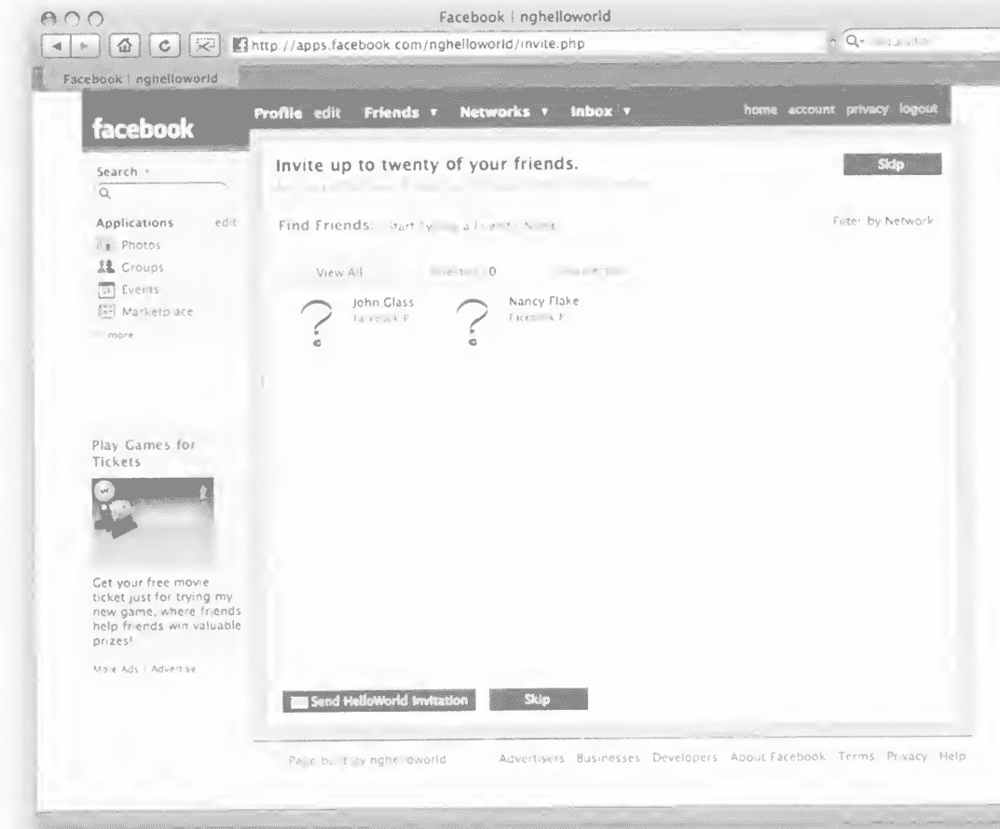

## 第二部分：构建 Facebook 应用程序

`fb:request-form`实体的美妙之处在于，开发者现在可以使邀请用户变得非常容易，并减少其应用程序所需的代码量。Facebook 平台为你的用户提供了一种干净且易于操作的界面方式，以选择多个朋友进行邀请，并负责处理这些邀请。

下一个主要步骤是读取你作为欢迎页面一部分设置的跟踪信标。在欢迎页面中，如果`referralbyuser`查询字符串参数传递到欢迎页面，你会对新的`save_referral`方法进行单一引用。

```php
$app = new HelloWorld($facebook);
$app->first_time($user);

if ($_GET['referralbyuser']) {
  $app->save_referral($user, $_GET['referralbyuser']);
}
```

你需要在`HelloWorld`类中添加几个新方法。第一个是在邀请页面调用的`record_invite`方法。此方法用于存储发送给用户和来自用户的邀请。你这样做的主要原因是为了跟踪邀请被接受的频率，以及邀请变得集中的程度。邀请集中度是一个指标，用于跟踪一个朋友群体中的一个或多个成员被该群体中一个或多个成员邀请的频率。

应用程序邀请跟踪有几个副作用，对应用程序开发者有益。首先，你可以清楚地统计任何给定用户发送了多少邀请，以及邀请被接受的频率。你还可以用此来防止用户向少数特定用户发送大量邀请，这可能会损害应用程序的垃圾邮件评分。

```php
function record_invite($user_from, $user_to) {
    try {
      $conn = $this->get_db_conn();
      $sql = "INSERT INTO invites SET user_from = $user_from, user_to = $user_to,
ts_sent = UNIX_TIMESTAMP(NOW()), accepted = 0";
      error_log($sql);
      mysql_query($sql, $conn);
    } catch (Exception $e) {
      error_log($e->getMessage());
    }
    return 1;
}
```

`save_referral`方法在欢迎页面被调用，当跟踪信标包含在请求的查询字符串中时，表示该应用程序是因为用户发送的邀请而被添加。此方法由一个 SQL 语句组成，用于根据查询字符串参数更新从该用户发送的邀请。

```php
function save_referral($user, $user_from) {
    try {
      $conn = $this->get_db_conn();
      $sql = "UPDATE invites SET accepted = 1 WHERE user_from = $user_from AND
user_to = $user";
      error_log($sql);
      mysql_query($sql, $conn);
} catch (Exception $e) {
    error_log($e->getMessage());
}
return 1;
}
```

## 第9章：用 Hello World 做更多事情

`get_invites`方法在邀请页面被调用，返回已被查看用户邀请过的用户列表。


```php
function get_invites($user) {
    $conn = $this->get_db_conn();
    $sql = "SELECT user_to FROM invites WHERE user_from = $user";
    error_log($sql);
    $res = mysql_query($sql, $conn);
    $invites = array();
    if (! $res) { return $invites; }
    while ($row = mysql_fetch_assoc($res)) {
        $invites[] = $row['user_to'];
    }
    return $invites;
}
```

# 统计和指标

通过你对应用程序所做的更改，已经实现了几个相对易于维护的功能。你也接触到了创建新功能的基础知识，并了解了将一个基本应用程序构建起来是多么简单。

现在，让我们转向来自此应用程序使用的元数据和信息。通过添加`users`和`invites`表，可以获得一些简单的指标和使用信息。虽然这里呈现的案例非常简单，但它们确实提供了如何轻松创建可度量项目的实际示例，开发者可以使用和研究这些项目来改进他们的应用程序。

为了更好地理解这些查询的工作原理，你想用一些数据填充数据库，如下所示：

```sql
INSERT INTO users VALUES
    (12345, 1188676860, 0, 5, 0),
    (12346, 1188680460, 0, 3, 0),
    (12347, 1188684060, 1188684300, 1, 1),
    (12347, 1188687660, 1188687900, 1, 1),
    (12355, 1188763260, 1188770700, 193, 1),
    (12356, 1188766860, 0, 44, 0),
    (12357, 1188770460, 0, 51, 0),
    (12365, 1188849660, 1188930600, 21, 1),
    (12366, 1188853260, 0, 12, 0),
    (12367, 1188856860, 0, 1, 0),
    (12368, 1188849660, 0, 21, 1),
    (12369, 1188853260, 0, 12, 0),
    (12377, 1188943260, 0, 1, 0);
```

# 第二部分：构建 Facebook 应用程序

我们先从一种简单的方法开始，获取已添加该应用程序的用户总数。

```sql
mysql> SELECT COUNT(*) FROM users;
+ Header: +----------+
| COUNT(*) |
+----------+
|       13 |
+----------+
1 row in set (0.00 sec)
```

现在，我们来看看已添加该应用程序但未在后续时间点移除它的用户。

```sql
mysql> SELECT COUNT(*) FROM users WHERE deleted = 0;
+----------+
| COUNT(*) |
+----------+
|        8 |
+----------+
1 row in set (0.00 sec)
```

在此基础上，你可以按日细分应用程序被添加的次数。

```sql
mysql> SELECT COUNT(*), DATE(FROM_UNIXTIME(ts_in)) as dt FROM users GROUP BY dt;
+----------+------------+
| COUNT(*) | dt         |
+----------+------------+
|        4 | 2007-09-01 |
|        3 | 2007-09-02 |
|        5 | 2007-09-03 |
|        1 | 2007-09-04 |
+----------+------------+
4 rows in set (0.00 sec)
```

## 总结

第2章以一个可运行的应用程序结束，它提供了一个可以发展成真实、实用产品的结构和框架。本章为该应用程序添加了几个关键功能。

在第10章中，你将构建并部署一个外部应用程序，并进一步了解外部应用程序如何与 Facebook 平台进行交互。

# 第 10 章：外部应用程序开发

到目前为止，你一直在开发 Facebook 应用程序。从用户的角度来看，这些应用程序完全存在于 Facebook 内部。它们被设计成使用 Facebook 应用程序画布，并以非常直接的方式与其用户互动。在大多数情况下，个人资料的更改会立即生效，因为用户通过 Facebook 在应用程序上进行了某些操作。

第9章扩展了第2章示例项目的功能和特性——在某种程度上，将其变成了一个功能可扩展且实用的、可以发布到实际环境的项目。

本章将进入外部应用程序开发的领域。外部应用程序模型与你迄今为止所做的工作有很大不同，因为外部应用程序通常是一个网站或服务，它无需用户在 Facebook 上进行操作即可与 Facebook 进行交互。例如，一个应用程序可以在用户购买书籍或在另一个网站上完成项目时，更新其个人资料或将项目添加到其动态消息中。

外部应用程序在 Facebook 上扮演的角色常常被低估。目前有许多网站和网络服务可以通过集成其服务到 Facebook 平台来推广自己的品牌和功能。拥有一个简单的个人资料框或迷你动态条目不仅可以吸引新用户，还可以为现有用户提供新功能。

## 定义外部应用程序

如前所述，外部应用程序是一个与 Facebook 平台具有互利关系的网站或网络服务。它可以是一个希望其购物者能够展示最新购买商品的在线商店，或者一个希望让用户和读者展示他们感兴趣的文章的博客。

外部应用程序可以简单到用户个人资料上的一个小部件，甚至可以是一个数据挖掘服务。关键在于，几乎任何网站或服务都可以成为外部应用程序。

当将外部应用程序与内部应用程序进行比较时，有几个因素加剧了它们的区别：

- 外部应用程序没有画布页面。通过 Facebook 访问的应用程序画布是构建内部应用程序的一个巨大原因。外部应用程序仍然可以通过用户个人资料内容、动态消息和迷你动态、通知等方式访问有限数量的 FBML 实体。
- 外部应用程序具有结构化且相当复杂的认证过程。如第7章所述，外部应用程序认证模型需要几个请求和握手来认证用户。内部应用程序额外的优势在于可以预先知道查看用户是已认证和有效的。
- 外部应用程序不会直接获得任何用户数据或信息。对于任何给定的请求，内部应用程序可以获取查看用户的 Facebook 用户 ID、其完整的朋友列表、用于确定用户是否已授予应用程序访问权限的标志等等。外部应用程序需要相当频繁地发出多个 API 方法调用来获取这些信息。

## 创建外部应用程序

为了演示外部应用程序的创建，你可以使用多种选项。本章的讨论偏离了外部应用程序具有一次性使用代码的常见观点。相反，在本章中，你将创建一个现有 Web 应用程序与 Facebook 平台之间的桥梁。

本章的示例项目使用由 MediaWiki 驱动的维基来创建一个外部应用程序。在这种情况下，整个 MediaWiki 安装是外部应用程序，但开发的两个插件充当了维基和 Facebook 平台之间的桥梁。两者中的第一个在维基上创建一个特殊页面，允许维基访客使用他们的 Facebook 用户名和密码进行认证。

两者中的第二个插件为用户提供了多种功能，以展示用户在维基中创建或编辑的页面。认证插件可以独立工作，但集成插件需要第一个插件来为其 API 方法请求建立会话和用户信息。

## 准备工作

要构建此应用程序，你首先必须有一个可工作的 MediaWiki 安装，以便在上面进行开发。你还需要访问维基将用于管理应用程序所需额外表的数据库。

> **MediaWiki**
>
> 在你继续之前，此应用程序的开发需要一些关于 MediaWiki 及其内部机制的高级知识。虽然所介绍的一般概念是通用的，但强烈建议你快速阅读和吸收一些关于 MediaWiki 内部工作原理以及扩展如何工作的通用知识。有关更多信息，请参见以下网址：
>
> - http://www.MediaWiki.org/wiki/MediaWiki
> - http://www.MediaWiki.org/wiki/Manual:Extensions
>
> 此项目使用 MediaWiki 1.11.0、PHP 5.2.4 和 MySQL 5.0.26。

在编写任何代码之前，让我们花些时间彻底研究一下这个应用程序应该做什么：

- 此示例项目将演示一个用于 DIY 冰淇淋的 Facebook 群组如何创建一个维基，以允许其成员参与并相互分享信息。
- 该应用程序将被分成两个独立的插件：`AuthFacebook`和`Facebook`。每个插件都将拥有一个由 MediaWiki 定义的`SpecialPage`，作为用户可以查看和交互的页面，但它将有严格的限制。
- 此应用程序的`AuthFacebook`组件将处理维基和 Facebook 认证。当用户通过 Facebook 认证时，它将存储认证信息和会话信息以供后续使用。
- Facebook 组件挂钩到 MediaWiki，以监视用户编辑或创建维基页面时发生的事件。它还提供了一个特殊页面，仅当查看用户已通过 Facebook 认证时才可访问，并提供多个选项来自定义用户体验。该组件还发出多个 API 方法请求，以代表用户更新和与 Facebook 平台交互。

## 安装 MediaWiki

MediaWiki 的安装过程文档齐全且相对简单。本项目假设 Web 根目录位于`/var/www/ngfbwiki.socklabs.com/htdocs/`。你应该相应地调整你的安装。

本质上，你需要下载当前版本的 MediaWiki 并将其内容解压到 Web 根目录中。你还需要准备好基于 Web 的配置页面（图 10-1），并使适当的文件可被 Web 服务器写入。

```bash
cd /var/www/ngfbwiki.socklabs.com/
wget http://download.wikimedia.org/mediawiki/1.11/mediawiki-1.11.0.tar.gz
tar xvzf mediawiki-1.11.0.tar.gz
mv mediawiki-1.11.0 htdocs
chmod a+w htdocs/config
```

## 第二部分：构建 Facebook 应用

图 10-1：MediaWiki 配置页面。

对于本项目，wiki 名称设置为"自己动手做冰淇淋"。你可以使用数据库超级用户账户来创建表并授予访问权限。如果没有出现任何复杂情况，保存初始设置后，系统会提示你将`config/LocalSettings.php`文件复制到父目录。

尽管新创建的 wiki 已经可以正常运行（图 10-2），但在开发应用之前，还有一些事情必须完成。

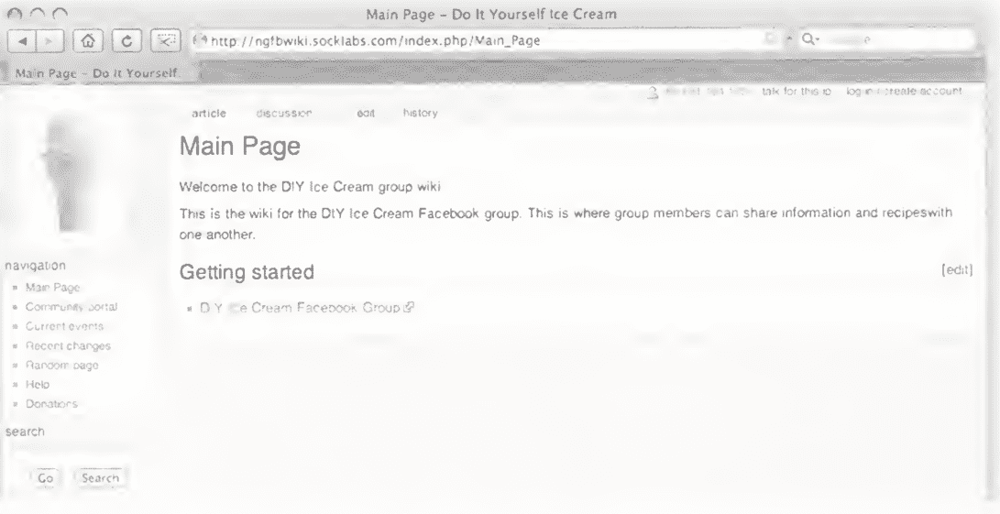

图 10-2：新创建 wiki 的主页面。

# 第 10 章：外部应用开发

## 禁用匿名编辑

此 wiki 面向 DIY Ice Cream Facebook 群组的成员。为了防止垃圾信息和滥用，你必须做的第一件事就是禁用对 wiki 的匿名编辑。

在 wiki 根目录的`LocalSettings.php`文件中，你必须添加一行代码来设置匿名组的权限。

```php
$wgGroupPermissions['*']['edit'] = false;
$wgGroupPermissions['user']['edit'] = true;
```

## 禁用账户创建

此外，你还需要禁用通过 wiki 创建账户的功能。唯一可用于验证身份的账户将通过 Facebook 平台认证流程进行；因此，本地账户不是必需的。

在 wiki 根目录的`LocalSettings.php`文件中，你必须在文件末尾添加一个配置选项。

```php
$wgGroupPermissions['*']['createaccount'] = false;
```

## 移除登录链接

为了防止用户尝试以本地用户身份登录 wiki，你还必须移除对非认证用户可见的匿名登录链接。

在`skins/MonoBook.php`文件中，找到遍历`personal_urls`数组的那一行代码。这个数组变量包含了显示在 wiki 右上角的所有链接。

首先，找到以下代码：

```php
foreach($this->data['personal_urls'] as $key => $item) {
```

将其替换为这段代码：

```php
foreach($this->data['personal_urls'] as $key => $item) if ($key != 'anonlogin') {
```

## 创建外部应用

通过开发者应用创建应用的步骤与本书前面介绍的应用非常相似。

1. 在开发者应用上，点击**"Set Up a New Application"**链接开始该过程。
2. 在"New Application"表单上（图 10-3），为你的应用指定一个唯一的名称，并接受 Facebook 平台服务条款。在本章中，应用名称设置为**"DIY Ice Cream Group Wiki"**。
3. 将 Callback URL 留空。一旦你开始就本项目的认证插件组件进行开发时，再回来配置此选项。
4. 在**"Base options"**组中，指定该应用可以在 Facebook 上添加。
5. 将默认的个人资料 FBML 设置为"This user has not made any edits to the DIY Ice Cream group wiki."

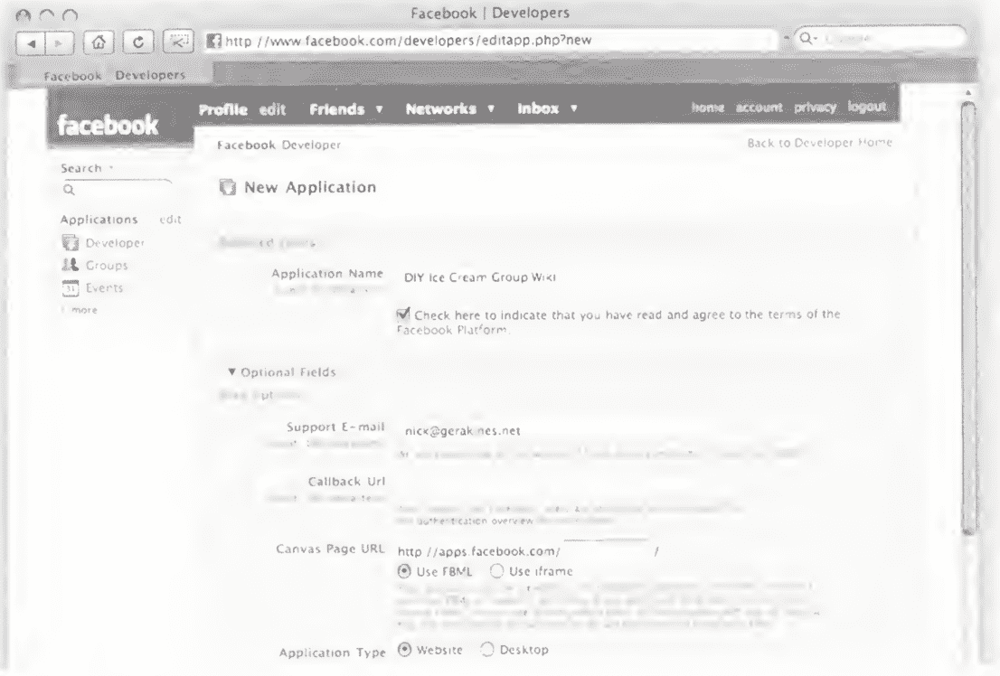

图 10-3："New Application"页面。

## 开发 AuthFacebook 组件

`AuthFacebook`插件组件是本项目的第一个也是最重要的部分。此 MediaWiki 插件的目的是允许 Facebook 用户通过 Facebook 认证流程登录到 wiki。通过此流程，你还可以存储会话信息以供后续使用。

在 MediaWiki 安装的 Web 根目录中，你需要关注的是`extensions`目录。这将是本应用的主目录。开发从`extensions/AuthFacebook`目录开始，在这里你将创建文件`AuthFacebook.php`。在`extensions/AuthFacebook`目录中，你还将维护`AuthFacebook.class.php`文件，其中包含了该插件的大部分逻辑。你还在根 wiki 目录下的 Facebook 平台目录中存放了一份 Facebook PHP 库的副本。

此时，你需要准备该扩展所使用的表。通过`mysql`客户端，在 wiki 软件使用的数据库中创建以下表（SQL 示例所示）：

```sql
CREATE TABLE user_facebook (
  fb_userid varchar(64) NOT NULL,
  user int(5) unsigned NOT NULL,
  session_key varchar(64) default '',
  session_expires int(11) default '0',
  PRIMARY KEY  (fb_userid),
  UNIQUE KEY user (user)
) ENGINE=MyISAM DEFAULT CHARSET=utf8;
```

本项目使用的文件如下：

- `extensions/AuthFacebook/AuthFacebook.php`
- `extensions/AuthFacebook/AuthFacebook.class.php`
- `facebook-platform/client/facebook.php`
- `facebook-platform/client/facebook_desktop.php`
- `facebook-platform/client/facebookapi_php5_restlib.php`
- `LocalSettings.php`

让我们直接深入插件，看看发生了什么。为了理解代码，我们一块一块地看，首先从`extensions/AuthFacebook/AuthFacebook.php`中的以下代码开始：

```php
<?php
if (!defined('MEDIAWIKI')) {
    echo <<<EOT
To install this extension, put the following line in LocalSettings.php:require_once("$IP/extensions/AuthFacebook/AuthFacebook.php");
EOT;
    exit(1);
}

require_once("$IP/includes/SpecialPage.php");
require_once("$IP/facebook-platform/client/facebook.php");
require_once("$IP/extensions/AuthFacebook/AuthFacebook.class.php");

define('MEDIAWIKI_AUTHFACEBOOK_VERSION', '0.1');
define('MEDIAWIKI_AUTHFACEBOOK_APIKEY', '385a6b2e60a8249d988663441c92095c');
define('MEDIAWIKI_AUTHFACEBOOK_SECRET', '9904a01fda12369e357453c9906da0a5');
```

第一个代码块旨在防止直接请求该页面。紧随其后的代码包含并引入了若干额外的 PHP 文件。接下来的三行包含了 MediaWiki 插件版本的定义，以及由 Facebook 平台定义的 API 密钥和密钥。

接下来，你需要开始构建此插件的结构。请考虑以下代码：


```php
$wgHideAuthFacebookLoginLink = false;

$wgExtensionCredits['other'][] = array(
    'name' => 'AuthFacebook',
    'version' => MEDIAWIKI_AUTHFACEBOOK_VERSION,
    'author' => 'Nick Gerakines',
    'url' => 'http://www.mediawiki.org/wiki/Extension:AuthFacebook',
    ...
```

```php
(continued)
    'description' => 'Allow wiki users to authenticate using the Facebook Platform
    authentication process.'
    );

    $wgExtensionFunctions[] = 'setupAuthFacebook';

    $wgSpecialPages['AuthFacebook'] = 'AuthFacebook';

    $wgHooks['PersonalUrls'][] = 'AuthFacebookPersonalUrls';
```

`wgHideAuthFacebookLoginLink` 变量稍后由插件使用，以确定是否应在用户页面上显示 Facebook 个人资料链接。`wgExtensionCredits` 数组将一个定义和说明插件的新数组推入末尾。此信息显示在 Special:Version 页面上。你还接入了 `PersonalUrls` 钩子，设置在该时刻调用 `AuthFacebookPersonalUrls` 函数。

`wgExtensionFunctions` 变量保存了在插件初始设置期间调用的函数列表。插件通常有一个函数（无参数）用于启动插件。`wgSpecialPages` 包含了 MediaWiki 安装所使用的 SpecialPages 列表。该映射包含了将提供 Special Page 功能的类的列表。在本例中，你引用了在 `AuthFacebook.class.php` 文件中定义的 `AuthFacebook` 类。

现在，请考虑以下代码：

```php
function setupAuthFacebook() {
    global $wgMessageCache, $wgOut, $wgRequest, $wgHooks;
    $wgMessageCache->addMessages(array(
        'authfacebooklogin' => 'Login with Facebook',
        'authfacebookerror' => 'AuthFacebook Error',
        'authfacebookerrortext' => 'An error has occurred, the site maintainer has been notified.',
        'authfacebookalreadyloggedin' => 'You are currently logged in as $1.',
        'authfacebooktitle' => 'Facebook Login',
        'authfacebookloggedin' => 'You have logged in as $1.'
    ));
    $action = $wgRequest->getText('action', 'view');
    if ($action == 'view') {
        $title = $wgRequest->getText('title');
        $nt = Title::newFromText($title);
        if ($nt && ($nt->getNamespace() == NS_USER) && strpos($nt->getText(), '/') === false) {
            $user = User::newFromName($nt->getText());
            if ($user && $user->getID() != 0) {
                $fb_userid = AuthFacebookGetFBUserID($user);
                if (isset($fb_userid) && strlen($fb_userid) != 0) {
                    $url = 'http://www.facebook.com/profile.php?id=' . $fb_userid;
                    $disp = htmlspecialchars($url);
                    $wgOut->setSubtitle("<span class='subpages'><a href='$url'>$disp</a></span>");
                }
            }
        }
    }
}
```

# 第 10 章：外部应用开发

`setupAuthFacebook` 函数被添加到 `wgExtensionFunctions` 容器中，并由维基调用。在这个设置函数中，你有两个目标。第一个是设置插件使用的任何本地化变量或消息。第二个是挂钩到请求视图，如果它是用户页面并且用户已通过 Facebook 认证，则显示指向该用户个人资料的链接，如图 10-4 所示。

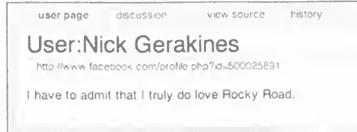

图 10-4：在 Facebook 用户的维基用户页面上显示的链接。

考虑以下代码：

```php
function AuthFacebookGetFBUserID($user) {
    $fb_userid = null;
    if (isset($user) && $user->getId() != 0) {
        global $wgSharedDB, $wgDBprefix;
        if (isset($wgSharedDB)) {
            $tableName = "`${wgSharedDB}`.${wgDBprefix}user_facebook";
        } else {
            $tableName = 'user_facebook';
        }
        $dbr =& wfGetDB( DB_SLAVE );
        $res = $dbr->select(array($tableName),
            array('fb_userid'),
            array('user' => $user->getId()),
            'AuthFacebookGetFBUserID'
        );
        while ($res && $row = $dbr->fetchObject($res)) {
            $fb_userid = $row->fb_userid;
        }
        $dbr->freeResult($res);
    }
    return $fb_userid;
}
```

`AuthFacebookGetFBUserID` 函数在 `setupAuthFacebook` 函数中被引用，用于确定正在查看的用户页面是否与 Facebook 用户相关联。它执行一个简单的数据库查询，基于正在查看的页面的用户 ID，如果匹配则返回 Facebook 用户 ID。

# 第二部分：构建 Facebook 应用程序

现在，看看这段代码：

```php
function AuthFacebookPersonalUrls(&$personal_urls, &$title) {
    global $wgHideAuthFacebookLoginLink, $wgUser, $wgLang;
    if (!$wgHideAuthFacebookLoginLink && $wgUser->getID() == 0) {
        $sk = $wgUser->getSkin();
        $returnto = ($title->getPrefixedUrl() == $wgLang->specialPage( 'Userlogout' ))
            ? '' : ('returnto=' . $title->getPrefixedURL());
        $personal_urls['authfacebooklogin'] = array(
            'text' => wfMsg('authfacebooklogin'),
            'href' => $sk->makeSpecialUrl( 'AuthFacebook', $returnto ),
            'active' => $title->isSpecial( 'AuthFacebook' )
        );
    }
    return true;
}
```

`AuthFacebookPersonalUrls` 函数由 `PersonalUrls` 钩子设置，用于更新维基查看者在页面右上角显示的链接（图 10-5）。为了使此应用成功，至关重要的是尽可能紧密地与 MediaWiki 集成。这正是本章前面你清除所有明显的本地用户登录页面引用的原因。

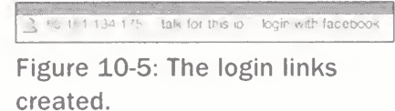

`AuthFacebook.class.php` 文件包含定义 Special: AuthFacebook 页面及其运作方式的所有结构化逻辑。该类本身是 `includes/SpecialPage.php` 文件中定义的 `SpecialPage` 类的子类。

```php
<?php
class AuthFacebook extends SpecialPage {
    function AuthFacebook() {
        SpecialPage::SpecialPage("AuthFacebook");
    }
}
```

在类构造函数中，你调用 `SpecialPage` 类构造函数来定义特殊页面的名称。有关此方法可用参数的更多信息，请参阅 MediaWiki 官方维基中的 SpecialPage 文档。

现在，看看这段代码：

```php
function execute($par) {
    global $wgRequest, $wgUser, $wgOut, $wgSessionStarted;
    if (! $wgSessionStarted) {
        $wgUser->SetupSession();
    }

    $this->setHeaders();

    if ($wgUser->getID() != 0) {
        $this->templateAlreadyLoggedIn();
        return;
    }

    $facebook = new Facebook(MEDIAWIKI_AUTHFACEBOOK_APIKEY,
MEDIAWIKI_AUTHFACEBOOK_SECRET);
    if (! $facebook) {
        $wgOut->errorpage('authfacebookerror', 'authfacebookerrortext');
        return;
    }

    $auth_token = $wgRequest->getText('auth_token');

    if (! $auth_token) {
        $this->templateDefaultPage();
        return;
    }

    try {
        $session_response = $facebook->api_client->auth_getSession($auth_token);
    } catch (Exception $e) {
        $this->templateDefaultPage('There was an error, please refresh the page and
try again.');
        error_log($e);
        return;
    }
    $session_key = $session_response['session_key'];
    $session_expires = $session_response['expires'];
    $fb_userid = $session_response['uid'];

    try {
        $userinfo_response = $facebook->api_client->users_getInfo(array($fb_userid),
array('name'));
    } catch (Exception $e) {
        $this->templateDefaultPage('There was an error, please refresh the page and
try again.');
        error_log($e);
        return;
    }

    $fb_username = $userinfo_response[0]['name'];

    $user = $this->getUserFromFB($fb_userid);

    if (isset($user)) {
        $this->updateUser($fb_userid, $session_key, $session_expires, $fb_username);
    } else {
        # meaning For easy names
        $name = $this->createName($fb_username);
        if ($name) {
            $user = $this->createUser(
               $fb_userid,
               $fb_username,
               $session_key,
               $session_expires
            );
        }
    }

    if (! isset($user)) {
        $wgOut->errorpage('authfacebookerror', 'authfacebookerrortext');
    } else {
        $wgUser = $user;
        $wgUser->SetupSession();
        $wgUser->SetCookies();
        wfRunHooks('UserLoginComplete', array(&$wgUser));
        $this->setLoginCookie($fb_userid, $session_expires);
        $this->templateLoggedInPage();
    }
}
```

当 `AuthFacebook` 特殊页面被渲染时，MediaWiki 会调用 `execute` 方法。这是大部分代码所在和运行的地方。前几行代码在会话不存在时构建一个会话，并设置任何应设置的默认头信息。你还应该尝试确定查看用户是否也已登录，如果是，则调用 `templateAlreadyLoggedIn` 类方法并退出。如果查看用户未登录，则创建一个 `Facebook` 类对象并继续。根据 `auth_token` 查询字符串参数是否存在，有两条不同的路径。如果 `auth_token` 查询字符串参数不存在，则调用 `templateDefaultPage` 类方法并退出。如果参数存在，则意味着请求已通过 Facebook 认证过程。你必须验证 `auth_token` 并获取与其关联的任何会话信息。

如果在任何时候，从 Facebook 检索到的会话或用户信息无效，类将显示错误消息并提示用户重新开始过程。如果会话和用户信息有效，则表明你应该登录该用户，并为该用户创建一个帐户（如果尚不存在）。

调用 `getUserFromFB` 类方法以确定是否存在通过会话信息与 Facebook 用户 ID 关联的有效本地用户帐户。如果本地帐户确实不存在，你使用 `createName` 和随后的 `createUser` 类方法来创建本地帐户并存储任何相关信息（例如会话密钥和过期时间）。

如果本地帐户确实存在，你调用 `updateUser` 类方法用最新和有效的会话信息更新本地信息以供后续使用。最后，你对用户的存在性进行额外检查以登录用户，并调用 `setLoginCookie` 类方法设置任何需要设置的 cookie。你在用户是首次用户且在创建时创建失败的边缘情况下执行额外检查。

看看以下内容：

```php
private function templateAlreadyLoggedIn() {
    global $wgUser, $wgOut;
    $wgOut->setPageTitle( wfMsg( 'authfacebooktitle' ) );
    $wgOut->setRobotpolicy( 'noindex,nofollow' );
    $wgOut->setArticleRelated( false );
    $wgOut->addWikiText( wfMsg( 'authfacebooalreadyloggedin', $wgUser->getName() ) );
}
```


# 第10章：外部应用开发

`templateAlreadyLoggedIn` 类方法是一个简单的模板访问器方法，显示一条简短消息，表明用户已经登录。该方法使用了在插件初始设置期间配置的本地化变量。

请看以下代码：

```php
private function templateDefaultPage($error = null) {
    global $wgUser, $wgOut;
    $wgOut->setPageTitle( wfMsg( 'authfacebooktitle' ) );
    if ($error) {
        $wgOut->addHTML('<table class="messagebox standard-talk" style="border: 2px solid #000000; background-color: #FFCCCC;"><tr><td align="left" width="100%">' . $error . '</td></tr></table>');
    }
    $wgOut->addHTML('<p>This wiki uses the Facebook Platform to allow wiki views to login using their Facebook username and password.</p>');
    $wgOut->addHTML('<p>The login page for local users can be found <a href="/index.php?title=Special:Userlogin">here</a>, although account creation has been disabled by the wiki administrators.</p>');
    $wgOut->addHTML('<p>To start the authentication process follow the login link below.</p>');
    $wgOut->addHTML('<p><a href="http://www.facebook.com/login.php?api_key=' . MEDIAWIKI_AUTHFACEBOOK_APIKEY . '&v=1.0"></a></p>');
}
```

`templateDefaultPage` 类方法用于渲染插件页面在观众未登录且 `auth_token` 查询字符串参数不存在时显示的内容。它还接受一个错误参数，如果存在，则向观众显示该消息。

接下来，请看这段代码：

```php
private function templateLoggedInPage() {
    global $wgUser, $wgOut;
    $wgOut->setPageTitle( wfMsg( 'authfacebooktitle' ) );
    $wgOut->addHTML(wfMsg( 'authfacebookloggedin', $wgUser->getName() ));
}
```

`templateLoggedInPage` 类方法是该类使用的最后一个模板访问器方法。该方法在用户完成认证流程并登录后被调用。

现在，我们来看以下内容：

```php
private function setLoginCookie($fb_userid, $session_expires) {
    global $wgCookiePath, $wgCookieDomain, $ pulseCookieSecure, $wgCookiePrefix;
    global $wgOpenIDCookieExpiration;
    setcookie(
        $wgCookiePrefix . 'AuthFacebook',
        $fb_userid,
        $session_expires,
        $wgCookiePath,
        $wgCookieDomain,
        $wgCookieSecure
    );
}
```

# 第二部分：构建 Facebook 应用

`setLoginCookie` 类方法也在用户完成认证流程后被调用。该方法设置了包含相关信息的 cookie。

接下来是以下代码：

```php
private function createName($name) {
    if ($this->isUsernameOK($name)) {
        return $name;
    }
}

private function isUsernameOK($name) {
    global $wgReservedUsernames;
    return (0 == User::idFromName($name) && !in_array($name,
        $wgReservedUsernames));
}
```

`createName` 和 `isUsernameOK` 类方法均用于判断一个字符串是否符合有效用户名的条件。这两个方法在用户通过 Facebook 认证并获取会话及用户信息的用户创建过程中使用。

请看以下代码：

```php
private function getUserFromFB($fb_userid) {
    global $wgSharedDB, $wgDBprefix;
    if (isset($wgSharedDB)) {
        $tableName = "`$wgSharedDB`.${wgDBprefix}user_facebook";
    } else {
        $tableName = 'user_facebook';
    }
    $dbr =& wfGetDB( DB_SLAVE );
    $id = $dbr->selectField($tableName, 'user', array(
        'fb_userid' => $fb_userid
    ));
    if ($id) {
        $name = User::whoIs($id);
        return User::newFromName($name);
    } else {
        return NULL;
    }
}
```

`getUserFromFB` 类方法用于根据 Facebook 用户 ID 检索有效的本地用户。该信息在用户通过 Facebook 认证流程后返回 AuthFacebook 特殊页面时立即被该类使用，以判断该 Facebook 用户此前是否登录过此 wiki。这里使用了可用的数据库辅助方法从 `user_facebook` 表中选择 `fb_userid` 字段。如果返回有效的 ID，则创建本地用户对象并返回该对象。

# 第10章：外部应用开发

现在，请看这段代码：

```php
private function createUser($fb_userid, $name, $session_key, $session_expires) {
    global $wgAuth, $wgAllowRealName;
    $user = User::newFromName($name);
    $user->addToDatabase();
    if (!$user->getId()) {
        wfDebug("AuthFacebook: Error adding new user.\n");
    } else {
        $this->insertUser($user, $fb_userid, $session_key, $session_expires);
        $user->setOption('nickname', $name);
        $user->setEmail($fbuid . '@facebook.com');
        if ($wgAllowRealName) {
            $user->setRealName($name);
        }
        $user->saveSettings();
        return $user;
    }
}
```

```php
private function insertUser($user, $fb_userid, $session_key, $session_expires) {
    global $wgSharedDB, $wgDBname;
    $dbw =& wfGetDB( DB_MASTER );
    if (isset($wgSharedDB)) {
        $dbw->selectDB($wgSharedDB);
    }
    $dbw->insert('user_facebook', array(
        'user' => $user->getId(),
        'fb_userid' => $fb_userid,
        'session_key' => $session_key,
        'session_expires' => $session_expires,
    ));
    if (isset($wgSharedDB)) {
        $dbw->selectDB($wgDBname);
    }
}
```

`createUser` 和 `insertUser` 类方法用于为首次完成认证流程的 Facebook 用户创建本地 MediaWiki 用户账户。`createUser` 类方法由 `exec` 方法直接调用，通过调用 `addToDatabase` 方法创建实际的 MediaWiki 用户账户。如果创建 MediaWiki 用户账户没有问题，则调用 `insertUser` 类方法，该方法实际存储 Facebook 用户与 MediaWiki 用户之间的关联。存储的关联基于数字形式的 Facebook 用户 ID 和数字形式的 MediaWiki 用户 ID。此时还会存储会话密钥和过期时间以备后续使用。

# 第二部分：构建 Facebook 应用

接下来是以下代码：

```php
private function updateUser($fb_userid, $session_key, $session_expires,
$fb_username) {
    global $wgSharedDB, $wgDBname;
    $dbw =& wfGetDB( DB_MASTER );
    if (isset($wgSharedDB)) {
      $dbw->selectDB($wgSharedDB);
    }
    $dbw->update(
      'user_facebook',
      array(
        'session_key' => $session_key,
        'session_expires' => $session_expires,
      ),
      array(
        'fb_userid' => $fb_userid
      ),
      'updateUser'
    );
    if (isset($wgSharedDB)) {
      $dbw->selectDB($wgDBname);
    }
  }
```

`updateUser` 类方法由 `exec` 方法调用，用于刷新本地存储的 Facebook 用户与 MediaWiki 用户关联信息。

AuthFacebook 插件的代码编写完成后，还需要再执行一步才能在 wiki 上启用该插件。在 MediaWiki 安装根目录下的 `LocalSettings.php` 文件中，必须添加引用以包含该插件。

```php
require_once("$IP/extensions/AuthFacebook/AuthFacebook.php");
```

图 10-6 展示了 `Special:AuthFacebook` 页面。


**图 10-6：`Special:AuthFacebook` 页面**

您还必须配置 Facebook 应用的回调 URL 选项。回到 Facebook 开发者应用（在应用的设置和配置页面），将回调 URL 设置为您创建的扩展的 URL：

```text
http://mywiki.example.com/index.php?title=Special:AuthFacebook
```

## 开发 Facebook 组件

Facebook 插件组件是本项目的第二部分。该 MediaWiki 插件的目的是让 MediaWiki 安装能够在已认证的 Facebook 用户对 wiki 进行任何更改时，更新他们的 Facebook 个人资料。该组件依赖于 AuthFacebook 插件的存在。

与 AuthFacebook MediaWiki 插件类似，该组件位于 Web 根目录的 `Extensions` 目录中。开发从 `extensions/Facebook` 目录开始，您将在其中创建 `Facebook.php` 文件。该组件还将使用位于 wiki 根目录下 Facebook Platform 子目录中的 Facebook PHP 库。

```text
extensions/AuthFacebook/AuthFacebook.php
extensions/AuthFacebook/AuthFacebook.class.php
extensions/Facebook/Facebook.php
facebook-platform/client/facebook.php
facebook-platform/client/facebook_desktop.php
facebook-platform/client/facebookapi_php5_restlib.php
LocalSettings.php
```

该插件的布局和组成与 AuthFacebook 插件类似。让我们从 `extensions/Facebook/Facebook.php` 中的以下代码开始分析：

```php
<?php

if (!defined('MEDIAWIKI')) {
    echo <<<EOT
To install this extension, put the following line in
LocalSettings.php:require_once( "$IP/extensions/Facebook/Facebook.php" );
EOT;
    exit(1);
}

require_once("$IP/facebook-platform/client/facebook.php");

define('MEDIAWIKI_FACEBOOK_VERSION', '0.1');
define('MEDIAWIKI_FACEBOOK_APIKEY', '385a6b2e60a8249d988663441c92095c');
define('MEDIAWIKI_FACEBOOK_SECRET', '9904a01fda12369e357453c9906da0a5');
```

第一段代码防止插件被直接请求调用。它还包含了必需的 Facebook PHP 库，并设置了应用使用的 API 密钥和密钥。

# 第二部分：构建 Facebook 应用程序

现在，考虑以下内容：

```php
$wgExtensionCredits['other'][] = array(
  'name' => 'Facebook',
  'version' => MEDIAWIKI_FACEBOOK_VERSION,
  'author' => 'Nick Gerakines',
  'url' => 'http://www.mediawiki.org/wiki/Extension:AuthFacebook',
  'description' => 'Allow wiki users to display their wiki edits on their Facebook user profiles.'
);
```

```php
$wgHooks['ArticleSaveComplete'][] = array('FacebookNotify');
```

扩展信用信息通过 `$wgExtensionCredits` 变量进行设置。`$wgHooks` 变量也用于挂接 `ArticleSaveComplete` 事件，该事件表示一篇文章已被用户保存。你设置的数组中的第一个元素是在事件发生时被调用的函数名称。

接下来，请看以下内容：


```
function FacebookNotify(&$article, &$user, &$text, &$summary, &$minoredit, &$watchthis, &$sectionanchor, &$flags, $revision) {
  global $wgRequest;
  $fbdata = FacebookGetFBUserInfo($user);
  $fb_userid = $fbdata['fb_userid'];
  if (isset($fb_userid) && strlen($fb_userid) != 0) {
    $facebook = new Facebook(MEDIAWIKI_FACEBOOK_APIKEY, MEDIAWIKI_FACEBOOK_SECRET);
    if (! $facebook) {
      return false;
    }
    $facebook->user = $fb_userid;
    $facebook->api_client->session_key = $fbdata['session_key'];
    $article_title = $article->mTitle->getText();
    $article_url = $wgRequest->getRequestURL();
    $total_edits = User::edits($user->getId());
    $subtitle = '<fb:subtitle>Last updated on ' . date("M jS, Y - g\:i a") . '</fb:subtitle>';
    $profile_content = "<p><fb:name uid=\"$fb_userid\" useyou=\"false\" firstnameonly=\"true\" /> last updated the wiki page $article_title.</p>";
    $profile_content .= "<p><fb:name uid=\"$fb_userid\" useyou=\"false\" firstnameonly=\"true\" /> has made $total_edits edits to the wiki.</p>";
    $profile_body = "<fb:wide>$subtitle $profile_content</fb:wide>";
    $profile_body .= "<fb:narrow>$subtitle $profile_content</fb:narrow>";
    try {
      $facebook->api_client->profile_setFBML($profile_body, $fb_userid);
    } catch (Exception $e) {
      error_log($e);
      return false;
    }
  }
  return true;
}
```

# 第十章：外部应用程序开发

`FacebookNotify`函数在用户创建新文章或编辑现有文章时，由 wiki 在`ArticleSaveComplete`事件期间调用。它使用 MediaWiki 设置的`$article`、`$user`、`$text`、`$summary`、`$minoredit`、`$watchthis`、`$sectionanchor`、`$flags`和`$revision`参数。

该函数执行的第一个操作是验证执行保存操作的用户是否已通过 Facebook 认证并拥有有效的会话密钥。这些信息通过插件中提供的`FacebookGetFBUserInfo`函数获取。一旦检索到这些信息并创建了 Facebook 对象，就会构造个人资料内容，并通过`facebook.profile.setFBML`方法发送到 Facebook 平台。

现在，考虑以下内容：

```
function FacebookGetFBUserInfo($user) {
    $vars = array();
    if (isset($user) && $user->getId() != 0) {
        global $wgSharedDB, $wgDBprefix;
        if (isset($wgSharedDB)) {
            $tableName = "`{$wgSharedDB}`.${wgDBprefix}user_facebook";
        } else {
            $tableName = 'user_facebook';
        }
        $dbr =& wfGetDB( DB_SLAVE );
        $res = $dbr->select(array($tableName),
            array('fb_userid', 'session_key', 'session_expires'),
            array('user' => $user->getId()),
            'FacebookGetFBUserInfo'
        );
        while ($res && $row = $dbr->fetchObject($res)) {
            $vars['fb_userid'] = $row->fb_userid;
            $vars['session_key'] = $row->session_key;
            $vars['session_expires'] = $row->session_expires;
        }
        $dbr->freeResult($res);
    }
    return $vars;
}
```

`FacebookGetFBUserInfo`方法由`FacebookNotify`方法调用。它接收一个 MediaWiki 用户 ID，并尝试检索`AuthFacebook`插件设置的 Facebook 用户 ID、会话密钥和会话过期时间。

图 10-7 展示了个人资料更新的结果。


**图 10-7：个人资料更新的最终结果。**

## 练习

本应用到此告一段落，但仍有多种方式可以扩展和增强其功能。花几分钟时间研究以下想法，并思考如何实现它们：

1. 为`AuthFacebook`组件添加群组过滤器。当用户进行认证时，插件会发出额外的 API 请求以获取用户所属的群组，并仅允许属于特定群组的 Facebook 用户登录。
2. 添加 Mini-Feed 和 News Feed 更新支持。在 Facebook 组件中，当用户保存新文章时，在其 Mini-Feed 中添加一条条目。
3. 为 Facebook 组件添加配置选项。Facebook 组件将为已登录并通过 Facebook 认证流程的用户提供一个特殊页面。该页面上将包含可供 Facebook 组件使用的选项，用于自定义个人资料更新的类型。

## 小结

本章探讨了几乎任何网站或技术都可以通过外部应用程序的形式将其用户与 Facebook 平台连接起来的理念。在本章的示例项目中，你使用 MediaWiki 安装将其打造为一群 Facebook 用户的信息和通信枢纽。

第 11 章将回顾你目前所学到的内容，并开始探讨开发者在 Facebook 平台上开发应用程序时应考虑的设计模式和最佳实践。

# 第 11 章：最佳实践

在软件开发领域（以及许多其他领域）中，存在一些通用规则。其中之一是：完成同一件事的方法有很多，而其中好的方法却很少。在为 Facebook 平台开发应用程序时尤其如此。第 10 章遵循了这一思路，将一个非传统的 Web 服务利用本书中概述的一些简单准则，创建了一个 Facebook 应用程序。

本章将引导你了解在处理特定情况和为应用程序开发功能时所使用的几种策略。这包括涉及自动化任务和保护应用程序用户隐私的示例项目。本章还会探讨在 Facebook 及其一些应用程序中常见的设计模式。

## 常见目标

软件工程师是问题的解决者。他们将一个想法进行建模、原型设计，并最终开发出应用程序。有时会遇到令人困惑的问题。开发者往往会耗尽所有资源来解决这些问题，这可能导致他们精疲力竭，甚至对正在参与的项目产生消极态度。

接下来的几节将逐一探讨这些棘手的问题。这次讨论涉及两个目标。第一个是解决所提出的问题。第二个是将你在本书中学到的知识应用到实际的、可运行的示例项目中。在查看相关项目时，请记住这些项目旨在按需拆分并应用于你的应用程序中。

## 创建自动化任务

有时，Facebook 应用程序必须代表用户与 Facebook 平台进行交互，但用户并未主动发起该交互。为此，你需要一种与 Facebook 平台交互的方式，且该方式独立于应用程序的正常操作模式。

解决此问题有两种方法，而这两种方法在很大程度上取决于具体情况。第一种与个人资料特定的更改有关。这些更改是指与 Facebook 平台的唯一交互涉及更新一个或多个用户的个人资料。

第二种涉及 API 方法请求，其功能不仅仅是简单地更新一个或多个用户的个人资料。这可能包括在用户的 News Feed 或 Mini-Feed 中写入条目，或轮询用户的活动或群组以获取更新。

我认为最好的演示方式是通过一个示例项目来提供定期更新用户内容的服务。为此，你将创建一个小型应用程序，该应用程序读取一个定期更新的源，当内容发生变化时，它将通过`facebook.feed.publishStoryToUser` API 方法将这些更改发布到用户的 News Feed 中，同时更新用户的个人资料。

## 定义应用程序

本示例应用程序获取来自 Yahoo Buzz Index（http://buzz.yahoo.com/）的不同热门指数，并为用户提供在个人资料上显示这些列表的方式。它还提供了一个应用 Canvas 页面，列出所有可用的列表，并允许用户更改在其个人资料上显示的列表。

该应用程序通过向不同的热门指数发送 HTTP 请求来获取信息，并使用为每种可用类型设置的`fb:ref` FBML 实体，按照 Facebook 平台的要求准备个人资料内容。这使你能够拥有一个可配置的应用程序，而无需存储任何关于用户选择的信息。

当请求渲染用户个人资料内容的页面时，会传入一个查询字符串参数，指定 Yahoo Buzz Index 提供的可用列表类型之一，然后请求并返回相应的内容。

此应用程序使用 Post-Add Callback URL 来确定何时需要将用户的个人资料内容初始设置为默认列表。在这种情况下，你将 Post-Add Callback URL 的值设置为 Callback URL 选项的值，并监视`installed`查询字符串参数。

## 创建应用程序

此应用程序与第 2 章中的 Hello World 项目非常相似。该应用程序的创建遵循相同的步骤。

1. 在开发者应用中，创建一个新应用并进行适当命名。就本应用而言，它被命名为 *The Yahoo Buzz Index*，Canvas 页面指向`ngbuzzlog`。
2. Callback URL 和 Post-Add Callback URL 选项应设置为指向`htdocs/index.php`文件的公共位置。
3. Side-Nav URL 选项也可以设置为应用 Canvas 页面。在本示例中，它被设置为`http://apps.facebook.com/ngbuzzlog`。

## 构建应用程序

本应用程序的开发分为两部分。第一部分包括开发一个应用程序，该程序获取 Yahoo 提供的多个源，并将数据整理为可显示在用户个人资料中的格式。它还将包含一个简单的脚本，可作为 cron 作业运行，定期更新这些个人资料。

项目的第二部分扩展了第一部分，为每个用户添加数据库记录。这些记录包含代表这些用户发起 API 请求所需的会话信息。它以类似于第 9 章中构建的外部应用程序的方式存储这些数据。

在项目的`htdocs`目录中有两个用于向 Facebook 平台渲染内容的 Canvas 页面。`index.php`文件将直接提供应用程序内容。`profile.php`文件用于在 Facebook 平台请求时返回个人资料内容。

在项目的`lib`目录中有三个文件，包括两个类库和 cron 作业。这两个类库包括`AppConfig`类和`BuzzLog`类。`update.php`文件是通过命令行调用的 cron 作业。`client`子目录包含 Facebook PHP 类库。

- `ngbuzzlog/lib/AppConfig.class.php`
- `ngbuzzlog/lib/BuzzLog.class.php`
- `ngbuzzlog/lib/update.php`
- `ngbuzzlog/lib/client/...`

清单 11-1 中显示的`BuzzLog`类包含了此应用程序的核心和大部分逻辑。这降低了 Canvas 页面文件的复杂性，使其变为简单的方法调用，并在开发应用程序内部逻辑时提供一个集中的焦点。

## 清单 11-1：lib/BuzzLog.class.php PHP 类

```
<?php
class BuzzLog {
    public $fbclient;

    public function __construct($fbclient) {
        $this->fbclient = $fbclient;
    }

    public function update_profile($which = 'buzzoverl') {
        $url = AppConfig::$app_home . 'profile.php?which=' . $which;
        $fbml = "<fb:ref url=\"$url\" />";
        $this->fbclient->api_client->profile_setFBML($fbml);
        $this->fbclient->api_client->fbml_refreshRefUrl($url);
        return 1;
    }

    public function get_buzz($list = 'buzzoverl') {
        $ch = curl_init();
        curl_setopt($ch, CURLOPT_URL, 'http://buzz.yahoo.com/feeds/' . $list . '.xml');
        curl_setopt($ch, CURLOPT_RETURNTRANSFER, 1);
        $body = curl_exec($ch);
        $matches = array();
        preg_match_all("/<title>\d+\.\s+([^<]*)<\/title>/", $body, $matches,
    PREG_SET_ORDER);
        return $matches;
      }

      public function refresh($which = 'buzzoverl') {
        $url = AppConfig::$app_home . 'profile.php?which=' . $which;
        $this->fbclient->api_client->fbml_refreshRefUrl($url);
      }

      public function supported_profiles() {
        return array(
          'buzzoverl' => 'Overall',
          'buzztvl' => 'TV',
          'buzzmovl' => 'Movies',
          'buzzmusl' => 'Music',
          'buzzgamesl' => 'Games',
          'buzzsportl' => 'Sports'
        );
      }

    }
    ?>
```

在清单 11-1 所示的代码中，您可以看到`update_profile`方法接受一个 Yahoo Buzz Index 类别，并将用户的个人资料内容设置为该列表。您会注意到，在调用 Facebook API 方法时，并没有明确指定要更新哪个用户的个人资料。这是因为您希望它更新与会话密钥和 Facebook 应用程序请求相关联的用户的个人资料内容。

`get_buzz`方法根据 Yahoo Buzz Index 返回某个类别的热门搜索词列表。这是通过一个非常简单的`curl`请求完成的，然后使用 PHP 函数`preg_match_all`解析出这些词条。

`refresh`方法向 Facebook 平台发起 API 请求，通知它某个`fb:ref` URL 的个人资料内容需要刷新。

`supported_profiles`方法返回此应用程序中使用的类别的简单列表。它还包含类别名称和显示名称的映射。

现在让我们看看清单 11-2 中显示的`htdocs/index.php` Canvas 页面。这是应用程序的 Canvas 页面，包含用户在通过 Facebook 访问应用程序时显示的内容。对于这个示例应用程序，您希望显示多个搜索词列表，但比在用户个人资料上显示得更全面。

## 清单 11-2：htdocs/index.php Canvas 页面


```php
<?php

include_once '../lib/client/facebook.php';
include_once '../lib/AppConfig.class.php';
include_once '../lib/BuzzLog.class.php';

$facebook = new Facebook(AppConfig::$api_key, AppConfig::$secret);

$facebook->require_frame();

$user = $facebook->require_login();

$facebook->require_add();

$app = new BuzzLog($facebook);

if (isset($_GET['installed'])) {
  $app->update_profile('buzzoverl');
}

if (isset($_GET['switchto'])) {
  $app->update_profile($_GET['switchto']);
}

$overall = $app->get_buzz('buzzoverl');
$tv = $app->get_buzz('buzztvl');
$movies = $app->get_buzz('buzzmovl');
$music = $app->get_buzz('buzzmusl');
$games = $app->get_buzz('buzzgamesl');
$sports = $app->get_buzz('buzzsportl');

$profiles = $app->supported_profiles();

$list_index = array(
  array('What is the internet searching for?', $overall, 'buzzoverl'),
  array('What is the internet searching for on TV?', $tv, 'buzztvl'),
  array('What is the internet searching for at the movies?', $movies, 'buzzmovl'),
  array('What is the internet searching for on the radio?', $music, 'buzzmusl'),
  array('What is the internet searching for that they play?', $games, 'buzzgamesl'),
  array('What is the internet searching for at the arena?', $sports, 'buzzsportl'),
);
?>
```

```html
<style>
br { clear: both; }
div.wrapper { display:block; float: left; margin-bottom: 1em; padding-left: 2em;
width: 20em; }
</style>
<fb:header>
  What's the buzz, <fb:name firstnameonly="true" uid="<?= $user ?>" useyou="false"
linked="false" />?
</fb:header>
```

```php
<?php if (isset($_GET['switchto'])) { ?>
<fb:success>
  <fb:message>
    You have switched to the <?= $profiles[$_GET['switchto']] ?> profile
  </fb:message>
</fb:success>
<?php } ?>
<div style="padding-left: 2em;">
<p>What is the internet searching for? Find out with the <a
href="http://buzz.yahoo.com/">Yahoo Buzz Index</a>. Powered by <a
href="http://www.yahoo.com/">Yahoo Search</a>, the Buzz Index categorizes and ranks
search terms to give us a quick snapshot into whats hot on the internet.</p>
<p>This application takes those lists and brings them to your profile.</p>
</div>
<?php
foreach($list_index as $profile) {
?>
 <div class="wrapper">
   <p><?= $profile[0] ?></p>
   <ol>
<?php foreach ($profile[1] as $match) { ?>
      <li><a href="http://search.yahoo.com/search?p=<?= htmlentities($match[1])
?>1&cs=bz&fr=buzz" title="Search for <?= htmlentities($match[1]) ?> on Yahoo!
Search."><?= $match[1] ?></a></li>
<?php } ?>
   </ol>
   <p><a href="<?php echo AppConfig::$app_url ?>?switchto=<?= $profile[2] ?>">Show
this list on my profile.</a></p>
 </div>
<?php
}
?>
<br style="clear: both;" />
```

在清单 11-2 所示的代码中，您所做的几乎没有什么是“神奇的”。当页面加载时，您会构建一个 Facebook 客户端库对象、应用程序对象，并在加载显示给用户的内容之前检查几个查询字符串参数。

您检查的`installed`查询字符串参数表明页面视图是应用程序安装的结果（感谢 Post-Add Callback URL）。`switchto`查询字符串参数用于让用户配置和设置他们希望在个人资料中显示的搜索词列表，而应用程序无需存储任何用户特定的设置。

`$profiles`和`$list_index`变量（与`$overall`、`$tv`、`$movies`、`$music`、`$games`和`$sports`变量一起）用于向用户显示搜索词列表。

# 第 11 章：最佳实践

清单 11-3 所示的`htdocs/profile.php`文件用于返回显示在单个用户个人资料页面上的内容。此页面通过`which`查询字符串参数来确定应显示哪个列表。

## 清单 11-3：`htdocs/profile.php` PHP 文件

```php
<?php
include_once '../lib/client/facebook.php';
include_once '../lib/AppConfig.class.php';
include_once '../lib/YahooBuzz.class.php';

$facebook = new Facebook(AppConfig::$api_key, AppConfig::$secret);

$app = new YahooBuzz($facebook);

$which = 'buzzover1';
if (isset($_GET['which'])) {
  $which = $_GET['which'];
}

$profiles = $app->supported_profiles();

$buzz = $app->get_buzz($which);

$long = array_splice($buzz, 0, 10);
$short = array_splice($buzz, 0, 5);
?>
<fb:wide>
  <fb:subtitle seeallurl="<?= AppConfig::$app_home ?>/?ref=profile">
    <?= $profiles[$which] ?>
  </fb:subtitle>
  <div style="padding-left: 3px;">
    <p>这是当前的热门内容。</p>
    <ol>
<?php foreach ($long as $match) { ?>
      <li><a href="http://search.yahoo.com/search?p=<?= htmlentities($match[1]) ?>&cs=bz&fr=buzz" title="在Yahoo!搜索中搜索<?= htmlentities($match[1]) ?>。"><?= $match[1] ?></a></li>
<?php } ?>
    </ol>
    <p><a href="http://buzz.yahoo.com/?ref=facebook_profile">由Yahoo搜索提供支持</a>。</p>
  </div>
</fb:wide>
<fb:narrow>
  <fb:subtitle seeallurl="<?= AppConfig::$app_home ?>/?ref=profile">
    <?= $profiles[$which] ?>
  </fb:subtitle>
  <div style="padding-left: 3px;">
    <p>这是当前的热门内容。</p>
    <ol>
<?php foreach ($short as $match) { ?>
    <li><a href="http://search.yahoo.com/search?p=<?= htmlentities($match[1])
    ?>&cs=bz&fr=buzz" title="在Yahoo!搜索中搜索<?= htmlentities($match[1])
    ?>。"><?= $match[1] ?></a></li>
<?php } ?>
    </ol>
    <p><a href="http://buzz.yahoo.com/?ref=facebook_profile">由Yahoo
    搜索提供支持</a>。</p>
  </div>
</fb:narrow>
```

关键代码是`lib/update.php`文件（清单 11-4），它定期主动更新个人资料 URL。

## 清单 11-4：`lib/update.php` PHP 文件

```php
<?php

include_once 'client/facebook.php';
include_once 'AppConfig.class.php';
include_once 'BuzzLog.class.php';

// 创建一个新的 Facebook 客户端对象
$facebook = new Facebook(AppConfig::$api_key, AppConfig::$secret);

$facebook->user = AppConfig::$session_info['user'];
$facebook->api_client->session_key = AppConfig::$session_info['session_key'];

$app = new BuzzLog($facebook);

$app->refresh('buzzover1');
$app->refresh('buzzact1');
$app->refresh('buzzmov1');
$app->refresh('buzzmus1');
$app->refresh('buzzsport1');
$app->refresh('buzztv1');
$app->refresh('buzzgames1');
```

对于每个搜索词列表，你需要调用`refresh`类方法。你必须克服的问题是需要有效的会话密钥和用户 ID。`facebook.fbml.refreshRefUrl` API 方法指出，请求必须关联有效的会话密钥。你可以通过创建一个单一的无限期会话密钥并将其存储在应用程序配置类中来绕过这一点，如清单 11-5 所示。

## 清单 11-5：`lib/AppConfig.class.php` PHP 类

```php
class AppConfig {
    public static $app_name = 'ngbuzzlog';
    public static $app_url = 'http://apps.facebook.com/ngbuzzlog/';
    public static $app_home = 'http://fbapps.socklabs.com/ngbuzzlog/';
    public static $app_id = '6082923810';
    public static $api_key = '7d306215bbb25c0605c40096c41586a8';
    public static $secret = '2fa959d2db491f91659a3473ffaaded9';
    public static $session_info = array(
        'session_key' => '95d723b017326fd724195ab-500025891',
        'session_expires' => '0',
        'user' => '500025891'
    );
}
```

对本地`cron`守护进程进行以下小改动，就大功告成了：

```cron
0 1 * * * * php /var/www/fbapps.socklabs.com/lib/update.php
```

至此，你就有了一个简单的模型，用于在离线进程中更新动态的个人资料内容。

## 特定用户的离线更新

前面的示例对于更新量少但覆盖用户多的简单应用程序来说，运行良好且高效。但它没有涵盖与 Facebook 平台的特定用户交互。要实现这一点，你必须对应用程序的逻辑进行一些修改。

你必须修改应用程序，以类似外部应用程序的方式存储一些用户元数据。

针对前面的示例应用程序，考虑以下更改：

- 当用户首次添加应用时（由`installed`查询字符串参数指示），设置个人资料内容。除此之外，在数据库中创建一个记录，存储列表类别、会话密钥、会话过期时间和 Facebook 用户 ID。
- 当用户更改他们希望显示的列表时（由`switchto`查询字符串参数指示），用当前的会话密钥、会话过期时间和列表类型更新该行。
- 计划任务需要进行大量修改，以遍历所有行并对每一行进行相应操作。

## 应用程序设置与配置

在 Facebook 内部，用户有大量选项、设置和配置项来个性化他们的体验。你的应用程序为什么应该有所不同呢？很少有应用程序简单到无法接受用户输入来个性化用户体验。使用一些常见的 FBML 实体和几个结构化对象，你可以轻松创建一个页面来增强用户体验。

在最低层面上，应用程序设置页面需要的两个核心组件包括一个 Canvas 页面和一个存储用户设置及信息的地方。你很可能已经定义了用户及其属性的某种用户对象。考虑到用户的设置很少会在没有其他用户信息的情况下被引用，这可能是你最好的选择。

也可以劫持本地会话机制来存储特定于用户的临时应用程序，但这超出了本书的范围。

为了演示，让我们创建`ngConfigurable`应用程序，它使用几个常见元素为示例应用程序创建一个非常简单的设置页面。

## 创建应用程序

这个应用程序与第 2 章的 Hello World 项目非常相似。其创建遵循相同的步骤。

1. 在开发者应用程序上，创建一个新应用并为其命名。在本例中，它被命名为`ngConfigurable`，Canvas 页面指向`ngconfigurable`。
2. 回调 URL 和添加后 URL 都应设置为公共`htdocs/index.php`位置。
3. 侧边导航 URL 选项也可以设置为应用程序 Canvas 页面。在此示例中，它被设置为`http://apps.facebook.com/ngconfigurable`。

此外，你还需要创建一个数据库和表来存储用户信息。

```sql
CREATE TABLE users (
    fb_id INT(14) NOT NULL,
    first_seen INT(11) NOT NULL DEFAULT '0',
    config_profile INT(3) NOT NULL DEFAULT '0',
    config_feed INT(3) NOT NULL DEFAULT '1'
);
```

## 构建应用程序

此应用程序的开发非常简单。你关注的是两个 Canvas 页面：默认索引页面和设置页面。基本思路是，当用户首次添加应用时，设置为默认 Canvas 位置的“添加后回调 URL”会将用户引导至应用，同时包含`installed`查询字符串参数。当设置该参数时，你将在数据库中为该用户创建一条具有各种默认设置的记录。

为了演示，只有两个可用设置：

- `config_feed` — 一个整数，表示此应用程序将创建的 News Feed 条目的类型。值为零表示用户不希望在其 News Feed 中发布内容。
- `config_profile` — 一个整数，表示要显示的个人资料内容的类型和数量。

`AppConfig`类包含所使用的 API 密钥、密钥和数据库连接信息。本书各处都会用到这个类，此处不作立即介绍。

清单 11-6 所示的`Configurable`类包含了此应用程序的核心和大部分逻辑。这降低了 Canvas 页面文件的复杂度，使其简化为简单的方法调用，并在开发应用程序内部时提供了一个集中的关注点。

清单 11-6：`lib/Configurable.class.php` PHP 类。


```php
<?php
class Configurable {

    public $fbclient;

    public function __construct($fbclient) {
        // On creation, set the facebook client
        $this->fbclient = $fbclient;
    }

    function first_time($user) {
        try {
            $conn = $this->get_db_conn();
            $sql = "INSERT INTO users SET fb_id = $user, first_seen = UNIX_TIMESTAMP(NOW())";
            error_log($sql);
            mysql_query($sql, $conn);
        } catch (Exception $e) {
            error_log($e->getMessage());
        }
        return 1;
    }

    function save_settings($user, $config_profile, $config_feed) {
        try {
            $conn = $this->get_db_conn();
            $sql = "UPDATE users SET config_profile = $config_profile, config_feed = $config_feed WHERE fb_id = $user";
            error_log($sql);
            mysql_query($sql, $conn);
        } catch (Exception $e) {
            error_log($e->getMessage());
        }
        return 1;
    }

    function get_settings($user) {
        $user_settings = array();
        $conn = $this->get_db_conn();
        $sql = "SELECT config_profile, config_feed FROM users WHERE user = $user";
        error_log($sql);
        $res = mysql_query($sql, $conn);
        if (! $res) { return $user_settings; }
        while ($row = mysql_fetch_assoc($res)) {
            $user_settings = $row;
        }
        return $user_settings;
    }

    function get_db_conn() {
        $conn = mysql_connect(
```

```php
AppConfig::$db_ip,
AppConfig::$db_user,
AppConfig::$db_pass
);
if (! $conn) {
  throw new Exception('Error connecting to database: ' . mysql_error());
}
$success = mysql_select_db(AppConfig::$db_name, $conn);
if (! $success) {
  throw new Exception('Error connecting to database: ' . mysql_error());
}
return $conn;
}
}
?>
```

在清单 11-6 所示的代码中，`first_time` 方法在默认的索引 Canvas 页面上调用，条件是设置了已安装（installed）查询字符串参数。此方法会在数据库中根据 Facebook 用户 ID 创建一条新的用户记录，并为用户设置默认的配置值。

`save_settings` 方法在设置页面上调用，当用户提交了保存其设置的表单时触发。它的三个参数包括目标用户以及包含表单数据的两个 POST 变量。`get_settings` 方法同样在设置页面上调用，用于检索用户的设置。

现在，考虑清单 11-7 中所示的`htdocs/index.php` Canvas 页面。这是默认的应用程序 Canvas 页面，在本示例中，主要用于检测用户首次添加应用程序的情况。

**清单 11-7：`htdocs/index.php` Canvas 页面。**

```php
<?php

include_once '../lib/client/facebook.php';
include_once '../lib/AppConfig.class.php';
include_once '../lib/Configurable.class.php';

$facebook = new Facebook(AppConfig::$api_key, AppConfig::$secret);

$facebook->require_frame();

$user = $facebook->require_login();

$facebook->require_add();

$app = new Configurable($facebook);

if (isset($_GET['installed'])) {
  $app->first_time($user);
}

?>
<fb:dashboard>
```

```html
<fb:action href="<?php echo AppConfig::$app_url ?>">Home</fb:action>
<fb:action href="<?php echo AppConfig::$app_url ?>">Settings</fb:action>
</fb:dashboard>

<div style="padding: 10px;">
  <h2>Hello <fb:name firstnameonly="true" uid="<?= $user ?>" useyou="false"/>!</h2>
  <p>Isn't it time for bed?</p>
</div>
```

清单 11-8 中所示的`settings.php` Canvas 页面是本项目的重点。这是获取和存储用户设置的地方。您将使用`fb:editor` FBML 实体及其相关 FBML 实体来创建一个包含若干自定义表单元素的表单。

## 清单 11-8：`settings.php` Canvas 页面

```php
<?php

include_once '../lib/client/facebook.php';
include_once '../lib/AppConfig.class.php';
include_once '../lib/Configurable.class.php';

// Create a new Facebook client object
$facebook = new Facebook(AppConfig::$api_key, AppConfig::$secret);

// Prevent this page from being viewed outside the context of
// app.facebook.com/appname/
$facebook->require_frame();

// Prevent this page from being viewed without a valid logged in user
// -- NOTE: This does not mean that the logged in user has added the application
$user = $facebook->require_login();

// Require the viewing user to have added the application.
$facebook->require_add();

$app = new Configurable($facebook);

if (isset($_GET['do'])) {
  $app->save_settings($user, $_POST['profile'], $_POST['news_feed']);
}

$user_settings = $app->get_settings($user);

?>
<fb:dashboard>
<fb:action href="/ngconfigurable/">Home</fb:action>
<fb:action href="/ngconfigurable/settings.php">Settings</fb:action>
</fb:dashboard>

<div style="padding: 10px;">
  <h2>Settings</h2>
<?php if ($saved) { ?>
```

```html
<fb:success>
  <fb:message>Your settings have been saved.</fb:message>
</fb:success>
<?php } ?>
<fb:editor action="?do=1" labelwidth="200">
  <fb:editor-custom>
  <fb:editor-custom label="Feed Settings">
    <select name="news_feed">
      <option value="0"<?php if ($user_settings['feed'] == 0) { ?> selected="selected"<?php } ?>>Do not update my News Feed</option>
      <option value="1"<?php if ($user_settings['feed'] == 1) { ?> selected="selected"<?php } ?>>Update my News Feed</option>
    </select>
  </fb:editor-custom>
  <fb:editor-custom label="Profile Settings">
    <select name="profile">
      <option value="0"<?php if ($user_settings['profile'] == 0) { ?> selected="selected"<?php } ?>>Show all data</option>
      <option value="1"<?php if ($user_settings['profile'] == 1) { ?> selected="selected"<?php } ?>>Show only a teaser</option>
    </select>
  </fb:editor-custom>
  <fb:editor-buttonset>
    <fb:editor-button value="Save"/>
    <fb:editor-cancel />
  </fb:editor-buttonset>
</fb:editor>
</div>
```

图 11-1 展示了设置页面。

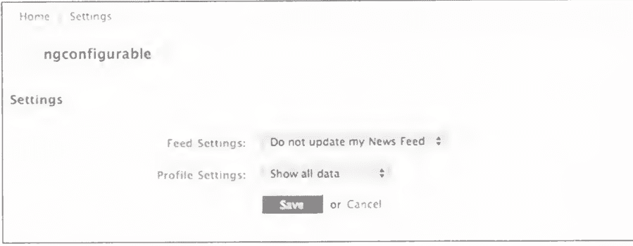

## 在社交世界中尊重用户隐私

Facebook 不遗余力地保护用户隐私。大量的选项和隐私设置允许用户自定义其信息的可见程度。通过 Facebook 平台，您获得了保护应用程序用户隐私所需的工具，并应继续这样做。有几个地方可能会泄露用户隐私。一处是 Canvas 页面上提供与多个用户相关的信息，这可能是某种搜索页面或目录。另一处是 Canvas 页面上提供仅限单个用户查看的信息，这包括在应用上下文中针对某个用户的某种个人资料。

杜绝隐私泄露的最简单方法之一是使用可用的 FBML 实体。`if-can-see` 和 `if-can-see-photo` FBML 实体应被广泛使用，因为它们在强制执行用户隐私设置和防止信息被未经授权查看方面表现出色。在大多数情况下，信息会被显示出来。然而，这将阻止用户查看可能已屏蔽他们的用户，这是最重要的场景之一。

```html
<fb:if-can-see uid="12345" what="profile">
    Check out how cool <fb:name uid="12345" /> is.
    <fb:else>Sorry, no dice.</fb:else>
</fb:if-can-see>
```

以下是一些应纳入一般质量保证检查的用例：

- 某个用户屏蔽了一个或多个用户，这些用户不应能看到与该用户相关的任何信息。
- 某个用户设置了隐私选项，使得只有其好友才能查看该用户的信息，包括用户名、网络和所在地。
- 某个用户将一张或多张照片和相册的隐私设置为仅限其好友查看该用户拥有的照片。

## 注意事项

在整个社区、开发者网站、维基、众多博客、论坛等处，有大量信息可用。时不时会有些重要信息从文档的缝隙中遗漏，而在论坛、博客文章或维基讨论页面上被发现，这些信息可能会影响您 Facebook 应用程序的开发。

### 回调 URL 不可重定向

在设置某个回调 URL 应用程序设置时，请确保提供的 URL 不会重定向到另一个 URL。Facebook 平台不会跟进或爬取 URL，这可能会导致您应用程序的开发和调试出现混乱。

### 12 秒规则

Facebook 平台在发出任何类型的请求时都设有 12 秒的超时限制。这包括用于渲染 Canvas 内容的请求、针对任何回调 URL 应用程序设置的请求、获取或缓存图片的请求，以及在刷新由`fb:ref` FBML 实体引用的缓存内容时。

### 回调 URL 不能使用 SSL 创建

您的回调 URL 必须以 HTTP 形式存在，而非 HTTPS。

# 第二部分：构建 Facebook 应用程序

## 设计模式

Facebook 拥有众多元素和组件，这些元素和组件在 Facebook 及 Facebook 平台中重复使用，以提供一致的外观和感觉。作为开发者，您可以利用这些元素来提供尽可能与 Facebook 集成的用户界面。

## 通用元素

Facebook 中的通用元素包括以下内容：

- **划分为小的可管理区块的内容条带** —— 例如，在主页右侧，有三到五个非常聚焦的区块，但它们位于同一个条带中。在用户个人资料中，狭窄的条带包含小的、管理过的区块。群组页面可能有许多与群组相关的子区块。
- **标签页** —— 在整个网站中，都使用标签页来分隔各个部分和内容。
- **仪表板** —— 网站的各个部分包含一个“仪表板”组件，它区分了独立但相关的内容，并提供了一个“添加”组件。这很容易代表增删改查操作。
- **水平缩略图列表** —— 有时这包含多行。
- **垂直线分隔列表** —— 例如，参见动态消息、留言板、墙等。这些列表从简单到复杂不等。
- **成功、错误和信息提示消息** —— 这些消息以标准的白色、浅黄色或浅红色方框显示在整个网站中。
- **严格样式的表单** —— 表单元素以严格的表格布局呈现，包含两列。左列标识字段名称，右列标识字段值。
- **分享按钮** —— Facebook 各处都使用分享按钮，以提供统一的视觉样式，表明某些内容可以被保存并分享给其他用户。
- **对话框窗口** —— Facebook 各处使用对话框窗口进行确认操作和用户输入。

## 样式和颜色

在整个 Facebook 中，使用了八到十二种常用颜色。

- `#0e1f5b`
- `#3b5998`（标题和链接）
- `#7f93bc`（Facebook 与链接之间的分隔线）
- `#95a5c6`
- `#bdc7d8`
- `#c3cddf`
- `#d8dfea`
- `#f7f7f7`
- `#c4b3c3`（图表）
- `#b3cbbc`
- `#67a54b`（特殊按钮、广告）

前七种颜色被认为是核心颜色，在整个 Facebook 中影响最大。最后几种颜色是近期新增的，可以在广告和公共主页部分看到。

## 画布导航

本节描述导航单元。

### 标签页

标签页用于以非常通用的方式描述布局。在您的应用程序中，它们通过`fb:tabs` FBML 实体构建。这提供了一个非常简单的右对齐或左对齐的标签行。Facebook 中有很多地方使用标签页作为导航单元，包括以下内容：

- 标签页为表示较大组或部分中的多个部分或位置提供了非常简单和基本的界面。
- 标签页操作可以右对齐或左对齐。
- 除了仪表板，标签页还可以用作子导航单元。
- 标签页不能被自定义或设置样式。

图 11-2 显示了一个标签页用法的示例。


### 仪表板

仪表板组件创建了一个非常简洁、样式化的组件，它保留了位置并强调用户输入和帮助部分。在您的应用程序中，仪表板通过`fb:dashboard` FBML 实体创建。以下是一些常见用途：

- 为 CRUD 界面提供非常简洁的显示。
- 自动显示使用它的应用程序的标题栏。
- 突出显示用于帮助或知识传递的部分。
- 突出显示带有样式化按钮的用户输入部分。
- 显示的标题无法更改。
- 样式和设计无法更改。
- 带有长标题的操作可能会破坏组件的简洁外观。

图 11-3 显示了一个仪表板用法的示例。


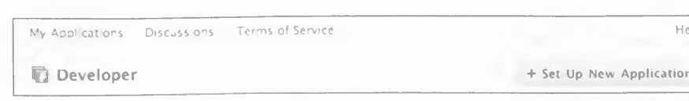

## 菜单和列表

菜单和列表用于以简洁的方式聚集导航链接。目前，没有提供方便地创建菜单或链接列表的 FBML 实体，如 Facebook 上所见。示例用途包括：

- Facebook 用户可以使用核心 Facebook 组件和在 Facebook 平台上开发的应用程序来自定义的侧边导航单元。
- “好友”菜单作为每个 Facebook 页面顶部水平链接列表的一部分。

图 11-4 显示了一个菜单示例。

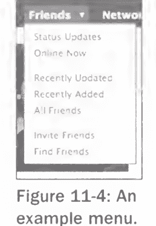

## 向导

Facebook 上有选择性地使用向导。当构建多步骤界面时，例如用户注册或创建广告系列或 Facebook 主页，它们就会出现。

## 展示广告

展示广告或付费链接是许多应用程序的重要组成部分。有些应用程序在突出显示广告、将其融入应用程序方面做得非常出色。

展示广告横幅的一种简单方便的方法是使用`fb:iframe` FBML 实体。考虑以下`fb:iframe` FBML 实体的示例实现：

```html
<hr />
<div style="padding: 5px;">
<center>
<fb:iframe src="http://my.app.domain/ads.html" style="width: 500px; height: 90px;"
frameborder="0" scrolling="0" />
</center>
</div>
```

`ads.html`的内容通过生成的 iFrame 包含在应用程序中，并且广告会适当地显示。

```html
<html>
<body>
<script type="text/javascript">
  var AdBrite_Title_Color = '0000FF';
  var AdBrite_Text_Color = '000000';
  var AdBrite_Background_Color = 'FFFFFF';
  var AdBrite_Border_Color = 'FFFFFF';
</script>
<span style="white-space:nowrap;">
  <script src="http://ads.adbrite.com/mb/text_group.php?sid=12345&zs=12345"
type="text/javascript"></script>
  <a target="_top"
href="http://www.adbrite.com/mb/commerce/purchase_form.php?opid=12345&afsid=1">
    
  </a>
</span>
</body>
</html>
```

目前，Facebook 尚未实现允许应用程序开发者从 Facebook 内部广告中获益的方式。

> 开发者应注意，Facebook 确实在应用程序画布之外的区域展示广告。

## 高效使用对话框

对话框是一种创建界面的简单方法，对应用程序在画布页面上的布局影响很小。在与您的应用程序交互时，对话框可用于确认操作或接受用户输入。

为了演示如何使用对话框，让我们看一下下面的对话框示例应用程序。使用它，您将创建两种类型的对话框。第一种提交表单并强制刷新页面。第二种使用 Facebook 提供的模拟 Ajax 代码来获取内容并显示它。

### 创建应用程序

这个应用程序与第 2 章中的 Hello World 项目非常相似。创建此应用程序遵循相同的步骤：

1. 在开发者应用程序上，创建一个新的应用程序并为其命名。对于此应用程序，它被命名为`ngDialogs`，画布页面指向`ngdialogs`。
2. 适当地设置回调 URL。此项目不需要设置添加后或移除后配置选项。
3. 侧边导航 URL 选项也可以设置为应用程序画布页面。在此示例中，它被设置为`http://apps.facebook.com/ngdialogs`。

### 构建应用程序

此应用程序由两个页面组成。第一个是`htdocs/index.php`，或默认的画布页面。索引页包含用于创建两个对话框的对话框 FBML，这两个对话框通过`onclick`事件激活。

```php
<?php

include_once '../lib/client/facebook.php';
include_once '../lib/AppConfig.class.php';

$facebook = new Facebook(AppConfig::$api_key, AppConfig::$secret);

$facebook->require_frame();

$user = $facebook->require_login();

$facebook->require_add();

?>
<fb:header>Dialog Example</fb:header>
<div style="padding: 10px;">
  <h2>Hello <fb:name firstnameonly="true" uid="<?= $user ?>" useyou="false"/>!</h2>
<?php if (isset($_POST['color'])) { ?>
<fb:success><fb:message>Your order for a <?= $_POST['color'] ?> cupcake has been made.</fb:message></fb:success>
<?php } ?>
  <p><a href="#" clicktoshowdialog="order_dialog">Order a cupcake</a>.</p>
  <p><a href="#" clicktoshowdialog="custom_order_dialog">Order a custom cupcake</a>.</p>
</div>

<fb:dialog id="custom_order_dialog" cancel_button="1">
  <fb:dialog-title>Order a custom cupcake.</fb:dialog-title>
  <fb:dialog-content>
    <p>What color would you like?</p>
    <form id="custom_order_form" method="POST">
      <input type="radio" name="color" value="white" /> White
      <input type="radio" name="color" value="red" /> Red
    </form>
  </fb:dialog-content>
  <fb:dialog-button type="submit" value="Order" form_id="custom_order_form" />
</fb:dialog>

<fb:dialog id="order_dialog">
  <fb:dialog-title>Order a cupcake</fb:dialog-title>
  <fb:dialog-content><form id="order_form">Confirm to place your order.</form></fb:dialog-content>
  <fb:dialog-button type="submit" value="Order" clickrewriteurl="http://blog.socklabs.com/fbapps/ngdialogs/htdocs/response.php" clickrewriteid="order_dialog" clickrewriteform="order_form" />
</fb:dialog>
```

## 第 11 章：最佳实践

第一块 PHP 代码创建一个 Facebook 对象并验证请求。在 FBML 的主体中，你有两个链接，它们显示你通过`fb:dialog` FBML 实体定义的对话框。请注意两个链接上的`clicktoshowdialog`属性。这些属性的值与后面定义的对话框的唯一 ID 相匹配。图 11-5 展示了第一个对话框，图 11-6 展示了第一个对话框的响应。

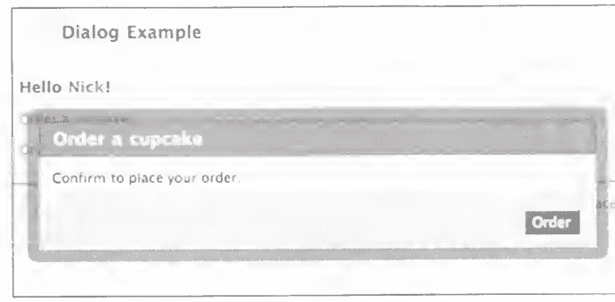

图 11-5：第一个对话框。

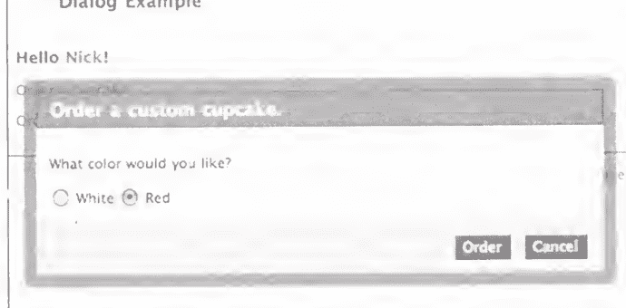

图 11-6：第一个对话框的响应。

由`custom_order_dialog`标识的第一个对话框包含一个供用户输入的表单，并提交该表单。它不包含任何花哨的模拟 Ajax 调用，实现方式相当直接。

定义的第二个对话框用作确认对话框，不包含任何可见的表单元素。该对话框使用`clickrewriteurl`、`clickrewriteid`和`clickrewriteform`模拟 Ajax 属性来提交表单，并用响应重写对话框的内容。

`htdocs/response.php`文件包含第二个对话框显示的响应。

```html
<fb:dialogresponse>
  <fb:dialog-title>Order Complete</fb:dialog-title>
  <fb:dialog-content>Your order has been made. Thank you.</fb:dialog-content>
  <fb:dialog-button type="button" value="Close" close_dialog="1" />
</fb:dialogresponse>
```

图 11-7 展示了此对话框。

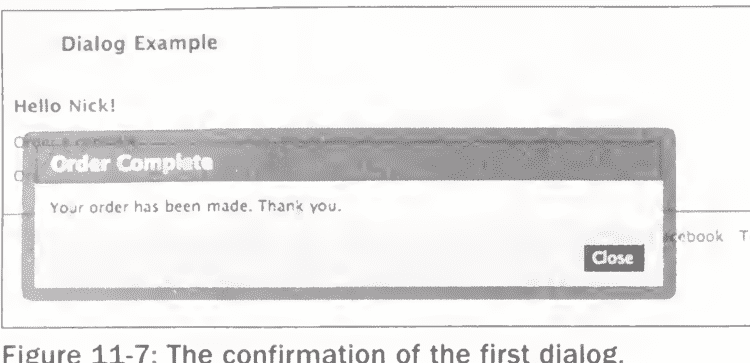

响应包含`fb:dialogresponse` FBML 实体和几个子实体，它们定义了显示的内容以及如何与父对话框交互。

> 定义对话框并不会显示它们。显示对话框必须由事件触发。

## 小结

并非所有问题都能在书中涵盖，但这一讨论确实涵盖了一些基础知识。本章逐步介绍了开发人员在开发应用程序和功能时的一些常见目标。

# 附录 A：PHP 文件参考

本附录提供以下内容的代码列表：

- `facebook.php` PHP 文件（清单 A-1）
- `facebook_desktop.php` PHP 文件（清单 A-2）
- `facebookapi_php5_restlib.php` PHP 文件（清单 A-3）

### 清单 A-1：`facebook.php` PHP 文件


```php
<?php
//
// +-----------------------------------------------------------------------+
// | Facebook Platform PHP5 client                                         |
// +-----------------------------------------------------------------------+
// | Copyright (c) 2007 Facebook, Inc.                                     |
// | All rights reserved.                                                   |
// |                                                                       |
// | Redistribution and use in source and binary forms, with or without     |
// | modification, are permitted provided that the following conditions     |
// | are met:                                                               |
// |                                                                       |
// | 1. Redistributions of source code must retain the above copyright     |
// |    notice, this list of conditions and the following disclaimer.        |
// | 2. Redistributions in binary form must reproduce the above copyright
// |    notice, this list of conditions and the following disclaimer in the
// |    documentation and/or other materials provided with the distribution.
// |
// | THIS SOFTWARE IS PROVIDED BY THE AUTHOR ``AS IS'' AND ANY EXPRESS OR
// | IMPLIED WARRANTIES, INCLUDING, BUT NOT LIMITED TO, THE IMPLIED WARRANTIES
// | OF MERCHANTABILITY AND FITNESS FOR A PARTICULAR PURPOSE ARE DISCLAIMED.
// | IN NO EVENT SHALL THE AUTHOR BE LIABLE FOR ANY DIRECT, INDIRECT,
// | INCIDENTAL, SPECIAL, EXEMPLARY, OR CONSEQUENTIAL DAMAGES (INCLUDING, BUT
// | NOT LIMITED TO, PROCUREMENT OF SUBSTITUTE GOODS OR SERVICES; LOSS OF USE,
// | DATA, OR PROFITS; OR BUSINESS INTERRUPTION) HOWEVER CAUSED AND ON ANY
// | THEORY OF LIABILITY, WHETHER IN CONTRACT, STRICT LIABILITY, OR TORT
// | (INCLUDING NEGLIGENCE OR OTHERWISE) ARISING IN ANY WAY OUT OF THE USE OF
// | THIS SOFTWARE, EVEN IF ADVISED OF THE POSSIBILITY OF SUCH DAMAGE.
// +------------------------------------------------------------------------------+
// | For help with this library, contact developers-help@facebook.com
// +------------------------------------------------------------------------------+
//

include_once 'facebookapi_php5_restlib.php';

class Facebook {
  public $api_client;

  public $api_key;
  public $secret;

  public $fb_params;
  public $user;

  public function __construct($api_key, $secret) {
    $this->api_key    = $api_key;
    $this->secret     = $secret;

    $this->api_client = new FacebookRestClient($api_key, $secret);

    $this->validate_fb_params();
    if (isset($this->fb_params['friends'])) {
      $this->api_client->friends_list = explode(',', $this->fb_params['friends']);
    }
    if (isset($this->fb_params['added'])) {
      $this->api_client->added = $this->fb_params['added'];
    }
  }

  public function validate_fb_params() {
    $this->fb_params = $this->get_valid_fb_params($_POST, 48*3600, 'fb_sig');
    if (!$this->fb_params) {
      $this->fb_params = $this->get_valid_fb_params($_GET, 48*3600, 'fb_sig');
    }
    if ($this->fb_params) {
      // If we got any fb_params passed in at all, then either:
      //  - they included an fb_user / fb_session_key, which we should assume to be correct
      //  - they didn't include an fb_user / fb_session_key, which means the user doesn't have a
      // valid session and if we want to get one we'll need to use require_login(). (Calling
      //    set_user with null values for user/session_key will work properly.)
      // Note that we should *not* use our cookies in this scenario, since they may be referring to
      //    the wrong user.
      $user       = isset($this->fb_params['user'])     ? $this->fb_params['user'] : null;
      $session_key = isset($this->fb_params['session_key']) ? $this->fb_params['session_key'] : null;
      $expires    = isset($this->fb_params['expires'])    ? $this->fb_params['expires'] : null;
      $this->set_user($user, $session_key, $expires);
    } else if (!empty($_COOKIE) && $cookies = $this->get_valid_fb_params($_COOKIE, null, $this->api_key)) {
      // use $api_key . '_' as a prefix for the cookies in case there are
      // multiple facebook clients on the same domain.
      $this->set_user($cookies['user'], $cookies['session_key']);
    } else if (isset($_GET['auth_token']) && $session = $this->do_get_session($_GET['auth_token'])) {
      $this->set_user($session['uid'], $session['session_key'],
$session['expires']);
    }

    return !empty($this->fb_params);
  }

  public function do_get_session($auth_token) {
    try {
      return $this->api_client->auth_getSession($auth_token);
    } catch (FacebookRestClientException $e) {
      // API_EC_PARAM means we don't have a logged in user, otherwise who
      // knows what it means, so just throw it.
      if ($e->getCode() != FacebookAPIErrorCodes::API_EC_PARAM) {
        throw $e;
      }
    }
  }

  public function redirect($url) {
    if ($this->in_fb_canvas()) {
      echo '<fb:redirect url="' . $url . '"/>';
    } else if (preg_match('/^https?:\/\/([^\/]*\.)?facebook\.com(:\d+)?/i', $url)) {
      // make sure facebook.com url's load in the full frame so that we don't
      // get a frame within a frame.
      echo "<script type=\"text/javascript\">\ntop.location.href = \"$url\";\n</script>";
    } else {
      header('Location: ' . $url);
    }
    exit;
  }

  public function in_frame() {
    return isset($this->fb_params['in_canvas']) || isset($this->fb_params['in_iframe']);
  }

  public function in_fb_canvas() {
    return isset($this->fb_params['in_canvas']);
  }

  public function get_loggedin_user() {
    return $this->user;
  }

  public static function current_url() {
    return 'http://' . $_SERVER['HTTP_HOST'] . $_SERVER['REQUEST_URI'];
  }

  public function require_login() {
    if ($user = $this->get_loggedin_user()) {
      return $user;
    }
    $this->redirect($this->get_login_url(self::current_url(), $this->in_frame()));
  }

  public function require_install() {
    // this was renamed, keeping for compatibility's sake
    return $this->require_add();
  }

  public function require_add() {
    if ($user = $this->get_loggedin_user()) {
      if ($this->fb_params['added']) {
        return $user;
      }
    }
    $this->redirect($this->get_add_url(self::current_url()));
  }

  public function require_frame() {
    if (!$this->in_frame()) {
      $this->redirect($this->get_login_url(self::current_url(), true));
    }
  }

  public static function get_facebook_url($subdomain='www') {
    return 'http://' . $subdomain . '.facebook.com';
  }

  public function get_install_url($next=null) {
```


```php
// 该方法已重命名，保留以兼容旧版本
return $this->get_add_url($next);
}

public function get_add_url($next=null) {
  return self::get_facebook_url().'/add.php?api_key='.$this->api_key .
    ($next ? '&next=' . urlencode($next) : '');
}

public function get_login_url($next, $canvas) {
  return self::get_facebook_url().'/login.php?v=1.0&api_key=' . $this->api_key .
    ($next ? '&next=' . urlencode($next)  : '') .
    ($canvas ? '&canvas' : '');
}

public static function generate_sig($params_array, $secret) {
  $str = '';

  ksort($params_array);
  // 注意：确保签名参数尚未包含在
  //       $params_array 中。
  foreach ($params_array as $k=>$v) {
    $str .= "$k=$v";
  }
  $str .= $secret;

  return md5($str);
}

public function set_user($user, $session_key, $expires=null) {
  if (!$this->in_fb_canvas() && (!isset($_COOKIE[$this->api_key . '_user'])
                                 || $_COOKIE[$this->api_key . '_user'] != $user))
  {
    $cookies = array();
    $cookies['user'] = $user;
    $cookies['session_key'] = $session_key;
    $sig = self::generate_sig($cookies, $this->secret);
    foreach ($cookies as $name => $val) {
      setcookie($this->api_key . '_' . $name, $val, (int)$expires);
      $_COOKIE[$this->api_key . '_' . $name] = $val;
    }
    setcookie($this->api_key, $sig, (int)$expires);
    $_COOKIE[$this->api_key] = $sig;
  }
  $this->user = $user;
  $this->api_client->session_key = $session_key;
}
```

```php
/**
 * 尽可能消除 magic quotes 带来的不良影响
 * @param    string   $val   应直接来自 $_GET、$_POST 等
 * @return   string   去除添加的反斜杠后的 val
 */
```

# 附录 A：PHP 文件参考

### 清单 A-1（续）

```php
public static function no_magic_quotes($val) {
  if (get_magic_quotes_gpc()) {
    return stripslashes($val);
  } else {
    return $val;
  }
}

public function get_valid_fb_params($params, $timeout=null, $namespace='fb_sig')
{
  $prefix = $namespace . '_';
  $prefix_len = strlen($prefix);
  $fb_params = array();
  foreach ($params as $name => $val) {
    if (strpos($name, $prefix) === 0) {
      $fb_params[substr($name, $prefix_len)] = self::no_magic_quotes($val);
    }
  }
  if ($timeout && (!isset($fb_params['time']) || time() - $fb_params['time'] > $timeout)) {
    return array();
  }
  if (!isset($params[$namespace]) || !$this->verify_signature($fb_params, $params[$namespace])) {
    return array();
  }
  return $fb_params;
}

public function verify_signature($fb_params, $expected_sig) {
  return self::generate_sig($fb_params, $this->secret) == $expected_sig;
}

?>
```

### 清单 A-2：facebook_desktop.php PHP 文件

```php
<?php
//
// +----------------------------------------------------------------------------+
// | Facebook 平台 PHP5 客户端                                                   |
// +----------------------------------------------------------------------------+
// | 版权所有 (c) 2007 Facebook, Inc.                                            |
// | 保留所有权利。                                                                |
// |                                                                              |
// | 源代码及二进制形式的再分发和使用，无论是否修改，均须满足以下条件：                  |
// |                                                                              |
// | 1. 源代码的再分发必须保留上述版权声明、本条件列表及以下免责声明。                  |
// |                                                                              |
```

```
// | 2. 二进制形式的再分发必须在随分发提供的文档和/或其他材料中复制上述版权声明、本条件列表及以下免责声明。
// |
// | 本软件由作者按"原样"提供，不作任何明示或暗示的担保，包括但不限于对适销性和特定用途适用性的暗示担保。
// | 在任何情况下，作者均不对任何直接、间接、偶然、特殊、惩戒性或后果性损害（包括但不限于替代商品或服务的采购、使用损失、数据或利润损失；或业务中断）承担责任，
// | 无论该损害是如何引起的，也无论责任理论是合同、严格责任还是侵权行为（包括过失或其他），即使已被告知该等损害的可能性。
// +-------------------------------------------------------------------+
// | 如需本库的帮助，请联系 developers-help@facebook.com             |
// +-------------------------------------------------------------------+
```

```php
/**
 * 该类扩展并修改了 "Facebook" 类，以更好地
 * 适应桌面应用程序。
 */
class FacebookDesktop extends Facebook {
  // 应用程序密钥，与会话密钥不同
  public $app_secret;
  public $verify_sig;

  public function __construct($api_key, $secret) {
    $this->app_secret = $secret;
    $this->verify_sig = false;
    parent::__construct($api_key, $secret);
  }

  public function do_get_session($auth_token) {
    $this->api_client->secret = $this->app_secret;
    $session_info = parent::do_get_session($auth_token);
    if (isset($session_info['secret']) && $session_info['secret']) {
      // 存储会话密钥
      $this->set_session_secret($session_info['secret']);
    }
    return $session_info;
  }

  public function set_session_secret($session_secret) {
    $this->secret = $session_secret;
    $this->api_client->secret = $session_secret;
  }

  public function require_login() {
    if ($this->get_loggedin_user()) {
      try {
        // 尝试基于会话的 API 调用，确保我们拥有正确的
        // 会话密钥
```

### 清单 A-2（续）

```php
$user = $this->api_client->users_getLoggedInUser();

// 现在我们有了有效的会话密钥，验证签名
$this->verify_sig = true;
if ($this->validate_fb_params()) {
    return $user;
} else {
    // 验证失败
    return null;
}
} catch (FacebookRestClientException $ex) {
    if (isset($_GET['auth_token'])) {
        // 如果我们有 auth_token，则用它建立会话
        $session_info = $this->do_get_session($_GET['auth_token']);
        if ($session_info) {
            return $session_info['uid'];
        }
    }
}
}
// 如果执行到这里，我们需要将用户重定向到登录页面
$this->redirect($this->get_login_url(self::current_url(), $this->in_fb_canvas()));
}

public function verify_signature($fb_params, $expected_sig) {
    // 在获得有效的会话密钥之前，我们不希望验证签名
    if ($this->verify_sig) {
        return parent::verify_signature($fb_params, $expected_sig);
    } else {
        return true;
    }
}
}
```

### 清单 A-3：facebookapi_php5_restlib.php PHP 文件

```php
<?php
//
// +--------------------------------------------------------------------+
// | Facebook 平台 PHP5 客户端                                           |
// +--------------------------------------------------------------------+
// | 版权所有 (c) 2007 Facebook, Inc.                                    |
// | 保留所有权利。                                                       |
// |                                                                      |
// | 源代码及二进制形式的再分发和使用，无论是否修改，均须满足以下条件：     |
// |                                                                      |
// | 1. 源代码的再分发必须保留上述版权声明、本条件列表及以下免责声明。     |
// |    notice, this list of conditions and the following disclaimer.    |
```

```
// | 2. 以二进制形式发布时，必须在分发提供的文档和/或其他材料中
// |    复制上述版权声明、本条件列表及后续免责声明。
// |.
// | 本软件由作者“按原样”提供，不提供任何明示或
// | 暗示的担保，包括但不限于对适销性和特定用途适用性的
// | 暗示担保。在任何情况下，作者均不对任何直接、间接、
// | 偶然、特殊、惩戒性或后果性损害（包括但不限于替代
// | 商品或服务的采购；使用、数据或利润的损失；或业务中断）
// | 承担责任，无论该等损害以何种方式引起，以及基于何种
// | 责任理论，无论是合同责任、严格责任还是侵权责任（包括
// | 过失或其他），即使已被告知可能发生该等损害。
// +--------------------------------------------------------------------------+
// | 如需此库的帮助，请联系 developers-help@facebook.com                     |
// +--------------------------------------------------------------------------+
//
```

```php
class FacebookRestClient {
  public $secret;
  public $session_key;
  public $api_key;
  public $friends_list; // 为了避免调用 friends.get API，在画布页面中预先填充此值
  public $added;        // 为了避免调用 users.isAppAdded API，在画布页面中预先填充此值
  public $batch_mode;
  private $batch_queue;
```

```php
  const BATCH_MODE_DEFAULT = 0;
  const BATCH_MODE_SERVER_PARALLEL = 0;
  const BATCH_MODE_SERIAL_ONLY = 2;
```

```php
  /**
   * 创建客户端。
   * @param string $session_key 如果你尚未获取会话密钥，请将此参数
   *                            保留为 null，随后通过直接访问
   *                            $session_key 成员变量来进行设置。
   */
```

```php
  public function __construct($api_key, $secret, $session_key=null) {
    $this->secret       = $secret;
    $this->session_key  = $session_key;
    $this->api_key      = $api_key;
    $this->batch_mode = FacebookRestClient::BATCH_MODE_DEFAULT;
    $this->last_call_id = 0;
    $this->server_addr  = Facebook::get_facebook_url('api') . '/restserver.php';
    if ($GLOBALS['facebook_config']['debug']) {
      $this->cur_id = 0;
    ?>
```


```javascript
<script type="text/javascript">
var types = ['params', 'xml', 'php', 'sxml'];
function getStyle(elem, style) {
```

清单 A-3（续）

```javascript
if (elem.getStyle) {
    return elem.getStyle(style);
} else {
    return elem.style[style];
}
}
function setStyle(elem, style, value) {
    if (elem.setStyle) {
        elem.setStyle(style, value);
    } else {
        elem.style[style] = value;
    }
}
function toggleDisplay(id, type) {
    for (var i = 0; i < types.length; i++) {
        var t = types[i];
        var pre = document.getElementById(t + id);
        if (pre) {
            if (t != type || getStyle(pre, 'display') == 'block') {
                setStyle(pre, 'display', 'none');
            } else {
                setStyle(pre, 'display', 'block');
            }
        }
    }
    return false;
}
</script>
<?php
}
}


/**
 * 开始批量操作。
 */
public function begin_batch() {
    if($this->batch_queue !== null)
    {
        throw new FacebookRestClientException(FacebookAPIErrorCodes::API_EC_BATCH_ALREADY_STARTED,
            FacebookAPIErrorCodes::$api_error_descriptions[FacebookAPIErrorCodes::API_EC_BATCH_ALREADY_STARTED]);
    }

    $this->batch_queue = array();
}

/*
 * 结束当前批量操作
 */
```

```php
public function end_batch() {
    if($this->batch_queue === null) {
        throw new FacebookRestClientException(FacebookAPIErrorCodes::API_EC_BATCH_NOT_STARTED,
            FacebookAPIErrorCodes::$api_error_descriptions[FacebookAPIErrorCodes::API_EC_BATCH_NOT_STARTED]);
    }

    $this->execute_server_side_batch();

    $this->batch_queue = null;
}

private function execute_server_side_batch() {

    $item_count = count($this->batch_queue);
    $method_feed = array();
    foreach($this->batch_queue as $batch_item) {
        $method_feed[] = $this->create_post_string($batch_item['m'], $batch_item['p']);
    }

    $method_feed_json = json_encode($method_feed);

    $serial_only = $this->batch_mode == FacebookRestClient::BATCH_MODE_SERIAL_ONLY ;
    $params = array('method_feed' => $method_feed_json, 'serial_only' => $serial_only);

    $xml = $this->post_request('batch.run', $params);

    $result = $this->convert_xml_to_result($xml, 'batch.run', $params);

    if (is_array($result) && isset($result['error_code'])) {
        throw new FacebookRestClientException($result['error_msg'], $result['error_code']);
    }

    for($i = 0; $i < $item_count; $i++) {
        $batch_item = $this->batch_queue[$i];
        $batch_item_result_xml = $result[$i];
        $batch_item_result = $this->convert_xml_to_result($batch_item_result_xml,
            $batch_item['m'], $batch_item['p']);

        if (is_array($batch_item_result) && isset($batch_item_result['error_code'])) {
            throw new FacebookRestClientException($batch_item_result['error_msg'],
                $batch_item_result['error_code']);
        }
    }
}
```

## 清单 A-3（续）

```php
$batch_item['r'] = $batch_item_result;
    }
  }

  /**
```

```php
/**
   * 返回当前用户登录后的会话信息。
   * @param string $auth_token 由 auth_createToken 返回的令牌，或
   *   传递回你的 callback_url 的令牌。
   * @return 包含 session_key 和 uid 的关联数组
   */
```

```php
public function auth_getSession($auth_token) {
    // 检查是否处于批量模式
    if($this->batch_queue === null) {
      $result = $this->call_method('facebook.auth.getSession', array('auth_token'=>$auth_token));
      $thisIMITIVE->session_key = $result['session_key'];
      if (isset($result['secret']) && $result['secret']) {
        // 桌面应用程序有一个特殊的密钥
        $this->secret = $result['secret'];
      }
      return $result;
    } else {

    }
  }
```

```php
/**
```

```php
/**
   * 返回根据指定筛选条件的事件。
   * @param int $uid 可选：与事件关联的用户。
   *   null 参数将默认使用当前会话用户。
   * @param array $eids 可选：按这些事件 ID 进行筛选。
   *   null 参数将获取该用户的所有事件。
   * @param int $start_time 可选：以此 UTC 时间作为下界进行筛选。
   *   null 或零参数表示没有下界。
   * @param int $end_time 可选：以此 UTC 时间作为上界进行筛选。
   *   null 或零参数表示没有上界。
   * @param string $rsvp_status 可选：仅显示给定 uid 具有
   *   此 RSVP 状态的事件。仅在你已为 $uid 指定值时有效。
   *   值与 events.getMembers 中的相同。Null 表示在筛选时
   *   忽略 RSVP 状态。
   * @return 事件数组
   */
```

```php
public function &events_get($uid, $eids, $start_time, $end_time, $rsvp_status) {
    return $this->call_method('facebook.events.get',
      array(
      'uid' => $uid,
      'eids' => $eids,
      'start_time' => $start_time,
      'end_time' => $end_time,
      'rsvp_status' => $rsvp_status));
  }
```

```php
/**
```

```php
/*
 * 返回与事件关联的成员列表数据
 * @param int $eid : 事件 ID
 * @return 包含四个成员列表的关联数组，键名为 'attending'、
 *   'unsure'、'declined' 和 'not_replied'
 */
public function &events_getMembers($eid) {
    return $this->call_method('facebook.events.getMembers',
                              array('eid' => $eid));
}

/**
 * 执行 FQL 查询。这是访问 API 中所有数据的通用方式，
 * 可作为大多数其他方法调用的替代方案。更多详情请访问
 * http://developers.facebook.com/documentation.php?v=1.0&doc=fql
 * @param string $query 要评估的查询
 * @return 代表结果的通用数组
 */
publicлож_query($query) {
    return $this->call_method('facebook.fql.query',
                              array('query' => $query));
}

public function &feed_publishStoryToUser($title, $body,
                                         $image_1=null, $image_1_link=null,
                                         $image_2=null, $image_2_link=null,
                                         $image_3=null, $image_3_link=null,
                                         $image_4=null, $image_4_link=null) {
    return $this->call_method('facebook.feed.publishStoryToUser',
                              array('title' => $title,
                                    'body' => $body,
                                    'image_1' => $image_1,
                                    'image_1_link' => $image_1_link,
                                    'image_2' => $image_2,
                                    'image_2_link' => $image_2_link,
                                    'image_3' => $image_3,
                                    'image_3_link' => $image_3_link,
                                    'image_4' => $image_4,
                                    'image_4_link' => $image_4_link));
}

public function &feed_publishActionOfUser($title, $body,
                                          $image_1=null, $image_1_link=null,
                                          $image_2=null, $image_2_link=null,
                                          $image_3=null, $image_3_link=null,
                                          $image_4=null, $image_4_link=null) {
    return $this->call_method('facebook.feed.publishActionOfUser',
                              array('title' => $title,
                                    'body' => $body,
                                    'image_1' => $image_1,
                                    'image_1_link' => $image_1_link,
                                    'image_2' => $image_2,
                                    'image_2_link' => $image_2_link,
                                    'image_3' => $image_3,
                                    'image_3_link' => $image_3_link,
                                    'image_4' => $image_4,
                                    'image_4_link' => $image_4_link));
}
```

（续）

## 附录 A：PHP 文件参考

## 清单 A-3（续）


```php
      'image_3_link' => $image_3_link,
      'image_4' => $image_4,
      'image_4_link' => $image_4_link));
}

  public function &feed_publishTemplatizedAction($title_template, $title_data,
                                                      $body_template, $body_data, $body_general,
                                                       $image_1=null, $image_1_link=null,
                                                       $image_2=null, $image_2_link=null,
                                                       $image_3=null, $image_3_link=null,
                                                       $image_4=null, $image_4_link=null,
                                                       $target_ids='', $page_actor_id=null) {
    return $this->call_method('facebook.feed.publishTemplatizedAction',
      array('title_template' => $title_template,
            'title_data' => $title_data,
            'body_template' => $body_template,
            'body_data' => $body_data,
            'body_general' => $body_general,
            'image_1' => $image_1,
            'image_1_link' => $image_1_link,
            'image_2' => $image_2,
            'image_2_link' => $image_2_link,
            'image_3' => $image_3,
            'image_3_link' => $image_3_link,
illic' => $image_4,
            'image_4_link' => $image_4_link,
            'target_ids' => $target_ids,
            'page_actor_id' => $page_actor_id));
  }

  /**
   * 判断配对的用户是否为好友。
   * 注意 Facebook 的好友关系是对称的。
   * @param array $uids1: 一组 id 组成的数组 (id_1, id_2,...)，长度为 X
   * @param array $uids2: 一组 id 组成的数组 (id_A, id_B,...)，长度同样为 X
   * @return 带有布尔值的 uid 配对数组，若配对为好友则为 true，例如
   *   array( 0 => array('uid1' => id_1, 'uid2' => id_A, 'are_friends' => 1),
   *          1 => array('uid1' => id_2, 'uid2' => id_B, 'are_friends' => 0)
   *          ...)
   */
  public function &friends_areFriends($uids1, $uids2) {
    return $this->call_method('facebook.friends.areFriends',
      array('uids1'=>$uids1, 'uids2'=>$uids2));
  }

  /**
   * 返回当前会话用户的好友。
   * @return 好友数组
   */
```

```php
public function &friends_get() {
    if (isset($this->friends_list)) {
        return $this->friends_list;
    }
    return $this->call_method('facebook.friends.get', array());
}
```

```php
/**
 * 返回会话用户的好友中，同时也是调用该应用的用户。
 * @return 好友数组
 */
public function &friends_getAppUsers() {
    return $this->call_method('facebook.friends.getAppUsers', array());
}
```

```php
/**
 * 根据指定的过滤条件返回群组。
 * @param int $uid 可选：与群组关联的用户。
 *   传入 null 则默认为当前会话用户。
 * @param array $gids 可选：要查询的群组 id。
 *   传入 null 则获取该用户的所有群组。
 * @return 群组数组
 */
public function &groups_get($uid, $gids) {
    return $this->call_method('facebook.groups.get',
        array(
            'uid' => $uid,
            'gids' => $gids));
}
```

```php
/**
 * 返回群组的成员列表
 * @param int $gid : 群组 id
 * @return 包含四个成员列表的关联数组，键分别为
 *   'members'、'admins'、'officers' 和 'not_replied'
 */
public function &groups_getMembers($gid) {
    return $this->call_method('facebook.groups.getMembers',
        array('gid' => $gid));
}
```

```php
/**
 * 根据指定的过滤条件返回 Cookie。
 * @param int $uid 必需：需要获取其 Cookie 的用户。
 * @param string $name 可选：
 *   传入 null 则获取该用户的所有 Cookie。
 * @return Cookie 数组
 */
public function data_getCookies($uid, $name) {
    return $this->call_method('facebook.data.getCookies',
        array(
            'uid' => $uid,
            'name' => $name));
}
```

```php
      'name' => $name));
}

/**
 * 根据指定的参数设置 Cookie。
 * @param int $uid 必需：需要设置其 Cookie 的用户。
 * @param string $name 必需：Cookie 名称
 * @param string $value 如果在过去指定了 expires，则为可选
 * @param int $expires 可选
 * @param string $path 可选
 *
 * @return bool
 */
public function data_setCookie($uid, $name, $value, $expires, $path) {
  return $this->call_method('facebook.data.setCookie',
      array(
      'uid' => $uid,
      'name' => $name,
      'value' => $value,
      'expires' => $expires,
      'path' => $path));
}

/**
 * 返回会话用户的未读通知。
 * @return 关联数组，包含
 *  'messages'、'pokes' 和 'shares' 的通知计数对象，
 *  'friend_requests' 的 uid 列表，'group_invites' 的 gid 列表，
 *  以及 'event_invites' 的 eid 列表
 */
public function &notifications_get() {
  return $this->call_method('facebook.notifications.get', array());
}

/**
 * 向指定的用户发送通知。
 * @return （无返回值）
 */
public function &notifications_send($to_ids, $notification) {
  return $this->call_method('facebook.notifications.send',
                           array('to_ids' => $to_ids, 'notification' => $notification));
}

/**
 * 向应用的指定用户发送电子邮件。
 * @param array $recipients : 收件人的 id
 * @param string $subject : 邮件主题
 * @param string $text : 邮件正文（纯文本）
 * @param string $fbml : 如果需要 HTML 版本的邮件，则为 FBML 标记
 * @return 成功送达的收件人列表，以逗号分隔
```

```php
 */
public function &notifications_sendEmail($recipients, $subject, $text, $fbml) {
    return $this->call_method('facebook.notifications.sendEmail',
                               array('recipients' => $recipients,
                                     'subject' => $subject,
                                     'text' => $text,
                                     'fbml' => $fbml));
}
```

```php
/**
 * 返回请求的一组页面的指定信息字段
 * @param array $page_ids 页面 id 数组
 * @param array $fields 描述所需信息字段的字符串数组
 * @param int $uid 可选，仅返回该用户关注（成为粉丝）的页面结果。
 * @param string type 将结果限制为特定类型的页面。
 * @return 页面数组
 */
public function &pages_getInfo($page_ids, $fields, $uid, $type) {
    return $this->call_method('facebook.pages.getInfo', array('page_ids' => $page_ids, 'fields' => $fields, 'uid' => $uid, 'type' => $type));
}
```

```php
/**
 * 如果当前登录用户是指定页面的管理员，则返回 true
 * @param int $page_id 目标页面 id
 * @return boolean
 */
public function &pages_isAdmin($page_id) {
    return $this->call_method('facebook.pages.isAdmin', array('page_id' => $page_id));
}
```

```php
/**
 * 返回当前会话对象对应的页面是否已安装该应用
 * @return boolean
 */
public function &pages_isAppAdded() {
    if (isset($this->added)) {
        return $this->added;
    }
    return $this->call_method('facebook.pages.isAppAdded', array());
}
```

```php
/**
 * 如果当前登录用户是指定页面的粉丝，则返回 true
 * @param int $page_id 目标页面 id
 * @param int $uid 要比较的用户。如果为空，则为当前登录用户。
 * @return bool
 */
public function &pages_isFan($page_id, $uid) {
```

```php
return $this->call_method('facebook.pages.isFan', array('page_id' => $page_id,
'uid' => $uid));
}
```

```php
/**
 * 根据指定的过滤条件返回照片。
 * @param int $subj_id 可选：按照片中标记的用户 uid 过滤。
 * @param int $aid 可选：按相册过滤，如 photos_getAlbums 所返回。
 * @param array $pids 可选：限制为指定的 pid 列表
 * 注意至少必须指定这些参数中的一个，否则会返回错误。
 * @return 照片对象数组。
 */
```

```php
public function &photos_get($subj_id, $aid, $pids) {
  return $this->call_method('facebook.photos.get',
    array('subj_id' => $subj_id, 'aid' => $aid, 'pids' => $pids));
}
```

```php
/**
 * 返回指定用户创建的相册。
 *
 * @param int $uid 可选：你要获取其相册的用户 uid。
 *   传入 null 则返回当前会话用户的相册。
 * @param array $aids 可选：限制查询的 aid 列表。
 * 注意 (uid, aids) 参数中至少必须指定一个。
 * @returns 相册对象数组。
 */
```

```php
public function &photos_getAlbums($uid, $aids) {
  return $this->call_method('facebook.photos.getAlbums',
    array('uid' => $uid,
          'aids' => $aids));
}
```

```php
/**
 * 返回指定所有照片的标签。
 * @param string $pids : 要查询的 pid 列表
 * @return 照片标签对象数组，包含 pid、被标记主体 uid，
 *  以及表示标签像素位置的两个浮点数 (xcoord, ycoord)
 */
```

```php
public function &photos_getTags($pids) {
  return $this->call_method('facebook.photos.getTags',
    array('pids' => $pids));
}
```

```php
/**
 * 返回请求的一组用户的指定信息字段
 * @param array $uids 用户 id 数组
 * @param array $fields 描述所需信息字段的字符串数组
 * @return 用户数组
 */
```

```php
public function &users_getInfo($uids, $fields) {
```

# 附录 A：PHP 文件参考


```php
return $this->call_method('facebook.users.getInfo', array('uids' => $uids, 'fields' => $fields));
}

/**
 * 返回与当前会话对象对应的用户。
 * @return integer uid
 */
public function &users_getLoggedInUser() {
    return $this->call_method('facebook.users.getLoggedInUser', array());
}

/**
 * 返回与当前会话对象对应的用户
 * 是否已安装该应用
 * @return boolean
 */
public function &users_isAppAdded() {
    if (isset($this->added)) {
        return $this->added;
    }
    return $this->call_method('facebook.users.isAppAdded', array());
}

/**
 * 设置附加到此会话的用户的个人资料的 FBML
 * @param string $markup 描述此应用在用户个人资料中
 *                      展示方式的 FBML
 * @param int    $uid 用户
 * @param string $profile 个人资料 FBML
 * @param string $profile_action 个人资料操作 FBML
 * @param string $mobile_profile 移动个人资料 FBML
 * @return array 描述提交的 FBML 存在任何编译错误的
 *               字符串列表
 */
function profile_setFBML($markup, $uid = null, $profile='', $profile_action='', $mobile_profile='') {
    return $this->call_method('facebook.profile.setFBML',
                              array('markup' => $markup,
                                    'uid' => $uid,
                                    'profile' => $profile,
                                    'profile_action' => $profile_action,
                                    'mobile_profile' => $mobile_profile));
}

public function &profile_getFBML($uid) {
    return $this->call_method('facebook.profile.getFBML', array('uid' => $uid));
}

public function &fbml_refreshImgSrc($url) {
    return $this->call_method('facebook.fbml.refreshImgSrc', array('url' => $url));
}

public function &fbml_refreshRefUrl($url) {
    return $this->call_method('facebook.fbml.refreshRefUrl', array('url' => $url));
}

public function &fbml_setRefHandle($handle, $fbml) {
    return $this->call_method('facebook.fbml.setRefHandle', array('handle' =>
$handle, 'fbml' => $fbml));
}

/**
 * 获取所有市场分类
 *
 * @return array 分类名称列表
 */
function marketplace_getCategories() {
    return $this->call_method('facebook.marketplace.getCategories', array());
}

/**
 * 获取特定分类下的所有市场子分类
 *
 * @param category 我们要获取其子分类的分类
 * @return array 子分类名称列表
 */
function marketplace_getSubCategories($category) {
    return $this->call_method('facebook.marketplace.getSubCategories',
array('category' => $category));
}

/**
 * 通过 listing_id 或用户获取列表
 *
 * @param listing_ids listing_ids 数组（可选）
 * @param uids 用户 ID 数组（可选）
 * @return array 匹配列表的数据
 */
function marketplace_getListings($listing_ids, $uids) {
    return $this->call_method('facebook.marketplace.getListings',
array('listing_ids' => $listing_ids, 'uids' => $uids));
}

/**
 * 搜索市场列表。所有参数都是可选的，但必须至少填写一个才能检索结果。
 *
 * @param category 搜索的分类（可选）
 * @param subcategory 搜索的子分类（可选）
 * @param query 查询字符串（可选）
 * @return array 匹配列表的数据
 */
function marketplace_search($category, $subcategory, $query) {
    return $this->call_method('facebook.marketplace.search', array('category' => $category, 'subcategory' => $subcategory, 'query' => $query));
}

/**
 * 从市场移除一个列表
 *
 * @param listing_id 要移除的列表的 ID
 * @param status 'SUCCESS'、'NOT_SUCCESS' 或 'DEFAULT'
 * @return bool 成功时返回 true
 */
function marketplace_removeListing($listing_id, $status='DEFAULT') {
    return $this->call_method('facebook.marketplace.removeListing',
                               array('listing_id'=>$listing_id,
                                     'status'=>$status));
}

/**
 * 为登录用户创建/修改市场列表
 *
 * @param int listing_id 要修改的列表的 ID，新列表则为 0。
 * @param show_on_profile bool 是否在用户的个人资料上显示此列表
 * @param listing_attrs array 列表数据数组
 * @return int listing_id（修改现有列表时不变）
 */
function marketplace_createListing($listing_id, $show_on_profile, $attrs) {
    return $this->call_method('facebook.marketplace.createListing',
                               array('listing_id'=>$listing_id,
                                     'show_on_profile'=>$show_on_profile,
                                     'listing_attrs'=>json_encode($attrs)));
}


///////////////////////////////////////////////////////////
// 数据存储 API

/**
 * 设置用户偏好设置。
 *
 * @param pref_id 偏好设置标识符（0-200）
 * @param value 偏好设置的值
 * @error
 * API_EC_DATA_DATABASE_ERROR
 * API_EC_PARAM
 * API_EC_DATA_QUOTA_EXCEEDED
 * API_EC_DATA_UNKNOWN_ERROR
 */
public function &data_setUserPreference($pref_id, $value) {
    return $this->call_method
        ('facebook.data.setUserPreference',
         array('pref_id' => $pref_id,
               'value' => $value));
}

/**
 * 设置此应用程序的用户所有偏好设置。
 *
 * @param values 关联数组中的偏好设置值
 * @param replace 是替换所有现有偏好设置还是
 *                合并到其中。
 * @error
 * API_EC_DATA_DATABASE_ERROR
 * API_EC_PARAM
 * API_EC_DATA_QUOTA_EXCEEDED
 * API_EC_DATA_UNKNOWN_ERROR
 */
public function &data_setUserPreferences($values, $replace = false) {
    return $this->call_method
        ('facebook.data.setUserPreferences',
         array('values' => json_encode($values),
               'replace' => $replace));
}

/**
 * 获取用户偏好设置。
 *
 * @param pref_id 偏好设置标识符（0-200）
 * @return 偏好设置的值
 * @error
 * API_EC_DATA_DATABASE_ERROR
 * API_EC_PARAM
 * API_EC_DATA_QUOTA_EXCEEDED
 * API_EC_DATA_UNKNOWN_ERROR
 */
public function &data_getUserPreference($pref_id) {
    return $this->call_method
        ('facebook.data.getUserPreference',
         array('pref_id' => $pref_id));
}

/**
 * 获取用户偏好设置。
 *
 * @return 偏好设置值
 * @error
 * API_EC_DATA_DATABASE_ERROR
 * API_EC_DATA_QUOTA_EXCEEDED
 * API_EC_DATA_UNKNOWN_ERROR
 */
public function &data_getUserPreferences() {
    return $this->call_method
        ('facebook.data.getUserPreferences',
        array());
}

/**
 * 创建新的对象类型。
 *
 * @param name 对象类型的名称
 * @error
 * API_EC_DATA_DATABASE_ERROR
 * API_EC_DATA_OBJECT_ALREADY_EXISTS
 * API_EC_PARAM
 * API_EC_PERMISSION
 * API_EC_DATA_INVALID_OPERATION
 * API_EC_DATA_QUOTA_EXCEEDED
 * API_EC_DATA_UNKNOWN_ERROR
 */
public function &data_createObjectType($name) {
    return $this->call_method
        ('facebook.data.createObjectType',
        array('name' => $name));
}

/**
 * 删除对象类型。
 *
 * @param obj_type 对象类型的名称
 * @error
 * API_EC_DATA_DATABASE_ERROR
 * API_EC_DATA_OBJECT_NOT_FOUND
 * API_EC_PARAM
 * API_EC_PERMISSION
 * API_EC_DATA_INVALID_OPERATION
 * API_EC_DATA_QUOTA_EXCEEDED
 * API_EC_DATA_UNKNOWN_ERROR
 */
public function &data_dropObjectType($obj_type) {
    return $this->call_method
        ('facebook.data.dropObjectType',
        array('obj_type' => $obj_type));
}

/**
 * 重命名对象类型。
 *
 * @param obj_type 对象类型的名称
 * @param new_name 新对象类型的名称
 * @error
 * API_EC_DATA_DATABASE_ERROR
 * API_EC_DATA_OBJECT_NOT_FOUND
```

## 附录 A：PHP 文件参考

清单 A-3（续）


```php
/**
 * API_EC_DATA_OBJECT_ALREADY_EXISTS
 * API_EC_PARAM
 * API_EC_PERMISSION
 * API_EC_DATA_INVALID_OPERATION
 * API_EC_DATA_QUOTA_EXCEEDED
 * API_EC_DATA_UNKNOWN_ERROR
 */
public function &data_renameObjectType($obj_type, $new_name) {
  return $this->call_method
    ('facebook.data.renameObjectType',
      array('obj_type' => $obj_type,
            'new_name' => $new_name));
}
```

```php
/**
 * 向对象类型添加新属性。
 *
 * @param  obj_type     对象类型的名称
 * @param  prop_name    要添加的属性名称
 * @param  prop_type    1: 整数; 2: 字符串; 3: 文本块
 * @error
 *   API_EC_DATA_DATABASE_ERROR
 *   API_EC_DATA_OBJECT_ALREADY_EXISTS
 *   API_EC_PARAM
 *   API_EC_PERMISSION
 *   API_EC_DATA_INVALID_OPERATION
 *   API_EC_DATA_QUOTA_EXCEEDED
 *   API_EC_DATA_UNKNOWN_ERROR
 */
public function &data_defineObjectProperty($obj_type, $prop_name, $prop_type) {
  return $this->call_method
    ('facebook.data.defineObjectProperty',
      array('obj_type' => $obj_type,
            'prop_name' => $prop_name,
            'prop_type' => $prop_type));
}
```

```php
/**
 * 从对象类型中移除先前定义的属性。
 *
 * @param  obj_type     对象类型的名称
 * @param  prop_name    要移除的属性名称
 * @error
 *   API_EC_DATA_DATABASE_ERROR
 *   API_EC_DATA_OBJECT_NOT_FOUND
 *   API_EC_PARAM
 *   API_EC_PERMISSION
 *   API_EC_DATA_INVALID_OPERATION
 *   API_EC_DATA_QUOTA_EXCEEDED
 *   API_EC_DATA_UNKNOWN_ERROR
 */
public function &data_undefineObjectProperty($obj_type, $prop_name) {
    return $this->call_method
        ('facebook.data.undefineObjectProperty',
         array('obj_type' => $obj_type,
               'prop_name' => $prop_name));
}
```

```php
/**
 * 重命名对象类型中先前定义的属性。
 *
 * @param obj_type       对象类型的名称
 * @param prop_name      要重命名的属性名称
 * @param new_name       要使用的新名称
 * @error
 *  API_EC_DATA_DATABASE_ERROR
 *  API_EC_DATA_OBJECT_NOT_FOUND
 *  API_EC_DATA_OBJECT_ALREADY_EXISTS
 *  API_EC_PARAM
 *  API_EC_PERMISSION
 *  API_EC_DATA_INVALID_OPERATION
 *  API_EC_DATA_QUOTA_EXCEEDED
 *  API_EC_DATA_UNKNOWN_ERROR
 */
public function &data_renameObjectProperty($obj_type, $prop_name,
                                         $new_name) {
    return $this->call_method
        ('facebook.data.renameObjectProperty',
         array('obj_type' => $obj_type,
               'prop_name' => $prop_name,
               'new_name' => $new_name));
}
```

```php
/**
 * 检索应用程序已定义的所有对象类型的列表。
 *
 * @return              对象类型名称的列表
 * @error
 *  API_EC_DATA_DATABASE_ERROR
 *  API_EC_PERMISSION
 *  API_EC_DATA_QUOTA_EXCEEDED
 *  API_EC_DATA_UNKNOWN_ERROR
 */
public function &data_getObjectTypes() {
    return $this->call_method
        ('facebook.data.getObjectTypes',
         array());
}
```

```php
/**
 * 获取对象类型的所有属性定义。
 *
 * @param obj_type       对象类型的名称
 * @return                属性名称和属性类型的配对
 * @error
 *    API_EC_DATA_DATABASE_ERROR
 *    API_EC_PARAM
 *    API_EC_PERMISSION
 *    API_EC_DATA_OBJECT_NOT_FOUND
 *    API_EC_DATA_QUOTA_EXCEEDED
 *    API_EC_DATA_UNKNOWN_ERROR
 */
public function &data_getObjectType($obj_type) {
  return $this->call_method
    ('facebook.data.getObjectType',
     array('obj_type' => $obj_type));
}
```

```php
/**
 * 创建新对象。
 *
 * @param  obj_type     对象类型的名称
 * @param  properties   (可选) 初始设置的属性
 * @return              新创建对象的 id
 * @error
 *    API_EC_DATA_DATABASE_ERROR
 *    API_EC_PARAM
 *    API_EC_PERMISSION
 *    API_EC_DATA_INVALID_OPERATION
 *    API_EC_DATA_QUOTA_EXCEEDED
 *    API_EC_DATA_UNKNOWN_ERROR
 */
public function &data_createObject($obj_type, $properties = null) {
  return $this->call_method
    ('facebook.data.createObject',
     array('obj_type' => $obj_type,
           'properties' => json_encode($properties)));
}
```

```php
/**
 * 更新现有对象。
 *
 * @param  obj_id       对象的 id
 * @param  properties   新属性
 * @param  replace      true 表示替换现有属性；false 表示
合并
 * @error
 *    API_EC_DATA_DATABASE_ERROR
 *    API_EC_DATA_OBJECT_NOT_FOUND
 *    API_EC_PARAM
 *    API_EC_PERMISSION
 *    API_EC_DATA_INVALID_OPERATION
 *    API_EC_DATA_QUOTA_EXCEEDED
 *    API_EC_DATA_UNKNOWN_ERROR
 */
public function &data_updateObject($obj_id, $properties, $replace = false) {
    return $this->call_method
        ('facebook.data.updateObject',
         array('obj_id' => $obj_id,
               'properties' => json_encode($properties),
               'replace' => $replace));
}
```

```php
/**
 * 删除现有对象。
 *
 * @param obj_id    对象的 id
 * @error
 *    API_EC_DATA_DATABASE_ERROR
 *    API_EC_DATA_OBJECT_NOT_FOUND
 *    API_EC_PARAM
 *    API_EC_PERMISSION
 *    API_EC_DATA_INVALID_OPERATION
 *    API estar_EC_DATA_QUOTA_EXCEEDED
 *    API_EC_DATA_UNKNOWN_ERROR
 */
public function &data_deleteObject($obj_id) {
    return $this->call_method
        ('facebook.data.deleteObject',
         array('obj_id' => $obj_id));
}
```

```php
/**
 * 删除对象列表。
 *
 * @param obj_ids    要删除的对象
 * @error
 *    API_EC_DATA_DATABASE_ERROR
 *    API_EC_PARAM
 *    API_EC_PERMISSION
 *    API_EC_DATA_INVALID_OPERATION
 *    API_EC_DATA_QUOTA_EXCEEDED
 *    API_EC_DATA_UNKNOWN_ERROR
 */
public function &data_deleteObjects($obj_ids) {
    return $this->call_method
        ('facebook.data.deleteObjects',
         array('obj_ids' => json_encode($obj_ids)));
}
```

```php
/**
 * 获取对象的单个属性值。
 *
 * @param obj_id      对象的 id
 * @param prop_name   单个属性的名称
 * @return            单个属性的值
 * @error
 *     API_EC_DATA_DATABASE_ERROR
 *     API_EC_DATA_OBJECT_NOT_FOUND
 *     API_EC_PARAM
 *     API_EC_PERMISSION
 *     API_EC_DATA_INVALID_OPERATION
 *     API_EC_DATA_QUOTA_EXCEEDED
 *     API_EC_DATA_UNKNOWN_ERROR
 */
public function &data_getObjectProperty($obj_id, $prop_name) {
  return $this->call_method
    ('facebook.data.getObjectProperty',
      array('obj_id' => $obj_id,
            'prop_name' => $prop_name));
}
```

```php
/**
 * 获取对象的属性。
 *
 * @param  obj_id     对象的 id
 * @param  prop_names (可选) 要返回的属性；null 表示全部。
 * @return            对象的指定属性
 * @error
 *     API_EC_DATA_DATABASE_ERROR
 *     API_EC_DATA_OBJECT_NOT_FOUND
 *     API_EC_PARAM
 *     API_EC_PERMISSION
 *     API_EC_DATA_INVALID_OPERATION
 *     API_EC_DATA_QUOTA_EXCEEDED
 *     API_EC_DATA_UNKNOWN_ERROR
 */
public function &data_getObject($obj_id, $prop_names = null) {
  return $this->call_method
    ('facebook.data.getObject',
      array('obj_id' => $obj_id,
            'prop_names' => json_encode($prop_names)));
}
```

```php
/**
 * 获取对象列表的属性。
 *
 * @param  obj_ids    对象 id
 * @param  prop_names (可选) 要返回的属性；null 表示全部。
 * @return            对象的指定属性
 * @error
 *     API_EC_DATA_DATABASE_ERROR
 *     API_EC_DATA_OBJECT_NOT_FOUND
 *     API_EC_PARAM
 *     API_EC_PERMISSION
 *     API_EC_DATA_INVALID_OPERATION
 *     API_EC_DATA_QUOTA_EXCEEDED
 *     API_EC_DATA_UNKNOWN_ERROR
 */
public function &data_getObjects($obj_ids, $prop_names = null) {
  return $this->call_method
    ('facebook.data.getObjects',
     array('obj_ids' => json_encode($obj_ids),
           'prop_names' => json_encode($prop_names)));
}
```

```php
/**
 * 设置对象的单个属性值。
 *
 * @param obj_id       对象的 id
 * @param prop_name    单个属性的名称
 * @param prop_value   要设置的新值
 * @error
 *    API_EC_DATA_DATABASE_ERROR
 *    API_EC_DATA_OBJECT_NOT_FOUND
 *    API_EC_PARAM
 *    API_EC_PERMISSION
 *    API_EC_DATA_INVALID_OPERATION
 *    API_EC_DATA_QUOTA_EXCEEDED
 *    API_EC_DATA_UNKNOWN_ERROR
 */
public function &data_setObjectProperty($obj_id, $prop_name,
                                       $prop_value) {
  return $this->call_method
    ('facebook.data.setObjectProperty',
     array('obj_id' => $obj_id,
           'prop_name' => $prop_name,
           'prop_value' => $prop_value));
}
```


```php
/**
 * 通过键读取哈希值。
 *
 * @param obj_type     对象类型的名称
 * @param key          哈希键
 * @param prop_name    (可选) 单个属性的名称
 * @return             哈希值
 * @error
 *    API_EC_DATA_DATABASE_ERROR
 *    API_EC_PARAM
 *    API_EC_PERMISSION
 *    API_EC_DATA_INVALID_OPERATION
 *    API_EC_DATA_QUOTA_EXCEEDED
 *    API_EC_DATA_UNKNOWN_ERROR
 */
public function &data_getHashValue($obj_type, $key, $prop_name = null) {
  return $this->call_method
    ('facebook.data.getHashValue',
     array('obj_type' => $obj_type,
           'key' => $key,
           'prop_name' => $prop_name));
}
```

# 附录 A：PHP 文件参考

### 列表 A-3（续）

```php
'prop_name' => $prop_name));
    }

/**
 * 按键写入哈希值。
 *
 * @param obj_type        对象类型名称
 * @param key             哈希键
 * @param value           哈希值
 * @param prop_name       （可选）单个属性的名称
 * @error
 *     API_EC_DATA_DATABASE_ERROR
 *     API_EC_PARAM
 *     API_EC_PERMISSION
 *     API_EC_DATA_INVALID_OPERATION
 *     API_EC_DATA_QUOTA_EXCEEDED
 *     API_EC_DATA_UNKNOWN_ERROR
 */
public function &data_setHashValue($obj_type, $key, $value, $prop_name = null) {
    return $this->call_method
      ('facebook.data.setHashValue',
        array('obj_type' => $obj_type,
              'key' => $key,
              'value' => $value,
              'prop_name' => $prop_name));
}

/**
 * 原子性地按指定增量增加哈希值。
 *
 * @param obj_type        对象类型名称
 * @param key             哈希键
 * @param prop_name       单个属性的名称
 * @param increment       （可选）默认值为 1
 * @return                 增加后的哈希值
 * @error
 *     API_EC_DATA_DATABASE_ERROR
 *     API_EC_PARAM
 *     API_EC_PERMISSION
 *     API_EC_DATA_INVALID_OPERATION
 *     API_EC_DATA_QUOTA_EXCEEDED
 *     API_EC_DATA_UNKNOWN_ERROR
 */
public function &data_incHashValue($obj_type, $key, $prop_name, $increment = 1) {
    return $this->call_method
      ('facebook.data.incHashValue',
        array('obj_type' => $obj_type,
              'key' => $key,
              'prop_name' => $prop_name,
              'increment' => $increment));
}

/**
 * 移除一个哈希键及其值。
 *
 * @param obj_type    对象类型名称
 * @param key         哈希键
 * @error
 *    API_EC_DATA_DATABASE_ERROR
 *    API_EC_PARAM
 *    API_EC_PERMISSION
 *    API_EC_DATA_INVALID_OPERATION
 *    API_EC_DATA_QUOTA_EXCEEDED
 *    API_EC_DATA_UNKNOWN_ERROR
 */
public function &data_removeHashKey($obj_type, $key) {
  return $this->call_method
    ('facebook.data.removeHashKey',
     array('obj_type' => $obj_type,
           'key' => $key));
}

/**
 * 移除多个哈希键及其值。
 *
 * @param obj_type    对象类型名称
 * @param keys        哈希键
 * @error
 *    API_EC_DATA_DATABASE_ERROR
 *    API_EC_PARAM
 *    API_EC_PERMISSION
 *    API_EC_DATA_INVALID_OPERATION
 *    API_EC_DATA_QUOTA_EXCEEDED
 *    API_EC_DATA_UNKNOWN_ERROR
 */
public function &data_removeHashKeys($obj_type, $keys) {
  return $this->call_method
    ('facebook.data.removeHashKeys',
     array('obj_type' => $obj_type,
           'keys' => json_encode($keys)));
}

/**
 * 定义一个对象关联。
 *
 * @param name         此关联的名称
 * @param assoc_type   1：单向 2：双向对称 3：双向非对称
 * @param assoc_info1  关于第一个对象类型所需的信息
 * @param assoc_info2  关于第二个对象类型所需的信息
 * @param inverse      （可选）反向关联的名称
 * @error
 *    API_EC_DATA_DATABASE_ERROR
 *    API_EC_DATA_OBJECT_ALREADY_EXISTS
 *    API_EC_PARAM
 *    API_EC_PERMISSION
 *    API_EC_DATA_INVALID_OPERATION
 *    API_EC_DATA_QUOTA_EXCEEDED
 *    API_EC_DATA_UNKNOWN_ERROR
 */
public function &data_defineAssociation($name, $assoc_type, $assoc_info1,
                                        $assoc_info2, $inverse = null) {
    return $this->call_method
        ('facebook.data.defineAssociation',
         array('name' => $name,
               'assoc_type' => $assoc_type,
               'assoc_info1' => json_encode($assoc_info1),
               'assoc_info2' => json_encode($assoc_info2),
               'inverse' => $inverse));
}

/**
 * 取消定义一个对象关联。
 *
 * @param name  此关联的名称
 * @error
 *    API_EC_DATA_DATABASE_ERROR
 *    API_EC_DATA_OBJECT_NOT_FOUND
 *    API_EC_PARAM
 *    API_EC_PERMISSION
 *    API_EC_DATA_INVALID_OPERATION
 *    API_EC_DATA_QUOTA_EXCEEDED
 *    API_EC_DATA_UNKNOWN_ERROR
 */
public function &data_undefineAssociation($name) {
    return $this->call_method
        ('facebook.data.undefineAssociation',
         array('name' => $name));
}

/**
 * 重命名一个对象关联或别名。
 *
 * @param name       此关联的名称
 * @param new_name   （可选）此关联的新名称
 * @param new_alias1 （可选）对象类型 1 的新别名
 * @param new_alias2 （可选）对象类型 2 的新别名
 * @error
 *    API_EC_DATA_DATABASE_ERROR
 *    API_EC_DATA_OBJECT_ALREADY_EXISTS
 *    API_EC_DATA_OBJECT_NOT_FOUND
 *    API_EC_PARAM
 *    API_EC_PERMISSION
 *    API_EC_DATA_INVALID_OPERATION
 *    API_EC_DATA_QUOTA_EXCEEDED
 *    API_EC_DATA_UNKNOWN_ERROR
 */
public function &data_renameAssociation($name, $new_name, $new_alias1 = null,
                                        $new_alias2 = null) {
    return $this->call_method
        ('facebook.data.renameAssociation',
         array('name' => $name,
               'new_name' => $new_name,
               'new_alias1' => $new_alias1,
               'new_alias2' => $new_alias2));
}

/**
 * 获取一个对象关联的定义。
 *
 * @param name    此关联的名称
 * @return        指定的关联
 * @error
 *   API_EC_DATA_DATABASE_ERROR
 *   API_EC_DATA_OBJECT_NOT_FOUND
 *   API_EC_PARAM
 *   API_EC_PERMISSION
 *   API_EC_DATA_QUOTA_EXCEEDED
 *   API_EC_DATA_UNKNOWN_ERROR
 */
public function &data_getAssociationDefinition($name) {
    return $this->call_method
        ('facebook.data.getAssociationDefinition',
         array('name' => $name));
}

/**
 * 获取所有关联的定义。
 *
 * @return        所有已定义的关联
 * @error
 *   API_EC_DATA_DATABASE_ERROR
 *   API_EC_PERMISSION
 *   API_EC_DATA_QUOTA_EXCEEDED
 *   API_EC_DATA_UNKNOWN_ERROR
 */
public function &data_getAssociationDefinitions() {
    return $this->call_method
        ('facebook.data.getAssociationDefinitions',
         array());
}

/**
 * 创建或修改两个对象之间的关联。
 *
 * @param name       关联名称
 * @param obj_id1    第一个对象的 id
 * @param obj_id2    第二个对象的 id
 * @param data       （可选）要存储的额外字符串数据
 * @param assoc_time （可选）额外的时间数据；默认为创建时间
 * @error
 *    API_EC_DATA_DATABASE_ERROR
 *    API_EC_PARAM
 *    API_EC_PERMISSION
 *    API_EC_DATA_INVALID_OPERATION
 *    API_EC_DATA_QUOTA_EXCEEDED
 *    API_EC_DATA_UNKNOWN_ERROR
 */
public function &data_setAssociation($name, $obj_id1, $obj_id2, $data = null,
                                     $assoc_time = null) {
  return $this->call_method
    ('facebook.data.setAssociation',
     array('name' => $name,
           'obj_id1' => $obj_id1,
           'obj_id2' => $obj_id2,
           'data' => $data,
           'assoc_time' => $assoc_time));
}

/**
 * 创建或修改对象之间的关联。
 *
 * @param assocs  要设置的关联
 * @param name    （可选）关联名称
 * @error
 *    API_EC_DATA_DATABASE_ERROR
 *    API_EC_PARAM
 *    API_EC_PERMISSION
 *    API_EC_DATA_INVALID_OPERATION
 *    API_EC_DATA_QUOTA_EXCEEDED
 *    API_EC_DATA_UNKNOWN_ERROR
 */
public function &data_setAssociations($assocs, $name = null) {
  return $this->call_method
    ('facebook.data.setAssociations',
      array('assocs' => json_encode($assocs),
            'name' => $name));
}

/**
 * 移除两个对象之间的关联。
 *
 * @param name    关联名称
 * @param obj_id1 第一个对象的 id
 * @param obj_id2 第二个对象的 id
 * @error
 *    API_EC_DATA_DATABASE_ERROR
 *    API_EC_DATA_OBJECT_NOT_FOUND
 *    API_EC_PARAM
 *    API_EC_PERMISSION
 *    API_EC_DATA_QUOTA_EXCEEDED
 *    API_EC_DATA_UNKNOWN_ERROR
 */
```

# 附录 A：PHP 文件参考


```php
/**
 * 通过指定成对的对象 ID 来移除对象之间的关联。
 *
 * @param  name            （可选）关联的名称
 * @error
 *    API_EC_DATA_DATABASE_ERROR
 *    API_EC_DATA_OBJECT_NOT_FOUND
 *    API_EC_PARAM
 *    API_EC_PERMISSION
 *    API_EC_DATA_QUOTA_EXCEEDED
 *    API_EC_DATA_UNKNOWN_ERROR
 */
public function &data_removeAssociation($name, $obj_id1, $obj_id2) {
    return $this->call_method
        ('facebook.data.removeAssociation',
        array('name' => $name,
              'obj_id1' => $obj_id1,
              'obj_id2' => $obj_id2));
}

/**
 * 通过指定成对的对象 ID 来移除对象之间的关联。
 *
 * @param  assocs          要移除的关联
 * @param  name            （可选）关联的名称
 * @error
 *    API_EC_DATA_DATABASE_ERROR
 *    API_EC_DATA_OBJECT_NOT_FOUND
 *    API_EC_PARAM
 *    API_EC_PERMISSION
 *    API_EC_DATA_QUOTA_EXCEEDED
 *    API_EC_DATA_UNKNOWN_ERROR
 */
public function &data_removeAssociations($assocs, $name = null) {
    return $this->call_method
        ('facebook.data.removeAssociations',
        array('assocs' => json_encode($assocs),
              'name' => $name));
}

/**
 * 通过指定一个对象 ID 来移除对象之间的关联。
 *
 * @param  name            关联的名称
 * @param  obj_id          要移除其关联的对象
 * @error
 *    API_EC_DATA_DATABASE_ERROR
 *    API_EC_DATA_OBJECT_NOT_FOUND
 *    API_EC_PARAM
 *    API_EC_PERMISSION
 *    API_EC_DATA_INVALID_OPERATION
 *    API_EC_DATA_QUOTA_EXCEEDED
 *    API_EC_DATA_UNKNOWN_ERROR
 */
public function &data_removeAssociatedObjects($name, $obj_id) {
    return $this->call_method
        ('facebook.data.removeAssociatedObjects',
        array('name' => $name,
              'obj_id' => $obj_id));
}

/**
 * 检索关联对象的列表。
 *
 * @param  name            关联的名称
 * @param  obj_id          要检索其关联的对象
 * @param  no_data         仅返回对象 ID
 * @return                 关联的对象
 * @error
 *   API_EC_DATA_DATABASE_ERROR
 *   API_EC_DATA_OBJECT_NOT_FOUND
 *   API_EC_PARAM
 *   API_EC_PERMISSION
 *   API_EC_DATA_INVALID_OPERATION
 *   API_EC_DATA_QUOTA_EXCEEDED
 *   API_EC_DATA_UNKNOWN_ERROR
 */
public function &data_getAssociatedObjects($name, $obj_id, $no_data = true) {
    return $this->call_method
      ('facebook.data.getAssociatedObjects',
       array('name' => $name,
             'obj_id' => $obj_id,
             'no_data' => $no_data));
}

/**
 * 统计关联对象的数量。
 *
 * @param  name            关联的名称
 * @param  obj_id          要检索其关联的对象
 * @return                 关联对象的数量
 * @error
 *   API_EC_DATA_DATABASE_ERROR
 *   API_EC_DATA_OBJECT_NOT_FOUND
 *   API_EC_PARAM
 *   API_EC_PERMISSION
 *   API_EC_DATA_INVALID_OPERATION
 *   API_EC_DATA_QUOTA_EXCEEDED
 *   API_EC_DATA_UNKNOWN_ERROR
 */
public function &data_getAssociatedObjectCount($name, $obj_id) {
    return $this->call_method
      ('facebook.data.getAssociatedObjectCount',
       array('name' => $name,
             'obj_id' => $obj_id));
}

/**
 * 获取关联对象数量的列表。
 *
 * @param  name            关联的名称
 * @param  obj_ids         要检索其关联的对象
 * @return                 关联对象的数量
 * @error
 *   API_EC_DATA_DATABASE_ERROR
 *   API_EC_DATA_OBJECT_NOT_FOUND
 *   API_EC_PARAM
 *   API_EC_PERMISSION
 *   API_EC_DATA_INVALID_OPERATION
 *   API_EC_DATA_QUOTA_EXCEEDED
 *   API_EC_DATA_UNKNOWN_ERROR
 */
public function &data_getAssociatedObjectCounts($name, $obj_ids) {
    return $this->call_method
        ('facebook.data.getAssociatedObjectCounts',
         array('name' => $name,
               'obj_ids' => json_encode($obj_ids)));
}

/**
 * 查找两个对象之间的所有关联。
 *
 * @param obj_id1 第一个对象的 ID
 * @param obj_id2 第二个对象的 ID
 * @param no_data 仅返回关联名称而不返回数据
 * @return        对象之间的所有关联
 * @error
 *   API_EC_DATA_DATABASE_ERROR
 *   API_EC_PARAM
 *   API_EC_PERMISSION
 *   API_EC_DATA_QUOTA_EXCEEDED
 *   API_EC_DATA_UNKNOWN_ERROR
 */
public function &data_getAssociations($obj_id1, $obj_id2, $no_data = true) {
    return $this->call_method
        ('facebook.data.getAssociations',
         array('obj_id1' => $obj_id1,
               'obj_id2' => $obj_id2,
               'no_data' => $no_data));
}

/**
 * 获取你为应用设置的属性。
 *
 * @param properties 要获取的属性名称列表
 * @return 从属性名称到值的映射
 */
public function admin_getAppProperties($properties) {
    return json_decode($this->call_method
        ('facebook.admin.getAppProperties',
         array('properties' => json_encode($properties))), true);
}

/**
 * 设置应用的属性。
 *
 * @param properties 从属性名称到值的映射
 * @return 成功时返回 true
 */
public function admin_setAppProperties($properties) {
    return $this->call_method
        ('facebook.admin.setAppProperties',
         array('properties' => json_encode($properties)));
}

/* 工具函数 */

public function & call_method($method, $params) {

    // 检查是否处于批处理模式
    if($this->batch_queue === null) {
        $xml = $this->post_request($method, $params);
        $result = $this->convert_xml_to_result($xml, $method, $params);
        if (is_array($result) && isset($result['error_code'])) {
            throw new FacebookRestClientException($result['error_msg'],
                                                   $result['error_code']);
        }
    }
    else {
        $result = null;
        $batch_item = array('m' => $method, 'p' => $params, 'r' => & $result);
        $this->batch_queue[] = $batch_item;
    }

    return $result;
}

private function convert_xml_to_result($xml, $method, $params) {
    $sxml = simplexml_load_string($xml);
    $result = self::convert_simplexml_to_array($sxml);

    if ($GLOBALS['facebook_config']['debug']) {
        // 输出原始 xml 及其对应的 php 对象，用于调试：
        print '<div style="margin: 10px 30px; padding: 5px; border: 2px solid black;
background: gray; color: white; font-size: 12px; font-weight: bold;">';
        $this->cur_id++;
        print $this->cur_id . ': 调用 ' . $method . ', 显示 ' .
                '<a href=# onclick="return toggleDisplay(' . $this->cur_id . ', \'params\');">参数</a> | ' .
                '<a href=# onclick="return toggleDisplay(' . $this->cur_id . ', \'xml\');">XML</a> | ' .
                '<a href=# onclick="return toggleDisplay(' . $this->cur_id . ', \'sxml\');">SXML</a> | ' .
                '<a href=# onclick="return toggleDisplay(' . $this->cur_id . ', \'php\');">PHP</a>';
        print '<pre id="params'.$this->cur_id.'" style="display: none;
overflow: auto;">'.print_r($params, true).'</pre>';
        print '<pre id="xml"'.$this->cur_id.'" style="display: none;
overflow: auto;">'.htmlspecialchars($xml).'</pre>';
        print '<pre id="php"'.$this->cur_id.'" style="display: none;
overflow: auto;">'.print_r($result, true).'</pre>';
        print '<pre id="sxml"'.$this->cur_id.'" style="display: none;
overflow: auto;">'.print_r($sxml, true).'</pre>';
        print '</div>';
    }
    return $result;
}

private function create_post_string($method, $params) {
    $params['method'] = $method;
    $params['session_key'] = $this->session_key;
    $params['api_key'] = $this->api_key;
    $params['call_id'] = microtime(true);
    if ($params['call_id'] <= $this->last_call_id) {
        $params['call_id'] = $this->last_call_id + 0.001;
    }
    $this->last_call_id = $params['call_id'];
    if (!isset($params['v'])) {
        $params['v'] = '1.0';
    }
    $post_params = array();
    foreach ($params as $key => &$val) {
        if (is_array($val)) $val = implode(',', $val);
        $post_params[] = $key.'='.urlencode($val);
    }
    $secret = $this->secret;
    $post_params[] = 'sig='.Facebook::generate_sig($params, $secret);
    return implode('&', $post_params);
}

public function post_request($method, $params) {

    $post_string = $this->create_post_string($method, $params);

    if (function_exists('curl_init')) {
        // 如果已安装，使用 CURL...
        $ch = curl_init();
        curl_setopt($ch, CURLOPT_URL, $this->server_addr);
        curl_setopt($ch, CURLOPT_POSTFIELDS, $post_string);
        curl_setopt($ch, CURLOPT_RETURNTRANSFER, true);
        curl_setopt($ch, CURLOPT_USERAGENT, 'Facebook API PHP5 Client 1.1 (curl) ' .
        phpversion());
        $result = curl_exec($ch);
        curl_close($ch);
    } else {
        // 非 CURL 版本...
        $context = 
            array('http' =>
                array('method' => 'POST',
```


# 附录 A：PHP 文件参考

### 列表 A-3（续）

```php
'header' => 'Content-type: application/x-www-form-urlencoded'."\r\n".
'User-Agent: Facebook API PHP5 Client 1.1 (non-curl) '.phpversion()."\r\n".
'Content-length: ' . strlen($post_string),
'content' => $post_string));
$contextid=stream_context_create($context);
$sock=fopen($this->server_addr, 'r', false, $contextid);
if ($sock) {
  $result='';
  while (!feof($sock))
    $result.=fgets($sock, 4096);

  fclose($sock);
}
}
return $result;
}

public static function convert_simplexml_to_array($sxml) {
  $arr = array();
  if ($sxml) {
    foreach ($sxml as $k => $v) {
      if ($sxml['list']) {
        $arr[] = self::convert_simplexml_to_array($v);
      } else {
        $arr[$k] = self::convert_simplexml_to_array($v);
      }
    }
  }
  if (sizeof($arr) > 0) {
    return $arr;
  } else {
    return (string)$sxml;
  }
}

}
```

```php
class FacebookRestClientException extends Exception {
}
```

### 辅助方法和值

```php
/**
 * Facebook API 的错误代码和描述。
 */

class FacebookAPIErrorCodes {

  const API_EC_SUCCESS = 0;

  /*
   * 通用错误
   */
  const API_EC_UNKNOWN = 1;
  const API_EC_SERVICE = 2;
  const API_EC_METHOD = 3;
  const API_EC_TOO_MANY_CALLS = 4;
  const API_EC_BAD_IP = 5;

  /*
   * 参数错误
   */
  const API_EC_PARAM = 100;
  const API_EC_PARAM_API_KEY = 101;
  const API_EC_PARAM_SESSION_KEY = 102;
  const API_EC_PARAM_CALL_ID = 103;
  const API_EC_PARAM_SIGNATURE = 104;
  const API_EC_PARAM_USER_ID = 110;
  const API_EC_PARAM_USER_FIELD = 111;
  const API_EC_PARAM_SOCIAL_FIELD = 112;
  const API_EC_PARAM_ALBUM_ID = 120;

  /*
   * 用户权限错误
   */
  const API_EC_PERMISSION = 200;
  const API_EC_PERMISSION_USER = 210;
  const API_EC_PERMISSION_ALBUM = 220;
  const API_EC_PERMISSION_PHOTO = 221;

  const FQL_EC_PARSER = 601;
  const FQL_EC_UNKNOWN_FIELD = 602;
  const FQL_EC_UNKNOWN_TABLE = 603;
  const FQL_EC_NOT_INDEXABLE = 604;

  /**
   * 数据存储 API 错误
   */
  const API_EC_DATA_UNKNOWN_ERROR = 800;
  const API_EC_DATA_INVALID_OPERATION = 801;
  const API_EC_DATA_QUOTA_EXCEEDED = 802;
  const API_EC_DATA_OBJECT_NOT_FOUND = 803;
  const API_EC_DATA_OBJECT_ALREADY_EXISTS = 804;
  const API_EC_DATA_DATABASE_ERROR = 805;

  /*
   * 批量处理错误
   */
  const API_EC_BATCH_ALREADY_STARTED = 900;
  const API_EC_BATCH_NOT_STARTED = 901;
  const API_EC_BATCH_METHOD_NOT_ALLOWED_IN_BATCH_MODE = 902;

  public static $api_error_descriptions = array(
    API_EC_SUCCESS               => '成功',
    API_EC_UNKNOWN               => '发生未知错误',
    API_EC_SERVICE               => '服务暂时不可用',
    API_EC_METHOD                => '未知方法',
    API_EC_TOO_MANY_CALLS        => '应用请求次数已达上限',
    API_EC_BAD_IP                => '未授权的源 IP 地址',
    API_EC_PARAM                 => '无效参数',
    API_EC_PARAM_API_KEY         => '无效的 API 密钥',
    API_EC_PARAM_SESSION_KEY     => '会话密钥无效或已失效',
    API_EC_PARAM_CALL_ID         => 'Call_id 必须大于前一个值',
    API_EC_PARAM_SIGNATURE       => '签名不正确',
    API_EC_PARAM_USER_ID         => '无效的用户 ID',
    API_EC_PARAM_USER_FIELD      => '无效的用户信息字段',
    API_EC_PARAM_SOCIAL_FIELD    => '无效的用户字段',
    API_EC_PARAM_ALBUM_ID        => '无效的相册 ID',
    API_EC_PERMISSION            => '权限错误',
    API_EC_PERMISSION_USER       => '用户不可见',
    API_EC_PERMISSION_ALBUM      => '相册不可见',
    API_EC_PERMISSION_PHOTO      => '照片不可见',
    FQL_EC_PARSER                => 'FQL：解析器错误',
    FQL_EC_UNKNOWN_FIELD         => 'FQL：未知字段',
    FQL_EC_UNKNOWN_TABLE         => 'FQL：未知表',
    FQL_EC_NOT_INDEXABLE         => 'FQL：语句不可索引',
    FQL_EC_UNKNOWN_FUNCTION      => 'FQL：尝试调用未知函数',
    FQL_EC_INVALID_PARAM         => 'FQL：传入了无效参数',
    API_EC_DATA_UNKNOWN_ERROR    => '未知的数据存储 API 错误',
    API_EC_DATA_INVALID_OPERATION=> '无效操作',
    API_EC_DATA_QUOTA_EXCEEDED   => '数据存储配额已超限',
    API_EC_DATA_OBJECT_NOT_FOUND => '找不到指定的对象',
    API_EC_DATA_OBJECT_ALREADY_EXISTS => '指定的对象已存在',
    API_EC_DATA_DATABASE_ERROR   => '发生数据库错误。请重试',
    API_EC_BATCH_ALREADY_STARTED => '已调用 begin_batch，请确保先调用 end_batch',
    API_EC_BATCH_NOT_STARTED     => '在 start_batch 之前调用了 end_batch',
    API_EC_BATCH_METHOD_NOT_ALLOWED_IN_BATCH_MODE => '此方法不允许在批量模式下使用',
  );
}

$profile_field_array = array(
    "about_me",
    "activities",
    "affiliations",
    "birthday",
    "books",
    "current_location",
    "education_history",
    "first_name",
    "hometown_location",
    "hs_info",
    "interests",
    "is_app_user",
    "last_name",
    "meeting_for",
    "meeting_sex",
    "movies",
    "music",
    "name",
    "notes_count",
    "pic",
    "pic_big",
    "pic_small",
    "political",
    "profile_update_time",
    "quotes",
    "relationship_status",
    "religion",
    "sex",
    "significant_other_id",
    "status",
    "timezone",
    "tv",
    "wall_count",
    "work_history");
?>
```

## 索引

### A

`a`（HTML 实体），48

`Abbr`（HTML 实体），48

关于页面，9-10，204-205

- 编辑，204-205

绝对 URL，48，49，53，63，67，69，101，153

账户（Facebook），211，212

- 被限制，211
- 测试，211-212

`acronym`（HTML 实体），48

`action`（属性），72，76

操作确认页面，45

操作页面：

- 错误处理，46
- `Hello World`，41-45
- 通知方法，46

`ActionScript`，18

添加音乐按钮，14

`add_border`，53

添加/扩展功能。参见功能

`address`（HTML 实体），48

`address`（值），60

Adobe Flash。参见 Flash

`ads.html`，267

广告横幅，266-267

广告/营销特性（在应用中），24

`affiliations` 数据结构，132

`aim`（值），59

Ajax，100-104。另见 FBJS；mock-Ajax

- 调用，108
- 库，69，85
- 对象，100-104
- 工具，37，45

`ajaxidigg`（示例应用），101-104

- `htdocs/index.php` 文件，101，102
- `lib/AppConfig.class.php`，101

`album`（属性），67

`align`（属性），53，67，68

`allowScriptAccess`，68

`allposters.com`，20

利他型应用，22

匿名操作，诚实盒子，21

匿名编辑，禁用，233

匿名字段，108，164，165，172

Apache，5

API（Facebook），4，6，109-162

- 文档，209
- 错误处理，111-112
- 方法请求，109-111
- 响应，111-112

API 密钥，177，178

API 方法，109，113-162。另见特定 API 方法

- 认证，113-114，178
- 错误代码。参见特定 API 方法
- 事件，139-142
- FQL，121-122
- 好友，122-125
- 群组，143-146
- 市场，155-162
- 动态消息/迷你 Feed，114-120
- 通知，125-128
- 照片，146-152
- 个人资料，128-130
- 替代方案（FQL 查询），174
- 请求参数，110-111
- 请求，109-111
- 用户，130-139

API 测试控制台，210

`api_client-profile_setFBML(...)`，37

`api_key`，34

AppConfig 类

- `Hello World`，34
- 配置变量，34
- 已更新，214-215

`app_id`，34

应用：

- 关于页面。参见关于页面
- 画布。参见画布
- 描述（选项），32
- 目录，12-13，206，207
- ExampleApp，16
- 主页。参见 `htdocs/index.php`
- 列表视图，29
- 个人资料框。参见个人资料框
- 统计页面，208
- 类型（选项），32

应用认证。参见认证

应用配置选项/组合，178

应用控制面板，28，199，200–205

应用创建/管理。参见我的应用页面

应用开发：

- 最佳实践，249–270
- 注意事项，263
- 外部，229–248

应用论坛，24

应用 ID，178

“应用信息”部分，204，205

应用合作，24

应用程序编程接口（Facebook）。参见 API

应用（Facebook）：

- 利他型，22。另见倡议
- 结构，7–10
- 音频/视频/图像文件和，86
- 自动化任务，249–257
- 构建。参见构建应用
- 竞争型，22
- 内容导向型，21，22
- 创建。参见示例应用；我的应用页面
- 删除，203–204
- 桌面应用，认证，192–195
- 开发。参见应用开发
- 示例。参见示例应用
- 外部。参见外部应用
- 游戏。参见海盗对忍者；Scrabulous
- 授予权限，60，61
- `Hello World`。参见 `Hello World`
- I Play WoW，208
- 带有图标的应用，51
- 内部，230
- 邀请。参见邀请
- 作为模块化插件，16
- 通知/请求，13–14
- 政治导向型，23。另见 08 年选举
- 请求流程，16–17
- 参数，17
- 角色，6–7
- 独立应用，162
- 设置/配置部分，257–262
- 社交型，28。另见 `Hello World`
- 流量/使用情况跟踪，74
- 特性。参见特性
- 类型，19–23
- 验证请求签名，18
- 病毒式。参见病毒式应用
- Visual Studio 和，18
- 作为 Web 应用，7
- Yahoo Buzz 指数。参见 Yahoo Buzz 指数

数组元素，93

艺术（应用），20

`artist`（属性），67

附件回调 URL，33

附件（消息），14–16

`fb:attachment-preview`，80

附件（选项），33

属性。参见布尔值；动态属性；特定属性

音频文件（Facebook 应用），86

- 流媒体，FLV 媒体播放器和，69

`audio_src`，82

认证令牌，179

`auth_desktop` 应用，192–195

认证，6，177–195

- API 方法，113-114，178
- 应用认证，180–195
- 外部认证，184–191，230
- 组件，177–180
- 强制视图，183–184
- 令牌，177。另见 API 密钥；密钥；会话密钥
- 验证请求，180–181

`auth_external` 项目，185–191

AuthFacebook 插件组件，234–245

自动化任务（创建），249–257。另见 Yahoo Buzz 指数

AVI 视频，69

`b`（HTML 实体），48

`backurl`（属性），74

横幅，广告，266–267

基础选项，31，32


**`basic`（值），60**

**`bdo`（HTML 实体），48**

**信标（Facebook），25**

**最佳实践，249–270**

- 应用设置/配置，257–262
- 自动化任务，创建，249–257
- 回调 URL
  - 无 HTTPS 和 SSL，263
  - 无重定向，263
- 常见目标，249
- 可配置示例，257–262
- 设计模式，264–270
- 12 秒规则，263
- 用户隐私，262–263
- Yahoo Buzz 指数示例，249–257

**Beta 实体（FBML），47**

**`big`（HTML 实体），48**

**`BIGINT` 类型（MySQL），33**

**`blockquote`（HTML 实体），48**

**块，FBML，92–93**

**博客（Facebook），199，207**

**书签，del.icio.us，22**

# B

## `concat` 函数

## 布尔比较

- 嵌套，172
- 运算符，172

**`Boolean` 标志，73，74，83，100**

**`Boolean` 值**

- 属性
  - `fb:friend-selector`，75
  - `fb:if-is-friends-with-viewer`，61
  - `fb:iframe`，66
  - `fb:multi-friend-input`，71
  - `fb:name`，56，57
  - `fb:pronoun`，57，58
  - `fb:request-form`，72
  - `fb:swf`，68
  - `fb:time`，83
- `clear`，139
- `show_on_profile`，155
- `status_includes_verb`，139

**`border_color`**（属性），71

**`br`**（HTML 实体），48

## 广播消息

- `feed`，12
- 公共主页，14

## `bugs`

- bug 追踪工具，39，199，211
- `fb:flv` 和，69

**Bugzilla 安装，211**

## 构建应用

- 最佳实践，249–270
- 开发者资源，199–212
- 示例应用。*见* 示例应用
- 外部应用开发，229–248

**构建关系，19，20，24**

**商业网络，25**

**商业关系，25**

**Buzz Index 项目**。*见* Yahoo Buzz Index

**`BuzzLog` 类，251–252**

# C

- **缓存包含文件，92**

## 回调 URL

**注意事项**

- 无 HTTPS 和 SSL，263
- 无重定向，263
- Hello World，30
- 主页，32。*另见* `htdocs/index.php`
- 选项，32

**回调，6，7**

**`callbackurl`**（属性），74

**Can Your Application Be Added on Facebook?**（选项），32

- **`candelete`**（属性），74

**候选人，总统。*见* Election '08**

**`canpost`**（属性），73

**`canvas`**（查询字符串参数），191

## Canvas 页面

- 默认。*见* `htdocs/index.php`
- 移动端，81
- 导航单元，265–266
- 请求类型，17

**`capitalize`**（属性），57，58

**`caption`**（HTML 实体），48

**层叠样式表**。*见* CSS

**Causes**（应用），21–22

## 注意事项

- 应用开发，263
- 回调 URL
  - 重定向，263
  - SSL 和 HTTPS，263
- FQL 查询，166
- 包含文件，92
- 12 秒规则，263

**`cell`**（值），60

**`center`**（HTML 实体），48

**字符后缀，99**

**`cite`**（HTML 实体），48

**`class`**（属性），81

**`clickrewriteform`**（属性），85

**`clickrewriteid`**（属性），85

**`clickrewriteurl`**（属性），85

**`clickthrough`**（属性），85

**`clicktodisable`**（属性），86

**`clicktoenable`**（属性），86

**`clicktoggle`**（属性），84，85

**`clicktohide`**（属性），84

**`clicktoshow`**（属性），84

**客户端库，18。*另见* PHP; Java，209**

**客户端脚本，87，89。*另见* FBJS**

**CMS**。*见* 内容管理系统

**Cocoa，18**

**`code`**（HTML 实体），48

**ColdFusion，18**

**颜色/样式**（Facebook），264–265

**`cols`**（属性），64

## 评论

- 应用与。*见* Honesty Box; Wall
- 实体的，74。*另见* `fb:comments`

**通用元素**（Facebook），264

**比较运算符**（布尔），172

**比较，嵌套**（布尔），172

**竞争性应用，22**

## 复杂数据结构

- `facebook.users.getInfo`，131–136
- 字段含，173

**`concat` 函数，172**

## 条件语句（FQL 查询）

- 172，173

**Configurable**（示例应用），257–262

**配置位/设置，应用用，257–262**

**配置变量，`AppConfig.class`，34**

**`contact`**（值），59

**`content`**（属性），71

**内容管理系统**（CMS），6

**内容型应用，21，22**

**贡献**。*见* Causes

**控制面板**（我的应用页面），28，199，200–205

## 核心技术

- Facebook，5–6
- 平台，6

**美化增强**（应用），25

- Art 应用，20

**`courses`**（值），59

**Create 按钮**（面板上的），52

## 创建应用

- 201–203。*另见* 构建应用; 示例应用; 我的应用页面

**CRUD 接口，264，265**

## CSS（层叠样式表）

- 68，87，92
- `fb:ref` 和，95
- 包含文件，92

**`current_location` 数据结构，132–133**

# D

- **仪表板小组件，264，265–266**

**仪表板，40，264，265，266**

**数据挖掘，使用 FQL，163–175**

**数据存储**（FQL），174–175

**`date`**（月/日），78。*另见* `fb:editor-date`

**`dd`**（HTML 实体），48

**调试工具，39，199，211**

**`decoration`**（属性），53，55

**Default FBML**（选项），32

**Default Profile Box Column，32**

**`del`**（HTML 实体），48

**删除应用，203–204**

**del.icio.us**（应用），22

**废弃实体**（FBML），47

**设计模式**（Facebook），264–270

**`desktop`**（示例应用），192–195

## 桌面应用

- 192–195。*另见* 外部应用

**开发者讨论区，18**

**Developer Mode**（选项），32

**开发者测试账户网络**（Facebook 平台），212

## Developers Application

- 18–19，27，199–208
- 下载，28
- **开发者，资源，199–212。*另见* 开发者资源**

## 开发者网站

- 209–210
- 文档，209
- 资源，209

**Development Center，18–19**

**Dialog 对象，104–105**

## Dialog 小组件

- 104–108

**对话框，104–108，264，267–270**

**Dialogs**（示例应用），105–108，267–270

**直接关系，4**

**应用目录，12–13，206，207**

**讨论区，9，28，206–207**

**显示广告，266–267**

**`div`**（HTML 实体），48

**分隔线，水平，78**

## DIY Ice Cream wiki

- 230–248
- 账户创建，禁用，233
- 匿名编辑，禁用，233
- `AuthFacebook` 插件组件，234–245
- 创建，233–234
- 扩展/增强，248
- Facebook 插件组件，245–247
- 登录链接，移除，233
- 主页，232

**`dl`**（HTML 实体），48

**`dnf`**（HTML 实体），48

**Do It Yourself Ice Cream wiki**。*见* DIY Ice Cream wiki

**文档对象模型**。*见* DOM

## 文档

- 认证，209
- Facebook API，209
- FBML，209
- FQL，209

**`document.createElement(...)` 方法，91**

## DOM（文档对象模型）

- 69，87，100，101
- FBJS 和，89

**捐赠**。*见* Causes

**下载源代码**（wrox.com），xxii

**`dt`**（HTML 实体），48

## 动态属性（FBML）

- 84–86
- 表单，86
- 模拟 Ajax，85–86
- 可见性，84–85

# E

- **编辑，“关于”页面，204–205**

**编辑器实体，75–79**

**`education`**（值），60

**`education_history` 数据结构，133**

**Edwards, Phil，20**

## Election '08

- 23

**元素内容，设置**（FBJS），91–92

**元素创建，FBJS，91**

**`else` 情况，49。*另见* `fb:else`**

**`em`**（HTML 实体），48

**`email`**（值），59

## 实体（FBML）

- 47–87
- 测试版，47
- 定义，48
- 废弃，47
- 编辑器，75
- 外部内容/媒体，66–70
- `fb:ref`，嵌套和，84
- 表单，75–79
- HTML（列表），48–49
- 信息控制，58–62
- 信息型，54–56
- 媒体/外部内容，66–70
- 杂项，81–84
- 导航型，51–54
- 通知/请求，70–73
- 运算符，49–51
- 个人资料，62–64
- 请求/通知，70–73
- 系统，80–81
- 用户和群组，56–58
- 小组件，73–74

**纪元**。*见* UNIX 纪元

**错误代码，API 方法**。*见具体* API 方法

## 错误处理。*另见* bugs

- API，111–112
- *Hello World* 项目，46
- JSON 序列化 `facebook.fql.query` 错误，111
- 渲染错误，80
- XML `facebook.fql.query` 错误，112

**错误消息，264。*另见* `fb:error`**

**事件处理（FBJS），99–100**

**`event` 表，170**

**事件追踪，220–222**

**`event_member` 表，170–171**

## `events` API 方法

- `.get`，140–141
- `.getMembers`，142

## 示例应用

- *ajaxidigg*，101–104
- *Configurable*，257–262
- *Desktop*，192–195
- *Dialogs*，105–108，267–270
- *DIY IceCream wiki*，230–248
- *External*，185–191
- *Hello World*，27–46，213–228
- *Signature*，181–183
- *Yahoo Buzz Index*，249–257

**`exclude_ids`**（属性），71，75，83

**`excludes`**（属性），81

**Extended Info**（应用），20

**扩展/添加功能**。*见* 功能

**可扩展标记语言**。*见* XML

*External*（示例应用），185–191

- 数据库架构，185
- `lib/AppConfig.class.php`，186

## 外部应用

- 认证，184–191，230
- 创建，230
- 定义，229–230
- 桌面，192–195
- 开发，229–248
- MediaWiki，230，231
- 安装，231–233
- 准备，230–231

**外部内容/媒体实体，66–70**

# F

## Facebook

- API。*见* API
- Beacons，25
- 颜色/样式，264–265
- 通用元素，264
- 设计模式，264–270
- Developers Application。*见* Developers Application
- Development Center，18–19
- 演进，3–4
- 作为游戏平台，23
- 群组，57
- 市场。*见* 市场
- 作为带认证的模块化 CMS，6
- 开源技术，5
- 公共主页。*见* 公共主页
- 平台。*见* Facebook 平台
- 平台团队，28
- 插件组件，245–247
- 服务，4–5
- 更新/服务公告，207
- 向导，266

**Facebook JavaScript**。*见* FBJS

**Facebook 标记语言**。*见* FBML

## Facebook 平台

- 组件，6
- 核心技术，6
- 开发者测试账户网络，212
- 表单，特殊处理，87。*另见* 表单
- 信息来源
  - Developer Application，18–19
  - Developer Center，18–19
  - 主要职责，5–6
  - 多媒体友好，86
  - 状态部分，207

**EdgeRank，15**

**高效接口，264，265**

**EFC**。*见* Expected Family Contribution

**EllisLab，18**

## `email`

- 通知，70
- 隐私，61

**`email`**（值），59

## 实体（FBML）

- 47–87
- 测试版，47
- 定义，48
- 废弃，47
- 编辑器，75
- 外部内容/媒体，66–70
- `fb:ref`，嵌套和，84
- 表单，75–79
- HTML（列表），48–49
- 信息控制，58–62
- 信息型，54–56
- 媒体/外部内容，66–70
- 杂项，81–84
- 导航型，51–54
- 通知/请求，70–73
- 运算符，49–51
- 个人资料，62–64
- 请求/通知，70–73
- 系统，80–81
- 用户和群组，56–58
- 小组件，73–74

**纪元**。*见* UNIX 纪元

**错误代码，API 方法**。*见具体* API 方法

## 错误处理。*另见* bugs

- API，111–112
- *Hello World* 项目，46
- JSON 序列化 `facebook.fql.query` 错误，111
- 渲染错误，80
- XML `facebook.fql.query` 错误，112

**错误消息，264。*另见* `fb:error`**

**事件处理（FBJS），99–100**

**`event` 表，170**

**事件追踪，220–222**

**`event_member` 表，170–171**

## `events` API 方法

- `.get`，140–141
- `.getMembers`，142

## 示例应用

- *ajaxidigg*，101–104
- *Configurable*，257–262
- *Desktop*，192–195
- *Dialogs*，105–108，267–270
- *DIY IceCream wiki*，230–248
- *External*，185–191
- *Hello World*，27–46，213–228
- *Signature*，181–183
- *Yahoo Buzz Index*，249–257

# Facebook 查询语言


Facebook 查询语言。参见 `FQL`

`facebookapi_php5_restlib.php`（代码列表），278–313

## `facebook.auth`

- `.createToken`，113–114
- `.getSession`，114

`facebook_desktop.php`（代码列表），276–278

## `facebook.events`

- `.get`，140–141
- `.getMembers`，142

## `facebook.fbml`

- `.refreshImgSrc`，86，153
- `.refreshRefUrl`，153–154
- `.setRefHandle`，84，154–155

## `facebook.feed`

- `.publishActionOfUser`，116–118
- `.publishStorytoUser`，114–116
- `.publishTemplatizedAction`，118–120

`facebook.fql.query`，121–122，163

错误

- JSON 序列化，111
- XML，112

## `facebook.friends`

- `.areFriends`，122–123
- `.get`，123–124
- `.getAppUsers`，124–125

## `facebook.groups`

- `.get`，143–144
- `.getMembers`，145–146

## `facebook.marketplace`

- `.createListing`，155–157
- `.getCategories`，158
- `.getListings`，159–160
- `.getSubCategories`，158–159
- `.removeListing`，160–161
- `.search`，161–162

## `facebook.notifications`

- `.get`，125–126
- `.send`，126–127
- `.sendEmail`，127–128
- `.sendrequest`（已弃用），127

## `facebook.photos`

- `.addtag`，151–152
- `.createAlbum`，147–148
- `.get`，148–149
- `.getAlbums`，150–151
- `.getTags`，152
- `.upload`，146–147

`facebook.php`（代码列表），271–276

## `facebook.profile`

- `.getFBML`，129
- `.setFBML`，37，129–130

## `facebook.users`

- `.getInfo`，131–136
- 复杂数据结构，131–136
- `.getLoggedInUser`，137
- `.hasAppAdded`，138
- `.hasAppPermission`，137–138
- `.isAppAdded`，130–131
- `.setStatus`，139

失败。参见错误处理

`false/true` 值。参见布尔值

`fb` XML 命名空间，48

- `fb:action`，52
- `fb:dashboard` 和，52
- `fb:subtitle` 和，52
- `fb:attachment-preview`，80
- `fb:comments`，73–74
  - 限制，74
- `fb:create-button`，51–52
- `fb:dashboard`，40，51
  - 实体，51
  - `fb:action` 和，52
  - `fb:create-button` 和，52
  - `fb:help` 和，52
- `fb:default`，50
- `fb:dialog`，269
- `fb:dialogresponse`，270
- `fb:editor`，41，44，76
  - Hello World 项目，45
- `fb:editor-button`，45，79
- `fb:editor-buttonset`，78
- `fb:editor-cancel`，45，79
- `fb:editor-custom`，45
- `fb:editor-date`，78
- `fb:editor-divider`，78
- `fb:editor-month`，77–78
- `fb:editor-textarea`，76–77
- `fb:editor-time`，77
- `fb:else`，41，49–50
- `fb:error`，54–55
- `fb:explanation`，41，43
  - 示例，44
- `fb:fbml`，80
- `fb:fbmlversion`，80
- `fb:flv`，69
  - 缺陷，69
- `fb_force_mode` 参数，73
- `fb:friend-selector`，45，75–76，83
  - `fb:multi-friend-input` 和，71
- `fb:google-analytics`，73，74
- `fb:grouplink`，57
- `fb:header`，53
- `fb:header-title`，54
- `fb:help`，52
- `fb:if`，49
- `fb:if-can-see`，59–60，263
- `fb:if-can-see-photo`，60，263
- `fb:if-is-app-user`，41，60–61
- `fb:visible-to-user`
  - `fb:if-is-friends-with-viewer`，61
  - `fb:if-is-group-member`，61
  - `fb:if-is-own-profile`，62
  - `fb:if-is-user`，62
- `fb:iframe`，66
  - 广告横幅，266–267
- `fb:if-user-has-added-app`，62
- `fb:is-in-network`，59

## FBJS（Facebook JavaScript）

49，89

- Ajax 和。参见 Ajax
- 对话框。参见对话框
- DOM 和，89
- 元素内容，设置，91–92
- 元素创建，91
- 事件处理，99–100
- FBML 和，89–108
- JavaScript 版本，89–90
- 方法/函数（列表），96–98
- JavaScript 替代，96–98
- 语法/结构，89
- `fb:js-string` FBML 实体，91，92，105，107
- FBML 块，92–93

- `fb:mediaheader`，54
- `fb:message`，43，56
  - 示例，44

## FBML（Facebook 标记语言）

6，37，46，47–87，89–108

- 高级功能，89–108
- 块，92–93
- 文档，209
- 动态属性，84–86
- 实体。参见实体
- 事件处理，99–100
- FBJS 和，89–108
- HTML 和，47
- 重要性/实用性，46，89
- 运算符，49–51
- 刷新方法，153–155
- 渲染引擎。参见渲染引擎
- 修订版，47
- 测试控制台，39，40，210
- Wiki，209

## `fbml.*` API 方法

- `.refreshImgSrc`，86，153
- `.refreshRefUrl`，153–154
- `.setRefHandle`，84，154–155

- `fb:mobile`，81
- `fb:mp3`，67
- `fb:multi-friend-input`，71
  - `fb:friend-selector` 和，71
- `fb:name`，40–41，56–57
- `fb:narrow`，63
- `fb:notif-email`，70
- `fb:notif-page`，70
- `fb:notif-subject`，70
- `fb:owner-action`，54
- `fb:photo`，66–67
- `fb:profile-action`，63
- `fb:profile-pic`，58
  - `img` 和，58
- `fb:pronoun`，57–58
- `fb:random`，50
- `fb:random-option`，50–51
- `fb:redirect`，80
- `fb:ref`，84
  - CSS 和，95
  - 嵌套和，84
- Yahoo Buzz Index，250
- `fb:req-choice`，70
- `fb:request-form`，71–73，223，224，225，226
- `fb:request-form-submit`，73
- `fb:share-button`，81–82
  - 元实体，82
  - 元链接，82
- `fb_sig`，17，68
- `fb_sig_added`，17，68，184
- `fb_sig_api_key`，17，68
- `fb_sig_expires`，68
- `fb_sig_friends`，17
- `fb_sig_in_canvas`，17，183
- `fb_sig_in_iframe` 查询字符串参数，66
- `fb_sig_profile`，68
- `fb_sig_profile_update_time`，17
- `fb_sig_session_key`，17，68
- `fb_sig_time`，17，68
- `fb_sig_user`，17，68，184
- `fb_sig_xid`，74
- `fb_sig_xid_action`，74
- `fb:silverlight`，69–70
  - 激活，95
- `fb:submit`，79
- `fb:subtitle`，64
  - `fb:action` 和，52
- `fb:success`，55–56
- `fb:swf`，67–69
  - Flash v.9 和，69
- `fb:switch`，50
- `fb:tab-item`，53
- `fb:time`，82–83
- `fb:title`，83
- `fb:user`，57
- `fb:user-agent`，81
- `fb:user-item`，64
- `fb:user-table`，64
- `fb:visible-to-added-app-users`，66
- `fb:visible-to-apps-users`，65
- `fb:visible-to-friends`，65
- `fb:visible-to-owner`，65
- `fb:visible-to-user`，65

## `fb:wide`

- `fb:wide`，63
- 2 月 31 日（表单上），78
- `feed`（值），59

## `feed.*` API 方法

- `.publishActionOfUser`，116–118
- `.publishStorytoUser`，114–116
- `.publishTemplatizedAction`，118–120

feeds。参见 Mini-Feed；News Feed；Yahoo Buzz Index

- `fieldset`（HTML 实体），48
- 字段/表（FQL 查询），167–172
  - 复杂数据结构，173
- Firefox 版本，81
- `first_name` 数据结构，133–134
- `firstnameonly`（属性），56
- `first_time` 方法，216，220，260

## Flash

- FLV 媒体播放器，69
- MP3 播放器，67
- v.9，`fb:swf` 实体和，69
- `flashvars`（属性），68
- FLV 媒体播放器，69
- `font`（HTML 实体），48
- 强制邀请，24
- 表单提交机制，JavaScript，79
- `form_id`（属性），79
- 表单（实体），49，75–79，87，264
  - 2 月 31 日，78
  - 特殊处理，87
- Fortune Cookie（应用），21
- Forum（应用），24

## FQL（Facebook 查询语言）

6，163–175

- API 方法，121–122
- 文档，209
- 查询。参见查询
- 响应，164–165
- JSON，164–165
- XML，164
- 用法
  - 数据存储，174–175
  - 方法替代，174

## `fql.*` API 方法

121–122

- `fql_query_response`，113，163，164
- `frameborder`（属性），66
- Friend Greetings。参见 Hello World
- `friend` 表，168
- `friends`（值），59

## `friends.*` API 方法

122–125

- `.areFriends`，122–123
- `.get`，123–124
- `.getAppUsers`，124–125

- 功能（添加/扩展），25
- Extended Info 应用，20
- 函数（FQL 查询），172

# G

- 游戏应用。另见 Pirates vs. Ninjas；Scrabulous
  - 多用户，23
  - 单人 Flash，23
  - 回合制，23
  - 游戏平台，Facebook 作为，23
- `generate_sig` 函数，180，183
- `GET`，72。另见 `POST`
- `get_db_conn` 方法，37
- `get_greetings` 方法，35
- `get_valid_fb_params` 类方法，183
- `gid`（属性），57，61

## Google Analytics

- 账户 ID，74
- 代码，73
- 授予权限，给应用，60，61
- Greetings 表模式（Hello World），33，215
- 格里高利历，77
- 组和用户实体，56–58
- Group，Facebook，57。另见 `fb:grouplink`
- `group` 表，168–169
- `group_members` 表，169
- `groups`（值），59

## `groups.*` API 方法

143–146

- `.get`，143–144
- `.getMembers`，145–146

# H

- `h1` 到 `h6`（HTML 实体），48
- `handle`（属性），84
- header。参见 `fb:header`
- `height`（属性），66，67，68，69
- Hello World（示例应用），27–46，213–228
  - 回调 URL，30
  - 画布页面，37–45
  - 操作页面，41–45
  - 主页（索引页面），37–45
  - 画布 URL，30
  - 类概览，34–37
  - 配置，30–33
    - 基本选项，31，32
    - 安装选项，31，32
    - 集成点，31，33
  - 创建，28–30
  - 错误处理，46
  - 评估状态，45–46
  - 事件跟踪，220–222
  - 功能/特性，28
  - 邀请，发送/跟踪，222–227
  - 布局/结构，34
  - 通知，46
- 322
- 准备，33，214–215
- 个人资料，改进，215–219
- 统计/指标，227–228
- 表模式，33
  - 新表，215
- 编写，33–46
- 帮助。参见 `fb:help`
- 帮助 URL（选项），33
- 十六进制编码值，69
- `hide_checkbox`，191
- 主页，38。另见 `htdocs/index.php` 页面
- `hometown_location` 数据结构，132–133
- Honesty Box，21
  - Wall v.，21
- 钩子，6
- 水平分隔线，78
- `hr`（HTML 实体），48
- `href`（属性），51，52，53，54，79，81
- `hs_info` 数据结构，134
- `htdocs/callback.php` 页面，191–192
- `htdocs/goodbye.php` 删除后回调页面，221–222
- `htdocs/index.php` 页面
  - `ajaxidigg`，102
  - 对话框，268
  - 外部，189
  - Hello World，30，38
  - 公开性质，218
  - 签名，181–182
  - Yahoo Buzz Index，253–255
- `htdocs/invite.php` 画布页面，223，224
- `htdocs/profile.php` 文件
  - Hello World，216–218
  - Yahoo Buzz Index，255–256
- `htdocs/welcome.php` 画布页面，219
- HTML
  - 实体（列表），48–49。另见特定 HTML 实体
  - 特殊情况，48–49
  - FBML 和，47
- HTTP 表单方法，72。另见 `GET`；`POST`
- HTTPS，回调 URL 和，263
- Hug 操作，107
- 拥抱，107，108
- `i`（HTML 实体），48
- I Play WoW（应用），208
- ice cream wiki。参见 DIY Ice Cream Wiki
- `icon`（属性），53
- 图标，带有图标的应用，51
- `idname`（属性），75，83
- `ids`（变量），73
- `ifcantsee`（属性），56，58
- iFrame，32，66，73，267
  - `fb:iframe`，66
  - 广告横幅，266–267
- If/then 块，49。另见 `fb:if`
- iLike，19–20
- 图片，86
  - 分享，81
- `image_src`，82
- `img` 标签（HTML 实体），49，86
  - `fb:profile-pic` 和，58
- `imgclass`（属性），68，69
- `imgsrc`（属性），67，69
- `imgstyle`（属性），68，69
- 包含文件，92
  - 缓存，92
  - 规则/注意事项，92
- `include_me`（属性），71，75，83
- `Includes`（属性），81
- `Includeself`（属性），61
- 索引页面。参见 `htdocs/index.php` 页面
- 间接关系，4
- 无限会话密钥，179，184，191，256
- 信息聚合，5。另见 Mini-Feed；News Feed
- 信息控制实体，58–62
- 信息性消息，264
- `input`（HTML 实体），48
- `ins`（HTML 实体），48
- 安装选项，31，32
- `installed`（查询字符串参数），250，254，257，258，260
- 集成点，31，33
- 内部应用，230
- 邀请集中度，226
- 邀请，222–227
  - 强制，24
- `invite`（属性），72
- 邀请页面，225
- 发出请求的服务器 IP 地址（选项），32
- iTunes 音乐商店，20

# J

- 被禁锢的账户，211
- Java，xxl，18
  - 客户端库，209
- JavaScript，49。另见 FBJS
  - FBJS 版本，89–90
  - 表单提交机制，79
  - 包含文件，92
  - 方法/函数（列表），96–98
    - FBJS 替代，96–98
  - 语法/结构，89

## JavaScript 对象表示法

**JavaScript 对象表示法。** 参见 `JSON`

**JSON（JavaScript 对象表示法），** 37，164–165


- `facebook.fql.query` 错误, 111
- `FQL` 响应, 164–165
- 在线信息, 165
- 序列化响应, 113

# K

- `kbd`（HTML 实体）, 48
- Kraft, Matt, 20

# L

- `label`（属性）, 70, 73, 76, 77, 78
- `label`（HTML 实体）, 48
- `labelwidth`（属性）, 76
- 着陆页。参见`htdocs/index.php`
- `last_name` 数据结构, 133–134
- `lastnameonly`（属性）, 56
- `legend`（HTML 实体）, 48
- `li`（HTML 实体）, 48
- `lib/AppConfig.class.php`
  - `ajaxidigg`, 101
  - External, 186
  - Signature, 181
  - Yahoo Buzz Index, 256–257
- 库。另请参见 PHP
  - Ajax, 69, 85
  - 客户端, 18
  - Java 客户端, 209
  - 非官方, 18
- `lib/SuperStore.class.php`, 186–188
- `lib/update.php` 文件, 256
- `linked`（属性）, 56, 58
- 链接，付费, 266–267
- 列表/菜单, 266
- 登录链接，移除, 233
- `loop`（属性）, 68
- `lower`（字符串）函数, 172

# M

- `mailbox`（值）, 60
- 主页。参见`htdocs/index.php`
- 应用程序的管理/创建。参见 My Applications 页面
- 营销/广告特性（在应用程序中）, 24
- Marketplace (Facebook)
  - API 方法, 155–162
- `marketplace`。API 方法
  - `.createListing`, 155–157
  - `.getCategories`, 158
  - `.getListings`, 159–160
  - `.getSubCategories`, 158–159
  - `.removeListing`, 160–161
  - `.search`, 161–162
- 标记语言
  - 可扩展。参见 XML
  - Facebook。参见 FBML
  - HTML。参见 HTML
- `max`（属性）, 71
- `maxlength`（属性）, 76
- MD5。参见消息摘要算法 5
- 媒体标题。参见`fb:mediaheader`
- 媒体/外部内容实体, 66–70
- MediaWiki, 230, 231
  - 配置页面, 232
  - 安装, 231–233
- `meeting_for` 数据结构, 134
- `meeting_sex` 数据结构, 134
- `memcached`, 5
- 菜单/列表, 266
- `message`（属性）, 54, 55
- 消息摘要算法 5 (MD5), 18
- 消息处理, 6
- 消息。另请参见通知；请求
  - 附件。参见附件
  - 广播
    - 动态, 12
    - 页面, 14
  - `fb:explanation` 与之相关, 55
  - `fb:message` 与之相关, 43, 56
    - 示例, 44
  - `fb:success` 与之相关, 55–56
  - 信息性实体与之相关, 54–56
  - 成功/错误/信息性, 264
  - 用户对用户, 5
- 消息传递, 5, 13, 24
- 元实体, 82
- 元链接, 82
- `method`（属性）, 72
- 方法，API。参见 API 方法
- Microsoft Silverlight 控件, 69, 70
- Microsoft Visual Studio。参见 Visual Studio
- Mini-Feed, 5, 10–12, 24
  - API 方法, 114–120
  - News Feed v., 10
- 杂项实体 (FBML), 81–84
- 移动应用 Canvas 页面, 81
- `mock-Ajax`。另请参见 Ajax
  - 动态属性, 85–86
- 模块化插件，应用程序作为, 16
- 月份，公历年度, 77
- MP3 播放器，Flash, 67
  - MPEG 视频, 69
  - 多媒体友好平台 (Facebook), 86
  - 多用户游戏, 23
  - 音乐
    - iLike 应用, 19–20
  - My Applications 页面 (控制面板), 28, 199, 200–205
  - My Privacy 页面, 178
  - MySpace, 19
  - MySQL, xxi, 5
    - `BIGINT` 类型, 33
    - Greetings 表模式, 33, 215
    - 共享/专用服务器, 27

# N

- `name`（属性）, 75, 76, 77, 79, 83
- `name` 数据结构, 133–134
- 窄表单, 8
- 导航实体 (FBML), 51–54
- 导航单元 (Canvas), 265–266
- 嵌套布尔比较, 172
- 嵌套，`fb:ref` 实体与之相关, 84
- `.NET`, 18
- `network`（属性）, 59
- 新应用表单, 29
- 新闻博客 (Facebook), 199, 207
- News Feed, 5, 10–12, 24
  - API 方法, 114–120
  - 自动化任务。参见 Yahoo Buzz Index
  - Mini-Feed v., 10
- NewsVine, 23
- `next`（查询字符串参数）, 191
- `no_padding`, 53, 55
- `normal`（值）, 58, 67
- `notes`（值）, 59
- 通知, 5, 13–14。另请参见请求
  - API 方法, 125–128
  - 实体 (FBML), 70–73
  - `fb:explanation` 与之相关, 55
  - `fb:success` 与之相关, 55–56
  - Hello World 项目, 46
  - 信息性实体与之相关, 54–56
  - 方法, 46
  - 请求 v., 14
- `notifications`。API 方法, 125–128
  - `.get`, 125–126
  - `.send`, 126–127
  - `.sendEmail`, 127–128
  - `.sendrequest`（已弃用）, 127
- `not_limited`（值）, 59
- `now`（函数）, 172
- `numposts`, 74

# O

- `objective`（属性）, 57
- `object.setInnerFBML(token)` 方法, 91
- `object.setTextValue(string)` 方法, 91
- `ol`（HTML 实体）, 48
- `onclick` 事件, 268
- `online`（值）, 59
- `opaque`（值）, 68
- 开源技术, Facebook, 5
- 操作系统, 网页, 6
- 操作符 (FBML 实体), 49–51
- 操作符, 布尔比较, 172
- `optgroup`（HTML 实体）, 48
- `option`（HTML 实体）, 48
- 可选字段, 30, 31, 202

# P

- `p`（HTML 实体）, 48
- `p2p.wrox.com`, xxii–xxiii
- `page`（属性）, 74
- Pages (Facebook), 5, 14
- 付费链接, 266–267
- 参数 (应用程序请求), 17, 183–184, 221
- 解析器。参见 FBJS
- 合作伙伴关系, 应用程序, 24
- 完善单一理念（在应用程序中）, 24–25
- Perl, xxi, 18
- 权限
  - 授予, 应用程序, 60, 61
  - 查看, 信息控制实体与之相关, 58–62
- `personal`（值）, 60
- Philips, Trey, 20
- `phone`（值）, 60
- 照片表, 171
- 照片 (Facebook)。参见`fb:photo`
- `photos`。API 方法, 146–152
  - `.addtag`, 151–152
  - `.createAlbum`, 147–148
  - `.get`, 148–149
  - `.getAlbums`, 150–151
  - `.getTags`, 152
  - `.upload`, 146–147
- `photosofme`（值）, 59
- `photo_tag` 表, 171–172
- PHP, xxi, 5
  - 客户端库, 27, 36, 209
  - 示例应用程序。参见示例应用程序

# PHP（续）

- 文件引用, 271–313
- `facebookapi_php5_restlib.php`, 278–313
- `facebook_desktop.php`, 276–278
- `facebook.php`, 271–276
- 共享/专用服务器, 27
- 版本, 18
- PhpEmbed, 5
- `Pic`, 134
- `pic_big`, 134
- `pick`（属性）, 50
- `pic_small`, 134
- `pic_square`, 134
- Picture 部分, 204, 205
- `pid`（属性）, 60, 66, 254
- Pirates vs. Ninjas, 22–23
- 平台模型, Facebook。参见 Facebook Platform
- Platform Status 部分, 207
- Platform Team (Facebook), 28
- 插件组件
  - AuthFacebook, 234–245
  - Facebook, 245–247
- Poke 操作, 107
- `pokes`, 54, 108, 125
- 政治聚焦的应用, 23。另请参见 Election '08
- 人气, 用户, 19, 24
- 弹出窗口, 191
- `possessive`（属性）, 56
- POST, 16, 18, 41, 43, 44, 71, 73, 74, 76, 78, 79, 163
  - 参数, 17, 183–184, 221
- 添加后回调 URL, 202, 218, 250, 254, 258
- 添加后 URL（选项）, 32, 219, 220, 258
- 移除后（选项）, 32
- `pre`（HTML 实体）, 48
- `preposition`（参数）, 83
- 总统选举候选人。参见 Election '08
- 预览代码, 39
  - FBML 测试控制台, 39, 40, 210
- 隐私（用户）, 47
  - 最佳实践, 262–263
  - `fb:if-can-see`, 59–60, 263
  - `fb:if-can-see-photo`, 60, 263
  - 信息控制实体, 58–62
- Privacy URL（选项）, 33
- 私人安装（选项）, 33
- `professional`（值）, 60
- 个人资料
  - API 方法, 128–130
  - 增强（应用程序）, 25
  - Art 应用, 20
  - 实体 (FBML), 62–64
  - 房地产, 24
- `profile`（值）, 59
- `profile`。API 方法, 128–130
  - `.getFBML`, 129
  - `.setFBML`, 37, 129–130
- 个人资料框, 8–9
- 个人资料页面, 4
  - 内容, 相关实体, 62–64
  - 内容可见性, 相关实体, 64–66
- 个人资料可见性实体, 64–66
- `profile_setFBML`, 36
- 代词。参见`fb:pronoun`
- `publishActionOfUser` v. `publishStoryToUser`, 118
- Python, 18

# Q

- `q`（HTML 实体）, 48
- `quality`（属性）, 68
- 查询 (FQL), 163
  - 匿名字段, 108, 164, 165, 172
  - 注意事项, 166
  - 条件语句, 172, 173
  - 函数, 172, 173
  - 语法, 166
  - 表/字段, 167–172

# R

- 房地产, 用户个人资料, 24
- 重定向, 回调 URL 与之相关, 263
- `reflexive`（属性）, 56, 57
- 刷新方法 (FBML), 153–155
  - `facebook.fbml.refreshImgSrc`, 86, 153
  - `facebook.fbml.refreshRefUrl`, 153–154
- 关系
  - 建立/加强, 19, 20, 24
  - 业务, 25
  - 直接, 4
  - 间接, 4
  - 用户关系管理, 6
- `relationship_status` 数据结构, 135
- 渲染引擎 (FBML), 49, 73, 80, 83, 87
  - API 方法, 153–155
  - CSS 和 DOM, 87
  - `img` 标签与之相关, 86
  - 介词与之相关, 83
  - 变量/函数与之相关, 93
  - 版本, 80
- 渲染错误, 80
- API 方法替换, 174
- 请求接口, 自定义, 72
- 请求方法。参见 GET；POST
- 请求参数, API 方法, 110–111
- 请求过程（对于应用程序）, 16–18
  - 参数, 17
- 请求签名, 验证, 18
- 请求表单邀请/通知过程, 72, 73
- 请求, 13–14。另请参见通知；查询
  - 实体 (FBML), 70–73
  - FQL。参见查询
  - 通知 v., 14
  - 12 秒规则, 263
- `requirelogin`（属性）, 85
- 开发者资源, 199–212
  - 开发者应用, 18–19, 27, 199–208
    - 下载, 28
  - 开发者网站, 209–210
  - wiki, 211
- 响应
  - API (Facebook), 111–112
  - FQL, 164–165
  - JSON, 113
  - XML, 113
- `role`（属性）, 61
- `rows`（属性）, 76
- Ruby, xxi, 18
- 规则/注意事项, Include 文件, 92。另请参见注意事项
  - JSON, 113
  - XML, 113
- 服务公告, 更新 (Facebook), 207
- 服务 (Facebook), 4–5
- 会话密钥, 177, 179
  - 无限, 179, 184, 191, 256
- 会话。参见会话密钥
- `setInnerFBML` 方法, 91
- `setStyle(...)` 方法, 90, 98, 99
- `setTextValue` 方法, 91
- 设置元素内容 (FBJS), 91–92
- 设置/配置位（对于应用程序）, 257–262
- `share | +` 按钮, 81
- Share 按钮, 264
- 共享对象, 81–82
- `shorten`（值）, 53, 55
- 侧边栏 URL（选项）, 33, 250, 258, 267
- Sidestep, 20
- Signature（示例项目）, 181–183
- 签名, 178, 179–180
- `significant_other` 数据结构, 135
- Silverlight 控件, 69, 70
- `silverlightsrc`（属性）, 69
- 单一理念（在应用程序中）, 24–25
- 单人 Flash 游戏, 23
- 64 位整数（用于 UID）, 33
- `size`（属性）, 58, 67
- `skipcookie`, 191
- Slide Inc., 19
- `small`（值）, 58, 67
- `small span`（HTML 实体）, 48
- `smartsize`（属性）, 66
- 社交应用, 28, 199。另请参见 Hello World
- 社交图谱, 4
  - 好友。API 方法, 122–125
- 社交网络, 3, 6
  - 业务网络 v., 25
- 社交平台, 3, 6
- 源代码（下载）, xxii
- 垃圾信息, 19, 200, 226, 233
- SpecialPages, 231, 236
- SQL, 6, 163, 166。另请参见 FQL
  - 调用, 220
- `square`（值）, 58, 67
- `src`（属性）, 66, 67, 69, 86
- SSL, 回调 URL 与之相关, 263
- Stats, 应用程序, 208
- `status` 数据结构, 135–136
- `statusupdates`（值）, 59
- 数据存储 (FQL), 174–175
- 策略, 应用程序开发。参见最佳实践

# S

- `s`（HTML 实体）, 48
- `salign`（属性）, 68
- `samp`（HTML 实体）, 48
- 示例应用程序。参见示例应用程序


- 计划任务，xix，179，257。另请参见`automated386`。

## 流式视频/音频文件

- 流式视频/音频文件，69
- 加强/建立关系，19，20，24
- `strike`（HTML 实体），48
- `strlen`（字符串）函数，172
- `strong`（HTML 实体），48
- `strpos(string1, string2)`，173
- `style`（属性），66
- `style`（HTML 实体），48，94
- 样式/颜色（Facebook），264–265
- `sub`（HTML 实体），48
- `subjectid`（属性），57
- `substr(string, start, length)`，173
- 成功消息，264
- 后缀，字符，99
- `sup`（HTML 实体），48
- 支持电子邮件选项，32
- `swfbgcolor`（属性），68，69
- `swfsrc`（属性），67
- 系统实体（FBML），80–81

# T

- `t`（参数），82
- `table`（HTML 实体），48
- 表/字段（FQL 查询），167–172
  - 复杂数据结构，173
- 选项卡（widget），265
- `target_url`，82
- `tbody`（HTML 实体），48
- `td`（HTML 实体），48
- 测试账户，211–212
- 开发者测试账户网络，212
- 测试控制台
  - API，210
  - FBML，39，40，210
- `textarea`（HTML 实体），48
- `tfoot`（HTML 实体），48
- `th`（HTML 实体），48
- `thread`（HTML 实体），48
- `Thrift`，5
- `thumb`（值），58，67
- 时间。参见`fb:time`；UNIX 纪元
- 时间间隔，取整的，77。另见`fb:editor-time`
- 时间戳，83
- 时区，83
- 提示应用，20
- `title`（属性），51，52，53，67，69
- 令牌，身份验证，177。另见 API 密钥；密钥；会话密钥
- 工具
  - API 测试控制台，210
- 调试，39，199，211
  - FBML 测试控制台，39，40，210
- “前 8 名”概念，19
- 最佳好友，19，24
- `tr`（HTML 实体），48
- 流量/使用跟踪，74
  - 应用统计，208
- 特性（应用），19–23
  - 添加/扩展功能，20，25
  - 商业关系，25
  - 营销/广告，24
  - 概述，23–25
  - 完善单一创意，24–25
  - 个人资料增强，20，25
- `transparent`（值），68
- `true/false` 值。参见布尔值
- `tt`（HTML 实体），48
- 回合制游戏，23
- 12 秒规则，263
- `type`（属性），71
- `typeahead`（变量），73
- `tz`（参数），83

# U

- `u`（HTML 实体），48
- `uacct`（属性），74
- `uid`（属性），54，56，57，58，59，60，61，62，65，67，73，75，83
- `UID`（用户 ID），17
  - 64 位整数，33
- `ul`（HTML 实体），48
- 未定义的`uid`，83
- 下划线（`_`）
  - FBML 渲染引擎 and，93，94
  - XML and，113
- `unique`（属性），50
- UNIX 纪元，17，77
  - 秒，`t`参数 and，82
- UNIX 时间戳，68，78
- 非官方库，18
  - 支持的语言，18
- `update_profile`方法，36，37，252
  - `updated`，216
- 更新/服务公告（Facebook），207
- `upper`（函数），173
- URL
  - 绝对的，48，49，53，63，67，69，101，153
  - Art，20
  - 附件回调，33
  - 回调。参见回调 URL
  - Causes，22
  - `del.icio.us`（应用），22
  - 开发者应用，28
  - 文档，209
  - 选举 '08，23
  - 扩展信息，20
  - `fb` XML 命名空间，48
  - FBML 维基，209
  - 幸运饼干，21
  - 帮助（选项），33
  - 诚实箱，21
  - iLike，20
  - JSON，165
  - MediaWiki，231
  - 海盗大战忍者，23
  - 添加后（选项），32，219，220，258
  - 添加后回调，202，218，250，254，258
  - 隐私（选项），33
  - 重定向到不同的，80
  - Scrabulous，23
  - 侧边导航（选项），33，250，258，267
  - 源代码，xxii
  - 最佳好友，19
- `url`（属性），63，70，80，84
- URL 查询字符串参数，178
- 使用/流量跟踪，74
  - 应用统计，208

## user

- API 方法，130–139
- 增强体验。参见设置/配置位
- 管理，6
- 姓名。参见`fb:name`
- 受欢迎度，19，24
- 隐私。参见隐私
- 个人资料。参见个人资料
- 关系管理，6
- 警告/错误。参见`fb:error`

## 用户和组实体（FBML）

56–58

## 用户 ID

参见 UID。

## 用户登录凭据

177–178

## 用户表

167–168

## 用户中心控件

57

## `users.*` API 方法

130–139

- `.getInfo`，131–136
  - 复杂数据结构，131–136
- `.getLoggedInUser`，137
- `.hasAppAdded`，138
- `.hasAppPermission`，137–138
- `.isAppAdded`，130–131
- `.setStatus`，139

## 用户特定的离线更新

257

## 用户间消息

5

## `usethey`（属性）

57

## `useyou`（属性）

56，58

# V

- 验证请求，18，180–181
- `value`（属性），76，77，78，79
- `var`（HTML 实体），48
- `var`（JavaScript 变量），92
- VB.NET，18
- `version`（属性），80
- 视频文件（在 Facebook 应用中），86
  - 分享，81
  - 流式，FLV 媒体播放器 and，69
- 查看权限（信息控制实体），58–62
- 病毒式应用，19，24
  - 幸运饼干，21
  - 海盗大战忍者，22
  - 策略，24
  - 最佳好友，19
- 病毒式营销，19，24

## 可见性

- 动态属性，84–85
- 个人资料可见性实体，64–66

## Visual Studio

- Express Showcase，18
- Facebook 应用 and，18

# W

- `waitforclick`（属性），68
- 涂鸦墙，9，24
  - `fb:comments` and，74
  - 诚实箱 v.，21
- `wall`（值），59
- 警告，嵌套`fb:ref`实体 and，84
- 警告/错误。参见`fb:error`
- `wave_hello`方法，35
- Web 应用，7。另见应用
- Web 开发技术，xxi。另见 MySQL；PHP
- Web 操作系统，6
- 网站，6
- `weight`（属性），50
- 欢迎页面，219
- `what`（属性），59
  - 可选值，59–60
- 宽格式，8

## 部件

73。另见对话框

- 仪表板，264，265–266
- 对话框，104–108
- 实体，73–74
- FBML and，89
- 选项卡，265
- `width`（属性），66，67，69，71，76

## `width`（属性）

## 维基

- 开发者，211
- DIY 冰淇淋，230–248
- 作为外部应用，184–185
- FBML，209

## `window`（值）

68

## 向导（在 Facebook 上）

266

## `wmode`（属性）

68

## 口碑推荐

24

## `work_history`数据结构

136

## `wrox.com`

xxii

- `p2p.wrox.com`，xxii–xxiii

## XML

- FQL 响应，164
- 序列化响应，113

## XML 命名空间，`fb`

48

## XMLNS 声明

113

## `xsi` XML 命名空间

113

## `xsi:schemalocation`

113

# X

# Y

## `xid`（属性）

73，74

## XML（可扩展标记语言）

37，47。另见 FBML

- `facebook.fql.query`错误，112

## Yahoo Buzz 索引（示例项目）

249–257

- 构建，251–257
- 创建，250
- 定义，250
- `htdocs/index.php` Canvas 页面，253–255
- `htdocs/profile.php`，255–256
- `lib/AppConfig.class.php`，256–257
- `lib/BuzzLog.class.php`，251–252
- `lib/update.php`文件，256
- 用户特定的离线更新，257

# Facebook™应用开发

开发 Facebook 应用需要与传统网站开发不同的思维方式。本书循序渐进地引导你完成整个开发过程，涵盖可以立即应用的主题和理论。同时，本书还重点介绍了你在创建功能丰富的 Facebook 应用时可能遇到的各种挑战和可能性。

作者首先介绍 Facebook 平台，并探讨 Facebook 应用的基础知识。接着，他为你提供了一个示例应用来演示一些入门概念。Facebook 平台的核心组件也将通过示例和常见用例进行展示。随后，你将更深入地学习 Facebook 平台，了解如何扩展和增强你已构建的应用。

本书将帮助你完成多个入门项目，并逐步进阶到更高级的概念。它为你提供了工具和专业知识，让你能够将新功能和内容注入 Facebook 环境。

## 你将从本书学到什么

- 如何在 Facebook 平台上创建、配置和开发应用
- 使用 Facebook API 请求和响应的技巧
- 定义
- 使用 Facebook 标记语言（FBML）的技巧
- 如何使用 Facebook 查询语言（FQL）查询 Facebook
- 利用社区支持的维基和缺陷跟踪器的方法
- 如何集成自动化和定时任务
- 为应用开发自定义功能的策略

## 本书适合谁

本书适合 Facebook 平台的新手程序员，或有一定经验并希望更进一步的程序员。你应该具备基本的 Web 技术知识以及一些 Web 开发经验。

Wrox 指南旨在让学习编程语言和技术比你想象的更容易。由程序员为程序员编写，它们提供结构化的教程格式，引导你掌握所有相关技术。

## 提升你的知识，推进你的职业
