# 毫微微蜂窝技术与部署

献给
**马尔科姆·福斯特**
*感谢他不懈的审阅*

## 关于作者

**Jie Zhang**是贝德福德大学计算机科学与技术系无线通信与网络教授，也是无线网络设计中心（CWiND，[www.cwind.org](http://www.cwind.org)）的主任。他于2002年加入贝德福德大学担任高级讲师，并于2006年成为教授。

他于1995年在中国上海华东理工大学（[www.ecust.edu.cn](http://www.ecust.edu.cn)）获得工业自动化博士学位。从1997年到2001年，他在伦敦大学学院、帝国理工学院和牛津大学担任博士后研究员。

自2003年以来，他已获得超过12个项目资助，价值超过400万欧元（他的份额）。此外，张教授还负责与工业合作伙伴合作的数百万欧元的项目。这些项目集中在新的无线电传播模型、UMTS/HSPA/WiMAX/LTE仿真、规划与优化、室内无线网络设计和毫微微蜂窝。

他是英国工程和自然科学研究委员会（EPSRC）和欧盟框架计划的评估员。

他已发表超过100篇经同行评审的期刊和会议论文。他是IEEE ICC 2009上名为“毫微微蜂窝：部署与应用”毫微微蜂窝小组的主席。他曾在IEEE Globecom和IEEE PIMRC担任小组成员。

张教授是《电信系统》（Springer）的副编辑，并担任《计算机通信》（Elsevier）编委会成员。

**Guillaume de la Roche**自2007年以来一直在英国无线网络设计中心担任研究员。他获得了法国里昂化学物理电子学院（CPE Lyon）的电信工程师文凭，法国里昂国立应用科学学院（INSA Lyon）的信号处理硕士学位（2003年）和无线通信博士学位（2007年）。

2001年至2002年，他在德国慕尼黑的西门子-英飞凌公司担任研究工程师。2003年至2004年，他在一家法国小公司工作，负责部署和优化802.11无线网络。他领导一个团队开发WiFi规划工具。2004年至2007年，他在法国里昂国立应用科学学院的CITI实验室工作。他的研究领域是室内环境中的无线电传播以及WiFi网络规划与优化。

他指导过许多学生，并教授GSM网络规划实验课程。他仍在里昂第一大学教授面向对象编程和Java。他参与了欧盟和英国资助的项目，目前是一个与室内和室外无线网络共存与优化相关的FP7项目（CWNetPlan）的主要研究员。他目前的研究包括毫微微蜂窝、信道建模以及无线网络规划与优化。

**Alvaro Valcarce**于2006年获得西班牙维戈大学电信工程硕士学位。2005年期间，他在西班牙马德里的'Telefonica I+D'工作，将一个应用流媒体平台集成到'ATG Dynamo Server'中，并开发了一个'按需应用'系统。

2006年，他在德国萨尔布吕肯的WiSAAR联盟担任研究员，进行了多项WiMAX现场试验、无线电传播测量、数据分析和无线电性能研究。该项目成果是一个专门为城市环境中3.5 GHz频段WiMAX覆盖预测设计的经验传播模型。

Alvaro于2007年加入贝德福德大学（英国）无线网络设计中心（CWiND），获得了欧洲玛丽·居里早期研究培训主持人奖学金（EST）的支持。2008年期间，他是英国第一个由EPSRC资助的关于毫微微蜂窝的研究项目——'基于WiMAX的毫微微蜂窝用于室内覆盖的可行性研究'（EP/F067364/1）的主要研究员之一。他的博士研究整合在FP6 RANPLAN-HEC项目（MEST-CT-2005-020958）中：'自动3G/4G无线接入网络规划与优化——一种高端计算方法'。该项目研究了包括室内外无线信道及其在网络规划中的适用性在内的多个无线主题。Alvaro目前的主要研究兴趣包括无线信道建模、多载波系统、有限差分算法、无线网络规划与优化方法以及毫微微蜂窝。

**David López-Pérez**于2003年和2006年分别在西班牙阿利坎特埃尔切的米格尔·埃尔南德斯大学获得电信学士和硕士学位。他于2005年加入沃达丰西班牙公司，在射频部门从事网络规划和优化工作。他参与了沃达丰GSM和DCS网络自动频率规划工具的开发。

2006年，他获得了爱尔兰科克理工学院的研究奖学金，为期一年，参与了一个名为'UbiOne 多模态WiFi定位系统'的项目。该项目提出了一种利用现成WiFi设备的多模态定位系统，以提供经济高效的解决方案，在办公室/开放式建筑和校园环境中提供准确的位置数据。

如今，他是贝德福德大学无线网络设计中心的玛丽·居里研究员，他的研究得到了'FP6玛丽·居里RANPLAN-HEC项目'（MEST-CT-2005-020958）的支持。他还在英国作为客座研究员参与了第一个由EPSRC资助的关于毫微微蜂窝的研究项目——'基于WiMAX的毫微微蜂窝用于室内覆盖的可行性研究'（EP/F067364/1）。他的研究重点是2G/3G/LTE/WiMAX网络规划与优化，以及宏蜂窝和毫微微蜂窝两层网络的自组织。他还对协作通信、优化和仿真技术感兴趣。

**Enjie Liu**是贝德福德大学计算机科学与技术系的高级讲师。她于2003年加入贝德福德大学。她是系内网络教学组的成员，负责向本科生和研究生教授有线和无线模块。她获得了博士学位


2002年获得伦敦大学玛丽女王学院学位。之后她在萨里大学通信系统研究中心（CCSR）担任研究员。她获得了纳菲尔德基金会颁发的新任讲师奖。她是欧盟FP6 RANPLAN-HEC项目的合作研究员，该项目负责3G/4G无线网络规划和优化。她也是英国工程与自然科学研究理事会（EPSRC）首个关于毫微微蜂窝基站研究项目的首席研究员——"基于WiMAX的毫微微蜂窝基站室内覆盖可行性研究"（EP/F067364/1）。在攻读博士学位之前，她在北电网络拥有超过10年的电信行业经验。她最初在中国北电从事GSM和CDMA等无线网络的安装、现场测试和维护工作。她还曾在英国北电网络Harlow实验室工作。

**宋辉**是贝德福德大学无线网络设计中心（CWiND）的博士研究生和研究助理。他的研究兴趣是网络规划和优化技术。目前他的研究重点是OFDM衰落信道建模。在加入CWiND之前，他在中国上海比尼尔电信软件有限公司担任技术部经理，负责开发和维护国内首套网络规划和优化套件（包括GSM、WCDMA和TD-SCDMA）。宋辉拥有中国上海复旦大学数学学位。他目前居住在英国。

## 前言

据估计，在蜂窝网络中，2/3的通话和超过90%的数据服务发生在室内。然而，一些调查显示，许多家庭和企业都面临室内覆盖质量差的问题。研究表明，覆盖质量差是用户流失的主要原因，这在饱和市场中给运营商带来了巨大的损失。因此，如何以经济高效的方式提供良好的室内覆盖，对运营商来说是一项艰巨的挑战。

毫微微蜂窝基站的最新发展为运营商解决室内覆盖质量差的问题提供了新的机遇。在家庭和SOHO（小型办公室和家庭办公室）等室内场景中，毫微微蜂窝基站是一种比DAS（分布式天线系统）和微微蜂窝基站等其他室内解决方案更具成本效益的方案。许多运营商如沃达丰和AT&T已对毫微微蜂窝基站表现出浓厚的兴趣，并宣布从2009年下半年开始在其移动网络中推出毫微微蜂窝基站的商用服务。

大量部署毫微微蜂窝基站（特别是频谱效率更高的同频部署）将对宏蜂窝层产生影响。在大规模部署之前，必须对这种影响以及宏蜂窝层和毫微微蜂窝基站层的性能进行全面评估。评估可以通过试验或基于仿真的方法来完成。目前缺乏能够全面、系统地阐述在现有宏蜂窝网络中部署毫微微蜂窝基站所带来的挑战性问题的文献资料。因此，我们迫切需要一本涵盖毫微微蜂窝基站技术（如毫微微蜂窝基站架构和空中接口技术）以及毫微微蜂窝基站部署所带来的问题（如干扰建模与缓解、自优化、移动性管理等）的书籍。

近年来，CWiND获得了英国工程与自然科学研究理事会（EPSRC）和欧盟委员会的资助，用于研究毫微微蜂窝基站和室内无线网络设计。这些项目使我们对毫微微蜂窝基站技术及其部署所带来的挑战有了深入的了解。幸运的是，CWiND在2009年2月至6月期间投入了大量人力资源来撰写这本亟需的书籍。

本书采用计算机辅助仿真而非基于试验的方法来研究毫微微蜂窝基站部署。这种方法更便捷、更具成本效益。

本书以教程风格编写。我们相信它适合广泛的读者群体，例如来自运营商的射频工程师、来自电信设备供应商的研发工程师、来自大学的学者和研究人员、无线网络顾问以及监管机构的从业人员。

本书的组织结构如下：

- **第1章（引言）**，介绍了毫微微蜂窝基站的基本概念和本书内容。同时简要讨论了使用毫微微蜂窝基站的优缺点、标准化进程和商业模式。

- **第2章（室内覆盖技术）**，概述了不同的室内覆盖技术。由于毫微微蜂窝基站主要用于室内场景，我们认为对其他室内覆盖技术的简要介绍对读者会有所帮助。本章介绍了从宏蜂窝基站到毫微微蜂窝基站的演进过程，并对不同方法进行了比较。还给出了不同技术（如分布式天线系统（DAS）、中继器和微微蜂窝基站）的优缺点，并介绍了与毫微微蜂窝基站相关的主要挑战。需要指出的是，只要有回传连接可用或能够便捷地建立回传连接，毫微微蜂窝基站也可以用于室外场景。

- **第3章（接入网架构）**，描述了从3GPP第8版开始的毫微微蜂窝基站架构演进，以及确保毫微微蜂窝基站与核心网连接的不同方案。还描述了HNB和HNB-GW之间的功能划分、Iuh等新接口，同时也涉及了安全方面的内容。

- **第4章（空中接口技术）**，介绍了毫微微蜂窝基站的不同空中接口技术。特别是描述了所讨论的空中接口中毫微微蜂窝基站的特有功能。本章涵盖的技术包括全球移动通信系统（GSM）、通用移动电信系统（UMTS）、高速分组接入（HSPA）、微波接入全球互操作性（WiMAX）和长期演进（LTE）。

- **第5章（毫微微蜂窝基站场景的系统级仿真）**，详细介绍了仿真毫微微蜂窝基站的方法论。展示了从无线覆盖级到系统级的毫微微蜂窝基站仿真工具的开发过程。通过一些毫微微蜂窝基站部署实例说明了仿真方法，包括静态和动态两种方式。对混合毫微微蜂窝基站/宏蜂窝基站WiMAX网络的给定场景进行了覆盖和容量分析。

- **第6章（毫微微蜂窝基站环境下的干扰）**，针对基于CDMA和OFDMA的毫微微/宏蜂窝网络，分析了毫微微蜂窝基站与宏蜂窝基站之间的干扰（即跨层干扰）以及相邻毫微微蜂窝基站之间的干扰（即同层干扰）。还给出了存在毫微微蜂窝基站时UMTS宏蜂窝网络的性能。此外，本章还介绍了一些干扰消除和规避技术。

- **第7章（移动性管理）**，详细讨论了与移动性管理相关的问题，如在不同接入方式（CSG、开放接入和混合接入）下两层毫微微/宏蜂窝网络中的小区选择/重选和切换。移动性管理是一个主要问题，对混合毫微微/宏蜂窝网络构成了重大挑战。

- **第8章（自组织）**，介绍了与毫微微蜂窝基站自组织相关的问题。自组织包括自配置、自优化和自愈合。自配置是指自动选择毫微微蜂窝基站的初始参数（如PCI、邻区列表、信道和功率）。自优化在FAP投入运行后启动，根据信道波动和可用资源优化FAP参数。为了实现自组织，FAP应了解其无线环境；因此，需要使用无线信道感知技术，例如利用

消息交换和测量报告也在本章中进行了描述。家庭基站是即插即用的设备，自组织能力是其成功部署的关键。

**在第9章（家庭基站的进一步问题）**中，介绍了一些必须解决的其他重要挑战，包括确保家庭基站设备的时间精度、安全性以及位置识别。此外，本章还讨论了接入方法、家庭基站应用和健康问题。

没有一本书是完美的，本书也不例外。为了弥补这一点，我们将在以下网站提供与本书相关的更多材料：[www.deployfemtocell.com](http://www.deployfemtocell.com)。我们还计划在该网站上创建一个讨论板，以促进作者与读者之间以及读者之间的互动。最后，我们希望你喜欢这本书，并给我们提供反馈，以便我们为下一版改进本书。

## 致谢

我们衷心感谢我们的出版商：Tiina Ruonamaa、Anna Smart、Sarah Tilley、Brett Wells以及Wiley无线团队的其他成员。他们出版了规模最大的优秀无线书籍合集！我们感谢他们对本书的鼓励、热情和远见，以及他们的专业精神。我们相信他们都是Wiley宝贵的财富！我们从他们身上学到了很多。我们感谢Brett Wells和Dhanya Ramesh在制作阶段的出色工作。

我们感谢匿名审稿人提供的有益意见，这些意见提高了本书的质量。

张杰感谢Simon Saunders邀请他参加2008年12月在达拉斯举行的家庭基站论坛会议。这让张杰了解了家庭基站论坛的活动概况。家庭基站论坛关于WCDMA干扰管理的白皮书也对本书有所帮助。

作者感谢阿尔卡特-朗讯的Holger Claussen和Malek Shahid。他们对家庭基站都有深刻的理解。与他们的讨论非常有帮助。

作者感谢华为技术有限公司的陈迪和夏林锋（Eric）。与他们的讨论加深了我们对LTE家庭基站的理解。

我们感谢我们的好朋友John Malcolm Foster，感谢他在过去7年中对研究计划、研究论文和本书章节的智慧和不断的修正。Malcolm修正了本书所有章节的英文。过去几年，我们从他身上学到了很多。

我们还要感谢CWiND的其他成员，他们的研究可能直接/间接地对本书有所帮助，例如Alpár Jüttner、Raymond Kwan、Ákos Ladányi和赖志华（Zhihua Lai）（按姓氏字母顺序排列）。我们非常自豪能与这么多才华横溢、积极主动、能力出众的年轻研究人员共事。我们共同在短短的时间内将CWiND建设成了一个取得如此多成就的特别之地。

我们向EPSRC（工程与自然科学研究委员会）和欧盟委员会表示感谢，感谢他们对我们关于家庭基站和室内无线网络设计研究的支持。我们还要感谢这些项目的合作伙伴Ranplan Wireless Network Design Ltd（特别是Joyce Wu）和INSA-Lyon（特别是Jean-Marie Gorce）。

我们感谢所有老师/导师，他们在我们从小学到博士的学习生涯中为我们指引方向。在许多方面，他们点亮了我们的梦想。

我们向所有家人多年来给予的支持表示衷心的感谢。我们知道，没有他们的支持，我们甚至无法在这个世界上生存。

张杰感谢Joyce在家中所做的所有工作，特别是她生下了张杰最大的成就Jennifer和James。张杰感谢Jennifer对工程学的热爱，并相信她会在工程学领域做得比他更好。

# 缩略语

- **3GPP**: 第三代合作伙伴计划
- **AAA**: 认证、授权和计费
- **ACIR**: 邻信道干扰抑制
- **ACL**: 允许的CSG列表
- **ACLR**: 邻信道泄漏比
- **ACPR**: 邻信道功率比
- **ACS**: 邻信道选择性
- **ADSL**: 非对称数字用户线路
- **AGCH**: 接入授权信道
- **AH**: 认证头
- **AKA**: 认证与密钥协商
- **AMC**: 自适应调制与编码
- **API**: 应用程序编程接口
- **ARPU**: 每用户平均收入
- **AS**: 接入层
- **ASE**: 面积频谱效率
- **ASN**: 接入服务网络
- **ATM**: 异步传输模式
- **AUC**: 认证中心
- **AWGN**: 加性高斯白噪声
- **BCCH**: 广播控制信道
- **BCH**: 广播信道
- **BE**: 尽力服务
- **BER**: 误比特率
- **BLER**: 误块率
- **BPSK**: 二进制相移键控
- **BS**: 基站
- **BSC**: 基站控制器
- **BSIC**: 基站识别码
- **BSS**: 基站子系统
- **BTS**: 基收发信机
- **CAC**: 呼叫接纳控制
- **CAPEX**: 资本支出
- **CAZAC**: 恒包络零自相关
- **CCCH**: 公共控制信道
- **CCPCH**: 公共控制物理信道
- **CCTrCH**: 编码复合传输信道
- **CDMA**: 码分多址
- **CGI**: 小区全球识别
- **CN**: 核心网
- **CPCH**: 公共分组信道
- **CPE**: 用户终端设备
- **CPICH**: 公共导频信道
- **CQI**: 信道质量指示
- **CRC**: 循环冗余校验
- **CSG**: 闭合用户组
- **CSG ID**: CSG标识
- **CSI**: 信道状态信息
- **CTCH**: 公共业务信道
- **CWIRD**: 无线网络设计中心
- **DAS**: 分布式天线系统
- **DCCH**: 专用控制信道
- **DCH**: 专用信道
- **DCS**: 数字通信系统
- **DFT**: 离散傅里叶变换
- **DL**: 下行链路
- **DoS**: 拒绝服务
- **DPCCH**: 专用物理控制信道
- **DPDCH**: 专用物理数据信道
- **DRX**: 非连续接收
- **DSCH**: 下行共享信道
- **DSL**: 数字用户线路
- **DTCH**: 专用业务信道
- **DXF**: 图形交换格式
- **EAGCH**: 增强上行绝对授权信道
- **EAP**: 可扩展认证协议
- **ECRM**: 有效码率映射
- **EDCH**: 增强专用信道
- **EESM**: 指数有效SINR映射
- **EHICH**: EDCH HARQ指示信道
- **EIR**: 设备识别寄存器
- **EMS**: 增强消息服务
- **EPC**: 演进分组核心网
- **EPLMN**: 等效公共陆地移动网
- **ERGCH**: 增强上行相对授权信道
- **ertPS**: 扩展实时轮询服务
- **ESP**: 封装安全载荷
- **EUTRA**: 演进UTRA
- **EUTRAN**: 演进UTRAN
- **EVDO**: 演进-数据优化
- **FACCH**: 快速随路控制信道
- **FACH**: 前向接入信道
- **FAP**: 家庭基站接入点
- **FCC**: 联邦通信委员会
- **FCCH**: 频率校正信道
- **FCH**: 帧控制头
- **FDD**: 频分双工
- **FDTD**: 时域有限差分法
- **FFT**: 快速傅里叶变换
- **FGW**: 家庭基站网关
- **FIFO**: 先进先出
- **FMC**: 固定移动融合
- **FTP**: 文件传输协议
- **FUSC**: 全子信道使用
- **GAN**: 通用接入网络
- **GANC**: 通用接入网络控制器
- **GERAN**: GSM EDGE无线接入网
- **GGSN**: 网关GPRS支持节点
- **GMSC**: 网关移动交换中心
- **GPRS**: 通用分组无线服务
- **GPS**: 全球定位系统
- **GPU**: 图形处理单元
- **GSM**: 全球移动通信系统
- **HARQ**: 混合自动重传请求
- **HBS**: 家庭基站
- **HCS**: 分层蜂窝结构
- **HeNB**: 家庭演进型NodeB
- **HLR**: 归属位置寄存器
- **HNB**: 家庭NodeB
- **HNBAP**: 家庭NodeB应用协议
- **HNBGW**: 家庭NodeB网关
- **HPLMN**: 归属公共陆地移动网
- **HSDPA**: 高速下行分组接入
- **HSDSCH**: 高速DSCH
- **HSPA**: 高速分组接入
- **HSS**: 归属用户服务器
- **HSUPA**: 高速上行分组接入
- **HUA**: 归属用户代理
- **IC**: 干扰消除
- **ICI**: 载波间干扰
- **ICNIRP**: 国际非电离辐射防护委员会
- **ICS**: IMS集中服务
- **IDFT**: 逆离散傅里叶变换
- **IETF**: 互联网工程任务组
- **IFFT**: 逆快速傅里叶变换
- **IKE**: 互联网密钥交换
- **IKEv2**: 互联网密钥交换版本2
- **IMEI**: 国际移动设备身份码


# 缩略语

| **IMS** | IP多媒体子系统 |
| **IMSI** | 国际移动用户识别码 |
| **IP** | 互联网协议 |
| **IPsec** | 互联网协议安全 |
| **ISI** | 码间干扰 |
| **IWF** | IMS互通功能 |
| **Iub** | RNC与Node B之间的UMTS接口 |
| **Iuh** | Iu家庭 |
| **KPI** | 关键性能指标 |
| **LA** | 位置区 |
| **LAC** | 位置区码 |
| **LAI** | 位置区标识 |
| **LAU** | 位置区更新 |
| **LLS** | 链路级仿真 |
| **LOS** | 视距 |
| **LTE** | 长期演进 |
| **LUT** | 查找表 |
| **MAC** | 媒体接入控制 |
| **MAP** | 媒体接入协议 |
| **MBMS** | 多媒体广播多播业务 |
| **MBS** | 宏蜂窝基站 |
| **MBSFN** | 单频网络多媒体广播 |
| **MC** | 调制与编码 |
| **MGW** | 媒体网关 |
| **MIB** | 主信息块 |
| **MIC** | 平均瞬时容量 |
| **MIMO** | 多输入多输出 |
| **MM** | 移动性管理 |
| **MME** | 移动性管理实体 |
| **MMSE** | 最小均方误差 |
| **MNC** | 移动网络码 |
| **MNO** | 移动网络运营商 |
| **MR** | 测量报告 |
| **MS** | 移动台 |
| **MSC** | 移动交换中心 |
| **MSISDN** | 移动用户综合业务数字网号码 |
| **NAS** | 非接入层 |
| **NCL** | 邻区列表 |
| **NGMN** | 下一代移动网络 |
| **NIR** | 非电离辐射 |
| **NLOS** | 非视距 |
| **nrtPS** | 非实时轮询业务 |
| **NSS** | 网络交换子系统 |
| **NTP** | 网络时间协议 |
| **NWG** | 网络工作组 |
| **OAM&P** | 运行、管理、维护和配置 |
| **OC** | 最优合并 |
| **OCXO** | 恒温控制振荡器 |
| **OFDM** | 正交频分复用 |
| **OFDMA** | 正交频分多址 |
| **OPEX** | 运营支出 |
| **OSI** | 开放系统互连 |
| **OSS** | 运营支持子系统 |
| **P2P** | 点对点 |
| **PAPR** | 峰值平均功率比 |
| **PC** | 功率控制 |
| **PCCH** | 寻呼控制信道 |
| **PCCPCH** | 主公共控制物理信道 |
| **PCH** | 寻呼信道 |
| **PCI** | 物理小区标识 |
| **PCPCH** | 物理公共分组信道 |
| **PCPICH** | 主公共导频信道 |
| **PDSCH** | 物理下行共享信道 |
| **PDU** | 分组数据单元 |
| **PF** | 比例公平 |
| **PHY** | 物理层 |
| **PIC** | 并行干扰消除 |
| **PKI** | 公钥基础设施 |
| **PLMN** | 公共陆地移动网络 |
| **PLMN ID** | PLMN标识 |
| **PN** | 伪随机噪声 |
| **PRACH** | 物理随机接入信道 |
| **PSC** | 主扰码 |
| **PSTN** | 公共交换电话网 |
| **PUSC** | 子信道部分使用 |
| **QAM** | 正交幅度调制 |
| **QoS** | 服务质量 |
| **QPSK** | 正交相移键控 |
| **RAB** | 无线接入承载 |
| **RACH** | 随机接入信道 |
| **RADIUS** | 远程认证拨号用户业务 |
| **RAN** | 无线接入网 |
| **RANAP** | 无线接入网应用部分 |
| **RAT** | 无线接入技术 |
| **RF** | 射频 |
| **RLC** | 无线链路控制 |
| **RMSE** | 均方根误差 |
| **RNC** | 无线网络控制器 |
| **RPLMN** | 注册PLMN |
| **RRM** | 无线资源管理 |
| **RTP** | 实时传输协议 |
| **rtPS** | 实时轮询业务 |
| **RUA** | RANAP用户适配 |
| **SACCH** | 慢速关联控制信道 |
| **SAIC** | 单天线干扰消除 |
| **SAP** | 业务接入点 |
| **SCCPCH** | 辅助公共控制物理信道 |
| **SCFDMA** | 单载波频分多址 |
| **SCH** | 同步信道 |
| **SCTP** | 流控制传输协议 |
| **SDCCH** | 独立专用控制信道 |
| **SDU** | 业务数据单元 |
| **SG** | 信令网关 |
| **SGSN** | 服务GPRS支持节点 |
| **SI** | 状态插入 |
| **SIB** | 系统信息块 |
| **SIC** | 串行干扰消除 |
| **SIGTRAN** | 信令传输 |
| **SIM** | 用户识别模块 |
| **SINR** | 信干噪比 |
| **SIP** | 会话初始协议 |
| **SLS** | 系统级仿真 |
| **SMS** | 短消息业务 |
| **SNMP** | 简单网络管理协议 |
| **SOHO** | 小型办公室/家庭办公室 |
| **SON** | 自组织网络 |
| **SSL** | 安全套接层 |
| **TAI** | 跟踪区标识 |
| **TAU** | 跟踪区更新 |
| **TCH** | 业务信道 |
| **TCXO** | 温度控制振荡器 |
| **TDD** | 时分双工 |
| **TDMA** | 时分多址 |
| **TLS** | 传输层安全 |
| **TPM** | 可信平台模块 |
| **TSG** | 技术规范组 |
| **TTG** | 发射/接收转换间隔 |
| **TTI** | 传输时间间隔 |
| **TV** | 电视 |
| **UARFCN** | UTRA绝对无线频道号 |
| **UDP** | 用户数据报协议 |
| **UE** | 用户设备 |
| **UGS** | 非请求授权业务 |
| **UICC** | 通用集成电路卡 |
| **UL** | 上行链路 |
| **UMA** | 非授权移动接入 |
| **UMTS** | 通用移动通信系统 |
| **USIM** | 通用用户识别模块 |
| **UTRA** | UMTS地面无线接入 |
| **UTRAN** | UMTS地面无线接入网 |
| **UWB** | 超宽带 |
| **VLR** | 拜访位置寄存器 |
| **VoIP** | IP语音 |
| **VPLMN** | 拜访PLMN |
| **WCDMA** | 宽带码分多址 |
| **WAP** | WiFi接入点 |
| **WEP** | 有线等效保密 |
| **WG** | 工作组 |
| **WHO** | 世界卫生组织 |
| **WiFi** | 无线保真 |
| **WiMAX** | 微波接入全球互操作性 |

# 1 引言

张杰、纪尧姆·德拉罗什和恩杰·刘

## 1.1 室内覆盖挑战

在蜂窝网络中，据估计有2/3的通话和超过90%的数据业务发生在室内。因此，对于蜂窝运营商来说，提供良好的室内覆盖不仅对语音业务极为重要，对视频和高速数据业务也同样关键，而这些业务正变得越来越重要。然而，一些调查显示，45%的家庭和30%的企业[1]存在室内覆盖差的问题。良好的室内覆盖和服务质量将为运营商带来更多收入，增强用户忠诚度并降低用户流失率。反之，糟糕的室内覆盖将产生完全相反的效果。因此，如何提供良好的室内覆盖，特别是针对高速数据业务，对运营商来说是一个巨大的挑战。

提供室内覆盖的典型方法是使用室外宏蜂窝。这种方法存在诸多缺点：

- 采用"由外向内"的方式提供室内覆盖非常昂贵。例如，在UMTS中，室内用户需要基站提供更高的发射功率来克服高穿透损耗。这将导致其他用户可用的功率减少，从而降低小区吞吐量。这是因为室内用户所使用的功率在产生容量方面效率低下，而在UMTS中容量与功率直接相关。因此，采用"由外向内"方式每兆比特的成本将变得更高，比使用室内解决方案更加昂贵。
- 高容量网络需要大量的室外基站站址，在人口稠密地区获取这些站址已变得非常困难。
- 由于干扰以及从室外宏蜂窝为室内用户服务时需要更高的基站功率消耗等原因，采用这种方法构建高容量网络的可能性较低。
- 随着基站站址越来越密集，此类网络的规划和优化成为一大挑战。例如，在GSM/GPRS/EDGE网络中的频率规划，以及基于CDMA网络中的软切换区域规划等。
- 3G及后续网络通常工作在2 GHz或更高频段，对于2 GHz以上的网络，建筑物穿透是一个挑战。
- 室内网络性能（如吞吐量）无法得到保证，特别是在不面向宏蜂窝站址的一侧。为了实现更高的数据速率，需要更高阶的调制编码方案。HSDPA、WiMAX和LTE中的高阶调制编码方案需要更好的信道条件，这只能在天线靠近面向宏蜂窝站址的窗户附近才能得到满足。

因此，分布式天线系统（DAS）和微微蜂窝等室内解决方案在大型商务中心、办公楼和购物中心等热点地区成为有吸引力且可行的商业选择。这些室内系统由运营商部署。室内解决方案将改善建筑物内的覆盖，分流室外宏蜂窝的流量，提升服务质量，并由于无线链路性能的改善而促进高速数据业务的发展。采用室内解决方案，在UMTS中，正交性可以得到改善，从而实现更高的吞吐量。在HSPA/LTE或WiMAX中，更好的信道条件允许使用高阶调制编码方案，从而提供更丰富的业务，进一步刺激需求。

尽管上述室内解决方案在提供室内语音和高速数据业务覆盖方面比使用室外宏蜂窝更具成本效益，但对于SOHO（小型办公室和家庭办公室）和家庭用户（用于个人通信和娱乐等）等场景而言，此类解决方案仍然过于昂贵。SOHO和家庭应用的规模通常对运营商来说无法构成可行的商业选择。近年来，毫微微蜂窝的发展为这类场景提供了低成本的室内解决方案。与微微蜂窝不同，毫微微蜂窝由用户自行部署。

## 1.2 毫微微蜂窝的概念

### 1.2.1 什么是毫微微蜂窝？

毫微微蜂窝，也称为"家庭基站"，是一种蜂窝网络接入点，通过住宅DSL、电缆宽带连接、光纤或无线最后一公里技术将标准移动设备连接到移动运营商的网络。

### 1.2.2 简要历史

"家庭基站"的概念最早由阿尔卡特-朗讯的贝尔实验室于1999年进行研究。2002年，摩托罗拉宣布了首款基于3G的家庭基站产品。然而，直到2005年，"家庭基站"的概念才开始获得更广泛的认可。2006年，"femtocell"（毫微微蜂窝）一词被创造出来。2007年2月，多家公司在3GSM世界大会（巴塞罗那）上展示了毫微微蜂窝，运营商也宣布了试用计划。2007年7月，毫微微蜂窝论坛[2]成立，旨在推动


## 1.3 为什么Femtocell很重要？

2012年预计将大规模部署femtocell [3]（参见图1.2和图1.3），但为什么这个小东西如此重要？Femtocell之所以非常重要，原因如下：

- 它可以为宏蜂窝无法覆盖的室内区域提供覆盖。
- 它能够分流宏蜂窝层的业务并提升宏蜂窝容量（如果使用宏蜂窝提供室内覆盖，基站需要更大功率来补偿高穿透损耗，这将导致宏蜂窝容量下降）。
- 假设能够实现良好的隔离（因此，信号从室内泄漏到室外的程度很小），增加femtocell层将通过在室内复用无线频谱来显著提升整个网络的容量。
- 对更高数据速率的需求日益增长。由于高穿透损耗，除了靠近朝向宏蜂窝站点窗户的区域外，室内无法提供高数据速率服务。这是因为高数据速率需要高性能的射频链路。HSDPA等技术支持的高数据速率业务是femtocell发展的关键驱动力。
- Femtocell可以为用户设备（UE）带来显著的功率节省。室内FAP的路径损耗远小于室外宏蜂窝基站的路径损耗，UE向FAP发射所需的功率也相应更小。电池寿命是为移动终端提供高速数据服务的最大瓶颈之一。
- 由于FAP只需在用户回家（家庭femtocell）或上班（企业femtocell）时开启，因此femtocell的使用比宏蜂窝更加"绿色环保"。基站的功耗在运营商的运营支出（OPEX）中占相当大的比例。在英国，运营基站的电力消耗超过每位用户3瓦。在一些发展中国家，电力消耗约占OPEX的2/3。基站的实际耗电量远大于信号收发所用的电量。这由多种因素造成：首先，放大器的效率很低（通常为10-15%），因为工作在线性区而非饱和区，因为3G及后续系统采用的复杂调制技术需要线性放大；其次，基站需要空调系统以维持环境温度运行；第三，还需要备用系统以应对电源中断。基站功耗问题导致对所谓"绿色通信系统"或"绿色无线电"的高度需求。
- Femtocell为FMC（固定移动融合）提供了理想的解决方案。
- Femtocell在移动宽带和泛在通信中扮演着重要角色。
- Femtocell代表着重大的范式转变。用户将为安装femtocell付费。因此，LTE等高速数据网络的第一阶段部署可以从最需要高速数据速率的室内环境开始。由于未来终端将支持GSM、WCDMA（或其他3G技术）和LTE，LTE的部署方式可能与GSM和UMTS的部署方式截然不同。就未来移动通信网络的部署而言，这确实是一个重要的范式转变。

## 1.4 Femtocell的部署

Femtocell可以为运营商和用户带来诸多优势。


### 1.4.1 运营商视角

由于高达70-80%的话务量可以从宏小区卸载，这意味着所需的室外宏小区数量将会减少。宏基站站点的减少将为运营商在其无线接入网络上节省巨额资本支出（CAPEX）。宏基站站点话务量的减少也将显著节省回程传输成本。这还将带来相应的运营支出（OPEX）节省。

宏基站站点的减少将简化站点勘察和规划流程；同时也意味着基站站点的使用租金将减少。在3G/4G网络的部署中，站点获取对运营商来说是一个巨大挑战，尤其是在城市地区。运营商越来越难以找到合适的基站站点。

飞蜂窝可以帮助运营商以经济高效的方式构建网络容量，并以降低的风险和财务负担实现更具成本效益的演进计划。这主要基于以下事实：首先，与其他方案相比，飞蜂窝是解决室内覆盖的低成本方案；其次，用户将至少分担相当一部分家庭接入点（FAP）的安装成本，且FAP的运行将在很大程度上由用户承担（运营商也将进行远程维护等）。特别是，运营商可以鼓励飞蜂窝开放接入，从而进一步减少对室外宏小区的需求。

飞蜂窝将提升服务质量；因此将提高客户忠诚度并降低离网率，这是一个主要问题，每天可能给运营商造成数百万美元的损失。调查显示，服务质量差是用户更换移动运营商的最重要因素。

飞蜂窝将帮助移动运营商推动数据使用量并提供更丰富的服务（例如，通过家庭区域套餐和捆绑服务），这将提升每用户平均收入（ARPU）。仅靠语音服务已不足以确保未来的收入增长。

与微微蜂窝及其他室内技术相比，飞蜂窝是增加室内覆盖和提升服务质量的低成本解决方案。

飞蜂窝将帮助运营商在室外和室内环境、在工作、移动或家中为用户提供无缝体验，并为下一代融合服务奠定基础，这些服务将语音、视频和数据服务结合到移动设备上。

即使在宏小区可以提供服务的区域，飞蜂窝仍然能为运营商带来诸多益处，因为它们将消除从宏小区提供室内服务的需求，并减少将信号传入室内所产生的开销。

对宏小区需求的减少可能使运营商能够共享室外LTE网络宏小区。

飞蜂窝可以为新的移动运营商提供网络部署的替代方案。例如，新的移动运营商可以使用微微蜂窝和飞蜂窝在热点区域提供室内解决方案，为家庭用户提供飞蜂窝解决方案，在有实际需求的地方建设宏小区网络，并与一些现有运营商达成漫游协议。

到目前为止，我们只讨论了飞蜂窝能为运营商带来的好处。飞蜂窝的部署也可能给运营商带来一些问题。飞蜂窝对运营商的一个缺点是干扰变得更加随机且更难控制。这对于基于CDMA的网络（如UMTS）尤其成问题。为了提高整体网络容量，运营商让宏层和飞蜂层使用相同的频段运行是有益的。因此，飞蜂窝的随机干扰可能会给宏小区运行带来问题，例如造成覆盖空洞。由于CDMA网络是干扰受限的，如果飞蜂窝的干扰控制不好，宏小区容量可能会受到影响。运营商将无法进入用户的场所，因此飞蜂窝的自配置非常重要。远程监控和维护对运营商也很重要。

需要指出的是，UTRAN是在协调网络部署的假设下开发的，而飞蜂窝通常与非协调的大规模部署相关[4]。

### 1.4.2 用户视角

对于那些在家没有或只有较差室内覆盖的用户，飞蜂窝可以使用户能够在家中使用手机。有了飞蜂窝，除了语音服务，多媒体、视频和高速数据服务也将变得可用。由于网络的室内性能可以得到显著改善，语音和数据服务的用户体验也随之提升。飞蜂窝将为用户提供统一的地址簿和用于固定电话、宽带和手机的单一计费账户。用户可以从家庭区域套餐和捆绑服务中受益，这些服务比使用多个提供商的服务更具成本效益。飞蜂窝可以作为连接所有家庭设备到家庭服务器的焦点，并作为所有家庭设备到互联网的网关。飞蜂窝将在家中提供融合服务（语音、视频和数据服务），并使用户能够在室外和室内环境之间获得无缝体验，为用户设备（UE）提供个性化的融合服务。飞蜂窝将节省用户设备的功耗。由于用户设备与家庭接入点（FAP）之间的距离远小于用户设备与宏基站站点之间的距离，上行链路的传输功率可以大大降低，从而节省用户设备的电量。电池是向移动设备提供高速数据服务的最大瓶颈之一。由于用户设备的传输功率可以大大降低，使用移动设备的健康担忧也可以减少。需要指出的是，如果使用移动通信存在任何健康担忧，这些担忧主要来自上行链路，因为用户设备离用户非常近（尤其是头部）。

## 1.5 吸引更多客户的重要事实

### 1.5.1 接入控制

飞蜂窝有两种可能的接入方式，各有其优缺点。

#### 公共接入飞蜂窝

在飞蜂窝网络中，室外用户可能会从附近的飞蜂窝接收到比远处宏小区更强的信号。通过公共接入，可以连接到此飞蜂窝。这种方法使室外用户受益，他们能够利用附近的飞蜂窝，从而减少系统资源（功率/频率）的整体使用，因此也减少了干扰。此外，相邻飞蜂窝之间的情况是相同的。在某些情况下（例如在人口稠密地区或多层建筑中），相邻飞蜂窝的信号功率可能会高于用户的飞蜂窝。通过公共接入，连接到其他飞蜂窝是可能的。

#### 私有接入飞蜂窝

在私有接入中，只有注册用户列表中的用户才能访问飞蜂窝。如何让用户进入授权用户列表需要定义。此外，这种方法会增加干扰。例如，经过的用户，如果来自宏小区的信号较弱，将不得不增加其功率，从而对相邻飞蜂窝产生更多干扰。

#### 根据场景选择

飞蜂窝客户自己支付飞蜂窝的费用，同时也支付用于回程传输的宽带互联网连接的费用。这就是为什么接入控制方法对他们来说是一个重要的考虑因素：所有经过客户建筑物的用户是否有权使用飞蜂窝，即使他们不为此付费？最近的一项调查[5]显示，客户更喜欢私有接入模式的飞蜂窝，只允许少数用户连接到他们的飞蜂窝。但在其他场景中，如企业FAP，将需要使用许多飞蜂窝来覆盖大面积区域，并且许多不同的经过用户可以从办公室到办公室，这就是为什么在非家庭场景中更倾向于公共接入。最后，还有一些关于紧急呼叫的问题需要讨论。FAP需要提供紧急服务，正如VoIP电话提供商一样。这就是为什么在家庭场景中，即使更倾向于私有接入，也可能需要在公共接入模式下释放一些资源，以便所有人都能确保紧急呼叫服务。

### 1.5.2 标准化

在飞蜂窝市场取得大规模成功之前，标准化是必要的。飞蜂窝论坛的目标之一就是推动这一标准化[2]。在飞蜂窝技术的三个主要标准相关组织——飞蜂窝论坛、3GPP和宽带论坛的共同努力下，3GPP已正式发布了一系列飞蜂窝标准。新标准是3GPP Release 8的一部分。

新的飞蜂窝标准涵盖四个主要领域：网络架构、无线与干扰、飞蜂窝管理/配置和安全。在网络架构方面，它重用了现有的3GPP UMTS协议，并扩展它们以支持大规模飞蜂窝部署的需求，详见TS25.469。在Rel-8中，3GPP规定了支持HNB和HeNB的基本功能。这些基本功能的需求在TS 22.011中捕获。从Rel-9

此后，已同意将 Rel-8 及其之后针对 HNB 和 HeNB 的所有需求整合到 TS22.220 中。TR23.832 描述了一种具备 IMS 能力的 HNB 子系统（即 HNB 和 HNB 网关）作为 HNB 的可选能力，例如，它允许运营商将电路域业务分流到 IMS。

从 Rel-8 开始，引入了另一个称为封闭用户组的重要特性。HNB 可以仅向属于某个封闭用户组的 UE 提供受限接入。此类一个或多个小区称为 CSG 小区，由一个称为 CSG 标识的唯一数字标识符标识。相关描述可在 TS25.367 中找到。

以下是摘要。

- TS22.220：HNB 和 HeNB 服务需求
- TR23.830：HNB 和 HeNB 架构方面
- TR23.832：HNB 架构的 IMS 方面
- TS25.467：3G HNB 的 UTRAN 架构
- TS25.367：家庭节点 B 移动性程序
- TS25.469：UTRAN Iuh 接口 HNB 应用部分信令
- TR25.820：3G 家庭节点 B 研究项目
- TR25.967：FDD 家庭节点 B 射频需求
- TS32.581：HNB 运维管理，1 类接口 HNB 到 HNB 管理系统的概念和需求
- TS32.582：HNB 运维管理，1 类接口 HNB 到 HNB 管理系统的信息模型
- TS32.583：HNB 运维管理，1 类接口 HNB 到 HNB 管理系统的流程
- TR32.821：家庭 HNB 自组织网络相关运维接口研究
- TR33.820：HNB/HeNB 安全
- TS25.468：UTRAN Iuh 接口 RANAP 用户适配信令

根据 Femto 论坛的研究，新标准采用了宽带论坛 TR-069 管理协议，并进行了扩展，以包含由 Femto 论坛和宽带论坛成员合作开发的、针对毫微微小区的新数据模型。该模型由宽带论坛作为技术报告 196 发布。TR-069 已广泛应用于固定宽带网络和机顶盒，它将使移动运营商能够简化部署，并实现自动化远程配置、诊断检查和软件更新。

3GPP Release 9 标准中已开展工作，将纳入更多毫微微小区技术，这将解决 LTE 毫微微小区的问题，并为 3G 毫微微小区提供更高级的功能。其他行业机构也在为额外的空口技术制定毫微微小区标准。

## 1.5.3 商业模式

Femto 论坛于 2009 年 2 月发布了一家位于美国的无线电信咨询公司——Signals Research Group 的研究。该公司使用了一组移动运营商和供应商提供的数据，他们发现，通过在一系列用户场景中显著提高用户的预期生命周期价值，毫微微小区可以为运营商带来可观的回报。作为回报，用户也可以从毫微微小区中节省成本并获得其他益处。随着全球移动数据流量的持续快速增长，从宏网络分流语音和数据流量将成为商业案例中更重要的因素。毫微微小区在家中的存在所带来的增值服务将加强这一商业案例。运营商可以使用毫微微小区以非常经济高效的方式提供深度室内移动宽带覆盖：

- 使用毫微微小区方案在家提供 2.5 Mbps 宽带，成本为 320 美元。
- 使用宏基站方案在家提供 2.5 Mbps 宽带，成本为 900 美元。

该研究隐含地强调了毫微微小区对消费者的诸多好处：

- 更少的掉话，
- 更好的语音质量，
- 更高的数据速率，
- 潜在的有吸引力的资费或语音和数据套餐。

然而，毫微微小区的商业案例并不简单，因为它通常需要两个不同的实体：提供毫微微小区的移动网络运营商和提供宽带回传连接的互联网提供商。

## 1.5.4 应用

毫微微小区的第一个应用是电话呼叫，这将是免费或低价的。此外，得益于毫微微小区，运营商可以提出一些新的应用。由于室内覆盖将达到最大，客户将体验到一些新的数据密集型服务。如前所述，新服务可分为两类应用：Femtozone 服务和互联家庭服务。

#### Femtozone 服务

这些是当手机进入 FAP 范围时激活的网络/语音服务。一些例子包括：

- 接收短信，以指示有人进入或离开家。
- 一个虚拟号码，用于联系当前在家中的所有人。

#### 互联家庭服务

在这类服务中，手机通过毫微微小区访问局域网，以控制一系列网络服务，例如：

- 将一些音乐从手机上传到 PC，
- 使用手机控制其他设备（电视、音响）。

## 1.5.5 毫微微小区与非授权移动接入

| | 在家 | 户外 |
|---|---|---|
| 非授权移动接入 (UMA) | WiFi | GSM/CDMA |
| FAP | GSM/CDMA | GSM/CDMA |

上表的替代文本：表 1.1 UMA/FAP 空口

如果毫微微小区要取得成功并吸引更多客户，新应用的开发将非常重要。

非授权移动接入通过 IP 接入网络扩展了语音和数据应用。最常见的方式是成功的双模手机，客户可以在 GSM/UMTS 和他们的 WiFi 网络之间漫游和切换（见表 1.1）。UMA 和毫微微小区都是实现固网移动融合的高效解决方案。然而，重要的是要注意，毫微微小区具有以下优势：

- 毫微微小区不需要使用特殊的双模手机。每部手机都可以使用毫微微小区。
- 与需要 GSM/UMTS 和 WiFi 接口共存的双模手机相比，毫微微小区节省了电池电量，后者大大增加了电池消耗。
- 借助毫微微小区，用户在进出房屋时，可以与户外网络进行切换，从而流畅地使用手机。
- 如前所述，毫微微小区对运营商来说是一个更有趣的解决方案，因为它们以低成本增加了室内无线电覆盖，使他们能够提供新服务并获得更多收入。

实际上，UMA 和毫微微小区不是竞争对手，而是互补的，这就是为什么运营商对这两种方法都感兴趣，它们将必须共存。

## 1.6 本书结构

本书的结构如下。

第 2 章概述了不同的室内覆盖技术。介绍了从宏小区到毫微微小区的演变，并比较了不同的方法。给出了不同技术（如分布式天线系统、中继器和微微小区）的优缺点，并介绍了毫微微小区相关的主要挑战。

人们提出了不同的可能方法将毫微微小区网络纳入移动运营商网络。因此，第 3 章将介绍不同的毫微微小区架构，其中将描述确保毫微微小区与核心网连接的不同选项。

第 4 章介绍了毫微微小区可能的不同空口：首先将介绍全球移动通信系统，它在许多地方仍是主要的无线接口。首批部署将更侧重于通用移动电信系统和高速下行分组接入，未来预计会生产基于正交频分复用的毫微微小区，如全球微波接入互操作和 LTE。

第 5 章详细介绍了如何模拟毫微微小区的问题。从无线电覆盖级别到系统级别，介绍了一种毫微微小区仿真工具的开发。本章考虑了不同的技术（码分多址或正交频分多址）。该工具将在后续章节中用于提供一些有趣的结果。

第 6 章分析了由毫微微小区引起的重要干扰问题。描述和讨论了两种主要的干扰类型：毫微微小区和宏小区之间的干扰，称为*跨层干扰*；以及相邻毫微微小区之间的干扰，称为*同层干扰*。将介绍一些干扰消除和避免技术。

在毫微微小区网络中，正确管理用户的移动性非常重要，以便他们可以从宏网络切换到毫微微小区网络。毫微微小区的高密度将要求运营商仔细考虑移动性问题，例如，如何管理邻区列表。这就是为什么第 7 章将研究移动性管理的主题。

为了减少毫微微小区因干扰对网络产生的负面影响，毫微微小区应能够配置其主要参数。重要的是配置由毫微微小区设备本身完成，因此第 8 章介绍了自组织。

第 9 章将介绍其他必须解决的重要挑战，例如确保时间同步精度、安全和毫微微小区设备定位的解决方案。最后，将探讨与接入方式、应用和健康相关的其他更商业化的问题。

在本书中，术语 FAP 用于表示毫微微小区设备，而术语*毫微微小区*则指 FAP 的覆盖区域。类似地，宏基站指创建宏小区的硬件，而*宏小区*则表示 MBS 创建的覆盖区域。

# 参考文献

- [1] J. Cullen，‘Radioframe 演示’，载于《毫微微小区欧洲 2008》，英国伦敦，2008 年 6 月。
- [2] ‘Femtoforum’，http://www.femtoforum.org。
- [3] S. Carlaw，‘知识产权及其对毫微微小区市场的潜在影响’，载于《毫微微小区欧洲》。ABIresearch，2008 年。
- [4] 3GPP，‘3G 家庭节点 B 研究项目技术报告’，第三代合作伙伴计划 - 技术规范组无线接入网络，瓦尔邦纳（法国），技术报告 8.2.0，2008 年 9 月。
- [5] M. Latham，‘消费者对支持毫微微小区的家庭内服务的态度——来自一项欧洲调查的见解’，载于《毫微微小区欧洲 2008》，英国伦敦，2008 年 6 月。
- [6] ip.access，‘Oyster 3g：接入点’，http://www.ipaccess.com/femtocells/oyster3G.php，2007 年。


公共基础知识

一、公基高频考点讲义

适用于公务员考试、事业单位考试等

乾坤未定 你我皆是黑马

公考秦明·《公共基础知识》，课程、配套习题及答疑仅供购买课程学员钻研学习，请勿传播，祝你公考上岸。

室内覆盖技术

Guillaume de la Roche and Jie Zhang

## 2.1 室内覆盖的改进

如前一章所述，改善室内无线覆盖近来变得越来越重要。这就是为什么提出了不同的解决方案。过去，室内覆盖仅由室外天线提供，如图2.1所示。在这种方法中，增加室内覆盖的唯一方式是增加功率或增加更多小区。这导致了更多小型室外小区（微小区）的创建，为网络提供更多容量。不幸的是，这种方法对运营商来说成本高昂，因为他们必须安装更多站点，这显著增加了维护成本。此外，由于更多小区会相互重叠，这种方案还会造成更多干扰问题。最后，通过增加室外小区来改善室内无线覆盖并非最优，因为它并未直接优化室内覆盖，因此这种方法的效率并非最佳。

为了克服室外小区的局限性，提出了不同的方法以直接增强室内信号。解决方案是在建筑物内直接添加天线。首先，开发了分布式天线系统。不同的天线分布在建筑物内以创造均匀的覆盖。这些天线连接到一个共同的源。

另一种最初用于覆盖隧道和长距离走廊的解决方案被称为漏缆。漏缆将替代天线，使信号沿着其传播。

最后，更新的解决方案是安装小型室内基站，如微微基站或毫微微基站。所有这些技术将在以下部分详细说明。

## 2.2 室外小区

过去，随着GSM系统的部署，网络覆盖一直由安装在农村地区的基站提供，小区半径为几公里，或者在城市地区，小区半径为几百米。网络的主要部分提供语音服务，因此非常高的数据速率并非真正有用。这就是为什么大多数室内覆盖仅由室外发射器提供。这一事实至今仍然适用，因为特定的室内解决方案仅在过去十年才开始部署。

图2.1展示了室内覆盖如何提供的示意图。当然，建筑物的墙壁，根据其材料的特性，会对信号造成不同程度的衰减。这就是为什么运营商必须找到一些增加室内覆盖的解决方案，包括添加新基站或修改现有基站。由于健康法规，增加基站辐射功率的方案不可行。通常可以发现两种主要的环境类型，每种都需要不同的方法：农村地区，宏小区覆盖大范围；城市地区，高人口密度需要更多数量的小区。

### 2.2.1 在农村地区

在农村地区，安装了高的基站以覆盖更远的距离。这些被称为宏小区。宏小区基站的功率很高，以最大化覆盖距离。在这种环境中，由于客户数量少且高性能基站价格昂贵，运营商的方法始终是尝试确保最小覆盖，以便在室外可以进行语音通话。此类网络的部署通常结合无线网络规划工具和实际测量进行。

宏小区网络的缺点在于，网络部署仅考虑室外覆盖，这就是为什么在许多农村地区，仍然需要走到建筑物外才能打电话。为了优化室内覆盖，运营商的唯一方法就是增加更多宏小区。由于此类设备不仅在购买成本方面，而且在维护方面都很昂贵，运营商始终需要在经济上进行权衡：在客户数量足够多、安装有利可图的地区增加宏小区，而其他地区则要么没有覆盖，要么只有最小覆盖。

### 2.2.2 在城市地区

在城市地区，问题与农村环境类似，只是潜在客户的高密度使得运营商寻求有效的解决方案来增加覆盖。提高蜂窝网络容量的常见方法是增加更多小区，每个小区覆盖更小的区域。因此，在城市环境中，运营商不得不安装更多功率较低的基站。他们也面临着与农村环境相同的困境，即建筑物内的覆盖仅通过改善室外信号质量来确保。

在这种环境中，墙壁上的多次反射和屋顶上的衍射非常常见，使用自由空间或经验无线电传播模型往往不够。可以使用确定性无线电传播模型，例如基于射线追踪方法的模型，来高效计算信号的衍射和反射，从而计算精确的覆盖图。即使这类工具帮助了运营商，它们主要帮助优化街道层面的覆盖，而不是建筑物内部的覆盖。这是由于运营商可以通过航空图像访问城市的建筑物数据，但完全掌握城市所有建筑物的内部数据几乎是不可能的。此外，这类工具的复杂度会极高。

## 室外微小区

随着UMTS或HSPA的最新发展，出现了新的数据服务，要求更高的覆盖。为了增加容量，运营商开始安装更小的室外基站，称为微小区。它们部署在已知需要额外容量的特定区域，例如火车站附近或市中心。它们也经常在体育赛事等特殊场合临时部署。在城市环境中添加微小区允许运营商细分小区，从而优化频谱使用并确保更好的容量。

所有先前描述的方法（宏小区、微小区）已经使用了很长时间，但它们只是通过增加室外覆盖来间接优化室内覆盖。直接优化室内覆盖的需求导致了更特定技术的开发，这些将在以下部分描述。

## 2.3 中继器

由于建筑物墙壁的衰减，提出了使用一种组件来放大室外信号并将其发送到建筑物内的想法，以增加无线覆盖。如图2.2所示，可以使用中继器将室外信号转发到建筑物内部。

提出了两种中继器：

-   被动中继器，在某个频段内放大信号，无论其性质如何。
-   主动中继器，能够在转发前修改信号。

### 2.3.1 室内被动中继器

室内中继器在特定频段工作。它们通常由三个组件组成：一个外部天线用于接收室外低电平信号，一个放大器，以及另一个天线用于将放大后的信号转发到建筑物内部。

#### 外部天线

通常，外部天线是定向的，并指向最近的室外天线扇区方向。使用高增益天线可以提供更好的信号

质量要优于使用低增益天线的情况。在使用小型中继器的某些情况下，增益不会那么高，因此确保定向天线完全朝向正确方向进行补偿就显得尤为重要。楼宇内规划工程师会使用信号强度监测器来完成这项任务。

#### 放大器

如果 $P_0$ 是在外部天线接收到的信号功率，而 $P$ 是室内天线发射的信号功率，则功率增益 $G$（单位为 dB）可通过以下公式计算：

$$G = 10 \times \log \left( \frac{P}{P_0} \right) \qquad (2.1)$$

通常，放大器的增益值可以在 30 至 50 dB 之间变化。

#### 室内天线

室内天线用于重放放大后的信号。根据安装情况，可以使用全向天线或定向天线。

### 2.3.2 有源中继器

有源中继器是更先进的中继器，因为它们能够对信号进行解码并在重新发射之前对其进行整形。使用这种系统可以消除噪声。此外，还提供了更高级的功能，例如，在一个信道上接收并在另一个信道上重发。因此，有源中继器如果安装正确，其性能优于无源中继器。它们不仅扩展了覆盖范围，而且通过减少错误提高了数据速率。由于有源系统相比无源系统价格昂贵，[1] 中提出了一种想法，即仅在必要的地方（非常封闭的区域）使用有源中继器，而在环境的其余部分与廉价的无源中继器结合使用。

### 2.3.3 室内中继器的发展

在大多数情况下，室内中继器用于放大室外信号并在建筑物内部重发，从而将室外覆盖延伸到建筑物内部。它们也可以仅在室内使用，将信号从建筑物的一部分传输到另一部分，或使网络穿过大型混凝土墙体。在 [2] 中，使用了许多中继器来增加室内覆盖。这些多个中继器与移相器结合使用。这种组合是为了通过调整相位来确保期望区域的信号能够建设性地组合。这与形成天线阵列的情况类似，结果改变了辐射方向图。通过正确调整不同中继器的相位，可以使最佳服务区域尽可能与需要覆盖的区域相匹配。这种方法也很有趣，因为更多的中继器会产生更多的多径和更多不相关的信号，这有助于产生更多的分集，并改善例如多输入多输出（MIMO）系统的性能。

#### 干扰消除

在中继器系统中，两个天线都必须接收和发射信号。非常重要的是，这些天线之间要有足够的隔离度，以避免振荡效应。例如，在图 2.3 中，如果天线之间的隔离度不足，外部天线可能不仅接收到室外信号，还会接收到来自室内天线的一部分室内信号。这个接收到的信号随后会被放大，从而给初始信号增加噪声，因此大大降低系统的性能。为了避免振荡，保持最小隔离度值非常重要。通常建议至少为 15 dB。这就是为什么在安装室内中继器时，非常重要的是检查两个天线之间的障碍物（通常是分隔墙）带来的衰减是否足够。此外，正确选择合适的天线以避免重叠也很重要（例如选择定向天线）。最后，增加天线之间的距离也会减少干扰。一些更先进的中继器，如 [3] 中所述，配备了干扰消除系统。在这种方法中，插值滤波器被用作输入滤波器以进行频段选择，以及用作输出滤波器以进行频谱掩模控制。该系统可以估计反馈系统并对其进行滤波。

#### 增益控制

如前所述，使用中继器时，噪声会被放大，导致性能严重下降。放大器增益的选择并非易事，因为需要在理论上提供更好覆盖的高增益（但噪声更多）和减少噪声放大但覆盖区域较小的低增益之间取得平衡。具有自动增益控制（AGC）的中继器已经开发出来 [4]。AGC 中继器根据容量自动调整增益，从而使服务区的大小保持恒定。

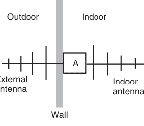

### 2.3.4 结论

无源中继器比有源中继器便宜，但由于噪声也被放大，其性能较低。有源中继器可以对信号进行整形并改善系统性能。此外，使用多个中继器可以帮助提高系统性能。然而，这一想法并未得到太多研究，因为分布式天线系统（DAS）的发展取得了成功，其理念也在于在建筑物内部使用多个天线。这项技术将在下一节中介绍。

## 2.4 分布式天线系统（DAS）

DAS 的理念是将发射功率分配到分离的天线单元之间。例如，这些天线可以位于建筑物的不同楼层，以提供均匀的覆盖。这种系统的理念可以追溯到 20 世纪 80 年代初 [5]，而第一篇关于室内分布式天线系统的论文是由 Saleh 在 1987 年提出的 [6]。他建议用多个使用低功率的小天线来替代高功率辐射的单个天线，以覆盖相同的区域。如果不同天线的覆盖区域之间的重叠减少，并且天线的覆盖区域尽可能与建筑物的形状相匹配，DAS 将大大提高网络的效率。室内规划工程师的任务是尽量使覆盖尽可能均匀。市场上已经提出了不同的 DAS 系统。

无源 DAS 使用无源元件来使基站的输出信号到达不同的天线。后来，基于有源元件开发了更先进的 DAS 系统，使系统性能更好，安装也更容易 [7]。

### 2.4.1 无源分布式天线系统

#### 无源元件

在无源系统中，使用不同的元件来在天线之间分配信号功率。这些元件是被动的，这意味着它们不需要外部电源。

- **同轴电缆：** 同轴电缆用于分配信号并在 DAS 的不同元件之间形成连接。它们的主要缺点是根据距离产生较高的信号损耗。工程师为了确保每个天线具有正确的辐射功率，必须考虑电缆长度来计算总损耗。例如，使用 1800 MHz 的 0.5 英寸同轴电缆，损耗约为每米 0.1 dB。
- **分路器：** 这种元件将输入信号均等地分成 $N$ 路输出信号。它用作互连，将信号分配到不同的天线之间。
- **抽头：** 抽头类似于分路器，但能够将输入信号分成两路具有不同比例的输出信号。它们用于调整分配给不同楼层的功率，例如。
- **衰减器：** 这些元件只是以衰减器的值来衰减信号。它们用于将信号降低到较低的电平。
- **滤波器：** 这些用于分离频段，例如，三工器可以将输入信号分成三路输出信号，分别对应 900 MHz、1800 MHz 和 2100 MHz 的频率。
- **其他元件：** 还有一些其他元件也可用于设计室内网络，例如，终端负载用于结束一条线路，环行器用于保护端口免受系统中电缆断开引起的反向反射，而耦合器用于组合来自不同输入源的信号。

#### 无源 DAS 的部署

在无源 DAS 中，使用上述无源元件在天线之间分配信号。典型的安装示例如图 2.4 所示。要使用的天线数量和输出功率是必须仔细规划的重要参数，并且将很大程度上取决于环境的类型。如 [8] 所示，在单小区和多小区环境中，使用高效功率控制的 DAS 都可以增加容量并减少干扰。

将 DAS 的性能与使用单个天线的系统进行比较以评估这种方法的吸引力是很有意义的，参见图 2.5。在 [9] 中讨论了一些有趣的关系。由于一个天线在点 *r* 处的路径损耗（PL）代表了

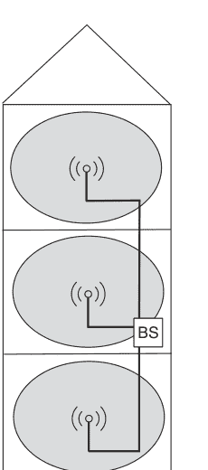


从距离 $dr$ 到参考距离 $d$ 的信号损耗。它也可以写作：

$$PL = \frac{P_{dr}}{P_{d}} \quad (2.2)$$

如果损耗是从 $d = 1m$ 处开始计算，那么 $PL$ 也可以建模为：

$$PL = Cd^{\alpha} \quad (2.3)$$

其中 $d$ 是到源的距离，$C$ 是常数，$\alpha$ 是路径损耗指数。通常，在双斜率路径损耗模型中，$\alpha$ 在天线附近介于 1 到 3 之间，在远距离介于 3 到 7 之间。

假设天线的覆盖范围是一个圆，那么这种覆盖的面积 $A$ 是：

$$A = \pi d_{c}^{2} \quad (2.4)$$

其中 $d_{c}$ 是到小区边界的距离。根据前面的公式，可以写出：

$$PL = C \left( \frac{A}{\pi} \right)^{\frac{\alpha}{2}} \quad (2.5)$$

#### 最大化覆盖

对于给定的辐射功率，一个 $N$ 天线系统与单个天线系统相比，会产生一个新的覆盖区域 $A_N$，使得：

$$A_N = N^{1 - \frac{2}{\alpha}} A \quad (2.6)$$

例如，使用四根天线，并假设 $\alpha = 5$，那么改善因子是 2.29。

#### 最小化辐射功率

对于给定的覆盖区域，辐射功率 $P_N$ 与单个天线的功率 $P$ 相比，会降低，使得：

$$P_N = N^{1 - \frac{\alpha}{2}} P \quad (2.7)$$

使用与前面相同的参数，功率降低了 9 dB。

DAS 可以连接到中继器，以将来自外部的信号分配到建筑物内部。在 [10] 中，作者部署了一个由连接到中继器的 DAS 构成的 UMTS 系统。他们的场景表明，使用这样的系统，室内覆盖的改善约为下行链路容量的 35%。通过这种部署，室内 SIR 平均改善了 3.4 dB，同时也导致 HSDPA 容量的增加。这种方法减少了发射功率，因此邻区受到的干扰也更少。

DAS 也可用于覆盖长距离环境，例如隧道。在 [7] 中，一个 DAS 被成功用于确保隧道内的室内覆盖。

#### DAS 作为空间分集解决方案

在 MIMO 系统中，提高系统性能的一个有效解决方案是通过组合不同的天线，为每根天线分配正确的功率，从而创建一个具有特定形状的全局天线方向图。可以计算出合成天线方向图的形状，使得不同的波束指向不同的用户。这个过程也称为波束成形，它产生空间分集，例如，分配到两个不同波束的两个用户可以使用相同的信道或码而不会相互干扰。这种接入方法也称为 SDMA（空分多址）。

类似地，使用分布式天线系统，也可以通过确保不同天线的最佳覆盖区域尽可能少地重叠来利用空间分集 [11]。天线的数量及其部署位置是室内工程师的主要任务。例如，在多层建筑中的一个常见方法是每层楼使用一根天线，或者在各层楼之间平均分配天线数量。例如，在 [12] 中，在办公环境中使用八根天线进行了一次 GSM 测量活动。为了覆盖这座两层楼的建筑，每层楼使用了四根天线，以实现均匀覆盖。这导致了网络容量的大幅增加，因为不同楼层之间的信道重用得到改善。在 [13] 中，也介绍了一个办公环境中的 CDMA DAS。结果表明，分布式天线系统（在这种情况下是三个节点）的功率平均降低了超过 10 dB。总的来说，如果功率在各天线之间得到最优分配，并且它们的位置计算得当，就可以部署天线以产生空间分集，从而提高系统的容量。

### 2.4.2 无源系统的缺点

无源元件已成功用于 GSM 超过 15 年，但无源系统的缺点在于它们由无源元件构成。不幸的是，当使用更高频率时，信号的劣化会极大地影响传输质量。在设计 3G 的室内解决方案时，元件中信号的劣化是一个主要问题。

另一个问题是，当建筑物的尺寸巨大时，安装同轴电缆并不总是可行的，因为信号在这么长的距离上会损耗。通常唯一的解决方案是增加发射功率，以确保足够的信号质量。

最后，如果无源元件与有源系统的元件相比非常便宜，那么安装同轴电缆是昂贵的。这些电缆又重又硬，安装起来既不容易也不便宜。这就是为什么在无源系统中，由于安装问题，天线的可选位置通常受到限制。所有这些缺点导致了有源系统的发展，它们更容易安装和控制，并试图补偿同轴电缆的衰减。

### 2.4.3 有源分布式天线系统

#### 有源元件

与不需要使用电子元件的无源系统不同，有源 DAS 使用如下所述的不同有源元件。

- 主单元：主单元 (MU) 可以连接到基站或中继器。它通过光纤将信号分配给不同的扩展单元。主单元是分布式天线系统的智能部分，控制所有待传输的信号，并借助内部放大器和转换器调整信号电平。

- 远端单元：RU 安装在天线附近以最小化损耗，并连接到天线。RU 将来自 EU 的信号转换为下行无线信号，并将上行无线信号转换为发送到 EU 的信号。

- 电缆：早期的有源系统是使用标准连接（如同轴电缆）部署的。在这种情况下，电缆之间的损耗问题仍然很重要。然而，安装变得更容易，因为有源远端单元可以根据距离补偿损耗。后来，随着廉价光纤的发展，提出了一些使用这种技术的系统，以便在更长的距离上传输信号。这些方法将在下面的段落中介绍。

#### 有源 DAS 的部署

不再需要无源元件，这就是为什么有源系统的安装更容易。实际上，损耗由主单元和远端单元自动补偿：不需要选择分路器和衰减器来调整损耗，也不需要精确测量电缆的长度。

#### 用于中小型建筑的基本有源 DAS

在较短距离的情况下，可以使用标准电缆。RU 安装在天线附近，这样电缆中的所有损耗都得到了补偿，唯一的损耗将是 RU 和天线之间的同轴电缆中的损耗。这种系统比无源系统更容易安装，因为不需要安装诸如分路器抽头或衰减器之类的元件，也不需要考虑电缆的长度来调整电缆中的损耗。此类有源系统可以覆盖几百米的距离。

#### 有源光纤 DAS（光纤射频）

有源光纤 DAS 在性能方面是最有效的。使用光纤在 MU 和 RU 之间建立链路。它们可以覆盖很长的距离（最远 6 公里）并支持多种无线电服务。在这种系统中，RU 直接将光信号转换为无线信号，反之亦然。另一个优点是光纤非常便宜且易于安装。光纤射频是目前最常用于室内无线电覆盖的技术 [14, 15]。如 [16] 中详细阐述的，光纤射频是目前扩展室内覆盖的最佳解决方案，因为它提供了可扩展性、灵活性、易于扩展性，并且与使用标准连接的 DAS 相比，信号劣化非常低。

### 2.4.4 无源和基本系统之间的选择

#### 无源 vs 基本有源 DAS vs 有源光纤 DAS

表 2.1 给出了无源系统和有源系统之间的比较。

#### 混合 DAS

已经部署了一些结合无源 DAS 和有源 DAS 的其他解决方案。其想法是通过光纤连接远端单元，但使用无源同轴布线将这些远端单元连接到天线。这种组合方法具有通过光纤连接覆盖长距离的优点，以及由于使用无源元件而价格更便宜的优点。混合 DAS 也可以组合具有不同频段的不同系统。由于光纤射频安装简单，因此有许多可能的解决方案，例如将分布式天线系统与中继器结合使用。

#### 最佳解决方案

就购买成本而言，无源系统更便宜，但由于同轴布线，安装价格较高。有源系统提供更好的性能和更简单的安装，但价格更贵。使用无源系统，无需安装电子系统或供电。混合 DAS 有时是一个很好的折衷方案，但

**表 2.1** 不同 DAS 技术的比较

|  | 无源 DAS | 基本有源 DAS | 有源光纤 DAS |
|---|---|---|---|
| 覆盖距离 | 最远 400 m | 最远 400 m | 最远 6 km |
| 设备价格 | 便宜 | 标准 | 标准 |
| 安装 | 困难 | 容易 | 非常容易 |
| 多标准 | 否 | 否 | 是 |
| 输入（基站或中继器） | 高功率 | 低功率 | 低功率 |


仍然需要安装同轴电缆。有源系统更容易管理，因为自动诊断和告警功能集成到了远端单元中，使系统故障问题更易于解决。

## 2.5 辐射电缆或泄漏电缆

辐射电缆，也称为泄漏馈线，是一种用作长天线的金属导线。电磁波可以在整根电缆上接收或发射，因此非常适用于走廊、电梯或隧道等长条形环境。例如，在伦敦地铁中，辐射电缆系统被用于其内部通信网络。通常，如图 2.6 所示，辐射电缆直接与基站相连。

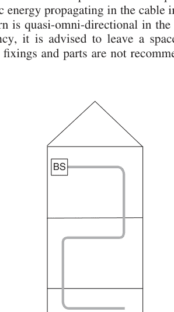

**图 2.6** 三层建筑的辐射电缆无线覆盖

### 2.5.1 工作原理

辐射电缆与标准同轴电缆类似，但其外导体表面布置有一些调谐槽。这种电缆横截面的示意图如图 2.7 所示。这些槽针对特定射频波长或特定无线电频段进行调谐。它们会将电缆中传播的部分电磁能量以电磁波形式泄漏出去。天线方向图在电缆横截面内近似为全向。为了提高效率，建议在电缆与墙壁之间留出间距。此外，不建议使用金属固定件和金属部件，因为它们会影响天线方向图。

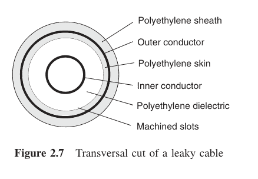

如果电缆均匀同质，则辐射能量与电缆中传播能量之比在整个电缆上是恒定的。电缆损耗越大，辐射能量的能力就越强。一些最新的解决方案提出了可调节耦合损耗，使用户能够适应复杂环境中的辐射能量 [17]。

正因如此，这种系统的覆盖范围有限，尤其在高频段，因为损耗更大。

### 2.5.2 部署

如前所述，这项技术非常适合覆盖长条形空间。辐射电缆的主要优点是能量分布均匀。例如，在走廊中，与使用多个基站沿走廊布置相比，它能沿电缆提供均匀的覆盖，而基站的能量是分布在基站周围的。使用辐射电缆，单个基站可能就能覆盖大面积区域，从而降低系统实施成本。

缺点在于安装困难且昂贵。安装耗时，而且不一定容易找到可用的安装空间。电缆必须完全对齐，以便槽能够以最小损耗泄漏能量。此外，电缆不能直接贴墙安装，而需要通过特殊适配器留出一定间距。最后，尤其在隧道内（例如火车产生粉尘），灰尘会降低电缆性能。因此电缆必须定期清洁。

由于电缆内部存在衰减，人们提出了级联 BDA 和 T 型馈电等特殊配置，以覆盖更长的距离。

#### 级联 BDA

这种克服信号衰减问题的解决方案是在电缆达到获得最低质量的最大距离时使用双向放大器（BDA）。对于长距离，BDA 以一定间隔安装（见图 2.8），其增益配置为使信号电平维持在一定水平。由于 BDA 中噪声也会被放大，实际使用中一般不超过三到四级 BDA。

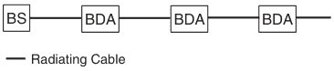

**图 2.8** 由级联 BDA 馈电的辐射电缆

#### T 型馈电

T 型馈电使用光转换器将基站信号转换为光信号，并通过光纤进行分配，如图 2.9 所示。每个 BDA 都具有光接口，用于将光信号转换后向电缆的两个方向发送。该系统可以覆盖更长的距离，并且能更好地控制噪声，因为不同的 BDA 不会像级联 BDA 配置中那样相互馈电。

#### 对比

如前所述，T 型馈电系统更受青睐，因为它降低了噪声，因此可用于覆盖更长的距离。此外，由于 T 型馈电将信号向 BDA 的两个方向发送，最终信号达到更高的电平且更加均匀。为了说明这一点，图 2.10 展示了两种前述方案下电缆上的衰减情况：在 BDA 间距相似的情况下，T 型馈电系统的信号电平更高，因此信号质量也更高。

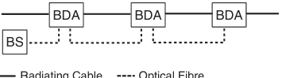

**图 2.9** T 型馈电辐射电缆系统

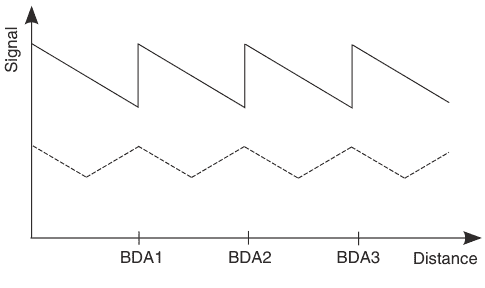

**图 2.10** 级联 BDA 和 T 型馈电辐射电缆系统中电缆上的衰减

### 2.5.3 辐射电缆的替代方案

辐射电缆是覆盖长距离的高效解决方案，因此被广泛使用。然而，也存在一些替代方案，例如沿环境部署 DAS。[18] 中解释说，辐射电缆方案优于 DAS，因为它们能更好地控制覆盖范围，但在实际中，由于某些建筑中安装并非总是简单，以及安装成本和与周围物体交互产生的干扰问题，DAS 在大多数安装中仍是首选方案。

## 2.6 室内基站

在上述增加无线覆盖的方法中，最早开发的方法旨在利用室外基站（如宏蜂窝、微蜂窝和直放站）发射的信号来提高室内信号电平，而后续方法则旨在通过使用辐射电缆或分布式天线系统来扩展建筑物内基站的覆盖。一种新的增加覆盖和容量的方案是直接在建筑物内部署小型基站，如图 2.11 所示。因此提出了两种主要方案：微微蜂窝和毫微微蜂窝。

### 2.6.1 微微蜂窝

随着 IEEE 802.11 标准（也称为 WiFi，即无线保真）的成功，它使人们能够通过空中接口访问宽带互联网连接，运营商开始考虑将这一概念扩展到其移动网络。在 WiFi 中，用户连接到一个称为接入点（AP）的设备，该设备集成天线以建立用户与互联网连接之间的链路。微微蜂窝是一种与接入点非常相似的小型基站。它通常很小（通常为 A4 纸大小，厚度仅几厘米），并集成有辐射低功率信号的天线。实际上，微微蜂窝是一种简化的基站，其功率和容量低于微蜂窝或宏蜂窝基站。它连接到运营商的基站控制器（BSC）。与标准基站一样，BSC 管理微微蜂窝与网络之间的数据传输，并执行小区间的切换以及向不同用户分配资源。微微蜂窝通过标准楼内布线、光纤或以太网连接连接到核心网络。通常在微微蜂窝中集成全向天线 [19]。

#### 优点

微微蜂窝的主要优点是比标准基站便宜，安装成本也更低。它们能有效增加室内覆盖，因为它们安装在室内。与室外基站相比，小区的覆盖区域较小，因为辐射功率较低，而且由于墙壁和建筑物内其他障碍物引起的多次反射和衍射。因此，覆盖建筑物内部需要大量使用微微蜂窝，与室外小区相比。这使得运营商可以拥有更多的小区，从而增加建筑物内的网络容量。这就是为什么微微蜂窝部署在包含高密度用户的室内区域。

此外，通过在建筑物内安装微微蜂窝，运营商可以在室外网络中获得更多容量，因为用于覆盖该建筑物的室外小区将仅服务于室外用户。在许多情况下，这也为运营商提供了降低用于覆盖该建筑物的室外小区辐射功率的机会。这就是为什么微微蜂窝不仅能增加建筑物内的容量，还能增加室外容量，并减少室外干扰，因为室外小区之间的重叠可以减少。微微蜂窝由于小区较小，也可用于定位重要的场景 [20]。事实上，由于障碍物反射，使用室外小区和三角测量方法的室内定位不够精确。然而，使用小型小区可以轻松确定用户所在建筑物，如果有许多微微蜂窝，还可以更准确地知道用户的具体位置。

#### 部署

与 DAS 或直放站一样，微微蜂窝网络的部署需要特别注意。微微蜂窝应位于何处以及最佳参数是什么是主要挑战。对于

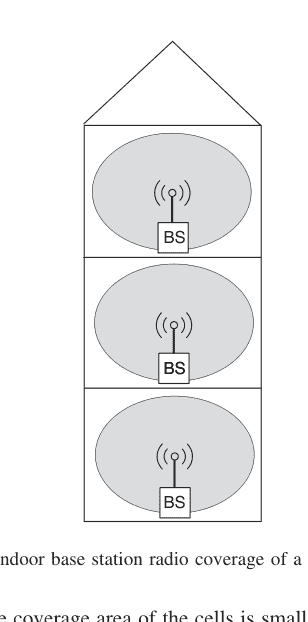

**图 2.11** 三层建筑的室内基站无线覆盖


在部署微微小区时，一个最优方案是：既要确保微微小区的数量足以满足覆盖和容量需求，又要避免数量过多导致干扰。微微小区主要部署在商业中心或机场等大型区域，因此此类安装可能颇具挑战。安装微微小区时，另一个需要最小化的重要影响是与相邻室外单元的干扰。实际上，在靠近室外单元的建筑物中，部分来自外部的信号会与室内信号产生干扰。此外，微微小区发射的部分信号会外泄并干扰室外单元。这些现象主要发生在窗户处，因为信号在玻璃上的反射少于在石材或混凝土上。因此，安装微微小区的主要挑战在于考虑室外单元的影响。故而，室内外联合网络规划成为一个重要议题。

在典型的多层建筑中，安装微微小区的方法与安装分布式天线系统（DAS）的方法颇为相似。安装DAS时，连接到同一基站的天线分布在不同楼层，而在微微小区网络安装中，基站直接分布在各楼层之间。微微小区面临的主要挑战是位于室外小区边缘的微微小区之间的干扰[21]，以及管理微微小区之间的切换[22]。文献[23]描述了重叠GSM微微小区的一些模拟，并表明要提升性能，一个良好的解决方案是精确考虑微微小区的位置。这可以通过在基站子系统（BSS）数据库中输入微微小区之间的相对位置来实现。

#### 应用场景

如前所述，微微小区的优势在于能有效提升室内无线覆盖和容量。它们是满足以下两项需求的绝佳方式：
- 填补宏网络覆盖空洞——那些信号电平过低的区域。
- 在密集城区卸载宏网络流量。

一些应用示例包括商业环境和购物中心。它们在高层建筑中也非常有用。实际上，在许多城市，高层建筑越来越普遍，但宏小区信号强度往往随着楼层增高而减弱。这是因为在人口稠密区域，运营商通常需要增加更多室外小区。为了提高容量，这些小区的尺寸必须缩小，这就是为什么运营商倾向于最小化天线倾角。这种方法的直接后果是许多建筑高层覆盖不良。放置在办公环境高层的微微小区可以有效解决此问题。

微微小区在困难建筑中也很有用，例如历史建筑（由巨大石墙构成，吸收了大部分来自宏小区的信号）或由复杂形状和材料建造的建筑（如金属结构或用于热效率的特殊玻璃窗）。

最后，微微小区也应用于车辆场景，例如通过卫星确保回程连接。因此，微微小区可用于为飞机或游轮上的乘客提供手机服务。

#### 微微微小区的提出

随着微微小区在多用户室内环境中的成功应用，2002年摩托罗拉的一组工程师开始开发最小的UMTS基站。其主要理念是提出一种类似WiFi的解决方案，但用于移动电话网络，以部署在家庭环境中。几年后，家庭基站的概念出现，旨在为家庭市场提供低功耗室内解决方案。如图2.12所示，这种小微微微小区的理念是仅覆盖一栋住宅，这就是为什么功率应调整到使小区尺寸最大在20到30米之间。该图很好地说明了小区尺寸如何随着时间推移而演变，通过缩小小区尺寸来满足网络日益增长的容量需求。

这种非常小的小区被称为毫微微小区（femtocells），下面将进行介绍。

### 2.6.2 毫微微小区

为了将微微小区的理念仅扩展到家庭网络，并采用更类似于WiFi接入点的方法，提出了毫微微小区基站。毫微微小区是由用户直接安装在家中的简化版微微小区。它在一个设备中集成了微微小区和基站控制器（BSC）的所有功能。因此，毫微微小区不是连接到运营商的BSC（像微微小区那样），而是直接连接到互联网，如图2.13所示。通过毫微微小区，所有通信都通过互联网连接到运营商网络，无需BSC/MSC基础设施。毫微微小区由于通常覆盖区域比微微小区更小、用户更少，并且需要价格低廉，其输出功率和容量受到限制（10到20 dBm，4到6个用户）。在毫微微小区网络内，室外用户连接到宏小区，当他们进入家中时，会切换并连接到自己的毫微微小区。这确保了用户通信的顺畅，并在家中获得最大覆盖[24]。

#### 优势

毫微微小区由用户安装在自己家中，因此该方案将确保用户获得良好的覆盖。这不仅将增加覆盖，还将增加小区数量，从而提高网络容量。对运营商而言，毫微微小区不仅是提升室内覆盖的有效解决方案，也是一种廉价方案，因为毫微微小区由客户付费购买。另一种通过增加更多室外小区来提高室内覆盖的替代方案对运营商来说成本要高得多。

#### 部署

毫微微小区可以部署在不同的场景中。第一个市场是家庭环境，要求是接入宽带互联网连接。在农村环境中，没有足够的宏小区覆盖，毫微微小区可以成为一种合适的方法，使新客户能够接入移动网络并在家中获得最大覆盖。因此，在美国存在一个巨大的潜在市场，那里仍有大片区域无线电覆盖不足，但高速数据率互联网已广泛部署。在城市环境中，毫微微小区是覆盖密集建筑区域的好方法，因为用户的公寓很少能直接看到宏小区，并且由于其他建筑物的阻挡导致信号损耗，室内覆盖效果差。

毫微微小区的第二个市场将是办公环境，其中毫微微小区的低容量足以覆盖多个办公室。在这种情况下，建筑物将由一组毫微微小区覆盖，这些小区需要精心规划，类似于微微小区的方式。

在家庭环境中，毫微微小区可能会以私有接入模式部署。这意味着只有毫微微小区的订阅者才能定义允许使用该毫微微小区的用户列表。这主要是因为，付费购买毫微微小区的订阅者不太可能允许所有人免费使用他们的毫微微小区。在办公环境中，由于用户是移动的，毫微微小区必须以公共接入模式部署。在此模式下，所有用户都有权使用毫微微小区。

最后，未来的一个想法是将毫微微小区部署在户外的小型热点区域，用户可在此享受最大覆盖。在此场景中，毫微微小区的低廉价格及其自配置能力，将允许创建许多具有高覆盖能力的非常小的小区。一个例子是在城市的公交车站安装毫微微小区。当然，在毫微微小区能够安装在户外之前，仍有许多挑战需要克服。主要挑战是毫微微小区需要自我配置，以避免对宏小区或其他毫微微小区造成干扰。

### 2.6.3 微微小区与毫微微小区的区别

基于之前的讨论，表2.2对微微小区和毫微微小区进行了比较。总而言之，毫微微小区是简化了特性以降低成本和简化安装的小微微小区。与微微小区不同，毫微微小区接入点（FAP）具有以下特殊特性。

#### 连接方式

FAP与微微小区不同，它们通过宽带连接连接到运营商网络。毫微微小区是一个独立的基站，使用IP连接到核心网络。毫微微小区是自配置的，其与核心网络之间的接口必须简单，以避免运营商进行任何操作。此外，标准化此接口很重要，因为如果运营商想使用不同制造商的毫微微小区，它们必须兼容。

#### 安装

毫微微小区由客户安装在自己家中。这就是为什么这种安装必须尽可能简单（即插即用）。新安装的毫微微小区必须根据周围环境自动配置其参数，以避免对相邻宏小区和毫微微小区产生负面影响（干扰）。理想情况下，用户只需接通电源并连接毫微微小区。

| 参数 | 微微小区 | 毫微微小区 |
|-----------|-----------|------------|
| 安装 | 由运营商安装 | 由用户安装 |
| 连接到核心网络 | 同轴电缆或光纤 | ADSL、有线电视电缆 |
| 价格 | 便宜 | 非常便宜 |
| 容量 | 10–50用户 | 3–5用户 |
| 覆盖范围 | <100米 | <30米 |

接入宽带连接。这种自我配置非常重要，因为如果部署了大量飞蜂窝，运营商无法负担得起优化所有飞蜂窝的参数以减少与宏蜂窝的干扰。然而，在开放式接入场景中，需要大量飞蜂窝来确保无线电覆盖，运营商可以自行部署飞蜂窝，这种方式类似于微微蜂窝。

## 2.7 室内覆盖技术对比

在本章中，我们对不同的室内无线电覆盖技术进行了概述。首先提出了宏蜂窝、微蜂窝和中继器等方案。它们通过将室外覆盖区域延伸到建筑物内部来增加室内覆盖。因此，室内覆盖可以通过不同的方法来扩展，例如通过增加更多单元来提高室外信号功率，或者使用中继器将室外信号在建筑物内部重新传输。然而，这些方案并不理想，因为它们并没有真正优化室内覆盖，而只是将室外覆盖的效果延伸到建筑物内部。

其次，我们提出了一些更高效的解决方案。它们包括直接在建筑物内部安装基站。一方面，辐射电缆是长窄环境（如隧道）的良好方案，但在大型环境（如建筑物）中安装过于复杂且昂贵，难以实施。另一方面，微微蜂窝和飞蜂窝是高效的解决方案，因为如果它们的位置选择得当，室内信号功率可以得到有效改善，而且单元数量的增加将提高系统的潜在容量。

微微蜂窝由运营商安装，因此非常适合商业中心或办公楼等场景。然而，在家庭环境中，飞蜂窝似乎是用户和运营商的最佳选择。

表2.3总结了前述室内覆盖技术的主要特点。

| 宏蜂窝/微蜂窝 | 中继器 | DAS | 辐射电缆 | 微微/飞蜂窝 |
| --- | --- | --- | --- | --- |
| ![宏蜂窝/微蜂窝示意图] | ![中继器示意图] | ![DAS示意图] | ![辐射电缆示意图] | ![微微/飞蜂窝示意图] |
| 昂贵 | 价格适中 | 价格适中 | 价格适中 | 便宜 |
| 安装昂贵 | 安装困难 | 安装容易 | 安装困难 | 安装非常容易 |
| 高功率 | 低功率 | 低功率 | 低功率 | 极低功率 |
| 室内覆盖差 | 覆盖可接受 | 覆盖良好 | 覆盖良好 | 覆盖良好 |

在许多农村或城市地区，建筑物内的无线电覆盖仍然不足。此外，视频会议等新兴移动应用需要更高的数据传输速率。由于大多数时间手机都在室内使用，提高室内无线电覆盖是大多数运营商的主要目标。通过优化室外网络来增加室内覆盖，直到最近还是唯一的解决方案。这可以通过增加更多单元、提高现有单元的输出功率，或者使用中继器将信号重定向到建筑物内部来实现。然而，最大限值已经达到，现在运营商必须寻找新的方法。在过去几年中，DAS、中继器和辐射电缆已经开始成为克服室内覆盖问题的常见方法。这些技术已成功证明可以增加大型公共场所或公司的覆盖，但仍有许多地方的室内覆盖仍然不足，而且上述技术对这些地方来说过于复杂。这些区域，如个人住宅，代表着运营商的巨大潜在市场。为了覆盖住宅内部，运营商需要一种能够满足以下要求的解决方案：

- 覆盖小面积的解决方案，
- 低容量的解决方案，
- 安装和维护成本低廉的解决方案。

飞蜂窝似乎在未来几年将是一个不错的选择。

在本章中，我们介绍了室内覆盖技术的演进。介绍了飞蜂窝并阐述了其优势。下一章将介绍飞蜂窝网络中可能使用的网络架构。

# 参考文献

- [1] H. Hristov, R. Feick, and W. Grote, "Improving indoor signal coverage by use of through-wall passive repeaters," in *IEEE Antennas and Propagation Society International Symposium*, vol. 2, July 2001, pp. 158–161.
- [2] Y. Huang, N. Yi, and X. Zhu, "Investigation of using passive repeaters for indoor radio coverage improvement," in *Antennas and Propagation Society International Symposium, 2004. IEEE*, vol. 2, June 2004, pp. 1623–1626.
- [3] M. Lee, B. Keum, Y. Son, K. Joo-Wan, and H. S. Lee, "A new low-complex interference cancellation scheme for wcdma indoor repeaters," in *IEEE Region 8 International Conference on Computational Technologies in Electrical and Electronics Engineering, SIBIRCON*, July 2008, pp. 457–462.
- [4] Y. Ito, S. Fujimoto, and M. Kijima, "Novel repeater with automatic gain-control for indoor area," in *Asia-Pacific Microwave Conference Proceedings, APMC*, vol. 5, Dec 2005, p. 3.
- [5] F. Coperich and C. Turner, "Fcc requirements for type accepting radio signal boosters and licensing distributed antenna systems," in *32nd IEEE Vehicular Technology Conference*, vol. 32, May 1982, pp. 247–254.
- [6] A. A. M. Saleh, A. J. Rustako Jr, and R. S. Roman, "Distributed antennas for indoor radio communications," *IEEE Transactions on Communications*, vol. 35, no. 12, pp. 1245–1251, 1987.
- [7] C. Briso-Rodriguez, J. Cruz, and J. Alonso, "Measurements and modeling of distributed antenna systems in railway tunnels," *IEEE Transactions on Vehicular Technology*, vol. 56, no. 5, pp. 2870–2879, Sept 2007.
- [8] H. Yanikomeroglu and E. Sousa, "Power control and number of antenna elements in cdma distributed antenna systems," in *IEEE International Conference on Communications, ICC 98*, vol. 2, June 1998, pp. 1040–1045.
- [9] P. Chow, A. Karim, V. Fung, and C. Dietrich, "Performance advantages of distributed antennas in indoor wireless communication systems," in *IEEE 44th Vehicular Technology Conference*, vol. 3, June 1994, pp. 1522–1526.
- [10] J. Borkowski, J. Niemela, T. Isotalo, P. Lahdekorpì, and J. Lempiainen, "Utilization of an indoor das for repeater deployment in wcdma," in *IEEE 63rd Vehicular Technology Conference, VTC 2006-Spring.*, vol. 3, 2006, pp. 1112–1116.
- [11] J. Yang, "Analysis and simulation of a cdma pcs indoor system with distributed antennae," in *Sixth IEEE International Symposium on Personal, Indoor and Mobile Radio Communications PIMRC'95.*, vol. 3, Sept 1995, p. 1123.
- [12] T. Sorensen and P. Mogensen, "Radio channel measurements on an eight-branch indoor office distributed antenna system," in *IEEE VTS 53rd Vehicular Technology Conference, VTC 2001 Spring*, vol. 1, May 2001, pp. 328–332.
- [13] H. Xia, A. Herrera, S. Kim, and F. Rico, "A cdma-distributed antenna system for in-building personal communications services," *IEEE Journal on Selected Areas in Communications*, vol. 14, no. 4, pp. 644–650, May 1996.
- [14] K. Utsumi, H. Sasai, T. Niiho, M. Nakaso, and H. Yamamoto, "Multiband wireless lan distributed antenna system using radio-over-fiber," in *International Topical Meeting on Microwave Photonics, MWP 2003 Proceedings*, Sept 2003, pp. 363–366.
- [15] Z. Pykan and K. Hugl, "Hsdpa system performance of optical fiber distributed antenna systems in an office environment," in *IEEE 16th International Symposium on Personal, Indoor and Mobile Radio Communications, PIMRC*, vol. 4, Sept 2005, pp. 2376–2380.
- [16] M. Fabbri and P. Faccin, "Radio over fiber technologies and systems: New opportunities," in *9th International Conference on Transparent Optical Networks. ICTON '07*, vol. 3, July 2007, pp. 230–233.
- [17] J. H. Wang, "Leaky coaxial cable with adjustable coupling loss for mobile communications in complex environments," *IEEE Microwave and Wireless Components Letters*, vol. 11, no. 8, pp. 346–348, Aug 2001.
- [18] I. Stamopoulos, A. Aragon, and S. Saunders, "Performance comparison of distributed antenna and radiating cable systems for cellular indoor environments in the dcs band," in *Twelfth International Conference on Antennas and Propagation (ICAP 2003)*, vol. 2, March-April 2003, pp. 771–774.
- [19] M. Smith, A. Bush, P. Gwynn, and S. Amos, "Microcell and picocell base station internal antennas," in *IEEE Wireless Communications and Networking Conference, WCNC*, vol. 2, Sept 1999, pp. 708–711.
- [20] E. Kudoh, A. Shibuya, T. Ogawa, D. Uchida, M. Nakatsugawa, H. Suda, and S. Kubota, "Picocell network for local positioning and information system," in *26th Annual Conference of the IEEE Industrial Electronics Society*, vol. 2, Oct 2000, pp. 1165–1170.
- [21] C. Johnson and J. Khalab, "Load based radio resource management for umts picocells," in *4th International Conference on 3G Mobile Communication Technologies*, June 2003, pp. 88–92.
- [22] Y.-U. Chung and D.-H. Cho, "Performance analysis of handoff algorithm in fiber-optic microcell/picocell radio system," in *IEEE 51st Vehicular Technology Conference Proceedings, VTC 2000-Spring*, vol. 3, May 2000, pp. 2408–2412.
- [23] D. Molkdar, "Simulation results of a typical gsm picocellular system," in *52nd IEEE Vehicular Technology Conference, VTC-Fall*, vol. 4, Sept 2000, pp. 1590–1596.
- [24] V. Chandrasekhar and J. G. Andrews, "Femtocell networks: A survey," *IEEE Communication Magazine*, vol. 46, no. 9, pp. 59–67, September 2008.


# 3 接入网架构

Enjie Liu 与 Guillaume De La Roche

## 3.1 概述

Femtocell（Femtocell）有望改善室内覆盖并提升移动数据业务的吞吐量，同时将流量从昂贵的大型无线接入网络分流到低成本的公共互联网。尽管移动行业对Femtocell寄予厚望，但要实现Femtocell市场的显著商业成功，仍需首先解决若干关键的技术挑战。其中一项挑战便是定义并标准化一种将Femtocell回传至移动核心服务网络的方法，即设备到核心网络的连接。当今使用的无线接入网（RAN）包含数百个基站，连接至单一的无线网络或基站控制器（RNC/BSC）。其接口为Iub，通过专用租用线路运行异步传输模式（ATM）协议。与大型3G RAN不同，Femtocell接入网络需要运营商集成数十万个低容量的家庭基站，这些基站可随时由最终用户移动、增加和更改，且均通过不安全的、不可信的公共互联网连接。这引发了若干重要问题：

- 1. 是否具有可扩展性？
- 2. 是否安全？
- 3. 是否已标准化？

由于最新的技术进步使低成本家庭基站能够具备强大的处理能力，网络协议栈现在可以大幅简化。此外，标准互联网协议（IP）已迅速取代层级式的电信专用传输协议。简化的协议栈与IP传输的结合，使Femtocell能够利用扁平网络——如互联网——作为回传传输连接到运营商核心网络，如图3.1所示。

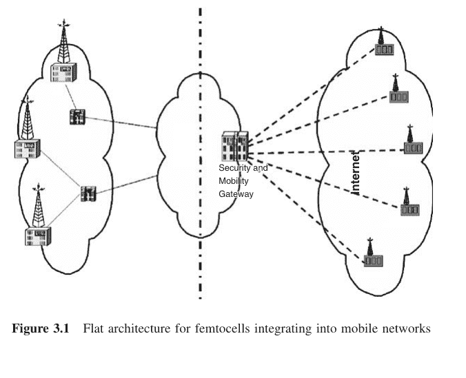

**图 3.1** Femtocell集成至移动网络的扁平架构

此前对于Femtocell接入网络的基本架构及其与现有通用移动通信系统（UMTS）系统的互联，尚无普遍公认的描述。目前已提出四种不同的3G Femtocell架构。

### 3.1.1 传统Iub over IP

这是最早出现的Femtocell接入网络架构，通常称为"Iub over IP"，如图3.2所示。这些解决方案试图利用现有的3GPP定义的Iub接口，该接口存在于3G无线网络控制器（RNC）与3G基站（NodeB）之间。主要由RNC设备商提出，这些方法允许运营商利用同一RNC，除支持宏网络NodeB外，还支持家庭NodeB。每个Femtocell通过标准3GPP Iub接口（TS 25.434）[1]连接到RNC。Iub协议栈封装在IP信令内，也称为Iub隧道。网络安全由互联网协议安全（IPsec）协议处理。

由于Iub over IP解决方案使运营商能够通过标准接口（Iu-CS和Iu-PS）运行其现有核心网络，它们满足了运营商对全业务透明度的要求，以及低初始部署成本和网络中断的要求。

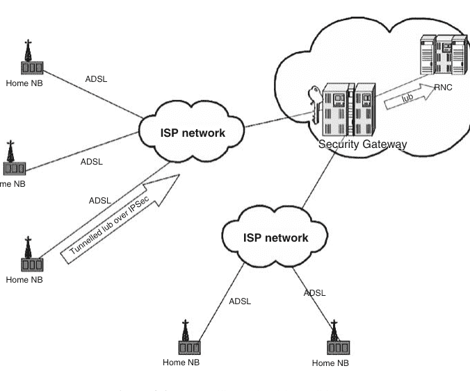

**图 3.2** 采用改进型RNC的Iub隧道

由于Iub通常具有厂商专用特性，这种方法仅适用于拥有已安装RNC基础的设备制造商。

将Femtocell接入网络集成到运营商宏层网络的Iub over IP架构仅在近期才被研究和尝试。RNC在容纳大量HNB方面缺乏可扩展性，导致这一替代架构在3GPP标准化进行的初步可行性研究后不再被考虑。因此，后续章节将不再详细描述。

### 3.1.2 集中器

为解决遵循专有Iub接口以及使现有RNC处理数千个家庭NodeB方面的问题，提出了另一种使用专有集中器/RNC的架构，如图3.3所示，该集中器/RNC能够处理数千个家庭NodeB。这种方法允许在家庭NodeB和RNC之间以不同方式划分功能，从而使集中器能够处理大量家庭NodeB。这种方法通过将移动网络运营商现有的RNC替换为该专有集中器以服务数千个Femtocell，无缝融入其RAN。

基于专有技术的集中器架构在3GPP开始标准化Femtocell接入网络架构后未再推进。因此，后续章节将不再详细描述。

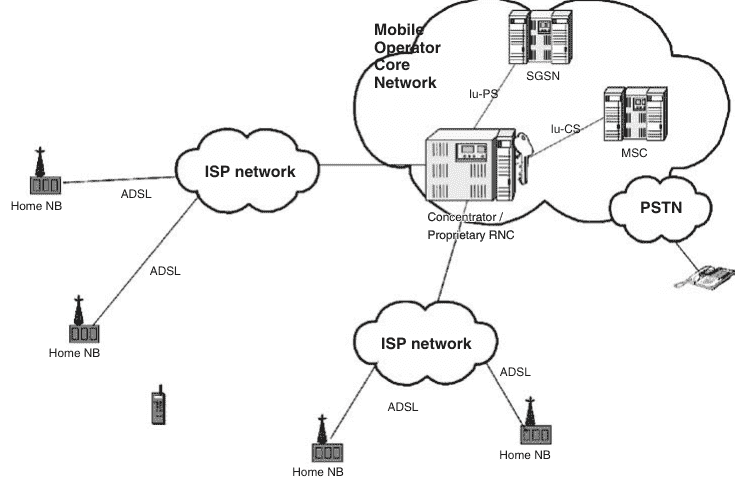

### 3.1.3 基于通用接入网络（GAN）的RAN网关

关于Femtocell集成至核心网络的最新提案通常称为RAN网关解决方案。RAN网关方法基于一种全新、专门构建的网络控制器（RAN网关），位于运营商现有核心网络与IP接入网络之间，类似于RNC。在其互联网侧，RAN网关通过新的Iu-over-IP接口聚合大量Femtocell的流量。RAN网关则在其核心网络侧通过标准Iu-CS和Iu-PS接口将流量集成到现有移动核心网络中。由于RAN网关解决方案通过标准接口影响运营商的现有核心网络，它们能够实现全业务连续性以及低初始部署成本。RAN网关方法采用"扁平IP"架构，其中标准RNC的若干功能被移至Femtocell本身，从而避免了与Iub over IP方法相关的扩展性问题。由于这种架构移除了RNC，与之相关的功能被移至家庭NodeB中（RLC/RRC任务以支持无线信道建立等）；因此，家庭NodeB现在更加智能或自主，通常被重命名为"接入点"或"Femto接入点"。这些任务比传统RNC所需的任务简单得多；例如，鉴于Femtocell的受限环境，移动性支持简单得多，无需软切换等。这种架构通常称为"扁平化"、"简化栈"或"基站路由器"。

基于GAN的家庭NodeB架构，如图3.4所示，正在3GPP中考虑，且HNB与HNB网关之间定义的标准Femtocell接口

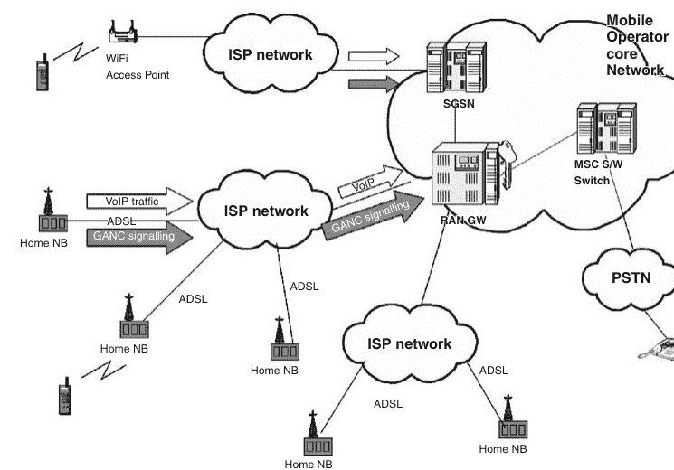

**图 3.4** 基于GAN的Femtocell接入网络架构

Iuh，很可能从基于GAN的家庭NodeB架构演进而来。这种架构替代方案将在后续章节中详细描述。

### 3.1.4 IMS与SIP

将Femtocell集成至核心网络连接的另一种替代方法是，在移动核心网络与家庭NodeB之间使用基于SIP的新协议。图3.5展示了这一方法，它打破了现有网络架构，拥抱了3GPP IP多媒体子系统（IMS）所设想的全IP网络协议。这些协议包括使用会话发起协议（SIP）的IP语音（VoIP），RNC功能现已完全集成到Femtocell AP中。运营商将部署新的基于SIP的核心网络，与其现有的电路域和分组域核心网络并行运行。当移动终端连接到Femtocell时，它从新的SIP核心网络接收所有服务。顺便提及，这种架构与微波接入全球互操作性（WiMAX）架构更为一致，后者从一开始就是基于IP的。

许多运营商相信，他们最终将过渡其核心网络至基于IMS和SIP的基础设施，这些解决方案也被积极看待。基于SIP的方法也有望为大规模部署提供具有成本效益的支持。

由于移动终端连接到Femtocell时与连接到宏蜂窝网络时由不同的核心网络提供服务，业务连续性


由于涉及的技术差异很大，室内和室外基站之间的互联可能变得更加复杂。由于基于SIP的方案要求运营商获取并集成新的核心服务网络，其初始部署成本远高于其他方案。

从Release-8开始，3GPP开始标准化将毫微微蜂窝接入网集成到IMS基础设施中。更多细节将在后续章节中阐述。

## 3.2 基于GAN的毫微微蜂窝至核心网络连接性

如3GPP TS 43.318 [2]和TS 44.318 [3]所定义的通用接入网络是当前3GPP的一个标准，可用于支持家庭NodeB。以下章节将描述GAN在家庭NodeB中的应用。

### 3.2.1 基于Iu架构的Home NodeB的GAN变体

图3.6展示了利用GAN Iu模式[3]作为该架构基础的HNB功能架构。该架构的关键考量在于传统RNC角色在HNB和家庭NodeB网关之间的功能划分。在此架构中，HNB负责无线方面，而HNB GW负责核心网络连接。

基于GAN的HNB架构的主要特点是：

- 与UMTS陆地无线接入网共存，并通过为UTRAN定义的标准化接口与核心网络互联：
  - 用于电路交换服务的Iu-CS接口，概述见3GPP TS 25.410 [4]。
  - 用于分组交换服务的Iu-PS接口，概述见3GPP TS 25.410 [4]。
  - 用于支持基于位置服务的Iu-PC接口，描述见3GPP TS 25.450 [5]。
  - 用于支持小区广播服务的Iu-BC接口，描述见3GPP TS 25.419 [6]。
- 用户设备：符合3GPP TS 23.101 [7]定义的标准3G手持设备。
- 家庭Node-B。HNB是客户终端设备，为UE连接提供标准无线接口。HNB为UE提供无线接入网连接，并使用3GPP TS 43.318 [2]中定义的GAN Iu模式Up接口及其扩展连接到HNB-GW。
- 家庭Node-B网关。HNB-GW实体与为GAN Iu模式定义的通用接入网络控制器相同。TS 43.318中为GAN Iu模式定义的GANC功能经过修改，以允许连接不同的CPE设备类型。HNB-GW实体在Iu接口和GAN Iu模式Up接口之间工作，使用以下功能：
  - 控制面功能：
    - 用于建立到HNB的安全IPSec隧道以进行相互认证、加密和数据完整性保护的安全网关。
    - Up接口控制面数据包的ESP封装安全载荷处理。
    - GAN发现支持和默认HNB-GW分配。
    - GAN注册支持，包括向HNB提供GAN系统信息和可能重定向到不同的服务HNB-GW。
    - CS和PS服务的GAN承载路径管理，包括在HNB和HNB-GW之间建立、管理控制面和用户面承载。
    - 提供寻呼和切换过程支持的功能。
    - 在UE和核心网络之间透明传输L3消息。
  - 用户面功能：
    - Up接口用户面数据包的ESP封装安全载荷处理。
    - 在Up接口和Iu-CS接口之间实现电路交换用户数据的互通。
    - 在Up接口和Iu-PS接口之间实现分组交换用户数据的互通。
- 通用IP接入网在HNB和HNB-GW之间提供连接。IP传输连接从HNB-GW延伸到HNB。在HNB-GW和HNB之间定义了一个单一接口，即Up接口。
- 事务控制和用户服务由核心网络提供。
- 使用通过Wm接口定义的AAA服务器。AAA服务器用于在HNB建立安全隧道时对其进行认证。
- 引入HNB管理系统实体以可扩展的方式管理HNB的配置。HNB管理系统利用标准CPE设备管理接口，如DSL论坛技术规范TR-069 [9]所述。应注意，TR-069接口虽然显示为从HNB-GW延伸，但实际是在HNB和HNB管理系统之间通过Up接口的安全隧道传输。

### 3.2.2 组件描述

#### 毫微微接入点

FAP是一个“零接触”即插即用的消费设备，安装在用户家中，并通过用户的宽带连接连接到运营商的核心网络。FAP在家庭环境中提供局部的3G覆盖和专用容量，通过改善服务质量来增强最终用户体验。FAP集成了自适应和分布式无线管理，无需中央射频管理，并能以最小的宏网络干扰获得最佳的本地覆盖。FAP还集成了对其所在射频环境的周期性监控，以确保它始终了解“宏小区和毫微微小区”网络，并动态适应任何可能的变化。FAP负责管理与运营商核心网络的连接，协调网络与用户设备之间的所有CS呼叫和PS会话功能。FAP支持“粘性覆盖”概念，在初始启动时自动配置，以鼓励家庭区域内的最终用户尽可能长时间停留，最大化家庭区域服务的覆盖范围，并最小化与宏网络之间不必要的乒乓移动效应。FAP使用3GPP Uu接口与传统的3G手机交互，无需对手机进行任何更改。FAP的关键特性如上图3.7所示。

#### 安全网关

安全网关是一个高度可扩展的、基于3GPP标准的产品。

- 它通过RAN GW提供到核心网络的安全接入，对源自FAP的IPsec隧道进行认证和终止。
- 它通过3GPP标准Wm接口与AAA服务器接口，通过执行认证、授权和计费程序来保护访问控制。
- 它通过3GPP标准Up接口与多个FAP接口，用于等效于无线资源连接的信令和密钥材料交换。
- 它为终止在核心网络服务GPRS支持节点上的GPRS隧道协议隧道提供安全接入。IP用于GTP隧道的传输。
- 它为接入网络中的每个毫微微小区提供高容量IPsec隧道终止服务。每个FAP需要一个IPsec隧道。
- 其功能符合以下3GPP标准：[2, 3, 8, 10-14]。
- 单个SeGW可以服务多个RAN网络控制器和媒体网关。
- 它管理、分配并向FAP分配远程IP地址。
- 它为每个FAP建立和管理用于完整性和加密目的的IPSec隧道。
- 它管理用于认证目的的互联网密钥交换安全关联。
- 它在内部和外部IP数据包头之间映射区分服务代码点字段。

#### 认证、授权、计费服务器

AAA服务器由SeGW使用diameter Wm接口连接，并由RAN网络控制器使用增强的带有供应商特定属性的标准S1接口连接。

- 它提高了RAN GW可以提供的安全接入级别。
- 它支持SS7 MAP-D接口，以允许每个试图与RAN GW建立IP接入注册的国际移动用户身份进行安全访问。
- 它根据标准3GPP安全架构，在FAP和归属位置寄存器/归属用户服务器之间提供EAP-SIM/EAP-AKA认证服务。
- AAA还是运营商定义的、基于脚本的、外部业务逻辑的平台，可以提供额外的服务接入控制、UE会话参数和UE注册事件的日志记录。
- 单个AAA可以服务多个SeGW和RAN-GW平台请求。

#### RAN网络控制器

RAN网络控制器是RAN GW的集中组件，在核心网络和RAN GW之间提供管道。

- 它在FAP和核心网络MSC以及核心网络SGSN之间提供3GPP标准非接入层协议的透明传输。它提供从每个UE到核心网络的第3层NAS消息中继。
- 它支持通用接入网络发现和默认RAN-GW分配，基于演进的程序[2]。
- 它管理RAN GW在FAP和RAN GW之间的电路交换和分组交换服务的承载路径。
- 它支持RAN GW注册和基于演进程序[2]重定向到另一个服务RAN-GW。它为寻呼和切换等服务提供UMTS事务层支持。
- 它提供软交换功能以控制电路交换媒体，通过H.248接口与媒体网关接口。它提供MGW和电路交换/分组交换承载路径管理。


 - 如果移动网络运营商（MNO）核心网不支持SIGTRAN，则通过基于信令传输（SIGTRAN）M3UA承载的RANAP与SeGW交互；否则与MNO核心网SIGTRAN直接建立关联。
- 通过3GPP标准Iu-PS接口与核心网SGSN交互，用于分组交换业务的信令控制。Iu-PS使用IP传输信令消息。
- 为每个接入的FAP和UE提供Up会话管理（UE管理由FAP代理完成）。为每个服务的FAP和UE维护独立的上下文。
- 为每个FAP和UE提供RAN GW注册和授权服务。

#### 媒体网关控制器（MGW)

媒体网关控制器处理电路交换媒体流以及与MNO核心网中MSC或Rel-4 MGW的交互。

- 通过3GPP标准Iu-CS接口与核心网MSC交互，用于支持电路交换业务。ATM用作MGW与MSC之间媒体的传输。
- 支持H.248 MGW控制协议。
- 为基于ATM的MSC接口提供SIGTRAN到Iu-CS/PS控制平面（ATM/AAL5）转换。
- 可以连接到多个MSC。
- 可以从多个RAN网络控制器进行控制，以最大化容量并防止资源闲置。

#### 信令网关

当MNO核心信令网络不支持SIGTRAN，且需要交互以向MSC和从MSC传输RANAP消息时，需要信令网关（SG）。

#### 接入点管理系统

接入点管理系统（AP-MS）为分布在最终用户位置的FAP提供运营、管理、维护和配置（OAM&P）功能。构成AP-MS系统的实体包括AP-MS服务器、AP-MS工作站和性能管理系统，参见图3.8。

AP-MS的关键特性如图3.9所示。

- 使用DSL论坛TR-069规范中描述的程序和方法管理FAP。
- 负责在安装过程中配置FAP。
- 监控由被管理FAP报告的故障。
- 为运营商提供管理每个FAP配置的手段。
- 提供具有安全性的用户界面，以限制用户可以访问的功能。
- 通过Zz接口使用安全IP连接与FAP交互。
- 提供管理FAP软件升级的手段。
- 收集FAP报告的性能指标。
- 与客户关怀系统交互。

### 3.2.3 HNB与HNB-GW之间的功能拆分

表3.1和表3.2是对TS 25.410 [4]中表5.1的扩展，该表定义了核心网与UTRAN之间的功能拆分。这用于捕获HNB与HNB GW之间的功能拆分。从表3.1和表3.2可以看出，无线管理功能由HNB负责，而核心网连接功能保留在HNB-GW中。此外，某些功能需要HNB与HNB-GW之间的协调，因此这些功能预计由HNB和HNB-GW共同管理。"寻呼"就是一个这样的功能示例，其中HNB与HNB-GW之间的协调是必要的。来自CN的寻呼必须由HNB-GW处理，以便确定必须针对哪个特定HNB进行寻呼，这主要是由于HNB部署的不协调性质。

**AP-MS为FAP网络提供全面的管理功能**

- 故障与告警监控
- 配置
- 管理与安全
- 性能管理

| 接入点网络管理系统 | 基于DSL论坛管理接口协议TR-069，通过IP网络与FAP通信和管理 | 负责网络中部署的FAP的运营、管理、维护和配置 |
| 作为FAP安装过程的一部分所必需 | 自主监控部署的FAP发送的信息 | 允许运营人员远程配置FAP，包括管理FAP使用的射频参数 |
| 远程管理FAP的软件和固件升级 | 管理FAP提供的服务，包括访问控制列表管理 | |

图 3.9 AP-MS关键特性

### 3.2.4 内部和外部接口（标准一致性)

#### RAN GW与核心网之间的接口

RAN GW支持RAN GW与核心网之间的以下内部和外部标准接口。

*D'接口*

D'接口是用于支持接入网与HLR之间认证服务的标准3GPP接口。AAA服务器在femtocell认证过程中通过RAN GW向HLR查询。FAP中嵌入的用户身份模块（SIM）提供设备的唯一标识，然后使用与HLR的标准MAP程序进行认证。

*Iu-PS控制面和用户面*

IninU−PS接口是标准3GPP接口。Iu-PS承载和控制面从RAN GW向核心网的传输均通过ATM（STM-1）或IP/以太网传输。

*Iu-CS控制面和用户面*

Iu-CS接口是标准3GPP接口。Iu-CS业务通过ATM向核心网传输。未来，将支持回程传输机制，其中Iu-CS用户面业务通过IP从RAN GW向核心网传输。

#### RAN GW内部接口

femtocell网络支持RAN GW内部的以下标准接口。

*H.248*

H.248是MGW控制协议，使RAN网络控制器能够管理MGW承载路径。

*SIGTRAN*

SIGTRAN是RAN网络控制器与信令网关之间的标准SIGTRAN传输上的Iu-CS/PS控制面。信令网关嵌入在MGW中，并在RAN GW与核心网之间执行Iu控制面的协议转换。

*简单网络管理协议（SNMP）*

SNMP是增强消息服务（EMS）的协议。

*Wm*

Wm是SeGW与AAA服务器之间可扩展认证协议（EAP）-SIM/认证和密钥协商（AKA）认证的协议。

*远程认证拨号用户服务（RADIUS）*

RADIUS是RAN网络控制器与AAA服务器之间访问控制和授权的协议。

#### FAP与RAN GW之间的接口

femtocell网络支持FAP与RAN GW中各个网络元素之间的以下标准接口。

*Up/Iu-h*

Up现在称为Iu-h。Iu-h接口正在3GPP中进行标准化。Up是通过IP接入网络传输3G UMTS协议和服务的标准Iu模式协议。

*实时传输（RTP）*

RTP是FAP与MGW之间通过公共互联网传输电路交换承载业务的协议。

*GTP-U*

GTP-U是FAP与SGN之间分组交换承载业务的协议。

*IPsec*

IPsec是FAP与RAN GW之间所有流量的完整性和加密的协议。

*TR-069*

TR-069是从RAN GW管理FAP社区的管理协议。

### 3.2.5 协议架构

在图3.10中，所有未着色的框代表各自接口定义的标准协议。着色的框代表对标准协议的修改，这些修改是

表3.1 基于GAN的HNB架构功能拆分第1部分 [15] [16]

| 功能 | UTRAN (HNB) | UTRAN (HNB GW) | CN |
|:---|:---:|:---:|:---:|
| **RAB管理：** | | | |
| RAB建立、修改和释放 | X | | X |
| RAB特性映射到Iu传输承载 | | X | |
| RAB特性映射到Uu承载 | X | | |
| RAB排队、抢占和优先级 | X | | X |
| **无线资源管理功能：** | | | |
| 无线资源准入控制 | X | | |
| 广播信息 | X | | X |
| **Iu链路管理：** | | | |
| Iu信令链路管理 | | X | X |
| ATM VC管理 | | X | X |
| AAL2建立和释放 | | X | X |
| AAL5管理 | | X | X |
| GTP-U隧道管理 | | X | X |
| TCP管理 | | X | X |
| 缓冲管理 | X | X | |
| **Iu用户面（RNL）管理：** | | | |
| Iu用户面帧协议管理 | | | X |
| Iu用户面帧协议初始化 | | X | |
| **移动性管理：** | | | |
| 位置信息报告 | X | X | X |
| 切换和重定位 | | | |
| RNC间硬切换，Iur未使用或不可用 | X | X | X |
| 服务RNS重定位（MSC内/间） | X | X | X |
| 系统间硬切换（UMTS-GSM） | X | X | X |
| 系统间转换（UMTS-GSM） | X | X | X |
| 寻呼触发 | | | X |
| GERAN系统信息检索 | X | X | X |
| **安全性：** | | | |
| 数据保密性 | | | |
| 无线接口加密 | X | | |
| 加密密钥管理 | | | X |
| 用户身份保密性 | X | | X |
| 数据完整性 | | | |
| 完整性检查 | X | | |
| 完整性密钥管理 | | | X |

表3.2 基于GAN的HNB架构功能拆分第2部分 [15] [16]

| 功能 | UTRAN (HNB) | UTRAN (HNB GW) | CN |
|---|---|---|---|
| **服务和网络接入：** | | | |
| CN信令数据 | X | X | X |
| 数据量报告 | X | | |
| UE追踪 | X | X | X |
| 位置报告 | X | X | X |
| **Iu协调：** | | | |
| 寻呼协调 | X | X | X |
| NAS节点选择功能 | | X | |
| MOCN重路由功能 | | X | X |
| **组播广播多媒体业务（MBMS）：** | X | X | X |
| MBMS无线接入承载（RAB）管理 | X | X | X |
| MBMS UE链接功能 | X | X | X |
| MBMS注册控制功能 | X | X | X |
| MBMS查询功能 | X | X | X |


#### CS域-控制面

支持CS域控制面的HNB架构如图3.10所示。

HNB CS域控制面架构的主要特点如下：

- 底层接入层和传输IP层提供HNB与HNB-GW之间的通用连接。
- IPsec层提供HNB与HNB-GW之间的加密和数据完整性保护。
- 远端IP层是IPSec隧道模式的"内部"IP层，HNB通过该层被HNB-GW寻址。远端IP层在IPsec连接建立期间配置。
- 使用TCP连接为HNB与HNB-GW之间的GA-RC和GA-RRC信令（如下所述）提供可靠的传输。TCP连接由GA-RC管理，并通过远端IP层传输。
- NAS协议，如MM及以上层协议，在UE与MSC之间透明传输。
- 通用接入资源控制（GA-RC）协议管理Up会话，包括GAN发现和注册过程。
- 通用接入无线资源控制（GA-RRC）协议执行与UTRAN RRC协议等效的功能，使用由GA-RC管理的底层Up会话。注意，GA-RRC包括CS业务和PS业务相关的信令消息。
- HNB-GW终止与CS相关的GA-RRC协议，并通过Iu-CS接口将其与RANAP协议互联。
- Iu-CS信令传输层选项（基于ATM和基于IP的）在3GPP TS 25.412 [17]中定义。

#### CS域-用户面

支持CS域用户面的HNB架构如上文图3.11所示。

HNB CS域用户面架构的主要特点如下：

- 底层接入层和传输IP层提供HNB与HNB-GW之间的通用连接。
- IPSec层提供加密和数据完整性保护。
- Up接口上的CS用户面数据传输与3GPP TS 43.318 [2]中描述的保持不变。
- HNB-GW在RTP/UDP与Iu-CS接口上的电路交换承载之间提供交互功能。
- HNB-GW支持Iu用户面（Iu UP）协议。每个Iu UP协议实例可以以透明模式或支持模式运行，如3GPP TS 25.415 [18]所述；模式选择由MSC使用RANAP协议指示给HNB-GW。
- Iu-CS数据传输层（基于ATM和基于IP的）及相关传输网络控制选项在3GPP TS 25.414 [19]中定义。

#### PS域-控制面

支持PS域控制面的HNB架构如图3.12所示。

HNB PS域控制面架构的主要特点如下：

- 底层接入层和传输IP层提供HNB与HNB-GW之间的通用连接。
- IPSec层提供HNB与HNB-GW之间的加密和数据完整性保护。
- TCP为HNB与HNB-GW之间的GA-RRC提供可靠的传输。
- GA-RC管理IP连接，包括GAN注册过程。
- 通用接入无线资源控制（GA-RRC）协议执行与UTRAN RRC协议等效的功能，使用由GA-RC管理的底层Up会话。注意，GA-RRC包括CS业务和PS业务相关的信令消息。
- HNB-GW终止GA-RRC协议，并通过Iu-PS接口将其与RANAP协议互联。
- NAS协议，如用于GMM、SM和SMS的协议，在UE与SGSN之间透明传输。
- Iu-PS信令传输层选项（基于ATM和基于IP的）在3GPP TS 25.412 [17]中定义。

#### PS域-用户面

支持PS域用户面的HNB架构如图3.13所示。HNB PS域用户面架构的主要特点如下：

- 底层接入层和传输IP层提供HNB与HNB-GW之间的通用连接。
- IPSec层提供加密和数据完整性保护。
- GA-RRC协议在HNB与HNB-GW之间运行，通过Up接口传输上层载荷（即用户面数据）。PS域用户面的GA-RRC协议使用GTP-U G-PDU消息格式，与Iu-PS和Gn接口上使用的GTP-U G-PDU消息格式完全兼容。
- PS用户数据在UE与CN之间透明传输。
- HNB-GW终止GA-RRC协议，并使用GTP-U将其与Iu-PS接口互联。

### 3.2.6 支持HNB的GAN规范扩展

GAN规范需要扩展，主要用于在HNB与HNB网关之间中继无线属性。这些扩展仅限于添加到现有GAN过程的信息元素。支持HNB在GAN上的应用不需要新的过程。以下列出了支持HNB的GAN规范[3]的关键扩展：

- 扩展GA-RC REGISTER REQUEST消息，增加一个额外的IE以包含HNB标识（例如IMSI）。
- 更新GAN Classmark IE，增加HNB/HNB-UE的附加设备类型，以及紧急呼叫请求标志（用于未经授权的UE紧急呼叫注册）。
- 扩展GA-RRC ACTIVATE CHANNEL和GA-RRC ACTIVATE CHANNEL ACK消息中的RAB配置属性，以便在HNB和CN之间通过HNB-GW透明中继无线属性。
- 扩展GA-RRC RELOCATION INFORMATION消息，以便在HNB与HNB-GW之间中继无线属性。
- 扩展GA-RRC SECURITY MODE COMMAND，包含CK、IK，以便HNB能够保护空中接口。
- 在HNB与HNB-GW之间使用单个IPsec隧道，用于复用独立的UE会话。

### 3.2.7 GAN HNB架构的优势

GAN是一种标准设计，为大规模/非协调的双模手机通过通用IP网络接入PLMN提供支持。因此，它定义的功能和能力能够很好地解决大规模、非协调部署HNB带来的许多问题。在许多情况下，这些功能在标准Iub接口或标准Iu接口上都不可用。GAN架构通过非托管的通用IP网络为非协调HNB集成到移动网络提供了以下增强能力：

- **安全网关**：用于建立安全隧道，确保非安全域中的接入设备与运营商网络之间的双向认证、保密性和完整性保护。
- **发现过程**：允许HNB在初始启动时找到其默认服务网关。该功能使网络能够扩展到任意数量的HNB网关，因为HNB将能够找到最适合为其服务的那一个HNB网关。
- **注册过程**：允许接入设备注册服务、获取/更新操作所需的系统信息，并在需要时被重定向到不同的服务网关。注册对HNB和每个UE实施接入控制，因为只有注册被接受的设备才能被HNB网关服务。
- **QoS增强**：例如RTP冗余，使用标准RFC 3267功能在非托管IP网络（即互联网）上保持VoIP语音质量。
- **QoS增强**：用于检测非托管IP网络上行的VoIP质量下降，并能够从HNB GW启动切换至宏UTRAN，以保持受影响UE的服务质量。

GAN设计用于通过通用IP网络接入核心网络服务，虽然最初的应用是支持WiFi的GSM/UMTS手机接入，但这并不妨碍其用于HNB接入。相反，对上述功能的支持表明GAN实际上非常适合HNB架构。

## 3.3 用于Home NodeB的3GPP Iuh（Iu-Home）接口

### 3.3.1 HNB的Iub和Iuh接口

图3.14展示了在UMTS中提供极小区域覆盖小区的两种方式。一种是将传统NodeB缩小至"飞蜂窝"尺寸以支持极小区域小区，并向传统RNC报告。另一种方法是更具Home NodeB定制化的方式，它将RNC的部分功能整合到其中，并通过为此目的定制的网关与CN连接，同时连接许多其他HNB [20]。引入HNB网关方法用于折叠式或部分折叠式架构HNB解决方案，相比传统NodeB和RNC方案，能够为Home NodeB接入网络提供更好的移动性和OAM。由此产生的HNB接入网络包含以下实体：

- **HNB接入网络：** 完整的接入网络因此由N个HNB和M个HNB-GW组成，预计将提供以下功能：
  - UE与CN之间的NAS消息传递过程与已建立的UMTS宏系统相同，

-   与已建立的宏网络提供相同类型的服务，
-   采用已建立的UMTS安全技术UEA、UIA。HNB接入网对用户设备的认证方式与已建立的UMTS宏系统相同，
-   支持HNB与GGSN之间的直通隧道。

**HNB：** HNB的射频参数和性能需符合HNB（RAN-4技术报告目前正在制定中）的要求，并包含部分或全部通常与RNC相关的功能。设想HNB向现有UMTS用户设备提供标准的Uu接口，并向HNB网关提供一个接口，例如称为Iu-h。

**HNB网关：** 设想其为一个网络单元，通过Iu-h接口与众多HNB连接，并向现有UMTS提供标准的Iu接口，同时支持以下基本功能：
-   提供一种机制，以支持HNB接入网的其他增强特性，例如，从UMTS核心网和/或其他连接的传输网络向HNB协调分发时钟同步，包括例如：使用基于IP的辅助同步技术，如IEEE1588和/或IETF网络时间协议（NTP）的标准或增强形式。
-   在HNB与HNB-GW之间执行双向安全认证/证书协商，可能实现用于网络单元间认证的3GPP GAA原则。

**Iu-h：** 建议在HNB与HNB网关之间引入此参考点，以标准化HNB接入网的通用特性，并允许对专有增强功能采用共同商定的传输方式，从而实现产品差异化。正在考虑进行标准化的基本原则包括：
-   Iu-h将通过IPv4传输，并可选IPv6。
-   Iu-h需要能够传输支持HNB接入网运行及与传统核心网互通所需的所有信息，例如，根据核心网RAB请求，在HNB处正常运行无线承载、NAS中继等。
-   假设HNB与HNB GW之间的电路交换和/或分组交换语音用户面中继将基于RTP/UDP/IP，而分组交换数据用户面中继将使用GTP-U/UDP/IP传输。
-   进一步假设，在HNB与网关之间的信令和控制消息传输将采用流控制传输协议（SCTP）或TCP。
-   应为Iu-h提供特定的加密保护（例如IPSec）。
-   Iu-h需要支持HNB与HNB-GW之间的完整性检查。

### 3.3.2 HNB的Iu-h接口

3GPP RAN工作组3目前处于3G家用NodeB的UTRAN第二阶段架构草案阶段。完整规范将是TS 25.467 [16]。图3.15所示的参考模型包含了构成HNB接入网的网络单元。HNB-GW与HNB之间存在一对多的关系。通过增强Iu接口架构以应对可扩展性问题，确保了对3G家用NodeB的支持。Iu接口在核心网与UTRAN之间定义，而Iuh接口则在HNB GW与HNB之间定义。HNB与HNB-GW相结合支持所有UTRAN功能。HNB中的传统UTRAN功能由RANAP支持，而HNB注册、UE注册和HNB-GW发现等功能则由HNB与HNB-GW之间的新协议——家用NodeB应用协议（HNBAP）支持。HNB-GW为控制面提供汇聚功能，并可为用户面提供汇聚功能。

**图3.15** Iuh参考模型

HNB-GW充当RNC的角色，向核心网呈现为HNB连接的汇聚点。核心网与HNB-GW之间的Iu接口与核心网与RNC之间的接口目的相同。安全网关是一个逻辑上独立的实体，可以作为单独的物理单元实现，也可以集成到例如HNB-GW中。HNB接入网包括以下关键功能实体。
-   HNB管理系统（HMS）
    -   基于TR-069系列标准，
    -   促进HNB-GW发现，
    -   向HNB提供配置数据，
    -   执行HNB的位置验证并分配适当的服务单元（HMS、安全网关和HNB-GW），
    -   具有安全网关（SeGW），
    -   终结TR-069以及Iuh的隧道，
    -   提供HNB认证，
    -   提供对HMS和HNB-GW的访问。
-   HNB网关（HNB-GW）
    -   终结来自HNB的Iuh。作为RNC向使用现有Iu接口的现有核心网呈现，
    -   为HNB提供服务。
-   HNB
    -   为用户提供Uu接口的客户终端设备，
    -   使用Iuh接口提供无线接入网连接，
    -   支持类似RNC的功能，
    -   支持通过Iuh进行HNB注册和UE注册。

## 3.4 演进至IMS/HSPA+/LTE

3GPP专注于长期演进（LTE）网络中毫微微蜂窝/家用NodeB的标准化工作正在进行中（3GPP TR R3.020，Rel-8）。从最初的以无线接入网（RAN）为中心的方案演进到LTE方案有多种路径，可适应不同运营商的情况。图3.16显示了毫微微蜂窝接入网架构向LTE的最终演进。

关于X2接口，从逻辑角度看，X2是E-UTRAN内两个eNB之间的点到点接口。详情请参阅TS 36系列，例如[21]。

从当前阶段（图3.17）迈向LTE/演进分组核心网（EPC）的自然第一步是将服务GPRS支持节点功能添加到无线接入网网关，如图3.18所示。这有两个主要优点：（i）它合并了分组交换域架构，降低了成本和时延；（ii）Gn接口具有前瞻性，因为它允许RAN GW直接连接到即将到来的EPC中的移动性管理实体（MME）和系统架构演进网关（SAE GW），如图3.19所示。

接入网架构

62

在前两个步骤中，电路交换服务仍然通过传统的电路交换核心网提供，因为预计支持基于IMS的IP语音的用户设备尚未广泛开发。当那个时代到来时，电路交换核心网便可以停止使用，而IMS核心网将向支持VoIP的用户设备提供VoIP服务，如图3.20所示。在所有这些步骤中，接口

**图3.18** 步骤1：RAN GW方案演进

**图3.19** 步骤2：RAN GW方案演进

在3G家用NodeB与RAN GW之间几乎没有变化。但是，3G空中接口通过Rel-7增强功能得到了改进，例如为分组数据用户提供连续连接、MIMO、高速下行分组接入（HSDPA）使用64 QAM的下行高阶调制、高速上行分组接入（HSUPA）使用16正交幅度调制（QAM）的上行高阶调制等。

## 3.5 支持IMS的架构

在撰写本书时，3GPP刚刚完成第9版。以下内容主要参考[22]。

### 3.5.1 新增功能

在[23]中定义了一个不具备IMS能力的HNB子系统，并在此基础上，为具备IMS能力的HNB子系统架构添加了以下主要功能：
-   支持接入电路交换域，但不是强制性的，
-   支持接入分组交换域：这使得不具备IMS能力的HNB能够在不同封闭用户组（CSG）小区之间，以及在CSG和非CSG小区之间支持相同的分组交换接入移动性机制。
-   使用户设备使用电路交换特定的NAS信令发起的服务能够与IP多媒体核心网子系统互通并由其提供。同样，该架构应使IMS中的被叫服务能够传递给使用电路交换特定NAS信令的用户设备。
-   电路交换/IMS互通功能应对用户设备透明。

### 3.5.2 替代架构

在标准中，有以下替代方案。

**方案1**

具备IMS能力的HNB子系统向电路交换用户设备和IMS用户设备提供基于IMS的服务。NAS控制面的参考架构如图3.21所示。图中的IM-Interworking Function (IWF) 代表IMS互通功能。


#### 选项2：采用IMS集中服务IWF的IMS能力型HNB子系统

此选项通过复用IMS集中服务（ICS）方法，为HNB子系统增加IMS功能。ICS在Rel-8中定义[24]。

IMS功能（即SIP UA）由IWF提供，该IWF包含等同于增强型ICS的MSC服务器的功能。UE、HNB或HNB GW均无需通过IMS特定功能进行增强。ICS I通过Iu-cs参考点连接到HNB GW，并复用[24]中的I2和I3接口与IMS互通。图3.22展示了总体架构。

#### 选项3：HNB处的IMS互通

架构参考模型如图3.23所示。该架构中，电路交换到IMS的互通在HNB处执行。为支持HNB子系统（特别是IMS能力型HNB子系统）而引入的网络元素和参考点，通过加粗黑线的外部框图表示。它由HNB、家庭用户代理（HUA）、HNB-GW、增强型MSC服务器等网络元素以及定义的HGm、Hi、Iuh、Iu-cs等参考点组成。

# 参考文献

[1] TS 25.434 UTRAN Iub接口公共传输信道数据流数据传输与传输信令，Rel-7。
[2] TS 43.318，通用接入网络（GAN）第2阶段，Rel-5。
[3] TS 44.318，通用接入网络（GAN）；移动GAN接口层3规范，Rel-5。
[4] TS 25.410，UTRAN Iu接口：通用方面与原则，Rel-5。
[5] TS 25.450，UTRAN IuPC接口通用方面与原则，Rel-5。
[6] TS 25.419，UTRAN IuBC接口：服务区广播协议（SABP），Rel-5。
[7] TS 23.101，通用UMTS架构，Rel-5。
[8] TS 29.234，3GPP系统与无线局域网（WLAN）互通，Rel-5。
[9] DSL论坛 TR-069，CPE广域网管理协议。
[10] TR 33.234，3G安全；无线局域网（WLAN）互通安全，Rel-5。
[11] TS 29.161，支持分组业务的公共陆地移动网络（PLMN）与无线局域网（WLAN）接入及分组数据网络（PDN）之间的互通，Rel-5。
[12] TS 24.234，3GPP系统与无线局域网（WLAN）互通；WLAN用户设备（WLAN UE）到网络协议；第3阶段，Rel-5。
[13] TS 23.234，*3GPP系统与无线局域网（WLAN）互通：系统描述*，Rel-5。
[14] TS 33.234，*3G安全；无线局域网（WLAN）互通安全*，Rel-5。
[15] R3-080105，*Kineto、NEC和摩托罗拉基于Iu的3G HNB架构的GAN变体*。
[16] TS 25.467，*3G家庭节点B的UTRAN架构，第2阶段，Rel-8（草案）*。
[17] TS 25.412，*UTRAN Iu接口信令传输*，Rel-5。
[18] TS 25.415，*UTRAN Iu接口用户面协议*，Rel-5。
[19] TS 25.414，*UTRAN Iu接口数据传输与传输信令*，Rel-5。
[20] R3-072309，*HNB接入网络的命名与架构提案*，摩托罗拉标准。
[21] TS36.420，*X2通用方面与原则*。
[22] TS 23.832，*家庭节点B（HNB）架构的IMS方面*。
[23] TR 23.830，*家庭节点B和家庭eNodeB的架构方面*。
[24] TS 23.292，*IP多媒体子系统（IMS）集中服务；第2阶段*。

## 4

# 空口技术

阿尔瓦罗·瓦尔卡塞 与 恩杰·刘

## 4.1 引言

当今，多种技术共存，能够在室内环境提供无线数据接入。例如，非授权移动接入（UMA）[1]允许通过基于非授权频谱的技术（如蓝牙）进行数据连接。此外，IEEE 802.11或WiFi也是室内连接的常见替代方案，通常被呈现为与毫微微蜂窝竞争的技术。由于WiFi是一项成熟的技术，毫微微蜂窝的怀疑者认为，要说服WiFi用户改用毫微微蜂窝以享受小型办公/家庭办公（SOHO）连接并非易事。既然其他系统一直运行良好，为什么有人会感兴趣购买一个在授权频段发射的新设备呢？要回答这个问题，至关重要的是理解各种可用技术的特性，本章将对此进行描述。因此，这里介绍了当前和未来毫微微蜂窝所基于的射频技术，以便读者能够就不同类型家庭基站的适用性形成自己的观点。

此外，在评估不同系统时，还必须考虑一些根本差异。例如，WiFi的媒体接入控制（MAC）层依赖于冲突避免，这迫使不同用户持续竞争接入点的资源。结果，信号质量更好的用户（例如更靠近接入点的用户）可能比其他用户获得更好的资源且更频繁。其后果是，对于需要一定服务质量（QoS）水平的服务（例如VoIP、在线游戏、媒体流、远程手术等），无法为超过少数用户提供保证。另一方面，诸如UMTS等移动技术的MAC层通常依赖于调度方法，允许不同的用户设备（UE）指定QoS要求。这可能使人得出结论：UMTS比WiFi更适合支持此类服务。

前几章已经表明，毫微微蜂窝概念可以基于多种无线技术，因此在选择最适合特定场景的技术时必须非常谨慎。为了便于快速参考，以下各节概述了不同空口技术的主要特点。这旨在粗略描述现有的各种方法，帮助读者掌握毫微微蜂窝空口的基础，并找到更深入研究的合适参考。

## 4.2 2G毫微微蜂窝：GSM

尽管大多数FAP制造商专注于生产3G毫微微蜂窝，但也有理由将全球移动通信系统（GSM）空口集成到毫微微蜂窝中。与UMTS和LTE相比，GSM是一项较旧的系统。然而，它经过充分测试，并且与较新的网络相比仍拥有最多的用户。2009年，在一些国家如印度，GSM宏蜂窝网络正在快速扩张，而UMTS几乎未被考虑用于新部署。这主要是由于其与更现代的网络相比成本显著更低。GSM毫微微蜂窝的生产成本远低于3G毫微微蜂窝，这使得它们在与其他技术（如WiFi语音或UMA）的竞争中更具优势。

例如，瑞典电信巨头爱立信是最早生产此类毫微微蜂窝的制造商之一。2007年2月，爱立信推出了其首款GSM FAP型号，并于2008年9月与英国超市公司乐购（Tesco）签署了部署合同[2]。该协议将在英国所有乐购商店安装爱立信的GSM毫微微蜂窝，供其员工漫游到Orange网络使用。GSM毫微微蜂窝投资的另一个例子是苏格兰网络运营商Hay Systems Ltd（HSL），该公司于2009年1月宣布[3]生产支持GSM、通用分组无线服务（GPRS）和EDGE空口的2.75G毫微微蜂窝。

然而，行业内其他成员也提出了几个不生产GSM毫微微蜂窝的理由。例如，GSM中的功率控制机制不如3G灵活，这可能成为对叠加宏蜂窝的重要干扰源。此外，与更新系统相比，GPRS可实现的吞吐量相当低，这意味着2G毫微微蜂窝除了提供高质量语音服务外，无法提供太多其他服务。如果情况如此，室内用户是否有兴趣购买一个仅用于语音的毫微微蜂窝？因此，此类毫微微蜂窝的经济可行性仍然值得商榷。

在以下各节中，将介绍GSM标准的基本原理，并结合毫微微蜂窝网络进行描述。

### 4.2.1 网络

GSM宏蜂窝网络的基本结构如图4.1所示。多年来，该架构已进行了增补，特别是引入了GPRS，将网络的用途从语音扩展到了接近100 kbps吞吐量的数据传输。


 ## 图 4.1 主要 GSM 网络架构

基本 GSM 网络分为两个主要部分：

- **基站子系统（BSS)**：该系统建立并维护移动台(MS)与核心网络之间的无线连接。虽然这部分传统上包含不同的网络元素，但BSS所执行的功能必须**由单个Femtocell接入点(FAP)完全集成**。
- **网络交换子系统(NSS)**：这是移动网络运营商(MNO)的核心网络，它执行**呼叫路由**以及**用户相关任务**。

#### 基站子系统 (BSS)

BSS是移动用户接入GSM网络的入口点，包含两个定义明确的元素：**基站收发信台(BTS)**和**基站控制器(BSC)**。由于在网络中控制数百万个Femtocell的无线参数存在困难，BSC功能必须由Femtocell本身以**自配置方式**执行。因此，虽然分配给BTS和BSC的任务在宏蜂窝 GSM 网络中是不同的，但在GSM Femtocell网络中，这些任务都在FAP上执行。

BTS包含与移动用户收发数据所需的无线设备。主要包括**收发器和天线**，它们负责创建覆盖小区和处理无线链路。在GSM标准中，下行链路和上行链路都定义了总共八个**时分多址(TDMA)**时隙，允许BTS为总共七个用户提供服务。这是因为其中一个TDMA时隙被BTS用于广播信令和系统信息（**广播控制信道(BCCH)**）。然而，具有多个不同频率收发器的BTS可以支持更多用户。例如，**扇区化BTS**就是这种情况，它使用定向天线从同一站点覆盖不同区域。具有扇区化天线的FAP已被提出[4]用于干扰避免，因此该特性可用于GSM Femtocell中以增加可实现吞吐量。除其他任务外，BTS还负责与MS之间数据交换的加密和解密。通常，BTS是提供建立无线链路所需无线资源的网络元素。然而，这些资源需要与宏蜂窝情况下其他位置的BTS资源进行控制和协调。这就是存在另一个网络元素（**BSC**）的原因，负责执行这些管理任务。

BSC是管理BTS无线资源处理的控制系统，通常负责几十个宏蜂窝BTS。BSC为不同的BTS分配无线信道，控制每个信道中的功率水平，并在发生小区切换时为移动用户处理**跳频**。因此，它负责执行大多数切换，除非BTS变更也意味着BSC变更。BSC也可以被视为来自移动用户的数据流的**集中器**，然后这些数据流被传输到**移动交换中心(MSC)**。BTS通过**Abis*接口**与MSC通信，该接口通常通过**T1线路**实现。在Femtocell的情况下，此连接是**全IP**的，因此信息和信令通过**互联网**发送到MSC。在一些偏远的农村地区，很难从每个BTS铺设线路，...

*Abis指的是这是第二个A接口，第一个A接口是连接BSC到MSC的那个。

---

† 位置信息的精度仅知道MS注册的VLR为止。

#### 网络交换子系统 (NSS)

**网络交换子系统(NSS)**是GSM网络的核心。它将移动站连接到**公共交换电话网(PSTN)**，并在它们之间进行连接。此外，它还执行与用户计费相关的任务。

NSS中的主要部分是**移动交换中心(MSC)**，它可以被视为一个巨大的呼叫交换块，路由来自数百个BTS的连接。MSC通过处理直接从MS到达的连接请求来安排**端到端通信**。当此类连接成功时，MS将被注册在**拜访位置寄存器(VLR)**中，这是一个关于移动用户的临时信息数据库。该数据库通常集成在MSC本身中，但也可以安装在另一台机器上。VLR仅包含与MSC关联的*访客*信息。这意味着位于给定MSC附近的MS的信息将存储在该VLR中。此外，移动终端†的位置存储在**归属位置寄存器(HLR)**中，这是移动运营商的主要数据库。因此，所有关于**订阅、用户配置文件、租用服务和使用统计**的信息都存储在HLR中。这意味着从网络运营商处购买GSM订阅的任何用户都将在进行第一次呼叫之前在HLR中注册。

当切换需要更改BSC时，该过程在MSC处处理。这在宏蜂窝网络中不经常发生。然而，用户在GSM连接时离开家，需要从Femtocell切换到宏蜂窝。由于Femtocell和宏蜂窝之间没有共同的BSC，**核心网络有责任正确执行切换**。在开放接入Femtocell的情况下，这变得更加复杂，因为在街上行走的用户可能会在连续数十个Femtocell之间不断切换。

**网关移动交换中心(GMSC)**是内置于MSC中的另一个网络元素，用于连接PSTN网络与移动网络。当对MS的呼叫起源于PSTN时，它将首先通过GMSC到达移动网络，GMSC将决定所请求用户连接到哪个MSC。然后，将为该呼叫设置适当的路由。

**鉴权中心(AUC)**是提供移动用户鉴权的单元。当用户请求访问网络时，AUC将发送一个随机数，MS将使用其**用户识别模块(SIM)卡**中的密钥对该随机数进行加密。加密后的数字随后被发送回AUC，在那里它将被解密并与原始数字进行比较。如果匹配，则用户被鉴权进入网络。

**设备识别寄存器(EIR)**是另一个跟踪有效移动设备的数据库。这使运营商能够阻止来自**被盗、损坏或 simply未经授权**设备的呼叫。移动终端在此数据库中通过其**国际移动设备识别码(IMEI)**进行识别，这是每个移动终端的唯一标识符。

GSM网络最初是为**语音通信**设计的。因此，为了支持数据传输，**通用分组无线服务(GPRS)**被引入GSM网络。此服务需要一个称为**服务GPRS支持节点(SGSN)**的新网络元素，它连接到BSC并作为基于IP的GPRS网络的入口点。最后，引入另一个称为**网关GPRS支持节点(GGSN)**的元素，将SGSN与外部网络（如**互联网**）进行通信。

传统GSM网络与包含Femtocell的网络之间的主要区别之一是**小区数量**。运营商的宏蜂窝GSM网络有数千个宏蜂窝。然而，在Femtocell网络中，这个数字扩展到**数十万甚至数百万**。因此，核心网络有必要能够接收来自单个Femtocell的所有数据流。这些独立的流在一个称为**Femto网关(FGW)**的新网络元素中集中。有几种提议的架构（见图4.2）用于FGW连接到核心网络的方式。这些在第3章中深入讨论。

### 4.2.2 空中接口

由于历史原因，分配给GSM系统的频段因国家而异。然而，存在很高的一致性，全球大多数部署的网络在**900、1800和2100 MHz**频段工作。例如，欧洲大多数国家使用900和1800 MHz频段，而北美在850和1900 MHz频段工作。然而，东欧和俄罗斯的国家的使用450 MHz频段。如果假设FAP是便携式的并在国际间漫游，它们将需要支持**多种传输频率**。在这些设备上集成足够的收发器会增加其成本，使其不易负担得起。然而，Femtocell面向家庭市场，预计它们不会

[content]

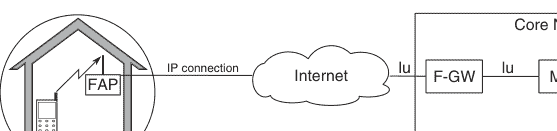

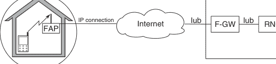

图 4.2 通用毫微微蜂窝网络架构。(a) Iu-over-IP。(b) Iub-over-IP

（基站）不像移动终端那样需要频繁迁移。因此，出于经济可行性的考虑，GSM毫微微蜂窝接入点的设计将包含仅在特定国家许可频段工作的收发器。甚至已经有提议检测FAP的位置，并在它位于非预定操作国家时阻止其传输。

图 4.3 展示了一个使用900 MHz频段的GSM系统频率分配示例。可以看出，GSM网络中上下行传输的主要双工技术是频分双工（FDD），它将较低的频段分配给移动台（MS），将较高的频段分配给基站（BTS）。这种设计基于这样一个事实：在较低频率上传输所需的能量比在较高频率上传输要低。因此，它被认为可以节省移动设备的电池电量。

在上下行频段中所有可用的频率信道中，总有一个被留作保护带。在GSM中，传输信道的带宽为200 kHz，因此很容易看出每个方向（下行和上行）的可用传输载波频率数量 $N_{ch}$ 是：

$$N_{ch} = \frac{25 \text{ MHz}}{200 \text{ kHz}} - 1 = 124$$

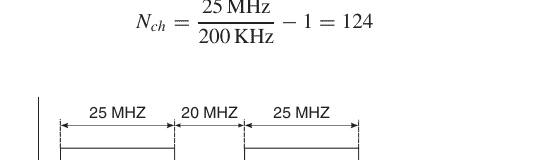

每个国家都遵循自己的程序来分配这些信道的许可证，通常是通过拍卖发射许可给不同的运营商。因此，每个运营商使用这 $N_{ch}$ 个信道的一个子组，包含或多或少的信道，具体取决于为许可证支付的价格。然而，必须强调的是，信道是以上行/下行对的形式分配的，即不可能独立支付一个下行或上行信道的许可费用。由于上下行频段之间有20 MHz的间隔，因此一个上行和下行传输信道之间的总频率间隔为25 MHz + 20 MHz = 45 MHz，这是由同一无线电设备中的同一收发器处理的信道对。

GSM传输信道的许可价格高达数百万欧元，因此一些运营商对最大化频谱使用效率有着浓厚兴趣。部署与覆盖宏小区使用相同频率信道的毫微微蜂窝，可以在不增加额外GSM信道的情况下提高整体网络吞吐量。因此，网络运营商可以通过最大化面积频谱效率（ASE）来获得更高利润。

#### GSM TDMA 帧

GSM使用时分多址（TDMA）以轮询方式管理来自不同用户的传输。这意味着每个频率信道在时间上由多个用户共享，每个用户被允许在一个给定的时间段内在一个200 kHz的信道中传输。这是通过在时域上将频带细分为八个连续的时隙来实现的。单个时隙称为*突发周期*，其持续时间为15/26 ≈ 0.577毫秒（见图4.4）。从时隙0开始的八个连续时隙集合称为*TDMA帧*，其持续时间为120/26 ≈ 4.615毫秒，在此期间传输信息比特。例如，一个数据突发的时间持续时间等于传输156.25比特所需的时间，尽管并非所有比特都包含有用信息。如图4.4所示，一个正常数据突发携带以下148比特：

- **尾比特：** 每个数据突发开头和结尾的3个比特始终设置为零。这些用于通过将GSM接收机中的维特比均衡器设置为初始状态并使其准备好接收下一个数据突发来清除该均衡器。
- **数据比特：** 这些是承载来自和发往用户的有用语音数据的容器。
- **训练比特：** 该字段的内容是发射机和接收机预先商定的。然后，接收机可以使用接收到的值进行信道均衡。
- **偷用标志：** 训练比特前后的单个比特指示当前突发包含用户数据还是控制信息。
- **保护间隔：** 这是一段时间，在此期间不传输任何内容。这避免了由于多径环境中的传播延迟导致相邻突发相互干扰。

下行TDMA帧的时隙0通常用于分配广播控制信道（BCCH），BTS持续使用该信道来传输小区ID、移动网络码（MNC）、位置区域码（LAC）等。这只剩下七个时隙用于用户业务。然而，GSM标准允许多个

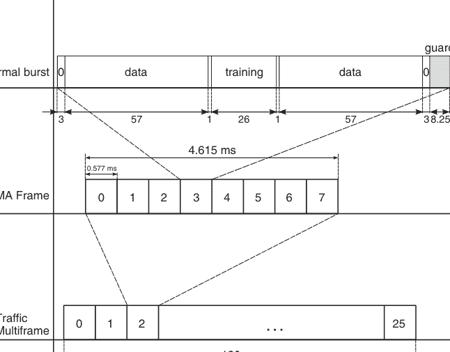

频率信道共享一个公共BCCH，从而在其他信道上拥有全部八个时隙可用。尽管如此，FAP制造商必须根据毫微微蜂窝提供的服务的流量要求仔细权衡这一点。这是因为对于某些服务，拥有一个额外的业务信道可能至关重要。然而，对于多个业务信道仅使用一个BCCH在信令方面可能是不可行的。因此，需要进行适当的规划。

在GSM中，根据信道承载的信息类型对信道进行区分。因此有业务信道和控制信道。此类信道由多个TDMA帧构成，形成一个更大的*多帧*。不同类型多帧的解释如下。

#### GSM 业务信道

GSM中的业务信道（TCH）是一个由26个较短的TDMA帧组成的多帧（见图4.4）。然而，其中只有24个帧真正用于用户语音业务，而另外两个帧保留用于传输慢速随路控制信道（SACCH）。SACCH用于MS和基站控制器（BSC）之间交换功率控制信息，该功能内置在毫微微蜂窝接入点中。它在TCH多帧的帧12和25中交替发送，在上行链路中携带来自MS的功率测量报告，在下行链路中携带功率控制命令。

#### GSM 控制信道

图4.5对GSM中不同的控制信道进行了分类。BCH用于FAP向MS发送网络相关信息，有三种：

- 如上所述，BCCH由BTS持续传输小区ID和其他网络相关信息。MS读取该信道以检测其当前所在的小区并了解信道功率。
- 同步信道（SCH）用于帮助MS与BTS发送的帧同步。这是通过发送一个训练序列以及基站识别码（BSIC）来实现的。
- 频率校正信道（FCCH）携带一个正弦音。MS使用它将其频率与BTS的频率同步。

公共控制信道（CCCH）用于呼叫建立，并细分为三个信道：

- 寻呼信道（PCH）用于通知MS有来电。
- 随机接入信道（RACH）是一个上行信道，MS通过它请求接入网络。这些请求遵循时隙ALOHA协议。
- 接入准许信道（AGCH）用于在通过RACH发出请求后通知MS分配的时隙。

快速随路控制信道（FACCH）是一个特殊信道，用于在信号质量快速下降或切换期间传输控制信息。例如，如果MS和FAP之间突然出现障碍物（有人经过或内墙），移动发射机可能需要以更高的功率传输才能到达FAP。由于这种情况需要快速干预，业务信道暂时被FACCH替换以处理此功率增加请求。图4.4突发中训练序列前后传输的*偷用比特*或*标志*。这些向接收机指示当前突发是控制消息（例如FACCH），以便相应的例程进行控制。同样的情况适用于开放接入毫微微蜂窝的用户离开家并切换到外部宏小区的情况。由于从毫微微蜂窝接收到的功率迅速下降，

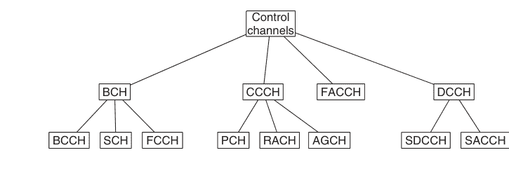

**图 4.5** GSM逻辑控制信道


快速伴随控制信道（FACCH）用于移动用户与网络之间的快速信息交换，以尽可能快地完成切换。

专用控制信道（DCCH）用于移动台（MS）与GSM网络之间的信令传输。它包含以下信道：

-   独立专用控制信道（SDCCH）用于呼叫建立的信令传输。
-   如上所述，慢速伴随控制信道（SACCH）在每个复帧期间在MS和FAP之间交换功率控制信息。

## 4.3  3G微微蜂窝：UMTS与HSPA

随着3GPP规范的演进，网络变得更加接入无关，允许连接通过除SGSN之外的其他方式到达核心网络。这增加了基站的灵活性，使其能够通过基于IP的网络进行连接。这些及其他特性使得UMTS技术比GSM更适合部署微微蜂窝。为与3GPP术语保持一致，本节使用家庭基站（HNB）一词来指代FAP。

得益于干扰平均化，WCDMA接收机能够在极低的信噪比（SINR）水平下分离UMTS信号。从空口的角度来看，UMTS因此也比GSM更适合应对两层网络的高干扰水平。此外，鉴于UMTS提供的数据速率远高于GSM，且该技术已经过充分测试，大多数制造商已将重点放在基于UMTS的HNB开发上。

通用移动通信系统（UMTS）[6]不过是由第三代合作伙伴计划（3GPP）无线接入网（RAN）组[7]指定的一组无线技术的名称。UMTS空口的名称是UMTS陆地无线接入（UTRA），其规范规定了频分双工（FDD）和时分双工（TDD）模式。这与仅规范了FDD的GSM形成对比（见图4.3）。UMTS空口的主要3GPP技术规范（TS）有两个（见表4.1）：TS 25.101（可在[8]中找到）规定了UTRA的FDD模式必须在用户设备（UE）中提供的最低射频特性。其次，TS 25.102（可在[9]中找到）规定了TDD变体的要求。尽管存在两种选择，但全球部署的大多数UMTS网络均使用FDD模式的UMTS。这主要是由于在相同频带传输的相邻NodeB之间会产生干扰问题。

与GSM不同，UMTS HNB由3GPP在2008年底通过TS 22.220 [10]进行了标准化。这允许供应商以一种保证最低功能的方式开发其FAP，以便网络运营商部署微微蜂窝。然而，[10]仍然是该标准的第一版，预计在不久的将来会有进一步的完善。3GPP发布的其他规范及正在开发中的规范也列于表4.1中。

**表4.1** UTRA规范（精选）

| 技术 | 规范 | 标题 | 版本 |
| :--- | :--- | :--- | :--- |
| W-CDMA | 25.101 | 用户设备（UE）无线传输与接收（FDD） | R99 R4 R5 R6 |
| HSDPA | | | |
| HSUPA | | | |
| W-CDMA | 25.102 | 用户设备（UE）无线传输与接收（TDD） | R99 R4 R5 R6 |
| HSDPA | | | |
| HSUPA | | | |
| 3G | 22.220 | 家庭基站（HNB）与家庭演进型基站（HeNB）的服务要求 | R8 |
| | 25.469 | UTRAN Iuh接口家庭基站（HNB）应用部分（HNBAP）信令 | R8 |
| | 25.820 | 3G家庭基站研究项目技术报告 | R8 |
| | 25.967 | FDD家庭基站射频要求 | R8 |

### 4.3.1 CDMA基础

码分多址（CDMA）是UTRA中使用的媒介接入技术。然而，CDMA在UMTS中的具体实现称为宽带码分多址（WCDMA），这将其与其他系统（如CDMA2000或演进数据优化（EVDO））中使用的实现区分开来。“宽带”的明确含义是指UMTS系统中使用的带宽大于其他系统中使用的带宽。与其他技术相反，CDMA允许所有用户在所有可用带宽上同时传输，不同的传输通过使用正交码来区分。

CDMA背后的基本概念是扩频，它包括对数据信号进行调制，使得生成的信号比原始信号具有大得多的带宽。这是通过在数据和编码信号之间应用异或（XOR）运算实现的。图4.6说明了这一过程，其中$s_b$代表原始二进制数据信号，$c$是扩频码或调制信号。可以证明，如果$c$的速率大于$s_b$的速率，则生成的信号$x_c$也比原始信号$s_b$具有更大的带宽。编码信号$c$被称为扩频信号，因为它通过扩展其频谱占用度来改变原始信号的频谱特性。因此，$c$的比特率远高于数据信号，其元素被称为码片（chips），以区别于二进制数据比特。在图4.7中，周期为$T_b$的数据信号$s_b$被周期为$T_c$的扩频信号$c$调制。本例中的传输滤波器是根升余弦滤波器，可以看到生成的$x_c$比$s_b$具有更大的带宽。$s_b$的比特率为$R_b = 1/T_b$，而$c$的码片速率为$R_c = 1/T_c$。因此，扩频因子（$SF$）可以定义为：

$$SF = \frac{R_c}{R_b} = \frac{T_b}{T_c} \tag{4.2}$$

它是一个整数，表示每个数据比特的总码片数。

接收CDMA信号的目的是分离来自不同用户的信号。这是通过计算接收信号与用户扩频码的互相关来实现的。只有当结果互相关达到其最大值时，才能提取相应的信号。解调是通过应用图4.6的逆过程执行的，即接收信号与解扩码进行异或运算。这通过减小接收信号的带宽并增加其功率密度来恢复原始数据序列。值得注意的是，如果存在窄带干扰信号，此过程的效果是频谱扩展。因此，窄带干扰信号的功率密度降低，而数据信号的功率密度增加。这一特性使CDMA系统特别抵抗窄带干扰。然而，对于来自其他用户的宽带干扰，这种情况不会发生，即使在解扩过程后，宽带干扰仍然保持为宽带干扰。因此，*处理增益*被定义为所需数据信号功率密度的增加量，它等于扩频因子*SF*。

CDMA中用于分配多个用户的码在理想情况下是相互正交的。然而，这依赖于不同用户的编码序列在时间上完美对齐（同步CDMA）。由于在某些情况下（例如来自独立UE的上行链路连接）很难达到这种同步水平，异步CDMA使用伪随机噪声（PN）序列，这些序列对时移具有更好的抵抗力。关于扩频码和CDMA技术其他方面的更多信息，读者可参阅[11]。

### 4.3.2 网络

图4.8显示了截至Release 4（于2001年4月发布）的UMTS网络架构，其中与图4.1的GSM网络相比，变化已经显而易见。UMTS网络的各个部分解释如下。

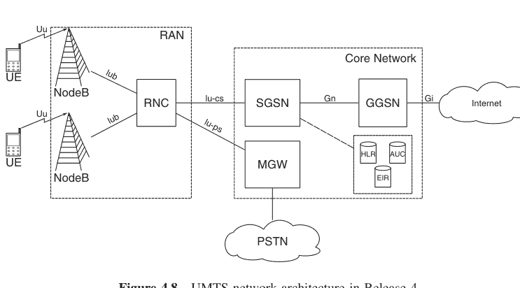

**图4.8** Release 4中的UMTS网络架构


 ## 无线接入网（RAN）

在UMTS中，RAN相当于GSM网络中的基站子系统（BSS）。UMTS中的RAN被称为UMTS陆地无线接入网（UTRAN），它将用户设备（UE）与核心网连接起来，并负责处理空中接口。移动用户唯一可见的UTRAN部分是NodeB，它通过WCDMA空中接口处理单个小区。在3GPP标准化过程中，该元素被临时命名为*NodeB*（宽带接入节点）。然而，它很快被广泛使用，因此保留为表示UMTS基站的官方术语[12]。UMTS与GSM的主要区别之一是，UMTS引入了异步传输模式（ATM）作为在回传中承载信息和信令的传输协议。因此，NodeB通过称为Iub的逻辑接口[13]由ATM链路连接到无线网络控制器（RNC），该接口用于NodeB和RNC之间进行无线资源协商。在UMTS中，NodeB支持小区扇区化，即每个小区可以划分为在不同载波频率上服务的多个角度扇区。

RNC相当于GSM网络中的基站控制器（BSC），是UTRAN内的决策单元。RNC控制多个NodeB，执行无线资源管理（RRM），并且能够通过Iur接口直接与其他RNC通信。此外，RNC通过称为*Iu*的逻辑接口与核心网通信。RNC执行呼叫准入控制（CAC），并根据请求呼叫的NodeB处存在的干扰水平来接受或拒绝呼叫。它还为UE分配CDMA码并确定功率控制限制，以避免远近效应问题（参见第6.2.3节）。

在微微基站（femtocell）的情况下，RAN可以完全集成到FAP设备中。但是，有多种实现方式。如果由微微基站执行RNC功能，则发往核心网的Iu消息需要封装到IP数据包中，以便通过互联网传输。这种配置称为Iu隧道或Iu-over-IP，对于多用户同时接入微微基站的中小企业[14]来说，似乎是一种合适的架构。与家庭环境相比，这种情况下用户数量增加，使得将RNC功能更靠近HNB成为必要。图4.2(a)和4.9展示了这种架构。由于SOHO环境中的UE数量减少，需要其他方法将RNC从微微基站中移除并引入核心网。如图4.8所示，这意味着FAP与RNC之间的Iub通信需要封装在IP数据包上。因此，这种架构称为Iub-over-IP，如图4.2(b)所示。然而，从核心网为数百万个微微基站执行RRM的可行性尚不确定，Iu-over-IP是更优的方案。

#### 核心网（CN）

尽管RAN进行了重新设计，但UMTS标准的第99版保留了GSM的核心网（CN）。GSM网络中的移动交换中心（MSC）过去通过A接口在基站控制器（BSC）之间传输语音。然而，UTRAN现在使用ATM以不同的速率传输语音，因此RNC无法直接与旧的MSC通信。为此，引入了一个称为媒体网关（MGW）的新网络元素，作为UTRAN与GSM MSC之间的接口。随着规范的进展，第4版用全IP核心网取代了旧的GSM CN，MSC最终从网络架构中移除（参见图4.8）。

服务GPRS支持节点（SGSN）是从GPRS网络继承下来的处理数据通信的网络元素。它将传入的数据包路由到适当的RNC或从RNC路由传入的数据包，并对用户进行网络认证。网关GPRS支持节点（GGSN）就是SGSN到互联网的入口点。

### 4.3.3 空中接口

图4.10(a)显示了分配给UTRA FDD模式的频段。与GSM类似，UMTS信道是*成对*的，即为一对上下行频率信道发放一个许可证。每个UMTS信道需要5 MHz的带宽，这意味着在授权频段中只有60/5 = 12个UMTS信道。然而，为了使运营商能够实施适当的频率规划并避免其NodeB之间的干扰，一个以上的信道是必要的。

UMTS协议栈有两个明确划分的部分：

- 接入层（AS）包括组成UTRAN的各层以及实现ATM传输功能的底层。
- 非接入层（NAS）包括与核心网通信的上层。

另一个关键概念是无线接入承载（RAB），这是接入层向非接入层提供信息传输的方式。RAB基本上是无线链路控制（RLC）层向UTRA协议栈上层提供的服务接入点（SAP）。图4.11展示了这一点，其中RAN的不同元素被捆绑在同一个网络结构块中，以突出图4.2(a)的Iu-over-IP架构。RAB被持续建立和释放，以便为UMTS信道提供具有不同QoS的传输能力。

因此，UTRA是接入层的基本部分之一，因为它将UE与NodeB连接起来，并且是用户进入UMTS网络的入口。UMTS空中接口信道是由底层提供的SAP，分为三类：

- *逻辑*信道由MAC层提供给RLC层，用于传输用户信息。
- *传输*信道由物理（PHY）层提供。
- *物理*信道在空中传输，并连接不同UTRA元素的物理层。

如第4.3.1节所述，UMTS的空中接口基于CDMA，码片速率为 $R_c = 3.84$ Mcps，带宽为5 MHz。无线帧的持续时间为 $t_f = 10$ ms，其结构如图4.12所示。每个帧被细分为 $N_s = 15$ 个时隙或突发，每个时隙的持续时间为 $t_s = t_f/N_s \approx 0.667$ ms，每个时隙包含 $N_c = R_c \cdot t_s = 2560$ 个码片。然而，每个时隙承载的比特数 $N_b$ 取决于CDMA扩频因子（$SF$）和传输所采用的数字调制方式。在UMTS中，调制方式是正交相移键控（QPSK），每个符号承载 $N_{mod} = 2$ 个比特。因此，$N_b$ 可以通过以下公式轻松计算：

$$N_b = \frac{N_c}{SF} \cdot N_{mod} = \frac{2560}{SF} \cdot 2$$ (4.3)

因此，$SF$ 是物理信道的一个基本属性，一个时隙的比特率 $R_b$ 可以使用以下公式计算：

$$R_b = \frac{N_b}{t_s}$$ (4.4)

在UMTS中，信道通常通过将多个上层信道映射到一个底层子信道来传输。类似地，一个上层信道也可能被拆分到多个底层信道上。此外，一些信道与上层信道无关，仅携带在其生成层有意义的信息。因此，除了其他任务外，每个层还负责将其通过SAP接收到的信道*复用*和*分段*为下一层的适当子信道。图4.13(a)说明了那些映射到上层信道的物理信道，以下列出了可用的不同信道。

#### 逻辑信道

- 与GSM一样，广播控制信道（BCCH）是一个下行信道，包含小区ID和UE检测UMTS小区所需的所有必要信息。


#### 物理信道

- 公共控制物理信道（CCPCH）是一个下行信道，主要用于传输控制信息（尽管通过FACH也允许传输小的用户数据包）。CCPCH分为两个子信道：主公共控制物理信道（PCCPCH），始终使用$SF = 256$的信道化码进行传输，承载BCH；以及辅公共控制物理信道（SCCPCH）。
- 专用物理数据信道（DPDCH）承载来自DCH的用户信息。
- 专用物理控制信道（DPCCH）承载物理层控制信息，如功率控制和数据格式。
- 物理下行共享信道（PDSCH）用于向不同的UE发送DSCH。
- 物理随机接入信道（PRACH）承载UE首次接入网络时在RACH中发送的控制信息。它也可以承载小的用户数据。
- 物理公共分组信道（PCPCH）用于承载传输信道CPCH。
- 虽然图4.13(a)中未显示，但公共导频信道（CPICH）是一个重要的下行物理信道，由HNB持续发射。UE读取该信道的功率以检测周围可用的蜂窝。

PHY层在每个称为传输时间间隔（TTI）的周期从MAC层接收一个数据块。如前所述，PHY层对传输信道承载的信息进行处理，以便通过物理信道成功传输。CRC和卷积编码在这一层执行，此外还有比特交织，以将突发错误分散到不同的无线帧中。可以交织的比特数取决于TTI。一方面，较长的TTI允许更多的比特分布到整个帧中，从而降低突发错误的影响。另一方面，较短的TTI会降低比特交织的有效性。TTI值还影响无线链路自适应可以应用的频率。短TTI允许在接收端更频繁地估计误码率（BER），从而在链路恶化的情况下可以更快地采取行动。UMTS在此方面提供了灵活性，允许使用10、20、40和80 ms的TTI。

交织后，所得信息块的比特必须进行打孔或重复，以使该块与信道的比特率匹配。此过程称为*速率匹配*。之后，PHY层可以决定将具有相同编码和交织的所有块复用到一个编码复合传输信道（CCTrCH）‡中。然后将所得的CCTrCH映射到物理信道。此后，物理信道通过WCDMA扩频函数进行调制，以达到UMTS的码片速率$R_c = 3.84$ Mcps。每个HNB使用自己独有的扩频码，称为*扰码*。这使得UE能够区分来自不同毫微微蜂窝的下行信号。此外，每个UE还具有与该毫微微蜂窝内其他用户不同的扰码。对扰码进行智能管理可以作为减少来自周围毫微微蜂窝的干扰对UE影响的一种手段。然而，UE首次进入毫微微蜂窝时需要检查所有可用的扰码。因此，为了减少注册时间，可用码的数量必须保持较少。另一类称为*信道化码*的码也用于在接收时区分不同的物理信道。最后，比特序列映射到QPSK调制，并使用滚降因子$\beta = 0.22$的根升余弦滤波器进行调制。关于UMTS更详细的研究可参见[15]。

‡ 注意CCTrCH仅存在于物理层内。

### 4.3.4 HSPA毫微微蜂窝

如表4.1所示，3GPP规范的版本5和6对UMTS网络引入了进一步的增强。这些将在下文详述。

#### HSDPA

3GPP版本5标准的第一个版本于2002年3月发布，它对下行链路架构引入了几项改进。此版本通常称为高速下行分组接入（HSDPA），除其他变化外，它从规范中移除了传输信道DSCH。取而代之的是其HSDPA等价物：高速DSCH（HSDSCH），在HSDPA中用于承载用户数据。

现在支持使用更高阶调制16-正交幅度调制（QAM）而不仅仅是QPSK的选项（如图4.14所示）。通过这样做，每个调制符号承载$N_{mod} = 4$比特，因此可实现更高的吞吐量（见公式(4.3)）。例如，HSDPA理论上能够在定义的2 ms新TTI上实现14.4 Mbps。另一方面，普通UMTS室内系统仅支持最高2 Mbps的速度。然而，这个数据速率通常受到连接NodeB与RNC的Iub接口的限制。在按照Iu-over-IP架构设计的毫微微蜂窝中，不存在这样的Iub接口，因为RNC功能内置于FAP中，因此消除了Iub瓶颈。

HSDPA中还包含混合自动重传请求（HARQ），以提高物理层中数据包重传的速度。在HSDPA中，下行传输给用户的数据包保存在NodeB的缓冲区中，以便在发生错误时加速数据包重传。这相对于仅将数据保存在RNC中的普通UMTS宏蜂窝系统而言是一种速度改进。然而，此特性在Iu-over-IP HSDPA毫微微蜂窝相对于UMTS并未带来显著增益，因为RNC与HNB集成在一起，它们已经共享相同的缓冲区。另一方面，Iub-over-IP HNB可能从此方法中获得很大收益，因为它避免了必须通过Iub隧道和互联网从核心网络中的RNC重传错误数据包（见图4.2）。此外，HSDPA将TTI从10 ms减少到2 ms，这使得能够更快地进行调度并更频繁地通过良好的无线链路传输数据。因此，需要的重传更少。HSDPA中的调度器也从RNC移除并放置到NodeB中。

DCH在HSDPA中也是一个关键信道，它始终承载来自DCCH的信令，始终与其他信道并行传输。此外，用于编码此信道的*SF*是固定的，以实现最大的可用数据速率。如上所述，HSDSCH现在是承载用户数据的传输信道。然而，RLC层现在不再使用功率控制，而是使用自适应调制和编码（AMC）来适应无线信道的变化。更改调制和编码（MC）的决定基于在上行链路中接收到的信道质量指示符（CQI），它是一个索引，指向最适合下一次传输的MC。由于没有功率控制，发射功率保持恒定，必须选择不同的数字调制来应对信道变化。有关HSDPA的更多信息，读者可参考[16]。

2004年底，3GPP规范的版本6，通常称为高速上行分组接入（HSUPA），最终发布，PicoChip是第一家发布商用HSUPA毫微微蜂窝设计的公司[17]。这包括对其先前HSDPA产品的软件升级，使其符合3GPP版本6，并能够提供高达1.46 Mbps的HSUPA上行速度。后来，其他公司如Percello、Ubiquisys、华为或Ivy Network也对这种设计表现出兴趣，并开始开发自己的HSUPA毫微微蜂窝解决方案。然而，对于在毫微微蜂窝设计中支持HSUPA技术的可行性存在担忧。版本6支持的理论上行速度高达5.76 Mbps，这超过了欧洲大多数ADSL连接所能提供的带宽。

因此，上行链路速度将受限于当前的回程连接，尽管这只会影响基于互联网的应用程序，而不会影响以SOHO为中心的应用程序。

与HSDPA引入的高阶调制相比，多项研究表明，在上行链路中采用16-QAM并未带来显著增益，因此在第6版中仅支持二进制相移键控（BPSK）调制。此外，高阶调制需要更高的每比特能量，而能量在用户终端中是有限资源。因此，在HSUPA中，功率控制被用来应对信道的快速变化。与UMTS的20 dB相比，HSUPA引入了70 dB的功率控制动态范围，这增强了在衰落管理方面的灵活性。此外，功率控制被移至NodeB，NodeB通过几个新的专用信道（增强上行链路相对授权信道（ERGCH）和增强上行链路绝对授权信道（EAGCH））向用户设备（UE）发送指令。

DCH是UMTS系统中通常用于承载用户数据的传输信道。然而，在HSUPA中，该信道被上行链路增强专用信道（EDCH）所取代，这是一个专门用于从UE向NodeB传输信息的信道。HSUPA的物理层也支持混合自动重传请求（HARQ），并通过新的EDCH HARQ指示信道（EHICH）实现，这是一个下行链路信道，用于发送与上行链路传输相对应的确认。

HSUPA支持两个传输时间间隔（TTI）值：2毫秒和10毫秒。与HSDPA一样，较低的TTI值有助于提高对快速衰落的响应速度。然而，对于远离NodeB的UE来说，每2毫秒传输一次信令信息会消耗大量功率。这促使引入了对10毫秒TTI的支持，这也是目前用户终端最常支持的TTI。与宏蜂窝相比，家庭基站（Femtocell）用户通常离其家庭基站（HNB）近得多。此外，家庭蜂窝的边缘是明确定义的，并被建筑物的外墙所限制。这表明2毫秒的TTI在家庭蜂窝场景中应该是可行的。然而，在大多数终端[16]中，这是一个可选功能，并非总是得到支持。

## 4.4 基于OFDM的家庭基站

无线信道的一个主要缺陷是频率选择性衰落。在密集多径环境中尤其如此，因为信道在不同频率上的行为不同（见图4.15），这在室内和城市环境中尤为明显。宽带信号（如CDMA信号）在通过此类信道传输时遭受的失真使其难以恢复，因此更倾向于使用窄带信号，因为它们对这些信道具有更高的抗性。

这在五十年代推动了多载波调制技术的发展，该技术通过几个窄带信道而不是一个大的宽带信道来传输信息。然而，这项技术直到20世纪90年代才获得成功，那时电子技术开始应对其计算需求。此外，将数据流细分为多个较小的数据流可以有效地管理无线资源和干扰，这是重叠两层网络的主要问题（见第6章）。由于其通过快速傅里叶变换（FFT）实现的高效性，正交频分复用（OFDM）被选为IEEE微波接入全球互操作性（WiMAX）和3GPP长期演进（LTE）物理层的多载波技术。这些是旨在取代当前UMTS网络的候选技术之一。由于家庭基站也是无线接入网（RAN）的一部分，并且需要与室外宏小区交互（例如进行切换），基于这些技术的家庭基站接入点（FAP）是当前GSM或3G NodeB的自然演进。此外，几家制造商已经开始开发基于OFDM的家庭基站，这在未来可能会变得普遍。

总的来说，家庭基站概念同样适用于所有无线接入网技术。然而，基于CDMA和OFDM的家庭基站之间存在一些根本性差异。在家庭蜂窝和宏小区重用同一电磁频谱的场景中，CDMA的干扰平均有助于减少干扰的影响。然而，在OFDM中，一个发射机就足以完全干扰给定的子载波。因此，假定OFDM家庭蜂窝将使用某种*自组织*方法来应对潜在的干扰问题。其想法是家庭蜂窝将扫描无线环境（无论是自行扫描还是通过UE的测量报告），并以分布式方式（合作或不合作）使用此信息来选择最佳的子载波分配。

接下来，我们将概述WiMAX和LTE，它们是演进到4G的候选技术。

### 4.4.1 OFDM基础

图4.16显示了OFDM传输系统的基本结构。在发射机端，数据序列被映射到复数星座（例如QPSK或16-QAM）的符号*X*中，然后以$N$为一组输入到逆快速傅里叶变换（IFFT）中。$N$通常是2的幂，并且是系统的基本属性。从IFFT块输出的$N$个采样组被称为一个*OFDM*符号，它由以下序列组成：

$$x[n] = \frac{1}{\sqrt{N}} \sum_{k=0}^{N-1} X[k] e^{\frac{2\pi j n k}{N}}, \quad n = 0, \ldots, N-1 \qquad (4.5)$$

如图所示，每个复数符号$X[k]$由复指数函数调制。其中每个都称为一个*OFDM子载波*，它们被安排为彼此正交。由于OFDM调制是通过FFT算法实现的，因此每个子载波的观测带宽取决于采样频率$f_s$和FFT大小$N_{FFT}$，关系为$\Delta f = f_s / N_{FFT}$。因此应注意，OFDM符号的有效持续时间（不包括循环前缀）与子载波间隔$\Delta f$的关系如下：

$$T_{OFDM} = \frac{1}{\Delta f} \qquad (4.6)$$

因此，相邻子载波之间存在轻微的重叠；然而，正交性使得在接收机端通过FFT可以轻松恢复原始序列。归一化因子$1/\sqrt{N}$用于保证信号在系统发射机和接收机部分之间的单位变换。图4.17展示了一个OFDM频谱，其中相邻子载波的间隔为$\Delta f$。

由于使用了IFFT，OFDM信号可以被认为是构建在频域中。这意味着每个符号X[k]的能量在通过无线传输时直接转化为第k个子载波所承载的能量。这对于例如避免在给定时刻在遭受深度衰落的某些频段上传输数据是有用的。通过利用信道质量指示（CQI）信息，发射机可以决定，例如，只需设置X[10] = 0和X[47] = 0，就不在子频段10和47上传输数据。这释放了相应的射频子载波，并减少了对使用这些频段的其他家庭基站的干扰。

OFDM中信息恢复的基本原理是子载波之间的正交性。这通常由发射机和接收机之间高度精确的振荡器和定时来保证。然而，业界的目标是保持FAP价格尽可能低，因此存在OFDM家庭基站接入点中使用低质量振荡器的风险，这可能会降低传输链路的性能。这表现为子载波在频率上变宽，并对相邻子载波造成干扰，这种现象称为载波间干扰（ICI），必须由FAP制造商进行适当校准。研究表明[18]，增加ICI的因素包括较长的OFDM符号持续时间和频率偏移误差，这会导致ICI呈二次增长。

#### 循环前缀

从图4.15可以看出，多径信道会导致接收机接收到多个信号回声。其结果是符号在时间上变宽，并干扰下一个相邻符号，这种现象称为符号间干扰（ISI）。为了减少ISI的影响，大多数OFDM系统使用一种称为*循环前缀*的技术，该技术通过在原始序列的开头重复x[n]的最后部分来实现。如图4.16(a)所示，x[n]的最后L个采样在数模转换（DAC）之前被作为前缀引入，其中L是离散多径信道脉冲响应的长度。因此，得到的序列x_CP[n]的长度为

N + L，因此在 $-L \le n \le N - 1$ 范围内，有 $x_{CP}[n] = x[n]_{\text{mod } N}$。于是，接收的离散信号为：

$$y[n] = x_{CP}[n] * h[n]$$
$$= \sum_{k=0}^{L} h[k]x_{CP}[n-k]$$
$$= \sum_{k=0}^{L} h[k]x[n-k]_{\text{mod } N}$$
$$= x[n] \circledast h[n]$$

这表明循环前缀迫使接收信号 $y[n]$ 成为原始信号与信道冲激响应 $h[n]$ 的圆周卷积。根据圆周卷积的性质，(4.7) 式可以在频域重写为 $Y[k] = X[k]H[k]$，其中 $0 \le k \le N - 1$。因此，只要已知信道响应 $h[n]$，就可以通过以下方式恢复无码间干扰的原始信号：

$$x[n] = IFFT \left\{ \frac{Y[k]}{H[k]} \right\}$$

#### OFDMA

正交频分多址接入（OFDMA）是一种基于 OFDM 的多用户接入方案，它利用频谱在子载波上的排列，将用户分配到频域。它不是让每个用户通过所有子载波在所有时间使用全部频谱，而是仅为每个用户分配其中的一个子集。这最大化了频率复用，因为在给定时刻，一个用户不太可能在所有子载波上都拥有良好的信道条件。因此，让其他用户使用这些子载波是合理的。这种方法引入了对动态频率分配算法的需求，这些算法为每个 OFDMA 符号决定分配哪些子载波给哪些用户。此外，在 OFDMA 系统中，子载波通常被分组为称为子信道的更大组，以便于处理。例如，图 4.18 显示了八个频率子信道的动态分配，它随时间变化并利用了频率分集。

#### 单载波 FDMA

信号 $s(t)$ 的峰均功率比（papr）定义为其峰值功率与均方根值之比，即：

$$papr = \frac{\max[s(t)s^*(t)]}{E[s(t)s^*(t)]}$$

例如，一个恒定直流信号的 $papr = 1$，而一个正弦信号的 $papr = 1.41$。然而，对于一个由 $N$ 个子载波调制相同复数符号星座图的 OFDM 信号，可以证明 $papr = N$（这是 OFDM 信号的最大 papr）。由于 OFDM 信号在传输前需要通过功率放大器，较高的 *papr* 值意味着放大器需要有很大的回退，以便对所有可能的信号功率值施加相同的增益。此外，具有大 *papr* 的信号也具有大的动态范围，这意味着 D/A 和 A/D 转换器需要高分辨率才能准确表示所有幅度。

由于移动终端中为节约成本而选用的组件质量较低，OFDM 信号的这些特性在某些终端上可能难以满足。因此，必须设计替代的传输机制。图 4.19 所示的方案与图 4.16 的 OFDM 系统仅在离散傅里叶变换（DFT）和逆离散傅里叶变换（IDFT）模块上有所不同，这些模块在传输链中相互抵消。这些模块的目标是在应用 $N$ 点 OFDM 调制之前，将符号预编码为大小为 $M < N$ 的组。通过这样做，并在 IFFT 大小之前补零，所得的编码信号 $x_c[n]$ 是原始 OFDM 信号 $x[n]$ 的过采样版本。这意味着 $x_c(t)$ 的功率变化远低于 $x(t)$，因此，$x_c(t)$ 被认为表现得像一个单载波信号。这种信号的 *papr* 因此降低，从而允许提高功率放大的效率。

总而言之，像 OFDM 这样的多载波调制的主要优势可总结为：

- 抗多径能力强；
- 通过 FFT 模块实现高效；
- 利用频率分集进行多用户接入；
- 频谱效率高；
- 抗来自附近终端的窄带干扰能力强。

### 4.4.2 WiMAX

WiMAX 于 2004 年根据 IEEE 802.16d 标准发布，是一种可互操作的无线技术，旨在提供*最后一英里*连接。然而，随着 2005 年 802.16e 的发布，该标准进一步发展，它支持移动连接，因此被称为移动 WiMAX。与 3GPP 规范相比，WiMAX 标准仅定义了无线接入的 MAC 和 PHY 层。尽管如此，WiMAX 论坛 [19] 内的网络工作组（NWG）开发了一种支持 IP 连接的端到端网络架构。这意味着任何类型的 WiMAX 接入服务网络（ASN）（基于宏蜂窝、毫微微蜂窝等）也可以通过 IP 网络（例如 DSL 连接）连接到 WiMAX 运营商的核心网（CN）。

WiMAX 是一项全 IP 技术，这一事实使其特别适合毫微微蜂窝部署。此外，WiMAX 支持理论对称数据速率高达 70Mbps，从而为以移动为中心的毫微微蜂窝应用提供高 QoS。WiMAX 发射许可已在大多数欧洲国家和美国拍卖。这加上 2004 年和 2005 年标准的发布，意味着 LTE 等其他现代技术在市场可行性和设备生产方面落后 3 到 4 年。这些事实已经唤醒了业界对 WiMAX 毫微微蜂窝作为当前 UMTS 和高速分组接入（HSPA）家庭基站（HNB）的可行替代方案的兴趣。一些公司甚至购买了专门用于 WiMAX 毫微微蜂窝的频段，从而保证零跨层同频干扰来自 WiMAX 宏蜂窝。然而，这种方法成本高昂，因为它没有最大化频率复用。此外，自组织功能以及用于 OFDM 蜂窝的分布式频率分配算法正逐渐成为应对此类干扰的有前途的解决方案。因此，网络运营商必须仔细评估 WiMAX 毫微/宏蜂窝的正交频率分配是否会影响其竞争力。因此，业界正向 WiMAX 论坛施压，要求批准 WiMAX 毫微微蜂窝规范，尽管在撰写本书时，尚未发布任何相关内容。

#### 物理层

802.16d 的 PHY 层基于 OFDM，因此对多径具有高抵抗力，这是室内和城市环境的内在特征，因为反射体和散射体丰富。另一方面，802.16e 基于 OFDMA，它利用频率分集为不同用户分配资源。更具体地说，802.16d 版本使用大小为 256 的 FFT，而 802.16e 的 PHY 层是可扩展的，FFT 大小在 128 到 2048 之间。

WiMAX 还支持多输入多输出（MIMO）技术，如波束成形和发射/接收分集。支持的信道带宽包括 1.25、1.75、3.5、5、7、8.75、10、14 和 15 MHz，因此在不同网络层的带宽分配方面非常灵活。在 802.16e 标准中，可用的信道带宽与可以使用的 OFDM 调制大小相关，即 FFT 大小。然而，在 802.16d 版本中，FFT 始终是恒定的，更高的带宽转化为更大的子载波间距，因此符号周期更短。

移动 WiMAX 使用子信道化的概念，将子载波（连续或不连续）分组为子信道，子信道是 WiMAX 基站可以分配的最小频率单位。因此，子信道描述了 OFDMA 频率分配的粒度。基于分布式子载波的置换方案，例如全子信道使用（FUSC）或部分子信道使用（PUSC），适用于快速移动用户。这是因为频谱随时间快速变化，这些方案确保并非所有子载波都受到负面影响。这里，利用了频率分集，在多个蜂窝之间平均整个网络干扰。另一方面，基于连续子载波的置换方案更适合低速移动用户，因为低衰落频谱区域可以很容易地识别，并在几个子帧期间保持恒定。在这种情况下，系统可以利用多用户分集，为每个用户提供最大化其信干噪比（SINR）的子信道。

此外，时隙定义了时域上的粒度，可以具有 1、2 或 3 个 OFDM 符号的持续时间。当一组子信道在几个连续的时隙中分配给一个用户时，所得资源称为用户的数据区域。

两个 WiMAX 标准都支持 TDD 和 FDD 作为双工机制。然而，业界更倾向于 TDD 模式，因为其频谱要求较低。WiMAX TDD 帧（见图 4.20）的持续时间在 2 毫秒到 20 毫秒之间变化，它在时域上区分下行链路和上行链路子帧。第一个子帧用于下行链路传输。然后，经过发射/接收转换间隙（TTG）后，上行链路子帧开始。下行链路子帧以贯穿所有子载波的前导码开始，用于同步和信道估计。前导码之后是帧控制头（FCH），它包含媒体接入协议（MAP）消息，指示每个用户的突发配置。只有在这之后，传输到不同用户的突发才被分配在独立的数据区域中传输。类似地，上行链路子帧包含几个数据突发以及用于功率和其他参数调整的测距区域。

与 HSPA 类似，WiMAX 使用 AMC 来应对信道变化，支持多种调制和编码方案，这些方案随突发而变化。在下行链路中，支持 QPSK、16QAM 和 64QAM，而 64QAM 调制是可选的。

在上行链路中。关于纠错，支持里德-所罗门码。此外，802.16e标准包含了对HARQ的支持，从而提供对传输错误的强抵抗力，同时节省信道容量。

#### MAC层

WiMAX的MAC层是面向连接的；它位于物理层之上，将MAC业务数据单元（SDU）转换为MAC分组数据单元（PDU）。此外，在MAC层之上还存在一个汇聚子层，用于与IP和以太网进行接口。

为用户（在WiMAX术语中称为MS）分配资源的方式是通过一种称为轮询的过程。这包括周期性地为MS分配时隙。然后，如果某个MS需要资源，它可以决定是否请求接入所分配的时隙。分配给每个用户的资源量取决于该用户业务所需的QoS。因此，在WiMAX中定义了以下业务类型：

##### 非请求授权业务（UGS）

用于需要恒定数据速率的应用，如没有静默抑制的VoIP。

##### 实时轮询业务（rtPS）

用于具有可变分组大小的实时应用，如视频会议。

##### 非实时轮询业务（nrtPS）

用于延迟不是问题的应用，如文件传输。

##### 尽力而为（BE）

用于没有QoS要求的应用（例如网页浏览）。

##### 扩展实时轮询业务（ertPS）

用于吞吐量要求可变的实时应用，如VoIP。

WiMAX的MAC层还支持多种省电模式，如*空闲*和*休眠*模式。这些模式为MS提供了在特定时间段内关闭自身的可能性，从而延长其电池寿命。WiMAX的MAC层庞大而复杂。然而，详细讨论它超出了本书的范围，读者可以参考[20]获取更多信息。

## 4.4.3 *LTE*

2008年12月，3GPP技术规范的第8版达到了其第一个稳定版本。此版本通常被称为长期演进（LTE），它引入了对此前规范的增强，以实现更高的吞吐量、频谱带宽、更灵活的频谱管理等。由于GSM和UMTS是全球部署最广泛的移动网络，预计LTE将通过升级现有网络来部署，因此将成为全球最常见的移动接入技术。此外，LTE规范引入了对家庭eNodeB（HeNB）的强有力支持，HeNB是此前HNB的演进，现已被视为无线接入的主要节点。

业界已经开始开发和测试基于LTE的毫微微蜂窝。例如，2008年5月，picoChip宣布了基于当时可用技术规范的首个HeNB微芯片参考设计。这促使多家FAP制造商开始开发自己的产品，意图在LTE牌照拍卖时率先进入市场。然而，在撰写本书时，这尚未发生，因此基于LTE的毫微微蜂窝的市场前景仍不确定。此外，LTE所达到的速率高于当今大多数DSL线路提供的速率，这限制了基于此版本的毫微微蜂窝所能获得的优势。以下提供LTE无线接口主要传输方案的概述。

#### 演进UTRAN（EUTRAN）概述

在LTE中，定义了持续时间为10毫秒的Type 1无线帧（见图4.12），并将其划分为十个持续时间为$T_{sf} = 1$毫秒的子帧。此外，为了与旧系统兼容，每个子帧被划分为$N_{sl}^{sf} = 2$个时隙，每个时隙长度为$T_{sl} = T_{sf}/2 = 0.5$毫秒。在每个时隙期间，总共传输$N_{sb}^{sl} = 6$或$N_{sb}^{sl} = 7$个OFDM符号，其中$N_{sb}^{sl}$取决于所选循环前缀的长度。LTE允许使用扩展循环前缀（16.7μs），在某些环境中可能需要用它来对抗大的延迟扩展。

然而，毫微微蜂窝场景涉及小区域和短延迟扩展，因此，正常长度的循环前缀（$T_{CP} = 5.2\,\mu$s）对于HeNB来说可能已经足够。在FDD模式下，同一频段内的所有子帧传输上行或下行信息。然而，在TDD模式下，除了承载系统信息的0和5号子帧外，所有子帧均可用于下行或上行传输。此外，还定义了*Type 2*无线帧以兼容之前的TDD系统。然而，在以下章节中假设使用*Type 1*帧。有关帧结构的更多信息可参见[21]。

#### 下行链路

EUTRAN下行链路中的无线接入技术是OFDMA，对于多播传输子载波间隔为$\Delta f = 7.5\,$kHz，对于所有其他情况为$\Delta f = 15\,$kHz。OFDMA子载波被捆绑在一起，每组$N_{sc} = 12$个相邻子载波形成一个资源块。由于单个时隙在正常循环前缀下承载$N_{sb}^{sl} = 7$个OFDM符号，因此在一个时隙内一个资源块中包含的子载波总数为$N_{sc}^{tb} = N_{sc} \cdot N_{sb}^{sl} = 12 \cdot 7 = 84$。FFT的大小$N_{FFT}$定义了系统的总子载波数，其中中心的一个不携带信息。这是因为它是一个直流子载波，且UE处的本地振荡器可能因泄露对其造成严重干扰。因此，该子载波被留空。

LTE的另一个优势是其频谱管理的灵活性。这意味着允许下行链路由6到110之间任意数量的资源块组成，从而使网络运营商能够使用1 MHz到近20 MHz之间的带宽。然而，并非资源块中的所有子载波都携带有用信息。在LTE中，一组复参考符号调制OFDM网格中的某些子载波。这些在时隙的第一和第五个OFDM符号之间传输，频率间隔为六个子载波。因此，每个资源块每个时隙承载$N_{rs}^{rb} = 4$个参考符号⁸。参考符号的目的是作为通过预定义参考符号序列进行小区识别的手段，以及用于信道探测。

LTE支持QPSK、16QAM和64QAM作为调制方案。因此，具有正常循环前缀的资源块的最小可用数据速率出现在QPSK（$N_{bit}^{sb} = 2$比特每符号）的情况下。此外，每个子帧最多可使用$N_{sig} = 3$个OFDM符号来承载L1/L2信令信道，因此吞吐量为：

$$\begin{aligned} R_{min}^{rb} &= \frac{N_{bit}^{sb} \cdot (N_{sc} \cdot (N_{sl}^{sf} \cdot N_{sb}^{sl} - N_{sig}) - N_{rs}^{rb} - N_{rs}^{rb}/2)}{T_{sf}} \\ &= \frac{2 \cdot (12 \cdot (2 \cdot 7 - 3) - 4 - 2)}{1\,\text{ms}} \\ &= 252\,\text{kbps} \end{aligned}$$ (4.10)

其中$N_{rs}^{rb}/2$个子载波必须从子帧的第一个时隙中减去，因为另外$N_{rs}^{rb}/2$个已经包含在前$N_{sig}$个信令符号中（见图4.21）。此值代表了使用单天线时LTE一个资源块中可实现的最小下行数据速率。在网络运营商拥有$B W = 20$ MHz可用带宽的情况下，总共可以利用$N_{rb}^{BW} = 110$个资源块，因此最小下行吞吐量为$N_{rb}^{BW} \cdot R_{min}^{rb} = 27.72$ Mbps。单发射天线的最大下行吞吐量用(4.10)估算，$N_{bit}^{sb} = 6$（64QAM）且$N_{sig} = 1$，结果为$R_{max}^{rb} = 900$ kbps。然而，必须注意的是，这些吞吐量值包含因编码产生的冗余比特。因此，可用数据速率更低。

通过传输信道在物理层接收的数据分组称为传输块。这些在调制之前经历多个处理过程，包括循环冗余校验（CRC）计算、信道编码（Turbo码）、比特交织、加扰和HARQ。码字就是这样形成的。此外，LTE引入了多种MIMO方案，支持最多四个发射天线，包括开环MIMO、波束成形和空间复用。然而，对所有这些系统的详细描述超出了本书的范围，读者可以参考[22]。

#### 上行链路

LTE中的无线传输技术是单载波FDMA（SC-FDMA），其设计尽可能与下行OFDMA方案相似。然而，存在一些根本差异。例如，上行帧中的中心直流子载波不被留空。此外，与LTE下行链路相反，当用户被分配多个资源块时，这些资源块在给定时隙内必须在频域上相邻，尽管在相邻时隙之间允许改变频率分配。

> ⁸ 多播-广播单频网（MBSFN）子帧中的参考符号数量可能不同，因为它们具有不同的结构。


上行链路中也需要参考信号，以便为HeNB提供信道信息并实现相干解调。然而，这些信号与下行链路中的信号不同。由于上行链路无线接口的目标是最小化发射信号的瞬时峰值平均功率比（PAPR），因此参考信号不会分布在频域的子载波上。相反，LTE终端在每个时隙的第四个OFDM符号上，在所有动态分配的子载波上发射参考信号。上行链路参考信号在子载波上的幅度几乎保持恒定，以保证低PAPR，因此被称为恒幅零自相关（CAZAC）序列。LTE上行链路中的参考信号衍生自Zadoff–Chu序列[23]，该序列完全符合CAZAC特性。由于从原始Zadoff–Chu序列中导出多个正交序列相对简单，相邻的LTE小区基于不同的Zadoff–Chu序列定义参考信号，以避免相邻小区近距离终端之间的干扰。然而，在随机部署的毫微微蜂窝网络中，这种规划是不可能的。因此，拥有大量可用的Zadoff–Chu序列非常重要，以便HeNB在检测到高干扰时可以更换分配的序列。LTE还允许终端在所有系统子载波（而不仅是分配给该终端的子载波）上发射用于信道探测的参考信号。即使对于不传输数据的终端也是如此，尽管这些信道探测信号的发射频率低于前述频率分配信号。信道探测是LTE中的一项重要技术，它使HeNB能够基于准确的信道知识来调度上行链路。

在LTE中，不同的频率资源块被分配给不同用户用于每个OFDM符号。然而，OFDM调制方案意味着所有频率资源需要在整个FFT块中同时解调。因此，来自不同终端的资源块在时间上不能相互重叠，这一点至关重要，以便能够正确解调。由于不同用户的传播延迟可能不同，来自不同用户的传输需要由网络进行协调。这在上行链路中通过*定时提前*来实现，即在相应上行子帧开始之前发送上行传输。在接收到来自终端的随机接入突发后，HeNB根据突发到达时间判断该终端是否需要定时提前校正。然后，估计适当的偏移量并发送给终端。

上行链路中物理层功能的其余部分基本与下行链路相同。这同样包括CRC插入、信道编码、交织、加扰、HARQ和数据调制。与下行链路一样，上行链路支持的调制方式包括QPSK、16QAM和64QAM。类似地，上行链路中也传输L1/L2控制信令，用于承载CQI信息、HARQ确认等。

# 参考文献

- [1] 'UMA Today,' http://www.umatoday.com/.
- [2] Ericsson. (2008, Sep.) Press Release. [Online]. Available: http://www.ericsson.com/ericsson/press/releases/20080911-1250616.shtml
- [3] (2009, Jan.) HSL 2.75G Femtocell. [Online]. Available: http://www.haysystems.com/mobile-networks/hsl-femtocell/webcast
- [4] V. Chandrasekhar and J. G. Andrews, 'Uplink Capacity and Interference Avoidance for Two-Tier Femtocell Networks,' *IEEE Transactions on Wireless Communications*, February 2008.
- [5] J. Bannister, P. Mather, and S. Coope, *Convergence Technologies for 3G Networks IP, UMTS, EGPRS and ATM*. J. Wiley & Sons, Inc., 2004, ch. 3, p. 46.
- [6] 'Universal Mobile Telecommunications System,' 3GPP, 2008. [Online]. Available: http://www.3gpp.org/article/umts
- [7] 'TSG Radio Access Network,' 3GPP, 2008. [Online]. Available: http://www.3gpp.org/RAN
- [8] 'User Equipment (UE) radio transmission and reception (FDD),' Feb. 1999. [Online]. Available: http://www.3gpp.org/ftp/Specs/html-info/25101.htm
- [9] 'User Equipment (UE) radio transmission and reception (TDD),' Feb. 1999. [Online]. Available: http://www.3gpp.org/ftp/Specs/html-info/25102.htm
- [10] 'Service requirements for Home Node B (HNB) and Home eNode B (HeNB),' Dec. 2008. [Online]. Available: http://www.3gpp.org/ftp/Specs/html-info/22220.htm
- [11] V. P. Ipatov, *Spread Spectrum and CDMA: Principles and Applications*. John Wiley & Sons, Chichester, Mar. 2005.
- [12] B. Walke, P. Seidenberg, and M. P. Althoff, *UMTS The Fundamentals*. John Wiley & Sons, Ltd, Chichester, 2003,
- [13] 'TS 25.430 UTRAN Iub Interface: general aspects and principles (Release 4),' Sep. 2002.
- [14] S. Rao and R. R. Bhat, 'Assessing Femtocell Network Architecture and Signaling Protocol alternatives,' http://www.embedded.com, Feb. 2008.
- [15] H. Holma and A. Toskala, Eds., *WCDMA for UMTS*, 3rd ed. John Wiley & Sons, Chichester, 2004.
- [16] ——, *HSDPA/HSUPA for UMTS*. John Wiley & Sons, Chichester, 2006.
- [17] picoChip, 'picoChip announces industry's first HSUPA-femtocell reference design,' http://www.picochip.com/pr/first-hsupa-femtocell-reference-design, 2007.
- [18] A. Goldsmith, *Wireless Communications*. New York, NY, USA: Cambridge University Press, 2005.
- [19] 'WiMAX Forum,' http://www.wimaxforum.org/.
- [20] J. G. Andrews, A. Ghosh, and R. Muhamed, *Fundamentals of WiMAX Understanding Broadband Wireless Networking*. Prentice Hall, 2007.
- [21] P. Lescuyer and T. Lucidarme, *Evolved Packet System (EPS) The LTE and SAE evolution of 3G UMTS*. John Wiley & Sons, Chichester, Mar. 2008.
- [22] E. Dahlman, S. Parkvall, J. Sköld, and P. Beming, *3G Evolution. HSPA and LTE for Mobile Broadband*, 1st ed. Elsevier, Jul. 2007.
- [23] D. C. Chu, 'Polyphase Codes with Good Periodic Correlation Properties,' *IEEE Transactions on Information Theory*, vol. 18, no. 4, pp. 531–532, Jul. 1972.

## 5

## 毫微微蜂窝场景中的系统级仿真

David López Pérez, Guillaume de la Roche and Hui Song

当前无线通信系统具有高度的灵活性，允许配置大量参数。例如，调度和资源分配机制由厂商和运营商自由实现，天线、功率和频率配置也是如此。因此，仅凭射频（RF）工程师的经验，不太可能找到网络的最优配置。

为了分析这些无线系统的性能并找到其最优配置，基于解析模型或仿真的*网络规划与优化工具*已被工业界和研究界广泛使用[1, 2]。

对于*毫微微蜂窝*而言，由于运营商不知道这些设备的数量和位置，而且它们可以随时开关或移动，自组织技术将发挥非常重要的作用，而传统的网络设计则受到削弱。然而，这些规划与优化工具仍将对厂商和运营商有所帮助：

- 理解部署新的毫微微蜂窝层将对现有宏蜂窝网络在覆盖、容量和干扰方面造成的*影响*。
- 开发新的*算法*来应对毫微微蜂窝带来的技术挑战，例如同步、接入方式、频谱分配、干扰避免等[3]。

在本章中，介绍了一种能够同时考虑宏蜂窝和毫微微蜂窝混合场景的仿真工具。此外，还给出了帮助读者理解毫微微蜂窝优势的实验评估。本章其余部分安排如下：

- 第5.1节介绍用于分析网络性能的仿真工具的必要性。
- 第5.2节介绍链路级仿真（LLS）与系统级仿真（SLS）的区别。
- 第5.3节介绍用于模拟无线信道的模型。
- 第5.4节介绍*静态*SLS与*动态*SLS的区别。
- 第5.5节介绍使用静态SLS生成毫微微蜂窝网络系统级性能结果的方法。
- 第5.6节分析毫微微蜂窝部署带来的覆盖和容量增强。
- 最后，第5.7节概述动态SLS模块。

## 5.1 网络仿真

需要能够评估网络整体性能的网络规划与优化工具，以协助厂商和运营商部署新系统和优化现有算法。

这些工具目前被运营商用于微调网络，并分析其系统任何改动的可能优缺点[4, 5]。然而，这类工具种类繁多，通常专注于特定领域并基于特定方法。

以下总结了评估网络整体性能的主要方法，例如在部署新小区或测试新算法时（表5.1）。

第一种方法是在现有网络中*实际实现*新小区或新算法。这种方法最准确可靠，但也最复杂昂贵。因此，网络管理人员不会考虑这种方法，因为系统故障将导致数百万美元的损失。

第二种方法是使用*解析模型*。这样，可以使用不同的约束条件和公式来建模网络多个参数之间的关系。解析模型通常用于推导具有明确统计特性的简单系统（如点对点（P2P）通信）的容量界限。然而，由于当前无线系统的规模、复杂性和非线性，使用这些模型来确定网络的确切容量和性能极其困难。仅为了使问题可解，就必须做出大量假设和简化，而这反过来又会降低解决方案的准确性和可靠性。

**表5.1** 性能和容量评估方法

| 方法 | 准确性 | 可靠性 | 复杂性 | 成本 |
|---|---|---|---|---|
| 实际实现 | 高 | 高 | 高 | 高 |
| 解析模型 | 低 | 低 | 中 | 低 |
| 仿真 | 中 | 中 | 中 | 低 |


第三种方法基于*计算机仿真*。这种方式通过软件对无线网络的元素和操作进行建模。由于它比实际实现更简单、更便宜，同时比解析模型更精确、更可靠，因此该选项最适合用于分析复杂的无线系统。所做假设和简化的数量取决于计算机仿真的复杂程度，但通常比采用解析模型时要少。此外，计算机仿真不仅能提供更精确的结果，还能对更复杂的系统进行建模。然而，为了获得具有统计代表性的网络性能结果，该选项需要大量的计算机迭代。由于这一事实，为了避免过高的计算成本，需要在精度和复杂度之间进行权衡。

在本书的剩余部分中，宏蜂窝和毫微微蜂窝混合无线网络的性能评估将通过计算机仿真进行分析。在本章的剩余部分中，将介绍用于执行这些仿真的模型。

## 5.2 链路级与系统级仿真

由于对给定无线通信系统中所有基站（BS）和用户设备（UE）之间所有比特传输的仿真因计算成本过高而不可行，无线网络的仿真通常分为两个层次：*链路级仿真*和*系统级仿真*。

在*链路级*，研究单个发射机和单个接收机之间无线链路的行为，逐比特进行分析，并考虑小时间尺度（符号持续时间）上的无线传播现象。在该层次，必须考虑物理层（PHY）和媒体接入控制层（MAC）的所有相关方面（图5.1）：

- 在PHY层，编码、交织和调制等功能必须根据给定标准进行精确建模，以获得准确可靠的结果。

- 在MAC层，还应考虑不同技术的影响，例如混合自动重传请求（HARQ），因为它们会影响系统性能。

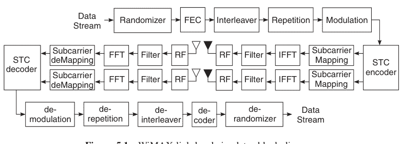

**图5.1** WiMAX链路级仿真器框图

在宽带码分多址（WCDMA）系统中，链路级仿真已被广泛用于分析功率控制（PC）算法的优缺点[6]，而在正交频分多址（OFDMA）系统中，它们已被广泛用于研究自适应调制编码（AMC）和子载波映射技术的性能[7]。

在*系统级*，将网络作为一组基站和用户设备进行分析，考虑与MAC相关的问题，例如移动性、调度和无线资源管理。此时的目标不再是研究单个链路在小时间尺度上的性能，而是研究整个系统在较长时间段内的性能，包括服务质量（QoS）、容量和时延。

如上所述，链路级和系统级仿真工作在非常不同的时间尺度上，并且由于计算成本问题，它们是独立执行的。两个层次之间的交互通过称为*查找表*（LUT）的不同接口来实现。查找表是一组以简化方式表示链路级仿真结果的表格（图5.2），将无线链路中经历的信号质量（例如以比特能量与噪声密度比（$E_b/N_0$）或信号与干扰加噪声比（SINR）表示）与链路性能的给定参数（例如误比特率（BER）或误块率（BLER））相关联。

这组表格在系统级仿真过程中被查阅，以获取在链路级仿真中生成的必要链路级信息。该过程代表了一种简单但有效的方式，将发生在小时间尺度上的传输信道波动纳入系统级仿真中，而后者的效果与较长时间段（小时、天）相关。

![AWGN信道条件下采用Turbo编码的WiMAX查找表[7]](img/d952e5a628ccf1bfefe8c09fbe77d613_139_0.png)

**图5.2** AWGN信道条件下采用Turbo编码的WiMAX查找表[7]

从这些查找表中获取的信息可以被网络设计者以不同方式使用。首先，它们可用于通过分析单个连接上的频谱效率（以$bps/Hz$为单位）来对给定无线系统的性能进行基准测试。给定某条无线链路的信号质量（SINR），频谱效率可以按如下方式计算：

$$C = C_{max} \cdot (1 - BER)$$ (5.1)

其中$C_{max}$对应于传输中使用的调制编码方案的符号效率（表5.2），而BER可以通过查找表从SINR中推导得出。

此外，链路级仿真结果还可供网络设计者用于推导链路自适应系统中适当的AMC门限值，例如高速下行分组接入（HSDPA）、微波接入全球互操作性（WiMAX）或长期演进（LTE）。这一点很重要，因为如果这些AMC门限值被低估，系统将遭受丢包；而如果被高估，系统将面临效率低下的问题。表5.2展示了AWGN信道条件下WiMAX系统的门限值示例。

为了通过使用链路级仿真或系统级仿真正确预测无线系统的性能，不仅需要精确仿真PHY层和MAC层的行为，还需要准确地对无线信道进行建模。由于无线链路的行为在很大程度上取决于场景（农村、城市、室内）以及用户的流量（服务、应用）和移动性（固定、游牧、移动）条件，仿真中使用的*信道模型*应根据这些特征进行选择。

为了精确建模毫微微蜂窝场景中的衰减、衰落和干扰效应，不仅需要考虑大量衍射和反射影响的室内传播和衰落模型，还需要能够捕捉不同住宅结构特点的精确*室内到室外*和*室外到室内*模型（第5.3节）。

**表5.2 WiMAX无线接入承载**

| RAB | 调制方式 | 编码 | 效率（比特/符号） | SINR门限（dB） |
|-----|-----------|--------|------------------------|---------------------|
| RAB1 | QPSK | 1/2 | 1 | 2.88 |
| RAB2 | QPSK | 3/4 | 1.5 | 5.74 |
| RAB3 | 16QAM | 1/2 | 2 | 8.79 |
| RAB4 | 16QAM | 3/4 | 3 | 12.22 |
| RAB5 | 64QAM | 1/2 | 3 | 13.23 |
| RAB6 | 64QAM | 2/3 | 4 | 15.88 |
| RAB7 | 64QAM | 3/4 | 4.5 | 17.50 |

## 5.3 无线信道建模

网络规划和优化工具将帮助毫微微蜂窝运营商了解毫微微蜂窝对现有宏蜂窝网络的影响，并开发新的内置毫微微蜂窝算法。这些工具依赖于对底层物理信道的精确描述，以便执行可信的链路级和系统级仿真来研究毫微微蜂窝的行为。为了提高这些工具的可靠性，精确的无线电波传播模型是必不可少的。此类模型旨在高效地考虑对信号传播产生影响的物理效应。

### 5.3.1 物理效应

当毫微微蜂窝安装在房屋内部时，其辐射功率将产生向各方向发射的波，方向图定义了释放到这些不同方向的能量部分。然后，一部分信号将留在室内，但另一部分将超出建筑物并因干扰而影响室外用户的信号质量。此外，安装在室外的宏蜂窝信号不仅覆盖外部环境，而且其一部分将进入建筑物内部并干扰毫微微蜂窝。这就是为什么识别发生在波上的物理效应有助于理解系统的行为方式。

**反射** 当波到达障碍物时，根据材料的物理系数，信号的一部分将穿过该障碍物（折射部分），而另一部分将被材料反射。

**衍射** 如果波遇到尺寸与其波长相当的障碍物，可能会出现一些衍射现象。这由惠更斯-菲涅尔原理描述，并会根据障碍物的形状产生多个方向的出射波。

**散射** 当障碍物表面完全平整时，只会出现反射和衍射。实际上，大多数材料（如混凝土）都是粗糙的。根据材料的粗糙度系数和波长，到达障碍物的波不会产生单条反射射线，而是可能产生许多较小的射线，这些射线实际上对应于由表面不规则性引起的多次反射。

对于环境中的特定用户，接收信号等于反射、衍射和散射射线的总和。在室内环境中，反射、衍射和散射通常发生在墙壁和家具上。在室外，这些现象主要发生在建筑物上。一般来说，当室外天线位于较高位置时，在建筑物屋顶上发生的衍射效应（称为屋顶衍射）非常重要。当用户与发射机处于直接可视范围内时，主要分量是称为视距（LOS）的直接路径。当存在障碍物时


## 5.3.2 *传播模型*

#### 经验模型

经验模型基于统计数据和测量结果，它们不需要了解环境的几何形状，因为不计算反射和衍射。在这种方法中，只需考虑发射器和接收器之间的距离。在距离发射器 $d$ 处的损耗 $L$（单位为 $dB$）可以用以下公式估算：

$$L = 10 \cdot n \cdot \log(d) + C$$

代表系统损耗的常数值 $C$ 以及表征路径损耗指数的参数 $n$，完全取决于环境类型，并且可以在典型环境中找到一些典型值。这些参数通常非常依赖于场景，这就是为什么进行测量有助于找到最佳参数。

#### 半经验模型

由于经验模型的准确性较低，人们提出了一些其他模型。它们也是经验性的，因为它们基于发射器和接收器之间的单一路径，并且不模拟物理现象。但是，可以在模型中添加一些确定性部分，以便考虑障碍物。使用此类模型时，每当光线穿过一个障碍物时，就会在路径损耗上加上一个衰减值（取决于材料）。在通用移动通信系统（UMTS）频率下，这些参数的典型值如表5.3所示。

| 材料 | 衰减 |
| --- | --- |
| 主墙（混凝土） | 15 dB |
| 内墙（石膏） | 5 dB |
| 窗户（玻璃） | 1.5 dB |
| 门（木头） | 0.5 dB |

#### 射线追踪类模型

射线追踪类模型基于笛卡尔定律。根据该定律，无线电波传播可以使用几何波进行近似。使用这种模型，几何射线从发射器向所有方向计算，并且每当射线遇到障碍物时，就计算反射射线，使得反射射线和入射射线的角度相对于法线向量对称。已经部署了两种主要方法：

- 射线发射：这种方法从发射器向所有方向发射大量射线，并计算所有的反射和衍射。
- 射线追踪：这种方法考虑所有接收点，并利用镜像法计算哪些是可能对接收点功率有贡献的射线。

一方面，射线发射模型通常不太准确，因为由于角度分散，很难到达环境中的所有点。实际上，由于复杂性原因，必须发射有限数量的射线（通常每隔1或2度发射一条），这就是为什么当距离增加时，一些接收点可能会被错过。另一方面，射线追踪更准确，因为它精确计算到达所考虑接收点的射线，但这种方法更消耗内存和时间。

在图5.3中，绘制了一个办公室内家庭基站的无线电覆盖范围。接收到的信号是使用3D射线发射模型[8]计算的。为了估计此类模型在角落的衍射，使用了衍射的一般理论和均匀衍射理论。这些理论包括隔离那些将被视为新光源的小物体，以及根据方向应用于每条射线的系数。由于复杂性，必须限制每条射线要计算的反射和衍射次数（例如，在复杂环境中，三次反射和三次衍射是典型值）。为了考虑散射，还可以根据材料应用一些粗糙度系数。

#### FDTD类模型

时域有限差分（FDTD）方法建议在离散空间网格上求解麦克斯韦方程组。麦克斯韦方程描述了电场和磁场的特性，并将它们与源、电荷密度和电流密度联系起来。这就是为什么它们非常准确，因为它们隐式地考虑了所有的反射和衍射。然而，由于连续的传播问题被离散化，空间步长和时间步长必须尽可能小，这使得这些模型非常消耗内存和时间。因此，随着更强大计算机的发展，这些方法直到最近才开始被使用。

通常，为了获得良好的近似，FDTD类模型应使用与波长 $\lambda$ 相比非常小的空间步长 $\Delta$。一个典型值是使用 $\Delta = \lambda/10$，这使得要考虑的矩阵尺寸非常大。

在图5.4中，使用FDTD方法在城市场景中计算了家庭基站的2D无线电覆盖范围。由于复杂性，提出了一些简化方法，并在图形处理器（GPU）并行处理器上实现了该方法[9]。实际上，FDTD类模型非常适合并行计算，因为在每次迭代中，每个像素都必须根据相邻像素更新其能量，而相邻像素可以彼此独立地计算。一些FDTD类模型，如[10]中提出的模型，也在频域中提出，使得能够以多分辨率方法求解问题，预处理复杂但传播阶段非常快。

### 5.3.3 模型的选择

传播领域的文献非常广泛，选择最佳模型并非总是一项简单的任务。这里给出一些帮助研究人员的建议。

#### 精度与复杂性

经验模型非常易于实现，并且具有非常快的优势，因为在每个接收点只计算一条路径。然而，它们的准确性较低，因为没有有效地考虑障碍物。当需要一个简单的模型并且精度不是最重要的因素时，它们是一个不错的选择。此外，当代表障碍物和材料的数据库不可用或不够准确时，它们是唯一的选择。

当需要高精度时，确定性模型是最佳选择，但这不可能不付出复杂性的代价。通常，最复杂的模型也是最准确的模型。当然，这一点可以讨论，因为实现方式也有影响，以及如何优化内存和减少模拟时间，这些是主要的挑战。当需要在射线追踪或FDTD模型之间做出选择时，通常观察到射线追踪开发更复杂，但与FDTD方法相比，更节省内存和时间，而FDTD方法更容易实现，但对时间和内存的需求非常高。这些模型的准确性将始终取决于实现过程中所做的近似。例如，在射线追踪中，大量的射线会同时增加复杂性和准确性，对于FDTD类模型也是如此，使用较小的空间或时间步长也是如此。

#### 2D与3D模型

所有传播模型都是以2D或3D形式实现的，2D更容易实现且对资源的要求较低，但精度也较低。即使3D类模型表现更准确，其高复杂性有时会导致尝试使用2D类方法。例如，在一个有小型建筑的平坦场景中，并且考虑到大多数天线具有在水平面辐射的方向图，选择2D模型可能是一种明智的方法。此外，在多层建筑中，有时也可以使用准3D模型（也称为2.5D模型）来估计不同楼层之间的无线电覆盖范围。然而，一些复杂环境，其中天线位于不同高度，例如一座拥有高楼的城市，基站位于建筑物屋顶，家庭基站位于建筑物的不同楼层，则绝对需要使用完整的3D传播模型。

### 5.3.4 重要因素

无论选择哪种模型，无线电传播模型的开发人员都应仔细考虑一些重要因素。

#### 建筑物数据库

数据库是模型的输入，其准确性将对模拟结果的准确性产生重要影响。使用半经验模型时，应了解障碍物的位置和材料。如果使用确定性模型，则应了解相同的参数，还应了解墙壁的宽度和构成材料的确切物理系数。为此，市场上一些无线电传播工具使用Autocad绘图交换格式（DXF），该格式通常包含这些信息。

 ## 天线

天线方向图的形状对特定环境下的最终信号具有重要影响。通常，天线制造商会提供水平面和垂直面的方向图。该图展示了能量向不同方向辐射的多少。这些信息必须集成到传播工具中，以确保仿真的准确性。

#### 校准

由于没有模型能完美模拟现实生活情况，仿真与测量之间总会存在一些误差。此外，数据库或对天线方向图实际认知的误差也会对结果质量产生负面影响。再者，仿真中无法考虑所有元素，例如室内的家具、街道上的树木、改变信号的过路用户和车辆，或天气——它也会影响材料的系数。除了所有这些因素外，还必须加上阴影和多径导致的衰落效应，这些效应会产生波的建设性或破坏性叠加，从而改变最终信号。

因此，重要的是要认识到仿真与测量之间总会存在一些差异。然而，可以通过对模型进行校准，尽可能使两者相符。校准包括在所考虑的场景中进行实际测量，以调整模型参数，从而减少仿真与测量之间的误差。更多的测量次数有助于减少误差，但这会有成本，因为测量活动通常很复杂。通常，对于校准正确的模型，预测值与测量值之间的均方根误差（RMSE）通常在 5 dB 到 10 dB 之间。精度低于 5 dB 并没有太大意义，因为衰落效应通常具有相同的数量级。

### 5.3.5 衰落效应仿真

无线电信号的行为仅通过考虑代表路径损耗的经验或确定性模型是无法完全仿真的。信道总是存在一些小的统计变化，这些也需要被考虑在内。

#### 阴影衰落

阴影衰落对应于由大型障碍物引起的信道大尺度变化。实际上，根据所选的传播模型，一些障碍物在仿真中会被或多或少地正确考虑。这就是为什么可以通过在预测的中值接收功率周围添加对数正态变化来模拟阴影衰落。阴影衰落对应于根据一定概率，加到或减去接收功率的接收功率值。这个值及其相关概率主要取决于无线电传播模型和环境。因此，在家庭基站场景中，必须进行测量以建立阴影衰落模型。

#### 快速衰落

快速衰落对应于由多径引起的信道小尺度局部变化。这些变化主要是由于到达接收机的不同射线（环境中的反射和衍射）造成的。所有这些射线的叠加，由于其相位关系，可能对最终信号产生破坏性或建设性的影响，从而在接收功率上产生小的变化。不同的快速衰落模型，如瑞利或莱斯衰落，已被使用。功率延迟轮廓，代表每条射线的功率和到达时间，通常用于表征特定位置的快速衰落。这就是为什么国际电信联盟（ITU）定义了不同的轮廓（步行、车载）[11]，应仔细地将它们纳入仿真中，以考虑家庭基站场景中通常发生的众多反射。

## 5.4 静态和动态系统级仿真

尽管系统级仿真的总体目标是表征无线网络的整体性能，但它们可以应用于不同的目标。对于家庭基站，系统级仿真（SLS）可用于分析在现网宏基站网络上部署大规模家庭基站层的优缺点，或准确评估新的内置家庭基站算法对整体系统性能的影响，例如自组织技术。

由于系统级仿真可应用于不同的目的，因此应使用针对这些目标量身定制的不同系统级仿真模型。在本书中，我们区分了静态和动态系统级仿真。

在静态系统级仿真（第 5.5 节）中，仿真的目标是研究系统在大范围和长时间内的平均性能。在这种情况下，仿真通常基于多次独立的蒙特卡洛快照 [12]，这是网络规划和优化中广泛使用的方法 [13, 14]。在蒙特卡洛快照中，时间域被忽略，具有不同特征和 QoS 要求的多个用户被随机分布在研究区域中。然后根据覆盖和容量来分析整个网络的性能。通常使用的关键性能指标（KPI）是小区/用户吞吐量，以及成功用户和掉话用户的数量。为了获得系统平均性能的统计代表性结果，静态蒙特卡洛仿真需要大量的快照（图 5.5）。因此，需要能够支持在短时间内进行数千次系统级仿真的快速仿真算法，以准确预测所研究系统的整体行为。结果是，时间扮演了非常重要的角色，而准确性则有所牺牲。

在动态系统级仿真（第 5.7 节）中，仿真的目标是精确地模拟系统运行的高细节程度。在这种情况下，仿真考虑了网络随时间的演化，并允许网络根据时间或事件“存活”。为了捕捉网络的端到端行为，必须模拟用户的动态特征（移动模型）和业务（业务模型），以及信道随时间和频率的波动（阴影和多径衰落）[15]。通过这种方式，可以详细分析不同技术（例如功率分配策略和无线资源管理技术）随时间推移的行为。由于细节程度更高，运行时间显著增加，因此，只能分析小范围区域在短时间内的性能。网络性能通过多种指标进行评估，例如小区和用户吞吐量、呼叫阻塞和掉话、端到端时延和抖动、丢包率和/或重传比率。

## 5.5 WiMAX 家庭基站的静态系统级方法论

设计和评估能够建模无线蜂窝网络行为的蒙特卡洛系统级仿真并非新课题。事实上，这个问题在过去已经被广泛研究和商业化 [13, 14]。然而，随着新技术的出现，这些仿真工具必须被审视和调整。家庭基站就是这种情况，其特殊特性要求使用量身定制的仿真引擎来模拟这些设备的创新特性。

在本节中，将介绍本书中用于对宏基站和家庭基站混合网络进行覆盖和容量性能分析的蒙特卡洛系统级仿真方法。此外，基于仿真结果，将讨论同频家庭基站部署的可达性能及其对现有宏基站层的干扰影响。

### 5.5.1 网络表征

下文将介绍无线网络设计中心（CWiND）用于 WiMAX 网络的蒙特卡洛系统级仿真（图 5.6）的主要元素和参数，以作说明。然而，此系统级仿真结构可应用于其他技术，如全球移动通信系统（GSM）、UMTS、高速分组接入（HSPA）或 LTE，只需考虑不同的无线接入网络接口。

**基站或基站** 基站，也称为基站，是指一个或多个配备一个或多个天线的发射机/接收机所在的地理点。


 **图 5.6** 系统级仿真要素

在该仿真平台中，区分了两种不同类型的蜂窝基站：

- *宏蜂窝基站（Macrocell Base Stations, MBSs）*，设计用于提供室外无线覆盖，
- *毫微微蜂窝接入点（Femtocell Access Points, FAPs）*，设计用于提供室内无线覆盖。

**蜂窝或扇区** 蜂窝 $Les 也称扇区，是指由一个或多个发射机/接收机覆盖的地理区域。

在该仿真平台中，区分了两种不同类型的蜂窝：

- *宏蜂窝* $C_i^{macro}$，由 MBS 覆盖，
- *毫微微蜂窝* $C_i^{femto}$，由 FAP 覆盖。

**用户** 用户 $UE_x$ 指网络订户，其特征由不同参数描述，如地理位置、设备类型、服务类型和移动性类型。虽然在蒙特卡洛 SLS 中不考虑用户的移动，但它们的移动特性可用于建模其信道行为。通过这种方式，可以根据用户速度估计信道衰落，同时考虑相干带宽和多普勒效应。

在该仿真平台中，区分了两种不同类型的用户：

- *非订户* $UE_x^{ns}$，指未注册到附近毫微微蜂窝的用户，
- *订户* $UE_x^{s}$，指已注册到附近毫微微蜂窝的用户。

订户因此被定义为毫微微蜂窝的合法用户，通常是毫微微蜂窝所有者的移动终端以及近亲和朋友的移动终端。当采用封闭订户组（Closed Subscriber Group, CSG）接入时，非订户 $UE_x^{ns}$ 仅允许连接到宏蜂窝；同时，订户 $UE_x^{s}$ 允许连接到他们自己的毫微微蜂窝或宏蜂窝。相反，当采用开放接入时，任何用户都可以连接到任何宏蜂窝或毫微微蜂窝，无论其用户类型如何。

**业务地图** 业务地图提供特定区域内用户数量和服务类型的信息。在该仿真平台中，区分了两种不同类型的业务地图：

- *室外业务地图*，放置在室外，生成非订户，
- *室内业务地图*，放置在室内，生成订户。

给定的室内业务地图总是与一个毫微微蜂窝相关联。通过这种方式，该业务地图生成的订户就是该毫微微蜂窝的合法用户。

**子载波、子信道、正交频分复用（OFDM）符号和时隙** OFDMA/时分双工（TDD）（图 5.7）是一种多载波技术，其中：

- 可用无线频谱（无线信道）由 $R$ 个正交子载波组成，这些子载波又组合成 $K$ 个称为子信道的组，
- 时域被分割成给定持续时间 $T_{frame}$ 的连续帧，这些帧又被划分为 $T$ 个称为 OFDM 符号的时隙。

图 5.7 WiMAX 的 OFDMA/TDD 帧结构

构成子信道的子载波数量和精确分布取决于子载波置换模式。子信道可以由频谱上连续或伪随机分布的子载波构成（第 4.4.2 节）。

在 WiMAX [16] 中，时隙是蜂窝可以分配的最小频时资源。一个时隙由一个子信道和一到三个 OFDM 符号组成，具体取决于网络配置。多个连续时隙可以以突发形式分配给不同用户，作为多址接入机制。分配给用户的带宽是其带宽需求、QoS 要求和信道条件的函数。

#### 无线链路

无线链路建模发射机和接收机 $C_i \leftrightarrow UE_x$ 之间的传播现象。它表征了接收信号强度的波动，同时考虑了路径损耗衰减、阴影衰落和多径衰落的影响。该数据提取自第 5.3 节中介绍的无线覆盖仿真。

#### 天线

蜂窝 $C_i$ 和用户 $UE_x$ 均配备至少一个天线，天线是一种用于高效发射和接收电磁波的设备，其特征由辐射方向图、极化方式、方位角、倾角和增益等不同参数描述。

#### 业务

在 WiMAX 中，定义了五种具有不同优先级的业务类型 [17]：非请求授权业务（Unsolicited Grant Service, UGS）、实时轮询业务（real-time Polling Service, rtPS）、扩展实时轮询业务（Extended real time Polling Service, ertPS）、非实时轮询业务（non-real-time Polling Service, nrtPS）和尽力而为（Best Effort, BE）。

在该仿真平台中，支持五种不同的业务 $SER_s$，每种业务属于不同的业务类型，具有不同的 QoS 要求：IP 语音（Voice over IP, VoIP）、视频流、网页浏览、文件传输协议（File Transfer Protocol, FTP）和电子邮件（表 5.4）。

#### 无线接入承载（Radio Access Bearer, RAB）

RAB 集合表示系统可用于在无线链路上承载数据的所有可能的调制和编码方案组合（表 5.2）。

| 业务 | 业务类型 | DL 最小 TP (kbps) | DL 最大 TP (kbps) | UL 最小 TP (kbps) | UL 最大 TP (kbps) |
|---------|-------------|------------------|------------------|------------------|------------------|
| VoIP | UGS | 12.2 | 12.2 | 12.2 | 12.2 |
| 视频 | rtPS | 64 | 64 | 64 | 64 |
| 网页浏览 | nrtPS | 64 | 128 | 32 | 64 |
| FTP | nrtPS | 0 | 1000 | 0 | 100 |
| 电子邮件 | BE | 0 | 128 | 0 | 64 |

**表 5.4** 室外业务地图用户密度

### 5.5.2 静态 SLS 方法

此处介绍的静态 SLS 方法通过对网络进行多次独立的蒙特卡洛快照，以确定系统在长时间尺度上的平均行为。在每个蒙特卡洛快照内，仿真器执行多个步骤，这些步骤可分为三层：网络层、MAC 层和 PHY 层，以计算网络的最终性能。该过程在图 5.8 和图 5.9 中说明。

首先，我们将 WiMAX 网络定义为：

- 一组 $N$ 个蜂窝 $\{C_0, C_i, C_j, \dots, C_{N-1}\}$ 和 $M$ 个用户 $\{UE_0, UE_x, UE_y, \dots, UE_{M-1}\}$，
- 具有 $K$ 个子信道 $\{0, k, \dots, K-1\}$ 和 $T$ 个 OFDM 符号 $\{0, t, \dots, T-1\}$，
- 其中 $R$ 种 RABs $\{0, RAB_r, \dots, RAB_{R-1}\}$ 可用于传输，
- 并定义了 $S$ 种业务 $\{0, SER_s, \dots, SER_{S-1}\}$。
- $slot_{i,k,t}$ 由第 $i$ 个蜂窝的第 $k$ 个子信道和第 $T$ 个 OFDM 符号构成。

在网络层，首先，输入网络配置（蜂窝、业务地图、用户、业务和承载）。然后，根据第 5.3.2 节中介绍的传播模型之一，计算用户与邻近蜂窝之间的路径损耗。最后，识别每个用户的最优服务蜂窝。

UE 将提供最大接收导频信号强度的蜂窝选为最优服务蜂窝，该参数必须大于用户天线的灵敏度。请注意，CSG 毫微微蜂窝的非订户不能选择该毫微微蜂窝作为最优服务蜂窝。

之后，在该仿真平台中，下行链路（DownLink, DL）和上行链路（UpLink, UL）在 MAC 层和 PHY 层分别进行分析。

在 MAC 层，首先，调度器根据用户的业务类型（UGS、rtPS、ertPS、nrtPS 和 BE）对用户进行分类，随后执行调度和资源分配过程。DL 和 UL 均支持链路自适应，并在需要时考虑功率控制。

该平台在 UL 中执行功率控制。其工作方式是：如果用户的信号质量高于实现系统中定义的最优 RAB 所需的水平，则用户降低其发射功率，仅达到保持该 RAB 所需的信号质量。

在 PHY 层，模拟发射机和接收机之间的信息传输。在此阶段，计算不同蜂窝帧时隙之间的干扰，并估计每条无线链路的平均信号质量。

对同一快照执行多次迭代以达到稳定解。当分配给用户的 RAB 在若干次迭代中保持恒定时，快照达到稳定。分配给每个用户的 RAB 根据从前一次迭代反馈的信道状态信息选择。该信道状态信息表示用户在前一次迭代中所有分配时隙上经历的平均 SINR。一旦解稳定，就提取用户的 KPI 和结果。

由于蒙特卡洛快照中用户的位置是随机生成的，为了获得系统性能的统计代表性结果，必须考虑大量快照。通过这种方式，可以降低用户位置与结果之间的相关性。

既然仿真工具的结构已经介绍完毕，下面将更详细地分析 DL 和 UL 迭代，关注六个不同方面：用户生成、调度、资源分配、干扰估计、吞吐量计算和用户状态。

#### 用户生成

在每个快照内，仿真器根据业务地图的特征在研究区域内随机分布若干用户。由于每个业务地图可能与多种业务类型相关联，每个快照中生成的用户数量取决于两个参数：每个业务地图的业务类型数量，以及每类业务的用户密度。

一方面，室外业务地图根据 **user/km²** 的比例指示每类服务（非订户）的用户密度，该比例取决于服务类型和区域类型。表 5.5 和表 5.6 给出了这些密度的数值。

另一方面，室内业务地图根据 **user/house** 的比例指示每类服务（订户）的用户密度，该比例在 [0 − **UE**<sup>max</sup><sub>femto</sub>] 之间随机选择，其中 **UE**<sup>max</sup><sub>femto</sub> 是每个毫微微蜂窝支持的最大同时用户数。

请注意，宏蜂窝用户和毫微微蜂窝用户在业务地图内均匀分布。

如上所述，一个业务地图可以支持不同的业务 $SER_s$，例如 VoIP、视频、网页浏览、FTP、电子邮件，这些业务由特定的 QoS 和吞吐量要求定义。例如，VoIP 等业务由其业务类型 UGS 描述，

| 区域类型 | 密集城区 | 城区 | 农村 |
|-----------|-------------|-------|-------|
| 用户密度 (*user/km²*) | 80 | 45 | 10 |


表 5.6 用户流量组成 [18]

| 服务类型 | VoIP | 视频 | 网页浏览 | FTP | 电子邮件 |
| :--- | :--- | :--- | :--- | :--- | :--- |
| 用户比例 | 35 | 20 | 20 | 10 | 5 |

以及其下行和上行链路在除其他参数外的最低 12.2 kbps 和最高 12.2 kbps 所需吞吐量。此类服务需求将用于决定何时为每个用户分配何种资源，以及确定其最终的用户状态（成功、中断等）。表 5.4 中展示了不同服务的流量类别和吞吐量需求。

#### 调度

在一个快照内，小区布局是固定的，并且信道根据用户的位置和移动（第 5.3.5 节）经历多径衰落。然后，信道状态信息以信噪比的形式从用户反馈给小区（第 5.5.2 节）。利用这些信息，功率控制算法和链路自适应技术可用于克服无线信道波动带来的问题。此外，这些信息还可用于利用多用户分集（图 5.10），即采用复杂的调度技术，优先调度无线信道条件有利的用户。

在此仿真平台中，每个小区内的用户是独立调度的。首先，MAC 调度器将不同的用户连接分类为不同的流量类别，每个类别都有自己的服务优先级和 QoS 要求（UGS、rtPS、ertPS、nrtPS 和 BE）。然后，MAC 调度器根据给定的策略对单个流量类别内的用户连接进行分类。我们区分三种策略：先入先出 (FIFO)、最佳信噪比和比例公平 (PF) [19]。使用第一种策略时，用户根据其到达时间进行调度，与用户在先前迭代中反馈给小区的信道质量指示 (CQI) 无关。相反，最佳信噪比和 PF 利用此信息对单个服务类别内的连接进行分类。最佳信噪比策略倾向于增加网络吞吐量，因为具有较大信噪比（靠近小区）的用户会被优先调度。PF 策略倾向于增加用户间的公平性，因为具有较大当前信噪比与平均信噪比之比（更好的信道条件）的用户拥有更高的优先级。

#### 无线资源管理

无线资源由小区分配给用户，以满足其带宽需求和 QoS 要求，同时考虑流量和信道条件。

无线资源将按照调度器指示的顺序分配给用户。属于较高优先级流量类别的服务将被优先调度。单个流量类别内的连接将根据调度策略提供服务。

在 WiMAX 中，资源以突发的形式分配，这是一种二维（频率/时间）数据区域，由使用相同调制和编码的连续时隙组成。

在此仿真工具中，我们假设每个用户的缓冲区中数据队列始终充满数据包，以便我们可以专注于系统性能的分析。

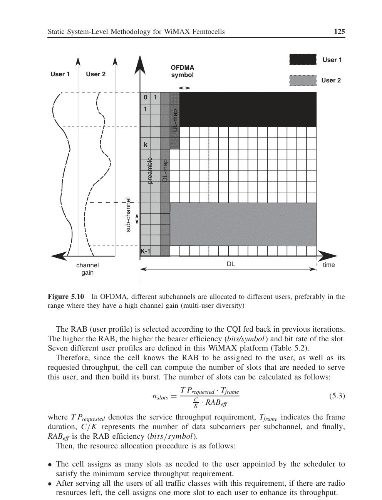

图 5.10 在 OFDMA 中，不同的子信道被分配给不同的用户，最好是在它们具有高信道增益的范围内（多用户分集）

无线接入承载 (RAB)（用户配置文件）是根据先前迭代中反馈的 CQI 选择的。RAB 越高，承载效率（比特/符号）和时隙的比特率就越高。此 WiMAX 平台定义了七种不同的用户配置文件（表 5.2）。

因此，由于小区知道要分配给用户的 RAB 以及其请求的吞吐量，小区可以计算为此用户提供服务所需的时隙数，然后构建其突发。时隙数可按如下公式计算：

$$n_{slots} = \frac{TP_{requested} \cdot T_{frame}}{\frac{C}{K} \cdot RAB_{eff}}$$  (5.3)

其中 $TP_{requested}$ 表示服务吞吐量需求，$T_{frame}$ 表示帧持续时间，$C/K$ 代表每个子信道的数据子载波数，最后，$RAB_{eff}$ 是 RAB 效率（比特/符号）。

然后，资源分配过程如下：
- 小区为调度器指定的用户分配所需的时隙数，以满足最小服务吞吐量要求。
- 在满足所有流量类别的所有用户的此类需求之后，如果还有剩余的无线资源，小区会为每个用户再分配一个时隙以提高其吞吐量。
- 当所有用户都满足最大服务吞吐量要求或没有剩余资源可分配时，资源分配过程停止。

为了最大化系统性能，子信道和功率分配应基于信道条件。分配给每个用户的具体子信道和功率取决于系统的分配策略。作为毫微微小区自组织程序的一部分，第 8.6 节描述了不同的毫微微小区频率和功率分配策略。

#### 干扰估算

一旦无线资源管理 (RRM) 模块构建了所有 OFDMA/TDD 帧，信息就会被传输。当传输信号在频率（子信道）和时间（符号）域重叠时，就会发生干扰。在 WiMAX 中，由于 OFDMA 子载波的正交性特征，小区内干扰可以忽略不计。因此，运营商必须应小区间干扰以提高网络的整体性能。

为简单起见，在此仿真平台中做出了四个假设，这些假设不会损失任何通用性，以便评估系统的运行：
- 假设 WiMAX 网络是完美同步的（包括宏小区和毫微微小区）。这样，只有当多个用户在不同小区被分配到同一个时隙时，才会发生小区间干扰。
- 子信道（例如，$k = 0$）在整个网络中始终由相同的子载波构成，与所选的置换方案无关。
- 信道的相干带宽大于子信道的带宽。这样，一个时隙内所有子载波的衰落将是恒定的，并且它们只能在不同子信道之间变化。
- 信道的相干时间大于 OFDMA/TDD 帧的持续时间。这样，一个子信道内所有 OFDM 符号的衰落将是恒定的，并且它们只能在不同帧之间变化。

关于第二个假设，请注意，在 AMC 方案中，给定的子信道 $k = 0$ 在整个网络中始终由相同的子载波构成，而在完全使用子信道 (FUSC) 和部分使用子信道 (PUSC) 方案中，这可能成立也可能不成立。然而，已经证明，在网络的所有小区中逻辑子信道构成相同的 FUSC 和 PUSC 系统性能更好 [20]。

根据第三和第四个假设的结果，一个时隙的有效信噪比等于其一个子载波的信噪比（平坦子信道），因为它们都经历相同的衰落条件。然而，如果一个时隙内所有子载波的衰落不是恒定的，则可以使用不同的度量从其子载波的信噪比计算一个时隙的有效信噪比，例如平均瞬时容量 (MIC)、指数有效信噪比映射 (EESM) 或有效码率映射 (ECRM) [7]。

用于计算给定时隙 $slot_{i,k,t}$ 中干扰的模型如图 5.11 所示。

##### 下行情况

在下行链路中，干扰由用户承受，可以说，某个用户 $UE_x$（其最佳服务小区为 $C_i$）受到小区 $C_j$ 的干扰，当且仅当 $C_i$ 和 $C_j$ 在同一 OFDM 符号上使用相同的子信道进行下行传输。$UE_x$ 在时隙 $slot_{i,k,t}$ 中承受的最终下行干扰将是来自所有相邻小区 $C_j$ 的干扰之和。

$$\boxed{I_{x,k,t}^{DL} = \sum_{j=0, j \neq i}^{N-1} \sum_{t=0}^{T-1} (P_{j,k} \cdot G_j \cdot L_j \cdot Lp_{j,x} \cdot G_x \cdot L_x) \cdot \phi_{j,k,t}}$$

其中，$x$ 表示受干扰用户 $UE_x$；$k$ 表示第 $k$ 个子信道，$t$ 表示第 $t$ 个符号；$i$ 是服务小区 $C_i$；$j$ 是干扰小区 $C_j$；$P_{j,k}$ 是 $C_j$ 在第 $k$ 个子信道的一个子载波上施加的功率；$Lp_{j,x}$ 是 $C_j$ 和 $UE_x$ 之间的路径损耗，$G_j$ 和 $G_x$ 分别代表 $C_j$ 和 $UE_x$ 的天线增益，$L_j$ 和 $L_x$ 分别代表 $C_j$ 和 $UE_x$ 的设备损耗。最后，$\phi_{j,k,t}$ 是一个二进制变量，如果小区 $C_j$ 使用时隙 $slot_{j,k,t}$，则等于 1，否则为 0。

##### 上行情况

在上行链路中，干扰由小区承受，可以说，某个小区 $C_i$（其连接用户为 $UE_x$）受到用户 $UE_y$ 的干扰，当且仅当 $UE_x$ 和 $UE_y$ 在同一 OFDM 符号上使用相同的子信道进行上行传输。$C_i$ 在时隙 $slot_{i,k,t}$ 中承受的最终上行干扰将是来自所有相邻用户 $UE_y$ 的干扰之和。

$$\boxed{I_{i,k,t}^{UL} = \sum_{y=1, y \neq x}^{M-1} \sum_{t=0}^{T-1} (P_{y,k} \cdot G_y \cdot L_y \cdot Lp_{y,i} \cdot G_i \cdot L_i) \cdot \theta_{x,k,t}}$$


其中，$i$ 表示被干扰的小区 $C_i$；$k$ 表示第 $k$ 个子信道，$t$ 表示第 $t$ 个符号；$x$ 是已连接用户 $UE_x$；$y$ 是干扰用户 $UE_y$；$P_{y,k}$ 是 $UE_y$ 在第 $k$ 个子信道的一个子载波上应用的功率；$Lp_{y,i}$ 是 $UE_y$ 与 $C_i$ 之间的路径损耗；$G_y$ 和 $G_i$ 分别表示 $UE_y$ 和 $C_i$ 的天线增益，$L_y$ 和 $L_i$ 分别表示 $UE_y$ 和 $C_i$ 的设备损耗。最后，$\theta_{x,k,i}$ 是一个二进制变量，如果用户 $UE_y$ 正在使用 $slot_{x,k,i}$，则该变量等于 1，否则等于 0。

请注意，在计算 $Lp$ 时，应考虑阴影效应和多径衰落。因此，$Lp$ 可以表示为：

```
$$Lp = L_{att} \cdot L_{shadow} \cdot L_{ff}$$
```

其中，$L_{att}$ 是由距离引起的衰减，$L_{shadow}$ 是由阴影引起的衰落，$L_{ff}$ 是由多径引起的衰落。要计算这些值，可以使用第 5.3 节中介绍的模型。

每个时隙 $slot_{i,k,i}$ 的信干噪比（SINR）在此情况下等于其一个子载波的 SINR，可以如下计算：

```
$$SINR = \frac{C}{I + \sigma}$$
```

其中，$C$ 和 $I$ 分别是载波信号和干扰信号的信号强度，$\sigma$ 表示背景噪声。请注意，必须使用线性单位。

干扰信号功率 $I$ 可以从上述干扰模型导出，而载波信号功率 $C$ 可以类似地使用以下公式估算：

```
$$C_{x,k}^{DL} = P_{i,k} \cdot G_i \cdot L_i \cdot Lp_{i,x} \cdot G_x \cdot L_x$$
$$C_{i,k}^{UL} = P_{x,k} \cdot G_x \cdot L_x \cdot Lp_{x,i} \cdot G_i \cdot L_i$$
```

另一方面，背景噪声可以近似为：

```
$$\sigma_n = n_0 + nf_{eq}$$
$$n_0 = -174 \frac{dBm}{Hz} \cdot 10 \log \left( F_{sampling} \cdot \frac{SC_{used}}{SC_{total}} \right)$$
```

其中，$n_0$ 表示热噪声，$nf_{eq}$ 表示终端（下行链路情况）或小区（上行链路情况）的噪声系数。此外，$F_{sampling}$ 表示系统的采样频率，而 $SC_{used}$ 和 $SC_{total}$ 分别表示所考虑的子载波数量和总子载波数量。

一旦获知分配给用户的所有时隙的 SINR，用户的有效 SINR（将被反馈给小区）将使用 MIC 度量 [7] 计算。此信息将在快照的下一次迭代中用于选择合适的无线接入承载（RAB）进行传输。

#### 吞吐量计算

考虑到一个时隙内所有子载波的衰落恒定的假设，给定时隙 $slot_{i,k,i}$ 的比特率可以计算为其一个子载波的比特率乘以该时隙内的子载波数，如下公式所示：

$$BR_{slot}^{i,k,t} = \frac{RAB_{eff}^{i,k,t}}{T_{frame}} \cdot \frac{C}{K}$$ (5.12)

其中 $RAB_{eff}^{i,k,t}$ 表示时隙 $slot_{i,k,t}$ 内子载波的效率（*bit/symbol*）。该值可以通过使用子载波的 SINR 和表 5.2 来评估。此外，$T_{frame}$ 表示 OFDMA/TDD 帧的持续时间，$C/K$ 表示每个子信道的子载波数。

一旦获知时隙 $slot_{i,k,t}$ 的比特率，该时隙的吞吐量可以如下推导：

$$TP_{slot}^{i,k,t} = BR_{slot}^{i,k,t} \cdot [1 - BLER_{i,k,t}(SINR, RAB)]$$ (5.13)

其中 $BR_{slot}^{i,k,t}$ 表示时隙 $slot_{i,k,t}$ 的比特率；$BLER_{SNR}^{i,k,t}$ 表示该时隙的误块率，它是所经历的 SINR 和所使用 RAB 的函数。

最后，用户 $UE_x$ 的总吞吐量可以计算为分配给该用户的所有时隙吞吐量的总和，如下公式所示。

$$TP_x = \sum_{k=0}^{K-1} \sum_{t=0}^{T-1} TP_{i,k,t} \cdot \phi_{i,k,t}$$ (5.14)

其中 $\phi_{i,k,t}$ 是一个二进制变量，如果小区 $C_i$ 正在使用时隙 $slot_{i,k,t}$，则该变量等于 1，否则等于 0。

此外，小区的吞吐量可以计算为其所有时隙吞吐量的总和。

#### 用户状态

最后，估算用户的状态。用户的可能状态定义如下：

- 无覆盖：当来自用户最佳服务基站的接收功率小于用户设备的灵敏度时，该用户被视为无覆盖。
- 无资源：如果用户有用户配置文件（RAB），但小区没有足够的资源来满足最低请求的服务吞吐量。
- 中断（无 RAB）：如果 CQI 报告的 SINR 小于获得最低用户配置文件（RAB）所需的 SINR。
- 中断（传输失败）：当用户正在传输，但未达到最低请求的服务吞吐量时。
- 成功：当用户正在传输，并且达到了最低请求的服务吞吐量时。

## 5.6 WiMAX 毫微微小区的覆盖与容量分析

预计毫微微小区将使用户和运营商双方受益：

- 用户可能由于发射器和接收器之间的距离近而享受到更好的信号质量，其结果是通信可靠性和吞吐量更高，以及功率和电池节省。
- 从运营商的角度来看，毫微微小区可以扩展室内覆盖并增强网络容量。毫微微小区将有助于管理宏小区内呈指数增长的流量，因为室内流量被切换到回程连接。它们还将降低网络的资本和运营支出，因为它们由用户支付和维护。

然而，这些好处并非轻易就能实现，因为在毫微微小区能够广泛部署之前，网络管理者必须面对不同的挑战。要实现这些好处，例如，管理宏小区层和毫微微小区层之间以及毫微微小区之间的电磁干扰就起着重要作用。这种干扰可能会抵消毫微微小区提供的上述优势，并严重降低整个网络的性能。

下文将使用基于蒙特卡洛快照的 WiMAX 链路级仿真，来提取关于广泛部署毫微微小区层对现有宏小区网络影响的真实统计数据。通过这种方式，将评估毫微微小区可能带来的好处和弊端，并解决运营商必须面对的一些挑战。此处的分析将分为三个不同的子部分：覆盖、信号质量和容量。

### 5.6.1 场景描述

首先，让我们描述用于执行这些实验评估的场景。图 5.12(a) 和图 5.12(b) 展示了位于伦敦北部（英国）城镇卢顿一个住宅区的空中覆盖视图，该研究即在此进行。

在此场景中，毫微微小区与现有宏小区在相同的频段工作（同频部署）。在专用且独立的频段运行的毫微微小区（正交部署）是避免宏小区和毫微微小区之间干扰的一种可能且最佳的解决方案。然而，这种方法将导致运营商的频谱效率（bps/Hz）降低，这是极其昂贵且不希望的。因此，尽管由于干扰在技术上更具挑战性，但毫微微小区与现有宏小区在同频频段运行似乎是一个更合适的解决方案。

在此实验中，使用了两个宏小区和大量 CSG 毫微微小区。它们的位置可以从上述图的覆盖图中识别出来。在此场景中，毫微微小区已按照 10% 的毫微微小区渗透率进行部署。这意味着每 10 个家庭中有 1 个配备了毫微微小区接入点（FAP）。该值相当于一家市场领先的英国移动运营商部署毫微微小区的所有用户的一半 [22]。这转化为在此模拟中部署了 100 个毫微微小区，其位置是随机选择的。


### 5.6.2 覆盖

本节对上述场景中的信号强度进行了分析。本研究的目的是提供一个示例，展示毫微微蜂窝基站（femtocells）如何扩展覆盖范围。

为了进行此分析，我们通过计算机模拟进行了FDTD覆盖预测。这些覆盖预测结果经过校准，并与测量数据[23]进行了比较。据估计，这些预测的均方根误差（RMSE）约为6 dB。

## 表 5.7 系统级仿真参数

| 参数 | 值 |
| --- | --- |
| 宏基站数量 | 2 |
| 毫微微蜂窝基站数量 | 100 |
| 载波频率 | 3.5 GHz |
| 信道带宽 | 5 MHz |
| 双工方案 | TDD 1:1 |
| 下行链路数据符号 | 19 |
| 上行链路数据符号 | 18 |
| 开销符号（下行链路 + 上行链路）^a | 11 |
| 排列方案 | AMC |
| 帧持续时间 | 5 ms |
| 总子载波数 | 512 |
| 数据子载波数 | 318 |
| 子信道数 | 8 |
| 宏基站发射功率 | 33 dBm |
| 宏基站天线增益 | 18 dBi |
| 宏基站天线方向图 | 全向 |
| 宏基站天线高度 | 30 m |
| 宏基站天线下倾角 | 3 |
| 宏基站噪声系数 | 4 dB |
| 宏基站电缆损耗 | 3 dB |
| 毫微微蜂窝基站发射功率 | 10 dBm |
| 毫微微蜂窝基站天线增益 | 0 dBi |
| 毫微微蜂窝基站天线方向图 | 全向 |
| 毫微微蜂窝基站天线下倾角 | 0 |
| 毫微微蜂窝基站天线高度 | 1 m |
| 毫微微蜂窝基站噪声系数 | 4 dB |
| 毫微微蜂窝基站电缆损耗 | 0 dB |
| 用户设备（UE）发射功率 | 23 dBm |
| 用户设备天线方向图 | 全向 |
| 用户设备天线高度 | 1.5 m |
| 用户设备噪声系数 | 8 dB |
| 用户设备电缆损耗 | 0 dB |
| 室外用户密度 | 45 用户/平方公里 |
| 室内用户密度 | 每户最多四名用户 |
| 调度算法 | 最优SINR |
| 室外用户业务 | VoIP |
| 最小VoIP吞吐量 | 12.2 Kbps |
| 最大VoIP吞吐量 | 12.2 Kbps |
| 室内用户业务 | 数据 |
| 最小数据吞吐量 | 128 Kbps |
| 最大数据吞吐量 | 320 Kbps |

a在一个5毫秒的OFDMA/TDD WiMAX帧中有48个可用的OFDM符号。根据文献[21]，当使用1:1的下行链路与上行链路比例时，可以假定下行链路和上行链路中平均分别有3个和7个OFDMA符号用于开销。此外，有一个OFDMA符号用作从下行链路切换到上行链路的保护时间（TTG）。这些开销信息包含前导码、循环前缀等。这样，我们就可以专注于数据分析传输。

图5.12(a)展示了两个现有宏基站以接收信号强度（dBm）衡量的覆盖情况。在此图中，未考虑干扰影响，仅显示了每个像素点的最佳接收信号强度（最优服务基站）。这些值是使用5.5.2节中介绍的公式计算得出的。该预测模拟了每个小区发送的前导码信息的行为，用户设备将其用作导频信号进行网络接入和同步。如果我们的用户设备天线灵敏度为-100 dBm，可以看出，两个宏基站在室外的覆盖是可接受的，但在室内有时不足。建筑物的阴影效应和厚墙引起的衰减，使得在此场景的某些区域和家庭内覆盖不可用。

毫微微蜂窝基站最初被设计为扩展室内覆盖的解决方案。从图5.12(b)可以看出，通过部署毫微微蜂窝基站，网络覆盖在那些部署了毫微微蜂窝接入点（FAP）的区域得到了增强。之前覆盖不足的家庭，现在被强度约为-45 dBm的高强度无线信号覆盖。更详细地说，图5.13展示了考虑场景中每个像素点的接收信号强度直方图。从该直方图可以看出，使用毫微微蜂窝基站后，样本向直方图右侧偏移，朝向更高的接收信号强度。

总而言之，可以得出结论：毫微微蜂窝基站增加了室内网络覆盖。然而，这是以因用户不受控地部署新小区而增加室外干扰为代价的。毫微微蜂窝基站从室内泄漏到室外的功率，对于经过毫微微蜂窝基站附近的非订阅用户来说，将被视为干扰。

### 5.6.3 信号质量

本节对上述场景中的信号质量进行了分析。本研究的目的是提供一个示例，展示毫微微蜂窝基站如何提升信号质量（SINR）。

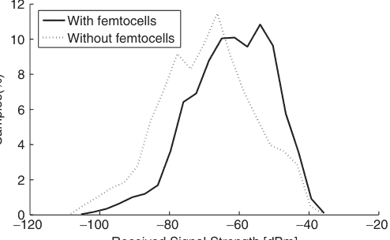

图5.14(a)展示了两个现有宏基站提供的信号质量*SINR*。在这种情况下，前导码（也称为导频信号）的SINR水平被用作关键性能指标（KPI）。为了估算场景中每个像素点的这个值，将最优服务基站的接收信号强度视为载波*C*，将所有相邻小区的接收信号强度总和视为干扰*I*。这些值和噪声水平*N*使用5.5.2节中介绍的公式计算。由此产生的SINR值对应于数据传输中的最坏情况，因为假设所有用户在同一频带内运行并相互干扰。

在不使用毫微微蜂窝基站的部署中，可以看出，在靠近宏基站的区域SINR水平较高，但在宏基站的边界处迅速下降，那里的载波和干扰信号以相似的强度被接收。对于位于小区边缘但使用不同子信道的用户，此效应不会造成问题，但如果发生子信道碰撞（干扰），则可能干扰他们的数据通信。

图5.12(b)展示了部署毫微微蜂窝基站后，在毫微微蜂窝基站所在区域SINR如何得到提升。之前SINR较低的家庭，现在被具有高SINR（约40 dB）的无线信号覆盖。

总而言之，可以得出结论：毫微微蜂窝基站将提高室内信号质量。这为运营商提供了可能性，以提供具有更高吞吐量要求的新服务（如高速互联网、游戏等）。然而，这是以因客户不受控地部署新小区而增加室外干扰为代价的。非订阅用户不会从CSG毫微微蜂窝基站提供的更高SINR中受益，反而会遭受更大的干扰。

## 5.6.4 *性能*

本节对上述场景中的性能进行了分析。本研究的目的是确定使用系统级仿真（SLSs）的毫微微蜂窝基站所带来的性能提升。

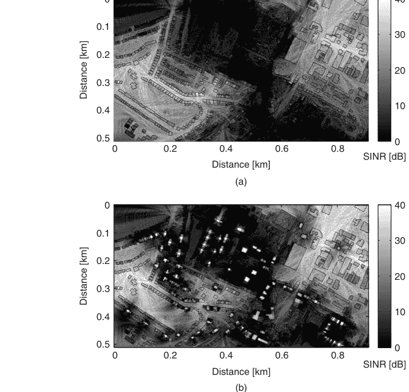

仿真参数与表5.7中建议的相同，并通过小区吞吐量、成功用户和掉线用户百分比等不同测量指标来评估网络性能。

为了探索宏基站的运行极限并观察毫微微蜂窝基站带来的好处，在给定场景中提出了不同的网络部署方案。这些网络部署总结如下：

- 第一个场景包括两个宏基站，没有毫微微蜂窝基站。室外和室内用户都尝试使用VoIP服务，其最低吞吐量要求为12.2 kbps。请注意，在不使用毫微微蜂窝基站时，2个宏基站拥有20 MHz带宽（32个子信道）。
- 在第二个场景中，部署布局保持不变，不使用毫微微蜂窝基站。在这种情况下，室外用户继续要求VoIP服务，而室内用户将其需求更改为网页浏览，要求最低吞吐量为64 kbps。
- 在第三个场景中，室内用户将其服务需求升级到256 kbps。


 - 在第四种场景中，在现有宏小区布局的基础上进行了大规模的 femtocell 部署（100 个 FAP）。在整个网络中考虑了 CSG femtocell 的同频部署。在这种情况下，室外和室内用户分别持续要求 VoIP 和数据（256 kbps）服务。需要注意的是，在使用 femtocell 时，两个宏小区和 femtocell 的带宽为 5 MHz（八个子信道）。
- 在第五种场景中，部署布局不变，使用了 100 个 femtocell。然而，在这种情况下，室内用户将其服务需求升级到 320 kbps。

在本节的其余部分，仅考虑**下行链路（DL）**。这背后的原因是，WiMAX femtocell 的主要用途将是数据服务，这些服务是**不对称**的，即下行链路（DL）的需求大于上行链路（UL）。仿真结果（在 100 个快照上取平均）如表 5.8 所示。

在第一种场景中（图 5.15(a)），两个宏小区足以服务大多数室外和室内用户。表 5.8 显示，成功用户的百分比为 91.75%，因资源不足而受阻的用户百分比为 0%。然而，如图 5.15(a) 所示，一些位于无线覆盖有限区域的室内用户（8.25%）处于中断状态。Femtocell 将帮助这些用户，提供更大的室内覆盖范围，并通过 IP 回程连接传输其数据包。此外，从结果中可以看出，室内流量大于室外流量（7.468 对 1.838 Mbps）。室内用户多于室外用户。

在第二种场景中，室内用户的需求增长（64 kbps），需要更多的资源来满足这一新的服务要求。由于室内流量的增长，室内层的吞吐量从 7.468 增加到 22.483 Mbps。然而，尽管两个宏小区仍有足够的资源来处理请求，但时隙冲突（干扰）的概率增加，这导致室外用户的信号质量降低，甚至在某些情况下出现中断。由于干扰的增加，中断百分比从 8.25% 增加到 12.06%，室外层吞吐量从 1.838 下降到 1.780 Mbps。

**表 5.8 系统级仿真结果**

| 场景 室外/室内服务 | 成功用户 (%) | 中断用户 (%) | 无资源用户 (%) | 室外吞吐量 (Mbps) | 室内吞吐量 (Mbps) |
| :--- | :--- | :--- | :--- | :--- | :--- |
| 两个宏小区 VoIP/VoIP | 91.75 | 8.25 | 0 | 1.838 | 7.468 |
| 两个宏小区 VoIP/数据(64 kbps) | 87.94 | 12.06 | 0 | 1.780 | 22.483 |
| 两个宏小区 VoIP/数据(256 kbps) | 44.44 | 1.27 | 57.29 | 1.089 | 41.707 |
| 两个宏小区/ 100 个 femtocell VoIP/数据(256 kbps) | 98.41 | 1.59 | 0 | 2.107 | 60.681 |
| 两个宏小区/ 100 个 femtocell VoIP/数据(320 kbps) | 98.41 | 1.59 | 0 | 2.059 | 84.302 |

在第三种场景中（图 5.15(b)），室内用户的需求再次增长（256 kbps），需要更多的时隙来满足这一新的服务要求。由于室内流量的增长，室内层的吞吐量再次从 22.483 增加到 41.707 Mbps。然而，两个宏小区的资源现在已不足以满足用户需求，无资源用户的数量迅速增长到 57.29%。在这种情况下，宏小区过载，之前能够传输的用户现在因资源不足而被阻塞。

在第四种场景中（图 5.16(a)），考虑了 femtocell 的广泛应用。让我们回顾一下，在这种情况下，宏小区的带宽已从 20 MHz 减少到 5 MHz。尽管如此，由于室内流量从宏小区转移到回程连接，资源不足的问题消失（0%），减少了宏小区对大带宽的需求，提高了其可靠性。因此，运营商可以降低宏小区网络的资本支出和运营支出。此外，表 5.8 显示，成功用户的数量（订户和非订户）很高（98.41%），网络承载的总吞吐量从 42.796 增加到 62.788 Mbps。

在第五种场景中（图 5.16(b)），室内用户的需求再次增长（320 kbps）。然而，这对 femtocell 层来说不是问题，因为这部分流量被回程链路吸收，室内层吞吐量从 60.681 增加到 84.302 Mbps。请注意，成功用户和中断用户的数量保持不变，但室外层吞吐量略有下降。这是由于干扰造成的。由于室内流量增加，占用的时隙数量增加，因此时隙冲突的概率增加。由于这一事实，位于 femtocell 附近区域的非订户可能会遭受更大的干扰。这种干扰将降低非订户的信干噪比（SINR），并降低其无线接入承载（RAB）和吞吐量。

## 5.7 动态系统级仿真概述

动态系统级仿真将有助于准确分析不同场景中新内置 femtocell 算法的性能。在这种仿真中，时域不被忽略，可以精确检查网络随时间的演化。这一特性对于分析那些必须考虑用户移动和无线信道随时间波动的方法的行为特别有用，例如切换算法和反馈技术。此外，它将有助于理解不同策略的行为，例如功率和频率分配，在存在具有非常不同特征的多种业务类型时，如实时服务和尽力而为服务。

对于 femtocell，必须对新型自组织技术进行研究，这些技术将使 femtocell 能够感知其环境并调整其参数，然后才能实施。这种类型的仿真可以涵盖多种主题。它可用于分析不精确同步的影响，并推导振荡器性能的界限。相反，它也可用于理解不同监测技术的优缺点，例如 femtocell 之间的消息交换或使用来自用户的测量报告。还存在许多其他应用。

在本节中，介绍了动态系统级仿真中必须考虑的不同关键特性。

### 5.7.1 业务建模

业务模型用于系统级仿真（SLS）中，以模拟给定应用或服务的行为，例如 VoIP、视频会议、FTP。这种行为在不同层次上进行考虑，包括会话生成过程和每个会话内的数据生成。

#### 会话生成

业务建模的目标是创建分析模型，以统计方式描述给定业务类型的最具代表性的参数。这些业务模型的参数必须进行调整，以适应真实网络的特征。

首先，为了捕捉最终客户的动态，必须对用户到达率进行建模，以及他们在系统中的保持时间。此外，femtocell 用户可能同时承载多个会话（通话、电子邮件、FTP）。

在宏小区场景中，泊松过程已被广泛用于模拟网络随时间的业务负载。在这种情况下，n 个新会话到达的概率由以下公式给出：

> $p_n(T) = \frac{(\lambda T)^n}{n!}e^{(-\lambda T)}$   (5.15)

其中，$T$ 和 $\lambda$ 分别表示采样周期和用户的平均到达率。请注意，这些会话通常分布在定义的覆盖区域或业务地图中。

对于每个新会话，保持时间 $t_H$ 由以下概率密度函数（PDF）生成的指数分布随机变量描述：

> $f_{t_H}(t_H) = \mu e^{(-\mu t_H)}$   (5.16)

其中，$\mu$ 表示平均保持时间。

为了在给定场景中模拟不同的业务密度，可以为每个业务和/或区域定义不同的 $\lambda$ 和 $\mu$ 值。

对于 femtocell，一种常见的方法是假设 femtocell 始终被占用，用户数量从一个到 femtocell 允许的最大用户数量不等 [24]。虽然这一假设适用于分析 femtocell 的容量和干扰，但可能不够现实。因此，必须研究能够考虑 femtocell 应用、捕捉 femtocell 用户行为的新模型。


 ## 数据生成

为了推导系统性能，需要随时间准确建模会话产生的流量动态。下面将以VoIP和FTP [25]为例，说明两种不同的流量模型（数据生成）。

**VoIP** 典型的VoIP通话通常可分为两种状态：激活态和非激活态。在激活态，用户正在发送数据包；而在非激活态，用户正在接收信息。因此，可以使用两状态马尔可夫链来建模该应用。

从激活态转移到非激活态的概率为0.6，而从非激活态转移到激活态的概率为0.4。此外，通话处于激活态或非激活态的时间周期分别由均值为1.0 s和1.5 s的指数分布定义。

当用户处于激活态时，固定大小的数据包以固定间隔生成。这些参数的取值取决于所使用的语音编解码器和压缩方案。如果采用简化的AMR（自适应多速率）音频数据压缩技术，则AMR块的有效载荷为33字节，生成速率为20 ms。

当用户处于非激活态时，会生成舒适噪声，以避免用户混淆是断开连接还是等待新的数据包。这些数据包的有效载荷为7字节，生成速率为160 ms。

**FTP** 在FTP应用中，一个会话由一系列文件传输组成，各传输之间由阅读时间间隔隔开。该模型的主要参数包括待传输文件的大小和阅读时间长度。阅读时间由均值为180 s的指数分布建模。文件大小服从均值为2 MByte、标准差为0.72 MByte的对数正态分布。文件大小不得超过5 MByte。

此处介绍的两种流量模型只是大量模型中的一个示例。这类模型允许对系统性能进行更详尽的评估。例如，分析考虑数据存储队列大小的调度技术，或在实时与非实时服务之间分配资源等。

对于 femtocell 而言，设备厂商和运营商正在努力开发新的应用，以催生市场对 femtocell 的需求。因此，需要能够捕捉这些新服务特性的新模型。利用这些模型，可以研究新的优化技术以提升 femtocell 的性能。

### 5.7.2 移动性建模

移动性模型在SLS中用于模拟用户在场景中的移动，例如位置、速度、方向。

存在大量的移动性模型。其中一些以简化的方式建模用户移动，而另一些则具有很高详细程度。

建模用户运动的一种直接方法是使用高斯分布[26]。我们将用户的未来位置表示为：

```
$$(x_t, y_t) = \begin{cases} x_{t-1} + v_t \Delta t cos(\alpha_t) + n_{t-1} \\ y_{t-1} + v_t \Delta t sin(\alpha_t) + n_{t-1} \end{cases}$$ (5.17)
```

其中 $(x_{t-1}, y_{t-1})$ 表示用户先前位置，$v_t$ 表示用户在时刻 $t$ 的速度，$\alpha_t$ 表示用户在时刻 $t$ 的方向，$n_{t-1}$ 为高斯分布噪声。此外，$\Delta t$ 表示模型两次连续更新之间的时间周期。

速度和方向可推导如下：

```
$$v_t = N \left(v_{t-1}, 1\frac{m}{s^2}\Delta t\right)$$ (5.18)

$$\alpha_t = N \left(\alpha_{t-1}, 2\pi - a \tan\left(\frac{\sqrt{v_t}}{2}\right)\Delta t\right)$$ (5.19)
```

其中 $v_{t-1}$ 和 $\alpha_{t-1}$ 分别表示用户先前的速度和方向，$N(a, b)$ 表示均值为 $a$、标准差为 $b$ 的高斯分布。

用户移动还必须考虑环境描述，即墙壁、房间和走廊。用户不能穿过墙壁或其他固体物体。为此，可以使用移动图来根据环境中的障碍物约束用户移动。顶点表示可能的目的地，边对应于用户可以移动的物理有效路径[27]。

另一方面，可以使用更复杂的模型来模拟客户的移动性。在[28]中，提出了一种基于测量的模型。在该工作中，例如，收集了始终在线的WiFi设备的轨迹，并推导了速度和暂停时间的分布。这类模型提供了更准确的用户行为模拟。

对于 femtocell 而言，可能需要考虑场景特点的室内移动性模型，以准确分析签约用户和非签约用户的性能。这些模型对于研究 femtocell 场景下的切换程序可能很重要。然而，需要分析 femtocell 用户的行为，因为它可能与自组网或传感器网络模拟中使用的模型不同。因此，该领域需要进一步研究。

# 参考文献

- [1] E. Almalda, A. Capone, and F. Malucelli, 'Planning UMTS base station location: Optimization models with power control and algorithms,' *IEEE Transactions on Wireless Communications*, vol. 2, no. 5, pp. 939–952, September 2003.

- [2] F. Gordejuela-Sanchez, A. Jüttner, and J. Zhang, 'A multiobjective optimization framework for IEEE 802.16e network design and performance analysis,' *IEEE Journal on Selected Areas in Communications. Special issue on Broadband Access Networks: Architectures and Protocols*, April 2009.

- [3] V. Chandrasekhar and J. G. Andrews, 'Femtocell networks: A survey,' *IEEE Communication Magazine*, vol. 46, no. 9, pp. 59–67, September 2008.

- [4] A. Eisenblätter, 'Frequency assignment in GSM networks: Models, heuristics, and lower bounds,' Ph.D. dissertation, Technische Universität Berlin, Fachbereich Mathematik, Berlin Germany, 2001.

- [5] A. Eisenblätter, H.-F. Geerdes, T. Koch, A. Martin, and R. Wessäly, 'UMTS radio network evaluation and optimization beyond snapshots,' *Mathematical Methods of Operations Research*, vol. 63, no. 1, pp. 1–29, February 2006.

- [6] J. Laiho, A. Wacker, and T. Novosad, *Radio Network Planning and Optimisation for UMTS*, 2nd ed. John Wiley & Sons, Ltd, Chichester, December 2006.

- [7] J. G. Andrews, A. Ghosh, and R. Muhamed, *Fundamentals of WiMAX Understanding Broadband Wireless Networking*. Massachusetts, USA: Prentice Hall, February 2007.

- [8] Z. Lai, N. Bessis, G. de la Roche, H. Song, J. Zhang, and G. Clapworthy, 'An intelligent ray launching for urban propagation prediction,' in *3rd European Conference on Antennas and Propagation (EuCAP)*, Berlin, Germany, March 2009.

- [9] A. Valcarce, G. de la Roche, and J. Zhang, 'A GPU approach to FDTD for radio coverage prediction,' in *11th IEEE International Conference on Communication Systems*, Guangzhou, China, November 2008.

- [10] J.-M. Gorce, K. Jaffres-Runser, and G. D. L. Roche, 'Deterministic approach for fast simulations of indoor radio wave propagation,' *IEEE Transactions on Antennas and Propagation*, vol. 55, pp. 938–942, March 2007.

- [11] 'Guidelines for Evaluation of Radio Transmission Technologies for IMT-2000,' ITU-R M.1225, 1997.

- [12] U. Türke, Ed., *Efficient Methods for WCDMA Radio Network Planning and Optimization*. DUV, December 2007, Monte Carlo Snapshot Analysis, pp. 45–66.

- [13] Forsk. Forsk atoll–global rf planning solution.

- [14] AWE Communications. Awe communications–wave propagation and radio network planning.

- [15] T. Kwon, H. Lee, S. Choi, J. Kim, and D.-H. Cho, 'Design and implementation of a simulator based on a cross-layer protocol between mac and phy layers in a wibro compatible IEEE 802.16e OFDMA system,' in *IEEE Communications Magazine*, vol. 43, no. 12, December 2005, pp. 136–146.

- [16] IEEE Std 802.16e-2005, 'IEEE standard for local and metropolitan area networks: Air interface for fixed broadband wireless access systems–physical and medium access control layers for combined fixed and mobile operation in licensed bands,' February 2006.

- [17] C. Huang, H. Juan, M. Lin, and C. Chang, 'Radio resource management of heterogeneous services in mobile wimax systems,' in *IEEE Wireless Communications*, vol. 14, 2007, pp. 20–26.

- [18] NGMN, 'NGMN radio access performance evaluation methodology,' A White Paper by the NGMN Alliance, January 2008.

- [19] V. Hassel, 'Design issues and performance analysis for opportunistic scheduling algorithms in wireless networks,' PhD dissertation, Norwegian University of Science and Technology, Faculty of Information Technology, Mathematics and Electrical Engineering, Department of Electronics and Telecommunications, January 2007.

- [20] H. Jia, Z. Zhang, G. Yu, P. Cheng, and S. Li, 'On the performance of IEEE 802.16 OFDMA system under different frequency reuse and subcarrier permutation patterns,' in *IEEE International Conference on Communications*, vol. 24, june 2007, pp. 5720–5725.

- [21] ATDI, 'Mobile WiMAX from OFDM 256 to s-OFDMA,' ATDI White paper, 2007.

- [22] United Kingdom Office of Communications (Ofcom), 'The communications market 2006, annual communications market report,' http://www.ofcom.org.uk/research/cm/cm06, August 2006.

- [23] A攀登, G. D. L. Roche, A. Jüttner, D. López-Pérez, and J. Zhang, 'Applying FDTD to the coverage prediction of WiMAX femtocells,' *Eurasip Journal of Wireless Communications and Networking. Special issue on Advances in Propagation Modelling for Wireless Systems*, February 2009.

- [24] A. Claussen, L. T. W. Ho, and L. G. Samuel, 'An overview of the femtocell concept,' *Bell Labs Technical Journal*, vol. 3, no. 1, pp. 221–245, May 2008.

- [25] W. Lee, J. Choi, K. Ryu, and R. Kim, 'Draft IEEE 802.16m evaluation methodology and key criteria for 802.16m – advanced air interface,' IEEE 802.16 Broadband Wireless Access Working Group, March 2007.

- [26] Widyawan, M. Klepal, and D. Pesch, 'Influence of predicted and measured fingerprint on the accuracy of RSSI-based indoor location systems,' in *4th Workshop on Positioning, Navigation and Communication, 2007. WPNC '07.*, March 2007, pp. 145–151.

- [27] A. Cavilla, G. Baron, T. Hart, L. Litty, and E. de Lara, 'Simplified simulation models for indoor manet evaluation are not robust,' in *IEEE Sensor and Ad Hoc Communications and Networks*, vol. 4, no. 7, October 2004, pp. 610–620.

- [28] M. Kim, D. Kotz, and S. Kim, 'Extracting a mobility model from real user traces,' in *25th IEEE International Conference on Computer Communications. INFOCOM.*, April 2006, pp. 1–13.


 ## 6 飞蜂窝存在下的干扰

Alvaro Valcarce 与 David López-Pérez

## 6.1 引言

飞蜂窝的部署在传统的宏蜂窝网络拓扑中引入了一些变化。新的网络架构由两个明显分离的层组成，即宏蜂窝层和飞蜂窝层。因此，这样的网络架构被称为**双层**或**双级**网络。第一层包含传统的蜂窝网络，而第二层则包含多个短距离的基站，这些基站可以是经过规划的（例如微蜂窝），也可以是随机分布的（例如飞蜂窝）。对于家庭基站而言，它们随机分布在由更大蜂窝网络覆盖的同一地理区域内（也称为伞状宏蜂窝），并且可以利用与伞状网络相同的频谱频率。因此，在这种网络结构中部署较小蜂窝的优势之一是提高伞状宏蜂窝内未完全覆盖区域的覆盖率。此外，由于飞蜂窝的用户数量较少，还能实现更高的数据速率。

然而，双层网络的拓扑带来了新的问题，并创造了新的设计挑战。当多个发射机在同一频带和同一地理位置发射信号时，接收系统在该频带内将无法区分它在收听哪个发射机。这是电信系统中干扰问题的一个非常基本的描述，也是飞蜂窝部署将面临的主要挑战之一。像码分多址（CDMA）这样的干扰受限系统将受到飞蜂窝存在的严重影响，需要引入干扰规避技术，如跳时或功率控制。此外，像正交频分多址（OFDMA）这样的容量受限系统需要采用智能的频率规划策略，以应对由于飞蜂窝层的存在而在子载波上产生的干扰。

飞蜂窝将提供更高的频谱效率、空间频率复用，以及在宏蜂窝未完全覆盖的区域（例如室内房间或小区边缘附近）更好的覆盖。然而，如果不应用干扰消除或规避技术，宏蜂窝内可能会出现死区，在飞蜂窝附近中断其服务。此外，飞蜂窝的机会性部署表明，在分析飞蜂窝相关问题时必须考虑随机性。本章涵盖了干扰飞蜂窝引起的问题，并给出了随机分布的干扰源如何影响CDMA和OFDMA系统的具体示例。

## 6.2 关键概念

### 6.2.1 同层干扰

**同层干扰**被描述为在飞蜂窝处接收到的、来自其他飞蜂窝的不需要的信号，从而降低其通信质量。*同层*这一名称指的是所有飞蜂窝都属于同一个网络层，这与属于宏蜂窝层的基站、NodeB等其他元素不同。同层干扰主要发生在紧邻的邻居之间，这是由于房屋和公寓之间的隔离度较低造成的。因此，这个问题与对宏蜂窝层造成的干扰无关。图6.1总结了源自同层干扰的主要问题，以下段落将更详细地描述这些问题。

由于飞蜂窝的部署是机会性的，很可能几个飞蜂窝会被安装在彼此靠近的位置，例如在水平方向上相邻的联排房屋中，或在垂直方向的公寓楼中，从而相互干扰。为了说明这一点，我们假设全球移动通信系统（GSM）飞蜂窝$f_a$照亮任意位置$L_a$。那么可以说$L_a$属于$f_a$的覆盖区域。如果来自周围使用相同频率的飞蜂窝的额外信号存在，那么位置$L_a$被称为遭受同信道干扰，系统性能会受到影响。此外，当多个飞蜂窝的信号出现在给定位置时，整体干扰可能高于任何独立的飞蜂窝功率水平。如果载波干扰噪声比（*CINR*）值过低，可能无法通过任何飞蜂窝建立通信，这样的位置将被视为**死区**。这不应与**覆盖空洞**的概念混淆，根据[1]，覆盖空洞是由于路径损耗导致导频*CINR*较低的区域，因此用户设备（UE）无法进行网络接入。通信的退化程度因射频技术在干扰存在下的不同性能而异。如下所示，死区的几何形状在不同的空中接口技术之间有所不同。

由于飞蜂窝可以以封闭用户组（CSG）、开放接入或混合接入模式部署，同层干扰的影响将取决于接入方式。为了说明这一点，图6.2展示了在不同服务质量（QoS）要求下的现实飞蜂窝场景。例如，图6.2(a)展示了九个随机部署的飞蜂窝的覆盖区域，覆盖区域定义为主要飞蜂窝信号严格高于整体干扰加噪声的位置（假设只有一个载波）。如果这些是开放接入飞蜂窝，用户可以在不穿越场景中死区（图中以黑色区域表示）的情况下，自由地从他们的飞蜂窝移动到其他飞蜂窝。如前所述，死区的几何形状取决于所用空中接口技术的*CINR*要求。在电信系统中，用户通常需要主信号达到一定质量才能使用某些服务。例如，在GSM中，为了进行切换性能，仅拥有略大于干扰加噪声水平的载波信号（*CINR* > 0 dB）是不够的。例如，图6.2(b)展示了相同场景，但增加了主信号必须至少比干扰加噪声水平高10 dB（*CINR* > 10 dB）的限制。可以清楚地看到，随着QoS要求的提高，死区变得更大，即使使用开放接入飞蜂窝，用户也可能由于这些间隙的存在而无法自由地从一𬰨飞蜂窝移动到另一𬰸。

在CDMA系统中，服务受损的条件可以进一步放宽。例如，可以证明，所有飞蜂窝在整个前述场景中都能实现下行*CINR* > −20 dB的要求，这对于标准语音连接的性能来说已经足够[2]。然而，必须指出的是，这样的信号质量在很大程度上取决于单位面积内飞蜂窝的密度。尽管如此，CDMA中的调制过程将信号功率扩展到整个频谱，从而降低了功率谱密度，也降低了接收到的*CINR*。

在OFDMA中，每个用户对死区的感知不同。这取决于可能在不同飞蜂窝之间有所不同的子信道分配。因此，OFDMA用户可能会感知到某些子信道存在死区，而其他子信道则保持无干扰。为了说明这一点，我们假设在某一时刻，前述场景中OFDMA飞蜂窝决定的子信道分配如图6.3所示。图6.3(a)中的深色区域表示子信道1至4的*CINR* < 10 dB的区域，即这些子信道的死区。另一方面，图6.3(b)展示了子信道5至8的*CINR* < 10 dB的区域，这可能与前一情况不同。


 **图 6.2** 在没有宏蜂窝覆盖的住宅环境中，毫微微蜂窝的下行链路覆盖区域。深色方块表示 FAP 的位置，黑色区域是所有毫微微蜂窝均无法满足*CINR*要求的区域。(a) *CINR* > 0 dB 时的覆盖区域。(b) *CINR* > 10 dB 时的覆盖区域

(a)

(b)

(c)

**图 6.3** 每个子信道*CINR* > 10 dB 时的下行链路覆盖区域。(a) 占用子信道 1 至 4。(b) 占用子信道 5 至 8。(c) 联合覆盖区域。在深色区域，所有 OFDMA 子信道的*CINR*均 < 10 dB

从图 6.3(c) 可以清楚地看出，所有 OFDMA 子信道均受干扰的区域大小远小于单个子信道的“死区”。因此，通过将频谱使用划分为子信道，死区的大小得以减小。此外，如果每个毫微微蜂窝在给定时间使用少于四个子信道，死区会进一步缩小。在像移动 WiMAX 这样的 OFDMA 系统中，时间也起着重要作用，因为子信道的分配会根据调度，随着 QoS 需求动态变化。因此，两个子信道同时被占用的概率进一步降低。

在一个毫微微蜂窝中，有两种类型的源可以对其他毫微微蜂窝造成同层干扰：FAP（下行链路）和用户本身（上行链路）。在时分双工（TDD）系统中，并且取决于干扰信号的源，用于建模和应对干扰的方法各不相同。如果同一区域内的所有毫微微蜂窝都是同步的（即它们的下行链路周期在时间上同时开始），则被干扰的毫微微蜂窝用户处的干扰源*在下行链路期间是相邻的 FAP。这意味着来自 FAP 的传输仅在下行链路期间对相邻毫微微蜂窝的 UE 造成干扰。上行链路周期也是如此。如果相邻毫微微蜂窝的上行链路周期是同步的，毫微微蜂窝用户将成为干扰源，因此来自毫微微蜂窝用户的传输将在相邻 FAP 的上行链路中被感知为干扰。表 6.1 总结了在干扰情况下扮演干扰源角色的网络元素。

如果毫微微蜂窝之间没有同步，TDD 中的干扰源将是不确定的。不同毫微微蜂窝的上行链路和下行链路周期会重叠，并引入异构的干扰源（FAP 和 UE）。这样，相邻毫微微蜂窝会侵占彼此的传输时隙，使干扰更难控制。因此，精确计时是基于 TDD 的 FAP 的一个重要特性，以便可以假设不同 FAP 之间的时钟同步以缓解干扰。然而，如何精确同步 FAP 并非易事，几种解决方案在第 9.1 节中进行了解释。

由于所有 MBS 都属于同一个网络层（宏蜂窝层），不同宏蜂窝之间的干扰也是同层干扰的一个原因。然而，宏蜂窝的部署是由运营商规划的，干扰通过规划方案（基站（BS）位置、天线方位角/下倾角、频率等）来处理。因此，这个问题与毫微微蜂窝的部署无关，本书不予讨论。以下章节对上行链路和下行链路数据连接中同层干扰的影响进行了技术描述。同时，讨论了克服同层干扰的不同方法，并汇总于图 6.4 供参考。

**表 6.1** 干扰情况下的干扰源

| | 同层 | 跨层 |
|---|---|---|
| **上行链路** | 毫微微蜂窝用户 | 任何 UE |
| **下行链路** | FAP | FAP 和宏蜂窝基站（MBS） |

> *在 3GPP 术语中，干扰源也称为*干扰者*。

#### 上行链路

在上行链路同层干扰中，毫微微蜂窝 UE 是干扰者或干扰源。另一方面，相邻的 FAP 是受干扰的系统。接下来在不同射频技术假设下解释这个问题。

##### 上行链路 CDMA

在给定的毫微微蜂窝 $f_a$ 中，最直接的干扰者是相邻毫微微蜂窝的 UE，$f_a$ 通常被几个干扰者包围，仅通过外墙与之隔离。相邻 CDMA 上行链路中的主要问题是由于干扰者的空间分布特性导致的噪声电平上升。如果相邻 UE 以其自身毫微微蜂窝要求的高功率发射，附近毫微微蜂窝的噪声电平将降低，受干扰毫微微蜂窝的覆盖区域将减小。为了解决这个问题并避免相邻 3G 毫微微蜂窝的性能恶化，3GPP† 在 [3] 中建议使用干扰管理技术。这有助于避免毫微微蜂窝之间的相互干扰。

作为干扰管理的一个例子，并且考虑到给定区域内的毫微微蜂窝密度可能极高，建议 FAP 对其订阅的 UE 施加功率限制。这样，就可以控制相邻毫微微蜂窝上行链路中的噪声上升。此外，用户的发射功率必须由 FAP 而不是 UE 本身来控制。这适用于通用移动电信系统（UMTS）和高速上行分组接入（HSUPA）等 3G 系统，选择发射功率电平的方法如下：在给定的毫微微蜂窝 $f_a$ 中，FAP 扫描传输频带并收集来自附近毫微微蜂窝 UE 的接收功率信息。这可以通过例如 FAP 本身执行的感知来完成。然后，毫微微蜂窝 $f_a$ 可以独立选择 UE 的最大发射功率，同时考虑来自其他毫微微蜂窝的接收功率，即 UE 的功率将被设置为在 FAP 处接收给定服务的所需*CINR*。

在专用信道部署的情况下，同一频带中没有宏蜂窝信号来提供噪声电平的参考。因此，在这种情况下，FAP 能够有效可靠地感知上行链路噪声电平尤其重要。为此，必须仔细遵循 FAP 接收器灵敏度的设计。

##### 上行链路 OFDMA

在 OFDMA 毫微微蜂窝中，感知整个传输频带以探测附近的发射可能是不必要的。根据给定用户所需的上行链路 QoS，该用户只需要某些 OFDMA 子信道。因此，由 FAP 来确定哪些子信道受到干扰，哪些没有。例如，图 6.5 显示了一种情况，其中用户 2 位于其自身毫微微蜂窝（$f_2$）和相邻毫微微蜂窝（$f_1$）的覆盖区域内。在这种情况下，用户 2 用于连接到 $f_2$ 的子信道将被 $f_1$ 感知为受到干扰，因此不可用。此外，毫微微蜂窝 $f_1$ 也有自己的用户（用户 1）。然而，由于用户 1 不在用户 2 的覆盖区域内，用户 1 无法知道哪些上行链路子信道受到干扰。因此，用户 1 的子信道分配责任必须由 FAP 承担。

上行链路干扰的情况通常比下行链路更严重。这是因为下行链路干扰仅影响受干扰的用户，而受干扰的上行链路子信道对该毫微微蜂窝的所有用户都变得不可用。与 CDMA（传输占用整个授权频带）相反，在 OFDMA 的情况下，可用的子信道可以用来限制发射，从而也可以在频域中减少干扰，从而提供更高的避免干扰的机会。第 6.4.2 节给出了一些在 OFDMA 毫微微蜂窝中避免干扰的策略。

#### 下行链路

在下行链路同层干扰中，FAP 是干扰者或干扰源，而相邻毫微微蜂窝的 UE 是受害者。接下来描述这个问题。

##### 下行链路 CDMA

同频下行链路干扰也是毫微微蜂窝的主要损伤源之一。由于毫微微蜂窝将部署在相对于彼此靠近的位置

- 受干扰的用户
- 不受干扰的用户
- --- 干扰信号
- ➝ 下行链路信号

**图 6.5** OFDMA 毫微微蜂窝网络中的同层上行链路干扰

> † 3GPP 是第三代合作伙伴计划，一个负责 3G 网络标准化的电信实体联盟。


彼此相邻的毫微微蜂窝之间，很可能通过窗户、门以及 poorly isolated walls 造成功率泄漏，从而相互干扰。如图 6.2 所示，同一区域内多个毫微微蜂窝的信号会加剧干扰。因此，在 CDMA 系统中，噪声水平会升高，并产生下行连接无法实现的盲区（小区呼吸）。

为了避免毫微微蜂窝对附近毫微微蜂窝（包括室内和室外）的 UE 产生下行干扰，3GPP [3] 的首要建议是 FAP 通过自适应功率控制技术谨慎处理其发射功率设置。这在 CSG 毫微微蜂窝中尤为必要，因为 UE 不一定由最强的 FAP 提供服务，而是由它们所订阅的那个 FAP 提供服务。与上行链路情况类似，下行链路发射功率可以由每个 FAP 根据接收到的来自邻近毫微微蜂窝的功率来决定。由于盲区的出现主要是多个毫微微蜂窝下行信号同时叠加的结果，因此有人提出了跳时技术，以避免邻近毫微微蜂窝同时传输。这些将在 6.4.1 节中更详细地解释。

**下行 OFDMA** 共层下行干扰的一个案例是，当某个毫微微蜂窝用户位于 FAP 覆盖范围内的一个区域时，其来自自身毫微微蜂窝的信号与来自周围毫微微蜂窝的干扰相比不够强。这相当于图 6.2 中所示的盲区问题，如上一节所述，盲区可能完全中断 CDMA 毫微微蜂窝中的下行连接。

然而，在 OFDMA 系统中，每个毫微微蜂窝的子信道分配对干扰的最终影响起着决定性作用。OFDMA 毫微微蜂窝中的盲区取决于给定位置的频谱占用情况。两个毫微微蜂窝用户可能处于相同的地理位置，但其中只有一个会受到周围毫微微蜂窝的干扰，即盲区只会影响某些 OFDMA 子信道。为了说明这一点，在图 6.6 中，用户 2 和用户 3 希望从其各自的毫微微蜂窝（本例中为 $f_2$）接收下行数据。因此，毫微微蜂窝 $f_2$ 将子信道 1 至 4 分配给用户 2，将子信道 5 至 8 分配给用户 3。在本例中，两个用户都位于由邻近毫微微蜂窝 $f_1$ 干扰引起的盲区中。然而，$f_1$ 仅需要子信道 1 至 4 来向其当前用户（用户 1）发送信息。因此，只有使用子信道 1 至 4 的用户会受到干扰，而用户 3 能够成功通信。虽然不一定总是如此，但本例中的用户 1 也位于由来自 *f*<sub>2</sub> 的干扰引起的盲区中，并且也因占用子信道 1 至 4 而遭受干扰。

因此，频率资源的分配在 OFDMA 毫微微蜂窝中极其重要。此外，时域也为子信道的管理提供了额外的维度。因此，资源分配是 OFDMA 毫微微蜂窝正常运行的关键技术之一。这些主题将在第 8 章中深入讨论。

### 6.2.2 跨层干扰

在两层网络中，如果干扰源系统和受害系统属于网络的不同层，则假定产生的干扰信号造成跨层干扰。例如，发射 FAP（毫微微蜂窝层成员）对下行链路中一个或多个宏蜂窝（宏蜂窝层成员）造成的失真，就是跨层干扰的典型案例。同样，如果失真是由宏蜂窝用户（宏蜂窝层成员）对附近 FAP（毫微微蜂窝层成员）的上行链路造成的，也可视为跨层干扰。跨层干扰在 CDMA 同频部署的两层网络中尤为严重，因为毫微微蜂窝和宏蜂窝都使用相同的频段。此外，由于功率控制的原因，突然的高发射功率可能导致盲区的出现，从而降低这些网络的可行性。图 6.7 展示了跨层干扰存在带来的主要问题，并在以下各节中加以解释。为了说明这一现象，图 6.8 展示了一个毫微微蜂窝渗透率较低（约占家庭的 14%）的住宅场景。在这里可以看到，单个毫微微蜂窝的覆盖区域侵入邻近房屋，其功率水平甚至高于宏蜂窝本身。如果毫微微蜂窝与宏蜂窝层部署在同一频段（同频部署），且房屋内的用户试图使用宏蜂窝，他们将遭受来自邻居的严重干扰，无法连接。此外，在图 6.8(b) 中，显示了 CINR > 10 dB 的覆盖区域，不满足此条件的盲区也被标出。由此可见，这种 blackout areas 不仅仅是毫微微蜂窝层的特征。盲区也会影响宏蜂窝，甚至在毫微微蜂窝密度高的街道上可能中断其服务。

**图 6.8** 同频部署宏蜂窝覆盖的住宅区内毫微微蜂窝的下行覆盖区域。深色方块表示 FAP，三角形表示 MBS，背景白色表示宏蜂窝覆盖区域。(a) 若 $CINR > 0$ dB 时的覆盖区域。(b) 若 $CINR > 10$ dB 时的覆盖区域

频谱分割已被提出作为应对跨层干扰的一种手段 [4]。然而，考虑到电磁频谱的成本和稀缺性，这将导致频率复用效率降低。频谱分割的方式如下：拥有 *B* MHz 带宽频段许可的运营商将该频段分成两个片段，即带宽分别为 *B*₁ 和 *B*₂ = *B* − *B*₁ 的片段 1 和 2。然后，频段 1 由宏蜂窝层使用，而频段 2 则分配给该运营商的毫微微蜂窝专用。一般而言，当宏蜂窝站点处毫微微蜂窝密度很高时，建议采用频谱分割 [5] 来缓解高水平的跨层干扰。这几乎可以完全消除所有跨层干扰。然而，当两个频段在频域上相邻时，相邻信道也会引入干扰 [6]，这就是为什么在设计发射功率限制时需要最小化相邻信道干扰抑制比（ACIR）。ACIR 定义为从干扰源发射的总功率与影响受害者的总干扰功率之比。其数学表达式为：

$$ACIR = \frac{1}{\frac{1}{ACLR} + \frac{1}{ACS}}$$ (6.1)

其中， adjacent channel leakage ratio（ACLR）衡量由于滤波器不完美，发射机泄漏到相邻信道的平均功率与实际上发送到分配信道的平均功率之比。此外，adjacent channel selectivity（ACS）衡量接收滤波器在分配频段上的衰减与在相邻信道上的衰减之比。即使在频谱分割部署中，可实现的 ACIR 也是有限的。因此，必须对 FAP 和 UE 的功率进行调节，以限制对宏蜂窝的影响。

在 OFDMA 系统中，频谱被划分为子载波，从而实现高效的频率资源分配以避免干扰。因此，基于 OFDMA 的毫微微蜂窝是一种理想的解决方案，为处理跨层干扰和共层干扰提供了更高的灵活性。然而，OFDMA 系统也可能遭受其他类型的问题，例如频率和时钟同步问题。来自网络中其他元素（包括共层和跨层）的干扰可能由于频率偏移而产生子载波间干扰。这可能导致子载波间正交性的丧失，并有使整个系统崩溃的风险。现有解决跨层干扰问题的方法总结于图 6.9 中，并在以下各节中加以解释。

最后，与共层干扰的情况类似，必须强调的是，网络范围的跨层时间同步对于保证毫微微蜂窝和宏蜂窝不会覆盖各自的传输周期至关重要。因此，同步的主要目的之一就是便于处理干扰问题。以下将介绍针对跨层干扰问题的、与链路和技术的相关方法。这些在图 6.9 中进一步总结。

‡ ACLR 术语仅适用于 3G 系统，但其概念等同于 adjacent channel power ratio（ACPR）。


#### 上行链路

##### 上行链路 CDMA

跨层上行干扰发生于两种不同情形。第一种情形是毫微微蜂窝用户扮演干扰方角色，宏基站 NodeB 则成为受扰方（宏 NodeB 受到干扰）。当毫微微蜂窝采用封闭用户组模式时，来自毫微微蜂窝用户设备的传输会导致宏蜂窝层的噪声增加。因此，运营商需要对毫微微蜂窝用户设备施加功率限制，以确保宏蜂窝的正常性能。这意味着运行在毫微微蜂窝接入点的功率控制算法不应被允许随意请求用户增加功率，以保持宏蜂窝的低噪声水平。然而，毫微微蜂窝用户设备较低的发射功率使得 CDMA 毫微微蜂窝接入点对来自附近宏蜂窝用户的干扰更加敏感。因此，毫微微蜂窝接入点必须在降低对宏蜂窝的干扰与保护自身免受宏蜂窝用户干扰之间取得折衷 [3]。关于功率控制的功率设置，毫微微蜂窝接入点可以通过测量下行链路来自宏 NodeB 的导频功率轻松决定。

高通公司 [5] 提出的另一种方法是限制每个宏基站站点的毫微微蜂窝用户设备的最大数量。然而，这只有在每个宏蜂窝的毫微微蜂窝数量已知且可控的情况下才能实现。鉴于毫微微蜂窝将机会性涌现的事实，这似乎不太可能。

另一方面，在开放接入毫微微蜂窝中，宏蜂窝用户被允许连接到毫微微蜂窝或宏蜂窝，具体取决于在给定时刻哪一个提供更好的服务质量。这保证了用户设备上行链路连接使用最小的功率，从而减少对毫微微蜂窝和宏蜂窝的噪声与上行干扰。此外，考虑到来自宏 NodeB 的干扰会限制毫微微蜂窝的覆盖范围，毫微微蜂窝用户设备需要非常靠近其接入点才能成功通信。因此，它们不太可能在宏 NodeB 附近以高功率发射并引起严重干扰。此外，宏蜂窝自身用户引起的噪声上升通常会高于毫微微蜂窝用户设备引起的噪声上升。

上行干扰的第二种情形发生在宏蜂窝用户（干扰方）在毫微微蜂窝（受扰方）附近以高功率发射时。这是毫微微蜂窝接入点受到干扰的情况。建筑物墙壁通常能为毫微微蜂窝接入点提供足够的与室外宏蜂窝用户的隔离。然而，当毫微微蜂窝位于宏蜂窝覆盖较差的区域时，路过的宏蜂窝用户极有可能以更高的功率发射以到达宏蜂窝。在这种情况下，毫微微蜂窝接入点处的热噪声上升（RoT）将会增加。由于宏 NodeB 不知道其用户的精确位置以及他们是否与任何毫微微蜂窝干扰，宏蜂窝上行链路预算必须设计时考虑毫微微蜂窝受扰的最坏情况。这样，可以为宏蜂窝用户设备的发射功率设置一个合适的上限。

例如，假设每个能够对附近毫微微蜂窝接入点 $f$ 造成上行干扰的宏蜂窝用户 $m$ 的发射功率为 $p_m^M$（以瓦为单位），其中 $M$ 表示用户属于宏蜂窝，$m$ 是用户 ID。宏蜂窝用户 $m$ 与毫微微蜂窝接入点 $f$ 之间的总路径损耗为 $l_{m,f}$，毫微微蜂窝接入点处的噪声水平由 $n_f$（瓦）给出。因此，毫微微蜂窝接入点 $f$ 处的总干扰加噪声水平 $in_f$ 为：

$$in_f = n_f + \sum_{m=1}^{N_M} \frac{p_m^M}{l_{m,f}} \qquad (6.2)$$

$l_{m,f}$ 的值主要取决于系统频率、房屋建筑材料以及宏蜂窝用户与毫微微蜂窝接入点之间的距离。然而，用户数量会随时间变化，并根据宏蜂窝用户的密度而不同。图 6.10 显示了任意毫微微蜂窝接入点处的 $in_f$ 值。

根据要使用的技术（UMTS、HSUPA 等），此类图表有助于根据宏蜂窝用户的最大发射功率确定最大干扰水平。

HSUPA 仿真 [7] 表明，如果宏蜂窝用户设备距离毫微微蜂窝接入点 15 米以内，毫微微蜂窝用户需要以至少 15 dBm 的功率发射，并且距离毫微微蜂窝接入点 5 米以内，才能享受 2.8 Mbps 的吞吐量。然而，干扰的宏蜂窝用户不太可能如此靠近毫微微蜂窝接入点。这主要是因为在毫微微蜂窝附近存在宏蜂窝用户的盲区。如果宏蜂窝用户如此接近盲区，宏蜂窝将尽力将其切换到另一个 CDMA 频率或断开连接。一般来说，可以说下行链路盲区保证了宏蜂窝用户与毫微微蜂窝接入点之间的最小隔离。

##### 上行链路 OFDMA

对于专用信道 OFDMA 毫微微蜂窝，可以在两个 OFDMA 子信道的边界处精确划分许可频段。这样，每个网络层被分配整数个子信道。在这种情况下，跨层干扰几乎不存在，邻道干扰是唯一的损伤源。然而，当毫微微蜂窝采用同频部署时，在上行链路可能发生两种类型的干扰。如同 CDMA 情况所定义，它们是毫微微蜂窝接入点受扰和宏基站受扰。

当毫微微蜂窝位于宏蜂窝边缘附近时，由于距离宏基站较远，宏蜂窝可能会要求附近的宏蜂窝用户增加其发射功率。如果未使用合适的 OFDMA 子信道，这可能会对毫微微蜂窝接入点造成上行干扰。如图 6.11(a) 所示，宏蜂窝用户 2 在与毫微微蜂窝用户 1 相同的子信道上以高功率发射。在这种情况下，房屋墙壁提供的隔离可能不足，导致用户 1 的上行连接中断。在这种情况下，OFDMA 子信道的适当分配放宽了对 CDMA 毫微微蜂窝中宏蜂窝用户施加的功率限制。因此，毫微微蜂窝（特别是位于宏蜂窝覆盖区域较低的区域，如小区边缘）在规划其上行子信道时考虑频谱占用非常重要，如图 6.11(a) 中的链路 L₃ 和 L₄ 所示。

另一种上行干扰可能发生在毫微微蜂窝距离宏基站太近时（宏基站受扰）。如图 6.11(b) 所示，其中毫微微蜂窝用户 1 被其毫微微蜂窝要求以高功率发射。§ 如果该传输在宏基站被接收，毫微微蜂窝用户 1 占用的子信道对宏蜂窝的其他用户设备就变得无用。与 CDMA 情况一样，为了保证宏蜂窝资源的优先使用，毫微微蜂窝接入点对其用户请求的功率增加必须受到限制。然而，在 OFDMA 情况下，这可以动态完成，并且取决于给定时刻 OFDMA 子信道的占用情况。

#### 下行链路

##### 下行链路 CDMA

在与宏蜂窝同频部署（同频部署）的封闭用户组毫微微蜂窝中，来自毫微微蜂窝接入点的信号将对附近的宏蜂窝用户设备造成下行干扰。如果该干扰信号足够强，宏蜂窝中将出现盲区。图 6.8 中的毫微微蜂窝覆盖区域可以被视为宏蜂窝视角的盲区，因为位于这些区域的宏蜂窝用户将遭受极高的噪声水平并且无法获得任何服务。注意，图 6.8 中呈现的场景从室外宏蜂窝覆盖的角度来看是乐观的。这是因为窗户和门已被消除，因此毫微微蜂窝不会向室外泄漏功率。然而，可以看到外墙仍然不足以有效隔离相邻房屋并将毫微微蜂窝信号限制在建筑物内。因此，在邻近房屋的室内也会出现盲区。当毫微微蜂窝接入点靠近窗户或门时，这种情况变得更加严重。

3GPP 提出的第一个解决方案，用于解决 UMTS 和 HSDPA 中毫微微蜂窝接入点对宏蜂窝用户造成的干扰，是限制毫微微蜂窝接入点的最大发射...


[content]
功率。然而在同频部署中，功率限制需要根据具体情况进行调整。业界普遍认为，由于存在产生不可控干扰的风险，在同频部署中采用固定的发射功率上限是不可行的。因此，采用自适应功率控制方法来控制主公共导频信道（PCPICH）更为合适，FAP需要支持较宽的发射功率动态范围，而这可能会增加其成本。FAP发射功率的控制算法由运营商自行决定实现方式。针对毫微微蜂窝极端密集部署的情况，另一个提出的解决方案是部署开放接入的毫微微蜂窝。这样，运营商可以根据计划安装区域的FAP密度，向客户提供CSG或开放接入的毫微微蜂窝。然而，由CSG和开放接入毫微微蜂窝组成的毫微微蜂窝层对宏蜂窝的影响仍有待进一步研究。

当毫微微蜂窝距离宏NodeB较远时，由于室内毫微微蜂窝覆盖电平较高，且假设与宏蜂窝信号有合理的隔离度（毫微微蜂窝UE远离窗户且靠近FAP），宏NodeB对毫微微蜂窝用户的干扰是最小的。然而，当毫微微蜂窝距离宏NodeB非常近时，由于宏蜂窝的干扰，FAP的覆盖区域会缩小到几米范围。在这种情况下，只有当UE非常靠近FAP时，毫微微蜂窝信号质量才较强。例如，位于窗户旁边的毫微微蜂窝UE更有可能直接连接到附近的宏蜂窝，而不是其自身的毫微微蜂窝。然而，这些情况并不代表一般情况。Femto Forum [7] 指出，当用户距离最近的微微蜂窝至少250米或距离最近的宏蜂窝至少1000米时，使用HSDPA毫微微蜂窝可以达到14.4 Mbps的吞吐量。

**下行OFDMA** 如上所述，在专用信道毫微微蜂窝的情况下，跨信道干扰可以忽略不计。然而，当OFDMA毫微微蜂窝进行同频部署时，其情况与CDMA情况有本质不同。例如，在图6.12中，用户1在家中通过链路$L_1$从其毫微微蜂窝（$f_1$）接收数据。为了保证服务质量，$f_1$为下行$L_1$分配了子信道1到4。与此同时，宏蜂窝用户3正走在街上，经过用户1的前门，因此落入了$f_1$的覆盖区域内。如果这发生在CDMA双层网络的情况下，用户3会立即经历噪声电平的突然升高，对通信产生不确定的影响。然而在这种情况下，用户3通过链路$L_3$从宏蜂窝接收数据，宏蜂窝为其分配了子信道5到8。由于这些子信道没有被毫微微蜂窝$f_1$使用，用户3不受干扰，通信不会受到影响。然而，情况并非总是如此。图6.12还展示了一种情况，其中宏蜂窝用户4被分配了正在被附近毫微微蜂窝（此处为$f_2$）同时使用的OFDMA子信道。在这种情况下，用户4将受到严重干扰。

通过观察图6.12，有人可能会得出结论，毫微微蜂窝用户2也会因为宏蜂窝占用子信道1到4而遭受干扰。然而，房屋墙壁通常会充分衰减宏蜂窝信号，加上距离FAP较近，用户2能够获得合理的较高$CINR$值。因此，下行跨层干扰对毫微微蜂窝用户来说并不严重。

### 6.2.3 远近效应问题

功率控制算法是当今蜂窝网络的重要组成部分。例如，在CDMA宏蜂窝网络中，根据移动用户所需的服务，Node-B会在上行链路定义一个信号与干扰加噪声比（SINR）目标值。如果宏蜂窝处的SINR未达到目标值，连接将被终止。为了达到这一阈值，Node-B会通过多个过程要求UE增加其发射功率。这就是所谓的功率控制。然而，如果所有UE的功率增加不以集中方式加以调控，就可能出现靠近NodeB的移动设备功率增加过多，从而淹没远得多的移动设备信号的情况。这种现象称为远近效应。为了解决这个问题，Node-B通过避免所有移动设备之间接收功率的过大变化来控制所有UE的功率，即近处的发射机将以较低的功率发射，而远处的发射机则以较高的功率发射。

图6.13形象地说明了远近效应问题。假设靠近Node-B的UE以功率$P_1$发射，由于传播效应，信号遭受了$L_1$ dB的衰减。类似地，距离NodeB较远的UE以功率$P_2$发射，遭受了$L_2$的衰减。由于第二个发射机距离MBS更远，假定$L_2 > L_1$。上行链路中Node-B处从各发射机接收到的功率$P_{r_1}$和$P_{r_2}$分别为：

$$P_{r_1} = P_1 - L_1 \quad (6.3)$$
$$P_{r_2} = P_2 - L_2 \quad (6.4)$$

此处使用的符号约定为：以自然单位（瓦特、伏特等）表示的量使用小写字母，以对数标度（dB、dBm、dBu等）表示的量使用大写字母。

**图6.13** 需要功率控制且出现远近效应问题的场景

假设噪声电平为$n$，每条链路接收端的干扰$I$计算如下：

$$ I_1 = 10 \cdot \log_{10}(p_{r2} + n) \quad (6.5)$$
$$ I_2 = 10 \cdot \log_{10}(p_{r1} + n) \quad (6.6)$$

因此，各链路的$SINR$计算为：

$$ SINR_1 = P_{r1} - I_1 = P_1 - L_1 - 10 \cdot \log_{10}(p_{r2} + n) \quad (6.7)$$
$$ SINR_2 = P_{r2} - I_2 = P_2 - L_2 - 10 \cdot \log_{10}(p_{r1} + n) \quad (6.8)$$

在没有功率控制的情况下，假定两个UE以相同的功率发射（$P_1 = P_2$）且请求相同的服务（即它们的目标$SINR$相等）。因此，由于$L_2 > L_1$，从公式（6.7）和（6.8）很容易看出，第二个UE受到最近UE的严重干扰（$SINR_2 < SINR_1$）。这在图6.14中得到了说明，其中$SINR$值的差异清晰可见。然而，如果使用功率控制算法，可能会要求最近的UE降低其功率，使得$P_2 = P_1 + L_2 - L_1$，此时两个$SINR$将相等，干扰不会屏蔽第二个UE。

**图6.14** 图6.13场景下不同$P_2$值对应的接收$SINR$

类似地，MBS也可能要求第二个用户增加其发射功率以补偿路径损耗。如果这个第二个用户靠近毫微微蜂窝，这种发射功率的突然增加可能会在毫微微蜂窝上行链路中引起严重干扰（在FAP处的干扰）。

功率控制也可以被视为对衰落引起的损耗的补偿。在由于多普勒效应导致的快衰落情况下，为了不影响用户的移动性，功率控制必须以极高的速度进行。例如在GSM网络中，UE的发射功率几乎每秒变化两次。在UMTS系统中，这一速率约为1.5 KHz。因此，用户终端必须能够快速适应Node-B的要求，并具有较大的发射功率动态范围。这是这些设备成本增加的一个常见原因。

为了在其覆盖区域内避免远近效应问题，毫微微蜂窝也要受到功率控制的约束。然而，为了避免对宏蜂窝造成上行链路干扰，毫微微蜂窝中的接入媒介必须谨慎处理。这是因为，假设毫微微蜂窝与基站同步[8]，被要求突然增大发射功率的毫微微蜂窝UE可能成为附近Node-B上行链路中的干扰源（在MBS处的干扰）。由于毫微微蜂窝接收机的灵敏度阈值低于宏蜂窝，因此对毫微微蜂窝用户请求的功率增加不应像对宏蜂窝用户那样大。基于此，射频工程师可能会认为毫微微蜂窝UE不会发射足够的功率以在宏蜂窝处产生强上行链路干扰。然而，这将强烈依赖于毫微微蜂窝用户的具体位置。通常，距离宏蜂窝越近，干扰越严重。因此，毫微微蜂窝在城市和郊区的分布是设计支持毫微微蜂窝的宏蜂窝网络时需要重点考虑的因素。

如前几节所述，功率控制机制引起的干扰问题的主要解决方案是限制毫微微蜂窝和宏蜂窝UE可以发射的最大功率。因此，任何有兴趣部署毫微微蜂窝层的运营商都必须首先仔细权衡在给定场景下FAP和MBS将要求其用户使用的最大功率。此外，毫微微蜂窝中的功率控制存在一个在宏蜂窝中不存在的问题。由于UE可能位于非常靠近FAP的位置，毫微微蜂窝可能会要求UE使用极低的发射功率。鉴于UE具有最小可达发射功率，发射机可能无法满足功率控制的要求，仍然辐射过多的功率。这限制了功率控制算法在减少远近效应问题方面的有效性，需要其他解决方案，如在FAP侧对用户信号进行衰减。

关于下行链路，此前已看到FAP功率电平会进行调整以减少同层干扰。此外，[9] 给出的限制FAP功率电平（通常限制在20 dBm以下）的另一个原因是，更高的功率可能会干扰毫微微蜂窝自身的UE。这是由于过于靠近自身FAP的UE会承受过高的输入功率电平。3G手机天线连接器处的典型功率需求约为−25 dBm，终端对未规定的更高值的行为也是如此。因此，FAP处的功率限制也有助于增加UE下行链路的耦合损耗，从而减少FAP自身用户的中断。

毫微微蜂窝最初是为解决室内覆盖问题而设计的。因此，位于Node-B或基站附近、从而接收

覆盖良好的用户不太可能安装毫微微蜂窝基站，也不会因此引致跨层上行干扰。然而，可以预期，运营商的营销策略将为毫微微蜂窝用户提供不同类型的优惠[10]。因此，毫微微蜂窝基站的获取和安装将不再仅受室内信号盲区的影响，还会受到经济因素的驱动。毫微微蜂窝基站将因此以机会主义方式出现在宏蜂窝内的任意随机位置，即使靠近基站（Node-B），并且由于功率控制算法，它们也会对宏蜂窝上行链路产生干扰。避免这一问题的一种解决方案[11]是让运营商将授权频谱划分为两个片段（频谱分割）。这样，毫微微蜂窝用户的辐射将被限制在分配给毫微微蜂窝层的频段内，不会对宏蜂窝产生干扰。然而，Chandrasekhar[12]指出这会降低WCDMA网络的频谱效率和频率复用率。他提议采用干扰避免来应对远近问题，并声称此类技术相比频谱分割方案最多可将毫微微蜂窝的密度提高七倍。

## 6.3 干扰消除

干扰消除（IC）一词是指用于最小化接收系统中干扰影响的任何方法。在毫微微蜂窝网络中，对这些技术的兴趣源于同频干扰的不可避免，以及需要能在更高干扰水平下工作的接收系统。原则上，任何允许接收机在更高同频干扰水平下工作的方法都可以被视为干扰消除技术[13]。同频干扰的来源可以是FAP和MBS，以及毫微微蜂窝和宏蜂窝用户。这一点很重要，因为干扰源将决定哪种干扰消除过程是最优的。

请注意，*同频干扰*（co-channel interference）和*同层干扰*（co-layer interference）这两个术语不应混淆。同频指的是干扰信号与期望信号共享频带。另一方面，同层表示干扰源的层与受害系统的层相同（见第6.2.1节）。虽然在毫微微蜂窝网络中，同层干扰通常是同频的（邻频干扰不那么极端），但反之则不一定成立。

大多数干扰消除技术对干扰信号的特性做出假设，例如到达角度。然而，这些技术通常需要在接收系统中使用天线阵列来消除干扰。由于毫微微蜂窝旨在改善移动市场的覆盖范围，而移动终端中使用多个接收天线受到限制，因此采用单天线干扰消除（SAIC）技术来应对下行干扰更为可取。因此，在以下章节中，将区分更适用于上行链路和下行链路的IC技术。

### 6.3.1 *上行链路技术*

与需要在移动终端上实现的技术不同，以下IC技术不受其运行硬件的限制。因此它们更适合在MBS以及FAP上实现，即用于上行链路干扰消除。此外，在CDMA情况下，如果FAP知道覆盖宏蜂窝中使用的码，这一信息可以被利用，通过并行干扰消除（PIC）[14]来消除跨层干扰。此处介绍的分类遵循英国通信办公室（Ofcom）[13]提出的分类。

#### 基于滤波的方法

基于滤波的IC方法的主要目标是提供一个滤波器，衰减输入信号频谱中受干扰严重影响的部分，即*SINR*非常低的频谱区域。类似地，*SINR*较高的频谱区域将被放大。为此，滤波器需要是自适应的，并根据给定时刻的干扰条件随时间变化。例如，图6.15展示了*N*阶FIR滤波器的结构。该滤波器为*N*阶，其系数定义为*a* = (*a*₀, ..., *a*₍*N*₋₁₎)。对于IC目的，*a*ᵢ系数将使用最小均方等算法*实时*调整。

这种调整可以通过多种方式完成。例如，前向线性预测（FLP）已被用作从先前信号值预测给定时刻干扰值的一种手段。这是可行的，因为干扰被认为是确定性的，因此比期望信号更容易预测。频域局部化干扰随后可以很容易地被消除[15]。FLP过程可以表述为：

$$\hat{x}(k) = -\sum_{i=1}^{N} a_i x(k-i)$$

其中*x̂*(*k*)是基于先前*N*个接收样本对样本*x*(*k*)的预测值。然后将预测的干扰值从接收样本中减去以消除干扰，因此改善后的接收信号值为：

$$x_{IC}(k) = x(k) - \hat{x}(k)$$

期望信号显然会有轻微失真，因此这种方法的准确性在低干扰水平下可能不适用。这些滤波器可以通过硬件或软件实现。无论哪种方式，都需要在移动终端、FAP或MBS中集成IC滤波器。因此，这些技术既适用于上行链路，也适用于下行链路。

#### 多用户检测

多用户检测技术基于每个用户具有特定签名波形的事实。由于它们基于接收来自大量用户的信号，这些技术专门用于FAP或基站的上行链路连接中。例如，在CDMA系统中，每个用户使用不同的扩频码，从而产生一组特定的信号。这种技术强烈依赖于不同用户波形的正交性。此外，由于需要考虑所有用户的联合波形，这些技术也被称为"联合检测"。

在此背景下，最优检测器将是根据观测信号和信道统计信息选择最可能信号的检测器。要对*K*个用户执行此操作，最优检测器将计算*2^K*个可能信号向量的相关性，并选择相关性最高的那个。由于这种检测器的复杂度太高，因此设计了次优检测器，如并行最小均方误差（MMSE）检测器[16]。多用户IC的其他提议方法包括串行干扰消除（SIC）[17]，即检测最强用户信号，重构后从接收信号中减去。这样，实现了改善的*SINR*，并重复该过程直到所有用户都被检测。然而，功率相等的用户可能无法被正确检测。

与宏蜂窝网络相比，FAP中的干扰用户数量要少得多。这放宽了IC算法为实现可靠性能而应满足的条件。例如，在干扰用户数量较少（*K* ≈ 4）的OFDM系统中，带有状态插入（SI）的turbo编码MMSE-SIC算法已被证明相当高效[18]。基于MMSE的PIC方案在天线权重计算实现复杂度较低的情况下，性能稍逊一筹。然而，关于这些技术在混合毫微微/宏蜂窝场景中适用性的具体研究仍然缺乏。

#### 循环平稳性

平稳信号的统计特性被认为是时不变的。然而，循环平稳信号的统计特性在一定时间段内会发生变化。在频域中，这转化为*n*个频带的波动，这些频带在统计上相互依赖。如果这些频带的中心频率之和为非零值，则该信号被认为是*n*阶循环平稳的。

由于主要循环频率对应于载频和数据速率，因此同频干扰的循环频率可以通过排除法检测。这可以被用于消除特定频段中的干扰[19]。

频移（FRESH）滤波器结合了输入信号的频移版本，它们也已被应用于在期望信号为


用作参考。由于所需信号在接收端明显不存在，因此在实际案例中，FRESH滤波器的盲自适应是必要的。

#### 高阶统计量

这些方法基于对均值（一阶统计量）之外的信号统计量的使用，并且它们已被证明在源分离方面相当成功。目标是将独立信号从它们与其他许多信号的叠加中分离出来，这可以通过使用阵列天线的空间分集来有效实现。然而，这再次将此技术的使用限制在上行链路连接中，因此，仅适用于FAP和MBS。

作为此技术的一个例子，盲源分离基于高阶统计量的使用，它包括使用阵列天线的$p$个输出来分离来自$q$个用户的信号。假设$p \geq q$，这样观测数量多于未知变量。这种方法被称为*盲*方法，因为在接收过程中源是未知的。唯一的必要条件是不同的信号必须是统计独立的，这对于多用户系统通常是成立的。时刻$n$的源$x_i$（$i \in [1, \dots, q]$）表示为：

> $$X_n = \begin{pmatrix} x_1 \\ x_2 \\ \dots \\ x_q \end{pmatrix}$$

而阵列单元的输出是：

> $$Y_n = \begin{pmatrix} y_1 \\ y_2 \\ \dots \\ y_p \end{pmatrix}$$

如果$M$表示$p \times q$的信道矩阵，$Z_n$是时间$n$的加性高斯白噪声（AWGN）向量，那么定义该系统的方程为：

> $$Y_n = MX_n + Z_n$$

源向量$X_n$是所寻求的解，但信道矩阵$M$也是未知的。然而，由于信道的特性，方程(6.13)在$n = 1, 2, \dots, N$个块的时间段内成立。然后，可以在短于$N$的时间段内累积矩阵$M$的高阶统计量。如果源保持统计独立，那么$M$就可以被快速计算出来，从而得到源向量$X_n$。

这类方法通常需要对接收信号分量进行预处理，例如将$Y_n$通过一组并行滤波器，甚至对$Y_n$进行白化处理。这样的处理能力在移动终端中是难以实现的，并且也可能增加FAP的成本。因此，对于家庭基站接入点，其他干扰消除（IC）方法可能是更可取的。

#### 空间处理

在家庭基站中，可能存在攻击系统和受害系统在空间上分离的情况。例如，FAP可能接收到来自室内CSG家庭基站用户的强上行链路信号，而来自室外宏蜂窝用户的干扰信号则通过窗户到达。正是这种情况使得波束成形和零点导向等技术对于FAP设计很有意义。其主要思想是给接收天线阵列的单元分配不同的权重，以在给定方向上形成波束。这样，就可以衰减干扰信号$i$的方向，同时放大所需信号$s$。图6.16说明了一个波束成形系统的架构。配备此系统的FAP将估计一组最优权重$w_1, \ldots, w_m$，以使输出信号$y$的*信干噪比*（SINR）最大化。

其他空间处理技术，如多输入多输出（MIMO），也可以应用于家庭基站，以在上行链路中分离同信道干扰。干扰信号来自附近的宏蜂窝用户和相邻的家庭基站用户。因此，干扰输入信号的数量等于FAP场所周围的干扰用户数量。然后，在接收端利用空间分集，例如，通过使用最优合并（OC）[20]方法。

### 6.3.2 下行链路技术

下行链路干扰消除技术与在移动终端上实现IC技术有关。与上行链路情况一样，目标是减轻同信道干扰的影响。然而，移动设备存在硬件限制，例如天线数量和电路限制，因此并非每种IC技术都适合下行链路实现。单天线干扰消除（SAIC）[21]似乎是一项有前途的技术，它基于自适应滤波器，仅需要一个接收天线。据报道，*SINR*增益高达15 dB，并且在过去几年中出现了不同的策略，一些需要训练序列，而另一些则完全基于盲估计。

## 6.4 干扰避免

干扰消除技术的主要缺点通常是实现成本高昂，从而增加了网络的成本。即使在据称它们表现最佳的WCDMA网络中，现在的趋势也是放弃使用它们[22]。这主要是由于消除过程中的误差，因此，干扰避免被认为是更有可能成功的方法[23]。

### 6.4.1 CDMA

跳时已被提出作为减少跨层上行链路干扰的可行手段。在3G网络的情况下，跳时可以使用TH-CDMA技术实现。其基本思想不是在整个频谱上一直传输，而只在短时间内传输，并在剩余时间内保持空闲。传输周期的细分如图6.17所示。此方法假设家庭基站和宏基站之间没有通信。因此，原则上没有用于同步不同小区传输时隙的程序。因此，传输时刻在网络的两个层中独立选择。例如，如果CDMA传输的周期为*T*，跳时方案将*T*分为*N<sub>hop</sub>*个跳时时隙。然后，每个家庭基站用户设备（UE）可以根据类似随机噪声的函数或在其家庭基站内以某种协调方式，选择长度为*T/N<sub>hop</sub>*的跳时时隙之一进行传输。根据[12]，这种方法将不同家庭基站之间（同层干扰）以及家庭基站和宏基站之间（跨层干扰）的干扰降低了*N<sub>hop</sub>*倍。

如果家庭基站中有太多的用户设备，建议采用所有同一家庭基站用户在同一时隙传输的方案，作为降低CDMA基站收发信机（BTS）上行链路中断概率的良好方法。这种方案称为联合跳频，传输时隙由每个FAP独立选择。通过此方案，家庭基站用户在相同时隙传输时，由于CDMA系统中聚合干扰的平均化，它们不会在自己的家庭基站内相互干扰。此外，并且由于家庭基站之间的传输时隙选择是独立的，相邻家庭基站用户的同层干扰也降低了$N_{hop}$倍。同样，这也减少了来自宏基站用户在FAP处的跨层上行链路干扰。然而，如果每个家庭基站只有一个用户，则联合跳频和独立跳频方案具有相似的性能。

图6.18说明了使用联合跳频TH-CDMA的潜在时隙分配示例。由此可以清楚地看到，在这种配置下，仅在家庭基站2和6之间，以及家庭基站3和宏基站$M$之间存在上行链路同层干扰的风险。然而，由于家庭基站2和6相距甚远，它们很可能不会相互干扰，从而利用了空间分集。与此同时，家庭基站3的用户传输可能会由于来自附近宏基站用户的跨层干扰而失败。然而，家庭基站3并不靠近宏基站边缘，因此该区域的宏基站用户可能以低功率传输，因此也不会干扰FAP。传输时隙的分配至少在每个CDMA周期$T$变化一次。因此，如果给定的分配导致给定用户中断，那么在下一个周期内该用户再次受到干扰的可能性不大。

另一方面，在OFDM等非CDMA系统中，建议使用与联合跳频不同的跳时方案。这是因为由于缺乏CDMA的干扰平均化，一个宏基站干扰源就足以对家庭基站用户造成中断。因此，更倾向于使用随机接入传输方案。这种方法是有效的，因为两个家庭基站用户独立决定使用同一时隙的可能性很小。

文献[12]还建议在FAP中使用具有$N_{sec}$个扇区的天线，作为减少上行链路中由附近宏基站用户设备引起的干扰的方法。这样的配置将跨层干扰降低$N_{sec}$倍，这对于位于宏基站边缘附近的家庭基站尤为严重，因为它们会接收到来自多个宏基站的干扰。Chandrasekhar [12]提出配置这些家庭基站，使其在上行链路中要求比内部FAP更高的接收功率。然而，为家庭基站接入点配备扇区天线将意味着价格的上涨。


在撰写本书时，市场上已经存在使用全向天线的FAP[24]，因此配备扇区天线的FAP能否成功尚不确定。

文献[12]提出的另一种干扰避免技术是利用毫微微蜂窝小区排除区域，该区域由关闭离宏基站过近的毫微微蜂窝小区组成。这个保护区域[25]或干扰范围也可定义为干扰源与接收器之间的最小距离，在此距离下对通信造成的失真可以忽略不计。排除区域与层选择切换策略结合使用，该策略假设毫微微蜂窝小区配置为开放接入。该策略允许位于毫微微蜂窝小区覆盖区域内的宏基站用户设备切换到毫微微蜂窝小区。然而，根据几次客户调查的结果，摩托罗拉[26]等毫微微蜂窝小区制造商似乎更热衷于生产CSG毫微微蜂窝小区。

### 6.4.2 OFDMA

与CDMA相比，OFDMA系统的优势在于提供时间与频率两个维度的无线资源管理。因此，它们为干扰避免技术的设计提供了更高的灵活性[27]。鉴于毫微微蜂窝小区的短距离覆盖特性，感知邻近信道比在宏基站网络中更容易实现。例如，可以利用用户的测量报告来智能地选择最合适的子信道和时隙进行传输。本节将介绍关于毫微微蜂窝小区网络资源分配的最新研究成果和提案，目标是尽量减少干扰的影响。

为了减少双层网络中的跨层干扰，一些公司[28]选择了频谱分割方案（见图6.19）。该方案假设可用频谱在两个层级间划分，即所有运营商的宏基站将使用一组子信道，而毫微微蜂窝小区层将使用剩余的子信道。这样就消除了同频跨层干扰。然而，从频率复用的角度来看，每层仅能访问整个授权频谱的一部分，这使得该方案的效率受到质疑。

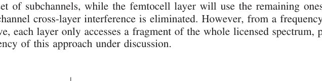

**图6.19** 双层OFDMA网络中*F*个频率子信道的分配。*F<sub>M</sub>*个子信道将被宏基站使用，而*F<sub>f</sub>*个子信道将被分配给毫微微蜂窝小区网络层。

尽管如此，基于这种正交频谱划分，Chandrasekhar提出了一种频谱分配策略[29]，以最大化空间频率复用。频谱的空间复用通常通过区域频谱效率（ASE）进行量化（见[30]），其单位为b/s/Hz/m²，表示每个频率子信道和单位面积的平均吞吐量。我们将宏基站层和毫微微蜂窝小区层的*ASE*分别定义为*ASE<sub>M</sub>*和*ASE<sub>f</sub>*。该方法的目标是在以下假设下获得能使网络全局*ASE*最大化的频谱划分：

1. 毫微微蜂窝小区的接入方式基于封闭用户组（CSG），即只有授权用户（通常是所有者）被允许使用每个毫微微蜂窝小区。
2. 信道状态信息（CSI）可即时反馈。
3. FAP和宏基站基站均匀地在子信道上分配功率。

在该方法中，假设共有*F = F<sub>M</sub> + F<sub>f</sub>*个可用子信道，其中*F<sub>M</sub>*分配给宏基站层，*F<sub>f</sub>*分配给毫微微蜂窝小区。因此，分配给宏基站层的频谱部分定义为*ρ = F<sub>M</sub>/F*，一个重要的规划决策应该是合理设定参数*ρ*。例如在文献[29]中，*ρ*根据一层相对于另一层的具体QoS需求动态选择。这是通过参数*η*实现的，该参数代表一层中每个用户的预期吞吐量与整体每个用户预期吞吐量的比值。换句话说，它表示哪一层期望获得更高的吞吐量。

由于毫微微蜂窝小区是机会性出现的，OFDMA子信道的接入协议应该是分布式的。尽管理论上可行，但运营商远程控制其毫微微蜂窝小区的各种特性并不可行，因此需要分布式方法（见第8章）。根据Chandrasekhar的策略，不同的毫微微蜂窝小区将通过选择分配给其层的子信道的随机集合来接入介质。<sup>[1]</sup>例如，如果每个毫微微蜂窝小区接入分配给毫微微蜂窝小区层的*F<sub>f</sub>*个子信道中的*k*个，那么可以定义*ρ<sub>f</sub> = k/F<sub>f</sub>*为每个毫微微蜂窝小区接入的已分配频谱部分。这样，整个网络*ASE*可以定义为：

> $$ASE = \rho ASE_M + (1 - \rho)ASE_f$$ (6.14)

研究表明，在上述假设下，可以使用以下公式估算不同的区域频谱效率：

> $$ASE_M = \frac{T_M}{|\mathcal{H}|}$$ (6.15)

> $$ASE_f = \frac{N_f \rho_f T_f}{|\mathcal{H}|}$$ (6.16)

其中*T<sub>M</sub>*是宏基站层每个子信道的长期吞吐量，*|ℋ|*是为标记为*ℋ*区域提供服务的宏基站的覆盖面积，*N<sub>f</sub>*是每个宏基站站点的平均毫微微蜂窝小区数量，*T<sub>f</sub>*是每个频率子信道的预期毫微微蜂窝小区吞吐量。因此，目标是找到最优的网络配置以使区域频谱效率最大化。

从宏基站的角度来看，文献[29]分析并提出了两种将子信道分配给网络元素的调度策略：轮询（RR）和比例公平（PF）。在RR方案中，宏基站的用户被分配相同长度的传输时隙，并且总是按照相同的顺序。因此，当最后一个用户使用其第一个时隙后，传输权将交给第一个用户，循环重新开始。在比例公平方案中，用户根据其吞吐量需求进行传输调度。相对于其平均传输速率具有更高传输速率的用户将被优先选择。数值模拟和分析结果表明，比例公平方法将宏基站层的子信道吞吐量*T<sub>M</sub>*提高了一倍。因此，当需要达到给定数据速率时，PF接入放宽了宏基站的频谱需求。

从毫微微蜂窝小区的角度来看，需要解决的问题是找到能减少同层干扰从而最大化*ASE<sub>f</sub>*的最优*ρ<sub>f</sub>*。研究发现，由于来自其他毫微微蜂窝小区的干扰增加，*ASE<sub>f</sub>*在特定的毫微微蜂窝小区密度下达到最大值*ASE<sub>f,max</sub>*。结论是每个子信道的*ASE<sub>f</sub>*存在上限。一个直接的后果是，随着毫微微蜂窝小区密度的增加，整个覆盖区域*ℋ*上的平均毫微微蜂窝小区吞吐量<sup>**</sup>将与*(1 - ρ)*线性增长。进一步的结果表明，在毫微微蜂窝小区密度较低的区域（*N<sub>f</sub> ≈ 10*），最佳方法是允许毫微微蜂窝小区接入所有*F<sub>f</sub>*个已分配的子信道，即*ρ<sub>f</sub> = 1*。然而，在较高的毫微微蜂窝小区密度下，*ASE<sub>f</sub>*在较低的*ρ<sub>f</sub>*值处达到*ASE<sub>f,max</sub>*，这些值需要通过仿真确定。

## 6.5 使用UMTS进行干扰管理

2008年12月，Femtoforum发布了一份文件[7]，其中评估了UMTS毫微微蜂窝小区对宏基站层的影响。提出了几个基于仿真的结果。然而，为了提供的结果不超过真实网络性能，选择了极端情况来研究同频和邻频干扰。这些情况总结在表6.2中，并在以下部分进行说明。

| | 同频干扰 | 邻频干扰 |
|:---|:---|:---|
| **跨层** | A B C D | G H I J |
| **同层** | E F | |

**表6.2** Femtoforum分析的干扰场景[7]

<sup>[1]</sup> 由于其与ALOHAnet网络中用于介质接入的协议相似，文献[29]的作者将此方法命名为*F-ALOHA*。

<sup>**</sup> 网络范围内的毫微微蜂窝小区吞吐量根据公式(6.16)计算为*|ℋ| · W · F · (1 - ρ) · ASE<sub>f</sub>*，其中*W*是每个子信道的带宽。


### 6.5.1 同频干扰

**场景 A：宏蜂窝下行干扰飞蜂窝用户** 在该场景中，一个飞蜂窝接入点（FAP）靠近窗户放置，因此从宏蜂窝可以直接看到该FAP。经证实，如果用户设备（UE）与宏蜂窝Node-B之间的距离超过1000 m，高速下行分组接入（HSDPA）吞吐量可达14.4 Mbps。然而，对于更短的距离，要求FAP应更靠近UE。在含有微蜂窝的城市环境中，如果用户与微蜂窝之间的距离小于250 m，则可以达到相同的吞吐量。根据运营商提供的统计数据，并考虑到飞蜂窝位于距离宏蜂窝较近位置的概率，估计UE接收到来自微蜂窝–48 dBm信号的概率为0.01%，这意味着用户仍可在距离FAP几米的范围内接收服务。此外，对于距离微蜂窝过近的用户，甚至可以考虑切换到微蜂窝。

**场景 B：宏蜂窝上行干扰飞蜂窝用户** 考虑宏蜂窝无线覆盖较差的情况。FAP处于闭合用户组（CSG）模式，室外用户$UE_1$与宏蜂窝建立连接。另一用户$UE_2$是飞蜂窝的签约用户，通过FAP进行通话，但受到$UE_1$上行的干扰。因此，经证实飞蜂窝用户具有足够的功率来维持语音通话。对于高速上行分组接入（HSUPA），用户需要移动到更靠近FAP的位置（5 m），以减少跨层干扰的影响。

**场景 C：飞蜂窝下行干扰宏蜂窝用户** 一个宏蜂窝用户连接至小区边缘的宏蜂窝网络。该用户与不允许接入的FAP位于同一房间。因此，宏蜂窝用户受到满载FAP下行的干扰。结论是，为了保持容量必须使用自适应功率控制，采用自适应功率控制可使容量最高提升16%。

**场景 D：飞蜂窝上行干扰宏蜂窝用户** 一个飞蜂窝用户位于窗户旁，从约30 m远的宏蜂窝可以直接看到该用户。该飞蜂窝用户处于飞蜂窝覆盖范围的边缘，因此正以满功率发射。对使用1.5 Mbps HSUPA数据业务的飞蜂窝用户进行分析后表明，产生了约1.3 dB的噪声抬升。然而，需要注意的是，在相同位置使用相同业务的宏蜂窝用户预计会产生比飞蜂窝用户更大的噪声抬升。减少飞蜂窝引起上行干扰的一种解决方案是允许位于飞蜂窝边缘的飞蜂窝用户切换到宏蜂窝。

**场景 E：飞蜂窝下行干扰附近飞蜂窝用户** 在该场景中，两个设有FAP（$AP_1$和$AP_2$）的公寓相邻。$AP_2$的签约用户拜访邻居的公寓，处于其飞蜂窝（$AP_2$）覆盖边缘。$AP_1$的用户建立了一个需要满功率的通话，这就是为什么飞蜂窝的下行吞吐量会受到邻近飞蜂窝下行的影响。结论是，需要通过自适应功率控制进行补偿，但总会存在某个公寓中的FAP为其邻居造成死区的情况。

**场景 F：飞蜂窝上行干扰附近飞蜂窝用户** 两个设有FAP（$AP_1$和$AP_2$）的公寓相邻。$AP_2$的签约用户拜访邻居的公寓，处于其自有飞蜂窝覆盖边缘。然后，$AP_2$的一个用户在靠近$AP_1$的位置通过$AP_2$建立通话。经证实，干扰源（例如$AP_2$的用户）越靠近受干扰FAP（例如$AP_1$），受干扰方的覆盖范围缩减就越严重。然而，如果辐射功率被动态优化，这种覆盖范围缩减可以得到缓解。

**6.5.2 邻频干扰**

**场景 G：宏蜂窝下行干扰飞蜂窝用户** 一个FAP位于窗户旁，从约30 m远的宏蜂窝可以直接看到该FAP。宏蜂窝负载达到50%，同时一个飞蜂窝用户连接至其覆盖边缘的FAP。根据结果，飞蜂窝用户受宏蜂窝影响的时间不到0.01%。

**场景 H：宏蜂窝上行干扰飞蜂窝用户** 在设有FAP的公寓内接收到来自宏蜂窝的弱信号。一个无权接入飞蜂窝的用户$UE_1$位于FAP旁边，并以满功率进行通话。同时，另一个飞蜂窝用户$UE_2$在飞蜂窝覆盖边缘正在进行通话。研究了两种情况：第一种假设宏层部署在飞层相邻的频率上，而第二种考虑两个载波之间有10 MHz的间隔。结论是，如果宏蜂窝和飞蜂窝频率之间未保持最小间隔，飞蜂窝接收机将无法满足所需服务质量（QoS）等级来解码信号。

**场景 I：飞蜂窝下行干扰宏蜂窝用户** 两个用户$UE_1$和$UE_2$位于一个设有FAP的公寓中。$UE_1$连接至覆盖边缘的飞蜂窝，而$UE_2$连接至覆盖边缘的宏蜂窝，且位于满功率发射的飞蜂窝旁边。测试了两种业务：语音（12.2 kbps）和HSDPA（14.4 Mbps）。就语音业务而言，如果宏蜂窝用户位于宏蜂窝边缘附近，飞蜂窝下行干扰可能会阻塞宏蜂窝连接。就HSDPA而言，宏蜂窝边缘用户的性能不会因这种程度的下行干扰而进一步恶化。

**场景 J：飞蜂窝上行干扰宏蜂窝用户** 飞蜂窝用户位于窗户旁，从宏蜂窝可以直接看到该用户。飞蜂窝用户连接至其覆盖边缘的飞蜂窝，并以满功率发射。结果建议为飞蜂窝用户设定最大允许发射功率以避免干扰。该值应在0 dBm至5 dBm之间，以满足覆盖需求。

## 6.6 结论

本章定义了双层网络中出现的不同类型的干扰。通过不同飞蜂窝类型（CDMA和OFDMA）的真实场景仿真结果，进一步展示了这些干扰。然后，根据链路方向（上行和下行）解释并分类了干扰的影响及其潜在解决方案。此外，还介绍了干扰消除技术，以及飞蜂窝网络中干扰规避的当前研究趋势。

尽管双层网络中的干扰问题已被证明较为复杂，但并非不可解决。正如本章所述，针对不同系统配置已经提出了多种解决方案，从而使飞蜂窝成为可能，并为未来提高这些网络性能的方法留下了空间。

# 参考文献

- [1] S.-F. Su, *The UMTS Air-Interface in RF Engineering: Design and Operation of UMTS Network*. McGraw-Hill Professional, May 2007.
- [2] H. Holma and A. Toskala, *WCDMA for UMTS*, 3rd ed. John Wiley & Sons, 2004, ch. 3, p. 51.
- [3] 3GPP, '3G Home NodeB Study Item Technical Report,' 3rd Generation Partnership Project – Technical Specification Group Radio Access Networks, Valbonne (France), Tech. Rep. 8.2.0, Sep. 2008.
- [4] R. S. Karlsson, 'Radio resource sharing and capacity of some multiple access methods in hierarchical cell structures,' in *Vehicular Technology Conference (VTC)*, vol. 5, Sep. 1999, pp. 2825–2829.
- [5] M. Fan, M. Yavuz, S. Nanda, Y. Tokgoz, and F. Meshkati, 'Interference Management in Femto Cell Deployment,' in *3GPP2 Femto Workshop*, Oct. 2007.
- [6] Ericsson, 'Simulation results for Home NodeB uplink performance in case of adjacent channel deployment within the block of flats scenario,' 3GPP TSG-RAN Working Group 4 (Radio), Sorrento (Italy), Tech. Rep. R4-080152, Feb. 2008.
- [7] 'Interference Management in UMTS Femtocells,' Femto Forum, Dec. 2008.
- [8] S. Lee, 'An Enhanced IEEE 1588 Time Synchronization Algorithm for Asymmetric Communication Link using Block Burst Transmission,' *IEEE Communications Letters*, vol. 12, no. 9, pp. 687–689, Sep. 2008.
- [9] Ericsson, 'Home NodeB maximum output power from the maximum UE input level point of view,' 3GPP TSG-RAN Working Group 4 (Radio), Sorrento (Italy), Tech. Rep. R4-080155, Feb. 2008.
- [10] G. Mansfield, 'Femtocells in the US Market–Business Drivers and Consumer Propositions,' in *FemtoCells Europe 2008*. ATT, Jun. 2008.
- [11] *Analysis of uplink and downlink capacities for two-tier cellular system*. Institution of Electrical Engineers, Dec. 1997.
- [12] V. Chandrasekhar and J. G. Andrews, 'Uplink Capacity and Interference Avoidance for Two-Tier Femtocell Networks,' *IEEE Transactions on Wireless Communications*, February 2008.
- [13] M. Beach, *et al.*, 'A Study into the Application of Interference Cancellation Techniques,' Ofcom, Tech. Rep., Apr. 2006, Report No: 72/06/R/038/U.
- [14] D. Mottier and L. Brunel, 'Iterative space–time soft interference cancellation for UMTS-FDD uplink,' *IEEE Transactions on Vehicular Technology*, vol. 52, no. 4, pp. 919–930, Jul. 2003.
- [15] J. G. Proakis, 'Interference suppression in spread spectrum systems,' in *International Symposium on Spread Spectrum Techniques and Applications*, vol. 1, Sep. 1996, pp. 259–266.


[16] J. Schodorf 和 D. Williams，'一种约束优化的多用户检测方法'，*IEEE信号处理汇刊*，第45卷，第1期，第258–262页，1997年1月。

[17] J. Holtzman，'DS/CDMA连续干扰消除'，收录于*IEEE第三届扩频技术与应用国际研讨会*，第1卷，1994年7月，第69–78页。

[18] M. Munster 和 L. Hanzo，'天线阵列辅助多用户OFDM系统中的同信道干扰消除技术'，收录于*第一届3G移动通信技术国际会议*，2000年3月，第256–260页。

[19] G. Gelli, L. Paura, 和 A. Tulino，'基于循环平稳性的直接序列扩频系统窄带干扰抑制滤波'，*IEEE通信选定领域期刊*，第16卷，第9期，第1747–1755页，1998年12月。

[20] A. Shah 和 A. Haimovich，'存在同信道干扰的移动无线电通信中最大比合并的性能分析及与最优合并的比较'，*IEEE车载技术汇刊*，第49卷，第4期，第1454–1463页，2000年7月。

[21] A. Mostafa，'GSM网络中的单天线干扰消除（SAIC）方法'，收录于*IEEE车载技术会议（VTC-Fall）*，第5卷，2004年9月，第3748–3752页。

[22] W. Webb，*无线通信：未来*。John Wiley & Sons，2007年，第6章，第73–74页。

[23] S. P. Weber, J. Andrews, X. Yang, 和 G. de Veciana，'采用连续干扰消除的无线自组织网络传输容量'，*IEEE信息论汇刊*，第53卷，第8期，第2799–2814页，2007年8月。

[24] ip.access，'Oyster 3g：接入点'，http://www.ipaccess.com/femtocells/oyster3G.php，2007年。

[25] A. Hassan 和 J. Andrews，'无线自组织网络中的保护带'，*IEEE无线通信汇刊*，第6卷，第3期，第897–906页，2007年3月。

[26] M. Latham，'消费者对支持室内服务的毫微微小区的态度——来自一项欧洲调查的见解'，收录于*2008年欧洲毫微微小区会议*，伦敦，2008年6月。

[27] D. López-Pérez, A. Jüttner, 和 J. Zhang，'OFDMA网络中动态频率规划的优化方法'，收录于*2008年网络会议*，匈牙利布达佩斯，2008年9月。

[28] D. Williams，'WiMAX毫微微小区：有线MSO需求的技术'，收录于*2008年欧洲毫微微小区会议*，2008年6月。

[29] V. Chandrasekhar 和 J. G. Andrews，'两层网络中的频谱分配'，*IEEE通信汇刊*，2009年。[在线]。可用：http://arxiv.org/abs/0805.1226。

[30] M. S. Alouini 和 A. J. Goldsmith，'蜂窝移动无线电系统的区域频谱效率'，*IEEE车载技术汇刊*，第48卷，第4期，第1047–1066页，1999年7月。

# 7 移动性管理

宋辉 和 张杰

## 7.1 引言

毫微微小区旨在提供扩展的覆盖和增强的容量，尤其是在室内环境中。显然，似乎不需要为毫微微小区制定特定的移动性管理，因为它们被期望在现有网络标准内工作。然而，实际实现打破了当前网络假设的许多方面。这主要是由于以下因素：

-   **毫微微小区数量多、密度高**
    考虑到宏小区覆盖范围内存在大量小型毫微微小区，当前的邻区列表（最多32个）不足以包含所有毫微微小区信息。此外，在通用移动通信系统（UMTS）中只有512个主扰码（PSC），在长期演进（LTE）中有504个物理小区标识（PCI），这些在整个网络中共享。这可能不足以像区分宏小区那样区分所有毫微微小区的小区标识。在网络中广播毫微微小区的小区信息可能不具备可扩展性，这无疑会大大增加网络信令开销。

-   **动态邻区列表**
    消费者可以添加或移除毫微微小区。毫微微小区可以开启或关闭，其位置可能非常动态。与宏小区的邻区列表相比，毫微微小区的邻区列表不是固定的。

-   **不同的接入方法**
    毫微微小区可以提供开放、半开放或完全封闭的接入，这可以由运营商通过回程网络配置，或者在运营商监督下由用户配置。对于由宏小区服务的成百上千的用户来说，对那些他们可能没有授权访问的毫微微小区进行小区测量并不具有吸引力。

-   **用户/运营商偏好**
    对于接近允许的毫微微小区覆盖范围的UE（用户设备），用户更倾向于为毫微微小区分配最高优先级，以获得更好的信号质量和更便宜的计费套餐。运营商也将乐于减少来自宏小区的负载。在毫微微小区被禁止的情况下，用户倾向于停留在宏小区，以避免掉话或断开与网络的连接。运营商也希望通过排除向毫微微小区的移动来减少信令开销和用户投诉。

总体而言，移动性管理是部署毫微微小区时最具挑战性的问题之一。事实上，移动性管理对于降低移动设备功耗和信令负载非常重要。随着UMTS和LTE规范的批准，毫微微小区技术在3GPP中已达到一个关键里程碑。本章重点介绍在UMTS和LTE正在进行的新版本（第8版和第9版）中毫微微小区的通用移动性程序。同时，也描述了当前UMTS网络（第8版之前）中毫微微小区的移动性程序。

第7.2节介绍了第三代合作伙伴计划（3GPP）毫微微小区规范的进展。本节还介绍了阅读关于毫微微小区移动性管理的报告和规范的方法。第7.3节描述了几种类型的毫微微小区标识符，这些标识符从不同方面表征了毫微微小区的特征。第7.4节讨论了引入毫微微小区的UMTS/LTE网络的接入控制。描述了毫微微小区的不同接入方法。在第7.5节中，讨论了由毫微微小区引起的一些当前寻呼程序问题，然后讨论了一些考虑毫微微小区特性的高级寻呼程序。第7.6节详细描述了小区选择和重选方法。在第7.7节中，讨论了切换问题，并介绍了毫微微小区网络中用于切换的技术的优缺点。

## 7.2 3GPP中毫微微小区的移动性管理

在过去的几年里，所有毫微微小区供应商都付出了各自的努力，采用不同的结构和方法将毫微微小区整合到当前网络（UMTS、CDMA）或无线微波接入互操作（WiMAX）等中。沿着这条道路继续前进将导致技术解决方案被过度炒作，使得彼此之间难以互通，并将毫微微小区的成本保持在合理水平变得困难。行业范围内的标准化变得至关重要，以实现全球电信运营商广泛采用和部署毫微微小区。

3GPP于2008年初开始致力于毫微微小区标准（包括技术报告（TR）和技术规范（TS））的制定。到目前为止，已经提出了相当多关于毫微微小区架构、移动性管理和网络安全的提案。随着第8版的冻结，在支持毫微微小区移动性管理方面的一些基本功能已经实现。然而，为了满足第8版的紧张时间表，第8版仅考虑了具有封闭接入（称为CSG小区）的毫微微小区移动性管理的基本功能。例如从宏小区到毫微微小区的切换、毫微微小区之间的切换以及支持开放和混合接入方法等，这些仍在进行中，将在第9版中处理。本节将介绍与移动性管理相关的3GPP规范以及阅读这些信息的方法。


3GPP 设有不同的工作组（WG），分别负责无线接口和网络架构的不同方面。技术规范组（TSG）无线接入网（RAN）负责所有无线空中接口规范的制定，并包含以下六个工作组：

- RAN WG1（RAN1）无线层 1（物理层）规范，
- RAN WG2（RAN2）无线层 2（MAC、RLC、PDCP）及无线层 3 RR，
- RAN WG3（RAN3）Iu、Iub、Iur、S1、X2 和 UTRAN/E-UTRAN 架构，
- RAN WG4（RAN4）无线性能和协议方面的 RF 参数及 BS 一致性测试，
- RAN WG5（RAN5）移动终端一致性测试，
- RAN AHG1（RAN_AH1）协调 3GPP 与 ITU-R 之间通信的特设小组。

在 release 8 和 release 9 中，有多项与移动性管理（MM）相关的规范。以下 UMTS/LTE 标准及其对应的工作组详细列于表 7.1 和表 7.2 中，这些标准涉及家庭基站（HNB）/家庭演进型基站（HeNB）的移动性流程。

尽管已解决了许多毫微微小区的移动性流程问题，但毫微微小区在 3GPP 标准化进程中仍属较新内容。这些流程的具体工作方式及其评判标准仍在讨论中，需要进一步研究。要了解规范过程中特定方法或参数的详细和最新进展，一种途径是查阅 3GPP 成员上传至会议网站上的贡献文件（称为技术文档，或 tdocs）。

大多数移动性管理流程（接入控制、小区选择/重选和切换等）在 RAN2 会议中讨论。寻呼流程和接入控制也在 RAN3 中讨论。TSG-RAN 第 43 次会议 [1] 之后，以下移动性流程也纳入了 RAN3 的范畴：

- 增强型切换场景：
  - 3G 宏基站到 HNB 的入站移动性，包括传统 UE 方面的问题，
  - 3G HNB 到 3G HNB 的切换，
  - LTE 宏基站到 HeNB 的入站移动性，
  - LTE HeNB 到 LTE HeNB 的切换。
- 增强型接入场景：
  - 开放接入，
  - 混合接入。

例如，从宏小区到毫微微小区的入站切换流程在当前任何规范中均未给出。通过检索会议报告，可以发现 RAN 2 第 65bis 次会议和 RAN 3 第 63bis 次会议中关于切换入流程的讨论。在这些会议报告中列出了不少相关文档（R2-092404、R3-090804 等）。通过查阅这些文档，可以更深入地了解所提出的切换入问题以及正在研究中的机制。

## 表 7.1 3GPP 标准化中的移动性管理

| NO | Group | Version | Date | Rel. | Title | Description |
|---|---|---|---|---|---|---|
| 3GPP 22.011 | TS | SA1 | V9.1.0 | 2009-3 | 9 | Service accessibility | 列出了支持 Home NodeB 和 Home eNodeB 的基本移动性功能（包括接入控制、小区选择/重选）。 |
| 3GPP 22.220 | TS | SA1 | V9.0.0 | 2009-3 | 9 | Service requirements for Home NodeBs and Home eNodeBs | 列出了 Home NodeB 和 Home eNodeB 的不同需求。 |
| 3GPP 23.830 | TR | SA2 | V0.3.1 | 2009-3 | 9 | Architecture aspects of Home NodeB and Home eNodeB | 讨论了支持 Home NodeB 和 Home eNodeB 的不同需求和解决方案（包括移动性流程）。 |
| 3GPP 25.304 | TS | RAN2 | V8.5.0 | 2009-3 | 8 | User Equipment (UE) procedures in idle mode and procedures for cell reselection in connected mode | 列出了 UTRA 系统中 Home NodeB 的移动性流程。 |
| 3GPP 25.331 | TS | RAN2 | V8.6.0 | 2009-3 | 8 | Radio Resource Control (RRC), protocol specification | 引入了一些 Home NodeB 特性系统参数，以支持/优化 Home NodeB 的移动性流程。 |
| 3GPP 36.902 | TS | RAN3 | V1.0.1 | 2008-9 | 8 | Self-configuring and self-optimizing network use cases and solutions | |

Femtocells in 3GPP 的移动性管理 183

## 表 7.2 3GPP 标准化中的移动性管理

| NO | TS | Group | Version | Date | Rel. | Title | Description |
|---|---|---|---|---|---|---|---|
| 3GPP 25.367 | TS | RAN2 | V8.1.0 | 2009-3 | 8 | Mobility procedures for home NodeB, overall description Stage 2 | 给出了 release 8 中支持的移动性流程的总体描述。 |
| 3GPP 25.467 | TS | RAN3 | V8.1.0 | 2009-3 | 8 | UTRAN architecture for 3G Home NodeB stage 2 | 涵盖了对不支持闭合用户组（CSG）的 UE（即 Rel-8 之前的 UE）和支持 CSG 的 UE 的功能规范。还涵盖了 Home NodeB 的运维（O&M）特定需求。 |
| 3GPP 25.820 | TR | RAN4 | V8.2.0 | 2008-9 | 8 | 3G Home NodeB study item technical report | 包含从 RAN2、RAN3 和 RAN4 角度进行的项目研究。 |
| 3GPP 36.300 | TS | RAN2 | V8.7.0 | 2009-1 | 8 | Evolved Universal Terrestrial Radio Access (E-UTRA) and Evolved Universal Terrestrial Radio Access Network (E-UTRAN), overall description Stage 2 | 定义了 HeNB 与 HeNB-GW 之间的用户和控制面接口。在附录 F 中，讨论了与闭合用户组（CSG）小区相关的移动性和接入控制需求。 |
| 3GPP 36.304 | TS | RAN2 | V8.5.0 | 2009-3 | 8 | User Equipment (UE) procedures in idle mode | 列出了 E-UTRA 系统中 Home NodeB 的移动性流程。 |
| 3GPP 36.331 | TS | RAN2 | V8.5.0 | 2009-3 | 8 | Radio Resource Control (RRC), protocol specification | 引入了一些 Home eNodeB 特性系统参数，以支持/优化 Home eNodeB 的移动性流程。 |

## 7.3 毫微微小区特征化

如第 7.1 节所述问题所表明的，将毫微微小区视为普通宏小区处理非常困难，甚至不可行。网络无法承受在整个网络中广播毫微微小区信息，而且宏小区用户与毫微微小区之间的信令开销将对网络性能产生重大影响。能够表征毫微微小区各个方面的标识符和机制对于降低影响并增强支持毫微微小区的移动性流程是必要的。

### 7.3.1 区分毫微微小区与宏小区

借助能够区分毫微微小区与宏小区的标识符和机制，整个网络可以被视为一个双层网络：宏网络和毫微网络，如图 7.1 所示。随后可以采取一些措施来增强这两个层之间的移动性流程并减少信令开销。例如，可以在两层之间配置新的重选参数，以优先使毫微微小区用户一旦进入允许的毫微微小区覆盖范围就驻留在该小区。此外，这些参数还有助于阻止不允许使用毫微微小区的用户扫描或读取毫微微层的信息，从而延长电池寿命。3GPP 中已讨论的方法如下所列。

**分层小区结构**

分层小区结构（HCS）可作为更好地区分毫微微小区与宏小区的附加手段 [2]。在 GSM 和 UMTS 中，HCS 被认为是解决连续覆盖与高流量需求热点之间冲突的最有效手段之一。HCS 允许网络运营商将其网络小区划分为不同类别，如宏小区、微小区和微微小区。每层可以分配不同的优先级（即 0–7）。作为自然的扩展，图 7.2 展示了

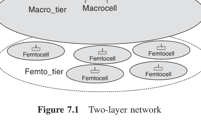

图 7.1 双层网络

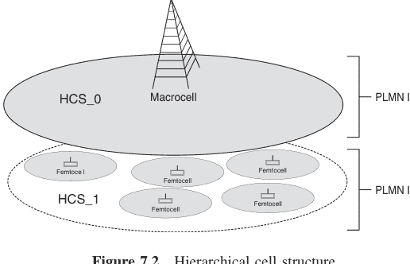

HCS 也可用于允许毫微微小区采用不同的小区重选规则。使用 HCS 无需对当前技术规范进行任何修改。

#### 独立的毫微微小区 PLMN ID

区分毫微微小区与宏小区的另一种方法是采用与宏小区不同的独立毫微微小区 PLMN 标识（PLMN ID）[2]。在这种方法中，毫微微小区将被分配与宏小区不同的 PLMN ID，以确保毫微微小区选择并减少对宏小区用户的影响，如图 7.3 所示。不允许使用毫微微小区的 UE 可被配置为不接入毫微微小区公共陆地移动网络（PLMN），从而获得更好的电池性能，并减少对核心网（CN）的信令负载。独立的 PLMN ID 允许 UE 显示正确的网络标识符，向用户表明他已驻留在

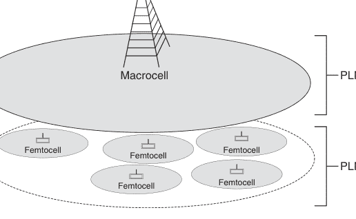


与release 8之前的网络相比，作为更直接的方法，目前许多毫微微蜂窝（femtocell）厂商使用该方法作为区分毫微微蜂窝与宏蜂窝（macrocell）的主要手段。然而，当使用独立的毫微微蜂窝PLMN时，需要额外的PLMN ID，而某些网络运营商可能没有这些ID。此外，一些旧的用户身份模块（SIM）/通用集成电路卡（UICC）卡在显示正确的毫微微蜂窝PLMN名称时可能存在兼容性问题。

#### 保留频率和PSC/PCI

在3GPP release 8中，提出了更具体的毫微微蜂窝识别方法。为简化问题，仅考虑CSG小区。作为第一层方法，已讨论了UMTS的频率和PSC保留以及LTE的PCI保留[3–5]。在UMTS中，已采用保留频率和PSC[6]。在LTE中，引入了一组指示CSG小区保留PCI范围的参数[7]。宏小区和CSG小区可以广播用于专用CSG部署的一个或多个载波频率的指示。此信息可被无法访问毫微微蜂窝的UE使用，以避免在该频率上进行不必要的测量，即使规则要求对该载波频率进行测量。在UMTS中，指示哪些载波频率专用于CSG部署的信息可以在系统信息块（SIB）11bis中信令传输，如表7.3所示。图7.4展示了如何通过为毫微微蜂窝分配专用频率来将宏小区与毫微微蜂窝彼此分离。

**表7.3** release 8中的保留频率和PSC [6]

| 块 | 信息元素/组名称 | 需求 | 多重性 | 类型与参考 | 语义描述 |
|---|---|---|---|---|---|
| SIB3 | CSG身份 | OP | | CSG身份 10.3.2.8 | |
| SIB3 | CSG PSC分离信息 | OP | | | 该IE指定CSG小区的主扰码保留信息。 |
| SIB11bis | CSG PSC分离信息 | OP | | | 该IE指定CSG用途的主扰码保留信息 |
| SIB11bis | 专用CSG频率列表 | OP | 1 to \<maxdedicated-CSGFreq\> | | 该IE指定仅用于CSG小区的专用频率。 |
| SIB11bis | 专用CSG频率 | MP | | | |

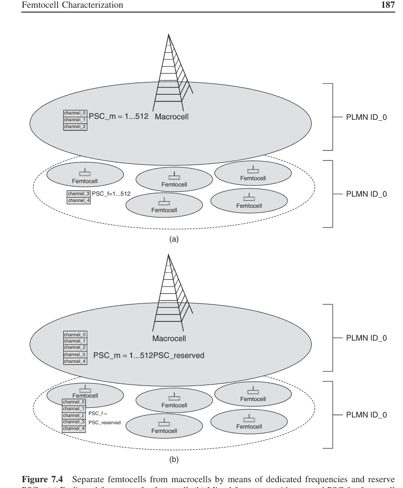

**图7.4** 通过专用频率和保留PSC将毫微微蜂窝与宏小区分离。(a) 毫微微蜂窝的专用频率。(b) 毫微微蜂窝使用保留PSC的混合频率

在共享载波频率部署场景中，所有CSG小区应在系统信息中广播保留的PSC范围。非CSG小区也可以选择性地广播保留的PSC范围。保留的PSC范围仅适用于UE接收此信息所在PLMN内的UTRA绝对射频信道号（UARFCN）。UE将最后接收到的保留PSC范围视为在该PLMN整个区域内24小时内有效。UE可根据自身实现方式，使用保留的PSC信息进行CSG小区搜索和（重）选择。图7.4展示了在共享频率部署场景中，如何通过为毫微微蜂窝保留PSC来将宏小区与毫微微蜂窝彼此分离。

保留的PSC列表在SIB3或SIB11bis中信令传输，如表7.3所示。如果宏小区广播保留的PSC列表，则使用SIB11bis进行广播。CSG小区则使用SIB3进行广播。小区不应同时在SIB3和SIB11bis中广播保留的PSC列表。计算PSC分离信息的详细参数和算法见表7.4。

**表7.4** 3GPP release 8中的CSG PSC分离信息 [6]

| 信息元素/组名称 | 需求 | 多重性 | 类型与参考 | 语义描述 |
| :--- | :--- | :--- | :--- | :--- |
| Start PSC | MP | | 整数（0..504，步长为8） | 该IE的值指定第一个PSC范围的起始PSC（注1）。 |
| Number of PSCs | MP | | 枚举（5, 10, 15, 20, 30, 40, 50, 64, 80, 120, 160, 256, alltheRest） | 该IE指定每个PSC范围中为CSG小区保留的PSC数量。'alltheRest'表示从Start PSC到511的所有值。需要三个备用值。 |
| PSC Range 2 Offset | CV-alltheRest | | 整数（8..504，步长为8） | 如果包含该IE，UE应计算第二个PSC范围（注2）。如果不包含该IE，UE应认为第二个PSC范围不存在。 |

注1：设IE 'Start PSC' = s，'Number of PSCs' = n。范围1中完整的(n)个PSC值集合定义为：s, ((s + 1) mod 512), ((s + 2) mod 512) . . . ((s + n − 1) mod 512)。

注2：设IE 'Start PSC' + 'Number of PSCs' − 1 + 'PSC Range 2 Offset' = s，'Number of PSCs' = n。范围2中完整的(n)个PSC值集合定义为：s, ((s + 1) mod 512), ((s + 2) mod 512) . . . ((s + n − 1) mod 512)。

对于LTE，PCI范围信息（称为csg-PhysCellIdRange）在SIB4中信令传输。该字段指示在接收频率上为CSG小区保留的PCI集合。如果自接收以来在同一个主PLMN中经过的时间少于24小时，则接收到的csg-PhysCellIdRange生效。

#### CSG指示器

作为3GPP release 8中的第二层方法，CSG指示器在[6]和[7]中引入，用于指示该小区是否为CSG小区。CSG指示器信息分别在UMTS和LTE的主信息块（MIB）和SIB1中信令传输，如表7.5和表7.6所示。

**表7.5** UMTS release 8中的CSG指示器 [6]

| 块 | 信息元素/组名称 | 需求 | 多重性 | 类型与参考 | 语义描述 |
|-------|-------------------------------|------|-------|-------------------|----------------------|
| MIB | CSG指示器 | OP | | 枚举（TRUE） | 如果存在，该小区为CSG小区。默认值为'FALSE' |

**表7.6** LTE release 8中的CSG指示器 [7]

| 块 | 信息元素/组名称 | 需求 | 多重性 | 类型与参考 | 语义描述 |
|-------|-------------------------------|------|-------|-------------------|----------------------|
| SIB1 | CSG指示器 | MP | | 枚举（TRUE） | 如果设置为TRUE，UE仅在CSG身份与其存储的允许CSG小区列表中的条目匹配时才被允许接入该小区。 |

### 7.3.2 发现邻近毫微微蜂窝

通过上述参数或机制，UE能够区分毫微微蜂窝和宏小区。在小区间移动过程中，UE可以很容易地使用邻区列表（NCL）了解周围的宏小区。然而，由于引言中所述的困难，UE发现邻近毫微微蜂窝仍然是一个问题。以下是为使UE能够发现毫微微蜂窝所做的努力。

#### 邻区列表

对于从毫微微蜂窝到宏小区的出站移动，毫微微蜂窝中的NCL是UE了解周围宏小区和毫微微蜂窝的直接方式。NCL可由毫微微蜂窝通过厂商实现的自配置算法创建。NCL可以在每次毫微微蜂窝上电时或当毫微微蜂窝感知到邻区发生变化时进行更新。

对于从宏小区的入站移动，由于毫微微蜂窝数量庞大，将所有邻近毫微微蜂窝包含在列表中是不可行的。然而，一些厂商已提出替代方案来支持release 8之前网络中的高密度毫微微蜂窝。主要思路基于复用一定数量的PSC（即10个）。这些PSC随后可以被编程到宏小区的邻区列表中。当从服务宏小区接收到这样的NCL时，UE就可以像对待宏小区一样对这些与PSC对应的毫微微蜂窝进行测量。缺点是宏小区的NCL需要更新，而且当UE检测到两个具有相同PSC的相邻毫微微蜂窝时，可能会发生PSC混淆[8]。

#### UE自主搜索

在3GPP release 8中，引入了UE自主搜索功能，用于UE发现CSG小区。UE需要执行自主搜索功能以检测合适的CSG小区[9, 10]。无法接入CSG小区的UE可以禁用CSG小区的自主搜索功能。如果'专用CSG频率'信息元素（IE）存在，UE可以仅在这些专用频率以及系统信息中列出的其他频率上使用自主搜索功能。为了辅助共享载波上的搜索功能，UE可以搜索由CSG PSC/PCI分离信息定义的保留PSC/PCI的小区，用于频内和频间测量及移动性目的。

UE自主CSG搜索功能作为UE实现问题保留。换句话说，规范未规定何时以及何处触发UE自主搜索功能，应由移动设备厂商自行定义。目前，UE自主搜索功能仅用于发现CSG小区。在release 9中，它将扩展以支持搜索具有各种接入方式（开放和混合）的毫微微蜂窝。

### 7.3.3 区分可接入的毫微微蜂窝

当使用能够区分毫微微蜂窝和宏小区的参数和机制时，宏小区用户可以避免尝试接入毫微微蜂窝，毫微微蜂窝用户可以优先选择毫微微蜂窝而非宏小区。这对于开放接入类型的毫微微蜂窝效果良好，但对于封闭接入类型效果不佳。所有毫微微蜂窝用户都会尝试驻留在目标毫微微蜂窝上，无论他们是否有权接入。通过使用能够区分给定毫微微蜂窝是否可接入的方法，可以避免不必要的信令开销。

#### 位置区标识/跟踪区标识

在release 8之前的UMTS中，一组相邻宏小区可以共享相同的位置区标识（LAI）。然而，对于毫微微蜂窝，为了用户接入控制目的，邻区的LAI/跟踪区标识（TAI）需要不同。未经授权的毫微微蜂窝的LAI将在UE从这些毫微微蜂窝接收到位置区更新（LAU）拒绝后存入UE的通用用户身份模块（USIM）。如果LAI在禁止列表中，UE将不会尝试驻留在该毫微微蜂窝上。这导致更低的功耗和更少的信令开销。然而，如果为每个毫微微蜂窝分配一个唯一的LAI，该方案对于当前的CN节点将变得不可行。在地理上分散的毫微微蜂窝之间重复使用LAI或使用伪LAI……


这对网络性能会产生影响[11]。此外，位置区标识（LAI）冲突是另一个不可忽视的问题。例如，如果某人的毫微微蜂窝基站（femtocell）的LAI与用户设备（UE）允许接入的毫微微蜂窝基站的LAI相同，但该毫微微蜂窝基站不允许其接入。当用户经过时，UE会尝试驻留在该基站上，并收到位置区更新（LAU）拒绝消息（#15“位置区内无合适小区”[12]）。随后，UE会将该基站记录为“禁止”，并在其“不允许列表”中记录该LAI。当用户回到家中时，可能无法连接到自己的毫微微蜂窝基站。另一个问题是，当用户经过邻居家的单元时，UE可能会因被禁止的LAI而被拒绝。如果其自身的毫微微蜂窝基站位于同一频率层，用户必须等待300秒才能根据8版本之前的规范重新选择该毫微微蜂窝基站。

#### 闭合用户组标识

一个或多个闭合用户组（CSG）基站由一个唯一的数字标识符（称为CSG身份（CSG ID））标识。根据[13]的定义，CSG ID应具有固定的27位长度。CSG基站通过SIB3（在UMTS中，如表7.7所示）和SIB1（在LTE中，如表7.8所示）广播其CSG ID。当UE未被授权访问目标毫微微蜂窝基站时，将使用新的拒绝原因值#25“未被授权访问此CSG基站”[12]。8版本的UE随后会在可配置的时间段内禁止相应的CSG ID，而不是禁止整个频率。与8版本之前的流程相比，UE既不会将位置区码（LAC）添加到禁止的LAI列表中，也不会禁止整个频率。仅禁止CSG ID而非整个频率，可以防止在相同频率上存在其他可用覆盖时可能出现的服务中断。不禁止LAI可以避免因LAI冲突导致的毫微微蜂窝基站重选困难。

**表 7.7 UMTS 8版本中的CSG身份 [6]**

| 块 | 信息元素/组名称 | 需要 | 多实例 | 类型及参考 | 语义描述 |
| :--- | :--- | :--- | :--- | :--- | :--- |
| SIB3 | CSG Identity | OP | | CSG Identity Bit string(27) | |

**表 7.8 LTE 8版本中的CSG身份 [7]**

| 块 | 信息元素/组名称 | 需要 | 多实例 | 类型及参考 | 语义描述 |
| :--- | :--- | :--- | :--- | :--- | :--- |
| SIB1 | csg-Identity | OP | | CSG Identity bit string(27) | 基站所属的主公共陆地移动网络（PLMN）内的闭合用户组标识。该信息元素仅存在于CSG基站中。 |

### 7.3.4 处理允许列表

当UE尝试驻留在毫微微蜂窝基站时，为了检查UE是否被允许访问目标毫微微蜂窝基站，毫微微蜂窝基站的允许国际移动用户身份（IMSI）列表或UE的允许毫微微蜂窝基站列表是必需的。在8版本之前，此类列表是基于毫微微蜂窝基站（即允许的IMSI列表）组织的，可以在毫微微蜂窝基站或毫微微蜂窝基站网关（Femtocell-GW）中处理。而在8版本中，列表是基于用户（即允许的毫微微蜂窝基站列表）组织的，并在核心网（CN）中处理。

本节将介绍这两种列表及其在相应网络实体中的处理方式。

#### 毫微微蜂窝基站/毫微微蜂窝基站网关中的允许列表

在8版本之前的UMTS中，允许列表存储在毫微微蜂窝基站或毫微微蜂窝基站网关本地。在这种情况下，每个毫微微蜂窝基站都有自己的允许列表，其中包含允许接入的IMSI或移动用户综合业务网（MSISDN）号码列表。允许列表由运营商或在运营商监督下（即在安全网页上）的毫微微蜂窝基站所有者管理。

其优势在于，在UE注册过程中，未经授权的移动设备将被拒绝，而无需向核心网发送信令流量，如图7.5所示。这种实现方式无需对核心网进行任何修改即可支持毫微微蜂窝基站。

然而，为了保护用户身份机密性，IMSI/MSISDN通常仅在非接入层（NAS）可用。在本地存储诸如MSISDN或IMSI等永久标识符可能成为安全隐患。此外，在为园区或企业管理用户时，部署大量毫微微蜂窝基站会带来大量的开销和管理问题。

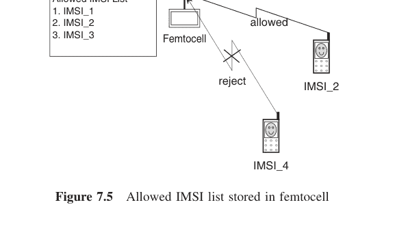

#### 核心网中的允许列表

在3GPP 8版本中，提供了一个作为UE允许CSG列表（ACL）的允许列表。它列出了UE所属的毫微微蜂窝基站的相应CSG ID。各方同意，ACL与用户的订阅信息一起存储在核心网中[9, 10]。在NAS中，诸如移动交换中心（MSC）/拜访位置寄存器（VLR）、服务GPRS支持节点（SGSN）和移动管理实体（MME）等核心网实体保持当前正在服务的UE的上下文。当UE注销时，其上下文可能会丢失。因此，不适合存储诸如UE的ACL等永久信息。此外，ACL可以跨多个3GPP接入技术（如演进的UTRAN（E-UTRAN）、UMTS陆地无线接入网（UTRAN）和GSM EDGE无线接入网（GERAN））共享CSG ID，并且应可供这些网络中的相关网络元素使用。因此，存储CSG订阅信息的最佳位置是类似于归属用户服务器（HSS）的网络元素。对于当前正在服务的UE，应在MME/SGSN中存储ACL的副本，如图7.6所示。此外，对于具备CSG能力的UE，它可能在其USIM中保留自身ACL的副本。此列表有助于避免向未经授权的毫微微蜂窝基站发送不必要的信令。ACL在空闲模式下的使用及相应的移动性管理（MM）流程在[12-14]和[15]中定义。

核心网和UE中ACL的同步可以通过自动或手动方式实现。在自动同步期间，当更改毫微微蜂窝基站的CSG ID或从用户的订阅中移除CSG ID时，网络将首先更新核心网中的ACL，然后发送消息通知UE自动更新其ACL，如图7.7所示。

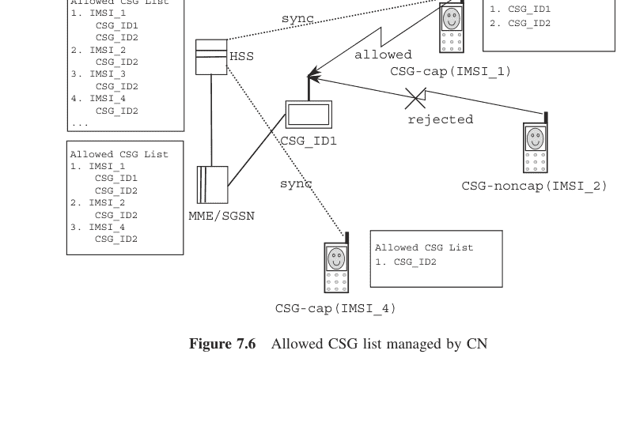

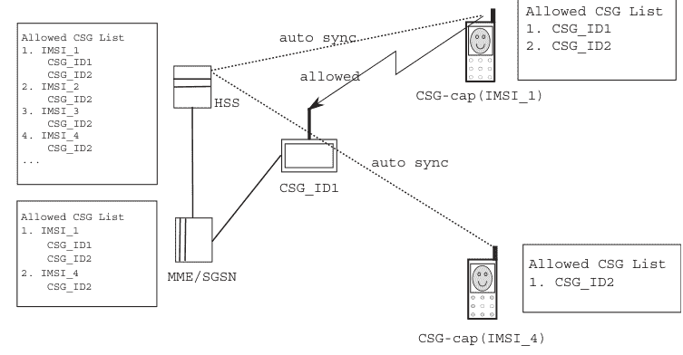

## 图 7.7 允许CSG列表同步的自动模式

在手动模式下，UE最初不会与核心网同步其ACL。当允许的CSG基站更改其CSG ID，且新的CSG ID不在UE的ACL中时，UE将仅通过手动小区选择来选择该CSG基站。在收到肯定的位置区更新/跟踪区更新（TAU）反馈后，它将新的CSG ID添加到其ACL中。当从核心网中订阅者的ACL中移除一个CSG ID时，由于不知情，UE仍会尝试驻留在具有该CSG ID的毫微微蜂窝基站上。收到位置区更新/跟踪区更新拒绝后，UE将从其自身的ACL中移除该CSG ID，如图7.8所示。

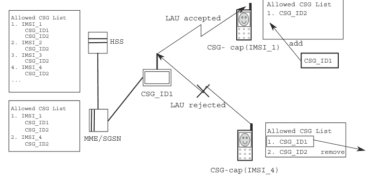

## 图 7.8 允许CSG列表同步的手动模式

## 7.4 接入控制

在宏蜂窝网络中，接入控制通常发生在位置区更新/跟踪区更新期间或UE请求数据传输服务时。然而，每当UE尝试驻留在毫微微蜂窝基站上以防止该毫微微蜂窝基站被未授权使用时，就需要调用接入控制。本节介绍了在保持与宏蜂窝信令流程兼容的同时，为毫微微蜂窝基站启用接入控制的触发条件。然后，讨论了网络中接入控制的可能位置。随后，介绍了针对闭合、开放和混合接入模式的毫微微蜂窝基站的通用接入控制流程。

### 7.4.1 接入控制触发条件

#### 位置区/跟踪区更新

一个常见的假设是接入控制由位置区更新/跟踪区更新触发[2]。在这种情况下，每个毫微微蜂窝基站被分配一个与宏蜂窝不同的、特定于毫微微蜂窝基站的位置区标识（LAI）/跟踪区标识（TAI）。这可以确保当UE从宏蜂窝执行入站移动到毫微微蜂窝基站时，可以调用接入控制流程。对于家庭用例，每个毫微微蜂窝基站可能会被分配与其相邻毫微微蜂窝基站不同的LAI/TAI，以避免UE驻留在未经授权的毫微微蜂窝基站上。然而，对于企业或城域区域用例，属于同一公司或园区的毫微微蜂窝基站可以共享相同的LAI/TAI，以避免不必要的更新信令。不被允许在特定毫微微蜂窝基站接入的UE随后将在位置登记时收到否定响应，意味着它无法正常驻留在该毫微微蜂窝基站上。

使用位置区更新拒绝的一个副作用是，8版本之前的UE会禁止目标毫微微蜂窝基站所在的整个频率300秒。为了减少服务中断或受限驻留状态的时间，应始终有一个频率可用，其小区允许LAI接入（即应有一个非毫微微蜂窝基站频率层）。

#### 数据传输服务

另一种方法是允许被授权使用毫微微蜂窝基站的UE漫游并驻留在其未被授权的毫微微蜂窝基站上[2]。

在这种方法中，当请求数据传输服务时将触发接入控制。未被授权的UE随后将被重定向或切换到可用的宏蜂窝。因此，为毫微微蜂窝基站分配LAI可以遵循与宏蜂窝相同的路径。多个毫微微蜂窝基站可以配置在同一个位置区（LA）内。在此类LA内，当UE从一个毫微微蜂窝基站移动到另一个毫微微蜂窝基站时，无需进行位置区更新，与位置区更新方法相比，降低了信令开销。

这种方法的缺点是，当宏蜂窝覆盖不可用时，在将未授权UE重定向到宏蜂窝时，会导致无线连接失败。


### 7.4.2 接入控制位置

#### 在家庭基站/家庭基站网关中的接入控制

在pre-release 8 UTRAN中，对于femtocells，接入控制发生在femtocell或femtocell-GW中，而对于宏小区则发生在核心网中。图7.9展示了UE注册过程中femtocell内的接入控制。这种方法对现有网络结构的影响最小，因为它不需要对核心网进行任何修改，也不需要UE具备任何额外能力。此外，在UE注册过程中，femtocell可以通过本地存储的允许IMSI列表，在不向核心网发送任何额外信令的情况下拒绝未授权用户。这种方法的主要缺点是接入方法必须单独管理和实现。

在release 8 UTRAN中，为了支持旧版（pre-release 8）UE使用femtocell，此场景中的方法是femtocell网关应执行接入控制，同时femtocell也可以选择性地执行接入控制[16]。在UE注册过程中，由于旧版UE不理解CSG，它们可能会尝试注册并驻留在任何检测到的femtocell上，即使它们不被允许这样做。将接入控制置于femtocell/femtocell-GW中，可以显著减少到核心网的此类信令开销。与pre-release 8 UTRAN相比，图7.10显示femtocell/femtocell-GW需要从SGSN/MME获取注册用户的ACL。此过程可能会增加网络开销。

#### 在UE中的接入控制

在release 8中，支持CSG的UE可以执行基本的接入控制，以加速和增强与femtocell的移动性过程。图7.11展示了在UE注册过程中，CSG能力的UE内发生的接入控制。由于支持CSG的UE能够区分目标femtocell是否可访问，它可以避免附着到其ACL中不存在的CSG小区。

UE内的接入控制要求UE频繁解码包含CSG ID的目标小区候选者的SIB，这可能影响正在进行的服务质量。此外，存在一个风险：UE中的ACL可能已过期，UE可能会尝试访问CSG订阅已过期的小区。由于UE的报告并非总是可信的，CSG接入控制不能仅通过UE来执行。

#### 在MME/SGSN中的接入控制

在release 8 EUTRAN中，当支持CSG的UE通过EUTRAN CSG小区接入网络时，MME在附着、去附着、服务请求和TAU过程中执行接入控制。相同的原则适用于UTRAN CSG小区的接入控制。在这种情况下，MSC/VLR和SGSN执行接入控制[17]。图7.12展示了MME在UE注册过程中的接入控制。femtocell/femtocell-GW需要将其CSG ID发送给MME，然后MME通过ACL检查UE对目标femtocell的可访问性。在此过程中，通过UE内接入控制的协助，可以避免大量的注册信令（即用户沿街行走并尝试驻留在femtocell上）。

### 7.4.3 不同接入类型的接入控制

**封闭接入**

封闭接入模式的femtocell在3GPP中称为CSG小区，是release 8中唯一支持的接入模式。CSG小区可能广泛用于个人家庭部署。在此场景中，femtocell的所有者不希望共享femtocell，原因可能是回程资源有限或出于安全考虑。每当UE尝试驻留在femtocell时，都应执行接入控制。任何不在CSG中的UE都将被femtocell拒绝。对于不支持CSG的旧版UE，femtocell执行身份请求以查询UE的IMSI，并尝试在femtocell-GW中注册该UE；femtocell-GW应随后执行接入控制，并可能接受或拒绝UE驻留在目标femtocell上。对于支持CSG的UE，femtocell在其发送给核心网的初始UE消息中包含其CSG ID，核心网根据CSG ID执行UE接入控制。

**开放接入**

作为3GPP release 9中的新接入模式，开放接入模式的femtocell作为正常小区（即非CSG小区）运行。运营商可以部署开放接入模式的femtocell来填补一些室内盲区和一些公共热点，以作为宏小区为所有用户提供服务。移动网络不需要为此类femtocell执行任何特定的UE接入控制。

对于不支持CSG的旧版UE，femtocell不需要执行身份请求以确定UE的IMSI，可以使用TMSI/PTMSI在femtocell-GW中注册该UE；femtocell-GW应始终接受该请求并为UE分配一个上下文ID。

对于支持CSG的UE，由于开放接入femtocell没有CSG ID，femtocell不会在消息中包含此信息，因此核心网中没有接入控制。此外，核心网是否需要知道UE驻留在开放模式femtocell上，尚需进一步研究。

**混合接入**

有关混合/半开放接入的信息可在[18]中找到。此接入特性将在3GPP release 9中提供。混合模式意味着femtocell可以同时提供开放和封闭接入模式的组合。混合接入femtocell是一个不仅拥有CSG ID，而且允许不属于该CSG的UE驻留其上的小区。在此接入模式下，这些UE可能仅被授权有限的QoS服务，并且与CSG中的UE相比具有较低的优先级。

对于不支持CSG的旧版UE，尽管移动网络允许所有UE驻留并为其提供服务（无论这些UE是否在该CSG中），但femtocell仍然需要区分这两种类型的UE，以便提供各自的QoS服务。因此，femtocell仍然需要执行身份请求，以获取UE的IMSI用于接入控制和服务等级区分目的。由于UE接入控制在femtocell中是可选的，femtocell-GW需要通知femtocell该UE是否是该CSG的成员。如果UE不属于CSG，femtocell可能会限制用户的数据速率，并首先将UE重定向到宏小区，因为femtocell资源有限。此外，核心网可能也需要被告知，以提供不同的服务或计费等。

对于支持CSG的UE，femtocell也应包含混合模式信息。核心网也需要通知femtocell接入控制结果，以便femtocell能够为不同的UE提供不同的QoS服务和优先级。

## 7.5 寻呼过程

由于femtocell部署数量多且规模小，众所周知，寻呼消息对femtocell系统是一个巨大的负担。图7.13展示了由IMSI_1的UE发起的寻呼过程。在与宏小区网络相同的正常方法中，核心网只会区分被寻呼IMSI所在的寻呼区域1。femtocell-GW会将寻呼消息发送到寻呼区域1中的所有femtocell，这可能导致涉及大量femtocell的巨大信令冗余。在[19]中达成的一项要求是“应尽量减少因HNB/HeNB部署而产生的额外注册和寻呼负载”。这意味着寻呼优化，即最小化在femtocell中寻呼UE所使用的寻呼消息数量，是3GPP中的一项已确认要求。在release 8中，已决定


 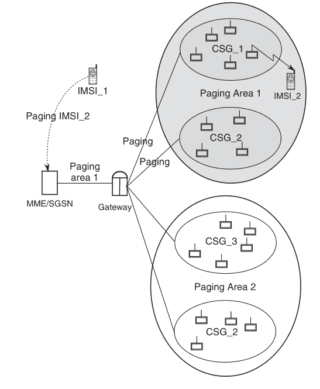

## 图 7.13 基于毫微微蜂窝的寻呼流程

MME 和/或毫微微蜂窝网关（femtocell-GW）可以可选地执行寻呼过滤 [20]。关于UMTS和LTE中寻呼优化的详细考虑，可参见 [21–24]。在本节中，将同时讨论MME/SGSN中的寻呼优化以及毫微微蜂窝网关中的寻呼优化。

### 7.5.1 MME/SGSN中的寻呼优化

在此方法中，MME了解所连接的毫微微蜂窝支持的CSG ID。由于MME保存有已注册UE的ACL副本，因此被寻呼UE的ACL始终可用于辅助寻呼优化。MME随后可以使用此列表来过滤寻呼区域中的连接毫微微蜂窝。它只会向ACL中包含的CSG ID对应的毫微微蜂窝发送寻呼消息。需要注意的是，ACL不包含在寻呼消息中，也*不会*发送给不可信的毫微微蜂窝。

图7.14(b)展示了由MME执行的寻呼优化示例。在此场景中，MME接收到来自IMSI_1的寻呼请求。IMSI_2是被寻呼的UE，位于寻呼区域1。通过了解IMSI_2的允许CSG列表（CSG ID 1和CSG ID 3），MME能够仅将寻呼消息转发给寻呼区域1中具有CSG ID 1的毫微微蜂窝。

### 7.5.2 毫微微蜂窝网关中的寻呼优化

为了由毫微微蜂窝网关优化寻呼流程，毫微微蜂窝网关需要了解所连接的毫微微蜂窝支持的CSG。这使得毫微微蜂窝网关能够识别支持特定CSG的适当毫微微蜂窝。需要告知毫微微蜂窝网关被寻呼UE的允许CSG列表。这使得毫微微蜂窝网关能够了解哪些连接的毫微微蜂窝应接收寻呼消息。为了获得完整的寻呼优化解决方案，被寻呼UE的允许CSG列表应包含在寻呼消息中。被寻呼UE的ACL仅需在毫微微蜂窝网关处可用，即不必将其转发给毫微微蜂窝或其他直接连接到MME的节点。

图7.14(a)展示了在毫微微蜂窝网关中执行的寻呼优化示例。MME向毫微微蜂窝网关发送带有被寻呼UE允许CSG列表的寻呼消息。借助ACL，毫微微蜂窝过滤由毫微微蜂窝网关完成。最终，寻呼消息仅发送给具有允许CSG ID的毫微微蜂窝。

在第9版中，由于引入了开放和混合接入模式，所有UE始终可以接入开放接入的毫微微蜂窝，而这些毫微微蜂窝甚至根本没有CSG ID。即使毫微微蜂窝的CSG ID不在其ACL中，用户仍然可以从混合接入毫微微蜂窝获得受限制的QoS服务。由于被寻呼的UE也可能被允许接入这些毫微微蜂窝，因此在MME和/或毫微微蜂窝网关执行寻呼优化时应考虑接入模式信息。

如果毫微微蜂窝直接连接到MME，则MME应在被寻呼区域内的被寻呼UE的ACL中的CSG以及被寻呼区域内具有开放和混合接入的毫微微蜂窝中进行寻呼，如图7.15(a)所示。

如果毫微微蜂窝通过毫微微蜂窝网关连接到核心网，且被寻呼UE的ACL在寻呼消息中发送给毫微微蜂窝网关，则毫微微蜂窝网关也应在开放和混合毫微微蜂窝中对UE进行寻呼，即使它们可能根本没有CSG ID或其CSG ID不在UE的ACL中，如图7.15(b)所示。

## 7.6 小区选择与重选

小区选择和重选是无线环路中两种基本的移动性流程


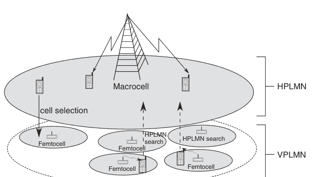

**图 7.18** R8 之前版本中通过国家漫游进行小区选择（毫微微小区作为 VPLMN）

此外，当 UE 驻留在毫微微小区上时，它会定期搜寻宏小区，这也会消耗电池电量。

### 7.6.2 R8 之前版本中的小区重选

与毫微微小区的小区重选比小区选择更为复杂。在小区重选期间，UE 需要对同频、异频和异系统邻区执行小区测量，并根据特定策略对小区进行排序。然后，UE 从当前服务小区重新选择最合适的小区。在处理 R8 之前版本 UTRAN 中的毫微微小区时，如第 7.3.2 节所述，为宏小区提供可靠且干净的邻区列表（NCL）仍然是一个问题。因此，一些运营商/供应商并未实现宏小区到毫微微小区重选过程的小区重选功能（毫微微小区到宏小区或毫微微小区到毫微微小区的重选则很容易，因为毫微微小区的 NCL 不会很大，且 PSC 混淆不太可能发生）。宏小区到毫微微小区的移动性仅依赖于小区选择过程，这意味着用户在宏小区覆盖下选择毫微微小区会遇到困难。尽管如此，仍有一些运营商/供应商使用他们自己的 NCL 方法来支持从宏小区到毫微微小区的小区重选。

与毫微微小区相关的另一个重要问题是，在小区重选过程中，优先考虑允许的毫微微小区而不是宏小区，并避免未经授权的毫微微小区。由于 R8 之前版本 UTRAN 中毫微微小区移动性过程缺乏标准化，运营商/供应商可能会用自己的替代方法实现小区重选策略。本节将介绍几种小区重选的替代方案。

#### 小区重选参数

小区重选参数通常用于调整宏小区网络中的小区重选策略 [9, 10]。它们也可用于毫微微小区和宏小区之间的小区重选过程。图 7.19 显示了同频、异频和异系统小区的搜索准则（S 准则）。只要满足 S 准则，UE 就会被触发对相应的邻区进行监测和测量。较低的宏小区 S 准则可以帮助 UE 在到达毫微微小区覆盖范围时立即开始搜寻毫微微小区。如图 7.20 所示，较高的毫微微小区 S 准则迫使 UE 在家中时停留在毫微微小区上。由于 S 准则针对所有邻区取整个频率的值，因此在共享频率毫微微小区部署场景中，它也会影响宏小区之间的重选。

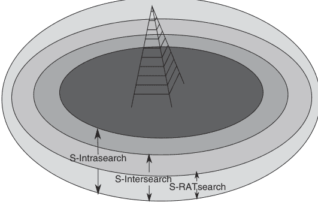

**图 7.19** 小区重选中同频、异频和异系统小区搜索的小区搜索准则

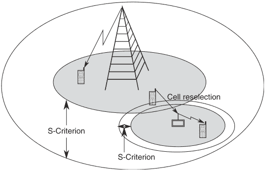

**图 7.20** 通过调整小区重选中的小区搜索准则，将毫微微小区置于宏小区之上

小区重选中的另一个考虑因素与小区排序准则（R 准则）有关，其中 Q-hyst（服务小区的滞后值）和 Q-offset（邻区的偏移值）共同影响小区排序。在宏小区的 NCL 内，可以为毫微微小区设置较低的 Q-offset，使其在小区重选期间获得更高的排名。图 7.21 显示，通过设置负的 Q-offset 和较低的 Q-hyst，小区搜索点 d1 向后移动到 d2。而在毫微微小区中，较高的 Q-hyst 值可以帮助毫微微小区将其覆盖范围内的用户保持连接。图 7.22 显示，通过设置正的 Q-offset 和较高的 Q-hyst，小区搜索点 d1 向前移动到 d2。

缺点是网络中的所有用户都会优先选择毫微微小区并尝试注册其上。最终，未被授权访问的用户会被拒绝。这将增加手机的电池消耗并增加 MM 信令负荷。

#### 分层小区结构

通过使用分层小区结构（HCS），UE 即使在宏小区覆盖良好时也能执行毫微微小区测量，并且它限制了对高优先级或低优先级小区的测量，从而减轻了测量负担 [9]。通过为 HCS 惩罚定时器设置适当的持续时间，街道上经过的 UE 可以避免选择毫微微小区，并减少网络信令开销。此外，可以为高移动性 UE 设置参数以停留在宏小区上，只有相对静止或低速的 UE 才会选择毫微微小区层。

作为在 GSM 和 UMTS 中采用的成熟技术，HCS 最大的优点是它可以在 R8 之前版本的网络中用于毫微微小区，而无需对当前网络进行任何修改。只需配置小区 HCS，驻留在宏层上的 UE 就可以自动找到毫微微小区层。一旦 UE 驻留在毫微微小区上，它将优先选择此小区。

然而，当仅使用 HCS 时，所有 UE 都将遵循相同的小区重选规则，优先选择毫微微小区而不是宏小区，并尝试注册，从而增加核心网（CN）的负荷。此外，NCL 是 HCS 寻找相邻毫微微小区的唯一方法，这在支持毫微微小区方面仍然存在不少问题。

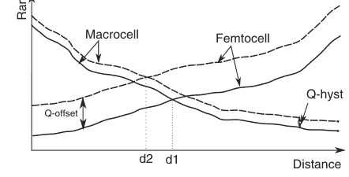

**图 7.21** 通过调整小区排序准则，在向毫微微小区重选时将毫微微小区置于宏小区之上

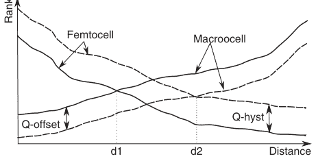

**图 7.22** 通过调整小区排序准则，在向宏小区重选时将毫微微小区置于宏小区之上

#### 等效 PLMN

如第 7.6.1 节所述，为毫微微小区和宏小区设置不同的 PLMN ID 有助于改善毫微微小区的小区选择过程。为了启用这些 PLMN 之间的小区重选，可以使用等效 PLMN（EPLMN）功能 [2]。在这种方法中，毫微微小区 PLMN 被配置为宏小区 PLMN 的 EPLMN。在 PLMN 选择、小区选择、小区重选和切换方面，EPLMN 被认为等同于已注册 PLMN（RPLMN）。UE 可以在位置区更新（LAU）期间更新其 EPLMN 列表。例如，当 UE 到达宏小区和允许的毫微微小区的重叠区域时，UE 应将该毫微微小区的 PLMN ID 添加到其 EPLMN 列表中。这使得 UE 能够在宏小区和毫微微小区之间执行小区重选过程。同时，当 UE 不被允许使用毫微微小区时，毫微微小区 PLMN 会从其 EPLMN 列表中移除，因此它将永远不会尝试驻留在该毫微微小区上，从而延长电池寿命。

EPLMN 方法的缺点是，配置和更新 EPLMN 列表的过程高度依赖于 LAU。此外，EPLMN 功能仅从第 6 版本开始可用，因此旧手机无法支持 EPLMN。

### 7.6.3 第 8 版本中的小区选择

在第 8 版本中，小区选择遵循最强小区作为服务小区的原则。通过在小区选择期间检查 CSG ID 是否在 UE 的 ACL 中，UE 可以避免选择未授权的毫微微小区作为服务小区。此外，作为第 8 版本的新功能，可以使用手动 CSG 小区选择让 UE 选择服务小区。图 7.23 显示了第 8 版本中带有毫微微小区的整体空闲模式过程 [9, 10]。

#### 自动小区选择

在第 8 版本中，毫微微小区的自动小区选择过程与宏小区类似。为了避免驻留在未授权的毫微微小区上，当目标小区是 CSG 小区时，会执行额外的 CSG ID 检查。接入层（AS）将广播的 CSG ID 与非接入层（NAS）提供的 ACL 进行核对，以确定该 CSG 小区是否适合该 UE。如果目标小区的 CSG ID 在 UE 的 ACL 中，则选择该小区进行驻留。

在第 9 版本中，应进一步考虑对开放和混合接入毫微微小区的支持。由于开放接入的毫微微小区没有 CSG ID，所有 UE 都可以在小区选择期间无需检查 CSG ID 即可选择这些小区。然而，对于混合接入的毫微微小区，仍需要调用 CSG ID 检查以区分 UE 是否在其 CSG 中。CSG 中的 UE 将拥有完全访问权限，而其他 UE 仍然可以驻留，但可能只能从该小区获得有限的服务质量（QoS）服务。

#### 手动小区选择

在第 8 版本中，提出了一种支持用户在空闲模式下手动选择其服务 CSG 的方法 [9, 10]。为避免中断当前 UE 的服务，UE 不允许在连接模式下支持手动 CSG 选择 [26]。

作为一种稳健的方法，用户可以通过从显示的 CSG 列表中选择毫微微小区 ID 来触发 CSG 手动选择。在手动选择中，UE 可以扫描 UMTS 陆地无线接入（UTRA）或演进 UTRA（EUTRA）频段中的所有频率，并显示一个找到的毫微微小区列表，其中包含毫微微小区 ID、CSG ID 和相应的毫微微小区名称（如果它们被广播）。UE 也可能显示指示，说明找到的 CSG 小区是否在其 ACL 中。当用户选择列表中的一个条目时，UE 将随后执行与该小区的附着和位置区更新/跟踪区更新（LAU/TAU）过程。如果所选小区是允许的 CSG 小区，UE 通常可以驻留在上面。

此外，手动小区选择可以通过 LAU/TAU 请求到所选 CSG 小区的反馈来帮助更新 UE 的 ACL。详细信息请参见第 7.3.4 节。

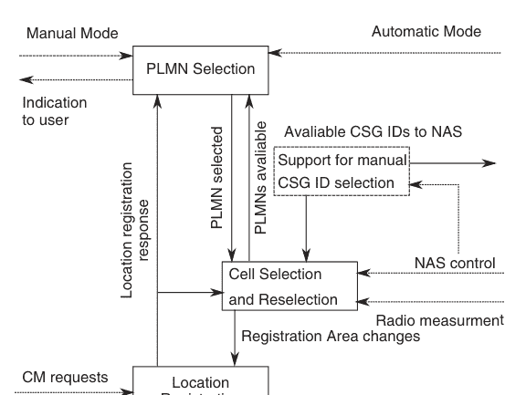


### 版本8中的小区重选

通过在版本8中引入CSG ID和UE自主搜索功能，具有毫微微小区特性的小区重选现在可以改进毫微微小区的重选过程。UE应使用自主搜索功能来检测邻近毫微微小区，而不是从服务小区读取NCL。此外，UE可以通过将毫微微小区的CSG ID与ACL进行比较来排除未授权的毫微微小区。换言之，UE现在可以在不知道宏小区NCL的情况下，针对合适的毫微微小区执行小区测量。

应允许被授权访问给定CSG小区的UE，在处于CSG小区覆盖范围内时，优先驻留至CSG小区。为此，应能够相应地设置重选参数，或应有其他手段允许此操作[20]。为了进一步改进涉及毫微微小区的小区重选过程，需要在小区重选期间优先选择毫微微小区而非宏小区的方法。与执行此任务相关的特定机制的详细细节仍在讨论中，可能会在3GPP版本9中采用。

本节讨论同频、异频和异系统场景下，向毫微微小区重选以及从毫微微小区重选的问题。

#### 向毫微微小区重选

在版本8中，周围毫微微小区的信息不包含在宏小区的NCL中。当UE的ACL非空时，使用自主搜索功能来搜索CSG小区；当ACL为空时，UE可能会禁用自主搜索功能。如果CSG小区部署在预留频点上，UE可能仅在这些专用频点以及系统信息中列出的其他频点上执行自主搜索。当UE没有ACL或ACL为空时，对于同频和异频测量以及小区重选，UE可能会忽略其PSC/PCI位于为CSG小区预留的存储范围“CSG PSC/PCI分离信息”内的小区。

在已知邻近毫微微小区和宏小区的情况下，UE遵循类似的小区排序过程来选择排名最高的小区作为服务小区。在同频、异频和异系统场景下向毫微微小区重选时，一些与毫微微小区相关的策略如下所列。

- **同频小区重选**

为了避免在同一频层上增加额外干扰，在同频小区重选中不支持毫微微小区优先。对于从宏小区到允许的CSG小区的同频重选，UE遵循与[9]中为宏小区定义的相同的小区排序规则。

同频重选的主要问题是如何在最佳小区是一个CSG ID不在ACL中的CSG小区时设计策略。为了在此种情况下允许或不允许同频小区重选，[27]和[28]中提出了一个“同频小区重选指示符”IE。当该指示符设置为TRUE时，它将允许UE驻留在另一个小区，即使一个未允许的CSG是排名最高的小区，即会导致未允许的CSG之间的干扰。然而，如果该指示符设置为FALSE，则UE会认为整个频点在一段时间内被禁止，并从不同频点或RAT中选择一个小区。

迄今为止，3GPP尚未确定详细解决方案。例如，在[28]中，引入了一个新的同频重选阈值，以便网络可以进一步控制UE的CSG小区重选。因此，仅当最佳排名的非允许小区与允许小区（即合适小区）的信号强度之差小于该阈值时，才允许UE停留在该频点上。

#### 异频小区重选

对于异频小区重选，可以使用基于优先级的方案。CSG小区的优先级默认情况下应高于宏小区。在小区重选期间，UE不像在宏小区中那样对所有测量到的小区进行排序，而是首先区分CSG小区和宏小区（即通过预留的PSC/PCI分离信息）。如果被测小区是CSG小区，UE将读取该小区的CSG ID并检查其与ACL的匹配情况。如果允许访问该CSG小区，则UE仅在该CSG小区所在的频点上执行小区排序。如果该CSG小区在该频点上仍然是排名最高的小区，UE应重选该小区，无论适用于UE当前驻留小区的小区重选规则如何。如果在不同频点上检测到多个合适的CSG小区，并且这些小区是其频点上信号最强的小区，则UE应重选其中任何一个[9, 10]。如果未检测到此类CSG小区，则应应用为宏小区定义的常规小区重选。

上述策略可在满足小区搜索准则（S准则）时使用。然而，当UE在另一个频点上找到CSG小区时，即使服务宏小区的信号强度/质量良好，它可能也更倾向于重选允许的CSG小区。UE需要一个适用于CSG小区的阈值来执行小区重选评估过程。该机制的详细细节仍需在3GPP中确定。在文献[29-31]中，除了为宏小区定义的正常S准则（S-Intrasearch, S-Intersearch 和 S-RATsearch）外，还提出了一个新的S-CSGCell准则（ThreshCSGcell）和一个时间间隔（TreselectionCSG），以便能够向CSG小区重选。在小区排序中也引入了一个新的CSG小区偏移量（Q-offsetCSG）。如图7.24所示，当UE在时间间隔TreselectionCSG内检测到某个CSG小区的S-CSGCell大于ThreshCSGcell时，UE将比较该小区的CSG ID与ACL。如果该小区被允许访问，UE将根据该频点上相应的小区偏移量进行小区排序。如果该小区在该频点上仍然是排名最高的小区，UE将重选该小区。

此外，在[32]中，讨论了一项关于采用UE特定设置以在不同部署场景中处理不同用户的提议。为此目的，一些小区重选参数可能会通过专用信令发送给UE。

- **异系统小区重选**

当UE驻留在另一个RAT上时，支持向允许的CSG小区的异系统重选。UE要求在相关RAT的规范中定义。

#### 从毫微微小区重选

毫微微小区一旦启动，通常会扫描同频、异频或异系统层中的邻近宏小区。然后，毫微微小区中的自配置功能会将这些宏小区的信息自动配置到毫微微小区的NCL中。服务毫微微小区可以通过其系统信息块将邻区信息发送给UE。就像在宏小区中一样，UE可以执行相应的小区测量以进行小区重选，而无需执行自主搜索功能。

- **同频小区重选**

对于从CSG小区到宏小区的同频小区重选，UE应应用与为宏小区定义的相同的小区重选规则。

- **异频小区重选**

对于从CSG小区到宏小区的异频小区重选，只要服务小区在该频点上仍然是排名最高的小区，UE应将服务小区的频点视为最高优先级频点（即高于八个网络配置值或最高HCS优先级）[9, 10]。否则，应应用为宏小区定义的正常小区重选。

- **异系统小区重选**

对于异系统小区重选，应应用在该服务RAT中为宏小区定义的正常异系统过程。例如，对于从UMTS CSG小区重选到GSM或LTE宏小区，UE遵循[9]中定义的相应过程。

**图7.24** 从宏小区到毫微微小区重选中的新小区搜索准则S-CSGCell和时间间隔TreselectionCSG

#### 飞蜂窝之间的重选

飞蜂窝上电后，也可能在同频、异频或异RAT层扫描周围的飞蜂窝。由于相邻飞蜂窝的动态性相当强，飞蜂窝在空闲模式下可能会执行周期性的NCL优化。对于那些在系统信息中列出的飞蜂窝，UE可以像对待宏小区一样执行正常的小区测量。无论如何，为了搜索在服务CSG小区的系统信息中未列出的CSG小区，UE可以使用自主搜索功能。

-   *同频小区重选*
    对于同一频率层上允许的CSG小区之间的重选，UE遵循为宏小区定义的相同小区排序规则[9, 10]。
-   *异频小区重选*
    对于允许的CSG小区之间的异频重选，当该小区为最高排名时，UE应将服务飞蜂窝的频率视为最高优先级频率。如果UE在非服务频率上检测到CSG小区，且该小区在该频率上保持最高排名，则UE应假设该频率与服务频率具有相同的优先级[9, 10]。UE可以重选检测到的CSG小区，而不考虑服务CSG小区的正常重选规则。对于其他情况，适用于宏小区的小区重选规则应适用。
-   *异RAT小区重选*
    如果UE在另一RAT上检测到一个或多个合适的CSG小区，UE可以根据[10]重选其中一个。

## 7.7 小区切换

小区切换使UE能够将其服务从服务小区无缝转移到目标小区，而无需终止服务。由于UTRA中飞蜂窝没有Iur接口，飞蜂窝不支持软切换。取而代之的是硬切换。为了支持与飞蜂窝的小区切换，需要解决NCL、PSC/PCI混淆等问题，如前几节所述。此外，UE应避免中断服务并尽量保持服务的连续性，这使得它比小区选择和重选更加复杂。

在pre-release 8之前，大多数厂商不支持向飞蜂窝切换，但仍有其他厂商努力寻找自己的方式来支持这一点。

在连接模式下，从非CSG小区到允许的CSG小区的切换不在3GPP release 8的范围之内[33]。然而，3GPP RAN 2和3已投入大量精力，主动进入飞蜂窝的切换将在release 9中加入。

在本节中，将首先讨论支持与飞蜂窝进行小区切换的方法，特别是进入（hand-in）流程。将讨论release 8中包括向飞蜂窝切换、从飞蜂窝切换以及飞蜂窝之间切换的小区切换。同时，还将涵盖3GPP目前为支持release 9中的进入切换而达成的提案介绍。

### 7.7.1 Pre-release 8中的小区切换

在pre-release 8 UTRA中，UE应在小区切换过程中发起对所有相邻小区和服务小区的测量，服务小区将根据UE测量报告做出切换决策。为了让UE识别需要测量的周围小区，有关相邻小区的信息需要包含在测量控制系统信息中。为此，需要NCL。

在本节中，介绍了为服务宏小区和飞蜂窝构建和配置NCL的方法。基于这样的NCL，还讨论了pre-release 8期间小区切换过程中的流程。

#### 向飞蜂窝的小区切换

为了解决7.3.2节中提出的NCL问题，在宏小区的NCL中包含飞蜂窝信息至关重要，尤其是当其覆盖下部署了大量飞蜂窝时。已经提出了支持进入切换的方法[34, 35]。图7.25展示了在pre-release 8 UTRAN中支持从宏小区到飞蜂窝进入切换的一种可能方式。这些流程的整体描述如下。

-   *虚拟邻区列表*
    当宏小区覆盖大量飞蜂窝（即一个频率上超过32个）时，将所有飞蜂窝信息配置到宏小区的NCL中可能是不可行的。为解决pre-release 8 UTRA中的这个问题，构建了"虚拟邻区列表"。在这种方法中，飞蜂窝共享少量PSC（即10个），这些PSC将在飞蜂窝中复用。然后这些PSC将被编入宏小区的NCL。由于PSC不代表某个特定的飞蜂窝，且无法唯一区分飞蜂窝，它们被称为"虚拟邻区"。服务小区现在可以将此小区列表包含在测量控制信息中，UE随后可以对这些PSC执行小区测量。需要注意的是，PSC的复用受到相当严格的限制。例如，数量不应太大以适应NCL（最多32个）。另一方面，数量也不应太小，以确保相同的PSC不会分配给相邻的飞蜂窝。
-   *飞蜂窝网关识别*
    当"虚拟邻区列表"实施时，UE能够向宏小区报告保留PSC的飞蜂窝的小区测量结果。服务小区随后可以根据测量报告决定UE可能切换到哪个飞蜂窝（由PSC表示）。然而，由于PSC的复用和非协调部署，服务小区再也无法正确识别候选飞蜂窝。在这种情况下，CN将转发切换请求（包括UE的IMSI）到飞蜂窝网关。飞蜂窝网关随后可以将UE的IMSI与每个飞蜂窝的允许IMSI列表进行比较。如果找到这样的小区，飞蜂窝网关将向该飞蜂窝发送切换请求，正常的切换流程将随之进行。
-   *上行同步*
    如果飞蜂窝网关识别出的飞蜂窝不是唯一的（即UE可能可以接入多个飞蜂窝），则切换请求必须发送给所有可能的飞蜂窝。这些飞蜂窝将尝试通过其下行同步信道发送信标来与UE同步。然而，只要确保具有相同PSC的飞蜂窝彼此分离，UE将只接收来自真正目标飞蜂窝的同步命令。然后，正确的飞蜂窝将接收来自UE的上行同步消息，正常的切换流程可以随之进行。其他候选飞蜂窝随后将接收来自飞蜂窝网关的资源释放请求。

总体机制可以在某些情况下解决进入切换问题。然而，这会导致切换信令的低效率和模糊性，因为可能需要为多个候选目标飞蜂窝准备切换。

#### 从飞蜂窝的切换

为飞蜂窝配置NCL很容易，因为相邻宏小区的数量非常有限。通过飞蜂窝厂商实施的自优化方法，飞蜂窝可以在运营商定义的频点或RAT上扫描周围的宏小区，并自动将其添加到相应的NCL中。

有了相邻宏小区的信息，pre-release 8的同频/异频和异RAT切换机制足以覆盖飞蜂窝到宏蜂窝的主动模式移动性。

#### 飞蜂窝之间的小区切换

由于飞蜂窝通常以非常低的功率运行，服务小区可以检测到的周围飞蜂窝数量也非常有限。对于那些在服务飞蜂窝中配置了小区信息的飞蜂窝，可以应用为宏小区定义的正常切换机制。

虽然服务小区可以通过周期性感知环境来更新其NCL，但由于相邻飞蜂窝的动态性相当强，一些新增加或上电的飞蜂窝可能未包含在飞蜂窝的NCL中。对于从飞蜂窝到系统信息中未列出的飞蜂窝的切换，pre-release 8中未考虑此机制，可能可以通过类似于从宏小区到飞蜂窝切换的解决方案来实现。

### 7.7.2 Release 8中的小区切换

通过引入与飞蜂窝相关的参数和功能（即CSG ID、保留的PSC/PCI和UE自主搜索功能），网络可以比pre-release 8 UTRA进行更 enhanced 和高效的切换。例如，支持CSG的UE可以让其找到周围的飞蜂窝，而无需让服务小区提供NCL。并且UE能够过滤掉不允许的飞蜂窝，避免对这些小区执行小区测量。

对于从飞蜂窝到宏小区或飞蜂窝之间的切换，流程与pre-release 8一样 straightforward。此外，通过使用CSG ID和保留的PSC/PCI，切换流程的效率进一步提高。

虽然自主搜索功能可以帮助UE在不知道NCL的情况下找到周围的飞蜂窝，但UE需要花费时间在异频、异频甚至异RAT层上扫描飞蜂窝。在Cell_DCH状态下，从非CSG小区到允许的CSG小区的切换不在release 8的范围之内[33]。能够保持服务连续性和低延迟的切换机制仍在3GPP中讨论，并将在release 9中得到支持。

#### 向飞蜂窝的切换

在从服务宏小区到飞蜂窝的小区切换过程中，UE可以触发UE自主搜索功能来扫描周围的飞蜂窝。如果存在"专用CSG频点"IE，它可能只在专用频点上进行搜索。此外，如果它知道PSC/PCI划分信息，它可以将搜索空间缩小到仅保留的PSC/PCI上。然后，UE可以对这些发现的飞蜂窝执行小区测量，并将测量结果报告给服务宏小区。然而，已有研究表明[8]，由于PSC/PCI的复用，PSC/PCI混淆问题可能仍会在pre-release 8 UTRA中出现。因此，需要向网络提供辅助信息以识别正确的目标飞蜂窝。

最近，在3GPP RAN 2和RAN 3中做了大量努力来解决这个问题[36–42]。其总体思路是使UE要么提供Cell


##### 在系统信息中读取CGI
在切换过程中，UE首先使用正常的间隔模式测量毫微微蜂窝频率，并向服务宏蜂窝发送包含相应PSC/PCI的测量报告。然后，宏蜂窝将决定UE可能切换到哪个毫微微蜂窝。当出现PSC/PCI混淆时，UE会被要求读取目标毫微微蜂窝的系统信息以获取CGI，如图7.26所示。通常，UE读取系统信息有两种方式，如下所列。

##### 长间隔方法
在此方法中，服务宏蜂窝通过测量配置为UE分配一个长间隔，以便在第一次测量报告后接收目标毫微微蜂窝的系统信息。UE随后可以在长间隔期间接收CGI。CGI将通过第二次测量报告发送给服务宏蜂窝。在目标毫微微蜂窝被唯一识别后，即可执行正常的切换流程。

如果分配了合适的长间隔，UE能够轻松地从目标毫微微蜂窝读取CGI。然而，重新配置间隔所需的额外信令将增加切换流程的复杂性。此外，对于具有实时服务（例如，IP语音（VoIP））的UE，长间隔会影响服务连续性。

##### DRX方法
服务宏蜂窝也可以要求UE在非连续接收（DRX）期间读取系统信息。为了减少切换流程中的延迟，据信UE可以在服务小区满足测量报告条件之前自主尝试读取相邻毫微微蜂窝的CGI [38, 43]。

使用DRX方法，无需额外的间隔重新配置，且服务连续性不受干扰。然而，DRX周期需要足够长，以便UE从目标毫微微蜂窝的系统信息中读取CGI。对于实时服务，如视频通话，当UE处于活动模式时，不太可能提供如此长的DRX周期。

##### 使用指纹信息
如上所述，通过读取CGI来识别毫微微蜂窝的方法可能效率低下，并可能增加小区切换期间的延迟。小区的指纹（可能由小区ID、位置及其相邻小区信息等组成）用于唯一地表征该小区。这种特性使其成为确定毫微微蜂窝身份的可能替代方案，从而减少系统信息读取。在[8]中，提出了一种基于指纹信息的解决方案。该解决方案可以是基于UE的，也可以是基于网络的。

##### 基于UE的方法
使用此方法，UE能够在访问毫微微蜂窝后为其创建指纹。这些指纹将与UE在USIM中的访问控制列表（ACL）关联存储。当检测到或测量到毫微微蜂窝时，UE将通过将其指纹与存储的信息进行验证来确定毫微微蜂窝的身份。如果毫微微蜂窝被识别，UE随后将在测量报告中包含相应的小区信息（包括CGI和CSG ID）并将其发送给服务小区。

此方法对CN的影响非常小。然而，UE需要能够创建和管理毫微微蜂窝的指纹，这很大程度上依赖于UE的实现。对于第9版中的开放/混合接入毫微微蜂窝，可能无法将所有此类小区的指纹放在UE中。此外，该方法的有效性对指纹测量的准确性非常敏感。

##### 基于CN的方法
使用此方法，CN将确定正确的目标毫微微蜂窝，而不是UE。这要求CN拥有所有已安装毫微微蜂窝的指纹。此外，UE需要将检测到的毫微微蜂窝的指纹与小区测量结果一起发送给服务小区。然后，CN将通过其指纹验证毫微微蜂窝的身份。

此方法要求网络理解和维护每个毫微微蜂窝的指纹，这可能对当前的CN产生重大影响。此外，如此庞大的数据库可能不易维护和管理。由于毫微微蜂窝可以被添加或移除，且其位置不是固定的，这带来了更新指纹信息的额外问题。与前述方法一样，此方法也存在位置准确性的问题。

#### 从毫微微蜂窝切换
毫微微蜂窝通常通过自配置功能在其邻区列表（NCL）中保存周围宏蜂窝的信息。此外，这种情况不太可能发生PSC/PCI混淆。从毫微微蜂窝切换到宏蜂窝的流程预计与[6]和[7]中规定的流程相同。

#### 毫微微蜂窝之间的切换
在第8版中，毫微微蜂窝通常预期部署在基于家庭的场景中。在这样的场景中，毫微微蜂窝之间的切换很少发生，因为毫微微蜂窝的所有者不希望邻居家驻留在其毫微微蜂窝上。如果UE的ACL中包含目标毫微微蜂窝的CSG ID，则基于CN的无线接入网络应用部分（RANAP）/S1足以处理这两个毫微微蜂窝之间的切换流程。

然而，对于企业或城市场景，毫微微蜂窝通常属于同一CSG。用户可能经常从一个毫微微蜂窝走到另一个，大多数切换都是毫微微蜂窝到毫微微蜂窝的切换。如果使用基于CN的RANAP/S1切换，这可能会导致大量信令延迟。

最近在RAN#43会议上达成一致，为第9版引入一些毫微微蜂窝增强功能[1]。其中一项增强功能是改进毫微微蜂窝到毫微微蜂窝的连接模式切换。针对UTRAN和EUTRAN，提出了多种支持增强型毫微微蜂窝间切换的机制[44–48]。其总体思路是将大部分切换信令转移到毫微微蜂窝-GW和/或毫微微蜂窝，从而减少到CN的信令延迟。本节将讨论基于CN、毫微微蜂窝-GW和毫微微蜂窝的毫微微蜂窝间切换。

##### CN协调
在CN协调场景中，CN管理整个切换流程，所有切换信令都发送到CN，如图7.27所示。CN将获取接入类型（即开放、封闭和混合）和CSG ID（如果目标毫微微蜂窝有的话），并执行相应的接入控制。如果允许访问目标毫微微蜂窝，CN将把切换请求路由到目标毫微微蜂窝-GW。毫微微蜂窝-GW最终将发送RANAP切换请求给目标毫微微蜂窝。

支持毫微微蜂窝间的CN协调切换无需修改。此外，CN协调切换适用于同一GW内和不同GW之间的毫微微蜂窝切换。但是，当处理大量毫微微蜂窝间切换请求时，CN将承受极高的负载。

##### 毫微微蜂窝-GW协调
在毫微微蜂窝-GW协调场景中，大部分切换消息由毫微微蜂窝-GW处理，而不是CN，如图7.28所示。在这种情况下，毫微微蜂窝-GW读取目标毫微微蜂窝的小区信息，并为非CSG UE执行接入控制。对于具备CSG能力的UE，接入控制应由CN完成，并将结果发送回毫微微蜂窝-GW。如果允许访问目标毫微微蜂窝，毫微微蜂窝-GW将向其发送切换请求。由于毫微微蜂窝-GW仅具有已连接毫微微蜂窝的信息，它仅适用于同一GW内的毫微微蜂窝。如果源和目标毫微微蜂窝属于不同的毫微微蜂窝-GW，则应调用CN协调切换流程。

通过使用毫微微蜂窝-GW处理切换流程，切换延迟和CN负载得以降低。然而，需要为毫微微蜂窝-GW添加新功能，使其能够读取和转发切换请求消息。


 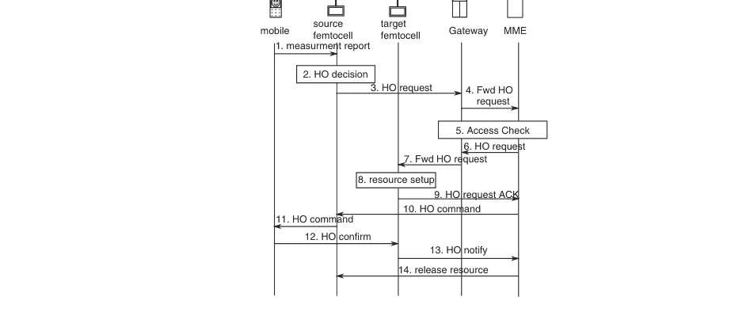

图 7.27 版本9中 femtocell 之间由核心网（CN）协调的小区切换流程

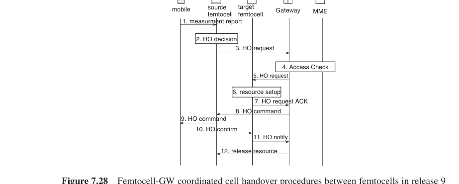

图 7.28 版本9中 femtocell 之间由 femtocell 网关（Femtocell-GW）协调的小区切换流程

- **Femtocell 协调切换**

为了实现 femtocell 协调切换，需要在 femtocell 之间建立一个新的接口。类似于 EUTRAN 中通过 X2 接口进行的小区切换，切换直接在源 femtocell 和目标 femtocell 之间执行，如图 7.29 所示。在这种情况下，执行 femtocell 之间的切换需要更少的切换消息。接入控制功能应在 femtocell-GW 中为非 CSG 用户设备（UE）执行，在核心网（CN）中为支持 CSG 的 UE 执行。对于特殊但常见的 CSG 内部切换，可以忽略 UE 接入目标 femtocell 的接入控制。在收到切换完成消息后，femtocell-GW 将触发 UE 向源 femtocell 发起注销。

直接消息交换使准备阶段非常快速。切换过程延迟和核心网（CN）负载可以进一步降低。然而，这需要一个新的接口来实现 femtocell 之间的直接通信。此外，还需要对 femtocell 进行修改，使其能够编码/解码切换消息。

# 参考文献

- [1] Alcatel Lucent, 'Support of Home NB and Home eNB enhancements RAN3 aspects,' 3GPP-TSG RAN, Biarritz, France, Tech. Rep. RP-090349, Mar. 2009.
- [2] 3GPP TR 25.820, '3G Home NodeB Study Item Technical Report,' 3GPP-TSG RAN, Valbonne, France, 8.2.0, Sep. 2008.
- [3] Nokia Siemens Networks, 'Simple CSG for REL8,' 3GPP-TSG RAN, Shenzhen, China, Tech. Rep. R2-081735, Mar. 2008.
- [4] Huawei, 'Consideration on reserving Phy ID for UTRA hNB cell,' 3GPP-TSG RAN, Kansas City, Missouri, USA, Tech. Rep. R2-082282, Mar. 2008.
- [5] Qualcomm Europe, 'H(e)NB PCI/PSC and Frequency Identification,' 3GPP-TSG RAN, Prague, Czech Republic, Tech. Rep. R2-085475, Oct. 2008.
- [6] 3GPP TS 25.331, 'Radio Resource Control (RRC),' 3GPP-TSG RAN, 8.6.0, Mar. 2009.
- [7] 3GPP TS 36.331, 'Radio Resource Control (RRC),' 3GPP-TSG RAN, 8.5.0, Mar. 2009.
- [8] Motorola, 'PCID confusion,' 3GPP-TSG RAN, Seoul, Korea, Tech. Rep. R2-092307, Mar. 2009.
- [9] 3GPP TS 25.304, 'User Equipment (UE) procedures in idle mode and procedures for cell reselection in connected mode,' 3GPP-TSG RAN, 8.5.0, Mar. 2009.
- [10] 3GPP TS 36.304, 'User Equipment (UE) procedures in idle mode,' 3GPP-TSG RAN, 8.5.0, Mar. 2009.
- [11] ARICENT, 'Challenge in Deployment of UMTS/HSPA Femtocell,' White Paper, 2008.
- [12] 3GPP TS 24.008, 'Mobile radio interface Layer 3 specification; Core network protocols; Stage 3,' 3GPP-TSG CT, 8.5.0, Mar. 2009.
- [13] 3GPP TS 23.003, 'Numbering, addressing and identification,' 3GPP-TSG CT, 8.4.0, Mar. 2009.
- [14] 3GPP TS 23.122, 'Non-Access-Stratum (NAS) functions related to Mobile Station (MS) in idle mode,' 3GPP-TSG CT, 8.5.0 Release 8, Mar. 2009.
- [15] 3GPP TS 24.301, 'Non-Access-Stratum (NAS) protocol for Evolved Packet System (EPS) Stage 3,' 3GPP-TSG CT, 8.1.0, Mar. 2009.
- [16] 3GPP RAN, 'Reply LS on access control for CSG cells,' 3GPP-TSG RAN, Prague, Czech Republic, Tech. Rep. R2-086035, Oct. 2008.
- [17] 3GPP CT1, 'LS on access control for CSG cells,' 3GPP-TSG RAN, Prague, Czech Republic, Tech. Rep. R2-084948, Aug. 2008.
- [18] Vodafone Group, 'Open and semi-open access support for UTRA Home NB,' 3GPP-TSG RAN, Prague, Czech Republic, Tech. Rep. R2-085280, Oct. 2008.
- [19] 3GPP TS 22.220, 'Service requirements for Home NodeBs and Home eNodeBs,' 3GPP-TSG SA, 9.0.0, Mar. 2009.
- [20] 3GPP TS 36.300, 'Evolved Universal Terrestrial Radio Access (E-UTRA) and Evolved Universal Terrestrial Radio Access Network (E-UTRAN); Overall description; Stage 2,' 3GPP-TSG RAN, 8.8.0, Mar. 2009.
- [21] Nokia Siemens Networks, 'Paging Optimisation in LTE CSGs,' 3GPP-TSG RAN, Athens, Greece, Tech. Rep. R2-090317, Feb. 2009.
- [22] ZTE, 'Paging Optimisation,' 3GPP-TSG RAN, Athens, Greece, Tech. Rep. R3-090461, Feb. 2009.
- [23] Huawei, Airvana, 'Paging Optimization for 3G HNB,' 3GPP-TSG RAN, Seoul, Korea, Tech. Rep. R3-090784, Mar. 2009.
- [24] Samsung, 'Paging optimization for hybrid/open HeNB,' 3GPP-TSG RAN, Seoul, Korea, Tech. Rep. R3-090860, Mar. 2009.
- [25] 3GPP TS 22.011, 'Service accessibility,' 3GPP-TSG SA, bb, Tech. Rep. 9.1.0, Mar. 2009.
- [26] Panasonic, 'CSG Manual Search and Selection for Connected mode UE,' 3GPP-TSG RAN, Prague, Czech Republic, Tech. Rep. R2-086306, Nov. 2008.
- [27] 3GPP RAN, 'LS on reselection handling towards non-allowed CSG cell,' 3GPP-TSG RAN, Jeju, Korea, Tech. Rep. R2-084891, Aug. 2008.
- [28] Qualcomm Europe, 'Intra-frequency reselection indicator for CSG cells,' 3GPP-TSG RAN, Prague, Czech Republic, Tech. Rep. R2-085383, Oct. 2008.
- [29] Qualcomm Europe, 'Parameter for HNB White List Cell Selection,' 3GPP-TSG RAN, Jeju, Korea, Tech. Rep. R2-084346, Aug. 2008.
- [30] Sharp, 'Problems associated with using a constant CSG offset when performing reselection ranking,' 3GPP-TSG RAN, Prague, Czech Republic, Tech. Rep. R2-085107, Oct. 2008.
- [31] Huawei, 'Inter frequency Cell Reselection from macro cell to CSG,' 3GPP-TSG RAN, Prague, Czech Republic, Tech. Rep. R2-085659, Oct. 2008.
- [32] Qualcomm Europe, 'UTRA HNB Idle Mode (Re)selection and UE Access Control,' 3GPP-TSG RAN, Warsaw, Poland, Tech. Rep. R2-083392, Jul. 2008.
- [33] 3GPP TS 25.367, 'Mobility Procedures for Home NodeB; Overall Description; Stage 2,' 3 antenna-widthGPP-TSG RAN, 8.1.0, Mar. 2009.
- [34] Alcatel Lucent, 'Femtoceller,' Technical Seminar, 2009.
- [35] ip.access, 'Femtocell handover,' White Paper, 2008.
- [36] Panasonic, 'CSG cell handover,' 3GPP-TSG RAN, Sorrento, Italy, Tech. Rep. R2-080884, Feb. 2008.
- [37] Huawei, 'Inbound mobility Issues for UEs in RRC Connected,' 3GPP-TSG RAN, Warsaw, Poland, Tech. Rep. R2-083514, Jul. 2008.
- [38] Telecom Italia, Qualcomm Europe, Samsung, 'Way forward for handover to HeNB,' 3GPP-TSG RAN, Jeju, Korea, Tech. Rep. R2-084534, Aug. 2008.
- [39] Qualcomm Europe, 'Connected mode mobility in the presence of PCI confusion for HeNBs,' 3GPP-TSG RAN, Seoul, Korea, Tech. Rep. R2-092113, Mar. 2009.
- [40] InterDigital, 'Inbound handover to CSG and hybrid cells,' 3GPP-TSG RAN, Seoul, Korea, Tech. Rep. R2-092142, Mar. 2009.
- [41] Alcatel Lucent, 'Handling of CSG for in-bound Mobility,' 3GPP-TSG RAN, Seoul, Korea, Tech. Rep. R3-090745, Mar. 2009.
- [42] Samsung, 'Inbound mobility for HeNB,' 3GPP-TSG RAN, Seoul, Korea, Tech. Rep. R3-090858, Mar. 2009.
- [43] Samsung, 'Hand-in to a CSG cell,' 3GPP-TSG RAN, Seoul, Korea, Tech. Rep. R2-092404, Mar. 2009.
- [44] ZTE, 'Handover procedure between HNBs,' 3GPP-TSG RAN, Seoul, Korea, Tech. Rep. R3-090759, Mar. 2009.
- [45] Huawei, 'Discussion of HeNB to HeNB Handover,' 3GPP-TSG RAN, Seoul, Korea, Tech. Rep. R3-090805, Mar. 2009.
- [46] 3GPP, '3Gproving3G HNB to 3G HNB Handover,' 3GPP-TSG RAN, Seoul, Korea, Tech. Rep. R3-090856, Mar. 2009.
- [47] Samsung, 'HNB to HNB Handover Architecture,' 3GPP-TSG RAN, Seoul, Korea, Tech. Rep. R3-090868, Mar. 2009.
- [48] NEC, 'HNB to HNB Relocation: possible solutions,' 3GPP-TSG RAN, Seoul, Korea, Tech. Rep. R3-090933, Mar. 2009.

## 8

## 自组织

David López Pérez 和 J_setup Zhang

由于运营商无法预知 femtocell 的数量和位置，而且用户可以随时移动或开启/关闭它们（个体化特性），因此无法应用经典的网络设计来配置和优化 femtocell 网络。此外，由于 femtocell 用户不具备专业技术知识，femtocell 必须是能够自主集成到运营商现有无线接入网络中的单元，对现有无线通信系统造成的影响最小。因此，femtocell 必须是即插即用设备，具有显著的**自组织**能力。

复杂的自组织技术的使用将在现有宏蜂窝网络上成功部署和管理大规模 femtocell 层方面发挥非常重要的作用。自组织将使 femtocell 能够：

- 以最少的人工干预集成到现有网络中，
- 了解其无线环境（邻区和干扰），
- 相应地调整其参数。

通过这种方式，femtocell 将能够对网络、业务和信道的变化条件做出反应，并缓解跨层和同层干扰。其结果是提升整个系统的性能。

在本章中，将介绍 femtocell 部署中自组织的概况。此外，还将详细分析 femtocell 必须具备的关键自组织特性。本章其余部分安排如下：

- 8.1 节介绍运营商对**自组织网络（SON）**的需求；
- 8.2 节介绍自组织的生命周期：测量、自配置、自优化和自治愈；
- 8.3 节介绍 femtocell 网络对自组织的需求；
- 8.4 节介绍 femtocell 上电后的启动过程；


+ 在第8.5节，介绍感知和学习毫微微小区环境变化的不同技术；
+ 在第8.6节，介绍毫微微小区的自配置和自优化技术。

## 8.1 自组织

### 8.1.1 背景

在无线系统发展的早期，该领域还只是一个研究方向，用户数量相对于可用资源而言较少，因此无线网络的效率问题并未引起重视，工程师们只关心如何让网络运行起来。然而，在过去的二十年里，该领域已日趋成熟，用户数量和用户需求急剧增长。因此，当前网络的规划与优化不仅成为使这些无线系统正常运行的关键因素，也成为了提高运营商收入和用户满意度的关键。

在1990年代，为了满足用户需求（主要基于语音服务），部署了全球移动通信系统（GSM）和数字通信系统（DCS）[1]网络。在这类系统中，频谱被划分为多个信道。通过为不同用户分配不同的信道和时隙来实现多用户接入。当时，为了扩展无线电覆盖范围，获取新的小区位置并安装新的基站是网络运营商的主要关注点之一。此外，射频（RF）工程师在自动频率规划[2]和天线方位角/倾角选择[3]领域投入了巨大努力，以此作为减轻干扰、提升网络性能的手段。这些任务，连同小区标识的分配、邻区列表和切换参数的设置，共同构成了当今被称为网络规划与优化领域的早期主要工作。然而，通过优化实现的容量提升不足以应对客户不断增长的业务需求。因此，有必要开发新的技术来替代/补充现有的GSM和DCS系统，以提供新服务和更高的吞吐量。

在本世纪初（2000年），码分多址（CDMA）[4]技术出现，成为最适合未来网络部署的技术之一。如今，由于移动互联网应用的普及和期望，CDMA不仅用于满足用户的语音服务需求，也用于满足数据服务需求。在这类系统中，所有用户共享相同的频谱，通过为不同用户分配具有特殊干扰特性的不同伪随机码来实现多用户接入[5]。因此，完全不需要射频规划，干扰避免通过网络规划、功率控制和这些码来处理。在这个第三代（3G）蜂窝网络中，考虑到需要配置的参数数量巨大，以及覆盖与容量之间的权衡（小区呼吸现象[6]），如果没有先进的网络规划和优化工具的帮助，网络将无法高效运行。这些工具涵盖广泛的主题，例如基站选址、天线方位角/倾角选择、功率控制算法、扰码分配。然而，使用这些工具需要大量的人力和专业知识。

此外，高速分组接入（HSPA）[8]在过去几年（2005-2008年）出现，作为一种提高用户吞吐量、实现高速连接的新方式。这项新技术将部分媒体接入控制（MAC）功能从无线网络控制器（RNC）转移到NodeB，例如快速调度、快速混合自动重传请求（HARQ）。通过这种方式，这些功能更接近空中接口，系统对业务和信道变化的响应也因延迟最小化而更快。此外，自适应调制编码（AMC）和快速功率控制等新技术分别在下行链路（DL）和上行链路（UL）中得到支持。因此，网络设计者需要应对规划和优化方面的新挑战，以成功结合CDMA和HSPA两种网络。这一事实增加了运营商的工作量和成本。

此外，据预测，在不久的将来，网络负载和用户需求将继续增长（图8.1），并将需要新的服务，这些服务要求更高质量的服务（QoS）和更高的数据速率。为了满足这些要求，供应商和运营商正在开发新技术，如全球微波接入互操作性（WiMAX）[9]和长期演进（LTE）[10]，它们被认为是未来蜂窝系统部署最合适的选项。两者都基于正交频分复用（OFDM）[11]物理（PHY）层，该层支持在高速移动性下提供宽带服务所需的若干关键特性，例如可扩展的信道带宽、高频谱效率、抗多径能力。这些技术将实现真正移动宽带连接的可能性，但代价是网络的复杂性和成本再次增加。

### 8.1.2 定义

保持竞争力的压力迫使网络运营商将降低当前网络的复杂性和成本作为未来部署的关键驱动力（图8.2）。因此，通过自配置和自优化来最小化运营努力和成本、提升网络性能受到了极大关注。标准化机构和团体，如第三代合作伙伴计划（3GPP）[12]、下一代移动网络（NGMN）[13]、Socrates项目[14]和家庭基站论坛（Femto Forum）[15]，已将自组织确定为未来无线网络部署、维护和可持续性所必需的技术。

自组织网络定义为因其功能的自主性和/或自动性而只需最少人工干预的网络，它将规划、配置和优化过程整合到一组自主/自动功能中。这些功能将允许毫微微小区扫描空中接口，并根据网络、业务和信道的动态行为调整其参数。

请注意，自主活动是指不需要任何人类干预的活动，而在自动过程中，部分操作由机器处理，部分由人处理。

**图8.2** 网络移动性、吞吐量和复杂度之间的权衡图示[16]

### 8.1.3 驱动因素

未来无线网络对自组织的需求由以下方面驱动[17]：

- 通过减少人工干预，大幅降低网络的资本支出（CAPEX）和运营支出（OPEX）。

  由于当前无线网络的复杂性以及需要配置的参数数量巨大，网络运营商在规划新基站部署和优化现有基站性能方面投入了大量资金。为了执行这些任务，运营商使用不同的工具，例如规划工具、路测、系统统计、干扰追踪，并且必须对结果数据进行后处理。这转化为大量的人力投入和成本。

  此外，当网络运营商部署LTE等新技术时，预计在许多地区将有超过三种技术共存（2G、3G和LTE）。然而，这不应产生额外的运营支出。

  通过自组织减少人力投入将使网络运营商能够通过降低成本保持竞争力。例如，这将使运营商有可能提供更低的价格，从而提高用户满意度。

- 优化网络在覆盖、容量或服务质量方面的性能。

  自动化流程，如邻区列表配置、切换参数设置或资源分配，将使系统能够快速适应网络变化以及业务和信道条件的波动。通过避免手动优化流程之间的长时间间隔，基站将更具响应性，整个系统的性能也将得到优化。

- 允许部署更多的小型小区。

  自组织将允许最终用户部署一种称为家庭基站（HBS）或毫微微小区接入点（FAP）的新型基站，因为这些设备将能够将自身集成到运营商的现有网络中，无需运营商干预。此外，这种设备将帮助运营商在室内覆盖有限或不可用的区域扩展覆盖，并由于发射机和接收机之间的短距离而提升用户体验。

## 8.2 自配置、自优化与自愈

自组织网络（SON）的节点必须是能够自配置和自优化的单元，能够将自身集成到运营商的网络中，最大限度地减少射频工程师在规划和优化任务中的参与。通过自动化这些流程，SON的节点将更能响应不断变化的环境条件，由于最小化了连续优化任务之间的延迟，其性能也将得到提升。

在本节中，我们区分了自组织网络生命周期的四个阶段（图8.3）：测量、自配置、自优化和自愈。


## 图 8.3 自组织单元的生命周期

[18, 19]。随后，为便于说明，本文将展示一个给定自组织基站生命周期的示例。

测量阶段在 SON（自组织网络）的生命周期中扮演着非常重要的角色。基站通过收集测量数据来评估网络行为，并触发相应的操作。这些测量数据来自多个来源，例如运营支撑子系统（OSS）、网络计数器、来自相邻节点或用户终端的测量结果。为了向不同的配置和优化任务提供相关信息，必须对这些原始数据（例如流量模式、用户移动性、干扰/衰落条件）进行处理。所提供信息所需的格式、精度和周期性取决于具体的自配置或自优化机制，而这些也决定了调优的质量。

新添加的基站使用自配置来设置其软件和参数（邻区列表、切换配置、导频功率）。通过这种方式，该基站将自身集成到网络中，同时旨在尽量减少对现有基站和用户设备（UE）的影响。此外，现有基站可以利用自配置阶段来应对网络中引入的新基站或新特性，例如天线、服务、承载。在这些新升级生效之前，通常需要对一系列算法和参数进行初始重新配置。

在自优化阶段，处理后的测量数据被定期用于调整基站的算法和参数，以适应不断变化的环境条件。利用对环境的了解，可以优化网络的覆盖和容量，填补覆盖空洞并实现干扰缓解。如果自优化无法满足性能要求，基站将触发警报并附带人工干预的建议 [18]，例如部署新的基站。

自愈技术将解决因网络故障（例如受损的基站）导致的覆盖和/或容量损失。这是通过调整周边基站的算法和参数（协作）来实现的。一旦故障解决，所有参数将恢复到其原始配置。

## 8.3 毫微微蜂窝场景中的自组织

### 8.3.1 背景

预计毫微微蜂窝将被广泛部署。根据最近的一项调查 [20]，预计到 2012 年，家庭中可能安装 7000 万台通用移动通信系统（UMTS）毫微微蜂窝基站，服务于超过 1.5 亿客户。虽然这个数字可能被高估，但它体现了毫微微蜂窝的接受度。

毫微微蜂窝是最初为室内使用而设计的低功率基站，允许蜂窝网络提供商在室内无线电覆盖有限或不可用的区域扩展覆盖。一方面，毫微微蜂窝提供某种蜂窝网络标准的无线电覆盖，例如 GSM、UMTS、WiMAX 或 LTE。另一方面，它们通过宽带连接（例如数字用户线路（DSL）或光纤）连接到服务提供商。

毫微微蜂窝和宏蜂窝之间的主要区别如下：

-   与宏蜂窝相比，毫微微蜂窝将被大量部署，
-   客户可以随时开关或移动它们，
-   毫微微蜂窝最初设计用于提供室内覆盖，
-   它们是低成本、低功耗的设备，
-   毫微微蜂窝可能仅由少数用户（订户）使用，
-   运营商通常无法物理访问毫微微蜂窝，
-   毫微微蜂窝接入可以限制为封闭订户组（CSG）。

毫微微蜂窝为用户和网络运营商都提供了优势：

-   由于发射器和接收器之间的距离缩短，用户将享受到更好的信号质量，其结果是通信更可靠、吞吐量更高，同时节省功率和电池。
-   从运营商的角度来看，毫微微蜂窝将扩展室内覆盖并增强系统容量。毫微微蜂窝还将有助于管理流量的指数级增长，这得益于将室内流量切换到回程链路。此外，毫微微蜂窝将降低系统的部署和维护成本，因为它们将由客户付费和安装。

然而，这些好处并不容易实现，成功部署毫微微蜂窝层需要高度的自组织能力。例如，跨层和同层干扰的负面影响可能会抵消这些好处并降低系统性能，必须通过自组织（功率/频率分配）来处理。

### 8.3.2 目标

毫微微蜂窝部署对自组织的需求是双重的：

-   一方面，由于毫微微蜂窝数量众多且具有个体化特性，运营商无法对其进行安装和/或维护。
-   另一方面，由于毫微微蜂窝客户不具备专业技术知识，客户无法配置或优化毫微微蜂窝。

因此，未来毫微微蜂窝的关键特性必须是其对运营商和用户均具备即插即用特性。毫微微蜂窝场景中的自组织必须提供以下主要功能（以及其他功能）：

-   网络和邻区发现，
-   物理小区标识的自动选择，
-   邻区列表的配置和优化，
-   切换参数的配置和优化，
-   射频参数（功率和频率）的配置和优化。

这种自组织可以定期执行或由事件触发 [21]，它将使毫微微蜂窝能够优化其覆盖和容量，并最小化 ID 冲突和干扰的概率。有关这些功能的更详细信息将在第 8.5 节和第 8.6 节中介绍。

## 8.4 毫微微蜂窝的启动流程

当客户购买毫微微蜂窝时，网络运营商向客户提供毫微微蜂窝设备和一个毫微微蜂窝 ID。这个毫微微蜂窝 ID 将用于在开机后在网络中注册和认证毫微微蜂窝。此外，当客户购买毫微微蜂窝时，他/她必须向运营商提供一些信息。例如，毫微微蜂窝将被安装的地址以及毫微微蜂窝订户列表（注册数据）。此外，为了让客户能够更新订户列表，运营商还会提供一个安全的网站。需要指出的是，授权用户列表驻留在核心网络中。

获得毫微微蜂窝后，客户只需将其插入电源和互联网连接即可开始使用。不能假定客户具备安装或配置毫微微蜂窝的知识，因此这些过程需要是自动化的。因此，开机后，毫微微蜂窝首先要做的是通过回程连接连接到运营商的网络。

然后，运营支撑子系统（OSS）使用毫微微蜂窝 ID 将毫微微蜂窝认证并注册为系统中的一个可操作设备。随后，毫微微蜂窝可以通过从 OSS 下载最新可用版本来更新其软件。请注意，此软件更新也可以在开机后由 OSS 随时触发。随后，毫微微蜂窝验证此新软件的功能，通过自测试安装（图 8.4）。

此时，毫微微蜂窝的射频参数必须设置为默认配置。这分两步完成。

-   基本信息，例如：
    -   下行链路（DL）和上行链路（UL）的频率、
    -   扰码列表、或
    -   无线信道带宽
    必须在启动过程中由运营商通过回程链路提供。
-   网络配置参数：
    -   位置、路由和服务区域代码信息、
    -   邻区列表、
    -   物理小区 ID、
    -   射频参数（导频和最大数据功率…）
    可以根据运营商（OSS 数据）提供的宏蜂窝层信息和用户提供（注册数据）的毫微微蜂窝层信息自动计算得出。这些数据通过回程链路到达毫微微蜂窝。

如果核心网络不支持此配置或无法提供任何建议，毫微微蜂窝将使用通过监听无线信道收集的数据来推导这些参数。然而，仅使用感知技术从盲配置开始设置毫微微蜂窝参数将延迟启动过程，并可能导致不理想的性能。因此，建议由毫微微蜂窝固件或通过回程提供默认配置。无线电环境的感知由网络监听模式完成，该模式旨在扫描空中接口。通过解码现有的广播和控制信道，毫微微蜂窝同步其内部振荡器并将毫微微蜂窝与外部网络同步。从初始感知中获得的信息也用于检测新的邻区宏蜂窝和毫微微蜂窝。通过这种方式，毫微微蜂窝的默认配置

femtocell 可以进行设置或重新配置[22]。例如，femtocell 可以添加或删除新的邻区关系，选择/重新选择其物理小区 ID 以最小化冲突概率，或调整其切换参数以促进向其他小区的切换过程。

在 femtocell 完成自配置后，其生命周期进入自优化循环，因为 femtocell 需要动态地调整其参数以适应不断变化的环境条件。

利用网络监听模式和其他输入，例如广播消息、测量报告、认知无线电（第 8.5 节），femtocell 将收集统计数据以动态优化其性能（覆盖和容量）。例如，为了向其用户提供足够的信号质量，并最小化对其他小区的影响（干扰），femtocell 将根据收集到的信息调整其功率和信道使用，同时优化其邻区列表和切换参数（第 8.6 节）。

## 8.5 感知无线信道

Femtocell 必须了解邻近小区的存在及其功率和频谱分配情况，以维持 femtocell 的覆盖并避免干扰。可以采用不同的策略来实现这种认知无线电阶段，使 femtocell 能够了解网络的结构和行为以及信道条件。自组织算法的主要信息来源总结如下。

### 8.5.1 网络监听模式

在第一种方法中，感知能力在 femtocell 设备本身中实现。这样，femtocell 就能够扫描空口、检测邻近小区，并相应地调整其网络和 RF 参数（图 8.5）。

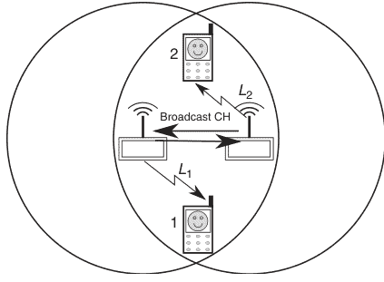

**图 8.5** 网络监听能力。通过监测信道，两个 femtocell 都将感知到对方的存在，它们可以协调资源分配（例如，OFDMA femtocell 的子信道分配），以最小化干扰

嗅探器或网络监听能力的实现对于自动化 femtocell 网络中的小区规划和优化任务至关重要。利用此功能，femtocell 将定期开启嗅探器以检查网络设置、同步和干扰条件。

在这种情况下，femtocell 的行为类似于在网络监听模式下工作的用户终端。当 UE 想要传输时，它与最强的基站同步，在尝试接入网络之前解码广播和控制信道。类似地，femtocell 将使用网络监听能力与运营商的网络同步，并解码邻近小区的广播和控制信道。此外，网络监听模式收集的信息还可用于识别周围小区及其所属运营商，区分它们是宏小区还是 femtocell，并估计到它们的路径损耗[21]。

此外，femtocell 可以利用自身的统计数据（失败的切换比率、掉话率、阻塞率、上行干扰）来评估网络的行为，并触发不同的配置和/或优化操作。

### 8.5.2 消息交换

Femtocell 可能能够广播信息消息，这些消息将被其邻近的 femtocell 接收，包含干扰测量（接收信号强度）或关于广播者的功率和/或扰码/子信道分配的信息，例如不同 RF 资源的使用优先级和概率可以广播。这样，femtocell 将了解邻近 femtocell 的当前行动和未来意图，并可以协同工作（图 8.6）。

这些消息可以通过现有接口或新接口进行交换：

- Femtocell 可以通过 femtocell 网关交换消息。源 femtocell 将其消息发送到 femtocell 网关，femtocell 网关将该消息转发给目标 femtocell/femtocell。

- 另一种解决方案是在 femtocell 之间建立新接口。这种替代方案与 LTE 中定义的允许 eNodeB 之间通信的 X2 接口有相似之处，但尚未扩展到 femtocell[23]。

然而，这两种技术——网络监听模式和消息交换——受到 femtocell 覆盖范围的限制。例如，如果两个 femtocell 不在彼此的覆盖范围内，它们将无法注意到对方的存在或通过（直接接口）交换信息。因此，这些 femtocell 将无法协调其资源分配，位于这两个重叠 femtocell 小区边缘的用户将遭受物理小区 ID 冲突、小区间干扰等问题。

此场景如图 8.7 所示，被称为**隐藏 femtocell 问题**。

### 8.5.3 测量报告

为了解决隐藏 femtocell 问题，可以使用由终端生成并报告给 femtocell 的测量报告（MR）。这样，位于两个重叠小区边缘的用户可以向其服务 femtocell 指示其他重叠宏小区和/或 femtocell 的存在和行动（功率和频率）（图 8.8）。

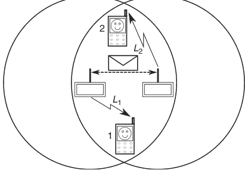

**图 8.6** 消息交换能力。通过交换消息，两个 femtocell 都将了解对方的行动，它们可以协调资源分配（例如，OFDMA femtocell 的子信道分配），以最小化干扰

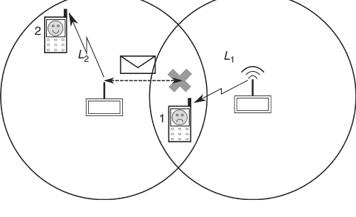

**图 8.7** 隐藏 femtocell 问题。由于两个 femtocell 不在彼此的覆盖范围内，它们无法看到对方。因此，位于重叠区域的用户由于不协调的资源分配而遭受干扰。例如，在 OFDMA femtocell 的情况下，用户 1 和用户 2 可能被分配到相同的子信道，导致位于两个 femtocell 重叠覆盖区域的用户 1 性能不佳

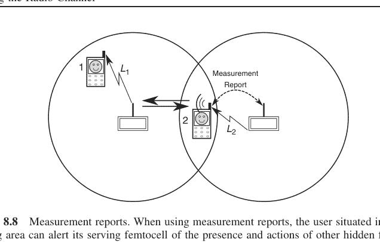

**图 8.8** 测量报告。当使用测量报告时，位于重叠区域的用户可以提醒其服务 femtocell 其他隐藏 femtocell 的存在和行动。因此，femtocell 可以协调其资源分配。例如，在 OFDMA femtocell 的情况下，知道 femtocell 1 正在使用一部分子信道给用户 1，femtocell 2 将把用户 2 分配到其他子信道上。这样，干扰得到缓解

当连接处于活动状态时，UE 定期通过 MR 向 femtocell 报告其信号质量，其中还包括来自邻近小区的信号测量。如果 UE 报告良好的信号质量，femtocell 将不会采取进一步行动。然而，如果信号质量较弱，femtocell 可能会将连接切换到其他扰码/子信道/时隙，或发起向其他宏小区或 femtocell 的切换。通过连接到 femtocell 的用户收集的测量可以指示，例如，同信道和相邻载波朝向用户终端的下行接收信号强度。

MR 特别有用，因为它们提供在用户环境中收集的信息。与网络监听模式或广播消息收集的信息相反，MR 提供的信息指示用户位置（可能遭受干扰的一方）的信道条件。

例如，图 8.9 说明了同一 femtocell 的两个用户的干扰条件如何根据其位置和环境而变化。靠近 femtocell 的用户将享受良好的信号质量，而位于对面房间、远离其 femtocell 且靠近邻近 femtocell 的用户将遭受较大的干扰。

### 8.5.4 认知无线电

由于认知无线电被认为是分配给主用户的频谱的低优先级或次要用户，因此这些认知用户不能对潜在的主用户造成干扰是必要的。可以使用不同的解决方案来底层、叠加或交织次要用户信号与主用户信号，使主信号尽可能少地受到次要信号的影响。

在**底层**方法中，次要用户将其信号扩展到宽带宽上，最小化对主用户造成的干扰量。

**叠加**方法基于次要用户对主用户信号的*先验*知识的了解。这样，次要发射机可以帮助中继主信号，次要接收机可以利用脏纸编码[24]来减轻干扰。

在**交织**方法中，认知无线电必须能够感知空口，并机会性地利用主用户未使用的频谱。

由于底层技术更适合扩频技术，例如超宽带（UWB），而且次要用户难以获得主用户信号的*a priori*知识，交织技术在蜂窝网络环境中吸引了最多的关注。与交织方法类似，


## 图 8.9 同一毫微微蜂窝覆盖范围内信道条件不同的用户

毫微微蜂窝必须能够搜索无线信道并估计可用资源中哪些资源是空闲的，以避免跨层和同层干扰。

可以使用多种认知无线电技术来检测宽频带中的未使用资源。例如，匹配滤波器、能量检测或循环平稳特征检测 [25]。然而，由于认知无线电超出了本书的范围，它们将在后续章节中不予介绍。

尽管如此，需要指出的是，认知无线电技术可以在毫微微蜂窝设备中实现，但由于传统制式的限制，**不得**在毫微微蜂窝用户终端中实现。毫微微蜂窝必须使用不依赖于新用户设备的传统移动终端进行工作。

尽管了解无线接口的方法各不相同，但应该使用哪些信息以及如何组合这些信息仍然是一个开放性问题。此外，还必须考虑不同的权衡取舍。例如：

-   毫微微蜂窝应该在何时以及持续多长时间收集测量数据？请注意，仅具有单个射频接口的毫微微蜂窝无法同时收集测量数据和进行收发。
-   来自用户终端的测量报告将提供关于用户环境的准确信息，但代价是增加开销信息和处理时间。

因此，该领域还需要进一步研究，以了解每种技术的优缺点，并学习如何组合这些来源以获得最准确的感知结果。

## 8.6 毫微微蜂窝参数的自配置与自优化

### 8.6.1 物理小区标识（PCI）

#### 背景

PCI 通常用于识别无线通信中的小区，例如，通过显式提供移动终端必须监控的 PCI 列表来简化驻留和切换过程。小区的 PCI 不需要在整个网络范围内唯一，但必须在局部范围内唯一，以避免与邻近小区发生冲突和/或混淆（图 8.10）。

-   *冲突*发生在某个 PCI 在小区的覆盖区域内不唯一时。
-   *混淆*发生在某个 PCI 在小区的邻近区域内不唯一时。

传统上，PCI 是小区初始配置的一部分，由网络设计人员使用网络规划工具进行设置。通过这种方式，可以确保整个网络中的 PCI 分配无冲突、无混淆，从而避免可能出现的问题 [26]。

在 GSM/DCS 网络中，广播控制信道（BCCH）/基站识别码（BSIC）这一对组合用于明确地识别某个地理区域内的小区。BCCH 频率承载小区的关键控制信息，应在其邻近区域内保持唯一。然而，在靠近国家边界或频率紧密复用的区域，移动终端可能会在同一频率上捕获多个 BCCH。此时，将使用 BSIC 来区分目标小区与其他在同一频率上传输其 BCCH 的小区。由于 BCCH/BSIC 这一对组合的重要作用，运营商使用自动频率规划工具来设置这些值。

在 UMTS 和 HSPA 网络中，预留了 512 个扰码来唯一地标识一个小区。与 GSM/DCS 网络中使用的规划过程相比，该规划过程更简单，因为可用的扰码数量远多于 BCCH 频率数量。因此，无需进行自动频率规划，运营商只需在邻近区域内为不同小区分配不同的扰码即可。这些扰码的分配使用扰码规划工具完成。

 Nevertheless，由于需要进行过多的比较，终端不可能在不经历从开机到服务可用长时间延迟的情况下搜索 512 个码。为缓解这一延迟，512 个码的集合被划分为 64 个辅助同步码，每个辅助同步码包含 8 个主扰码。在同步过程中，终端通过检测主同步码和辅助同步码分别找到时隙边界和帧边界。一旦找到辅助同步码，终端就通过检测其传输的主扰码（8 个中的 1 个）来推导出小区的完整标识 [4]。

类似地，在 LTE 网络中，预留了 510 个参考信号来唯一地标识一个小区。每个参考信号可分为两个二维（频率和时间）序列，称为伪随机序列和正交序列。共有 170 个不同的伪随机序列，每个序列对应一个小区标识组。此外，在每个小区标识组内定义了三个正交序列，每个序列对应一个唯一的小区标识。在同步阶段，终端从主同步信号推导出特定的小区标识，从辅助同步信号推导出小区标识组 [27]。

#### 毫微微蜂窝场景

由于毫微微蜂窝可能随时出现或消失，或被移动到不同位置，因此毫微微蜂窝必须能够在启动过程中自配置其 PCI，以尽量减少与其他宏蜂窝和毫微微蜂窝的冲突/混淆（图 8.11）。为实现这一目标，可以采用两种不同的策略 [28]：

-   运营商在启动过程中通过回传连接自动为毫微微蜂窝分配 PCI。
-   毫微微蜂窝使用感知技术收集有关其邻近区域内正在使用的 PCI 的信息，然后随机选择一个与现有 PCI 不冲突的 PCI。

由于预计毫微微蜂窝将被广泛使用（在多个宏蜂窝的覆盖范围内部署数千个毫微微蜂窝），PCI 的选择并非易事，而且在不同区域复用 PCI 将是不可避免的。

以切换过程为例，如果一个宏蜂窝有两个具有相同 PCI 的邻近毫微微蜂窝，它将无法区分两者（混淆），切换很可能失败，导致掉话。

为避免宏蜂窝和毫微微蜂窝层之间的冲突/混淆，运营商需要确定一组不允许在宏蜂窝中使用的毫微微蜂窝专用 PCI。这种规划是必要的，以防止新添加的毫微微蜂窝开始使用某个已被给定宏蜂窝使用的 PCI。因此，只会为毫微微蜂窝预留一小部分 PCI [29]。所以，在大量部署毫微微蜂窝的情况下，在单个宏蜂窝覆盖范围内的毫微微蜂窝之间复用 PCI 是不可避免的，这会造成 PCI 混淆。

为尽量减少毫微微蜂窝之间 PCI 混淆的影响，它们必须定期检查是否有邻近毫微微蜂窝正在使用相同的 PCI，并选择能够获得更好性能的 PCI [26]。如果毫微微蜂窝决定更改其 PCI，该毫微微蜂窝应在执行任何进一步操作之前让其连接的用户知道新的 PCI。通过这种方式，可以缓解混淆问题。

### 8.6.2 邻区列表

#### 背景

为了在终端处于空闲模式时选择最佳服务小区，或在终端处于活动模式时辅助切换过程，用户手机持续对邻近导频信道的接收信号强度进行测量，即 GSM/DCS 中的 BCCH、UMTS 中的扰码。为了加速这一过程并简化终端监控空中接口的任务，终端驻留的服务小区会定期广播应测量的导频信道和小区列表。该列表通常称为邻区列表。

收到此列表后，终端定期进行相应的测量，并将结果报告给服务小区（图 8.12）。请注意，终端


#### 毫微微蜂窝（Femtocell）案例

由于毫微微蜂窝可以随时出现或消失，或被移动到不同位置，因此毫微微蜂窝必须能够动态地自我优化其邻区列表，以优化小区重选和切换过程。为此，毫微微蜂窝必须能够动态地：

-   将新的关系纳入列表，例如，当邻区出现新小区时；
-   移除不适当的关系，例如，当存在未使用的关系，或某个关系关联了大量切换失败时。

为了实现这一点，毫微微蜂窝将感知无线信道以搜索邻区，并作为正常呼叫过程的一部分，也会指示其连接的终端执行此操作。如果毫微微蜂窝检测到，或用户报告了一个新小区，且方便的话，毫微微蜂窝会将这个新小区纳入其邻区列表。毫微微蜂窝将其邻区关系变化通知给核心网络，以便与其他小区共享此信息，这可能是有帮助的[30]，例如，毫微微蜂窝在启动过程中通过回程链路接收其初始邻区列表（第8.4节）。此外，可以使用不同的计数器来测量邻区关系何时未被使用，或由于切换导致了过多的掉话。

此外，由于毫微微蜂窝必须支持向宏蜂窝层或其他毫微微蜂窝进行小区重选和切换，给定毫微微蜂窝的邻区列表必须同时考虑宏蜂窝和毫微微蜂窝。然而，由于毫微微蜂窝的独立特性，毫微微蜂窝-宏蜂窝的关系必须以不同于毫微微蜂窝-毫微微蜂窝关系的方式处理。例如：

-   在某些情况下，从宏蜂窝切换到毫微微蜂窝可能并非最佳选择。想象一个快速移动的宏蜂窝用户穿过一个大型住宅区。在这种情况下，将用户保留在宏蜂窝中，比将其切换到多个毫微微蜂窝或宏蜂窝中要好。这样可以减少由于切换产生的信令开销，以及因切换失败导致的掉话概率。
-   在其他情况下，从毫微微蜂窝切换到宏蜂窝可能也不是最佳选择。想象一个位于室内但靠近打开窗户的毫微微蜂窝用户。来自宏蜂窝的信号强度可能大于来自所属毫微微蜂窝的信号强度。然而，为了分担宏蜂窝负载，或者因为用户在毫微微蜂窝中可以获得更便宜的通话，可能更倾向于将用户保留在毫微微蜂窝上。

此外，在宏蜂窝中，邻区列表被限制为32个位置，以加快测量和更新速度。然而，在大型毫微微蜂窝部署中，这个数量将不足以处理宏蜂窝内的所有毫微微蜂窝。因此，需要新的结构和算法来处理更多的邻区及其不同的特性，并实现快速响应。

在[31]中，Amirijoo等人提出了一种在LTE网络中自动配置和优化物理小区标识（PCI）和邻区列表的方法。所提出的技术基于用户终端报告的测量来检测和解决PCI冲突，并更新邻区列表。在这种情况下，移动终端能够检测未包含在服务小区邻区列表中的小区。然后，在预先协商后，检测到的小区被同时纳入服务小区和目标小区的邻区列表。如果检测到PCI冲突，服务小区会将其报告给OSS（操作支持系统）。OSS将决定哪个小区应更改PCI以解决冲突，并为选定的小区分配一个新的PCI，该PCI在邻区列表及其邻居的邻区列表中均未被使用。该算法完全自动化，无需运营商干预。该算法会收敛到一个稳定解，即不存在PCI冲突且邻区列表是完整的。然而，该算法尚未在存在数百个毫微微蜂窝的大型毫微微蜂窝部署场景中得到验证。

### 8.6.3 频谱分配

在本节中，我们概述了运营商在将其授权频谱分配给宏蜂窝层和毫微微蜂窝层时的两种选择。这里的想法不是自组织分配给两层的频谱，而是介绍后续章节中使用的概念。

运营商可以遵循两种不同的策略在宏蜂窝和毫微微蜂窝之间分配授权频谱：

-   在*正交部署*中，一部分频谱由宏蜂窝使用，而另一部分由毫微微蜂窝使用。
-   在*同频部署*中，宏蜂窝和毫微微蜂窝网络复用相同的无线频谱（复用因子为1）。

在宏蜂窝和毫微微蜂窝的正交部署中，跨层干扰被忽略，毫微微蜂窝只需要避免来自/对其他毫微微蜂窝的干扰。然而，如第6章所述，正交部署将导致无线频谱的低效使用，这对运营商来说极其昂贵且不可取。相反，宏蜂窝和毫微微蜂窝的同频部署将以使用更复杂的干扰缓解技术为代价，提高频谱效率（bit/s/Hz）。

正交部署得到了美国Comcast等公司的支持，这些公司获得了专门用于其WiMAX毫微微蜂窝的频谱。然而，由于更高的频率复用率，同频部署似乎是大多数运营商更青睐的方法。

在闭合用户组（CSG）毫微微蜂窝的同频部署中，干扰情况比正交部署更严重，技术挑战也更大。例如：

-   在下行链路（DL）中，由于毫微微蜂窝从室内到室外的功率泄漏，可能会干扰连接到远端宏蜂窝的近端宏蜂窝用户的通信。
-   在上行链路（UL）中，由于墙体提供的屏蔽不完善，连接到远端宏蜂窝并以高功率发射的宏蜂窝用户，可能会干扰近端毫微微蜂窝的连接。

这种干扰会降低整体网络性能。原本可以提供服务的宏蜂窝可能因大量毫微微蜂窝的存在而变得无用。这样，进行大规模毫微微蜂窝部署的可能性就会减小甚至被忽视。因此，必须研究新的方法来解决这个问题。

在CDMA毫微微蜂窝的同频部署中，发射功率的自优化是避免跨层和层内干扰的关键因素。在这类系统中，所有用户共享相同的带宽，一个用户的辐射功率会被所有其他用户视为干扰。因此，降低发射功率可以最小化噪声抬升和干扰。

在OFDMA毫微微蜂窝的同频部署中，虽然这种功率的自优化很重要，但它不是避免干扰的唯一途径。在这类系统中，复杂的子信道分配技术也将有助于缓解

交叉和同层干扰。然而，同时分配功率和子信道将提供更好的结果。

在以下两节（第8.6.4节和第8.6.5节）中，将描述功率和子信道的自组织技术。

### 8.6.4 功率选择

毫微微蜂窝对发射功率的自优化将在成功部署毫微微蜂窝层中扮演最重要的角色之一。为了减轻交叉和同层干扰，毫微微蜂窝必须根据环境的不断变化（经过的用户、信道状态等）动态调整其发射功率（控制/数据信道）。

发射功率的自优化将有助于：

-   适应毫微微蜂窝的覆盖范围以适应家庭结构；
-   减少对经过的宏蜂窝用户造成的干扰；
-   减少由于宏蜂窝用户驻留在毫微微蜂窝覆盖层下而导致的宏蜂窝-毫微微蜂窝切换尝试。

下文介绍了毫微微蜂窝发射功率自组织的不同技术。

#### 考虑邻近小区存在的辐射功率自组织

Claussen等人提出了一种减轻交叉层干扰的有效方法[32]。该技术是为在UMTS场景中最小化交叉层干扰而设计的，但它可以扩展到同层干扰和其他技术。

在下行链路中，该方法包含一种用于导频和数据信道的功率控制算法，该算法确保恒定的毫微微蜂窝覆盖。每个毫微微蜂窝 $C_i^{femto}$ 将其功率 $P_i$ 设置为一个值，该值平均等于来自最近宏蜂窝 $C_j^{macro}$ 在目标毫微微蜂窝半径 $r$ 处接收到的功率，该半径根据家庭特征选择（图8.13）。这样，无论与宏蜂窝的物理距离如何，都能保证恒定的毫微微蜂窝半径。毫微微蜂窝的最大发射功率 $P_i$ 可以计算如下：

其中 $P_j$ 表示由宏蜂窝 $C_j^{macro}$ 发射的功率，$Lp_j(d)$ 表示在宏蜂窝距离 $d$ 处的平均宏蜂窝路径损耗，$Lp_i(r)$ 表示在目标小区半径 $r$ 处的平均毫微微蜂窝路径损耗，$P_{i,max}$ 是毫微微蜂窝 $C_i^{femto}$ 可以辐射的最大功率。此外，$G$ 代表天线增益，$L$ 代表设备损耗。请注意，此公式中使用的是分贝。

实际上，来自最强宏蜂窝的接收功率可以基于平均信道建模或使用毫微微蜂窝目标半径处的路径损耗测量来估算。然而，这需要毫微微蜂窝了解宏蜂窝数据（位置、功率等）。为避免这种情况，来自最强宏蜂窝的接收功率可以利用毫微微蜂窝的内置感知能力（监听模式）或用户测量报告来获得。

在上行链路中，为每个宏蜂窝 $C_j^{macro}$ 设置一个最大干扰允许量。随后，该预算在宏蜂窝下所有现有的毫微微蜂窝 $C_i^{femto}$ 之间共享。最大用户发射功率 $P_{UE}$ 可以计算如下：

其中 $P_{j,budget}$ 表示允许来自毫微微蜂窝对宏蜂窝 $C_j^{macro}$ 造成最大干扰，$N$ 表示宏蜂窝覆盖下的毫微微蜂窝数量，$Lp_j(t)$ 表示从毫微微蜂窝用户到宏蜂窝的当前路径损耗，$P_{UE,max}$ 是用户 $UE_x^{femto}$ 可以辐射的最大功率。

该技术可以通过仅在具有活跃上行链路连接的毫微微蜂窝之间共享此预算，以及根据宏蜂窝扇区的当前干扰条件（噪声抬升）动态计算预算来进一步改进。

#### 考虑切换尝试的辐射功率自组织

Claussen等人[33]提出了一种覆盖自适应方法，该方法利用经过和室内终端的移动性事件信息。每个毫微微蜂窝设置其导频功率为一个值，该值最大化其覆盖范围并平均最小化经过和室内用户连接到该毫微微蜂窝的总尝试次数。

让我们将不受欢迎的事件定义为那些切换或尝试切换，其中用户连接到毫微微蜂窝后立即切换回宏蜂窝或另一个毫微微蜂窝。这种快速回切可能由经过用户在住宅区移动并持续从一个开放毫微微蜂窝切换到另一个或切换到伞式宏蜂窝，或者由非订阅者尝试连接到CSG毫微微蜂窝引起。相反，受欢迎的事件是那些停留时间超过预定时间的允许切换。

在该模型中，毫微微蜂窝统计不受欢迎和受欢迎的移动性事件数量。如果在时间 $t_1$ 内不受欢迎的事件数量大于给定阈值 $n_1$，毫微微蜂窝将其导频功率减少 $\Delta P_1$ 的步长。如果在时间 $t_2$ 内不受欢迎的事件数量小于给定阈值 $n_2$，毫微微蜂窝将其导频功率增加 $\Delta P_2$ 的步长。这些参数必须根据场景进行调整以实现最佳性能。请注意，在减少/增加导频功率后，移动性事件计数器将被重置。

使用该技术，当从室内泄漏到室外的功率较大导致不受欢迎的移动性事件时，毫微微蜂窝覆盖范围会收缩；或者当毫微微蜂窝场所周围没有经过用户时（图8.14），覆盖范围会增加。

#### 毫微微蜂窝中噪声抬升阈值的自组织

在文献[21]中，作者提出通过调整毫微微蜂窝中的噪声抬升阈值来解决来自不受控宏蜂窝和毫微微蜂窝用户的上行链路干扰。

这种不受控的干扰发生在以下场景中：

-   位于毫微微蜂窝场所内的宏蜂窝用户在上行链路中以高功率发射，由于该宏蜂窝用户与毫微微蜂窝之间的路径损耗很短，可能会干扰毫微微蜂窝的上行链路通信。这是CSG毫微微蜂窝中的常见场景。
-   如果毫微微蜂窝用户距离其自身的毫微微蜂窝太近，并且由于其有限的动态范围而无法降低功率，则该用户可能会在其毫微微蜂窝处产生较大的上行链路噪声抬升。

在这种情况下，毫微微蜂窝将允许更大的上行链路噪声抬升以应对此类干扰，因此毫微微蜂窝用户的上行链路吞吐量不受影响。请注意，此参数仅在干扰较强时需要修改，之后可以恢复到其正常值。

然而，允许更大的噪声抬升阈值将增加对宏蜂窝造成的上行链路干扰，从而降低宏蜂窝用户的性能。此外，当在较大噪声抬升阈值下运行时，突发性干扰将在毫微微蜂窝导频的信号质量中产生较大波动，功率控制可能无法应对[34]。因此，更好的解决方案可能是动态调整毫微微蜂窝的噪声系数。该技术将在下一节中介绍。

#### 毫微微蜂窝中接收器增益的自组织

在文献[21]中，作者提出通过调整毫微微蜂窝的接收器增益（噪声系数）来解决来自不受控宏蜂窝和毫微微蜂窝用户的上行链路干扰。这样，毫微微蜂窝的动态范围得以移动，使得受干扰的上行链路用户不会阻塞毫微微蜂窝的上行链路通信。这样，干扰更接近热噪声水平，从而导致更低的噪声抬升操作。结果，干扰在接收器处被去敏化（衰减），导致更大的噪声系数。请注意，此参数仅在干扰较强时需要修改，之后可以恢复到其正常值。这种衰减的效果可能是增加连接到毫微微蜂窝的用户的上行链路功率，从而增加对宏蜂窝的上行链路干扰。作为安全机制，毫微微蜂窝必须限制其已连接用户的上行链路发射功率，以减少对周围宏蜂窝的干扰。

### 8.6.5 频率分配

如第8.6.3节所述，OFDMA毫微微蜂窝不仅可以通过优化其发射功率来对抗干扰，还可以使用复杂的子信道分配算法。这些自组织技术的目标是将不同的子信道分配给那些可能由于其他小区的存在而受到干扰的连接。

图8.15表示一个下行链路场景，其中一个负载宏蜂窝使用所有可用子信道向其用户传输信息。然而，当一个宏蜂窝用户，例如用户6，位于一个毫微微蜂窝，例如毫微微蜂窝2附近时，可能会发生宏蜂窝用户6和毫微微蜂窝2使用相同子信道的情况。这通过链路 $L_2$ 和 $L_6$ 的频谱占用情况说明，它们同时占用子信道3和4，这导致宏蜂窝用户6承受较大的下行链路干扰。此问题


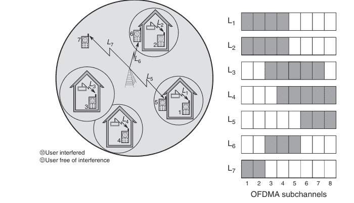

**图 8.15** 在宏蜂窝/飞蜂窝网络中，OFDMA子信道的下行分配通过同信道分配可以采用自组织方式避免，即监测空中接口并为用户2分配不同的子信道。例如，用户1和用户5的频谱占用情况说明了飞蜂窝如何在提供充足资源以保证满意用户体验的同时避免干扰。

下面介绍在飞蜂窝场景中通过子信道分配自组织来缓解干扰的不同策略。

#### 基于广播消息的子信道分配自组织

在[35]中，López-Pérez *等人*提出了一种用于OFDMA飞蜂窝网络的分布式子信道分配方法，该方法基于相邻飞蜂窝之间信息消息的广播（图8.16)(见8.5.2节)。

其基本思想是，每个飞蜂窝估计每个子信道的使用概率，并将此信息分发给其相邻的飞蜂窝，发送本地广播消息。除了子信道使用概率外，广播消息还包含每个子信道上的发射功率以及导频信号功率的信息。基于从邻居飞蜂窝广播消息中获取的信息，飞蜂窝对子信道的使用进行优先级排序，即按照以下质量指标：

$$badness_j(k) = \sum_{i \in \mathcal{N}_j} p_i^{interf}(k) \cdot p_i^{usage}(k),$$

其中 $\mathcal{N}_j$ 是节点 $j$ 的邻居集合，$p_i^{usage}(k) \in [0, 1]$ 表示飞蜂窝 $F_i$ 中子信道 $k$ 的使用概率（由最近一次广播报告），而 $p_i^{interf}(k) \in [0, 1]$ 表示来自 $F_i$ 对 $F_j$ 的可能干扰强度（近/远飞蜂窝）。

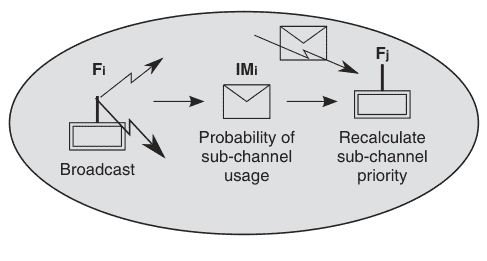

**图 8.16** 通过消息交换实现子信道自组织

飞蜂窝利用"劣度"（badness）值来更新其用户的子信道分配。此更新过程周期性执行，连续两次更新之间的时间从 [0, ..., $2T_{bc}$] 时间单位的区间内随机选取。这样做是为了避免多个飞蜂窝同时改变其子信道分配（协调）。

在两次更新之间，飞蜂窝收集其邻j居广播的消息。这些消息在下一次更新时处理，在此期间飞蜂窝首先根据现有消息重新计算每个子信道的劣度。随后，飞蜂窝重新安排其子信道分配，使用户被分配到劣度值最低的子信道。最后，它使用新的分配方案估计自身的子信道使用概率，并将其广播给邻居。

为了在飞蜂窝 $F_i$ 中计算 $p_i^{usage}(k)$，使用了一个单调递减函数。在该函数中，繁忙子信道的使用概率远大于空闲子信道。然而，并非所有繁忙和空闲子信道都具有相同的使用概率（图8.17）。通过这种方式，飞蜂窝向其相邻飞蜂窝指示当有新的用户连接或断开时，将使用或释放哪个子信道。

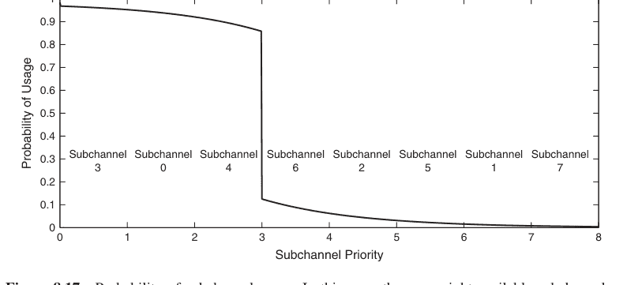

**图 8.17** 子信道使用概率。在本例中，共有八个可用子信道，其中三个正被飞蜂窝使用（子信道3、0和4）。如果出现新用户，其将被分配至子信道6；而如果某用户离开，子信道4将被释放

的道路上诞生了第一个视频。

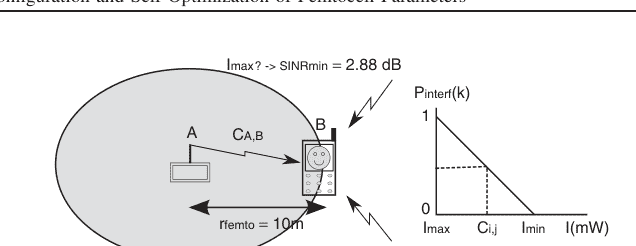

**图 8.18** 通过消息交换实现子信道自组织。在本例中，飞蜂窝半径设置为10米，最大和最小RAB（调制编码方案）的SINR分别设置为20 dB和0 dB

为了计算 $p_i^{interf}(k)$，使用以下模型。给定最坏情况场景，其中飞蜂窝 $A$（其小区半径为 $r_{femto}$）为位于其小区边缘的用户 $B$ 提供覆盖（图8.18），并考虑以下条件：

-   用户 $B$ 可能遭受的最大干扰 $I_{max}$ 导致最小SINR为 $SINR_{min}$，即系统中定义的最小RAB的SINR门限。
-   用户 $B$ 可能遭受的最小干扰 $I_{min}$ 导致最大SINR为 $SINR_{max}$，即系统中定义的最大RAB的SINR门限。

注意 $I_{min}$ 和 $I_{max}$ 可按如下方式计算：

$$I_{min} = \frac{C_{A,B}}{SINR_{max}} - \sigma^2, \quad I_{max} = \frac{C_{A,B}}{SINR_{min}} - \sigma^2 \qquad (8.4)$$

其中 $\sigma$ 表示背景噪声密度。

然后，利用子信道 $k$ 的信号强度 $C_{i,j}(k)$ 以及公式(8.5)定义的线性惩罚函数，可以推导出可能的干扰强度（近/远）。注意 $C_{i,j}$、$I_{max}$ 和 $I_{min}$ 必须以mW为单位。

$$p_i^{interf}(k) = \begin{cases} 1, & \text{if } C_{i,j}(k) > I_{max} \\ \frac{C_{i,j}(k) - I_{min}}{I_{max} - I_{min}}, & \text{if } I_{min} < C_{i,j}(k) < I_{max} \\ 0, & \text{if } C_{i,j}(k) < I_{min} \end{cases} \qquad (8.5)$$

需要注意的是，利用广播消息中指示的导频信号功率，并测量发送方的导频信号强度，接收飞蜂窝可以估计到发送方的路径损耗。此外，利用此路径损耗以及每个子信道上指示的发射功率，接收方可以估计从发送方在每个子信道上接收到的信号强度。

#### 基于测量报告的子信道分配自组织

在[35]中，López-Pérez等人提出了一种用于OFDMA飞蜂窝网络的分布式子信道分配方法，该方法基于用户向飞蜂窝发送的测量报告的使用(见8.5.3节)。该方法最初为飞蜂窝层设计，但如果测量报告包含关于宏蜂窝的信息，则可应用于双层网络。

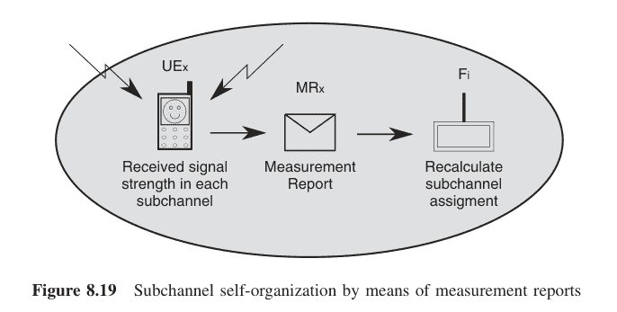

**图 8.19** 通过测量报告实现子信道自组织

在此方法中，用户 $UE_x$ 定期以 $T_{mr}$ 为周期向其服务飞蜂窝 $F_i$ 发送测量报告 $MR_x$（图8.19）。测量报告 $MR_x$ 指示用户 $UE_x$ 在每个子信道 $k$ 上遭受的接收信号强度。然后，飞蜂窝 $F_i$ 根据收到的所有测量报告最终更新其子信道分配。此更新事件发生在 $F_i$ 上次更新事件之后的随机分布时间。通过这种方式，避免了多个飞蜂窝在同一时刻改变其子信道分配。

当更新事件发生时，飞蜂窝 $F_i$ 收集所有接收到的测量报告的信息，并构建干扰矩阵 $W_i$。$W_i$ 的维度为 $M_i \times K$，其中 $M_i$ 表示连接到飞蜂窝 $F_i$ 的用户数，$K$ 表示子信道数。此外，$w_{m,k}$ 表示用户 $m$ 在子信道 $k$ 上遭受的接收信号强度或干扰。

干扰矩阵 $W_i$ 构建完成后，$F_i$ 使用以下优化程序计算其新的子信道分配，其目标是最小化飞蜂窝用户承受的总干扰之和。

$$\min \sum_{m=0}^{M_i-1} \sum_{k=0}^{K-1} w_{m,k} \cdot \gamma_{m,k} \qquad (8.6a)$$

约束条件：

$$\sum_{m=0}^{M_i-1} \gamma_{m,k} \leq 1 \quad \forall k \qquad (8.6b)$$
$$\sum_{k=0}^{K-1} \gamma_{m,k} = 1 \quad \forall m \qquad (8.6c)$$
$$\gamma_{m,k} \in \{0, 1\} \quad \forall m, k \qquad (8.6d)$$

其中 $\gamma_{m,k}$ 是一个二元变量（公式8.6d），如果用户 $m$ 使用子信道 $k$ 则等于1，否则为0。假设条件(8.6c)确保子信道被分配


### 8.6.5 性能评估

最多分配给一个用户，而假设 (8.6c) 则确保所有已连接的用户都只有一个子信道。

该优化问题可以使用回溯法高效求解，因为其解空间较小，这是由于同时连接到一个家庭基站的用户数量有限，例如四个。

下文将简要描述这两种自优化技术（广播消息和测量报告）的性能，以突出一些相关问题。注意，为了进行比较，还提出了另外两种子信道分配技术：

- 一种最坏情况分配，家庭基站总是从 $k = 0$ 开始分配第一个空闲子信道。
- 一种随机分配，家庭基站从可用的子信道中随机选择一个空闲子信道。

本实验评估中使用的场景包括一个 $300 \times 300 \text{ m}$ 的理想自由空间区域，其中广泛部署了130个家庭基站。虽然该场景可能被认为不切实际，但它代表了一种更坏的情况，因为干扰家庭基站的信号不会因障碍物的存在而衰减。此外，用户根据泊松过程（强度 $\lambda$）生成，并在系统中停留一段时间，该时间服从指数分布（均值 $\psi$）。本仿真仅考虑下行链路情况。请注意，用户在家庭基站的覆盖区域内呈正态分布。图 8.20 和表 8.1 分别展示了实验评估的场景和参数。

图 8.21 展示了家庭基站场景中家庭基站用户经历的信干噪比（SINR）的累积分布函数。该图表明，基于消息广播和测量报告的方法比随机分配表现更好。这一事实表明，使用自组织可以提高系统性能。此外，使用测量报告的方法优于使用消息广播的方法这一事实表明，利用在用户位置收集的信息对于避免干扰非常重要。请注意，在家庭基站位置收集的信息无法准确估计用户的干扰情况。想象一个位于室内但靠近打开窗户的家庭基站用户，该用户受到来自附近宏基站的干扰与家庭基站位置（远离窗户并被房屋墙壁屏蔽）所感受到的干扰是不同的。因此，建议在设计用于调整家庭基站射频参数的自组织算法时，应使用在用户位置收集的信息（测量报告）。

### 8.6.6 天线方向图整形

如上所述，由于家庭基站部署导致的室内功率泄漏到室外，不仅会增加干扰，还会因不必要的移动事件而增加核心网信令。为了避免这种功率泄漏，第 8.6.4 节介绍了两种可以结合使用的不同技术，考虑了最近宏基站的影响或不必要移动事件的数量。

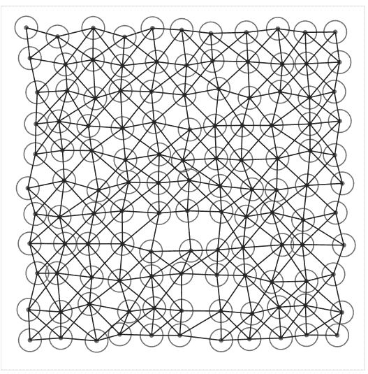

**图 8.20** 仿真场景。黑点表示家庭基站的位置，圆圈表示家庭基站的覆盖区域，而家庭基站之间的连线表示这些家庭基站之间的邻域关系。如果来自家庭基站 *A* 的接收信号强度大于家庭基站 *B* 的天线灵敏度，则家庭基站 *A* 是 *B* 的邻居。请注意，在该场景中，邻域关系是对称的，如果 A 是 B 的邻居，则 B 也是 A 的邻居。然而，非对称关系的存在不会影响所提算法的性能。

然而，通过不仅调整输出功率，还调整家庭基站的天线方向图（图 8.22），可以进一步提高这些技术的性能。

当使用单个全向天线时，家庭基站只能自优化其辐射功率，以最小化其对宏基站层和其他家庭基站的影响。然而，为了减少不必要的移动事件数量，家庭基站可能需要显著降低其功率。这样，家庭基站提供的室内覆盖可能会受到影响，从而导致用户体验不佳。为了解决这个问题，可以在家庭基站中安装多个天线单元，以创建不同的天线方向图，用于将家庭基站覆盖范围适应场景。然而，在家庭基站中使用多个天线单元可能不方便，因为成功商业化家庭基站需要严格的尺寸和价格限制。因此，这些多个家庭基站天线单元必须体积小、成本低。此外，处理天线单元阵列的系统必须复杂度低。因此，简单的天线切换系统优于复杂的波束成形。

**表 8.1** 仿真参数。

| 参数 | 值 |
|---|---|
| 场景尺寸 | 300 × 300 m |
| 家庭基站数量 | 100 |
| 载频 | 2.3 GHz |
| 带宽 | 5 MHz |
| 双工方式 | TDD 1:1 |
| 下行符号数 | 19 |
| 上行符号数 | 18 |
| 前导符号数 | 2 |
| 开销符号数 | 11 |
| 帧长 | 5 ms |
| 子载波数 | 512 |
| 导频子载波数 | 48 |
| 数据子载波数 | 384 |
| 子信道数 | 8 |
| 家庭基站半径 | 10 m |
| 家庭基站发射功率 | 10 dBm |
| 家庭基站天线增益 | 0 dBi |
| 家庭基站天线方向图 | 全向 |
| 家庭基站天线灵敏度 | −108 dBm |
| 家庭基站噪声系数 | 4 dB |
| 用户天线增益 | 0 dBi |
| 用户天线方向图 | 全向 |
| 用户噪声系数 | 7 dB |
| 用户体损 | 0 dB |
| 预期用户/小时 (λ) | 1500 |
| 平均保持时间 (ψ) | 600 s |
| 广播消息频率 | 10 s |
| 测量报告频率 | 10 s |
| 热噪声密度 | −174 dBm/Hz |
| 路径损耗模型 | COST 231-Hata |

在文献 [36] 中，Claussen *et al.* 提出了一种家庭基站架构，其中在家庭基站接入点安装了四个小型低成本天线。然而，在该架构中，为了保持低阻抗失配，任何时候同时使用的天线不超过两个。使用一个或组合两个天线可以产生 10 种不同的天线方向图。


此处自优化过程的目标是选择能够最大化室内覆盖并最小化移动事件数量的天线方向图和导频功率。为此，在操作期间，家庭基站：

- 以类似于第 8.6.4 节中描述的方式，统计不必要和必要移动事件的数量；
- 周期性地收集所有已定义天线方向图的覆盖性能信息，执行路径损耗测量。

这些测量可以使用家庭基站的内置感知功能以及其发射功率和天线增益信息导出，或者来自家庭基站终端用户的测量报告。

然后，如果在时间 $t_1$ 内不必要事件的数量大于阈值 $n_1$，则家庭基站将其导频功率降低 $\Delta P_1$ 的步长；但如果在时间 $t_2$ 内不必要事件的数量小于阈值 $n_2$，则家庭基站将其导频功率增加 $\Delta P_2$ 的步长。此外，在这种情况下，每当导频功率因移动事件计数器触发而降低或增加时，天线方向图选择将被重新评估，并选择最佳天线方向图和导频功率的组合。

通过这种方式，家庭基站的天线方向图可以动态整形，以最大化室内覆盖并最小化移动事件数量。这始终在考虑场景情况（房屋形状、用户位置和路过用户等）的前提下进行，因为自优化算法基于从环境中收集的测量数据工作。


**图 8.22** 基于切换事件的家庭基站天线方向图自优化。使用多个天线单元，可以产生多个天线方向图。家庭基站将选择能够最小化路过用户尝试连接到家庭基站的天线方向图。通过这种方式，干扰也将被最小化。

# 参考文献

[1] 'ETSI GSM 规范，' 系列 01–12。

[2] A. Eisenblätter, 'GSM网络中的频率分配：模型、启发式和下界，' 博士论文，柏林工业大学数学系，德国柏林，2001年。

[3] A. Eisenblätter, H.-F. Geerdes, T. Koch, A. Martin, and R. Wessäly, 'UMTS无线网络评估与优化超越快照，' *运筹学数学方法*，第 63 卷，第 1 期，第 129 页，2006年2月。


[4] H. Holma 和 A. Toskala，《*WCDMA for UMTS: Radio Access for Third Generation Mobile Communications*》。John Wiley & Sons，Chichester，2004年7月。

[5] B. H. Walke、P. Seidenberg 和 M. P. Althoff，《*UMTS: The Fundamentals*》。John Wiley & Sons，Chichester，2003年4月。

[6] J. Laiho、A. Wacker 和 T. Novosad，《*Radio Network Planning and Optimisation for UMTS*》，第2版。John Wiley & Sons，Chichester，2006年12月。

[7] A. Parkin-White，'Femtocell opportunities in 3G network evolution scenarios,' Femtocell Europe 2008。Manson analysis，2008年6月。

[8] H. Holma 和 A. Toskala，《*HSDPA/HSUPA for UMTS: High Speed Radio Access for Mobile Communications*》。John Wiley & Sons，Chichester，2006年4月。

[9] IEEE Std 802.16e-2005，'IEEE standard for local and metropolitan area networks: Air interface for fixed broadband wireless access systems – physical and medium access control layers for combined fixed and mobile operation in licensed bands,' 2006年2月。

[10] 3GPP，'Requirements for evolved UTRA (E-UTRA) and evolved UTRAN (E-UTRAN),' 3GPP TR 25.913，2005年6月。

[11] H. Lui 和 G. Li，《*OFDM-Based Broadband Wireless Networks Design and Optimization*》。John Wiley & Sons，Chichester，2005年。

[12] 3rd Generation Partnership Project。[在线]。可访问：http://www.3gpp.org

[13] Next Generation of Mobile Networks。[在线]。可访问：http://www.ngmn.org

[14] Self-Optimisation and self-ConfiguRATion in wirelEss networkS。[在线]。可访问：http://www.fp7-socrates.eu

[15] FemtoForum。[在线]。可访问：http://www.femtoforum.org

[16] J. Reed 和 J. Neel，'Future wireless standards and the emergence of wimax,' *Cognitive Radio Technologies: Services and Software for Intelligent Wireless Networks*，2007年10月。

[17] NGMN，'NGMN use cases related to self organising network, overall description,' NGMN Alliance 交付文档，2007年5月。

[18] Socrates，'Use cases for self-organising networks,' SOCRATES Project，2008年。

[19] ——，'Self-configuration, -optimisation and -healing in wireless networks,' Wireless World Research Forum Meeting 20，加拿大渥太华，2008年4月22–24日。

[20] S. Carlaw，'IPR and the potential effect on femtocell markets,' 载于 *FemtoCells Europe*。ABIresearch，2008年。

[21] 3GPP，'Universal mobile telecommunications system (umts); fdd home node b (hnb) rf requirements,' 2009年。

[22] J. Edwards，'Implementation of network listen modem for wcdma femtocell,' 载于 *Cognitive Radio and Software Defined Radios: Technologies and Techniques*。伦敦：2008 IET Seminar，2008年9月，第1–4页。

[23] Alcatel-Lucent，'HNB to HNB handover architecture,' 3GPP TSG RAN3 63bis，2009年3月。

[24] S. Srinivasa 和 S. Jafar，'The throughput potential of cognitive radio: A theoretical perspective,' 载于 *Signals, Systems and Computers, 2006. ACSSC '06. Fortieth Asilomar Conference*。Pacific Grove, CA：Electr. Eng. & Comput. Sci., Univ. of California Irvine, Irvine, CA，2006年10月，第221–225页。

[25] D. Cabric、S. Mishra 和 R. Brodersen，'Implementation issues in spectrum sensing for cognitive radios,' 载于 *Thirty-Eighth Asilomar Conference on Signals, Systems and Computers*，第1卷，2004年11月，第772–776页。

[26] 3GPP，'Self-configuring and self-optimizing network use cases and solutions (release 8),' 3GPP TR 36.902 V1.0.0 (2008-02)，2008年2月。

[27] E. Dahlman、S. Parkvall、J. Sköld 和 P. Beming，《*3G Evolution HSPA and LTE for Mobile Broadband*》。Elsevier Ltd，2007年。

[28] Samsung，'Overview of SON and femtocell support,' IEEE C802.16m-08/1252，2008年12月。

[29] Aircent，'Challenges in deployment of UMTS/HSPA femtocell,' 白皮书，2008年2月。

[30] Ericsson，'Introduction of automatic neighbour relation function,' 3GPP R3-072014，2007年9月。

# 参考文献

[33] H. Claussen、L. T. W. Ho 和 L. G. Samuel，'Self-optimization coverage for femtocell deployments,' 载于 *Wireless Telecommunications Symposium*，第24–26辑，美国加利福尼亚州，2008年4月，第278–285页。

[34] Y. Tokgoz、F. Meshkati、Y. Zhou、M. Yavuz 和 S. Nanda，'Uplink interference management for HSPA+ and 1×EVDO femtocells,' 载于 *IEEE Globecom*，美国夏威夷，2009年12月。

[35] D. López-Pérez、A. Ladanyi、A. Juttner 和 J. Zhang，'OFDMA femtocells: A self-organizing approach for frequency assignment,' 载于 *Personal, Indoor and Mobile Radio Communications Symposium (PIMRC)*，日本东京，2009年9月。

[36] H. Claussen 和 F. Pivit，'Femtocell coverage optimization using switched multi-element antennas,' 载于 *IEEE International Conference on Communications*，德国德累斯顿，2009年6月。

# 9 进一步的飞基站问题

Guillaume de la Roche 和 Alvaro Valcarce

在本书的前几章中，介绍了与飞基站相关的若干技术主题。例如，介绍了不同的架构，并广泛研究了干扰问题以及如何通过自组织来解决干扰。然而，还有一些其他问题需要解释，新的解决方案也亟待找到。

目前进行的飞基站试验太少，尚无法断言某种解决方案优于另一种。因此，本章主要提供指导方针，介绍不同的选项及其优缺点。

下面提出的问题兼具技术性和商业性挑战。我们将要回答的问题按从最技术性到最商业性的顺序列出，概括如下：

- 如何以低成本确保飞基站的定时精度？
- 如何确保安全性和认证？
- 飞基站定位是否必要，有哪些选择？
- 如何定义和控制飞基站的接入？
- 为什么需要开发新的应用？
- 是否存在健康问题？

## 9.1 定时

在无线系统中，晶体振荡器确保内部时钟的精确度。内部时钟负责：

- 绝对定时的准确性，以确保接收端和发送端之间的帧对齐并避免符号间干扰（ISI）；
- 频谱精度，以维持接收端和发射端之间的频率对齐。

时钟的同步对于减少干扰尤为必要。例如在WiMAX中，帧必须在时间上完美同步。此外，如果时钟精度不够，创建频域帧时就会出现错误，从而可能导致子载波的频率偏移，使得小区间切换无法进行。这被称为载波间干扰（ICI）。最后，良好的定时精度也是应对移动用户产生的多普勒效应所必需的。因此，飞基站的一个主要挑战，也是其成功运营的前提条件，是其时钟必须精确同步。

已有许多时钟同步方案被提出，但在飞基站需要以低成本制造的前提下，这变得极具挑战性。实际上，主要的缺点在于精确的振荡器价格昂贵，因此有报告[1]指出，晶体是飞基站中单价最高的组件。这就是为什么需要寻找新的解决方案，以较低的成本实现定时同步。

### 9.1.1 时钟精度要求

时钟的精度通常以十亿分之一（ppb）或百万分之一（ppm）来衡量。这些单位表示在大量振荡周期中获得的最大偏差。例如，手表晶体的典型误差为20 ppm，每天的最大误差为 0.00002 x 24 x 60 x 60 = 1.7秒。

在3GPP规范中，对NodeB的精度要求为50 ppb。但在Release 6中，室内基站的标准放宽至100 ppb，后来在Release 8中，Home nodeB在某些标准下的要求进一步降低至200 ppb。表9.1汇总了3GPP推荐的一些飞基站典型精度要求。虽然宏小区基站能够负担昂贵且精确的振荡器是合理的，但对于需要以低价制造的FAP来说则不然。因此，该领域仍然需要廉价且易于实现的解决方案。

### 9.1.2 飞基站的振荡器

压电效应是指某些材料（如石英）在受到机械压力时产生振荡电势的能力。该材料的谐振

**表9.1 时钟精度要求**

| 标准 | 频率精度 | 时间/相位 |
| --- | --- | --- |
| GSM | 100 ppb | 不适用 |
| CDMA | 100 ppb | 1 μs 时间 |
| CDMA2000 | 100 ppb | 3 μs 时间 |
| WCDMA/FDD | 200 ppb | 不适用 |
| WCDMA/TDD | 200 ppb | 2.5 μs 相位 |
| TD-SCDMA | 100 ppb | 2.5 μs 相位 |
| WiMAX TDD | 8 ppm | 5 μs 时间 |
| WiMAX FDD | 8 ppm | 不适用 |


可用于产生精确频率的信号振荡。廉价晶体通常具有约20 ppm的精度。然而，此类材料的主要缺点是振荡频率随温度变化。此外，这些变化在温度变化时不会完全重复，即谐振器在频率变化中表现出滞回效应[2]。这就是为什么在毫微微蜂窝基站中必须使用更先进的振荡器，以补偿温度变化引起的误差。

#### 温控晶体振荡器

温控晶体振荡器（TCXO）是一种通过补偿温度变化来提高稳定性的振荡器。在TCXO中，温度传感器的信号用于产生校正电压，该电压施加到电压可变电抗器（也称为变容二极管）。变容二极管产生一个与温度引起的频率变化大小相等、方向相反的频率变化，如图9.1所示。
TCXO用于许多应用，这也是它们是最经济实惠的精确振荡器元件的原因。由于使用TCXO时，温度变化的测量和频率校正的产生之间总存在延迟，因此补偿后的频率并非完全稳定，如图9.1所示。因此，为了提高精度，提出了另一种称为恒温晶振（OCXO）的振荡器。

#### 恒温晶振

OCXO是一种封闭在恒温槽中的振荡器。在这个恒温槽内，温度保持在一个固定值。这就是为什么使用这种振荡器时频率变化最小。OCXO为晶体提供了最佳的稳定性。目前开发的唯一比OCXO更精确的振荡器是基于原子钟的振荡器。然而，与TCXO相比，这种振荡器价格昂贵。此外，它们消耗更多能量且体积更大。因此，它们不太可能被嵌入毫微微蜂窝基站内部。

#### 混合型TCXO-OCXO振荡器

一些混合型振荡器也已开始制造。它们基于嵌入简化恒温槽中的TCXO。在这种振荡器中，恒温槽内的温度不必完全稳定，因为误差由TCXO补偿。这就是为什么它们比通常的恒温晶振更便宜。不同振荡器的主要特点总结在表9.2中。

如前所述，振荡器必须具有精确的时间特性，以确保系统的良好性能。为了以低成本构建毫微微蜂窝基站，不能使用昂贵的振荡器，因此有两种可能的方法来确保时钟精度：

-   • 定期更换晶体；
-   • 提出将振荡器与参考时钟同步的方法。

要求客户带回毫微微蜂窝基站以更换振荡器的想法对运营商和客户来说都很不方便。即使未来混合型振荡器的价格预计会下降，研究新的时钟同步解决方案以尽可能降低毫微微蜂窝接入点（FAP）的价格仍然非常重要。

### 9.1.3 *时间同步*

时间同步使制造商能够在毫微微蜂窝基站内使用更便宜的振荡器，如TCXO[3]。为了补偿精度偏差，使用外部精确时钟来同步振荡器。这是定期进行的，具体取决于FAP中振荡器的精度以及用作参考的外部源的精度。

如图9.2所示，与毫微微蜂窝基站相连的有三种媒介可用于执行时钟同步：

-   • 骨干网连接；
-   • 感知网络中的其他基站（包括宏基站和毫微微蜂窝基站）；
-   • 感知外部源，如全球定位系统（GPS）或电视（TV）信号。

以下段落将分析这些方法。

#### 通过骨干网同步

在这种方法中，FAP可以使用非对称数字用户线（ADSL）连接，通过骨干网与运营商网络上的时钟进行同步。然而，这种同步可能会受到延迟的影响，因为互联网上的时序可能根据流量以不可预测的方式变化。这就是为什么一些协议（如IEEE 1588[4]）规定了用于网络同步的PTP（精确时间协议）。这种协议的目标是同步具有不同精度、分辨率和稳定性的不同时钟。

IEEE1588协议支持异构系统，并分两步工作：

-   • 为可用时钟建立主从层次结构；
-   • 将每个从时钟与其相关的主时钟同步。

为了同步每个从时钟，需要几个步骤，在此过程中从时钟和主时钟之间交换消息，如图9.3所示：

-   • 主时钟定期发送（取决于系统中从时钟的稳定性）一个在时间 $T_{M1}$ 的 *SYNC* 请求（$T_{M1}$ 被存储）。
-   • 当从时钟收到 *SYNC* 消息时，它存储到达时间 $T_{S1}$。
-   • 经过一定延迟后，主时钟发送一个包含值 $T_{M1}$ 的 *FOLLOW-UP* 消息。
-   • 从时钟定期发送 *DELAY-REQ* 消息并存储出发时间 $T_{S2}$。
-   • 当主时钟收到 *DELAY-REQ* 消息时，它发送一个包含时间 $T_{M2}$ 的 *DELAY-RESP* 消息，$T_{M2}$ 是DELAY-REQ消息的到达时间。

通过此消息交换，从时钟可以估计下行传输延迟 $D_{MS}$（从主时钟到从时钟的延迟），它等于 $T_{S1}$ 和 $T_{M1}$ 之间的差值：

```
$$D_{MS} = T_{S1} - T_{M1}$$ (9.1)
```

此外，可以计算上行传输延迟 $D_{SM}$（从从时钟到主时钟的延迟），它等于 $T_{M2}$ 和 $T_{S2}$ 之间的差值：

```
$$D_{SM} = T_{M2} - T_{S2}$$ (9.2)
```

在类似的上下行条件（对称链路）下，单向延迟 $D_W$ 是上行和下行延迟的平均值：

```
$$D_W = \frac{D_{MS} + D_{SM}}{2}$$ (9.3)
```

最后，从时钟相对于主时钟的偏移量为：

$$Offset = D_{MS} - D_W = \frac{D_{MS} - D_{SM}}{2}$$ (9.4)

从时钟最终可以通过增加或减少相应的 *Offset* 值来调整其新时序。

这种同步方法对时间进行了微调，并且可以轻松实现毫微微蜂窝基站与核心网络的时序同步。然而，在某些情况下（如ADSL），链路是非对称的，延迟 $D_{MS}$ 和 $D_{SM}$ 不相等。这就是为什么在[5]中提出对先前算法进行改进。这种方法使用块突发传输来估计通信的非对称比率 $R$，并考虑更准确的偏移量：

$$Offset = D_{MS} - \frac{D_{MS} - D_{SM}}{R + 1}$$ (9.5)

然而，必须注意，使用互联网协议（IP）网络进行同步并不总是准确的，因为网络上的延迟取决于流量，可能会有很大变化。

IEEE1588并不是唯一可以通过骨干网进行同步的协议。例如，网络时间协议（NTP）也是一个很好的替代方案。NTP使用用户数据报协议（UDP）在端口123上作为其传输层。NTP基于Marzullo算法，是最古老的互联网协议之一。然而，它仍在用于确保网络上的时间分发。目前使用的最新版本是NTPv4 [6]。

通过骨干网（使用IEEE1588或NTP）进行同步存在两个主要缺点：

-   • 由于IP网络中的延迟而导致的时延；
-   • IEEE1588和NTP可能对带宽要求很高。

当毫微微蜂窝基站位于距离时钟服务器多个跳数时，这些缺点更为严重。在这种情况下，精度较低，同步必须更频繁地执行。这就是为什么通过骨干网进行同步仅在移动运营商确保有高互联网带宽可用的位置才可行。为了确保网络的高效同步，可以提出其他选项。

#### 通过感知网络进行同步

为了避免将骨干网连接用作参考，一个好的方法可以是监听邻近基站，特别是周围的宏基站。确实，宏基站没有低成本的要求，这就是为什么它们配备了精确的振荡器，并且通常还配备GPS接收器以进行同步。这就是为什么宏基站的时序精度很高，而一个高效的同步解决方案将是让FAP监听最近的宏基站以同步其时钟。然而，在宏基站覆盖较差的位置，它也存在一个主要缺点。确实，毫微微蜂窝基站

| 价格 | TCXO | OCXO | 混合型 |
| --- | --- | --- | --- |
| 价格 | 较低 | 较高 | 中等 |
| 精度 | 较低 | 较高 | 中等 |

表9.2 晶体振荡器类型


### 9.1.3 通过邻近小区同步

可以认为第二个缺点并不完全成立，因为如果飞蜂窝所在位置没有宏小区覆盖，那么飞蜂窝就没有同步的必要。然而，即使飞蜂窝与宏小区不重叠，也并不意味着不需要同步，因为移动终端有可能同时接收到宏小区和飞蜂窝的信号。例如，如果时钟未能精确同步，那么当用户进入家中时，可能无法从一个小区切换到另一个小区。此外，如果飞蜂窝的频率偏移过大，移动终端可能无法解码飞蜂窝的各个信道。这就是为什么在宏小区覆盖通常较弱的农村地区，需要提出其他解决方案。

需要注意的是，在成功部署飞蜂窝的情况下，可能会有很多小区相互重叠。例如，在高密度城市场景中就可能出现这种情况。同步的一个良好解决方案可以是，除了监听宏小区外，还利用邻近的飞蜂窝。

在这种场景下，即使宏小区接收质量太差，飞蜂窝之间也可以相互分发定时信息，以便微调各自的时钟。它们监听邻近小区的定时信息，并根据某些优先级计算平均值。许多类似的称为"传闻算法"（gossip algorithms）的方法已在传感器网络中被提出，用于在不同节点之间分发信息[7]。这些方法在节点数量较多时特别有效，因此预计在飞蜂窝的首次部署中不会使用。

#### 通过外部源同步

由于首次部署时邻近小区的数量较少，飞蜂窝制造商也尝试使用其他参考源来同步时钟。主要原因是，通过骨干网感知网络可能存在延迟和不准确，而通过无线方式感知邻近小区并非总是可行。因此，使用GPS或电视信号的设想也被提了出来。

- GPS通常用于导航目的。凭借卫星星座，它不仅能让系统确定接收机的位置，还能确定精确的时间。这就是为什么GPS接收机被广泛应用于基站中。例如，在美国，CDMA2000强制要求配备GPS接收机。事实上，GPS信号被用作大多数蜂窝网络的同步资源。GPS不会大幅提高飞蜂窝的价格，因为它们是大规模生产的。此外（见下文关于定位的部分），某些飞蜂窝必须包含GPS接收机用于定位目的，因此将其用于计时是很自然的。然而，在室内使用GPS信号存在一些重要的技术挑战，因为GPS信号在建筑物内的接收效果较差。这意味着在大多数情况下，如果飞蜂窝不靠近窗户，就无法实现同步。解决这个问题的方法是添加连接到飞蜂窝的外部天线，但这会使安装更加复杂。另外值得注意的是，一些企业目前正在专注于制造更先进的接收机，称为a-GPS，它应该能够在接收功率较低的情况下解码定时信息。不过，预计在飞蜂窝的首次部署中不会使用这些设备。

- 在许多国家，如今大多数地点都有良好的电视信号接收。这类信号的主要优点是，由于它们在低频段广播，与GPS信号相比能更好地穿透建筑物，室内接收效果足够好，使得飞蜂窝可以放置在建筑物内的任何位置，无需外部天线。这就是为什么一些公司已经开始在飞蜂窝中集成简化的电视接收机，仅能够解码定时信息[8]。这类接收机还有一个优点，即它们也以非常大的数量生产，因此可以以低价提供。它们确实比GPS接收机便宜。然而，与可在全球范围内使用的GPS不同，电视接收机的使用具有地域依赖性，因为电视信号的类型因地区而异。在有新型移动数字电视网络（如DVB-H）的地区，电视时间同步可以非常精确。然而，在欠发达国家，传统电视接收效果较差，难以提供精确的同步。

### 9.1.4 选择解决方案

如前所述，以低成本确保精确计时是飞蜂窝网络中最重要的挑战之一。不同的解决方案已被提出，但很难说哪一个真的比其他方案更好。此外，它们各自都有不同的缺点。一般而言，振荡器越昂贵，就越需要频繁地进行同步。目前，OCXO振荡器非常昂贵，无法集成到飞蜂窝中。混合TCXO-OCXO振荡器也太昂贵，还需要几年时间才能低成本制造。因此，当前的解决方案是使用TCXO振荡器并定期进行同步。不同同步方法的主要特征总结于表9.3中。选择哪种方案主要取决于位置和各运营商的具体要求。运营商需要解决的另一个重要问题是，在使用其网络时确保良好的安全性。

**表9.3 同步技术**

| | 骨干网 | 邻近小区 | GPS | 电视 |
|---|---|---|---|---|
| 优点 | 易于实现 | 成本低 | 随处可用 | 精确 |
| 缺点 | 精度低 | 需要良好的宏覆盖 | 需要外部天线 | 地域依赖 |

## 9.2 飞蜂窝安全

大多数潜在的飞蜂窝客户非常关注隐私问题。例如，众所周知，在无线保真（WiFi）中，有线等效保密（WEP）加密密钥很容易被破解。对于飞蜂窝，尤其是在开放接入模式下，任何移动用户都可以连接到飞蜂窝，因此需要对其进行保护，以保护飞蜂窝用户的私人信息，并防止未授权用户非法使用飞蜂窝。

### 9.2.1 可能的风险

在飞蜂窝网络中，有三个主要的安全问题需要解决：

- 网络和服务可用性：由于FAP与核心网络之间的链路基于IP，存在拒绝服务（DoS）攻击的风险。例如，当黑客连接到FAP与核心网络之间的链路时，可能使网络的处理能力过载，导致合法用户无法连接到他们的FAP。其他例子包括向核心网络发送未授权消息以降低或中断网络质量。必须防止此类攻击，以确保网络对用户的可用性。
- 欺诈和服务盗窃防范：某些攻击发生在未授权用户连接到飞蜂窝并非法使用它时。例如，在CSG模式下，防止非用户接入飞蜂窝非常重要。另一个例子是用户冒充其他飞蜂窝用户进行认证以逃避计费。通过这种欺诈，所有通话费用都将由正常的飞蜂窝用户支付。
- 隐私和保密性：由于在飞蜂窝网络中，用户数据通过Internet传输，因此面临与普通IP通信相同的安全问题。此外，飞蜂窝预计还将作为家庭网关接入家庭网络。因此，保护通过飞蜂窝网关可访问的所有数据非常重要。

如图9.4所示，安全风险可能出现在三个主要位置：

- Internet上；
- FAP中；
- 无线链路上。

所有这些对飞蜂窝网络的威胁都促使运营商和制造商在其飞蜂窝中加入安全解决方案。首先，Internet协议安全（IPsec）通常被用作确保FAP与飞蜂窝网关之间链路安全的解决方案（风险1）。然后，一些确保安全认证的方法已被提出，以防止黑客控制FAP（风险2）。最后，可以提出一些解决方案来保护用户与FAP之间的无线链路（风险3）。

# 9.2.2 *IPsec*

IPsec 是一种互联网协议，其目标是确保互联网上的安全和认证。它在开放系统互连（OSI）模型的第三层运行。IPsec 标准由互联网工程任务组（IETF）定义。使用 IPsec 时，数据包被分为两部分：IP 头部和数据。该协议可以在两种模式下运行：

-   传输模式：仅加密要传输的数据，头部不被修改。
-   隧道模式：整个数据包（头部和数据）被加密并封装到一个带有新头部的新数据包中。

如图 9.5 所示，IPsec 旨在保护毫微微蜂窝用户与核心网络之间的链路，这就是为什么隧道是在 FAP 和毫微微网关（FGW）之间建立的。
IPsec 基于三个主要协议：

-   安全关联协议。这将创建用于加密和认证隧道两端两个实体的安全密钥。密钥的创建基于共享秘密的概念，一个复杂的算法负责在两个实体之间共享秘密。可以使用不同的可扩展认证协议（EAP）来共享密钥。这些将在下一节中描述。

-   认证头（AH）是一种通过添加一个基于数据包内容计算的头部来提供数据包内容认证的协议。它基于由安全关联定义的密钥的校验和。用于计算的数据包部分以及头部的放置取决于模式（隧道或传输）和 IP 版本（v4 或 v6）。AH 不加密，只提供认证。
-   封装安全载荷（ESP）通过加密数据来确保隐私。此算法使用密钥来组合数据以便对其进行加密。只有安全关联的用户知道密钥，并且能够在 IPsec 隧道的另一端解密。

### 9.2.3 *可扩展认证协议*

EAP 是一个通用的认证框架，常用于无线网络。根据不同的技术，已经提出了许多实现方式。其中少数已被应用于毫微微蜂窝，并在 FGW 中实现以确保安全和认证。

### **EAP-TLS**

EAP-传输层安全（TLS）是最知名的 EAP，由所有无线设备实现。它基于使用公钥基础设施（PKI）来创建和管理数字证书。EAP-TLS 以前称为 EAP-安全套接字层（SSL），其最新实现详见 [9]。在此协议中，证书颁发机构将公钥与其各自的用户关联起来。证书可以通过软件自动建立，也可以由用户自己手动建立。用户、密钥、证书及其有效性由 PKI 管理。

### **EAP-SIM**

EAP-用户身份模块（SIM）是一种使用 SIM 卡的 GSM 实现方式。它定义于 [10]。在此方法中，两个实体之间共享的信息包含在 SIM 卡中。

### **EAP-AKA**

EAP-认证和密钥协商（AKA）用于 UMTS 与通用用户身份模块（USIM）卡结合的场景 [11]。它基于对称密钥，并包括可选的用户匿名性和重认证程序。

### **EAP-IKEv2**

EAP-互联网密钥交换版本 2（IKEv2）是 1998 年提出的 EAP-互联网密钥交换（IKE）的改进版本。它是一个非常安全的解决方案，具有以下选项：

-   公钥嵌入在证书中，相应的私钥仅由其中一个实体知道（称为非对称对）。
-   使用 FAP 和 FGW 都知道的密码。
-   使用 FAP 和 FGW 都知道的对称密钥。

EAP-IKEv2 提供了为每个方向选择不同选项的可能性。IKE 仍然被广泛使用，其最新实现称为 IKEv2，详见 [12]。

### 9.2.4 毫微微蜂窝安全认证

安全认证对于运营商和用户都很重要：

-   运营商希望确保允许合法的移动用户连接到核心网络。
-   毫微微蜂窝用户希望在核心网络中被正确识别。

两种主要的有效技术解决方案可用于此目的：基于 X.509 证书的认证，或使用 SIM 卡的认证。

#### X.509 认证

X.509 证书通常用于基于 IP 的网络中的认证。采用这种方法，敏感信息（即序列号）存储在一个称为可信平台模块（TPM）的特定硬件组件中。这是一个受保护的内存，其内容无法被修改。通过这种方法，FAP 的识别在制造阶段就已确定。当客户从运营商处购买 FAP 时，运营商会将这位新客户与毫微微蜂窝的序列号关联起来。序列号信息由制造商直接提供给运营商，因此没有其他实体可以访问此信息。之后，当客户使用他的毫微微蜂窝时，其公钥只能与该序列号一起使用。

#### SIM 卡认证

认证 FAP 的另一个选项是使用 SIM 卡（GSM）或 USIM 卡（UMTS）。在这种情况下，用于认证用户的受保护信息存储在 SIM/USIM 卡中，并且必须安装在 FAP 内部（见图 9.6）。这种方法中，当客户从运营商处购买 FAP 时，该运营商将通过存储在 SIM/USIM 卡和认证、授权和计费（AAA）服务器中的信息来认证用户。

#### 两种方法的比较

SIM/USIM 已被运营商成功用于手机的认证。然而，这种方法存在一个缺点，因为在毫微微蜂窝网络中，与传统移动网络不同，用户的 IP 主机（即 FAP）被允许连接到核心网络。这是一个问题，因为现在许多笔记本电脑都配备了 SIM/USIM 卡读卡器。使用这样的笔记本电脑，任何用户都可以成功认证为 FAP，因为它会被 FGW 识别。然后，这样的用户可以直接连接到核心网络内部，有可能访问或修改运营商的特定信息。此外，通过 SIM/USIM 卡认证，FAP 中的软件可能会被修改以解锁 FAP，就像手机的情况一样。

最后，TPM 认证不仅非常难以修改，而且它还避免了在核心网络内部执行用户识别，如图 9.7 所示。两种方法的主要特性总结在表 9.4 中。已经验证两种方法都有其优势 [13]。这就是为什么需要研究结合这两种方法的混合模型。

### 9.2.5 无线链路的保护

如果前面描述的认证机制有助于使毫微微蜂窝网络更安全，那么另一个避免不需要的用户并确保隐私的解决方案是保护无线信道本身。因此，可以提出优化无线电覆盖的方法，以确保没有人能够窃听信道。

此类方法可以包括在毫微微蜂窝中使用多天线进行波束成形，或实施有效的功率控制算法以避免辐射过多信号。一个简单的解决方案，例如，提出一种睡眠模式，当家里没人时，毫微微蜂窝会降低其功率。最后，在需要高安全性的企业中，另一个更激进的选项可能是向墙壁添加特殊安全材料，以确保没有射频辐射能够穿透墙壁。

如果客户非常关心通话的安全性或隐私保障，另一个重要挑战与提供有效的紧急呼叫有关，而这只有在 FAP 能够自我定位时才能实现。

## 9.3 毫微微蜂窝定位

与毫微微蜂窝相关的另一个重要挑战是确定其位置的能力。位置估计对于紧急呼叫服务是必要的，但也是出于后面详细说明的其他原因。根据最近的一项调查 [14]，80% 的受访者表示，能够精确地将他们的蜂窝位置在地图上标出是重要或极其重要的。提出的理由是，如果他们为毫微微蜂窝付费，那么在紧急呼叫情况下，他们应该获得与使用固定电话相同的服务。

关于确保毫微微蜂窝位置的解决方案，决策可能会取决于毫微微蜂窝部署所在国家的法规。

### 9.3.1 FAP 定位的需求

在以下情况下，确定毫微微蜂窝的位置是必要的。

#### 用于紧急呼叫的 FAP 定位

当移动用户进行紧急呼叫（如美国的 911）时，呼叫通常被转接到发起呼叫区域对应的调度中心。这有助于紧急服务在识别呼叫者地址和联系最近的紧急服务时更有效率。

当使用固定电话服务时，位置很容易确定，因为每个号码都与一个固定地址相关联。不幸的是，当使用毫微微蜂窝进行呼叫时，情况并非如此简单。此外，由于毫微微蜂窝用户将使用他们的手机进行免费通话，因此预计如果部署了毫微微蜂窝，大多数紧急呼叫将通过毫微微蜂窝进行。这就是为什么在一些国家，提出了严格的法规，以确保在发起紧急呼叫时能够准确定位毫微微蜂窝。例如，在美国 [14]，根据联邦通信委员会（FCC）的命令，对于基于手机的定位技术，必须有 67% 的时间将紧急呼叫者的位置识别在 50 米以内，95% 的时间在 100 米以内。所需的精度将取决于每个国家的法规。

表 9.4 安全认证技术

| USIM 卡 | X.509 |
| :--- | :--- |
| 可能被修改 | 难以破解 |
| 需要保护核心网络 | 与核心网络无交互 |
| 需要卡片的制造和分发 | 无需卡片管理 |
| 可能使用另一个 FAP | FAP 的更换由运营商进行 |


每个国家还必须决定，在封闭接入的毫微微蜂窝基站情况下，是否应允许非用户拨打紧急呼叫，特别是在宏蜂窝基站无线覆盖不足的区域。

#### 用于网络规划的FAP位置

了解毫微微蜂窝基站的位置可以帮助运营商规划其网络。在某些国家/地区，不同的频谱区域与不同的区域相关联，以避免不同运营商的频率重叠。如果运营商选择为宏蜂窝基站用户分配一个频带，而为毫微微蜂窝基站用户分配另一个频带，那么估计毫微微蜂窝基站的位置可能很有用。有了这些知识，就可以根据相邻宏蜂窝基站的频率来进行毫微微蜂窝基站的频率规划。

#### 用于接入控制的FAP位置

如前所述，一些运营商会根据区域分配不同的信道。因此，如果一个毫微微蜂窝基站用户选择将其FAP移动到另一个位置，运营商了解新位置就很重要。此外，运营商可以选择禁止在某些区域使用FAP。例如，如果移动到国外，应该阻止毫微微蜂窝基站的使用，以避免对其他运营商造成干扰。最后，一些嵌入在FAP中的应用程序可能只在某些选定区域激活，这就是为什么定位会有所帮助。

### 9.3.2 解决方案

已经提出了不同的解决方案来确保估计FAP的位置。

- *GPS定位：*一些毫微微蜂窝基站制造商选择在其设备中包含GPS接收器。如第9.1节所述，GPS在室内的接收信号较弱。但是，预计FAP不会经常移动，因此它可以存储最后接收到的GPS坐标，以便为FAP的位置提供良好的估计。
- *小区感知：*也可以使用地理定位方法来估计位置。通过这种方法，FAP感知相邻的宏蜂窝基站，并使用基于接收信号功率或到达时间的三角测量方法。有了这些信息，FAP可以估计其位置。但是，此解决方案仅在毫微微蜂窝基站周围有多个宏蜂窝基站时才可能。

  如果存在许多相邻的毫微微蜂窝基站，也可以执行协作地理定位算法。通过这种方法，通过考虑（重要性较低）通过感知毫微微蜂窝基站获得的信息，使得通过宏蜂窝基站估计的位置更加精确。

  最后，需要指出的是，小区感知可能难以实现，因为它需要多个小区，并且因为在城市地区等毫微微蜂窝基站环境中，三角测量技术并不总是有效，这些环境中会发生许多反射和衍射。

- *电视信号：*电视信号不仅可用于定时精度，还可以用于估计FAP的位置。这类信号的主要优势在于其电平高于GPS信号，并且它们使用广泛的频率范围，使其在抗衰减方面更有效。根据[15]，已在美国通过测量验证，使用电视信号优于GPS，因为其价格更便宜且精度更高。
- *Internet IP地址：*可以通过Internet连接的IP地址来识别位置。但是，此信息并不总是可靠，除非整个链路（Internet和移动运营商）协同工作以提供此信息。在实践中，当单一运营商提供集成宽带路由器和FAP的组合网关时，可以使用IP地址。
- *客户地址：*最后一种解决方案是在销售点将用户的家庭地址与其FAP关联起来。这种方法的优点是找到了确切地址。缺点是每当用户移动到其他位置时，都必须通知运营商。

必须做出一些决定来解决毫微微蜂窝基站定位问题。这些决定主要取决于不同国家/地区的法规，这些法规将决定紧急呼叫是否需要定位，以及需要何种精度。

## 9.4 接入方法

如第6章所述，干扰是毫微微蜂窝基站网络中的一个重要问题：

- *跨层*干扰是由毫微微蜂窝基站对宏蜂窝基站层造成的，反之亦然。
- *同层*干扰发生在相邻毫微微蜂窝基站之间。

可以通过优化每个毫微微蜂窝基站的资源（例如，辐射功率或分配的频率）来减少干扰。这种参数的优化必须由FAP本身完成，因为在大规模成功部署的情况下，运营商将倾向于最小化他们的任务。这就是为什么，如前一章所述，每个FAP必须能够自配置（在开启时以适应其初始参数），并且大多数参数必须能够自优化（以适应由相邻用户和小区引起的信道波动）。

此外，即使毫微微蜂窝基站网络是以自组织方式部署的，全局干扰也强烈依赖于接入毫微微蜂窝基站的方法，该方法决定给定用户是否可以连接到毫微微蜂窝基站。

为了描述接入控制程序，重要的是要注意，在两层网络中，用户可以根据他们被赋予的连接权限分为两类：

- 毫微微蜂窝基站的*用户*是在其中注册的用户。因此，用户被定义为毫微微蜂窝基站的合法用户，他们通常是毫微微蜂窝基站所有者的移动终端以及近亲或朋友。
- *非用户*是未在毫微微蜂窝基站中注册的用户。

根据3GPP，提出了三种接入毫微微蜂窝基站的方法：*封闭接入*、*开放接入*和*混合接入*。封闭接入模式也称为封闭用户组（CSG），毫微微蜂窝基站的用户列表也称为CSG列表。每类用户拥有的权限见表9.5。

一方面，在封闭接入模式下，如图9.8所示，只有用户可以连接到他们的毫微微蜂窝基站。另一方面，开放接入毫微微蜂窝基站（图9.9）可供所有人访问。由于这两种方法都有缺点，因此也提出了混合接入（第9.4.3节）。在这种方法中，用户对其毫微微蜂窝基站具有优先接入权，而非用户有权以有限的访问权限连接到毫微微蜂窝基站资源。下文将描述不同方法的原理、优点和缺点。

**表9.5** 3GPP定义的接入模式

| | 封闭接入 | 开放接入 | 混合接入 |
|:---|:---|:---|:---|
| 用户 | 接入 | 接入 | 优先接入 |
| 非用户 | 无法接入 | 接入 | 有限接入 |

**图9.9** 开放接入毫微微蜂窝基站。用户1和用户2都可以连接到毫微微蜂窝基站

### 9.4.1 封闭接入

在封闭接入中，只允许毫微微蜂窝基站用户连接到他们的毫微微蜂窝基站。在这种情况下，注册用户列表由毫微微蜂窝基站所有者决定，并由运营商设置。

授权用户列表驻留在核心网络中，因此无法实时修改此信息。当前的CSG毫微微蜂窝基站部署基于一个解决方案，其中CSG列表由毫微微蜂窝基站所有者通过受保护的网页进行管理。该页面允许客户登录，并通过输入其手机号码来添加或移除访客用户。然后，运营商可以定期更新核心网络中的CSG数据库。如后所述，未注册的访客用户会产生大量干扰，因此应尽可能频繁地更新此列表。由于此任务有成本，每日更新对于运营商来说似乎是一个合理的频率。

#### CSG毫微微蜂窝基站部署

首次大规模商业毫微微蜂窝基站部署将发生在宏蜂窝基站无线覆盖较差但宽带连接已充分部署的区域。这对应于某些区域，例如北美中部，那里的


首次商业部署于2008年底开始。然而，在这些部署中，由于人口密度低，干扰并不是一个重要问题。

预计大多数毫微微蜂窝部署将面向家庭市场，从宏蜂窝覆盖较差的农村地区开始，逐步发展到城市，那里有数量更多的潜在客户。在城市中，干扰避免将对CSG毫微微蜂窝发挥重要作用。

#### 技术挑战与解决方案

在城市场景中采用封闭接入毫微微蜂窝时，非签约用户通过最强的宏蜂窝连接。结果产生了跨层干扰。例如，当一个过路用户沿着部署了许多CSG毫微微蜂窝的街道行走时，会发生以下情况：

- 该用户的下行通信被FAP干扰。
- 毫微微蜂窝的上行通信被该用户干扰。

移动用户离毫微微蜂窝越近，由于这种干扰，通信质量就越差。最具挑战性的场景是非签约室外用户进入部署有FAP的住宅。此时他成为访客非签约用户，并在整个住宅内产生干扰。对此的一种解决方案是授权非签约用户在短时间内连接。这实际上等效于一种混合接入模式，其中对访客用户的限制在于他们被允许使用毫微微蜂窝的时间长度。

同层干扰发生在相邻毫微微蜂窝之间，尤其是在密集部署中。在大多数情况下，用户将他们的毫微微蜂窝安装在家中的随机位置。因此，签约用户有时会被相邻小区严重干扰，从而无法连接。例如，在高层建筑物中，每层楼包含许多公寓，许多毫微微蜂窝彼此可见，导致大量干扰。

为了减少毫微微蜂窝对整体网络的负面影响，运营商和制造商寻求新的解决方案来最小化跨层和同层干扰，因此毫微微蜂窝网络的干扰消除和避免技术目前是一个主要研究挑战。

缓解干扰的理想解决方案是将毫微微蜂窝的最佳服务区域形状调整为建筑物的确切形状。然而这是不现实的，因为FAP位置和建筑结构都是未知的。替代方案是在室内调整毫微微蜂窝的信号电平，使其大于任何其他小区的信号电平。这可以通过一个学习过程来实现，其中实施自动控制算法。例如，在[16]中，毫微微蜂窝监听相邻小区，并考虑安全余量来调整其辐射功率，使其高于其他小区。

也可以根据一天中的时间或签约用户的存在来改变功率。例如，可以实施睡眠模式，其中毫微微蜂窝在没有用户连接时降低其功率，并根据同时在线用户数量增加信号电平。如果实施了自动功率控制算法，FAP可能会增加其辐射功率以试图获得更好的服务质量。此外，这也可能对其他宏蜂窝和毫微微蜂窝引入更多干扰。这就是为什么任何功率控制算法都应该仔细实施，并根据场景类型进行调整。

另一种优化小区形状从而减少干扰的方案是使用扇区天线。这在[17]中已被提出，以最小化覆盖区域的重叠。此外，可以使用多个辐射元件来执行波束成形。然而需要注意的是，如果不正确设计，扇区天线和多天线会增加毫微微蜂窝的价格，这就是为什么需要找到能够以低成本制造的简单解决方案。

最后，如前几章所述，另一种减少干扰的方案是使用更多的频率资源。这就是使用OFDMA毫微微蜂窝看起来有前景的原因。OFDMA允许将正交频率和时间资源分配给不同用户。为了高效，频率子信道和时隙必须由毫微微蜂窝自身正确分配（见第8章）。例如，WiMAX毫微微蜂窝的自动子信道分配已在[18]中进行了研究。还应注意的是，LTE毫微微蜂窝（在3GPP中也称为Home eNodeB（HeNB））受到大多数运营商的高度重视。

#### 商业模式

根据一些调查[19]，封闭接入是家庭毫微微蜂窝客户的首选方式。主要原因是大多数潜在客户只愿意在确信他们将完全控制授权用户列表的情况下为毫微微蜂窝付费。此外，毫微微蜂窝依法可能允许所有类型的用户拨打紧急电话。这意味着可能需要释放一些资源以确保非签约用户也能拨打紧急电话。这类似于一种混合模式，其中非签约用户具有有限的接入权限，允许他们被授权拨打紧急电话。

FAP和通话的计费方式也有待确定。一些运营商倾向于以固定价格销售FAP，然后提供优惠的通话价格。其他方法则是将毫微微蜂窝的租金包含在月费中，通话价格是否有优惠均可。然而，预计为了吸引客户，运营商将向毫微微蜂窝签约用户提供特价或免费通话。此外，首批已实施的计费方案根据发起呼叫的小区来确定整个呼叫的价格。应该提出一些更高级的解决方案，以在通话期间更改计费。

最后，在签约用户运营商与访客用户运营商之间存在漫游协议的情况下，毫微微蜂窝访客用户的问题也必须解决。

### 9.4.2 开放接入

所有用户（签约用户和非签约用户）都可以连接到开放接入毫微微蜂窝。因此这两个群体之间没有区别，他们被称为用户。开放接入毫微微蜂窝可以部署在三种主要不同的场景中：

#### 开放接入部署

如果首批毫微微蜂窝部署主要采用封闭接入模式，未来将会出现不同的场景。这主要是因为，如果FAP能够以低价制造，对于计划室内部署而言，它们可能比其他方案（如分布式天线系统（DAS）或微微蜂窝）更有优势。主要的开放接入毫微微蜂窝场景包括：

- *开放接入家庭部署*可能发生在干扰高的密集区域。确实，这种方法可以通过解决过路或访客用户的问题来改善网络性能，从而减少同层和跨层干扰。然而，开放接入会降低签约用户的性能，并由于室外用户的移动大幅增加小区之间的切换次数。这对运营商有负面影响，因为网络中的信令增加，并且由于切换过程失败可能导致呼叫掉线。
- *企业部署*未来也可能面向工业、中小企业甚至大型公司。这种情况与之前场景的不同之处在于，环境规模需要使用多个毫微微蜂窝。毫微微蜂窝可以由运营商部署，也可以由最终客户自行安装。如果由运营商部署，它们可以进行规划，从而改善系统性能。此外，如果毫微微蜂窝是自配置的，这种部署对运营商来说将是有吸引力的，因为他们不必关心维护。在这种场景中，毫微微蜂窝将是开放接入的，以便所有员工都能连接。
- *热点部署*也计划在未来以一种类似于广泛部署的WiFi热点的方式实现。它们可以部署在机场、公园和火车站等公共区域以改善覆盖。此外，户外毫微微蜂窝部署的想法，也称为metrozone[20]，已被研究。然而这种部署不会在不久的将来实现，直到毫微微蜂窝完全自配置以减少对宏蜂窝层的负面影响。此外，在实现之前，部署户外ADSL骨干网的问题仍有待解决。

#### 开放接入中的干扰

为了提高性能，为封闭接入提出的减少干扰的想法（功率配置、多天线或扇区天线，或OFDMA）也是必要的。为了说明这一点，使用第5章中介绍的模拟器进行了若干系统级仿真。测试环境是部署了WiMAX毫微微蜂窝和宏蜂窝的住宅区。该模拟器基于通过与实际测量校准[21]的确定性无线电覆盖。运行了大量蒙特卡罗快照以获得小区吞吐量的统计数据，其直方图显示在图9.10中。

在此验证了开放接入的整体网络吞吐量优于封闭接入。这是因为，当非签约用户连接到毫微微蜂窝时，宏蜂窝释放了资源，从而允许更多用户连接。


图9.10 WiMAX宏小区覆盖的住宅区域及25个毫微微小区的总吞吐量

此外，可以清楚地看到，采用CSG方式会使网络总容量降低近15%。因此，对于运营商而言，这种开放接入部署颇具吸引力，因为它能提升整个网络的容量，并可能通过降低宏小区的发射功率来实现节能。

#### 开放接入中的切换

开放接入毫微微小区网络中的移动用户也会导致大量的切换，从而降低整体网络性能。毫微微小区中最常见的切换方式是硬切换[22]。这是由于骨干网连接存在延迟，无法使用在不同小区间并行维持通信的软切换方式。因此，路过的用户总会在街道上的毫微微小区之间切换，这会显著增加网络中的信令负荷。

此外，切换失败的概率也会增加，特别是当邻区列表未能及时更新时。尽管如此，已有研究提出解决方案，通过毫微微小区为中心的环境感知来获取周围环境参数并更新邻区列表。然而，如果毫微微小区被大规模部署，可能会出现对周围毫微微小区标识的混淆。即使不同的标准（HSDPA、WiMAX（微波接入全球互操作性）、LTE（长期演进）……）能够为毫微微小区网络提供足够的标识，搜索时间也可能长到足以导致切换失败，通话仍可能被中断。因此，在部署开放接入毫微微小区之前，需要进行研究，提出解决方案，以使网络能够支持更多切换，并避免大量小区之间的标识混淆。

在企业或热点场景中，毫微微小区可由运营商进行规划。在这种情况下，可以采用类似于部署WiFi网络的方法。然而，问题更为复杂，因为需要考虑相邻的室外基站和毫微微小区。因此，为了优化性能，此类部署需要对环境有非常好的了解。可以使用第1章所述的毫微微小区部署工具来部署此类场景。

#### 商业模式

开放接入毫微微小区不太可能在家庭中部署，因为客户更倾向于封闭模式。此外，在这种场景下，不清楚谁应承担毫微微小区的维护成本，因为这种部署对运营商更为有利。

开放接入毫微微小区的商业化主要面向企业市场。一个典型的场景是，公司与毫微微小区运营商达成协议，为员工在办公室内提供低成本通话。在这种情况下，运营商将提议对毫微微小区收取月租。这种方案能有效确保固移融合（FMC）[23]，因为员工可以在使用固定电话计费的室内网络和使用移动运营商计费的室外网络之间实现无缝切换。

在热点场景中，毫微微小区用于增强网络的覆盖和容量。在这种情况下，将由运营商进行部署。

### 9.4.3 混合接入

封闭接入和开放接入的主要特征见表9.6。

| | 封闭接入毫微微小区 | 开放接入毫微微小区 |
|---|---|---|
| | 干扰较高 | 切换更多 |
| | 网络吞吐量较低 | 网络吞吐量较高 |
| | 仅服务室内用户 | 提升室外容量 |
| | 家庭市场 | 中小企业、热点 |
| | 计费更简单 | 安全需求 |

对于家庭市场，封闭接入和开放接入方法都存在一些重要缺点：

- 封闭接入毫微微小区本身会受到并造成高干扰。
- 客户不太可能愿意为开放接入毫微微小区付费。

因此，需要一种折中方案。这就是为什么提出了一种新的接入方式——混合接入，其基于图9.11所示的原理，并结合了以下两个特征：
- 为CSG列表中的用户提供CSG接入模式，提供优先接入；
- 为非订阅用户提供开放接入模式，提供有限接入。

定义混合模型有许多可能的解决方案，即如何在订阅用户和非订阅用户之间分配资源。如图9.12所示，应考虑三个重要因素：
- 时间依赖性：共享资源数量是否应随时间变化？
- 对待非订阅用户：是将有限数量的毫微微小区资源分配给所有非订阅用户，还是分配给单个用户？
- 资源共享：是将所有资源平均分配给所有用户（共享），还是为订阅用户预留固定数量（受限）？

以下针对CDMA和OFDMA描述了开发新混合模型的一些思路。

#### CDMA混合接入

有人提出并分析了HSPA毫微微小区的自适应接入方式[24]。在这种方法中，毫微微小区根据流量情况，允许一定数量的非订阅用户接入。允许的非订阅用户数量经过精心调整，以避免降低订阅用户的性能。

使用这种方法，基于系统级仿真表明，当多个非订阅用户连接到毫微微小区时，整个网络的性能会大幅提升。

然而，在CDMA中，所有用户共享相同频率，因此所有用户（订阅用户和非订阅用户）会相互干扰。因此，每次有新用户连接到毫微微小区时，都会降低已连接用户的性能。在这种模型中，订阅用户没有优先接入权，这就是为什么该模型对非订阅用户更具吸引力。解决这个问题的一种方案是运营商拥有多个频段，并为订阅用户分配一个频段，为非订阅用户分配另一个频段。这将减少对订阅用户的影响。然而，这种情况不太可能……

-   连接家庭服务：近期客户关注的一个概念是连接家庭。这主要出现在家庭基站网关场景中，即家中的服务（如电脑、电话、电视、打印机或摄像头）都连接到同一个*盒子*。在这种情况下，手机可以通过家庭基站访问移动服务。

家庭区域和连接家庭服务因此是新概念，目前该领域的提案还较少。然而需要注意的是，家庭基站技术的成功主要取决于这类新型应用。

## 9.5.2 新应用开发

目前已在会议上部署并展示了一些新应用，以推广家庭基站并展示其相对于UMA的优势。但现有贡献仍不充分，需要开发更多创新理念。

### 家庭区域服务

开发新应用可主要运用两个特定概念：在线状态概念和虚拟号码概念。

-   *在线状态应用*基于客户始终随身携带手机的事实。当用户进入/离开家庭基站覆盖范围时，可自动触发某些服务。

    例如，当用户进入家中时，可以自动将手机中的所有新照片上传到家庭服务器。

    另一个例子是母亲可以设置孩子的手机，当孩子到家或离家时，她会收到短信服务（SMS）通知。

-   可在家内添加*虚拟号码*。通话将仅由家庭基站管理，而非运营商。此类号码可用于创建家庭内用户群组。例如，可使用单一手机号码联系家中所有用户。

### 连接家庭服务

连接家庭服务的概念旨在利用家庭基站作为手机与家庭网络之间的桥梁。另一个思路是使用手机控制电视等设备。通过连接家庭服务，手机成为控制器，帮助管理家庭内所有通过FAP连接的设备。此类服务也有助于拓展手机的功能，从而为运营商创造更多收入。

### 家庭基站API

家庭基站应用可在不同位置实现：

-   大多数应用可内置在FAP中，
-   也可在与FAP交互的手机终端实现。

对于内置在FAP中的应用，应由制造商开发。因此，如文献[26]所述，一个好的方案是由运营商提供应用程序编程接口（API），以便外部公司轻松开发软件。例如苹果iPhone就采用了这种模式，许多第三方公司成功使用了其API。另一个例子是谷歌于2008年发布的移动设备Android操作系统。

家庭基站制造商可通过开发套件和文档、软件开发包、简易测试形式以及在线应用商店来提供API。提供此类API可能是帮助家庭基站超越UMA的良好途径，能够推出更多创新服务和应用。

## 9.6 健康问题

使用家庭基站的一个担忧是与射频辐射相关的健康问题。这在大多数西方国家是重要议题，因为许多客户由于担心无线电波的潜在危害而避免使用无线技术。这成为技术部署的重大障碍，加剧了数字鸿沟。

### 9.6.1 电波与健康

由于此担忧直接影响家庭基站的商业成功，家庭基站论坛发布了关于家庭基站健康问题的文件[27]。该文件通过解释家庭基站符合射频暴露要求来安抚客户。

目前已有大量研究正在进行，试图寻找射频辐射与癌症等疾病之间的联系。

研究表明，高强度的无线电波会升高身体细胞和组织的温度。但大多数国家已对此立法，只要遵守法律就不会造成危险。主要原因是：

-   低温升高与疾病无关联。
-   要使身体组织温度仅升高一摄氏度，无线电波的振幅必须极高。因此已制定了严格的辐射标准。

由于难以将无线电波与身体功能障碍直接关联，研究人员尝试通过统计调查检验射频暴露的潜在影响。但调查通常显示未受辐射的人群也可能感到不适，因此大多数证据并不确凿。目前对用户的主要保护措施是确保最大辐射功率符合现行法律。

### 9.6.2 家庭基站的功率水平

射频设备在距离$r$、方向$(\theta, \phi)$处的射频暴露通常用功率密度$S$（单位$\text{W/m}^2$）来量化：

$$S = \frac{RGP}{4\pi r^2}$$

$R(\theta, \phi)$是方向$(\theta, \phi)$上的归一化辐射方向图（即最大辐射方向$R$等于1），$G$为天线增益，$P$为天线输入功率。

国际非电离辐射防护委员会（ICNIRP）负责制定非电离辐射（NIR）最大限值。NIR限值对应射频发射机产生的最大允许射频辐射。根据ICNIRP[28]，$2\text{ GHz} - 300\text{ GHz}$频段公众的NIR限值定义为功率密度$S = 10\text{ W/m}^2$。该限值已获世界卫生组织（WHO）认可，并在世界各国通用。

所有FAP（如WiFi接入点）的最大辐射功率均为$0.1\text{ W}$。根据公式（9.6），在最大辐射方向距离$r = 10\text{ cm}$处，FAP的功率密度为$1.3\text{ W/m}^2$。这意味着贴近家庭基站的用户所接收的功率仅为允许限值的八分之一左右。此外需注意，在室内环境中，距离$r$处的接收功率通常按$1/r^2$比例衰减。这意味着实际使用中距离始终大于$10\text{ cm}$的家庭基站用户，其接收的射频辐射将远低于ICNIRP限值。

实际上用户接收的主要射频辐射来自手机。这是因为通话时手机贴近呼叫者头部，且功率按$1/r^2$衰减。因此通常手机辐射高于家庭基站。同时手机辐射功率会自适应调整以确保可靠通信，这意味着在无线覆盖不佳的区域，连接室外宏基站时手机需发射更高功率。因此使用确保室内良好覆盖的家庭基站时，手机辐射功率将大幅降低，从而减少对用户头部的射频辐射。

最后，若家庭基站得到广泛部署，运营商可降低宏基站功率，进而减少室外射频辐射。这样室内外整体无线信号水平都将降低。

# 参考文献

[1] D. Chambers, 'Crystal Frequency Oscillators in Femtocells,' http://www.thinkfemtocell.com, October 2007.

[2] J. A. Kusters and J. R. Vig, 'Hysteresis in quartz resonators-a review,' *IEEE Transactions on Ultrasonics, Ferroelectrics and Frequency Control*, vol. 39, no. 3, May 1991.

[3] 'Femtocell: choosing your oscillator,' Rakon Technical Report, 2008.

[4] N. I. of Standards and Technology, 'IEEE 1588 website,' http://ieee1588.nist.gov/, 2008.

[5] S. Lee, 'An enhanced IEEE 1588 time synchronization algorithm for asymmetric communication link using block burst transmission,' *IEEE Communications Letters*, vol. 12, no. 9, pp. 687–689, September 2008.


# 参考文献

[6] D. L. Mills, "网络时间协议版本4参考与实现指南," GSMA, 技术报告, 2006年6月.

[7] N. Marechal, J.-B. Pierrot, 和 J.-M. Gorce, "基于Gossip平均算法的无线传感器网络精细同步," 载于IEEE国际通信会议, ICC 2008, 2008年5月, pp. 4963–4967.

[8] "用于毫微微基站的室内定时与定位," Rosum FemtoSync技术报告, 2008年10月.

[9] B. Aboba 和 D. Simon, "RFC2716: PPP EAP TLS认证协议," IETF, 技术报告, 1999年10月.

[10] H. Haverinen 和 J. Salowey, "RFC4186: 全球移动通信系统用户身份模块的可扩展认证协议方法 (EAP-SIM)," IETF, 技术报告, 2006年1月.

[11] J. Arkko 和 H. Haverinen, "RFC4187: 第三代认证与密钥协商的可扩展认证协议方法 (EAP-AKA)," IETF, 技术报告, 2006年1月.

[12] H. Haverinen 和 J. Salowey, "RFC5106: 可扩展认证协议-互联网密钥交换协议版本2 (EAP-IKEv2) 方法," IETF, 技术报告, 2008年2月.

[13] "部署UMTS/HSPA毫微微基站的挑战," Aricent白皮书, 2008年2月.

[14] "关键时刻的连接：毫微微基站在紧急呼叫中的作用," Intrado技术报告, 2008年.

[15] M. Rabinowitz 和 J. Spilker, "一种使用电视同步信号的新定位系统," IEEE广播汇刊, 卷 51, 期 1, pp. 51–61, 2005年3月.

[16] K. Utsumi, H. Sasai, T. Niiho, M. Nakaso, 和 H. Yamamoto, "分层小区结构中宏基站与同频毫微微基站的性能," 载于IEEE第18届个人、室内与移动无线通信国际研讨会 (PIMRC), 2007年9月, pp. 1–5.

[17] V. Chandrasekhar 和 J. G. Andrews, "双层毫微微基站网络的上行链路容量与干扰规避," IEEE无线通信汇刊, 2008年2月.

[18] D. Lopez-Perez, G. de la Roche, A. Valcarce, A. Juttner, 和 J. Zhang, "WiMAX毫微微基站网络的干扰规避与动态频率规划," 载于第11届IEEE新加坡国际通信系统会议 (ICCS), 2008年11月, pp. 1579–1584.

[19] S. Carlaw, "知识产权及其对毫微微基站市场的潜在影响," 载于毫微微基站欧洲会议, ABIresearch, 2008年.

[20] K. Graham, "毫微微基站超越家庭与办公室," 毫微微基站欧洲会议, 伦敦, 2008年6月.

[21] A. Valcarce, G. De La Roche, A. Juttner, D. López-Pérez, 和 J. Zhang, "将FDTD应用于WiMAX毫微微基站的覆盖预测," EURASIP无线通信与网络期刊, 2009年2月.

[22] "无线资源管理," Aricent白皮书, 2008年1月.

[23] 爱立信. (2008年9月.) 新闻稿. [在线]. 可获取: http://www.ericsson.com/ericsson/press/releases/20080911-1250616.shtml

[24] D. Choi, P. Monajemi, S. Kang, 和 J. Villasenor, "应对吵闹的邻居：自适应毫微微基站接入的益处与权衡," 载于IEEE全球电信会议 (Globecom)', 2008年12月, pp. 1–5.

[25] ip.access, "毫微微基站简报：成功将3G毫微微基站引入家庭," 载于毫微微基站欧洲会议, 2008年.

[26] D. Chambers, "使用毫微微基站API创造创新的新应用？" http://www.thinkfemto-cell.com, 2009年1月.

[27] "毫微微基站与健康," Femtoforum白皮书, 2008年.

[28] "香港公共Wi-Fi设施的射频辐射测量," 电信管理局, 2009年3月.

# 索引

- 接入控制
  - 封闭接入, 198
  - 混合接入, 199
  - 开放接入, 198
- 接入控制触发器
  - 数据传输服务, 195
  - 位置区更新, 195
- 接入方法, 277
  - CSG, 147, 153, 279
  - 混合, 147, 284
  - 开放, 118, 147, 281
- 接入网络, 39
- 接入点管理系统, 49
- 相邻信道
  - 干扰抑制 (ACIR), 156
  - 泄漏比 (ACLR), 156
  - 功率比 (ACPR), 156
  - 选择性, 156
- 干扰源, 150
- 分配
  - 频率, 248
  - 功率, 245
- 允许的CSG列表, 193
- 允许的IMSI列表, 192
- 分析模型, 106
- 到达角, 165
- 天线, 120
  - 单元, 254
  - 方向图, 253
- 应用, 287
  - 开发, 288
  - 演进, 287
- 架构
  - Iu-over-IP, 82
  - Iub-over-IP, 82
- 面积频谱效率, 173–174
- AUC, 73
- 认证, *参见* 安全
- 自动, 228
- 自主, 228
- 劣化度, 249
- 基站, 117
- BCCH, 239
- 波束赋形, 169
- 最佳SINR, 124
- 比特率, 128
- 盲源分离, 168
- BSC, 72
- BSIC, 239
- BTS, 71
- 突发, 120, 124
- 容量, 130
- 容量受限系统, 145
- CAPEX, 229
- CDMA, 226, 244
  - 调制, 80
  - 处理增益, 81
  - 接收, 81
  - 信号, 80
- 小区, 118
- 小区切换
  - 指纹信息, 219
- 小区重选
  - 等效PLMN, 209
  - 虚拟邻区列表, 215
- 小区选择
  - 手动PLMN选择, 204
  - 国内漫游, 205
- 小区站点, 117
- 码片速率, 80, 85
- 时钟精度, 261
- 封闭用户组ID, 191
- 同频, 244
- 同频部署, 130, 154
- 认知无线电, 237
- 碰撞, 239
- 集中器, 41
- 混淆, 239
- 连接家庭, 288
- 控制器, 39
- 耦合损耗, 164
- 覆盖, 130, 131, 246, 256
- 覆盖区域, 148, *155*
  - OFDMA, *149*
- CQI, 125
- 晶振, 262
- CS域, 54
- CSG, 118
- 盲区, 147, 154
- 分布式天线系统, 21
  - 有源, 25
  - 混合, 26
  - 无源, 21
- 多普勒效应, 164
- 驱动程序, 229
- EAP, 272
- EIR, 73

- 事件
  - 非期望, 247, 256
  - 期望, 247
- 排除区域, 172
- 实验评估, 130, 253
- 毫微微基站标识符
  - 专用频率, 186
  - 分层小区结构, 184
  - PLMN ID, 185
  - PSC/PCI分割信息, 186
- 毫微微基站, 33
  - 优势, 34
  - 部署, 34
  - 层, 145
  - 渗透, 154
- 毫微微区域, 288
- FIFO, 124
- 寻找毫微微基站
  - 邻区列表, 189
  - UE自主搜索, 190
- FRESH滤波器, 167
- FTP, 141
- GMSC, 73
- GPRS, 73
  - GGSN, 73
  - SGSN, 73
- GSM, 70, 226
  - AGCH, 77
  - 基站子系统, 71
  - BCCH, 75, 77
  - 突发, 75
  - CCCH, 77
  - DCCH, 78
  - FCCH, 77
  - 频段, 73–75
  - 多帧, 76
  - 网络, 70
  - 网络交换子系统, 72
  - PCH, 77
  - RACH, 77
  - SACCH, 76, 78
  - SCH, 77
  - SDCCH, 78
  - TCH, 76
  - TDMA帧, 75–76
- 切换, 232, 246
- 健康问题, 289
- 隐藏毫微微基站, 236
- HLR, 72
- HSDPA, 88–89
- HSPA, 227
- HSUPA, 89–90
- IC, *参见* 干扰消除
- IEEE1588, 265
- IMS, 64
- 室内覆盖技术
  - 比较, 36
- 干扰, 126
  - 相邻信道, 176
  - 在FAP处, 157
  - 在宏基站 (MBS) 处, 164
  - 同频, 165, 175
  - 同层, 146, 244, 245
    - 方法, *151*
    - CDMA, 151–153
    - 下行链路, 152–154
    - OFDMA, 152–154
    - 问题, *146*
    - 上行链路, 151–152
  - 跨层, 154–161, 166, 244, 245
    - 方法, *157*
    - CDMA, 157–161, 170
    - 下行链路, 159–162
    - OFDMA, 158–159, *160*, 161–162
    - 问题, *154*
    - 上行链路, *160*, 157–159, 170
  - 子载波间, 156
- 干扰规避, 170–174
  - CDMA, 170–172
  - OFDMA, 172–174
- 干扰消除, 165–170
  - 循环平稳变换, 167
  - 下行链路技术, 169
  - 基于滤波器的, 166–167
  - 多用户, 167
  - 并行 (PIC), 166
  - 单天线 (SAIC), 170
  - 高阶统计量, 168
  - 逐次 (SIC), 167
  - 上行链路技术, 165–169
- 干扰受限系统, 145
- 干扰加噪声, *159*
- IPsec, 271
- Iu-over-IP, 42, *74*
- Iub, 40
- Iub-over-IP, 40, *74*
- Iuh, 58, 60
- 联合检测, 167
- 联合跳频, 171
- 泄漏电缆, *参见* 辐射电缆
- 位置, 275
- 位置区标识, 190
- LTE, 61, 99, 228
  - 数据速率, 100–101
  - EUTRAN
    - 下行链路, 100–101
    - 上行链路, 101–102
  - 帧, 99
  - 参考符号, 100
  - 资源块, 100
  - 时隙, 99
- LUT, 108
- MAC, 107
- 宏基站, 15
  - 层, 145
- 测量报告, 172, 236, 251
- 测量, 225, 230, 245
- 媒体网关控制器, 49
- 消息
  - 广播, 249
  - 交换, 235
- 微蜂窝, 17
- MIMO, 97, 169
- MMSE检测器, 167
- MSC, 72
- 多径信道, 90, *91*
- 远近效应, *162*, 162–165
- 邻区列表, 232, 241
- 网络监听器, 233, 234
- 噪声, 128
- 噪声上升, 151
- 非订阅用户, 118
- 零点导向, 169
- OfCom, 166
- OFDM


# 索引

- OFDM *（续）*
  - 优点，95
  - 循环前缀，93
  - 调制，92
  - 子载波，92，93
  - 系统，92
- OFDMA，94，100，244
- OPEX，229
- 优化，226，229
- 最优合并，169
- 正交性，130，244
  - 损失，156
- 振荡器，262
  - OCXO，264
  - TCXO，263
- 中断，129
- PCI，232，239
- 峰均功率比，94
- 性能，106，134
- PF，124
- PHY，107
- 微微基站，30
  - 优点，30
  - 应用，32
  - 部署，31
- 规划，226
- 即插即用，232
- 泊松分布，140
- 功率
  - 控制，245
  - 导频，256
  - 发射，245
- 功率控制，162
- 功率限制
  - 在 FAP 处，161
  - 在 UE 处，164
- 预测，前向线性（FLP），166
- 传播模型，109
- 比例公平调度，174
- PS 域，55
- RAB，83，120，125
- 漏泄电缆
  - 备选方案，30
  - 部署，28
- 无线链路，120
- RAN 网络控制器，48
- 注册，232
- 中继器
  - 有源，19
  - 无源，18
- 热噪声抬升，158
- 轮询调度，174
- SC-FDMA，96，101
- 场景，130
- 调度，124
- 安全，270
  - 风险，270
- 安全网关，47
- 自配置，225，228，230
- 自愈，225，230
- 自优化，225，228，230，252，256
- 自组织，105，225，228，245–249，251
- 感知，225，233，234，246
- 业务，120，123
- 信号
  - 载波，128
  - 干扰，128
- 信令网关，49
- SIM，73
- 仿真
  - 计算机仿真，107
  - 动态仿真，116，138
  - 链路级仿真，106，107
  - 静态仿真，116，117，121
  - 系统级仿真，106，108
- 单天线干扰消除（SAIC），165
- SIP，43
- 时隙，119，125
- 快照，116，121
- 源分离，168
- 空间处理，169
- 频谱
  - 效率，109
  - 占用，159
- 频谱，244
  - 划分，156，165，172
  - 扩展，79
- 扩频因子，80，85
- 状态插入（SI），167
- 子载波，119
- 子信道，119，248，249，251
- 子信道化，97
- 用户，118，232
- 符号
  - OFDM，119
- 同步，150，156，233
  - 骨干网同步，265
  - 小区感知，267
  - GPS，268
  - TV，268
- 吞吐量，129
- 跳时，170
- 定时
  - 精度，261
  - 要求，262
  - 同步，264
- 跟踪区标识，190
- 业务
  - 类别，124
  - 建模，140
- 业务地图，119，123
  - 室内，123
  - 室外，123
- 调优，225
- 双层网络，145
- UMA，70
- 伞状宏基站，145，166
- UMTS，78
  - AS，83
  - 信道，84，86
    - 逻辑信道，85–86
    - 物理信道，87–88
    - 传输信道，86–87
  - 帧，85，85
  - 频段，83
  - NAS，83
  - 网络，81
  - RNC，82
  - 时隙，85
  - UTRAN，82
- 用户，118
  - 状态，129
- UTRA，78
- VLR，72
- VoIP，141
- WiFi，69
- WiMAX，95–96，227
  - 帧，97
  - MAC 层，98–99
  - 物理层，97–98
  - 业务类型，98
