# Adobe Acrobat 的 JavaScript 入门指南


```
var gHelpText = [
  "What's your full name?",
  "Where do you live?",
  "What is it you're hoping to do here?",
```

```
if (pwd == "axolotl") {
  this.submitForm("http://www.langerhans.com/submit.js", false, true)
  app.alert("Your order has been submitted.")
```

```
else {
  if (pwd != null)
    app.alert("That is not the password!\n\n    (Hint: it's a small, rather repulsive amphibian.)")
}
```

```
var re7Digits = /^(\d{3})(\d{4})$/
var re10Digits = /^(\d{3})(\d{3})(\d{4})$/
```

```
if (re7Digits.test(event.value))
  event.value = RegExp.$1 + "-" + RegExp.$2
else if (re10Digits.test(event.value))
```

```
switch (userPicked) {
  case "See close-up":
    this.pageNum = 2
    break
  case "About the artist":
    this.pageNum = 6
    break
```

```
var orderInfoTemplate = this.getTemplate
var addressTemplate = ...getTemplate
```

# Adobe Acrobat JavaScript 入门

# 第 0 章

## 简介

欢迎使用 Acrobat JavaScript。

您即将开启 Acrobat 表单工作中的新篇章。通过阅读本书，您将学会如何为表单添加原本无法实现的功能和能力：悬停帮助、自动文本字段格式化、数据库连接等，这些都将成为您表单设计的常规组成部分。您还将学习一门编程语言，或许这是您的第一门编程语言：JavaScript。即使您从未有过编写代码的冲动，您也会发现 JavaScript 是您工具箱中的重要利器；它极其有用、相对简单，而且出乎意料地有趣。

当然，您并不需要 JavaScript 技能来创建 Acrobat 表单；毫无疑问，没有它您也一直做得很好。然而，掌握 JavaScript 能够极大地提升您让表单外观和行为完全符合预期需求的能力。JavaScript 将为您打开一个可能性世界，其范围再怎么强调也不为过。 suffices to say，通过本书学到的知识和技巧，将让您的表单达到原本完全无法实现的 sophistication。

如果这听起来像是夸大其词，请再想想。这是真的。

## 本书

*本书是什么*

这本电子书是非程序员的 Adobe Acrobat JavaScript 编程语言入门指南；它循序渐进地教您如何为 Acrobat 表单添加特定功能，并在此过程中教您 JavaScript 语言。

如果您是一位经验丰富的 Acrobat 表单设计师，但一生中从未写过一行程序代码（而且基本想保持这种状况），那么这本书就是为您而写的。我们将在学习为 Acrobat 表单添加功能的同时，一起探索编程概念：我们在创建动态价格列表时讨论数组；在创建弹出菜单时讲解 **case** 语句；我们教表单报告其运行的 Acrobat 版本，并在此过程中谈论 **if-else** 结构。

当您读完本书时，您将有良好的基础去阅读更正式的 JavaScript 书籍，并利用 Adobe 的 Acrobat JavaScript 技术规范。

### 关于本书

#### 本书不是什么

本书*不是*对 JavaScript 语言或在 Acrobat 中使用 JavaScript 的完整参考。JavaScript 是一门宽泛而深奥的语言，能够实现许多我们这里未讨论的功能。

本书的目的是将您引导到一个可以独立学习该语言其余能力的起点；它假设您是一位经验丰富的 Acrobat 表单设计师，但几乎没有或完全没有计算机编程语言的经验。如果您已经熟悉 Objective C、Java 或其他编程语言，本书的节奏对您来说会太慢；您应该直接前往 Adobe 的 [Acrobat JavaScript 对象规范](https://www.adobe.com/devnet/acrobat/javascript.html)。

此外，本书不教您如何制作表单字段和其他 Acrobat 表单组件；我假设您对设计和创建表单的操作已有相当的经验。

#### Mac 还是 Windows？

除一个例外，本书中的示例适用于 Macintosh 或 Windows 版本的 Adobe Acrobat。例外是关于 Acrobat 数据库连接性的一对章节，该功能仅在 Windows 中可用。除此之外，Mac 和 Windows 版本的 Acrobat 功能完全相同，仅对话框标签等存在细微差异。本书中的插图来自两个版本的 Acrobat。

#### 如何使用本书

本书前两章介绍基本信息和术语，必须在尝试其余章节之前阅读。其余章节最好按顺序阅读，因为学习编程语言不可避免地是一个累积的过程。尽管如此，第 3-19 章的设计使其可以按任意顺序阅读；如果您需要为表单添加悬停帮助，请随意跳到第 7 章了解如何操作。只是当您发现不得不回到前面章节来澄清神秘术语时，不要感到惊讶。

有些章节需要按顺序阅读；例如，正则表达式的讨论分布在第 10、11 和 12 章，必须按该顺序阅读才能理解。不过，大多数章节旨在相对独立。

然而，*所有*章节都假设您已经阅读了第 1 章和第 2 章。


### 关于本书

#### 在屏幕上阅读本书

作为一本电子书，《*Beginning JavaScript for Adobe Acrobat*》以电子方式分发；其页面设计便于在屏幕上阅读。由于它以独立的 PDF 文件形式分发，因此您几乎可以在任何电脑或平板电脑上阅读本书。事实证明，页面尺寸在 768×1024 的屏幕上表现尤为出色，例如 iPad 的屏幕；这可能只是个巧合。

该 PDF 文件已在 Adobe Reader 中"启用"注释功能，因此您应该能够在完整的 Acrobat 或 Reader 中对页面做笔记。

书中的 URL 链接都是"活动"的，会在您的默认 Web 浏览器中打开相应的页面。

#### 打印本书

许多人（包括我自己）更喜欢在纸上阅读技术教程。因此，请随意打印《*Beginning JavaScript*》；双面双页打印效果非常好（**图 0.1**）。

#### 分享本书

我真的宁愿您不要这样做。《*Beginning JavaScript*》定价合理，而且我希望能够就此主题及其他主题撰写更多书籍。然而，我需要能够以此维持至少基本的生活。因此，如果您的朋友或同事想阅读本书，请鼓励他们购买自己的副本。他们会为此感到自豪。

#### 注册本书

电子书类似于软件；特别是，作者可以更新电子书，改进解释、修正语法、消除错别字以及彻底消除错误。（当然，这本特定的电子书既没有错误也没有错别字。）

如果您注册购买的书籍（请访问 [www.acumentraining.com/QEDGuides/qedregister.html](www.acumentraining.com/QEDGuides/qedregister.html)），您将在书籍有更新时收到通知。这是值得的。

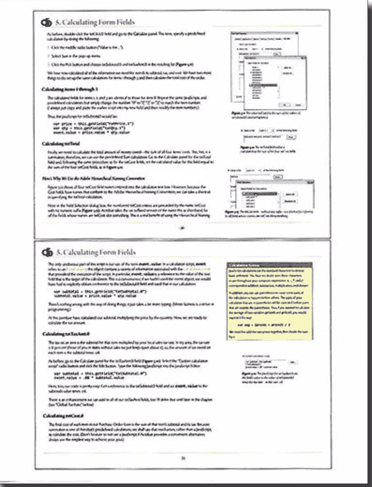

**图 0.1** 本书的页面尺寸非常适合双面双页打印在 A4 或美式 Letter 尺寸纸张上。

#### 在线资源

有两个专门为本节配套使用的信息来源。

#### 示例文件和支持

本书的每一章都围绕一个或两个示例表单构建，我们向其中添加 JavaScript 以完成该章的目标。每个示例表单都有两个相关联的文件：

- 完整、可正常运行的表单，其中所有 JavaScript 都已就位。这向您展示表单应有的行为方式，并允许您检查该章的 JavaScript。此版本的表单文件名以 *"end"* 结尾。

- 表单的所有字段和其他元素都已就位，但尚未附加 JavaScript 的版本。如果您想在阅读章节时跟随操作，编写、调试和执行 JavaScript，请使用此版本。此版本的文件名将具有以 *"start"* 结尾的名称。

示例表单文件可在 [www.acumentraining.com/QEDGuides/acrojs.html](http://www.acumentraining.com/QEDGuides/acrojs.html) 下载。该网页也是您查找勘误表、更新信息和其他有用信息的地方。

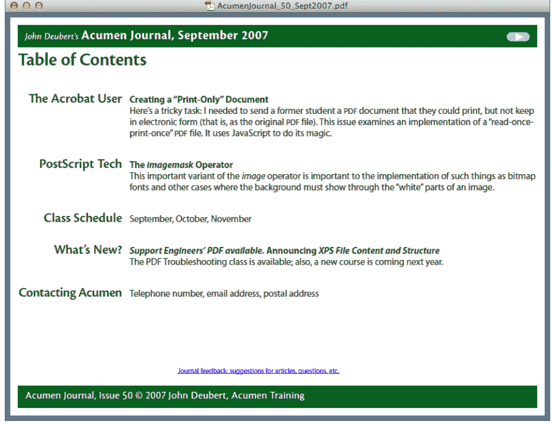

**图 0.2** 每一期《*Acumen Journal*》都有一篇与 Acrobat 相关的文章；其中许多是关于 JavaScript 使用的。

##### Acumen Journal

《*Acumen Journal*》（**图 0.2**）是我每年制作三到四期的免费期刊。每一期都有一篇关于高级 Acrobat 使用的文章，其中许多是关于 JavaScript 的。过刊可以作为本书主题的良好补充；自 2000 年开始撰写《*Journal*》以来，已累积了 60 多期。您可以在 [www.acumentraining.com/acumenjournal.html](http://www.acumentraining.com/acumenjournal.html) 下载它们。

如果您希望在新一期《*Journal*》发布时收到通知，Acumen Journal 网页上有一个链接指向相应的表单。

#### 致谢

最后，感谢您购买本书或查看示例章节。无论哪种方式，您都在参与一项正在进行的出版实验。

# 第 1 章

## 欢迎使用 JavaScript

在人生的某些时刻，您会学到一些无可估量地拓宽您世界的东西，揭示出广阔的新体验、问题、机遇、娱乐和工作。那些一直无形地围绕着您的整个世界突然显现，提供了新的探索空间。阅读、性、驾驶、子女，都带来了以前无法触及和未曾想到的关注点、兴趣和互动。

就其自身的小方式而言，学习 JavaScript 将成为您职业生涯中这样一个门槛事件。如果您已经使用 Acrobat 有一段时间了，您可能已经非常擅长，并且在创建表单、添加音乐、创建幻灯片以及 Acrobat 提供的所有其他功能方面变得相当熟练。

本书介绍新世界。掌握 JavaScript 使您能够在 Acrobat 中完成远超您目前所做的事情：您可以与数据库交互；添加自己的弹出菜单；创建具有复杂交互界面的表单；并实现可以查找价格和其他数据的表单字段。这些只是您可以使用 JavaScript 在 Acrobat 文档中完成的少数几件事。与没有 JavaScript 技能相比，拥有 JavaScript 技能可以极大地扩展您操作 Acrobat 文件的能力。

因此，本书。

在这里，您将学习如何使用 JavaScript 在 Acrobat 中完成各种有用的任务。在此过程中，您将学到大量关于 JavaScript、编程和 Adobe Acrobat 的知识。

### 您应该已经了解什么

本书假设您具有相当丰富的 Acrobat 工作经验和创建 Acrobat 表单的实践。特别是，我假设您知道如何在 Acrobat 中创建表单；您应该能够创建表单字段、设置其属性并为其分配操作。如果您对其中任何任务感到有些不安，您可能想立即去买一本关于这个主题的书（见下页边栏）。

除此之外，本书不假设您具备任何编程知识；您将在进行示例的过程中学习所需的编程技能。

同样，本书面向编程新手；如果您是经验丰富的程序员，您可能会发现它的节奏比您希望的要慢。经验丰富的程序员可能更适合直接去更高级的书籍学习 JavaScript（有无数这样的书籍，尽管它们都是在网页的上下文中教授 JavaScript），然后查看 Adobe 的 JavaScript 参考网站以了解如何将其应用于 Acrobat。

### 我们将在本章学习什么

在本章中，我们将学习：

- 什么是 JavaScript？
- JavaScript 的类型
- 将 JavaScript 附加到表单字段
- JavaScript 对象、数据类型和语法
- JavaScript 错误和调试器
- 如何将您自己的文本编辑器与 Acrobat JavaScript 一起使用

### 您应该拥有哪个版本的 Acrobat？

虽然本电子书假设您正在使用 Acrobat XI（当前版本），但它与 Acrobat X 同样兼容，后者的界面几乎相同。我们逐步介绍的说明几乎也都适用于 Acrobat 9。在 Acrobat 9 有很大差异的地方，我会提供关于在早期软件中应该怎么做。

### 什么是 JavaScript？

JavaScript 是一种编程语言。"编程语言"这个术语经常让新手感到紧张，但从概念上讲，它并不可怕：编程语言是一种用于描述执行某项任务所涉及步骤的语言。在 Acrobat 中，这些任务包括移动到文档的特定页面、向数据库发送数据以及计算表单字段值。执行 JavaScript 描述的步骤被称为**执行**程序。

作为一种编程语言，JavaScript 最显著的特征是它足够简单，许多应用程序都将其用作内置脚本语言。Web 浏览器都可以解释嵌入在网页中的 JavaScript，而就我们的主题而言，Acrobat 可以执行附加到表单字段、页面和 PDF 文件的 JavaScript。

像任何语言一样，JavaScript 有自己的词汇（有意义的词）和语法（用这些词组成语句的规则）。因此，学习 JavaScript 与学习人类语言（如西班牙语或德语）有很多共同点，只是它要容易得多。JavaScript 比任何人类语言都简单得多：没有隐喻、没有字面意义上无意义的习语、没有同义词、没有微妙的含义差别。只有非常精确的语句告诉 Acrobat 做一些非常具体的事情。

### Acrobat 中的 JavaScript

Acrobat 允许您创建五种不同类型的 JavaScript：

- *表单字段 JavaScript* 附加到表单字段。当该表单字段中发生特定事件（如按钮点击）时，Acrobat 执行脚本。Acrobat 中的大多数 JavaScript 都附加到表单字段。
- *页面 JavaScript* 在用户移动到 Acrobat 文档中的特定页面或离开该页面时执行。
- *文档 JavaScript* 在 Acrobat 文档打开时执行。
- *文档操作 JavaScript* 在用户打开、关闭、保存或打印文档时执行。
- *应用程序 JavaScript* 在 Acrobat 启动时执行。

**关于 Acrobat 表单的书籍**

虽然有许多书籍可以教您如何创建 Acrobat 表单，但大多数已经绝版。目前唯一现存的书是：

- **PDF Forms Using Acrobat and LiveCycle Designer Bible** – Ted Padova 和 Angie Okamoto

Ted Padova 是"Bible"风格书籍之王，这本书展示了他当之无愧的地位。

还有其他专门关于 Acrobat 表单的书籍，虽然已绝版，但如果您四处寻找仍然可以找到。特别是，我自己的旧书仍然可以买到，尽管我承认它已经非常过时了：

- **Creating Forms in Adobe Acrobat** – John Deubert

最后，任何关于 Adobe Acrobat 的 reasonably complete 的书籍至少会有一两章关于创建表单的内容。这包括我自己的书：

- **Adobe Acrobat X: Visual Quickstart Guide** – John Deubert
- **Acrobat X Classroom in a Book** – Adobe Creative Team
- **Acrobat X PDF Bible** – Ted Padova

这些都可以通过 Amazon.com 买到，就像世界上几乎所有的东西一样。


## 1. 欢迎学习 JavaScript

我们将在第 2 章讨论页面、文档和文档操作 JavaScript；本书将完全不涉及应用程序 JavaScript。现在，让我们看看如何输入和使用表单域 JavaScript。

### 我们的第一个 JavaScript

让我们通过向**图 1.1** 中的按钮添加一个简单的 JavaScript 来开始探索我们的新世界。

这个表单由一组闪卡组成，旨在双面打印，然后用于测验学生的词汇术语。我们的 PDF 文件只有几张闪卡；每张卡片都有一个按钮，可以引导用户前往他们可以用来购买完整卡片套装的订单表单。我们将为“订单表单”按钮添加一个 JavaScript，该按钮将用户带到 Acrobat 文件最后一页上的订单表单（图 1.2）。

正如本书通篇所体现的那样，这个表单有两个版本，可在 *JavaScript for Acrobat* 网页上找到：

- *JSAcro_Ch01_Example_Final.pdf* 是完整表单，包含所有相关的 JavaScript。
- *JSAcro_Ch01_Example_Start.pdf* 是“原始”版本，缺少本章的 JavaScript，以便您可以在需要时自己输入 JavaScript。

这些文件可在 [www.acumentraining.com/QEDGuides/acrojs.html](http://www.acumentraining.com/QEDGuides/acrojs.html) 获取。

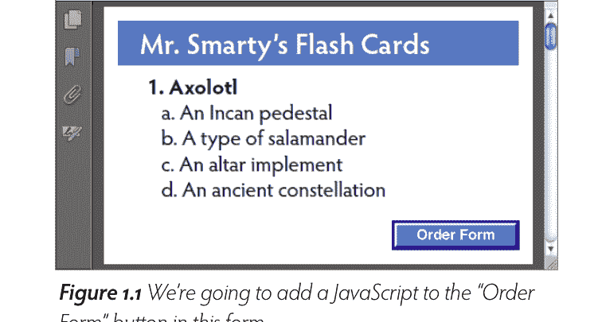

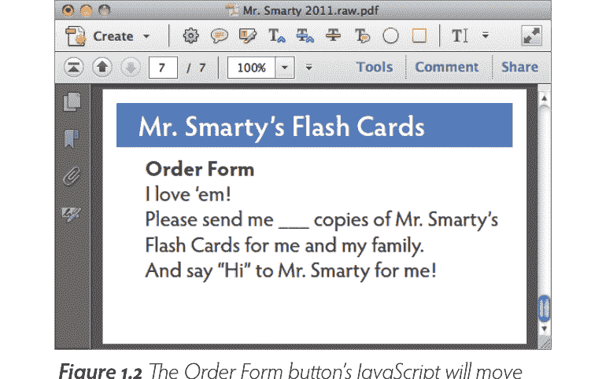

> **示例文件位于何处？**
> 请记住，本电子书中的所有示例文件都可在 www.acumentraining.com/QEDGuides/acrojs.html 获取。

## 将 JavaScript 附加到表单域

作为您可能已经知道的内容的回顾，让我们逐步将 JavaScript 附加到一个按钮的过程，在这个例子中是我们的“订单表单”按钮。

**要将 JavaScript 附加到按钮：**

首先，在 Adobe Acrobat 中打开表单，并显示工具窗格。

1.  在工具窗格的“表单”面板中，单击“编辑”工具（图 1.3）。

    Acrobat 将进入表单编辑器模式，将当前页面上的所有表单域显示为一组矩形，并将通常的三个任务窗格替换为单个“表单”窗格（图 1.4）。请注意，在图中，我们的表单第一页上只有一个域，一个名为 *btnOrderForm* 的按钮域。

2.  双击“订单表单”按钮。

    Acrobat 将向您显示“域属性”对话框（图 1.5）。

3.  单击“操作”选项卡。

    现在您将看到一组控件，用于指定单击此按钮时应发生什么（图 1.6）。

4.  在“选择触发器”弹出菜单中，选择 *鼠标松开*。

    这告诉 Acrobat，此按钮的操作应在单击按钮后释放鼠标按钮时触发。（请参阅右侧的旁注。）

5.  在“选择动作”弹出菜单中，选择 *运行 JavaScript*，然后单击“添加”按钮。

    Acrobat 将向您显示 **JavaScript 编辑器**，这是一个带有简单文本编辑器的对话框（图 1.7，下一页）。这是您输入应与“订单表单”按钮关联的 JavaScript 的地方。

> > **注意**
> > *Acrobat 9* 没有工具窗格，但它有一个“表单”菜单。要进入表单编辑器，请选择 *表单 > 添加或编辑域*。执行此操作后，您可以完全按照列出的步骤操作。

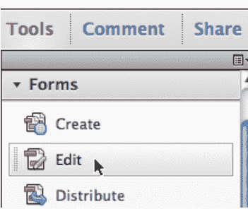

**图 1.3** 通过单击“表单”面板中的“编辑”按钮进入表单编辑器模式。

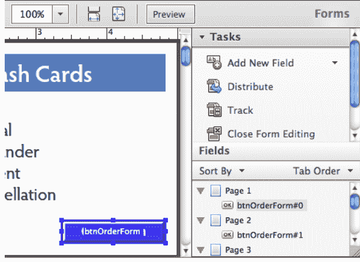

**图 1.4** Acrobat 的表单编辑器模式为您提供了一个“表单”窗格、新工具栏，并将每个表单域显示为带有控点的矩形。

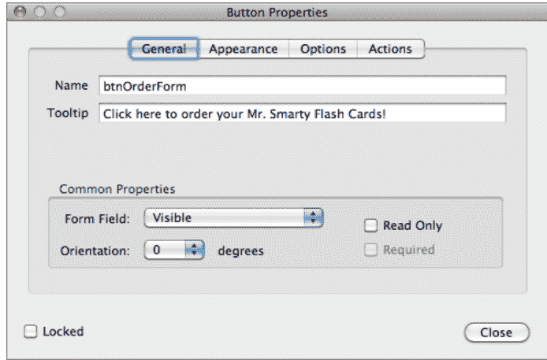

**图 1.5** 双击按钮将打开“按钮属性”对话框。

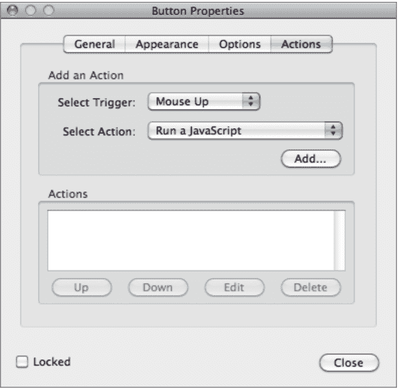

**图 1.6** “按钮属性”对话框的“操作”选项卡是我们指定用户单击按钮时应发生什么的地方。

6.  在此对话框的文本字段中输入您的 JavaScript。

    对于我们的订单表单，JavaScript 是一个两行程序，它将用户对文档的视图移动到包含订单表单的页面，然后使用户的计算机发出哔哔声：

    ```
    this.pageNum = 6
    app.beep()
    ```

    将这些行完全如上所示输入到文本编辑字段中，确保大小写匹配。第一行代码的意思是：“在此文档中，将当前页码设置为 6。”第二行告诉 Acrobat 应用程序发出哔哔声。

7.  单击 JavaScript 编辑器的“确定”按钮和“域属性”对话框的“关闭”按钮以返回到 Acrobat 表单。

    您现在正在查看 Acrobat 闪卡页面，“表单”工具仍处于选中状态，如图 1.4 所示。

8.  通过单击“表单”窗格中的“关闭表单编辑”按钮退出表单编辑器（**图 1.8**）。

    您现在回到了开始的地方，正在查看您的文档页面。

所以，现在试试看。单击“订单表单”按钮，Acrobat 将转到订单表单页面，然后发出哔哔声。

### JavaScript 对象

我们的两行 JavaScript 利用了两个 **JavaScript 对象**。JavaScript 对象是您的 JavaScript 程序中某些数据的表示。在您的程序可以操作或检查表单域之前，它必须首先创建一个代表该域的对象。您在 JavaScript 中可以操作的大多数东西（页面、签名、数据库连接等）在您的程序中都表示为对象。

在我们的示例程序中，**this** 指的是一个 **Doc 对象**。**Doc** 对象向您的 JavaScript 程序表示一个打开的 Acrobat 文件；您使用此对象来更改页面、保存文档以及从程序中以其他方式操作文档。我们示例 JavaScript 中的单词 **this** 特别指我们的 JavaScript 所在的 Acrobat 文档（在我们的例子中是“闪卡”文件）；可以将其视为 *this document* 的缩写。

单词 **app** 是一个 **App 对象**，是对用于查看当前文档的 Acrobat 应用程序的引用。您使用 **App** 对象来告诉 Acrobat 应用程序执行某项操作：打开文件、显示警报对话框，或者在我们的例子中发出哔哔声。

常用的 JavaScript 对象类型包括：

- ***Annot*** 表示当前文档中的注释（例如，“便笺”）。
- ***App*** 表示用于查看当前文档的 Acrobat 应用程序。
- ***Connection*** 表示与外部数据库的连接。
- ***Doc*** 表示一个打开的 Acrobat 文档。
- ***Field*** 表示一个表单域。
- ***Sound*** 表示嵌入在当前文档中的声音。

### 对象属性

JavaScript 对象类似于我们周围世界中的物理对象，例如书籍、花瓶和狗。每个现实世界的对象都拥有一组定义它的特征（例如，对于狗，颜色、尾巴长度和跳蚤数量）。

JavaScript 对象的特征被称为该对象的 ***属性***。这些是我们 JavaScript 程序可以根据需要检查和更改的对象元素。每种类型的对象都有一组特征化它的属性；例如，Doc 对象除了其他属性外，还具有标题、当前页码、作者和页数（见 **表 1.1**）。

##### 表 1.1 文档对象属性（部分）

| 属性 | 数据类型 | 描述 |
|----------|-----------|-------------|
| author | String | 编写文档的人 |
| fileSize | Integer | PDF 文件的大小，以字节为单位 |
| numPages | Integer | 文档中的页数 |
| pageNum | Integer | 用户当前可见的页码 |
| title | String | 文档的名称。 |

##### 数据类型

表 1.1 的“数据类型”列列出了与其列出的每个属性相关联的信息类型。计算机编程，包括 JavaScript，使用特殊术语来精确描述数据类型。以下是 JavaScript 中常用的术语：

- ***Integer*** 是一个整数，例如 1、2、87 或 -6293。
- ***Floating Point*** 是一个带有小数部分的数字，例如 1.7、-842.9011、1024.0。请注意，小数部分可能为零，如 1024.0；在这种情况下，浮点数的值与整数相同，尽管在内部它仍然是浮点数。浮点数通常被称为“浮点数”。
- ***Boolean*** 是一个可以有两个值的实体：真或假。布尔数据用于描述只能有两种状态的特征。（例如，我们狗对象中的 *已绝育* 属性是一个布尔值；狗要么是，要么不是。）
- ***String*** 是文本，即“一串字符”。


# 1. 欢迎使用 JavaScript

短语 **this.pageNum** 引用了 Document 对象的 **pageNum** 属性；此属性是文档当前向用户显示的页码。我们的程序通过将当前文档的 **pageNum** 属性设置为订单表单的页码，从而将用户移动到订单表单页面：

```
this.pageNum = 6
```

关于此页码赋值的一些观察：

- 通过对象名称和属性名称（用点号连接）来引用对象的属性：`object-name.property-name`

- 上面代码行中的等号是一个赋值命令；它设置某个值。在我们的例子中，它将当前文档的页码设置为 6。

- JavaScript 区分大小写。大写和小写是不同的；如果我们输入了 `This.PageNum`，我们的程序就会失败。

- Acrobat 内部从零开始为文档的页面编号；我们 Acrobat 文件中的七页被编号为零到六。因此，当我们的 JavaScript 将 **pageNum** 属性设置为 6 时，它正将我们移动到文档的最后一页。

## 对象方法

**方法**是与 JavaScript 对象关联的命令。就像可以给狗下达命令（“坐下”、“跟着”、“立刻吐出来！”）一样，JavaScript 对象也有它们可以执行的命令。每种对象类型的命令集是不同的。例如，**表 1.2** 列出了 **app** 对象知道如何执行的一些命令。

| 方法 | 参数 | 描述 |
|--------|-----------|-------------|
| beep | | 播放系统的“嘟嘟”声 |
| alert | 字符串 | 显示一个带有指定文本的警告对话框 |
| goBack | | 返回上一个视图 |
| goForward | | 前往下一个视图 |
| newDoc | | 打开一个新的空白 Acrobat 文档 |
| openDoc | 字符串 | 打开一个 Acrobat 文件。字符串参数包含文件名 |

## “程序”与“脚本”与“代码”

以下是三个紧密相关的术语，我们将在本书中一直使用。

- **程序**是告诉计算机如何详细执行特定任务的一系列指令的通用术语。通常，程序是一套独立的指令，例如一个应用程序。

- **脚本**是旨在另一个程序内进行操作和运行的程序。JavaScript 是一种脚本语言，因为你用它来控制另一个程序的行为，例如 Acrobat 或 Firefox。

- **代码**是应用于构成程序的指令集的术语。你的 JavaScript 程序由 JavaScript 代码组成。

在我们的订单表单 JavaScript 中，我们执行（“调用”）了 **app** 对象的 beep 方法：

**app.beep()**

请注意，我们调用对象方法的方式与引用其属性的方式相同：对象名称、一个“点”和方法名称。方法名称后跟括号，括号内包含方法的参数；让我们来谈谈这些是什么。

## 参数和返回值

一些方法需要额外的信息来执行其任务；例如，**表 1.2** 中列出的 **openDoc** 方法需要知道你要打开的文件的名称。传递给方法的信息称为该方法的“参数”。**openDoc** 方法接受文件名作为其参数；此信息，必须用括号括起来，跟在方法名称后面。**openDoc** 的调用看起来像这样：

**app.openDoc("TermPaper.pdf")**

上面的 JavaScript 语句将打开一个名为 *TermPaper.pdf* 的 Acrobat 文件。请注意，我们之前对 **app.beep** 的调用括号是空的，因为该方法不接受任何参数；不过你仍然需要括号。

有时当你给狗下达命令时，你会期望狗给你一些东西作为回报：命令“去把棍子捡回来，孩子！”应该会把棍子放到你手里（伴随着一些多余的口水）。同样，许多 JavaScript 方法都有一个返回值，它们交还给 JavaScript 程序的某些数据。我们上面调用的 **openDoc** 方法实际上返回一个表示新打开文档的 Doc 对象，尽管我们单行使用 **openDoc** 只是忽略了它。我们将在下一章更详细地讨论返回值。

### 命名参数

通常，你必须按特定顺序向方法提供参数；**app** 对象的 **alert** 方法（我们将在下一章详细讨论）需要一个字符串和一个图标代码：

**app.alert("Woah! Somethin' weird just happened!",2)**

字符串和整数必须按此顺序提供，以便 JavaScript 可以识别它们。

但是，你也可以按名称传递参数给方法。《Acrobat JavaScript 指南》（在本章末尾描述）定义了与方法所需每个参数相关联的名称；对于 **app.alert**，这些名称是 cMsg 和 nIcon。

你可以使用以下方法调用按任意顺序提供这些参数：

```
app.alert({cIcon: 2, cMsg:"Woah! Somethin' weird just happened" })
```

请注意，我们在方法的括号内有花括号，花括号内是我们的方法参数。每个参数由参数名称、一个冒号、然后是参数的值表示；参数之间用逗号分隔。

这不如按位置传递参数简洁，但每个参数的用途更清晰。（例如，我们第一次对 **app.alert** 的调用没有提供 2 的用途线索。）此外，按名称传递参数为你的代码格式化提供了极大的灵活性。特别是，你可以在参数列表中放置换行符，并按任意顺序提供参数；我们之前的例子可以写成

```
app.alert({cIcon: 2,
         cMsg: "Woah! Somethin' weird just happened" })
```

在本书中，我们将按位置传递参数；仅当特定 JavaScript 示例需要时——通常是为了清晰——我们才会使用参数名称。但是，在描述方法时，我通常会提供参数的名称，以便你愿意的话可以使用它们。

通常，没有特别的理由这样做。

## JavaScript 程序语法

这里我们必须讨论几个关于如何将 JavaScript 命令组合成程序的简短主题。

## JavaScript 语句

JavaScript 程序——任何计算机程序——由一系列**语句**组成，每个语句执行整体任务中的一个步骤。我们的示例程序由两个语句组成：一个页面赋值和一个对 **app** 对象 beep 方法的调用。

```
this.pageNum = 6
app.beep
```

通常，JavaScript 程序中的每一行将包含一条 JavaScript 语句，就像我们的程序中一样。你可以在一行上放置多条语句，用分号分隔。我们的两行程序本可以写在一行上：

```
this.pageNum = 6; app.beep
```

为什么要这样做呢？纯粹出于美学；有些人就是喜欢将非常简单的语句组合在一起。我建议不要这样做；如果你每行只放一条语句，大多数程序会更容易阅读。

如果你阅读其他人的 JavaScript，你可能会注意到许多程序员在程序的每一行末尾都加上分号：

```
this.pageNum = 6;
app.beep;
```

这没有任何害处，但没有必要。他们大多数人这样做是出于习惯；JavaScript 看起来非常像编程语言 C 和 C++，这两种语言都要求所有语句以分号结尾。你可以省略分号。

## JavaScript 文本

JavaScript 程序就是纯文本文件；你可以用任何文本编辑器或文字处理器编写它们，然后复制并粘贴到 Acrobat JavaScript 编辑器对话框中。事实上，Acrobat 允许你指定一个外部编辑器来编辑你的 JavaScript；我们将在本章末尾讨论如何做到这一点。

顺便说一句，JavaScript 行中的空格和制表符在 JavaScript 中没有特殊含义。你可以根据需要使用它们来格式化你的程序。这是一个纯粹的视觉问题；你希望格式化你的 JavaScript 代码，使其易于阅读。

大方地使用空格字符！阅读程序代码充其量是乏味的；如果程序员没有将代码格式化为易于阅读，程序可能几乎难以辨认。这是一个足够重要的问题，我将为我们在本书中使用的许多 JavaScript 结构提供格式化技巧。

## JavaScript 注释

JavaScript 代码可能相当晦涩。琢磨别人的代码（甚至是你自己六个月前的代码），试图弄清楚它到底想做什么，可能很乏味。为了方便查看你代码的人，并为了帮助未来的自己，在你的 JavaScript 代码中放置注释是非常重要的。

JavaScript 注释是代码中被 JavaScript “机器”忽略的文本。目的是让你放置自己的笔记，供检查代码的人阅读。


# 1. 欢迎使用 JavaScript

JavaScript 能够识别（即忽略）以下两种注释：

- *单行注释* 以双斜杠（//）开头，并延伸至 JavaScript 代码中当前行的末尾。这类注释适用于简短的说明。

  // 这是一个单行注释。

- *块注释* 以 /* 开头，以 */ 结尾。在这两个分隔符之间，你可以写入任意多的文本，可以跨越多行。这类注释适用于较长的说明。

  /* 这里是一个块注释。
  这段文本将完全被忽略，
  直到我们在结束注释，就在这。 */

## 一个示例

考虑本书后面部分出现的一段未加注释的 JavaScript 代码：

```
var txtField = event.target
txtField.fillColor = color.red
txtField.textColor = color.white
```

由于我们尚未讨论这些命令，这段脚本的确切用途以及它如何实现该用途非常不清楚，尽管它似乎与颜色有关。

另一方面，如果我们为代码添加注释，那么即使不熟悉该程序的人也能至少了解程序的意图以及它大致在做什么：

```
/* 该程序在用户通过 Tab 键进入或点击文本框时，
   更改文本框的背景色和文字颜色。 */
var txtField = event.target        // 获取文本框的引用
txtField.fillColor = color.red    // 将背景色设为红色
txtField.textColor = color.white  // 将文字颜色设为白色
```

这个版本的程序更加清晰，即使对于刚接触这段代码的人也是如此。

注释是编程中一种向善的力量。任何比几行更复杂的脚本都应该包含描述其功能和运作方式的注释。

本书后续的所有示例都会大量使用注释，以便尽可能易于理解。

不客气。

## JavaScript 错误

在（嗯哼）罕见的你遇到 JavaScript 错误的情况下——比如拼错了变量名、错误地复制了一段代码等等——你将面临找出代码问题所在的任务，这个过程称为调试。如果放任 Acrobat 自行处理，它会静默对待这些错误；如果代码执行失败，Acrobat 只是终止脚本；从外观上看，点击按钮没有任何反应，但实际上底下发生了一个失败的脚本。这对调试没有帮助；如果 JavaScript 执行失败，我们希望知道这件事，并且进一步被告知哪里出了问题，这样我们才好修复它。

要获取关于失败脚本的诊断信息，我们需要启用一个称为 JavaScript 调试器（JavaScript Debugger）的功能。

## JavaScript 调试器

JavaScript 调试器是一个窗口，用来展示 Acrobat 文档中执行的 JavaScript 相关信息（图 1.9）。特别地，调试器会展示 JavaScript 中错误的诊断信息，帮助你找出它们为何表现异常。

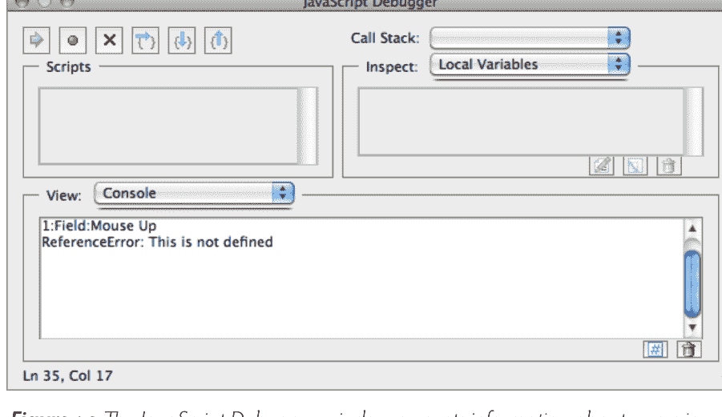

图 1.9 JavaScript 调试器窗口展示了 JavaScript 中的错误信息，同时提供了各种其他工具。

启用 JavaScript 调试器后，每当你的某个 JavaScript 执行失败时，Acrobat 都会打开调试器并显示错误信息（图 1.9 中的 "ReferenceError"）。这将使你能够确定出了什么问题以及如何修复。

错误信息起初可能有些晦涩难懂，但随着时间的推移和熟悉度的增加，它们会变得很有用。你最可能遇到的常见错误信息如下：

- **Reference Error: XXX is not defined**

  这表明你拼错了某些内容；名称 "xxx"（或其他名称）不是 JavaScript 所认识的。记住 JavaScript 是区分大小写的；**app**（JavaScript 认识）和 **App**（它不认识）是有区别的。

- **Syntax Error**

  这意味着 JavaScript 无法理解代码中的某些内容。这通常意味着你遗漏了某些内容（逗号、数字、括号）。语法错误的例子如下：

  ```
  app.alert("Hi, Mom", 3
  ```

  这一行缺少闭合的括号。

可能的错误信息非常多，不过大多数都很难触发。只需保持镇定，阅读信息，并仔细检查有问题的 JavaScript 代码中的拼写错误和遗漏。

### 启用 JavaScript 调试器

你可以在 Acrobat 的偏好设置中启用 JavaScript 调试器。打开 Acrobat 偏好设置，在长长的偏好设置类别列表中选择 JavaScript（图 1.10）。JavaScript 调试器区域中的所有复选框都应该被选中，如图所示。

### 使用你自己的文本编辑器

Acrobat 内置 JavaScript 编辑器中的文本编辑器（见图 1.7）非常基础。它可以让你输入 JavaScript，但没有特别强大的编辑功能。对于短小的 JavaScript 来说，这并不重要；但当输入长而复杂的脚本时，你就会想念功能齐全的文本编辑器了。

你可以让 Acrobat 使用你选择的文本编辑软件来编辑你的 JavaScript。告诉 Acrobat 你想使用哪个编辑器后，当你点击文档 JavaScript 对话框中的添加（Add）或编辑（Edit）按钮时（图 1.11），它就会自动启动该软件。

要设置这一点，你必须在 Acrobat 的偏好设置中指定你希望用于处理 JavaScript 的编辑器。

**指定用于编辑 JavaScript 的文本编辑器：**

从 Acrobat 已打开开始。

1. 在 Mac 上，选择 *Acrobat>偏好设置*；在 Windows 上，选择 *编辑>偏好设置*。

   Acrobat 将显示其偏好设置对话框（图 1.12，见下页）。

2. 在偏好设置类别列表中选择 JavaScript。

   偏好设置对话框将显示影响 Acrobat JavaScript 支持的控件，如图 1.12 所示。

3. 在 JavaScript 编辑器控件中，于对话框底部选择"使用外部 JavaScript 编辑器"。

4. 点击选择（Windows）或浏览（Mac）按钮，然后导航到你想用于编辑 JavaScript 的编辑器的 .exe 或 .app 文件。

5. 点击确定按钮。

就这么简单。现在，当你编辑 JavaScript 时，Acrobat 会自动启动你的文本编辑器。在文本编辑器窗口中输入你的 JavaScript 代码，保存文本，然后关闭编辑器。你的 JavaScript 将自动被录入 Acrobat。

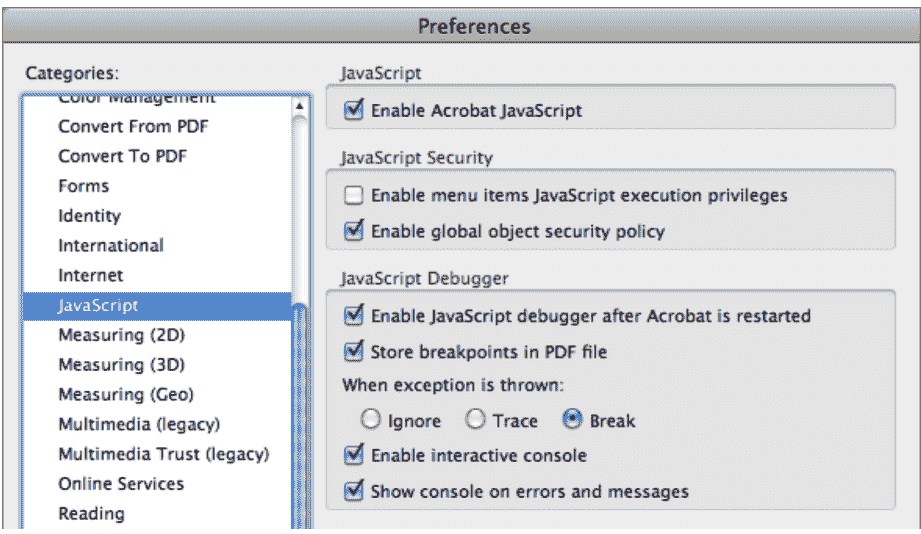

**图 1.10** 在 Acrobat 偏好设置中启用 JavaScript 调试器。选中调试器区域中的所有复选框，如上所示。

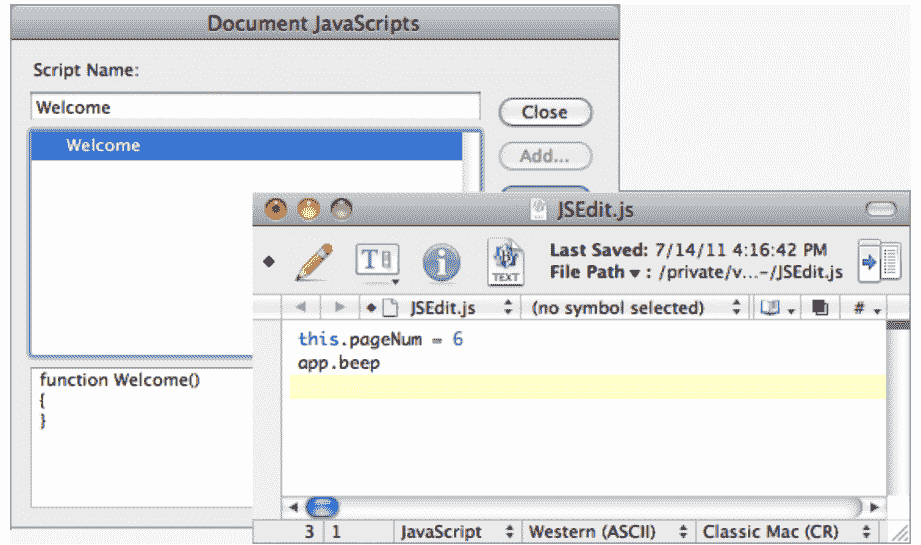

**图 1.11** 每当你点击文档 JavaScript 对话框中的添加或编辑按钮时，Acrobat 都会启动你的外部文本编辑器。

顺便一提，我在 Mac 上最喜欢的程序员编辑器是 TextWrangler（[www.barebones.com](http://www.barebones.com)）；它是一流的编辑器，而且完全免费，天哪。在 Windows 文本编辑器中，我相当喜欢 TextPad（[www.textpad.com](http://www.textpad.com)）；它是相对便宜的共享软件，物超所值。

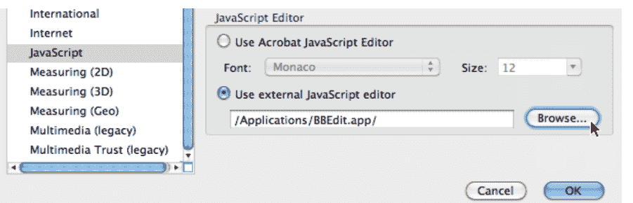

### JavaScript 参考资料

本书是为非程序员介绍如何在 Adobe Acrobat 中使用 JavaScript 的入门书籍；它既未全面涵盖 JavaScript 语言，也未完整描述 Adobe Acrobat 中 JavaScript 实现的所有细节。当你读完这本书后，还有两个其他参考资料可以供你进一步学习。

#### 客户端 JavaScript 参考

关于 JavaScript 的书籍多如汗牛，正如我在本章开头所说。不过，JavaScript 的官方定义存在于一份名为 *Client-side JavaScript Reference*（客户端 JavaScript 参考）的网络文档中，该文档托管在 Oracle 的网站上，[在此](http://docs.ora)。

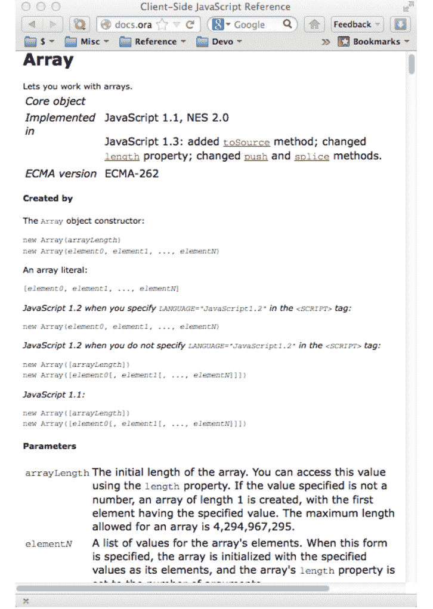

**图 1.13** 展示了 *Reference* 页面的一部分。如你所见，这不是为了娱乐阅读而设计的；它是参考资料，不是教程。不过，如果你想了解 JavaScript 语言内置的完整功能集（而非其在 Acrobat 中的版本），这就是你要去的地方。

#### Acrobat JavaScript 指南

JavaScript 在 Acrobat 中可以做的所有事情的完整描述，可在 Adobe 开发者网站上的文档中找到：《JavaScript for Acrobat API Reference》或简称"JSAPI"（图 1.14，见下页）。这是 Acrobat 中你的 JavaScript 程序可用的所有对象类型的技术规范。此外，还可以通过 Adobe 开发者网站获取一个[优秀的在线版本](http://www.adobe.com/devnet/acrobat/acrobat_js.html)。


 # 1. 欢迎使用 JavaScript

与客户端参考一样，*JSAPI* 是一项技术规范，不是您会自觉从头到尾阅读的文档。它详细描述了 Acrobat 中可用的每种 JavaScript 对象类型，以及每个对象的属性和方法。您正在阅读的这本书展示了一系列如何使用 JavaScript 完成特定任务的示例，而 *JSAPI* 则描述了在 Acrobat 中使用 JavaScript 可以*做的一切*。

> **注意**
> JSAPI 可以在 amazon.com 上购买 Kindle 版本。

为了让您感受一下 *JSAPI* 的风格，**图 1.15** 展示了 **app** 对象的 **beep** 方法完整描述的截图。我将在整本书中不时引用 *JSAPI*。

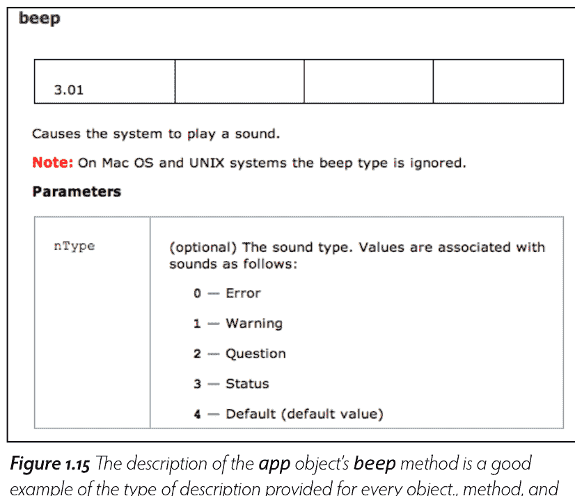

**图 1.15** *对 **app** 对象的 **beep** 方法的描述是一个很好的示例，展示了《JavaScript for Acrobat API Reference》中对每个对象、方法和属性所提供的描述类型。*


**图 1.14** *《JavaScript for Acrobat API Reference》是正式的技术文档，阐明了 Acrobat 的 JavaScript 实现方式。*

# 第 2 章

## 页面和文档 JavaScript

Acrobat 中有五种广泛类型的 JavaScript，每种的区别在于它们在 Acrobat 文档中的使用位置。

- *表单字段 JavaScript* 附加在表单字段上。正如我们在上一章中看到的，表单字段脚本与发生在表单字段上的事件相关联：鼠标按下、获得焦点等。

- *文档 JavaScript* 与 Acrobat 文件的打开相关联。Acrobat 在文档首次打开时执行这些脚本。

- *文档动作 JavaScript* 当 Acrobat 文件发生一组预定义事件之一时执行：文件关闭、保存等。

- *页面 JavaScript* 与特定页面相关联。您可以提供脚本，让 Acrobat 在用户进入该页面、离开该页面，或两者都发生时执行。

- *应用程序 JavaScript* 是 Acrobat 在应用程序首次打开时执行的脚本。这些脚本可以执行各种有趣的任务，例如向 Acrobat 菜单添加项目。我们在本书中不会讨论应用程序脚本，因为它们的使用较为专业和少见；这将是后续第二本书的主题。

我们在第 1 章讨论了表单字段 JavaScript。在本章中，我们将介绍如何编写其他三种类型的脚本。

## 项目

（*文件：JSAcro_Ch02_Example_Start.pdf*、*JSAcro_Ch02_Example_Final.pdf*）

本章的示例文件是如 **图 2.1** 所示的宠物商店目录。在我们的讨论过程中，我们将向此文件添加文档、文档动作和页面 JavaScript 的示例。

| 我们将在本章学习的内容 |
| --- |
| 在本章中，我们将学习如何： |
| - 在文档打开时运行 JavaScript |
| - 在文档关闭时运行 JavaScript |
| - 在进入或离开页面时运行 JavaScript |
| - 使用 JavaScript 变量 |

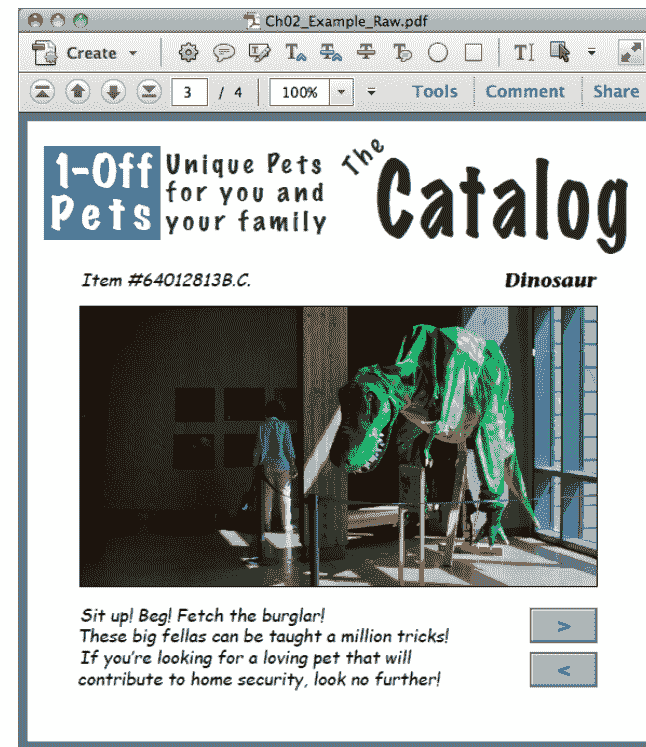

**图 2.1** 在本章中，我们将向此 PDF 文档添加多个脚本。

## 2. 页面和文档 JavaScript

### JavaScript 工具面板

本章我们将使用的几个与 JavaScript 相关的工具位于 Acrobat X 工具窗格的 JavaScript 面板中（图 2.2）。

如果您查看自己的 Acrobat 副本，您可能会发现 JavaScript 面板缺失；Acrobat 默认不显示此面板。（这是合理的；绝大多数 Acrobat 用户与 JavaScript 没有任何关系，想到这个前景都会感到震惊。）在我们可以继续本书之前，我们需要使该面板可见，方法如下：

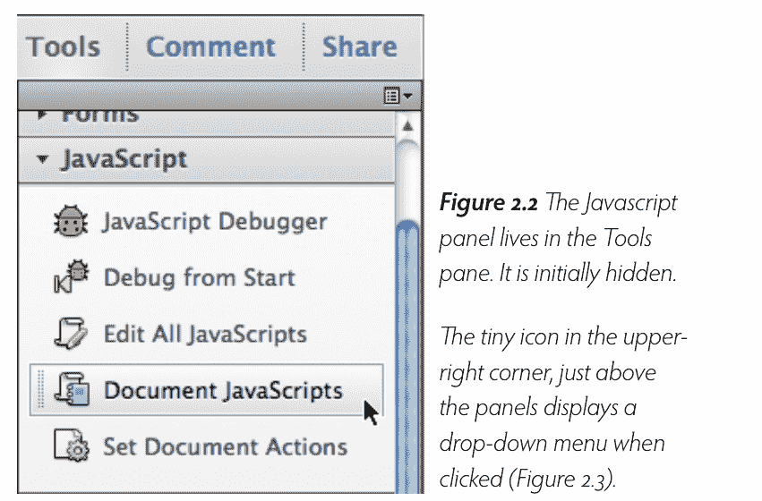

**使 JavaScript 面板可见：**

1. 通过单击 Acrobat X 工具栏中的名称使工具窗格可见。
2. 单击工具窗格顶部的小图标，然后在弹出的菜单中选择 JavaScript（**图 2.3**）。

> **注意**
> *Acrobat 9* 没有工具窗格。本章中的所有 JavaScript 命令都位于 *高级 > 文档处理* 子菜单中。

JavaScript 面板将在工具窗格中显示。它将一直对您的 Acrobat X 副本可用，直到您再次取消选择它。

#### 文档 JavaScript

文档 JavaScript 在 Acrobat 打开其所附加的文档时执行。这是向读者呈现初始"启动画面"或在用户打开您的 PDF 文件时执行某些其他启动活动的便捷方式。您可以根据需要向 Acrobat 文件附加任意数量的文档 JavaScript。

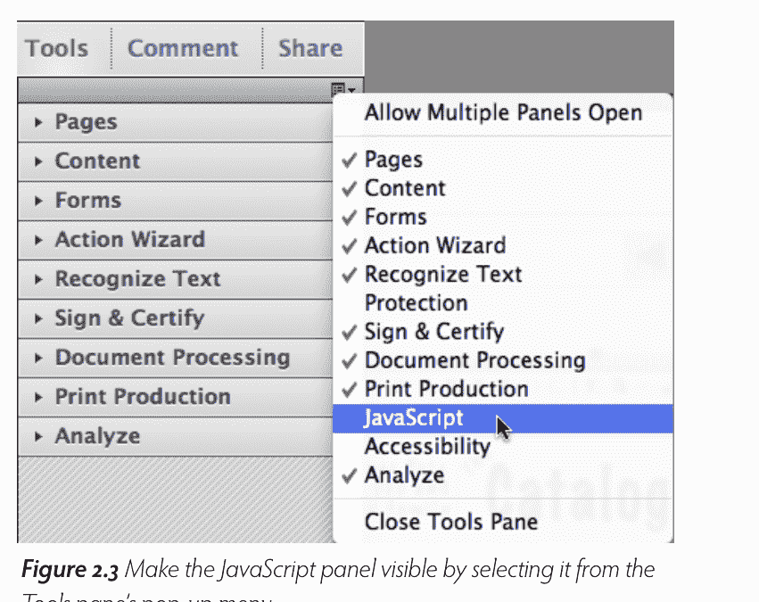

例如，我们将向我们的目录添加一个文档 JavaScript，当读者打开文档时显示问候语（**图 2.4**）。

**向 Acrobat 文档附加文档 JavaScript：**

从 Acrobat 中打开的文档开始。

1. 在 JavaScript 面板中，单击文档 JavaScript 工具（回到图 2.2）。
2. 在脚本名称字段中输入脚本名称。

Acrobat 将显示文档 JavaScript 对话框（**图 2.5**，下一页）。

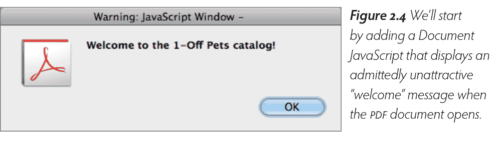

## 2. 页面和文档 JavaScript

这可以是您想要的任何名称，但描述性的比隐晦的好；我们将脚本命名为"Welcome"（欢迎），因为它正是这样做的。

3. 单击"添加"按钮。

Acrobat 将显示 JavaScript 编辑器窗口（**图 2.6**，下一页）。注意，此窗口出现时文本字段中已经输入了一些 JavaScript 代码。这段代码是 JavaScript 函数定义的起始点；由于我们不打算定义函数，您可以删除这段初始代码。

4. 在文本字段中输入您的 JavaScript（**图 2.7**，下一页）。

在我们的例子中，脚本将是一行，如下所示：

```
app.alert("Welcome to the 1-Off Pets catalog!", 3)
```

这段 JavaScript 显示了回到图 2.4 的警报。**app** 对象的 **alert** 方法显示带有指定文本的警报窗口。3 表示应出现在警报中的图标类型。我们将在第 4 章更详细地研究这个方法。（您可能记得我们在第 1 章讨论过 **app** 对象。）

请记住 JavaScript 是区分大小写的；您的大小写字母应与上面一行匹配。

5. 单击"确定"退出 JavaScript 编辑器并返回到文档 JavaScript 对话框。

对话框现在将在其脚本列表中显示我们的 Window 脚本（**图 2.8**）。如果您单击列表中的脚本，对话框将在下方文本字段中显示代码，如图所示。

6. 单击"关闭"按钮退出文档脚本对话框；您现在将回到 Acrobat 页面。就是这样！我们已经创建了文档 JavaScript。

7. 通过保存 Acrobat 文件、关闭它，然后重新打开它来尝试一下。Acrobat 应该显示我们在图 2.4 中看到的警报。

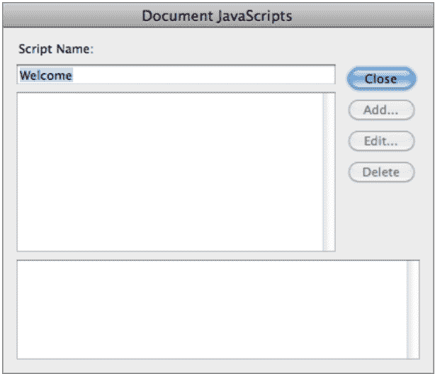

**图 2.5** 文档 JavaScript 对话框让您可以向文档附加 JavaScript。

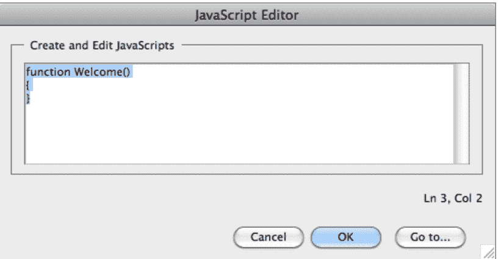

**图 2.6** JavaScript 编辑器窗口提供了一个简单的文本编辑器，您可以在其中输入 JavaScript。

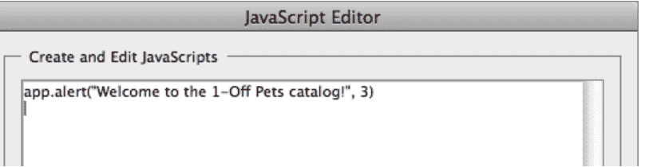

**图 2.7** 在 JavaScript 编辑器的文本字段中输入您的 JavaScript。

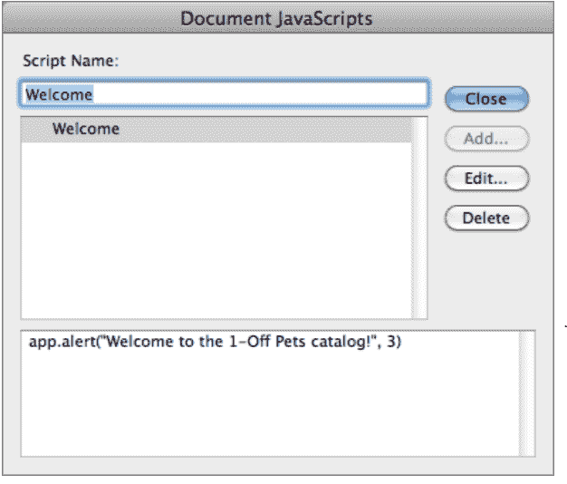

**图 2.8** 我们的 Welcome 脚本现在已列在文档 JavaScript 对话框中。单击脚本名称，其文本将出现在下方文本字段中。

## 2. 页面和文档 JavaScript

## 文档动作 JavaScript

文档动作 JavaScript 在文档发生特定事件时执行。有五个事件可以向其附加 JavaScript：

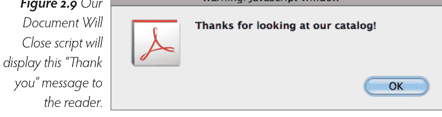

- 文档即将关闭 表示 Acrobat 即将关闭文档。
- 文档即将保存 表示 Acrobat 即将保存文档。
- 文档已保存 表示 Acrobat 已完成保存文档。
- 文档即将打印 表示 Acrobat 即将打印文档。
- 文档已打印 表示 Acrobat 已完成打印文档。

要了解如何将 JavaScript 附加到这些事件之一，让我们对目录再做一次修改。当用户关闭 Acrobat 文件时，让我们感谢用户浏览我们的商品，如图 2.9 所示。我们将通过将 JavaScript 附加到"文档即将关闭"事件来实现这一点。

### 向文档附加文档动作 JavaScript：

从 Acrobat 中打开的文档开始。

1. 在工具窗格的 JavaScript 面板中，选择设置文档动作（图 2.10）。

   Acrobat 将显示文档动作对话框（图 2.11）。其中列出了可以附加 JavaScript 的五个可能的文档事件。

2. 选择"文档即将关闭"并单击"编辑"按钮。

   Acrobat 将显示现在熟悉的 JavaScript 编辑器窗口（图 2.12）。

3. 在编辑器中输入您的 JavaScript。在我们的例子中，单行脚本应该是：

```
app.alert("Thanks for looking at our catalog!", 3)
```

4. 单击"确定"退出 JavaScript 编辑器，再次单击"确定"离开文档动作对话框。

   您现在将回到 Acrobat 页面。我们完成了！

5. 试一试：保存 Acrobat 文档然后关闭它。Acrobat 将显示"感谢"警报，如图 2.9 所示。

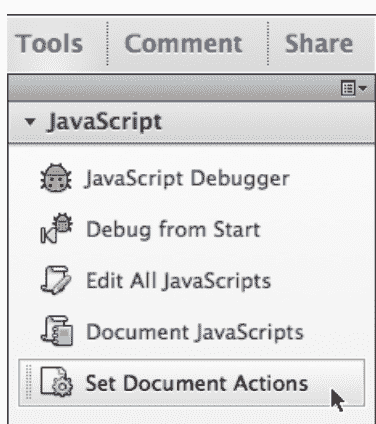


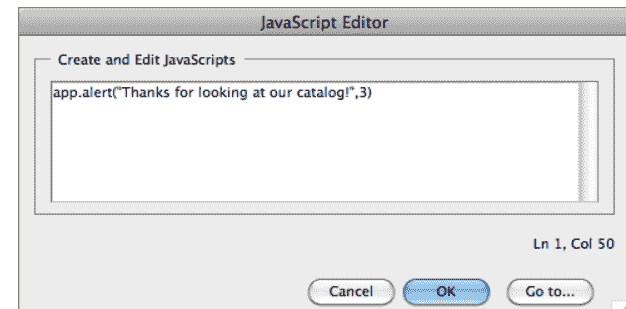


 ## 2. 页面和文档 JavaScript

### 页面动作 JavaScript

页面动作是一种 Acrobat 动作，与特定页面的打开或关闭相关联。它可以是 Acrobat 支持的任何动作类型：菜单项、影片动作、声音动作——当然，在我们的案例中，还有 JavaScript 动作。

Acrobat 中有两种页面动作：

- **页面打开**动作在用户滚动到该页面时执行（"页面打开"事件）。
- **页面关闭**动作在用户离开该页面时执行（"页面关闭"事件）。

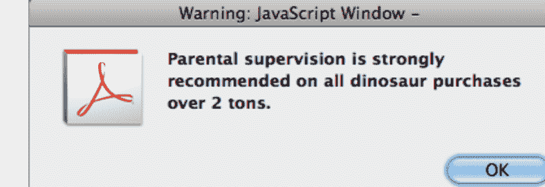

*图 2.13* 我们将添加一个页面动作 JavaScript，当读者跳转到第 3 页时显示此警告框。

作为示例，我们将在目录的第三页附加一个页面打开动作，以提示对于较大的宠物恐龙，家长的监督很重要。我们的页面打开动作将在用户打开第 3 页时显示**图 2.13**中的警告框。

令人惊讶的是，我们无法通过 JavaScript 面板来访问页面动作 JavaScript。它们而是通过页面缩略图导航窗格来附加的（**图 2.14**），您可以点击每页左侧导航栏中的页面图标来打开该窗格。

默认情况下会启用页面缩略图窗格，但万一您的 Acrobat 中禁用了它，您可以通过选择（深呼吸）视图>显示/隐藏>导航窗格>页面缩略图来启用它。

### 在 Acrobat 文档中为页面附加页面动作的步骤：

确保文档已打开，且页面缩略图窗格可见。

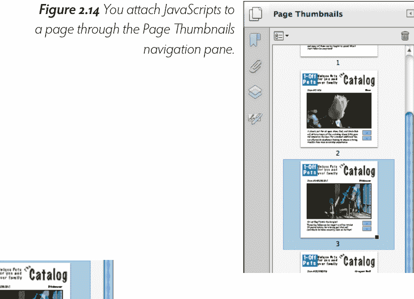

*图 2.14* 你通过页面缩略图导航窗格将 JavaScript 附加到页面。

1. 在页面缩略图窗格中右键单击目标页面的缩略图（在我们的案例中是第 3 页），然后在弹出的上下文菜单中选择*页面属性*（**图 2.15**）。

   Acrobat 将显示页面属性对话框（**图 2.16**，下一页）。

2. 转到"操作"选项卡（如图 2.16 所示）。

3. 在选择触发条件弹出菜单中，选择"页面打开"。

   菜单中的另一个选项当然是"页面关闭"。

4. 在选择动作弹出菜单中，选择"运行 JavaScript"。

   还有很多其他动作可以与页面事件关联；请参阅下一页的侧边栏。

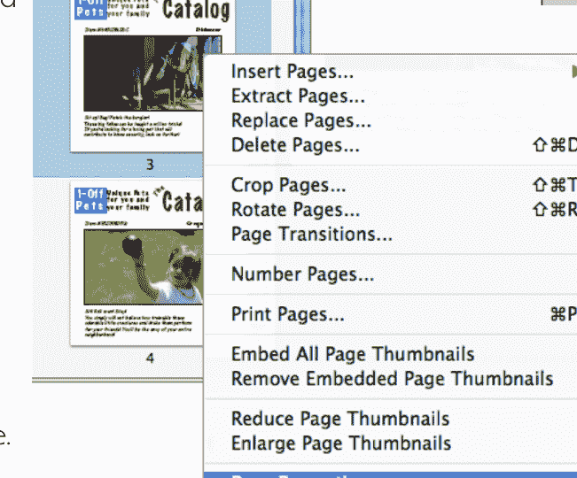

*图 2.15* 首先右键单击页面并选择*页面属性*。

5. 单击"添加"按钮。

   Acrobat 将打开您现在已熟悉的 JavaScript 编辑器窗口。

6. 在编辑器中输入您的 JavaScript；在我们的案例中，这又将是一行代码：

```
app.alert("Parental supervision is strongly recommended on all dinosaur purchases over 2 tons.", 3)
```

以上内容应全部作为单行输入，尽管编辑器窗口可能会将其换行以适应文本字段。注意上述代码中第二行开头的"¬"字符；我将在整本书中使用此符号来表示 JavaScript 代码行是上一行的续行。

7. 反复单击"确定"，直到退出所有对话框并再次看到文档页面。

8. 通过在目录文档中跳转到前一页，然后再返回到第 3 页来试一试；您将看到图 2.13 中所示的警告框。

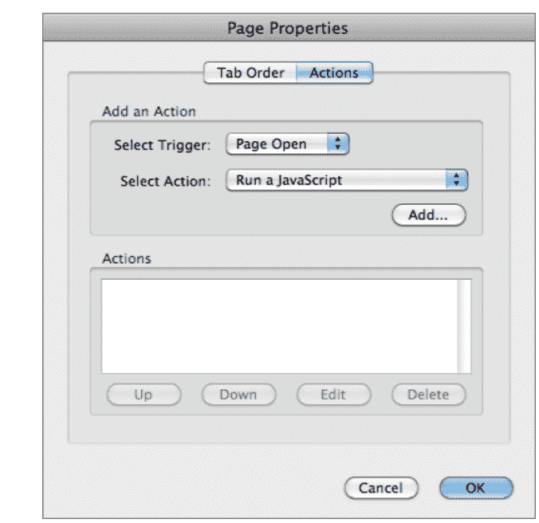

> ### 其他页面动作
>
> 您可以为页面打开或页面关闭事件附加多种多样的动作。选择动作弹出菜单让您可以指定 Acrobat 执行以下操作：
>
> - 执行任何 Acrobat 菜单项
> - 在该页面上播放影片
> - 播放声音
> - 跳转到网页
> - 导入表单数据（我们稍后会介绍如何操作）
>
> 还有更多！您应该尝试使用此菜单；这里*有*很大的潜力。

## 同时编辑所有脚本

此时，我们的 PDF 格式目录中已附加了三个脚本：一个文档脚本、一个文档动作脚本和一个页面动作脚本。如果我们需要对所有这些脚本进行更改，就必须逐一打开它们，依次使用文档 JavaScript 工具、设置文档动作工具和页面缩略图导航窗格。这并不困难，但即便只有三个脚本，做起来也很繁琐。如果您的文档中有 20 个脚本，逐个更新就会变得相当痛苦。

幸运的是，有更好的方法。

如果您点击 JavaScript 面板中的"编辑所有 JavaScript"工具（图 2.17），Acrobat 将打开 JavaScript 编辑器，其中包含大量 XML 乱码（**图 2.18**，下一页）。（虽然 Adobe 没有明说，但我推测这是 Acrobat 在内部用于存储 JavaScript 代码的数据。）与 XML 混合在一起的是文档中每个脚本的代码。

文档中的每个 JavaScript 都将由一段如下所示的文本块表示：

```
//<Document-Actions>
//<ACRO_source>Document Will Close</ACRO_source>
//<ACRO_script>
/***** belongs to: Document-Actions:Document Will Close *****/
app.alert("Thanks for looking at our catalog!",3)
//</ACRO_script>
//</Document-Actions>
```

上面加粗的两行是重要的行："所属"行标识了脚本的位置（在此案例中是文档将要关闭动作）；其后是实际的 JavaScript 代码（此处为单行，但如有需要可以是多行）。

编辑您希望修改的任何脚本的 JavaScript 代码，然后点击编辑器的**确定**按钮。您将一次性修改所有脚本。

很酷吧？

*哦，顺便说一下：*

> **不要修改 JavaScript 编辑器中的 XML 代码！你会非常、非常后悔的！**
>
> 如果你更改任何 XML 代码，后果自负，因为这是 Acrobat 用于将 JavaScript 重新导入文档的数据；最坏的情况下，你所有的 JavaScript 集合可能会消失在虚空中。

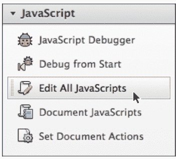

> 图 2.17 "编辑所有 JavaScript"工具让您可以一次性查看和修改文档中的所有脚本。

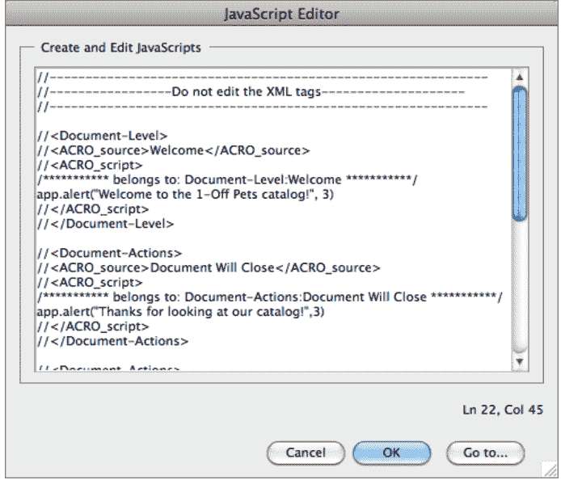

> 图 2.18 当您同时编辑所有脚本时，JavaScript 编辑器会显示所有脚本代码，并与 Acrobat 用于将脚本重新导入文档的一些 XML 混合在一起。

# 第 3 章

## 表单字段高亮

本书中反复出现的一个主题是表单中用户反馈的重要性。用户在每个时刻都应该清楚地知道他或她应该做什么，以及表单的哪一部分正在等待输入信息。

在本章中，我们将研究一种实现此目的的有用方法；我们将创建一个表单，其文本字段会显示彩色输入高亮——即当用户点击它们或使用 Tab 键进入它们时，它们会改变颜色，如下面的示例所示。试试看；点击它。

很巧妙吧？让我们看看如何实现。

## 项目

（文件：JSAcro_Ch03_Example_Start.pdf, JSAcro_Ch03_Example_Final.pdf）

我们将为图 3.1 中的订单表单添加彩色输入高亮。这个 Acrobat 文件起初是一个相当普通的表单，用户填写它来获取他或她记录的副本。正如你从图 3.2 中看到的，这个表单包含几个文本字段和一个提交按钮。

由于彩色输入高亮，当用户点击文本字段时，该字段将变为红色，表明它是活动字段。

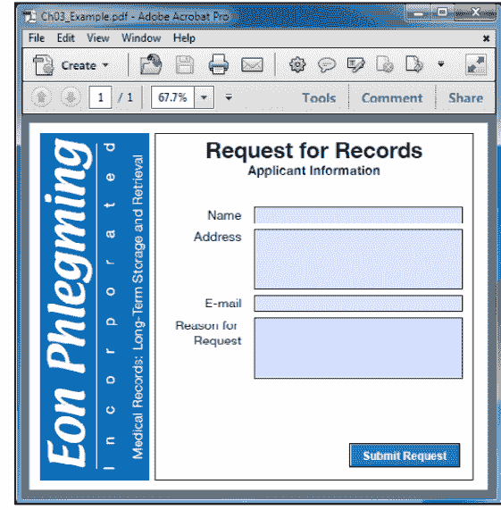

图 3.1 我们将为此表单中的文本字段添加输入高亮。

图 3.2 我们将为此表单中的文本字段添加输入高亮。

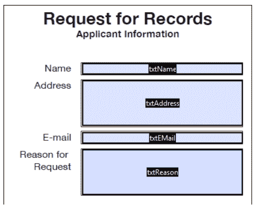

| 我们将在本章中学习的内容 |
| 在本章中，我们将学习如何： |
| • 设置"获得焦点"和"失去焦点"表单字段事件 |
| • 在 JavaScript 中设置表单字段颜色 |
| • 使用 JavaScript 变量 |
| • 获取表单字段的引用 |


## 3. 表单字段高亮

### JavaScript 部分

通常，文本字段包含黑色文本，显示在白色或透明背景上。我们将修改文本字段，使用户点击某个字段（或通过 Tab 键进入）时，该字段变为白色文本搭配红色背景，如上一页示例所示，表示该字段已准备好接收键盘输入。

### 问题分析

要实现输入高亮，我们需要为表单中每个文本字段的“获得焦点”（On Focus）和“失去焦点”（On Blur）事件附加 JavaScript（参见图 3.3）。当表单字段成为数据输入的目标时，会触发“获得焦点”事件，通常是因为用户点击了该字段或通过 Tab 键进入了该字段。当表单字段失去焦点时——即另一个表单字段成为数据输入目标时——会触发“失去焦点”事件。（如果"On Blur"这个名字看起来有点奇怪，你会用什么单个词来描述"focus"的反义词呢？）

我们的“获得焦点”JavaScript 会将表单字段的背景色设为红色，文本颜色设为白色。“失去焦点”脚本会将背景和文本颜色分别恢复为透明和黑色。我们需要将这些 JavaScript 添加到用户可能输入数据的所有文本字段中。

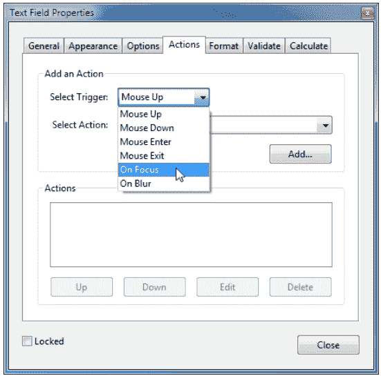

## 代码

#### 步骤 1：获得焦点 JavaScript

以下 JavaScript 用于此表单中每个文本字段的"获得焦点"事件（参见图 3.2）。

```
// This is the On Focus JavaScript
var txtField = event.target       // Get a reference to our text field
txtField.fillColor = color.red    // Change the background color to red
txtField.textColor = color.white  // Change the text color to white
```

**代码详解**

```
var txtField = event.target
```

第一行获取导致"获得焦点"事件发生的字段（事件的目标），并将其赋值给一个命名引用（变量），名称为 txtField。这就是我们在 JavaScript 剩余部分引用该文本字段时使用的名称。（有关事件目标的完整讨论，请参阅第 5 章。）

#### 事件目标

在 PDF 表单的上下文中，`event.target` 指的是导致该事件发生的表单字段。如果你点击一个按钮对象，`event.target` 将返回对该按钮的引用。

这使你能够编写可在多个表单字段中未经修改直接使用的 JavaScript 代码。例如，本章的三行脚本可以剪切并粘贴到 PDF 文件中每个文本字段的"获得焦点"事件中，无需为单个字段修改脚本。

```
txtField.fillColor = color.red
txtField.textColor = color.white
```

获取到文本字段的引用后，我们设置了它的两个属性：

- **fillColor** 是表单字段的背景色。我们将其设为红色。
- **textColor** 是表单字段中文本的颜色。我们将其设为白色。

注意，我们将颜色指定为 **color.red** 和 **color.white**。Acrobat 提供了一组常见颜色的预定义名称，列于**表 3.1**中。

##### 表 3.1 预定义颜色名称
- color.transparent
- color.white
- color.ltGray
- color.gray
- color.dkGray
- color.black
- color.red
- color.green
- color.blue
- color.cyan
- color.magenta
- color.yellow

#### 步骤 2：失去焦点 JavaScript

我们的"失去焦点"脚本与"获得焦点"脚本相同——只是内容不同。我们将 **textColor** 和 **fillColor** 属性设置回它们的原始值：

```
// This is the On Blur script
var txtField = event.target         // Get a reference to our text field
txtField.fillColor = color.transparent // Make the background color transparent
txtField.textColor = color.black       // Make the text color black
```

与步骤 1 类似，我们获取导致"失去焦点"事件的文本字段的引用，然后更改背景色（透明）和文本颜色（黑色）。**color.transparent** 在此上下文中是有效的颜色。

这就是你需要做的全部。一旦你能够为表单中的每个文本字段添加这两个 JavaScript，你的表单就会拥有彩色输入高亮功能，你的用户会非常印象深刻。

### 自定义

将此 JavaScript 自定义用于你自己的目的并不困难；事实上，我们在这里使用的 JavaScript 可以不经修改地用于任何表单中的任何文本字段。

你可能想要进行的唯一合理的自定义是为文本字段选择其他颜色。你可以使用 **fillColor** 和 **textColor** 的任意组合来高亮显示文本字段。**表 3.1** 显示了 Acrobat 识别的标准命名颜色；但是，你也可以使用如下格式将颜色设置为你想要的任意 RGB、CMYK 或灰度值：

```
txtField.fillColor = ["RGB", .5, 1, .5 ]
```

颜色分量的值——我们案例中的 R、G 和 B——每个都必须是 0 到 1 之间的数字。零表示该颜色分量关闭；1 表示该分量完全开启。因此

`txtField.fillColor = ["CMYK", 0, 1, 0, 0 ]`

将颜色设置为纯洋红色。

最后，如果你将某个字段的 **fillColor** 和 **textColor** 都设置为 **color.transparent**，该字段实际上就会消失。你可以使用这种方法动态隐藏表单字段；然而，有更好的方法可以实现这一点，我们将在第 12 章中讨论。

### 变量和字段引用

我们的两个 JavaScript 提到了一些我没有完全解释的项目。现在让我们来讨论它们。

#### 变量

JavaScript（或任何编程语言）中的**变量**是对数字、字符串或其他数据片段的命名引用。该引用的内部本质会因语言而异，在 JavaScript 中并不太重要；重要的是变量有一个名称，并且代表一段数据。

在 JavaScript 中，你使用 **var** 关键字创建变量。

`var ppi = 72`

上面一行创建了一个名为 **ppi** 的变量，并将数字 72 赋值给它。在 JavaScript 的其他地方，你可以使用名称 **ppi** 代替值 72：

`300 / ppi`

上面将 300 除以 72（也许是将点转换为英寸）。

#### 字段对象引用

我们的 JavaScript 修改了 txtName 表单字段中与颜色相关的几个属性。为此，我们需要以某种方式获取代表该字段的 JavaScript 对象。我们通过 **Doc** 对象的 **getField** 方法来实现：

`var nameField = this.getField("txtName")`

记住，**this** 指的是 PDF 文档的 **Doc** 对象（可以将其视为"此文档"的缩写）。**Doc** 对象的 **getField** 方法以表单字段名称作为参数（我们案例中为"txtName"），并返回与该表单字段关联的 JavaScript Field 对象。注意，表单字段的名称必须用引号括起来，因为它是一个 JavaScript 字符串。

上面的代码获取了对名为 txtName 的表单字段的 Field 对象的引用，并将该对象赋值给变量 **nameField**。完成此操作后，我们就可以使用 **nameField** 变量访问和更改 txtName 字段的各种属性：

```
nameField.value = "Thelonius Abbot"
```

这将文本字段的内容（其值）设置为指定的字符串；这就是现在将显示在字段中的文本。

# 第 4 章
## 检查 Acrobat 版本

每个版本的 Adobe Acrobat 都增加了新的功能和特性：早期版本的 Acrobat（比如 Acrobat 5 之前）只支持最基本的注释类型；数字签名在 Acrobat 6 中变得更加强大；作品集是 Acrobat 8 中的新功能。不可避免地，你必须假设用户正在使用什么版本的 Acrobat 来查看你的表单。如果用户使用的 Acrobat 版本早于这个版本，你应该检测到这一事实并妥善处理这种情况。

这就是我们在本章中要讨论的内容。我们将了解如何确定用户拥有的 Acrobat 版本，以及如果用户的程序过于原始而无
法正确呈现文档时，如何自动关闭文档。

## 项目

（文件：*JSAcro_Ch04_Example_Start.pdf*、*JSAcro_Ch04_Example_Final.pdf*）

**图 4.1** 显示了一个表单，当用户选择某个表单字段时，使用彩色输入高亮来更改该字段的颜色。（顺便说一下，第 3 章向你展示了如何实现这一点。）该表单通过为每个文本字段的"获得焦点"和"失去焦点"事件附加 JavaScript 来实现高亮功能。由于这两个事件是在 Acrobat 5 中添加的，我们的表单在早于 5 版本的 Acrobat 中无法正常工作。（是的，我*知道* Acrobat 5 是很久以前的事了，但你会惊讶于人们保留旧软件版本的时间有多长；我认识至少一个人仍然坚持使用在 Windows 2000 上运行的 Acrobat Reader 4。）

在本章中，我们将进一步修改此表单，查看用户的 Acrobat 版本号。如果版本号小于 5，我们将首先弹出一个警告（**图 4.2**）告知这一情况，然后关闭表单。

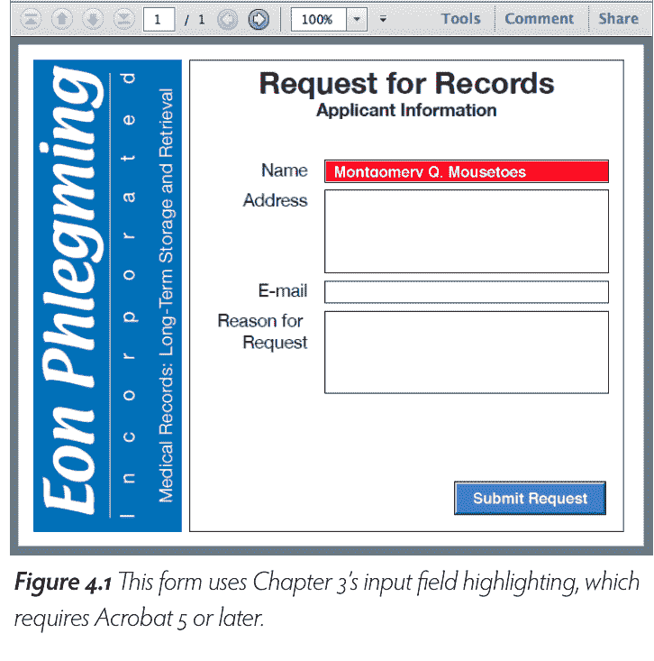

### 本章学习内容

在本章中，我们将学习如何：

- 使用 **if** 和 **else** 指定条件执行
- 使用 JavaScript 关闭文档
- 显示包含用户信息的警告
- 格式化警告文本

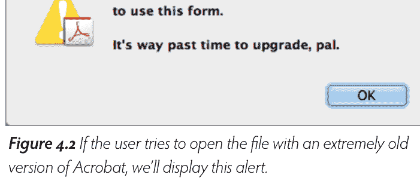


## 4. 检查 Acrobat 版本

### JavaScript 脚本

检查 Acrobat 的正确版本是用户首次打开文档时你希望进行的操作。因此，我们将使用一个文档级 JavaScript，Acrobat 会在用户首次打开文档时执行它。

### 问题分析与解决思路

这个脚本相对简单。我们将查看用户的 Acrobat 版本，并将其与我们所需的最低版本（在本例中为 Acrobat 5）进行比较。如果版本低于 5，我们将显示如图 4.2 所示的警告框，然后关闭 Acrobat 文件。

我们可以通过检查 **app** 对象的 `viewerVersion` 属性来轻松确定版本号，该属性的值就是当前 Acrobat 查看器的版本号。

### 代码实现

这个 JavaScript 需要作为文档级 JavaScript 输入。（如需回顾如何将文档级 JavaScript 附加到文档，请参阅第 2 章。）请记住，文档级 JavaScript 必须始终有名称。我将我们的脚本命名为 CheckVersion（图 4.3）——描述性强，虽说缺乏想象力。

```
if (app.viewerVersion < 5) {
    app.alert("You must have Adobe Reader 5.0 or later to use this form.\n\nIt's way past time to upgrade, pal.", 3)
    this.closeDoc(true)
}
```

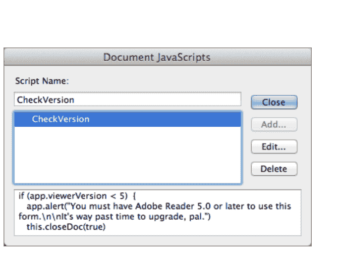

图 4.3 每个文档级 JavaScript 都必须有名称；我们将我们的命名为 "CheckVersion"。这样我们获得了清晰度，尽管依然缺乏亮点。

##### 代码详解

这个程序围绕对 JavaScript `if` 命令的调用构建。该命令比较两个事物（在我们的例子中是 Acrobat 版本和数字 5），如果比较结果为真，则执行一段代码。`if` 命令及其搭档 `else` 在 JavaScript 中无处不在；我们在本书中将经常见到它们。每当你的 JavaScript 需要在一个情况下执行一件事，而在其他情况下执行另一件事时，这些就是你使用的编程工具。

```
if (app.viewerVersion < 5)
```

这里我们检查 Acrobat 版本是否小于 5；将数字更改为你所需的最低 Acrobat 版本。（注意我们正在检查 `app` 对象的 `viewerVersion` 属性。）

如果比较为真（换句话说，如果查看器版本小于 5）则应执行的 JavaScript 代码出现在紧跟比较表达式之后的花括号内。在我们的例子中，这个"条件代码块"内有两行：

```
app.alert("You must have Adobe Reader 5.0 or later to use this form.\n\nIt's way past time to upgrade, pal.", 3)
```

这里我们告诉 **app** 对象显示一个警告框，如图 4.2 所示。括号中的文本是应出现在警告框中的文本；你可以将其更改为任何你希望的内容。注意这在你的代码中应该是完整的一行；第二行开头有一个续行符。

还要注意文本中的两个 "\n" 字符。这些是"换行"指示符，告诉 Acrobat 在显示文本时在此点移至下一行的开头。由于我们连续有两个这样的字符，我们将在警告框文本中此处获得一个空行（见图 4.2）。你也可以使用 `\t`（"制表符"）来缩进你的文本。

```
this.closeDoc(true)
```

最后，在告知用户问题之后，我们让当前文档自行关闭。请记住，"**this**" 指的是当前文档（即"此文档"）。布尔值 **true** 表示不应在关闭前给用户保存文档的机会。如果你将布尔值更改为 **false**，Acrobat 将向用户显示一个标准的"是否要先保存"对话框（**图 4.4**），允许用户在关闭 Acrobat 文件之前保存它。（例如，如果你在表单中使用 **closeDoc** 方法的"关闭"按钮，你可能希望使用 **false**；这将给用户机会保存他或她对表单所做的任何更改。）

为了方便起见，如果你确实想要"保存"对话框，可以省略布尔值；在这种情况下，你对 **closeDoc** 的调用将如下所示：

```
this.closeDoc()
```

这样可以省去输入 "false" 的麻烦，但除此之外并无不同。

### 自定义注意事项

这个 JavaScript 的明显自定义机会包括：

- 将 if 行中的版本号更改为你想要的任何最低 Acrobat 版本。
- 将警告框中的文本更改为你希望在屏幕上显示的任何内容。

以下是你可以对这个程序进行的一些不太明显的更改。

### If、Else 和比较符号

**if** 命令的条件代码块后面可以跟 **else** 命令，再跟一个条件代码块；这指定了如果比较为假时应该发生什么。因此：

```
if (app.viewerVersion < 5) {
    // 如果版本 < 5，执行此操作
    app.alert("Time to upgrade, Bucko")
}
else {
    // 如果版本 >= 5，执行此操作
    app.alert("Thoroughly modern, Millie.")
}
```

**if** 命令的比较短语可以使用以下符号：

| 符号 | 含义 | 符号 | 含义 |
|--------|---------|--------|---------|
| < | 小于 | <= | 小于或等于 |
| > | 大于 | >= | 大于或等于 |
| == | 等于 | != | 不等于 |

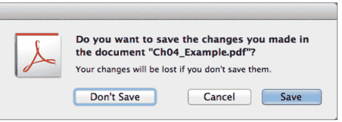

### 检测查看器类型

你可以轻松修改本章的 JavaScript 代码，以查看用户正在使用哪个 Acrobat 程序来查看你的表单：Adobe Reader 还是完整版 Acrobat。**app** 对象有一个名为 **viewerType** 的属性，它将具有两个字符串值之一，即 "Reader" 或 "Exchange"，取决于用户正在运行哪种类型的查看软件。（请注意，我们现在所知的 "Adobe Acrobat" 以前被称为 "Acrobat Exchange"。）如果你的表单需要完整 Acrobat 软件包的功能（也许你的表单允许用户将表单数据保存到磁盘，这只有在完整 Acrobat 中才可用），你可以修改本章的文档级 JavaScript 如下：

```
if (app.viewerType == "Reader") {     // "==" 表示"等于"
    app.alert("You must have the full独有的 to use this form.")
    this.closeDoc(true)
}
```

如果用户使用 Adobe Reader 查看你的表单，这将警告用户，然后关闭文档。

### 花括号：用还是不用

对 **if** 命令的调用之后跟着如果比较为真则应执行的 JavaScript 代码：

```
if (app.viewerType == "Reader") {
    app.alert("Oops! No Reader")
    this.closeDoc(true)
}
```

在上面的代码（以及本章的示例代码）中，两条条件执行的语句被花括号包围。

如果条件代码仅由单个 JavaScript 语句组成，那么你可以省略花括号；因此，如果我们只想关闭文档，但不显示警告框，我们的上面的示例可以重写为：

```
if (app.viewerType == "Reader")
    this.closeDoc(true)
```

这纯粹是为了视觉上的优雅；你可以将单个的 **closeDoc** 调用用花括号括起来，但那样会更不美观。一些 JavaScript 程序员即使在单行条件代码块中也会包含花括号；这绝对明确地表明该语句确实是 **if** 语句的一部分。

### 检测计算机平台

Acrobat 还提供了一种方式，让你的 JavaScript 可以确定它在哪种计算机上运行。**app** 对象的 platform 属性将根据计算机类型具有三个值之一："WIN"、"MAC" 或 "UNIX"。如果此信息对你的脚本很重要，你可以使用 platform 属性，代码块类似于以下内容：

```
if (app.platform == "WIN")
    app.alert("I'm running on Microsoft Windows.")
else if (app.platform == "MAC")
    app.alert("I'm running on a Mac.")
else
    app.alert("This is a UNIX box.")
")

这应该不会经常出现，因为 PDF 的优势之一是它独立于平台；你不需要更改代码来适应特定平台。

> **注意**
> 我们的代码使用了一组顺序的 **if...else** 调用。有一种更高效的方式可以使用 JavaScript 的 **switch** 语句来实现这一点。我们在本书中不会讨论该运算符；你可能想要查阅一下。

### 警告图标

我们在本章程序中显示的警告框有一个"停止"图标，表示发生了严重错误，以至于我们必须停止正在做的事情。


# 第五章
计算表单字段

计算在我们计算机世界中所做的一切都至关重要。电子表格、统计分析、会计信息——甚至像文字处理和页面布局这样不那么明显的东西——都依赖于计算机执行计算的能力，将我们精巧的小人脑解放出来追求更高尚的事业。

作为软件，Acrobat 也能进行数学运算，允许你指定表单字段的值应该被计算出来，而不是由用户输入。你可以使用 JavaScript 或 Acrobat 预定义的计算来实现这一点；在本章中，我们将学习如何创建同时使用这两种方法的计算表单字段。

## 项目

（文件：JSAcro_Ch05_Example_Final.pdf，JSAcro_Ch05_Example_Start.pdf）

在本章中，我们将在图 5.1 所示的采购订单表单中添加计算。此表单供小型企业的员工订购办公用品或其他必需品使用。对于用户想要购买的每件商品，他们提供商品描述、价格和所需数量。表单会自动填写小计、税款和总购买价格。

观察图 5.2，我们可以看到该表单由排列成六列的文本字段组成，分别用于商品名称、价格、数量、小计、税款金额和该商品的总成本。我们在表单底部还有一个最终总金额。如果这是你为公司制作的真实表单，它还需要一个提交按钮，也许还有一个清除表单按钮；为了简洁起见，我在这里省略了它们。

我们需要放入此表单的计算如下：

对于每件购买的商品……
- 小计 = 价格 × 数量
- 税款 = 税率 × 小计
- 商品成本 = 小计 + 税款

最后，
- 总计 = 所有商品成本之和

让我们看看如何将这些计算添加到我们的表单中。

### 本章我们将学到什么

在本章中，我们将学习如何：
- 创建计算表单字段
- 设置计算顺序
- 使用预定义计算
- 使用 Adobe 的层次命名约定
- 在表单中隐藏零值
- 创建全局变量

## 创建计算字段

你可能记得，可以将一个文本字段声明为计算字段。Acrobat 会根据需要自动重新计算该字段的值；我们只需要告诉 Acrobat 具体要执行什么计算。我们通过“字段属性”对话框（图 5.3）来完成此操作。

**将计算附加到文本字段：**

首先在表单编辑器中打开文档，使表单字段显示为黑色矩形，如图 5.2 所示。

1. **双击文本字段。**
   你现在将看到该文本字段的“字段属性”对话框（图 5.3）。

2. **单击“计算”选项卡。**
   现在你看到的是允许你指定文本字段值计算的控件。

3. **对于简单计算，单击第二个单选按钮（“值是...”），然后从预定义计算的弹出菜单中选择。**
   如果你看不到第二个单选按钮，这意味着该字段的格式未设置为“数字”。请参见右侧边栏。

4. **如果需要更复杂的计算，单击第三个单选按钮（“自定义计算脚本”），然后单击“编辑”按钮输入 JavaScript。**

### 预定义计算

Acrobat 内置了五种计算。无需编写一行 JavaScript，你就可以将文本字段的值设置为两个或多个其他表单字段的和、积、平均值、最小值或最大值。这就是“字段属性”对话框“计算”面板中第二个单选按钮的含义。

同样，这些预定义计算仅在你明确将文本字段的格式设置为“数字”时才可用。

> ### 文本字段中的数值计算？
>
> 文本字段的 *值* 是该字段包含的文本。如果该文本是有效数字，则该字段的值可用于 JavaScript 计算，就像我们在这里所做的那样。如果文本字段的值不是有效数字（例如，字段包含“Mooseberries”），则该值仍可能用于计算，但该值将被解释为 0。
>
> 确保文本字段仅包含有效数字的最简单方法是将其格式设置为“数字”；然后 Acrobat 会拒绝任何不属于数字值的按键输入。（如果你想使用 Acrobat 预定义计算，也需要执行此操作。）

**将文本字段的格式设置为“数字”：**

首先使用 Acrobat 表单工具选中文本字段。

1. 双击文本字段以访问其属性。
2. 转到“格式”面板（图 5.4）。
3. 从可用格式列表中选择“数字”。
4. 如果其他选项（货币符号等）看起来有用，请选择它们。
5. 单击“确定”按钮。

此表单字段现在将只接受数字、小数点和正负号。

图 5.4 要对文本字段执行计算，必须将其格式设置为“数字”。

**使用预定义计算之一：**

从“字段属性”对话框的“计算”面板开始。

1. 选择“开启”预定义计算的单选按钮（**图 5.5**）。
2. 从弹出菜单（也是**图 5.5**）中，选择所需的计算。
3. 单击“拾取”按钮，然后从生成的列表（**图 5.6**）中选择计算应使用的数据字段。

选择预定义计算比编写等效的 JavaScript 代码方便得多。在我们的采购订单表单中，我们将对“成本”字段（其值是小计和税款之和）和“总计”字段（所有商品成本之和）使用预定义计算（**图 5.7**）。税款的计算需要乘以一个常量值（我们的税率），因此无法使用预定义计算完成。（预定义计算可以将两个或多个表单字段相乘，但不能将表单字段乘以固定数字。）我们将为“税款”字段编写一个 JavaScript。

我们也可以为“小计”字段使用预定义计算（它是价格和数量的乘积）。但是，我们将使用 JavaScript 来计算小计；原因将在我们看到本章末尾的增强功能时变得清晰。

## 商品计算

让我们添加适用于我们表单中各个购买商品的计算。我们需要将计算值应用于每件商品的字段 txtTaxAmt、txtSubtotal 和 txtCost。请注意，我们应用于这些字段的名称符合 Adobe 层次命名约定（见侧边栏）；因此，例如，当我们沿着“税款”列向下时，字段名称分别为 txtTaxAmt.0、txtTaxAmt.1 等。这种命名约定使字段名称易于记忆，并且在使用预定义计算时可能有用，我们将在讨论 txtTotal 字段时看到这一点。

在关于与商品相关的计算的讨论中，我们将查看适用于商品 0（第一行表单字段）的 JavaScript。对于整个表单，你需要为商品 1、2 和 3 重复这些计算，并相应地更改字段名称。

### 计算 txtSubtotal.0

商品的小计是每件商品的价格乘以你购买的数量。就我们的表单而言，这意味着 txtSubtotal.0 的值应该是 txtPrice.0 乘以 txtQty.0 的乘积。这可以使用 Acrobat 预定义计算来完成，但尽管如此，我们仍将使用 JavaScript 来完成此操作，原因有两个：


## 5. 计算表单字段

- 我想明确一点：预定义计算并没有什么神奇之处；任何预定义计算能做到的事，你都可以轻松地在 JavaScript 中实现。
- 在本章末尾我们将讨论的增强功能中，我们会看到一个充分的理由，说明为什么要用 JavaScript 来完成所有计算。这涉及到值为零的字段的显示问题。但我们稍后再回到这个话题。

要将此计算附加到 txtSubtotal.0，首先打开"字段属性"对话框的"计算"面板（图 5.8)。（按照第 34 页"为文本字段附加计算："下面的步骤 1–2 即可到达此面板。）

单击"自定义计算脚本"单选按钮，然后单击"编辑"按钮。Acrobat 将弹出 JavaScript 编辑器窗口（图 5.9)；输入下面的 JavaScript 并单击"确定"。

当你单击"确定"按钮时，Acrobat 会对你的代码进行一些检查，并尝试告诉你是否有任何明显的错误。图 5.9 显示了文本字段下方的一个此类错误消息。

请记住，双斜线行表示 JavaScript 注释，Acrobat 和 JavaScript 会忽略这些注释。如果你愿意，可以省略这些注释，但我建议你输入它们。（当你稍后返回代码时，它们将帮助你记住正在发生的事情。）

```
// 获取对价格字段和数量字段的引用

var price = this.getField("txtPrice.0")
var qty = this.getField("qty.0")

/* 将我们文本字段的值设置为
   价格与数量的乘积。 */
event.value = price.value * qty.value
```

这个短脚本相当简单明了。我们创建变量 **price** 和 **qty**，它们保存对 txtPrice 和 txtQty 表单字段的引用。然后将这两个字段的值相乘，并将所得的积赋给名为 **event.value** 的东西。

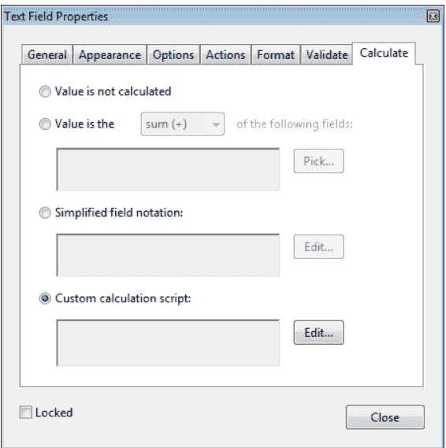

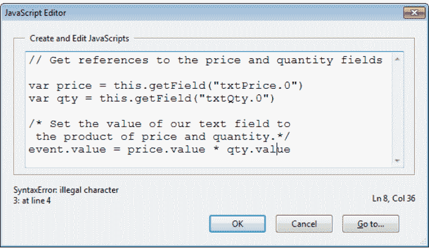

### Adobe 分层命名约定

我们为文本字段选择了一致的命名策略。与采购物品关联的文本字段命名为 txtItem.0、txtItem.1，依此类推。保存所有其他逐项信息的字段也类似地命名（txtCost.0、txtCost.1；txtQty.0、txtQty.1；等等）。

这些名称遵循 **Adobe 分层命名约定**。这是一套松散的规则，规定如何为相关字段分配名称。这些名称类似于标识网站的 URL。使用"点号"来分隔名称的不同部分；相关字段应共享其名称的第一部分，以表明它们之间的关系。因此，txtCost.1 和 txtCost.2 都是包含成本的文本字段。这使得查看文本字段之间的关系变得容易。

此外，正如我们在计算"总计"字段时将看到的，分层命名约定使得仅通过使用名称的第一部分就可以引用一整套表单字段。也就是说，在预定义计算中，"txtPrice"是所有以该名称开头的字段的简写引用：txtPrice.0、txtPrice.1，等等。具体示例请参见下面的"计算 txtTotal"。

此脚本中唯一不太明显的部分是我们对术语 **event.value** 的使用。在计算脚本中，**event** 指的是一个 Event 对象；该对象包含与引发脚本执行的计算事件相关的各种信息。特别是，**event.value** 是对作为计算目标的文本字段的值的引用。这是一种便利；如果我们没有使用 **event** 对象，我们就必须显式获取对 txtSubtotal.0 字段的引用，并在计算中使用它：

```
var subtotal = this.getField("txtSubtotal.0")
subtotal.value = price.value * qty.value
```

这样做没有什么不对；只是需要多打一些字。（编程中，适度的懒惰是一种美德。）此外，对于每个我们附加此脚本的文本字段，我们都必须重写脚本，每次替换文本字段的名称。

此时，我们已经计算出了小计，即价格乘以数量。现在，我们准备好计算税额了。

## 计算 txtTaxAmt.0

物品的税额是该物品的小计乘以你当地的销售税率。在我所在的地区，税率是 8%（那些所在州没有销售税的朋友们，请保持安静）；因此，每件物品欠缴的税额是小计乘以 .08。

和以前一样，转到 txtTaxAmt.0 字段的"计算"面板（图 5.10)。选择"自定义计算脚本"单选按钮，然后单击"编辑"按钮。在 JavaScript 编辑器中输入以下 JavaScript：

```
var subtotal = this.getField("txtSubtotal.0")
event.value = .08 * subtotal.value
```

这里，我们的代码也相当简单：获取对 txtSubtotal.0 字段的引用，并将 **event.value** 设置为小计的值乘以 .08。

我们可以为所有 txtTaxAmt 字段添加一个增强功能，但我会推迟到本章后面再讲（参见下面的"全局税率"）。

## 计算 txtCost.0

采购订单表单中每件物品的最终成本是该物品的小计与其税费之和。因为求和是 Acrobat 的预定义计算之一，我们将使用该机制而非 JavaScript 来计算成本。（如果 Acrobat 提供了便捷的替代方案，请不要犹豫不使用 JavaScript；始终使用最简单的方法来实现你的目标。）

### 计算语法

JavaScript 计算使用标准字符来表示基本算术。你在整个计算机使用经历中无疑已经见过这些字符：**+**、**-**、**\*** 和 **/** 分别对应加法、减法、乘法和除法。

此外，你可以使用括号来让计算的某些部分优先于其他部分执行：计算中位于括号内的部分将在括号外的部分之前执行。因此，如果你想计算两个变量 **price1** 和 **price2** 的平均值，你可以这样表达：

```
var avg = (price1 + price2) / 2
```

我们必须首先将两个价格相加，然后将和除以 2。

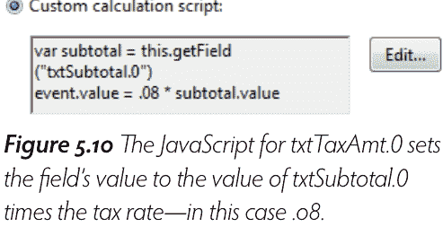

和以前一样，双击 txtCost.0 字段并转到"计算"面板。这次，通过以下步骤指定预定义计算：

1. 单击中间的单选按钮（"值是…"）。
2. 在弹出菜单中选择"求和"。
3. 单击"选择"按钮，在生成的列表中选择 txtSubtotal.0 和 txtTaxAmt.0（图 5.11）。

现在，我们已经计算出了物品 0 所需的所有信息：它的小计、税费和成本。我们还有两件事要做：为物品 1 到 3 设置相同的计算，然后计算订单的总成本。

#### 计算物品 1 到 3

物品 1、2 和 3 的计算字段与物品 0 的相同。重复相同的 JavaScript 和预定义计算，只需将数字"0"改为"1"、"2"或"3"，以匹配物品编号。（我总是将之前的脚本复制粘贴到新字段中，然后修改物品编号。）

因此，txtSubtotal.1 的 JavaScript 将是：

```
var price = this.getField("txtPrice.1")
var qty = this.getField("txtQty.1")
event.value = price.value * qty.value
```

#### 计算 txtTotal

最后，我们需要计算欠款的总额——所有四件物品成本的总和。这也是一个求和；因此，我们可以使用预定义的"求和"计算。转到 txtTotal 字段的"计算"面板，按照与 txtCost 字段相同的步骤，将此字段的计算值设置为四个 txtCost 字段的总和，如图 5.12 所示。

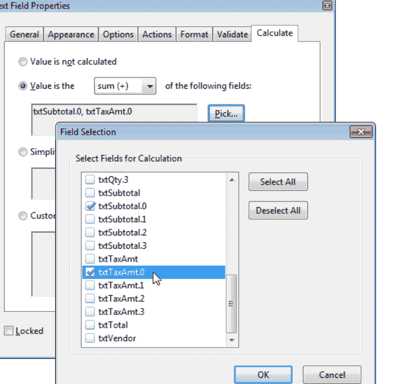


##### 这就是我们使用 Adobe 分层命名约定的原因

图 5.12 显示了输入到计算文本框中的所有四个 txtCost 字段名称。然而，由于"成本"字段的名称符合 Adobe 分层命名约定，我们可以在指定 txtTotal 计算时采取捷径。

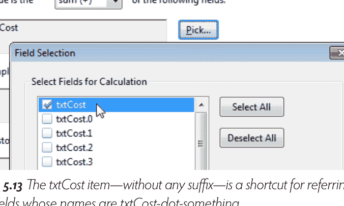

请注意，在"字段选择"对话框中，编号的 txtCost 条目前面是没有数字后缀的 txtCost 名称（图 5.13)。Acrobat 将不带后缀的版本作为所有名称是 txtCost 点号某物的字段的简写。这是使用分层命名约定的一个真正好处。


 ## 计算表单字段

约定：你可以通过字段名称的开头部分来指代整个字段族。当机会出现时，没有理由不使用这种快捷方式。

完成了！我们现在拥有了一个功能完整的订单表单，给定价格和数量后，它会自动填写所有其他信息。试一试吧。输入一些数字。给商品起些富有创意和趣味性的名称！

### 计算顺序

在我们表单中，计算发生的顺序非常重要。我们必须先计算小计，再计算税额；先计算小计和税额，再计算项目成本，依此类推。

*图 5.14* 你将在表单编辑器的"表单"窗格中设置表单字段的计算顺序。

有时你会发现 Acrobat 表单中的计算似乎按错误的顺序进行。你可以在表单编辑器中指定表单字段的计算顺序。在"表单"面板中，选择**其他任务 > 编辑字段 > 设置字段计算顺序**（图 5.14）。

> Acrobat 9 的表单编辑器没有"表单"面板。你需要通过选择 表单 > 编辑字段 > 设置计算顺序 来设置计算顺序。

Acrobat 将弹出"计算字段"对话框（**图 5.15**），其中包含当前 Acrobat 文件中所有已计算表单字段的滚动列表；字段在此列表中出现的顺序就是它们被计算的顺序。

*图 5.15* "计算字段"对话框按计算顺序列出 Acrobat 文件中的所有计算字段。你可以使用"上移"和"下移"按钮更改字段在此列表中的位置。

要更改某个表单字段在列表中的位置，只需选中它并酌情单击"上移"或"下移"按钮。

重新排列表单的字段，直到它们处于正确的计算顺序。必须先计算小计才能计算税额；必须先计算税额才能计算项目成本；必须先计算所有项目的成本才能计算总成本。因此，在列表中，小计必须在税额之上，税额必须在成本之上，成本必须在总计之上。

如果你发现表单显示了明显错误的结果，并且找不到任何单个字段计算的问题，请检查确保没有任何字段的计算顺序有误。

### 增强功能

我们可以为表单添加一些增强功能。这些完全是可选的，但从长远来看会有所回报。如果你想看到它们的实际效果，它们已应用于本章示例文件 *JSAcro_Ch05_Example_B&W.pdf* 中。（此处的"B&W"是"Bells and Whistles"的缩写。）

### 隐藏零值

到目前为止，在我们构建的表单中，与图 5.1 所示的表单存在一个明显的视觉差异。在我们版本的表单中，所有与"空"行关联的计算字段中都显示零，这是它们执行计算的结果（图 5.16）。虽然这在技术上是正确的，但在审美上令人不悦。如果我们没有指定要购买的商品，其关联的表单字段最好保持空白，而不是显示明确的零。

要消除这种视觉杂乱，我们需要更改与 txtSubtotal 和 txtTaxAmt 字段关联的计算。它们应该仅在对应的 txtQty 具有非零值时才执行计算；如果 txtQty 的值为零（如果该字段为空就会出现这种情况），那么我们的小计和税额字段应为空白——也就是说，它们的值应为 ""。

以下是 txtSubtotal.0 的新计算 JavaScript：

```
// Get the two fields we'll need
// for our calculation
var price = this.getField("txtPrice.0")
var qty = this.getField("txtQty.0")

if (qty.value != 0)      // If qty is not zero... ("!=" means "not equal to")
    event.value = price.value * qty.value   // ...then do this
else                       // Otherwise...
    event.value = ""       // ...do this.
```

记住 JavaScript if...else 命令的工作原理：if 命令后跟括号中的比较；在我们的例子中，我们比较 qty.value 和 0，测试它们是否不相等。接着，如果比较为真，则执行后面的一行或多行 JavaScript；在我们的例子中，有条件执行的单行代码执行我们的小计计算。

如果提供了 else 命令（它是可选的），则后跟比较为假时应执行的一行或多行 JavaScript；在我们的例子中，如果比较为假（即如果 qty.value 等于 0），则我们将文本字段的值设置为空字符串：""。

此更改的净效果是，如果某个商品的数量字段为空（使其值为零），则 txtSubtotal 字段将为空白。

| 单价 | 数量 | 小计 | 税额 | 成本 |
|------|------|------|------|------|
| $20.00 | 4 | $80.00 | $80.00 | $160.00 |
| | | $0.00 | $0.00 | $0.00 |
| | | $0.00 | $0.00 | $0.00 |
| | | $0.00 | $0.00 | $0.00 |

**图 5.16** 在我们当前的表单中，零值字段显示的值——可想而知——是零。如果这些字段是空白的，我们的表单看起来会更美观。

要将相同的效果应用于 txtTaxAmt 字段，你应该将它们的值计算更改为：

```
var subtotal = this.getField("txtSubtotal.0")

if (subtotal.value != 0)
    event.value = gTaxRate * subtotal.value
else
    event.value = ""
```

这与 txtSubtotal.0 字段的推理完全相同，只是我们检查 txtSubtotal.0 的值是否为零，以决定是否在我们的税额字段中放入空白。

你应该将 **if...else** 块添加到所有四个 txtSubtotal 和 txtTaxAmt 字段中。

### 预定义计算

不幸的是，任何使用预定义计算的字段（例如我们的 txtCost 字段），如果其值为 0，将继续显示 "0.0"。这大概是使用 JavaScript 而非预定义计算的唯一理由。

如果我们希望 txtCost.0 字段在为零时能正确地显示为空白，我们需要用 JavaScript 而非预定义的求和来计算其值：

```
var subtotal = this.getField("txtSubtotal.0")
var tax = this.getField("txtTaxAmt.0")

if (subtotal.value != 0)         // If subtotal is not zero...
    event.value = subtotal.value + tax.value  // ...do this
else                              // Otherwise...
    event.value = ""               // ...do this
```

这比使用预定义计算要多一些工作，但它确实带来了视觉改进，使零值总计显示为空白。

### "全局"税率

假设在你设计此表单很久之后，你所在地区的税率发生了变化。在我们的表单中，我们使用税率（.08）来计算 txtTaxAmt 字段的值：

```
event.value = .08 * subtotal.value
```

我们的表单有四个这样的字段；在其他表单中，税率可能在整个复杂表单的数十个字段中被使用。

追踪所有这些对税率的引用并将 .08 替换为，比如说，.09#ifndef BEST
，即使不是不可能的，也充其量是繁琐的。

碰巧的是，最初设计表单时很容易就能让其便于更改所有对税率的引用。我们将在表单中添加一个文档级 JavaScript，它只做一件事：定义一个包含我们税率的变量。

第 2 章中未提及的一点是，在文档级 JavaScript 中定义的变量可以被 Acrobat 文档中的任何 JavaScript 使用。既然如此，我们表单中任何需要引用税率的 JavaScript 都可以使用该税率变量的名称，而不是直接使用数值。如果我们稍后修改文档级 JavaScript，更改赋给税率变量的值，所有使用该变量的 JavaScript 都会使用新的税率。一举之力，我们就能更改整个表单中使用的税率。

像我们的税率这样可以在整个 Acrobat 文件中使用的变量被称为全局变量。你在文档级 JavaScript 中定义的任何内容都是全局的，即对文档中的所有 JavaScript 可用。

### 创建文档级 JavaScript

你可能需要回顾第 2 章，了解文档级 JavaScript 的一般行为和创建的详细描述。在这里，我们只需列出创建我们这个特定 JavaScript 的步骤

**创建税率 JavaScript：**

打开 Acrobat 文档并选择手形工具。

- 1. 在 Acrobat 中，选择*道道工具 > JavaScript > 文档级 JavaScript**。Acrobat 将弹出"JavaScript 函数"对话框*（图 5.17）*。
2. 在"脚本名称"文本框中，输入"TaxRate"或其他描述性标签。
3. 单击"添加"按钮。

Acrobat 将弹出标准的 JavaScript 编辑器，其中已预先输入了一些（对我们目的无用的）代码。


## 5. 计算表单域

+   4 删除 JavaScript 编辑器中的默认代码，并输入以下内容：

```
var gTaxRate = .08
```

这一行 JavaScript 创建了一个名为 **gTaxRate** 的变量，并为其赋值 .08（图 5.18）。（我总是用小写字母 g 作为全局变量名的前缀；这样，当我看到其他 JavaScript 中使用的变量名时，我就知道它是一个在文档 JavaScript 中定义的全局变量。）

+   5 关闭所有对话框，直到返回 Acrobat 文档。

我们现在已经创建了一个文档 JavaScript，它创建了我们的全局变量 **gTaxRate**。

### 使用全局变量

现在我们需要修改四个 txtTaxAmt 的计算，以便它们使用 **gTaxRate**，而不是直接使用数字 .08。

和往常一样，我将引导你修改 txtTaxAmt.0，并让你自己修改其他三个 txtTaxAmt 字段。

### 应用新的全局变量：

在 Acrobat 中打开表单并选择表单工具。

+   1 双击 txtTaxAmt.0 以打开字段属性对话框。

+   2 转到“计算”面板。

+   3 单击“计算 JavaScript”旁边的“编辑”按钮。

你现在将看到 JavaScript 编辑器显示我们当前的 JavaScript，其计算公式为：

```
event.value = .08 * subtotal.value
```

+   4 将计算中的 .08 替换为名称 **gTaxRate**。

```
event.value = gTaxRate * subtotal.value
```

你的计算行现在应该如图 5.19 所示。

+   5 关闭所有对话框，直到返回 Acrobat 文档。

你应该对所有四个 txtTaxAmt 计算 JavaScript 进行上述更改。

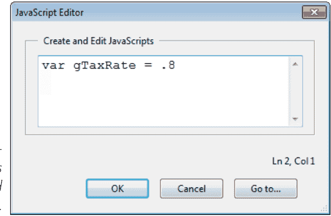

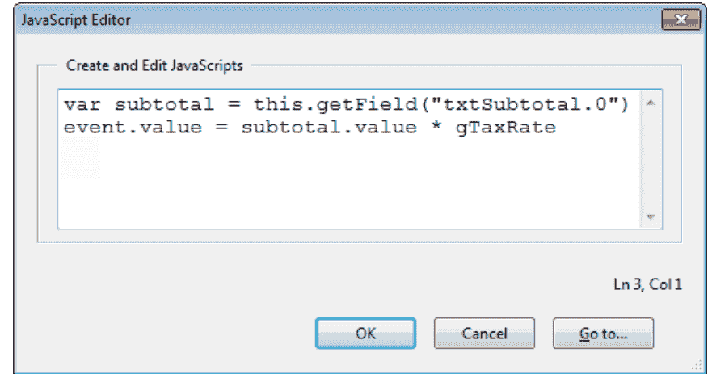

## 5. 计算表单域（续）

完成此操作后，你将不会立即看到任何变化。毕竟，我们的税率没有改变；我们只是通过一个变量来获取它，而不是直接使用数字。

### 更改税率

为了明白这个更改为何有用，假设你所在地区的税率发生了变化（可能是增加了）。要一次性做出所有必要的更改，你只需在文档 JavaScript 中更改 **gTaxRate** 的值：

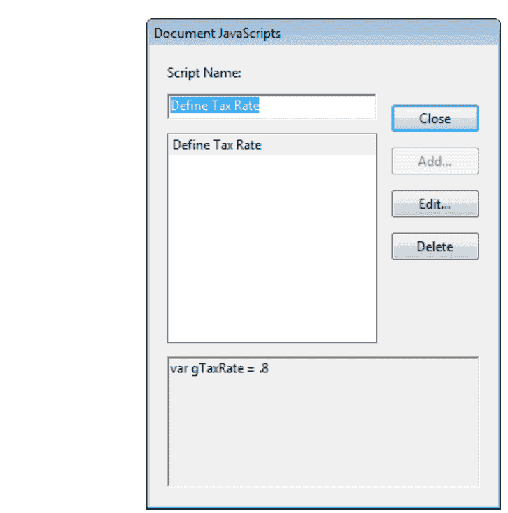

### 要更改表单中所有项目的税率计算：

+   1. 在工具窗格的 JavaScript 面板中，选择“文档 JavaScript”。
    你将看到“文档 JavaScript”对话框。
2. 在列表中选择 TaxRate JavaScript（如**图 5.20** 所示），然后单击“编辑”按钮。
3. 在 JavaScript 编辑器中，将税率更改为 .09 或任何你想要的其他数字：
    `var gTaxRate = .09`
4. 退出所有对话框，直到返回 Acrobat 文档。
5. 检查税额字段；所有四个字段现在都将包含反映新税率的计算值。

通过在文档 JavaScript 中更改单个税率值，我们更新了整个表单中所有 JavaScript 使用的税率。在这种情况下，只有四个这样的 JavaScript；在一个更大的表单中，可能有几十个。

*图 5.20 要更改表单中所有 JavaScript 使用的税率，只需在文档 JavaScript 中更改 gTaxRate 的值。*

# 第 6 章
## 自动输入表单数据

电子表单的优点之一是它们能够提供用户原本需要输入的信息。例如，当用户在电子订单表单中选择要购买的产品时，表单应该能够填写正确的单价并计算总成本。

为此，表单必须包含一个产品及其价格的表格。每次用户选择一个产品时，表单必须在该表格中查找该项目并获取该项目的价格。

这正是我们将在本章学习的内容：如何在表单中构建一个项目和价格的表格，然后从该表格中获取信息以自动填写表单域。

### 本章我们将学习什么

在本章中，我们将学习如何：

- 创建和使用 JavaScript 数组
- 构建和使用数字表格
- 创建击键 JavaScript
- 使用下拉列表导出值

## 项目

*(文件: JSAcro_Ch06_Example_Final.pdf, JSAcro_Ch06_Example_Start.pdf)*

在本章中，我们将把订单表单中的下拉列表字段（**图 6.1**）链接到同一表单中的每加仑价格字段。当用户从下拉列表的菜单中选择新口味时，表单将更改每加仑价格以反映所选产品，然后重新计算总成本（**图 6.2**）。

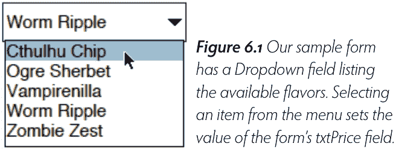

查看**图 6.3**，我们可以看到此表单有四个字段：一个下拉列表 (ddnFlavor) 和三个文本字段 (txtGallons, txtPrice, 和 txtTotal)。我们最关心的字段是下拉列表；我们将向此字段添加一个 JavaScript，以更改 txtPrice 和 txtTotal 字段来反映用户选择的冰淇淋。

具体来说，当我们从其菜单中选择一个项目时，下拉列表字段必须做三件事：

- 查找该项目的价格。
- 将 txtPrice 的值设置为该项目的价格。
- 重新计算 txtTotal 的值。

让我们看看如何做到这一点。

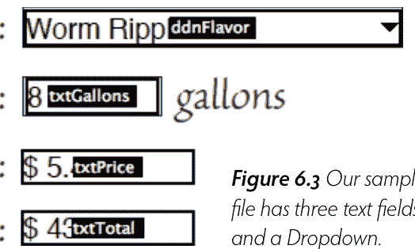

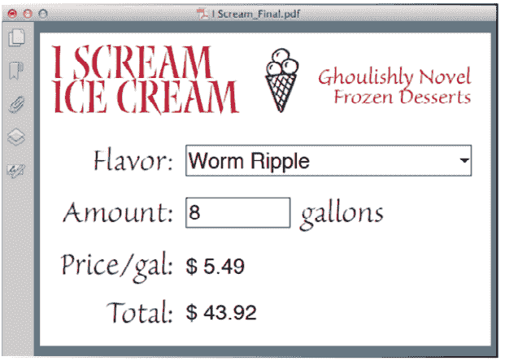

## 6. 自动输入表单数据

## JavaScript

### 方法

在这个程序中，我们需要为下拉列表菜单中的项目构建一个价格表。我们将使用 JavaScript **Array** 对象来完成此操作。**Array** 对象代表一个列表——在我们的例子中，是一个价格列表。列表中的每个项目都可以通过其在列表中的位置或通过一个 **关键字**（一个我们已与该列表中的值关联的字符串）来查找。在我们的例子中，我们将使用下拉列表中每个项目的导出值（见下一节）作为我们用来获取该项目价格的关键字。

> **那么，什么是“下拉列表”？**
“下拉列表”是 Adobe 对以前称为组合框的东西的命名。该术语在 Acrobat X 中引入。

我们需要为表单编写两个 JavaScript：

- 一个创建价格表的文档 JavaScript。此脚本将创建一个 **Array** 对象，然后用导出值和关联价格的配对加载它。
- 一个附加到我们下拉列表的 JavaScript，该脚本在价格表中查找当前的 **导出值**（我们稍后会讨论这个），并使用所得价格来设置 txtPrice 和 txtTotal 字段的值。

#### 下拉列表导出值

下拉列表菜单中的每个项目都有两段相关文本：

- 实际出现在弹出菜单中的 *项目文本*。
- 当表单数据导出到文件或提交进行处理时，表示下拉列表选定值的 **导出值**。

下拉列表中每个项目的文本和导出值由表单设计者在“字段属性”对话框中设置（图 6.4）。

如果你检查我们下拉列表的属性，你会在菜单中找到五个项目，其导出值分别为：Ccp、Ogr、Vla、WR 和 ZZ。这些值没有什么特别之处；我只是选择它们作为菜单项文本的粗略缩写。（因此，“Ccp”是“Cthulhu Chip”的导出值。）

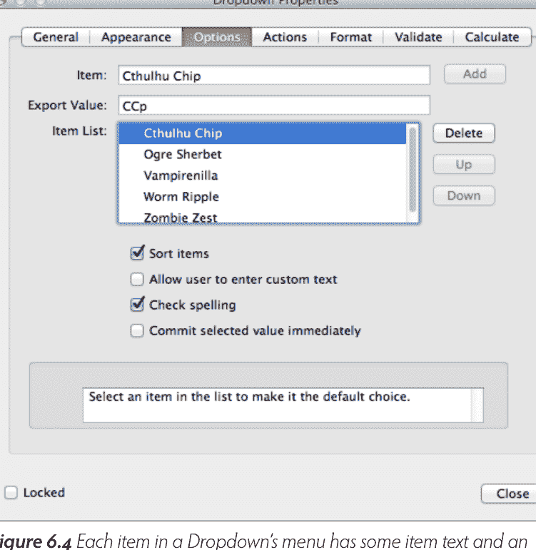

我们的 JavaScript 将把每个导出值与该冰淇淋的每加仑价格相关联。

*图 6.4 下拉列表菜单中的每个项目都有一些项目文本和一个导出值。你在“下拉列表属性”对话框中设置这些。*

## 6. 自动输入表单数据（续）

### 创建价格列表数组

我们的第一个 JavaScript 是一个创建价格列表的文档脚本。这将是一个包含配对导出值和价格的 **Array** 对象。有关文档 JavaScript 的完整讨论，请参阅第 2 章。

**要创建文档脚本：**

在 Acrobat 中打开表单文件。

+   在工具窗格的 JavaScript 面板中，选择“文档 JavaScript”。

Acrobat 将为你呈现“文档 JavaScript”对话框（**图 6.5**）。

+   在“脚本名称”框中，输入名称“PriceList”或类似描述性的名称。

+   单击“添加”按钮。

Acrobat 将向你呈现通常的 JavaScript 编辑器窗口，其中包含一些初始 JavaScript 代码。

+   删除默认的 JavaScript 代码并输入以下 JavaScript（**图 6.6**）：

```
var gPriceList = new Array      // 创建一个对新数组的引用

// 用产品的价格加载数组：
gPriceList["Ccp"] = 12          // Ccp 的每加仑价格是 $12.00
gPriceList["Ogr"] = 9.25        // ...等等。
gPriceList["Vla"] = 7
gPriceList["WR"] = 5.49
gPriceList["ZZ"] = 2.75
```

+   退出所有对话框，直到返回 Acrobat 页面。

此时，你不会在表单中看到任何不同的东西。我们新的 JavaScript 创建了一个价格列表数组，但我们还没有用它做任何事情。

##### 代码详解

```
var gPriceList= new Array
```

JavaScript **new** 命令创建一个新对象，在本例中是一个新的 **Array** 对象。我们将新创建的 **Array** 对象分配给一个全局变量 **gPriceList**（由 **var** 命令创建）。由于这发生在文档 JavaScript 中，**gPriceList** 将是全局的，即可在我们 Acrobat 文件中的任何 JavaScript 中使用。


**图 6.5** 为你的文档 JavaScript 输入一个名称（本图中为“PriceList”）并单击“添加”按钮。


**图 6.6** 我们的文档 JavaScript 将创建一个包含 I Scream 价格列表的数组。


## 6. 自动输入表单数据

```
gPriceList["Ccp"] = 12
```

这里我们将价格与下拉列表中的导出值关联起来。数组名（**gPriceList**）后跟一对方括号，其中包含一个值，表示列表中的某个条目。方括号内的值可以是一个数字，用于指定我们想要的特定项目在列表中的顺序位置，也可以是一个带引号的字符串，表示与所需项目关联的关键词。

在我们的例子中，我们正在为列表中的 **Ccp** 条目赋值。上面这行 JavaScript 代码，翻译成中文是："在数组 **gPriceList** 中，将数字 12 赋给关键词 **Ccp**"。

我们对下拉列表中的所有六个导出值都重复此操作。

### 创建下拉列表脚本

现在我们需要教会我们的下拉列表如何查找导出值并利用它们做一些有用的事情。

我们打算为下拉列表附加一个**击键 JavaScript**。这是一种每次用户在下拉列表中输入一个字符时就会执行的 JavaScript。令人惊讶的是，当用户从下拉列表菜单中选择一个项目时，这个脚本也会被调用。

因此，当用户从下拉列表菜单中选择一个项目时，Acrobat 将执行我们的击键 JavaScript，该脚本将执行我们的表格查找、更改 txtPrice 的值，并最终计算 txtTotal 的新值。

**将击键 JavaScript 附加到下拉列表：**

在表单编辑器中打开表单。

- 1. 双击下拉列表字段以获取其属性。

Acrobat 将向您展示下拉列表属性对话框（**图 6.7**）。

- 2. 转到“格式”选项卡。

- 3. 在“类别”弹出菜单中选择“自定义”。

- 4. 单击“自定义击键脚本”文本框旁边的“编辑”按钮。

您现在将看到熟悉的 JavaScript 编辑器。


- 5. 输入以下脚本：

```
// 获取对表单字段的引用。
var priceFld = this.getField("txtPrice")
var totalFld = this.getField("txtTotal")
var quantityFld = this.getField("txtGallons")

// 新的导出值是我们的价格列表中的关键词吗？
if (event.changeEx in gPriceList)
    priceFld.value = gPriceList[event.changeEx]     // 是：获取价格

// 现在计算总价的新值
totalFld.value = quantityFld.value * priceFld.value
```

- 6. 单击“确定”关闭所有对话框。

- 7. 试试看：从弹出菜单中选择不同的项目，观察每加仑价格和总成本字段的值变化。

##### 代码详解

```
var rateFld = this.getField("txtPrice")
var totalFld = this.getField("txtTotal")
var quantityFld = this.getField("txtGallons")
```

此脚本首先获取我们需要访问的三个文本字段的引用，并将这些引用放入适当命名的变量中。

```
if (event.changeEx in gPriceList)
```

我们在这里执行一个 JavaScript **if** 命令，检查新的导出值是否是我们 **gPriceList** 数组中的有效关键词。在下拉列表的击键 JavaScript 中，**event.changeEx** 指新选中菜单项的导出值。短语 **(event.changeEx in gPriceList)** 翻译过来就是："在 **Array** 对象 **gPriceList** 中是否存在与我们导出值匹配的关键词？"

```
rateFld.value = gPriceList[event.changeEx]
```

这是当 **event.changeEx** 是 **gPriceList** 中的关键词时，**if** 执行的那行 JavaScript 代码。

短语 **gPriceList[event.changeEx]** 获取 **gPriceList** 数组中与导出值相关联的值。换句话说，这个短语给出了当前在下拉列表中选择的项目的价格。我们将 txtPrice 字段的值设置为这个数字。txtPrice 字段将立即显示新的每加仑价格。

### 格式化您的代码

JavaScript 在允许您添加空格或制表符以使代码可读方面非常宽容。您可以缩进您的 JavaScript 以任何您希望的方式，以改善其可扫描性。例如，我通常缩进跟在 **if** 命令后面的语句，以强调它们只有在比较为真时才会被执行：

```
if (event.changeEx in gPriceList)
    rateFld.value = gPriceList[event.changeEx]
```

同样，我通常使用制表符和空格的某种组合将我的注释与可执行的 JavaScript 代码分开；我也尽量使它们对齐：

```
gPriceList["Ccp"] = 16     // Ccp 每加仑 16 美元
gPriceList["Ogr"] = 12     // ...等等。
```

这使它们更具可读性，并且更赏心悦目（至少对我来说是这样）。您可以为您的 JavaScript 语句留出双倍间距，并根据需要添加空格和制表符。您的目标应该是使您的程序尽可能易读。这不仅是对他人的服务，也是对您自己在数月后重新审视程序时的服务。

```
totalFld.value = quantityFld.value * rateFld.value
```

最后，我们将 txtTotal 字段（位于 **totalFld** 变量中）的值更改为数量和费率的乘积。后两个数字我们从 txtGallons 和 txtPrice 字段获取。

### 创建数组

在我们的文档 JavaScript 中，我们创建了一个 Array 对象，然后在单独的步骤中用值填充它：

```
var gPriceList = new Array

gPriceList["Ccp"] = 12
gPriceList["Ogr"] = 9.25
gPriceList["Vla"] = 7
```

数组中的每个条目将一个关键词（Ccp、Ogr 等）与一个数值相关联，代表该冰淇淋的每加仑价格。还有另一种创建数组的方法，如果您创建的是一个相对较小的数组，并且您将根据其在数组中的位置来检索其内容，那么这种方法非常方便。使用我们目前的技术，我们将使用类似以下代码来创建这样的数组：

```
var gPriceList = new Array

gPriceList[0] = 12
gPriceList[1] = 9.25
gPriceList[2] = 7
```

我们通过**索引**引用此数组中的各个项目，即通过其在数组中的位置：

```
total = amount * gPriceList[1]  // 总价是数量乘以 9.25
```

我们可以使用一种替代格式非常方便地创建这样的数组：

```
var gPriceList = { 12, 9.25, 7}
```

实际上，这同时创建了一个数组并加载了值。大括号中逗号分隔的值（可以是任何类型的数据：数字、字符串、布尔值等）按它们出现的顺序加载到数组中。上面这行代码与前面更长的代码块完全等效。

---

# 第 7 章
## 悬停帮助

每个精心设计的表单都需要某种机制来提示用户如何填写表单。在 Acrobat 中最常用的方法是通过 Acrobat 表单机制内置的工具提示帮助。这是许多应用程序的标准机制：将鼠标指针悬停在表单字段上，大约半秒后，一个有用的提示将出现在一个浮动窗口中（图 7.1）。

在本章中，我们将了解如何实现一种替代方案：悬停帮助。这是当鼠标指针进入表单字段时自动出现的文本；没有像工具提示帮助那样的半秒延迟。请在图 7.2 上尝试一下。

使用悬停帮助而不是工具提示帮助纯粹是基于您希望表单给填写者带来何种“感觉”的美学决策。

| 本章我们将学到什么 |
| --- |
| 在本章中，我们将学习如何： |
| - 创建 Mouse Enter 和 Mouse Exit JavaScript |
| - 创建帮助文本表 |


## 7. 悬停帮助

## 项目

(*JSAcro_Ch07_Example_Start.pdf*, *JSAcro_Ch07_Example_End.pdf*)

我们将为 **图 7.3** 中表单的文本字段添加悬停帮助。每当鼠标指针移动到某个文本字段上时，一段帮助文本将出现在表单底部的彩色区域中，类似于我们在图 7.2 中的工作示例。

此表单中有四个文本字段（**图 7.4**）。顶部的三个收集数据：申请人的姓名、地址和所申请的职位；底部的字段 txtHelp 是一个不可见的文本字段，位于构成表单设计一部分的绿色矩形上方。

txtHelp 字段不可见，不是因为它在字段属性对话框中选择了“隐藏”属性，而是因为它没有背景或边框颜色（**图 7.5**），并且其中没有初始文本。只有当它有文本要显示时，它才会变得可见。

为了制作我们的悬停帮助，每当鼠标指针进入三个数据收集文本字段之一时，该字段中的一个 JavaScript 将把相应的帮助文本放入 txtHelp 字段中。当指针离开文本字段时，它的 JavaScript 将从 txtHelp 中移除文本。


*图 7.3 每当鼠标指针悬停在此表单的某个文本字段上时，一些帮助文本将出现在底部的彩色框中。*


*图 7.4 我们的表单有四个文本字段；三个用于收集数据，第四个用于显示帮助文本。*


*图 7.5 帮助文本字段不可见，因为它没有填充或边框颜色，也没有初始文本。*

## JavaScript

### 方法

我们将需要为三个数据收集字段中的每一个准备两个 JavaScript：

- 一个附加到字段 Mouse Enter 事件的 JavaScript，将相应的帮助文本放入 txtHelp 字段

  请记住，当鼠标指针进入表单字段的边界时，会发生 Mouse Enter 事件。

- 一个附加到字段 Mouse Exit 事件的 JavaScript，从 txtHelp 中移除文本

  请记住，当鼠标指针再次离开表单字段时，会发生 Mouse Exit 事件。


 ## 7. 悬停帮助

## 代码

让我们开始将两个 JavaScript 附加到 txtName 字段。要完成表单，你需要对其余每个数据收集字段执行以下步骤。

### 将鼠标进入和鼠标退出 JavaScript 附加到姓名字段

在 Acrobat 表单编辑器中打开表单开始（这样字段会显示为带手柄的矩形）。


1. 双击 txtName 字段以访问其属性（**图 7.6**）；进入字段属性对话框的操作面板。

2. 在触发器弹出菜单中选择 JavaScript，在操作弹出菜单中选择运行 JavaScript。

   对话框现在将如图 7.6 所示。

3. 点击添加按钮。

   Acrobat 将打开 JavaScript 编辑器。

4. 在 JavaScript 编辑器中输入以下内容：

```
var help savingAccountBalance = accountBalance // Get reference to help field
helpText.value = "What's your full name?"   // 将其值设置为帮助文本
```

5. 点击确定返回到字段属性对话框。

   你的新 JavaScript 现在将出现在操作列表中（**图 7.7**）。


6. 对鼠标退出事件重复步骤 2 到 5，在 JavaScript 编辑器中输入以下 JavaScript：

```
var helpText = this.getField("txtHelp")   // 获取帮助字段的引用
helpText.value = ""                       // 将其值设置为空
```

7. 关闭属性对话框并退出表单编辑器，以便回到 Acrobat 页面。


8. 试试看：点击手形工具，然后将鼠标指针移到姓名字段上方；你应该会看到帮助文本出现在彩色框中（**图 7.8**）。

要完成表单，请对 txtAddress 和 txtPosition 字段重复这些步骤，为每个字段使用适当的帮助文本。

*代码详解*

首先来看鼠标进入 JavaScript：

```
var helpText = this.getField("txtHelp")
```

我们首先获取帮助文本字段 txtHelp 的引用。我们将这个引用赋值给变量 **helpText**。

```
helpText.value = "What's your full name?"
```

现在我们将 txtHelp 字段的值设置为我们的帮助文本 "What's your full name?"。文本字段的值是显示给用户看的文本。当我们设置字段的值时，它会立即显示该文本。在我们的例子中，这个脚本会在鼠标指针进入 txtName 字段时显示帮助文本。

鼠标退出 JavaScript 与鼠标进入脚本几乎完全相同：

```
var helpText = this.getField("txtHelp")
helpText.value = ""
```

它获取 txtHelp 字段的引用，但这次将其值设置为 ""。开合引号连在一起，中间没有任何内容，表示"无文本"（也称为**空字符串**）。txtHelp 字段不包含任何文本，因此当鼠标指针离开 txtName 时，帮助文本实际上会再次消失。

### 增强改进

(*JSAcro_Ch07_Example2_Start.pdf, JSAcro_Ch07_Example2_Final.pdf*)

我们当前的悬停帮助工作得很好。如果有什么可抱怨的，那就是我们的帮助文本片段分散在所有文本字段的 JavaScript 中；如果我们想重写帮助条目——比如说，将其翻译成西班牙语——我们就得逐一找到并修改它们。

如果能把所有帮助文本字符串集中到一个地方，将便于维护和修改。我们可以通过将所有字符串放入 JavaScript **Array** 对象来实现这一点。你可能还记得第 6 章中的内容，**Array** 对象在 JavaScript 代码中体现了一个列表——在我们的例子中，是一个帮助文本字符串的列表。

我们将在文档脚本中创建帮助文本数组，以便文档中的每个其他 JavaScript 都能使用它。特别是，我们的表单字段 JavaScript 将能够使用数组中的字符串，而不是在字段脚本本身中直接使用引号内的文本。

要实现这种新方法，我们需要做两件事：

- 编写一个创建包含所有适当帮助文本的 **Array** 对象的文档脚本。
- 修改所有表单字段中的鼠标进入 JavaScript，使它们使用这个全局数组中的帮助文本（"全局"是因为该数组在我们的表单中随处可访问）。

这种修改完全是可选的，但从长远来看是值得的，特别是对于具有大量悬停帮助文本的大型复杂表单。

### 文档脚本

要创建新的文档脚本，在 Acrobat 中打开表单文件并执行以下操作：

1. 在工具窗格的 JavaScript 面板中，选择文档脚本（**图 7.9**）。

   Acrobat 将打开文档脚本对话框（**图 7.10**）。

2. 在脚本名称框中，输入名称 "HelpText" 或类似的描述性名称。

   请记住，文档脚本都必须有名称。

3. 点击添加按钮。

   Acrobat 将打开熟悉的 JavaScript 编辑器（**图 7.11**），其中包含一些初始 JavaScript 代码。

4. 将默认 JavaScript 代码替换为以下 JavaScript；此脚本创建一个数组，并一次性加载字符串；稍后会详细讨论：

5. 点击确定退出对话框，直到回到 Acrobat 页面。

```
var gHelpText = [                   // 创建数组变量 gHelpText
    "What's your full name?",         // 字符串 #0
    "Where do you live?",             // 字符串 #1
    "What is it you're hoping to do here?", // 字符串 #2
]
```

此时你在表单中不会看到任何不同。我们的新 JavaScript 创建了一个帮助文本字符串的列表，但表单尚未对其进行任何操作。我们稍后会教表单使用新数组，但首先，让我们深入了解我们的 JavaScript。


虽然我们稍后会详细讨论，但首先来看看：

##### 代码详解

```
var gHelpText = [...]
```

虽然不太明显，但这个文档脚本中只有一条 JavaScript 语句：创建数组并加载一系列值的语句。**var** 命令像往常一样创建一个变量——在这种情况下，名为 **gHelpText**。（名称开头的 **g** 表示这是一个全局可访问变量；这是我自己的命名约定，不是 JavaScript 的要求。）

当变量名后跟一对方括号时，如本例所示，**var** 命令将该变量创建为数组，并将它在括号内找到的项目列表放入数组中：

```
[
    "What's your full name?",
    "Where do you live?",
    "What is it you're hoping to do here?",
]
```

在这种情况下，数组中填充了三个字符串的列表，每个字符串都是我们表单字段的一个帮助文本片段。

这就是我们的文档脚本需要做的全部工作。**gHelpText** 数组现在成为我们所有帮助文本的存储库。其他 JavaScript 可以使用以下语法访问这些字符串：

```
gHelpText[2]
```

括号中的数字是我们在 **gHelpText** 数组中想要的字符串的顺序位置。数组中的项目从零开始编号，因此 **gHelpText[0]** 将引用我们列表中的字符串 "What's your full name?"。

### 新的表单字段 JavaScript

现在我们已经创建了一个全局可用的帮助文本数组，我们需要教我们的表单字段脚本使用它。具体来说，在每个文本字段中，我们需要更改与鼠标进入事件关联的脚本。

这是 txtName 字段鼠标进入 JavaScript 的新版本：

```
var helpText = this.getField("txtHelp")     // 获取帮助字段的引用
helpText.value = gHelpText[0]              // 将其值设置为帮助文本
```

这与我们之前的鼠标进入脚本完全相同，只有一处变化：在代码的第二行，我们将文本字段的值设置为 **gHelpText** 数组中的第 0 号字符串（"What's your full name?"），而不是像之前那样直接在此脚本中用引号包含该字符串。


## 7. 悬停帮助

我们需要更改每个文本字段中的“鼠标进入”JavaScript，使用适当的数字位置来对应每个字段的帮助文本。

对用户而言，我们的表单看起来与之前并无不同。然而，将来修改帮助文本（例如，以支持其他语言）将会容易得多，因为所有文本都集中存放在表单中的一个位置。

相信我，对于复杂的表单，你会发现这种技术非常有用。

## 第8章
动态表单字段

Acrobat 表单中最常见的"特效"之一，就是根据对其他表单字段的响应来显示或隐藏表单字段。例如，点击标有"自雇"的复选框，一系列文本字段可能会出现，询问你的企业名称、联邦纳税人ID和其他相关信息；如果你取消勾选该复选框，这些文本字段就会全部消失。

我将这种效果称为表单字段的**渐进显示**。这些字段并非一开始都可见；隐藏的字段只会在用户从可见控件中进行选择或以其他方式与之交互时才向用户显示。**图 8.1** 展示了这种技术的一个简单示例。

在本章和下一章中，我们将介绍如何实现这一效果。本章介绍一种切换相对较少数量的表单字段可见性的技术。在下一章中，我们将了解如何按命令显示整页的表单字段。

**本章我们将学习的内容**

在本章中，我们将学习如何：

- 切换字段的可见性
- 检测复选框的值
- 当下拉菜单发生变化时执行脚本
- 将JavaScript附加到多种控件类型


## 8. 动态表单字段

### 项目 1：将JavaScript附加到复选框

(JSAcro_Ch08_Example1_Start.pdf, JSAcro_Ch08_Example1_End.pdf)

我们将为图 8.2 所示的表单添加渐进显示功能。最初，用户可见的唯一控件是复选框。当用户选中该复选框时，两个下拉菜单和一个按钮会显示出来，允许用户指定作者和书籍并提交请求（图 8.3）。如果用户取消选中该复选框，则下拉菜单和按钮会再次消失。


图 8.2 *我们将为本文档中的表单字段添加渐进显示功能。最初可见的唯一表单字段是复选框。*

图 8.3 *当用户点击复选框时，表单中的其他字段变为可见。*

图 8.4 显示了我们Acrobat文件中的表单字段。共有四个：

- **chkYes** 是让用户声明想要免费书籍的复选框。
- **drpAuthor** 是用户可以选择作者的下拉菜单。
- **drpTitle** 是用户可以选择书名的下拉菜单。
- **btnSubmit** 是标准的提交数据按钮。


其中，只有 chkYes 在文档首次打开时可见；其他字段都被隐藏（在"字段属性"对话框中设置）。其他字段将通过我们要编写的JavaScript变得可见。

图 8.4 *我们的表单有四个字段：一个复选框、两个下拉菜单和一个按钮。最初只有复选框可见。*

## 8. 动态表单字段

## JavaScript

#### 分析问题

从概念上讲，这是一个相当简单的问题。每个表单字段都有一个名为 **hidden** 的布尔（真或假）属性，该属性决定该字段是否可见；如果 **hidden** 设置为 **true**，则该字段对用户不可见。（我发现这始终与直觉相反。尽管多年来一直在操作 `hidden` 属性，我仍然期望 **true** 表示可见；事实正好相反。）

我们需要编写一个JavaScript来切换两个下拉菜单和按钮的 **hidden** 属性。我们将把这个JavaScript附加到复选框字段的"鼠标释放"事件。该JavaScript会检查复选框是否被选中。如果复选框被选中，则JavaScript会将其他字段的 **hidden** 属性设置为 **false**，使它们对用户可见；否则，脚本会将 **hidden** 属性设置为 **true**，隐藏其他字段。

我们的JavaScript如何知道复选框是否被选中？我们可以查看该字段的**导出值**。（复选框的导出值是当复选框被选中时该字段具有的值。）创建此表单时，我将复选框的导出值设置为字符串"Yes"（**图 8.5**）。我们的JavaScript只需查看复选框的 **value** 属性，看它是否为"Yes"，然后适当地设置其他字段的 **hidden** 属性。


**图 8.5** 我最初创建表单时将复选框的导出值设置为"Yes"。

### 复选框脚本

首先，转到chkYes复选框的"字段属性"对话框中的"动作"面板（**图 8.6**）。（请参阅第1章了解如何到达该位置。）

**要将JavaScript附加到复选框：**

1. 在"动作"弹出菜单中，选择"鼠标释放"事件；在"动作"菜单中选择"运行JavaScript"。
2. 点击"添加"按钮。

Acrobat 将显示你熟悉的JavaScript编辑器（**图 8.7**，下一页）。


**图 8.6** 我们将一个JavaScript动作附加到复选框的鼠标释放动作。

3. 在JavaScript编辑器中输入以下脚本：

```
// Get references to the form fields
var authorFld = this.getField("drpAuthor")
var titleFld = this.getField("drpTitle")
var submitBtn = this.getField("btnSubmit")

if (event.target.value == "Yes") {
    authorFld.hidden = false
    titleFld.hidden = false
    submitBtn.hidden = false
}
else {
    authorFld.hidden = true
    titleFld.hidden = true
    submitBtn.hidden = true
}
```


4. 退出所有对话框，直到再次看到你的Acrobat页面。

5. 试一下：关闭表单编辑并点击复选框；所有其他表单字段应该显示在页面上。取消勾选该复选框，其他字段将消失。

##### 代码详解

```
var authorFld = this.getField("drpAuthor")
var titleFld = this.getField("drpTitle")
var submitBtn = this.getField("btnSubmit")
```

我们首先获取三个表单字段的命名引用，我们将要操作这些字段的可见性。我们需要这些引用来访问它们的 **hidden** 属性。

请记住，你可以为变量起任何你喜欢的名字。我选择 **authorFld**、**titleFld**、**submitBtn** 这些名称，因为它们具有描述性且相对简短。你可以选择任何你喜欢的名称，只要这些名称对JavaScript而言没有特殊含义即可。（例如，将变量命名为 **if** 就是个坏主意；JavaScript会将其理解为 **if-else** 语句的一部分。）

```
if (event.target.value == "Yes") {
```

我们执行 **if** 命令，它检查复选框的值是否为"Yes"。如果是，则 **if** 执行括号比较后面大括号中的JavaScript语句。请记住，双等号（==）表示"等于"。

短语 `event.target.value` 乍一看很奇怪，但如果你从左到右逐字理解，就会变得清晰。你可能还记得前几章的内容，`event.target` 是对触发此JavaScript的表单字段的引用；在这种情况下，事件的目标是我们的复选框。由于 `event.target` 是我们的复选框，`event.target.value` 就是我们复选框的值。如果复选框被选中，该值将是"Yes"（复选框的导出值）。

```
authorFld.hidden = false
titleFld.hidden = false
submitBtn.hidden = false
```

在这里，我们通过将它们的 `hidden` 属性设置为 `false` 来使两个下拉菜单和提交按钮可见。（既然它们没有被隐藏，那它们一定是可见的，对吧？）

```
else {
    authorFld.hidden = true
    titleFld.hidden = true
    submitBtn.hidden = true
}
```

`else` 命令指定了如果前面的 `if` 比较不为真时应该发生什么；在我们的例子中，这就是复选框未被勾选的情况。如果前面的比较不为真，则 `else` 执行大括号中的JavaScript语句，将字段的 `hidden` 属性设置为 `true`，使它们消失。

### 简化 if–else 代码块

我们的程序有一个较大的 `if-else` 代码块，根据复选框的值来设置字段的 `hidden` 属性。

```
if (event.target.value == "Yes") {     // Is the check box selected?
    authorFld.hidden = false            // Yes: make the form fields visible
    titleFld.hidden = false
    submitBtn.hidden = false
}
else {                                  // No: Hide the form fields again
    authorFld.hidden = true
    titleFld.hidden = true
    submitBtn.hidden = true
}
```

注意，如果 `if` 后面的比较短语为 `true`，我们将所有 `hidden` 属性设置为 `false`，反之*亦然*；也就是说，我们将 `hidden` 属性设置为比较结果的相反值。我们可以利用这一事实来简化代码，使其可读性稍差，但更加简洁。以下是新的JavaScript：


## 8. 动态表单字段

```
// Get references to the form fields
var authorFld = this.getField("drpAuthor")
var titleFld = this.getField("drpTitle")
var submitBtn = this.getField("btnSubmit")

// Set each "hidden" property to true if the target value doesn't equal "Yes"
authorFld.hidden = (event.target.value != "Yes")
titleFld.hidden = (event.target.value != "Yes")
submitBtn.hidden = (event.target.value != "Yes")
```

请注意，**if-else** 代码块已经完全消失，取而代之的是三行赋值语句，每行负责设置一个字段的 **hidden** 属性。在每种情况下，我们都是将 **hidden** 属性设置为以下比较的 _结果_（true 或 false）：

```
(event.target.value != "Yes")
```

请记住，`!=` 的意思是“不等于”。如果复选框未被勾选，上面的条件就为 true；如果被勾选，则为 false。我们的 JavaScript 赋值语句将字段的 **hidden** 属性设置为与条件相同的值：也就是说，如果复选框未勾选（从而隐藏字段），则为 true；如果复选框已勾选（从而显示字段），则为 false。

你可能需要花点时间研究一下；初看可能会有点令人困惑。一旦弄清楚，这是一种设置字段 **hidden** 属性的优雅且令人愉悦的方式。如果你仍然不相信这是一种改进，那么坚持使用我们最初的版本也完全没有问题。

### 项目二：将 JavaScript 附加到下拉菜单

（_JSAcro_Ch08_Example2_Start.pdf_, _JSAcro_Ch08_Example2_End.pdf_）

在本章的第二个项目中，我们将学习如何使用下拉菜单来显示和隐藏其他表单字段。

如果你查看文件 _Ch08_Example2_Start.pdf_，你会看到它看起来和我们之前的例子一模一样；我保存此文件时复选框已被选中，因此当你打开文件时，它会看起来像图 8.2。在这个项目中，我们将研究下方的下拉菜单中的项目如何根据你选择的作者而变化（图 8.8）。当你在顶部的下拉菜单中选择一位作者时，下方的下拉菜单会向你展示该作者的三本书。

图 8.9 展示了我们的下拉菜单在 Acrobat 表单编辑器中的样子。上方的下拉菜单 drpAuthors，其菜单中有三个项目，每个都是一个虚构作者的名字（避免法律纠纷！）；创建这个控件时，我使用了作者姓名的首字母 ZG、BLS 和 EH 作为这些项目的导出值。（请记住，你可以在字段属性对话框的“选项”面板中创建下拉菜单的菜单项目和导出值。）


## 8. 动态表单字段

图 8.9 中并不明显的是，书单列表实际上由三个叠加放置的下拉菜单组成，每个对应一位作者（**图 8.10**）。在任何时间点，这些下拉菜单中只有一个会是可见的；另外两个的 **hidden** 属性在字段属性对话框中会被设置为 **true**。这些下拉菜单的名称分别是 drpZanyGray、drpBobbyLou 和 drpHummingway。（好吧，没错，我取名没什么想象力。）

当用户从 drpAuthor 中做出选择时，该控件会确定用户选择了哪个项目，然后更改这三个叠加的下拉菜单的可见性，使得对应的下拉菜单可见，而另外两个隐藏。例如，如果用户选择了 Hummingway 作为作者，那么附加到 drpAuthor 控件的 JavaScript 会让 drpHummingway 可见，并隐藏另外两个下拉菜单。

### JavaScript 代码

我们将把 JavaScript 附加到 drpAuthor 字段作为 **按键 JavaScript**；Acrobat 会在用户每次向该字段输入按键时执行此脚本。对我们来说更重要的是，当用户从下拉菜单的菜单中选择一个项目时，该字段的按键 JavaScript 也会被执行；这正是将按键 JavaScript 作为我们“启用相应书单列表”脚本的理想放置位置的原因。

在下拉菜单的按键 JavaScript 中，**event.changeEx** 属性保存着用户所选菜单项目的导出值。我们将把 **event.changeEx** 与 drpAuthor 的每个导出值依次比较；当我们找到匹配项时，就会设置另外三个下拉菜单的 hidden 属性。

**要将按键 JavaScript 附加到下拉菜单：**

从在表单编辑器中打开文档，并显示 drpAuthor 的字段属性对话框的“自定义格式”面板开始，如**图 8.11**所示。（如何到达此界面，请参见第 1 章。）

1.  点击“自定义按键脚本”旁边的“编辑”按钮。

Acrobat 将向你展示 JavaScript 编辑器。

2.  在 JavaScript 编辑器中键入以下脚本。

```
// Get references to our dropdowns
var bobby = this.getField("drpBobbyLou")
var zany = this.getField("drpZanyGray")
var humm = this.getField("drpHummingway")

if (event.changeEx == "BLS") {  // Has the user selected Bobby-Lou?
    bobby.hidden = false          // Yes: set the hidden properties
    zany.hidden = true
    humm.hidden = true
```


**图 8.11** 每当用户在下拉菜单中按下按键时，自定义按键脚本就会被调用；对我们来说更重要的是，每当用户从下拉菜单的菜单中选择项目时也是如此。

```
}
else if (event.changeEx == "ZG")    {   // or has the user selected Zany Gray?
    bobby.hidden = true
    zany.hidden = false
    humm.hidden = true
}
else if (event.changeEx == "EH")    {   // or Hummingway?
    bobby.hidden = true
    zany.hidden = true
    humm.hidden = false
}
```

3.  退出所有对话框，直到你再次回到 Acrobat 页面。

4.  试用一下：关闭表单编辑器，使用手形工具从顶部的下拉菜单中选择不同的作者；下方的下拉菜单将随着每位作者而变化。

让我们来看看我们在这里做了什么。

### 详细解析代码

```
var bobby = this.getField("drpBobbyLou")
var zany = this.getField("drpZanyGray")
var humm = this.getField("drpHummingway")
```

我们首先获取想要控制可见性的三个下拉菜单的引用。我们将每个下拉菜单对象赋给一个命名恰当的变量。（一如既往，这些变量名是我自己选的；它们没有什么特殊之处。）

```
if (event.changeEx == "BLS")     {
```

这里我们调用了 `if` 命令，它将 `event.changeEx`（包含用户在 drpAuthor 中所选项目的导出值）与字符串 `"BLS"`（即 "Bobby-Lou Stevenson" 菜单项的导出值）进行比较。一如既往，如果比较结果为 true，那么 `if` 将执行花括号内的 JavaScript 代码行。

```
bobby.hidden = false
zany.hidden = true
humm.hidden = true
```

如果 `if` 的比较条件为 true——也就是说，如果用户在 Authors 下拉菜单中选择了 Bobby-Lou Stevenson——那么我们将通过将其 `hidden` 属性设置为 `false` 来使 drpBobbyLou 下拉菜单可见。我们还将另外两个下拉菜单的 `hidden` 属性设置为 `true`，从而将它们隐藏起来。

```
else if (event.changeEx == "ZG") {
    bobby.hidden = true
    zany.hidden = false
    humm.hidden = true
}
```

如果第一个 **if** 比较为 false——如果用户*没有*选择 Bobby-Lou Stevenson——那么我们将检查他们是否选择了 "Zany Gray"；我们将 **event.changeEx** 与 "ZG" 进行比较，"ZG" 是我们书单下拉菜单中 Zany Gray 项目的导出值。和之前一样，如果比较结果为 true，那么我们就让 Zany Gray 下拉菜单 `drpZanyGray` 可见，并隐藏另外两个。

```
else if (event.changeEx == "EH") {
    bobby.hidden = true
    zany.hidden = true
    humm.hidden = false
}
```

最后，我们检查用户是否选择了 Ernst Hummingway 作为作者，如果是，则显示 `drpHummingway` 下拉菜单并隐藏其他菜单。

### 精简代码

一如既往，我们可以以牺牲一点清晰度为代价，显著缩短 JavaScript 代码：

```
// Get references to our Book List dropdowns
var bobby = this.getField("drpBobbyLou")
var zany = this.getField("drpZanyGray")
var humm = this.getField("drpHummingway")

// bobby.hidden is true if the user didn't choose Bobby-Lou
bobby.hidden = (event.changeEx != "BLS")

// Similarly for the other two Author dropdowns
zany.hidden = (event.changeEx != "ZG")   // hidden is false if user chose Zany
humm.hidden = (event.changeEx != "EH")   // hidden is false if user chose Ernst
```

对于所有三个书单下拉菜单，我们使用一个赋值语句，而不是一系列 **if-else** 语句，将 **hidden** 属性设置为 **true**（隐藏字段），前提是用户在 Author 下拉菜单中没有选择该作者。

这样*大大*减少了冗余。


## 8. 动态表单字段

### 用于其他控件类型的JavaScript

如你所见，创建少量动态可见表单字段背后的原则相当简单：你将一个JavaScript附加到控制表单字段上，该脚本会为你希望操作的字段设置 **hidden**（隐藏）属性。JavaScript可能需要确定控制字段的值，以决定哪些控件应可见、哪些应隐藏，就像我们在下拉菜单中所做的那样。

我们之前的两个示例将控制JavaScript附加到了复选框和下拉菜单上。我们将在本章结束时，简要回顾如何使用其他表单类型作为控制字段。我们不会详细讲解这些中的任何一个，但本章的示例文件中包含了每种类型的一个示例。


#### 列表框

使用列表框字段来控制其他字段的可见性，与使用下拉菜单几乎完全相同。事实上，列表框的JavaScript与你在下拉菜单中使用的JavaScript完全一样。在这两种情况下，`event.changeEx` 属性将包含用户所选项目的导出值；我们可以检查此属性，然后相应地更改其他字段的可见性。

不同之处在于，列表框字段的JavaScript必须附加到字段的“选择更改”事件，而不是按键JavaScript。选择更改JavaScript可以通过列表框字段“字段属性”对话框中的一个面板访问（**图8.12**）。选择“执行此脚本”单选按钮，单击“编辑”按钮，然后在JavaScript编辑器中输入你的JavaScript。


文件 *Ch08_Example3.pdf* 演示了如何使用列表框字段来控制其他字段的可见性。这是同一个订购书籍的表单，但用户从一个列表中选择作者（**图8.13**）。

#### 单选按钮

使用一组单选按钮来控制字段可见性的JavaScript，与我们最初用于复选框的几乎完全相同。你将为组中的每个单选按钮附加一个JavaScript到鼠标抬起事件；每个单选按钮的脚本负责显示与该按钮代表的选择相关联的控件，并隐藏其他控件。

例如，**图8.14** 显示了我们的表单，现在改为用户从一系列单选按钮中选择作者。（此文件是本章示例中的 *Ch08_Example4.pdf*。）


附加到标有“Hummingway”的单选按钮的脚本，使ddrHummingway下拉菜单可见，并隐藏其他下拉菜单：

```
var bobby = this.getField("drpBobbyLou")
var zany = this.getField("drpZanyGray")
var humm = this.getField("drpHummingway")

bobby.hidden = true
zany.hidden = true
humm.hidden = false
```

#### 推按钮和文本字段

如果你使用推按钮字段来控制其他字段的可见性，如 **图8.15** 所示，你将完全像设置单选按钮一样设置该按钮。你将一个鼠标抬起JavaScript附加到按钮上，该脚本设置按钮必须控制的表单字段的 **hidden** 属性。查看文件 *Ch08_Example5.pdf* 以查看图8.15表单的实际效果。

文本字段通常不适合作为控制表单字段。虽然你可以将JavaScript附加到字段的“失去焦点”事件上，以更改其他字段的隐藏属性，但文本字段允许用户输入任何他们想要的内容这一事实，通常会使脚本编写变得困难。你需要处理任何随机输入，这方面的代码会变得很乱。通常，你希望将用户的输入限制在一组已知条目内（如我们的作者列表），为此，下拉菜单比文本字段好得多。


## 第9章
## 使用模板实现动态控件

在第8章中，我们看到了如何通过某些用户操作使一组表单字段出现和消失：点击复选框、从组合框中选择项目等等。我们通过直接操作字段 `hidden` 属性的JavaScript实现了这一点。如果我们正在管理少量控件的可见性，这种技术是合适的，但如果我们需要操作大量控件，它就会变得繁琐。

Acrobat提供了一种专门用于向Acrobat表单动态添加控件甚至整个页面的机制：**模板**。模板是Acrobat文件中的一个页面，其内容——表单字段、文本、图形——可以通过JavaScript添加到文件中的现有页面，或作为插入文档的新页面。将模板内容添加到文档的过程，无论是作为新页面还是添加到现有页面，都称为 **衍生** 模板。

模板页面可以设置为最初不可见；模板项只有在模板被衍生时才会对用户显示。这通常是你想要做的。

与我们在上一章中直接设置动态字段 `hidden` 属性的方法相比，使用模板创建动态表单有两个优势：

- 模板可以包含任意多的表单字段；衍生一个拥挤的、内容满载的模板并不比衍生一个只有少量项目的模板更困难。这使得模板更适合管理大量动态字段。
- 衍生模板会将模板页面上的所有内容添加到文档中：图形、文本、标签、图像以及表单字段。使用上一章的技术我们无法做到这一点，因为只有表单字段具有 `hidden` 属性。

使用模板我们会失去什么？一旦你使用模板添加了项目和页面，就没有简单的方法再次移除它们；没有“取消衍生”功能。在模板以及生活的其他方面，衍生只能单向进行。

在本章中，我们将看到如何创建模板并将其内容添加到表单中。

### 本章我们将学到什么

在本章中，我们将学习如何：

- 创建模板
- 将模板内容添加到文档页面
- 将模板内容作为新页面添加

## 9. 使用模板实现动态控件

## 项目

（*JSAcro_Ch09_Example_Start.pdf, JSAcro_Ch09_Example_End.pdf*）

在本章中，我们将处理如 **图9.1** 所示的三页PDF文件。我们将把第2页和第3页转换为不可见的模板；当用户首次打开文件时，它看起来应该是一个只包含第1页的单页文件。当用户点击“Yes!”复选框时，附加到该控件的JavaScript将执行两件事：

- 它衍生第2页模板，将其内容添加到表单的第1页。
- 它衍生第3页模板作为添加到表单末尾的新页面。

用户看到的是，选择“Yes!”复选框后，两个组合框、一个文本字段、一个按钮及其标签出现在当前页面（**图9.2**），并且突然出现第二页用于收集配送信息。使用示例文件 *Ch09_Example_End.pdf* 试一试；看着很有趣。


## JavaScript

我们将为第1页上的复选框添加一个鼠标抬起JavaScript，如上所述衍生两个模板。然而，在此之前，我们需要创建这些模板；这需要依次转到第2页和第3页，并告诉Acrobat这些页面应被视为模板。

你可能会发现，在本章中打开文件 *Ch09_Example_Start.pdf* 并按照说明操作特别有用，我们首先创建模板，然后将我们的JavaScript附加到复选框上。

我们用来创建模板的工具位于工具窗格的“页面处理”面板中（**图9.3**，下一页）。你可能需要从面板的下拉菜单中选择该面板，将其添加到你的工具窗格（同样见 **图9.3**）。


**图9.1** 我们将把示例文档的第二页和第三页转换为模板，其内容将在用户点击第一页的复选框时变得可见。

**图9.2** 当用户选择“Yes!”复选框时，原本在第2页的表单字段被添加到第1页。


## 9. 使用模板创建动态控件

### 创建模板

我们希望将 *Ch09_Example_Start.pdf* 中的第2页和第3页都转换为模板。让我们从第2页开始。

**将第2页转换为模板：**

首先在Acrobat中打开文件并显示第2页。

- 1. 在“文档处理”工具栏中，点击“页面模板”工具（图9.3）。

Acrobat将显示“页面模板”对话框（**图9.4**）。此对话框列出了Acrobat文件中定义的所有模板。初始列表为空。

- 2. 在对话框顶部的“名称”字段中输入一个名称。

这将成为文档中第2页模板的名称。请选择能描述模板内容的名称。（我选择了tptMovieInfo；前缀“tpt”将提醒我这是模板的名称。）

- 3. 点击“添加”按钮，然后在弹出的确认对话框中点击“是”。

Acrobat将把这一页转换为具有指定名称的模板；该名称现在将出现在“页面模板”列表中。名称左侧会有一个带眼睛图标的复选框；这表示模板页面初始在表单中是可见的。如果点击该复选框，它会在眼睛图标和空框（**图9.5**）之间切换，空框表示模板不可见。

- 4. 点击眼睛图标，清除复选框。

一旦清除复选框，第2页就会从你的文档中消失。它实际上仍然存在；只是变成了PDF文件内的一个不可见模板。（你会注意到，即使页面底部的状态栏现在也显示文档少一页；对Acrobat来说，除非模板可见，否则不计入页面数。）

你通常希望模板初始为不可见。如果你希望带有这些内容的页面始终作为表单的一部分，你可以保持其可见；在这种情况下，生成模板将在文档中添加另一个相同的页面。（例如，在费用报告表单中，你总是希望有一个包含费用项目的页面；你的模板将允许你生成另一个带有额外费用项目的页面。）

- 5. 点击“关闭”按钮，返回PDF文档。

转到Acrobat文件中的第3页（现在显然是第2页），重复步骤1至5，将该页转换为模板。我将第二个模板命名为tptAddress，但你可以选择任何你想要的名称。一如既往，简短且具有描述性的名称最佳。

### 复选框JavaScript

创建模板后，我们需要为复选框添加JavaScript，以便生成这些模板。我们将把此JavaScript附加到复选框字段chkYes的“鼠标松开”事件上。（请注意，此复选框是表单首次打开时用户唯一可见的控件。）

对于每个我们想要生成的模板，我们的JavaScript必须执行两个步骤：

- 1. 创建一个代表该模板的 **Template对象**。

**Template** 对象是一个JavaScript对象，代表JavaScript程序中的特定模板。你通过调用当前文档的 **getTemplate** 方法来创建 **Template** 对象。短语 **this.getTemplate("tptAddress")** 创建一个代表模板 **tptAddress** 的 **Template** 对象。（请记住，JavaScript中的 **this** 指的是当前文档。）

- 2. 调用 **Template** 对象的 **spawn** 方法。

**spawn** 方法创建模板内容的副本，并将内容添加到现有页面或插入文档的新页面。（我们稍后将看到如何指定内容的确切位置。）

我们的“鼠标松开”JavaScript需要对表单中的两个模板分别执行这两个步骤。

### 将JavaScript附加到复选框：

从复选框的“字段属性”对话框开始，显示如图9.6所示的“操作”面板。（有关如何到达此处的提示，请参阅第1章。）

- 1. 选择“鼠标松开”事件，然后点击“添加”按钮。

“添加操作”对话框出现。

- 2. 在“添加操作”对话框中，从弹出菜单中选择“JavaScript”，然后点击“编辑”按钮。

Acrobat将呈现你通常使用的JavaScript编辑器。

- 3. 在JavaScript编辑器中键入以下脚本（图9.7）：

```
// Get references to Template objects
var orderInfoTemplate = this.getTemplate("tptMovieInfo")
var addressTemplate = this.getTemplate("tptAddress")

if (this.numPages == 1) {
    orderInfoTemplate.spawn(0, false, true)
    addressTemplate.spawn(1, false, false)
}
```

- 4. 退出所有对话框，直到你再次看到Acrobat页面。

- 5. 试一试：使用手形工具点击复选框，其他表单字段和第二页都将出现。

##### 代码详解

```
var orderInfoTemplate = this.getTemplate("tptMovieInfo")
var addressTemplate = this.getTemplateLod("tptAddress")
```

这两行代码调用了 **getTemplate** 方法，获取此表单中两个模板的 **Template** 对象。第一行获取 **tptMovieInfo** 模板（它最初是Acrobat文档中的第2页）并将其赋值给名为 **orderInfoTemplate** 的变量。第二行获取我们的第3页模板并将其赋值给变量 **addressTemplate**。

```
if (this.numPages == 1) {
```

这个对 **if** 命令的调用接收一个比较，检查当前页码是否为1。如果是，**if** 将执行花括号中的JavaScript行；这些行生成我们的两个模板。**Doc** 属性 **numPages** 是Acrobat文档中的页数。

我们进行此测试是因为我们希望只在用户首次点击复选框时生成模板。如果用户反复点击chkYes，我们不希望每次“鼠标松开”都向Acrobat文档添加另一组生成的控件，一个叠在另一个之上。

由于 **tptAddress** 模板将向我们的Acrobat表单添加新页面，我们的JavaScript可以查看表单中的当前页数来确定我们是否已经生成了模板。如果我们的文档只有一页（即 **this.numPages == 1**），那么我们尚未生成任何新页面，可以向文档添加新的控件和页面。

```
orderInfoTemplate.spawn(0, false, true)
```

在这里我们生成第2页模板，将该模板的内容添加到表单的第一页（图9.8）。**Template** 对象的 **spawn** 方法接受三个参数（即调用该方法时必须在括号中传递的三个值）：一个页码和一对布尔值。根据你提供的参数，**spawn** 会将模板的内容复制到Acrobat文档中的当前现有页面或新页面上。

让我们详细讨论这些参数：

- **页码** —— 第一个参数是Acrobat文档中的页码。这指定新生成的项目应放置的位置。其确切含义由 **spawn** 方法的最后一个布尔参数决定，如下所述。

请记住，在JavaScript中，文档页码从0开始编号；如果文档有16页，它们将编号为0到15。因此，我们JavaScript行中的0指的是Acrobat文件中的第一页。

- **重命名字段布尔值** —— 第二个参数是一个布尔值，指定模板内容中的表单字段是应重命名还是保留其原始名称。**true** 值告诉Acrobat为模板的表单字段分配新名称；**false** 指定字段应保留其原始名称。

在我们的JavaScript行中，我们将此参数设置为 **false**，这样模板中的所有字段都将保留我们最初赋予它们的名称。我们稍后将讨论为什么你想要重命名模板的表单字段以及Acrobat如何重命名它们。

- **添加到页面布尔值** —— 这是指定页码参数含义的布尔值。如果参数为 **true**，模板内容将放置在该编号的页面上；如果为 **false**，模板内容将放置在新页面上，该页面将插入到文档中编号页面的前面。

在我们的JavaScript行中，此参数为 **false**，因此我们将 **orderInfoTemplate** 的内容添加到表单的第一页，如图9.8所示。


## 9. 使用模板创建动态控件

```
addressTemplate.spawn(1, false, false)
```

这里我们生成第3页的模板，将其内容添加到新页面中，并插入到文件末尾（图9.9）；该页面的字段用于收集用户的姓名、地址和其他配送信息。

此处指定的页码是1，表示新页面应插入到第1页之前。由于此表单最初只有一页可见页面，编号为0，因此在第1页之前放置页面会将页面放到文档末尾。

第二个参数是一个布尔值，**false**表示告诉Acrobat不要重命名此模板上的表单字段。最后一个布尔值参数也是**false**，表示告诉Acrobat向文档添加新页面，而不是将模板内容添加到现有页面。

### 自动重命名字段

在大多数情况下，当您生成模板以向表单添加动态字段时，您会告诉Acrobat保持表单字段名称不变。（通过将**spawn**方法的第二个参数设置为**false**来指定。）这将保留您最初为这些字段指定的名称。

然而，在某些情况下，表单可能需要重复生成特定模板。例如，费用报销表单可能允许用户根据需要添加任意数量的新费用项目页面。如果我们不让**spawn**重命名字段，那么每个生成页面上的字段名称将与所有其他生成页面上的对应字段名称完全相同。如果您在一个字段中输入数字，该数字将立即成为所有其他同名字段的值。

重复生成页面上的表单字段几乎肯定需要唯一的名称，因为用户输入的信息通常因页面而异。

在这种情况下，您会希望Acrobat自动重命名模板页面上的表单字段。通过在调用spawn方法时将第二个参数设置为true来指定：

```
addressTemplate.spawn(this.numPages, true, false)
```

新页面上每个表单字段的新名称将从该字段在模板中的原始名称派生而来。该名称将包含以下内容：

- 字母P，加上…
- 新页面的页码，加上…
- 一个点后跟模板的名称，加上…
- 一个点后跟原始字段名称。

因此，如果名为**tptNewItems**的模板被生成到表单中作为第6页，并且有一个原本名为**txtCost**的表单字段，那么新页面上对应字段的名称将是**P6.tptNewItems.txtCost**。

不太美观，但很可能唯一。

> 在文档末尾添加页面

生成页面通常会添加到当前Acrobat文档的末尾。如果您知道文档包含多少页，这很简单：只需指定一个比文档最后一页页码大一的页码。

然而，在编写用于生成模板的JavaScript时，您并不总是知道脚本执行时文档中会有多少页。您的表单中可能有多个模板，这些模板都会生成新页面，用户可以按任意顺序触发它们。

解决方法是利用**Doc**对象的**numPages**属性；**this.numPages**将始终是文档中的页数。该数字也将始终比文档最后一页的页码大一，这正是我们在文档末尾生成新页面所需的数字。只需在调用**spawn**方法时使用**this.numPages**作为页码：

**addressTemplate.spawn(this.numPages, false, false)**

这确保生成页面将附加到Acrobat文件的末尾。

## 第10章：使用正则表达式进行按键检查

表单中一个常见的用户界面细节是检查用户输入表单字段的按键，并拒绝"非法"按键。例如，收集邮政编码的字段通常只接受0到9的字符；附加到表单字段的JavaScript检查用户输入字段的每个字符，判断它是数字还是其他内容，并相应地接受或拒绝它。

JavaScript提供了一种极其强大的机制，称为**正则表达式**，可用于检查按键（和其他字符串）是否符合所需的模式。正则表达式是对字符序列应遵循的模式的简洁、精确的描述。字符串是否应以数字开头，后跟六个字母字符，然后以感叹号结尾？您可以使用正则表达来表示这种序列。（这里的"正则"意味着符合模式、可预测。）

然而，强大随之而来的是复杂性；即使是对正则表达式的简要讨论也横跨多个章节（而且，事实上，您可以买到关于此主题的整本书）。本章及随后的两章将探讨使用正则表达式可实现的一些任务。我们将从一个简单的例子开始：查看一个单字符字符串，判断它对特定表单字段是否"合法"。

### 本章我们将学习什么

在本章中，我们将学习如何：

- 编写正则表达式
- 创建和使用JavaScript RegExp对象
- 使用按键JavaScript检查用户输入
- 使用正则表达式验证字符串

## 项目

*(JSAcro_Ch10_Example_Start.pdf, JSAcro_Ch10_Example_End.pdf)*

我们将为**图10.1**所示的表单添加一个JavaScript，阻止用户在确认号码字段中输入任何非字母数字字符。（字母数字字符是a–z、A–Z和0–9。）如您在**图10.2**（下一页）中看到的，我们的表单包含四个表单字段：用户可以选择其对投票问题的回答的组合框；两个文本字段，用于输入姓名和确认号码；以及一个Submit按钮，用于将表单信息发送到Watch Your Neighbors（WYN）母舰。

WYN确认号码是字母数字文本序列，因此我们将忽略用户在该字段中输入的任何非字母数字字符。我们通过向表单字段附加**按键JavaScript**来实现这一点。按键JavaScript在每次用户向附加了脚本的表单字段输入字符时由Acrobat执行。JavaScript可以检查输入的字符，如果没通过JavaScript应用的任何测试，就告诉Acrobat拒绝它。在本例中，我们将检查用户按下的键是字母还是数字，如果不是就拒绝它。

然而，在查看该字段的按键JavaScript之前，我们必须了解一些关于JavaScript正则表达式及其工作原理的知识。

### RegExp对象

**RegExp**对象是一个JavaScript对象，它包含描述字符模式的正则表达式。您可以使用此对象来测试特定字符串是否符合或包含该模式。字符串是否包含字符"Acumen"？它完全是数字吗？它里面有任何数字吗？它以大写字母开头吗？它是有效的电话号码吗？正则表达式语法非常丰富；您可以在字符串中测试的内容几乎没有限制。

您可以使用一种"语言"来指定正则表达式的字符模式，这在JavaScript中被视为最难以捉摸的语法；需要一些时间来适应。不过，一旦您知道如何解释它，正则表达式语法并不比英语困难。您只需要一点一点地来。

*图10.2* 我们的表单有四个字段。对我们这一章重要的是确认号码文本字段，我们将向其附加按键JavaScript。

### 我们的第一个正则表达式

让我们从查看本章示例中将使用的正则表达式开始：指定单字符字母数字字符串的模式：

```
var re = /^\w$/
```

这是一行非常奇怪的代码。我们可以立即看出它定义了一个名为**re**的变量（代表"regular expression"，正则表达式），但等号右边的内容起初看起来像是个恶作剧。变量**re**是一个**RegExp**对象，一个表示正则表达式的对象；我们分配给它的奇怪文本实际上是一个描述字符模式的正则表达式。让我们仔细检查这个正则表达式。

正则表达式由一系列单独的字符规范组成，一个接一个，指示字符串中应该出现哪些字符。表达式中的每个项目要么是要匹配的特定字符，要么是表示要匹配的一组字符的**元字符**。在编程术语中，元字符是代码，通常出现在字符串中，代表一个或多个其他字符。（例如，在许多编程语言中，双字符代码**\t**代表制表符。）这可能听起来令人困惑，但这只是因为演示比解释容易得多。

让我们详细看看上面的正则表达式，看看它是如何工作的。

正则表达式以斜杠字符开始和结束。它们为表达式在JavaScript代码中开始和结束的位置提供明确的标记。斜杠类似于开始和结束字符串的双引号。

> 示例的Submit按钮
> 请注意，本章示例文件中的Submit按钮默认是禁用的，呈灰色。如果您输入已知的确认代码（如6Noida或Antwerpen4），它将变为启用状态（**图10.3**）。如何实现这一点不在本章的讨论范围内，但如果您好奇，应该先阅读第6章，了解JavaScript **Array**对象的工作原理，然后检查txtValidation字段的On Blur JavaScript以及此Acrobat文件的Document JavaScript。

*图10.3* 示例中的Submit按钮最初是禁用的（上）。如果您输入有效的确认代码，它将被启用（下）。


## 10. 使用正则表达式进行按键检查

```
/^\w$/
```

脱字符号表示字符串的开头。在表达式开头包含脱字符号意味着，此正则表达式所描述的字符集必须出现在我们测试的任何字符串的开头。

```
/^\w/
```

`\w` 组合是一个元字符，用于匹配我们测试的字符串中的任何单个字母数字字符：a–z、A–Z 或 0–9。到目前为止我们讨论的 `/^\w` 将匹配任何以字母数字字符开头的字符串。

```
/^\w$/
```

最后，美元符号是表示字符串结尾的代码。这意味着，要匹配此正则表达式，我们的单个字母数字字符必须紧接着字符串的结尾。

因此，我们的正则表达式描述了以下字符序列：

- 字符串的开头 (^)
- 单个字母数字字符 (\w)
- 字符串的结尾 ($)

简而言之，这描述了一个单字符字符串。

### 使用正则表达式

我们创建的变量 **re** 包含了一个单字符字母数字文本字符串的描述。我们可以使用这个对象来测试任何特定的 JavaScript 字符串是否符合该描述。我们使用 **RegExp** 对象的 **test** 方法来执行此操作：

```
re.test("a")      // 返回 true
re.test("abcd")   // 返回 false；字符过多
re.test("-")      // 返回 false；非字母数字
```

**test** 方法接受一个字符串作为参数，将该字符串与正则表达式进行比较，如果字符串匹配该模式，则返回一个布尔值（true 或 false）。在上面的三个 JavaScript 语句中，只有第一个示例是匹配的，该字符串是一个单字符、字母数字字符串。

### 按键 JavaScript

按键 JavaScript 在用户每次向其关联的文本字段输入字符时执行；它允许你检查刚刚输入的字符，如果它未通过 JavaScript 本身应用的某些测试，则拒绝它。Acrobat **event** 对象包含对按键 JavaScript 有用的字段：

- **event.change** 是一个字符串，包含用户最近输入的字符。
- **event.value** 是一个字符串，包含文本字段的内容（不包括新输入的字符）。
- **event.rc** 是一个布尔值，按键 JavaScript 可以将其设置为 **false** 以指示应拒绝用户输入的字符。如果 JavaScript 以这种方式拒绝一个字符，Acrobat 将丢弃该字符；就好像用户从未按下该键一样。

到目前为止我忽略的一点是，附加到文本字段的按键 JavaScript 实际上在两种情况下执行，而我们目前只讨论了其中一种：

- 当用户向文本字段输入字符时
  - 这允许你检查用户输入的每个字符，正如我们一直在描述的那样。
- 当用户通过 Tab 键切换或点击表单中的其他位置离开文本字段时
  - 这允许你整体检查字段，以适应无法仅通过一次检查一个字符来确定用户输入有效性的情况。（例如，你可能希望拒绝看起来不是有效日期的字段内容。）这种类型的按键 JavaScript 的作用与我们将在第 11 章讨论的验证脚本非常相似；正如我们将看到的，验证脚本是检查整个表单字段内容的更合适方式。

JavaScript 可以通过检查 **event.willCommit** 属性来确定是哪种情况导致其执行。此布尔属性在用户通过 Tab 键切换离开文本字段时具有值 **true**；值 **false** 表示用户按下了某个键。（顺便说一句，该属性名为 **willCommit**，是因为用户即将“提交”到字段的当前值。）

因此，想要检查单个新输入字符有效性的按键 JavaScript 必须包含一个 if 语句，该语句检查 **event.willCommit**，并且仅在该布尔值为 **false** 时执行其字符检查语句：

```
if (event.willCommit == false) {
    ... 检查 event.change 中的字符 ...
}
```

> 请记住，双等号 (==) 在 **if** 语句中表示“等于”。

请记住，JavaScript **if** 命令后跟括号中的 true-false 语句，然后是一组大括号 ({}) 中的 JavaScript 命令，如果该语句为 true，则将执行这些命令。（如果只有一个命令要执行，可以省略大括号。）

### JavaScript 代码

在我们的表单中，我们将使用一个按键 JavaScript，其中包含上面定义的 **re** 对象，来逐一测试用户输入到字段中的字符。如果用户输入的字符不是字母数字字符，那么我们将告诉 Acrobat 发出哔声并忽略该按键。

##### 创建按键 JavaScript：

在表单编辑器中打开文档开始。

1.  双击 txtValidation 字段以获取其属性。
    字段属性对话框打开（**图 10.4**）。
2.  转到“格式”面板，并在“格式类别”弹出菜单中选择“自定义”（如 **图 10.4** 所示）。
3.  单击“自定义按键脚本”文本框旁边的“编辑”按钮。
    JavaScript 编辑器打开（**图 10.5**，下一页）。
4.  输入以下脚本：

```
var re = /^\w$/ // 创建我们的正则表达式

if (event.willCommit == false) { // 按下键了吗？如果是...
    if (re.test(event.change) == false) { // ...它与我们的正则表达式不匹配吗？
        app.beep() // 如果是，发出哔声...
        event.rc = false // ...并忽略该按键
    }
}
```

5.  关闭所有对话框。
6.  尝试一下：退出表单编辑，并在“验证键”文本字段中输入一些字符。
    如果你尝试输入任何非字母数字字符，Acrobat 将发出哔声并忽略该键。


#### 详细代码解析

```
var re = /^\w$/
```

这是 **RegExp** 对象 **re** 的定义，正如我们之前讨论的那样。此对象的正则表达式将匹配任何单字符字母数字字符串。我们还没有对这个正则表达式做任何事情；我们只是定义了它以供以后使用。

```
if (event.willCommit == false) {
```

正如我们之前讨论的，如果我们的按键 JavaScript 正在执行是因为用户正在退出表单字段，那么属性 **event.willCommit** 将为 **true**。在这种情况下，我们什么也不做。我们只想在 **willCommit** 属性*不是* true 时使用我们的正则表达式，也就是说，如果用户按下了某个键。因此，我们的 **if** 操作。

我们正在查看 **event.willCommit** 是否为 **false**，这意味着用户按下了某个键。如果是这样，我们执行大括号中的一组 JavaScript 语句；这些语句将检查当前按键是否匹配我们的正则表达式。

```
if (re.test(event.change) == false) {
```

在第一个 **if** 命令的大括号内，我们有另一个 **if** 命令。这个第二个嵌套的 **if** 命令测试当前按键，看它是否匹配我们的正则表达式 **re**。

请记住，**re.test** 检查一个字符串以查看它是否匹配正则表达式。我们这里的字符串是 **event.change**；对于按键脚本，**event.change** 是一个包含用户按下字符的字符串。我们的 **if** 比较检查我们的正则表达式测试是否返回 **false**，也就是说，用户按下的键是否与正则表达式不匹配。因此，如果用户按下字母数字字符以外的任何内容，**if** 运算符将执行大括号中的 JavaScript 语句。

```
app.beep()
event.rc = false
```

最后，在第二个嵌套的大括号中，我们有两行 JavaScript 代码，如果我们的用户按下字母数字键以外的任何内容，这些代码将被执行。

这两行中的第一行告诉 Acrobat（由 **app** 对象表示）发出哔声。

第二行不那么明显：它将事件对象的 **rc** 属性设置为 **false**。这里，**rc** 代表返回代码；这是一个布尔值，告诉 Acrobat 是否接受用户的按键。如果按键 JavaScript 将 **event.rc** 设置为 **false**，正如我们在这里所做的那样，那么 Acrobat 将忽略该按键。


 ## 10. 使用正则表达式进行按键检查

## 正则表达式附加元字符

正则表达式可以包含的元字符集合非常丰富；**表 10.1** 展示了适用于检查字符串中单个字符的最常用元字符示例。在接下来的两章中，我们将看到更多与对应章节任务相关的代码。附录 B 列出了正则表达式元字符的完整列表。

| 元代码 |含义 |
|----------|---------|
| \\w | 匹配单个字母数字字符。因此，如果测试字符串是 *X*，\\w 会匹配成功，但如果是 *β* 则不会。 |
| \\W | 匹配单个非字母数字字符。 |
| [xyz] | 匹配方括号中的任意一个字符。可以使用连字符表示字符范围。因此，[**afbt**] 会匹配 *a*、*f*、*b* 或 *t*，但不会匹配 *m*。同样，[**a-c**] 会匹配 *a*、*b* 或 *c*。 |
| [^xyz] | 匹配除方括号内字符以外的任意字符。因此，[^**afbt**] 会匹配 m，但不匹配 *a*、*f*、*b* 或 *t*。请注意，这与我们在示例脚本中使用冒字符的方式不同。 |
| \\d | 匹配单个数字字符，即 0 到 9。 |
| \\D | 匹配任意非数字字符。 |
| \\s | 匹配单个空白字符，即单个空格、制表符、回车符或换行符。 |
| \\S | 匹配单个非空白字符，即*除*空格、制表符、回车符或换行符以外的任意字符。 |

## 11. 使用正则表达式进行字段验证

每个使用电脑的人都曾有这样的经历：输入一长串复杂的序列号，然后应用程序返回提示说该号码无效。在本章中，我们将学习如何自己实现这一功能。我们将探讨**字段验证**技术——检查表单字段的内容是否与特定模式匹配。

在讨论这个问题时，我们将在第 10 章开始的正则表达式讨论基础上进行拓展。正则表达式是一个非常强大的工具，用于将字符串（如文本字段的内容）与特定模式进行匹配。然而，功能强大意味着复杂性；即便只是浅显地讨论正则模式，也需要在本书中横跨多个章节。这就是说，在尝试本章内容之前，你应该先阅读第 10 章。

### 本章学习内容

在本章中，我们将学习如何：

- 创建验证 JavaScript
- 使用正则表达式识别姓名
- 使用正则表达式识别序列号
- 识别空白文本字段
- 从网络上获取正则表达式字符串

## 项目

*(JSAcro_Ch11_Example_Start.pdf, JSAcro_Ch11_Example_End.pdf)*

在本章中，我们将为**图 11.1** 中表单的其中两个文本字段添加验证。**图 11.2** 展示了该表单中的字段；我们将为以下字段添加验证脚本：


- **txtName**。我们将确保文本是有效的"名+空格+姓"组合。
- **txtSN**。我们将验证输入是否为有效的序列号。这里选择的格式是软件和序列号中典型的数字与字母组合；序列 *A6BF-479X-2139* 将是一个有效的账号。

在这两种情况下，如果用户在字段中输入了无效文本，我们的表单将弹出警告，提示他们存在问题，如**图 11.3** 所示。


## JavaScript

### 问题分析

我们将通过为每个字段编写 [验证 JavaScript](https://example.com) 来验证这些字段中的文本。当用户退出字段时，Acrobat 会执行该字段的验证 JavaScript。我们的 JavaScript 目的是查看用户在表单字段中输入的文本，并判断该文本是否有效。如果无效，脚本将告诉 Acrobat 拒绝用户的输入，使字段恢复为其默认值，通常为空。

在验证 JavaScript 中，我们将通过正则表达式测试用户输入的正确性，就像我们在第 10 章中所做的那样。这将为我们提供一种紧凑、精确的方式来将字段文本与期望的模式进行比较。

> **注意**
>
> 你可以将验证 JavaScript 附加到文本字段和下拉菜单。

我们的示例表单将让我们有机会了解三个复杂程度递增的正则表达式，这些表达式补充了我们在上一章中讨论的格式代码。正如我们在那一章中看到的，正则表达式是 JavaScript 中最奇特、最晦涩难懂的部分之一，许多人从未真正喜欢上它们。不过，如果你愿意，可以跳过本书中涉及正则表达式的章节（第 10、11 和 12 章），稍后再回来学习；本书的其余部分并不依赖这些章节。

尽管如此，正则表达式非常值得学习，因为它们使完成一系列重要的文本相关任务变得容易——字段验证、检查非法字符等等——否则这些任务会非常困难。

#### 姓名字段

让我们从姓名文本字段 txtName 开始。我们将为这个字段添加一个验证 JavaScript，用于判断其文本是否为有效的姓名。这个 JavaScript 对什么是有效姓名的判断将非常简单。txtName 中的文本将被视为有效姓名，如果它由以下序列组成：

- 一个大写字母，后跟…
- 一个或多个小写字母，后跟…
- 一个空格字符，后跟…
- 一个大写字母，后跟…
- 一个或多个小写字母，后跟…
- 字符串末尾。

与上一章一样，我们需要创建一个描述此序列的正则表达式。

**正则表达式**

对于 txtName，我们将使用一个描述"名+姓"序列的正则表达式；我们将这个表达式赋值给变量 `re`，正如我们在第 10 章中所做的那样。

```
var re = /^[A-Z][a-z]+ [A-Z][a-z]+$/
```

让我们检查这个正则表达式中的每个元字符，看看它们分别表示什么。其中一些内容将是上一章的复习。

```
/^[A-Z][a-z]+ [A-Z][a-z]+$/
```

请记住，正则表达式以斜杠开始和结束。这些字符明确地标识了莱雅测表达式在 JavaScript 代码中的范围。

```
/^[A-Z][a-z]+ [A-Z][a-z]+$/
```

脱字符号标记字符串的开头。由这个正则表达式定义的序列必须位于字符串的开头才能匹配。

```
/^[A-Z][a-z]+ [A-Z][a-z]+$/
```

正则表达式中的方括号将匹配括号内的任意一个字符。你可以使用连字符表示字符范围。在我们的例子中，我们指定了 `[A-Z]`，这将匹配任何大写字母字符。简而言之，我们的字符串必须以一个大写字母开头。

```
/^[A-Z][a-z]+ [A-Z][a-z]+$/
```

类似地，`[a-z]` 匹配任何单个小写字母。问题在于，在姓名中，首字母大写之后跟着数量未知的小写字母。这就是加号发挥作用的地方。加号跟在字符规范之后（在我们的例子中是 `[a-z]+`），表示应该有一个或多个该字符规范。这些字符的数量不重要，只要至少有一个即可。

到目前为止，我们的正则表达式表示我们正在测试的字符串应以大写字母开头，后跟一个或多个_斜体小写字母：Barbara、Elizabeth、Gigi、Julia 等等。这充分地指定了名字。

```
/^[A-Z][a-z]+ [A-Z][a-z]+$/
```

正则表达式中姓和名规范之间的空格字符将匹配我们测试字符串中的单个空格字符。我们表示名和姓之间必须用一个空格字符分隔。

（这里我们本可以使用显式空格字符之外的其他替代方案。具体来说，`\b` 或 `\s` 都可以用来表示单词分隔；有关这两个元字符的更多信息，请参见本章末尾的**表 11.1**。）

```
/^[A-Z][a-z]+ [A-Z][a-z]+$/
```

姓的规范与名的规范相同：一个大写字母，后跟一个或多个小写字母。

```
/^[A-Z][a-z]+ [A-Z][a-z]+$/
```

最后，美元符号表示字符串的结尾。这意味着我们的序列必须在字符串末尾结束，该字符串才能匹配。这个正则表达式 admittedly 过于简单；我们任何人都能想出大量不符合这个序列的姓名。不过目前，让我们先这样。第 19 章列出了网络上的一些正则表达式资源；这些网站中有许多更全面、更包容的姓名测试表达式。

本章末尾的表 11.1 展示了一些适用于检查字符集合的附加正则表达式元字符。

#### 验证脚本

已经写好了我们的正则表达式，让我们为 txtName 字段编写验证脚本，让它只接受有效的姓名。你可以在表单字段属性对话框的验证面板中输入验证 JavaScript（图 11.4）。

#### 创建验证 JavaScript 的步骤：

在表单编辑器中打开文档。

1. 双击 txName 字段以打开其属性（图 11.4）。
2. 转到验证选项卡。
3. 选择"运行自定义验证脚本"单选按钮。


图 11.4 通过双击文本字段，然后在弹出的字段属性对话框中转到验证面板，来创建验证 JavaScript。


## 11. 使用正则表达式进行字段验证

-   4. 点击编辑按钮。

您现在将看到 JavaScript 编辑器（图 11.5）。

-   5. 输入以下脚本：

```javascript
var re = /^[A-Z][a-z]+ [A-Z][a-z]+$/      // Create the regular expression

if (re.test(event.value) == false) {         // Is our text not a valid name?
    app.alert("That does not appear to be a valid name. I need a first and last name.")
    app.beep()
}
```

> 请记住，代码中的 ↵ 字符表示该行实际上是前一行内容的延续。也就是说，alert 的字符串应该全部在同一行。

-   6. 关闭所有对话框。

-   7. 试一试：关闭表单编辑模式，然后在姓名字段中输入一些文本。如果您输入的内容不是"名字-空格-姓氏"的格式，Acrobat 将会发出蜂鸣声并弹出警告提示，如图 11.3 所示。

##### 代码详解

```javascript
var re = /^[A-Z][a-z]+ [A-Z][a-z]+$/
```

这是我们之前讨论过的 **RegEx** 对象 **re** 的定义。该对象的正则表达式将匹配任何"名字-空格-姓氏"格式的字符串。

```javascript
if (re.test(event.value) == false) {
    ...
}
```

在这里，我们测试事件对象（**event.value** 是我们文本字段当前持有的文本）的值是否与 **re** 中的正则表达式匹配。我们的 **if** 运算符检查测试是否为 **false**——也就是说，姓名字段中的文本是否为"名字-空格-姓氏"格式。如果测试结果为 **false**，则 **if** 将执行大括号中的语句。

```javascript
app.alert("That does not appear to be a valid name. I need a first and last name.")
app.beep()
```

在我们的例子中，如果姓名不符合要求，JavaScript 会弹出一个警告提示用户，然后发出蜂鸣声。


#### 序列号字段

序列号字段需要接收看似随机的字符序列，并判断该序列是否与该公司序列号的模式匹配。该公司有效的序列号示例看起来像这样：

A6BF-479X-2139

也就是说，有效的序列号将按顺序包含以下内容：

- 一个大写字母...
- 一个数字...
- 两个大写字母...
- 一个连字符...
- 三个数字...
- 依此类推。

#### 正则表达式

描述我们模式的正则表达式如下所示：

```javascript
var re = /^[A-Z]\d[A-Z]{2}-\d{3}[A-Z]-\d{4}$/
```

这开始看起来相当长且复杂，但实际上并没有特别困难；像往常一样，我们只需要一点一点地理解它。

在 `/^` 之后，即正则表达式的开头，表示字符串的开始，我们有以下内容：

```javascript
/^[A-Z]\d[A-Z]{2}-\d{3}[A-Z]-\d{4}$/
```

与我们的姓名字段一样，`[A-Z]` 表示从 A 到 Z 的单个字符。

```javascript
/^[A-Z]\d[A-Z]{2}-\d{3}[A-Z]-\d{4}$/
```

反斜杠-d 匹配单个数字，即从 0 到 9 的单个字符。它等同于 `[0-9]`。

```javascript
/^[A-Z]\d[A-Z]{2}-\d{3}[A-Z]-\d{4}$/
```

我们的账号现在需要两个大写字母。我们可以用两个连续的 **[A-Z]** 来实现，但如果我们需要，比如说，连续十个大写字母，这就会变得笨拙。

大括号中的数字（在我们的例子中是 **{2}**）表示前面代码重复该次数。因此，**[A-Z]{2}** 指定两个连续的大写字母。

大括号中可以有两个数字，用逗号分隔，表示最小和最大字符数。例如，**[A-Z]{2,5}** 表示至少 2 个，但不超过 5 个大写字母。

```javascript
/^[A-Z]\d[A-Z]{2}-\d{3}[A-Z]-\d{4}$/
```

令人惊讶的是，连字符不是元字符；它只是指定此时字符串中应该有一个字面意义上的连字符。

正则表达式的其余部分没有引入新的代码；我们有：

- **\d{3}[A-Z]-**，三个数字、一个大写字母和一个连字符
- **\d{4}**，四个数字
- **$/**，字符串的结束和正则表达式的结束

#### 验证脚本

txtSN 字段的验证脚本与我们在 txtName 字段中使用的非常相似。该脚本将检查字段内容是否与我们的正则表达式匹配，如果不匹配，将会发出蜂鸣声并弹出抱怨提示（**图 11.6**）。

要输入 txtSN 字段的验证脚本，请按照我们用于 txtName 的步骤，但输入以下脚本代替 txtName 脚本：

```javascript
var re = /^[A-Z]\d[A-Z]{2}-\d{3}[A-Z]-\d{4}$/

if (re.test(event.value) == false) {
    app.alert("Hrmph.\n\nThat is not a valid serial number.")
    app.beep()
}
```

如果您将此脚本与 txtName 的脚本进行比较，您会发现除了正则表达式和 alert 中的文本外，其他都是相同的。


**图 11.6** 如果您输入无效的序列号，表单将会抱怨。请注意，我们在这里使用 JavaScript 中的 **\n** 进行了一些原始的格式化；请参阅边栏。

| 反斜杠-n |
| :--- |
| 我们的 alert 文本中的 **\n** 字符被 Acrobat（以及许多其他应用程序）识别为"换行"，即"转到下一行"。当 **app.alert** 方法在其字符串参数中遇到 **\n** 时，它会将后面的文本移到下一行的开头。 |
| 请注意，在我们的例子中，我们有两个连续的 **\n** 序列；这正是我们在最终 alert 消息中获得空行的原因（图 11.6）。 |
| Acrobat 的 alert 还将 **\t** 识别为"制表符"；文本在 alert 中的该点会缩进。 |
| 顺便说一下，**\n** 和 **\t** 属于元字符，因为它们是其他字符的替代符号（在这种情况下是换行和制表符）。 |

我不会详细讲解这一步，因为它与我们之前的 JavaScript 逻辑完全相同。

输入验证脚本后，试一试。退出表单编辑模式并输入一些账号。该字段将只接受符合我们正则表达式的那些。

### 增强功能

##### 空白字段

我们现有的验证 JavaScript 存在这样一个问题：如果用户将某个字段留空，我们的 JavaScript 会将其报告为错误输入。从技术角度讲，这是正确的，因为零字符字符串既不是有效的姓名也不是有效的序列号。然而，这会造成令人恼火用户体验；每次用户点击一个表单字段，然后改变主意，点击其他地方，我们的表单就会对该字段中的无效文本发出抱怨。

我们希望我们的验证代码仅在用户确实在字段中输入了内容时才检查字段内容。这很容易通过对现有验证 JavaScript 进行小幅修改来实现。以下是 txtName 脚本的新版本：

```javascript
var re = /^[A-Z][a-z]+ [A-Z][a-z]+$/

if (event.value != "") {              // Is the field not blank?
    if (re.test(event.value) == false) {  // Is the text not a match?
        app.alert("That does not appear to be a valid name. I need a first and last name.")
        app.beep()
    }
}
```

这里我们在脚本的原始 **if** 语句外面包裹了一个新的 **if** 语句。

```javascript
if (event.value != "") {
```

这个 **if** 命令检查用户在表单字段中输入的文本是否不是空白。（请记住，"!=" 在 JavaScript 中表示"不等于"。）只有当该条件为真时（如果文本字段不为空），**if** 才会执行我们测试字段内容的 JavaScript 代码。如果字段为空，JavaScript 将完全不执行任何操作。这将防止用户被不必要的提示所烦扰。

##### 拒绝错误输入

我们在本章中使用的 JavaScript 实际上并不会拒绝用户的错误输入；也就是说，如果用户输入了一些不正确的文本，我们的 JavaScript 会显示一个 alert 告知他们，但会保留表单字段中错误的文本。这实际上是一件好事；它让用户可以通过编辑旧文本来修正错误，而不是要求他们重新输入整个字段。

然而，如果我们*确实*希望 Acrobat 拒绝错误输入，我们的 JavaScript 需要以某种方式告知 Acrobat 该输入确实是错误的。我们通过将 **event** 对象的 `rc`（结果代码）字段设置为 **false** 来实现：

```javascript
event.rc = false
```

在验证脚本结束时，Acrobat 会查看 `event.rc` 以确定您的脚本是否认为文本有效。如果 `event.rc` 为 **false**，Acrobat 会将文本字段重置为其默认值（通常为空白）。

这行 JavaScript 应该放在执行用户输入未通过正则表达式测试的语句中：

```javascript
if (re.test(event.value) == false) {
    app.alert("That does not appear to be a valid name.")
    app.beep()
    event.rc = false
}
```

同样，我认为这在表单中通常不是一个好主意；事实上，我认为这是一种刻薄的做法，因为它在出错时强迫用户重新输入所有字段文本，而不仅仅是纠正错误。

##### 来自网络的正则表达式

我们已经编写了匹配表单使用者姓名和其所购软件序列号的正则表达式。我们还需要处理电子邮件字段，而在真实的注册表单中，还会有电话号码、邮政编码以及许多其他字段，其中任何一个我们可能都希望在用户将数据提交到我们的注册站点之前进行验证。

为表单中的每个文本字段编写正则表达式可能很繁琐。幸运的是，万维网上有许多网站提供您可以免费使用的正则表达式：只需将网页上的表达式复制并粘贴到表单字段的验证脚本中即可。

有关网络上的正则表达式资源列表，请参阅第 20 章"现在何去何从？"。


## 11. 使用正则表达式进行字段验证

### 更多元字符

表 11.1 列出了一些最适用于测试字符集的模板代码。更多适用于本章任务的代码，请参阅第 10 章。附录 B 提供了所有正则表达式代码的完整列表。

表 11.1 更多元字符

| 元代码 | 含义 |
| :--- | :--- |
| * | 必须跟在字符规范之后；表示该规范的零个或多个实例。因此，**ba\*d** 将匹配 *bd*、*bad*、*baaad* 等。 |
| + | 匹配前一个字符规范的一个或多个实例。因此，**ba+d** 将匹配 *bad*、*baaad* 等。 |
| ? | 匹配前一个字符的零次或一次。因此，**ba?d** 将匹配 *bd* 和 *bad*，但不匹配 *baad*。 |
| {n} | 其中 *n* 是一个数字：精确匹配前一个规范的 *n* 个实例。因此，**Du{3}de** 将仅匹配 *Duuude*。 |
| {n,m} | 其中 *n* 和 *m* 是数字：匹配前一个规范至少 *n* 个但不超过 *m* 个实例。**Du{1,3}de** 将匹配 *Dude*、*Duude* 和 *Duuude*。 |
| \b | 匹配任何单词边界，包括字符串开头、空格字符、制表符或换行符。 |
| \s | 匹配任何单个空白字符，包括换行符、制表符、换行符等。这与 **\b** 不同，因为它包含一些特殊字符，例如垂直制表符。 |

## 12. 使用正则表达式格式化文本字段

当我最初开始使用 Acrobat 表单时，早在那时，让我印象深刻的特性之一就是其文本字段的自动格式化功能。在字段属性对话框的“格式”窗格中选择一个预定义格式，表单字段会自动获取你输入的任何文本，并将其重新格式化为邮政编码、电话号码、货币格式等。非常巧妙。

### 本章我们将学习什么

在本章中，我们将学习如何：

- 创建格式 JavaScript
- 在正则表达式中使用括号

那时我年轻，此后历经世事。在我一路积累的智慧小宝库中，有一点是：Acrobat 自动格式化的文本字段并无神奇之处。只要掌握一些 JavaScript 知识，并对正则表达式有一定容忍度，你就可以轻松创建自己的自动格式化文本字段。

在本章中，我们将学习如何指定文本字段格式的基础知识。本课将建立在前两章关于正则表达式的讨论之上；在尝试本章之前，你*必须*阅读那些章节。

## 项目

(JSAcro_Ch12_Example_Start.pdf, JSAcro_Ch12_Example_End.pdf)

我们将为**图 10.1** 和 **10.2** 中表单的电话字段添加自动格式化。我们的脚本将按美国电话号码的格式重新格式化用户输入：1-区号-前缀-号码。（这与 Acrobat 内置的电话格式不同，后者会在区号周围加括号。）


**图 12.2** 此表单有三个文本字段，我们将只修改 txtTelephone。

### 格式窗格

我们通过转到字段属性对话框中的“格式”窗格（**图 12.3**）来指定表单字段的格式。此窗格允许我们从各种预定义格式中进行选择；如果你需要一个未包含在预定义列表中的格式，可以从“格式类别”弹出菜单中选择“自定义”选项（如图所示），然后输入一个指定文本应如何向用户显示的 JavaScript。这个 JavaScript 被称为[格式 JavaScript](#)。

**图 12.1** 我们将为此表单添加一个格式 JavaScript，它会将电话字段中的输入更改为 1-nnn-nnn-nnnn 格式。

格式 JavaScript 必须将属性 **event.value** 设置为用户应看到的任何文本：

```
event.value = "Formatted Text"
```


此文本成为字段值的可见表示形式，但不会更改实际的字段内容。当用户离开该字段（通过按 Tab 键切换或单击其他地方）时，Acrobat 会执行格式脚本，更改字段的外观。当用户重新进入该字段时，文本会恢复为他或她最初输入的确切内容（**图 12.4**，下一页）。这是 Acrobat 对格式化字段始终执行的操作；你无法控制它。

请注意，格式 JavaScript 在用户离开表单字段时执行；在这方面，它类似于附加到 On Blur 事件的 JavaScript。但是，格式 JavaScript 是一个完全独立的机制；当用户离开一个文本字段时，Acrobat 会按顺序执行格式 JavaScript 和 On Blur JavaScript。

**图 12.3** 你在字段属性对话框的格式窗格中输入格式 JavaScript。

### 正则表达式中的括号

在我们的电话字段格式 JavaScript 中，我们将使用以下正则表达式：

```
var re7Digits = /^(\d{3})(\d{4})$/
```

这个正则表达式有两个部分：

- `(\d{3})` – 这指定连续三个数字字符。（`\d` 匹配单个数字；`{3}` 表示我们有三个。）由于此表达式出现在字符串的开头，它将匹配电话号码的三位数前缀。请注意，此规范在括号中；我们稍后将讨论其意义。

- `(\d{4})` – 这将匹配我们电话号码的剩余四位数字。这同样在括号中。

括号会导致在我们用正则表达式测试字符串时发生一些特殊情况。在上一章中，我们看到正则表达式中的括号会导致其中包含的规范被视为一个整体。这仍然是正确的，但不止于此。

一旦使用正则表达式测试了一个字符串，你的 JavaScript 就可以使用名为 `RegExp.$1`、`RegExp.$2`、`RegExp.$3` 直到 `RegExp.$9` 的特殊属性来引用匹配括号规范的文本。

`RegExp.$1` 将引用匹配第一个括号表达式的文本；`RegExp.$2` 将引用第二个括号匹配项，依此类推，直到第九个匹配项，称为 `RegExp.$9`。

这听起来比实际概念更复杂；看一个例子会更有帮助。让我们使用我们的正则表达式测试一个七位数字字符串：

```
var re7Digits = /^(\d{3})(\d{4})$/

re7Digits.test("8124796")
event.value = RegExp.$1 + "-" + RegExp.$2
```

调用 `re7Digits.test` 后，我们 JavaScript 中的 `RegExp.$1` 将引用字符串中的第一个括号匹配项，即我们数字的前三位数字 **812**。类似地，`RegExp.$2` 将引用最后四位数字 **4796**，即第二个括号匹配项。

因此，`event.value` 赋值可以通过将两个引用与放置在它们之间的连字符连接起来，将七位数字重新组装成正确的美国电话号码（图 12.5）。


**图 12.4** 在上图中，用户在文本字段中输入数字。一旦用户单击字段外部，字段的格式 JavaScript 就会开始工作，将用户输入更改为正确的格式（中间）。如果用户重新进入该字段，文本会恢复为用户的原始输入（底部）。


**图 12.5** 正则表达式 `/^(\d{3})(\d{4})$/` 允许我们将七位数字的前三位和后四位分开。然后我们可以将它们显示为格式正确的电话号码，如底部字段所示。


## 12. 使用正则表达式格式化文本域

### JavaScript 代码

我们将为图 10.1 和 10.2 中所示的 txtPhone 字段编写一个格式化 JavaScript。这个 JavaScript 应当获取用户在文本域中输入的内容，将其拆分为电话号码的各个部分，然后重新组装成格式正确的美国电话号码。

我们将处理两种情况：

- 用户输入七位数字（1234567）；我们将将其格式化为本地号码（123-4567）。
- 用户输入十位数字（1234567890）；我们将将其格式化为长途号码（1-123-456-7890）。

我们的 JavaScript 将包含两个正则表达式（每种情况各一个）和两个 if 语句，根据具体情况对文本域进行格式化。如果用户输入的不是七位或十位数字，我们将保持输入不变；Acrobat 会按照用户输入的原样显示。

### 输入格式化 JavaScript

在表单编辑器中打开表单。

1. 双击 txtPhone 字段以访问其属性。

Acrobat 将弹出字段属性对话框（图 12.3）。

2. 切换到格式面板。
3. 在格式类别弹出菜单中选择自定义。
4. 点击自定义格式脚本文本框旁边的编辑按钮。

JavaScript 编辑器将打开（图 12.6）。

5. 输入以下脚本：

```
var re7Digits = /^(\d{3})(\d{4})$/      // Create our two RegExp objects
var re10Digits = /^(\d{3})(\d{3})(\d{4})$/

if (re7Digits.test(event.value))           // Is our string a 7-digit number?
    event.value = RegExp.$1 + "-" + RegExp.$2
else if (re10Digits.test(event.value))    // Is our string a 10-digit number?
    event.value = "1-" + RegExp.$1 + "-" + RegExp.$2 + "-" + RegExp.$3
```

6. 关闭所有对话框。

图 12.6 在 JavaScript 编辑器中输入你的格式化 JavaScript，步骤与之前相同。

7. 试一试：关闭表单编辑，然后在电话号码字段中输入七位或十位数字。JavaScript 会将你的输入重新格式化为有效的电话号码。

##### 代码详解

```
var re7Digits = /^(\d{3})(\d{4})$/
var re10Digits = /^(\d{3})(\d{3})(\d{4})$/
```

我们首先定义两个正则表达式。第一个是我们之前分析过的表达式；它匹配任意七位数字字符串。第二个表达式匹配十位长途号码。它的三个括号分组分别对应三位区号、三位前缀和电话号码中剩余的四位数字。由于括号的存在，我们稍后可以通过 RegExp.$1、RegExp.$2 和 RegExp.$3 来引用它们。

```
if (re7Digits.test(event.value))
```

这里我们在 if 命令的调用中，用七位正则表达式来测试表单字段的内容。如果字符串匹配我们的正则表达式，if 将执行下一行 JavaScript 代码。

```
event.value = RegExp.$1 + "-" + RegExp.$2
```

这行代码仅在 if 命令的测试结果为 true 时才会执行，也就是说，如果我们的字符串是七位数字。这行代码通过拼接前缀（RegExp.$1）、连字符和剩余四位电话号码（RegExp.$2）来组装电话号码的显示版本。

```
else if (re10Digits.test(event.value))
    event.value = "1-" + RegExp.$1 + "-" + RegExp.$2 + "-" + RegExp.$3
```

else 命令指定一个或多个 JavaScript 语句，当对应的 if 比较失败时执行，即当用户输入不是七位数字时执行。

在我们的脚本中，else 后面跟着另一个 if，它用十位正则表达式来测试用户的输入。如果匹配成功，我们就组装一个 **1-nnn-nnn-nnnn** 格式的长途号码。请记住，RegExp.$1、RegExp.$2 和 RegExp.$3 分别对应区号、前缀和电话号码的其余部分。

### 验证与格式化

注意我们的格式化 JavaScript *没有*做什么：如果用户输入了非数字字符或数字位数不对，它并没有拒绝用户的输入。如果字符串未能匹配脚本中的任一正则表达式，我们不会对显示的输入做任何更改；我们只是保持用户输入的原样。

### 命名正则表达式

在第 10 章和第 11 章中，我们始终将与正则表达式关联的变量命名为 **re**。这是一个好记的助记名称，而且我们从未需要其他名称，因为我们的 JavaScript 中从未使用过一个以上的正则表达式。

然而，本章的示例有两个正则表达式，因此我们需要为它们的变量赋予不同的名称：**re7Digits** 和 **re10Digits**。开头的 **re** 提醒我这些是正则表达式；除此之外它们没有其他特殊之处。

你可以用任何你喜欢的方式来命名正则表达式变量：**myRegExp**、**re1**、**re2**、**re3**、**telephoneNumberPattern**，或者其他什么名称。

一如既往，我建议你尽量使用简单且具有一定描述性的名称。

## 12. 使用正则表达式格式化文本域

格式化 JavaScript 的唯一职责是重新格式化用户输入到文本域中的内容的外观，使其符合预期的字符布局。而实际*拒绝*不符合某些要求的表单内容，则是验证脚本的职责，正如我们在第 11 章中讨论的那样。验证脚本会检查文本域的内容，如果内容无效则提醒用户。

电话号码的验证脚本类似于我们在第 11 章中用于验证序列号的示例脚本；回顾那个脚本，你会发现你可以将其改造以适应电话号码：你的验证脚本会使用正则表达式来判断用户的输入是否为有效电话号码，然后脚本会告诉 Acrobat 在输入无效时拒绝该输入。

请注意，如果你确实为电话字段附加了验证脚本，那么该字段现在将有两个附加脚本：验证脚本和格式化脚本。这是完全可以接受的；你可以根据需要为一个表单字段附加任意数量的 JavaScript。

# 第 13 章
## 警告和对话框

对于任何计算机程序或脚本来说，最重要的活动之一就是与用户进行通信。Acrobat JavaScript 提供的大多数工具都允许用户与脚本进行通信。文本域、按钮、复选框以及所有表单字段类型都允许用户提供信息供 JavaScript 处理。

那么反方向的通信呢？JavaScript 如何与用户对话？

从第 2 章开始，我们一直使用一种方法来告诉用户某些信息：警告框。我们一直在定期使用 **app.alert** 方法向用户显示一个包含消息和确定按钮的对话框，如图 13.1 所示。

在本章中，我们将了解 **app.alert** 方法的一些额外功能。通过向该方法提供额外的参数，我们可以更改警告框中显示的图标，并指定不同的按钮来替代默认的确定按钮。

我们还将介绍 **alert** 的一个有用替代方法——**app.response** 方法，它会向用户提出问题，并允许用户输入答案。

### 使用 app.alert 显示警告

从第 2 章开始，我们一直使用最简单的 **alert** 方法形式，只传入要在警告框中显示的字符串。例如，下面这行代码中的 JavaScript 会显示如图 13.1 所示的警告框。

```
app.alert("Illegal command. Run away!")
```

然而，**alert** 方法实际上可以接受最多三个参数：一个字符串和两个数字：

```
app.alert("Illegal command. Run away!", 2, 2)
```

三个参数分别如下：

- 一个包含要在警告框中显示的文本的字符串。
- 一个从 0 到 3 的数字，表示警告框中应显示哪个图标。
- 一个从 0 到 3 的数字，表示警告框中应显示哪些按钮。

### 本章我们将学到什么

在本章中，我们将学习如何：

- 向用户显示警告框。
- 更改 Acrobat 警告框中的图标和按钮。
- 检查用户点击了哪个按钮。
- 向用户提问并测试答案。

**图 13.1** **app.alert** 方法允许你的 JavaScript 与用户对话。


## 13. 警告和对话框

第二个和第三个参数是可选的。如果不提供它们，Acrobat 会使用停止图标和一个 OK 按钮；到目前为止，我们在所有警告中都是这样做的。


### 警告图标

图 13.1 中的停止图标表明出现了严重错误，用户应该停止当前操作。然而，并非所有情况都需要如此强烈的警告图标。在这种情况下，你可以为 **app.alert** 提供第二个参数，即一个图标编号，用于指定警告中应显示哪个图标。

例如，以下 JavaScript 代码行生成了 **图 13.2** 中的警告。

```
app.alert("Close the form now? Are you sure?", 2, 2)
```

*图 13.2* 指定图标代码为 2 会告诉 **app.alert** 显示一个问号图标，而不是默认的停止图标。

#### 表 13.1 警告图标代码

| 代码 | 含义 | Mac | Windows |
|------|------|-----|---------|
| 0 | 停止 | 停止图标 | 停止图标（红色 X） |
| 1 | 警告 | 警告图标 | 警告图标（黄色三角形） |
| 2 | 问题 | 问题图标 | 问题图标（蓝色 ?） |
| 3 | 信息 | 信息图标 | 信息图标（蓝色 i） |

第二个参数，即 2，指定警告应显示问号图标，而不是默认的停止图标。

**app.alert** 中的图标编号可以取 0 到 3 的值，产生 **表 13.1** 中列出的结果。请注意，在表中这实际上是一个 Windows 参数。Macintosh 只有一个真正的"特殊"图标，对应代码 0；其他代码都显示 Mac 的默认图标，即应用程序图标。（过去并非如此。早期版本的 Mac Acrobat 有停止、警告和信息图标；这些图标在某个时候消失了，我说不上来为什么。）

### 警告按钮

**app.alert** 的第三个参数同样是一个 0 到 3 的整数；每个值指定一组应呈现给用户的特定按钮，如 **图 13.3** 所示。

默认情况下，**app.alert** 提供一个带有单个 OK 按钮的警告。然而，正如你可以指定警告中应显示的图标一样，你也可以指定应呈现给用户的一组按钮。请注意，图 13.2 中的警告有两个按钮，标记为 Yes 和 No；这是因为在相应的 **app.alert** 调用中，我们传入了 2 作为第三个参数：

```
app.alert("Close the form now? Are you sure?", 2, 2)
```


你的 JavaScript 如何确定用户点击了哪个按钮？**app.alert** 方法返回一个 1 到 4 的数字代码，指示用户点击了哪个按钮。你可以这样使用 **app.alert**：

*图 13.3* **app.alert** 的第三个参数指定应呈现给用户哪些按钮。右侧从上到下的值 0 到 3 分别指定了 OK、Yes、No 和 Cancel 的某种组合。

```
var btnCode = app.alert("Are you sure you want to close the form?", 2, 2)
```

在这行 JavaScript 中，变量 **btnCode** 将被赋值为一个数字（在这种情况下是 3 或 4），指示用户点击了 Yes 按钮还是 No 按钮。（像往常一样，**btnCode** 这个名称并没有什么特别之处；我选择它是为了提醒我变量所指的内容。）

**app.alert** 可能返回的值及其含义列于 **表 13.2** 中。

#### 表 13.2

| 值 | 含义 |
|-------|------|
| 1 | OK |
| 2 | Cancel |
| 3 | No |
| 4 | Yes |

### 提出问题：app.response

Acrobat 提供了一种简单的方法，让你的 JavaScript 程序向用户提出简单问题。**app.response** 方法向用户显示一个对话框，其中显示一个问题，并让用户输入回答。

一个典型的 **app.response** 调用，产生 **图 13.4** 中的查询，如下所示：

```
var pwd = app.response("What's the password? Eh?","Security Check","",true)
```

Macintosh 版本的 **response** 方法添加了文字，以明确表明该窗口是由 JavaScript 显示的（**图 13.5**）。这使得恶意 JavaScript 更难欺骗你，让你误以为这是一个要求提供银行信息等系统窗口。

**app.response** 命令接受四个参数，其中只有第一个是必需的；其他都是可选的：

- 一个字符串，用于保存要呈现给用户的问题。
- 一个字符串，将用作对话框的标题。虽然严格来说是可选的，但你确实应该提供一个标题字符串；某些早期版本的 Acrobat 提供的默认标题可能令人费解，可能会让你的一些敏感用户感到恐慌。（例如，在某些早期版本的 Acrobat 中，默认标题是"ECMAScript"。）现代版本的 Acrobat 明智地使用空字符串作为默认标题。
- 一个字符串，指示默认的用户响应。当对话框呈现给用户时，此文本将已输入到文本字段中；用户只需点击 ok 即可提供此响应。例如，在面向美国市场的表单中，询问国籍的响应对话框可能会将 United States 作为默认响应。请注意，在上面的示例中，我传递了一个空字符串（""），表示我不想要默认响应。
- 一个布尔值，如果为 **true**，则告诉 **app.response** 此字段是密码字段；为提高安全性，键入文本字段的字符将显示为项目符号，如图 13.4 所示。如果省略此布尔值，**app.response** 将正常显示键入的字符。


如果用户点击 OK 按钮，`app.response` 返回一个包含用户键入文本字段的字符串。另一方面，如果用户点击 Cancel 按钮，则 `app.response` 返回一个空对象。这是一种特殊的 JavaScript 对象，常用于表示"无响应"。调用 `app.response` 的 JavaScript 需要测试返回值以查看它是否为空对象；如果是，则我们知道用户点击了 Cancel。我们将在下面的示例中看到如何做到这一点。


## 项目

（文件：Ch13_Example.pdf、Ch13_Example_raw.pdf）

我们将在图 13.6 的表单中添加几个警告。此表单有两个按钮，分别标记为 Submit Order 和 Close Form；我们将把我们的 JavaScript 附加到这些字段的 Mouse Up 事件上。图 13.7 显示了此 Acrobat 表单中与本章相关的两个按钮：btnSubmit 和 btnClose。

我们添加到表单的 JavaScript 将执行以下操作：

- 附加到 Close Form 按钮（btnClose）的 JavaScript 将显示一个警告，询问用户表单是否真的要关闭；此对话框将有两个按钮，标记为 Yes 和 No。如果用户点击 Yes 按钮，表单将关闭。
- Submit Order 按钮（btnSubmit）的脚本将弹出一个对话框询问密码；此对话框将有一个文本字段，用户可以在其中输入单词或短语。如果密码正确，JavaScript 将把表单提交到远程站点；否则，JavaScript 将责备他们，并且不会提交表单。


### Close Form 脚本

我们将为 btnClose 附加一个 Mouse Up 脚本，当点击按钮时，显示图 13.8 中的对话框。如果用户点击 Yes，脚本将关闭 Acrobat 文档。

**要将我们的 Mouse Up 脚本附加到 btnClose：**

从显示按钮 Actions 面板的字段属性对话框开始，如图 13.9 所示，下一页。（有关如何进入此面板的提示，请参见第 1 章。）

1. 选择 Mouse Up 触发器，并在 Actions 弹出菜单中选择 Run a JavaScript。
2. 点击 Add 按钮。

Acrobat 将向你展示 JavaScript 编辑器。


## 13. 警告和对话框

3.  在 JavaScript 编辑器中输入以下脚本：

```javascript
// 首先向用户提问
var btnCode = app.alert("Are you sure you want to close the form?",2,2)

if (btnCode == 4)                // 如果用户点击了"Yes"...
    this.closeDoc(true)           // ...关闭文档。
```

4.  退出所有对话框并关闭表单编辑模式，使你再次查看 Acrobat 页面。

5.  试一试：保存表单以保留你输入的代码。然后，使用手形工具，点击关闭表单按钮。系统会询问你是否确定要关闭表单。点击是按钮，表单将会关闭。（你确实先保存了，对吧？）

##### 代码详解

```javascript
var btnCode = app.alert("Are you sure you want to close the form?",2,2)
```

这与我们之前描述的 **app.alert** 调用相同。这会弹出图 13.8 所示的"Are you sure?"警告框。该警告框包含一个问号图标（**app.alert** 参数中的第一个 2）、是和否按钮（第二个 2）。

```javascript
if (btnCode == 4)
```

我们执行 **if** 命令调用，检查由警告框返回的值（现存储在变量 **btnCode** 中）。当用户点击两个按钮中的任意一个时，警告框将关闭，并且一个数字代码将被赋值给变量 **btnCode**。

查看表 13.3，我们可以看到 **btnCode** 的值将是 3（表示否）或 4（表示是）。如果 **btnCode** 等于 4，表示用户点击了是按钮，那么 **if** 将执行括号比较后的 JavaScript 行。（注意，由于 **if** 命令后只有一行代码，我们可以省略通常的花括号。）

```javascript
this.closeDoc(true)
```

最后，如果 **btnCode** 等于 4，也就是说，如果用户在警告框中点击了是，那么 **if** 将执行 **this.closeDoc()**，这是关闭当前文档的方法。我们提供的布尔值 **true** 参数告诉 Acrobat 在关闭前不要给用户保存文档的机会。如果我们提供 **false** 或者完全省略布尔值，Acrobat 将会显示一个标准的询问是否保存的对话框。


**图 13.9** 我们将为两个按钮的鼠标松开事件附加 JavaScript。

### 提交订单脚本

我们将为 btnSubmit 的鼠标松开事件附加一个 JavaScript。当用户点击此按钮时，JavaScript 将向他们展示一个类似于**图 13.10** 的对话框，要求他们输入密码。用户输入密码并点击确定（或者，可能临阵脱逃点击取消）。

如果用户输入了正确的密码，那么我们的 JavaScript 将把表单提交到远程服务器进行处理，发出蜂鸣声，并告诉用户表单已发送。否则，脚本会弹出一个警告框，提示密码不正确（**图 13.11**），并且不会提交数据进行处理。

**将鼠标松开脚本附加到 btnSubmit 按钮：**

从显示"操作"面板的"字段属性"对话框开始，类似于图 13.9。（再次提醒，请参阅第 1 章了解如何进入此面板。）

-   1. 在触发弹出菜单中选择鼠标松开事件，在选择操作菜单中选择运行 JavaScript。

-   2. 点击添加按钮。

Acrobat  ============================================================================interrupted and was asked to continue translating===================== 

[content]
## 13. 警告和对话框

3.  在 JavaScript 编辑器中输入以下脚本：

```javascript
// 首先向用户提问
var btnCode = app.alert("Are you sure you want to close the form?",2,2)

if (btnCode == 4)                // 如果用户点击了"Yes"...
    this.closeDoc(true)           // ...关闭文档。
```

4.  退出所有对话框并关闭表单编辑模式，使你再次查看 Acrobat 页面。

5.  试一试：保存表单以保留你输入的代码。然后，使用手形工具，点击关闭表单按钮。系统会询问你是否确定要关闭表单。点击是按钮，表单将会关闭。（你确实先保存了，对吧？）

##### 代码详解

```javascript
var btnCode = app.alert("Are you sure you want to close the form?",2,2)
```

这与我们之前描述的 **app.alert** 调用相同。这会弹出"**图 13.8**"所示的"Are you sure?"警告框。该警告框包含一个问号图标（**app.alert** 参数中的第一个 2）、是和否按钮（第二个 2）。

```javascript
if (btnCode == 4)
```

我们执行 **if** 命令调用，检查由警告框返回的值（现存储在变量 **btnCode** 中）。当用户点击两个按钮中的任意一个时，警告框将关闭，并且一个数字代码将被赋值给变量 **btnCode**。

查看表 13.3，我们可以看到 **btnCode** 的值将是 3（表示否）或 4（表示是）。如果 **btnCode** 等于 4，表示用户点击了是按钮，那么 **if** 将执行括号比较后的 JavaScript 行。（注意，由于 **if** 命令后只有一行代码，我们可以省略通常的花括号。）

```javascript
this.closeDoc(true)
```

最后，如果 **btnCode** 等于 4，也就是说，如果用户在警告框中点击了是，那么 **if** 将执行 **this.closeDoc()**，这是关闭当前文档的方法。我们提供的布尔值 **true** 参数告诉 Acrobat 在关闭前不要给用户保存文档的机会。如果我们提供 **false** 或者完全省略布尔值，Acrobat 将会显示一个标准的询问是否保存的对话框。


**图 13.9** 我们将为两个按钮的鼠标松开事件附加 JavaScript。

### 提交订单脚本

我们将为 btnSubmit 的鼠标松开事件附加一个 JavaScript。当用户点击此按钮时，JavaScript 将向他们展示一个类似于**图 13.10** 的对话框，要求他们输入密码。用户输入密码并点击确定（或者，可能临阵脱逃点击取消）。

如果用户输入了正确的密码，那么我们的 JavaScript 将把表单提交到远程服务器进行处理，发出蜂鸣声，并告诉用户表单已发送。否则，脚本会弹出一个警告框，提示密码不正确（**图 13.11**），并且不会提交数据进行处理。

**将鼠标松开脚本附加到 btnSubmit 按钮：**

从显示"操作"面板的"字段属性"对话框开始，类似于图 13.9。（再次提醒，请参阅第 1 章了解如何进入此面板。）

-   1. 在触发弹出菜单中选择鼠标松开事件，在选择操作菜单中选择运行 JavaScript。

-   2. 点击添加按钮。

Acrobat 将显示 JavaScript 编辑器。

-   3. 在 JavaScript 编辑器中输入以下脚本：

```javascript
// 请求输入密码
var pwd = app.response("What is the password?","Security Check","",true)

if (pwd == "axolotl") {              // 用户输入了正确的密码吗？
    this.submitForm("http://www.langerhans.com/submit.js", false, true)
    app.beep()
    app.alert("Your order has been submitted.")
}
else {                              // 否则，...
    if (pwd != null)                // 用户没有点击取消按钮吗？
        app.alert("That is not the password!\n\n                    (Hint: it's a small, rather repulsive amphibian.)")
}
```

-   4. 退出所有对话框，直到你再次查看 Acrobat 页面。

-   5. 试一试。退出表单编辑模式并保存表单；然后点击提交订单按钮。当系统询问密码时，输入一些文本。如果你输入的内容不是密码，你将收到"密码不正确"的警告。如果你点击取消，对话框将安静地关闭。


**图 13.10** 我们表单的提交按钮首先向用户请求密码。


**图 13.11** 如果用户输入了错误的密码，我们的 JavaScript 将会告知他们。

> **注意**
> 我有没有提到过密码是"axolotl"？

##### 代码详解

```javascript
var pwd = app.response("What is the password?","Security Check","",true)
```

这里我们调用 **app.response** 方法，如前所述。四个参数分别指定了应显示在警告框中的问题（"What is the password?"）、警告框的标题（"Security Check"）、文本字段中的默认输入（空字符串），以及布尔值 **true**，指定用户的输入应显示为一系列圆点，如图 13.10 所示。

**app.response** 方法将返回以下两种结果之一：包含用户输入文本的字符串，或者，如果用户点击了取消，则返回一个 null 对象。无论哪种返回值，都将被赋值给变量 **pwd**。

```javascript
if (pwd == "axolotl") {
```

这个 **if** 语句检查存储在变量 **pwd** 中的用户输入，查看其是否等于"axolotl"。如果是，我们希望提交数据进行处理。

```javascript
this.submitForm("http://www.langerhans.com/submit.js", false, true)
```

这是 **if** 在用户输入正确密码时执行的三行代码中的第一行。此行执行 **this.submitForm**，将表单提交到处理应用程序。该方法的三个参数如下：

-   包含处理应用程序 URL 的字符串。在本例中，这是一个简单返回确认信息的处理程序的网络地址。真正的处理应用程序会，例如，获取表单数据并将其存入数据库。

-   指示数据应以何种格式发送的布尔值：FDF（**true**）或 HTML（**false**）。我们指定 HTML 以确保与处理应用程序的最大兼容性。FDF 是 Acrobat 专用的格式，用于向处理应用程序发送表单数据。

-   指示空字段是否应包含在发送给处理应用程序的数据中的布尔值。我们使用 **true**，以便处理应用程序将收到关于我们表单中所有字段的信息，即使它们为空。（在没有把握时，我认为这是个好主意。）

这几乎就是你在 JavaScript 中提交表单所需要了解的全部内容。困难的部分全都在服务器端，你需要在指定 URL 处有一个设计为期望此类数据的处理程序。如何做到这一点远远超出了本书的范围。然而，如果你像我们上面那样以 HTML 格式发送数据，那么你可以使用各种免费或廉价的服务器端

### this.submitForm 的命名参数

如果你使用命名参数方法调用 **this.submitForm**（请参阅第 1 章中对此的讨论），还可以向该方法提供一些额外的参数。这些包括：

-   **cURL** - 要提交表单数据的 URL。

-   **bEmpty** - 如果为 true，提交所有字段，包括空字段。

-   **cSubmitAs** - 一组预定义字符串之一，指示提交数据的格式。值包括 PDF、HTML 和 FDF。

这样的方法调用看起来像这样：

```javascript
this.submitForm({cURL: "www.langerhans.com",
                  cSubmitAs: "PDF"})
```

注意，上述调用不需要在 JavaScript 代码中位于单行。你可以完全按照上面的格式来排版代码。

有关更多信息，请参阅 Acrobat JavaScript 参考（在第 1 章中描述）。


## 13. 警报与对话框

专为网页表单设计的程序；它们同样能完美处理你的Acrobat表单数据。相关程序来源可参阅第20章。

```
app.beep()
app.alert("Your order has been submitted.", 3)
```

这两行代码会在**if**命令比较结果为**真**时执行。它们指示Acrobat（由**app**对象代表）发出提示音并弹出警报框，向用户确认一切正常。请注意，调用**app.alert**时指定的图标代码3代表信息图标。

```
else {
```

如果**if**条件判断失败（在我们的例子中，若用户未输入"axolotl"作为密码），则**else**命令将执行其后花括号内包含的代码行，这些代码是我们JavaScript程序的一部分。

用户输入的变量**pwd**不等于"axolotl"实际上有两种可能：如果用户输入了错误文本，会导致**if**条件判断失败；但若用户点击了取消按钮，则**pwd**将是一个空对象，这同样会使条件测试失败（**pwd == "axolotl**）。

```
if (pwd != null)
```

这个由**else**命令触发的第二个**if**语句（当**pwd**不等于"axolotl"时执行），会进一步比较**pwd**与**null**。如果**pwd**变量不等于**null**（记住，!= 表示不等于），则说明用户并未点击取消按钮（点击取消按钮会强制响应方法返回空对象）；因此，用户是在对话框中输入了错误密码。

```
app.alert("That is not the password!\n\n(Hint: it's a small, rather
repulsive amphibian.)")
```

这个**app.alert**调用由第二个**if**命令执行。当用户输入错误密码时，警报框将显示给用户。

注意警报字符串中看似奇特的**\n\n**。反斜杠n是JavaScript字符串中的元字符——即**\n**是代表字符串中其他字符的字符序列。具体来说，**\n**代表换行符。如果在警报消息字符串中加入**\n**，显示文本将在该位置换行。在我们的JavaScript中，我们在字符串中加入了两个连续的**\n**序列，因此警报文本显示为两行，行间距加倍（图13.11）。

这是警报框中唯一真正的格式化能力。

我们将在第10至12章讨论正则表达式的上下文中，更详细地探讨元字符。

## 第14章
JavaScript 函数

在编程中，经常会出现两个或多个脚本需要执行几乎相同活动的情况。例如，你可能有一个按钮用于提交表单数据进行处理，另一个按钮用于提交数据进行处理后立即关闭表单。这两个脚本将大体相同，唯一的区别在于其中一个脚本的最后一步是关闭表单。拥有几乎相同的JavaScript脚本本身并无问题，但不得不在两个或多个独立脚本中输入相同的代码似乎有些浪费。

在JavaScript中，你可以将常用代码放入一个命名的**函数**中。函数是一种JavaScript机制，允许你将一系列命令与一个名称关联；然后，你只需在脚本中像使用内置JavaScript命令或对象方法（如**alert**）一样使用该名称，即可执行这些命令。

在上一章中，我们在订购按钮和关闭表单按钮上添加了警报。现在，我们将通过使用函数来扩展该表单，使其行为更加智能。在新版本的表单中，关闭表单按钮将检测我们是否已提交订单，如果没有，它将给我们一个提交的机会，执行与订购按钮完全相同的步骤。一旦我们理解了函数的工作原理，这将非常容易实现。

阅读本章很重要；后续章节将基于我们对函数的知识进行构建。

### 本章学习内容

在本章中，我们将学习如何：

- 编写JavaScript函数以在脚本间共享代码
- 使用JavaScript函数

## JavaScript 函数

稍作重申，JavaScript函数是一组与名称关联的已存储JavaScript命令。一旦定义了函数，只需在代码中使用函数名即可执行存储的JavaScript命令。

### 创建函数

请看以下JavaScript代码，它定义并使用了一个名为**BeepAlert**的函数：

```
// Define a function named BeepAlert
function BeepAlert() {
    app.beep()
    app.alert("Whatever you're doing, knock it off!")
}

// Now use the new function
BeepAlert()
```

函数定义（如上所示）包含以下部分：

- **function**一词，声明后续内容为函数定义。
- 新函数的名称——本例中为**BeepAlert**。
- 一组括号，包含新函数所需的任何参数。
- 一对花括号，内含函数被调用时应执行的JavaScript语句。

JavaScript函数名可以包含（且仅限于）字母数字字符、下划线和美元符号的任意组合。有效的函数名例如：**Beep_Alert**、**InspectBunny-Toes9** 和 **$FormatAsSloth**。这些“特殊”字符没有特殊含义；根据美观和可读性需求使用即可。一如既往，名称的目标应简短但具描述性。

我们的括号是空的，表示此函数不接受任何参数。我们将在下文中更详细地探讨这一点。

花括号中的JavaScript代码称为函数的**主体**。此主体可以包含你需要的任意多或任意少的JavaScript代码。在我们的例子中，函数主体仅包含两行JavaScript代码：一次调用**app.beep**和一次调用**app.alert**。

## 14. JavaScript 函数

一旦定义了**BeepAlert**，我们就可以在脚本中像使用内置JavaScript命令一样使用该函数。我们的示例脚本以调用函数**BeepAlert()**结束；这会导致Acrobat执行函数主体中的代码，发出提示音并显示如图14.1所示的警报。

这为什么有用？以我们的**BeepAlert**函数为例，其价值可能较小，因为该函数功能不多；主体仅包含两个语句。然而，函数主体中的JavaScript代码可以随你希望而复杂。然后，只需通过一次函数名调用即可在需要时执行该代码。这减少了输入量（以及引入错误的可能性）并使JavaScript代码更简洁——这两个目标都值得追求。


**图14.1** 我们的*BeepAlert*函数发出提示音并显示此警报。

### 函数参数

**BeepAlert**函数当前的一个特点是，它显示的警报始终包含相同的文本：总是显示“Whatever you're doing, knock it off!”。让我们修改定义，使函数能够接收要显示的文本和图标代码：

```
// Define the function…
function BeepAlert(txt, icn) {
    app.beep()
    app.alert(txt,icn)
}

// …and then use it four times
BeepAlert("But why can't I have a dinosaur? Just a little one?", 2)
BeepAlert("Please?", 2)
BeepAlert("Pretty please?", 2)
BeepAlert("I'll cry!", 0)
```

我们对**BeepAlert**的新定义在初始括号中包含两个逗号分隔的名称，表示该函数现在需要两个名为**txt**和**icn**的参数。当我们执行**BeepAlert**时，必须在括号中传递两个值，如示例代码所示：

```
BeepAlert("Please?", 2)
```

JavaScript将自动创建两个名为**txt**和**icn**的变量，并将第一个参数（字符串"Please?"）分配给**txt**变量，将第二个参数（数字2）分配给**icn**。名称**txt**和**icn**没有特殊含义。我选择它们是为了提醒我打算如何在函数主体中使用这些参数：**txt**将是包含警报框文本的字符串；**icn**将是警报框的图标代码。


## 14. JavaScript 函数

在我们的函数体中，我们在调用 `app.alert` 时使用了变量 `txt` 和 `icn`：

```
app.alert(txt, icn)
```

`app.alert` 方法将接收 `txt` 和 `icn` 的值（例如，"Please?" 和 2）作为其参数，并在**图 14.2** 中显示警报。

### 命名参数

我们将 BeepAlert 定义为接受两个参数：`txt` 和 `icn`：

```
function BeepAlert(txt, icn)
```

这个声明指定了参数变量的名称，但并未说明 BeepAlert 期望 `txt` 和 `icn` 是什么类型的数据。它们都是数字吗？都是字符串？还是一个数字和一个布尔值？

真正决定 `txt` 和 `icn` 数据类型的是 **BeepAlert** 最终如何使用它们。**BeepAlert** 在调用 `app.alert` 方法时使用其参数：

```
app.alert(txt, icn)
```

根据经验，我们知道这个方法接受一个字符串和一个数字。因此，`txt` 和 `icn` 必须是一个字符串和一个数字。（我们第 1 章讨论过的 JavaScript for Acrobat API Reference 列出了 Acrobat JavaScript 中每个对象中每个方法所需的参数。）

为你的函数参数选择能提醒你它们应包含何种数据的变量名很重要。如果我将 **BeepAlert** 的参数命名为 `arg1` 和 `arg2`，除非检查 **BeepAlert** 的定义，否则我将无法知道这些参数应该是什么；如果函数本身很复杂，这可能会很繁琐。

你应该选择能提醒其用途，从而提醒其所需数据类型的参数名称。有些人给每个参数名加一个表示其数据类型的前缀：

```
function BeepAlert(strAlertText, numIcon)
```

看上面这行代码，我知道 **BeepAlert** 接受一个字符串和一个数字作为其参数。典型的前缀有 `str`、`num`、`bool` 和 `ary`（数组）。这里没有标准化，所以可以随意创建你自己的前缀。


图 14.2 BeepAlert 将 `txt` 和 `icn` 变量传递给 `app.alert`，后者将它们用作生成警报的文本和图标代码。

## 14. JavaScript 函数

#### 项目 1：Document JavaScripts 中的函数

（文件：JSAcro_Ch14_Example1_End.pdf, JSAcro_Ch14_Example1_Start.pdf）

当你在 Document JavaScript 中定义函数时，JavaScript 函数变得最为有用。（你应该快速浏览第 2 章，复习一下 Document JavaScripts 的工作原理。）在 Document JavaScript 中定义的函数可以从 Acrobat 文档中的任何 JavaScript 中访问。这可以使你的表单字段脚本整洁而紧凑，因为大量代码可以移出表单字段脚本，放入 Document JavaScript 中的函数。


在这个例子中，我们将使用上面看过的 JavaScript，它定义并使用了 **BeepAlert** 函数，并将其附加到**图 14.3** 所示的表单上。这是一个完全无用的表单，除了演示函数定义外没有任何实际用途；我们稍后会转向一个更有用的例子。

我们将把原始 JavaScript 代码分成两部分：

- **BeepAlert** 函数定义，我们将把它放入 Document JavaScript 中。
- 对 **BeepAlert** 的四次调用，我们将将其附加到表单的唯一按钮上，作为 Mouse Up 事件。这些警报以越来越哀求的语调乞求一只恐龙（**图 14.4**）。


##### Document JavaScript

要将函数定义作为 Document 脚本附加到 Acrobat 文件：

首先在 Acrobat 中打开文件。

1. 在工具窗格的 JavaScript 面板中，单击 Document JavaScripts。
   Acrobat 将显示 Document JavaScripts 对话框（**图 14.5**）。
2. 在 Script Name 字段中输入 **BeepAlert**，然后单击 Add 按钮。
   Acrobat 将显示通常的 JavaScript Editor。
3. 在对话框中输入 **BeepAlert** 的定义：


```
function BeepAlert(txt, icn) {
    app.beep()
    app.alert(txt, icn)
}
```

4. 关闭所有对话框，直到返回到 Acrobat 页面。

现在我们已经将函数定义作为 Document JavaScript 输入。函数 **BeepAlert** 将对文档中的所有表单字段可用。然而，这只是任务的一半；现在我们必须输入一个使用我们函数的 JavaScript。

##### 表单字段 JavaScript

现在让我们将一个包含四次调用 **BeepAlert** 函数的 JavaScript 附加到表单唯一按钮（其名为 btnIWanit）的 Mouse Up 事件。

###### 将 Mouse Up 脚本附加到 btnIWanit：

首先如**图 14.6** 所示，显示按钮的 Field Properties 对话框中的 Actions 面板。（请参阅第 1 章以回顾如何操作。）

1. 在 Trigger 弹出菜单中选择 Mouse Up，并在 Actions 菜单中选择 Run a JavaScript。
2. 单击 Add 按钮。
3. 在 JavaScript Editor 中输入以下脚本：
4. 退出所有对话框，直到再次看到你的 Acrobat 页面。
5. 试用一下。关闭表单编辑并单击“I Wan’ It!”按钮。Acrobat 将依次显示四个警报，每个都是对 **BeepAlert** 的调用。

Acrobat 将显示 JavaScript Editor。

```
BeepAlert("But why can’t I have a dinosaur? Just a little one?", 2)
BeepAlert("Please?", 2)
BeepAlert("Pretty please?", 2)
BeepAlert("I’ll cry!", 0)
```


**图 14.6** *我们将一个调用 **BeepAlert** 的 JavaScript 附加到 btnIWanit 按钮的 Mouse Up 事件。*

这个例子的重要意义在于，我们的按钮 JavaScript 可以使用函数 **BeepAlert** 而无需定义它；一旦函数在 Document JavaScript 中定义，该函数就可以在 Acrobat 文件中的任何 JavaScript 中使用。

#### 项目 2：两个按钮共享代码

（文件：JSAcro_Ch14_Example2_End.pdf, JSAcro_Ch14_Example2_Start.pdf）

现在，让我们利用我们新学到的函数知识来改进上一章的例子。在第 13 章中，我们向图 14.7 中的表单添加了两个 JavaScript。这两个 JavaScript 分别附加到 btnSubmit 和 btnClose（图 14.8），功能如下：

- Submit 按钮的脚本要求输入密码，如果密码正确，则将表单数据提交到外部服务器进行处理。
- Close 按钮的脚本询问你是否确定要关闭表单，让你可以取消关闭。如果你单击 Yes 按钮，脚本随后会关闭表单。

我想改进 Close 按钮的行为。我希望附加到 btnClose 的 JavaScript 检查表单是否已提交到远程站点进行处理。如果是，那么脚本将直接关闭文档。如果表单*尚未*提交，那么我希望 JavaScript 询问用户是否要在关闭前提交表单（图 14.9）。如果用户单击 No，则脚本将关闭文档；如果用户单击 Yes，那么 Close Form 按钮的脚本应该执行 Submit Order 按钮通常执行的操作：要求输入密码，如果用户提供了正确的密码，则提交数据进行处理。

在进一步讨论之前，如果你最近没有阅读过第 13 章，应该先阅读它。在讨论这个项目的 JavaScript 时，我将描述我们对第 13 章脚本所做的更改，但我不会详细讲解原始代码。


##### 解决思路

我们将对上一章的 JavaScript 进行四处更改：

- 我们将创建一个 Document JavaScript，定义一个名为 **gBeenSubmitted** 的布尔变量，初始设置为 **false**。

我们将使用此变量作为表单是否已提交的指示器。其初始值为 **false**，但每当我们提交数据进行处理时，我们会将其设置为 **true**。因此，文档中的任何 JavaScript 都可以查看 **gBeenSubmitted** 的值来确定数据是否已提交。

像 **gBeenSubmitted** 这样用于指示某项操作是否已发生的变量被称为标志。


> **注意**
> gBeenSubmitted 是一个全局变量，对我们文档中的所有脚本可用。我以 **g** 开头命名变量，以提醒我它是全局的，因此在 Document JavaScript 中定义。


## 14. JavaScript 函数

在编程中，变量常被用作一个**标志**。你可以将 `gBeenSubmitted` 描述为一个标志，用于指示文档是否已提交。

- 我们将在文档 JavaScript 中定义一个名为 `SubmitData` 的函数。

该函数的主体将与上一章附加到 btnSubmit 按钮上的 JavaScript 几乎完全相同。唯一的区别在于，这个 JavaScript 还会将 `gBeenSubmitted` 设置为 **true**。

为了方便，我们将在同一个文档 JavaScript 中定义 `SubmitData` 函数和 `gBeenSubmitted` 标志。

- 附加到“提交订单”按钮上的鼠标松开 JavaScript 现在只是调用 `SubmitData` 函数，而不是包含上一章中的所有原始 JavaScript 代码。（我们已将该代码移入函数中。）

- 附加到“关闭表单”按钮上的鼠标松开 JavaScript 执行以下操作：它检查 `gBeenSubmitted` 以查看表单是否已提交；如果是，则关闭文档；如果不是，它会询问用户表单*是否应该*提交；如果是，它将执行 `SubmitData`，然后关闭文档。

### JavaScript 代码

#### 文档 JavaScript

要将文档 JavaScript 添加到我们的表单中，请遵循“想要一只恐龙” `BeepAlert` 示例中关于文档 JavaScript 的编号步骤，但为脚本选择一个不同的名称（图 14.10）。

在“文档 JavaScript”对话框中，为该脚本输入以下 JavaScript 代码：

```
var gBeenSubmitted = false

// SubmitForm 函数将在整个表单中可访问
function SubmitForm()
{
    // 要求用户输入密码
    var pwd = app.response("密码是什么？","安全检查","",true)
    
    if (pwd == "axolotl") {                    // 他们输入了正确的密码吗？
        this.submitForm("http://www.langerhans.com/submit.js")   // 如果是，则执行此操作
        app.beep()
        app.alert("您的订单已提交。")
        gBeenSubmitted = true
```
else { // 否则，执行此操作...
	if (pwd != null)
		app.alert("密码不正确！\n\n（提示：它是一种小型的、相当令人反感的两栖动物。）")
	}
}
```

此脚本执行两件事，我们在上面都已描述：它定义了变量 **gBeenSubmitted**，并将其设置为 **false**，同时创建了一个名为 **SubmitForm** 的函数。

**SubmitForm** 的主体与我们在第 13 章附加到“提交订单”按钮上的鼠标松开脚本完全相同。你应该重新阅读该脚本的描述以详细了解其活动。然而，概述来说，此函数在执行时会执行以下操作：

- 它使用 **app.response** 询问用户密码。

- 如果用户输入了正确的密码 "axolotl"，该函数会提交表单进行处理，发出哔哔声，并弹出一个警报，告诉用户一切正常。然后该函数将 **gBeenSubmitted** 设置为 **true**，这是原始脚本未做的。

- 如果用户未输入 "axolotl"，该函数会检查 **app.response** 返回的对象是否非空；如果不是（意味着用户没有点击“取消”），该函数会告诉用户密码不正确（**图 14.11**）。

定义了这个函数后，此 Acrobat 文档中的任何 JavaScript 现在都可以通过简单地执行 **SubmitForm** 来执行旧“提交订单”按钮所执行的一系列操作。

#### 提交按钮脚本

btnSubmit 的新鼠标松开脚本变得非常简短：只需调用 **SubmitForm** 函数一次。

要将新脚本附加到 btnSubmit，请遵循我们上面用于 btnIWannit 的编号步骤，只是将以下内容用作你的 JavaScript（**图 14.12**）：

```
SubmitForm()
```

很简单，对吧？因为我们的新 **SubmitForm** 函数执行了旧 btnSubmit 脚本所做的所有事情，所以我们的新脚本只需要调用该函数即可。

**图 14.10** 此表单的文档 JavaScript 定义了一个变量 `gBeenSubmitted`，如果表单已提交，它将为 **true**。它还定义了一个函数 `SubmitForm`，该函数执行“提交订单”按钮过去所做的所有事情。

**图 14.11** “提交订单”按钮和“关闭”按钮都可以提交表单，并在用户提供错误密码时提出警告。

**图 14.12** **SubmitForm** 函数的使用使得鼠标松开 JavaScript 异常紧凑。

#### 关闭按钮脚本

我们希望 btnClose 的 JavaScript 执行以下操作：

- 如果表单已经提交，它应该只是关闭文档。

- 如果表单尚未提交，JavaScript 应该询问用户是否要提交表单。

- 如果答案是“否”，JavaScript 应该只是关闭文档。

- 如果答案是“是”，JavaScript 应该调用 **SubmitForm**，提交文档进行处理。

让我们看看我们是如何做到这一点的。

要将新的鼠标松开脚本附加到 btnClose，请遵循我们上面用于 btnIWannit 的编号步骤，只是将以下内容用作你的 JavaScript：

```
if (gBeenSubmitted == true)
    this.closeDoc()
else {
    var buttonCode = app.alert("您尚未提交数据。\n现在要提交吗？",1,3)
    if (buttonCode == 3)
        this.closeDoc()
    else if (buttonCode == 4)
        SubmitForm()
}
```

让我们逐步查看。

##### 代码详解

```
if (gBeenSubmitted == true)
    this.closeDoc()
```

这里我们有一个 **if** 命令，它检查 **gBeenSubmitted** 变量是否为 **true**，这表示表单已提交。如果是，**if** 就关闭 Acrobat 文档。

```
else {
```

如果我们的 **if** 比较失败，意味着表单尚未提交，那么我们将执行一系列括在花括号中、跟在 **else** 命令后面的 JavaScript 行。在我们的例子中，**else** 命令的花括号内包含了另一个完整的 **if-else** 对。（这被称为“嵌套的 if-else”。）

```
var buttonCode = app.alert("您尚未...现在？",1,3)
```

如果表单数据尚未提交进行处理，我们的脚本首先要做的是询问用户是否应该提交（参见图 14.9）。注意我们传递了 3 作为按钮代码；这给了我们一个带有三个按钮（“是”、“否”和“取消”）的警报。此外，我们传递了 1 作为图标代码，给我们的警报一个“警告”图标。（有关按钮和图标代码值的提醒，请参阅第 13 章。）

**app.alert** 方法将返回一个值，该值被赋给 **buttonCode** 变量；根据用户点击哪个按钮，该值将是三个值之一：3（否）、4（是）或 null（取消）。

```
if (buttonCode == 3)
    this.closeDoc()
```

如果 **buttonCode** 变量的值为 3，表示用户点击了警报的“否”按钮，那么我们将退出 Acrobat 文档。

```
else if (buttonCode == 4)
    SubmitForm()
```

否则，我们检查用户是否点击了“是”按钮；如果是，我们执行 **SubmitForm** 函数。在这种情况下，用户点击“提交”按钮时通常发生的所有事情都会在这里发生：询问密码，然后根据密码的有效性决定是否提交表单。

函数为您提供了一种便捷的方式来打包 JavaScript 中的重复代码。它们是任何编程语言编写的程序中极其常见的特性；在本书的后续部分，我们将在脚本中定期定义函数。

# 第 15 章
创建弹出菜单

Acrobat JavaScript 中一个鲜为人知、很少使用但相当有用的功能是，当用户点击表单字段时，可以显示一个弹出菜单。在各种情况下，包括本章的项目，弹出菜单是让用户从适用于他们所点击对象的一组选项中进行选择的最佳解决方案。

在本章中，我们将看到如何创建这些菜单。这出奇地简单，只需调用 **app** 对象的一个直接方法，名为 **popUpMenuEx**。

**本章我们将学习什么**

在本章中，我们将学习如何：

- 向 PDF 页面添加弹出菜单。
- 创建即时 JavaScript 对象。
- 使用 JavaScript 的 **switch** 运算符。

## app.popUpMenuEx

**app.popUpMenuEx** 方法使弹出菜单出现在屏幕上的鼠标指针位置。你通常会在附加到表单字段鼠标按下事件的 JavaScript 中调用此方法。

对 **app.popUpMenuEx** 的调用看起来像这样：

```
var itemPicked = app.popUpMenuEx(
    {cName:"项目 A", cReturn:"A"},
    {cName:"项目 B", cReturn:"B"}
)
```

> **注意**
> **popUpMenuEx** 方法取代了之前一个名为 **popUpMenu** 的方法。作为彻底的现代方法，我们将使用这个新方法，它具有更强的功能。

此方法调用创建一个包含两个项目的弹出菜单（图 15.1），看起来与我们之前见过的代码明显不同。首先，我们将每个参数放在单独的行上；这完全没问题，尽管起初可能会令人惊讶。有关更多信息，请参阅侧边栏。

**格式化方法调用**

到目前为止，我们总是将方法调用呈现为 JavaScript 代码中的单行：

`app.alert("Don't look back!",2)`

然而，你可以或多或少地按照你的意愿格式化方法调用。特别是，将每个参数放在自己的行上是可以接受的：

```
app.alert("Don't look back!",
2
)
```

你会这样做是为了可读性，通常当一个方法有大量参数时。特别是当你使用命名参数时（我们在第 1 章讨论过），尤其推荐这样做。

```
app.alert({ cTitle: "Don't look back!",

    cMsg: "It's getting closer!",
    nIcon: 1
})
```

请注意，**popUpMenuEx** 的每个参数都是一小段括在花括号中的代码。每一个都是称为 *Menu 对象* 的定义；在我们继续之前，我们需要详细讨论 **Menu** 对象。

### Menu 对象

**Menu** 对象是一个 JavaScript 对象，用于封装描述菜单项所需的所有信息，在我们的例子中是由调用 **app.popUpMenuEx** 创建的弹出菜单。**Menu** 对象通常是*即时*对象，它们被创建、立即使用，然后从内存中消失。即时对象


# 15. 创建弹出菜单

它们用于在脚本中仅使用一次便不再使用的对象，例如我们在上文创建弹出菜单时那样。

你可以使用花括号创建一个临时对象：

```
{ propertyName: PropertyValue, propertyName: PropertyValue, ... }
```

花括号内是对象属性的名称和值，由冒号连接。花括号内的属性 **name:value** 对由逗号分隔。

在我们调用 **app.popUpMenuEx** 时，第一个参数是一个具有两个属性 **cName** 和 **cReturn** 的 **Menu** 对象：

```
{cName:"Item A", cReturn:"A"}
```

一个 **Menu** 对象最多可以有五个参数：

- **cName** 是一个将呈现给用户的字符串；这是菜单中该项的可见表示。
- **cReturn**（可选）是如果用户在弹出菜单中选择该项，**popUpMenuEx** 方法将返回的值。如果你省略此属性，**popUpMenuEx** 将返回菜单项的名称。
- **bMarked**（可选）是一个布尔值，指示菜单项是否应显示勾选标记；其默认值为 **false**，表示该项不应有勾选标记。
- **bEnabled**（可选）是一个布尔值，指示该项是否应变灰；其默认值为 **true**，表示该项不应变灰。
- **oSubMenu**（可选）表示一个子菜单；其值可以是 **Menu** 对象或 **Menu** 对象数组，表示子菜单的内容。

请注意，对于 **Menu** 对象，唯一必须提供的属性是 **cName**；其他所有属性都是可选的。

那么，回到我们上一页的示例代码，

```
var itemPicked = app.popUpMenuEx(
  {cName:"Item A", cReturn:"A"},
  {cName:"Item B", cReturn:"B"}
)
```

用户将看到一个包含两个名为 "Item A" 和 "Item B" 的元素的弹出菜单（图 15.1）。如果用户选择了 Item A，变量 **itemPicked** 将接收字符串值 "A"。

然后，我们可以在调用 **app.popUpMenuEx** 之后调用 **if...else**，根据用户选择的菜单项执行不同的代码：

```
var itemPicked = app.popUpMenuEx(
    {cName:"Item A", cReturn:"A"},
    {cName:"Item B", cReturn:"B"}
)

if (itemPicked == "A") {
    // 如果用户选择了 "A"，则执行此操作
}
else {
    // 如果用户选择了 "B"，则执行此操作
}
```

如果用户退出菜单而没有选择任何项目（通常通过在弹出菜单外单击），那么 **popUpMenuEx** 将返回一个 **null** 对象。（请记住，**null** 对象是一个没有值的 JavaScript 对象，通常在 JavaScript 中用于表示取消。）

### 子菜单

你可以通过在其中一个 **Menu** 对象参数中设置 **oSubMenu** 属性来向弹出菜单添加子菜单：

```
var mnuResult = app.popUpMenuEx(
    {cName: "Item A", cReturn: "A"},
    {cName: "Item B", oSubMenu:           // 创建一个包含两个项目的子菜单
        [
            {cName: "Item C", cReturn: "C"},
            {cName: "Item D", cReturn: "D"}
        ]
    },
    {cName: "-"},
    {cName: "Item E", cReturn: "E"}
)
```

> **注意**
> 如果 Menu 对象的 **cName** 属性是 "-"，则菜单的该位置将出现一条分隔线，如图 15.2 所示。

**oSubMenu** 的值将是一个 **Menu** 对象，或者更常见的是一个 **Menu** 对象数组，表示子菜单的内容。上面的代码生成了图 15.2 中的弹出菜单。


### switch 命令

考虑上面调用 **app.popUpMenuEx** 的例子。变量 **mnuResult** 将接收到四个可能的字符串值之一："A"、"C"、"D" 或 "E"，这反映了用户从弹出菜单中的选择。请注意，"B" 是子菜单的标题，因此用户无法选择它。

我们的 JavaScript 将希望根据用户的选择执行某些操作。我们可以使用一组 **if...else** 语句来做到这一点：

```
if (result == "A") {
    // ... 执行 A 相关操作 ...
}
else if (result == "C") {
    // ... 执行 C 相关操作 ...
}
else if (result == "D") {
    // ... 执行 D 相关操作 ...
}
else if (result == "E") {
    // ... 执行 E 相关操作 ...
}
else {
    // ... 如果 result 既不是 A、C、D 也不是 E，则执行此操作 ...
}
```

这些级联的 **if...else** 命令可以工作，并且以这种方式解决问题也没有错。然而，这类活动——根据特定变量的值执行几个可能操作中的一个——非常常见，因此 JavaScript 提供了一个专门用于此目的的命令：**switch** 命令：

```
switch (result) {
    case "A":
        ... 执行 A 相关操作 ...
        ... 可能是多行 ...
        break
    case "C":
        ... 执行 C 相关操作 ...
        break
    case "D":
        ... 执行 D 相关操作 ...
        break
    case "E":
        ... 执行 E 相关操作 ...
        break
    default:
        ... 如果没有其他匹配项，则执行此操作 ...
        break
}
```

初始的 **switch** 命令后面是括号中的变量名，该变量名又跟着一对花括号，其中包含一系列 **case** 语句。每个 **case** 语句指定了如果被测试的变量具有特定值时应发生的情况。

每个 **case** 语句后面是它测试的值；**case "A":** 后面是一组语句，如果 **result** 的值为 "A"，则应执行这些语句。请注意 "A" 后面的冒号；它将该特定 case 适用的值与如果该 **case** 有效则应执行的 JavaScript 语句分隔开。

如果 **result** 与任何 **case** 语句都不匹配，那么除非你包含了 **default** 条目，否则 **switch** 将不执行任何操作。如果你包含了 **default**，那么如果变量与任何 **case** 语句都不匹配，**switch** 将执行冒号后面的语句。

### break 命令

**break** 语句标记与特定 case 关联的一组 JavaScript 语句的结束。如果缺少 **break** 语句，你会得到一些意外的结果：**switch** 将执行花括号内*所有*剩余的 JavaScript 语句，直到最终遇到 **break**。例如，假设 result 在以下 switch 中为 "C"：

```
switch (result) {
    case "C":
        ... 执行 C 相关操作 ...
    case "D":
        ... 执行 D 相关操作 ...
        break
}
```

在这种情况下，**switch** 将执行 C 相关操作，并且由于 C 相关操作没有以 **break** 结束，它将继续执行 D 相关操作。偶尔省略 **break** 语句可能有用，但通常你应该在每个 **case** 块的末尾使用 **break**。

## 项目

（文件：JSAcro_Ch15_Example_Start.pdf，JSAcro_Ch15_Example_End.pdf）

在本章中，我们将为图 15.3 所示的目录添加三个弹出菜单。目录首页上的每个缩略图都有一个向下的小箭头。当用户单击该箭头时，文档会显示一个弹出菜单，让用户选择查看图片的特写、阅读摄影师的简介，或订购照片的全分辨率版本（图 15.4）。


### 目录页面

这个目录是一个八页的文档：

- 第 1 页是用户看到的初始页面；包含缩略图和一个“关闭”按钮。
- 第 2、3 和 4 页显示照片的特写（图 15.5）；向用户显示特写意味着只需在 Acrobat 文件中跳转到该页面。
- 第 5 页是一个相当普通的订购表，允许用户订购照片的全分辨率版本。
- 第 6、7 和 8 页向用户展示艺术家的简介（图 15.6，下一页）。每一页都包含特定摄影师的简介。

我们将只详细查看此文件的第 1 页，因为这是我们创建弹出菜单的地方。你可能需要看看其他页面上的控件；其中没有什么是我们没讨论过的。

### 弹出菜单

每个缩略图右下角的箭头实际上是缩略图本身的一部分。我们将把我们的弹出菜单附加到我放置在每个箭头上的三个“不可见”按钮上（图 15.7）。

这些按钮并非真的隐藏；它们是不可见的，因为我在创建它们时没有设置边框、背景或标签（图 15.8）。表单所需的视觉元素（具体来说，箭头）已经在 Acrobat 页面上；我只需要一个按钮来附加弹出菜单。

这些“不可见”按钮从左到右依次命名为 btnShowMenu1、btnShowMenu2 和 btnShowMenu3。我们将为每个按钮附加一个与 Mouse Down 事件关联的 JavaScript；此 JavaScript 将显示弹出菜单，然后根据用户的选择执行相应的操作。

我们的弹出菜单将分别为用户提供以下选项（参见图 15.3）：

- **查看特写** — 用户将被带到包含该特定图像特写的页面；这将是第 2、3 或 4 页，具体取决于用户单击的是哪个缩略图的按钮。
- **关于艺术家** — 用户将被带到文档的第 6、7 或 8 页，具体取决于用户选择的是哪位艺术家的简介。


**图 15.5** 每个缩略图在 Acrobat 文档中都有一个对应的页面，该页面呈现图像的更大版本。

**图 15.6** 我们的 Acrobat 文件中的第 6 到 8 页呈现摄影师的简介。


**图 15.7** 每个缩略图的右下角都有一个小按钮。我们将把缩略图的弹出菜单附加到该按钮上。


**图 15.8** 覆盖在每个缩略图上的按钮是不可见的，因为它没有边框、背景或标签。


# 15. 创建弹出菜单

+   - 订单表单—用户将被带到第5页，即订单表单页面。

## JavaScript

不同寻常的是，我们将把 JavaScript 附加到按钮的“鼠标按下”事件上；这是因为弹出菜单的恰当行为要求菜单在用户点击控件时立即出现，而不是像表单字段中大多数操作那样，在点击并释放后才触发。

我们将详细查看如何将“鼠标按下”脚本附加到 btnShowMenu1 上，该按钮覆盖在最左侧的图像上，然后逐步讲解其代码。我们将仅粗略地检查其他按钮的脚本，因为它们与第一个按钮的脚本几乎完全相同。

### 将 JavaScript 附加到“鼠标按下”事件：

首先，在显示“操作”面板的“字段属性”对话框中开始，如**图 15.9**所示。（如需回顾如何到达此面板，请参阅第1章。）

+   1. 在“触发器”弹出菜单中选择“鼠标按下”事件，并在“选择操作”菜单中选择“运行 JavaScript”，如图 15.9 所示。
2. 点击“添加”按钮。

Acrobat 将呈现通常的 JavaScript 编辑器。

3. 在 JavaScript 编辑器中键入以下脚本：

```
// 显示弹出菜单
var itemPicked = app.popUpMenuEx(
    { cName: "查看特写", cResult: "closeup" },
    { cName: "关于艺术家", cResult: "artist" },
    { cName: "-" },
    { cName: "订单表单", cResult: "order" }
)

                        // 根据所选菜单项执行命令
switch (itemPicked) {
    case "closeup":
        this.pageNum = 1
        break
    case "artist":
        this.pageNum = 5
        break
```

```
case "order":
    this.pageNum = 4
    break
}
```

4. 退出所有对话框，直到再次看到您的 Acrobat 页面。

5. 试一试：返回“手形”工具，然后点击最左侧缩略图中的箭头。将出现一个弹出菜单，允许您在三个项目中进行选择。依次选择每个菜单项，观察表单的行为。

#### 详细代码

```
var itemPicked = app.popUpMenuEx(
    { cName: "查看特写", cResult: "closeup" },
    { cName: "关于艺术家", cResult: "artist" },
    { cName: "-" },
    { cName: "订单表单", cResult: "order" }
)
```

此脚本首先呈现弹出菜单。查看我们传递给 **popUpMenuEx** 的参数，可以看出我们的弹出菜单将包含四个项目（图 15.10）：

+   - 查看特写
- 关于艺术家
- -（连字符）
- 订单表单

单个连字符对 **popUpMenuEx** 有特殊含义；它指定在菜单的该点应出现一个分隔符，通常是一条水平线。

当用户选择一个项目或点击表单中的其他位置时，**app.popUpMenuEx** 将返回所选项目的 **cResult** 值，或者如果用户在未选择任何内容的情况下关闭了弹出菜单，则返回一个 **null** 对象。

在我们的代码中，**app.popUpMenuEx** 返回的字符串或 **null** 对象被赋给变量 **itemPicked**。通常，这个名称没有特殊之处；我选择它是因为它简短且便于记忆。

```
switch (itemPicked) {
```

我们现在将对变量 **itemPicked** 执行一个 **switch** 操作。花括号将包含 **case** 语句，这些语句共同检查 **itemPicked** 并为每个可能的值执行适当的 JavaScript 命令。

```
case "See close-up":
    this.pageNum = 1
    break
```

这个 **case** 语句处理 **itemPicked** 为 "See close-up" 的情况，将 **this.pageNum** 设置为 **1**。（您可能还记得第1章中，**this.pageNum** 属性包含用户当前查看的页面；将其值设置为1会将当前页面更改为第1页。）在 JavaScript 中，第1页是 Acrobat 文件中的第二页（记住 JavaScript 从0开始计数页面）；此页面是第一个缩略图的特写页面（图 15.5）。

```
case "About the artist":
    this.pageNum = 5
    break
```

这里我们处理 **itemPicked** 为 "About the artist" 的情况，移动到 Acrobat 文档中的第5页。

```
case "Order form":
    this.pageNum = 4
    break
```

最后，我们通过移动到第4页来处理“订单表单”情况，这是订单表单页面（图 15.11）。

### 无默认值

请注意，我们的 **switch** 语句没有包含 **default** 块。这是因为如果 **itemPicked** 的值不是我们关心的三个值之一，我不想执行任何特殊操作。如果我希望这样做，我可以在 **switch** 语句中添加一个最终的 **default** 块：

```
default:
    app.alert("我不明白您的意思。")
    break
```

**图 15.11** 从我们的弹出菜单中选择“订单表单”会合理地将用户带到订单表单页面。

### 其他按钮

btnShowMenu2 和 btnShowMenu3 的“鼠标按下”JavaScript 与上述 btnShowMenu1 的脚本几乎完全相同。它们与 btnShowMenu1 脚本的唯一区别在于，对于每个缩略图，我们将用户发送到的特写页面和艺术家简介页面的页码不同。

对于其他两个缩略图按钮中的每一个，请按照上述编号步骤操作，但使用以下 JavaScript：

*对于 btnShowMenu2：*

```
var itemPicked = app.popUpMenuEx("See close-up","About the artist",
                                    "-","Order form")

switch (itemPicked) {
    case "See close-up":
        this.pageNum = 2
        break
    case "About the artist":
        this.pageNum = 6
        break
    case "Order form":
        this.pageNum = 4
        break
}
```

*对于 btnShowMenu3：*

```
var itemPicked = app.popUpMenuEx("See close-up","About the artist",
                                    "-","Order form")

switch (itemPicked) {
    case "See close-up":
        this.pageNum = 3
        break
    case "About the artist":
        this.pageNum = 7
        break
    case "Order form":
        this.pageNum = 4
        break
}
```

### 自定义说明

#### case 代码中的函数

在我们的示例中，每个 **case** 语句只做一件事：通过设置 **this.pageNum** 的值将查看者移动到特定页面。然而，**case** 块中的 JavaScript 可以包含您希望的任何 JavaScript 语句集合。例如，我们可以在弹出菜单中添加一个“关闭表单”项目，并附带一个相应的 **case** 条目，如下所示：

```
case "Close Form":
    var btn = app.alert("您确定要退出吗？",2,2)
    
    if (btn == 2)
        this.closeDoc()
    break
```

上面的 **case** 块询问用户是否真的要退出（*图 15.12*）；如果他或她点击“是”按钮，则 **case** 块通过调用 **this.closeDoc** 关闭文档。（有关 **app.alert** 函数的详细信息，请参阅第13章。）

**case** 块可以包含的 JavaScript 数量没有限制。但是，如果将有几行以上，我倾向于定义一个执行该活动的函数，并让 **case** 语句简单地执行该函数；这使得 **case** 块更整洁且易于阅读。

例如，我们可以在 Acrobat 文件中创建一个文档 JavaScript（有关文档 JavaScript 工作方式的提醒，请参阅第2章），该 JavaScript 定义了一个名为 **CloseIfSure** 的函数，如下所示：

```
function CloseIfSure() {
    var btn = app.alert("您确定要退出吗？",2,2)
    
    if (btn == 2)
        this.closeDoc()
}
```

此函数的功能与我们之前的 **case** 块完全相同：它询问用户是否真的要退出，如果是，则关闭文档。定义了我们的 **CloseIfSure** 函数后，我们的 **case** 语句现在可以简单地调用该函数：

```
case "Close Form":
    CloseIfSure()
    break
```

> **图 15.12** 我们的示例 **case** 语句确认用户想要退出表单，然后关闭文档。


# 15. 创建弹出菜单

这比原始的 **case** 代码块更易读。**case** 代码块越复杂，将代码移入函数并让 **case** 仅执行该函数的益处就越大。

## 弹出菜单用户界面

重要的是让用户知道，在页面某处点击将会弹出菜单。在我们的示例中，我使用了一个向下的箭头（**图 15.13**），这是一个常见的图标，意为"点击此处查看更多选项"。

我在 Adobe Photoshop 中将这个向下箭头添加到了原始缩略图图像上，因为我们的按钮被定义为无背景、无边框、无标签。另一种方法是，保持缩略图图像不变，使用标签为 t 且标签字体为 Zapf Dingbats 的按钮；这样会产生以下符号：▼。尽管这种方法同样有效，但我认为在 Photoshop 中将箭头添加到原始图像上能更好地控制其外观；例如，你可以应用抗锯齿等效果，使边缘更加平滑。


**图 15.13** 在我们的缩略图中，向下箭头是通过图像编辑器添加到原始缩略图图像上的。

# 第 16 章
## 闪烁按钮、旋转星星及其他简单动画

你当然知道可以使用 Acrobat 多媒体工具在 PDF 页面上放置 ES 文件；你可能曾经这样做过一两次。然而，如果你有 JavaScript 经验（现在你有了），你还可以实现其他类型的动画：闪烁按钮、移动图形等。

这种 JavaScript 动画依赖于 **app** 对象的 **setInterval** 方法。该方法允许你指定一段应该按设定时间间隔执行的 JavaScript 代码（反正名字也说明了这一点）。你可以使用此方法实时改变用户所见，从而创建动画。

利用 setInterval，你可以创建各种引人注目、精美动人的图形。在本章中，我们将了解如何实现两件事：创建一个闪烁按钮以吸引注意力；创建一个简单的动画图形。

### 本章学习内容

在本章中，我们将学习：

- 在设定的时间间隔执行函数。
- 创建闪烁按钮。
- 创建图形动画。

### 项目 1：简单的闪烁按钮

*（文件：JSAcro_Ch16_Example1_Start.pdf，JSAcro_Ch16_Example1_End.pdf）*

我们从两个项目中较简单的开始：一个在页面上闪烁以吸引你注意的按钮，如右侧所示。（如果它让你感到烦躁，点击按钮可以切换闪烁的开启和关闭。）


项目的起始文件是一个简单页面，其中有一个初始为深红色的非闪烁按钮（图 16.1）。要使这个按钮闪烁，我们将使用 **app.setInterval** 每隔半秒左右改变一次颜色，在按钮初始的深色和亮红色之间切换（图 16.2）。

### app.setInterval

**app** 对象的 **setInterval** 方法告诉 Acrobat 每隔一定毫秒数执行一段 JavaScript 代码。它接受两个参数：

- **cExpr** - 一个字符串，包含应执行的 JavaScript 代码。
- **nMilliseconds** - JavaScript 执行之间的时间间隔，以毫秒表示。

> **注意**
> 我列出 **setInterval** 方法的参数名称只是为了完整；我们在示例代码中不会使用这些名称。


## 16. 闪烁按钮、旋转星星及其他简单动画

该方法返回一个 interval 对象，代表周期性执行的脚本，即间隔代码（参见边栏）。你应该将这个对象存储在变量中，如以下代码行所示：

`var intervalObj = app.setInterval("app.beep()", 1000)`

```
var intervalObj = app.setInterval("app.beep()", 1000)
```

以上代码将导致 Acrobat 每秒发出一次蜂鸣声，直到你关闭 PDF 文件或发疯，以先发生者为准。（一两个小时后，那蜂鸣声会变得非常烦人！）你可以通过将间隔对象（在我们的上述代码中存储在变量 intervalObj 中）交给 clearInterval 方法来提前停止蜂鸣：

`app.clearInterval(intervalObj)`

稍后我们将更详细地讨论 clearInterval。

```
app.clearInterval(intervalObj)
```

#### 文档 JavaScript

我们的文档包含一个名为 btnBlinker 的按钮字段（图 16.3）。我们将通过每半秒将颜色从深红变为亮红来使按钮闪烁。因为我们希望在打开文档时就开始闪烁，我们将在文档 JavaScript 中调用 setInterval。（你可能想回顾第 2 章，提醒自己如何创建文档 JavaScript。）

这段脚本做三件事：


- 定义一个名为 btnOn 的布尔（真或假）变量，将其值设为 false。
- 定义一个名为 ToggleButton 的函数。该函数反转 btnOn 的值（true 变 false，反之亦然），然后根据变量的新值将闪烁按钮的颜色设为亮红或深红。
- 执行 app.setInterval 方法，开始按钮的闪烁。

### 在文档 JavaScript 中定义周期性动作：

在 Acrobat 中打开文件开始。

1. 在工具窗格的 JavaScript 面板中，点击"文档 JavaScript"。

Acrobat 新锐 将显示"文档 JavaScript"对话框（图 16.4）。


## 16. 闪烁按钮、旋转星星及其他简单动画

2. 在"脚本名称"字段中输入 **ToggleButton** 或同样具有描述性的名称，然后点击"添加"按钮。

Acrobat 将呈现出通常的 JavaScript 编辑器。

3. 在对话框中输入以下脚本：

```
var btnOn = false              // 创建一个布尔变量，将其设为 false

function ToggleButton()
{
   var btn = this.getField("btnBlinker")    // 获取按钮

   btnOn = !btnOn                    // 反转按钮的值

   if (btnOn)                        // btnOn 现在为 true 吗？
       btn.fillColor = color.red     // 是：将按钮颜色设为红色
   else                              // 否则...
       btn.fillColor = ["RGB", .5, 0, 0]    // ...将颜色设为深红色
} // 我们的函数结束

// 现在开启闪烁：
if (app.viewerVersion >= 5)         // 但仅在 Acrobat 5 或更高版本中
   var blinkObject = app.setInterval("ToggleButton()", 500)
```

4. 关闭所有对话框，直到回到 Acrobat 页面。

5. 保存然后重新打开文档；再次打开时，你的按钮应该会闪烁。

### *代码详解*

```
var btnOn = false
```

这里我们创建了变量 **btnOn**。该变量具有布尔值，我们将用它来指示按钮当前是开启（亮红）还是关闭（深红）状态。每次改变按钮颜色时，我们都会反转这个变量的值。

```
function ToggleButton()
{
```

我们现在开始定义 **ToggleButton**。

## 16. 闪烁按钮、旋转星星及其他简单动画

```
var btn = this.getField("btnBlinker")
```

**ToggleButton** 首先获取我们按钮字段的引用（本例中名为 btnBlinker）并将引用赋值给变量 **btn**。

```
btnOn = !btnOn
```

这行看似晦涩的代码反转了我们布尔变量 **btnOn** 的值。在 JavaScript 中，感叹号（读作"非"）可用于反转布尔值。因此，**!btnOn**（读作"非 btnOn"）的值与 **btnOn** 相反：**btnOn** 为 **false** 时它是 **true**，变量为 true 时它是 **false**。整行代码反转了 **btnOn** 的值，然后将结果重新赋值给 **btnOn**。

```
if (btnOn)
    btn.fillColor = color.red
else
    btn.fillColor = ["RGB", .5, 0, 0]
```

我们的函数以 **if...else** 代码块结尾，该代码块检查 **btnOn** 并根据变量的值设置按钮的填充颜色。如果 **btnOn** 为 **true**，则我们将按钮颜色设为亮红；否则，我们将颜色设为深红。（有关 Acrobat JavaScript 中如何指定颜色的讨论，请参见第 1 章。）

请记住，Acrobat JavaScript 中的颜色分量值范围从 0 到 1，其中零表示"关闭"。

```
if (app.viewerVersion >= 5)
    var blinkObject = app.setInterval("ToggleButton()", 500)
```

最后，我们通过调用 **app.setInterval** 开始按钮的闪烁。注意 **setInterval** 在 Acrobat 4 或更早版本中不存在，因此我们仅在文档使用 Acrobat 5 或更高版本查看时才执行该方法。

假设我们的 PDF 查看器（Acrobat、Reader 等）不是太古老，我们的脚本告诉 Acrobat 每 500 毫秒执行一次 JavaScript 语句 "**ToggleButton()**"。每隔半秒，Acrobat 将调用我们的 **ToggleButton** 函数，反转"点我"按钮的颜色。

我们的按钮闪烁起来了！

### 在 if 子句中使用布尔变量

在我们的示例中，我们对 **if** 的调用做了些新操作。在过去的章节中，我们可能会这样做：

```
if (btnOn == true)
    btn.fillColor = color.red
```

注意，比较子句 **(btnOn == true)** 的值与 **btnOn** 本身的值完全相同。当 **btnOn** 为 true 时该子句为 true，变量为 false 时该子句为 false。

既然这样，我们可以直接在 **if** 命令的括号中使用 **btnOn** 自身的真或假值，而不使用比较子句：

```
if (btnOn)
    btn.fillColor = color.red
```

最终结果完全相同，而且（在大多数人看来）更加整洁。它的执行速度也更快，但快出的量极小，可能无法测量，更谈不上察觉。


[content]
## 16. 闪烁按钮、旋转星星及其他简单动画

### 自定义脚本

如果你使用此脚本在自己的表单中添加闪烁按钮，需要进行以下更改：

- 在 **ToggleButton** 的定义中，将 **this.getField** 调用中的按钮名称更改为你自己的按钮名称。
- 同样在 **ToggleButton** 中，将“on”和“off”颜色改为你想要的颜色；参考第3章了解如何在 JavaScript 中指定颜色。
- 在 **app.setInterval** 的调用中，将间隔改为你希望的毫秒数。

### 停止闪烁

我们既然已经让按钮开始闪烁，现在自然会问：除了关闭 PDF 文件之外，如何停止它？这很简单，我们之前已经简要提到过：使用 **app.clearInterval** 方法。

你可能记得，我们调用 **setInterval** 时返回一个 **Interval** 对象，代表新的间隔代码。在我们的示例中，我们将这个 **Interval** 对象赋值给了名为 **blinkObject** 的变量。（有人问我是怎么想出这些名字的；这是天赋。）

```
var blinkObject = app.setInterval("ToggleButton()", 500)
```

要停止闪烁——也就是说，从 Acrobat 内部循环函数列表中移除对 **ToggleButton** 的调用——我们将 **blinkObject** 交给 app 对象的 **clearInterval** 方法。

```
app.clearInterval(blinkObject)
```

按钮将立即停止闪烁。

如果你将这个 **clearInterval** 调用添加到按钮的鼠标松开事件中，那么当用户点击按钮时，它就会停止闪烁。我将这个留作学生的练习；请参阅第1章了解如何将 JavaScript 附加到按钮上。

## 16. 闪烁按钮、旋转星星及其他简单动画

### 项目2：一个简单的图形动画

（文件：JSAcro_Ch16_Example2_Start.pdf、JSAcro_Ch16_Example2_End.pdf）

对于第二个项目，我们将添加一个动画图形，与右侧的图形相同，到图16.5所示的文件中。（同样，点击图形使其停止。）为了提高效率，我们将使用页面事件 JavaScript 来启动和停止动画，而不是像上一个示例那样使用文档脚本。我们稍后会讨论为什么这样更好。


### 问题分析

像任何动画一样，我们的旋转星星由一系列静态图像组成，我们将按顺序展示给观众，从而产生运动的错觉。在本例中，这些动画帧是一系列 Acrobat 按钮字段（图16.6）的标签，它们在 PDF 页面上相互堆叠（图16.7）。所有这些按钮都标记为隐藏，除了名为 btnStar0 的字段，它是可见的。为了制作星星动画，我们依次让每个按钮字段可见，每次隐藏之前可见的按钮。


这是 **Interval** 对象的完美用武之地。我们将定义间隔代码，每次调用时隐藏当前星星，并让队列中的下一个星星可见。

注意在图16.6中，我们将按钮对象命名为 btnStar0、btnStar1，一直到 btnStar5。这些名称很重要，因为我们可以通过连接前缀"btnStar"和数字0到5来组装有效的名称。这将允许我们在 JavaScript 中自动生成当前和下一个按钮的名称。

#### 页面脚本

动画可能需要大量处理能力，并且可能会减慢计算机上运行的其他程序的执行速度。在之前的示例中，我们在文档脚本中启动了闪烁按钮；结果，无论情况如何，按钮都会继续闪烁。特别是，即使我们将另一个应用程序置于前台，甚至当我们在 Acrobat 文件中移动到不同的页面时，按钮仍在闪烁，以至于按钮实际上并不可见。每隔半秒，我们的间隔代码持续执行，反转按钮的颜色。


我们将在新示例中避免这种情况，通过将动画绑定到其所处的页面上；当用户进入该页面时启动星星旋转，当用户离开时关闭它。我们通过一对页面脚本来实现这一点，分别用于页面进入和页面退出事件。

我们还需要一个定义函数和一对簿记变量的文档脚本。

## 16. 闪烁按钮、旋转星星及其他简单动画

让我们看看这三个脚本。

#### 文档 JavaScript

我们从文档 JavaScript 开始，这需要最多的讨论。你可能想回顾第2章，提醒自己如何将文档 JavaScript 附加到 PDF 文件。下面是脚本本身：

```
var gCurrentStar = 0              // 保存当前星星的编号
var gSpinner = null               // 将保存 Interval 对象

function UpdateStar()
{  // 获取当前星星字段：
   var oldStar = this.getField("btnStar" + gCurrentStar)

   gCurrentStar = gCurrentStar + 1       // 递增当前星星编号
   if (gCurrentStar > 5)                 // 如果星星编号大于5...
      gCurrentStar = 0                   // ...则将其重置为0

   // 现在获取新星星字段...
   var newStar = this.getField("btnStar" + gCurrentStar)

   newStar.hidden = false                 // 使新星星字段可见...
   oldStar.hidden = true                  // ...并隐藏旧星星
}
```

让我们详细检查这个脚本。

### 逐步分析

```
var gCurrentStar = 0
var gSpinner = null
```

脚本首先定义两个变量：

- **gCurrentStar** 将保存一个整数，即我们当前显示的星星编号。通过将此数字与字符串"btnStar"连接，我们可以获得相应表单字段的名称（**btnStar0**、**btnStar1** 等）。
- **gSpinner** 将保存我们最终调用 **setInterval** 时返回的 **Interval** 对象。我们将在离开页面时使用它来关闭旋转器。由于在文档脚本执行时我们还没有 **Interval** 对象，我们将 **null** 对象赋值给该变量作为占位符。

## 16. 闪烁按钮、旋转星星及其他简单动画

注意，由于这些变量在文档 JavaScript 中定义，它们是全局的，文档中的所有其他脚本都可以访问它们。

```
function UpdateStar()
{
```

我们现在开始定义 **UpdateStar** 函数，它将定期被调用来制作我们的图形动画。其目的是隐藏当前星星图片，使下一个可见，从 btnStar0 到 btnStar5 反复循环，然后再回到 btnStar0。

```
var oldStar = this.getField("btnStar" + gCurrentStar)
```

我们获取持有当前星星图片的表单字段的引用，并将其放入名为 **oldStar** 的变量中。注意，我们通过连接前缀"**btnStar**"和当前星星编号来组装该字段的名称，如前所述。

```
gCurrentStar = gCurrentStar + 1
```

现在我们递增当前星星的值。这段代码初看可能有些奇怪，但如果你从右往左看，其实非常简单。我们将 **gCurrentStar** 的值加 1，然后将该和赋值回 **gCurrentStar** 变量。用英语表达就是："将 **gCurrentStar** 设置为其当前值加 1。"

由于 **gCurrentStar** 最初在 0 到 5 的范围内，现在它的递增值为 1 到 6。这是个问题。我们的星星编号只到 5（再次参见图16.6）；如果 **gCurrentStar** 是 6，我们就走得太远了，需要重新从 0 开始。这就是我们接下来两行代码的作用。

```
if (gCurrentStar > 5)
    gCurrentStar = 0
```

这个典型的 **if** 块查看 **gCurrentStar** 的值，如果它大于 5，就将变量重置为 0。

```
var newStar = this.getField("btnStar" + gCurrentStar)
```

现在 **gCurrentStar** 持有我们下一动画帧的编号，我们可以用它来获取下一帧表单字段的引用，将其放入变量 **newStar** 中。

```
newStar.hidden = false
oldStar.hidden = true
}
```

最后，我们的函数通过将新帧的 **hidden** 属性设置为 **false** 使其可见，并隐藏旧帧来结束。

> ### display 属性
> 
> 早在 Acrobat 5 中，Adobe 就为 Field 对象引入了新的 **display** 属性。此属性是 **hidden** 属性（以及其他几个属性）的替代。与其将 **hidden** 属性设置为 false 来使字段可见：
> 
> `newStar.hidden = false`
> 
> 你应该改为更改其 **display** 属性的值：
> 
> `newStar.display = display.visible`
> 
> **display** 属性可以被赋予四个自解释的值：
> 
> | 值 | 描述 |
> |---|---|
> | `display.visible` | 可见且可打印 |
> | `display.noPrint` | 可见但不可打印 |
> | `display.hidden` | 隐藏 |
> | `display.noView` | 在页面视图中不可见 |
> 
> **hidden** 属性仍然被广泛使用，更多是使用习惯使然。


## 16. 闪烁的按钮、旋转的星星以及其他简单动画

请注意这里的顺序：我们先让新帧可见，然后再隐藏旧帧。如果你反其道而行之，动画可能会出现闪烁，因为屏幕上有那么一瞬间两帧都不可见。

### 页面 JavaScript

一旦我们设置好了文档 JavaScript，这两个页面 JavaScript 就很简单了。

### 将页面事件 JavaScript 添加到文档

首先，在 Acrobat 中打开文档。

- 1. 在页面缩略图导航面板中，右键单击该页面，然后在上下文菜单中选择“页面属性”（图 16.8）。

Acrobat 将显示“页面属性”对话框（图 16.9）。

- 2. 在“操作”选项卡中，在“选择触发器”弹出菜单中选择“页面打开”，在“选择操作”菜单中选择“运行 JavaScript”，如图 16.9 所示。

- 3. 单击“添加”按钮。

Acrobat 将向你展示 JavaScript 编辑器窗口。

- 4. 在 JavaScript 编辑器中输入以下代码行，替换默认代码：

```
gSpinner = app.setInterval("UpdateStar()", 80)
```

这将调用我们的间隔代码 **UpdateStar**，并在用户进入此页面时启动星星旋转。（在我们的示例中，当然，这个页面是 *唯一* 页面。）请注意，我们将返回的 **Interval** 对象存储在 Document 脚本中定义的 **gSpinner** 变量中。

- 5. 单击“确定”按钮返回到“页面属性”对话框。

- 6. 在“触发器”菜单中选择“页面关闭”，在“操作”菜单中选择“运行 JavaScript”，然后单击“添加”。

Acrobat 再次打开 JavaScript 编辑器。

- 7. 在编辑器窗口中输入以下代码行：

```
app.clearInterval(gSpinner)
```


- 8. 关闭 JavaScript 编辑器。

“页面属性”对话框现在在其操作列表中包含了你的两个 JavaScript（图 16.10）。

9. 单击“确定”按钮返回到 Acrobat 页面。

你的星星应该立即开始旋转。如果没有，请保存文件，然后关闭并重新打开它。每次用户在文档中转到此页面时（是的，我 *知道* 这是唯一页面），“页面打开”JavaScript 将启动星星旋转；当用户离开页面时，“页面关闭”脚本将再次停止旋转。

### 全局变量的重要性

我们在 PDF 文件的 Document JavaScript 中创建了 **gSpinner** 变量；这不仅仅是为了方便。

我们本可以在“页面打开”脚本中创建变量，像这样：

```
var gSpinner = app.setInterval("UpdateStar()", 80)
```

但那样的话，**gSpinner** 将会是“页面打开”脚本的 `局部` 变量；也就是说，它对文档中的其他脚本将不可见。特别是，“页面关闭”JavaScript 将无法使用它来停止间隔代码。

通过在 Document 脚本中创建 **gSpinner**，而仅在“页面打开”脚本中为其赋值，我们确保了该变量是全局的，并且当关闭页面时可以停止动画器。


*图 16.10 一旦你将 JavaScript 附加到页面事件，它们就会出现在“页面属性”对话框中。*

## 第17章

## 与数据库交互

Acrobat 表单是一种数据收集工具；它的字段允许用户提供执行某些任务所需的信息：订购图书、注册课程，或为国际猫王目击登记处描述事件。收集到数据后，Acrobat 表单必须对其进行处理。在企业环境中，最常见的做法是 *提交* 数据，将其发送到基于服务器的应用程序，该程序将数据放入公司服务器上的数据库中。在这种情况下，Acrobat 并不直接与数据库交互；表单将数据发送到用 Java、PHP、ASP 或其他脚本语言编写的程序；实际操作数据库的是这个运行在服务器上的其他程序。

然而，作为一种替代方案，Acrobat JavaScript 使表单能够直接“对话”数据库。使用一组 JavaScript 对象，这些对象共同实现了称为 **ADBC**（Adobe 数据库连接）的功能，Acrobat 文档实际上可以成为数据库的用户界面。文档中的字段可以（从用户的角度看）“自动”填充来自数据库的数据，用户可以输入新数据并将其添加到数据库。事实上，任何你可以用数据库做的事情都可以在 Acrobat 文件中完成，但有四个限制：

- 数据库必须使用一种称为 **SQL** 的语言与外界通信。
- 数据库必须使用微软称为 ODBC（开放数据库连接）的技术连接到客户端计算机。
- 表单必须从 Windows 计算机上查看。不幸的是，Acrobat 的 Macintosh 版本不支持 ADBC。
- 最重要的一点：*表单必须使用 Acrobat 9 或更早版本查看。* Acrobat X 移除了对 ADBC 的支持。实际上，在 Acrobat 7 到 9 中，ADBC 支持默认是关闭的；要启用它，需要对 Windows 注册表进行更改。我们将在下一节中介绍如何操作。

本章和下一章介绍了在 JavaScript 中与数据库通信的基础知识。即使在这个主题的简短介绍中，也有太多内容需要讨论，因此我将其分为两章，主要是为了让这个话题不那么令人恐慌。

我们从本章开始概述 SQL 和 ODBC，然后看看 Acrobat 提供的用于访问数据库中信息的 JavaScript 对象。

在第 18 章中，我们将把所学知识应用到一个示例表单中，该表单读取并显示来自数据库的数据。

| 我们在本章将学到什么 |
|----------------------------------|
| 在本章中，我们将学习如何： |
| - 在设定的时间间隔执行函数。 |
| - 创建闪烁按钮。 |
| - 创建图形动画。 |

| 为什么 Adobe 要移除 ADBC？ |
|----------------------------|
| ADBC 基于微软的 ODBC，而 ODBC 现在已经相当过时了。特别是，它的网络安全概念是原始的，对于复杂多变的现代企业环境来说不够稳健。现代与远程数据库的通信使用其他协议，例如 SOAP（简单对象访问协议）。 |
| 我选择继续介绍 Acrobat 现已不推荐的 ADBC，因为 (a) 这是我们可以在几章中有用地讨论的内容；(b) 有 *很多* 企业数据库环境支持 ODBC；(c) 对于初学者来说，ODBC 比 SOAP 或其同类更易理解。 |
| 但没有 Acrobat X 的支持确实是个遗憾。 |

# 17. 与数据库交互

这些章节将帮助你开始在 Acrobat 内部使用数据库执行基本活动。然而，它们只是对数据库语言 SQL 的简短介绍；这个主题有完整的书籍。如果你需要做的比这些章节描述的更多，你将需要阅读一本关于 SQL 的单独书籍。（我最喜欢的 SQL 入门书是 Peachpit Press 出版的《SQL：可视化快速入门指南》，作者是 Chris Fehily，但你在当地的书店可以找到很多关于这个主题的书籍。）

但首先，我们需要在 Acrobat 9 及更早版本中启用 ADBC 支持。

### 启用 ADBC 支持

正如我上面所说，在 Acrobat 9 中，对 ADBC 的支持默认是关闭的，在使用它之前必须明确启用。这相对容易，但有点吓人，因为它涉及到深入 Windows 注册表。别担心；按照以下步骤操作，一切都会顺利进行。

我在接下来的讨论中指的是 Acrobat 9。我说的所有内容对于 Acrobat 8 和 7 也同样适用。此外，屏幕截图显示的是 Windows 7；以下步骤应该适用于 Windows XP 及更高版本。

我们将使用一个名为 *RegEdit.com* 的 Windows 实用程序（包含在 Windows 安装中），将名为 **ADBC** 的键添加到 Acrobat 9 的注册表条目中。ADBC 条目需要添加一个名为 **bJSEnable**（代表“二进制：JavaScript 启用”）的 **DWORD**，其值为 1。具体操作如下：

### 在 Acrobat 9 及更早版本中启用 ADBC：

首先关闭 Acrobat 应用程序。

- 1. 以你最方便的方式启动 *RegEdit.exe*；我本人是从开始菜单使用 Windows 搜索功能。

RegEdit 将启动，显示其编辑器窗口，如 **图 17.1** 所示。

2. 在 RegEdit 的注册表内容列表中向下浏览到（现在深呼吸一下）：
   **/Software/Adobe/Adobe Acrobat/9.0**（**图 17.2**）。

> **注意**
> 
> **警告！警告！**
> 
> 这些步骤涉及更改 Windows 注册表条目。请仔细遵循步骤。如果你犯了严重的错误，完全有可能导致 Acrobat 或（如果事情 *真的* 搞砸了）Windows 本身无法使用。
> 
> 如果你对此有一点点紧张，就不要做了。数以百万计的人在没有 ADBC 支持的情况下过着完全有用的生活。


**图 17.1** Windows RegEdit.exe 实用程序允许你对 Windows 注册表进行更改。这不是胆小者能轻易尝试的。


**图 17.2** 我们将对 Acrobat 版本的注册表条目进行更改，以启用 ADBC 支持。


 # 17. 与数据库交互

3 在列表中打开 9.0 项，以便查看其包含的键。右键单击名称"9.0"，然后从上下文菜单中选择*新建 > 项*（图 17.3）。

Windows 将在 9.0 列表中插入一个新键，其名称处于选中状态，以便你可以将其更改为所需名称（图 17.4）。

4 将新键的名称更改为"ADBC"。

我们快完成了。我们需要向 ADBC 键添加一个 DWORD 条目。

5 右键单击名称 ADBC，然后在上下文菜单中选择*新建 > DWORD*（图 17.5）。

一个新的 DWORD 条目将出现在右侧列表中，其名称高亮显示，以便你可以修改（图 17.6）。

6 将 DWORD 的名称更改为"bJSEnable"，然后双击新重命名的条目。

RegEdit 将弹出一个小对话框，让你设置 DWORD 的详细信息（图 17.7）。

7 将 DWORD 的值设置为 1，如图 17.7 所示，然后单击确定按钮。

8 退出 RegEdit。操作完成。

现在你将能够在 JavaScript 中使用 **ADBC** 对象。

本章的其余部分假设你已完成了上述精确输入的练习。

### 数据库基础知识

数据库是驻留在计算机上的表格信息集合。在现代世界中，数据库几乎记录着每个人的一切信息；银行、信用卡公司、广告代理商、电话营销公司、保险公司、兽医诊所以及苦苦挣扎的技术书籍作者，都将他们的客户和供应商信息保存在计算机上的数据库中。Microsoft Access 和 FileMaker Pro 是允许你操作数据库中数据的软件示例：你可以添加、删除和修改数据，根据数据生成报告等等。

在企业环境中，数据库软件通常驻留在服务器上，数据通过网络进行访问；当你浏览 Amazon.com 的产品时，你看到的是从其产品数据库中提取的信息，使用 Web 服务器作为"前端"。要使数据库能够跨网络使用，需要一种标准语言来从数据库中请求信息（"给我 Pink Swollen Toes 乐队的所有专辑。"），以及一种标准方式将这些请求发送到数据库应用程序。

我们将在此简要研究这种架构。我们将了解 **SQL**（一种被许多数据库理解的查询语言）以及 ODBC（一种通过网络连接数据库的常用方法）。SQL 是你用来向数据库提问的语言；ODBC 是问题如何到达数据库软件的方式。

## SQL

SQL（发音为"S-Q-L"）是一种用于向多种数据库软件发出命令的语言。除了理解 SQL 的商业数据库软件（如 Microsoft Access）之外，还有一些非常强大的免费 SQL 软件可用；例如，我特别喜欢 MySQL。

SQL 是一种定义明确、已发布的标准语言；然而，各种数据库管理软件包在该标准的实现上通常略有不同。Access、MySQL、PostgreSQL 以及大多数其他数据库管理软件各自提供了标准 SQL 的略有不同的变体。（这类似于英语的各种变体：美式英语、英式英语、澳式英语等等。）然而，我们在本书中讨论的所有内容都足够基础，可以与任何 SQL 数据库软件配合使用。

### SQL 数据库和表

SQL 数据库是二维表的集合。请看**图 17.8**。此图描绘了一个企业客户列表 SQL 数据库的一部分。在图中我们看到的片段中，名为 Customers 的数据库有两个表：*ClientData* 和 *Companies*。这些表中的每一个在概念上都类似于电子表格，包含按行和列组织的数据。每一列必须有一个唯一的标题，在该表中标识它。

因此，在图中，表 ClientData 包含名为 FirstName、LastName、Address 等列；这是数据库为该表中每个人（每一行）存储的信息。

要获取 SQL 数据库中的数据，你必须指定：

- 你要从中提取数据的表（例如 ClientData）
- 你要查看的列（LastName、Address）
- 包含所需信息的行（LastName 列包含"Smith"的行）

> **SQL 名称的由来？**
>
> "SQL"这个名称最初代表 Structured Query Language（结构化查询语言）。然而，由于该短语并不能真正描述这种语言，ANSI（美国国家标准协会）已宣布该首字母缩写不再代表任何含义；该语言的名称就是 SQL，简单明了。
>
> 正确的发音是"S-Q-L"。你经常会听到人们说"Sequel"，但这是不正确的。此外，有一款名为 Sequel 的商业 SQL 数据库产品，该公司理所当然地对这个名称变得通用化感到不满。
>
> 有时我将其发音为"Squeal"，但这主要是反映了我最初学习这门语言时的感受。

| FirstName | LastName | Address |
|-----------|----------|---------|
| Mal | Reynolds | 1st Cabin on rt. |
| Kitty | Russell | Long Branch |
| Thomas | Barnaby | Causton |

| Name | Contact | Position |
|------|---------|----------|
| Enterprise Inc. | W. Riker | COO |
| Firefly, Ltd. | Jayne Cobb | Pub. Relations |
| Jupiter Treks | Dave Bowman | Survivor Counsel |

**图 17.8** SQL 数据库是二维表的集合。

SQL 是你用来构建此类请求的语言。

在本章和下一章中，我们将查看一些 SQL 请求的示例。这将让我们了解该语言的外观，并提供一些具体的示例供我们稍后在 JavaScript 程序中使用。

最终，我们将使用 Acrobat JavaScript 命令将这些命令发送到数据库；目前，我们将只专注于 SQL 命令本身。

### 选择列

使用 SQL 数据库的第一步是确切地告诉它你想要使用哪些表以及每个表中的哪些列。你可以使用如下命令来实现（图 17.9）：

```
SELECT LastName,Address FROM ClientData
```

这里我们使用的是 SQL **SELECT** 命令，它指定我们要使用数据库中某个表（在我们的例子中是 ClientData）中一个或多个列（LastName 和 Address）的数据。将此命令发送到 SQL 数据库会告诉它"选择"指定列中的数据，这个任务类似于在电子表格中选择列。

**SELECT** 后跟一个或多个以逗号分隔的列名。**FROM** 后跟你要从中提取数据的表名。

当我们从 Acrobat JavaScript 中将此命令发送到数据库时，表面上什么都不会立即发生。数据库选择了指定的数据，但不会立即显示任何可见内容。然后我们的 JavaScript 可以逐行请求所选的数据，使用每一行数据来填充表单字段、执行计算等等。（[图 17.18](https://example.com/fig1718)（第 149 页）显示了我们将用来显示 ClientData 表数据的表单。）

我们稍后将讨论如何获取列名和表名。（简短的回答是：询问数据库设计者。）

以下是 SQL **SELECT** 命令的第二个示例：

```
SELECT * FROM ClientData
```

星号是一个简写字符，表示所有列。此 **SELECT** 调用选择表中的所有列（图 17.10）。

| FirstName | LastName | Address |
| :--- | :--- | :--- |
| Mal | Reynolds | 1st Cabin on rt. |
| Kitty | Russell | Long Branch |
| Thomas | Barnaby | Causton |

*图 17.9 SQL SELECT 命令指定包含你要使用的数据的列。*

| FirstName | LastName | Address |
| :--- | :--- | :--- |
| Mal | Reynolds | 1st Cabin on rt. |
| Kitty | Russell | Long Branch |
| Thomas | Barnaby | Causton |

*图 17.10 星号字符是"所有列"的简写。*


# 17. 与数据库交互

### 搜索

调用 **SELECT** 语句时，除了指定表和列名，还可以指定搜索条件，以便只选取某些特定的行；这通过 **WHERE** 子句来实现：

```sql
SELECT * FROM ClientData WHERE LastName = 'Russell'
```

上述示例将选择表中的所有列，但只选择**LastName**列值为“Russell”的行（**图17.11**）。请注意，SQL 使用单个等号表示“等于”，这与 JavaScript 使用双等号不同。同时请注意，SQL 将要搜索的文本用一对单引号括起来，而不是更常见的双引号。

SQL 提供了一整套可在 WHERE 子句中使用的比较运算符。**表17.1** 列出了可以在 **WHERE** 子句中执行的比较。

| 符号 | 比较       | 符号 | 比较            |
|------|------------|------|-----------------|
| >    | 大于       | >=   | 大于或等于      |
| <    | 小于       | <=   | 小于或等于      |
| =    | 等于       | <>   | 不等于          |

**表17.1 SQL 比较符号**

因此，

```sql
SELECT * FROM ClientData WHERE LastName > 'C'
```

将选择所有 LastName 列值在字母表中排在 C 之后的行。

SQL 是一种功能强大的数据库操作语言。在这些章节中，我们只讨论一些非常基础的命令；查阅任何一本优秀的 SQL 书籍，你都会发现一个庞大而多样的词汇表，用于执行数据库上的各种操作。话虽如此，我们在本章和下一章中探讨的简单命令，实际上足以满足大多数人可能想要在 Acrobat 表单中执行的活动。

### ODBC

开放数据库连接是一种标准方法，计算机可以通过它与数据库通信。用人类的术语来说，如果 SQL 相当于英语，那么 ODBC 就类似于电话；它是计算机系统向数据库发送消息（即 SQL 语句）的手段。

计算机连接的数据库通常是功能完备的数据库软件，通常运行在服务器上。然而，Microsoft Windows 可以将 Access 数据库文件视为 [ODBC 数据源](www.acumentraining.com/acrojs.html)。ODBC 数据源是 Windows ODBC 机制可以使用 SQL 操作的东西；它可以是数据库管理软件，也可以是 ODBC 已知格式的数据库文件，例如 Access 数据库文件。支持 ODBC 的软件，包括 Acrobat JavaScript，可以从任何 ODBC 数据源（包括 Access 数据库文件）读取数据。

#### 向 Microsoft Windows 添加数据源

在 Windows 中，要使用 ODBC 源的数据，你需要先在计算机上打开该源。你可以通过 ODBC 数据源控制面板来完成此操作。

在本章中，我们将使用一个名为 *ADBDemo.mdb* 的 Access 文件作为我们的 ODBC 数据源。你会在 Acrobat CD-ROM 的 *Extras* 文件夹中找到此文件；你也可以在本章的示例文件中找到它。（访问 [www.acumentraining.com/acrojs.html](www.acumentraining.com/acrojs.html) 获取本书的示例文件。）

如果你想按照本主题的 JavaScript 示例进行操作，必须将此文件复制到硬盘驱动器上（具体位置无关紧要），并按照以下步骤操作。请记住，我们这里是在 Windows 环境下，而不是在 Acrobat 中。请注意，以下步骤的屏幕截图是针对 Windows 7 的；其他版本的 Windows 步骤几乎完全相同，只是界面外观有所不同。

（其他环境，包括 Macintosh OS X，也可以连接到 ODBC 数据源，但你需要参考这些环境的文档来了解如何操作。不幸的是，由于只有 Windows 版本的 Acrobat 支持 ODBC，因此这些其他环境在我们这里多少有些无关紧要。）

#### 将文件作为 ODBC 数据源添加到 Windows：

首先在 Windows 中打开控制面板。

1.  在 Windows 7 中，进入系统和安全控制面板，然后单击管理工具链接（图17.12）。

2.  双击“数据源 (ODBC)”图标，如图17.12所示。

在其他版本的 Windows 中，此工具的名称可能略有不同（例如“ODBC 数据源”），但稍加寻找，你就能在控制面板的某个地方找到它。

你将看到 ODBC 数据源管理员对话框（图17.13）。此对话框列出了当前系统上所有可用的数据源。我们将添加一个新的数据源，即 Adobe 示例文件。

**图17.12** 你使用系统控制面板中的工具创建 ODBC 数据源。

**图17.13** 此对话框允许你创建新的数据源。

3.  单击“添加”按钮。

    你将看到“创建新数据源”对话框（图17.14）。

4.  选择 Microsoft Access Driver，然后单击“完成”按钮。Windows 将显示 ODBC Microsoft Access 安装对话框（图17.15）。

5.  在“数据源名称”字段中，键入“ADBCDemo”；这是我们将在 Acrobat JavaScript 中引用此新数据源的名称。

    此名称并无特殊之处；我只是想要一个简短且有描述性的名称。

6.  在“说明”字段中键入简短的描述。这可以是任何你喜欢的内容。

7.  单击“选择”按钮，然后在出现的“打开”对话框中导航到 *ADBCDemo.mdb* 文件。

8.  关闭所有对话框，直到返回 Windows 桌面。

你不会看到任何可见的变化，但这台计算机上的所有 Windows ODBC 软件现在都会将 Adobe 示例文件视为有效的数据源。

#### 关闭“只读”

如果你是从 Acrobat CD-ROM 复制的 ADBCDemo 文件，你会发现它被恼人地标记为只读。在 Windows 中将任何文件从 CD-ROM 复制到硬盘驱动器都会将其标记为只读；在处理这些文件时，这会导致无尽的麻烦。让我们关闭这个属性。

**关闭 ADBCDemo.mdb 文件的只读属性：**

首先在 Windows 中打开包含示例文件的窗口。

1.  右键单击该文件，然后在上下文菜单中选择“属性”（图17.16）。

2.  取消选中对话框底部的“只读”复选框（图17.17）。

3.  单击“确定”按钮。

现在，我们终于可以讨论如何从 Acrobat JavaScript 访问数据库了。

**图17.14** 在我们的案例中，数据源将是一个 Microsoft Access 数据库文件。

**图17.15** 我们为数据源提供名称和说明，然后选择 Access 数据库文件。

**图17.16** 你通过其属性更改数据库文件的只读属性。

**图17.17** 只读属性由属性对话框底部附近的复选框控制。

### ADBC

ADBC，即 Adobe 数据库连接，是 Adobe Acrobat 版的 ODBC；通过它，Acrobat JavaScript 可以打开与 ODBC 数据库的连接并向其传递 SQL 命令。然后你可以选择数据库中的行，访问所选行中的数据，并在表单中显示这些数据。

实际上，由于 ADBC 只是一个向数据库传递 SQL 命令的管道，因此你几乎可以通过在 Acrobat JavaScript 中传递适当的 SQL 命令对数据库执行任何操作：你可以查看数据库中的数据、更改数据、添加新数据、删除数据等等。

我们将学习如何将 SQL 命令从 Acrobat JavaScript 传递到 ODBC 数据库。在下一章中，我们将使用 ADBC 创建**图17.18**所示的表单。此表单允许用户浏览客户数据库；它连接到我们在上一节中讨论的 ADBCDemo 文件，并允许用户逐步浏览数据库中的每个人，依次显示每位客户的信息。该表单还允许用户按姓氏搜索特定客户。

#### 数据库对象

ADBC 与数据库的通信在 Acrobat JavaScript 中使用三种类型的 JavaScript 对象进行：

-   **ADBC 对象** 是用于连接 ODBC 数据库的对象。
-   **Connection 对象** 表示 JavaScript 所连接的数据库。
-   **Statement 对象** 是用于向已连接数据库发送 SQL 语句的对象。

**Statement** 对象还提供方法，供你使用从数据库检索到的数据。例如，**nextRow** 方法允许你一次一行地逐步浏览数据库中的选定记录。我们稍后会介绍其中的一些方法。

要使用 ODBC 数据库，Acrobat 表单必须按以下顺序执行以下操作：

1.  使用 **ADBC** 对象打开与所需数据库的连接。此操作将生成一个 **Connection** 对象，该对象将在我们的 JavaScript 中代表该已连接数据库。

    如果表单的唯一目的是作为此数据库的前端，那么表单可以在 Document JavaScript 或 Page Open JavaScript 中打开连接。（回顾一下 Page Open JavaScript 的工作原理，请参见第2章。）这样，用户一打开表单，数据库就可用了。

**图17.18** 一个使用 ADBC 浏览客户数据库的表单。


# 17. 与数据库交互

- 使用在步骤1中获得的 **Connection** 对象来获取 **Statement** 对象，通过该对象你可以向数据库发送 SQL 语句。这可以在打开数据库连接的同一脚本中完成。

3. 重复使用在步骤2中创建的 **Statement** 对象向数据库发送 SQL 语句。这时你才真正访问到数据库的内容。

4. 如果需要，使用 **Statement** 对象的方法来操作从数据库中检索到的数据。

让我们更详细地了解一下这三个数据库对象。

## ADBC 对象

**ADBC** 对象是一个预定义的、全局可访问的对象（也就是说，你可以在 Acrobat 文件中的任何 JavaScript 代码中使用它），它允许你连接到你的 Windows 计算机上可用的 ODBC 数据源。我们这里只关心它的一个方法——**newConnection**，其使用方式类似于下面这行代码：

```
var cxn = ADBC.newConnection("nameOfDataSource")
```

**newConnection** 方法会打开一个与作为参数传递给它的数据源名称相对应的连接。它返回一个 **Connection** 对象，代表现在已打开的数据源；在我们的例子中，我们将该 **Connection** 对象赋值给了变量 **cxn**。（和往常一样，名字只是我随便取的；对 JavaScript 来说没有特殊意义。）

如果 **newConnection** 未能打开数据源（可能是因为该计算机上没有具有该名称的数据源），那么该方法将返回一个 **null** 对象。（记住，在尝试打开连接之前，你必须像上面描述的那样在 Windows 中安装你的数据源。）

### Connection 对象

**Connection** 对象代表你的 JavaScript 程序中一个已打开的数据源；你通常通过调用 **ADBC.newConnection** 来获得一个 **Connection** 对象，就像我们上面所做的那样。

你在表单中最常用的 **Connection** 对象方法是 **newStatement**：

```
var myStatement = cxn.newStatement()
```

这行 JavaScript 代码使用我们前一行代码中的 **Connection** 对象来创建一个 **Statement** 对象，通过该对象我们可以与数据库进行通信。正如我们将看到的，正是通过 **Statement** 对象，你才能向数据库发送 SQL 命令。

### Statement 对象

**Statement** 对象是你与已打开的数据源之间的管道。**Statement** 对象的方法允许你向其关联的数据源发送 SQL 语句并从该数据源检索信息。这里有三个我们特别感兴趣的方法：**execute**、**nextRow** 和 **getRow**。

**execute** 方法向数据源发送一条 SQL 语句：

```
myStatement.execute("an SQL command")
```

其字符串参数必须包含一个有效的 SQL 命令。这可以是任何 SQL 命令；使用 **execute**，你可以从数据源读取数据、添加新数据、删除数据，任何操作。例如，以下 JavaScript 代码行将从名为 **ClientData** 的数据库中选择所有列的数据：

```
myStatement.execute("SELECT * FROM ClientData")
```

请注意，这次对 **execute** 的调用并不会立即将数据交给你的 JavaScript。在告诉数据库选择所有列的数据后，我们需要告诉它将这些数据传输到我们的 JavaScript 程序。这是一个两步过程；首先我们必须调用 **nextRow** 方法：

```
myStatement.nextRow()
```

**nextRow** 方法告诉数据库准备发送由最近 SQL 命令选中行中的下一行数据。这些数据不会立即发送到我们的 JavaScript 程序；它只是告诉数据源我们接下来要读取哪一行。我们实际上使用 **getRow** 来获取数据：

```
var theRow = myStatement.getRow()
```

**getRow** 方法从数据源实际获取一行数据，并返回一个表示该数据的 **Row** 对象。一个 **Row** 对象包含一个属性，对应于该行中的每一列；该属性的值是当前行中该列的数据库值。例如，**theRow**.**FirstName** 指的是当前行中 FirstName 列的值。

让我们稍后再回到 **nextRow**。**nextRow** 方法告诉数据库准备读取下一行数据。如果你已经处于最后一行数据并且没有更多行了怎么办？如果 **nextRow** 未能移动到新行的数据（通常是因为你已经到达了数据库的末尾），那么它会抛出一个异常，你的 JavaScript 必须以某种方式处理这个异常。要理解这个奇怪的短语是什么意思，我们需要稍微岔开话题，讨论一对新的 JavaScript 命令：**try** 和 **catch**。

### try 和 catch 命令

JavaScript 的 **try** 和 **catch** 命令在你使用 Acrobat 中的 SQL 时非常重要。它们实际上是 JavaScript 错误处理机制的一部分，允许 JavaScript 程序从错误中优雅地恢复。这两个命令旨在处理在 **运行时** 发生的错误，即在程序执行时发生的错误（与你第一次输入程序代码时相对）。它们在本章中对我们很重要，因为 Acrobat 的数据库相关对象使用 **try** 和 **catch** 来处理数据读取完毕的情况。

### try 和 catch 示例

考虑以下非常简单（也非常糟糕）的单行 JavaScript：

```
NoSuchThing
```

这段 JavaScript 有一个严重的缺点，就是没有名为 **NoSuchThing** 的函数或 JavaScript 命令（我知道这不太现实，但请稍等片刻）。如果你执行这个脚本，也许作为按钮的 Mouse Up 动作，那么 Acrobat 似乎什么也不会做；这会让用户感到困惑。如果你显示 JavaScript 调试器（见第1章），你会发现它里面有一条错误消息（图 17.19）。

你可以使用 **try** 和 **catch** 命令来拦截 JavaScript 对异常情况的处理，包括 JavaScript 错误：

```
try {
    NoSuchThing
}
catch(e) {
    app.alert("Error! Nothing very much. Don't worry.\n" + e)
}
```

**try** 命令执行其后花括号中的 JavaScript 代码。如果该代码执行没有问题，那么 JavaScript 会忽略 **catch** 及其花括号。

另一方面，如果在执行 **try** 块期间发生错误，那么执行会立即跳出 **try** 块并执行 **catch** 块。**try** 块中的错误会生成所谓的 *异常*；异常是导致 JavaScript 执行跳出 **try** 块的东西。异常最常见的例子就是 JavaScript 错误。

**catch** 命令后面跟着括号，括号中包含一个变量名；括号后面是花括号中的 JavaScript 代码块。异常（同样，通常是 JavaScript 错误）会导致 JavaScript 立即离开 **try** 子句，然后执行 **catch** 命令的 JavaScript 代码。


**图 17.19** 如果放任不管，当你在 Acrobat JavaScript 中尝试读取数据源中最后一条记录之后的内容时，会产生错误。这至少可以说是不够优雅的。

在 **catch** 块中，我们传递给 catch 的变量（在我们的例子中是 **e**）将指向一个 **Exception** 对象，该对象包含有关当前异常的信息。在我们的例子中，我们把那个 **Exception** 对象作为消息的一部分传递给 **app.alert** 方法来打印。（在警报中显示 **Exception** 对象会打印异常的描述——在我们的例子中，是一条错误消息，如 **图 17.20** 所示。）


导致 JavaScript 程序中出现异常的术语是 **抛出** 异常；我们说一个 JavaScript 错误抛出了一个异常，该异常被 **catch** 命令捕获。

### nextRow 与异常

**try** 和 **catch** 之所以引起我们的兴趣，是因为 **Statement** 对象的 **nextRow** 方法在没有更多数据可读时会抛出一个异常。如果放任不管，JavaScript 会像处理脚本运行时发生的任何其他错误一样处理这种情况：根据 Acrobat 的版本，它可能会打开 JavaScript 控制台窗口并显示错误消息，或者根本不做任何可见的操作。我们希望以稍微更有效的方式处理这种情况。

具体来说，你应该始终在一个 **try-catch** 对中调用 **nextRow** 方法：

```
try {
    myStatement.nextRow()
}
catch(e) {
    app.alert("There's no more data. Bummer.")
}
```

**try** 命令执行我们对 **nextRow** 的调用。如果成功，则执行会跳过 **catch** 子句并继续。然而，如果 **nextRow** 失败，那么执行就会进入 **catch** 子句，该子句告诉用户我们已经到达数据末尾。

这种技术允许你控制如何向用户报告数据结束的信息。

在下一章中，每当我们读取数据库并推进到下一行数据时，我们都会使用 **try** 和 **catch**。

### 表单中的 SQL

在本章中，我们已经了解了 Acrobat 提供的所有用于处理数据库的工具。我们尚未做的是看到这些工具如何在一个实际的表单中协同工作。

请进入下一章，我们将运用我们所学到的一切。


## 第18章：数据库的读取与写入

在上一章中，我们介绍了什么是 ODBC（Open Database Connectivity，开放数据库连接）数据库，以及如何使用 SQL 对数据库进行查询。我们学习了如何在 Acrobat JavaScript 中通过构成 ADBC（Adobe 对 ODBC 的实现）的 JavaScript 对象连接到数据库并发送查询。

### 本章学习内容

在本章中，我们将学习如何：

- 从数据库读取并显示数据。
- 向数据库添加数据。

在本章中，我们将运用所有这些新学的知识。我们将使用图18.1中的表单作为浏览和搜索 ADBCDemo 数据库文件的用户界面，该文件我们之前已作为数据源添加到 Microsoft Windows 中。

如果你还没有阅读第17章，请现在就去阅读。我们将在本章直接进入项目。如果你不具备该章提供的 Acrobat JavaScript 数据库使用基础知识，那么下面的讨论将很难理解。

### 项目1：浏览数据库

（文件：*Ch17_Example1_End.pdf*、*Ch17_Example1_Start.pdf*）

让我们使用图18.1中的表单作为 ADBCDemo 数据库文件的前端。

从用户的角度来看，使用表单时会发生以下情况：

当用户首次打开文档时，Acrobat 页面会显示数据库中第一个客户的信息。如果用户点击"查找下一个"按钮，表单将显示数据库中下一个人的信息。用户可以反复点击"查找下一个"按钮来遍历整个客户列表。当用户到达列表末尾时，表单底部的消息框将显示"没有更多匹配项"的消息。


如果用户在标有"姓氏"的文本字段中输入一个姓氏，然后点击"查找"按钮，表单将显示数据库中第一个具有该姓氏的人的信息。点击"查找下一个"按钮将显示数据库中下一个具有该姓氏的人的信息。与之前一样，如果没有更多具有该姓氏的客户，消息框会告知用户。

### 了解数据库

在使用 Acrobat 表单作为数据库的前端之前，你需要了解该数据库的两件事：

- 它包含的表的名称。我们的 ADBCDemo 数据库文件只包含一个名为 ClientData 的表。
- 这些表中的列名。ClientData 表有七列，名称如下：FirstName、LastName、Address、City、State、Zipcode 和 Salary。

在实际情况下，你需要从设计或维护你要使用的数据库的人那里获取这些信息。在我们的案例中，ABCDemo.mdb 的表和列名记录在 Acrobat CD-ROM 上。

### 我们的表单

查看图18.2，你可以看到这是一个相当繁忙的表单，包含九个文本字段和三个按钮。其中七个文本字段对应于我们数据库表中的列；事实上，我给它们取了与相应数据库列完全相同的名称。在本章中，我将这些字段称为**客户数据文本字段**。另外两个文本字段各有特殊用途：txtQuery 是用户可以在其中输入客户姓氏以便在数据库中搜索的文本字段；txtMessage 向用户显示消息（例如"找不到匹配的名称"）。


我们的表单将包含几个 JavaScript：

- 四个定义有用函数的文档 JavaScript，这些函数将在表单中使用。
- 一个页面打开 JavaScript，用于连接数据库文件并显示第一个客户的信息，如图17.1所示。
- 一个附加到"查找"按钮（名为 btnFind）的 JavaScript，用于对数据库执行查询，查找 LastName 列与 txtQuery 内容匹配的任何字段。如果找到匹配项，脚本会将第一个匹配行的客户数据放入客户数据文本字段中。
- 一个附加到"查找下一个"按钮（btnNext）的简短 JavaScript，用于显示数据库中的下一行数据（即，显示当前显示行之后的行的数据）。
- 一个附加到"重新连接"按钮的极短脚本，用于重新建立与数据库的连接（以防连接因某种原因中断）。

总而言之，这是本书中最复杂的表单。幸运的是，它不一定是难以理解的最难的表单；这里有很多 JavaScript，但根据我们在第17章中学到的内容，它们并不难。

### JavaScript 脚本

让我们看看这个项目中的 JavaScript。我们将从四个文档 JavaScript 开始，然后继续查看附加到页面打开事件和按钮的脚本。

如果你想将这些脚本输入到表单的"起始"版本中，请记住它们仅在 Microsoft Windows 版本的 Acrobat 9（或更早版本）中工作；Mac 版本不支持数据库交互。（是的，对于我们这些主要在 Mac 上工作的人来说，这很恼人。）

#### 文档 JavaScript

这个表单有四个文档 JavaScript，每个定义一个函数。我们将按照它们在 JavaScript 函数对话框（图18.3）中出现的顺序逐步介绍这些脚本。此对话框中 JavaScript 的顺序并不重要；列表由 Acrobat 自动按字母顺序排列。请记住，在 Acrobat 9 中，通过选择**高级>文档处理>文档 JavaScript**（图18.4）可以打开此对话框。通过在此对话框的"脚本名称"文本字段中输入名称并点击"添加"按钮，可以添加新的文档脚本。

##### ClearFields()

ClearFields 函数的目的是清空七个客户数据文本字段（FirstName、LastName、Address 等）的值。例如，当数据搜索失败时，此函数可以轻松地清除这些字段。

```javascript
function ClearFields()
{
    var f = this.getField("FirstName")
    f.value = ""
    f = this.getField("LastName")
    f.value = ""
    f = this.getField("Address")
    f.value = ""
    f = this.getField("City")
    f.value = ""
    f = this.getField("State")
    f.value = ""
    f = this.getField("Zipcode")
    f.value = ""
    f = this.getField("Phone")
    f.value = ""
}
```


**图18.3** 我们将在 PDF 文件中添加四个文档 JavaScript。它们定义的函数和变量将在整个表单中可用。


**图18.4** 在 Acrobat 9 中，通过"高级"菜单访问文档 JavaScript；其他 Acrobat 版本将其隐藏在不同位置。

> **那么，那个到底在哪里？**

访问文档 JavaScript 对话框的确切方式因 Acrobat 版本而异；Adobe 经常顽皮地将其移动位置。图18.4 中所示的菜单选择适用于 Acrobat 8 和 9；在早期版本中，你需要四处寻找才能找到它。

##### 代码详解

此函数完全由我们在前面章节中介绍过的 JavaScript 特性组成。

```javascript
function ClearFields()
{
```

空括号告诉我们，ClearFields 函数在使用时不接受任何参数。

```javascript
var f = this.getField("FirstName")
f.value = ""
```

对于七个客户数据文本字段中的每一个，我们获取该字段的引用，将引用赋值给变量 f，然后将字段的值（显示的文本）设置为空字符串。这将使该字段在 Acrobat 页面上变为空白。

ClearFields 对表单中的七个客户数据文本字段都类似地处理。

##### Connect(dataSource, table)

我们的 Connect 函数连接到 ADBCDemo 数据库，并从 ClientData 表中抓取第一行数据。然后它在 Acrobat 页面上显示第一行的数据。

```javascript
var gDataSource = "ADBCDemo"     // 这些变量都是全局变量，因为它们
var gTable = "ClientData"        // 是在文档脚本中创建的。
var gConnection
var gStatement

function Connect(dataSource, table) // 这是我们的 Connect 函数定义
{
    try {
        gConnection = ADBC.newConnection(dataSource) // 连接到数据库
        if (gConnection == null) {              // 连接失败？报告它。
            app.alert("Can't connect to database: " + dataSource)
        }
        else {                                  // 连接成功？
            gStatement = gConnection.newStatement()  // 创建 Statement 对象
            if (gStatement == null) {              // 如果失败，报告它
```


## 18. 读取与写入数据库

```
app.alert("Couldn't create statement")
}
else { // 否则，获取第一行数据
gStatement.execute("SELECT * from " + table)
gStatement.nextRow()
var r = gStatement.getRow()
PopulateFields(r)
}
}
}
catch (e) { // 如果数据已读完，通知用户。
app.alert("Failed to read the data source. Is the database empty?")
}
}
```

代码详解

```
var gDataSource = "ADBCDemo"
var gTable = "ClientData"
var gConnection
var gStatement
```

我们首先定义四个变量，它们将在 Acrobat 文档的所有 JavaScript 代码中可用。我们分别将数据源的名称和要读取的表的名称赋值给 **gDataSource** 和 **gTable**。另外两个变量暂时不赋值。

请注意，我将全局可访问变量的名称以小写 *g* 开头，以便立即识别其全局属性。

```
function Connect(dataSource, table)
```

我们的 **Connect** 函数将接受两个参数，都是字符串。**dataSource** 参数是我们将要连接的数据库的名称；**table** 是该数据库中我们要使用的表的名称。

```
try {
```

**Connect** 函数执行的所有操作都包含在一个 **try-catch** 代码对中。这是因为我们将尝试使用 **nextRow** 方法从数据库读取数据。正如我们在上一章看到的，当我们到达数据库末尾时，**nextRow** 会抛出一个异常；在 **try** 子句中执行我们的函数代码，可以让我们优雅地处理这种情况。

```
gConnection = ADBC.newConnection(dataSource)
```

这里我们尝试连接到数据库。你可能还记得上一章的内容，**ADBC** 对象的 **newConnection** 方法会打开与计算机上可用的 ODBC 数据源的连接。在我们的例子中，数据源的名称存在于参数 **dataSource** 中，该参数在函数调用时会被传递给我们的函数。（如我们所见，我们的 Acrobat 表单在页面打开脚本中执行 **Connect** 函数。）请不要混淆我们的函数参数变量 **dataSource** 和命名相似的全局变量 **gDataSource**；它们在我们的程序中是独立的实体。

请记住，**newConnection** 返回一个 **Connection** 对象，该对象代表已打开的数据源；如果无法连接到指定的数据源，它会返回一个 **null** 对象。在我们的脚本中，返回值（无论是 **Connection** 对象还是 **null** 对象）都被赋值给我们的全局变量 **gConnection**。

```
if (gConnection == null) {
    app.alert("Can't connect to database: " + dataSource)
}
```

我们的 JavaScript 代码会立即检查 **gConnection** 是否为 **null**。如果是，它会显示一个警告框，告知用户连接数据库的尝试失败了（*图 18.5*）。

```
else {
    gStatement = gConnection.newStatement()
}
```

*图 18.5* 如果我们的表单无法打开数据库，会向用户显示一个警告。

如果 **gConnection** 变量不是 **null** —— 也就是说，如果我们成功连接到了数据库 —— 那么我们需要创建一个 **Statement** 对象，通过它我们可以向该数据库发送 SQL 命令。我们调用 **Connection** 对象的 **newStatement** 方法，它返回一个 **Statement** 对象；我们的 JavaScript 将其赋值给变量 **gStatement**。

```
if (gStatement == null) {
    app.alert("Couldn't create statement")
}
```

如果 **newStatement** 未能创建 **Statement** 对象，它会返回一个 **null** 对象；所以我们的 JavaScript 会检查 **gStatement** 是否为 **null**。如果是，我们通过调用 **app.alert** 来告知用户问题。（假设我们成功连接到了数据源，**newStatement** 没有特别理由会失败；然而，为了应对意外情况，预先建立一些保护措施总是明智的。）

```
else {
    gStatement.execute("SELECT * from " + table)
```

如果 gStatement 不为 null，意味着我们成功创建了 Statement 对象，那么我们将执行四个 JavaScript 语句，第一个就是这个 execute 调用。Statement 对象的 execute 方法向数据库发送一个 SQL 命令。

在我们的例子中，我们想从 Connect 函数的 table 参数给定的表中选择所有列。这个操作的 SQL 语句如下所示：

```
SELECT * FROM theTable
```

上面行中的名称 theTable 是表的实际名称的占位符。在我们的例子中，表的名称在我们的参数变量 table 中。因此，我们上面传递给 execute 方法的字符串将是 "SELECT * FROM" 和变量 table 的值的连接。（在我们的 Acrobat 表单中，table 的值将是 "ClientData"。）

数据库现在已经选择了表中的所有数据列。我们还没有告诉它如何处理这些数据；这就是接下来要做的。

```
gStatement.nextRow()
var r = gStatement.getRow()
```

告诉数据源选择数据库中的所有数据后，我们现在使用 Statement 对象的 nextRow 方法来告诉数据源准备将下一行数据发送给我们。（这实际上将是第一行数据，因为我们刚刚连接到这个数据库。）顺便说一句，正是这个对 nextRow 的调用要求我们在 try 块中执行此函数的代码；如果没有更多行可获取，nextRow 将抛出一个异常。

告诉数据库我们想要哪一行后，我们现在用 getRow 方法获取实际数据；此方法返回一个代表该行数据的 Row 对象。

Row 对象具有与其代表的行中的列相对应的属性。每个属性本身就是一个对象，其值是该行数据库列中的实际数据。现在我们已经用 getRow 读取了一行数据，并将得到的 Row 对象赋值给变量 r，那么当前客户的名字将位于 r.FirstName.value 中。

```
    PopulateFields(r)
}
```

我们还没有查看 PopulateFields 函数的定义（它就在后面），但它的功能很直接：在我们的表单页面上显示从数据库检索到的一行信息。

对 **PopulateFields** 的调用结束了我们的 **try** 块。如果我们到达这一点而没有发生任何异常，**Connect** 函数将退出。另一方面，如果发生了异常（特别是，如果 **nextRow** 失败），那么 **Connect** 将执行 catch 块中的代码。

```
catch (e) {
    app.alert("Failed to read the data source. Is the database empty?")
}
```

**Connect** 最后处理的是 **try** 遇到异常的情况。如果发生这种情况，很可能是因为 **nextRow** 未能找到任何数据行，表明我们已到达数据库末尾。由于我们刚刚打开这个数据库（这正是我们的 **Connect** 函数所做的），我们的 **catch** 块会询问用户数据库是否可能为空。

### PopulateFields(row)

我们的表单有七个客户数据文本字段（*图 18.6*），其名称与 ClientData 表中的列名（FirstName、LastName 等）相对应。**PopulateFields** 将这七个字段中每个字段的值设置为 **Row** 对象中相应数据的值；**Row** 对象作为参数传递给该函数。

```
function PopulateFields(row)
{
    var f = this.getField("FirstName")       // 获取 FirstName 字段
    f.value = row.FirstName.value             // 根据数据设置其值
    f = this.getField("LastName")             // 对每个文本字段重复此操作
    f.value = row.LastName.value
    f = this.getField("Address")
    f.value = row.Address.value
    f = this.getField("City")
    f.value = row.City.value
    f = this.getField("State")
    f.value = row.State.value
    f = this.getField("Zipcode")
    f.value = row.Zipcode.value
    f = this.getField("Income")
    f.value = row.Income.value
}
```

*图 18.6*


## 18. 读取和写入数据库

#### 详细代码解析

这部分内容，同样，相对简单。

```javascript
function PopulateFields(row)
{
```

该函数接受一个参数，这个参数将是一个 **Row** 对象。

```javascript
var f = this.getField("FirstName")
f.value = row.FirstName.value
```

正如我们之前讨论的，**Row** 对象拥有一个与行中每个列相对应的属性。**Row** 对象中每个属性的名称与相应列的名称相同；每个属性的值就是该列中数据的值。

在上面的两行代码中，我们获取了表单字段 FirstName 的一个引用，并将这个引用赋值给变量 **f**。然后，我们设置 **f** 的值（即出现在相应文本字段中的文本）为 **row.FirstName.value**。这个写法看起来有点奇怪，但并不难理解：**row.FirstName** 是 **row** 对应 FirstName 列的属性；**row.FirstName.value** 则是该 FirstName 列的值。

因此，我们将 FirstName 表单字段的值（显示的文本）设置为数据库中指定行里 FirstName 列的值（文本）。

**PopulateFields** 函数对行中的所有七个列及其对应的表单字段都执行了此操作。

### PostMessage(msg)

我们的表单使用文本字段 txtMessage 向用户显示消息，如**图 18.7** 所示。**PostMessage** 函数允许我们便捷地将消息放入此文本字段。（记住，我们在 **Connect** 函数中使用了这个函数来向用户报告错误消息。）


```javascript
function PostMessage(msg)
{
    var fld = this.getField("txtMessage")    // 获取消息字段
    fld.value = msg                          // 显示消息
}
```

该函数接受一个名为 **msg** 的字符串作为参数。它获取 txtMessage 字段的引用，然后将该字段的值（换句话说，它显示的文本）设置为 **msg**。因此，执行 `PostMessage("No match found for 'Gigikins'")` 的脚本将产生如图 18.7 所示的消息。

### 页面打开脚本

页面操作在 Acrobat 进入或离开脚本所附加的页面时执行。我们表单的单个页面附加了一个 JavaScript 到 Page Open 事件，因此它将在文档首次显示该页面时执行。此脚本连接到数据库，然后显示第一个客户的数据。

**要将 Page Open JavaScript 附加到表单：**

保持表单打开，并在 Acrobat 中打开页面导航窗格，如图 18.8 所示。

1.  在页面导航窗格中右键单击页面缩略图，并从上下文菜单中选择 *页面属性*（再次参见图 18.8）。

    Acrobat 将向你呈现“页面操作”对话框（图 18.9）。

2.  单击“页面操作”选项卡。

    Acrobat 将显示页面操作控件，如图 18.9 所示。

3.  从弹出菜单中选择 JavaScript，然后单击“添加”按钮。

4.  在随后出现的 JavaScript 编辑器窗口中，输入以下 JavaScript：

5.  关闭所有对话框，直到你再次看到 Acrobat 页面。如果你想保持整洁，也可以隐藏页面导航窗格。

6.  试一试：保存表单（以免丢失更改），然后关闭并重新打开表单。你应该会看到客户数据文本字段已填入第一个客户的姓名、地址和薪水。（别忘了你必须在计算机上将 *ADBCDemo.mdb* 设置为数据源；请参阅第 17 章了解如何操作。）

```javascript
ClearFields()
PostMessage("")
Connect(gDataSource,gTable)
```

此脚本调用了我们在文档 JavaScript 中定义的三个函数。它清空表单字段，在消息字段中放入一个空字符串（以擦除可能已存在的任何消息，也许是之前使用表单时留下的），然后调用我们的 **Connect** 函数，并传递 **gDataSource** 和 **gTable** 的值作为其参数。（记住，定义 **Connect** 的文档脚本将字符串 "ADBCDemo" 和 "ClientData" 分别分配给了 **gDataSource** 和 **gTable**。）

**Connect** 函数连接到 ADBCDemo 数据源，并从 ClientData 表中读取第一行数据，在 Acrobat 页面上显示该数据。


*图 18.9* 我们将创建一个 Page Open JavaScript 来清空我们的表单，然后连接到数据库。

### 表单字段脚本

我们的表单有两个 JavaScript 附加到按钮上，这两种情况都是附加到鼠标松开（Mouse Up）事件。

#### btnFind

当用户在姓氏字段（其名称为 txtQuery）中输入姓氏，然后单击“查找”按钮（btnFind）时，我们将附加到 btnFind 的 JavaScript 会向数据源发送一条 SQL 命令，该命令指示数据源选择所有 LastName 字段与 txtQuery 中文本匹配的行。

**要将 JavaScript 附加到 btnFind 的鼠标松开事件：**

首先，确保在按钮的字段属性对话框中操作面板（Actions）可见（图 18.10）。


1.  选择“鼠标松开”事件，然后单击“添加”按钮。
2.  从弹出菜单中选择 JavaScript，然后单击“编辑”按钮。
3.  在随后出现的 JavaScript 编辑器窗口中，输入以下 JavaScript：

```javascript
var queryFld = this.getField("txtQuery")
// 创建命令字符串：
var query = "SELECT * FROM " + gTable + " WHERE LastName = '" +
            queryFld.value + "'"

gStatement.execute(query)           // 将命令发送到数据库
try {
    gStatement.nextRow()             // 获取匹配数据的下一行
    var row = gStatement.getRow()
    PopulateFields(row)              // 显示该行的数据
    PostMessage("")                  // 清空消息字段
}
catch (e) {                          // 如果没有任何数据，清空表单
    ClearFields()                    //         并显示错误消息
    PostMessage("No match found for '" + queryFld.value + "'")
}
```

4.  关闭所有对话框，直到你再次看到 Acrobat 页面。
5.  试一试：选择手形工具，在姓氏字段中输入一个名字（数据库中存在 Smith 和 Jones），然后单击“查找”按钮。你查询的那个人的全名、地址和薪水将出现在页面上。

#### 详细代码解析

让我们详细看一下这个脚本。

```javascript
var queryFld = this.getField("txtQuery")
```

我们首先获取 txtQuery 字段的引用；我们将此引用赋值给变量 **queryFld**。

```javascript
var query = "SELECT * FROM " + gTable + " WHERE LastName = '" + queryFld.value + "'"
```

这里我们正在组装一个 SQL 语句字符串以发送到数据源。（记住，在 JavaScript 中，加号用于连接字符串。）我们希望数据源选择所有姓氏与 txtQuery 值（其引用存储在变量 **queryFld** 中）匹配的行。回想第 17 章，这样的查询字符串应该像这样：

```sql
Select * FROM NameOfTable WHERE LastName = 'SearchString'
```

在上面的行中，两个斜体名称是我们想要搜索的实际表名（ClientData，存储在变量 **gTable** 中）和我们想要搜索的实际姓氏（将存储在 **queryFld.value** 中）的替代符。

我们通过连接以下部分拼凑出了这个查询字符串：

- 字符串 **SELECT * FROM**

  注意字符串末尾 **FROM** 后有一个空格。

- 包含表名的变量 **gTable**
- 字符串 **WHERE LastName =**
- **queryFld.value**，即用户想要查找的姓名
- 包含单引号的最终字符串；这在 SQL 语句中终止了查询字符串。

```javascript
gStatement.execute(query)
```

这里我们将 SQL 语句发送到数据源。数据源选择表中所有 LastName 列与 txtQuery 中名称匹配的行。数据源尚未将此数据发送回我们的 JavaScript。

## 18. 读取与写入数据库

```javascript
try {
    gStatement.nextRow()
    var row = gStatement.getRow()
    PopulateFields(row)
    PostMessage("")
}
```

现在我们有一个 **try** 代码块，它检索第一个匹配行的数据并在当前页面上显示该数据。（此代码块中的前三行与 **Connect** 函数中执行相同任务的三行代码完全相同。）这些 JavaScript 语句执行以下操作：

- 执行 **nextRow**，指示数据源选择表中第一行匹配数据。如果没有剩余行，此行将生成异常——因此需要使用 **try** 来执行此代码。
- 使用 **getRow** 获取当前选定行中的数据。这返回一个 **Row** 对象，该对象被赋值给变量 **row**。
- 将我们的 **Row** 对象交给 **PopulateFields** 函数，该函数在 Acrobat 页面上显示数据。
- 最后，通过显示空白消息来清除消息字段。

```javascript
catch (e) {
    ClearFields()
    PostMessage("No match found for '" + queryFld.value + "'")
}
```

如果 **try** 代码块对 **nextRow** 的调用失败，将执行 **catch** 代码块；如果没有匹配 LastName 列的行，就会发生这种情况。在这种情况下，我们清除客户端数据文本字段以确保它们为空，然后向用户显示警告，告知他或她发生了什么。请注意，我们的警告文本将包含我们正在搜索的名称（txtQuery 字段的值），如 **图 18.11** 所示。


**图 18.11** 如果在数据库中找不到该名称，表单会在 txtMessage 字段中告知用户。

### btnNext

表单中的“下一个”按钮选择并显示数据库中姓氏与我们搜索字符串匹配的下一个人。如果没有更多匹配项，则按钮的脚本会告知用户该事实。请按照上述 btnFind 的编号步骤操作，并输入以下 Mouse Up 脚本：

```javascript
try {
    gStatement.nextRow();
    var row = gStatement.getRow();
    PopulateFields(row);
}
catch (e) {
    PostMessage("No further matches.")
}
```

这是附加到 btnFind 的 JavaScript 的简单版本，完全由一个 **try-catch** 代码块组成。

```javascript
try {
    gStatement.nextRow();
    var row = gStatement.getRow();
    PopulateFields(row);
}
```

此 **try** 代码块检索下一个匹配行的数据并在当前页面上显示该数据。这些 JavaScript 语句执行以下操作：

- 执行 **nextRow**，指示数据源选择表中第一行匹配数据。如果没有剩余行，此行将生成异常——因此需要使用 **try** 来执行此代码。
- 使用 **getRow** 获取当前选定行中的数据。这返回一个 **Row** 对象，该对象被赋值给变量 **row**。
- 将我们的 **Row** 对象交给 **PopulateFields** 函数，该函数在 Acrobat 页面上显示数据。

```javascript
catch (e) {
    PostMessage("No further matches.")
}
```

如果 try 代码块对 **nextRow** 的调用失败，表明没有剩余行匹配 LastName 列，则执行 **catch** 代码块。在这种情况下，我们向用户显示警告，报告发生了什么。

### btnReconnect

最后，“重新连接”按钮重新连接到 ABCDemo 数据源。为用户提供某种重新建立与数据库连接的方法非常有用。在实际情况下，数据源通常位于服务器上；如果网络中断或其他意外中断发生，您的表单将无法再找到数据源。像我们的“重新连接”这样的按钮为用户提供了一种重新建立连接的方法，而无需关闭并重新打开表单。

请按照上述 btnFind 的编号步骤操作，并输入以下 Mouse Up 脚本：

```javascript
Connect(gDataSource, gTable)
```

好了，这并不复杂。这个脚本只是调用我们在 Document JavaScript 中定义的 **Connect** 函数。我们提供变量 **gDataSource** 和 **gTable** 作为参数，它们的值也在 **Connect** document JavaScript 中设置。

### 完成！

如果您现在已经将所有上述 JavaScript 输入到各自的位置，您应该拥有一个可运行的数据库浏览器！

试一试：打开 Acrobat 文件，然后反复单击“查找下一个”按钮以查看数据库中的所有客户端。然后在 txtQuery 字段中输入姓氏，然后单击“查找”按钮。

## 项目 2：添加新数据

我们的浏览器示例可以遍历数据库中的数据，但无法添加任何新数据。如果您希望用户能够向数据库添加新信息该怎么办？也许公司有新客户；合理的情况是想将该客户的数据添加到 ClientData 表中。

实际上，只需付出很少的努力，我们就可以让之前的浏览器表单具备向表中插入新行的能力。

**图 18.12** 显示了我们表单的新版本，经过修改允许用户将数据输入到客户端数据文本字段中，并将该数据保存到数据库中。这个新表单与原始表单几乎完全相同；只有两个方面的区别：

- 客户端数据文本字段具有可见的轮廓。如果期望用户向其中输入数据，使文本字段可见很重要。拥有不可见的数据输入字段肯定会激怒用户。这些字段也不再是只读的；您可以在其中输入数据。
- 在“查找下一个”按钮正上方有一个标有“添加新项”的新按钮。这个新按钮的内部名称是 btnAdd。

我们将把一个 JavaScript 附加到 btnAdd 的 Mouse Up 事件；这个 JavaScript 将获取客户端数据文本字段中的数据，并将其作为新行数据写入数据库。


**图 18.12** 我们表单的新版本有一个“添加新项”按钮，它将允许我们向数据库添加新客户端。

从用户的角度来看，他或她可以在表单的文本字段中输入新的客户端信息——名字、姓氏、地址、城市、州、邮政编码和薪水——单击“添加新项”按钮，新客户端将被添加到数据库中。

### SQL INSERT 命令

您用于向数据库插入一行数据的 SQL 命令是 INSERT。

```sql
INSERT INTO tableName (Field1, Field2, etc.) VALUES (value1, value2, etc.)
```

在上面的命令中，

- **tableName** 是您正在修改的表的名称。
- **Field1, Field2** 等是您正在提供新数据的表列的名称。
- **Value1, value2** 等是应放入每个字段的值。

请注意，它们在括号中并用逗号分隔。

字段和值之间的对应关系是通过它们在括号内的顺序建立的。第一个值将被放入第一个字段，第二个放入第二个，依此类推。值可以是字符串或数字；按照通常的 SQL 格式，字符串必须用单引号括起来。

因此，如果您想将字符串 "Nick" 和 "Danger" 插入到 ClientData 表的 FirstName 和 LastName 字段中，SQL 命令将是：

```sql
INSERT INTO ClientData (FirstName,LastName) VALUES ('Nick', 'Danger')
```

我们需要为 btnAdd 编写的 JavaScript 需要获取七个客户端数据文本字段的值，然后组装一个包含类似上述 SQL INSERT 命令的字符串。

让我们看看 JavaScript。

#### 脚本

我们将把此脚本附加到 btnAdd 按钮的 Mouse Up 操作。请按照上述 btnFind 列出的编号步骤操作，但输入以下 JavaScript：

```javascript
var firstName = this.getField("FirstName").value
var lastName = this.getField("LastName").value
var address = this.getField("Address").value
var city = this.getField("City").value
var state = this.getField("State").value
var zip = this.getField("Zipcode").value
var income = this.getField("Income").value
var stmt = "INSERT INTO " + table + " (FirstName, LastName, " +
    "Address, City, State, Zipcode, Income) " + "VALUES ('" + firstName
    + "', '" + lastName + "', '" + address + "', '" + city + "', '" +
    state + "', '" + zip + "', " + income + ")"
try {
    gStatement.execute(stmt)
}
catch (e) {
    app.alert("Action failed. The database file or ODBC datasource might " +
        "be read-only")
}
```

从大体上讲，此脚本执行以下操作：

- 获取七个客户端数据文本字段中每个字段的值。
- 创建一个包含对 **INSERT** 调用的字符串，由客户端数据文本字段的值组装而成。
- 在 **try** 代码块中执行该 SQL 语句。
- 如果插入失败，执行将引发异常，**catch** 代码块将显示警告，告知用户发生了什么（图 18.13）。


#### 详细代码

让我们详细看看这部分：

```javascript
var firstName = this.getField("FirstName").value
```

我们首先获取所有七个客户端数据文本字段的内容。我们使用一种简写记法来完成此操作。在过去，我们可能需要为每个字段使用两条 JavaScript 语句：


# 18. 读写数据库

```javascript
var nameField = this.getField("FirstName")      // 获取字段
var firstName = nameField.value                   // 获取其值
```

不过，由于 `this.getField` 返回一个 Field 对象，你可以将这段代码视为一个 Field 对象本身来使用，包括使用所得 Field 对象的属性。因此，`this.getField("FirstName").value` 与两行版本同样有效，而且更短，不过在我看来可读性稍差。使用适合你的版本即可。

对于其他六个客户数据文本字段，我们也有类似的代码行，将它们包含的文本分别放入名为 `firstName`、`lastName`、`address`、`city`、`state`、`zip` 和 `income` 的变量中。这些变量并不强制要求使用这些名称；我们也可以将它们命名为其他名字，比如七个小矮人中的六个。不过，如果变量名称能反映它们所包含的内容，你的代码会更容易阅读。

```javascript
var stmt = "INSERT INTO " + table + " (FirstName, LastName,
    Address, City, State, Zipcode, Income) " + "VALUES ('" + firstName
    + "', '" + lastName + "', '" + address + "', '" + city + "', '" +
    state + "', '" + zip + "', " + income + ")"
```

这条相当混乱的单行代码是我们组装 INSERT 语句的方式。我们将一个字符串赋值给变量 `stmt`；该字符串通过连接以下内容创建：

- 字符串 `"INSERT INTO "`。
- 变量 `gTable`，即我们的表名。
- 括号中的表中所有行的名称。
- 字符串 `"VALUES ('"`。这标记了应插入数据库的数据的开头。
- 交替出现的变量、单引号和逗号，连接后将看起来像：`'Mary Ann','Frost','8 Doggy Lane',...` 等等。
- 一个闭括号。

所有步骤完成后，赋值给 `stmt` 的字符串将是一条有效的 SQL INSERT 命令。

```javascript
try {
    gStatement.execute(stmt)
}
```

这里我们有一个 try 块，其中包含对 `execute` 的调用，用于执行我们的 SQL 语句。这是我们实际将用户输入表单的数据放入数据库的地方。

```javascript
catch (e) {
    app.alert("Action failed. The database file or ODBC datasource might
    be read-only")
}
```

如果 **INSERT** 失败，`execute` 将抛出一个异常。在这种情况下，我们的 **catch** 块会弹出一个警告，让用户知道出了问题。

## 其他命令

正如我之前所说，传递给 `execute` 方法的字符串可以是任何有效的 SQL 命令。这意味着你的表单对 ODBC 数据库的操作几乎没有限制。这里我们已经浏览、搜索和插入了数据。你还可以删除数据、重新排列数据——任何你需要对数据库执行的操作，都可以从你的 Acrobat 表单中完成。但要做到这一点，你需要学习 SQL。这不是一门难的语言，但内容很多。幸运的是，有很多在线资源可以帮助你学习 SQL；只需在 Google 上搜索 "SQL Tutorial"，然后拭目以待吧！

# 第19章

## 接下来去向何方

### 恭喜！

你已经读完整本书；你已经让表单字段飞起来，梳理了正则表达式，还涉猎了数据库！现在，是时候去实践了。你现在掌握的知识足以创建比你开始时更智能、更有用的 Acrobat 表单。是时候运用你的新技能了。

欢迎来到 JavaScript 俱乐部。它有趣、引人入胜、令人满足，它让你的朋友们刮目相看，而且最重要的是，总有更多的东西可以学习。

尽情享受吧！

### 现在怎么办？

这本书并未完全涵盖 JavaScript 或 Acrobat 的 JavaScript 功能。因此，你的下一个任务是学习更多关于 JavaScript 及其 Acrobat 实现的知识。

### 来自官方源头的文档

Adobe 系统公司当然是 Acrobat 的作者，因此也是 Acrobat 实现的 JavaScript 版本的作者。Adobe 提供了一些免费文档，权威地描述了 Acrobat 的 JavaScript。

#### 用于 Acrobat 的 JavaScript API 参考

关于 Acrobat JavaScript 的额外信息，你的主要来源是 Adobe 的 *用于 Acrobat 的 JavaScript API 参考*（图 19.1）；这份文档描述了 Acrobat JavaScript 的所有功能。它有两个版本：

- 一个 PDF 文件，如图 19.1 所示，可从 Acumen Training 网站上的[此页面](http://)下载。
- 一个 Kindle 版本，可从 [Amazon.com](http://) 获取。（搜索 Acrobat JavaScript。）

这份文档描述的是用于 Acrobat 7 的 JavaScript。这听起来并不像那么过时；自那以后 Acrobat JavaScript 几乎没有变化，这份文档仍然完全可用。*API 参考*类似于字典；你可能不会从头到尾阅读它，而是会用它查找 Acrobat 中 JavaScript 对象的特定功能。不过，我仍建议至少浏览一遍，只是为了解里面有什么。

> 注意：标题中的 "API" 代表 "Application Programmer's Interface（应用程序编程接口）"。只是以防你好奇。

#### Adobe Acrobat JavaScript 在线参考

Adobe 的网站有一个优秀的在线参考（图 19.2），涵盖了 Acrobat JavaScript 提供的所有内容，比 PDF 文件或 Kindle 书籍更新一些。它描述的是 Acrobat 9 版本的 JavaScript；这很好，因为同样地，没有什么大的变化。除了 Acrobat JavaScript 对象和命令的描述外，在线文档还包括一个程序员参考，值得一读。（它是图 19.2 中最上面的链接。）

##### 纸质书

我想我应该提到，你也可以从 Amazon.com 订购一本印刷装订版的 JavaScript 参考，但它需要 1-3 个月才能发货，所以我认为你应该克制一下。

### Acrobat JavaScript 资源

浏览完 Adobe 文档后，你应该更多地了解 JavaScript 作为一种语言；关于这门语言，这本入门书并未尝试涵盖的内容还有很多。你现在掌握的知识足以在 Acrobat 中完成许多有用的任务，但你最终可能还想学习更多。

本章的其余部分列出了你可以去的地方，以学习更多关于 JavaScript 和 Acrobat 的知识。许多网站提供从 JavaScript 教程到代码示例，再到可以剪切粘贴到你自己的脚本中的代码片段的所有内容。不幸的是，几乎所有这些资源都严重偏向于用于 Web 的 JavaScript，因此对 Acrobat 表单来说不是很有用。

以下是我发现最有用的网站和书籍。

Acumen Training 的 Acrobat JavaScript 网页（[www.acumentraining.com/acrojs.html](http://www.acumentraining.com/acrojs.html)）有下面提到的 URL 链接。

#### 书籍

虽然大多数关于 Acrobat 的技术书籍至少会有一两章关于 JavaScript 的内容，但截至撰写本文时，专门致力于 Acrobat JavaScript 的书籍只有 Adobe API 参考和你现在阅读的这本书。关于 JavaScript 的书多如牛毛，但它们都是为编写 Web 浏览器脚本的人写的。

#### 互联网

有一些对编写 Acrobat JavaScript 的人非常有用的网站。这些网站提供从代码示例到常见问题解答（FAQ），再到各种 JavaScript 主题的白皮书的所有内容。以下按无特定顺序列出。

##### AcrobatJS

[www.acumentraining.com/acrojs.html](http://www.acumentraining.com/acrojs.html)

这是我为本书读者设立的网页。在这里你可以找到所有章节的示例文件。你还会找到一系列 "E-ddenda"：适用于本书各部分的更改、注释和其他花絮。你可以下载 PDF 格式的它们。

##### Acumen Journal

[www.acumentraining.com/acumenjournal.html](http://www.acumentraining.com/acumenjournal.html)

这是我自己的免费、定期发布的技术期刊，以 PDF 格式分发。每期都有一篇关于高级 Acrobat 使用的月度文章；其中许多是关于 JavaScript 编程的。

##### Planet PDF

[www.planetpdf.com](http://www.planetpdf.com)

这是我获取技巧和了解其他人在做什么的地方。Planet PDF 有一个活跃的 JavaScript 论坛，你应该开始去逛逛。你会发现很多人在寻求 Acrobat JavaScript 问题的帮助，还有很多人在提出解决方案。那里有一些非常聪明的人。你还会发现很多代码示例和一些非常值得阅读的专栏。此外，他们还有一个 Acrobat JavaScript "学习中心"，本质上是一个简短的入门教程。

##### PDFZone

[www.pdfzone.com](http://www.pdfzone.com)

与 Planet PDF 类似。这个网站提供很多有用的信息。它没有特定的 JavaScript 论坛，但 PDF 表单讨论列表包含大量与 JavaScript 相关的讨论。我认为它的布局不如 Planet PDF 那么好，但如果你四处找找，这里有很多好东西。


## 19. 接下来该做什么

### 谷歌搜索

在谷歌上快速搜索“Acrobat JavaScript”这个短语，会找到超过3100万个网站——这还仅限于英文网站！在空闲时来这里浏览是个不错的选择。你会找到包含示例代码的网站链接、人们对他们喜欢或不喜欢的事物的畅谈、常见问题解答以及其他基于网络的信息来源。

### 新闻组

没有专门讨论Acrobat JavaScript的新闻组。不过，PDF新闻组（comp.text.pdf）和Acrobat新闻组（list.comp.software.adobe.acrobat）偶尔会讨论JavaScript相关问题。后一个新闻组已趋于沉寂；它在2011年没有引入任何新话题。

也有几个有用的JavaScript新闻组；这些讨论的是语言本身的问题，而非Acrobat特定主题。Alt.comp.lang.javascript可能是最有用的；它相当活跃，所以如果你发布一个问题，你实际上可能在一个有用的时间范围内得到答案。Comp.lang.javascript本应很有用，但它已被大量重复发布的、提供来自海外来源的廉价、安全且有效的处方药的帖子所占据。

实际上，新闻组开始显得有点像20世纪的产物了，你不觉得吗？
