# JavaScript（Node.js）入门指南

## 本书说明

本书在编写过程中使用了 ChatGPT 作为辅助工具。所有由该工具生成的内容均经过作者仔细审阅并妥善整理。需要强调的是，只要始终关注所生成内容的质量、真实性和正确性，使用智能工具进行文本创作是值得提倡的。

## JavaScript 简史

JavaScript 是一种高级编程语言，由当时任职于 Netscape 的工程师 Brendan Eich 于 1995 年创建。最初的想法是创建一种能够在浏览器中执行的编程语言，使开发者能够为网页添加交互性和动态效果。

JavaScript 的第一个版本于 1995 年 9 月随 Netscape Navigator 2.0 浏览器一同发布。该语言很快被其他浏览器（如微软的 Internet Explorer）采用，并成为创建动态网页的主要技术之一。

多年来，JavaScript 不断演进，成为一门功能日益强大的语言，能够在浏览器和服务器端执行复杂任务。2009 年，Ryan Dahl 创建了 Node.js，这是一个允许开发者在服务器上运行 JavaScript 代码的平台，为该语言开辟了大量新的可能性。

如今，JavaScript 是世界上最流行的编程语言之一，广泛应用于 Web 应用、移动应用、游戏及其他领域。该语言仍在持续发展，其规范中定期添加新的特性和功能。

## 准备编程环境

### 安装 Node.js

要安装 Node.js，首先访问网站`https://nodejs.org/`并下载 LTS（长期支持）版本。

下图展示了 Node.js 页面的截图，箭头指示了下载 LTS 版本需要选择的选项。

下载完成后，Node.js 的安装过程与其他应用程序非常相似，没有什么特别之处（:）。

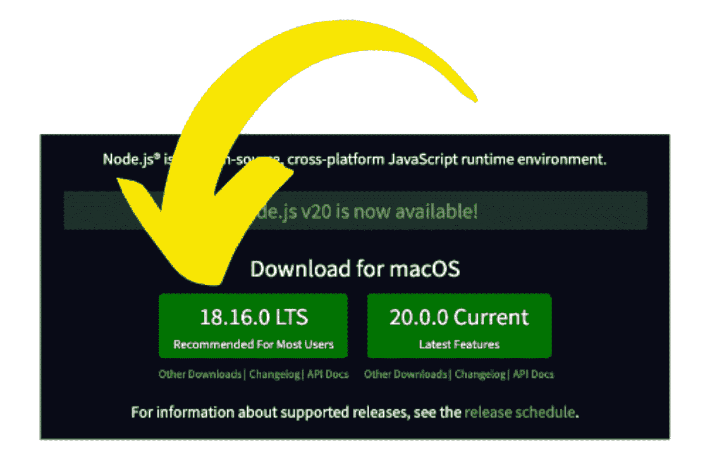

### 安装 Visual Studio Code

作为源代码编辑器，我推荐 Visual Studio Code（VS Code），因为它跨平台、免费且可扩展。

要下载此编辑器，请访问`https://code.visualstudio.com/`并按下图所示点击按钮。

与 Node.js 类似，VS Code 的安装过程不需要任何超出常规安装新程序的知识。

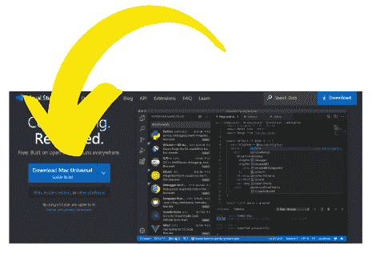

## JavaScript 中的模块

在 Node.js 中，模块是包含 JavaScript 代码的文件，这些代码可以在程序的不同部分重复使用。每个模块都是一个独立的代码单元，可以导入或导出到程序的其他部分，从而使代码更加模块化且易于维护。

Node.js 中的模块采用 CommonJS 模块系统进行组织，该系统定义了模块的定义、加载和导出方式。每个模块都有自己的作用域，这意味着在模块中定义的变量和函数除非被显式导出，否则在模块外部不可见。

要在 Node.js 程序中使用模块，需要使用`require()`函数将其导入。例如，要使用用于执行文件读写操作的`fs`模块，只需使用以下代码：


`require()`函数是一个同步函数，它加载指定的模块并返回该模块导出的对象。可以使用`module.exports`变量从模块中导出值，该变量是模块对象的一个特殊属性。例如，要在模块中导出一个函数，只需执行以下操作：

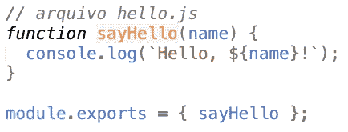

要在另一个文件中导入`sayHello()`函数，只需使用`require()`并访问导入对象的`sayHello`属性：

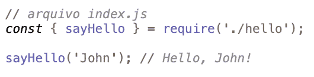

这样，Node.js 中的模块使开发者能够更高效地组织和重用代码，从而更容易维护和开发更复杂的应用程序。

## NPM 与 NPX

Node.js 的包管理器是 NPM（Node Package Manager），用于安装、管理和共享用 JavaScript 编写的软件包和模块。它随 Node.js 一起提供，被世界各地的开发者用来管理项目依赖。

NPM 允许全局安装包，也可以针对特定项目进行本地安装。要本地安装一个包，只需导航到项目的根目录，并在终端中运行以下命令：


这会将包安装到项目的`node_modules`目录中，并在`package.json`文件中添加一条记录以跟踪项目的依赖关系。

另一方面，`npx`是一个从 NPM 5.2.0 版本开始引入的实用工具。它允许直接运行包，而无需在系统上全局安装或在项目中本地安装。

`npx`会下载请求的包并立即运行，而不是永久安装到系统或项目中。当你只需要运行一次某个包，或者想在不永久安装的情况下测试一个包时，这非常有用。

例如，如果你想使用`npx`运行`create-react-app`包中的脚本，只需输入以下命令：


这会下载并执行`create-react-app`包，参数为`my-app`，从而在`my-app`目录中创建一个新的 React 应用程序。

总之，NPM 用于管理项目的依赖关系，而`npx`用于执行包而不进行全局或本地安装。两者都是 JavaScript 开发中有用的工具。

## JavaScript 入门

首先，创建一个文件夹来开发你的 Node.js 项目，然后启动 VS Code。在编辑器中，点击 File > Open Folder，然后打开你刚刚创建的文件夹。在示例中，我创建的文件夹名为`ProjetoNode`。

在左侧，点击 New File，然后将其命名为`helloworld.js`。在该文件中，添加以下代码：

```javascript
console.log("Hello World")
```

然后，点击 Terminal > New Terminal 在 VS Code 中打开一个新的终端实例，并输入以下命令：

```bash
node helloworld.js
```

如果一切顺利，终端中将显示以下句子：Hello World。

## Node.js 的优势

Node.js 的一大优势是开发服务器端应用程序的便捷性。要实际体验这一点，请在 VS Code 中创建一个名为`server.js`的新文件，并插入以下代码行：

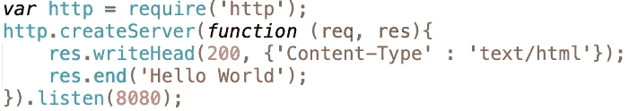

然后，在终端中运行以下命令：

```bash
node server.js
```

现在，你正在 Node.js 中运行一个 HTTP 服务器，它将监听 8080 端口的请求。要访问本地服务器，只需在浏览器中打开以下链接`http://localhost:8080`。

## JavaScript 中的值存储

在 JavaScript 中，变量用于存储可以在程序不同部分使用的值。要声明 JavaScript 中的变量，可以使用关键字`var`、`let`或`const`，后跟变量名：

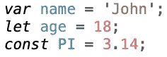

`var`关键字是 JavaScript 中声明变量的旧方式，但在该语言的新版本中仍然支持。使用`var`声明的变量具有函数作用域或全局作用域。

`let`关键字用于声明具有块级作用域的变量，这意味着它们只能在声明它们的块内被访问。

`const`关键字用于声明常量，即赋值后无法更改的值。

需要记住的是，在 JavaScript 中，变量是动态类型的，这意味着你无需事先声明变量类型。变量类型会在程序执行过程中根据赋给变量的值自动定义。

## JavaScript 中的数据类型

在 JavaScript 中，有六种原始数据类型：

- `number`：表示数字，包括整数和浮点数。例如，10、3.14、-5。
- `string`：表示字符序列。可以用单引号或双引号界定。例如，`"Hello, world!"`、`'JavaScript'`。
- `boolean`：表示逻辑值`true`或`false`。
- `null`：表示空值，即没有值。
- `undefined`：表示已声明但尚未赋值的变量。
- `symbol`：表示唯一且不可变的值，可用作对象属性的标识符。

除了这六种原始类型，JavaScript 中还有两种复杂数据类型：

- `object`：表示键值对的集合。JavaScript 中的对象可以包含属性和方法。例如，`{ name: 'John', age: 25 }`。
- `function`：是一种特殊类型的对象，可以被调用，并且可以拥有与之关联的属性和方法。JavaScript 中的函数用于定义可在程序任何位置调用的代码块。

需要记住的是，在 JavaScript 中，变量是动态类型的，这意味着变量类型会在程序执行过程中根据赋给变量的值自动定义。此外，变量在程序执行过程中可以改变类型。例如，一个包含数字的变量稍后可以被赋值为字符串。

## JavaScript 中的数学运算

JavaScript 支持多种数学运算，包括基本的算术运算，如加法、减法、乘法和除法。此外，还可以执行更复杂的运算，如三角函数、指数和对数计算。

以下是 JavaScript 中数学运算的一些示例：

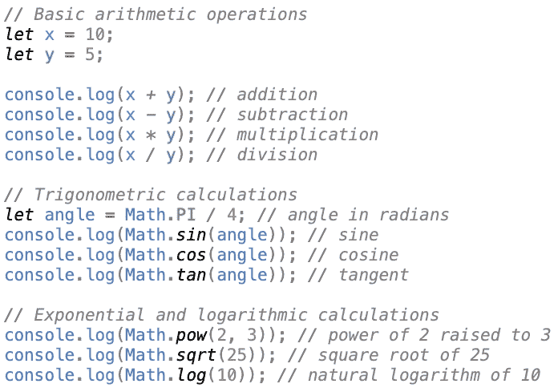

此外，JavaScript 还在`Math`对象中提供了多种预定义的数学函数。这些函数包括`Math.floor()`（向下取整）、`Math.ceil()`（向上取整）以及`Math.random()`（生成 0 到 1 之间的随机数）等。

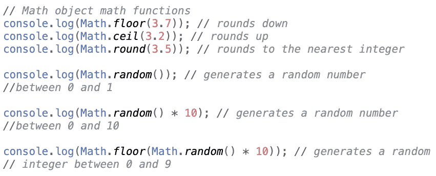

这些只是 JavaScript 中可执行的众多数学运算中的几个例子。

## JavaScript 中的字符串

在 JavaScript 中，字符串是一个字符序列，例如`"Hello, world!"`。字符串是 JavaScript 中的原始数据类型之一，使用单引号或双引号创建。

以下是 JavaScript 中字符串的一个示例：

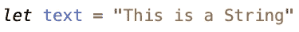

### 字符串的表示

在 JavaScript 中，有两种主要的字符串表示方式：双引号和单引号。两种形式是等价的，你可以根据个人偏好或项目/团队采用的约定来选择使用哪一种。

例如，以下代码行分别创建了一个双引号字符串和一个单引号字符串：

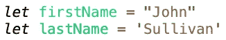

此外，你可以使用转义字符`\`在字符串中插入特殊字符，例如单引号、双引号、反斜杠、换行符等。例如：

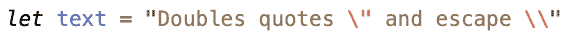

在 JavaScript 中表示字符串的另一种方式是使用反引号（`），这被称为模板字符串。模板字符串允许使用`${expression}`语法在字符串中嵌入 JavaScript 表达式。例如：

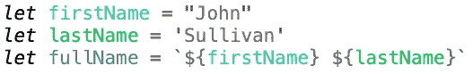

在这个例子中，变量`fullName`包含字符串`"John Sullivan"`，它是通过模板字符串语法连接变量`firstName`和`lastName`组成的。

总之，在 JavaScript 中，你可以使用单引号、双引号或模板字符串来表示字符串，并且可以使用转义字符在字符串中插入特殊字符。

### 字符串的操作

在 JavaScript 中，可以对字符串执行多种操作。其中一些操作包括：

- 连接：将两个或多个字符串合并为一个字符串的操作。这通过加法运算符（`+`）或`concat()`方法完成。示例如下：

  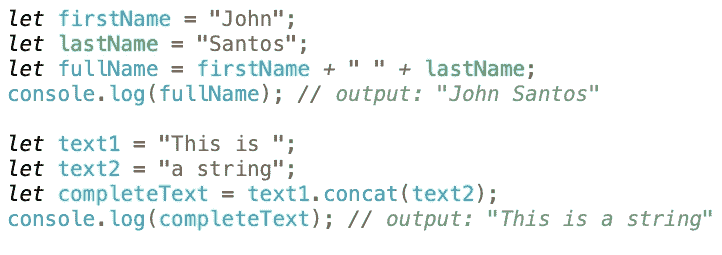

- 长度：计算字符串中字符数量的操作。这通过`length`属性完成。示例如下：

  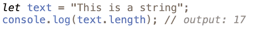

- 访问单个字符：可以使用方括号（`[]`）访问字符串中的单个字符。示例如下：

  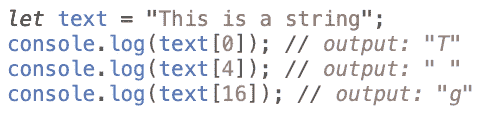

- 字符替换：可以使用`replace()`方法替换字符串中的字符。示例如下：

  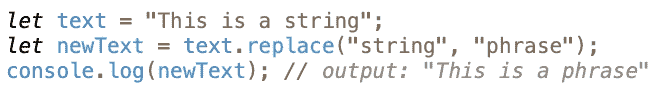

这些只是 JavaScript 中可对字符串执行的几个操作。还有许多其他操作，包括字符串比较、大小写转换等等。

## 控制结构

### 条件语句：IF/Else

`if/else`是 JavaScript 中最常用的控制结构之一。它用于根据条件执行不同的代码块。

`if/else`的基本语法如下：

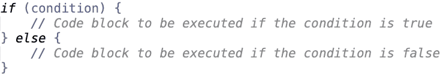

`condition`是一个返回布尔值（`true`或`false`）的表达式。如果`condition`为`true`，则执行第一组花括号内的代码块。如果`condition`为`false`，则执行第二组花括号内的代码块。

此外，可以使用`else if`关键字链式连接多个`if/else`结构。示例如下：

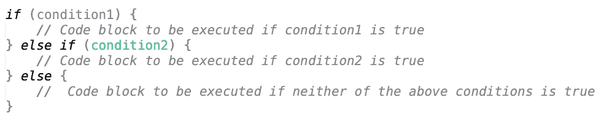

在这种情况下，首先评估的是`condition1`。如果它为`true`，则执行第一个代码块，其余部分被忽略。否则，评估`condition2`，以此类推。

`if/else`是 JavaScript 中非常有用的控制结构，允许你在程序中创建复杂的逻辑。

### 内联条件语句：IF/Else 内联

JavaScript 中的内联`if`是一种在一行代码中编写条件语句的方式。你可以使用三元运算符来创建更紧凑的语句，而不是使用带有花括号和可选`else`语句的传统`if`块语法。

内联`if`的基本语法如下：


在这个例子中，首先评估`condition`。如果它为`true`，则返回`true`表达式。否则，返回`false`表达式。

以下是一个实际示例：

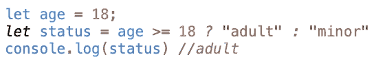

在这个例子中，条件评估`age`是否大于或等于 18。如果为`true`，则变量`status`被设置为`"adult"`。否则，变量`status`被设置为`"minor"`。

内联`if`是在 JavaScript 中编写简单条件语句的一种便捷且可读的方式，尤其是在需要更简洁的代码时。然而，对于更复杂的语句或多个条件，使用传统的`if`语法可能更合适。

### 循环结构

JavaScript 中的循环结构允许根据特定条件多次执行代码块。两种主要的循环结构是`while`和`for`。

`while`是一种循环结构，它在特定条件为`true`时执行代码块。`while`的基本语法如下：

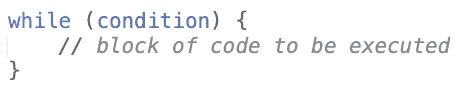

在这个例子中，只要条件为真，代码块就会执行。条件在每个循环迭代开始时被检查。

另一方面，`for`是另一种循环结构，它基于固定的迭代次数多次执行代码块。`for`的基本语法如下：

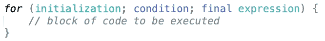

在这个例子中，初始化在第一次循环迭代之前执行。条件在每个循环迭代之前被检查，如果为真，则执行代码块。每次循环迭代之后，执行最终表达式。

此外，JavaScript 还有`do/while`结构，它与`while`类似，但在每个循环迭代结束时检查条件，而不是在开始时。`do/while`的基本语法如下：

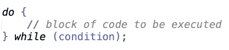

最后，JavaScript 有`break`语句，允许你提前退出循环，以及`continue`语句，允许你跳到循环的下一次迭代。这些语句对于控制循环内的执行流程非常有用。

## 函数

在 JavaScript 中，函数是一等对象，这意味着它们可以像任何其他对象一样被处理。函数可以存储在变量中，作为参数传递给其他函数，作为值从其他函数返回，等等。以下是在 JavaScript 中创建函数的一个简单示例：

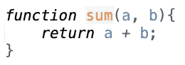

在这个例子中，函数`sum`接受两个参数`a`和`b`，并返回它们的和。

在 JavaScript 中也可以创建匿名函数，这些函数没有名称，存储在变量中或作为参数传递给其他函数。示例如下：

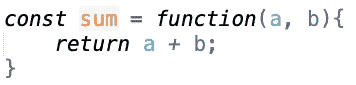

在这个例子中，匿名函数存储在一个名为`sum`的变量中。

JavaScript 中的函数也可以使用箭头函数表达式来定义。箭头函数是在 ECMAScript 6 中引入的，是一种更简洁的创建函数的方式。示例如下：

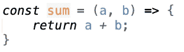

在这个例子中，箭头函数接受两个参数`a`和`b`，并返回它们的和。

JavaScript 中的函数还可以有默认参数，当没有为该参数提供值时使用。示例如下：

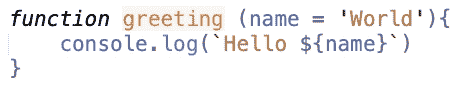

## JavaScript 中的数组

在 JavaScript 中，数组是一个可以通过数字索引访问的值的集合。数组是 JavaScript 中的基本数据类型之一，可以包含任何类型的数据，包括其他数组。

以下是在 JavaScript 中创建数组的示例：

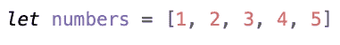

在这个例子中，`numbers`是一个数字数组，包含值 1、2、3、4 和 5。数组的元素可以使用方括号（`[]`）访问。数组第一个元素的索引是 0。示例如下：

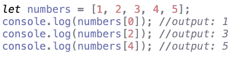

JavaScript 中的数组还有几个方法，可用于对其元素执行操作。以下是一些示例：

- `push()`：将一个或多个元素添加到数组末尾。示例如下：

  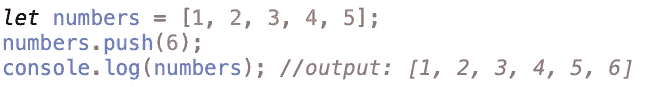

- `pop()`：移除数组的最后一个元素并返回该元素。示例如下：

  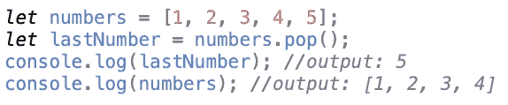

- `slice()`：返回数组一部分的副本。示例如下：

  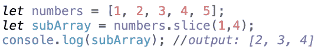

- `join()`：将数组的所有元素以单个字符串形式返回。

  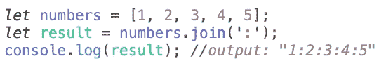

这些只是 JavaScript 数组中可用方法的一小部分示例。还有许多其他方法，包括`shift()`、`unshift()`、`splice()`、`concat()`、`reverse()`、`sort()`等。

### 多维数组

JavaScript 中的多维数组是包含其他数组的数组。它是一种以多个维度存储数据的方式，允许你创建复杂的数据结构。


要创建多维数组，你需要在另一个数组内部创建一个数组。例如，要创建一个 2x3 数组（两行三列），可以使用以下语法：

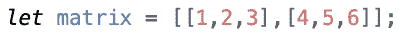

在这个例子中，`matrix` 是一个多维数组，包含两个嵌套数组，每个数组有三个值。

你可以使用与访问一维数组值相同的语法来访问多维数组的值，但需要为每个维度指定索引。例如，要访问数组 `matrix` 中的值 5，可以使用以下代码行：

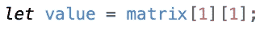

在这种情况下，`matrix[1]` 返回第二个嵌套数组，而 `matrix[1][1]` 返回第二个嵌套数组中的第二个值，即 5。

你也可以通过简单地在数组中嵌套更多数组来创建具有两个以上维度的多维数组。然而，具有两个或三个以上维度的数组可能变得难以处理，在 JavaScript 编程中通常避免使用。

# JavaScript 中的对象

在 JavaScript 中，对象是键值对的集合。每个键是一个字符串，用于标识对象中的值。值可以是任何类型的 JavaScript 数据，包括其他对象。

要在 JavaScript 中创建对象，我们可以使用对象字面量语法，它由花括号 `{}` 组成，键值对之间用逗号分隔：

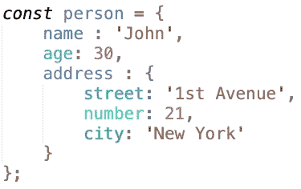

在这个例子中，`person` 是一个具有三个属性的对象：`name`、`age` 和 `address`。`address` 属性是另一个具有自身属性的对象。我们可以使用点表示法或方括号表示法来访问对象的属性：

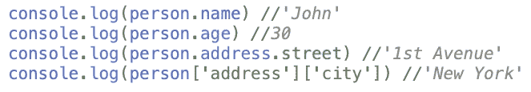

我们还可以使用点表示法或方括号表示法来添加、修改和删除对象的属性：

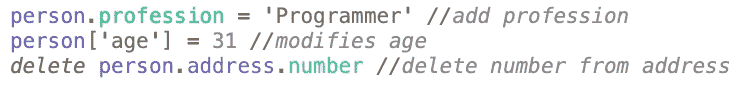

此外，我们可以使用 `for...in` 循环遍历对象的属性：

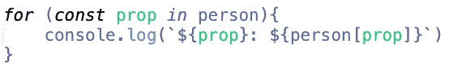

这个循环将显示 `person` 对象中的所有属性及其值。

总之，对象是 JavaScript 的基本组成部分，在编程中广泛用于表示复杂和结构化的数据。

# JavaScript 中的函数式编程

## ForEach

`forEach` 函数是 JavaScript 中用于遍历数组的最有用的函数之一。`forEach` 函数为数组中的每个元素执行一个回调函数，但它不会返回一个新数组。相反，它只是遍历数组并对每个元素执行该函数。

以下是一个简单的示例：

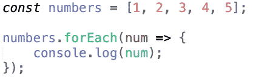

这段代码在控制台中显示 `numbers` 数组的每个元素。

传递给 `forEach` 的回调函数接收三个参数：当前元素、元素的索引以及数组本身。例如：

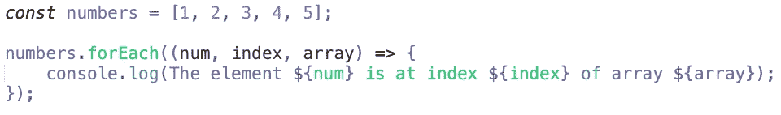

这段代码在控制台中显示数组的每个元素、元素的索引以及数组本身。

`forEach` 函数对于对数组的每个元素执行操作非常有用。但是，如果需要从原始数组创建一个新数组，最好使用 `map`、`filter` 或 `reduce` 函数。

## Map

`map` 函数用于创建一个新数组，该数组包含对原始数组的每个元素应用函数后的结果。`map` 函数不会修改原始数组，而是返回一个具有相同元素数量的新数组。

以下是一个简单的示例：

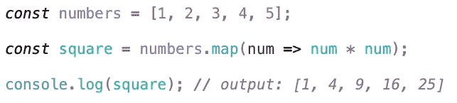

在这个例子中，`map` 函数用于创建一个新数组 `square`，其中包含 `numeros` 数组中每个数字的平方。

`map` 函数接受一个回调函数作为参数。该函数为数组的每个元素调用，并应返回要添加到新数组中的值。回调函数最多可以有三个参数：当前元素、元素的索引以及数组本身。例如：

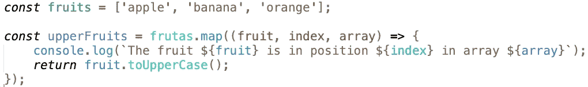

在这个例子中，`map` 函数用于创建一个新数组 `upperFruits`，其中包含 `fruits` 数组中所有水果的大写形式。回调函数在将水果转换为大写并返回之前，打印每个水果及其索引。

`map` 函数是 JavaScript 中最有用、最强大的函数之一，广泛应用于函数式编程中，用于转换数据。

## 过滤

`filter` 函数用于创建一个新数组，其中包含原数组中所有通过回调函数指定测试的元素。新数组仅包含满足回调函数中指定条件的元素。

以下是一个简单示例：

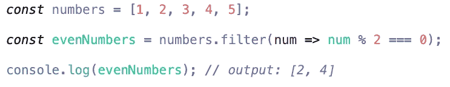

在此示例中，`filter` 函数用于创建一个新数组 `evenNumbers`，该数组仅包含 `numbers` 数组中的偶数。

`filter` 函数接受一个回调函数作为参数。该函数会为数组中的每个元素调用，并应返回一个布尔值，指示该元素是否应包含在新数组中。回调函数最多可接受三个参数：当前元素、元素索引和数组本身。例如：

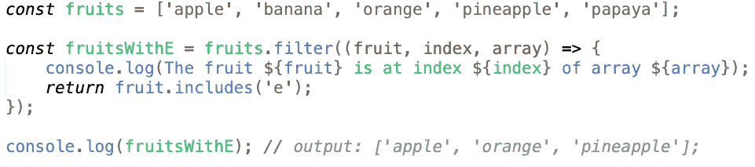

在此示例中，`filter` 函数用于创建一个新数组 `fruitsWithE`，该数组仅包含 `fruits` 数组中包含字母 "e" 的水果。回调函数在测试水果是否包含字母 "e" 并返回布尔值之前，会打印每个水果及其索引。

`filter` 函数是 JavaScript 中最有用、最强大的函数之一，广泛应用于函数式编程中，用于过滤数据。

## 归约

`reduce` 函数用于将数组的所有元素归约为单个值。它对数组的每个元素执行一个回调函数，将累加器和当前元素作为参数传递，并返回一个累加值，该值是对每个元素执行回调函数的结果。

以下是一个简单示例：

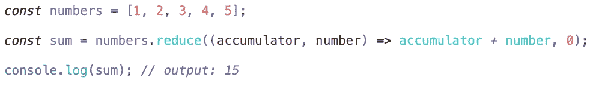

在此示例中，`reduce` 函数用于对 `numbers` 数组中的所有数字求和。回调函数接受两个参数：累加器和当前元素。在第一次迭代中，累加器是作为第二个参数传递的初始值（零），当前元素是数组的第一个元素（1）。在第二次迭代中，累加器是初始值与第一个元素之和（1+2=3），当前元素是数组的第二个元素（2），依此类推。最终结果是数组中所有元素的总和。

`reduce` 函数还可以接受一个可选的第三个参数，即累加器的初始值。如果未提供此参数，则数组的第一个元素将用作初始值。

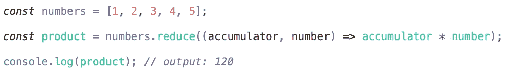

在此示例中，`reduce` 函数用于计算 `numbers` 数组中所有数字的乘积。由于未提供初始值，数组的第一个元素（1）被用作累加器的初始值。

`reduce` 函数是 JavaScript 中最强大、最灵活的函数之一，广泛应用于函数式编程中，用于转换数据并对数组执行复杂操作。

# 短路求值

短路求值是 JavaScript（以及其他编程语言）中的一种技术，它允许在确定结果后立即停止计算逻辑表达式，而无需计算整个表达式。这是因为 JavaScript 中的逻辑运算符 AND（`&&`）和 OR（`||`）正是以这种方式实现的。

逻辑运算符 AND 仅在两个表达式都为 `true` 时返回 `true`。如果第一个表达式为 `false`，则结果为 `false`，并且不会计算第二个表达式。例如：

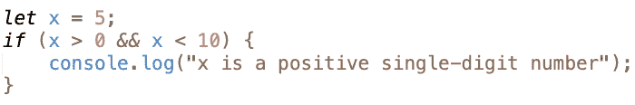

在这种情况下，如果第一个表达式为 `false`（如果 `x` 不大于 0），则不会计算第二个表达式。

逻辑运算符 OR 在至少一个表达式为 `true` 时返回 `true`。如果第一个表达式为 `true`，则结果为 `true`，并且不会计算第二个表达式。例如：

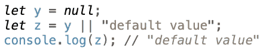

在这种情况下，不会计算第二个表达式，因为第一个表达式（`y`）为 `false`（`null`）。

短路求值技术可用于提高代码性能，并在某些情况下使代码更易读。然而，务必谨慎使用，并确保程序逻辑正确。

## 函数中的短路求值

短路求值也可以与 JavaScript 中的函数一起使用。在某些情况下，可以使用此技术来提高代码性能或避免错误。

例如，假设你有一个函数，它接收一个对象作为参数，并且需要在访问某个属性之前检查该属性是否存在于对象中。你可以编写以下代码：

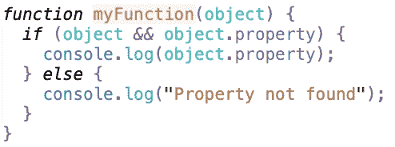

在这种情况下，逻辑表达式 `object && object.property` 使用短路求值来确保仅当 `object` 存在且 `property` 也存在时，才执行 `if` 语句内的代码。

短路求值有用的另一个示例是，当你需要为变量或函数参数设置默认值时。你可以使用逻辑 OR 运算符来设置默认值，而不是使用 `if`/`else` 语句检查变量或参数是否为 `undefined`：

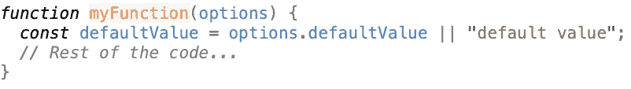

在这种情况下，如果 `options.defaultValue` 的值为 `undefined`，则将使用默认值。

# 关于作者

Ruhan Conceição 于 2015 年毕业于佩洛塔斯联邦大学计算机工程专业，并于 2016 年在该校获得计算机硕士学位。自 2018 年起，他担任南里奥格兰德联邦教育、科学与技术学院信息学领域的教授，教授面向对象编程、可视化编程和移动设备编程等课程。

2014 年，Ruhan 还在读本科时，因其在大学期间的学术和科学轨迹，获得了“青年创新者”类别中的“高乔研究者”称号。他的研究课题始终与实时视频编码的高效算法开发相关。在科学研究方面，Ruhan 已在国内外会议上发表数十篇论文，并在高影响力的科学期刊上发表文章，此外还在国家知识产权局注册了两项计算机程序。

在业余爱好方面，Ruhan Conceição 有一个名为 R-Cast（社交媒体上为 `@rcasttv`）的播客，他邀请嘉宾讨论各种话题，包括技术、政治、教育、健康、文化、音乐等。
