# 设计师的 Flash ActionScript：拖动、滑动、淡入淡出（VOICES）

## 作者寄语

**Ideas：**创意是包括交互设计在内的任何创意学科中最重要的部分。Macromedia Flash 让数千名像我一样的人得以实现自己的想法，探索新的交互领域，进行创作和实验，并构建引人入胜的体验。

要真正探索 Flash 的能力，你需要使用其强大的脚本语言，突破界限，并制作更高效、更智能的 Flash 影片。但许多人回避 Flash 的这一面，要么因为他们认为这是极客的领域，要么只是觉得它看起来非常可怕。嗯，我不是程序员。我是一名碰巧经常使用代码来让生活更轻松的设计师！

在本书中，我将向你展示代码与设计结合后是多么迷人，以及它如何为你作为设计师使用代码开辟新的思路。

请访问本书的网站`www.dragslidefade.com`。在那里，你可以找到完成练习所需的全部练习文件。此外，你还可以下载 DSF 工具包，这是一个包含有用智能剪辑和代码的库，同时还包括帮助交互创作过程的源文件和资源。

201 West 103rd Street, Indianapolis, Indiana 46290

由 Internet Archive 于 2012 年数字化

`http://archive.org/details/flashactionscrip00bren`

## 关于作者

### 关于技术编辑

**Brendan Dawes** 是位于英国曼彻斯特的互动代理机构 magneticNorth 的创意总监。自 1996 年以来，他一直为迪士尼、可口可乐、Golden Winder、Fox Kids、Volvic、家乐氏、贝纳通和 McCann Healthcare 等客户开发互动解决方案。

在 1996 年之前，Brendan 从事过多种工作，包括为英国全国性报纸担任自由摄影师以及在电子行业工作。他还在音乐行业短暂涉足过，在利物浦的独立舞曲厂牌“3 Beat Music”获得了一份唱片合约。

除了商业工作，Brendan 还有个人项目，包括广受好评的 Saul Bass 网站`saulbass.net`，以及其独特的衍生项目 Psycho Studio。这是一个完全用 Flash 构建的应用程序，允许你编辑自己版本的电影《惊魂记》中的淋浴场景。多年来，Brendan 的作品曾被许多行业出版物和书籍收录，并获得了各种奖项，包括三个 Shockwave 每日最佳网站奖、纽约 Flash 电影节提名以及 Webby 奖项。他还编写 Dreamweaver 扩展，并与 Apple 和 Macromedia 合作编写了官方的 QuickTime 扩展。Brendan 也是全球行业会议上的常客演讲者。

**Jennifer S. Hall** 五年前转行，从科学研发环境中的管理和编程工作转向多媒体领域！在过去的五年里，Jennifer 与领先的多媒体公司合作过，包括 Top Drawer（Human Code [Sapient]）、Thought Interactive（Meritage Technologies）、Cortex Interactive 和 Eyeland Studios。她的大部分工作都集中在为儿童和成人开发教育材料上。她的一些客户包括迪士尼、Holt, Rinehart, and Winston、Prentice Hall 以及奥斯汀儿童博物馆。她还教授 Director 和 Flash，并且是《Flash 5 Magic》一书（New Riders）的撰稿人之一。在业余时间，Jennifer 吃东西、阅读、跑步、坐着、攀岩、跳舞、去爱和生活。

致我最好的朋友和妻子，Lisa。

## 致谢

首先，我要感谢我的爸爸妈妈，感谢他们无尽的支持和鼓励，即使他们从未真正理解我到底在说什么。也要感谢我的兄弟 John 和姐姐 Amanda 的关爱和支持。

非常感谢 Hillman Curtis，不仅作为朋友，也在一切设计方面给予我持续的灵感，并为我创造机会——我不会忘记。

感谢 New Riders 团队对这个项目投入的巨大热情，特别是 Steve Weiss、Theresa Gheen、Kathy Malmloff、Barbara Terry、Dennis Hamilton、Chris Nelson、David Dwyer 和 Wil Cruz。

非常感谢 magneticNorth 团队的支持，包括 Lou、Janet、Jason、Bruce、Simon、Suzie、Holly、Terry、Janet、Morag、Caroline 和 Jo。

同时感谢我通过 Flash 认识的朋友们，包括 The Furious 的 Carla 和 Jim、Craig Swann、Damien Burns、WDDG 的伙计们、Colin Moock、Kerb 的 Pete 和伙计们、Todd Purgason（你真棒）、Stuart、Flashforward 的 Lynda 和 Margaret、Joe Shepter、Tania、Nick Leaf、Joshua Davis、Erik Natzke、Gavin Neale、Hoss 和 Limmy、Digit 的 Mickey 和 Daljit、Jake、Pete、Dan、Phill、Joolz 和 Subnet 的其他伙计们，以及所有来自 Macromedia 的酷家伙们，包括 Jerry、Julie、Anna-Marie 和 Matt。

最后，感谢 Michelle 和她的家人给予的持续支持，我的岳父母 Anne 和 Mick，当然还有我美丽的妻子 Lisa，她给了我永不间断的支持、爱和鼓励——谢谢。

## 来自 New Riders 的一封信

作为本书的读者，您是我们最重要的评论者和评论家。我们重视您的意见，并希望了解我们做对了什么、哪些方面可以做得更好、您希望我们在哪些领域出版，以及您愿意传递给我们的任何其他宝贵意见。

作为 New Riders 的执行编辑，我欢迎您的评论。您可以传真、发电子邮件或直接写信给我，告诉我您喜欢或不喜欢本书的哪些方面，以及我们可以如何改进我们的书籍。来信时，请务必包含本书的书名、ISBN 和作者，以及您的姓名和电话或传真号码。我将仔细审阅您的意见，并与参与本书工作的作者和编辑分享。

*请注意，我无法帮助您解决与本书主题相关的技术问题，并且由于我收到的电子邮件数量巨大，我可能无法回复每一条信息。谢谢。*

电子邮件：`steve.weiss@newriders.com`

邮寄地址：

Steve Weiss

执行编辑

New Riders Publishing

201 West 103rd Street

Indianapolis, IN 46290 USA

## 访问我们的网站：`www.newriders.com`

在我们的网站上，您将找到关于我们其他书籍的信息、我们合作的作者、书籍更新和文件下载、促销活动、与其他用户和技术专家在线互动的讨论区，以及我们将参与的行业展会和其他专业活动的日程安排。希望能在网站上见到您。

## 从我们的网站发邮件给我们

请访问`www.newriders.com`并点击联系我们链接，如果您：

- 对本书有评论或疑问。
- 想报告您在本书中发现的错误。
- 有书籍提案或有兴趣为 New Riders 撰写书籍。
- 希望我们向您发送我们的作者工具包。
- 您是计算机主题或技术的专家，并有兴趣担任审稿人或技术编辑。
- 想在您所在地区为我们的图书找到经销商。
- 是教育工作者或讲师，希望为课堂使用预览 New Riders 书籍。在正文或评论区，请包含您的姓名、学校、系别、地址、电话号码、办公日期和时间、当前使用的教材以及您系的学生人数，并附上您索取样书、审阅用书或额外信息的请求。

## Hillman Curtis 的前言

大约一年前的某一天，我收到一封来自一个叫 Brendan Dawes 的人的电子邮件。他说他正在开发一个致力于伟大的平面与动态图形设计师 Saul Bass 的网站。他想让我看看并提供创意指导。像往常一样，我正疯狂地努力赶上自己的工作进度，记得当时心想：“这个家伙（我知道他来自英国，所以我用了我能想到的一个英国贬义词）以为我在做什么，就干坐着等着给陌生人提供创意指导？”嗯，可以这么说，也不完全是。

长话短说，我查看了这个网站，然后被震撼了。接着，Brendan 给我转发了他“PsychoStudio”的链接，在那里你可以重新剪辑希区柯克《惊魂记》中著名的淋浴场景，而且全部用 Flash 实现。它真的能用！

我被吸引了。我邀请 Brendan 加入我，在西雅图参加一个我正在做的会议主题演讲。我会做一个关于我个人流程的简短演讲，而 Brendan 将和我一起上台剖析“PsychoStudio”。他接受了，几周后我们在主题演讲的前一天晚上共进晚餐。我们大部分时间都在交流我们对平面设计和电影的共同兴趣。我尤其对 Brendan 关于电影片头的深厚知识印象深刻，无论是当代的还是复古的。从那以后，我们在多个 hillmancurtis 项目上合作，Brendan 总能在合适的时间提出合适的解决方案。在他为我们的网站编写了一段简单但牢不可破的 ActionScript 之后——解决了一个其他几位 ActionScript 专家都未能成功解决的问题——我向我在 New Riders Publishing 的编辑建议，让 Brendan 写一本书。

《Flash ActionScript for Designers: Drag, Slide, Fade》就是这样一本书。这本书带你走进这位 Flash 界顶尖高手之一的内心世界，Brendan Dawes 清晰地展示了他如何通过设计师的眼光来理解和编写 ActionScript。这不仅仅又是一本 ActionScript 书籍。这是一本鼓励你成为不害怕编写脚本的设计师的书籍。它通过展示有用的脚本驱动技术，揭示其背后的逻辑以及实际的分步过程来实现这一点——全部从设计师的视角出发。我等待这本书已经很久了，非常高兴能深入其中，最终确切地看到 Brendan 如何施展他独特的魔力。

## Release

1982 年圣诞节。像往常一样，我和妈妈、爸爸、哥哥、妹妹一起去爷爷家过节礼日。我一直盼着去，因为这意味着又能收到第二波礼物。说实话，当你还是个孩子的时候，礼物才是最重要的！

有一件我特别想要的东西，所以当爷爷问我有什么礼物想法时，我就告诉了他——希望他能满足我的愿望！果然到了节礼日，我撕掉包装，露出一个上面写着“Sinclair ZX 81”的盒子。Sinclair ZX 81 是一款价格亲民的家用电脑（约 250 英镑），来自英国公司 Sinclair Research。标准配置自带惊人的 1k RAM，接到电视机上使用。彩色？没门，这可是纯黑白的。图形？没有，全程都是 ASCII 文本！也没有磁盘驱动器——程序必须通过磁带加载。当然那时候带彩色和声音的电脑要卖几千英镑。而 ZX 81 让你只需花费一小部分成本就能拥有一台真正的电脑。

我立刻开机。没有漫长的启动时间，只要一打开开关，嗖的一声——光标就在白色屏幕上闪烁起来。就是这样。没有菜单（根本没有鼠标），什么都没有。但这正是它的妙处。你想做点什么？你得么加载一个程序（而且也没多少可用的程序），要么就得自己写一个程序。我快速浏览了一下手册，读了读教程。当天结束的时候，我已经写完了我的第一个程序——我想它只是让我的名字满屏显示——然后我就此入迷了。

### 揭开编程的神秘面纱

你现在可能在想：“等等，我原以为这是一本关于 Flash ActionScript 的书？”别担心，确实是，而且我没有跑题。正是 ZX 81 让我第一次尝到了编程令人上瘾的滋味。我把代码看作是一种创造性的东西，不只是极客的专属领域。我认为随着个人电脑的普及，很多人试图把编程说成是什么神秘的技能，好像你得特别聪明才能做哪怕最简单的事情。事实并非如此！让很多人望而却步的是，他们看到一大段代码只觉得是一堆古怪的东西。那只是因为他们不懂这门语言——就像如果你只懂英语，看到中文也会一样！

然而，懂一门语言只是成为优秀程序员的一部分。很多人会用笔或用文字处理软件，但这不意味着他们就能自动写出普利策奖获奖小说。因为与任何创意艺术一样（编程就是具有创造性的），重要的是想法。如果你没有想法，你就会淡出人们的视线。我讨厌听到有人说：“唉，我没有创造力。”每个人都有创造力。当然，有些人比其他人更有创造力，但有时候说自己没有创造力的人只是没有尝试过，或者没有机会尝试过。

这本书是关于运用 ActionScript 结合设计的创意想法，帮助你尝试新的事物，为你的设计技能增添一些编程技能。如果你在找一本教你如何做 10 种不同鼠标尾随效果的书，这不是。它也不是 ActionScript 所有功能和语言的权威指南。这是我用于日常客户工作以及个人项目的一些核心技术的集合。在此过程中，我还会向你展示一些激发我想象力的事物。

请记住，在阅读接下来的 10 章时，每一种技术都可以拓展延伸。每一章给你的是一些编程技术的基础，希望能激发你去探索交互设计的新领域。话虽如此，交互设计不仅仅是懂得如何编程和懂得如何设计。你需要考虑至关重要的用户，以及你试图向他或她传达什么。你如何让用户沉浸在设计中？它如何让用户参与其中？

说实话，当我开始一个新项目，试图想出新的创意或概念时，我从不盯着电脑屏幕开始。相反，我会去散步、看电影或听音乐（但从不听席琳·迪翁）——做任何事，就是不开电脑。灵感可以来自生活的方方面面，编程灵感也是如此。我数不清有多少次我被一个代码问题难住，绞尽脑汁想要解决。然后解决方案通常会在睡梦中出现，或者可能在我外出购物时。潜意识是一种极其强大的工具。所以下次当你有一个让你抓狂的问题时，忘掉它，去做点别的事。我敢打赌解决方案会突然蹦进你的脑海里！

在进入本书的正文之前，我想最好先解释一些基本原则。首先，来看看影片剪辑及其属性。

### 影片剪辑（对象）

在本书中，你将会用到许多影片剪辑。在 ActionScript 中，影片剪辑本质上是一个具有可更改属性的对象。例如，在现实世界中，灯泡就是一个对象。它可以是开着的或关着的。如果这个灯泡是 Flash 中的影片剪辑，你可以通过输入以下代码行来关闭灯泡或至少使其不可见：

```actionscript
lightbulb._visible = 0;
```

`lightbulb` 是影片剪辑的实例名，`_visible` 是 Flash 中影片剪辑的内置属性之一。注意两者之间用一个点号分隔。把这个点号想象成 URL 中的正斜杠。

要使其再次可见，你可以写：

```actionscript
lightbulb._visible = 1;
```

影片剪辑有多个可以用 ActionScript 操作的内置属性。你可以通过双击任意帧打开帧动作面板来查看所有这些属性。点击左栏中的 Properties 框，你就会看到所有可用的内置属性列表（见图 1.1）。

为了更好地解释影片剪辑及其属性，我要用到一些俄罗斯套娃。

这里有一个名为`boris`的影片剪辑（见图 1.2）。

你可以更改这个影片剪辑的各种属性，如下所示（见图 1.3 至 1.9）：

```actionscript
boris._rotation = 45;
boris._xscale = 120;
boris._yscale = 120;
boris._width = 300;
boris._height = 100;
boris._alpha = 75;
```

### 影片剪辑时间轴

比方说，第二个剪辑的实例名为`gorby`。你可以更改这个影片剪辑的属性，如下所示（见图 1.9）：

```actionscript
boris.gorby._rotation = 270;
```

要定位到`gorby`剪辑，你必须通过`boris`剪辑，因为`gorby`设置在`boris`内部。把这想象成你桌面上的文件夹。实际上，影片剪辑就像文件夹。所以，要进入一个文件夹内部的另一个文件夹，你必须先打开第一个文件夹——确实很符合逻辑！

到目前为止，我谈到的都是设置在主时间轴上的代码，然后用来更改此时间轴上的影片剪辑中的属性。这个主时间轴在 ActionScript 中被称为`_root`。

但是，当然你也可以在影片剪辑时间轴内部放置代码。所以，如果你在`boris`剪辑内部有一些代码，你想更改`gorby`剪辑的宽度和高度属性，你只需写：

```actionscript
gorby._width = 200;
gorby._height = 100;
```

然而，当影片剪辑能够更改父级影片剪辑的属性时，事情开始变得有趣起来。`boris`剪辑是`gorby`的父级，因为`gorby`设置在`boris`内部（`gorby`是`boris`的子级）。`boris`的父级是主时间轴`_root`。

你可以在`gorby`时间轴上放置一些代码来影响`boris`剪辑，像这样：


```actionscript
_parent._alpha = 50;
_parent._rotation = 100;
```

这是一个非常强大的原理。一个影片剪辑刚刚被创建出来（`gorby`），它可以被放到任何其他影片剪辑上，并会影响它所放置到的影片剪辑（父级）的两个属性（`alpha` 和 `rotation`）。

这意味着你可以把这个 `gorby` 剪辑放到另外 10 个剪辑上，例如。当你运行影片时，这 10 个剪辑的 `alpha` 值都会被设为 50。但如果你想让所有 10 个剪辑的 `alpha` 值都变成 75，你只需要更改 `gorby` 剪辑中的代码。因为同一个影片剪辑影响了所有 10 个剪辑，现在所有 10 个都会将它们的 `alpha` 值设为 75。

### 变量

*变量*就是用来存放信息的容器——就像一个盒子。例如，假设你有一个名为 `alphaSetting` 的盒子，你在这个盒子里放入数值 **75**。在 ActionScript 中，你可以这样写：

```actionscript
alphaSetting = 75;
```

然后你可以用这个盒子里的内容来设置影片剪辑的透明度，像这样：

```actionscript
boris._alpha = alphaSetting;
```

这表示“将 `boris` 影片剪辑的透明度设置为 `alphaSetting` 中保存的值。”

你可以像这样对变量中的内容进行加减：

```actionscript
alphaSetting = alphaSetting + 10;
```

这表示 `alphaSetting` 变量应该被设为当前 `alphaSetting` 的值加上 10。减法同理：

```actionscript
alphaSetting = alphaSetting - 10;
```

你还可以进行乘法、除法以及许多其他运算。

变量可以被赋值为其他变量：

```actionscript
currentAlpha = alphaSetting;
```

### 影片剪辑内的变量

假设你在主时间轴上有一个名为 `counter` 的变量，然后有一个影片剪辑（例如 `boris`）也在它自己的时间轴内定义了一个名为 `counter` 的变量。这两个变量是完全独立的，因为它们位于各自的时间轴上。

如果你想从主根时间轴改变 `boris` 剪辑内的 `counter` 变量，你可以这样写：

```actionscript
boris.counter = 100;
```

你可以看到这正是定位影片剪辑的方法，只是这次你定位的是变量。同样，你可以从 `boris` 剪辑定位主 `_root` 时间轴上的 `counter` 变量，像这样：

```actionscript
_root.counter = 100;
```

### 做出决策

任何编程语言的核心概念都是做出决策的能力。例如，你可以编写一个增加影片剪辑 X 位置的脚本，但仅当该影片剪辑的 X 位置小于 200 时。如果不是小于 200，那么它就什么都不做。以下是用 ActionScript 实现的方法：

```actionscript
if (boris._x < 200) {
    boris._x = boris._x + 10;
}
```

这就是所谓的 *if…then* 语句，在接下来的章节中你会大量使用这些语句。代码的第一个单词 `if` 告诉 ActionScript 接下来是一个 `if` 语句。在括号中是你所谓的*条件*。这是一个简单的条件，表示：“如果 `boris` 影片剪辑的 X 位置小于 200，执行花括号中包含的代码。”这些花括号内部是条件为真（即小于 200）时执行的代码。在这种情况下，你将 `boris` 剪辑的 X 位置向右移动 10 像素。

在实际工作的脚本中，你可以将其放入一个脚本循环中，循环执行直到 `boris` 不再小于 200。

### 结论

我会在整本书中扩展 *if* 语句和循环的使用，但现在这只是一些基本 ActionScript 原理的快速入门。

# 拖放

拖放可以为某些 Flash 项目增加大量功能。在本章中，你将了解如何实现各种拖放技术。你还将了解如何在舞台上“拖动遮罩”，以及一些其他移动遮罩技术。

## 基本拖放设置

关于 Flash 中的拖放，你首先需要知道的是，只有影片剪辑可以在舞台上被拖动。基本的拖放动作是：在影片剪辑上按下并按住鼠标按钮，拖动影片剪辑，释放鼠标按钮，然后停止拖动。

要在 Flash 中实现这一点，你需要检测鼠标按钮已在影片剪辑上按下。在 Flash 5 之前，这意味着要在影片剪辑中嵌入一个不可见按钮来检测鼠标按下。虽然你仍然可以使用该技术，但现在有更好的方法。这就是我在本章中要展示给你的技术。

- 基本的拖放动作是：
  1. 在影片剪辑上按下并按住鼠标按钮。
  2. 开始拖动影片剪辑。
  3. 释放鼠标按钮。
  4. 停止拖动。

### 设置拖动

首先，设置影片剪辑使其可以使用 `onClipEvent` 而不是不可见按钮来拖动。

1. 创建一个大小为 400×300 像素的新影片。
2. 在舞台上创建一个图形。这可以是你想要的任何东西——正方形、圆形，或者一些更复杂的东西。（我选择了一个复古的原子符号。）
3. 选择这个图形，然后按 F8 将其转换为影片剪辑。给元件起一个合适的名称——我将其命名为 `atom`——然后点击 OK（见图 2.1）。
4. 在舞台上选中这个影片剪辑，按 Ctrl+Alt+A（Mac 上为 Cmd+Opt+A）显示该影片剪辑的“对象动作”面板。这个脚本窗口是你输入代码以使剪辑可拖动的地方。
5. 要为影片剪辑添加拖动功能，你将使用两个 `onClipEvent` 处理程序。对于第一个事件，添加以下代码：

```actionscript
onClipEvent(mouseDown) {
}
```

这为你的影片剪辑添加了一个 `mouseDown` 事件。当鼠标按钮被按下时，你放在花括号之间的任何代码都将被执行。

> **注意** `onClipEvent` 中的鼠标事件与整个舞台相关，而不仅仅是它们所附加到的影片剪辑。稍后你会看到如何仅检测此剪辑上的 `mouseDown`。

6. 在花括号内添加这行代码以开始拖动影片剪辑：

```actionscript
this.startDrag();
```

注意在 `startDrag()` 动作前使用了 `this` 一词，表示你想要影响这个特定的影片剪辑——你当前正在处理的那个。实际上你可以省略这个，但我总是更愿意把它写上。

7. 测试影片。

你会发现，当你按下鼠标按钮时，你可以拖动影片剪辑在舞台上移动。但当你释放鼠标按钮时会发生什么呢？你仍然可以拖动剪辑在舞台上移动，就好像剪辑现在粘在了你的鼠标上！这是因为你还没有告诉它在鼠标按钮释放时停止拖动。

### 停止拖动

你现在需要添加一个 `onClipEvent`，以便在释放鼠标按钮时停止拖动剪辑。

1. 打开影片剪辑的“对象动作”面板（Ctrl+Alt+A [Mac 上为 Cmd+Opt+A]）。在脚本窗口中为影片剪辑添加一个新的事件处理程序。同时，添加 `stopDrag()` 动作，如下所示：

```actionscript
onClipEvent(mouseUp) {
    this.stopDrag();
}
```

2. 测试影片。

如你所见，此事件的处理程序现在是 `mouseUp`，与之前的事件 `mouseDown` 相对。因此，当鼠标按钮被释放时，`stopDrag()` 动作被调用，停止拖动影片剪辑。

你应该可以看到，你现在可以在舞台上拖动影片剪辑，当你释放鼠标时，影片剪辑停止被拖动。

### 检测鼠标

现在你有问题了。尝试在舞台上的任何位置按住鼠标按钮并拖动。你会发现你仍然可以拖动剪辑，即使你并没有直接点击它。这是因为你正在检测整个舞台的 `mouseDown` 动作，而不仅仅是这个影片剪辑。你需要在开始拖动之前检测鼠标是否点击在你的影片剪辑上。

你可以使用内置函数 `hitTest()` 来检测实际影片剪辑上的 `mouseDown`。以下是使用 `hitTest` 的必要步骤：

1. 选择影片剪辑并按 Ctrl+Alt+A（Mac 上为 Cmd+Opt+A）显示“对象动作”面板。当之前的脚本出现在脚本窗口中时，删除写有 `this.startDrag()` 的那行代码。
2. 在 `mouseDown` 事件处理程序内部，你需要在调用拖动动作之前检测鼠标是否点击在了影片剪辑上。为此，使用 `if` 语句配合影片剪辑属性 `hitTest`：

```actionscript
if (this.hitTest(_root._xmouse, _root._ymouse, false)) {
    this.startDrag();
}
```

`hitTest` 是一个影片剪辑属性，用于检查另一个影片剪辑的 X 和 Y 坐标或鼠标坐标（如本例所示）是否与该影片剪辑相交。`hitTest` 属性的前两个参数是影片剪辑或鼠标的 X 和 Y 坐标。你使用的是鼠标坐标 `_xmouse` 和 `_ymouse`。第三个参数可以是 `true` 或 `false`。

### 限制拖动操作

这会设置用于检测的命中区域应为何种形状。如果设置为 `false`，则使用影片剪辑的边界框作为其命中区域；如果设置为 `true`，则使用影片剪辑的实际形状作为其命中区域。

同时为 `mouseUp` 事件添加 `hitTest`：

```actionscript
onClipEvent(mouseUp) {
    if (this.hitTest(_root._xmouse, _root._ymouse, false)){
        this.stopDrag();
    }
}
```

所有内容都应放在 `hitTest` 的括号内。

如果命中测试为 true，则会调用 `startDrag` 动作。你的代码现在应如图 2.3 所示。

测试影片。在影片剪辑外部点击。你会发现无法再像之前那样拖动影片剪辑了。现在在影片剪辑上点击并拖动，你会发现它能正常工作。

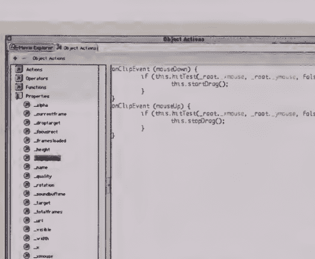

2.3 `mouseDown` 和 `mouseUp` 事件都需要有 `hitTest`，否则这些事件将关联到整个舞台。

### 限制拖动操作

你可能已经注意到，影片剪辑可以完全拖出舞台。显然这对任何人来说都没有什么用处。所幸你可以按照以下步骤将可拖动区域约束到特定大小的矩形：

1. 打开影片剪辑的对象动作面板（Ctrl+Alt+A [Mac 上为 Cmd+Opt+A]）。
2. 找到内容为 `this.startDrag()` 的那一行。

你可以在 `startDrag` 函数后的括号内设置以下五种参数中的任意一种：

- **lockCenter**。可以为 `true` 或 `false`。如果使用 `true`，则会将剪辑的中心吸附到鼠标位置。
- **Left**。边界矩形的左侧位置。
- **Top**。边界矩形的顶部位置。
- **Right**。边界矩形的右侧位置。
- **Bottom**。边界矩形的底部位置。

如果你想限制拖动，使剪辑不会消失在舞台之外，可以输入以下代码：

```actionscript
this.startDrag(true,0,0,400,300);
```

尝试将 `startDrag` 这一行替换为刚刚提到的代码，当你测试影片时，应该会发现影片剪辑被限制在影片的边界范围内。

### 使用影片剪辑的参数来约束它

除了将影片剪辑约束到你输入的参数之外，你还可以使用剪辑本身的参数来进行约束（例如，限制上下移动，使其只能左右移动）。这是创建滑块和滚动条时可以使用的技术。

3. 尝试修改参数，使你只能上下拖动剪辑，而不能左右拖动。
   - 将上一步中的 `startDrag` 行替换为以下代码：

```actionscript
this.startDrag(true,0,this._y,400,this._y);
```

在这里，你使用了影片剪辑（`this`）的 `_y` 属性来设置顶部和底部参数的约束。例如，如果影片剪辑的 `_y` 属性为 100，那么将顶部和底部参数都设置为该值意味着它无法上下移动。你的代码应如图 2.4 所示。

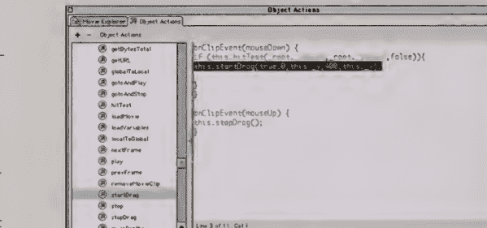

测试影片，你会看到你可以左右拖动剪辑，但不能上下拖动。

2.4 `startDrag` 函数现在使用影片剪辑的属性来约束上下移动。

### 检测剪辑被放置的位置

你现在了解了基本的拖放功能，但还缺少一个关键要素：查明剪辑被放置到了哪里，以及它被放置到了什么上面。

为了展示拖放的各种技巧，包括检测剪辑被放置的位置，你将创建一个简单的“填色本”Flash 影片。这包括将颜色样本拖到对象上，使对象改变颜色以匹配该样本。

### 创建可拖动的样本

首先，创建一个可以在舞台上拖动的正方形。

1. 创建一个 400×300 大小的新影片。
2. 导入一张图片作为背景。使用背景图片是为了让你能看到样本的效果，当它被放到一系列设置为 60% 透明度的彩色方块上时（参见图 2.5）。
3. 在一个新图层中，使用矩形工具在舞台上绘制一个没有边框的 30×30 像素正方形。这将成为你的样本（参见图 2.6）。
4. 选中该正方形并按 F8 将其转换为影片剪辑。命名为 `swatch`，然后点击确定。这现在就是可拖动样本对象的影片剪辑。
5. 选中该剪辑并使用效果面板将样本着色为新颜色。这样做是为了在获取样本的颜色值时它包含一种颜色——否则，Flash 只会将其视为黑色！

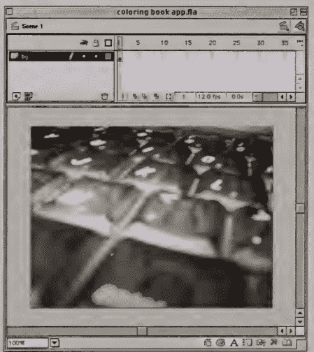

2.5 导入背景后，你就可以叠加样本了。

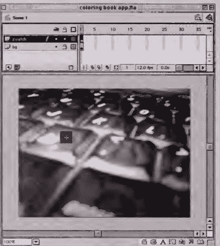

2.6 拖动时按住 Shift 键，将矩形约束为正方形。

在剪辑仍被选中的情况下，按 Ctrl+Alt+A（Mac 上为 Cmd+Alt+A）显示该影片剪辑的对象动作面板。

添加一些脚本以启用拖动功能。这段代码基本上与前面的示例相同，因此无需再详细解释，只需输入以下代码：

```actionscript
onClipEvent (mouseDown) {
    if (this.hitTest(_root._xmouse, _root._ymouse, false)) {
        this.startDrag(true, 0, 0, 400, 300);
    }
}
onClipEvent (mouseUp) {
    this.stopDrag();
}
```

你的代码应如图 2.7 所示。

测试你的影片，你会发现屏幕上有一个可以拖动的正方形。

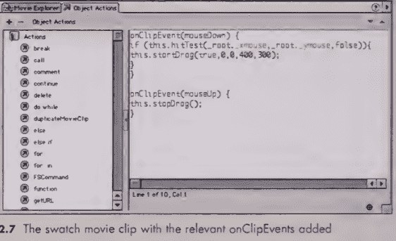

2.7 添加了相关 `onClipEvent` 的样本影片剪辑。

### 使用 `droptarget` 检测放置位置

与任何拖放操作一样，你需要知道影片剪辑被放置到了哪里。以下步骤将向你展示如何找到它被放置的位置：

1. 在 `mouseup` 事件处理器内部，你现在可以添加一行代码来了解影片剪辑被放置到了哪里：

   ```actionscript
   theDrop = eval(this._droptarget)
   ```

   在这里，你创建了一个名为 `theDrop` 的新变量，它现在包含该影片剪辑的 `_droptarget` 的值。`_droptarget` 属性以斜杠语法返回样本被放置到的影片剪辑的路径。例如，如果你在主舞台上有一个名为 `block1` 的影片剪辑，返回的值将是 `/block1`。

   然而，你不想使用斜杠语法；你需要使用点语法。使用 `eval` 函数，你可以将 `/block1` 转换为更有用的 `_level0.block1`。

2. 在主舞台上的一个新图层中，创建一个没有边框的 100×100 像素正方形。创建完成后，选中它并按 F8 将其转换为影片剪辑。
3. 在该剪辑仍被选中的情况下，使用实例面板为其命名。命名为 `block1`（参见图 2.8）。
4. 在该剪辑仍被选中的情况下，从效果类型下拉菜单中选择 Alpha。将透明度设置更改为 60%。你现在应该能看到背景图片略微透过颜色显示出来（参见图 2.9）。

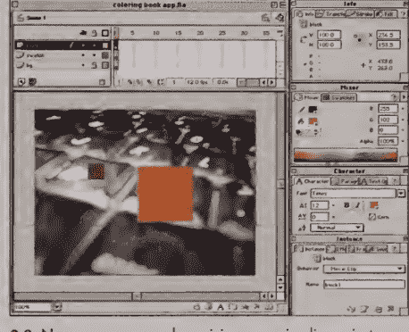

> 2.8 为影片剪辑命名时切勿使用空格——这会给 ActionScript 带来严重问题！

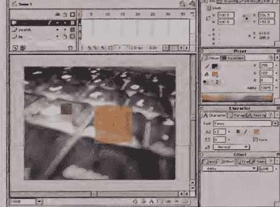

> 2.9 设置透明度，以便你能看到背景透过来。

很酷的是，能够在影片运行时看到 `theDrop` 变量中包含的内容。尽管 Flash 有一个不错的内置调试器，但接下来的几步将向你展示如何设置一个有用的调试文本框，我在项目中一直使用它。

5. 在主舞台上，创建一个新图层并将其命名为 `debug`。在这个新图层上，使用文本工具在影片的左下角绘制一个文本字段。
6. 在文本选项面板中取消选中文本框之前，从文本类型下拉菜单中选择动态文本，并为其指定变量名 `debug`（参见图 2.10）。
7. 再次选中你的样本影片剪辑并打开对象动作面板（Ctrl+Alt+A [Mac 上为 Cmd+Opt+A]）。
8. 在 `mouseUp` 事件中 `_droptarget` 行的后面，添加以下代码行：

   ```actionscript
   _root.debug = theDrop;
   ```

   这会将 `theDrop` 变量的值放入主舞台上的调试文本框中。

测试影片。你会发现，当你将样本放到 `block` 剪辑上时，你会在调试文本框中看到影片剪辑的完整路径（参见图 2.11）。

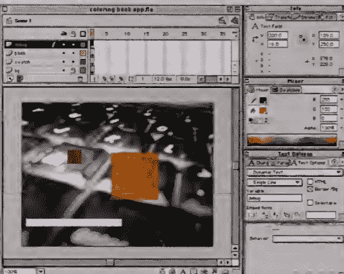


## 2.10 变量命名

确保变量名不包含空格；如果需要空格，请使用下划线代替。

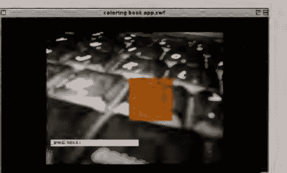

## 2.11 文本字段

文本字段对于调试 Flash 项目非常有用。

### 创建颜色对象

要让色板真正为方块着色，您需要在色板影片剪辑内创建一个颜色对象。当您将色板拖放到方块上时，影片会确定色板影片剪辑的颜色，然后使方块呈现相同的颜色。

1. 在舞台上选中色板影片剪辑，按下 Ctrl+Alt+A（Mac 上为 Cmd+Opt+A）以显示此影片剪辑的“对象动作”。您会看到已有的脚本。

2. 创建一个新的影片剪辑事件，这次将其命名为`load`。当影片剪辑加载时（即首次在舞台上出现时），您可以执行仅需运行一次的代码。在脚本窗口顶部输入以下代码：

   ```actionscript
   onClipEvent(load) {
   }
   ```

3. 现在可以在`load`事件的花括号之间创建颜色对象。要在 Flash 中操作颜色，您需要创建一个变量，并按如下方式将其定义为颜色对象：

   ```actionscript
   colorObj = new Color (this);
   ```

   变量`colorObj`现在被定义为一个颜色对象。注意这已被放入括号内。这意味着`colorObj`指向当前影片剪辑——在此例中即色板影片剪辑。

### 获取影片剪辑的颜色

既然您已在色板剪辑中设置了一个颜色对象，现在需要提取其红、绿、蓝（RGB）值，以便利用该信息将方块更改为相关颜色。

您现在可以在`colorObj`定义行之后，使用`getRGB()`函数提取当前影片剪辑的颜色，并将该值放入一个变量，如下所示：

```actionscript
thisColor = colorObj.getRGB();
```

变量`thisColor`现在包含了您影片剪辑的 RGB 值。您的脚本现在应如图 2.12 所示。

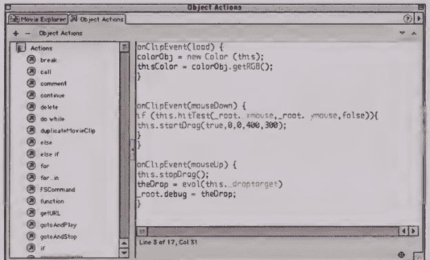

**2.12** `load`事件创建一个新的颜色对象，然后将当前的 RGB 值放入`thisColor`变量。

### 设置影片剪辑的颜色

您需要一个用于方块剪辑的颜色对象，以便在色板拖放到其上时设置方块的颜色。

- 选中方块剪辑。按下 Ctrl+Alt+A（Mac 上为 Cmd+Opt+A）以显示此影片剪辑的“对象动作”。

- 在此脚本窗口中，您只需使用`onClipEvent(load)`处理程序来定义一个新的颜色对象，如下所示：

  ```actionscript
  onClipEvent(load) {
    colorObj = new Color (this);
  }
  ```

  > 您可能会想：“当然，我们不能两次使用变量名`colorObj`吗？”如果两个变量都包含在主时间轴内，这通常是正确的，但它们并非如此。每个变量都包含在各自的影片剪辑中。

- 再次选中色板影片剪辑，并打开“对象动作”面板。

- 在`mouseUp`事件处理程序中，添加当色板被拖放到其上时实际为其着色的代码。您已经知道拖放的目标，因为它包含在`theDrop`变量中。现在您只需检查`theDrop`变量是否包含任何内容（如果未拖放到影片剪辑上，则不会包含）。如果确实包含内容，则按如下方式为该影片剪辑着色：

  ```actionscript
  if (theDrop) {
    theDrop.colorObj.setRGB(thisColor);
  }
  ```

  第一行确定变量`theDrop`是否包含内容。如果包含，则执行花括号之间的代码。下一行针对`theDrop`变量中指定影片剪辑的颜色对象。当色板被拖放到方块剪辑上时，目标被设置为`_level0.block1`。使用`setRGB()`函数设置指定颜色对象的颜色，这反过来也就设定了影片剪辑的颜色。请记住，您在本章前面已将变量`thisColor`设置为色板影片剪辑的颜色。您的代码应如图 2.13 所示。

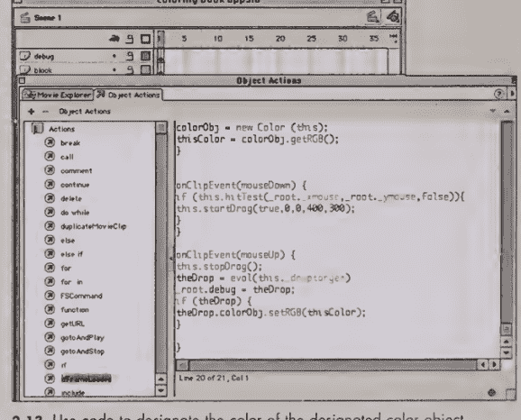

**2.13** 使用代码指定颜色对象的颜色。

5. 测试您的影片。将色板拖放到您指定要着色的剪辑上。您应该会发现颜色更改为色板的颜色。确保色板与另一个剪辑颜色不同（参见图 2.14）。

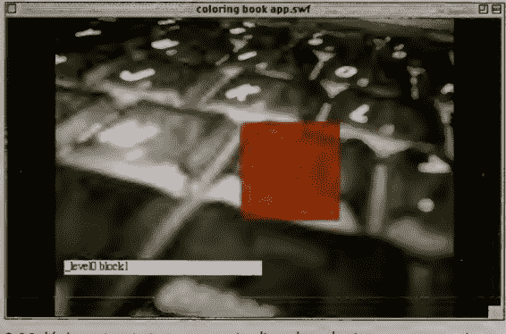

6. 回到主舞台，选中色板并使用“效果”面板为其色调设置为不同的颜色（参见图 2.15）。再次测试影片，您将看到方块的颜色会精确地更改为与色板匹配。

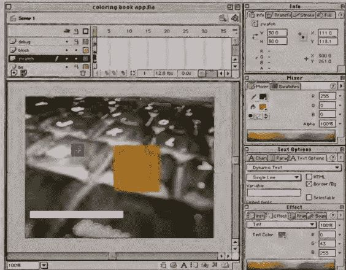

### 多个色板

拥有多个不同颜色的色板很容易。因为每段代码都是自包含的，您无需进行任何额外的编程。

1. 在主舞台上选中色板。

2. 复制该剪辑（Ctrl+C [Mac 上为 Cmd+C]），然后粘贴（Ctrl+V [Mac 上为 Cmd+V]）。一个新的色板应出现在舞台上（参见图 2.16）。

3. 选中此剪辑，使用“实例”面板将其命名为`swatch2`。

4. 使用“效果”面板为此色板设置不同的色调（参见图 2.17）。

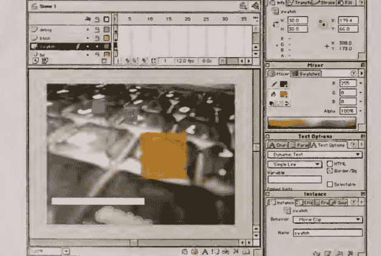

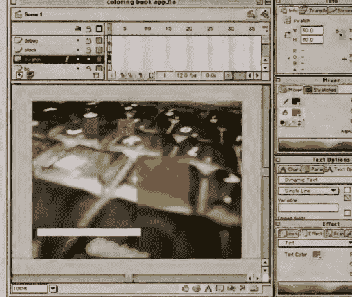

**2.16** 务必确保粘贴到正确的图层。为此，我总是锁定不工作的其他图层。

**2.17** 为色板设置色调意味着您可以使用相同的库项目但拥有不同的颜色，从而节省文件大小。

5. 测试影片。您会发现现在可以通过将相关色板拖放到方块上，为其设置两种不同的颜色。尝试制作更多不同颜色的色板（确保每个都有不同的实例名称）。再制作三个方块的副本，并分别命名为`block2`、`block3`和`block4`。这样您就有四个可以着色的方块了！（参见图 2.18）。

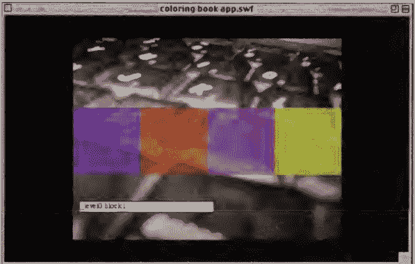

**2.18** 步骤 5 是您可以开始为方块设置多种颜色的地方。

### 将色板吸附回原位

您应该注意到，当您将色板拖放到方块上时，它们就停留在那里。它们应该做的是吸附回其起始位置。以下是修正此问题的所需步骤：

1. 选中一个色板，并按下 Ctrl+Alt+A（Mac 上为 Cmd+Opt+A）打开“对象动作”面板。

2. 在花括号之前的最后一行之后，在`load`影片剪辑事件内添加以下代码：

   ```actionscript
   startx = this._x;
   starty = this._y;
   ```

   您现在设置了两个变量，分别包含影片剪辑的起始 X 和 Y 位置。

3. 现在剩下的就是使用这些变量在释放鼠标时重置色板剪辑的位置。在`mouseup`事件处理程序内添加以下代码作为最后一行：

   ```actionscript
   this._x = startx;
   this._y = starty;
   ```

当释放鼠标按钮时，色板的位置现在将重置为其起始位置（`startx`和`starty`）。您完整的代码应如图 2.19 所示。

4. 测试影片时，您应该看到刚刚更改的色板在拖动后会吸附回去。修改影片中的任何其他色板，使其表现相同。

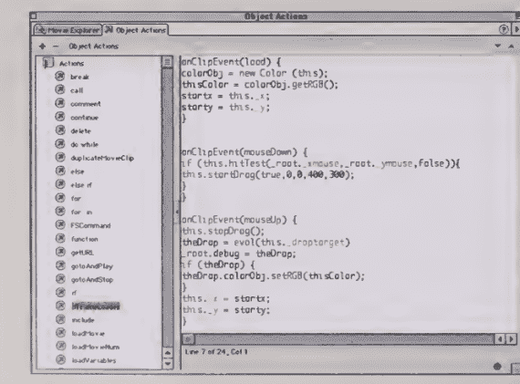

**2.19** 添加最后几行代码后，您的重置将生效。

### 更改影片剪辑的堆叠顺序

如果您有多个色板，您可能会注意到，当您拖动一个色板时，可以将其拖到第二个色板下面（例如，第一个色板在第二个色板下面）。应该发生的情况是，您正在拖动的影片剪辑应始终位于最上方。

要更改所谓的*堆叠顺序*或*Z 轴顺序*，您可以使用`swapDepths`函数。当影片剪辑在舞台上创建时，它们会被分配一个从 0 开始的深度。第二个剪辑的深度为 1，依此类推。数字越高，剪辑在堆叠顺序中越靠上。如果您有一个深度为 0 的影片剪辑，您可以通过输入以下代码将其置于深度为 1 的第二个影片剪辑之上：

```actionscript
myfirstClip.swapDepths(1);
```

这将交换位于层级 0（`myfirstClip`）的剪辑和位于层级 1 的剪辑——因此`myfirstClip`现在将显示在第二个剪辑的前面。除了针对实际深度外，您还可以使用以下代码针对剪辑本身：

```actionscript
myfirstClip.swapDepths(mysecondClip);
```

要利用`swapDepths`函数修改您的颜色示例，请遵循以下步骤：

1. 添加一个新图层并将其命名为`script`。

2. 双击此新图层的第一帧以打开“帧动作”面板。

### 精简代码

请重新阅读上一个练习的第 6 步。它要求你将同一段代码添加到舞台上的每个色板中。这意味着要选择每个影片剪辑，打开每个剪辑的脚本，添加代码行，以此类推。如果你只有两个色板，这样做没问题，但假设有 10 个甚至 50 个呢？那会耗费一整天时间。所以，我想向你展示如何将为一个色板编写的代码转化为一个主对象。然后，这个主对象可以复制粘贴到主舞台上，并设置为任何颜色，无需额外编程。每个色板仍保持自己的独立性，独立工作，但妙处在于它们使用相同的引擎。修改引擎的代码，这种更改会立即反映在该色板的所有实例中！这就是所谓的*面向对象编程（OOP）*的原则。

> 这个主对象可以复制粘贴到主舞台上，并设置为任何颜色，无需额外编程。

爱你的_父母！

这种机制的基本原理很简单，但可以应用于无数种方式。基本上，你获取带有其附加剪辑事件的色板，并通过选择它并按 F8 键将其转换为另一个影片剪辑。你现在有一个影片剪辑嵌套在另一个影片剪辑内部。现在，你可以修改色板的代码以影响父剪辑——即现在包含你的色板剪辑的那个剪辑。以下步骤将指导你如何完成此操作：

- 删除舞台上的色板，只保留一个。

- 选择剩余的这个色板。按 F8 键将此影片剪辑转换为另一个影片剪辑。将其命名为`色板引擎`并按确定（见图 2.22）。

- 你的原始色板影片剪辑现在包含在另一个影片剪辑内部。从主舞台双击这个新的影片剪辑进行编辑。

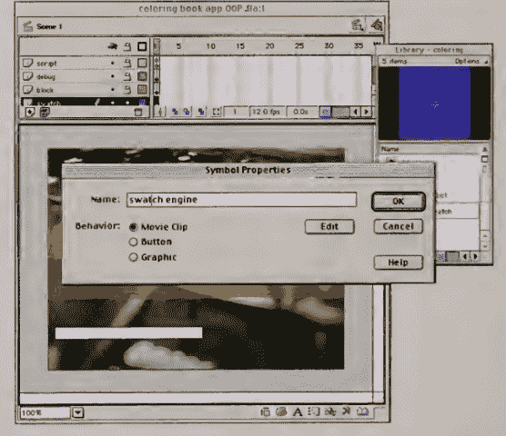

**2.22** 描述性的元件名称将帮助你跟踪库项目。

4. 选择现在位于你的色板引擎剪辑内部的影片剪辑，然后按 Ctrl+Alt+A（Mac 上为 Cmd+Opt+A）以显示该影片剪辑的“动作”面板。你应该能在窗口中看到`onClipEvent`脚本（见图 2.23）。

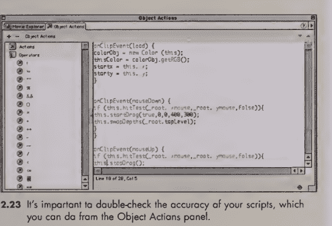

**2.23** 仔细检查脚本的准确性很重要，你可以在“动作”面板中完成此操作。

### 修改脚本以影响父剪辑

现在你需要修改现有脚本，使其影响父影片剪辑并从父剪辑获取颜色。这使你能够通过简单地复制和粘贴此色板任意多次，然后为它们着色，从而在舞台上创建更多色板。

1. 修改脚本以影响父剪辑很简单。你只需遍历脚本，并将所有`this`的实例替换为`_parent`。

以下是完整的、修改后的代码：

```actionscript
onClipEvent (load) {
colorObj = new Color(_parent);
thisColor = colorObj.getRGB();
startx = _parent._x;
starty = _parent._y;
}
onClipEvent (mouseDown) {
if (_parent.hitTest(_root._xmouse, _root._ymouse, false)) {
_parent.startDrag(true, 0, 0, 400, 300);
_parent.swapDepths(_root.topLevel);
}
}
onClipEvent (mouseUp) {
if (_parent.hitTest(_root._xmouse, _root._ymouse, false)) {
_parent.stopDrag();
theDrop = eval(_parent._droptarget);
_root.debug = theDrop;
if (theDrop) {
theDrop.colorObj.setRGB(thisColor);
}
_parent._x = startx;
_parent._y = starty;
}
}
```

1. 完成上述操作后，返回主舞台并选择色板剪辑。使用“效果”面板为剪辑着新颜色。

2. 测试你的影片。你应该发现它的工作方式与之前完全相同——将颜色拖放到色块上会为其着色。

3. 回到编辑器，选择色板，复制并粘贴，然后使用“效果”面板为这个新剪辑着另一种颜色。根据需要重复此操作任意次数。

4. 再次测试影片。你会看到每个色板仍然彼此独立，拖放到色块上时会为其着上自己的颜色（见图 2.24）。

这个新色板剪辑的妙处在于，如果你想稍后更改色板的脚本，你只需为一个色板进行更改，该更改就会反映在所有色板中。

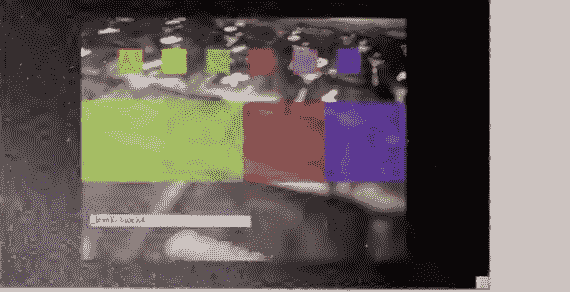

### 可拖动遮罩

Flash 中遮罩的一个问题是，虽然你可以将影片剪辑定义为遮罩，但你不能随后将拖动操作附加到该影片剪辑并在舞台上拖动它。遮罩在运行时是预渲染的，因此拖动它们意味着 Flash 必须实时渲染被遮罩的位图。幸运的是，有几种技术可以模拟这种效果。

### 线性移动遮罩

我将向你展示的第一种技术实际上不涉及任何拖动操作，并且其范围相当有限。然而，它确实有其用途，并且是下一项技术的前导。

这总是与照片配合得很好，所以找一张合适的照片，在 Photoshop 或类似程序中制作一个副本，并添加一些高斯模糊（约 4.0）。保存图片的这个版本。你现在应该有两张照片副本：一张正常，一张模糊。如果你愿意，也可以使用我所使用的图片，可从本书网站（`dragslidefade.com`）获取。

1. 创建一个与图像尺寸相同的新影片。我的是 600×341（见图 2.25）。

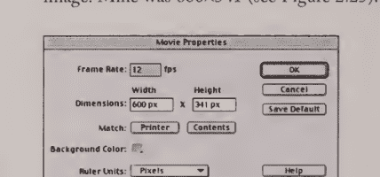

# 第 2 章 拖放

2. 通过在图层 1 的第 100 帧插入一个帧（F5），使影片长度为 100 帧。（我稍后会解释为什么要这样做。）

3. 将第一层重命名为`模糊`，并导入（Ctrl+R [Mac 上为 Cmd+R]）你图像的模糊版本到此层中（见图 2.26）。

4. 在模糊层上方创建一个新层，并将其命名为`正常图像`。将未模糊的图像版本导入到这个新层中。此图像将是被遮罩的图像。

5. 在正常图像层上方创建另一个层，并将其命名为`遮罩`。

6. 在此层上，使用矩形工具绘制一个矩形，宽度与影片相同，高度大约为影片高度的 1/10（见图 2.27）。这将作为你的遮罩形状。

7. 选择此矩形，按 F8 键，并将其命名为`遮罩形状`。在“元件属性”框中选择“图形”并按确定（见图 2.28）。这已将遮罩形状转换为元件，以便你可以对其应用补间动画。

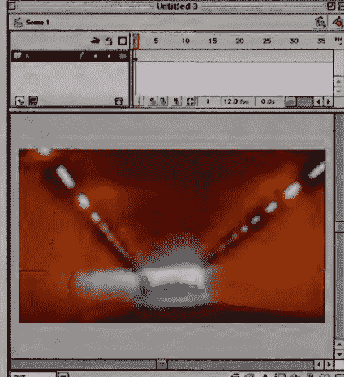

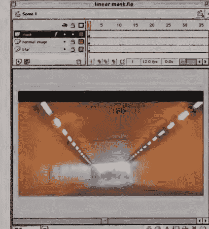

**2.26** 通过简单的命令，你可以将图像导入到新图层中。

**2.27** 这个形状最终将成为一个遮罩。确保矩形没有轮廓。

8. 在遮罩层中，在第 100 帧插入一个关键帧（F6）。

9. 在此帧上，选择遮罩形状并使用方向键将其向下移动到影片的底部（参见图 2.29）。

10. 仍在遮罩层中时，选择第 1 帧，并使用“帧”面板将补间设置为“动作”（参见图 2.30）。

来回拖动时间轴，你会看到遮罩形状从上到下移动。

11. 在最后一部分，进入脚本编写之前，右键单击（在 Mac 上为 Ctrl+单击）遮罩层，然后从弹出菜单中选择“遮罩”。遮罩下方的正常图像现在应该只通过遮罩形状显示出来（参见图 2.31）。

**2.31** 如果你一切操作正确，你在这里看到的图像就会证实这一点。你的影片已设置完毕。

## 使用鼠标控制遮罩位置

现在你的影片已设置完毕，你可以开始编写脚本了。你可能想知道为什么你的影片有 100 帧长。这种技术基于百分比工作。你先找出鼠标的 Y 位置，然后进行一个小计算，确定该位置相对于屏幕深度的百分比。知道了这一点后，你让时间轴跳转到该帧，从而将遮罩移动到鼠标所在的位置！

1. 创建一个新层并将其命名为`script`。

2. 双击第一帧以显示“帧动作”面板。在脚本窗口中添加一个`stop()`命令（参见图 2.32）。

**2.32** 添加一个`stop()`命令，这样影片就不会在 100 帧中播放。

确保主舞台上没有选中任何内容（Ctrl+Shift+A [在 Mac 上为 Cmd+Shift+A]），然后按 Ctrl+F8（在 Mac 上为 Cmd+F8）创建一个新的影片剪辑。将其命名为`script`（参见图 2.33）。

**2.33** 在这里使用一个简单的命令从主舞台创建一个新的影片剪辑，之后你将启动脚本循环。

当你创建新的影片剪辑时，你会自动进入该新剪辑的元件编辑模式。在这里你要创建一个由两帧组成的脚本循环，这两帧不断循环，检查鼠标的位置。这是 Flash 脚本编写的基本原理，在整本书中你会经常使用。

在`script`影片剪辑中，双击第一帧以打开“对象动作”面板。

你的脚本首先需要做的是获取鼠标 Y 位置，并将其放入一个名为`ymousePos`的变量中，如下所示：

```actionscript
ymousePos = _parent._ymouse;
```

在`_ymouse`之前使用`_parent`是为了让坐标相对于主舞台，在这种情况下，这比该影片剪辑高一级（父级）。

在下一行，计算鼠标位置相对于影片区域百分比。要计算这个，你只需要将 100 除以影片高度（在我的情况下是 341），然后乘以`ymousePos`的值，如下所示：


```actionscript
frameNumber = Math.round((100 / 341) * ymousePos);
```

你将结果放入一个名为`frameNumber`的变量中。注意你如何使用内置的`Math`函数`round`将计算结果（外括号之间的所有内容）四舍五入为整数，因为帧号都是整数。

最后，让主时间轴跳转到该帧号，如下所示：

```actionscript
_parent.gotoAndStop(frameNumber);
```

此帧的完整代码应如图 2.34 所示。

**2.34** 如果你的代码看起来像这样，你就可以设置持续循环了。

你需要前面的脚本不断检查鼠标位置，所以在第 2 帧添加一个关键帧。

双击此关键帧并在脚本窗口中添加以下代码：

```actionscript
gotoAndPlay(1);
```

现在`script`影片剪辑已设置为持续循环。

回到主舞台，将`script`影片剪辑拖到`script`层上。测试你的影片。你应该会看到遮罩跟随鼠标的 Y 位置移动（参见图 2.35）。

这种线性遮罩是一种有点强制的遮罩技术，但它能给出不错的效果，确实有其用途（例如在菜单中）。当然，你也可以让它左右移动而不是上下移动。下一种技术有更多的发挥空间。

**2.35** 遮罩移动到当前鼠标位置。

## 非线性可拖动遮罩

正如我之前所说，在 Flash 中无法简单地创建一个遮罩然后附加拖动动作来拖动它。但这种技术展示了如何实现这种效果。这是它的工作原理。

底部层上是你模糊的图片。在这层之上你有一个影片剪辑。这个影片剪辑是可拖动的。在这个影片剪辑内部是一个遮罩，遮罩出正常图片。这里是关键技巧：当这个影片剪辑在舞台上被拖动时，被遮罩的图片也会相对于遮罩移动，因此它始终与模糊图片对齐。（参见图 2.36。）

我将使用与上一个示例相同的图像。你也可以使用这些图像，从网站上获取，或者使用你自己的两张：一张正常的，另一张模糊的。

1. 创建一个新的影片，大小与你的图像相同——在我的情况下是 600×341。

2. 在第 1 层中，导入模糊图像，然后将该层重命名为`blur`。

3. 选中此图像，使用对齐面板将其在舞台中央居中（参见图 2.37）。

4. 在`blur`层上方创建一个新层并将其命名为`mask`。

5. 在此层中使用矩形工具绘制一个正方形（80×80）。再次使用对齐面板将其与舞台中心对齐。

6. 在正方形仍被选中的情况下，按 F8 将其转换为影片剪辑。命名为`mask drag`并按确定。

7. 双击此新影片剪辑以进入元件编辑模式。

8. 在带有正方形的层下方创建一个新层。将其命名为`normal picture`并将正常版本的图像导入此层。

9. 在此图像仍被选中的情况下，使用对齐面板将其在舞台中央居中。这很重要，这样两张图像才能对齐（参见图 2.38）。

10. 最后，在这个阶段，选择正常图像并按 F8 将其转换为影片剪辑。它需要是影片剪辑，这样你才能移动它的 X 和 Y 位置。

**2.38** 两张图像都居中对齐。

## 编写拖动脚本

要使这种效果生效，你再次使用脚本影片剪辑循环。但在那之前，你首先需要为正常图片剪辑指定一个实例名称。

1. 选择正常图片剪辑，并使用实例面板将其命名为`picture`（参见图 2.39）。

2. 在带有正方形（遮罩层）的层上方，创建一个新层并将其命名为`script`。

3. 双击此层的第一帧以显示“帧动作”面板。

**2.39** 命名图片剪辑后，你就可以开始编写拖动脚本了。

4. 设置两个变量来包含此影片剪辑的起始 X 位置和起始 Y 位置，如下所示，这样当你移动图片时，你知道要将其从原始位置偏移多少：

```actionscript
startx = this._x;
starty = this._y;
```

5. 接下来，创建脚本循环。确保没有选中任何内容（Ctrl+Shift+A [在 Mac 上为 Cmd+Shift+A]）并按 Ctrl+F8（在 Mac 上为 Cmd+F8）创建一个新的影片剪辑。将其命名为`script`并按确定。

创建此剪辑时，你将进入该新影片剪辑的元件编辑模式。在这里你将编写控制遮罩的代码。

6. 双击脚本剪辑的第一帧以显示“帧动作”面板。

7. 这个脚本将持续循环，但你只希望在遮罩被拖动时它才起作用，所以利用一个名为`drag`的变量，当`mask drag`剪辑被拖动时该变量设置为`true`。以下`if`语句检查是否属于这种情况：

```actionscript
if (_parent.drag == true) {
}
```

8. 在`if`语句的大括号内，添加以下两行代码来移动遮罩内部的图片：

```actionscript
_parent.picture._x = (_parent.startx - _parent._x);
_parent.picture._y = (_parent.starty - _parent._y);
```

基本上，你将父级影片剪辑（`mask drag`）的原始起始 X 位置添加到图片影片剪辑的当前 X 位置，但减去当前`mask drag`的 X 位置。这样在拖动影片剪辑时，会将图片偏移到遮罩内的正确位置——因此正常图像和模糊图像都能对齐。Y 位置执行相同的计算。你的代码应如图 2.40 所示。

9. 在脚本影片剪辑的第二帧中，添加一个关键帧（F6）。

10. 双击此帧并添加一个命令，将播放头送回到第 1 帧，使其持续循环：

```actionscript
gotoAndPlay(1);
```

**2.40** 如果你的代码看起来是这样的，你的模糊图像和正常图像应该能完美对齐。

11. 回到遮罩拖拽影片剪辑，将脚本影片剪辑拖入你之前创建的脚本图层。

12. 选中带有方块的图层，右键单击（在 Mac 上为 Ctrl+单击）以弹出图层选项。选择“遮罩”。现在方块应该会遮罩住下方的图像（见图 2.41）。

13. 在主时间轴上，选中遮罩影片剪辑，然后按 Ctrl+Alt+A（在 Mac 上为 Cmd+Opt+A）以显示对象动作面板。

14. 在此脚本窗口中，使遮罩影片剪辑可拖动。本章已经介绍过如何实现这一点，因此代码如下（你应该注意，这里是将拖动变量设置为`true`表示正在拖动，`false`表示未拖动）：

```actionscript
onClipEvent (mouseDown) {
  if (this.hitTest(_root._xmouse, _root._ymouse, true)) {
    drag = true;
    startDrag (this, false, 0, 0, 600, 341);
  }
}
onClipEvent (mouseUp) {
  drag = false;
  stopDrag ();
}
```

你可能需要将数字 600 和 341 分别修改为你影片的宽度和高度。

15. 测试你的影片。你会发现现在有一个可拖动的遮罩，它能完美对齐！

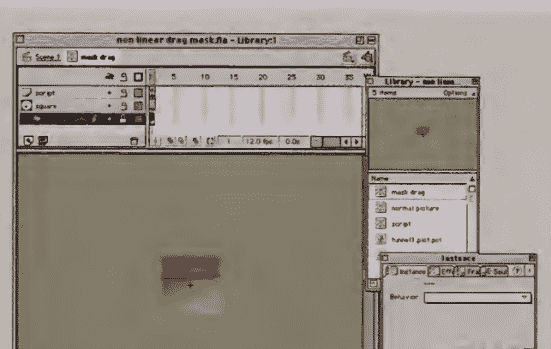

**2.41** 如果你的图像被方块遮挡在下面，那么一切正常，你可以继续编写可拖动遮罩的脚本。

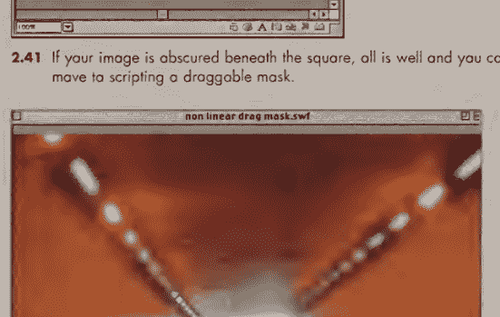

**2.42** 当你完成这种对齐后，尝试一些特效来真正让遮罩脱颖而出。

### 结语

尝试在最后一个示例的基础上，在遮罩形状周围添加黑色边框，以获得更好的效果，或者添加轻微的下拉阴影使其脱离背景。还可以尝试在主舞台上将遮罩影片剪辑缩放到 200%，以产生放大镜效果。完成后，将两种遮罩效果结合起来，这样你就可以随时放大或缩小遮罩区域。

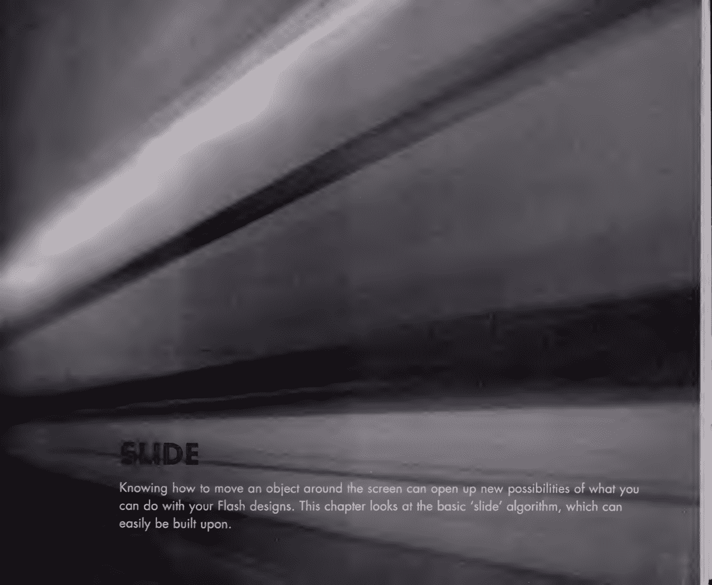

## 滑动

了解如何在屏幕上移动物体可以为你的 Flash 设计开辟新的可能性。本章介绍基本的“滑动”算法，它可以很容易地进行扩展。

### 创建滑动面板用于导航和过渡效果

滑动面板导航系统已在 Flash 网站中相当流行。点击按钮，一个面板滑入适当位置，将你带到网站的新区域。本章的目标不是向你展示那些被过度使用的技术，但了解这种效果的工作原理将为你提供一些关于程序控制运动的重要原理。在本章中，你将了解创建运动的基本原理，然后看看如何扩展它来创建一些更有趣的效果，而且不仅仅是用于导航。

### 基本滑动算法

滑动动作通过控制目标影片剪辑的 X 值（或者，如果你愿意，Y 值）来实现。当按钮被按下或悬停时，会设置一个变量，指定面板影片剪辑的新 X 位置。然后运行一个脚本，循环执行，一点一点地将面板移动到它的新 X 位置。这就是创建基本滑动动作的全部！但是，它是如何在滑动过程中看起来有缓入缓出效果，在到达最终 X 位置时减慢速度的呢？嗯，这也很简单，但我会在本章后面向你展示。

首先，你需要有一些可以滑动的东西。我在 Photoshop 中创建了一个 3 面板位图，由三张 400×250 像素的图像排成一行，总宽度为 1200 像素（见图 3.1）。你可以自己制作，或者使用这个相同的，可从本书网站（`dragslidefade.com`）获取。

1. 首先，你需要有一些可以滑动的东西。我在 Photoshop 中创建了一个 3 面板位图，由三张 400×250 像素的图像排成一行，总宽度为 1200 像素（见图 3.1）。你可以自己制作，或者使用这个相同的，可从本书网站（`dragslidefade.com`）获取。

2. 创建一个新的 Flash 影片，尺寸为 400×250 像素。

3. 在第一层中，按 Ctrl+R（在 Mac 上为 Cmd+R）导入你的面板图像。

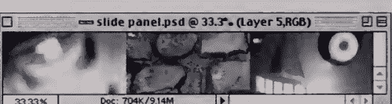

将图像保存为高质量的 Pict 或位图格式。你可以在 Flash 中稍后对其进行压缩。

4. 选中图像，然后按 F8 将其转换为影片剪辑。将其命名为`panel`，然后按确定。

5. 选中此剪辑，调整位置，使面板条中的中间图片居中，并且上边缘紧贴主影片的顶部（见图 3.2）。

6. 使用实例面板，将其命名为`panel`。

7. 在此图层上方，创建一个新图层并命名为`script`。这是你放置脚本影片剪辑的地方，它将控制面板的移动。

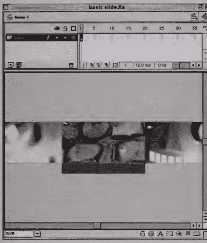

**3.2** 使用对齐面板可以轻松正确地将影片剪辑定位。

### 设置脚本循环

脚本循环是控制面板移动的主要引擎。它是一个标准的影片剪辑脚本循环，主要代码在一帧上，后续帧上有一个`gotoAndPlay`动作使其循环。

1. 确保未选中任何内容，按 Ctrl+Alt+A（在 Mac 上为 Cmd+Opt+A），然后按 Ctrl+F8（在 Mac 上为 Cmd+F8）创建一个新的影片剪辑。将其命名为`script`，然后按确定（见图 3.3）。

2. 在第 5 帧插入关键帧（F6），然后在第 6 帧也插入一个。现在你在脚本影片剪辑的第 1、5 和 6 帧有关键帧。

3. 将第一层命名为`script`。在第一层上方插入一个新图层并命名为`labels`。

4. 在此`labels`图层中，在第 5 帧添加关键帧。

5. 单击`labels`图层的第 1 帧，使用帧面板为其赋予`stop`标签。对于第 5 帧，赋予一个名为`move`的标签（见图 3.4）。

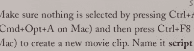

**3.3** 当你创建这个新的影片剪辑时，会自动进入其符号编辑模式。

DAWES Flash ActionScript for Designers: Drag, Slide, Fade

### 编写滑动算法代码

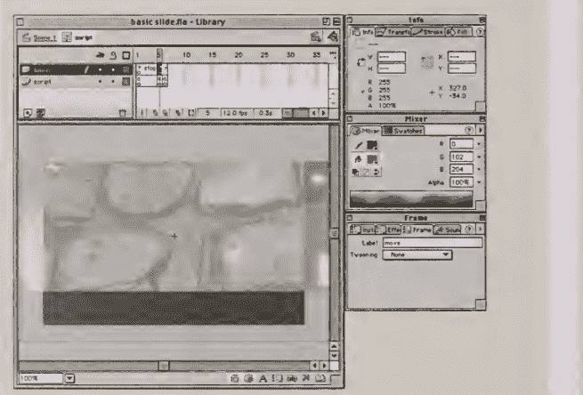

第 5 帧上的代码是主要代码，它循环执行，在按下按钮时将面板移动到其目标位置，向左或向右。首先，看看如果目标 X 位置小于面板的当前 X 位置，如何将面板向左移动。

1. 双击脚本层第 5 帧的关键帧以显示帧动作面板。

2. 检查面板的 X 位置是否大于`targetX`变量中包含的值，该变量在单击按钮时设置：

```actionscript
if (_root.panel._x > _root.targetx) {
```

如果是这种情况，那么你需要将面板向左移动。要计算每次循环时移动面板的量，使用一个非常简单的算法。

**3.4** 添加标签可以更容易地跟踪脚本设置。

这些标签使你能够执行脚本中的代码，而无需记住你将代码放在哪一帧！

首先找出两个 X 位置之间的差值，并将其放入名为`difference`的变量中。例如，假设你当前面板的 X 位置是 500，目标 X 位置是 200。500 减去 200 等于 300。你不能简单地将面板向左移动 300 像素，因为这样就不会有可感知的移动——它会直接`跳跃`到新的 X 位置。所以，你需要做的是将差值除以一个数字。你使用的数字是`baseRate`的值，在这种情况下是 1.6。

6. 在第一层（脚本层）中，双击第一帧以显示该帧的帧动作面板。

7. 这第一帧有两个作用。首先，放入一个`stop()`命令，这样影片剪辑在首次出现在舞台上时不会自动开始。接下来，设置一个名为`baseRate`的变量。这决定了面板滑动的速度，正如你马上就要看到的。因此对于这一帧，在帧动作窗口中添加以下代码：

因此，差值除以`baseRate`等于当前示例中的速率：

```actionscript
stop();
baseRate = 1.6;
```

```text
300/1.6=187.5
```

这会告诉你将面板向左移动的距离。现在你可能会想，“等等，我不能简单地一直将它向左移动187.5像素。它应该在到达目的地时减速。” 好吧，问题是，这个差值会在脚本每次循环时重新计算。所以在给定的例子中，下一次循环时面板的当前 X 位置将是500减去187.5，即312.5。看看新的计算结果如下：

```text
312.5-200=112.5 (panel_x-targetx=difference)
112.5/1.6=70.3125 (difference/baseRate=rate)
```

你可以看到，你将移动面板的距离刚刚超过70像素。显然，面板越接近其目标 X 位置，每次循环时移动得越慢。最终它会停止移动，因为差值为零！这样做的效果是，面板似乎会平滑地滑入其最终的静止位置。当然，你可以调整`baseRate`并尝试不同的数值。较高的数值使面板移动得更慢，较低的数值则更快。请根据需要调整！

以下是向左和向右移动面板的完整代码。将其输入到当前打开的脚本窗口中，该窗口是脚本层的第 5 帧（见图 3.5）。

```actionscript
difference = _root.targetx - _root.panel._x;
rate = difference / baseRate
_root.panel._x += rate;
```

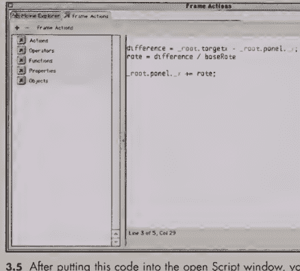

将此代码放入打开的脚本窗口后，你就可以进行最后的循环命令了。

3. 双击脚本层中的第 6 帧。

4. 在这个“帧动作”面板中，添加以下代码以使脚本持续循环：

```actionscript
gotoAndPlay("move");
```

脚本部分就完成了！现在你需要添加按钮来实际执行代码。

## 添加按钮

按钮实际上执行你刚刚编写的代码，只需告诉脚本影片剪辑跳转并播放带有标签`move`的帧。你还会在按钮被点击时设置一些变量，以便面板知道要移动到哪里。

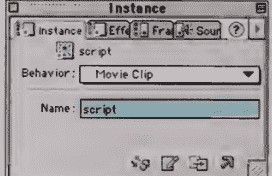

1. 返回主舞台，将脚本影片剪辑拖入脚本层。

2. 在影片剪辑仍被选中的情况下，使用“实例”面板将其命名为`script`（见图 3.6）。这有助于在按钮被点击时从按钮引用脚本。

3. 在脚本层上方创建一个名为`buttons`的新层。

4. 在舞台上绘制一个矩形，选中它，然后将其转换为按钮（F8）。给它起个有创意的名字，比如`button`，然后单击“确定”（见图 3.7）。

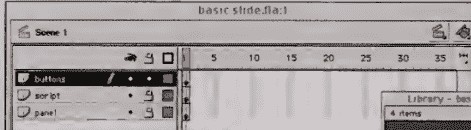

当这个按钮被点击时，你希望它做两件事。首先，它需要设置变量`targetx`的值。这是你希望面板移动到的新 X 位置，如下所示：

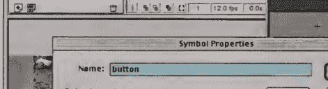

```actionscript
targetx = 600;
```

其次，你希望实际调用脚本本身来移动面板，如下所示：

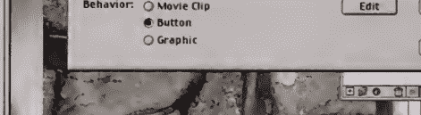

```actionscript
script.gotoAndPlay("move");
```

5. 要将此功能添加到按钮，请选中它并按`Ctrl+Alt+A`（Mac 上为`Cmd+Opt+A`）以显示“对象动作”面板。

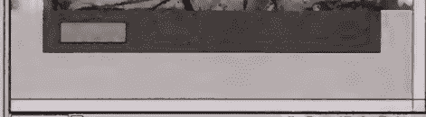

6. 在脚本窗口中添加一个`on(release)`事件处理程序，如下所示：

```actionscript
on (release) {

}
```

这意味着——当按钮被释放（即被点击）时，花括号之间的代码将被执行。

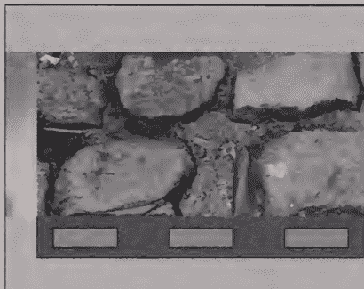

7. 在花括号之间添加以下代码以完成按钮脚本：

```actionscript
targetx = 600;

script.gotoAndPlay("move");
```

8. 返回主舞台，复制该按钮并粘贴两次，这样你就在舞台上有了三个按钮（见图 3.8）。

9. 选择按钮 2，打开该按钮的“对象动作”面板（`Ctrl+Alt+A` [Mac 上为`Cmd+Opt+A`]），并修改`targetx`变量使其现在读取如下：

```actionscript
targetx = 200;
```

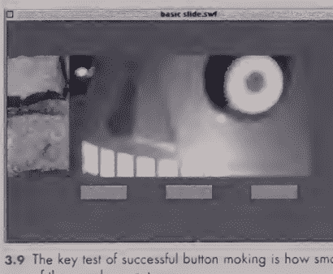

10. 对第三个按钮执行相同的操作，但将`targetx`变量修改为`-200`。你现在有三个按钮，可以将面板设置到不同的 X 位置。

11. 测试你的影片以查看它是否有效。你应该会发现，点击按钮会使面板以非常流畅的方式左右滑动（见图 3.9）。


尝试将`baseRate`变量更改为更低或更高的数字，以获得不同的速度。

## 滑动算法的其他用途

现在你已经掌握了基本的滑动算法及其工作原理，你可以开始以更具创意的方式使用它了。（而不是去复制一个可能已经被过度使用的效果。）这就是交互式设计的魅力所在——总有一片天地可以扩展一项技术，并将其带入新的领域——它不仅仅局限于复制一个好的想法。

## 多鼠标滑动

好的，这个标题有点令人困惑，但它实际上指的是以不同的速度移动多个面板到鼠标的 X 位置。当它们到达目的地时，面板会逐渐淡出。同样，这在位图上看起来很棒。我使用了一张在一月寒冷的早晨在前往曼彻斯特的火车上用我的 Canon Digital Ixus 拍摄的照片。这张图片可以从本书的网站（`dragslidefade.com`）获取，但当然，你也可以使用任何你喜欢的图像。

### 设置影片

1. 创建一个新的 Flash 影片，尺寸为 500×375。
2. 将第一层重命名为`image`，然后将你的位图导入到此层。
3. 使用“对齐”面板将图像居中对齐到舞台（见图 3.10）。
4. 接下来你需要一些可以滑动的东西。在图像层上方创建一个新层，并将其命名为`panel1`。
5. 在此层中绘制一个 125×375 的矩形框。使用“信息”面板设置尺寸（见图 3.11）。
6. 选择该矩形，然后按`F8`将其转换为影片剪辑。将其命名为`panel`并按“确定”。
7. 在这个影片剪辑仍被选中的情况下，使用“实例”面板将其命名为`panel1`（见图 3.12）。
8. 创建一个新层并将其命名为`panel2`。

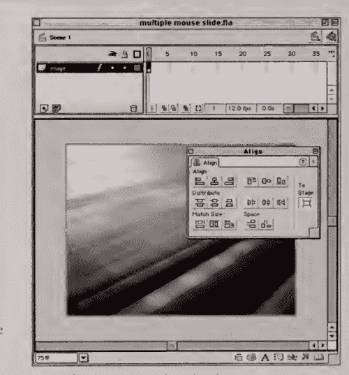

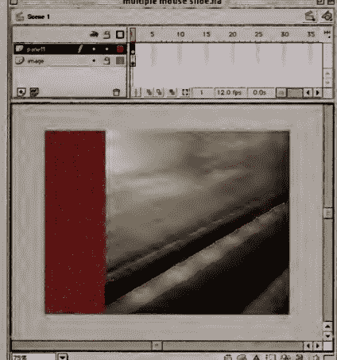

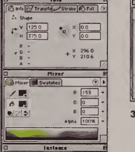

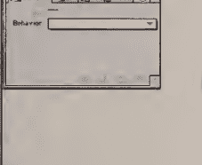

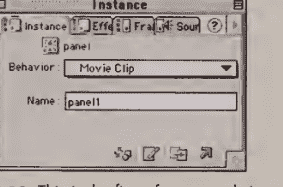

3.12 这是你要为其编码移动的两个面板中的第一个。

1. 从`panel1`层复制影片剪辑，然后通过选择“编辑/粘贴到当前位置”将其粘贴到`panel2`层。
2. 在选中第二个面板的情况下，使用“实例”面板将其重命名为`panel2`。

现在你有两个位于位图图像上方不同层的面板。现在是时候进行编码让它们移动了。

3.11 使用“信息”面板是将其尺寸更改为特定大小的非常简单的方法，而不是试图凭视觉判断。

### 编码多重移动算法

实现此功能的粗暴方法是简单地获取你之前的滑动代码，将相同的代码复制并粘贴到原始代码下方，然后修改这第二部分，使其影响名为`panel2`的影片剪辑。结果，你最终会有四个`if`语句。当只有两个东西需要滑动时，这是合理的，但如果你有 5 个或 10 个呢？我想向你展示一种更高效的编码方式，使用你将会爱上的东西——函数。

### 使用函数创建高效代码

函数是自包含的代码片段，在你需要使用它们时执行或“调用”。最好的描述方式是给你举个例子。假设你有一个按钮，当它被点击时，会增加`myClip`在 X 轴和 Y 轴上的缩放比例。你可以编写以下代码：

```actionscript
on (release) {
    myClip._xscale = myClip._xscale + 10;
    myClip._yscale = myClip._yscale + 10;
}
```

这当然可以正常工作。但如果你需要在多个按钮上执行此操作呢？编写相同的两行代码会很麻烦。相反，你可以在主时间轴的第一帧定义一个函数，如下所示：

```actionscript
function increaseScale() {
myClip._xscale = myClip._xscale + 10;
myClip._yscale = myClip._yscale + 10;
};
```

现在，每当你想通过按钮增加影片剪辑的缩放比例时，你只需编写以下代码：

```actionscript
on (release) {
_root.increaseScale()
}
```

这将具有完全相同的效果，但效率要高得多。这也意味着，如果你想修改代码——例如，同时降低透明度和缩放比例——你只需将其添加到函数中即可。以前我必须进入每一个按钮并修改每段代码。

### 向函数传递参数

函数的真正威力在于其允许你向它们传递参数的能力。例如，在前面的例子中，函数总是影响`myClip`影片剪辑。通过在函数中定义一个参数，你可以改变哪个影片剪辑受到影响，如下所示：

```actionscript
function increaseScale(whichClip) {
_root[whichClip]._xscale = _root[whichClip]._xscale + 10;
_root[whichClip]._yscale = _root[whichClip]._yscale + 10;
};
```

在函数名后面的括号内定义参数。我将其命名为`whichClip`。在函数内部，像使用任何其他变量一样使用该参数。注意，影片剪辑的引用方式略有不同，如下所示：

```actionscript
_root[whichClip]
```

基本上这与编写`_root.myClip`相同，但你不能直接写`_root.whichClip`，因为它会尝试查找一个实例名为`whichClip`的影片剪辑。因此，请使用另一种方式引用该剪辑。要正常访问`myClip`，我们会输入以下内容：

```actionscript
_root["myClip"]
```

相反，将其替换为一个变量。在这种情况下，它是`whichClip`（注意没有引号）。

那么，如何设置`whichClip`参数使其包含实例名`myClip`呢？在从按钮调用函数时执行此操作，如下所示：

```actionscript
on (release) {
_root.increaseScale("myClip")
}
```

如果你想用同一个函数影响不同的影片剪辑，只需输入以下内容：

```actionscript
on (release) {
_root.increaseScale("anotherClip")
}
```

这些是使用函数的基础知识。我们稍后会更深入地介绍它们。现在继续进行多重滑动的编码。

### 定义滑动函数

现在你可以在主时间轴的某个帧上添加主函数，以便在需要时调用。我通常将所有函数放在名为“functions”的图层的同一帧中。这样当我几个月后回到项目时，更容易找到代码。请记住，尽管你的函数设置在影片的第一帧上，但它们在“被调用”之前不会执行。

1. 在主舞台上创建一个新图层，并将其命名为`functions`。该图层将包含你的函数。
2. 双击这个新图层的第一帧，打开“帧动作”面板。在这个窗口中，你将定义该函数。

函数的定义方式总是基本相同的。首先，写下实际的单词`function`。这告诉 Flash 接下来的内容是一个函数定义。

在单词“function”之后是函数本身的名称。这是你在想要使用它来调用或执行函数时所使用的名称。函数名称不能包含空格，所以如果需要的话，你可以使用下划线代替。我有一个在编写函数名时始终使用的基本语法。在这个例子中，你将创建一个名为`movepanel`的函数。为了便于阅读，我总是将第二个单词及之后的每个单词的首字母大写（例如，`movePanel`）。这已成为 JavaScript 等语言中的通用标准，在这里采用同样的规范也是不错的选择。

在函数名之后是函数的参数，放在括号内。你不一定需要定义参数，但括号总是需要的。你可以有多个参数。事实上，在这个例子中你将使用两个——一个名为`whichClip`，另一个名为`baseRate`。当你定义它们时，用逗号分隔这两个参数，如下所示：

```actionscript
function movePanel(whichClip,baseRate)
```

基本函数定义的最后部分是添加花括号。它们放在函数的开头和结尾，将两者之间的任何代码定义为属于该函数，如下所示：

```actionscript
function movePanel(whichClip,baseRate) {
code goes here
}
```

3. 将这个函数定义添加到打开的脚本窗口中。你的脚本应该如图 3.13 所示。

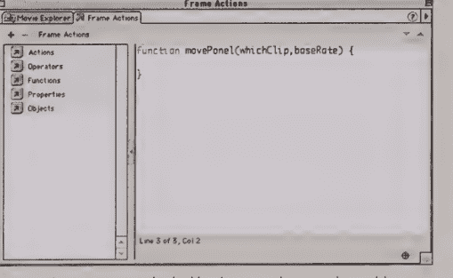

**3.13** 当你的脚本看起来像这样时，你还需要添加一些之前的脚本，但要做修改，以确定你调用的影片剪辑。

### 继续

将前面示例中的基本滑动脚本添加到这个函数中，但要做三处细微的改动。 wherever 提到`_root.panel`的地方，你需要将其改为`_root[whichClip]`。这样做是为了让你在调用函数时能够动态更改受影响的影片剪辑（记住，`whichClip`是这个函数的一个参数）。第二个改动是你的目标位置不再是变量`targetx`。相反，你希望目标位置是鼠标的 X 位置。为此，使用内置属性`_xmouse`。第三个改动是添加了一行代码，将面板剪辑的 alpha 设置设为`rate`的值。请记住，`rate`在到达目的地时不断减小。这将导致面板在静止时逐渐淡化为透明。

```actionscript
_root[whichClip]._alpha = rate;
```

完整代码如下。你的脚本窗口现在应该如图 3.14 所示。

```actionscript
function movePanel(whichClip,baseRate) {

difference = root._xmouse - _root[whichClip]._x;
rate = difference / baseRate * 2.3

root[whichClip]._x += rate;
}
```

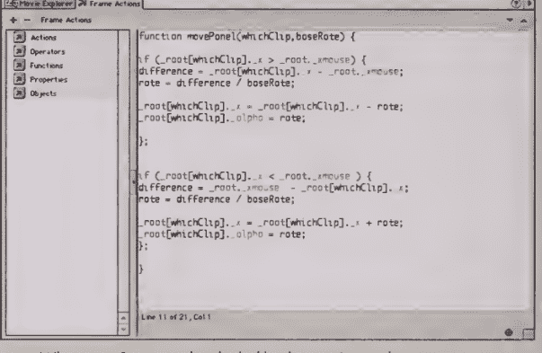

**3.14** 当你的脚本窗口看起来像这样时，你就可以编写循环脚本了。

### 构建脚本循环

现在剩下的就是构建一个简单的脚本循环影片剪辑来触发该函数。

1. 在`functions`图层上方创建一个新图层，并将其命名为`script loop`。
2. 确保没有选择任何内容，然后按 Ctrl+F8（Mac 上为 Cmd+F8）创建一个全新的影片剪辑。将其命名为`script loop`，然后按确定。
3. 当你创建这个新剪辑时，它会自动打开并准备编辑。双击这个影片剪辑的第一帧以显示“帧动作”面板。
4. 第一帧就是调用函数的地方，代码如下：

   ```actionscript
   _root.movePanel("panel1",3);
   ```

   当脚本看到这一行代码时，它将执行主时间轴（`_root`）上名为`movePanel`的函数。当你调用该函数时，你将`panel1`设置为要受影响的影片剪辑。你还定义了移动的`baseRate`为 3。

   现在别忘了你有两个面板要移动。没问题！只需在第一个函数调用之后添加另一个函数调用，但这次指定`panel2`影片剪辑，并设置稍高的`baseRate`为 4（这样这个面板移动得更慢），如下所示：

   ```actionscript
   _root.movePanel("panel2",4);
   ```

   这就是函数的强大之处。根据参数的指示，同一段代码只需编写一次，就能做两件不同的事情。

5. 在第 2 帧添加一个关键帧（`F6`），然后双击它。添加一个`gotoAndPlay(1)`动作，如下所示，使这个脚本保持循环：

   ```actionscript
   gotoAndPlay(1)
   ```

6. 回到主舞台，将你刚刚创建的`script loop`剪辑拖到`script`图层中。
7. 测试影片。当你将鼠标移动到影片上时，面板会滑动到鼠标当前 X 位置，并逐渐淡出。参见图 3.15。

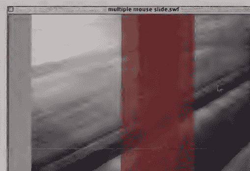

> **3.15** 尝试通过更改函数调用中的数字来改变面板的速度。数字越大，面板移动越慢；数字越小，面板移动越快。

### 进一步优化代码

到目前为止，你编写的代码已经相当高效了。一个引擎——即函数——驱动着所有面板的运动。接下来，我想向你展示一种自动设置舞台上面板数量、每个面板都有自己的速度的方法。我的意思是，你只需在台上创建一个主面板。当影片运行时，面板会被复制任意多次。在这个例子中，你将制作 10 个面板，每一个都比前一个稍慢。我想传达的是，在你完成代码之后，几乎总有办法对其进行微调，使其更加高效。

你将不再需要`script loop`。相反，要利用影片剪辑的`onClipEvent`处理程序。在你之前的影片中，删除`script`图层和`panel2`图层。你应该只剩下三个图层（参见图 3.16）。

要调用函数并移动面板，你需要将函数调用放在面板影片剪辑的`onClipEvent(enterFrame)`事件中；这样当你动态复制影片剪辑时，函数调用就包含在每个面板影片剪辑内部了。

函数调用有一个不同之处：你需要让它动态地知道自己的实例名称是什么。你可以使用影片剪辑属性`_name`来实现这一点。当你调用函数时，不用硬编码实例名称，可以输入以下内容：

```actionscript
_root.movePanel(this._name,3);
```

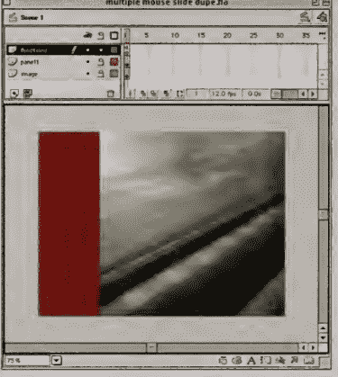

**3.16** 另一种高效的编码方法是直接删除脚本图层，并利用`onClipEvent`处理程序。

你会看到代码中包含了`this._name`，而之前你写的是`panel1`或`panel2`。因为这个代码将附加到每个单独的剪辑上，所以使用`this._name`来获取代码所附加到的影片剪辑的实例名称。

选择`panel1`图层上的影片剪辑，然后按 Ctrl+Alt+A（Mac 上为 Cmd+Opt+A）以显示“对象动作”面板。

添加带有函数调用的`onClipEvent`处理程序，如下所示：

```actionscript
onClipEvent(enterFrame) {
_root.movePanel(this._name,speed);
}
```

如果影片剪辑中没有`stop`动作（而这个没有），剪辑事件将持续循环，执行`onClipEvent`花括号之间的代码。这与你之前的`script loop`影片剪辑具有相同的效果。

现在你应该注意到，与之前不同，你没有使用数字来表示速度，而是使用了一个变量。这样做是为了每次动态复制这个剪辑时，每个剪辑的速度都会逐渐变慢。你稍后会学到具体是如何实现这一点的。

### 动态复制影片剪辑

要在影片运行时多次复制影片剪辑，你需要向主时间轴添加一些代码。这些代码只运行一次。

要复制影片剪辑，使用内置函数`duplicateMovieClip`。这个函数有两个参数。第一个是复制后的影片剪辑的新名称。第二个是这个新剪辑的层级编号。但是请注意，每个层级只能有一个影片剪辑。任何放到已有影片剪辑层级的新剪辑都会删除旧剪辑。所以，例如，要复制`panel1`影片剪辑，你可以输入以下代码：

```actionscript
_root.panel1.duplicateMovieClip("panel2",2)
```

这将复制实例名为`panel1`的影片剪辑，并给它一个新的实例名`panel2`。这个新剪辑被放到第 2 层。当你复制影片剪辑时，你会得到一个完全相同的副本，包含所有附加的`onClipEvent`处理程序，并且位于舞台上的完全相同位置。

### 使用循环复制影片剪辑

在你的影片中，你想复制原始影片剪辑（`panel1`）10 次。为此，使用`for`循环，如下所示：

```actionscript
for ( loopCount = 1; loopCount < 10; loopCount ++ ) {
}
```

`for`循环会重复执行其自身花括号之间的代码，直到满足某个条件为止。在前面的例子中，一个名为`loopCount`的变量被设置为 1，如下所示：

```actionscript
loopCount = 1;
```

这是它的起始值。只要`loopCount`小于 10，循环就会继续（条件）。

```actionscript
loopCount < 10;
```

那么，如何递增`loopCount`的值呢？这是由`for`循环的最后一部分完成的，如下所示：

```actionscript
loopCount ++
```

这与写`loopCount=loopCount+1`完全相同。只是一种简写方式。

现在你可以将想要重复的代码添加到`for`循环的花括号内，如下所示：

```actionscript
_root.panel1.duplicateMovieClip("panel" + loopCount, loopCount)
```

### 继续

请注意，你为每个复制的剪辑指定的新实例名称是由单词“panel”和当前`loopCount`的值拼接而成的：

```actionscript
"panel" + loopCount
```

因此，如果`loopCount`为 3，那么这个新剪辑的实例名称就是`panel3`。相应地，下一次循环开始时，下一个复制剪辑的新实例名称就是`panel4`。

你还利用`loopCount`的值来设置每个新复制剪辑的层级。由于每次循环`loopCount`都会递增，每个新复制的影片剪辑都将位于其自身独立的层级上。

你需要将这段代码添加到你的主时间轴中，最好把它放在函数层。以下步骤展示了如何操作：

1. 双击`functions`层的第 1 帧，以显示“帧动作”面板。你应该能看到已有的函数（见图 3.17）。
2. 将以下代码添加到脚本窗口中，确保它位于`movePanel`函数的上方：

   ```actionscript
   for ( loopCount = 2; loopCount < 10; loopCount++ ) {
     _root.panel1.duplicateMovieClip( "panel" + loopCount, loopCount)
   }
   ```

`loopCount`变量被设置为 2 而不是 1，因为这是你希望开始复制影片剪辑的层级。

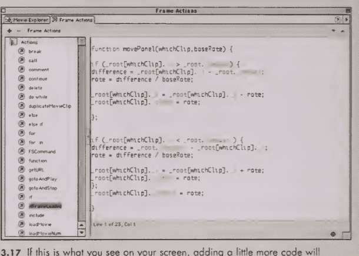

3.17 如果你的屏幕上显示的是这样，再添加一点代码就能让你开始复制影片剪辑了。

### 改变每个面板的速度


每个后续面板需要比前一个稍慢一些。如果你还记得前面的例子，你可以通过增加`movePanel`函数调用中的数字来改变每个面板的速度（数字越大，面板移动得越慢）。由于你是即时复制面板的，你希望在复制时自动将每个面板设置为比上一个更慢的速度。为此，利用附加到你的第一个面板上的`onClipEvent(load)`事件处理程序。

1. 选择`panel1`层上的`panel`影片剪辑。按Ctrl+Alt+A（Mac上为Cmd+Opt+A）以显示该剪辑的对象动作。
2. 你应该能在这个窗口中看到`enterFrame`剪辑事件脚本（见图3.18）。
3. 将以下代码添加到脚本窗口：

```actionscript
onClipEvent(load) {
    _root.counter = _root.counter + 1;
    speed = _root.counter
}
```

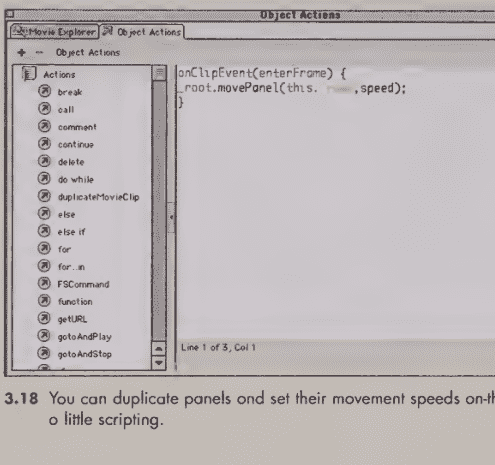

当影片剪辑加载时，它将主时间轴上一个名为`counter`的变量递增1：

```actionscript
_root.counter = _root.counter + 1;
```

这有助于你跟踪舞台上有多少个这样的面板。每次复制面板时，这个脚本都会运行并增加`counter`的值。这个变量将始终与舞台上`panel`影片剪辑的数量相匹配。

利用这些信息来设置一个名为`speed`的变量，如下所示：

```actionscript
speed = _root.counter
```

然后，`speed`变量会在`enterFrame`事件处理程序的函数调用中使用，以设置面板的速度。你的脚本窗口现在应该看起来像图3.19。

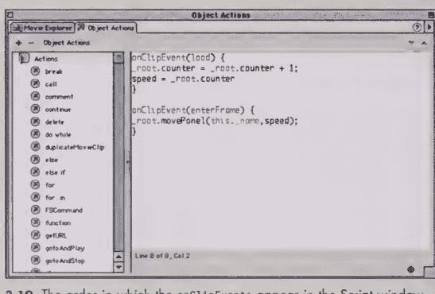

### 为效果添加缩放

在测试影片之前，将以下代码作为最后一行添加到`movePanel`函数中：

```actionscript
_root[whichClip]._xscale = rate;
```

这将在每个面板移动到其最终位置时缩小其X轴缩放比例（记住`rate`的值在不断减小）。这会创造出相当不错的过渡效果，但你可以根据自己的喜好进行调整。

现在测试你的影片。你应该能看到10个面板穿过舞台移动到鼠标停留的位置，所有面板的速度各不相同（见图3.20）。


你想要超过10个面板吗？没问题。只需增加`for`循环中的数字即可。例如，如果你想要20个面板，只需将`for`循环中的条件改为以下：

```actionscript
loopCount < 20;
```

这就是使用ActionScript设计的真正美妙之处。只需改变几个数字，你就能快速轻松地创建不同的效果。你可以看到我们是如何将一个基本的滑动算法，不仅用于导航，还用于视觉效果。但还有更多可以做的！


**3.21** 两个影片剪辑向它们的目标位置移动……

### 滑动遮罩过渡效果

通过将多个面板与应用于它们的遮罩相结合，你可以创建一些有趣的过渡效果。这在照片上总是很出色，World Domination Design Group（WDDG）在其John Mark Sorum网站上就出色地运用了这种效果。

基本原理是这样的：舞台上包含两个相同的影片剪辑，它们包含你的图片，垂直排列，一个在上一个在下。点击按钮会将面板滑动到新的Y位置，第二个面板比第一个移动得稍慢一些。通过为每个影片剪辑应用各自的遮罩来实现过渡效果。当两个影片剪辑处于相同位置时，你看不到遮罩。但当你滑动剪辑时，你会看到遮罩，因为面板2需要更长的时间才能到达目的地（见图3.21和3.22）。


**3.22** ……然后最终静止，显示出新的图片。

### 设置主舞台

我将向你展示如何构建一个能够实现这种效果的函数，不仅在Y轴上，还在X轴上。你还将扩展这一技术来创建其他一些效果。

1. 创建一个新影片，大小设置为500x300。
2. 将图层1重命名为`pictures1`，然后导入一组合适的图片。我使用的是300像素高的图片。你可以从`dragslidefade.com`下载我使用的两组图片（见图3.23）。
3. 选择图片条并按F8将其转换为影片剪辑。将其命名为`pictures`并按确定。
4. 在其上方创建一个新图层，命名为`function`。
5. 双击该层的第1帧以显示`帧动作`面板。你将在这里创建移动面板的主要函数。


**3.23** 访问`dragslidefade.com`下载这组图片或其他图片条。

### 创建X和Y移动的函数

这个函数基本上与你之前的函数相同，只是你为移动指定了目标X位置和目标Y位置。这意味着你不仅可以上下或左右移动面板，还可以对角移动。X和Y目标位置在函数定义中作为新参数定义，如下：

```actionscript
function movePanel(x,y,whichClip,baseRate)
```

调用函数时，你将X和Y位置设置为你希望面板移动到的位置，如下：

```actionscript
function movePanel(100,300,this._name,1.6)
```

以前，面板朝向鼠标的X位置移动，这次它朝向X和Y的值移动。

完整的函数如下。Y方向移动与X方向移动相同，只是这次你修改的是`_y`属性。将以下代码添加到脚本窗口：

```actionscript
function movePanel(x,y,whichClip,baseRate) {
    if (_root[whichClip]._x > x) {
        difference = _root[whichClip]._x - x;
        rate = difference / baseRate;
        _root[whichClip]._x = _root[whichClip]._x - rate;
    }
    if (_root[whichClip]._x < x ) {
        difference = x  - _root[whichClip]._x;
        rate = difference / baseRate;
        _root[whichClip]._x = _root[whichClip]._x + rate;
    }
    if (_root[whichClip]._y > y) {
        difference = _root[whichClip]._y - y;
        rate = difference / baseRate;
        _root[whichClip]._y = _root[whichClip]._y - rate;
    }
    if (_root[whichClip]._y < y ) {
        difference = y  - _root[whichClip]._y;
        rate = difference / baseRate;
        _root[whichClip]._y = _root[whichClip]._y + rate;
    }
}
```

### 调用函数

你需要创建一个脚本循环，当按钮被点击时，不断调用该函数并将面板移动到其目标位置。你可以使用传统的影片剪辑脚本循环来做到这一点，但这里你将采用上一个示例中的方法，在`pictures`影片剪辑本身上使用`onClipEvent`处理程序：

1. 选择`pictures`影片剪辑。使用`实例`面板将其命名为`pictures1`。
2. 在该影片剪辑仍被选中的情况下，按Ctrl+Alt+A（Mac上为Cmd+Opt+A）以显示该影片剪辑的`对象动作`面板。你可以在此脚本窗口中添加`onClipEvent(enterFrame)`处理程序。

这个脚本的主要目的是循环调用该函数，使面板移动到其目标目的地。但你只希望它在按钮被点击时才这样做。因此，你将使用一个布尔类型的变量。这种类型的变量只能设置为`true`或`false`。当你点击按钮时，你会将一个名为`pressed`的变量设置为`true`。如果这个变量为`true`，你就知道需要移动面板。

```actionscript
if (_root.pressed == true) {
```

相应地，调用函数如下：

```actionscript
_root.movePanel(_root.targetx,_root.targety,this._name,1.5);
```

完整的脚本如下：

```actionscript
onClipEvent(enterFrame) {
    if (_root.pressed == true) {
        _root.movePanel(_root.targetx, _root.targety, this._name, 1.5);
    }
}
```

### 用按钮触发函数

1. 创建一个`新图层`并将其命名为`buttons`。
2. 在该图层舞台上的空白处绘制一个小方框（见图3.25）。
3. 选中该方框，按下F8将其转换为按钮，并选择Button单选按钮。将其命名为`button`。点击确定。

你的代码应如图3.24所示。


**3.24** 这是你开始调用函数所需的代码。

请注意，当你调用函数时，实际上并没有指定目标X或Y位置。你告诉它使用两个变量的值——`targetX`和`targetY`。这些变量是在点击按钮时在主时间轴上设置的，因此你可以通过附加到按钮上的ActionScript轻松地改变面板的移动目标。

当然，你需要在电影刚开始时将`pressed`的值设置为`false`；否则，面板会立即开始移动，而不是等待按钮点击。要将其设置为`false`，请打开`functions`图层中的脚本，并在函数上方添加以下这行代码：

**3.25** 按钮可以被编程来调用各种函数，包括单次点击调用多个函数。

```actionscript
_root.pressed = false;
```

当这个按钮被点击时，它需要完成三件事。首先，它必须设置`targetx`变量的值。如果你实际上不想让它沿X轴移动，你可以通过使用面板的当前X位置来告诉它保持不动，如下所示：

```actionscript
_root.targetx = pictures1._x;
```

接下来，按如下方式设置`targetY`位置的值：

```actionscript
_root.targety = 0;
```

最后，按如下方式将`pressed`的值设置为`true`，从而使函数开始执行：

```actionscript
_root.pressed = true;
```

所有这些都需要放在一个`on(release)`事件处理程序中。要做到这一点，选中该按钮并按下Ctrl+Alt+A（Mac上为Cmd+Opt+A）以显示该按钮的对象动作面板。添加以下脚本：

```actionscript
on (release) {
    _root.targetx = pictures1._x;
    _root.targety = 0;
    _root.pressed = true;
}
```


### 设置遮罩

到目前为止，你已经创建了一个包含图片的电影剪辑，创建了主函数，并制作了一个按钮来移动面板。要使你的过渡效果生效，你需要有两个相同的面板——第二个面板比第一个移动得稍慢一些。

1. 选中`pictures1`电影剪辑并将其复制（Ctrl+C [Mac 上为 Cmd+C]）。
2. 在`pictures1`电影剪辑所在图层的下方，创建一个新图层并将其命名为`pictures2`（见图 3.26）。


**3.26** 确保该图层位于`pictures1`图层的下方。

将复制的电影剪辑粘贴到该图层中（Ctrl+Shift+V [Mac 上为 Cmd+Shift+V]）。现在你已经放置好了第二个`pictures`电影剪辑副本。你可能希望暂时关闭`pictures1`图层的可见性，这样你就能只看到这个新剪辑（见图 3.27）。

选中这个新复制的面板，在实例面板中将其重命名为`pictures2`。每个剪辑都应该有自己的名称，以免脚本产生混淆。

现在你已经放置好了第二个面板，你需要让它比第一个面板移动得更慢。你所要做的只是修改附加在该剪辑上的`movePanel`函数调用。

在剪辑仍被选中的情况下，按下 Ctrl+Alt+A（Mac 上为 Cmd+Opt+A）以显示对象动作面板。你应该看到它已经附加了一个`enterFrame`事件处理程序。这是因为该剪辑是原始剪辑的副本。

要减慢这个剪辑的速度，请增加函数调用末尾的数字。请记住，数字越大，面板移动得越慢。原始值设置为 1.5，因此将此值设置为 2（见图 3.28）。


**3.27** 关闭`pictures1`图层的可见性以查看下方的图层，或者将该图层转换为轮廓显示。

**3.28** 调整这些数字来改变效果的速度。

### 创建遮罩形状

接下来你需要为两个图片图层创建实际的遮罩形状。请记住，两个遮罩放在一起时必须形成一个完整的整体。除此之外，它们可以是任何你想要的形状。

在矩形仍被选中的情况下，使用对齐面板将其与上边缘对齐，并在舞台上居中（见图 3.30）。

1. 在`pictures1`图层上方创建一个新图层，并将其命名为`mask1`。你将在此图层上创建两个遮罩中的第一个。
2. 在此图层上绘制一个矩形。使用信息面板将矩形设置为 225×40（见图 3.29）。

这个形状需要复制四次，五个方块在舞台的垂直空间上均匀分布。

3. 选中矩形，将其复制（Ctrl+C [Mac 上为 Cmd+C]）。
4. 原地粘贴（Ctrl+Shift+V [Mac 上为 Cmd+Shift+V]）。


...continued

在不取消选中新矩形的情况下，使用方向键将其移动到原始矩形的下方（见图 3.31）。

对这个新矩形重复此操作，直到你有五个矩形从上到下分布在舞台上。将最下方的矩形与图片的底部对齐。你需要将它们均匀分布在舞台。要做到这一点，选中所有矩形。最佳方法是锁定所有其他图层，然后按下 Ctrl+A（Mac 上为 Cmd+A）选中`mask1`图层中的所有对象。现在使用对齐面板，并确保`To Stage`选项处于选中状态。点击`Distribute Vertical Center`按钮，矩形将在垂直方向上均匀分布（见图 3.32）。


**3.31** 如果你的对齐与此图一致，你就可以开始复制并均匀分布新的矩形了。


**3.32** 确保`To Stage`按钮处于选中状态。

7. 要将此图层变为其下方`pictures1`图层的遮罩，首先按下 Ctrl+Shift+A（Mac 上为 Cmd+Shift+A）取消遮罩图层上所有面板的选择。
8. 右键单击（Mac 上为 Ctrl+点击）`mask1`图层名称，并从弹出菜单中选择`Mask`（见图 3.33）。


现在`pictures1`图层上的图片被遮罩了，只有矩形定义的区域能够显示出来。要查看遮罩效果，请关闭`pictures2`图层的可见性（见图 3.34）。

你还需要让`pictures2`图层以完全相同的方式被遮罩，但其遮罩应该是`pictures1`遮罩的相反。也就是说，在看不到`pictures1`图像的地方，你应该能够看到`pictures2`的图像。

9. 解锁`mask1`图层，选中五个矩形并将它们复制（Ctrl+C [Mac 上为 Cmd+C]）。
10. 再次锁定该图层以重新启用遮罩。在`pictures2`图层上方，添加一个新图层并命名为`mask2`。
11. 将五个矩形的副本粘贴（Ctrl+Shift+V [Mac 上为 Cmd+Shift+V]）到此图层中。然而你不会看到它们出现，因为它们将被上方的`pictures1`图层覆盖。


...continued

使用方向键将所有五个矩形向下移动，以便你能看到它们（见图 3.35）。

最后，通过重复步骤 7 和 8，将此图层转换为`pictures2`图层的遮罩。


**3.35** 如果你现在能看到所有五个矩形，创建遮罩就很简单了。

### 添加最后的按钮

现在你已经用交替遮罩遮罩好了两个电影剪辑，并且已经放置了一个按钮来向上移动图片条。你现在需要的是将图片条移回下方的按钮。

1. 在`button`图层中，选中小按钮，将其复制（Ctrl+C [Mac 上为 Cmd+C]），然后原地粘贴（Ctrl+Shift+V [Mac 上为 Cmd+Shift+V]）。
2. 使用方向键将其移动到原始按钮的下方（见图 3.36）。


**3.36** 制作向下按钮是最后一步。

## 第 3 章 幻灯片

3. 保持这个新按钮仍处于选中状态，按下 Ctrl+Alt+A（Mac 上为 Cmd+Opt+A）打开“对象动作”面板。

4. 在`on(release)`脚本中，将目标 Y 位置值更改为`300`。这意味着当点击此按钮时，面板会移动，使其 Y 位置等于 300。按钮的完整代码如下：

```actionscript
on (release) {
    _root.targetx = pictures1._x;
    _root.targety = 300;
    _root.pressed = true;
}
```

### 增强过渡效果

在基本效果实现后，你可以尝试通过更改函数调用中的数字来改变面板的速度。还可以尝试制作一些更有趣的遮罩形状，而不仅仅是简单的矩形。记住，你也可以通过指定一个目标 X 位置来将图像向左、向右或对角线移动。例如，利用这一点的最佳方式是将九张图像排列成 3×3 的网格。然后你可以设置九个按钮来向上、下、左或右移动图像，而无需对主函数进行任何额外的编程。

5. 现在测试影片。点击顶部按钮，面板将向上滑动，产生类似百叶窗的过渡效果。点击底部按钮，它会滑回原始位置（参见图 3.37）。

### 添加旋转

你可以对`movePanel`函数添加的一个功能是旋转。当面板移动时，你可以使旋转角度等于`rate`变量。这将使图像旋转进入其静止位置！

1. 双击函数层的第一帧以显示`movePanel`函数。
2. 在此函数内部，将以下代码片段添加到函数的最后一行（在最后一个花括号之前）：

```actionscript
_root[whichClip]._rotation = rate;
```


这将使目标影片剪辑（`whichClip`）的`_rotation`属性等于`rate`变量的值。记住，`rate`初始值是一个较大的数字，并逐渐递减到 0。

**3.37** 如果你的代码设置正确，你应该能够上下移动面板。

67

### 添加缩放

你可以添加的另一个效果是缩放。当面板移动时，你可以让它看起来像图片在到达目标目的地时正在放大。

在你刚添加到函数的旋转行下方，添加另一行代码：

```actionscript
_root[whichClip]._xscale = 100 + (rate *2);
```

这将目标影片剪辑的`_xscale`属性设置为 100（其正常状态）加上`rate`乘以二的值。这里乘以二是为了产生更显著的效果。

测试影片。你应该会发现，当面板移动时，它会旋转并放大到位。参见图 3.38。

尝试修改脚本以获得不同的效果。删除旋转行以查看仅有缩放效果是什么样子，或者将缩放效果添加到影片剪辑的`yscale`中。动手尝试和实验吧。


**3.38** 你看到的旋转和缩放效果只是你可以添加的特效中的第一种。

### 结论

你已经学会了如何获取一个基本的 ActionScript 算法，并以各种方式应用它。首先，滑动算法被用于一个导航类型的系统。然后你用它来创建过渡类型的效果。这展示了如何在不使用补间的情况下移动影片剪辑。

你还接触了函数。函数功能极其强大，可以让你精简代码，也更容易跟踪你所有主要脚本的位置。我通常将所有函数放在主时间轴的一个位置。这样，如果几个月后我再回来，就能轻松找到需要的内容。

一如既往，请尝试修改代码。你不必完全照搬。你可以使用基本代码来移动任何影片剪辑，而不仅仅是一个面板！尝试更改各种参数或添加代码行，看看是否能扩展它们。为什么不尝试在上一章的末尾添加遮罩效果，并将其与滑动算法结合呢？


### 淡入淡出

硬编码的补间淡入淡出效果很好，但为了实现真正有响应性的淡入淡出和其他效果，你可以使用代码赋予其优势，同时使其更高效和可定制。

### 使用 ActionScript 创建智能响应式淡入淡出

本章将向你展示如何创建一个平滑的鼠标悬停淡入淡出效果，它有无数种用途。在这个例子中，你将创建一个包含在影片剪辑内的不可见按钮。然后，这个影片剪辑可以放置到任何其他影片剪辑上。当用户将鼠标悬停在按钮上时，父影片剪辑——无论是静态图片还是动画——会根据你设置的几个变量淡入或淡出。所以基本上，这是一个通用的超级淡入淡出按钮，可以用于任何地方，控制任何事物，且无需额外的编程！一个真正面向对象的影片剪辑。


### 普通淡入淡出 vs 程序化淡入淡出

那么，为什么要去费心为那些可以用 Flash 中普通时间轴补间轻松完成的事情编写代码呢？（参见图 4.1。）比如说，你创建了一个标准的淡入/淡出、鼠标移入/移出类型的按钮。当你将鼠标悬停在按钮上时，一张图片平滑地淡入。很棒。当你移出鼠标时，图片淡出。非常棒。但坏消息来了：如果你在按钮完全淡入状态之前移出鼠标会怎样？时间轴会突然跳到完全淡入状态，然后开始淡出。你会在开始淡出时，看到完全淡入版本的突然闪现。很难看！但是，使用一点点 ActionScript，你可以创建一个漂亮、平滑的版本，它反应正确，并且内置了一些不错的额外优点。

> 那么它是如何工作的呢？

要创建一个不使用补间的淡入淡出效果，你需要利用影片剪辑的 alpha 通道属性。当用户将鼠标悬停在按钮上时，脚本会循环运行，每次循环都检查影片剪辑 alpha 通道的当前值。然后，它会决定是需要增加 alpha 通道以实现淡入效果，还是减少 alpha 通道以实现淡出效果。在达到所需的 alpha 通道后，脚本就停止。当用户移出鼠标时，脚本执行相同的操作——只是反向进行。

在一个新的 Flash 文档中，使用矩形工具在舞台上绘制一个矩形。这将是你的不可见按钮。不要担心大小，因为它可以缩放以适应完成的剪辑（参见图 4.2）。


**4.2**

2. 按 F8 将矩形转换为按钮元件，将其命名为`invisible button`，并选中“行为”单选按钮。通过编辑此按钮元件使其“不可见”：在“点击”区域添加一个关键帧（F6），并删除“弹起”状态关键帧中的矩形。你应该只有“点击”区域中的按钮矩形（参见图 4.3）。

**4.3** 不可见按钮仅仅定义了点击状态，其他状态为空。

3. 返回到主舞台（场景 1），选择按钮，这次将其转换为影片剪辑元件（F8）。在单击“确定”之前，将剪辑命名为`fade button`或类似名称。
4. 按钮现在包含在一个影片剪辑内。这将成为你的超级通用淡入淡出按钮！双击`fade button`影片剪辑开始构建代码。


双击名为`layer 1`的层并将其命名为`button`。现在在其上方添加三个更多层，并分别命名为`actions`、`script`和`labels`（参见图 4.4）。

**4.4** 善用标记清晰的层，这样当你日后回到项目时，就能看清其结构。

### 初始化变量

在进入代码的主要部分之前，你需要初始化一些变量，这些变量定义了用于淡入淡出的影片剪辑 alpha 通道的起始值和结束值。

1. 选择所有层的第 6 帧，按 F5 在所有层中插入五个更多帧。
2. 在`actions`层中，双击第一帧。在“动作 - 帧”面板中，输入`stop();`命令（参见图 4.5）。
3. 在`script`层中，双击第一帧。你现在需要为你的淡入淡出器初始化一些变量。淡入淡出器通过操作父影片剪辑的 alpha 设置来工作，无论它是图片、动画还是文本。
4. 首先，你需要设置两个变量——`start`和`end`。它们告诉脚本淡入开始和结束时的 alpha 设置。在“动作 - 帧”面板中添加以下两行代码（参见图 4.6）：

```actionscript
start = 100;
end = 10;
```

5. 接下来，设置一个控制淡入淡出速度的变量。通过更改这个变量，你可以改变淡入淡出发生的速度，而无需处理时间轴。将这行代码添加到代码中：

```actionscript
rate = 5;
```


### 构建主淡入淡出引擎

以下是淡入淡出引擎的主要部分，也是不断循环检查父影片剪辑的 alpha 设置并相应修改的代码。

你即将创建的脚本片段允许在鼠标悬停时淡入*或*淡出，具体取决于`start`和`end`变量的初始值。你还可以在同一个脚本中同时构建悬停（rollover）和移出（rollout）的淡出效果。这是通过一个名为`rollMode`的变量来实现的。该变量通过附加在按钮上的脚本设置为`over`或`out`。那个脚本稍后会讲到，但首先继续完成淡入淡出引擎。

1. 在脚本层的第 5 帧添加一个关键帧。双击此关键帧以打开【帧动作】面板。这个脚本将成为你的主引擎。该脚本首先需要查看父剪辑并识别 alpha 设置值。将该值放入一个名为`currentFade`的变量中，如下所示：

```actionscript
currentFade = _parent._alpha;
```

在知道 alpha 值之后，你需要检查`rollMode`变量的状态。你可以使用一个简单的`if...then`语句来完成（参见图 4.8）：

```actionscript
if (rollMode == "over") {
}
```

在添加下一段代码时，请确保光标位于花括号之间。由于你正在构建一个非常灵活的淡入淡出器，因此需要两个独立的迷你淡入淡出引擎。一个在执行时`start`值大于`end`值（淡出）；另一个在执行时`end`值大于`start`值（淡入）。

首先从脚本的淡入部分开始。在前面的花括号内添加另一个`if...then`语句：

```actionscript
if (start < end) {
```

它的作用是查看变量`start`和`end`。如果`start`小于`end`，则意味着当用户悬停在按钮上时 alpha 通道需要增加。就这么做吧。

但在增加 alpha 之前，你需要确认 alpha 确实还需要增加。这是因为该脚本会不断循环执行，如果不每次都检查 alpha 通道的状态，就会持续增加 alpha 超过`end`值！要检查 alpha 的当前状态，请使用`currentFade`变量：

```actionscript
if (currentFade <= (end + rate)) {
```

所以这句话的意思是：“如果当前 alpha 值小于或等于`end`值加上变化速率，执行下一段代码”，如下所示：

```actionscript
_parent._alpha = _parent._alpha + rate;
```

这一行修改了父影片剪辑的 alpha 通道，也就是你将淡入淡出按钮拖放到的任何剪辑。它简单地说：“父影片剪辑的 alpha 通道现在等于原值加上变化速率。”

那么当达到所需的 alpha 通道设置时会发生什么？嗯，你只需让时间轴停止移动，从而停止执行脚本。为此，你使用`else`语句：

```actionscript
} else {
    stop();
}
```


这会在达到`currentFade`级别时产生停止时间轴的预期效果。

最后，在悬停淡入部分，你需要用一个花括号关闭`if (start < end)`语句。你的代码现在应该如图 4.9 所示。

现在你已经有了在悬停时增加 alpha 通道的脚本；现在你需要的是在悬停时降低 alpha 通道的脚本。这基本上与前面的例子相同，但有一些改动。例如，每次循环时不是增加 alpha 通道，而是减少它（淡出）。你还要检查`start`是否大于`end`值，这显然意味着你想要淡出。添加以下代码片段，确保它位于最后一个花括号内（即`rollMode`的 if 语句中）。完成后，你的代码应该如图 4.10 所示。

```actionscript
if (start > end) {
    if (currentFade >= (end - rate)) {
        _parent._alpha = _parent._alpha - rate;
    } else {
        stop();
    }
}
```

### 编写移出脚本

引擎的移出部分当然基于前面的脚本，但有一些改动。

对于主引擎中的最后一段脚本，你需要添加与前面代码相反的部分（即`end`大于`start`值，所以在移出时淡出）。

首先，检查`rollMode`变量是否设置为`off`：

```actionscript
if (rollMode == "off") {
```

```actionscript
if (end > start) {
    if (currentFade >= (start + rate)) {
        _parent._alpha = _parent._alpha - rate;
    } else {
        stop();
    }
}
```

接下来，检查`end`值是否小于`start`值：

```actionscript
if (end < start) {
```

如果是这样，你需要增加 alpha 通道，如下所示：

```actionscript
if (currentFade <= (start + rate)) {
    _parent._alpha = _parent._alpha + rate;
} else {
    stop();
}
```

这段代码的细微差别在于，你是将`currentFade`值与`start`值进行比较，因为如果你从按钮上移开，这是 alpha 通道值的最终目标。

最后，为`rollMode == "off"`语句添加闭合花括号，你的代码现在应该如图 4.11 所示。

**4.11** 当你的代码看起来像这样时，你就可以将其添加到按钮上了。

### 编写按钮脚本

既然你已经写好了主引擎脚本，就需要将代码添加到按钮本身，淡入淡出效果才能工作。

在`rollOver`和`rollOut`上都需要做两件事。首先，你需要将`rollMode`变量设置为`over`或`off`。完成后，通过告诉时间轴`gotoAndPlay`到`fade`标签来调用脚本本身。

1. 选择淡入淡出按钮影片剪辑中的按钮，然后按 Ctrl+Alt+A（Mac 为 Cmd+Alt+A）打开【对象动作】面板。添加以下代码片段：

```actionscript
on (rollOver) {
    rollMode = "over";
    gotoAndPlay("fade");
}
```

这在用户悬停在按钮上时设置了`rollMode`变量的正确状态。第二行然后调用脚本。稍后你会在时间轴中添加`fade`标签。

2. 接下来，添加相同的脚本，但用于`rollOut`事件，如下所示：

```actionscript
on (rollOut) {
    rollMode = "off";
    gotoAndPlay("fade");
}
```

这次你将`rollMode`变量设置为`off`。你的按钮脚本现在应该如图 4.12 所示。

### 完成基础引擎

在测试你的淡入淡出器脚本之前，还有两件事需要做。

1. 在你之前创建的标签层中，给第 5 帧添加一个关键帧（参见图 4.13）。
2. 在【帧】面板中，给该帧添加一个名为`fade`的标签。
3. 在脚本层中，给第 6 帧添加一个关键帧。
4. 双击此关键帧以打开【帧动作】面板。添加一个`gotoAndPlay`动作，如下所示：

```actionscript
gotoAndPlay("fade");
```

这是让你的脚本循环执行的动作。

### 测试引擎

你的基础引擎现在已经构建完成，所以来看看它的实际效果吧。

1. 在场景 1 的主舞台上，删除那里的任何内容，可能是淡入淡出按钮影片剪辑。
2. 导入一张图片（Ctrl+R [Mac 为 Cmd+R]），使其显示在主舞台上（参见图 4.14）。
3. 选择该图片并按 F8 将其转换为影片剪辑。给它取一个合适的名称，然后按【确定】（参见图 4.15）。
4. 双击舞台上的这个新剪辑以编辑元件。
5. 在图片上方添加一个新图层（参见图 4.16）。
6. 在这个新图层中，将淡入淡出按钮影片剪辑拖到舞台上。将其放置在图片上方（参见图 4.17）。

...接上文

- 使用缩放工具缩放渐变按钮影片剪辑以适配图片（参见图 4.18）。
- 通过选择 Control/Test Movie 或按 Ctrl+Enter（Mac 上为 Cmd+Return）来预览影片。
- 你应该能看到，当鼠标移入图片时，图片会淡出，当鼠标移出时，图片又会淡入。尝试修改渐变按钮影片剪辑中的起始值和结束值，看看会发生什么。还可以调整速率来改变淡入淡出的速度。完成这些后，尝试添加更多图片影片剪辑（或其他任意影片剪辑），将渐变按钮影片剪辑放入其中，然后测试影片。即时渐变按钮，效果炸裂！


### 更聪明地工作

现在，拥有一个可以拖放到任意影片剪辑上的通用即时渐变按钮确实很酷，但对我来说还不够酷。如果你想在不同的按钮上设置不同的淡入淡出速率怎么办？如果你想让一个按钮在鼠标移入时淡入，而另一个按钮在鼠标移入时淡出怎么办？目前，你对渐变按钮影片剪辑中变量所做的任何更改都会应用于所有使用该渐变按钮影片剪辑的实例。如果能为每个按钮设置独立的参数，那岂不是很酷？如果能有一种可视化的方式，通过滑块来设置起始值和结束值，而无需手动修改代码呢？女士们先生们，欢迎来到智能剪辑的世界！

### 创建智能剪辑

*智能剪辑*是一种特殊的影片剪辑，它可以让你将对话框附加到影片剪辑上，以用户友好的方式设置参数。例如，起始值、结束值和淡入淡出速率就是非常适合通过对话框来设置的参数。以下步骤将向你展示如何将渐变按钮转换为智能剪辑。

1. 在库中，右键单击渐变按钮影片剪辑（Mac 上为 Ctrl+单击）。在弹出的菜单中选择 Define Clip Parameters...（参见图 4.19）。
2. 定义剪辑参数对话框出现。点击左上角的加号添加一个参数（参见图 4.20）。
3. 双击 Name 列下的`varName`来命名第一个参数。参数需要与影片剪辑中已有的变量匹配，因此将其命名为`start`（参见图 4.21）。


...接上文

4. 双击 Value 列下的`defaultValue`，为`start`变量输入一个默认值。我使用`100`作为默认值（参见图 4.22）。
5. 保持 Type 设置为 Default。现在添加其余两个参数，即`end`和`rate`，重复步骤 2 到 4。确保`end`的`defaultValue`与`start`的`defaultValue`不同。如果`start`的`defaultValue`使用了 100，则`end`的`defaultValue`使用`10`（参见图 4.23）。完成后，点击 OK。
6. 此时你应该能看到库中影片剪辑的图标已变更为智能剪辑的图标（参见图 4.24）。
7. 在使用新的智能剪辑之前，你需要删除在渐变按钮影片剪辑中初始化的`start`、`end`和`rate`设置。因为这些设置会覆盖你在智能剪辑本身中所做的任何设置。


4.22


4.23


4.24

双击渐变按钮智能剪辑。在脚本图层上，双击第一帧以调出初始化脚本（参见图 4.25）。

删除代码的前三行，只保留`_parent._alpha = start;`这一行（参见图 4.26）。


4.25


4.26

回到主舞台，双击图片影片剪辑进入元件编辑模式（参见图 4.27）。

右键单击舞台上的渐变按钮剪辑（Mac 上为 Ctrl+单击）。在弹出菜单中选择 Panels/Clip Parameters（参见图 4.28）。


12. 在剪辑参数对话框中，双击每个参数的值以输入你自己的设置（参见图 4.29）。

13. 完成后，测试影片（Ctrl+Enter [Mac 上为 Cmd+Return]）。你应该能看到，现在的淡入淡出效果反映的是你在剪辑参数中设置的值，而不是默认参数值。


4.29

### 智能剪辑的多功能性

尝试将智能剪辑放入不同的影片剪辑中，然后为每个剪辑修改参数，使它们都拥有不同的设置。你会看到，尽管它们都使用同一个核心影片剪辑，但它们的行为可以完全独立。一个剪辑，多种变化！

### 将易用性提升到极致

现在你的智能剪辑运行良好，它完全达到了预期效果。但它还可以更好。你真正想做的是使用滑块来调整参数，这比输入数字直观得多。如果能在智能剪辑中直接显示效果的缩略图预览那就更好了。你可以通过为智能剪辑创建自定义图形用户界面（GUI）来实现所有这些功能，该界面在 Flash 中构建。你可以摆脱智能剪辑对话框的标准界面限制，在 Flash 中构建自己的界面，并在其中加入各种炫酷的功能。

### 为智能剪辑构建自定义界面

创建一个新的 Flash 文档。尺寸并不关键，但我使用的是 238×285（参见图 4.30）。


4.30


4.31

将图层一重命名为`xch`。在这个新图层中，按 Ctrl+F8（Mac 上为 Cmd+F8）创建一个新的影片剪辑。也将其命名为`xch`（参见图 4.31）。

点击 OK 后，你将进入这个新创建的影片剪辑的元件编辑模式。实际上你不需要在这个剪辑中放入任何内容，因为它将作为自定义 GUI 和智能剪辑之间的中介。没有它，你的自定义 GUI 将毫无用处。

你需要将这个剪辑放在主舞台上，因此回到主时间轴，将`xch`影片剪辑从库中拖放到舞台上的`xch`图层中。在属性面板中，将其命名为`xch`。这一点非常重要。没有`xch`这个名称，你的 GUI 将无法传递任何参数。`xch`这个名称是必需的（参见图 4.32）。


4.32

86

### 为智能剪辑创建界面

现在你需要制作各种界面元素。

1. 首先，使用细长的圆角矩形为三个滑块创建三个“滑轨”。使用信息面板将其高度设置为`100`像素。确保这些内容放在一个新图层上，将其命名为类似`slider back`的名称。（参见图 4.33。）


2. 接下来，你需要制作滑块本身。在新图层（命名为`sliders`）上绘制一个合适的形状，并将其定位在第一个滑轨的中间。选中该形状，按 F8 将其转换为按钮，勾选 Button Behavior，将其命名为`slider knob`，然后按 OK（参见图 4.34）。


...接上文

3. 保持按钮选中状态，再次按 F8，但这次将其转换为名为`slider`的影片剪辑。现在你得到了一个位于影片剪辑内部的按钮（参见图 4.35）。


4.35

4. 在库中，双击新建的`slider`影片剪辑进行编辑。现在你需要为该剪辑内的按钮（`slider`）添加一些脚本，使其正常工作。选中按钮，按 Ctrl+Alt+A（Mac 上为 Cmd+Opt+A）调出对象动作面板。

这个滑块需要在按下时上下移动。为此，你需要使用`startDrag`动作：

```actionscript
on (press) {
    startDrag ("", false, left, top , right, bottom);
}
```

第一组引号内是目标参数，留空。这是因为如果你想拖动当前所在的影片剪辑，实际上不需要指定目标。下一个参数是影片剪辑是否应吸附到鼠标中心。显然你不想这样，因此将其设置为`false`。

接下来的四个变量控制影片剪辑的约束矩形。这是一个围绕在被拖动的影片剪辑周围的虚拟矩形框。影片剪辑只能在此虚拟框内被拖动。换句话说，你只希望滑块在 Y 轴上上下移动。我没有直接输入约束矩形的位置值，而是使用了四个变量，这些变量会在影片剪辑加载时动态设置，因为你将要在不同的 X 位置放置三个相同滑块影片剪辑的实例。如果你硬编码约束矩形的值，当你拖动滑块时，它会跳到唯一的约束位置。如果你只有一个滑块，这没问题，但如果有三个就不好了！

最后，设置一个名为`dragging`的变量，供后续使用。在`startDrag`行之后，输入以下代码：

```actionscript
dragging = true;
```

你的代码现在应该如图 4.36 所示。


4.36

6. 对于按钮脚本的最后一部分，你需要在用户松开滑块时停止拖动。同时需要将`dragging`变量设置为`false`。将以下代码放在之前的代码之后：

```actionscript
on (release, releaseOutside) {
    stopDrag ();
    dragging = false;
}
```

现在按钮脚本已经就绪，返回主时间轴。

7. 在主舞台上选择滑块影片剪辑，然后按 Ctrl+Alt+A（Mac 上为 Cmd+Opt+A）打开对象动作面板。

8. 影片剪辑也有附加的事件。例如，当影片剪辑首次加载时，你可以使用`onClipEvent(load)`事件来执行一些代码。这对于初始化变量非常方便，这正是你想要为滑块做的：

```actionscript
onClipEvent(load){
    top =_y-50;
    bottom=_y+50;
    left=_x;
    right=_x;
}
```


如你所记，这些是用来约束可拖动滑块的变量。第一个变量`top`是通过取影片剪辑当前 Y 位置（`_y`）然后减去 50 像素计算得出的。这就是为什么你要将滑块放在滑轨的正中间——记住，你制作的滑动滑轨高度为 100 像素。设置了这个变量后，就意味着滑块不会向上移动超过其起始位置 50 像素的距离。`bottom`变量也是如此，只不过这次你加上 50 像素来到达底部约束。`left`和`right`位置很容易计算。你不希望滑块向左或向右移动，所以将`left`和`right`的移动约束到其当前 X 位置（`_x`）。添加这段代码后，预览影片。你现在应该有一个可以上下移动的滑块（见图 4.37）。


4.37

9. 在将此滑块复制到其他两个滑轨之前，你需要在 GUI 中添加更多界面元素。

10. 创建一个新图层并命名为`pictures`。在这个图层上，你需要有缩略图，以便用户可以看到使用滑块进行设置的效果。将图片导入此图层（Ctrl+R [Mac 上为 Cmd+R]），然后选择此图片并将其转换为影片剪辑。将其放置在第一个滑块上方（见图 4.38）。

11. 选择该剪辑，并在实例面板中将其命名为`startPic`（见图 4.39）。

12. 复制此影片剪辑，原位粘贴（Ctrl+Shift+V [Mac 上为 Cmd+Shift+V]），然后将其移动到第二个滑轨上方。同样操作，但这次将其移动到第三个滑轨上方。将第二个影片剪辑命名为`endPic`，第三个影片剪辑命名为`rateTest`。

13. 现在你需要向界面添加一些动态文本字段。使用文本工具，在第一个滑块下方绘制一个可以容纳三个数字的框。选中该框后，在文本选项面板中，从下拉菜单中选择动态文本。将变量命名为`startValue`。在段落面板中，选择居中对齐。现在你有一个变量名为`startValue`的动态文本字段在舞台上了。这样你就可以显示滑块设置到的值。


4.38


4.39

原位复制并粘贴此文本字段，并将其移动到第二个滑块下方。同样操作，但这次将其移动到第三个滑块下方。

使用文本选项面板，将第二个文本字段的变量命名为`endValue`，然后将第三个文本字段的变量命名为`rateValue`（见图 4.40）。


### 完成滑块

现在你的基本界面元素已经就位。接下来，你需要完成滑块。选择主舞台上的滑块，然后按 Ctrl+Alt+A（Mac 上为 Cmd+Opt+A）打开对象动作面板。

在对象动作面板中，你会看到之前的加载事件脚本。现在你需要添加一个新的事件处理器，这次是`onClipEvent(enterFrame)`。这会在影片每次执行帧时执行代码。所以，如果你的影片设置为每秒 12 帧，那么此事件处理器中的代码将每 1/12 秒执行一次——CPU 时钟速度的小故障除外。这是一种非常酷的方式，可以让代码保持循环而无需创建循环！

要开始你的新事件处理器，请输入以下代码：

```
onClipEvent(enterFrame){

}
```

在大括号之间，你需要添加一个简单的条件语句。这通过检查`dragging`变量的状态来判断用户是否正在拖动滑块：

```
if (dragging==true){
```

在这行之后，输入如果用户正在拖动滑块时需要执行的代码。首先要做的是更新滑块在`startValue`文本字段中的值：

```
_root.startValue = int(100+(top-_y));
```

这将`startValue`文本字段设置为与滑块位置相关的正确值。`int`函数将计算结果转换为整数（即没有小数位）。

接下来你做最重要的部分，那就是将滑块的值传回智能剪辑：

```
_root.xch.start= _root.startValue;
```

你可以看到，这就是你使用`xch`影片剪辑的地方。在`xch`影片剪辑之后是你的淡入淡出引擎中实际使用的变量名称。`xch`剪辑被用作一种电话接线员。你用它来将任何值传递给实际的智能剪辑变量。没有电话接线员，什么信息都传不过去。在这个例子中，你将智能剪辑中的`start`值设置为与你在上一行设置的`startValue`文本字段相同的值。

要完成滑块的代码，你还需要添加两行。第一行修改`start`滑块上方小缩略图的 alpha 通道属性：

```
_root.startPic._alpha=_root.startValue;
```

下一行执行相同的操作，但修改`rateTest`缩略图的 alpha 通道：

```
_root.rateTest._alpha=_root.startValue;
```

你可以看到，你所做的只是将这两个影片剪辑的 alpha 通道设置为`startValue`文本字段中的值。确保添加一个大括号来关闭`if`语句。你的代码现在应该看起来像图 4.41。


4.41

7. 现在你需要将这个滑块影片剪辑复制到其他两个滑轨上。完成后，你需要在每个滑块剪辑中进行一些修改，使它们修改正确的值。

8. 选择应该位于第二个滑轨正中间的第二个滑块，然后按 Ctrl+Alt+A（Mac 上为 Cmd+Opt+A）打开对象动作面板。现在你需要在代码中修改几行。删除`if`语句内的所有代码，并添加以下代码：

```
_root.endValue = int(100+(top-_y))

_root.xch.end= _root.endValue;

_root.endPic._alpha = _root.endValue;
```

你可以看到这与`start`滑块的代码基本相同，但这个修改的是`end`值。

对于第三个滑块，执行相同操作，但这次确保代码如下所示，以便影响`rate`值：

```
_root.rateValue = int(100+(top-_y))

_root.xch.rate= _root.rateValue;
```

注意你不需要设置任何剪辑的 alpha 通道，因为第三个滑块控制淡入淡出的速率。你的 Flash 影片现在应该看起来像图 4.42。

9. 现在，对于自定义 GUI 的最后部分，你想要构建预览功能，这样当你悬停在第三个缩略图上时，它会向你展示使用你设置的参数在真实效果中会发生什么。幸运的是，你的代码已经准备好了，因为它与你的原始引擎中的代码相同！你只需要对脚本做一些修改。


在库中找到你用于缩略图的影片剪辑。在选项菜单中，复制该剪辑并将其命名为`rate test`（见图 4.43）。

双击库中这个新创建的剪辑进行编辑。在一个新图层上创建一个不可见按钮（按钮中只有点击区域有内容），并将其放置在缩略图上方（见图 4.44）。


+ 12. 选择不可见按钮，然后按 Ctrl+Alt+A（Mac 上为 Cmd+Opt+A）以调出该按钮的对象操作面板。将以下代码片段添加到按钮中：

```
on (rollOver) {

    rollMode = "over";

    gotoAndPlay("fade");

}

on (rollOut) {

    rollMode = "off";

    gotoAndPlay("fade");

}
```

你可以看到，它与你的淡入淡出引擎中的按钮代码完全相同（参见图 4.45）。

+ 13. 接下来，添加一个名为`script`的新图层，并双击第一帧以调出帧动作面板。添加以下代码片段：

```
this._alpha = _root.startValue;

stop();
```

第一行将缩略图设置为你使用开始滑块设置的正确透明度。注意你使用了`this._alpha`。这是引用你正在操作的当前影片剪辑的一种非常便捷的方式，意思就是*这个*。

+ 14. 在第 6 帧拖动选择所有三个图层并插入一个帧（F5）（参见图 4.46）。

+ 15. 在脚本图层的第 5 帧（F6）插入一个关键帧，并双击它以调出该帧的帧动作面板。


现在你需要将你的淡入淡出引擎代码添加到此帧。我将不详细介绍这个淡入淡出引擎的工作原理，因为它与智能剪辑中的主淡入淡出引擎完全相同。然而，有两点不同。首先，它不是针对父影片剪辑，而是针对当前影片剪辑（`this`）。另一个区别是开始、结束和速率值取自相关文本字段中的设置。将以下代码添加到脚本图层的第 5 帧：

```
currentFade = this._alpha;

start = _root.startValue;

end = _root.endValue;

rate = _root.rateValue;

if (rollMode == "over")  {

    if (start < end) {

        if (currentFade <=(end + rate)) {

            this._alpha = this._alpha+rate;

        } else {

            stop();

        }

    }

    if (start > end) {

        if (currentFade >=(end + rate)) {

            this._alpha = this._alpha-rate;

        } else {

            stop();

        }

    }

}

if (rollMode == "off")  {

    if (end < start) {

        if (currentFade <=(start + rate)) {

            this._alpha = this._alpha+rate;

        } else {

            stop();

        }

    }

    if (end > start) {

        if (currentFade >=(start + rate)) {

            this._alpha = this._alpha-rate;

        } else {

            stop();

        }

    }

}
```

+ 16. 在脚本图层的第 5 帧之后插入另一个关键帧，打开帧动作面板，并添加一个`gotoAndPlay`动作：

```
gotoAndPlay("fade");
```

+ 17. 现在，只剩下在脚本图层上方的一个图层上，在第 5 帧添加一个名为`fade`的标签（参见图 4.47）。

+ 18. 回到主时间轴（场景 1），点击第三个缩略图。使用属性面板，点击交换元件图标（参见图 4.48）。找到新的速率测试影片剪辑并点击确定（参见图 4.49）。你现在应该看到影片剪辑已经更改为你的新速率测试剪辑，其中包含不可见按钮。

+ 19. 预览影片。你应该能看到，如果你将鼠标悬停在第三个缩略图上，它会反映使用滑块所做的设置。你可能需要将速率滑块调低到`5`左右。


4.47


4.48


4.49

### 将你的自定义 GUI 添加到智能剪辑

你的自定义 GUI 现在已准备就绪，你需要将其添加到你的智能剪辑中以便使用。

+ 1. 首先，将你的自定义 GUI 导出到与智能剪辑 fla 相同的文件夹中，将其命名为类似`customgui.swf`的名称。

+ 2. 在 Flash 编辑器中打开你的淡入淡出智能剪辑 fla。

+ 3. 在库中找到淡入按钮智能剪辑，右键单击（Mac 上为 Ctrl+单击）以调出弹出菜单。从菜单中选择“定义剪辑参数...”（参见图 4.50）。

+ 4. 在“定义剪辑参数”框中，单击文本字段“链接到自定义 UI”左侧的文件夹图标。这是你选择自定义 GUI swf 的地方。在出现的文件选择器中，找到你导出的自定义 GUI swf 并单击“确定”（参见图 4.51）。

+ 5. `customgui.swf`现在被指定为你的智能剪辑使用的 GUI。如果舞台上已经有一个工作的智能剪辑，右键单击（Mac 上为 Ctrl+单击）它并转到“面板/剪辑参数”。你应该会看到自定义 GUI 代替标准的智能剪辑参数框出现。调整滑块，然后测试影片（参见图 4.52）。


### 将数据传回自定义 GUI

测试完自定义 GUI 后，尝试取消选择智能剪辑，然后再次选择它并调出参数。你会看到滑块现在回到了原始位置，就好像你从未动过它们一样。这是因为智能剪辑的设置尚未传回给自定义 GUI。如果你再次测试影片，你会看到设置仍然有效；只是你看不到它们！幸运的是，你可以解决这个问题。


**1** 再次打开自定义 GUI fla。

**2** 你需要能够控制滑块，以便在读回智能剪辑的值时将它们设置为正确的位置。为此，你需要为它们指定实例名称。依次选择每个滑块，然后使用属性面板，将它们分别命名为`startSlider`、`endSlider`和`rateSlider`（参见图 4.53）。

**3** 在所有图层上选择第 2 帧并插入一个帧（F5）。你将告诉你的脚本在第 2 帧将滑块设置为正确的位置，这有一个非常好的理由。第 1 帧上的任何脚本在智能剪辑加载时都会被忽略，因此你必须将脚本放在第 2 帧或更后。


**4** 添加一个名为`script`的新图层，并在该图层的第 2 帧插入一个关键帧（参见图 4.54）。

**5** 双击脚本图层上的此关键帧以调出帧动作面板。这是你将用于将各种参数设置回正确值（用户选择的值）的代码所在之处。首先，将文本字段设置为正确的值：

```
_root.startValue = _root.xch.start;

_root.endValue = _root.xch.end;

_root.rateValue = _root.xch.rate;
```

你可以看到这里你通过`xch`影片剪辑的变量`start`、`end`和`rate`设置了`startValue`、`endValue`和`rateValue`的值。还记得使用滑块设置这些值吗？嗯，现在你正在通过`xch`影片剪辑读回它们。`xch`剪辑就像一个电话接线员，只是将信息传递给智能剪辑。

现在将滑块移动到它们正确的位置。为此，只需操作滑块的 Y 位置。首先，看`startSlider`。在尝试移动它之前，先检查一下`start`变量是否实际存在于`xch`影片剪辑中。这只是一项预防措施，这样你就不会不必要地移动滑块。你这样做的方法是检查变量本身是否存在。将以下代码放在帧 2 中前面代码的下方：

```
if (_root.xch.start) {
```

如果变量确实存在，你知道已经使用滑块进行了设置，因此可以将其移动到正确的位置：

```
if (_root.startValue >= 50) {

  startSlider._y = startSlider._y - (_root.startValue-50) ;

}
```

这会检查`startValue`是否大于或等于 50。如果是，那么它会改变`startSlider`剪辑的 Y 位置（`_y`），使其等于当前位置减去`startValue`再减去 50。为什么要从`startValue`中减去 50？嗯，例如，假设`startValue`设置为 100；如果你只是从滑块的初始 Y 位置（记住它从中间开始）减去 100，它就会飞到滑道顶部上方 50 像素。因为你的滑块起始位置是中间，所以你从`startValue`中减去 50 以到达正确的位置。

8. 接下来你做完全相同的事情，但这次检查值是否小于 50：

```
if (_root.startValue < 50) {

  startSlider._y = startSlider._y + (50-_root.startValue) ;

}
```

9. 最后，将`startPic`缩略图的 alpha 通道设置为正确的设置：

```
startPic._alpha = _root.startValue;
```

10. 另外两个滑块的代码基本相同，所以与其逐行讲解，不如直接包含代码。完成后，你的脚本应如图 4.55 所示。（确保最后一行有一个`stop()`命令。）

```
_root.startValue=_root.xch.start;
```


```actionscript
_root.endValue = _root.xch.end;
_root.rateValue = _root.xch.rate;

if (_root.xch.start) {
    if (_root.startValue >= 50) {
        startSlider._y = startSlider._y - (_root.startValue - 50);
    }

    if (_root.startValue < 50) {
        startSlider._y = startSlider._y + (50 - _root.startValue);
    }

    startPic._alpha = _root.startValue;
}

if (_root.xch.end) {
    if (_root.endValue >= 50) {
        endSlider._y = endSlider._y - (_root.endValue - 50);
    }

    if (_root.endValue < 50) {
        endSlider._y = endSlider._y + (50 - _root.endValue);
    }

    endPic._alpha = _root.endValue;
}

if (_root.xch.rate) {
    if (_root.rateValue >= 50) {
        rateSlider._y = rateSlider._y - (_root.rateValue - 50);
    }

    if (_root.rateValue < 50) {
        rateSlider._y = rateSlider._y + (50 - _root.rateValue);
    }
}

stop();
```

11. 再次使用与之前相同的文件名导出自定义 GUI。返回你的推子智能剪辑，你应该会看到，当你更改剪辑参数时，这些设置总是会反映在滑块和文本字段中。你可能会注意到，每次打开剪辑参数框时，滑块都会跳转到其正确的位置。

4.55

### 结论

使用 ActionScript 来控制像淡入淡出这样的设计元素，比硬编码传统的补间要灵活得多。你可以看到，只需更改几个数字，你就能改变淡入淡出的速率，甚至改变其操作方式——向上、向下或悬停。通过使用智能剪辑，然后为该智能剪辑创建一个自定义界面，你可以使其非常用户友好，同时还具有构建一些出色的易用性和额外功能的优势，例如预览模式。

当你作为团队的一部分工作时，智能剪辑也很酷。你可以让一个团队成员构建智能剪辑，然后将它们交给团队的其他成员，从而保持代码的一致性。它还有一个额外的好处，就是让更懂代码的团队成员创建更复杂的代码片段，供其他不懂代码的设计师使用。

# 声音控制

Flash 4 的问题之一是缺乏声音控制；你只能播放声音并循环它。Flash 5 改变了这一切。使用 Flash 5，你可以控制音量和声像。而且不仅仅是全局声音设置，对于单个声音也是如此。

本章涵盖了 Flash 5 中声音控制的基础知识，然后介绍更令人兴奋的内容，例如创建混响效果！

## 控制音量

要在 Flash 5 中控制任何声音，你需要一个所谓的“声音对象”。这只是一个被指定为声音对象的变量。通过它，你可以控制音量等。

首先，看看如何控制 Flash 影片的全局音量。当我说“全局”时，我的意思是这会影响舞台上所有的声音。

### 控制 Flash 影片的全局音量

1. 创建一个新的 Flash 影片，并在图层 1 中导入一个合适的声音循环（参见图 5.1）。
2. 单击图层 1 的第一帧，使用“声音”面板，从“声音”下拉菜单中选择你刚刚导入的声音。将循环设置为一个较大的数字，例如`999`（参见图 5.2）。
3. 预览影片。现在你应该能听到你的声音循环在播放。
4. 创建一个新图层并命名为`script`。将包含声音的图层命名为`sound loop`（参见图 5.3）。
5. 双击脚本图层的第一帧以打开“帧动作”面板。
6. 要控制音量，首先需要指定一个变量为声音对象。为此，请输入以下代码：

```actionscript
globalSound = new Sound();
```

变量`globalSound`现在是一个声音对象。你现在可以用它来控制各种声音参数。

7. 要改变音量，请使用`setVolume()`函数。将你想要设置的音量值（0-100）放在括号内。因此，例如，要将 Flash 影片的音量设置为`50`（一半音量），请输入以下内容：

```actionscript
globalSound.setVolume(50);
```

你的脚本现在应该如图 5.4 所示。

8. 预览影片。你应该听到音量是之前测试的一半。要真正检查它是否有效，请返回脚本并将音量设置为`0`而不是 50，然后再次预览。你应该能听到一声短促的声响，然后脚本开始工作，音量被完全切断。

## 创建音量滑块

既然你知道了如何设置音量，你就可以在影片中添加一个音量滑块，使其更具交互性。

1. 如果你刚刚完成了第 4 章“淡入淡出”的学习，你将有一个可以在本影片中使用的滑块控件。我所做的只是打开上一章的自定义 GUI fla 文件，复制滑块控件，并将其粘贴到当前的音量控制影片中。

   如果你还没有看过第 4 章，请查阅我用于自定义 GUI 智能剪辑的滑块控件。这将向你展示如何制作一个简单的滑块控件。将滑块的“滑块”复制并粘贴到一个新图层中。你最终应该得到类似图 5.5 的效果。

   ……继续

2. 在主舞台上选择滑块旋钮影片剪辑，然后按 Ctrl+Alt+A（Mac 上为 Cmd+Opt+A）以显示“对象动作”面板。如果你使用的是第 4 章中的滑块影片剪辑，你会看到为此影片剪辑编写的脚本。
3. `onClipEvent(load)`部分应该如下所示：

```actionscript
onClipEvent(load) {
    top = _y - 50;
    bottom = _y + 50;
    left = _x;
    right = _x;
}
```

   保持原样。你只需要更改`enterFrame` `onClipEvent`。
4. 在`dragging == true` `if`条件内（参见第 4 章），你需要添加一行将滑块位置转换为音量设置的代码，如下所示：

```actionscript
_root.globalSound.setVolume(int(100 * (top - _y)));
```

   将滑块位置转换的公式与第 4 章淡入淡出示例中使用的完全相同。代码应如图 5.6 所示。
5. 按 Ctrl+Enter（Mac 上为 Cmd+Return）测试你的影片。你现在应该有一个控制声音循环音量的滑块（参见图 5.7）。

**5.5** 不要浪费时间去构建一个新的滑块。简单的复制和粘贴就能为这个影片提供一个新的滑块控件。

### 设置滑块起始位置

这一切都很好。但如果影片开始时音量没有设置为 50，而滑块却卡在中间——暗示它处于 50 呢？你需要做的是在影片首次启动时移动滑块，使其反映起始音量。

### 初始滑块校准

1. 首先，你需要给滑块旋钮一个实例名称。选择滑块，然后在“实例”面板中将其命名为`volumeSlider`（参见图 5.8）。

   ……继续

2. 接下来，设置初始起始音量。双击脚本图层上的第一帧（你创建声音对象的那一帧）。在“帧动作”面板中，你可能已经有了下面这行代码；如果没有，请在声音对象行之后添加：

```actionscript
globalSound.setVolume(10);
```

   你的代码应如图 5.9 所示。

**5.9** 所需的代码极其简单。

3. 选择滑块并按 Ctrl+Alt+A（Mac 上为 Cmd+Opt+A）以显示包含主脚本的“对象动作”面板（参见图 5.10）。
4. 现在，要将滑块设置为相对于音量的正确位置，你需要知道当前的音量是多少。为此，请使用`getVolume()`函数，如下所示：

```actionscript
currentVolume = _root.globalSound.getVolume();
```

   这会将变量`currentVolume`设置为启动时的音量值。这行代码应放在`onClipEvent(load)`处理程序内（参见图 5.11）。

**5.10** 如果你的代码看起来像这样，你就准备好将滑块与音量关联起来了。

**5.11** 在设置正确的滑块位置之前，你必须确定音量基线。

5. 现在剩下的就是使用`currentVolume`变量中包含的信息来移动滑块。为此，你需要使用两个`if`条件：一个用于值大于或等于 50 的情况，另一个用于小于 50 的情况，如以下代码所示：

```actionscript
if (currentVolume >= 50) {
    this._y = this._y - (currentVolume - 50);
}

if (currentVolume < 50) {
    this._y = this._y + (50 - currentVolume);
}
```

   注意这里使用了`this`作为目标。这意味着目标是你当前所在的剪辑——也就是滑块（参见图 5.12）。

6. 测试影片。你现在应该能看到滑块会吸附到初始音量设置。尝试修改初始音量设置（在脚本图层中），以确保它确实能正确工作。


## 控制声相

添加一个控制来影响声音的声相（左右声道）非常直接，它基于与我们音量滑块相同的代码，只需做少量修改。一个区别是声相的值范围是从 -100（仅左声道），到 0（平衡），再到 100（仅右声道）。

1. 在音量滑块影片中新建一个图层，并将其命名为`pan slider`（声相滑块）（参见图 5.13）。


2. 在舞台上选择滑块影片剪辑，复制它，然后将其粘贴到声相滑块图层中（参见图 5.14）。
3. 保持选中这个新的滑块剪辑，通过选择“修改/变形/顺时针旋转 90 度”将其顺时针旋转 90°。将其移动到音量滑块的下方（参见图 5.15）。


**5.14** 一个简单的复制粘贴就能给你一个滑块……


**5.15** ……然后你可以旋转它来调整位置。

4. 复制位于原始音量滑块下方的导轨，将其原位粘贴，顺时针旋转 90°，然后在信息面板中将其宽度设置为`200`像素。完成后，将其精确地居中放置在声相滑块下方（参见图 5.16）。
5. 选择新的声相滑块，并在实例面板中将其命名为`panSlider`。
6. 保持选中声相滑块，按 Ctrl+Alt+A（Mac 上为 Cmd+Opt+A）以显示“对象动作”面板。原始的音量滑块代码将会出现。你需要对这个脚本进行一些修改。


**5.16** 将粘贴的导轨放置在声相滑块下方。

7. 你需要将拖动限制为左右方向，而不是上下方向。为此，请修改在`onClipEvent(load)`动作中设置的变量，如下所示：

```actionscript
top = _y;
bottom = _y;
left = _x - 100;
right = _x + 100;
```

   你可以看到，顶部和底部的约束被设置为等于影片剪辑当前的 Y 位置。这将阻止其被上下拖动。左侧约束被设置为其当前的 X 位置减去 100 像素。滑块现在向左最多可以移动 100 像素。右侧约束则相反——当前的 X 位置加上 100 像素。
8. 在下一行添加一个新变量。这个新变量保存滑块的起始位置。你稍后会用它来计算滑块的声相设置。现在输入以下一行：

```actionscript
startPosition = _x;
```

9. 在下一行，你应该会找到`currentVolume`变量。你不再需要它了，但你需要一行类似的代码，如下所示：

```actionscript
currentPan = _root.globalSound.getPan();
```

   这行代码获取声音的当前声相设置，并将其放入一个名为`currentPan`的变量中。你的代码现在应该如图 5.17 所示。


**5.17**

在找出当前声相设置后，进行计算以将滑块移动到正确位置。删除从音量滑块遗留下来的两个`if`语句，并在同一位置添加以下两个`if`条件：

```actionscript
if (currentPan >= 0) {
    this._x = this._x + currentPan;
}

if (currentPan < 0) {
    this._x = this._x - (100 - (100 + currentPan));
}
```

第一个`if`语句相当直接：如果声相值大于 0，它会将滑块移动`currentPan`变量指定的像素数。例如，如果声相值是 50，它会将滑块向右移动 50 像素。记住，当影片开始时，声相滑块位于声相的正中间，即 0 的位置。

第二个`if`语句稍微复杂一些，因为你需要处理负数。要计算将滑块向左移动所需的正确像素数，请取数字 100，然后减去（100 加上`currentPan`的值）。这会得到负值的正向相反数。然后只需将滑块向左移动那么多像素即可！你的代码现在应该如图 5.18 所示。


11. 既然滑块已移动到其初始位置，下一步就是编写代码，以便在滑块被左右拖动时改变声相。所有这些代码都输入在`onClipEvent(enterFrame)`处理程序中。你应该已经在音量滑块的代码左侧有了这个事件处理程序。首先，删除`if (dragging == true)`语句之间的所有内容。所有新代码都放置在这个语句内部。
12. 在那个`if`语句内部，添加另一个`if`条件。这用于检查滑块的位置是否在推子中心点的左侧。用代码表示就是：

```actionscript
if (this._x < startPosition) {
}
```

   `this._x`是滑块的当前位置。`startPosition`是影片剪辑首次加载时设置的变量。记住起始位置是正中心，所以如果滑块在中心点的左侧，你需要在`if`语句的大括号内添加相应的代码来改变声相，如下所示：

```actionscript
_root.globalSound.setPan(-(startPosition - _x))
```

   注意实际计算前的减号。这会为声相创建一个负值（中心左侧）。实际计算本身是取`startPosition`，然后减去滑块的当前 X 位置。这会得到正确的声相级别数字。例如，如果`startPosition`是 300，滑块的当前 X 位置是 250，结果将是 300–250=50。这就是你将声相设置为的数字，但带一个负号（-50）。
13. 最后，在这段代码中，为另一方向（即向右声相）添加`if`语句。这基本上与向左声相的代码相同，只是做了一些修改：

```actionscript
if (this._x >= startPosition) {
    _root.globalSound.setPan((_x - startPosition))
}
```

   这次是从滑块的 X 位置减去`startPosition`，因为此时`startPosition`是两个数字中较小的那个。最终代码如下：

```actionscript
onClipEvent(enterFrame) {
    if (dragging == true) {
        if (this._x < startPosition) {
            _root.globalSound.setPan(-(startPosition - _x));
        }

        if (this._x >= startPosition) {
            _root.globalSound.setPan((_x - startPosition));
        }
    }
}
```


**5.19** 测试影片时，你的滑块应该处于此位置。

## 声音淡出

如果你可以控制音量，当然也可以随着时间推移控制音量来制造淡出效果。在下一个示例中，你将继续构建声音影片，添加一个按钮，按下时会淡出声音。然后你会让音量滑块随之移动。

1. 在你的音量/声相影片中，新建一个图层并命名为`fade button`（淡出按钮）（参见图 5.20）。


**5.20** 你将在这里创建的淡出按钮可以让你淡出声音。


**5.21** 简洁是良好按钮标签的关键。

2. 在该图层中的舞台上创建一个简单的按钮，并添加合适的标签，例如`fade`（淡出）（参见图 5.21）。
3. 创建另一个新图层并命名为`fade clip`（淡出剪辑）。
4. 选择“编辑/取消选择全部”，以确保舞台上没有选中的任何对象，这样你就可以在下一步中避免意外地将不需要的对象转换为影片剪辑。


**5.22** 命名剪辑后，你可以在编辑模式下打开它。

5. 按 Ctrl+F8（Mac 上为 Cmd+F8）创建一个新的影片剪辑。在“元件属性”对话框中，将剪辑命名为`fader`，然后单击“确定”（参见图 5.22）。
6. 这个新的影片剪辑将在编辑模式下打开。双击第一帧并添加一个`stop()`动作。这将阻止影片剪辑自动跳转到下一帧。
7. 在第 5 帧上创建一个新的关键帧，并使用帧面板（参见图 5.23）将其命名为`fade`。
8. 在第 6 帧上创建另一个关键帧，并添加如下所示的`gotoAndPlay`动作：


```actionscript
gotoAndPlay("fade");
```

一个用于音量淡出的编程循环现已就位（参见图5.24）。

9. 双击第5帧。在这里你将输入用于降低音量的主脚本。

10. 首先，输入以下行以获取当前音量：

```actionscript
currentVolume = _root.globalSound.getVolume();
```

`currentVolume` 变量现在包含了当前的音量设置。

11. 检查当前音量是否大于0。如果是，则降低音量。同样，使用 `if` 语句如下：

```actionscript
if (currentVolume > 0) {
}
```

所有后续代码都放在 `if` 语句的花括号内。

12. 你可以使用一个名为 `difference` 的变量来计算每次循环中需要减去的音量值。这基本上与第3章“幻灯片”中使用的公式相同。

```actionscript
difference = currentVolume / 4;
```

13. 现在输入以下行来设置音量：

```actionscript
_root.globalSound.setVolume((currentVolume-difference));
```

这将音量设置为 `currentVolume` 减去 `difference` 的值。

14. 在淡出声音时，你希望音量滑块也随之移动，因此输入以下代码行，使滑块随着音量减小而向下移动：

```actionscript
_root.volumeSlider._y = _root.volumeSlider._y + difference;
```

15. 最后，按如下方式更新 `currentVolume` 变量，使其包含新的音量：

```actionscript
currentVolume = _root.globalSound.getVolume();
```

16. 当音量达到0时，影片剪辑将继续循环，占用不必要的处理时间。通过向 `if` 语句添加一个 `else` 语句，你可以表示：“如果音量大于0，则淡出声音；否则，停止。”完整的代码如下（另见图5.25）。

```actionscript
currentVolume = _root.globalSound.getVolume();
if (currentVolume > 0) {
    difference = currentVolume / 4;
    _root.globalSound.setVolume((currentVolume-difference));
    _root.volumeSlider._y = _root.volumeSlider._y + difference;
    currentVolume = _root.globalSound.getVolume();
} else {
    stop();
}
```

**5.25** 一个简单的 `else` 语句可以节省处理时间。

17. 回到主舞台，你需要将新的淡出影片剪辑添加到淡出剪辑图层中。将淡出影片剪辑拖入此图层。完成此操作后，使用“实例”面板为其指定一个实例名称 `fader`（参见图5.26）。

**5.26** 确保将影片剪辑拖到正确的图层。

18. 要完成淡出动作，你必须在单击淡出按钮时实际调用它。选择淡出按钮并按 Ctrl+Alt+A（Mac上为Cmd+Opt+A）以显示“对象动作”面板（参见图5.27）。

**5.27** 显示“对象动作”面板后……

19. 你现在需要添加一个 `on (release)` 事件来触发脚本（参见图5.28）：

```actionscript
on (release) {
    _root.fader.gotoAndPlay("fade");
}
```

现在当按钮被点击时，它将跳转到 `fader` 影片剪辑中的 `fade` 标签并循环，直到音量达到0。

20. 测试影片，你应该会看到当你点击按钮时，音量逐渐减小，滑块也随之移动。

**5.28** ……你就可以触发你的脚本了。

## 控制单个声音

到目前为止，你已经控制了影片的全局声音设置。如果影片中有多个声音在播放，所有声音都将由音量滑块和声像控制来控制。通常情况下，你会希望单独控制影片中的每个声音。

你将要处理的第一个示例是控制时间轴中嵌入的单个声音。之后，你将了解如何将声音动态附加到影片，从而提供更大的控制力。

### 控制时间轴中的单个声音

要控制单个声音，每个声音必须位于自己的影片剪辑中。首先，设置你之前的影片，以便你可以控制两个独立的声音循环。

1. 打开之前的声音示例，并使用新的文件名（例如 `individual sound.fla`）保存它。

2. 选择音量控件的滑块旋钮，将其复制并原位粘贴到相同的滑块图层中，然后将其移动到原始滑块的左侧（参见图5.29）。

3. 使用“实例”面板，将这个新的滑块剪辑命名为 `slider1`，然后将原始滑块剪辑命名为 `slider2`（参见图5.30）。

4. 选择下方图层中音量滑块的滑轨，复制并原位粘贴，然后将其移动到复制滑块的下方（参见图5.31）。

**5.29** 在这里你需要粘贴并定位滑块旋钮。

**5.30** 确保单词和数字之间没有空格。

**5.31** 将音量滑块定位在复制的滑块下方。

5. 在声音图层中，单击第一帧，然后使用“声音”面板从“声音”下拉菜单中选择“无”。现在主时间轴上没有声音循环了（参见图5.32）。

6. 确保舞台上没有选中任何内容，然后创建一个新的影片剪辑（Ctrl+F8 [Mac上为Cmd+F8]）。将其命名为 `sound loop 1` 并按确定（参见图5.33）。

7. 在这个新的影片剪辑中，单击第1帧，并使用“声音”面板将之前的声音循环添加到此帧。

8. 创建另一个新的影片剪辑；这次将其命名为 `sound loop 2`。在这个新的影片剪辑中，导入另一个声音循环，然后使用“声音”面板将此声音添加到第一帧。对于两个循环，确保将“循环次数”设置为较高的值，例如 `999`（参见图5.34）。

**5.32** 在这个屏幕中，你将从时间轴中移除声音循环。

**5.33** 这是你将要命名的第一个影片剪辑声音循环。

**5.34** 始终将你的“循环次数”设置得较高。

9. 回到主时间轴，选择声音循环图层，并将你的两个新影片剪辑拖入该图层。

10. 选择第一个声音循环剪辑，并在“实例”面板中将其命名为 `loop1`（参见图5.35）。

**5.35** 选择并命名你的循环后，你会发现两个声音在影片测试中都会播放。

11. 选择第二个声音循环剪辑，并将其“实例”名称设为 `loop2`。

12. 如果你测试影片，你会发现两个声音都在播放，并且两个音量滑块仍然控制着两个声音的全局音量。下一步是构建单独的控件。

13. 双击脚本图层的第一帧。你会看到之前的全局声音脚本出现。修改第一行如下：

```actionscript
sndLoop1 = new Sound(_root.loop1);
```

这一行创建了一个新的声音对象，但与之前括号内没有任何内容不同，这次它实际上指向一个包含声音循环的影片剪辑。这意味着这个新的声音对象（`soundLoop1`）仅与那个声音关联，而不与其他声音关联。

14. 如前所述，你可以为这个声音设置音量和声像，如下所示：

```actionscript
sndLoop1.setVolume(50);
sndLoop1.setPan(0);
```

15. 因为有两个声音，你需要为每个声音创建一个声音对象，所以复制你刚才写的内容，但将声音对象改为 `soundLoop2` 并指向 `loop2` 影片剪辑，如下所示：

```actionscript
sndLoop2 = new Sound(_root.loop2);
sndLoop2.setVolume(100);
sndLoop2.setPan(0);
```

你的代码现在应该如图5.36所示。

**5.36** 你需要为每个声音编写一个声音对象。

### 调整滑块以进行单独控制

现在剩下的就是修改附加到滑块上的脚本，使它们各自控制相关的声音。

- 选择第一个滑块，然后按 Ctrl+Alt+A（Mac 上为 Cmd+Opt+A）以显示“对象动作”面板。
- 根据当前的脚本设置，它被设置为使用 `globalSound` 对象来获取此滑块的当前音量。嗯，那个对象已经不存在了；取而代之的是，你有两个新的声音对象——`soundLoop1` 和 `soundLoop2`。此滑块的当前音量需要通过使用 `soundLoop1` 对象来设置，如下所示：

  ```actionscript
  currentVolume = _root.soundLoop1.getVolume();
  ```

- 对于此滑块，你需要在实际拖动滑块时使用正确的声音对象。这段代码包含在 `onClipEvent(enterFrame)` 事件中，如下所示（参见图5.37）：

  ```actionscript
  _root.soundLoop1.setVolume(Int(100+(top-_y)))
  ```

- 对另一个滑块执行相同的操作。只是这次使用 `soundLoop2` 对象。完成操作后，测试你的影片。你应该会发现，每个滑块现在控制着每个声音的单独音量。


**5.37** 此命令将确保你为滑块分配了正确的声音对象。

尝试向代码添加功能，使每个声音也有单独的声像控制。

### 动态附加声音

控制嵌入在时间轴中的单个声音是一回事，但这并非最灵活的途径。首先，当播放头到达声音时，声音会立即播放。如果你希望声音存在于影片中，但只在需要时才播放，该怎么办？当然，你可以使用设置为在需要时触发声音的影片剪辑来实现，但这并不十分复杂。我发现实现此目的的最佳方法是动态地将声音附加到影片中。这意味着它们被定义并加载到影片中，但使用代码而不是时间轴来触发它们。


- 使用上一个示例影片，将文件另存为新名称，例如 `individual sound dynamic`。
- 在这个新影片中要做的第一件事是从时间轴中剥离声音。选择 `soundloop1` 影片剪辑，打开它，然后选择第一帧。使用“声音”面板，从下拉“声音”菜单中选择“无”（参见图5.38）。
- 对另一个声音影片剪辑 `soundloop2` 执行相同的操作。请注意，你仍然需要将这些影片剪辑保留在舞台上。它们仍然需要用于两个声音对象。
- 现在影片中没有任何声音。尝试测试影片以查看会发生什么。你不应该听到任何声音。你需要做的是使用脚本层中的脚本动态添加声音。
- 双击脚本层中的第一帧。在出现的“帧动作”面板中，你会看到之前的脚本。这一切都没问题，但你需要为每个声音对象添加你实际想要使用的声音。在定义 `soundLoop1` 对象的第一行之后，添加以下行：

**5.38** 你只需用一个简单的词：无，即可从时间轴中剥离声音。

```actionscript
soundLoop1.attachSound("loop1");
```

你在这里所做的是使用 `attachSound` 函数向 `soundLoop1` 对象添加或附加了一个声音。那么 `loop1` 指的是什么？这是在“库”中定义的，是你现在要给它分配的标识符名称。

### 在库中命名声音

现在你需要为库中的声音添加一个链接名称，以便能够动态地附加它。没有这个链接名称，Flash 将不知道你想要附加哪个声音。

- 在“库”中，右键单击（Mac 上为 Ctrl+单击）你想要用于第一个声音的声音循环。从弹出菜单中选择“链接...” （参见图5.39）。
- 在出现的“符号链接属性”框中，选中“为动作脚本导出”单选按钮。如果没有此项，你的声音在创建影片时将不会被导出。但请注意，任何以此方式设置为导出的声音都将在第1帧导出，早于舞台上可见的任何其他内容。标识符名称是你在附加声音时使用的名称。在标识符框中输入 `loop1`（参见图5.40）。
- 测试你的影片，你会发现什么都没发生。这是因为尽管你已经附加了第一个声音循环，但你实际上还没有告诉它开始播放！


### 告诉动态附加的声音播放

既然声音已正确设置，你希望开始播放声音。

- 打开脚本层第一帧上的脚本。
- 在设置 `soundLoop1` 对象声像的行之后，添加以下行：

  ```actionscript
  soundLoop1.start(0,999);
  ```

如你所料，这将开始播放声音。左括号后的第一个数字是你希望从声音开始播放的秒数。你很可能希望声音从头开始，所以输入 `0`。第二个数字是你希望它循环的次数。这里设置了一个较高的值，在此例中为 `999`（参见图5.41）。


**5.41** 输入这些指定内容后，你就可以测试影片的音量控制了。

- 现在测试影片。你应该会发现声音正在播放，并且你可以使用第一个滑块控制音量。

现在剩下的就是对第二个声音执行相同操作。将用于第二个循环的声音在库中命名为 `loop2`，将其附加到 `soundLoop2` 对象，并使其开始播放。完成的代码应如图5.42所示。


**5.42** 如果你的代码看起来像这样，第二个声音就可以播放了。

### 停止和启动所有声音

目前，你的影片包含两个声音对象，用于控制两个单独声音的音量。在此之前，你有一个全局声音对象控制所有声音。你可以将两种方法结合起来，使用一个新的全局声音对象来同时启动和停止两个声音。

### 添加全局声音对象

你现在可以添加一些按钮来启动和停止你的声音。

- 打开脚本层第一帧中的脚本（双击第一帧）。
- 在脚本的最后一行之后添加以下行，以添加一个新的声音对象：

  ```actionscript
  globalSound = new Sound();
  ```

请注意，你使用了与第一个全局声音音量示例相同的名称（参见图5.43）。你也没有在括号内指定任何内容。这是因为它是一个全局声音对象。测试影片，你现在会发现声像控制再次起作用，但这次是控制两个声音的声像。


**5.43** 从这一点开始，你将能够控制两个声音的声像。

### 添加启动和停止按钮

- 在一个名为 `buttons` 的新图层上，在舞台上绘制一个框（参见图5.44）。
- 选中此框，按 F8，将行为选为“按钮”单选按钮，将其命名为 `start button`，然后单击“确定”将其转换为按钮（参见图5.45）。
- 编辑此按钮标签，使其显示为 `start`（参见图5.46）。
- 重复步骤1到3，创建一个名为 `stop button` 的停止按钮。


**5.45** 这个巧妙命名的“start button”将启动操作。


**5.46** 在实际给按钮贴标签时，也要同样巧妙。

**5.44** 一个新的按钮图层将作为你所需的各种按钮的基地。

### 停止所有声音

你现在应该在舞台上有两个按钮——一个叫 `start`，另一个叫 `stop`。

当点击此按钮时，它将停止所有声音的播放。记住，`globalSound` 是一个控制所有声音的声音对象。

选择 `stop` 按钮，然后按 Ctrl+Alt+A（Mac 上为 Cmd+Opt+A）以打开该按钮的“对象动作”面板。

在此按钮的脚本窗口中添加以下代码：

```actionscript
on (release) {
    _root.globalSound.stop();
}
```

测试你的影片。

### 启动声音播放

在声音停止后重新启动播放要稍微复杂一些。你不能简单地像这样使用 `globalSound` 对象：`globalSound.start()`。这基本上不会有任何效果，因为 `globalSound` 对象实际上没有附加任何声音。相反，你必须使用你的另外两个声音对象——`soundLoop1` 和 `soundLoop2`。现在，仅仅拥有一个启动两个声音的启动按钮会导致声音开始播放，即使它们已经在播放。这意味着现在会听到每个声音的两个实例。为了解决这个问题，需要检查声音是否正在播放。如果它们没有在播放，你可以再次启动声音播放。

使用一个名为 `soundPlaying` 的新变量来检查声音是否正在播放。此变量可以设置为两种状态之一——`true` 或 `false`（一个布尔值）。当影片加载时，声音正在播放，因此该变量需要设置为 `true`。双击帧以打开脚本层第一帧上的脚本。

在代码的最后一行之后添加以下行以设置变量：

```actionscript
soundPlaying = true;
```

这现在已经定义了你的变量，同时将其设置为 `true`（参见图5.47）。

当点击开始按钮时，一个 `if` 语句会检查 `soundPlaying` 变量，查看它是否被设置为 `false`。如果它被设置为 `false`，则表示声音未在播放，因此可以安全地重新开始播放声音。接下来的两行代码会同时开始播放两种声音。最后，由于两种声音现在都在播放，你需要将 `soundPlaying` 变量设置为 `true`（参见图5.48）。

4. 那么如何将 `soundPlaying` 变量设置为 `false` 呢？当用户点击停止按钮时，你就是在这里设置该变量的。选择停止按钮，并打开“对象动作”面板。

5. 在 `on (release)` 事件处理器内，按如下方式将 `soundPlaying` 变量设置为 `false`：

```actionscript
soundPlaying = false;
```

6. 测试影片，你应该会发现开始和停止按钮能按预期工作。

**5.47** 当你的变量定义完成后，如图所示，你就可以打开“对象动作”面板了。


选择开始按钮，按下 `Ctrl+Alt+A`（Mac 上为 `Cmd+Opt+A`）以显示“对象动作”面板。添加以下代码：

```actionscript
on (release) {
    if (soundPlaying == false) {
        _root.soundLoop1.start(0, 999);
        _root.soundLoop2.start(0, 999);
        soundPlaying = true;
    }
}
```

5.48 此刻，两种声音都应该在播放了。

## 创建回声/混响效果

使用 `attachMovie` 函数，你可以创建一些基本的混响/回声效果。这些效果基于同一声音的多个实例之间的时间延迟。

### 设置声音

1. 创建一个新影片，并导入一个合适的声音循环。
2. 在“库”中右键单击（Mac 上为 `Ctrl+单击`）新导入的声音，从弹出菜单中选择“链接”选项（参见图 5.49）。
3. 在“符号链接属性”框中，勾选“为动作脚本导出”，在“标识符”框中输入 `loop`，然后单击“确定”（参见图 5.50）。
4. 双击影片的第一帧以打开“帧动作”面板。
5. 创建一个名为 `mySound` 的新声音对象，如下所示：

```actionscript
mySound = new Sound();
```

6. 接下来，将声音附加到该对象，并输入以下代码以开始播放：

```actionscript
mySound.attachSound("loop");
mySound.start(0,999);
```

### 简单延迟效果

第一个示例展示了如何使用 `getTimer()` 函数和 `while` 循环来创建一个基本的延迟效果。其原理是声音开始播放，然后在延迟后再次被触发。

脚本现在应该如图 5.51 所示。

5.51 如果你的脚本如图所示，那么你就可以开始编写你选择的时间延迟代码了。

### 创建时间延迟

时间延迟的工作原理是：查看已过去的毫秒数，如果该数字等于 `delay` 变量中保存的值，它就会触发声音。一旦发生这种情况，计时器会再次初始化，整个过程重新开始。

1. 你需要创建一个名为 `delay` 的变量，该变量将包含你希望延迟声音延迟的毫秒数。在脚本中添加以下代码行：

```actionscript
delay = 100;
```

在下一行，利用内置的 `getTimer()` 函数。这个便捷函数返回自影片开始播放以来经过的毫秒数。首先，输入以下行以获取初始的毫秒数：

```actionscript
startTime = getTimer();
```

`startTime` 变量现在包含设置该变量时影片已运行的毫秒数。

再次调用 `getTimer()` 函数，但这次将结果放入一个名为 `currentTime` 的新变量中，如下所示：

```actionscript
currentTime = getTimer();
```

为什么要这样做？在下一段脚本中，你将设置一个循环来不断比较 `currentTime` 减去 `startTime` 的结果。如果该结果等于 `delay` 变量的值，循环就会停止，然后进入下一行代码，再次触发声音。每次代码循环时，`currentTime` 变量都会用当前的毫秒数更新。你在这里做的是在脚本中创建一段指定时间的暂停。

使用 `while` 循环来创建这个暂停。这是一个在特定条件为真时循环的循环。在这种情况下，如果 `currentTime` 减去 `startTime` 的值小于 `delay` 的值，你希望它继续循环，如下所示：

```actionscript
while ( currentTime - startTime < delay ) {
    currentTime = getTimer();
}
```

注意，`currentTime` 变量的更新包含在循环内部。

现在剩下的就是通过输入以下行来再次触发声音：

```actionscript
mySound.start(0,999);
```

测试影片，你应该能听到一种类似身处大房间的混响效果。

尝试更改 `delay` 变量中的延迟量以获得不同的效果。

**警告：小心 `while` 循环！**

使用 `while` 循环时，你应该注意的一件事是，当循环在执行其任务时，它可能会停止舞台上正在发生的其他所有事情。你可能会在示例中注意到，在“导出”进度条完成后，影片不会立即显示，而是会在循环运行时暂停，尽管你可以听到第一个声音。另外，如果你设置循环不当，最终可能会陷入无限循环。通常 Flash 最终会给你一个退出预览的选项，但在测试影片之前最好总是保存你的工作——以防万一。

### 创建回声效果

回声效果遵循同样的原理，但声音会被触发多次，并且每次触发时音量都会减小。

使用之前的影片，将其另存为一个新文件名，比如“回声效果.fla”。

打开第一帧的脚本。在 `mySound` 对象定义之后添加一个新的声音对象，如下所示，这样你就可以单独控制该声音的音量：

```actionscript
delaySound = new Sound(_root.echo);
delaySound.attachSound("loop");
delaySound.setVolume(100);
```

用这三行代码创建一个名为 `delaySound` 的声音对象。它针对位于主舞台上的一个名为 `echo` 的影片剪辑。你稍后会创建这个剪辑。其他行附加声音并设置音量。你尚未开始播放此对象的声音。

更改你之前脚本的最后一行，如下所示，使其在 `while` 循环之后启动 `delaySound` 对象而不是 `mySound` 对象：

```actionscript
delaySound.start(0,999);
```

你的脚本应该如图 5.52 所示。

### 创建回声循环

回声效果由 `delaySound` 对象在特定时间间隔内被重复触发组成，每次触发时音量都会减小。使用一个简单的影片剪辑循环来完成此操作。

1. 在主舞台上，按下 `Ctrl+F8`（Mac 上为 `Cmd+F8`）创建一个新的影片剪辑。将其命名为“echo”并单击“确定”。
2. 这个新的 `echo` 影片剪辑在创建时应会自动打开。双击第一帧以打开“帧动作”面板。在“脚本”窗口中添加以下代码行：

```actionscript
startTime = getTimer();
```

这会将 `echo` 剪辑内的 `startTime` 变量设置为影片已运行的当前毫秒数。

3. 在第 2 帧上创建一个新的关键帧（`F6`），双击它以打开“帧动作”面板。
4. 在“脚本”窗口中，你需要输入以下代码以从 `getTimer()` 函数获取当前时间：

```actionscript
currentTime = getTimer();
```

5. 接下来，你有一个与 `while` 循环不太不同的 `if` 条件：

```actionscript
if (currentTime - startTime >= _root.delay) {
    _root.delaySound.setVolume(_root.delaySound.getVolume() - 10);
    _root.delaySound.start(0,999);
    startTime = getTimer();
};
```

`if` 条件从 `currentTime` 中减去 `startTime`。如果结果等于或大于（`>=` 或 `>`）`delay` 变量中指定的延迟量，你将执行一系列操作。

首先，输入以下行将 `delaySound` 对象的音量减少 10：

```actionscript
_root.delaySound.setVolume(_root.delaySound.getVolume() - 10);
```

输入此行以触发同一声音的一个新实例：

```actionscript
_root.delaySound.start(0,999);
```

最后，使 `startTime` 等于影片当前已播放的毫秒数，为下一次循环做好准备。你的脚本应该如图 5.53 所示。

**5.53** 此脚本将 `startTime` 平衡到影片已播放的毫秒数。

*...续*

### 结论

在第 3 帧创建一个新的关键帧。双击该帧以打开“帧动作”面板。此脚本的目的是将播放头送回第 2 帧，但仅当 `delaySound` 的音量大于 0 时执行。如果音量不大于 0，则影片剪辑停止，并命令 `delaySound` 停止。第 3 帧的完整脚本如下：

```actionscript
if (_root.delaySound.getVolume() > 0) {
    gotoAndPlay(2);
} else {
    _root.delaySound.stop();
    stop();
}
```

本章向您展示了在 Flash 中使用声音的基础知识，最后以创建简单回声效果的示例作结。最后这两种效果是在影片播放时创建的，但如果它们能以交互方式使用则会好得多。例如，不是立即听到回声，也许回声是在按钮被划过时触发，或者当你划过一个影片剪辑时，声音逐渐增强。声音交互的可能性是无穷无尽的；我只是给了您一些基本构件，您现在可以用它们来探索这个领域。毕竟，这是多媒体，对我来说，这意味着声音和图像的交互使用！

现在剩下要做的就是将回声影片剪辑拖到主舞台上。记得给它实例名称“echo”（见图 5.54）。

测试影片。您应该能听到回声逐渐消失，只留下一个循环仍在播放。尝试增加延迟时间以获得更夸张的效果。


## 捕获

网上存在一个极大的误解，认为只要内容在浏览器窗口中呈现，内容就是交互式的。我不同意。交互性是关于与用户交互，并让用户与你的作品交互，这可以意味着捕获用户输入，然后你可以利用它进行操作。

### 捕获用户输入

任何交互式项目中最重要的部分，当然是用户的参与。如果用户只是坐在那里观看，而无需参与，那它就不是交互式的，因而也是低效的。在本章中，我想展示各种技术，通过按键、鼠标移动和点击，从用户那里榨取每一滴输入。然后我将向你展示如何构建一个酷炫的动画捕获引擎，它允许你记录用户的鼠标移动！首先，让我们从键盘输入开始。

### 检测按键

在 Flash 4 中检测按键有点麻烦。首先，你必须创建一个不可见按钮，因为只有按钮才能检测按键！然后，如果这个按钮的唯一目的是检测按键，你需要把它隐藏在舞台之外，这样用户就无法“划过”它。这一切只是为了检测按键，实在有点痛苦。现在你有一个专门用于检测按键的对象，有趣的是，它就叫 `Key`。你不再需要创建哑按钮来检测按键了。

### 使用方向键移动对象

在这个示例中，你将使用方向键在屏幕上移动一个对象。

- 创建一个大小为 500×375 像素的新影片。
- 在第一层，你需要有一个可以被方向键移动的东西，所以在主舞台上画一个圆（见图 6.1）。
- 选择这个圆，然后按 `F8` 将其转换为影片剪辑。将其命名为“circle”并按确定。


**6.1** 在主舞台上画一个圆后，你就可以准备将其转换为影片剪辑了。

4. 使用“实例”面板为其指定实例名称“circle”（见图 6.2）。
5. 使用“对齐”面板将这个新的影片剪辑对齐到舞台中心。


**6.2** 在“实例”面板的“名称”字段中填入一个简单的名称，就提供了重要的标识。

### 创建按键脚本

按键检测必须持续监视是否有按键被按下。再次，你可以利用脚本循环。与其创建一个影片剪辑然后制作帧循环，你将使用一个附加到 `circle` 影片剪辑的 `onClipEvent(enterFrame)` 循环。

1. 选中 `circle` 影片剪辑，按 `Ctrl+Alt+A`（Mac 上为 `Cmd+Opt+A`）以显示该影片剪辑的“对象动作”面板。
2. 接下来，你需要创建一个 `enterFrame` `onClipEvent` 循环，以便它将持续循环并执行按键检测脚本：

```actionscript
onClipEvent(enterFrame) {
}
```

### 使用 `Key` 对象

在这个 `enterFrame` 事件内部，你可以放置按键检测代码。要检测按键，你可以使用内置的 `Key` 对象。与 Flash 中的其他内置对象（如 `color` 和 `sound` 对象）不同，你不需要在使用前定义它。

使用 `Key` 对象是一个两阶段的过程。首先你必须检测是否有键被按下：

```actionscript
if (Key.isDown())
```

如果某个键被按下，这会返回 `true`。但此时你还没有说明要检测哪个键。为此，你可以使用作为 `Key` 对象一部分的内置按键检测属性之一。你可以通过打开“对象动作”窗口左侧的 `Key` 对象属性列表来查看所有这些属性（见图 6.3）。

要检测左方向键的按下，你需要编写以下代码行：

```actionscript
if (Key.isDown(Key.LEFT)) {
}
```

*确保 `Key` 使用大写字母 `K`，否则它会将其识别为 `key` 对象。* 当左方向键被按下时，你希望执行的代码将放在 `if` 语句的花括号之间。这段代码基本上是说：“如果用户按下了左方向键，那么就执行这个。”

...续


**6.3** 只需点击鼠标即可查看内置按键属性。

**6.4** 如果你的代码如图所示，你就可以以 5 像素为增量移动影片剪辑，并准备测试影片了。

在 `circle` 影片剪辑的 `enterFrame` 事件内部，向“对象动作”窗口添加以下代码以检测左方向键的按下：

```actionscript
if (Key.isDown(Key.LEFT)) {
    this._x = this._x - 5;
}
```

这的效果是，每次按下左方向键时，将 `circle` 影片剪辑（`this`）向左移动五个像素。你的代码窗口现在应该看起来像图 6.4。

- 测试影片。你应该会发现，当你按下左方向键时，圆向左移动五个像素。按住该键，它将继续向左移动。
- 添加其他键的移动很简单。只需复制并粘贴包含左方向键检测的 `if` 语句——在 `enterFrame` 事件内部这样做三次。
- 选择这些新复制的 `if` 语句中的第一个，将其中的 `Key.LEFT` 改为 `Key.RIGHT`。现在它被设置为检测用户按下右方向键。
- 接下来，你需要修改按下右方向键时 `circle` 影片剪辑的移动方式。目前它被设置为使圆向左移动五个像素。你希望它向右移动，所以只需将减号替换为加号，就完成了：

```actionscript
this._x = this._x + 5;
```

你的代码现在应该看起来像图 6.5。

- 要添加上下方向键的移动，遵循与刚才描述的相同过程，修改检测的键，然后修改圆的移动。记住，对于上下移动，你是在 Y 轴上移动圆，所以你需要将 `_x` 属性改为 `_y`。

你为所有四个方向键完成的代码应该看起来像图 6.6。


**6.5** 通过切换加号和减号，你可以让影片剪辑向任意方向移动。


**6.6** 在编码的这一步，你应该实现了通过键盘控制四个方向的移动。

### 检测其他键

你已经看到，键盘上的某些键在 Flash 中已经作为 `Key` 对象的属性存在了。但是其他键呢，比如数字键和字母键？键盘上的每个键都有一个与之相关的特定数字——称为*按键代码*。这些按键代码可以在 Flash 帮助中的 ActionScript 参考中找到，可以从 Flash 的帮助菜单中获取。

例如，如果你想检测“a”键是否被按下，你首先查找“a”键的按键代码，它是 65。然后你可以这样编写 `if` 语句：

```actionscript
if (Key.isDown(65)) {
    do something;
}
```

### 检测任意按键

有时，检测用户是否按下了键盘上的任意键可能很方便——一种“按任意键继续”之类的功能。幸运的是，你不必为每个键都创建一个 `if` 语句，甚至不必创建一个循环。相反，你可以获取刚刚被按下键的代码，然后在 `if` 语句中使用它：

```actionscript
keyPressed = Key.getCode();
if (Key.isDown(keyPressed)) {
    do something;
}
```

### 创建一个查找按键代码的脚本

现在，面对现实吧。不断查找键盘上某个特定键对应的按键代码确实有点麻烦。所以我做的是创建一个小的子程序，你可以用它来代替。例如，如果你想检测“a”键是否被按下，你通常必须找到相应的按键代码——在这种情况下是 65——然后在 `if` 语句中使用它，像这样：

```actionscript
if (Key.isDown(65))
```

但是，通过使用一个子程序（基本上就是一个返回值的函数），你可以改为实际指定你要检测的键，像这样：

```actionscript
if (Key.isDown(_root.findKeycode("a")))
```

### 使用数组

要创建你的按键代码查找子程序，你将使用一种特殊类型的变量，称为*数组*。数组就像一个有很多抽屉的文件柜。例如，如果你有一个名为 `composers` 的数组，它可能由 10 个元素组成（文件柜中的抽屉）。要在 ActionScript 中创建这个数组，你可以像这样创建一个数组对象：

```actionscript
composers = new Array(10);
```

这将创建一个由 10 个元素组成的数组对象。*请注意，第一个元素是 0 而不是 1*。因此，你的 `composers` 数组中的最后一个元素是 9。

每个元素可以包含一个值，就像普通变量一样。因此，要向你的 `composers` 数组中放入一些信息，你可以这样写：

```actionscript
composers[0] = "Beethoven";
composers[1] = "Holst";
composers[2] = "Mozart";
```

如你所见，这基本上与给普通变量赋值相同，只是你需要用方括号中的数字来指定元素的索引号。所以实际上，你的“文件柜”现在由 10 个抽屉组成，其中三个里面有内容。

你也可以在创建数组对象时将元素放入数组中，像这样：

```actionscript
composers = new Array("Beethoven", "Holst", "Mozart");
```


你之所以使用数组来创建按键码查找脚本，是为了能够将按键码映射到它们对应的字母。例如，你可以创建一个名为`letters`的数组，然后将值放入第65号元素中。为什么是65？因为65是键盘上字母`"a"`的按键码。然后你所要做的就是编写一个小程序来搜索数组，查找指定的字母。当在数组中找到该字母时，你就会知道该字母存储在数组中的哪个元素中——从而知道该字母的正确按键码！

### 创建 Letters 数组

创建`letters`数组最明显的方法就是硬编码每个元素，像这样：

```
keyCodes[65] = "a";
keyCodes[66] = "b";
keyCodes[67] = "c";
```

按照这种方式为字母表的全部26个字母继续编写既痛苦又冗长。你可以做的是创建一个包含字母表所有26个字母的字符串。然后你将进行一点字符串操作，将每个字母分配到数组中的相应位置。

1. 创建一个大小为400x300的新影片。
2. 双击第1层的第一帧以显示该帧的“帧动作”面板。在这一帧中，你将编写按键码查找脚本的函数。
3. 你需要写的第一个函数是创建字母数组的函数。在“帧动作”窗口中，添加以下行来定义该函数：

```
function initKeycodes() {
}
```

4. 接下来，你需要创建数组，像这样：

```
keyCodes = new Array(91);
```

这位于`initKeycodes`函数的大括号内。你现在有了一个名为`keyCodes`的数组，它有91个元素。

### 将字母分配给数组

函数的下一部分用于逐个遍历字母字符串，并将这些字母放入数组中的相应位置。

在创建数组的下一行，添加以下代码，这会创建一个包含字母表所有字母的字符串：

```
keyString = "abcdefghijklmnopqrstuvwxyz";
```

你要做的是逐个字母遍历该字符串，每次将一个字母添加到数组中的正确位置。为此，你可以使用一个名为`substr()`的内置函数。这个函数的作用是从字符串中提取指定数量的字符。例如，你可以这样写：

```
newString = keyString.substr(0,3);
```

如图6.7所示，这会将字母`"abc"`放入变量`newString`中。方括号中的数字表示提取的起始点（所以在这种情况下，0是第一个字符），第二个数字是从该点开始应提取的字符数。因此，在这种情况下，你从字符串开头提取三个字母，显然就是`"abc"`。如果你改为写：

```
newString = keyString.substr(25,1);
```

`newString`将包含字母`"z"`。

要遍历字符串并将每个字母分配到数组中的正确位置，只需递增一个变量，使提取的起始位置不断向上移动。


6.7 这是将字母分配到数组中相应位置所需的编码序列；同样的系统可以用于添加数字。

创建一个名为`stringCounter`的变量并将其设置为`0`，像这样：

```
stringCounter = 0;
```

在下一行，你需要创建一个`for`循环，将每个字母添加到数组中的正确位置。查看按键码，可以看到字母`"a"`的值为65；因此，你需要将`for`循环从65开始：

```
for (count =65; count < 91; count++) {
```

只要`count`变量小于91，这个循环就会继续循环。为什么？因为字母`"z"`——最后一个字母——的按键码是90。

下一行，如图6.7所示，是你实际提取字母并将其放入数组中正确位置的地方：

```
keyCodes[count] = keyString.substr( stringCounter, 1);
```

你可以看到，你使用`count`变量来指定数组中的正确位置。你将相应的字母放入这个元素中。例如，在循环的第一次遍历时，`count`设置为65，`stringCounter`设置为0。这意味着你将字母`"a"`放入`keyCodes`数组的第65个位置。

在循环的下一次遍历时，你希望下一个字母被放入下一个数组位置。因此，你需要递增`stringCounter`变量：

```
stringCounter = stringCounter + 1;
```

现在，当循环再次循环时，`count`已经递增了一，`stringCounter`也已递增。所以，你将字母`"b"`放入第66个位置。这个系统会重复，直到所有字母都到位。

最后，你需要用一个结束的大括号来关闭`for`循环：

```
}
```

### 将数字添加到数组

你也可以使用相同的系统将数字添加到数组中。它的工作原理完全相同，所以我就在这里把完整的代码给你，你可以添加到函数中：

```
numberString = "0123456789";
stringCounter = 0;
for (count =48; count < 58; count++) {
  keyCodes[count] = numberString.substr( stringCounter, 1);
  stringCounter = stringCounter + 1;
}
```

`initKeycodes`函数应该看起来像图6.7。

在`initKeycodes`函数之后，你还需要实际调用该函数，像这样：

```
initKeyCodes();
```

### 搜索数组

现在数组已经设置好了，你可以用它来查找指定字符的正确按键码。要找到按键码，你调用一个函数，该函数通过`for`循环搜索数组，尝试将每个元素中包含的字母与指定的字母进行匹配。当找到匹配时，循环返回找到字母的位置编号，这就是正确的按键码。

函数如何返回值？假设你调用搜索函数（稍后会讲到）来查找字母`"a"`的正确按键码：

```
if (Key.isDown(_root.findKeycode("a")))
```

然后函数开始工作，如果找到匹配，则返回按键码值。这意味着本质上就像写：

```
if (Key.isDown(65))
```

### 构建 findKeycode 函数

这是编写返回值的函数的方法，这是一个非常有用的概念。

1. 双击影片的第一帧以显示包含你之前函数的“帧动作”面板。
2. 定义一个名为`findKeycode`的新函数：

```
function findKeycode(target) {
}
```

`target`参数将保存正在搜索的指定字符。

3. 你需要在这个函数内部放置一个`for`循环来搜索数组：

```
for (count=0; count < 101; count++) {
}
```

4. 在这个`for`循环内部，你现在需要检查数组中的元素是否与正在搜索的字符匹配：

```
if (keyCodes[count] == target) {
    return count;
}
```

你可以看到，如果找到了正在搜索的字符，大括号内的代码就会执行。这一行代码只做一件事——它只是返回`count`的值。`count`的值将等于找到的字符在数组中的位置。所以如果字符是`"a"`，返回的值将会是65。

完成的函数应该看起来像这样：

```
function findKeycode(target) {
    for (count=0; count < 101; count++) {
        if (keyCodes[count] == target) {
            return count;
        }
    }
}
```

### 使用按键查找函数

现在，你将再次利用这段代码，通过按键来控制舞台上的一个简单影片剪辑。

1. 在舞台上绘制一个大小为60x60的方框（参见图6.8）。
2. 选中该方框，按F8将其转换为影片剪辑。将其命名为`box`，然后单击“确定”。
3. 保持该影片剪辑的选中状态，按Ctrl+Alt+A（Mac上为Cmd+Opt+A）以显示“对象动作”面板。在此窗口中，添加一个`enterFrame`事件来持续监控键盘状态。
4. 将以下代码添加到“对象动作”窗口：

```
onClipEvent(enterFrame) {
    if (Key.isDown(_root.findKeycode("x"))) {
        this._x = this._x + 5;
    }
    if (Key.isDown(_root.findKeycode("z"))) {
        this._x = this._x - 5;
    }
}
```

这与你在前面的示例中用来移动影片剪辑的代码类似，只是这次你可以实际指定用于控制影片剪辑的字符，而无需查找键码了！“对象动作”窗口现在应如图6.9所示。


**6.8** 在舞台上绘制方框后，为其命名并进入对象动作编码。

**6.9** 当你的代码如图所示时，左右移动命令就设置好了。

> ……续

测试影片，你应该会发现，通过分别按Z和X键（经典的复古游戏按键），可以左右移动方框影片剪辑！

你完全可以扩展键码数组以包含其他字符。我这里想向你展示的是数组的实用之处，以及它们如何总能让你的生活轻松很多，这当然是件好事！

### 捕获鼠标坐标

检测鼠标位置可能非常方便。在拖放应用程序中，如果你需要知道鼠标是否位于屏幕的某个特定区域上方，或者需要找出鼠标相对于另一个对象的位置，它就很有用。捕获鼠标坐标是件相当简单的事情。你基本上只需使用Flash的两个内置属性：`_xmouse`和`_ymouse`。正如你可能猜到的，`_xmouse`提供鼠标的X坐标，`_ymouse`提供Y坐标。你可以将这些值放入变量中，如下所示：

```
xMousePos = _xmouse;
yMousePos = _ymouse;
```

### 局部坐标与全局坐标

需要记住的一点是，鼠标坐标是相对于你当前所在的时间轴的。我的意思是，主时间轴（舞台）的坐标与放置在舞台上的影片剪辑的坐标是分开的。例如，如果你在任何影片剪辑的时间轴上编写：

```
xMousePos = _root._xmouse;
yMousePos = _root._ymouse;
```

返回的坐标将始终相对于主舞台，因为你在`_xmouse`和`_ymouse`属性之前使用了`_root`（主时间轴）。但如果你在获取鼠标坐标时没有使用`_root`，你得到的是相对于该影片剪辑的鼠标坐标。

### 将局部坐标转换为全局坐标，反之亦然

在这个快速示例中，你将把影片剪辑的局部坐标转换为全局坐标，然后再转换回来（参见图6.10）。

1. 创建一个新的Flash影片，尺寸为365×177。
2. 使用文本工具创建两个动态文本框，一个在另一个下方，并分别在“文本选项”框的“变量”字段中将它们命名为`globalx`和`globaly`（参见图6.11）。

我将每个文本框的宽度设为40像素，高度为23像素。这些框将用于显示鼠标的全局坐标。

3. 重复此过程以再创建两个动态文本框，但这次在“文本选项”框的“变量”字段中将它们命名为`localx`和`localy`。完成此操作后，你的影片应如图6.12所示。


**6.12** 文本框就位后……


**6.10** 从全局坐标到局部坐标的转换（反之亦然）从这个屏幕开始。


**6.11** 文本字段命名后，即可准备显示全局坐标。

> ……续

如果需要，你可以像图6.13那样为两列添加标签。

4. 接下来，你需要在主舞台上创建一个大小为60×60的简单方框。这将用于显示影片剪辑与主舞台不同的鼠标坐标（参见图6.14）。
5. 选中方框并按F8将其转换为影片剪辑。将其命名为`box`并按“确定”。

舞台已设置完毕。现在你需要为影片剪辑添加脚本以显示鼠标坐标。


**6.13** ……使用文本工具添加标签以增加清晰度。


**6.14** 此处看到的方框是在添加将显示鼠标坐标的脚本之前的最后一步。

### 添加 mouseMove onClipEvent

你之前已经看到过如何将`onClipEvent`附加到影片剪辑。在前面的示例中，你使用过`enterFrame`事件和`load`事件以及其他一些事件。现在你将使用另一个名为`mouseMove`的新事件。正如你所料，该事件在鼠标移动时触发。这是显示鼠标坐标的理想事件。你可以轻松使用`enterFrame`事件，它也能正常工作。但是，它会持续监控鼠标坐标然后显示它们，如果鼠标没有移动，这有点多此一举。如果你使用`mouseMove`，你只在鼠标实际移动时更新坐标——这对CPU的消耗要少得多！

1. 选择主舞台上的方形影片剪辑，按Ctrl+Alt+A（Mac上为Cmd+Opt+A）以显示该影片剪辑的“对象动作”面板。
2. 将以下代码添加到窗口中：

```
onClipEvent(mouseMove) {
  point = new Object();
  point.x = _xmouse;
  point.y = _ymouse;
  localToGlobal( point );
  _root.globalx = point.x;
  _root.globaly = point.y;
  globalToLocal( point );
  _root.localx = point.x;
  _root.localy = point.y;
}
```

你刚刚输入的代码将在每次鼠标移动时执行，因为它包含在`mouseMove`事件处理程序中。

`mouseMove`事件内的代码第一行创建了一个名为`point`的新对象。为什么要创建对象？因为要将局部坐标转换为全局坐标，你需要使用内置函数`localToGlobal()`。你可以将一个对象放入该函数的括号中；你在这里放入`point`对象。该函数内部的属性将被转换。哪些属性？嗯，`point`对象有两个属性，即X和Y坐标：

```
point.x = _xmouse;
point.y = _ymouse;
```

这现在将局部X坐标和局部Y坐标分别放入了`point`对象的X和Y属性中。

接下来，你将这些值转换为全局值：

```
localToGlobal( point );
```

`point.x`和`point.y`现在包含鼠标坐标的全局值。剩下的就是通过将值放入你之前创建的相对文本框中来显示这些坐标：

```
_root.globalx = point.x;
_root.globaly = point.y;
```

最后三行代码使用`globalToLocal()`函数将坐标转换回来，然后在主舞台上的相关框中显示它们。实际上你不需要转换它们，因为它们最初就是局部形式，但我还是把它放在这里以向你展示如何操作。

## DAWES Flash ActionScript 设计师：拖动、滑动、淡入淡出

> ……续

测试影片，你将看到相对于影片剪辑的坐标的差异。你还会看到方框的中心X和Y为0,0。影片剪辑的注册点始终为0,0。

老实说，如果我想找出鼠标相对于舞台的坐标，我通常直接使用：

```
_root._xmouse;
_root._ymouse;
```

这快得多，效果同样好。还要记住，`localToGlobal`函数不仅用于鼠标坐标；它们也可用于转换影片剪辑的坐标，这在诸如游戏和通用拖放功能等场景中非常方便。

### 构建通用距离引擎

在这个示例中，你将构建一个距离引擎，它基本上是一个两帧的影片剪辑循环。通过这个影片剪辑，你可以将其拖放到任何其他影片剪辑上——例如一张图片——并通过鼠标距离控制该影片剪辑的某个属性。在第一个示例中，你将让它控制父影片剪辑的X和Y缩放。当鼠标离影片剪辑中心最远时，影片剪辑将处于正常的100%缩放。当你用鼠标向影片剪辑中心移动时，影片剪辑将按比例放大尺寸，产生放大效果（参见图6.15）。


### 计算鼠标距离

我最近经常使用的一种技术是，鼠标到影片剪辑的距离可以控制各种参数。例如，我创建了一个影片剪辑，当鼠标靠近时，附加到该影片剪辑的声音音量会变大。另一个变体是根据鼠标距离改变影片剪辑的透明度。这是一种很酷的技术，可以有很多变体。除了计算鼠标到影片剪辑的距离外，你同样可以计算一个影片剪辑到另一个影片剪辑的距离。

1. 创建一个尺寸为400×300的新影片。
2. 在屏幕上绘制一个图形或导入一个图形/位图。我导入了一张位图图像（参见图6.16）。
3. 选中该图像，按F8将其转换为影片剪辑。将其命名为`target`，然后按确定。这将成为受鼠标距离控制的影片剪辑。


**6.16** 将图形放置在屏幕上后，将其转换为影片剪辑。

### 编写引擎代码

1. 在主舞台上，首先通过按Ctrl+Shift+A（在Mac上为Cmd+Shift+A）确保未选中任何内容。然后按Ctrl+F8（在Mac上为Cmd+F8）创建一个新的空白影片剪辑。
2. 将该剪辑命名为`distanceEngine`，然后按确定。这将是计算鼠标距离的代码所在的位置。

你将自动进入此距离引擎剪辑的元件编辑模式。


- 3. 在图层 1 的第 2 帧创建一个新的关键帧。

4. 双击第二个关键帧，并在“帧动作”窗口中添加以下代码：

```
gotoAndPlay(1)
```

### 添加距离计算代码

在前面的练习中，你让时间轴在第 1 帧和第 2 帧之间不断循环。现在，你将为距离计算器添加代码。

1. 双击第一个关键帧，以打开该第一帧的“帧动作”面板。

此脚本首先需要做的是获取影片剪辑的 X 和 Y 位置，然后将这些本地坐标转换为全局坐标。为什么？因为你要使用的鼠标坐标是相对于主舞台（全局）的，因此要正确计算鼠标距离，你需要影片剪辑的全局坐标。

将以下代码添加到第 1 帧的“帧动作”面板：

```
point = new Object();
point.x = _x;
point.y = _y;
localToGlobal(point);
```

这与你在前面示例中执行的操作相同，即将本地坐标转换为全局坐标。“帧动作”窗口现在应如图 6.17 所示。


**图 6.17** 如果这看起来很熟悉，那是因为它几乎完全复制了你之前转换坐标的过程。

### 计算距离

现在，我在学校时数学从来就不是强项，所以当我想知道如何计算二维空间中两个物体之间的距离时，我做了显而易见的事情：搜索网络！几分钟后，我找到了我需要的公式。显然这是毕达哥拉斯定理：

```
dx = Ax-Bx
dy = Ay-By
distance = sqrt(dx*dx + dy*dy)
```

在这种情况下，Ax 将是`_root._xmouse`，而 Bx 将是`point.x`。

在你的脚本中实现此公式。

在你已打开的“帧动作”窗口中，在`localToGlobal`函数之后添加以下脚本：

```
dX = Math.round(_root._xmouse - point.x);
dY = Math.round(_root._ymouse - point.y);
distance = Math.round(Math.sqrt((dX * dX) + (dY * dY)));
```

你会注意到，在实现公式时，我添加了`Math.round`函数。这会将数字转换为整数或整数。例如，如果一个坐标是 125.3，它将被四舍五入为 125。这只是为了更容易处理，而且你的距离精度真的不需要那么高。

### 使用计算出的距离

现在你已经计算出了距离，你需要使用这些信息来影响父级影片剪辑（记住，你会将这个距离引擎剪辑放到另一个影片剪辑上）。

在这个例子中，当鼠标靠近中心时，你将放大影片剪辑。你要做的第一件事是设置一个阈值变量，以便限制剪辑可以变大到什么程度。

1. 在距离计算的下一行，设置一个名为`threshold`的变量，值为`100`，如下所示：

```
threshold = 100;
```

将其设置为 100，允许剪辑达到其正常缩放大小的两倍，你稍后就会看到。

距离需要始终低于阈值。如果它高于阈值（100），则强制其为 100。

2. 添加以下代码，以确保距离变量永远不会超过阈值：

```
if (distance > threshold){
    distance = threshold;
}
```

现在你有了距离值，它永远不会超过阈值。剩下的就是使用该值来改变影片剪辑的缩放。

3. 添加以下最后两行代码：

```
_parent._xscale = (100 + threshold) - distance;
_parent._yscale = (100 + threshold) - distance;
```

查看`_xscale`属性。使其等于`100`（正常缩放大小）加上阈值设置（100）减去距离。所以，例如，如果距离是 100，最终的`_xscale`大小将是 100——即正常大小。另一方面，如果距离是 50，最终的`_xscale`大小将是 150。随着鼠标靠近中心，影片剪辑会变大。

你的最终代码应如图 6.18 所示。

距离引擎编码到此结束。现在来看看它的实际效果。


**6.18** 设置好代码后，缩放工具就变成了你鼠标的位置。

1. 在库中打开你之前创建的`target`影片剪辑。
2. 在图层 1 上方创建一个新图层。
3. 将`distanceEngine`剪辑从库拖到此图层的舞台上。使用“对齐”面板将其精确居中（参见图 6.19）。距离引擎现在已就位以影响父级影片剪辑。
4. 测试影片。你应该会发现，将鼠标移向影片剪辑中心会使它变大，移开则会使它缩小。

测试后，尝试在主舞台上复制该剪辑几次。距离引擎的优点在于它完全自包含，因此每个剪辑都独立工作。还尝试增加或减少阈值。

正如我之前所说，这种计算方法有很大的应用空间。这真的取决于你基于基本构想来思考酷炫的新实现。


**6.19** 将剪辑居中后，影片测试应该能够放大或缩小剪辑。

### 记录和回放移动

为了结束本章，我想带你完成一个很酷的小脚本，它允许你记录影片剪辑的移动，然后回放该移动。我将向你展示基本原理，之后你就可以扩展功能——甚至可能构建一个动画工作室引擎！

这个引擎非常简单——事实上，简单到我在 10 分钟内写了初始版本，它第一次就运行成功了，这真是个奇迹！

好的，情况是这样的。用户开始在舞台上拖动影片剪辑。发生这种情况时，影片剪辑的坐标每百分之一秒就会被放入一个数组中。当鼠标释放（影片剪辑不再被拖动）时，坐标从数组中每百分之一秒读取一次，然后控制影片剪辑的位置。只要需要，这个过程就会重复。仅此而已！

### 设置舞台

首先要做的就是有一些东西可以拖到舞台上以记录。

1. 创建一个尺寸为 400×300 的新影片。
2. 在图层 1 上绘制一个形状或导入一个要用作被拖动对象的图形。我使用了我的好朋友 Nick 的照片，它看起来很像蒙提·派森风格，非常适合这种技巧！（参见图 6.20。）从现在开始，我将此素材称为“Nick”。
3. 选中该图像，按 F8 将其转换为影片剪辑。将其命名为`object`，然后按确定。

现在你舞台上有一个影片剪辑了。接下来，你将使该影片剪辑可拖动。

4. 选中该影片剪辑，按 Ctrl+Alt+A（在 Mac 上为 Cmd+Opt+A）以显示该影片剪辑的“对象动作”面板。


**6.20** 你即将可以拖动的第一个对象应该是一个你选择的图形。然后你对其进行命名和编写脚本。

### 记录运动

要捕获运动，首先要做的是创建两个数组：一个用于存储 X 坐标，另一个用于存储 Y 坐标。你只需要在电影剪辑首次加载时定义这些数组一次，因此可以将代码放在`onClipEvent(load)`处理程序中。

1. 在打开的电影剪辑“对象动作”窗口中，在先前代码的上方输入以下内容，作为窗口中的第一段代码：

```
onClipEvent(load) {
  captureX = new Array();
  captureY = new Array();
}
```

在同一个 Load 事件处理程序中，你需要初始化计时器，用于每隔百分之一秒捕获一次信息。

2. 在`captureY`定义的下方添加以下行：

```
oldTime = int(getTimer());
```

现在 load 事件处理程序已设置完成，应该如图 6.21 所示。

注意，数组被设置为位于当前电影剪辑内部，而不是在主时间轴（`_root`）上。这样做是为了使所有代码都是自包含的；因此，你可以在舞台上放置同一剪辑的多个副本，它们都能独立工作。

6.21 此脚本使您能够在舞台上同时拥有多个独立的剪辑副本。

### 切换录制和播放模式

我编写这个引擎时，当鼠标按下时会记录运动。当鼠标释放时（鼠标抬起），运动会立即回放。因此，你需要一个模式变量，在鼠标按下或释放时设置为相应的录制或播放模式。

1. 在 mouseDown 事件处理程序中，在`this.startDrag()`之后添加以下代码行：

```
mode = "record";
```

这会在鼠标按下时将模式设置为录制。

2. 在 mouseUp 事件处理程序中，在`stopDrag()`之后添加以下代码行以将模式更改为播放：

```
mode = "play";
```

### 记录运动

要实际记录运动，你需要使用 enterFrame 事件处理程序。

1. 在与其他代码相同的窗口中创建 enterFrame 事件处理程序，如下所示：

```
onClipEvent(enterFrame) {
}
```

2. 在 enterFrame 处理程序的大括号内，添加用于记录电影剪辑坐标的代码：

```
if (mode == "record") {
    newTime = int(getTimer());
    if ((newTime - oldTime) > 10) {
        captureX.push(this._x);
        captureY.push(this._y);
        oldTime = getTimer();
    }
}
```

仔细看看它的工作原理。首先，检查是否处于录制模式。记住——如果鼠标按下，你就处于录制模式。

```
if (mode == "record") {
```

接下来，创建一个名为`newTime`的变量：

```
newTime = int(getTimer());
```

在下一行，取`newTime`变量减去`oldTime`的值。如果结果大于 10，就知道已经过去了百分之一秒，然后可以将新坐标放入数组中，如下所示：

```
if ((newTime - oldTime) > 10) {
```

当你向数组添加元素时，添加的是尚未存在的元素，因此需要使用一个名为`push`的函数：

```
captureX.push(this._x);
captureY.push(this._y);
```

push 的作用是在数组末尾创建一个新元素，然后将你放在括号内的值放入该元素中。

最后，重置`oldTime`的值。

> **注意**：如果不重置`oldTime`的值，从此以后`newTime`减去`oldTime`的值将始终大于 10！

### 回放运动

现在可以输入回放运动的代码了。它基本上与录制代码类似，只是这次使用一个变量来每百分之一秒遍历数组一次。

在同一事件处理程序中，将以下回放代码添加到录制代码之后：

```
if (mode == "play") {
    newTime = int(getTimer());
    if ((newTime - oldTime) > 10) {
        this._x = captureX[counter];
        this._y = captureY[counter];
        counter = counter + 1;
        if (counter > captureY.length) {
            counter = 0;
        }
        oldTime = getTimer();
    }
}
```

你可以看到，代码的第一部分与录制代码几乎相同，只是这次检查模式是否设置为播放。

当`newTime`减去`oldTime`的结果大于 10 时，从数组的下一个位置获取坐标，并将电影剪辑的 X 和 Y 属性设置为这些值：

```
this._x = captureX[counter];
this._y = captureY[counter];
```

如何在数组中计数？当你释放鼠标时，一个名为`counter`的变量被设置为零（你稍后会添加）。在回放时，每次从数组中获取一对坐标，就增加`counter`变量的值：

```
counter = counter + 1;
```

当所有坐标都读取完毕后会发生什么？你可以检查数组的长度，如果`counter`变量的值大于数组的长度，就将`counter`的值设置回`0`，有效地将回放发送到开头：

```
if (counter > captureY.length) {
    counter = 0;
}
```

最后，与之前一样，重置`oldTime`变量：

```
oldTime = getTimer();
```

在 mouse up 时添加将`counter`变量设置为`0`的代码。这样当回放开始时，数组始终位于开头。

1. 在`mouseUp`事件处理程序中添加这行代码：

```
counter = 0;
```

2. 测试影片。拖动对象。一旦释放鼠标，运动就会完全按照你的操作来回放（见图 6.22）。

### 重置动画

你会注意到，每次拖动对象时，运动都会被添加到数组中，这样在回放时你会得到一个随时间增长的动画。这很好，但你可能希望在每次按下鼠标按钮时记录新的运动。这很容易解决。只需擦除数组中所有先前的坐标即可。而且在`mouseDown`事件处理程序中只需两行代码！

在`mouseDown`事件处理程序中`mode = "record"`行之后，添加这两行代码：

```
captureX.length = 0;
captureY.length = 0;
```

这两行代码的作用是将两个捕获数组的长度设置为 0，有效地擦除两个数组中的所有现有元素。再次测试你的影片，你会发现每次拖动对象时，都会创建一个全新的动画。

### 结论

本章为你提供了处理用户输入的一些基础知识。在此过程中，你已经了解了如何使用数组、搜索字符串、计时器，甚至捕获和回放用户的鼠标运动。本章中的所有想法都可以进一步构建和发展。例如，捕获引擎完全可以作为一个功能完整的动画引擎的基础，具有适当的时间轴甚至编辑功能！

## 构建

我想说我的大部分 Flash 网站都是使用多个影片协同工作构建的。这使得设计过程更加灵活，也使维护站点更加容易。

### 构建 Flash 复合影片的技术

将网站的各个部分分成独立的 Flash 影片是一种高效的建站方式，尤其是当你作为团队的一部分工作时。团队的一名成员可以处理一个部分，而另一个人处理另一个部分。这也使得更新站点更加容易——无需修改一个大的 Flash 影片就能修改站点某部分的内容。只需修改该内容区域的特定 Flash 文件，工作就完成了！

本章介绍一些使用外部 Flash 文件的技巧。你将学习如何在其他 Flash 影片中修改变量，如何从外部 swf 控制时间轴，以及其他很酷的东西。

### 遮罩外部 Flash 影片

这个技巧的灵感来自我在观看电影 *Bullitt* 时。Pablo Ferro 设计的片头字幕非常像 Flash，文字垂直和水平地出现在屏幕上。`_sequence`中我非常喜欢的一个特点是当演职员表出现在屏幕上，然后成为下一个场景遮罩时。字母变得越来越大，直到下一个场景被揭示，如此继续。这是一种非常有效的技巧，用作从一个场景到下一个场景的过渡。Maurice Binder 也在他的詹姆斯·邦德电影片头中使用了相同的效果，但这次使用的是图形形状而不是文字。

我认为可以把这个技巧用作从一个外部 Flash 影片过渡到另一个外部 Flash 影片的方式。在这个例子中，我构建了一个简单的幻灯片来展示一些照片，但这些照片（外部 swf）如果需要的话完全可以是全功能的 Flash 影片（见图 7.1）。

7.1 遮罩提供了从一张照片过渡到下一张的更流畅方式。

### 加载外部 SWF

有两种方法可以将外部 Flash 影片加载到另一个 Flash 影片中。第一种方法是将目标影片加载到一个层级。首次加载的影片，无论是在网页中还是从磁盘加载，始终位于第 0 层。要将影片加载到这个主影片中，你需要将它们放到高于 0 的层级中，如下行所示：

```
loadMovieNum ("mymovie.swf", 1);
```

这会将`mymovie.swf`加载到第 1 层，它会出现在第 0 层（主影片）之上。虽然将影片加载到层级很有用，但将影片加载到电影剪辑中能提供更多的可能性。

---

（以下代码块和列表项是原始文本中“记录运动”部分之前的内容）

在窗口中添加以下代码：

```
onClipEvent(mouseDown) {
  if (this.hitTest(_root._xmouse, _root._ymouse, true)) {
    this.startDrag();
  }
}
```

这个拖动例程在第二章“拖动”中有详细介绍，所以我不打算再重复一遍。

最后，添加 mouseUp 事件以停止拖动操作：

```
onClipEvent(mouseUp) {
  stopDrag();
}
```

如果现在测试影片，你就可以在屏幕上拖动对象了。

要将影片加载到另一个影片剪辑中，你需要在主影片中放置一个影片剪辑作为占位符。在本例中，你将使用一个空白影片剪辑。这个影片剪辑最重要的部分是其在主舞台上时的中心注册点。这个中心点被视为任何加载进来的影片剪辑的坐标 0,0。因此，要记住这一点：这个点是任何加载进来的外部影片剪辑的左上角。

将外部影片加载到影片剪辑中非常简单，如下面的代码所示：

```
_root.placeholder.loadMovie("myclip.swf");
```

这会将`myclip.swf`影片加载到实例名为`placeholder`的影片剪辑中。现在，当外部 swf 加载到该剪辑后，它可以像其他任何影片剪辑一样处理。你可以对其进行缩放、更改透明度设置、移动等等。你可以输入以下内容来进行缩放：

```
_root.placeholder._xscale = 50;
_root.placeholder._yscale = 50;
```

这将会把它缩小到原来的一半大小。

### 为幻灯片设置舞台

现在为你的幻灯片代码设置舞台。最重要的部分是设置一个影片剪辑来作为加载的 swf 的占位符。

1. 创建一个大小为 500×375 的新影片。


- 2. 按 Ctrl+F8（Mac 为 Cmd+F8）创建一个新的影片剪辑。将其命名为`placeholder`并按确定（见图 7.2）。这将是用作占位符的空白影片剪辑。


**7.2** 新影片剪辑创建并命名后，它被放置在第 1 层。

创建此剪辑时，你会进入这个新创建的影片剪辑的时间轴。你实际上不想对这个剪辑做任何操作，所以返回到主舞台（按 Ctrl+E，Mac 为 Cmd+E）。

- 3. 在主舞台上，将`placeholder`剪辑拖拽到第 1 层。
- 4. 选中此剪辑后，使用对齐面板将其与舞台的左上角对齐（见图 7.3）。剪辑的坐标现在应为 0,0（使用信息面板检查）。

为什么需要与左上角对齐？它的对齐位置指定了将要加载到此影片剪辑中的外部影片剪辑的左上角。如果你将其与中心对齐，任何加载的外部影片剪辑都会以其左上角出现在页面中心！

- 5. 将第 1 层重命名为`placeholderA`，并在选中该剪辑的情况下，使用实例面板将其命名为`placeholderA`。

现在你已经为幻灯片设置好了舞台，并命名了你的图层和剪辑。下一步是创建遮罩。


**7.3** 外部 swf 的占位符应始终将注册点放在左上角。

### 创建遮罩

遮罩需要遮住这个影片剪辑。它还需要逐渐放大以逐步显示新加载的影片。这是通过使用一个形状在时间轴上补间，逐渐增大尺寸直到最终覆盖整个屏幕来实现的。

- 1. 在`placeholderA`图层上方创建一个新图层。将其命名为`mask`。
- 2. 在时间轴中使用鼠标选择两个图层的第 10 帧（见图 7.4）。
- 3. 按 F5 添加帧直到第 10 帧。
- 4. 在`mask`图层中，在第 10 帧添加一个关键帧（F6）。

在这个关键帧中，你现在可以创建遮罩的形状。你可以使用任何形状，甚至是一些文本。我使用了 brendandawes.com 的徽标，你可以从 dragslidefade.com 网站下载。

- 5. 在`mask`图层的第 10 帧的关键帧中创建遮罩形状、导入图形或输入一些文本作为遮罩（见图 7.5）。
- 6. 选中这个遮罩图形，按 F8 将其转换为影片剪辑。将其命名为`mask`并按确定。你将遮罩转换为影片剪辑，以便可以随时间缩放它来实现显示效果。
- 7. 选择两个图层的第 40 帧并按 F5 插入帧。


**7.4** 命名新图层后，你就可以创建遮罩形状了。


**7.5** 如果你确实要使用一些文本作为遮罩，请确保它不是动态文本字段——它们不能用作遮罩！

仅选择`mask`图层的第 40 帧并按 F6 插入关键帧（见图 7.6）。

现在选择第 40 帧上的遮罩影片剪辑。将其缩放到完全覆盖舞台。我将徽标缩放到最终超过 3,400 像素宽！（见图 7.7。）

遮罩显示的最后一步是对遮罩帧进行补间。


- 10. 选择`mask`图层的第 10 帧。在帧面板中，在补间下拉菜单中选择“动作”。遮罩现在将被设置为向上缩放（见图 7.8）。

### 显示 SWF

为了忠实于 Pablo Ferro 的灵感，下一个 swf 将在其上方加载，然后逐渐显示出来。那么，如何在已经加载的 swf 上方加载下一个 swf 呢？答案是使用第二个影片剪辑占位符（`placeholderB`），它位于`placeholderA`下方的图层中，并且不被遮罩掉。当第一个 swf 加载时，显示过程发生。然后当它完全显示后，再次加载相同的 swf，但这次是加载到`placeholderA`下方的`placeholderB`中。用户不知道的是，舞台上现在有两个相同的 swf！当下一个 swf 加载到`placeholderA`时，你可以在原始 swf 下方看到它，然后下一个 swf 逐渐在上方显示出来。整个循环随着每张幻灯片重复进行。这就是我喜欢 ActionScripting 的地方——找到问题的解决方案，最终效果非常好，而且执行起来通常非常简单。


**7.8** 从补间菜单中选择“动作”可以打开你的缩放功能。

你现在已经有了逐渐缩放到填满整个屏幕的遮罩形状；然而，就这个词的真正意义而言，这还不是真正的遮罩。当然，当你将遮罩图层变成遮罩时，这个遮罩形状会遮住它下方的影片剪辑。这没问题，因为外部 swf 将被加载到`placeholderA`实例中。但这是一个幻灯片吗？当你想加载下一个外部 swf 时会发生什么？这些问题的答案在下一节中。

### 添加 placeholderB

- 1. 在`placeholderA`图层下方创建一个新图层，并将其命名为`placeholderB`。
- 2. 从库中将`placeholder`影片剪辑拖拽到这个新图层中（见图 7.9）。


**7.9** 一旦放置到图层中……

**7.10** ……你就可以定位你的剪辑了。

与之前对`placeholderA`剪辑的操作一样，使用对齐面板将其定位到舞台的左上角（见图 7.10）。

- 3. 在影片剪辑仍被选中的情况下，使用实例面板为其指定实例名`placeholderB`。
- 4. 双击遮罩图层名称左侧的图标以显示图层属性框。
- 5. 选择“遮罩”作为图层类型（见图 7.11）并按确定。这个图层现在是一个遮罩。

第二个占位符现在已经就位。作为最后一步，你需要打开遮罩。

- 6. 调出`placeholderA`图层的图层属性框。
- 7. 选择“被遮罩”作为图层类型并按确定（见图 7.12）。


**7.11** 在图层属性框中快速指定即可将该图层变为遮罩。


**7.12** `placeholderA`影片剪辑现在被补间的遮罩形状遮住了。

### 加载剪辑

现在你可以开始构建加载外部 swf 的函数了。每个外部 swf 的名称都是`picture`，后面加上该图片的编号。所以第一张图片将被称为`picture1.swf`。首先，来看看如何构建基本的加载机制。

> **构建加载函数**

- 1. 在遮罩图层上方创建一个新图层，并将其命名为`functions`。你将把幻灯片的函数放在这个图层的第 1 帧中。
- 2. 双击这个图层的第 1 帧以显示帧动作面板。
- 3. 首先要做的是初始化几个变量，如下所示：

```actionscript
counter = 0;
maximum = 4;
```

`counter`变量用于保存当前加载的是哪张幻灯片的编号。它从 0 开始，因为当你调用推进幻灯片的函数时（稍后将创建），你会将计数器增加 1。

第二个变量`maximum`用于保存此幻灯片中外部 swf 的总数。这样当达到这个数字时，你就知道要从头开始重新播放幻灯片了。

## 构建第一个函数

现在你可以构建第一个函数了。这个函数的作用是将下一个 swf 加载到`placeholderA`剪辑中。

1. 按如下方式定义函数，放在前面的 ActionScript 下方：

```actionscript
function loadNextSWF() {
}
```

你会将这段代码放在大括号内部。

2. 调用函数时，首先希望它先将计数器变量加一，如下所示：

```actionscript
counter = counter + 1;
```

3. 然后检查计数器变量是否大于最大值变量。如果是，你需要通过将计数器设置为**1**来让幻灯片回到开头，如下所示：

```actionscript
if (counter > maximum) {
    counter = 1;
}
```

4. 现在计数器已设置为正确的数字。现在你可以加载正确的 swf 了。为此，你构建一个字符串并将其放入名为`mClip`的变量中，如下所示：

```actionscript
mClip = "picture"+counter+".swf";
```

所以如果计数器设置为 3，`mClip`变量现在将包含以下内容：

```text
picture3.swf
```

5. 文件名现在已经构建完成，所以你可以将其加载到占位符剪辑中，如下所示：

```actionscript
_root.placeholderA.loadMovie(mClip);
```

6. 最后，启动蒙版显示，如下所示：

```actionscript
gotoAndPlay("reveal");
```

一个名为`reveal`的标签尚未添加到主时间轴中，所以你现在可以做这件事。

7. 创建一个新图层并将其命名为`labels`。

8. 在此图层中，在第 10 帧添加一个关键帧，并使用“帧”面板为其指定标签名称`reveal`。

9. 你还不如在时间轴的第一帧放置一个`stop()`命令，这样电影不会立即播放。在一个名为`actions`的新图层中执行此操作。时间轴现在应该如图 7.13 所示。


**7.13** 记住要充分利用图层——一个用于动作，一个用于函数，等等。

10. 回到函数图层，打开主代码所在的“帧动作”面板。你需要触发刚刚编写的函数，因此在窗口底部（函数外部）添加以下行（见图 7.14）：

```actionscript
loadNextSWF();
```


**7.14** 触发命令写好后，你就可以进行测试了。

### 创建外部 SWF

外部 swf 只是一个 500×375 的电影，在第 1 帧中加载合适的位图并左上角对齐。然后你需要将电影导出为`picture1.swf`，这样你就可以此时测试幻灯片放映了。请记住，这个 swf 必须与幻灯片电影位于同一目录中。

完成后，测试幻灯片电影（Ctrl+Enter [Mac 上为 Cmd+Return]）。你应该会看到外部 swf 被加载到占位符电影剪辑中，并通过蒙版显示出来。

在外部 swf 完全显示之后，你需要添加一个命令，将这个相同的 swf 放入`placeholderB`电影剪辑中。最简单的方法就是再次使用`loadMovie`命令。因为你刚刚加载了相同的外部 swf，所以这个 swf 会在缓存中，因此它会几乎即时加载到`placeholderB`中。

### 将 SWF 加载到 PlaceholderB 中

- 1. 在`actions`图层中，在第 40 帧创建一个关键帧。
- 2. 双击此关键帧以显示“帧动作”面板。
- 3. 添加以下代码行：

```actionscript
placeholderB.loadMovie("picture" + counter + ".swf")
```

这会加载你刚刚加载到`placeholderA`中的 swf 到`placeholderB`中。现在你就有两个相同 swf 的副本在舞台上，一个叠在另一个上面。

- 4. 在这行代码之后，添加一个`stop()`命令，这样电影不会一直循环播放。

### 控制幻灯片放映

当然，没有控制按钮的话，就算不上真正的幻灯片放映。现在你将添加一些后退和前进控件，它们就是调用相应功能的简单按钮。

### 创建幻灯片按钮

- 1. 在`actions`图层上方创建一个新图层，并将其命名为`buttons`。
- 2. 在第 40 帧，在此新图层中插入一个新的关键帧。
- 3. 创建一个合适的按钮图形，带有一个指向右方的箭头，或者使用随书配套`dragslidesfade.com`网站上的源文件中提供的那个。

如果还不是按钮，请通过选择它并按 F8 将其转换为按钮。选择 Button 作为行为类型，将其命名为`arrow`，然后按确定。你应该将此按钮置于右下角（见图 7.15）。

- 4. 在按钮仍被选中的情况下，复制它（Ctrl+C [Mac 上为 Cmd+C]），然后原地粘贴（Ctrl+Shift+V [Mac 上为 Cmd+Shift+V]）。使用方向键将此副本移动到原始按钮的左侧。
- 5. 确保此复制的按钮仍被选中，然后选择“修改”/“变形”/“水平翻转”。你现在应该有一个指向左方的箭头了（见图 7.16）。


### 激活箭头

当点击右箭头时，它需要触发推进幻灯片放映的功能。

```actionscript
on (release) {
    loadNextSWF();
}
```

- 1. 选择右箭头并按 Ctrl+Alt+A（Mac 上为 Cmd+Opt+A）以显示此按钮的“对象动作”面板。
- 2. 添加以下代码，在点击按钮时调用函数：

- 3. 选择另一个按钮并调出它的“对象动作”面板。添加这段代码，让幻灯片放映后退一步：

```actionscript
on (release) {
    loadPreviousSWF();
}
```

### 编写 loadPreviousSWF() 函数

你还没有编写`loadPreviousSWF()`函数，所以现在就来编写。基本上，它与`loadNextSWF()`函数相同，只是有几处改动。

你可以看到它几乎与`loadNextSWF`函数相同，但这次每次调用此函数时，你从计数器变量中减去 1，以便加载前一个外部 swf。然后检查计数器是否现在小于 1。如果是，将计数器设置为`maximum`的值，将幻灯片放映回退到最后一张幻灯片。

- 1. 双击函数图层的第一帧，打开函数脚本。
- 2. 在`loadNextSWF()`函数之后添加以下函数：

```actionscript
function loadPreviousSWF() {
    counter = counter - 1;
    if (counter < 1) {
        counter = maximum;
    }
    mClip = "picture"+counter+".swf";
    _root.placeholderA.loadMovie(mClip);
    gotoAndPlay("reveal");
}
```

你的主要控件现在已经就位，但关于实际显示仍有一些问题需要解决。

### 控制显示

如果你已经测试了到目前为止的电影，你应该已经注意到显示会立即开始发生，即使外部 swf 可能尚未完全加载。显然，如果你在线尝试的话，情况会更糟。你需要做的是仅在 swf 完全加载后才开始显示。

为此，你需要创建一个特殊的 swf 模板，用于检查已加载的 swf 有多少。如果所有 swf 都已加载（100%），你就可以进行显示了。此技术展示了如何从一个电影与另一个电影通信。稍后你将看到涉及级别的类似技术。

### 预加载外部 SWF

要检查外部 swf 已加载多少，你可以使用内置方法`getBytesLoaded`和`getBytesTotal`。要查看特定 swf 已加载多少字节，你可以输入以下代码：

```actionscript
_root.placeholderA.getBytesLoaded();
```

要查看总字节大小，你可以输入此代码：

```actionscript
_root.placeholderA.getBytesTotal();
```

然后你可以执行一个简单的百分比公式来获取已加载数量的百分比：

```actionscript
percentloaded=(100 / _root.placeholderA.getBytesTotal()) * _root.placeholderA.getBytesLoaded();
```

这就是你将要在图片模板 swf 中使用的技术。

### 创建预加载图片模板

- 1. 创建一个新电影，尺寸为 500×375（与主幻灯片电影相同）。
- 2. 双击此新电影的第一帧，以便输入主预加载代码。
- 3. 输入以下代码：

```actionscript
if (level0.mode != "copy") {
    if (_level0.placeholderA.getBytesLoaded() > 0) {
        percentage = int((100 / _level0.placeholderA.getBytesTotal()) *
            _level0.placeholderA.getBytesLoaded());
        _level0.progress.gotoAndStop(percentage);
    }
}
if (percentage == 100) {
    _level0.progress._visible = 0;
    gotoAndStop(3);
    if (_level0.mode != "copy") {
        _level0.gotoAndPlay("reveal");
    }
}
```

仔细查看代码以了解其工作原理。


第一行检查主电影（`_level0`）中名为`mode`的变量是否不等于`copy`。你目前还没有在主电影中放置这个变量，但当你在 swf 的显示完成后，你会设置一个`mode`变量等于`copy`。为什么？这样当你将这个相同的 swf 加载到`placeholderB`中时，就不会再次触发显示。如果不进行此检查，电影将加载到`placeholderB`中，并再次触发显示。

### 7.17 此设置用于控制你的展开动画

注意你如何通过使用`_level0`来引用主时间轴中的主影片（参见图7.17）。

接下来，如果它已经开始加载，你需要计算已加载的百分比并将其放入名为`percentage`的变量中，如下所示：

```actionscript
percentage = int((100 / _level0.placeholderA.getBytesTotal()) * _level0.placeholderA.getBytesLoaded());
```


下一行将这个数量（你已经使用`int`函数将其四舍五入为整数）传递给主影片中的一个影片剪辑，该剪辑充当进度条（你稍后会创建它）：

```actionscript
_level0.progress.gotoAndStop(percentage);
```

这结束了那个`if...then`语句。然后你输入以下代码来检查 swf 是否已加载100%：

```actionscript
if (percentage == 100) {
```

如果已加载，输入以下代码使进度条剪辑不可见：

```actionscript
_level0.progress._visible = 0;
```

然后按如下方式将影片前进到第3帧，这一帧将实际存放你的图片：

```actionscript
gotoAndStop(3);
```

然后，如果模式变量不等于`copy`，输入以下代码以在主影片中触发展开动画：

```actionscript
if (_level0.mode != "copy") {
  _level0.gotoAndPlay("reveal");
}
```

下一行检查外部 swf 是否已开始加载。它这里做的是检查*它自身*是否已开始加载，但由于`getBytesLoaded`只处理外部 swf，所以你通过主影片这样引用它：

```actionscript
if (_level0.placeholderA.getBytesLoaded() > 0) {
```

完成后的代码应如图7.18所示。

- 4. 在第2帧插入一个关键帧，并插入`gotoAndPlay(1)`动作。
- 5. 在第3帧插入一个关键帧。
- 6. 在第3帧导入一张合适的图片。
- 7. 使用“对齐”面板将其对齐到左上角（参见图7.19）。
- 8. 将 swf 导出为`picture1.swf`，并将其保存在与主幻灯片 swf 相同的文件夹中。

你的预加载模板`_b_`现在完成了。

现在你需要向幻灯片影片中添加几行代码。

- 9. 在幻灯片影片中，找到动作图层，双击第40帧的关键帧。


**7.18** 代码就位后，接下来是`gotoAndPlay(1)`的插入。


**7.19** 只需点击即可对齐导入的图片。

这是你将 swf 加载到`placeholderB`的地方。在执行此加载命令之前，你必须将模式变量设置为`copy`，这样当 swf 再次加载时，它不会再次执行展开动画。

- 10. 在`loadMovie`命令上方添加这行代码：

```actionscript
mode = "copy";
```

你的“帧动作”窗口现在应该如图7.20所示。

然而，当你想要执行展开动画时，你需要将模式变量设置为`copy`以外的值。你只需要在执行`loadNextSWF`或`loadPreviousSWF`时将模式变量设置为`show`。

- 11. 双击函数图层的第一帧，以显示包含你函数的“帧动作”面板。
- 12. 找到`loadNextSWF`函数，并在`loadMovie`命令之前添加这行代码：

```actionscript
mode = "show";
```

- 13. 顺便一提，在这行下面，使进度条影片剪辑可见，你稍后将创建它：

```actionscript
_root.progress._visible = 1;
```

对`loadPreviousSWF`函数执行完全相同的操作。


> **7.20** 这些简单的命令为展开动画增加了更多控制。

### 创建进度条

进度条是一个长度为100帧的影片剪辑。你创建一个图形，使其在100帧内从点A（0%）延伸到点B（100%）。长度为100帧是因为你从外部 swf 脚本控制这个影片剪辑时间轴中的播放头位置。

- 1. 在主时间轴上，创建一个新图层并命名为**进度条**。确保此图层位于占位符图层之上。
- 2. 确保舞台上的所有对象均未被选中，然后创建一个新的影片剪辑（`Ctrl+F8`，Mac上为`Cmd+F8`）。将其命名为**进度条**，然后点击确定。
- 3. 在这个新的影片剪辑中，使用矩形工具绘制一个方框，然后使用“信息”面板将方框的宽度设置为**1**，高度设置为**10**（参见图7.21）。


- 4. 仍然选中方框，为“行为”选择“图形”单选按钮，并将其命名为**bar**（参见图7.22）。
- 5. 在第100帧插入一个关键帧。
- 6. 选中此关键帧上的`bar`图形，并再次使用“信息”面板将图形宽度拉伸到**100**（参见图7.23）。确保条形的左边缘与原始位置相同。
- 7. 选中第1帧，使用“帧”面板为进度条创建跨越100帧的补间动画。
- 8. 在第1帧添加一个`stop()`命令，这样影片就不会立即播放。

这是一个非常简单的进度条图形。回到主时间轴，将进度条影片剪辑从库中拖入“进度条”图层。使用“属性”面板将其命名为**progress**。


**7.23** ……你已准备好赋予图形比例。

### 测试幻灯片

要全面测试幻灯片，你应该使用你为`picture1.swf`制作的图片模板来创建另外三个 swf，分别命名为**picture2.swf**、**picture3.swf**等。你需要另外三个 swf，因为你已经在主幻灯片中将*maximum*变量设置为4。如果你需要更多，可以增加该数字以满足需求。

本项目向你展示了如何控制其他影片中的时间轴，在其他影片中设置变量，预加载 swf，以及一种很酷的展开外部 swf 的方法。我使用的遮罩是一个简单的缩放遮罩，但你可以用遮罩做出更具创意的效果；这取决于你想如何发挥这个效果。

### 跨层的颜色补间

作为本章的结束，我想展示一种特定的技术，我在使用加载到层（levels）中的外部影片时使用过几次；但是，此脚本也可以在正常的、独立的影片中使用。

以下是场景：Flash 影片加载时，以一张图片作为网站的背景。当此影片加载时，它将导航加载到第2层。你将其加载到第2层，这样你就可以将任何内容加载到第1层——位于导航下方但背景图像上方。现在客户告诉你，他希望图像随着网站的五个区域而改变颜色。要在不使用脚本的情况下做到这一点，你可以准备五个单独的位图，每个位图相应着色，但这将增加文件大小。或者，你可以在顶部放置一个略微透明的影片剪辑，上面有五种颜色变体。但这并非真正的着色。你可以做的是为背景图像添加一个颜色对象，然后在需要时更改其 RGB 值。此外，你不必直接切换颜色，而是可以在它们之间进行混合。

现在设置背景图像。

### 为第0层创建背景影片

- 1. 创建一个尺寸为500×375的新影片。
- 2. 将图层1重命名为**背景**。
- 3. 导入一张将填充整个舞台的位图图像。我使用了一张从 drag slidefade.com 下载的图片（参见图7.24）。
- 4. 使用“对齐”面板将图像对齐到左上角。
- 5. 仍然选中图像，按`F8`将其转换为影片剪辑。将其命名为**bg**并点击确定（参见图7.25）。

现在图像已成为影片剪辑，你可以为其添加一个颜色对象。


- 6. 双击库中的`bg`剪辑进行编辑。
- 7. 在`bg`剪辑的时间轴上，添加一个新图层并命名为**object**（参见图7.26）。


## 第7章 构建

- 8. 双击此新图层的第一帧，以便添加两行代码。
- 9. 首先添加一个`stop()`命令。
- 10. 然后为这个影片剪辑定义一个颜色对象，如下所示：

```actionscript
colorObj = new Color(this);
```

影片剪辑（`this`）现在附加了一个颜色对象（`colorObj`），这意味着你可以操作它的 RGB 值。“帧动作”面板现在应该如图7.27所示。

- 11. 回到主时间轴，选中影片剪辑，并使用“属性”面板为其指定一个实例名称`bg`。
- 12. 双击第一帧并添加以下代码：

```actionscript
loadMovieNum("colornav.swf", 2);
stop();
```

第一行使用`loadMovieNum`函数将导航影片`colornav.swf`（你稍后将创建它）加载到第2层。第二行是你惯用的`stop()`命令。

这就是你的背景影片。你应该将影片保存为**colorbg.fla**，然后将其导出为**colorbg.swf**。现在构建导航影片。


**7.27** 你的代码应呈现如下。

```actionscript
stop();
colorObj = new Color(this);
```

```actionscript
loadMovieNum("colornav.swf", 2);
stop();
```

### 为第2层创建导航影片

该影片将包含五个按钮，均使用库中的相同按钮元件。每个按钮将通过执行脚本循环，将第0层（主影片）的背景图像设置为特定颜色。

### 创建按钮

1. 创建一个新影片，尺寸设置为500×375。请注意，该影片的背景颜色设置无关紧要，因为当此影片加载到第2层时，背景颜色将被忽略。
2. 在第1层中使用矩形工具在舞台上绘制一个黑色矩形。
3. 使用信息面板将黑色矩形的宽度调整为**100**，高度调整为**30**（见图7.28）。
4. 通过选择该矩形，按`F8`，在行为单选按钮中选择“按钮”，并将其命名为**button**，将其转换为一个简单的快速按钮。单击确定。
5. 在按钮仍处于选中状态的情况下，使用对齐面板将其对齐到左上。
6. 复制该按钮（`Ctrl+C`，Mac上为`Cmd+C`），然后原位粘贴（`Ctrl+Shift+V`，Mac上为`Cmd+Shift+V`）。使用方向键将按钮向右移动，直到它与原始按钮的右边缘相接（见图7.29）。


7. 将此过程再重复三次，以便最终获得横跨屏幕顶部的五个按钮。
8. 您显然需要五个彩色按钮，因此使用效果面板将按钮分别着色为红色、绿色、蓝色、黄色和白色（见图7.30）。


**7.30** ……直到您拥有五个将要分别着色的按钮。

### 创建颜色补间脚本

在将代码附加到按钮之前，你不妨先创建将实际为背景着色的脚本循环。

1. 在按钮图层上方创建一个新图层，并将其命名为**tween script**。
2. 确保未选中任何内容，然后按`Ctrl+F8`（Mac上为`Cmd+F8`）创建一个空白影片剪辑。将其命名为**tween**并按确定。
3. 在此新剪辑的时间轴中，双击第一帧并在帧动作面板中添加`stop()`命令。
4. 在第2帧插入一个关键帧并双击它，以便输入你的主要颜色补间脚本。

### 使用颜色转换对象

颜色转换对象使你能够操纵8种颜色值。这八个值与您在效果面板的高级颜色设置中看到的值完全相同。你有红色、绿色、蓝色和Alpha，可以设置为-100到100，并且还有每个颜色的偏移量，可以设置为-255到255。

通常，要将这些值应用于颜色对象，你首先需要像这样构建一个颜色对象：

```actionscript
colorTransform = new Object();
```

然后按如下方式赋值：

```actionscript
colorTransform.ra = 100;
colorTransform.rb = 0;
colorTransform.ga = 100;
colorTransform.gb = 0;
colorTransform.ba = 100;
colorTransform.bb = 0;
colorTransform.aa = 100;
colorTransform.ab = 0;
```

“b”值指的是该颜色的偏移量。当你想要应用设置时，输入以下代码：

```actionscript
colorObj.setTransform(colorTransform)
```

然后你的设置将被传递给`colorObj`，其颜色值将相应改变。

在这种情况下，你不需要创建新的转换对象。相反，你可以定义一个变量，并从开始就赋予它颜色对象的转换值。以下将是脚本中的第一行代码：

```actionscript
sampleRGB = _level0.bg.colorObj.getTransform();
```

这将前面提到的所有8种颜色值放入一个名为`sampleRGB`的变量中。它从你定义在主背景影片中的颜色对象（`colorObj`）获取值。可以看到，你通过`_level0`，然后是通过影片剪辑`bg`来引用颜色对象。

与你在第3章“滑动”中的滑动算法类似，你随后进行测试，查看目标颜色值（你将在按钮被点击时设置）是小于还是大于当前颜色值，如下所示：

```actionscript
if (sampleRGB.ra > _root.targetRa) {
  sampleRGB.ra = sampleRGB.ra - 1;
}
if (sampleRGB.ra < _root.targetRa) {
  sampleRGB.ra = sampleRGB.ra + 1;
}
if (sampleRGB.ga > _root.targetGa) {
  sampleRGB.ga = sampleRGB.ga - 1;
}
if (sampleRGB.ga < _root.targetGa) {
  sampleRGB.ga = sampleRGB.ga + 1;
}
if (sampleRGB.ba > _root.targetBa) {
  sampleRGB.ba = sampleRGB.ba - 1;
}
if (sampleRGB.ba < _root.targetBa) {
  sampleRGB.ba = sampleRGB.ba + 1;
}
```

颜色值相应地向上或向下调整。

接下来，你按如下方式将这些值实际传递给颜色对象，这将为主影片中的`bg`影片剪辑着色：

```actionscript
_level0.bg.colorObj.setTransform(sampleRGB);
```

创建颜色补间脚本基本上就是这样。你应该添加的一行代码是检查所有颜色值是否已达到。如果已达到，则可以安全地停止脚本：

```actionscript
if (int(sampleRGB.ra) == _root.targetRa && int(sampleRGB.ba) == _root.targetBa && int(sampleRGB.ga) == _root.targetGa) {
  stop();
}
```

请注意，你使用`int`函数将值转换为整数。这是因为你也是以整数（1）来增加或减少这些值的。

1. 最后，对于此脚本，在第3帧插入一个关键帧并添加`gotoAndPlay(2)`动作，以便脚本循环运行，直到颜色值达到。
2. 回到主时间轴，将`tween`影片剪辑拖到`tween script`图层上，然后将其赋予实例名称**tween**（见图7.31）。


**7.31** 为影片剪辑赋予实例名称时，我养成了按Tab键的习惯，这样我就知道名称肯定已经输入了。

### 设置颜色

在主时间轴的主舞台上，你现在将在按钮上添加代码，以便在单击按钮时设置颜色。

### 添加代码

1. 选择第一个按钮并按`Ctrl+Alt+A`（Mac上为`Cmd+Opt+A`）显示该按钮的对象动作面板。
2. 当单击此按钮时，它需要设置你称之为`targetRa`的红色变量为100，并将其他两种颜色设置为0，如下所示：

```actionscript
on (release) {
    targetRa = 100;
    targetGa = 0;
    targetBa = 0;
    tween.gotoAndPlay(2);
}
```

最后一行实际上调用了`tween`影片剪辑中的脚本。

此代码需要添加到五个按钮中的每一个，但相关颜色值需要更改。因此，例如，黄色按钮应具有如下所示的颜色值：

```actionscript
targetRa = 100;
targetGa = 100;
targetBa = 0;
```


当五个按钮都添加了代码后，将影片导出为`colornav.swf`。请记住，这是主影片将查找以加载到第2层的文件名。

要测试影片，请双击`colorbg.swf`影片。您应该能看到此影片将`colornav.swf`加载到第2层。现在尝试单击按钮，您会发现图像的颜色会相应地改变！（见图7.32。）


7.32 您在这里测试影片时，应该会看到彩虹般的选项。

### 结论

本章向您展示了一些在创建复合Flash影片时可以采用的技术，但一如既往，它们都可以以不同的方式使用，而不仅仅用于外部影片。这两个示例都展示了如何从一个影片操纵变量到另一个影片。第二个示例向您展示了`ActionScript`如何使您的影片更高效、更多功能。

外部`swf`的另一个好用途是音轨。如果您还记得第5章"聆听"中的内容，您动态附加了声音。我警告说，以这种方式添加的任何声音都将在第1帧导出，并且在加载完成之前舞台上不会显示任何内容。那么，如果您改为在加载到影片剪辑占位符的外部`swf`中附加声音，就可以避免这个问题。对于创建声音之间的交叉淡入淡出也很酷。我将这个想法留给您！

## 文字排版

我记得我第一次用`Flash`做的就是做文字动画。其实，只要将`ActionScript`与文字排版相结合，你所能发挥出的创意远非简单的文字在屏幕上飞舞所能比拟。

### 动态文字排版

刚开始使用`Flash`时，最吸引我的一点就是它让我不再受制于`HTML`的字体限制。现在，我可以用出色的字体来制作动态图形了。我可以创造出那种因 Kyle Cooper 而声名大噪的酷炫字体效果——他曾为电影《七宗罪》制作过广为人知的片头。看看 Juxt Interactive 那些精彩的作品，就能领略到在线字体的绝妙运用。


本章将介绍如何运用最初为表单输入而设计的简单文本框，来创造动态字体效果。这是一种将字体设计与代码相结合的方式，能够突破在线字体所能实现的边界。

### 基础技巧

首先，我将带你了解最基本的字体效果。这里讨论的技巧将为后续更高级的效果奠定基础。

**8.1** 使用`ActionScript`，你创建和修改模糊与失真效果的能力将获得极大提升。

### 文本框——怎能不喜爱！

`Flash`中的文本框是一个非常多功能的小工具，让你能将它用于远比普通表单输入更有趣的事情。在这个基础效果中，屏幕上会显示一些文字。我用了`"drag slide fade"`。在这些文字的上方，你会随机放置一个来自该短语的字母，位置略有偏移。这个字母在屏幕上闪现片刻，然后重复整个过程。这产生了一种字母不断被失真和模糊的效果（见图8.1）。

现在你能想象用传统补间动画手工制作这种效果吗？那将花费相当长的时间。然后客户打电话来说他不想用`"drag slide fade"`，而要说`"drag push click"`！现在你不得不全部重做！不过，使用`ActionScript`方法，只需两秒钟就能更改文字，因为它只是变量中的一个值。效果的其他部分由代码实时生成，因此每次都不同——始终是动态的。是不是很酷？现在来构建这个示例。

### 基础失真模糊效果

1. 创建一个尺寸为500×375像素的新影片。我这里用了红色文字配黑色背景，看起来总是很不错。

首先要做的是创建一个文本框。

2. 使用文字工具，拖出一个文本框。让它足够宽（见图8.2）。

在取消选择文本框之前，你需要通过"文本选项"面板对其进行一些调整。

3. 在文本框仍被选中的情况下，使用"文本选项"面板中的下拉菜单将其改为"动态文本"框（见图8.3）。现在你可以动态更改文本框中的文字了。


4. 取消勾选"可选"复选框，这样用户实际上无法选中文本框中的文字。

5. 给文本指定一个名为`text`的变量名，这样你就可以从代码中定位到这个文本框。


6. 最后——也是很重要的一点——在"文本选项"面板中确保点击"包含整个字体轮廓"按钮来嵌入字体（见图8.4）。

这一点很重要，因为要对文本框（最终会变成影片剪辑）设置透明度和缩放效果，你必须嵌入字体。

### 选择字体

这个示例中你会想要使用`Monaco`等宽字体。为什么？因为常规字体的字母宽度各不相同，而这种技巧在等宽字体下效果最简单直观。所以，难道又要受字体限制了吗？嗯，是的，但别担心——后面有更高级的技巧会处理字距调整，这样你就可以使用任何你喜欢的字体了。

1. 确保文本框仍被选中，然后使用"字符"面板将字体设置为`Monaco`或其他合适的等宽字体（如果该字体不可用的话）。

2. 将大小设置为`18`（如果你想更大或更小，按需设置）。我发现大小不太大的时候效果最好。

3. 将颜色更改为你想要的任何颜色。我选择了一种暗红色（见图8.5）。


8.5 选择颜色既快速又简单。

### 创建影片剪辑

现在你的文本框已经设置正确，可以使用了。接下来需要将这个文本框转换为影片剪辑，这样你就能用它来做字体效果了。

### 准备影片剪辑

1. 选中文本框，按F8将其转换为影片剪辑。命名为`text field`，然后按确定。

2. 仍在主舞台上，且这个新创建的剪辑仍被选中的情况下，使用"实例"面板为其指定一个实例名`textObj`（见图8.6）。


8.6 将文本框转换为剪辑后，你就可以开始创建脚本了。

### 创建脚本

你的文本对象（`textObj`）现在已经就位，可以进行操控了。要创建这个效果，你会在`textObj`剪辑上附加两个`onClipEvent`。

脚本本身将使用`attachMovie`函数。这与`duplicateMovieClip`函数不同，`attachMovie`用于将库中的影片剪辑动态放置到舞台上。这意味着你可以创建一个不包含任何资源的舞台，然后在影片启动时，使用代码动态地将一些影片剪辑放置到舞台上。要这样使用你的文本框影片剪辑，你需要在库中为其添加一个链接名。这样你就可以在代码中指定要附加哪个库元件。

1. 在库中的`text field`影片剪辑上右键点击（Mac上按Ctrl键点击），从弹出菜单中选择"链接..."（见图8.7）。

2. 点击"导出此元件"单选按钮。这告诉`Flash`在运行时导出这个影片剪辑，即使它尚未存在于影片中。实际上你的影片中会包含这个剪辑，但你要使用`attachMovie`，所以必须点击这个按钮来给它一个标识符名称。

3. 在"标识符"字段中，输入`textMC`。现在这个影片剪辑的ID名称为`textMC`（见图8.8）。

4. 点击确定。


8.7 "链接..."选项让你可以用唯一ID命名影片剪辑。


8.8 在"元件链接属性"框中为剪辑命名后，它就可以被附加了。

### 附加影片剪辑

影片剪辑现在已经设置好，可以附加了。这里要说明一点：当你这样使用影片剪辑时，它们会在影片第1帧的最开始就导出，因此任何这样设置的剪辑都必须在影片的其他部分加载之前加载。这包括任何预加载脚本。

### 脚本编写

在舞台上选中文本对象影片剪辑，按Ctrl+Alt+A（Mac上是Cmd+Opt+A）显示该剪辑的动作。

接下来的两行使用`attachMovie`函数附加了两个影片剪辑实例，其链接ID为`textMC`。当然，这就是你当前正在使用的同一个影片剪辑。

输入以下`onClipEvent`代码：

```actionscript
onClipEvent(load) {
    theText = "drag slide fade";
    this.text = theText;
    _root.attachMovie("textMC", "blur", 1);
    _root.attachMovie("textMC", "blur2", 2);
}
```

```actionscript
_root.attachMovie("textMC", "blur", 1);
_root.attachMovie("textMC", "blur2", 2);
```

这是为效果进行所有初始化的文本。

`attachMovie`中的第一个参数显然是链接ID名称。下一个参数是该剪辑的新实例名称。第三个参数是该剪辑的深度层级编号。记住，使用`attachMovie`时，每个层级只能有一个剪辑。

第一行创建了一个名为`theText`的变量，其中包含你要显示的实际文字。你可以随意更改它。

测试影片。你会看到文字显示在屏幕上，但看起来另外两个影片剪辑似乎没有被添加。这是因为虽然你已经添加了这些剪辑，但你实际上还没有设置这些新剪辑内部的文本框！你可以通过选择"调试/列表变量"来预览它们确实存在（见图8.9）。

第二行则将你的影片剪辑内部（`this`）的文本框设置为变量`theText`的内容：

```actionscript
this.text = theText;
```

记住，你在创建文本框时将其变量名设置为了`text`。你可以使用这个，因为这个脚本实际上是附加到相关影片剪辑上的。

要为这些剪辑实际添加文字，你需要构建一个`enterFrame` `onClipEvent`，它将不断循环以创建效果。

### 控制变化

当你从库中附加影片剪辑时，你使用的是舞台上已有的同一个影片剪辑。但你不一定非得这样做。你也可以附加一个不同的剪辑，它可能包含不同的字体，或者不同颜色的文本。要将现有影片剪辑改成这样做非常容易。

1. 在库中，选中该影片剪辑，点击选项，然后从弹出菜单中选择重复...（见图8.11）。

2. 将这个新影片剪辑命名为`text field 2`，然后点击确定（见图8.12）。

   现在你已经在库中拥有了原始影片剪辑的副本。接下来，你需要移除原始剪辑的链接。

3. 右键点击（在Mac上为Ctrl+点击）原始`text field`影片剪辑，然后从弹出菜单中选择链接...。

   

4. 在链接属性框中选择**无链接**，然后点击确定（见图8.13）。

5. 最后，你需要为新影片剪辑添加链接。右键点击（在Mac上为Ctrl+点击）`text field 2`影片剪辑，然后从弹出菜单中选择**链接...**。

6. 选择**导出此元件**，然后输入标识符名称`textMC`。点击确定。

   

   8.13 你不会附加这个剪辑，所以现在需要将其设置为导出。

你现在可以编辑这个影片剪辑，使其与原始剪辑略有不同。我只是稍微改变了文本字段的颜色。你可以尝试将这个文本字段字段的颜色改为背景色。这会产生遮挡部分原始文本的效果。


8.12 这会复制原始的影片脚本。

# 挑选、构建、揭示效果

第二种技巧建立在第一种之上，但它说明了你不一定只能不断地做破损字体效果！这种效果的灵感来自我在 Hillman Curtis 网站上看到的内容。在其中一部开场影片中，每个字母逐渐淡入或直接出现，形成了一种非常优雅、微妙的效果，我觉得用`ActionScript`来实现会很好。（见图8.14。）

最终结果被用在了本书的配套网站（`dragslidedefade.com`）上，用于展示关于本书的评价！（见图8.15。）

这种技巧与上一个例子类似，也是以构建字符串的方式来实现，只不过这次你是从主文本字符串中提取一个字符，然后再随机添加另一个字符。如果这个字符已经存在于新字符串中，它就选择另一个字符，如此往复，直到最终构建出完整的字符串。在此之后，你会触发一个时间轴，经过一定数量的帧后，淡出该字符串，然后重新开始整个过程，选择另一个文本字符串作为新文本字符串的基础。


8.14 这是一种看起来很复杂的效果，但用`ActionScript`很容易实现。


8.15 一个实用的练习——你可以在`dragslidefade.com`上找到这个效果。

# 初始化脚本

1. 创建一个大小为500×375的新影片。

2. 将图层1重命名为`script`。

3. 双击该图层的第一个帧，打开帧动作面板。

4. 你首先要做的是构建一个数组来存放你的字符串。你可以使用任何你想要的短语。我用的是一些 Frank Sinatra 歌曲的标题！

   ```actionscript
   phraseArray = new Array();
   phraseArray[0] = "\"Come Fly With Me\"";
   phraseArray[1] = "\"London By Night\"";
   phraseArray[2] = "\"Autumn In New York\"";
   phraseArray[3] = "\"April In Paris\"";
   phraseArray[4] = "\"Moonlight In Vermont\"";
   ```

   注意，我在每个字符串内部的每个引号前都加了反斜杠。这是因为我想在字符串中实际包含引号，而要做到这一点，我必须在每个引号前加上反斜杠，这样`ActionScript`就会将其忽略，不作为代码的一部分。当然，如果你愿意，也可以省略引号。

   这样，你现在就有了一个名为`phraseArray`的数组，它包含五个元素。

5. 接下来你需要设置一个计数器变量，这样舞台上首先出现的文本就是数组中的第一个字符串。同时，你还必须把数组中的第一个字符串放入一个名为`theString`的新变量中：

## 字符串构建函数

你的代码的主要部分是构建字符串的函数：

```actionscript
function getNewLetter() {
}
```

为了增加效果，你可以让字符串在构建过程中逐渐淡入，只有当文本完全显示时才达到100%的不透明度。为此，你可以用90除以字符串的长度。为什么是90？你将不透明度起始值设为10，这样第一个字母就能隐约可见。将以下`ActionScript`代码放入函数的花括号中：

```actionscript
alphaInc = (90 / theString.length);
```

变量`alphaInc`现在包含了每次显示新字母时文本应该淡入的速率。例如，如果字符串长度为16，那么速率就是90除以16，等于5.625。

下一行代码实际用于选择要提取哪个字符：

```actionscript
pos = random(theString.length);
```

`pos`现在是一个变量，包含一个介于0和字符串长度减1之间的随机数。

函数的下一部分就比较复杂了。首先，你必须确定刚刚用`pos`变量选出的位置是否是你之前已经选过的。你选出的每个字母（以及任何空格）都会被添加到一个数组中，精确地放在它在原始字符串中存在的位置。例如，如果`pos`变量从`"Come Fly With Me"`字符串中选择了4，那么字母`"e"`就会被添加到`stringArray`的第4个位置。要检查你是否之前已经选过这个位置，你可以输入以下代码来查看`stringArray`的该位置是否存在值：

```actionscript
if (stringArray[pos] != null) {
    getNewLetter();
    break;
}
```

这表示"如果`stringArray`中该位置的值不等于`null`（说明那里已经有东西了），则再次调用该函数"，这会产生选择另一个位置的效果。这是本书的一个新概念——函数调用自身！这些被称为*递归函数*。注意你也在代码中放入了一个`break`命令。它的作用正如其字面意思，会中断函数，忽略其余代码。

你已经处理了当`pos`变量选中你已经使用过的字符时会发生什么。现在你必须编写代码，以便在`pos`变量选中你尚未使用的字符时执行。

这是通过在现有的`if`语句中添加一个`else`语句来完成的：

```actionscript
else {
    stringArray[pos] = theString.charAt(pos);
    displayString = "";
}
```

你可以看到，第一行提取了`theString`变量中的字符，并将其放入`stringArray`中的相应位置。

下一行创建了一个名为`displayString`的新变量，并通过放入一个空白字符串确保它是空的。

现在你使用`for`循环来构建要显示的字符串：


```actionscript
for (count = 0; count < stringArray.length; count++) {
    if (stringArray[count] == null) {
        displayString = displayString + " ";
    } else {
        displayString = displayString + stringArray[count];
    }
}
```

`for`循环内部的第一个`if`语句检查`stringArray[count]`的值是否等于`null`。如果是，它就向字符串中添加一个空格。如果不是（`else`），它就将`stringArray[count]`的值添加到`displayString`中。

现在你只需要使用名为`phrase`的影片剪辑中的文本字段来实际显示字符串（你稍后会创建它）。

```actionscript
phrase.text = displayString;
phrase._alpha = _root.phrase._alpha + alphaInc;
}
```

除了显示字符串，你还根据`alphaInc`变量中设置的量增加了剪辑的`alpha`属性。

完整的函数如下所示：

```actionscript
function getNewLetter() {
    alphaInc = (90 / theString.length);
    pos = random(theString.length);
    if (stringArray[pos] != null) {
        getNewLetter();
        break;
    } else {
        stringArray[pos] = theString.charAt(pos);
        displayString = "";
        // 构建字符串
        for (count = 0; count < stringArray.length; count++) {
            if (stringArray[count] == null) {
                displayString = displayString + " ";
            } else {
                displayString = displayString + stringArray[count];
            }
        }
        phrase.text = displayString;
        phrase._alpha = _root.phrase._alpha + alphaInc;
    }
}
```

## 构建文本影片剪辑

接下来，你将创建用于显示字符串的剪辑。这个剪辑还将附带一个`onClipEvent`，用于触发主函数。

### 创建和命名文本影片剪辑

1. 创建一个新图层，并将其命名为`text box`（文本框）。
2. 使用文本工具在舞台上绘制一个文本字段（参见图8.17）。
3. 像之前一样，保持文本框选中状态，使用`Text Info`（文本信息）面板将其设置为`Dynamic Text`（动态文本）并嵌入字体，然后使用`Character`（字符）面板选择一种等宽字体，例如Monaco，大小为12。

8.17 绘制出文本字段后，如图所示，你就准备好设置动态文本了。

4. 给文本字段一个变量名`text`。
5. 使用`Paragraph`（段落）面板将文本设置为左对齐（参见图8.18）。

8.18 文本对齐后，你就可以创建影片剪辑了。

6. 仍然选中文本字段，按F8将其转换为影片剪辑。将其命名为`text thing`，然后单击`OK`。
7. 使用`Instance`（实例）面板给这个剪辑赋予实例名称`phrase`。

### 调用函数

要实际执行该函数，你需要在`phrase`影片剪辑本身上附加一个循环的`onClipEvent`。

1. 选择你刚刚创建的`phrase`影片剪辑，然后按Ctrl+Alt+A（Mac上为Cmd+Opt+A）以显示`Object Actions`（对象动作）面板。
2. 在窗口中输入以下代码：

```actionscript
onClipEvent(enterFrame) {
    if (_root.displayString != _root.theString){
        if (random(50) > 5) {
            _root.getNewLetter();
        }
    } else {
        _root.triggerloop.play();
    }
}
```

`enterFrame`事件内的第一行代码用于检查`displayString`是否不等于`theString`。如果不相等，它就知道仍然需要向字符串中添加新字母。你不是持续地添加字母，而是通过输入以下代码引入了一点随机性：

```actionscript
if (random(50) > 5) {
    _root.getNewLetter();
}
```

如果0到49之间的随机数大于5，它就通过调用`getNewLetter()`函数来选择一个新字母。

如果`displayString`等于`theString`（`else`），它就知道整个短语现在已经显示完毕。你现在需要从`phraseArray`中选择下一个字符串。为此，你将触发一个影片剪辑，它的任务是淡出当前字符串，然后选择下一个短语。

你现在可以测试影片了。你应该看到短语被构建出来并逐渐淡入（参见图8.19）。

## 创建触发循环

触发循环实际上控制着短语的显示，例如它们在屏幕上出现的时间长度。通过使用常规时间轴来触发显示文本的函数，你只需通过在时间轴上移动关键帧，就可以轻松更改你希望文本显示的时间长度。这结合了两种方法的优点：在时间轴上可视化地放置触发器，以及高效的基于函数的编码。

### 编写触发控制代码

1. 在主时间轴上，创建一个新图层，并将其命名为`trigger`。
2. 确保没有选中任何对象，然后按Ctrl+F8（Mac上为Cmd+F8）创建一个新的影片剪辑。将其命名为`trigger`，然后单击`OK`。
3. 在这个新的`trigger`影片剪辑的时间轴中，在第一帧添加一个`stop()`命令。
4. 将播放头移动到第36帧，按F5添加新帧，并使时间轴长度为36帧。如果影片的帧频为每秒12帧，这将使短语显示三秒钟（参见图8.20）。
5. 仍然将播放头置于第36帧，按F6添加一个关键帧。
6. 双击此关键帧以添加此帧的动作。
7. 在这个帧上，你需要做的第一件事是将`stringArray`的长度重置为0：

```actionscript
_root.stringArray.length = 0;
```

8. 这样做会移除数组中当前的所有字母。接下来，你需要将`phrase`影片剪辑的透明度重置为10：

```actionscript
_root.phrase._alpha = 10;
```

9. 接下来，你需要将`phraseCount`变量递增1，以便选择数组中的下一个短语：

```actionscript
_root.phraseCount++;
```

10. 我使用了`++`这种简写形式。但是，如果`phraseCount`变量大于短语总数怎么办？你需要做的就是使用一个`if`语句来检查这种情况，并将`phraseCount`重置为0，使其回到开头：

```actionscript
if (_root.phraseCount == _root.phraseArray.length) {
    _root.phraseCount = 0;
}
```

11. 你现在需要做的就是将`theString`设置为新的短语，像这样：

```actionscript
_root.theString = _root.phraseArray[_root.phraseCount];
```

12. 最后，添加一个`gotoAndStop`命令，将播放头送回起始位置：

```actionscript
gotoAndStop(1);
```


**8.21** 如果你的代码看起来像这样，你几乎就可以测试影片了。

你完成的代码应该如图8.21所示。

13. 为了完成这个循环，回到主时间轴，将`trigger`影片剪辑从库中拖入`trigger`图层，然后使用“实例”面板将其命名为`triggerloop`。
14. 测试影片。你会发现第一个短语会逐步构建起来，然后是下一个，依此类推。

> 你能想象用普通的补间技术来创建这个吗？简直是噩梦！

## 修改效果

虽然这个效果看起来不错，但你可以进一步扩展它。通过将`phrase`影片剪辑的一个副本添加到舞台上，你可以让一个更大的幽灵图像在文本构建时逐渐淡出。

### 扩展效果

1. 打开主脚本，并在首次将`phrase`影片剪辑的透明度设置为10的行下面，添加这一行：

```actionscript
phrase2._alpha = 90;
```

这将把你的第二个影片剪辑（你稍后将创建）的透明度设置为90。

2. 在`getNewLetter`函数内部，在这一行之后：

```actionscript
phrase.text = displayString;
```

添加以下行：

```actionscript
phrase2.text = displayString;
```

这会将第二个影片剪辑内的文本设置为与第一个影片剪辑相同。

3. 函数中的以下行设置了第一个影片剪辑的透明度。你现在需要改变第二个剪辑的透明度，但这次是递减而不是递增：

```actionscript
phrase2._alpha = _root.phrase2._alpha - alphaInc;
```

4. 在主时间轴上，选择文本框图层上的`phrase`剪辑并复制它。
5. 创建一个名为`text box 2`的新图层，并选择“编辑”>“粘贴到原位”将影片剪辑复制到此图层中（见图8.22）。
6. 选中这个新剪辑，使用“实例”面板将其重命名为`phrase2`，然后打开此剪辑的“对象动作”。删除`onClipEvent`以及从原始剪辑复制过来的所有 ActionScript。


**8.22** 粘贴副本时，请确保你在`text box 2`图层上。

7. 仍然选中此剪辑，使用“缩放”工具将其垂直放大（见图8.23）。
8. 测试影片。你会发现现在有了更大的字母在较小的字母出现时逐渐淡出。

不过，还有一些事情要做。还记得触发循环吗？它也需要重置第二个剪辑的设置。以下是修改后应放在触发时间轴第36帧的代码：


```actionscript
_root.stringArray.length = 0;
_root.phrase._alpha = 10;
_root.phrase2._alpha = 90;
_root.phraseCount++;

if (_root.phraseCount == _root.phraseArray.length) {
    _root.phraseCount = 0;
}
_root.theString = _root.phraseArray[_root.phraseCount];
gotoAndStop(1);
```

**8.23** 垂直缩放后，如图所示，你的测试会发现较大的字母会淡入较小的字母。

你可以看到这个 ActionScript 有多灵活，它如何允许快速轻松地进行更改。但是，当然，为了这个效果正常工作，你仍然需要使用等宽字体。在最后一节中，你将创建一个完整的排版引擎，可以使用任何字体并处理字距调整。

## 动态排版引擎

### 字距调整

这项技术的工作原理是获取一个字符串（在这种情况下，将是输入框的内容），将该字符串拆分为每个字符，为每个字符创建一个影片剪辑，然后将该影片剪辑（内部有一个文本字段）按正确的顺序放置在舞台上。

这项技术也考虑到了字距调整，但它远非完美。实际上，大多数设计应用程序中的自动字距调整通常总是需要手动调整，因此对程序化的字距调整应有正确的认识——也就是说，它总比没有字距调整要好！看看图8.24并将其与图8.25进行比较。第一个没有字距调整；第二个有。第二个看起来比第一个更好。

字符串拆分后，你就可以对字母进行一些有趣的创作——创建副本、剪切它们等等。

不过，在你深入研究整个字距调整之前，你将构建用于处理文本和剪切它的基本引擎。

## 创建排版模板

排版模板是一个包含多个文本字段的影片剪辑，每帧一个文本字段。第一帧之后的每个文本字段都以某种方式被遮罩。你可以通过显示特定帧来使用此影片剪辑创建受损文本。再一次，这是 ActionScript 与时间轴动画和操作的结合。

### 创建排版遮罩

1. 创建一个尺寸为500×375的影片。
2. 创建一个新的影片剪辑，并命名为`type template`。
3. 绘制一个足够宽以容纳大写字母“W”的文本字段。这是因为“W”是最宽的字母，你需要确保你的文本字段足够宽以容纳最宽的字体（见图8.26）。
4. 使用“文本选项”面板设置文本字段，使其成为一个变量名为`text`的动态文本字段。然后使用“段落”面板将文本设置为左对齐（见图8.27）。

还要确保你已在“文本选项”面板中选择嵌入整个字体轮廓。


**8.24** 没有字距调整。


**8.25** 有字距调整。


**8.26** 大写字母“W”应始终作为你的测试字母。

206


8.27 确保文本左对齐。

5. 你现在需要这个关键帧的四个副本。点击第2帧，然后按F6四次。现在你从第2帧到第5帧都有了关键帧（见图8.28）。

在这额外的四个关键帧中，我将奇数帧的颜色设置得与原始帧不同。有些是黑色，有些是白色。这部分取决于你——无论哪种适合你的风格。

现在你需要遮罩这四个额外的关键帧，使其看起来像字母是实时被剪切的。

6. 在包含字母的图层上方创建一个新图层，并命名为`mask`。
7. 第一个遮罩位于第1帧，需要是一个显示完整字母的遮罩，所以这只是一个覆盖整个字母的简单方框（见图8.29）。


8.28 在关键帧中创建副本后，你就可以选择颜色了。


8.29 如果操作正确，遮罩将完全遮盖字母。

……（续）

8. 点击遮罩图层的第2帧，再按F6四次，这样你在遮罩图层就有四个新的关键帧。
9. 选择第2个关键帧，使用鼠标操作遮罩，使其形状在作为遮罩时只部分显示字母（见图8.30）。

对其他三个关键帧执行此操作，为它们设置不同的遮罩形状。

10. 完成后，将该图层转换为下面图层字母的遮罩（见图8.31）。
11. 添加一个名为`actions`的新图层，并在第1帧插入一个`stop()`命令。
12. 在库中，右键单击（Mac上为Ctrl单击）`type template`影片剪辑，并从弹出菜单中选择“链接...”。
13. 选择“导出此符号”，并为其标识符名称`letter`。点击确定。

你的排版模板现在设置完毕，并准备好附加到舞台。


8.30 如果操作正确，遮罩将部分遮盖字母。

8.31 单击将图层转换为下面字母的遮罩。

## 创建主函数

主`init()`函数将字符串拆分，并将相应数量的字母影片剪辑放置在舞台上的正确位置。

## 初始化函数

1. 在主时间轴中，双击图层1的第1帧，以便添加你的主函数。
2. 将以下函数添加到“帧动作”窗口中：

```actionscript
function init() {
    space = 6;
    string = "drag slide fade";
    theLen = string.length;
    theArray = new Array(theLen);
    for (count = 0; count < theLen; count++) {
        theArray[count] = string.substr(count, 1);
        _root.attachMovie("letter", "letter" + count, count);
        _root.letter0._x = 30;
        _root["letter" + count]._y = 180;
        if (count > 0) {
            _root["letter" + count]._x = _root["letter" + (count - 1)]._x + (_root["letter" + (count - 1)]._width / 2) + space;
        }
        _root["letter" + count].text = theArray[count];
    }
}
```

## 逐行解释含义

这是一个将字母（影片剪辑）放置到舞台上的基本函数，但没有任何字距调整。我将带你逐行了解它。

第一行创建了一个名为`space`的变量，其值为6。这是用来分隔字母的。


第二行是你要显示的文本，存储在名为`string`的变量中：

```
string = "drag slide fade";
```

然后你需要找出字符串中包含多少个字符：

```
theLen = string.length;
```

变量`theLen`现在包含了字符串的长度。在这个例子中，`"drag slide fade"`的长度为 15。

接下来，你创建一个名为`theArray`的数组，其初始化的元素数量与字符串中的字符数相同：

```
theArray = new Array(theLen);
```

这样每个字母和空格都会在数组中拥有自己的位置。

现在你要做的就是使用`for`循环遍历字符串，从中提取字母，并将其放入数组`theArray`中：

```
theArray[count] = string.substr( count, 1);
```

然后将类型模板影片剪辑附加到舞台上：

```
_root.attachMovie( "letter", "letter" + count, count );
```

第一个字母的实例名为`letter0`，下一个字母的实例名将是`letter1`，以此类推，这是通过将`count`的值添加到字符串`letter`上创建的。

接下来两行设置了第一个影片剪辑的 X 位置以及所有字母影片剪辑的 Y 位置，因为你希望它们都在同一基线上：

```
_root.letter0._x = 30;
_root["letter" + count]._y = 180;
```

第一个之后的每个影片剪辑的 X 位置都必须相对于它前面的字母来放置。显然`letter0`前面没有字母，所以你可以使用`if`语句为第一个字母之后的任何字母设置这个相对的 X 位置：

```
if (count > 0) {
    _root["letter" + count]._x = _root["letter" + (count-1)]._x +
(_root["letter" + (count-1)]._width /2) + space;
};
```

最后，你将影片剪辑内的文本字段设置为等于当前字符：

```
_root["letter" + count].text = theArray[count];
```

这就是字母放置功能的核心功能。要尝试它，可以在窗口的最后一行调用该函数，将`init()`放在函数外部作为最后一行。你应该会发现它将你的文本放置到了屏幕上，尽管间距非常糟糕！（参见图 8.32。）


**8.32** 字母被放置在舞台上，没有考虑间距。

## 做旧文本效果

在修正字距和间距之前，来处理一些有趣的部分，对字体进行一些趣味处理。你现在要做的是创建一个影片剪辑，它会随机触发各种函数。这些函数会创建一个随机字母的副本（随机选择），然后以某种方式影响它，比如缩放、改变透明度等等。

### 创建做旧函数

做旧函数保存在主函数`init()`所在的同一“帧动作”窗口中。

1. 在主时间轴上双击第 1 帧，以显示“帧动作”面板。
2. 在主函数下方以及调用`init()`函数的行之后，添加这个新函数：

```
function引用日期nlargeY(whichClip) {
	_root["letter" + whichClip].duplicateMovieClip("dupe" + whichClip, whichClip + theLen)
	_root["dupe" + whichClip].gotoAndStop(random(5) + 1);
	_root["dupe" + whichClip].text = theArray[whichClip];
	_root["dupe" + whichClip]._yscale = _root["dupe" + whichClip]._yscale + random(100);
}
```

注意在函数中你定义了一个名为`whichClip`的参数。调用此函数时会设置这个参数，它将是 0 到`theLen`值之间的一个随机数。

然后你复制这个随机选择的剪辑，并给它一个实例名`dupe`加上`whichClip`的值。所以如果`whichClip`的值是 2，它就会复制`letter2`影片剪辑，并给它一个实例名`dupe2`。然后你就可以操作这个新剪辑了。

首先，你将这个新复制剪辑的时间轴移动到一个随机的帧号，范围在 1 到 5 之间。这就是你在类型模板中制作的遮罩形状发挥作用的地方！接下来，你将此剪辑中的文本字段设置为等于`theArray`中位置为`whichClip`的字符。然后在 Y 轴上缩放它，大小为 0 到 100 之间的随机数：

```
_root["dupe" + whichClip]._yscale = _root["dupe" + whichClip]._yscale + random(100);
```

这就是创建做旧函数的原理。当然，如果你不触发这个函数，这一切都没有用。为此，你需要创建一个新的影片剪辑。

3. 确保舞台上没有选中任何内容，然后按 Ctrl+F8（Mac 上为 Cmd+F8）制作一个新的空白影片剪辑。命名为`trigger`。
4. 在此影片剪辑的时间轴中，在第 2 帧插入一个新的关键帧（参见图 8.33）。


**8.33** 在开始这个关键帧（位于第 2 帧）后，你就可以为触发器编写代码了。

5. 双击此关键帧并添加以下代码：

```
_root.enlargeY(random(_root.theLen));
```

这样做可以让影片剪辑每次到达第 2 帧时触发自定义的函数。你可以通过选择 0 到`_root.theLen`值之间的随机数，随机选择一个影片剪辑来影响。

6. 回到主时间轴，创建一个名为`trigger clip`的新图层，并将触发器影片剪辑从库中拖到这个新图层中（参见图 8.34）。
7. 测试影片。你应该会发现字母被随机选择，并在其上方放置副本，但使用你之前制作的遮罩进行切割（参见图 8.35）。

> **提示** 虽然现在看起来还不错，但它似乎非常机械，缺乏情感。这主要是因为触发器每次都在触发相同的时间触发相同的做旧函数。你可以通过添加更多函数和增加更多随机性来纠正这一点。还可以将帧速率提高到疯狂的程度，比如每秒 100 帧！

我还写了一些可以放入主时间轴第 1 帧主“帧动作”面板中的函数：

```
function alpha(whichClip) {
    _root["dupe" + whichClip]._alpha = 50 + random(50);
}
```


```
function widen(whichClip) {
    _root["dupe" + whichClip]._width = _root["dupe" +
whichClip]._width + random(50);
}
```

```
function enlargeX(whichClip) {
    _root["letter" + whichClip].duplicateMovieClip( "dupe" +
whichClip, whichClip + theLen )
    _root["dupe" + whichClip].gotoAndStop(random(5) + 1);
    _root["dupe" + whichClip].text = theArray[whichClip];
    _root["dupe" + whichClip]._xscale = _root["dupe" +
whichClip]._xscale + random(100);
}
```

```
function shrinkY(whichClip) {
    _root["letter" + whichClip].duplicateMovieClip( "dupe" +
whichClip, whichClip + theLen )
    _root["dupe" + whichClip].gotoAndStop(random(5) + 1);
    _root["dupe" + whichClip].text = theArray[whichClip];
    _root["dupe" + whichClip]._yscale = _root["dupe" +
whichClip]._yscale - random(100);
}
```

```
function shrinkX(whichClip) {
    _root["letter" + whichClip].duplicateMovieClip( "dupe" +
whichClip, whichClip + theLen )
    _root["dupe" + whichClip].gotoAndStop(random(5) + 1);
    _root["dupe" + whichClip].text = theArray[whichClip];
    _root["dupe" + whichClip]._xscale = _root["dupe" +
whichClip]._xscale - random(100);
}
```

```
function remove(whichClip) {
    _root["dupe" + whichClip].removeMovieClip();
}
```

其中一些函数创建新的影片剪辑然后影响它，而另一些则只是影响影片剪辑而不创建新的（例如`alpha`函数）。

### 修改触发器影片剪辑

1. 在库中打开触发器影片剪辑，双击第 2 帧以调出你之前的帧动作。
2. 删除之前的所有代码，替换为以下代码：

```
rand = random (6);
if (rand == 0) {
    _root.enlargeY(random(_root.theLen));
}
if (rand == 1) {
    _root.shrinkX(random(_root.theLen));
}
if (rand == 2) {
    _root.shrinkY(random(_root.theLen));
}
if (rand == 3) {
 repurposed_guitar_object = {
    _root.enlargeX(random(_root.theLen));
}
if (rand == 4) {
    _root.remove(random(_root.theLen));
}
```

这样做的效果是选择 1 到 6 之间的一个随机数，并将其放入名为`rand`的变量中。然后根据所选数字触发不同的函数。使用数字 6，所以有时不会触发任何函数，从而产生更断断续续的效果。另请注意，我没有调用上面所有的函数，但如果你愿意，可以自行修改。

再次测试影片，你会发现效果有了很大提升（见图 8.36）。

![img/8270d7aff78d4de81d513118451764ff_229_0.png]

**8.36** 现在排版更加富有情感表现力了。

### 添加输入框

当然，如果显示的文本不是可变的话，使用动态排版就没有太大意义。为此，你需要创建一个小型文本输入框，这样输入的任何内容都会显示在屏幕上。这允许用户输入他们想要的任何内容，让他们对排版拥有掌控感，从而比单纯看着一些文字在屏幕上跳动有趣得多。

边框/背景框，并将变量命名为`input`（见图 8.37）。

1. 在`trigger`图层上方新建一个图层，并命名为`input box`。
2. 在左上角绘制一个文本框，并使用“文本选项”面板将文本字段类型设置为“输入文本”，勾选
3. 双击第 1 层的帧，打开主帧动作面板。
4. 找到`init()`函数，并找到以下代码行：

```
string = "drag slide fade";
```

将该行修改为：

```
string = input;
```

![img/8270d7aff78d4de81d513118451764ff_230_0.png]

**这次无需嵌入字体轮廓，因为它仅用于输入文本。**

这样，现在将使用输入文本字段的内容作为要显示的文本。

现在的问题是，它只会在影片首次播放时查看该文本字段。显然，它需要持续监控该文本字段以查看是否有新内容输入。为此，你可以在`trigger`影片剪辑中添加一些代码。

![img/8270d7aff78d4de81d513118451764ff_230_1.png]

**8.38** 当前位于第 2 帧的代码。

1. 打开`trigger`影片剪辑，并双击放置触发代码的第 2 帧（见图 8.38）。
2. 在帧动作面板的顶部，添加以下代码：

```
if (_root.string != _root.input) {
    _root.init();
}
```

该`if`语句查看主时间轴上变量`string`中当前保存的内容，并将其与`input`的内容进行比较，`input`即你的输入文本字段。如果这两个变量不相同（`!=`），则调用`init()`函数，将新文本放置到屏幕上。

3. 再次测试影片。在文本字段中输入一些文字。你会发现输入的任何内容都会出现在舞台上，并且文字会被切割和做旧处理（见图 8.39）。

![img/8270d7aff78d4de81d513118451764ff_231_0.png]

**8.39** 输入任何文字进行测试，但要确保它出现时被切割和做旧处理。

### 清理舞台

1. 再次打开`trigger`影片剪辑，并双击第 2 帧。
2. 在你刚刚添加的`if`语句内部，在调用`init()`函数之前添加以下代码：

```
for (count=0; count < _root.theLen; count++) {
    _root["dupe" + count].removeMovieClip();
}
```

这将遍历所有`dupe`影片剪辑并逐个移除。你使用主时间轴上的`theLen`变量，以便知道应该计数到的最大剪辑数量。

### 移除旧影片剪辑

你可能已经注意到，输入一些新文本时，舞台上会残留一些旧的切割文字。你需要做的是在放置新文本之前，移除舞台上所有当前存在的`dupe`影片剪辑。

### 调整字距

你的文字引擎工作良好，但仍需解决字距问题。为此，你将使用两个数组，其中包含与每个字符的 ASCII 值相关联的数值。

例如，字符`"a"`的 ASCII 值为 97，`"b"`为 98，依此类推。你可以在数组中的对应位置放置一个数值，用于调整该字符的位置。

我所做的仅针对小写字母的值，只是为了演示基本原理。你也会发现这些数值可能需要调整——这可算不上精确的科学！

### 通过数组修改数值

1. 打开包含所有函数的帧动作面板。
2. 在所有函数之前，添加你将使用的两个数组的定义（见图 8.40）：

```
kernMinus = new Array();
kernAddition = new Array();
```

![img/8270d7aff78d4de81d513118451764ff_232_0.png]

3. 接下来，需要添加字距的实际数值：


```
/* a */
kernMinus[97] = 1;
/* b */
kernMinus[98] = 4;
/* c */
kernMinus[99] = 6;
/* d */
kernMinus[100] = 2;
/* e */
kernMinus[101] = 1;
/* f */
kernMinus[102] = 6;
/* g */
kernMinus[103] = 1;
/* h */
kernMinus[104] = 1;
/* i */
kernMinus[105] = 9;
/* j */
kernMinus[106] = 1;
/* k */
kernMinus[107] = 1;
/* l */
kernMinus[108] = 16;
/* m */
kernMinus[109] = 0;
/* n */
kernMinus[110] = 1;
/* o */
kernMinus[111] = 0;
/* p */
kernMinus[112] = 1;
/* q */
kernMinus[113] = 1;
/* r */
kernMinus[114] = 6;
/* s */
kernMinus[115] = 10;
/* t */
kernMinus[116] = 7;
/* u */
kernMinus[117] = 5;
/* v */
kernMinus[118] = 5;
/* w */
kernMinus[119] = -12;
/* x */
kernMinus[120] = 5;
/* y */
kernMinus[121] = 5;
/* z */
kernMinus[122] = 5;

/* kern addition */
/* a */
kernAddition[97] = 3;
/* b */
kernAddition[98] = 0;
/* c */
kernAddition[99] = 0;
/* d */
kernAddition[100] = 4;
/* e */
kernAddition[101] = 4;
/* f */
kernAddition[102] = 0;
/* g */
kernAddition[103] = 4;
/* h */
kernAddition[104] = 0;
/* i */
kernAddition[105] = -3;
/* j */
kernAddition[106] = 0;
/* k */
kernAddition[107] = 7;
/* l */
kernAddition[108] = 0;
/* m */
kernAddition[109] = 0;
/* n */
kernAddition[110] = 2;
/* o */
kernAddition[111] = 3;
/* p */
kernAddition[112] = 0;
/* q */
kernAddition[113] = 0;
/* r */
kernAddition[114] = 0;
/* s */
kernAddition[115] = 0;
/* t */
kernAddition[116] = 0;
/* u */
kernAddition[117] = 4;
/* v */
kernAddition[118] = 0;
/* w */
kernAddition[119] = 6;
/* x */
kernAddition[120] = 0;
/* y */
kernAddition[121] = 0;
/* z */
kernAddition[122] = 0;
```

我使用了注释，以便知道哪个数值对应哪个字符！

4. 现在数值已经就位，你需要加以利用。要计算间距，你需要查看即将放置的字符左侧的那个字符，并减去该字符在 `kernMinus` 数组中保存的数值。然后加上新字符在 `kernAddition` 数组中保存的数值。这样就得到了两个用于控制间距的数值。在 `init()` 函数中计算新字符 X 位置的代码行之前添加以下代码行：

```
_root["letter" + count]._x = _root["letter" + (count-1)]._x
+ (_root["letter" + (count-1)]._width /2) + space -
kernMinus[string.charCodeAt(count-1)] +
kernAddition[string.charCodeAt(count)];
```

你通过获取字符的 ASCII 值来确定在每个数组中使用哪个位置。使用内置函数 `charCodeAt()` 可以实现这一点。你为该函数传入字符串中想要查找 ASCII 值的位置。然后它会返回正确的 ASCII 值，你可以用这个值来获取正确的字距值。

如果你再次测试影片，应该会发现字符之间的间距有所改善，但要注意你可能需要调整数组中的数值以适应你所选择的字体。

### 结语

本章介绍了许多字符串操作和数组的使用技巧。这些技术应被视作使用动态排版的基本构建模块。在 `dragonslidefade.com` 网站上，我创建了一个示例，使用最后的排版技术来显示时间。我还添加了在屏幕上跳动的字母。这简单地运用了第 3 章“滑动”中的滑动算法。我将实现这个效果留给你来完成。

![img/8270d7aff78d4de81d513118451764ff_236_0.png]

## 选择

可能每一个已制作的交互式项目都允许用户做出选择。在 Flash 中使用代码为我们提供了以非常灵活的方式呈现此类选择的新途径。

### 动态按钮和菜单

Flash 能够通过附加影片或复制影片的方式即时创建影片剪辑，这为我们提供了一个非常强大的工具，可以以多种方式使用。其中一个应用就是动态创建按钮或菜单。本章将介绍如何实现这一点，以及如何读取 XML 文件中的数据作为按钮和菜单的来源。

### saulbass.net

Saul Bass 网站的一个区域展示了指向其他类似风格网站的链接。这些链接以 Saul Bass 风格的按钮形式展示——各种宽度，位置有所变化（见图 9.1）。我一直觉得更新网站的这部分工作非常繁琐。如果我只是多了一个链接需要添加，我就必须进入源文件，创建新按钮，把它放到舞台上，定位，等等。但如果没空间了呢？那我就必须为这个按钮创建一个新页面，还要做前进和后退箭头——如此无穷无尽！我所需要的是一个能通过文本文件等方式更新网站的方法，然后让 Flash 动态创建和放置按钮，并在需要时创建带有相应箭头的额外页面。我就是这么做的，下面我将向你展示我是如何实现的。

### 创建通用按钮

你首先需要创建一个将作为模板的按钮。这个按钮需要根据按钮上的文字动态地收缩或增长，当然，文字是动态的。因为你需要动态缩放这个按钮，所以最好将按钮保持为矢量图形——不要使用位图。在这个示例中，你将重新创建网站上使用的 Saul Bass 风格按钮。

1. 创建一个新的影片，尺寸为 480×360 像素。
2. 在舞台上绘制一个矩形（不带描边），然后使用鼠标扭曲矩形的角，使其产生一些倾斜角度（见图 9.2）。
3. 使用线条工具在框的周围绘制几条偏移线。由于你稍后会对这个框进行缩放，请在“描边”面板中选择 `0.25`（极细线）作为描边宽度。这意味着无论按钮多宽多高，线条都会保持该宽度。其他线条宽度将正常缩放（见图 9.3）。

![img/8270d7aff78d4de81d513118451764ff_237_0.png]

9.2 使用鼠标拖动边角以扭曲它们。

9.3 使用线条工具可以轻松绘制出稍后将要缩放的方框轮廓。

全选，按 F8，并为这个新符号选择 Button 作为行为。将其命名为 `saul bass button`，然后点击 OK。

5. 在按钮仍处于选中状态的情况下，再次按 F8，这次将其转换为影片剪辑。命名为 `button template`，然后按 OK。

您现在在库中有一个影片剪辑，可以将其用作通用按钮。但尚未完成。您还需要向按钮添加文本字段，用于显示按钮标签。

6. 双击主舞台上的影片剪辑以进行编辑。
7. 在影片剪辑的时间轴中，在图层 1 上方添加一个名为 `text field` 的新图层。
8. 使用文本工具在此图层中的按钮上方绘制一个文本字段，使其与按钮同宽。在文本字段仍处于选中状态时，从“文本选项”面板下拉菜单中选择“动态文本”（参见图 9.4）。
9. 在文本字段仍处于选中状态时，使用“字符”面板为文本字段设置以下属性：
   - 字体：`Verdana / Arial`
   - 大小：`12`
   - 对齐：居中
   - 变量名：`text`

9.4 绘制文本字段后，从“文本选项”面板中选择“动态文本”。

此外，您不想嵌入字体。为什么？因为您将动态缩放按钮，但您不希望文本缩放，只需缩放按钮即可。如果您不嵌入字体，则无法缩放文本，因为它没有字体轮廓来做到这一点。

按钮现已设置完毕，可以使用了。在继续了解如何在舞台上放置按钮之前，您首先需要查看将包含按钮所用所有数据的 XML 文件。

10. 使用“对齐”面板调整影片剪辑中的文本字段和按钮，使其对齐到左上角。这样您稍后可以正确地在舞台上放置它。

然后确保在“文本选项”面板中未选中“可选”和“边框/背景”（参见图 9.5）。如果您保持选中“可选”复选框，用户将能够“选择”按钮上的文本。这会让人看出它是一个动态文本字段！

11. 在库中，右键单击（Mac 上为 Ctrl-单击）`button template` 影片剪辑，然后从弹出菜单中选择“链接...”。勾选“为此符号导出”选项并为其指定链接名称 `site`。这样您可以在需要时动态附加影片剪辑。

### 使用 XML 文件

XML 文件简单来说是一种以特定方式组织数据的文本文件。使用 Flash，您可以读取这些数据，然后以多种不同方式使用它。在此示例中，您使用 XML 提供有关其他类 Saul Bass 网站的信息。Saul Bass 链接的 XML 文件如下所示：

```xml
<WEBSITES>
  <WEBSITE title="Psycho Fan Page" link="http://users.netreach.net/trey1/psycho.htm" description="Personal homage to the original Psycho movie"/>
  <WEBSITE title="Pablo Ferro" link="http://www.pabloferro.com/" description="Excellent tribute site to another legend"/>
</WEBSITES>
```

此示例包含两个网站链接，每个链接都包含在其自己的 `WEBSITE` 标签中。这些 `WEBSITE` 标签包含在 `WEBSITES` 标签内。这是父标签，其中的标签是子标签或*节点*。

每个节点内部有三个属性。它们是 `title`、`link` 和 `description`。这些属性各包含相关数据。在 Flash 中，您可以浏览这些节点和属性以提取所需的信息。

### 加载 XML 文档

要加载 XML 文档，您可以使用内置的 XML 对象。首先，您必须定义一个新的 XML 对象：

```actionscript
objXML = new XML();
```

接下来，您必须告诉 Flash 当 XML 文档加载完成时要做什么。您可以通过为 XML 对象的 `onLoad` 方法分配一个函数来实现：

```actionscript
objXML.onLoad = loadXML;
```

这意味着当 XML 文档加载完成时，将触发 `loadXML` 函数，并将 XML 文件的内容传递给它。

最后，您指定要加载的文档：

```actionscript
objXML.load("saulbass_websites.xml");
```

> ### 处理 XML 文件

当您将 XML 文档加载到 `objXML` 时，将触发 `loadXML` 函数。此函数首先要做的是检查文件是否已成功加载：

```actionscript
function loadXML(success) {
  if (success) {
    // XML file has loaded so do something
  } else {
    // error message
  }
}
```

为此，函数定义了一个名为 `success` 的变量。当函数被触发时（当 XML 文件加载完成时），XML 文件的内容将被传递给这个参数。如果由于任何原因文件未加载，则 `success` 的内容将为空。因此，您只需检查 `success` 是否确实包含内容。这就是 `if` 语句的作用。您使用 `else` 语句，以便可以显示错误消息、触发影片剪辑等，告诉用户 XML 文件未加载（如果是这种情况）。

`siteCount`。这包含您需要为其创建按钮的网站数量。它通过获取 `childNodes` 的长度来获得此数字：

```actionscript
this.firstChild.childNodes.length;
```

在继续之前，将这个 XML 加载部分添加到您的动态按钮影片中。

这一行可能看起来有点混乱，因此我来分解一下。首先，您使用 `this`，它指的是已加载到 `objXML` 中的当前 XML 文档。重要的是要理解 `loadXML` 函数实际上是该对象的一部分，因此您可以使用 `this`。这也是您在代码中使用 `_root` 而不仅仅是变量名 `siteCount` 的原因。如果您不使用 `_root`，您将创建一个位于 `objXML` 对象内部的变量！

- 在主时间轴中，创建一个名为 `functions` 的新图层。
- 双击新图层中的帧，并将此代码添加到“帧动作”面板：

```actionscript
// load XML doc
objXML = new XML();
objXML.onLoad = loadXML;
objXML.load("saulbass_websites.xml");

// onLoad XML function
function loadXML(success) {
    if (success) {
        _root.siteCount = this.firstChild.childNodes.length;
        _root.pushArray();
    } else {
    }
}
```

您可以看到，`if` 语句内部现在有两行代码。第一行创建了一个名为

的变量

下一部分是 `firstChild`。这指的是 XML 文件中的第一个节点，即 `WEBSITES`。然后您想知道这个 `WEBSITES` 标签内有多少个子节点，因此您使用 `childNodes.length`。这些子节点本身就是 `WEBSITE` 标签。在这个简单示例中，您有两个 `WEBSITE` 标签，因此 `siteCount` 将包含值 2。

`if` 语句中的最后一行调用 `pushArray()` 函数。此函数将 XML 文件中的所有数据放入三个数组中。现在构建该函数。

### 将 XML 数据放入数组

`pushArray()` 函数使用 `for` 循环遍历 XML 文件的每个 `WEBSITE` 节点，并将三个属性（`title`、`description` 和 `link`）分别放入其相关数组中。这些是 `titleArray`、`descriptionArray` 和 `linksArray`。

1. 在包含您之前代码的同一“帧动作”窗口顶部，定义三个新数组，如下所示：

```actionscript
titlesArray = new Array();
linksArray = new Array();
descriptionsArray = new Array();
```

2. 在同一“帧动作”窗口中，添加此新函数：

```actionscript
function pushArray() {
    for (var count = 0; count < _root.siteCount; count++) {
        var nodeObj = objXML.firstChild.childNodes[count];
        titlesArray[count] = nodeObj.attributes.title;
        descriptionsArray[count] = nodeObj.attributes.description;
        linksArray[count] = nodeObj.attributes.link;
    }
    createButtons();
}
```

`for` 循环逐一处理节点。您可以看到，您使用变量 `siteCount` 来确定循环多少次。

在实际 `for` 循环内部，您首先定义一个名为 `nodeObj` 的新变量。您在其前面加上保留字 `var`，将其定义为局部变量。这样此变量仅在此函数中存在。在第一次循环时，此变量将包含第一个 `WEBSITE` 节点的值，因为您使用内置的 `childNodes` 数组并传入 `count` 变量的值：

```actionscript
var nodeObj = objXML.firstChild.childNodes[count];
```

在第二次循环时，它将包含第二个节点，依此类推。

因此，您现在有了包含 `WEBSITE` 节点的 `nodeObj` 变量。现在您只需检查该节点并提取三个属性。

这非常简单。要提取当前 `WEBSITE` 节点的 `title` 属性，您只需输入以下行：

```actionscript
titlesArray[count] = nodeObj.attributes.title;
```

这将包含在 `title` 属性中的文本放入 `titlesArray` 的 `count` 位置。然后对其他两个属性执行相同操作：

```actionscript
descriptionsArray[count] = nodeObj.attributes.description;
linksArray[count] = nodeObj.attributes.link;
```

`for` 循环完成后，所有 XML 数据都在三个数组中。现在您必须获取这些数据并创建实际按钮。`pushArray()` 函数中的最后一行调用 `createButtons()` 函数。

### 创建按钮

`createButtons()` 函数是核心函数，你可能会发现它有点复杂。但和很多代码一样，如果你逐行拆解，它会变得清晰得多。

该函数在放置这些按钮时会经过几个步骤。首先，它找出 `titleArray` 中文本的长度，并将按钮设置为合适的宽度以容纳文本。然后它必须检查按钮是否能放入当前行。如果太宽，就会创建一个新行。如果此时没有足够的空间容纳新行，就需要创建一个下一页箭头，以便显示另一页按钮——然后整个过程重新开始。

创建这类功能时，你必须考虑到所有可能性。例如，如果 `titleArray` 中的文本实际上太长，无法容纳在屏幕上怎么办？在创建动态按钮放置功能时，你必须考虑到这种情况！

在与前面代码相同的帧动作面板中，创建一个新函数（见图 9.6）：


```actionscript
function createButtons() {
}
```

该函数的第一行实际上会移除所有之前的影片剪辑。这样做是因为如果有多个按钮页面，上一页会从舞台上移除。在`createButtons()`函数内添加对`removeClips()`函数的调用：

```actionscript
removeClips();
```


**9.6** `createButtons()`函数的所有代码都将放在花括号之间。

在实际放置按钮之前，你必须先创建一些变量。

在函数中的接下来三行添加这些变量：

```actionscript
pageNumber[currentPage]=startPos;
xPos = random(10) + 50;
yPos = 100;
```

第一个变量实际上是一个名为`pageNumber`的数组（稍后你会定义它）。它保存一个数字，指的是你即将构建的`for`循环实际从何处开始。例如，`startPos`变量首先设置为 0，所以`for`循环从开头开始。然后，如果按钮数量超过屏幕可容纳的数量，`for`循环将停止，使部分按钮无法显示。

该函数的下一部分处理需要新行或新页面时的情况：

```actionscript
// if a new row is needed, move down
yPos = yPos + 25 + random(7);
// check to see if the next row will go off the stage
if (yPos > maxY) {
// set the start position for the next set of links
startPos = count+1;
// make the button visible
moresites._visible=1;
// break out of the loop if needs new row
break;
}
// if moving down a row reset xPos to the left
xPos = random(10) + 50;
```

你想要做的是在创建每个页面时存储这些`startPos`值，这样当你返回上一页时，就可以从`pageNumber`数组中提取该值。

接下来的两个变量是第一个按钮的起始 X 和 Y 位置。注意我在`xPos`值中加入了一些随机性。这只是为了让按钮的放置位置永远不会完全相同。我不希望这些按钮看起来像是机器放置的，而且这对 Saul Bass 的风格也很重要。

下一部分是该函数中最大的部分，它通过遍历数组来实际放置按钮。添加这个`for`循环代码，然后我会逐行解释：

```actionscript
for (count=startPos; count < _root.siteCount; count++) {
    _root.attachMovie("site", "site" + count, count );
    _root["site" + count]._width = titlesArray[count].length * 9;
    _root["site" + count]._x = xPos;
    _root["site" + count]._y = yPos + random(5);
    _root["site" + count].text = titlesArray[count];
    // set the position of xPos ready for the next button
    xPos = xPos + _root["site" + count]._width + 10;
    // move down a row if xPos plus the next button width is over 450
    if (xPos + (titlesArray[count+1].length * 9) > 450) {
        yPos = yPos + 25 + random(7);
        // check to see if the next row will go off the stage
```

`for`循环内的第一行通过使用该剪辑的链接名称将按钮模板影片剪辑附加到舞台上（稍后你会设置这个）：

```actionscript
_root.attachMovie("site", "site" + count, count );
```

该剪辑的新实例名称是单词`site`加上`count`的当前值。所以如果`count`是 1，这个附加剪辑的新实例名称就是`site1`。你使用`count`的值来设置层级（记住每个附加的剪辑必须在自己的层级上）。

接下来，你必须设置这个新按钮的宽度以适应文本。经过一些反复试验，我计算出使用我选择的字体，可以将文本长度乘以九来获得合适的按钮宽度：

```actionscript
_root["site" + count]._width = titlesArray[count].length * 9;
```

你可以看到按钮的文本是从`titlesArray`中`count`位置提取的。

### 设置 X 和 Y 位置

接下来的两行使用`xPos`和`yPos`变量在舞台上定位按钮：

```actionscript
_root["site" + count]._x = xPos;
_root["site" + count]._y = yPos + random(5);
```

在 Y 位置添加了一些随机性，使放置不会过于僵硬。

在下一行中，你将文本放入按钮：

```actionscript
_root["site" + count].text = titlesArray[count];
```

这将位于`titlesArray`中`count`位置的文本放入该按钮中的`text`文本字段。

该函数的下一部分用于设置下一个按钮的 X 和 Y 位置（如果有的话）。

首先，你设置`xPos`变量如下：

```actionscript
xPos = xPos + _root["site" + count]._width + 10;
```

这是通过取当前的`xPos`值，然后加上当前按钮的宽度再加 10 来实现的。这样在按钮之间留出 10 像素的间距。

现在你必须检查这个新按钮位置是否能容纳在屏幕上，这还必须考虑下一个按钮的宽度：

```actionscript
if (xPos + (titlesArray[count+1].length * 9) > 450)
```

按钮显示区域的最大宽度是 450，所以通过将下一个按钮的宽度

```actionscript
titlesArray[count+1].length * 9
```

加到`xPos`的值上，你可以判断它是否会超过 450。如果超过 450，你需要通过增加`yPos`值来创建新行：

```actionscript
yPos = yPos + 25 + random(7);
```

现在检查下一行（`yPos`的值）是否会超出显示区域：

```actionscript
if (yPos > maxY)
```

`maxY`变量在函数外部定义，包含行可以下降到其中的最大值（稍后你会设置这个变量）。

如果该行确实低于允许的最大值，你必须做几件事。首先，你需要为下一轮`for`循环设置新的`startPos`值：

```actionscript
startPos = count+1;
```

这是通过取`count`的当前值并加一来实现的。

然后你需要箭头出现在页面上，以表明还有更多页面可以查看。为此，你让一个影片剪辑出现。这个影片剪辑的实例名称是`moresites`：

```actionscript
moresites._visible=1;
```

如果需要，你也可以使用`true`代替 1。注意你还没有创建`moresites`影片剪辑——稍后你会做的。

最后，对于这个`if`语句，你跳出当前的`for`循环，因为继续执行它没有多大意义：

```actionscript
break;
```

现在，如果你正在向下移动一行，且该行没有超出屏幕，你需要将`xPos`值重置到屏幕左侧：

```actionscript
xPos = random(10) + 50;
```

这就是你的按钮创建脚本。拆解之后，它变得简单多了——就像所有代码一样。此时你可能会想，"放几个按钮似乎很麻烦……"但请记住它的可扩展性有多强。通过修改一个文本文件，你可以拥有任意数量的按钮和任意数量的按钮页面！

### 初始化变量

接下来，你需要在脚本窗口顶部初始化我先前提到的几个变量。它们是

```actionscript
startPos = 0;
maxY = 200;
pageNumber = new Array();
currentPage = 0;
```

变量`startPos`是`pageNumber`数组的起始位置。因为电影首次加载时从头开始，所以设置为 0。

第二个变量`maxY`是按钮可以下降到其下的最大允许 Y 位置，超过这个值就被认为需要新的按钮页面。

然后你定义`pageNumber`数组，并将`currentPage`变量设置为 0。

### 测试电影

如果现在测试电影，请确保`saulbass_websites.xml`文件（可从`dragslidefade.com`获取）与你的导出 Flash 文件在同一目录中。你应该会发现按钮出现在舞台上，但只有足够多的按钮能容纳在由`maxY`变量设定的页面范围内。尝试修改`maxY`变量，看看按钮放置如何变化。（见图 9.7。）你可能还想从舞台上删除原始按钮，因为在编辑器中查看时舞台应该是空白的。


### 让按钮发挥作用

你现在已经把按钮放置好了，但点击它们时却没有任何反应！这让它们变得毫无用处。你需要做的是将链接映射到这些按钮，具体是在`linksArray`中完成映射。

那么，如何知道哪个按钮被点击了，以及该使用`linksArray`中的哪个链接呢？还记得你是如何从舞台上动态附加按钮的吗？你把实例名称设置为"site"加上当时`count`的值。如果这是放置在舞台上的第三个按钮，该按钮影片剪辑的实例名称就是`site3`。你所要做的就是从实例名称中提取出这个数字，然后用它在`linksArray`中找到正确的位置，从而提取出正确的链接。

1. 在库中打开按钮模板影片剪辑，以便编辑按钮的动作。
2. 在此影片剪辑中选择该按钮，然后按 Ctrl+Alt+A（Mac 为 Cmd+Opt+A）打开该按钮的"对象动作"窗口（见图 9.8）。
3. 向按钮中添加以下代码：

```actionscript
on (release) {
    arrayNumber = this._name.substring(4,this._name.length);
    getURL(_root.linksArray[arrayNumber]);
}
```

释放事件的第一行是你从实例名称中提取数字的地方。为此，你使用`substring`函数。`substring`函数的第一个参数（4）指定了字符串提取的起始位置。你知道每个实例名称总是以单词"site"开头，所以你要在那之后开始提取。字符串的索引从 0 开始，因此第五个字符的索引实际上是 4。

现在你已经设置了起点，需要找到提取的终点。这非常简单。因为你知道实例名称是由单词"site"加上一个数字组成的，所以只需获取实例名称的长度，并将其作为终点。这样，无论实例名称是`site5`、`site42`还是`site412`，它总能提取出数字！这个数字被放入一个名为`arrayNumber`的变量中。

下一行就是使用这个变量来定位`linksArray`中的正确位置。然后在按钮被点击时将其用作 URL：

```actionscript
getURL(_root.linksArray[arrayNumber]);
```

你可以看出这并不是什么高深的科学！但是，从影片剪辑的实例名称中提取信息是一个非常有用的概念。

### 添加悬停描述

与从`linksArray`中提取 URL 类似，你也可以从`descriptionsArray`中提取信息，用作悬停描述：

```actionscript
on (rollOver) {
    arrayNumber = this._name.substring( 4,this._name.length);
    _root.description = _root.descriptionsArray[arrayNumber];
}

on (rollOut) {
    _root.description = "";
}
```

这将在用户从按钮上移开时，将一个空字符串放入描述文本字段中。你完成的按钮脚本应该如图 9.9 所示。

`rollOver`事件的第一行与释放事件的第一行完全相同，都是从实例名称中提取数字。

在第二行中，不使用`getURL`，而是获取`descriptionsArray`中由`arrayNumber`指定位置的字符串，并将其放入主舞台上的一个名为`description`的文本字段中。这是实现悬停描述的一种非常实用的方式。再也不需要为悬停效果制作单独的影片剪辑了。相反，你可以使用文本字段即时完成。稍后你将在主舞台上添加文本字段。首先，完成按钮脚本。

当然，当你从按钮上移开时，你希望文本字段再次变为空白；否则，它会继续显示描述！将此事件添加到按钮脚本中：

最后一步是在主舞台上。你需要添加用于悬停描述的描述文本字段。

1. 在主舞台上创建一个名为`description`的新图层。
2. 使用文本工具在舞台底部绘制一个文本框（见图 9.10）。
3. 在文本框仍处于选中状态时，使用"文本选项"面板将文本框设置为"动态文本"，并确保未勾选"可选"复选框。
4. 给它指定变量名`description`（见图 9.11）。

9.10

5. 将字体更改为 Verdana 或类似的字体，并使用"段落"面板将文本居中对齐。

现在如果你测试影片，你应该能看到按钮出现，并且当你悬停在每个按钮上时，会显示相应的描述（见图 9.12）。

9.11

9.12

### 动态创建页面

你的所有按钮功能现在都已就位。最后需要让"下一个"和"上一个"箭头能正常工作，以便你可以在按钮页面之间导航。

如果你还记得在主`createButtons()`函数中，如果按钮数量超过实际适合舞台的数量，你会让一个影片剪辑可见：

你现在将创建这个影片剪辑，它基本上是两个按钮，每个按钮都会触发`createButtons()`函数。

```actionscript
moresites._visible=1;
```

### 创建箭头按钮

1. 在主舞台上创建一个新图层，命名为`buttons`。
2. 在此图层中创建一个指向左侧的合适箭头形状。我创建了一个 Saul Bass 风格的箭头（见图 9.13）。
3. 选择箭头并按 F8 将其转换为按钮。将其命名为`arrow`，然后选择"按钮"行为并按"确定"（见图 9.14）。
4. 将按钮定位在右下角，为稍后在此按钮右侧添加另一个按钮留出空间。

### 添加"上一页"脚本

指向左侧的按钮显然是让用户一次返回一页的按钮。所以现在你需要添加脚本，使其成为一个有效的按钮。

1. 选择该按钮并按 Ctrl+Alt+A（Mac 为 Cmd+Opt+A）打开"对象动作"面板，以便输入该按钮的脚本。
2. 向按钮中添加以下代码：

```actionscript
on (release) {
    if (_root.currentPage > 0) {
        _root.startPos = _root.pageNumber[_root.currentPage - 1];
        _root.createButtons();
        _root.currentPage = _root.currentPage - 1;
    }
}
```

逐行仔细查看这段代码。

`if`语句检查`currentPage`变量的值是否大于 0。这意味着如果你不在第一页（0），你就可以返回。如果你在第一页，按下按钮没有任何效果。

在确认你所在的页面编号大于 0 之后，下一行设置用于`createButtons()`函数中`for`循环的`startPos`变量。该值通过从`pageNumber`数组中获取`currentPage`编号减去 1 来确定。例如，假设你在第 2 页。当你点击上一页箭头时，你想回到第 1 页。要找到`for`循环的`startPos`值，你需要获取之前存储在`pageNumber`数组中位置 1 的值（`currentPage`-1）。

下一行调用实际的`createButtons()`函数来显示按钮。最后一行将`currentPage`变量减 1，这样它始终跟踪你当前所在的页面。

该按钮的代码应该如图 9.15 所示。

**9.15**

### 添加"下一页"脚本

在测试你刚写的脚本之前，你需要添加另一个按钮，用于转到下一组按钮。

1. 复制（Ctrl+C [Mac 为 Cmd+C]）向左的箭头按钮，然后原位粘贴（Ctrl+Shift+V [Mac 为 Cmd+Shift+V]）。使用方向键将该按钮向右移动两个位置。在此按钮仍处于选中状态时，选择"修改/转换/水平翻转"使箭头朝向另一个方向。

你现在有了一个朝向另一个方向的箭头，可以准备接收代码了。

2. 在此按钮处于选中状态时，按 Ctrl+Alt+A（Mac 为 Cmd+Opt+A）显示"对象动作"面板。
3. 你会看到原始按钮中的代码在这个按钮中，因为这是一个副本。全部选中并删除。
4. 向按钮中添加以下代码：

```actionscript
on (release) {
  if (_root.count < _root.siteCount) {
    _root.currentPage = _root.currentPage + 1;
    _root.createButtons();
  }
}
```


这段代码与之前的按钮代码类似，但这次 `if` 语句检查用于在 `createButtons()` 的 `for` 语句中遍历站点的 `count` 变量是否小于 `siteCount` 的值。请记住，当 `for` 语句正在运行时，如果发现无法将所有按钮放入屏幕，它会使用 `break` 命令停止 `for` 循环。`count` 变量则停留在当前值。所以，例如，如果有 20 个站点，而第一页只能容纳 10 个按钮，`count` 将停在 11。准备好在下一次调用 `createButtons()` 函数时使用。

按钮脚本中的下一行将 `currentPage` 变量递增。最后，调用 `createButtons()` 函数来显示按钮。

### 让按钮可见与不可见

现在剩下的就是将这两个按钮变成一个影片剪辑，这样你就可以根据是否需要来显示或隐藏它们。

1. 选择两个按钮并按 F8 将它们变成一个影片剪辑。将其命名为 `multiple sites buttons` 并按“确定”（见图 9.16）。
2. 使用实例面板为这个剪辑指定实例名称 `moresites`（见图 9.17）。
3. 双击 `functions` 图层中的第 1 帧以显示函数脚本。你需要在初始变量定义之后添加一行代码，使这个按钮影片剪辑在电影刚开始时不可见（见图 9.18）：

```actionscript
moresites._visible = 0;
```

在需要时使按钮可见的代码已经存在于 `createButtons()` 函数中。

### 移除先前的按钮影片剪辑

如果你现在测试电影，你会看到箭头按钮出现，这样你就可以导航到下一页。点击下一个箭头。其他按钮出现了，但是覆盖在先前按钮的上面！点击返回，第 2 页仍然留在那里（见图 9.19）。

显然这不是我们想要的效果。问题在于，在生成每一页新按钮时，你没有从舞台上移除先前的影片剪辑。这很容易解决，只需添加一个专门执行此操作的函数。如果你查看 `createButtons()` 函数，你已经在第一行调用了 `removeClips()` 函数。

1. 在你之前脚本所在的同一个 `functions` 窗口中，在其他函数下方添加这个新函数（见图 9.20）：

```actionscript
function removeClips() {
    if (_root.siteCount > 0) {
        for (count = 0; count < _root.siteCount; count++) {
            _root["site" + count].removeMovieClip();
        }
    }
}
```

这个函数所做的只是使用内置的 `removeMovieClip()` 函数从舞台上移除按钮影片剪辑的所有实例。然后在 `createButtons()` 函数的第一行调用此函数。

再次测试电影，你会看到按钮正确显示。

### 真正多功能的脚本

我喜欢这个脚本的地方在于，你只需修改几个变量就能改变按钮的显示。尝试将 `maxY` 变量的值改小，你会看到按钮分布在更多的页面上；或者尝试增加 `maxY` 的值，你会得到相反的效果。无论 XML 文件中有多少链接或有多少，脚本都会相应处理。多么优雅的动态数据显示！

### 结论

虽然本章讲述的是动态显示按钮，但其基本原理可以应用于无数种方式。只需稍作改动，你就可以创建菜单而非按钮（毕竟，这只是将按钮以不同的方式定位和呈现不同外观的问题），或者它可以用来动态显示图片画廊。如何应用这个脚本的原则完全取决于你。

### 计算

我真希望学校的数学课能展示数学有多酷。也许现在我会觉得数学容易多了。不过，在 Flash 中使用一些基本算法可以扩展你的设计能力。

### 用运算进行设计

我以前讨厌学校的数学课。我就是看不出对数表之类的东西与任何事情有什么关系。但如果当初他们给我展示数学如何应用于交互设计这样酷炫的事物，我可能会更认真听！再说了，当时也没有我们今天所知的交互设计！在这一章中，我想向你展示一些涉及使用少量计算的技术，尽管是非常简单的计算——没什么特别深奥的。我只用我需要的东西。有时候我就像瓷器店里的公牛，但是，嘿，这管用！

### 伪透视

这是一种很酷的技术，可以让你将影片剪辑放置在透视网格上，并根据它在网格上的位置进行缩放。所以如果剪辑位于网格的后方，它会被缩小。如果在前方，则会被放大。我在 Planet Juice 中使用的就是这种技术，让你可以在看似 3D 空间的环境中拖动头像（见图 10.1）。

在这个例子中，你将创建一个可以在 3D 空间中拖动的影片剪辑（见图 10.2）。不要认为这种技术只适用于聊天室之类的地方。例如，你可以有一个可以在这种 3D 空间中移动的图像画廊，有点像虚拟 3D 桌面（见图 10.3）。然后你可以创建点击按钮将图像移到前景或背景的效果（使用你在第 3 章“滑动”中创建的移动脚本）。一如既往，特定的代码片段可以有多种不同的用途！

### 设置透视舞台

你需要做的第一件事是在主舞台上创建一个网格，以帮助营造透视感。

1. 创建一个大小为 500×375 像素的新电影。
2. 在第一层中，导入一个合适的透视网格（见图 10.4）。你可以从本书的配套网站（`dragslidefade.com`）下载各种网格，或者使用 Freehand 或 Illustrator 自己创建。将图层 1 重命名为 `grid`。

在 Freehand 或 Illustrator 中创建透视网格，然后将其导入 Flash 中要容易得多。

### 添加可拖动的主体

现在网格已经就位，你可以导入一个合适的图形作为你的“主体”来进行拖动。

1. 在 `grid` 图层上方添加一个新图层，命名为 `agent`。
2. 在该图层中导入一个合适的图形作为你的可拖动对象。我使用了 DSF 网站上的 `android.eps`（也可在 DSF 库中找到），但使用什么完全由你决定（见图 10.5）。

导入你选择的图形作为你的可拖动对象……

3. 如果你没有使用 DSF 库中的 `android` 图形元件，选择这个刚导入的图形并将其转换为图形元件（见图 10.6）。命名为 `agent graphic`。
4. 在仍选中此元件的情况下，按 F8 将其转换为影片剪辑，命名为 `agent object`，然后按确定。

**10.6** ……然后在“元件属性”框中为其命名。

### 使剪辑可拖动

下一步是使这个影片剪辑可以拖动。你将使用与第 2 章“拖动”中不同的方法。这次你将使用隐形按钮而不是 `hitTest`。

1. 双击主舞台上的 `agent object` 影片剪辑以打开进行编辑。
2. 在图层 1 上方创建一个新图层，命名为 `button`。你将在这个图层中添加隐形按钮。
3. 在这个新图层中，在 `agent graphic` 图层上方创建一个隐形按钮（只有 `hit` 区域的普通按钮）（见图 10.7）。

**10.7** 网站上提供的 DSF 库附带了一个方便的预制隐形按钮。

4. 在舞台上选中此按钮，按 Ctrl+Alt+A（Mac 为 Cmd+Opt+A）显示该按钮的“对象动作”面板。将以下代码添加到窗口中：

```actionscript
on (press) {
    startDrag (this, false, _root.left, _root.top,
    _root.right, _root.bottom);
}
on (release, releaseOutside) {
    stopDrag ();
}
```

`on (press)` 事件内部的代码行是 `startDrag()` 函数。此函数中的第一个参数是目标，你将其设置为 `this` 影片剪辑。第二个参数告诉 Flash 在拖动时是否将鼠标锁定到影片剪辑的中心。你不希望发生这种情况，所以设置为 `false`。接下来的四个参数设置影片剪辑的约束矩形。你没有对这些值进行硬编码，而是使用了变量，这些变量在电影首次运行时在主时间轴中设置。接下来是 `on (release)` 事件，当用户释放鼠标时停止拖动。

现在设置这些变量。

### 使用 getBounds 设置拖动约束

你可以使用网格区域来设置拖动的约束，使用内置的 `getBounds()` 函数。

1. 选择主舞台上的网格，按 F8 将其转换为影片剪辑。命名为 `grid`，然后按确定。
2. 选中此网格，使用实例面板为其指定实例名称 `grid`（见图 10.8）。
3. 创建一个新图层，命名为 `code`。
4. 双击该图层的第 1 帧，以便在“帧动作”面板中设置变量。

**10.8** 现在你的网格是影片剪辑了，你可以提取相关信息。

续……

在“帧动作”面板中添加以下代码行：

```actionscript
boundsObj = grid.getBounds(_root);
```

`getBounds()` 返回一个包含指定影片剪辑四个坐标的对象，在本例中该影片剪辑为 `grid`。这四个坐标分别是：

- `xMin`：最左侧的 X 坐标
- `xMax`：最右侧的 X 坐标
- `yMin`：最顶部的 Y 坐标
- `yMax`：最底部的 Y 坐标

括号中对 `_root` 的引用指的是**目标坐标空间**，其基本含义是：“你希望这些坐标相对于哪个时间轴来参考？”

要使用这些坐标，请添加以下代码：

```actionscript
left = boundsObj.xMin;
right = boundsObj.xMax;
top = boundsObj.yMin;
bottom = boundsObj.yMax;
```

这些代码设置了你在 `startDrag` 动作中使用的相关约束变量（见图 10.9）。

测试影片。你应该能看到拖动操作被限制在网格范围内。

将拖动操作相对于另一个影片剪辑（`grid`）的边界进行约束的好处在于，你可以移动这个网格，而代理剪辑始终会被约束在该网格内——无论网格的位置、大小如何，都无需修改任何代码。

你可能会注意到代理对象影片剪辑的坐标是从中心点开始引用的，但实际上应该从底部开始（见图 10.10）。


**10.9**


**10.10**

你可以通过移动代理影片剪辑内部的内容来解决这个问题，使其设置在零参考点上方。

8. 双击代理对象影片剪辑以进行编辑。
9. 确保该剪辑内部的两个图层都已解锁，点击舞台，然后按 Ctrl+A（Mac 上为 Cmd+A）选择舞台上的所有内容。如果不点击舞台，你将会选择时间轴上的所有内容！
10. 使用方向键移动剪辑内容，使所有内容位于零参考点上方（见图 10.11）。
11. 再次测试影片，这次你会看到，如果你愿意，可以拖动代理对象，使其“脚”站在后方（见图 10.12）。


**10.11**


**10.12** 通过修改参考点，代理看起来正确地站在网格上。

### 缩放以创建透视效果

到目前为止，你所做的是创建一个简单的拖动操作，尽管是使用了一种新的方式来约束拖动。你想要实现的主要目标是在拖动时缩放代理，使其看起来处于 3D 空间中。

你现在需要做的是添加一个函数来处理代理的缩放。

1. 双击代码图层。
2. 将以下函数添加到窗口中（见图 10.13）。

```actionscript
function setScale (yPos) {
    var newScale = (100/(maxRef-zeroRef))*(yPos-zeroRef);
    return newScale;
}
```


该函数有一条主要代码行，用于根据代理的 Y 位置计算出正确的缩放值。要计算这个值，需要指定一个 `zeroRef` 点和一个 `maxRef` 点，将屏幕区域按百分比划分，然后使用两者之间的区域来计算百分比（见图 10.14）。

3. 在函数上方的“帧动作”窗口中添加 `zeroRef` 和 `maxRef` 变量：

```actionscript
zeroRef = top;
maxRef = bottom;
```


你可以看到我使用从 `getBounds()` 函数获取的值来设置这些变量。这意味着这些参考点将被设置为网格的顶部和底部。因此，当代理位于网格后方时，它将为 0%；当位于前方时，将为 100%。但你需要让 `yPos` 在处于网格后方时也等于零，否则百分比将是错误的。这就是为什么在函数中从 `yPos` 减去 `zeroRef`，这有效地将 `yPos` 变量偏移到正确的值。

### 调用函数

要查看函数的运行效果，你需要在拖动代理时调用该函数。你将使用 `onClipEvent` 来实现这一点。

1. 选择代理影片剪辑，然后按 Ctrl+Alt+A（Mac 上为 Cmd+Opt+A）显示“对象动作”面板。
2. 将以下代码添加到窗口中：

```actionscript
onClipEvent (mouseMove) {
    this._xscale = _root.setScale(this._y);
    this._yscale = _root.setScale(this._y);
}
```

这段代码的作用是在每次鼠标移动时触发该函数。你也可以同样轻松地使用 `enterFrame` 事件，但这会始终触发该函数，即使你没有拖动任何东西。这样只有在鼠标移动时才触发，因此占用更少的 CPU 时间！

代码本身只是将影片剪辑的 `_xscale` 和 `_yscale` 属性设置为调用 `setScale` 函数后返回的值。注意你向该函数传递的是影片剪辑的 Y 位置。你使用同一个函数来设置影片剪辑的 X 和 Y 缩放比例。

3. 测试影片。你应该会发现拖动代理时，其大小会发生缩放（见图 10.15）。


### 调整缩放

现在，毫无疑问你已经注意到，当代理位于后方时，它缩放得太小以至于看不见。透视效果与网格的关系完全错误。你需要做的只是调整 `zeroRef` 变量，使其参考坐标小于网格的顶部（见图 10.16）。我将我的设置为 **100**。

另一种方法是使用变量 `top` 并减去一个数字，如下所示：

```actionscript
zeroRef = top - 50;
```


### 处理 Z 轴索引

如果你只有一个代理，上述一切都没问题，但如果有多个代理，你需要更改每个剪辑的 Z 轴索引，使它们根据在网格上的位置相互前后排列。只需在 `mouseMove` 事件中添加另一行代码即可实现：

```actionscript
this.swapDepth(_root.setScale(this._y));
```

这将剪辑的深度（Z 轴索引）设置为 `setScale` 函数返回的值。因此，如果影片剪辑位于网格前方，其 `setScale` 值将为 100，将该剪辑置于 Z 轴索引的最前面。

要测试这一点，在舞台上复制并粘贴代理影片剪辑几次（见图 10.17）。

现在当你测试影片时，应该会发现你可以在 3D 空间中拖动这些剪辑，并且正确的 Z 轴索引已经就位（见图 10.18）。

这样它将会始终动态地计算出数值，因此你可以移动网格，缩放仍然会根据网格的位置相对地计算出来。

现在代理将在网格上更有效地缩放。

### 添加透明度变化

你可以为 `onClipEvent` 添加更多功能，即透明度变化，使其在靠近网格后方时更加透明。只需将以下代码行添加到 `mouseMove` 事件中：


```actionscript
this._alpha = _root.setScale(this._y);
```

再次测试影片时，你会看到它在靠近后方时会淡出。


**10.18** 注意我为自己的影片添加了色调，以便能看到 Z 轴索引的效果。

### 动态线条

在下一节中，我将向你展示一个非常简单的技巧，可以在两个点之间绘制线条。当我考虑写这一节时，我并不只是想演示 exactly 这一点。我的意思是，了解如何实现是有用的，但你可以在许多其他书籍和许多其他网站上找到。我也不想只是绘制漂亮的图案。因此，我将向你展示如何利用绘制动态线条来实现一个 rollover 设备。

### SpringBox Rollover

它的工作原理是这样的。当用户将鼠标悬停在一个影片剪辑（例如图像）上时，一个框轮廓会出现在鼠标进入图像的位置。这个轮廓会扩大以环绕图像的周长。当你移出时，框会缩小回最初开始的位置（见图 10.19 和 10.20）。


**10.19** 框出现在你将鼠标悬停到影片剪辑的位置……


**10.20** ……并扩展到影片剪辑的大小。

### 搭建舞台

在开始编写脚本之前，你需要先用一个影片剪辑和一个隐形按钮来搭建舞台。

1. 创建一个尺寸为 500×375 的新影片。当你把帧频提高到 25fps，甚至更高（如果你特别有《摇滚万万岁》里那种“调到 11 档”的精神！）时，这个效果看起来会相当酷炫。
2. 将图层 1 重命名为 `clips`。这里将放置你的悬停交互所需的图像。
3. 导入一张合适的图片，或者使用 DSF 网站上提供的洛克菲勒中心图片（参见图 10.21）。
4. 选中图片，按 F8 将其转换为影片剪辑。命名为 `image1`，然后按确定。
5. 使用“实例”面板将其命名为 `image1`（参见图 10.22）。


现在你的影片剪辑已经就位，你需要在其上方的图层上设置一个隐形按钮。

1. 在`clips`图层上方创建一个新图层，并将其命名为`buttons`。

   在这个图层中，使用矩形工具绘制一个与图像尺寸相同的方框（参见图 10.23）。选中这个方框，按 F8 将其转换为按钮，选择“按钮”行为，命名为`button`，然后按确定。通过双击按钮库元件、为点击区域添加关键帧并删除弹起状态的关键帧，将其设置为隐形按钮（参见图 10.24）。

   **提示**

   你可能会发现将按钮图层设为轮廓模式很方便，这样在 Flash 编辑器中就不会有一个大方块遮挡你的图像了（参见图 10.25）。

现在你的基本元素已准备就绪。将图像转换为影片剪辑的原因是为了能再次使用`getBounds()`来获取矩形的边界框。

### 绘制直线

在 Flash 中动态绘制直线的方法非常简单，简直像是魔术一样。你需要的第一样东西是一条长度为 100 像素、角度为 45 度的直线。

1. 在影片的“库”中，点击左下角的加号图标以添加一个新元件。在弹出的“元件属性”对话框中，将这个全新的影片剪辑命名为`45 degree line`，然后按确定。

2. 在这个新剪辑中，选择线条工具，然后使用“笔触”面板将其宽度设置为极细（参见图 10.26）。

   **10.26** 将线条设置为极细宽度，线条就不会改变其粗细。

3. 按住 Shift 键的同时在舞台上拖出一条线。按住 Shift 键会将角度约束为 45 度的倍数。确保你画的线是倾斜的，而不是水平或垂直的。不用担心线条的长度或位置，你稍后会调整它（参见图 10.27）。

   **10.27** 按住 Shift 键拖动线条。

4. 选中线条，然后使用“信息”面板将 X 和 Y 位置都设置为`0`。确保定位点设置在左上角（参见图 10.28）。

5. 仍然使用“信息”面板，将线条的宽度和高度都设为`100`像素。

你的直线影片剪辑就完成了。

### 计算直线

这就是在 Flash 中绘制直线的基本原理。假设你有两个点，比如图像的顶部两个角：

```actionscript
corner1.x = 18
corner1.y = 31
corner2.x = 168
corner2.y = 31
```

然后你将直线影片剪辑放置在第二个点（`corner2`）上。此时，一条 45 度的线会从这个第二角点延伸出来。要使它连接到第一个点，你需要输入以下内容：

```actionscript
xscaleAmount = corner1.x - corner2.x;
yscaleAmount = corner1.y - corner2.y;
```

这会得到以下结果：

```actionscript
xscaleAmount = -150
yscaleAmount = 0
```

现在就是神奇的部分了。要将直线连接到第一个点，你只需缩放直线影片剪辑：

```actionscript
line._xscale = xscaleAmount;
line._yscale = yscaleAmount;
```

现在，你就得到了一条从第一个角到第二个角的直线！这效果简直就像 Flash 巫术，但关键是，它确实有效！

### 扩展角点

在你实际在影片中绘制任何线条之前，你必须先构建代码，使你的动态线条能够从鼠标进入悬停区域的位置向角点扩展。为此，你将使用一个影片剪辑，其内部的运动脚本与你在第 3 章中使用的基本相同。然后你需要为每个角点准备一个这样的剪辑。当用户将鼠标悬停在图像影片剪辑上时，这些剪辑会跳转到鼠标位置，然后移动到一个特定的角点——每个剪辑对应不同的角点。

1. 在主时间轴上创建一个新图层，将其命名为`corners`。

2. 在舞台上绘制一个小圆圈（参见图 10.29）。

3. 选中这个圆圈，将其转换为影片剪辑。命名为`corner point`，然后按确定。

4. 在“库”中，双击这个新的`corner point`剪辑。你现在进入这个影片剪辑的时间轴内部。你需要在这个剪辑内部放置另一个剪辑，来控制这个点的运动。

5. 在`corner point`时间轴内部添加一个新图层，命名为`motion script`。

6. 确保没有选中任何对象（编辑/取消选择），然后按 Ctrl+F8（Mac 上为 Cmd+F8）创建一个新的空白影片剪辑。命名为`motion script`，然后按确定。

7. 在`motion script`影片剪辑内部，双击第一个关键帧打开“动作-帧”面板，并添加以下两行代码（参见图 10.30）：

```actionscript
baseRate = 5;
stop();
```

这与你在第 3 章中运动脚本的设置相同。

8. 在第 5 帧添加一个关键帧，双击它，并添加以下代码：

```actionscript
difference = _parent.targetx - _root[_parent._name]._x;
rate = difference / baseRate;
_root[_parent._name]._x += rate;

difference = _parent.targety - _root[_parent._name]._y;
rate = difference / baseRate;
_root[_parent._name]._y += rate;
```

如果你读过第 3 章，这段代码应该很熟悉，所以我就不再重复解释了。基本上，这段代码会在一段时间内将父剪辑（`corner point`）移动到新的目标 X 和 Y 位置。

9. 选中第 5 帧，使用“帧”面板将其标签命名为`move`。这将使你触发脚本时更容易，而不用去记忆它被放在了哪一帧。

10. 在第 6 帧插入一个关键帧，然后双击它并添加以下代码使其循环：

```actionscript
gotoAndPlay(5);
```

你的运动脚本现在就构建完成了。现在你只需要将其添加到你的`corner point`剪辑中。

11. 在“库”中双击`corner point`影片剪辑以打开进行编辑。

12. 将`motion script`影片剪辑从“库”拖到`motion script`图层中（参见图 10.31）。

13. 使用“实例”面板将此剪辑命名为`move`（参见图 10.32）。

14. 仍然选中此剪辑，使用“对齐”面板将其对齐到舞台中心（参见图 10.33）。

### 命名和放置角点剪辑

你的角点剪辑现在完成了。回到主时间轴，你会看到`corner point`剪辑。现在你需要给这个剪辑一个实例名称，然后再创建三个角点剪辑，每个角点一个。

1. 选中舞台上的`corner point`剪辑，使用“实例”面板将其命名为`corner1`（参见图 10.34）。

2. 复制此剪辑并粘贴三次。

3. 逐一选中这三个新剪辑，使用“实例”面板将它们分别命名为`corner2`、`corner3`和`corner4`。

4. 将这四个剪辑都移动到舞台之外，让它们位于舞台上方。这样在影片初始加载时它们是隐藏不可见的（参见图 10.35）。

### 将点移动到四角

现在你可以编写一个函数，将这些点移动到翻转后的影片剪辑的四角。暂时不用担心线条的问题，稍后再来处理它。第一个函数用于将角点剪辑放置在鼠标进入影片剪辑时的位置。

1. 在主时间轴上添加一个名为`functions`的新图层。

2. 双击该图层中的关键帧，以便添加你的新函数。

3. 添加如下函数：

```actionscript
function placePoints (targetClip) {
    entryX = _root._xmouse;
    entryY = _root._ymouse;
    for (count=1; count<5; count++) {
        _root["corner"+count]._x = entryX;
        _root["corner"+count]._y = entryY;
    }
    moveClips(targetClip);
}
```

到目前为止，这个函数的工作原理应该已经非常清楚了。当调用该函数时，你需要向它传递要用作参考点的剪辑的实例名称。然后获取当前鼠标位置的坐标，并将它们放入名为`entryX`和`entryY`的变量中。

接着使用一个`for`循环，从 1 计数到 4，将角点影片剪辑的 X 和 Y 属性设置为等于`entryX`和`entryY`变量。在`for`循环之后，函数的最后一行调用你将要编写的下一个函数，名为`moveClips()`。

4. 添加`moveClips()`函数：

```actionscript
function moveClips (targetClip) {
    boundsObj= _root[targetClip].getBounds(_root);
    corner1.targetx = boundsObj.xMin;
    corner1.targety = boundsObj.yMin;
    corner2.targetx = boundsObj.xMax;
    corner2.targety = boundsObj.yMin;
    corner3.targetx = boundsObj.xMax;
    corner3.targety = boundsObj.yMax;
    corner4.targetx = boundsObj.xMin;
    corner4.targety = boundsObj.yMax;
    
    _root.corner1.move.gotoAndPlay("move");
    _root.corner2.move.gotoAndPlay("move");
    _root.corner3.move.gotoAndPlay("move");
    _root.corner4.move.gotoAndPlay("move");
}
```

当调用这个函数时，你会向它传递之前调用前一个函数时设置的`targetClip`参数。将它与`getBounds()`函数一起使用，以便获取影片剪辑的相关坐标：

```actionscript
boundsObj= _root[targetClip].getBounds(_root);
```

接下来，只需使用现在存储在`boundsObj`对象中的这些坐标，来设置角点影片剪辑内部的`targetx`和`targety`变量。如果你还记得在第 3 章中最初编写这个脚本时，这些变量是剪辑随着时间移动时的目标 X 和 Y 位置。

最后，在这些变量设置好之后，触发每个这些剪辑的移动：

```actionscript
_root.corner1.move.gotoAndPlay("move");
_root.corner2.move.gotoAndPlay("move");
_root.corner3.move.gotoAndPlay("move");
_root.corner4.move.gotoAndPlay("move");
```

此时你的脚本窗口应该如图 10.36 所示。

**10.36**

### 触发移动

要测试到目前为止这是否有效，你需要在之前制作的按钮上添加一些脚本来触发该函数。

1. 选择主时间轴上位于图像影片剪辑上方的按钮，按 Ctrl+Alt+A（Mac 上为 Cmd+Opt+A）以显示“对象动作”面板。

2. 为按钮添加此`rollOver`事件：

```actionscript
on (rollOver) {
    _root.placePoints("image1");
}
```

请记住，你之前已经为图像影片剪辑赋予了实例名称`image1`。因此，当你调用该函数时，传递的是你想要目标化的影片剪辑的实例名称。

3. 测试影片。你应该会看到角点剪辑从你滚过剪辑的那一点散开，最终每个角上都有一个剪辑（参见图 10.37）。

### 收起角点

要完成移动，你需要添加一个函数，使点回缩到它们的起始位置。

1. 在与其他两个函数相同的“帧动作”窗口中添加此函数：

```actionscript
function collapseClips (targetClip) {
    corner1.targetx = entryX;
    corner1.targety = entryY;
    corner2.targetx = entryX;
    corner2.targety = entryY;
    corner3.targetx = entryX;
    corner3.targety = entryY;
    corner4.targetx = entryX;
    corner4.targety = entryY;
    _root.corner1.move.gotoAndPlay("move");
}
```

```actionscript
_root.corner2.move.gotoAndPlay("move");
_root.corner3.move.gotoAndPlay("move");
_root.corner4.move.gotoAndPlay("move");
}
```

这个函数相当简单明了。它只是将角点剪辑内部的`targetx`和`targety`变量设置为`entryX`和`entryY`变量中包含的值（即起始点）。

2. 要触发此剪辑，请打开附加在按钮上的脚本并添加此新的事件处理程序：

```actionscript
on (rollOut) {
    _root.collapseClips("image1");
}
```

现在当你滚出按钮时，`collapseClips()`函数将被调用。

### 添加线条

现在你可能会想：“好吧，但我不想让点实际显示在我的影片剪辑上。”完成之后，这些剪辑将不可见；它们只是用来向你展示移动是如何工作的，为添加线条做准备。

你需要在触发`rollOver`时，将四个 45 度线条影片剪辑（每个角一个）添加到舞台上。为此，你需要在库 Stage 中给剪辑一个链接名称，然后使用`attachMovie`动态附加它。

右键单击（Mac 上为 Ctrl 单击）库中的 45 度线条影片剪辑，然后从弹出菜单中选择“链接...” （参见图 10.38）。

**10.38**

2. 在“链接属性”框中，选择“导出此符号”并赋予它 ID 名称`line`。按“确定”（参见图 10.39）。

3. 双击`functions`层的第一帧并找到`placePoints()`函数。你需要向此函数添加一些代码。

4. 在`placePoints()`函数的`for`循环内添加这行代码：

```actionscript
attachMovie("line", "line" + count, count);
```

这将在每次`for`循环遍历时动态地将线条影片剪辑添加到舞台上。当`for`循环完成时，舞台上将有四个线条副本，实例名称为`line1`、`line2`、`line3`和`line4`。每个线条的层级也依次递增，从 1 开始。

5. 在这行代码之后，你需要设置线条剪辑的位置和缩放：

```actionscript
_root["line"+count]._x = entryX;
_root["line"+count]._y = entryY;
_root["line"+count]._xscale = 0;
_root["line"+count]._yscale = 0;
```

X 和 Y 位置设置为`entryX`和`entryY`变量中保存的值。X 和 Y 缩放设置为 0，因为你将在实际绘制线条时操作这些值。这意味着此时你应该看不到舞台上的线条。`placePoints()`函数现在应该如图 10.40 所示。

### 绘制线条

你现在进入了最后阶段，即将实际绘制点与点之间的线条。为此，你首先需要另一个函数，该函数将由你之前设置的运动脚本调用。

1. 打开包含你的函数的“帧动作”面板，滚动到窗口底部。

2. 在此窗口中添加这个新函数：

```actionscript
function drawLine (instanceA, instanceB, depth) {
    xscaleAmount = _root[instanceA]._x-_root[instanceB]._x;
    yscaleAmount = _root[instanceA]._y-_root[instanceB]._y;
    _root["line"+depth]._x = _root[instanceB]._x;
    _root["line"+depth)._y = _root[instanceB]._y;
    _root["line"+depth]._xscale = xscaleAmount;
    _root["line"+depth]._yscale = yscaleAmount;
}
```

每次点移动时都会调用此函数。每个点分别调用它。

调用时，你需要向它传递两个实例名称。第一个`instanceA`是你调用函数的角点的实例名称（`this._name`）。第二个实例名称是你想要连接线条到的角点。所以，如果第一个实例名称是`corner1`，第二个实例名称就是`corner2`。我稍后会解释如何确定这一点。传递给函数的另一个值是从第一个实例名称中提取的数字。所以在本例中，它将是 1。这是为了让你知道要影响哪条线剪辑。

函数的前两行通过从`instanceA`剪辑的 X 和 Y 值中减去`instanceB`剪辑的 X 和 Y 值来计算 X 和 Y 缩放量：

```actionscript
xscaleAmount = _root[instanceA]._x-_root[instanceB]._x;
yscaleAmount = _root[instanceA]._y-_root[instanceB]._y;
```

接下来，你将相关线条剪辑的 X 和 Y 位置设置为与`instanceB`剪辑的 X 和 Y 相同：

```actionscript
_root["line"+depth]._x = _root[instanceB]._x;
_root["line"+depth]._y = _root[instanceB]._y;
```

最后，将线条剪辑的 X 和 Y 缩放设置为你在`xscaleAmount`和`yscaleAmount`中设置的值。

```actionscript
_root["line"+depth]._xscale = xscaleAmount;
_root["line"+depth]._yscale = yscaleAmount;
```

### 触发`drawLine()`函数


现在你已经准备好了`drawLine()`函数，你需要在你的运动脚本影片剪辑中添加一些代码来触发这个函数，这样线条就会生长到滚过图像的四个角落。

1. 在库中双击运动脚本影片剪辑以打开它进行编辑。
2. 双击此剪辑中的第一帧，并在“帧动作”面板中添加此代码：

```actionscript
instanceA = _parent._name;
instanceBnumber = int(instanceA.substr(6, 1))+1;
if (instanceBnumber == 5) {
    instanceBnumber = 1;
}
instanceB = "corner"+instanceBnumber;
```

这段代码计算了你需要传递给`drawLine()`函数的参数。

第一行很简单。它只是将`instanceA`设置为等于父影片剪辑的实例名称（记住，这个运动脚本剪辑包含在每个角落点剪辑中）。

第二行通过提取现在包含在`instanceA`变量中的实例名称末尾的数字，来计算需要附加到单词 "corner" 上的数字。它通过使用`substr()`函数提取位置 6 处的一个字符来完成此操作：

```actionscript
instanceA.substr(6, 1)
```

为什么是位置 6？这是因为单词 "corner" 有六个字母，但位置索引从零开始，所以第六个位置是该数字后面的位置。

你将其包装在`int`函数中，该函数将包含数字的字符串转换为一个合适的数字：

```actionscript
int(instanceA.substr(6, 1))
```

最后，你将数字递增 1：

```actionscript
int(instanceA.substr(6, 1))+1;
```

你这样做是为了知道要将线条连接到哪个角落影片剪辑。例如，如果这个运动脚本剪辑在`corner1`内部，`instanceBnumber`将是 2。

但是，如果`instanceA`名称是`corner4`呢？`instanceBnumber`将被计算为 5，然而你没有一个名为`corner5`的影片剪辑。你想做的是将这条线连接到`corner1`。这就是下一段代码的作用：

```actionscript
if (instanceBnumber == 5) {
    instanceBnumber = 1;
}
```

如果`instanceBnumber`等于 5，则将其设置为 1。

最后一行简单地将`instanceBnumber`中保存的值添加到单词 "corner"：

```actionscript
instanceB = "corner"+instanceBnumber;
```

现在你已经设置了三个变量——`instanceA`、`instanceB`和`instanceBnumber`。现在“帧动作”面板中的代码应如图 10.41 所示。


现在剩下的就是触发这个函数了。

触发需要在父剪辑每次向其相关角落移动时发生，这样线条就会随之移动。

3. 双击第 5 帧以显示你的主要运动代码（见图 10.42）。
4. 要触发`drawLine`函数，只需将这行代码添加到面板顶部：

   `_root.drawLine(instanceA, instanceB, instanceBnumber);`

5. 现在测试你的影片。当你滚过图像时，你应该看到线条聚集起来围绕方框（见图 10.43）。


### 改进效果

你可能想做的第一件事是删除角落点影片剪辑中的点，这样你就只能看到线条。

### 根据鼠标位置折叠方框

如果方框在鼠标离开图像的位置折叠下来，效果会更好。这非常容易实现，只需添加几行代码即可。

为此，你将创建两个新变量——`exitX`和`exitY`。每次调用`drawLine`函数时，你将使用`hitTest`用相关的鼠标位置更新这些变量（但前提是鼠标仍在图像影片剪辑上）。

1. 双击主时间轴上的函数帧并找到`placePoints()`函数。

你需要设置一个变量来保存`targetClip`的值。这样你就知道要监视哪个剪辑进行`hitTest`。

2. 将此行添加到`placePoints()`函数中（见图 10.44）：

```actionscript
theClip = targetClip;
```

3. 找到`drawLine()`函数并将其作为第一行添加此代码：

```actionscript
if (_root[theClip].hitTest(_root._xmouse, _root._ymouse, true)) {
    exitX = _root._xmouse;
    exitY = _root._ymouse;
}
```


这会在每次调用此函数时监视鼠标的 X 和 Y 位置，如果鼠标在`theClip`上，则会更新`exitX`和`exitY`的值。

4. 现在你只需找到`collapseClips()`函数，并将`entryX`更改为`exitX`，将`entryY`更改为`exitY`（见图 10.45）：

```actionscript
corner1.targetx = exitX;
corner1.targety = exitY;
corner2.targetx = exitX;
corner2.targety = exitY;
corner3.targetx = exitX;
corner3.targety = exitY;
corner4.targetx = exitX;
corner4.targety = exitY;
```

5. 测试你的影片。你应该会发现线条会折叠到鼠标最后离开影片剪辑的位置。这提供了更流畅的滚过效果。


### 添加弹跳效果！

最后，尝试将运动脚本中计算速率的这一行更改为：

```actionscript
rate = difference/baseRate*8;
```

当你测试影片时，你现在会看到线条弹跳并振动到位置！只需更改代码，你就会在滚过时获得不同的情感、不同的感觉。这就是代码有多酷。

### 结论

本章展示了一些使用简单数学来帮助设计过程并探索你可能未曾想到的新途径的技巧。在弹簧箱滚过效果中，尝试对其进行修改，使其在滚过时不绘制线条，而是出现一个带 Alpha 通道的方框。我这样做了，并且从这里提供的基础代码来看，这相当容易实现（见图 10.46）。


## 附录

### 关于网站

本书的额外资源材料位于`www.dragslidefade.com`。你也可以在`www.newriders.com`上的书名页找到指向该站点的链接。

这个网站将为你提供完成本书中每个项目所需的一切。只需访问网站上的图形并按照书中的说明操作。为了更方便，你还可以在网站上找到所有源代码。其他链接提供了附加值，因此你可以扩展你的数字资源库。当然，我也很乐意收到你的反馈！请访问网站向我发送你的评论。

### 源文件

网站的这一部分包括书中使用的所有源文件，按章节列出。

### 资源

此列表包括你可能觉得有用的任何额外内容——指向其他站点的链接、技术文档、字体、设计灵感和声音，以及书中使用的许多位图图像。

### 附加下载

你可以下载各种 DSF 桌面背景和 DSF 屏幕保护程序，以及 DSF Toolkit——一个 Flash 库，包含一些有用的预制智能剪辑、一个小型动作库以及一些为 Flash 添加改进功能的代码！

### 反馈

我真的很想知道你对这本书的看法，所以请使用网站上的反馈表单给我发送一些评论，无论好坏！你随时可以通过`bren@dragslidefade.com`联系我。

## 索引

### 符号

`\`（反斜杠），197

`{`（花括号），143

### A

- 动作，`startDrag()`，11
- 为幻灯片激活箭头，173
- 添加
  - 伪透视的 Alpha 变化，250
  - 线条的弹跳，268
  - 按钮，67
    - 到幻灯片算法，44-45
  - 设置颜色的代码，185
  - 角落点剪辑，257-258
  - 距离计算代码，152
  - 可拖动代理到伪透视，243-244
  - GUI 到智能剪辑，97-98
  - 为动态排版引擎添加输入框，215-216
  - 线条，262-263
  - `mouseMove onClipEvent`，149-150
  - 下一页脚本到按钮，237-238
  - 占位符到外部 Flash 影片，167-169
  - 上一页脚本到按钮，236-237
  - 滚过描述到按钮，233-235
  - 旋转到`movePanel`函数，68
  - 缩放
    - 到移动面板，57
    - 到`movePanel`函数，57, 68
  - 声音对象，全局声音对象，125
  - 开始按钮到声音对象，126
  - 停止按钮到声音对象，126
  - 文本到影片剪辑，192
  - 过渡效果到`movePanel`函数，68
- 调整缩放，249-250
- Alpha 变化，添加到伪透视，250
- Alpha 通道
  - 淡出，75
  - 淡入，74
- 更改
  - Pick, Build, Reveal 效果，204-205
  - 脚本以影响父剪辑，27-28
  - 用于单独控制的滑块，121
  - 堆叠顺序，24-25
  - 用于动态排版引擎的触发影片剪辑，214-215
- 机器人图形元件，244
- 动画，重置，161
- 数组
  - 赋值
    - 将字母赋值给数组，142-143
    - 将数字赋值给数组，143
  - 更改值，字距调整，217-219
  - 创建
    - 键码查找脚本，140-143
    - 从 XML 数据创建，227
  - 搜索
    - 构建`findKeycode`函数，144-145
    - 使用键查找函数，145-146
    - 查找键码，143-144
- 箭头按钮
  - 添加
    - 下一页脚本，237-238
    - 上一页脚本，236-237
  - 创建，235-236
- 方向键，移动对象，136-137
- 箭头，为幻灯片激活，173
- ASCII 值，219
- 附加
  - 影片剪辑
    - 脚本编写，192-195
    - 变体，195-196
  - 动态附加声音，122
- `attachMovie`函数，191

### B

- 背景影片，为 Level 0 创建，180-181
- 反斜杠 (`\`)，197
- 模糊效果
  - 用于循环，194
  - 脚本编写，192-195

### 模糊效果

在文本字段中，188–189

选择字体，190

弹跳，添加到线条中，268

### 按钮

- 添加，67
  - 添加到幻灯片算法中，44–45
- 箭头按钮
  - 添加下一页脚本，237–238
  - 添加上一页脚本，236–237
  - 创建，235–236
- 用于控制幻灯片，172
- 使用`createButtons()`函数创建，228–230
- 字体，224
- 通用按钮，创建，222–224
- 隐藏，239
- 将链接映射到按钮，232–233
- 影片剪辑，测试，231
- 用于导航影片剪辑，182–183
- 放置，229
- 移除之前的影片剪辑，239–240
- 鼠标悬停描述，添加，233–235
- 脚本编写，77
- 显示，239
- 开始按钮，添加到声音对象，126
- 停止按钮，添加到声音对象，126
- 用于触发函数，61–62
- 变量，初始化，231
- 多功能性，240
- 宽度，229
- X 和 Y 位置，设置，230–231

### C

### 计算距离

- 与距离引擎配合使用，153–155

### 计算

- 距离，153
- 线条，255–256
- 鼠标距离，150
  - 添加距离计算代码，152
  - 构建距离引擎，151
  - 编写距离引擎代码，151–152

### 校准音量滑块

107–109

### 调用

- 函数
  - 用于 Pick、Build、Reveal 效果，201–202
  - 伪透视，249
  - X 和 Y 移动，59–61
- `movePanel`函数，59–61

### 关键对象的大小写

137

### 捕获鼠标坐标

146

### 更改

- 影片剪辑的颜色，19
- 录制和播放模式，158
- 移动面板的速度，55–56
- 通过数组更改值，字距调整，217–219

### 为模糊效果选择字体

190

### 代码。另请参阅脚本

- 添加代码以设置颜色，185
- 从智能影片剪辑向 GUI 传回信息，100–101
- 使用函数创建高效代码，47–48
- 距离计算代码，152
- 淡入淡出引擎代码，96
- 用于`mouseMove onClipEvent`，149
- 用于放置按钮，229
- 精简代码，26
  - 用于移动面板，52–53

### 编写代码

- 距离引擎，151–152
- 幻灯片算法，42–43
- 触发控制，Pick、Build、Reveal 效果，202–204

### `collapseClips()`函数

262

### 折叠

- 与鼠标位置相关的方框，267–268
- 角落，261–262

### 颜色对象，创建

19

### 颜色转换对象

183–185

### 颜色

- 更改影片剪辑的颜色，19
- 代码，添加以设置颜色，185
- 影片剪辑的颜色，设置，20–21
- 多个色板的颜色，22–23

### 补间

- 跨图层，179–181
- 补间脚本，183

### 从智能影片剪辑向 GUI 传回信息

99–101

### 条件

8

### 约束

- 拖动，13–14
  - 使用`getBounds()`函数，245–247
- 影片剪辑，创建滑块和滚动条，14
- 滑块，89

### 控制

- 用鼠标控制遮罩位置，31–33
- 平移，109–113
- 显示效果，174
- 幻灯片，172–173
- 声音，单个声音，118–120
- 音量，104–105

### 将鼠标坐标从本地转换为全局以及从全局转换为本地

147–149

### 坐标

- 按钮坐标，设置 X 和 Y 位置，230–231
- 鼠标坐标。参见鼠标坐标

### 复制

53

### 角落

- 折叠，261–262
- 展开，256–258
- 将点移动到角落，259–260

### 角落点影片剪辑，添加

257–258

### `createButtons()`函数

228–230, 235

### 创建

- 数组，字母数组，141
- 箭头按钮，235–236
- 文本框中的模糊效果，189
- 按钮
  - 使用`createButtons()`函数，228–230
  - 通用按钮，222–224
  - 用于第 2 层导航影片剪辑，182–183
- 颜色对象，19
- 颜色补间脚本，183
- 自定义界面，用于智能影片剪辑，86–87, 90–91
- 距离引擎，151
- 失真函数，211–214
- 可拖动色板，15–16
- 回声效果，132
- 回声循环，133–134
- 淡入淡出，70–71
  - 主淡入淡出引擎，73–75
- `findKeycode`函数，144–145
- 用于 X 和 Y 移动的函数，59
- 通用按钮，222–224
- 键码查找脚本。参见键码查找脚本
- 加载函数，169–171
- 遮罩
  - 用于外部 Flash 影片，165–167
  - 形状，64–67
- 从文本字段创建影片剪辑，190–191
- 为第 2 层创建导航影片剪辑，182
  - 按钮，182–183
- 预加载图片模板，174–177
- 进度条，178
- 脚本循环，51
- 文本字段脚本，191
- 滚动条，14
- 滑块，14
  - 用于智能影片剪辑，87, 90–91
- 智能影片剪辑，81–85
- swf，外部 swf，171
- 文本影片剪辑，Pick、Build、Reveal 效果，200–201
- 时间延迟，130–131
- 排版模板，206
  - 排版遮罩，207–209
- 音量滑块，105–106

### D

### 数据

- XML 数据（放入数组），227

### 调试 Flash 项目

18

### 定义函数

49–50

### 延迟声音

129–130

- 创建时间延迟，130–131

### 描述

- 鼠标悬停描述（添加到按钮），233–235

### 检测

- 使用`droptarget`检测拖动，17–18
- 按键，136, 140
  - 任意键，140
  - 方向键，136–137
  - 创建脚本，137
  - 使用`key`对象，137–139
- 影片剪辑被放置的位置，15


### 显示对象动作面板，10

### 距离计算代码，添加，152

### 距离引擎

- 编写代码，151–152
- 创建，151
- 使用计算距离，153–155

### 距离。另请参阅鼠标距离

- 计算距离，与距离引擎配合使用，153–155

### 文本字段中的失真模糊效果，188–189

### 失真函数，211–214

### 失真文本，动态排版引擎，211–214

### 拖动

- 约束拖动，13–14
- 可拖动色板，创建，15–16
- 使用`onClipEvent`设置拖动，10–11
- 停止拖动，12

### 拖放，10

- 检测影片剪辑被放置的位置，15

### 拖动约束，使用`getBounds()`函数设置，245–247

### 可拖动代理，添加到伪透视，243–244

### 可拖动遮罩，28

- 线性移动遮罩，28–31
- 非线性可拖动遮罩，33–35

### 可拖动色板，15–16

### 拖动影片剪辑，伪透视，244–245

### 拖动

- 使用`droptarget`检测，17–18
- 脚本编写，35–37

### 绘制线条，254–255、264

### `drawLine()`函数，触发，265–266

### `droptarget`，检测拖动，17–18

### `duplicateMovieClip`函数，53

### 复制影片剪辑，53

- 使用循环，53–55

### 动态线条，251

- 添加，262–263
- 计算，255–256
- 角落
  - 折叠，261–262
  - 展开，256–258
- 绘制，264
- `drawLine()`函数，触发，265–266
- 点，移动到角落，259–260
- 弹簧框鼠标悬停效果，251
  - 添加弹跳，268
  - 与鼠标位置相关的方框折叠，267–268
  - 绘制线条，254–255
  - 设置舞台，252–254
  - 测试，261

### 动态排版引擎，205

- 失真文本，211
  - 更改触发影片剪辑，214–215
  - 创建失真函数，211–214
- `init()`函数，209–211
- 输入框，添加，215–216
- 字距调整，206
  - 排序，217–219
- 影片剪辑，移除，217
- 文本字段，监控，216
- 排版模板，206
  - 创建排版遮罩，207–209

### 动态附加声音，122

- 播放，124

### E-F

### 回声效果，创建，132

- 回声循环，133–134

### 回声循环，133–134

### 嵌入字体，189

### `enterFrame`事件处理函数，158

### 展开角落，256–258

### 外部 Flash 影片。另请参阅`swf`

- 加载到 Flash 影片中，162–163
- 使用遮罩，162
- 遮罩，创建，165–167
- 占位符，添加，167–169
- 设置舞台，163–164

### 外部`swf`，预加载，174

### 淡入淡出引擎

- 代码，96
- 创建，73–75

### 渐变引擎

- 完成，78
- 测试，78–80

### 淡入淡出

- 按钮，脚本编写，77
- 创建，70–71
  - 主淡入淡出引擎，73–75
- 渐变引擎
  - 完成，78
  - 测试，78–80
- 降低透明度通道，75
- 提升透明度通道，74
- 普通淡入淡出与编程淡入淡出对比，70
- 鼠标移出，脚本编写，76
- 智能影片剪辑。参见智能影片剪辑
- 变量，初始化，72–73

### 声音淡入淡出，114–117

### `findKeycode`函数，144–145

### 完成

- 渐变引擎，78
- 智能影片剪辑的滑块，91–96

### 字体。另请参阅文本字段

- 按钮，224
- 为模糊效果选择字体，190
- 嵌入字体，189

### `for`循环

- 模糊效果，194
- 复制影片剪辑，53
- 将 XML 数据放入数组，227
- 搜索数组，143
- 字符串构建，199

### 函数

- `attachMovie`
- 调用
  - 用于 Pick、Build、Reveal 效果，201–202
  - X 和 Y 移动函数，59、61
- `collapseClips()`，262
- `createButtons()`，228–230、235
- 创建高效代码，47–48
- 定义函数，49–50
- 失真函数，211–214
- `drawLine()`，265–266
- `duplicateMovieClip`，53
- `findKeycode`，144–145
- `getBounds()`，设置拖动约束，245–247
- `getRGB()`，19
- `getTimer()`，129–131
- `hitTest()`，12–13
- `init()`，用于动态排版引擎，209–211
- 键码查找函数，145–146
- `loadMovieNum`，181
- `loadNextSWF()`，171
- `loadPreviousSWF`，173
- `loadXML`，225
- `localToGlobal()`，149
- `Math.round`，153
- `moveClips()`，260
- `movePanel`。参见`movePanel`函数
- 参数，将参数传递给函数，48
- 伪透视，调用函数，249
- `pushArray()`，226–227
- `removeMovieClip()`，240
- 脚本循环，创建，51
- `startDrag()`，245
- `stop()`，42
- 字符串构建函数，Pick、Build、Reveal 效果，198–200
- `swapDepths`，24–25
- 使用按钮触发函数，61–62
- X 和 Y 移动，59

### G-H

### `getBounds()`函数，设置拖动约束，245–247

### `getRGB()`，19

### `getTimer()`函数，129–131

### 全局声音对象，添加，125

### `gotoAndPlay`，41

### GUI（图形用户界面），85。另请参阅界面

- 智能影片剪辑
  - 添加，97–98
  - 向 GUI 传回信息，99–101

### 隐藏按钮，239

### `hitTest()`函数，12–13

### I

### `if`语句，8

- 按键检测，140

### 如果……则语句，8

### `init()`函数，动态排版引擎，209–211

### 初始化

- Pick、Build、Reveal 效果的脚本，197–198
- 变量
  - 按钮变量，231
  - 淡入淡出变量，72–73

### 影片剪辑

- 输入框，为动态排版引擎添加，215–216
- 灵感，寻找，3
- 实例名称，为滑块命名，99
- 界面，为智能剪辑创建，86–87、90–91。另见 GUI
- 不可见性，239

### 角

- 折叠，261–262
- 展开，256–258
- 移动点到角，259–260
- 绘制，254–255、264
- `drawLine()`函数，触发，265–266
- 动态线条。另见动态线条

### 链接，映射到按钮，232–233

### 设置，62–64

### 形状，创建，64–67

### 滑动遮罩过渡效果，57–58

### `Math.round`函数，153

### `maxRef`点，248

### 修改影片剪辑属性，4–6。另见更改

### 监控动态排版引擎的文本字段，216

### 鼠标坐标

- 捕捉，146
- 将本地转换为全局、全局转换为本地，147–149
- 本地与全局，146
- `mouseMove onClipEvent`，添加，149–150

### 鼠标距离，计算，150

- 添加距离计算代码，152
- 构建距离引擎，151
- 编写距离引擎代码，151–152

### 鼠标位置，根据鼠标位置折叠框体，267–268

### `mouseMove onClipEvent`，添加，149–150

### 鼠标

- 控制遮罩位置，31–33
- 使用`hitTest()`测试，12–13

### `moveClips()`函数，260

### 移动，记录。另见记录移动

### `movePanel`函数

- 添加，68
- 调用，59–61
- 通过按钮触发，61–62

### 加载

- 将外部 Flash 影片加载到 Flash 影片中，162–163
- 预加载外部`swf`，174
- 将`swf`加载到占位符，171
- XML 文件，225–226
- 加载函数，创建，169–171

### `loadMovieNum`函数，181

### `loadNextSWF()`，171

### `loadPreviousSWF()`函数，173

### `loadXML`函数，225

### `localToGlobal()`函数，149

### 循环

- 复制影片剪辑，53–55
- 创建回声循环，133–134
- `for`循环。另见`for`循环
- 脚本循环
  - 创建，51
  - 设置，41–42
- 触发循环，202
- `while`循环，延迟声音，131

### 影片剪辑

- 附加
  - 脚本编写，192–195
  - 变体，195–196
- 颜色，设置，20–21
- 使用滑块和滚动条约束，14
- 从文本字段创建，190
- 脚本，191
- 定义，3

### J-K

### 字距调整

- 动态排版引擎，206
- 排序，217–219
- 值，218–219

### 按键查找函数，145–146

### 键对象

- 大小写，137
- 检测按键，137–139

### 按键

- 创建脚本，137
- 检测，136、140
- 任意键，140
- 方向键，136–137
- 使用键对象，137–139

### 鼠标坐标，捕捉，146

### 记录移动。另见记录移动

### 按键码查找脚本，创建，140

- 使用数组，140–143

### 按键码，搜索数组，143–144

### M

### L

### 字母，分配到数组，142–143

### 字母数组，创建，141

### 库，命名声音，123

### 线性移动遮罩，28–31

### 线条

- 添加，262–263
- 弹跳，268
- 计算，255–256
- 将链接映射到按钮，232–233
- 遮罩外部 Flash 影片，162

### 遮罩

- 使用鼠标控制遮罩位置，31–33
- 可拖动遮罩，28
- 线性移动遮罩，28–31
- 非线性可拖动遮罩，33–35
- 为外部 Flash 影片创建遮罩，165–167

### 线性移动遮罩，28–31

### 非线性可拖动遮罩，33–35

### 影片剪辑

- 复制，53
  - 使用循环，53–55
- 在影片剪辑内，26–27
- 父剪辑。另见父剪辑
- 定位，194
- 属性，修改，4–6
- 伪透视，制作可拖动剪辑，244–245
- 移除
  - 从按钮，239–240
  - 从动态排版引擎，217
- 文本，添加，192
- 文本影片剪辑，创建和命名，200–201
- 时间轴，6
- 触发影片剪辑，为动态排版引擎修改，214–215
- 影片剪辑内的变量，7

### 影片

- 背景影片，为第 0 层创建，180–181
- 按钮，测试，231
- 外部 Flash 影片。另见外部 Flash 影片
- 主舞台，设置，58
- 导航影片，为第 2 层创建，182–183
- 移动
  - 使用方向键移动对象，136–137
- 面板。另见面板
- 移动点到角，259–260
- 多种不同颜色的色板，22–23

### N-O

### 命名

- 声音，123
- 文本影片剪辑，选取、构建、显示效果，200–201

### 导航影片，为第 2 层创建，182

- 按钮，182–183

### 非线性可拖动遮罩，33–35

### 数字，分配到数组，143

### 对象动作面板，91

### 显示，10

### 对象

- 方向键，移动，136–137
- 颜色对象，创建，19
- 颜色变换对象，183–185
- 键对象，137–139

### `onClipEvent`，拖动

- 设置，10–11
- 停止，12

### OOP（面向对象编程），26

### P

### 面板，移动

- 添加缩放，57
- 改变速度，55–56
- 以不同速度移动，46、62–64
- 设置影片，46–47
- 精简代码，52–53

### 声像，控制，109–113

### 参数，传递给函数，48

### 父剪辑

- 修改脚本，27–28
- 将影片剪辑放入影片剪辑中，26–27
- 将参数传递给函数，48

### 透视，缩放，248

- 调整，249–250

### 透视舞台，设置，243

### 选取、构建、显示效果，196

- 修改，204–205
- 函数，调用，201–202
- 脚本，初始化，197–198
- 字符串构建函数，198–200
- 文本影片剪辑，创建和命名，200–201
- 触发控制，编码，202–204

### 用于预加载的图片模板，创建，174–177

### `swf`的占位符，163–164

- 加载，171

### 添加外部 Flash 影片的占位符，167–169

### 放置

- 按钮，229
- 影片剪辑放入影片剪辑中，26–27
- 将色板吸附到位置，23–24

### 播放模式，更改，158

### 播放

- 动态附加的声音，124
- 记录移动的播放，159–160
- 点，移动到角，259–260
- 影片剪辑定位，194

### 预加载

- 外部`swf`，174
- 图片模板，174–177

### 处理 XML 文件，225–226

### 编程语言，做出决策，8

### 进度条，创建，178

### 项目，调试，18

### 影片剪辑属性，修改，4–6

### 伪透视，242

- 添加 alpha 变化，250
- 添加可拖动代理，243–244
- 函数，调用，249
- 影片剪辑
  - 制作可拖动，244–245
  - 使用`getBounds()`函数设置拖动约束，245–247
- 缩放
  - 调整，249–250
  - 创建透视，248
- 舞台，设置，243
- Z 索引，250–251

### `push.Array()`函数，226–227

### Q-R

### 记录模式，更改，158

### 记录移动，155–159

- 动画，重置，161
- 更改记录和播放模式，158
- 回放，159–160
- 舞台设置，156–157

### `removeMovieClip()`函数，240

### 移除影片剪辑

- 动态排版引擎，217
- 从按钮，239–240

### 重置动画，161

### 显示`swf`，167

### 控制显示，174

### 混响/回声效果，129

### 移出，脚本编写，76

### 为按钮添加移过描述，233–235

### 移过，弹簧框。另见弹簧框移过效果

### 旋转，添加到`movePanel`函数，68

### S

### Saul Bass 网站，222

### XML 文件，225

### 缩放

- 添加到`movePanel`函数，57、68
- 调整，249–250
- 创建透视，248

### 脚本循环

- 创建，51
- 设置，41–42

### 脚本编写

- 模糊效果，192–195
- 按钮，77
- 拖动，35–37
- 影片剪辑，附加，192–195
- 移出，76

### 脚本。另见代码

- 修改以影响父剪辑，27–28
- 颜色补间，183
- 初始化选取、构建、显示效果，197–198
- 按键脚本，137
- 按键码查找脚本。另见按键码查找脚本
- 文本字段脚本，创建，191

### 滚动条，创建以约束影片剪辑，14

### 搜索数组

- 构建`findKeycode`函数，144–145
- 按键查找函数，145–146
- 按键码，143–144

### 遮罩形状，创建，64–67

### 显示按钮，239

### 滑动算法，40

- 按钮，添加，44–45
- 编码，42–43
- 滑动函数，定义，49–50

### 滑块

- 修改以实现单独控制，121
- 约束，89
- 创建以约束影片剪辑，14
- 命名实例名称，99

### 智能剪辑

- 创建，87、90–91
- 完成，91–96

### 音量滑块。另见音量滑块

### 幻灯片

- 控制，172–173
- 测试，179

### 滑动遮罩过渡效果，57–58

### 滑动面板导航系统，滑动算法。另见滑动算法

### 智能剪辑，85

- 创建，81–85
- 自定义界面，86–87、90–91
- GUI
  - 添加，97–98
  - 回传信息，99–101
- 滑块，87、90–91
- 完成，91–96

### 将色板吸附到位置，23–24

### 排序字距调整，动态排版引擎，217–219

### 声音对象，104

- 添加开始和停止按钮，126
- 添加全局声音对象，125

### 声音。另见音量

- 延迟，129–130
- 创建时间延迟，130–131
- 动态附加声音，122
- 播放，124
- 回声效果，132–134
- 淡入淡出，114–117
- 单独声音，控制，118–120
- 命名，123
- 混响/回声效果，129
- 开始，125
- 停止后重新开始，127–128
- 停止，125、127

### 速度

- 改变移动面板的速度，55–56
- 以不同速度移动面板，62–64
- 移动面板的速度，46
- 设置影片，46–47
- 精简代码，52–53

### 弹簧框移过效果，251

- 添加弹跳，268
- 根据鼠标位置折叠框体，267–268
- 线条
  - 添加，262–263
  - 绘制，254–255
- 舞台，设置，252–254
- 测试，261

### 堆叠顺序，修改，24–25

### 舞台

- 透视舞台，设置，243
- 为外部 Flash 影片设置，163–164
- 设置，58
- 弹簧框移过效果的舞台，设置，252–254

### 开始按钮，添加到声音对象，126

### 音量滑块的起始位置，107

### `startDrag()`函数，11、245

### 开始声音，125

### 停止后重新开始，127–128

### 停止按钮，添加到声音对象，126

### `stop()`命令，42

### 停止

- 拖动，12
- 声音，125–127
- 精简代码，26
- 移动面板，52–53

### 字符串构建函数

- `for`循环，199
- 选取、构建、显示效果，198–200

### `swapDepths`函数

- `swapDepths`函数，24–25
- 色板
  - 多个色板，颜色，22–23
  - 吸附定位，23–24
  - 着色，22
- `swf`文件。另请参阅外部 Flash 影片
  - 外部`swf`文件
    - 创建，171
    - 预加载，174
  - 加载到占位符中，171
  - 占位符，163–164
  - 显示，167
- 元件，Android 图形元件，244
- 过渡效果
  - 添加到`movePanel`函数，68
  - 滑动遮罩过渡效果，57–58
- 触发循环，202
- 触发影片剪辑，为动态排版引擎进行修改，214–215
- 触发
  - `drawLine()`函数，265–266
  - 用按钮触发函数，61–62
  - 用按钮触发`movePanel`函数，61–62


- 触发器，为拾取、构建、显现效果编写代码，202-204
- 补间动画
  - 颜色补间脚本，183
  - 跨层级的颜色，179
  - 创建背景影片，180-181
- 音量。另请参阅声音
  - 控制，104-105
  - 声像调节，109-113
- 音量滑块
  - 校准，107-109
  - 创建，105-106
  - 起始位置，107
- 音量滑块
  - 修改为单独控制，121
  - 校准，107-109
  - 创建，105-106
  - 起始位置，107

### T

- 测试
  - 按钮，231
  - 淡入淡出引擎，78-80
  - 用`hitTest()`测试鼠标，12-13
  - 影片剪辑，检查附加内容，192
  - 幻灯片放映，179
  - 弹簧盒悬停效果，261
- 文本
  - 添加到影片剪辑，192
  - 为动态排版引擎制作做旧效果，211-214
- 文本框
  - 模糊效果。参见模糊效果
  - 为动态排版引擎进行监控，216
  - 转换为影片剪辑，190
    - 创建脚本，191
- 文本影片剪辑，创建与命名（拾取、构建、显现效果），200-201
- 时间延迟，130-131
- 时间轴
  - 控制单独的声音，118-120
  - 影片剪辑，6
- 色板着色，22
- 字体模板，动态排版引擎，206
  - 创建字体遮罩，207-209
- 排版效果
  - 模糊效果。参见模糊效果
  - 动态排版引擎。参见动态排版引擎
  - 拾取、构建、显现效果。参见拾取、构建、显现效果

### U-V

- 值
  - ASCII，219
  - 通过数组修改字距调整，217-219
- 变量，7
  - 初始化
    - 用于按钮，231
    - 用于淡入淡出，72-73
  - 影片剪辑内部，7
- 变体
  - 附加影片剪辑的变体，195-196
  - 拾取、构建、显现效果的变体，204-205
- 按钮的多功能性，240

### W-Z

- 网站，Saul Bass，222
- XML 文件，225
- `while`循环，延迟声音，131
- 按钮宽度，229
- 编写`loadPreviousSWF()`，173
- X 移动，函数
  - 调用，59-61
  - 创建，59
- 按钮的 X 位置，设置，230-231
- XML，将数据放入数组，227
- XML 文件，225-226
- Y 移动
  - 创建函数，59
  - 函数，调用，59-61
- 按钮的 Y 位置，设置，230-231
- Z 索引，伪透视，250-251
- 零参考点，247-248

278

## 您所信赖的专家提供的解决方案

- 操作系统
- Web 开发
- 编程
- 网络
- 认证
- 以及更多……

**New Riders** 已与**InformIT.com**合作，将技术信息带到您的桌面。利用 New Riders 的作者和审稿人，为您提供感兴趣主题的补充信息，**InformIT.com**提供免费的深度信息，这是您在其他地方找不到的。

- 在需要时掌握所需技能
- 借助业内一些最优秀人才的资源
- 使用 InformIT 的综合库或在线专家，在需要时获取答案
- 超越 New Riders 书籍中的内容，拓展您的知识

## 专家访问：免费内容


作为**InformIT**的合作伙伴，**New Riders**已将我们作者的智慧和知识与您在线分享。访问`InformIT.com`了解您错过的内容。


## InformIT：`www.informit.com`


我们的图书

我们的作者

支持

- Web 开发
- 图形与设计
- 服务器技术
- 认证

新闻活动

您已经知道 New Riders 为您带来的是 Voices that Matter。但这是什么意思？这意味着 New Riders 为您带来那些挑战您的假设、将您的才能提升到更高水平，或仅仅帮助您更好地理解我们都在探索的复杂技术世界的精彩声音。

新闻发布室

教育工作者

关于我们

联系我们

## 访问`www.newriders.com`可以找到：

撰写评论

- 此前未发表的章节
- 样章/节选
- 作者简介
- 竞赛活动
- 最新的行业活动信息
- 书评
- 特别优惠
- 如何加入我们用户组计划的信息
- 可以提交您自己杰作的灵感画廊
- 让您的声音被听到的方式


`WWW.NEWRIDERS.COM`

将设计艺术与技术魔力相融合

## Flash Web Design: The v5 Remix

ISBN: 0735710988

Hillman Curtis

$45.00

## Flash 5 Magic with ActionScript

ISBN: 0735710236

Scott Hamlin, Dave Emberton

$45.00

## Inside Flash

ISBN: 0735711054

Jody Keating, Fig Leaf Software

$45.00

## Flash ActionScript for Designers: Drag, Slide, Fade

ISBN: 0735710473

Brendan Dawes

$45.00


## Generator/Flash Web Development

ISBN: 0735710805

Richard Alvarez, et al.

$34.99

## Flash Deconstruction

ISBN: 0735711496

Todd Purgason, Phil Scott

$45.00

## Flash to the Core

ISBN: 0735711046

Joshua Davis

$45.00


## Web Redesign: Workflow that Works

ISBN: 0735710627

Kelly Goto, Emily Cotler

$45.00


## 如何联系我们


### 访问我们的网站

`WWW.NEWRIDERS.COM`

在我们的网站上，您可以找到关于我们其他图书、作者、目录以及图书勘误的信息。您还可以找到关于图书注册和如何在国内外购买我们图书的信息。


### 发送电子邮件联系我们

请通过以下方式联系我们：`nrfeedback@newriders.com`

- 如果您对本书有意见或疑问
- 如果您发现了本书中的错误，请报告
- 如果您有图书提案要提交，或有兴趣为 New Riders 撰稿
- 如果您是计算机主题或技术领域的专家，并有兴趣担任审阅稿件技术准确性的技术编辑

### 写信给我们

New Riders Publishing

201 W. 103rd St.

Indianapolis, IN 46290-1097


请通过以下方式联系我们：`nreducation@newriders.com`

- 如果您是来自教育机构的讲师，希望预览 New Riders 的图书以供课堂教学使用。电子邮件应包含您的姓名、职务、学校、部门、地址、电话号码、办公日期/时间、使用中的教材以及注册人数，同时附上您对样书/考试用书的请求和/或额外信息。

### 致电/传真联系我们

免费电话 `(800) 571-5840`

美国以外地区 `(317) 581-3500`

请找 New Riders

传真：`(317) 581-4663`


请通过以下方式联系我们：`nrmedia@newriders.com`

- 如果您是媒体成员，有兴趣获取 New Riders 图书的评审副本。请发送您的姓名、邮寄地址和电子邮件地址，以及您所供职的出版物或网站名称。


### 批量购买/企业销售

如果您有兴趣购买 10 册以上某本图书，或希望为公司建立账户以享受大幅折扣直接从出版商购买，请致电`800-382-3419`或将您的联系信息发送至`corpsales@pearsoned.com`。销售代表将与您联系并提供更多信息。


`WWW.NEWRIDERS.COM`


## 关于作者

**Brendan Dawes**是magneticNorth的创意总监，这是一家总部位于英国曼彻斯的互动机构。自1996年以来，他一直为迪士尼、可口可乐、Golden Winder、Fox Kids、Volvic、家乐氏、贝纳通和麦肯健康等客户提供互动解决方案。

1996年之前，Brendan从事过多种工作，包括为英国全国性报纸担任自由摄影师，以及在电子行业工作。他还短暂涉足过音乐行业，与利物浦的独立舞曲厂牌“3 Beat Music”签订了唱片合约。

除了商业工作，Brendan也有个人项目，包括广受好评的 Saul Bass 网站[`www.saulbass.net`](http://www.saulbass.net)，以及其古怪的衍生项目 Psycho Studio——一个完全用 Flash 构建的应用程序，允许你编辑电影《惊魂记》中淋浴场景的个人版本！多年来，Brendan的作品曾在众多行业出版物和书籍中刊登，并获得了各种奖项，包括三次 Shockwave 每日最佳网站提名、纽约闪存电影节提名，以及威比奖。他还编写 Dreamweaver 扩展程序，并与 Apple 和 Macromedia 合作编写了官方 QuickTime 扩展。Brendan也是全球各地行业会议的常驻演讲嘉宾。


## `FLASH`™ 设计师 ActionScript 指南

使用 Flash 开发却不使用 ActionScript，就像拥有一个美食厨房来烹饪盛宴，却只使用一个炉灶。充分利用手头的工具，你可以做得更好。

许多人回避 Flash 的编程方面；他们害怕跃入编程的“未知”领域，或者只是对传统编程书籍置之不理。

《Flash ActionScript for Designers: Drag, Slide, Fade》是终极开发参考和教程——由 Flash 网页设计领域最受欢迎的新锐人才之一 Brendan Dawes 为您呈现。

翻开看看。这本书揭开编码的神秘面纱，通过直观的可视化演示，让你快速上手 ActionScript，掌握最受欢迎的前沿效果。Brendan逐步拆解每个项目，逐步讲解代码，以易于理解的片段逐行解释。

Brendan巧妙地解释并清晰地展示了所有 Flash 用户如何利用 ActionScript 的力量，以新的方式思考将代码作为设计技能组合的一部分。

**Brendan Dawes**是一位获奖网页设计师，也是国际广受欢迎的演讲者。他是总部位于英国的互动机构 magneticNorth 的创意总监。Brendan为迪士尼、可口可乐、Fox Kids、贝纳通、家乐氏等客户提供互动解决方案。他还是广受好评的 Saul Bass 网站`saulbass.net`的创建者，以及现已声名远播的 Psycho Studio。

### 分类：网页图形

涵盖：Macromedia® Flash

`www.newriders.com`

`www.dragslidefade.com`

> “这不仅仅又一本 ActionScript 书籍。这是一本鼓励你成为不惧怕脚本的设计师的著作。它通过展示有用的脚本驱动技术，并揭示其背后的逻辑以及实际的逐步过程来实现这一点。”
>
> **Hillman Curtis**，Principal and Creative Director，hillmancurtis, inc.

> “在众多晦涩难懂的小工具 ActionScript 探索者中，站着一位做出真正有用东西的人。那个人就是 Brendan Dawes，《Drag, Slide, Fade》这本书展示了如何以相关且有影响力的方式实现创新的 ActionScript。”
>
> **Todd Purgason**，Creative Director，Juxt Interactive，《Flash Deconstruction: The Design, Process, and ActionScript of Juxt Interactive》合著者

> “……看到 Brendan 采用设计师对设计师的方法来解构各种互动概念，令人耳目一新。以对话式的口吻解释 Flash 驱动的创意，带来一种非常亲切的体验。”
>
> **Erik Natzke**，联合创始人，Fourm

ISBN `0-7357-1047-3`

`54500`

`$45.00` 美国 / `$67.95` 加拿大 / `£34.99` 英国净价
