# Flickr 网站聚合技术（程序员向程序员）

更新、源代码及 Wrox 技术支持请访问 `www.wrox.com`。

Wiley Publishing, Inc.

谨献给 Sue

## 关于作者

David Wilkinson 是一位技术精湛的自由技术顾问和程序员，拥有超过 20 年的 IT 行业经验，曾为包括 BP、捷豹、路虎、乐购和劳埃德 TSB 在内的许多蓝筹公司交付关键业务系统。他还担任 Utata（一个支持全球摄影师的社区网站）的运营经理，负责 Utata 网站的运营及其与 Flickr 的集成。他是一位热情的业余摄影师，在 Flickr 早期就发现了它，并自此成为其坚定倡导者。

## 致谢人员

**执行编辑**

Chris Webb

**项目协调员**

Kristie Rees

**开发编辑**

Brian MacDonald

**图形与制作专家**

Jonelle Burns, Barbara Moore, Alicia B. South

**技术编辑**

Sam Judson

**质量控制技术员**

John Greenough

**制作编辑**

Michael Koch

**校对与索引**

Techbooks

**文案编辑**

S. B. Kleinman

**周年标识设计**

Richard Pacifico

**编辑经理**

Mary Beth Wakefield

**制作经理**

Tim Tate

**副总裁兼执行集团出版商**

Richard Swadley

**副总裁兼执行出版商**

Joseph B. Wikert

## 致谢

尽管封面上印的是我的名字，但这样一本书从来都不是一个人的成果。不仅许多不同的人参与了本书的制作，还有许多其他人为铺就通向这里的道路提供了帮助。

首先要感谢 Wiley 的 Chris Webb。是他最初说服我踏上写书这样疯狂的冒险旅程。对此，我只想说——Chris，感谢你说服了我；我非常享受这次经历。接下来是我的开发编辑 Brian MacDonald，他非常耐心地指导我完成了一系列零散想法到一本（希望是）连贯印刷书籍的过程，以及 Flickr.Net API 库的作者 Sam Judson，他作为技术审校表现出色。感谢你们所有人。在 Wiley/Wrox 幕后还有许多其他人为本书的出版发挥了重要作用，但我特别想提到 Carol Kessel，她帮助我妻子理解了美国的税务系统。谢谢你，Carol——你比国税局的那个人帮助大多了。

我要感谢我的老朋友兼同事 Nick Holloway，他承担了检查我的代码以确保我没有犯任何真正愚蠢错误的艰巨任务。如果你发现任何残留的错误，几乎可以肯定是因为我忽略了他的建议。在本书的写作过程中，许多其他人提供了大量的精神支持。特别是，Catherine Jamieson 总是有鼓励的话语，Paul May 定期的 Skype 通话也极大地鼓舞了我。感谢你们俩。还有 Richard Williams——我答应过在致谢中提及你，所以现在是你成名的时刻。

当然，生活并非一次漫长的书籍写作——还有其他工作必须完成。我要感谢那些我本该为之工作的人，在本书写作期间表现出的耐心和宽容——特别是 Chris Pring 和 Mark Menzies，他们都不得不排队等候。

本书中展示的照片几乎都是我的，你可以在我的 Flickr 照片流中找到它们。然而，第 10 章中展示的 Utata 徽章包含了多位 Utata 群组管理员的照片。Catherine Jamieson, Carolynn Primeau, Bryan Partington, Brenda Anderson, Greg Fallis, Brittney Bush, Carrie Musgrave, Karl Randay, 和 Shari DeAngelo——非常感谢你们允许我在此使用你们的照片。

任何关于 Flickr 的书若不感谢一些最初帮助创建它的人都是不完整的：Stewart Butterfield, Caterina Fake, George Oates 和 Eric Costello，Heather Champ 帮助维持这个庞大群体的某种秩序——他们都值得提及。是他们，以及 Flickr 的其他员工，我必须感谢他们创建了我很长时间以来遇到的最好的在线社区之一。当然，这里还有另一个名字需要提及。在本书中，我必须特别提到 Flickr API 背后的功臣 Cal Henderson。没有他对 Flickr 的贡献，本书就没有存在的理由。

本书的项目中使用了许多第三方软件——PHP、MySQL、Greasemonkey 等等。我还要感谢许多参与创建这些不同工具的创作者，让我们能够使用它们——没有它们，构建本书中介绍的那些混搭应用几乎是不可能的。我尤其要感谢 Dan Coulter，他开发的 `phpFlickr` 库在本书中被广泛使用。

Flickr 不仅仅关乎照片——它还关乎社区，关乎参与其中的人们。没有他们，Flickr 将会是一个截然不同的地方。通过 Flickr，我结识了来自世界各地、形形色色的人——从远在世界另一端新西兰的 `curiouskiwi`，到只住在我十几英里外的 `chapmonkey`。感谢 Flickr，我与雅加达的 `coffeefloat` 和关岛的 `chotda` 交换过食品包裹，与米兰的 `missyasmine` 交换过 Moo 迷你卡片，并且作为 Swaptata 的一部分，我从世界各地的人那里收到了精彩的照片印刷品。我在 Flickr 上交到了一些非常要好的朋友——有威斯巴登的 Kathya Ethington（她和我一样热爱美食），有科罗拉多的 Cindi Miller Herleman，当然，还有太多太多无法一一列出的朋友。感谢你们所有人，让 Flickr 成为一个如此美好的地方。说到社区，最棒的社区当属 Utata 小组——在我使用互联网的这么多年里，我还没遇到过比这更好的一群人可以一起交流。最重要的是，正是 Utatans 激发了我构建 Utata 网站运行系统的灵感，而 Utata 网站，我认为是有史以来最伟大的 Flickr 混搭应用。

最后，因为人们总是把最好的留到最后，我要感谢我的妻子 Sue，在我撰写本书的整个过程中，她给予我所有的帮助和鼓励。没有她的支持，这一切都不可能实现。谢谢。

# 引言

当 Flickr 在 2004 年初推出时，很少有人会想到，仅仅一年多后，它不仅已成为互联网上顶级的照片共享网站之一，还引起了互联网巨头雅虎（Yahoo!）的注意，并于 2005 年 3 月收购了 Flickr 及其母公司 Ludicorp。

可以说，许多因素促成了 Flickr 的巨大成功：直观的用户界面、散布在网站各处的友好文本、对建立基于网络的社区的社交方面的强调，甚至可能只是它在正确的时间出现在了正确的地方。有一点是明确的——向外部世界开放 Flickr 的决定是明智的。允许开发者创建可以与 Flickr 完全交互的应用程序，存储和检索照片以及与其一起存储的所有其他细节，在 Flickr 应用程序领域催生了一个完整的二级产业。似乎你几乎可以在那里找到所有东西——从帮助你上传照片的工具，到将你的照片流转换成装订打印的书籍的应用程序。从爱好者到企业，每个人都在参与其中。

混搭（mashups）作为一种构建系统的手段的出现，开辟了一个全新的可能性世界。你不再需要等待一家公司来实现你知道你需要的功能——你可以自己动手。如果 Flickr 没有提供自动构建你最有趣照片集的方式，你不必绝望地等待——你可以着手创建必要的功能。也许你想为你的照片添加地理标签，但 Flickr 的地图在你的本地区域覆盖得不太好？这没问题——使用 Flickr API 让你可以将你的照片叠加到 Google 地图上。如果你不喜欢 Google 地图，就使用你自己的航拍照片！无论你的需求多么小众，像 Flickr 这样的公司向外部开发者开放其系统这一事实意味着，你可以补充它们提供的服务，以获得你所需要的东西，无论这个需求多么奇特或与众不同。

Flickr 是构建混搭应用的绝佳起点——一幅画胜过千言万语，而 Flickr 拥有丰富的图片。你只需短暂访问 Flickr 就会意识到，它充满了精彩的摄影作品——几乎涵盖了世界每个地方的照片。从南极考察站到巴西亚马逊雨林，从纽约摩天大楼到非洲沙漠场景——拥有如此丰富的精彩图像，难怪人们想要构建新的方式来探索和与这个庞大的照片数据库互动。无论你想展示什么，都很可能在 Flickr 上找到它。

## 本书适合谁

如果你对构建以某种方式与 Flickr 交互的软件感兴趣，那么这本书就是为你准备的。不过，你需要先熟悉一些东西。在本书中，我不会教你如何从头开始编程——你至少应该熟悉基本的编程技术。如果你知道什么是 `for` 循环，那么你就已经上路了。

在你阅读本书的过程中，你会遇到各种各样的工具和技术——从 AJAX 到 MySQL，从 Greasemonkey 到 ImageMagick。不要求你是每个工具或技术的专家——事实上，甚至不要求你对它们了解很多。当你逐步学习时，你会发现关于每个新软件或技术的足够信息，使你能够轻松跟随示例并理解正在发生的事情。在可能的情况下，提供了额外的参考文献，以便有兴趣更详细地研究书中涵盖的一些主题的读者可以轻松地在闲暇时进行。

你将在大部分示例中使用 PHP，因此对 PHP 或类似脚本语言的粗略熟悉会非常有帮助。如果你还不熟悉 PHP，别担心——PHP 是一种相当直接的语言，非常容易学习。如果你使用过其他编程语言，如 JavaScript、Perl、C++ 或 Java，本书中的代码应该对你没什么困难。PHP 网站 `www.php.net/` 上的文档包含了你需要的所有信息，以帮助你快速掌握。

本书中呈现的几乎所有示例都是基于 Web 的，因此假定你具备基本的 HTML 知识，并对 JavaScript 有所了解。第 3 章涵盖了设置 Web 服务器和 PHP 的所有基础知识，因此，即使你以前从未看过 Web 服务器的内部结构，本书也应该告诉你入门所需的一切。

其中一章，第 10 章，使用了 Perl。即使你不知道 Perl，所使用的代码也相当直接，大多数开发者应该能够跟随示例，并让它在没有任何问题的情况下运行起来。同样，你会被引导着完成在你的计算机上安装和运行 Perl 的过程，所以真的没有借口不去尝试一下。然而，如果你真的、真的很讨厌它，这一章完全是可选的——跳过它不会以任何方式破坏你对本书其余部分的享受。

## 本书涵盖的内容

在本书中，你将通过各种方式构建以某种方式与 Flickr 交互的软件。你将看到如何使用 feed 来检索信息，如何使用 Greasemonkey 来改变 Flickr 网站以适应你自己的需求，以及如何使用 Flickr API 构建以 Flickr 作为信息源的完整系统。

在撰写本书时，Flickr 处于开发者们戏称为“gamma”（伽马）的状态。伽马是希腊字母表中在 beta（贝塔）之后的下一个字母——因此暗示他们认为该网站已经脱离了 beta 版，但仍未准备好最终发布。事实上，像 Flickr 这样的网站永远不会被认为是“最终的”——一些事情总是可以改进的，新的功能总是可以添加的。随着时间的推移，本书的某些部分不可避免地会过时——特别是那些写着“Flickr 还不能做这个”的部分。虽然一些细节可能会改变，并且会出现更新、更酷的构建方式，但本书涵盖的基本原则将仍然有效。你将在这里看到的技术将一直对你有用，直到 Flickr 的 omega（欧米伽）版本。

不仅仅是 Flickr 随时间变化——在本书中，你将使用各种各样的软件包，这些软件包也可以预期会增长和发展。如果你想了解 Flickr 或这里使用的软件包所做的最新更改，特别是关于它们可能如何影响你在本书中读到的任何内容，你应该查看我的网站 `www.dopiaza.org/`。你可以在那里找到有关对这里读到的任何内容产生影响的更改的信息。你还会发现一些其他的 Flickr 混搭和混搭应用可以玩。如果你深入挖掘，该网站还设有整堆你可能丝毫不感兴趣的东西——包括一些很棒的食谱——不过别担心，你不必非要看那些。不过我得说，那道辣椒坚果鸡味道确实不错，虽说有点自卖自夸。

## 本书的结构

本书非常注重**边做边学**。书中包含大量动手示例，帮助你理解工作原理，每章还配有一个或多个练习，让你有机会检验新学到的技能。不过别担心——附录 A 包含了所有练习的完整答案。

本书分为三个部分。第一部分“构建新互联网”旨在让你快速了解混搭的世界，并为开始构建混搭做好准备。第 1 章讲述混音与混搭，以及它们之间的区别。它描述了 Web 2.0 的世界，并介绍了本书中将使用的许多技术。第 2 章带你简要游览 Flickr——即使你已经熟悉 Flickr 网站，本章也会从混搭作者的角度帮你发现一些有趣的特性。第 3 章确保你完全具备开始开发混搭的条件。它指导你完成开发 Web 服务器的设置过程，并展示如何配置 PHP 和安装 Perl——到本章结束时，你将拥有所有必需的软件，随时可以开始混搭。第一部分以第 4 章“Flickr API”结束。本章解释了构建本书项目时将使用的主要编程接口。

第二和第三部分全部围绕构建软件展开。在这些章节中，你将循序渐进地完成一系列软件项目。有些项目是独立的完整应用，有些则基于早期项目添加新功能。每个项目都会向你介绍使用 Flickr 构建混搭的新方面，引导你创建属于自己的可运行应用。第二部分聚焦于混音——从 Flickr 获取内容并展示在你自己的网站上，甚至使用 Firefox 和 Greasemonkey 来改变 Flickr 网站本身的外观。第三部分专注于混搭。在本部分中，你将从 Flickr 和各种其他来源获取内容，构建一系列项目，从为新闻订阅寻找配图照片到在 Google 地图上展示你的照片。本书最后一章介绍一些更高级的混搭技术，并展示如何使用本地数据库来提升软件的性能和可扩展性。

到本书结束时，你将构建出各种混音和混搭作品，每一个都基于 Flickr 提供的核心服务，并且你将做好充分准备，开始自己的新混搭项目。

## 使用本书需要具备的条件

本书使用的所有软件——Web 服务器、PHP、Perl、ImageMagick、MySQL——都是跨平台的。无论你选择何种计算环境，都很可能能够构建这里描述的项目。然而，要为市面上每一种计算机提供完整的安装指导是不现实的。讨论 Apache、PHP、Perl 和 MySQL 等软件包安装与设置的章节，主要是从运行**Windows XP Professional**用户的角度撰写的。使用其他 Windows 版本的用户可能会发现自己的体验大体相似，但可能存在细微差异。

Linux 用户会发现，总体而言，他们所需的所有软件都已包含在其 Linux 发行版中，应查阅各自发行版的文档，了解如何确保安装必要的软件包。

本书练习所需的所有软件包在**Mac OS X**上也可用，并且尽可能提供了额外说明，帮助你找到所需的软件以及安装和配置信息。

## 排版约定

为了帮助你充分利用本书并掌握内容脉络，我们在全书中使用了多种排版约定。

> 像这样的方框包含重要的、不可忘记的信息，与周围文本直接相关。

*提示、技巧、窍门和当前讨论的补充说明以斜体形式呈现，就像这样。*

至于文本样式：

- 我们在引入*新术语*和*重要词汇*时使用斜体。
- 我们这样表示按键操作：`Ctrl+A`。
- 我们这样呈现文件名、URL 和文本中的代码：`persistence.properties`。
- 我们以两种方式呈现代码：

```text
在代码示例中，我们用灰色背景突出显示新的重要代码。
```

对于在当前上下文中不太重要的代码，或之前已展示过的代码，不使用灰色突出显示。

## 源代码

在学习本书示例时，你可以选择手动输入所有代码，也可以使用随书附带的源代码文件。本书使用的所有源代码均可从 `www.wrox.com` 下载。访问该网站后，只需找到本书的标题（使用搜索框或标题列表之一），然后点击图书详情页面的“Download Code”链接，即可获取本书的全部源代码。

*由于许多书籍的书名相似，你可能发现通过 ISBN 搜索最为便捷；本书的 ISBN 是 `978-0-470-09774-8`。*

下载代码后，用你喜欢的压缩工具解压即可。或者，你也可以访问 `www.wrox.com/dynamic/books/download.aspx` 这个 Wrox 代码下载主页面，查看本书及所有其他 Wrox 书籍可用的代码。

## 勘误

我们竭尽全力确保文本和代码中不存在错误。然而，人无完人，错误确实会发生。如果你在我们的某本书中发现错误，例如拼写错误或错误的代码片段，我们将非常感激你的反馈。提交勘误不仅可能为其他读者节省数小时的挫败感，同时还能帮助我们提供更高质量的信息。

要查找本书的勘误页面，请访问 `www.wrox.com`，使用搜索框或标题列表找到本书。然后，在图书详情页面点击“Book Errata”链接。在此页面，你可以查看所有已提交并由 Wrox 编辑发布的本书勘误。包含每本书勘误链接的完整书目列表也可在 `www.wrox.com/misc-pages/booklist.shtml` 找到。

如果你在图书勘误页面没找到自己发现的错误，请访问 `www.wrox.com/contact/techsupport.shtml`，填写那里的表单，向我们发送你发现的错误。我们将核实信息，如果合适，会在本书勘误页面发布消息，并在后续版本中修正问题。

## `p2p.wrox.com`

如需与作者和同行讨论，请加入 `p2p.wrox.com` 的 P2P 论坛。论坛是一个基于 Web 的系统，让你能够发布与 Wrox 书籍及相关技术有关的帖子，并与其他读者和技术用户互动。论坛提供订阅功能，当论坛中你感兴趣的 topic 有新帖子发布时，会通过电子邮件通知你。Wrox 作者、编辑、其他行业专家以及你的 fellow readers 都会出现在这些论坛上。

在 `http://p2p.wrox.com`，你会发现许多不同的论坛，它们不仅能帮助你阅读本书，还能帮助你开发自己的应用。要加入论坛，只需按照以下步骤操作：

1. 访问 `p2p.wrox.com` 并点击 Register 链接。
2. 阅读使用条款并点击 Agree。
3. 填写加入所需的必填信息，以及你希望提供的任何可选信息，然后点击 Submit。
4. 你将收到一封电子邮件，其中包含如何验证账户并完成加入流程的信息。

> 你可以不加入 P2P 就能阅读论坛中的消息，但要发布自己的消息，必须加入。

加入后，你可以发布新消息并对其他用户发布的消息进行回复。你可以随时在 Web 上阅读消息。如果你希望将某个特定论坛的新消息通过电子邮件发送给你，请在论坛列表中点击该论坛名称旁的 Subscribe to this Forum 图标。


关于如何使用 Wrox P2P 的更多信息，请务必阅读 P2P 常见问题解答，其中包含关于论坛软件工作原理以及许多 P2P 和 Wrox 书籍常见问题的答案。要阅读常见问题，请点击任何 P2P 页面上的 FAQ 链接。

- 第 1 章：重写网络
- 第 2 章：Flickr：简要导览
- 第 3 章：准备混搭
- 第 4 章：Flickr API

# 第 1 章：重写网络

在过去几年里，网络经历了巨大的增长——无论是用户数量的实际增长，还是可供他们使用的信息总量的巨大增长。随着越来越多的人开始使用网络，网站也如雨后春笋般出现。可用信息的容量令人应接不暇——更重要的是，人们希望使用这些可用信息的方式正在迅速增加。

服务提供商逐渐意识到，他们根本无法跟上需求——他们不可能满足所有人的所有需求。受众群体如此庞大且多样化，以至于不可能构建出所有客户想要的所有系统。意识到这一点后，一些服务提供商以一种相当创新的方式解决了这个问题——他们没有严密守护自己的公司数据和系统，而是大胆地向全世界开放。现在，如果你需要的服务不可用，现有工具可以让你利用现有服务并自行增强。服务提供商和服务消费者之间的界限正在模糊。消费者正在掌控他们所看到的内容，有时甚至自己成为提供商。像 Google、Yahoo!、Amazon.com 和 Flickr 这样的公司是首批拥抱这个新的、开放互联网的先行者，但它们走过的道路，后来者必将追随。本章将简要介绍一些使这一转变成为可能的不同技术。

## Web 2.0：将力量赋予人民

Web 2.0 是新的、开放的互联网——是万维网最新，也是最伟大的化身。但 Web 2.0 到底意味着什么？版本号暗示着技术的新迭代，软件的新发布，但 Web 2.0 实际上并非技术的进步。它不涉及任何新技术——你听人们谈论的那些 Web 2.0 系统，在几年前本就可以构建出来。那么，什么改变了？

改变是社会性的。Web 2.0 的核心是协作的理念，贯穿所有 Web 2.0 系统的主线是信息的在线共享，以及人与人、人与计算机的联网。在 Web 2.0 的世界里，网站不再是孤立的实体。它们不再仅仅向过往访客展示自己的产品，而是变成了数据中心——向网络上的其他应用程序提供信息。这些信息不仅被共享，还被丰富。共享数据的用户被鼓励为其增添内容、添加注释。他们在 Google 地图上标识兴趣点，在 Flickr 的照片上添加标签，在 Amazon.com 上撰写书评。用户帮助识别数据片段之间的联系——他们将自己的照片放在世界地图上，在 del.icio.us 中标记相关链接，在 Amazon.com 上创建相关商品列表。每一个建立的连接都会被存储起来——一个额外的数据点就这样产生了。

通过鼓励数据的共享和丰富，这些数据的整体价值得到了提升。整体大于部分之和的理念是 Web 2.0 的核心，而其最核心的要素，正是用户社区本身——正是这些丰富数据并赋予其价值的人们。

## 混音与混搭

*混音*和*混搭*这两个词经常被提及，但两者常常被混淆并互换使用。它们都指以不同于原始形式呈现第三方内容，但各自指的是一种略有不同的方法。

*混音*是从某处获取一段内容并以不同形式呈现。通常内容本身没有显著修改——只改变了呈现模式。一个非常简单的创建混音的例子可能是：应用用户自定义的样式表来更改你正在浏览的网站背景颜色，同时可能隐藏横幅广告。一个更复杂的例子可能是：创建一个自定义网站，以你自己的在线相册形式展示存储在 Flickr 上的照片。在每种情况下，内容都来源于单一来源，但使用了自定义的呈现模式。

另一方面，*混搭*涉及将来自不同来源的内容混合在一起，生成一个全新的数据集——这个数据集比任何单一原始来源都更丰富。例如，从 Flickr 获取你的照片并将其作为叠加层显示在 Google 地图上，这就是创建了一个 Flickr 内容（照片及其位置信息）和 Google 地图数据的混搭。

混音和混搭并非绝对区分——例如，所有混搭都可以被视为混音，但混音是否也是混搭则取决于它们使用的数据源数量。在实践中，这两个术语之间的区别很小。在本书中，当我讨论项目时，我会根据数据源的数量使用最合适的术语。在更一般的段落中，反复使用“混音或混搭”这个短语很快会变得乏味，所以为了阅读方便，我将交替使用这两个术语。如果区别确实重要，我会明确说明。

## 什么构成了一个可混搭的系统？

那么，互联网上的任何内容源都可以混搭吗？理论上，是的——如果你能看到它，你就能混搭它。然而，有几件事需要考虑。

### 你被允许混搭这些内容吗？

如果内容属于他人——在很多情况下确实如此——那么你很可能需要获得版权所有者的许可才能重用这些内容。内容所有者可能会明确提供内容，但通常对如何使用会有一定的限制。

在 Flickr 和一些其他系统上，情况稍显复杂。Flickr 提供的内容通常并非由 Flickr 自身拥有——它实际上是 Flickr 用户的财产。你在 Flickr 上看到的照片属于全球数百万人。显然，使用自己的照片没有问题——你可以自由地在你想使用的地方使用它们——但你应该谨慎使用不属于你的照片。Flickr 允许其成员为照片选择“知识共享”许可集中的不同版权许可，从而明确允许这些照片在其他应用中使用。这些许可将在第 2 章中更详细地讨论。

在决定将哪些内容包含在你的混搭中时，请务必检查你使用该内容的方式是否得到版权所有者的允许。

### 获取内容有多容易？

人们常说，如果你能在网络上看到内容，你就能编写软件来获取它——毕竟，你的网络浏览器做的就是这个。严格来说，这完全正确。然而，真正的问题不在于你是否能获取内容，而在于获取内容有多*容易*。假设你需要包含在混搭中的文本片段深藏在别人网页的中间。你需要检索并解析页面的 HTML，然后尝试定位你感兴趣的部分。如果页面内容经常更新，这本身可能就是一项相当棘手的任务。再加上需要处理 cookies、网络服务器认证，以及浏览网页时在后台默默发生的大量其他事情，获取你所需文本这一看似简单的任务很快就会变成一场噩梦。

另一方面，如果内容提供者明确地将内容提供给你，也许是通过一个定义好的程序接口或 Web 服务，那么获取它可以非常简单直接。

在规划你的混音或混搭时，你应始终考虑将如何获取你要使用的内容。特别地，你应该检查内容的提供方式是有助于你还是阻碍你。

### 混搭架构

从架构的角度来看，在开始设计混音或混搭时，你必须做出的最基本决定是混音在哪里进行。是在服务器端进行，还是在客户端进行？很有可能，是两者的结合。那么如何决定在哪里进行混音呢？当你阅读本书时，你会看到许多服务器端和客户端混搭的实际例子，但让我们先看看各自的优缺点。

为简单起见，我们在这里假设我们讨论的所有混音和混搭都是基于 Web 的系统。当然，情况并非必须如此——你完全可以编写一个原生的 Microsoft Windows 应用程序，将不同类型的数据混合在一起。然而，无论你选择如何构建和部署你的混搭，基本的混搭原理大体上是相同的。

### 在客户端进行混搭

构建混搭使其在用户的客户端机器上执行通常是一个有吸引力的选择。首先，这意味着你无需在自己的 Web 服务器上运行任何特殊软件。你可能不甚至根本不需要你自己的网络服务器。然而，缺点也很明显——你完全依赖最终用户使用能够运行你的 mashup 的计算机。你可以在图 1-1 中看到一个典型的客户端配置。


在客户端 mashup 中，用户首先获取包含 mashup 的网页。通常，该页面中的其他代码会在客户端浏览器中执行，并从互联网上的其他网络服务器检索更多数据，然后将其整合到原始页面中，最后将结果页面显示给用户。

要使客户端 mashup 工作，你需要么让最终用户安装所有必需的软件，要么依赖已有的软件。在大多数情况下，你可以合理地期望用户拥有某些可用的软件——一个相对最新的网页浏览器、JavaScript，甚至可能是 Flash 插件。然而，你应该记住，你对客户端的要求越多，你的 mashup 的潜在受众就越小。许多用户不会仅仅为了看你的 mashup 而安装额外的软件——无论它有多好。理想情况下，他们所需做的就是将网络浏览器指向正确的方向。

# 第一部分：构建一个新互联网

### 在服务器端进行 Mashup

为了获得最大的控制和灵活性，在服务器端进行 mashup 通常是最好的选择。你通常会对可用的软件有更多的控制权，可以安装任何你需要的东西。服务器掌握主动权，从各种不同的来源检索内容，将所有内容组装起来，然后将完成的结果发送回客户端。你可以在图 1-2 中看到这一切的实际运作。

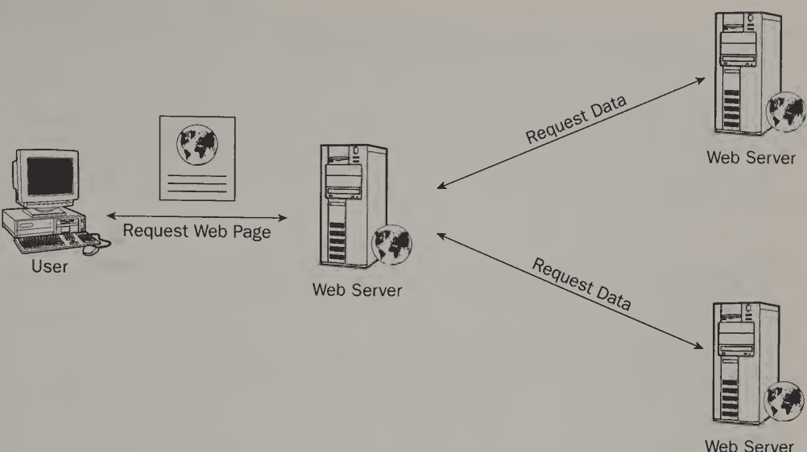

创建服务器端 mashup 可能会稍微复杂一些——你需要先在服务器上设置和配置所有需要的元素。尽管如此，服务器端 mashup 的优势是明确的——你的用户不需要任何特殊软件。他们查看你的作品所需的只是一个网络浏览器。

### 理解 Mashup 工具和技术

许多不同的工具和技术对 mashup 开发者的工具箱很有用。在下一节中，我们将简要了解其中的一些，看看它们可能如何发挥作用。在这样规模的一本书中，显然不可能对这里提到的每个主题提供全面的教程——每个主题都可以轻松地单独写一本书，所以在这里我们顶多只能简要提及它们。其中一些主题在本书后面的章节中会有更详细的讨论，在那里它们会被实际应用，而附录 D 包含了许多有用的参考资料，如果你想了解更详细的信息。

### HTML、XHTML 和 CSS

你几乎肯定已经对这一系列技术至少有所了解，首先是 HTML，即*超文本标记语言*（*Hypertext Markup Language*），它为整个万维网提供了基础。HTML 是一种简单的基于文本的标记语言，用于构建发布在万维网上的文档。HTML 标准由万维网联盟（W3C）定义，所有标准都可以在 W3C 网站上找到，网址为 `http://www.w3.org/`。

XHTML，即*可扩展超文本标记语言*（*Extensible Hypertext Markup Language*），是 HTML 的一种变体，以 XML（稍后讨论）表示，它是 HTML 的继任者，目前正在开始取代 HTML。为了获得最大的灵活性，大多数新文档应该使用 XHTML 而不是 HTML 来创建。

CSS，即*层叠样式表*（*cascading style sheets*），是一种将样式信息附加到 HTML 和 XHTML 文档的机制。样式信息包括字体、颜色和页面布局信息等。HTML 的最初版本在指定样式信息方面的能力非常有限，如何渲染文档的决定完全留给浏览器。不久之后，增加了对额外 HTML 元素和属性的支持，以便内容创建者可以制作指定各种样式元素的文档。

```html
<html>
  <head>
    <title>My Document</title>
  </head>
  <body bgcolor="#FF33FF">
    <h1><font face="Arial" size="2" color="#0000FF">Welcome to My Web Site</font></h1>
    <p>
      <font face="Arial" size="4" color="#00FF00">Hello, world!</font>
    </p>
  </body>
</html>
```

正如你可以想象的，维护由以这种方式设置样式的文档组成的网站是一场噩梦——例如，每次你想更改字体大小时，你都必须逐个文档地更改，在所有出现 `size` 属性的地方进行修改。这种方法还极大地增加了文档结构的复杂性，导致大量的文档膨胀。幸运的是，CSS 的出现拯救了这一切。

CSS 实现了文档内容和文档展示的完全分离。借助 CSS，可以采用不同的方式、通过不同的媒介来呈现同一个 HTML 文档。例如，你可能使用一组 CSS 来为网络渲染 HTML 文档，另一组则用于格式化你的文档，使其能够轻松打印。

如果使用得当，CSS 可以极大地减少文档膨胀。例如，使用 CSS，上面的 HTML 变为：

```html
<html>
  <head>
    <title>My Document</title>
    <link href="styles.css" rel="stylesheet" type="text/css" />
  </head>
  <body>
    <h1>Welcome to My Web Site</h1>
    <p>Hello, world!</p>
  </body>
</html>
```

这是相关的 CSS 文件：

```css
body {
  color: #00FF00;
  background-color: #FF33FF;
  font-family: Arial;
  font-size: 14pt;
}

h1 {
  color: #0000FF;
  font-family: Times New Roman;
  font-size: 24pt;
}
```

当你考虑到网站上的许多页面将共享相同的 CSS，而且 CSS 文件通常只会在浏览器首次访问时加载（后续页面访问将使用存储在浏览器缓存中的 CSS），就很容易看出减少的页面膨胀可以带来 dramatically 改善的页面加载时间——尤其是在大型和复杂的页面上。

CSS 提供的样式与内容的分离使创建和维护网站变得更加容易。对整个网站外观和感觉的更改只需通过修改单个 CSS 文件即可完成。

### XML 和 XPath

XML，即可扩展标记语言（Extensible Markup Language），是一种简单的、可扩展的文本格式，主要用于传输和交换数据结构。作为基于文本的格式，它易于人类阅读，并且广泛用于与基于网络的系统进行接口。与 HTML 一样，它源自 SGML（标准通用标记语言），并遵循类似的基于标签的模型。XML 规范由万维网联盟管理，可以在其网站上找到。

每个 XML 应用都可以自由定义自己的数据结构，然后可以在 DTD（文档类型定义）或 XML 模式中正式描述这些数据结构。对这些文档的讨论超出了本书的范围，但同样，详细信息可以在 W3C 网站上找到。

创建 XML 文档非常简单——这里有一个描述图书出版商目录部分的示例文档：

```xml
<?xml version="1.0"?>
<books>
  <book>
    <title>Flickr Mashups</title>
    <author>David Wilkinson</author>
    <isbn>0470097744</isbn>
  </book>
  <book>
    <title>Google Maps Mashups</title>
    <author>Virender Ajmani</author>
    <isbn>0470097752</isbn>
  </book>
  <book>
    <title>del.icio.us Mashups</title>
    <author>Brett O'Connor</author>
    <isbn>0470097760</isbn>
  </book>
  <book>
    <title>Amazon.com Mashups</title>
    <author>Francis Shanahan</author>
    <isbn>0470097779</isbn>
  </book>
  <book>
    <title>Yahoo! Maps Mashups</title>
    <author>Charles Freedman</author>
    <isbn>0470097787</isbn>
  </book>
</books>
```

每个 XML 文档都必须以声明其为 XML 的头部开始：

```xml
<?xml version="1.0"?>
```

头部之后是一个单一的根元素——在本例中是 `<books>`。根元素内是文档的其余部分。在此示例中，`<books>` 元素包含一系列独立的 `<book>` 元素。每个 `<book>` 元素又包含 `<title>`、`<author>` 和 `<isbn>` 元素。

XPath，即 XML 路径语言（XML Path Language），使你能够定位 XML 文档的不同部分。它是一种非常强大的工具，经常用于处理和操作 XML。XPath 将 XML 文档视为节点树，每个元素和每个属性都由该树中的一个节点表示。XPath 查询从树中返回一组节点。典型的 XPath 查询由表示一个或多个节点路径的表达式组成。因此，例如，在此示例 XML 文档中，XPath 查询

```xpath
/books
```

将返回根 `<books>` 节点，而查询

```xpath
/books/book
```

返回 `<books>` 内包含的 `<book>` 节点集，而

```xpath
/books/book/title
```

返回 `<title>` 节点集。

要返回列表中的第三本书，你可以使用以下 XPath 查询：

```xpath
/books/book[3]
```

而最后一本书可以通过以下方式找到：

```xpath
/books/book[last()]
```

如果你不想指定到元素的完整路径，可以使用以下表示法：

```xpath
//title
```

——在本示例中，这将返回文档中的所有 `<title>` 节点——无论其位置如何。

在本书中，我们仅触及了 XPath 功能的皮毛，但如果你想学习如何构建更复杂的 XPath 表达式，可以在 W3C 网站上阅读更多关于该语言及其功能的信息。

## JavaScript 与 DOM

JavaScript 是另一种脚本语言，因其在网络应用程序中的广泛使用而闻名。JavaScript 这个名字有些名不副实，因为它与 Java 编程语言仅有表面上的相似之处。它于 1995 年首次出现在 Netscape 的网页浏览器中，并被纳入国际标准 ECMA-262，成为 ECMAScript。大多数现代浏览器都内置了与 ECMAScript 兼容的脚本语言——微软 Internet Explorer 中的那个版本被称为 JScript。JavaScript 实际上是 Sun Microsystems 的注册商标，但已被广泛用作对网页浏览器中使用的脚本语言的通用称呼。

在脚本语言中，网页浏览器通常实现了 W3C 标准 DOM，即*文档对象模型*。DOM 规定了 HTML 和 XML 文档在浏览器中如何以树状结构表示。DOM 规范还规定了可编程接口，通过该接口可以操纵文档树中的各个元素。


用于操纵浏览器中 DOM 的 JavaScript 通常被称为*动态 HTML*。以下是一个简单的例子，展示如何使用动态 HTML 在网页上提供交互功能。

```html
<html>
    <head>
        <title>Arithmetic</title>
        <script type="text/javascript">
            function showAnswer()
            {
                var answerNode = document.getElementById('answer');
                answerNode.innerHTML = "<h2>Answer</h2><p>" + (2 + 2) + "</p>";
            }
        </script>
    </head>
    <body>
        <h1>Question</h1>
        <form onsubmit="showAnswer(); return false;">
            <p>
            What is the answer to the sum <code>2 + 2</code>?
            </p>
            <input type="submit" value="Show Answer" />
        </form>

        <div id="answer">
            The answer will appear here
        </div>
    </body>
</html>
```

在这个例子中，问题被放置在一个表单内，表单有一个提交按钮用于显示答案。在文档末尾添加了一个占位符`<div>`元素，答案将显示在这里。

在页面的`<head>`部分，定义了一个 JavaScript 函数`showAnswer()`。该函数使用 DOM 方法`getElementById()`来查找`id`为`answer`的 HTML 元素——即页面底部的占位符`<div>`。找到元素后，该方法会用包含算式答案的新 HTML 替换元素内原有的 HTML。

最后，表单定义了一个`onsubmit`事件处理器，该处理器调用`showAnswer()`函数。此事件处理器会在表单提交给服务器之前立即调用（当按钮被按下时）。由于 JavaScript 函数已经完成了所有必要的操作，因此在事件处理器中添加了`return false`以防止实际提交到服务器。

## AJAX

AJAX，即*异步 JavaScript 和 XML*，实际上是一组已经存在很久的工具的新名称。AJAX 几乎已成为 Web 2.0 的同义词，但构成 AJAX 基础的技术实际上可以追溯到 20 世纪 90 年代末。

传统的网络应用程序是*基于页面的*。每当请求新的信息或更新数据时，都会向服务器发送请求并获取一个新页面。这导致许多网络应用程序在使用上有些繁琐。

AJAX 旨在克服网络应用程序固有的笨重问题，它允许开发人员在网页内显示或操纵数据，而无需执行页面刷新。这是通过一个名为`XmlHttpRequest`的 JavaScript 对象实现的。该对象允许向网络服务器发送 HTTP 请求并处理响应。所有这些都在当前页面的幕后发生。这些请求是*异步*执行的——换句话说，当后台正在执行异步请求时，用户可以继续与当前页面交互。结果是，网络应用程序可以显得对用户操作响应更加及时。

AJAX 应用程序通常对网络资源更友好。由于通常只有页面的一部分会因用户操作而刷新，所以通过网络传输的数据量通常远少于传统的基于页面的应用程序。

构建 AJAX 应用程序的一个问题一直是要支持日常使用的各种各样的网络浏览器。每个网络浏览器都有自己独特的怪癖需要处理，创建一个对大多数用户可靠且一致工作的应用程序可能是一个相当大的挑战。为此，出现了一些工具包，旨在简化构建 AJAX 应用程序的痛苦。最受欢迎的工具包之一是 Sam Stephenson 的 Prototype JavaScript 框架，可从<http://prototype.conio.net/>获取，你将在第 6 章中充分利用它。

### JSON

JSON，即*JavaScript 对象表示法*，是一种基于 JavaScript 语法的轻量级数据交换格式。它旨在便于人类阅读和编写，同时也便于机器解析。

它基于两种数据类型。

JSON 中的对象定义如下：

```json
{
  "title" : "Flickr Mashups",
  "author" : "David Wilkinson",
  "isbn" : "0470097744"
}
```

每个对象都由花括号包围，其中包含一个以逗号分隔的元素列表。对象中的每个元素都有一个名称和一个值，用冒号分隔。

列表以逗号分隔，并用方括号括起来：

```json
["red", "green", "blue"]

[1, 2, 3, 4, 5]

["cat", 312, true]
```

JSON 中表示的值可以是字符串（如上所示，用双引号括起来）、数字、布尔值（`true`和`false`）或关键字`null`。不属于字符串的空格没有意义。

对象和数组可以组合形成更复杂的数据结构。例如，本章前面显示的示例 XML 文档中使用的数据，可以用 JSON 结构表示为一个对象列表——如下所示：

```json
[
  {
    "title" : "Flickr Mashups",
    "author" : "David Wilkinson",
    "isbn" : "0470097744"
  },
  {
    "title" : "Google Maps Mashups",
    "author" : "Virender Ajmani",
    "isbn" : "0470097752"
  },
  {
    "title" : "del.icio.us Mashups",
    "author" : "Brett O'Connor",
    "isbn" : "0470097760"
  },
  {
    "title" : "Amazon.com Mashups",
    "author" : "Francis Shanahan",
    "isbn" : "0470097779"
  },
  {
    "title" : "Yahoo! Maps Mashups",
    "author" : "Charles Freedman",
    "isbn" : "0470097787"
  }
]
```

你可以在<http://www.json.org>上了解更多关于 JSON 的信息。

## Web 服务器与 HTTP

任何基于网络的系统背后最关键的软件通常也是最被想当然的——即网络服务器本身。有许多不同的网络服务器可供选择，但最常遇到的两个是 Apache 软件基金会（<http://www.apache.org>）的*Apache Web Server*和微软的*Internet Information Services*（<http://www.microsoft.com/iis/>），通常简称为 IIS。

网络服务器的角色是监听传入的请求，然后返回适当的响应。传入的请求通常来自网络浏览器，但也有相当一部分可能来自其他软件应用程序——例如 Flickr 这类为开发者提供外部接口的网站，通常使用网络服务器来处理传入的请求。

网络服务器使用的协议是 HTTP，即*超文本传输协议*。HTTP 是一个简单的基于消息的协议，用于在网络上传输信息。HTTP 支持多种不同类型的消息，但你最可能遇到的两种是 GET 和 POST。

大多数时候，当你使用网络浏览器访问网页时，你的浏览器会向一个或多个网络服务器发送一系列 GET 请求。你访问的每一个页面都是通过 HTTP GET 请求获取的，页面使用的每一张图片和图形、每一个外部样式表和每一个外部 JavaScript 文件也是如此——组装构建单个页面所需的所有不同内容片段，很容易导致发送几十个 GET 请求。

一个典型的 GET 请求，用于检索 URL `http://www.flickr.com/photos/` 的内容，看起来像这样：

```http
GET /photos/ HTTP/1.1
Host: www.flickr.com
User-Agent: Mozilla/5.0 (Windows; U; Windows NT 5.1; en-US; rv:1.8.0.6)
    Gecko/20060728 Firefox/1.5.0.6
Accept: text/xml,application/xml,application/xhtml+xml,text/html;q=0.9,text/plain;
    q=0.8,image/png,*/*;q=0.5
Accept-Language: en-us,en;q=0.5
Accept-Encoding: gzip,deflate
Accept-Charset: ISO-8859-1,utf-8;q=0.7,*;q=0.7
Keep-Alive: 300
Proxy-Connection: keep-alive
Cookie: cookie_epass=b451d297bd19680bea0012147c34c68b; CP= null*;
    cookie_accid=492257; cookie_session=492257%b451d297bd19680bea0012147c34c68b;
    use_master_until=1157985652
```

HTTP 请求的第一行包含方法（本例中为 GET），然后是被请求资源的名称（`/photos/`），最后是正在使用的 HTTP 协议版本（`HTTP/1.1`）。随后是一系列头部信息，提供给网络服务器以决定如何最好地处理请求的额外信息。在头部信息之后是一个空行。除非你特别想深入了解 HTTP 的内部工作原理，否则大多数这些头部信息你可以安全地忽略。不过，有几个值得一提。

# 第一章：重写网络

`Host`头用于指定客户端试图访问资源所在的主机机器名称。乍一看，这似乎是条有些多余的信息——毕竟，主机机器难道不知道自己叫什么吗？它之所以在消息头中被指定，是因为一台网络服务器可能负责托管许多不同的站点。每个网站都是在服务器内部配置的一个*虚拟主机*。实际上，互联网上的大多数网站可能都是虚拟主机，每个网站都与许多其他网站共享一台服务器。

这里另一个值得关注的头是`Cookie`头。许多网站使用 Cookie 在客户端浏览器中存储信息。这通常是网站记住你身份的方式——每次你访问时，浏览器都会向网络服务器呈现你的 Cookie，服务器可以利用它来识别你。Cookie 在 HTTP 头中传输。在这种情况下，Cookie 从客户端发送到服务器。当 Cookie 值首次设置或发生任何变化时，服务器会在响应中通过一个`Set-Cookie`头将其发回客户端。

让我们来看一个典型的 HTTP 响应。下面的响应是针对上面请求的：

```http
HTTP/1.1 200 OK
Date: Sun, 10 Sep 2006 15:14:23 GMT
Server: Apache/2.0.52
Cache-Control: private
Connection: close
Content-Type: text/html; charset=utf-8

<!DOCTYPE HTML PUBLIC "-//W3C//DTD HTML 4.01 Transitional//EN">
<html>
<head>
  <title>Flickr: Photos from everyone in Flickr</title>

  ...
```

第一行由标识所用协议版本的字符串、一个三位数的状态码以及最后一个人类可读的消息组成，该消息描述了状态码的含义。这里的状态是 200，表示一切正常，请求的资源包含在响应的主体中。`2xx`形式的状态码表示成功。`3xx`表示客户端需要采取进一步操作——也许资源已经移动，应该发送新请求以从新位置检索它。`4xx`形式的状态码表示客户端方面的错误——最常见的是 404，表示在服务器上找不到请求的资源。最后，`5xx`状态码表示服务器方面的错误。

在 HTTP 状态之后，跟着一系列头。这里显示的最重要的是`Content-Type`头——它包含请求资源的 MIME 类型。这里是`text/html`，因此网络浏览器知道要将其渲染为网页。HTTP 头之后是一个空行，然后是请求的资源本身——这里是一个 HTML 页面。

你可能遇到的另一个网络服务器方法是`POST`。`GET`是从服务器请求资源，而`POST`用于向服务器上的资源发送数据。`POST`最常见的用途是填写网页上的表单：表单中包含的数据在`POST`请求的主体中发送。

## 网络浏览器

网络浏览器在很多方面是网络服务器的伙伴。它是处理 HTTP 事务客户端的软件。网络浏览器已成为我们日常生活中如此基础的一部分，以至于你可能想知道为什么它们还值得在这里提及——对许多人来说，网络浏览器是计算机上的主要工具之一。

在构建 Web 应用程序时，将浏览器视为理所当然是最常见的错误之一。人们常常陷入这样一个陷阱：忘记了他们使用的浏览器并非唯一存在的浏览器。因为它们围绕一套共同的标准构建，你可能期望所有网络浏览器都能与所有网站兼容。嗯，大体上是这样——但一旦你开始构建更有趣的应用程序，使用更广泛的技术，你就会注意到实际上存在不一致之处。有时，有些事情标准实际上并未指定，或者可能有多种解释，又或者某个浏览器只是部分实现了某个特定标准。有些差异甚至可能是由浏览器本身的错误引起的。

人们使用各种各样的浏览器：Internet Explorer、Firefox、Netscape、Safari 和 Opera 是一些更常见的正在使用的浏览器——但这个列表远未完整。更复杂的是，每种浏览器通常有多个不同版本——每个版本都有自己不同的特性，而且每个版本在互联网的某个地方都还有人在使用。

更糟糕的是，大多数浏览器能够在多种平台上运行——Microsoft Windows、Linux、OS X——而每个平台通常又有多种不同的变体：例如 Windows XP、Windows 2000、Windows Me 和 Vista。每个浏览器在每个平台上的行为可能略有不同。

如果你觉得这听起来像是一组令人望而生畏的变体——你是对的；确实如此。更重要的是，没有真正的答案。浏览器/平台组合的总量太大，除了最大的开发团队外，其他团队都无法考虑进行全面测试。需要记住的重要一点是：仅仅因为你的混搭应用对你自己运行良好，你绝不能假设其他人也会以完全相同的方式看到它。

至少，你应该始终在几种不同的浏览器下检查你的混搭应用。在 Windows 上，尝试使用 Internet Explorer 和 Firefox。在 Mac 上，尝试使用 Firefox 和 Safari。如果可能，尝试在 Mac 和 Windows 上都进行测试。仅仅这样做就能发现绝大多数问题。人们常常在去查看他们听说的最新最酷的混搭应用时感到失望，结果发现它不适用于他们选择的浏览器。别让这种事发生在你身上！

## PHP 和 Perl

PHP 和 Perl 是当今互联网上最常用的两种脚本语言，本书中的大部分示例都使用了其中一种。

PHP 是 *PHP: Hypertext Preprocessor* 的递归首字母缩写词。它是一种通用脚本语言，尽管最常用于生成网页——这项任务它非常适合。与其编写大量代码来输出 HTML 标签，你可以直接将 PHP 嵌入标准 HTML 页面中：

```php
<html>
  <head>
    <title>Arithmetic</title>
</head>
<body>
  <h1>Question</h1>
  <p>
    What is the answer to the sum <code>2 + 2</code>?
  </p>
  <h2>Answer</h2>
  <?php
    echo 2 + 2 ;
  ?>
</body>
</html>
```

我将在接下来的章节中大量使用 PHP，并且本书大部分内容都假定读者具备一些 PHP 经验。如果你需要温习 PHP 技能，主要的 PHP 网站<http://www.php.net/>始终是一个很好的起点。在那里你可以找到 PHP 文档和教程。

与 PHP 类似，Perl 也是一种脚本语言，并且有着非常悠久的历史。由 Larry Wall 在 1980 年代中期创建，它已成为最广泛使用的工具之一。系统管理员称其为“互联网的胶带”：其多功能性和几乎无处不在的可用性使其能够轻松应用于大多数情况。

Perl 可用于多种计算平台，并由 CPAN（综合 Perl 档案网络）提供的全面的附加模块库支持，该网络可在<http://cpan.perl.org/>找到。

## 正则表达式

正则表达式是定义一个模式的字符串，该模式用于匹配一个或多个字符串，通常用于在较大的字符串中搜索特定模式。理解其含义最简单的方法是看一两个例子——让我们看几个典型的正则表达式示例。

存在许多类型的正则表达式——在本书中，我只使用 Perl 风格的正则表达式。

这是一个非常简单的正则表达式：

```text
/Flickr/
```

正则表达式（通常简称为 regexp）由正斜杠分隔。斜杠内部是要匹配的模式。这里的模式非常简单——就是单词 Flickr。此模式将匹配任何包含文本 Flickr 的字符串。以下是匹配该模式的所有字符串：

- Flickr Mashups
- The Flickr web site
- I like Flickr

然而，大多数正则表达式并非如此直接。regexp 模式中可以使用许多特殊字符来进行更复杂的匹配。例如，脱字符号（`^`）用于匹配字符串的开头，美元符号（`$`）匹配字符串的结尾。看这个 regexp：

```text
/^Flickr/
```

# 第一部分：构建全新的互联网

模式开头的`^`字符表示只有以 Flickr 开头的字符串才会被匹配。在三个示例字符串中，只有一个匹配：

```text
Flickr Mashups
```

类似地，这个正则表达式

```text
/Flickr$/
```

只匹配以 Flickr 结尾的字符串：

```text
I like Flickr
```

句点（`.`）可以匹配任意字符，因此以下模式可以匹配任何包含 F 和 r 且中间相隔四个字符的字符串：


```text
/F....r/
```

这意味着它会匹配所有三个 Flickr 字符串，还会匹配以下两个：

```text
Farmer Giles has a herd of cows
Fly around the world
```

星号（`*`）是一个修饰符，表示前面的字符出现“零次或多次”。因此，正则表达式：

```text
/che*se/
```

会匹配：

```text
cheese
cheeeeeeese
chse
```

类似地，加号（`+`）和问号（`?`）字符也是修饰符，分别表示“一次或多次”和“恰好零次或一次”。

你可以使用方括号来包含一组备选项，因此正则表达式：

```text
/br[eo]ad/
```

可以同时匹配`bread`和`broad`。

你可以使用`\d`匹配数字（0-9），使用`\w`表示“单词”字符（字母或数字，或下划线字符），因此正则表达式：

```text
/\d\d\d\d-\d\d-\d\d/
```

可以用来匹配`yyyy-mm-dd`格式的日期。

正则表达式是一种非常强大的工具，在像这样的简短介绍中所能涵盖的内容远不及其全貌。你将在本书的多个地方使用它们，通常是在 PHP 中。PHP 网站有一个方便的正则表达式模式语法说明，地址为`http://www.php.net/manual/en/reference.pcre.pattern.syntax.php`。

## REST

REST，即“表征状态转移”（Representational State Transfer），是一个经常被误用的术语。严格来说，REST 描述的是一种构建软件系统的架构方法。REST 这个术语最早由 HTTP 规范的主要作者之一 Roy Fielding 在他的博士论文中使用：

> 表征状态转移旨在唤起人们对一个设计良好的 Web 应用程序行为方式的想象：一个网页（虚拟状态机）的网络，用户通过选择链接（状态转换）在应用程序中推进，从而将下一个页面（代表应用程序的下一个状态）传输给用户并渲染以供使用。

基于 REST 原则构建的 Web 应用程序会将系统中存储的每个对象建模为一个唯一的 URL。因此，一家书店可能会使用以下形式的 URL：

```text
http://www.somebookstore.com/books/0470097744
```

这里，`0470097744`是所讨论书籍的 ISBN。当访问该 URL 时，会返回一个代表该书的文档——在网页上，这很可能是一个 HTML 页面。当然，并非书店中的每一本书都有一个单独的 HTML 页面——这些页面都是根据 URL 中传递的信息动态生成的。

该书的 HTML 页面可能包含指向该书评论列表的链接：

```text
http://www.somebookstore.com/books/0470097744/reviews
```

每条评论也会有自己的 URL：

```text
http://www.somebookstore.com/books/0470097744/reviews/1
```

每当用户点击链接访问新的 URL 时，新的 URL 包含处理请求所需的所有上下文——服务器上不需要存储任何状态；状态完全存储在 URL 中。这是 REST 系统的一个关键特性。

在 Web 2.0 世界中，REST 这个术语也经常被用来指代任何简单的 HTTP 接口，这些接口无需借助额外的消息层（如 SOAP，见下文）即可交换信息（通常是 XML）。Flickr API 就提供了这样的 REST 接口，这将在第 4 章中详细介绍。

Flickr 提供的 REST 接口是基于 URL 的，代表了向远程系统发送请求的一种非常简洁的方式。一个典型的 REST 请求 URL 可能看起来像这样：

```text
http://www.flickr.com/services/rest/?method=flickr.photos.search
&user_id=50317659@N00&per_page=6&api_key=1f2811827f3284b3aa12f7bbb7792b8d
```

这个 URL 用于搜索用户在 Flickr 上的最新照片。现在不必担心所有这些参数的含义——我们将在第 4 章中更详细地查看这个请求。不过你可以看到，整个请求都包含在 URL 中。使用 REST 的一大优势是，你只需在浏览器中输入 URL 就可以试用——无需遵守复杂的消息协议。就应用接口而言，REST 是作为软件开发者最可能获得的“即时满足”体验。

> 如果你确实尝试在浏览器中输入这个示例 URL，它实际上不会起作用。在使用 Flickr 的服务之前，你需要先获取一个 API 密钥。我们将在接下来的几章中介绍什么是 API 密钥、如何获取以及如何使用它们。

## SOAP

SOAP 是一种基于 XML 的消息格式，广泛用作与 Web 服务通信的手段。SOAP 标准由 W3C 维护。最初，SOAP 是“简单对象访问协议”（Simple Object Access Protocol）的首字母缩写，但这一特定定义近年来已被弃用。

SOAP 的请求和响应都是 XML 文档，因此可能非常冗长。例如，当转换为 SOAP 消息时，前面显示的简单 Flickr REST 请求会变成类似这样：

```xml
<?xml version="1.0" encoding="utf-8" ?>
<s:Envelope
  xmlns:s="http://www.w3.org/2003/05/soap-envelope"
  xmlns:xsi="http://www.w3.org/1999/XMLSchema-instance"
  xmlns:xsd="http://www.w3.org/1999/XMLSchema"
>
  <s:Body>
    <x:FlickrRequest xmlns:x="urn:flickr">
      <method>flickr.photos.search</method>
      <api_key>1f2811827f3284b3aa12f7bbb7792b8d</api_key>
      <user_id>50317659@N00</user_id>
      <per_page>6</per_page>
    </x:FlickrRequest>
  </s:Body>
</s:Envelope>
```

许多提供 SOAP 接口的 Web 服务使用 WSDL，即“Web 服务描述语言”（Web Services Description Language），作为一种正式描述可用服务并定义如何构建请求消息文档和理解响应文档的方式。

由于 SOAP 的广泛使用，许多 SOAP 工具包可用，许多开发环境也直接支持 SOAP。然而，这些工具包通常依赖于 Web 服务的 WSDL 描述的存在，如果没有可用的 WSDL，它们的用处就非常有限。

## XML-RPC

XML-RPC 是另一种常用的基于 XML 的消息格式，是一种使用 XML 提供“远程过程调用”的机制。远程过程调用只是一种在另一台计算机上执行服务的方式。XML-RPC 是 SOAP 的前身，与 SOAP 一样，其消息格式也相当冗长。一个典型的 XML-RPC 消息可能看起来像这样：

```xml
<?xml version="1.0" encoding="utf-8" ?>
<methodCall>
    <methodName>flickr.photos.search</methodName>
    <params>
        <param>
            <value>
                <struct>
                    <member>
                        <name>api_key</name>
                        <value>
                            <string>1f2811827f3284b3aa12f7bbb7792b8d</string>
                        </value>
                    </member>
                    <member>
                        <name>user_id</name>
                        <value>
                            <string>50317659@N00</string>
                        </value>
                    </member>
                    <member>
                        <name>per_page</name>
                        <value>
                            <int>6</int>
                        </value>
                    </member>
                </struct>
            </value>
        </param>
    </params>
</methodCall>
```

XML-RPC 的使用不如 SOAP 那样广泛，在开发者社区中可用的工具包支持也较少。

## 数据库

大多数具有一定复杂度的系统都会在后台某处使用数据库。对于非常少量的数据和少量用户，你可以将需要跟踪的数据存储在磁盘文件中，或者可能存储在 Cookie 中，但不久之后你就会发现自己需要一个合适的“数据库管理系统”。数据库管理系统提供了高效存储、搜索和维护大量信息的方式。

当今 Web 系统中最流行的数据库系统之一是 MySQL。MySQL 是 MySQL AB 提供的免费开源数据库，可从`http://www.mysql.com`获取。MySQL 是一个关系型数据库，正如其名称所示，它使用“结构化查询语言（SQL）”来管理和查询数据。

SQL 和 MySQL 数据库管理是一个庞大而复杂的主题——在像这样的书中无法深入探讨。第 14 章包含了设置 MySQL 数据库的说明，以及对基本 SQL 命令的简要介绍，互联网上还有更多资源对这些主题进行了更详细的探讨。MySQL 主网站有完整的文档，并包含一个使用 MySQL 的简要教程。

### Curl

本章前面你已经看到，向 Web 服务器发送 REST 风格的查询是多么简单——你只需在浏览器的地址栏中输入即可。但如果你不想使用浏览器呢？也许你想确切地看到返回了什么内容，或者想把结果保存到文件中。那像 SOAP 或 XML-RPC 这样更复杂的消息呢？如何尝试发送这类消息？答案是一个叫做`curl`的小应用程序。

Curl 是一个用于使用 URL 语法发送和检索文件的命令行工具。它支持多种协议，其中最重要的是 HTTP。Curl 是免费的，并且适用于多种平台。你可以从`http://curl.haxx.se/`下载。

当你运行`curl`时，可以选择大量的命令行选项。这些选项在`curl`网站上都有文档说明，但这里列出一些常用的。要获取 URL 的内容，例如`http://www.flickr.com/`，只需输入以下内容：

```bash
curl http://www.flickr.com/
```

要获取页面内容，但将其保存到文件：

```bash
curl -o file.html http://www.flickr.com/
```

要将文件内容 POST 到 URL：

```bash
curl -d @request.xml http://www.flickr.com/services/soap/
```

Curl 是一个非常强大且多功能的工具；花点时间通读手册是非常值得的。

## 总结

本章向你介绍了混搭的世界。你看到了客户端和服务器端混搭的区别，并了解了许多使混搭成为可能的技术。现在，让我们继续前进，更仔细地看看 Flickr，这个系统将是本书剩余部分我们混搭的焦点。

# Flickr：简短导览

如果你正在阅读这本书，你可能已经拥有一个 Flickr 账户，并且至少熟悉 Flickr 的某些方面。然而，这是一个庞大且不断增长的网站，很可能有一些你还不熟悉的领域。在本章中，你将被带领进行一次简短的 Flickr 导览。我不会向你展示所有不同功能的丰富多样性——本章的目的不是成为一个全面的 Flickr 用户指南。相反，我将从混搭开发者的角度来看待事物。我将向你展示 Flickr 的主要功能是如何设置的，并在沿途设置几个休息点，以突出特定的有趣领域。

## 创建账户

Flickr 体验的第一步是创建一个账户。你可能已经有了一个 Flickr 账户，但如果没有，现在是注册的好时机。你可以在 Flickr 主页`http://www.flickr.com/`上按照那里的注册说明创建一个新账户。每个新的 Flickr 账户都与一个 Yahoo! 账户绑定——作为 Flickr 注册过程的一部分，你将被要求创建一个新的 Yahoo! 账户，或登录到一个现有的账户。

当你创建 Flickr 账户时，你还可以选择你的“屏幕名称”。这是人们在 Flickr 上查看你的照片时看到的名称，可以是你的真名或别名——完全由你决定。你的屏幕名称在任何时间点都是唯一的，但你可以随时自由更改。屏幕名称的可变性意味着它作为识别手段并不可靠，因此 Flickr 在后台为你分配了另一个唯一标识符，称为 NSID，即“网络服务 ID”。一个典型的 NSID 如下所示：

```text
50317659@N00
```

你的 NSID 是固定的，永远不能更改。大多数 Flickr 用户在整个使用过程中可能从未真正意识到 NSID。然而，对于你作为混搭开发者来说，NSID 尤其重要——在整本书中，你将广泛使用 NSID 来唯一标识用户。

## 账户类型

有两种类型的 Flickr 账户可用——免费和“专业”。当你第一次创建 Flickr 账户时，默认情况下你将拥有一个免费账户，尽管你可以随时通过访问`http://www.flickr.com/account/`页面升级到专业账户。免费和专业账户之间存在一些微妙但重要的区别——其中一些在构建混搭时你可能需要记住。

免费账户的主要限制在于它们允许在 Flickr 的个人资料流中同时显示的照片数量。对于专业用户，照片数量是无限的，但免费账户可能只能使用最近上传的 200 张照片。一旦免费账户持有人达到 200 张照片的限制，随着新照片的上传，旧照片将从视图中消失。免费账户还限制了他们可以使用的上传带宽量：Flickr 通过测量上传的总字节数而不是存储在 Flickr 上的字节数来规范你的上传量——这意味着即使你从 Flickr 删除了照片，已使用的带宽也不会改变。免费账户持有人每个日历月总共允许使用 20 MB 带宽，而专业账户持有人每月最多允许 2 GB。你可以随时通过访问 Flickr 上传页面`http://www.flickr.com/photos/upload/`查看剩余带宽。

对免费账户持有人的另一个限制是他们可以创建的照片集数量——免费账户持有人只能创建三个集，而专业账户持有人对集的数量没有限制。

一些其他 Flickr 功能也仅限于专业账户持有人，并且随着时间的推移可能会增加更多差异。例如，在你的个人资料流中替换照片的功能仅对专业用户可用。

## 设置 URL

使用 Flickr 账户时，你可以做出的最重要的决定之一是选择它的 URL。默认情况下，你的照片 URL 包含你的 NSID，看起来像这样：

`http://www.flickr.com/photos/50317659@N00/`

作为 URL，这不太容易记住，因此 Flickr 允许你设置一个替代的、更友好的 URL，它可能看起来更像这样：

`http://www.flickr.com/photos/dopiaza/`

你可以通过访问“你的账户”页面并单击“设置你的 URL”链接，或者直接访问`http://www.flickr.com/profile_url.gne`，非常容易地设置你的 URL。

> 当你设置 URL 时，你必须谨慎选择。一旦设置，就永远不能更改。设置你的 URL 是一次性的决定。

## 上传照片

一旦你有了 Flickr 账户，下一步就是上传一些照片。最简单的方法是使用 Flickr 上传页面`http://www.flickr.com/photos/upload/`，如图 2-1 所示。

## 第 2 章：Flickr：简短导览


### 图 2-1

上传页面还可以让你看到当前月份已使用了多少可用带宽。上传页面对于快速上传图像非常方便，但正如你所看到的，它只允许你一次上传六张照片。工具页面（`http://www.flickr.com/tools/`）提供了多种适用于不同平台的上传工具——许多人使用其中之一。在本书后面，你将看到如何构建自己的上传器，但开始时，你很容易在这里找到满足你当前需求的东西。

最常用的应用程序之一是 Flickr Uploadr，适用于 Windows 和 Mac OS X。这是一个独立应用程序，允许你将照片拖放到其中，然后批量上传。你可以在图 2-2 中看到 Uploadr 的实际操作。

专业账户限制单张照片最大尺寸为 10 MB，免费账户限制每个文件总共 5 MB。如果你尝试上传超过允许大小的文件，Uploadr 会警告你并要求你调整大小。如果你愿意，你还可以设置 Uploadr 调整所有上传到 Flickr 的图像大小——你可以通过选项对话框进行操作，该对话框可以通过单击 Uploadr 按钮行最右边的电灯开关按钮找到。选项对话框如图 2-3 所示。

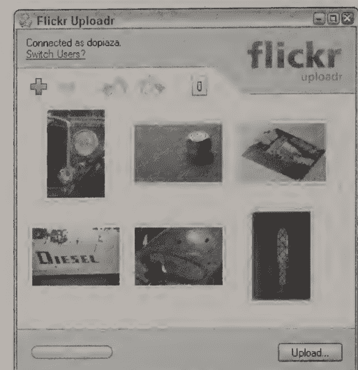

### 图 2-2

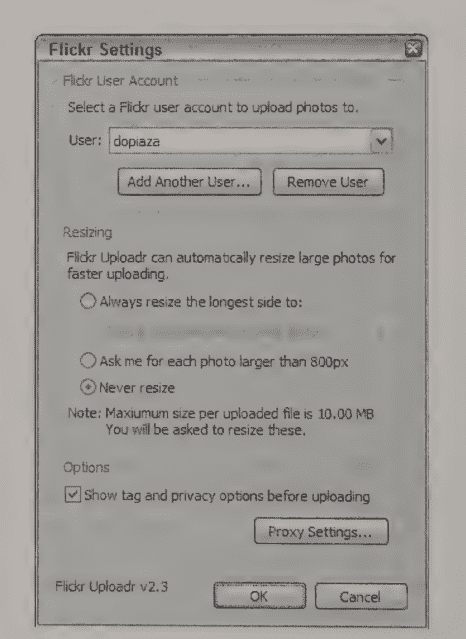

### 图 2-3

从这里，你不仅可以指示 Uploadr 调整图片大小，还可以配置它允许访问多个账户——如果你与他人共用电脑，或在 Flickr 上管理多个账户，这是一个非常实用的功能。

## 照片格式与尺寸

Flickr 支持上传多种常见格式的照片：

- JPEG
- GIF（非动画）
- PNG
- TIFF


每当文件被上传时，原始文件会被保留，Flickr 不会对其进行任何修改，但 TIFF 文件除外，这类文件会先被转换为 JPG。随后，Flickr 会生成一系列较小的文件——从小型缩略图到适合网页展示的较大尺寸。无论原始照片的格式如何，所有 Flickr 生成的图像都将采用 JPEG 格式。你可以进入任意照片页面，点击照片上方的“所有尺寸”按钮来查看这些调整过大小的图像。请注意，如果你使用的是免费账户，则无法查看原始尺寸的照片——它仍然存储在 Flickr 上，但只有你升级账户为专业版（pro）后才能使用。

## 照片 ID 与 URL

当你向 Flickr 上传照片时，系统会为它分配一个唯一的标识符，称为照片 ID。这个 ID 在照片的整个生命周期内都是固定的——即使你替换照片，ID 也保持不变。根据我在第一章中提到的 REST 原则，每张照片都有其唯一的 URL。我将在第四章更详细地讨论照片 URL，但如果你查看自己的照片页面，会发现它大致如下所示：

```text
http://www.flickr.com/photos/dopizza/231699414/
```

照片的 ID 是 URL 末尾的数字——在本例中为 `231699414`。在撰写本文时，照片 ID 仅是 Flickr 上存储照片数量的递增计数——当这张照片发布时，Flickr 上已有超过 2.31 亿张照片。当然，Flickr 实际存储的照片数量会更少——那些数百万照片中的一些已经被删除，而且许多剩余照片是私有的，因此你无法访问。Flickr 保留在未来更改照片 ID 分配方式的权利，但在那之前，你所分配到的照片 ID 很好地表明了 Flickr 数据库的规模有多么庞大。

## 整理你的照片

Flickr 提供了多种不同的方式来整理你的照片。在本节中，我将向你介绍可用的不同方法。

### 照片流

照片的默认视图是你的照片流。照片流展示了你上传到 Flickr 的所有照片——按上传日期排序，最近上传的照片显示在流的开头，最旧的照片在末尾。每当你上传新照片时，它就会出现在照片流的最前面。你可以在图 2-4 中看到典型的照片流视图。

改变照片流中照片顺序的唯一方法是手动编辑上传日期。如果你查看某张照片的主照片页面，在右侧的“附加信息”部分，你会看到一行显示照片拍摄日期以及一个编辑链接。点击编辑链接会进入“编辑日期”界面，这里有两个标签页可供选择：“拍摄日期”和“发布日期”，如图 2-5 所示。

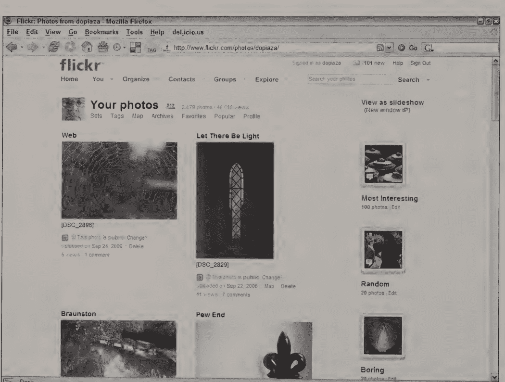

图 2-4

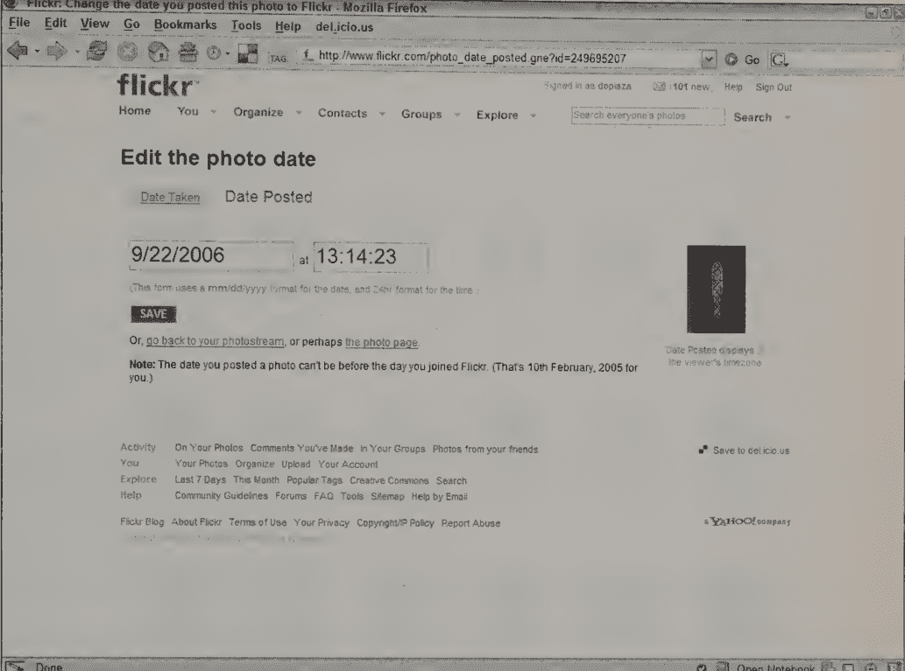

图 2-5

选择“发布日期”标签页后，你可以修改 Flickr 存储的照片上传时间和日期。一旦保存了新的时间日期，Flickr 会重新排列你的照片流以反映新的时间戳。你可以很容易地看到这一效果——前往你照片中的任意一张旧照片，将拍摄日期修改为当前日期和时间。然后回到照片流视图，你会看到这张照片已经移到了照片流的最前面——就 Flickr 而言，它现在是你照片流中最新的上传照片，因此占据了页面顶部的首要位置。

### 相册集

照片流视图非常适合快速查看一系列照片中的新内容，但它不太适合将相关照片分组展示。为此，Flickr 提供了另一个名为相册集的功能。相册集有时也称为照片集，是从你的照片流中选取的一组照片——你可以用它来按共同主题、活动合集或任何你选择的图片组合进行分组。创建一些相册集后，你会在照片流第一页的右侧看到它们，也会在你的相册集页面看到它们，大致如图 2-6 所示。

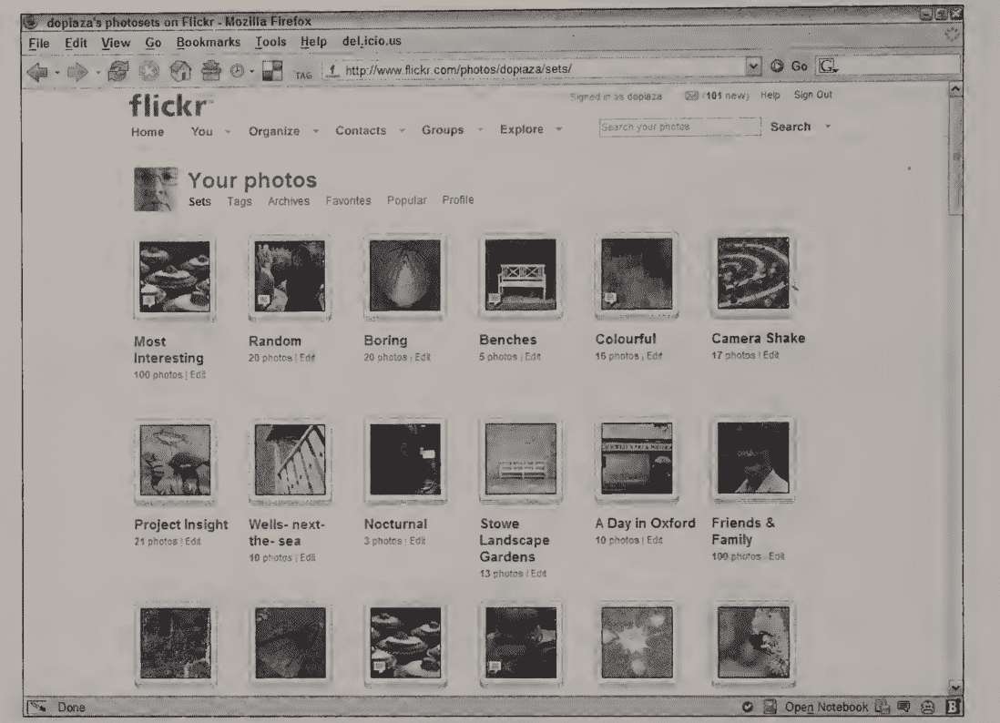

图 2-6

你可以通过点击主照片页面上方照片的“添加到相册集”按钮，轻松将照片添加到新相册集或现有相册集中。点击“添加到相册集”按钮后，你会看到可用相册集列表，或创建新相册集的选项。任何已包含该照片的相册集在此列表中会显示为灰色，旁边带有 `[X]` 符号——点击此 `[X]` 可将其从该相册集中移除。一张照片可以同时存在于任意数量的相册集中，从相册集中移除照片或删除整个相册集都不会删除任何照片——它们仍保留在你的照片流中，直到被明确删除为止。

你可能会注意到，每个相册集和每张照片一样，都有自己的 ID，相册集的 URL 大致如下所示：

```text
http://www.flickr.com/photos/dopiaza/sets/72057594090101718/
```

这里的相册集 ID 是 `72057594090101718`。与照片 ID 不同，相册集 ID 并不是每次创建新相册集时简单地递增一——如果你连续创建两个相册集，会发现它们的 ID 差异很大。

### 整理工具

Flickr 整理工具是一个非常实用的照片整理辅助工具。你可以在`http://www.flickr.com/photos/organize`找到它，或者在任意 Flickr 页面顶部点击“整理”链接进入。

值得仔细了解一下整理工具——它是一个使用 Flickr API 创建的 AJAX 应用程序，因此是这类应用构建方式的绝佳示例。我将在第四章详细介绍 Flickr API，并在本书其余部分广泛运用它。不过现在，让我们更深入地了解整理工具及其提供的功能。

整理工具应用程序在窗口顶部有一系列标签页，每个标签页都使用户能够在整理工具的不同主要任务之间切换。整理工具窗口的底部是一排照片，还有一些控件可用于搜索和选择用户照片流中的照片。整理工具的中央区域是主要工作区。首次打开整理工具时，它处于批量整理模式，你可以从底部条带中选择照片并拖动到中央区域，以便对它们执行批量操作。你可以在图 2-7 中看到这个视图。

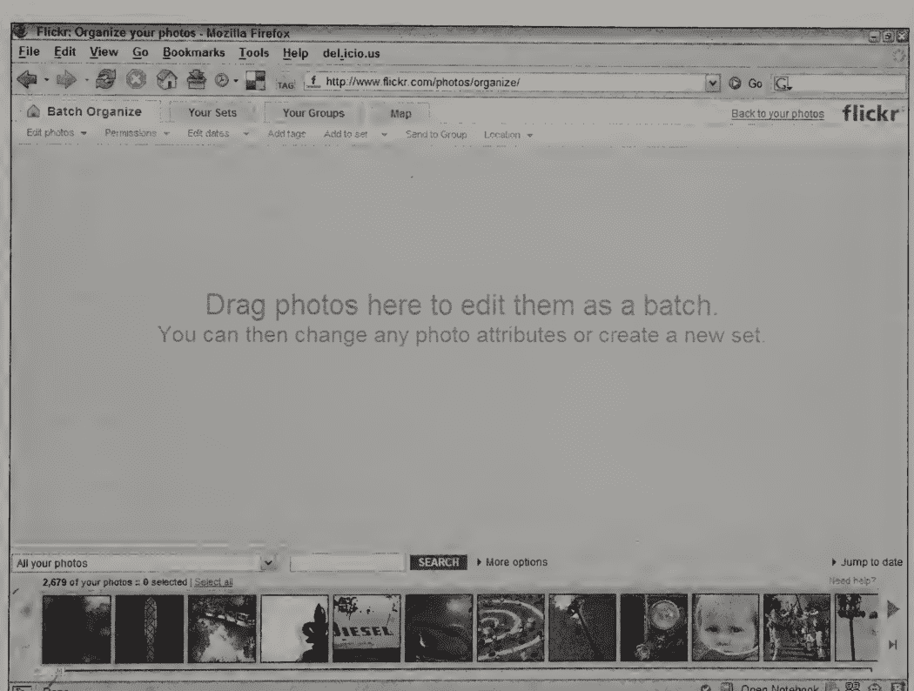

图 2-7

选择要拖入主区域的照片时，你可以使用常规的组合键进行多选——Shift+点击选择连续范围，Ctrl+点击选择非连续项。选定照片后，标签页下方的菜单让你能够对照片进行各种更改，例如修改日期、标签、标题和描述。

接下来的标签页让你能够轻松管理相册集——你可以创建新相册集、删除现有相册集、向相册集中添加或移除照片，以及更改相册集的显示顺序和其中的照片顺序。许多 Flickr 的相册集管理功能，例如重新排序相册集和更改相册集主照片的能力，只能在整理工具中使用。

第三个整理工具标签页提供了一个表单界面，让你可以轻松将照片发布到一个或多个群组池中，第四个标签页“地图”使你能够为照片添加位置信息。与相册集一样，“地图”标签页提供了 Flickr 其他位置所没有的功能。点击该标签页时，Flickr 的地理标记界面将加载并显示一张世界地图——类似于图 2-8 所示。

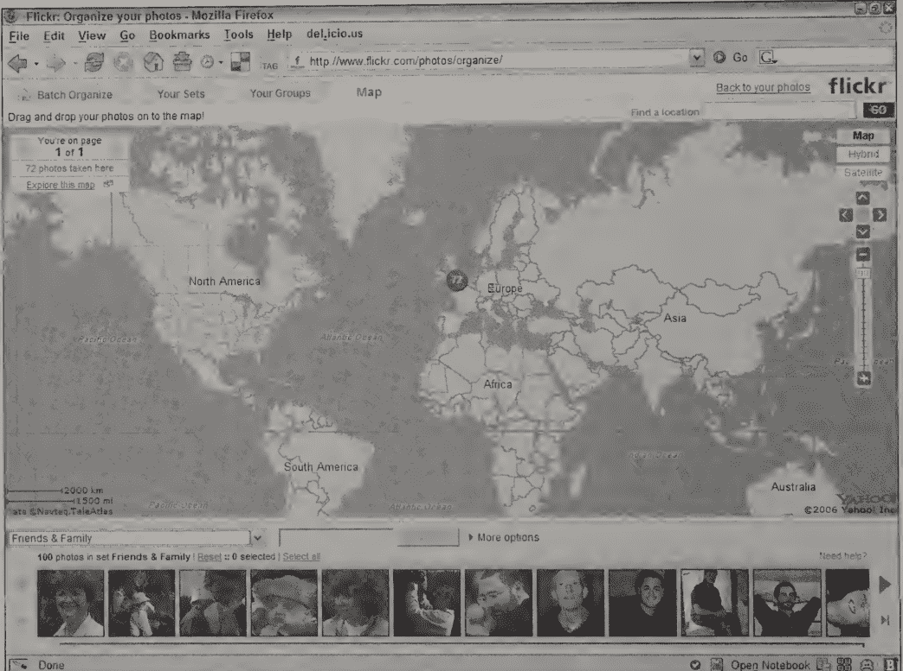

图 2-8

你可以使用页面右侧的滑块放大地图，并且可以点击地图上任意位置并拖动来重新定位。要将你的照片添加到地图上，只需从底部的栏中拖动它们并放到地图上的相应位置。关于地理标记和位置信息，我将在第 13 章中进行更详细的讨论。

### 标签

标签是 Flickr 上照片组织结构的关键部分。对于 Flickr 上的每张照片，你可以添加一个或多个标签。这些标签可以描述照片中的物体（我、猫、花、日落），可以描述拍摄的事件或时间（假期、圣诞节、夏天、2006 年），地点（巴黎、伦敦、加拿大），或者可能是更抽象的东西（有趣、快乐、悲伤）。简而言之，你可以为你的照片添加任何你喜欢的标签——没有正式的标签词汇表。

标签是查找照片最简单的方法之一——例如，只需搜索猫这个词，你就会找到成千上万张带有该标签的照片。缺乏固定的标签结构使得给照片添加标签的过程非常简单直接——只需点击你照片页面上的“添加标签”链接，然后输入你想要用作标签的任何单词和短语。你可以在图 2-9 中看到这一点。

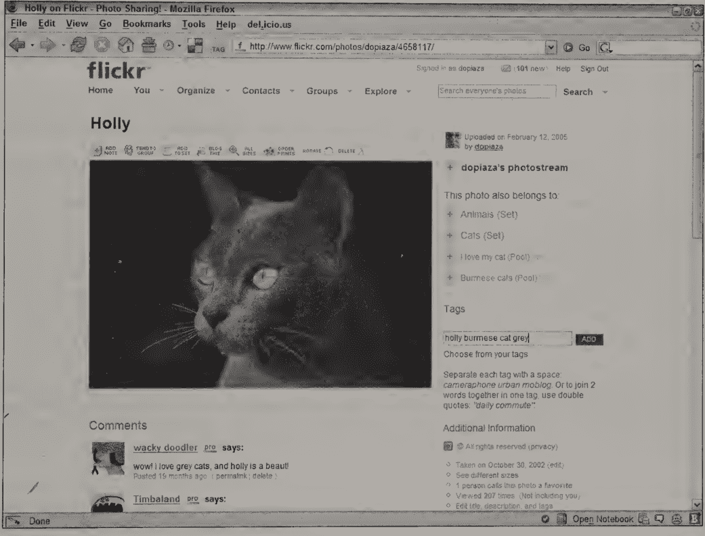

你可以一次添加多个标签——只需用空格分隔标签即可。如果你想用短语而不是单个单词作为标签，只需将短语用双引号括起来。添加的一组典型标签可能如下所示：

```text
party fun "Sue's birthday" 2006
```

这将添加四个不同的标签：派对、有趣、苏的生日和 2006 年。Flickr 总是存储你输入的精确标签，当标签显示时，你会看到它与你输入的一模一样。然而，在内部，Flickr 还存储了标签的第二种表示形式，这是它在进行标签搜索时使用的版本。它通过删除输入标签中所有非字母或数字的字符，并将剩余部分转换为小写，来构建这个内部形式的标签。所以，例如，标签 `Sue's birthday`、`sues birthday`、`sues_birthday` 和 `suesbirthday` 在 Flickr 看来都是相同的——搜索其中任何一个标签都会产生匹配结果。

当你尝试添加一些常见词时，它们会自动从标签列表中移除。当人们刚接触标签概念时，他们经常在标签框中输入描述性短语。通过移除某些常见词，如 the、of 和 and，Flickr 只将短语中的关键词作为标签。试一试：转到你的一张照片，添加这个短语作为标签：the cat is sitting on the mat. 但是，请确保你没有将短语用引号括起来。标签添加后，你会看到实际上只有 cat、is、sitting 和 mat 这几个词被添加为标签。the 和 on 这些词没有被添加。

如果你愿意，你可以允许其他用户为你的照片添加标签。添加标签的能力是可配置的——你可以通过修改你的默认照片隐私设置`http://www.flickr.com/account/prefs/photoprivacy/`来设置它。

像 Flickr 使用的这种自由形式、用户驱动和协作的标签系统通常被称为众包分类法——与分类法形成对比，后者是更正式、定义明确的分类系统。

当然，没有正式的标签分配方法也有其缺点——标签空间很容易被不相关或令人困惑的标签所污染。有些人会将各种流行的标签添加到他们所有的照片中，无论是否相关，以期获得更多的浏览量。这种方法通常不太成功，但它确实会导致标签搜索返回不相关的结果。另一个潜在的陷阱是，不同的人对什么是合适的标签的看法可能差异巨大。例如，如果有人有一条名叫切斯特的狗，那么搜索英格兰小镇照片的人可能会惊讶地看到大量家庭宠物的照片。同样，其他人搜索标签 `paris` 和 `hilton` 时，可能并不期望找到一堆法国酒店的建筑照片。另一个常见的混淆来源是，同一个词在不同语言中可能有不同的含义——`ape` 在意大利语中是蜜蜂的意思，所以搜索灵长类动物可能也会出现意大利有翅昆虫。对于标签对不同的人意味着不同问题，没有简单的解决方案——没有仲裁者来判断哪种用法是正确的，哪种用法不正确。只是在你执行搜索时，不要对偶尔出现意外结果感到惊讶。

### NIPSA

一些 Flickr 账户被标记为 NIPSA，或非公共区域内容。顾名思义，NIPSA 账户至少在某种程度上对公众隐藏。如果你对所有人的照片进行标签搜索，来自标记为 NIPSA 的账户的照片不会出现。如果你访问一个 NIPSA 账户的网址，你仍然可以看到照片——它们实际上并没有对视图隐藏，只是被排除在搜索结果之外。一个账户可能被标记为 NIPSA 有多种不同的原因。

每个新账户在首次创建时都会被标记为 NIPSA。每个账户都由工作人员手动审核，以验证账户的初始内容是否适合公开查看。请注意，这种审核只有在账户上传了一定数量的公开可见照片后才会进行——目前触发工作人员审核所需的公开照片数量是五张。这是一个手动过程，在审核实际发生之前可能需要几天时间。

如果账户包含违反 Flickr 使用条款的内容，也会被标记为 NIPSA。导致账户被标记为 NIPSA 的最常见内容类型是非摄影图像。这包括计算机生成的图形、插图和屏幕截图。

作为混搭开发者，你应该知道来自 NIPSA 账户的内容不会出现在你为从 Flickr 检索内容而进行的任何公共搜索中。你应该特别注意那里的公共一词——在这个上下文中，它意味着在所有人的照片中执行的搜索。如果你对特定账户执行搜索，你将找到所有匹配的内容——即使该账户被标记为 NIPSA。

## 社交网络：联系人、朋友和家人

Flickr 不仅仅是一个存储照片的地方——它广为宣传的一个功能是能够分享你的照片。默认情况下，你的照片对其他用户可见——包括 Flickr 成员和非成员。同样，你也可以自由浏览其他用户的照片流。如果你发现一个 Flickr 用户，你特别喜欢他们的照片，并希望以后能轻松找到他们，你可以将该用户标记为联系人。要将某人添加为联系人，只需将鼠标悬停在用户的头像上，然后点击出现的下拉菜单。在这里，你将看到与该用户相关的各种选项——包括将他或她添加为联系人的选项。如果你选择该选项，系统会要求你确认操作，并提供将用户标记为朋友或家庭成员的选项。你可以在图 2-10 中看到这个屏幕。

一旦你将某人添加为联系人，该人最近的照片就会出现在“来自你的联系人的照片”页面上，你可以通过点击每个页面顶部的“联系人”菜单来访问该页面。这意味着通过将某人添加为联系人，你可以轻松地跟踪他或她何时上传新照片。

Flickr 的新用户有时会觉得联系人系统有点奇怪，并且不太愿意添加联系人。添加联系人实际上只是一种书签功能，并不暗示任何社交关系。添加某人为联系人并不会自动让你成为对方的联系人——对方必须明确地添加你才能建立互惠关系。每当有人将你添加为联系人时，你都会收到一封 FlickrMail 消息通知——这让你有机会查看对方的个人资料和照片流，以决定是否要将对方也添加为联系人。

在将他人标记为联系人时，你可以选择将其指定为“朋友”、“家人”或“两者都是”。这样，你就可以限制谁能看到你的照片。你可以将每张照片标记为公开或私密——只需在照片流视图中每张照片下方点击链接，或在照片页面的“附加信息”部分点击隐私设置链接即可。

在隐私设置页面，你不仅可以设置谁可以查看照片，还可以设置谁可以添加评论，以及谁可以添加笔记和标签。你可以在图 2-11 中看到此页面。

请注意，如果你的照片被标记为私密，则通常不可见。如果你选择了“对朋友可见”或“对家人可见”选项，那么你标记为相应联系人的用户将可以看到这些照片。如果你将一张照片标记为私密，但既没有选择“对朋友可见”，也没有选择“对家人可见”，那么该照片将仅对你本人可见。稍后，当你构建混搭应用时，照片的隐私设置将变得重要。如果你想通过混搭应用访问你的私密照片，你需要先通过 Flickr 进行身份验证才能查看它们。身份验证将在第 7 章详细说明。

## 群组

群组是 Flickr 上志同道合的用户聚集、讨论和分享图片的地方。Flickr 上有成千上万的群组，涵盖了你能想到的每一个主题，从收集猫和日落照片的群组，到专注于交通锥的各类群组。群组的人气差异巨大。最热门的群组，如 FlickrCentral，拥有数万名成员，而其他一些更专业的群组则只有寥寥数人。

群组可以是公开的、仅限邀请的，或私密的。顾名思义，公开群组对所有人开放，而私密群组通常不可见，只能通过邀请加入。仅限邀请的群组介于两者之间：它们公开可见，但新成员只能通过邀请加入。

群组的标识方式与用户相同——每个群组都有其唯一的 NSID。以 FlickrCentral 为例：其 NSID 为 `34427469792@N01`，URL 为`http://www.flickr.com/groups/34427469792@N01/`。

群组也可以拥有自己的“友好”URL，就像用户一样。FlickrCentral 的友好 URL 是`http://www.flickr.com/groups/central/`。

与成员 URL 一旦设定就无法更改一样，群组 URL 也是如此。尽管成员 URL 和群组 URL 前缀不同（`http://www.flickr.com/photos/` 和 `http://www.flickr.com/groups/`），但它们共享一个公共命名空间。以 FlickrCentral 为例，由于该群组已选择了 URL `http://www.flickr.com/groups/central/`，那么任何用户都不能再将 URL `http://www.flickr.com/photos/central/` 设置为其个人 URL。在 Flickr 看来，名称“central”已被占用。

每个群组都有一个讨论区，成员可以在其中发布信息并进行交流。只有群组成员才能在讨论区发帖，尽管群组管理员可以决定讨论内容是否对非成员可见。

讨论区旁边是群组的图库。图库是群组成员可以添加照片的地方，这些照片对所有群组成员可见——无论照片本身的隐私设置如何。每个群组通常有自己的规则，规定哪些类型的照片可以放入其图库，群组管理员经常会积极管理图库，移除不符合图库规则的照片。群组图库对混搭应用开发者可能很有吸引力，因为它们是主题照片的绝佳来源。由于群组图库的提交通常由群组管理员监控，以确保其符合群组主题，因此它们通常比简单标签搜索产生的随机结果更有用。

## 趣味性

Flickr 的一个关键概念是趣味性。如果你浏览 Flickr 的“探索”部分（`http://www.flickr.com/explore/`），你可以看到一系列上传到 Flickr 的最有趣的照片。但什么样的照片是有趣的？由谁来决定一张照片是否有趣？这是 Flickr 论坛上经常被问到的问题，通常的玩笑答案是“Flickr 魔法驴”每天选出这些照片。真正的答案其实是：并非由个人决定——一切都是通过算法完成的。Flickr 发明了趣味性概念，以识别网站“探索”部分应展示哪些照片，并创建了一个为 Flickr 上每张照片分配趣味性分数的算法。该算法本身是一个严守的秘密，并且会定期修改以防止人们对其进行逆向工程分析。

趣味性的全部意义不在于对 Flickr 上展示的照片进行定性评判，而在于选择出在某些方面有趣的照片。请记住，有趣不一定意味着好——一张非常糟糕的照片，如果描绘了不寻常的事件，也可能是有趣的。

在 Flickr 眼中，什么才算有趣当然是个秘密，但我们可以对其工作原理做出一些有根据的推测。首先，也许也是最重要的一点，可以几乎肯定的是，趣味性分数与图像本身无关。人类非常擅长快速识别视觉模式。当你看到一张照片时，你可以瞬间分辨出风景照和蜜蜂特写。对于软件来说，这并不那么简单。考虑到 Flickr 上传的照片数量——目前每天超过一百万张新照片——进行任何形式的图像分析的想法都会令人望而生畏。


那么，趣味性由什么构成呢？嗯，任何有点与众不同的东西，其内在趣味性可能都比常见事物更高。一张贴有`梁龙`标签的照片，平均而言，可能比一张贴有`猫`标签的照片更有趣——不是因为这张照片一定比猫的照片更好，而仅仅是因为它更不寻常。目前搜索`梁龙`返回 242 个结果，而搜索`猫`则有 982,886 个结果。

但仅仅不寻常的标签本身还不够。获得更多评论、并且被更多用户添加为收藏的照片也可能更有趣。更重要的是，`谁`评论并收藏了一张图片可能也是一个因素——来自非联系人的陌生人的评论，无疑比来自亲近家庭成员的评论更有意义。同样，偏离正常模式也有助于识别有趣的照片。如果一个成员通常每张照片获得十几张左右的浏览，突然有一张照片获得了超过一百次浏览，那么显然这张照片比其他的更有趣。所有这些因素以及更多因素无疑都对 Flickr 使用的趣味性算法产生影响。

作为混搭应用开发者，趣味性对你来说可能非常有用。根据你的使用方式，任何按趣味性排序的公开照片搜索，其结果可能都比按其他方式（例如按日期）排序的搜索更好。例如，如果你正在构建一个猫的照片幻灯片，那么趣味性得分高的照片可能比随机选择的照片提供更好的展示效果——它们只是会更`有趣`。

## 版权

需要注意的是，当你将照片上传到 Flickr 时，版权仍属于原始摄影师。Flickr 不对上传的任何照片主张权利，尽管它确实允许你设置各种版权许可。

围绕版权的规则非常复杂，并且因国家而异。你绝不应仅凭照片出现在 Flickr 上就假定你有权使用它。如果你对是否能在特定场合使用某张照片有任何疑问，应该咨询法律专业人士，尽管通常最简单、最安全的选择是不使用该照片。

### 保留所有权利

Flickr 上使用的最常见的许可证是“保留所有权利”许可证，这是默认应用于你照片的许可证。这种许可证仅仅意味着版权所有者未放弃该照片的任何法定权利。

## 知识共享

知识共享许可协议是一系列旨在鼓励分享创意作品（如照片）的版权许可协议。通过为你的照片应用知识共享许可协议，你可以以受控且明确的方式，放弃你对照片所拥有的一部分权利。你可以在其网站 `http://creativecommons.org/` 上阅读更多关于知识共享以及可用许可类型的信息。

多种不同类型的知识共享许可协议旨在涵盖各种情况，每种协议都具有不同主要许可类型的组合——`署名`、`非商业性使用`、`禁止演绎`和`相同方式共享`。以下是主要许可类型的简要概述。完整详情必须参阅许可协议文件本身，这些文件可在知识共享网站 `http://creativecommons.org/licenses/` 获取。

- **署名：** 所有知识共享许可协议都要求署名。这意味着当你使用采用知识共享许可协议的作品时，你必须按照作品作者指定的方式，注明你所使用作品的版权所有者。
- **非商业性使用：** 你不得将任何采用此类许可协议的作品用于商业目的。该协议将此类使用定义为“主要旨在或指向商业利益或私人金钱补偿”的使用。
- **禁止演绎：** 你不得以任何方式修改受许可协议保护的作品，因此，在此许可协议下使用的照片不得被修改，但可以作为素材集合的一部分使用。
- **相同方式共享：** 如果你使用采用此类许可协议的材料创建了演绎作品，你只能在与原始许可协议相同的许可协议下分发该衍生作品。

## 链接回 Flickr

Flickr 积极鼓励人们将其用作存储照片的场所，然后这些照片可被用于博客等其他网站。然而，它对如何展示这些照片施加了一些限制。特别是，每次你展示来自 Flickr 的照片时，你必须提供一个指向相关照片页面的链接。

Flickr 的使用条款规定：“Flickr 服务允许将托管在 Flickr 上的图像发布到外部网站。这种使用方式是被接受的（甚至是鼓励的！）。但是，展示托管在 flickr.com 上图像的其他网站页面，必须为每张图像提供一个指向其在 Flickr 上照片页面的链接。”

在构建你的聚合应用时，无论是在本书的课程中，还是毫无疑问在你开始设计自己的聚合应用时，你都会大量使用 Flickr 托管的照片。在展示照片时，务必始终确保链接回 Flickr 照片页面。

## 本章小结

在本章中，你已经快速浏览了 Flickr 的一些主要功能。我并未涵盖所有可探索的内容——为此，真正的替代方法是你自己坐下来并积极使用该网站一段时间。你在这里看到的是一些重要的功能，它们将随着你学习本书的进程而变得相关。你已经了解了 Flickr 的许多方面，包括：

- 使用照片流
- 标签系统的工作原理
- Flickr 的隐私系统
- 趣味性
- 版权许可

如果你已经是 Flickr 的资深用户，你可以直接进入下一章，在那里你将看到如何设置好一切，为聚合做好准备。如果你对 Flickr 还比较陌生，这里有几个练习可以帮助你进一步探索 Flickr 用户界面。

## 练习

1. 如果你还没有做过，请访问 `http://www.flickr.com/` 并创建一个账户。登录你的账户，转到“上传”页面，并上传几张照片。
2. 转到你其中一张照片的照片页面，并尝试为其添加一些标签。添加各种标签，包括包含多个单词的标签和包含非字母字符的标签。
3. 尝试在 Flickr 上搜索照片。看看你是否能找到任何包含`cat`这个词的照片——你应该会发现 Flickr 上有很多猫咪照片。现在尝试搜索同时包含`cat`和`banana`这两个词的照片——运气好的话，你应该也能轻易找到一些。挑选其他一些奇怪的词语组合——看看你是否能找到一对导致没有搜索结果的日常用语。
4. 如果你认识其他有 Flickr 账户的人，尝试搜索他们并找到他们的个人主页。将他们添加为联系人。如果你不认识其他 Flickr 用户，可以尝试搜索我——我的用户名是`dopiaza`。
5. FlickrCentral 是 Flickr 上最受欢迎的群组之一。搜索 FlickrCentral 群组并加入它。

# 准备开始聚合

在你开始构建聚合应用之前，有几件事需要做。在本章中，你将搭建开发环境并安装各种软件，以便你能开始工作。

## 获取 API 密钥

构建本书中描述的大多数聚合应用，你所需要的最重要的东西是一个 Flickr API 密钥。这是由 Flickr 生成的一个标识符，它使你能够编写可以与 Flickr 服务器通信的应用程序。你将在下一章了解有关 Flickr API 的一切，包括它是什么以及你可以用它做什么，但作为设置和准备工作的一部分，你首先需要获取你的 API 密钥。

获取密钥非常简单。确保你已登录 Flickr，并转到 API 密钥页面 `http://www.flickr.com/services/api/keys/`。点击链接申请 API 密钥。你将看到一个类似于图 3-1 所示的表单。

填写表单时，请务必指定你的密钥用于非商业用途——当你只是在学习本书中的示例时，一个非商业密钥就足够了。如果你决定要构建一个用于商业目的的聚合应用，你必须申请一个商业 API 密钥。所有商业申请都由工作人员手动审核，因此在任何商业密钥签发之前会有延迟。

提交表单后，你将看到你的 API 密钥——你会看到一个类似于图 3-2 所示的屏幕。

值得记下 API 密钥——但不要只是简单地按照屏幕上的建议把它写下来，手动复制长十六进制字符串时太容易出错了。将密钥复制并粘贴到本地的文本文件中，以便参考。不过，如果你弄丢了也不用担心；你总是可以检索你创建的任何 API 密钥。只需转到 API 密钥页面（`http://www.flickr.com/services/api/keys/`），你就会看到所有密钥的列表。

## 搭建开发环境

现在你已经获得了 API 密钥，另一件你需要的东西是搭建聚合应用的开发环境。在本书中，你将构建各种聚合应用，其中大部分是基于 Web 的，因此你将需要一个 Web 开发环境。你将使用 PHP 作为服务器端脚本语言，并且对于其中一个项目，你将需要 Perl。当然，你可能已经有了一个合适的开发环境，那样的话，你大概可以跳过本章的大部分内容——请务必先浏览所有部分，以确保你拥有所需的一切。

搭建开发环境的具体过程在很大程度上取决于你运行的操作系统。变体太多，我无法在此详细涵盖所有情况，因此在本章中，我将重点关注最常见的开发平台之一——Microsoft Windows。如果你运行的是基于 Unix 的平台，如 Linux 或 Mac OS X，请不要失望：本章后面会有一些指导，帮助你设置你的机器。

在深入介绍如何设置你的计算机之前，值得指出的是，如果你不想费心搭建本地开发环境，也完全不必勉强。如果你从互联网服务提供商（ISP）那里获得了网络空间，很可能就能直接利用它——你只需确保该空间允许你运行 PHP 脚本。如果不支持，你可能需要考虑更换服务商。如今主机套餐价格便宜且选择众多，大多数提供商的标准服务中都会包含 PHP 和 MySQL 数据库等功能。你需要将文件复制到服务器上进行测试，但这是非常快捷且省事的入门方式。

## 设置你的 Web 服务器

这里我将介绍两种不同的 Web 服务器配置——微软的 Internet Information Services（IIS）HTTP 服务器和 Apache HTTP 服务器。请注意，执行以下许多任务都需要管理员权限。

### Microsoft IIS

现代版本的 Microsoft Windows（如 Windows XP Professional）都内置了 Microsoft `Internet Information Services`（即 IIS）的 Web 服务器。以下说明适用于 Windows XP Professional 的默认安装，但其他 Windows 版本的安装过程也类似。如果你发现计算机上尚未安装 IIS，可能需要手动安装：插入 Windows 安装光盘，选择安装可选的 Windows 组件。如果你运行的是 Windows XP Home Edition，会发现 IIS 并未包含在内——这种情况下，你应该转而查看下一节，其中介绍了如何安装 Apache Web 服务器。

### 查找文档根目录

安装 IIS 后，你会在 Windows 控制面板的“管理工具”下找到“Internet Information Services”图标。双击该图标，将看到 IIS 管理控制台，如图 3-3 所示。

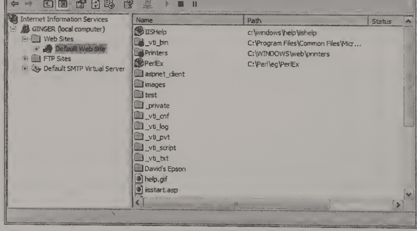

图 3-3

### 安装 PHP

如果选择“默认网站”，你将能够使用屏幕顶部的控件来停止和启动 Web 服务器。在左侧窗格中右键单击“默认网站”条目，然后选择“属性”。此时会出现一个对话框，允许你配置 Web 服务器。目前你无需更改其中的任何设置，但请选择“主目录”选项卡，如图 3-4 所示，并记下指定的路径。这是你网站的根目录，所有网页都存放于此。通常称之为*文档根目录*。

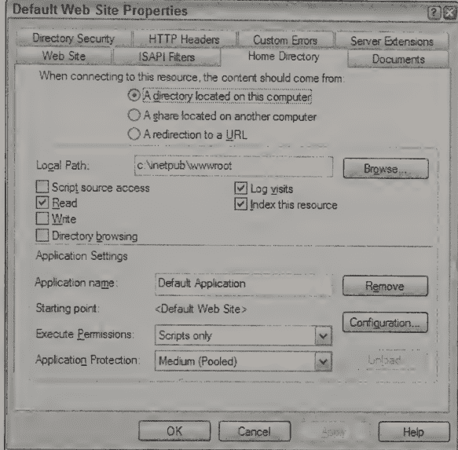

默认情况下，IIS 的文档根目录是 `c:\inetpub\wwwroot`。

下一步是安装 PHP。你可以在 PHP 网站上找到完整的安装说明，但这里我们将快速介绍整个流程。首先，你需要从 `http://www.php.net/downloads.php` 下载最新版本的 PHP。有多个不同版本和格式可供选择——你应该下载最新版的 Windows 二进制 zip 包，并确保下载的是 PHP 5，而不是 PHP 4。下载完成后，将文件解压到 `c:\php` 目录。

接下来，你需要将 `c:\php` 目录添加到系统路径中。为此，请打开控制面板中的“系统”图标，选择“高级”选项卡，然后单击“环境变量”按钮。你将看到如图 3-5 所示的对话框。

在“系统变量”部分，向下滚动直到找到“Path”条目。选中它并单击“编辑”按钮。此时会出现另一个对话框，如图 3-6 所示。

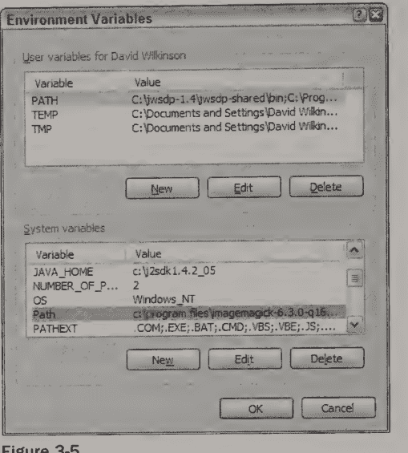

图 3-5

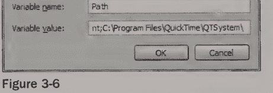

图 3-6

将光标置于“变量值”文本框中文本的末尾（请确保已滚动到最右端），并在行尾追加以下内容：

```text
;c:\php
```

（确保包含分号。）单击所有对话框中的“确定”按钮以关闭它们。现在你需要重启计算机才能使这些更改生效——IIS 等服务在系统启动时读取其环境，因此仅仅注销并重新登录是不够的。

现在你需要设置 PHP 配置文件。在你的 `c:\php` 目录中有一个名为 `php.ini-dist` 的文件。将其复制为 Windows 目录（通常是 `c:\windows`）中一个名为 `php.ini` 的新文件。PHP 网站上的安装说明建议你应该能够在 `c:\php` 目录中创建 `php.ini` 文件，但这常常会遇到问题——将其放在 Windows 目录中虽然不够整洁，但更可靠。在文本编辑器中打开这个 `php.ini` 文件。找到如下所示的行：

```ini
doc_root =
```

编辑它以反映你之前从 IIS 设置中记下的文档根目录值。如果你使用的是默认值，则应如下所示：

```ini
doc_root = c:\inetpub\wwwroot
```

接下来，找到设置 `extension_dir` 的行，它可能如下所示：

```ini
extension_dir = "./"
```

将其更改为指向包含 PHP 扩展的目录。默认情况下，这应该是 PHP 安装目录中的 `ext` 目录，此时该行应如下所示：

```ini
extension_dir = "./ext/"
```

### 配置 IIS

现在你需要让 IIS 了解 PHP。再次打开 IIS 管理控制台，右键单击“默认网站”并选择“属性”。选择“ISAPI 筛选器”选项卡，如图 3-7 所示。

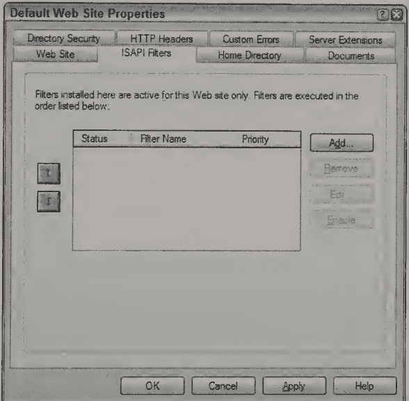

图 3-7

单击“添加”按钮，添加一个新的筛选器，如图 3-8 所示。

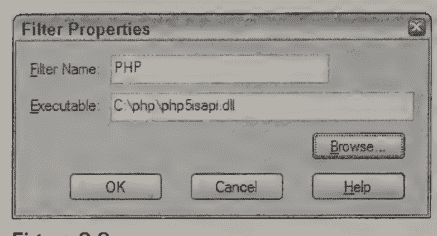

图 3-8

筛选器名称应设置为 PHP，可执行文件为你 PHP 目录中的 `php5isapi.dll`。

接下来，转到“主目录”选项卡——即你在图 3-4 中看到的那个。确保“执行权限”设置为“仅脚本”。现在单击“配置”按钮，你将看到如图 3-9 所示的对话框。

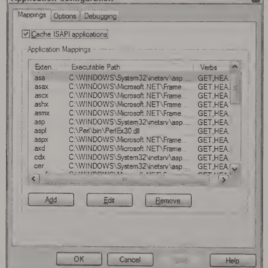

图 3-9

确保选择了“映射”选项卡，单击“添加”按钮，添加一个新的映射。可执行文件应为你 PHP 目录中的 `php5isapi.dll`，扩展名应设置为 `.php`。按图 3-10 所示设置其他选项。单击“确定”直到返回主属性对话框。

最后，你需要将 `index.php` 设置为默认文档。选择“文档”选项卡，如图 3-11 所示。

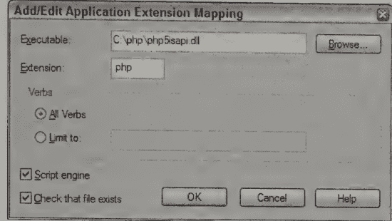

图 3-10

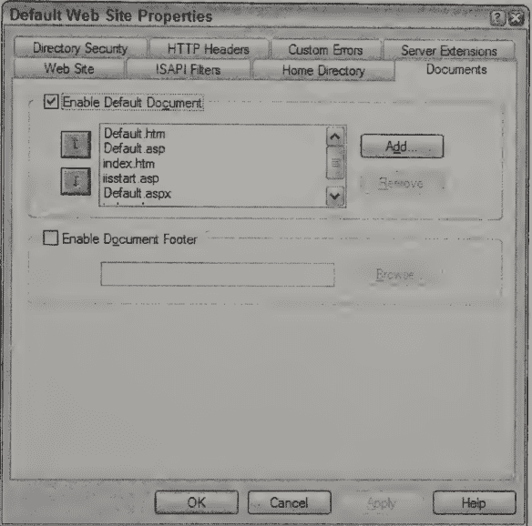

图 3-11

单击“添加”按钮，将 `index.php` 作为默认文档添加。添加后，在文档列表中选择 `index.php`，并使用箭头按钮将其移动到列表顶部。

现在你必须重启 IIS。打开一个命令窗口并输入：

```text
net stop w3svc
```

然后输入：

```text
net start w3svc
```

### 测试你的设置

PHP 现在已安装在 IIS 上——剩下的就是测试它了。在你的文档根目录中创建一个名为 `info.php` 的新文件，内容如下：

```php
<?php

phpinfo();

?>
```

现在你需要在浏览器中打开此文件。如果你在 Web 浏览器中输入 URL `http://localhost/info.php`，你应该会看到一个充满关于你的 PHP 安装信息的屏幕，如图 3-12 所示。

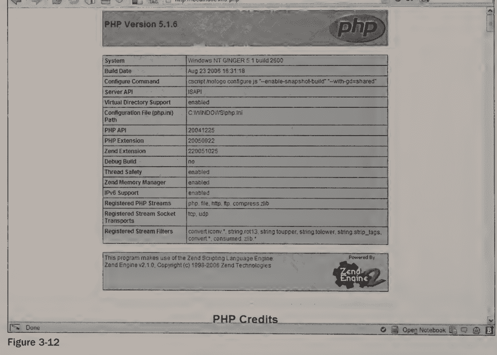

如果你看到的是“文件未找到”错误，而不是 PHP 信息屏幕，请检查是否已将 `info.php` 放置在正确的位置——它必须在你 IIS 配置中指定的文档根目录下。默认情况下，这是 `c:\inetpub\wwwroot`——请确认此值是否正确。

如果你发现 Web 服务器试图提供文档，但似乎没有将其作为 PHP 执行，请回顾“配置 IIS”部分，并检查所有设置是否正确且符合本节所述。你也可以尝试重启计算机，以确保所有服务都已重启。

### Apache

当今互联网上最流行的 Web 服务器是 Apache HTTP 服务器，它服务于超过 60% 的网站。当你将混合应用发布到互联网时，最有可能运行在其上的就是 Apache，因此你可能也想用它来进行开发。Apache 可以免费下载和使用——你可以在 Apache 网站 `http://httpd.apache.org/` 上找到源代码和现成的安装二进制版本。你应该下载 Web 服务器的 Win32 Binary（MSI Installer）版本。

> 你需要确保所使用的 Apache 和 PHP 版本兼容。在撰写本文时，使用 Apache 2.2.x 需要 PHP 5.2 或更高版本，但 PHP 5.2 尚未正式发布——PHP 5.1.6 是最新的稳定版本。在这种情况下，你需要使用最新的 Apache 2.0.x 版本和 PHP 5.1.x。到你阅读本文时，PHP 5.2 代码可能已经发布，你应该使用 Apache 2.2.x 和 PHP 5.2.x。

### 安装 Apache

当你运行安装程序时，会看到一个安装向导。接受许可协议条款后，系统会提示你输入有关服务器的信息，如图 3-13 所示。

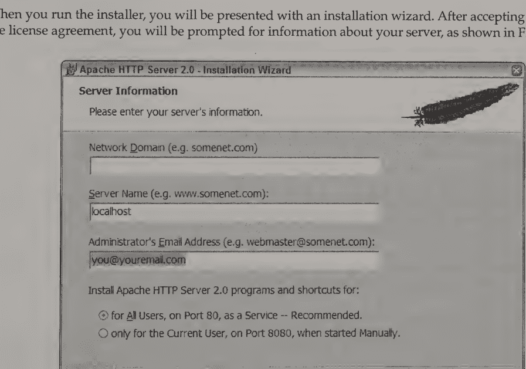

图 3-13

您很可能可以直接接受网络域和服务器名称文本框的默认值，但如果您不确定，应将网络域留空，并将服务器名称设置为 `localhost`。在管理员电子邮件地址文本框中输入您的电子邮件地址。

如果这是您计算机上运行的唯一 Web 服务器，您可以选择将其作为服务安装在端口 80 上。如果您已经在运行另一个 Web 服务器（如 IIS），则应选择在端口 8080 上运行 Apache。点击“下一步”完成安装。


现在您需要启动 Apache 服务器。如果您将 Apache 作为服务安装在端口 80 上，请查看系统托盘，那里会出现 Apache 监控程序的新图标。右键单击它并选择“打开 Apache 监控”。在此处，您可以启动和停止已安装的 Apache 服务器。您可以在图 3-14 中看到 Apache 监控界面。

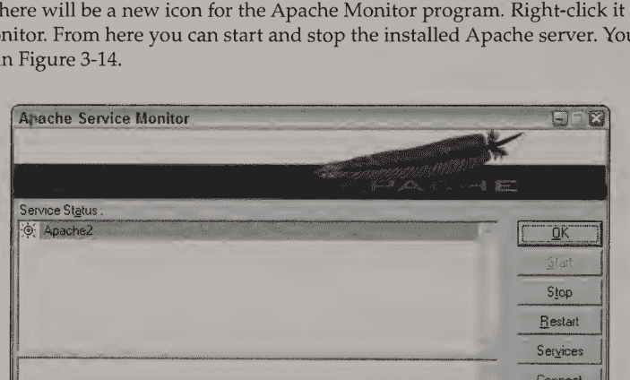

如果您将 Apache 安装在端口 8080 上运行，则需要手动启动它。选择“开始”>“所有程序”>“Apache HTTP Server”>“控制 Apache 服务器”>“在控制台中启动 Apache”。（具体步骤可能因您使用的 Apache 版本而略有不同。）

一旦 Apache 运行起来，打开一个 Web 浏览器窗口并输入您服务器的相应 URL。它将是`http://localhost/`或`http://localhost:8080`，具体取决于您是安装在端口 80 还是 8080 上。您应该会看到一个确认 Apache 正在运行的页面。

### 查找您的文档根目录

接下来，您需要确定您的文档根目录——即存储您网页的位置。选择“开始”>“所有程序”>“Apache HTTP Server”>“配置 Apache 服务器”>“编辑 Apache httpd.conf 配置文件”，以在文本编辑器中打开 Apache 配置文件。

在此文档中搜索，直到找到类似以下内容的一行：

```text
DocumentRoot "C:/Program Files/Apache Software Foundation/Apache2.2/htdocs"
```

此配置指令指明了您的文档根目录。如果您愿意，可以将其更改为磁盘上其他位置的路径，但之后您需要重新启动 Web 服务器才能使更改生效。请记下您文档根目录的路径。

### 安装 PHP

下一步是安装 PHP。在 Apache 下运行 PHP 的下载和安装说明与本章前面为 IIS 提供的说明几乎相同——因此请遵循“安装 PHP”部分中关于 IIS 的说明，但有以下不同点：

- 创建`php.ini`文件时，请将其创建在`c:\php`目录中，而不是`c:\windows`。
- 设置`doc_root`参数时，请务必使用您在上面的 Apache 配置文件中设置的文档根目录，而不是 IIS 使用的默认值。

### 配置 Apache

接下来，您需要配置 Apache 以使用 PHP。选择“开始”>“所有程序”>“Apache HTTP Server”>“配置 Apache 服务器”>“编辑 Apache httpd.conf 配置文件”。

在文件末尾，添加以下行。

对于 Apache 2.0.x，添加：

```apache
LoadModule php5_module "c:/php/php5apache2.dll"
AddType application/x-httpd-php .php
PHPiniDir "C:/php"
```

对于 Apache 2.2.x，添加：

```apache
LoadModule php5_module "c:/php/php5apache2_2.dll"
AddType application/x-httpd-php .php
PHPiniDir "C:/php"
```

保存文件并重新启动 Apache。如果您是将其作为服务运行，可以使用 Apache 监控来完成此操作。如果您是在控制台窗口中手动启动 Apache 的，只需单击控制台窗口以将其选中，然后按`Ctrl+C`停止服务器。然后您可以像往常一样通过“开始”菜单再次启动它。

### 测试您的设置

PHP 现在已安装在 Apache 中——剩下的就是测试它。在您的文档根目录中创建一个名为`info.php`的新文件，内容如下：

```php
<?php

phpinfo();

?>
```

现在您需要在浏览器中打开此文件。在 Web 浏览器中输入该文件的 URL。它将是`http://localhost/info.php`或`http://localhost:8080/info.php`，具体取决于您设置 Apache 运行的端口。您应该会看到一个充满关于您 PHP 安装信息的屏幕，类似于前面图 3-12 中所示的内容。

如果相反，您收到“找不到服务器”错误，则需要检查 Apache 是否正在运行。如果它作为服务运行，您可以转到 Windows 控制面板，单击“管理工具”，然后单击“服务”。在服务列表中找到 Apache，必要时启动它。如果它在端口 8080 上运行，请确保您是从“开始”菜单启动它的，并且没有显示错误消息。

如果收到“找不到文档”错误，请检查您是否已将`info.php`文件保存在 Apache 配置文件中指定为`DocumentRoot`的目录中。

如果文档被找到但未被作为 PHP 处理，您应该检查本章前面的“配置 Apache”部分——特别是，确保所有指定的路径都正确，并且与您的 PHP 安装相对应。

### 设置其他系统

如果您运行的是基于 Linux 的系统，您可能已经拥有了所需的一切——所有主要的 Linux 发行版都默认包含 Apache 和 PHP。您应该查阅您的手册或发行版的网站，了解安装 Apache 和 PHP 包的信息。安装完成后，通常不需要进一步的配置，但您应该查看本地文档或配置文件，以找到文档根目录所在的目录——这是您需要放置网页的地方。

对于 Mac OSX 用户，网上有一些预制的 PHP 安装包，使您可以轻松设置 Apache 和 PHP。请参阅`http://www.php.net/manual/en/install.macosx.php`中的 PHP Mac OS X 部分以获取一些有用的链接。

### 设置目录

既然您已经在所选的 Web 服务器中启动并运行了 PHP，您需要设置一个基本的目录结构来存放文件。在您的文档根目录中创建两个新目录：`lib`和`css`。在本书的整个课程中，您将安装许多第三方库，还将创建一些您自己的可重用组件——所有这些都将存储在`lib`目录中。在`css`目录中，您将存储将在各种项目中使用的一系列级联样式表。

最后，由于您将为各种项目构建多个网页，您应该定义一些可在整个网站中使用的基本 CSS 样式。在 CSS 目录中，创建一个名为`main.css`的新文件，内容如下：

```css
body {
  font-family: Geneva, Arial, Helvetica, sans-serif;
  font-size: 14px;
  color: #000000;
  background-color: #FFFFFF;
  margin: 2em;
}
a {
  color: #000099;
  text-decoration: none;
}
a:hover {
  text-decoration: underline;
}
```

在这里，您设置了文档主体中所有内容的默认字体，以及一些页面颜色和边距，然后定义了超链接的颜色和悬停效果。

### 设置 Perl

就本书的大部分内容而言，设置 Perl 是可选的——它仅在第 10 章中使用。如果您想查看该混搭应用的运行情况，则需要设置 Perl 以及一些库。

#### 在 Microsoft Windows 下安装 Perl

在 Windows 下运行 Perl 的最简单方法是使用 ActiveState 的 ActivePerl，可从`http://www.activestate.com/`免费下载安装。Perl 本身的安装非常简单——让 Windows 安装程序按其流程运行，接受默认配置选项，对大多数人来说应该没问题。您必须确保的一点是，当提示时，选择了将 Perl 添加到`PATH`的选项，如图 3-15 所示。


图 3-15

安装程序完成后，打开命令提示符并输入`perl -v`。您应该会看到类似以下的输出：

```text
C:\>perl -v

This is perl, v5.8.8 built for MSWin32-x86-multi-thread
(with 33 registered patches, see perl -V for more detail)
```

版权 1987-2006，拉里·沃尔

二进制构建 819 [267479]，由 ActiveState 提供，网址为`http://www.ActiveState.com`

构建于 2006年8月29日 12:42:41

Perl 仅可在艺术许可协议或 GNU 通用公共许可协议条款下进行复制，相关协议可在 Perl 5 源代码包中找到。

Perl 的完整文档，包括常见问题解答列表，应可在本系统中使用`man perl`或`perldoc perl`找到。如果您可以访问互联网，请将浏览器指向 Perl 主页`http://www.perl.org/`。

接下来，您需要安装几个 Perl 包，以便能够轻松与 Flickr 通信。在命令提示符下，输入`ppm`以启动 Perl 包管理器。在 ActiveState Perl 的早期版本中，包管理器是一个命令行工具，但在较新版本中，它已具有完整的图形用户界面。您应该看到一个类似图 3-16 所示的窗口弹出。

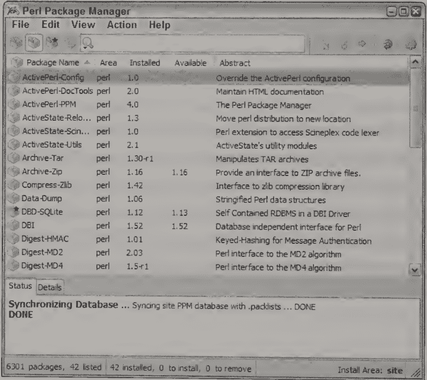

图 3-16

现在，您需要选择要安装的包。选择 "View⇄All Packages"（查看⇄所有包），然后在工具栏的搜索框中输入`Flickr`。将出现多个匹配项；选择名为`Flickr-API`的项，右键单击它并选择 "Install"（安装）。

接下来，清除搜索框并输入`XPath`。同样，将出现多个匹配项。右键单击名为`XML-Parser-Lite-Tree-XPath`的项，并选择 "Install"（安装）。

现在再次清除搜索框，并选择 "View->Packages to Install/Remove"（查看->要安装/移除的包）。您应该看到刚才选择的两个包，如图 3-17 所示。

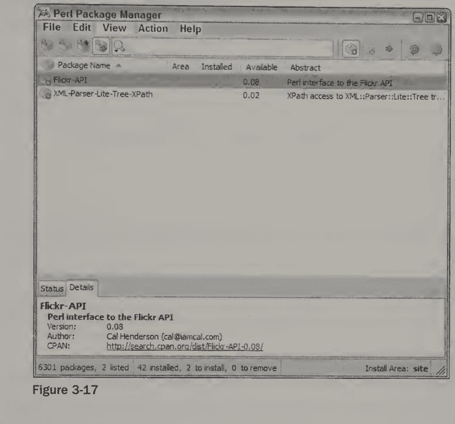

选择 "File->Run Marked Actions"（文件->运行标记的行动）。系统将询问您是否希望连同其他先决条件包一起安装这两个包——您应该对此选择 "OK"（确定）。现在将下载并安装所请求的包。

#### 在 Unix 系统上安装 Perl

几乎所有基于 Unix 的系统都已经安装了 Perl——如果没有，请查阅您的系统文档以了解如何安装它。但是，您将需要安装允许轻松访问 Flickr 的模块。您需要超级用户权限才能执行此操作。

以 root 用户身份登录后，在命令行中输入以下内容：

```bash
perl -MCPAN -eshell
```

在某些系统上，为了获得超级用户权限，您可能需要以普通用户身份登录，并使用以下命令代替：

```bash
sudo perl -MCPAN -eshell
```

这将启动 CPAN shell。CPAN 是综合 Perl 归档网络，包含大量的 Perl 模块。如果这是第一次运行 CPAN，系统会询问您是否要配置它。默认值几乎总是正确的，因此在被询问时，您可以对手动配置选择 "no"（否）。如果您确实选择回答 "yes"（是），系统会询问大量关于机器配置的问题——同样，默认值通常是正确的，因此您只需按回车键接受默认值即可。

接下来，您需要安装四个模块，因此请输入下面显示的四个命令。每个命令输入后，相应的模块将被下载、编译和安装。在继续下一个之前，请等待每个模块完成。如果在此过程中被询问任何问题，只需按回车键接受默认值。

```text
install SOAP::Lite
install XML::Parser::Lite::Tree
install XML::Parser::Lite::Tree::XPath
install Flickr::API
```

一旦这些模块安装完毕，您就拥有了使用 Flickr 与 Perl 所需的一切。

## 总结

在本章中，您了解了如何为混搭应用搭建基本的开发环境。您了解了如何设置 IIS 和 Apache Web 服务器、安装和配置 PHP、安装和配置 Perl，以及获取 Flickr API 密钥。

在下一章中，您将更深入地了解 Flickr API 本身，并学习如何使用它来检索存储在 Flickr 上的照片信息。如果您相对不熟悉 PHP 开发，下面有几个非常简单的 PHP 热身练习，只是为了帮助您适应编写一些 PHP 代码，并测试您的新 PHP 安装是否按预期工作——您可能会发现`http://www.php.net/`上的文档在这里很有帮助。如果您已经熟悉 PHP 开发，可以随意跳过这些练习，直接进入 Flickr API 部分。

## 练习

1. 创建一个网页，该网页创建一个包含一千个随机数的数组，每个数字介于 1 到 1,000 之间。使用`for`循环来填充数组。创建数组后，再次遍历数组，这次使用`foreach`循环，计算这些数字的平均值，并显示结果。
2. 创建一个网页，其中包含一个表单，该表单有三个可以输入数字的文本框。当表单提交时，显示这三个数字的总和。提示：您可以在`$_REQUEST`数组中找到表单字段的值。


# Flickr API

构建任何成功混搭应用的关键是首先获取数据。您在 Flickr 上看到的所有有趣内容——照片标题和描述、评论、群组讨论——都存储在雅虎内部网络的数据库中。在构建混搭应用之前，您首先需要获取这些数据。

本章将解释 Flickr 如何向外界提供其部分数据。它将展示有哪些数据可用以及如何访问它们。

API 代表*应用程序编程接口*。它是与系统交互的形式化定义。在编程库中，它通常指软件开发者可以调用以使用该库的函数和方法的描述。在 Web 服务中，它指的是请求客户端应用程序和服务器之间发送的消息和响应。它不仅定义了这些消息的内容，还定义了它们在客户端应用程序和服务器之间传递的机制。

## 与 Flickr 通信

Flickr 是一个基于 Web 的系统，因此所有对 Flickr 服务器的请求都通过 HTTP 发送——基本上，它们与您从 Web 浏览器发出的任何其他请求没有区别。请求发送到的 URL 被称为*API 端点*。

所有 Flickr 请求都包含多个参数，每个参数作为一对数据项发送——参数的名称及其取值。尽管发送的参数数量取决于您尝试调用的 API 方法，但所有 API 调用都必须至少包含两个参数：`api_key`和`method`。

`api_key`参数是您的 API 密钥——一串十六进制数字——看起来像`1f2811827f3284b3aa12f7bbb7792b8d`。您对 Flickr 发出的每一个 API 调用都*必须*包含此密钥——Flickr 使用您的密钥来跟踪谁在使用 API 以及如何使用。这也意味着 Flickr 可以将所有 API 活动追溯到分配该密钥的用户账户。如果您的调用不包含有效的 API 密钥，它将被拒绝。

Flickr API 被划分为一系列*方法*，每个方法代表一个可以执行的特定操作，例如“搜索照片”或“设置照片标题”。我将在本章后面向您展示有哪些可用的方法。每当您发出 API 调用时，都需要指定您希望调用哪个可用方法。您通过设置`method`参数来执行此操作。所有 API 调用都必须包含此参数。

## 字符编码

除上传图像外（将在第 8 章介绍），所有 Flickr API 请求和响应都是基于文本的。Flickr 的用户遍布全球，因此必须处理标准 ASCII 以外的字符集——用户通常希望用他们的母语（无论是英语、德语、日语还是其他语言）来编写照片标题和描述。为了应对这种情况，所有 Flickr 请求都需要使用 UTF-8 字符编码。UTF-8 是一种*Unicode 转换格式*，它使用八位序列表示字符。

Unicode 的目标是以明确且一致的方式表示所有文本。用 Unicode 联盟 (`http://www.unicode.org/`) 的话说：“Unicode 为每个字符提供了一个唯一的编号，无论是什么平台，无论什么程序，无论是什么语言。”

Unicode 转换格式是将这些 Unicode 字符表示为字节流的一种方法。UTF-8 是一种常用的转换格式，因为它保持了标准 ASCII 字符集不变。这意味着在大多数情况下，您日常生活中使用的标准文本文件已经是有效的 UTF-8 编码文档。

## 请求格式

Flickr 接受三种不同格式的 API 调用：REST、SOAP 和 XML-RPC。尽管在每种情况下提供的功能完全相同，但 API 端点地址以及请求和响应本身的格式在每种情况下都大不相同。

## REST

REST（表述性状态转移）是与 Flickr 通信的最简单方式，也是迄今为止最常用的方式。我在本书的所有示例中都使用了这种方法。

### API 端点

所有 REST 请求使用的地址是`http://api.flickr.com/services/rest/`。

您可以轻松地看到 REST 的实际应用。您只需在 Web 浏览器中输入一个有效的 REST URL 即可。不过，请记住，要使用 Flickr API，您需要一个有效的 API 密钥。如果您已经注册了一个密钥，现在是时候找出它了。如果您还没有注册，别担心；回顾第 3 章，其中将引导您完成整个过程——这非常简单，只需要几分钟。

> 如果你不小心忘记或丢失了 API 密钥，可以轻松找回——只需登录 Flickr 并访问`http://www.flickr.com/services/api/keys/`。该页面会列出你账户下注册的所有 API 密钥。

### 使用 REST

在本练习中，你将了解 REST 请求的样子。


1. 打开你的浏览器，输入以下 URL（在显示 `YOUR-API-KEY` 的地方替换为你自己的 API 密钥）。请注意，该 URL 很长，这里为了可读性将其分成了两行——请确保在浏览器中将其完整地输入在一行中。

```text
http://api.flickr.com/services/rest/?method=flickr.photos.search&user_id=50317659@N00&per_page=6&api_key=YOUR-API-KEY
```

2. 你的浏览器应显示如下内容。

```xml
<rsp stat="ok">
    <photos page="1" pages="392" perpage="6" total="2350">
        <photo id="157113860" owner="50317659@N00" secret="70060bada9" server="68"
            title="No Parking" ispublic="1" isfriend="0" isfamily="0"/>
        <photo id="157113453" owner="50317659@N00" secret="99166dec9f" server="52"
            title="66" ispublic="1" isfriend="0" isfamily="0"/>
        <photo id="154833256" owner="50317659@N00" secret="a94893da5e" server="60"
            title="Decay" ispublic="1" isfriend="0" isfamily="0"/>
        <photo id="153615581" owner="50317659@N00" secret="e8e0bdb260" server="59"
            title="My Workspace" ispublic="1" isfriend="0" isfamily="0"/>
        <photo id="150681007" owner="50317659@N00" secret="84cc7afd68" server="52"
            title="Cool" ispublic="1" isfriend="0" isfamily="0"/>
        <photo id="148967487" owner="50317659@N00" secret="66ecb49990" server="44"
            title="Utata Goes To The Movies" ispublic="1" isfriend="0" isfamily="0"/>
    </photos>
</rsp>
```

### 工作原理

如果你更详细地查看输入的 URL，可以看到它有一个基础部分：

```text
http://api.flickr.com/services/rest/
```

这就是 API 端点，所有 REST 请求都发送到该地址。

末尾附加的是查询字符串：

```text
method=flickr.photos.search&user_id=50317659@N00&per_page=6&api_key=YOUR-API-KEY
```

问号（`?`）用于分隔基础 URL 和查询字符串。查询字符串包含构成 API 调用的所有参数，以名称/值对的形式呈现。每个名称/值对之间用与号（`&`）分隔。

查询字符串中的参数经过了 URL 编码。这意味着参数值中的任何特殊字符（如问号或与号）都会被转换为 `%nn` 的形式，其中 `nn` 是该字符 UTF-8 编码的两位十六进制表示。因此，问号用 `%3F` 表示，与号用 `%26` 表示。如果你需要将百分号本身作为参数值使用，则将其编码为 `%25`。

检查查询字符串可以发现你拥有以下参数：

- `api_key`：你的 API 密钥
- `method`：`flickr.photos.search`
- `user_id`：`50317659@N00`
- `per_page`：`6`

前两个参数是上文提到的 `api_key` 和 `method`。如你所见，此处调用的方法是 `flickr.photos.search`。顾名思义，此方法使你能够搜索 Flickr 上的照片，很可能是你最常用的方法之一。

接下来的参数用于精确定义你希望 `flickr.photos.search` 搜索什么内容。

第一个是 `user_id`。此参数设置为你要查找其照片的 Flickr 用户 ID（通常称为 NSID）。与用户名不同，NSID 在你注册 Flickr 账户时即已确定且永不更改。示例中显示的用户 ID `50317659@N00` 就是我的 NSID。

你发送的最后一个参数是 `per_page`。在撰写本文时，我在 Flickr 上有超过两千张照片——显然在单个请求中检索所有照片的信息是不现实的，因此 Flickr 以分页方式返回搜索结果。此处 `per_page` 参数表示每次响应应返回六条结果。`per_page` 的默认值为 `100`，可指定的最大值为 `500`。

你可能注意到上面的参数没有指定要返回哪六张照片——默认情况下 Flickr 会返回最近上传的照片。

响应是一个 XML 文档，其标签和属性名称总体上具有良好的描述性。你通常可以通读收到的响应，无需查阅 API 规范就能轻松理解其大部分含义。

你首先会注意到整个响应被包裹在一个 `rsp` 标签中：

```xml
<rsp stat="ok">
```

`rsp` 标签有一个属性 `stat`，其值可以是 `ok` 或 `fail`，用于指示调用是否成功。在 `rsp` 标签内，响应的格式取决于实际调用的方法。`flickr.photos.search` 方法返回一组照片，因此在此情况下，你看到的下一个标签是 `photos` 标签。`photos` 标签有自己的一组属性来汇总搜索结果：

```xml
<photos page="1" pages="392" perpage="6" total="2350">
```

这里你可以看到共有 2,350 张照片匹配指定的搜索条件。由于请求要求每页返回六条结果，响应包含的是总共 392 页中的第一页。

> 你在请求中发送的用于指定每页返回照片数量的参数名为 `per_page`。而在响应的 `photos` 标签中返回的属性名为 `perpage`。注意没有下划线！

Flickr API 包含许多类似的命名不一致之处。如果行为不符合预期，请仔细检查所用方法的 API 规范，确保所有名称使用正确。

在 `photos` 标签内是一组照片标签，每个标签对应返回的一张照片——此处为六张。每个 `photo` 标签都有自己的一组属性来描述照片：

```xml
<photo id="157113860" owner="50317659@N00" secret="70060bada9" server="68" title="No Parking" ispublic="1" isfriend="0" isfamily="0"/>
```

存储在 Flickr 上的每张照片都有自己的唯一 ID——这在 `id` 属性中显示。`owner` 属性是照片所有者的 NSID——由于 NSID 是 API 调用中使用的搜索条件，所有返回的照片都具有相同的 NSID——即被请求的那个。

接下来的属性 `secret` 和 `server` 都用于构造照片的 URL，这将在本章后面介绍。`title` 属性包含照片的标题，正如你所预期的那样。

最后返回的三个属性——`ispublic`、`isfriend` 和 `isfamily`——描述了照片的权限设置。`1` 表示权限已启用，`0` 表示未启用。此处照片设置为公开而非私密，且不要求用户被标记为好友或家人才能查看照片。

请注意，`flickr.photos.search` 方法返回的照片取决于其各自的权限。通常只有标记为公开的照片才会被返回。要查看标记为私密的照片，你需要进行经过身份验证的 API 调用。身份验证将在第 7 章中详细介绍。

### REST 错误响应

如果你的 REST 请求因任何原因失败，你将收到 REST 错误响应。它大致如下所示：

```xml
<rsp stat="fail">
    <err code="100" msg="Invalid API Key (Key not found)"/>
</rsp>
```

实际的错误代码和消息会因失败原因而异。你可以在 Flickr 网站的 API 文档中找到每个方法的可能错误代码列表。

## SOAP

Flickr 还为 API 提供了 SOAP（简单对象访问协议）接口。如果你出于任何原因打算使用 SOAP 接口，应当注意 Flickr 并未为其 SOAP 服务提供 WSDL（Web 服务定义语言）。许多应用程序和 SOAP 工具包依赖 WSDL 来使用 SOAP 服务。缺少可用的 WSDL 意味着 SOAP 的许多便利性丧失了，因此许多开发者干脆选择使用 REST 接口。

### API 端点

所有 SOAP 请求使用的地址为 `http://api.flickr.com/services/soap/`。

### 动手试试：使用 SOAP

尽管 SOAP 协议不像 REST 协议那样直观，但观察 SOAP 的实际运作仍然相当容易。为此，你需要安装 `curl`（关于 `curl` 的描述请参见第 1 章）。`curl` 是免费的，适用于多种平台。你可以从 `http://curl.haxx.se/` 下载最新版本。

1. 使用 REST 时，你可以直接在命令行上传送所有 API 参数，但使用 SOAP 时，你需要向 API 端点 URL POST 一个格式正确的 SOAP 请求。在文本编辑器中，创建一个包含以下内容的文件并将其保存为 `SOAPRequest.xml`——别忘了将 `YOUR-API-KEY` 替换为你自己的 API 密钥。

```xml
<?xml version="1.0" encoding="utf-8" ?>
<s:Envelope
  xmlns:s="http://www.w3.org/2003/05/soap-envelope"
  xmlns:xsi="http://www.w3.org/1999/XMLSchema-instance"
  xmlns:xsd="http://www.w3.org/1999/XMLSchema"
>
  <s:Body>
    <x:FlickrRequest xmlns:x="urn:flickr">
      <method>flickr.photos.search</method>
      <api_key>YOUR-API-KEY</api_key>
      <user_id>50317659@N00</user_id>
      <per_page>6</per_page>
    </x:FlickrRequest>
  </s:Body>
</s:Envelope>
```

2. 现在你已准备好使用 `curl` 将此 SOAP 请求发送给 Flickr。在命令行中，输入以下命令：

```bash
curl -d @SOAPRequest.xml http://api.flickr.com/services/soap/
```

你应看到如下所示的响应：

```xml
<?xml version="1.0" encoding="utf-8" ?>
<s:Envelope
  xmlns:s="http://www.w3.org/2003/05/soap-envelope"
  xmlns:xsi="http://www.w3.org/1999/XMLSchema-instance"
  xmlns:xsd="http://www.w3.org/1999/XMLSchema"
>
  <s:Body>
```

```xml
<x:FlickrResponse xmlns:x="urn:flickr">
&lt;photos page=&quot;1&quot; pages=&quot;392&quot; perpage=&quot;6&quot; total=&quot;2350&quot;&gt;
    &lt;photo id=&quot;157113860&quot; owner=&quot;50317659@N00&quot; secret=&quot;70060bada9&quot; server=&quot;68&quot; title=&quot;No Parking&quot; ispublic=&quot;1&quot; isfriend=&quot;0&quot; isfamily=&quot;0&quot;/&gt;
    &lt;photo id=&quot;157113453&quot; owner=&quot;50317659@N00&quot; secret=&quot;99166dec9f&quot; server=&quot;52&quot; title=&quot;66&quot; ispublic=&quot;1&quot; isfriend=&quot;0&quot; isfamily=&quot;0&quot;/&gt;
    &lt;photo id=&quot;154833256&quot; owner=&quot;50317659@N00&quot; secret=&quot;a94893da5e&quot; server=&quot;60&quot; title=&quot;Decay&quot; ispublic=&quot;1&quot; isfriend=&quot;0&quot; isfamily=&quot;0&quot;/&gt;
    &lt;photo id=&quot;153615581&quot; owner=&quot;50317659@N00&quot; secret=&quot;e8e0bdb260&quot; server=&quot;59&quot; title=&quot;My Workspace&quot; ispublic=&quot;1&quot; isfriend=&quot;0&quot; isfamily=&quot;0&quot;/&gt;
    &lt;photo id=&quot;150681007&quot; owner=&quot;50317659@N00&quot; secret=&quot;84cc7afd68&quot; server=&quot;52&quot; title=&quot;Cool&quot; ispublic=&quot;1&quot; isfriend=&quot;0&quot; isfamily=&quot;0&quot;/&gt;
    &lt;photo id=&quot;148967487&quot; owner=&quot;50317659@N00&quot; secret=&quot;66ecb49990&quot; server=&quot;44&quot; title=&quot;Utata Goes To The Movies&quot; ispublic=&quot;1&quot; isfriend=&quot;0&quot; isfamily=&quot;0&quot;/&gt;
&lt;/photos&gt;
</x:FlickrResponse>
```

### 工作原理

该请求是一个标准的 SOAP 请求。请求的有效载荷包含在 `FlickrRequest` 标签内。正如你可以从 XML 文档中看到的，有效载荷仅仅是一个标签列表，每个标签对应于需要在 API 调用中发送的参数。

```xml
<x:FlickrRequest xmlns:x="urn:flickr">
    <method>flickr.photos.search</method>
    <api_key>YOUR-API-KEY</api_key>
    <user_id>50317659@N00</user_id>
    <per_page>6</per_page>
</x:FlickrRequest>
```

每个名称/值对由单个 XML 标签表示——参数名称用作标签名，标签的值就是参数本身的值。

当你运行以下 `curl` 命令时，`-d` 选项告诉 `curl` 执行一个 HTTP POST 请求：

```bash
curl -d @SOAPRequest.xml http://api.flickr.com/services/soap/
```

`@SOAPRequest.xml` 开头的 `@` 符号表示数据不应在命令行中直接指定，而应从指定的文件中读取——在本例中为 `SOAPRequest.xml`。因此 `curl` 从文件中读取数据，并将其作为 HTTP POST 请求的主体发送到指定的 URL，这里即为 SOAP API 端点。

响应是一个标准的 SOAP 响应消息。与 SOAP 请求一样，有效载荷包含在 `FlickrResponse` 标签内。如果你仔细观察该响应，你会发现它实际上是一个 XML 文档。尖括号（`<`、`>`）和双引号（`"`）已被转换为实体 `&lt;`、`&gt;` 和 `&quot;`，以便它们可以嵌入到 XML 响应文档中，但除此之外，它与你之前在 REST 请求返回的响应主体完全相同。

如果你取响应主体的第一行——

```xml
&lt;photos page=&quot;1&quot; pages=&quot;392&quot; perpage=&quot;6&quot; total=&quot;2350&quot;&gt;
```

——并将其中的实体替换为对应的字符，你就会得到下面这样的结果，正如你在 REST 响应中看到的那样：


```xml
<photos page="1" pages="392" perpage="6" total="2350">
```

### SOAP 错误响应

如果你的 SOAP 请求因任何原因失败，你将收到一个标准的 SOAP 错误响应。它会类似于以下内容：

```xml
<?xml version="1.0" encoding="utf-8" ?>
<s:Envelope xmlns:s="http://www.w3.org/2003/05/soap-envelope">
  <s:Body>
    <s:Fault>
      <faultcode>flickr.error.100</faultcode>
      <faultstring>Invalid API Key (Key not found)</faultstring>
      <faultactor>http://www.flickr.com/services/soap/</faultactor>
      <details>Please see http://www.flickr.com/services/api/ for more details</details>
    </s:Fault>
  </s:Body>
</s:Envelope>
```

实际的错误代码和消息会因失败原因而异。

## XML-RPC

访问 Flickr API 的第三种方式是通过其 XML-RPC 接口。与 SOAP 一样，该接口使用 HTTP POST 向 API 端点发送 XML 消息。

### API 端点

所有 XML-RPC 请求使用的地址是`http://api.flickr.com/services/xmlrpc/`。

> **动手试试**：使用 XML-RPC

你可以使用 curl 以与之前发送 SOAP 请求完全相同的方式，向 XML-RPC API 端点发送 XML-RPC 格式的消息。过程完全相同；只有消息格式和 API 端点不同。

1. 在文本编辑器中，创建包含以下内容的文件，并将其保存为`XMLRPCRequest.xml`——同样，不要忘记将`YOUR-API-KEY`替换为你自己的 API 密钥。

```xml
<?xml version="1.0" encoding="utf-8" ?>
<methodCall>
    <methodName>flickr.photos.search</methodName>
    <params>
        <param>
            <value>
                <struct>
                    <member>
                        <name>api_key</name>
                        <value>
                            <string>YOUR-API-KEY</string>
                        </value>
                    </member>
                    <member>
                        <name>user_id</name>
                        <value>
                            <string>50317659@N00</string>
                        </value>
                    </member>
                    <member>
                        <name>per_page</name>
                        <value>
                            <int>6</int>
                        </value>
                    </member>
                </struct>
            </value>
        </param>
    </params>
</methodCall>
```

2. 现在你可以使用 curl 将此 XML-RPC 请求发送到 Flickr。在命令行中，输入以下命令：

```bash
curl -d @XMLRPCRequest.xml http://api.flickr.com/services/xmlrpc/
```

然后你应该会看到类似于以下的响应：

```xml
<?xml version="1.0" encoding="utf-8" ?>
<methodResponse>
    <params>
        <param>
            <value>
                <string>
&lt;photos page=&quot;1&quot; pages=&quot;392&quot; perpage=&quot;6&quot; total=&quot;2350&quot;&gt;
    &lt;photo id=&quot;157113860&quot; owner=&quot;50317659@N00&quot; secret=&quot;70060bada9&quot; server=&quot;68&quot; title=&quot;No Parking&quot; ispublic=&quot;1&quot; isfriend=&quot;0&quot; isfamily=&quot;0&quot;/&gt;
    &lt;photo id=&quot;157113453&quot; owner=&quot;50317659@N00&quot; secret=&quot;99166dec9f&quot; server=&quot;52&quot; title=&quot;66&quot; ispublic=&quot;1&quot; isfriend=&quot;0&quot; isfamily=&quot;0&quot;/&gt;
    &lt;photo id=&quot;154833256&quot; owner=&quot;50317659@N00&quot;
        secret=&quot;a94893da5e&quot; server=&quot;60&quot; title=&quot;Decay&quot;
        ispublic=&quot;1&quot; isfriend=&quot;0&quot; isfamily=&quot;0&quot;/&gt;
    &lt;photo id=&quot;153615581&quot; owner=&quot;50317659@N00&quot;
        secret=&quot;e8e0bdb260&quot; server=&quot;59&quot; title=&quot;My Workspace&quot;
        ispublic=&quot;1&quot; isfriend=&quot;0&quot; isfamily=&quot;0&quot;/&gt;
    &lt;photo id=&quot;150681007&quot; owner=&quot;50317659@N00&quot;
        secret=&quot;84cc7afd68&quot; server=&quot;52&quot; title=&quot;Cool&quot;
        ispublic=&quot;1&quot; isfriend=&quot;0&quot; isfamily=&quot;0&quot;/&gt;
    &lt;photo id=&quot;148967487&quot; owner=&quot;50317659@N00&quot;
        secret=&quot;66ecb49990&quot; server=&quot;44&quot; title=&quot;Utata Goes To The
        Movies&quot; ispublic=&quot;1&quot; isfriend=&quot;0&quot;
        isfamily=&quot;0&quot;/&gt;
&lt;/photos&gt;
            </string>
            </value>
        </param>
    </params>
</methodResponse>
```

### 工作原理

该请求是一个标准的 XML-RPC 请求——你可以在`http://www.xmlrpc.com/`找到 XML-RPC 的完整定义，但即使不参考它，XML 格式也相对容易阅读。当你检查请求时，首先注意到的可能是`methodName`标签：

```xml
    <methodName>flickr.photos.search</methodName>
```

在 REST 和 SOAP 中，`method`被当作与其他任何参数一样，作为参数列表的一部分发送。而 XML-RPC 请求格式则为方法名提供了专门的字段：`<methodName>`。

请求的其他参数的 XML 起初看起来有点复杂。然而，就 XML-RPC 而言，只发送了一个参数。这是一个`struct`，包含一系列`member`标签。每个`member`标签对应 Flickr API 调用中的一个参数。由于方法已在请求主体的前面指定，因此它不会出现在此列表中。

```xml
    <member>
        <name>user_id</name>
        <value>
            <string>50317659@N00</string>
        </value>
    </member>
```

这实际上与你之前看到的 REST 或 SOAP 示例没什么不同——它只是表示需要发送的数据的一种更冗长的方式。XML-RPC 的一个显著区别是参数值是有类型的——上面的示例显示`user_id`的数据类型为`string`。

响应是一个标准的 XML-RPC 响应消息。与 SOAP 请求一样，返回的是单个参数，这是一个编码后的字符串，表示包含响应的 XML 文档。

### XML-RPC 错误响应

如果您的 XML-RPC 请求因任何原因失败，您将收到一个标准的 XML-RPC 错误响应。它看起来会类似于以下内容：

```xml
<?xml version="1.0" encoding="utf-8" ?>
<methodResponse>
    <fault>
        <value>
            <struct>
                <member>
                    <name>faultCode</name>
                    <value><int>100</int></value>
                </member>
                <member>
                    <name>faultString</name>
                    <value><string>Invalid API Key (Key not found)</string></value>
                </member>
            </struct>
        </value>
    </fault>
</methodResponse>
```

实际的错误代码和消息会因失败原因的不同而有所变化。

## Flickr 方法与对象

Flickr API 被划分为多个部分，每个部分对应一个特定的功能领域。其中许多领域与操作特定类型的对象有关——例如照片、群组或博客，而其他功能领域则基于更抽象的概念，例如“有趣度”。

Flickr API 目前包含 80 多种方法，但在实践中，任何 Flickr 应用程序中的大部分工作都只使用少数几种 API 方法。在本节中，我们将看几个常见 API 方法及其返回响应的示例。如果您想详细了解 API，附录 B 包含了 Flickr API 方法的完整列表，附录 C 则涵盖了所有主要的数据结构。您还应该记住，Flickr 仍在不断发展，随着新功能的添加，API 也会持续演进——您应查阅官方 Flickr API 网页（`http://www.flickr.com/services/api/`）以获取最新详情。

## 方法与响应

API 方法名称由一系列用点分隔的标识符组成。所有方法都以`flickr`作为第一个元素。第二个元素标识此方法所属的 API 部分。接下来是一个可选的子部分。最后一个元素是方法名称本身。如图 4-1 所示。

```text
flickr.photos.search
```

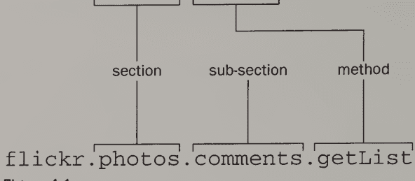

许多 API 方法调用返回一组通用的数据结构。例如，每次返回照片列表时，响应中的基本 XML 结构都是相同的——无论讨论的照片是你自己的、联系人的、收藏夹列表中的，还是标签搜索的结果。

API 中的任何给定数据结构通常有两种格式。首先，它存在于一个*摘要格式*中，只包含该项目的关键信息。当您请求一个项目列表时，您会看到摘要格式——响应中的每个项目都代表响应中某个特定项目的摘要。第二种格式是*详细格式*，包含所表示项目的完整详细信息。

您之前在尝试 REST 调用时已经看到过照片在摘要形式中的表示。现在来看看一张照片的详细视图。

### 动手试试：获取照片详情

在此练习中，您将使用`flickr.photos.getInfo` API 方法获取一张照片的详细信息。

1. 在您的浏览器中输入以下 URL：

   ```text
   http://api.flickr.com/services/rest/?api_key=YOUR-API-KEY
   &method=flickr.photos.getInfo&photo_id=148878052
   ```

   此 URL 为了便于阅读已分成两行。您还必须记住在适当位置替换为您自己的 API 密钥。

2. 当结果加载到浏览器中时，您应该会看到类似以下内容：

```xml
<?xml version="1.0" encoding="utf-8" ?>
<rsp stat="ok">
<photo id="148878052" secret="108e958747" server="55" dateuploaded="1147980255"
  isfavorite="0" license="0" rotation="0" originalformat="jpg">
  <owner nsid="50317659@N00" username="dopiaza" realname="David Wilkinson"
    location="Northamptonshire, United Kingdom" />
  <title>Wells Beach Hut</title>
  <description>[DSC_1578]</description>
  <visibility ispublic="1" isfriend="0" isfamily="0" />
  <dates posted="1147980255" taken="2006-05-12 14:47:51" takengranularity="0"
    lastupdate="1147980278" />
  <editability cancomment="0" canaddmeta="0" />
  <comments>0</comments>
  <notes />
  <tags>
    <tag id="296457-148878052-8904" author="50317659@N00" raw="wells">wells</tag>
    <tag id="296457-148878052-178492" author="50317659@N00" raw="wells-next-the-sea">wellsnextthesea</tag>
    <tag id="296457-148878052-6876" author="50317659@N00" raw="norfolk">norfolk</tag>
    <tag id="296457-148878052-279" author="50317659@N00" raw="england">england</tag>
    <tag id="296457-148878052-110" author="50317659@N00" raw="uk">uk</tag>
    <tag id="296457-148878052-704" author="50317659@N00" raw="beach">beach</tag>
    <tag id="296457-148878052-12640" author="50317659@N00" raw="hut">hut</tag>
  </tags>
  <urls>
    <url type="photopage">http://www.flickr.com/photos/dopiaza/148878052/</url>
  </urls>
</photo>
</rsp>
```

### 工作原理

您输入的 URL 指向 REST API 端点。URL 的查询字符串（问号后的部分）包含多个参数：

- `api_key`：您的 API 密钥
- `method`：`flickr.photos.getInfo`
- `photo_id`：`148878052`


这会调用`flickr.photos.getInfo` API 方法，并传入包含值`148878052`的参数`photo_id`。这会导致 Flickr 返回一个描述 ID 为 148878052 的照片的响应。如您所见，响应包含了您在使用`flickr.photos.search`时看到的所有详细信息，以及摘要形式中没有的许多其他项目。`<photo>`对象在附录 C 中有详细描述，但您在此处看到的许多标签和属性都相当不言自明。

在详细的`<photo>`对象中，您可以看到`<description>`标签给出了附加到照片的描述，而在摘要形式中只提供了标题。您还可以看到照片收到的评论数量，由`<comment>`标签给出。

响应的`<tags>`部分列出了应用于照片的所有标签，包括原始形式（用户输入时）和用于搜索的整理形式，以及创建标签用户的 NSID。`<urls>`部分提供了照片页面的 URL。

此完整响应还在`<owner>`标签中提供了关于照片所有者的更多信息。您看到的所有信息都来自所有者的个人资料。

您现在已了解如何使用`flickr.photos.getInfo`方法获取关于照片的信息——您只需要知道照片的 ID。如果您知道 Flickr 用户的唯一标识符，也可以通过使用 API 方法`flickr.people.getInfo`来获取更多关于他们的信息。

### 动手试试：获取用户详情

在此练习中，您将使用`flickr.people.getInfo` API 方法获取用户的详细信息。

1. 在您的浏览器中输入以下 URL：

   ```
   http://api.flickr.com/services/rest/?api_key=YOUR-API-KEY
   &method=flickr.people.getInfo&user_id=50317659@N00
   ```

   别忘了在适当位置替换为您自己的 API 密钥。

2. 结果加载到浏览器后，您应该会看到类似以下内容：

   ```xml
   <?xml version="1.0" encoding="utf-8" ?>
   <rsp stat="ok">
   <person id="50317659@N00" nsid="50317659@N00" isadmin="0" ispro="1"
       iconserver="56">
       <username>dopiaza</username>
       <realname>David Wilkinson</realname>
       <mbox_sha1sum>bb000a20aca3da32bcacb609b7f7c23557f286cd</mbox_sha1sum>
       <location>Northamptonshire, United Kingdom</location>
       <photosurl>http://www.flickr.com/photos/dopiaza/</photosurl>
       <profileurl>http://www.flickr.com/people/dopiaza/</profileurl>
       <mobileurl>http://www.flickr.com/mob/photostream.gne?id=296457</mobileurl>
       <photos>
           <firstdatetaken>1976-01-01 00:00:00</firstdatetaken>
           <firstdate>1108051836</firstdate>
           <count>2423</count>
       </photos>
   </person>
   </rsp>
   ```

### 工作原理

就像您在上一个示例中进行的`flickr.photos.getInfo`调用一样，您输入的 URL 指向 REST API 端点。这次，查询字符串包含以下参数：

- `api_key`：您的 API 密钥
- `method`：`flickr.people.getInfo`
- `user_id`：`50317659@N00`

这次调用的方法是`flickr.people.getInfo`，它接受一个参数，即您要获取信息的用户的 NSID。您传入了`50317659@N00`，这是我的 NSID。

同样，返回的`<person>`对象在附录 C 中有详细描述，尽管您可能已经能猜出许多字段的含义。`<username>`、`<realname>`和`<location>`标签都包含从用户个人资料中提取的信息。

你将会看到`<photos>`标签包含了一些关于用户照片流的有趣信息——最早拍摄日期、最早上传日期以及照片流中的公开照片数量。

## 构建 URL

在你的混搭应用中，你经常需要链接到 Flickr 上的特定位置——用户的个人照片流或个人资料页，或者特定的照片页面。你可能只是想访问 Flickr 上的一张照片，以便在你的混搭应用中显示它。对于所有这些情况，你都需要能够获取你所需页面或图片的 URL。在本节中，你将了解如何为所有这些项目构建 URL。

### 个人照片流 URL

用户的个人照片流 URL 是 Flickr 使用的许多 URL 的基础元素。每个用户可以有两个个人照片流 URL。用户的个人照片流始终可以通过以下形式的 URL 访问：`http://www.flickr.com/photos/NSID/`，其中 NSID 替换为所需用户的 NSID。我的 NSID 是`50317659@N00`，因此我的个人照片流可以在`http://www.flickr.com/photos/50317659@N00/`找到。尝试在浏览器中输入该 URL，你应该会看到我最近上传的照片。

NSID 既难看又难记，因此用户可以选择一个更友好的 URL——其形式与上面完全相同，只是 NSID 被用户选择的标识符取代。对于我的 URL，我选择了标识符`dopiaza`，因为它也是我的 Flickr 屏幕名称，所以我的友好个人照片流 URL 是`http://www.flickr.com/photos/dopiaza/`。

在浏览器中输入该 URL，你将看到它指向与上面 NSID 版本完全相同的页面。

用户的个人照片流 URL 也会由`flickr.people.getInfo`和`flickr.urls.getUserPhotos`方法返回。如果用户设置了友好 URL，则会返回该 URL；否则会返回 NSID 版本。

### 个人资料 URL

用户的个人资料 URL 由`flickr.people.getInfo`和`flickr.urls.getUserProfile`方法返回。它也可以用与用户个人照片流 URL 完全相同的方式构建，但用`people`代替`photos`。因此，就像上面一样，我的个人资料可以在`http://www.flickr.com/people/50317659@N00/`或`http://www.flickr.com/people/dopiaza/`找到。

在浏览器中输入每个 URL。你会再次看到它们都指向同一个页面——我的 Flickr 个人资料。

### 照片页面 URL

Flickr 上的每张照片都有自己的“照片页面”。你可以通过多种方式构建照片的照片页面 URL。最简单的方法是通过`flickr.photos.getInfo` API 调用。正如你在前面的示例中看到的，此方法调用直接在响应的`urls`部分返回照片页面 URL。

然而，你并非总是想通过额外的 API 调用来获取照片页面 URL；有时你可能已经有足够的信息来计算它。你需要知道照片的 ID 和照片的所有者，你可能还记得`flickr.photos.search`确实同时返回照片 ID 和所有者的 NSID。

以 Wellington 为例——你可以在图 4-2 中看到他。


图 4-2

我的个人照片流中有一张他的照片——照片 ID 160244291。要查看他的照片页面，你只需取我的个人照片流 URL：

```text
http://www.flickr.com/photos/50317659@N00/
```

并附加照片的 ID：

```text
http://www.flickr.com/photos/50317659@N00/160244291/
```

如果你访问该 URL，你将看到 Wellington 照片页面的全部风采。

如果你碰巧知道照片所有者的友好 URL，它也适用于此——因此 Wellington 也位于`http://www.flickr.com/photos/dopiaza/160244291/`。

再次强调，这两个 URL 指向完全相同的页面。

### 图片 URL

更多时候，你只想获取图片文件本身的直接 URL。同样，`flickr.photos.search`返回的信息包含了你需要的一切。以下是 Wellington 出现在搜索结果中时`<photo>`标签包含的内容：

```xml
<photo id="160244291" owner="50317659@N00" secret="bd2ff55b61" server="70"
title="Wellington" ispublic="1" isfriend="0" isfamily="0"/>
```

要获取图片文件本身的 URL，你需要知道照片 ID、服务器和密钥，并将它们组合如下：

```text
http://static.flickr.com/SERVER/PHOTOID_SECRET.jpg
```

其中`SERVER`是服务器属性，`PHOTOID`是`id`属性，`SECRET`是`secret`属性。因此 Wellington 图片的 URL 是：

```text
http://static.flickr.com/70/160244291_bd2ff55b61.jpg
```

在浏览器中输入该 URL，你将看到图片文件被显示。

图片有多种尺寸，通过在图片 URL 中的密钥末尾添加后缀来获取。以下尺寸可用。

| 名称 | 后缀 | 尺寸 |
|---|---|---|
| 正方形 | `_s` | 75 × 75 |
| 缩略图 | `_t` | 最长边 100 像素 |
| 小 | `_m` | 最长边 240 像素 |
| 中等 | 无 | 最长边 500 像素 |
| 大 | `_b` | 最长边 1024 像素（仅适用于大型原始图片） |
| 原始 | `_o` | 原始图片尺寸（仅对专业用户可用） |

要查看 Wellington 的大图，你可以访问`http://static.flickr.com/70/160244291_bd2ff55b61_b.jpg`，而他的缩略图位于`http://static.flickr.com/70/160244291_bd2ff55b61_t.jpg`。

请注意，除 TIFF 文件外，原始图片的文件类型将与最初上传的文件类型相同。所有其他尺寸始终为`.jpg`。对于 TIFF 文件，原始文件也以 JPEG 格式存储。

### 相册 URL

你只需在个人照片流 URL 末尾附加`sets`即可找到用户的相册页面，因此你可以通过`http://www.flickr.com/photos/50317659@N00/sets/`或`http://www.flickr.com/photos/dopiazza/sets/`查看我的相册。

要访问单个相册，你需要在末尾附加相册 ID。我有一个名为“Cats”的相册，包含令人惊讶的猫的照片。这个相册的相册 ID 是 160910，因此你可以通过`http://www.flickr.com/photos/50317659@N00/sets/160910/`或`http://www.flickr.com/photos/dopiazza/sets/160910/`查看它。

### 好友图标 URL

好友图标是在 Flickr 上每个用户名旁边显示的小型 48 × 48 像素图形。如果你查看调用`flickr.people.getInfo`所获得的响应，你会看到以下内容：

```xml
<person id="50317659@N00" nsid="50317659@N00" isadmin="0" ispro="1"
         iconserver="56">
```

`iconserver`属性与用户的 NSID 一起用于构建好友图标的 URL，如下所示：

```text
http://static.flickr.com/ICON-SERVER/buddyicons/NSID.jpg
```

因此，根据以上信息，我的好友图标 URL 是：

```text
http://static.flickr.com/56/buddyicons/50317659@N00.jpg
```

如果你在浏览器中输入该 URL，你将看到我当前的好友图标。如果你更改你的好友图标，图标服务器以及 URL 将保持不变。但是，如果你删除你的好友图标然后创建一个新的，图标服务器很可能会更改。

如果`iconserver`属性设置为 0，则表示用户尚未设置好友图标，因此应显示默认的灰色方块图标。该图标的 URL 是`http://www.flickr.com/images/buddy icon.jpg`。

### 群组图标 URL

群组图标 URL 的构建方式与好友图标 URL 完全相同——只是你使用的是群组的 NSID 而不是用户的 NSID。使用`flickr.people.getPublicGroups`检索的用户群组列表将包含如下项：

```xml
<group nsid="81474450@N00" id="81474450@N00" name="Utata" admin="1" privacy="3" photos="44958" iconserver="6"/>
```

使用群组的 NSID 和图标服务器，你可以看到群组图标位于`http://static.flickr.com/6/buddyicons/81474450@N00.jpg`。

## 使用 API Explorer

API Explorer 是一个学习更多关于 API 知识的宝贵工具——它提供了一个用户界面，使你能够调用任何 Flickr API 方法，设置任何所需的参数。你可以通过查看 Flickr 上的任何 API 方法参考页面来访问 API Explorer——你将在每个方法页面底部看到一个链接。

API Explorer 的 URL 是`http://www.flickr.com/services/api/explore/?method=METHOD-NAME`，其中`METHOD-NAME`是你感兴趣的 Flickr 方法的名称。

### 尝试使用 API Explorer

在这个练习中，你将练习使用 API Explorer。

1. 转到 Flickr API 参考页面，查找方法`flickr.people.getInfo`。你可以在`http://www.flickr.com/services/api/flickr.people.getInfo.htm`找到它。

   此页面包含该功能的简要描述，描述其参数，并显示示例响应。在此之下，你应该会看到指向该方法 API Explorer 的链接。点击该链接，你将被带到 API Explorer 页面：

   `http://www.flickr.com/services/api/explore/?method=flickr.people.getInfo`。

   你可以在图 4-3 中看到此页面的示例。

2. 在 API Explorer 页面上，你将看到方法名称，其下方是参数列表。`flickr.people.getInfo`方法只有一个参数——你想要获取其信息的用户的 ID。

   你还会在 Explorer 页面右侧看到一系列有用的值。它显示了你自己的 NSID、你最近上传的一些照片的照片 ID、你最近的一些相册的相册 ID、你的一些群组的群组 ID，最后是你的一些联系人的 NSID 列表。显示这些值是为了让你在尝试 API 中的方法以查看其工作方式时，始终手头有一些测试数据。

**图 4-3**

3. 在右侧列“你的用户ID”标题下选择你的 NSID 值——它看起来类似`12345678@N00`。将此文本复制到剪贴板，然后粘贴到参数列表中`user_id`参数的文本框内。清除参数列表下方的“Sign call as <your user name> with full permissions?”和“Sign call with no user token?”复选框。当你开始进行经过身份验证的 API 调用时（这将在第 7 章介绍），这些将变得重要。目前，你可以安全地忽略它们。最后，完成所有操作后，点击“Call Method”按钮。如果向下滚动结果页面，你应该会看到类似图 4-4 的内容。

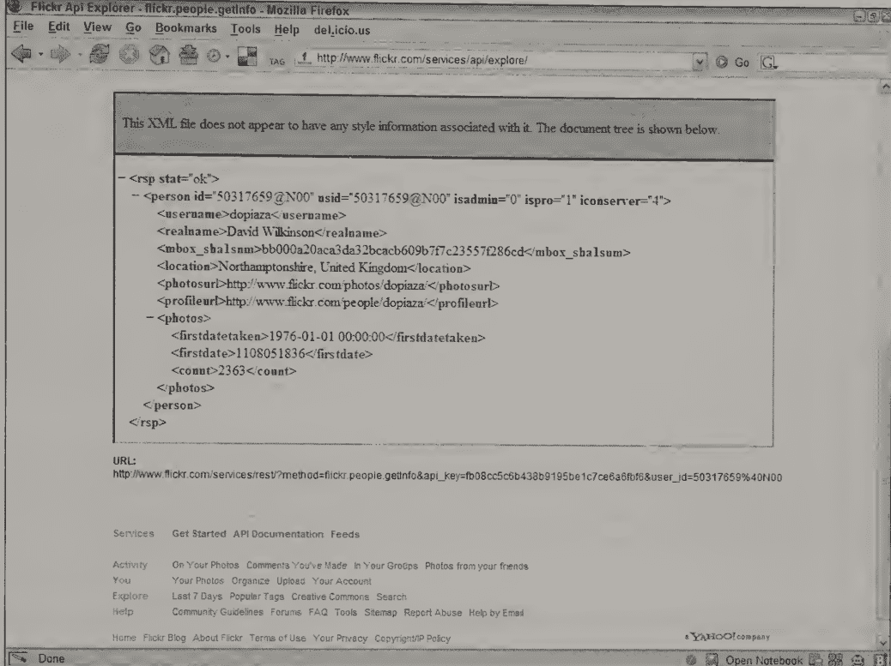

**图 4-4**

你看到的 XML 文件是 Flickr API 对你刚刚调用的方法——针对你的用户 ID 的`flickr.people.getInfo`方法——的响应。

### 工作原理

API 资源管理器从 URL 中的`method`参数知道你正在调用哪个方法以及它需要哪些参数（它本身可以通过`flickr.reflection.getMethodInfo`方法调用来获取此信息）。

当你填写参数并提交表单时，API 资源管理器只是为该方法调用构建 REST URL。实际上，如果你查看响应页面上显示的 XML 文档下方，你可以看到使用的 REST URL——它看起来类似这样：

```text
http://api.flickr.com/services/rest/?method=flickr.people.getInfo&
api_key=1f2811827f3284b3aa12f7bbb7792b8d&user_id=50317659%40N00
```


你看到显示的 XML 文档就是该 REST URL 的输出。你可以通过选择 URL 并将其复制粘贴到另一个浏览器窗口来轻松验证这一点。你应该会看到相同的 XML 响应被返回。

## 使用 API 工具包

手动构建 Flickr API 请求并手动解码响应很快会变得繁琐。为了简化创建 Flickr 应用程序的过程，人们创建了许多 API 工具包。这些 API 工具包为 Flickr API 提供了一个封装，并处理了构建请求和解析响应的所有繁琐工作。

API 工具包并非 Flickr API 的官方组成部分，Flickr 既不提供也不认可它们。尽管缺乏官方认可，API 工具包非常受欢迎，并且已经为大多数主要开发语言（包括 PHP、Perl、Java、Actionscript、.NET、Python 等）涌现出来。它们通常由独立作者编写，并经常在开源许可证（如 GNU 通用公共许可证（GPL））下获得许可。

在大多数情况下，重新发明轮子意义不大，大多数 Flickr 应用程序都使用一个或多个这些 API 工具包。例如，本书中的 PHP 项目使用了 Dan Coulter 出色的 phpFlickr 库，该库在 GPL 下可用，可以在`http://www.phpflickr.com/`找到，或直接从 SourceForge 下载`http://sourceforge.net/projects/phpflickr`。

## 做一个良好的 Flickr 公民

该 API 对所有人开放使用——毕竟，任何 Flickr 用户只需填写网站上的表格即可获得 API 密钥。然而，重要的是你在使用 API 时要行为得当，不要滥用该权限。实际上，你只需要注意几件事。

## 商业用途

大多数 API 密钥是为非商业用途颁发的，因此不应用于商业应用程序或商业网站。那么，什么构成商业用途？显然，如果你在销售或推广商品或服务的网站上使用你的 Flickr API 密钥，这将被描述为商业用途。另一方面，如果你维护一个关于与宠物猫生活的博客，并且碰巧有一些 Google 广告在旁边运行，这可能不构成商业用途。在这两个极端之间，存在着大量的可能性。通常，常识会告诉你使用 API 是否真的是商业用途。但是，如果你有任何疑问，你应该询问。你可以在 Flickr 网站每个页面的底部找到“通过电子邮件获取帮助”链接。如果你使用该链接并描述你的情况，你应该能够从 Flickr 团队那里获得明确的答案。

如果你知道你的 API 使用将是商业性的，你应该在你填写的申请 API 密钥的表格中注明这一点。然后，你的应用程序将由 Flickr 工作人员审核——因此请确保给他们足够的信息以便他们做出决定。

## 最小化 API 调用

你可以并且应该做的成为良好 Flickr 公民的主要事情之一是确保你不会对他们的服务器产生不必要或不合理的流量。带宽和处理能力不是免费的，创建的每个 API 应用程序或 mashup 都会增加运行 Flickr 所需的总计算资源的一点点。现在，这并不是说你应该试图避免发送任何流量——毕竟，给你 API 密钥的全部意义就在于让你访问 Flickr 的数据——但你应该小心不要太贪婪，永远不要要求超过你实际需要的东西。你也从高效使用 API 的方式中受益——你的代码花在等待 Flickr 上的时间越少，你的应用程序就会变得越快、响应越迅速。

以下是一些最小化 API 调用次数的提示。它们可能看起来很明显，但人们一次又一次地陷入这些相同的陷阱。

- 不要多次调用方法。如果你在一页上两次显示一张照片的标题，请确保只从 Flickr 请求一次——尝试将其存储起来，也许在一个全局变量中，以便在第二次需要时使用。
- 每次方法调用尽可能多地获取信息。许多 API 方法在一次调用中返回的信息远多于仅从名称或粗略阅读 API 规范可能明显看到的信息。你之前看到的`flickr.photos.search`方法为其返回的每张照片返回所有者的 NSID。但是，如果你在 extras 参数中指定`owner_name`，它还将返回所有者的屏幕名称。仔细阅读你打算使用的方法的规范是值得的，以便确保你从每次方法调用中获得最大收益。
- 不要请求你不需要的数据。注意你请求的内容——很容易请求你最终从未使用的数据。例如，如果你想显示你最近的五张照片，请确保指定你只想返回五张。许多 API 方法的默认行为是，如果未指定实际值，则返回 100 张照片的详细信息——如果你不需要，这是大量需要传输和处理的数据。
- 尽可能缓存数据。减少任何应用程序中必须进行的 API 调用次数的一个好方法是尽可能缓存数据。你可以在 Web 应用程序中的许多地方存储缓存数据——在 cookie 中、在用户的会话中或在本地数据库中。你甚至可以简单地将数据写入磁盘。通过明智地使用缓存，你可以避免每次用户加载新页面时都必须回到 Flickr 获取信息。

## Flickr 资源

作为 Flickr 开发者，你应该了解并且经常查阅一些资源。

### Flickr 服务页面

位于`http://www.flickr.com/services/`的 Flickr 服务页面应该是你获取信息的第一个停靠点。从这里你可以找到所有 API 文档、管理你的 API 密钥，并找到许多第三方应用程序的链接，这些链接展示了你可以用 Flickr API 做什么。

### Flickr 开发者支持小组

你可以在`http://groups.yahoo.com/group/yws-flickr/`找到 Flickr 开发者支持小组。如果你通过阅读文档找不到 Flickr API 问题的答案，可以在这里发布——该小组由许多有经验的 Flickr 开发者以及 Flickr 工作人员阅读。还有一个可搜索的过往帖子存档，因此你可以查看你的问题是否之前被问过。

如果你想向小组发帖，或希望帖子通过邮件发送给你，你需要有一个 Yahoo! 帐户。

### Flickr API 小组

有一个专门讨论 API 的非官方 Flickr 小组，你可以在`http://www.flickr.com/groups/api/`找到它。在其中，你不仅会找到关于 API 各方面的讨论，还会找到各个成员创建的新 API 应用程序的详细信息。

在本章中，你已经了解了 Flickr API 的概述。你已经学习了如何通过 REST、SOAP 和 XML-RPC 向 Flickr 发送消息，构造 URL 以访问各种 Flickr 页面和图像，理解 Flickr 返回的一些常见数据结构，并使用 API 资源管理器调用 Flickr 方法。

现在，背景信息已经足够了。你现在已经准备好开始构建你的第一个 Flickr mashup 了。在下一章中，你将发现如何使用提要从 Flickr 获取信息，然后如何在你的网页中处理和显示这些提要的内容。

## 练习

1. 构造一个 REST URL，使用`flickr.photos.getRecent`方法检索上传到 Flickr 的最近 10 张公共照片的摘要信息。将 URL 输入你的浏览器以验证它是否正确返回信息。
2. 使用 API 资源管理器查找 Flickr 上带有`cat`标签的最有趣的照片。提示：你需要使用`flickr.photos.search` API 方法。
3. 获取上一个练习返回的结果，并使用`flickr.photos.getInfo`方法的 API 资源管理器来返回关于最有趣照片的详细信息。

### 第五章：Flickr 订阅源

### 第六章：通过 API Remix Flickr

### 第七章：Flickr 身份验证

### 第八章：上传照片

### 第九章：通过 Greasemonkey Remix Flickr

### 第十章：使用 ImageMagick

## Flickr 订阅源

Flickr 向大众提供了多种格式的订阅源。在本章中，你将了解什么是订阅源，有哪些类型的订阅源可用，以及如何利用它们。你将看到如何创建一个 Flickr 徽章，将其嵌入你的网页，通过 Flickr 的公开订阅源在你的网站上展示（任何人的）照片。

### 什么是订阅源？

订阅源是一种追踪随时间变化的一组信息的方式。与订阅源通常关联的内容类型有新闻故事和博客文章，但任何可以归类为单个项目列表的数据都可以用订阅源表示。订阅源只是一个包含此类列表的电子文档。列表中的每个项目代表一段特定的内容，通常以摘要形式呈现。定期更新信息或添加新内容的网站通常会发布订阅源，以便用户可以轻松跟踪网站的更改和新增内容。订阅源不是静态数据；每次访问订阅源通常会返回一组最新的项目——即该时间点可用项目的快照。订阅源通常通过网络检索，每个订阅源都有其唯一的 URL。通过订阅源提供内容的过程被称为联合。

许多网络服务和软件应用程序，或称聚合器，可以让你查看一组订阅源。通常，它们允许你分类查看多个不同的订阅源，从而让你可以轻松地从各种来源获取新信息的发布情况。聚合器的例子有 Bloglines（`http://www.bloglines.com`）和 FeedDemon（`http://www.newsgator.com/`）。

**试一试：获取订阅源**

获取订阅源就像请求一个 URL 一样简单。

1. 在你的浏览器中输入以下 URL：

   `http://api.flickr.com/services/feeds/photos_public.gne`

2. 然后你应该会在浏览器窗口中看到如下所示的订阅源：

```xml
<?xml version="1.0" encoding="utf-8" standalone="yes"?>
<feed xmlns="http://www.w3.org/2005/Atom"
      xmlns:dc="http://purl.org/dc/elements/1.1/">
  <title>Everyone's Photos</title>
  <link rel="self" href="http://www.flickr.com/services/feeds/photos_public.gne" />
  <link rel="alternate" type="text/html" href="http://www.flickr.com/photos/"/>
  <id>tag:flickr.com,2005:/photos/public</id>
  <icon>http://www.flickr.com/images/buddyicon.jpg</icon>
  <subtitle>A feed of Everyone's Photos</subtitle>
  <updated>2006-07-08T13:57:15Z</updated>
  <generator uri="http://www.flickr.com/">Flickr</generator>
  <entry>
    <title>Blue Corner</title>
    <link rel="alternate" type="text/html" href="http://www.flickr.com/photos/dopiazza/179701217/"/>
    <id>tag:flickr.com,2005:/photo/179701217</id>
    <published>2006-07-02T12:13:37Z</published>
    <updated>2006-07-02T12:13:37Z</updated>
    <dc:date.Taken>2006-07-02T12:42:04-08:00</dc:date.Taken>
    <content type="html">&lt;p&gt;&lt;a href=&quot;http://www.flickr.com/people/dopiazza/&quot;&gt;dopiazza&lt;/a&gt; posted a photo:&lt;/p&gt;
&lt;p&gt;&lt;a href=&quot;http://www.flickr.com/photos/dopiazza/179701217/&quot;&gt;&lt;img src=&quot;http://static.flickr.com/52/179701217_1f521ae2c9_m.jpg&quot; width=&quot;240&quot; height=&quot;160&quot; alt=&quot;Blue Corner&quot; style=&quot;border: 1px solid #ddd;&quot; /&gt;&lt;/a&gt;&lt;/p&gt;
&lt;p&gt;[DSC_2408]&lt;/p&gt;</content>
    <author>
      <name>dopiazza</name>
      <uri>http://www.flickr.com/people/dopiazza/</uri>
    </author>
    <category term="blue" scheme="http://www.flickr.com/photos/tags/" />
    <category term="corner" scheme="http://www.flickr.com/photos/tags/" />
    <category term="painting" scheme="http://www.flickr.com/photos/tags/" />
    <category term="picture" scheme="http://www.flickr.com/photos/tags/" />
    <category term="frame" scheme="http://www.flickr.com/photos/tags/" />
  </entry>
</feed>
```

### 工作原理

你输入的 URL`http://www.flickr.com/services/feeds/photos_public.gne`是 Flickr 的“所有人照片”订阅源的 URL，它代表了一些最近上传的公共照片的快照。你看到的订阅源是一个 Atom 格式的 XML 文档——除非指定不同格式，Atom 是所有 Flickr 订阅源使用的格式。如果你查看 XML，它有一个外部的`<feed>`元素，后面跟着一些包含订阅源一般信息的元素。`<feed>`元素包含一系列`<entry>`元素。由于篇幅限制，这里只显示了一个`<entry>`元素——在你的浏览器中打开的订阅源里，你应该会看到多个`<entry>`元素。每个`<entry>`代表订阅源中的一个单独项目——在这种情况下，是上传到 Flickr 的一张新照片。

### 可用的 Flickr 订阅源

Flickr 为其大量内容生成了订阅源。事实上，你在 Flickr 上看到的许多页面都有相关的订阅源可用——通过查看页面底部的订阅源链接，你可以快速判断一个页面是否有订阅源。以下是一些最常用的 Flickr 订阅源：

- 最近的公共照片：`http://api.flickr.com/services/feeds/photos_public.gne`
- 任何用户的公共照片：`http://api.flickr.com/services/feeds/photos_public.gne?id=USER-NSID`
- 用户公共照片上的最近评论：`http://api.flickr.com/services/feeds/activity.gne?id=USER-NSID`
- 用户评论过的照片上的活动：`http://api.flickr.com/services/feeds/photos_comments.gne?user_id=USER-NSID`
- 小组讨论（仅限对非成员公开讨论的公共小组）：`http://api.flickr.com/services/feeds/groups_discuss.gne?id=GROUP-NSID`
- 小组照片池（仅限对非成员公开照片池的公共小组）：`http://api.flickr.com/services/feeds/groups_pool.gne?id=GROUP-NSID`

### 订阅源格式

订阅源通常以明确定义的格式发布——RSS 和 Atom 是最常用的。Flickr 提供其所有常规格式的订阅源，但也提供各种你可能惊讶地发现的格式。本节将介绍 Flickr 支持的各种格式。

所有订阅源格式都通过相同的 URL 访问，但通过订阅源 URL 查询字符串中的`format`参数进行区分——例如，Atom 格式的最近公共照片订阅源如下所示：

```text
http://www.flickr.com/services/feeds/photos_public.gne?format=atom
```

下表列出了`format`参数的有效值：

| 参数 | 描述 |
|---|---|
| `rss_200`或`rss2` | RSS 2.0 |
| `atom_1`或`atom` | Atom |
| `rss_091` | RSS 0.91 |
| `rss_092`或`rss` | RSS 0.92 |
| `rss_100`或`rdf` | RSS 1.0 |
| `rss_200_enc` | RSS 2.0（带附件） |
| `php` | PHP 代码 |
| `php_serial` | 序列化的 PHP 对象 |
| `csv` | 逗号分隔值 |
| `json` | JavaScript 对象表示法 |
| `sql` | 结构化查询语言 |
| `yaml` | YAML 不是标记语言 |
| `cdf` | 频道定义格式 |

大多数订阅源格式包含大致相同的信息，但你应该注意实际内容会因订阅源而异——如果你计划使用订阅源，应确保它包含你需要的信息。每个订阅源都以一组描述订阅源本身的元素开始，包括标题、描述、URL 和发布日期等字段，后面是订阅源中所有项目的列表。返回的项目数量因订阅源而异，但通常在 10 到 20 个之间。


可用订阅源格式的列表会不时更新，因此请访问主要的 Flickr 订阅源网页`http://www.flickr.com/services/feeds/`查看此列表的任何更新。

现在让我们看看当前可用的每种订阅源格式。为了说明它们的样子，展示了每个订阅源格式的示例输出——此示例是本书作者的公共照片订阅源的输出：

```
http://www.flickr.com/services/feeds/photos_public.gne?id=50317659@N00
```

请注意，尽管每个订阅源返回多个订阅源项目，但为了保持示例代码块的大小，每个示例中只显示一个订阅源项目。

如果你急于上手编写代码，现在不必浏览所有不同的格式——可以直接跳转到本章的“创建 Flickr 徽章”部分。当你需要了解特定源格式时，随时可以返回浏览本节。

### RSS

RSS，也称为简易信息聚合或丰富站点摘要，在第十章有更详细的讨论。它是互联网上最常用的源格式之一。

Flickr 支持多种不同版本的 RSS；这里展示的示例是 RSS 2.0。

```xml
<?xml version="1.0" encoding="utf-8"?>
<rss version="2.0"
     xmlns:media="http://search.yahoo.com/mrss"
     xmlns:dc="http://purl.org/dc/elements/1.1/"
     >
  <channel>
    <title>dopiazza's Photos</title>
    <link>http://www.flickr.com/photos/dopiazza/</link>
    <description>A feed of dopiazza's Photos</description>
    <pubDate>Sun, 2 Jul 2006 11:04:04 -0800</pubDate>
    <lastBuildDate>Sun, 2 Jul 2006 11:04:04 -0800</lastBuildDate>

    <generator>http://www.flickr.com/</generator>
    <image>
      <url>http://static.flickr.com/56/buddyicons/50317659@N00.jpg?1151240153</url>
      <title>dopiazza's Photos</title>
      <link>http://www.flickr.com/photos/dopiazza/</link>
    </image>

    <item>
      <title>Blue Corner</title>
      <link>http://www.flickr.com/photos/dopiazza/179701217/</link>

      <description>&lt;p&gt;&lt;a href=&quot;http://www.flickr.com/people/dopiazza/&quot;&gt;dopiazza&lt;/a&gt; posted a photo:&lt;/p&gt;

&lt;p&gt;&lt;a href=&quot;http://www.flickr.com/photos/dopiazza/179701217/&quot; title=&quot;Blue Corner&quot;&gt;&lt;img src=&quot;http://static.flickr.com/52/179701217_1f521ae2c9_m.jpg&quot; width=&quot;240&quot; height=&quot;160&quot; alt=&quot;Blue Corner&quot; style=&quot;border: 1px solid #ddd;&quot; /&gt;&lt;/a&gt;&lt;/p&gt;

&lt;p&gt;[DSC_2408]&lt;/p&gt;</description>
      <pubDate>Sun, 2 Jul 2006 05:13:37 -0800</pubDate>
      <dc:date.Taken>2006-07-02T12:42:04-08:00</dc:date.Taken>
      <author>nobody@flickr.com (dopiazza)</author>
      <guid isPermaLink="false">tag:flickr.com,2004:/photo/179701217</guid>
      <media:content url="http://static.flickr.com/52/179701217_1f521ae2c9_m.jpg"
             type="image/jpeg"
             height="160"
             width="240"/>
      <media:title>Blue Corner</media:title>
      <media:text type="html">&lt;p&gt;&lt;a href=&quot;http://www.flickr.com/people/dopiazza/&quot;&gt;dopiazza&lt;/a&gt; posted a photo:&lt;/p&gt;

&lt;p&gt;&lt;a href=&quot;http://www.flickr.com/photos/dopiazza/179701217/&quot; title=&quot;Blue Corner&quot;&gt;&lt;img src=&quot;http://static.flickr.com/52/179701217_1f521ae2c9_m.jpg&quot; width=&quot;240&quot; height=&quot;160&quot; alt=&quot;Blue Corner&quot; style=&quot;border: 1px solid #ddd;&quot; /&gt;&lt;/a&gt;&lt;/p&gt;

&lt;p&gt;[DSC_2408]&lt;/p&gt;</media:text>
      <media:thumbnail url="http://static.flickr.com/52/179701217_1f521ae2c9_s.jpg" height="75" width="75" />
      <media:credit role="photographer">dopiazza</media:credit>
      <media:category scheme="urn:flickr:tags">blue corner painting picture frame</media:category>

    </item>
  </channel>
</rss>
```

RSS 源是一个 XML 文档——源（此处称为`channel`）包含在`<channel>`元素中，每个条目包含在`<item>`元素中。文档中大多数元素的内容不言自明，但有几个值得注意。

`<media:text>`元素包含条目的文本描述。它包含 HTML，并将尖括号和双引号字符转换为其对应的实体：`&lt;`、`&gt;`和`&quot;`。请注意，此描述并非简单复制自 Flickr 上照片的描述，而是一段解码后呈现以下形式的 HTML：

```html
<p><a href="http://www.flickr.com/people/dopiazza/">dopiazza</a> posted a photo:</p>

<p><a href="http://www.flickr.com/photos/dopiazza/179701217/" title="Blue Corner"></a></p>

<p>Flickr photo description goes here</p>
```

`<guid>`元素包含此照片的唯一标识符。此处生成的标识符使用`tag URI scheme`，该方案定义了一种算法以创建唯一标识符。如果你对该方案的细节感兴趣，可以在`http://taguri.org/`查看。

最后，`<media:category>`元素包含照片 Flickr 标签的空格分隔列表。

### Atom

Atom 是另一种流行的基于 XML 的互联网源发布格式——它是除各种 RSS 版本外，互联网上广泛用于内容聚合的唯一格式。请记住，这与你在上一节 RSS 源中看到的数据相同；只是以不同格式呈现。

```xml
<?xml version="1.0" encoding="utf-8" standalone="yes"?>
<feed xmlns="http://www.w3.org/2005/Atom"
    xmlns:dc="http://purl.org/dc/elements/1.1/">

  <title>dopiazza's Photos</title>
  <link rel="self"
    href="http://www.flickr.com/services/feeds/photos_public.gne?id=50317659@N00 unethical&amp;format=atom" />
  <link rel="alternate" type="text/html"
    href="http://www.flickr.com/photos/dopiazza/"/>
  <id>tag:flickr.com,2005:/photos/public/296457</id>
  <icon>http://static.flickr.com/56/buddyicons/50317659@N00.jpg?1151240153</icon>
  <subtitle>A feed of dopiazza's Photos</subtitle>

  <updated>2006-07-02T18:04:04Z</updated>
  <generator uri="http://www.flickr.com/">Flickr</generator>

  <entry>
    <title>Blue Corner</title>
    <link rel="alternate" type="text/html"
      href="http://www.flickr.com/photos/dopiazza/179701217/"/>
    <id>tag:flickr.com,2005:/photo/179701217</id>
    <published>2006-07-02T12:13:37Z</published>
    <updated>2006-07-02T12:13:37Z</updated>
    <dc:date.Taken>2006-07-02T12:42:04-08:00</dc:date.Taken>
    <content type="html">&lt;p&gt;&lt;a href=&quot;http://www.flickr.com/people/dopiazza/&quot;&gt;dopiazza&lt;/a&gt; posted a photo:&lt;/p&gt;

&lt;p&gt;&lt;a href=&quot;http://www.flickr.com/photos/dopiazza/179701217/&quot;
  title=&quot;Blue Corner&quot;&gt;&lt;img
  src=&quot;http://static.flickr.com/52/179701217_1f521ae2c9_m.jpg&quot;
  width=&quot;240&quot; height=&quot;160&quot; alt=&quot;Blue Corner&quot;
  style=&quot;border: 1px solid #ddd;&quot; /&gt;&lt;/a&gt;&lt;/p&gt;

&lt;p&gt;[DSC_2408]&lt;/p&gt;</content>
    <author>
      <name>dopiazza</name>
      <uri>http://www.flickr.com/people/dopiazza/</uri>
    </author>
    <category term="blue" scheme="http://www.flickr.com/photos/tags/" />
    <category term="corner" scheme="http://www.flickr.com/photos/tags/" />
    <category term="painting" scheme="http://www.flickr.com/photos/tags/" />
    <category term="picture" scheme="http://www.flickr.com/photos/tags/" />
    <category term="frame" scheme="http://www.flickr.com/photos/tags/" />
  </entry>
</feed>
```

尽管结构有所不同，但 Atom 源包含的基本数据与 RSS 源非常相似——毕竟，两种源旨在完成完全相同的工作。存在一些差异——例如，Flickr 照片标签存储在多个`<category>`元素中，而不是空格分隔的列表——但同样，XML 结构在很大程度上不言自明。

### PHP

PHP 源返回一段 PHP 代码块，执行时会初始化一个名为`$feed`的数组。

```php
<?php
$feed = array(
  'title' => "dopiazza's Photos",
  'url' => "http://www.flickr.com/photos/dopiazza/",
  'description' => "A feed of dopiazza's Photos",
  'pub_date' => '1151863444',
  'image' => "http://static.flickr.com/56/buddyicons/50317659@N00.jpg?1151240153",
  'items' => array(
    array(
      'title' => "Blue Corner",
      'url' => "http://www.flickr.com/photos/dopiazza/179701217/",
      'description' => "<p><a href=\"http://www.flickr.com/people/dopiazza/\">dopiazza</a> posted a photo:</p>\n\n<p><a href=\"http://www.flickr.com/photos/dopiazza/179701217/\" title=\"Blue Corner\"></a></p>\n\n<p>[DSC_2408]</p>",
      'date' => '1151842417',
      'guid' => '/photo/179701217',
      'author_name' => 'dopiazza',
      'author_url' => "http://www.flickr.com/people/dopiazza/",
    ),
  ),
);
?>
```

初看可能有些奇怪，但如果你需要在 PHP 应用程序中获取源，它会非常有用。PHP 源意味着你无需担心解析像 RSS 或 Atom 这样复杂的 XML 结构；你可以直接使用 PHP 源，它为你直接创建一个 PHP 对象。

`$feed`数组是一个关联数组，包含一系列包含源信息的字段。源中的各个条目存储在`$feed['items']`数组中。

同样，数组中存储的大多数字段不言自明。日期字段存储为 Unix 时间戳，而非更易读的格式，但你可以使用 PHP`date`函数进行格式化。

此源中的`guid`字段使用了比前述源更简短的唯一标识符形式——它只是`/photo/photo_id`格式的字符串。请注意，这不是 Flickr 网站上图像或照片页面的路径。

本章稍后将展示如何使用 PHP 源的示例。

#### 序列化 PHP

序列化 PHP 源与 PHP 源类似，不同之处在于它生成的是序列化后的 PHP 对象，而非可执行代码。你可以使用 PHP`unserialize`函数将其转换为 PHP 对象，然后可以像使用上文 PHP 部分描述的`$feed`对象一样使用它。

94


```text
a:7:{s:5:"title";s:16:"dopiaza's Photos";s:3:"url";s:37:"http://www.flickr.com/photos/dopiaza/";s:11:"description";s:26:"A feed of dopiaza's Photos";s:8:"pub_date";s:10:"1151863444";s:5:"image";s:66:"http://static.flickr.com/56/buddyicons/50317659@N00.jpg?1151240153";s:4:"guid";s:21:"/photos/public/296457";s:5:"items";a:10:{i:0;a:16:{s:5:"title";s:11:"Blue Corner";s:3:"url";s:47:"http://www.flickr.com/photos/dopiaza/179701217/";s:11:"description";s:339:"<p><a href="http://www.flickr.com/people/dopiaza/">dopiaza</a> posted a photo:</p>

<p><a href="http://www.flickr.com/photos/dopiaza/179701217/" title="Blue Corner"></a></p>

<p>[DSC_2408]</p>";s:9:"photo_xml";s:0:"";s:4:"date";s:10:"1151842417";s:10:"date_taken";s:25:"2006-07-02T12:42:04-08:00";s:4:"guid";s:16:"/photo/179701217";s:11:"author_name";s:7:"dopiaza";s:10:"author_url";s:37:"http://www.flickr.com/people/dopiaza/";s:9:"photo_url";s:54:"http://static.flickr.com/52/179701217_1f521ae2c9_m.jpg";s:9:"thumb_url";s:54:"http://static.flickr.com/52/179701217_1f521ae2c9_s.jpg";s:6:"height";s:3:"160";s:5:"width";s:3:"240";s:4:"tags";s:34:"blue corner painting picture frame";s:10:"photo_mime";s:10:"image/jpeg";s:9:"tags_list";a:5:{i:0;s:4:"blue";i:1;s:6:"corner";i:2;s:8:"painting";i:3;s:7:"picture";i:4;s:5:"frame";}}}}
```

## JSON

JSON（JavaScript Object Notation）数据源的工作方式与 PHP 数据源类似，但会生成一段 JavaScript 代码。

```javascript
jsonFlickrFeed({
  "title": "dopiaza's Photos",
  "link": "http://www.flickr.com/photos/dopiaza/",
  "description": "A feed of dopiaza's Photos",
  "modified": "2006-07-02T18:04:04Z",
  "generator": "http://www.flickr.com/",
  "items": [
  {
    "title": "Blue Corner",
    "link": "http://www.flickr.com/photos/dopiaza/179701217/",
    "date_taken": "2006-07-02T12:42:04-08:00",
    "description": "&lt;p&gt;&lt;a href=&quot;http://www.flickr.com/people/dopiaza/&quot;&gt;dopiaza&lt;/a&gt; posted a photo:&lt;/p&gt; &lt;p&gt;&lt;a href=&quot;http://www.flickr.com/photos/dopiaza/179701217/&quot; title=&quot;Blue Corner&quot;&gt;&lt;img src=&quot;http://static.flickr.com/52/179701217_1f521ae2c9_m.jpg&quot; width=&quot;240&quot; height=&quot;160&quot; alt=&quot;Blue Corner&quot; style=&quot;border: 1px solid #ddd;&quot; /&gt;&lt;/a&gt;&lt;/p&gt; &lt;p&gt;[DSC_2408]&lt;/p&gt;",
    "published": "2006-07-02T12:13:37Z",
    "author": "nobody@flickr.com (dopiaza)",
    "tags": "blue corner painting picture frame"
  }]
})
```

## 第二部分：混搭 Flickr

这段生成的 JavaScript 调用一个`jsonFlickrFeed`函数，该函数接收一个参数——一个由数据源生成的 JavaScript 对象（JSON 格式）。要使用此数据源，你需要在网页中定义一个`jsonFlickrFeed`函数，当数据源 JavaScript 执行时，该函数会自动被调用。

同样，此数据源的内容与之前的数据源非常相似。值得注意的是，照片流和照片页面的 URL 在这里称为`link`，而在 PHP 数据源中它们称为`url`。稍后在本章中，你将看到如何使用 JSON 数据源的示例。

### CSV

CSV（逗号分隔值）数据源生成 CSV 格式的条目列表。在以下示例中，不同字段显示在单独的行上，用空行分隔数据源信息与条目信息。这样做纯粹是为了使示例可读——实际数据源中所有字段都在一行上，条目之间没有空行。

```csv
"dopiaza's Photos",
"http://www.flickr.com/photos/dopiaza/",
"A feed of dopiaza's Photos",
"1151863444",
"http://static.flickr.com/56/buddyicons/50317659@N00.jpg?1151240153"

"Blue Corner",
"http://www.flickr.com/photos/dopiaza/179701217/",
"<p><a href=\"http://www.flickr.com/people/dopiaza/\">dopiaza</a> posted a photo:</p>\n\n<p><a href=\"http://www.flickr.com/photos/dopiaza/179701217/\" title=\"Blue Corner\"></a></p>\n\n<p>[DSC_2408]</p>",
"1151842417",
"/photo/179701217",
"dopiaza",
"http://www.flickr.com/people/dopiaza/"
```

CSV 数据源的第一行包含有关数据源本身的信息。字段包括数据源标题、数据源 URL、数据源描述、数据源发布日期和数据源图标。CSV 数据源的其余行对应于数据源中的条目。每个数据源条目包含标题、照片页面 URL、描述、发布日期、GUID、作者姓名和作者 URL 字段。如果你需要将数据导入电子表格或文本处理能力有限的应用程序，CSV 数据源特别有用。

### YAML

YAML，是 YAML Ain't Markup Language 的递归缩写，是一种基于文本的数据源。

```yaml
guid        : /photos/public/296457
title       : dopiaza's Photos
url         : http://www.flickr.com/photos/dopiaza/
image       : http://static.flickr.com/56/buddyicons/50317659@N00.jpg?1151240153
description : A feed of dopiaza's Photos
pubdate     : 1151863444
items       :
    - guid        : /photo/179701217
```

## 第五章：Flickr 数据源

```yaml
title           : Blue Corner
url             : http://www.flickr.com/photos/dopiaza/179701217/
date            : 1151842417
description     : |
                  <p><a href="http://www.flickr.com/people/dopiaza/">dopiaza</a> posted a photo:</p>

                  <p><a href="http://www.flickr.com/photos/dopiaza/179701217/" title="Blue Corner"></a></p>

                  <p>[DSC_2408]</p>
authorname      : dopiaza
authorurl       : http://www.flickr.com/people/dopiaza/
tags            :
                  - blue
                  - corner
                  - painting
                  - picture
                  - frame
```

YAML 的设计目标是易于人类阅读，它使用空白和缩进来标识所描述数据的结构。YAML 中的列表项以 leading hyphen 标记，因此你可以在上面的示例中看到，`items`列表中有一个条目。`item`对象以`guid`项开始，包含所有与该缩进级别相同的内容。`item`对象中的最后一个对象是`tags`，它本身也是一个列表——可以从更深的缩进级别及其成员前的 leading hyphens 看出这一点。

如果你对使用 YAML 感兴趣，可以在 http://www.yaml.org/ 上阅读更多相关信息。

### SQL

Flickr 提供的一种较为特别的数据源是 SQL 数据源。它生成一组 SQL 语句，使你能够直接将数据源数据存储到数据库中。

```sql
CREATE TABLE IF NOT EXISTS feeds (
    guid varchar(255) NOT NULL default '',
    title varchar(255) NOT NULL default '',
    url varchar(255) NOT NULL default '',
    image_url varchar(255) NOT NULL default '',
    description text NOT NULL,
    pub_timestamp int(10) unsigned NOT NULL default '0',
    PRIMARY KEY (guid)
);

DELETE FROM feeds WHERE guid='/photos/public/296457';
INSERT INTO feeds VALUES (
    '/photos/public/296457',
    'dopiaza\'s Photos',
    'http://www.flickr.com/photos/dopiaza/',
    'http://static.flickr.com/56/buddyicons/50317659@N00.jpg?1151240153',
    'A feed of dopiaza\'s Photos',
```

## 第二部分：混搭 Flickr

```sql
'1151863444'
);

CREATE TABLE IF NOT EXISTS feed_items (
    item_guid varchar(255) NOT NULL default '',
    feed_guid varchar(255) NOT NULL default '',
    title varchar(255) NOT NULL default '',
    url varchar(255) NOT NULL default '',
    pub_timestamp mediumint(8) unsigned NOT NULL default '0',
    description text NOT NULL,
    author_name varchar(255) NOT NULL default '',
    author_url varchar(255) NOT NULL default '',
    tags varchar(255) NOT NULL default '',
    PRIMARY KEY (item_guid)
);

DELETE FROM feed_items WHERE item_guid='/photo/179701217';
INSERT INTO feed_items VALUES (
    '/photo/179701217',
    '/photos/public/296457',
    'Blue Corner',
    'http://www.flickr.com/photos/dopiaza/179701217/',
    '1151842417',
    '<p><a href="http://www.flickr.com/people/dopiaza/">dopiaza</a> posted a photo:</p>

<p><a href="http://www.flickr.com/photos/dopiaza/179701217/" title="Blue Corner"></a></p>

<p>[DSC_2408]</p>',
    'dopiaza',
    'http://www.flickr.com/people/dopiaza/',
    '\"blue\",\"corner\",\"painting\",\"picture\",\"frame\"'
);
```

作为数据源生成的 SQL 使用两个数据库表：`feeds`和`feed_items`。如果数据库中不存在这两个表，则会创建它们。然后，SQL 会检查数据源和数据源条目数据是否已存在于数据库中，如果已有条目存在则删除，然后插入新的数据项。

### CDF

CDF，即 Channel Definition Format（频道定义格式），是另一种用于数据源的 XML 格式。它由微软为其 Active Channel 技术而设计。

```xml
<?xml version="1.0" encoding="utf-8"?>
<CHANNEL
    HREF="http://www.flickr.com/photos/dopiaza/"
    LASTMOD="2006-07-02T18:04:04"
    PRECACHE="YES"
    LEVEL="0"
>
  <TITLE>dopiaza的照片</TITLE>

  <ABSTRACT>dopiaza照片的订阅源</ABSTRACT>

  <SCHEDULE><INTERVALTIME HOUR="1"/></SCHEDULE>

  <LOGO HREF="http://static.flickr.com/56/buddyicons/50317659@N00.jpg?1151240153" STYLE="ICON"/>

  <ITEM
      HREF="http://www.flickr.com/photos/dopiaza/179701217/"
      LASTMOD="2006-07-02T12:13:37"
  >
    <TITLE>蓝色角落</TITLE>
```


<ABSTRACT>&lt;p&gt;&lt;a href=&quot;http://www.flickr.com/people/dopiaza/&quot;&gt;dopiaza&lt;/a&gt;发布了一张照片：&lt;/p&gt;

&lt;p&gt;&lt;a href=&quot;http://www.flickr.com/photos/dopiaza/179701217/&quot; title=&quot;Blue Corner&quot;&gt;&lt;img src=&quot;http://static.flickr.com/52/179701217_1f521ae2c9_m.jpg&quot; width=&quot;240&quot; height=&quot;160&quot; alt=&quot;Blue Corner&quot; style=&quot;border: 1px solid #ddd;&quot; /&gt;&lt;/a&gt;&lt;/p&gt;

&lt;p&gt;[DSC_2408]&lt;/p&gt;</ABSTRACT>

<LOGO HREF="http://static.flickr.com/52/179701217_179701217_1f521ae2c9_s.jpg" STYLE="IMAGE"/>

</ITEM>

</CHANNEL>

## 创建 Flickr 徽章

许多人喜欢在自己的网页上放置一个*徽章*来展示他们与某个特定网站的关联。徽章基本上是一种小型广告，用于推广某个网站或社区，在个人网站或博客中看到它们是相当常见的。作为一个摄影网站，Flickr 天然适合制作视觉上有趣的徽章。在`http://www.flickr.com/badge_new.gne`有一个官方的 Flickr 徽章，而且它的设计非常不错——但当然，从零开始制作自己的徽章总是要有趣得多，而订阅源提供了一种非常简单的实现方式。

接下来你将看到两种 fundamentally 不同的方法来实现完全相同的结果。你将使用两种截然不同的架构来创建一个 Flickr 徽章——第一个是服务器端版本，使用 PHP 将徽章嵌入到网页中，第二个是客户端版本，用 JavaScript 实现。

### 设计徽章

从浏览器看到的徽章来说，它是一块 HTML。如果徽章可以轻松重新样式化以匹配它所在的网页的外观和感觉，那将非常有用，因此这个项目将保持 HTML 非常简单和通用，并使用 CSS 来呈现徽章。所以首先要做的是考虑如何构建 HTML。HTML 应该代表徽章的结构，但不对呈现施加任何限制——那完全留给 CSS 处理。

如果你考虑典型徽章的结构，它是一个块级元素——一块可以放入页面任意位置的内容。在该块内，它通常包含一个标题，后跟一个图像列表。注意到目前为止我只是描述了徽章的结构——我还没有说它应该是什么样子。所以，将该描述转化为等效的 HTML，你会得到类似这样的代码：

```html
<div class="badge">
  <p class="badge-title">
    <a href="/link/to/user/photostream">标题</a>
  </p>
  <ul class="badge-items">
    <li class="badge-item">
      <a href="/link/to/photo/page">
        
      </a>
    </li>
    <li class="badge-item">
      ...
    </li>
  </ul>
</div>
```

整个徽章包含在一个`<div>`元素中，以帮助将这块 HTML 与其周围环境隔离。徽章中的第一项是标题——这只是描述徽章的一段文字，所以把它放在了`<p>`元素中。徽章然后包含一个图像列表，所以在 HTML 中这被表示为一个无序列表。`<ul>`元素又包含一个`<li>`元素来显示每张图片。

所有 HTML 元素都用适当命名的`class`属性进行了标注——这意味着稍后你用 CSS 为徽章设置样式时，可以轻松引用它们。

### 使用 PHP 创建服务器端徽章

现在是时候实现徽章了。第一个版本将用 PHP 创建，所有构建 HTML 的工作都在服务器端完成。你将使用前面描述的 PHP Flickr 订阅源来获取你最新照片的信息。

当用户的浏览器向 Web 服务器请求网页时，服务器必须先构建徽章的 HTML。为此，Web 服务器向 Flickr 发送请求以检索徽章的 PHP 订阅源。然后它构建徽章的 HTML 并将其返回给浏览器。信息流程如图 5-1 所示。

如果你还记得前面关于订阅源类型的部分，PHP 订阅源是作为初始化`$feed`变量的 PHP 代码块返回的：

```php
<?php
  $feed = array(
    ...
  );
?>
```

## 第 5 章：Flickr 订阅源

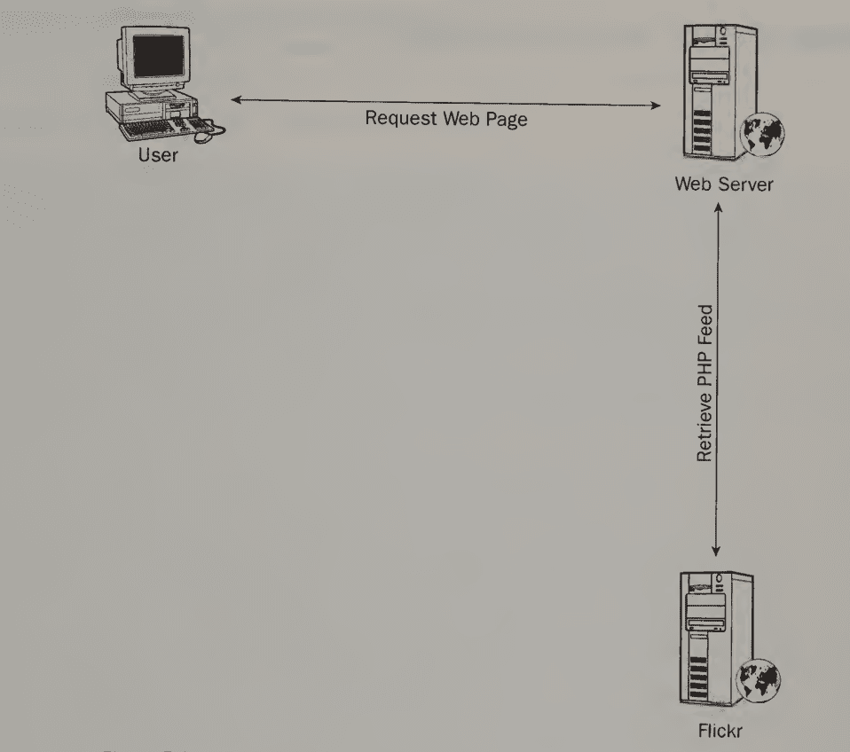

要执行来自远程 URL 的 PHP 代码块，你需要使用 PHP 的`include`指令。所以，例如，你可以用以下代码检索 PHP 订阅源并输出其原始内容：

```php
<?php

include("http://flickr.com/services/feeds/photos_public.gne?id=50317659@N00&format=php");

print_r($feed);

?>
```

你不需要自己声明或赋值`$feed`变量——这些都在包含的代码中为你完成了。在`include`语句之后，`$feed`就可以供你使用了。

## 第二部分：重新混合 Flickr

### 动手实践：创建服务器端徽章

现在是时候用 PHP 订阅源并将其内容格式化为你之前定义的 HTML 徽章了。

1. 在你的 Web 服务器创建一个`badge`目录，并在其中创建以下内容的`badge.php`文件：

```php
<?php

include("http://api.flickr.com/services/feeds/photos_public.gne?id=50317659@N00&format=php");

$s = "";

$s .= '<div class="badge">';
$s .= '<p class="badge-title"><a href="' . $feed['url'] . '">' . $feed['title'] . '</a></p>';
$s .= '<ul class="badge-items">';

$items = $feed['items'];

for ($i = 0; $i < count($items); $i++)
{
    if (preg_match('@(http:\/\/static\.flickr\.com\/\d+\/\d+_[0-9a-z]+)_m\.jpg@',
        $items[$i]['description'], $result))
    {
        $image = $result[1] . '_s.jpg';
        $s .= '<li class="badge-item"><a href="' . $items[$i]['url'] . '"></a></li>';
    }
}

$s .= '</ul></div>';

echo($s);

?>
```

2. 上面代码中的订阅源 URL 使用了我的 NSID（`50317659@N00`），所以会检索我的照片。你可以随意替换成你自己的 NSID，以便在徽章中看到自己的照片。

> 如果你不记得自己的 NSID 是什么，找到它最简单的方法是在 Flickr API Explorer 页面查找任何 API 方法——例如：
>
> `http://www.flickr.com/services/api/explore/?method=flickr.test.echo`
>
> 你会在页面右侧的“Useful Values”列中找到你的 NSID。

### 工作原理

如果你看一下 PHP 代码，你会发现它在`$s`变量中构建了一串 HTML，最后调用`echo($s)`输出 HTML。HTML 的结构与前面描述的完全一致，所以现在让我们看看徽章的不同部分是如何从订阅源中提取出来的。

102

## 第 5 章：Flickr 订阅源

徽章的第一部分是标题，它链接回用户的照片流。生成这部分很简单——订阅源标题和链接都是`$feed`数组中的字段：

```php
$s .= '<p class="badge-title"><a href="' . $feed['url'] . '">' . $feed['title'] . '</a></p>';
```

提取实际图像要复杂一些。图像 URL 并没有直接包含在订阅源中。不过，它嵌入在`description`字段的文本中：

```php
'description'=> "<p><a href=\"http://www.flickr.com/people/dopiaza/\">dopiaza</a> posted a photo:</p>\n\n<p><a href=\"http://www.flickr.com/photos/dopiaza/179701217/\" title=\"Blue Corner\"></a></p>\n\n<p>[DSC_2408]</p>",
```

徽章代码循环遍历`items`数组中的每个元素，使用正则表达式来匹配图像 URL。

```php
if (preg_match('/(http:\/\/static.flickr.com\/\d+\/\d+_[0-9a-z]+)_m\.jpg/', $items[$i]['description'], $result))
{
    $image = $result[1] . '_s.jpg';
    $s .= '<li class="badge-item"><a href="' . $items[$i]['url'] . '"></a></li>';
}
```

正则表达式查找匹配图像 URL 的字符串。该模式以字符串`http://static.flickr.com/`开头。下一个组件`\d+`将匹配一个或多个数字序列——这是照片的服务器 ID。URL 的最后一部分由模式`\d+_[0-9a-z]+)_m\.jpg`匹配，即一个或多个数字后跟下划线，然后是一个或多个字母数字字符，以`_m.jpg`结尾。

嵌入在`description`字段中的图像是小尺寸，最长边为 240 像素。这对于徽章来说太大了，所以当正则表达式检索到图像 URL 时，只提取 URL 的第一部分——即正则表达式中由括号指示的部分。末尾的`_m.jpg`被去掉并替换为`_s.jpg`——这是方形尺寸，75 像素仍然有点大，但至少它们可以相当整齐地排列成网格。

你可能注意到前面展示的示例 HTML 结构布局得很整齐，而 PHP 徽章代码生成的 HTML 全部在一行上——标签之间没有空白。这确实使生成的源代码更难阅读，但它使 HTML 的样式设置更容易——如果在图像元素之间有空白，浏览器有时会坚持渲染它，这几乎不可能让你的图像彼此紧密相连。最简单的解决方案是确保你从一开始就不放任何空白。

你刚刚创建的`badge.php`页面不是一个完整的 HTML 页面——它只生成徽章`<div>`及其内容，所以下一步是创建包含的网页并将徽章代码包含在其中。

## 第二部分：改造 Flickr

### 动手试试

#### 显示服务端徽章

在本练习中，你将创建一个 HTML 页面来显示你的服务端徽章。

1. 在你的徽章目录中创建一个名为`php-badge.php`的新文件，内容如下。

```html
<!DOCTYPE html PUBLIC "-//W3C//DTD XHTML 1.0 Transitional//EN"
  "http://www.w3.org/TR/xhtml1/DTD/xhtml1-transitional.dtd">
<html xmlns="http://www.w3.org/1999/xhtml">
<head>
  <title>Flickr Mashups: Flickr PHP Badge</title>
  <link href="../css/main.css" rel="stylesheet" type="text/css" />
</head>
<body>

<?php include('badge.php') ?>

</body>
</html>
```

2. 在浏览器中打开此文件，你应该会看到类似图 5-2 的效果。

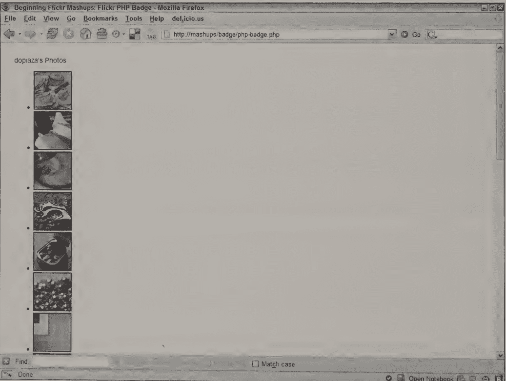

图 5-2

3. 嗯，这算是一种徽章，但看起来确实很丑！也许是时候开始处理样式表了。在网站的`css`目录中创建一个名为`badge.css`的新样式表——目前可以先留空，稍后你将开始向其中添加样式规则。然后修改你的`php-badge.php`文件，使其引用这个新的样式表：

```html
<!DOCTYPE html PUBLIC "-//W3C//DTD XHTML 1.0 Transitional//EN"
    "http://www.w3.org/TR/xhtml1/DTD/xhtml1-transitional.dtd">
<html xmlns="http://www.w3.org/1999/xhtml">
<head>
    <title>Flickr Mashups: Flickr PHP Badge</title>
    <link href="../css/main.css" rel="stylesheet" type="text/css" />
    <link href="../css/badge.css" rel="stylesheet" type="text/css" />
</head>
<body>

<?php include('badge.php') ?>

</body>
</html>
```

4. 首先需要解决的是图片尺寸的问题——75 像素实在太大了，稍微小一点会好得多。而且图片周围的蓝色边框必须去掉，因此在`badge.css`中添加以下内容：

```css
.badge-item img{
    border: 1px solid #333333;
    width: 48px;
    height: 48px;
}
```

5. 下一步是去掉每张图片旁边的项目符号，并且不让每张图片独占一行。在`badge.css`中添加以下规则：

```css
.badge-item {
    display: inline;
    list-style-type: none;
}
```

现在你应该能看到一个类似图 5-3 的页面。

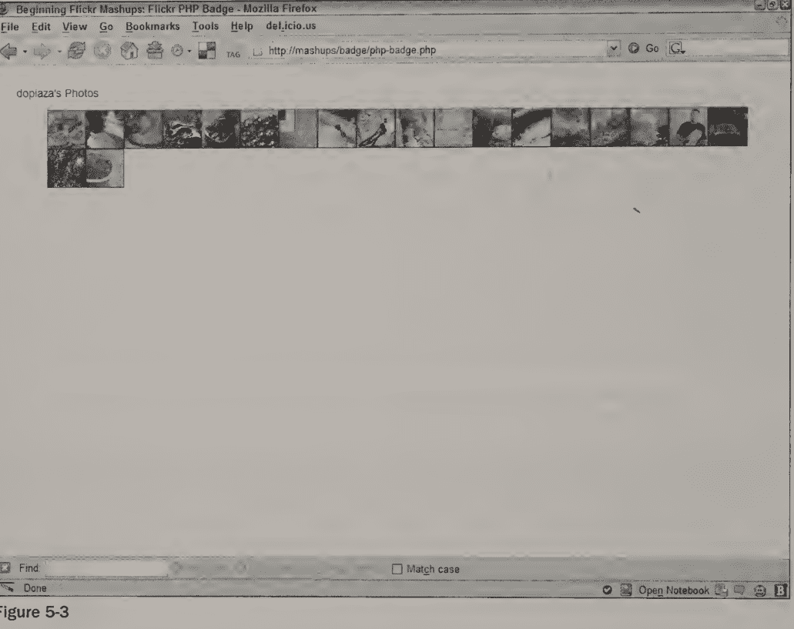

图 5-3

6. 现在图片已经排成了一行——是时候添加一条规则将它们排列成网格了。用户照片的订阅源返回 20 张图片，因此 2 × 10 的网格可能适合作为沿着页面边缘显示的徽章。在`badge.css`中添加以下代码：

```css
.badge-items {
  width: 100px;
  margin: 0;
  padding: 0;
}
```

7. 查看`php-badge.php`页面，你应该会看到徽章开始初具雏形，如图 5-4 所示。

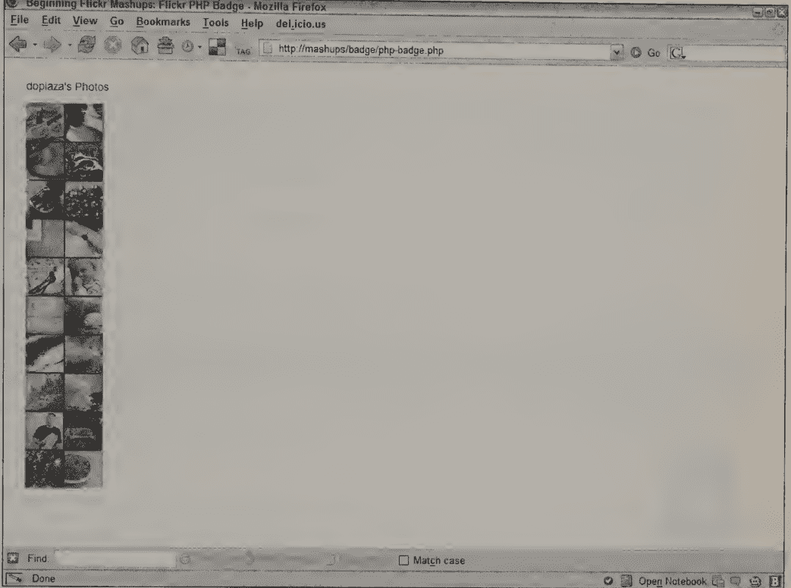

图 5-4

8. 现在你需要稍微整理一下徽章标题——调整字体大小并确保它在徽章上方居中显示。以下是完整的`badge.css`文件，新添加的 CSS 规则已突出显示。

```css
.badge {
  width: 100px;
}
.badge-title {
  font-size: 12px;
  font-weight: 600;
  text-align: center;
}
.badge p {
  margin: 0;
  padding: 0;
}
```

```css
.badge-items {
  width: 100px;
  margin: 0;
  padding: 0;
}
.badge-item {
  display: inline;
  list-style-type: none;
}
.badge-item img{
  border: 1px solid #333333;
  width: 48px;
  height: 48px;
}
```

9. 更新你的`badge.css`并在浏览器中重新加载`php-badge.php`。你将看到完成后的徽章的全部风采——它应该如图 5-5 所示。

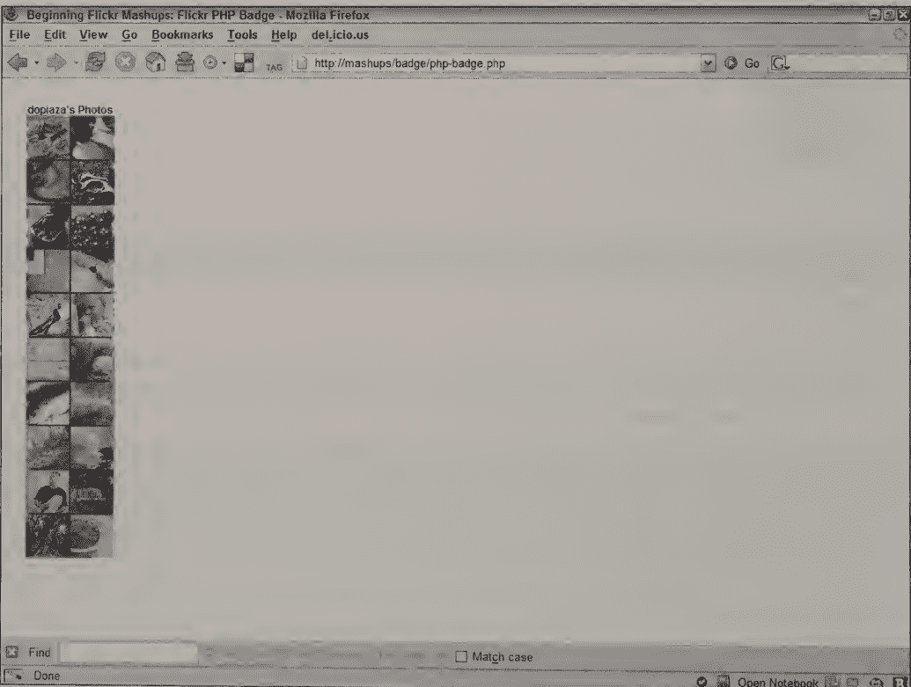

图 5-5

### 工作原理

在本练习中，你在`badge.css`文件中添加了多条独立的 CSS 规则，每条规则都进一步改善了徽章的外观。下面我来逐一介绍这些规则的作用。

```css
.badge-item img{
  border: 1px solid #333333;
  width: 48px;
  height: 48px;
}
```

这条 CSS 规则表示，对于所有包含在`badge-item`类元素内的``元素，图片的宽度和高度应缩小到 48 像素，边框设置为深灰色的一像素线条。

下一条规则去除了项目符号，并将图片显示在同一行：

```css
.badge-item {
  display: inline;
  list-style-type: none;
}
```

这条规则将`list-style-type`设置为`none`——这意味着列表项旁边不会显示项目符号。同时将显示模式设置为`inline`，即每个元素之后不会强制换行。


接下来你添加了一条规则，将图片排列成 2×10 的网格。调整大小后，每张图片的宽度为 48 像素，且每条边都有一像素的边框。这意味着每张图片在每条边上总共占据 1 + 48 + 1，即 50 像素。因此，2×10 的图片网格宽度为 100 像素。这些图片位于一个 `badge-items` 类的 `<ul>` 元素内，因此可以通过以下规则将该元素的宽度强制设为 100 像素：

```css
.badge-items {
  width: 100px;
  margin: 0;
  padding: 0;
}
```

`margin` 和 `padding` 标签用于覆盖浏览器对列表的默认设置，并将这些值强制设为零。

最后一条规则调整了字体大小，并确保标题在徽章上方居中显示：

```css
.badge {
  width: 100px;
}
.badge-title {
  font-size: 12px;
  font-weight: 600;
  text-align: center;
}
.badge p {
  margin: 0;
  padding: 0;
}
```

### 使用 JavaScript 的客户端徽章

既然你已经构建了一个 Flickr 徽章，让我们来看看另一种方法。前面的示例使用服务器上的 PHP 来构建徽章的 HTML——在本示例中，你将构建一个相同的徽章，但使用 JavaScript 在浏览器中生成 HTML。你可能出于多种原因希望在客户端而不是服务器上创建徽章。最重要的是，你可能想将徽章托管在不支持 PHP 的地方，或者你只是想减轻服务器的工作量。当然，要让这样的徽章正常工作，用户的浏览器必须支持 JavaScript。所有主流浏览器都支持 JavaScript，但用户可以选择禁用它——对于这样做的人，你的徽章将不可见。

对于客户端徽章，用户的浏览器向 Web 服务器请求网页的副本。然后浏览器执行页面中包含的 JavaScript，并发送第二个请求，这次是发送到 Flickr，以获取 Flickr 订阅源。浏览器中运行的 JavaScript 随后处理订阅源并生成相应的 HTML。信息流如图 5-6 所示。

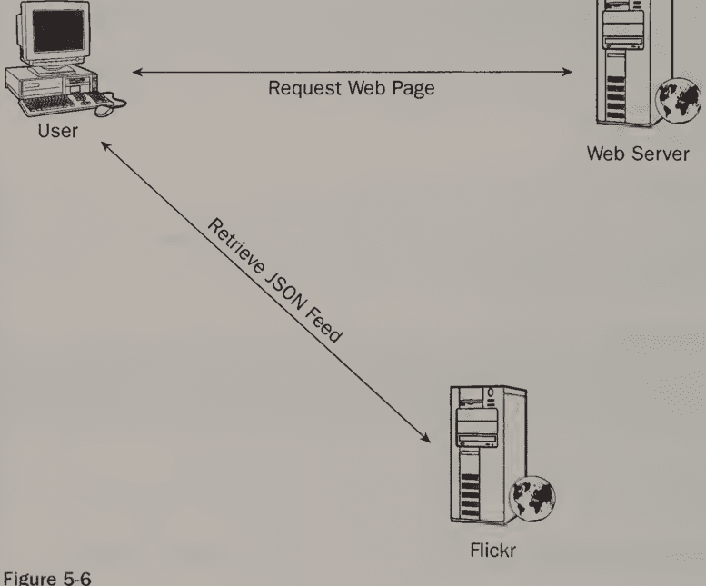

图 5-6

如果用户多次查看你的网页，创建徽章的 JavaScript 很可能已被浏览器缓存，因此不需要每次都从服务器获取，从而降低了用户机器和服务器之间的带宽使用。然而，这一优势被用户机器本身必须从 Flickr 获取订阅源副本的事实所抵消。

这里的目标是构建与 PHP 徽章生成的完全相同的 HTML，但使用 JavaScript 来实现。如果你查看前面列出的订阅源格式列表，你会看到有一个 JSON 订阅源。JSON（JavaScript 对象表示法）非常适合 JavaScript 应用程序。实际上，与 PHP 订阅源类似，它会生成一段要在浏览器中执行的 JavaScript 代码：

110

### 动手试试：创建客户端徽章

PHP 订阅源初始化了一个 `$feed` 变量，而 JSON 订阅源则调用一个名为 `jsonFlickrFeed()` 的 JavaScript 函数，该函数接受一个参数——一个表示订阅源的 JavaScript 对象。要处理该订阅源，你需要在文档中定义一个 JavaScript 函数 `jsonFlickrFeed()`。

1. 在你的徽章目录中创建一个名为 `badge.js` 的新文件：

```javascript
function jsonFlickrFeed(feed)
{
    var imgPattern = /(http:\/\/static.flickr.com\/\d+\/\d+_[0-9a-z]+)_m\.jpg/;
    var s = "";

    s += '<div class="badge">';
    s += '<p class="badge-title"><a href="' + feed['link'] + '">' + feed['title']
         + '</a></p>';
    s += '<ul class="badge-items">';

    var items = feed['items'];
    for (var i = 0; i < items.length; i++)
    {
        var result = imgPattern.exec(items[i]['description']);

        if (result != null)
        {
            var image = result[1] + '_s.jpg';
            s += '<li class="badge-item"><a href="' + items[i]['link'] + '"></a></li>';
        }
    }

    s += '</ul></div>';

    document.writeln(s);
}
```

### 工作原理

除了明显的语法差异外，这里的代码与前面 PHP 版本中的几乎相同。HTML 在一个名为 `s` 的变量中拼接而成，最后调用 `document.writeln(s)` 将 HTML 输出到文档中。

最显著的区别在于某些字段的命名。在 PHP 订阅源中，你通过关联数组中名为 `url` 的字段来访问照片流和照片页面的链接。而 JavaScript 对象中对应的字段是 `link`。类似的不一致之处散布在整个订阅源中——无论何时使用订阅源，都应亲自查看其输出，以确保你正确地访问了它。

## 第二部分：改造 Flickr

既然你已经创建了徽章，现在需要创建一个页面来展示它。

### 动手试试：展示客户端徽章

在这个练习中，你将创建一个 HTML 页面来展示你的客户端徽章。

1. 在徽章目录下创建一个 HTML 页面 `javascript-badge.html`。

```html
<!DOCTYPE html PUBLIC "-//W3C//DTD XHTML 1.0 Transitional//EN"
"http://www.w3.org/TR/xhtml1/DTD/xhtml1-transitional.dtd">
<html xmlns="http://www.w3.org/1999/xhtml">
<head>
    <title>Flickr Mashups: Javascript Badge</title>
    <link href="../css/main.css" rel="stylesheet" type="text/css" />
    <link href="../css/badge.css" rel="stylesheet" type="text/css" />
</head>
<body>

<script src="badge.js" type="text/javascript"></script>
<script
src="http://api.flickr.com/services/feeds/photos_public.gne?id=50317659@N00&format=json" type="text/javascript"></script>

</body>
</html>
```

### 工作原理

HTML 只是包含了两个 JavaScript 文件。首先包含 `badge.js`，以确保 JavaScript 函数 `jsonFlickrFeed` 已定义。然后包含 Flickr 订阅源本身——记住，JSON Flickr 订阅源的格式是一行可直接执行的 JavaScript 代码，该代码调用 `jsonFlickrFeed` 函数。

当你在浏览器中查看 `javascript-badge.html` 文件时，应该能看到展示的徽章——实际上，它应该与图 5-5 中由 PHP 版本脚本展示的徽章完全相同。

## 总结

在本章中，你了解了 Flickr 上可用的不同订阅源，以及可用的不同订阅源格式。你已经看到了如何通过 Web 浏览器请求订阅源的内容，如何将 PHP 订阅源获取到 PHP 脚本中，如何将 JSON 订阅源获取到 JavaScript 脚本中，以及如何将订阅源的内容格式化为 HTML 徽章。

在下一章中，你将看到如何使用 Flickr API 来完成使用 Flickr 提供的标准订阅源无法实现的事情。然而，在进入那一章之前，请尝试通过以下练习进一步自定义你的 Flickr 徽章。

## 练习

1. 本章构建的 Flickr 徽章将图像布局为 2 × 10 的网格，这非常适合定位在页面边缘。在其他情况下，更宽的网格可能更合适。更改徽章的 CSS，使图像显示为 5 × 4 的网格。
2. Flickr 也提供用于群组池以及个人照片流的订阅源。修改 Flickr 徽章代码以显示来自 Utata 群组池的图片。你可以在 `http://www.flickr.com/groups/utata/` 找到 Utata 群组，其 NSID 是 `81474450@N00`。

# 6 使用 API 改造 Flickr

在上一章中，你使用了各种 Flickr 订阅源来生成 Flickr 上一些照片的自定义视图。然而，订阅源有些局限——你只能获取某些照片集，而且关于照片的元数据有限。如果你想构建更复杂的东西，就需要使用 Flickr API。

在本章中，你将使用 Flickr API 构建一个画廊网站，展示你最近的一些精选照片。你还将看到如何使用 API 在你的照片流中查找图像，并将它们显示为动态生成的集合。

## 基础知识：一个简单的照片画廊

与许多其他 Flickr 改造一样，照片画廊应用具有相当简单的架构。最终用户的所有页面请求都发送到 Web 服务器。Web 服务器从 Flickr 获取信息以帮助构建请求的页面，然后将完成的页面返回给用户。照片本身存储在 Flickr 的服务器上，由客户端浏览器直接从那里获取。信息流如图 6-1 所示。

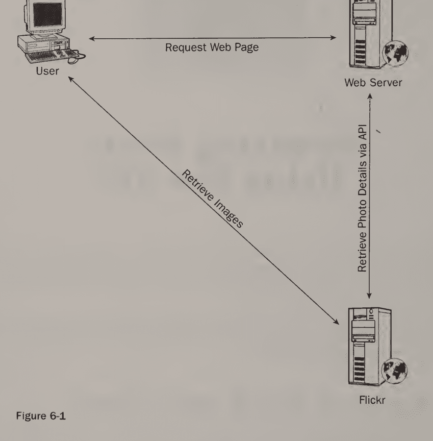

### 设置环境

在第 4 章中，你已经了解了使用 API 工具包的概念。大多数围绕 Flickr 构建的应用程序都使用流行的 API 工具包之一来处理构建请求消息和解析响应这些相当繁琐的业务——当然，你总是可以从头开始做所有事情，但重新发明轮子意义不大。在本章及后续章节中，你将使用由 Dan Coulter 创建的 phpFlickr 库。PhpFlickr 在 GNU 通用公共许可证（GPL）下分发，可以从 SourceForge 的 `http://sourceforge.net/projects/phpflickr` 下载，而 phpFlickr 主网站在 `http://www.phpflickr.com/`。

安装非常简单——只需下载最新版本并将其解压到你的网站 `lib` 目录中。创建的目录可能包含版本号（例如 `phpFlickr-1.6.1`）——如果是这样，请将其重命名为 `phpFlickr`。

在编写本书时，phpFlickr 版本 2 已发布。此版本的工作方式与 1.x 版本略有不同，并且不提供向后兼容性。要使用本书中的示例，你应该下载 1.x 版本的 phpFlickr——撰写本文时的最新版本是 1.6.1，所有 1.x 版本都可在 SourceForge 与版本 2 一起下载。

### 使用 phpFlickr

使用 phpFlickr 与 Flickr 通信非常简单，正如你将在本练习中看到的。

1. 为此项目创建一个名为 `gallery` 的新目录，并在其中创建一个名为 `6-1.php` 的新文件，内容如下——请务必用你的实际 Flickr API 密钥替换文本 `YOUR-API-KEY`：

```php
<?php

include (dirname(__FILE__) . '/../lib/phpFlickr/phpFlickr.php');

$nsid = '50317659@N00';
$flickr = new phpFlickr('YOUR-API-KEY', NULL, false);

$args = array(
    'user_id' => $nsid,
    'sort' => 'date-posted-desc',
    'page' => 1,
    'per_page' => 5
);

$p = $flickr->photos_search($args);

if ($flickr->getErrorCode())
{
    echo ("Error fetching photos: " . $flickr->getErrorMsg());
}

echo "<pre>\n";
print_r($p);
echo "</pre>\n";
?>
```

2. 完成后，将浏览器指向 `6-1.php` 文件，你应该会看到类似以下的内容：

```text
Array
(
    [_name] => photos
    [_attributes] => Array
        (
            [page] => 1
            [pages] => 478
            [perpage] => 5
            [total] => 2389
        )

    [_value] => 
    [page] => 1
)
```

```text
[pages] => 478

[pages] => 478

[perpage] => 5

[total] => 2389

[photo] => Array

(

    [0] => Array

        (

            [_name] => photo

            [_attributes] => Array

                (

                    [id] => 191649377

                    [owner] => 50317659@N00

                    [secret] => 0d3e1a54ed

                    [server] => 61

                    [title] => Door

                    [ispublic] => 1

                    [isfriend] => 0

                    [isfamily] => 0

                )

            [_value] => 

            [id] => 191649377

            [owner] => 50317659@N00

            [secret] => 0d3e1a54ed

            [server] => 61

            [title] => Door

            [ispublic] => 1

            [isfriend] => 0

            [isfamily] => 0

        )

    ...

)
```

3. 显示的 PHP 对象包含我的照片流中最近照片的列表。如果你想在自己的照片流上尝试，只需在 PHP 文件中输入你自己的 NSID：

```php
$nsid = '50317659@N00';  // <-- 在这里输入你的 NSID
```

### 工作原理

PHP 脚本的第一行是一个 `include` 语句，用于设置 phpFlickr 库。接下来，创建一个 phpFlickr 对象的实例：

```php
$flickr = new phpFlickr('YOUR-API-KEY', NULL, false);
```

第一个参数是你的 Flickr API 密钥。第二个参数仅在需要进行认证调用时使用。你将在第 7 章中了解更多；目前，你可以将其保留为 `NULL`。第三个参数是一个布尔值，告诉 phpFlickr 在收到来自 Flickr API 的错误响应时是否中止。此处此参数设置为 `false`，因为脚本会显式检查错误代码。如果你愿意，可以将其设置为 `true`，在这种情况下，如果 Flickr API 在任何时候返回错误响应，phpFlickr 将打印一条错误消息并立即终止脚本。

## 第二部分：二次创作 Flickr

PhpFlickr 的做法非常简单：它直接抓取 Flickr 响应中 `<rsp>` 元素的内容，并将其 XML 结构直接复制到 PHP 数据结构中。对于 XML 文档中的每个元素，都会创建 `_name`、`_value` 和 `_attributes` 数组元素。其中 `_name` 包含节点的名称，`_attributes` 是另一个关联数组，包含该元素的属性；对于文本节点，`_value` 包含元素的值——而非文本节点的 `_value` 则为空。因此，对于刚才看到的响应中的顶层 `<photos>` 元素，会生成如下 PHP 数据：

```text
Array

(

    [_name] => photos

    [_attributes] => Array

        (

            [page] => 1

            [pages] => 478

            [perpage] => 5

            [total] => 2389

        )

    [_value] =>

)
```

因此，若要访问数组中的 `total` 属性，你需要编写如下代码：

```php
// $p 为 phpFlickr 返回的数组名称

$total = $p['_attributes']['total'];
```

为了方便起见，phpFlickr 会将这些属性复制到元素自身的数组中，于是 PHP 数组变为如下形式：

```text
Array
(


```php
[_name] => photos

[_attributes] => Array
(
    [page] => 1
    [pages] => 478
    [perpage] => 5
    [total] => 2389
)

[_value] =>

[page] => 1
[pages] => 478
[perpage] => 5
[total] => 2389
)
```

## 第 6 章：使用 API 二次创作 Flickr

这意味着访问`total`属性的代码可以简化为：

```php
$total = $p['total'];
```

最后，每个子元素都会创建一个新的数组，并重复上述过程。本例中包含一组`photo`元素，因此会针对`photo`元素列表创建一个新数组，该数组的每个成员本身也是一个数组，包含对应`photo`元素的详细信息：

```php
Array
(
    [_name] => photos

    [_attributes] => Array
    (
        [page] => 1
        [pages] => 478
        [perpage] => 5
        [total] => 2389
    )

    [_value] =>

    [page] => 1
    [pages] => 478
    [perpage] => 5
    [total] => 2389

    [photo] => Array
    (
        [0] => Array
        (
            [_name] => photo

            [_attributes] => Array
            (
                [id] => 191649377
                [owner] => 50317659@N00
                [secret] => 0d3e1a54ed
                [server] => 61
                [title] => Door
                [ispublic] => 1
                [isfriend] => 0
                [isfamily] => 0
            )

            [_value] =>

            [id] => 191649377
            [owner] => 50317659@N00
            [secret] => 0d3e1a54ed
            [server] => 61
            [title] => Door
            [ispublic] => 1
            [isfriend] => 0
            [isfamily] => 0
        )

        ...
    )
)
```

如果你不确定`phpFlickr`方法返回的结构，使用`print_r`是一个快速简便的方法，可以用来检查结构并了解如何访问不同的元素。

## 显示照片

正如你刚才所见，只需在网页中嵌入少量 PHP 代码，就能轻松通过`phpFlickr`从 Flickr 检索照片详情。接下来你将看到如何利用返回的数据结构，将其转换为 HTML 来展示照片。在本章及后续章节中，你将大量用到此处编写的代码，因此是时候开始引入一些结构和组织方式了。

### 动手实践：创建你的照片画廊

现在来开始构建你的照片画廊。完成时，将涉及多个网页来展示画廊的不同部分，因此与其在每个页面中重复代码，不如先从构建一个可复用的代码库入手，这正是此类项目的良好开端。

1. 第一步是构建一个 PHP 类来处理大部分工作。创建一个名为`FlickrGallery.php`的新文件，并将其放在网站的`lib`目录下：

```php
<?php

class FlickrGallery
{
    var $flickr;
    var $nsid = '50317659@N00';

    function FlickrGallery()
    {
        globalBhargav_error_reporting(false);
        $this->flickr = new phpFlickr($flickrApiKey, $flickrApiSecret, false);
    }

    function findRecentPhotos($n = 20)
    {
        $args = array(
            'user_id' => $this->nsid,
            'sort' => 'date-posted-desc',
            'page' => 1,
            'per_page' => $n
        );

        $p = $this->flickr->photos_search($args);

        if ($this->flickr->getErrorCode())
        {
            echo ("Error fetching photos: " . $this->flickr->getErrorMsg());
        }

        return $p['photo'];
    }
}

?>
```

2. 在网站的`lib`目录下创建名为`apikey.php`的文件，将`YOUR-API-KEY`替换为你的实际 Flickr API 密钥：

```php
<?php

$flickrApiKey = 'YOUR-API-KEY';
$flickrApiSecret = NULL;

?>
```

你可能会注意到，这个文件名全部是小写的，而之前的`FlickrGallery.php`则是大小写混合的。我们采用的约定是：包含 PHP 类的文件以其包含的类命名——而通常的惯例是类名使用首字母大写的大小写混合形式。当然，你可以使用任何你喜欢的命名约定，但坚持这样一套通用且一致的系统，会让你更容易理解代码的结构。

3. 接下来，在网站的`lib`目录下创建`gallery.php`文件：

```php
<?php

require_once(dirname(__FILE__) . '/apikey.php');
require_once(dirname(__FILE__) . '/phpFlickr/phpFlickr.php');
require_once(dirname(__FILE__) . '/FlickrGallery.php');

header("Content-Type: text/html; charset=utf-8");

?>
```

4. 现在来编写 HTML 页面。在`gallery`目录下创建名为`index.php`的新文件：

```php
<?php include (dirname(__FILE__) . '/../lib/gallery.php') ?>

<!DOCTYPE html PUBLIC "-//W3C//DTD XHTML 1.0 Transitional//EN"
  "http://www.w3.org/TR/xhtml1/DTD/xhtml1-transitional.dtd">

<html xmlns="http://www.w3.org/1999/xhtml">

<head>
  <title>Flickr Gallery</title>
  <link href="../css/main.css" rel="stylesheet" type="text/css" />
</head>

<body>

<?php
  $gallery = new FlickrGallery();
?>

  <ul class="photo-set">

  <?php

    $recentPhotos = $gallery->findRecentPhotos();

    foreach ($recentPhotos as $photo)
    {
      $title = htmlentities($photo['title']);

      $img = 'http://static.flickr.com/' . $photo['server'] . '/' . $photo['id']
        . '_' . $photo['secret'] . '_s.jpg';

  ?>

    <li>" alt="<?php echo $title ?>" title="<?php echo $title ?>" /></li>

<?php
```

## 第二部分：改造 Flickr

5. 如果你在浏览器中查看`index.php`页面，你会看到类似图 6-2 的内容。

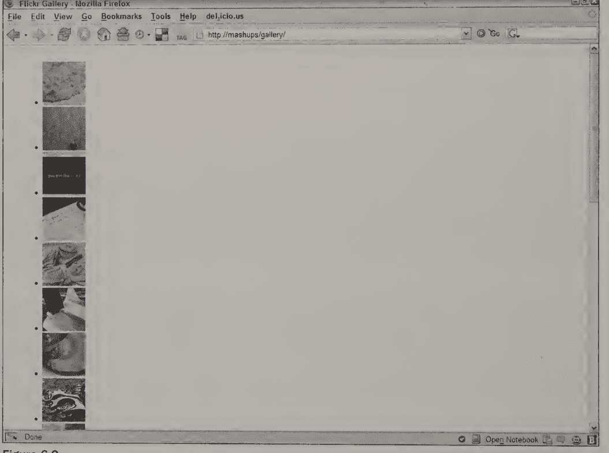

图 6-2

### 工作原理

正如我之前提到的，你做的第一件事是构建一个 PHP 类。`FlickrGallery`类将你在前面示例中使用的代码封装到一个 PHP 类中。该类提供了一个构造函数和一个方法——`findRecentPhotos()`，该方法调用`phpFlickr`的`photos_search`方法来检索照片列表。参数`$n`指定要返回的照片数量，其默认值为 20。返回值是照片数组。

每次访问 Flickr，你都需要使用你的 API 密钥。为了不必在许多不同的文件中都放置这个密钥，你可以创建一个定义密钥的单一文件，然后在任何需要引用它的文件中包含它。这就是为什么你创建了`apikey.php`文件。该文件定义了两个包含你的 Flickr API 密钥和 API 密钥的全局变量。不要担心 API 密钥；这将在第 7 章中解释——现在它只是一个占位符。

你创建的文件`gallery.php`只是将不同文件所需的`require`语句集中到一个地方，这样当你创建 HTML 文件时，可以很容易地包含它们。它还确保返回给页面的`content-type`头的字符编码设置为 UTF-8。请记住，所有从 Flickr 发送回来的消息都编码为 UTF-8，如果你想让任何特殊字符正确显示，你必须告诉浏览器使用哪种字符编码。

最后，生成 HTML 的 PHP 代码非常简单——它实例化一个新的`FlickrGallery`对象并调用`findRecentPhotos()`。然后它遍历返回的每张照片，在过程中创建一个列表。

每个生成的列表项包含一个图像——在本例中是方形版本。设置了`alt`和`title`属性，因此在大多数浏览器中，如果你将鼠标光标放在图像上，你会看到照片标题作为工具提示出现。

```html
<li>" alt="<?php echo $title ?>" title="<?php echo $title ?>" /></li>
```

现在是时候添加一些 CSS 了。

## 为结果添加样式

虽然你现有的画廊可以工作，但它看起来不一定很好。你要做的下一件事是为你的网站添加一个 CSS 文件，其中包含一些样式指令，以改善画廊的外观。

### 动手实践：为照片画廊添加样式

在这个练习中，你将添加 CSS 指令来为画廊添加合适的样式。

1. 在网站的`css`目录中创建一个新文件`gallery.css`：

```css
.photo-set {
    list-style-type: none;
    width: 655px;
    margin: 2em 0 0 60px;
    padding: 0;
}

.photo-set li {
    float: left;
    width: 131px;
    text-align: center;
    margin-bottom: 1em;
}

.photo-set img {
    margin: 20px 20px 5px 20px;
    padding: 5px;
    border: 3px solid #EEEEEE;
}
```

2. 然后更新画廊的`index.php`文件以引用此样式表：

```php
<?php include (dirname(__FILE__) . '/../lib/gallery.php') ?>

<!DOCTYPE html PUBLIC "-//W3C//DTD XHTML 1.0 Transitional//EN"
  "http://www.w3.org/TR/xhtml1/DTD/xhtml1-transitional.dtd">

<html xmlns="http://www.w3.org/1999/xhtml">

<head>
  <title>Flickr Gallery</title>
  <link href="../css/main.css" rel="stylesheet" type="text/css" />
  <link href="../css/gallery.css" rel="stylesheet" type="text/css" />
</head>

<body>

...

</body>
</html>
```

3. 添加样式表后，你现在就有了类似图 6-3 的内容。

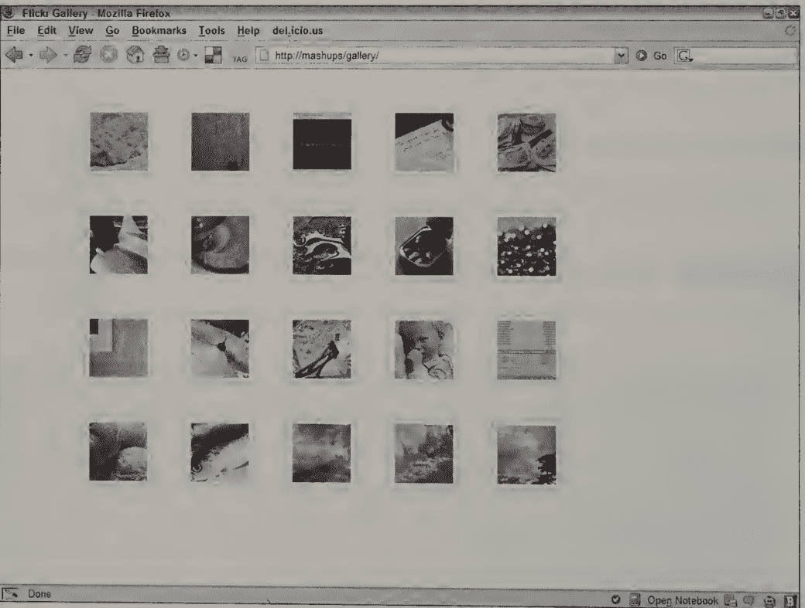

图 6-3

### 工作原理

样式表设置了画廊主要元素的边距、内边距和边框，正如你在第 5 章的 Flickr 徽章中看到的那样。

从 Flickr 检索到的每张方形图像为 75 x 75 像素。样式表定义了左右 20 像素的边距，3 像素的边框和 5 像素的内边距。这意味着每张图像在屏幕上的宽度为 20 + 3 + 5 + 75 + 5 + 3 + 20，即 131 像素。通过将照片集宽度设置为 655 像素，你可以以五列的网格显示它们。

## 照片页面

现在是时候开始使用 Flickr API 的另一部分了，即`flickr.photos.getInfo`方法，该方法将使你能够了解照片的更多信息。

### 动手实践：创建照片页面

显示一组缩略图固然很好，但你还需要能够查看全尺寸图像。接下来，你将添加一个页面来显示照片的较大版本，以及从 Flickr 获取的一些其他信息。

1. 在`FlickrGallery.php`文件中添加一个新方法：

```php
<?php

class FlickrGallery
{
    ...

    function getPhotoInfo($id)
    {
        $p = $this->flickr->photos_getInfo($id);

        if ($this->flickr->getErrorCode())
        {
            echo ("Error getting photo info: " . $this->flickr->getErrorMsg());
        }

        return $p;
    }
}

?>
```

2. 在你的画廊目录中创建一个名为`photo.php`的页面：


```php
<?php include (dirname(__FILE__) . '/../lib/gallery.php') ?>
<!DOCTYPE html PUBLIC "-//W3C//DTD XHTML 1.0 Transitional//EN"
  "http://www.w3.org/TR/xhtml1/DTD/xhtml1-transitional.dtd">
<html xmlns="http://www.w3.org/1999/xhtml">
<head>
  <title>Flickr Gallery</title>
  <link href="../css/main.css" rel="stylesheet" type="text/css" />
  <link href="../css/gallery.css" rel="stylesheet" type="text/css" />
</head>
<body>
<?php
  $gallery = new FlickrGallery();
  $id = $_REQUEST['id'];
  if (!empty($id))
  {
    $info = $gallery->getPhotoInfo($id);
    $title = $info['title'];
    $img = 'http://static.flickr.com/' . $info['server'] . '/' . $info['id'] . '_' . $info['secret'] . '.jpg';
    $photoPage = 'http://www.flickr.com/photos/' . $info['owner']['nsid'] . '/' . $id . '/';
  }
?>

<div class="photo-display">
  <p class="photo-title"><?php echo $title ?></p>
  <p class="photo-image"><a href="<?php echo $photoPage ?>">" alt="<?php echo $title ?>" title="<?php echo $title ?>" /></a></p>
</div>
</body>
</html>
```

### 3. 对`gallery.css`样式表进行一些补充，以布局照片页面

```css
.photo-display {
  width: 530px;
  margin: 2em 0 0 60px;
  padding: 0;
  text-align: center;
}

.photo-display .photo-title {
  font-size: large;
  font-weight: bold;
  text-align: center;
}

.photo-display .photo-image img {
  margin: 0;
  padding: 5px;
  border: 3px solid #EEEEEE;
}
```

### 4. 修改画廊的`index.php`，使缩略图图像链接到照片页面

```php
<?php include (dirname(__FILE__) . '/../lib/gallery.php') ?>
<!DOCTYPE html PUBLIC "-//W3C//DTD XHTML 1.0 Transitional//EN"
"http://www.w3.org/TR/xhtml1/DTD/xhtml1-transitional.dtd">
<html xmlns="http://www.w3.org/1999/xhtml">
<head>
<meta http-equiv="Content-Type" content="text/html; charset=iso-8859-1" />
<title>Flickr Gallery</title>
<link href="../css/main.css" rel="stylesheet" type="text/css" />
<link href="../css/gallery.css" rel="stylesheet" type="text/css" />
</head>
<body>
<?php
	$gallery = new FlickrGallery();
?>
	<ul class="photo-set">
	<?php
		$recentPhotos = $gallery->findRecentPhotos();
		foreach ($recentPhotos as $photo)
		{
			$title = $photo['title'];
			$img = 'http://static.flickr.com/' . $photo['server'] . '/' . $photo['id']
				. '_' . $photo['secret'] . '_s.jpg'
	?>
		<li><a href="photo.php?id=<?php echo $photo['id'] ?>">" alt="<?php echo $title ?>" title="<?php echo $title ?>" /></a></li>
<?php
	}
	?>
	</ul>
</body>
</html>
```

### 5. 在浏览器中打开此`index.php`页面

单击其中一个缩略图——你应该会看到照片页面看起来类似于图 6-4。

## 第二部分：重新混合 Flickr

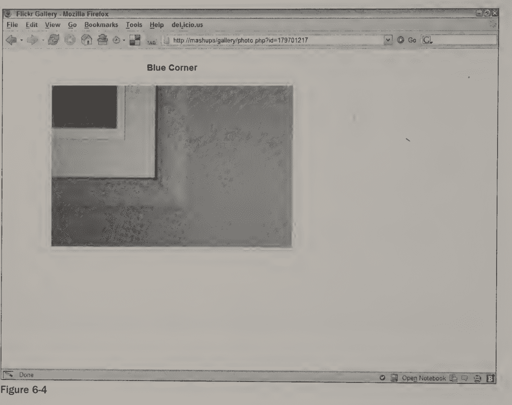

图 6-4

### 工作原理

你添加到`FlickrGallery.php`的新方法`getPhotoInfo()`调用了 phpFlickr 的`photos_getInfo()`方法，而该方法又针对指定照片调用了 Flickr 的`flickr.photos.getInfo`方法。`photos_getInfo()`在这里接受一个参数，即被请求的照片 ID。通常，如果你查阅 Flickr API 文档，phpFlickr 方法的参数是明确的；但如果你有疑问或需要确认，只需查看`phpFlickr.php`文件本身并搜索该方法名——你就能看到所需的参数列表。

现在，索引页上显示的每个缩略图都是一个指向新`photo.php`页面的链接。该页面首先从 HTTP 请求中获取`id`参数——这是待显示照片的照片 ID。然后检索照片信息并显示照片。照片本身被包含在一个`<a>`标签中，使其成为指向该照片 Flickr 页面的超链接——请记住，Flickr 的使用条款要求在以这种方式显示图像时包含一个返回 Flickr 照片页面的链接。

`gallery.css`中定义了一些新类，使`photo.php`看起来更美观。照片显示区域的宽度被设定为 530 像素，内容居中。定义了照片标题的字体，并在照片周围绘制了灰色边框。

## 使用 AJAX

如果在照片页面上显示更多信息会很棒，例如照片描述或标签，但目前的照片页面相对简洁，没有太多无关信息分散对图像的注意力。你可以简单地链接到另一个包含照片描述的页面，但这是一种相当笨拙的方法。更好的包含更多信息的方法是在照片底部添加一个“更多信息”链接，当点击该链接时，描述会显示在照片下方。

AJAX，即异步 JavaScript 和 XML，使你能够从 Web 服务器后台（异步地）请求另一个文档——换句话说，无需重新加载页面。然后，你可以使用标准的动态 HTML 技术修改正在显示的页面内容。在这种显示信息的情况下，这是一种非常流行的技术，Flickr 在其自己的网站上也广泛使用它。这种方法的主要问题是处理当前使用的各种浏览器之间存在的巨大差异。所有现代浏览器都以某种形式支持 AJAX，但它们实现的方式因浏览器而异。

与其在此花费时间处理跨浏览器兼容性永无止境的复杂性，我们将转向互联网。随着 AJAX 当前的流行，出现了许多 AJAX 工具包来简化 AJAX 应用程序的创建——使用一个成熟的库可以大大减少你的应用程序开发时间，并帮助避免许多不眠之夜。

### `prototype.js`库

一个非常流行的工具包是 Sam Stephenson 的 Prototype 库。它完全免费使用，可以从 http://prototype.conio.net/ 下载。它是一个旨在使动态 Web 应用程序开发更轻松的 JavaScript 框架，被描述为“正在迅速成为各地 Web 应用程序开发人员的首选代码库”。

下载`prototype.js`文件，并在你的站点`lib`目录中为其创建一个`js`目录——你下载的软件包将包含多个文件，但本示例只需要`prototype.js`。`prototype.js`文件大小约为 40K，因此它可能会稍微增加你应用程序的加载时间。然而，这是一次性的成本，因为 Web 浏览器通常只在第一次加载该文件，并在后续访问该页面时使用缓存的副本。

Prototype 库的文档可以在 http://wiki.script.aculo.us/scriptaculous/show/Prototype 找到。

### 实际操作：使用`prototype.js`库

构建画廊 AJAX 增强功能的第一步是生成要显示的新信息。一个常用的方法（也是本文将采用的方法）是生成一个 HTML 片段，可以简单地将其放入文档中的相应位置。

#### 1. 创建`info.php`

在`gallery`目录中创建一个新文件`info.php`：

```php
<?php

include (dirname(__FILE__) . '/../lib/gallery.php');

function decodeHTML($text)
{
  $s = str_replace("&lt;", "<", $text);
  $s = str_replace("&gt;", ">", $s);
  $s = str_replace("&quot;", "\"", $s);
  $s = str_replace("&amp;", "&", $s);

  return $s;
}

$gallery = new FlickrGallery();
$id = $_REQUEST['id'];
if (!empty($id))
{
  $info = $gallery->getPhotoInfo($id);
  $description = nl2br(decodeHTML($info['description']));
  $tags = $info['tags']['tag'];

?>
<div class="photo-info">
  <div class="photo-description"><?php echo $description ?></div>
  <ul class="photo-tags">
<?php
  if (!empty($tags))
  {
    foreach ($tags as $tag)
    {
?>
      <li><?php echo $tag['raw'] ?></li>
<?php
    }
  }
?>
  </ul>
</div>
<?php
}
?>
```

#### 2. 测试`info.php`

此页面并非设计为直接查看，但要测试它，你可以通过你的 Web 浏览器尝试这个 PHP 脚本——只需输入页面的 URL 并附加你希望查看的照片 ID。实际 URL 取决于你如何设置你的 Web 服务器，但应类似于：

`http://localhost/gallery/info.php?id=185608819`

其中`185608819`是正在查看的照片 ID。如果你查看结果页面的源代码，你将看到以下内容：

```html
<div class="photo-info">
  <div class="photo-description">For <a href="http://www.flickr.com/groups/projectinsight/">projectinsight</a><br />
<br />
Theme: liquid<br />
<br />
[DSC_2451]</div>
<ul class="photo-tags">
  <li>black</li>
  <li>liquid</li>
  <li>water</li>
  <li>slate</li>
  <li>projectinsight</li>
</ul>
</div>
```

这里的 HTML 不是一个完整的页面——只是要在现有照片页面上下文中显示的 HTML 片段。

#### 3. 创建`gallery.js`

下一步是创建一个 JavaScript 函数来从`info.php`请求 HTML 片段。在你的站点`lib/js`目录中创建一个新文件`gallery.js`：

```javascript
function displayInfo(id)
{
  var s = 'id=' + id;

  new Ajax.Request('info.php',
  {
    parameters: s,
    method: "post",
    onSuccess:function(response)
    {
      var node = $('photo-info-' + id);
      node.innerHTML = response.responseText;
    },
    onFailure:function(response)
    {
      alert('Error: ' + response.status + ' ' + response.statusText);
    }
  });
}
```

#### 4. 修改`photo.php`

`photo.php`页面需要更新以包含“更多信息”链接。按如下方式修改`photo.php`：

```php
<?php include (dirname(__FILE__) . '/../lib/gallery.php') ?>
<!DOCTYPE html PUBLIC "-//W3C//DTD XHTML 1.0 Transitional//EN"
"http://www.w3.org/TR/xhtml1/DTD/xhtml1-transitional.dtd">
<html xmlns="http://www.w3.org/1999/xhtml">
<head>
  <title>Flickr Gallery</title>
  <link href="../css/main.css" rel="stylesheet" type="text/css" />
  <link href="../css/gallery.css" rel="stylesheet" type="text/css" />
  <script type="text/javascript" src="../lib/js/prototype.js"></script>
  <script type="text/javascript" src="../lib/js/gallery.js"></script>
</head>
<body>
<?php
$gallery = new FlickrGallery();
$id = $_REQUEST['id'];
if (!empty($id))
{
  $info = $gallery->getPhotoInfo($id);
  $title = $info['title'];
  $img = 'http://static.flickr.com/' . $info['server'] . '/' . $info['id']
    . '_' . $info['secret'] . '.jpg';
  $photoPage = 'http://www.flickr.com/photos/' . $info['owner']['nsid'] . '/'
    . $id . '/';
}
?>
<div class="photo-display">
  <p class="photo-title"><?php echo $title ?></p>
  <p class="photo-image"><a href="<?php echo $photoPage ?>">" alt="<?php echo $title ?>" title="<?php echo $title ?>" /></a></p>
  <div id="photo-info-<?php echo $id ?>" class="photo-more"><a href="#"
onclick="displayInfo(<?php echo $id ?>); return false;">More info...</a></div>
</div>
</body>
</html>
```

#### 5. 添加 CSS 样式

最后，在`gallery.css`中添加一些 CSS 样式：

```css
.photo-info {
  width: 530px;
  text-align: left;
  margin-top: 1em;
}
.photo-info .photo-description {
  width: 530px;
  margin: 0;
}
ul.photo-tags {
  margin: 2em 0 0 0;
  background-color: #EEEEEE;
}
ul.photo-tags li {
  display: inline;
  margin: .5em 1em 0 0;
}
```

#### 6. 查看效果

现在在你的浏览器中查看画廊并导航到一个照片页面。你会看到照片下方有一个“更多信息”链接，点击它时，将显示类似图 6-5 的内容。

# 第 6 章：使用 API 混搭 Flickr

### 工作原理


在`info.php`中，注意照片描述可能包含HTML，但phpFlickr返回的描述中，字符`<`、`>`、`&`和`"`分别被表示为实体`&lt;`、`&gt;`、`&amp;`和`&quot;`。这些字符在描述显示之前会被转换回相应的原始字符。

当用户点击照片页面上的 More info 链接时，JavaScript函数`gallery.js`被调用。它创建了一个来自Prototype库的`Ajax.Request`对象实例。`Ajax.Request`对象封装了各种浏览器特定的异步HTTP请求发送方式。

`Ajax.Request`构造函数非常直观。第一个参数是请求发送到的页面，第二个是定义请求细节的对象。在这里，它包含发送的参数和使用的请求方法类型（通常是POST或GET）。还定义了两个事件处理程序，分别在请求成功完成或失败时调用。

`onSuccess`处理函数使用了Prototype库中定义的另一个方法——`$()`。这个方法用于根据ID查找文档中的元素。它本质上是`document.getElementById()`的简写。该处理函数在原始文档中查找id为`photo-info-ID`的节点（其中ID是照片ID），并用从`info.php`调用接收到的HTML块替换该节点的内容。

`photo.php`页面上的 More info 链接包含在一个`<div>`中，其ID格式为`photo-info-ID`（其中ID是相应照片的ID），这也是`gallery.js`将放置新HTML的元素。

## 增强相册

相册现在开始有点样子了，但还有一些可以改进的地方。首先，为每个页面添加一些公共元素会比较好，比如页眉和导航。因为它们在每个页面上都相同，你通常不希望每次修改页眉或导航时都要编辑每个页面——尤其是当你扩展应用程序以拥有更多页面时。解决这个问题的一个好方法是将公共元素放在单独的PHP文件中，并使用`include`语句将它们包含在每个页面中。

### 动手实践：添加页眉和导航

在这个练习中，你将创建一些单独的文件来存放页眉和导航，然后将它们包含在每个页面中。

1. 在`gallery`目录中创建文件`header.php`：

```html
<div id="gallery-header">Flickr Gallery</div>
```

2. 同样在`gallery`目录中创建文件`navigation.php`：

```html
<ul id="gallery-menu">
  <li><a href="../index.php">Mashups Home</a></li>
  <li><a href="index.php">Gallery</a></li>
</ul>
```

3. 修改现有的PHP页面以包含这些页面。在`gallery`目录中，修改`index.php`：

```php
<?php include (dirname(__FILE__) . '/../lib/gallery.php') ?>
<!DOCTYPE html PUBLIC "-//W3C//DTD XHTML 1.0 Transitional//EN"
    "http://www.w3.org/TR/xhtml1/DTD/xhtml1-transitional.dtd">
<html xmlns="http://www.w3.org/1999/xhtml">
<head>
    <title>Flickr Gallery</title>
    <link href="../css/main.css" rel="stylesheet" type="text/css" />
    <link href="../css/gallery.css" rel="stylesheet" type="text/css" />
</head>
<body>
<?php
$gallery = new FlickrGallery();
?>
<?php include ('header.php') ?>
<?php include ('navigation.php') ?>
<ul class="photo-set">
<?php
$recentPhotos = $gallery->findRecentPhotos();
foreach ($recentPhotos as $photo)
{
  $title = $photo['title'];
  $img = 'http://static.flickr.com/' . $photo['server'] . '/' . $photo['id']
    . '_' . $photo['secret'] . '_s.jpg'
?>
  <li><a href="photo.php?id=<?php echo $photo['id'] ?>">" alt="<?php echo $title ?>" title="<?php echo $title ?>" /></a></li><?php
}
?>
</ul>
</body>
</html>
```

4. 然后修改`photo.php`：

```php
<?php include (dirname(__FILE__) . '/../lib/gallery.php') ?>
<!DOCTYPE html PUBLIC "-//W3C//DTD XHTML 1.0 Transitional//EN"
  "http://www.w3.org/TR/xhtml1/DTD/xhtml1-transitional.dtd">
<html xmlns="http://www.w3.org/1999/xhtml">
<head>
  <title>Flickr Gallery</title>
  <link href="../css/main.css" rel="stylesheet" type="text/css" />
  <link href="../css/gallery.css" rel="stylesheet" type="text/css" />
  <script type="text/javascript" src="prototype.js"></script>
  <script type="text/javascript" src="gallery.js"></script>
</head>
<body>
<?php
  $gallery = new FlickrGallery();
  $id = $_REQUEST['id'];
  if (!empty($id))
  {
    $info = $gallery->getPhotoInfo($id);
    $title = htmlentities($info['title']);
    $img = 'http://static.flickr.com/' . $info['server'] . '/' . $info['id'] . '_'
      . $info['secret'] . '.jpg';
    $photoPage = 'http://www.flickr.com/photos/' . $info['owner']['nsid'] . '/'
      . $id . '/';
  }
?>
<?php include ('header.php') ?>
<?php include ('navigation.php') ?>
  <div class="photo-display">
    <p class="photo-title"><?php echo $title ?></p>
    <p class="photo-image"><a href="<?php echo $photoPage ?>">" alt="<?php echo $title ?>" title="<?php echo $title ?>" /></a></p>
<div id="photo-info-<?php echo $id ?>" class="photo-more"><a href="#"
onclick="displayInfo(<?php echo $id ?>); return false;">More info...</a></div>
</div>
</body>
</html>
```

5. 最后，在`gallery.css`中添加一些新样式：

```css
#gallery-header {
    padding: 0.5em 2em 0.5em 2em;
    margin: 0;
    font-size: large;
    font-weight: bold;
    color: #000000;
    background-color: #EEEEEE;
    text-align: right;
}

#gallery-menu {
    border-top: 1px solid #EEEEEE;
    border-bottom: 1px solid #EEEEEE;
    list-style-type: none;
    margin: 1em 0 0 0;
    padding: 0;
}

#gallery-menu li {
    display: inline;
    margin: .5em 2em .5em 2em;
}

#gallery-menu li a:hover {
    background-color: #EEEEEE;
    text-decoration: none;
}
```

6. 在浏览器中查看相册的`index.php`页面，你会发现它开始看起来更美观了——如图6-6所示。

### 工作原理

`header.php`和`navigation.php`这两个文件包含将出现在相册每个页面上的HTML片段。每次遇到PHP include指令时——

```php
<?php include ('header.php') ?>
```

——指定文件的内容会被读取并插入到主文件中。如果包含的文件包含PHP代码，该代码也会被执行，就像它本来就在主文件中一样。

当你有在网站多个地方出现的公共元素时，像这样使用`include`语句可以使网站管理变得更加简单。你可以进行全站范围的更改，而无需逐个编辑每个页面——只需编辑被包含的文件即可。将可重用的内容存储在单个文件中还能确保所有页面保持一致——只需维护这一个文件即可保持最新。

新的CSS样式将各个菜单项排列成水平行，并设置了字体和边框。`a:hover`样式被设置为当鼠标悬停在菜单链接上时，其背景颜色变为灰色。

## 智能相册集

本章对相册的最终增强是添加*智能相册集*（Smart Sets）。智能相册集是指内容不固定，而是在每次查看时动态生成的相册集。你将能够定义每个智能相册集中应显示多少张照片、如何从你的照片流中选择照片，以及如何对它们进行排序。

### 动手实践：定义智能相册集

在这个练习中，你将向现有相册添加智能相册集。然后你可以定义任意数量的相册集。每个动态生成的智能相册集使用多个参数来确定其中包含哪些照片。它们没有预定义的内容——每个都是在页面被查看时按需构建的。这意味着每当你向Flickr上传新照片时，它们会自动被纳入任何相关的智能相册集。

1. 向`FlickrGallery.php`添加几个方法：

```php
<?php

class FlickrGallery
{
  ...

  function showSmartSetThumbnail($linkPage, $title = "Set", $n = 20, $tags = "",
    $tagMode = "all", $sort = "date-posted-desc")
  {
    $s = "";
    $url = $linkPage . '?title=' . urlencode($title) . '&tags=' . urlencode($tags)
      . "&n=$n&tagMode=$tagMode&sort=$sort";
    // Get image to display
    $photos = $this->getSmartSet(1, $tags, $tagMode, $sort);

    if (is_array($photos) && count($photos) > 0)
    {
      $photo = $photos[0];
      $img = 'http://static.flickr.com/' . $photo['server'] . '/' . $photo['id']
        . '_' . $photo['secret'] . '_s.jpg';
      $s .= "<a href=\"$url\"></a>";
      $s .= "<p class=\"smart-set-caption\">" . $title . "</p>";
    }
    return $s;
  }

  function getSmartSet($n = 20, $tags = "", $tagMode = "all",
    $sort = "date-posted-desc")
  {
    $ret = array();

    $args = array(
      'user_id' => $this->nsid,
      'sort' => $sort,
      'page' => 1,
      'per_page' => $n,
      'extras' => 'owner_name'
    );

    if (!empty($tags))
    {
    }
```

## 第六章：使用 API 重新混搭 Flickr

```php
$args['tags'] = $tags;
$args['tag_mode'] = $tagMode;
}

$p = $this->flickr->photos_search($args);
if ($this->flickr->getErrorCode())
{
    echo ("Error fetching photos: " . $this->flickr->getErrorMsg());
}

if (is_array($p['photo']) && count($p['photo']) > 0)
{
    $ret = $p['photo'];
}

return $ret;
}

}

?>
```

2. 在你的gallery目录中，创建一个新文件`smartsets.php`。


```html
<?php include (dirname(__FILE__) . '/../lib/gallery.php') ?>
<!DOCTYPE html PUBLIC "-//W3C//DTD XHTML 1.0 Transitional//EN"
    "http://www.w3.org/TR/xhtml1/DTD/xhtml1-transitional.dtd">
<html xmlns="http://www.w3.org/1999/xhtml">
<head>
    <title>Flickr Gallery</title>
    <link href="../css/main.css" rel="stylesheet" type="text/css" />
    <link href="../css/gallery.css" rel="stylesheet" type="text/css" />
</head>
<body>
<?php
    $gallery = new FlickrGallery();
?>
<?php include ('header.php') ?>
<?php include ('navigation.php') ?>
<div class="smart-sets">
    <h1>Smart Sets</h1>
    <ul class="smart-sets-list">
        <li class="smart-set"><?php echo $gallery->showSmartSetThumbnail("smartset.php", "Most Interesting", 20, "", "", "interestingness-desc") ?></li>
        <li class="smart-set"><?php echo $gallery->showSmartSetThumbnail("smartset.php", "Cats", 20, "cat", "all", "interestingness-desc") ?></li>
        <li class="smart-set"><?php echo $gallery->showSmartSetThumbnail("smartset.php", "Colorful", 20, "red,blue,green,orange,yellow", "any", "interestingness-desc") ?></li>
        <li class="smart-set"><?php echo $gallery->showSmartSetThumbnail("smartset.php", "Red", 20, "red", "all", "date-taken-desc") ?></li>
        <li class="smart-set"><?php echo $gallery->showSmartSetThumbnail("smartset.php", "Blue", 20, "blue", "all", "date-taken-desc") ?></li>
        <li class="smart-set"><?php echo $gallery->showSmartSetThumbnail("smartset.php", "Green", 20, "green", "all", "date-taken-desc") ?></li>
        <li class="smart-set"><?php echo $gallery->showSmartSetThumbnail("smartset.php", "Yellow", 20, "yellow", "all", "date-taken-desc") ?></li>
        <li class="smart-set"><?php echo $gallery->showSmartSetThumbnail("smartset.php", "Orange", 20, "orange", "all", "date-taken-desc") ?></li>
        <li class="smart-set"><?php echo $gallery->showSmartSetThumbnail("smartset.php", "Oldest", 20, "", "", "date-taken-asc") ?></li>
    </ul>
</div>
</body>
</html>
```

## 为`gallery.css`添加样式

```css
.smart-sets {
    width: 655px;
    text-align: center;
}
.smart-sets ul {
    list-style-type: none;
    width: 655px;
    margin: 2em 0 0 60px;
    padding: 0;
}
.smart-sets li {
    float: left;
    width: 131px;
    text-align: center;
    margin-bottom: 1em;
}
.smart-sets img {
    margin: 20px 20px 5px 20px;
    padding: 5px;
    border: 3px solid #EEEEEE;
}
```

在浏览器中查看`smartsets.php`页面，你会发现它的样子类似于图 6-7。

### 工作原理

定义了两个新方法。第一个是`showSmartSetThumbnail()`，负责为集合页面生成方形缩略图。第二个是`getSmartSet()`，负责识别属于该集合的照片。

`getSmartSet()`方法接受多个参数，这些参数直接传递给 phpFlickr 的`photos_search`方法。所有参数都设置了默认值，这样如果在调用该方法时不提供任何参数，它将简单地返回最近的 20 张照片。

`showSmartSetThumbnail()`方法调用`getSmartSet()`来识别集合中的第一张照片，然后使用这张图像作为标识该集合的缩略图。接着，它为缩略图生成指向显示智能集合的页面的 HTML 链接，并传入定义该智能集合的所有参数——这允许使用单个参数化页面来显示集合本身。

`smartsets.php`页面创建了一个列表，其中每个列表项代表一个智能集合——对于每个集合，都使用一组不同的参数调用`showSmartSetThumbnail()`方法，每组参数定义一个新的智能集合。

例如，以下项将显示一个名为 "Cats" 的集合的缩略图：

```html
<li class="smart-set"><?php echo $gallery->showSmartSetThumbnail("smartset.php",
"Cats", 20, "cat", "all", "interestingness-desc") ?></li>
```

它将表示一个包含 20 张照片的集合，每张照片都标有标签`cat`，并且它们将按趣味性降序排序。

这个项将显示一个名为 "Colorful" 的集合的缩略图：

```html
<li class="smart-set"><?php echo $gallery->showSmartSetThumbnail("smartset.php",
"Colorful", 20, "red,blue,green,orange,yellow", "any", "interestingness-desc")
?></li>
```

这个集合将包含 20 张照片，每张照片都标有标签`red`、`blue`、`green`、`orange`和`yellow`中的一个或多个，并且它们也将按趣味性降序排序。每个缩略图都链接到一个名为`smartset.php`的新页面，你将在下一步创建它。

既然你已经创建了智能集合列表，你需要编写一些代码来显示各个集合本身。

## 动手试一试：显示智能集合

在本练习中，你将添加一个 PHP 文件来显示智能集合。

1. 对于智能集合页面本身，你需要在 gallery 目录中创建一个新文件`smartset.php`：

```html
<?php include (dirname(__FILE__) . '/../lib/gallery.php') ?>
<!DOCTYPE html PUBLIC "-//W3C//DTD XHTML 1.0 Transitional//EN"
"http://www.w3.org/TR/xhtml1/DTD/xhtml1-transitional.dtd">
<html xmlns="http://www.w3.org/1999/xhtml">
<head>
  <title>Flickr Gallery</title>
  <link href="../css/main.css" rel="stylesheet" type="text/css" />
  <link href="../css/gallery.css" rel="stylesheet" type="text/css" />
</head>
<body>
<?php
  $gallery = new FlickrGallery();
?>
<?php include ('header.php') ?>
<?php include ('navigation.php') ?>
<ul class="photo-set">
  <?php
  $setTitle = $_REQUEST['title'];
  $n = $_REQUEST['n'];
  $tags = $_REQUEST['tags'];
  $tagMode = $_REQUEST['tagMode'];
  $sort = $_REQUEST['sort'];
  $smartSetPhotos = $gallery->getSmartSet($n, $tags, $tagMode, $sort);
  ?>
  <h1><?php echo $setTitle ?></h1>
<?php
  foreach ($smartSetPhotos as $photo)
  {
    $title = htmlentities($photo['title']);
    $img = 'http://static.flickr.com/' . $photo['server'] . '/' . $photo['id']
      . '_' . $photo['secret'] . '_s.jpg';
?>
    <li><a href="photo.php?id=<?php echo $photo['id'] ?>">" alt="<?php echo $title ?>" title="<?php echo $title ?>" /></a></li>
<?php
  }
?>
</ul>
</body>
</html>
```

2. 最后需要做的是将智能集合页面添加到主导航中。按照如下所示更新`navigation.php`：

```html
<ul id="gallery-menu">
  <li><a href="../index.php">Mashups Home</a></li>
  <li><a href="index.php">Gallery</a></li>
  <li><a href="smartsets.php">Smart Sets</a></li>
</ul>
```

3. 在浏览器中导航到其中一个智能集合页面，你将看到一个类似图 6-8 所示的完成页面。

### 工作原理

智能集合页面本身`smartsets.php`与主`index.php`页面几乎完全相同——唯一的真正区别在于它从 HTTP 请求中提取了调用`getSmartSet()`所需的参数。`index.php`使用`findRecentPhotos()`返回的照片，而此页面使用`getSmartSet()`返回的照片。两种情况下生成的 HTML 结构是相同的。

## 总结

Flickr API 为开发混搭和重新混搭提供了巨大的潜力。Flickr 网站提供的大部分功能都可以通过 API 获得，这使你能够快速轻松地构建复杂的应用程序。在本章中，你已经使用了 Flickr API 来重新混搭 Flickr，制作了一个功能齐全的相册应用程序。你已经了解了如何安装和使用 phpFlickr API 工具包，如何使用 AJAX 按需向网页添加内容，如何使用`include`语句分离公共内容元素，以及如何构建动态生成的照片集。

在第七章中，你将进一步修改相册应用程序，但首先，请尝试以下练习。

## 练习

1. 修改`info.php`以包含照片拍摄时间和上传到 Flickr 时间的详细信息——务必将日期格式化为合理的人类可读形式。

2. 在照片页面上，你可以点击 **More info** 链接以显示额外的详细信息，但除非重新加载页面，否则你无法再次关闭它。添加一个 **Hide info** 链接，使页面无需重新加载即可返回其原始状态。

## 使用 Flickr 进行身份验证

在 Flickr 上查看公开照片是一回事，但如果你想查看标记为私密的照片呢？或者你可能想更新 Flickr 上的照片详情，修改标题或描述？Flickr API 允许你完成所有这些操作，但前提是你必须先通过身份验证。

在本章中，你将了解身份验证的工作原理，然后你将更新第 6 章中的照片库，以便在 Flickr 上更新照片详情。

## 保密的必要性

在你能够修改 Flickr 上的任何详情，或查看你标记为私密的照片之前，Flickr 有必要采取措施确保你确实有权执行这些操作——即要求你登录。任何人都可以在 Flickr 上查看公开照片，但如果你想查看标记为私密的照片，Flickr 要求你进行身份验证。一旦通过验证，Flickr 就能确定你是否有权查看相关照片。要了解这一操作流程，请先登出 Flickr，然后在浏览器中输入以下 URL。

```text
http://www.flickr.com/photos/dopiaza/200228673/
```

该 URL 指向一个有效的照片页面，但该照片被标记为私密。由于它是私密的，Flickr 首先需要确认你的身份——因此你会立即被重定向到登录页面。如果你随后登录，Flickr 会判定你实际上没有权限查看该照片，然后向你显示"此页面是私密的"消息。（以防你好奇，你其实不必因为没看到那张照片而太在意——它只是一张纯白的图片，中间写着 PRIVATE 字样。你真的没错过什么。）

用户身份验证系统可以通过多种方式构建，但你在网络上最常遇到的方式是为每个用户分配一个唯一标识符（通常是电子邮件地址或用户名）以及一个密码。标识符可能广为人知，通常是公开信息。然而，密码是保密的——它应该只有相关人员才知道。所以当你访问像 Flickr 这样需要身份验证的网站时，流程通常很简单——你输入用户名和密码，系统会将其与记录进行比对。如果两者匹配，你就被允许继续操作。

这在你直接与 Flickr 交互时没有问题，但如果你使用的是第三方应用呢？如果你使用的是第三方应用，并且该应用需要进行经过身份验证的 Flickr 访问——也许是为你展示你的私密照片——它该如何操作？最直接的答案是你将密码提供给该应用，然后它用你的密码向 Flickr 进行身份验证并执行所需操作，但这种方式存在问题。你的密码是你账户的钥匙。有了它，你可以做任何事情——删除照片、访问账单信息，甚至完全删除账户。你真的如此信任第三方吗？即使你信任，你是否确信它会妥善保管你的密码——确保它不会被存储在某些不负责任的人能够找到并加以利用的地方？

## 使用 Flickr 进行身份验证

Flickr 的身份验证系统通过确保你永远不需要将密码提供给任何第三方应用来解决这些问题——你只将密码提供给 Flickr。此外，你可以决定赋予任何第三方应用何种级别的权限——并且日后可以选择撤销这些权限。

听起来不错？确实如此——它赋予了终端用户对其他应用如何访问其 Flickr 账户的极大控制权。然而，天下没有免费的午餐，它也有一个缺点：作为第三方开发者，你需要额外做一些工作来适应这一机制。请注意，大多数 API 工具包（包括 phpFlickr）会为你处理部分身份验证细节。在本章中，你将至少亲自动手完成其中一部分工作，以便理解所涉及的流程。

## 配置你的 API 密钥

在你的应用能够利用 Flickr 的身份验证机制之前，你需要配置你的 API 密钥——因此，要启动这一流程，请访问 Flickr 的 Your API Keys 页面：<http://www.flickr.com/services/api/keys/>。

在这里，你将看到你账户下注册的所有 API 密钥列表，如图 7-1 所示。

点击 API 密钥旁边的 Edit configuration 链接，你将进入 API Key Authentication Setup 页面，如图 7-2 所示。

在此页面顶部，API 密钥下方，你会看到一个名为 Shared Secret 的字段。这里最重要的词是 *secret*（保密）——你不能将密钥透露给任何人。这里的共享是指你和 Flickr 之间——只有你和 Flickr 知道该密钥，其他人不知道。记下你的密钥，并编辑你的`apikey.php`文件将其包含进去：

```php
<?php

$flickrApiKey = 'YOUR-API-KEY';
$flickrApiSecret = 'YOUR-API-SECRET';

?>
```

在共享密钥下方，有一个可以配置 API 密钥的表单。表单的前几个字段让你输入应用的描述——在这些字段中输入适当的文本。还有一个指定 logo 的空间。这些详情都会在终端用户决定是否授予你的应用访问权限时显示给他们，因此请务必输入合理的内容。

下一步是选择你的*应用类型*。本章重点关注 Web 应用，因为它们最为常见。桌面应用和移动应用所使用的略有不同的方法将在本章后面讨论。此时你应该选择 Web Application。


最后，你需要设置一个`回调 URL`。这是你应用中的一个 URL，Flickr 会在身份验证过程中调用它。目前，将其设置为一个我们称为`auth.php`的页面，位于你的 mashups 站点的顶层目录中。你在此处输入的值取决于你在开发过程中如何设置你的 Web 服务器，但应该类似于这样：

```text
http://localhost/auth.php
```

你很快就会设置`auth.php`页面的内容，但就配置密钥而言，你已经全部完成了。

> 你输入的回调 URL 指向你的开发 Web 服务器。如果你正在构建一个将部署到互联网其他位置的应用，你可能需要创建两个具有不同回调 URL 的 API 密钥——一个用于开发，一个用于正式部署。

## 典型的身份验证流程

现在你已经配置好了密钥，让我们来看看基于 Web 的身份验证过程中实际发生了什么。这里涉及很多步骤，初次阅读时似乎相当复杂，但不用担心——它远没有听起来那么困难。你将构建一个自定义库并使用`phpFlickr`来处理许多细节，因此大多数时候这一切都会隐藏在幕后。不过，现在逐步了解这一事件序列是很有用的。

通常首先发生的是用户发起页面请求——也许他们刚访问你的主页，你想立即对他们进行身份验证，或者他们刚刚点击了一个名为"Show me my private photos"（显示我的私密照片）的按钮。你现在希望对他们进行身份验证——确认他们的身份。为此，你不会直接显示他们刚刚请求的页面。相反，你将他们重定向到 Flickr 上的一个特殊身份验证页面。你发送的 URL 看起来像这样：

```text
http://flickr.com/services/auth/
?api_key=YOUR-API-KEY&perms=PERMISSIONS&api_sig=API-SIGNATURE
```

请注意，这里的 URL 为了可读性被分成了两行。

Flickr 上身份验证页面的地址是`http://flickr.com/services/auth/`。其后有三个参数。第一个参数`api_key`是你应用的 API 密钥。第二个参数`perms`是你应用请求的权限。`perms`参数的可选值有：

- `read`：读取私密信息的权限，例如标记为私密的照片的详情。
- `write`：添加、编辑和删除照片元数据的权限（包含`read`权限）。这是修改照片属性的权限，如标题、描述或便签。它还赋予你创建、修改和删除相册集的权限。
- `delete`：删除照片的权限（包含`write`和`read`权限）。这是从 Flickr 永久删除照片的权限。

最后一个参数`api_sig`是`method`调用的签名。这个参数向 Flickr 证明该请求确实是由获得该 API 密钥的应用发出的。Flickr 如何知道这一点？只有在你知道那个只有你和 Flickr 知晓的东西——共享密钥——时，才能生成该签名。以下是你计算签名的方法：

你首先按字母顺序对调用中的所有参数名进行排序——在本例中是`api_key`和`perms`。然后你按照以下方式构建一个字符串：

1. 首先，以共享密钥开头。
2. 然后，依次（按字母顺序）添加每个参数，先追加参数名，再追加参数值。

## 第二部分：混搭 Flickr

最后，你对生成的字符串进行 MD5 哈希运算。

假设你的 API 密钥是`1f2811827f3284b3aa12f7bbb7792b8d`，共享密钥是`4b3aa12f7bbb7792`，并且你需要读取权限。你首先需要创建如下字符串：

```text
4b3aa12f7bbb7792api_key1f2811827f3284b3aa12f7bbb7792b8dpermsread
```

然后，你对该字符串进行 MD5 哈希运算——在 PHP 中，这通过`md5`函数来完成。MD5 哈希值为`2650f6827bc3ba51bd9a3873de57d23e`，这就是`api_sig`参数的值。因此，本示例中使用的 URL 如下：

```text
http://flickr.com/services/auth/

?api_key=1f2811827f3284b3aa12f7bbb7792b8d

&perms=read&api_sig=2650f6827bc3ba51bd9a3873de57d23e
```

再次说明，为了可读性，此 URL 已拆分为多行显示。

将用户引导至 Flickr 页面后，你已经把用户认证的责任移交给了 Flickr——如果用户尚未登录，Flickr 会要求他们登录；如果尚未进行，他们还会被要求授予你的应用程序所请求的权限。他们会看到类似图 7-3 所示的界面。


## 第七章：Flickr 认证

一旦用户被授予权限，Flickr 需要将控制权返还给您的应用程序。它通过将用户重定向到您在配置 API 密钥时指定的回调 URL 来实现。在查询字符串中会传回一个参数——`frob`。`frob`是一个字符串，通常看起来像这样：

`2738983-e029b037199b03b03e89e`

因此，如果您的回调 URL 是`http://yourdomain.com/auth.php`，用户将被重定向到`http://yourdomain.com/auth.php?frob=2738983-e029b037199b03b03e89e`。

`frob`是临时的，最长有效期为 60 分钟。收到后，您的应用程序应调用`flickr.auth.getToken`方法将`frob`交换为令牌。该方法必须以与之前 URL 参数相同的方式进行签名。

`flickr.auth.getToken`方法需要`api_key`、`method`和`frob`参数。将共享密钥和按字母顺序排列的参数列表组合成字符串，得到以下结果：

`4b3aa12f7bbb7792api_key1f2811827f3284b3aa12f7bbb7792b8dfrob2738983-e029b037199b03b03e89emethodflickr.auth.getToken`

> 如果您希望使用 XML-RPC 与 Flickr 通信，这里有需要特别注意的地方。您可能还记得第四章中提到，使用 XML-RPC 时，`method`参数是在消息中单独发送的，而不是与其他参数一起发送。因此，如果您使用的是 XML-RPC，在生成签名时**不能**包含`method`。对于使用 REST 的用户——本书中使用的就是 REST——如上面的示例所示，`method`参数是包含在内的。

我们参数字符串的 MD5 哈希值为`bbef10bf2619921bb104190422a25fbe`，在调用`flickr.auth.getToken`方法时，您需要将其作为额外的参数`api_sig`包含进去。

获得令牌后，您就可以用它来进行认证调用。每个令牌都是特定于用户和应用程序的——一旦获得令牌，它只能与您的 API 密钥配合使用。

现在您已经获得了认证令牌，可以进行认证调用了。认证调用与您之前使用的非认证调用相同，但需要两个额外的参数：`auth_token`和`api_sig`。每次进行认证 API 方法调用时，您需要将收到的认证令牌作为`auth_token`参数传入，并将按照上述方式计算的签名作为`api_sig`参数传入。此签名过程既能确保您是自称的身份（需要共享密钥来生成签名），也能确保用户已授予您所需的权限（令牌体现了用户授予您的 API 密钥的权限级别）。

### 认证与 API 工具包

大多数像样的 API 工具包都会为您处理大量繁琐的细节。例如，`PhpFlickr`提供了方法和示例 PHP 文件，可以帮您从 Flickr 获取认证令牌，并自动为您的调用签名。此时，您可以直接开始使用`phpFlickr`中的内置方法来进行认证，但为了充分理解认证过程，值得自己动手构建一个，这样您就能看到它的工作原理。

## 第二部分：混搭 Flickr

### 构建认证器

在前面的章节中，您了解了认证过程是如何工作的。现在，您将看到如何编写实际代码来实现它。

#### 动手实践

##### 创建您自己的认证器

创建认证器的第一步是创建一个`FlickrAuthenticator`类来管理整个认证过程。该类执行两项功能：

- 判断当前用户是否已经通过必要权限的认证，如果没有，则将他们移交给 Flickr。
- 负责将`frob`转换为令牌并存储起来以备后用。

1. 在系统的`lib`目录中创建一个名为`FlickrAuthenticator.php`的新文件，内容如下：

```php
<?php

class FlickrAuthenticator
{
  var $flickr;
  var $apikey;
  var $secret;
  var $auth;

  var $errorPage;

  function FlickrAuthenticator($apikey, $secret)
  {
    $this->apikey = $apikey;
    $this->secret = $secret;
    $this->flickr = new phpFlickr($apikey, $secret, false);
    $this->errorPage = 'http://' . $_SERVER['HTTP_HOST'] . '/error.php';
  }

  function authenticate($requiredPerms)
  {
    $doAuth = true;
    $token = $_SESSION['FlickrAuthenticationToken'];
    $this->setToken($token);
    if (!empty($token))
    {
      $auth = $this->flickr->auth_checkToken();
      if ($this->flickr->getErrorCode())
      {
        $this->setToken(NULL);
      }
      else
      {
        // 我们有一个有效的令牌
        // 检查是否有所需的权限
        $perms = $auth['perms'];
```

```php
switch ($perms)
{
  case "read":
    if ($requiredPerms == "read")
    {
      $doAuth = false;
    }
    break;

  case "write":
    if ($requiredPerms == "read" || $requiredPerms == "write")
    {
      $doAuth = false;
    }
    break;

  case "delete":
    if ($requiredPerms == "read" || $requiredPerms == "write"
      || $requiredPerms == "delete")
    {
      $doAuth = false;
    }
    break;
}

if (!$doAuth)
{
  // 不需要进一步认证，因此存储
  // checkToken 的结果
  $this->auth = $auth;
}

if ($doAuth)
{
  // 需要进行认证 - 重定向到 flickr
  $extra = $_SERVER['REQUEST_URI'];
  $apisig = md5($this->secret . "api_key" . $this->apikey . "extra" . $extra
    . "perms" . $requiredPerms);
  $url = 'http://www.flickr.com/services/auth/?api_key=' . $this->apikey
    . '&extra=' . $extra . '&perms=' . $requiredPerms . '&api_sig='. $apisig;
  header("Location: " . $url);
  exit(0);
}

function updateCredentials($frob)
{
  $this->setToken(NULL);
  $token = $this->flickr->auth_getToken($frob);
  if (!$this->flickr->getErrorCode())
  {
    $this->setToken($token);
```

```php
            $auth = $this->flickr->auth_checkToken();
            if ($this->flickr->getErrorCode())
            {
              $this->setToken(NULL);
              $this->error("检查认证令牌时出现问题："
                . $this->flickr->getErrorCode() . " " . $this->flickr->getErrorMsg());
            }
          }
          else
          {
            $this->setToken(NULL);
            $this->error("获取认证令牌时出现问题："
              . $this->flickr->getErrorCode() . " " . $this->flickr->getErrorMsg());
          }
        }

        function setToken($token)
        {
          $_SESSION['FlickrAuthenticationToken'] = $token;
          unset($_SESSION['phpFlickr_auth_token']);
          $this->flickr->setToken($token);
        }

        function error($message)
        {
          $_SESSION['error'] = $message;
          header('Location: ' . $this->errorPage);
          exit(0);
        }
      }
    ?>
```

2. 在混搭站点的顶层目录中创建一个名为`error.php`的新文件。

```php
<?php session_start(); ?>
<!DOCTYPE html PUBLIC "-//W3C//DTD XHTML 1.0 Transitional//EN"
  "http://www.w3.org/TR/xhtml1/DTD/xhtml1-transitional.dtd">
<html xmlns="http://www.w3.org/1999/xhtml">
<head>
  <link href="css/main.css" rel="stylesheet" type="text/css" />
  <title>Flickr Mashups</title>
</head>
<body>
  <h1>错误</h1>
  <p><?php echo $_SESSION['error'] ?></p>
</body>
</html>
```

3. 接下来，您需要为 Flickr 提供一个通过回调 URL 调用的页面。在混搭网站的顶层目录中创建一个名为`auth.php`的文件：

```php
<?php

include (dirname(__FILE__) . '/lib/apikey.php');
include (dirname(__FILE__) . '/lib/phpFlickr/phpFlickr.php');
include (dirname(__FILE__) . '/lib/FlickrAuthenticator.php');

$frob = $_REQUEST['frob'];
$extra = $_REQUEST['extra'];
$auth = new FlickrAuthenticator($flickrApiKey, $flickrApiSecret);
$redirect = '/';

if (!empty($frob))
{
  $auth->updateCredentials($frob);

  if (!empty($extra))
  {
    $redirect = $extra;
  }
}

header('Location: http://'.$_SERVER['HTTP_HOST'] .$redirect);

?>
```

### 工作原理

现在我们来看一下`FlickrAuthenticator`类的各个组成部分。构造函数相当直接——它接收两个参数：API密钥和共享密钥，并用它们来构建一个`phpFlickr`实例。它还定义了一个错误页面：

```php
$this->errorPage = 'http://' . $_SERVER['HTTP_HOST'] '/error.php';
```

错误页面的目的是确保有某种方式可以向用户报告认证过程中出现的错误。`$errorPage`变量被初始化为指向网站顶层目录中一个名为`error.php`的文件——如果你的混搭应用目前位于子目录中，请务必编辑此语句以反映错误页面的正确位置。

每当你的应用想要确保当前用户已通过特定权限集认证时，就应该调用`authenticate`方法。它接受一个参数，即一个包含所需权限的字符串——`read`、`write`或`delete`。


`authenticate` 方法首先检查用户是否已经过认证——如果已认证，该类将已经拥有他们的令牌。此令牌需要在多个 HTTP 请求之间可用，因此 `FlickrAuthenticator` 类将令牌存储在用户的会话中。`authenticate` 检查会话中是否存在令牌：

```php
$token = $_SESSION['FlickrAuthenticationToken'];
```

# 第二部分：混搭 Flickr

对找到的任何令牌调用 `setToken`，以确保 `phpFlickr` 将使用该令牌来签署所进行的任何方法调用：

```php
function setToken($token)
{
    $_SESSION['FlickrAuthenticationToken'] = $token;
    unset($_SESSION['phpFlickr_auth_token']);
    $this->flickr->setToken($token);
}
```

`setToken` 方法确保在会话中设置正确的令牌值。它还会使会话变量 `phpFlickr_auth_token` 失效——这是 `phpFlickr` 试图跟踪令牌的地方。因为你正在覆盖 `phpFlickr` 自己获取令牌的机制，所以你还需要清除此会话变量——如果你不清除它，`phpFlickr` 将继续尝试使用它已有的任何现有令牌，即使该令牌可能已被撤销。

如果会话中存储了令牌，则会调用 `flickr.auth.checkToken` 方法来查看令牌是否仍然有效。如果有效，则将授予令牌的权限与 `$requiredPerms` 参数中请求的权限进行比较——如果请求的权限比实际授予的权限更广泛，则仍需要进行认证，以便可以要求用户授予新权限。

如果找到具有足够权限的有效令牌，则存储调用 `flickr.auth.checkToken` 返回的 `$auth` 数组，以便稍后使用——方法响应包含有用信息，例如授予令牌的权限以及令牌所属用户的身份：

```xml
<auth>
  <token>1698607-c0be5c01c44ea9ac</token>
  <perms>read</perms>
  <user nsid="50317659@N00" username="dopiaza" fullname="David Wilkinson"/>
</auth>
```

如果未找到具有足够权限的有效令牌，用户将被重定向到 Flickr 的认证页面：

```php
$extra = $_SERVER['REQUEST_URI'];
$apisig = md5($this->secret . "api_key" . $this->apikey . "extra" . $extra . "perms" . $requiredPerms);
$url = 'http://www.flickr.com/services/auth/?api_key=' . $this->apikey . '&extra=' . $extra . '&perms=' . $requiredPerms . '&api_sig=' . $apisig;
header("Location: " . $url);
exit(0);
```

在这里，你可以看到重定向参数正在被构建和签名，正如前面所描述的——然而，有一个区别。认证 URL 允许传递一个额外的选项参数 `extra`。Flickr 不会直接使用此参数，而是在将用户重定向回你的应用回调 URL 时，将其作为参数返回给应用。

# 第 7 章：与 Flickr 进行身份验证

你的应用可以自由地将此额外参数用于任何目的。在这里，它用于标识用户在请求认证时试图访问的页面——在 `$_SERVER['REQUEST_URI']` 中找到的值。

当从 Flickr 收到新的 `frob` 时，会调用 `updateCredentials` 方法，该方法负责将 `frob` 转换为令牌。调用此方法时，将清除任何现有令牌，并通过 `flickr.auth.getToken` 方法将 `frob` 转换为新令牌。最后，通过调用 `flickr.auth.checkToken` 确认令牌的有效性。

`auth.php` 文件非常简单——它从请求中提取 `frob` 和 `extra` 参数，并使用 `frob` 调用 `updateCredentials`，然后将用户重定向到 `extra` 参数中包含的路径。如果未发送 `extra` 参数，用户将被重定向到当前网站的根文档。

现在你已经设置好了认证类和回调 URL，尝试进行自我认证。

## 尝试一下——进行自我认证

在本练习中，你将尝试进行自我认证。

1. 在你的 gallery 目录中创建一个名为 `7-1.php` 的文件：

```php
<?php

include (dirname(__FILE__) . '/../lib/apikey.php');
include (dirname(__FILE__) . '/../lib/phpFlickr/phpFlickr.php');
include (dirname(__FILE__) . '/../lib/FlickrAuthenticator.php');

$auth = new FlickrAuthenticator($flickrApiKey, $flickrApiSecret);

$auth->authenticate("read");

?>
<h1>已认证</h1>
<p>你已作为
<strong><?php echo $auth->auth['user']['username'] ?></strong> 登录，具有
<strong><?php echo $auth->auth['perms'] ?></strong> 权限。</p>
```

2. 将文件加载到你的浏览器中，你应该会立即被重定向到 Flickr 的认证页面，并被要求授予你的应用 `read` 权限。授予该权限后，你应被重定向回你最初试图查看的页面，在那里你将看到类似图 7-4 所示的内容。

# 第二部分：混搭 Flickr

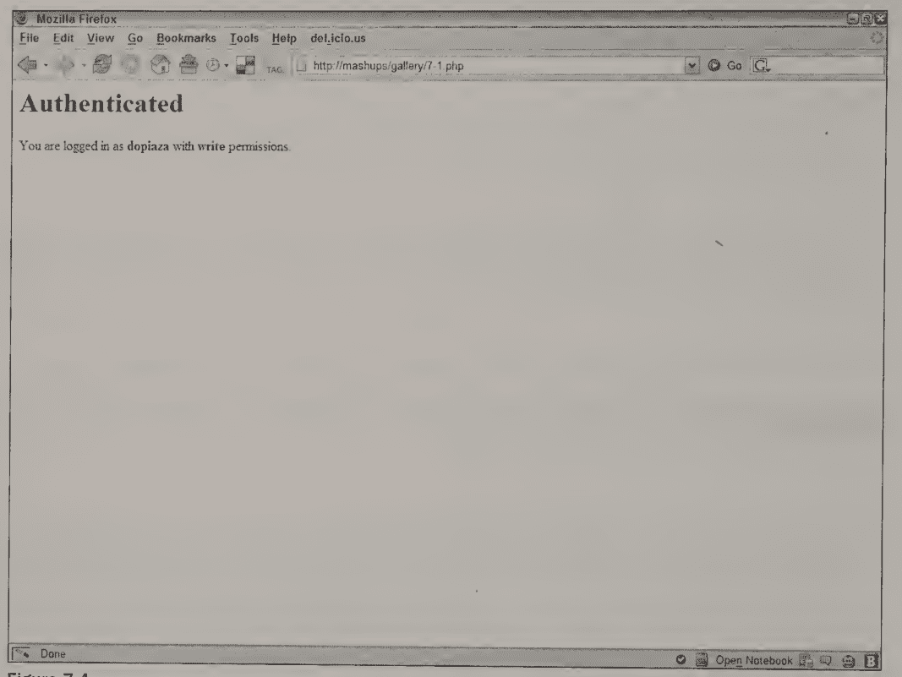

## 图 7-4

### 工作原理

当页面加载时，会调用 `FlickrAuthenticator.authenticate` 方法。第一次执行此操作时，未设置令牌，因此页面会重定向到 Flickr。一旦你批准了应用的访问，Flickr 会将你重定向回回调 URL 中指定的 `auth.php` 文件，并传回一个 `frob`。此文件调用 `FlickrAuthenticator.updateCredentials` 方法将 `frob` 转换为令牌，然后将你重定向回上面的测试页面。

这次，当页面加载时，`authenticate` 方法在会话中找到了一个有效令牌，因此不会将你重定向回 Flickr——相反，脚本的其余部分继续执行。如果你重新加载页面，你会看到它不再将你重定向到 Flickr——会话中的令牌继续有效。

如果你修改页面并将请求的权限更改为 `write`，如下所示：

```php
$auth->authenticate("write");
```

你会发现重新加载页面时，你再次被重定向到 Flickr——这一次是为了批准新的 `write` 权限。

## 更新你的照片详情

既然你有了一个可用的认证系统，你可以更新上一章创建的 gallery 应用以开始使用认证。Flickr API 方法 `flickr.photos.setMeta` 允许你更新照片的标题和描述，它需要使用写入权限进行认证。

> 尝试一下：向 Gallery 添加认证

首先要做的就是将 `FlickrGallery` 类与 `FlickrAuthenticator` 集成。这两个类都包含一个 `phpFlickr` 实例——但如果你有多个 `phpFlickr` 实例，你如何确保当属于 `FlickrAuthenticator` 的实例收到有效令牌时，`FlickrGallery` 中的实例也能使用该令牌？可以编写一些代码来传递令牌，但更优雅且简单得多的方法是确保只使用一个 `phpFlickr` 实例。你可以修改 `FlickrGallery` 类，使其不实例化自己的 `phpFlickr` 副本，而是利用继承来使用 `FlickrAuthenticator` 内部的实例。如果你使 `FlickrGallery` 类继承 `FlickrAuthenticator` 类，所有认证功能将自动集成到 `FlickrGallery` 中。

1. 按如下方式更新 `FlickrGallery.php`：

```php
<?php

class FlickrGallery extends FlickrAuthenticator
{
    var $nsid = '50317659@N00';

    function FlickrGallery()
    {
        global $flickrApiKey;
        global $flickrApiSecret;

        $this->FlickrAuthenticator($flickrApiKey, $flickrApiSecret);
    }

    ...

    function setMeta($id, $title, $description)
    {
        $this->flickr->photos_setMeta($id, $title, $description);

        if ($this->flickr->getErrorCode())
        {
            echo ("设置元数据时出错: " . $this->flickr->getErrorMsg());
        }
    }

    function checkAuthenticatedUser()
    {
        return ($this->nsid == $this->auth['user']['nsid']);
    }
```

# 第二部分：改造 Flickr

2. 更新 `gallery.php` 文件，确保包含 `FlickrAuthenticator` 类：

```php
<?php

require_once(dirname(__FILE__) . '/apikey.php');
require_once(dirname(__FILE__) . '/phpFlickr/phpFlickr.php');
require_once(dirname(__FILE__) . '/FlickrAuthenticator.php');
require_once(dirname(__FILE__) . '/FlickrGallery.php');

header("Content-Type: text/html; charset=utf-8");

?>
```

3. 现在你需要一个页面让用户能够编辑标题和描述，因此在你的 `gallery` 目录中创建一个名为 `edit.php` 的新文件：

```php
<?php
include (dirname(__FILE__) . '/../lib/gallery.php');
$gallery = new FlickrGallery();
$gallery->authenticate("write");
if (!$gallery->checkAuthenticatedUser())
{
    $gallery->error("You do not have permission to edit these details");
}
?>
<!DOCTYPE html PUBLIC "-//W3C//DTD XHTML 1.0 Transitional//EN"
    "http://www.w3.org/TR/xhtml1/DTD/xhtml1-transitional.dtd">
<html xmlns="http://www.w3.org/1999/xhtml">
<head>
    <link href="../css/main.css" rel="stylesheet" type="text/css" />
    <link href="../css/gallery.css" rel="stylesheet" type="text/css" />
    <title>Flickr Gallery</title>
</head>
<body>
<?php
    $id = $_REQUEST['id'];
    if (!empty($id))
    {
        $info = $gallery->getPhotoInfo($id);
        $title = $info['title'];
        $img = 'http://static.flickr.com/' . $info['server'] . '/' . $info['id']
            . '_' . $info['secret'] . '.jpg';
        $photoPage = 'http://www.flickr.com/photos/' . $info['owner']['nsid'] . '/'
            . $id . '/';
        $description = $info['description'];
    }
?>
<?php include ('header.php') ?>
<?php include ('navigation.php') ?>
<div class="photo-edit">
    <form action="doEdit.php" method="post">
        <p class="photo-image"><a href="<?php echo $photoPage ?>">" alt="<?php echo $title ?>" title="<?php echo $title ?>" /></a></p>
        <p class="photo-title-edit"><input name="title" type="text" id="title"
    value="<?php echo $title ?>" size="50" /></p>
        <p class="photo-description-edit">
            <textarea name="description" cols="50" rows="6" wrap="VIRTUAL"
    id="description"><?php echo $description ?></textarea>
        </p>
        <p class="photo-description-edit">
            <input name="id" type="hidden" value="<?php echo $id ?>" />
            <input type="submit" name="Submit" value="Submit Changes" />
            <input type="reset" name="Reset" value="Reset" />
        </p>
    </form>
</div>
</body>
</html>
```

4. 表单的操作被设置为 `doEdit.php`，你现在需要在你的 `gallery` 目录中创建这个文件：

```php
<?php
include (dirname(__FILE__) . '/../lib/gallery.php');
$gallery = new FlickrGallery();
$gallery->authenticate("write");
if (!$gallery->checkAuthenticatedUser())
{
    $gallery->error("You do not have permission to edit these details");
}

$id = $_REQUEST['id'];
$title = $_REQUEST['title'];
$description = $_REQUEST['description'];

if (!empty($id))
{
    $gallery->setMeta($id, stripslashes($title), stripslashes($description));
}

header('Location: http://' . $_SERVER['HTTP_HOST'] . dirname($_SERVER['PHP_SELF'])
    . '/photo.php?id=' . $id);
?>
```

5. 最后需要做的是在某个地方放置一个“编辑”链接，以便你实际上能够进入新创建的编辑页面。照片描述只会在用户点击“更多信息”链接后显示——这些额外详情旁边似乎是个放置“编辑”链接的好位置。修改 `info.php` 文件：

```php
<?php

include (dirname(__FILE__) . '/../lib/gallery.php');

  <div class="photo-date-taken">拍摄于：<?php echo
formatDateTaken($info['dates']['taken']) ?></div>
  <div class="photo-date-posted">发布于：<?php echo
formatDatePosted($info['dates']['posted']) ?></div>
  <div class="photo-edit-link"><a href="edit.php?id=<?php echo $id
?>">Edit</a></div>
</div>
<?php
}
?>
```


6. 最后，为了让一切看起来更美观，应该在`gallery.css`文件中为编辑页面添加一些额外的 CSS 样式：

```css
.photo-edit {
  width: 530px;
  margin: 2em 0 0 60px;
  padding: 0;
  text-align: center;
}
.photo-edit .photo-image img {
  margin: 0;
  padding: 5px;
  border: 3px solid #EEEEEE;
}
.photo-edit-link {
  text-align: right;
}
```

7. 要尝试此功能，请转到你在 Flickr 上的第三方应用程序列表（`http://www.flickr.com/services/auth/list.gne`），并撤销你的应用程序当前拥有的任何权限。

8. 在浏览器中打开图库并导航到一张照片页面。点击“更多信息”链接，你应该会看到照片描述出现，同时在页面底部有一个“编辑”链接，如图 7-5 所示。

9. 点击“编辑”链接，你将被重定向到 Flickr 以授权你的应用程序。完成授权后，Flickr 将把你返回到你的应用程序，并向你呈现编辑表单，如图 7-6 所示。

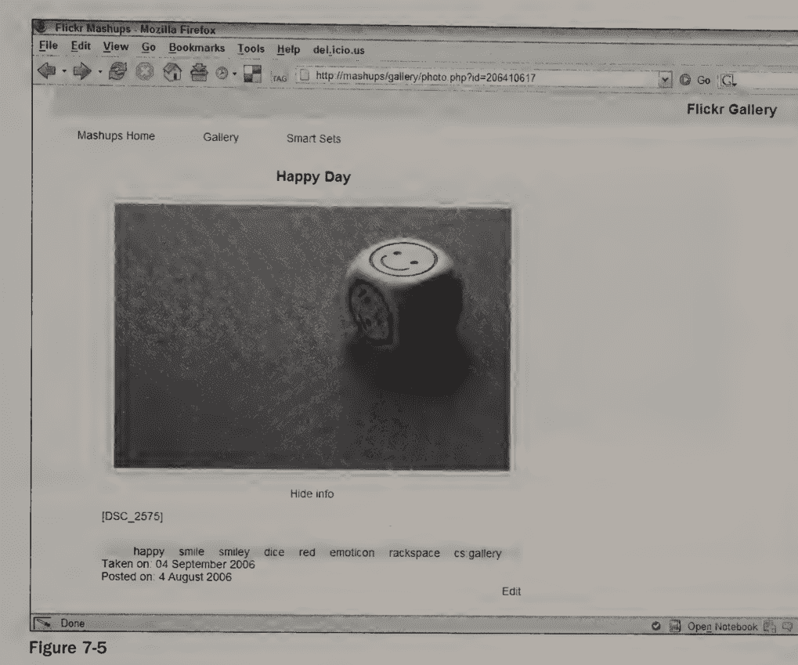

10. 在表单中编辑标题和描述并提交更改。你将被送回照片页面，在那里你应该能看到新的标题和描述。

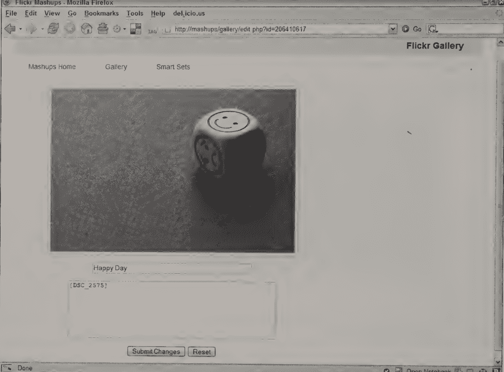

图 7-6

### 工作原理

你对`FlickrGallery.php`所做的更改修改了类声明，使得`FlickrGallery`扩展了基类`FlickrAuthenticator`，并更新了`FlickrGallery`构造函数以确保基类构造函数也被调用。

创建了两个新方法。第一个是`setMeta`，它调用相应的`phpFlickr`方法，允许设置照片的标题和描述。第二个方法`checkAuthenticatedUser`，将当前已认证用户的 NSID 与图库为其显示照片的用户的 NSID 进行比较。

> 不要忘记将`FlickrGallery`类使用的 NSID 更改为你自己的 NSID；否则，你将没有权限修改照片的元数据。

新的`edit.php`页面创建一个`FlickrGallery`实例并调用`authenticate`，请求写入权限：

```php
$gallery = new FlickrGallery();
$gallery->authenticate("write");

if (!$gallery->checkAuthenticatedUser())
{
    $gallery->error("You do not have permission to edit these details");
}
```

这些检查*必须*在文档开头、任何输出发送之前完成——它们很可能会导致重定向，这是通过生成`Location:`头来实现的。所有标头必须在任何其他输出发生之前发送。

页面的其余部分遵循与标准照片显示页面几乎相同的布局，只是标题和描述现在变成了可编辑的表单元素——请注意，照片 ID 也作为隐藏字段存在于表单中。

`doEdit.php`脚本再次检查请求用户是否当前已通过适当权限进行身份验证，然后从请求中提取照片、标题和描述。它调用`setMeta`方法，并将用户重定向回此照片的页面，以便他们可以查看新设置的标题和描述。

## 其他身份验证机制

本章中到目前为止描述的过程用于基于 Web 的应用程序，也是本书中唯一详细描述的过程。对于非 Web 应用程序，过程略有不同。不同的方法在本节中进行了总结，但如果你想使用这些方法，你应该查阅 Flickr 的身份验证页面`http://www.flickr.com/services/api/misc.userauth.html`以获取完整细节。

### 桌面应用程序身份验证

桌面应用程序的身份验证过程与基于 Web 的应用程序的身份验证过程非常相似，但没有需要指定的回调 URL——相反，你使用`flickr.auth.getFrob`方法首先获取一个 frob。然后你需要构造一个 URL 供用户前往进行身份验证——这与基于 Web 的应用程序中的方式完全相同，但这里的 URL 还包括 frob。

一旦你有了 URL，你需要将用户引导到该网页——你可以通过自动打开用户的浏览器，或者通过向他们提供 URL 让他们剪切并粘贴到浏览器的地址栏来实现。一旦用户在 Flickr 网站上完成身份验证，他们必须返回到你的应用程序并告诉它他们已经完成。然后你的桌面应用程序可以完全按照基于 Web 的应用程序流程进行，调用`flickr.auth.getToken`。

### 移动应用程序身份验证

移动应用程序的身份验证过程有点不同，主要是为了适应这些应用程序可用的有限用户界面，这些应用程序通常运行在只有数字键盘用于数据输入的移动电话上。

## 第二部分：重新混合 Flickr

当你为移动应用配置 API 密钥时，首先需要选择所需的一组权限——*读取*、*写入*或*删除*，然后你会看到一个格式为`http://www.flickr.com/auth-12345`的认证 URL。

接着，你需要将用户引导至该认证 URL 页面——或许通过从你的应用下载页面链接过去，或要求他们访问该页面。一旦用户完成认证并授权你的应用，他们会获得一个*迷你令牌*，这是一个九位数字，格式如`123-456-789`。然后他们必须在你的应用中输入此号码。用户完成此操作后，你的应用可以向`flickr.auth.getFullToken`发起签名调用，以将迷你令牌交换为普通令牌。

## 总结

Flickr 认证 API 提供了一种安全的方式，让用户能够授权第三方应用以不同程度访问其 Flickr 照片。在本章中，你了解了认证过程的工作原理以及如何实现一个经过认证的 Web 应用。

你学习了如何配置 API 密钥以启用认证、构建了一个 PHP 认证类、了解了如何签名认证 API 调用，并修改了图库应用以允许其在 Flickr 上更新照片元数据。

在下一章中，你将看到如何使用 Flickr API 将照片上传到 Flickr，但首先，请查看下面的练习，对图库应用进行一些进一步的修改。

## 练习

1. 在`edit.php`页面上，允许用户修改照片使用的标签，以及标题和描述。
2. 目前编辑链接对所有查看者都显示。在页面顶部添加一个登录链接，并且仅当当前用户已登录且是正在显示照片的用户时，才显示编辑链接。

# 上传照片

在前几章中，你了解了如何在 Flickr 上查看照片以及如何修改其元数据，但仍有一个重要部分缺失。那么，你最初是如何将照片放上去的呢？当然，你总是可以通过 Flickr 的上传页面或使用 Flickr Uploadr 应用程序来完成此操作，但在本章中，你将了解上传机制的工作原理以及如何在你自己的应用中使用它——包括前面章节中构建的图库应用。

## 上传机制如何工作？

Flickr 将上传 API 视为与主 Flickr API 分开，因为它涉及二进制数据的传输，而不是简单的 XML 消息传递。上传 API 有其自己的端点：`http://api.flickr.com/services/upload/`。

要上传照片，你需要向上传 API 端点发送四部分数据：

- `api_key`：你的 API 密钥。
- `auth_token`：上传照片用户的认证令牌——上传需要授予写入权限。
- `api_sig`：API 调用的签名——此值的计算方式与第 7 章中描述的完全相同。
- `photo`：二进制图像数据。

你还可以使用许多可选参数来设置照片的元数据：

- `title`：要赋予照片的标题。
- `description`：要赋予照片的描述。
- `tags`：以空格分隔的标签列表，要赋予照片。
- `is_public`、`is_friend`、`is_family`：照片的隐私级别——0 表示否，1 表示是。

> 在为上传请求计算`api_sig`值时，你必须包含除图像数据本身参数之外的所有参数。

请求的格式是标准的 HTTP multipart 表单 POST 请求——这与你的浏览器使用 HTML 表单执行文件上传时发送的格式相同。如果你想了解构建 multipart 请求的详细细节，一个很好的起点是 HTML 4 规范（`http://www.w3.org/TR/html4/interact/forms.html#h-17.13.4.2`），但实际上，通常不需要从头开始编写这样的东西——许多库会为你处理这些。在本章中，我们将使用`phpFlickr`来处理上传请求的格式化，但首先，让我们看看一个典型请求的内部，以便了解发生了什么。

一个典型的请求看起来像这样：

```http
POST /services/upload/ HTTP/1.1
Content-Type: multipart/form-data; boundary=27f3284b3aa12f234def
Host: www.flickr.com
Content-Length: 18294

--27f3284b3aa12f234def
Content-Disposition: form-data; name="api_key"

1f2811827f3284b3aa12f7bbb7792b8d
--27f3284b3aa12f234def
Content-Disposition: form-data; name="title"

My Uploaded Photo
--27f3284b3aa12f234def
Content-Disposition: form-data; name="auth_token"

537482-d1cf156c23903fa0
--27f3284b3aa12f234def
Content-Disposition: form-data; name="api_sig"

2650f6827bc3ba51bd9a3873de57d23e
--27f3284b3aa12f234def
Content-Disposition: form-data; name="photo"; filename="C:\photos\image.jpg"
Content-Type: image/jpeg

...
The raw image data appears here
...

--27f3284b3aa12f234def--
```

开头几行是发送的 HTTP 头；消息正文本身在空行之后才开始。你可以看到消息正文被分成多个部分——每个部分由一个*封装边界*分隔。封装边界是一个字符串，由两个连字符后跟一个*边界标记*组成。这个边界标记是一个字符序列，可以是任何字母数字字符串（也允许一些其他字符），但它*不能*出现在数据本身中。边界标记通常是随机生成的，并在 HTTP 请求的`Content-Type`头中定义。最后一个封装边界有一个由两个连字符组成的闭合标记，表示后面不再有部分。

每个部分都有自己的头。这里，大多数部分只有一个头——Content-Disposition。Content-Disposition 头将每个部分标识为包含表单数据，更重要的是，它标识了数据项的名称。在头之后，每个部分包含一个空行，然后是数据本身。对于图像数据，这些数据是表示图像的原始字节流。

## 创建上传页面

如果你想向图库添加新照片，目前需要转到 Flickr 网站并从那里操作，或使用独立工具之一，如 Uploadr。既然你已经添加了一些简单的维护功能来编辑照片标题和标签，那么扩展图库功能以便你也能上传新照片就很好了。

## 动手试试——上传你的照片

在这个练习中，你将看到如何向你的图库应用添加一个新页面来上传新照片。

1. 首先，你需要向`FlickrGallery.php`添加一个新方法：

```php
<?php

class FlickrGallery extends FlickrAuthenticator
{
  ...

  function uploadPhoto($file, $title = null, $description = null, $tags = null,
    $isPublic = null, $isFriend = null, $isFamily = null)
  {
    $id = $this->flickr->sync_upload($file, $title, $description, $tags, $isPublic,
      $isFriend, $isFamily);

    if ($this->flickr->getErrorCode())
    {
      echo ("Error uploading photo: " . $this->flickr->getErrorMsg());
    }

    return $id;
  }
}
?>
```

2. 接下来，你需要一个上传页面——在你的图库目录中创建一个新文件`upload.php`：


```php
<?php
include (dirname(__FILE__) . '/../lib/gallery.php');
$gallery = new FlickrGallery();
$gallery->authenticate("write");
if (!$gallery->checkAuthenticatedUser())
{
  $gallery->error("You do not have permission to upload photos");
?>
<!DOCTYPE html PUBLIC "-//W3C//DTD XHTML 1.0 Transitional//EN"
    "http://www.w3.org/TR/xhtml1/DTD/xhtml1-transitional.dtd">
<html xmlns="http://www.w3.org/1999/xhtml">
<head>
    <link href="../css/main.css" rel="stylesheet" type="text/css" />
    <link href="../css/gallery.css" rel="stylesheet" type="text/css" />
    <title>Upload Photo</title>
</head>
<body>
<?php include ('header.php') ?>
<?php include ('navigation.php') ?>
<div class="photo-upload">
    <h1>Upload a Photo</h1>
    <form action="doUpload.php" method="post" enctype="multipart/form-data">
        <input type="hidden" name="MAX_FILE_SIZE" value="10485760" />
        <p class="upload-field">
            <label>Photo</label>
            <input name="file" type="file" size="50" />
        </p>
        <p class="photo-title-upload">
            <label>Title</label>
            <input name="title" type="text" id="title" size="50" />
        </p>
        <p class="photo-description-upload">
            <label>Description</label>
            <textarea name="description" cols="50" rows="6" wrap="VIRTUAL"
                id="description"></textarea>
        </p>
        <p class="photo-privacy-upload">
            <label>Tags</label>
            <input name="tags" type="text" id="tags" size="50" />
        </p>
        <p class="photo-tags-upload">
            <label>Privacy</label>
            <input type="radio" name="privacy" value="public" checked="checked"/>
                Public<br/>
            <input type="radio" name="privacy" value="private" />Private<br/>
            <input type="radio" name="privacy" value="friends" />Friends Only<br/>
            <input type="radio" name="privacy" value="family" />Family Only<br/>
            <input type="radio" name="privacy" value="friendsfamily" />Friends and
                Family<br/>
        </p>
        <p>
            <input type="submit" name="Submit" value="Upload Photo" />
            <input type="reset" name="Reset" value="Reset" />
        </p>
    </form>
</div>
</body>
</html>
```

3. 接下来，你需要创建一个表单处理页面，因此在 gallery 目录中创建一个名为`doUpload.php`的文件：

```php
<?php
include (dirname(__FILE__) . '/../lib/gallery.php');
$gallery = new FlickrGallery();
$gallery->authenticate("write");
if (!$gallery->checkAuthenticatedUser())
{
  $gallery->error("You do not have permission to upload photos to this account");
}

$size = $_FILES['file']['size'];
$filename = $_FILES['file']['tmp_name'];

$title = stripslashes($_REQUEST['title']);
$description = stripslashes($_REQUEST['description']);
$tags = stripslashes($_REQUEST['tags']);
$privacy = $_REQUEST['privacy'];

if (!empty($filename) && is_uploaded_file($filename) && $size > 0)
{
  $isPublic = 0;
  $isFriend = 0;
  $isFamily = 0;

  switch ($privacy)
  {
    case "public":
      $isPublic = 1;
      break;

    case "friends":
      $isFriend = 1;
      break;

    case "family":
      $isFamily = 1;
      break;

    case "friendsfamily":
      $isFriend = 1;
      $isFamily = 1;
      break;

  }

  $id = $gallery->uploadPhoto($filename, $title, $description, $tags, $isPublic,
    $isFriend, $isFamily);
}

header('Location: http://' . $_SERVER['HTTP_HOST'] . dirname($_SERVER['PHP_SELF'])
  . '/index.php');
?>
```

# 第二部分：混搭 Flickr

4. 现在，为了进入上传页面，你需要一个指向它的链接，因此将其添加到主导航菜单栏中。编辑`navigation.php`：

```php
<?php
$user = $_SESSION['FlickrAuthenticatedUser'];
?>
<ul id="gallery-menu">
  <li><a href="../index.php">Mashups Home</a></li>
  <li><a href="index.php">Gallery</a></li>
  <li><a href="smartsets.php">Smart Sets</a></li>
<?php
if (!empty($user))
{
?>
  <li><a href="upload.php">Upload</a></li>
<?php
}
?>
```

```php
  <li>
<?php
if (empty($user))
{
?>
    <a href="login.php">Login</a>
<?php
}
else
{
?>
 Logged in as <?php echo $user ?>
<?php
}
?>
  </li>
</ul>
```

只有当用户当前已登录时，才会显示上传链接。

5. 最后，在`gallery.css`中添加一条新的 CSS 规则，以确保上传表单能正确显示：

```css
.photo-upload label {
  display: block;
  font-weight: 600;
  margin-top: 0.5em;
  margin-bottom: 0.5em;
}
```

6. 所有的修改现已就位。在浏览器中打开图库。如果你尚未登录，请点击菜单栏中的登录链接——你现在应该能看到上传链接。点击它，你将被带到新的上传页面，如图 8-1 所示。

# 第 8 章：上传照片

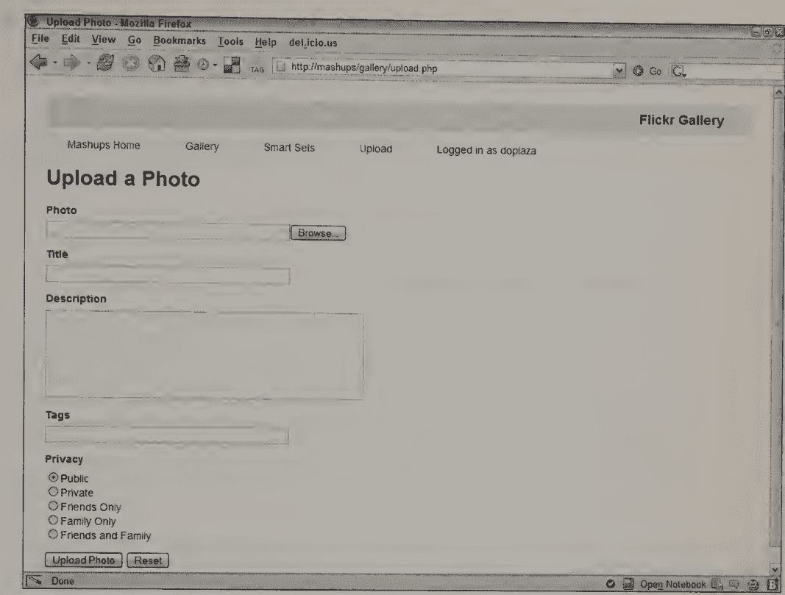

7. 浏览你的本地磁盘，找到要上传的照片，在标题和描述框中添加一些信息，然后点击上传照片按钮。在照片上传过程中会有短暂的暂停，首先上传到你的 Web 服务器，然后再上传到 Flickr。一旦处理完成，你将被重定向到主图库页面，在那里你应该能看到你的照片。

## 工作原理

你添加到`FlickrGallery.php`中的`uploadPhoto()`方法接受多个参数。第一个参数`$file`是要上传的照片的文件名——注意这段代码运行在服务器上，所以这是*服务器上*包含该照片的文件路径，而不是客户端机器。其余参数基本不言自明——它们指定上传照片的标题、描述、标签和隐私设置。`uploadPhoto()`不会对其参数进行任何处理，而是直接将它们传递给 phpFlickr 的`sync_upload`方法来实际执行上传。

`upload.php`是一个相当简单的 HTML 表单。值得注意的是，表单中包含一个文件上传控件：

```html
<input name="file" type="file" size="50" />
```

因此，表单必须将`enctype`属性指定为`multipart/form-data`，如下所示，而不是使用默认的`application/x-www-form-urlencoded`值：

```html
<form action="doUpload.php" method="post" enctype="multipart/form-data">
```

`doUpload.php`首先检查用户是否已通过`write`权限认证，然后获取上传文件的大小和位置。在验证上传文件的有效性之后，它从请求中提取要与文件关联的元数据，最后调用 FlickrGallery 中的`uploadPhoto()`方法将照片上传到 Flickr。

## 异步上传

你可能已经在上一节的示例中注意到，所使用的 phpFlickr 方法名为`sync_upload`。PhpFlickr 还包含另一个名为`async_upload`的方法，可让你执行异步上传。当你使用同步方法上传照片时，该方法不会在所有图像数据发送到 Flickr 后立即返回——Flickr 需要先执行多项任务，包括创建不同尺寸的图像集并将其存储在其服务器上的适当位置。这个过程需要一点时间，而上传 API 直到完成后才会返回。如果你不希望应用程序坐在那里等待 Flickr 完成处理，可以使用上传 API 的异步版本。使用这种方式，API 调用会在所有数据到达 Flickr 后立即返回，让你的应用程序可以自由关闭连接并继续执行其他操作，而 Flickr 在后台处理上传的照片。

要指定你想使用 API 的异步版本，只需在消息体中向 Flickr 传递一个额外的参数`async`——将其值设置为 1 表示异步上传，0 表示同步上传。phpFlickr 的`async_upload`方法会自动为你完成此操作。

如果你以异步方式上传照片，还需要一种方法来了解 Flickr 的处理何时完成以及照片何时可供查看。同步上传 API 的返回值是刚上传照片的照片 ID，但当你使用异步上传 API 时，返回的不是照片 ID——而是获得一个*票据号码*。这个票据号码是一个临时标识符，让你可以跟踪上传照片的进度——你可以调用 API 方法`flickr.photos.upload.checkTickets`来检查上传是否完成。`checkTickets`方法接受一组票据号码，并分别报告每个号码的状态：

```xml
<rsp stat="ok">
  <uploader>
    <ticket id="324513135" invalid="1"/>
    <ticket id="324513136" complete="1" photoid="206410617" />
    <ticket id="324513137" complete="0" />
    <ticket id="324513138" complete="2"
  </uploader>
</rsp>
```

如果找不到某个票据，`invalid`属性将被设置为 1；否则`status`属性表示上传的进度。`status`为 0 表示处理尚未完成。`status`为 1 表示成功完成，`photoid`属性将被设置为该照片的照片 ID。`status`为 2 表示处理失败，该照片将不可用。

## 替换照片

除了上传 API 之外，Flickr 还提供了替换 API。它的工作方式与上传 API 完全相同，并且也有同步和异步两个版本。替换 API 的端点位于<http://api.flickr.com/services/replace/>，替换调用的参数如下：

| 参数 | 说明 |
|---|---|
| `api_key` | 你的 API 密钥。 |
| `photo_id` | 要替换的照片的 ID。 |
| `auth_token` | 正在替换照片的用户的认证令牌——替换操作需要授予写权限。 |
| `auth_sig` | API 调用的签名——该值的计算方式与第 7 章中描述的完全相同。 |
| `async`（可选） | 设置为 1 表示异步上传，0 表示同步上传。 |
| `photo` | 二进制图像数据。 |

请注意，在执行替换时，你无法更改照片的元数据。

PhpFlickr 提供了一个`replace`方法，以便轻松访问 Flickr 的替换 API。

## 小结

Flickr 提供了 API，让你能够上传新照片和替换现有照片。在本章中，你了解到这些方法与普通 API 调用的区别在于，它们在消息体中发送二进制数据，你还学习了如何在同步和异步模式下上传照片。

你的图库应用程序现在开始形成一个功能相当完善的应用程序。在下一章中，我们将把注意力转回 Flickr 网站，你将了解如何使用 Firefox 和 Greasemonkey 自定义自己的浏览体验，但首先，这里有一个练习题，让你尝试 Flickr API 的另一部分功能。

## 练习

在本章中，你为图库添加了上传功能。在本练习中，为应用程序添加一个新界面，以便使用替换 API 替换现有照片。

# 9 使用 Greasemonkey 改造 Flickr

如果 Flickr 网站上有什么地方你希望它能做得稍有不同，那么本章绝对是为你准备的。在本章中，你将学习如何使用名为 Greasemonkey 的 Firefox 扩展来自定义 Flickr 网页的显示。你将创建一套 Greasemonkey 脚本，为 Flickr 添加额外的信息和新的功能。要使用 Greasemonkey，你需要使用 Firefox 网页浏览器——很遗憾，它在其他浏览器（如 Internet Explorer）中无法工作。

## 什么是 Greasemonkey？

Greasemonkey 是一个适用于 Firefox 网页浏览器的扩展，它允许你编写用户脚本来修改你访问的网站的行为。Greasemonkey 脚本使用 JavaScript 编写，看起来很像你可能在浏览器中运行的任何其他 JavaScript 代码，并且你可以用它来完成大多数在客户端 JavaScript 中可以做的相同的事情。

你可以在<http://greasemonkey.mozdev.org/>找到 Greasemonkey 的官方网页。

## 安装 Greasemonkey

安装 Greasemonkey 非常简单。首先，你必须确保已安装最新版本的 Firefox 网页浏览器——你可以从<http://www.mozilla.com/firefox/>获取。

要安装 Greasemonkey 扩展，请访问 Greasemonkey 网站<http://greasemonkey.mozdev.org/>并点击“Install Greasemonkey”链接。

根据你的设置，Firefox 可能会阻止 Greasemonkey 自动安装——在这种情况下，浏览器窗口顶部会出现一个通知栏，告知你这一情况，并带有一个标有“Edit Options”的按钮。如果你点击此按钮，会弹出一个对话框，使你能够授权该网站在你的计算机上安装扩展，如图 9-1 所示。

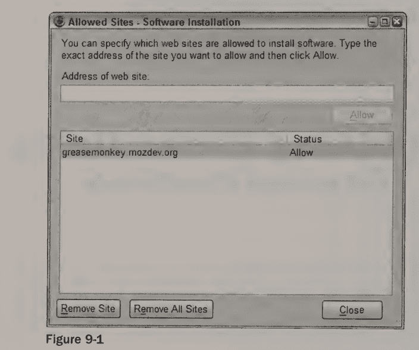


将`greasemonkey.mozdev.org`添加到允许的网站列表中，然后关闭对话框。现在再次点击“Install Greasemonkey”链接。这次你会看到一个对话框，询问你是否要安装该扩展，如图 9-2 所示。

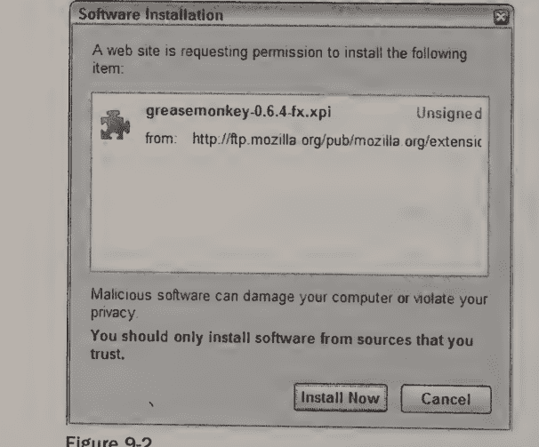

## 创建你的第一个脚本

创建一个 Greasemonkey 脚本就像编写一段 JavaScript 一样简单，所以让我们直接通过创建一个简单脚本来开始吧。

### 试一试：一个简单的 Greasemonkey 脚本

在这个练习中，你将创建一个简单的脚本，演示如何在访问某些网页时让 Greasemonkey 脚本执行。

1. 创建一个名为`myfirstscript.user.js`的文件，并输入以下内容：

```javascript
// ==UserScript==
// @name           My First Script
// @namespace      http://www.dopiaza.org/flickr/greasemonkey/
// @description    A simple first script
// @include       http://www.flickr.com/
// @include       http://flickr.com/
// ==/UserScript==

alert ("Hello! Welcome to Flickr!");
```

> 你为 Greasemonkey 脚本创建的文件名很重要——所有 Greasemonkey 脚本必须以`.user.js`结尾。

2. 现在你需要安装这个脚本。在 Firefox 中打开它——你可以通过多种方式做到：

   - 将文件拖放到 Firefox 窗口中。
   - 在 Firefox 地址栏中输入文件的完整路径。
   - 从 Firefox 菜单中选择“文件⇨打开”，然后导航到该脚本。

3. 一旦你打开了脚本，Greasemonkey 应该会注意到`.user.js`扩展名并开始行动——你会在浏览器窗口顶部看到一个 Greasemonkey 栏，标识该文件为 Greasemonkey 用户脚本，并询问你是否要安装它。点击“Install”按钮——然后你应该会看到一个警报框，确认脚本已安装。

4. 现在，访问 Flickr 主页`http://www.flickr.com/`，你应该会看到一个新的警报框弹出，显示“Hello! Welcome to Flickr!”，如图 9-3 所示。浏览 Flickr 网站的其他几个页面，然后返回主页。每次你返回主页时，警报框都会弹出。

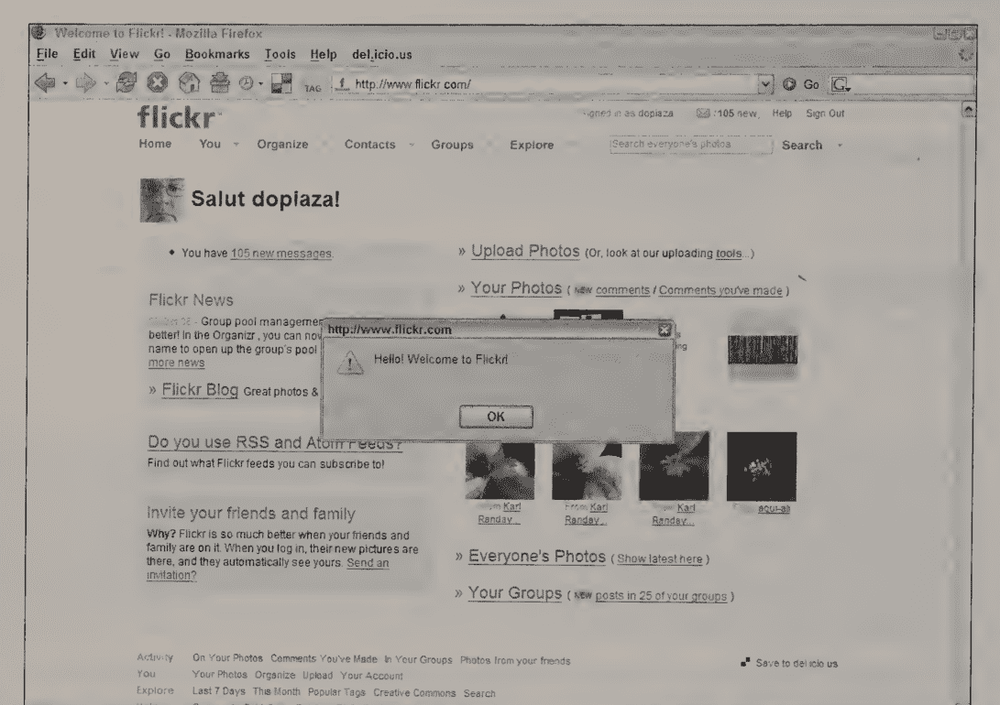

图 9-3

### 工作原理

Greasemonkey 脚本本身非常简单——它由几行注释和一行 JavaScript 代码组成：

```javascript
alert ("Hello! Welcome to Flickr!");
```

这会使你看到的警报框弹出。但它为什么只出现在 Flickr 主页而不在其他页面呢？答案在于 Greasemonkey 用户脚本开头的注释中。

```javascript
// ==UserScript==
// @name           My First Script
// @namespace      http://www.dopiaza.org/flickr/greasemonkey/
// @description    A simple first script
// @include        http://www.flickr.com/
// @include        http://flickr.com/
// ==/UserScript==
```

这些注释实际上是给 Greasemonkey 的指令，描述它应如何处理该脚本。所有这些指令都是可选的，但大多数 Greasemonkey 脚本会包含一些，通常是全部。

- `@name`是脚本的名称。如果你进入 Greasemonkey 配置屏幕（在 Firefox 的“工具”菜单下的“管理用户脚本”中），你会看到它。
- `@namespace`是一个 URL，Greasemonkey 用它来区分同名的脚本。
- `@description`是脚本的人类可读描述，在“管理用户脚本”对话框中选中该脚本时显示。
- `@include`告诉 Greasemonkey 脚本应在哪些页面上执行。此处的示例列出了两个页面`http://www.flickr.com/`和`http://flickr.com/`——需要列出 URL 的两种变体，因为 Greasemonkey 将它们视为不同的页面。`@include`指令可以包含通配符（`*`），例如`http://www.flickr.com/*`将指代 Flickr 网站上的所有页面。
- `@exclude`（本例中未使用）指定脚本不应在哪些页面上执行。

因此，在本例中，只要浏览器访问`@include`指令中列出的两个页面之一（`http://www.flickr.com/`和`http://flickr.com`），脚本就会运行。

你现在可能想要卸载这个 Greasemonkey 脚本——一段时间后那个警报框可能会变得很烦人。如果你打开“工具 ❯ 管理用户脚本”，你可以禁用或完全卸载任何已安装的脚本。

### 修改页面——第一次改造

现在你已经看到了如何创建一个非常简单的 Greasemonkey 脚本，是时候转向更有用的内容了——你的第一个使用 Greasemonkey 的 Flickr 改造。正如你在前面章节中看到的，访问 Flickr 上信息的关键是 NSID。Flickr 上的每个用户和每个群组都有自己唯一的 NSID，这是你使用大多数 API 方法时需要的标识符。虽然可以使用 API 查找 NSID，但在测试时，或者只是想快速尝试一段代码或一个 API 方法时，能够快速找到用户或群组的 NSID 通常很有用。在你的第一次 Flickr 改造中，你将创建一个 Greasemonkey 脚本，在用户的好友图标旁边显示其 NSID。

### 确定用户的 NSID

要显示用户的 NSID，你首先必须确定它是什么。但你怎么找到呢？一个很好的起点是用户的主要照片流页面，你可以在那里选择“查看 ❯ 页面源代码”。在这里你可以看到页面的 HTML 源代码——有大量的 HTML 需要浏览，但答案就隐藏在其中。如果你仔细浏览这个页面，会看到一段类似这样的 HTML：

```html
<td class="Buddy">
  
</td>
```

这是在页面顶部显示用户好友图标的 HTML。如果你查看好友图标的 URL，你会发现它也包含了该用户的 NSID。因此，一旦你识别出好友图标的图片，你就可以确定 NSID 了。

# 第二部分：混搭 Flickr

如果用户没有设置好友图标会怎样？在这种情况下，他们仍然会显示标准的灰色方块头像。不过，你仍然可以从这里获取 NSID：如果你找到一个仍然使用灰色方块头像的用户，并查看其照片流的 HTML 代码，你会发现他们的好友图标是这样显示的：

```html
<td class="Buddy">
    
</td>
```

用户的 NSID 仍然在那里，只是这次被附加在了默认的方块头像 URL 末尾。

### 动手试试：查找图像

现在你已经知道如何从好友图标中获取 NSID，但问题仍然存在——如何找到好友图标本身？为此，你需要识别页面中的不同图像，而这正是本练习的内容。

1. 创建一个新文件`findimages.user.js`，内容如下：

```javascript
// ==UserScript==
// @name           Find Images
// @namespace      http://www.dopiaza.org/flickr/greasemonkey/
// @description    Find all images in a page
// @include        http://www.flickr.com/*
// @include        http://flickr.com/*
// ==/UserScript==

var imgElements = document.getElementsByTagName('img');

for (var i = 0; i < imgElements.length; i++)
{
    var img = imgElements[i];

    var src = img.getAttribute('src');

    GM_log("Found Image: " + src);
}
```

2. 在 Firefox 中打开该文件并安装 Greasemonkey 脚本——可以点击出现的“安装”按钮，也可以选择工具➩安装此用户脚本。

3. 选择工具➩Javascript 控制台，打开 Javascript 控制台，点击“清除”按钮清除现有输出。在 Firefox 中访问 Flickr 首页（`http://www.flickr.com/`），并观察 Javascript 控制台窗口中的输出——你应该会看到一长串类似这样的条目：

```text
http://www.dopiaza.org/flickr/greasemonkey/Find Images: Found Image: http://www.flickr.com/images/spaceout.gif?0400849001151334252

http://www.dopiaza.org/flickr/greasemonkey/Find Images: Found Image: /images/flickr_logo_gamma.gif.v1.2

http://www.dopiaza.org/flickr/greasemonkey/Find Images: Found Image:
/images/icon_unread.gif.v1.4

http://www.dopiaza.org/flickr/greasemonkey/Find Images: Found Image:
http://static.flickr.com/56/buddyicons/50317659@N00.jpg?1151240153
```

这就是页面中所有图像的列表，其中也包括好友图标。

### 工作原理

这个 Greasemonkey 脚本使用了与其他客户端 Javascript 相同的技术来查找网页中的元素。它使用了 Firefox 标准的 Javascript 实现——即 W3C DOM（万维网联盟文档对象模型规范，`http://www.w3.org/DOM/`）。关于如何使用 DOM 的详细描述超出了本书的范围，但你可以在 Mozilla 开发者中心（`http://developer.mozilla.org/en/docs/DOM`）找到许多有用的参考文档。

脚本所做的第一件事是获取当前文档中所有图像元素的列表——换句话说，就是当前网页中所有``标签的实例：

```javascript
var imgElements = document.getElementsByTagName('img');
```

然后脚本遍历每个`img`元素，并提取`src`属性的值，该属性包含所引用实际图像的路径：

```javascript
var src = img.getAttribute('src');
```

最后，脚本调用一个特殊的 Greasemonkey 方法`GM_log`：

```javascript
GM_log("Found Image: " + src);
```

`GM_log`主要用于调试——它将消息输出到 Javascript 控制台。这里用它来演示所有图像已成功被识别。

### 完成混搭

现在你已经了解了脚本中的一些关键元素的实际效果，是时候将所有部分组合起来，完成你的第一个 Greasemonkey 混搭了。

### 动手试试：显示 NSID

在本节的最后一个练习中，你将运用所学的一切来创建一个脚本，在好友图标旁边显示用户的 NSID。

1. 创建一个新文件`showflickrnsid.user.js`，内容如下：

```javascript
// ==UserScript==
// @name        Show Flickr NSID
// @namespace   http://www.dopiaza.org/flickr/greasemonkey/
// @description Display user's NSID
// @include        http://www.flickr.com/*
// @include        http://flickr.com/*
// ==/UserScript==

var imgElements = document.getElementsByTagName('img');

var buddyIconPattern = /^http:\/\/static.flickr.com\/\d+\/buddyicons\/(.+).jpg/;
var blockheadPattern = /^http:\/\/www.flickr.com\/images\/buddyicon.jpg\?(.+)$/;

for (var i = 0; i < imgElements.length; i++)
{
    var img = imgElements[i];

    var imgClass = img.getAttribute('class');
    if (imgClass == 'person_hover_img')
    {
        // Just ignore this one - it's used when you hover over an user's icon
        continue;
    }

    // Check to see if this is a buddy icon image
    var src = img.getAttribute('src');
    var result = buddyIconPattern.exec(src);

    if (result == null)
    {
        // Try the second version, just in case they have no buddy icon set
        result = blockheadPattern.exec(src);
    }

    if (result != null)
    {
        var nsid = result[1];

        // We want the first containing tag that isn't an <a> tag
        var container = img.parentNode;
        while (container.nodeName != null && container.nodeName == 'A')
        {
            container = container.parentNode;
        }

        var node = document.createElement('span');
        node.appendChild(document.createTextNode(nsid));

        node.style.fontSize = 'xx-small';
        node.style.color = 'grey';

        container.appendChild(node);
    }
}
```

2. 按照通常的方式将脚本安装到 Firefox 中，然后浏览 Flickr 上的一些页面——你会看到，每当你遇到一个好友图标时，该用户或群组的 NSID 都会显示在其旁边，如图 9-4 所示。

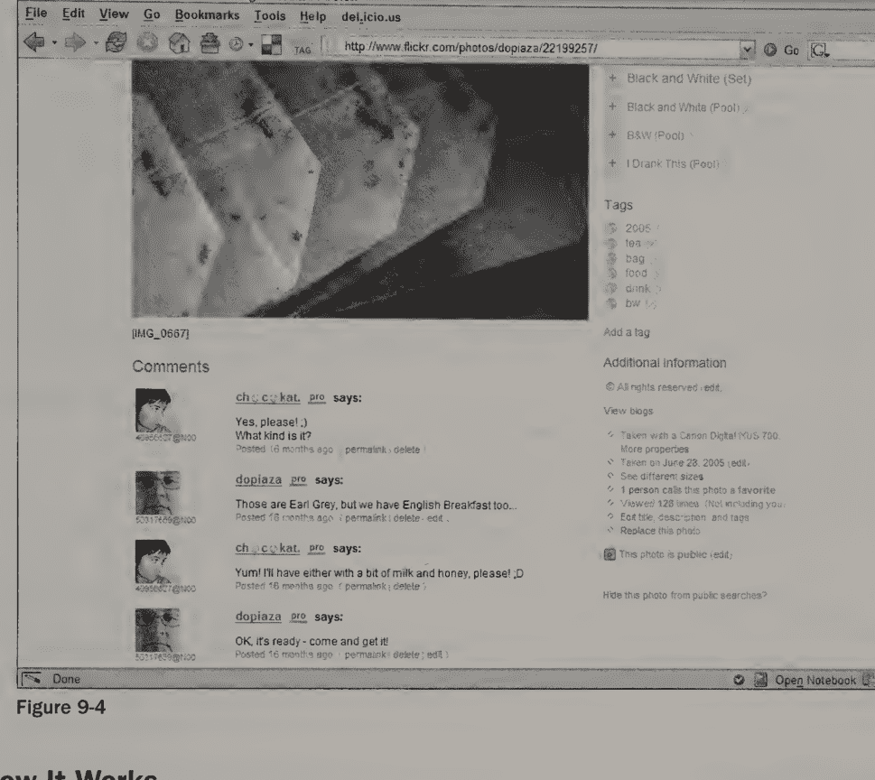

### 工作原理

这个脚本在很大程度上遵循了前一个脚本的模式，首先获取文档中所有``元素的列表。

它还定义了两个正则表达式模式：

```javascript
var buddyIconPattern = /^http:\/\/static.flickr.com\/\d+\/buddyicons\/(.+).jpg/;
var blockheadPattern = /^http:\/\/www.flickr.com\/images\/buddyicon.jpg\?(.+)$/;
```

这两个正则表达式匹配用于好友图标的 URL。在每个模式中，括号内的部分代表用户的 NSID。

对于页面中出现的每张图像，脚本需要判断它是否是好友图标。首先确定的是``标签的`class`属性是否设置为`person_hover_img`。这样做的原因在你看到效果之前并不明显。当你将鼠标悬停在用户的好友图标上时，会弹出一个菜单，其中包含另一个副本的好友图标。该图标的`class`为`person_hover_img`。你并不想在这个弹出菜单旁边显示 NSID，因此这个检查会将它们过滤掉。如果你感到好奇，可以试着注释掉这个检查并观察区别！

下一步是执行定义好的两个正则表达式，看它们是否匹配。如果匹配成功，说明该图像确实是一个好友图标。如果没有匹配，脚本将移至下一张图像。


现在你已经找到了好友图标并提取了 NSID，下一步就是显示 NSID。你可以通过创建一个新的 HTML 元素（一个 `<span>` 标签）来实现，其中包含作为文本元素的 NSID。`span` 元素需要被附加到与 `` 元素相同的容器中——根据具体查看的页面不同，这通常是一个 `<div>` 或 `<td>` 标签——因此需要找到包含 `` 标签的父节点。

```javascript
// We want the first containing tag that isn't an <a> tag
var container = img.parentNode;
while (container.nodeName != null && container.nodeName == 'A')
{
    container = container.parentNode;
}
```

如果父节点是一个 `<a>` 标签，则忽略它并使用上一层的父节点；否则 `<span>` 最终也会成为超链接的一部分。

最后，创建新的 `span` 元素并将其插入到页面中。

```javascript
var node = document.createElement('span');
node.appendChild(document.createTextNode(nsid));

node.style.fontSize = 'xx-small';
node.style.color = 'grey';

container.appendChild(node);
```

### 使用 XPath

另一种在网页中查找标签的好方法是使用 Firefox 内置的 XPath 支持。你可以在 Mozilla 开发者中心（http://developer.mozilla.org/en/docs/XPath）找到关于在 Firefox 中使用 XPath 的相关信息。

### 动手试试：使用 XPath 查找标签

在这个练习中，你将创建一个脚本来定位页面上的所有图像，就像你在上一节中所做的那样，但这次你将使用 XPath 来实现。

1. 创建一个新文件 `findimageswithxpath.user.js`，内容如下：

```javascript
// ==UserScript==
// @name         Find Images with XPath
// @namespace    http://www.dopiaza.org/flickr/greasemonkey/
// @description  Find all images in a page
// @include      http://www.flickr.com/*
// @include      http://flickr.com/*
```

### 工作原理

此示例与之前的“查找图像”示例相同，只是它使用 XPath 查询代替了 `getElementsByTagName` 方法。

```javascript
var imgElements = document.evaluate(
  "//img[@width='75']",
  document,
  null,
  XPathResult.UNORDERED_NODE_SNAPSHOT_TYPE,
  null);
```

在 Firefox 中使用 XPath 最常见的方法是通过 `document.evaluate` 方法。该方法接受五个参数。第一个是 XPath 查询本身。这里使用的查询表示“搜索所有 `width` 属性设置为 75 的 `` 元素”。使用 XPath 可以创建各种各样的查询，有关语法的完整细节请参阅 W3C 文档 http://www.w3.org/TR/xpath。

第二个参数指定 XPath 查询开始的起点。这里的查询覆盖整个文档，但如果你只想搜索某个子集，你可以指定任何元素——可能是通过之前的 XPath 搜索或 `getElementsByTagName` 调用获取的元素。

第三个参数是对命名空间解析函数的引用。除非你有非常特定的需求，否则你可能永远不需要使用它。这里将其设置为 `null`。

第四个参数指示要返回的结果类型。在大多数情况下，`XPathResult.UNORDERED_NODE_SNAPSHOT_TYPE` 是访问搜索结果的最简单方式。然而，这确实以大致随机的顺序返回匹配的节点。如果你处理结果的顺序很重要，你可能需要改用 `XPathResult.ORDERED_NODE_SNAPSHOT_TYPE`。

最后一个参数允许你指定一个现有的 `XPathResult` 对象用于结果。这里最常见的是指定 `null`，这将导致创建一个新对象。

对 `document.evaluate` 的调用返回一个 `XPathResult` 对象的实例，而 `snapshotItem()` 方法用于访问每个单独的节点：

```javascript
for (var i = 0; i < imgElements.snapshotLength; i++)
{
    var img = imgElements.snapshotItem(i);
    ...
}
```

将脚本安装在 Firefox 中，然后打开 Flickr 主页（http://www.flickr.com/）和 JavaScript 控制台。与之前一样，控制台将显示由 `GM_log` 语句生成的消息列表，每条消息标识一个在文档中找到的图像。然而，这次你会看到只有显示在主页上的实际照片出现在控制台中——其他图形，如 Flickr 徽标，不会被列出。这是因为 XPath 查询明确要求指定宽度为 75 的图像。

## 突出显示评论：第二个混搭

Flickr 上的群组讨论和照片评论以一个很长的单一列表形式呈现，随着列表变长，会变得相当难以管理。挑选出你贡献的部分可能很困难。你的下一个 Flickr 混搭将微妙地改变这些页面的呈现方式，以便轻松找到你自己的评论——你将创建一个 Greasemonkey 脚本，扫描页面上的所有评论，并通过修改背景颜色来突出显示你发表的任何评论。

如果你查看任何带有评论的 Flickr 页面源代码，无论是照片页面还是群组讨论页面，你会看到所有评论都包含在一个表格中，大致如下所示：

```html
<tr valign="top">
    <td class="Who">
        <a href="/photos/dopiaza/" name="comment72157594178503351"></a>
    </td>
    <td class="Said">
        <h4><a href="/photos/dopiaza/">dopiaza</a>
        ...
    </td>
</tr>
```

每条评论都有一个类为 `Who` 的表格数据单元格，其中包含发表评论者的头像图标。这意味着，正如你之前看到的，你可以计算出每个评论者的 NSID。你只需要识别出哪些评论是你发表的——因此脚本需要以某种方式知道你的 NSID 是什么。一种方法是将你的 NSID 硬编码到脚本中，但这不是一个特别可移植的解决方案——如果脚本能够从页面内容中确定当前登录用户的 NSID 会好得多。如果你查看任何 Flickr 页面的页面源代码，这被证明是相当直接的。每个页面顶部都有一些 JavaScript，用于设置一些全局变量。最直接相关的部分是设置 `global_nsid` 变量的那行代码——该变量被设置为当前登录用户的 NSID。

```javascript
global_nsid = '50317659@N00'
```

要从 Greasemonkey 脚本中访问这个 JavaScript 变量，你需要使用 `unsafeWindow` 变量。`unsafeWindow` 是对网页中 `window` 对象的直接引用。它被如此命名是为了强调它是不安全的——它绕过了 Greasemonkey 通常用来保护你的脚本免受恶意网页攻击的机制。然而，这是访问网页中定义的全局变量的唯一方式，可以通过类似这样的代码：

```javascript
var myNsid = unsafeWindow.global_nsid;
```

通常，如果你的脚本可能在不受信任的页面上下文中执行，你不应该使用 `unsafeWindow`——它的使用会打开许多潜在的后门，使你的脚本被滥用。在这种情况下，可能无需担心。Flickr 的员工总体上并非恶意，在此处使用 `unsafeWindow` 可能是没问题的。

你现在已经掌握了这个混搭所需的所有基本原理，所以是时候直接深入查看完成的脚本了。

### 试一试：突出显示你的评论

本练习将创建一个脚本，用于在 Flickr 图像上突出显示你的评论。

1. 创建一个名为 `flickrcommenthighlighter.user.js` 的文件，内容如下：

```javascript
// ==UserScript==
// @name           Flickr Comment Highlighter
// @namespace      http://www.dopiaza.org/flickr/greasemonkey/
// @description    Highlight Flickr Comments
// @include        http://www.flickr.com/*
// @include        http://flickr.com/*
// ==/UserScript==

var buddyIconPattern = /^http:\/\/static.flickr.com\/\d+\/buddyicons\/(.+).jpg/;
var blockheadPattern = /^http:\/\/www.flickr.com\/images\/buddyicon.jpg\?(.+)$/;

var myNsid = unsafeWindow.global_nsid;

var commenters = document.evaluate(
    "//td[@class='Who']",
    document,
    null,
    XPathResult.UNORDERED_NODE_SNAPSHOT_TYPE,
    null);

for (var i = 0; i < commenters.snapshotLength; i++)
{
    var isMyComment = false;
    var tdCommenter = commenters.snapshotItem(i);

    // We are looking for the buddy icon contained within
    var images = tdCommenter.getElementsByTagName('IMG');

    for (var j = 0; j < images.length; j++)
    {
        var img = images[j];
        var src = img.getAttribute('src');
        var result = buddyIconPattern.exec(src);

        if (result == null)
        {
            // Try the second version, just in case you have no buddy icon set
            result = blockheadPattern.exec(src);
        }

        if (result != null)
        {
            // This is the buddy icon
            var nsid = result[1];
            if (nsid == myNsid)
            {
                isMyComment = true;
            }

            break;
        }
    }

    if (isMyComment)
    {
        // Need to restyle the comment to highlight it.
        // The parent container is the table row, and contains the commenter details
        // and the comment itself
        var container = tdCommenter.parentNode;
        container.style.backgroundColor = '#EEEEEE';
    }
}
```

2. 像往常一样将脚本安装在你的浏览器中，然后浏览你参与过的群组讨论或你评论过的照片。你会看到你的评论以灰色背景突出显示，与其他评论的白色背景形成对比，如图 9-5 所示。我选择灰色是因为它与整体的 Flickr 配色方案很协调，在页面上看起来不会太突兀。当然，你可以自由选择任何适合你的颜色——只需将脚本中的 `#EEEEEE` 更改为你选择的颜色。

## 第 9 章：使用 Greasemonkey 重新混排 Flickr

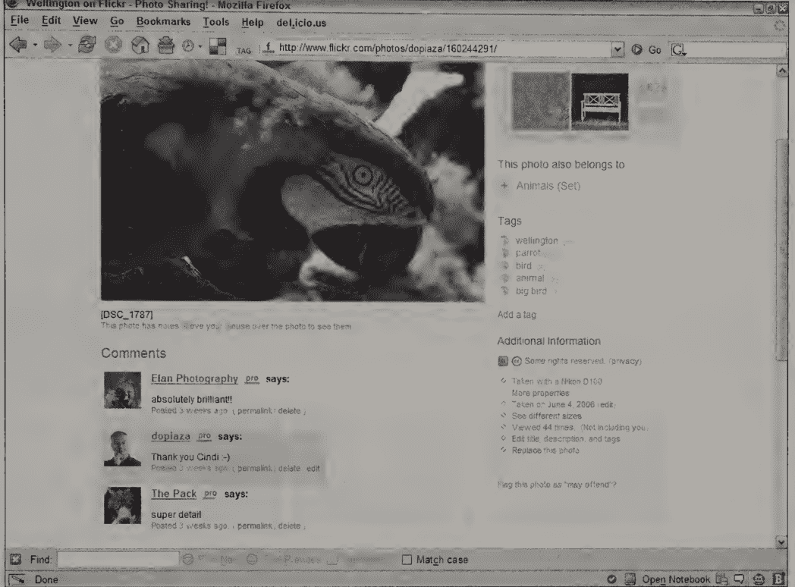

图 9-5

### 工作原理

脚本首先查找所有使用 `class Who` 样式化的表格单元格——记住，这些是包含好友头像的那些单元格：

```javascript
var commenters = document.evaluate(
    "//td[@class='Who']",
    document,
    null,
    XPathResult.UNORDERED_NODE_SNAPSHOT_TYPE,
    null);
```

然后，脚本遍历找到的每个单元格，并为每个单元格检索其中包含的图片列表：

```javascript
var images = tdCommenter.getElementsByTagName('IMG');
```

接着检查每个图片，与之前一样，判断它是否是好友头像——如果是，则提取 NSID 并与当前登录用户的 NSID 进行比较。如果相同，则将 `isMyComment` 标志设置为 `true`。

最后，如果 `isMyComment` 设置为 `true`，脚本定位包含该评论的表格行，并将背景颜色改为浅灰色。

## 增强 Flickr 分页器

本章最后一个重新混排来看看 Flickr 分页器——那是页面底部的一系列链接列表，让你可以跳转到不同的页码，如图 9-6 所示。

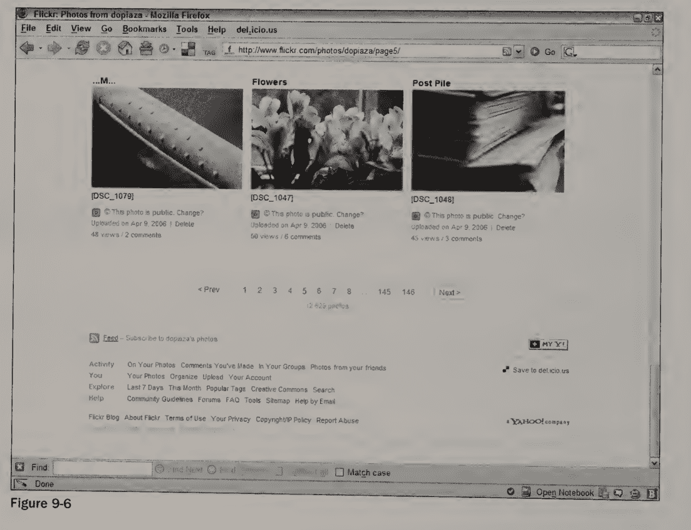

这个重新混排通过添加一个文本框来增强分页器，使你能够输入页码并直接跳转到该页面。

### 动手试试：增强分页器

如果你进入出现分页器的页面（例如，你的照片流）并查看源代码，分页器看起来是这样的：

```html
<div class="Pages">
  <div class="Paginator">
    <a href="/photos/dopiaza/page4/" class="Prev">&lt; Prev</a>
    <a href="/photos/dopiaza/">1</a>
    <a href="/photos/dopiaza/page2/">2</a>
    <a href="/photos/dopiaza/page3/">3</a>
    <a href="/photos/dopiaza/page4/">4</a>
    <span class="this-page">5</span>
    <a href="/photos/dopiaza/page6/">6</a>
    <a href="/photos/dopiaza/page7/">7</a>
    <a href="/photos/dopiaza/page8/">8</a>
    <span class="break">...</span>
    <a href="/photos/dopiaza/page145/">145</a>
    <a href="/photos/dopiaza/page146/">146</a>
    <a href="/photos/dopiaza/page6/" class="Next">Next &gt;</a>
  </div>
  <div class="Results">(2,628 photos)</div>
</div>
```

显示的每个页码都是一个链接（`<a>`），除了当前页是 `<span>`。这个重新混排将在“Next”链接之前放置一个输入文本字段。

识别分页器本身很简单；使用 XPath 查询 `//div[@class='Paginator']` 就可以做到。找到应该插入文本框的位置则稍微棘手一些。如果你查看上面的分页器 HTML，可以看到“Next”链接是分页器 `div` 中的最后一个标签。然而，就 Firefox 而言，它并不是该 `div` 中的最后一个节点——还有一个包含回车符和其他空白字符的文本节点。为了应对这一点，脚本需要识别 `div` 中最后一个非文本节点。这就是“Next”链接。

这个练习将通过添加一个用户可以输入页码跳转的文本框，来增强默认 Flickr 分页器的实用性。

1. 创建一个名为 `jumptoflickrpage.user.js` 的文件，内容如下：


```
// ==UserScript==
// @name          Jump to Flickr Page
// @namespace     http://www.dopiaza.org/flickr/greasemonkey/
// @description  Jump to a specific Flickr page in a paginated set of pages.
// @include      http://www.flickr.com/*
// @include      http://flickr.com/*
// ==/UserScript==

var paginators = document.evaluate(
  "//div[@class='Paginator']",
  document,
  null,
  XPathResult.UNORDERED_NODE_SNAPSHOT_TYPE,
 医院里);
```

```javascript
for (var i = 0; i < paginators.snapshotLength; i++)
{
  var paginator = paginators.snapshotItem(i);

  // Place the text box immediately before the "Next" item, which is the last
  // non-text element in the paginator (There is whitespace after it, which shows
  // up as a text node). It may be an anchor or a span, depending on whether we are
  // at the last page or not.
  var paginatorChildren = paginator.childNodes;

  var nextElement;
  for (var j = paginatorChildren.length - 1; j >= 0; j--)
  {
    if (paginatorChildren[j].nodeType == 1) // Element Node
    {
      nextElement = paginatorChildren[j];
      break;
    }
  }

  var inputBox = document.createElement('input');
  inputBox.setAttribute("type", "text");
  inputBox.setAttribute("size", "3");

  paginator.insertBefore(inputBox, nextElement);

  inputBox.addEventListener('keypress', function(evt)
  {
    var keyVal = evt.which;
    var key = String.fromCharCode(keyVal);

    if (key == '\r')
    {
      var pageNum = evt.target.value;

      // So, where are we now?
      var loc = window.location.href;
      // Remove any existing page number
      loc = loc.replace(/page\d+(\/)?$/, '');
      // Append the new page number
      loc += 'page' + pageNum + '/';
      // And go to the new page
      window.location.href = loc;
    }
    else
    {
      if (key != '\b' && isNaN(key))
      {
        evt.preventDefault();
      }
    }
  }, true);
}
```

196

2. 将脚本安装到你的浏览器中，并导航到出现分页器的 Flickr 页面——例如，用户的照片流页面。你现在应该在分页器中看到一个文本框。输入一个数字并按回车键，你就会被带到相应的页面。你可以在图 9-7 中看到这一点。

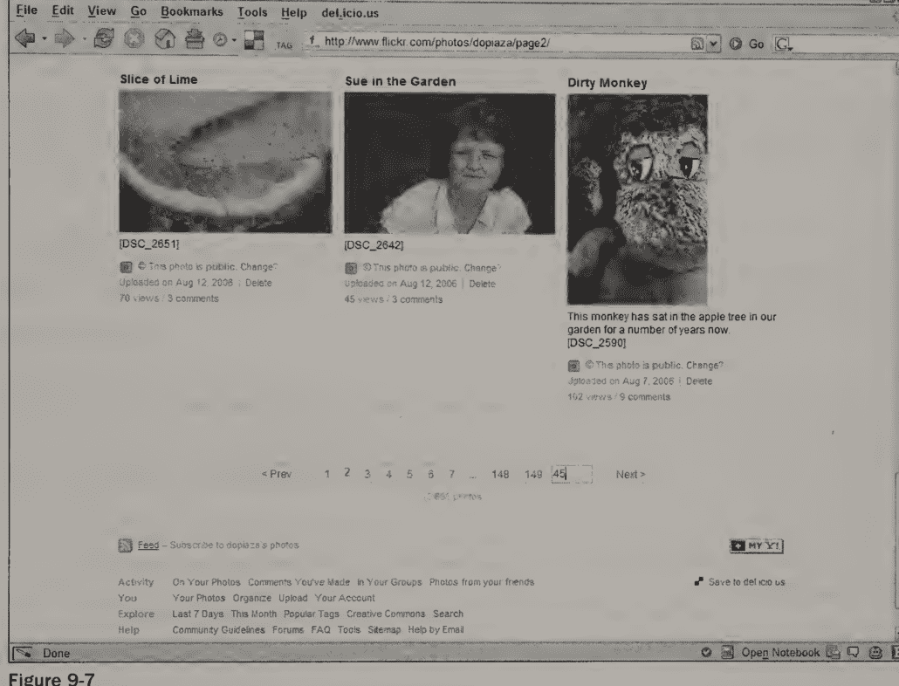

图 9-7

### 工作原理

脚本使用 XPath 识别页面中的任何分页器，并对每个分页器进行修改，添加一个文本框。

脚本通过从后向前遍历分页器的子元素列表，直到找到一个元素节点，来确定插入文本框的位置。元素节点的节点类型为 `1`，如 W3C DOM 规范中所定义。

```javascript
for (var j = paginatorChildren.length - 1; j >= 0; j--)
{
  if (paginatorChildren[j].nodeType == 1) // Element Node
  {
```

```javascript
    nextElement = paginatorChildren[j];
    break;
  }
}
```

确定插入点后，创建一个新的输入文本框并添加到文档中。

最后一步是为输入框添加一个事件处理器。每当用户执行某个操作时，例如按键或点击鼠标，就会触发一个事件。事件处理器是在特定事件发生时执行的函数。这里，通过控件的 `addEventListener` 方法定义了一个 `keypress` 处理器。这个事件处理器将在每次触发 `keypress` 事件时被调用——即每当用户按下按键时。它检查按下了哪个键，如果是回车键，则修改当前页面 URL 以反映新的目标页面。首先，获取当前页面的位置：

```javascript
var loc = window.location.href;
```

分页的 Flickr 页面所有 URL 都以 `/pageXX/` 结尾，其中 `XX` 是当前页码。如果缺少 `/pageXX/` 部分，则显示第一页。下一步是从 URL 中移除任何现有的页码：

```javascript
loc = loc.replace(/page\d+(\/)?$/, '');
```

正则表达式 `/page\d+(\/)?$/` 匹配字符串 `page` 后跟一个或多个数字以及可选的尾部斜杠。如果找到，则将此字符串从 URL 中移除。

最后，将目标页码追加到当前 URL，并将 Web 浏览器重定向到新位置：

```javascript
loc += 'page' + pageNum + '/';

window.location.href = loc;
```

如果按下的键不是回车键，脚本会检查它是否是数字或退格键：

```javascript
if (key != '\b' && isNaN(key))
{
  evt.preventDefault();
}
```

如果该键既不是退格键也不是有效的数字，则调用 `evt.preventDefault()`。这会阻止执行该事件的默认操作——基本上就是阻止事件被进一步传递给事件处理器链，因此该按键将被有效丢弃。

## 深入了解 Greasemonkey

本章只是触及了 Greasemonkey 的皮毛。如果你想进一步了解如何编写 Greasemonkey 脚本，Mark Pilgrim 的优秀网站《Dive Into Greasemonkey》绝对是最佳入门之选。你可以在 <http://diveintogreasemonkey.org/> 找到它。

## 总结

在本章中，你了解了如何使用 Greasemonkey 来修改 Flickr 的网页。你已经学会了如何安装 Greasemonkey、创建和安装用户脚本、使用 XPath 定位网页中的元素、将新的 HTML 元素插入文档，以及创建事件处理程序来为页面引入新的行为。

在下一章中，你将看到一种不同的方式来使用存储在 Flickr 上的图片。不过在此之前，你可以先通过下面的练习来提升一下你的 Greasemonkey 技能。

## 练习

1. 每个 Flickr 页面顶部的下拉菜单是快速浏览网站的便捷方式。编写一个 Greasemonkey 脚本，使你能够在下拉菜单中添加一些自定义位置。例如，在 Groups 菜单底部添加一个链接，将你带到你最喜欢的小组。在 Explore 菜单底部添加一个链接，将你带到 API 文档页面。

   以下是一些提示：如果你查看 Flickr 页面的源代码，会看到一个 ID 为 `candy_nav_button_bar` 的 `<div>`。这个 `<div>` 包含了所有的菜单。每个下拉菜单都有自己的 `<div>`——例如，Explore 菜单位于 ID 为 `candy_nav_button_explore` 的 `<div>` 中。在每个菜单的 `<div>` 中，你会看到下拉列表中显示的一系列链接——你只需要将你的链接追加到这些列表中即可。

2. Greasemonkey 的跳转到页面脚本工作得很好，但如果你尝试跳转到不存在的页面，就会出现奇怪的结果。例如，分页器可能只列出了 25 页，但没有什么能阻止你尝试跳转到第 26 页、第 27 页或第 2007 页。修改脚本，使你只能跳转到有效的页面。

# 使用 ImageMagick

在前面的章节中，你已经看到了多种在网页中展示来自 Flickr 的图片的方式。到目前为止，我们主要关注基于 HTML 的直接展示方式。在本章中，你将尝试一些不同的东西——你将了解如何使用流行的 ImageMagick 软件，利用来自 Flickr 的图片动态构建你自己的图形。

## 什么是 ImageMagick？

ImageMagick 是一套软件，使你能够创建和修改位图图像。尽管 ImageMagick 是专门为处理图像而设计的，但它并不像 Adobe Photoshop 等应用程序那样具有图形用户界面；相反，它主要通过命令行驱动——或者更常见的是，通过众多可用接口之一以编程方式驱动。ImageMagick 最流行的接口之一是 PerlMagick 库。PerlMagick 提供了一个方便的面向对象的 Perl 接口来操作 ImageMagick，我们将在本章中使用它。请注意，本章假设你已经按照第 3 章的描述设置好了 Perl 和 Perl Flickr API。

ImageMagick 是免费软件，你可以从 ImageMagick 官方网站 <http://www.imagemagick.org/> 获取源代码和二进制版本。二进制版本适用于多种平台，包括 Microsoft Windows 和许多 Unix 变体，包括 Linux 和 Mac OS X。

ImageMagick 和 PerlMagick 的安装会因你运行的平台而异，你可以在 <http://www.imagemagick.org/script/binary-releases.php> 找到 ImageMagick 的安装说明，在 <http://www.imagemagick.org/script/perl-magick.php> 找到 PerlMagick 的安装说明。许多常见平台都有预打包的安装包。

如果你使用的是 Microsoft Windows，可以从 ImageMagick 网站 <http://www.imagemagick.org/script/binary-releases.php> 下载 Windows 安装程序。Windows 安装程序有不同的变体——你可以获取处理 8 位或 16 位图像的版本，以及静态链接或动态链接的版本。除非你很确定需要其他版本，否则应该下载 16 位动态链接版本。

在 Microsoft Windows 下安装时，安装过程中的某个时刻会询问你是否要安装 PerlMagick 库——一定要选是。

如果你使用的是 Linux，大多数发行版已经包含了 ImageMagick 和 PerlMagick——你应该参考你的 Linux 发行版的安装说明来了解如何安装它们。如有必要，你可以从 ImageMagick 网站下载 RPM 文件，并附带安装说明。

如果你使用的是 Mac OS X，可以在 <http://www.entropy.ch/software/macosx/> 找到打包版本的 ImageMagick。

## 动手实践：将 ImageMagick 与 Flickr 结合

要了解如何使用 Perl 同时与 Flickr 和 ImageMagick 进行交互，最简单的方式就是通过示例。让我们先创建一个快速的 Perl 脚本，从 Flickr 检索一张图片，并使用 ImageMagick 进行一些基本处理。

1. 创建一个名为 `10-1.pl` 的文件，内容如下所示。请注意，这个文件与你之前一直在写的 PHP 脚本不同，它不是由 Web 服务器执行的。你从命令行运行它，所以保存在哪里并不太重要。别忘了在适当的位置输入你的 API 密钥、API 密钥和 NSID。

```perl
#!/usr/bin/perl

use Image::Magick;
use Flickr::API;
use XML::Parser::Lite::Tree::XPath;

$apikey = 'YOUR-API-KEY';
$apisecret = 'YOUR-API-SECRET';

# Replace this with your NSID
$myNSID = '50317659@N00';

$flickr = new Flickr::API(
    {
        'key'    => $apikey,
        'secret' => $apisecret,
    });

$response = $flickr->execute_method('flickr.photos.search',
    {
        'user_id' => $myNSID,
        'per_page' => 1,
        'page' => 1,
    });

my $xpath = new XML::Parser::Lite::Tree::XPath($response->{'tree'});

@photos = $xpath->select_nodes('/photos/photo');

$image = Image::Magick->new;

if ($#photos >= 0)
{
$photo = $photos[0];
$url = 'http://static.flickr.com/' . $photo->{'attributes'}->{'server'} . '/'
    . $photo->{'attributes'}->{'id'} . '_' . $photo->{'attributes'}->{'secret'}
    . '_s.jpg';
$image->Read($url);
}

$compositeImage = Image::Magick->new;
$compositeImage->Set(size=>'85x85');
$compositeImage->Read('xc:black');
$compositeImage->Composite(image => $image->[0], compose => 'Copy', x => 5, y =>5);

$compositeImage->Write(filename => 'image.jpg', quality => 85);
```

2. 通过在命令行输入 `perl 10-1.pl` 来运行这个脚本。

   当前目录应该会创建一个新文件。它将是在 Flickr 上你最新的公开照片的小方形版本，周围有黑色边框——类似于图 10-1 所示。

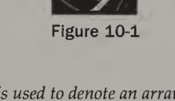

图 10-1

> 请记住，在 Perl 中，`@` 字符用于表示数组。你的 NSID 包含 `@`，所以当你将 NSID 赋值给 `$myNSID` 变量时，必须使用单引号包裹字符串（`'50317659@N00'`）以避免变量扩展。如果你使用双引号（`"50317659@N00"`），Perl 会将其解释为试图使用 `@N00` 数组。

### 工作原理

让我们逐段看看这个 Perl 脚本，了解一下这里发生了什么。开头的行

```perl
#!/usr/bin/perl
```

只有在你运行在 Unix 系统上时才真正重要。它标识了 Perl 可执行文件的位置。把它放在这里是个好习惯，但就本示例而言，你可以安全地忽略它。

接下来是此脚本所需的不同 Perl 模块列表。

```perl
use Image::Magick;
use Flickr::API;
use XML::Parser::Lite::Tree::XPath;
```

前两个相当明显——它们是 ImageMagick 和 Flickr API 的 Perl 库。第三个则不那么明显。Perl Flickr API 库返回一个 XML 树对象，而要选择树中你感兴趣的部分，最简单的方法之一就是使用 XPath 查询。这第三个库提供了完成这项工作所需的工具。

## 第二部分：重新混合 Flickr

接下来，脚本会实例化一个 `Flickr::API` 对象。它的构造函数接受一个参数，这是一个 Perl 哈希（或关联数组）。

```perl
$flickr = new Flickr::API(
{
  'key'    => $apikey,
  'secret' => $apisecret,
});
```

这个哈希只包含两个值——要使用的 Flickr API 密钥和密钥。一旦你有了一个 `Flickr::API` 对象的实例，你就可以调用一个 API 方法：

```perl
$response = $flickr->execute_method('flickr.photos.search',
{
  'user_id' => $myNSID,
  'per_page' => 1,
  'page' => 1,
});
```


`Flickr::API` 提供了一个方法`execute_method`，用于调用 Flickr API 方法。它接受两个参数：要调用的 Flickr 方法和一个包含该方法参数的哈希。在这里，你调用`flickr.photos.search`方法来查找指定 NSID 用户最近上传的公开照片。

`execute_method`返回的响应包含一个`XML::Parser::Lite::Tree`的实例。这是 XML 树的一种表示，类似于 phpFlickr 返回的结构。你无需手动遍历这个树结构，而是利用`XML::Parser::Lite::Tree::XPath`类，通过 XPath 查询来选择你感兴趣的节点：

```perl
my $xpath = new XML::Parser::Lite::Tree::XPath($response->{'tree'});

@photos = $xpath->select_nodes('/photos/photo');
```

使用的 XPath 查询是`/photos/photo`，它会找到根元素`<photos>`下包含的所有`<photo>`元素。现在，你只请求了一张照片，所以应该只找到一个这样的节点。你从数组中取出第一个（也是唯一一个）元素，并以通常的方式构建存储在 Flickr 上的方形照片的 URL：

```perl
$photo = $photos[0];
$url = 'http://static.flickr.com/' . $photo->{'attributes'}->{'server'} . '/'
 . $photo->{'attributes'}->{'id'} . '_' . $photo->{'attributes'}->{'secret'}
 . '_s.jpg';
```

现在来看看 ImageMagick——首先，创建一个`Image::Magick`对象的实例：

```perl
$image = Image::Magick->new;
```

然后从构建的 URL 中读取图像到`Image::Magick`对象中：

```perl
$image->Read($url);
```

## 第 10 章：使用 ImageMagick

这个`$image`对象只是一个临时存储图像的地方，以便你在 ImageMagick 中轻松使用它。接下来，你创建第二个`Image::Magick`实例，它代表最终的图像：

```perl
$compositeImage = Image::Magick->new;
```

PerlMagick API 中有太多方法，无法在此一一列举，但你可以在在线文档中阅读它们。在这里，你使用其中几个方法来创建一个我们 Flickr 图像的轻微修改版本。首先，你将大小设置为 85 像素的正方形：

```perl
$compositeImage->Set(size=>'85x85');
```

接着，通过读取 ImageMagick 的内部`伪图像`格式之一`xc:black`，用纯色填充新图像：

```perl
$compositeImage->Read('xc:black');
```

伪图像是被 ImageMagick 像任何其他图像一样处理的东西，但它是自动生成的。XC 伪图像是由单一纯色组成的图像。你可以在 ImageMagick 网站 http://www.imagemagick.org/script/formats.php 上看到可用伪图像格式的完整列表。

`$compositeImage`现在包含一个完全黑色的 85 x 85 像素图像。从 Flickr 获取到`$image`对象中的方形图像是 75 x 75 像素。如果你将该图像复制到黑色正方形的中心，你应该会在照片边缘得到一个漂亮的黑色边框。为此，你使用`Composite`方法，它将一个图像合成到另一个图像上。此方法有多种操作模式——你只需要一个直接的`Copy`。为了在照片周围获得黑色边框，将图像定位在坐标 (5, 5) 处——这应该能将 75 x 75 像素的图像居中放置在 85 x 85 的正方形内。

```perl
$compositeImage->Composite(image => $image->[0], compose => 'Copy', x => 5, y =>5);
```

注意，被复制的图像被引用为`$image->[0]`。一个`Image::Magick`对象可以包含多个不同的图像，你将在本章后面看到。这种表示法提供了一种便捷的方式来访问这些图像。

最后，你将图像写为 JPEG 格式，质量设置为 85：

```perl
$compositeImage->Write(filename => 'image.jpg', quality => 85);
```

## 构建一个群组徽章

既然你已经看到了一个混合使用 Flickr 和 ImageMagick 图像的例子，让我们来看一个更复杂的例子。在下一个项目中，你将创建另一个徽章，这次是用来突出显示一个 Flickr 群组图库。Flickr 上的每个群组都有一个由成员贡献的照片图库——还有什么比生成一个显示该群组图库最近提交内容的徽章更好的推广群组的方式呢？这样的徽章非常适合放置在 Flickr 上该群组的主页、你的 Flickr 个人资料中，或者如果该群组有一个用于推广的独立网站，那么徽章也很适合放在那里。这个徽章将与第 5 章生成的徽章不同，因为它将由使用 ImageMagick 创建的单个 JPEG 组成。最后，你还将创建一个 HTML 客户端图像映射，以实现图像上的热点，使照片能够链接回 Flickr。

你将生成的徽章将是一个相当简单的徽章。它将获取添加到指定群组图库中的八张最近的照片，并将它们排列在一个三乘三网格的边缘，群组图标位于徽章的中心。你可以在图 10-2 中看到一个徽章示例。


这个徽章适用于任何图库中至少有八张照片的 Flickr 群组，但在本例中，我们将使用 Utata 群组 —— http://www.flickr.com/groups/utata/。如果你想尝试不同的群组，只需将你选择的群组 NSID 替换此处使用的即可。

### 动手试试：使用 ImageMagick 创建徽章

此脚本为构建徽章所经过的基本过程与上面示例中所示的非常相似，因此我们将首先完整地展示徽章构建脚本，然后逐步讲解主要步骤，看看发生了什么。

1. 创建一个名为`badge`的文件，内容如下：

```perl
#!/usr/bin/perl

use FileHandle;
use Image::Magick;
use Flickr::API;
use XML::Parser::Lite::Tree::XPath;
use Getopt::Std;

getopt('d');

$apikey = 'YOUR-API-KEY';
$apisecret = 'YOUR-API-SECRET';

$groupNSID = '81474450@N00';   # Utata 群组 NSID
$filename = 'badge';            # 输出文件名
$mapname = 'badge-map';         # 图像映射的名称

$dir = './';
$dir = $opt_d if (defined($opt_d));

if ($dir !~ /\/$/)
{
    $dir .= '/';
}

$flickr = new Flickr::API(
  {
    'key'    => $apikey,
    'secret' => $apisecret,
  });

$photosCount = 8;

@recentPoolPhotos = ();
$recentPoolPhotosImage = undef;

buildBadge();

# 子程序从这里开始
sub getRecentPoolPhotos
{
  if ($#recentPoolPhotos == -1)
  {
    my $response = $flickr->execute_method('flickr.groups.pools.getPhotos',
      {
        'group_id' => $groupNSID,
        'per_page' => $photosCount,
        'page' => 1,
      });

    my $xpath = new XML::Parser::Lite::Tree::XPath($response->{'tree'});

    @recentPoolPhotos = $xpath->select_nodes('/photos/photo');
  }

  @photos = ();
  for ($i = 0; $i < $photosCount; $i++)
  {
    my $p = $recentPoolPhotos[$i];
    push(@photos, $p);
  }

  return @photos;
}

sub getGroupURL
{
  my $response = $flickr->execute_method('flickr.urls.getGroup',
    {
      'group_id' => $groupNSID,
    });

  my $xpath = new XML::Parser::Lite::Tree::XPath($response->{'tree'});

  my @groups = $xpath->select_nodes('/group');

  return $groups[0]->{'attributes'}->{'url'};
}

sub getGroupIconURL
{
    my $url = "";

    my $response = $flickr->execute_method('flickr.groups.getInfo',
        {
            'group_id' => $groupNSID,
        });

    my $xpath = new XML::Parser::Lite::Tree::XPath($response->{'tree'});

    my @groups = $xpath->select_nodes('/group');

    if ($#groups >= 0)
    {
        my $iconServer = $groups[0]->{'attributes'}->{'iconserver'};
        $url = "http://static.flickr.com/$iconServer/buddyicons/$groupNSID.jpg";
    }
    return $url;
}

sub getPhotoPage
{
    my ($p) = @_;
    my $url = 'http://www.flickr.com/photos/' . $p->{'attributes'}->{'owner'} . '/'
        . $p->{'attributes'}->{'id'} . '/';
}

sub getRecentPoolPhotosAsImage
{
    if (!defined($recentPoolPhotosImage))
    {
        @photos = getRecentPoolPhotos($photosCount);
        $recentPoolPhotosImage = Image::Magick->new;

        for $p (@photos)
        {
            my $img = 'http://static.flickr.com/' . $p->{'attributes'}->{'server'} . '/'
                . $p->{'attributes'}->{'id'} . '_' . $p->{'attributes'}->{'secret'}
                . '_s.jpg';
            $recentPoolPhotosImage->Read($img);
        }
    }

    return $recentPoolPhotosImage;
}

sub generateHTML
{
    my ($mapRef) = @_;

    my $s = "";

    $s .= "<map name=\"$mapname\">\n";

    for $item (@$mapRef)
    {
        my $topleftx = $$item[0];
        my $toplefty = $$item[1];
        my $bottomrightx = $topleftx + $$item[2];
        my $bottomrighty = $toplefty + $$item[3];
        my $url = $$item[4];

        $s .= "<area shape=\"rect\" coords=\"$topleftx,$toplefty
            $bottomrightx,$bottomrighty\" href=\"$url\" />\n";
    }

    $s .= "</map>\n";

    my $fh = new FileHandle "> $filename.html";

    if (defined $fh)
    {
        print $fh $s;
        $fh->close;
    }
}

sub addImage
{
    my ($image, $photo, $x, $y, $width, $height, $mapRef, $url) = @_;

    $image->Composite(image => $photo, compose => 'Copy', x => $x, y => $y);

    addMap($mapRef, $x, $y, $width, $height, $url);
}

sub addMap
{
    my ($mapRef, $x, $y, $w, $h, $url) = @_;

    my @location = ($x, $y, $w, $h, $url);

    push(@$mapRef, \@location);
}

sub buildBadge
{
    my @photoDetails = getRecentPoolPhotos();
    my $photos = getRecentPoolPhotosAsImage();

    my @map = ();
    my $mapRef = \@map;

    my $groupIconImage = Image::Magick->new;
    $groupIconImage->Read(getGroupIconURL());

    $image = Image::Magick->new;

    $image->Set(size=>'225x225');
    $image->ReadImage('xc:white');

    addImage($image, $photos->[0], 0, 0, 75, 75, $mapRef,
        getPhotoPage($photoDetails[0]));

    addImage($image, $photos->[1], 75, 0, 75, 75, $mapRef,
        getPhotoPage($photoDetails[1]));

    addImage($image, $photos->[2], 150, 0, 75, 75, $mapRef,
        getPhotoPage($photoDetails[2]));

    addImage($image, $photos->[3], 0, 75, 75, 75, $mapRef,
        getPhotoPage($photoDetails[3]));

    addImage($image, $photos->[4], 150, 75, 75, 75, $mapRef,
        getPhotoPage($photoDetails[4]));

    addImage($image, $photos->[5], 0, 150, 75, 75, $mapRef,
        getPhotoPage($photoDetails[5]));

    addImage($image, $photos->[6], 75, 150, 75, 75, $mapRef,
        getPhotoPage($photoDetails[6]));

    addImage($image, $photos->[7], 150, 150, 75, 75, $mapRef,
        getPhotoPage($photoDetails[7]));

    addImage($image, $groupIconImage->[0], 88, 88, 48, 48, $mapRef,
        getGroupURL());

    $image->Write(filename => $dir . $filename . '.jpg', quality => 85);

    undef $image;

    generateHTML($mapRef);
}
```


2. 现在你已经准备好运行该脚本了。在命令行中，输入`perl badge.pl`。

3. 稍等片刻，当前目录下应该会生成两个文件——`badge.html`和`badge.jpg`。你只需在浏览器中打开`badge.html`即可查看。要将其嵌入到网页中，请使用 PHP `include`：

```php
<?php

include ('/path/to/file/badge.html');

?>
```

4. 如果你想将生成的文件写入到其他目录，可以使用`-d`参数：`perl badge.pl -d /path/to/output/directory`。

## 工作原理

该脚本的启动方式与最初的示例基本相同，但在开头引入了一个额外的 Perl 模块`Getopt::Std`。该模块提供了一个简单的接口，用于从命令行读取参数。在这里，你使用`-d`参数来指定保存徽章的目录：

```perl
use Getopt::Std;

getopt('d');

...

$dir = './';

$dir = $opt_d if (defined($opt_d));

if ($dir !~ /\/$/)
{
  $dir .= '/';
}
```

调用`getopt()`用于指定预期的参数列表。找到的参数值将被存储在全局变量`$opt_x`中，其中`x`是参数字母。在这里，你将`$dir`设置为输出目录——如果未指定目录，则默认为当前目录。为了方便后续处理，你还会检查并确保`$dir`以尾部斜杠结尾——必要时添加一个。

接下来，脚本初始化了几个变量：`$photosCount`是从 Flickr 获取的照片数量，`@recentPoolPhotos`是用于存储 Flickr 返回结果的数组，而`$recentPoolPhotosImage`是用于读取和处理照片的`Image::Magick`对象。

最后，脚本调用了`buildBadge()`子程序——这是协调所有徽章构建工作的主子程序。

下面，我们依次介绍每个子程序。首先，有多个子程序调用了各种 Flickr API 方法。这些调用的工作方式与本章开头示例中使用的`flickr.photos.search`调用完全相同：使用`Flickr::API`对象调用 Flickr API 方法，然后执行 XPath 查询来提取响应中的相关部分。

`getRecentPoolPhotos()`使用`flickr.groups.pools.getPhotos`方法来获取发布到群组共享池中的最新照片。该子程序在脚本中被调用了两次，因此第一次调用时，结果会被缓存到`@recentPoolPhotos`数组中。`getRecentPoolPhotos()`首先检查该数组，仅在数组为空（`$#recentPoolPhotos == -1`）时才从 Flickr 获取数据。收到 Flickr 的返回结果后，脚本会将结果复制到`@recentPoolPhotos`数组中以供后续使用。

`getGroupURL()`用于获取群组页面的 URL。在构建图像映射时你需要这个 URL——你希望群组图标能链接回主群组页面。获取到的 URL 是群组的友好形式 URL——格式为`http://www.flickr.com/groups/utata/`。

如果你想节省一次 API 调用，可以使用不太友好的群组 URL 形式，即使用 NSID：`http://www.flickr.com/groups/81474450@N00/`。

另一方面，获取群组图标始终需要一次 API 调用。要构建群组图标的路径，你需要知道图标所在服务器的 ID。`getGroupIconURL()`调用 Flickr 的`flickr.groups.getInfo`方法，并使用返回的`iconserver`属性来构建相应的 URL：

```perl
my $iconServer = $groups[0]->{'attributes'}->{'iconserver'};

$url = "http://static.flickr.com/$iconServer/buddyicons/$groupNSID.jpg";
```

`getPhotoPage()`接受一个参数，即从 Flickr 返回的照片对象。它从该对象中提取`owner`和`ID`属性，然后构建照片页面的 URL。请注意，与群组 URL 一样，你可以使用`flickr.urls.getUserPhotos`来获取用户照片的友好版本 URL——换句话说，使用`http://www.flickr.com/photos/dopiaza/`而不是`http://www.flickr.com/photos/50317659@N00/`。

然而，徽章中显示的八张照片很可能来自八个不同的人——这意味着每张照片都需要一次 API 调用来获取最佳 URL。当你已经有一个完全可用的 URL 时，这似乎有些多余，因此对于照片，你将使用包含 NSID 的版本。所以`getPhotoPage()`使用其已有的属性来构建照片 URL：

```perl
my $url = 'http://www.flickr.com/photos/' . $p->{'attributes'}->{'owner'} . '/'
           . $p->{'attributes'}->{'id'} . '/';
```

`getRecentPoolPhotosAsImage()`子程序接收由`getRecentPoolPhotos()`子程序返回的照片列表，并将其读入一个`Image::Magick`对象中。

```perl
@photos = getRecentPoolPhotos($photosCount);

$recentPoolPhotosImage = Image::Magick->new;

for $p (@photos)
{
    my $img = 'http://static.flickr.com/' . $p->{'attributes'}->{'server'} . '/'
              . $p->{'attributes'}->{'id'} . '_' . $p->{'attributes'}->{'secret'}
              . '_s.jpg';

    $recentPoolPhotosImage->Read($img);
}
```

构建的 URL 指向图片的方形版本——这里使用方形版本主要是因为它便于进行平铺排列。

现在来看`buildBadge()`子程序。它首先定义一个数组以及该数组的引用，然后在其中存储照片坐标信息，以便稍后创建图像映射。

```perl
my @map = ();

my $mapRef = \@map;
```

下一步是收集所有将要使用的`Image::Magick`对象：

```perl
my $photos = getRecentPoolPhotosAsImage();

my $groupIconImage = Image::Magick->new;

$groupIconImage->Read(getGroupIconURL());

$image = Image::Magick->new;

$image->Set(size=>'225x225');

$image->ReadImage('xc:white');
```

`$photos`保存了从 Flickr 获取的八张图片的对象，`$groupIconImage`保存了群组图标，而`$image`是用于构建徽章的图像。徽章的大小设置为 225 × 225 像素（这足以容纳一个 3 × 3 的网格，每格为 75 像素见方），并以白色背景进行初始化。

接下来，`$photos`对象中的所有照片被逐一添加。这通过调用`addImage`子程序来实现。`addImage`调用`Image::Magick`的`Composite`方法，将照片放置在徽章上的正确坐标位置。在所有照片都被放置到徽章上之后，群组图标被放置在中心方格中：

## Chapter 10: Working with ImageMagick

```perl
addImage($image, $groupIconImage->[0], 88, 88, 48, 48, $mapRef, getGroupURL());
```

The group icon is 48 × 48 pixels, and so needs to be placed at (88, 88) in order to appear in the center.

As each image is added, `addImage` also calls `addMap` to store away the coordinates and dimensions of the photo, together with the URL to which it should link. This information is used to build the image map later.

When all the images and the group icon have been added, the badge is written out as a JPEG file:

```perl
$image->Write(filename => $dir . $filename . '.jpg', quality => 85);
```

The `$image` object is then undefined to free up any resources it was using. This isn't strictly necessary here — it will happen automatically when the script terminates, but if you were creating a number of different badges, it's an efficient thing to do.

Finally, `generateHTML()` is called. This subroutine creates a file containing the HTML to display the badge together with a client-side image map. It looks something like the code below.

```html


<map name="badge-map">

<area shape="rect" coords="0,0 75,75"
 href="http://www.flickr.com/photos/50317659@N00/208184656/" />

<area shape="rect" coords="75,0 150,75"
 href="http://www.flickr.com/photos/50317659@N00/206410617/" />

<area shape="rect" coords="150,0 225,75"
 href="http://www.flickr.com/photos/50317659@N00/185608819/" />

<area shape="rect" coords="0,75 75,150"
 href="http://www.flickr.com/photos/50317659@N00/179944011/" />

<area shape="rect" coords="150,75 225,150"
 href="http://www.flickr.com/photos/50317659@N00/179701217/" />

<area shape="rect" coords="0,150 75,225"
 href="http://www.flickr.com/photos/50317659@N00/159419108/" />

<area shape="rect" coords="75,150 150,225"
 href="http://www.flickr.com/photos/50317659@N00/148878960/" />

<area shape="rect" coords="150,150 225,225"
 href="http://www.flickr.com/photos/50317659@N00/141890381/" />

<area shape="rect" coords="88,88 136,136"
 href="http://www.flickr.com/groups/utata/" />

</map>
```


# Building Better Badges

The badge built in this chapter is intentionally a fairly simple one. ImageMagick is a very powerful and versatile piece of software—in this chapter, we have only just skimmed the surface of its capabilities. If you want to dig deeper into ImageMagick, the PerlMagick interface is an ideal way to try out the different features quickly and easily. There is a great deal of information available via the ImageMagick web site at `http://www.imagemagick.org/`—if you can't find what you are looking for immediately, try using the search function on the site, which will more often than not manage to point you in the right direction.

# 第 II 部分：Remixing Flickr

The things you can do with ImageMagick are really only limited by your imagination. For example, Figure 10-3 shows a couple of badges designed by Karl Randay to showcase recent additions to the Utata group pool. As you can see, the images are laid out in a slightly different fashion, meaning that the basic badge design can be easily changed to accommodate incorporation into different page layouts.

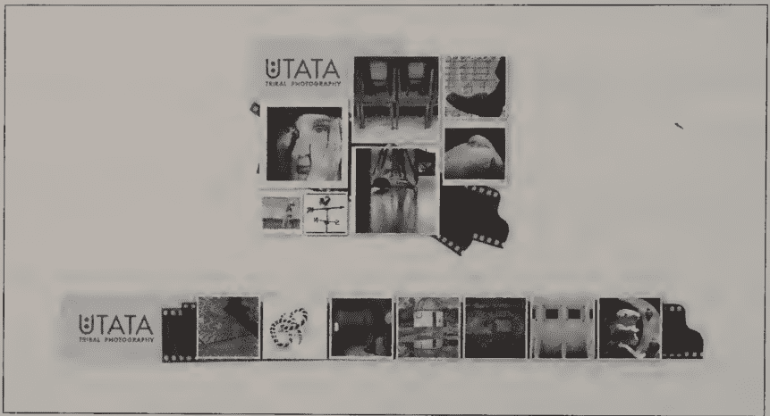

Figure 10-3

These badges were created by a script very similar to the one you saw in this chapter, but which first loads a background image into the `Image::Magick` object. The background images have placeholders to mark where the loaded images should go, as shown in Figure 10-4.

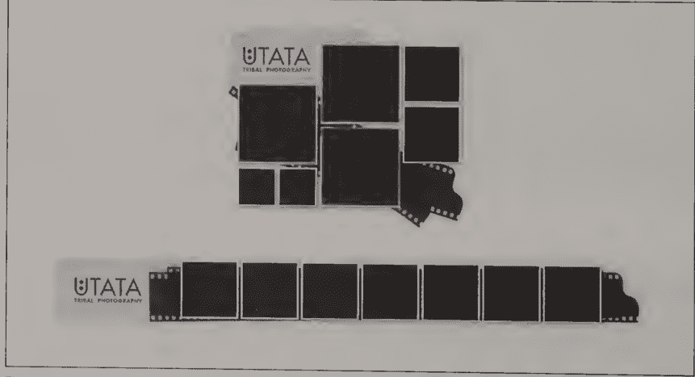

Figure 10-4

The script then resizes each image to the correct size and positions it over the placeholder square. Calculating the target coordinates for each of the images is somewhat tedious. Most image-editing packages make it easy by displaying the position of the cursor as you move it over the image.

## More than Just Badges

Now you've played a little with ImageMagick, you don't have to constrain yourself to building badges—you can build any kind of image you like. Once you start playing around with manipulating the photos on Flickr, there's almost no end to the things you create—and of course, once you've created your new images you can also use the Upload API we looked at in Chapter 8 to automatically store your images in your Flickr account.

If you would like to see more examples of the kinds of images you can build, John Watson, in the guise of "fd's flickr toys," is one of the Flickr community's most prolific creator of Flickr mashups and remixes—you can see them in action at `http://bighugelabs.com/flickr/`. His web site enables you to convert photos into magazine covers, motivational posters, or even pieces of art with his "Hockneyizer," as you can see in Figure 10-5.


# 第 II 部分：Remixing Flickr

## Summary

In this chapter you saw how the `Flickr::API` and `Image::Magick` Perl modules can be combined to create graphical elements made up of multiple images from Flickr. You learned how to invoke Flickr API methods using Perl, invoke ImageMagick functions using the PerlMagick interface, and build composite images using ImageMagick.

Before moving on to the next chapter, you should try making a badge of your own, so take a look at the following exercises.

## Exercises

Half of the fun of applications such as ImageMagick is experimenting to see just what you can do with them. In this exercise, try designing and building your own badge—something you could incorporate into a website or your Flickr profile. Here are some suggestions:

- ☐ Produce a background graphic to set off your images (or persuade an artistically inclined friend to draw one for you), and build a badge that reads in the graphic and then superimposes images on it—just as you saw in the Utata badge examples above.
- ☐ Rather than build a group badge, create one using just your own photos. Try selecting what you think are your best photos for the badge.
- ☐ Try using a variety of sizes of images in your badge, rather than using just one size.

You may find the PerlMagick pages at `http://www.imagemagick.org/script/perl-magick.php` useful if you want to see the different methods available to you.

# Part III

## Mashing It Up

Chapter 11: Visualizing the News

Chapter 12: Searching the Blogosphere

Chapter 13: Displaying Your Photos with Google Maps

Chapter 14: Caching Your Data

## Visualizing the News

Flickr contains tens of millions of photographs taken by members all over the world, which must by now cover practically every subject imaginable. So—in theory at least—you ought to be able to find photos from Flickr that could be used to illustrate pretty much any subject you find discussed on the web. In this chapter you will build a mashup to try to do exactly that. In previous chapters you focused on retrieving data from Flickr; in this one you will gather data together from multiple sources. You will封堵


## 打造更优徽章

本章构建的徽章有意设计得较为简单。ImageMagick 是一款非常强大且多功能的软件——在本章中，我们只是浅尝辄止。如果你想深入了解 ImageMagick，PerlMagick 接口是快速轻松尝试各种功能的理想方式。ImageMagick 官方网站 `http://www.imagemagick.org/` 上有大量信息可供查阅——如果你无法立即找到所需内容，可以尝试使用网站上的搜索功能，它通常能为你指明正确的方向。

## 第二部分：Remixing Flickr

你能用 ImageMagick 做的事情，实际上只受你的想象力限制。例如，图 10-3 展示了由 Karl Randay 设计的几款徽章，用于展示 Utata 群组图库中的最新补充内容。如你所见，这些图片以稍有不同的方式排列，这意味着基本的徽章设计可以轻松更改，以适应不同的页面布局。


图 10-3

这些徽章由与本章所示非常相似的脚本创建，但该脚本会首先将背景图像加载到 `Image::Magick` 对象中。背景图像带有占位符，以标记加载的图像应放置的位置，如图 10-4 所示。


图 10-4

然后，脚本将每张图像调整为正确的大小，并将其放置在占位方块之上。计算每张图像的目标坐标有些繁琐。大多数图像编辑软件都能轻松实现这一点，因为它们会在你移动光标时显示光标位置。

## 不止于徽章

现在你已经稍微接触了 ImageMagick，不必将自己局限于制作徽章——你可以构建任何你喜欢的图像。一旦你开始玩转 Flickr 照片的处理，你能创造的东西几乎无穷无尽——当然，一旦创建了新图像，你还可以使用第 8 章介绍的 Upload API 自动将图像存储到你的 Flickr 账户中。

如果你想查看更多可构建图像类型的示例，John Watson 以 “fd's flickr toys” 之名，是 Flickr 社区中最**多产**的 Flickr mashup 和 remix **创作者**之一——你可以在 `http://bighugelabs.com/flickr/` 看到它们的实际应用。他的网站使你能将照片转换为杂志封面、励志海报，甚至用 “Hockneyizer” 创作艺术作品，如图 10-5 所示。


## 小结

在本章中，你了解了如何结合使用 `Flickr::API` 和 `Image::Magick` Perl 模块，创建由 Flickr 多张图片组成的图形元素。你学习了如何使用 Perl 调用 Flickr API 方法、如何通过 PerlMagick 接口调用 ImageMagick 函数，以及如何使用 ImageMagick 构建合成图像。

在继续下一章之前，你应该尝试制作自己的徽章，因此请查看以下练习。

## 练习

像 ImageMagick 这类应用程序的乐趣，有一半在于尝试你能用它们做什么。在本练习中，尝试设计并构建你自己的徽章——可以整合到网站或你的 Flickr 个人资料中的东西。这里有一些建议：

- ☐ 制作一个背景图形来衬托你的图像（或说服一位有艺术天赋的朋友帮你画一个），然后构建一个读取该图形并将图像叠加其上的徽章——正如你在上面的 Utata 徽章示例中所见。
- ☐ 与其制作群组徽章，不如仅使用你自己的照片创建一个。尝试选择你认为最好的照片用于徽章。
- ☐ 尝试在徽章中使用各种尺寸的图像，而不是只使用一种尺寸。

如果你想了解可用的不同方法，可以访问 `http://www.imagemagick.org/script/perl-magick.php` 上的 PerlMagick 页面，这可能会对你有所帮助。

## 第三部分

## 混搭应用

- 第 11 章：可视化新闻
- 第 12 章：搜索博客圈
- 第 13 章：使用 Google 地图展示照片
- 第 14 章：缓存数据

# 可视化新闻

Flickr 包含数千万张由全球各地会员拍摄的照片，到如今涵盖了几乎所有想象得到的主题。因此——至少在理论上——你应该能够从 Flickr 找到照片，用来展示你在网上找到的任何话题。在本章中，你将构建一个 mashup，试图做到这一点。在之前的章节中，你专注于从 Flickr 获取数据；在本章中，你将从多个来源汇集数据。你将从 BBC、CNN 等主要新闻网站获取新闻源，然后自动用从 Flickr 获取的照片来展示这些源中的新闻故事。

## RSS 格式

在第 5 章中，你了解了 Flickr 将 RSS 作为其源的格式之一，但 RSS 的作用远不止于此——*Really Simple Syndication（简易信息聚合）*、*Rich Site Summary（丰富站点摘要）* 或 *RDF Site Summary（RDF 站点摘要）*。

无论你使用哪个版本，RSS 都提供相同的基本信息集——一个源由频道和一系列项目组成。频道提供关于源的基本信息，而每个项目则是一条独立的内容。

在本章中，你将构建一个 mashup，汇集来自全球各种新闻网站的源。这里的示例将使用 BBC 新闻提供的源。请记住，这些新闻源提供最新的当前新闻信息，因此内容会频繁变化——但结构保持不变。BBC 新闻主要 RSS 源位于：

`http://newsrss.bbc.co.uk/rss/newsonline_world_edition/front_page/rss.xml`

# 第三部分：整合资源

让我们看看像英国广播公司（BBC）这样的组织如何使用 RSS 来呈现新闻报道。以下是一个典型的新闻源摘录：

```xml
<rss version="2.0">
  <channel>
    <title>BBC News | News Front Page | World Edition</title>
    <link>http://news.bbc.co.uk/go/rss/-/2/hi/default.stm</link>
    <description>Visit BBC News for up-to-the-minute news, breaking news, video, audio and feature stories. BBC News provides trusted World and UK news as well as local and regional perspectives. Also entertainment, business, science, technology and health news.</description>
    <language>en-gb</language>
    <lastBuildDate>Sat, 17 Jun 2006 14:24:42 GMT</lastBuildDate>
    <copyright>Copyright: (C) British Broadcasting Corporation, see http://news.bbc.co.uk/2/hi/help/rss/4498287.stm for terms and conditions of reuse</copyright>
    <docs>http://www.bbc.co.uk/syndication/</docs>
    <ttl>15</ttl>
    <image>
      <title>BBC News</title>
      <url>http://news.bbc.co.uk/nol/shared/img/bbc_news_120x60.gif</url>
      <link>http://news.bbc.co.uk/go/rss/-/2/hi/default.stm</link>
    </image>
    <item>
      <title>The Who recreate classic concert</title>
      <description>Rock band The Who recreate their legendary 1970 Live At Leeds concert to launch their world tour.</description>
      <link>http://news.bbc.co.uk/go/rss/-/2/hi/entertainment/5086954.stm</link>
      <guid isPermaLink="false">http://news.bbc.co.uk/2/hi/entertainment/5086954.stm</guid>
      <pubDate>Sat, 17 Jun 2006 00:19:14 GMT</pubDate>
      <category>Entertainment</category>
    </item>
    <item>
      <title>Gates to end daily Microsoft role</title>
      <description>Bill Gates says he will end his day-to-day role as head of software giant Microsoft by 2008, to focus on his charity.</description>
      <link>http://news.bbc.co.uk/go/rss/-/2/hi/business/5085444.stm</link>
      <guid isPermaLink="false">http://news.bbc.co.uk/2/hi/business/5085444.stm</guid>
      <pubDate>Fri, 16 Jun 2006 13:00:21 GMT</pubDate>
      <category>Business</category>
    </item>
  </channel>
</rss>
```

从开始标签可以看出，这是 RSS 2.0 版本。其他 RSS 版本有不同的格式，但你仍然会在其中找到相同的关键信息。`<channel>` 标签包含定义源标题、描述以及源网站 URL 的元素。BBC 提供了许多不同的源，例如世界新闻、娱乐新闻和技术新闻——每个源本质上都是一个不同的 RSS 频道。频道内包含多个条目——每个条目都有自己的标题、描述和链接。在这样的源中，每个条目就是一个新闻报道，但这种频道/条目模型也适用于许多其他不同类型的数据——从你祖母的食谱集到你的源代码控制系统的变更日志。几乎所有可以分解为列表的数据源都是 RSS 的潜在候选者，如果你花点时间在网上浏览，你会找到数不胜数的 RSS 源，主题千差万别。它们可能看起来都有些不同——RSS 0.91、1.0 和 2.0 都被广泛使用——但它们仍然是 RSS。还有其他一些不太常见的 RSS 版本你可能也会遇到——例如 0.90 和 0.93。

那么，在这些略有不同的格式周围，编写一个能够处理所有这些格式的解析器肯定会变得更加困难吗？答案很简单——让别人为你做艰苦的工作，使用现有的 RSS 库从 RSS 源中提取你需要的数据。

# Magpie

Magpie 是一个开源项目，它极大地简化了从 RSS 源中提取数据的过程。它使用起来非常简单——你所要做的就是传递它源的 URL，它就会将源数据转换成方便你使用的 PHP 结构。它能无缝地为你处理所有不同版本的 RSS，因此你无需担心源本身的格式。你可以从 `http://magpierss.sourceforge.net/` 下载 Magpie。

## 安装 Magpie

下载后，安装 Magpie 非常简单。在你的 Web 服务器的 lib 目录下创建一个名为 `magpie` 的新目录。将 Magpie 发行版中包含的所有 `.inc` 文件——`rss_cache.inc`、`rss_fetch.inc`、`rss_parse.inc` 和 `rss_utils.inc`——复制到这个 `lib/magpie` 目录中。还有一个 `extlib` 目录，你应该将其复制到 `lib/magpie` 目录中——这个子目录只包含一个文件 `Snoopy.class.inc`。

## 设置 Magpie 的缓存

Magpie 具有内置的 RSS 源缓存功能，这意味着它只会在有新内容时获取和解析 RSS 源，从而避免不必要地向提供 RSS 源的网站请求内容。这有助于提高你的混搭应用的性能，RSS 提供者也会因为你减少了发送的请求数量而对你更有好感。

设置缓存的完整说明包含在 Magpie 的安装说明中，如果你愿意，可以按照说明操作。不过，为了简单起见，你可以直接使用系统的临时目录来保存缓存文件。这通常是基于 Unix 系统的 `/tmp` 和 Microsoft Windows 系统的 `c:\temp`。你需要告诉 Magpie 使用哪个目录作为缓存，因此你必须在你的 Magpie 脚本中添加一个语句。

在 Unix 系统上：

```php
define('MAGPIE_CACHE_DIR', '/tmp/magpie_cache');
```

在 Windows 系统上：

```php
define('MAGPIE_CACHE_DIR', 'c:/temp/magpie_cache');
```

## 尝试使用 Magpie 获取一个源

在这个练习中，你将创建一个脚本，使用 Magpie 从 BBC 新闻获取一个源。

1. 在你的混搭应用站点的顶层创建一个名为 `visualizing-news` 的新目录，用于存放本章的文件。在此目录中，创建一个新的 PHP 文件，名为 `11-1.php`，内容如下。

```php
<?php

require_once(dirname(__FILE__) . '/../lib/magpie/rss_fetch.inc');

header("Content-Type: text/plain");

$feed = 'http://newsrss.bbc.co.uk/rss/newsonline_world_edition/technology/rss.xml';

$rss = fetch_rss($feed);

print_r($rss);

?>
```

2. 然后将此页面加载到你的 Web 浏览器中，你应该会看到类似以下的内容（不过，希望你看到的新闻报道比这些更新）：

```text
magpierss Object
(
    [parser] => Resource id #8
    [current_item] => Array
        (
        )
    [items] => Array
        (
            [0] => Array
                (
                    [title] => Safety fears as Shuttle date set
                    [description] => The US space shuttle Discovery will be launched on 1 July, Nasa says, despite warnings it is not safe to fly.
                    [link] => http://news.bbc.co.uk/go/rss/-/2/hi/americas/5091308.stm
                    [guid] => http://news.bbc.co.uk/1/hi/world/americas/5091308.stm
                    [pubdate] => Sat, 17 Jun 2006 21:32:45 GMT
                    [category] => Americas
                    [summary] => The US space shuttle Discovery will be launched on 1 July, Nasa says, despite warnings it is not safe to fly.
                    [date_timestamp] => 1150579965
                )
            [1] => Array
                (
                    [title] => Gates to end daily Microsoft role
                    [description] => Bill Gates says he will end his day-to-day role as head of software giant Microsoft by 2008, to focus on his charity.
                    [link] => http://news.bbc.co.uk/go/rss/-
```

# 第十一章：新闻可视化

```text
/2/hi/business/5085444.stm
    [guid] => http://news.bbc.co.uk/1/hi/business/5085444.stm
    [pubdate] => Fri, 16 Jun 2006 13:00:21 GMT
    [category] => Business
```


[summary] => Bill Gates says he will end his day-to-day role as head of software giant Microsoft by 2008, to focus on his charity.

[date_timestamp] => 1150462821

[channel] => Array
(
    [title] => BBC News | Technology | World Edition
    [link] => `http://news.bbc.co.uk/go/rss/-/2/hi/technology/default.stm`
    [description] => Visit BBC News for up-to-the-minute news, breaking news, video, audio and feature stories. BBC News provides trusted World and UK news as well as local and regional perspectives. Also entertainment, business, science, technology and health news.
    [language] => en-gb
    [lastbuilddate] => Mon, 19 Jun 2006 10:19:55 GMT
    [copyright] => Copyright: (C) British Broadcasting Corporation, see `http://news.bbc.co.uk/2/hi/help/rss/4498287.stm` for terms and conditions of reuse
    [docs] => `http://www.bbc.co.uk/syndication/`
    [ttl] => 15
    [tagline] => Visit BBC News for up-to-the-minute news, breaking news, video, audio and feature stories. BBC News provides trusted World and UK news as well as local and regional perspectives. Also entertainment, business, science, technology and health news.
)

[textinput] => Array
(
)

[image] => Array
(
    [title] => BBC News
    [url] => `http://news.bbc.co.uk/nol/shared/img/bbc_news_120x60.gif`
    [link] => `http://news.bbc.co.uk/go/rss/-/2/hi/technology/default.stm`
)

[feed_type] => RSS
[feed_version] => 2.0
[encoding] => ISO-8859-1
[_source_encoding] =>
[ERROR] =>
[WARNING] =>

[_CONTENT_CONSTRUCTS] => Array
(
    [0] => content
    [1] => summary
    [2] => info
    [3] => title
    [4] => tagline
    [5] => copyright
)

## 第11章：可视化新闻

3. 现在，在 `visualizing-news` 目录中创建一个新的 PHP 文件 `11-2.php`，内容如下：

```php
<?php

require_once(dirname(__FILE__) . '/../lib/magpie/rss_fetch.inc');

$feed = 'http://newsrss.bbc.co.uk/rss/newsonline_world_edition/technology/rss.xml';

$rss = fetch_rss($feed);

$items = $rss->items;

?>

<h1><?php echo $rss->channel['title'] ?></h1>

<p><?php echo $rss->channel['description'] ?></p>

<ul>

<?php

foreach ($items as $item)

{

?>

  <li><strong><?php echo $item['title'] ?></strong><br/>

  <?php echo $item['description'] ?>

  </li>

<?php

}

?>

</ul>
```

4. 将此页面加载到你的浏览器中。你将看到与之前相同的订阅源，但这次内容被格式化为简单的新闻列表。

### 工作原理

脚本的前几行代码很简单，它们加载 Magpie 库，并将此网页的内容类型设置为纯文本——这样可以保留 `print_r` 语句的格式。真正完成实际工作的代码是这一行：

```php
$rss = fetch_rss($feed);
```

这一行调用了 Magpie 库中的 `fetch_rss` 函数，并将 RSS 订阅源的 URL 作为参数传入。然后 Magpie 返回一个 `magpierss` 对象，其中包含来自订阅源的所有信息。如果你查看 `print_r` 语句的输出，就能看到 `magpierss` 对象的结构。其中最值得关注的两个属性是 `channel` 和 `items` 数组。`channel` 是一个关联数组，包含有关订阅源的一般信息——标题、描述和链接。`items` 是实际新闻条目本身的数组，正如你所看到的，每个条目都有自己的标题、描述、链接和其他元数据。

现在你已经获取了订阅源，用一些执行简单格式化的代码替换上面示例中的 `print_r` 语句就非常简单了，这正是第二个脚本中发生的事情。

## 在 Flickr 上查找图片

既然你已经获取了包含 RSS 订阅源新闻条目的 PHP 结构，你就会看到标题和描述字段包含描述新闻故事的文本。如果你从这些字段中选择一些单词，应该就能将它们传递给 Flickr，并找到任何使用这些单词作为标签的照片。但应该使用哪些单词呢？

在微软的新闻故事中，你可以看到以下文本：

```text
[title] => Gates to end daily Microsoft role

[description] => Bill Gates says he will end his day-to-day role as head of software giant Microsoft by 2008, to focus on his charity.
```

一个非常简单的选择关键词的方法是尝试挑选出所有表示人名、地名或公司名称的单词。要做到这一点，只需选择所有专有名词——换句话说，任何以大写字母开头的单词。如果你这样做，并保持单词出现的顺序，你将得到：

```text
Gates, Microsoft, Bill
```

在 Flickr 上进行标签搜索，寻找包含所有这些单词作为标签的照片，应该能检索到很有可能是比尔·盖茨本人的照片。只有三个关键词，这是一个很好的简单示例。但如果新闻故事是关于华尔街对盖茨公告的反应呢？通过挑选出大写单词作为关键词，你可能会得到一个看起来像这样的关键词列表：

```text
Gates, Microsoft, Bill, Wall, Street, New, York, NASDAQ
```

Flickr 上恰好包含所有这些标签的照片的概率相对较低。显然，搜索应该寻找包含其中一些（但不一定是全部）标签的照片——实际上，包含的标签越多越好。你可以通过使用 `flickr.photos.search` API 方法来实现这一点。如果你将 `tag_mode` 设置为 `any`，并将 `sort` 设置为 `relevance`，你就能得到你想要的结果——搜索将找到包含一个或多个关键词作为标签的照片，但“按相关性排序”意味着包含更多标签的照片将在搜索结果列表中排在更靠前的位置。

不过，事情还不算完美。仅仅有很高的关键词匹配数并不能保证你得到的就是你想要的主题——毕竟，你比尔叔叔在纽约街头派对结束后坐在墙上的那张照片，也可能得到很高的相关性评分。尽管如此，这种方法很可能足以提供一些有趣的结果。

### 动手试试：检索相关图片

在这个练习中，你将创建一个脚本，帮助你根据关键词从 Flickr 检索图片，并按相关性排序。

1. 在 `visualizing-news` 目录中创建一个新的 PHP 文件 `11-3.php`，内容如下：

```php
<?php

require_once(dirname(__FILE__) . '/../lib/phpFlickr/phpFlickr.php');

require_once(dirname(__FILE__) . '/../lib/apikey.php');

$flickr = new phpFlickr($flickrApiKey, $flickrSecret);

$keywords = array('bill', 'gates', 'microsoft');

$args = array(
    'tags' => join($keywords, ','),
    'tag_mode' => 'any',
    'sort' => 'relevance',
    'page' => 1,
    'per_page' => 6,
);

$photos = $flickr->photos_search($args);

$photoList = $photos['photo'];

?>

<ul>

<?php

foreach ($photoList as $photo)

{

    $squarePhoto = 'http://static.flickr.com/' . $photo['server'] . '/' . $photo['id'] . '_' . $photo['secret'] . '_s.jpg';

?>

    <li>"></li>

<?php

}

?>

</ul>
```

2. 如果你在浏览器中查看该页面，你应该会看到一个包含六张图片的列表——希望其中一些是比尔·盖茨的照片。

### 工作原理

这个 PHP 脚本调用了你之前看到的 `flickr.photos.search` 方法：

```php
$args = array(
    'tags' => join($keywords, ','),
    'tag_mode' => 'any',
    'sort' => 'relevance',
    'page' => 1,
    'per_page' => 6,
);
```

标签列表是通过将提供的关键词列表转换为逗号分隔的字符串来构建的。将 `tag_mode` 设置为 `any` 以确保返回包含一个或多个所需标签的照片。最后，将 `sort` 设置为 `relevance` 确保 Flickr 会将最佳匹配项排在返回结果的最前面。

对于每张图片，都会构造一个小正方形（75 × 75 像素）图片的 URL，如第4章所述。

```php
$squarePhoto = 'http://static.flickr.com/' . $photo['server']
             . '/' . $photo['id'] . '_' . $photo['secret'] . '_s.jpg';
```

然后将结果显示为 HTML 无序列表。

## 将文字与图片结合

既然你已经了解了如何使用 Magpie 检索和解析 RSS 订阅源，并且在 Flickr 上找到了相关的照片，现在是时候将它们整合成一个完整的混搭应用了。

### 动手试试：创建混搭应用

在这个练习中，你将结合前两个练习中学到的知识来生成一个带有图片的新闻提要。你将使用 Magpie 检索新闻提要并将其转换为 PHP 对象。然后，你将查看该对象的元素，并尝试挑选出描述每条新闻的一些关键词。这些词将构成 Flickr 搜索的基础，希望能找到与新闻故事有一定相关性的照片。

1. 在网站的 `lib` 目录中创建 `NewsItem.php` 脚本。`NewsItem` 是一个 PHP 类，代表 RSS 订阅源中的单个条目。

```php
<?php

class NewsItem
{
    var $rssItem = null;

    var $keywords = null;

    var $photos = null;

    // Flickr 标签搜索只允许20个标签
    var $maxKeywords = 20;

    // 一些需要忽略的常见单词
    var $commonWords = array(
      'a', 'an', 'the', 'it', 'is', 'for', 'to', 'he', 'she', 'in',
      'why', 'which', 'where', 'who', 'about', 'this', 'that', 'as',
      'his', 'her', 'as', 'i', 'me', 'my'
    );

    function NewsItem($rssItem)
    {
      $this->rssItem = $rssItem;

      $this->photos = array();
    }

    function addPhoto($url, $link)
    {
      array_push($this->photos, array('url' => $url, 'link' => $link));
    }

    function getPhotos()
    {
      return $this->photos;
    }

    function getTitle()
    {
      return $this->rssItem['title'];
    }

    function getDescription()
    {
      return $this->rssItem['description'];
    }

    function getLink()
    {
      return $this->rssItem['link'];
    }

    function getKeywords()
    {
      if ($this->keywords == null)
      {
        $s = $this->getTitle() . " " . $this->getDescription();

        $words = $this->splitIntoWords($s);

        $this->keywords = $this->extractKeywords($words);
      }

      return $this->keywords;
    }
```

## 第11章：新闻可视化

```php
function splitIntoWords($data)
{
	// Remove any possessive apostrophes

	$s = preg_replace('/\'s /', ' ', $data);

	// remove all except alphanumeric characters and spaces

	$s = preg_replace('/[^ \w]/', '', $s);

	return preg_split('/ +/', $s);
}
```

```php
function extractKeywords($data)
{
	$words = array();

	foreach ($data as $word)
	{
		if (!in_array(strtolower($word), $words) && $this->isGoodKeyword($word))
		{
			array_push($words, strtolower($word));
		}

		if (count($words) >= $this->maxKeywords)
		{
			break;
		}
	}

	return $words;
}
```

```php
function isGoodKeyword($word)
{
	// Discard immediately if it is a number

	if (preg_match('/^\d+$/', $word))
	{
		return false;
	}

	// Discard all common words

	if (in_array(strtolower($word), $this->commonWords))
	{
		return false;
	}

	// Does it contain any capital letters or numbers?

	if (preg_match('/[A-Z0-9]/', $word))
	{
		return true;
	}

	// If it is more than five characters, it must be a good word
```

```php
        if (strlen($word) > 5)
        {
          return true;
        }
```


```php
return false;
```

- 2. 在站点的`lib`目录中创建文件`NewsVisualizer.php`。`NewsVisualizer`是此混搭应用的主 PHP 类。

```php
<?php

class NewsVisualizer

{

  var $flickr;

  var $feedUrl;

  var $rss;

  var $maxPhotos = 6;

  var $maxStories = 5;

  // Constructor

  function NewsVisualizer($feedUrl)

  {

    global $flickrApiKey;

    global $flickrApiSecret;

    $this->flickr = new phpFlickr($flickrApiKey, $flickrApiSecret, false);

    $this->feedUrl = $feedUrl;

    $this->rss = fetch_rss($this->feedUrl);

  }

  function getTitle()

  {

    return $this->rss->channel['title'];

  }

  function getDescription()

  {

    return $this->rss->channel['description'];

  }

  function getLink()

  {

    return $this->rss->channel['link'];

  }

  function getItems()

  {

    $items = array();

    foreach ($this->rss->items as $item)

    {

      $newsItem = new NewsItem($item);

      $photos = $this->findImages($newsItem->getKeywords());

      $photoCount = 0;

      foreach ($photos as $photo)

      {

        $squarePhoto = 'http://static.flickr.com/' . $photo['server']

            . '/' . $photo['id'] . '_' . $photo['secret'] . '_s.jpg';

        $photoPage = 'http://www.flickr.com/photos/' . $photo['owner']

            . '/' . $photo['id'] . '/';

        $newsItem->addPhoto($squarePhoto, $photoPage);

        if (++$photoCount >= $this->maxPhotos)

        {

          break;

        }

      }

      array_push($items, $newsItem);

      if (count($items) >= $this->maxStories)

      {

        break;

      }

    }

    return $items;

  }

  function findImages($keywords)

  {

    $args = array(

        'tags' => join($keywords, ','),

        'tag_mode' => 'any',

        'sort' => 'relevance',

        'page' => 1,

        'per_page' => $this->maxPhotos,

    );

    $photos = $this->flickr->photos_search($args);

    if ($this->flickr->getErrorCode())

    {

        // Display error message and return an empty set of photos

        echo $this->flickr->getErrorMsg() . " whilst searching for photos";

        return array();

    }

    return $photos['photo'];

  }

}

?>
```

- 3. 在站点的`lib`目录中创建文件`visualizing-news.php`。它仅用于确保必要的库被正确引入，并且 Magpie 缓存目录被正确定义。

```php
<?php

require_once(dirname(__FILE__) . '/apikey.php');

require_once(dirname(__FILE__) . '/phpFlickr/phpFlickr.php');

require_once(dirname(__FILE__) . '/magpie/rss_fetch.inc');

require_once(dirname(__FILE__) . '/NewsItem.php');

require_once(dirname(__FILE__) . '/NewsVisualizer.php');

define('MAGPIE_CACHE_DIR', '/tmp/magpie_cache');

?>
```

不要忘记将此文件中 Magpie 缓存的位置更改为你系统的正确位置。

**4.** 在项目的`visualizing-news`目录中创建`index.php`。这是显示此混搭应用的网页。

```php
<?php

  // include any required files

  require_once(dirname(__FILE__) . '/../lib/visualizing-news.php');

?>

<!DOCTYPE html PUBLIC "-//W3C//DTD XHTML 1.0 Transitional//EN"

"http://www.w3.org/TR/xhtml/DTD/xhtml1-transitional.dtd">

<html xmlns="http://www.w3.org/1999/xhtml">

<head>

  <title>Beginning Flickr Mashups: Visualizing the News</title>

  <link href="../css/main.css" rel="stylesheet" type="text/css" />

  <link href="../css/visualizing-news.css" rel="stylesheet" type="text/css" />

</head>

<body>

  <h1>Visualizing the News </h1>

  <?php

  // Initialise the feed URL

  $feedList = array(

    'http://newsrss.bbc.co.uk/rss/newsonline_world_edition/front_page/rss.xml' =>

'BBC News',

    'http://newsrss.bbc.co.uk/rss/newsonline_world_edition/technology/rss.xml' =>

'BBC Technology News',

    'http://newsrss.bbc.co.uk/rss/newsonline_world_edition/entertainment/rss.xml'

=> 'BBC Entertainment News',

    'http://rss.cnn.com/rss/cnn_topstories.rss' => 'CNN News',

    'http://rss.imdb.com/news/' => 'Internet Movie Database News',

  );

  // See if a feed has been chosen

  $selectedFeed = $_REQUEST['feed'];

?>

  <form name="form" id="form" method="post" action="index.php">

    <select name="feed">

<?php

  $feedUrls = array_keys($feedList);

  foreach ($feedUrls as $feedUrl)

  {

?>

      <option value="<?php echo $feedUrl ?>" <?php echo ($feedUrl == $selectedFeed)

? 'selected="selected"' : '' ?>><?php echo $feedList[$feedUrl]?></option>

<?php

  }

?>

    </select>

    <input type="submit" name="Submit" value="Go" />

</form>

<?php

if (!empty($selectedFeed))

{

    $visualizer = new NewsVisualizer($selectedFeed);

    $items = $visualizer->getItems();

?>

<div class="disclaimer">The images shown below were automatically chosen from

Flickr based on keywords found in the news feed. They do not bear any direct

relationship to the news feed or article and no such relationship should be assumed

or inferred.</div>

<div class="news-feed">

    <h2 class="news-feed-title"><?php echo $visualizer->getTitle() ?></h2>

    <p class="news-feed-description"><?php echo $visualizer->getDescription() ?></p>

    <ul class="news-items">

<?php

    foreach ($items as $item)

    {

?>

        <li class="news-item">

            <ul class="news-text">

                <li class="news-title"><a href="<?php echo $item->getLink() ?>"

target="_blank"><?php echo $item->getTitle() ?></a></li>

                <li class="news-description"><?php echo $item->getDescription() ?></li>

                <li class="news-keywords">Keywords: <?php echo join($item->getKeywords(),

", " ) ?></li>

            </ul>

            <ul class="news-images">

<?php

                $photos = $item->getPhotos();

                foreach ($photos as $photo)

                {

?>

                    <li><a href="<?php echo $photo['link'] ?>" target="_blank">" /></a></li>

<?php

                }

?>

            </ul>

        </li>

<?php

    }

?>

    </ul>

</div>

<?php

}

?>

</body>

</html>
```

**5.** `visualizing-news.css`是包含此混搭应用特定样式规则的样式表。它应该在站点的`css`目录中创建。

```css
.disclaimer {

  font-size: small;

  margin-top: 1em;

  margin-bottom: 1em;

}

.news-feed {

  border: 1px solid #000066;

}

.news-feed h2 {

  padding: 0.5em 2em 0.5em 2em;

  margin: 0;

  font-size: large;

  font-weight: bold;

  color: #000000;

  background-color: #EEEEEE;

}

.news-feed-description {

  padding: 0 3em 0 3em;

}

.news-title {

  margin-bottom: 0.5em;

}

.news-description {

  margin-bottom: 0.5em;

}

.news-keywords {

  margin-bottom: 0.5em;

  font-size: x-small;

  color: #666666;

}

.news-item {

  list-style-type: none;

}

.news-text {

  list-style-type: none;

  margin: 0;

  padding: 0;

}

.news-images {

  margin: 0 0 1em 0;

  padding: 0;

}
```

```css
.news-images img {

    margin: 3px;

    padding: 3px;

    border: 2px solid #DDDDDD;

}

.news-images li {

    display: inline;

    list-style-type: none;

    margin: 5px;

    height: 91px;

    width: 91px;

}
```

- 6. 要查看完成的混搭应用的实际效果，只需将浏览器指向项目的`visualizing-news/index.php`页面，然后选择你想要查看的 RSS 源。随后你应该会看到类似于图 11-1 的内容。

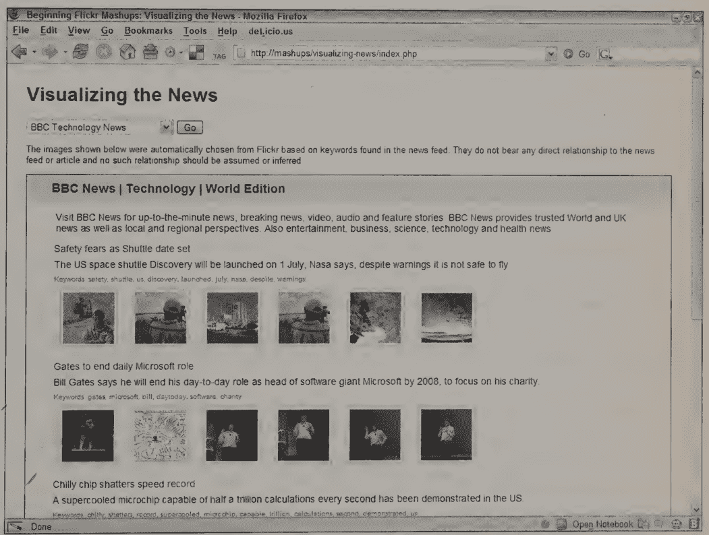

图 11-1

## 第三部分：融合

### 工作原理

`NewsItem`脚本的构造函数接受一个参数——来自 Magpie RSS 对象中`items`数组的一个元素。例如：

```php
// Use Magpie to fetch a feed

$rss = fetch_rss($url);

$items = $rss->items;

$firstItem = new NewsItem($items[0]);
```

每个`NewsItem`会跟踪它所代表的 RSS 条目，并维护一个与该条目相关的照片数组。`NewsItem`类还包含许多辅助方法，以便方便地访问 RSS 条目中有趣的部分，如标题和描述。

`NewsItem`类的真正工作由`getKeywords`方法启动：

```php
function getKeywords()

{

    if ($this->keywords == null)

    {

        $s = $this->getTitle() . " " . $this->getDescription();

        $words = $this->splitIntoWords($s);

        $this->keywords = $this->extractKeywords($words);

    }

    return $this->keywords;

}
```

获取关键词是一个三阶段的过程：

1. 构建用于选择关键词的文本字符串。
2. 将文本字符串拆分为单个单词的数组。
3. 提取要使用的关键词数组。

用于选择关键词的文本字符串仅仅是 RSS 条目中标题和描述文本的组合。然后，通过调用`splitIntoWords`方法，将此文本拆分为单个单词。

```php
function splitIntoWords($data)

{

    // Remove any possessive apostrophes

    $s = preg_replace('/\'s /', ' ', $data);

    // remove all except alphanumeric characters and spaces

    $s = preg_replace('/[^ \w]/', '', $s);

    return preg_split('/ +/', $s);

}
```


此方法对文本字符串进行两项修改。首先，它移除任何所有格撇号，以尝试提高所使用关键词的质量。（搜索标签`Microsoft`可能比搜索标签`Microsoft's`产生更好的结果。）为此，它使用正则表达式查找字符串`s`后跟一个空格，然后将所有出现的实例替换为一个空格。

此方法进行的第二项修改是剔除任何非字母数字字符。它使用另一个正则表达式`/[^\w]/`来完成此操作。特殊字符`\w`匹配任何字母数字字符，因此`[^\w]`将匹配除空格或字母数字字符之外的任何字符。如果发现任何此类字符，它将被替换为空字符串。

最后，使用正则表达式`/ +/`（一个或多个空格的序列）作为分隔符，将字符串分割成数组。

`extractKeywords`方法接受单词数组，并挑选出要作为关键词使用的单词。它简单地遍历数组中的每个项目，检查该单词是否已被选为关键词，然后调用`isGoodKeyword`方法评估其适用性。当达到最大关键词数量或可用单词供应耗尽时，该函数返回找到的关键词列表。

`isGoodKeyword`方法进行一系列简单的测试，以确定给定的单词是否应被用作关键词。测试内容如下：

- 该单词是数字吗？所有完全由数字组成的单词都被拒绝。
- 它是否在`$commonWords`数组中定义的知名常用词列表中？所有常用词都被拒绝。
- 该单词是否包含任何大写字母或数字？此类单词被视为“有趣”，并用作关键词。
- 该单词是否长于五个字符？较长的单词可能比短的单词更适合作为关键词，因此任何六个字母或更长的单词都被接受为关键词。这个数字有些随意——可以尝试不同的值。

任何其他单词都会被自动拒绝。

`NewsVisualizer`类的构造函数接受一个参数：要处理的提要 URL。

```php
function NewsVisualizer($feedUrl)
{
  global $flickrApiKey;
  global $flickrApiSecret;

  $this->flickr = new phpFlickr($flickrApiKey, $flickrApiSecret, false);
  $this->feedUrl = $feedUrl;
  $this->rss = fetch_rss($this->feedUrl);
}
```

它首先创建一个新的`phpFlickr`对象，然后调用 Magpie 的`fetch_rss`方法创建一个包含 RSS 提要的新对象。

该类然后提供一些辅助方法，以便轻松访问提要的各个部分，如标题和描述。

`getItems`方法用于获取代表 RSS 提要中条目的`NewsItem`对象列表：

```php
foreach ($this->rss->items as $item)
{
    $newsItem = new NewsItem($item);
    $photos = $this->findImages($newsItem->getKeywords());
```

该方法遍历 Magpie RSS 对象中的项目数组，并为每个项目创建一个新的`NewsItem`对象。然后调用`findImages`方法，传入`NewsItem`的关键词列表，以生成将使用的照片列表。Flickr 生成的方形 75 × 75 像素照片用于此混合应用，因此使用`flickr.photos.search`方法返回的信息计算方形图像的 URL，以及用户照片页面的 URL。请记住，Flickr 的服务条款规定，每次显示图像时都必须链接回照片页面。

```php
$squarePhoto = 'http://static.flickr.com/' . $photo['server']
    . '/' . $photo['id'] . '_' . $photo['secret'] . '_s.jpg';

$photoPage = 'http://www.flickr.com/photos/' . $photo['owner']
    . '/' . $photo['id'] . '/';
```

所有照片 URL 都注册到`NewsItem`对象中，为以后的显示做好准备。

在`index.php`中，可用于查看的 RSS 提要的名称和 URL 存储在一个名为`$feedList`的关联数组中——URL 是键，提要名称是值：

```php
// Initialise the feed URLs
$feedList = array(
    'http://newsrss.bbc.co.uk/rss/newsonline_world_edition/front_page/rss.xml' =>
    'BBC News',
    ...
);
```

然后，页面通过遍历此`$feedList`数组来显示用于显示可用提要的表单。如果通过提交表单选择了提要，则提要 URL 将包含在`$_REQUEST['feed']`中。在生成提要选择表单中的每个`<option>`元素时，会将提要的 URL 与当前选定的提要进行比较：

```php
<option value="<?php echo $feedUrl ?>" <?php echo ($feedUrl == $selectedFeed)
? 'selected="selected"' : '' ?>><?php echo $feedList[$feedUrl]?></option>
```

如果两者相同，则会在`<option>`元素上设置`selected`属性，从而确保表单中的提要下拉列表显示当前正在显示的提要名称。

如果尚未选择任何提要，则不显示任何内容。但是，如果已选择提要——通过`$selectedFeed`变量不为空来表示——则通过使用所选提要的 URL 创建一个`NewsVisualizer`对象来检索提要详细信息：

```php
if (!empty($selectedFeed))
{
    $visualizer = new NewsVisualizer($selectedFeed);
    $items = $visualizer->getItems();
```

页面的其余部分用于设置提要内容的格式，以便用 CSS 进行样式设计。提要本身被包围在一个带有`news-feed`类的包含`<div>`中。提要条目本身包含在一个无序列表中，而用于说明提要的照片则包含在提要条目内的嵌套无序列表中。

## 总结

在本章中，您看到了如何从第三方源获取数据，并利用这些数据确定从 Flickr 获取哪些照片。然后，您将第三方数据提要的内容与 Flickr 托管的图片结合起来，构建了您的第一个真正的混合应用——混合来自多个来源的数据。

在下一章中，您将看到如何将第三方源数据直接嵌入到 Flickr 页面本身——但在您这样做之前，您可能希望通过完成以下练习来进一步增强您当前的混合应用。

## 练习

在搜索 Flickr 时，当前的混合应用只将单个单词标签传递给`flickr.photos.search`，因此`Bill Gates`将作为两个单独的关键词出现——`Bill`和`Gates`。这意味着标记为`Bill Gates`（两个词组合作为单个标签）的照片将不会被搜索找到。修改此混合应用，使其能够识别`Bill Gates`这样的短语，并将其作为单个标签用于标签搜索。提示：一个简单的方法是让混合应用查找连续的、每个都以大写字母开头的单词。

# 搜索博客圈

Flickr 的许多功能都围绕着支撑其运作的社交网络展开，这个网络延伸到整个网络中，成为博客圈——即网络日志的世界——的一部分。Flickr 积极鼓励用户将其作为会员博客中照片的家园——事实上，默认情况下，所有上传到 Flickr 的公开照片都有一个“博客发布”按钮，以便任何 Flickr 成员都能轻松地将 Flickr 上的照片添加到他们的博客中。

尽管在 Flickr 上发布博客照片就像按一下按钮一样简单，但查找照片被发布到何处的问题却留给了 Technorati 或 Google 等第三方网站。在本章中，你将看到如何使用 Greasemonkey 查询 Technorati，以找出照片被发布到何处，并将搜索结果直接嵌入到照片页面中。

## 什么是 Technorati？

Technorati 将自己描述为“网络日志世界动态的权威平台”。它是一个实时搜索引擎，跟踪博客圈中正在发生的事情。大多数博客都设置为每次更新时，通过通知各种关键服务器向世界宣布这一变化。Technorati 跟踪这些通知（称为 ping），因此可以维护世界博客内容的实时索引。

如果你访问 Technorati 的主页`http://www.technorati.com/`，你不仅可以了解博客圈中正在发生的事情，还可以搜索博客圈以找到你感兴趣的内容。搜索功能不仅能让你输入关键词——你还可以输入 URL 来查找可能包含该 URL 链接的任何博客。因此，如果你输入任何 Flickr 照片页面的 URL（例如`http://www.flickr.com/photos/dopiaza/29900246/`），你会看到链接到该照片的博客列表。如果你输入你的照片流 URL（`http://www.flickr.com/photos/dopiaza/`），你会看到所有链接到你任何照片的列表。

# 第三部分：混搭应用

## 获取 Technorati API 密钥

获取 Technorati API 密钥非常简单——你只需在 Technorati 主网站上注册，然后在`http://www.technorati.com/developersapikey.html`获取你的 API 密钥。务必在 Technorati 网站上查看你的密钥使用条款和条件。

## 搜索 Technorati 宇宙

一旦你获得 Technorati API 密钥，你就可以尝试搜索 Technorati 了。Technorati 提供了许多 API 查询，但这里需要的是 cosmos 查询。该查询允许你提供一个基础 URL，并返回所有链接到该 URL 的博客。

与 Flickr 一样，Technorati 为其 API 提供了 REST 接口，因此尝试查询就像在网络浏览器中输入 URL 一样简单。尝试输入以下 URL——将`YOUR-TECHNORATI-API-KEY`替换为你的 Technorati API 密钥。注意，这里的 URL 为可读性分成了两行——确保在浏览器中将其作为单行输入：

```text
http://api.technorati.com/cosmos?key=YOUR-TECHNORATI-API-KEY
    &url=http://www.flickr.com/photos/dopiaza/29900246/
```

你会看到类似这样的响应：

```xml
<?xml version="1.0" encoding="utf-8"?>

<!-- generator="Technorati API version 1.0 /cosmos" -->

<!DOCTYPE tapi PUBLIC "-//Technorati, Inc.//DTD TAPI 0.02//EN"
"http://api.technorati.com/dtd/tapi-002.xml">

<tapi version="1.0">
  <document>
    <result>
      <url>http://www.flickr.com/photos/dopiaza/29900246</url>
      <inboundblogs>2</inboundblogs>
      <inboundlinks>5</inboundlinks>
      <rankingstart>0</rankingstart>
    </result>

    <item>
      <weblog>
        <name>All Cupcakes, All The Time</name>
        <url>http://cupcakestakethecake.blogspot.com</url>
        <rssurl></rssurl>
        <atomurl>http://cupcakestakethecake.blogspot.com/atom.xml</atomurl>
        <inboundblogs>331</inboundblogs>
        <inboundlinks>456</inboundlinks>
        <rank></rank>
        <lastupdate>2006-06-30 13:38:35 GMT</lastupdate>
      </weblog>

      <nearestpermalink>http://cupcakestakethecake.blogspot.com/2005/08/cherries-on-top.html</nearestpermalink>
      <excerpt> [IMG ]    Cupcakes   Originally uploaded by dopiaza.   Those are
cherries, right?</excerpt>
      <linkcreated>2005-08-03 16:06:57 GMT</linkcreated>
      <linkurl>http://www.flickr.com/photos/dopiaza/29900246/</linkurl>
    </item>

    ...
  </document>
</tapi>
```

返回的 XML 文档是链接到请求中`url`参数所指定的照片页面的所有不同博客的列表。

## 用 Greasemonkey 与 Technorati 对话

你在第 9 章中已经了解了如何编写一些简单的 Greasemonkey 脚本，但它们主要集中在操作 Flickr 页面上已有的信息。对于这个混搭应用，你需要让你的脚本从另一个网站——Technorati——检索信息。幸运的是，Greasemonkey 使这变得相当简单。你已经使用过 Greasemonkey API 的一部分——`GM_log`函数用于将消息输出到 JavaScript 控制台。现在是时候看看另一个 Greasemonkey API 函数了——`GM_xmlhttpRequest`。`GM_xmlhttpRequest`函数使你能够向任何网站发出任意 HTTP 请求。理解它的最简单方式就是看看它的实际运作。

### 动手实践：GM_xmlhttpRequest

在本练习中，你将使用`GM_xmlhttpRequest`在加载 Flickr 照片页面时执行 Technorati cosmos 查询。

1. 创建一个名为`GM_xmlhttpRequestExample.user.js`的文件，内容如下（记得将`YOUR-TECHNORATI-API-KEY`替换为你实际的 Technorati API 密钥）：

```javascript
// ==UserScript==

// @name      GM_xmlhttpRequest Example

// @namespace   http://www.dopiazza.org/flickr/greasemonkey/

// @description  GM_xmlhttpRequest Example

// @include    http://www.flickr.com/photos/dopiaza/29900246/

// ==/UserScript==

var technoratiAPIKey = 'YOUR-TECHNORATI-API-KEY';

var url = 'http://api.technorati.com/cosmos';

var params = 'key=' + technoratiAPIKey + '&url=' + window.location.href + '&limit=100';

GM_xmlhttpRequest(
  {
    method: "GET",
    url: url + "?" + params,
    headers:
    {
      "User-Agent": "Flickr-Technorati-Query"
    },
    onload: function (response) {
      // ...
    },
    onload: function(response)
    {
        GM_log ("Response:" + response.responseText);
    },
    onerror: function(response)
    {
        GM_log ("Error:" + response.status + " " + response.statusText);
        GM_log (response.responseText);
    }
  });
```


你会注意到，此脚本设置为仅在查看特定照片页面时执行。这样做的唯一原因是为了确保这个测试脚本不会向 Technorati 发送不必要的流量。如果你想看看脚本在不同照片页面上的效果，只需更改`@include`指令以引用你选择的页面即可。Greasemonkey 仅在脚本安装时读取`@include`指令。如果你在安装后通过点击“管理用户脚本”对话框中的“编辑”按钮来编辑脚本，你还需要在“管理用户脚本”对话框中修改“包含页面”列表。

2. 将脚本安装到 Greasemonkey 和 Firefox 中，然后访问页面`http://www.flickr.com/photos/dopiaza/29900246/`（或你选择的不同照片页面）。
3. 查看 JavaScript 控制台（工具 > JavaScript 控制台），你会看到 Technorati 的响应显示在那里。

### 工作原理

脚本首先设置 Technorati 查询的 URL 和参数。发送了三个参数：

- `key`：你的 API 密钥。
- `url`：你要搜索的页面 URL——在本例中，它是当前查看页面的位置。
- `limit`：要返回的最大结果数。

然后调用`GM_xmlhttpRequest`函数。它接受一个参数，这是一个定义了多个字段的对象：

- `method`：使用的 HTTP 方法。通常，这将是`GET`或`POST`。
- `url`：发送请求的 URL。这里，它是 Technorati REST 端点，用于 cosmos 搜索，参数作为查询字符串附加在后面。
- `headers`：与请求一起发送的 HTTP 头关联数组。
- `onload`：请求成功完成时要调用的函数的引用。
- `onerror`：处理请求出错时要调用的函数的引用。

Technorati 请求完成后，调用`onload`处理程序，它将响应的文本输出到 JavaScript 控制台。

244

你可以在 Dive into Greasemonkey 网站上找到关于`GM_xmlhttpRequest`函数的完整说明：`http://diveintogreasemonkey.org/api/gm_xmlhttprequest.html`。

### 理解响应

当`GM_xmlhttpRequest`调用完成时，它会返回一个响应对象，该对象定义了五个字段：

- `status`：响应的 HTTP 状态码。值为 200 表示请求正常完成。
- `statusText`：响应的 HTTP 状态文本。该值取决于服务器。
- `responseHeaders`：包含响应中 HTTP 头部的字符串。
- `responseText`：包含响应主体的字符串。
- `readyState`：一个当前未使用的字段。

`responseText`字段存储了此混搭所需的信息，但它以单个字符串的形式返回。下一步是将这个字符串转换为便于提取信息的形式。由于响应是一个 XML 文档，显然的解决方案是将该字符串转换为 DOM，然后可以像平常一样使用它。

Firefox 内置了一个`DOMParser`对象（`http://developer.mozilla.org/en/docs/DOMParser`）。该对象有多个方法，但在这里最有用的无疑是`parseFromString`，它接收一个 XML 字符串并将其转换为 DOM。来看看`parseFromString`的实际应用。

### 动手实践：解析响应

在本练习中，你将创建一个 JavaScript 文件来解析从`GM_xmlhttpRequest`返回的 XML。

1. 创建一个名为`DOMParserExample.user.js`的文件，内容如下（记得将`YOUR-TECHNORATI-API-KEY`替换为你实际的 Technorati API 密钥）：

```javascript
// ==UserScript==
// @name           DOMParser Example
// @namespace      http://www.dopiaza.org/flickr/greasemonkey/
// @description    DOMParser Example
// @include        http://www.flickr.com/photos/dopiaza/29900246/
// ==/UserScript==

var technoratiAPIKey = 'YOUR-TECHNORATI-API-KEY';
var url = 'http://api.technorati.com/cosmos';
var params = 'key=' + technoratiAPIKey + '&url=' + window.location.href +
'&limit=100';

GM_xmlhttpRequest(
```

## 第三部分：混搭整合

```javascript
method: "GET",
url: url + "?" + params,
headers:
{
    "User-Agent": "Flickr-Technorati-Query"
},
onload: function(response)
{
    var parser = new unsafeWindow.DOMParser();
    var dom = parser.parseFromString(response.responseText, "application/xml");
    var errors = dom.getElementsByTagName('error');
    if (errors.length > 0)
    {
        GM_log ("Technorati Error:" + errors[0].firstChild.nodeValue);
    }
    else
    {
        var items = dom.getElementsByTagName('item');
        if (items.length > 0)
        {
            for (var i = 0; i < items.length; i++)
            {
                var name = items[i].getElementsByTagName('name')[0];
                GM_log ("Found blog:" + name.firstChild.nodeValue);
            }
        }
        else
        {
            GM_log ('No blogs found');
        }
    }
},
onerror: function(response)
{
    GM_log ("Error:" + response.status + " " + response.statusText);
    GM_log (response.responseText);
}
});
```

同样，此脚本设置为仅在查看特定照片页面时执行。如果你想让脚本在其他照片页面上运行，只需更改`@include`指令以引用你选择的页面。

2. 将该脚本安装到 Greasemonkey 中，然后在 Firefox 中打开页面`http://www.flickr.com/photos/dopiaza/29900246/`（或你选择的其他照片页面）。
3. 查看 JavaScript 控制台（工具▸JavaScript 控制台），你会看到 each blog that links to the photo page 都会显示一行 Found blog。

### 工作原理

此示例与上一个非常相似——唯一的真正区别在于`onload`处理程序。第一步是创建一个`DOMParser`对象：

```javascript
var parser = new unsafeWindow.DOMParser();
```

`DOMParser`不能直接用于 Greasemonkey——它必须通过`unsafeWindow`从应用窗口获取。脚本创建新的解析器后，使用`parseFromString`方法将字符串转换为 DOM：

```javascript
var dom = parser.parseFromString(response.responseText, "application/xml");
```

`parseFromString`的第二个参数是待解析字符串的内容类型——这几乎总是`application/xml`。

现在你有了一个代表响应的 DOM 对象，你可以像访问其他 DOM 对象（如`document`）一样完全相同的方式来访问此对象。脚本首先检查 Technorati 是否返回了错误信息：

```javascript
var errors = dom.getElementsByTagName('error');
```

如果没有返回错误，则查找所有`<item>`节点。如果你查看 Technorati 响应的格式，每个 item 包含一个`name`节点——其中包含你要显示的值：

```xml
<item>
    <weblog>
        <name>All Cupcakes, All The Time</name>
        ...
    </weblog>
</item>
```

对于每个 item，找到其子`<name>`元素：

```javascript
var items = dom.getElementsByTagName('item');

if (items.length > 0)
{
    for (var i = 0; i < items.length; i++)
    {
        var name = items[i].getElementsByTagName('name')[0];
        GM_log ("Found blog:" + name.firstChild.nodeValue);
    }
}
```

`<name>`元素又有一个单子元素，这是一个包含博客名称的文本节点。该值被输出到控制台。

## 整合所有内容

现在你已经了解了如何从 Greasemonkey 内部向 Technorati 发送查询，以及如何从结果中提取字段，你几乎已经可以构建这个混搭了。还有一件重要的事情——那就是决定在照片页面的哪个位置放置博客信息。它需要放在页面上有意义的位置，并且在 Greasemonkey 脚本中易于定位。右侧栏的附加信息部分（Additional Information）看起来是一个合理的位置。如果你查看该栏的 HTML，你会看到它大致如下：

```html
<h4>Additional Information</h4>

  <p class="Privacy">

    

    &nbsp;<span style="font-size: 12px;">&amp;#169;</span> All rights reserved

    (<a class="Plain"
href="/photo_settings.gne?id=29900246&amp;photos_url=&amp;context=set-72057594107731891"
title="Set privacy permissions for this photo">privacy</a>)

  </p>

  <ul>

    <li class="Stats">Taken with a Nikon D100.<br /><a
href="/photo_exif.gne?id=29900246&amp;context=set-72057594107731891" class="Plain">More
properties</a></li>

    ...

  </ul>
```

隐私指示器正下方看起来是个好位置——周围的`<p class="Privacy">`标签应该很容易通过 XPath 查询`//*[@class='Privacy']`找到。然后可以在`</p>`标签结束后、`<ul>`开始前插入博客信息。

在创建混搭之前，最后要考虑的是脚本应该在何时向 Technorati 发送查询。对每个显示的照片页面都发送请求可能不是一个好主意。你可能对查看的每张照片的博客信息都不感兴趣，而且为每个页面发送请求可能被认为是过度的——尤其是当你并不总是需要结果时。记住，访问第三方服务时，应注意不要滥用他们提供的服务——只有在真正需要信息时才向他们发送请求。这里一个不错的折中方案是简单地在每个照片页面上添加一个“查看博客”的链接，仅在用户点击时显示博客列表。

## 动手实践

### 创建混搭

那么，既然混搭的所有关键元素都已经涵盖，是时候看看完整的 Greasemonkey 脚本了。

1. 创建一个名为`QueryTechnorati.user.js`的文件，内容如下（记得将`YOUR-TECHNORATI-API-KEY`替换为你实际的 Technorati API 密钥）：

```javascript
// ==UserScript==
// @name         Query Technorati
// @namespace    http://www.dopplaza.org/flickr/greasemonkey/
```

## 第三部分：混合应用

```javascript
// ==UserScript==
// @name           Flickr-Technorati
// @namespace      http://www.example.com/flickrtechnorati
// @description    Query Technorati from Flickr photo pages
// @include        http://www.flickr.com/photos/*
// @include        http://flickr.com/photos/*
// ==/UserScript==

// *** Edit this ***
// You need to put your Technorati API key here
var technoratiAPIKey = 'YOUR-TECHNORATI-API-KEY';

var photoPagePattern = /^(.*\/photos\/[\w@-]+\/\d+\/)/;

// Check that we really are on a photo page
function checkPhotoPage()
{
  var isPhotoPage = false;
  if (photoPagePattern.exec(window.location.href))
  {
    isPhotoPage = true;
  }
  return isPhotoPage;
}

// Normalize the URL, removing any unneeded elements
function normalizeUrl()
{
  var url = window.location.href;
  var result = photoPagePattern.exec(url);
  if (result != null)
  {
    url = result[1];
  }
  return url;
}

// Add the "View blogs" link after the privacy element
function addLink(privacy)
{
  var parent = privacy.parentNode;
  var blogContainer = document.createElement('p');
  var blogLink = document.createElement('a');

  blogLink.setAttribute('href', '#');
  blogLink.setAttribute('class', 'Plain');

  var text = document.createTextNode('View blogs');
  blogLink.appendChild(text);

  styleElement(blogContainer);
  blogContainer.appendChild(blogLink);
  parent.insertBefore(blogContainer, privacy.nextSibling);

  blogLink.addEventListener("click", function(evt)
  {
    var waiting = document.createElement('span');
    waiting.appendChild(document.createTextNode('Waiting for Technorati...'));
    blogContainer.replaceChild(waiting, blogLink);
    showBlogs(blogContainer, waiting);
    evt.preventDefault();
  }, true);
}

// Retrieve the list of blogs and display them
function showBlogs(blogContainer, message)
{
    var url = 'http://api.technorati.com/cosmos';
```


```javascript
var params = 'key=' + technoratiAPIKey + '&url=' + normalizeUrl() + '&limit=100';

GM_xmlhttpRequest(
{
    method: "GET",
    url: url + "?" + params,
    headers:
    {
        "User-Agent": "Flickr-Technorati-Query"
    },
    onload: function(response)
    {
        blogContainer.removeChild(message);

        var parser = new unsafeWindow.DOMParser();
        var dom = parser.parseFromString(response.responseText, "application/xml");
        var errors = dom.getElementsByTagName('error');

        if (errors.length > 0)
        {
            var p = document.createElement('p');

            p.appendChild(document.createTextNode('Error: ' +
                errors[0].firstChild.nodeValue));

            styleElement(p);
            blogContainer.appendChild(p);
        }
        else
        {
            var items = dom.getElementsByTagName('item');

            if (items.length > 0)
            {
                var list = document.createElement('ul');

                for (var i = 0; i < items.length; i++)
                {
                    addBlog(list, items[i]);
                }

                blogContainer.appendChild(list);
            }
            else
            {
                var p = document.createElement('p');

                p.appendChild(document.createTextNode('No blogs found'));

                styleElement(p);
                blogContainer.appendChild(p);
            }
        }
    },

    addTechnoratiCredit(blogContainer);
},

onerror: function(response)
{
    var p = document.createElement('p');

    p.appendChild(document.createTextNode('There was an error retrieving blog information'));

    styleElement(p);
    blogContainer.appendChild(p);
});

}
```

- 2. 将脚本安装到 Greasemonkey 后，你会在每张照片页面上看到 "View blogs" 链接出现。点击该链接，Technorati 将被查询，你应该会看到类似图 12-1 的内容。


252

### 工作原理

这是一个比较完整的 Greasemonkey 脚本示例，因此为了清晰起见，大部分代码都已放置在函数中。脚本本身的主体部分始于文件末尾，只有短短几行。脚本首先要做的是确定它是在一个实际的照片页面上，而不是在照片流或其他页面上。然后，它执行一个 XPath 查询，寻找前面描述的 `<p class="Privacy">` 标签。一旦找到这个标签，它就调用`addLink`来创建 "View blogs" 链接。

`addLink`函数为 View blogs 链接创建 HTML 并将其插入到 DOM 中——但不仅如此。它还定义了一个事件监听器函数，该函数将在用户点击链接时被触发：

```javascript
blogLink.addEventListener("click", function(evt)
{
    var waiting = document.createElement('span');

    waiting.appendChild(document.createTextNode('Waiting for Technorati...'));

    blogContainer.replaceChild(waiting, blogLink);
    showBlogs(blogContainer, waiting);
    evt.preventDefault();
}, true);
```

当被触发时，这个监听器函数会用一个显示 "Waiting for Technorati..." 的 `<span>` 元素替换 View blogs 链接。然后它调用`showBlogs`来处理博客的检索和显示。最后，调用`evt.preventDefault()`以阻止点击事件进一步传播。这可以防止浏览器尝试跟随该链接。

`showBlogs`函数开始变得有趣起来。它使用`GM_xmlhttpRequest`向 Technorati 发送一个 Cosmos 搜索请求——就像之前的示例一样。当收到响应后，"Waiting for Technorati..." 消息被移除，实例化一个`DOMParser`对象，并从响应中提取 `<item>` 元素。创建一个新的 `<ul>` 元素，并通过`addBlog`函数将每个博客的详细信息添加到其中。这与`addTechnoratiCredit`函数一起，只是创建包含要显示的详细信息的新 HTML 元素，并将它们插入到 DOM 中。

你可能已经注意到，在代码的几个地方都添加了 CSS 样式信息。`<a>` 标签被设置为具有`Plain`类，而 `<li>` 元素则具有`Stats`类。这些类只是从现有的 HTML 中复制过来，以确保新插入的 HTML 不会显得格格不入。其他一些元素则通过`styleElement`函数明确设置样式：

```javascript
function styleElement(node)
{
    node.style.color = '#999999';
    node.style.fontSize = '11px';
    node.style.lineHeight = '15px';
}
```

这个函数显式地设置了一些样式，以确保元素与页面中已有的元素相匹配。如果你好奇，那里看到的数字只是从照片页面引用的样式表中复制出来的。

## 第三部分：整合应用

> 你刚创建的 Greasemonkey 脚本中包含你的 Technorati API 密钥。请务必不要将你的 API 密钥分享给其他人——如果你这样做了，你将无法再控制其使用方式，并且最终可能违反 Technorati 的服务条款。

如果你要分发一个需要此类 API 密钥的脚本，你应该始终让最终用户注册自己的密钥，并在脚本中使用该密钥。

## 本章总结

在本章中，你通过构建一个混合应用来定制了你的 Flickr 视图，该应用涉及将来自第三方网站的信息插入到 Flickr 照片页面中。在此过程中，你学会了如何使用 Technorati 查找指向 Flickr 页面的链接，使用`GM_xmlhttpRequest`从 Greasemonkey 内部向其他网站发送 HTTP 请求，以及使用`DOMParser`将 XML 字符串转换为 DOM。

在下一章，你将开始处理一个更宏大的项目，但在开始之前，你可能希望尝试下面的练习，以进一步完善你的 Greasemonkey 脚本。

## 练习

在运行本章中构建的 Greasemonkey 脚本时，你很可能已经注意到，Technorati 经常为同一篇博客文章返回多个`<item>`元素。其中一些`<item>`元素指向具体的博客文章，而另一些可能仅指向博客的主页。请修改脚本，使其仅显示每个博客一次，并使用最具针对性的链接。

## 第13章：使用 Google 地图展示你的照片

纵观历史，人类一直对地图着迷，试图在一张纸上准确描绘远方的地方——这些地方往往是地图的观看者永远无法亲眼看到的。如今，你可以拍摄照片，让观看者了解一个地点的样子，但你如何向观看者精确地描述那个地点在哪里呢？在本章中，你将学习如何为你的照片添加位置信息标签，然后更新画廊应用程序，以便在世界地图上展示你的 Flickr 照片，让人们能够确切地看到一张特定照片是在哪里拍摄的。

## 什么是地理数据？

如果你想让你的照片出现在地图上，有一点是明确的——你必须以某种方式精确识别照片的拍摄地点。在坐标图上，你使用`x`和`y`坐标来精确定位网格上的一个点。在地图上，你使用经纬度，两者都以度为单位。想象一张平面世界地图，纬线是水平走向的，0°在赤道，向北延伸到北极点的90°，向南延伸到南极点的-90°。经线垂直于赤道，0°经线穿过英国的格林威治镇。这条被称为格林威治子午线或本初子午线的线，在1884年被正式指定为经度测量的参考点。经度测量范围从格林威治的0°向东到+180°，向西到-180°。你可以在图13-1中看到这些经纬线在世界地图上的表示。

地球上的每一个点都可以通过其经纬度来唯一标识。例如，自由女神像位于纬度40.689156度，经度-74.044552度。有时你也可能会看到写作+40° 41' 20.96", -74° 2' 40.39"的形式，其中度的分数部分以分和秒表示。每度被分为60分（'），每分进一步分为60秒（"）。


图13-1

## 使用 Google 地图

Google 地图可以让你查看世界上几乎任何地方的地图。你可能已经熟悉 Google 地图网站，但让我们快速浏览一下 Google 地图界面。打开浏览器，访问`http://maps.google.com/`。你应该会看到一个类似图13-2所示的界面。默认情况下，Google 地图打开时显示的是北美洲地图，但如果你访问的是本地化版本的 Google 地图（例如，`http://maps.google.co.uk/`），你可能会看到一张以你所在地区为中心的不同地图。如果是这样，请不要担心——唯一的区别是初始视图；其他所有操作方式都完全相同。

首先尝试的是移动地图。点击地图上的任意位置并拖动鼠标——你应该能够向任意方向移动地图。你可以持续拖动到地球的任何部分：持续向一个方向拖动，无论是向左还是向右，你最终会环绕整个地球并回到起点。现在拖动地图，直到再次显示北美洲——就像图13-2所示。


图13-2

在 Google 地图中移动的另一种方法是在地图上某处双击。现在就试试——选择你想仔细查看的地图区域，然后双击。当你这样做时，你会注意到两件事。首先，地图会移动，使你点击的点位于屏幕中央。其次，地图会稍微放大，让你更近距离地查看该区域。选择地图上显示的一个城市，然后再次双击该城市。重复这样做几次：每次双击，地图都会重新居中并稍微放大一点，从而显示更多细节。可用的详细程度因你在世界上的位置而异，但大多数北美城市都会显示到单个街道级别的详细信息。

既然你已经放大了，那么如何再次缩小呢？如果你看向地图窗口的左上角，你会看到一组控件，如图13-3所示。


图13-3

滑块控件允许你调整缩放级别：向下拖动可以缩小。控件面板顶部的四个箭头会将地图向相应方向移动一小段距离。四个箭头按钮中间的中心按钮会将你带回起点——即你首次进入 Google 地图时显示的视图，或者你上次搜索时选择的点。

在 Google 地图中搜索非常简单：只需在搜索框中输入你要找的地名，地图就会调整以显示你的目标位置。尝试在搜索框中输入“达拉斯，德克萨斯州”，然后按搜索按钮——你应该会立即看到达拉斯的街道地图。你可以搜索的内容不仅限于城市和城镇名称——尝试输入“金门大桥”或“白金汉宫”，你将被瞬间带到那些地标。

你也可以根据经纬度跳转到特定页面。还记得之前自由女神像的例子吗？如果你获取其坐标并输入到搜索框中：

```
40.689156, -74.044552
```


地图将重新居中到纽约。现在，将缩放滑块一直向上拖动到最大细节，你将看到自由女神像位于地图的最中心，如图13-4所示。


图13-4

你还可以使用 Google 地图查看你正在查看区域的卫星图像。如果你将自由岛的视图完全放大，然后点击地图右上角的“卫星”按钮，地图将切换到岛屿的卫星视图，自由女神像清晰可见。如果你再点击右上角的“混合”按钮，你会看到带有叠加层的卫星视图——这个叠加层显示了地名，以及街道和道路名称。你可以在图13-5中看到这个视图。

如果你想找出你在 Google 地图中当前查看点的经纬度，点击地图顶部的“链接到此页面”。地址栏中的 URL 将更改为包含一组定义当前视图参数的地址——类似这样：

```
http://maps.google.com/?om=1&z=9&ll=33.696923,-117.866821&spn=1.780039,2.320862
```

在此参数列表中，`ll` 参数是地图中心点的经纬度，`z` 参数是当前缩放级别。


图13-5

## 获取 Google Maps API 密钥

既然你已经了解了 Google 地图的实际应用，现在是时候开始在混合应用中使用它了。然而，在开始之前，你需要一个 Google Maps API 密钥。获取密钥非常简单——你只需访问 `http://www.google.com/apis/maps/`，在那里你可以注册一个密钥。为了获得 Google API 密钥，如果你还没有账户，你需要创建一个 Google 账户——当你申请 API 密钥时，系统会要求你登录或注册一个账户。

# 第13章：使用 Google 地图展示照片

需要注意的是，单个 Google API 密钥仅对特定的 URL 前缀有效——你在申请 API 密钥时会要求提供此前缀。这意味着如果你打算先在本地开发混搭应用，然后再部署到互联网上，你需要申请两个 API 密钥——一个用于本地开发 URL，另一个用于部署应用的实际 URL。

获得密钥后，你会发现它看起来像这样：

```
ABZIAAAAsb4CkrHTekHM7P4If9xZagjZgGqaUXO7s-DtJi6a9PbQNGFGdG6ThAZDm0YW8Y9cDvCwlrBDNnUB
```

现在，利用这个密钥来构建你的第一张地图吧。

## 动手试一试：创建地图

在本练习中，你将从创建最简单的地图页面开始。

1. 在你的网站顶层创建一个名为 `maps` 的新文件夹，并创建一个名为 `13-1.html` 的新文件。确保在提示 `YOUR-GOOGLE-MAPS-KEY` 的位置插入你的 Google 地图 API 密钥。

```html
<!DOCTYPE html PUBLIC "-//W3C//DTD XHTML 1.0 Strict//EN"
    "http://www.w3.org/TR/xhtml1/DTD/xhtml1-strict.dtd">

<html xmlns="http://www.w3.org/1999/xhtml">
  <head>
    <title>Flickr Mashups</title>

    <script src="http://maps.google.com/maps?file=api&v=2&key=YOUR-GOOGLE-MAPS-KEY"
        type="text/javascript"></script>

    <script type="text/javascript">
      /* <![CDATA[ */

      function doMap()
      {
        var map = new GMap2(document.getElementById("map"));
        var center = new GLatLng(0, 0);
        map.setCenter(center, 1);
      }

      /* ]]> */
    </script>
  </head>

  <body onload="doMap()" onunload="GUnload()">
    <div style="width: 512px; height: 400px;" id="map"></div>
  </body>
</html>
```

2. 在浏览器中加载该页面，你应该会看到一幅世界地图，如图 13-6 所示。

# 第三部分：混搭应用


图 13-6

### 工作原理

让我们仔细看一下这个 HTML 页面。这次，我们从底部开始——如果你查看 `<body>` 标签的内容，会发现其中几乎没有内容，除了一个 `<div>` 元素：

```html
<div style="width: 512px; height: 400px;" id="map"></div>
```

这个 `<div>` 没有内容，但它设置了一些属性。`style` 属性将 `<div>` 的大小设置为 512 × 400 像素，`id` 属性定义了该 `<div>` 的标识名称——请记住，每个 ID 在文档中必须是唯一的。这个 `<div>` 就是地图最终显示的位置。现在让我们看看它是如何实际到达那里的。

如果你查看文档的 `<head>` 部分，可以看到从 Google 地图网站加载了一个脚本：

```html
<script src="http://maps.google.com/maps?file=api&v=2&key=YOUR-GOOGLE-MAPS-KEY"
    type="text/javascript"></script>
```

这个脚本是 Google 地图 API 库——你创建的每个使用 Google 地图 API 的页面都必须加载这个脚本。你的 API 密钥作为参数包含在这里，Google 会检查该 API 密钥对加载该脚本的网站是否有效——如果不是，将显示错误信息，且脚本不会运行。

接下来是另一个 JavaScript 部分，定义了一个名为 `doMap()` 的新函数。`doMap()` 函数实例化了一个新的 `GMap2` 对象：

```javascript
var map = new GMap2(document.getElementById("map"));
```

`GMap2` 类是 Google 地图 API 中最重要的部分——它代表页面上的一个地图实例。你在 Google 地图中做的所有操作都始于 `GMap2` 的实例。这里使用的 `GMap2` 构造函数接受一个参数——要放置地图的元素。这里，你使用 `document.getElementById()` 来定位 id 为 `map` 的 `<div>`。这就是你网页主体中定义的那个 `<div>`。

如果你愿意，可以在一个页面上放置多个地图。每个地图都由一个 `GMap2` 对象的实例表示，每个地图必须出现在页面上自己的元素中——换句话说，你应该为页面上的每个地图创建单独的 `<div>` 元素，每个元素都有自己唯一的 `id` 属性。

创建地图实例后，你需要告诉地图显示什么内容。在这里，脚本创建了一个新的 `GLatLng` 对象：

```javascript
var center = new GLatLng(0, 0);
```

`GLatLng` 类代表地图上的一个点，由纬度和经度组成。注意，正如地图上的惯例，`GLatLng` 的构造函数第一个参数是纬度，第二个参数是经度。然而，在这个实例中，脚本只是创建了一个纬度 0°、经度 0° 的点，这是赤道上的一个点，位于非洲西海岸附近。这就是你希望地图中心对准的点，为此，你调用 `setCenter`：

```javascript
map.setCenter(center, 1);
```

`setCenter` 方法的第一个参数是代表地图中心点的 `GLatLng` 对象。第二个参数是要使用的缩放级别——1 表示地图缩放到最远。

最后，`<body>` 标签本身定义了两个事件处理器：

```html
<body onload="doMap()" onunload="GUnload()">
```

`onload` 处理器调用 `doMap()` 函数——换句话说，页面加载完成后，`doMap()` 被调用以创建 `GMap2` 对象，并将其插入到 `<div>` 元素中。`onunload` 处理器在用户离开页面时调用，它调用 `GUnload()` 函数，这是 Google 地图 API 的一部分。每当卸载包含 Google 地图对象的页面时，都应该始终调用 `GUnload()`——它会清理 Google 地图 API 使用的若干内部数据结构，以努力解决导致内存泄漏的一些浏览器缺陷。

你可能已经注意到，这里使用的 JavaScript 被包裹在一个 XML CDATA 节中：

```javascript
/* <![CDATA[ */

function doMap()
{
    var map = new GMap2(document.getElementById("map"));
    var center = new GLatLng(0, 0);
    map.setCenter(center, 1);
}

/* ]]> */
```

CDATA 的开始和结束标记都被注释掉了（`/* ... */`），以避免它们干扰 JavaScript 本身，但它们为什么在那里呢？原因是该文档的 DOCTYPE 是 XHTML，它对文档格式要求非常严格。JavaScript 代码本身通常不是有效的 XHTML——它通常包含未转义的实体，如尖括号，这些在 JavaScript 中具有特殊含义（分别是"小于"和"大于"）。为了确保你有一个有效的 XHTML 文档，你应该将任何包含此类实体的内联 JavaScript 代码放在 CDATA 节中。如果不这样做，你的页面可能仍然可以继续工作，但严格来说，它不是有效的 XHTML——如果你曾经将页面提交给 XHTML 验证器（如 `http://validator.w3.org/` 的验证器），没有 CDATA 标签的话，它很可能无法通过验证。

## 向地图添加控件

你可以在前一个示例中创建的地图窗口内拖动以改变其中心点，但你可能已经注意到，你无法放大或缩小。要做到这一点，你需要向地图添加更多用户界面元素，即控件。

### 动手试一试：向地图添加控件

在本示例中，你将获取代码并向其中添加一些控件。

1. 在你的 `maps` 目录中创建一个名为 `13-2.html` 的新文件：

```html
<!DOCTYPE html PUBLIC "-//W3C//DTD XHTML 1.0 Strict//EN"
    "http://www.w3.org/TR/xhtml1/DTD/xhtml1-strict.dtd">

<html xmlns="http://www.w3.org/1999/xhtml">
    <head>
        <title>Flickr Mashups</title>

        <script src="http://maps.google.com/maps?file=api&v=2&key=YOUR-GOOGLE-MAPS-KEY"
            type="text/javascript"></script>

        <script type="text/javascript">
            /* <![CDATA[ */

            function doMap()
            {
                var map = new GMap2(document.getElementById("map"));
                map.addControl(new GLargeMapControl());
                map.addControl(new GMapTypeControl());
                map.addControl(new GOverviewMapControl());

                var center = new GLatLng(48.858205, 2.294359);
                map.setCenter(center, 18, G_SATELLITE_MAP);
            }

            /* ]]> */
        </script>
    </head>

    <body onload="doMap()" onunload="GUnload()">
        <div style="width: 512px; height: 400px;" id="map"></div>
    </body>
</html>
```

别忘了在指定位置替换你的 Google 地图 API 密钥。

2. 在浏览器中打开 `13-2.html`，你会看到埃菲尔铁塔的近距离航拍视图，如图 13-7 所示。


# 第三部分：混搭应用

### 工作原理

本示例与之前的示例非常相似——我们只是向 `doMap()` 函数中添加了更多细节。通过 `addControl` 方法向地图添加了三个控件。第一个是 `GLargeMapControl`，即您之前看到的平移和缩放控件。（还有一个更紧凑的版本，称为 `GSmallMapControl`，非常适合较小的地图。）第二个控件是 `GMapTypeControl`：这些是一些按钮，可以让您在**地图**、**卫星**和**混合**视图之间切换。最后添加的控件是 `GOverviewMapControl` 的一个实例。该控件在窗口的右下角添加了一个小型概览地图，显示当前正在查看的区域周围的缩略图视图。

最后，在这个示例中，我们选择了一个稍微更有趣的起点——现在将地图的中心定位在纬度 48.858205°、经度 2.294359°。这是巴黎埃菲尔铁塔的位置。这次使用的 `setCenter` 调用略有不同：

```javascript
map.setCenter(center, 18, G_SATELLITE_MAP);
```


首先，我们将地图放大到相当近的程度，缩放级别为 18，以便获得塔的良好视图。我们还利用了`setCenter`的可选第三个参数，该参数使我们能够选择显示的地图类型。`G_SATELLITE_MAP`当然就是卫星视图。此处还可以使用的其他可能值包括`G_NORMAL_MAP`和`G_HYBRID_MAP`。

## 构建混搭应用

现在您已经了解了如何将 Google 地图嵌入到网页中，您距离构建自己的混搭应用又近了一步。下一步是从 Flickr 获取地理数据——如果您想在地图上显示 Flickr 照片，您需要知道每张照片的纬度和经度才能显示。

## 向 Flickr 照片添加地理数据

在从 Flickr 检索位置信息之前，您首先需要确保已实际向您的照片添加了必要的位置详细信息。最简单的方法是通过 Flickr 的“整理”功能。登录 Flickr，然后点击屏幕顶部主菜单中的“整理”链接。组织器加载后，点击屏幕顶部的“地图”选项卡。然后，组织器会从雅虎地图加载一张地图并显示它，同时在窗口底部显示您的照片条，如图 13-8 所示。

您可以像在 Google 地图中一样，通过拖动和缩放来操作地图。要向您的照片添加位置信息，只需将它们从窗口底部的照片条拖到地图上的适当位置即可。当您通过将照片拖到地图上来添加位置数据时，Flickr 还会记录照片放置的准确性。您在放置照片时对地图的放大程度越高，放置的准确性就被认为越高。当地图完全缩小以显示整个世界时，Flickr 记录的准确性为 1。当地图完全放大时，准确性为 16。您应该始终尽可能在最大准确性级别添加位置数据。


Flickr 上显示的地图可用的详细程度因您查看的世界哪个部分而异。有些人更喜欢使用第三方系统向其 Flickr 照片添加位置数据。存在许多这样的系统：Yuan.CC 地图（http://maps.yuan.cc/）和 loc.alize.us（http://loc.alize.us/）是两个常用于对 Flickr 照片进行地理标记的热门网站。

## 从 Flickr 照片检索地理数据

那么，一旦您添加了位置数据，如何通过 API 再次检索它呢？API 方法`flickr.photos.getWithGeoData`将返回您拥有的带有地理数据的照片列表。这听起来正是所需要的，直到您意识到它需要身份验证——意味着它只对您有效，而且只有在您首先进行身份验证的情况下才有效，如果您想让其他人查看您的位置信息，这实际上并不实用。事实上，最简单的方法是使用`flickr.photos.search`方法。如果您向此方法传递`geo`作为`extras`伪参数，结果将包含可用的位置信息——显然，对于 Flickr 没有存储地理数据的照片，不会返回任何位置信息。这种方法看起来很有希望，但仅凭它本身还不够。此时，您实际上希望搜索方法仅返回带有地理数据的照片。

`flickr.photos.search`方法接受一个可选参数`bbox`，即要搜索区域的地理边界框：只有此边界框内的照片才会在搜索结果中返回。这也意味着，当使用`bbox`参数时，没有地理数据的照片将不会被返回，因为 Flickr 无法知道它们的位置。现在，如果您希望无论位置数据在哪里，都返回所有带地理标记的照片，您不想指定过于严格的边界框。事实上，如果您指定一个足以覆盖整个地球的边界框，您会发现`flickr.photos.search`会返回边界框内所有带地理标记的照片（换句话说，就是全部），但会排除所有没有附加位置数据的照片。

您可以很容易地看到这在实践中是如何工作的。转到`flickr.photos.search`的 API 资源管理器页面，网址为 http://www.flickr.com/services/api/explore/?method=flickr.photos.search，在`user_id`字段中输入您的 NSID，在`extras`字段中输入`geo`。按下“调用方法”按钮，等待结果出现。

您应该会看到您的照片列表出现在结果窗口中。每张照片都包含位置信息，作为`photo`元素的属性，类似如下：

```xml
<photo id="231699414" owner="50317659@N00" secret="f2ed044b79" server="92"
  title="Lollipops" ispublic="1" isfriend="0" isfamily="0" latitude="52.21284"
  longitude="-1.133437" accuracy="16"/>
```

`latitude`和`longitude`属性指定了照片的地理坐标。`accuracy`属性是 Google 认为这些坐标准确程度的一种度量。它可以取 1 到 16 之间的任何值，其中 16 是最精确的。

但是，您没有指定边界框值，因此任何没有位置信息的照片仍然会出现，但它们的每个位置字段都设置为 0：

```xml
<photo id="208184656" owner="50317659@N00" secret="3d4fb9c4b2" server="63"
  title="Float" ispublic="1" isfriend="0" isfamily="0" latitude="0" longitude="0"
  accuracy="0"/>
```

现在再试一次，但这次指定一个边界框。边界框是由四个值组成的逗号分隔列表，指定边界框左下角和右上角的地理坐标——请注意顺序是左下角经度、左下角纬度、右上角经度、右上角纬度。一个覆盖整个全球的方框，左下角坐标为 −180°、−90°，右上角坐标为 180°、90°。因此，重复上述对`flickr.photos.search`的调用，但这次还指定`-180, -90, 180, 90`作为`bbox`值。当未指定值时使用的默认准确性是最大值 16。如果您在添加照片时使用了较低的准确性级别，您可能希望将较低值的`accuracy`作为额外的参数指定给搜索。

当结果出现时，您应该只会看到带有位置数据的照片。

### 试一试：检索地图数据

现在是时候编写一些代码了。我们通过向 FlickrGallery 类添加一个新方法来获取地理标记照片的列表，将第一块拼图拼接到位：

## 第 13 章：使用 Google 地图显示您的照片

1. 修改`FlickrGallery.php`，添加以下方法：

```php
<?php

class FlickrGallery extends FlickrAuthenticator
{
    ...

    function getWithGeoData()
    {
        $bbox = '-180, -90, 180, 90';

        $args = array(
            'user_id' => $this->nsid,
            'sort' => 'interestingness-desc',
            'bbox' => $bbox,
            'extras' => 'geo',
            'per_page' => 500,
        );

        $p = $this->flickr->photos_search($args);

        if ($this->flickr->getErrorCode())
        {
            echo ("Error fetching photos with GeoData: " . $this->flickr->getErrorMsg());
        }

        return $p['photo'];
    }
}

?>
```

请记住，如果您在通过不将地图完全放大来向照片添加地理数据时使用了较低的准确性级别，您可能还需要在`flickr.photos.search`方法调用的搜索参数列表中添加一个`accuracy`参数。

### 工作原理

`getWithGeoData()`方法的工作原理与所有其他用于搜索照片的 FlickrGallery 方法几乎相同。唯一显著的区别是传递了`bbox`参数，并将`extras`设置为`geo`。

## 处理地理数据

现在您已经知道如何从 Flickr 实际检索位置信息，下一步是将这些数据以某种方式放入您的地图中。幸运的是，Google Maps API 提供了一些有用的函数和类，包括`GXml`类中的 XML 解析器，使您能够读取外部数据。

首先，您需要将已从 Flickr 检索到的照片数据转换为适合您的 Google Maps 应用程序处理的格式。Flickr 本身在其对 Flickr API 方法的响应中使用 XML，因此您可以仅将该 XML 直接传回 Google Maps。不过，`flickr.photos.search`返回的响应中包含了大量地图并不真正需要的信息，因此我们将把 Flickr 结果转换为更简单的 XML 结构。

## 第三部分：融合整合

### 实战演练：将数据添加到地图

在本练习中，你将处理从图库照片中检索到的数据，以便稍后将它们添加到地图上。

1. 在图库目录中创建一个名为`geo.php`的新文件：

```php
<?php

include (dirname(__FILE__) . '/../lib/gallery.php');

$gallery = new FlickrGallery();

$photos = $gallery->getWithGeoData();

header ("Content-Type: text/xml");

echo "<?xml version=\"1.0\"?>\n";

echo "<photos>\n";

if (is_array($photos))
{
    foreach ($photos as $p)
    {
        echo "<photo " .
             "id=\"" . $p['id'] . "\" " .
             "latitude=\"" . $p['latitude'] . "\" " .
             "longitude=\"" . $p['longitude'] . "\" " .
             " />\n";
    }
}

echo "</photos>";

?>
```

2. 在浏览器中输入`geo.php`页面的地址。你应该会看到生成的 XML 结构，大致如下所示：

```xml
<?xml version="1.0"?>

<photos>
  <photo id="141890381" latitude="52.026482" longitude="-1.013328" />
  <photo id="231699414" latitude="52.21284" longitude="-1.133437" />
  <photo id="191649377" latitude="52.188187" longitude="-1.160227" />
  <photo id="226370215" latitude="52.958359" longitude="0.853414" />
  <photo id="132980705" latitude="52.189003" longitude="-1.161278" />
  <photo id="19551666" latitude="52.189003" longitude="-1.161278" />
  <photo id="148877823" latitude="52.972996" longitude="0.851462" />
  <photo id="237529084" latitude="52.225696" longitude="-1.178509" />
</photos>
```

### 工作原理

这个 PHP 脚本调用`FlickrGallery`方法`getWithGeoData()`来检索包含位置数据的照片列表。然后，它将 HTTP 内容类型头设置为`text/xml`，以确保 Google Maps 能正确地将数据解析为 XML。最后，创建 XML 文档。

文档的起始部分是 XML 声明：

```xml
<?xml version="1.0"?>
```

所有有效的 XML 文档都应以此行开头。接下来，输出一个`<photos>`元素。然后，对于从 Flickr 检索到的列表中的每张照片，输出一个`<photo>`元素，以及包含照片 ID、纬度和经度的属性。最后，在处理完每张照片后，关闭`<photos>`元素。

## 奠定基础

在我们继续之前，你将运用目前所学的知识创建几个文件，这些文件将构成图库中地图页面的基础。

### 实战演练：创建图库页面

在本练习中，你将创建几个文件，为你的图库应用程序添加一个基本地图。

1. 在`lib`目录中创建一个名为`mapapi.php`的文件：

```html
<script src="http://maps.google.com/maps?file=api&v=2&key=YOUR-GOOGLE-MAPS-API-KEY"
        type="text/javascript"></script>
```

确保在指示处填入你的 Google Maps API 密钥。我们将其放在单独文件中的原因是为了便于更换不同的 API 密钥——无论你构建了多少个包含地图的页面，API 密钥只出现在一个地方。请记住，API 密钥对于你运行此文件的每个网站都是不同的——你需要为本地开发 Web 服务器和最终部署站点使用不同的密钥。

2. 现在在`gallery`目录中创建一个`map.php`文件：

```php
<?php include (dirname(__FILE__) . '/../lib/gallery.php') ?>

<!DOCTYPE html PUBLIC "-//W3C//DTD XHTML 1.0 Transitional//EN"
  "http://www.w3.org/TR/xhtml1/DTD/xhtml1-transitional.dtd">

<html xmlns="http://www.w3.org/1999/xhtml">
<head>
  <title>Flickr Mashups</title>
  <?php include dirname(__FILE__) . '/../lib/mapapi.php' ?>
  <script src="../lib/js/map.js" type="text/javascript"></script>
  <link href="../css/main.css" rel="stylesheet" type="text/css" />
  <link href="../css/gallery.css" rel="stylesheet" type="text/css" />
</head>
<body onload="doMap()" onunload="GUnload()">
```

```php
<?php include ('header.php') ?>
<?php include ('navigation.php') ?>

<div id="map"></div>

</body>
</html>
```

3. 现在，在所有基础工作就绪之前，你需要再做两件事。你需要更新样式表`gallery.css`，添加一个新样式以确保地图`<div>`的尺寸正确：

```css
#map {
  width: 500px;
  height: 400px;
  margin: 1em;
}
```

4. 为了完整性，你还应该更新`navigation.php`文件，以包含指向新创建的地图页面的链接：

```php
<?php

$user = $_SESSION['FlickrAuthenticatedUser'];

?>

<ul id="gallery-menu">
  <li><a href="../index.php">Mashups Home</a></li>
  <li><a href="index.php">Gallery</a></li>
  <li><a href="smartsets.php">Smart Sets</a></li>
  <li><a href="map.php">Map</a></li>
  ...
</ul>
```

5. 现在所有部分都已就位，是时候开始真正的工作了。你现在需要创建`onload`处理程序将调用的`doMap()`函数。首先，像你在之前的示例中看到的那样，创建一个简单的地图。在`lib/js`目录中创建`map.js`文件：

```javascript
function doMap()
{
  var map = new GMap2(document.getElementById("map"));

  map.addControl(new GLargeMapControl());
  map.addControl(new GMapTypeControl());
  map.setCenter(new GLatLng(0, 0), 1);
}
```

6. 如果你打开 Web 浏览器，进入图库页面，并点击主导航中的 Map 链接，你应该会看到一个基本的地图页面，如图 13-9 所示。

## 第 13 章：使用 Google Maps 展示你的照片

## 图 13-9

### 工作原理

`map.php`文件与图库目录中的其他页面具有相同的基本结构，但添加了一些额外的部分来支持 Google Maps 混搭。

主要的 Google Maps JavaScript 库通过 PHP include 引入页面：

```php
<?php include dirname(__FILE__) . '/../lib/mapapi.php' ?>
```


还包含了第二个脚本：

```html
<script src="../lib/js/map.js" type="text/javascript"></script>
```

`map.js`文件是存放此混搭所有JavaScript代码的地方——目前该文件仅包含`doMap()`函数，它创建一个简单的地图，正如你之前所见。

最后，包含了`onload`和`onunload`事件处理程序，并声明了地图的`<div>`。

## 向地图添加标记

现在你有了一个空地图，是时候填充它了。第一步是读取你的PHP脚本生成的XML数据。Google Maps API提供了一个名为`GDownloadURL`的函数，用于检索URL的内容。

### 实战演练：填充地图

在本练习中，你将使用`GDownloadURL`来调用你的`geo.php`脚本，然后使用`GXml`类将接收到的XML数据解析为DOM。

1. 更新`map.js`，将以下代码添加到`doMap()`函数中：

```javascript
function doMap()
{
    var map = new GMap2(document.getElementById("map"));

    map.addControl(new GLargeMapControl());

    map.addControl(new GMapTypeControl());

    map.setCenter(new GLatLng(0, 0), 1);

    GDownloadUrl("geo.php", function(data, responseCode)
    {
        var xml = GXml.parse(data);

        var photos = xml.documentElement.getElementsByTagName("photo");

        var s = "";

        var n = Math.min(photos.length, 5);

        for (var i = 0; i < n; i++)
        {
            s += photos[i].getAttribute("id") + ", ";
        }

        alert("Ids received:\n\n" + s);
    });
}
```

2. 如果你现在在浏览器中查看地图页面，你应该会看到地图加载。然后会有短暂的停顿，因为它调用了`geo.php`脚本，而该脚本又会调用Flickr来获取照片信息。最后，警报应该会出现，显示返回的前五张地理标记照片的照片ID，如图13-10所示。

既然你已经确认XML文件的下载和解析工作正常，你可以替换处理程序函数，编写一些实用的代码来处理这些数据。

## 第13章：使用 Google 地图展示你的照片


3. Google 地图 API 提供了一个`GMarker`类，使你能够轻松地在地图上创建和定位标记。现在，你将看到如何利用这个类为每张地理标记的照片在地图上的相应位置添加标记。请更新你的`doMap()`函数，替换之前写的测试代码：

```javascript
function doMap()
{
    var map = new GMap2(document.getElementById("map"));

    map.addControl(new GLargeMapControl());

    map.addControl(new GMapTypeControl());

    map.setCenter(new GLatLng(0, 0), 1);

    GDownloadUrl("geo.php", function(data, responseCode)
    {
        var xml = GXml.parse(data);

        var photos = xml.documentElement.getElementsByTagName("photo");

        for (var i = 0; i < photos.length; i++)
        {
            var id = photos[i].getAttribute("id");

            var latitude = parseFloat(photos[i].getAttribute("latitude"));

            var longitude = parseFloat(photos[i].getAttribute("longitude"));

            var point = new GLatLng(latitude, longitude);

            var marker = createMarker(point, id);

            map.addOverlay(marker);
        }
    });
}
```

4. 下一步是编写上一示例中使用的`createMarker`函数。将此代码添加到你的`map.js`文件中：

```javascript
function createMarker(point, id)
{
    var marker = new GMarker(point);

    GEvent.addListener(marker, "click", function()
    {
        marker.openInfoWindowHtml("<p>Photo Id: " + id + "</p>");
    });

    return marker;
}
```

5. 在浏览器中打开你的地图页面，你会看到地图加载完成。短暂的暂停后，你应该会看到一组标记出现——每个地理标记的照片对应一个标记，如图13-11所示。


6. 将地图中心定位到其中一个标记，并放大查看，然后点击该标记。一个信息窗口应该会出现在你的标记旁边，显示该位置照片的ID——内容类似于图13-12所示。

尝试点击不同的标记——每次点击一个，信息窗口的内容都应改变，以显示正确的照片ID。


### 工作原理

当调用`GDownloadUrl()`时，它接受两个参数。第一个参数是获取XML数据的页面路径，第二个参数是一个处理函数的引用，该函数在数据下载完成后被调用。由于这是处理函数唯一需要使用的地方，因此它以内联方式声明。

处理函数首先使用`GXml`类来解析传入的数据。这返回一个代表已解析XML文档的DOM对象。根元素通过`documentElement`属性访问，因此你可以使用此属性查找文档中所有的`<photo>`元素。

```javascript
var photos = xml.documentElement.getElementsByTagName("photo");
```

函数中的下几行是临时代码，用于检查文档是否被正确下载和解析。它们只是遍历返回的前五个`<photo>`元素，并将照片ID收集到一个字符串中，然后通过调用`alert()`显示出来。在开发混搭应用时，不时包含这样的检查通常是很有帮助的，尤其是在完成一个主要步骤之后，以确保一切按预期工作。

在你替换掉临时代码之后，更新后的下载处理函数现在会遍历返回的每张照片，提取`id`、`latitude`（纬度）和`longitude`（经度）属性。然后它创建一个新的`GLatLng`对象来表示照片的位置。接着调用一个新函数`createMarker`，它创建一个`GMarker`对象的实例。最后，这个标记对象通过`GMap2`的`addOverlay`方法添加到地图上。

`createMarker`函数接受两个参数：表示照片位置的`GLatLng`对象和 Flickr 照片ID。它在照片位置创建一个新的`GMarker`对象，并为该标记定义一个事件处理程序。每当标记上发生`click`（点击）事件时，这个事件处理程序就会被调用。在事件处理程序内部，调用`openInfoWindowHtml`，并传入一个HTML字符串来标识照片的ID。信息窗口是一个可以出现在`GMap2`对象实例上方的弹出窗口。`GMarker`对象有一个便捷的辅助函数`openInfoWindowHtml`，它用于打开信息窗口，将其定位在地图上标记的旁边，然后将指定的HTML添加到信息窗口中。

你可能注意到刚刚定义的事件处理程序有些特别之处。它在信息窗口中显示HTML时使用了`id`参数，但这个`id`参数从未被存储到任何地方。`createMarker`函数会被多次调用，每次传入不同的照片ID。当事件处理程序稍后触发时，`createMarker`早已执行完毕。那么，你如何知道你使用的是正确的`id`值呢？

这种将处理函数定义在另一个函数内部的构造，被称为*JavaScript函数闭包*，是在 Google 地图中处理此类任务的推荐方式。闭包是一个相对复杂的主题，你可以在网上找到大量关于它们的信息——只需在 Google 上搜索“JavaScript Function Closure”，就能看到许多深入探讨它们的文章。目前，主要需要了解的是，被包含的函数继续在外层函数的上下文中运行——即使外层函数已执行完毕并返回，其内部定义的所有变量对于内层函数仍然是可用的。这些变量被看到的值，就是外层函数执行完毕时的值。这意味着在这个示例中，每个`click`事件处理程序实例看到的`id`值，就是`createMarker`函数完成执行时的值——换句话说，事件处理程序中`id`的值就是该次迭代传入的值。

一些网络浏览器在使用函数闭包时存在内存泄漏问题，这就是为什么在页面的`unload`处理程序中调用`GUnload`函数很重要——这可以确保你的 Google 地图混搭应用中使用的内存被正确释放。

## 填充信息窗口

现在每个标记上方都有一个信息窗口，但其中的内容并不是很有趣。让我们改变窗口的内容，显示一些更有用的信息——例如，照片的缩略图。我们需要做的只是生成相应的HTML。

## 在地图上显示信息

与其在浏览器中运行的JavaScript代码里生成信息窗口的HTML，你将使用与检索照片XML列表相同的技术：在服务器上创建一个PHP文件来生成相应的数据，然后使用`GDownloadUrl`获取它们以供显示。

1. 在gallery目录中创建一个文件`geoview.php`：

```php
<?php

include (dirname(__FILE__) . '/../lib/gallery.php');

$gallery = new FlickrGallery();

$id = $_REQUEST['id'];

header ("Content-Type: text/html");

if (!empty($id))
{
    $info = $gallery->getPhotoInfo($id);

    $title = $info['title'];

    $username = $info['owner']['username'];

    $realname = $info['owner']['realname'];

    $nameText = $username;

    if (!empty($realname))
    {
        $nameText = $realname . " (" . $username . ")";
    }

    $img = 'http://static.flickr.com/' . $info['server'] . '/' . $info['id'] . '_'
        . $info['secret'] . '_t.jpg';

    $photoPage = 'http://www.flickr.com/photos/' . $info['owner']['nsid'] . '/'
        . $id . '/';
?>

<div class="map-info">
    <p class="map-image"><a href="<?php echo $photoPage ?>"
        target="flickr-photo">" /></a></p>

    <p class="map-title"><?php echo $title ?></p>

    <p class="map-user"><?php echo $nameText ?></p>

    <p class="map-link"><a href="<?php echo $photoPage ?>"
        target="flickr-photo">在Flickr上查看</a></p>
</div>

<?php

}

?>
```

2. 在你的网络浏览器中加载这个文件，以便你可以看到它生成的HTML。你需要传递你感兴趣的照片的ID，因此选择一张你希望在地图上显示的照片。你用来查看此照片的URL将取决于你的本地开发环境，但应该类似于这样：

```text
http://localhost/gallery/geoview.php?id=9563602
```

## 第三部分：混合应用实战

3. 页面加载完成后，查看页面源代码。你应该能看到生成的HTML，其大致结构如下：

```html
<div class="map-info">
  <p class="map-image">
    <a href="http://www.flickr.com/photos/50317659@N00/9563602/"
      target="flickr-photo">
      
    </a>
  </p>

  <p class="map-title">Lynmouth Harbour</p>

  <p class="map-user">David Wilkinson (dopiaza)</p>

  <p class="map-link">
    <a href="http://www.flickr.com/photos/50317659@N00/9563602/"
      target="flickr-photo">View on Flickr</a>
  </p>
</div>
```

4. HTML中的每个元素都指定了`class`属性，以便于使用CSS进行样式化。修改`gallery.css`，为信息窗口的HTML添加一些新样式：

```css
.map-info {
  width: 300px;
  height: 110px;
  font-size: 12px;
  color: #000000;
  background-color: #FFFFFF;
}

.map-image img {
  float: left;
  margin-right: 1em;
  margin-bottom: 1em;
  border: 1px solid #FFFFFF;
}

.map-title {
  font-size: 16px;
  font-weight: 800;
}

.map-link a {
  font-size: 10px;
}
```

5. 接下来，修改`map.js`，以获取生成的HTML并将其显示在信息窗口中——替换现有的`createMarker`函数，并添加新的`displayMarkerInfo`函数：

```javascript
function createMarker(point, id)
{
  var marker = new GMarker(point);

  GEvent.addListener(marker, "click", function()
  {
    displayMarkerInfo(marker, id);
  });

  return marker;
}

function displayMarkerInfo(marker, id)
{
  GDownloadUrl("geoview.php?id=" + id, function(data, responseCode)
  {
    marker.openInfoWindowHtml(data);
  });
}
```


### 6. 重新加载应用程序

在浏览器中重新加载应用程序，并导航到你的某个标记点。你会发现，当点击标记时，在信息窗口打开之前，会有一个短暂的停顿，因为 HTML 正在被检索，如图 13-13 所示。


### 工作原理

`geoview.php` 脚本使用 `FlickrGallery->getPhotoInfo` 方法来检索照片信息，并生成一个可以直接在信息窗口中显示的 HTML 片段。它为存储在 Flickr 上的照片缩略图版本生成 URL——因为信息窗口的空间非常有限。

当你查看 `geoview.php` 生成的 HTML 时，你会注意到 `<a>` 标签在新窗口中打开链接的 Flickr 页面。这是因为在用户导航离开包含地图的页面后，地图状态会丢失。如果链接在同一个页面中打开，用户可以点击“后退”按钮返回地图，但此时地图 JavaScript 会重新初始化，用户将无法看到离开时看到的相同地图视图。

在 `map.js` 中，获取 HTML 并显示信息窗口的代码已被移至新的 `displayMarkerInfo` 函数中，该函数利用 JavaScript 函数闭包在 HTML 下载完成后访问正确的标记点。

## 创建侧边栏

混合应用的下一步，你将学习如何创建一个包含 HTML 的侧边栏，该侧边栏可用于与地图进行交互。侧边栏将包含你所有地理标记照片的标题列表，点击其中任何一个标题，它都会出现在地图视图中。

### 实战演练：添加侧边栏

在本练习中，你将创建侧边栏，其中包含用于显示每张照片可点击标签的 HTML。

1. 修改 `map.php`，为侧边栏预留空间：

```php
<?php include (dirname(__FILE__) . '/../lib/gallery.php') ?>

<!DOCTYPE html PUBLIC "-//W3C//DTD XHTML 1.0 Transitional//EN"
"http://www.w3.org/TR/xhtml1/DTD/xhtml1-transitional.dtd">

<html xmlns="http://www.w3.org/1999/xhtml">

<head>

<title>Flickr Mashups</title>

<?php include dirname(__FILE__) . '/../lib/mapapi.php' ?>

<script src="../lib/js/map.js" type="text/javascript"></script>

<link href="../css/main.css" rel="stylesheet" type="text/css" />

<link href="../css/gallery.css" rel="stylesheet" type="text/css" />

</head>

<body onload="doMap()" onunload="GUnload()">

<?php include ('header.php') ?>

<?php include ('navigation.php') ?>

  <div id="map-wrapper">

    <div id="map"></div>

    <ul id="marker-list"></ul>

  </div>

</body>

</html>
```

2. 替换 `gallery.css` 中现有的 `#map` 规则：

```css
#map {
  width: 500px;
  height: 400px;
  margin: 1em;
}
```

将其替换为以下内容：

```css
#map-wrapper {
    margin: 1em;
    width: 700px;
    height: 400px;
}

#map {
    float: left;
    width: 500px;
    height: 400px;
}

#marker-list {
    float: right;
    width: 197px;
    height: 398px;
    border: 1px solid #EEEEEE;
    list-style-type: none;
    margin: 0;
    padding: 0;
    overflow: scroll;
}
```

现在，地图 `<div>` 和标记列表 `<ul>` 应该在包含元素内并排显示。

3. 为了用照片标题填充列表，你需要修改生成的 XML 文件格式，使其也包含照片标题作为一个属性。在 `geo.php` 中添加一行：

```php
<?php

include (dirname(__FILE__) . '/../lib/gallery.php');

$gallery = new FlickrGallery();

$photos = $gallery->getWithGeoData();

header ("Content-Type: text/xml");

echo "<?xml version=\"1.0\"?>\n";

echo "<photos>\n";

if (is_array($photos))
{
    foreach ($photos as $p)
    {
        echo "<photo " .
            "id=\"" . $p['id'] . "\" " .
            "latitude=\"" . $p['latitude'] . "\" " .
            "longitude=\"" . $p['longitude'] . "\" " .
            "title=\"" . htmlspecialchars($p['title']) . "\" " .
            " />\n";
    }
}

    }

    echo "</photos>";

    ?>
```

4. 下一步是构建位于 `<ul>` 元素内的列表元素——每个元素都是一张照片的标题。每个标题也将包含在一个 `<a>` 元素内，这样当它被点击时，你就可以调用一个 JavaScript 函数来打开地图上对应的标记。为此，你需要跟踪哪个列表项对应哪张照片。

编辑 `map.js`，并在文件顶部添加以下变量声明：

```javascript
var markers = new Array();

var photoIds = new Array();
```

这两个数组将用于跟踪哪个标记点代表哪个照片 ID。

5. 接下来，修改 `createMarker` 函数，将相关信息存储在这两个数组中：

```javascript
function createMarker(point, id)
{
    var marker = new GMarker(point);

    markers.push(marker);

    photoIds.push(id);

    var index = markers.length - 1;

    GEvent.addListener(marker, "click", function()
    {
        displayMarkerInfo(index);
    });

    return marker;
}
```

6. 接下来，用一个新的版本替换现有的 `displayMarkerInfo` 函数，该新版本接受一个 `index` 参数：

```javascript
function displayMarkerInfo(index)
{
    var marker = markers[index];

    var id = photoIds[index];

    GDownloadUrl("geoview.php?id=" + id, function(data, responseCode)
    {
        marker.openInfoWindowHtml(data);
    });
}
```

7. 现在生成列表元素本身——替换 `doMap()` 函数：

```javascript
function doMap()
{
    var map = new GMap2(document.getElementById("map"));

    map.addControl(new GLargeMapControl());

    map.addControl(new GMapTypeControl());

    map.setCenter(new GLatLng(0, 0), 1);

    GDownloadUrl("geo.php", function(data, responseCode)
    {
        var xml = GXml.parse(data);

        var photos = xml.documentElement.getElementsByTagName("photo");

        var listHtml = "";

        for (var i = 0; i < photos.length; i++)
        {
            var id = photos[i].getAttribute("id");

            var title = photos[i].getAttribute("title");

            if (title == "")
            {
                title = "Untitled";
            }

            var latitude = parseFloat(photos[i].getAttribute("latitude"));

            var longitude = parseFloat(photos[i].getAttribute("longitude"));

            var point = new GLatLng(latitude, longitude);

            map.addOverlay(createMarker(point, id));

            listHtml += "<li><a href=\"#\" onclick=\"displayMarkerInfo(" + i + "); return false;\">" + title + "</a></li>";
        }

        var markerList = document.getElementById('marker-list');

        markerList.innerHTML = listHtml;
    });
}
```

8. 完成这些更改后，在浏览器中重新加载应用程序。一旦标记点出现，你应该会看到照片标题列表出现在地图旁边。如果你放大地图，然后点击其中一个标题，地图将重新定位，使对应的标记移入视野，并且该照片的信息窗口会出现，如图 13-14 所示。

9. 这个特定的混合应用就差不多完成了——但首先，我们还有机会对你新创建的列表进行最后一点小整理。所有这些照片标题合并成一个实心的列表，这会让眼睛在扫描列表寻找特定照片时感到困难。只需在每个项目周围添加一点间距就可以极大地改善这一点，但另一个有用的技术是改变列表中交替行的背景颜色。最简单的方法是在创建每个列表项时为其添加一个 CSS 类。如下修改 `doMap()` 函数：

```javascript
function doMap()
{
    ...

        map.addOverlay(createMarker(point, id));

        var className = (i%2 == 0) ? "even" : "odd";

        listHtml += "<li class=\"" + className + "\">"
            + "<a href=\"#\" onclick=\"displayMarkerInfo("
            + i + "); return false;\">"
            + title + "</a></li>";
    }

    var markerList = document.getElementById('marker-list');

    markerList.innerHTML = listHtml;
});
}
```

# 第三部分：综合应用


图 13-14

10. 修改 `gallery.css`，添加几条新的样式规则，以便为列表元素周围提供一些间距，并将偶数行的背景颜色改为浅灰色。

```css
#marker-list li {
    font-size: 12px;
    margin: 0;
    padding: 3px 5px 3px 5px;
}

#marker-list .even {
    background-color: #EEEEEE;
}
```

正如你在图 13-15 中所看到的，这些细微的更改显著改善了列表的外观。

# 第 13 章：使用 Google 地图展示你的照片


图 13-15

### 工作原理

在 `map.php` 中，你在地图旁边添加了一个新的 `<ul>` 元素，用于存储所有已放置标记的列表。整个地图和列表也被包裹在一个包含 `<div>` 中。这些元素现在使用 CSS 进行尺寸设定和定位。

在修改后的 `createMarker` 函数中，每次创建新标记时，该标记对象会被推送到 `markers` 数组的末尾，对应的相片 ID 会被推送到 `photoIds` 数组的末尾。然后计算刚刚添加的标记的数组索引（即当前位于数组末尾的那个），并将此索引作为参数传递给 `click` 事件处理程序中的 `displayMarkerInfo`。

在新版本的 `displayMarkerInfo` 中，相片 ID 和要使用的标记都是通过查看给定索引在 `markers` 和 `photoIds` 数组中指定的条目来获得的。

为了在 `doMap()` 函数中创建列表元素，列表数据以 HTML 字符串的形式在 `listHtml` 变量中构建。每次向列表添加新项目时，都会向 `listHtml` 追加一段新的 HTML，格式如下：

```html
<li><a href="#" onclick="displayMarkerInfo(n); return false;">Photo Title</a></li>
```


这里的`n`是当前列表项的索引。`onclick`处理程序调用`displayMarkerInfo`方法，并传入相应的索引。

添加到侧边栏的格式化代码使用循环计数器`i`来确定如何设置每个列表项的样式。计算`i`对`2`取模的值——换句话说，就是`i`除以`2`后的余数。如果结果为零，则`i`能被`2`整除，因此这是偶数行。如果结果不为零，则这是奇数行。根据情况给每个`<li>`元素添加`class`属性，值为`even`或`odd`。

## 总结

在本章中，你为相册添加了一项新功能——能够按位置浏览照片。你了解了如何使用 Google 地图 API 将地图嵌入你的网页，在地图的特定位置添加标记，显示信息窗口以显示特定标记的详细信息，以及通过与页面上其他 HTML 元素交互来更改地图的视图。现在，请看以下练习，了解一些其他改进地图的方法。

## 练习

1. 从 Flickr 检索的照片列表是按有趣程度排序的。当标题显示在地图旁边的列表中时，如果按字母顺序排列会更有用。更改代码，使其按字母顺序排序。
2. 如果你有很多带有地理标记的照片，你可能不想尝试在单张地图上显示所有这些照片。在本章前面，你了解了如何通过选择特定的中心点和缩放级别来显示打开时位于特定区域的地图。向地图添加一些代码，使其在首次打开时仅检索位于地图显示区域内的照片，从而能够仅显示来自特定地理区域的部分照片。

你可能需要参考 Google API 文档：

`http://www.google.com/apis/maps/documentation/`

以查找屏幕上视图所覆盖区域的地理坐标。

# 第14章：缓存你的数据

到目前为止，我们的重点一直是根据需要从 Flickr 检索信息。然而，有时按需检索不一定是获取所需数据的最佳方式。假设一下，你的混搭应用突然变得非常受欢迎；也许它在 Slashdot、Digg 或 Boing Boing 等主要网站上被提及——在这些网站上被推荐的混搭应用可能会突然开始收到巨大的流量。你的混搭应用将如何应对这种负载？在某种程度上，这取决于它的托管位置以及可用的带宽和处理能力——但你编写代码的方式也会对其在压力下的性能产生巨大影响。在本章中，我将介绍最常用且通常也是最有效的提高混搭应用性能的方法之一：在本地缓存数据。我还将介绍一个真实世界 Flickr 混搭应用的示例，并分析其中用于维持网站性能的技术。最后，你将运用所学到的一些经验教训，将其应用于你在前面章节构建的 Flickr 相册应用中。

## 缓存还是不缓存

在构建 Flickr 混搭应用的背景下，缓存简单来说意味着，当你从 Flickr 检索一条信息，例如标签搜索结果或照片信息时，使用后不要丢弃该信息。相反，你应该将数据存储起来，下次你的应用程序需要检索类似数据——例如再次执行标签搜索时——它不会向 Flickr 发送请求。它不是重复请求，而是使用本地保存的副本。换句话说，应用程序会记住上一次搜索的答案，并假设可以再次使用相同的结果。

在实施数据缓存之前，你应该考虑许多因素——毕竟，即使是最简单的缓存方案也会增加应用程序的额外复杂性。在接下来的部分，我将介绍一些你应该问自己的问题。

### 为什么应该缓存？

既然你可以随时从 Flickr 检索数据，为什么还要费心缓存数据呢？构建一个只按需检索所有所需数据的应用程序确实更容易，但这并不一定是一个设计良好的应用程序——如果你的混搭应用每次有人访问页面时都在 Flickr 上进行搜索，那么每次页面加载都会向 Flickr 发出 API 调用。当然，这取决于你混搭应用的具体性质，但在许多情况下，执行的搜索和返回的结果对于每次页面加载都是相同的。如果你以本书前面构建的相册应用程序首页为例，很明显，搜索结果只有在你向 Flickr 上传新照片时才会改变。这可能非常不频繁，当然与页面被查看的次数相比。记住，每次对 Flickr 的 API 调用都可能增加几秒钟的页面加载时间。通过只检索一次要显示的照片列表，然后将这些结果存储在本地，你可以显著提高混搭应用的性能。

使用 API 时需要考虑的另一件事是你的 API 密钥附带的使用条款：Flickr 规定你的应用程序不应进行过多的调用——平均每秒一次 API 调用通常被认为是可接受的上限。一个受欢迎的应用程序可能需要多次 API 调用来构建每个页面，在高峰期很容易发现自己违反了该限制。

### 应该缓存什么？

即使你决定构建本地缓存是个好主意，仍然存在应该缓存什么数据的问题。你必须考虑的第一个因素是数据的生命周期。根据你上传照片的频率，相册首页使用的搜索结果可能几天都不会改变，而显示 Flickr 上最近上传照片的页面则每秒都在变化。你应该考虑的下一个问题是，你使用的数据是否绝对最新有多重要。在相册中，你的最新照片是否真的需要立即显示，或者它们可以等待几个小时？如果你显示的是最近上传的照片，显示几分钟前的是否就足够了？实际的答案将取决于你的特定应用程序，但在绝大多数情况下，缓存某些数据项既是可能的，也是可取的。

缓存数据的决定总是一种权衡——在这里，你通常是在信息的时效性和获取最新数据所花费的时间之间进行权衡。看一个假设的例子，一个执行三个单独的标签搜索以组合一系列照片并将结果显示给用户的页面。在撰写本章期间的一个简单实验表明，通过 API 执行一个针对标签为`cat`的照片的简单标签搜索需要两到三秒才能返回一页结果。因此，执行三个这样的搜索预计需要六到九秒。然后你的应用程序必须解析响应并处理这些数据，然后才能生成页面。这种情况很可能导致页面生成时间在服务器上略低于十秒——这甚至是在页面返回给用户之前，用户还必须在其浏览器中渲染页面，并且任何图像也必须下载并显示。在 Web 2.0 的世界里，对于坐在浏览器前的用户来说，这十秒钟将显得漫长无比。

现在考虑另一种方法，即将标签搜索的结果存储在本地。第一次查看页面时，当然必须咨询 Flickr 以获取搜索结果。这些结果用于生成请求的页面，但也被存储在本地。就花费的时间而言，此页面视图与之前的情况没有区别。然而，第二次查看页面时，使用搜索结果的本地存储副本——避免了等待 Flickr 响应的多秒钟时间。稍微注意一下，就有可能在几分之一秒内生成这样的页面，从而提供比未缓存场景所需的长时间等待好得多的用户体验。

## 你应该在哪里缓存？

一旦你决定缓存数据，最后的问题就是将其存储在哪里。对于少量数据，你总是可以写入磁盘，并使用文件系统作为临时存储区域。但随着你使用的数据量和复杂性的增加，任何基于文件的系统都会变得低效且难以使用。要实现大量数据的快速、高效存储和检索，关系型数据库是唯一实际的选择。有许多数据库产品可供选择，成本从免费到数十万美元不等。在本章中，我们将假设你是在预算有限的情况下进行开发，并聚焦于免费数据库解决方案。

## 一个案例研究

在我继续之前，我先提供一点背景。我将简要介绍一个真实的 Flickr 混搭网站示例——Utata 网站（`http://www.utata.org/`）。Utata 是一个摄影师、作家和志同道合者的集体，他们都对艺术有着浓厚的兴趣。该网站为成员的作品提供了一个展示给日益增长的观众的平台。该网站与 Flickr 紧密相连——网站上使用的所有照片都存储在 Flickr 上，网站页面是通过 Flickr API 动态构建的。

像大多数现实世界的软件项目一样，Utata 并不是一个精心规划的开发项目——它随着时间的推移有机地变化和成长。网站最初的适度要求很容易满足。随着时间的推移，新的需求不断出现，网站及其背后的基础设施必须不断发展以支持其用户的需求。

在此，我将探讨 Utata 的背景，它自创建以来在短暂时间内的变化，以及最重要的是，它对 Flickr 的使用不得不如何改变以适应这些变化。特别地，你将看到依赖于本书前面所示的简单页面构建技术如何迅速变得低效，以及为了提供可接受的性能水平，需要更高级的数据缓存使用。

### Utata 的起源

2005 年初，作家兼摄影师 Catherine Jamieson 厌倦了 Flickr 上其他群组的喧嚣。她想找个更放松的地方闲逛，却未能在 Flickr 上已有的成千上万个群组中找到合适的地方——于是，像许多前辈一样，她创建了自己的群组。她邀请了一些朋友加入，并制定了一些基本规则——其中最主要的是要有礼貌。当被问到“谁应该加入？”时，她回答：“任何有礼貌且感兴趣的人。注意，‘有礼貌’是第一位的。”于是，Utata 群组诞生了，大门敞开，欢迎人们加入。

各种各样的人陆续加入了这个群组，主要是被群组沙龙式的氛围和礼貌规则所吸引。由于对摄影有着共同的兴趣，成员们很快就讨论起合作，并产生了开展一个群组项目的念头。一个主题被选定：火车——成员们要提交符合主题的照片。所有提交的照片都保存在 Flickr 上，成员们将其发布到 Utata 群组的讨论帖中。提交的照片质量非常高——很明显，需要将它们妥善展示给 Utata 之外的世界，于是 Utata.org 网站应运而生。

## 第三部分：进行混搭

“火车”项目通过 Six Apart 公司发布的 Moveable Type 系统被整理成一个博客。项目中每张照片的细节都手动输入到 Moveable Type 中，结果发布为一系列网页——每张照片一个页面。该项目本身备受好评，并被包括 Yahoo! Picks 在内的多个网站报道。然而，项目的实际构建过程却十分繁琐。Utata 成员热衷于参与更多项目，但必须找到一种不需要如此大量手动数据输入的发布方式。标签项目由此诞生。

### 标签项目

标签项目在概念上非常简单。宣布一个项目主题——例如“Utata 剪影”——然后人们拍摄并上传符合该主题的照片。为了识别某张照片属于该项目，所有者为照片添加一个项目特定的标签——在此示例中为`utata_silhouettes`。然后，在 Utata 项目页面上展示一组照片，只需对相应标签执行标签搜索即可——正如你在本书中看到的许多项目一样。从返回的标签照片列表中，随机选择一些显示在项目页面上。

这项技术在一段时间内效果很好，标签项目成为 Utata 的常规特色，通常在周五宣布，以便成员可以在周末拍摄照片。这些定期的周末项目变得如此受欢迎，以至于到了周一，所使用的标签会经常出现在 Flickr 的热门标签列表中，成为当前最受欢迎的标签之一。巨大的成功——然而，正是这种成功也成为了该系统的致命弱点。

Flickr 上有些人沉迷于让自己的照片获得尽可能多的浏览量——他们不一定在乎这些浏览来自哪里，或者人们是否真的喜欢他们的照片，他们只在乎数字。这些人采用的技巧之一是给他们的照片添加尽可能多的标签，无论标签是否与主题内容相关——其想法是增加你的照片出现在尽可能多的搜索结果中的概率，从而最终被浏览。当然，照片几乎总是与搜索词无关，但增加浏览量才是这里唯一重要的事情。许多人觉得这种行为既奇怪又毫无意义，但尽管如此，它确实存在。这些标签垃圾邮件发送者使用的一个常见标签来源是 Flickr 上当前流行的标签列表。因此，不可避免的事情发生了，Utata 项目标签开始出现在与 Utata 项目完全无关的照片上。总的来说，项目并没有因为其中穿插着随机拍摄的、人们在夜店跳舞的手机照片而变得更好。显然，有必要将那些异常照片过滤掉。

### 跟踪成员资格

那些滥用项目标签的人并非 Utata 成员——他们可能甚至从未听说过 Utata。他们只是从热门标签页面复制标签并添加到自己的照片中。一种过滤方法是将标签搜索返回的照片所有者与 Utata 群组的成员资格进行交叉核对——非成员拥有的照片将不会被显示。

这在理论上听起来不错，但使用 Flickr API 实际上并非那么简单。目前，没有办法获取群组的成员列表。在 Flickr API 开发者邮件列表上曾讨论过 Flickr 提供这样的方法，但在撰写本文时，尚无此类方法可用。但是，有一个方法可以获取成员的公共群组列表——`flickr.people.getPublicGroups`。此方法接受一个成员的 NSID，并返回他们当前所属的公共群组列表。使用此信息，可以编写一个方法来识别任何给定用户是否为 Utata 成员：

```php
function isUtatan($person)
{
    global $utataNSID; // The NSID of the Utata group

    $ok = false;

    // Get public groups for this user
    $groups = $this->flickr->people_getPublicGroups($person);

    // And check all of their groups to see if they are in Utata
    if (is_array($groups['group']))
    {
        foreach ($groups['group'] as $group)
        {
            if ($group['nsid'] == $utataNSID)
            {
                $ok = true;
                break;
            }
        }
    }

    return $ok;
}
```

因此，当 Utata 选择要展示的照片时，只需调用`isUtatan()`方法，传入照片所有者的 NSID，并仅使用该方法返回`true`的照片。事实证明，这在过滤异常照片方面非常有效——但速度非常慢。当时，一个典型的项目页面将照片排列成网格，中间有一张较大的照片——如图 14-1 所示。


## 构建这个页面

构建这个页面需要执行近似于以下步骤的操作：

1. 使用项目标签调用`flickr.photos.search`。如果超过 500 张照片匹配搜索条件，则需要为每个页面重复此操作，直到检索到完整的照片列表。
2. 从列表中随机选择一张照片。调用`isUtatan()`来检查该照片所有者的群组成员资格。如果检查失败，则选择另一张照片并重复此操作。
3. 重复步骤 2，直到选中 15 张照片。
4. 生成 HTML 以显示照片。

一个典型的、用这种方式构建的页面大约需要 16 次 API 调用才能完成——通常耗时三四十秒。这显然是一个无法接受的延迟。是时候开始缓存数据了。

最初的缓存方法非常简单——软件会维护一个缓存文件，其中包含它之前检查过群组成员资格的 NSID 列表。每个 NSID 都关联一个标志，指示该 NSID 是否是 Utata 的成员——大致像这样：

```
50317659@N00 y
43112796@N00 y
63233616@N00 n
10248938@N00 y
```

在`isUtatan()`方法中，首先会检查此缓存文件是否包含所需信息。如果在缓存中未找到该 NSID，则照常调用`flickr.people.getPublicGroups`——但在这种情况下，会将包含该成员结果的新行追加到缓存文件的末尾。这样，Flickr API 只需在首次遇到用户时使用。在后续情况下，将优先使用本地缓存的数据。新的`isUtatan()`方法大致如下：

```php
function isUtatan($person)
{
    global $utataNSID; // Utata群组的NSID

    $ok = false;

    // 首先检查缓存
    $isInCache = false;

    if (array_key_exists($person, $this->peopleCache))
    {
        $isInCache = true;

        if ($this->peopleCache[$person] == true)
        {
            $ok = true;
        }
    }

    if (!$isInCache)
    {
        // 获取公共群组
        $groups = $this->flickr->people_getPublicGroups($person);

        // 并检查所有群组，看它们是否在Utata中
        if (is_array($groups['group']))
        {
            foreach ($groups['group'] as $group)
            {
                if ($group['nsid'] == $utataNSID)
                {
                    $ok = true;
                    break;
                }
            }
        }

        $this->peopleCache[$person] = $ok;
        $this->savePersonToFile($person, $ok);
    }

    return $ok;
}
```


`peopleCache`成员变量是一个关联数组，包含在脚本启动时从缓存文件读取的NSID及其成员状态。此方法首先检查请求的成员是否在缓存中，如果在，则使用缓存值。如果不在，则像以前一样从Flickr获取群组列表。然后，它会更新内存中的缓存副本，并将新信息更新到磁盘上的文件中。

通过实施新的缓存方案，性能得到了显著提升。在缓存构建期间，最初的几次访问仍然较慢，但很快缓存就增长到包含了大多数定期贡献者的详细信息。现在页面生成时间缩短到了几秒——其中大部分时间是执行标签搜索所花的时间。

### 引入数据库

磁盘缓存文件运行良好，但Utata当时只有几百名成员，并且成员数量在稳步增长。随着成员数量的增加，磁盘缓存的加载时间会变长。此外，页面加载时间也仍长于人们期望的水平——每个项目页面至少需要一次对`flickr.photos.search`的调用，有时更多。如果项目中使用的照片列表也能存储在本地，就能消除构建页面时的显著延迟。因此，决定切换到本地数据库——所有本地保存的数据将存储在那里。它易于使用，访问速度快，并且可以存储实际上无限制的数据量。

除了成员信息，项目照片的信息也存储在数据库中。创建了一个单独的应用程序，定期执行所有Utata项目的标签搜索，并将结果存储在数据库中。一次典型的对`flickr.photos.search`的调用返回的内容大致如下：

```xml
<photo id="89833644" owner="50317659@N00" secret="1322015302" server="24"
    title="Red Glass" ispublic="1" isfriend="0" isfamily="0" ownername="dopiazza"
    latitude="0" longitude="0" accuracy="0" />
```

这些字段中的每一个都会被存储在数据库中，以备后用。只有属于注册Utata成员的照片才会被存储在数据库中，从而避免了在查看项目页面时需要检查所有权。所有这些信息都本地存储后，就可以在完全不访问Flickr API的情况下构建项目页面，而页面创建时间现在显著缩短到一秒以内。

执行标签搜索的应用程序被安排定期运行，以确保数据库保持最新，每个标签搜索都根据定义的时间表进行。当前项目每十五分钟刷新一次；随着项目变旧，刷新间隔改为每天一次；最终，当项目活动减少时，项目条目改为每周更新一次。这种方法在保持API使用量最小化的同时，确保了项目始终在可接受的时间范围内保持最新——变化频繁的数据刷新频繁，变化不频繁的数据只每周刷新一次。

### 今日的Utata

Utata以惊人的速度增长。现在Flickr群组中已有超过6,000名成员，每天都有新成员加入。Utata.org网站目前每月处理超过20,000名独立访客，增长率丝毫没有放缓的迹象。由于Utata.org上的几乎每个页面都是动态生成的，很明显，最初简单的实现方案早已无法应对如此巨大的数据量和流量。然而，缓存重要数据的策略对Utata帮助极大，并且应该能在未来一段时间内继续支持其增长。

基本基础设施仍在运行，维持着Utata网站的运转。每个月都有越来越多的功能被添加，如今，项目页面的数量和复杂性都远远超出了最初那个“火车”项目所预想的水平。

### 更新图库

Utata案例研究清楚地说明了一个项目如何能非常迅速地从 humble beginnings 发展到处理大量流量。当你构建你的混合应用时，考虑它们最终可能被如何使用是有用的。在下一节中，你将了解在Utata增长过程中被证明有用的缓存技术，并看看它们如何应用于你在前面章节中构建的图库应用程序。

第一步是确保你有存储数据的地方——是时候安装一个数据库了。

## 安装MySQL

MySQL是来自瑞典公司MySQL AB的免费数据库。在过去的几年里，它已迅速成为互联网上使用最广泛的数据库之一，并在包括Flickr自身在内的许多网站后台安静地运行。你可以从`http://www.mysql.com/`下载最新版本的MySQL。

### 微软Windows

在微软Windows下安装MySQL非常简单——只需从MySQL网站下载并运行安装包。一旦安装程序安装完软件，就会询问你是否要配置数据库服务器——你应该选择“是”。然后MySQL服务器实例配置向导将启动，帮助你设置新安装的数据库。首先询问的是你想要进行详细配置还是标准配置，如图14-2所示。

## 第14章：缓存你的数据

对于大多数人来说，默认配置可能完全令人满意。如果你决定选择详细配置，系统会询问你一系列问题。除非你知道自己在这里做什么，否则你应该在每个屏幕上都选择默认选项。无论你选择哪种配置路径，最终都会到达一个类似于图14-3所示的界面。


图14-2


图14-3

请务必勾选 Install as Windows Service（安装为 Windows 服务）和 Include Bin Directory in Windows PATH（将 bin 目录包含在 Windows PATH 中）这两个选项。

## 第三部分：整合实战

接下来系统会要求你设置 root 密码，如图14-4所示。


root账户用于管理数据库系统。在开发机器上，你可以将其留空，但始终设置root密码是良好的实践，所以你应该在这里进行设置。

完成向导后，系统会询问你是否要执行配置——请继续执行，至此你的MySQL配置就完成了。

### Unix

所有主流Linux发行版都自带MySQL——你应该查阅你的文档或发行版的网站，了解如何安装MySQL包。

MySQL网站还包含适用于许多其他平台的下载和安装说明，包括Mac OS X。有关完整详情，请查阅MySQL网站的下载和文档部分。

### MySQL入门

现在你已经安装了MySQL，我将介绍一些创建和使用简单数据库的基础知识，包括一些基本的SQL命令。数据库管理和SQL是一个庞大而复杂的主题，我们无法在此进行详尽的讲解——不过，我会涵盖足够的基础知识，帮助你入门，并使你能够理解在构建这个整合项目时给出的示例。当你准备好学习更多内容时，有许多网站和书籍可以帮助你，MySQL网站本身就是一个很好的起点。如果你已经熟悉SQL，你应该花一点时间熟悉这里描述的命令行工具，然后可以随意跳过几页，直接开始实际的代码部分。

### 检查你的安装

MySQL自带多种用于管理和操作数据库的命令行工具。我首先要介绍的是`mysqladmin`，这是一个用于在数据库上执行各种管理任务的程序。打开命令提示符并输入以下命令：

```bash
mysqladmin -u root -p version
```

此命令使`mysqladmin`连接到本地数据库服务器。`-u root`参数告诉它以用户`root`的身份连接数据库，而`-p`参数告诉它需要密码。最后一个参数`version`告诉`mysqladmin`显示数据库的版本和其他状态信息。执行该命令后，系统会提示你输入密码。你应该输入在安装过程中设置的root密码。如果你在Windows以外的平台上运行，并且通过其他机制安装了MySQL，则你的默认安装很可能没有设置root密码——在这种情况下，在提示输入密码时只需按回车键即可。你应该看到类似下面的输出：

```text
C:\>mysqladmin -u root -p version

Enter password: *******

mysqladmin  Ver 8.41 Distrib 5.0.24a, for Win32 on ia32

Copyright (C) 2000 MySQL AB & MySQL Finland AB & TCX DataKonsult AB

This software comes with ABSOLUTELY NO WARRANTY. This is free software,

and you are welcome to modify and redistribute it under the GPL license

Server version              5.0.24a-community-nt

Protocol version            10

Connection                  localhost via TCP/IP

TCP port                    3306

Uptime:                     2 hours 6 min 42 sec

Threads: 1  Questions: 3  Slow queries: 0  Opens: 12  Flush tables: 1  Open tables: 0  Queries per second avg: 0.000
```

如果你看到类似下面的错误消息，说明服务器当前未运行：

```text
C:\>mysqladmin -u root -p version

Enter password: *******

mysqladmin: connect to server at 'localhost' failed

error: 'Can't connect to MySQL server on 'localhost' (10061)'

Check that mysqld is running on localhost and that the port is 3306.

You can check this by doing 'telnet localhost 3306'
```

在Windows上，你可以通过输入以下命令来启动服务器：

```bash
net start mysql
```

在其他平台上，你应该查阅本地文档以了解如何启动和停止MySQL服务器。

## 第三部分：整合实战

### 创建数据库

既然你已经验证了MySQL服务器正在运行，现在是时候创建一个数据库来存储你所有的整合项目数据了。你可以使用`mysqladmin`命令来完成此操作，如下所示：

```bash
mysqladmin -u root -p create mashups
```

这一次，该命令不是显示版本信息，而是指示服务器创建一个名为mashups的新数据库。运行此命令以创建新数据库——系统会提示你输入root密码。命令完成后，你的新数据库就创建好了。

### 创建表

现在你有了一个数据库，需要能够向其中存储和检索数据。为此，你需要运行`mysql`程序——这是一个命令行客户端应用程序，使你能够使用SQL来管理数据。运行`mysql`应用程序的命令语法与`mysqladmin`非常相似。在命令提示符中输入以下内容（同样，系统会提示你输入密码）：

```bash
mysql -u root -p mashups
```

这里的最后一个参数是要连接的数据库名称。运行该命令后，你会看到一个`mysql>`提示符，类似于这样：

```text
C:\>mysql -u root -p mashups

Enter password: *******

Welcome to the MySQL monitor.  Commands end with ; or \g.

Your MySQL connection id is 8 to server version: 5.0.24a-community-nt

Type 'help;' or '\h' for help. Type '\c' to clear the buffer.

mysql>
```

你要做的第一件事是在数据库中创建一个表。表是存储数据的结构。每个表由一系列列组成，每列存储一条数据。在这个示例中，假设你正在构建一个杂货店可能用来记录待售水果商品的表。对于每种水果，你需要存储三条信息：

- 一个库存编码，为整数类型
- 商品描述，为字符串类型
- 商品价格，为浮点数类型

因此，你需要指示MySQL创建一个包含三列的新表，每列对应其中一个字段。为此，你需要使用`CREATE TABLE`SQL命令：

```sql
CREATE TABLE fruit
(
    stock_code INT,
    description VARCHAR(255),
    price DOUBLE
);
```

这里SQL关键字以大写显示，以便于区分——实际上，你可以使用大写或小写。紧跟在`CREATE TABLE`命令之后的是要创建的表名`fruit`。然后是要创建的列的列表及其数据类型。这里的三列对应需要存储的三个数据项：`stock_code`被定义为`INT`类型以存储商品的库存编码，`description`被定义为`VARCHAR(255)`——一个最多255个字符的可变长度字符串——`price`被定义为`DOUBLE`类型。MySQL中还有更多数据类型——你可以在MySQL文档中查看它们的详细信息。

在`mysql>`提示符下输入`CREATE TABLE`命令。确保你完全按照所示输入。每次换行时，你会看到一个`->`续行提示符。当你输入以分号结尾的最后一行后，命令将执行，你会看到类似这样的输出：

```text
mysql> CREATE TABLE fruit
    -> (
    ->     stock_code INT,
    ->     description VARCHAR(255),
    ->     price DOUBLE
    -> );

Query OK, 0 rows affected (0.09 sec)
```

如果你犯了错误需要重新运行该命令，你可能需要删除已创建的现有表。你可以使用以下命令来完成：

```sql
DROP TABLE fruit;
```

使用`DROP TABLE`命令时要非常小心——你的表将被立即删除，其中存储的所有数据也将一并丢失。

创建表后，你可以通过在`mysql>`提示符下输入以下命令来确认表是否正确创建：

```sql
DESCRIBE fruit;
```

`mysql`将显示你的表的描述，如下所示：

```text
mysql> DESCRIBE fruit;

+-------------+--------------+------+-----+---------+-------+
| Field       | Type         | Null | Key | Default | Extra |
+-------------+--------------+------+-----+---------+-------+
| stock_code  | int(11)      | YES  |     | NULL    |       |
| description | varchar(255) | YES  |     | NULL    |       |
| price       | double       | YES  |     | NULL    |       |
+-------------+--------------+------+-----+---------+-------+

3 rows in set (0.00 sec)
```

### 向数据库添加数据

现在你有了一个表，可以使用`INSERT`命令向其中写入数据。下面是一个典型的`INSERT`语句，用于添加单个水果商品的信息：

```sql
INSERT INTO fruit
    (stock_code, description, price)
    VALUES (1, 'Apple', 1.34);
```

## 第三部分：合并使用

如你所见，`INSERT`语句包含表中的一列，随后是要放入这些列的值列表——括号中指定的值的顺序对应于`INSERT`语句中列出的列的顺序。如果你在`mysql>`提示符下输入此语句，你将看到：

```text
mysql> INSERT INTO fruit
    -> (stock_code, description, price)
    -> VALUES (1, 'Apple', 1.34);

Query OK, 1 row affected (0.11 sec)
```

你会注意到服务器的响应显示“1 row affected”（一行受影响）。服务器报告的是在操作期间被修改的行数，由于你只插入了一行，所以它报告你的语句影响了一行。

为了对数据库进行任何有用的操作，你需要在其中存储更多数据。向表中添加更多项目——这里有一些更多的`INSERT`语句。在`mysql>`提示符下依次输入以下每一个：

```sql
INSERT INTO fruit (stock_code, description, price) values (2, 'Orange', 1.92);

INSERT INTO fruit (stock_code, description, price) values (3, 'Banana', 2.86);

INSERT INTO fruit (stock_code, description, price) values (4, 'Pear', 1.84);

INSERT INTO fruit (stock_code, description, price) values (5, 'Pineapple', 3.57);

INSERT INTO fruit (stock_code, description, price) values (6, 'Grapefruit', 1.19);

INSERT INTO fruit (stock_code, description, price) values (7, 'Lemon', 2.12);
```


```sql
INSERT INTO fruit (stock_code, description, price) values (8, 'Lime', 2.48);
```

现在，你的表里应该已经填充了各种各样的水果项目。

## 查看你的数据

既然数据库中有多种不同的水果项目，你需要知道如何查看其中的数据。为此，你可以使用`SELECT`语句。你能执行的最简单的`SELECT`命令是从单个表中检索所有数据。要在`fruit`表中执行此操作，请在`mysql>`提示符下输入以下内容：

```sql
SELECT * FROM fruit;
```

这里的星号是一个通配符，代表所有列。你屏幕上应该会看到以下内容：

```text
mysql> SELECT * FROM fruit;

+-----------+-------------+-------+
| stock_code | description | price |
+-----------+-------------+-------+
|         1 | Apple       |  1.34 |
|         2 | Orange      |  1.92 |
|         3 | Banana      |  2.86 |
|         4 | Pear        |  1.84 |
|         5 | Pineapple   |  3.57 |
|         6 | Grapefruit  |  1.19 |
|         7 | Lemon       |  2.12 |
|         8 | Lime        |  2.48 |
+-----------+-------------+-------+
8 rows in set (0.00 sec)
```

你可以看到，通过`INSERT`语句输入的所有数据都已成功记录在数据库中。`SELECT`语句返回多行数据，每一行都对应存储在数据库表中的一个项目。在每一行中，都有一个列对应于为该项目存储的每个字段。MySQL程序将服务器返回的结果格式化为表格，以便于阅读。

如果你只对单个列感兴趣，可以指定一个列名：

```sql
mysql> SELECT description FROM fruit;

+---------------+
| description   |
+---------------+
| Apple         |
| Orange        |
| Banana        |
| Pear          |
| Pineapple     |
| Grapefruit    |
| Lemon         |
| Lime          |
+---------------+
8 rows in set (0.00 sec)
```

你也可以指定一个逗号分隔的列表：

```sql
mysql> SELECT description, price FROM fruit;

+---------------+-------+
| description   | price |
+---------------+-------+
| Apple         |  1.34 |
| Orange        |  1.92 |
| Banana        |  2.86 |
| Pear          |  1.84 |
| Pineapple     |  3.57 |
| Grapefruit    |  1.19 |
| Lemon         |  2.12 |
| Lime          |  2.48 |
+---------------+-------+
8 rows in set (0.00 sec)
```

## 搜索你的数据

你可以使用`SELECT`和`WHERE`子句从表中挑选特定项目。要找到库存代码为4的项目的描述，你可以创建如下`SELECT`语句：

```sql
SELECT description FROM fruit WHERE stock_code = 4;
```

请注意，这里使用等号进行相等性测试，而不是像许多编程语言中常见的两个等号连用。如果你尝试运行该语句，你会看到数据库只返回一行——即与指定条件`stock_code`等于4匹配的那一行：

```text
mysql> SELECT description FROM fruit WHERE stock_code = 4;

+-------------+
| description |
+-------------+
| Pear        |
+-------------+
1 row in set (0.00 sec)
```

你可以使用所有常用的比较运算符，例如`<`、`<=`、`>`、`>=`和`!=`。要找到所有价格大于2.0的项目，请执行以下操作：

```text
mysql> SELECT * FROM fruit WHERE price > 2.0;

+------------+-------------+-------+
| stock_code | description | price |
+------------+-------------+-------+
|          3 | Banana      |  2.86 |
|          5 | Pineapple   |  3.57 |
|          7 | Lemon       |  2.12 |
|          8 | Lime        |  2.48 |
+------------+-------------+-------+
4 rows in set (0.00 sec)
```

要应用多个条件，可以在查询中使用布尔运算符`AND`、`OR`和`NOT`：

```text
mysql> SELECT * FROM fruit WHERE price > 1.0 AND price < 2.0;

+------------+-------------+-------+
| stock_code | description | price |
+------------+-------------+-------+
|          1 | Apple       |  1.34 |
|          2 | Orange      |  1.92 |
|          4 | Pear        |  1.84 |
|          6 | Grapefruit  |  1.19 |
+------------+-------------+-------+
4 rows in set (0.00 sec)
```

SQL提供了许多可以在查询中使用的函数。例如，要找到最昂贵的项目，你可能会使用`MAX()`函数：

```text
mysql> SELECT MAX(price) FROM fruit;

+------------+
| MAX(price) |
+------------+
|       3.57 |
+------------+
1 row in set (0.00 sec)
```

MySQL提供了大量函数，有关这些函数及其用法的完整详情可以在MySQL文档中找到。

## 对你的数据排序

`SELECT`语句还允许你在末尾放置一个`ORDER BY`子句，该子句将指定用于确定行返回顺序的列。顺序可以是升序（`ASC`）或降序（`DESC`）。因此，要按字母顺序对项目进行排序，请执行以下操作：

```text
mysql> SELECT * FROM fruit ORDER BY description ASC;

+-----------+-------------+-------+
| stock_code | description | price |
+-----------+-------------+-------+
|         1 | Apple       |  1.34 |
|         3 | Banana      |  2.86 |
|         6 | Grapefruit  |  1.19 |
|         7 | Lemon       |  2.12 |
|         8 | Lime        |  2.48 |
|         2 | Orange      |  1.92 |
|         4 | Pear        |  1.84 |
|         5 | Pineapple   |  3.57 |
+-----------+-------------+-------+
8 rows in set (0.00 sec)
```

要按价格从高到低排序：

```text
mysql> SELECT * FROM fruit ORDER BY price DESC;

+-----------+-------------+-------+
| stock_code | description | price |
+-----------+-------------+-------+
|         5 | Pineapple   |  3.57 |
|         3 | Banana      |  2.86 |
|         8 | Lime        |  2.48 |
|         7 | Lemon       |  2.12 |
|         2 | Orange      |  1.92 |
|         4 | Pear        |  1.84 |
|         1 | Apple       |  1.34 |
|         6 | Grapefruit  |  1.19 |
+-----------+-------------+-------+
8 rows in set (0.00 sec)
```

## 修改你的数据

要修改SQL中的数据，请使用`UPDATE`命令。你可以不带任何条件地使用`UPDATE`来对表中的所有行进行全局更改，但最常见的是将其与`WHERE`子句结合使用，以标识要修改的特定项目。将香蕉价格设置为3.18的`UPDATE`语句如下所示：

```sql
UPDATE fruit SET price = 3.18 WHERE stock_code = 3;
```

如果你在`mysql>`提示符下输入此命令，你将看到以下内容：

```text
mysql> UPDATE fruit SET price = 3.18 WHERE stock_code = 3;

Query OK, 1 row affected (0.03 sec)

Rows matched: 1  Changed: 1  Warnings: 0
```

## 第三部分：整合应用

`UPDATE`语句不返回任何行，但你可以查看有多少行受到影响。在运行更新操作时，你应始终保持谨慎，确保`WHERE`子句的正确性——例如，如果在前一条语句中省略了`WHERE`子句，你将把水果表中所有商品的价格都设置为同一值。

你可以在单个查询中设置多个列：

```text
mysql> UPDATE fruit SET description = 'Seville Oranges', price = 2.94
    -> WHERE stock_code = 2;

Query OK, 1 row affected (0.05 sec)

Rows matched: 1  Changed: 1  Warnings: 0
```

## 删除数据

你可以使用SQL `DELETE`命令删除数据。与`UPDATE`类似，此命令最常与`WHERE`子句结合使用。要删除菠萝的条目，你会使用以下语句：

```sql
DELETE FROM fruit WHERE stock_code = 5;
```

再次强调，使用`DELETE`时必须非常小心。如果你省略了`WHERE`子句并意外输入了以下代码，你将删除`fruit`表中的所有行：

```sql
DELETE FROM fruit;
```

## 通过PHP与MySQL交互

你现在已经了解了如何使用`mysql`程序从MySQL中存储和检索数据，但要在你的混搭应用中使用MySQL，你需要能够在PHP内部完成所有这些操作。幸运的是，PHP附带了MySQL扩展，它提供了一系列函数，使你能够完全访问数据库。你应该首先通过查看`php.ini`文件来确认PHP扩展是否在你的PHP安装中启用。在Microsoft Windows系统上，该文件通常位于`c:\php`或`c:\windows`目录中。在基于Unix的系统上，它通常位于`/etc`目录下。

在Windows上，查找以下行：

```ini
extension=php_mysql.dll
```

在Unix上，查找这一行：

```ini
extension=mysql.so
```

你需要确保这一行没有被注释掉。如果它被注释掉了，行首会有一个分号——删除这个分号即可。如果你修改了`php.ini`文件，你需要重启Web服务器才能使更改生效。

你可以通过创建一个包含以下内容的PHP文件来验证MySQL扩展是否正确安装：

```php
<?php

phpinfo();

?>
```

将此文件放在Web服务器的文档根目录中，然后在浏览器中打开它。滚动查看文档，如果MySQL扩展已启用，你应该会看到如图14-5所示的部分。


图14-5

一旦你的MySQL扩展启用，查看如何在PHP中使用MySQL的最简单方法是通过一个简短的例子。

### 动手试试：PHP与MySQL

在这个例子中，你将创建一个简短的脚本，看看如何让MySQL和PHP协同工作。

1. 在你的`gallery`目录中创建一个新文件`14-1.php`。确保在`YOUR-PASSWORD-HERE`处填入你的数据库密码：

```php
<?php

$connection = mysql_connect('localhost', 'root', 'YOUR-PASSWORD-HERE');

if (!$connection)

{

    die ("Cannot connect to database server");

}

$ret = mysql_select_db("mashups", $connection);

if (!$ret)

{

    die ("Cannot access database");

}

$sql = "SELECT * FROM fruit ORDER BY description ASC";

$res = mysql_query($sql, $connection) or die("Invalid query: " . $sql);

?>

<table border="1">

  <tr>

    <th>Stock Code</th>

    <th>Description</th>

    <th>Price</th>

  </tr>

  <?php

  while($row = mysql_fetch_assoc($res))

  {

      print "  <tr>\n";

      print "    <td>" . $row['stock_code'] . "</td>";

      print "    <td>" . $row['description'] . "</td>";

      print "    <td>" . $row['price'] . "</td>";

      print "  </tr>\n";

  }

  ?>

</table>
```

2. 将页面加载到浏览器中，你应该会看到`fruit`表的内容，如图14-6所示。


图14-6

### 工作原理

这个PHP脚本调用了几个不同的MySQL函数。第一个是`mysql_connect`，用于打开一个到数据库服务器的新连接：

```php
$connection = mysql_connect('localhost', 'root', 'YOUR-PASSWORD-HERE');
```

这三个参数分别是：要连接的主机名、要使用的用户名，以及该用户的密码。

下一个使用的函数是`mysql_select_db`：

```php
$ret = mysql_select_db("mashups", $connection);
```

这个函数选择此连接上要使用的数据库——在本例中，是你的`mashups`数据库。然后创建一个SQL字符串，包含将从`fruit`表返回所有行的查询：

```php
$sql = "SELECT * FROM fruit ORDER BY description ASC";
```

行将按`description`字段的字母顺序排序。然后，使用之前打开的连接将查询发送到数据库服务器：

```php
$res = mysql_query($sql, $connection) or die("Invalid query: " . $sql);
```

你可能注意到了这里不寻常的语法。`or`运算符确保语句的后半部分只在第一部分返回`false`时才被求值——因此，这是一个方便的简写，用于在查询失败时生成错误消息。你也可以更冗长地编写这个语句：

```php
$res = mysql_query($sql, $connection)

if (!$res)

{

  die("Invalid query: " . $sql);

}
```


这两种形式在功能上是等同的，选择使用哪种形式主要取决于编码风格。在你不想让读者分心去关注代码整体流程的代码块中，更简洁的版本通常能使逻辑更容易理解。

对`mysql_query`的调用不会立即返回查询的所有数据——对于一个大型数据库，可能有成千上万行，远超单个对象所能处理的范围。相反，返回的值是一个*结果集*。结果集可以被看作是指向数据库中数据的一个指针。在任何给定时刻，结果集指向查询返回的结果集中的某一行，并且当前指向行的内容可以根据需要从数据库中检索——每行中的数据直到被客户端明确请求时才会从数据库发送。这意味着客户端应用程序不需要担心必须在任何时间点将大量数据存储在内存中；所有这些都由数据库服务器处理。客户端只需要在需要时请求数据。

最后，脚本逐行检索每一行，并将其格式化为HTML表格中的一行：

```php
while($row = mysql_fetch_assoc($res))
{
  print "  <tr>\n";
  print "    <td>" . $row['stock_code'] . "</td>\n";
  print "    <td>" . $row['description'] . "</td>\n";
  print "    <td>" . $row['price'] . "</td>\n";
  print "  </tr>\n";
}
```

这里使用了`mysql_fetch_assoc`函数，它接受一个参数——来自原始查询的结果集。此函数检索结果集当前指向的行，并将数据值存储在一个关联数组中。每个值使用的键是数据库中的列名，值是从数据库检索到的数据值。一旦行从数据库中检索出来，结果集指针会自动向前移动，使其指向数据库查询匹配的行集中的下一行。最后，当所有匹配的行都已被检索并且没有更多数据可获取时，`mysql_fetch_assoc`返回`false`，`while`循环终止。

### 缓存照片

在画廊中，最常用的Flickr API方法是`flickr.photos.search`。对于画廊增强的第一部分，你将消除许多对`flickr.photos.search`的调用，转而依赖使用本地数据库。

### 照片表

你需要在数据库中创建一个新表来保存照片信息，因此你必须决定应该存储哪些信息。如果你查看一个典型的搜索响应，它包含的行看起来像这样：

```xml
<photo id="231699414" owner="50317659@N00" secret="f2ed044b79" server="92"
title="Lollipops" ispublic="1" isfriend="0" isfamily="0" latitude="52.21284"
longitude="-1.133437" accuracy="16" ownername="dopiaza" dateupload="1157196017"
datetaken="2006-08-28 14:23:43" datetakengranularity="0"/>
```

要获得这个结果，`flickr.photos.search`中的`extras`参数被设置为`geo`、`owner_name`、`date_upload`、`date_taken`。画廊应用程序并不使用返回的所有字段，但既然它们都可用，你不妨将它们全部存储在数据库中。

#### 动手试试：创建照片表

在这个练习中，你将在数据库中创建一个表来存储你的照片信息。

1. 创建一个名为`create_photo.sql`的脚本，用于在数据库中定义一个名为`photo`的新表：

```sql
DROP TABLE IF EXISTS photo;

CREATE TABLE photo (
    photo_id VARCHAR(255) NOT NULL,
    photo_secret VARCHAR(255) NOT NULL,
    photo_server INT NOT NULL,
    photo_owner VARCHAR(255) NOT NULL,
    photo_owner_name VARCHAR(255) NOT NULL,
    photo_is_public TINYINT(1) NOT NULL,
    photo_is_friend TINYINT(1) NOT NULL,
    photo_is_family TINYINT(1) NOT NULL,
    photo_date_taken DATETIME NOT NULL,
    photo_date_taken_granularity INT NOT NULL,
    photo_date_upload INT NOT NULL,
    photo_title VARCHAR(255) NOT NULL,
    photo_latitude DOUBLE NOT NULL,
    photo_longitude DOUBLE NOT NULL,
    photo_accuracy INT NOT NULL,
    PRIMARY KEY (photo_id)
);
```

2. 现在通过打开命令提示符，将目录更改为你的`create.sql`脚本所在的位置，并运行以下命令来执行SQL命令：

```bash
mysql -u root -p mashups < create_photo.sql
```

## 第三部分：整合应用

此命令会建立与数据库的连接，读取SQL脚本的内容并执行它。

如果你通过运行以下命令打开一个交互式`mysql>`提示符：

```bash
mysql -u root -p mashups
```

你可以通过输入以下命令来检查你的建表语句的结果：

```sql
DESCRIBE photo;
```

如果一切顺利，你应该会看到如下所示的输出：

```text
mysql> DESCRIBE photo;

+---------------------------------------+--------------+------+-----+---------+-------+
| Field                                 | Type         | Null | Key | Default | Extra |
+---------------------------------------+--------------+------+-----+---------+-------+
| photo_id                              | varchar(255) | NO   | PRI |         |       |
| photo_secret                          | varchar(255) | NO   |     |         |       |
| photo_server                          | int(11)      | NO   |     |         |       |
| photo_owner                           | varchar(255) | NO   |     |         |       |
| photo_owner_name                      | varchar(255) | NO   |     |         |       |
| photo_is_public                       | tinyint(1)   | NO   |     |         |       |
| photo_is_friend                       | tinyint(1)   | NO   |     |         |       |
| photo_is_family                       | tinyint(1)   | NO   |     |         |       |
| photo_date_taken                      | datetime     | NO   |     |         |       |
| photo_date_taken_granularity          | int(11)      | NO   |     |         |       |
| photo_date_upload                     | int(11)      | NO   |     |         |       |
| photo_title                           | varchar(255) | NO   |     |         |       |
| photo_latitude                        | double       | NO   |     |         |       |
| photo_longitude                       | double       | NO   |     |         |       |
| photo_accuracy                        | int(11)      | NO   |     |         |       |
+---------------------------------------+--------------+------+-----+---------+-------+

15 rows in set (0.00 sec)
```

3. 既然你已经定义了`photo`表，你需要用来自Flickr的照片信息来填充它。首先，在你的`lib`目录下创建一个新文件`db.php`，其中包含所有数据库配置详情：

```php
<?php

$dbhost = "localhost";
$dbname = "mashups";
$dbuser = "root";
$dbpasswd = "YOUR-PASSWORD-HERE";

?>
```

此文件包含连接到数据库所需的数据库主机、数据库名和用户凭证。不要忘记在`YOUR-PASSWORD-HERE`处插入你的数据库密码。

## 第14章：缓存你的数据

4. 编辑`lib`目录下的`gallery.php`文件，以包含`db.php`文件：

```php
<?php

require_once(dirname(__FILE__) . '/apikey.php');
require_once(dirname(__FILE__) . '/db.php');
require_once(dirname(__FILE__) . '/phpFlickr/phpFlickr.php');
require_once(dirname(__FILE__) . '/FlickrAuthenticator.php');
require_once(dirname(__FILE__) . '/FlickrGallery.php');

?>
```

5. 在`FlickrGallery`类中定义几个变量。编辑`FlickrGallery.php`以添加以下行：

```php
<?php

class FlickrGallery extends FlickrAuthenticator
{
    var $nsid = '50317659@N00';
    var $connection = 0;
    var $useDB = 1;
    var $dbhost;
    var $dbname;
    var $dbuser;
    var $dbpasswd;

    function FlickrGallery()
    {
        global $flickrApiKey;
        global $flickrApiSecret;

        $this->FlickrAuthenticator($flickrApiKey, $flickrApiSecret);

        global $dbhost;
        global $dbname;
        global $dbuser;
        global $dbpasswd;

        $this->dbhost = $dbhost;
        $this->dbname = $dbname;
        $this->dbuser = $dbuser;
        $this->dbpasswd = $dbpasswd;
    }
}

...
?>
```

## 第三部分：整合应用

6. 既然你已经声明了`$connection`成员变量，你需要一个方法来初始化它。向`FlickrGallery`类添加以下方法：

```php
function getConnection()
{
  if (empty($this->connection))
  {
    $this->connection = mysql_connect(
      $this->dbhost,
      $this->dbuser,
      $this->dbpasswd
    );

    if (!$this->connection)
    {
      die ("Cannot connect to database server: " . $this->dbhost);
    }

    $ret = mysql_select_db($this->dbname, $this->connection);

    if (!$ret)
    {
      die ("Cannot access database " . $this->dbname . " on " . $this->dbhostname);
    }
  }

  return $this->connection;
}
```

7. 现在到了重要的部分——检索你的照片详情并将其存储到数据库中的代码。向你的`FlickrGallery`类添加以下两个方法：

```php
function flushDBPhotos()
{
  $sql = "DELETE FROM photo";

  mysql_query($sql, $this->getConnection())
    or die("Invalid query: " . $sql);
}

function populateDBPhotos()
{
  $this->flushDBPhotos();

  set_time_limit(240);

  $q = "INSERT INTO photo"
    . " (photo_id, photo_secret, photo_server, photo_owner, photo_owner_name,"
    . " photo_is_public, photo_is_friend, photo_is_family,"
    . " photo_date_taken, photo_date_taken_granularity, photo_date_upload,"
    . " photo_title, photo_latitude, photo_longitude, photo_accuracy)"
    . " VALUES"
    . " ('%s', '%s', %d, '%s', '%s', %d, %d, %d, '%s', %d, %d, '%s',"
    . " %f, %f, %d)";

  $keepGoing = 1;
  $page = 1;

  while ($keepGoing)
  {
    $args = array(
      'user_id' => $this->nsid,
      'sort' => 'date-posted-desc',
      'page' => $page,
      'per_page' => 500,
      'extras' => 'date_upload, date_taken, owner_name, geo'
    );

    $p = $this->flickr->photos_search($args);

    if ($this->flickr->getErrorCode())
    {
      echo ("Error fetching photos: " . $this->flickr->getErrorMsg());
    }

    if (count($p['photo']) == 0)
    {
      // 没有更多照片了
      break;
    }

    foreach($p['photo'] as $photo)
    {
      $sql = sprintf(
        $q,
        $photo['id'],
        $photo['secret'],
        $photo['server'],
        $photo['owner'],
        mysql_escape_string($photo['ownername']),
        $photo['ispublic'],
        $photo['isfriend'],
        $photo['isfamily'],
        $photo['datetaken'],
        $photo['datetakengranularity'],
        $photo['dateupload'],
        mysql_escape_string($photo['title']),
        $photo['latitude'],
        $photo['longitude'],
        $photo['accuracy']
      );

      mysql_query($sql, $this->getConnection())
```


```php
or die("Invalid query: " . $sql);

}

$page++;

}

}

```

## 8. 创建图库管理页面

你需要某种方式来调用这些新方法，因此创建一个图库的管理页面。在图库目录内创建一个名为`admin`的新目录。在`admin`目录内，创建一个新文件`index.php`：

```php
<?php include (dirname(__FILE__) . '/../../lib/gallery.php') ?>

<!DOCTYPE html PUBLIC "-//W3C//DTD XHTML 1.0 Transitional//EN"
"http://www.w3.org/TR/xhtml1/DTD/xhtml1-transitional.dtd">

<html xmlns="http://www.w3.org/1999/xhtml">

<head>
  <title>Flickr Mashups Gallery Admin</title>

  <link href="../../css/main.css" rel="stylesheet" type="text/css" />
  <link href="../../css/gallery.css" rel="stylesheet" type="text/css" />
</head>

<body>
  <h1>Gallery Administration</h1>

  <ul>
    <li><a href="refreshPhotoTable.php">Refresh Photo Table</a></li>
  </ul>
</body>

</html>
```

# 第三部分：整合应用

## 9. 创建刷新照片表的脚本

然后在`admin`目录中创建另一个新文件`refreshPhotoTable.php`：

```php
<?php

include (dirname(__FILE__) . '/../../lib/gallery.php');

$gallery = new FlickrGallery();

$gallery->populateDBPhotos();

header ("Location: http://" . $_SERVER['HTTP_HOST'] . dirname($_SERVER['PHP_SELF'])
    . "/index.php");

?>
```

## 10. 打开管理页面

终于到了尝试这一切的时候了。在你的浏览器中打开管理页面`index.php`，如图14-7所示。


图 14-7

## 11. 刷新照片表

点击“Refresh Photo Table”链接。在脚本运行并获取你所有照片时应该会有停顿；所需时间取决于你在Flickr上有多少照片。一段时间后，屏幕会刷新，因为你被重定向回管理索引页。

# 第14章：缓存你的数据

## 12. 检查照片数量

当你点击那个链接时，发生了很多事情，但效果不太明显。为了确认一切正常，请转到`mysql>`提示符并输入以下内容：

```sql
SELECT COUNT(*) FROM photo;
```

## 13. 查看查询结果

`COUNT()`函数会告诉你表中有多少行。你应该会发现表中现在有一些数据——确切的数字应该与你的照片流中公开照片的数量相同：

```text
mysql> SELECT COUNT(*) FROM photo;

+----------+
| COUNT(*) |
+----------+
|     2419 |
+----------+

1 row in set (0.00 sec)
```

## 14. 查看详细信息

要查看更详细的信息，请尝试此查询：

```sql
SELECT photo_id, photo_title FROM photo ORDER BY photo_date_upload DESC LIMIT 10;
```

显然，在这种情况下，你并不想看着两千多行数据滚动过去，因此在查询末尾添加了`LIMIT 10`修饰符，以将返回的结果数量限制为前10条。你应该会看到类似这样的内容：

```text
mysql> SELECT photo_id, photo_title FROM photo
    -> ORDER BY photo_date_upload DESC LIMIT 10;

+-----------+----------------------+
| photo_id  | photo_title          |
+-----------+----------------------+
| 260568187 | Moo!                 |
| 251236008 | Web                  |
| 249695207 | Let There Be Light   |
| 243360958 | Braunston            |
| 243059430 | Pew End              |
| 237529084 | Diesel               |
| 237045751 | Red Seat             |
| 231699414 | Lollipops            |
| 231694634 | Head in the Clouds   |
| 229382495 | 1934 Austin Ascot Saloon |
+-----------+----------------------+

10 rows in set (0.01 sec)
```

## 工作原理

如你所见，`create_photo.sql`中的SQL语句与你在前面示例中使用的`CREATE TABLE`语句之间存在一些差异。让我们逐一看看。

脚本以一行开始：

```sql
DROP TABLE IF EXISTS photo;
```

此命令会导致任何名为`photo`的现有表被删除——但仅当它已存在时。这意味着该脚本可以重复运行而不会产生错误——如果`CREATE TABLE`语句在未移除同名现有表的情况下执行，它将产生错误。当然，表中保存的任何数据都将丢失，因此在运行此类脚本时应谨慎。

## 第三部分：整合起来

在`CREATE TABLE`语句中，为`flickr.photos.search`方法返回的每个字段都创建了一列。你可以看到这里使用了一些新的数据类型。`TINYINT(1)`是一个一位长的整数，用于布尔字段。`DATETIME`用于表示日期和时间的组合。每个字段还被声明为`NOT NULL`，意味着该字段绝不允许为空（`NULL`）；它必须始终包含一个值。

最后，`CREATE TABLE`语句的最后一行声明`photo_id`为该表的主键：

```sql
PRIMARY KEY (`photo_id`)
```

主键是唯一标识表中行所代表项目的值。在照片表中，每张存储的照片对应一行，因此照片 ID 可以唯一标识任何给定的照片。你不必为表定义主键，但这样做将使数据库服务器更高效地搜索你的表。

你还会注意到我们在这里采用了一种命名约定——表中的每一列都以一个简短的前缀`photo_`开头。这实际上是个人偏好的问题，但你会发现养成这样的习惯是值得的：命名列时始终包含特定于其所属表的前缀。这样，当处理包含许多表的数据库时，你会发现编写和理解复杂查询变得简单得多。

`FlickrGallery`类从`db.php`中定义的全局值读取一些数据库配置变量，并将其存储为本地成员变量。`FlickrGallery`中还声明了另外两个成员变量——`$connection`用于存储数据库连接对象，`$useDB`是一个布尔标志，用于确定数据是应该像当前这样直接从Flickr获取，还是从你即将创建的数据库缓存中获取。

你添加到`FlickrGallery`中用于初始化数据库连接的`getConnection()`代码与之前示例中使用的代码完全相同。该方法首先检查连接是否已经初始化——如果没有，它会继续连接数据库，并将连接对象存储在本地`$connection`成员变量中。现在可以在你的PHP脚本中安全地多次调用此方法，它只会打开一个数据库连接。

你添加到`FlickrGallery`中的接下来两个方法值得更详细地讨论。第一个方法`flushDBPhotos()`清除`photo`表中所有现有的照片。第二个方法`populateDBPhotos()`负责从Flickr检索照片列表并将其存储到数据库中。

我先从`flushDBPhotos()`开始，因为它相当简单——只有两行。第一行定义了要执行的SQL：

```php
$sql = "DELETE FROM photo";
```

这条SQL语句没有`WHERE`子句，因此会删除`photo`表中的所有行。

该方法的第二行使用`mysql_query`执行SQL查询：

```php
mysql_query($sql, $this->getConnection()) or die("Invalid query: " . $sql);
```

这里的代码不需要显式连接数据库——记住，调用`$this->getConnection()`会在连接尚未初始化时自动初始化连接。

# 第14章：缓存你的数据

`populateDBPhotos()`方法稍微复杂一些。第一步是调用`flushDBPhotos()`清除表中所有现有内容。一旦表为空，就可以继续从Flickr检索最新的照片列表。

然后调用PHP函数`set_time_limit()`来增加此脚本允许的最大执行时间。设置的值以秒为单位——你可能需要根据照片流中的照片数量以及本地计算机和网络连接的速度来调整这里使用的值。

`populateDBPhotos()`的主体包含在一个`while`循环中。该循环持续执行，每次处理`flickr.photos.search`返回的一页照片。每处理完一页后，`$page`中保存的页码递增，并获取下一页照片。Flickr API允许一次检索最多500张照片，因此即使是包含一万张照片的大型照片流，也只需调用API 20次即可读取完毕。当`flickr.photos.search`的调用不再返回更多照片时，循环通过`break`语句终止。

该方法需要构建大量的`INSERT`语句——每张要添加到数据库的照片对应一条。为此，你使用PHP的`sprintf()`函数来格式化SQL，因此在方法顶部定义了查询的格式字符串`$q`：

```php
$q = "INSERT INTO photo"
 . " (photo_id, photo_secret, photo_server, photo_owner, photo_owner_name,"
 . " photo_is_public, photo_is_friend, photo_is_family,"
 . " photo_date_taken, photo_date_taken_granularity, photo_date_upload,"
 . " photo_title, photo_latitude, photo_longitude, photo_accuracy)"
 . " VALUES"
 . " ('%s', '%s', %d, '%s', '%s', %d, %d, %d, '%s', %d, %d, '%s',"
 . " %f, %f, %d)";
```

`INSERT`语句本身相当长，仅仅是因为每行需要插入15个字段，但它并不比你之前看到的较短示例更复杂。以下是`INSERT`语句在填入字段值后的示例：

```sql
INSERT INTO photo (photo_id, photo_secret, photo_server, photo_owner,
 photo_owner_name, photo_is_public, photo_is_friend, photo_is_family,
 photo_date_taken, photo_date_taken_granularity, photo_date_upload, photo_title,
 photo_latitude, photo_longitude, photo_accuracy) VALUES ('260568187', '809a77e9ff',
 99, '50317659@N00', 'dopiaza', 1, 0, 0, '2006-10-04 12:01:56', 0, 1159961395,
 'Moo!', 0.000000, 0.000000, 0)
```

对于搜索返回数组中的每张照片，都会构造一条SQL语句：

```php
$sql = sprintf($q, $photo['id'], $photo['secret'], $photo['server'],
 $photo['owner'], mysql_escape_string($photo['ownername']),
 $photo['ispublic'], $photo['isfriend'], $photo['isfamily'],
 $photo['datetaken'], $photo['datetakengranularity'],
 $photo['dateupload'],
 mysql_escape_string($photo['title']), $photo['latitude'],
 $photo['longitude'], $photo['accuracy']);
```

`sprintf()`的每个参数对应格式字符串中需要填充的一个字段。

你会注意到有几个参数被包装在`mysql_escape_string()`的调用中。这些参数都是可能包含需要转义的特殊字符的字符串。这里最可能需要特殊处理的字符是单引号（`'`）。SQL使用单引号作为字符串的定界符，因此要在SQL字符串中嵌入单引号，你需要用反斜杠（`\`）转义它们：

```sql
'This is how to embed \'single quotes\' in a SQL string'
```

`mysql_escape_string()`确保所有特殊字符都被正确转义。

每构造一条SQL语句，就使用`mysql_query()`执行它。

`refreshPhotoTable.php`脚本只需调用`FlickrGallery`的`populateDBPhotos()`方法，然后将用户重定向到管理员的`index.php`页面。

## 使用缓存

现在你的数据库缓存中已填充了照片，并与你的相册应用连接。下一步是开始使用缓存。

### 动手试试：在相册中使用缓存

既然缓存中已有数据，你可以修改`FlickrGallery`类中的现有代码来开始使用它。理想情况下，你希望这个变更对于使用`FlickrGallery`的任何网页完全透明，因此你需要将从数据库返回的任何行转换为与`phpFlickr`返回的对象相同的对象。

1. `phpFlickr`返回的对象只是一个关联数组，因此在`FlickrGallery`类中创建一个新方法，将数据库行转换为格式正确的数组对象：

```php
function buildPhotoFromRow($row)
{
    $photo = array();
    $photo['id'] = $row['photo_id'];
    $photo['secret'] = $row['photo_secret'];
    $photo['server'] = $row['photo_server'];
    $photo['owner'] = $row['photo_owner'];
    $photo['ownername'] = $row['photo_owner_name'];
    $photo['title'] = $row['photo_title'];
    $photo['ispublic'] = $row['photo_is_public'];
    $photo['isfriend'] = $row['photo_is_friend'];
    $photo['isfamily'] = $row['photo_is_family'];
    $photo['dateupload'] = $row['photo_date_upload'];
    $photo['datetaken'] = $row['photo_date_taken'];
    $photo['datetakengranularity'] = $row['photo_date_taken_granularity'];
    $photo['latitude'] = $row['photo_latitude'];
    $photo['longitude'] = $row['photo_longitude'];
```

# 第14章：缓存你的数据

```php
$photo['accuracy'] = $row['photo_accuracy'];

return $photo;
}
```

2. 现在这一部分已经就绪，让我们从`FlickrGallery`的`findRecentPhotos()`方法开始。将现有方法修改为如下内容：

```php
function findRecentPhotos($n = 20)
{
    $recentPhotos = array();

    if ($this->useDB)
    {
        $sql = "SELECT * FROM photo ORDER BY photo_date_upload DESC LIMIT $n";

        $res = mysql_query($sql, $this->getConnection())
            or die("Invalid query: " . $sql);
```


```php
while ($row = mysql_fetch_assoc($res))
{
    $photo = $this->buildPhotoFromRow($row);
    array_push($recentPhotos, $photo);
}
}
else
{
    $args = array(
        'user_id' => $this->nsid,
        'sort' => 'date-posted-desc',
        'page' => 1,
        'per_page' => $n,
        'extras' => 'owner_name'
    );

    $p = $this->flickr->photos_search($args);

    if ($this->flickr->getErrorCode())
    {
        echo ("Error fetching photos: " . $this->flickr->getErrorMsg());
    }

    $recentPhotos = $p['photo'];
}

return $recentPhotos;
}
```

现在加载主画廊页面，如图 14-8 所示。

你会看到，它看起来和以前没什么不同——唯一的区别是在幕后。在构建此页面期间，没有向 Flickr 发出 API 调用；所需的所有信息都已保存在本地数据库中。


图 14-8

FlickrGallery 的另一部分现在可以优化为使用你的数据库缓存，那就是`getWithGeoData()`方法：

```php
function getWithGeoData($bbox = NULL)
{
    if ($bbox == NULL)
    {
        $bbox = '-180, -90, 180, 90';
    }

    $geoPhotos = array();

    if ($this->useDB)
    {
        $bounds = explode(",", $bbox);

        $sql = "SELECT * FROM photo WHERE photo_accuracy > 0"
            . " AND photo_latitude >= " . $bounds[1]
            . " AND photo_latitude <= " . $bounds[3]
            . " AND photo_longitude >= " . $bounds[0]
            . " AND photo_longitude <= " . $bounds[2];

        $res = mysql_query($sql, $this->getConnection())
            or die("Invalid query: " . $sql);

        while ($row = mysql_fetch_assoc($res))
        {
            $photo = $this->buildPhotoFromRow($row);
            array_push($geoPhotos, $photo);
        }
    }
    else
    {
        $args = array(
            'user_id' => $this->nsid,
            'sort' => 'interestingness-desc',
            'bbox' => $bbox,
            'extras' => 'geo',
            'per_page' => 500,
        );

        $p = $this->flickr->photos_search($args);

        if ($this->flickr->getErrorCode())
        {
            echo ("Error fetching photos with GeoData: "
                . $this->flickr->getErrorMsg());
        }

        $geoPhotos = $p['photo'];
    }

    return $geoPhotos;
}
```

如果你在浏览器中打开画廊地图页面，应该看不到任何区别——只是标记的加载时间应该显著减少，因为标记数据现在是从本地获取的，而不是从 Flickr 检索的。

### 工作原理

`findRecentPhotos()`中的新代码在现有执行 Flickr 搜索的代码周围包裹了一个 if-then-else 块。如果设置了`useDB`标志，则使用数据库；否则，像以前一样咨询 Flickr。这意味着你只需将`useDB`标志相应地设置为 1 或 0，就可以切换数据库缓存的开或关。

这里构建的 SQL 查询选择所有照片，按上传日期排序，最近上传的在前。它使用`LIMIT`来限制数据库返回的照片数量，使其等于请求的数量。然后，它遍历返回的结果集，为每一行调用`buildPhotoFromRow()`，并将生成的照片存储在`$recentPhotos`数组中，准备返回给调用者。

在修改后的`getWithGeoData()`方法中，原始代码再次被包裹在一个 if-then-else 语句中。如果要使用数据库缓存，则边界框参数`$bbox`会被拆分为其组成部分，并构建一条 SELECT 语句来查找所有附加了地理数据的照片（对于带有地理数据的照片，准确度具有非零值），并且其纬度和经度位于边界框坐标内。然后，从数据库中获取匹配的行，并调用`buildPhotoFromRow()`将行转换为照片对象。

## 第三部分：混合利用

## 在你的照片中导航

你现在对代码做了很多改动，但应用程序看起来仍然完全一样。搜索现在应该快得多；应用程序的功能没有改变。

### 试一试：添加导航

在这个练习中，你将添加一个新功能，利用现在本地存储的数据。在 photo.php 页面上，你现在将添加“下一个”和“上一个”链接，使你能够浏览你的照片流。

1. 你需要在 FlickrGallery 中创建三个新方法。第一个，`getPhoto()`，将检索给定 ID 的任何照片的对象；另外两个，`getNextPhoto()`和`getPreviousPhoto()`，将分别检索序列中的下一张和上一张照片：

```php
function getPhoto($id)
{
    $photo = NULL;

    if ($this->useDB)
    {
        $sql = "SELECT * FROM photo WHERE photo_id = '"
            . mysql_escape_string($id) . "'";

        $res = mysql_query($sql, $this->getConnection())
            or die("Invalid query: " . $sql);

        if ($row = mysql_fetch_assoc($res))
        {
            $photo = $this->buildPhotoFromRow($row);
        }
    }

    return $photo;
}

function getNextPhoto($photo)
{
    $nextPhoto = NULL;
    $sql = "";

    if ($this->useDB)
    {
        // 从最近的照片中获取
        $date = $photo['dateupload'];

        $sql = "SELECT * FROM photo"
            . " WHERE photo_date_upload > $date"
            . " ORDER BY photo_date_upload ASC LIMIT 1";

        $res = mysql_query($sql, $this->getConnection())
            or die("Invalid query: " . $sql);

        if ($row = mysql_fetch_assoc($res))
        {
            $nextPhoto = $this->buildPhotoFromRow($row);
        }
    }

    return $nextPhoto;
}

function getPreviousPhoto($photo)
{
    $prevPhoto = NULL;
    $sql = "";

    if ($this->useDB)
    {
        // 从最近的照片中获取
        $date = $photo['dateupload'];

        $sql = "SELECT * FROM photo"
            . " WHERE photo_date_upload < $date"
            . " ORDER BY photo_date_upload DESC LIMIT 1";

        $res = mysql_query($sql, $this->getConnection())
            or die("Invalid query: " . $sql);

        if ($row = mysql_fetch_assoc($res))
        {
            $prevPhoto = $this->buildPhotoFromRow($row);
        }
    }

    return $prevPhoto;
}
```

2. 现在将“上一个”和“下一个”链接添加到 photo.php 页面。编辑 gallery 目录中的 photo.php：

```php
<?php include (dirname(__FILE__) . '/../lib/gallery.php') ?>

<!DOCTYPE html PUBLIC "-//W3C//DTD XHTML 1.0 Transitional//EN"
"http://www.w3.org/TR/xhtml1/DTD/xhtml1-transitional.dtd">

<html xmlns="http://www.w3.org/1999/xhtml">
<head>
    <title>Flickr Mashups</title>
    <link href="../css/main.css" rel="stylesheet" type="text/css" />
    <link href="../css/gallery.css" rel="stylesheet" type="text/css" />
    <script type="text/javascript" src="../lib/js/prototype.js"></script>
    <script type="text/javascript" src="../lib/js/gallery.js"></script>
</head>

<body>

<?php
    $gallery = new FlickrGallery();
    $id = $_REQUEST['id'];

    if (!empty($id))
    {
        $info = $gallery->getPhotoInfo($id);
        $title = $info['title'];

        $img = 'http://static.flickr.com/' . $info['server'] . '/' . $info['id']
            . '_' . $info['secret'] . '.jpg';

        $photoPage = 'http://www.flickr.com/photos/' . $info['owner']['nsid']
            . '/' . $id . '/';

        $photo = $gallery->getPhoto($id);
        $prev = $gallery->getPreviousPhoto($photo);
        $next = $gallery->getNextPhoto($photo);
    }
?>

<?php include ('header.php') ?>
<?php include ('navigation.php') ?>

<div class="photo-display">
    <p class="photo-title"><?php echo $title ?></p>

    <p class="photo-image">
        <a href="<?php echo $photoPage ?>">
            " alt="<?php echo $title ?>"
                title="<?php echo $title ?>" />
        </a>
    </p>

    <div class="photo-nav">
        <div class="photo-nav-prev">
            <?php
            if (empty($prev))
            {
            ?>&nbsp;<?php
            }
            else
            {
            ?><a href="photo.php?id=<?php echo $prev['id'] ?>">&lt; 上一张</a><?php
            }
            ?>
        </div>

        <div class="photo-nav-next">
            <?php
            if (empty($next))
            {
            ?>&nbsp;<?php
            }
            else
            {
            ?><a href="photo.php?id=<?php echo $next['id'] ?>">下一张 &gt;</a><?php
            }
            ?>
        </div>
    </div>

    <div id="photo-info-<?php echo $id ?>" class="photo-more">
        <a href="#" onclick="displayInfo(<?php echo $id ?>); return false;">
            更多信息...</a>
    </div>
</div>

</body>
</html>
```

3. 最后，你只需要在你的 gallery.css 文件中添加一些额外的样式：

```css
.photo-nav-prev {
    float: left;
    text-align: left;
}

.photo-nav-next {
    float: right;
    text-align: right;
}
```

4. 现在加载图库页面并查看一张照片。你应该能看到“下一张”和“上一张”的链接，如图 14-9 所示。


图 14-9

5. 当你点击这两个链接时，你可以在你的照片流中前后导航。请注意，如果你到达照片流的任一端，没有下一张或上一张照片可供查看，则相应的链接将不会显示。

### 工作原理

`getPhoto()`方法非常直观——它接收一个照片 ID，在数据库中查找该照片，并将其作为照片对象返回。在 SQL 查询中，使用`mysql_escape_string()`函数对`$id`变量进行转义——该变量是作为 URL 参数传递进来的，你应该始终对用户提供数据进行转义，以确保你的 SQL 语句保持有效。

`getNextPhoto()`和`getPreviousPhoto()`方法则更有趣一些。它们的工作方式完全相同——唯一的区别在于它们用于确定返回哪张照片的 SQL 查询。这两个方法都接收一个照片对象作为参数，并提取其上传日期。要找到序列中的下一张照片，会构造如下的查询：

```sql
SELECT * FROM photo WHERE photo_date_upload > $date
ORDER BY photo_date_upload ASC LIMIT 1
```

该查询选择所有上传日期晚于当前照片的行，并按上传日期升序排序。第一个匹配的行将是按上传日期计算的当前照片之后的那一张。你只对下一张照片感兴趣，因此`LIMIT 1`确保只返回第一行。

获取上一张照片的方式完全相同。使用的查询如下：


```sql
SELECT * FROM photo WHERE photo_date_upload < $date
ORDER BY photo_date_upload DESC LIMIT 1
```

此查询将搜索上传时间早于当前照片的照片，并将最近上传的照片列在最前面。

在新的`photo.php`中，检索下一张和上一张照片，并用于生成一个带有`photo-nav`类的新`<div>`。该`<div>`包含两个其他的`<div>`元素，分别包含“上一张”和“下一张”链接。如果下一张或上一张照片为空，则不会生成链接。

## 让智能集更智能

图库应用程序需要改进的最后一个部分是智能集。目前，智能集的主索引页面是系统中加载最慢的页面，因为它必须为定义的每个智能集执行一次 Flickr 搜索。问题在于，你无法使用当前存储的信息从数据库中自动生成这些集——你根本没有所有必需的信息。

有些智能集是基于标签构建的，但为每张照片存储标签信息是不现实的：你必须为存储的每张照片调用`flickr.photos.getInfo`，这可能导致成千上万次的 API 调用。而有些智能集是按“有趣度”排序的，目前还没有办法通过 Flickr API 确定照片的有趣度值。

那么，如何提高智能集的效率呢？一个显而易见的解决方案是按照与现在完全相同的方式收集数据——执行当前使用的相同`flickr.photos.search`方法调用，并记录结果。

你已经有了所有照片的详细信息记录在`photo`表中——显然你不需要复制这些信息。事实上，要识别智能集内容，唯一需要的是照片 ID 的列表。

### 识别智能集

照片有唯一的 ID 来标识，而智能集则没有。你需要一种唯一标识它们的方法，以便可以在数据库中引用它们。智能集的一个美妙之处在于，你只需在智能集页面添加一段 PHP 代码就可以动态创建新的智能集——你设计的任何方案都必须支持这种按需创建新智能集的能力。

唯一标识一个智能集的是创建它时调用`flickr.photos.search`所使用的参数列表。如果你能将这个参数列表转换成一个单一、易于使用的值，那将是一个合适的标识符。

构成搜索查询的三个要素是：标签、标签模式（`all`或`any`）以及排序顺序。你可以通过将这三者连接起来创建一个字符串，像这样：

```php
$key = $tags . ":" . $tagmode . ":" . $sort;
```

这将生成一个可以标识正确智能集的`$key`值。然而，这个系统可能会导致一些很长且看起来很奇怪的键。一个稍微优雅一点的方法是取该字符串的 MD5 哈希值：

```php
$key = md5($tags . ":" . $tagmode . ":" . $sort);
```

MD5 是一种加密哈希函数，返回一个 128 位的值——通常表示为一个 32 位的十六进制数字字符串。输入字符串的微小变化会导致生成完全不同的 MD5 哈希值。如果你想更多地了解 MD5 背后的数学原理，维基百科上的文章 http://en.wikipedia.org/wiki/Md5 是一个很好的起点。

然而，对于你的目的来说，你只需要知道两个不同的智能集会产生两个不同的 32 字节哈希值。两个不同的智能集解析为相同 MD5 哈希值的概率如此之小，以至于你在这里完全可以忽略它。

### 试试看：存储智能集

在这个练习中，你将使用刚刚讨论的技术来创建一个新的数据库，以存储你的智能集内容以供后续使用。

1. 在`FlickrGallery`中创建一个新方法，为智能集计算一个唯一标识符：

```php
function getSmartSetKey($tags, $tagMode, $sort)
{
    $s = $tags . ":" . $tagmode . ":" . $sort;
    return md5($s);
}
```

2. 现在创建一个名为`create_smartset.sql`的新文件，你将在其中放入在数据库中创建一个新表的 SQL 语句，用于记录你的智能集内容：

```sql
DROP TABLE IF EXISTS smartset;

CREATE TABLE smartset (
    sset_key CHAR(32) NOT NULL,
    sset_photo_id VARCHAR(255) NOT NULL,
    sset_index INT NOT NULL
);
```

3. 在你的 MySQL 数据库中创建该表，运行以下命令：

```bash
mysql -u root -p mashups < create_smartset.sql
```

然后你可以使用`DESCRIBE`命令检查表是否创建正确：

```sql
mysql> DESCRIBE smartset;

+----------------+--------------+------+-----+---------+-------+
| Field          | Type         | Null | Key | Default | Extra |
+----------------+--------------+------+-----+---------+-------+
| sset_key       | char(32)     | NO   |     |         |       |
| sset_photo_id  | varchar(255) | NO   |     |         |       |
| sset_index     | int(11)      | NO   |     |         |       |
+----------------+--------------+------+-----+---------+-------+
3 rows in set (0.01 sec)
```

## 第三部分：融合应用

你会注意到，`sset_key`列被定义为`CHAR(32)`而不是`VARCHAR(32)`。你知道这个字段是固定长度的，因此可以如此声明。`sset_index`列记录了照片在集合中的位置。你暂时不会使用这个字段，但它以后会有用，所以现在就把它加上。

4. 现在你需要一个方法来填充`smartset`表。将以下方法添加到`FlickrGallery`中：

```php
function populateSmartSet($tags, $tagMode, $sort)
{
    set_time_limit(240);

    $key = $this->getSmartSetKey($tags, $tagMode, $sort);

    $keepGoing = 1;
    $page = 1;
    $n = 0;

    while ($keepGoing)
    {
        $args = array(
            'user_id' => $this->nsid,
            'sort' => $sort,
            'page' => $page,
            'tags' => $tags,
            'tag_mode' => $tagMode,
            'per_page' => 500,
            'extras' => 'date_upload, date_taken, owner_name, geo'
        );

        $p = $this->flickr->photos_search($args);

        if ($this->flickr->getErrorCode())
        {
            echo ("Error fetching photos: " . $this->flickr->getErrorMsg());
        }

        if (count($p['photo']) == 0)
        {
            // no more photos
            break;
        }

        $q = "INSERT INTO smartset"
            . " (sset_key, sset_photo_id, sset_index)"
            . " VALUES"
            . " ('%s', '%s', %d)";

        foreach ($p['photo'] as $photo)
        {
            $sql = sprintf($q, $key, $photo['id'], $n);

            mysql_query($sql, $this->getConnection())
                or die("Invalid query: " . $sql);

            $n++;
        }

        $page++;
    }
}
```

## 第14章：缓存你的数据

### 工作原理

如果你仔细观察，会发现这个新方法与现有的`populateDBPhotos()`方法工作方式完全相同。生成智能集合所需的参数被传递给`flickr.photos.search`方法调用，然后将结果插入到新的`smartset`表中。再一次，通过 PHP 函数`set_time_limit()`增加了此脚本的最大执行时间。

考虑到你可以通过在智能集合页面添加适当的 PHP 代码来自由创建新的智能集合，那么如果能在一遇到新的智能集合时就自动填充智能集合缓存，那就太好了——所以你此时还不会用智能集合来填充数据库。首先让我们看看如何查看智能集合。

## 查看智能集合

`smartset`表只包含照片 ID——在此之前，你还需要从`photo`表中获取每张照片的所有相关数据，才能获得所有需要的照片详细信息。为此，你将使用 SQL 的一项称为*连接（join）*的功能。连接字面意思就是将两个不同的表连接在一起。理解这一点的最简单方式就是亲眼看到它的效果——让我们创建一些测试数据来展示连接的实际运作。

像往常一样连接数据库，使用以下命令：

```bash
mysql -u root -p mashups
```

你首先需要创建一个虚拟的智能集合条目，为此你需要知道其中一张照片的 ID。输入以下 SQL 命令：

```sql
SELECT photo_id FROM photo LIMIT 1;
```

这将返回你的一张照片的 ID，类似这样：

```text
mysql> SELECT photo_id FROM photo LIMIT 1;

+-----------+
| photo_id  |
+-----------+
| 260568187 |
+-----------+
1 row in set (0.00 sec)
```

记下你的查询显示的照片 ID——它会与示例中显示的不同。现在创建一个智能集合条目：

```sql
INSERT INTO smartset (sset_key, sset_photo_id, sset_index)
VALUES
('test', '260568187', 0);
```

确保将照片 ID`260568187`替换为你的 SQL 查询返回的照片 ID。

你现在已经创建了一个含单个条目的虚拟智能集合数据。你可以这样查看数据：

```sql
SELECT * FROM smartset;
```

```text
+------------+----------------+------------+
| sset_key   | sset_photo_id  | sset_index |
+------------+----------------+------------+
| test       | 260568187      | 0          |
+------------+----------------+------------+
1 row in set (0.00 sec)
```

如果你想使用 SQL 连接来返回`smartset`表中的照片信息，可以使用如下查询：

```sql
SELECT sset_key, photo_id, photo_title FROM smartset, photo
WHERE sset_photo_id = photo_id
```

在这个查询中，你正在查看两个不同表中的数据，`smartset`和`photo`——你可以在`FROM`子句中看到它们两个。你还需要告诉数据库如何将两个表关联在一起，这是通过在`WHERE`子句中指定一个*连接条件*来实现的。

这个连接条件指定了两个表之间存在的关联关系——即一行数据在引用另一行数据时必须满足的条件。在这个例子中，共同的项是照片 ID——`smartset`表中的`sset_photo_id`列与`photo`表中的`photo_id`列代表的是相同的标识符，因此连接条件是`sset_photo_id = photo_id`。

如果你运行这个查询，应该会看到类似这样的结果：

```sql
SELECT sset_key, sset_photo_id, photo_title from smartset, photo
WHERE sset_photo_id = photo_id;
```

```text
+----------+----------------+-------------+
| sset_key | sset_photo_id  | photo_title |
+----------+----------------+-------------+
| test     | 260568187      | Moo!        |
+----------+----------------+-------------+
1 row in set (0.02 sec)
```

如你所见，`SELECT`返回了两个不同表中的列，但正确地将存储在`smartset`表中的照片 ID 与`photo`表中相应的照片标题关联了起来。

### 动手实践：查看智能集合

现在你已经了解了如何使用 SQL 连接从数据库的两个不同表中检索数据，你可以编写查看智能集合的代码了。

1. 修改`FlickrGallery`类中现有的`getSmartSet()`方法，如下所示：

```php
function getSmartSet($n = 20, $tags = "", $tagMode = "all",
    $sort = "date-posted-desc")
{
    $ret = array();

    if ($this->useDB)
    {
        $key = $this->getSmartSetKey($tags, $tagMode, $sort);

        $sql = "SELECT COUNT(*) FROM smartset WHERE sset_key = '$key'";

        $res = mysql_query($sql, $this->getConnection())
            or die("Invalid query: " . $sql);

        if ($row = mysql_fetch_array($res))
        {
            $count = $row[0];

            if ($count == 0)
            {
                $this->populateSmartSet($tags, $tagMode, $sort);
            }
        }

        $sql = "SELECT * FROM smartset, photo"
            . " WHERE sset_photo_id = photo_id"
            . " AND sset_key = '$key' LIMIT $n";

        $res = mysql_query($sql, $this->getConnection())
            or die("Invalid query: " . $sql);

        while ($row = mysql_fetch_assoc($res))
        {
            $photo = $this->buildPhotoFromRow($row);
            array_push($ret, $photo);
        }
    }
    else
    {
        $args = array(
            'user_id' => $this->nsid,
            'sort' => $sort,
            'page' => 1,
            'per_page' => $n,
            'extras' => 'owner_name'
        );

        if (!empty($tags))
        {
            $args['tags'] = $tags;
            $args['tag_mode'] = $tagMode;
        }

        $p = $this->flickr->photos_search($args);

        if ($this->flickr->getErrorCode())
        {
            echo ("Error fetching photos: " . $this->flickr->getErrorMsg());
```


```php
}

if (is_array($p['photo']) && count($p['photo']) > 0)

{

    $ret = $p['photo'];

}

}

return $ret;

}
```

2. 打开你的网页浏览器，进入画廊中的智能集合主页面。你会注意到它需要一点时间来加载——这是因为集合是第一次被查看，缓存正在被填充。页面加载完成后，如果你立即重新刷新页面，应该会看到它几乎瞬间就能加载完毕——所有数据现在都已存储在本地，页面构建时无需再通过 Flickr API 执行任何搜索。

3. 进入你的 `mysql>` 提示符，你现在可以看到 `smartset` 数据：

```sql
SELECT * FROM smartset LIMIT 10;
```

| sset_key | sset_photo_id | sset_index |
| --- | --- | --- |
| 9417f2554f324975fd99470e54b84411 | 29900246 | 0 |
| 9417f2554f324975fd99470e54b84411 | 12201606 | 1 |
| 9417f2554f324975fd99470e54b84411 | 44270733 | 2 |
| 9417f2554f324975fd99470e54b84411 | 92550411 | 3 |
| 9417f2554f324975fd99470e54b84411 | 24972438 | 4 |
| 9417f2554f324975fd99470e54b84411 | 104207697 | 5 |
| 9417f2554f324975fd99470e54b84411 | 30696249 | 6 |
| 9417f2554f324975fd99470e54b84411 | 17867492 | 7 |
| 9417f2554f324975fd99470e54b84411 | 12944696 | 8 |
| 9417f2554f324975fd99470e54b84411 | 72422441 | 9 |

10 rows in set (0.00 sec)

4. 记下你的某个智能集合键，然后尝试一个不同的连接查询——确保将这里使用的 `sset_key` 替换为你自己的键：

```sql
SELECT photo_id, photo_title FROM photo, smartset
WHERE photo_id = sset_photo_id
AND sset_key = '9417f2554f324975fd99470e54b84411'
LIMIT 10;
```

| photo_id | photo_title |
| --- | --- |
| 29900246 | Cupcakes |
| 12201606 | Burger |
| 44270733 | Celebration |
| 92550411 | Creme Egg |
| 24972438 | Double Chocolate Chunk Cookies |
| 104207697 | Straws |
| 30696249 | Banana Bread and Butter Pudding |
| 17867492 | New Boot |
| 12944696 | Ice Cream Cornet |
| 72422441 | Cool as a Cucumber |

10 rows in set (0.00 sec)

### 工作原理

再一次，`FlickrGallery` 中的现有代码被包含在一个 if-then-else 块中。从数据库检索智能集合内容的代码随后分为两部分。首先，创建了一个查询来统计集合中的照片数量：

```sql
SELECT COUNT(*) FROM smartset WHERE sset_key = '$key'
```

执行查询并通过 `mysql_fetch_array()` 返回结果：

```php
if ($row = mysql_fetch_array($res))

{

    ...

}
```

请注意这里使用的是 `mysql_fetch_array()` 而不是 `mysql_fetch_assoc()`。`mysql_fetch_array()` 与 `mysql_fetch_assoc()` 的工作方式完全相同，只不过结果以索引数组而非关联数组的形式返回。此查询只返回一个数据项，因此可以在 `$row[0]` 中找到。

如果返回的计数为 0，则可以认为此智能集的数据库缓存尚未设置——这一定是首次遇到该智能集。然后通过调用 `populateSmartSet()` 来填充该智能集：

```php
$this->populateSmartSet($tags, $tagMode, $sort);
```

最后，构建一个查询以从数据库中检索此智能集所需数量的照片：

```php
$sql = "SELECT * FROM smartset, photo"
    . " WHERE sset_photo_id = photo_id"
    . " AND sset_key = '$key' LIMIT $n";
```

此查询返回的行将包含 `smartset` 和 `photo` 两张表的全部列。通过调用 `buildPhotoFromRow()` 将结果转换为照片对象，并返回生成的照片对象数组。

## 小结

你现在已完成对相册应用程序的修改——终端用户看到的变化可能很少，但在幕后，其功能已得到极大增强：你的照片流中的所有照片现在都已存储在本地数据库中，以便进行快速高效的搜索；所有智能集也都存储在本地，同样能够以极低的延迟展示给用户。

在本章中，你学到了很多新东西：

- 如何安装 MySQL 数据库服务器
- 如何创建 SQL 查询来创建、读取、修改和删除数据库表中的数据
- 如何使用 MySQL 命令行工具查询数据库
- 如何使用 PHP 与 MySQL 数据库交互

至此，本书中讲解的 Flickr 混搭和重混系列内容就结束了。你已经见识并使用了各种各样的方法、工具和技术，来构建与 Flickr 以多种方式进行交互的软件。现在，是时候继续前进，开始将你在本书中学到的知识好好利用起来——设计和构建你自己的混搭与重混了。我们在下面还留有一个最后的练习，让你可以实践一下新学的数据库技能，但之后就全靠你自己了。

## 第三部分：开始混搭

你现在可能想将本书中的一些想法加以扩展和改进，或者你有了自己新的混搭创意。无论你接下来选择做什么，可能性只受限于你自己的想象力。那还等什么呢？开始混搭吧！

## 练习

`photo.php` 页面显示“上一张”和“下一张”链接，让你可以在照片流中前后导航。当你查看智能集时，更合适的方式是让这些链接在智能集内容中移动，而不是在整个照片流中移动。修改“上一张”和“下一张”的工作方式，使得当你查看智能集时，照片页面的行为有所不同。

以下是一些提示（如果你想自己解决，请现在停止阅读）。你需要在照片页面中识别出来访者是正在查看智能集还是照片流。你可以通过传入一个额外的参数来标识正在查看的智能集（如果有的话）。要找到智能集中的下一张和上一张项目，你需要编写一些新的 SQL。你可能会发现 `sset_index` 列在这里很有用。

---

# 练习答案

## 第 2 章

### 练习 1

注册新的 Flickr 账号并登录后，Flickr 首页 http://www.flickr.com/ 看起来会类似于图 A-1 所示。

附录 A：练习答案

图 A-1

如果点击[上传照片](http://www.flickr.com/)链接，你会进入图 2-1 所示的照片上传页面。上传一张或多张照片后，点击页面顶部菜单中的“你”链接进入你的照片流页面——你会发现它看起来类似于图 A-2 所示。

附录 A：练习答案

图 A-2

### 练习 2

如果在照片流页面上点击一张照片，你会进入照片页面。你可以在页面右侧标签为 Tags 的文本框中输入标签来添加标签，如图 A-3 所示。

附录 A：练习答案

图 A-3

### 练习 3

在每个页面的顶部都可以找到搜索框。在其中输入 `cat`，然后点击 search 一词右侧的箭头。下拉列表会出现，显示你可以搜索的不同区域，如图 A-4 所示。选择[所有人的照片](http://www.flickr.com/)。

340

附录 A：练习答案

图 A-4

你会看到一个搜索结果页面，其中包含关于猫的列出的照片——你可以在图 A-5 中看到此类页面的示例。

附录 A：练习答案

图 A-5

如果将搜索词改为 `cat banana`，你会看到同时包含这两个词的搜索结果页面，如图 A-6 所示。

附录 A：练习答案

图 A-6

实际上，很难找到两个不会产生匹配结果的常见词。我用了 `apricot` 和 `sardine`，如图 A-7 所示。

附录 A：练习答案

图 A-7

当然，由于每天有一百万张照片上传到 Flickr，到你读到这里时，很可能已经有匹配的照片了。

你可以通过选择搜索框下方的“仅标签”单选按钮来稍微简化这一过程——否则搜索会同时包含照片标题和描述。

### 练习 4

从你在练习 3 中看到的搜索页面，点击 People 标签。输入你要找的人的姓名，然后按 Search。会出现一个匹配列表，从这里你可以跳转到此人的 Flickr 页面或个人资料。要将他们添加为联系人，将鼠标移到用户的伙伴图标上，点击出现的箭头，会显示一个下拉菜单，如图 A-8 所示。选择显示“Add `user` as a contact”的选项。

附录 A：练习答案

图 A-8

### 练习 5

同样，从之前看到的搜索页面，点击 Groups 标签。输入 FlickrCentral 并点击 Search。你应该会看到类似图 A-9 的屏幕，FlickrCentral 会在搜索结果中的某处。

附录 A：练习答案

点击 FlickrCentral 的群组名称，你会进入群组主页。在这里你会看到一个大的[加入此群组](http://www.flickr.com/)链接。点击该链接加入群组，然后你就可以参与群组讨论并将照片添加到群组相册了。

## 第 3 章

### 练习 1

在网站文档根目录中创建一个名为 `exercises` 的目录。在此目录中，创建一个名为 `3-1.php` 的文件，内容如下：

```php
<!DOCTYPE html PUBLIC "-//W3C//DTD XHTML 1.0 Transitional//EN"
"http://www.w3.org/TR/xhtml1/DTD/xhtml1-transitional.dtd">

<html xmlns="http://www.w3.org/1999/xhtml">

<head>

  <link href="../css/main.css" rel="stylesheet" type="text/css" />

  <title>Flickr Mashups</title>

</head>

<body>
```

```php
<h1>Exercise 3-1</h1>

<?php

// Create an array of 1000 numbers

$numbers = array();

for ($i = 0; $i < 1000; $i++)

{

  array_push($numbers, rand(1, 1000));

}

?>

<p>Array of <?php echo count($numbers) ?> numbers created.</p>

<?php

$total = 0;

foreach ($numbers as $n)

{

  $total += $n;

}

$average = $total / count($numbers);

?>

<p>The average is <?php echo $average ?></p>

</body>

</html>
```

在浏览器中输入页面的 URL 来查看该文件。实际的 URL 取决于你的 Web 服务器配置，但如果你按照第 3 章的说明操作，很可能是 `http://localhost/exercises/3-1.php` 或 `http://localhost:8080/exercises/3-1.php`。

该 PHP 脚本创建一个名为 `$numbers` 的数组。然后 `for` 循环迭代一千次，每次添加一个 1 到 1,000 之间的随机数。输出一条消息，确认数组已正确创建。接着 `foreach` 循环遍历数组，将所有数字求和，然后计算并输出平均值。

### 练习 2

在你的 `exercises` 目录中，创建一个名为 `3-2.php` 的文件，内容如下：

```php
<!DOCTYPE html PUBLIC "-//W3C//DTD XHTML 1.0 Transitional//EN"
  "http://www.w3.org/TR/xhtml1/DTD/xhtml1-transitional.dtd">

<html xmlns="http://www.w3.org/1999/xhtml">

<head>

  <link href="../css/main.css" rel="stylesheet" type="text/css" />

  <title>Flickr Mashups</title>

</head>

<body>

  <h1>Exercise 3-2</h1>

  <p>Enter three numbers</p>
```

## 附录 A：练习解答

```php
<form method="post" action="3-2.php">

    <input type="text" name="num1" /><br/>

    <input type="text" name="num2" /><br/>

    <input type="text" name="num3" /><br/>

    <input type="submit" value="Submit" /><br/>

</form>

<?php

$num1 = $_REQUEST["num1"];

$num2 = $_REQUEST["num2"];

$num3 = $_REQUEST["num3"];

$total = $num1 + $num2 + $num3;

?>

<p>总和为 <?php echo $total ?></p>

</body>

</html>
```

在浏览器中输入该页面的 URL 即可查看文件。同样，实际的 URL 取决于你如何配置 Web 服务器，但很可能为 `http://localhost/exercises/3-2.php` 或 `http://localhost:8080/exercises/3-2.php`。

你应该会看到一个如图 A-10 所示的页面。


图 A-10

输入三个数字并点击“Submit”按钮——总和将会更新。文件中的 PHP 代码非常简单：从 `$_REQUEST` 对象中获取每个表单字段的值，计算总和，然后将其显示出来。

## 第 4 章

### 练习 1

```text
http://api.flickr.com/services/rest/?method=flickr.photos.getRecent&api_key=YOUR-API-KEY&per_page=10
```

### 练习 2

前往 `flickr.photos.search` 的 API Explorer 页面，地址为 http://www.flickr.com/services/api/explore/?method=flickr.photos.search，在 `tags` 参数框中输入 `cat`，在 `sort` 参数框中输入 `interestingness-desc`，然后点击 Call Method 按钮。

这将查找标记为 `cat` 的照片，并按有趣程度排序，最有趣的排在最前面。

### 练习 3

在练习 2 返回的结果中，查看返回的第一个照片标签，并记下 `id` 和 `secret` 属性的值。

前往 `flickr.photos.getInfo` 的 API Explorer 页面，地址为 http://www.flickr.com/services/api/explore/?method=flickr.photos.getInfo。将你记下的 ID 和 secret 值输入到相应的参数框中，然后点击 Call Method 按钮。

## 第 5 章

### 练习 1

按照以下方式修改 `badge.css` 文件：

```css
.badge {

    width: 250px;

}

.badge-title {

    font-size: 12px;

    font-weight: 600;

    text-align: center;

}

.badge p {

    margin: 0;

    padding: 0;

}

.badge-items {

    width: 250px;

    margin: 0;

    padding: 0;

}

.badge-item {

    display: inline;

    list-style-type: none;

}

.badge-item img{

  border: 1px solid #33333;

  width: 48px;

  height: 48px;

}
```

### 练习 2

将检索到的 feed URL 更改为 `http://api.flickr.com/services/feeds/groups_pool.gne?id=81474450@N00&format=FORMAT`，其中 FORMAT 根据情况为 `php` 或 `json`。

修改后的 `badge.php` 如下：

```php
<?php
```


```php
include("http://api.flickr.com/services/feeds/groups_pool.gne?id=81474450@N00&format=php");

$s = "";

$s .= '<div class="badge">';

$s .= '<p class="badge-title"><a href="' . $feed['url'] . '">' . $feed['title'] . '</a></p>';

$s .= '<ul class="badge-items">';

$items = $feed['items'];

for ($i = 0; $i < count($items); $i++)
{
    if (preg_match('/(http:\/\/static.flickr.com\/\d+\/\d+_[0-9a-z]+)_m\.jpg/', $items[$i]['description'], $result))
    {
        $image = $result[1] . '_s.jpg';

        $s .= '<li class="badge-item"><a href="' . $items[$i]['url'] . '"></a></li>';
    }
}

$s .= '</ul></div>';

echo($s);
?>
```

修改后的`javascript-badge.html`如下：

```html
<!DOCTYPE html PUBLIC "-//W3C//DTD XHTML 1.0 Transitional//EN"
  "http://www.w3.org/TR/xhtml1/DTD/xhtml1-transitional.dtd">

<html xmlns="http://www.w3.org/1999/xhtml">
<head>
  <title>Flickr 混搭应用：Javascript 徽章</title>

  <link href="../css/main.css" rel="stylesheet" type="text/css" />
  <link href="../css/badge.css" rel="stylesheet" type="text/css" />
</head>

<body>
  <script src="badge.js" type="text/javascript"></script>
  <script
    src="http://api.flickr.com/services/feeds/groups_pool.gne?id=81474450@N00&format=json"
    type="text/javascript"></script>
</body>
</html>
```

## 第 6 章

### 练习 1

按照以下方式修改`info.php`：

```php
<?php

include(dirname(__FILE__) . '/../lib/gallery.php');

function decodeHTML($text)
{
    $s = str_replace("&lt;", "<", $text);
    $s = str_replace("&gt;", ">", $s);
    $s = str_replace("&quot;", "\"", $s);
    $s = str_replace("&amp;", "&", $s);

    return $s;
}

function formatDateTaken($d)
{
    // 格式为 YYYY-MM-DD HH:mm:SS
    $format = 'j F Y';
    $formattedDate = date($format, strtotime($d));

    return $formattedDate;
}

function formatDatePosted($d)
{
    // 这是一个 unix 时间戳
    $format = 'j F Y';
    $formattedDate = date($format, $d);

    return $formattedDate;
}

$gallery = new FlickrGallery();
$id = $_REQUEST['id'];

if (!empty($id))
{
    $info = $gallery->getPhotoInfo($id);
    $description = nl2br(decodeHTML($info['description']));
    $tags = $info['tags']['tag'];
?>
<div class="photo-info">
    <div class="photo-description"><?php echo $description ?></div>

    <ul class="photo-tags">
<?php
    if (!empty($tags))
    {
        foreach ($tags as $tag)
        {
?>
        <li><?php echo $tag['raw'] ?></li>
<?php
        }
    }
?>
    </ul>

    <div class="photo-date-taken">拍摄于：<?php echo formatDateTaken($info['dates']['taken']) ?></div>
    <div class="photo-date-posted">发布于：<?php echo formatDatePosted($info['dates']['posted']) ?></div>
</div>
<?php
}
?>
```

在`gallery.css`中添加以下样式：

```css
.photo-date-taken {
  margin-top: 1em;
  font-size: smaller;
  text-align: left;
}

.photo-date-posted {
  font-size: smaller;
  text-align: left;
}
```

### 练习 2

为此，当插入 AJAX 请求获取的新 HTML 时，先保存被替换的原始内容。当点击“隐藏信息”链接时，移除附加内容并替换回原始内容。

修改`gallery.js`：

```javascript
var originalContent;

function displayInfo(id)
{
    var s = 'id=' + id;

    new Ajax.Request('info.php',
    {
        parameters: s,
        method: "post",

        onSuccess: function(response)
        {
            var node = $('photo-info-' + id);

            originalContent = node.innerHTML;
            node.innerHTML = response.responseText;
        },

        onFailure: function(response)
        {
            alert('错误：' + response.status + ' ' + response.statusText);
        }
    });
}

function hideInfo(id)
{
    // 恢复原始内容
    var node = $('photo-info-' + id);

    // 移除所有子节点
    while (node.firstChild != null)
    {
        node.removeChild(node.firstChild);
    }

    node.innerHTML = originalContent;
}
```

修改`info.php`以添加“隐藏信息”链接：

```php
<?php

include(dirname(__FILE__) . '/../lib/gallery.php');

...

if (!empty($id))
{
    $info = $gallery->getPhotoInfo($id);
    $description = nl2br(decodeHTML($info['description']));
    $tags = $info['tags']['tag'];
?>
<div class="photo-more">
    <a href="#" onclick="hideInfo(<?php echo $id ?>); return false;">隐藏信息</a>
</div>

<div class="photo-info">
    <div class="photo-description"><?php echo $description ?></div>

    <ul class="photo-tags">
<?php
    if (!empty($tags))
    {
        foreach ($tags as $tag)
        {
?>
        <li><?php echo $tag['raw'] ?></li>
<?php
        }
    }
?>
    </ul>

    <div class="photo-date-taken">拍摄于：<?php echo formatDateTaken($info['dates']['taken']) ?></div>
    <div class="photo-date-posted">发布于：<?php echo formatDatePosted($info['dates']['posted']) ?></div>
</div>
<?php
}
?>
```

## 第 7 章

### 练习 1

首先，你需要在`FlickrGallery.php`中添加一个新方法来调用`flickr.photos.setTags` API 方法：

```php
<?php

class FlickrGallery extends FlickrAuthenticator
{
    ...

    function setTags($id, $tags)
    {
        $this->flickr->photos_setTags($id, $tags);

        if ($this->flickr->getErrorCode())
        {
            echo("设置标签时出错：" . $this->flickr->getErrorMsg());
        }
    }
}

?>
```

修改`edit.php`以在编辑表单中显示标签：

```php
<?php

include(dirname(__FILE__) . '/../lib/gallery.php');

$gallery = new FlickrGallery();
$gallery->authenticate("write");

if (!$gallery->checkAuthenticatedUser())
{
    $gallery->error("您没有权限编辑这些详细信息");
```

## 附录 A：练习答案

```php
<?php
?>
<!DOCTYPE html PUBLIC "-//W3C//DTD XHTML 1.0 Transitional//EN"
  "http://www.w3.org/TR/xhtml1/DTD/xhtml1-transitional.dtd">

<html xmlns="http://www.w3.org/1999/xhtml">
<head>
  <link href="../css/main.css" rel="stylesheet" type="text/css" />
  <link href="../css/gallery.css" rel="stylesheet" type="text/css" />
  <title>Flickr Gallery</title>
</head>

<body>
<?php
$id = $_REQUEST['id'];

if (!empty($id))
{
    $info = $gallery->getPhotoInfo($id);
    $title = $info['title'];

    $img = 'http://static.flickr.com/' . $info['server'] . '/' . $info['id']
        . '_' . $info['secret'] . '.jpg';

    $photoPage = 'http://www.flickr.com/photos/' . $info['owner']['nsid'] . '/'
        . $id . '/';

    $description = $info['description'];

    $tags = "";

    if (!empty($info['tags']['tag']))
    {
        foreach ($info['tags']['tag'] as $tag)
        {
            $raw = $tag['raw'];

            // Note use of !== operator here
            if (strpos($raw, ' ') !== FALSE)
            {
                // Contains a space, so surround in quotes
                $raw = '&quot;' . $raw . '&quot;';
            }

            $tags .= $raw . " ";
        }
    }
}
?>

<?php include('header.php') ?>
<?php include('navigation.php') ?>

<div class="photo-edit">
  <form action="doEdit.php" method="post">
    <p class="photo-image">
      <a href="<?php echo $photoPage ?>">
        " alt="<?php echo $title ?>" title="<?php echo $title ?>" />
      </a>
    </p>

    <p class="photo-title-edit">
      <input
        name="title"
        type="text"
        id="title"
        value="<?php echo $title ?>"
        size="50"
      />
    </p>

    <p class="photo-description-edit">
      <textarea
        name="description"
        cols="50"
        rows="6"
        wrap="VIRTUAL"
        id="description"
      ><?php echo $description ?></textarea>
    </p>

    <p class="photo-tags-edit">
      <input
        name="tags"
        type="text"
        id="tags"
        value="<?php echo $tags ?>"
        size="50"
      />
    </p>

    <p class="photo-description-edit">
      <input name="id" type="hidden" value="<?php echo $id ?>" />
      <input type="submit" name="Submit" value="Submit Changes" />
      <input type="reset" name="Reset" value="Reset" />
    </p>
  </form>
</div>
</body>
</html>
```

然后修改`doEdit.php`以保存新的标签：

```php
<?php

include(dirname(__FILE__) . '/../../lib/gallery.php');

$gallery = new FlickrGallery();
$gallery->authenticate("write");

if (!$gallery->checkAuthenticatedUser())
{
    $gallery->error("You do not have permission to edit these details");
}

$id = $_REQUEST['id'];
$title = $_REQUEST['title'];
$description = $_REQUEST['description'];
$tags = $_REQUEST['tags'];

if (!empty($id))
{
    $gallery->setMeta($id, stripslashes($title), stripslashes($description));
    $gallery->setTags($id, stripslashes($tags));
}

header(
    'Location: http://' . $_SERVER['HTTP_HOST'] . dirname($_SERVER['PHP_SELF'])
    . '/photo.php?id=' . $id
);
?>
```

### 练习 2


可以通过多种方式实现这一点。最简单的方法是在当前用户成功通过认证时，将其屏幕名称存储在当前会话中。

修改`FlickrAuthenticator.php`中的`authenticate`方法以实现此功能：

```php
<?php
class FlickrAuthenticator
{
    ...
    function authenticate($requiredPerms)
    {
    ...
    }
}
```

```php
if (!$doAuth)
{
    // No further authentication necessary, so store away
    // the results from checkToken
    $this->auth = $auth;
    $_SESSION['FlickrAuthenticatedUser'] = $auth['user']['username'];
}
```

然后修改`navigation.php`：

```php
<?php
$user = $_SESSION['FlickrAuthenticatedUser'];
?>
<ul id="gallery-menu">
    <li><a href="../index.php">Mashups Home</a></li>
    <li><a href="index.php">Gallery</a></li>
    <li><a href="smartsets.php">Smart Sets</a></li>
    <li>
    <?php
        if (empty($user))
        {
    ?>
            <a href="login.php">Login</a>
    <?php
        }
        else
        {
    ?>
            Logged in as <?php echo $user ?>
    <?php
        }
    ?>
    </li>
</ul>
```

在`gallery`目录中创建`login.php`页面，以确保用户已认证，然后将他们重定向到`gallery`主页：

```php
<?php
include (dirname(__FILE__) . '/../lib/gallery.php');
$gallery = new FlickrGallery();
$gallery->authenticate("write");

header('Location: http://' . $_SERVER['HTTP_HOST'] . dirname($_SERVER['PHP_SELF'])
  . '/index.php');
?>
```

最后，修改`info.php`以在无人登录时隐藏编辑链接：

```php
<?php

include (dirname(__FILE__) . '/../lib/gallery.php');

...

$user = $_SESSION['FlickrAuthenticatedUser'];

$gallery = new FlickrGallery();

...
```

```php
<?php
    if (!empty($user))
    {
?>
  <div class="photo-edit-link"><a href="edit.php?id=<?php echo $id
?>">Edit</a></div>
<?php
    }
?>
</div>
<?php
}
?>
```

## 第 8 章

### 练习 1

替换照片页面与编辑页面非常相似；唯一实际的区别是需要跟踪被替换的照片 ID。

向`FlickrGallery.php`中添加新的`replacePhoto`方法：

```php
<?php

class FlickrGallery extends FlickrAuthenticator
{
  ...
```

358

```php
function replacePhoto($file, $photoId)
{
    $id = $this->flickr->replace($file, $photoId);

    if ($this->flickr->getErrorCode())
    {
        echo ("Error replacing photo: " . $this->flickr->getErrorMsg());
    }

    return $id;
}
}
?>
```

在`gallery`目录中创建新文件`replace.php`：

```php
<?php
include (dirname(__FILE__) . '/../lib/gallery.php');
$gallery = new FlickrGallery();
$gallery->authenticate("write");
if (!$gallery->checkAuthenticatedUser())
{
    $gallery->error("You do not have permission to replace photos");
}
?>
<!DOCTYPE html PUBLIC "-//W3C//DTD XHTML 1.0 Transitional//EN"
    "http://www.w3.org/TR/xhtml1/DTD/xhtml1-transitional.dtd">
<html xmlns="http://www.w3.org/1999/xhtml">
<head>
    <link href="../css/main.css" rel="stylesheet" type="text/css" />
    <link href="../css/gallery.css" rel="stylesheet" type="text/css" />
    <title>Replace Photo</title>
</head>
<body>
<?php include ('header.php') ?>
<?php include ('navigation.php') ?>
<?php
$id = $_REQUEST['id'];
if (!empty($id))
{
?>
<div class="photo-replace">
    <h1>Replace Photo</h1>
    <form action="doReplace.php" method="post" enctype="multipart/form-data">
        <p class="upload-field">
            <label>Photo</label>
            <input name="file" type="file" size="50" />
        </p>
        <p>
            <input type="hidden" name="id" value="<?php echo $id ?>" />
```

```php
            <input type="submit" name="Submit" value="Upload Photo" />
            <input type="reset" name="Reset" value="Reset" />
        </p>
    </form>
</div>
<?php
}
?>
</body>
</html>
```

在`gallery`目录中创建处理表单提交的文件`doReplace.php`：

```php
<?php
include (dirname(__FILE__) . '/../lib/gallery.php');
$gallery = new FlickrGallery();
$gallery->authenticate("write");
if (!$gallery->checkAuthenticatedUser())
{
  $gallery->error("You do not have permission to replace photos for this account");
}

$id = $_REQUEST['id'];
if (!empty($id))
{
  $size = $_FILES['file']['size'];
  $filename = $_FILES['file']['tmp_name'];

  if (!empty($filename) && is_uploaded_file($filename) && $size > 0)
  {
    $id = $gallery->replacePhoto($filename, $id);
  }
}

header('Location: http://' . $_SERVER['HTTP_HOST'] . dirname($_SERVER['PHP_SELF'])
  . '/index.php');
?>
```

你需要修改`info.php`以提供指向`replace.php`页面的链接：

```php
<?php

include (dirname(__FILE__) . '/../lib/gallery.php');
```

```php
...
```

```php
<?php
    if (!empty($user))
    {
?>
  <div class="photo-edit-link"><a href="edit.php?id=<?php echo $id
?>">Edit</a></div>
  <div class="photo-replace-link"><a href="replace.php?id=<?php echo $id
?>">Replace</a></div>
<?php
```

```php
?>
</div>
<?php
}
?>
```

最后，对`gallery.css`文件进行一些修改：

```css
.photo-edit-link, .photo-replace-link {
    text-align: right;
}

.photo-upload label, .photo-replace label {
    display: block;
    font-weight: 600;
    margin-top: 0.5em;
    margin-bottom: 0.5em;
}
```

## 第 9 章

### 练习 1

创建一个名为`addcandymenus.user.js`的脚本，并以常规方式将其安装到 Greasemonkey 中：

```javascript
// ==UserScript==
// @name           Add Candy Menus
// @namespace      http://www.dopiaza.org/flickr/greasemonkey/addcandy/
// @description    Add a variety of menus to Flickr's navigation
// @include        http://www.flickr.com/*
// @include        http://flickr.com/*
// ==/UserScript==

function addCandy(menuId, text, link)
{
    // Find the menu
    var menus = document.evaluate(
        "//div[@id='" + menuId + "']",
        document,
        null,
        XPathResult.UNORDERED_NODE_SNAPSHOT_TYPE,
        null);

    if (menus.snapshotLength > 0)
    {
        var menu = menus.snapshotItem(0);

        var a = document.createElement('a');
        a.setAttribute("href", link);
        a.setAttribute("title", text);
        a.appendChild(document.createTextNode(text));

        menu.appendChild(a);
```

## 附录 A：练习答案

```javascript
//
}

// 不同菜单的 ID 分别是：
//   candy_nav_button_you
//   candy_nav_button_organize
//   candy_nav_button_contacts
//   candy_nav_button_groups
//   candy_nav_button_explore

addCandy("candy_nav_menu_groups", "Forums", "http://www.flickr.com/forums/");
addCandy("candy_nav_menu_groups", "Utata", "http://www.flickr.com/groups/utata/");
addCandy("candy_nav_menu_explore", "API Reference", "http://www.flickr.com/services/api/");
```

这个脚本定义了一个名为`addCandy()`的函数，以便轻松添加多个链接。`addCandy()`函数使用 XPath 查找具有指定 ID 的菜单，然后在该菜单末尾追加一个新链接。

你可以在图 A-11 中看到该脚本的运行效果。


### 练习 2

以下是经过修改的“跳转到页面”脚本，修改之处已高亮显示：

```javascript
// ==UserScript==
// @name            Jump to Flickr Page Exercise
// @namespace       http://www.dopiaza.org/flickr/greasemonkey/
// @description     Jump to a specific Flickr page in a paginated set of pages.
// @include         http://www.flickr.com/*
// @include         http://flickr.com/*
// ==/UserScript==
```

```javascript
var paginators = document.evaluate(
    "//div[@class='Paginator']",
    document,
    null,
    XPathResult.UNORDERED_NODE_SNAPSHOT_TYPE,
    null);
```

```javascript
for (var i = 0; i < paginators.snapshotLength; i++)
{
    var paginator = paginators.snapshotItem(i);
```

```javascript
    // 找到最大页码
    var anchors = paginator.getElementsByTagName('A');

    // 找到最后一个链接的页码
    var lastPageNum = 1;
    for (var j = 0; j < anchors.length; j++)
    {
        var children = anchors[j].childNodes;
        if (children.length > 0)
        {
            var child = children[0];
            if (child.nodeType == 3) // 文本节点
            {
                var pageVal = child.nodeValue;
                if (!isNaN(pageVal))
                {
                    lastPageNum = Math.max(lastPageNum, parseInt(pageVal));
                }
            }
        }
    }
```

```javascript
    // 在“下一项”元素之前放置文本框，该项是分页器中最后一个
    // 非文本元素（其后可能有空白，显示为文本节点）。它可能是锚点或 span，
    // 取决于我们是否在最后一页。
    var paginatorChildren = paginator.childNodes;

    var nextElement;
    for (var j = paginatorChildren.length - 1; j >= 0; j--)
    {
```

## 附录 A：练习答案

```javascript
if (paginatorChildren[j].nodeType == 1) // 元素节点
{
  nextElement = paginatorChildren[j];
  break;
}
```

```javascript
var inputBox = document.createElement('input');
inputBox.setAttribute("type", "text");
inputBox.setAttribute("size", "3");

paginator.insertBefore(inputBox, nextElement);
```


```javascript
inputBox.addEventListener('keypress', function(evt)
{
  var keyVal = evt.which;
  var key = String.fromCharCode(keyVal);

  if (key == '\r')
  {
    var pageNum = evt.target.value;
    if (pageNum <= 0 || pageNum > lastPageNum)
    {
      evt.target.value = "";
      evt.preventDefault();
    }
    else
    {
      // 那么，我们现在在哪里？
      var loc = window.location.href;
      // 移除任何现有的页码
      loc = loc.replace(/page\d+(\/)?$/, '');
      // 追加新的页码
      loc += 'page' + pageNum + '/';
      // 并跳转到新页面
      window.location.href = loc;
    }
  }
  else
  {
    if (key != '\b' && isNaN(key))
    {
      evt.preventDefault();
    }
  }
}, true);
```

该脚本通过获取分页器内所有 `<a>` 标签的列表，并识别其中哪个包含表示有效数字（页码）的文本节点，来计算最后一页的页码。找到的最大值随后被存储起来以供后续参考。

# 附录 A：练习答案

当按下回车键时，输入的页码会被检查是否在有效范围内——如果不在，事件将被丢弃，文本框会被清空。

请注意，如果你当前已经在集合的最后一页，这种方法会引入一个有趣的小问题。你当前正在查看的页面在分页器中不是一个超链接；它是一个 `<span>` 元素。这意味着当前页码不会出现在 `<a>` 元素的列表中。这通常无关紧要，除非你恰好正在查看集合中的最后一页。在这种情况下，计算出的 `lastPageNum` 值实际上会比实际的最后一页页码小一。其效果是，当你正在查看集合中的最后一页时，你可以输入到分页器的最大数字是倒数第二页的页码——但既然你已经在查看最后一页了，这似乎也不是什么大问题。

# 第 10 章

## 练习 1

Perl 的信条是“条条大路通罗马”，这里当然也是如此。不过，以下是关于如何实现练习中建议的一些功能的几个小提示。

要使用背景图像，你需要生成一个适当格式的图形。ImageMagick 可以读取许多常见格式，例如 JPEG 和 PNG。一旦你有了图形，你只需要将它读入到你正在构建徽章的 ImageMagick 对象中。在本章的示例脚本中，徽章图像被初始化为纯白色背景：

```perl
$image = Image::Magick->new;
$image->Set(size=>'225x225');
$image->ReadImage('xc:white');
```

要使用背景图像，请将大小设置为图像的大小，并从图像文件名读取：

```perl
$image = Image::Magick->new;
$image->Set(size=>'300x250');
$image->ReadImage('/path/to/your/image.jpg');
```

要使用你自己的照片，只需将`flickr.groups.pools.getPhotos`的调用替换为`flickr.photos.search`的调用：

```perl
my $response = $flickr->execute_method('flickr.groups.pools.getPhotos',
{
    'group_id' => $groupNSID,
    'per_page' => $photosCount,
    'page' => 1,
});
```

替换为：

```perl
my $response = $flickr->execute_method('flickr.photos.search',
{
    'user_id' => 'YOUR-NSID-ID',
    'per_page' => $photosCount,
    'page' => 1,
});
```

# 附录 A：练习答案

如果你想选择你认为最好的照片，你可以将这些照片放入一个相册并用`flickr.photosets.getPhotos`检索该列表，或者你可以简单地为每张照片添加一个标签，例如`badge_display`，并将该标签添加到对`flickr.photos.search`的调用中：

```perl
my $response = $flickr->execute_method('flickr.photos.search',
    {
        'user_id' => 'YOUR-NSID-ID',
        'tags' => 'badge_display',
        'per_page' => $photosCount,
        'page' => 1,
    });
```

要调整图像大小，最好从一个较大的图像开始并缩小它，而不是增大小图像的尺寸。Flickr 上的方形图像每边只有 75 像素，因此如果你需要更大的方形图像，你应该下载一个较大的尺寸，在将其缩小到正确大小之前裁剪成正方形。以下 Perl 子程序展示了如何获取一个较大的图像并将其裁剪并调整大小为正方形。它接受两个参数 — `$image` 是包含较大图像的 `Image::Magick` 对象（例如，来自 Flickr 的中等图像），`$n` 是所需的宽度。

```perl
sub cropToSquare
{
    my ($image, $n) = @_;
    ($origWidth, $origHeight) = $image->Get('width', 'height');

    $square = Image::Magick->new;
    $square->Set(size => $origWidth . 'x' . $origHeight);
    $square->ReadImage('xc:white');
    $square->Composite(image => $image, compose => 'Copy', x => 0, y => 0);

    $w = $n;
    $h = $n;
    $x = 0;
    $y = 0;
    if ($origWidth > $origHeight)
    {
        $w = floor($h * $origWidth/$origHeight);
        $x = floor(($w - $n)/2);
    }
    else
    {
        $h = floor($w * $origHeight/$origWidth);
        $y = floor(($h - $n)/2);
    }

    $square->Resize(geometry => $w . 'x' . $h . '!');
    $square->Crop(geometry => $n . 'x' . $n . "+$x+$y");

    return $square;
}
```

该子程序将图像复制到一个新的 `Image::Magick` 对象中，并计算如何调整图像大小，使得最短边等于所需的裁剪尺寸。然后它在较长维度上进行裁剪，以生成正方形图像。

由于`cropToSquare`子程序使用了`floor`函数，您还需要在文件开头添加一个新的包引用：

```perl
#!/usr/bin/perl

use POSIX;
use FileHandle;
use Image::Magick;
use Flickr::API;
use XML::Parser::Lite::Tree::XPath;
use Getopt::Std;
...
```

# 第 11 章

## 练习 1

这里提出的解决方案只是寻找每个单词都以大写字母开头的连续单词，然后将它们作为一个关键词呈现。单个单词仍然会被添加到关键词列表中。

在`NewsItem.php`中，修改`extractKeywords`方法以添加下面所示的两行新代码：

```php
function extractKeywords($data)
{
    $words = array();
    
    $names = $this->findFullNames($data);
    $words = array_merge($words, $names);
    
    foreach ($data as $word)
    {
        if (!in_array(strtolower($word), $words) && $this->isGoodKeyword($word))
        {
            array_push($words, strtolower($word));
        }
        
        if (count($words) >= $this->maxKeywords)
        {
            break;
        }
    }
    
    return $words;
}
```

然后创建一个名为`findFullNames`的新方法：

```php
function findFullNames($data)
{
    $names = array();
    $currentName = "";
    $count = 0;
    foreach ($data as $word)
    {
      $firstLetter = substr($word, 0, 1);
      if ($firstLetter == strtoupper($firstLetter))
      {
        // 这个单词以大写字母开头
        $currentName .= $word . " ";
        $count++;
      }
      else
      {
        // 这个单词不是以大写字母开头
        if ($count > 1)
        {
          // 但我们已经找到了连续两个或多个首字母大写的单词
          array_push($names, trim($currentName));
        }

        $currentName = "";
        $count = 0;
      }
    }

    return $names;
}
```

这个解决方案可以在许多上下文中识别姓名，并产生比原始代码更好的搜索结果，但在遇到像 "Microsoft's Bill Gates" 这样的短语时仍然会被误导——它会将其视为 "Microsoft Bill Gates"。尝试不同的关键词查找策略，看看哪些效果最好。

# 第 12 章

## 练习 1

这个解决方案假设`<nearestpermalink>` URL 最长的`<item>`条目将是最具体的链接。

按照以下方式修改`showBlogs`函数（更改的行已突出显示）：

```javascript
// 检索博客列表并显示它们
function showBlogs(blogContainer, message)
{
  var url = 'http://api.technorati.com/cosmos';
  var params = 'key=' + technoratiAPIKey + '&url=' + normalizeUrl() + '&limit=100';

  GM_xmlhttpRequest(
  {
    method: "GET",
    url: url + "?" + params,
    headers:
    {
      "User-Agent": "Flickr-Technorati-Query"
    },
    onload: function(response)
    {
        blogContainer.removeChild(message);
        var parser = new unsafeWindow.DOMParser();
        var dom = parser.parseFromString(response.responseText, "application/xml");

        var errors = dom.getElementsByTagName('error');
        if (errors.length > 0)
        {
            var p = document.createElement('p');
            p.appendChild(document.createTextNode('错误：' +
            errors[0].firstChild.nodeValue));
            styleElement(p);
            blogContainer.appendChild(p);
        }
        else
        {
            var items = dom.getElementsByTagName('item');
            var filteredItems = filterItems(items);
            if (filteredItems.length > 0)
            {
                var list = document.createElement('ul');
                for (var i = 0; i < filteredItems.length; i++)
                {
                    addBlog(list, filteredItems[i]);
                }
                blogContainer.appendChild(list);
            }
            else
            {
                var p = document.createElement('p');
                p.appendChild(document.createTextNode('未找到博客'));
                styleElement(p);
                blogContainer.appendChild(p);
            }
        }
        addTechnoratiCredit(blogContainer);
    },
    onerror: function(response)
    {
        var p = document.createElement('p');
        p.appendChild(document.createTextNode('检索博客信息时出错'));
        styleElement(p);
        blogContainer.appendChild(p);
    }
  });
}
```

创建一个新函数`filterItems`：


```javascript
// 过滤我们想要显示的条目
function filterItems(items)
{
    var filteredItems = new Array();

    for (var i = 0; i < items.length; i++)
    {
        var processed = false;
        var itemName = items[i].getElementsByTagName('name')[0].firstChild.nodeValue;

        // 我们列表中是否已有这个博客名称？
        for (var j = 0; j < filteredItems.length; j++)
        {
            var filteredItemName =
                filteredItems[j].getElementsByTagName('name')[0].firstChild.nodeValue;
            if (itemName == filteredItemName)
            {
                // 我们有了匹配项。让我们比较一下 URL
                var itemUrl =
                    items[i].getElementsByTagName('nearestpermalink')[0].firstChild.nodeValue;
                var filteredItemUrl =
                    filteredItems[j].getElementsByTagName('nearestpermalink')[0].firstChild.nodeValue;
                // 我们在这里假设最长的 URL 是最具体的
                if (itemUrl.length > filteredItemUrl.length)
                {
                    // 新条目有更长的 URL，所以替换旧的。
                    filteredItems[j] = items[i];
                }
                processed = true;
                break;
            }
        }

        if (!processed)
        {
            // 我们以前没有遇到过这个，所以将其添加到列表中
            filteredItems.push(items[i]);
        }
    }
    return filteredItems;
}
```

## 第 13 章

### 练习 1

当客户端的 JavaScript 生成照片列表时，它保留了 XML 中照片的顺序，因此您只需在构建 XML 之前对`geo.php`中的照片进行排序：

```php
<?php

include (dirname(__FILE__) . '/../lib/gallery.php');

function sortPhotosByTitle($a, $b)
{
    return strcasecmp($a['title'], $b['title']);
}

$gallery = new FlickrGallery();

$photos = $gallery->getWithGeoData();

if (is_array($photos))
{
    usort($photos, "sortPhotosByTitle");
}

header ("Content-Type: text/xml");

echo "<?xml version=\"1.0\"?>\n";
echo "<photos>\n";
if (is_array($photos))
{
    foreach ($photos as $p)
    {
        echo "<photo " .
            "id=\"" . $p['id'] . "\" " .
            "latitude=\"" . $p['latitude'] . "\" " .
            "longitude=\"" . $p['longitude'] . "\" " .
            "title=\"" . htmlspecialchars($p['title']) . "\" " .
            " />\n";
    }
}
echo "</photos>";
?>
```

这里您使用了 PHP 的`usort`函数——它允许您指定一个自定义函数来比较要排序的数组中的两个项目。`sortPhotosByTitle`函数对照片项目的标题元素执行不区分大小写的比较。

### 练习 2

构建地图时，您可以使用 Google Maps API 的`getBounds()`方法获取地图覆盖区域的坐标。`map.js`中的`doMap()`函数被修改为使用调用`getBounds()`的结果来计算边界框的坐标：

```javascript
function doMap()
{
    var map = new GMap2(document.getElementById("map"));
    map.addControl(new GLargeMapControl());
    map.addControl(new GMapTypeControl());

    // 在这里添加您的新起始中心点和缩放级别
    map.setCenter(new GLatLng(51.226238,-3.823586), 13);

    var bounds = map.getBounds();
    var southWest = bounds.getSouthWest();
    var northEast = bounds.getNorthEast();

    var s = "swlat=" + southWest.lat()
            + "&swlng=" + southWest.lng()
            + "&nelat=" + northEast.lat()
            + "&nelng=" + northEast.lng();

    GDownloadUrl("geo.php?" + s, function(data, responseCode)
    {
        var xml = GXml.parse(data);
        var photos = xml.documentElement.getElementsByTagName("photo");
        ...
    });
}
```

`geo.php`被修改为将边界框坐标传递给`FlickrGallery`：

```php
<?php

include (dirname(__FILE__) . '/../lib/gallery.php');

function sortPhotosByTitle($a, $b)
{
  return strcasecmp($a['title'], $b['title']);
}

$gallery = new FlickrGallery();
$swlat = $_REQUEST['swlat'];
$swlng = $_REQUEST['swlng'];
$nelat = $_REQUEST['nelat'];
$nelng = $_REQUEST['nelng'];

$bbox = NULL;

if (!empty($swlat) && !empty($swlng) && !empty($nelat) && !empty($nelng))
{
  $bbox = "$swlng, $swlat, $nelng, $nelat";
}

$photos = $gallery->getWithGeoData($bbox);
if (is_array($photos))
{
  usort($photos, "sortPhotosByTitle");
}

header ("Content-Type: text/xml");

echo "<?xml version=\"1.0\"?>\n";
echo "<photos>\n";
if (is_array($photos))
{
  foreach ($photos as $p)
  {
    echo "<photo " .
```

## 附录 A：练习题答案

## 第 14 章

### 练习 1

你需要修改`FlickrGallery`类中的`getNextPhoto()`和`getPreviousPhoto()`代码。这两个函数现在都接受一个新的可选参数，即 Smart Set 键：

```php
function getNextPhoto($photo, $key = NULL)
{
    $nextPhoto = NULL;
    $sql = "";

    if ($this->useDB)
    {
        if (empty($key))
        {
            // 从最近的照片中获取
            $date = $photo['dateupload'];
            $sql = "select * from photo"
                . " where photo_date_upload > $date"
                . " order by photo_date_upload limit 1";
        }
        else
        {
            // 从智能集中获取
            // 首先查找当前照片的索引
            $photoId = $photo['id'];
            $indexSql = "select sset_index from smartset "
                . " where sset_key = '" . mysql_escape_string($key) . "'"
                . " and sset_photo_id = '$photoId'";
            $res = mysql_query($indexSql, $this->getConnection())
                or die("Invalid query: " . $indexSql);

            if ($row = mysql_fetch_array($res))
            {
                $index = $row[0];

                $sql = "select * from smartset, photo"
                    . " where sset_photo_id = photo_id"
                    . " and sset_key = '" . mysql_escape_string($key) . "'"
                    . " and sset_index > $index"
                    . " order by sset_index limit 1";
            }
        }
    }

    if (!empty($sql))
    {
        $res = mysql_query($sql, $this->getConnection())
            or die("Invalid query: " . $sql);
        if ($row = mysql_fetch_assoc($res))
        {
            $nextPhoto = $this->buildPhotoFromRow($row);
        }
    }

    return $nextPhoto;
}

function getPreviousPhoto($photo, $key = NULL)
{
    $prevPhoto = NULL;
    $sql = "";

    if ($this->useDB)
    {
        if (empty($key))
        {
            // 从最近的照片中获取
            $date = $photo['dateupload'];
            $sql = "select * from photo"
                . " where photo_date_upload < $date"
                . " order by photo_date_upload desc limit 1";
        }
        else
        {
            // 从智能集中获取
            // 首先查找当前照片的索引
            $photoId = $photo['id'];
            $indexSql = "select sset_index from smartset "
                . " where sset_key = '" . mysql_escape_string($key) . "'"
                . " and sset_photo_id = '$photoId'";
            $res = mysql_query($indexSql, $this->getConnection())
                or die("Invalid query: " . $indexSql);
            if ($row = mysql_fetch_array($res))
            {
                $index = $row[0];

                $sql = "select * from smartset, photo"
                    . " where sset_photo_id = photo_id"
                    . " and sset_key = '" . mysql_escape_string($key) . "'"
                    . " and sset_index < $index"
                    . " order by sset_index desc limit 1";
            }
        }
    }

    if (!empty($sql))
    {
        $res = mysql_query($sql, $this->getConnection())
            or die("Invalid query: " . $sql);
        if ($row = mysql_fetch_assoc($res))
        {
            $prevPhoto = $this->buildPhotoFromRow($row);
        }
    }

    return $prevPhoto;
}
```

在这两种情况下，如果没有传入 Smart Set 键，函数的行为与以前完全相同，从照片流中获取下一张或上一张照片（视情况而定）。如果传入了 Smart Set 键，则会生成不同的 SQL 语句。

首先，获取当前照片的`sset_index`——这是该照片在智能集中的位置。然后使用它来生成一个新的查询，以找到下一个更高或更低的索引（视情况而定）。

`photo.php`被修改以在查询字符串中接受一个额外的可选参数`key`。然后将这个键传递给`getPreviousPhoto()`和`getNextPhoto()`。下一页和上一页链接本身也被修改，以确保当用户在照片之间移动时将`key`参数传递下去：


```php
<?php include (dirname(__FILE__) . '/../lib/gallery.php') ?>
<!DOCTYPE html PUBLIC "-//W3C//DTD XHTML 1.0 Transitional//EN"
  "http://www.w3.org/TR/xhtml1/DTD/xhtml1-transitional.dtd">
<html xmlns="http://www.w3.org/1999/xhtml">
<head>
  <title>Flickr Mashups</title>
  <link href="../css/main.css" rel="stylesheet" type="text/css" />
  <link href="../css/gallery.css" rel="stylesheet" type="text/css" />
  <script type="text/javascript" src="../lib/js/prototype.js"></script>
  <script type="text/javascript" src="../lib/js/gallery.js"></script>
</head>
<body>
<?php
  $gallery = new FlickrGallery();
  $id = $_REQUEST['id'];
  $key = $_REQUEST['key'];
  if (!empty($id))
  {
    $info = $gallery->getPhotoInfo($id);
    $title = $info['title'];
    $img = 'http://static.flickr.com/' . $info['server'] . '/' . $info['id']
         . '_' . $info['secret'] . '.jpg';
    $photoPage = 'http://www.flickr.com/photos/' . $info['owner']['nsid']
               . '/' . $id . '/';

    $photo = $gallery->getPhoto($id);
    $prev = $gallery->getPreviousPhoto($photo, $key);
    $next = $gallery->getNextPhoto($photo, $key);
  }
?>
<?php include ('header.php') ?>
<?php include ('navigation.php') ?>
<div class="photo-display">
  <p class="photo-title"><?php echo $title ?></p>
  <p class="photo-image"><a href="<?php echo $photoPage ?>">
    " alt="<?php echo $title ?>"
        title="<?php echo $title ?>" /></a>
  </p>
<div class="photo-nav">
    <div class="photo-nav-prev">
    <?php
    if (empty($prev))
    {
    ?>&nbsp;<?php
    }
    else
    {
    ?><a href="photo.php?id=<?php echo $prev['id'] ?>&key=<?php echo $key ?>">&lt; 上一张</a><?php
    }
    ?>
    </div>
    <div class="photo-nav-next">
    <?php
    if (empty($next))
    {
    ?>&nbsp;<?php
    }
    else
    {
    ?><a href="photo.php?id=<?php echo $next['id'] ?>&key=<?php echo $key ?>">下一张 &gt;</a><?php
    }
    ?>
    </div>
</div>
<div id="photo-info-<?php echo $id ?>" class="photo-more">
    <a href="#" onclick="displayInfo(<?php echo $id ?>); return false;">更多信息...</a>
</div>
</div>
</body>
</html>
```

最后，`smartset.php` 被修改以确保将 Smart Set 的键作为参数传递给`photo.php`页面：

```php
<?php include (dirname(__FILE__) . '/../lib/gallery.php') ?>
<!DOCTYPE html PUBLIC "-//W3C//DTD XHTML 1.0 Transitional//EN"
    "http://www.w3.org/TR/xhtml1/DTD/xhtml1-transitional.dtd">
<html xmlns="http://www.w3.org/1999/xhtml">
<head>
    <title>Flickr Mashups</title>
    <link href="../css/main.css" rel="stylesheet" type="text/css" />
    <link href="../css/gallery.css" rel="stylesheet" type="text/css" />
</head>
<body>
<?php
    $gallery = new FlickrGallery();
?>
<?php include ('header.php') ?>
<?php include ('navigation.php') ?>
<ul class="photo-set">
```

最后，修改`FlickrGallery.php`中的`getWithGeoData()`方法，使其接受一个可选的边界框参数：

```php
<?php

class FlickrGallery extends FlickrAuthenticator
{
    ...

    function getWithGeoData($bbox = NULL)
    {
        if ($bbox == NULL)
        {
            $bbox = '-180, -90, 180, 90';
        }

        $args = array(
            'user_id' => $this->nsid,
            'sort' => 'interestingness-desc',
            'bbox' => $bbox,
            'extras' => 'geo',
            'per_page' => 500,
        );

        $p = $this->flickr->photos_search($args);
        if ($this->flickr->getErrorCode())
        {
            echo ("Error fetching photos with GeoData: "
                . $this->flickr->getErrorMsg());
        }

        return $p['photo'];
    }
}
?>
```

如果你想进一步试验 Google Maps API，可以通过多种方式继续改进这个混搭应用。例如，当前解决方案只会为原始边界框内的照片加载标记。当用户拖动地图时，原始区域之外的照片不会显示。Google Maps API 会在地图拖动时触发`moveend`事件，在缩放级别改变时触发`zoomend`事件，因此你可以尝试为这些事件添加事件处理程序，然后重复执行 Flickr 查询，为重新定位后的地图所覆盖的区域显示一组新的标记。

# 附录 A：练习答案

```php
<?php
  $setTitle = $_REQUEST['title'];
  $n = $_REQUEST['n'];
  $tags = $_REQUEST['tags'];
  $tagMode = $_REQUEST['tagMode'];
  $sort = $_REQUEST['sort'];
  $smartSetPhotos = $gallery->getSmartSet($n, $tags, $tagMode, $sort);
  $key = $gallery->getSmartSetKey($tags, $tagMode, $sort);
?>
<h1><?php echo $setTitle ?></h1>
<?php
  foreach ($smartSetPhotos as $photo)
  {
    $title = $photo['title'];
    $img = 'http://static.flickr.com/' . $photo['server'] . '/' . $photo['id'] .
'_' . $photo['secret'] . '_s.jpg'
?>
  <li><a href="photo.php?id=<?php echo $photo['id'] ?>&key=<?php echo $key ?>">" alt="<?php echo $title ?>" title="<?php echo $title ?>" /></a></li>
<?php
  }
?>
</ul>
</body>
</html>
```


## Flickr API 方法

以下各节列出了在 Flickr API 不同部分中可以找到的方法，并附有简要说明。新方法会定期添加，因此请务必访问`http://www.flickr.com/services/api/`获取最新列表。

## 身份验证

为了执行某些 API 调用，Flickr 需要识别您的身份，以确定您是否有权执行该操作。这些调用通常返回私有信息，或允许对存储在 Flickr 上的信息进行更新。第 7 章详细介绍了身份验证。

| 方法 | 描述 |
|---|---|
| `flickr.auth.checkToken` | 获取身份验证令牌的凭证 |
| `flickr.auth.getFrob` | 获取用于身份验证的 frob |
| `flickr.auth.getFullToken` | 获取迷你令牌的完整身份验证令牌 |
| `flickr.auth.getToken` | 获取 frob 的身份验证令牌 |

## 博客

> 您无法通过 API 设置新的博客。

| 方法 | 描述 |
|---|---|
| `flickr.blogs.getList` | 获取调用用户已配置的博客列表 |
| `flickr.blogs.postPhoto` | 将照片发布到调用用户的博客 |

# 附录 B：Flickr API 方法

## 联系人

> 目前无法通过 API 添加、删除或修改联系人。

- `flickr.contacts.getList`：获取调用用户的完整联系人列表
- `flickr.contacts.getPublicList`：获取用户的公开联系人列表

## 收藏夹

- `flickr.favorites.add`：将照片添加到调用用户的收藏夹列表
- `flickr.favorites.getList`：获取用户的收藏夹照片列表
- `flickr.favorites.getPublicList`：获取用户公开可见的照片列表
- `flickr.favorites.remove`：从调用用户的收藏夹列表中移除照片

## 群组

> 尽管 API 提供了有限的查找群组功能，但目前无法通过 API 浏览或发布群组讨论。

- `flickr.groups.browse`：浏览群组类别树
- `flickr.groups.getInfo`：获取群组信息
- `flickr.groups.search`：搜索群组

## 群组共享池

- `flickr.groups.pools.add`：将照片添加到群组共享池
- `flickr.groups.pools.getContext`：获取群组共享池中某张照片的前后照片
- `flickr.groups.pools.getGroups`：获取调用用户可以向其添加照片的群组列表
- `flickr.groups.pools.getPhotos`：获取群组共享池中的照片列表
- `flickr.groups.pools.remove`：从群组共享池中移除照片

## 趣味性

| 方法 | 描述 |
|---|---|
| `flickr.interestingness.getList` | 获取给定日期的趣味照片列表 |

## 用户

| 方法 | 描述 |
|---|---|
| `flickr.people.findByEmail` | 根据用户的电子邮件地址获取其 NSID |
| `flickr.people.findByUsername` | 根据用户的用户名获取其 NSID |
| `flickr.people.getInfo` | 获取用户信息 |
| `flickr.people.getPublicGroups` | 返回用户所属的公开群组列表 |
| `flickr.people.getPublicPhotos` | 获取用户的公开照片列表 |
| `flickr.people.getUploadStatus` | 获取调用用户的剩余上传带宽和最大文件大小 |

## 照片

| 方法 | 描述 |
|---|---|
| `flickr.photos.addTags` | 为照片添加标签 |
| `flickr.photos.delete` | 从 Flickr 删除照片 |
| `flickr.photos.getAllContexts` | 获取包含该照片的相册集和群组共享池列表 |
| `flickr.photos.getContactsPhotos` | 获取联系人的近期照片列表 |
| `flickr.photos.getContactsPublicPhotos` | 获取联系人的近期公开照片列表 |
| `flickr.photos.getContext` | 获取所有者照片流中某张照片的前后照片 |
| `flickr.photos.getCounts` | 获取指定上传日期范围内的照片数量列表 |
| `flickr.photos.getExif` | 获取照片中存储的 EXIF 标签列表 |
| `flickr.photos.getInfo` | 获取照片的详细信息 |
| `flickr.photos.getNotInSet` | 获取您的未放入任何相册集的照片列表 |
| `flickr.photos.getPerms` | 获取照片的隐私和元数据权限 |
| `flickr.photos.getRecent` | 获取最近上传的公开照片列表 |
| `flickr.photos.getSizes` | 获取照片的可用尺寸 |
| `flickr.photos.getUntagged` | 获取您的没有任何标签的照片列表 |
| `flickr.photos.getWithGeoData` | 获取您的附带地理数据的照片列表 |
| `flickr.photos.getWithoutGeoData` | 获取您的未附带地理数据的照片列表 |
| `flickr.photos.recentlyUpdated` | 获取您最近创建或修改（包括被评论）的照片列表 |
| `flickr.photos.removeTag` | 从照片中移除标签 |
| `flickr.photos.search` | 搜索符合指定条件的照片 |
| `flickr.photos.setDates` | 设置照片的日期信息 |
| `flickr.photos.setMeta` | 设置照片的标题和描述 |
| `flickr.photos.setPerms` | 设置照片的隐私和元数据权限 |
| `flickr.photos.setTags` | 设置照片的完整标签列表 |

## 照片评论

| 方法 | 描述 |
|---|---|
| `flickr.photos.comments.addComment` | 为照片添加评论 |
| `flickr.photos.comments.deleteComment` | 从照片中删除评论 |
| `flickr.photos.comments.editComment` | 编辑照片上的评论 |
| `flickr.photos.comments.getList` | 获取照片的评论列表 |

## 照片许可

| 方法 | 描述 |
|---|---|
| `flickr.photos.licenses.getInfo` | 获取可用的照片许可列表 |
| `flickr.photos.licenses.setLicense` | 设置照片的许可 |

## 照片注释

要获取照片的注释列表，请使用`flickr.photos.getInfo`方法。

| 方法 | 描述 |
|---|---|
| `flickr.photos.notes.add` | 为照片添加注释 |
| `flickr.photos.notes.delete` | 从照片中删除注释 |
| `flickr.photos.notes.edit` | 编辑照片上的现有注释 |


## 照片变换

| 方法 | 描述 |
|---|---|
| `flickr.photos.transform.rotate` | 旋转照片 |

## 照片上传

*照片上传在第 8 章中有详细介绍。*

| 方法 | 描述 |
|---|---|
| `flickr.photos.upload.checkTickets` | 检查正在上传的照片的进度 |

## 相册集

| 方法 | 描述 |
|---|---|
| `flickr.photosets.addPhoto` | 将照片添加到现有相册集的末尾 |
| `flickr.photosets.create` | 为调用用户创建新的相册集 |
| `flickr.photosets.delete` | 删除相册集 |
| `flickr.photosets.editMeta` | 修改相册集的标题和描述 |
| `flickr.photosets.editPhotos` | 设置相册集中的完整照片列表和主照片 |
| `flickr.photosets.getContext` | 获取相册集中某张照片的前后照片 |
| `flickr.photosets.getInfo` | 获取相册集信息 |
| `flickr.photosets.getList` | 获取用户的相册集列表 |
| `flickr.photosets.getPhotos` | 获取相册集中的照片列表 |
| `flickr.photosets.orderSets` | 设置调用用户的相册集顺序 |
| `flickr.photosets.removePhoto` | 从相册集中移除照片 |

## 相册集评论

| 方法 | 描述 |
|---|---|
| `flickr.photosets.comments.addComment` | 为相册集添加评论 |
| `flickr.photosets.comments.deleteComment` | 从相册集中删除评论 |
| `flickr.photosets.comments.editComment` | 编辑相册集上的评论 |
| `flickr.photosets.comments.getList` | 获取相册集的评论列表 |

# 附录 B：Flickr API 方法

## 反射

- `flickr.reflection.getMethodInfo`：获取 Flickr API 方法的信息
- `flickr.reflection.getMethods`：获取可用的 Flickr API 方法列表

## 标签

*添加和移除照片标签的方法可在“照片”部分找到。*

- `flickr.tags.getHotList`：获取当前日或周的热门标签列表
- `flickr.tags.getListPhoto`：获取给定照片的标签列表
- `flickr.tags.getListUser`：获取给定用户的标签列表
- `flickr.tags.getListUserPopular`：获取给定用户的常用标签列表
- `flickr.tags.getListUserRaw`：获取调用用户的原始标签列表
- `flickr.tags.getRelated`：获取给定标签的相关标签列表

## 测试

- `flickr.test.echo`：在响应中回显所有参数
- `flickr.test.login`：检查调用者是否已登录，并返回其用户名
- `flickr.test.null`：不执行任何操作

## URL

- `flickr.urls.getGroup`：获取群组页面的 URL
- `flickr.urls.getUserPhotos`：获取用户照片流的 URL
- `flickr.urls.getUserProfile`：获取用户个人资料的 URL
- `flickr.urls.lookupGroup`：根据 URL 获取群组的 NSID
- `flickr.urls.lookupUser`：根据 URL 获取用户的 NSID

# 附录 C：响应数据结构

本附录描述了您可能会从各种 Flickr API 方法返回中看到的一些主要数据结构。Flickr API 定期更新，因此请务必查看`http://www.flickr.com/services/api/`以获取最新详情。

## 照片

大多数人处理的主要对象类型，毫不意外，是照片。存储在 Flickr 上的每张照片都与一些关键数据相关联。请注意，并非所有 API 方法都会返回所有数据。您应该查看在线 API 规范`http://www.flickr.com/services/api/`，以了解每次方法调用返回哪些数据。

照片可以以摘要或详细格式返回，具体取决于使用的 API 方法。当 API 返回照片列表时，每张照片以摘要形式出现，通常采用以下格式：

```xml
<photo id="160244291" owner="50317659@N00" secret="bd2ff55b61" server="70"
title="Wellington" ispublic="1" isfriend="0" isfamily="0"/>
```

`flickr.photos.getInfo`方法返回照片的更详细视图，大致如下：

```xml
<photo id="160244291" secret="bd2ff55b61" server="70"
dateuploaded="1149452862"
isfavorite="0" license="2" rotation="0" originalformat="jpg">
    <owner nsid="50317659@N00" username="dopiaza" realname="David Wilkinson"
    location="Northamptonshire, United Kingdom"/>
    <title>Wellington</title>
    <description>[DSC_1787]</description>
    <visibility ispublic="1" isfriend="0" isfamily="0"/>
    <dates posted="1149452862" taken="2006-06-04 14:07:19"
    takengranularity="0"
    lastupdate="1149942415"/>
    <editability cancomment="0" canaddmeta="0"/>
    <comments>3</comments>
    <notes>
        <note id="72157594161399287" author="50317659@N00" authorname="dopiaza"
x="313" y="144" w="50" h="50">Wellington had his eye on the camera...</note>
    </notes>
    <tags>
        <tag id="296457-160244291-16439" author="50317659@N00"
raw="wellington">wellington</tag>
        <tag id="296457-160244291-8427" author="50317659@N00"
raw="parrot">parrot</tag>
        <tag id="296457-160244291-594" author="50317659@N00" raw="bird">bird</tag>
        <tag id="296457-160244291-952" author="50317659@N00"
raw="animal">animal</tag>
        <tag id="296457-160244291-2476" author="50317659@N00" raw="big
bird">bigbird</tag>
    </tags>
    <urls>
        <url type="photopage">http://www.flickr.com/photos/dopiaza/160244291/</url>
    </urls>
</photo>
```

### id

`id`作为照片标签的属性返回。它是识别每张照片的关键数据，每个 ID 在整个 Flickr 中是唯一的。目前，照片 ID 在上传时按顺序分配，因此您可能认为可以通过比较照片 ID 来确定照片上传的相对时间。但不应依赖这一点——Flickr 工作人员已表示，他们可能在某个时候开始非顺序分配照片 ID。

鉴于照片 ID 唯一标识 Flickr 上的单张照片，您可能会期望一旦拥有照片 ID，在浏览器中查看任何照片都很简单。不幸的是，事情并非如此简单。Flickr 照片页面 URL 的构建方式意味着您还需要知道照片的所有者。例如，照片 ID `160244291` 的照片页面 URL 在这里：

```text
http://www.flickr.com/photos/dopiaza/160244291/
```

如果不知道照片的所有者是`dopiaza`，就无法构建该 URL。查找照片页面的一个快速简便的方法是通过“查看所有尺寸”页面。如果您访问 Flickr 上任何您的照片页面，并点击照片上方的“所有尺寸”按钮，您将被带到一个具有以下形式 URL 的页面：

```text
http://www.flickr.com/photo_zoom.gne?id=PHOTO-ID&size=1
```

这里，`PHOTO-ID`是您正在查看的照片的 ID。您可以将此照片 ID 更改为 Flickr 上任何照片的 ID，只要您有权查看该照片，您就会看到它。因此，使用您感兴趣的照片 ID 输入此 URL（您可以忽略`size`属性）：

```text
http://www.flickr.com/photo_zoom.gne?id=160244291
```

您将看到该照片的“所有尺寸”页面。该页面有一个便捷的“返回 Flickr 照片页面”链接，可将您带到照片的主页。请注意，如果照片是私密的，或者照片所有者已禁用其照片的下载，此技术将不起作用——不过，这仍然是一个值得掌握的有用技巧。

### owner

当以摘要格式返回时，`owner`是照片标签的一个属性，包含所有者的 Flickr NSID。这代表上传照片的帐户。

当检索完整的照片详细信息时，`owner`是一个独立的标签，并具有以下属性：

- `nsid`：所有者的 NSID
- `username`：所有者的屏幕名称
- `realname`：所有者的真实姓名，按所有者个人资料中的设置
- `location`：所有者的位置，按所有者个人资料中的设置

### secret

照片`secret`是照片标签的一个属性，是在照片上传到 Flickr 时生成的十六进制数字。此数字用于生成指向实际照片图像本身的 URL。有关照片 URL 的更多详情，请参见第 4 章的“构建 URL”部分。

### server

照片`server`是照片标签的一个属性，是一个数值，用于标识存储图像的服务器机器。此数字用于生成指向实际照片图像本身的 URL。有关照片 URL 的更多详情，请参见第 4 章的“构建 URL”部分。

### title

以摘要格式检索时，`title`是照片标签的一个属性。在详细格式中，`title`是一个单独的标签。在两种情况下，它都指在 Flickr 上显示的照片标题。上传时，标题基于嵌入在照片中的 IPTC 数据设置。如果照片中未设置 IPTC 标题，则使用文件名作为标题。

### description

`description`标签仅在详细照片格式中可用。它指在 Flickr 上显示的照片描述。上传时，描述基于嵌入在照片中的 IPTC 数据设置。如果照片中未设置 IPTC 描述，则`description`字段留空。

### ispublic

在摘要格式中，`ispublic`是照片标签的一个属性，但在详细格式中，它是`visibility`标签的一个属性。当照片权限设置为公共时，它设置为 1；否则设置为 0。

### isfamily

在摘要格式中，`isfamily`是照片标签的一个属性，但在详细格式中，它是`visibility`标签的一个属性。当照片权限设置为私有且对家庭成员可见时，它设置为 1；否则设置为 0。

## 照片属性（续）

### isfriend

在摘要格式中，`isfriend`是`photo`标签的属性；但在详细格式中，它是`visibility`标签的属性。当照片权限设置为仅限好友可见的私密状态时，该值设为 1；否则设为 0。

### isfavorite

`isfavorite`作为`photo`标签的属性返回，仅在进行经身份验证的调用时才相关。如果已验证用户将该照片标记为收藏，则设为 1；否则设为 0。

### license

`license`在详细格式中作为`photo`标签的属性返回，表示该照片适用的版权许可。它是一个数值——你可以通过使用`flickr.photos.licenses.getInfo` API 方法获取可用许可证及其对应值的列表。

### rotation

`rotation`在详细格式中作为`photo`标签的属性返回，如果照片所有者使用了 Flickr 的旋转功能，则会被设置。它包含照片相对于原始方向顺时针旋转的度数。

### originalformat

`originalformat`在详细格式中作为`photo`标签的属性返回，表示原始文件上传时的格式。有效值为`jpg`、`tif`和`png`。

### dates

`dates`标签在详细格式中返回，包含以下属性，定义了各种日期：

| 属性 | 描述 |
|---|---|
| `posted` | 照片发布到 Flickr 的日期和时间 |
| `taken` | 照片拍摄的日期和时间 |
| `lastupdate` | 照片或其元数据（如标签、评论等）被修改的日期和时间 |

Flickr 使用两种不同的格式传递日期，具体取决于日期类型。`date posted`和`last update`日期都表示为 Unix 时间戳。这些是无符号整数，表示自 1970 年 1 月 1 日 00:00 GMT 以来的秒数。请注意，这些时间戳始终以 GMT 格式保存，由你的应用程序负责对其进行格式化并根据用户的时区进行调整。

拍摄日期以 MySQL datetime 格式传递。这是如下格式的字符串：

```text
YYYY-MM-DD HH:mm:ss
```

例如，2006 年 6 月 10 日晚上 7:02 将显示为：

```text
2006-06-10 19:02:00
```

将这些日期作为参数传递给方法调用时，不需要传入完整的日期。系统会假定为最早匹配的日期。因此使用日期：

```text
2006-06
```

与使用日期：

```text
2006-06-01 00:00:00
```

完全相同。

拍摄日期始终以照片所有者的时区表示，并应始终如此显示。

还会返回一个`takengranularity`属性。粒度定义为已知日期准确性的程度。换句话说，可能知道一张照片拍摄于 2004 年 6 月的某个时间，但不知道具体日期或时间。粒度是一个数值，可以取 0 到 10 之间的任何值。目前只有三个值被使用和支持，但为了确保未来的兼容性，Flickr 建议应用程序接受 0 到 10 之间的任何值。

当前使用的值如下：

| 值 | 含义 | 示例 |
|:---|:---|:---|
| 0 | 完整指定的日期和时间 | `2006-06-10 19:02:00` |
| 4 | 仅年和月 | `2004-06` |
| 6 | 仅年份 | `1976` |

### editability

`editability`标签有两个属性，描述当前已验证用户可以编辑照片的哪些属性。

- `cancomment`：可以为照片添加评论
- `canaddmeta`：可以为照片添加注释和标签

### comments

`comments`标签包含已添加到照片的评论数量。

### notes

`notes`标签列出了已添加到照片的所有注释。每个`note`标签的值是注释本身的文本，该标签具有以下属性：

| 属性 | 描述 |
|---|---|
| `id` | 注释的唯一 ID |
| `author` | 注释作者的 NSID |
| `authorname` | 注释作者的显示名称 |
| `x` | 注释左上角的 x 坐标 |
| `y` | 注释左上角的 y 坐标 |
| `w` | 注释的宽度（像素） |
| `h` | 注释的高度（像素） |

所有注释坐标以照片左上角为原点，尺寸以像素为单位，基于 Flickr 的中等图片尺寸（最长边为 500 像素）。

### tags

`tags`标签包含已添加到照片的所有标签列表。Flickr 标签以两种格式存储：*原始*形式，即用户输入的标签原样；以及*清理*形式，即用于标签搜索或构建 URL 的值——此版本已移除所有空格和非字母数字字符（如连字符和下划线）。

每个`tag`标签（即代表 Flickr 标签的 XML 标签）的值是清理后的标签。`tag`具有以下属性：

| 属性 | 描述 |
|---|---|
| `id` | 标签/照片组合的唯一 ID |
| `author` | 标签作者的 NSID |
| `raw` | 标签的原始形式 |

### urls

`urls`标签包含相关 URL 的列表，每个 URL 有自己的`url`标签，并通过`type`属性区分。目前只有一种 URL 类型——`photopage`类型。这是相关照片的主照片页面的 URL。

### extras

许多返回摘要列表的照片 API 调用都有一个可选的`extras`参数。此参数是逗号分隔的值列表，每个值表示要检索的额外属性。这允许在单次 API 调用中返回更多有用信息。

目前支持的字段有`license`、`date_upload`、`date_taken`、`owner_name`、`icon_server`、`original_format`、`last_update`和`geo`。它们返回以下属性：

| Extras 字段 | 返回的属性 |
|---|---|


| 字段 | 对应属性 |
| --- | --- |
| `license` | `license` |
| `date_upload` | `dateupload` |
| `date_taken` | `datetaken` 和 `datetakengranularity` |
| `owner_name` | `ownername` |
| `icon_server` | `iconserver` |
| `original_format` | `originalformat` |
| `last_update` | `lastupdate` |
| `geo` | `latitude`、`longitude` 和 `accuracy` |

## People

Flickr 使用三种数据结构来表示人员：`user`、`contact` 和 `person`。

第一种 `user` 由 `flickr.people.findByEmail` 和 `flickr.people.findByUsername` 返回，类似如下：

```xml
<user id="50317659@N00" nsid="50317659@N00">
    <username>dopiaza</username>
</user>
```

通过 `flickr.contacts.getPublicList` 等方法返回的联系人数据结构类似如下：

```xml
<contact nsid="94272988@N00" username="MarkyBon" iconserver="1" ignored="0" realname="Mark Menzies" friend="1" family="0"/>
```

最后一种数据结构 `person` 由 `flickr.people.getInfo` 调用返回，包含更多详细信息：

```xml
<person id="50317659@N00" nsid="50317659@N00" isadmin="0" ispro="1" iconserver="4" gender="M" ignored="0" contact="0" friend="0" family="0" revcontact="0" revfriend="0" revfamily="0">
    <username>dopiaza</username>
    <realname>David Wilkinson</realname>
    <mbox_sha1sum>bb000a20aca3da32bcacb609b7f7c23557f286cd</mbox_sha1sum>
    <location>Northamptonshire, United Kingdom</location>
    <photosurl>http://www.flickr.com/photos/dopiaza/</photosurl>
    <profileurl>http://www.flickr.com/people/dopiaza/</profileurl>
    <photos>
        <firstdatetaken>1976-01-01 00:00:00</firstdatetaken>
        <firstdate>1108051836</firstdate>
        <count>2362</count>
    </photos>
</person>
```

### nsid

`nsid` 属性可在所有格式中找到，包含所请求用户的 NSID。你可能会注意到某些标签也包含 `id` 属性，该属性同样包含 NSID。那么应该使用哪一个呢？`http://www.flickr.com/services/api/` 上的在线文档仅列出了 `nsid` 作为返回值，未提及 `id` 属性，因此在代码中引用 `nsid` 属性似乎是合理的选择。

### isadmin

`isadmin` 属性没有文档记录，但如果所请求用户是 Flickr 工作人员，则当前设置为 1。此属性的使用方式可能会随时间变化，因此在其被正式记录之前，你不应依赖其行为。

### ispro

`ispro` 属性在所请求用户拥有专业账户时设为 1，拥有免费账户时设为 0。

### iconserver

`iconserver` 属性包含存储用户好友图标的服务器 ID。有关使用此属性的详细信息，请参阅第 4 章中的“构建 URL”部分。

### gender

`gender` 属性仅在你进行经身份验证的调用以获取其他用户信息时返回，返回所请求用户在其个人资料中指定的性别。此属性的可能值如下：

| 值 | 描述 |
| --- | --- |
| `M` | 男性 |
| `F` | 女性 |
| `O` | 其他 |
| `X` | 不愿透露 |

### ignored

`ignored` 属性仅在你进行经身份验证的调用以获取其他用户信息时返回，如果所请求用户在已验证用户的屏蔽用户列表中，则设为 1。如果所请求用户未被屏蔽，则该属性设为 0。

# 附录 C：响应数据结构

### contact

`contact` 属性仅在您进行经过身份验证的调用以获取**除已验证用户外的其他用户信息**时返回。如果已验证用户已将目标用户标记为联系人，则其值设为 1；否则设为 0。

### friend

`friend` 属性仅在您进行经过身份验证的调用以获取**除已验证用户外的其他用户信息**时返回。如果已验证用户已将目标用户标记为朋友，则其值设为 1；否则设为 0。

### family

`family` 属性仅在您进行经过身份验证的调用以获取**除已验证用户外的其他用户信息**时返回。如果已验证用户已将目标用户标记为家庭成员，则其值设为 1；否则设为 0。

### revcontact

`revcontact` 属性仅在您进行经过身份验证的调用以获取**除已验证用户外的其他用户信息**时返回。如果目标用户已将已验证用户标记为联系人，则其值设为 1；否则设为 0。

### revfriend

`revfriend` 属性仅在您进行经过身份验证的调用以获取**除已验证用户外的其他用户信息**时返回。如果目标用户已将已验证用户标记为朋友，则其值设为 1；否则设为 0。

### revfamily

`revfamily` 属性仅在您进行经过身份验证的调用以获取**除已验证用户外的其他用户信息**时返回。如果目标用户已将已验证用户标记为家庭成员，则其值设为 1；否则设为 0。

### username

`username` 属性或标签包含目标用户的显示名称。

### realname

`realname` 标签包含目标用户在其 Flickr 个人资料中设置的真实姓名。

### mbx_sha1sum

`mbx_sha1sum` 标签是目标用户电子邮件地址的 SHA1 哈希值。此用于创建 FOAF 个人资料——朋友的朋友（FOAF）项目的目标是创建“一个由机器可读的个人主页组成的网络，描述人与人之间的联系以及他们创造和参与的事物”。您可以在 `http://www.foaf-project.org/` 了解更多关于 FOAF 的信息。

### location

`location` 标签包含目标用户在其 Flickr 个人资料中设置的位置信息。

### photosurl

`photosurl` 标签包含指向目标用户照片流的 URL。

### profileurl

`profileurl` 标签包含指向目标用户 Flickr 个人资料的 URL。

### photos

`photos` 标签包含一些关于目标用户照片流的摘要信息。它作为以下标签的容器：

- `firstdatetaken`：用户照片流中最早拍摄照片的拍摄日期，以 MySQL 日期时间格式表示
- `firstdate`：用户照片流中第一张照片的发布日期
- `count`：用户照片流中的照片数量

## Photosets

照片集信息由 `flickr.photosets.getList` 和 `flickr.photosets.getInfo` 方法返回。

```xml
<photoset id="1448860" primary="67119347" secret="db16e276e9" server="29" photos="27">
    <title>BBC Good Food Show 2005</title>
    <description>
BBC Good Food Show
NEC
Birmingham
UK

24th November 2005
    </description>
</photoset>
```

### id

`id` 属性包含照片集的唯一 ID。

### primary

`primary` 属性包含照片集中主照片的 ID——即用于在照片集页面上代表该集合的照片。

### secret

`secret` 属性包含照片集中主照片的密钥——即用于在照片集页面上代表该集合的照片。

### server

`server` 属性包含照片集中主照片的服务器——即用于在照片集页面上代表该集合的照片。

### photos

`photos` 属性包含集合中的照片数量。

### title

`title` 标签包含集合的标题，显示在照片集页面上。

### description

`description` 标签包含集合的描述，显示在照片集页面上。

## Groups

关于 Flickr 群组的信息可以多种格式返回。`flickr.groups.search` 方法返回以下摘要信息集：

```xml
<group nsid="81474450@N00" name="Utata" eighteenplus="0"/>
```

而 `flickr.groups.pools.getGroups` 方法返回以下摘要信息集：

```xml
<group nsid="81474450@N00" id="81474450@N00" name="Utata" admin="1" privacy="3" photos="44958" iconserver="6"/>
```

最后，详细的群组信息由 `flickr.groups.getInfo` 方法返回：

```xml
<group id="81474450@N00">
    <name>Utata</name>
    <description>
        <b>UTATA</b> 是传统意义上的沙龙。一个会客厅。这里是交流的地方。讲故事。提问。犯傻。严肃。学习。教导。成长。放松。兴奋或冷静。我们自然经常谈论摄影。我们努力成长。我们中有些人是专业人士，有些想成为专业人士，其他人追求艺术满足感，有些人试图成为更好的摄影师，有些人只是为了馅饼和对话而来。
    </description>
    <members>3315</members>
    <privacy>3</privacy>
    <throttle count="50" mode="month" remaining="45"/>
</group>
```

### nsid

`nsid` 属性包含群组的 NSID。您可能会注意到，一些方法调用也返回一个包含相同 NSID 的 `id` 属性。`nsid` 属性是 Flickr 官方文档中唯一包含的属性，因此是您应该使用的属性。

### name

在摘要格式中，`name` 作为属性返回；在详细格式中，它作为标签返回。在任何情况下，它都包含群组的名称。

### eighteenplus

一些方法调用会返回 `eighteenplus` 属性，如果群组已被标记为仅适合 18 岁及以上人员，则其值设为 1。对于其他群组，该属性设为 0。

### admin

一些方法调用会返回 `admin` 属性，如果已验证用户是群组管理员，则其值设为 1。对于普通群组成员，该属性设为 0。

### privacy

`privacy` 属性表示群组的隐私级别。对于私有群组设为 1，对于仅限邀请的公共群组设为 2，对于开放的公共群组设为 3。

### photos

`photos` 属性表示群组照片池中的照片数量。

### iconserver

`iconserver` 属性包含存储群组图标的服务器 ID。有关如何使用此属性的详细信息，请参阅第 4 章的“构建 URL”部分。

### description

`description` 标签包含群组的描述，如群组主页所示。

### members

`members` 标签包含群组中的成员数量。

### throttle

`throttle` 标签包含群组对任何成员在给定时间内可发布到群组池的照片数量的任何限制的详细信息。`count` 属性指定允许的照片数量。`mode` 属性可以取值 `none`、`day`、`week`、`month` 和 `ever`。如果调用经过身份验证，`remaining` 属性会被返回，表示已验证用户仍可添加到池中的照片数量。

如果 `mode` 属性为 `none`，则不会返回 `count` 和 `remaining` 属性。

## Licenses

Flickr 维护着一个可以附加到照片上的许可证列表，由 `license` 标签表示。

```xml
<license id="4" name="Attribution License"
url="http://creativecommons.org/licenses/by/2.0/" />
```

### id

`id` 属性包含许可证的唯一 ID。

### name

`name` 属性包含通常用于描述该许可证的名称。

### url

`url` 属性包含包含有关该许可证更多信息的 URL。

## Comments

可以通过 API 检索对集合和照片集的评论，这些评论包含在 `comment` 标签中：

```xml
<comment id="296457-160244291-72157594155518379" author="22457768@N00"
authorname="Elan Photography" datecreate="1149457486"
permalink="http://www.flickr.com/photos/dopiazza/160244291/#comment72157594155518379"
>absolutely brilliant!!</comment>
```

`comment` 标签的主体包含评论的实际文本。

### id

`id` 属性包含评论的唯一 ID。

### author

`author` 属性包含评论作者的昵称。

### authorname

`authorname` 属性包含评论作者的真实姓名，如其个人资料中所定义。

### permalink

`permalink` 属性包含一个代表指向该评论的永久链接的 URL——换句话说，此 URL 应永不更改。

---

# 附录 D：有用资源

在此附录中，您会找到一些网页链接和其他资源，它们可以提供关于本书主题的其他信息。

## Flickr API 工具包

有大量可用于 Flickr 的 API 工具包。这些工具包均由第三方作者开发，不受 Flickr 维护或支持。如需这些工具包中任何一个的支持，您应联系其作者。我在这里列出了一些主要的可用 API 工具包。

### ActionScript

Flashr 是由 Kelvin Luck 编写的全面的 Flash API ActionScript 2 封装，基于知识共享署名-非商业性使用-相同方式共享 2.0 许可协议分发。

```text
http://kelvinluck.com/projects/flashr-a-flickr-api-wrapper-for-flash
```

### ColdFusion

CFlickr 是一个 ColdFusion API 工具包，适用于 ColdFusion MX 6.1 及更高版本。它基于 GNU 通用公共许可协议分发，可在此获取：

```text
http://chris.m0nk3y.net/projects/CFlickr/
```

### Common Lisp

对于所有喜欢括号的朋友，有一个基于 GNU 通用公共许可协议的 Flickr API 绑定，可在此了解：

```text
http://schani.wordpress.com/2006/07/20/lisping-flickr/
```

### Curl

不要与本书其他地方使用的同名命令行工具混淆，Curl 是一个用于开发富互联网应用程序的平台，由 Curl 公司（`http://www.curl.com/`）提供。API 工具包可在此获取：

```text
http://www.curlr.org/
```

### Delphi

Dimitris Giannitsaros 为 Delphi 制作了一个 API 工具包，基于 MIT 许可协议可在此获取：

```text
http://www.daremon.gr/flickr/
```

### Java

`flickrj` 基于 BSD 许可协议，可在此获取：

```text
http://sourceforge.net/projects/flickrj/
```

`jickr` 基于 Apache 许可协议，可在此获取：

```text
https://jickr.dev.java.net/
```

### .NET

Sam Judson 的 `Flickr.Net` API 库基于 GNU 宽通用公共许可协议，可从以下地址获取：

```text
http://www.codeplex.com/Wiki/View.aspx?ProjectName=FlickrNet
```

## Perl

有几个 CPAN 模块可用。

Cal Henderson 的 `Flickr::API` 模块基于 Perl 艺术许可协议，可在以下地址获取：

```text
http://search.cpan.org/~iamcal/Flickr-API/
```

Christophe Beauregard 的 `Flickr::Upload` 可免费在以下地址获取：

```text
http://search.cpan.org/~cpb/Flickr-Upload/
```

## PHP

Dan Coulter 的 `phpFlickr` 在本书中被广泛使用，基于 GNU 宽通用公共许可协议，可在此获取：


```text
http://www.phpflickr.com/
```

Cal Henderson 为 Flickr API 制作了一个 PEAR（PHP 扩展和应用仓库）库，您可以在以下地址找到：

```text
http://code.iamcal.com/php/flickr/readme.htm
```

Phlickr 是一个 PHP5 库，基于 GNU 宽通用公共许可协议，可在此获取：

```text
http://sourceforge.net/projects/phlickr/
```

### Python

Beej 的 Python Flickr API 基于知识共享署名许可协议，可在此获取：

```text
http://beej.us/flickr/flickrapi/
```

### Ruby

Rflickr 提供了 Flickr API 的 Ruby 实现，基于 GNU 通用公共许可协议，可在此获取：

```text
http://rubyforge.org/projects/rflickr/
```

## Flickr 开发

有一些不同的资源分散在各处，对 Flickr 混搭应用的开发者应该很有用。您的第一站应该始终是 Flickr 服务主页，在那里您可以找到关于 Flickr 开发的所有官方文档，包括 API、API 密钥、Feed 等等：

```text
http://www.flickr.com/services/
```

Yahoo! Groups 上有一个开发者邮件列表：

```text
http://groups.yahoo.com/group/yws-flickr/
```

还有一个关于 API 的非官方 Flickr 群组，可在此找到：

```text
http://www.flickr.com/groups/api/
```

Yahoo! Groups 邮件列表和 Flickr 群组都有 Flickr 员工和许多领先的 API 工具包作者定期访问。

### Flickr Hacks 群组

```text
http://www.flickr.com/groups/flickrhacks/
```

也经常包含有用的技巧和窍门。

## Flickr 混搭应用

已经有很多 Flickr 混搭应用了——数量太多，无法在此一一列举，但以下是我最喜欢的一些。

首先，当然，有我的网站：

```text
http://www.dopiaza.org/
```

它包含各种各样的内容。您会在那里找到一些与本书内容直接相关的有用技巧和窍门。

John Watson 是 Flickr 最知名的混搭应用开发者之一。他的网站在此：

```text
http://bighugelabs.com/flickr/
```

它包含广泛的 Flickr 小工具。

Jim Bumgardner 的 Colr Pickr 是一个迷人的应用程序，它使您能够根据颜色在某些 Flickr 群组中查找图片。您可以在此以及以下地址找到这个和各种其他有趣的小工具：

```text
http://krazydad.com/colrpickr/
```

Retrievr 是一款惊人的软件，它让您绘制一幅小图，然后找到与您草图相似的 Flickr 照片。您可以在此看到：

```text
http://labs.systemone.at/retrievr/
```

## Firefox 和 Greasemonkey

Firefox 主页可在此找到：

```text
http://www.mozilla.com/firefox/
```

Greasemonkey 网站在此：

```text
http://greasemonkey.mozdev.org/
```

Mark Pilgrim 出版了一本名为 `Dive into Greasemonkey` 的在线书籍，对于任何使用 Greasemonkey 编写脚本的人来说，这都是必读之书。您可以在此找到：

```text
http://diveintogreasemonkey.org/
```

您可以在此找到大量的 Greasemonkey 脚本选择：

```text
http://userscripts.org/
```

Flickr Hacks 群组通常也用于宣布新的 Flickr Greasemonkey 脚本：

```text
http://www.flickr.com/groups/flickrhacks/
```

当您编写自己的脚本时，Mozilla 开发者中心包含了您最可能想要使用的所有不同 Firefox API 的文档，包括 DOM、DOMParser 和 XPath。您可以在此找到 Mozilla 开发者中心：

```text
http://developer.mozilla.org/
```

## PHP

PHP 主页可在此找到：

```text
http://www.php.net/
```

在其上您会找到关于 PHP 的详尽文档，几乎涵盖了您可能需要了解的关于 PHP 开发的一切。

如果您想为 PHP 添加额外功能，您可能想查看 PEAR，PHP 扩展和应用仓库，它为可重用的 PHP 组件提供框架和分发系统。您可以在此找到：

```text
http://pear.php.net/
```

## Perl

Perl 主页在此：

```text
http://www.perl.org/
```

ActiveState 的 Windows 版 Perl 可在此找到：

```text
http://www.activestate.com/
```

CPAN，综合 Perl 档案网络，是超过 10,000 个 Perl 模块的家园：

```text
http://cpan.perl.org/
```

## MySQL

您可以在此找到 MySQL 及其完整文档：

```text
http://www.mysql.com/
```

有许多工具可帮助简化 MySQL 数据库的管理。特别是，您可能想查看 phpMyAdmin，它提供了 MySQL 的管理界面。您需要的只是一个支持 PHP 的 Web 服务器。PhpMyAdmin 基于 GNU 通用公共许可协议分发，您可以在此找到：

```text
http://www.phpmyadmin.net/
```

## ImageMagick

您可以在 ImageMagick 主网站找到 ImageMagick 的完整文档：

```text
http://www.imagemagick.org/
```

在这里，除了主站之外，Anthony Thyssen 还有一套极其全面的如何使用 ImageMagick 的示例。他的示例侧重于从命令行运行 ImageMagick，但将这些示例转换为各种 API（包括 PerlMagick）是相当直接的。如果您想进一步探索 ImageMagick，他的示例页面非常值得一读：

```text
http://www.cit.gu.edu.au/~anthony/graphics/imagick6/
```

## 万维网联盟

万维网联盟是负责当今互联网上许多标准的官方机构，包括 HTML、XHTML、XML、XPath、CSS 和 DOM，以及许多其他技术。您可以在他们的网站上找到所有标准文档：

```text
http://www.w3.org/
```

标准文档有时确实读起来相当艰深——它们当然不是教程，但它们是权威的。

# 索引

## 符号

- &（与号），63
- `$args` 数组，119
- @（数组字符），203
- *（星号），18，302
- \（反斜杠），18
- ^（插入字符），17–18
- $（美元符号），17–18
- ""（双引号），34
- /（正斜杠），17
- `@include` 指令，244
- .（句点），18
- +（加号），18
- ?（问号），18，63
- []（方括号），18

## A

- 访问第三方，248
- 账户，创建
  - NIPSA，35
  - NSID，23
  - 账户类型，24
  - URL，设置，24
- ActivePerl（ActiveState），57
- 添加标签链接，33
- 添加到合集按钮，30
- 添加/编辑应用程序扩展名映射对话框，51
- 添加
  - 身份验证到照片画廊，161–167
  - 联系人，35，36，344–345
  - 控件到地图页面，264–266
  - 数据
    - 到数据库，301–302
    - 到地图，270–271
  - 地理数据到照片，266–267
  - 页眉和导航到网页，136–139
  - 地图到照片画廊，271–274
  - 更多信息链接到照片画廊，131–136
  - 导航到照片画廊，324–328
  - 标签到照片，339–340
- 照片页面的附加信息部分，248
- `addLink` 函数，253
- 聚合器，87
- AJAX（异步 JavaScript 和 XML）
  - 描述，12
  - `prototype.js` 库，131–136
- 保留所有权利许可证，39
- 所有尺寸按钮，27
- 允许的站点-软件安装对话框，180
- 允许用户为照片添加标签，34
- 与号（&），63
- Apache 服务监视器，54
- Apache Web 服务器
  - 配置，55
  - 描述，14
  - 文档根目录，查找，54–55
  - 安装，53–54
  - PHP，安装，55
  - 测试设置，55–56
- API（应用程序编程接口），61
- API 调用
  - 最小化，83
  - REST，62–65
  - SOAP，66–68
  - XML-RPC，68–71
- API 端点
  - 描述，61
  - REST，62
  - SOAP，66
  - XML-RPC，68
- API 浏览器，79–82
- API 密钥
  - 配置，148–150
  - 获取，43–45
  - Google Maps，获取，260–261
  - Technorati
    - 获取，242
    - 保护，254
  - 附加的使用条款，290
- API 密钥身份验证设置页面，149，150
- API 工具包
  - 身份验证和，153
  - 描述，82，116
- API 方法
  - 身份验证，379
  - 博客，379
  - 联系人，380
  - 收藏夹，380
  - `flickr.auth.checkToken`，158
  - `flickr.auth.getFrob`，167
  - `flickr.auth.getToken`，153
  - `flickr.people.getInfo`，74–75
  - `flickr.people.getPublicGroups`，292–293
  - `flickr.photos.getInfo`，72–73
  - `flickr.photos.getWithGeoData`，267，269
  - `flickr.photos.search`，227，267–268
  - `flickr.photos.setMeta`，161，166
  - `flickr.photos.upload.checkTickets`，176
  - 群组池，380
  - 群组，380，395–397
  - 有趣度，381
  - 概述，71
  - 人物，381，391–394
  - 照片评论，382，397–398
  - 照片许可证，382，397
  - 照片注释，382
  - 照片变换，383
  - 照片上传，383
  - 照片，381–382，385–391
  - 照片集评论，383
  - 照片集，383，394–395
  - 反射，384
  - 响应和，71–75
  - 标签，384
  - 测试，384
  - URL，384
- `api_key` 参数，61–62，64，151
- `apikey.php` 文件，124–125，149
- `api_sig` 参数，151，153
- 应用程序配置对话框，50
- 应用程序编程接口（API），61
- 申请 API 密钥，43–45
- 架构
  - 客户端，5–6
  - 服务器端，6–7
- `$args` 数组，119
- 数组（`@`）字符，203
- 数组键，119
- 星号（*），18，302
- 异步 JavaScript 和 XML（AJAX）
  - 描述，12
  - `prototype.js` 库，131–136
- 异步上传，176
- Atom 格式，89，92–93
- 署名许可证类型，40
- `authenticate` 方法，157，160
- 已认证调用，153
- 认证自身，159–160
- 身份验证
  - 添加到照片画廊，161–167
  - API 工具包和，153
  - 配置 API 密钥，148–150
  - 桌面应用程序，167
  - 方法，379
  - 移动应用程序，167–168
  - 必要性，147–148
  - 典型流程，151–153
- 创建认证器，154–159
- `auth_token` 参数，153

## B

- 反斜杠（\），18
- 徽章
  - 客户端，使用 JavaScript，110–112
  - 描述，99
  - 设计，99–100
  - 服务器端，使用 PHP，100–109
- 批量整理模式（Organizr），31
- BBC 新闻 RSS 订阅源，219
- 博客此照片按钮，241
- Bloglines，87
- 博客圈
  - 描述，241
  - 查询以查找照片被博客引用的情况并将搜索结果嵌入照片页面，248–254
  - Technorati 和，241
- 博客，方法，379
- 边界标记，170
- 边界框，268
- 浏览器，16
- 好友图标，35
- 构建好友图标 URL，78
- 构建 URL
  - 好友图标，78
  - 群组图标，79
  - 图像，77–78
  - 照片页面，76–77
  - 照片集，78
  - 照片流，75
  - 个人资料，75

## C

- 缓存
  - RSS 订阅源的缓存，设置，221
  - 在画廊应用程序中使用，320–323
- 缓存数据
  - 案例研究，291–296
  - 决定缓存什么，290
  - 决定在哪里缓存，291
  - 描述，289
  - 以最小化 API 调用，83
  - 目的，289–290
- 回调 URL，150–151
- 插入字符（^），17–18
- 层叠样式表（CSS），8–9
- CDF（频道定义格式），98–99
- 更改照片流中照片的顺序，38
- 频道和 RSS 格式，92
- 频道定义格式（CDF），98–99
- 字符编码，62
- `checkAuthenticatedUser` 方法，166
- 公民意识
  - 商业用途和，82
  - 最小化 API 调用，83
- 使用 JavaScript 创建客户端徽章，110–112
- 客户端混搭，5–6
- 闭包，278
- 协作与 Web 2.0，3–4
- 列，300
- 逗号分隔值（CSV）订阅源，96
- 评论
  - 高亮显示，190–194
  - 方法，382
- 评论 `author` 标签，398
- 评论 `authorname` 标签，398
- 评论 `id` 标签，398
- 评论 `permalink` 标签，398
- 商业 API 密钥，44
- 商业用途，82
- 综合 Perl 存档网络（CPAN），17，60
- 配置
  - Apache Web 服务器，55
  - API 密钥，148–150
  - IIS，49–51
- 联系人
  - 添加，35，36，344–345
  - 方法，380
- 联系人数据结构，391
- 联系人菜单，35
- 内容
  - 获取的便利性，5
  - 与样式的分离，8–9
- `Content-Disposition` 请求头，171
- `Content-Type` 请求头，15
- Control-点击（选择非连续项目），32
- 添加控件到地图页面，264–266
- `Cookie` 请求头，15
- 复制 API 密钥，44
- 版权问题
  - 保留所有权利许可证，39
  - 知识共享许可证，40
- CPAN（综合 Perl 存档网络），17，60
- CREATE TABLE SQL 命令，300–301，317–318
- `createMarker` 函数，276，278
- 知识共享许可证，40
- CSS（层叠样式表），8–9
- CSV（逗号分隔值）订阅源，96
- Curl，22

## D

- 数据
  - 添加到数据库，301–302
  - 共享和增强，3–4
- 数据库
  - 添加数据，301–302
  - 创建，300
  - 删除数据，306
  - 修改数据，305–306
  - 关系型数据库，优点，291
  - 搜索数据，303–304
  - 排序数据，305
  - Utata 网站，295–296
  - 查看数据，302–303
- 数据库管理系统，21
- 发布日期选项卡，28–39
- 默认网站属性对话框，47，49，51
- 度，255
- DELETE SQL 命令，306
- 从数据库删除数据，306
- 桌面应用程序身份验证，167
- 详细格式，72
- 确定用户的 NSID，183–185
- 设置开发环境，45–46
- 设置目录，56–57
- 显示
  - 客户端徽章，112
  - 地图上的信息，279–282
  - NSID，185–188
  - 照片画廊，122–125
  - 显示照片时链接回 Flickr，40
  - 服务器端徽章，104–109
  - 智能合集，144–145
- Dive Into Greasemonkey 网站，199
- 文档对象模型（DOM），11–12，185


- 查找文档根目录
  - Apache Web 服务器，54–55
  - Microsoft IIS，46–47

- `document.evaluate` 方法，189–190
- 文档选项卡（默认网站属性对话框），51
- 美元符号（`$`），17–18
- DOM（文档对象模型），11–12，185
- `doMap()` 函数，263
- `DOMParser` 对象（Firefox），245
- 双引号（`""`），34
- 拖动地图，256
- DROP TABLE SQL 命令，301
- 动态 HTML，11

## E

- ECMAScript，11
- 编辑日期界面，28–39
- 创建编辑链接，163–165
- 编辑系统变量对话框，48
- 编辑上传日期，38
- 封装边界，170
- 环境变量对话框，48
- 错误响应
  - REST，65–66
  - SOAP，68
  - XML-RPC，71
- 事件处理程序，198
- 所有人的照片订阅源，89
- `execute_method` 方法，204
- 探索部分，38
- 可扩展超文本标记语言（XHTML），8
- 可扩展标记语言（XML），9–10
- `extractKeywords` 方法，237

## F

- 家人，将照片标记为对家人可见，36–37
- 收藏夹，方法，380
- 订阅源
  - 可用的常见订阅源，89
  - 描述，87
  - 格式
    - Atom，89，92–93
    - CDF，98–99
    - CSV，96
    - JSON，95–96
    - 概述，89–91
    - PHP，94
    - RSS，91–92，219–221
    - 序列化 PHP，94–95
    - SQL，97–98
    - YAML，96–97
  - 获取，88–89
- 图文新闻，创建
  - 代码，227–235
  - 代码说明，236–239
- 使用 Magpie 检索，222–225
- FeedDemon，87
- Fielding，Roy（HTTP 规范作者），19
- Filter Properties（过滤器属性）对话框，50
- `findImages` 方法，238
- 查找
  - 网页中的元素，184–185
  - 图片，225–227
  - 照片
    - `public` 关键字与，35
    - 标签与，33，34
  - 网页中的标签，188–190
- `findRecentPhotos()` 方法，124，323
- Firefox 网页浏览器。另请参阅 Greasemonkey
  - 描述，16
  - `document.evaluate` 方法，189–190
  - `DOMParser` 对象，245
  - 在其中打开脚本，181
- Flickr API 组，84
- Flickr 开发者支持组，84
- Flickr Organizr，31–33
- Flickr Paginator，增强，194–198
- Flickr Settings（Flickr 设置）窗口（Uploadr），26–27
- Flickr Uploadr，25，26–27
- Flickr 网站
  - API Explorer 页面，268
  - API 密钥页面，43
  - API 页面，72
  - 身份验证页面，151，167
  - 提供的内容，5
  - Explore（探索）部分，38
  - feed（源）页面，90
  - 帮助，82
  - 主页，23
  - 官方徽章页面，99
  - photostream（照片流）页面，339
  - Replace API，177
  - 搜索框下拉列表，340–341
  - 搜索结果页面，341–344
  - Services Page（服务页面），83
  - sets（相册）页面，29–30
  - tools（工具）页面，25
  - Upload API，169
  - Upload（上传）页面，24–25
  - 欢迎屏幕，338
  - Your API Keys（您的 API 密钥）页面，148–149
- `Flickr::API` 对象，204
- `flickr.auth.checkToken` 方法，158
- `FlickrAuthenticator` 类，154，157，161
- `flickr.auth.getFrob` 方法，167
- `flickr.auth.getToken` 方法，153
- FlickrCentral，37，38，345–346
- `FlickrGallery` 类，124，161，318
- `flickr.people.getInfo` 方法，74–75
- `flickr.people.getPublicGroups` 方法，292–293
- `flickr.photo.search` 方法，65
- `flickr.photos.getInfo` 方法，72–73
- `flickr.photos.getWithGeoData` 方法，267，269
- `flickr.photos.search` 方法，227，267–268
- `flickr.photos.setMeta` 方法，161，166
- `flickr.photos.upload.checkTickets` 方法，176
- FlickrResponse 标签，68
- `flushDBPhotos()` 方法，318–319
- 大众分类法，34
- 格式
  - Atom，89，92–93
  - CDF，98–99
  - CSV，96
  - feed（源）格式，89–91
  - JSON，95–96
  - 照片格式，27
  - PHP，94
  - 请求格式
    - REST，62–65
    - SOAP，66–68
    - XML-RPC，68–71
  - RSS，91–92，219–221
  - 序列化 PHP，94–95
  - SQL，97–98
  - YAML，96–97
- 正斜杠（`/`），17
- 免费帐户，限制，24，25
- 好友，将照片标记为对好友可见，36–37
- `frob`，153

## G

- 画廊网站
  - AJAX，使用，131–136
  - 身份验证，添加，161–167
  - 缓存，使用，320–323
  - 显示照片，122–125
  - 页眉和导航，添加，136–139
  - 地图
    - 添加到，271–274
    - 在地图上显示信息，279–282
    - 填充地图，274–278
    - 侧边栏，创建，282–287
  - 导航，添加，324–328
  - 概述，115–116
  - 照片页面，创建，127–130
  - 照片表格，创建，311–320
  - 搭建，116–122
  - Smart Set（智能相册）
    - 定义，139–144
    - 显示，144–145
    - 识别，328–329
    - 存储，329–331
    - 查看，331–335
  - 样式化结果，125–127
  - 上传页面，创建，171–176
- `GDownloadUrl` 函数，274–278
- 地理数据
  - 添加到照片，266–267
  - 描述，255–256
  - 处理，269–271
  - 从照片中检索，267–269
- Geotagging（地理标记）界面，32
- `geoview.php` 脚本，281–282
- `GET` 请求，14
- `getConnection()` 方法，318
- `getItems` 方法，238
- `getKeywords` 方法，236
- `getNextPhoto()` 方法，324，327–328
- `getPhoto()` 方法，324，327
- `getPhotoInfo()` 方法，130
- `getPreviousPhoto()` 方法，324，327–328
- `getSmartSet()` 方法，142
- `getWithGeoData()` 方法，322，323
- `GLatLng` 类，263
- `global_nsid` 变量，191
- `GMap2` 类，263
- `GMarker` 类，275
- `GM_xmlhttpRequest` 函数
  - 代码，243–244
  - 代码说明，244–245
  - 解析响应，245–247
- Google Maps（谷歌地图）
  - API 密钥，获取，260–261
  - 地图页面
    - 控件，添加，264–266
    - 创建，261–264
  - 使用方法，256–260
- Greasemonkey（油猴脚本）
  - 描述，179
  - 确定用户的 NSID，183–185
  - 显示 NSID，185–188
  - Dive Into Greasemonkey 网站，199
  - 使用 XPath 查找标签，188–190
  - 高亮评论，190–194
  - 安装，179–181
  - 分页器，增强，194–198
  - 使用 Technorati 进行查询，248–254
  - 创建脚本，181–183
  - Technorati 与，243–247
- 格林尼治子午线，255
- 群组
  - 描述，37–38
  - 相关方法，380
- 群组徽章，使用 ImageMagick 创建，205–213
- 群组图标 URL，构建，79
- 群组照片池
  - 描述，38
  - 相关方法，380
- `groups` admin 标签，396
- `groups` description 标签，397
- `groups` eighteensplus 标签，396
- `groups` iconserver 标签，396
- `groups` members 标签，397
- `groups` name 标签，396
- `groups` nsid 标签，396
- `groups` photos 标签，396
- `groups` privacy 标签，396
- `groups` throttle 标签，397
- `GXml` 类，274–278
- MySQL
  - 在 Microsoft Windows 上，296–298
  - 在 Unix 上，298
- Perl
  - 在 Microsoft Windows 下，57–59
  - 在 Unix 系统上，59–60
- PerlMagick，201
- PHP
  - 用于 Apache Web Server，55
  - 用于 Microsoft IIS，47–49
- phpFlickr 库，116

## H

- 页眉，添加到照片画廊，136–139
- 帮助选项（Flickr 网站），82
- 高亮评论，190–194
- Home Directory（主目录）选项卡（Default Web Site Properties 对话框），47
- Host（主机）请求头，15
- HTML（超文本标记语言），7
- HTTP（超文本传输协议），14
- interestingness（趣味性），38–39，381
- Internet Explorer（微软），16
- Internet Information Services（IIS，微软）
  - 配置，49–51
  - 描述，14
  - 文档根目录，查找，46–47
  - 安装，46
  - 安装 PHP，47–49
  - 测试安装，52–53
- 仅限邀请的群组，38
- ISAPI Filters（ISAPI 筛选器）选项卡（Default Web Site Properties 对话框），49
- `isGoodKeyword` 方法，237
- `isUtatan()` 方法，293–295

## I

- 识别 Smart Set（智能相册），328–329
- IIS。请参阅 Internet Information Services（IIS，微软）
- IIS 管理控制台，46
- 图文新闻源，创建
  - 代码，227–235
  - 代码说明，236–239
- 图像
  - 构建，215
  - 调整大小，25，366
- 图像尺寸，77
- 图像 URL，构建，77–78
- ImageMagick
  - 创建更好的徽章，213–215
  - 描述，201–202
  - 创建群组徽章，205–213
  - 伪图像，205
  - 使用 Perl 进行接口调用，202–205
- `Image::Magick` 对象，204–205，214
- `@include` 指令，244
- `include` 语句，138
- Info Window（信息窗口），填充，278–282
- INSERT SQL 命令，301–302，319
- 安装
  - Apache Web Server，53–54
  - Greasemonkey，179–181
  - ImageMagick，201
  - Magpie，221
  - Microsoft IIS，46

## J

- Jamieson，Catherine（作家兼摄影师），291
- JavaScript
  - 客户端徽章，使用 JavaScript 创建，110–112
  - 描述，11–12
- JavaScript 函数闭包，278
- 联接，331
- 联接条件，332
- 加入 FlickrCentral，345–346
- JPEG 格式，27
- JSON（JavaScript 对象表示法）
  - 描述，12–14
  - feed 格式，95–96，110

## K

- `keypress` 事件处理器，198
- 关键字
  - `public`，35
  - 检索，236
  - 使用关键字搜索，225–227

## L

- 纬度，255，260
- 许可证，相关方法，382
- `licenses` `id` 标签，397
- `licenses` `name` 标签，397
- `licenses` `url` 标签，397
- 链接到 Flickr，40
- Linux 操作系统
  - ImageMagick、PerlMagick 与，202
  - 在其上安装 MySQL，298
  - 搭建 Web 服务器，56
- `loc.alize.us`，267
- 经度，255，260

## M

- Mac OS X
  - ImageMagick 与，202
  - 搭建 Web 服务器，56
- Magpie
  - 使用 Magpie 创建图文新闻源，227–239
  - 安装与设置，221
  - 使用 Magpie 检索 feed，222–225
- 管理相册，32
- 地图页面
  - 向地图添加数据，270–271
  - 控件，添加，264–266
  - 创建，261–264
  - 在地图上显示信息，279–282
  - 填充地图，274–278
  - 侧边栏，创建，282–287
- Map（地图）选项卡（Organizr），32–33
- Mappings（映射）选项卡（Application Configuration 对话框），50
- 将照片标记为公开或私密，36–37
- 可混合系统
  - 获取内容的便利性与，5
  - 权限、限制与，4–5
- 混搭架构
  - 客户端，5–6
  - 服务器端，6–7
- 混搭（mashup），定义，4
- MD5 哈希，329
- 成员身份，跟踪，292–293
- `method` 参数，62，64，153
- `methodName` 标签，70

## 方法

- API Explorer 与，79–82
- 认证，157，160
- 身份验证，379
- 博客，379
- `checkAuthenticatedUser`，166
- 联系人，380
- `document.evaluate`，189–190
- `execute_method`，204
- `extractKeywords`，237
- 收藏，380
- `findImages`，238
- `findRecentPhotos()`，124，323
- `flickr.auth.checkToken`，158
- `flickr.auth.getFrob`，167
- `flickr.auth.getToken`，153
- `flickr.people.getInfo`，74–75
- `flickr.people.getPublicGroups`，292–293
- `flickr.photos.getInfo`，72–73
- `flickr.photos.getWithGeoData`，267，269
- `flickr.photos.search`，227，267–268


- `flickr.photos.setMeta`，161，166
- `flickr.photos.upload.checkTickets`，176
- `flushDBPhotos()`，318–319
- `getConnection()`，318
- `getItems`，238
- `getKeywords`，236
- `getNextPhoto()`，324，327–328
- `getPhoto()`，324，327
- `getPhotoInfo()`，130
- `getPreviousPhoto()`，324，327–328
- `getSmartSet()`，142
- `getWithGeoData()`，322，323
- 群组照片池，380
- 群组，380，395–397
- `interestingness`（趣味性），381
- `isGoodKeyword`，237
- `isUtatan()`，293–295
- 概述，71
- `people`（用户），381，391–394
- 照片评论，382，397–398
- 照片许可证，382，397
- 照片注释，382
- 照片变换，383
- 照片上传，383
- 照片，381–382，385–391
- 相册评论，383

## M

**微软**

- `Internet Explorer`，16
- Internet 信息服务（IIS）
  - 配置，49–51
  - 描述，14
  - 查找文档根目录，46–47
  - 安装，46
  - 安装 PHP，47–49
  - 测试设置，52–53
- `Windows`
  - 安装 ImageMagick，201–202
  - 安装 MySQL，296–298
  - 安装 Perl，57–59
  - PHP MySQL 扩展，306

**最小化 API 调用**，83

**迷你令牌**，168

**移动应用程序身份验证**，167–168

**修改数据库中的数据**，305–306

**向照片画廊添加更多信息链接**，131–136

**可移动类型系统（Six Apart）**，292

**在 Google 地图中移动**，256–257

**Mozilla 开发者中心**，188

**MySQL**

- 检查安装，299
- 数据库
  - 向其中添加数据，301–302
  - 创建，300
  - 从中删除数据，306
  - 修改其中数据，305–306
  - 在其中搜索数据，303–304
  - 在其中排序数据，305
  - 查看数据，302–303
- 描述，21
- 安装
  - 在 Microsoft Windows 上，296–298
  - 在 Unix 上，298
- PHP 与 MySQL，306–310
- 创建表，300–301
- 使用，298

**MySQL Server Instance Configuration Wizard**，297，298

**`mysqladmin` 工具**，299

## N

**命名约定**，123，181，318

**导航，为照片画廊添加**，136–139，324–328

**网络服务 ID（NSID）**，23

**新闻源，图文并茂的，创建**

- 代码，227–235
- 代码解释，236–239

**`NewsItem` 类**，236

**`NewsVisualizer` 类**，237

**下一页链接，添加到照片页面**，324–328

**NIPSA（不在公共网站区域）**，35

**禁止演绎许可类型**，40

**非商业 API 密钥**，44

**非商业许可类型**，40

**不在公共网站区域（NIPSA）**，35

**NSID（网络服务 ID）**

- 描述，23
- 确定，183–185
- 显示，185–188
- `@`（Perl 数组字符）和，203

## O

**在 Firefox 中打开脚本**，181

**选项对话框**，25，26–27

**`ORDER BY` 子句（SQL）**，305

**组织功能**，266

**组织照片**

- Organizr，31–33
- 照片流，28–29
- 集合，29–30
- 标签，33–34

**Organizr**，31–33

## P

**分页器，增强**，194–198

**`people contact` 标签**，393

**`people family` 标签**，393

**`people friend` 标签**，393

**`people gender` 标签**，392

**`people iconserver` 标签**，392

**`people ignored` 标签**，392

**`people isadmin` 标签**，392

**`people ispro` 标签**，392

**`people location` 标签**，394

**`people mbx_sha1sum` 标签**，394

**人物，方法**，381

**`people nsid` 标签**，392

**`people photos` 标签**，394

**`people photosurl` 标签**，394

**`people profileurl` 标签**，394

**`people realname` 标签**，393

**`people revcontact` 标签**，393

**`people revfamily` 标签**，393

**`people revfriend` 标签**，393

**`people username` 标签**，393

**句点（`.`）**，18

**Perl**

- 描述，16，17
- 安装
  - 在 Microsoft Windows 下，57–59
  - 在 Unix 系统上，59–60
- 口诀，365

**Perl 包管理器（ActivePerl）**，58，59

**PerlMagick 库**，201

**Perl 风格的正则表达式**，17–19

**`perms` 参数**，151

**`per_page` 参数**，64

**`person` 数据结构**，391–392

**照片评论**。请参阅评论

**`photo comments` 标签**，389

**`photo dates` 标签**，388–389

**`photo description` 标签**，387

**照片详情，检索**，72–73

**`photo editability` 标签**，389

**`photo extras` 标签**，390–391

**照片画廊应用程序**

- 使用 AJAX，131–136
- 添加身份验证，161–167
- 使用缓存，320–323
- 显示照片，122–125
- 添加页眉和导航，136–139
- 地图
  - 添加到其中，271–274
  - 在其上显示信息，279–282
  - 填充地图，274–278
- 创建侧边栏，282–287
- 添加导航，324–328
- 概述，115–116
- 创建照片页面，127–130
- 创建照片表，311–320
- 设置，116–122
- 智能集合
  - 定义，139–144
  - 显示，144–145
  - 识别，328–329
  - 存储，329–331
  - 查看，331–335
- 设置结果样式，125–127
- 创建上传页面，171–176

**照片 ID**，27

**`photo id` 标签**，386

**`photo isfamily` 标签**，387

**`photo isfavorite` 标签**，388

**`photo isfriend` 标签**，388

**`photo ispublic` 标签**，387

**`photo license` 标签**，388

**照片备注，方法**，382

**`photo notes` 标签**，390

**`photo originalformat` 标签**，388

**`photo owner` 标签**，387

**照片页面**

- 其附加信息部分，248
- 创建，127–130
- 查询以查找照片被博客引用的位置并将搜索结果嵌入其中，248–254
- 查看博客链接，252

**构建照片页面 URL**，76–77

**照片隐私设置，修改**，34

**`photo rotation` 标签**，388

**`photo secret` 标签**，387

**`photo server` 标签**，387

**`photo tags` 标签**，390

**`photo title` 标签**，387

**照片变换，方法**，383

**照片上传，方法**，383

**`photo urls` 标签**，390

**照片**

- 向其添加地理数据，266–267
- 方法，381–382
- 组织
  - Organizr，31–33
  - 照片流，28–29
  - 集合，29–30
  - 标签，33–34
- 从其中检索地理数据，267–269
- 向其添加标签，339–340
- 上传
  - 异步，176
  - 格式，27
  - 概述，24–26
  - 照片 ID 和 URL，27
  - 替换，176
  - 使用 Upload API，169–171

**您的联系人照片页面**，35

**`photos` 标签**，64–65

**照片集**

- 描述，29–30
- 方法，383

**照片集评论，方法**，383

**`photoset description` 标签**，395

**`photoset id` 标签**，395

**`photoset photos` 标签**，395

**`photoset primary` 标签**，395

**`photoset secret` 标签**，395

**`photoset server` 标签**，395

**`photoset title` 标签**，395

**构建照片集 URL**，78

**照片流**，28–29

**照片流页面**，339

**构建照片流 URL**，75

**PHP**

- 与 Apache Web Server 的兼容性，53
- 描述，16–17
- 作为订阅源格式，94
- 安装
  - Apache Web Server，55
  - Microsoft IIS，47–49
- PHP 与 MySQL，306–310
- 创建服务器端徽章，100–109
- `usort` 函数，371

**phpFlickr 库**

- `async_upload` 方法，176
- 身份验证和，153
- 描述，82
- 安装和使用，116–122
- 方法，119
- `replace` 方法，177

**`ping`**，241

**加号（`+`）**，18

**`populateDBPhotos()` 方法**，319

**填充地图**，274–278

**`POST` 请求**，15，170

**上一页链接，添加到照片页面**，324–328

**主键**，318

**本初子午线**，255

**`print_r` 方法**，119，122

**隐私页面**，36–37

**私有群组**，38

**私有，将照片标记为**，36–37，147

**专业账户，限制**，24，25

**处理地理数据**，269–271

**构建个人资料 URL**，75

**Prototype JavaScript 框架**，12，131–136

**伪图像**，205

**公共群组**，38

**`public` 关键字**，35

## Q

**查询**

- 查找照片被博客引用的位置并将搜索结果嵌入照片页面，248–254
- Technorati，242
- XPath，10

**查询字符串，REST**，63–64

**问号（`?`）**，18，63

## R

**真正简单的聚合或丰富站点摘要（RSS）格式**，91–92，219–221

**反射，方法**，384

**刷新照片表链接**，316

**正则表达式（regexp）**，17–19

**关系数据库，优势**，291

**相关性，按相关性对图像排序**，226–227

**混搭**，4

**远程过程调用**，20–21

**重新排序照片流**，28–29

**Replace API**，176

## S

**Safari 网页浏览器**，16

**卫星图像，查看**，259–260

**保存 API 密钥**，44

**屏幕名称**，23

**搜索框下拉列表**，340–341

**搜索结果页面**，341–344

**搜索**

- 数据库中的数据，303–304
- Google 地图，258–259
- 图像，225–227
- `public` 关键字和，35
- 标签和，33，34
- Technorati 宇宙，242

**`SELECT` SQL 语句**

- `ORDER BY` 子句，305
- 使用，302–303
- `WHERE` 子句，303–304

**在 Organizr 中选择照片**，32

**序列化 PHP 订阅源格式**，94–95

**服务器端徽章**

- 使用 PHP 创建，100–103
- 显示，104–109

**服务器端混搭**，6–7

**集合**，29–30

**集合 ID**，30

**`setToken` 方法**，258

**相同方式共享许可类型**，40

**Shift-单击（选择范围）**，32

**`showBlogs` 函数**，253

**`showSmartSetThumbnail()` 方法**，142

**侧边栏，创建**，282–287

**方法调用的签名**，151

**Six Apart Moveable Type 系统**，292

**尺寸，图像**，77

**滑块控件（Google 地图）**，258

**智能集合**

- 定义，139–144
- 描述，139
- 显示，144–145
- 识别，328–329
- 存储，329–331
- 查看，331–335

**SOAP**

- API 调用，66–68
- 描述，20

**软件安装对话框**，180

**排序**

- 数据库中的数据，305
- 按相关性对图像排序，226–227

**`splitIntoWords` 方法**，236–237

**`sprintf()` 函数（PHP）**，319

**SQL（结构化查询语言）**

- 描述，21
- 订阅源格式，97–98

**方括号（`[]`）**，18

**存储智能集合**，329–331

**网站样式**，8–9

**`styleElement` 函数**，253

- 样式化照片画廊，125–127
- 摘要格式，72
- 聚合，87

## T

- 创建表格，300–301

### 标签

- 为照片添加，339–340
- 在网页中查找，188–190
- 相关方法，384
- 概述，33–34

**标签搜索**，225–227

**标签垃圾发送者**，292

**标签 URI 方案**，92

**标签分类项目**，292

### 与 Flickr 通信

- 字符编码，62
- 概述，61–62
- 请求格式
  - REST，62–65
  - SOAP，66–68
  - XML-RPC，68–71

**分类法**，34

### Technorati

- API 密钥
  - 获取，242
  - 保护，254
- 描述，241
- 与 Greasemonkey，243–247
- 使用 Greasemonkey 查询，248–254
- 搜索 cosmos，242–243

**使用条款**，40，290

**测试，相关方法**，384

### 测试环境搭建

- Apache Web 服务器，55–56
- Microsoft IIS，52–53

**第三方，访问**，248

**第三方应用程序，授予的权限**，148

**工单号**，176

**令牌**，153，168

### 工具与技术

- AJAX，12，131–136
- Curl，22
- 数据库，21，291，295–296，300–306
- HTML、XHTML 和 CSS，7–9
- JavaScript 和 DOM，11–12
- JSON，12–14
- MySQL，299，300–306
- 概述，7
- PHP 和 Perl，16–17
- 正则表达式，17–19
- REST，19–20，62–65
- SOAP，20，66–68
- Web 浏览器，16
- Web 服务器和 HTTP，14–15
- XML 和 XPath，9–11
- XML-RPC，20–21，68–71

**跟踪会员**，292–293

## U

- Unicode 转换格式，62

### Unix

- 安装 MySQL，298
- PHP MySQL 扩展，306

`unsafeWindow` 变量，191

`UPDATE` SQL 命令，305–306

`updateCredentials` 方法，159，160

**上传 API**，169–171

**创建上传页面**，171–176

### 上传照片

- 异步上传，176
- 格式，27
- 概述，24–26
- 照片 ID 和 URL，27
- 替换，176
- 使用上传 API，169–171

**`uploadPhoto()` 方法**，175

**Uploadr**，25，26

### URL

- 设置账户 URL，24
- API 浏览器，79
- 构建
  - 好友图标 URL，78
  - 群组图标 URL，79
  - 图片 URL，77–78
  - 照片页面 URL，76–77
  - 照片集 URL，78
  - 照片流 URL，75
  - 个人资料 URL，75
- 回调，150–151
- 群组 URL，38
- 相关方法，384
- 照片 URL，27
- 照片集 URL，30

**URL 编码参数**，64

### 用户

- 允许为照片添加标签，34


检索详细信息，74–75

确定 NSID，183–185

显示 NSID，185–188

用户数据结构，391

`user_id` 参数，64

`.user.js` 文件扩展名，181

`usort` 函数（PHP），371

Utata 群组，206，214

Utata 网站，291–296

UTF-8 字符编码，62

## V

- 查看博客链接，252

增加查看次数，292

查看：

- 数据库中的数据，302–303
- 调整后的图片，27
- 卫星图像，259–260
- 智能集，331–334

查看→页面源代码，183

虚拟主机，15

对好友可见或对家人可见选项，37

`visualizing-news/index.php` 页面，235

## W

- John Watson（混搭和混音的创建者），215

Web 浏览器，16。另见 Firefox Web 浏览器

### Web 服务器

- 描述，14
- 设置：
  - Apache，53–56
  - 目录，56–57
  - 基于 Linux，56
  - Mac OSX，56
  - Microsoft IIS，46–53

Web 服务描述语言（WSDL），20

- 网站。另见 Flickr 网站
  - ActivePerl，57
  - 聚合器，87
  - Apache，53
  - BBC News RSS 源，219
  - CPAN，17
  - 知识共享，40
  - Curl，22
  - Dive Into Greasemonkey，199
  - 源，89
  - Flickr Organizr，31
  - 照片地理标记，267
  - Google Maps，256
  - Greasemonkey，179
  - HTML 4 规范，170
  - ImageMagick，201，213
  - JSON，14
  - Magpie，221
  - MD5 哈希，329
  - Mozilla 开发者中心，188
  - MySQL，21，296
  - PHP，17
  - `phpFlickr` 库，82，116
  - Prototype JavaScript 框架，12
  - Prototype 库，131
  - 正则表达式模式语法，19
  - 标签 URI 方案，92
  - Technorati，241
  - Unicode 联盟，62
  - Utata，291–296
  - Web 服务器，14
  - 万维网联盟，7
  - YAML，94

Web 2.0，3–4

欢迎界面，338

`WHERE` 子句（SQL），303–304，332

通配符（`*`），302

### Windows（Microsoft）

- 安装 ImageMagick，201–202
- 安装 MySQL，296–298
- 安装 Perl，57–59
- PHP MySQL 扩展，306

万维网联盟（W3C），7

WSDL（Web 服务描述语言），20

W3C（万维网联盟），7

## X

- XHTML（可扩展超文本标记语言），8
- XML（可扩展标记语言），9–10
- XML 路径语言（XPath），10–11
- XML-RPC：
  - API 调用，68–71
  - 描述，20–21
  - 方法参数和，153
- XPath（XML 路径语言）：
  - 描述，10–11
  - 用于查找标签，188–190

## Y

- YAML 源格式，96–97
- Yuan.CC 地图，267

## Z

- Google 地图放大，257
- Google 地图缩小，258

## 在 Wrox.com 获取更多 Wrox 资源！

| 特别优惠 | 免费章节摘录 |
| :--- | :--- |
| 每月享受特别优惠 | 抢先预览最新 Wrox 出版物的章节 |
| 无限访问…… | 论坛，论坛，论坛 |
| ……Wrox 参考资料库中的 70 多本图书（详情请见在线说明） | 积极参与与 fellow 程序员的在线讨论 |
| 认识 Wrox 作者！ | |
| 阅读作者关于编程经验及其他话题的即时评论 | |

## 浏览图书

- .NET
- XML
- SQL Server
- Visual Basic
- Java
- C# / C++

## 加入社区！

免费订阅我们的月刊简报，请访问 [newsletter.wrox.com](http://newsletter.wrox.com)

## 随时随地携带您的图书馆

现在您可以在线访问 70 多本完整的 Wrox 图书，无论您身在何处！订阅 **Wrox 参考资料库**后，每个图表、说明、屏幕截图和代码示例都可供您使用。如需随时随地的解答，请访问 `wrox.books24x7.com` 并立即订阅！

查找以下领域的图书：

- ASP.NET
- C#/C++
- Database
- General
- Java
- Mac
- Microsoft Office
- .NET
- Open Source
- PHP/MySQL
- SQL Server
- Visual Basic
- Web
- XML

## 混搭

何必等待 Flickr 提供您需要的功能，而不自己创建它们呢？资深 Flickr 开发者 David Wilkinson 通过一系列软件项目，一步步指导您如何构建混搭，使用这款流行的照片服务。他清楚地解释了在您自己的网站上重新混合 Flickr 并进行混搭的过程。在此过程中，您将学习如何利用 REST、Ajax、RSS 和 JSON 等混搭技术。

从查找照片和展示新闻源到在 Google® 地图上显示您的照片，您将发现如何使用来自 Flickr 和其他来源的内容开发广泛的项目。您还将获得设计各种重新混合和混搭的技能，以利用 Flickr 的核心服务。借助书中穿插的众多动手示例，您将理解工作原理，从而快速创建自己的创新应用程序。

## 本书将教您：

- 如何使用源获取照片详情
- 使用 Flickr API 访问标签、照片集、群组和趣味性的方法
- 如何使用 Flickr 身份验证访问私有照片和更新信息
- 如何从您自己的应用程序上传照片
- 使用 Firefox® 和 Greasemonkey™ 重新混合 Flickr 网站的方法
- 使用 ImageMagick 显示照片的不同方式
- 构建以 Flickr 为信息来源的复杂系统的技术
- 提高软件性能和可扩展性的技巧

## 本书适合谁

本书适合有一定 PHP、JavaScript 或 Perl 等语言经验的 Web 开发者。书中的所有内容都详细解释并附有源代码，这使其成为无论经验水平如何都有用的资源。

## 更多 Wrox 混搭图书

- Yahoo! 地图 混搭
- del.icio.us 混搭
- Google 地图 混搭
- Amazon.com 混搭

| 推荐计算机图书类别 | 编程语言 |
| --- | --- |
| | CGI、JavaScript、Perl、PHP |
