# HTML5 和 JavaScript 游戏设计基础

## 基础

## 游戏设计

## 使用 HTML5 与 JavaScript

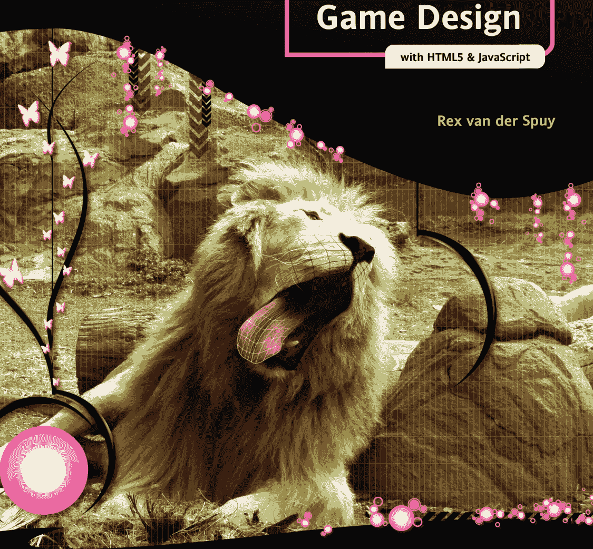

为方便读者，Apress 已将部分前置材料放置在索引之后。请使用书签和内容概览链接访问这些内容。


## 引言

1980 年，我 10 岁的时候，父母把我正式叫到跟前，宣布他们要给我买一台电脑作为圣诞礼物。不知从哪里听来的消息，他们告诉我，电脑“能帮你做作业”。

我惊呆了。

“它当然能帮我做作业了，电脑最擅长算术了！”我大声说道，“科学也行！”

我打算让他们相信他们想相信的一切——只要他们快点给我买电脑，在他们还没清醒过来之前。因为我想要电脑的唯一目的就是玩电子游戏，但我绝不会把这个想法说出来。

我活着就是为了电子游戏。我和朋友们整个夏天都在镇上骑自行车转悠，寻找人行道上遗落的零钱，好用来玩街机游戏。最近的、没有“坏孩子”聚集的街机是《吃豆小姐》，它在一个昏暗老餐馆的角落里，骑车要 20 分钟。但很值得，因为我们记住了《吃豆小姐攻略书》里所有关卡地图的解法，能玩很长时间，让围观的小孩子们惊叹不已。找不到二角五分硬币时，我们就用盒子、蜡笔、图钉和塑料衣扣自己做街机游戏。那个夏末，我们有了最幸福的发现：一台故障的《太空侵略者》街机，如果以恰好的角度弹入一美分硬币，就能玩。我从银行换了一卷 100 枚一美分硬币，在那个八月的最后两周，我沉浸在一个狂喜、朦胧、太空入侵的梦幻世界里。

所以，那个圣诞早晨，在一阵兴奋的狂热中，我撕开了红白相间的糖果拐杖包装纸。这是我梦寐以求的一切：一台最先进的 Commodore Vic-20 电脑。它拥有巨大的 5K 内存、最新的磁带存储驱动器和 16 色显示器。学校的电脑只能显示两种颜色：绿色和黑色。我简直到了天堂！我笨拙地翻看说明书，用颤抖的双手，小心翼翼地将闪闪发亮的新 Vic-20 接到家用电视上，然后打开了开关。

什么也没发生。电视屏幕完全空白，只有左上角一个小小的蓝色方块在平静地闪烁。

“游戏呢？”我想，“吃豆小姐呢？外星人呢？”

我晃了晃电源线，摆弄了电视后面的电线。但是，不，只有那个稳定的蓝色闪烁方块，在默默地嘲笑我。我发现这个蓝色方块叫做“光标”。我讨厌它，感觉恶心。

原来，游戏在音频磁带上，你可以通过连接磁带播放器并按下播放键将其加载到电脑里。但你得花钱买。每盘 20 美元。最近的商店在 45 分钟车程外，翻过一座山。这不可能——根本没办法。而且，不管怎么说，我本应该用这东西“做作业”。

但我在电脑包装盒里找到了一本关于 BASIC 编程的书。我完全不知道那是什么意思，书里的一切我都看不懂。里面全是各种乱七八糟的英文单词和用大写字母写的数字，据说能让电脑做事。这叫做“编程代码”。也许这只是大人的东西？“不，”我想，“电脑是给孩子用的，大人害怕它们。”于是我坚持了下去。在书的最后，我找到了一个叫做“试一试程序”的部分。我的目光落在了“杀手彗星”这几个字上。这是一个电子游戏！下面是一长串难以理解的代码。但我最终明白了，如果我能在我的 Vic-20 上输入这些代码，我就能玩一个游戏。

就是这样！

如果“编程”意味着“你可以免费玩电子游戏”，那我一定要学会编程。接下来的两天，我疯狂地阅读那本书，输入所有那些代码，试图让《杀手彗星》运行起来。我几乎不知道自己在做什么，每次我尝试运行程序时，电脑总是反复显示“语法错误！语法错误！语法错误！”我快把头发扯下来了，真想尖叫！但是，在第二天晚些时候，奇迹发生了——它成功了：

> 一个**白色小方块**从屏幕顶部移动到底部。
>
> 如果你以**正确的方式按下正确数量的键**，方块就消失了。
>
> **仅此而已。**
>
> **这是我一生中见过的最美的东西。**

就在那时，我发现制作电子游戏比玩电子游戏要有趣得多，多得多，多得多。所以，亲爱的读者，你手中的这本书，我真的认为应该和每一台新电脑一起放在盒子里。希望你读这本书时，能像我写它时一样开心！

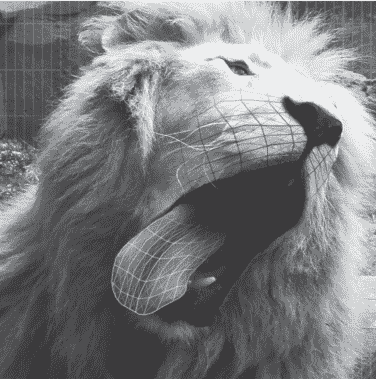

# 第 1 章：学习 HTML 和 CSS

什么比玩电子游戏更有趣？制作它们！这本书将向你展示如何做到这一点。你不需要了解任何编程知识或其他复杂的计算机技术。你甚至不需要懂数学。这本书将向你展示制作精彩游戏所需的一切，你可以在网页上、台式电脑上玩，或者作为手机和平板电脑上的应用程序。

制作电子游戏的方法有很多很多。但你不需要全部掌握——你只需要知道最好的方法。我所说的“最好”，是指最简单、最有趣的方法，而这正是你将从本书中学到的方法。这种方法还能让你的游戏拥有最广泛的受众，让你获得最扎实的游戏设计技能，并给你最好的机会从中赚点钱。

为了制作游戏，你必须学习一种`计算机编程语言`，你可以用它与计算机沟通，告诉它该做什么。计算机编程语言看起来可能很像英语，这样的语言很容易学习。人们可能会争论说，从技术上讲，`HTML` 和 `CSS` 是标记语言，而不是编程语言，但在这里我打算把它们都称为编程语言，就这样定了。

这本书是关于使用一种叫做 `HTML5` 的技术套件来制作游戏。`HTML5` 基于三种独立的计算机编程语言，它们协同工作：

- `HTML`（超文本标记语言）：一种描述游戏和应用程序结构的编程语言。游戏和大多数网站都是使用 `HTML` 构建的。
- `CSS`（层叠样式表）：一种描述 `HTML` 代码应如何进行视觉呈现的编程语言。
- `JavaScript`：一种让你控制游戏行为的编程语言。

## 学习 HTML 和 CSS

你将在本书中学习所有三种语言。本章将介绍 `HTML` 和 `CSS`。它们使用起来极其简单，本章涵盖的内容足以让你开始制作游戏。你也可以运用本章学到的技能，使用 `HTML` 和 `CSS` 来构建网站，如果那是你感兴趣的事情。要制作游戏，你需要学习 `JavaScript`，这也是本书剩余部分的主要内容。

这些编程语言让你能够访问和控制许多属于 `HTML5` 标准的专业技术。其中对游戏最重要的是 `canvas`（画布）。`Canvas` 是一种显示技术，非常适合动画和动作游戏。你将从第 6 章开始学习如何使用 `canvas` 来制作游戏。

> **注意：**如果你已经了解 `HTML` 和 `CSS`，可以跳到第 2 章学习 `JavaScript`。如果你已经了解 `JavaScript`，只想开始制作游戏，请直接跳到第 3 章。如果你已经了解 `JavaScript` 和基本的编程知识，但只想开始用 `canvas` 制作游戏，那么第 6、7、8 章就是为你准备的！

### 你需要什么

令人惊讶的是，电子游戏设计可以是一项相对低技术含量的工作。以下是使用本书所需的基本设备。

#### 一台计算机

你需要一台配置相当现代的计算机，运行 `Windows` 或最新版本的 `Mac OS X`，甚至 `Linux` 都可以。你应该具备基本的计算机操作技能，包括了解如何创建新文件以及如何将它们整理到文件夹中。

#### 编程软件

幸运的是，这些软件无需花费，而且你电脑上可能已经安装了所有需要的编程软件。以下是你将需要的东西：

- **一个文本编辑器**：如果你使用 `Windows`，记事本就很好用。如果你使用 `Mac OS X`，可以使用 `TextEdit`。
- `Safari`、`Chrome`、`Firefox` 或 `Opera`：这些网络浏览器包含一些用于构建和测试 `HTML5` 游戏的出色功能。本书将解释如何使用它们来帮助你制作游戏。`Safari`、`Chrome`、`Firefox` 和 `Opera` 都有 `Windows` 和 `Mac` 版本。`Chrome` 也有 `Linux` 版本。如果你使用 `Mac`，你的电脑上已经安装了 `Safari`。如果你使用 `Windows`，可以在这里下载 `Chrome` 或 `Safari`：`www.google.com/chrome` 和 `www.apple.com/safari/download`

本书描述了如何使用这些软件程序和工具来编写游戏程序——你不需要任何其他东西。

然而，还有一些更专业但可选的软件，如果你需要进行大量编程，并希望让事情变得稍微轻松一些，可以考虑尝试。

**Komodo Edit** 或 **jEdit**：这些是适用于 `Windows`、`Mac OS X` 和 `Linux` 的免费文本编辑器。它们专门用于编写编程代码。它们会给每行代码编号，并以不同的颜色突出显示重要的编程词（`语法高亮`）。这两个功能都使编写代码变得更容易，因为你可以更轻松地查找和更改代码中的部分。一旦你开始掌握编程技巧，并想要尝试比记事本或 `TextEdit` 稍微高级一点的文本编辑器，`Komodo Edit` 或 `jEdit` 是很好的下一步选择。

**Aptana Studio**：这是一个基于 `Eclipse` 的免费 `IDE`（集成开发环境），适用于 `Windows` 和 `Mac OS X`。它包含语法高亮和代码行编号，你还可以安装一个插件来帮助你调试 `JavaScript`。

**Dreamweaver**：在很长一段时间里，这是构建网页最广泛使用的软件。它不是免费的，对于游戏设计师的简单需求来说可能过于复杂，但它专门用于编写 `HTML`、`CSS` 和 `JavaScript` 代码。`Dreamweaver` 可从 `Adobe`（`www.adobe.com`）获取，适用于 `Windows` 和 `Mac`。

如果你使用 `Mac OS X`，你还有两个额外的选择。**Coda** 是一个高效的代码编辑器，内置 `JavaScript` 调试器和一个实时预览窗口，可以在你编程时显示游戏的外观。**Textmate** 是另一个优秀的仅限 `OS X` 的代码编辑器，也提供游戏的实时预览窗口以及集成的 `JavaScript` 调试功能。`Coda` 和 `Textmate` 都不是免费的，但如果你进行大量编程，它们为你节省的时间可能值得这笔费用。两者都可通过 `Mac OS X` 应用商店获取。

`HTML5` 是一项非常新的、快速发展的技术，当你读到本书时，很可能已经有了更多、甚至更好的工具来创建 `HTML5` 游戏，比我上面列出的还要多。请留意新的软件，并尝试一切！

如果你已经有一些编程经验，你可能只喜欢使用这些编辑器中的一种。但如果你是初学者，它们只会让你困惑。记住，你真正需要的只是一个简单的文本编辑器和一个好的网络浏览器。保持简单，你就不会出错。

> **注意：**如果你决定在最新版本的 `Mac OS X` 上使用 `TextEdit`，你需要设置它，以便让你以**纯文本**形式编写，这对编程很重要。操作如下：
>
> 从 `TextEdit` 的主菜单中选择 **Preferences**（偏好设置）。
>
> 在 **Format**（格式）部分选择 **Plain Text**（纯文本）。
>
> 在 **Open and Save**（打开和存储）部分，取消勾选“add `.txt` extension to plain text files”（为纯文本文件添加 `.txt` 扩展名）。
>
> 选择 **“ignore rich text commands in HTML files.”**（忽略 `HTML` 文件中的富文本命令）。

### 图形设计软件（可选）

本书仅涉及游戏编程。我不会教你如何为游戏制作图形或插图，所以如果你对此感兴趣，你需要自己学习。事实上，如果你没有任何制作计算机图形的经验，可能想在开始本书之前先学一点相关知识。

制作游戏图形最常用的两个应用程序是 `Photoshop` 和 `Illustrator`（两者都由 `Adobe` 提供）。其他选择是 `GIMP` 和 `Inkscape`，两者都是免费的。为了充分利用本书，你应该学习以下计算机图形设计技能：

- 制作具有 `Alpha` 透明度的 `PNG` 图像
- 更改图像尺寸并知道如何裁剪图像
- 掌握基本的插图技能，例如如何绘制角色和游戏对象

你会发现许多在线教程和书籍，介绍如何使用上述任何软件来完成这些任务。

### 我能制作什么样的游戏？

本书主要介绍如何制作二维动作、冒险和街机游戏；也涉及解谜、逻辑和策略游戏。`HTML5` 是创建这类游戏的绝佳媒介。每一章都将指导你完成设计过程的每一步，但项目设计非常开放。我鼓励你用自己原创的方式来运用这些技术到自己的游戏中。本书从计算机编程的所有基础知识开始，我们将逐步在这些技术的基础上构建，直到你能够从头开始制作非常复杂的游戏。你将学习制作游戏的最简单方法，以便轻松理解它们的工作原理，然后自己将其发展成更复杂的游戏。

你制作的游戏可以上传到网上供任何人玩。或者你可以将它们打包用于手机和平板电脑，然后通过应用商店销售。从始至终，成为一名职业游戏设计师所需知道的一切都在这本书里。

### 这有多难？

学习制作游戏的难度大致相当于学习一门外语的基础对话或理解如何读写乐谱。所以如果你以前做过这些事情中的任何一件，你就知道这根本不难。你只需要慢慢来，一步一步，有条不紊地进行。尽可能多地练习你学到的技能，在彻底理解当前主题之前不要进入新话题。如果你匆忙读完这本书，你不会得到任何好处。你可能需要花几天、几周甚至几个月的时间在某一章上。你需要多少时间就花多少时间，因为这本书不会跑掉！但只要你努力，读完后你将成为一名出色的游戏设计师。

## 学习 HTML

制作游戏需要了解三种相关的编程语言：`HTML`、`CSS` 和 `JavaScript`。我们将从最简单的开始：`HTML`。

`HTML` 是一种被称为标记语言的计算机编程语言。标记语言可以描述信息。这与 `JavaScript` 不同，`JavaScript` 是一种逻辑编程语言。逻辑编程语言用于分析和对信息做出决策。`HTML` 用于制作网站，它是制作游戏的基础。目前它的版本号是 5，因此被称为 `HTML5`。

### 标签

`HTML` 用于描述信息。它使用**标签**来告诉计算机文档包含哪种类型的信息。标签就是一个被左尖括号和右尖括号（有时称为尖角号）包围的单词。这是一个标签的示例：

```html
<thisIsATag>
```

这是一个标识网页标题的标签。

```html
<h1>The main heading</h1>
```

`<h1>` 意思是“标题 1”。标签通常成对出现，包括一个开始标签和一个结束标签。开始标签看起来像这样：

```html
<h1>
```

结束标签添加一个正斜杠 `/` 来表示标签现在完成了对信息的描述：

```html
</h1>
```

在这个示例中，开始标签和结束标签之间的任何内容都将被标识为标题，就像这样：

```html
<h1>Anything between the opening and closing tags is part of the heading</h1>
```

这是一个非常简单的系统，你可以用它来以任何你喜欢的方式标识任何类型的信息。

> **注意：**`HTML` 还允许你使用无需关闭的独立标签，像这样：
>
> `<br>`
>
> 这个标签代表“换行”，它在文本中创建一个行空间。它不用于描述任何包含的信息。
>
> 如果你使用过早期版本的 `HTML`，你可能需要在标签名末尾加上正斜杠来编写独立标签，以表示该标签是自关闭的，像这样：
>
> `<br />`
>
> 在 `HTML5` 中，你不必这样做。

标签及其包含的信息被称为**元素**。记住这一点！当我在本书中提到 `HTML` 元素时，我指的是标签及其内部的所有内容。

## 构建 HTML 文档结构

要使用 `HTML` 标签制作游戏或网站，你必须将标签构建成一个文档。`HTML5` 在构建 `HTML` 文档的方式上极其灵活和宽松。然而，大多数使用 `HTML` 制作的游戏、应用程序和网站都遵循一些关于文档结构以及如何使用构成它们的标签的标准惯例。这样做的原因是让读取这些文档的计算机能够轻松解释它们包含的信息，并在任何屏幕上正确显示它们。在本节中，我将向你展示如何使用最常用的 `HTML` 标签构建一个非常基本的网站。

这是使用 `HTML` 构建网站的经典结构：

```html
<!doctype html>
<html>
  <head>
    <title>The title of the web page</title>
  </head>
  <body>
    <p>Anything you want to appear on the screen goes inside the body section.</p>
  </body>
</html>
```

你可以看到所有内容都被一对 `<html></html>` 标签包围。在这些标签内部，是另一对叫做 `<head></head>` 的标签，接着是另一对叫做 `<body></body>` 的标签。

在 `<head>` 标签之间，你提供任何你想告诉阅读文档的计算机正确显示信息所需的信息。`<head>` 部分中的信息实际上在浏览器窗口中不可见。在这个示例中，`<head>` 部分包含一个叫做 `<title>` 的元素。

```html
<head>
  <title>The title of the web page</title>
</head>
```

`<title>` 元素描述页面的标题。

在 `<body>` 标签之间出现的任何内容在网页浏览器中都是可见的——它就是你作为网页看到的内容。这是你的 `HTML` 文档大部分信息将要放置的地方。在这个示例中，`<body>` 部分包含一个在 `<p>` 标签内的句子。

```html
<body>
  <p>Anything you want to appear as a paragraph of text on the screen goes inside the body section.</p>
</body>
```

`<p>` 标签代表**段落**。你用它来显示句子或段落。

在文档最顶部是一个特殊的独立标签，看起来像这样：

```html
<!doctype html>
```

这需要是 `HTML5` 文档中的第一个标签。它的意思就是，“嘿，计算机，这是一个 `HTML5` 文档！”仅此而已。

构建 `HTML5` 游戏或网站通常意味着在 `<head>` 和 `<body>` 部分添加标签和信息。最后，你会注意到嵌套在其他标签内的标签从左边距缩进了两个空格。

```html
<html>
  <head>
    <title></title>
  </head>
  <body>
    <p></p>
  </body>
</html>
```

缩进使得更容易看出内部标签被包含在一个外部标签中。

> **注意：**将位于封闭标签内的 `HTML` 代码进行缩进是一种常见的惯例。然而，以这种方式缩进有时实际上会使包含长文本行的大型 `HTML` 文档更难阅读。正如你将在下一个示例中看到的，我选择不缩进大多数位于其他标签内部的标签，除了短列表项和页面标题。你需要根据你觉得更可读的风格来决定如何缩进 `HTML` 代码。浏览器不关心你如何缩进；它只是在需要时使阅读更容易。


让我们看看如何使用这个结构来制作一个非常基本的网页。

## 一个基本的网页

让我们利用你了解的 HTML 知识来构建一个真实的网页。我们将查看一个使用一些最常用 HTML 标签构建的网页。

在本章的源文件中，你会找到一个名为 `simpleWebpage.html` 的文件。双击它，它将自动在网页浏览器中打开。图 1-1 向你展示了你将看到的内容。

### 一个简单的网页

你在这个页面上看到的一切都是使用基本的 HTML 标签制作的。

### 这是一个子标题

你使用 HTML 标签来结构化信息。这是一个使用 `p` 标签结构化的文本段落。

### 制作列表

你也可以使用标签来制作一个物品的列表。

- 第一项
- 第二项
- 第三项

### 添加链接

创建指向其他网页的超链接，或创建一个生成电子邮件的链接很容易。方法如下：

- [这是一个很好的学习 HTML 的资源](http://www.htmldog.com/guides/htmlbeginner/)。
- 如果想打个招呼，[给我发封邮件。](mailto:learn@shmelt.com)

用 `img` 标签添加一张照片，像这样：

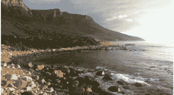

图 1-1。一个非常基本的网页

这个 HTML 网页是由最基本和最有用的标签制作的。网页只是一个带有 HTML 文件扩展名的纯文本文件。以下是查看创建此页面的 HTML 代码的方法：

1. 打开你的文本编辑器，即记事本（Windows）或 TextEdit（Mac OS X）。
2. 选择“文件 ▸ 打开”，并打开 `simpleWebpage.html` 文件。
3. 它将加载 HTML 文件，所有标签都可见。这就是你将看到的内容：

```html
<!doctype html>
<html lang="en">
<head>
<title>A web page</title>
</head>
<body>
<h1>A simple web page</h1>
<p>Everything you see on this page was made using basic HTML tags.</p>
<h2>This is a sub-heading</h2>
<p>You use HTML tags to <em>structure information</em>.
This is a paragraph of text structured with a p tag.</p>
<h2>Making lists</h2>
<p>You can also use tags to <strong>make a list</strong> of things.</p>
<ul>
<li>First item</li>
<li>Second item</li>
<li>Third item</li>
</ul>
<!-- This is a comment in the document. It won't appear in the web browser-->
<h2>Adding links</h2>
<p>Its easy to create hyperlinks to other web pages, or to create a link to generate an email. Here's how:</p>
<ul>
<li><a href="http://www.w3schools.com" target="_blank">Here's a good resource</a> for learning HTML</li>
<li>If you want to say Hi, <a href="mailto:hello@kittykatattack.com?Subject=Hello%20there!">Send me an email.</a></li>
</ul>
<p>Add a photo with an img tag, like this:</p>

</body>
</html>
```

（或者，你也可以从网页浏览器中选择“查看 > 查看源代码”来查看此 HTML 代码。）

别被这吓到！注意所有的网页文本都被标签包围，并且每个标签都改变了文本在网页浏览器中的显示方式。图 1-2 是一个并排的示意图，展示了 HTML 文本对网页浏览器中文本的影响。我在 HTML 文档中添加了一些空行，以便更容易看出每个部分的开始和结束。但是，网页浏览器会忽略这些空行，并使用自己的规则来分隔文本。

```html
<!doctype html>
<html lang="en">

<head>
	<title>A web page</title>
</head>

<body>
	<h1>A simple web page</h1>
	<p>Everything you see on this page was made using basic HTML tags.</p>

	<h2>This is a sub-heading</h2>
	<p>You use HTML tags to <em>structure information</em>. This is a paragraph of text structured with a p tag.</p>

	<h2>Making lists</h2>
	<p>You can also use tags to <strong>make a list</strong> of things.</p>
	<ul>
		<li>First item</li>
		<li>Second item</li>
		<li>Third item</li>
	</ul>

	<h2>Adding links</h2>
	<p>Its easy to create hyperlinks to other web pages, or to create a link to generate an email. Here's how:</p>
	<ul>
		<li><a href="http://www.w3schools.com" target="_blank">Here's a good resource</a> for learning HTML.</li>
		<li>If you want to say Hi, <a href="mailto:hello@kittykatattack.com?Subject=Hello%20there!">Send me an email</a>.</li>
	</ul>

	<p>Add a photo with an img tag, like this:</p>
	

</body>
</html>
```

## 一个简单的网页

你在这个页面上看到的一切都是使用基本的 HTML 标签制作的。

### 这是一个子标题

你使用 HTML 标签来结构化信息。这是一个使用 `p` 标签结构化的文本段落。

### 制作列表

你也可以使用标签来制作一个物品的列表。

- 第一项
- 第二项
- 第三项

### 添加链接

创建指向其他网页的超链接，或创建一个生成电子邮件的链接很容易。方法如下：

- [这是一个很好的学习 HTML 的资源](http://www.w3schools.com)。
- 如果想打个招呼，[给我发封邮件](mailto:hello@kittykatattack.com?Subject=Hello%20there!)。

用 `img` 标签添加一张照片，像这样：

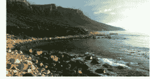

图 1-2。HTML 代码被网页浏览器解释以创建页面布局

让我们看看这些新的 HTML 标签中的每一个如何改变文本的显示方式。

### 使用属性设置文档语言

HTML 标签可以包含称为属性的额外信息。属性添加在标签内部，标签名称之后。`<html>` 标签中的以下属性将网页语言设置为英语。

```html
<html lang="en">
```

属性的名称是 `lang`（代表语言）。`"en"` 代表英语，它通过等号赋值给属性 `lang="en"`，意味着网页内容是用英语编写的。

虽然这一步是可选的，但为网页设置语言通常是个好主意，因为浏览器可能会根据它认为你正在使用的语言来改变文本的显示方式。

在接下来的示例中，你将看到如何使用属性来创建指向其他网页的链接以及如何加载图像。

### 添加页面标题

第一段代码使用 `<title>` 标签为网页添加标题。

```html
<head>
<title>A web page</title>
</head>
```

这个标题不会出现在网页内部，而是显示在网页浏览器的标题栏中。仔细看看你的浏览器，你会在浏览器窗口的最顶部看到 “A web page” 这几个字。

很酷吧？你也可能会在浏览器标签页中看到它。`<title>` 标签应该始终在 `<head>` 部分内使用。

## 页面标题

`<body>` 标签内的第一个标签是 `<h1>`。它代表 “heading 1”（一级标题），即网页的主标题。

```html
<h1>A simple web page</h1>
```

浏览器将其解释为该页面的主标题，并会以大号粗体显示标题文字。继续往下看页面，你会发现其他页面标题都是用 `<h2>` 标签创建的。

```html
<h2>This is a sub-heading</h2>
<h2>Making lists</h2>
<h2>Adding links</h2>
```

浏览器会以较小的字体显示这些标题。你可以在网页中使用 `<h1>` 到 `<h6>` 标签来创建不同级别的标题和副标题。

### 段落文本

页面上的大部分文本都被 `<p>` 标签包围，这表示该文本属于一个段落。

```html
<p>Everything you see on this page was made using basic HTML tags.</p>
```

网页浏览器会使用比标题更小的字体来设置段落。你网站上的大部分文字都将放在 `<p>` 标签内。

# 第 1 章

> 注意：如果你需要在段落文本中强制换行，请使用单个 `<br>` 标签。`<br>` 代表 “break”（中断），它会导致其后的文本出现在新的一行。

### 斜体和粗体文本

如果你想强调任何文本，请用 `<em>` 或 `<strong>` 标签将其包围。网页浏览器通常将 `<em>` 标签解释为斜体文本。

```html
<em>This text will be italicized</em>
```

`<strong>` 标签通常被解释为粗体文本。

```html
<strong>This text will be bold</strong>
```

你通常会像这样在 `<p>` 标签内使用 `<em>` 和 `<strong>` 标签：

```html
<p>Here is some text which is <em>italic</em> and <strong>bold</strong></p>
```

### 创建列表

将 `<ul>` 和 `<li>` 标签一起使用来创建项目列表。`<ul>` 代表无序列表，意思是列表项没有编号。你可以通过先添加一对 `<ul>` 标签来创建无序列表，如下所示：

```html
<ul>
</ul>
```

然后在 `<ul>` 标签内插入 `<li>` 标签，如下所示：

```html
<ul>
  <li>First item</li>
  <li>Second item</li>
  <li>Third item</li>
</ul>
```

网页浏览器会自动在每个列表项前添加项目符号（小圆点）。

> 注意：如果你想让列表项带有编号，请使用 `<ol>` 而不是 `<ul>`。`<ol>` 代表有序列表，网页浏览器会自动在每个 `<li>` 列表项前添加数字。

### 添加链接

你可以使用 `<a>` 标签轻松地创建指向其他网页的链接。`<a>` 代表锚点。它使用一个名为 `href` 的属性，让你可以添加想要链接到的网站地址。每当有人点击 `<a>` 和 `</a>` 标签之间的内容时，网页浏览器就会打开你用 `href` 属性指定的页面。

你可以这样使用 `<a>` 标签：

```html
<a href="http://anyLinkToAnyWebsite">Click to go to the link</a>
```

如果现在点击 `Click to go to the link`，将打开一个新的网页，地址是你用 `href` 属性指定的地址。（如果你想知道的话，`href` 代表 *hypertext reference*，即超文本引用。）

你可以创建指向互联网上任何网页的链接。

```html
<a href="http://www.apress.com">Visit Apress</a>
```

> 注意：网站地址的正式名称是 URL。它代表统一资源定位符（Uniform Resource Locator）。了解这一点很重要，因为你会经常看到 URL 这个术语被广泛使用。现在你知道了！

你还可以链接到你计算机上的另一个网页，如下所示：

```html
<a href="anotherWebPage.html">The next page</a>
```

最后一个示例将打开一个名为 `anotherWebPage.html` 的 HTML 文件，它与当前文件位于同一文件夹中。使用这种技术，通过连接多个独立的 HTML 文件来构建一个网站。

当你点击链接时，浏览器会通过替换当前浏览器窗口中的内容来打开新页面，或者会打开一个全新的浏览器窗口，浮动在旧窗口之上。你可以通过一个名为 `target` 的附加属性来控制这一行为。

使用 `target="_blank"` 可以强制浏览器在新的浏览器窗口中打开链接。方法如下：

```html
<a href="http://www.apress.com" target="_blank">Visit Apress</a>
```

如果你想让页面在当前窗口中打开，请使用 `target="_self"`，如下所示：

```html
<a href="http://www.apress.com" target="_self">Visit Apress</a>
```

> 注意：网页浏览器通常会自动将新页面加载到当前页面中，所以通常无需用 `"_self"` 来指定。如果你希望这种行为，直接完全省略 `target` 属性即可。

你还可以使用特殊的 `mailto:` 命令创建生成电子邮件的链接，发送到任意地址。以下是指定电子邮件地址和电子邮件主题的格式。

```html
<a href="mailto:anyone@email.com?Subject=Hello%20from%20me!">Send an email.</a>
```

这会自动打开电子邮件客户端并创建一封新的空白电子邮件，收件人是 `anyone@email.com`。它还会添加主题行 “Hello from me!”

你会注意到主题中每个单词之间都有这些字符：

```text
%20
```

这是空格的代码。你不能在 `href` 属性提供的任何链接中使用空白字符。因此，如果你需要空格，就必须用 `%20` 来替换。当浏览器生成电子邮件时，会正确地将 `%20` 重新解释为空白字符。

### 链接到同一页面的某个部分

你还可以使用 `<a>` 标签链接到同一页面的某个部分。首先，在 `<a>` 标签内创建你想要链接到的部分。使用 `name` 属性为该部分命名。名称可以是任何你想使用的词。

```html
<a name="information">Any kind of information</a>
```

该部分的名称现在是 “information”。你可以这样创建指向它的链接：

```html
<a href="#information">Click to find more information</a>
```

现在如果你点击这个链接，页面就会跳转到 `information` 部分。

### 预取页面

通常，当你点击指向另一页面的链接时，需要等待几秒钟才能加载。你可以设置你的网页，使其提前加载某些页面，而当你仍在当前页面上时。这意味着当你点击链接时，新页面会立即打开。这称为预取页面。为此，在 `<head>` 元素内使用 `<link>` 标签。以下是一个预取 `www.apress.com` 的 `link` 标签。

```html
<head>
<link rel="prefetch" href="http://www.apress.com">
</head>
```

它会当你仍在阅读当前页面时，在后台加载 `www.apress.com` 的主页。你可以使用 `<link>` 标签预取任意数量的页面，可以是来自你自己的网站，也可以是来自互联网上的任何其他地方。

### 添加图像

`` 标签让你可以在网页中添加图像。它有一个 `src` 属性，让你可以指定浏览器应该去哪里查找图像。

```html

```

只要你在 HTML 文档所在的同一文件夹中有相同名称的图像，该图像就会被加载。

但图像不一定必须在你的计算机上，它可以在互联网上的任何位置。只需使用指向图像的网站地址，如下所示：

```html

```

你还可以通过在 `<a>` 标签内添加 `` 标签来将图像作为链接使用，如下所示：

```html
<a href="newPage.html"></a>
```

现在如果你点击图像，浏览器会打开一个名为 `newPage.html` 的 HTML 文件。`<a>` 标签可以用同样的方式为任何 HTML 元素创建链接。

> 注意：图像文件可以具有 JPG、GIF 或 PNG 扩展名。这些都是网页上使用的压缩图像文件格式。压缩图像格式文件体积小，但看起来仍然不错。文件越小，图像在互联网上的加载速度就越快。

照片最常见的格式是 JPG，因为它可以显示数百万种颜色。这对于准确显示照片中的微妙色调和渐变非常重要。然而，JPG 文件不能包含透明区域。

较简单的图形通常使用 GIF 格式。GIF 图像不用于照片，因为它们无法包含像 JPG 图像那样多的颜色信息。但是，GIF 图像可以包含一些基本的透明度，并且可以被压缩成非常小的文件大小。

一个不错的折中格式是 PNG，它允许透明并且可以显示数百万种颜色。它的文件大小往往比 JPG 或 GIF 稍大一些。


``标签还有一个名为`alt`的属性，这是图像无法加载时将显示的文本。在``标签内这样使用`alt`属性：

```html

```

如果网页浏览器无法找到图像，或者网络连接太慢无法加载，就会显示`alt`属性中的文本替代。该文本还有助于搜索引擎识别你的图像内容，这样如果有人搜索它，就更容易被找到。

### 添加注释

有时在创建HTML文档时，你可能需要就某个部分给自己做备注。HTML让你可以使用以下格式添加注释：

```html
<!-- This is a comment in the document. It won't be displayed in the web browser -->
```

在起始的`<!--`注释标签和结束的`-->`注释标签之间的任何文本都不会在网页浏览器中显示。

### 字符编码

你应该考虑为页面添加的最后一样东西是字符编码。这是可选的，但它会告诉网页浏览器如何解释文档中的字符（字母和数字）。如果你打开一个网页，文字显示为奇怪的乱码，这可能意味着网页浏览器没有正确解释字符编码。你可以在`<head>`标签内使用一个`<meta>`标签来设置字符编码，如下所示：

```html
<head>
  <meta charset="utf-8">
  <title>Your page title</title>
</head>
```

`<meta>`标签将字符编码设置为`utf-8`，这是最常见的标准。它应该是`<head>`元素内的第一个标签，在`<title>`之前。养成在HTML文档中添加字符编码的习惯是很好的，这能确保你的页面按预期的方式显示。

### 关于HTML的更多信息

令人惊讶的是，这就是你需要知道的大部分HTML了。你将在本书的学习过程中了解更多具体的技巧。看，是不是很简单？HTML只是向计算机描述如何解释信息的一种简单方式。

你现在能做的最好的事情就是从这本书中短暂休息一个小时左右，尝试制作你自己的HTML网页。添加一个标题、一些标题、一些段落文本、一两个列表、几个链接，并尝试添加一些图片。开始时，请按照以下步骤操作：

1. 打开你的文本编辑器，应该是记事本（Windows）或文本编辑（Mac OS X）。
2. 选择“文件 ▶ 新建”，开始用HTML标签和文本创建你的页面。

完成后，保存你的工作：

3. 选择“文件 ▶ 另存为...”（Windows）或“文件 ▶ 另存为...”（Mac OS X）。
4. 将你的HTML文档命名为`test.html`。
5. 将其保存在计算机上的某个位置。

要在网页浏览器中查看你的HTML文档，请按照以下步骤操作：

6. 打开一个网页浏览器。选择“文件 ▶ 打开文件...”
7. 选择你刚刚创建的`test.html`文件并打开它。
8. 你将在浏览器窗口中看到你的HTML文档显示为网页。

如果这是你第一次创建网页，很有可能你在某个地方犯了一些小错误，导致它无法正确显示。以下是一些需要检查的地方：

- 确保你关闭了所有标签。这是一个极其常见的错误。
- 确保你想在浏览器中显示的所有内容都包含在开始和结束的`<body>`标签内。
- 检查你是否正确拼写了标签名称。这也是一个非常常见的错误。
- 如果图像没有显示，请确保图像与HTML页面位于同一文件夹中，并且你使用了正确的图像文件扩展名：`.jpg`、`.gif`或`.png`。

在下一节中，我们将学习如何通过使用CSS来更改HTML标签的外观。

> 注意：在HTML5中，`<html>`、`<head>`和`<body>`标签是可选的。以下是最基本的有效HTML文档：

```html
<!doctype.html>
<title></title>
```

就是这样！享受这种简洁吧。你将在本书的大多数示例中看到这种格式的使用。

### 用CSS让它更漂亮

正如你在上一节所看到的，网页浏览器以自己的方式解释所有HTML元素。它自动将标题变大加粗；为你选择字体、颜色和大小；并决定所有HTML元素之间的间距。你无法用HTML控制这些事情。

要更改HTML文档的视觉样式，你需要使用描述性编程语言CSS。CSS编程代码通常被称为样式表。你可以使用样式表来控制所有HTML元素的颜色、字体、大小和位置。你会发现CSS与HTML一样易于学习和使用。事实上，如果你把它们视为同一技术的一部分会有所帮助，因为HTML和CSS几乎总是同时使用。

样式表通常创建为单独的CSS文件，然后加载到HTML文档中。这很有用，因为这意味着你只需加载不同的样式表就可以完全更改HTML文档的外观。你也可以只使用一个样式表来更改多个HTML文档的外观。然而，对于简单的HTML文档，特别是在学习期间，最好将样式表和HTML代码保存在同一个文档中。

使用CSS更改标签的显示方式非常容易。首先，键入你要修改的元素的名称。然后在一对花括号内更改你想要更改的样式属性。像这样：

```css
elementName
{
  change the tag's style here;
}
```

你在花括号内做的任何更改都会影响该元素在浏览器中的显示方式。

让我们看一个正在运行的CSS示例。在本章的源文件中，你会找到一个名为`styledWebpage.html`的HTML文档。在网页浏览器中打开它。图1-3显示了你将看到的内容。

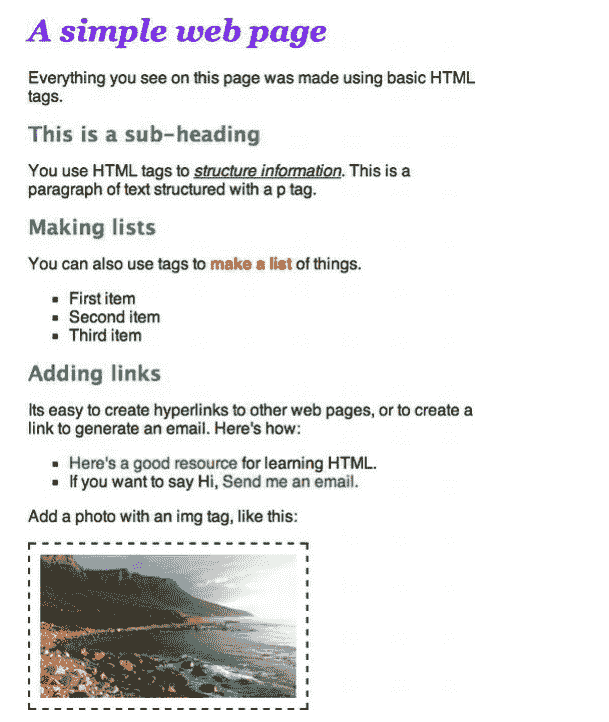

图1-3。HTML文档现在应用了CSS样式

字体类型、大小和颜色已经更改。图像变小了一点，周围有一个边框。如果你将鼠标悬停在任一链接上，你还会看到它们被高亮显示。

文本和HTML代码根本没有更改。相反，文档现在包含一些CSS代码，这些代码更改了标签的显示方式。

CSS代码添加在HTML文档`<head>`部分的特殊`<style>`标签之间。

```html
<head>
  <style>
    ... The CSS code goes here
  </style>
</style>
```

`<style>`标签告诉浏览器你正在添加CSS代码。

> 注意：早期版本的HTML要求你在`<style>`标签中添加一个`type`属性，如下所示：
>
> `<style type="text/css">`
>
> HTML5不再需要这个。然而，你可能仍然想要使用它，因为许多编程语言编辑器使用此属性作为切换语法高亮显示的提示，你会发现这对编写程序很有用。

以下是添加到HTML文档中的完整CSS代码。我将在接下来的页面中解释它是如何工作的。

```html
<!doctype html>
<html lang="en">
<head>
<title>A web page</title>
<style>

h1
{
    font-family: Georgia, "Times New Roman", serif;
    font-size: 30px;
    color: #7924ff;
    font-style: italic;
    font-weight: bold;
}

h2
{
    font-family: "Lucida Console", Monaco, monospace;
    font-size: 20px;
    color: teal;
}

p, li
{
    font-family: Arial, Helvetica, sans-serif;
    font-size: 16px;
}

em
{
    text-decoration: underline;
    font-style: normal;
}

strong
{
    font-weight: bold;
    color: red;
}

li
{
    list-style-type: square;
}

a
{
    color: green;
    text-decoration: none;
}

a:hover
{
    background-color: black;
    color: white;
}

img
{
    width: 250px;
    height: auto;
    border-style: dashed;
    border-width: 2px;
    border-color: navy;
    padding: 10px;
}

</style>
</head>
... the rest of the HTML document is the same
```

你会认出我们在HTML文档中使用的所有标签：`h1`、`h2`、`p`、`li`、`a`、`img`以及其他一些。CSS代码更改了这些标签的属性，以修改这些标签在浏览器中的显示方式。让我们看看这是如何工作的。

如果你选择省略可选的`<head>`标签，浏览器会理解它是隐含的。

#### 字体样式

CSS让你轻松选择想要使用的字体样式、大小和颜色。我们网页中的第一段CSS代码更改了`<h1>`标签内文本的显示方式。它更改了五个属性。你可能仅通过观察就能猜出它们的作用。它们将主标题文本设置为Georgia字体，将其大小设置为30像素，将其颜色更改为紫色，并使其同时加粗和斜体。

```css
h1
{
    font-family: Georgia, "Times New Roman", serif;
    font-size: 30px;
    color: #7924ff;
    font-style: italic;
    font-weight: bold;
}
```

属性是你想要更改的该标签样式的某方面。这五个属性中的每一个都在花括号内各占一行。每一行都从左边距缩进，以便你可以清楚地看到它包含在花括号内。每个属性名后面跟着一个冒号，然后是更改该属性的值。在每一行的末尾包含一个分号非常重要：

```css
;
```

这表示“我已完成对此属性的更改”。这就像句子末尾的句号。你必须在每一行CSS代码的末尾添加分号。如果你忘记了这一点，之后添加的任何新代码都不会起作用。

让我们看看这些属性的作用。

##### 字体系列

`font-family`属性允许你设置要使用的字体。

```css
font-family: Georgia, "Times New Roman", serif;
```

上面一行中列出了三种字体：Georgia、“Times New Roman”和`serif`。第一种字体是Georgia，如果可能，网页浏览器将使用该字体。如果查看此网页的计算机上没有安装Georgia，那么浏览器将尝试加载第二种字体“Times New Roman”。如果那个也找不到，它会加载一种名为`serif`的通用字体样式。提供第二种或第三种备用字体总是很重要的，以防第一种字体由于某种原因无法加载。

字体名称用逗号分隔。如果你的字体名称包含多个单词，则需要用引号括起来，例如“Times New Roman”或“Lucida Console”。

大多数字体可以分为三个通用字体系列：`serif`、`sans-serif`和`monospace`。

Serif字体使用边缘带有装饰细节的字母。Times New Roman、Georgia和Baskerville是常见的serif字体。你经常在书籍和报纸中看到serif字体。

Sans-serif字体不使用字母边缘上的任何细节。常见的sans-serif字体是Arial、Helvetica和Futura。它们是你经常在高速公路标志、机场以及超现代艺术画廊和杂志中看到的字体。以下是使用`font-family`属性分配sans-serif字体的方法：

```css
font-family: Helvetica, Arial, sans-serif;
```

# 第1章

浏览器将首先尝试加载Helvetica字体。如果找不到Helvetica，则会尝试加载Arial字体。如果加载失败，则会回退到任何可用的无衬线字体。在我们的示例网页中，`<p>`标签使用无衬线字体显示。

第三种主要字体系列称为等宽字体（有时称为固定宽度字体）。这些字体的字母间距固定，设计上极其易于阅读。常见的等宽字体包括Courier、Lucida Console和Monaco。它们常用于老式计算机控制台显示屏和打字机。程序员喜欢它们，因为缩进和空格能完美对齐，这使得它们在计算机屏幕上非常易于阅读。以下是使用CSS分配等宽字体系列的方法：

```css
font-family: "Lucida Console", Monaco, monospace;
```

在我们的简单示例网页中，`p`和`li`元素使用无衬线字体显示，而`h2`元素使用等宽字体显示，如下所示：

```css
h2
{
  font-family: "Lucida Console", Monaco, monospace;
  font-size: 20px;
  color: teal;
}

p, li
{
  font-family: Helvetica, Arial, sans-serif;
  font-size: 16px;
}
```

在上面的示例中，请注意`p`和`li`元素共享相同的CSS代码。你可以通过用逗号分隔列出多个元素来为它们分配样式，如下所示：

```css
p, li
{
}
```

这避免了你编写相同代码两次。你可以让任意数量的元素共享相同的样式。

##### 嵌入自定义字体

如果你想使用一种通常未安装在大多数人计算机上的字体，你需要使用`@font-face`来嵌入它。以下是如何在HTML文档中嵌入和使用自定义字体。

1. 找到你想要使用的字体的字体文件。两种最常见的字体格式是TrueType字体（文件扩展名为`TTF`）和OpenType字体（文件扩展名为`OTF`）。将字体文件复制到包含你的HTML和CSS文件的同一文件夹中。

```css
@font-face
{
  font-family: LondrinaSolid-Regular;
  src: url("LondrinaSolid-Regular.otf");
}
```

现在你可以将这个新的字体系列分配给你想要的任何元素。以下是如何将其分配给`h1`元素。

```css
h1
{
  font-family: LondrinaSolid-Regular, "Courier New", monospace;
  font-size: 40px;
}
```

你可以分配任何其他你想要的字体属性，例如大小和颜色。与任何字体一样，分配一两种回退字体也很重要，以防你的嵌入字体因某种原因未能加载。

##### 字体大小

`font-size`属性允许你更改字体大小。`px`代表像素。像素是构成计算机屏幕上文本和图形的微小点。此代码将字体大小设置为40像素。

```css
font-size: 40px;
```

> 注意：CSS允许你使用不同的单位来指定字体大小。如果你的字体大小需要根据不同的屏幕分辨率动态变化，请考虑使用`em`而不是`px`。方法如下：
>
> ```css
> font-size: 1em;
> ```
>
> `1em`将等于显示页面的浏览器的默认字体大小。在大多数浏览器中，这大约等于16像素。如果你想得到双倍的字体大小，请使用`2em`。这将使字体以大约32像素的大小显示。值为`0.75em`将给你大约12像素的字体大小。

##### 字体颜色

你可以使用`color`属性更改字体的颜色。

```css
color: #7924ff;
```

我在这个示例中使用的颜色是十六进制颜色值。它们也称为十六进制色。十六进制色是一种使用数字和字母字符串描述颜色的标准方法，前面带有一个井号（数字井号）。

以下是一些常见颜色的十六进制代码：

```text
黑色：#000000
白色：#FFFFFF
红色：#FF0000
蓝色：#0000FF
绿色：#00FF00
黄色：#FFFF00
橙色：#FF9900
紫色：#CC33FF
```

> 注意：你可以将黑色简写为`#000`，白色简写为`#FFF`。如果十六进制代码的所有六个字符都相同，你只需要使用前三个字符。

在互联网上搜索“十六进制颜色表”会显示完整的颜色列表及其对应的十六进制代码。你也可以在图形设计软件（如Photoshop或Illustrator）的调色板中找到十六进制颜色代码。

然而，你不必只使用十六进制颜色。CSS还允许你使用许多常见的颜色名称来分配基本颜色，如下所示：

```css
color: blue;
```

以下是CSS能识别的颜色名称：`aqua`（水蓝色）、`black`（黑色）、`blue`（蓝色）、`fuchsia`（紫红色）、`gray`（灰色）、`green`（绿色）、`lime`（青柠色）、`maroon`（栗色）、`navy`（海军蓝）、`olive`（橄榄色）、`purple`（紫色）、`red`（红色）、`silver`（银色）、`teal`（水鸭色）、`white`（白色）和`yellow`（黄色）。

##### 关于颜色的更多内容

十六进制色并不是你可以使用的唯一颜色系统。你也可以选择使用RGB/RGBA或HSL/HSLA颜色系统。它们都能产生相同的颜色，但描述方式不同。

RGB系统使用三个数字来描述混合在一起产生任何颜色的红、绿、蓝的相对量。这些数字可以从0到255。以下是深紫色的RGB颜色代码：

```css
rgb(204, 51, 255)
```

你可以将此应用于CSS属性，例如字体颜色，如下所示：

```css
color: rgb(205, 51, 255);
```

RGBA系统增加了一个数字来描述颜色的透明度。`0`表示颜色完全透明，`1`表示完全不透明（实心）。值为`0.5`使颜色半透明。以下是深紫色的半透明RGBA版本。

```css
rgba(204, 51, 255, 0.5)
```

你可以看到红、绿、蓝的颜色值与RGB系统相同。第四个数字`0.5`是透明度量。

RGBA中的“A”代表alpha（阿尔法），这是一个图形设计术语，表示透明度。


RGBA 颜色很好用，因为如果你将它们设置为半透明，它们将允许其下方的对象仍然可见，这是一种很好的效果。这对于投影阴影效果特别有用，你将在第 3 章学习到。

HSL 系统基于色相、饱和度和亮度来描述颜色。以下是用 HSL 描述的相同深紫色：

```
hsl(285, 100%, 60%)
```

第一个数字色相是 0 到 360 度，用于定位颜色在色轮上的位置。第二个数字饱和度是 0 到 100 的百分比，描述颜色的饱和度（鲜艳度）。第三个数字亮度也是 1 到 100 的百分比，描述颜色的明暗程度。

HSLA 系统与 RGBA 类似，添加了一个 0 到 1 之间的第四个数字来描述颜色的透明度。以下是透明度为 0.5 的 HSLA 深紫色。

```
hsla(285, 100%, 60%, 0.5)
```

你完全可以根据自己的喜好选择使用哪种颜色系统。你可以使用 Photoshop 或 Illustrator 等图形设计软件中的调色板来找到这些颜色代码，也可以使用许多在线工具来完成此操作。

### 粗体、斜体和下划线字体样式

要使字体显示为斜体，请使用`font-style`属性，如下所示：

```
font-style: italic;
```

如果一个字体以斜体显示而你想将其关闭，请将`font-style`属性的值设置为`normal`。

使用`font-weight`属性使文本加粗：

```
font-weight: bold;
```

要为文本添加下划线，请使用`text-decoration`属性，如下所示：

```
text-decoration: underline;
```

`text-decoration`属性的其他可选值包括：`line-through`（删除线）和`over-line`（上划线）。如果你想从字体中移除所有文本装饰，请使用`none`。

你可以在修改`<em>`和`<strong>`标签的 CSS 代码中看到所有这些样式的应用。

`<em>`（强调）标签内的任何文本都带有下划线。

```
em
{
  text-decoration: underline;
  font-style: normal;
}
```

（`font-style`设置为`normal`是为了关闭大多数浏览器自动分配给`<em>`标签的斜体效果。）

`<strong>`标签内的任何文本都加粗并显示为红色：

```
strong
{
  font-weight: bold;
  color: red;
}
```

这些都是你需要了解的关于字体样式的基础知识。让我们再看看我们 CSS 代码的一些其他特性。

### 列表样式

在我们的网页示例中，你会注意到三个列表项中的每一个前面都有一个方形项目符号（一个小黑方块）。图 1-4 对此进行了说明。

你也可以使用标签来制作一个列表。

- 第一项
- 第二项
- 第三项

**图 1-4。**方形项目符号标记每个列表项

`list-style-type`属性负责此效果：

```
li
{
  list-style-type: square;
}
```

有许多可选值可以使用，但最有用的是`square`（方形）和`circle`（圆形）。如果你不希望列表有任何项目符号，请使用`none`。

### 突出显示链接

如果你将鼠标悬停在我们示例中的任何链接（`<a>`标签）上，你会看到文本变为白色，并且整个标签被黑色背景高亮显示。图 1-5 对此进行了说明。

### 边框、内边距、高度和宽度

记住，``标签用于在 HTML 文档中显示图像。你可以用 CSS 轻松改变图像的显示方式，就像改变文本外观一样容易。

以下是给我们的示例中的图像添加样式的 CSS 代码。

```css
img
{
    width: 250px;
    height: auto;
    border-style: dashed;
    border-width: 2px;
    border-color: navy;
    padding: 10px;
}
```

这段代码通过改变宽度使图像变小了一点。高度会自动匹配宽度的变化，以保持图像的比例。图像周围环绕着一条两像素宽的海军蓝色虚线边框。它还在图像和边框之间添加了 10 像素的内边距。图 1-6 展示了这段代码对图像产生的效果。

```css
border-style: dashed;
border-width: 2px;
border-color: navy;
```

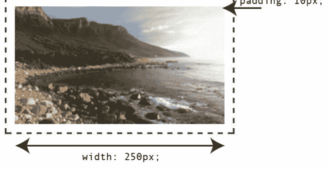

**图 1-6.**改变图像大小并添加边框

`width`和`height`属性决定了图像应该以多少像素显示。

```css
width: 250px;
height: auto;
```

`auto`意味着如果宽度发生变化，高度应自动调整以保持图像比例。

`padding`属性在图像和边框之间的四个侧面均匀添加 10 像素的空白空间。

```css
padding: 10px;
```

如果你想为四个侧面分别设置不同的内边距值，可以使用如下所示的 CSS 代码：

```css
padding: 10px 30px 20px 5px;
```

这会按以下顺序改变四个侧面的内边距：上、右、下、左。（你可以记住这一点，因为顺序是顺时针的，从顶部开始。）

> **注意：**还有几个设置内边距的快捷方式：
>
> `padding: 20px 30px 50px;`
>
> 顶部内边距为 20 像素，左右内边距为 30 像素，底部内边距为 50 像素。
>
> `padding: 20px 50px;`
>
> 上下内边距为 20 像素，左右内边距为 50 像素。

你也可以为每个侧面单独设置内边距，如下所示：

```css
padding-top: 10px;
padding-bottom: 20px;
padding-right: 30px;
padding-left: 5px;
```

> **注意：**内边距值会加到元素的高度和宽度上。这意味着如果元素的宽度是 250 像素，而你在其左右两侧各添加 10 像素的内边距，元素的实际宽度将变为 270 像素。如果你正在做复杂的布局，记住这一点非常重要：内边距值会加到宽度和高度值上。

边框属性决定了边框的样式、宽度和颜色。

你可以用`border-style`属性改变边框样式：

```css
border-style: dashed;
```

这会在元素周围创建一条虚线。你可以使用的值有`dashed`、`double`、`dotted`、`groove`、`ridge`、`hidden`、`inset`和`outset`。要移除边框，将此值设置为`none`。图 1-7 展示了这些边框样式。

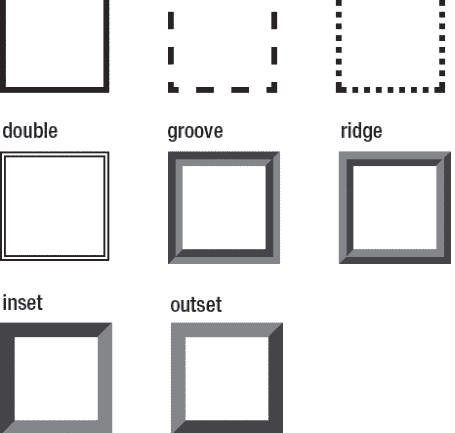

**图 1-7.**边框样式

你可以用`border-width`属性设置边框的宽度：

```css
border-width: 2px;
```

你通常会用像素来设置宽度，但你也可以使用三个预定义值之一：`thin`、`medium`或`thick`。就像添加内边距一样，边框宽度会加到元素的总宽度和总高度上。

`border-color`属性改变边框的颜色：

```css
border-color: navy;
```

它接受的色值与文本的`color`属性相同。

你可以用一个快捷方式在一行代码中定义所有这些边框属性，如下所示：

```css
border: 2px dashed navy;
```

如果你使用这个快捷方式，确保按以下顺序列出属性：线条粗细、样式和颜色。

### 层叠样式

你可能想知道层叠样式表（Cascading Style Sheets）中的“层叠”（cascading）是什么意思。它意味着如果你在 CSS 代码开头为某个元素指定了样式，你可以在代码后面添加或更改该样式。以下是我们的样式表中这个工作原理的示例。

`p`和`li`元素共享相同的初始样式。

```css
p, li
{
    font-family: Helvetica, Arial, sans-serif;
    font-size: 16px;
}
```

但在样式表的后面，`li`元素被分配了一个新样式：

```css
li
{
    list-style-type: square;
}
```

这个样式被添加到首先定义的样式上。这是一个很有用的特性，因为这意味着许多元素可以共享相同的样式，但随后你可以自定义单个元素。

不过，如果你想的话，你可以在第一个样式之后添加这个新样式，完全覆盖原始样式：

```css
li
{
    list-style-type: square;
    font-family: "Lucida Console", Monaco, monospace;
    font-size: 10px;
}
```

最后设置的样式将应用于 HTML 元素。

## 使用`<div>`元素

在前面的示例中，我们使用了一些标准的 HTML 标签来显示页面元素，比如`<h1>`、`<h2>`、`<p>`、`<ul>`和``。然而，有时你想在页面上添加一些不符合标准标签所定义的类别的东西。特别是如果你使用 HTML 来创建游戏和应用程序，这更是如此，因为它们使用的元素与普通网页上的元素非常不同。对于这些情况，HTML 有一个通用标签叫做`<div>`，它可以用于任何东西。

> **注意：**`<div>`标签最初是用来表示网页分区（网页的不同部分）的，但它早就已经超越了最初的用途。

当你创建一个`<div>`元素时，你通常也会给它起一个名字，这样你就可以很容易地用 CSS 对其进行样式设置。这个名字可以是`id`或`class`属性。让我们看看这是如何工作的。

### 使用`id`

如果你只有一个某种类型的元素，用`id`属性给它命名。

```html
<div id="elementName"></div>
```

`id`是一个唯一的名称，只能由单个元素拥有。你可以使用`id`通过 CSS 来设置元素的样式，如下所示：

```css
#elementName
{
    /* 在这里更改任何样式属性 */
}
```

在元素的 id 名称前面必须有一个井号字符`#`。

> **注意：**你可以为 id 使用任何你喜欢的名称，但不要使用包含空格的名称。尽量让 id 名称保持在一个单词，并使用小写字母。

如果你想使用多个单词的 id 名称，可以考虑使用`camelCaseNotation`（驼峰式命名法）。这是一种将多个单词连写在一起而不带空格的写法，在计算机编程中非常常见。在驼峰式命名法中，第一个单词小写，每个后续单词的首字母大写，如下所示：

`firstSecondThird`

你能猜出为什么它被称为`camelCaseNotation`吗？你将在这本书的大多数示例中看到它的使用。

在本章的源文件中，你会找到一个名为`id.html`的文件，它演示了一个简单的例子。在网页浏览器中打开它，你会看到它显示了一个带有虚线边框的简单矩形，如图 1-8 所示。


**图 1-8.**使用带有 id 的`<div>`标签来显示一个简单矩形

首先，`<a>`标签元素被设置为使链接显示为绿色，并关闭大多数网页浏览器添加到链接的自动下划线样式。

```css
a
{
    color: green;
    text-decoration: none;
}
```

`a:hover`是一个特殊的样式选择器，它描述了当鼠标“悬停”在`<a>`标签元素上时，该元素应该是什么样子。

```css
a:hover
{
    background-color: black;
    color: white;
}
```

它将`<a>`标签的背景色设置为黑色，字体颜色设置为白色。这就是创建高亮效果的原因。它只在鼠标位于链接上时发生。当鼠标离开`<a>`标签的区域时，链接的颜色恢复正常。

所有元素都有一个`background-color`属性，它可以用来改变任何元素的背景色。

`a:hover`是 CSS 中称为`pseudo-class`（伪类）的一个特性。伪类让你能够实现这样的特殊效果。你总是可以识别伪类，因为元素名称和效果名称之间用冒号分隔。

还有几个有用的伪类可以与`<a>`标签一起使用：

- `a:visited`：链接被点击过之后的颜色。
- `a:active`：当前活动的链接。
- `a:link`：链接被点击之前的颜色。

确保在`a:link`和`a:visited`之前为`a:hover`分配样式，以便这些伪类能够正常工作。

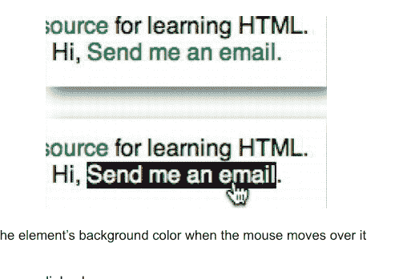

**图 1-5.**当鼠标移到元素上时改变其背景色

下面是实现这一效果的 HTML 和 CSS 代码：

```html
<!doctype html>
<title>Using an id</title>

<style>

#stage
{
    width: 400px;
    height: 300px;
    border: 1px dashed black;
}

</style>

<div id="stage"></div>
```

`<div>`元素具有 id 属性“stage”。CSS 代码为其设置了高度、宽度和边框。可以看到，这与为其他 HTML 元素设置样式非常相似，区别在于 CSS 代码没有使用标签名，而是使用了该标签的 id 属性。

在这本书中，我将游戏中含有动作的矩形区域命名为“stage”（舞台）。

### 使用 class（类）

如果多个元素共享相同的属性，那么应该将它们归为一个类。方法如下：

```html
<div class="theClassName">
```

类的工作原理与 id 完全相同，只是多个元素可以属于同一个类。打开本章源文件中的`class.html`文件，可以看到一个简单的例子。你会看到三个动物的名称，它们都以相同的样式呈现。

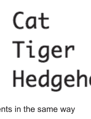

## 第 1 章

下面是实现这一效果的代码：

```html
<!doctype html>
<title>Using a class</title>

<style>

.animal
{
  font-family: Monaco, "Courier New", monospace;
  font-size: 30px;
}

</style>

<div class="animal">Cat</div>
<div class="animal">Tiger</div>
<div class="animal">Hedgehog</div>
```

可以看到，三个`<div>`元素共享同一个类名：“animal”。CSS 代码中有一个名为`.animal`的样式，将字体设置为 Monaco，大小设置为 30px。任何属于 animal 类的元素都会共享这些属性。要在 CSS 中为类设置样式，始终在类名前面加上点号，如下所示：

```css
.className
{
  /* 在此处设置类的样式属性 */
}
```

在这些示例中，我向你展示了如何在`<div>`标签中使用 id 和 class 属性，但你也可以将它们用于任何 HTML 标签。元素同时还可以同时具有 id 并属于某个类。让我们看看这有什么用处。

### 同时使用 id 和 class

如果你有一些元素共享大量通用属性，那么将它们全部归为同一个类是合理的。然而，你可能希望在保持大部分通用属性不变的情况下，更改个别元素的一两个属性。在这种情况下，可以创建一个同时具有 class 和 id 的元素，如下例所示：

```html
<div class="general" id="specific"></div>
```

然后你可以将所有通用样式赋给 class，将特定样式赋给 id。让我们来看一个具体的例子。打开本章源文件中的`classAndId.html`文件。你会看到三个动物名称，它们共享相同的字体和大小，但各自的样式有所不同。图 1-10 展示了在网页浏览器中打开该文件时你会看到的内容。

34

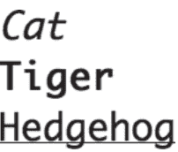

**图 1-10.**同时使用 class 和 id 来自定义共享相关属性的元素

猫使用了斜体，老虎使用了粗体，刺猬则带有下划线。下面是产生这一效果的 HTML 和 CSS 代码：

```html
<!doctype html>
<title>Using a class and id together</title>

<style>

.animal
{
  font-family: Monaco, "Courier New", monospace;
  font-size: 30px;
}

#cat
{
  font-style: italic;
}

#tiger
{
  font-weight: bold;
}

#hedgehog
{
  text-decoration: underline;
}

</style>

<div class="animal" id="cat">Cat</div>
<div class="animal" id="tiger">Tiger</div>
<div class="animal" id="hedgehog">Hedgehog</div>
```

所有元素共享相同的 animal 类。这意味着它们共享相同的基本字体和字号。但请注意，它们还被分配了唯一的 id：


```html
<div class="animal" id="cat">Cat</div>
<div class="animal" id="tiger">Tiger</div>
<div class="animal" id="hedgehog">Hedgehog</div>
```

CSS 代码可以使用这些 id 来定制每个元素：

```css
#cat
{
  font-style: italic;
}

#tiger
{
  font-weight: bold;
}

#hedgehog
{
  text-decoration: underline;
}
```

这些样式会应用到每个元素上，作为它们作为 animal 类成员共享的样式的补充。像这样结合使用 class 和 id 是一种非常简洁但强大的方式，可以创建易于管理的复杂样式。

元素还可以同时属于多个类。

### 将背景图片加载到 HTML 元素中

你在网页示例中看到了如何使用 `` 标签在浏览器窗口中显示图片。但还有另一种加载图片的方式，对于游戏和交互式应用来说通常更为合适。你可以将图片加载到元素的 `background-image` 属性中。使用的格式如下：

```css
background-image: url("imageName.png");
```

图片文件名用引号括起来，必须包含文件类型扩展名。你可以使用 JPG、GIF 或 PNG 图片。只要图片与 CSS 代码位于同一文件夹中，就能加载成功。（该元素还需要是块级元素。稍后你将全面了解块级元素。）

下面介绍如何使用 `background-image` 属性将图片加载到元素中。

首先，创建一个代表你要显示的图片的 HTML 元素。

```html
<div id="cat"></div>
```

然后为 cat id 创建一个样式。给它设置一个与你想要显示的图片的高度和宽度完全匹配的高度和宽度。然后将图片加载到 `background-image` 属性中。

```css
#cat
{
  height: 100px;
  width: 100px;
  background-image: url("cat.png");
}
```

`cat.png` 图片将被加载到 `<div>` 元素中，并显示在浏览器窗口中。

你可以在本章源文件的 `backgroundImages` 文件夹中找到这一功能的工作示例。在文本编辑器中打开 `backgroundImages.html` 文件，你会发现一些简单的代码，显示了一张猫的图片。代码如下：

```html
<!doctype html>
<title>Background images</title>

<style>

#cat
{
  width: 100px;
  height: 100px;
  background-image: url("cat.png");
}

</style>
<div id="cat"></div>
```

图 1-11 展示了 HTML 代码如何加载图片文件并在网页浏览器中显示。

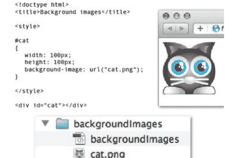

**图 1-11.** 使用 background-image 属性将图片加载到元素中

现在你知道了如何加载一张图片，让我们再加载两张，并学习如何在浏览器中为它们定位。

## 使用 CSS 定位元素

CSS 可以用来将元素精确定位到特定位置。样式表使你能完全控制元素在浏览器窗口中的显示位置。对游戏来说，定位元素与对网站一样重要，我们将通过一些具体示例来看看如何实现这一点。

首先，你需要理解行内元素（inline elements）和块级元素（block elements）之间的区别。

### 行内元素和块级元素

行内元素在同一水平线上共享空间。`<em>` 和 `<strong>` 元素就是一个很好的例子。你可以在 `<p>` 标签中使用它们，所有文本都会保持在同一行。下面是一个使用 `<em>` 和 `<strong>` 标签的简单 HTML 示例。

```html
<p>This is some text with <em>italic</em> and <strong>bold</strong> letters.</p>
```

这段 HTML 代码将显示为：

This is some text with *italic* and **bold** letters.

因为 `<em>` 和 `<strong>` 标签是行内元素，它们都保持在“同一行”。

块级元素的行为则相反：它们像积木一样相互堆叠。你可以使用 `display` 属性将任何元素变为块级元素，如下所示：

```css
display: block;
```

你可以使用这个属性将 `<em>` 和 `<strong>` 元素变为块级元素，如下：

```css
em, strong
{
  display: block;
}
```

现在同样的 HTML 代码行将显示为：

This is some text with

*italic*

and

**bold**

letters.

它们像玩具积木一样堆叠成塔。网页浏览器自动将 `<h1>`、`<h2>`、`<p>` 和 `<div>` 标签显示为块级元素，你可以在这些示例中看到这一点。每次使用这些标签时，元素都会显示在其他块级元素的下方。对于段落内的文字，如本例所示，这没什么用，但对于游戏中的图片来说就大不同了。为游戏图片使用块级元素的一个优势是，你可以将它们精确定位在浏览器窗口中的任何位置。让我们看看如何使用 CSS 来实现这一点。

> 注意：如果你需要将任何块级元素设置为行内元素，可以将这些元素的 `display` 属性设置为 `inline`，如下所示：
>
> ```css
> display: inline;
> ```

### 浮动元素

CSS 为你提供了多种定位块级元素的选项。除了垂直堆叠，你可以让元素浮动，使它们水平排列。这使它们看起来像行内元素，但具有固定的尺寸，可以容纳图片并拥有样式化的边框。

在本章的源文件中，你会找到一个名为 `floatingElements.html` 的文件夹。双击它，用网页浏览器打开。你会看到三个动物垂直堆叠，被一个矩形包围。图 1-12 展示了你将看到的效果。

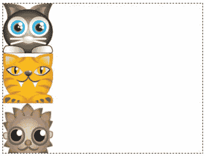

**图 1-12.** 三个动物在矩形内垂直对齐

用文本编辑器打开 `floatingElements.html` 文件，你会看到这样的 HTML 代码：

```html
<!doctype html>
<title>Floating elements</title>

<style>

#stage
{
  display: block;
  width: 400px;
  height: 300px;
  border: 1px dashed black;
}
```

```css
.animal
{
  display: block;
  width: 100px;
  height: 100px;
}

#cat
{
  background-image: url("cat.png");
}

#tiger
{
  background-image: url("tiger.png");
}

#hedgehog
{
  background-image: url("hedgehog.png");
}

</style>

<div id="stage">
  <div class="animal" id="cat"></div>
  <div class="animal" id="tiger"></div>
  <div class="animal" id="hedgehog"></div>
</div>
```

图 1-13 展示了这四个元素在浏览器中的显示方式。

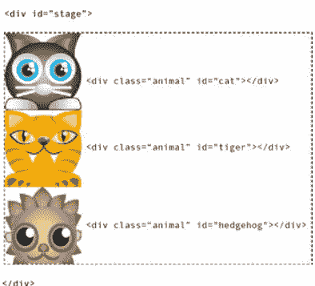

`<div id="stage">` 元素是一个 400x300 像素的矩形，带有虚线边框。以下是为其设置样式的 CSS 代码：

```css
#stage
{
  display: block;
  width: 400px;
  height: 300px;
  border: 1px dashed black;
}
```

这些动物也是矩形。它们每个都是 100x100 像素。

```css
.animal
{
  display: block;
  width: 100px;
  height: 100px;
}
```

所有动物都共享这些相同的属性。然而，每个动物都有一个独特的图片。代码使用 `id` 属性为每个动物赋予一个唯一的名称，正如你在 HTML 代码中看到的。

```html
<div class="animal" id="cat"></div>
<div class="animal" id="tiger"></div>
<div class="animal" id="hedgehog"></div>
```

这些 id 允许我们单独引用每个动物，即 `cat`、`tiger` 和 `hedgehog`。CSS 代码正是这样做的，为每个元素加载一个独特的背景图片。

```css
#cat
{
  background-image: url("cat.png");
}

#tiger
{
  background-image: url("tiger.png");
}

#hedgehog
{
  background-image: url("hedgehog.png");
}
```

这是另一个有用的示例，展示了如何通过针对元素唯一的 id 来定制每个元素并更改其特定样式。

因为动物是块级元素，所以它们是垂直堆叠的。我们可以用下面这段 CSS 代码让动物浮动到彼此的左边，形成整齐的水平行：

```css
float: left;
```

尝试在 `floatingElements.html` 文件的 `animal` 样式定义中添加这一行：

```css
.animal
{
  display: block;
  width: 100px;
  height: 100px;

  float: left;
}
```

保存文件并刷新浏览器窗口。图 1-14 显示动物现在水平排列。

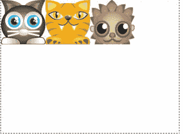

**图 1-14.** 块级元素浮动形成水平行

使用 `float` 属性就像给每个动物充满氦气，让它漂浮到顶部。`left` 值意味着每个动物将占据左侧所有可用空间。这使元素左对齐。使用 `float: right` 可使元素右对齐。

### 添加外边距来分隔元素

你可以通过添加一些左和上外边距，将动物居中放置在舞台区域的上半部分。你可以使用以下代码将上外边距设置为 50 像素，左外边距设置为 25 像素：

```css
margin-top: 50px;
margin-left: 25px;
```

将这两行添加到 `animal` 样式定义中：

```css
.animal
{
    display: block;
    width: 100px;
    height: 100px;
    float: left;
    margin-top: 50px;
    margin-left: 25px;
}
```

保存文件并刷新浏览器。你会看到外边距已添加到每个动物的顶部和左侧，如图 1-15 所示。它们现在均匀间隔开。

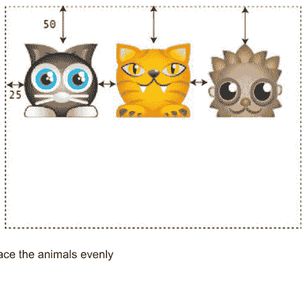

### 清除浮动元素

如果你想在浮动元素下方添加一个新元素，你需要设置新元素的 `clear` 属性。以下是清除左浮动元素的方法：

```css
clear: left;
```

这将导致新元素出现在左浮动元素的下方。`clear` 属性也接受 `right` 和 `both` 值。

让我们看看如何使用 `clear` 属性将一些文本居中放置在我们三个浮动动物下方。

在 `<div id="stage">` 元素内部添加一个 `<h1>` 元素：

```html
<div id="stage">
  <div class="animal" id="cat"></div>
  <div class="animal" id="tiger"></div>
  <div class="animal" id="hedgehog"></div>
  <h1>Dangerous Animals!</h1>
</div>
```

要使文本出现在动物下方，请将 h1 元素的 `clear` 属性设置为 `left`：

```css
h1
{
    clear: left;
}
```

使用 `text-align` 属性在舞台元素内居中文本：

```css
h1
{
    clear: left;
    text-align: center;
}
```

`text-align` 属性也可以接受 `left`、`right` 和 `justify` 值。

图 1-16 展示了 `clear` 代码在浏览器窗口中的效果。

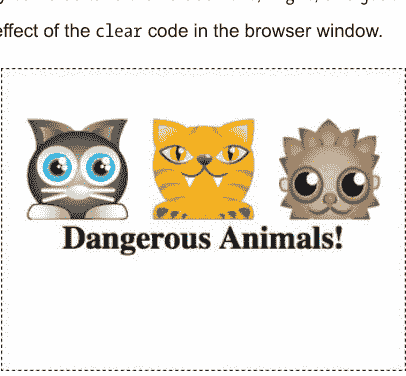

使用 `@font-face` 嵌入自定义字体，并添加一些内边距，使文本在舞台内部分布更均匀：

```css
@font-face
{
    font-family: LondrinaSolid-Regular;
    src: url("LondrinaSolid-Regular.otf");
}

h1
{
  clear: left;
  display: block;
  text-align: center;
  padding-top: 50px;
  font-family: LondrinaSolid-Regular;
  font-size: 40px;
}
```

> 注意：大多数浏览器会自动将 `<h1>` 和 `<div>` 元素设置为块级显示，因此对于这些元素，使用 `display: block` 是可选的。

图 1-17 展示了这一效果在浏览器窗口中的样子。

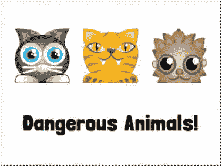

**图 1-17.** 自定义标题

你可以在本章的源文件 `floatingElementsFinished.html` 中找到所有这些可运行的代码。

### 关于居中元素的更多信息

你现在知道你可以使用 `text-align` 属性像这样在元素内居中文本：

```css
text-align: center;
```

你也可以赋予它 `left`、`right`、`justify` 和 `inherit` 值。`justify` 使文本均匀分布，拉伸填满一个元素。`inherit` 意味着它应遵循其包含元素所使用的任何 `text-align` 规则。

你可以使用 `text-align` 来居中文本，但它不适用于块级元素。如果你想在一个元素内居中一个块级元素，请使用 `margin` 属性并赋予它以下值：

```css
margin: 0px auto;
```

这为元素设置了相等且自动的左右外边距，从而使其居中。你可以使用这段代码在任何块级元素内居中另一个块级元素。你也可以用它在浏览器窗口内居中一个元素。与 `body` 元素一起使用，可以居中整个网页，如下所示：

```css
body
{
  margin: 0px auto;
}
```

像这样使用外边距、内边距、浮动和清除通常是定位元素最灵活的方式，因为元素会自动调整自身以适应可用空间。如果你添加或删除元素，它们会重新调整间距和位置。不过，你也可以使用精确的像素位置来定位元素，接下来我将向你展示如何做到这一点。

### 绝对定位

图 1-18 展示了一个黑色方块，它在矩形内被精确定位。

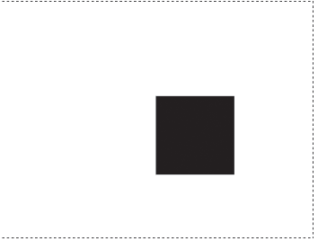

**图 1-18.** 使用绝对定位为元素赋予精确的像素位置

方块的左上角位于其外接矩形上边框下方 120 像素，距离矩形左边框 200 像素。你可以在本章的源文件 `absolutePositioning.html` 中找到这个可运行的代码。

```html
<!doctype html>
<title>Absolute positioning</title>

<style>

#stage
{
  position: relative;
  display: block;
  width: 400px;
  height: 300px;
  border: 1px dashed black;
}
```

```css
#square
{
    position: absolute;
    top: 120px;
    left: 200px;
    display: block;
    width: 100px;
    height: 100px;
    background-color: black;
}

</style>
```

```html
<div id="stage">
    <div id="square"></div>
</div>
```

要使其生效，你首先需要将要定位的元素包裹在另一个元素内。在此示例中，正方形被包含在矩形的舞台内，使用以下 HTML 代码：


```html
<div id="stage">
    <div id="square"></div>
</div>
```

接下来，你需要将包含元素的`position`属性设置为`relative`：

```css
#stage
{
    position: relative;
}
```

然后你需要将内部元素的`position`属性设置为`absolute`：

```css
#square
{
    position: absolute;
}
```

这使得正方形成为舞台坐标系的一部分。现在你可以通过指定正方形应距离舞台顶部和左侧边框的距离来定位它，如下所示：

```css
#square
{
    position: absolute;
    top: 120px;
    left: 200px;
}
```

这将正方形定位在距离舞台顶部边框 120 像素、距离左侧边框 200 像素的位置。正方形的位置是基于其左上角确定的。图 1-19 展示了这一点。

## 第 1 章

```html
HTML
<div id="stage">
<div id="square"></div>
</div>

CSS
#stage
{
  position: relative;
}

#square
{
  position: absolute;
  top: 120px;
  left: 200px;
}
```

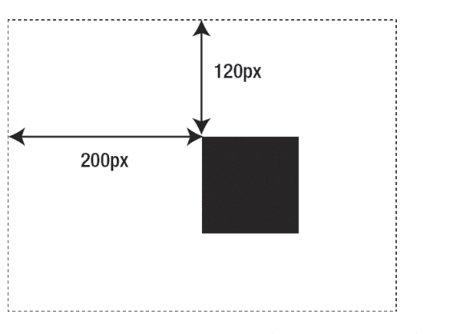

图 1-19. 通过指定距离舞台顶部和左侧边框的像素数，将正方形相对于舞台进行定位

你也可以选择将正方形相对于舞台的底部和右侧边框进行定位，如下所示：

```css
#square
{
  position: absolute;
  bottom: 120px;
  right: 200px;
}
```

这会产生如图 1-20 所示的效果。正方形的右下角会偏离舞台的底部和右侧边框。

```html
HTML
<div id="stage">
<div id="square"></div>
</div>

CSS
#stage
{
  position: relative;
}

#square
{
  position: absolute;
  bottom: 120px;
  right: 200px;
}
```

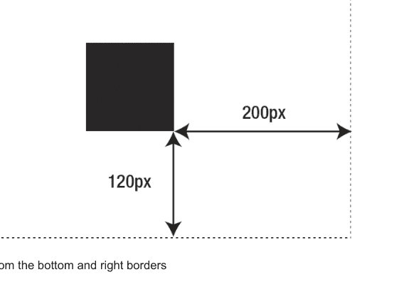

图 1-20. 可选地将正方形相对于底部和右侧边框进行偏移

48

使用 CSS 定位元素可能会变得相当复杂，但也不必如此。坚持我在这些简单示例中使用的模型，你就不会出错。

> 注意：如果需要，你也可以使用`position: fixed`将 HTML 元素的位置相对于浏览器窗口进行锁定。`left`和`top`值将从浏览器的左上边缘开始计算。这意味着即使你更改浏览器窗口大小或滚动页面，HTML 元素也将保持固定位置。如果你想制作漂浮在页面上方且不受正常文档流影响的元素，这很有用。

### 关于块尺寸的更多信息：盒模型

块元素有你可以更改的`width`和`height`属性。然而，它们*仅*指*块内部内容*的宽度和高度。整个块的总高度和宽度实际上是由内容的宽度和高度与块的`margin`、`border`和`padding`组合决定的。这个系统被称为**盒模型**。它可能会令人困惑，因为如果你不理解盒模型如何计算块的最终尺寸，块可能不会具有你预期的最终宽度和高度。但幸运的是，一旦你设置了`padding`、`border`和`margin`，就很容易预测盒模型如何计算块的尺寸。

块的最终宽度和高度是如何确定的？想象一下，你有一个具有以下属性的块元素。

```css
width: 100px;
height: 100px;
padding: 10px;
border: 10px;
margin: 10px;
```

这是如何计算总宽度的方法：

```text
totalWidth = width + leftPadding + rightPadding + leftBorder + rightBorder + leftMargin + rightMargin
```

如果将其转换为实际数字，结果如下：

```text
totalWidth = 100 + 10 + 10 + 10 + 10 + 10 + 10
```

#### 图片

```html

```

#### 视频

```html
<video controls>
<source src="../videos/movie.mp4">
</video>
```

#### 音频

```html
<audio controls>
<source src="../sounds/song.mp3">
</audio>
```

你可以看到``、`<video>`和`<audio>`标签被用来加载照片、电影和歌曲。但请仔细看一下文件的路径：

```text
../images/photo.jpg
```

你可以看到`photo.jpg`是正在被加载的图像文件。但其余部分是什么意思呢？

```text
../images/
```

让我们把它分解成更小的部分。当你在文件路径中看到一个单词后面跟着正斜杠时，它的意思是“这是一个文件夹”。

```text
images/
```

所以我们知道`photo.jpg`文件位于一个名为`images`的文件夹中：

```text
images/photo.jpg
```

但我们还需要知道`images`文件夹在哪里。这就是这些字符告诉我们的：

```text
../
```

两个点和一个正斜杠告诉程序在当前目录之外的目录中查找`images`文件夹。图 1-23 说明了这是如何工作的。

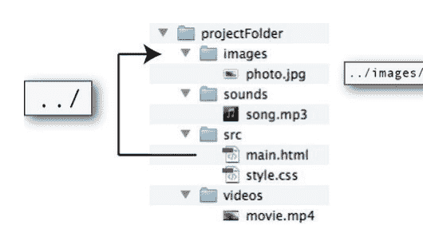

如果你不添加`../`，HTML 文件将在`src`文件夹内查找`images`文件夹。音频和视频文件以相同的方式加载歌曲和电影。在本书后面的章节中，你将看到此结构用于组织更复杂游戏项目中的代码和媒体。

#### 关于视频和音频元素的更多信息

使用`<video>`标签将视频加载到 HTML 文档中，如下所示：

```html
<video>
<source src="movieName.mp4">
</video>
```

目前，HTML5 允许你加载任何具有 MP4、OGG 或 WEBM 格式的电影。将来可能会添加更多格式。

可选的`controls`属性会显示播放和暂停视频的控件。

```html
<video controls>
```

每个网页浏览器都会显示一组不同的控件。

以同样的方式使用`<audio>`标签将声音加载到 HTML 文档中：

```html
<audio>
<source src="soundName.mp3">
</audio>
```

目前你可以加载任何具有 MP3、OGG 和 WAV 格式的声音，尽管与视频一样，HTML5 将来可能会支持更多格式。音频元素也有一个可选的`controls`属性，用于显示播放和暂停声音的控件。

```html
<audio controls>
```

你可以将视频和音频元素与一些其他可选属性一起使用：

| 属性 | 功能 | 可以分配给它的值 |
| :--- | :--- | :--- |
| `autoplay` | 媒体开始加载后自动播放。 | 无。 |
| `loop` | 媒体到达末尾后再次播放。 | 无。 |
| `preload` | 确定页面加载时是否应加载媒体。 | 它可以接受`auto`、`none`或`metadata`的值。<br><br>`preload="auto"`：媒体将在开始播放前开始加载。这会对播放进行缓冲，这样因缓慢或不稳定的网络连接而中断的可能性就较小。<br><br>`preload="none"`：媒体立即开始播放，无需缓冲。<br><br>`preload="metadata"`：仅加载有关媒体的信息，例如其标题和持续时间。<br><br>请注意，`autoplay`属性通常会覆盖这些选项。 |
| **仅限视频的属性：** | | |
| `height` | 设置视频的高度。 | 像素值，例如：`height="720"` |
| `width` | 设置视频的宽度。 | 像素值，例如：`width="400"` |
| `poster` | 在视频开始播放前显示图像。 | 任何图像文件的路径，例如：`poster="photo.jpg"` |

在撰写本文时，HTML5 中的音频和视频有时会以奇怪的方式运行，具体取决于你使用的网络浏览器或视频/音频文件的编码方式。

如果你想绝对确定你的视频会加载，请提供你的视频的 MP4、OGG 和 WEBM 版本。如果浏览器不支持一种格式，它将加载另一种格式。你可以通过在`<video>`标签内使用三个`source`元素来实现这一点，每个元素链接到文件的不同版本，如下所示：

```html
<video>
<source src="movieName.mp4">
<source src="movieName.ogg">
<source src="movieName.webm">
</video>
```

对音频执行相同的操作：

```html
<audio>
<source src="soundName.mp3">
<source src="soundName.wav">
<source src="soundName.ogg">
</audio>
```

这将确保你的视频和音频在所有现代网络浏览器中播放。

如果你确定只需要使用一种视频或音频格式，则不需要使用`<source>`标签。你可以直接将视频或音频`src`属性添加到`<video>`和`<audio>`标签中，如下所示。

```html
<video src="movie.mp4"></video>
```

```html
<audio src="song.mp3"></audio>
```

另外，请考虑使用可选的`type`属性，它指定音频或视频的格式。

```html
<video src="movie.mp4" type="video/mp4"></video>
```

```html
<audio src="song.mp3" type="audio/mp3"></audio>
```

这有助于浏览器决定是否应尝试加载文件。

#### 学习更多关于 HTML 和 CSS 的知识

这是创建游戏所需的大部分 CSS 和 HTML。在到达本书末尾之前，你还会学到一些技巧，但所有基础知识都在本章中。

但是，如果你想使用 HTML 和 CSS 设计网站，你需要学习更多。你需要学习如何组织页面内容以及处理可以适应不同屏幕分辨率和方向的复杂布局。以下是你需要进一步研究的一些主题。

- **HTML 标签**：我们已经在本章中介绍了所有基本的 HTML5 元素，但还有更多元素可用于更具体地定义网页的区域。你可以在万维网联盟的网站上找到整个 HTML5 元素列表以及如何使用它们的示例：`www.w3.org/community/webed/wiki/HTML/Elements`。
- **弹性盒子模型**：网页通常需要根据网络浏览器的大小动态更改其显示内容的布局。弹性盒子模型是 CSS 代码，你可以用它来制作根据页面上可用空间按比例调整大小的元素。你还可以使用弹性盒子模型轻松创建多列布局。
- **CSS 选择器和伪类**：在本章中，你学习了如何使用 CSS 选择 HTML 标签、id 和类，以便以特定方式设置样式。你还学习了如何使用`a:hover`在鼠标悬停在链接上时创建高亮效果。CSS 有更多非常具体的方式来设置元素样式，你可以在万维网联盟的网站上找到完整列表：`http://www.w3.org/TR/selectors`。

搜索任何这些主题都会出现许多有用的文章和教程，在这里无法一一提及。

> 注意：一个很好的 HTML 和 CSS 入门是 Christopher Murphy、Richard Clark、Oliver Studholme 和 Divya Manian 所著的《Beginning HTML5 and CSS3》。它基于本章涵盖的所有主题。

#### 总结

你现在知道了开始构建网站，更重要的是，构建游戏所需的所有 HTML 和 CSS。

我们已经涵盖了所有基本的 HTML 标签。你已经学会了如何使用 CSS 来设置它们的样式和位置，并且你学会了如何使用文本编辑器编写编程代码。是的，关于 HTML 和 CSS 你还有很多可以学习的东西，你应该尽可能多地学习。它们是极其重要的技术。但你会高兴地知道，尽管 HTML 和 CSS 可能变得相当复杂，但基本概念并不比本章涵盖的内容更难。

本章中我们还没有讨论一个更重要的 HTML 标签：`<canvas>`。它让你可以访问画布显示技术，这对于动画和快节奏的视频游戏非常有用。你将从第 6 章开始学习如何使用它。

既然你已经了解了 HTML 和 CSS，你需要学习一项更多的编程技术来开始制作游戏：JavaScript。这就是本书其余部分的内容，JavaScript 使得真正的游戏魔法发生。它是有趣的部分。在下一章中，我将带你轻松入门 JavaScript，并通过一系列简单而专注的示例介绍其所有基本功能。如果你以前从未做过计算机编程，你很快就会发现编程是你可以用计算机做的最有趣的事情之一。

# 第 2 章：学习 JavaScript

JavaScript 是一门计算机编程语言，它是 HTML5 游戏的核心。游戏中几乎所有重要的部分都将以某种方式由 JavaScript 控制。JavaScript 是最容易学习的编程语言之一。你可以在几个小时或几天内掌握所有重要的 JavaScript 知识，并且，只需稍加练习，你很快就能流利地编写它了。

在本章中，你将学习 JavaScript 中所有重要的、开始制作游戏所必需的知识。在后续章节中，我将向你展示如何将这些技能应用于实际的游戏项目。

请慢慢学习本章。本章的重点是学习如何像程序员一样思考。你需要花足够的时间在每个示例上，以便完全理解所有新概念，并创建自己的测试程序来实践这些技术。

#### 环境设置

要开始用 JavaScript 编程，你需要一个文本编辑器和一个网页浏览器。你需要配置你的网页浏览器以显示一个**JavaScript 控制台**。控制台用于显示你程序中的消息，它还将帮助你发现错误。你很快就会看到它的使用方法。

以下是如何在 Safari、Chrome 和 Firefox 中显示 JavaScript 控制台的方法。每个浏览器对控制台的称呼不同，但它们的功能是相同的：

**Safari：**

- 从 Safari 的主菜单中选择“开发”>“显示 JavaScript 控制台”。这将打开一个名为“Web Inspector”的新窗口。你也可以点击 Web Inspector 左下角的窗口图标，将其停靠到 Safari 的主窗口中。

**Chrome：**

- 选择“视图”>“开发者”>“JavaScript 控制台”。

**Firefox：**

- 选择“工具”>“Web 开发者”>“Web 控制台”。

你可以在电脑桌面上同时显示你的文本编辑器、网页浏览器和控制台。图 2-1 展示了我是如何在自己的电脑上安排它们的。

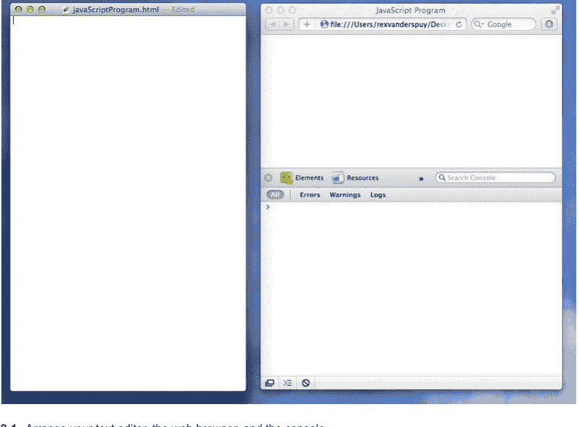

> 注意：如果你使用的是 Mac OS X，可以通过“调度中心”将这个布局分配到单独的桌面。这样，即使桌面上有其他打开的窗口，也能更方便地处理文件，免受杂乱干扰。

#### 在控制台中显示消息

现在让我们编写一个简单的 JavaScript 程序，它将在 JavaScript 控制台中显示“Hello World!”这几个字。

1. 在你的文本编辑器中输入以下内容：

   ```html
   <!doctype html>

   <title>Display console output</title>

   <script>

   console.log("Hello World!");

   </script>
   ```

2. 将文件保存为`displayConsoleOutput.html`。

3. 在网页浏览器中打开这个文件。你应该会看到一个空白页面。别担心：这就是你该看到的！

4. 如果控制台还没打开，请将其打开。你会看到它显示了“Hello World!”这几个字。图 2-2 展示了你会看到的内容。

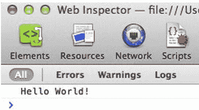

恭喜，你刚刚编写了你的第一个 JavaScript 程序！让我们看看它是如何工作的。

你在 HTML 文档中的`<script>`标签内编写 JavaScript 代码：

```html
<script>

... 在此处添加 JavaScript

</script>
```

> 注意：早期版本的 HTML 要求你在`<script>`标签中添加一个`type`属性，像这样：`<script type="text/javascript">`。HTML5 不再需要这个属性了。然而，你可能仍然想使用它，因为许多 JavaScript 文本编辑器会利用这个属性作为开启语法高亮显示的提示，这可以帮助你更容易地阅读你的程序。

以下是用于在控制台中显示文字的 JavaScript 代码：

```javascript
console.log("Hello World!");
```

这行代码被称为一条**指令**。指令就是你想执行的一个操作。你总能认出指令，因为它以分号结尾。分号告诉程序：“现在就执行这个！”

这些文字是通过一个名为`console.log()`的**方法**显示在控制台中的：

```javascript
console.log();
```


方法是让你执行特定任务的特殊短语。`console.log`方法让你在 Web Inspector 的控制台中显示文字。任何你放在其圆括号内的文字都会像这样被显示出来：

```javascript
console.log("You can write any words here.");
```

文字必须用引号括起来。

自己试试看，看你是否能在控制台中显示新的文字。在文本编辑器中修改 HTML 文件，让`console.log`方法显示不同的文字。例如：

```html
<!doctype html>

<title>Display console output</title>

<script>
console.log("Can you really write anything?");
</script>
```

保存文件并点击网页浏览器的刷新按钮。你现在应该能在控制台中看到你新写的文字了。

就是这样！看到 JavaScript 有多容易了吗？如果你已经正确设置好了所有环境，并且得到了我刚才描述的结果，你就可以继续学习本章其余的示例了。

> 注意：将 JavaScript 程序加载到网页浏览器中被称为**运行**它。在本书中，每当你看到“运行程序”这个短语时，我的意思是在网页浏览器中打开它并观察发生的情况。

### 如果你的程序不工作该怎么办？

如果你是编程新手，很可能你在某个地方犯了一个小错误，导致程序无法运行。以下是一些可能出错的情况：

- 如果网页浏览器显示一堆杂乱的奇怪字符，这可能意味着你的文本编辑器没有将文件保存为纯文本格式。检查你的文本编辑器的偏好设置，确保它没有将你的作品保存为富文本格式。富文本格式会向文件添加额外的格式代码，导致网页浏览器无法读取纯 JavaScript 代码。
- 控制台给你显示了错误信息。如果你在输入 JavaScript 代码时犯了错误，它将无法工作，并且控制台会尝试告诉你它认为哪里出了问题。仔细检查你编写的代码，并与本书中的代码进行比较。它们完全一样吗？图 2-3 展示了如果你忘记在“console”和“log”之间添加点号会得到的错误信息。它将显示为`ReferenceError: Can't find variable: consolelog`

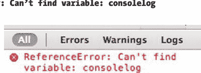

如你所见，这个错误信息实际上并没有直接告诉你忘记了点号。但它确实告诉你，它认为问题与“console.log”有关，这至少能让你知道应该在程序的哪个地方查找错误。

你可能会犯几十种这样的小错误。每个错误都可能触发几十种不同的错误信息，其中大部分对你来说将完全难以理解。你需要大量的实践，犯很多错误，才能学会这些错误信息到底想告诉你什么。

目前，只需将错误信息看作是电脑告诉你程序某个地方存在错误的方式。它可能是任何地方、任何类型的错误。请回头仔细检查你的程序，反复核对是否有小错误。你可以在本书的源文件中找到本章所有代码的可运行示例，因此，如果你有任何疑问，请将这些示例与你自己的程序进行比较。

在本章末尾，你会发现一个名为“调试代码速成指南”的部分，它列出了你可能犯的许多常见错误及其产生的错误信息。如果你遇到严重困难，可以参考该部分。

好了，关于错误就说这么多，让我们来学习编程吧！

> 注意：为简洁起见，接下来的示例是纯粹的 JavaScript 代码，不包含周围的 HTML 代码。要在 HTML 文档中运行这些示例，请使用以下格式将代码插入到`<script>`标签之间：

```html
<!doctype html>

<title>Example name</title>

<script>
在此处添加 JavaScript 代码
</script>
```

你可以在本章的源文件中找到所有可运行的示例及 HTML 代码。

### 变量

变量就像一个存储信息的小盒子。每个变量都有一个名字。无论何时你在程序中使用这个名字，变量就会显示它所包含的信息。

图 2-4 是两个变量的示意图。名为`name`的变量包含一个游戏玩家的名字。名为`score`的变量包含玩家当前的得分。

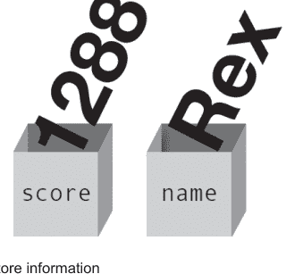

每当程序中使用`name`或`score`这些词时，它们都会被方框中的内容替换。你可以像这样将数字放入一个变量中：

```javascript
score = 1288;
```

等号将`1288`复制到一个名为`score`的变量中。现在，每当程序看到`score`这个词，它就会将其替换为`1288`。

变量也可以存储单词，像这样：

```javascript
name = "Rex";
```

只需将单词用引号括起来即可。如果程序现在看到`name`这个词，它就会将其替换为`"Rex"`。

如果第一次使用一个变量，你需要使用一个名为`var`的**关键字**来创建它。方法如下：

```javascript
var score;
```

关键字是 JavaScript 能够理解的特殊词汇。`var`告诉程序创建一个名为`score`的变量。它创建了这个变量。但在上面的例子中，这个变量是空的，不包含任何值。如果你需要向它放入一些信息，现在可以这样操作：

```javascript
score = 128;
```

如果你想在创建变量的同时就放入信息，可以这样做：

```javascript
var score = 1288;
```

让我们来看一些关于变量如何工作的实际示例。

### 处理数字

这是一个在控制台显示变量值的 JavaScript 程序。

```javascript
var number = 12;

console.log(number);
```

运行这个程序（在网页浏览器中打开它），你会在控制台看到以下输出：

```text
12
```

程序首先创建一个名为`number`的变量，并将`12`放入其中：

```javascript
var number = 12;
```

然后，你可以使用`console.log`通过将变量放在括号之间来显示其值：

```javascript
console.log(number);
```

需要注意的重要一点是，它显示的不是变量的名称`number`，而只是变量**包含**的内容。你可以将任何其他值放入该变量，像这样：

```javascript
var number = 2900;

console.log(number);
```

控制台现在将显示**2900**。

变量的名称可以随你喜欢。如果你将其改名为`alarmingStatistic`，它仍然会显示数字**2900**。

```javascript
var alarmingStatistic = 2900;

console.log(alarmingStatistic);
```

变量的名称完全由你决定。现在你也知道每年河马攻击事件有多少了。下次去动物园时要小心哦。

变量也可以包含一个数学计算，像这样：

```javascript
var number = 4 + 6;

console.log(number);
```

`number`的值现在将显示为**10**。JavaScript 为你完成了计算。

你也可以将变量相加。下一个示例展示了如何为变量赋值、将这些变量相加，然后将总和显示在第三个变量中。

```javascript
var firstNumber = 4;

var secondNumber = 3;

var total = firstNumber + secondNumber;
```

```javascript
//显示总和

console.log(total);
```

这会在控制台显示`7`。

很容易看出它是如何工作的。首先，将两个数字赋值给一些变量：

```javascript
var firstNumber = 4;

var secondNumber = 3;
```

然后这些数字在第三个名为`total`的变量中相加。

```javascript
var total = firstNumber + secondNumber;
```

这意味着`total`现在的值是 7。

在这个例子中有一个新的东西，我相信你一定很好奇。这行代码是什么？

```javascript
//显示总和
```

这是一个**注释**。任何时候你看到两个斜杠字符`//`，都意味着它们后面同一行上的任何文字都不应作为 JavaScript 代码运行。注释是程序员为自己写的笔记，用来提醒自己程序某段代码的功能。

如果你想写跨越多行的较长注释，可以用一组看起来像这样的字符将它包围起来：

```javascript
/*
这组字符之间的所有内容
都是注释，不会作为 JavaScript 代码运行
*/
```

> 注意：因为注释内的任何内容都不会作为程序代码运行，所以注释有时被用来临时禁用一行或一段代码，以测试程序在没有它们的情况下如何运行。

对数字你能做的不仅仅是将它们相加。你也可以使用以下符号进行减法、乘法和除法。

| 符号 | 运算 |
| :--- | :--- |
| `+` | 加 |
| `-` | 减 |
| `*` | 乘 |
| `/` | 除 |
| `%` | 取模 |
|  | 返回除法问题的余数。例如： |
|  | `5 % 2 = 1` |
|  | 5 除以 2 等于 4，余 1。取模运算代表余数。 |

> 注意：现在先不要太担心取模运算符，但你会发现它在游戏编程中会变得非常有用，正如你将在本书后面看到的那样。

这些符号被称为**数学运算符**。下面是一个展示如何使用每个运算符的程序示例。

```javascript
var firstNumber = 4;

var secondNumber = 3;
```

```javascript
//数学运算

var total = firstNumber + secondNumber;

var product = firstNumber * secondNumber;

var quotient = firstNumber / secondNumber;

var difference = firstNumber - secondNumber;
```

```javascript
//显示总和

console.log(total);
```

```javascript
//显示乘积

console.log(product);
```

```javascript
//显示商

console.log(quotient);
```

```javascript
//显示差

console.log(difference);
```

以下是这个程序在控制台中的显示内容：

```text
7

12

1.3333333333333333

1

1
```

请注意，除法运算的结果会自动添加小数位。你将在下一章学习如何将数字四舍五入到最接近的整数。

尝试更改`firstNumber`和`secondNumber`的值，并在再次保存和运行程序时观察结果如何变化。你离构建自己的计算器已经不远了。

使用数字变量很容易，你也会发现将单词存储在变量中同样简单。

### 处理字符串

在编程术语中，“单词”被称为“字符串”。这个名字源于单词是由“一串字母”组成的。这是一个需要记住的重要术语，因为计算机程序员在谈论单词或字母时总是使用“字符串”这个词。他们就是这样称呼的。所以从现在起我也会这样做。字符串！

变量可以像存储数字一样轻松地存储字符串。这个 JavaScript 程序在控制台显示字符串"Hungry hippo"。

```javascript
var message = "Hungry hippo";

console.log(message);
```

字符串总是必须用引号括起来。

你可以使用加号`+`将字符串组合成新的短语或句子，像这样：

```javascript
firstWord + secondWord
```

这里有一个程序示例，向你展示这是如何工作的：

```javascript
var firstWord = "Hungry";

var secondWord = "hippo";

var combinedWords = firstWord + secondWord;

console.log(combinedWords);
```

显示结果为：

```text
Hungryhippo
```

你看到加号是如何将两个字符串组合在一起，然后将结果复制到一个新变量中的吗？

> 注意：程序员使用**连接**这个术语来表示像这样将字符串连接在一起。

但你也能看出这里有个问题。"Hungry"和"hippo"之间应该有一个空格。你可以通过在两个单词之间插入一个空格来解决这个问题，像这样：

```javascript
var combinedWords = firstWord + " " + secondWord;
```

空格由一个包含一个空格的空引号表示：

```javascript
" "
```

如果你对程序做了这个更改，它会按预期显示组合后的单词：

```text
Hungry hippo
```

在 JavaScript 中，空格只是一个不可见的字符。你现在几乎了解了关于数字、字符串和变量的所有知识。但还有一个变量类型你需要了解，才能开始制作游戏。

### 处理真或假变量

你也可以将一个变量设置为`true`或`false`。想象一下，你正在制作一个太空冒险游戏，玩家必须拯救宇宙免于被一只巨大的、多维度的袋熊吃掉。在游戏开始时，宇宙显然还没有被吃掉。因此，你可以通过创建一个名为`universeEaten`的变量并将其设置为`false`来告知游戏这一情况。

```javascript
var universeEaten = false;
```

如果玩家未能拯救宇宙，那么你将变量设置为`true`。

```javascript
universeEaten = true;
```

游戏就会结束。（或者，如果你是一个非常聪明的后现代游戏设计师，游戏会在袋熊的胃里继续。）

让我们看看这是否真的有效。这是一个将`universeEaten`初始化为`false`，然后设置为`true`并显示结果的程序。

```javascript
//在游戏开始时将变量初始化为 false

var universeEaten = false;

//在游戏后期将其改为 true

universeEaten = true;

//显示它的值

console.log(universeEaten);
```

这将在控制台显示**true**，这是最后设置的值。（还要注意，`var`只在第一次创建变量时使用一次。）

`true`和`false`值被称为**布尔**值。这个名字来源于乔治·布尔，他关于使用`true`和`false`值的逻辑思想构成了现代计算机科学的基础。

现在你知道如何使用变量了，让我们看看如何使用一些逻辑开始制作更有趣的程序。

### 决策

你的大多数游戏和程序都需要在事情之间做出决策。你需要一种方法来判断某些数字是高于还是低于其他数字，以及某些对象是否与其他对象相同或不同。

例如，让我们考虑一个你在日常生活中遇到的常见决策问题。你正驾驶汽车冲下悬崖以逃避一群狂奔的河马。如果你的汽车拥有超过 5 升的火箭燃料，就足以让绑在车顶的火箭带你飞越深渊

#### 检查更多条件

在之前的示例中，`if`语句检查了两个不同的条件，看其中是否有为真的。如果你想检查超过两个条件，可以这样做。

这是一个`if`语句，它试图判断"cat"是什么种类的动物。

```javascript
var animal = "cat";

if(animal === "horse")
{
  console.log("It's a horse");
}
else if(animal === "mouse")
{
  console.log("It's a mouse");
}
else if(animal === "cat")
{
  console.log("It's a cat");
}
else
{
  console.log("I don't know what it is");
}
```

注意其中额外的`else if`语句，用于检查更多条件。当你运行这个程序时，它将显示"It's a cat"。如果你将`animal`变量的值改为"mouse"，它将显示"It's a mouse"。如果你将`animal`变量改为程序无法理解的值，比如"giraffe"，它将显示"I don't know what it is"。

让我们分解一下，以便你能清楚地看到它的工作原理。从一个像这样的简单`if`语句开始：

```javascript
var animal = "cat";

if(animal === "cat")
{
  console.log("It's a cat");
}
else
{
  console.log("I don't know what it is");
}
```

这很简单。控制台将显示"It's a cat"。如果你将`animal`的值改为任何其他值，它将显示"I don't know what it is"。

现在想象一下，你还想检查这只动物是否可能是老鼠。你可以通过插入一个**else if 语句**来检查这个。下面是`else if`语句的样子，用粗体高亮显示：

```javascript
var animal = "cat";

if(animal === "cat")
{
  console.log("It's a cat");
}
else if(animal === "mouse")
{
  console.log("It's a mouse");
}
else
{
  console.log("I don't know what it is");
}
```

你可以看到，中间的`else if`语句检查另一个特定条件，就像第一个`if`语句一样。如果`animal`的值是"mouse"，这个程序将在控制台中显示"It's a mouse"。

你可以根据需要插入任意多的`else if`语句，以检查任意多的条件。链中的最终`else`语句将在没有其他条件为真时运行。这被称为**默认条件**。它是可选的。如果你愿意，可以完全省略最终的`else`语句，像这样：

```javascript
var animal = "cat";

if(animal === "cat")
{
  console.log("It's a cat");
}
else if(animal === "mouse")
{
  console.log("It's a mouse");
}
```


在这个示例中，如果`animal`的值既不是`"cat"`也不是`"mouse"`，什么都不会发生。这完全没问题。

逻辑开始变得复杂和有趣。但你可以看到规则其实非常简单。保持像这样简单，你就会成为一个快乐的程序员。

### 使用 switch 语句

像上面示例中那样复杂的`if`语句非常常见，你会在游戏项目中一直使用它们。它们非常常见，以至于 JavaScript 为你提供了一种替代的书写方式，可能稍微更容易阅读。它被称为`switch`语句。

## 第 2 章

这是一个`switch`语句，它的功能与我们刚刚看到的`if`语句完全相同：

```javascript
var animal = "cat";

switch(animal)
{
    case "horse":
        console.log("It's a horse");
        break;

    case "mouse":
        console.log("It's a mouse");
        break;

    case "cat":
        console.log("It's a cat");
        break;

    default:
        console.log("I don't know what it is");
}
```

结果与之前的`if`语句相同：控制台将显示`"It's a cat"`。下面是`switch`语句的工作原理。

使用`switch`关键字，后面跟上你想检查的内容，并放在括号中。

```javascript
switch(animal)
```

`switch`语句的主体在一对花括号内。

```javascript
switch(animal)
{
    ...switch 语句的主体放在这里
}
```

在花括号内，然后检查你想测试的每个`case`，像这样：

```javascript
case "horse":
    console.log("It's a horse");
    break;
```

如果`"horse"`与`animal`的值匹配，那么控制台将显示`"It's a horse"`。它还会运行一个`break`指令：

```javascript
break;
```

这会阻止程序检查任何其他`case`，`switch`语句就此结束。你可以添加任意多的`case`，每个`case`可以包含任意多的指令。但你必须记住，每个`case`都需要以`break`指令结束：

```javascript
case "horse":
  console.log("It's a horse");
  break;

case "mouse":
  console.log("It's a mouse");
  break;

case "cat":
  console.log("It's a cat");
  break;
```

> 注意：不要忘记`break`语句！省略它是一个非常常见的错误，如果你省略了，你的程序将不会按预期运行。如果你的任何程序表现异常，而你又找不到原因，请仔细检查你是否在某处遗漏了`break`。

注意，每个`case`内的所有指令都缩进了两个空格，并且每个`case`之间用一个空行分隔。这些是视觉提示，用于显示每个`case`如何分隔。

`switch`语句也使用一个可选的默认`case`，当没有匹配项时运行。

```javascript
default:
  console.log("I don't know what it is");
```

> 注意：计算机术语`default`只是意味着“如果其他事情都没有发生，就会发生的事情。”就像你周六晚上订披萨看视频，而你的朋友们都忙的时候一样。

使用`if`语句链还是`switch`语句取决于你。图 2-5 是并排比较。如果它们检查的条件对所有`case`都相同，它们的功能完全一样。使用哪个没有技术上的原因：唯一的区别是它们的外观。你更喜欢哪一个？

---

峡谷。如果火箭燃料少于 5 升，你就会动力不足，坠入下方充满袋熊的湍急河流中走向末路。你可以这样描述问题：

> 如果我拥有超过 5 升燃料，  
> 我就能活下来。  
> 否则，  
> 我活不下来。

这很简单，不是吗？下面是完全相同的逻辑在 JavaScript 代码中的样子。

```javascript
if(fuel > 5)
{
  live = true;
}
else
{
  live = false;
}
```

这被称为`if`语句。关键字`if`用于检查括号内的内容是否为真。如果为真，那么它后面的花括号内的代码就会运行。

```javascript
if(this thing is true)
{
  then do this;
}
```

你可以让`if`语句保持这样，或者你可以添加一个可选的`else`语句。`else`语句让你在`if`语句检查的内容为假时运行一些代码。下面是它的样子：

```javascript
if(this thing is true)
{
  then do this;
}
else
{
  do this;
}
```

如果这个事情不为真，那么`else`语句就会运行其花括号内的代码。这是一个简单的非此即彼的选择。让我们看一些实际的例子。

> 注意：任何包含在一对花括号内的编程代码部分都被称为一个`块`。像这样：
>
> ```javascript
> {
>   这里的所有内容都是块的一部分
> }
> ```
>
> 块内的代码通常与另一个块的代码分开，尽管块可以共享信息。你很快就会看到如何做到。

这是一个检查两个数字是否相同或不同的程序。

```javascript
var firstNumber = 10;
var secondNumber = 12;

if(firstNumber === secondNumber)
{
  console.log("The numbers are the same");
}
else
{
  console.log("The numbers are different");
}
```

这将在控制台中显示`"The numbers are different"`。如果你将`firstNumber`改为 12 并再次运行程序，控制台将显示`"The numbers are the same"`。

`if`语句使用三个等号来检查数字是否相同。

```javascript
if(firstNumber === secondNumber)
```

如果为真，那么花括号内紧随其后的代码就会运行。如果为假，`else`部分的花括号内的代码就会运行。

你也可以使用`if`语句来检查一个值是否大于或小于另一个值。这里有一个例子：

```javascript
var firstNumber = 10;
var secondNumber = 12;

if(firstNumber > secondNumber)
{
  console.log("The first number is greater");
}
else
{
  console.log("The second number is greater");
}
```

在这个示例中，控制台将显示`"The second number is greater"`。`if`语句使用大于号`>`来检查第一个数字是否大于第二个数字。

```javascript
if(firstNumber > secondNumber)
```

如果你将`firstNumber`的值改为 13 并再次运行程序，控制台将显示`"The first number is greater"`。

这些符号`===`和`>`被称为**条件运算符**。以下是你需要知道的重要条件运算符。

| 运算符 | 含义 |
|---|---|
| `===` | 等于 |
| `!==` | 不等于 |
| `>` | 大于 |
| `<` | 小于 |
| `>=` | 大于或等于 |
| `<=` | 小于或等于 |

仅使用这些条件运算符和`if`语句，你可以为游戏创建一些极其复杂的逻辑。这本书充满了例子。让我们再看一个。

你可以使用`if`语句来检查两个字符串（单词）是否相同或不同。这是一个简单的程序，用于检查一只猫是否和一只河马相同。

```javascript
var firstAnimal = "cat";
var secondAnimal = "hippo";

if(firstAnimal === secondAnimal)
{
  console.log("The animals are the same");
}
else
{
  console.log("The animals are different");
}
```

这将在控制台中显示`"The animals are different"`。

## 第 2 章

**图 2-5.** `if`语句和`switch`语句做的是同一件事。你可以随意使用其中任何一种。

在本书中，我使用`switch`语句，因为在复杂程序的上下文中它们更容易阅读。

### 使用 && 和 ||

有时你希望仅在多个条件同时为真时才发生某件事。你可以使用**与运算符**同时检查两个或更多条件，如果它们都为真，就会执行相应操作。与运算符是双与符号：

```javascript
&&
```

你可以像这样在`if`语句中使用它：

```javascript
if(thisIsTrue && thisIsAlsoTrue)
{
  ... do these things
}
```

假设你正在创建一个冒险游戏，只有当咒语被破除*并且*女巫死亡时，游戏才会结束。你可以这样检查游戏是否结束：

```javascript
var spellIsBroken = true;
var witchIsDead = true;

if(spellIsBroken && witchIsDead)
{
  console.log("Game Over!");
}
else
{
  console.log("Keep playing...");
}
```

如果`spellIsBroken`和`witchIsDead`两个变量*都*为真，那么控制台将显示`"Game Over!"`。但如果其中任何一个被设置为`false`，控制台将显示`"Keep playing..."`。两个变量都需要为真，游戏才算结束。

有时你希望当一件事*或者*另一件事为真时执行某个操作。在这种情况下，你使用或运算符，它看起来像这样：

```javascript
||
```

它是双*管道符号*。如果你仔细找的话，会在键盘上的某个位置找到管道符号（一条垂直的直线）。它经常和反斜杠字符在同一个按键上，而在很多情况下，反斜杠键位于 Backspace 或 Delete 键下方。

你可以这样使用或运算符：

```javascript
if(thisIsTrue || thisIsTrue)
{
  ... do these things
}
```

只需要其中一个条件为真即可，不需要两个都为真。

假设你改变了冒险游戏的规则，让它变得简单一些。如果咒语被破除*或者*女巫死亡，玩家就可以获胜。他们不需要完成两个任务。你可以使用或运算符来检查这个条件：

```javascript
var spellIsBroken = true;
var witchIsDead = false;

if(spellIsBroken || witchIsDead)
{
  console.log("Game Over!");
}
else
{
  console.log("Keep playing...");
}
```

如果`spellIsBroken`或`witchIsDead`中有一个为真，控制台将显示`"Game Over!"`。任意一个为真即可，是哪个并不重要。但如果它们*都*是`false`，控制台将显示`"Keep playing..."`。

你可以看到，使用`&&`和`||`可以让你对游戏逻辑进行非常精细的控制。

### 使用函数

如果你的程序有一些专门的工作要做，创建一个**函数**通常是个好主意。你可以把这些工作放进一个函数中，使其与程序的其他部分保持分离。每当你需要完成这项工作时，只需要调用该函数即可。

创建和使用函数是一个两步的过程。首先你必须**定义**它。定义函数就像第一次设置它一样。一旦定义完成，你必须**调用**它。这就像告诉程序去执行你在函数中设置好的内容。

你可以这样定义函数：

```javascript
function theFunctionName()
{
    ... any work your want the function to do
}
```

使用关键字`function`，然后写出函数的名称。它的名称可以是你喜欢的任何名称，但你必须在名称后面加上空括号。在花括号内，输入你希望函数执行的所有工作。这被称为**函数定义**。

每当你希望函数执行其工作时，你就**调用**它。只需写出函数的名称，后面跟着括号和分号。

```javascript
theFunctionName();
```

这会告诉函数开始工作。你在函数定义的花括号之间插入的任何编程代码随后就会运行。

通过一个实际的例子更容易理解这一点。下面是一个使用函数来相加两个数字的程序。

```javascript
var firstNumber = 4;
var secondNumber = 3;

add();

function add()
{
    var total = firstNumber + secondNumber;
    console.log(total);
}
```

这在控制台中显示 7。

让我们把这个例子拆解成更小的部分。首先，看看函数定义。

```javascript
function add()
{
  var total = firstNumber + secondNumber;
  console.log(total);
}
```

它将数字相加，并将结果复制到它自己新建的一个名为`total`的变量中。然后它在控制台中显示`total`的值。这就是为什么显示 7。

> 注意：因为名为`total`的变量是在函数内部声明的，所以它只能在这个函数中使用。程序的其他部分看不到它。你在函数内部创建的任何变量对程序的其他部分都是不可见的。这些被称为**局部变量**。

此外，由于`firstNumber`和`secondNumber`是在函数外部声明的，所以函数可以使用它们。它们也可以被任何其他函数使用。它们被称为**全局变量**，因为它们可以在程序中的任何地方使用。

但是，只有在被调用时，函数才会执行其相加和显示数字的工作。这正是下面这行代码的作用：

```javascript
add();
```

它告诉`add`函数开始工作。如果我们的程序中没有这一行，函数定义就不会运行它的代码。

> 注意：你还会注意到，函数定义在调用之后并不重要。函数定义只需要在程序中的某个位置即可。那么你应该把它放在哪里呢？

如果你把所有的函数定义都放在程序的末尾，你的程序会更容易阅读。这是因为它们往往做很多重复性的工作，而且在写完它们之后，你很少需要再去查看它们。这样可以保持所有使用这些函数的重要逻辑集中在程序顶部附近。那是你将进行大部分创造性编程工作的地方。

通过为函数分配特定的工作，你可以通过模块化使程序更易于管理。如果你知道某个函数执行特定的工作，你就会知道在程序中要到哪里进行修改或修复。

#### 带有额外信息的函数

你可能想知道为什么函数名称后面有空括号。这是为了让你可以给函数提供一些额外信息来完成它的工作。

下面是一个如何创建带有额外信息的函数的简单示例。这个函数将在控制台中显示`"Hello"`这个词。`"Hello"`这个词通过函数的括号传递给函数。

```javascript
displayAnything("Hello");
```

```javascript
function displayAnything(thingToDisplay)
{
  console.log(thingToDisplay);
}
```

当这个程序运行时，`"Hello"`会出现在控制台中。

这是如何工作的。首先，`"Hello"`这个词被插入到函数调用的括号中。

```javascript
displayAnything("Hello");
```

你可以把括号想象成一张巨大的嘴巴，或者通往另一个宇宙的虫洞。它吞下`"Hello"`，并将其直接发送到函数定义的括号中：

```javascript
function displayAnything(thingToDisplay)
{...}
```

函数自动将`"Hello"`复制到一个名为`thingToDisplay`的变量中。这个变量现在会自动为你声明，你可以在函数中的任何地方使用它。现在，每当函数使用`thingToDisplay`时，它都会将其替换为`"Hello"`。

```javascript
function displayAnything(thingToDisplay)
{
  console.log(thingToDisplay);
}
```

你看到了吗？

就函数而言，它正在运行的代码看起来像这样：

```javascript
console.log("Hello");
```

这就是为什么它显示`"Hello"`。

如果你是编程新手，你可能会觉得这样令人困惑。请仔细看看图 2-6。它说明了`"Hello"`是如何被传输到函数定义中进行处理的。或者，如果你喜欢那张巨大嘴巴的比喻，它展示了它是如何被，嗯，消化的。

**图 2-6.**`"Hello"`被发送到函数中，函数将其显示在控制台中。

这有什么用呢？因为你可以将`"Hello"`这个词替换为你喜欢的任何其他信息，而函数定义会显示它。你不需要对函数定义内部的代码做任何更改。下面是一个示例。将`"Hello"`替换为`"You can send anything to the function"`：

```javascript
displayAnything("You can send anything to the function");

function displayAnything(thingToDisplay)
{
  console.log(thingToDisplay);
}
```


“`You can send anything to the function`”这句话说明了这一点。你会发现，如果你有一个更复杂的函数，这将更加有用。

##### 带有多个参数的函数

你通过函数的括号发送给函数的额外信息被称为**参数**。这是一个需要知道的重要术语，因为所有程序员都使用它，而且你会在每一本关于计算机编程和游戏设计的书中看到它的使用。在之前的示例中，我们向函数发送了一个参数：“Hello”。你可以向函数发送多个参数。只需用逗号分隔参数即可。让我们看看这是如何工作的简单示例。

## 第2章

本程序将数字3和4相加，然后显示结果：

```javascript
add(3, 4);
```

```javascript
function add(firstNumber, secondNumber)
{
    var total = firstNumber + secondNumber;
    console.log(total);
}
```

这会在控制台中显示7。

你可以看到，3和4被插入到函数名后的括号中：

```javascript
add(3, 4);
```

它们之间用逗号分隔。这会将3和4发送到函数定义：

```javascript
function add(firstNumber, secondNumber)
{ ...
```

它们被复制到名为`firstNumber`和`secondNumber`的变量中。现在，每当函数使用`firstNumber`时，它都会将其替换为3。每当它使用`secondNumber`时，它会将其替换为4。

```javascript
function add(firstNumber, secondNumber)
{
    var total = firstNumber + secondNumber;
    console.log(total);
}
```

就函数而言，它运行的代码看起来像这样：

```javascript
var total = 3 + 4;
console.log(total);
```

这就是为什么它显示7。

图2-7说明了这是如何工作的。

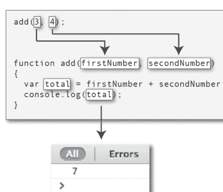

图2-7. 你可以向函数发送多个参数

现在这确实很有用了。你已经创建了自己的小型加法计算器。你可以将3和4替换为任意两个数字，函数会将它们相加并显示结果。将数字10和32放入函数调用的括号中，然后再次运行程序：

```javascript
add(10, 32);
```

现在控制台将显示42。你根本不需要修改函数定义，只需更改你提供的信息即可。你现在明白这有多有用了吗？

##### 计算器函数

你现在对`JavaScript`的了解已经足够创建自己的小型计算器了。尝试创建四个函数，分别对两个数字进行加、减、乘、除运算。你的函数调用应该像这样：

```javascript
add(12, 6);
subtract(67, 45);
multiply(34, 26);
divide(100, 5);
```

你的四个对应的函数定义会是什么样子呢？试着自己找出答案；如果你能独立解决这个问题，你会学到很多。但如果你卡住了，这里有一个完整的计算器程序可以完成这个任务。

```javascript
add(12, 6);
subtract(67, 45);
multiply(34, 26);
divide(100, 5);
```

```javascript
function add(firstNumber, secondNumber)
{
  var total = firstNumber + secondNumber;
  console.log(total);
}

function subtract(firstNumber, secondNumber)
{
  var difference = firstNumber - secondNumber;
  console.log(difference);
}

function multiply(firstNumber, secondNumber)
{
  var product = firstNumber * secondNumber;
  console.log(product);
}

function divide(firstNumber, secondNumber)
{
  var quotient = firstNumber / secondNumber;
  console.log(quotient);
}
```

看，这真的如你所想的那么简单！

##### 返回值的函数

关于函数还有一个重要的特性你应该了解。你可以让函数直接将值返回到主程序。下面是一个例子：

```javascript
var total = add(4, 4);
console.log(total);

function add(firstNumber, secondNumber)
{
  var sum = firstNumber + secondNumber;
  return sum;
}
```

这会在控制台中显示8。你能想出为什么吗？

是的，这有点让人头晕！所以我们来分解一下，让你看看发生了什么。

程序创建了一个名为`total`的变量：

```javascript
var total
```

但`total`并不只是被赋予一个普通值，比如数字或字符串。`total`的值是`add`函数：

```javascript
var total = add(4, 4);
```

这意味着`add`函数的结果将被复制到`total`中。`total`变量实际上得到的值是“8”。

```javascript
var total = 8;
```

这是因为函数定义中的关键字`return`起了作用（下面突出显示）：

```javascript
function add(firstNumber, secondNumber)
{
    var sum = firstNumber + secondNumber;
    return sum;
}
```

`return`告诉函数返回变量的值回主程序。在这种情况下，它返回的是它自己的变量`sum`的值，而`sum`等于4加4。

这是一个循环的过程，你可以在图2-8中最佳地看到它的说明。

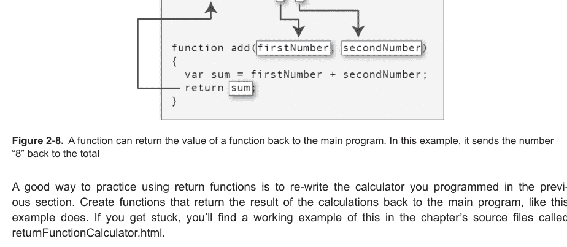

练习使用`return`函数的一个好方法是在上一节中重写你编写的计算器程序。创建将计算结果返回到主程序的函数，就像这个例子所做的那样。如果你卡住了，在本章的源文件中可以找到一个名为`returnFunctionCalculator.html`的可运行示例。

我们刚刚看过的三种函数风格都可以产生相同的结果，而且往往不清楚哪种风格是最佳选择。通过一些练习和更多的经验，你会开始意识到哪种编写函数的风格对你正在处理的任何程序都有用。你会在本书的许多不同情境中看到这些风格的使用。

##### 函数表达式

你可以使用替代语法来创建函数。它看起来像这样：

```javascript
var functionName = function(arguments)
{
  //你希望函数运行的代码
};
```

你以相同的方式调用函数，像这样：

```javascript
functionName(arguments);
```

这种编写函数的风格称为**函数表达式**。它将函数赋值给一个变量。它的工作方式与普通函数相同，只是现在你也可以像使用变量一样使用该函数。除此之外，还有两个重要的区别：

- 你必须在调用函数表达式之前定义它。
- 最后一个花括号后有一个分号。

下面是一个将两个数字相加的函数表达式：

```javascript
var add = function(firstNumber, secondNumber)
{
  var total = firstNumber + secondNumber;
  console.log(total);
};

add(4, 4);
```

是否使用这种编写函数的风格取决于你，但我们会在本书后面看到函数表达式的一些特定用途。

## 控制HTML和CSS

`JavaScript`可以控制HTML文档中的所有元素。它还可以更改CSS样式或创建新样式。你还可以使用`JavaScript`来编写按钮，从文本字段读取用户输入。然后你可以在你的程序中使用该输入。如果你知道如何做到这一点，这是开始构建游戏和应用程序的第一个也是最重要的步骤。让我们来了解如何实现。

### 在HTML元素中创建新文本

在前面的例子中，我使用`console.log`在JavaScript控制台中显示我们测试程序的结果。这对于测试程序的工作方式很有帮助，但如果能直接在网页浏览器中显示结果岂不是更好？这很容易做到。

所有HTML元素都有一个名为`innerHTML`的属性。`innerHTML`属性表示开始标签和结束标签之间的文本。

```html
<p>标签之间的所有内容都是innerHTML</p>
```

你可以使用`JavaScript`访问任何元素的`innerHTML`。这是如何工作的。

假设你有一个带有id为`output`的空HTML元素。

```html
<p id="output"></p>
```

JavaScript首先需要知道`output`指的是元素的id。你使用一个内置的JavaScript方法`document.querySelector`来实现：

```javascript
document.querySelector("#output");
```

它在HTML文档中搜索，直到找到id为`output`的元素。

下一步是将这些信息存储在变量中。你可以给变量起任何你喜欢的名字，但最简单的是给它与你要查找的元素id相同的名称。下面是将元素赋值给名为`output`的变量的方法。

```javascript
var output = document.querySelector("#output");
```

这个新的`output`变量现在直接指向HTML文档中的`<p id="output">`标签。它是连接HTML代码和JavaScript代码的桥梁。

> 注意：这向你展示了变量不仅可以存储数字、字符串或真/假值。你可以在变量中存储几乎任何东西，正如你将在本书的许多更多示例中看到的那样。

你现在可以使用这个变量来改变元素通过`innerHTML`显示的内容，像这样：

```javascript
output.innerHTML = "Hello World!";
```

现在该元素将直接在网页浏览器中显示“Hello World!”。HTML代码实际上已经被JavaScript更改，使其看起来像这样：

```html
<p id="output">Hello World!</p>
```

这是一个很巧妙的技巧。你不会在代码中看到这个更改，但它正在网页浏览器中在幕后无形地发生。让我们看一个真实的HTML文档，它确切地展示了这是如何工作的。

```html
<!doctype html>
<title>Display HTML text</title>
<p id="output"></p>
<script>
var output = document.querySelector("#output");
output.innerHTML = "Hello World!";
</script>
```

这个HTML文档显示了“Hello World!”。文本仅仅是通过JavaScript添加到空的`<p>`标签中的。

在这个例子中，我使用了`document.querySelector`来查找一个具有特定id的元素。你也可以用它来查找特定的类。只需将井号`#`替换为点号`.`。下面是如何查找一个名为`button`的类：

```javascript
document.querySelector(".button");
```

这与CSS中的用法相同：井号`#`代表id，点号`.`代表类。你可以直接通过标签名来引用HTML标签，而无需使用井号或点号。下面是如何找到`<body>`标签：

```javascript
document.querySelector("body");
```

> 注意：如果你的HTML文档中有多个同名的标签，例如多个`<p>`标签，`document.querySelector`只会找到第一个。要找到所有同名的标签，你可以使用`document.querySelectorAll`。它会给你一个包含HTML文档中所有同名标签的列表。这个列表将以一种称为数组的格式呈现。如果你将来需要这样做，你会在第4章了解如何使用数组，但现在不必担心这个问题。

## 使用JavaScript更改CSS

你可以使用JavaScript来更改任何元素的CSS样式。下面是一个简单的例子。这个HTML文档中的JavaScript代码改变了“Hello World!”这些文字的样式。它使文字变为红色，高度50像素，并带有下划线。你能看出是怎么做的吗？

```html
<!doctype html>
<title>Change CSS</title>
<p class="example">Hello World!</p>
<script>
var example = document.querySelector(".example");
example.style.color = "red";
example.style.fontSize = "50px";
example.style.textDecoration = "underline";
</script>
```

这与前面的例子工作方式非常相似。首先，使用`document.querySelector`来查找一个类名为`example`的元素。

```javascript
var example = document.querySelector(".example");
```

它被复制到一个同样名为`example`的变量中。

接下来，通过使用以下格式来更改CSS样式：

```javascript
example.style.anyCSSproperty = "value";
```

这是更改元素样式的代码：

```javascript
example.style.color = "red";
example.style.fontSize = "50px";
example.style.textDecoration = "underline";
```

请注意，所有的样式值都被引号括起来了。这些值与你在CSS代码中给样式属性的任何值都是一样的。

CSS属性的名称也与任何普通的CSS属性相同。如果你想更改字体颜色，只需使用CSS的`color`属性，像这样：

```javascript
example.style.color = "red";
```

属性名称唯一不同的地方在于那些由多个单词组成的属性。在CSS中，影响字体大小的属性是：

```css
font-size
```

在JavaScript中，同一个属性是这样写的：

```javascript
fontSize
```

单词之间的短横线被去掉了，并且第二个单词的首字母被大写了。所有使用短横线分隔单词的CSS属性在JavaScript中都这样写。

只要记住这个简单的格式，你就可以用JavaScript更改任何元素的CSS属性。

能够使用JavaScript更改CSS对于游戏来说非常有用，因为这意味着你可以根据玩家的游戏操作，交互式地更改HTML元素的样式。你很快就会看到这是如何做到的。

## 创建和移除HTML元素

你可以使用JavaScript来创建和移除HTML元素。下面是一个如何向文档主体中添加一个`<p>`元素，然后向其中添加一些文本的例子。

```html
<!doctype html>
<title>Creating HTML elements</title>
<body></body>
<script>
var p = document.createElement("p");
document.body.appendChild(p);
p.innerHTML = "Hello World!";
</script>
```

这创建了一个包含“Hello World!”文字的`<p>`标签。如果你能看到它生成的HTML代码，它会是这样的：

```html
<body>
  <p>Hello World!</p>
</body>
```

当HTML文档首次加载时，它是空白的。它只包含一个空的`<body>`标签。

```html
<body></body>
```

JavaScript代码使用一个名为`document.createElement`的方法来创建一个新的`<p>`标签，像这样：

```javascript
document.createElement("p");
```

将其赋值给一个名为`p`的变量：

```javascript
var p = document.createElement("p");
```

下一步是将这个新创建的`<p>`标签放置在文档中的某个位置。一个名为`appendChild`的方法允许你将这个新标签添加到一个已存在的元素中。在这个例子中，你想将`<p>`标签添加到现有的`<body>`标签中。下面是如何使用`appendChild`来做到这一点：

```javascript
document.body.appendChild(p);
```

现在新的HTML文档将变成这样：

```html
<body><p></p></body>
```

最后一步是向`<p>`标签中添加一些文本。使用`innerHTML`属性可以轻松完成：

```javascript
p.innerHTML = "Hello World!";
```

HTML文档现在将变成这样：

```html
<body><p>Hello World!</p></body>
```

如果你需要为新元素指定一个id或类名，可以使用`setAttribute`方法。下面是如何为`<p>`元素设置id名`example`：

```javascript
p.setAttribute("id", "example");
```

你的新HTML文档现在将变成这样：

```html
<body><p id="example">Hello World!</p></body>
```

你同样可以轻松地为元素创建一个新的类。下面是如何使用`setAttribute`为`<p>`元素创建一个新类：

```javascript
p.setAttribute("class", "anyClassName");
```


## 移除 HTML 元素

在游戏中，你可能会遇到需要移除一个元素的情况。例如，如果导弹击中了飞船，你就需要将飞船从游戏中移除。要移除任何 HTML 元素，请使用`parentNode.removeChild`方法。下面是如何使用它来移除我们刚刚创建的`<p>`标签：

```javascript
p.parentNode.removeChild(p);
```

`parentNode`是包含`<p>`标签的元素。在这个例子中，`parentNode`是`<body>`元素。所以这段代码实际上是告诉`<body>`元素移除`<p>`标签。这样做的原因是元素不允许移除自身；相反，只有包含它们的元素才能移除它们。

是的，这种逻辑非常令人困惑和绕弯子，但不要让它困扰你。只需遵循这个格式来移除元素，一切都会顺利的。它有效！

## 点击按钮

你可以用 HTML 创建一个按钮，然后使用 JavaScript 使得点击按钮时发生某些事情。这是构建交互式游戏和应用程序的第一步。

要实现这一点，你需要使用一个叫做事件监听器的特殊函数。事件监听器会“监听”你程序中发生的事件。你可以为一个按钮添加事件监听器，以便在你点击它时触发一些事情。

理解它工作原理的最简单方法是通过一个实际的例子。在本章的源文件中，你会找到一个名为`eventListener.html`的 HTML 文件。在网页浏览器中打开它，并确保 JavaScript 控制台是打开的，这样你就能读取`console.log`消息。你会看到一个标有“click me”的按钮。点击这个按钮，“Button clicked”这句话就会显示在控制台中。

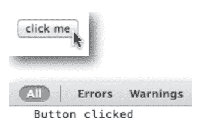

**图 2-9。** 点击按钮在控制台中显示消息

下面是实现这一功能的 HTML 代码。我会详细解释它是如何工作的：

```html
<!doctype html>

<title>Event listener</title>

<button>click me</button>

<script>

var button = document.querySelector("button");

button.addEventListener("click", clickHandler, false);

function clickHandler()

{

    console.log("Button clicked");

}

</script>
```

HTML 代码非常简单：它只是创建了一个`<button>`元素，也就是你在浏览器中看到的按钮。

```html
<button>click me</button>
```

我们需要知道按钮何时被点击。所以 JavaScript 代码向按钮添加了一个叫做事件监听器的东西。当按钮被点击时，事件监听器会运行一个名为`clickHandler`的函数，该函数在控制台中显示消息。

```javascript
var button = document.querySelector("button");

button.addEventListener("click", clickHandler, false);

function clickHandler()

{

    console.log("Button clicked");

}
```

你能看出它是如何工作的吗？让我们把它分解成更小的步骤。

JavaScript 代码首先做的是使用`document.querySelector`找到按钮元素，并将其复制到一个同样叫做`button`的变量中。

```javascript
var button = document.querySelector("button");
```

我们现在有了一个引用 HTML 按钮的变量。我们可以用这个变量来开始用 JavaScript 代码控制按钮。我们可以给它附加一个事件监听器，用来监听鼠标点击。

这是通过一个叫做`addEventListener`的特殊方法来实现的。事件监听器会监听按钮上的`"click"`事件。

```javascript
button.addEventListener("click", clickHandler, false);
```

你可以看到`addEventListener`方法通过点号附加到`button`变量上。括号里有三个参数。

```javascript
("click", clickHandler, false)
```

它们分别做什么？

`"click"`告诉事件监听器它应该监听按钮点击。`clickHandler`是当按钮被点击时应该运行的函数的名称：

```javascript
function clickHandler()

{

  console.log("Button clicked");

}
```

现在每当按钮被点击时，这个函数就会运行。这就是为什么“Button clicked”这几个字会出现在控制台中。一个很巧妙的技巧，不是吗？

> 注意：最后一个参数是`"false"`。

```javascript
("click", clickHandler, false)
```

它是什么意思？简短的回答是你不需要担心它为什么在那里，但你应该始终记得将`"false"`作为最后一个参数。但如果你一定要知道，这里有个详细的解释：它决定事件是在捕获阶段（`true`）还是冒泡阶段（`false`）分派。这些阶段是程序中创建和监听事件的过程的一部分。这是一个技术细节，对于本书中的任何项目你都不需要担心它。而且你可能永远也不需要担心它。只有当你试图监听嵌套在其他元素内部的元素上的事件，并且得到了一些意外的结果时，你可能才想对此做一些进一步的研究。

为事件监听器执行工作的函数被称为事件处理程序。它们“处理”事件。这就是为什么这个函数的名称是`clickHandler`。“click”是事件，加上“Handler”这个词你就知道这是一个处理按钮点击的函数。你可以给这些函数取任何你喜欢的名字，但遵循这个简单的命名约定，你就能始终知道该函数应该做什么。你会看到本书中所有处理事件的函数都是用“Handler”这个词来命名的。

你可以看到`addEventListener`和按钮被点击时运行的函数之间有着非常密切的关系。图 2-10 对此进行了更详细的说明。

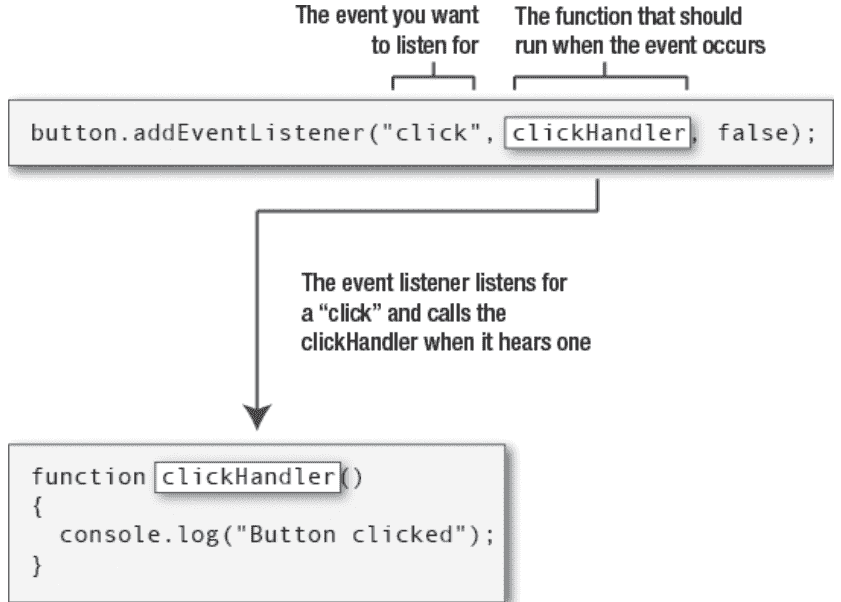

**图 2-10.** 当按钮被点击时，事件监听器会运行一个叫做事件处理程序的特殊函数

在这个例子中，事件监听器正在等待一个`"click"`事件。这发生在左键释放时。但元素还可以监听许多其他鼠标事件，如下表所示。

| Mouse event | When does it happen? |
|---|---|
| `mousedown` | When the left mouse button is pressed down over an element. |
| `mouseup` | When the left mouse button is released over an element. |
| `click` | When the left mouse button is both pressed down and then released over the same element. |
| `dblclick` | When the mouse double-clicks an element. |
| `mousemove` | When the mouse is being moved. |
| `mouseover` | When the mouse is moved onto an element. |
| `mouseout` | When the mouse moves off of an element. |

你可以在示例代码中将`"click"`替换为任何这些事件，观察其效果。例如，如果你想让按钮在鼠标按钮被按下时（但不释放）就做出反应，可以使用`"mousedown"`事件。

```javascript
button.addEventListener("mousedown", clickHandler, false);
```

表中的这些鼠标事件适用于任何 HTML 元素，不仅仅是按钮。所有这些事件都是 JavaScript 内置的。如果你使用它们，一定要确保拼写正确，因为如果你有一个小的拼写错误，它们就不会起作用，但你不会收到错误消息告诉你拼写错了。

> 注意：JavaScript 还可以将事件监听器和处理程序合并为一段代码，如下所示：

```javascript
button.addEventListener("click", function()
{
  console.log("Button clicked");
}, false);
```

仔细看，你会注意到`"click"`后面是一个函数。这个函数包含当按钮被点击时应该运行的代码。整个函数实际上是事件监听器的第二个参数。这意味着你仍然需要在函数之后添加第三个参数`false`。如果这个函数不需要被其他监听器使用，而且你知道你的程序永远不会需要移除它，可以考虑使用这种格式。

## Removing an event listener

如果你想停止监听某个事件，你可以使用一个叫做`removeEventListener`的方法来移除它。以下是我们刚刚查看的示例中，从按钮移除`"click"`事件监听器的代码。

```javascript
button.removeEventListener("click", clickHandler, false);
```

这有什么用呢？让我们想象一下，你有一个游戏，你只希望玩家能够按一次按钮，然后再也不能按了。你可以在第一次点击后通过移除监听器来禁用按钮。以下是如何在我们的示例程序中做到这一点。将这行新代码添加到点击处理程序中：

```javascript
function clickHandler()

{

    console.log("Button clicked");

    button.removeEventListener("click", clickHandler, false);

}
```

如果你现在运行程序，你会看到“Button clicked”这几个词只会显示一次。如果你再次点击按钮，这些词就不会再显示了。

如果你想让按钮完全消失，可以使用 JavaScript 将其 CSS `display`属性设置为`none`，如下所示：

```javascript
button.style.display = "none";
```

以下是如何在`clickHandler`中使用这段代码：

```javascript
function clickHandler()

{

    console.log("Button clicked");

    button.removeEventListener("click", clickHandler, false);

    button.style.display = "none";

}
```

按钮现在会在被点击后从浏览器窗口中消失。

将元素的 CSS `display`属性设置为`none`通常比使用`removeChild`来移除它是更好的替代方案，后者是我们在上一节中使用的方法。这是因为，即使它的`display`属性是`none`，该元素仍然存在。所以如果你想让它再次可见，你只需要将它的`display`属性设置为`block`，而不必从头重新创建它。

现在你知道如何制作按钮了，让我们用一个按钮来演示另一个非常重要的编程技术。

## Counting

你在游戏中会想做的一件事是递增地改变变量的值。例如，你可能想在玩家每次做正确的事情时给分数加 1。如果分数是 7，你可能想把它更新为 8。这里有一个简单的例子，展示了你可以如何做到这一点。每次按钮被点击时，给`score`的值加 1。

```javascript
//Access the button

var button = document.querySelector("button");

button.addEventListener("click", clickHandler, false);
```

```javascript
//Create a score variable and initialize it to zero

var score = 0;

console.log(score);

function clickHandler()

{

    score = score + 1;

    console.log(score);

}
```

程序首先做的是创建一个`score`变量，并将其初始值设为零。

```javascript
var score = 0;
```

在程序加载时给变量赋第一个值被称为初始化它。初始化变量通常是你的程序要做的第一件事。

当按钮被点击时，`clickHandler`运行。它给`score`的当前值加 1：

```javascript
score = score + 1;
```

这条指令每次按钮被点击时都会运行。在第二次点击时，`score`变成 2，在第三次点击时，它变成 3。为什么呢？如果你是编程新手，这可能会非常令人困惑，所以让我们把它分解成更小的步骤。

这条指令表达的是：

*score 的新值是当前 score 的值加上一。*

记住，在程序第一次加载时，`score`被初始化为 0。这意味着程序第一次运行时，你可以这样理解这条指令：

```javascript
score = 0 + 1;
```

0 + 1 等于 1，所以 1 被复制回`score`变量。这意味着`score`现在将是 1。

第二次点击按钮时会发生什么呢？因为`score`已经被改为 1，你现在可以这样理解这条指令：

```javascript
score = 1 + 1;
```

`score`现在将有一个新值 2。

在第三次猜测时，`score`仍然是 2。所以这条指令被理解为：

```javascript
score = 2 + 1;
```

`score`现在将是 3。你看出规律了吗？这是一种非常简单的给变量加值来计数的方法。

## 第 2 章

像这样使用变量进行计数非常常见，因此 JavaScript 提供了一种简写方式，使用特殊的递增和递减运算符：

```javascript
+=

-=
```

以下是如何使用递增运算符为分数加 1 的方法：

```javascript
score += 1;
```

这等同于编写`score = score + 1`。1 被添加到分数的当前值。你可以使用递减运算符从分数中减去 1，如下所示：

```javascript
score -= 1;
```

尝试修改示例程序，使点击操作使用`+=`运算符为分数加 1，如下所示：

```javascript
function clickHandler()

{

    score += 1;

    console.log(score);

}
```

你可以看到结果是相同的。

你可以像这样为变量加或减任何数字。以下是每次点击按钮时使用`+=`运算符将分数增加 5 的方法。

```javascript
function clickHandler()

{

    score += 5;

    console.log(score);

}
```

如果你再次保存并运行程序，你会看到控制台显示：0、5、10、15 等等。这产生的结果与你编写以下代码相同：

```javascript
score = score + 5;
```

但如果你只想将变量加 1 或减 1，JavaScript 有一种更简单的方法。你可以使用特殊的后缀运算符：

```javascript
++

--
```

要给分数加 1，你可以使用双加号，如下所示：

```javascript
score++
```

要减去 1，则使用双减号：

```javascript
score--
```

尝试在`clickHandler`中使用双加号为分数加 1：

```javascript
function clickHandler()

{

  score++;

  console.log(score);

}
```

像这样增量式地改变变量的值是所有游戏都会做的事情，你将在本书中看到更多这方面的例子。

## 检测键盘按键

还有一些隐藏的事物你可以用 JavaScript 控制，它们不是 HTML 元素。我们已经见过其中一个隐藏的事物：文档对象。它包含我们用来帮助找到所需元素的`querySelector`方法。

```javascript
document.querySelector()
```

JavaScript 还允许你访问窗口对象。你可以使用窗口对象来访问或更改浏览器窗口的属性。你也可以向窗口对象添加事件监听器，以便检测何时按下了某些键。这对于通过按回车键向程序输入文本，或使用键盘的方向键移动游戏对象非常有用。

让我们看一个如何使用窗口对象检测是否有人按下回车键的例子。在本章的源文件中，你会找到一个名为`enterKey.html`的文件。在浏览器中打开它，并打开控制台。按下回车键。你会看到控制台中显示消息“Enter key pressed”。以下是实现此功能的代码：

```javascript
window.addEventListener("keydown", keydownHandler, false);

function keydownHandler(event)

{

  if(event.keyCode === 13)

  {

    console.log("Enter key pressed");

  }

}
```

从第一行可以看出，事件监听器是通过点号附加到窗口对象上的（表示它是窗口对象的方法——稍后会详细介绍）：

```javascript
window.addEventListener("keydown", keydownHandler, false);
```

它监听的事件称为`keydown`，它检测何时按下了任何键。如果检测到按键，它会调用`keydownHandler`。

```javascript
function keydownHandler(event)

{

  if(event.keyCode === 13)

  {

    console.log("Enter key pressed");

  }

}
```

所有按键都有对应的键码数字。回车键的键码是 13。一个`if`语句检查键码是否匹配 13。


```javascript
if (event.keyCode === 13) {
  console.log("Enter key pressed");
}
```

如果匹配，则表示按下了回车键，因此该消息会显示在控制台中。

这个函数有一个你之前没见过的稍显奇怪的地方。它在括号中包含了单词“event”：

```javascript
function keydownHandler(event) {
  ...
}
```

这是因为`keydown`事件会向函数发送一些关于所按按键的额外信息。函数需要一个地方来存储这些信息，因此它使用一个名为`event`的变量来存储。它存储的信息是表示所按按键的键码。你可以像这样访问键码：

```javascript
event.keyCode
```

在这个例子中，`event.keyCode`等于`13`，表示回车键。

如果你现在觉得这有点令人困惑，不必太担心。你将在本书的其余部分看到更多关于事件处理程序如何使用事件的额外信息的例子。目前，只需记住，如果你想让你的程序对按键做出反应，你的 JavaScript 代码应该是什么样子。

> 注意：键码数字全部基于 ASCII（美国信息交换标准代码）。在网络上搜索 ASCII 字符代码将列出键盘上所有按键代码的完整列表。

你现在知道如何使用窗口对象的`keydown`事件来监听按键何时被按下。如果你想检测按键何时释放，可以使用`keyup`事件。

现在，让我们将本章所学的知识整合起来，创建一个简单的用户界面，这将在本书的第一部分中对你大有裨益。

## 输入和显示文本

游戏的核心是交互性。它们是玩家与你设计的邪恶天才（即你的游戏）之间的互动。玩家需要做些什么，而你的游戏需要对此做出反应。这意味着你需要某种方式从玩家那里获取信息到游戏中。HTML 提供了一个非常简单的方法，即使用`<input>`元素。在本节中，我将向你展示如何使用它让玩家向游戏或程序输入信息。

在本章的源文件中，你会找到一个名为`enteringText.html`的程序。它允许你在文本框中输入一些文本。当你点击按钮时，你输入的文本会显示在文本框下方。图 2-11 展示了你会看到的内容。这是一个简单的界面，但正如你将看到的，它是制作交互式游戏的第一步。

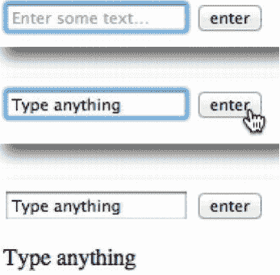

**图 2-11.** 输入一些文本，点击按钮，文本就会显示

以下是实现此功能的 HTML 和 JavaScript 代码：

```html
<!doctype html>

<title>Entering and displaying text</title>

<input id="input" type="text" placeholder="Enter some text...">

<button>enter</button>

<p id="output"></p>

<script>

var button = document.querySelector("button");

button.addEventListener("click", clickHandler, false);

button.style.cursor = "pointer";
```

```javascript
function clickHandler() {
  var input = document.querySelector("#input");
  var output = document.querySelector("#output");
  output.innerHTML = input.value;
}

</script>
```

HTML 创建了文本框、按钮和一个空的`<p>`元素。

```html
<input id="input" type="text" placeholder="Enter some text...">

<button>enter</button>

<p id="output"></p>
```

文本框是一个名为`input`的元素。当`input`元素的`type`属性设置为`"text"`时，你就可以在里面输入内容。

```html
<input id="input" type="text" placeholder="Enter some text...">
```

`placeholder`属性决定了文本框首次创建时显示的内容，如图 2-11 所示。

HTML 还包含一个`id`为`output`的空`<p>`元素。

```html
<p id="output"></p>
```

这个程序的输出将显示在这个`<p>`标签的`innerHTML`中。

JavaScript 代码使用`querySelector`获取按钮的引用，然后向它添加一个点击事件监听器。

```javascript
var button = document.querySelector("button");

button.addEventListener("click", clickHandler, false);
```

但它也对按钮的 CSS 进行了一项更改。它将其`cursor`属性更改为`pointer`。

```javascript
button.style.cursor = "pointer";
```

这使按钮在鼠标悬停时显示为指向手，如图 2-11 所示。

当按钮被点击时，`clickHandler`被调用。

```javascript
function clickHandler() {
  var input = document.querySelector("#input");
  var output = document.querySelector("#output");
  output.innerHTML = input.value;
}
```

它会获取输入文本框和一个空的`<p>`元素的引用，这个`<p>`元素被命名为`output`。然后，它将输入文本框的值复制到`output`中，像这样：

```javascript
output.innerHTML = input.value;
```

每个文本框都有一个名为`value`的属性，它告诉你输入了什么内容。这行代码将该值复制到`<p>`标签的`innerHTML`属性中。结果就是，你在文本框中输入的任何内容都会显示在`<p>`标签里。

你现在有了一种简单的方法，可以将玩家的信息输入到游戏中。你的游戏将如何使用这些信息？这是一个核心问题，也是本书其余部分要探讨的内容。

## 其他光标属性

在前面的例子中，你看到可以通过将按钮的 CSS`cursor`属性更改为`pointer`，将鼠标箭头变成指向手。以下是一些你可以赋予`cursor`属性的其他值，用于在鼠标悬停在元素上时改变其外观：

- `move`：将鼠标变为指向四个方向的箭头。
- `wait`：将光标变为旋转的圆圈，表示程序正在加载或处理某些内容。
- `help`：将光标变为问号，表示点击该元素可以查看关于程序工作原理的一些信息。
- `crosshair`：将光标变为十字准线，用于瞄准或精细定位。
- `text`：用于输入文本的标准光标。
- `auto`或`default`：由浏览器自动设置光标样式。
- `n-resize`：将光标变为指向北（向上）的箭头。“n”代表北。如果你想指向另一个方向，可以用以下任意一个值替换“n”：`ne`、`e`、`se`、`s`、`sw`、`w`、`nw`。例如，如果你想指向西南方，请使用此属性：`sw-resize`。

你可能会发现其中许多属性在游戏中很有用。

## 组织你的 JavaScript 代码

对于小型程序和游戏，将 JavaScript 代码放在主 HTML 文档的`<script>`标签之间是最好的方法。这就是我在本章以及本书大多数小型示例游戏中所做的。它整洁、简单且高效。

对于更大的项目，你会希望将 JavaScript 代码保存在单独的文件或多个文件中。这一点很重要，因为许多复杂的游戏依赖于可能被多个游戏共享的通用函数和其他编程组件。如果你的 JavaScript 代码独立于主 HTML 文档，你可以轻松地将其链接到任何其他项目。这也意味着你可以将长程序分解成一系列更易于处理的小文件。让我们通过下一个示例来了解如何操作。

使用你的文本编辑器创建一个名为`program.js`的新文档。仔细输入以下 JavaScript 代码。

```javascript
(function () {
  window.alert("The JavaScript program has loaded!");
}());
```

`window.alert`方法将在浏览器窗口中显示一个包含括号内文字的对话框。

保存`program.js`文件。

创建一个名为`main.html`的新 HTML 文件。它应与`program.js`文件位于同一文件夹中。输入以下 HTML 代码：

```html
<!doctype html>

<title>Organizing files</title>

<script src="program.js"></script>
```

保存`main.html`文件并在网页浏览器中打开它。你会看到一个`alert`窗口打开，显示文字"The JavaScript program has loaded!"，如图 2-12 所示。

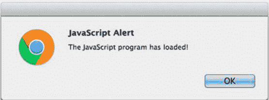

**图 2-12.** 将 JavaScript 文件链接到主 HTML 文档

### 将 JavaScript 程序链接到 HTML 文档

你可以看到`main.html`文件通过使用`<script>`标签的`src`属性加载了`program.js`文件。

```html
<script src="program.js"></script>
```

如果你有一个复杂的 HTML 文档，使用了`<body>`元素，请将`<script>`标签放在闭合的`</body>`标签之前，像这样：

```html
<!doctype html>

<title>Organizing files</title>

<body>
  <p>Any other HTML code</p>

  <script src="program.js"></script>
</body>
```

这确保了 JavaScript 会在 HTML 元素加载之后再加载。如果程序依赖于任何 HTML 代码才能工作，这一点就很重要。

### 使用 program.js 文件

`program.js`文件只包含一行重要的 JavaScript 代码。

```javascript
window.alert("The JavaScript program has loaded!");
```

这就是在浏览器窗口中显示警告框的内容。

但请注意，这行代码被上下一些看起来杂乱无章的字符包围着。

```javascript
(function () {
  window.alert("The JavaScript program has loaded!");
}());
```

那些东西是什么？这是一种叫做**立即调用函数**的东西。它通常看起来像这样：

```javascript
(function () {
}());
```

立即调用函数是一种自动运行的函数。你不需要调用它。其内部花括号中的任何内容都会立即执行。下面是一个在控制台中显示"Hello World!"的立即调用函数。

```javascript
(function () {
  console.log("Hello World!");
}());
```

我知道：它看起来像一团乱麻！如果像这样格式化它会更容易阅读：

```javascript
(function () {
  console.log("Hello World!");
}());
```

## 第 2 章

在游戏中通常几乎不需要使用立即调用函数。它唯一的用途是封装一个独立的 JavaScript 程序。这意味着当你创建一个 JavaScript 文件时，你应该将整个程序写在函数的花括号内，像这样：

```javascript
(function () {
  // Write your entire JavaScript program
  // inside the immediate function's curly braces
}());
```

为什么你需要这样做？有两个非常好的理由。

首先，这意味着你的程序会在 HTML 文件加载后立即运行。

其次，它保护了你程序中使用的所有变量，防止它们与其他程序中可能同名的变量冲突。在一个大型游戏项目中，你很可能需要将多个 JavaScript 文件链接在一起，每个文件在游戏中执行特定的任务。如果这些不同的文件恰好使用了相同名称的变量，你的程序可能会混淆你指的是哪个变量。将你的程序包装在函数内部可以保护这些变量，避免与同时运行的其他程序中的变量发生冲突。

> 注意：理解这一点有一个重要的技术原因。当你在函数内部创建一个变量时，它对该函数来说是局部的。它被称为**局部变量**。这意味着在该函数花括号之外的任何其他部分都无法使用或理解它。当你在函数外部创建一个变量时，它对整个程序来说是全局的。它被称为**全局变量**。这意味着你可以在程序的任何地方使用它，任何函数甚至同时运行的其他链接 JavaScript 程序都可以使用它。全局变量听起来非常方便，确实如此。但你必须极其谨慎地使用它们——否则你可能会与其他程序中的其他变量发生命名冲突。作为最佳实践，根本不要使用全局变量。将整个程序包装在立即调用函数中，使程序的变量仅对该程序是局部的。这可以保护它们免受全局命名冲突。

变量是局部的还是全局的，是计算机编程中一个叫做**作用域**的主题。

你可以在本章源文件的`organizingFiles`文件夹中找到一个如何将外部 JavaScript 文件链接到 HTML 文件的可用示例。在后面的章节中，你将学习如何使用这个包含多个链接 JavaScript 文件的系统来构建复杂的游戏。

## 调试代码的快速指南

1947 年 9 月 9 日，哈佛大学的 Mark II 计算机出现了问题。Mark II 是一台巨型计算机：它由数千根电线、开关、旋钮、按钮和发光的真空管组成，所有这些都塞进了一排排钢制机柜中，占据了一个小房子的面积。它还吸引了飞虫（bug）。一名操作员进行了调查，并从 Mark II 的一个面板后面拉出了一只飞蛾。问题解决了！Mark II 成功地被“除虫”（debugged）了。从那天起，程序员将查找和修复代码问题的过程称为**调试**（debugging）。

幸运的是，当你的程序出错时，你不需要去电脑里寻找筑巢的昆虫（尽管有时你可能希望解决办法就那么简单！）。通常，你犯的错误都是以下几种非常常见的。问问你自己这些问题：

- 你是否拼写正确并使用了正确的大小写？
- 你是否在`if`语句中意外地使用了单等号`=`，而不是三等号`===`？
- 你是否关闭了所有的花括号和圆括号？

浏览器控制台中的 JavaScript 调试器也会尝试告诉你它认为你的程序哪里出了问题。但是，我相信你现在已经注意到，这些错误信息极其隐晦，即使你设法解读了它们，它们可能实际上并没有告诉你哪里错了。

然而，如果你知道如何解释这些错误信息，它们实际上会非常有用。以下是一些常见的错误信息，以及它们可能真正试图告诉你的内容。（调试器还会告诉你它认为程序出错的行号。）

```text
Reference error: Can't find variable
```

你可能拼错了变量或函数的名称。

```text
SyntaxError: Unexpected token ")"
```

你可能忘记关闭一对圆括号。

```text
SyntaxError: Unexpected EOF
```

你可能忘记关闭包围字符串的一对引号。（如果你好奇，EOF 代表文件结束。这意味着调试器感到困惑，无法理解你的程序，也搞不清楚你的程序应该在哪里结束。）

```text
SyntaxError: Expected an identifier but found "somethingElse" instead
```

你可能拼错了 JavaScript 关键字，比如`function`或`var`。

```text
SyntaxError: Unexpected token "}"
```

你可能忘记关闭一对花括号。

```text
TypeError: "undefined" is not a function
```


你可能拼错了函数名。例如，也许你把`console.log`拼写成了`console.lg`。

## 第2章

以下是一些在调试程序时应始终牢记的更通用要点：

- 如果你收到不止一条错误消息，请始终尝试先修复第一条。后续错误通常源于那些依赖于前面代码正确运行的代码片段。修复第一条错误，其修正效果会级联传递，通常会神奇地修正其余问题。
- 检查调试器认为有问题的那一行的上一行代码。通常，上一行中的小错误——这些错误本身可能不足以生成错误——就足以让下一行的代码出错。
- *在重新运行之前，始终保存你正在编辑的文件。* 我再怎么强调这点都不为过。这是一个极其常见的疏忽。程序员会找到错误并修复它，但当程序再次运行时，却得到完全相同的错误消息。这是因为修复后文件没有保存，所以调试器实际运行的仍然是之前错误版本的文件。
- 在保存并再次测试程序之前，只做单一修改。如果你的程序运行正常，但在你做了那个修改后突然停止工作，你就确切知道是什么导致了问题。如果你在做了五处修改后才运行它，而它不工作，你就无法知道这五件事中的哪一件在困扰你。
- 最后，请记住程序员的通用箴言：尽早测试；频繁测试。进行大量测试，并在早期解决许多细小的、可控的问题，以避免在项目后期不得不处理庞大且棘手的问题。

正确调试代码需要大量实践，但不要让调试器让你感到沮丧。从容地面对问题，并仔细将你使用的代码与本书中的类似示例进行比较。小错误非常容易犯，但同样容易修复。

### 总结

在本章中，你学习了JavaScript编程的所有基础知识。这些技术对所有编程语言都是通用的。变量、`if`语句、函数以及输入/输出系统是编程的核心。

关于编程还有多少东西要学？还有一些，但信不信由你，你现在已掌握了所有开始制作游戏所需的核心JavaScript编程技术。你已经打开了盒子，但所有部件仍散落在地板上，你还不知道如何将它们组合起来制作有用的东西。这就是我们下一章要做的。我们将使用你在本章学到的所有编程代码片段，构建我们的第一个游戏。

## 第3章

### 你的第一个游戏

本章将是你首次真正了解如何设计完整游戏。它们是简短、简单的游戏，但包含了你会反复回顾的所有游戏设计元素：分配输入和输出、做出决策、计分、判断玩家是赢是输、使用随机数以及判断两个物体是否接触——所有这些元素都在这里。你还将更深入地研究变量和`if`语句，以及如何通过将大程序分解成小块来使用函数简化程序。到本章结束时，你将具备基于这个简单模型构建复杂逻辑和回合制游戏所需的所有技能。如果上一章教你如何像程序员一样思考，这一章则教你如何像游戏设计师一样思考。

我们将构建的第一个游戏是一个简单的猜数字游戏。游戏要求你猜一个0到99之间的数字。如果你猜得太高或太低，游戏会告诉你，直到你能通过推理解出神秘数字。图3-1展示了游戏完成后的样子。

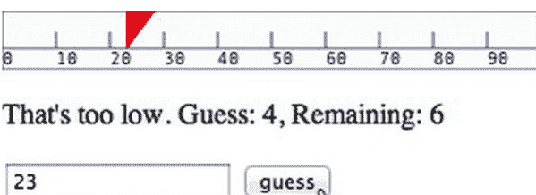

**图3-1.** 猜数字游戏

我们将分几个阶段构建这个游戏。你将从游戏的最基本版本开始，然后逐步添加更多功能，例如限制猜测次数、向玩家提供更详细的游戏状态信息以及随机化神秘数字。我们还将研究如何制作自定义游戏按钮，这些按钮的外观会根据你的交互方式而改变。最后，我们将添加一些图形来直观地显示游戏信息。

但这还不是全部。我还将向你展示如何将基本游戏概念修改成一个完全不同的游戏：《外星人袭击！》，如图3-2所示。你将学习如何根据游戏事件更改显示的图像，并将学习如何判断两个物体是否接触。

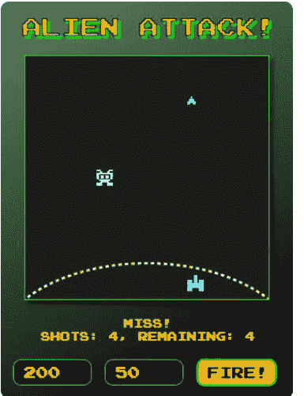

**图3-2.** 拯救世界免受外星人攻击

听起来内容很多？别担心，我们会慢慢来，当你把所有部分组合在一起时，你会惊讶于这一切是多么容易。

### 一个基本的猜数字游戏

我们的第一个游戏是一个猜数字游戏。这个游戏中最简单的形式，你肯定可以在没有任何进一步帮助的情况下自己编写出来。事实上，如果你已经完成了上一章，你就能做到！那么，在继续阅读之前，你为什么不试试呢？以下是你的游戏应具备的功能：

- 要求玩家猜一个0到99之间的神秘数字。
- 允许玩家通过点击按钮在文本框中输入猜测值。
- 使用`if`语句判断输入的数字是大于、小于还是等于神秘数字。
- 显示一条消息，告诉玩家他们猜得太低、太高还是正确。

图3-3展示了游戏运行时的样子。

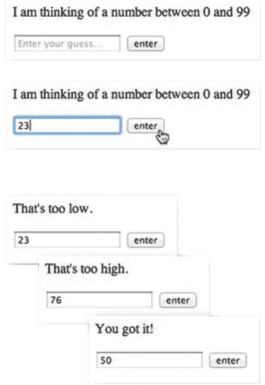

**图3-3.** 完成的猜数字游戏

以下是我编写的游戏版本，你可以在本章的源文件中找到它。它使用了上一章的所有技术。你看到`if`语句如何分析输入并显示结果了吗？

```html
<!doctype html>

<title>Number guessing game</title>

<p id="output">I am thinking of a number between 0 and 99.</p>

<input id="input" type="text" placeholder="Enter your guess...">

<button>guess</button>

<script type="text/javascript">

//Game variables

var mysteryNumber = 50;

var playersGuess = 0;

//The input and output fields

var input = document.querySelector("#input");

var output = document.querySelector("#output");

//The button

var button = document.querySelector("button");

button.style.cursor = "pointer";

button.addEventListener("click", clickHandler, false);

function clickHandler()

{

  playGame();

}

function playGame()

{

  playersGuess = parseInt(input.value);

  if(playersGuess > mysteryNumber)

  {

    output.innerHTML = "That's too high.";

  }

  else if(playersGuess < mysteryNumber)

  {

    output.innerHTML = "That's too low.";

  }

  else if(playersGuess === mysteryNumber)

  {

    output.innerHTML = "You got it!";

  }

}

</script>
```

这里有一些你可能觉得有点困惑的新内容，所以让我们讨论一下为什么我以这种方式编写程序。

### 初始化变量

设置好HTML用户界面后，JavaScript代码创建了两个变量。我称它们为“游戏变量”，因为它们将帮助游戏判断玩家是赢还是输。

```javascript
var mysteryNumber = 50;

var playersGuess = 0;
```

游戏通过比较`mysteryNumber`和`playersGuess`来工作。你可以看到它们都被赋予了初始值。`mysteryNumber`设置为50，`playersGuess`设置为零。游戏首次加载时玩家尚未进行任何猜测，因此将`playersGuess`设置为零表示它是空的。在游戏的这个初始阶段，神秘数字始终是50，但我们稍后会对其进行随机化。

### 使用函数模块化程序

该程序使用函数来帮助组织程序的主要部分。程序的结构如下：

1. 程序的第一部分初始化游戏变量；创建输入、输出和按钮变量；并向按钮添加点击事件监听器。
2. 当按钮被点击时，`playGame`函数被调用。`playGame`函数包含分析玩家猜测（通过与神秘数字比较）的`if`语句。它通过更新输出的`innerHTML`来显示结果。

`playGame`函数在玩家点击按钮时运行。但这不会立即发生。按钮首先调用`clickHandler`，然后`clickHandler`调用`playGame`函数。图3-4说明了这一点。

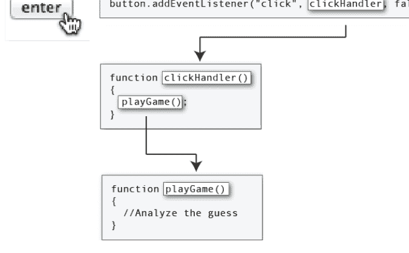

## 第3章

`clickHandler`所做的唯一事情就是调用`playGame`函数。这看起来似乎是一个多余的中间步骤。为什么不直接在`clickHandler`中运行`if`语句呢？

原因是这样做可以增加游戏未来的灵活性。例如，你可能希望在玩家按下回车键时也运行`playGame`函数。通过将按钮动作与按钮按下时实际运行的代码分开，你就能让程序在日后扩展时有更大的灵活性。这意味着如果你决定为回车键添加事件监听器，它也可以运行同一个`playGame`函数。除了添加一个调用`playGame`函数的回车键事件监听器外，你无需对程序做任何其他更改。在后续步骤中，我将向你展示如何做到这一点，你会明白添加这个中间步骤是多么有用。

使用函数将特定任务划分为有效的独立模块，这被称为**模块化**。如果你像这样仔细地对程序进行模块化设计，就可以轻松地为游戏添加新功能，而无需更改其他已经正常工作的部分。在接下来的页面中，我���开发这款游戏时，你很快就会明白这一点。

### 强制将字符串转换为数字

`playGame`函数中有一行对你来说完全陌生的代码：

```javascript
playersGuess = parseInt(input.value);
```

这行代码将玩家的输入强制解释为数字，并将结果复制到`playersGuess`变量中。这是一个当你的程序从 HTML 输入字段读取数值时必须处理的技术细节，让我们来了解为什么它很重要。

你在 HTML 输入字段中输入的任何内容都是字符串。这意味着如果你输入数字 "1234"，它们会被当作单词来理解，比如 "bicycle" 或 "guitar"，而不是数字。字符串中的数字无法进行数学运算或与其他数字比较。它们只是一组无意义的字符，就像其他任何文本字符串一样。

然而，JavaScript 在需要时通常能很好地自动解释字符串中的数字，所以一般来说你不必为此担心。但有一个重要的例外：使用另一个数字检查相等性时。你通常在`if`语句中使用三个等号来进行这种检查：

```javascript
if(anyNumber === anyOtherNumber)
```

在这种情况下，JavaScript 不会自动将包含数字的字符串转换为实际数字。你需要手动完成这一转换。

一个简单的例子可以说明这一点。以下是一个检查两个数字是否相同或不同的程序。注意`secondNumber`被引号包围：这意味着它是一个字符串。

```javascript
var firstNumber = 12;

var secondNumber = "12";

if(firstNumber === secondNumber)

{

    console.log("same");

}

else

{

    console.log("different");

}
```

这会在控制台中显示 "different"。原因是`secondNumber`不是一个数字：它被解释为一个单词，就像 "bicycle" 或 "guitar" 一样。字符串 "12" 与数字 12 并不相同。

如果你去掉 "12" 周围的引号，JavaScript 会将`secondNumber`解释为普通数字：

```javascript
var secondNumber = 12;
```

如果你再次运行程序，控制台将显示 "same"，正如你所期望的那样。

有时你需要强制将字符串转换为数字。你可以使用`parseInt`方法来实现。以下是你如何在此示例程序中使用`parseInt`来强制将字符串解释为数字：

```javascript
var firstNumber = 12;

var secondNumber = "12";

if(firstNumber === parseInt(secondNumber))

{

    console.log("same");

}

else

{

    console.log("different");

}
```

现在这显示 "same"。

`parseInt`的工作原理是强制将其括号内的任何内容转换为数字。

```javascript
parseInt(secondNumber)
```

你可以直接这样使用，也可以将转换后的值赋给一个新变量，如下所示：

```javascript
var anyNumber = parseInt("1234");
```

变量`anyNumber`现在将包含数字 1234。

这就是我在猜数字游戏中采用的策略。`playGame`函数将输入文本字段中的字符串复制到一个名为`playersGuess`的新变量中。它同时使用`parseInt`将其转换为数字。然后，这个新的`playersGuess`变量在`if`语句中用于与神秘数字进行比较：

```javascript
function playGame()

{

    playersGuess = parseInt(input.value);

    if(playersGuess > mysteryNumber)

    {

        output.innerHTML = "That's too high.";

    }

    else if(playersGuess < mysteryNumber)

    {

        output.innerHTML = "That's too low.";

    }

    else if(playersGuess === mysteryNumber)

    {

        output.innerHTML = "You got it!";

    }

}
```

如果你的程序需要将一个值解释为数字，你应该始终记得使用`parseInt`将输入字段中的字符串转换为数字。

> 注意：你可以通过使用**双等号**进行比较来让 JavaScript 自动将字符串转换为数字，如下所示：

```javascript
if(12 == "12")

{

    console.log("same");

}

else

{

    console.log("different");

}
```

这将产生 "same"。像这样使用双等号可能很方便。然而，数字 12 和字符串 "12" 绝对不是同一种类型的东西。如果这是一个关键的区别，而你没有为此做好准备，你的`if`语句可能会产生意想不到的结果。因此，使用三个等号更安全，这也是我在本书的项目中使用它的原因。

### 关于 `parseInt` 的更多知识

`parseInt`代表 "parse integer"（解析整数）。单词 *parse* 的意思是对信息进行逻辑理解。*整数*是指整数，即没有小数点的数字。这意味着`parseInt`从字符串创建的数字不会包含任何小数等分数信息。如果存在小数值，将会被丢弃。以下是一个例子：

```javascript
parseInt("12.8");
```

这将产生 12。小数值将被丢弃。

如果你需要保留小数位，可以使用一个相关的方法，叫做`parseFloat`。

```javascript
parseFloat("12.8");
```

这将产生 12.8。

> 注意：单词 "float" 指的是 "floating point"（浮点），这是描述带有小数或分数值的数字的另一种方式。

### 显示游戏状态

让我们开始对猜数字游戏做一些改进。在其当前版本中，游戏允许你进行无限次猜测，即使你正确猜出了神秘数字；如果你想的话，也可以一直玩下去。为了限制猜测次数，程序需要更多地了解游戏的状态，以及在达到获胜或失败条件时该怎么做。我们将分两部分解决这个问题，首先从显示游戏状态开始。

要知道玩家是赢还是输，游戏需要了解以下几件事：

- 玩家在游戏结束前还剩下多少次猜测机会。我们需要一个名为`guessesRemaining`的新变量来存储这些信息。
- 玩家已经猜测了多少次。我们需要另一个名为`guessesMade`的新变量来跟踪这一点。
- 游戏的当前状态是什么。我们需要第三个名为`gameStatus`的变量，它将在`<p id="output">`标签中显示这些信息。

让我们将这些功能添加到游戏中：

1. 将以下三个新变量添加到程序中，放在其他变量下方（在所有这些示例中，粗体文本代表新代码）：

```javascript
//Game variables

var mysteryNumber = 50;

var playersGuess = 0;

var guessesRemaining = 10;

var guessesMade = 0;

var gameState = "";
```

2. 将这段新代码添加到`playGame`函数中：

```javascript
function playGame()

{

    guessesRemaining = guessesRemaining - 1;

    guessesMade = guessesMade + 1;

    gameState = " Guess: " + guessesMade + ", Remaining: " + guessesRemaining;

    playersGuess = parseInt(input.value);

    if(playersGuess > mysteryNumber)

    {

        output.innerHTML = "That's too high." + gameState;

    }

    else if(playersGuess < mysteryNumber)

    {

        output.innerHTML = "That's too low." + gameState;

    }
```


```js
else if(playersGuess === mysteryNumber)
{
    output.innerHTML = "You got it!";
}
```

保存并运行游戏，你现在会收到一条消息，告诉你已经猜测了多少次，以及还剩多少次。图 3-5 展示了你会看到的内容。

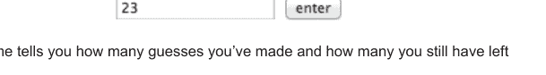

**图 3-5.** 游戏会告诉你已经猜测了多少次，以及还剩下多少次

新代码创建了三个新变量并赋予它们初始值：

```js
var guessesRemaining = 10;
var guessesMade = 0;
var gameState = "";
```

玩家在游戏结束前可以进行的总猜测次数存储在`guessesRemaining`变量中。你给了它一个初始值 10，但你当然可以改变这个值来让游戏变得更容易或更难。你还想统计玩家进行的猜测次数，因此创建了一个`guessesMade`变量来存储这些信息。当游戏刚开始时，玩家显然还没有进行任何猜测，所以`guessesMade`变量被设置为 0。`gameState`变量是一个字符串，用于显示这些新信息，你很快就会看到它是如何做到这一点的。它最初不包含任何文本（只是被赋予了一对空引号）。

## 第三章

### 猜测计数

以下是`playGame`函数中三个改变这些变量的新指令：

```js
function playGame()
{
    guessesRemaining = guessesRemaining - 1;
    guessesMade = guessesMade + 1;
    gameState
        = " Guess: " + guessesMade + ", Remaining: " + guessesRemaining;
}
```

> 注意：最后一行非常长，为了便于在本书中打印，我通过在等号处换行将其分成了两行。在你的程序中，你很可能可以将其保持为一行不间断的代码，正如你在图 3-6 中所看到的。我将在本书中遵循同样的规则来拆分所有长行代码。记住，如果你有疑问，总是可以通过寻找分号来识别一行代码的结束。你如何对代码进行空格或换行不会对其运行方式产生任何影响。

```js
function playGame()
{
    guessesRemaining = guessesRemaining - 1;
    guessesMade = guessesMade + 1;
    gameState = " Guess: " + guessesMade + ", Remaining: " + guessesRemaining;
}
```

**图 3-6.** 将长段代码保持在单行内。

第一行从`guessesRemaining`的当前值中减去 1：

```js
guessesRemaining = guessesRemaining - 1;
```

如果`guessesRemaining`在游戏开始时值为 10，那么现在它的值将变为 9。你已经在第二章的“计数”部分学习了这是如何工作的。

程序使用相同的技术给`guessesMade`加 1：

```js
guessesMade = guessesMade + 1;
```

每次点击按钮时，`guessesMade`都会增加 1。

你也可以选择使用后缀运算符`++`和`--`。要从`guessesRemaining`变量中减去 1，你可以使用这个指令：

```js
guessesRemaining--;
```

你可以这样给`guessesMade`加 1：

```js
guessesMade++;
```

这是给变量加或减 1 的一种高效方式，你将在本章后面看到它的应用。

### 连接字符串

游戏使用了另一个叫做`gameState`的新变量。每次`playGame`函数运行时，它都会告诉玩家已经进行了多少次猜测以及还剩多少次猜测：

```js
gameState = " Guess: " + guessesMade + ", Remaining: " + guessesRemaining;
```

这是一个将变量与单词组合在一起的字符串。当你在游戏中第一次进行猜测时，`gameState`将会产生以下内容：

```text
Guess: 1, Remaining: 9
```

接下来的`if`语句随后使用`gameState`变量在输出元素中显示完整消息：

```js
if(playersGuess > mysteryNumber)
{
    output.innerHTML = "That's too high." + gameState;
}
else if(playersGuess < mysteryNumber)
{
    output.innerHTML = "That's too low." + gameState;
}
else if(playersGuess === mysteryNumber)
{
    output.innerHTML = "You got it!";
}
```

加号将`gameState`变量的内容添加到输出文本框中。这展示了你如何可以将游戏变量与文本混合，以向玩家传达游戏中发生的事情。

### 获胜与失败

现在游戏拥有关于玩家行为的足够信息，可以判断游戏是赢是输。你现在需要做的就是想一种方法说，“嘿，游戏结束了！”并告诉玩家他们的表现如何。

为此，请在程序中添加以下内容：

- 一个名为`gameWon`的布尔（真/假）变量，如果玩家赢了则设置为`true`，否则设置为`false`。
- 用于检查游戏是否结束的`if`语句。
- 一个名为`endGame`的方法，它告诉玩家他们是赢了还是输了。

让我们对程序进行这些更改，看看会发生什么。

在程序开头添加新的`gameWon`变量。它的初始值是`false`。

```js
//Game variables
var mysteryNumber = 50;
var playersGuess = 0;
var guessesRemaining = 10;
var guessesMade = 0;
var gameState = "";
var gameWon = false;
```

在`playGame`函数中添加以下用粗体标出的新代码：

```js
function playGame()
{
    guessesRemaining = guessesRemaining - 1;
    guessesMade = guessesMade + 1;
    gameState = " Guess: " + guessesMade + ", Remaining: " + guessesRemaining;
    playersGuess = parseInt(input.value);

    if(playersGuess > mysteryNumber)
    {
        output.innerHTML = "That's too high." + gameState;

        //Check for the end of the game
        if (guessesRemaining < 1)
        {
            endGame();
        }
    }
    else if(playersGuess < mysteryNumber)
    {
        output.innerHTML = "That's too low." + gameState;

        //Check for the end of the game
        if (guessesRemaining < 1)
        {
            endGame();
        }
    }
    else if(playersGuess === mysteryNumber)
    {
        gameWon = true;
        endGame();
    }
}
```

在`playGame`函数下方添加这个新的`endGame`函数：

```js
function endGame()
{
    if (gameWon)
    {
        output.innerHTML
            = "Yes, it's " + mysteryNumber + "!" + "<br>"
            + "It only took you " + guessesMade + " guesses.";
    }
    else
    {
        output.innerHTML
            = "No more guesses left!" + "<br>"
            + "The number was: " + mysteryNumber + ".";
    }
}
```

你可以选择从`playGame`方法的`if`语句中删除以下指令。这段文本将被`endGame`方法中的新文本替换。实际上保留它也无妨，但它确实是多余的。

```js
output.innerHTML = "You got it!"
```

保存程序并玩游戏。现在它防止你猜测超过 10 次，并告诉你是否赢了或输了。图 3-7 展示了如果你猜对了，你的游戏现在可能的样子。

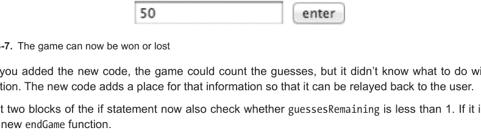

**图 3-7.** 游戏现在可以决出胜负了

在你添加新代码之前，游戏可以计数猜测，但它不知道如何处理这些信息。新代码为这些信息添加了一个存储位置，以便将其反馈给用户。

`if`语句的前两个代码块现在也会检查`guessesRemaining`是否小于 1。如果是，它们会调用新的`endGame`函数。

```js
if(playersGuess > mysteryNumber)
{
    output.innerHTML = "That's too high." + gameState;

    //Check for the end of the game
    if(guessesRemaining < 1)
    {
        endGame();
    }
}
```

```js
else if(playersGuess < mysteryNumber)
{
    output.innerHTML = "That's too low." + gameState;

    //Check for the end of the game
    if(guessesRemaining < 1)
    {
        endGame();
    }
}
```

嵌套在另一个`if`语句中的`if`语句被称为**嵌套 if 语句**。这是你第一次看到它。嵌套 if 语句对于在你的决策过程中添加额外的逻辑层总是非常有用的。

`if`语句的最后一个代码块检查玩家的猜测是否与神秘数字匹配。如果玩家猜对了，他就赢得了游戏，所以它会调用新的`endGame`函数。同时，非常重要的是，它将`gameWon`变量设置为`true`。

```js
else if(playersGuess === mysteryNumber)
{
    gameWon = true;
    endGame();
}
```

那么那个`endGame`函数是做什么的呢？它检查玩家是否赢得了游戏。如果`gameWon`变量是`true`，那么玩家就赢了，并显示相应的消息。但如果`gameWon`是`false`，该函数就告诉玩家他或她输了。

```js
function endGame()
{
    if(gameWon)
    {
        output.innerHTML
            = "Yes, it's " + mysteryNumber + "!" + "<br>"
            + "It only took you " + guessesMade + " guesses.";
    }
    else
    {
        output.innerHTML
            = "No more guesses left!" + "<br>"
            + "The number was: " + mysteryNumber + ".";
    }
}
```

玩家看到的消息会根据`gameWon`是`true`还是`false`而有所不同。`gameWon`只有在玩家猜对数字时才被设置为`true`。否则，它将保持`false`，这是它被初始化时的值。

### if 语句与布尔变量

你可能还记得上一章，只包含`true`或`false`值的变量被称为布尔值。享受使用这个美妙的词汇吧，因为计算机编程是唯一一个你会有机会使用它的领域。`gameWon`是一个布尔变量，因为它只能被设置为`true`或`false`。

看看`if`语句如何检查`gameWon`变量：

```js
if(gameWon)
{...
```

这意味着“如果`gameWon`变量为真，则执行此操作。”但这与其他`if`语句的编写方式非常不同。为什么呢？

`if`语句的工作原理是，如果括号中的条件为真，则运行其指令。如你所知，你可以使用相等运算符（三等号）将任何布尔值与`true`或`false`值进行比较，如下所示：

```js
if(gameWon === true)
```

如果`gameWon`是`false`，这个语句整体上被读作`false`，指令不运行。如果`gameWon`是`true`，该语句整体上被读作`true`，指令运行。你已经从上一章知道了所有这些，但这里有一些新的东西。如果你只需要检查一个布尔变量是`true`还是`false`，使用这种简写形式要方便得多，而且通常能使你的代码更易读：

```js
if(gameWon)
```

因为`gameWon`的值只能是`true`或`false`，所以它提供的信息与第一个示例完全相同。

我们将在整本书中使用这种作为检查布尔变量值的首选方式。`if(gameWon)`非常接近英文短语“If the game is won”。仔细选择你的变量名，你很快就会发现这种编写`if`语句的方式可以使你的程序易于阅读。

### 字符串中的 HTML 代码

此代码的另一个新特性是最终消息包含一个 HTML `<br>`标签。这会将消息分成两行。以下是获胜消息的样子：

```js
output.innerHTML
    = "Yes, it's " + mysteryNumber + "!" + "<br>"
    + "It only took you " + guessesMade + " guesses.";
```

你可以看到`<br>`标签在`mysteryNumber`之后创建了一个换行，如图 3-8 所示。这是一个如何将字符串、变量和 HTML 标签组合成交互式游戏消息的复杂示例。你能看出代码是如何产生你在游戏中看到的输出的吗？仔细思考你希望你的消息如何显示以及它们应该如何呈现，通过一些练习，你很快就会发现编写这样的代码很容易。

### 使用函数进行模块化编程

你应该能够理解`playGame`和`endGame`函数是如何帮助实现代码模块化的。实际上，你也可以不使用这些函数，而是把所有需要检查的条件都写在一个非常长的`if`语句中。但如果那样做，你就不得不重复大量代码，而且整体会变得越来越难以阅读和调试。

将特定任务封装在独立的函数中进行模块化，让你能够单独修改或调试这些代码片段，而无需更改（甚至可能弄坏）程序中其他正常工作的部分。这也意味着，每当需要执行某个任务时，你不用重复编写任何已有代码，只需调用所需的函数即可。

使用函数来模块化代码可能需要一些练习，在看过更多示例并亲自在项目尝试之前，你可能会觉得有点绕不过弯来。看看游戏目前的运作方式，试着理解函数定义和函数调用之间的相互关系是如何工作的。图 3-9 展示了这一切是如何组合在一起的。你可以把每个函数想象成程序中的一个“模块”。

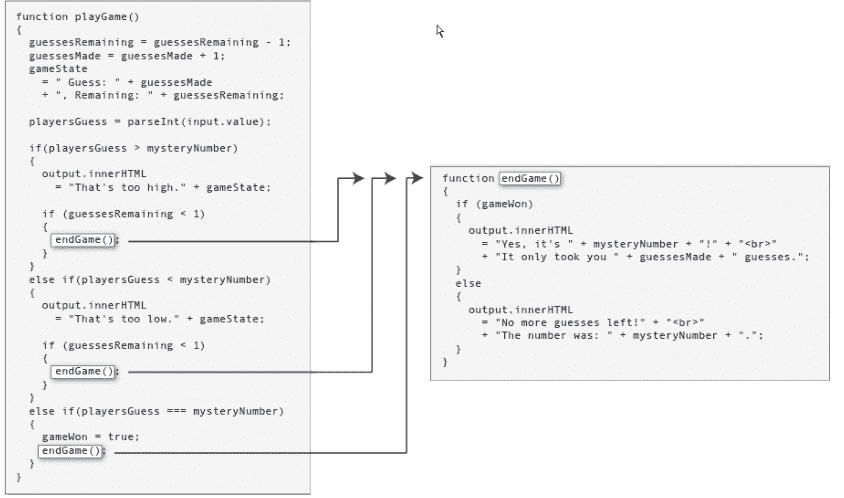

**图 3-9.** 使用函数将特定任务模块化

这样使用函数并不是模块化代码的唯一方法。在第 6 章中，你将学习如何创建和使用**对象**来帮助你实现这一点。

### 润色完善

编写软件时，大约 30%的时间用于让它能够运行，而另外 70%的时间则用于让它运行良好。没有比猜数字游戏更好的例子能说明这一原则了。现在它可以玩，但缺少很多东西，大多数玩家都会对此有所抱怨。

以下是一些可以改进的地方：

- 应该确保玩家只能输入数字，而不是文字。
- 玩家应该能够用 Enter 键输入猜测，而不仅仅是用鼠标。
- 游戏结束后应该阻止玩家继续玩。
- 应该让神秘数字随机化。

让我们挽起袖子，看看能不能修复这些问题。在本章源文件中的**numberGame_4.html**文件中，你可以找到包含所有这些修改的游戏示例。

#### 只允许输入数字

在当前版本的游戏中，玩家可以在输入框中输入任何内容，而不仅仅是数字。让我们改进一下游戏，如果你输入了文字，游戏会显示一条消息，要求你输入数字。

为此，程序首先需要一种区分数字和字符串的方法。JavaScript 有一个名为`isNaN`的方法可以告诉你这一点。`isNaN`代表“is not a number”（不是一个数字）。你这样使用它：

```js
isNaN("anyValue");
```

如果你在括号中放入一个字符串，`isNaN`将产生以下结果：

```js
true
```

这意味着“它是一个字符串。”如果你在括号中放入一个实际的数字，像这样：

```js
isNaN(2600)
```

它将产生：

```js
false
```


这意味着“它不是一个字符串”。你可以在游戏中这样测试玩家的输入：

```javascript
isNaN(playersGuess)
```

如果这产生`true`，那么你就知道玩家输入了一个字符串。

我们将在游戏中创建一个全新的函数`validateInput`来为我们检查这一点。当玩家点击按钮时，`clickHandler`将首先调用`validateInput`。如果输入是数字，`validateInput`将调用`playGame`函数，游戏将正常进行。但如果输入是字符串，`validateInput`将显示一条消息，要求玩家输入数字。

新的`validateInput`函数将作为`clickHandler`和`playGame`之间的过滤器。以下是你需要对游戏进行的更改：

1. 修改`clickHandler`，让它看起来像这样：

   ```javascript
   function clickHandler()
   {
       validateInput();
   }
   ```

2. 在`clickHandler`下方添加新的`validateInput`函数：

   ```javascript
   function validateInput()
   {
       playersGuess = parseInt(input.value);
   ```

   ```javascript
   if(isNaN(playersGuess))
   {
     output.innerHTML = "Please enter a number.";
   }
   else
   {
     playGame();
   }
   ```

3. 注意以下这行代码已经从`playGame`函数移动到了这个新`validateInput`函数中：

   ```javascript
   playersGuess = parseInt(input.value);
   ```

   你应该从`playGame`函数中移除它。

你可以看到，`isNaN`方法直接在`if`语句的括号内：

```javascript
if(isNaN(playersGuess))
{...
```

如果它产生`true`的结果，`if`语句将显示“Please enter a number.”。如果是`false`，它将调用`playGame`函数，让游戏照常进行。图3-10展示了`validateInput`如何作为`clickHandler`和`playGame`函数之间的过滤器。

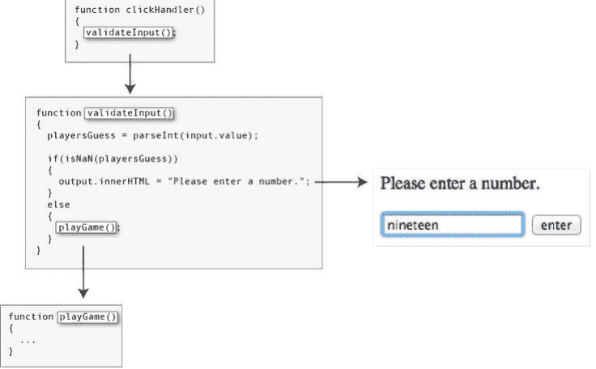

图3-10. 过滤输入以确保玩家输入数字

你可以看到，因为你已经对程序进行了模块化，现在可以轻松添加这样的新功能，而不必更改已经写好的代码。在下一节中你会看到另一个很好的例子。

> 注意：JavaScript有一些特殊的内置方法用于验证输入，如果你有很多输入字段（比如网站上的表单），这些方法会很有帮助。研究“HTML5 Forms API”可以了解更多相关内容。

## 使用Enter键输入数字

在上一章中，你学习了如何使用Enter键为程序提供信息。你可以在猜数字游戏中使用同样的技巧。不过这里有一点新内容：鼠标和Enter键都可以用来输入相同的信息。这是可行的，因为如果你点击鼠标或按下Enter键，这两个操作都会调用`validateInput`函数。

在`clickHandler`上方添加这段新代码：

```javascript
window.addEventListener("keydown", keydownHandler, false);

function keydownHandler(event)
{
    if(event.keyCode === 13)
    {
        validateInput();
    }
}
```

记住，13是Enter键的ASCII码。如果`event.keyCode`匹配数字13，`if`语句将调用`validateInput`函数。

保存并再次运行游戏，你现在可以通过点击按钮或按下Enter键来输入数字。图3-11展示了按钮或Enter键现在如何都能调用`validateInput`函数。

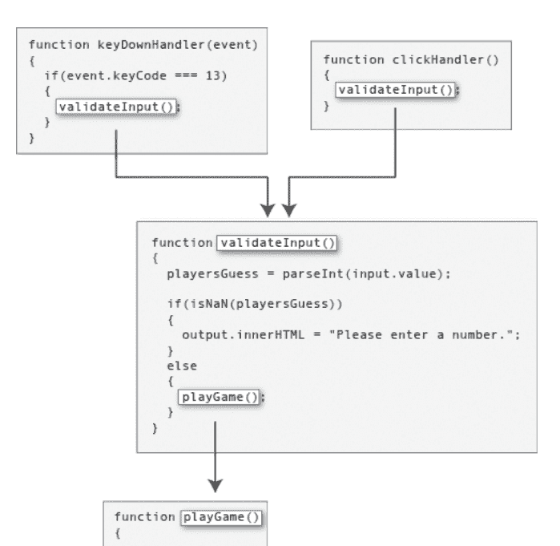

图3-11. 按钮和Enter键都能调用同一个函数

### 改进用户界面

**用户界面**是指玩家玩游戏所需的所有按钮、文本框和其他交互元素。你经常会看到它被称为**UI**或有时**GUI**（图形用户界面）。你的UI对玩家预期行为的响应程度，将在很大程度上影响他们享受游戏的程度。让我们让游戏的UI更加用户友好一些。

#### 为输入字段添加焦点

在当前版本的游戏中，你需要先用鼠标点击输入框才能输入数字。你可以对HTML代码做一个小改动，让闪烁的输入光标在游戏开始时自动出现在输入框中。然后玩家就可以立即输入数字，无需先点击输入框。这被称为给字段**焦点**。

你只需要给`input`元素添加一个`autofocus`属性：

```html
<input id="input" type="text" placeholder="Enter your guess..." autofocus>
```

保存游戏并再次运行。你现在将看到输入框中立即出现闪烁的光标，这样你就可以马上开始输入数字了。图3-12展示了这一点。


图3-12. 为输入字段添加焦点

你可以给任何UI元素添加`autofocus`，包括按钮。

### 禁用输入框、按钮和Enter键

游戏结束后，玩家实际上仍然可以继续输入猜测并点击按钮。你可以在结束时禁用输入框、按钮和Enter键来阻止这一点。在`endGame`函数的末尾添加以下新代码：

```javascript
function endGame()
{
  if(gameWon)
  {
    output.innerHTML
      = "Yes, it's " + mysteryNumber + "!" + "<br>"
      + "It only took you " + guessesMade + " guesses.";
  }
  else
  {
    output.innerHTML
      = "No more guesses left!" + "<br>"
      + "The number was: " + mysteryNumber + ".";
  }

  //Disable the button
  button.removeEventListener("click", clickHandler, false);
  button.disabled = true;

  //Disable the enter key
  window.removeEventListener("keydown", keydownHandler, false);

  //Disable the input field
  input.disabled = true;
}
```

你可以看到使用了`removeEventListener`，这样按钮和Enter键就不再调用事件处理程序了。这使它们停止工作。

但代码还通过将按钮和回车键的`disabled`属性设置为`true`来禁用它们，如下所示：

```javascript
button.disabled = true;
input.disabled = true;
```

当按钮被禁用时，它在浏览器窗口中会变暗，你无法点击它。当输入字段被禁用时，你无法点击它来输入文本。

`disabled`是所有HTML输入元素（如按钮和文本字段）的属性。当你想阻止它们工作时，将其设置为`true`。将`disabled`设置为`false`可让它们重新工作。

### 生成随机数

在大多数游戏项目中，你几乎肯定会发现自己需要使用随机数。JavaScript有许多内置方法可用于操作数字。其中之一是`Math.random`方法，它生成0到1之间的随机数。它的样子如下：

```javascript
Math.random()
```

你可以将这个随机数赋值给变量，就像你给变量赋值其他值一样，如下例所示：

```javascript
var randomVariable = Math.random();
```

`randomVariable`现在被赋值为0到1之间的随机数，最多有16位小数。所以它可以是任何数；例如，0.3669164208535294或0.5185672459021346。

你可能会问，一个有16位小数、介于0和1之间的随机数有什么用？正如你已经猜到的，实际上完全没用！幸运的是，你可以做一些调整来获得更有用的东西。

首先，游戏中的随机数通常需要是整数——即整数。所有那些小数位都必须去掉。你能想象如果猜谜游戏中的神秘数字是33.6093155708325684这样的数，玩起来会有多噩梦吗？如果你去掉所有小数，就会得到有用的东西，比如33，这在大多数人类有生之年能够猜到的范围内。

幸运的是，JavaScript有一些内置方法可以帮助我们向上或向下舍去小数：

- `Math.round`：可用于向上或向下舍入数字。例如，`Math.round(3.4)`返回3。`Math.round(3.8)`返回4。`Math.round(3.5)`也返回4。
- `Math.floor`：始终向下舍入数字。`Math.floor(3.2)`返回3。`Math.floor(3.9)`也返回3。
- `Math.ceil`：始终向上舍入数字。`Math.ceil(3.2)`返回4，`Math.ceil(3.9)`也返回4。（ceil是*ceiling*（天花板）的缩写。天花板在上；地板在下。明白了吗？）

要将这些方法中的任何一个与`Math.random`方法一起使用，你需要使用如下格式：

```javascript
Math.round(Math.random())
```

想想这是做什么的。`Math.random()`生成一个带有大量小数的0到1之间的随机数。所以假设它生成了一个无用的数，比如0.6781340985784098。你可以假装前面的代码行现在看起来像这样：

```javascript
Math.round(0.6781340985784098)
```

你会如何舍入这个数？你会向上舍入，结果如下：

```text
1
```

但如果随机数更低呢，比如这样？

```javascript
Math.round(0.2459678308703125)
```

它会被向下舍入为：

```text
0
```

这意味着你可以使用代码`Math.round(Math.random())`来生成一个50%概率为0或1的随机数。这还不是你在游戏中想要的结果，但也并非完全没用。在很多情况下，计算某件事有50%的概率发生，在你的游戏中会非常有用，你可以用这一小段代码来做到这一点。

> 注意：事实上，你可以用这段代码来生成随机的布尔值（`true`/`false`）。假设你有一个名为`rainToday`的布尔变量。你可以用`false`来初始化它：
>
> ```javascript
> rainToday = false;
> ```
>
> 哦，要是真的就好了！所以为了让更真实一点，你可以给它50%的概率为`true`或`false`。你只需要在`if/else`语句中使用`Math.round(Math.random())`代码片段，并将其与1进行比较。代码可能如下所示：
>
> ```javascript
> if(Math.round(Math.random()) === 1)
> {
>     rainToday = true;
> }
> else
> {
>     rainToday = false;
> }
> ```
>
> `Math.round(Math.random())`恰好有50%的概率生成1或0。如果恰好是1，第一条指令运行，`rainToday`变为`true`。如果是0，今天不下雨！

所以0到1之间的随机数稍微有用一些，但还不是你在游戏中想要的结果。你如何获得0到99之间的数？方法如下：

```javascript
Math.floor(Math.random() * 100)
```

这行代码将随机数乘以100，然后使用`Math.floor`向下舍入。这意味着它可能的最小值是0，最大值是99。这给了我们一个完美的随机整数，落在0到99的范围内。

这是另一种理解方式。假设随机数是0.3378208608542148。那么代码将如下所示：

```javascript
Math.floor(0.3378208608542148 * 100)
```

乘以100后，随机数将如下所示：

```javascript
Math.floor(33.78208608542148)
```

小数点只是向右移动两位，给出一个可以用来处理的更大的数。但你仍然有那些恼人的小数需要处理！别担心：`Math.floor`来帮忙，将整个结果向下舍入。所以结果非常令人满意：

```text
33
```

完美适用于猜数字游戏！图3-13展示了这一过程的实际示例。

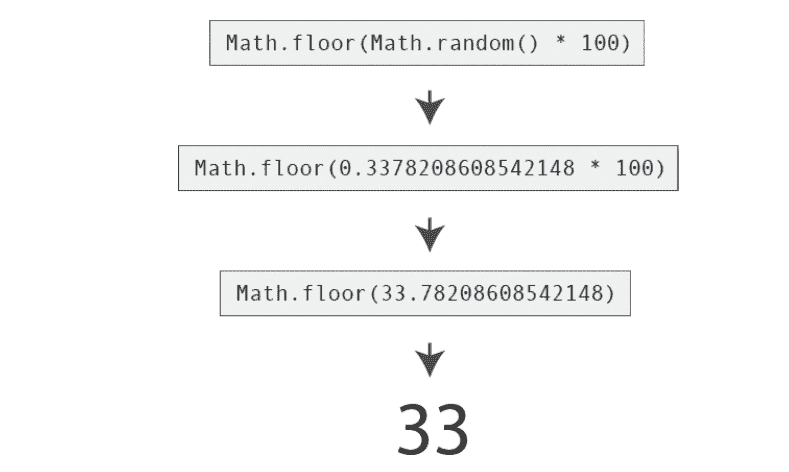

**图3-13.** 从无用变有用：`Math.random`和`Math.floor`帮助生成特定范围内的随机整数

如果你需要1到100之间的随机数，可以使用如下代码：

```javascript
Math.ceil(Math.random() * 100);
```

`Math.ceil`将随机数向上舍入，所以最小值是1，最大值是100。

你可以通过更改乘以随机数的数字，将这种格式用于任何数字范围。以下是一些示例：

- `Math.ceil(Math.random() * 10)`生成1到10之间的随机数。
- `Math.ceil(Math.random() * 27)`生成1到27之间的随机数。
- `Math.ceil(Math.random() * 5)`生成1到5之间的随机数。

使用`Math.ceil`使随机数范围从1开始的原因是，任何小于1的数，比如0.23，都会向上舍入到1。这样你就不必处理0值，而0值通常对你游戏中需要的数字范围没有用处。然而，如果你确实想让0成为范围的一部分，使用：

```javascript
Math.floor(Math.random() * 101)
```

这将给你一个0到100之间的随机数。为什么需要将随机数乘以101？因为如果随机数超过100，`Math.floor`会将它推回到100。它永远达不到101。

> 注意：*如果你想生成的随机数范围不从1或0开始怎么办？*
>
> *假设你需要10到25之间的数。这意味着有15个可能的数可以被选择：10、11、12……直到25。你只需要生成0到15之间的随机数，然后加上10将它推入你需要的范围。代码如下：*
>
> ```javascript
> Math.floor(Math.random() * 16) + 10;
> ```
>
> *这样理解。随机数在0到15之间。假设它是8。然后你加上10。结果得到18。你就有可能得到10到25之间的随机数。*

你可以在章节源文件的`randomNumbers.html`文件中找到所有这些生成随机数方法的实际示例。

现在让我们将所学到的关于随机数的知识应用到游戏中。我们需要一个0到99之间的随机数，所以修改初始化`mysteryNumber`的行，使其看起来像这样：

```javascript
var mysteryNumber = Math.floor(Math.random() * 100);

console.log(mysteryNumber);

var playersGuess = 0;

var guessesRemaining = 10;

var guessesMade = 0;

var gameState = "";

var gameWon = false;
```

你可以添加可选行`console.log(mysteryNumber)`，以便在控制台中显示该数字，这在测试游戏时很有用。

保存程序并再次运行游戏。现在你每次玩都会得到不同的数字！

### 添加字符编码

一个小的技术细节是，你应该始终确保完成的游戏包含描述文档字符编码的`<meta>`标签。

```html
<!doctype html>
<meta charset="utf-8">
<title>Number guessing game</title>
```

这很重要，因为即使是最新的现代网络浏览器也并不总是能正确解释字符，尤其是在文本字段中。如果你在游戏的某个地方看到一些乱码单词或数字，很可能是你没有包含字符编码。

138

## 完成游戏

在本节中，我们对猜数字游戏做了大量改动，因此这里提供一份完整的代码清单，供你参考它们是如何整合在一起的。

```html
<!doctype html>
<meta charset="utf-8">
<title>Number guessing game</title>

<p id="output">I am thinking of a number between 0 and 99.</p>

<input id="input" type="text" placeholder="Enter your guess..." autofocus>

<button>guess</button>

<script>
//Game variables

var mysteryNumber = Math.floor(Math.random() * 100);

console.log(mysteryNumber);

var playersGuess = 0;

var guessesRemaining = 10;

var guessesMade = 0;

var gameState = "";

var gameWon = false;

//The input and output fields

var input = document.querySelector("#input");
```


```javascript
var output = document.querySelector("#output");

// The button
var button = document.querySelector("button");

button.addEventListener("click", clickHandler, false);

button.style.cursor = "pointer";

// Listen for enter key presses
window.addEventListener("keydown", keydownHandler, false);

function keydownHandler(event) {
  if (event.keyCode === 13) {
    validateInput();
  }
}

function clickHandler() {
  validateInput();
}

function validateInput() {
  playersGuess = parseInt(input.value);

  if (isNaN(playersGuess)) {
    output.innerHTML = "Please enter a number.";
  } else {
    playGame();
  }
}

function playGame() {
  guessesRemaining = guessesRemaining - 1;
  guessesMade = guessesMade + 1;

  gameState =
    " Guess: " + guessesMade +
    ", Remaining: " + guessesRemaining;

  playersGuess = parseInt(input.value);

  if (playersGuess > mysteryNumber) {
    output.innerHTML = "That's too high." + gameState;

    // Check for the end of the game
    if (guessesRemaining < 1) {
      endGame();
    }
  } else if (playersGuess < mysteryNumber) {
    output.innerHTML = "That's too low." + gameState;

    // Check for the end of the game
    if (guessesRemaining < 1) {
      endGame();
    }
  } else if (playersGuess === mysteryNumber) {
    gameWon = true;
    endGame();
  }
}

function endGame() {
  if (gameWon) {
    output.innerHTML =
      "Yes, it's " + mysteryNumber + "!" + "<br>" +
      "It only took you " + guessesMade + " guesses.";
  } else {
    output.innerHTML =
      "No more guesses left!" + "<br>" +
      "The number was: " + mysteryNumber + ".";
  }

  // Disable the button
  button.removeEventListener("click", clickHandler, false);
  button.disabled = true;

  // Disable the enter key
  window.removeEventListener("keydown", keydownHandler, false);

  // Disable the input field
  input.disabled = true;
}
```

到目前为止，这个游戏只使用了纯文本，但你可以运用所学的 HTML 和 CSS 技能来添加颜色和图形。在接下来的几个小节中，你将学习如何制作自定义输入按钮，以及如何添加可视化显示。

### 制作漂亮的按钮

在大多数游戏或软件中与按钮交互时，你会注意到它有三个重要的行为特征：

- 当鼠标移动到按钮上时，会出现高亮效果。
- 当你点击或按住鼠标按钮时，按钮通常会改变颜色。有时它会稍微改变位置，看起来像是被按下去了。
- 当鼠标离开按钮时，按钮恢复正常。

这三种基本按钮状态称为**默认**（up）、**悬停**（hover）和**激活**（active）。可以用许多不同的方式来表示这些状态，如果你仔细观察网站、游戏和应用程序中按钮的表现，会看到无数的变体和样式。图 3-14 展示了一个简单示例，说明在我将要教你如何制作的按钮上，这些状态可能是什么样子。

要创建自己的自定义按钮，你需要某种方式来表示这三种独立的状态。你可以使用三张图片，每张代表一种状态。然后根据不同的状态来更改背景图片。或者你也可以用 CSS 来设计按钮样式，只需更改其样式就能切换状态。这是最灵活的方法，也是接下来要学习的内容。

你可以在章节资源文件中的`customButton.html`文件中找到这个按钮的可用示例。下面是整个文件的内容。它只有 HTML 和 CSS，没有 JavaScript。

```html
<!doctype html>

<title>Custom button</title>

<style>
button {
  font-family: Arial, Helvetica, sans-serif;
  font-size: 14px;
  color: #fff;
  padding: 10px 20px;
  border: 2px solid #000;
  cursor: pointer;
  -webkit-border-radius: 10px;
  -moz-border-radius: 10px;
  border-radius: 10px;

  background: -webkit-linear-gradient(top, #a3a3a3, #000);
  background: -moz-linear-gradient(top, #a3a3a3, #000);
  background: linear-gradient(top, #a3a3a3, #000);

  -webkit-box-shadow: 5px 5px 3px rgba(0,0,0,0.5);
  -moz-box-shadow: 5px 5px 3px rgba(0,0,0,0.5);
  box-shadow: 5px 5px 3px rgba(0,0,0,0.5);

  -webkit-user-select: none;
  -moz-user-select: none;
  user-select: none;
}

button:hover {
  background: -webkit-linear-gradient(top, #acc7a3, #506651);
  background: -moz-linear-gradient(top, #acc7a3, #506651);
  background: linear-gradient(top, #acc7a3, #506651);
}

button:active {
  background: -webkit-linear-gradient(top, #858565, #c5c9a9);
  background: -moz-linear-gradient(top, #858565, #c5c9a9);
  background: linear-gradient(top, #858565, #c5c9a9);
}
</style>

<button>guess</button>
```

这是一大段代码，让我们把它分解成易于理解的部分。首先，看看用于设置按钮样式的 CSS。第一部分设置了边框样式、字体颜色、内边距和光标样式等，这些都是你在第 1 章和第 2 章中学过的属性。

```css
font-family: Arial, Helvetica, sans-serif;
font-size: 14px;
color: #fff;
padding: 10px 20px;
border: 2px solid #000;
cursor: pointer;
```

你应该能看出这些代码是如何影响按钮样式的。

但在这些样式之后，有三个你之前从未见过的新属性：`border-radius`、`linear-gradient` 和 `box-shadow`。在撰写本文时，这些都是新的“实验性”样式，意味着它们还不是 CSS 标准的官方组成部分。要让它们在不同浏览器上可靠地工作，你需要使用至少三个不同的版本。带有`-webkit-`前缀的版本可以在 Safari 和 Chrome 上工作。带有`-moz-`前缀的版本可以在 Firefox 上工作。最后一个没有任何前缀，是该属性的纯标准版本。不久的将来，当这些属性成为官方标准的一部分时，最后一个版本应该是你唯一需要使用的。

> 注意：为简化这些示例，我不会继续包含属性的`-webkit-`和`-moz-`版本，但要知道你应该将它们添加到所有最终代码中，直到你确定不再需要它们为止。以上面的代码清单为模型，了解如何做到这一点。这些 CSS 属性的前缀称为**厂商前缀**。

以下是其他流行浏览器的厂商前缀，以备你需要：

- Internet Explorer：`-ms-`
- Konqueror：`-khtml-`
- Opera：`-o-`

#### 圆角

这是`border-radius`属性。它决定了按钮的角应该有多圆。

```css
border-radius: 10px;
```

想象一下，这些角是一个半径为 10 像素的圆的一部分。这就是决定圆度的方式。图 3-15 展示了不同的值（如`20px`和`5px`）如何影响边框半径。

#### 渐变

`linear-gradient`背景属性可以在按钮的颜色上创建从浅到深的逐渐变化。按钮顶部是浅灰色，逐渐变暗到底部的黑色。这种效果称为**渐变**，实现此效果的代码如下：

```css
background: linear-gradient(top, #a3a3a3, #000);
```

第一个十六进制颜色`#a3a3a3`是渐变的起始颜色，为浅灰色。第二个十六进制颜色`#000`是结束颜色，为黑色。

`top`是起始位置。可选值为`bottom`、`left`或`right`，取决于你希望渐变从哪个方向开始。如果你希望渐变以某个角度显示，例如从左上角到右下角，可以使用如下代码：

```css
background: linear-gradient(300deg, #a3a3a3, #000);
```

只需添加你希望渐变遵循的角度度数即可。图 3-16 展示了`linear-gradient`背景属性如何实现这些效果。

```css
linear-gradient(top, #a3a3a3, #000);
```

```css
linear-gradient(300deg, #a3a3a3, #000)
```

**图 3-16.** 创建背景渐变

对于更复杂的渐变效果，你可以为每种颜色分配一个百分比，以确定渐变应覆盖区域的比例。下面这段代码将第一种颜色分配给元素顶部 20% 的区域。

```css
linear-gradient(top, #a3a3a3 20%, #000);
```

你还可以使用两种以上颜色的渐变。这是一个从灰色过渡到蓝色、再从黄色过渡到黑色的渐变。

```css
linear-gradient(top, #a3a3a3, #0000FF, #FFFF00, #000);
```

> 注意：对于圆形渐变，请使用`radial-gradient`属性。

```css
radial-gradient(startPosition, shape, firstColor, secondColor)
```

起始位置可以是像素数值、百分比，或者是以下这些词的任意组合：`top`、`left`、`bottom`、`right`或`center`。形状可以是`circle`或`ellipse`。颜色值遵循与线性渐变相同的规则。

如果你愿意，可以使用 RGB/RGBA 或 HSL/HSLA 颜色值代替十六进制值来设置任何渐变。有关这些替代颜色系统的更多信息，请回顾第 1 章。

渐变可以变得非常复杂！不要为此担心。你不必使用所有这些选项，甚至可以一个都不用，但你应该知道它们的存在，以备不时之需。

#### 投影效果

按钮还可以有投影效果，通过`box-shadow`属性来实现。

```css
box-shadow: 5px 5px 3px rgba(0,0,0,0.5);
```

这些值决定了阴影的水平和垂直偏移量、模糊程度、以像素为单位的大小以及颜色。

```css
box-shadow: 水平偏移量 垂直偏移量 模糊度 颜色;
```

这个阴影向右和向下各偏移了 5 像素，模糊了 3 像素。RGBA 颜色为黑色，透明度为 0.5%。通常建议在投影效果中使用 RGBA 或 HSLA 值，因为透明度可以让阴影下方的内容仍然可见，就像真实的阴影一样。

#### 防止玩家选中按钮文本

HTML 文档中的任何文本都可以用鼠标选中。这对于从网站复制粘贴信息到另一个文档很有用。但是，你也可以选中`<button>`标签内的文本。

```html
<button>All this text can be selected with the mouse</button>
```

这是一个问题，因为鼠标会困惑你是想点击按钮还是选中里面的文本。你可以通过将`user-select`属性设置为`none`来防止它尝试选中文本，如下所示：

```css
user-select: none;
```

如果你想在之后恢复选中文本的功能，可以将其设置回`auto`或`text`。

现在你知道了按钮的初始状态是如何创建的。接下来让我们了解按钮如何切换到悬停状态和激活状态。

#### 理解`:hover`和`:active`状态

所有三种按钮状态都是通过 CSS 设置的。悬停状态决定了鼠标“悬停”在按钮上时按钮的外观。激活状态决定了按钮被按下时的外观。

```css
button:hover {
  /* 鼠标悬停在按钮上时。 */
}
```

```css
button:active {
  /* 按钮被按下时。 */
}
```

让我们看看它们是如何工作的。

> 注意：CSS 中有一个特殊之处，你必须将激活状态定义在悬停状态之后才能生效。在 CSS 术语中，这些状态被称为**伪类**（假类）。你总是可以通过前面的冒号来识别 CSS 伪类。

当鼠标悬停在按钮上时，悬停状态通过将背景设为绿色来创建高亮效果。

```css
button:hover {
  background: linear-gradient(top, #acc7a3, #506651);
}
```

当鼠标左键在按钮上按下时，激活状态将背景变为黄色。它还反转了渐变的方向，使其从亮变暗。这创造了一种按钮被按下的视觉错觉。

```css
button:active {
  background: linear-gradient(top, #858565, #c5c9a9);
}
```


当鼠标释放时，按钮恢复到悬停状态。当鼠标不再悬停在按钮上时，按钮恢复到正常状态。这就是控制按钮显示的全部三种按钮状态！

> 注意：为了省去你从头编写按钮 CSS 代码的工作，请在网上搜索“CSS3 button generator”。你会发现很多网站可以让你通过可视化界面设计按钮，并自动生成 CSS 代码。

如果你需要对按钮状态进行比 CSS 更精细的控制，可以考虑使用 JavaScript 鼠标事件来改变按钮的外观。

下一步是将这个按钮添加到猜数字游戏中。你现在应该已经具备足够的编程技能来自己完成这项工作，所以我就把这个任务留给你了。但如果你遇到困难，可以在`numberGameWithButton.html`文件中找到一个可运行的示例。图 3-17 展示了它的效果。

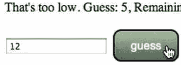

**图 3-17.** 向猜数字游戏中添加自定义按钮

### 查看游戏

有一件非常重要的事情你需要知道：所有游戏都只是信息。在猜数字游戏中，这些信息是`mysteryNumber`、`playersGuess`、`guessesMade`和`guessesRemaining`。你如何选择展示这些信息完全取决于你自己。在之前的示例中，信息是以文本形式展示的。但你完全可以用视觉方式来展示同样的信息。在下一节中，我将展示两个为猜数字游戏添加可视化显示的示例。

### 向猜数字游戏添加可视化显示

在本章的源文件中，你会找到一个名为`numberGameWithGraphics.html`的文件夹。在网页浏览器中打开该文件并试玩游戏。这是猜数字游戏的一个略微简化版本。你会看到一个箭头平滑地移动到标尺上与玩家猜测相匹配的数字处。图 3-18 展示了你将看到的内容。

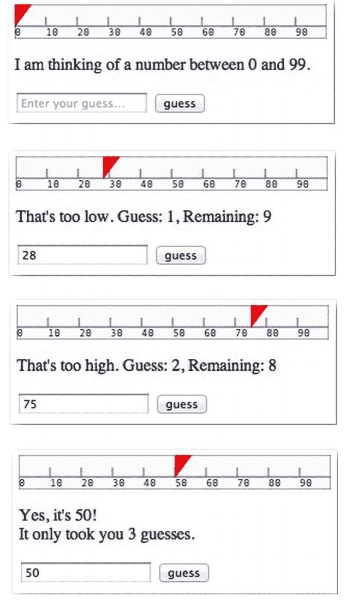

图 3-18. 箭头移动到玩家猜测的数字

这是通过使用 JavaScript 将箭头图像移动到标尺上与玩家猜测相匹配的位置来实现的。它还使用了 CSS`transition`来使箭头平滑移动。这是一个非常简单的示例，但如果你理解了它的工作原理，你会发现理解使用相同技术的更复杂游戏也变得容易了。让我们仔细看看这是如何实现的。

标尺和箭头只是图片。它们是两个独立的 PNG 文件。打开项目文件夹，你会看到它们在`images`文件夹中。这个项目使用了我在第 1 章中建议的文件组织格式。图 3-19 说明了这一点。

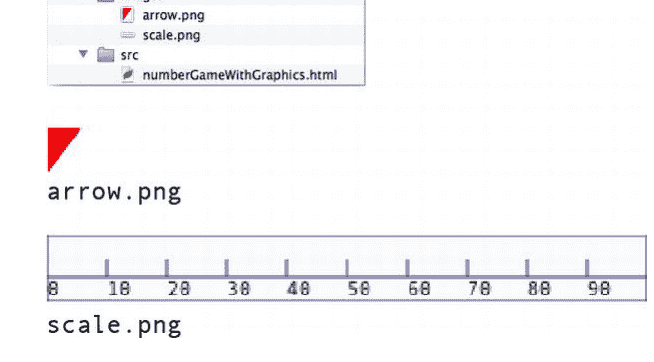

**图 3-19.** 文件和文件夹

HTML 文件显示这些图片。它使用 CSS 定位将它们放置在 id 为`stage`的`<div>`标签内的正确位置。然后 JavaScript 代码使用新的`render`函数来更改箭头的 CSS 位置以匹配玩家的猜测。这些新功能只是添加到了游戏中；游戏逻辑没有做任何更改。以下是完成所有这些工作的完整 HTML 文件。我将在后续页面中进行详细解释。

```html
<!doctype html>

<meta charset="utf-8">

<title>Number guessing game with graphics</title>

<style type="text/css">

#stage

{

    width: 300px;

    height: 33px;

    position: relative;

}
```

```css
#scale

{

  width: 300px;

  height: 33px;

  position: absolute;

  top: 0px;

  left: 0px;

  background-image: url(../images/scale.png);

}

#arrow

{

  width: 17px;

  height: 22px;

  position: absolute;

  top: 0px;

  left: 0px;

  background-image: url(../images/arrow.png);

  /*Transition*/

  -webkit-transition: left 0.5s ease-out 0s;

  -moz-transition: left 0.5s ease-out 0s;

  transition: left 0.5s ease-out 0s;

}
```

```html
</style>

<div id="stage">

  <div id="scale"></div>

  <div id="arrow"></div>

</div>
```

```html
<p id="output">I am thinking of a number between 0 and 99.</p>

<input id="input" type="text" placeholder="Enter your guess...">

<button>guess</button>
```

```javascript
<script type="text/javascript">

//Game variables

var mysteryNumber = 50;

var playersGuess = 0;

var guessesRemaining = 10;

var guessesMade = 0;

var gameState = "";

var gameWon = false;

//The input and output fields

var input = document.querySelector("#input");

var output = document.querySelector("#output");
```

```javascript
//按钮

var button = document.querySelector("button");

button.style.cursor = "pointer";

button.addEventListener("click", clickHandler, false);

//箭头

var arrow = document.querySelector("#arrow");

function render()

{

  //定位箭头

  //将玩家的猜测值乘以3，以获取

  //在刻度尺上的正确像素位置

  arrow.style.left = playersGuess * 3 + "px";

}

function clickHandler()

{

  playGame();

}

function playGame()

{

  guessesRemaining = guessesRemaining - 1;

  guessesMade = guessesMade + 1;

  gameState = " Guess: " + guessesMade + ", Remaining: " + guessesRemaining;

  playersGuess = parseInt(input.value);

  if(playersGuess > mysteryNumber)

  {

    output.innerHTML = "That's too high." + gameState;

  //检查游戏是否结束

    if (guessesRemaining < 1)

    {

      endGame();

    }

  }

  else if(playersGuess < mysteryNumber)

  {

    output.innerHTML = "That's too low." + gameState;

  //检查游戏是否结束

    if (guessesRemaining < 1)

    {

      endGame();

    }

  }

}
```

### 第 3 章

```javascript
else if(playersGuess === mysteryNumber)

{

    gameWon = true;

    endGame();

}

//更新图形显示

render();

}

function endGame()

{

    if (gameWon)

    {

        output.innerHTML

            = "Yes, it's " + mysteryNumber + "!" + "<br>"

            + "It only took you " + guessesMade + " guesses.";

    }

    else

    {

        output.innerHTML

            = "No more guesses left!" + "<br>"

            + "The number was: " + mysteryNumber + ".";

    }

}

</script>
```

刻度尺和箭头的图像使用 CSS 绝对定位来放置。它遵循与你在第 1 章中所学相同的模型。CSS 代码将这些图像相对于舞台`<div>`标签进行定位。刻度尺和箭头将与舞台的左上角对齐。

```css
<style type="text/css">

#stage

{

    width: 300px;

    height: 33px;

    position: relative;

}

#scale

{

    width: 300px;

    height: 33px;

    position: absolute;

    top: 0px;

    left: 0px;

    background-image: url(../images/scale.png);

}
```

```css
#arrow

{

  width: 17px;

  height: 22px;

  position: absolute;

  top: 0px;

  left: 0px;

  background-image: url(../images/arrow.png);

  /*过渡动画*/

  -webkit-transition: left 0.5s ease-out 0s;

  -moz-transition: left 0.5s ease-out 0s;

  transition: left 0.5s ease-out 0s;

}

</style>
```

刻度尺和箭头的高度与宽度与其所包含的图像尺寸相匹配。舞台的大小与其包含的最大元素相同，在本例中就是刻度尺。（箭头还包含`transition`属性，使其能够平滑移动。稍后我会解释它的工作原理。）

接下来，JavaScript 执行初始化游戏变量和界面元素的常规任务。但现在它还需要一个变量来引用箭头：

```javascript
var arrow = document.querySelector("#arrow");
```

它需要这个引用，以便代码可以通过 CSS 来改变箭头的位置。

其余的代码你会非常熟悉。当玩家点击按钮时，`clickHandler`运行并调用`playGame`函数。代码与前面示例中的代码完全相同，但有一个小的新增内容。在末尾调用了`render`函数：

```javascript
function playGame()

{

  ... 与通常相同的代码...

  render();

}
```

这就是它调用的`render`函数：

```javascript
function render()

{

  arrow.style.left = playersGuess * 3 + "px";

}
```

它改变箭头的左侧位置，使其与玩家的猜测值相匹配。数字刻度尺的宽度是 300 像素，但玩家可猜测的数字范围只在 0 到 99 之间。这意味着我们必须将玩家的猜测值乘以 3，这样箭头才能出现在刻度尺上的正确位置。

另外，请注意代码在末尾添加了`"px"`。

```javascript
arrow.style.left = playersGuess * 3 + "px";
```

它必须这样做，因为你会记得 CSS 的位置值需要以 px 结尾。如果玩家猜的是 36，这行代码在 CSS 中会被解释为：

```javascript
arrow.style.left = "108px";
```

（这表示 36 乘以 3 等于 108，加上`"px"`。）

它产生的 CSS 代码看起来像这样：

```css
#arrow

{

  left: 108px;

}
```

请记住，这表示箭头的左边缘与包含它的舞台元素左边缘之间的距离。

每次玩家点击按钮时，这个`render`函数都会被调用，然后更新箭头的 CSS 位置以匹配玩家的猜测值。

### 使用 CSS 过渡实现动画

箭头的`transition`属性使其能够从一个位置平滑地移动到下一个位置。每当箭头的`left`属性发生改变时，箭头需要 0.5 秒移动到下一个位置，如图 3-20 所示。

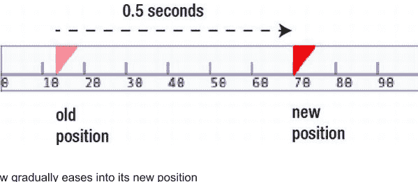

**图 3-20.** 箭头逐渐平滑地移动到新位置

```css
transition: left 0.5s ease-out 0s;
```

以下是实现此效果的 CSS 代码：

它看起来有点令人困惑，但仔细观察你会发现它有四个不同的参数。每个参数之间用空格分隔。

- `left`：这告诉过渡效果，当箭头的`left`属性发生变化时应触发。你可以将其更改为任何 CSS 属性。例如，如果你想在`top`属性变化时触发过渡，只需将其改为`top`。它适用于大多数 CSS 属性，包括`height`、`width`和`color`。如果你想在过渡触发时监听多个属性的变化，用逗号分隔这些属性。使用`all`可以让元素的任何属性变化时都触发过渡。
- `0.5s`：这是过渡的持续时间，以秒为单位：`0.5s`是半秒；`1s`是一秒；`0.3s`是 300 毫秒。你可以使用任何你想要的时间值。
- `ease-out`：这是过渡应使用的动画效果。`ease-out`意味着动画应逐渐减速直至停止。你可以使用以下其他效果：`ease`、`linear`、`ease-out`或`ease-in-out`。尝试一下，看看你喜欢哪些。
- `0s`：这是延迟时间，以秒为单位。它是一个可选参数。这意味着在过渡开始之前不应有延迟。通常你会将其保持为`0s`。如果你想设置延迟，例如半秒，可以将其设置为`0.5s`。

`transition`属性一旦你习惯了就会非常容易使用。只需一行简单的代码，你就可以为任何 HTML 元素添加优美的动画效果。这对于制作标题动画、游戏画面以及其他用户界面元素非常有用。

### 将游戏信息与显示分离

请记住，游戏本质上只是信息。我们在本示例中使用的`render`函数就像一个透镜，让我们能够更清晰地看到这些信息。需要认识到的重要一点是，这个游戏无论有没有视觉显示都能完美运行，而且方式完全相同。添加图形并不会改变游戏的运行方式。而控制箭头位置的代码也没有以任何方式改变游戏信息。视觉显示与信息是分离的。

你很快就会看到将游戏信息与显示分离有多重要。如果你能将游戏作为纯信息来解决，那么将其以可视化方式呈现就会变得非常容易。学会这样做是成为一名优秀游戏设计师的关键。

让我们来看一个更令人兴奋的示例，它能更清晰地说明这种方法的好处。

### 外星人入侵！

数字猜谜游戏是构建简单游戏的一个非常清晰的例子。但是，让我们面对现实，它让我们想起了数学课！我们是游戏设计师，我们制作有趣的游戏；数学课可不是我们报名参加的！那么，我们如何利用目前所学的知识来制作一个真正有趣的游戏呢？我们需要的只是一点想象力。

### 第 3 章

想象一下，你不是在猜测一个神秘数字，而是在猜测一个入侵的外太空异形的位置，以便用核导弹将其击落。这听起来很有趣吧！你可以在`alienAttack.html`文件中看到一个可运行的示例。图 3-21 展示了你将看到的内容。

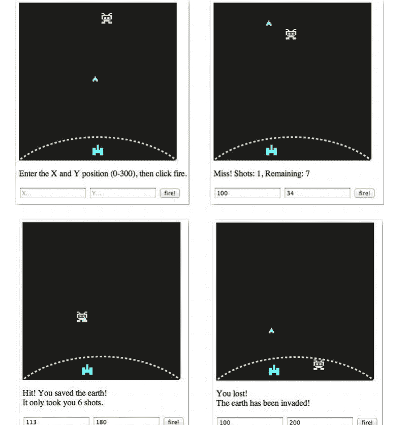

**图 3-21.** 试试猜猜入侵异形的 X 和 Y 位置

试着猜出外星人的位置并将其击落。输入介于 0 到 300 之间的 X 和 Y 位置，然后点击`Fire!`按钮。X 位置是从左侧算起的水平像素距离，Y 位置是从屏幕顶部算起的垂直像素距离。如果你没有命中，外星人就会向地球靠近，并随机选择一个新的 X 位置。如果它在八回合内抵达地球，你就输了。但如果你命中了它，你就拯救了地球！每次你进行猜测时，你的加农炮会移动到你输入的 X 位置，你的导弹会移动到你猜测的 X 和 Y 位置。

这看起来是不是很复杂？别被唬住了，它不过是我们那个老套的数字猜谜游戏，精心打扮了一番出门过夜而已。只不过你现在不再只猜一个数字，而是要猜两个：外星人的 X 和 Y 位置。而且用来显示游戏图形的技巧，与我们在数字猜谜游戏中用来显示和改变箭头的技巧完全相同。只不过这次你要重新定位三张图片，而不只是一张。

下面是完整的代码清单，我将带你一步一步地了解它的工作原理。你很快就会发现，它比你第一眼看上去要ADV要简单得多。


```html
<!doctype html>
<meta charset="utf-8">
<title>Alien attack</title>

<style>
#stage
{
  width: 300px;
  height: 300px;
  position: relative;
}

#background
{
  width: 300px;
  height: 300px;
  position: absolute;
  top: 0px;
  left: 0px;
  background-image: url(../images/background.png);
}

#cannon
{
  width: 20px;
  height: 20px;
  position: absolute;
  top: 270px;
  left: 140px;
  background-image: url(../images/cannon.png);
}

#alien
{
  width: 20px;
  height: 20px;
  position: absolute;
  top: 20px;
  left: 80px;
  background-image: url(../images/alien.png);
}

#missile
{
  width: 10px;
  height: 10px;
  position: absolute;
  top: 240px;
  left: 145px;
  background-image: url(../images/missile.png);
}
</style>

<div id="stage">
  <div id="background"></div>
  <div id="cannon"></div>
  <div id="missile"></div>
  <div id="alien"></div>
</div>

<p id="output">Enter the X and Y position (0-300), then click fire.</p>
<input id="inputX" type="text" placeholder="X...">
<input id="inputY" type="text" placeholder="Y...">
<button>fire!</button>

<script>
//Game variables
var alienX = 80;
var alienY = 20;
var guessX = 0;
var guessY = 0;
var shotsRemaining = 8;
var shotsMade = 0;
var gameState = "";
var gameWon = false;

//The game objects
var cannon = document.querySelector("#cannon");
var alien = document.querySelector("#alien");
var missile = document.querySelector("#missile");

//The input and output fields
var inputX = document.querySelector("#inputX");
var inputY = document.querySelector("#inputY");
var output = document.querySelector("#output");

//The button
var button = document.querySelector("button");
button.style.cursor = "pointer";
button.addEventListener("click", clickHandler, false);

function render()
{
  //Position the alien
  alien.style.left = alienX + "px";
  alien.style.top = alienY + "px";

  //Position the cannon
  cannon.style.left = guessX + "px";

  //Position the missile
  missile.style.left = guessX + "px";
  missile.style.top = guessY + "px";
}

function clickHandler()
{
  playGame();
}

function playGame()
{
  shotsRemaining = shotsRemaining - 1;
  shotsMade = shotsMade + 1;
  gameState = " Shots: " + shotsMade + ", Remaining: " + shotsRemaining;

  guessX = parseInt(inputX.value);
  guessY = parseInt(inputY.value);

  //Find out whether the player's x and y guesses are inside
  //The alien's area

  if(guessX >= alienX && guessX <= alienX + 20)
  {
    //Yes, it's within the X range, so now let's
    //check the Y range

    if(guessY >= alienY && guessY <= alienY + 20)
    {
      //It's in both the X and Y range, so it's a hit!
      gameWon = true;
      endGame();
    }
  }
  else
  {
    output.innerHTML = "Miss!" + gameState;

    //Check for the end of the game
    if (shotsRemaining < 1)
    {
      endGame();
    }
  }

  //Update the alien's position if the
  //game hasn't yet been won

  if(!gameWon)
  {
    //Update the alien's X position
    alienX = Math.floor(Math.random() * 280);

    //Add 30 to the new Y position so that
    //the alien moves down toward earth
    alienY += 30;
  }

  //Render the new game state
  render();
  console.log("X: " + alienX);
  console.log("Y: " + alienY);
}

function endGame()
{
  if(gameWon)
  {
    output.innerHTML
    = "Hit! You saved the earth!" + "<br>"
    + "It only took you " + shotsMade + " shots.";
  }
  else
  {
    output.innerHTML
    = "You lost!" + "<br>"
    + "The earth has been invaded!";
  }
}
</script>
```

## 设置游戏

项目文件夹的格式与前面的示例相同。HTML 文件位于 `src` 文件夹中。游戏使用的图片存放在 `images` 文件夹中。图 3-22 展示了这一点。

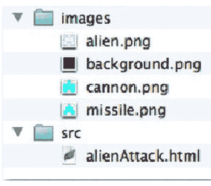

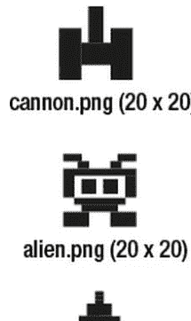

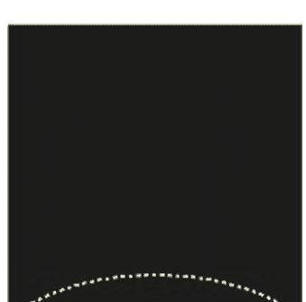

**图 3-22.** Alien Attack! 项目文件夹

外星人和加农炮均为 20 × 20 像素。导弹为 10 × 10 像素。背景为 300 × 300 像素。这些都是 PNG 图片，我设计了让它们看起来像是来自复古电子游戏。但你可以使用任何你喜欢的、任意尺寸的图片。

你会发现这个程序的格式与前面的示例完全一致。HTML 代码在舞台（`stage`）内部创建了视觉游戏元素：

```html
<div id="stage">
    <div id="background"></div>
    <div id="cannon"></div>
    <div id="missile"></div>
    <div id="alien"></div>
</div>
```

添加这些元素的顺序很重要。你添加的第一张图片会位于后续添加的图片下方。这意味着如果你想让背景出现在其他图片后面，就必须先添加背景。如果最后才添加背景，它会覆盖掉其他图片。这些图片是分层堆叠的，就像 Photoshop 或 Illustrator 等图形设计软件中的图层一样。

> 注意：你可以使用 CSS 的 `z-index` 属性来改变元素的堆叠顺序。给元素设置诸如 1、2、3、4 这样的 `z-index` 数值。数值较低的元素会堆叠在数值较高的元素下方。下面是一个例子：

```css
#elementOne
{
    z-index: 2;
}

#elementTwo
{
    z-index: 1;
}
```

`elementOne` 会显示在 `elementTwo` 上方，因为它具有更高的 `z-index` 数值。`z-index` 属性仅对已通过 CSS 属性定位的元素有效。

游戏有两个输入字段。`inputX` 让你输入导弹的 X 位置，`inputY` 让你输入导弹的 Y 位置。

```html
<p id="output">Enter the X and Y position (0-300), then click fire.</p>
<input id="inputX" type="text" placeholder="X...">
<input id="inputY" type="text" placeholder="Y...">
<button>fire!</button>
```

CSS 代码加载图片，并让所有对象相对于舞台的左上角进行绝对定位。舞台的尺寸与其包含的最大元素一样大，在这个例子中就是背景。

```css
<style>
#stage
{
    width: 300px;
    height: 300px;
    position: relative;
}

#background
{
    width: 300px;
    height: 300px;
    position: absolute;
    top: 0px;
    left: 0px;
    background-image: url(../images/background.png);
}

#cannon
{
    width: 20px;
    height: 20px;
    position: absolute;
    top: 270px;
    left: 140px;
    background-image: url(../images/cannon.png);
}

#alien
{
    width: 20px;
    height: 20px;
    position: absolute;
    top: 20px;
    left: 80px;
    background-image: url(../images/alien.png);
}

#missile
{
    width: 10px;
    height: 10px;
    position: absolute;
    top: 240px;
    left: 145px;
    background-image: url(../images/missile.png);
}
</style>
```

这些是游戏首次加载时各对象的位置。

代码随后初始化了所有需要的变量，以便访问和修改这些对象。到现在这些内容对你应该已经很熟悉了。

```javascript
//Game variables
var alienX = 80;
var alienY = 20;
var guessX = 0;
var guessY = 0;
var shotsRemaining = 8;
var shotsMade = 0;
var gameState = "";
var gameWon = false;

//The game objects
var cannon = document.querySelector("#cannon");
var alien = document.querySelector("#alien");
var missile = document.querySelector("#missile");

//The input and output fields
var inputX = document.querySelector("#input-yardımcı");
var inputY = document.querySelector("#inputY");
var output = document.querySelector("#output");

//The button
var button = document.querySelector("button");
button.style.cursor = "pointer";
button.addEventListener("click", clickHandler, false);
```

有两个变量用于存储玩家猜测的 X 和 Y 位置：

```javascript
var guessX = 0;
var guessY = 0;
```

数字猜谜游戏中的 `guessesRemaining` 和 `guessesMade` 变量已经更改，以匹配我们的新太空战争主题。

```javascript
var shotsRemaining = 8;
var shotsMade = 0;
```

它们的作用是一样的。

`alienX` 和 `alienY` 变量存储了外星人在舞台上的位置。它们共同描述了外星人的起始位置。`alienX` 被初始化为 80，表示距离舞台左侧 80 像素。`alienY` 被初始化为 20，表示距离舞台顶部 20 像素。

```javascript
var alienX = 80;
var alienY = 20;
```

这两个变量被设置为与 CSS 代码中分配给外星人的 `left` 和 `top` 值相同。是 CSS 代码设置了外星人的初始位置，而不是这些变量。然而，当游戏运行时，我们将使用这些变量来修改 CSS 值。这才是让外星人移动的原因。将这些变量设置为与 CSS 值相同的值是一个良好的起点。

## 判断外星人是否被击中

当玩家点击按钮时，`playGame()` 函数被调用。它首先计算 `shotsRemaining` 和 `shotsMade`，并更新 `gameState`。它还将文本框中的 `inputX` 和 `inputY` 值复制到 `guessX` 和 `guessY` 变量中。

```javascript
function playGame()
{
  shotsRemaining = shotsRemaining - 1;
  shotsMade = shotsMade + 1;
  gameState = " Shots: " + shotsMade + ", Remaining: " + shotsRemaining;

  guessX = parseInt(inputX.value);
  guessY = parseInt(inputY.value);
  //...
}
```

所有这些都与数字猜谜游戏中的情况类似。

不同的是，现在游戏需要判断玩家的猜测是否正确。它是如何做到这一点的？下面是 `playGame()` 函数中用于判断外星人是否被击中的代码。它使用嵌套的 `if` 语句来实现：

```javascript
if(guessX >= alienX && guessX <= alienX + 20)
{
  //是的，在 X 范围内，所以现在让我们
  //检查 Y 范围

  if(guessY >= alienY && guessY <= alienY + 20)
  {
    //它在 X 和 Y 范围内，所以命中了！
    gameWon = true;
    endGame();
  }
}
```

这段代码检查猜测值是否在外星人占据的 X 和 Y 范围内。它首先检查 `guessX`。如果 `guessX` 是一个大于或等于外星人 X 位置*并且*小于其宽度（`alienX + 20`）的数，那么猜测在水平轴上是正确的。这意味着在水平方向上可能命中了。但只有 `guessY` 也是正确的，这才算命中，这是第二个 `if` 语句检查的内容。它检查 `guessY` 是否是一个大于或等于外星人 Y 位置*并且*小于其高度（`alienY + 20`）的数。如果这两个条件都为真，那么猜测值就在外星人占据的范围内，玩家获胜。

这个逻辑相当紧凑，但如果你仔细梳理，你会发现它确实非常合理。让我们把它分解成更易于理解的小块。

假设外星人位于 X 位置 50 和 Y 位置 30。玩家猜测 X 位置是 55。请记住，这些位置指的是外星人的*左上角*。图 3-23 展示了这一点。

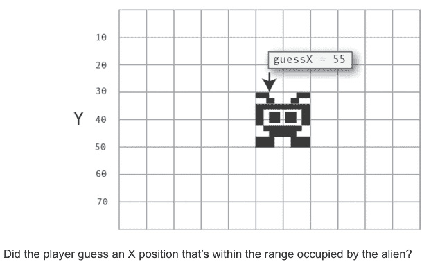


我们需要判断玩家的猜测值 55 是否在外星人占据的 X 轴范围内。我们知道外星人的左上角位于位置 50。而外星人宽 20 像素，这意味着它占据了 50 到 70 之间的空间。55 在 50 和 70 之间吗？当然在！这就是第一个`if`语句告诉我们的。以下是使用这些实际数字时`if`语句的样子：

```javascript
if(55 >= 50 && 55 <= 70)
{
  //是的，它在 X 范围内
```

所以我们知道玩家至少对了一半。外星人可能已经被击中。但我们需要检查玩家对 Y 位置的猜测，才能确定。

假设玩家猜测 45。这是否在外星人占据的范围内？图 3-24 显示了它确实在。


图 3-24. *guessY* 在外星人的范围内吗？

```javascript
if(45 >= 30 && 45 <= 50)
{
  //它在 X 和 Y 范围内，所以命中了！
  gameWon = true;
  endGame();
}
```

你可以在图 3-25 中看到，`guessX` 和 `guessY` 实际上指向了外星人内部的 X 和 Y 位置。


图 3-25. 命中了！

所以数学实际上对于击落外星人很有用，这让我们觉得很酷！

花点时间理解它是如何工作的；值得花点脑力在这上面，直到你豁然开朗。这实际上是一个重要游戏设计主题`碰撞检测`的巧妙引入。你将在第 8 章中了解它。

### 移动游戏对象

如果玩家没有击中外星人，`playGame`函数会找到外星人的下一个新位置。它会给它一个 0 到 280 之间的随机 X 位置，然后将其当前 Y 位置增加 30。

```javascript
if(!gameWon)
{
    //更新外星人的 X 位置
    alienX = Math.floor(Math.random() * 281);

    //给新的 Y 位置增加 30，使外星
    //向地球下方移动
    alienY += 30;
}
```

外星人宽 20 像素，所以给它一个 0 到 280 之间的随机范围意味着它的右侧永远不会越过背景的右侧。这使它保持在游戏场地内。

记住，这段代码还没有移动外星人。这只是游戏信息。它只是计算出外星人应该在渲染时出现在哪里。将外星人的图像移动到这个位置的工作是通过调用`render`函数来完成的：

```javascript
render();
```

下面是`render`函数，它根据游戏信息移动所有游戏对象：

```javascript
function render()
{
    //定位外星人
    alien.style.left = alienX + "px";
    alien.style.top = alienY + "px";

    //定位大炮
    cannon.style.left = guessX + "px";

    //定位导弹
    missile.style.left = guessX + "px";
    missile.style.top = guessY + "px";
}
```

外星人根据游戏刚刚计算出的新`alienX`和`alienY`值移动到新位置：

```javascript
alien.style.left = alienX + "px";
alien.style.top = alienY + "px";
```

这段代码正在修改外星人的 CSS 位置值，以实际将它移动到浏览器中的新位置。

大炮被移动到`guessX`位置：

```javascript
cannon.style.left = guessX + "px";
```

而导弹被移动到玩家猜测的精确 X 和 Y 位置：

```javascript
missile.style.left = guessX + "px";
missile.style.top = guessY + "px";
```

重要的是要记住，这些点代表对象的左上角。目前这样就可以了，但通常你会希望相对于对象的中心点来移动对象。这涉及一些简单的数学运算，你将在第 8 章中了解如何做到这一点。

### 让游戏更完善

我把这个游戏保持得尽可能简单，以便你能看到底层编程逻辑是如何工作的。你可以运用本章中学到的许多其他技术，并添加一些自己的创意，让游戏变得更好。以下是一些你可以改进的建议。

#### 添加爆炸效果

当外星人被击中时创建一个爆炸效果。图 3-26 展示了这可能的样子。


**图 3-26.** 当外星人被击中时添加爆炸效果

爆炸应该出现在与外星人相同的位置。外星人和导弹应该消失。你足够聪明，可以自己完成这个，但这里有一些提示：

- 添加一个带有 id `explosion` 的新`<div>`元素。
- 在 CSS 代码中，将`explosion`的`display`属性设置为`none`，使其在游戏开始时不可见。
- 创建一个变量，使用`document.querySelector`引用`explosion`。
- 在`render`函数中，添加一个`if`语句检查游戏是否获胜。如果是，你的代码应该执行以下操作：
  - 通过将其 CSS `display`属性设置为`block`使爆炸可见。
  - 给爆炸设置与外星人相同的 X 和 Y 位置。
  - 通过将外星人和导弹的`display`属性设置为`none`使它们不可见。

如果你遇到困难，可以查看本章源文件中的`alienExplosion.html`文件，了解一个可用的示例。

#### 验证输入的新数字

防止玩家输入除数字以外的任何内容。另外，防止玩家输入大于 300 的数字。你需要在`validateInput`函数中执行此操作，它可能如下所示：

```javascript
function validateInput()
{
  guessX = parseInt(inputX.value);
  guessY = parseInt(inputY.value);

  if(isNaN(guessX) || isNaN(guessY))
  {
    output.innerHTML = "Please enter a number.";
  }
  else if(guessX > 300 || guessY > 300)
  {
    output.innerHTML = "Please enter a number less than 300.";
  }
  else
  {
    playGame();
  }
}
```

### 添加更多 HTML 和 CSS 样式

运用你目前所学的知识来改善游戏的外观和体验。以下是一些明显可行的改进点：

- 创建一个自定义的开火按钮。
- 应用你在最终数字猜谜游戏中学到的所有优化技巧：允许玩家使用回车键；为第一个输入框添加焦点；在游戏结束时禁用输入框和按钮。
- 最后，尝试运用你对 HTML 和 CSS 的了解，让游戏看起来更出色。你可以添加一个带有嵌入字体的标题，将整个游戏内容包裹在一个独立的盒子中，并使用一些渐变或阴影效果。

图 3-27 展示了完成后的游戏可能呈现的样子，你可以在本章源文件的`alienAttackFinished`文件夹中找到包含所有这些修改的可运行示例。


**图 3-27.** 为你的游戏添加一些最终修饰

让我们快速了解一下这个完成后的游戏是如何构建的，我会向你展示一些你可能想用的 HTML 和 CSS 新技巧。

图 3-28 说明了项目文件和文件夹的组织方式。

**图 3-28.** 最终项目文件夹的组织结构


这个项目中有大量的 CSS 代码，所以我把它放在了一个独立的 CSS 文件中，并使用`<link>`元素将其链接到 HTML。

```html
<link rel="stylesheet" href="alienAttack.css">
```

如果你需要复习如何链接外部 CSS 文件，请回顾第 1 章。

这个游戏还使用了一个名为`emulogic.ttf`的嵌入字体，以营造老式电子游戏的氛围。它位于项目文件夹内的`fonts`文件夹中。以下是加载和嵌入该字体的 CSS 代码。

```css
@font-face
{
    font-family: emulogic;
    src: url("../fonts/emulogic.ttf");
}
```

> 注意：如果你使用的是 Firefox，嵌入字体只有在与 CSS 文件位于同一文件夹时才能被加载。

我希望所有元素都使用这种字体，包括按钮和输入框，因此我使用了**通用选择器**（一个星号`*`）来强制所有元素应用它。

```css
*
{
    font-family: emulogic;
    padding: 0px;
    margin: 0px;
}
```

使用通用选择器设置的任何属性都会应用于所有 CSS 元素。

我还使用通用选择器将所有元素的内边距（padding）和外边距（margin）设置为零。这会覆盖网页浏览器为某些元素自动添加的内边距和外边距。从零开始构建你的内边距和外边距，通常是你开始布局元素时最简单、最清晰的方式。

你可以从图 3-27 中看到，整个舞台和用户界面都被一个盒子包围。我通过创建一个特殊的`<section id="game">`元素并包裹所有其他 HTML 代码来实现这一点。

你看到`<section>`在哪里开始和结束了吗？那就是包围游戏的盒子。

```html
<!doctype html>
<meta charset="utf-8">
<title>Alien explosion</title>
<link rel="stylesheet" href="alienAttack.css">

<section id="game">
<h1>Alien Attack!</h1>
<div id="stage">
  <div id="background"></div>
  <div id="cannon"></div>
  <div id="missile"></div>
  <div id="alien"></div>
  <div id="explosion"></div>
</div>
<p id="output">Enter the X and Y position (0-300), then click fire.</p>
<input id="inputX" type="text" placeholder="X..." autofocus>
<input id="inputY" type="text" placeholder="Y...">
<button>fire!</button>
</section>
```

你可以使用`<section>`元素来包围任何你出于某些原因希望保持在一起的 HTML 代码组。`<section id="game">`元素具有圆角、背景渐变、投影效果和一些内边距，并且足够大，可以舒适地容纳所有其他元素。

```css
#game
{
  margin: 0px auto;
  width: 330px;
  height: auto;
  padding: 15px;
  border: black;
  background: linear-gradient(top, #588063, #000);
  box-shadow: 5px 5px 5px rgba(0, 0, 0, 0.5);
  border-radius: 10px;
}
```

你还会注意到它在浏览器窗口中居中显示，正如你在第 1 章所学的，这要归功于`margin`属性：

```css
margin: 0px auto;
```

这为元素提供了相等且自动的左右外边距，从而使其在浏览器中居中。包含游戏图像的舞台元素（stage element）也使用相同的代码行在游戏元素（game element）内居中：

```css
#stage
{
  margin: 0px auto;
  ...
}
```

这适用于块级元素，但不适用于文本。请记住，如果你想在另一个元素内居中文本，请使用 CSS 的`text-align`属性并将其值设置为`center`：

```css
text-align: center;
```

### 使用文本描边和阴影

游戏标题“Alien Attack!”具有黑色描边和酸橙绿色的投影。要为文本添加描边，请使用 CSS 的`text-stroke`属性。它需要两个值：线条的粗细（以像素为单位）和颜色：

```css
-webkit-text-stroke: 1px #000;
-moz-text-stroke: 1px #000;
text-stroke: 1px #000;
```

这将用一条 1 像素宽的黑色线条勾勒文本。

> 注意：在撰写本文时，`text-stroke`属性仅在基于 Webkit 的浏览器（如 Chrome 和 Safari）上有效。

使用`text-shadow`属性为文本创建投影。它需要三个值：x 偏移、y 偏移和颜色。这是示例中创建绿色投影的代码：

```css
text-shadow: 3px 3px lime;
```

绿色阴影向下和向右偏移了 3 像素。颜色可以是预设颜色（如`lime`），也可以是任何十六进制、RGB/RGBA 或 HSL/HSLA 颜色。

你还可以添加一个可选的模糊量值。并且你也可以为阴影使用 RGBA 颜色值，这将使其变为半透明。这段代码创建了一个半透明、偏移 5 像素、具有 3 像素模糊效果的阴影：

```css
text-shadow: 5px 5px 3px rgba(0, 0, 0, 0.5);
```

这是一个很好的效果，因为半透明性允许其下方的任何图像可见。

运用这些新技术以及你在前几章学到的所有 CSS 知识，你应该能够制作出一款真正漂亮的游戏。

## 总结

现在你知道如何开始制作游戏了！尽管你能够并且将会构建更复杂、更大规模的游戏，但这些小游戏是你游戏需要解决的那类问题的模型。如果你理解了游戏设计中的问题以及你在这里找到的解决方案，当你尝试更有雄心的东西时，你将处于非常有利的位置。

在本章中，你学习了制作回合制游戏的所有基础知识。在继续学习本书之前，休息一下，尝试创建你自己的游戏。你知道如何移动对象、判断对象是否接触、分析游戏信息以及使用随机数来保持不可预测性。学习的最佳方式莫过于以自己的方式尝试，这将使你对我们在后续章节中将探讨的一些更高级技术有更深的理解。

你现在也理解了游戏信息如何创建并与游戏规则交互。接下来，我将向你展示如何使用信息来构建一个完整的、沉浸式的游戏世界。


# 第 4 章：创建游戏世界

游戏之所以好玩，原因之一是它们是对现实世界的简化模拟。现实世界通常一点都不好玩，因为它过于复杂，规则太多。在现实世界中，我们必须处理诸如食物、雨水、截止日期、交通、蚊子和重力之类的事情，有时甚至是同时应对。这可能很累人！但游戏世界拥有更简单、更清晰的规则。我们可以比解决现实世界问题更轻松、更易理解、更快速地解决游戏问题，这给我们带来了巨大的成功感和成就感。而且因为游戏是交互式的，玩家可以改变游戏世界，并观察他们的改变如何与世界的规则互动。这创造了一种奇妙的即时沉浸感。

在本章中，你将学习如何使用信息构建游戏世界，以及如何将规则应用于这些信息以创建交互式游戏。在本章的第一部分，你将学习两个非常重要的新编程技术：数组和循环。在本章的第二部分，我将向你展示如何使用它们来构建一个奇幻冒险游戏，“利里卡森林”（The Forest of Lyrica），如图 4-1 所示。


**图 4-1.** 一款奇幻冒险游戏

你可以将这个游戏作为创建非常复杂、沉浸式冒险游戏的模型。但正如你将在后续章节中看到的，制作这款游戏所使用的核心技术，也是制作任何类型游戏（包括动作游戏和街机游戏）的核心。

## 循环

循环用于将一段代码重复执行指定的次数。在 JavaScript 中可以创建多种不同类型的循环，但最常见的是`for`循环。它允许你“重复任意多次”一段代码，从一次到数百次或数千次不等。

以下是一个循环可能有用的场景。假设你想显示“Hello world!”这个词五次。不使用循环时，你的代码可能如下所示：

```javascript
console.log("Hello world!");
console.log("Hello world!");
console.log("Hello world!");
console.log("Hello world!");
console.log("Hello world!");
```

这样输入有点繁琐。如果只写一行代码并让它重复五次，岂不是更容易？这就是`for`循环让你做的事情。以下是一个显示“Hello world!”五次的`for`循环：

```javascript
for(var i = 0; i < 5; i++)
{
    console.log("Hello world!");
}
```

它在控制台中显示如下：

```text
Hello world!
Hello world!
Hello world!
Hello world!
Hello world!
```

`for`循环的结构初看可能显得怪异且令人困惑，因为它的参数实际上包含三个独立的语句，每个语句之间用分号分隔。

```javascript
for(第一个语句; 第二个语句; 第三个语句)
{
    ...你想重复的内容;
}
```

但如果你将其分解为更小的部分，理解它的工作原理就很容易了。它做的第一件事是声明一个用于计数循环次数的变量。这个变量称为**索引变量**（下方粗体高亮显示）：

```javascript
for(var i = 0; i < 5; i++)
{
    ...你想重复的内容;
}
```

这会创建一个名为`i`的变量，并将其初始化为 0。


```javascript
var i = 0;
```

虽然你可以使用任何喜欢的变量名，但按照惯例每个人都使用`i`，因为`i`代表`index`（索引）。

下一条语句告诉循环它应该重复多少次：

```javascript
for(var i = 0; i < 5; i++)
{
  ...你想重复的内容;
}
```

这是一个条件语句。它告诉循环“当索引变量小于 5 时”重复。

```javascript
i < 5;
```

在这个例子中，索引变量被初始化为 0，因此循环将重复直到达到 4。它使循环从 0 运行到 4，如果你从 0 开始算，这是五次：0、1、2、3 和 4。你可以在这里使用任何类型的条件语句。

最后一条语句在每次循环运行时将索引变量增加 1：`i++`：

```javascript
for(var i = 0; i < 5; i++)
{
  ...你想重复的内容;
}
```

第一次循环运行时，`i`从 0 开始。下次重复时，`++`运算符将其加 1。

```javascript
i++
```

这意味着`i`此时等于 1（因为 0 加 1 等于 1，当然）。下一次循环重复时，`i`再次加 1，结果值为 2。此过程会一直重复，直到`i`小于 5。一旦其值达到 5，循环会立即停止。

虽然`i++`是增加索引变量值最常见的方法，但你可以使用任何喜欢的语句来增加或减少它。例如，`i += 2`会在每次循环重复时将索引变量增加 2。如果你想让循环倒序计数，`i--`会将其减少 1。

以下是一个显示从 0 到 4 的数字的`for`循环示例。

```javascript
for(var i = 0; i < 5; i++)
{
  console.log(i);
}
```

它在控制台中的显示如下：

```text
0
1
2
3
4
```

它只是每次循环运行时显示循环索引变量`i`的值。你现在可以清楚地看到循环是如何运行 5 次的。它从 0 开始，在达到 5 之前退出。

你可以将`i`初始化为任何喜欢的数字，并使用任何条件来退出循环。这里是另一个例子：`i`被初始化为 1，循环重复直到它变为 5：

```javascript
for(var i = 1; i <= 5; i++)
{
    console.log(i);
}
```

这将显示以下内容：

```text
1
2
3
4
5
```

在这个例子中，循环显示了最后一个数字 5。循环在`i`小于或等于 5 时运行。

```javascript
i <= 5;
```

循环只会在`i`大于 5 时退出。

将索引变量初始化为 1 并在 5 时退出循环特别有用，因为它能非常清楚地表明循环的开始和结束位置。

我们将在本章中探讨几种使用`for`循环的不同方法。图 4-2 是一个关于`for`循环如何工作的快速参考图。


**图 4-2.** `for`循环如何工作

> 注意：虽然`for`循环是经久不衰的首选，但 JavaScript 也允许你以其他几种方式创建循环。你也可以创建`while`循环或`do-while`循环。它们的功能与`for`循环相同，但在某些情况下，其细微差别可能很有用。

`while`循环在游戏中可能特别有用。它看起来像这样：

```javascript
while(某个条件为真)
{
    //...你想运行的代码
}
```

> `while`循环不会运行固定的次数：它们根据需要运行，直到括号中的条件变为假。当你在程序中使用`while`循环时，必须确保条件最终会变为假。如果不会，循环将“永远”运行，程序可能会挂起。

`while`循环只会在其检查的条件为真时运行其中包含的指令。这意味着如果条件从未变为真，循环可能永远不会运行。然而，在某些情况下，你可能需要一个至少运行一次的循环。在这种情况下，你可以使用`do-while`循环。

`do-while`循环使用以下格式：

```javascript
do
{
    //...你想重复的代码
}
while (这个条件为真);
```

你可以看到`while`语句只在花括号内的指令运行之后才检查条件。这意味着那些指令在`while`语句检查循环条件是否为真之前，至少有机会运行一次。

#### 使用数组存储大量信息

变量用于存储信息。但一个变量一次只能存储一条信息。如果你想使用变量存储大量信息，你需要使用很多变量。

但有一种更好的方法来存储大量信息。你可以使用**数组**。数组就像一个储物柜，你可以把任何数量的东西放进去。当你有很多信息需要跟踪时，将所有信息存储在一个数组中通常比存储在许多变量中更好。

要创建一个空数组，请为你的数组选择一个名称，并为其分配一对空方括号，如下所示：

```javascript
var closet = [];
```

这个数组的名称是`closet`，但你可以使用任何喜欢的名称。空括号表示它目前不包含任何东西。它是空的。有时你会想在程序开始时从一个这样的空数组开始，并随着游戏的进展向其中添加东西。

你的数组不必以空数组开始；你可以创建时就已填充好内容。这是一个名为`closet`的数组，存储了三个东西：

```javascript
var closet = ["hat", "umbrella", "katana"];
```

它存储了`"hat"`、`"umbrella"`和`"katana"`（katana 是一种极其危险的日本刀）——享受一个愉快的夜晚外出所需的一切。数组中的所有内容都被方括号包围，并用逗号分隔。`"hat"`、`"umbrella"`和`"katana"`是字符串，但你可以在数组中存储任何你喜欢的东西：字符串、变量、数字，甚至其他数组。数组存储的东西称为**元素**。`closet`数组有三个元素。

#### 数组基础

让我们看一些简单的例子，演示如何使用数组来存储和查找信息。

数组中的所有元素都按顺序编号，从 0 开始。这些数字称为**索引号**。在前面的例子中，`"hat"`的索引号是 0，`"umbrella"`的索引号是 1，`"katana"`的索引号是 2。

你可以像这样找出哪个索引号对应哪个元素：

```javascript
closet[1]
```

它的值是`"umbrella"`，因为`"umbrella"`的索引号是 1。

这真的很简单。数组只是一个带编号的元素列表。图 4-3 展示了一个空数组与一个有三个元素的数组的对比。


**图 4-3.** 数组和数组元素

有多种方式可以将元素放入数组中。在前面的示例中，三个元素是在数组初始化时添加的。但你也可以随时直接将元素赋值到数组索引的某个位置：

```javascript
closet[2] = "katana";
```

之后代码中只要看到`closet[2]`，就会将其解析为`"katana"`。

让我们看一个更具体的示例。下面是名为`basicArray.html`的程序，你可以在本章的源文件中找到它。

```javascript
//Create an empty array
var closet = [];

//Add three things
closet[0] = "hat";
closet[1] = "umbrella";
closet[2] = "katana";

//View the entire array contents
console.log("Entire array: " + closet);

//View individual elements
console.log("Element 0: " + closet[0]);
console.log("Element 1: " + closet[1]);
console.log("Element 2: " + closet[2]);
```

它在控制台中的显示结果如下：

```text
Entire Array: hat,umbrella,katana
Element 0: hat
Element 1: umbrella
Element 2: katana
```

以下是显示整个数组内容的方式：

```javascript
console.log("Entire array: " + closet);
```

它在控制台中的显示效果如下：

```text
Entire Array: hat,umbrella,katana
```

当数组与字符串这样组合时，数组的所有元素会自动转换为单个字符串：

```javascript
"hat,umbrella,katana"
```

各个数组元素的显示方式如下：

```javascript
console.log("Element 0: " + closet[0]);
console.log("Element 1: " + closet[1]);
console.log("Element 2: " + closet[2]);
```

数组元素`closet[0]`、`closet[1]`和`closet[2]`同样被解析为普通字符串。这就是上述代码输出以下结果的原因：

```text
Element 0: hat
Element 1: umbrella
Element 2: katana
```

从这个示例可以很容易看出，数组就是存储容器。

#### 将元素推入数组

另一种将元素放入数组的常见方式是使用数组的`push`方法。你可以使用`push`来真正"推入"一个元素到数组中，格式如下：

```javascript
arrayName.push(elementName);
```

当你将元素推入数组时，它会被添加到数组的末尾。该元素会被分配一个比数组中已有最后一个元素高一位的索引号。这意味着如果最后一个元素的索引号为 [2]，那么你推入的新元素的索引号将是 [3]。

使用`push`非常方便，因为你不需要担心要把元素添加到哪个索引位置。数组会自动为你处理。这就像把东西塞进一个大袋子，你不必在意顺序。上面的就是最后塞进去的。

下面是一个使用`push`向数组添加元素的简单程序：

```javascript
//Create an empty array
var closet = [];

//Add three things
closet.push("hat");
closet.push("umbrella");
closet.push("katana");

//View the entire array contents
console.log("Entire array: " + closet);

//View individual elements
console.log("Element 0: " + closet[0]);
console.log("Element 1: " + closet[1]);
console.log("Element 2: " + closet[2]);
```

输出结果与第一个示例完全相同。不需要担心索引号这一点真的很方便。

你可以在本章源文件中的`usingPush.html`文件中找到此示例的完整代码。

#### 从数组中删除元素

要从数组中删除元素，可以使用数组的`pop`方法。以下代码使用`pop`删除数组的最后一个元素：

```javascript
closet.pop();
```

如果数组原来有三个元素，现在就只剩两个了，最后一个被删除了。你可以这样理解：如果你挤压数组，最后一个元素就会"弹出来"。

被删除的元素可以直接赋值给一个新变量。方法如下：

```javascript
var removedElement = closet.pop();
```

如果最后一个元素是`"katana"`，那么`removedElement`现在的值就是`"katana"`。这也意味着`closet`数组现在只包含两个元素：`"hat"`和`"umbrella"`。

下面是完整的示例：

```javascript
//Create an empty array
var closet = ["hat", "umbrella", "katana"];

//Pop the last element
var lastElement = closet.pop();

//View the value of lastElement
console.log("The popped element: " + lastElement);

//View the new closet array
console.log("The closet array: " + closet);
```

它在控制台中的显示结果如下：

```text
The popped element: katana
The closet array: hat,umbrella
```

你还可以使用`splice`方法来添加和删除数组中的元素。使用它可以删除指定索引位置的元素。下面是一个包含三个元素的数组：

```javascript
var closet = ["hat", "umbrella", "katana"];
```

如果你想删除索引号为 1 的`umbrella`，可以使用`splice`来实现：

```javascript
closet.splice(1, 1);
```

括号中有两个数字。第一个是你想要删除的元素的索引位置。第二个是从该位置开始要删除的元素数量。在本例中，我们删除索引号为 1 的元素，且只删除一个元素。

你也可以同时删除`umbrella`和`katana`：

```javascript
closet.splice(1, 2);
```

在这种情况下，从索引号 1 开始删除了两个元素。

与`pop`一样，你可以将通过`splice`删除的元素赋值给一个新变量，如下所示：

```javascript
var removedElement = closet.splice(1, 1);
```

`removedElement`现在的值为`"umbrella"`。`closet`数组现在只包含`"hat"`和`"katana"`。

> 注意：`removedElement`并不是一个普通变量；它实际上本身就是一个数组。在这个示例中，它只包含一个值：`"umbrella"`。但是，如果你通过`splice`从`closet`数组中删除多个元素，`removedElement`就会包含所有被删除的元素。你可以像对待任何普通数组一样对待`removedElement`。

下面是`splice`方法的完整示例：

```javascript
//Create an empty array
var closet = ["hat", "umbrella", "katana"];

//Splice out the middle element
var middleElement = closet.splice(1, 1);

//View the value of middleElement
console.log("The spliced element: " + middleElement);

//View the new closet array
console.log("The closet array: " + closet);
```

你在控制台中会看到如下内容：

```text
The spliced element: umbrella
The closet array: hat,katana
```

你可以在本章源文件中找到`usingPop.html`和`usingSplice.html`文件，其中包含这些示例的所有完整代码。

以上就是你在编写本书后续所有游戏时操作数组需要掌握的所有重要技术。

#### 它活了！

如果你将信息存储在数组中，与使用简单变量相比，你能对这些信息进行更多的控制。这是因为使用索引号访问信息让你可以运用简单的数学技巧、公式和循环来以有趣的方式查找和组织信息。本章的其余部分将介绍如何做到这一点。但让我们先从一个有趣且实用的示例开始。

我们有可能创造一个有生命、有意识的计算机吗？如果真的做到了，我们又如何确定它确实具有意识呢？事实证明这是一个特别棘手的问题，因为目前还没有人能够识别或定义意识本身是什么。我们甚至不知道如何在通常认为有生命的事物（如植物和动物）中定位意识。然而，现代计算机之父艾伦·图灵提出，这种不确定性实际上使问题更容易解决。我们不需要问"计算机有意识吗？"；我们只需要问"它的行为是否像我们认为有意识的其他事物一样？"他提出了一个简单的测试：如果一个真人与计算机聊天，而那台计算机成功让这个人认为它也是真人，那么我们就不得不假设这台计算机是有意识的。

哦，真的吗？让我们来看看。

在本章的源文件中，你可以找到一个名为`artificialLife.html`的程序。它会问你一些问题。跟它聊几句，看看它如何回应。它是真的活了吗？图 4-4 展示了你可能进行的一段对话。


**图 4-4.** 用随机数制作一个聊天机器人

如你所料，程序会从预先写好的列表中随机选择一个回应。计算机可以有五种不同的回复方式。每个回复都是名为`replies`的数组中的一个元素。

```javascript
var replies = [];
replies[0] = "Oh really??";
replies[1] = "That's interesting.";
replies[2] = "Now I'm not so sure. Can you explain?";
replies[3] = "And how do you feel about that?";
replies[4] = "Is that usual for you?";
```

每次你点击按钮时，会随机选择一个从 0 到 4 的数字。程序使用这个数字来选择一个回应。

```javascript
function clickHandler()
{
    var randomNumber = Math.floor(Math.random() * 5);
    output.innerHTML = replies[randomNumber];
}
```

你可以看到，数组的索引号只是被随机选择的数字所替换：

```javascript
replies[randomNumber]
```

使用数组来做这件事非常简单，但如果你只是把计算机的回复存储在五个单独的变量中，那就难得多了。这个基本系统正是大多数聊天机器人和游戏中你可能与之对话的非玩家角色（NPC）的核心，你可以在自己的游戏中使用这个技巧。


> 注意：艾伦·图灵在他的猜想中并没有提到时间相关的内容。如果你被骗了一秒钟，以为计算机是真人，那么在这秒钟内计算机是否具备了意识？关于我刚才是否创造了人工智能，这就留给你来写博士论文探讨吧。最先进的聊天机器人系统包含数万个回应，能 figuring out the topic of conversation，并给出非常聪明的回答。每年 Loebner Prize 都会举办比赛来寻找最好的聊天机器人，但到目前为止，还没有程序员通过艾伦·图灵最初那个简单的测试。如你所见，距离有人通过可能还有一段时间。

#### 循环遍历数组

当数组与循环一起使用时，它们变得极其有用。你可以使用`for`循环，只需一行代码就能遍历数组中的每个元素——即使你有成百上千个元素。数组和循环几乎总是这样配合使用的。让我们来了解如何使用循环来读取数组中的所有元素。

每个数组都有一个内置的属性叫做`length`，它告诉你数组有多少个元素。你可以这样访问数组的`length`属性：

```
arrayName.length
```

`length`属性的编号从 1 开始。这意味着如果你有 10 个元素的数组，`length`属性将是 10。这看起来很直观，但可能会让人有点困惑，因为数组的编号是从 0 开始的。这意味着一个有 10 个元素的数组的索引号是这样的：0, 1, 2, 3, 4, 5, 6, 7, 8, 9。"第 10 个元素"的索引号是"9"。所以你需要记住，数组的`length`属性将永远是一个比数组最后一个索引号大 1 的数字。

> 注意：要找到数组最后一个元素的索引号，你可以使用如下代码：`arrayName.length – 1`。

你可以使用数组的`length`属性来控制循环重复的次数。这非常有用，因为你不需要提前知道数组中有多少个元素。

这里有一个你可以使用的基本格式示例：

```
for(var i = 0; i < arrayName.length; i++)
{
    console.log(arrayName[i]);
}
```

这段代码显示数组中的所有元素，从元素 0 开始，一直运行到数组的末尾，无论数组有多长。

下面是在`arrayLoop.html`程序中，如何使用`for`循环列出数组内容的示例：

```
var closet = [];

closet[0] = "hat";
closet[1] = "umbrella";
closet[2] = "katana";

//View the entire array
for(var i = 0; i < closet.length; i++)
{
    console.log("Element " + i + ": " + closet[i]);
}
```

它显示的内容如下：

```
Element 0: hat
Element 1: umbrella
Element 2: katana
```

这一小段代码是游戏设计中最常见和最有用的代码之一，你会在本书的大多数项目中看到它。

#### 搜索数组

你可以使用循环来搜索数组中的信息。只需要在其中加入`if`语句。这非常简单。检查循环中的数组元素是否匹配某个搜索词。如果匹配，你要找的元素就被找到了。

搜索数组的基本格式如下：

```
for(var i = 0; i < arrayName.length; i++)
{
  if(arrayName[i] === "searchTerm")
  {
    console.log("Search term found.");
    break;
  }
}
```

这里的新东西是关键字`break`，它用于立即停止循环，而不需要等待循环完成。当你使用循环遍历数组时，你通常只寻找一个项目。一旦找到该项目，继续循环就没有意义了，所以你可以使用`break`来提前停止它。因为你的程序不需要进行不必要的检查，你的游戏将运行得更高效。

你可以在章节的 source 文件中找到`arraySearch.html`。它在循环中使用`if`语句来检查数组是否包含名为"umbrella"的元素。一旦`if`语句找到正确的元素，`break`指令就会阻止循环继续：

```
var closet = [];

closet[0] = "hat";
closet[1] = "umbrella";
closet[2] = "katana";

//Search for umbrella

for(var i = 0; i < closet.length; i++)
{
  if(closet[i] === "umbrella")
  {
    console.log("Umbrella found at position: " + i);
    break;
  }
}
```

程序显示的内容如下：

```
Umbrella found at position: 1
```

因为你包含了`break`指令，循环在那时就停止了。它永远不会检查元素`[2]`，这是件好事。循环已经找到了它要找的东西，所以不需要进一步检查了。

用烧红的烙铁把这段代码烙进你的脑细胞里。每当你看到它，你应该想："这是数组搜索！" 这是你最需要知道的最重要的编程代码片段之一。

#### 简单的数据库

如果你有多个数组，事情就开始变得真正有趣了。假设你想计划暑假去附近的星球旅行。这个星球应该离地球近，而且在八月天气要好。创建三个数组来存储你考虑中的星球的名称、距离和天气状况。（距离以天文单位计算，以每个星球围绕太阳的轨道为中心。）

```
var planetNames = ["Jupiter", "Venus", "Saturn", "Mars"];
var distancesFromEarth = [5.2, 0.72, 9.5, 1.5];
var sunnyInAugust = [false, true, false, true];
```

这里的关键是所有星球的信息必须具有相同的数组索引号。如果`Saturn`在位置 2，那么它的距离和天气信息也应在位置 2。然后你可以循环遍历这些数组并显示每个星球的信息。方法如下：

```
for(var i = 0; i < planetNames.length; i++)
{
    console.log(planetNames[i]);
    console.log(distancesFromEarth[i]);
    console.log(sunnyInAugust[i]);
    console.log("----------");
}
```

这显示如下：

```
Jupiter
5.2
false
----------
Venus
0.72
true
----------
Saturn
9.5
false
----------
Mars
1.5
true
----------
```

这之所以有效，是因为每个星球信息的索引位置号在所有数组中都是相同的。

你可以通过向循环中添加`if`语句来找出哪些星球在八月是晴天。遍历`planetNames`数组并检查每个星球对应的`sunnyInAugust`信息是 true 还是 false。然后只显示晴天的星球名称。方法如下：

```
console.log("These planets are sunny in August:");
for(var i = 0; i < planetNames.length; i++)
{
    if(sunnyInAugust[i])
    {
        console.log(planetNames[i]);
    }
}
```

这显示的结果如下：

```
These planets are sunny in August:
Venus
Mars
```

（不过，我听说在每年的那个时候，Venus 偶尔会受到有毒的硫酸气体云风暴和有毒的二氧化碳结晶雨的侵袭。）现在你知道如何找到晴天的星球了，但如何找到最近的那个呢？

将每个星球的距离与数组中另一个星球的距离进行比较。找出哪个距离更短，然后保存该星球的名称和距离。然后将该星球与数组中的下一个进行比较。如果你对所有数组元素都这样做，最终你就会得到最近的星球的名称和距离。

为此，你需要创建两个新的临时变量：`shortestDistance`和`closestPlanet`。每次循环重复时，最近的星球的距离和名称将被复制到这些变量中。然后它们将被用来测试数组中的下一个元素。当循环结束时，`shortestDistance`和`closestPlanet`将最终得到你要找的最佳信息。下面是找到最近星球的代码：

```
var closestPlanet = "";
var shortestDistance = 10;

for(var i = 0; i < planetNames.length; i++)
{
    if(distancesFromEarth[i] < shortestDistance)
```

## 第四章

#### 制作冒险游戏

现在你已经知道如何在数组中存储信息，并且能通过循环来查找这些信息，你可以开始运用这些技术来制作游戏了。我们将创建一款名为"Lyrica之森"的冒险游戏。这款游戏让你探索一片神秘的森林，解开一个谜题，并击败一条龙。我们将从简单的内容开始，逐步添加功能，最终加入图像和用户界面。这款游戏使用了经典的冒险游戏编程技术，这些技术曾驱动了数千款商业游戏，你将能够运用这些技术来开发各种不同游戏类型的作品。

> 注意：最著名的经典冒险游戏是 Infocom 公司于 1977 年推出的 Zork。如果你还没玩过，务必下载来玩一玩；它非常有趣，可以说是所有现代角色扮演游戏和开放世界游戏的曾祖父级作品。它诞生于家用电脑还不够强大、无法渲染 3D 图形的年代，因此它依赖人类的想象力来完成画面渲染。在那个年代，冒险游戏是电脑游戏中最受欢迎的类型，代表了游戏设计和人工智能技术的前沿。纯文本冒险游戏的传统自那时起逐渐演变，发展成为一个蓬勃发展的类型，即互动小说。但这些技术是各类冒险和奇幻游戏的核心，从《猴岛》、《塞尔达》到《神秘岛》和《上古卷轴》。冒险游戏是一个非常丰富的类型，仍然充满着实验和创新的空间，依然有充足的余地让你创造出属于自己的游戏。

以下是我建议你阅读本章剩余部分的方式。对于我描述的每一个游戏新阶段，尝试从零开始构建你自己的版本。不必做成奇幻题材，你可以把它设定在科幻宇宙中，甚至设定在现实世界里，比如你的社区。最终的游戏会比较复杂，大多数游戏项目都是如此。但是，通过将其分解为小块、逐步构建，你会在过程中理解并解决每一个小问题。

##### 绘制地图

第一步是绘制你的世界地图。"Lyrica之森"就是我们正在创建的游戏世界，它非常小，只有九个地点可以探索。你可以用一个 3×3 的网格来描述整个游戏世界，如图 4-5 所示。每个网格方块代表森林中的一个地点。


| 0 | 1 | 2 |
|:---:|:---:|:---:|
| 石头堡垒 | 水井 | 阳光空地 |
| 3 | 4 | 5 |
| 沉睡的龙 | 小径 | 古老大门 |
| 6 | 7 | 8 |
| 河岸 | 木制长椅 | 小屋 |

**图 4-5.** 在网格上绘制你的游戏世界

网格方块从左到右编号为 0 到 8。这张地图代表一个数组，地图上的每个位置就是该数组中的一个元素。编号告诉你哪个地点对应数组中的哪个元素。

下一步是创建一个与你所绘制的地图相匹配的数组。可以这样写：

```
var map = [];

map[0] = "An old stone keep.";
map[1] = "A deep well.";
map[2] = "A sunny glade.";
map[3] = "A sleeping dragon.";
map[4] = "A narrow pathway.";
map[5] = "An ancient gate.";
map[6] = "The edge of a river.";
map[7] = "A lonely wooden bench.";
map[8] = "An isolated cottage. Faint music comes from inside.";
```

接下来你需要决定玩家从哪里开始游戏。地图正中央的那条狭窄小径，是个不错的起点。创建一个名为`mapLocation`的变量，将其值设为 4，以对应地图上小径的索引编号。

```
var mapLocation = 4;
```

现在你需要做的就是将这些内容显示给玩家。你可以在本章的源文件中找到`lyrica1.html`文件，它正是用来实现这个功能的。它使用了一个简单的`<p>`输出标签来让玩家了解自己所在的位置。以下是完整的 HTML 文件：

```
<!doctype html>
<title>The Forest of Lyrica - 1</title>

<p id="output"></p>
<script>
//Create the map
var map = [];

map[0] = "An old stone keep.";
map[1] = "A deep well.";
map[2] = "A sunny glade.";
map[3] = "A sleeping dragon.";
map[4] = "A narrow pathway.";
map[5] = "An ancient gate.";
map[6] = "The edge of a river.";
map[7] = "A lonely wooden bench.";
map[8] = "An isolated cottage. Faint music comes from inside.";

//Set the player's start location
var mapLocation = 4;

//The output element
var output = document.querySelector("#output");

//Display the player's location
output.innerHTML = map[mapLocation];

</script>
```

运行这段代码后，它将显示玩家的起始位置：

> A narrow pathway.

尝试将`mapLocation`的值改为其他数字，比如 3 或 7，你会发现显示的起始位置也随之改变。它只是引用了`map`数组中的不同元素而已。

恭喜，你刚刚创建了你的第一个游戏世界！接下来我们要让它变得可交互。我们将从让玩家在地图上移动和探索开始。

##### 在世界中移动

在本章的源文件中你会找到`lyrica2.html`。这个版本的游戏有一个输入框和一个按钮。输入以下四个动作之一："north"、"east"、"south"或"west"，然后点击按钮。游戏会根据你选择的方向正确显示你新的地图位置。如果你输入了一个它不理解的词，它会显示"我不明白那是什么意思"。图 4-6 展示了游戏如何根据我们的地图正确地引导你在世界中移动。


图 4-6. 输入方向来在游戏世界中移动

以下是完整的代码清单，我会详细为你讲解它是如何工作的：

```
<!doctype html>
<title>The Forest of Lyrica - 2</title>

<p id="output"></p>
<input id="input" type="text" placeholder="Enter your action...">
<button>enter</button>

<script>
//Create the map
var map = [];

map[0] = "An old stone keep.";
map[1] = "A deep well.";
map[2] = "A sunny glade.";
map[3] = "A sleeping dragon.";
map[4] = "A narrow pathway.";
map[5] = "An ancient gate.";
map[6] = "The edge of a river.";
map[7] = "A lonely wooden bench.";
map[8] = "An isolated cottage. Faint music comes from inside.";

//Set the player's start location
var mapLocation = 4;
```

#### 查找玩家的动作

这款游戏的一个有趣之处在于，你可以在输入框中输入任何内容。只要输入包含游戏理解的词汇，输入就会生效。目前，游戏理解“north”（北）、“east”（东）、“south”（南）和“west”（西）这几个词。如果你在句子中使用了其中任何一个词，游戏都能正确识别。例如，如果你想向北走，可以输入以下任意句子：

- north
- I want to go north
- move to the north

重要的是，你只要在某处使用了“north”这个词。游戏会将“north”识别为它已知的动作，然后通过一个`switch`语句在游戏中执行相应的操作。

这得益于一个名为`indexOf`的方法。`indexOf`方法可以告诉你正在查找的字符串是否存在于一个更长的字符串中。以下是使用它的基本格式。

```javascript
var longStringOfText = "This string contains the word north.";
longStringOfText.indexOf("north");
```

如果`longStringOfText`不包含“north”，`indexOf`将返回`-1`。这并不像初看起来那么没用。这意味着你可以通过检查`indexOf`是否返回`-1`来判断一个较长的字符串是否包含你正在查找的词。通常使用`if`语句来实现这一点，这也是`indexOf`最常见的用法。


```javascript
var longStringOfText = "This string contains the word north.";

if(longStringOfText.indexOf("north") !== -1)
{
    console.log("word found");
}
else
{
    console.log("word not found");
}
```

这个`if`语句检查`indexOf`是否不返回`-1`。如果不是，说明你正在查找的词已被找到。

以上是如何检查单个词。但在游戏中，你经常需要检查一整组可能的词。方法是将所有要查找的词放入一个数组中，然后循环遍历这些词，并在每次循环时使用`indexOf`逐一测试。这就是我在《Lyrica 之森》中使用的系统，让我们来看看它是如何工作的。

首先，游戏创建一个名为`actionsIKnow`的数组，其中包含所有可能的游戏动作。

```javascript
var actionsIKnow = ["north", "east", "south", "west"];
```

它还初始化一个名为`action`的变量，该变量将用于存储游戏中每一回合玩家当前的动作。

```javascript
var action = "";
```

当玩家输入一些文本并点击按钮时，`playGame`函数会被调用。以下是`playGame`函数的第一部分，它读取玩家的输入并找出正确的动作。

```javascript
function playGame()
{
    //Get the player's input and convert it to lowercase
    playersInput = input.value;
    playersInput = playersInput.toLowerCase();

    //Reset these variables from the previous turn
    gameMessage = "";
    action = "";

    //Figure out the player's action
    for(i = 0; i < actionsIKnow.length; i++)
    {
        if(playersInput.indexOf(actionsIKnow[i]) !== -1)
        {
            action = actionsIKnow[i];
            console.log("player's action: " + action);
            break;
        }
    }
}
```

……

它做的第一件事是将 HTML 输入框中的文本复制到名为`playersInput`的变量中：

```javascript
playersInput = input.value;
```

然后，它使用`toLowerCase`方法将玩家的输入转换为小写字符：

```javascript
playersInput = playersInput.toLowerCase();
```

这一点很重要，因为玩家可能输入包含大小写混合的单词。JavaScript 是区分大小写的，所以为了避免测试像“North”或“South”这样的大写版本，直接将它们全部转换为小写更为简单。

程序随后循环遍历`actionsIKnow`数组中的所有四个单词（north、east、south、west）。它使用`indexOf`在每次循环中检查每个单词是否出现在`playersInput`中。如果其中一个单词没有产生`-1`，那么程序就知道玩家输入了一个它能理解的词。

```javascript
for(i = 0; i < actionsIKnow.length; i++)
{
    if(playersInput.indexOf(actionsIKnow[i]) !== -1)
    {
        action = actionsIKnow[i];
        console.log("player's action: " + action);
        break;
    }
}
```

不要被这段代码搞糊涂！它看起来很复杂，但请慢慢梳理。这是和我之前要求你牢记在心的相同基本搜索代码——你还记得吗？

当找到这个词时，程序将该词从`actionsIKnow`数组复制到`action`变量中。

```javascript
action = actionsIKnow[i];
```

现在，我们可以在游戏中使用这个`action`变量来选择正确的动作。

`if`语句做的最后一件事是在找到单词后中断循环：

```javascript
break;
```

这可以防止循环在成功找到第一个动作后继续检查更多单词。

> 注意：富有想象力的玩家可能会在游戏里输入类似“I don't want to go north, only south.”这样的内容。这是一种在同一句话中同时使用“north”和“south”的情况，而且两者都是有效的动作。游戏会选择哪一个？第一个。这是因为`break`指令在找到第一个动作后就停止了循环。你需要判断这在你的游戏中是否可能成为一个问题，如果是，你的游戏该如何处理。

### 查找玩家的位置

玩家的动作现在已被捕获到`action`变量中。下一步是使用`switch`语句根据动作改变地图位置。

```javascript
switch(action)
{
    case "north":
        mapLocation -= 3;
        break;

    case "east":
        mapLocation += 1;
        break;

    case "south":
        mapLocation += 3;
        break;

    case "west":
        mapLocation -= 1;
        break;

    default:
        gameMessage = "I don't understand that.";
}
```

你可以看到这段代码根据方向对`mapLocation`进行加或减 1 或 3 的操作。如果你查看原始地图，其中每个位置都分配了一个数组索引号，你就会明白为什么这样可行。

如果动作是“west”，游戏会从`mapLocation`中减去 1。如果`mapLocation`原来是 4，它就会变成 3。看一下地图，你会发现索引值为 3 的位置就在位置 4 的正西方。


```javascript
mapLocation -= 1;
```

```javascript
map[3] = "A sleeping dragon.";
output.innerHTML = map[mapLocation];
```


图 4-7. 加或减以找到正确的位置

如果玩家输入“east”，则会将 1 加到`mapLocation`上。你可以看到，这个新变量与数组中对应向东移动的某个地图位置的元素相匹配。对于“south”或“north”，游戏会加或减 3，这同样匹配这些方向的正确位置。无论玩家在地图上的哪个位置，这都将成立。这里没有花招：这只是小学数学！

> 注意：加减 3 来实现南北移动之所以可行，是因为我们使用的是 3x3 的网格。例如，如果你使用的是 9x9 的网格，你就需要加或减 9。

我们游戏世界目前的一个问题是地图边缘没有限制。玩家只需向西移动一步，就可以从位置 3（西边的沉睡巨龙）跳到位置 2（东边的阳光空地）。游戏不应该允许这种情况，但修复起来很容易，你马上就会看到。

```javascript
//Initialize the player's input
var playersInput = "";

//Initialize the gameMessage
var gameMessage = "";

//Create an array of actions the game understands
//and a variable to store the current action
var actionsIKnow = ["north", "east", "south", "west"];
var action = "";

//The input and output fields
var output = document.querySelector("#output");
var input = document.querySelector("#input");

//The button
var button = document.querySelector("button");
button.style.cursor = "pointer";
button.addEventListener("click", clickHandler, false);

//Display the player's location
render();

function clickHandler()
{
    playGame();
}

function playGame()
{
    //Get the player's input and convert it to lowercase
    playersInput = input.value;
    playersInput = playersInput.toLowerCase();

    //Reset these variables from the previous turn
    gameMessage = "";
    action = "";

    //Figure out the player's action
    for(i = 0; i < actionsIKnow.length; i++)
    {
        if(playersInput.indexOf(actionsIKnow[i]) !== -1)
        {
            action = actionsIKnow[i];
            console.log("player's action: " + action);
            break;
        }
    }

    //Choose the correct action
    switch(action)
    {
        case "north":
            mapLocation -= 3;
            break;

        case "east":
            mapLocation += 1;
            break;

        case "south":
            mapLocation += 3;
            break;

        case "west":
            mapLocation -= 1;
            break;

        default:
            gameMessage = "I don't understand that.";
    }

    //Render the game
    render();
}

function render()
{
    //Render the location
    output.innerHTML = map[mapLocation];

    //Display the game message
    output.innerHTML += "<br><em>" + gameMessage + "</em>";
}
```

这个新版本的游戏遵循与第 3 章猜数字游戏完全相同的模型，所以你应该能认出这个格式。`playGame`函数分析玩家的输入，并弄清楚如何处理它。如果动作合理，它会调用`render`函数，该函数在浏览器中显示结果。

这里的新内容是游戏如何找到玩家的正确动作，以及它如何确定正确的位置。

## 第 4 章

### 显示消息与渲染输出

游戏使用一个名为`gameMessage`的变量来告知玩家当前发生的情况。游戏开始时，它被初始化为空字符串。

```javascript
var gameMessage = "";
```

你将会频繁使用`gameMessage`，但它首次被用到是在`switch`语句中。如果玩家输入了游戏无法理解的指令，`switch`语句的`default`分支就会执行。它将`gameMessage`设置为“我不明白。”

```javascript
default:
    gameMessage = "I don't understand that.";
```

如果玩家输入的内容不包含任何游戏能理解的词语，就会发生这种情况。

`playGame`函数的最后一步是调用`render`函数。它显示新的地图位置和`gameMessage`。

```javascript
function render()
{
    //Render the location
    output.innerHTML = map[mapLocation];
    
    //Display the game message
    output.innerHTML += "<br><em>" + gameMessage + "</em>";
}
```

### 添加图片

为每个位置显示图片和显示文本一样简单。技术完全相同，只不过这次你不是要修改用于文本的`innerHTML`属性，而是要修改``标签的`src`属性。你可以在`lyrica3.html`文件中找到带有图片的游戏运行示例。在游戏世界中移动，你现在会看到与每个位置相匹配的图片，如图 4-8 所示。


**图 4-8.** 为游戏世界添加一些图片

这比你想象的要容易得多，只需要对现有程序进行一些小改动。实现这一点的关键是，每个图片文件的名称都存储在一个数组中，其顺序与`map`数组中位置的顺序完全匹配。这意味着，如果`mapLocation`是 3，你可以使用相同的数字索引来引用正确的描述和正确的图片文件。让我们看看这一切是如何工作的。

首先，项目图片文件夹中有九张 PNG 图片，如图 4-9 所示。


**图 4-9.** 图片文件夹中的 PNG 文件

`lyrica3.html`在游戏首次加载时，有一个`src`属性为空的新``标签。

```html

<p id="output"></p>
<input id="input" type="text" placeholder="Enter your action...">
<button>enter</button>
```

然后，游戏初始化一个名为`images`的数组。数组中的每个元素都与一个 PNG 文件同名。

```javascript
var images = [];
images[0] = "keep.png";
images[1] = "well.png";
images[2] = "glade.png";
images[3] = "dragon.png";
images[4] = "path.png";
images[5] = "gate.png";
images[6] = "river.png";
images[7] = "bench.png";
images[8] = "cottage.png";
```

`images`数组的索引号与它们所描绘的地图位置完全匹配。这意味着我们可以这样找到当前位置对应的正确图片：

```javascript
images[mapLocation]
```

游戏还需要一个对``标签的引用，以便能够访问它。

```javascript
var image = document.querySelector("img");
```

最后一个改动在`render`函数中。``标签的`src`属性被修改，以便将正确的图片文件加载进来。

```javascript
function render()
{
  //Render the location
  output.innerHTML = map[mapLocation];
  image.src = "../images/" + images[mapLocation];
  
  //Display the game message
  output.innerHTML += "<br><em>" + gameMessage + "</em>";
}
```

你可以看到，文件路径`"../images/"`与`images`数组中匹配地图位置的文件名组合在了一起。

```javascript
image.src = "../images/" + images[mapLocation];
```

如果`mapLocation`是 7，这行代码会被解释为：

```javascript
image.src = "../images/bench.png";
```

因为`mapLocation`用于追踪你在游戏世界中的位置，而图片文件名存储在数组中，其索引位置与地图位置完全匹配，所以每次都会加载正确的图片。


> **注意：** 在第2章和第3章中，你学习了如何将图片加载到`<div>`元素的`background-image`属性中。在这个例子中，我只使用了普通的``标签并修改了它的`src`属性。使用哪种系统完全取决于你自己的偏好。因为``标签是自闭合的（它们没有闭合标签），所以它们不能包含其他元素。这可能是你做决策时需要考虑的一个因素。

就是这样！没有其他需要修改的地方了。看看使用数组来组织复杂信息是多么高效和简单！

#### 检查游戏世界边界

在游戏的下一个版本中，我们将阻止玩家越过游戏世界的边缘。当玩家位于最北、最东、最南和最西边缘时，游戏应阻止玩家继续向这些方向移动。你可以在`lyrica4.html`文件中找到一个此功能的运行示例。如果你试图移出地图边缘，你会被阻止，并会收到一条独特的消息，提示你当前所在的世界区域。图4-10展示了这一功能。


第一步是为每个位置创建一个数组，用于存储所有你想显示的“路径被阻”消息。我将我的数组命名为`blockedPathMessages`，它看起来像这样：

```javascript
var blockedPathMessages = [];
blockedPathMessages[0] = "It's too dangerous to move that way.";
blockedPathMessages[1] = "A mysterious force holds you back.";
blockedPathMessages[2] = "A tangle of thorns blocks your way.";
blockedPathMessages[3] = "You can't step over the dragon.";
blockedPathMessages[4] = "";
blockedPathMessages[5] = "The gate locks shut.";
blockedPathMessages[6] = "The river is too deep to cross.";
blockedPathMessages[7] = "The trees are too thick to pass.";
blockedPathMessages[8] = "You're too scared to go that way.";
```

你可以看到，每条消息都有一个索引号，与其在世界中的位置相匹配。这和我们用于显示位置描述和图片的技巧是相同的。（地图中心位置4没有被任何方向阻挡，所以它只被赋予了一个空字符串。）

下一步是向选择“北”、“东”、“南”或“西”的`switch`语句中添加额外的条件。这些条件会检查玩家的位置。如果玩家位于一个应阻止向某个方向移动的位置，它就不会更新`mapLocation`。同时，它还会显示该位置的“路径被阻”消息，告诉玩家由于某种原因无法继续前进。

“西”和“东”方向巧妙地使用了我在第2章中介绍的神秘的取模运算符`%`。我将在接下来的页面中解释这是如何运作的。

```javascript
switch(action)
{
  case "north":
    if(mapLocation >= 3)
    {
      mapLocation -= 3;
    }
    else
    {
      gameMessage = blockedPathMessages[mapLocation];
    }
    break;

  case "east":
    if(mapLocation % 3 != 2)
    {
      mapLocation += 1;
    }
    else
    {
      gameMessage = blockedPathMessages[mapLocation];
    }
    break;

  case "south":
    if(mapLocation < 6)
    {
      mapLocation += 3;
    }
    else
    {
      gameMessage = blockedPathMessages[mapLocation];
    }
    break;

  case "west":
    if(mapLocation % 3 != 0)
    {
      mapLocation -= 1;
    }
    else
    {
      gameMessage = blockedPathMessages[mapLocation];
    }
    break;
```

```javascript
default:
    gameMessage = "I don't understand that.";
}
```

让我们来看看这段代码是如何防止玩家移出地图的。

假设玩家站在水井处，这是地图的最北边，即位置1。玩家输入“我想向北走。”`if`语句会检查玩家是否处于一个应阻止向北移动的位置。

```javascript
case "north":
    if(mapLocation >= 3)
    {
        mapLocation -= 3;
    }
    else
    {
        gameMessage = blockedPathMessages[mapLocation];
    }
    break;
```

地图的顶行包含位置编号0、1和2。这意味着只有当当前的`mapLocation`大于这些数字时，才应允许玩家向北移动。如果条件成立，则意味着玩家位于顶行以下的一行。`if`语句会检查这个条件是否为真。如果为真，玩家就可以向北移动。

```javascript
if(mapLocation >= 3)
{
    mapLocation -= 3;
}
```

然而，如果玩家当前位于顶行，例如位置1的水井，`mapLocation`将不会改变。取而代之的是，`else`语句会显示“路径被阻”消息。

```javascript
gameMessage = blockedPathMessages[mapLocation];
```

它通过使用`mapLocation`来找到正确的“路径被阻”消息。该消息被复制到`gameMessage`中。`gameMessage`将由`render`函数显示，结果就如你在游戏中所看到的那样。

如果玩家想向南走，则使用相同的逻辑来确保玩家不在最南边的一行。在这种情况下，它检查`mapLocation`是否小于6，这意味着玩家将位于中间或顶行。

```javascript
case "south":
    if(mapLocation < 6)
    {
        mapLocation += 3;
    }
```

## 第 4 章

```javascript
else
{
    gameMessage = blockedPathMessages[mapLocation];
}
```

现在，如果玩家位于地图的最左侧并输入“west”会发生什么？

看看你最初画的地图。注意位置编号是0、3和6。它们有什么共同点？如果你将其中任何一个数字除以3，都没有余数。这个看似无用的事实实际上意味着我们可以判断玩家是否在地图的西侧。为什么？因为如果我们将`mapLocation`除以3没有余数，那么玩家一定在地图的最西端。如果是这种情况，我们希望阻止玩家继续向西移动。

这就是特殊取模运算符`%`的用武之地。它的作用是告诉你除法运算的余数是多少。我们可以用它将`mapLocation`除以3。

```javascript
mapLocation % 3
```

如果结果没有产生余数0，那么应该允许玩家向西移动。但如果它确实产生0，游戏应该显示一条路径被阻挡的消息。`switch`语句就是这样做的。

```javascript
case "west":
    if(mapLocation % 3 != 0)
    {
        mapLocation -= 1;
    }
    else
    {
        gameMessage = blockedPathMessages[mapLocation];
    }
    break;
```

`switch`语句以同样的方式检查玩家是否在地图的东侧。地图东边缘的位置编号是2、5和8。如果你将其中任何一个数字除以3，你会得到余数2。所以你只需要使用取模运算符来检查这一点，就可以判断玩家是否在地图的最东端。

```javascript
case "east":
    if(mapLocation % 3 != 2)
    {
        mapLocation += 1;
    }
    else
    {
        gameMessage = blockedPathMessages[mapLocation];
    }
    break;
```

很巧妙，对吧？正如你将在本书其余部分的其他示例中看到的，取模运算符还有很多技巧。

再次说明，我们使用数组以非常少的代码和脑力实现了极其复杂的行为。因为所有数组都与`mapLocation`值同步，整个系统是自组织的。如果你需要在你的世界中增加更多细节，只需继续添加包含更多信息的更多数组，并遵循相同的系统即可。

你现在拥有一个完整的游戏世界，可以在其中移动并有明确的边界。下一步是添加你可以互动的物品。

#### 游戏物品

我们将在游戏中添加三件物品：一把剑、一支笛子和一块石头。这些物品可以被拾起、移动到其他位置并放下。你也可以使用它们，并且它们的行为可能会因位置而异。通过运行`lyrica5.html`文件来试试吧。四处逛逛，当你发现一件物品时，尝试输入像“take the sword”（拿起剑）、“drop the sword”（放下剑）和“use the sword”（使用剑）这样的命令。除非你携带物品，否则无法使用它，但游戏也会告诉你携带了什么。图4-11展示了你可以与这些物品互动的一些方式。你可以将物品移动到地图的其他区域，游戏会自动计算出你携带了什么。如你所见，这创造了一些非常复杂且有时令人惊讶的互动。但你会高兴地知道，这只是我们已经使用过的基本技术结合几个简单规则的结果。让我们看看如何实现。


#### 添加和显示物品

由于它们是可移动的，游戏物品不能固定在单个位置。相反，我们将为每个对象使用两个数组：一个存储对象名称，另一个存储其在地图上的当前位置。

```javascript
var items = ["flute", "stone", "sword"];
var itemLocations = [1, 6, 8];
```

`itemLocations`存储三件物品中每件的在地图位置。物品的顺序并不重要，但它们在`items`数组中的位置必须与`itemLocations`数组中的顺序相匹配。这意味着第一件物品，笛子，将在位置1。石头将在位置6，剑将在位置8。你很快会看到游戏可以毫不费力地保持这些数组同步。

`render`函数通过循环遍历`items`数组来显示物品。如果`mapLocation`与`itemLocations`数组中的数字匹配，则显示该物品。

```javascript
function render()
{
  //渲染位置
  output.innerHTML = map[mapLocation];
  image.src = "../images/" + images[mapLocation];

  //如果此位置有物品则显示它
  //1. 循环遍历所有游戏物品
  for(var i = 0; i < items.length; i++)
  {
    //找出此位置是否有物品
    if(mapLocation === itemLocations[i])
    {
      //显示它
      output.innerHTML
      += "<br>You see a <strong>"
      + items[i]
      + "</strong> here.";
    }
  }

  //显示游戏消息
  output.innerHTML += "<br><em>" + gameMessage + "</em>";

  //显示玩家背包内容
  if(backpack.length !== 0)
  {
    output.innerHTML += "<br>You are carrying: " + backpack.join(", ") ;
  }
}
```

`for`循环首先遍历所有物品。

```javascript
for(var i = 0; items.length; i++)
{...
```

游戏开始时世界中有三件物品，但情况可能会改变。玩家可以通过拾取物品将它们从`items`数组中移除，并且如果玩家解谜，游戏可能会创建新的物品。所以你永远无法确切知道`items`数组中会有多少物品。通过按照物品数量进行循环，游戏会自动调整其包含的物品数量。

在每次循环中，一个`if`语句检查当前的`mapLocation`是否与某个物品位置匹配。

```javascript
if(mapLocation === itemLocations[i])
{...
```

如果找到匹配项，则显示该物品。

```javascript
output.innerHTML
  += "<br>You see a <strong>"
  + items[i]
  + "</strong> here.";
```

这个游戏版本没有为物品使用图像，但你可以通过创建第三个数组（包含图像文件名）然后在该循环中显示它们来轻松添加图像。

#### 与物品互动

当你拾起一件物品时，该物品会从`items`数组移动到一个名为`backpack`的数组中。当你放下一件物品时，它会从`backpack`移动到当前的`items`数组位置。`backpack`数组在游戏开始时初始化为空，因为玩家没有携带任何东西。

```javascript
var backpack = [];
```

游戏还需要理解玩家输入“take the flute”（拿起笛子）是什么意思。它需要理解“take”（拿起）是一个动作，“flute”（笛子）是一个物品。游戏已经知道“north”（北）、“east”（东）、“south”（南）和“west”（西）是动作，所以将任何新的游戏操作添加到我们已经使用的同一个`actionsIKnow`数组中。

```javascript
var actionsIKnow = ["north", "east", "south", "west", "take", "use", "drop"];
var action = "";
```

游戏还需要知道物品，所以创建另一个名为`itemsIKnow`的数组，并用游戏物品的名称填充它。你还需要一个名为`item`的变量来跟踪玩家当前选择的物品。

```javascript
var itemsIKnow = ["flute", "stone", "sword"];
var item = "";
```

> **注意：** 与其创建`itemsIKnow`数组，你也可以直接使用现有的`items`数组，因为它包含相同的物品名称。然而，并非所有游戏物品都始终在`items`数组中；它们可能在`backpack`数组中或你设计的其他数组中。如果我们不需要搜索多个数组来查找物品名称，这会稍微简化我们的代码，尽管你可能想在成为一名更有能力的程序员后实现这一点。

## 第 4 章（续）

当玩家输入一些文本并点击按钮时，`playGame`函数现在必须同时找到玩家想要互动的动作和物品。用于在`playersInput`中查找物品的代码与查找动作的代码完全相同。它循环遍历`itemsIKnow`中的所有单词，并尝试将它们与`playersInput`中的字符串进行匹配。如果找到匹配项，它会将该单词复制到`item`变量中。

```javascript
for(i = 0; i < itemsIKnow.length; i++)
{
  if(playersInput.indexOf(itemsIKnow[i]) !== -1)
  {
    item = itemsIKnow[i];
    console.log("player's item: " + item);
  }
}
```

我们最终得到一个名为`item`的变量，其中包含玩家想要互动的物品名称。正如你在之前的步骤中所知，我们已经有一个名为`action`的变量来匹配动作名称。

下一步是使用`switch`语句选择正确的动作。你只需要为每个新动作添加一个新的`case`。我们已经有了“north”、“east”、“south”和“west”的案例，所以你只需要添加“take”、“drop”和“use”。这是新的`switch`语句的样子（为了简化代码，我缩写了方向案例）：

```javascript
switch(action)
{
  case "north":
    ...
    break;

  case "east":
    ...
    break;

  case "south":
    ...
    break;

  case "west":
    ...
    break;

  case "take":
    takeItem()
    break;

  case "drop":
    dropItem();
    break;
```

#### 拾取物品

以下代码展示了`takeItem`函数：


```javascript
function takeItem()
{
    //Find the index number of the item in the items array
    var itemIndexNumber = items.indexOf(item);

    //Does the item exist in the game world and is it at the player's current location?
    if(itemIndexNumber !== -1
    && itemLocations[itemIndexNumber] === mapLocation)
    {
        gameMessage = "You take the " + item + ".";

        //Add the item to the player's backpack
        backpack.push(item);

        //Remove the item from the game world
        items.splice(itemIndexNumber, 1);
        itemLocations.splice(itemIndexNumber, 1);
    }
    else
    {
        //Message if the player tries to take an item that isn't in the current location
        gameMessage = "You can't do that.";
    }
}
```

代码首先判断玩家想要拾取的物品是否真的存在于`items`数组中。这是借助我们之前介绍过的`indexOf`方法来实现的。

```javascript
items.indexOf(item)
```

`indexOf`会告诉你插入其括号中的任意已知数组元素的索引位置编号。如果玩家想要拾取的物品能在`items`数组中找到，它会告诉你该物品的数组索引编号。如果找不到该物品，它将返回`-1`。在上面的代码中，它返回的数字被存储在一个名为`itemIndexNumber`的变量中。

```javascript
var itemIndexNumber = items.indexOf(item);
```

如果`itemIndexNumber`为`-1`，说明玩家想要使用的物品未在`items`数组中找到。但如果它不是`-1`，则说明该物品确实存在于游戏世界中。

但该物品是否也在玩家当前的地图位置上呢？如果在，就意味着玩家可以拾取该物品。一个`if`语句会检查这两个条件：

```javascript
if(itemIndexNumber !== -1
&& itemLocations[itemIndexNumber] === mapLocation)
{...
```

如果两个条件都为真，代码就会让玩家拾取该物品。它首先更新游戏消息，告知玩家该物品已被拾取。

```javascript
gameMessage = "You take the " + item + ".";
```

如果物品是长笛，游戏消息将显示："You take the flute."

接下来，代码将物品推入玩家的背包。

```javascript
backpack.push(item);
```

记住，背包是一个存储玩家所携带物品的数组。

然后我们需要将该物品从游戏世界中移除。为此，我们需要将该物品从`items`数组中拼接移除，然后将其地图位置编号从`itemLocations`数组中拼接移除。

```javascript
items.splice(itemIndexNumber, 1);
itemLocations.splice(itemIndexNumber, 1);
```

记住，`itemIndexNumber`是该物品在`items`数组中的位置编号。这就是为什么我们可以在上面的代码中使用它来从数组的正确位置拼接移除物品。因为你在两个数组中以完全相同的索引编号进行拼接操作，所以这两个数组中的其他元素将保持同步。（如果你有第三个数组用于存储物品图片名称，你也必须以同样的方式进行拼接。）

游戏现在已将该物品从游戏世界移入了玩家的背包。如果`items`数组中原本有三个物品，那么数组中将剩下两个。如果背包原本是空的，那么现在它将包含一个物品。

如果玩家试图拾取一个不在`items`数组中或不在当前地图位置上的物品，游戏会显示消息告知玩家。

```javascript
else
{
    gameMessage = "You can't do that.";
}
```

如果背包中包含物品，`render`函数会将其显示出来。以下是`render`函数中显示背包物品的精简版本：

```javascript
function render()
{
  ...
  if(backpack.length !== 0)
  {
    output.innerHTML += "<br>You are carrying: " + backpack.join(", ");
  }
}
```

只有当背包中有东西时才会显示物品。代码首先使用`if`语句判断背包数组的长度是否不为`0`。

```javascript
if(backpack.length !== 0)
{...
```

如果不为`0`，说明背包数组中至少包含一个元素，因此会显示这些物品。

以下是显示背包内容的代码行：

```javascript
output.innerHTML += "<br>You are carrying: " + backpack.join(", ");
```

如果玩家携带了一把长笛，它将显示以下内容："You are carrying: flute."

但这里有一个你之前没见过的新东西。这段代码是做什么的？

```javascript
backpack.join(", ")
```

这是数组的`join`方法。它决定了数组元素在显示时如何分隔。你在括号内的双引号之间插入的任何字符都将被用作数组元素的分隔符。在这个示例中，`join`方法在元素之间插入了一个逗号和一个空格。这意味着如果背包数组中有多个元素，每个元素之间将用逗号和空格分隔。例如，假设玩家携带了长笛、石头和剑。背包数组将显示如下：

```text
You are carrying: flute, stone, sword
```

你注意到每个物品之间的逗号和空格了吗？这归功于`join`方法。

> 注意：添加一个`inventory`操作也是非常简单的，玩家可以输入该操作来显示背包中的所有物品，而不是一直将它们显示在屏幕上。这是冒险游戏中一个非常常见的功能。

### 丢弃物品

丢弃物品几乎与拾取物品相反。代码检查该物品是否在背包中，如果在，则将其添加到`items`数组中。以下是执行此操作的`dropItem`函数：

```javascript
function dropItem()
{
  //Try to drop the item only if the backpack isn't empty
  if(backpack.length !== 0)
  {
    //Find the item's array index number in the backpack
    var backpackIndexNumber = backpack.indexOf(item);

    //The item is in the backpack if backpackIndex number isn't -1
    if(backpackIndexNumber !== -1)
    {

      //Tell the player that the item has been dropped
      gameMessage = "You drop the " + item + ".";

      //Add the item from the backpack to the game world
      items.push(backpack[backpackIndexNumber]);
      itemLocations.push(mapLocation);

      //Remove the item from the player's backpack
      backpack.splice(backpackIndexNumber, 1);
    }
    else
    {
      //Message if the player tries to drop something that's not in the backpack
      gameMessage = "You can't do that.";
    }
  }
  else
  {
    //Message if the backpack is empty
    gameMessage = "You're not carrying anything.";
  }
}
```

代码首先确保背包不为空。

```javascript
if(backpack.length !== 0)
{...
```

如果背包不为空，程序使用`indexOf`来查找该物品在背包数组中的数组索引编号。

```javascript
var backpackIndexNumber = backpack.indexOf(item);
```

它将该物品的数组索引编号存储在一个名为`backpackIndexNumber`的变量中。如果玩家想要丢弃的物品找不到，这个数字将是`-1`。但如果它不是`-1`，则说明该物品在背包中。一个`if`语句会对此进行检查。

```javascript
if(backpackIndexNumber !== -1)
{…
```

如果条件为真，就让玩家丢弃该物品。首先，它更新游戏消息，告知玩家该物品已被丢弃。

```javascript
gameMessage = "You drop the " + item + ".";
```

如果玩家丢弃了长笛，这将被解释为"You drop the flute."。

接下来，代码需要将该物品添加到游戏世界中。记住，`items`数组中的每个元素都必须在`itemLocations`数组的相同位置有一个匹配的元素。代码将该物品从背包推入`items`数组。同时将`mapLocation`推入`itemLocations`数组。

```javascript
items.push(backpack[backpackIndexNumber]);
itemLocations.push(mapLocation);
```

因为物品和地图位置是一起推入数组的，所以它们将保持在同一索引编号上同步。这会将该物品添加到玩家当前所在的世界位置中。

然后该物品从背包数组中被拼接移除。

```javascript
backpack.splice(backpackIndexNumber, 1);
```

如果背包中包含某个物品，但不是玩家想要丢弃的物品，将显示以下消息：

```javascript
else
{
    gameMessage = "You can't do that.";
}
```

如果背包为空，玩家将看到此消息：

```javascript
else
{
    gameMessage = "You're not carrying anything.";
}
```

既然我们已经知道如何拾取和丢弃物品，接下来让我们了解如何使用它们。

# 第 4 章

## 使用物品

`useItem`函数比其他两个函数稍微复杂一些，因为它要做两件不同的事情。首先，它检查背包中是否包含玩家想要使用的物品。如果有，它会根据游戏条件（例如地图位置）来确定该物品应该如何表现。将这些相关的步骤拆分为两部分可以简化一些逻辑。下面是完整的`useItem`函数，我将逐步讲解它的工作原理。

```javascript
function useItem()
{
  //1. Find out if the item is in the backpack

  //Find the item's array index number in the backpack
  var backpackIndexNumber = backpack.indexOf(item);

  //If the index number is -1, then it isn't in the backpack.
  //Tell the player that he or she isn't carrying it.
  if(backpackIndexNumber === -1)
  {
    gameMessage = "You're not carrying it.";
  }

  //If there are no items in the backpack, then
  //tell the player the backpack is empty
  if(backpack.length === 0)
  {
    gameMessage += " Your backpack is empty";
  }

  //2. If the item is found in the backpack
  //figure out what to do with it
  if(backpackIndexNumber !== -1)
  {
    switch(item)
    {
      case "flute":
        gameMessage = "Beautiful music fills the air.";
        break;

      case "sword":
        if(mapLocation === 3)
        {
          gameMessage
            = "You swing the sword and slay the dragon!";
        }
        else
        {
          gameMessage
            = "You swing the sword listlessly.";
        }
        break;

      case "stone":
        if(mapLocation === 1)
        {
          gameMessage = "You drop the stone in the well.";

          //Remove the item from the player's backpack
          backpack.splice(backpackIndexNumber, 1);
        }
        else
        {
          gameMessage
            = "You fumble with the stone in your pocket.";
        }
        break;
    }
  }
}
```

代码首先做的是用`indexOf`方法查找该物品在背包中的数组索引号。该索引号被复制到一个名为`backpackIndexNumber`的变量中。

```javascript
var backpackIndexNumber = backpack.indexOf(item);
```

如果`backpackIndexNumber`为`-1`，则表示玩家想要使用的物品在背包中没有找到。游戏可以利用这一信息告诉玩家，他/她并没有携带该物品。

```javascript
if(backpackIndexNumber === -1)
{
  gameMessage = "You're not carrying it.";
}
```

如果背包是空的，游戏也可以将此事告诉玩家。

```javascript
if(backpack.length === 0)
{
  gameMessage += " Your backpack is empty";
}
```

如果`backpackIndexNumber`不是`-1`，那么我们就知道该物品已在背包中找到，程序将允许玩家使用该物品。一个`switch`语句来执行物品的动作。每个物品都有一个`case`。下面是该`switch`语句的精简版本，它展示了该结构实际上是多么简单：

```javascript
if(backpackIndexNumber !== -1)
{
  switch(item)
  {
    case "flute":
      ...
      break;

    case "sword":
      ...
      break;

    case "stone":
      ...
      break;
  }
}
```

如果你的游戏中有更多物品，只需为每个新物品创建一个新的`case`即可。如果物品有复杂的行为并使用了大量代码，请为它们创建函数。在大型冒险游戏中，你可能会有数十种物品和数十个物品函数。

我们来看看使用每种物品时会发生什么。长笛很简单。无论你身处何地，它都能演奏出美妙的音乐。

```javascript
case "flute":
  gameMessage = "Beautiful music fills the air.";
  break;
```

剑则更复杂。在世界多数位置使用它，只会显示"You swing the sword listlessly."。但如果你在第 3 号位置，那里有沉睡的龙，它会显示"You swing the sword and slay the dragon!"

```javascript
case "sword":
  if(mapLocation === 3)
  {
    gameMessage
      = "You swing the sword and slay the dragon!";
  }
  else
  {
    gameMessage
      = "You swing the sword listlessly.";
  }
  break;
```

在完成的游戏中，如果玩家杀死了龙，你可以将`endGame`变量设为`true`，然后运行你想在游戏结束时发生的任何其他动作。

石头有着最复杂的行为。在多数位置使用它只会显示"You fumble with the stone in your pocket."，但在第 1 号位置，水井处，石头会被扔进井里。


```js
case "stone":
  if(mapLocation === 1)
  {
    gameMessage = "You drop the stone in the well.";
    
    //Remove the item from the player's backpack
    backpack.splice(backpackIndexNumber, 1);
  }
  else
  {
    gameMessage
      = "You fumble with the stone in your pocket.";
  }
  break;
```

石头通过显示一条消息，然后从背包中移除的方式来被“丢弃”。

```js
backpack.splice(backpackIndexNumber, 1);
```

这就是为什么在代码最初搜索玩家背包中的物品时，记录`backpackIndexNumber`非常重要。如果你想从背包中移除该物品，你就需要用到它。

这些都是你的物品可以拥有的简单行为示例，但它们只是冰山一角。使用物品可以改变任何游戏变量，让物品在世界任何地方出现或消失，改变位置描述或图像，加载新的世界地图——任何事情都可以。正是在这些行为中，你将你的交互式世界变成了一款游戏。

## 完整代码清单

到目前为止，我们创建了一个交互式冒险世界的模型，它可以扩展到任何矩形大小的地图。所有繁重的工作都已完成。如果要制作更大的游戏，你不需要再编写任何代码，只需向数组中添加信息并为新动作添加`case`即可。无论你拥有 1 件还是 1,000 件物品，`takeItem`和`dropItem`函数都可以直接工作。要添加更多物品行为，只需在`useItem`函数中添加更多`case`，并发挥你的想象力来决定它们应该做什么。

```html
<!doctype html>
<title>The Forest of Lyrica - 6</title>


<p id="output"></p>
<input id="input" type="text" placeholder="Enter your action...">
<button>enter</button>


<script>

//Create the map
var map = [];

map[0] = "An old stone keep.";
map[1] = "A deep well.";
map[2] = "A sunny glade.";
map[3] = "A sleeping dragon.";
map[4] = "A narrow pathway.";
map[5] = "An ancient gate.";
map[6] = "The edge of a river.";
map[7] = "A lonely wooden bench.";
map[8] = "An isolated cottage. Faint music comes from inside.";
```

```js
//Set the player's start location
var mapLocation = 4;
```

```js
//Set the images
var images = [];
images[0] = "keep.png";
images[1] = "well.png";
images[2] = "glade.png";
images[3] = "dragon.png";
images[4] = "path.png";
images[5] = "gate.png";
images[6] = "river.png";
images[7] = "bench.png";
images[8] = "cottage.png";
```

```js
//Set the blocked-path messages
var blockedPathMessages = [];
blockedPathMessages[0] = "It's too dangerous to move that way.";
blockedPathMessages[1] = "A mysterious force holds you back.";
blockedPathMessages[2] = "A tangle of thorns blocks your way.";
blockedPathMessages[3] = "You can't step over the dragon.";
blockedPathMessages[4] = "";
blockedPathMessages[5] = "The gate locks shut.";
blockedPathMessages[6] = "The river is too deep to cross.";
blockedPathMessages[7] = "The trees are too thick to pass.";
blockedPathMessages[8] = "You're too scared to go that way.";
```

```js
//Create the items and set their locations
var items = ["flute", "stone", "sword"];
var itemLocations = [1, 6, 8];
```

```js
//An array to store what the player is carrying
var backpack = [];


//Initialize the player's input
var playersInput = "";

//Initialize the gameMessage
var gameMessage = "";

//Create an array of actions the game understands
//and a variable to store the current action
var actionsIKnow = ["north", "east", "south", "west", "take", "use", "drop"];
var action = "";

//An array of items the game understands
//and a variable to store the current item
var itemsIKnow = ["flute", "stone", "sword"];
var item = "";

//The img element
var image = document.querySelector("img");

//The input and output fields
var output = document.querySelector("#output");
var input = document.querySelector('#input');

//The button
var button = document.querySelector("button");
button.style.cursor = "pointer";
button.addEventListener("click", clickHandler, false);

//Display the player's location
render();

function clickHandler()
{
  playGame();
}

function playGame()
{
  //Get the player's input and convert it to lowercase
  playersInput = input.value;
  playersInput = playersInput.toLowerCase();

  //Reset these variables from the previous turn
  gameMessage = "";
  action = "";

  //Figure out the player's action
  for(var i = 0; i < actionsIKnow.length; i++)
```

# 第4章


```javascript
{
    if(playersInput.indexOf(actionsIKnow[i]) !== -1)
    {
        action = actionsIKnow[i];
        console.log("player's action: " + action);
        break;
    }
}

//Figure out the item the player wants
for(i = 0; i < itemsIKnow.length; i++)
{
    if(playersInput.indexOf(itemsIKnow[i]) !== -1)
    {
        item = itemsIKnow[i];
        console.log("player's item: " + item);
    }
}

//Choose the correct action
switch(action)
{
    case "north":
        if(mapLocation >= 3)
        {
            mapLocation -= 3;
        }
        else
        {
            gameMessage = blockedPathMessages[mapLocation];
        }
        break;

    case "east":
        if(mapLocation % 3 != 2)
        {
            mapLocation += 1;
        }
        else
        {
            gameMessage = blockedPathMessages[mapLocation];
        }
        break;

    case "south":
        if(mapLocation < 6)
        {
            mapLocation += 3;
        }
        else
        {
            gameMessage = blockedPathMessages[mapLocation];
        }
        break;

    case "west":
        if(mapLocation % 3 != 0)
        {
            mapLocation -= 1;
        }
        else
        {
            gameMessage = blockedPathMessages[mapLocation];
        }
        break;

    case "take":
        takeItem();
        break;

    case "drop":
        dropItem();
        break;

    case "use":
        useItem();
        break;
    default:
        gameMessage = "I don't understand that.";
}

//Render the game
render();
}

function takeItem()
{
    //Find the index number of the item in the items array
    var itemIndexNumber = items.indexOf(item);

    //Does the item exist in the game world and is it at the player's current location?
    if(itemIndexNumber !== -1
    && itemLocations[itemIndexNumber] === mapLocation)
    {
        gameMessage = "You take the " + item + ".";

        //Add the item to the player's backpack
        backpack.push(item);

        //Remove the item from the game world
        items.splice(itemIndexNumber, 1);
        itemLocations.splice(itemIndexNumber, 1);

        //Display in the console for testing
        console.log("World items: " + items);
        console.log("backpack items: " + backpack);
    }
    else
    {
        //Message if the player tries to take an item that isn't in the current location
        gameMessage = "You can't do that.";
    }
}

function dropItem()
{
    //Try to drop the item only if the backpack isn't empty
    if(backpack.length !== 0)
    {
        //Find the item's array index number in the backpack
        var backpackIndexNumber = backpack.indexOf(item);

        //The item is in the backpack if the backpackIndexNumber isn't -1
        if(backpackIndexNumber !== -1)
        {
            //Tell the player that the item has been dropped
            gameMessage = "You drop the " + item + ".";

            //Add the item from the backpack to the game world
            items.push(backpack[backpackIndexNumber]);
            itemLocations.push(mapLocation);

            //Remove the item from the player's backpack
            backpack.splice(backpackIndexNumber, 1);
        }
        else
        {
            //Message if the player tries to drop something that's not in the backpack
            gameMessage = "You can't do that.";
        }
    }
    else
    {
        //Message if the backpack is empty
        gameMessage = "You're not carrying anything.";
    }
}

function useItem()
{
    //1. Find out if the item is in the backpack

    //Find the item's array index number in the backpack
    var backpackIndexNumber = backpack.indexOf(item);

    //If the index number is -1, then it isn't in the backpack.
    //Tell the player that he or she isn't carrying it.
    if(backpackIndexNumber === -1)
    {
        gameMessage = "You're not carrying it.";
    }

    //If there are no items in the backpack, then
    //tell the player the backpack is empty
    if(backpack.length === 0)
    {
        gameMessage += " Your backpack is empty";
    }

    //2. If the item is found in the backpack
    //figure out what to do with it
    if(backpackIndexNumber !== -1)
    {
        switch(item)
        {
            case "flute":
                gameMessage = "Beautiful music fills the air.";
                break;

            case "sword":
                if(mapLocation === 3)
                {
                    gameMessage
                        = "You swing the sword and slay the dragon!";
                }
                else
                {
                    gameMessage
                        = "You swing the sword listlessly.";
                }
                break;

            case "stone":
                if(mapLocation === 1)
                {
                    gameMessage = "You drop the stone in the well.";

                    //Remove the item from the player's backpack
                    backpack.splice(backpackIndexNumber, 1);
                }
                else
                {
                    gameMessage
                        = "You fumble with the stone in your pocket.";
                }
                break;
        }
    }
}

function render()
{
    //Render the location
    output.innerHTML = map[mapLocation];
    image.src = "../images/" + images[mapLocation];

    //Display an item if there's one in this location
    //1. Loop through all the game items
    for(var i = 0; i < items.length; i++)
    {
        //Find out if there's an item at this location
        if(mapLocation === itemLocations[i])
        {
            //Display it
            output.innerHTML
            += "<br>You see a <strong>"
            + items[i]
            + "</strong> here.";
        }
    }

    //Display the game message
    output.innerHTML += "<br><em>" + gameMessage + "</em>";

    //Display the player's backpack contents
    if(backpack.length !== 0)
    {
        output.innerHTML += "<br>You are carrying: " + backpack.join(", ");
    }
}

</script>
```

## 创建任务和谜题

现在我们有了一个交互式世界，但还没有真正的游戏。制作优秀奇幻冒险游戏的诀窍在于，当玩家与世界互动时，以有趣的方式改变世界。他们需要解开谜题或完成任务。这更多关乎想象力和创造力，而非编程，制作游戏中真正有趣的部分可以从这里开始。以下是一些简单的思路，帮助你构建自己的游戏。

- 当玩家完成一项任务时，添加有用的新游戏物品。
- 让玩家使用新的游戏物品来解开其他游戏谜题。
- 当玩家完成任务时，让他们进入世界的新的区域。
- 根据玩家的行为改变地点和物品的描述或图片。

这些对于你目前的编程技能和我们所使用的模型来说都很容易实现。为了帮助你入门，请运行`lyrics.html`。游戏开始时，世界中唯一的物品是石头。拿起石头并将它扔到井底，长笛就会出现。拿起长笛带到小屋。在小屋外吹奏长笛，一位老人会走出来并赠你一把剑。拿起剑去对付巨龙，用它杀死巨龙并拯救森林。图4-12展示了游戏流程。


# 第4章

这是通过对现有代码进行非常微小的修改来实现的。

游戏开始时，世界中唯一的物品是石头。

```javascript
var items = ["stone"];
var itemLocations = [6];
```

其余的修改都在`useItem()`函数中。如果玩家在井边（`mapLocation` 1）使用石头，长笛将被添加到物品数组中，并显示消息告知玩家。

```javascript
case "stone":
    if(mapLocation === 1)
    {
        gameMessage = "You drop the stone in the well.";
        gameMessage += " A magical flute appears!";

        //Remove the stone from the player's backpack
        backpack.splice(backpackIndexNumber, 1);

        //Add the flute to the world
        items.push("flute");
        itemLocations.push(mapLocation);
    }
    else
    {
        gameMessage
            = "You fumble with the stone in your pocket.";
    }
    break;
}
```

现在玩家可以拾取并使用长笛，这让他们能够解锁游戏中的其他秘密。如果玩家在小屋（`mapLocation` 8）使用长笛，会出现一条消息告诉玩家一位老人提供了一把剑。然后通过将剑推入物品数组，将其添加到游戏世界中。

```javascript
case "flute":
    if(mapLocation === 8)
    {
        gameMessage = "Beautiful music fills the air.";
        gameMessage += "A wizend old man steps outside ";
        gameMessage += "and hands you a sword!";

        //Add the sword to the world
        items.push("sword");
        itemLocations.push(mapLocation);
    }
```

```javascript
else
{
    gameMessage = "你尝试吹奏长笛 "
    gameMessage += "但这里没有声音。";
}
break;
```

你也可以看到，如果玩家在世界其他任何地方使用长笛，它都无法正常工作。玩家会看到这条信息：“你尝试吹奏长笛但这里没有声音。”这是一个线索，让玩家知道长笛*可能*在游戏中的某个地方有效，只要他或她能弄清楚在哪里吹奏。小屋的描述中包含“里面有微弱的音乐声”这句话，一个敏锐的玩家可能会想，这或许是个尝试吹奏长笛的好地方。

剑的情况基本没有变化。在地图位置8使用它来杀死巨龙，拯救森林。


```javascript
case "sword":
  if(mapLocation === 3)
  {
    gameMessage = "你挥剑斩杀了巨龙！ ";
    gameMessage += "你拯救了抒情森林！";
  }
  else
  {
    gameMessage = "你无精打采地挥了挥剑。";
  }
  break;
```

你可以看到，我们仅仅通过微调物品的行为，就创建了一个相当复杂的小谜题。游戏的其余代码保持不变，自行运作。仔细规划你的游戏，你就能通过仔细考虑使用物品如何改变世界，构建出非常复杂和有趣的任务与谜题。

### 制作你自己的游戏

既然你知道了如何制作冒险游戏，你可以做很多事情来改进它。在完成的游戏里，我添加了一些基本的 CSS 来提升样式：参见图 4-13 的示例。


**图 4-13.** 添加一些样式

我还添加了一个帮助系统。如果你输入“帮助”，游戏会告诉你它理解哪些词语。如果你位于井、巨龙或小屋所在地，它还会给你解决谜题的提示。例如，如果你站在井边输入“帮助”，游戏会显示：

> 我想知道你能否“使用”某个东西来弄清楚井有多深？

如果玩家解开了一个谜题，帮助信息就会被清除。这只花了我几分钟来实现，并且使用了与`blockedPathMessages`完全相同的逻辑。

首先，我创建了一个名为`helpMessages`的数组。每个元素对应一个地图位置。

```javascript
var helpMessages = [];
helpMessages[0] = "";
helpMessages[1] = "我想知道你能否“使用”某个东西来弄清楚井有多深？";
helpMessages[2] = "";
helpMessages[3] = "也许如果你有一把剑，就能斩杀巨龙？";
helpMessages[4] = "";
helpMessages[5] = "";
helpMessages[6] = "";
helpMessages[7] = "";
helpMessages[8] = "这里似乎是个演奏音乐的好地方。"
```

没有特定帮助信息的位置就是空引号。

然后我在`playGame`函数的`switch`语句中添加了一个新的`help`情况。如果当前地点有`helpMessage`，就显示它。如果没有，就显示游戏理解的通用词语列表。

```javascript
case "help":
  //如果该位置有提示，则显示
  if(helpMessages[mapLocation] !== "")
  {
    gameMessage = helpMessages[mapLocation] + " ";
  }
  gameMessage += "尝试以下词语："
  gameMessage += "北、东、南、西、拿取、放下、";
  gameMessage += "使用、石头、长笛、剑。";
  break;
```

当玩家在三个地点中的任何一个解开谜题时，通过赋值空引号来清除`helpMessage`。在下面的代码中，我高亮显示了当玩家拿起石头时`helpMessage`是如何被清除的：

```javascript
case "stone":
  if(mapLocation === 1)
  {
    gameMessage = "你把石头扔进井里。";
    gameMessage += " 一支魔法长笛出现了！";

    //从玩家背包中移除石头
    backpack.splice(backpackIndexNumber, 1);

    //将长笛添加到世界中
    items.push("flute");
    itemLocations.push(mapLocation);

    //重置该位置的帮助信息
    helpMessages[mapLocation] = "";
  }
  else
  {
    gameMessage = "你在口袋里摸索着石头。";
  }
  break;
}
```

在一个更复杂的游戏中，如果玩家需要解决一个新谜题，你可以为此地点插入一个新的、更新的帮助信息。

游戏设计师常常认为他们的游戏比实际更容易玩，因此添加这样慷慨的帮助系统会让游戏更有趣。请朋友和家人测试游戏，找出他们觉得特别难的谜题，并思考如何通过措辞谨慎的提示，温和地引导玩家想出解决方案。

这个帮助系统只是游戏的一个简单改进，但以下是一些你可能想尝试的其他改动：

- 不是输入文本，而是让玩家通过点击或触摸界面选择游戏动作。到第 6 章时，你将拥有足够的新技能来实现这一点。
- 制作一个更大的游戏世界。一个好的起始大小是 4x4 的游戏世界，提供 16 个地点。这对于一个有挑战性但制作时间不会太长的短小精悍游戏来说非常理想。一个 64 个地点的 8x8 世界是冒险游戏的经典大小，但要做好大量工作的准备。
- 你不仅限于文本和图像：添加视频和声音如何？
- 添加玩家可以交谈的角色。将角色视为一个“物品”。使用“交谈”动作与之互动。也许你的角色能识别某些词语，从而给玩家关于如何解决游戏的提示？
- 制作能自行在不同地点之间移动的角色或物品。你打算怎么做？如果你思考片刻，你会意识到你已经知道方法了。但如果卡住了，你会在下一章找到一个好办法。
- 创建一个分数变量，并在玩家完成任务时给予奖励。如果玩家知道游戏中的最高分数是多少，他或她就能了解游戏已经完成了多少。
- 你可以创建一个战斗系统。例如，为了与巨龙战斗，创建两个名为`playerHitPoints`和`dragonHitPoints`的新变量。玩家可以输入“与巨龙战斗”。游戏会检查“战斗”动作，并发现应该运行一个函数来计算如果玩家持有的物品是“巨龙”，那么玩家和巨龙每回合可能损失多少生命值。这可以是随机的，也可以基于设置玩家技能的另一个变量。实现这一点将会很有趣且具有挑战性——试试看！
- 添加一个带有标记的地图，显示玩家在世界中的位置。一个简单的方法是使用九张不同的地图图像，每张对应一个地点，每张图像都显示玩家所在的位置。然后你只需像加载其他图像一样为每个位置加载新的地图图像。一种更好但更具挑战性的方法是加载单张地图图像，然后将标记移动到地图上玩家的位置。你在上一章学习了如何定位图像，所以你只需要弄清楚如何将这些技能应用到这个新游戏中。如果卡住了，你将在下一章学习如何做到这一点。

用心和细心地设计你的游戏，使用一些好的插图，将其打包成适用于手机和平板电脑的应用程序，你就能拥有一个很棒的小游戏并可以出售。也许你的游戏会成为点燃冒险游戏类型长期延迟复兴的那一款？

### 总结

我不想说我欺骗了你，但是，嗯，我有点这么做了！我一直称之为“冒险游戏”的东西，实际上只是一个经典的数据库管理系统。你所学到的技巧是创建任何可以存储、搜索和检索信息的数据库的基础。在我们的冒险游戏中，我们存储和检索游戏信息，但你可以使用完全相同的模型来存储和检索*任何*类型的信息。如果有人要求你制作一个“产品目录”、“学生数据库”或“库存管理系统”，就把它们想象成冒险游戏的无聊版本，你就能做到了。是的，你现在是一个真正的程序员了！

但是，相信我，你不会想做产品目录或库存管理系统的！生命太短暂，不值得浪费在那上面。你想做游戏，而这些技巧是电子游戏设计的核心。你现在不仅掌握了使用文本制作多种游戏的技能，而且你很快就会看到，它们对于制作所有类型的动作和街机风格游戏同样至关重要。

在本章中，你学习了如何构建一个交互式的游戏世界。在第 5 章，我们将更仔细地研究游戏地图以及如何利用它们来制作一个角色扮演策略游戏。

## 第 5 章

### 制作地图

在本章中，你将学习如何开始制作角色扮演游戏、策略游戏和棋盘游戏。你将只学习一项重要的新技术——如何使用二维（2D）数组——但这将彻底改变你从现在开始能制作的游戏类型。我将向你展示如何从零开始制作一个基本的策略/角色扮演混合游戏，你可以将其作为自己游戏的模型。

### 数组中的数组

在上一章中，你看到了数组对于管理游戏信息的重要性。在本章中，我将向你展示如何制作和使用一种叫做二维数组的东西。这种类型的数组是每个元素都包含另一个数组的数组。你可以用它们非常轻松地创建游戏地图或关卡。一旦你学会了如何使用它们，你会爱上用它们来制作游戏的。你需要花一点脑力来理解它们的工作原理，但你会看到二维数组能为非常复杂的问题提供极其简单的解决方案。学习使用二维数组可能是游戏编程中最重要的技能。

一个单独的、空的数组看起来像这样：

```javascript
[]
```

它只是一对方括号，里面什么都没有。如果你想把三个新数组放在第一个空数组里面，你可以这样做：

```javascript
[[], [], []]
```

第一个数组现在包含三个新的空数组。但这样看有点让人困惑，所以这里是一种更简单的可视化方式：

```javascript
[
  [],
  [],
  []
]
```

现在非常清楚地看到，外围数组内部包含三个新数组。这就是二维数组。想象一下，你有一个大衣柜，里面有三个隔层。一个隔层放玩具，另一个放书，第三个放乐器。你可以为你的衣柜创建一个看起来像这样的二维数组：

```javascript
var closet =
[
  ["ball", "yoyo", "teddy"],
  ["Austen", "Bronte", "Swift"],
  ["guitar", "tabla", "flute"]
];
```

现在你有一个名为`closet`的数组，它包含三个内部数组。（注意最后一个数组后面没有逗号，最终的方括号后面有一个分号。）每个内部数组都只是包含它的数组的一个元素。如果你想访问包含乐器的数组，你可以这样做：

```javascript
closet[2]
```

这会给你 `"guitar"`、`"tabla"` 和 `"flute"`。如果你想找到那个数组的第二个元素，你可以这样做：

```javascript
closet[2][1]
```

这会给你 `"tabla"`。这里是另一个例子。如果你想找到第二个数组的第三个元素，你可以这样找到它：

```javascript
closet[1][2]
```

这会给你：`"Swift"`。在本章的源文件中，你会找到`twoDimensionalArrays.html`，里面有一个可以工作的例子。

```javascript
var closet =
[
  ["ball", "yoyo", "teddy"],
  ["Austen", "Bronte", "Swift"],
  ["guitar", "tabla", "flute"]
];

//查看整个数组。
//ball, yoyo, teddy, Austen, Bronte,
//Swift, guitar, tabla, flute
console.log("Entire 2D array: " + closet);

//查看第一个数组。
//ball, yoyo, teddy
console.log("Array 0: " + closet[0]);

//查看第二个数组。
//Austen, Bronte, Swift
console.log("Array 1: " + closet[1]);

//第二个数组的第一个元素。
//Austen
console.log("First element of second array: " + closet[1][0]);

//第三个数组的第三个元素。
//flute
console.log("Third element of third array: " + closet[2][2]);

//第一个数组的第二个元素。
//yoyo
console.log("Second element of first array: " + closet[0][1]);
```

以上代码的输出如下：

```text
Entire 2D array: ball,yoyo,teddy,Austen,Bronte,Swift,guitar,tabla,flute
Array 0: ball,yoyo,teddy
Array 1: Austen, Bronte, Swift
First element of second array: Austen
Third element of third array: flute
Second element of first array: yoyo
```

图 5-1 展示了这个二维数组是如何工作的。


图 5-1. 理解二维数组

二维数组是组织复杂信息的一种非常高效的方式，而且如果你理解这个系统，就很容易找到你想要的东西。

### 遍历二维数组

在上一章中，你学习了如何通过用`for`循环遍历数组来搜索和查找信息。你也可以对二维数组这样做。

二维数组实际上是一个信息网格，如图 5-2 所示。


图 5-2. 二维数组实际上就是一个网格

下面是一些读取二维数组中每个元素的代码。它首先读取三个内部数组中的第一个，从左到右。读完第一个后，它跳到下一个数组继续读取。它遵循这个模式来读取所有数组的所有元素，直到循环结束。

代码使用两个循环来完成这个任务。第一个循环检查每一行。第二个内部循环检查该行的每一列。以这种方式包括了二维数组中的所有元素。我接下来会解释这一切是如何工作的。

```javascript
var closet =
[
  ["ball", "yoyo", "teddy"],
  ["Austen", "Bronte", "Swift"],
  ["guitar", "tabla", "flute"]
];

//找出行数和列数
var ROWS = closet.length;
var COLUMNS = closet[0].length;

//遍历每一行
for(var row = 0; row < ROWS; row++)
{
  console.log("--- Array: " + row);

  //遍历每一行的每个元素
  for(var column = 0; column < COLUMNS; column++)
  {
    //显示行
    console.log(closet[row][column]);
  }
}
```

图 5-3 展示了这些循环如何协同工作来显示数组内容。


图 5-3. 外部循环读取数组。内部循环读取每个内部数组的元素

让我们详细看看这个。

你知道`closet`数组有三行三列。第一步是用变量定义行数和列数，像这样：

```javascript
var ROWS = closet.length;
var COLUMNS = closet[0].length;
```

我将`ROWS`和`COLUMNS`大写是因为，与普通变量不同，我永远不想让它们的值改变。包含不应改变的信息的变量称为**常量**。对于常量名，使用全大写字母是一种常见的编程惯例。这样你就不会忘记在首次创建这些值后不应该更改它们。这纯粹是可选的，但在接下来的章节中，你将看到全大写常量对于帮助你更好地阅读和理解程序是多么有用。

> **注意：**虽然还不是正式的 JavaScript 标准，但现代浏览器允许你使用`const`关键字声明常量，像这样：
>
> `const CONSTANT_NAME = "Any value";`
>
> 如果你使用`const`关键字，程序将不允许你在首次声明后更改常量的初始值。

`ROWS`获得与`closet`数组的`length`相同的值。

```javascript
var ROWS = closet.length;
```

这将是三，因为`closet`数组包含三个内部数组。

`COLUMNS`被设置为`closet`内部第一个数组的长度。

```javascript
var COLUMNS = closet[0].length;
```

这也将是三，因为第一个数组中有三个元素。在这个例子中，所有数组的元素数量相同，因为它们代表一个矩形网格。

现在你需要创建循环。诀窍是创建一个内部包含第二个循环的循环。第一个循环遍历所有三个数组（行）。第二个循环遍历这些数组中的所有元素（列）。这里是循环如何工作的简单英文版本：

```text
遍历所有行
{
  遍历当前行中的每个元素
  {
    对这个元素做点什么
  }
}
```

这将逐个检查每一行中的每个元素。考虑到这一点，下面是实际为我们的二维`closet`数组执行此操作的 JavaScript 代码。它逐行显示每个数组中的每个元素。

```javascript
for(var row = 0; row < ROWS; row++)
{
  for(var column = 0; column < COLUMNS; column++)
  {
    console.log(closet[row][column]);
  }
}
```

你可以看到`for`循环没有使用`i`作为循环计数器。相反，它们使用了变量名`row`和`column`。这使得理解循环的工作原理变得容易得多。

外层循环运行的次数取决于我们将`ROWS`设置为什么值。在此示例中，`ROWS`等于 3。

```javascript
for(var row = 0; row < ROWS; row++)
{ ...
```

这将循环遍历包含`closet`数组内的所有三个数组。

内层循环检查这些数组的单个元素：

```javascript
for(var column = 0; column < COLUMNS; column++)
{ ...
```

然后你可以通过行号和列号访问每个元素，如下所示：

```javascript
closet[row][column]
```


> 注意：如果你想按列而非按行组织二维数组中的信息，只需交换行和列循环计数器，如下所示：`closet[column][row]`。然后，元素将按列从上到下显示，如下所示：ball、Austen、guitar、yoyo、Bronte、tabla、teddy、Swift、flute。

在此示例中，数组元素只是显示在控制台中。但是，当然，在你的游戏中，你可以对它们进行任何你需要的操作。你可以应用你在前一章中学到的所有用于搜索和查找数组信息的技术。

我在这里稍微解释得有点多，因为这是你需要知道的最重要的游戏编程代码之一。从现在开始，你将一直使用它来完成各种你可能从未想到过的疯狂事情。虽然从这个示例中还不太明显，但在下一个示例中就会清晰。

#### 可视化二维数组

你现在知道二维数组是一个网格。你可以使用这个网格来制作图案，例如游戏棋盘或关卡地图。你所需要做的就是为网格中的每个单元格显示一些有趣的东西，然后将其显示在正确的位置。在接下来的示例中，我将向你展示如何操作。

打开 `visualizing2DArrays.html` 文件，你会看到九个黑白方块的图案，如图 5-4 所示。


**图 5-4.** 使用二维数组显示网格图案

图 5-4 是一个二维数组的可视化，看起来像这样：

```javascript
var pattern = [
  [1, 0, 1],
  [0, 1, 0],
  [1, 0, 1]
];
```

每个 `"1"` 是一个黑色方块。你实际上可以在数组中看到这个图案。这不再是一些抽象的编程代码，而是你几乎可以触摸到的东西。如果你更改这个数组并再次运行程序，显示的内容将随之更改。尝试在源代码中更改数组，使其看起来像这样：

```javascript
var pattern = [
  [1, 0, 0],
  [1, 0, 1],
  [1, 0, 1]
];
```

再次运行该程序，图 5-5 将向你展示你将看到的内容。


**图 5-5.** 更改数组以更改图案

程序通过循环遍历数组并为每个数组元素添加一个新的 HTML 元素来实现这一点。HTML 元素被放置在正确的位置。如果数组元素是 1，则为其设置黑色背景。如果是 0，则 HTML 元素保持白色。以下是完整代码，我将在接下来的页面中对其进行全部解释。

```html
<!doctype html>

<title>Visualizing 2D arrays</title>

<style>
#stage
{
  position: relative;
}

.cell
{
  position: absolute;
  width: 30px;
  height: 30px;
  border: 1px solid black;
  background-color: white;
}
</style>

<div id="stage"></div>

<script>
//Get a reference to the stage
var stage = document.querySelector("#stage");
```

```javascript
//The 2D array that defines the pattern
var pattern =
[
  [1, 0, 1],
  [0, 1, 0],
  [1, 0, 1]
];

//The size of each cell
var SIZE = 30;

//The space between each cell
var SPACE = 10;

//Display the array
var ROWS = pattern.length;
var COLUMNS = pattern[0].length;

for(var row = 0; row < ROWS; row++)
{
  for(var column = 0; column < COLUMNS; column++)
  {
    //Create a div HTML element called cell
    var cell = document.createElement("div");

    //Set its CSS class to "cell"
    cell.setAttribute("class", "cell");

    //Add the div HTML element to the stage
    stage.appendChild(cell);

    //Make it black if it's a "1"
    if(pattern[row][column] === 1)
    {
      cell.style.backgroundColor = "black";
    }

    //Position the cell in the correct place
    //with 10 pixels of space around it
    cell.style.top = row * (SIZE + SPACE) + "px";
    cell.style.left = column * (SIZE + SPACE) + "px";
  }
}
</script>
```

你可以看到 CSS 代码定义了一个名为 `cell` 的类。它决定了单元格的大小和背景颜色（即白色）。其位置设置为绝对定位，是相对于舞台 `<div>` 元素的。这意味着你可以使用 `top` 和 `left` CSS 属性来精确地定位单元格。

```css
.cell
{
  position: absolute;
  width: 30px;
  height: 30px;
  border: 1px solid black;
  background-color: white;
}
```

然后，程序将我们希望显示的图案定义为一个二维数组。

```javascript
var pattern = [
  [1, 0, 1],
  [0, 1, 0],
  [1, 0, 1]
];
```

定义了图案数组后，两个常量定义了每个单元格的大小以及它们之间的间距。

```javascript
var SIZE = 30;
var SPACE = 10;
```

`SIZE` 与 CSS `cell` 类中的高度和宽度匹配。`SPACE` 实际上是可选的，但仍然有用。你分配给 `SPACE` 的任何数字都将决定单元格之间的水平和垂直间距。

然后，循环以与你在前一个示例中看到的完全相同的方式遍历二维数组的行和列。

```javascript
for(var row = 0; row < ROWS; row++)
{
  for(var column = 0; column < COLUMNS; column++)
  {
```

内层循环读取二维数组的每个元素。它创建一个 `<div>` 标签，为其分配 `cell` 类，并将该 `<div>` 添加到舞台中。

```javascript
var cell = document.createElement("div");
cell.setAttribute("class", "cell");
stage.appendChild(cell);
```

然后，它检查数组元素是否为 1。如果是，则将其 `backgroundColor` 更改为黑色。

```javascript
if(pattern[row][column] === 1)
{
  cell.style.backgroundColor = "black";
}
```

循环所做的最后一件事是使用一个简单的公式来定位单元格。`top` 位置是通过将单元格的大小和间距相加，然后乘以 `row` 的值来找到的。

```javascript
cell.style.top = row * (SIZE + SPACE) + "px";
```

外层循环第一次运行时，`row` 为 0。因此，该公式被解释为：

```javascript
cell.style.top = 0 * (30 + 10) + "px";
```

任何数乘以 0 都是 0，因此 CSS `top` 值现在如下所示：

```css
top: 0px;
```

这将单元格放置在舞台的最顶部。当外层循环再次运行时，`row` 等于 1。

```javascript
cell.style.top = 1 * (30 + 10) + "px";
```

这意味着 `top` 现在的值为 40。

```css
top: 40px;
```

这将第二行的 `<div>` 元素放置在舞台顶部下方 40 像素处。由于每个单元格高 30 像素，因此每个单元格之间有 10 像素的间距。

在最后一次循环中，`row` 等于 2。

```javascript
cell.style.top = 2 * (30 + 10) + "PORTS";
```

这使得 `top` 的值为 80。

```css
top: 80px;
```

这意味着最后一行位于舞台顶部下方 80 像素处。列的定位遵循完全相同的格式。

你应该知道，这段代码实际上创建了九个 `<div>` 标签。它们被附加到包含的舞台 `<div>` 标签中。这发生在程序运行时的浏览器中，因此你在代码中看不到它。但是，如果你能看到它正在生成的 HTML 代码，它将如下所示：

```html
<div id="stage">
  <div class="cell"></div>
  <div class="cell"></div>
  <div class="cell"></div>
  <div class="cell"></div>
  <div class="cell"></div>
  <div class="cell"></div>
```

由于这些单元格标签位于外层的 `stage` 元素内部，因此它们被称为 `stage` 元素的**子元素**。没错，`stage` 就像一位妈妈，带着九个小小的单元格孩子。请记住这个概念，因为在本章的下一部分中它会非常重要。

这是一个被广泛使用的标准系统，用于创建和显示网格布局，你将在本书的许多项目中用到它。很快你就会对它非常熟悉。

在这个示例中，二维数组中的数字被解释为单元格的颜色。但你可以按照自己的方式来解读数组中的信息。在下一节中，你将看到如何在游戏中利用这些信息来创建一个玩家可以交互的地图。

#### 案例研究：海岛冒险

为什么二维数组对游戏如此重要？想想国际象棋或西洋跳棋：它们就是网格。当你在棋盘上移动棋子时，你就是在改变网格上的信息。策略类和角色扮演类视频游戏本质上也是超大的网格，只不过你通常看不到网格线。仔细观察大多数动作类游戏，你也会发现游戏对象都整齐地排列在看不见的网格模式中。如果你知道如何使用二维数组，你就能制作这类游戏。

我将通过介绍一款名为“海岛冒险”的游戏来向你展示具体方法。请在本章的源文件中打开 `islandAdventureFinished.html` 文件。使用方向键在棋盘上移动船只。访问岛屿用金币换取椰子。与海盗战斗以赢取更多金币。尽量别被游荡的海怪吃掉。目标是带着船只能承载的尽可能多的金币和食物回到右上角的家中。你需要一点策略和一点运气。你能获得的最高分是多少？图 5-6 展示了这款游戏。


**你在广阔的海面上航行。**

金币：10，食物：4，经验值：0

**图 5-6.** 海岛冒险

海岛冒险是一款尽可能简单的游戏，但它包含了制作你自己的角色扮演、策略或棋盘类游戏所需的全部技巧。所有这些类型的游戏都共享一套通用的技巧，而它们全都包含在海岛冒险中。当你理解了如何制作这样一款简单的游戏后，只需添加更多细节和想象力，你就能制作出这些类型中任何一种真正出色的游戏。

阅读本章的最佳方式是一边读一边尝试构建你自己的游戏版本。我把它拆分成了许多小的独立阶段，你可以在本章的源文件中找到每个阶段。仔细将你的代码与我的代码进行比较，理解之后再继续下一节。从很多方面来看，这款游戏的代码比上一章的冒险游戏要简单得多。二维数组让事情变得简单。

##### 绘制地图

第一步是构建游戏地图。找到 `islandAdventure1.html` 文件，它正是做这件事的。它遍历一个二维数组，并显示与数组内容匹配的网格图案图像。

这与你在前面示例中看到的代码本质上是相同的，那个程序绘制了一个 3×3 的方块图案。在这个版本中，数组包含四种不同的数字，每个数字对应一个不同的图像。图 5-7 展示了该数组、图像编号代码、实际图像以及最终显示效果。你能看出数组中的数字是如何与地图图像对应的吗？接下来你将看到代码如何使用这些数字在正确的位置显示正确的图像。（各个图像是显示在外层 `stage` 元素的 `background-image` 属性所加载的一张更大的航海地图之上的。）

```javascript
[
  [0, 2, 0, 0, 0, 3],
  [0, 0, 0, 1, 0, 0],
  [0, 1, 0, 0, 0, 0],
  [0, 0, 0, 0, 2, 0],
  [0, 2, 0, 1, 0, 0],
  [0, 0, 0, 0, 0, 0]
];
```


```javascript
//Map code
var WATER = 0;
var ISLAND = 1;
var PIRATE = 2;
var HOME = 3;

//The size of each cell
var SIZE = 64;

//The number of rows and columns
var ROWS = map.length;
var COLUMNS = map[0].length;
```


**图 5-7.** 地图组件

以下是绘制地图的全部代码。我将带你详细了解所有新增内容及其工作原理。

```html
<!doctype html>
<title>Island Adventure 1</title>

<style>
#stage
{
  position: relative;
  width: 384px;
  height: 384px;
  background-image: url("../images/background.png");
}

.cell
{
  display: block;
  position: absolute;
  width: 64px;
  height: 64px;
}

p
{
  width: 400px;
}
</style>

<div id="stage"></div>
<p id="output"></p>

<script>
//Get a reference to the stage and output
var stage = document.querySelector("#stage");
var output = document.querySelector("#output");

//The game map
var map =
[
  [0, 2, 0, 0, 0, 3],
  [0, 0, 0, 1, 0, 0],
  [0, 1, 0, 0, 0, 0],
  [0, 0, 0, 0, 2, 0],
  [0, 2, 0, 1, 0, 0],
  [0, 0, 0, 0, 0, 0]
];
```


```javascript
//Map code
var WATER = 0;
var ISLAND = 1;
var PIRATE = 2;
var HOME = 3;

//The size of each cell
var SIZE = 64;

//The number of rows and columns
var ROWS = map.length;
var COLUMNS = map[0].length;

render();

function render()
{
    //Clear the stage of img tag cells
    //from the previous turn

    if(stage.hasChildNodes())
    {
        for(var i = 0; i < ROWS * COLUMNS; i++)
        {
            stage.removeChild(stage.firstChild);
        }
    }

    //Render the game by looping through the map arrays
    for(var row = 0; row < ROWS; row++)
    {
        for(var column = 0; column < COLUMNS; column++)
        {
            //Create an img tag called cell
            var cell = document.createElement("img");

            //Set its CSS class to "cell"
            cell.setAttribute("class", "cell");

            //Add the img tag to the <div id="stage"> tag
            stage.appendChild(cell);

            //Find the correct image for this map cell
            switch(map[row][column])
            {
                case WATER:
                    cell.src = "../images/water.png";
                    break;

                case ISLAND:
                    cell.src = "../images/island.png";
                    break;

                case PIRATE:
                    cell.src = "../images/pirate.png";
                    break;

                case HOME:
                    cell.src = "../images/home.png";
                    break;
            }

            //Position the cell
            cell.style.top = row * SIZE + "px";
            cell.style.left = column * SIZE + "px";
        }
    }
}

</script>
```

二维数组为每个元素使用了非常简单的编码：0 代表水域，1 代表岛屿，2 代表海盗，3 代表家。所有这些值都用常量来表示。

```javascript
var map =
[
    [0, 2, 0, 0, 0, 3],
    [0, 0, 0, 1, 0, 0],
    [0, 1, 0, 0, 0, 0],
    [0, 0, 0, 0, 2, 0],
    [0, 2, 0, 1, 0, 0],
    [0, 0, 0, 0, 0, 0]
];
```

```javascript
//Map code
var WATER = 0;
var ISLAND = 1;
var PIRATE = 2;
var HOME = 3;
```

像这样用常量来表示每个数字，会让你的代码非常容易阅读和理解。接下来的代码定义了网格中每个单元格的大小。

```javascript
var SIZE = 64;
```

这与 PNG 图像的大小相匹配，每张图像都是 64×64 像素。图像所加载到的 CSS `cell` 类也是同样的大小。

```css
.cell
{
  display: block;
  position: absolute;
  width: 64px;
  height: 64px;
}
```

> 注意：计算机显示 2 的倍数的图像尺寸时效率非常高。这些尺寸包括 2×2、4×4、8×8、16×16、32×32、64×64 等等。计算机内存以与这些尺寸匹配的网格方式组织，因此能够非常快速地读取具有这些维度的像素信息。如果像素尺寸是 2 的倍数，计算机就能在几乎不需要额外处理的情况下读取和存储图像。这对于依赖快速显示和更改图像的游戏来说非常有利。你会注意到，从现在起本书中大多数图像的尺寸都将是 2 的倍数。

然后程序定义了循环显示数组所需的 `ROWS` 和 `COLUMNS` 常量：

```javascript
var ROWS = map.length;
var COLUMNS = map[0].length;
```

它们的值都是 6。

### 显示地图

地图定义完成后，会调用 `render()` 函数。它用 HTML 代码来显示数组。它使用与我们前面示例中显示黑白方块图案完全相同的格式来实现这一点。它显示一个 6×6 的网格，共 36 个 `` 标签，每个标签包含正确的图像。

不过，有一个重要的新增内容。在最终游戏中，每次玩家按下键盘上的方向键时，程序都会更改地图数组以更新船只的新位置。这意味着 `render()` 函数需要被再次调用，以显示数组的变化。如果上一轮已经存在 36 个 `` 标签，那么在显示新的更新内容之前应该先移除它们。这就是我们的 `render()` 函数做的第一件事——让我们来看看具体实现。

### 清除之前轮次的单元格

你还记得前面示例中，网格的 `<div>` 标签都是 `stage` 元素的*子元素*。如果有子元素的话，我们必须将它们移除。JavaScript 有一个名为 `hasChildNodes()` 的方法，当 HTML 元素有子元素时它会返回 `true`。如果有子元素，你可以使用另一个名为 `removeChild()` 的方法来移除它们。以下是 `render()` 函数中执行此操作的代码：

```javascript
if(stage.hasChildNodes())
{
  for(var i = 0; i < ROWS * COLUMNS; i++)
  {
    stage.removeChild(stage.firstChild);
  }
}
```

`if` 语句使用 `hasChildNodes()` 来检查 `stage` 元素是否有子元素。除了游戏第一次运行时，这个条件在每一轮游戏中都是成立的。如果 `stage` 确实有 `` 标签子元素，会有 36 个，每个网格单元格对应一个。`for` 循环重复 36 次（因为 `ROWS` 和 `COLUMNS` 都等于 6，6 乘以 6 等于 36）。每次循环中，它使用 `removeChild()` 来移除 `stage` 的一个子元素。该子元素由 `stage.firstChild` 属性表示。

```javascript
stage.removeChild(stage.firstChild);
```

完成上述操作后，`stage` 就清除了上一轮游戏中的 `` 标签子元素，准备好接收另外 36 个。

### 创建新单元格

`render()` 函数的下一部分创建 36 个新的 `` 标签。它遍历 `map` 数组的所有 36 个元素。为每个数组元素创建一个 `` 标签，并根据其地图代码加载正确的图片。然后将 `` 定位在浏览器窗口中的正确位置。

```javascript
for(var row = 0; row < ROWS; row++)
{
  for(var column = 0; column < COLUMNS; column++)
  {
    //Create an img tag called cell
    var cell = document.createElement("img");

    //Set its CSS class to "cell"
    cell.setAttribute("class", "cell");

    //Add the img tag to the <div id="stage"> tag
    stage.appendChild(cell);

    //Find the correct image for this map cell
    switch(map[row][column])
    {
      case WATER:
        cell.src = "../images/water.png";
        break;

      case ISLAND:
        cell.src = "../images/island.png";
        break;

      case PIRATE:
        cell.src = "../images/pirate.png";
        break;

      case HOME:
        cell.src = "../images/home.png";
        break;
    }
```

```javascript
//Position the cell
cell.style.top = row * SIZE + "px";
cell.style.left = column * SIZE + "px";
}
}
```

循环首先创建 `` 标签，然后将其赋值给名为 `cell` 的变量。它还将其 CSS 类设置为 `cell`，然后将 `` 标签追加到 `stage`。

```javascript
var cell = document.createElement("img");
cell.setAttribute("class", "cell");
stage.appendChild(cell);
```

然后循环使用 `switch` 语句来确定当前数组元素的值。你还记得可以像这样找到循环中正在检查的数组元素的值：

```javascript
map[row][column]
```

请记住，在我们的地图中，这个值将是 0、1、2 或 3：0 是 `WATER`，1 是 `ISLAND`，2 是 `PIRATE`，3 是 `HOME`。根据找到的值，它将正确的图片加载到 `` 标签的 `src` 属性中：

```javascript
switch(map[row][column])
{
  case WATER:
    cell.src = "../images/water.png";
    break;

  case ISLAND:
    cell.src = "../images/island.png";
    break;

  case PIRATE:
    cell.src = "../images/pirate.png";
    break;

  case HOME:
    cell.src = "../images/home.png";
    break;
}
```

很简单的内容，对吧？

> 注意：我在这个游戏中使用了 `` 标签，但你完全可以使用 `<div>` 标签，并通过更改 `<div>` 标签的 CSS `background-image` 属性来更改单元格图片。使用 `` 标签而不是 `<div>` 标签没有技术上的原因，但在这种情况下，使用 `` 标签可以使代码更简洁。

循环最后要做的事是使用本章前面我展示过的相同公式来定位新的单元格 `` 标签。

```javascript
cell.style.top = row * SIZE + "px";
cell.style.left = column * SIZE + "px";
```

这样绘制出的 `` 单元格网格与数组完全匹配。

就是这样！一些相当简单的代码实现了一个非常复杂的成果。

> 注意：在这个游戏中，每一轮都会移除所有 `` 单元格标签并添加新的。这保持了代码的简单和可靠。你可以更改、添加和移除 `map` 数组中的内容，`render()` 函数会自动正确显示它。然而，更高效的方式可能是在游戏第一次加载时只创建一次 `` 单元格，然后只更改需要更改的单元格的 `src` 属性。这会使你的代码稍微复杂一些，但当你完全理解这个系统是如何工作的并且想要尝试时，可以试一下这种做法。

### 添加船只

船只与游戏中的其他物品不同，因为它会移动。这意味着它总是会覆盖其他某个地图单元格，比如水、岛屿或海盗。如果船只位于其中一个单元格之上，`map` 数组需要知道一个单元格中有两个东西。如果存储在另一个数组中，数组元素可以包含多个值。这种数组是三维数组。

但对于这个游戏来说，一个更简单也可能更好的解决方案是为可移动对象创建一个新的、独立的数组。这个新数组将与 `map` 数组具有完全相同的行数和列数，但它只包含游戏中移动的物品。然后你可以将这个新数组覆盖在原始地图之上，两个数组将完美同步。

在 Island Adventure 中，`gameObjects` 数组将包含游戏中所有可移动的对象。在这个阶段我只添加了船只，但稍后我还会添加漫游的海怪。在 `islandAdventure2.html` 文件中，你会看到这个新数组是如何用于添加船只的。

以下是原始的 `map` 数组和新的 `gameObjects` 数组。`gameObjects` 在左下角包含数字 4，代表船只。

```javascript
var map =
[
    [0, 2, 0, 0, 0, 3],
    [0, 0, 0, 1, 0, 0],
    [0, 1, 0, 0, 0, 0],
    [0, 0, 0, 0, 2, 0],
    [0, 2, 0, 1, 0, 0],
    [0, 0, 0, 0, 0, 0]
];
```

# 第 5 章

```javascript
var gameObjects =
[
  [0, 0, 0, 0, 0, 0],
  [0, 0, 0, 0, 0, 0],
  [0, 0, 0, 0, 0, 0],
  [0, 0, 0, 0, 0, 0],
  [0, 0, 0, 0, 0, 0],
  [4, 0, 0, 0, 0, 0]
];

var WATER = 0;
var ISLAND = 1;
var PIRATE = 2;
var HOME = 3;
var SHIP = 4;
```

游戏现在理解了 `SHIP` 的值为 4。

每次玩家按下箭头键时，程序将通过更改船只的行号和列号来移动船只。这意味着我们需要用变量来跟踪船只的行和列。这些很容易添加。

```javascript
var shipRow;
var shipColumn;
```

它们创建时没有初始值。这是因为程序使用循环来确定船只在 `gameObjects` 数组中的位置。循环将这些值赋给 `shipRow` 和 `shipColumn` 变量。

```javascript
for(var row = 0; row < ROWS; row++)
{
  for(var column = 0; column < COLUMNS; column++)
  {
    if(gameObjects[row][column] === SHIP)
    {
      shipRow = row;
      shipColumn = column;
    }
  }
}
```

在这个循环结束时，`shipRow` 的值为 5，`shipColumn` 的值为 0。你可以看到这正好与船只在 `gameObjects` 数组中的位置匹配。使用循环来查找这些值的优点是，如果你之后决定改变船只在数组中的位置，这个循环会自动更改这些值以匹配。这使得游戏非常容易修改和维护。

最后一步是渲染 `gameObjects` 数组。以下是 `render()` 函数中创建 `` 标签单元格的完整循环。添加船只的代码是靠近末尾的一个 `switch` 语句。


```javascript
for(var row = 0; row < ROWS; row++)
{
    for(var column = 0; column < COLUMNS; column++)
    {
        //Create an img tag called cell
        var cell = document.createElement("img");

        //Set its CSS class to "cell"
        cell.setAttribute("class", "cell");

        //Add the img tag to the <div id="stage"> tag
        stage.appendChild(cell);

        //Find the correct image for this map cell
        switch(map[row][column])
        {
            case WATER:
                cell.src = "../images/water.png";
                break;

            case ISLAND:
                cell.src = "../images/island.png";
                break;

            case PIRATE:
                cell.src = "../images/pirate.png";
                break;

            case HOME:
                cell.src = "../images/home.png";
                break;
        }

        //Add the ship from the gameObjects array
        switch(gameObjects[row][column])
        {
            case SHIP:
                cell.src = "../images/ship.png";
                break;
        }

        //Position the cell
        cell.style.top = row * SIZE + "px";
        cell.style.left = column * SIZE + "px";
    }
}
```

你可以看到，其他地图对象也使用相同的格式进行渲染。它将`ship.png`图像加载到单元格的`src`属性中。唯一的区别是，它引用的不是地图数组中的行和列，而是我们新的`gameObjects`数组。

```javascript
switch(gameObjects[row][column])
{
  case SHIP:
    cell.src = "../images/ship.png";
    break;
}
```

在后续步骤中，我们将把海怪添加到这个`switch`语句中，以便以完全相同的方式显示它。

其结果是，`gameObjects`数组叠加在`map`数组之上。因为它是在`map`之后渲染的，所以`gameObjects`数组中的任何内容都会显示在地图单元格的上方。这对于这个游戏来说非常完美，因为我们希望船出现在地图的上面，而不是下面。图 5-8 展示了这一点。


**图 5-8.** 两个数组一起渲染，构成一个游戏地图

### 移动船只

打开`islandAdventure3.html`，你现在可以通过按方向键在地图上移动船只了。重要的是要知道，方向键并不是直接重新定位船只。它们只是改变船只在`gameObjects`数组中的行和列。`render`函数在每次按键后运行，读取更新后的数组并显示船只的新位置。

第一个新增部分是一个`keydown`事件监听器。

```javascript
window.addEventListener("keydown", keydownHandler, false);
```

它会调用`keydownHandler`。（为了保持这个游戏的代码尽可能简单，我把所有的游戏逻辑都放在了`keydownHandler`中，而不是像前几章的游戏那样创建一个专门的`playGame`函数。）

你会从第 2 章回忆起，键盘上的每个键都有一个特殊的键码数字。正如你在前面章节学到的，回车键的值是 13。上、下、左、右方向键也各有自己的数字。为了使我们的程序更易读，我们将这些数字赋值给常量：

```javascript
var UP = 38;
var DOWN = 40;
var RIGHT = 39;
var LEFT = 37;
```

现在你可以使用这些常量来检查按下了哪个方向键。这就是`keydownHandler`的作用。它使用一个`switch`语句来确定按下了哪个键。然后，它改变`gameObjects`数组中船只的行号和列号，将船只朝正确的方向移动。下面是`keydownHandler`的结构。

```javascript
function keydownHandler(event)
{
  switch(event.keyCode)
  {
    case UP:
      //Move the ship up one row in the gameObjects array
      break;

    case DOWN:
      //Move the ship down one row in the gameObjects array
      break;

    case LEFT:
      //Move the ship left one column in the gameObjects array
      break;

    case RIGHT:
      //Move the ship right one column in the gameObjects array
      break;
  }

  //Render the game
  render();
}
```

实际的代码要稍微复杂一些，但不要被吓到。当你理解它时，你会惊讶于它是多么简单。

```javascript
function keydownHandler(event)
{
  switch(event.keyCode)
  {
    case UP:

      //Find out if the ship's move will be within the playing field
      if(shipRow > 0)
      {
        //If it is, clear the ship's current cell
        gameObjects[shipRow][shipColumn] = 0;

        //Subtract 1 from the ship's row to move it up one row on the map
        shipRow--;

        //Apply the ship's new updated position to the array
        gameObjects[shipRow][shipColumn] = SHIP;
      }
      break;

    case DOWN:
      if(shipRow < ROWS - 1)
      {
        gameObjects[shipRow][shipColumn] = 0;
        shipRow++;
        gameObjects[shipRow][shipColumn] = SHIP;
      }
      break;

    case LEFT:
      if(shipColumn > 0)
      {
        gameObjects[shipRow][shipColumn] = 0;
        shipColumn--;
        gameObjects[shipRow][shipColumn] = SHIP;
      }
      break;

    case RIGHT:
      if(shipColumn < COLUMNS - 1)
      {
        gameObjects[shipRow][shipColumn] = 0;
        shipColumn++;
        gameObjects[shipRow][shipColumn] = SHIP;
      }
      break;
  }
}
```

```javascript
//Render the game
render();
}
```

相同的逻辑重复了四次，每个方向一次。如果你理解了它在一个方向上的工作方式，你就会理解其他方向。让我们看看按下向上箭头键时会发生什么。

```javascript
case UP:
    //Find out if the ship's move will be within the playing field
    if(shipRow > 0)
    {
        //If it is, clear the ship's current cell
        gameObjects[shipRow][shipColumn] = 0;

        //Subtract 1 from the ship's row to move it up one row on the map
        shipRow--;

        //Apply the ship's new updated position to the array
        gameObjects[shipRow][shipColumn] = SHIP;
    }
    break;
```

这有点抽象，所以让我们看一个实际的例子。假设船只位于第二行、第三列。`gameObjects`数组将如下所示。

```javascript
gameObjects =
[
    [0, 0, 0, 0, 0, 0],
    [0, 0, 4, 0, 0, 0],
    [0, 0, 0, 0, 0, 0],
    [0, 0, 0, 0, 0, 0],
    [0, 0, 0, 0, 0, 0],
    [0, 0, 0, 0, 0, 0]
];
```

`shipRow`和`shipColumn`变量的值将是：

```javascript
shipRow = 1
shipColumn = 2
```

（记住，数组从 0 开始编号。这意味着最上面一行是“第 0 行”，最左边一列是“第 0 列”。）所以你可以这样引用船只的位置：

```javascript
gameObjects[shipRow][shipColumn]
```

这和你这样访问它是一样的：

```javascript
gameObjects[1][2]
```

到目前为止，不是很难，对吧？图 5-9 展示了所有这些如何对应船只在地图上的位置。


**图 5-9.** 描述船只在地图上位置的不同方式

如果你想让船向上移动，你必须把数字 4 移到当前行的上面一行。但你也想把船从它当前所在的行中移除。你希望最终得到一个这样的数组：

```javascript
gameObjects =
[
  [0, 0, 4, 0, 0, 0],
  [0, 0, 0, 0, 0, 0],
  [0, 0, 0, 0, 0, 0],
  [0, 0, 0, 0, 0, 0],
  [0, 0, 0, 0, 0, 0],
  [0, 0, 0, 0, 0, 0]
];
```

你需要做的第一件事是将船只当前行的值设为 0，这样它就不再包含数字`4`。

```javascript
gameObjects[shipRow][shipColumn] = 0;
```

这会将船从其当前位置清除。你现在有一个空的数组，看起来像这样：

```javascript
gameObjects =
[
  [0, 0, 0, 0, 0, 0],
  [0, 0, 0, 0, 0, 0],
  [0, 0, 0, 0, 0, 0],
  [0, 0, 0, 0, 0, 0],
  [0, 0, 0, 0, 0, 0],
  [0, 0, 0, 0, 0, 0]
];
```

下一步是把数字 4 添加到最上面一行，也就是第 0 行。`shipRow`的值是 1。那么 1 减 1 是多少？是 0。这意味着你可以这样描述船的新行：

```javascript
shipRow - 1
```

你现在需要做的就是用这个值来告诉数组将数字 4 复制到这个新位置。

```javascript
gameObject[shipRow - 1][shipColumn] = 4;
```

数组现在看起来像这样：

```javascript
gameObjects =
[
  [0, 0, 4, 0, 0, 0],
  [0, 0, 0, 0, 0, 0],
  [0, 0, 0, 0, 0, 0],
  [0, 0, 0, 0, 0, 0],
  [0, 0, 0, 0, 0, 0],
  [0, 0, 0, 0, 0, 0]
];
```

船只被向上移动了一行。当`render`函数读取这个更新后的数组时，它会显示船只的图像以匹配其新的数组位置。图 5-10 展示了这是如何工作的。


**图 5-10.** 将船的行号减 1，使其在地图上向上移动一行

极其简单！《海岛冒险》中的向上箭头键正是通过这种方式将船只在数组中向上移动一行。这就是这段代码的作用：

```javascript
case UP:
  if(shipRow > 0)
  {

    gameObjects[shipRow][shipColumn] = 0;
    shipRow--;
    gameObjects[shipRow][shipColumn] = SHIP;
  }
  break;
```

### 保持船只在地图内

这段代码还做了一件事。`if`语句防止船只移动到地图边缘之外。它通过检查船只要移动到的行是否大于或等于 0 来实现这一点。

```javascript
if(shipRow > 0)
{ ...
```

记住，0 是地图最顶部数组的编号。如果`shipRow`等于 0，意味着船已经在最上面一行了。如果是这种情况，我们不应该允许船再向上移动。我们只应在`shipRow`大于 0 时才允许，这意味着船不在最上面一行。`if`语句会检查这一点。玩家可以按一百次向上箭头键，但船不会移出地图。

这就是向上箭头键的工作原理，但所有其他方向的工作方式都相同。如果玩家按下向下箭头键，代码会将`shipRow`加 1。

```javascript
case DOWN:
  if(shipRow < ROWS - 1)
  {

    gameObjects[shipRow][shipColumn] = 0;
    shipRow++;
    gameObjects[shipRow][shipColumn] = SHIP;
  }
  break;
```

为了防止船只移动到地图底部之外，`if`语句检查新位置是否大于数组中的最大行数。如果`shipRow` + 1 小于或等于 6（`ROWS` - 1），船只将不会移动。

左右箭头的情况遵循完全相同的逻辑，但使用船只的列值。

```javascript
case LEFT:
  if(shipColumn > 0)
  {
    gameObjects[shipRow][shipColumn] = 0;
```

### 确定船只的位置

游戏需要知道船只在地图上的位置。它是在水上、在岛上、与海盗战斗，还是安全到家？游戏的下一个阶段，如`islandAdventure4.html`所示，会在控制台中显示一条消息，告诉你船只所在的格子类型。移动船只，你会看到船只的旅程显示在控制台中。图 5-11 展示了你可能会看到的内容。


**图 5-11.** 程序知道船只处于哪种格子

这似乎很难弄清楚，但其实很简单。实现这一功能的代码是`keydownHandler`中的一个`switch`语句。

```javascript
switch(map[shipRow][shipColumn])
{
  case WATER:
    console.log("water");
    break;

  case PIRATE:
    console.log("pirate");
    break;

  case ISLAND:
    console.log("island");
    break;

  case HOME:
    console.log("home");
    break;
}
```

真的，就这么简单。它是如何工作的呢？

借助`shipRow`和`shipColumn`变量，你知道船只在数组中的位置。每次船只移动时，程序都会用船只的新位置更新这些变量。要查明船只的位置，只需用这些变量来确定`map`数组中同一位置的值。

```javascript
map[shipRow][shipColumn]
```


这将返回`0`（`WATER`）、`1`（`ISLAND`）、`2`（`PIRATE`）或`3`（`HOME`）。

你只需将`gameObjects`数组中的一个位置与`map`数组中的同一位置进行比较。就这么简单！

#### 创建游戏

我们现在可以在地图上移动船只，并确定其位置。下一步是将其变成某种游戏。基于目前的成果，你可以制作几十种不同类型的游戏。我的游戏并不复杂。我希望玩家能够与海盗战斗、与岛屿交易，并且当玩家到达家时游戏结束。当船只在开阔水域航行时，游戏还应显示一条消息。

第一步是为我们刚才看到的`switch`语句添加函数，以实现这些功能。

```javascript
switch(map[shipRow][shipColumn])
{
  case WATER:
    gameMessage = "You sail the open seas."
    break;

  case PIRATE:
    fight();
    break;

  case ISLAND:
    trade();
    break;

  case HOME:
    endGame();
    break;
}
```

我会很快向你展示这些函数是如何工作的，但首先我们需要一些游戏变量。我希望玩家能够从海盗那里赢得金币，从岛屿购买食物，并在完成任务时获得一些经验。我还希望向玩家提供关于游戏中正在发生的事情的消息。我需要一些变量来实现所有这些功能。

```javascript
var food = 10;
var gold = 10;
var experience = 0;
var gameMessage = "Use the arrow keys to find your way home.";
```

这些变量都在程序开始时初始化。

玩家开始游戏时有`10`份食物（我猜是椰子）和`10`个金币。我希望玩家每回合损失一点食物。毕竟，船员的肚子会饿。如果玩家用完了食物或金币，游戏应该结束。`keydownHandler`底部这段代码将实现所有这些功能。

```javascript
//Subtract some food each turn
food--;

//Find out if the ship has run out of food or gold
if(food <= 0 || gold <= 0)
{
    endGame();
}
```

现在让我们来看游戏的核心：`fight`、`trade`和`endGame`函数。我只是花了一个小时左右的时间摆弄游戏变量，找到一个看起来公平且有趣的平衡。我们需要一点策略和一点运气。好吧，我承认，这主要是运气！但也有足够的多样性，让玩家误以为策略比实际更多。这些只是我的一些想法，帮助你开始思考自己的游戏，但你肯定能够想出比我这些好得多的方案。

#### 与岛屿交易

如果船只在岛上，则运行`trade`函数。岛上的食物量通过将玩家的金币和经验相加来计算。成本是随机的，但基于岛上的食物量。如果玩家有足够的金币购买食物，`food`变量会增加`islandsFood`变量的值。玩家还会因成功交易获得两点经验。如果玩家没有足够的金币，游戏会显示一条消息。但玩家也会因尝试获得一点经验。

```javascript
function trade()
{
    //Figure out how much food the island has and how much it should cost
    var islandsFood = experience + gold;
    var cost = Math.ceil(Math.random() * islandsFood);

    //Let the player buy food if there's enough gold to afford it
    if(gold > cost)
    {
        food += islandsFood;
        gold -= cost;
        experience += 2;
        gameMessage
            = "You buy " + islandsFood + " coconuts"
            + " for " + cost + " gold pieces."
    }
    else
    {
        //Tell the player if he or she does not have enough gold
        experience += 1;
        gameMessage = "You don't have enough gold to buy food."
    }
}
```

#### 与海盗战斗

`fight`函数稍微复杂一些。它首先通过基于玩家一半食物和金币生成随机数来计算船只的力量。然后通过生成一个高达该数量两倍的随机数来计算海盗的力量。如果玩家输了，金币将减去海盗力量的一半。如果玩家赢了，他或她会获得海盗所有的金币。

```javascript
function fight()
{
    //The ship's strength
    var shipStrength = Math.ceil((food + gold) / 2);

    //A random number between 1 and the ship's strength
    var pirateStrength = Math.ceil(Math.random() * shipStrength * 2);

    //Find out if the pirates are stronger than the player's ship
    if(pirateStrength > shipStrength)
    {
        //The pirates ransack the ship
        var stolenGold = Math.round(pirateStrength / 2);
        gold -= stolenGold;

        //Give the player some experience for trying
        experience += 1;

        //Update the game message
        gameMessage
          = "You fight and LOSE " + stolenGold + " gold pieces."
          + " Ship's strength: " + shipStrength
          + " Pirate's strength: " + pirateStrength;
    }
    else
    {
        //The player wins the pirates' gold
        var pirateGold = Math.round(pirateStrength / 2);
        gold += pirateGold;

        //Add some experience
        experience += 2;

        //Update the game message
        gameMessage
          = "You fight and WIN " + pirateGold + " gold pieces."
          + " Ship's strength: " + shipStrength
          + " Pirate's strength: " + pirateStrength;
    }
}
```

每场战斗的胜败几率总是`50%`。但由于`food`和`gold`变量不断变化，这创造了很好的多样性。你可以通过将经验值加到`shipStrength`中来给玩家一些优势。

#### 结束游戏

如果玩家用完食物或金币，或者船只到达家中，就会调用`endGame`函数。如果玩家安全到家，分数通过将食物、金币和经验相加来计算。同时也会移除`keydown`事件监听器，以禁用更多的按键输入。

```javascript
function endGame()
{
  if(map[shipRow][shipColumn] === HOME)
  {
    //Calculate the score
    var score = food + gold + experience;

    //Display the game message
    gameMessage
      = "You made it home ALIVE! " + "Final Score: " + score;
  }
  else
  {
    //Display the game message if the player has run out of gold or food
    if(gold <= 0)
    {
        gameMessage += " You've run out of gold!";
    }
    else
    {
        gameMessage += " You've run out of food!";
    }

    gameMessage
    += " Your crew throws you overboard!";
  }

  //Remove the keyboard listener to end the game
  window.removeEventListener("keydown", keydownHandler, false);
}
```

#### 渲染游戏输出

最后，游戏需要渲染`gameMessage`和变量。这些将在每回合后更新。这段代码出现在渲染数组的代码下方。

```javascript
function render()
{
    //... the code that renders the arrays

    //Display the game message
    output.innerHTML = gameMessage;

    //Display the player's food, gold, and experience
    output.innerHTML
    += "<br>Gold: " + gold + ", Food: "
    + food + ", Experience: " + experience;
}
```

就是这样！我们现在有了一个完整的可运行游戏。

#### 目前的游戏代码

以下是来自`islandAdventure5.html`文件的完整代码清单。如果你需要检查所有部分是如何组合在一起的，可以将其与你自己的游戏进行比较。

```html
<!doctype html>

<title>Island Adventure 1</title>

<style>
#stage
{
  position: relative;
  width: 384px;
  height: 384px;
  background-image: url("../images/background.png");
}

.cell
{
  display: block;
  position: absolute;
  width: 64px;
  height: 64px;
}

p
{
  width: 400px;
}
</style>

<div id="stage"></div>
<p id="output"></p>

<script>
//获取舞台和输出区域的引用
var stage = document.querySelector("#stage");
var output = document.querySelector("#output");

//添加键盘监听器
window.addEventListener("keydown", keydownHandler, false);

//游戏地图
var map =
[
  [0, 2, 0, 0, 0, 3],
  [0, 0, 0, 1, 0, 0],
  [0, 1, 0, 0, 0, 0],
  [0, 0, 0, 0, 2, 0],
  [0, 2, 0, 1, 0, 0],
  [0, 0, 0, 0, 0, 0]
];

//游戏对象地图
var gameObjects =
[
    [0, 0, 0, 0, 0, 0],
    [0, 0, 0, 0, 0, 0],
    [0, 0, 0, 0, 0, 0],
    [0, 0, 0, 0, 0, 0],
    [0, 0, 0, 0, 0, 0],
    [4, 0, 0, 0, 0, 0]
];

//地图编码
var WATER = 0;
var ISLAND = 1;
var PIRATE = 2;
var HOME = 3;
var SHIP = 4;
var MONSTER = 5;

//每个单元格的大小
var SIZE = 64;

//行数和列数
var ROWS = map.length;
var COLUMNS = map[0].length;

//方向键编码
var UP = 38;
var DOWN = 40;
var RIGHT = 39;
var LEFT = 37;

//查找船只的起始位置
var shipRow;
var shipColumn;

for(var row = 0; row < ROWS; row++)
{
    for(var column = 0; column < COLUMNS; column++)
    {
        if(gameObjects[row][column] === SHIP)
        {
            shipRow = row;
            shipColumn = column;
        }
    }
}

//游戏变量
var food = 10;
var gold = 10;
var experience = 0;
var gameMessage = "使用方向键找到回家的路。";

render();

function keydownHandler(event)
{
  switch(event.keyCode)
  {
    case UP:

      //检查船只的移动是否会在游戏区域内
      if(shipRow > 0)
      {
        //如果会，清除船只当前所在的单元格
        gameObjects[shipRow][shipColumn] = 0;

        //减去
```

## 第5章

然后在渲染函数中，怪物会随着飞船一起被渲染出来：

```javascript
function render()
{
  //... 渲染地图的代码

  //从`gameObjects`数组中加载飞船和怪物
  switch(gameObjects[row][column])
  {
    case SHIP:
      cell.src = "../images/ship.png";
      break;

    case MONSTER:
      cell.src = "../images/monster.png";
      break;
  }

  //... 定位单元格的代码
}
```

所有这些代码使得怪物在游戏首次加载时，就会显示在其起始位置上。

#### 移动怪物

每当你按下方向键时，怪物就会移动到一个新的随机单元格，这个单元格与它当前所在单元格相邻。但怪物只在水上移动。它从不穿过岛屿、海盗或回家单元格，如图 5-12 所示。


### 图 5-12. 怪物随机移动，但只在水上

程序让怪物朝随机方向移动，但只进入`WATER`单元格。这是怎么做到的呢？

首先，在`keydownHandler`中调用了一个名为`moveMonster`的新函数。

```javascript
moveMonster();
```

它在确定飞船在地图上位置的`switch`语句之后立即被调用。`moveMonster`函数虽然很长，但正如你将在下面的解释中看到的，当你将其分解为更小的步骤时，理解起来并不难。

```javascript
function moveMonster()
{
  //怪物可以移动的4个可能方向
  var UP = 1;
  var DOWN = 2;
  var LEFT = 3;
  var RIGHT = 4;

  //用于存储怪物被允许移动的有效方向的数组
  var validDirections = [];

  //怪物最终将移动的方向
  var direction = undefined;
```


// 查看怪物周围单元格中都有什么东西。

// 如果单元格中包含 WATER，

// 将相应的方向（UP、DOWN、LEFT 或 RIGHT）推入 validDirections 数组

```javascript
if(monsterRow > 0)
{
  var thingAbove = map[monsterRow - 1][monsterColumn];

  if(thingAbove === WATER)
  {
    validDirections.push(UP);
  }
}

if(monsterRow < ROWS - 1)
{
  var thingBelow = map[monsterRow + 1][monsterColumn];

  if(thingBelow === WATER)
  {
    validDirections.push(DOWN);
  }
}

if(monsterColumn > 0)
{
  var thingToTheLeft = map[monsterRow][monsterColumn - 1];

  if(thingToTheLeft === WATER)
  {
    validDirections.push(LEFT);
  }
}

if(monsterColumn < COLUMNS - 1)
{
  var thingToTheRight = map[monsterRow][monsterColumn + 1];

  if(thingToTheRight === WATER)
  {
    validDirections.push(RIGHT);
  }
}

// validDirections 数组现在包含 0 到 4 个
// 包含 WATER 单元格的方向。怪物会选择
// 这些方向中的哪一个来移动？

// 如果找到了有效方向，随机选择其中一个
// 可能的方向，并将其赋值给 direction 变量

if(validDirections.length !== 0)
{
  var randomNumber = Math.floor(Math.random() * validDirections.length);
  direction = validDirections[randomNumber];
}

// 朝选定的随机方向移动怪物

switch(direction)
{
  case UP:
    // 清空怪物当前单元格
    gameObjects[monsterRow][monsterColumn] = 0;

    // 将怪物的行减 1
    monsterRow--;

    // 将怪物更新后的新位置应用到数组中
    gameObjects[monsterRow][monsterColumn] = MONSTER;
    break;

  case DOWN:
    gameObjects[monsterRow][monsterColumn] = 0;
    monsterRow++;
    gameObjects[monsterRow][monsterColumn] = MONSTER;
    break;

  case LEFT:
    gameObjects[monsterRow][monsterColumn] = 0;
    monsterColumn--;
    gameObjects[monsterRow][monsterColumn] = MONSTER;
    break;

  case RIGHT:
    gameObjects[monsterRow][monsterColumn] = 0;
    monsterColumn++;
    gameObjects[monsterRow][monsterColumn] = MONSTER;
}
```

该函数首先创建了四个常量，代表怪物可以移动的可能方向。

```javascript
var UP = 1;
var DOWN = 2;
var LEFT = 3;
var RIGHT = 4;
```

然而，并非所有这些方向都是有效的。怪物只能在水上移动，所以可能有岛屿或海盗阻挡它的去路。正如你将看到的，该函数运行测试来告诉我们怪物的有效移动方向是什么。这些方向将被存储在一个名为`validDirections`的数组中。

```javascript
var validDirections = [];
```

函数开始时将其初始化为空数组，但你很快就会看到我们如何向其中添加有效方向。当函数运行结束时，它将只包含包含 WATER 单元格的方向。

我们还将使用一个名为`direction`的变量，用于存储怪物选择移动的最终方向。它在函数开头被初始化为`undefined`值。

```javascript
var direction = undefined;
```

`undefined`意味着该变量完全没有值，甚至不是 0。如果你不确定一个数值变量是否会被赋值，将其初始化为`undefined`是个好主意。

怪物需要知道它周围的地图单元格中都有什么东西。上方是水吗？下方是海盗吗？左边是岛屿吗？四个`if`语句可以告诉我们这些。如果它们发现某个单元格包含 WATER，就会将相应的方向推入`validDirections`数组。当这些`if`语句完成检查后，`validDirections`将只包含包含 WATER 单元格的方向。接下来我将解释这一切是如何工作的。

#### 制作地图

```javascript
if(monsterRow > 0)
{
  var thingAbove = map[monsterRow - 1][monsterColumn];

  if(thingAbove === WATER)
  {
    validDirections.push(UP);
  }
}

if(monsterRow < ROWS - 1)
{
  var thingBelow = map[monsterRow + 1][monsterColumn];

  if(thingBelow === WATER)
  {
    validDirections.push(DOWN);
  }
}

if(monsterColumn > 0)
{
  var thingToTheLeft = map[monsterRow][monsterColumn - 1];

  if(thingToTheLeft === WATER)
  {
    validDirections.push(LEFT);
  }
}

if(monsterColumn < COLUMNS - 1)
{
  var thingToTheRight = map[monsterRow][monsterColumn + 1];

  if(thingToTheRight === WATER)
  {
    validDirections.push(RIGHT);
  }
}
```

第一个`if`语句检查怪物上方的单元格。然而，如果怪物已经在地图的最顶部，就不应该检查上方的单元格，因为如果怪物在地图的最上一行，它上面就不会有任何单元格了。该`if`语句通过使用我们用来让飞船保持在地图内的相同地图边界检查来检测这种情况。

```javascript
if(monsterRow > 0)
{ ...
```

如果怪物上方有一行，代码接着确定怪物正上方的单元格中有什么。

```javascript
var thingAbove = map[monsterRow - 1][monsterColumn];
```

例如，假设怪物在第 6 行。`monsterRow - 1`将等于第 5 行。在地图上，编号较小的行在编号较大的行的上方，所以第 5 行正好在第 6 行的上方。这让怪物能够查看它正上方的单元格中有什么。`map`数组包含数字 0、1、2 和 4；0 是 WATER，海怪只会在 WATER 单元格上移动，所以它会检查这个：

```javascript
if(thingAbove === WATER)
{ ...
```

如果上方单元格*确实*是 WATER，UP 方向就会被推入`validDirections`数组。

```javascript
validDirections.push(UP);
```

如果该单元格不是 WATER，该方向就不会被添加到`validDirections`中，而是尝试下一个方向。当所有四个`if`语句都完成后，`validDirections`将只包含包含 WATER 单元格的方向。图 5-13 展示了游戏如何知道哪些单元格在怪物的上方、下方、右侧和左侧。


> 如果你想修改这个游戏，让玩家的飞船也只在水上移动，请使用相同的技术。这是创建迷宫游戏的经典方法，可以防止玩家穿过墙壁。

下一步是随机选择其中一个有效方向。无论最终选择哪个方向，都会被复制到`direction`变量中。

```javascript
if(validDirections.length !== 0)
{
  var randomNumber = Math.floor(Math.random() * validDirections.length);
  direction = validDirections[randomNumber];
}
```

内容比较密集，让我们仔细看看它是如何工作的。

首先，我们希望在`validDirections`数组为空时阻止选择方向。在一些更复杂的游戏地图中，怪物可能四面都被困住而无法移动。在这种情况下，不会找到任何有效方向，我们不希望怪物尝试向任何方向移动。如果`validDirections`的`length`属性为 0，你就知道它是空的。

```javascript
if(validDirections.length !== 0)
{ ...
```

如果它不为空，意味着`validDirections`最多包含四个可能的方向值。下一步是生成一个介于 0 和`validDirections`包含的元素数量之间的随机数。以下是实现这一功能的代码：

```javascript
var randomNumber = Math.floor(Math.random() * validDirections.length);
```

例如，如果`validDirections`包含三个元素，`randomNumber`将是 0 到 2 之间的任意数字（0、1 或 2）。我们现在可以使用这个数字从`validDirections`数组中选择一个方向。只需将`randomNumber`作为索引号即可。

```javascript
direction = validDirections[randomNumber];
```

`direction`现在的值将是 UP、DOWN、LEFT 或 RIGHT 中的一个。我们不知道具体是哪一个，但我们知道它只能是包含 WATER 单元格的方向。

最后，我们要做的就是使用这个方向配合`switch`语句将怪物移动到`gameObjects`数组中的新位置。

```javascript
switch(direction)
{
  case UP:
    // Clear the monster's current cell
    gameObjects[monsterRow][monsterColumn] = 0;

    // Subtract 1 from the monster's row
    monsterRow--;

    // Apply the monster's new updated position to the array
    gameObjects[monsterRow][monsterColumn] = MONSTER;
    break;

  case DOWN:
    gameObjects[monsterRow][monsterColumn] = 0;
    monsterRow++;
    gameObjects[monsterRow][monsterColumn] = MONSTER;
    break;

  case LEFT:
    gameObjects[monsterRow][monsterColumn] = 0;
    monsterColumn--;
    gameObjects[monsterRow][monsterColumn] = MONSTER;
    break;

  case RIGHT:
    gameObjects[monsterRow][monsterColumn] = 0;
    monsterColumn++;
    gameObjects[monsterRow][monsterColumn] = MONSTER;
}
```

将怪物移动到所选单元格的代码与将玩家飞船移动到新单元格的代码完全相同。

这样你就获得了一个很棒的新技术，可以用来制作在各种不同游戏中使用的游荡怪物。

#### 吞噬飞船

如果飞船和怪物相撞，怪物会吞噬飞船，游戏结束。以下是其工作原理。

游戏会检查飞船是否与怪物处于相同的数组位置。在`moveMonster`函数调用之后的代码会进行此检查：

```javascript
// Move the monster
moveMonster();

// Find out if the ship is touching the monster
if(gameObjects[shipRow][shipColumn] === MONSTER)
{
  endGame();
}
```

这之所以有效，是因为`moveMonster`是在飞船移动之后被调用的。

如果飞船在怪物的单元格中，`endGame`函数会被调用。它添加了一个新的海怪碰撞检查。以下是`endGame`函数的简化版本，其中包含新代码。

```javascript
function endGame()
{
  if(map[shipRow][shipColumn] === HOME)
  {
    // ... Figure out the score
  }
  else if(gameObjects[shipRow][shipColumn] === MONSTER)
  {
    gameMessage
      = "Your ship has been swallowed by a sea monster!";
  }
  else
  {
    // ... You run out of food or gold
  }

  // Remove the keyboard listener to end the game
  window.removeEventListener("keydown", keydownHandler, false);
}
```


游戏就这样结束了！你现在看到二维数组能给你多大的力量了吗？它意味着游戏对象可以智能地分析它们的环境，并根据自身位置做出决策。这是一项极其高级的技能，但正如你所看到的，内置于二维数组中的逻辑使其易于实现。

#### 总结

二维数组可以让你在游戏世界中定位和移动对象。借助这个数组，由于你可以轻松找出对象的位置以及其周围的情况，你的游戏逻辑和人工智能会大大简化。如果你想制作棋盘游戏、策略游戏或角色扮演游戏，就从这里开始。既然你已经理解了二维数组的工作原理，你就可以将这些相同的技术应用到前一章描述的冒险游戏中。正如你将在后续章节中看到的，二维数组也将成为视频游戏动作的核心。

你已经学习了大部分需要了解的核心游戏编程技术。还有一个你需要了解的：`对象`。这将是我们下一章的主题，我将向你展示如何将对象与 canvas 技术结合使用来创建动画角色。

## 第 6 章：游戏对象与动画

到目前为止，我们在本书中制作的所有游戏都是回合制的。这意味着玩家走一步，然后等待计算机走一步。棋盘游戏、纸牌游戏、策略游戏和许多模拟游戏都是回合制的。从本章开始，并在第 7 章和第 8 章中继续，你将学习制作快节奏动作游戏所需的所有技能。

这是一章重要的内容，因为你将学习一些基本的 JavaScript 编程技术和一种全新的游戏图像显示方式。以下是你将学到的内容：

- 如何使用 canvas 技术显示图像。
- 什么是对象以及如何在游戏使用它们。
- 如何控制对象状态以及使用状态来改变游戏角色的外观。
- 如何让事情随时间发生，以及如何制作计时器。
- 什么是 tilesheet，以及如何使用它来显示图像。

你还将学习最重要的游戏设计技能之一：

- 动画，这样你就可以显示一系列单独的图像来让游戏角色看起来在移动。

所有这些技能将汇集在一个名为 Monster Smash 的有趣小动作游戏中，如图 6-1 所示。你能在 30 秒内砸碎多少个跳跃的怪物？

**图 6-1.** Monster Smash

### 使用 canvas 显示图像

你已经知道两种显示图像的方法。你可以使用 `` 标签并将其 `src` 属性设置为要使用的图像文件。或者你可以使用 `<div>` 标签并设置其 `background-image` 属性。但还有第三种方法，可能是最适合游戏的：canvas。

Canvas 是一种高级的图形显示技术。它基本上只是一个 HTML 标签 `<canvas>`，代表一个可以用 JavaScript 控制的位图图像。（位图图像是由像素组成的图像。）你可以使用 canvas 来显示图像和视频、绘制形状以及渲染文本。Canvas 技术本身是一个专门的领域，但在本书中，我们将用它来发挥其最擅长的功能：一种快速高效的方式来渲染游戏图形和动画。

> **注意：** 虽然你可以使用 `<div>` 甚至 `` 标签来实现许多相同的效果，但 canvas 专门用于快速变化的游戏图形的显示。在本书的剩余部分，我们将把它作为首选的显示系统。你可能仍然需要考虑使用 `<div>` 或 `` 标签来显示游戏图形的唯一情况是，当你必须为不支持较新的 `<canvas>` 标签的旧浏览器制作游戏时。

Canvas 在一种叫做上下文（context）的东西中显示图像。上下文就是图像被渲染的绘图表面，以及你用来控制它的特殊 JavaScript 代码。上下文可以是 2D 或 3D 的。3D 上下文叫做 WebGL（Web Graphics Library），它本身也是一项专门的技术。在本书中，我们将使用 2D 上下文。

以下是一些使用 canvas 显示 64×64 像素的游戏怪物图像的代码。运行时，你将在浏览器窗口中看到类似图 6-2 所示的内容。这里有很多新技术，但别担心：我将在前面解释所有这些。

**图 6-2.** 使用 canvas 显示图像

```html
<!doctype html>

<title>Displaying an image with canvas</title>

<canvas width="64" height="64"></canvas>

<script>

//1. Get a reference to the canvas

var canvas = document.querySelector("canvas");

//2. Get a reference to the canvas's drawing surface

var drawingSurface = canvas.getContext("2d");

//3. Create a monsterImage variable to hold the new image

var monsterImage = new Image();

//4. Add a listener to the image to call the

//render function when the image has loaded

monsterImage.addEventListener("load", loadHandler, false);

//5. Assign the image's src property to the image you want to load

monsterImage.src = "monster.png";

function imageLoadHandler()
{
  //6. 将 monsterImage 绘制到 drawingSurface 上
  drawingSurface.drawImage(monsterImage, 0, 0);
}

</script>
```

要使用画布，首先需要创建一个 `<canvas>` HTML 元素。在这个示例中，它的 `width` 和 `height` 都是 65，这与图像的尺寸相匹配。

```html
<canvas width="64" height="64"></canvas>
```

> **注意：** 当然，你可以将这些尺寸更改为任何你喜欢的大小。`<canvas>` 标签就像任何其他 HTML 元素一样，所以你可以用 CSS 更改它的任何样式属性。你可以在游戏中根据需要使用任意多个 `<canvas>` 标签，并为它们分配不同的 id 或类。在这些示例中，我通过 CSS 为画布元素添加了虚线边框，以便你能轻松看到它的边界。

画布元素有一个隐藏的绘图表面，称为“2D 上下文”。在你能在画布中显示任何内容之前，必须使用 JavaScript 访问这个绘图表面。方法如下：

```javascript
//获取对 canvas HTML 标签的引用
var canvas = document.querySelector("canvas");

//访问画布的绘图表面
var drawingSurface = canvas.getContext("2d");
```

现在你有一个名为 `drawingSurface` 的变量，它引用了 2D 上下文。你可以用它来加载图像。你可以把绘图表面想象成一张空白的纸。它的大小与 `<canvas>` 标签相同。

下一步是创建一个新的图像对象：

```javascript
var monsterImage = new Image();
```

这使用了 JavaScript 的 `new Image()` 语句，创建了一个空白的图像对象。`new Image()` 是 JavaScript 的一个内置功能，它会在你的程序中直接创建一个空白的、不可见的 `` 标签。现在你可以使用 `monsterImage` 变量来加载和访问任何图像。

下一行代码为图像添加了一个加载事件监听器。当图像加载完成时，它将调用 `loadHandler`。

```javascript
monsterImage.addEventListener("load", loadHandler, false);
```

这样做是为了解决一个技术问题。图像不会立即加载；程序从你的电脑硬盘加载它需要几毫秒的时间。而在图像加载的过程中，你的程序其余部分将继续运行。这是个问题，因为如果程序试图在图像加载完成前显示它，那么图像将不可见。添加加载事件监听器解决了这个问题。

然后代码将图像的 `src` 属性设置为你想要加载的图像文件。

```javascript
monsterImage.src = "monster.png";
```

当图像加载完成后，它将调用 `loadHandler` 来显示图像。

```javascript
function loadHandler()
{
  drawingSurface.drawImage(monsterImage, 0, 0);
}
```

正是 `drawingSurface` 的 `drawImage` 方法将加载的 PNG 图像显示在画布上。`drawImage` 方法是使用画布显示图像的核心，所以让我们仔细看看它是如何工作的。

### 使用画布的 drawImage 方法

`drawImage` 是属于画布绘图表面（2D 上下文）的一个方法。它最简单的形式接受三个参数：

- 你想要显示的图像。
- 图像在画布上的 x 位置。
- 图像在画布上的 y 位置。

以下是使用它的一个简单模板：

```javascript
drawingSurface.drawImage.(theImage, xPosition, yPosition);
```

X 位置是从画布的左侧开始测量的。Y 位置是从顶部开始测量的。这与我们使用 CSS 定位图像使用的坐标系统相同。要让 `monsterImage` 从左上角开始填满整个画布，可以将 X 和 Y 位置都设为零，像这样：

```javascript
drawingSurface.drawImage(monsterImage, 0, 0);
```

如果你想将图像从顶部和左侧各偏移 20 像素，可以使用这段代码：

```javascript
drawingSurface.drawImage(monsterImage, 20, 20);
```

图 6-3 展示了这是如何工作的。

第 6 章


**图 6-3.** 使用画布的 drawimage 方法

这展示了如何使用 `drawImage` 将原始的 PNG 图像绘制到绘图表面的任何位置。但你也可以告诉 `drawImage` 只绘制图像的特定部分。例如，如果你只想绘制怪物的左眼怎么办？可以使用类似这样的代码：

```javascript
drawingSurface.drawImage
(
    monsterImage,
    3, 12, 28, 28,
    0, 0, 28, 28
);
```

图 6-4 展示了结果。


**图 6-4.** 只在画布上绘制图像的一部分

实现此功能的代码比它乍看起来要容易理解得多。`drawImage` 只是在描述原始源图像的哪一部分应该被复制到画布的哪一部分。这里有一个模板可以帮助你理解这一点（“source”是原始图像，“destination”是画布）。

```javascript
drawingSurface.drawImage
(
    /*Image*/         imageName,
    /*Source*/        x, y, height, width,
    /*Destination*/   x, y, height, width
);
```

要将怪物的眼睛复制到绘图表面，`drawImage` 首先会在源 PNG 图像中的眼睛周围创建一个不可见的框。该框的左上角 x 坐标为 3 像素，y 坐标为 12 像素。它的高度和宽度均为 28 像素。源部分中的高亮代码描述了这个框。

```javascript
drawingSurface.drawImage
(
    /*Image*/         monsterImage,
    /*Source*/        3, 12, 28, 28,
    /*Destination*/   0, 0, 28, 28
);
```

然后 `drawImage` 将这个框复制到画布绘图表面的一个位置上。它的 x 和 y 坐标为 0，高度和宽度为 28。目标部分中的高亮代码描述了这一点。

```javascript
drawingSurface.drawImage
(
    /*Image*/         monsterImage,
    /*Source*/        3, 12, 28, 28,
    /*Destination*/   0, 0, 28, 28
);
```

图 6-5 展示了所有这一切是如何结合在一起的。


### 图 6-5. 只在画布上绘制图像的一部分

你可以将复制的框绘制到绘图表面的任何位置。如果你想让它居中，可以在目标部分给它一个 x 和 y 坐标为 18，像这样：

```javascript
drawingSurface.drawImage
(
  monsterImage,
  3, 12, 28, 28,
  18, 18, 28, 28
);
```

源是相同的，但眼睛被居中了，正如你在图 6-6 中看到的那样。数字 18 使眼睛居中，因为眼睛的总宽度和高度是 28。画布的宽度和高度是 64。如果你用 64 减去 28，你得到 36。36 的一半是 18。


### 图 6-6. 你可以将原始图像的任何部分放置在画布绘图表面的任何其他位置

你也可以改变目标图像的高度和宽度，使其比原始图像更大或更小。将目标部分的高度和宽度更改为 64 像素，可以让怪物的眼睛填满整个画布，如图 6-7 所示。

```javascript
drawingSurface.drawImage
(
  monsterImage,
  3, 12, 28, 28,
  0, 0, 64, 64
);
```


**图 6-7.** 更改目标图像的高度和宽度，用原始图像的一小部分填满画布

你也可以反其道而行之。你可以将目标图像缩小到四分之一大小，并将其放置在左下角，如图 6-8 所示。实现此功能的代码如下：

```javascript
drawingSurface.drawImage
(
  monsterImage,
  0, 0, 64, 64,
  32, 32, 32, 32
);
```


**图 6-8.** 缩小并重新定位原始图像

在继续本章的其他内容之前，请先动手实践一下画布。加载一些你自己不同尺寸的图像，并更改其中的一些值。在你进入动画部分之前，你需要充分理解这些基础知识。你会在章节源文件的 `displayingWithCanvas.html` 文件中找到所有这些可工作的示例。

> **注意：** 我使用了自己的风格来格式化 `drawImage` 方法，使其更易于阅读，但如果你愿意，也可以将其格式化为一行很长的代码，像这样：

`drawImage(imageName, X, Y, height, width, X, Y, height, width);`

在我们刚刚看过的这个例子中，`imageName` 将被替换为 `monsterImage`。

画布还允许你使用相同的技术将视频文件加载到绘图表面。

但在我们进一步了解画布之前，让我们稍作停顿，看看另一个重要的话题：对象。你很快就会看到，如何结合对象和画布是制作动画游戏角色的核心。

### 如何创建对象

JavaScript 允许你创建称为对象的东西。对象是游戏中某个有用事物的自包含模型。创建和使用它们极其容易，最好的学习方式就是通过一个生动的例子。我们将创建一个名为 `robot` 的对象，给它一些属性，并让它通过使用一个方法来执行一个动作。

#### 对象属性

我有点懒，所以我要创建一个机器人来帮我做一些家务。我要创建一个机器人对象。它将有两个属性：它制造所用的材料，以及一个快乐开关。这是我的机器人的样子。

```javascript
var robot = {material: "titanium", happy: true};
```

对象的名称是 `robot`。你用 `var` 关键字创建它。你可以看到它有两个属性：`material` 和 `happy`。它的材料是 `"titanium"`，`happy` 被设置为 `true`。属性之间用逗号分隔，并用花括号包围。图 6-9 阐述了这一点。

属性就是属于对象的变量。你可以给它们起任何你喜欢的名字，以及任何值：数字、字符串、布尔值、数组，甚至其他对象。但与变量不同的是，赋值时使用冒号而不是等号。

创建对象后，你可以在程序的主体部分像这样访问它的属性：

```javascript
robot.material;
robot.happy;
```

使用对象名，然后是一个点，接着是要访问的属性。像使用其他普通变量一样使用它们。例如，如果你想显示机器人的属性，只需配合 `console.log` 使用，像这样：

```javascript
console.log(robot.material);
console.log(robot.happy);
```

这是显示的内容：

```text
titanium
true
```

你可以像这样更改对象的属性：

```javascript
robot.material = "plastic";
robot.happy = false;
```

它们就像普通的变量一样。

对象通常包含很多属性，所以你可以通过如下方式格式化代码来让它们更易读：

```javascript
var robot =
{
  material: "titanium",
  happy: true
};
```

（请记住，最后一个属性后面不加逗号，最后的右花括号后面要加分号。）

你也可以使用这种格式创建对象：

```javascript
var robot = {};
robot.material = "titanium";
robot.happy = true;
```

使用你喜欢的任何格式。

#### 对象方法

我希望我的机器人听从我的命令，就像任何好机器人应该做的那样。我可以通过添加方法来实现这一点。方法就是对象内部的函数的另一种叫法。我要教我的机器人给我做早餐。方法如下：


```javascript
var robot =
{
  material: "titanium",
  happy: true,

  makeBreakfast: function()
  {
    console.log("Here are your waffles and milk, master.");
  }
};
```

我现在可以这样命令我的机器人给我做早餐：

```javascript
robot.makeBreakfast();
```

正如你所期望的，这是它显示的内容：

```
Here are your waffles and milk, master.
```

它就像任何其他普通函数一样工作。唯一的区别是它在我们机器人对象的内部。这意味着`makeBreakfast`方法不能直接在主程序中使用，除非它前面有对象名和一个点，像这样：`robot.makeBreakfast();`

在对象内部创建方法的格式如下：

```javascript
methodName: function()
{
  ... 方法应该运行的任何代码
}
```

然后你可以这样调用方法：

```javascript
objectName.methodName();
```

很简单！

### 在方法中使用对象属性

你可以使用对象的所有属性来帮助方法完成工作。但要使用它们，需要在属性名前加上`this`这个词和一个点。以下是我们引用机器人两个属性的方式：

```javascript
this.material
this.happy
```

在一个真实的例子中很容易理解这是如何工作的。有时我的机器人不开心，所以它在早餐上就不总是那么出色。以下是我更新后的机器人对象，带有更复杂的做早餐方法。

```javascript
var robot =
{
    material: "titanium",
    happy: true,

    makeBreakfast: function()
    {
        if(this.happy)
        {
            console.log("Here are your waffles and milk, master.");
        }
        else
        {
            console.log("Here's your burnt toast and lukewarm water, master.");
        }
    }
};
```

你可以看到`if`语句正在检查`this.happy`是否为`true`。现在我们来看看如果我的机器人在不开心时尝试做早餐会发生什么。

```javascript
robot.happy = false;
robot.makeBreakfast();
```

以下是显示的内容：

```
Here's your burnt toast and lukewarm water, master.
```

我的机器人现在悄悄溜走，嘟囔着什么"机器人末日"，然后非常可疑地一整天都在互联网上上传成千上万条猫咪视频。啊，机器人！

### 制作对象的副本

对象的一个简洁特性是你可以制作更多的副本，然后自定义每一个。一个叫做`Object.create`的特殊方法让你可以做到这一点。如果你想从已有的机器人制作一个新机器人，可以使用`Object.create`这样做（注意`Object`中的`O`必须大写）：

```javascript
var newRobot = Object.create(robot);
```

这个新对象叫做`newRobot`。它是从原始机器人创建的，原始机器人在`Object.create`的括号中。`newRobot`包含原始机器人的所有属性和方法，你可以用同样的方式访问和使用它们。图 6-10 说明了`Object.create`如何从旧对象创建新对象。


你可以通过让`newRobot`给你做早餐来测试这个新对象。

```javascript
newRobot.makeBreakfast();
```

它会按你预期的那样工作。你也可以自定义`newRobot`的任何属性，像这样：

```javascript
newRobot.material = "transparent aluminum";
```

它也具有与原始机器人对象相同的属性和方法。

你现在有两个机器人：原始的钛金属机器人，和由最新透明铝制成的新机器人。如果你愿意，可以创建和自定义一支华夫饼制作机器人军队。我希望你饿了。

> **注意：为什么你不能用这种代码来制作新机器人呢？**
>
> `var newRobot = robot;`
>
> 这只是意味着`newRobot`与原始机器人是同一个对象。它是对第一个机器人对象的引用，而不是一个独立的新对象。这不是你想要的。你想要制作原始机器人对象的副本，以便`newRobot`是一个独立的、可以控制和自定义的对象。这就是`Object.create`为你做的。

### 添加新属性和方法

你可以随时向对象添加属性和方法。你可以像这样为你的机器人添加`color`属性。

```javascript
robot.color = "blue";
```

这个新的`color`属性将自动添加到对象中。这叫做动态添加属性。

你也可以随时这样向对象添加新方法：

```javascript
robot.enslaveHumanity = function()
{
  console.log("The robot starts uploading lots of cat videos in a suspicious manner.");
}
```

然后只需在想要使用时调用对象的方法。

```javascript
robot.enslaveHumanity();
```

需要了解的一个重要点是，如果你向对象添加新属性和方法，你从这个对象创建的所有其他对象都会继承它们。这意味着如果你将`enslaveHumanity`方法添加到原始机器人，你的`newRobot`将自动能够使用相同的方法。如果你只想要你的`newRobot`来`enslaveHumanity`，直接将方法添加到它上面。

```javascript
newRobot.enslaveHumanity = function()
{...
```

现在只有`newRobot`能够上传猫咪视频。你的原始机器人还只能做早餐。你可以在`robotObject.html`文件中找到包含所有这些示例的可运行程序。

> 注意：你可以使用`delete`关键字从对象中删除属性和方法：
>
> `delete robot.material;`

### 遍历对象

仔细想想，对象非常像数组。让我们回到基础，看看这个简单的机器人对象。

```javascript
var robot =
{
  material: "titanium",
  happy: true,
  makeBreakfast: function()
  {
    console.log("Here are your waffles and milk, master.");
  }
};
```

想象一下，这是一个包含三个元素的数组。这些元素是"titanium"、"true"和一个函数。每个元素都有一个名字："material"、"happy"和"makeBreakfast"。你看出来了吗？

不，这不只是你的想象，也不是我的。它确实是一个使用名字而不是索引号来作为每个元素的数组。这意味着你可以使用对象来存储信息，就像使用普通数组一样。区别在于你可以使用名字来找到该信息，而不仅仅是索引号。这在技术术语中叫做关联数组。

> **注意：访问和更改对象属性还有一种替代语法，它清楚地表明对象实际上只是数组。你可以像这样访问任何对象的属性：**
>
> `robot["happy"]`
>
> 只需用方括号和引号包围属性名。你可以使用相同的语法来更改属性，像这样：
>
> `robot["happy"] = false;`

在前面的章节中，你学会了如何使用`for`循环来显示数组的所有元素。你可以使用`for ... in`循环来对对象做同样的事情。以下是一个`for...in`循环，显示机器人属性和方法的名称和值：

```javascript
for(var i in robot)
{
  console.log(i + ": " + robot[i]);
}
```

以下是控制台中显示的内容：

```text
material: titanium
happy: true
makeBreakfast: function(){...
```

循环重复三次——每个属性和方法一次。你可以看到`i`指的是属性/方法名：`material`、`happy`和`makeBreakfast`。循环中的`robot[i]`给你值`titanium`、`true`和`function`。

你也可以轻松判断一个对象是否包含某个特定属性。下面介绍如何查看机器人由什么材料制成：

```javascript
if("material" in robot)
{
    console.log("The robot is made from: " + robot.material);
}
```

这将显示：

```
The robot is made from titanium
```

相当巧妙！但如果你基于一个现有对象创建新对象，然后向该新对象添加新的属性和方法，情况会怎样呢？让我们来一探究竟。

假设你使用`Object.create`从原始机器人创建一个新机器人。

```javascript
var newRobot = Object.create(robot);
```

然后向`newRobot`添加一个新方法或属性，像这样：

```javascript
newRobot.newProperty = "This belongs to the newRobot";
```

现在使用`for...in`循环来查看这个新机器人有哪些属性和方法。

```javascript
for(var i in newRobot)
{
    console.log(i + ": " + newRobot[i]);
}
```

以下是它的显示结果：

```text
newProperty: This belongs to the newRobot
material: titanium
happy: true
makeBreakfast: function(){...
```

这些是原始机器人的所有属性和方法，加上仅属于`newRobot`的`newProperty`。原始机器人仍然只有三个。

但如果你想找出仅属于`newRobot`的属性呢？你可以使用特殊的`hasOwnProperty`方法。在循环内部的`if`语句中这样使用：

```javascript
for(var i in newRobot)
{
    if(newRobot.hasOwnProperty(i))
    {
        console.log(i + ": " + newRobot[i]);
    }
}
```

这将只显示属于`newRobot`的属性和方法：

```text
newProperty: This belongs to the newRobot
```

`hasOwnProperty`检查其括号内的属性（由`i`表示）是否与仅属于`newRobot`的属性或方法匹配。`if`语句不会显示原始机器人的任何属性。你可以在`loopingThroughObjects.html`文件中找到所有这些示例的可运行代码。

关于对象，你需要了解的基本上就是这些。更难的部分是认识到在游戏中何时使用它们。这并不总是像你想象的那么明显，需要一些练习。我们将在本书后面的项目中使用对象，因此你会看到大量使用对象的好例子，以及何时不该使用它们。

### 对象状态

对象的一个有用特性是你可以赋予它们不同的状态，并且可以根据游戏中发生的情况来改变它们的状态。例如，你可能有一个剑对象，它有两个状态："锋利"和"迟钝"。游戏开始时剑处于"迟钝"状态。如果玩家在游戏后期找到方法磨利剑，你可以将剑的状态设置为"锋利"。剑会根据其状态表现出不同的行为。因为这些状态包含在对象内部，所以你不必担心为游戏中的所有对象维护大量不同的变量。对象状态并不是 JavaScript 内置的特殊功能；它们只是一种编程风格，使用对象的属性来简化一些棘手的问题。

让我们来看看如何创建和控制对象状态。我们将借助我们的电子游戏怪物来做到这一点，它欣然自愿成为本章无休止折磨的忠实受试者。这个怪物有两个状态：`NORMAL`和`SCARED`。图 6-11 展示了这两个状态的样子。


我将向你展示如何创建一个可以显示这两种状态的对象。但在那之前，让我们先看一个非常基础的例子。

这里有一个名为`monster`的对象。它有两个状态，定义为数字常量：`NORMAL`为"0"，`SCARED`为"1"。

```javascript
var monster =
{
  //Define the monster's states
  NORMAL: 0,
  SCARED: 1,

  //Set its initial state
  state: 0
};
```

它还有一个名为`state`的属性，定义了其初始状态。`state`属性设置为"0"，这意味着怪物首次加载时的状态将是`NORMAL`。你可以在控制台中显示怪物的初始状态：

```javascript
console.log("The monster's initial state: " + monster.state);
```

游戏中必须发生某种事件才能改变怪物的状态。你可以通过创建一个键盘监听器来改变怪物的状态。

```javascript
//Change the monster's state by pressing a key
window.addEventListener("keydown', keydownHandler, false);

function keydownHandler(event)
{
  //Change the monster's state
  monster.state = monster.SCARED;

  //Display the new state
  console.log("The monster's new state: " + monster.state);
}
```

当你按下按键时，怪物的状态变为`SCARED`，其值为 1。

```javascript
monster.state = monster.SCARED;

console.log("The monster's new state: " + monster.state);
```

如果这一切看起来显而易见且平淡无奇，那么恭喜你！我们有了一个很好的开端。下一步是使用这个状态来实际显示怪物的正确图像。

### 使用 canvas 显示状态

在接下来的示例中，我将向你展示如何将你所了解的对象知识与`canvas`知识结合起来。运行`renderingStates.html`程序，你会看到显示`NORMAL`状态的怪物图像。按下键盘上的任意键，它的`SCARED`状态就会出现。松开按键，它又会变回正常状态。你可能认为这是在按键时通过改变怪物的 PNG 图像来实现的，但事实并非如此。实际上，只有一个 PNG 图像包含了怪物的两种图像状态。它叫做`monsterStates.png`，如图 6-12 所示。在仔细查看程序之前，让我们先了解一下这是如何工作的。

315


**图 6-12.** 一个图像文件包含两种怪物状态

`monsterStates.png`图像宽 128 像素，高 64 像素。它的宽度足以包含两个怪物版本，每个版本宽 64 像素。程序使用`drawImage`根据怪物的状态选择性显示图像的正确部分。如果怪物是`NORMAL`状态，canvas 将只显示源图像的第一部分。它宽 64 像素，其左上角的 X 和 Y 坐标均为 0。

```javascript
drawingSurface.drawImage
(
  monsterImage,
  0, 0, 64, 64,
  0, 0, 64, 64
);
```

如果怪物是`SCARED`状态，它只显示第二部分。图像第二部分的宽度与第一部分相同，但其 X 位置比第一部分向右 64 像素。

```javascript
drawingSurface.drawImage
(
  monsterImage,
  64, 0, 64, 64,
  0, 0, 64, 64
);
```

图 6-13 对此进行了说明。


**图 6-13.** 显示与怪物状态匹配的图像部分

这就像你使用相机拍摄你想使用的图像部分的方形快照。

`renderingStates.html`文件将这种技术与刚刚学习的对象状态知识结合起来。以下是完整的代码清单。

```html
<!doctype html>
<title>Rendering states</title>
<canvas width="64" height="64"></canvas>
<script>
var monster =
{
    //The monster's image
    image: "monsterStates.png",
```

```javascript
//The monster's states
NORMAL: 0,
SCARED: 1,

//Set its initial state
state: 0
};
```

```javascript
//Set up the canvas and drawing surface
var canvas = document.querySelector("canvas");
var drawingSurface = canvas.getContext("2d");
```

```javascript
//Load the monster's image
var monsterImage = new Image();
monsterImage.addEventListener("load", render, false);
monsterImage.src = monster.image;
```


```javascript
//Change the monster's state by pressing and releasing a key
window.addEventListener("keydown", keydownHandler, false);
window.addEventListener("keyup", keyupHandler, false);
```

```javascript
function keydownHandler(event)
{
  //When a key is pressed, change the monster's state to SCARED and render it
  monster.state = monster.SCARED;
  render();
}
```

```javascript
function keyupHandler(event)
{
  //When a key is released, change the monster's state to NORMAL and render it
  monster.state = monster.NORMAL;
  render();
}
```

```javascript
function render()
{
  //Render the correct state
  switch(monster.state)
  {
    case monster.NORMAL:
      drawingSurface.drawImage
      (
        monsterImage,
        0, 0, 64, 64,
        0, 0, 64, 64
      );
      break;

    case monster.SCARED:
      drawingSurface.drawImage
      (
        monsterImage,
        64, 0, 64, 64,
        0, 0, 64, 64
      );
  }
}
```

//快捷方式

```javascript
drawingSurface.drawImage
(
  monsterImage,
  64 * monster.state, 0, 64, 64,
  0, 0, 64, 64
);
```

你可以看到，程序的第一部分设置了怪物对象，然后设置了画布。当按下按键时，怪物的状态变为`SCARED`，并调用渲染函数。

```javascript
function keydownHandler(event)
{
  monster.state = monster.SCARED;
  render();
}
```

当按键释放时，怪物的状态变回`NORMAL`，并再次调用渲染函数。

```javascript
function keyupHandler(event)
{
  monster.state = monster.NORMAL;
  render();
}
```

渲染函数仅使用一个简单的`switch`语句来判断应该显示 PNG 图像的哪个部分。

```javascript
function render()
{
  switch(monster.state)
  {
    case monster.NORMAL:
      drawingSurface.drawImage
```

## 6

```javascript
(
  monsterImage,
  0, 0, 64, 64,
  0, 0, 64, 64
);
break;

case monster.SCARED:
  drawingSurface.drawImage
  (
    monsterImage,
    64, 0, 64, 64,
    0, 0, 64, 64
  );
}
```

`drawImage`会在画布上已有的图像之上进行绘制。这意味着当显示怪物的`SCARED`图像时，它是在已有的`NORMAL`图像之上绘制的。

实际上，有一种更简单的方法来改变怪物的状态，而无需使用`switch`语句。我们可以用一些简单的数学运算，让`drawImage`自动显示正确的状态。将整个`switch`语句替换为以下这段代码（我已将起 magic 作用的数学部分高亮显示）：

```javascript
drawingSurface.drawImage
(
  monsterImage,
  64 * monster.state, 0, 64, 64,
  0, 0, 64, 64
);
```

保存程序并再次运行，你会看到正确的状态被自动显示。它是如何工作的呢？

请记住，我们的怪物对象的状态只是数字：`0`代表`NORMAL`，`1`代表`SCARED`。这样做是有原因的。如果你将`0`乘以`64`（怪物的宽度），结果是`0`。（任何数乘以零都是零，记得吗？）为什么这很重要？因为`0`恰好是怪物 NORMAL 状态在图像中的 X 位置。你可以在图 6-14 中看到这一点。

```text
NORMAL = 0

x = NORMAL * 64
x = 0
```


图 6-14. 将怪物的状态乘以其宽度，以确定要显示图像的哪一部分

我认为这技术名称叫做"不费脑筋"。更有趣的是，如果你将完全相同的公式应用于`SCARED`状态，它也会准确地告诉你怪物`SCARED`图像的 X 位置是多少。如果你将`SCARED`状态`1`乘以`64`，结果是`64`（1 乘 64 等于 64）。这与图像中怪物的`SCARED`状态相匹配，如图 6-15 所示。

```text
SCARED = 1

y = SCARED * 64
y = 64
```


图 6-15. 将 SCARED 状态乘以怪物的宽度，以找到要显示图像的正确部分

## 第 6 章

那有点酷！`drawImage`代码在我们的程序中通过将源图像的 X 位置替换为这个公式来实现这一点：

```javascript
64 * monster.state
```

更酷的是，无论你有多少个状态，这个方法都有效。如果怪物有 10 个状态，你可以创建一个图像，每个状态对应一个 64 像素宽的部分。然后将你的状态编号为 0 到 9。你无需对`drawImage`代码做任何更改。该公式将自动显示与当前状态匹配的图像正确部分。这非常方便，因为这意味着你可以自由地添加和删除状态来测试或更改你的游戏，而无需担心更新渲染代码来匹配它。谢谢你，数学！

嗯，是的，但我有个笨问题！我们不能直接使用两个单独的图像文件，使用``标签，然后更改`src`属性来为每个状态加载正确的图像，就像我们在冒险游戏和策略游戏中那样做吗？

当然可以，而且代码会简单得多。但如果你理解这个系统是如何工作的，它正是你接下来几页将要学习的动画的核心知识。它也是我们在后续章节将要学习的加载和管理游戏图形的非常高效的系统的核心。而且，如果这还不够的话，它还在训练你的大脑理解 canvas 的`drawImage`方法的工作原理，让你能够准备好用它来制作动作游戏。

### 定时状态变化

我们要对怪物做一个小改进，使其状态在`SCARED`和`NORMAL`之间切换，并带有一秒的延迟。为此，我们需要在一段固定时间后调用一个函数。两个名为`window.setTimeout`和`window.setInterval`的新方法将帮助我们实现这一点。

#### 使用 setTimeout

`window.setTimeout`让你在延迟一定时间后调用一个函数。

下面是一个说明`window.setTimeout`如何工作的程序。在一秒的延迟后，`timer`函数运行并显示单词 "tick!"

```javascript
window.setTimeout(timer, 1000);

function timer()
{
  console.log("tick!");
}
```

在一秒延迟后，你将在控制台中看到以下内容：

```text
tick!
```

322

`window.setTimeout`接受两个参数：

- 你要调用的函数。
- 你希望等待的时间，以毫秒为单位，在函数被调用之前。一秒有 1,000 毫秒。这意味着如果你希望延迟一秒，使用 1,000。如果你希望延迟五秒，使用 5,000。如果你希望延迟半秒，使用 500。

使用`setTimeout`的格式如下：

```javascript
window.setTimeout(anyFunction, timeInMilliseconds)
```

#### 使用 setInterval

如果你想每秒连续调用一个函数，可以使用`window.setInterval`。下面是一个展示其用法的程序：

```javascript
window.setInterval(timer, 1000);

function timer()
{
  console.log("tick!");
}
```

它每秒在控制台中显示一次 "tick!"：

```text
tick!

tick!

tick!

tick!
```

……无休止地！

对于此任务，使用`setInterval`通常很方便，但你可以使用`setTimeout`来实现相同的效果，正如你在后续示例中看到的。

#### 使用 window.clearInterval 退出计时器

如果你想停止`setInterval`的运行，可以使用`window.clearInterval`来退出计时器。下面是一个简单的程序，演示了`window.clearInterval`的工作原理。计时器运行五秒钟，然后`window.clearInterval`将其停止。

```javascript
var interval = window.setInterval(timer, 1000);

var counter = 0;

function timer()
{
  if(counter < 5)
  {
    console.log("tick! " + counter);
  }
  else
  {
    window.clearInterval(interval);
  }

  counter++;
}
```

它每秒显示 "tick!" 和计数器的值。它只运行五秒钟。运行时你将看到以下内容：

```text
tick! 0

tick! 1

tick! 2

tick! 3

tick! 4
```

……然后它停止。

`setInterval`和`clearInterval`之间有一个重要的关系。`setInterval`并非直接调用。相反，它被复制到一个名为`interval`的变量中。

```javascript
var interval = window.setInterval(timer, 1000);
```

这会启动计时器运行，但也会将对`setInterval`的引用复制到一个名为`interval`的变量中。这是你以前没有见过的：一个持有函数引用的变量。但这很重要，因为`clearInterval`需要这个引用来退出计时器。你很快就会看到如何操作。

接下来，我们需要一个计数器变量来跟踪计数器运行了多少次。它初始化为`0`。

```javascript
var counter = 0;
```

`timer`函数每秒被调用一次。如果计数器小于五，它将计数器变量加一并显示 "tick!"。它将在五秒内每秒显示一次 "tick"：

```javascript
function timer()
{
  if(counter < 5)
  {
    console.log("tick! " + counter);
  }
  else
  {
    window.clearInterval(interval);
  }
}
```

当计数器达到五时，`clearInterval`就会像这样停止计时器：

```javascript
window.clearInterval(interval);
```

它的参数是包含计时器引用的`interval`变量。`window.clearInterval`告诉它停止。

> 注意：在`setTimeout`、`setInterval`和`clearInterval`前添加`window`通常是可选的。

### 创建计时器对象

在给怪物添加定时状态变化之前，你还需要了解一件事。你需要知道如何创建一个计时器对象。这是一个有用的技巧，它还说明了一个重要的 JavaScript 技术特性，叫做绑定（binding），在这个简单的例子中你会很容易理解。

这是一个包含两个方法的对象：`start`和`tick`。`start`方法使用`setInterval`创建一个计时器。当它运行时，会每秒调用一次对象的`tick`方法。`tick`方法在控制台中显示 "tick!"。

```javascript
var timer =
{
  start: function()
  {
    var self = this;
    window.setInterval(function(){self.tick();}, 1000);
  },

  tick: function()
  {
    console.log("tick!");
  }
};
```

记住，这只是一个对象。在主程序调用它的`start`方法启动它之前，它不会开始工作。

```javascript
timer.start();
```

当计时器的`start`方法运行时，它会调用自己的内部`tick`方法，在控制台中显示：

```text
tick!
tick!
tick!
```

……每秒一次，永无止境。

下面是计时器的`start`方法，它使用`window.setInterval`来调用`tick`方法。

```javascript
start: function()
{
  思想家
```

这些令人困惑的东西是什么？它不应该是这样吗？

```javascript
start: function()
{
  window.setInterval(this.tick, 1000);
},
```

在一个完美的世界中，是的，它应该是这样。但这里有一个问题。

"tick" 是属于我们刚创建的这个计时器对象的一个方法。"setInterval" 属于 "window" 对象（"window" 对象指的是程序正在运行的浏览器窗口）。它们是两个不同的对象。这意味着如果你使用关键字 "this" 来引用 "这个计时器对象" 的属性，代码实际上会认为你指的是 "这个 window 对象"。结果是你将收到一条错误消息，比如 "can't find variable ..."、"undefined ..." 或 "NaN"（Not a Number，非数字）。

要解决这个问题，你必须强制`window.setInterval`记住关键字`this`指的是计时器，而不是 window。让我们来看看如何做到这一点。

记住，你可以使用关键字`this`来引用对象内的任何属性或方法。例如，如果你有一个剑对象，它可以用这样的方式引用自己的 "sharp"（锋利）和 "dull"（钝）属性：

```javascript
this.sharp

this.dull
```

关键字`this`指的是 "这个对象"。

问题是，如果你试图将一个属性从一个对象发送到另一个对象，就像我们在例子中所做的那样，任何对`this`的引用都会丢失。为了解决这个问题，你必须将`this`的值复制到一个完全不同的新变量`self`中。方法如下：

```javascript
var self = this;
```

`self`现在锁定到 "这个对象"，也就是我们例子中的计时器对象。计时器现在可以像这样引用它的`tick`方法：

```javascript
self.tick();
```

（使用`self`只是一种常见的约定：你可以使用任何你想要的变量名。）

但在使用`window.setInterval`之前，你还需要做一件事。你必须将`self.tick()`包装在一个函数中，像这样：

```javascript
function()
{
  self.tick();
}
```

你可以把这想象成将计时器对象密封在一个密封的太空舱中，这样当它通过`window.setInterval`虫洞发送时就不会被摧毁。你最终得到的是这两行代码：

```javascript
var self = this;

window.setInterval(function(){self.tick();}, 1000);
```

我强调了函数是如何直接嵌入到`setInterval`的第一个参数中的。你能看出来吗？

我知道，它看起来像一团乱麻！但别担心：它是万无一失的，它运行得非常完美，你会习惯的。它的意思是`window.setInterval`知道在计时器对象中到底要调用哪个方法。它不会迷路。每当你需要将一个对象的属性发送到一个完全不同的对象时，都可以使用这种格式。

这是一个重要的 JavaScript 技术问题，称为绑定。这是你迟早要处理的事情，所以最好现在就处理它。通常最好尽量避免像这样的绑定问题，但有时这是不可避免的。现在你知道如何做了——绑定问题解决了！幸运的是，与大多数其他编程语言相比，JavaScript 需要处理的这类技术问题非常少。

### 创建怪物状态变化计时器

让我们把我们对计时器的了解和对怪物的了解结合起来。这是一个以`NORMAL`（正常）状态显示怪物的程序。按下任意键，怪物将切换到`SCARED`（恐惧）状态。一秒钟延迟后，它将切换回`NORMAL`。

```html
<!doctype html>

<title>Rendering timed state changes</title>

<canvas width="64" height="64"></canvas>

<script>

var monster =
{
  //The monster's image
  image: "monsterStates.png",

  //The monster's states
  NORMAL: 0,
  SCARED: 1,

  //Set its initial state
  βιομηχανία
  state: 0
};
```


// Set up the canvas and drawing surface

```javascript
var canvas = document.querySelector("canvas");
var drawingSurface = canvas.getContext("2d");
```

// Load the monster's image

```javascript
var monsterImage = new Image();

monsterImage.addEventListener("load", render, false);

monsterImage.src = monster.image;
```

// Change the monster's state by pressing a key

```javascript
window.addEventListener("keydown", keydownHandler, false);
```

```javascript
function keydownHandler(event)
{
  // When a key is pressed, change the monster's state
  becomeScared();
}
```

```javascript
function becomeScared()
{
  monster.state = monster.SCARED;
  setTimeout(becomeNormal, 1000);
  render();
}
```

```javascript
function becomeNormal()
{
  monster.state = monster.NORMAL;
  render();
}
```

```javascript
function render()
{
  drawingSurface.drawImage
  (
    monsterImage,
    64 * monster.state, 0, 64, 64,
    0, 0, 64, 64
  );
}
```

```html
</script>
```

`monster` 对象与之前的例子相比没有变化。现在发生的情况是，当按下键时，程序调用`becomeScared`函数。

```javascript
function keydownHandler(event)
{
    becomeScared();
}
```

`becomeScared` 将怪物的状态改为`SCARED`（1）并渲染它。它还使用`setTimeout`在一秒延迟后调用`becomeNormal`。

```javascript
function becomeScared()
{
    monster.state = monster.SCARED;
    setTimeout(becomeNormal, 1000);
    render();
}
```

`becomeNormal` 将怪物的状态设回`NORMAL`（0）。

```javascript
function becomeNormal()
{
    monster.state = monster.NORMAL;
    render();
}
```

有了 canvas、对象和计时器，你现在知道的已经足够开始做动画了！

### 动画

本章前半部分都是在帮助你掌握开始做动画所需的技能。所以让我们把这些碎片拼在一起，看看能做出什么。

动画是一种视觉错觉。首先，从一系列图像开始。每张图像必须与下一张略有不同。然后快速连续地显示这些图像。如果图像之间的差异很小，而且显示得足够快，你的大脑就会被欺骗，认为那些静态图像实际上是一个运动的图像。这种错觉被称为视觉暂留（persistence of vision），它是所有电影和视频的基础。

在本章中，我将向你展示如何通过让我们的怪物从地洞中跳出来制作动画。这是你能创建的最简单的动画之一。但即使你创建更复杂的动画，你也会以同样的方式使用这完全相同的技术。唯一的区别是你使用的图像数量和它们之间显示的时间间隔。

### 帧和图块集

用于制作动画的每张图像都称为一帧（frame）。一个动画的所有帧通常保存在一张叫做图块集（tilesheet）的图像中。图 6-16 显示了我们将用于第一个动画的图块集。这是一张 128 像素高、768 像素宽的 PNG 图像。它包含了我们在动画中要使用的所有帧。


**图 6-16.** 所有动画帧都在一个叫做图块集的 PNG 图像文件中

> 注意：图块集是一个单一的图像文件。它包含了你想在游戏或动画中使用的所有不同图像。所有这些图像都被组织成正方形的“图块”。图块集有时也被称为“精灵表（spritesheets）”、“图块集（tilesets）”或“帧集（framesets）”。为了避免混淆，在本书中我将统一称之为图块集。

你可以使用 Illustrator 或 Photoshop 等图形设计软件逐帧绘制动画。如果你的动画不太复杂且不需要很多帧，这是可以应付的。但对于更复杂的动画，可以考虑使用 Adobe Flash Professional 等专业动画软件。Flash Professional 的最新版本有一个选项，可以从 SWF 动画文件生成精灵表。如果你使用的 Flash Professional 版本早于 CS6，你可以使用名为 Zoë（www.createjs.com）或 SWFSheet（www.bit-101.com）的免费软件来快速将 SWF 动画转换为图块集。

为了使这些帧动起来，我们需要快速连续地显示每一帧。实现这一目的的技术与我们之前用于改变怪物状态的技术相同。唯一的区别是我们现在处理的是六张图像而不是两张。你可以在`animationObject.html`文件中找到一个运行示例。运行该程序，你会看到怪物在大约两秒钟内从洞中跳出来。下面是实现这一效果的完整程序，我将在后面解释所有细节。

```html
<!doctype html>

<title>Animation object</title>

<canvas width="128" height="128"></canvas>

<script>
```

#### 用于动画的对象

本示例中的怪物对象拥有专为动画设计的属性和方法。

```javascript
// Create the monster object

var monster =
{
  // The monster's image file and the size of each frame cell

  IMAGE: "frames.png",
  SIZE: 128,

  // The numbers of the animation frames and the starting frame

  numberOfFrames: 5,
  currentFrame: 0,

  // Properties of the animation cell's X and Y positions on the tilesheet.
  // They're 0 when this object first loads

  sourceX: 0,
  sourceY: 0,

  // The monster's updateAnimation method

  updateAnimation: function()
  {
    // Use currentFrame to find the correct section of the tilesheet to display

    this.sourceX = this.currentFrame * this.SIZE;
    this.sourceY = 0;

    // Increase currentFrame by 1 if it's no greater than the total number of frames

    if(this.currentFrame < this.numberOfFrames)
    {
      this.currentFrame++;
    }
  }
};
```

该对象存储了用于动画的图块表 PNG 文件的名称。在此示例中，它是一个名为`frames.png`的图像。它还有一个属性，用于存储图块表上每个图块的尺寸（128 像素）。

```javascript
IMAGE: "frames.png",
SIZE: 128,
```

怪物需要一个名为`numberOfFrames`的属性，它告诉你其动画中有多少帧。这里共有六帧，因此用数字 0 到 5 来表示这些帧。（就像数组元素一样，第一帧的编号是零。）该对象还有一个名为`currentFrame`的属性，我们将用它来确定当前要显示哪一帧。

```javascript
numberOfFrames: 5,
currentFrame: 0,
```

`currentFrame` 初始化为 0，这样动画就会从第一帧开始。

该对象还需要名为`sourceX`和`sourceY`的属性，它们将告诉程序需要显示图块表的哪个部分。对象首次加载时，它们被初始化为零。这是因为动画的第一帧在图块表上的 X 位置和 Y 位置均为零。

```javascript
sourceX: 0,
sourceY: 0,
```

该对象有一个名为`updateAnimation`的方法，用于计算要显示图块表的哪一帧。

```javascript
updateAnimation: function()
{
  // Use currentFrame to find the correct section of the tilesheet to display

  this.sourceX = this.currentFrame * this.SIZE;
  this.sourceY = 0;

  // Increase currentFrame by 1 if it's no greater than the total number of frames

  if(this.currentFrame < this.numberOfFrames)
  {
    this.currentFrame++;
  }
}
};
```

它通过将`currentFrame`的值乘以`SIZE`来计算沿水平轴要显示的帧。

```javascript
this.sourceX = this.currentFrame * this.SIZE;
```

这是我们之前看过的公式的变体。例如，假设我们要显示第三帧。如果`currentFrame`是 2，那么 2 乘以`SIZE`（128）等于 256。由于帧的计数从零开始，这恰好对应第三帧。图 6-17 展示了此计算的工作原理。


**图 6-17.** 该公式如何在图块表中找到第三帧的正确 X 位置

计算结果被复制到对象的`sourceX`属性中，程序需要这个属性来在画布上显示该帧。

在此示例中，我们只有沿水平轴排列的帧，因此`sourceY`的位置将始终为零。

```javascript
this.sourceY = 0;
```

只有当`currentFrame`小于`numberOfFrames`时，动画才会更新。这给了我们一个从 0 到 5 的范围，对应六个帧编号：0、1、2、3、4 和 5。

```javascript
if(this.currentFrame < this.numberOfFrames)
{
    this.currentFrame++;
}
```

将`currentFrame`加 1 会使动画前进一帧。

### 运行和渲染动画

我们刚刚了解了怪物对象的工作原理，但让其真正动起来是主程序的任务。程序加载怪物的图块表，并在加载完成时调用`loadHandler`。

```javascript
var image = new Image();

image.addEventListener("load", loadHandler, false);

image.src = monster.IMAGE;
```

`loadHandler`调用`updateAnimation`函数。

```javascript
function loadHandler()
{
  updateAnimation();
}
```

`updateAnimation`是一个动画循环。其内部的每一行代码每 300 毫秒执行一次。

```javascript
function updateAnimation()
{
  // Loop all the code in this function by calling updateAnimation every 300 milliseconds

  setTimeout(updateAnimation, 300);

  // Update the monster's animation frames

  monster.updateAnimation();

  // Render the animation

  render();
}
```

这段代码是如何循环的？`setTimeout`用于每 300 毫秒（0.3 秒）调用一次`updateAnimation`。

```javascript
function updateAnimation()
{
  setTimeout(updateAnimation, 300);
}
```

你能看出发生了什么吗？0.3 秒后，`setTimeout`再次调用`updateAnimation`。然后`updateAnimation`再次运行`setTimeout`，后者又在 0.3 秒后再次调用`updateAnimation`。接着`updateAnimation`再次运行`setTimeout`，后者又在 0.3 秒后再次调用`updateAnimation`。然后`updateAnimation`再次运行……嗯，就像这样，永远循环下去！正是这个循环以固定的时间间隔更新怪物的动画帧。图 6-18 展示了此循环的工作方式。

```javascript
function updateAnimation()
{
    setTimeout(updateAnimation, 300);

    monster.updateAnimation();

    render();
}
```

**图 6-18.** 函数以固定间隔调用自身以创建动画循环

> 注意：调用自身函数的编程技巧称为递归。

此循环每 300 毫秒调用以下两行代码：

```javascript
monster.updateAnimation();
render();
```

我们在前面的部分已经了解了`monster.updateAnimation`的工作原理。那就是推进怪物下一帧动画的代码。然后循环调用`render`函数，以便在画布上显示新的帧。

`render`函数首先清除画布上之前的所有帧。然后它使用怪物对象的所有属性来显示正确的帧。

```javascript
function render()
{
    // Clear the canvas of any previous frames

    drawingSurface.clearRect(0, 0, canvas.width, canvas.height);

    // Draw the monster's current animation frame

    drawingSurface.drawImage
    (
        image,
        monster.sourceX, monster.sourceY, monster.SIZE, monster.SIZE,
        0, 0, monster.SIZE, monster.SIZE
    );
}
```

`updateAnimation`每 300 毫秒调用一次`render`函数，每次运行时它都显示一个新帧。这就是创建动画效果的方式。

这里有一个新东西是画布的`clearRect`方法。它的作用是清除画布，使其变为空白。下面的代码清除了整个画布：

```javascript
drawingSurface.clearRect(0, 0, canvas.width, canvas.height);
```


#### 使用多行图块表

画布的左上角 X 和 Y 坐标均为 0。`canvas.width` 和 `canvas.height` 决定了从这两个坐标开始需要清除画布的多少部分。（`canvas.width` 和 `canvas.height` 都等于 128。）

在进行动画制作时，首先清除画布总是很重要的，这样可以避免显示前一帧的任何图像。

图 6-19 展示了 `setInterval` 如何每 300 毫秒调用一次 `updateAnimation`。`updateAnimation` 随后调用怪物自身的 `updateAnimation` 方法，该方法会计算出应该显示哪一帧。接着，`render` 方法利用怪物更新后的属性来显示正确的帧。这是一种非常稳定且灵活的动画创建系统，可用于任何类型的游戏或交互式软件。


**图 6-19.** 主程序更新动画对象，而 `render` 函数利用该对象更新后的属性来显示正确的帧

> 注意：为了使这些示例尽可能清晰，我仅每 300 毫秒更新一次动画，大约每秒三次。对于真正流畅的动画，你可能需要每秒更新每帧 12 到 30 次。每秒 12 帧相当于每 83 毫秒一帧。每秒 30 帧相当于每 33 毫秒一帧。

我们在上一个示例中使用的长水平图块表适用于只有几帧的简短动画。但如果你有一个使用 100 帧的动画呢？如果每帧宽 128 像素，你将得到一个宽度为 12,800 像素的 PNG 图像！这实在难以管理。如果你能将所有帧组织成矩形网格形状会更好。如果你的动画有 100 帧，你可以将这些帧组织成一个 10 行 10 列的网格。这样你处理的图像尺寸就只有 1,280 x 1,280 像素，这会容易处理得多。

得益于我稍后将展示的一个巧妙的数学技巧，你可以使用多行图块表。下一个示例显示的动画与前一个相同，但它使用的图块表将帧组织成两行，如图 6-20 所示。


**图 6-20.** 多行图块表

运行 `tilesheetWithRows.html` 文件，你将看到程序如何读取和显示这个新的图块表。除了对怪物对象进行一些小修改外，程序与前一个完全相同。以下是带有加粗高亮修改的怪物对象。

```javascript
var monster =
{
  IMAGE: "monsterTileSheet.png",
  SIZE: 128,
  COLUMNS: 3,
  numberOfFrames: 5,
  currentFrame: 0,
  sourceX: 0,
  sourceY: 0,

  updateAnimation: function()
  {
    //Find the frame's correct column and row on the tilesheet
    this.sourceX = Math.floor(this.currentFrame % this.COLUMNS) * this.SIZE;
    this.sourceY = Math.floor(this.currentFrame / this.COLUMNS) * this.SIZE;

    if(this.currentFrame < this.numberOfFrames)
    {
      this.currentFrame++;
    }
  }
};
```

第一个新增内容是一个名为 `COLUMNS` 的属性，它描述了图块表有多少列。

```javascript
COLUMNS: 3,
```

你可以在图 6-20 中看到图块表有三列。我们不需要指定行数。

下一个更改是 `updateAnimation` 方法中用于查找正确帧的 `sourceX` 和 `sourceY` 值的公式。

```javascript
this.sourceX = Math.floor(this.currentFrame % this.COLUMNS) * this.SIZE;
this.sourceY = Math.floor(this.currentFrame / this.COLUMNS) * this.SIZE;
```

首先让我们看看它是如何计算出代表帧所在列的 `sourceX` 值的。它借助取模运算符使用了一个巧妙的数学技巧：

```javascript
%
```

取模运算符会告诉你除法运算的余数。例如 `10 % 3` 会得到 1。（这是因为 10 除以 3 等于 3，余数为 1。）取模运算符给出的就是这个余数。

以下是计算帧所在列的公式：

```javascript
Math.floor(this.currentFrame % this.COLUMNS) * this.SIZE
```

它会按顺序依次给你 0、128 和 256，然后又从 0 重新开始。它会循环遍历图块表三列的 X 位置。这些数字将与我们想要显示的帧的 X 位置完全匹配。

以下是计算 `sourceY`（即图块表行）的公式。它与计算 X 的公式相同，只是用除法运算符代替了取模运算符。

```javascript
Math.floor(this.currentFrame / this.COLUMNS) * this.SIZE
```

对于前三帧，它会给你三个零。对于接下来的三帧，它会给你三个 128。这也与我们需要的帧的 Y 位置完全匹配。如果我们有第三行帧，这个公式会继续运行，并为第三行提供三个 256。

这个系统的妙处在于，一旦设置好，它适用于任何尺寸、任何行数或列数的图块表。此外，你不需要帧数是偶数。如果你有一个 10x10 的图块表，但只有 93 帧，这个系统也能工作。你不需要对这些公式做任何更改。你需要做的只是更改动画对象上的 `COLUMN` 属性，使其与图块表的列数相匹配。

#### 循环动画

我们将对动画进行改进，使怪物跳出洞穴然后再掉回去。然后我们将循环播放这个动画，使怪物无休止地跳上跳下。我们不需要对图块表做任何更改。我们只需要使用一些简单的逻辑来判断动画当前应该是向前播放还是向后播放。然后我们只需要对 `currentFrame` 加 1 或减 1 来显示正确的帧。你可以在 `animationLoop.html` 文件中看到这个效果。

我们只需要对怪物动画对象进行一些更改就能实现这一点。以下是更新后的怪物对象，所有新代码都以加粗高亮显示。

```javascript
var monster =
{
  IMAGE: "monsterTileSheet.png",
  SIZE: 128,
  COLUMNS: 3,
  numberOfFrames: 5,
  currentFrame: 0,
  sourceX: 0,
  sourceY: 0,

  //A variable to control the direction of the loop
  forward: true,

  updateAnimation: function()
  {
    this.sourceX
      = Math.floor(this.currentFrame % this.COLUMNS) * this.SIZE;
    this.sourceY
      = Math.floor(this.currentFrame / this.COLUMNS) * this.SIZE;

    //If the last frame has been reached, set forward to false
    if(this.currentFrame === this.numberOfFrames)
    {
      this.forward = false;
    }

    //If the first frame has been reached, set forward to true
    if(this.currentFrame === 0)
    {
      this.forward = true;
    }

    //Add 1 to currentFrame if forward is true, subtract 1 if it's false
    if(this.forward)
    {
      this.currentFrame++;
    }
    else
    {
      this.currentFrame--;
    }
  }
};
```

怪物对象有一个名为 `forward` 的新属性。它决定动画是否向前播放。对象首次加载时，它被设置为 `true`。

```javascript
forward: true
```

`updateAnimation` 方法使用两个 `if` 语句来判断动画应该向前还是向后播放。第一个检查动画是否已到达最后一帧。如果是这种情况，`if` 语句会将 `forward` 设置为 `false`。

```javascript
if(this.currentFrame === this.numberOfFrames)
{
  this.forward = false;
}
```

第二个 `if` 语句检查动画是否已到达第一帧。如果是这种情况，下一个 `if` 语句会将 `forward` 设置为 `true`。

```javascript
if(this.currentFrame === 0)
{
  this.forward = true;
}
```

如果 `forward` 为 `true`，代码会将 `currentFrame` 加 1；如果 `forward` 为 `false`，则减 1。这就是使动画向前或向后移动的原因。

```javascript
if(this.forward)
{
  this.currentFrame++;
}
else
{
  this.currentFrame--;
}
```

#### 随机启动动画

我们即将在 Monster Smash 游戏中使用的一个功能是，怪物应该在随机、不可预测的时间跳出洞穴。我们可以使用一个选择随机时间的计时器来实现这一点。

为了简化逻辑，考虑怪物有两种状态是有用的：隐藏和跳跃。当怪物处于隐藏状态时，只应显示第一帧的空洞。当它处于跳跃状态时，整个动画循环应该运行。图 6-21 说明了这两种状态。

## 隐藏

单张第一帧

#### 跳跃

整个动画循环

**图 6-21.** 两个用于帮助我们控制动画何时运行的状态

确定这些状态并没有什么固定规则。当你规划对象状态时，只需边做边想，根据你认为哪种方式有助于描述对象的行为来定义。这两个状态对于我想要实现的效果来说似乎是合理的，接下来你会看到我是如何实现它们的。

你可以在 `randomAnimation.html` 文件中找到一个可运行的示例。动画从一个空洞开始，怪物会在随机的时间间隔内从洞里跳出来。下面是实现这一效果的新怪物对象，所有新变化都以粗体标出。

```javascript
var monster =
{
  IMAGE: "monsterTileSheet.png",
  SIZE: 128,
  COLUMNS: 3,
  numberOfFrames: 5,
  currentFrame: 0,
  sourceX: 0,
  sourceY: 0,
  forward: true,

  //States
  HIDING: 0,
  JUMPING: 1,
  state: this.HIDING,

  //A property to store the random time
  waitTime: undefined,

  //A method to find a random animation time
  findWaitTime: function()
  {
    this.waitTime = Math.ceil(Math.random() * 60);
  },
```

```javascript
//The monster's updateAnimation method
updateAnimation: function()
{
  //Figure out the monster's state
  if(this.waitTime > 0 || this.waitTime === undefined)
  {
    this.state = this.HIDING;
  }
  else
  {
    this.state = this.JUMPING;
  }

  //Switch the monster's action based on its state
  switch(this.state)
  {
    case this.HIDING:
      this.currentFrame = 0;
      this.waitTime--;
      break;

    case this.JUMPING:
      //If the last frame has been reached, set forward to false
      if(this.currentFrame === this.numberOfFrames)
      {
        this.forward = false;
      }

      //If the first frame has been reached, set forward to true
      if(this.currentFrame === 0 && this.forward === false)
      {
        //Set forward to true, find a new waitTime,
        //set the state to HIDING and break the switch statement
        this.forward = true;
        this.findWaitTime();
        this.state = this.HIDING;
        break;
      }

      //Add 1 to currentFrame if forward is true, subtract 1 if it's false
      if(this.forward)
      {
        this.currentFrame++;
      }
      else
      {
        this.currentFrame--;
      }
  }
}
```

```javascript
this.sourceX
  = Math.floor(this.currentFrame % this.COLUMNS) * this.SIZE;

this.sourceY
  = Math.floor(this.currentFrame / this.COLUMNS) * this.SIZE;
}
};
```

两个新状态像这样添加到怪物对象中：

```javascript
HIDING: 0,
JUMPING: 1,
state: this.HIDING,
```

初始状态设置为隐藏，这样动画首次加载时怪物将不可见。

怪物有一个名为 `waitTime` 的属性，用于存储怪物应该从洞里跳出来的随机时间。它还有一个名为 `findWaitTime` 的方法，用于确定这个时间应该是多少。

```javascript
waitTime: undefined,

findWaitTime: function()
{
  this.waitTime = Math.ceil(Math.random() * 60);
},
```

`waitTime` 被初始化为 `undefined`。`findWaitTime` 方法选择一个 1 到 60 之间的随机数，并将其赋给 `waitTime`。当瓦片表图像加载完成后，主程序会调用 `monster.findWaitTime`。

```javascript
function loadHandler()
{
  //Find a random wait time
  monster.findWaitTime();

  //Start the animation
  updateAnimation();
}
```

这就是赋予怪物第一个随机 `waitTime` 的地方。怪物对象用它来确定自己应该处于什么状态。如果 `waitTime` 大于 0，或者它尚未被设置（即为 `undefined`），怪物的状态将是隐藏。否则，其状态将是跳跃。怪物 `updateAnimation` 方法中的一个 `if` 语句负责判断这一点。

```javascript
if(this.waitTime > 0 || this.waitTime === undefined)
{
  this.state = this.HIDING;
}
```

```javascript
else
{
  this.state = this.JUMPING;
}
```

假设 `waitTime` 是 22。它如何倒计时到零呢？请记住，怪物的 `updateAnimation` 方法每 300 毫秒被调用一次。我们只需在 `updateAnimation` 方法中的某个地方将这个数字减 1 即可。如果我们这样做，`waitTime` 将在 6.6 秒后达到零。

我们可以用 `switch` 语句来实现这一点。如果怪物的状态是隐藏，只需将 `waitTime` 减 1，如下所示。

```javascript
switch(this.state)
{
  case this.HIDING:
    this.currentFrame = 0;
    this.waitTime--;
    break;
```

隐藏情况下还将 `currentFrame` 设置为 0，即第一帧。

当 `waitTime` 达到 0 时，怪物的状态切换为跳跃，这是 `switch` 语句中的第二个 `case`。蜜桃 by 你可以想象怪物躲在洞里，数着每一秒流逝，然后在计数到零时跳出来。

```javascript
case this.JUMPING:
```


```javascript
//If the last frame has been reached, set forward to false

if(this.currentFrame === this.numberOfFrames)

{

  this.forward = false;

}

//If the first frame has been reached, set forward to true

if(this.currentFrame === 0 && this.forward === false)

{

  this.forward = true;

  this.findWaitTime();

  this.state = this.HIDING;

  break;

}
```

这是我们在上一节中用于动画循环的相同代码的一个版本。`switch` 语句首先检查动画是否已经到达最后一帧。如果是，它将`forward`设置为`false`，这将反转动画。

```javascript
if(this.currentFrame === this.numberOfFrames)

{

  this.forward = false;

}
```

下一个`if`语句检查动画在反转后是否已经到达第一帧。如果`currentFrame`为`0`且`forward`为`false`，则此条件为真。如果是这种情况，它有很多工作要做：将`forward`重新设置为`true`，寻找新的随机等待时间，将怪物的状态更改为`隐藏`，并跳出`switch`语句。

```javascript
if(this.currentFrame === 0 && this.forward === false)

{

    this.forward = true;

    this.findWaitTime();

    this.state = this.HIDING;

    break;

}
```

这会重置动画，让怪物可以再次从洞里跳出来。

我不想说这是关于游戏中基于帧的动画你所需要了解的全部，但实际上，几乎就是这样了！你很少会发现需要为游戏执行不属于这些技术之一的逐帧动画。如果你创建像我们怪物对象这样的“动画对象”，其中包含动画运行所需的所有属性和方法，你会发现如果需要，在游戏中管理几十个这样的动画对象将变得很容易。让主程序负责运行对象的`updateAnimation`方法，并使用 canvas 渲染它们。

那么既然我们知道了如何制作动画对象，如何在游戏中使用它呢？

> 注意：这种使用一系列帧来制造运动错觉的动画风格称为逐帧动画。在后面的章节中，你将学习如何使用脚本动画，这是通过改变游戏对象的 X 和 Y 位置来实现的。

## 怪物粉碎！

我们目前掌握的技能能用来做什么呢？你在上一章中学到了很多关于网格和地图的知识，在本章中学到了很多关于动画对象的知识。让我们设计一个结合这些技术的游戏。我想出来的游戏叫做“怪物粉碎”，它基于经典的嘉年华游戏“打地鼠”。你可以运行`monsterSmashFinished.html`来感受一下它的玩法。在时间用完之前，你能砸碎多少只怪物？

我们将分几个阶段来构建这个游戏。但与前几章不同，我不会在许多你现在已经应该了解的小细节上花太多时间。相反，我会向你展示所有主要部分是如何组合在一起的。我还会重点介绍一些你需要了解的重要新技术，以便制作像这样的你自己的游戏。

所以，亲自试一试吧！完成本章的其余部分，看看你能否用自己的图形制作出自己的游戏版本。

### 制作一个可击打的怪物

我们要为目前拥有的怪物对象添加一个`HIT`状态。图 6-22 展示了`HIT`状态的样子。


我们需要一个新的图块表来显示`HIT`状态，你可以在图 6-23 中看到它。


新的图块表增加了一个额外的第六帧来显示`HIT`状态。我们一直使用的帧显示系统会自动适应这个变化，所以我们不需要对动画代码做任何修改。

我们需要让怪物在玩家按下鼠标左键时切换到`HIT`状态。我们将添加一个`mousedown`事件监听器来实现这个功能。如果怪物正在跳跃，它就会将怪物的状态改为`HIT`。

运行`monsterSmash1.html`文件可以找到一个实现所有这些功能的工作示例。在怪物跳跃时点击它，你会看到它切换到`HIT`状态。`HIT`状态在屏幕上停留一秒钟，然后随机动画循环重新开始。图 6-24 展示了这一点。


> **图 6-24。** 爆炸显示一秒钟，然后动画循环重新开始

让我们来看看这是如何工作的。主程序为怪物的画布添加了一个`mousedown`事件监听器。

```javascript
canvas.addEventListener("mousedown", mousedownHandler, false);
```

我还将动画循环时间改为 120 毫秒，以便动画更新得更快。

```javascript
function updateAnimation()

{

  //设置一个定时器，每 120 毫秒调用一次 updateAnimation

  setTimeout(updateAnimation, 120);

  //更新怪物的动画帧

  monster.updateAnimation();

  //渲染动画

  render();

}
```

我们只能在怪物跳跃时击打它，而不能在它隐藏时击打。所以`mousedownHandler`会检查怪物的当前状态是否为`JUMPING`。如果是，就将怪物的状态切换为`HIT`。

```javascript
function mousedownHandler(event)

{

  if(monster.state === monster.JUMPING)

  {

    monster.state = monster.HIT;

  }

}
```

怪物对象有一个新的`HIT`状态，它会在图块表中显示新的第六帧，持续一秒钟。下面是完整的更新后的怪物对象，新代码已高亮显示。我将解释它的工作原理。

```javascript
var monster =

{

  IMAGE: "monsterTileSheet.png",

  SIZE: 128,

  COLUMNS: 3,

  numberOfFrames: 5,

  currentFrame: 0,

  sourceX: 0,

  sourceY: 0,

  forward: true,

  //状态

  HIDING: 0,

  JUMPING: 1,

  HIT: 2,

  state: this.HIDING,

  //帮助重置动画所需的属性

  timeToReset: 9,

  resetCounter: 0,

  waitTime: undefined,

  findWaitTime: function()

  {

    this.waitTime = Math.ceil(Math.random() * 60);

  },

  updateAnimation: function()

  {

    this.sourceX

      = Math.floor(this.currentFrame % this.COLUMNS) * this.SIZE;

    this.sourceY

      = Math.floor(this.currentFrame / this.COLUMNS) * this.SIZE;

    //确定怪物的状态

    if(this.state !== this.HIT)

    {

      if(this.waitTime > 0  || this.waitTime === undefined)

      {

        this.state = this.HIDING;

      }

      else

      {

        this.state = this.JUMPING;

      }

    }

    //根据状态改变动画的行为

    switch(this.state)

    {

      case this.HIDING:

        this.currentFrame = 0;

        this.waitTime--;

        break;

      case this.JUMPING:

        //如果已到达最后一帧，将 forward 设为 false

        if(this.currentFrame === this.numberOfFrames)

        {

          this.forward = false;

        }

        //如果已到达第一帧，将 forward 设为 true

        if(this.currentFrame === 0 && this.forward === false)

        {

          //将 forward 设为 true，寻找新的 waitTime，

          //将状态设为 HIDING 并跳出 switch 语句

          this.forward = true;

          this.findWaitTime();

          this.state = this.HIDING;

          break;

        }

        //如果 forward 为 true，currentFrame 加 1；如果为 false，减 1

        if(this.forward)

        {

          this.currentFrame++;

        }

        else

        {

          this.currentFrame--;

        }

        break;

      case this.HIT:

        //将当前帧设为图块表上的最后一帧，以显示爆炸图像

        this.currentFrame = 6;

        //将 resetCounter 增加 1

        this.resetCounter++;

        //如果 resetCounter 等于 timeToReset，重置动画

        if(this.resetCounter === this.timeToReset)

        {

          this.state = this.HIDING;

          this.forward = true;

          this.currentFrame = 0;

          this.resetCounter = 0;

          this.findWaitTime();

        }

        break;

    }

  }

};
```

这个新的怪物对象添加了一个新的`HIT`状态：

```javascript
HIT: 2,
```

请记住，当鼠标点击怪物时，主程序会将怪物的状态设置为`HIT`。这会显示一秒钟的爆炸图像，然后重置动画。为了让图像显示一秒钟，怪物需要两个属性来帮助计算自爆炸开始以来经过的时间。

```javascript
timeToReset: 9,
resetCounter: 0,
```

让我们来看看它们是如何工作的。

如果怪物的状态是`HIT`，`updateAnimation`会将`currentFrame`设为`6`，即显示爆炸图像的帧。然后将`resetCounter`增加 1。当`resetCounter`等于`timeToReset`时，动画被重置。下面是实现这一功能的代码。

```javascript
case this.HIT:

    //将当前帧设为图块表上的最后一帧，以显示爆炸图像

    this.currentFrame = 6;

    //将 resetCounter 增加 1

    this.resetCounter++;

    //如果 resetCounter 等于 timeToReset，重置动画

    if(this.resetCounter === this.timeToReset)

    {

        this.state = this.HIDING;

        this.forward = true;

        this.currentFrame = 0;

        this.resetCounter = 0;

        this.findWaitTime();

    }

    break;
```

这段代码每 120 毫秒更新一次。每次更新时，它都会将`resetCounter`增加 1。

```javascript
this.resetCounter++;
```

大约一秒钟后，`resetCounter`将达到 9。这等于`timeToReset`。

```javascript
if(this.resetCounter === this.timeToReset)

{...
```

当这种情况发生时，动画被重置，使用与前面的示例相同的代码。唯一的新增内容是`resetCounter`被重置为 0，这样我们就可以重复使用它来帮助显示下一次爆炸。

```javascript
this.state = this.HIDING;

this.forward = true;

this.currentFrame = 0;

this.resetCounter = 0;

this.findWaitTime();
```

因为我们使用 canvas 精心搭建了显示系统，而且我们使用相同的巧妙数学技巧来找到图块表上正确的帧，所以我们不需要对程序做任何其他改动。

### 制作大量怪物

既然你知道如何制作一个可击打的怪物，那么为 Monster Smash 制作所有你需要的怪物就很简单了。只需使用`Object.create`复制原始对象，然后将它们绘制在网格上。困难的部分现在已经结束了。而且，多亏了上一章，你已经是将事物绘制在网格上的专家了。让我们来看看如何将你学到的关于对象的知识与你对网格的了解结合起来。

运行`monsterSmash2.html`文件，你会看到一组随机跳跃的怪物。在它们跳跃时点击任意一个，使它们的`HIT`状态出现，如图 6-25 所示。这几乎是一个完整的游戏了。


**图 6-25。** 点击任意一个随机跳跃的怪物，使其爆炸

让我们首先非常概括地看看它是如何工作的。程序制作了 12 个怪物对象的副本。然后它制作 12 个画布元素，以及 12 个匹配的画布绘图表面。怪物、画布和绘图表面都被复制到这三个数组中。

```javascript
var monsterObjects = [];

var monsterCanvases = [];

var monsterDrawingSurfaces = [];
```

每个怪物对象将共享一个匹配的数组索引号与对应的画布和绘图表面。例如，这意味着如果你想访问第九个怪物，你可以像这样找到它的对象、画布和绘图表面。

```javascript
monsterObjects[8]

monsterCanvases[8]

monsterDrawingSurfaces[8]
```

你可以仅通过使用相同的索引号来引用任何怪物的画布和绘图表面。这对你来说并不陌生。这与我们在第 4 章冒险游戏中使用的技术完全相同。在冒险游戏中，我们使用一致的`mapLocation`编号来帮助我们找到每个地点匹配的地点描述、图像和帮助信息。

考虑到这一点，处理 12 个怪物与处理 1 个怪物是相同的。唯一的区别是，你需要循环遍历这 12 个怪物，调用它们的`updateAnimation`方法并将它们显示在画布绘图表面上。

我们根本不需要对怪物对象做任何改动：所有这些工作都是由主程序完成的。让我们来看看它是如何做到的。

### HTML 和 CSS

这段 HTML 代码创建了一个带有`stage` id 的`<div>`元素。正如你所见，程序将会创建 12 个`<canvas>`标签。所有这些`<canvas>`标签都将作为`stage`标签的子元素进行绝对定位。

```html
<!doctype html>

<title>Monster Smash 2</title>

<link rel="stylesheet" href="monsterSmash.css">

<div id="stage"></div>
```

链接的 CSS 文件为`<div>`和`<canvas>`标签提供了一些基本样式。它还设置了`<canvas>`标签，使它们能够相对于`stage`进行绝对定位。以下就是链接的`monsterSmash.css`文件中实现这一点的 CSS 代码。

```css
#stage

{

  position: relative;

  width: 552px;

  height: 414px;

}

canvas

{

  display: block;

  position: absolute;

  width: 128px;

  height: 128px;

  box-shadow: 5px 5px 5px rgba(0, 0, 0, 0.5);

  border-radius: 10px;

  cursor: pointer;

}
```

这段 CSS 代码还为`<canvas>`元素添加了阴影和圆角，并将鼠标箭头变成了指针形状。

### 构建地图

要制作怪物网格，我们需要定义网格的行数和列数，以及每个单元格之间的间距。我们还需要创建空数组来存储怪物对象、它们的 canvas 元素以及它们的绘图表面。以下是我们将要使用的变量。

```javascript
//行数、列数以及每个单元格的大小
```


```javascript
var ROWS = 3;
var COLUMNS = 4;
var SIZE = monster.SIZE;
var SPACE = 10;

//用于存储怪物、它们的画布和它们的绘图表面的数组
var monsterObjects = [];
var monsterCanvases = [];
var monsterDrawingSurfaces = [];
```

代码像往常一样加载图块表，与前面示例中的代码相同。

```javascript
var image = new Image();

image.addEventListener("load", loadHandler, false);

image.src = "../images/" + monster.IMAGE;
```

当图块表加载完成后，`loadHandler`开始运行。

```javascript
function loadHandler()
{
    //在画布上绘制怪物网格
    buildMap();

    //启动动画循环
    updateAnimation();
}
```

它有两个任务。首先，它调用`buildMap`函数，在画布上绘制怪物。然后调用`updateAnimation`启动动画循环。

`buildMap`函数遍历所有行和列。它为网格中的每个单元格创建一个怪物对象、一个`canvas`元素和一个绘图表面。它为它们设置初始值，并将它们推入我们之前创建的空数组中。它还将`updateAnimation`设置为每120毫秒运行一次，从而启动动画。

```javascript
function buildMap()
{
    for(var row = 0; row < ROWS; row++)
    {
        for(var column = 0; column < COLUMNS; column++)
        {
            //创建一个新的怪物对象，
            //设置一个随机时间，显示它的
            //第一帧，并把它推入数组
            var newMonsterObject = Object.create(monster);
            newMonsterObject.findWaitTime();
            monsterObjects.push(newMonsterObject);

            //为每个怪物创建一个 canvas 标签
            //并将其添加到 <div id="stage"> 标签中，
            //定位它，添加 mousedown 监听器
            //并把它推入数组
            var canvas = document.createElement("canvas");

            canvas.setAttribute("width", SIZE);
            canvas.setAttribute("height", SIZE);

            stage.appendChild(canvas);

            canvas.style.top = row * (SIZE + SPACE) + "px";
            canvas.style.left = column * (SIZE + SPACE) + "px";

            canvas.addEventListener("mousedown", mousedownHandler, false);

            monsterCanvases.push(canvas);

            //创建一个绘图表面并把它
            //推入 drawingSurfaces 数组
            var drawingSurface = canvas.getContext("2d");
            monsterDrawingSurfaces.push(drawingSurface);
        }
    }
}
```

`buildMap`函数中有很多操作。该循环使用`Object.create`制作12个新的怪物对象，每个单元格一个。

```javascript
var newMonsterObject = Object.create(monster);
```

临时变量`newMonsterObject`引用循环正在制作的当前`monster`副本。该循环将运行这段相同的代码12次，每次都会用下一个它想要制作的怪物覆盖`newMonsterObject`。

创建新怪物后，它设置其随机等待时间。

```javascript
newMonsterObject.findWaitTime();
```

然后将怪物推入`monsterObjects`数组。

```javascript
monsterObjects.push(newMonsterObject);
```

接着循环创建一个新的`canvas`元素。它设置其宽度和高度属性，并将其附加到`stage`。

```javascript
var canvas = document.createElement("canvas");

canvas.setAttribute("width", SIZE);

canvas.setAttribute("height", SIZE);

stage.appendChild(canvas);
```

然后它使用我们在第5章中看到的相同公式，将`canvas`元素定位并间隔到其正确的网格位置。

```javascript
canvas.style.top = row * (SIZE + SPACE) + "px";

canvas.style.left = column * (SIZE + SPACE) + "px";
```

接下来，循环为`canvas`添加了一个`mousedown`事件监听器，以便我们可以点击它。

```javascript
canvas.addEventListener("mousedown", mousedownHandler, false);
```

最后，新的`canvas`元素被添加到`monsterCanvases`数组中。

```javascript
monsterCanvases.push(canvas);
```

然后循环创建`canvas`的匹配绘图表面（2D上下文）并将其推入`monsterDrawingSurfaces`数组。

```javascript
var drawingSurface = canvas.getContext("2d");

monsterDrawingSurfaces.push(drawingSurface);
```

当这个循环结束时，我们将拥有12个怪物对象、12个`canvas`元素和12个绘图表面，都整齐地存储在数组中，我们可以随时访问它们。

### 更新怪物动画

我们现在需要为12个怪物制作动画。`updateAnimation`遍历`monsterObjects`数组中的所有怪物，并调用它们的`updateAnimation`方法。然后调用`render`方法来显示结果。

```javascript
function updateAnimation()
{
  //设置一个定时器，每120毫秒调用一次 updateAnimation
  setTimeout(updateAnimation, 120);

  //遍历 monsters 数组中的所有怪物并调用它们的 updateAnimation 方法
  for(var i = 0; i < monsterObjects.length; i++)
  {
    monsterObjects[i].updateAnimation();
  }

  //渲染动画
  render();
}
```

注意每个对象自己的`updateAnimation`方法是如何被调用的：

```javascript
monsterObjects[i].updateAnimation();
```

当前怪物对象正在数组中使用循环索引变量`i`直接访问：

```javascript
monsterObjects[i]
```

然后添加一个点和要访问的方法：

```javascript
monsterObjects[i].updateAnimation();
```

你可以使用这种格式访问存储在数组中的任何对象的方法或属性。

### 渲染动画

要渲染动画，你必须能够访问怪物对象及其匹配的绘图表面。因为怪物和它们的绘图表面是同时被推入各自数组的，所以它们将共享相同的数组索引号。所以这就是实现这个功能的关键。

1. 遍历所有怪物对象。将会有12个。
2. 对于每次循环，创建引用当前怪物及其匹配绘图表面的临时变量。
3. 将这些临时变量与`drawImage`一起使用，使正确的怪物对象在其正确的`canvas`绘图表面上显示其当前帧。

以下是实现这一点的代码。

```javascript
function render()
{
    for(var i = 0; i < monsterObjects.length; i++)
    {
        //获取对当前怪物和绘图表面的引用
        var monster = monsterObjects[i];
        var drawingSurface = monsterDrawingSurfaces[i];

        //清除当前怪物的画布
        drawingSurface.clearRect(0, 0, SIZE, SIZE);

        //绘制怪物的当前动画帧
        drawingSurface.drawImage
        (
            image,
            monster.sourceX, monster.sourceY, SIZE, SIZE,
            0, 0, SIZE, SIZE
        );
    }
}
```

你可以看到，除了在循环内部之外，在`canvas`上显示怪物动画的`clearRect`和`drawImage`代码与本章所有其他示例完全相同。

## 第6章

这里需要注意的是，代码如何在循环中捕获对当前怪物和绘图表面的临时引用：

```javascript
var monster = monsterObjects[i];

var drawingSurface = monsterDrawingSurfaces[i];
```

然后它使用这些临时变量来渲染动画。下一次循环重复时，这些变量将被数组中的下一个怪物和绘图表面覆盖。这意味着每次调用渲染方法时，每隔120毫秒，所有12个怪物动画都会被渲染。

### 点击怪物

程序如何知道我们点击了哪个怪物？怪物对象本身无法检测鼠标点击。但HTML标签，如`<div>`或`<canvas>`，可以附加鼠标事件监听器。程序需要知道，当我们点击`<canvas>`标签时，应该对它正在显示的相应怪物对象进行更改。这是一个容易解决的问题，因为怪物对象和`canvas`标签的数组索引号是同步的。

首先，回想一下，`buildMap`方法在它循环中创建的12个`canvas`标签上都附加了一个`mousedown`事件监听器。

```javascript
canvas.addEventListener("mousedown", mousedownHandler, false);
```

这意味着每当鼠标左键在某个`canvas`标签上按下时，就会调用`mousedownHandler`。这同一个函数被所有12个`canvas`标签共享。下面是完整的函数，我将解释它的工作原理。

```javascript
function mousedownHandler(event)
{
  //Find out which canvas was clicked
  var theCanvasThatWasClicked = event.target;

  //Search the monsterCanvases array for a
  //canvas that matches the one that's been clicked
  for(var i = 0; i < monsterCanvases.length; i++)
  {
    if(monsterCanvases[i] === theCanvasThatWasClicked)
    {
      var monster = monsterObjects[i];

      if(monster.state === monster.JUMPING)
      {
        monster.state = monster.HIT;
      }
    }
  }
}
```

它做的第一件事是确定这12个`canvas`元素中哪个正在调用这个函数。事件监听器有一个特殊的参数叫做`event`，我在这里高亮显示：

```javascript
function mousedownHandler(event)
{
...
```

你可以通过使用`event`的`target`属性来找出哪个HTML元素正在调用这个事件，像这样：

```javascript
event.target
```

所以为了获取对当前被点击的`<canvas>`标签的引用，该函数首先创建一个临时变量来存储这个信息。

```javascript
var theCanvasThatWasClicked = event.target;
```

我们现在有了一个名为`theCanvasThatWasClicked`的变量，它与调用这个函数的`<canvas>`标签是同一个。

这是很好的第一步，但我们如何知道是哪个怪物对象与这个`canvas`相关联呢？我们必须在`monsterCanvases`数组中搜索所有`<canvas>`标签，找到与之匹配的那个。

```javascript
for(var i = 0; i < monsterCanvases.length; i++)
{
    if(monsterCanvases[i] === theCanvasThatWasClicked)
    {
...
```

当找到匹配项时，循环从`monsterObjects`数组中获取相应怪物的引用。

```javascript
var monster = monsterObjects[i]
```

记住，这之所以有效，是因为`canvas`和怪物数组中的索引号是同步的。`monsterCanvases[i]`将始终指向`monsterObjects[i]`中正确的怪物。

现在我们知道哪个对象与该`canvas`相关联了，我们检查它是否在**跳跃**状态。如果是，将其状态设置为**被击中**。

```javascript
if(monster.state === monster.JUMPING)
{
    monster.state = monster.HIT;
}
```

这与我们在前面示例中使用的代码完全相同。

游戏的所有机制现在都已就位。最后一步是添加一些游戏规则，让它变得有趣。

### 完成游戏

你能在30秒内砸碎多少只怪物？让我们添加一个计时器和分数来找出答案。游戏的完成版本会计算被砸碎的怪物数量，并告诉你剩余多少时间，如图6-26所示。


**图6-26.** 计算被砸碎的怪物数量并添加倒计时器

当计时器归零时，完成的游戏也会停止计时器和动画。让我们看看这些功能是如何添加的。

### 计算被击中的怪物数量

完成的游戏在主程序中添加了一个名为`monstersHit`的变量。

```javascript
var monstersHit = 0;
```

每次玩家点击一只跳跃的怪物时，它将`monstersHit`增加1。你可以在下面来自`mousedownHandler`的高亮代码中看到这一点。

```javascript
function mousedownHandler(event)
{
  var theCanvasThatWasClicked = event.target;

  for(var i = 0; i < monsterCanvases.length; i++)
  {
    if(monsterCanvases[i] === theCanvasThatWasClicked)
```

### 制作倒计时器

倒计时器从30开始，每秒减去1。我将计时器创建为一个名为`gameTimer`的独立对象。它基于本章前面我们看过的计时器对象。它有一个名为`time`的属性，初始化为0。

```javascript
var gameTimer =
{
  time: 0,

  interval: undefined,

  start: function()
  {
    var self = this;
    this.interval = setInterval(function(){self.tick();}, 1000);
  },

  tick: function()
  {
    this.time--;
  },

  stop: function()
  {
    clearInterval(this.interval);
  },

  reset: function()
  {
    this.time = 0;
  }
};
```

主程序中的`loadHandler`在怪物网格绘制完成后启动计时器。它将`gameTimer`的`time`设置为30并调用其`start`方法。

```javascript
function loadHandler()
{
  //Plot the grid of monsters
  buildMap();

  //Start the game timer
  gameTimer.time = 30;
  gameTimer.start();
```


```javascript
//Start the animation loop
updateAnimation();
```

然后`gameTimer`对象每秒调用一次自己的`tick`方法，并将`time`减去1。

```javascript
tick: function()
{
  this.time--;
},
```

这在游戏的整个过程中持续运行。

#### 结束游戏

如你所知，主程序中的`updateAnimation`函数每120毫秒被调用一次以更新怪物动画。我添加了一些新代码，如果计时器归零就停止怪物动画，并调用`endGame`函数来结束游戏。下面的高亮代码是新添加的：

```javascript
function updateAnimation()
{
  //Call updateAnimation every 120 milliseconds while the timer is greater than zero.
  if(gameTimer.time > 0)
  {
    setTimeout(updateAnimation, 120);
  }

  //Loop through all the monsters in the monsters array and call their updateAnimation methods
  for(var i = 0; i < monsterObjects.length; i++)
  {
    monsterObjects[i].updateAnimation();
  }

  //check for the end of the game
  if(gameTimer.time === 0)
  {
    endGame();
  }
}
```

```javascript
//Render the animation
render();
```

如果玩家时间耗尽，动画就会冻结。这要归功于一条新的`if`语句，它只会在计时器大于零时运行动画循环。

```javascript
if(gameTimer.time > 0)
{
  setTimeout(updateAnimation, 120);
}
```

一旦`gameTimer.time`变为0，`updateAnimation`循环就会退出，所有怪物将会冻结在原地。

如果计时器等于零，游戏也应该结束。`updateAnimation`函数中的另一条新的`if`语句会检查这一点。如果计时器为零，它会调用`endGame`函数。

```javascript
if(gameTimer.time === 0)
{
  endGame();
}
```

`endGame`函数通过调用其`stop`方法来停止`gameTimer`对象。它还会遍历所有`canvas`标签并移除它们的`mousedown`事件监听器。这样可以防止你再点击更多怪物。

```javascript
function endGame()
{
  //Stop the gameTimer
  gameTimer.stop();

  //Remove the mousedown event listeners from the canvas tags so that they can't be clicked
  for(var i = 0; i < monsterCanvases.length; i++)
  {
    var canvas = monsterCanvases[i];
    canvas.removeEventListener("mousedown", mousedownHandler, false);
  }
}
```

#### 显示游戏信息

完成的游戏会告诉玩家已经击中了多少只怪物以及剩余多少时间。这很容易做到，使用你在前面章节中学到的相同技术即可。首先，游戏添加了一个`output` HTML标签。

```html
<p id="output">Text</p>
```

主程序随后创建了对它的引用。

```javascript
var output = document.querySelector("#output");
```

最后是`render`方法，每120毫秒调用一次，用于显示信息。下面是`render`方法的精简版本，包含了实现显示功能的代码。

```javascript
function render()
{
  //... display the animations...

  //Display the output
  output.innerHTML
    = "Monsters smashed: " + monstersHit
    + ", Time left: " + gameTimer.time;
}
```

链接的`monsterSmash.css`文件为文本添加了一些非常基础的样式。

这就是完成了的游戏！

#### 最终代码

以下是`monsterSmashFinished.html`的最终代码。你可以将它作为参考，帮助你理解所有部分是如何在正确的上下文中组合在一起的。JavaScript代码使用了两个对象：`gameTimer`和`monster`。它们已经被首先添加。然后我标注了主程序开始的位置。

```html
<!doctype html>

<title>Monster Smash Finished</title>

<link rel="stylesheet" href="monsterSmash.css">

<div id="stage"></div>

<p id="output"></p>

<script>

//--- The gameTimer object

var gameTimer =
{
  time: 0,
  interval: undefined,

  start: function()
  {
    var self = this;
    this.interval = setInterval(function(){self.tick();}, 1000);
  },

  tick: function()
  {
    this.time--;
  },

  stop: function()
  {
    clearInterval(this.interval);
  },

  reset: function()
  {
    this.time = 0;
  }
};
```

```javascript
//--- The monster object

var monster =
{
  //The size of each frame on the tilesheet and the tilesheet's number of columns
  IMAGE: "monsterTileSheet.png",
  SIZE: 128,
  COLUMNS: 3,

  //The numbers of the animation frames and the starting frame
  numberOfFrames: 5,
  currentFrame: 0,

  //Properties of the animation frames's X and Y positions on the tilesheet.
  //They're 0 when this object first loads
  sourceX: 0,
  sourceY: 0,

  //A property to control the loop
  forward: true,

  //States
  HIDING: 0,
  JUMPING: 1,
  HIT: 2,
  state: this.HIDING,

  //Properties needed to help reset the animation
  timeToReset: 9,
  resetCounter: 0,

  //A property to store the random time
  waitTime: undefined,
```

```javascript
//A method to find a random animation time
findWaitTime: function()
{
  this.waitTime = Math.ceil(Math.random() * 60);
},

//The monster's updateAnimation method
updateAnimation: function()
{
  this.sourceX
    = Math.floor(this.currentFrame % this.COLUMNS) * this.SIZE;
  this.sourceY
    = Math.floor(this.currentFrame / this.COLUMNS) * this.SIZE;

  //Figure out the monster's state
  if(this.state !== this.HIT)
  {
    if(this.waitTime > 0 || this.waitTime === undefined)
    {
      this.state = this.HIDING;
    }
    else
    {
      this.state = this.JUMPING;
    }
  }

  //Change the behavior of the animation based on the state
  switch(this.state)
  {
    case this.HIDING:
      this.currentFrame = 0;
      this.waitTime--;
      break;

    case this.JUMPING:
      //If the last frame has been reached, set forward to false
      if(this.currentFrame === this.numberOfFrames)
      {
        this.forward = false;
      }

      //If the first frame has been reached, set forward to true
      if(this.currentFrame === 0 && this.forward === false)
      {
        //Set forward to true, find a new waitTime,
        //set the state to HIDING and break the switch statement
        this.forward = true;
        this.findWaitTime();
        this.state = this.HIDING;
      }

      if(this.forward)
      {
        this.currentFrame++;
      }
      else
      {
        this.currentFrame--;
      }
      break;
  }
}
```

```javascript
this.state = this.HIDING;
break;
}

//Add 1 to currentFrame if forward is true, subtract 1 if it's false
if(this.forward)
{
  this.currentFrame++;
}
else
{
  this.currentFrame--;
}
break;

case this.HIT:
  //Set the current frame to the last one on the tilesheet to display the explosion image
  this.currentFrame = 6;

  //Update the resetCounter by 1
  this.resetCounter++;

  //Reset the animation if the resetCounter equals the timeToReset
  if(this.resetCounter === this.timeToReset)
  {
    this.state = this.HIDING;
    this.forward = true;
    this.currentFrame = 0;
    this.resetCounter = 0;
    this.findWaitTime();
  }
  break;
  }
 }
};
```

```javascript
//--- The main program

//Load the animation tilesheet
var image = new Image();
image.addEventListener("load", loadHandler, false);
image.src = "../images/" + monster.IMAGE;

//The number of rows and columns and the size of each cell
var ROWS = 3;
var COLUMNS = 4;
var SIZE = monster.SIZE;
var SPACE = 10;
```

```javascript
//Arrays for the monsters, their canvases, and their drawing surfaces
var monsterObjects = [];
var monsterCanvases = [];
var monsterDrawingSurfaces = [];

//Game variables
var monstersHit = 0;

//Get a reference to the output
var output = document.querySelector("#output");

function loadHandler()
{
  //Plot the grid of monsters
  buildMap();

  //Start the game timer
  gameTimer.time = 30;
  gameTimer.start();

  //Start the animation loop
  updateAnimation();
}

function buildMap()
{
  for(var row = 0; row < ROWS; row++)
  {
    for(var column = 0; column < COLUMNS; column++)
    {
      //Create a single new monster object, give it a random time, display its
      //first frame and push it into an array
      var newMonsterObject = Object.create(monster);
      newMonsterObject.findWaitTime();
      monsterObjects.push(newMonsterObject);

      //Create a canvas tag for each monster and add it to the <div id="stage"> tag,
      //position it, add a mousedown listener and push it into an array
      var canvas = document.createElement("canvas");
      canvas.setAttribute("width", SIZE);
      canvas.setAttribute("height", SIZE);
      stage.appendChild(canvas);
      canvas.style.top = row * (SIZE + SPACE) + "px";
      canvas.style.left = column * (SIZE + SPACE) + "px";
      canvas.addEventListener("mousedown", mousedownHandler, false);
      monsterCanvases.push(canvas);
```

```javascript
//Create a drawing surface and push it into the drawingSurfaces array
var drawingSurface = canvas.getContext("2d");
monsterDrawingSurfaces.push(drawingSurface);
}
```

```javascript
function updateAnimation()
{
  //Set a timer to call updateAnimation every 120 milliseconds
  //while the timer is greater than zero.
  if(gameTimer.time > 0)
  {
    setTimeout(updateAnimation, 120);
  }

  //Loop through all the monsters in the monsters array and call
  //their own updateAnimation methods
  for(var i = 0; i < monsterObjects.length; i++)
  {
    monsterObjects[i].updateAnimation();
  }

  //check for the end of the game
  if(gameTimer.time === 0)
  {
    endGame();
  }

  //Render the animation
  render();
}
```


```javascript
function endGame()
{
  //Stop the gameTimer
  gameTimer.stop();

  //Remove the mousedown event listeners from the canvas tags so that they can't be clicked
  for(var i = 0; i < monsterCanvases.length; i++)
  {
    var canvas = monsterCanvases[i];
    canvas.removeEventListener("mousedown", mousedownHandler, false);
  }
}
```

```javascript
function mousedownHandler(event)
{
  //Find out which canvas was clicked
  var theCanvasThatWasClicked = event.target;
```

```javascript
//Search the monsterCanvases array for a canvas that matches the one that's been clicked
for(var i = 0; i < monsterCanvases.length; i++)
{
  if(monsterCanvases[i] === theCanvasThatWasClicked)
  {
    var monster = monsterObjects[i]
    if(monster.state === monster.JUMPING)
    {
      monster.state = monster.HIT;
      monstersHit++;
    }
  }
}
```

```javascript
function render()
{
  for(var i = 0; i < monsterObjects.length; i++)
  {
    //Get reference to the current monster and drawing surface
    var monster = monsterObjects[i];
    var drawingSurface = monsterDrawingSurfaces[i];

    //Clear the current monster's canvas
    drawingSurface.clearRect(0, 0, SIZE, SIZE);

    //Draw the monster's current animation frame
    drawingSurface.drawImage
    (
      image,
      monster.sourceX, monster.sourceY, SIZE, SIZE,
      0, 0, SIZE, SIZE
    );
  }
}
```

```javascript
//Display the output
output.innerHTML
  = "Monsters smashed: " + monstersHit
  + ", Time left: " + gameTimer.time;
```

```html
</script>
```

#### 总结

现在你已经了解了如何使用 canvas 显示图像、如何创建和使用对象、如何制作动画以及如何制作计时器。你学会了如何用许多简单的部分组合成一个复杂的游戏，这将为你制作各种点击类游戏打开大门。Monster Smash 是一款非常适合触摸界面的游戏，在第 12 章中，你将看到将这款游戏适配到触摸设备是多么简单。

在下一章中，我们将扩展所学的对象和 canvas 知识，创建一个用于制作交互式游戏角色的系统。

## 第 7 章：游戏精灵

本章是本书中最重要的章节之一。从这里开始，我们将从制作游戏过渡到制作电子游戏。你将学习如何用 canvas 创建一个通用的显示系统，通过鼠标、键盘或触摸界面来移动游戏对象。这个系统将成为本书其余游戏和项目的基础。

你将在本章中学到以下内容：

- 精灵：在屏幕上移动的事物。
- 使用 canvas 显示精灵。
- 更改精灵的属性：位置、大小、旋转、可见性和透明度。
- 创建动画循环，以每秒 60 帧的速度更新屏幕上的精灵。
- 屏幕边界：在屏幕边缘阻止精灵以及屏幕环绕。
- 滚动：让精灵穿过大型环境移动。
- 视差滚动：让精灵穿过具有深度感的 3D 环境移动。

但是，首先，什么是游戏精灵，我们如何制作一个精灵呢？

### 精灵

**精灵**是在屏幕上移动的动画游戏对象。它们可以是游戏角色、玩家可以收集的物品、子弹等投射物、爆炸中的粒子、阻挡玩家移动的墙壁，甚至是大型背景。在电子游戏中，几乎所有你想要控制的单个元素都是精灵。以下是在游戏中制作和显示精灵需要做的事情。

1. 创建精灵对象。这只是一个普通的 JavaScript 对象，包含特殊的属性，可以帮助你在屏幕上移动对象。这些属性是精灵的 X 和 Y 位置、高度和宽度以及速度。它们还可以包括旋转和可见性。
2. 创建动画循环，根据游戏中的情况更新精灵的属性。动画循环应以每秒 30 到 60 次的频率运行，使精灵看起来移动流畅。
3. 渲染精灵。这意味着游戏应读取精灵更新后的属性，并用它们在屏幕上显示精灵的图像。我们将使用 canvas 技术来渲染精灵。

在本章中，你将学习如何完成所有这些事情。我们将构建一个用于制作、移动和显示电子游戏精灵的系统，这个系统将成为本书其余游戏的模型。它是一个非常容易学习和使用的系统，也是各种大小动作游戏的基础。

### 创建基本动画精灵

运行`basicSprite.html`程序，查看精灵的最简单制作方式以及如何用于交互式游戏动画。该程序加载了一张猫的图像，并使用精灵将其从屏幕左侧移动到右侧。猫的图像在单个 550×400 像素的 canvas 元素中显示和动画。图 7-1 展示了你将看到的内容。


**图 7-1.** 猫精灵从 canvas 左侧缓慢移动到右侧。

以下是实现这一效果的完整程序。我会在后面详细解释。

```html
<!doctype html>
<title>Basic sprite</title>

<canvas width="550" height="400" style="border: 1px dashed black"></canvas>

<script>

//--- The sprite object

var spriteObject =
{
  //The X and Y source position of the sprite's image and its height and width
  sourceX: 0,
  sourceY: 0,
  sourceWidth: 64,
  sourceHeight: 64,

  //The X and Y position of the sprite on the canvas as well as its height
  x: 0,
  y: 0,
  width: 64,
  height: 64
};

//--- The main program

//the canvas and its drawing surface
var canvas = document.querySelector("canvas");
var drawingSurface = canvas.getContext("2d");

//An array to store the game sprites
var sprites = [];

//Create the cat sprite.
//Center it on the canvas and push it into the sprites array
var cat = Object.create(spriteObject);
cat.x = 0;
cat.y = 168;
sprites.push(cat);

//Load the cat's image
var image = new Image();
image.addEventListener("load", loadHandler, false);
image.src = "cat.png";

function loadHandler()
{
  //Update the sprite as soon as the image has been loaded
  update();
}

function update()
{
    //Create the animation loop
    window.requestAnimationFrame(update, canvas);

    //Change the sprite's X position to make it move to the right across the canvas
    cat.x++;

    //Render the animation
    render();
}

function render()
{
    //Clear the previous animation frame
    drawingSurface.clearRect(0, 0, canvas.width, canvas.height);

    //Loop through all the sprites in the "sprites" array and use their properties to display them
    if(sprites.length !== 0)
    {
        for(var i = 0; i < sprites.length; i++)
        {
            var sprite = sprites[i];
            drawingSurface.drawImage
            (
                image,
                sprite.sourceX, sprite.sourceY,
                sprite.sourceWidth, sprite.sourceHeight,
                Math.floor(sprite.x), Math.floor(sprite.y),
                sprite.width, sprite.height
            );
        }
    }
}
</script>
```

### 制作精灵

制作精灵的第一步是创建一个名为`spriteObject`的 JavaScript 对象。以下是一个没有属性的空白精灵对象：

```javascript
var spriteObject = {};
```

这将被用作模板来制作更多的精灵对象。在本书中，我决定在仅用作模板来制作其他对象的对象名称后加上"Object"。这提醒我不会直接使用这个对象，而只会通过`Object.create`用它来创建其他对象。这纯粹是我自己的约定，所以你不必觉得需要在自己的游戏中使用它。

我们需要给它添加一些属性。首先，我们需要一些信息来帮助我们使用 canvas 在屏幕上显示精灵。要用 canvas 渲染图像，你需要知道源图像的宽度和高度，以及它的 X 和 Y 位置。（如果不确定，请回顾第 6 章中关于使用 canvas 显示图像的部分。）这些精灵属性可以这样写：

```javascript
sourceX: 0,
sourceY: 0,
sourceWidth: 64,
sourceHeight: 64,
```

本书中游戏的大多数精灵将是 64×64 像素，所以我将尺寸设为`sourceWidth`和`sourceHeight`。如果你的精灵大小不同，你可以轻松覆盖这些值，马上你就会看到。

接下来，精灵需要属性来告诉它应该出现在屏幕上的什么位置。这些是它的 X 和 Y 位置。我们在这个模板对象中给它们初始值为零，但很快在我们开始制作并将精灵添加到游戏中时就会改变这些值。

```javascript
x: 0,
y: 0,
```

我们的精灵还需要宽度和高度属性来告诉它显示时应该有多大。通常这些值与图像原始的`sourceWidth`和`sourceHeight`值相同。

```javascript
width: 64,
height: 64
```

唯一可能需要使用与`sourceWidth`和`sourceHeight`不同的宽度和高度值的情况是，你希望精灵的大小与 tilesheet 中原始图像不同。

以下是最终完成的精灵对象的样子：

```javascript
var spriteObject = 
{
  sourceX: 0,
  sourceY: 0,
  sourceWidth: 64,
  sourceHeight: 64,
  x: 0,
  y: 0,
  width: 64,
  height: 64
};
```

我们现在可以使用这个`spriteObject`来制作其他游戏精灵。让我们用它来制作一个名为`cat`的游戏角色。

```javascript
var cat = Object.create(spriteObject);
```

## 第 7 章

我们的猫对象已经继承了`spriteObject`的所有属性。我们可以根据需要从原始的`spriteObject`创建任意多个不同的游戏精灵，为它们赋予独特的名称，并自定义所有属性。

我们将在一个 550×400 像素的画布上显示猫精灵。我们可以通过设置以下 X 和 Y 值将其定位在画布的左中位置。

```javascript
cat.x = 0;
cat.y = 168;
```

将猫的 Y 位置设为 168，可以使它在画布上垂直居中。这个数字是画布高度的一半，减去猫高度的一半。

> 注意：你可以使用这个简单的公式来自动将精灵居中于画布：
>
> ```javascript
> sprite.y = canvas.height / 2 - sprite.height / 2;
> sprite.x = canvas.width / 2 - sprite.width / 2;
> ```

你将在本章后面的示例中看到这个公式的使用。

在这个例子中，我们只有一个游戏精灵。但在大多数游戏中，你会有很多精灵。你需要将它们都存储在一个数组中。创建一个名为`sprites`的数组，并将新的猫精灵推入其中。

```javascript
var sprites = [];
sprites.push(cat);
```

为存储大量特定类型对象的数组（如"sprites"、"bullets"或"aliens"）添加一个"s"后缀，是一个有助于记住它们用途的好方法。

既然猫游戏精灵已经定义并存储在`sprites`数组中，让我们看看它是如何显示的。

### 设置画布和精灵图像

在上一章中，我们使用了 12 个独立的画布元素来显示 Monster Smash 游戏中的每个动画怪物。这非常方便，因为它可以轻松地为画布元素附加鼠标监听器，从而确定哪个怪物被点击。但在这个例子中，我们采取了不同的方法，你很快就会看到这是大多数电子游戏更典型的方式。我们创建了一个大的画布元素作为我们的“游戏屏幕”。这个示例中的大画布元素是 550×400 像素，它定义了游戏区域的边界。（你可以将画布设置为任何你喜欢的尺寸；我使用 550×400 只是因为它是测试项目的便捷尺寸。）然后我们将精灵定位在该画布元素内部。这意味着我们的 HTML 代码只包含一个定义屏幕的`<canvas>`标签。

```html
<canvas width="550" height="400" style="border: 1px dashed black"></canvas>
```

我添加了一些内联 CSS，为画布设置了一个黑色虚线边框，以便在创建和测试游戏时可以看到画布的边界。

然后，主程序需要引用画布及其 2D 上下文绘图表面。

```javascript
var canvas = document.querySelector("canvas");
var drawingSurface = canvas.getContext("2d");
```

主程序还负责加载精灵的图像，这是一个名为`cat.png`的 64×64 像素 PNG 文件。

```javascript
var image = new Image();
image.addEventListener("load", loadHandler, false);
image.src = "cat.png";
```

当图像加载完成时，它会调用`loadHandler`，从而启动动画。

```javascript
function loadHandler()
{
  update();
}
```

让我们来了解一下动画是如何工作的。

### 动画化和显示精灵

`loadHandler`调用`update`函数。`update`函数作为循环运行，大约每秒 60 次。每次运行时，它都会将猫的 X 位置增加 1，并调用`render`函数来显示猫的新位置。

```javascript
function update()
{
  //动画循环
  window.requestAnimationFrame(update, canvas);

  //改变精灵的X位置，使其在画布上向右移动
  cat.x++;

  //渲染动画
  render();
}
```

`update`做的第一件事是使用`requestAnimationFrame`创建一个动画循环。

```javascript
window.requestAnimationFrame(update, canvas);
```

这会以大约每秒 60 次的频率循环调用`update`函数。这与我们在上一章使用`setTimeout`来动画化跳跃怪物的技术相同。使用`requestAnimationFrame`的优势在于它与计算机显示器的刷新率同步，因此能产生非常流畅的动画，并且使用的 CPU 资源非常少。大多数显示器的刷新率约为每秒 60 帧，这对于游戏动画来说是完美的。在本书剩下的游戏和示例中，我们将一直使用`requestAnimationFrame`。


`requestAnimationFrame`需要两个参数：你希望在每一帧调用的函数，以及画布。

```javascript
window.requestAnimationFrame(theFunctionToLoop, theCanvas);
```

`requestAnimationFrame`是`window`对象的一个方法，但添加`window`前缀完全是可选的。（关于`requestAnimationFrame`如何工作的更多详细信息，请参阅下一节。）

因此，我们现在有了一个以大约每秒60帧的速度调用`update`方法的游戏动画循环。下面是`update`方法中的下一行代码。

```javascript
cat.x++;
```

因为这行代码在循环内部，这意味着`update`每秒将猫的X位置增加60次。这就是猫看起来在画布上逐渐移动的原因。

`update`函数也每秒调用`render`函数60次。

```javascript
render();
```

`render`函数遍历`sprites`数组中的所有对象。（在这个例子中只有一个猫，但通常游戏中会有很多精灵。）然后使用精灵更新后的属性将其图像显示在画布的正确位置上。

```javascript
function render()
{
  //清除上一帧动画
  drawingSurface.clearRect(0, 0, canvas.width, canvas.height);

  //1. 确保sprites数组包含至少1个精灵
  if(sprites.length !== 0)
  {
    //2 遍历所有精灵并使用它们的属性来显示它们
    for(var i = 0; i < sprites.length; i++)
    {
      var sprite = sprites[i];
      drawingSurface.drawImage
      (
        image,
        sprite.sourceX, sprite.sourceY,
        sprite.sourceWidth, sprite.sourceHeight,
        Math.floor(sprite.x), Math.floor(sprite.y),
        sprite.width, sprite.height
      );
    }
  }
}
```

这个`render`函数无需修改，即可用于任意数量的精灵。你会看到，从现在开始，我们将使用这个完全相同的函数，只做极小的修改，来完成我们其余的游戏和项目。

这段代码使用了与我在第6章介绍的相同的使用`drawImage`的画布渲染系统。一个小小的改动是，精灵的X和Y位置使用`Math.floor`向下取整。

```javascript
Math.floor(sprite.x), Math.floor(sprite.y),
```

`Math.floor`会截去精灵X和Y值可能具有的任何小数部分。这很重要，因为精灵应该只在画布上的整数X和Y位置数字上显示，比如135或467（这些数字没有小数点）。然而，在某些情况下，精灵可能具有小数值的X和Y，比如135.98或467.15。如果你尝试在画布上显示带有小数的X和Y值，你可能会看到精灵图像渲染方式中微小但明显的故障。当你开始使用物理公式时，这一点尤其重要，你将在第11章学习到这些内容。使用`Math.floor`截去小数可以解决这个问题。

#### requestAnimationFrame

在本书中，我以这种方式创建游戏动画循环：

```javascript
function update()
{
  requestAnimationFrame(update, canvas);
  //...移动精灵
}
```

`requestAnimationFrame`运行非常高效，因为它将更新画布的工作卸载给计算机的显示系统。它将帧速率与计算机屏幕的刷新率同步。它接受两个参数：应该循环的函数，以及将被更新的画布元素。第二个参数`canvas`是可选的，但你应该始终包含它。添加这第二个参数可以防止浏览器在窗口不可见时运行动画。这对于网站上的游戏很重要，因为用户可能打开了多个浏览器标签页。你不会希望你的游戏在后台隐藏的标签页中运行，因为它会不必要地消耗电量。这对于使用有限电池的移动设备尤为重要。

在撰写本文时，`requestAnimationFrame`还是一个非常新的方法，因此它仍然需要一个浏览器厂商前缀才能工作。当你阅读本书时，这可能已经不是问题了，但以防万一，以下是三大流行浏览器的厂商前缀。

- 基于Webkit的浏览器（Chrome和Safari）：`webkitRequestAnimationFrame`
- Firefox：`mozRequestAnimationFrame`
- Internet Explorer：`msRequestAnimationFrame`

在不带前缀的`requestAnimationFrame`成为标准之前，考虑使用一些额外的代码，以确保它在任何浏览器中都能可靠地工作。你可以在JavaScript程序代码的最开始添加这些额外的代码，称为polyfill（兼容补丁）。在本章的源文件中，你会找到一个名为`requestAnimationFramePolyfill.js`的JavaScript文件。它由Erik Möller、Paul Irish和Tino Zijdel编写，并经许可在本书中使用。它采用MIT许可证，因此你可以自由地在你自己的作品中使用它。使用`<script>`标签将其链接到你的程序，如下所示：

```html
<script src="requestAnimationFramePolyfill.js"></script>
```

请务必在启动你程序的那个`<script>`标签之前，将 polyfill 脚本添加到你的 HTML 代码中，就像这样：

```html
<!doctype html>
<title>Game</title>

<canvas width="550" height="400" style="border: 1px dashed black"></canvas>

<script src="requestAnimationFramePolyfill.js"></script>

<script>
//... your JavaScript game program...
```

现在你可以在你的程序中使用不带任何供应商前缀的`requestAnimationFrame`，并且它能在所有浏览器中工作。它还能让不支持`requestAnimationFrame`的旧版浏览器也能使用该功能。这段代码通过首先检查浏览器中是否存在`requestAnimationFrame`能力来实现这一切。如果能工作但缺少供应商前缀，它会添加正确的前缀。如果浏览器完全无法使用`requestAnimationFrame`，即使加了前缀也不行，它会使用`setTimeout`来创建动画循环。它还为很少使用的`cancelAnimationFrame`方法提供了跨平台支持。这段代码非常紧凑，你可能永远不需要查看或修改它，但这里还是贴出来供你参考。

```javascript
(function() {
  var lastTime = 0;
  var vendors = ['ms', 'moz', 'webkit', 'o'];

  for(var x = 0; x < vendors.length && !window.requestAnimationFrame; ++x) {
    window.requestAnimationFrame = window[vendors[x]+'RequestAnimationFrame'];
    window.cancelAnimationFrame = window[vendors[x]+'CancelAnimationFrame'] ||
                                  window[vendors[x]+'CancelRequestAnimationFrame'];
  }

  if (!window.requestAnimationFrame) {
    window.requestAnimationFrame = function(callback, element) {
      var currTime = new Date().getTime();
      var timeToCall = Math.max(0, 16 - (currTime - lastTime));
      var id = window.setTimeout(function() { callback(currTime + timeToCall); }, timeToCall);
      lastTime = currTime + timeToCall;
      return id;
    };
  }

  if (!window.cancelAnimationFrame) {
    window.cancelAnimationFrame = function(id) {
      clearTimeout(id);
    };
  }
}());
```

为了尽可能保持简单，我在本书的所有示例中都使用不带任何前缀的纯版`requestAnimationFrame`。如果你在自己的系统上测试时源代码无法工作，只需按照我描述的方式链接 polyfill 代码即可。

#### 创建多个精灵

使用`Object.create`来创建游戏中需要的任意数量的精灵。只需将它们推入`sprite`数组，渲染工作就会自动完成。将所有精灵图像放在一张图块表（tilesheet）中可以省去很多麻烦。这不仅能避免加载大量单独图像的繁琐，而且正如你在后续章节中会看到的，使用图块表还能让你利用一些捷径快速创建游戏关卡。你可以用一张图块表来存放所有游戏角色，也可以用于背景等更大的图像。

运行`manySprites.html`文件来查看一个使用三个精灵的程序示例。你会看到一只猫向右移动，一只老虎向上移动，背景是一幅图像。猫、老虎和背景都是独立的精灵。图 7-2 展示了你会看到的效果。


这个程序使用了一张名为`tileSheetWithBackground.png`的图像。图 7-3 展示了它的样子。猫和老虎都是 64 像素高、64 像素宽。它们在图块表中位于顶部一条长长的 64 像素高的行里。它们的`sourceY`位置都是零，因为它们与图像顶部对齐。大型背景图像就在它们下方，这意味着它的`sourceY`位置是 64。


`manySprites.html`文件中加载这幅图像的代码与第一个示例的代码相同，只是图像名称不同。

精灵图像的大小或它们在图块表上的位置并不重要。重要的是你要知道它们的位置，以便在创建精灵时能正确设置源图像位置和尺寸。

查看`manySprites.html`文件，你会看到创建的第一个精灵是背景。

```javascript
var background = Object.create(spriteObject);
background.sourceY = 64;
background.sourceWidth = 550;
background.sourceHeight = 400;
background.width = 550;
background.height = 400;
background.x = 0;
background.y = 0;
sprites.push(background);
```

你可以看到它的源值与它在图块表上的位置和尺寸相匹配。背景是 550×400 像素，恰好与画布尺寸一致。它的 X 和 Y 位置都是 0，这将它放置在画布的左上角。

但关于背景有一点需要记住：在添加任何其他前景精灵之前，先将背景添加到`sprite`数组中。这是因为`render`函数会按照你将精灵添加到数组中的顺序来渲染它们。后添加的精灵会显示在先添加的精灵之上。如果你最后才添加背景，它会覆盖下方所有较小的精灵。

> 注意：精灵显示的顺序称为**堆叠顺序（stacking order）**。你可以通过改变精灵在`sprite`数组中的位置，让它们显示在其他精灵的上方或下方。

完成背景之后，接下来创建猫和老虎精灵。

```javascript
var cat = Object.create(spriteObject);
cat.x = 0;
cat.y = 168;
sprites.push(cat);

var tiger = Object.create(spriteObject);
tiger.sourceX = 64;
tiger.x = 300;
tiger.y = 336;
sprites.push(tiger);
```

你可以看到老虎的`sourceX`与它在图块表上的 X 位置相匹配。我们不需要将它的`sourceY`设为 0，因为原始的`spriteObject`已经将`sourceY`值设为 0 了。

更新动画循环添加了一行新代码来将老虎向上移动到画布顶部，我在下面高亮标出。

```javascript
function update() {
  //Create the animation loop
  requestAnimationFrame(update, canvas);

  //Make the cat move right
  cat.x++;

  //Make the tiger move up
  tiger.y--;

  //Render the game
  render();
}
```

它每秒从老虎的 Y 位置减去 1 共 60 次。这让老虎向上移动。

这个示例的其余代码与第一个示例相比没有变化。要添加更多精灵，只需使用包含更多图像的另一张图块表，并按照相同的模式创建精灵即可。

#### 为每个精灵使用独立的图像文件

在设计游戏图形时，使用一张大型图块表来存放游戏图像相比于使用许多单独的图像文件有很多优势。你的图像加载和运行速度会更快，因为你的程序只需要向硬盘或服务器发出一次请求来加载图像。这对游戏来说是一个很大的性能提升，尤其是当你的游戏在网页上运行时。另一个优势是，你只需更换一张图块表图像就能完全改变游戏的外观，而无需修改任何其他游戏代码。你也不需要处理那么多代码，因为你只需要加载一张图像文件。如果这还不够，使用图块表还能让你使用瓦片地图编辑器快速轻松地构建游戏世界，你将在第 10 章学习如何使用它。

然而，有些情况下你需要加载多张图像。例如，如果你的游戏使用了大量复杂的动画，将每个动画作为单独的图块表图像加载是有道理的，这样能让事情保持有序。但如果你的游戏要加载多张图像，有一个额外的技术问题需要处理。作为游戏动画循环的`update`函数，不应该在所有图像完全加载之前运行。这意味着你需要在图像加载时进行计数，只有当已加载图像数量与游戏中的图像总数匹配时，才运行更新循环。每个精灵还需要一个额外的属性来存储其图像的名称，以便`drawImage`渲染正确的图像。如果你需要或想要这样做，可以在`manyImageFiles.html`文件中找到可运行的示例。你将在第 9 章找到关于该系统如何工作的完整解释。

#### 可交互的精灵

精灵是通用的游戏对象，每当你想在游戏屏幕上显示或移动任何东西时都应该使用它们。它们极其多才多艺。打开`interactiveSprite.html`程序来查看一个可运行的示例，了解你能用它们做什么。图 7-4 展示了你会看到的效果。点击上、下、左、右按钮来移动精灵。点击**隐藏**让精灵消失。点击**显示**让它再次可见。点击**更大**和**更小**按钮来改变精灵的大小。


每个按钮都会改变精灵的一个属性。

#### 移动精灵

上下左右按钮会改变精灵在画布上的X和Y坐标。以下是实现此功能的按钮事件监听器。

```javascript
//Up
function upHandler(event)
{
  cat.y -= 10;
}
```

```javascript
//Down
function downHandler(event)
{
  cat.y += 10;
}
```

```javascript
//Right
function rightHandler(event)
{
  cat.x += 10;
}
```

```javascript
//Left
function leftHandler(event)
{
  cat.x -= 10;
}
```

这些按钮通过将猫的X坐标增加10来使其向右移动10像素，通过减去10来使其向左移动10像素。上下按钮的工作方式类似，增加10使猫向下移动，减去10使其向上移动。

#### 调整大小

当你点击放大和缩小按钮时，猫会分别放大和缩小10像素。

```javascript
//Bigger
function biggerHandler(event)
{
  cat.height += 10;
  cat.width += 10;
  cat.x -= 5;
  cat.y -= 5;
}
```

#### 显示和隐藏精灵

代码通过将精灵的高度和宽度增加或减少10来实现这一点。精灵保持居中，因为它的X和Y坐标也被增加或减少了5。这使得猫看起来像是向外扩展。

让猫消失或重新出现是通过一个名为`visible`的新`spriteObject`属性来实现的。

`visible: true`

它被设置为`true`，以便精灵在首次加载时是可见的。这是带有`visible`属性的新`spriteObject`。

`visible`属性被渲染函数使用。如果它被设置为`true`，`drawImage`将显示精灵；否则不会显示。以下是用于更改猫的`visible`属性的隐藏和显示按钮的事件处理程序。


```javascript
//Smaller
function smallerHandler(event)
{
  cat.height -= 10;
  cat.width -= 10;
  cat.x += 5;
  cat.y += 5;
}
```

```javascript
var spriteObject =
{
  sourceX: 0,
  sourceY: 0,
  sourceWidth: 64,
  sourceHeight: 64,
  x: 0,
  y: 0,
  width: 64,
  height: 64,
  visible: true
};
```

```javascript
//Hide
function hideHandler(event)
{
  cat.visible = false;
}
```

```javascript
//Show
function showHandler(event)
{
  cat.visible = true;
}
```

这是新的`渲染`函数，用于显示精灵。其中额外的`if`语句检查精灵的`visible`属性是`true`还是`false`。

```javascript
function render(event)
{
    //Clear the previous animation frame
    drawingSurface.clearRect(0, 0, canvas.width, canvas.height);

    //Display the sprites
    if(sprites.length !== 0)
    {
        for(var i = 0; i < sprites.length; i++)
        {
            var sprite = sprites[i];

            //Draw the sprite onto the canvas if its visible property is true
            if(sprite.visible)
            {
                drawingSurface.drawImage
                (
                    image,
                    sprite.sourceX, sprite.sourceY,
                    sprite.sourceWidth, sprite.sourceHeight,
                    Math.floor(sprite.x), Math.floor(sprite.y),
                    sprite.width, sprite.height
                );
            }
        }
    }
}
```

这些是你需要的最基本的精灵属性。但还有两个属性——旋转和透明度——我们需要更详细地了解。我还会向你展示如何为精灵添加阴影。

### 可旋转的交互式精灵

你的许多游戏精灵需要旋转。要查看示例，请运行名为`interactiveSpriteWithRotation.html`的文件。点击新的“向左旋转”和“向右旋转”按钮来旋转猫。猫会围绕其中心旋转。你可以将旋转按钮与所有其他按钮结合使用。图7-5展示了你将看到的效果。

# 第7章


首先，向精灵对象添加一个新的`rotation`属性。

`rotation: 0`

`rotation`属性的值应该是从0到360的数字，表示圆的度数。它被设置为0，这样精灵在首次加载时不会被旋转。这是带有新的`rotation`属性的`spriteObject`。

```javascript
var spriteObject = 
{
    sourceX: 0,
    sourceY: 0,
    sourceWidth: 64,
    sourceHeight: 64,
    x: 0,
    y: 0,
    width: 64,
    height: 64,
    visible: true,
    rotation: 0
};
```

以下是更改此属性的“向左旋转”和“向右旋转”按钮事件处理程序。

```javascript
//Rotate right
function rotateRightHandler(event)
{
    cat.rotation += 10;
}
```

```javascript
//Rotate left
function rotateLeftHandler(event)
{
  cat.rotation -= 10;
}
```

每次点击按钮，这些事件处理程序都会增加或减少10度。

但这只是第一步。我们需要向渲染函数添加一些代码，以便它知道如何旋转精灵。这是新的渲染函数的样子。你现在可能还不理解，但我会在前面解释清楚。

```javascript
function render(event)
{
  //Clear the previous animation frame
  drawingSurface.clearRect(0, 0, canvas.width, canvas.height);

  //Display the sprites
  if(sprites.length !== 0)
  {
    for(var i = 0; i < sprites.length; i++)
    {
      var sprite = sprites[i];

      if(sprite.visible)
      {
        //Save the current state of the drawing surface before it's rotated
        drawingSurface.save();

        //Rotate the canvas
        drawingSurface.translate
        (
          Math.floor(sprite.x + (sprite.width / 2)),
          Math.floor(sprite.y + (sprite.width / 2))
        );

        drawingSurface.rotate(sprite.rotation * Math.PI / 180);

        drawingSurface.drawImage
        (
          image,
          sprite.sourceX, sprite.sourceY,
          sprite.sourceWidth, sprite.sourceHeight,
          Math.floor(-sprite.width / 2), Math.floor(-sprite.height / 2),
          sprite.width, sprite.height
        );

        //Restore the drawing surface to its state before it was rotated
        drawingSurface.restore();
      }
    }
  }
}
```

新代码的工作原理是旋转整个画布绘图表面。然后将猫的图像印到旋转后的绘图表面上。接着将其旋转回正常状态。这个过程非常快，以至于你看不到它发生。你看到的只是最终旋转后的猫。

执行此操作的代码使用了画布的一些非常技术性的特性，你无需担心。对于一般性的游戏设计，不需要详细掌握它们。你只需要知道这是如果你想旋转精灵时应该使用的代码。我将概括解释这段代码的工作原理，如果你对实现这一切的画布单个特性感兴趣，可以自行进一步研究。

> 注意：要详细透彻地了解所有这些画布技术特性，请参阅 Rob Hawkes 的《Foundation HTML5 Canvas》。

首先，代码保存了画布在其旋转前状态的状态。这是通过绘图表面的`save`方法完成的：

```javascript
drawingSurface.save();
```

这很重要，因为在下一步中我们将旋转整个画布绘图表面。当我们添加完猫的图像后，我们将能够使用绘图表面的`restore`方法将绘图表面旋转回正常状态。

接下来，使用`translate`方法将绘图表面移动到精灵的中心点。精灵的中心是其X坐标加上其宽度的一半，以及其Y坐标加上其高度的一半。

```javascript
drawingSurface.translate
(
  Math.floor(sprite.x + (sprite.width / 2)),
  Math.floor(sprite.y + (sprite.width / 2))
);
```

在下一步中，使用`rotate`方法旋转绘图表面。

```javascript
drawingSurface.rotate(sprite.rotation * Math.PI / 180);
```

此方法旋转整个画布以匹配精灵的`rotation`属性的值。精灵的`rotation`属性是一个以度为单位的数字。度数使用起来很方便，因为很容易直观地理解精灵的旋转如何由360个可能角度中的1个来描述。然而，画布使用称为`弧度`的旋转值，它以一种非常不同的方式描述旋转。当你取圆的半径并将其缠绕在圆的边缘时，你得到的就是1弧度。这大约等于57.2度。半圈是3.14弧度（π），而一整圈大约是6.2弧度，等于360度。弧度用于高等数学。

因为使用它们可以产生非常优雅的结果。但在日常使用中，角度更容易理解，这也是为什么我们在游戏精灵中使用角度。

这意味着如果精灵使用角度而画布使用弧度，我们必须将精灵的旋转值转换为弧度，以便画布能够正确解释它。有一个标准公式可以帮助我们做到这一点。

```javascript
sprite.rotation * Math.PI / 180
```

将精灵的旋转角度乘以 Pi 的值（3.14）。JavaScript 的内置常量`Math.PI`存储了 Pi 的值。然后将结果除以 180。现在精灵的角度已被转换为弧度，`rotate`方法将使用这个值来旋转绘图表面。

现在绘图表面已经旋转，使用`drawImage`将精灵的图像绘制到上面。

```javascript
drawingSurface.drawImage
(
  image,
  sprite.sourceX, sprite.sourceY,
  sprite.sourceWidth, sprite.sourceHeight,
  Math.floor(-sprite.width / 2), Math.floor(-sprite.height / 2),
  sprite.width, sprite.height
);
```

在`translate`方法将绘图表面移动到精灵的中心点之后，该点将成为绘图表面的新 0,0 位置。这意味着如果你想让精灵以该点为中心，你必须将其向上移动其高度的一半，向左移动其宽度的一半。这是`drawImage`方法中正确将精灵定位到该点的代码。

```javascript
Math.floor(-sprite.width / 2), Math.floor(-sprite.height / 2),
```

结果是精灵恰好出现在它应该在的位置，并且当你点击旋转按钮时围绕其中心旋转。

代码最后做的是使用`restore`方法将绘图表面重置为旋转前的原始状态。

```javascript
drawingSurface.restore();
```

现在绘图表面已重置，准备好处理更多旋转的精灵。

关于画布如何定位和旋转图像，还有很多可以学习的知识，但那是你可能在某个时候想要深入了解的另一个专业领域。然而，对于你想要制作的大多数游戏来说，你不需要担心这段代码的技术细节。只要记住，如果你想让精灵旋转，这就是你的渲染函数应该有的样子。

### 添加透明度

让我们为精灵添加一个属性来控制其透明度。运行`interactiveSpriteWithTransparency.html`查看效果。点击“更透明”和“较不透明”按钮，逐渐让猫消失（见图 7-6）。


**图 7-6.** 添加透明度使精灵逐渐消失

帮助我们实现这一点的新`spriteObject`属性叫做`alpha`。alpha 这个词是透明度的专业图形设计术语。它被初始化为 1。

```javascript
alpha: 1
```

如果精灵完全不透明，`alpha`属性将为 1。（opaque 这个词意味着图像是实心的，完全不可穿透。）如果`alpha`为 0，精灵将完全透明。0 到 1 之间的任何值都会使精灵以不同的程度半透明。例如，要让精灵半可见，将其`alpha`设置为 0.5。精灵的`alpha`属性初始化为 1，以便在首次加载时完全可见。

以下是添加了`alpha`属性的新`spriteObject`：

```javascript
var spriteObject =
{
  sourceX: 0,
  sourceY: 0,
  sourceWidth: 64,
  sourceHeight: 64,
  x: 0,
  y: 0,
  width: 64,
  height: 64,
  visible: true,
  rotation: 0,
  alpha: 1
};
```

要渲染精灵的透明度，我们必须使用`drawingSurface`的`globalAlpha`属性。将`globalAlpha`设置为精灵的`alpha`属性，如下所示：

```javascript
drawingSurface.globalAlpha = sprite.alpha;
```

这行代码需要出现在`drawingSurface`的`save`和`restore`方法之间，如下所示：

```javascript
drawingSurface.save();
drawingSurface.globalAlpha = sprite.alpha;
drawingSurface.restore();
```

在示例文件中，我在渲染函数中添加了`globalAlpha`属性，就在处理精灵旋转的代码之后。以下是新渲染函数的缩减版本，显示了这行新代码添加的位置。

```javascript
function render()
{
    //...
    //Rotate the canvas

    drawingSurface.translate
    (
        Math.floor(sprite.x + (sprite.width / 2)),
        Math.floor(sprite.y + (sprite.width / 2))
    );

    drawingSurface.rotate(sprite.rotation * Math.PI / 180);

    //Render the sprite's transparency
    drawingSurface.globalAlpha = sprite.alpha;

    //...
}
```

这是你唯一需要添加的新代码。

以下是控制精灵透明度的按钮事件处理器。它们以 0.1 的增量增加和减少 alpha 值。这使精灵有 10 种不同的透明度设置，从完全不透明到完全不可见。

```javascript
//More transparent
function moreTransparentHandler(event)
{
    if(cat.alpha > 0.1)
    {
        cat.alpha -= 0.1;
    }
}

//Less transparent
function lessTransparentHandler(event)
{
    if(cat.alpha < 1)
    {
        cat.alpha += 0.1;
    }
}
```

`if`语句确保 alpha 值永远不会大于 1 或小于 0。（这些数值即使超出也无所谓：它们只是不会产生任何可见效果。）

### 添加阴影

我们要为精灵添加的最后一项修改是阴影。打开`interactiveSpriteWithShadow.html`文件查看工作示例。点击“阴影开”和“阴影关”按钮，让投影出现在猫的下方，如图 7-7 所示。


**图 7-7.** 添加投影

要实现这一点，`spriteObject`首先添加一个名为`shadow`的新属性。它被设置为`true`。

```javascript
shadow: true
```

`render`函数添加了一个额外的`if`语句来检查这个`shadow`属性是否为`true`。如果是，它使用四个专门用于显示阴影的画布属性。这些属性需要在画布的`save`和`restore`方法之间设置。以下是`render`函数中添加阴影的新代码。

```javascript
if(sprite.shadow)
{
    drawingSurface.shadowColor = "rgba(100, 100, 100, 0.5)";
    drawingSurface.shadowOffsetX = 3;
    drawingSurface.shadowOffsetY = 3;
    drawingSurface.shadowBlur = 3;
}
```

（在示例文件中，我在设置精灵 alpha 值的代码之后添加了这段新代码。）

`shadowColor`属性决定阴影的颜色。在这个示例中，我选择了一种浅灰色，并将其 alpha 值设置为 0.5（半透明）。

```javascript
drawingSurface.shadowColor = "rgba(100, 100, 100, 0.5)";
```


接下来的两个属性，`shadowOffsetX` 和 `shadowOffsetY`，决定阴影相对于精灵偏移多少像素。这个示例将这些属性设置为 3，这会在精灵下方和右侧三像素处显示阴影。

```js
drawingSurface.shadowOffsetX = 3;
drawingSurface.shadowOffsetY = 3;
```

最后一个属性是可选的 `shadowBlur`，它决定阴影的模糊程度。给阴影添加一点模糊度会使其扩散，看起来非常自然。你可以尝试不同的值，但通常如果你给 `shadowBlur` 与 X 和 Y 偏移量相同的值，它会产生自然的阴影效果。

```js
drawingSurface.shadowBlur = 3;
```

如果你省略这个 `shadowBlur` 属性，精灵的阴影将具有硬边缘。

打开和关闭阴影的按钮事件处理器只是根据你点击的按钮将精灵的 `shadow` 属性切换为 `true` 或 `false`。

```js
//Shadow on
function shadowOnHandler(event)
{
    cat.shadow = true;
}

//Shadow off
function shadowOffHandler(event)
{
    cat.shadow = false;
}
```

现在你就有了为精灵添加阴影的简便方法。

#### 使用最终的渲染函数

这些是游戏中精灵所需的大部分属性。如你所见，我们将在本书其余的游戏中使用这些属性的各种组合。仅供你参考，以下是包含我们创建的所有精灵效果代码的最终渲染函数。你可以根据自己的游戏需要，使用其中任意数量或全部代码。

## 第 7 章

```js
function render(event)
{
    //Clear the previous animation frame
    drawingSurface.clearRect(0, 0, canvas.width, canvas.height);

    //Display the sprites
    if(sprites.length !== 0)
    {
        for(var i = 0; i < sprites.length; i++)
        {
            var sprite = sprites[i];

            if(sprite.visible)
            {
                //Save the current state of the drawing surface before it's rotated
                drawingSurface.save();

                //Rotate the canvas
                drawingSurface.translate
                (
                    Math.floor(sprite.x + (sprite.width / 2)),
                    Math.floor(sprite.y + (sprite.width / 2))
                );

                drawingSurface.rotate(sprite.rotation * Math.PI / 180);

                //Render the sprite's transparency
                drawingSurface.globalAlpha = sprite.alpha;

                //Add a shadow
                if(sprite.shadow)
                {
                    drawingSurface.shadowColor = "rgba(100, 100, 100, 0.5)";
                    drawingSurface.shadowOffsetX = 3;
                    drawingSurface.shadowOffsetY = 3;
                    drawingSurface.shadowBlur = 3;
                }

                //Draw the sprite image from the image file onto the canvas
                drawingSurface.drawImage
                (
                    image,
                    sprite.sourceX, sprite.sourceY,
                    sprite.sourceWidth, sprite.sourceHeight,
                    Math.floor(-sprite.width / 2), Math.floor(-sprite.height / 2),
                    sprite.width, sprite.height
                );

                //Restore the drawing surface to its state before it was rotated
                drawingSurface.restore();
            }
        }
    }
}
```

请务必在源文件中查看这些示例的完整代码，以便了解所有内容是如何在适当的上下文中组合在一起的。

#### 使用 HTML 精灵

尽管 `canvas` 通常更适合显示精确、快速移动的游戏图形，但使用 HTML 和 CSS 同样可以轻松创建游戏精灵。而且，在大多数情况下，它的效果同样出色。事实上，本书中的所有动作游戏都可以使用 HTML 渲染系统，而且你可能不会注意到它们在玩法上有任何差异。如果你出于某种原因不想使用 `canvas`，可以查看 `interactiveSpriteHTML.html` 文件。它展示了一个可正常工作的 HTML/CSS 精灵渲染系统模型，复制了我们刚才看过的示例的功能，但没有使用 `canvas`。如果你愿意，可以将此系统适配为替换本书中任何游戏的 `canvas` 渲染。

不使用 `canvas` 的理由有哪些呢？鼠标和触摸事件监听器很容易附加到 HTML 元素上。如果你正在制作复杂的点击或拖放游戏，可能会发现 HTML 精灵更为方便。你还可以对 HTML 元素使用 CSS 过渡，这是一种快速简便的添加动画效果的方式。现代浏览器非常高效地显示 HTML，因此无论你使用 HTML 还是 `canvas` 进行渲染，你可能都不会注意到任何性能差异。HTML 和 `canvas` 可以无缝协作，因此你可以在游戏中随意混合搭配它们。

#### 使用键盘移动精灵

在前面的示例中，你通过点击按钮在画布上移动精灵。接下来你需要学习的是使用键盘方向键在画布上移动精灵，这是制作游戏的重要一步。运行 `keyboardControl.html` 文件来查看实际效果。使用键盘上的上、下、左、右键来移动画布上的猫。图 7-8 展示了你将看到的内容。


其背后的理论非常容易理解。找出按下了哪个方向的箭头键，然后将猫的移动方向更改为与该方向匹配。然而，有一些额外的细节需要我们立即解决，这些细节并不明显。代码需要考虑多个按键可能同时被按下的情况。例如，如果左方向键和右方向键同时被按下，哪个应该优先？我们将使用一个非常简单的解决方案来处理这些问题。

这是使整个系统正常工作的完整程序。你会认出大部分代码来自前面的示例，但这里有一些新内容。你会注意到 `spriteObject` 有两个名为 `vx` 和 `vy` 的新属性。它们用于控制精灵的速度，我将解释它们是如何工作的来移动精灵。

```html
<!doctype html>
<title>Keyboard control</title>
<canvas width="550" height="400" style="border: 1px dashed black"></canvas>
<script>
//--- The sprite object
var spriteObject =
{
    sourceX: 0,
    sourceY: 0,
    sourceWidth: 64,
    sourceHeight: 64,
    x: 0,
    y: 0,
    width: 64,
    height: 64,
    vx: 0,
    vy: 0
};

//--- The main program
//The canvas and its drawing surface
var canvas = document.querySelector("canvas");
var drawingSurface = canvas.getContext("2d");

//An array to store the sprites
var sprites = [];

//Create the cat sprite and center it
var cat = Object.create(spriteObject);
cat.x = 243;
cat.y = 168;
sprites.push(cat);

//Load the image
var image = new Image();
image.addEventListener("load", loadHandler, false);
image.src = "cat.png";

//Arrow key codes
var UP = 38;
var DOWN = 40;
var RIGHT = 39;
var LEFT = 37;

//Directions
var moveUp = false;
var moveDown = false;
var moveRight = false;
var moveLeft = false;

//Add keyboard listeners
window.addEventListener("keydown", function(event)
{
  switch(event.keyCode)
  {
    case UP:
      moveUp = true;
      break;
    case DOWN:
      moveDown = true;
      break;
    case LEFT:
      moveLeft = true;
      break;
    case RIGHT:
      moveRight = true;
      break;
  }
}, false);

window.addEventListener("keyup", function(event)
{
    switch(event.keyCode)
    {
       case UP:
        moveUp = false;
        break;
       case DOWN:
        moveDown = false;
        break;
       case LEFT:
        moveLeft = false;
        break;
       case RIGHT:
        moveRight = false;
        break;
    }
}, false);

function loadHandler()
{
    update();
}

function update()
{
    //The animation loop
    requestAnimationFrame(update, canvas);

    //Up
    if(moveUp && !moveDown)
    {
       cat.vy = -5;
    }
    //Down
    if(moveDown && !moveUp)
    {
       cat.vy = 5;
    }
    //Left
    if(moveLeft && !moveRight)
    {
        cat.vx = -5;
    }
    //Right
    if(moveRight && !moveLeft)
    {
        cat.vx = 5;
    }

    //Set the cat's velocity to zero if none of the keys are being pressed
    if(!moveUp && !moveDown)
    {
        cat.vy = 0;
    }
    if(!moveLeft && !moveRight)
    {
        cat.vx = 0;
    }

    //Move the cat
    cat.x += cat.vx;
    cat.y += cat.vy;

    //Render the sprite
    render();
}

function render()
{
    //Clear the previous animation frame
    drawingSurface.clearRect(0, 0, canvas.width, canvas.height);

    //Loop through all the sprites and use their properties to display them
    if(sprites.length !== 0)
    {
        for(var i = 0; i < sprites.length; i++)
        {
            var sprite = sprites[i];
            drawingSurface.drawImage
            (
                image,
                sprite.sourceX, sprite.sourceY,
                sprite.sourceWidth, sprite.sourceHeight,
                Math.floor(sprite.x), Math.floor(sprite.y),
                sprite.width, sprite.height
            );
        }
    }
}
</script>
```

#### 使用速度移动

你首先应该注意到的两个新内容是 `spriteObject` 的两个新属性：`vx` 和 `vy`。

```js
vx: 0,
vy: 0
```

它们存储精灵的速度以及它移动的快慢。实际上，你存储的并不是物体的*速度*，而是**速度**。这就是变量名中 *v* 的含义：*velocity x* 和 *velocity y*（X 轴速度和 Y 轴速度）。

速度是速率，但它也是一个方向。这可能是一个令人困惑的概念，让我们更详细地看看它。看看这条指令：

```js
cat.vx = -5;
```

`vx` 指的是猫在 X（水平）轴上的速度。这实际上告诉了你两件事。首先，5 是你希望精灵每帧移动的像素数。我们动画循环的帧率是每秒 60 帧，这意味着物体每帧移动 5 个像素，也就是每秒 300 个像素。所以这是第一件事：它的速率。

注意负号。

```js
cat.vx = -5;
```

它告诉了你什么？记住画布的最左边缘的 X 值为 0。当你向右移动时，X 值增加。如果你向左移动，它减少。这意味着那些负值的 `vx` 实际上是在*指向左边*。正值*指向右边*。这条指令告诉了你精灵的速率和方向，也就是速度。这意味着这条指令说的是：

```text
向左 5 个像素。
```

这是另一个例子：

```js
cat.vy = +5;
```

`vy` 指的是物体在 Y（垂直）轴上的速度。画布的顶部 Y 值为 0。当你向下移动时，Y 值增加。这意味着这条指令说的是：

```text
向下 5 个像素。
```

#### 使用键盘的箭头键

在第 5 章中，你学会了如何在《岛屿冒险》游戏中改变飞船的位置。在那个游戏中，你使用箭头键来改变飞船在数组中的位置。在这个示例中，你使用箭头键来改变猫的 `vx` 和 `vy` 属性值。稍后我们将使用这些属性来移动屏幕上的精灵。

主程序创建四个常量来存储箭头键的键码。它还创建四个变量来帮助我们确定猫应该朝哪个方向移动。

```js
//Arrow key codes
var UP = 38;
var DOWN = 40;
var RIGHT = 39;
var LEFT = 37;
```

```js
//Directions
var moveUp = false;
var moveDown = false;
var moveRight = false;
var moveLeft = false;
```

所有方向变量在程序首次加载时都初始化为 `false`。

主程序使用 `keydown` 事件监听器来确定哪个键正在被按下。与本书中大多数其他示例不同，它不会调用单独的 `keydownHandler` 函数。相反，它通过使用**内联函数**将代码直接添加到监听器中。


```javascript
window.addEventListener("keydown", function(event)
{
  switch(event.keyCode)
  {
    case UP:
      moveUp_CE">moveUp = true;
      break;

    case DOWN:
      moveDown = true;
      break;

    case LEFT:
      moveLeft = true;
      break;

    case RIGHT:
      moveRight = true;
      break;
  }
}, false);
```

内联函数的工作原理是，将事件处理程序的调用替换为一个包含事件发生时要运行的所有代码的函数。下面是一个简单的示例，函数部分已突出显示：

```javascript
window.addEventListener("keydown", function(event){console.log("Hello World!");}, false);
```

这会显示 "Hello World!"（如果按下了某个键）。如果函数包含大量代码，像这样格式化会更易读：

```javascript
window.addEventListener("keydown", function(event)
{
  console.log("Hello World!");
}, false);
```

如果某个函数不需要被程序的其他部分重复使用，内联函数是为事件监听器添加代码的便捷方式。（它们无法被重复使用，因为它们没有名称，并且直接嵌入到添加事件监听器的那行代码中。内联函数也被称为`匿名函数`。）

在我们的键盘示例中，当`keydown`事件发生时，该函数会运行。它使用`switch`语句将方向变量设置为`true`，具体取决于按下了哪个键。

```javascript
switch(event.keyCode)
{
    case UP:
        moveUp = true;
        break;

    case DOWN:
        moveDown = true;
        break;

    case LEFT:
        moveLeft = true;
        break;

    case RIGHT:
        moveRight = true;
        break;
}
```

`update`函数将使用这些值来改变精灵在画布上的 X 和 Y 位置。稍后再详细介绍这一点，但首先让我们快速了解一下一个新事件：`keyup`。

#### 判断某个键是否未被按下

知道某个键被释放与知道它被按下对于游戏而言同样重要。JavaScript 允许你使用`keyup`事件监听器来监听任何正在被释放的键。主程序使用内联函数添加`keyup`监听器，如下所示：

```javascript
window.addEventListener("keyup", function(event)
{
    switch(event.keyCode)
    {
        case UP:
            moveUp = false;
            break;

        case DOWN:
            moveDown = false;
            break;

        case LEFT:
            moveLeft = false;
            break;

        case RIGHT:
            moveRight = false;
            break;
    }
}, false);
```

它监听正在被`释放`的键。如果任何箭头键被释放，它会将对应的方向变量设置为`false`。你很快就会看到我们如何使用这些方向变量来让猫移动和停止。

#### 让精灵移动起来

我们现在有四个方向变量，它们要么是`true`要么是`false`：`moveUp`、`moveDown`、`moveLeft`和`moveRight`。下一步是使用它们来改变猫的速度，使其朝正确的方向移动。如果没有按下任何键，猫的速度应设置为零，这样它就不会移动。下面是实现这一点的完整`update`动画循环。

```javascript
function update()
{
  //The animation loop
  requestAnimationFrame(update, canvas);

  //Up
  if(moveUp && !moveDown)
  {
    cat.vy = -5;
  }
  //Down
  if(moveDown && !moveUp)
  {
    cat.vy = 5;
  }
  //Left
  if(moveLeft && !moveRight)
  {
    cat.vx = -5;
  }
  //Right
  if(moveRight && !moveLeft)
  {
    cat.vx = 5;
  }

  //Set the cat's velocity to zero if none of the keys are being pressed
  if(!moveUp && !moveDown)
  {
    cat.vy = 0;
  }
  if(!moveLeft && !moveRight)
  {
    cat.vx = 0;
  }

  //Move the cat
  cat.x += cat.vx;
  cat.y += cat.vy;

  //Render the sprite
  render();
}
```

前四个`if`语句根据哪些方向变量为`true`或`false`来改变猫的速度。代码允许一个上下方向与一个左右方向同时工作。这让猫可以斜向移动（例如，同时向上和向左）。然而，代码阻止了上下方向或左右方向同时处于活动状态。例如，如果玩家按下左箭头键，然后又同时按住右箭头键，只有最先按下的左键会生效。下面是实现这一点的代码。

```javascript
//Left
if(moveLeft && !moveRight)
{
    cat.vx = -5;
}
//Right
if(moveRight && !moveLeft)
{
    cat.vx = 5;
}
```

`moveLeft`会让猫向左移动，前提是`moveRight`尚未为`true`。

```javascript
if(moveLeft && !moveRight)
{
    cat.vx = -5;
}
```

`moveRight`只有在`moveLeft`不为`true`时才会让猫向右移动。

```javascript
if(moveRight && !moveLeft)
{
    cat.vx = 5;
}
```

上下方向执行相同的检查。

最后两个`if`语句在上下方向和左右方向都不为`true`时，将猫的速度设置为零。

```javascript
if(!moveUp && !moveDown)
{
    cat.vy = 0;
}
if(!moveLeft && !moveRight)
{
    cat.vx = 0;
}
```

这就是在用户没有按下任何箭头键时让猫停止的方式。

这些`if`语句已经设置了猫的速度，但代码还没有让猫真正移动。要让猫移动，需要将其`vx`和`vy`值赋给它的 X 和 Y 属性，如下所示：

```javascript
cat.x += cat.vx;
cat.y += cat.vy;
```

因为猫的 X 和 Y 值每秒更新 60 次，所以它会移动。耶！

> 注意：还有另一种解决捕获多个同时按键问题的方法。你可以将当前按下的所有键推入一个数组。然后在`update`函数中遍历这个数组，确定哪些键正在被按下，并运行与这些按下的键匹配的代码。当键被释放时，从数组中移除对该键的引用。对于本书中这样的简单游戏来说，这可能是多余的，但如果你正在制作一款依赖多个同时输入的游戏，这是你应该考虑的一个解决方案。你可以在名为`keyboardControl_KeyArray.html`的文件中找到这个系统的完整工作示例，代码带有详细注释。

#### 设置屏幕边界

现在你可以在画布上移动猫了，注意你也可以让它完全驶出边缘，并且如果你愿意的话可以一直让它走下去。这很有趣，但不好玩！游戏设计师通常使用三种主要策略来防止这种情况发生。

- 在屏幕边缘阻止移动。
- 屏幕环绕，即玩家离开屏幕左侧时从右侧出现。
- 滚动，即角色处于一个非常大的环境中，背景移动以显示未探索的区域。

我们将逐一研究这些技术。

这就是它的速度。一点都不难，对吧？图 7-9 是一个示意图，展示了正负值如何表示方向。


**图 7-9.** 你可以通过判断 X 或 Y 值是正数还是负数来确定移动方向

如果这一切看起来特别令人失望而且显而易见，恭喜你！它本该如此！现在我们来看看所有这些关于速度的讨论如何与程序中正在发生的事情联系起来。

#### 在屏幕边缘阻止移动

和大多数编程问题一样，如果你理解了试图实现的逻辑背后的意义，你需要做的就是找到一种用编程代码表达该逻辑的方法。所以让我们来思考一下我们即将解决的问题。

想象一下，你有一个球，你沿着地板把它滚向墙壁。现实生活中会发生这样的事情：

> 沿着地板滚动球。当它撞到墙时，它会停止。

很简单，对吧？嗯，不幸的是，这在电子游戏中根本不是这样发生的。所以请立刻把这个想法从你脑海中清除！

在电子游戏中，“墙”只是一个用数字描述的无形边界。它并不真实存在。没有实体对象让球去撞击。那么在电子游戏中会发生什么呢：

> 沿着地板滚动球。如果它穿过了我们想象为“墙”的无形边界，就把球推回去，这样它看起来就停在了墙的边界处。

考虑到这一点，让我们思考一下为了阻止一个精灵在屏幕边缘移动我们需要做什么。首先，我们必须定义的是屏幕的尺寸。然后，我们需要检查精灵是否已经移动超出了屏幕的范围。如果它确实移动超出了，我们必须将它推回屏幕内，这样它看起来就像是在屏幕边缘停止了。

以下是这段代码背后要实现的逻辑：

> 如果精灵穿过了屏幕边缘，就把它推回屏幕内。

嗯。说起来容易做起来难？让我们看看。

我们没有任何方法可以整体表示“屏幕边缘”，但你可以访问画布的`height`和`width`属性来获取其尺寸。我们可以利用这些属性来确定顶部、底部、左部和右部的边界。然后，如果你发现精灵的 X 或 Y 位置超出了这些边界，你就可以阻止它继续移动。要查看实际效果，请运行`screenBoundaries.html`程序。用箭头键移动小猫，你会看到你无法将它移出画布的任何边缘，如图 7-10 所示。


本示例中的代码与前一个示例相同，只是在`update`函数中添加了一个新的`if/else`语句。下面是`update`函数的精简版本，其中包含了新代码。

```javascript
function update()
{
  //... 移动小猫的代码...

  //在画布边缘阻止小猫
  if (cat.x < 0)
  {
    cat.x = 0;
  }
  if (cat.y < 0)
  {
    cat.y = 0;
  }
  if (cat.x + cat.width > canvas.width)
  {
    cat.x = canvas.width - cat.width;
  }
  if (cat.y + cat.height > canvas.height)
  {
    cat.y = canvas.height - cat.height;
  }

  //渲染精灵
  render();
}
```

这是如何阻止小猫穿过屏幕左侧、顶部、右侧和底部边缘的呢？

画布的最左侧 X 位置值为 0。记住，精灵的 X 和 Y 位置位于其左上角（小猫的左上耳朵）。这意味着你可以使用以下逻辑来防止精灵穿过画布的左侧：

如果精灵的`X位置小于零，那么将其精确设置为零`。

在代码中，相同的逻辑如下所示：

```javascript
if (cat.x < 0)
{
  cat.x = 0;
}
```

记住，如果精灵穿过了屏幕边界，`我们就会把它推回屏幕内`。让我们找出为什么这样做是有效的。

如果小猫从右向左移动，它的 X 位置值会逐渐减小。如果它移动得足够远，它的 X 值最终会达到零甚至变成负数。当这种情况发生时，代码会将小猫推回到恰好位于位置零——画布最左侧边缘的地方。图 7-11 说明了这一点。


尽管精灵确实会稍微移动超出屏幕边界，但你永远看不到它这样做；你只能看到它被推回后的状态。

这个逻辑在检查顶部边界的代码中完全一样。

`如果精灵的Y位置小于零，那么将其精确设置为零。`

如果精灵穿过了画布顶部，它会被强制推回到 Y 位置为零的位置。

```javascript
if (cat.y < 0)
{
    cat.y = 0;
}
```

在检查右侧和底部舞台边界时，情况会变得稍微复杂一些。这是因为精灵的 X 和 Y 位置是从其左上角测量的。你需要在精灵的左上角到达右侧和底部边界之前阻止它。如果你在精灵的左上角到达画布右侧或底部时才阻止它，它的身体实际上已经消失在边缘外了。图 7-12 说明了这个问题。


图 7-12. 你不能直接使用精灵的 X 和 Y 位置来阻止它到达右侧和底部边缘

它应该移动多远才需要被阻止？恰好是它自身的宽度或高度。图 7-13 展示了为什么这是有效的。


图 7-13. 将精灵的宽度和高度相加以精确停止在右侧和底部边缘

以下是你需要做的，以精确地在右侧和底部边缘阻止精灵：

- 首先，将精灵的宽度或高度添加到其 X 或 Y 位置。这将给你精灵前缘的位置。

  `cat.x + cat.width`

- 如果那个前缘的值大于画布的右侧或底部边缘，就将精灵移回到一个等于画布尺寸减去精灵高度或宽度的 X 或 Y 位置。

  `cat.x = canvas.width - cat.width`

以下是检查精灵的 X 和 Y 位置是否已穿过右侧和底部画布边界的`if`语句中的代码：

```javascript
if (cat.x + cat.width > canvas.width)
{
```

```javascript
cat.x = canvas.width - cat.width;
}
if (cat.y + cat.height > canvas.height)
{
    cat.y = canvas.height - cat.height;
}
```

它补偿了精灵的高度和宽度，并精确地在屏幕边缘阻止了它。图 7-14 说明了这一点。


因为你使用了精灵和画布的高度和宽度属性，所以你不必知道它们各自有多大。无论游戏精灵或画布的尺寸如何，这段代码都将原样运行，无需更改。

你可以在本章的源文件`screenBoundaries.html`中找到此代码的完整版本。

#### 精简代码

你可以借助两个内置的 JavaScript 函数来精简所有这些代码：`Math.max`和`Math.min`。

`Math.max`是一个函数，它会告诉你你提供的任何一组数字中哪个是最大的。例如，假设你想找出哪个数字最大：2、6 或 10。你可以这样找出：

```javascript
Math.max(6, 10, 2)
```

这将返回 10。

你可以将结果赋值给一个变量，像这样：

```javascript
var largestNumber = Math.max(6, 10, 20);
```

现在`largestNumber`的值将是 10。

这如何帮助我们将精灵限制在屏幕边界内呢？因为你可以用它来检查精灵的位置是否大于零，而零代表屏幕的左侧和顶部边缘。

以下是如何检查哪个值更大，是小猫的 X 位置，还是代表屏幕左侧的 0：

```javascript
Math.max(0, cat.x + cat.vx)
```

如果小猫在屏幕右侧移动，且位置在零的右边，该函数将返回小猫更新后的位置。这是因为小猫的位置将大于零。但是一旦小猫穿过左侧边界（0），小猫的位置将变为`小于零`。在这种情况下，0 将是较大的数字。因此函数将返回 0。这意味着，为了将小猫保持在屏幕左边缘内，你需要将此函数赋值给小猫的 X 位置，如下所示：

```javascript
cat.x = Math.max(0, cat.x + cat.vx);
```

现在，如果小猫移动到屏幕左边缘之外，其 X 位置将被设置为 0。这将把它定位在屏幕的最左侧边缘。

你可以使用相同的逻辑将小猫限制在屏幕顶部边缘内，如下所示：

```javascript
cat.y = Math.max(0, cat.y + cat.vy);
```

现在，如果小猫穿过屏幕顶部边缘，其 Y 位置将被强制设置为 0。

我们现在已经将小猫限制在屏幕的左侧和顶部边缘内。借助另一个名为`Math.min`的函数，我们也可以将其限制在底部和右侧边缘内。

`Math.min`返回你提供的任何一组数字中最小的那个数字，如下所示：

```javascript
Math.min(6, 10, 2)
```

这将返回 2。

我们可以用它来弄清楚小猫是否已经穿过了屏幕的右侧边界，如下所示：

```javascript
cat.x = Math.min(cat.x + cat.vx, canvas.width - cat.width);
```

一旦小猫的 X 位置变得大于画布宽度减去小猫宽度，小猫就会被设置到那个位置。结果就是小猫将停在屏幕的右边缘。

你可以使用相同的技巧将小猫停在屏幕底部，如下所示：

```javascript
cat.y = Math.min(cat.y + cat.vy, canvas.height - cat.height);
```

现在你需要做的就是将所有这些技术组合成两行代码，这两行代码将移动小猫并在所有四个屏幕边缘阻止它。最终结果如下：


```javascript
cat.x = Math.max(0, Math.min(cat.x + cat.vx, canvas.width - cat.width));
cat.y = Math.max(0, Math.min(cat.y + cat.vy, canvas.height - cat.height));
```

这两行代码替代了原先检查屏幕边界的四个 `if` 语句以及移动猫咪的代码。下面是更新后的 `update` 函数，展示了这段代码如何融入其适当的上下文中。

```javascript
function update()
{
  //The animation loop
  requestAnimationFrame(update, canvas);

  //Up
  if(moveUp && !moveDown)
  {
    cat.vy = -5;
  }
  //Down
  if(moveDown && !moveUp)
  {
    cat.vy = 5;
  }
  //Left
  if(moveLeft && !moveRight)
  {
    cat.vx = -5;
  }
  //Right
  if(moveRight && !moveLeft)
  {
    cat.vx = 5;
  }

  //Set the cat's velocity to zero if none of the keys are being pressed
  if(!moveUp && !moveDown)
  {
    cat.vy = 0;
  }
  if(!moveLeft && !moveRight)
  {
    cat.vx = 0;
  }

  //Move the cat and keep it inside the screen boundaries
  cat.x = Math.max(0, Math.min(cat.x + cat.vx, canvas.width - cat.width));
  cat.y = Math.max(0, Math.min(cat.y + cat.vy, canvas.height - cat.height));

  //Render the sprite
  render();
}
```

现在我们来看看另一种处理精灵到达屏幕边缘的方法。

### 屏幕环绕

**屏幕环绕**是指精灵从屏幕一侧消失后，又从另一侧重新出现。这是一个相当有趣的效果，而且非常容易实现。事实上，实现它的逻辑几乎与我们在屏幕边缘阻止移动所使用的逻辑完全相反。你可以在`screenwrapping.html`文件中看到这方面的示例。使用方向键将猫咪移到屏幕边缘，它会从另一侧重新出现，如图 7-15 所示。


`update`函数中的一个`if`语句使这成为可能。

```javascript
if(cat.x + cat.width < 0)
{
    cat.x = 550;
}
if(cat.y + cat.height < 0)
{
    cat.y = 400;
}
if(cat.x > canvas.width)
{
    cat.x = 0 - cat.width;
}
if(cat.y > canvas.height)
{
    cat.y = 0 - cat.height;
}
```

`if`语句使用精灵的宽度和高度来确定它是否已经完全消失于画布边缘之外。一旦检测到这种情况，它就将精灵定位到屏幕的另一侧，刚好超出可见边界。这创造了一种幻觉，仿佛精灵被困在某种圆柱形、永无止境的平面上。屏幕环绕当然是许多复古游戏的经典元素，比如《吃豆人》（Pac-Man）和《小行星》（Asteroids），现在你明白了，如果需要的话该如何实现它。

### 滚动

**滚动**是一种效果，它允许玩家在比游戏屏幕大得多的环境中移动。我决定让我辛勤工作的小猫角色去太空度假：前往火星的一颗卫星——火卫一（Phobos）。运行`basicScrolling.html`程序，并使用键盘方向键驾驶猫咪的太空舱在火卫一周围飞行。图 7-16 展示了你将看到的画面。


这个示例中的新内容是，程序使用了两个特殊的对象：`camera`和`gameWorld`。我们将利用它们来帮助我们确定背景的哪一部分应该可见，以及猫咪在游戏世界中的什么位置被允许移动。

实现滚动所需要做的第一件事是准备某种巨大的背景图像，要比画布大得多。在这个例子中，我在`photojournal.jpl.nasa.gov`找到了一张高分辨率的火卫一图片。它有 2,561 × 1,922 像素。我用这张图片制作了一个图块表（tilesheet），你可以看到图 7-17。太空猫咪的微小 64 × 64 像素图像位于图块表顶部的细长条中，但图块表的大部分被火卫一的图像占据。除了这个巨大的图像尺寸之外，你使用图块表制作精灵的方式与之前示例中学到的完全相同。


### 创建游戏对象

代码所做的第一件事是创建背景精灵。

```javascript
var background = Object.create(spriteObject);
background.sourceY = 64;
background.sourceWidth = 2561;
background.sourceHeight = 1922;
background.width = 2561;
background.height = 1922;
background.x = 0;
background.y = 0;
sprites.push(background);
```

请记住，背景精灵需要首先添加到`sprites`数组中，这样它才不会覆盖猫咪。

接下来创建的是一个名为`gameWorld`的新对象。它的作用是描述我们的猫咪可以探索的区域有多大。它有四个属性：`x`、`y`、`width`和`height`。它的宽度和高度被设置为背景图像的宽度和高度。

```javascript
var gameWorld =
{
  x: 0,
  y: 0,
  width: background.width,
  height: background.height
};
```

`gameWorld`对象不会显示任何图像。它只是定义了世界的大小，以便我们在其中定位其他对象。

下一个新对象是相机（camera）。它的作用是定义`gameWorld`的哪个区域应该显示在画布上。相机将在猫咪探索`gameWorld`时跟随它移动。你可以将相机对象想象成真实相机的取景框；位于其边界内的任何内容都将显示在画布上。

相机也有四个属性：`x`、`y`、`width`和`height`。它的宽度和高度被设置为与画布相同的尺寸。

```javascript
var camera =
{
  x: 0,
  y: 0,
  width: canvas.width,
  height: canvas.height
};
```

相机也只是一个模型，它将为我们简化很多位置计算。

接下来，相机的位置被设置为正好居中于`gameWorld`之上。

```javascript
camera.x = (gameWorld.x + gameWorld.width / 2) - camera.width / 2;
camera.y = (gameWorld.y + gameWorld.height / 2) - camera.height / 2;
```

这使用了你在本章开头学到的自动居中公式。

最后要创建的是猫咪精灵。它也使用相同的公式在`gameWorld`中居中。

```javascript
var cat = Object.create(spriteObject);
cat.x = (gameWorld.x + gameWorld.width / 2) - cat.width / 2;
cat.y = (gameWorld.y + gameWorld.height / 2) - cat.height / 2;
sprites.push(cat);
```

有了这些创建好的对象，我们现在已经准备好开始在滚动的游戏世界中移动它们了。

### 移动猫咪和相机

在现实世界中，当你想用视频捕捉一个动作时，你需要用相机跟随那个动作移动。我们的滚动系统以同样的方式工作。如果猫咪移动，相机就会移动以跟随它。

所有实现这一点的代码都在`update`动画循环中。当你按下方向键时，猫咪会移动。猫咪的位置被限制在`gameWorld`的边界内，使其无法超出边界。相机的位置会不断更新，使其保持居中于猫咪之上。然而，你不希望相机移动到`gameWorld`的边缘之外。这意味着你还需要检查它不会超出`gameWorld`的上、下、左、右边缘。下面是`update`函数中实现这一点的所有代码。（我省略了设置猫咪速度的代码；它与上一个示例中的相同。）

```javascript
function update()
{
  //The animation loop
  requestAnimationFrame(update, canvas);

  //...Figure out the cat's velocity based on the direction variables...

  //Move the cat and keep it inside the gameWorld boundaries
  cat.x = Math.max(0, Math.min(cat.x + cat.vx, gameWorld.width - cat.width));
  cat.y = Math.max(0, Math.min(cat.y + cat.vy, gameWorld.height - cat.height));

  //Center the camera to follow the cat
  camera.x = Math.floor(cat.x + (cat.width / 2) - (camera.width / 2));
  camera.y = Math.floor(cat.y + (cat.height / 2) - (camera.height / 2));

  //Keep the camera inside the gameWorld boundaries
  if(camera.x < gameWorld.x)
  {
    camera.x = gameWorld.x;
  }
  if(camera.y < gameWorld.y)
  {
    camera.y = gameWorld.y;
  }
  if(camera.x + camera.width > gameWorld.x + gameWorld.width)
  {
    camera.x = gameWorld.x + gameWorld.width - camera.width;
  }
  if(camera.y + camera.height > gameWorld.height)
  {
    camera.y = gameWorld.height - camera.height;
  }

  render();
}
```

你可以看到，移动小猫并将其保持在`gameWorld`边界内的代码，与我们在前一个示例中用来将其限制在画布内的代码相同。唯一的区别是，画布的尺寸被`gameWorld`的尺寸取代了。

```javascript
cat.x = Math.max(0, Math.min(cat.x + cat.vx, gameWorld.width - cat.width));
cat.y = Math.max(0, Math.min(cat.y + cat.vy, gameWorld.height - cat.height));
```

然后，代码将相机的 X 和 Y 位置直接保持在小猫的正上方。

```javascript
camera.x = Math.floor(cat.x + (cat.width / 2) - (camera.width / 2));
camera.y = Math.floor(cat.y + (cat.height / 2) - (camera.height / 2));
```

这意味着当小猫移动时，相机的位置会随之改变，以保持在它的正上方。（X 和 Y 位置需要通过使用`Math.floor`进行向下取整，来截断任何可能的小数值。）

但相机也需要被限制在游戏世界内部：它不应该显示其边缘之外的任何内容。四个`if`语句会对此进行检查。

```javascript
if(camera.x < gameWorld.x)
{
    camera.x = gameWorld.x;
}
if(camera.y < gameWorld.y)
{
    camera.y = gameWorld.y;
}
if(camera.x + camera.width > gameWorld.x + gameWorld.width)
{
    camera.x = gameWorld.x + gameWorld.width - camera.width;
}
if(camera.y + camera.height > gameWorld.height)
{
    camera.y = gameWorld.height - camera.height;
}
```

你也可以使用`Math.max`和`Math.min`来移动相机并将其保持在`gameWorld`内部。这是你可以使用的代码：

```javascript
camera.x = Math.max(0, Math.min
(
  Math.floor(cat.x + (cat.width / 2) - (camera.width / 2)),
  gameWorld.width - camera.width
));

camera.y = Math.max(0, Math.min
(
  Math.floor(cat.y + (cat.height / 2) - (camera.height / 2)),
  gameWorld.height - camera.height
));
```

我们的滚动系统现在几乎准备就绪了。但有一个重要的部分缺失了。所有这些数字都只是抽象的。我们只创建了一个关于我们滚动游戏世界应该如何表现的数学模型。下一步是使用这个模型来精确地渲染游戏世界。

### 渲染滚动的游戏世界

在画布中唯一应该可见的游戏世界部分，是位于相机帧内的区域。为了实现这一点，画布绘图表面（drawingSurface）的位置需要偏移，使其相对于相机的位置。

我们可以使用画布绘图表面的`translate`方法来帮助我们做到这一点。`translate`会根据你为其两个参数提供的 X 和 Y 像素数值来偏移绘图表面。例如，要将绘图表面向右移动 100 像素，向下移动 50 像素，你可以使用以下代码：

```javascript
drawingSurface.translate(100, 50);
```

（第一个数字指的是 X 轴上的像素数，第二个指的是 Y 轴上的像素数。）

为了将绘图表面相对于相机的位置进行偏移，只需向`translate`方法提供相机的负 X 和 Y 位置即可。方法如下：

```javascript
drawingSurface.translate(-camera.x, -camera.y);
```

这是使滚动系统工作所需添加到`render`函数中的唯一新代码行。它只需要出现在`save`和`restore`方法之间的某个位置。这是添加了此代码的新`render`函数。我已将新代码高亮显示。

```javascript
function render(event)
{
  drawingSurface.clearRect(0, 0, canvas.width, canvas.height);
  drawingSurface.save();

  //移动绘图表面，使其位置相对于相机
  drawingSurface.translate(-camera.x, -camera.y);

  //遍历所有精灵并使用它们的属性来显示它们
  if(sprites.length !== 0)
  {
    for(var i = 0; i < sprites.length; i++)
    {
      var sprite = sprites[i];
      drawingSurface.drawImage
      (
        image,
        sprite.sourceX, sprite.sourceY,
        sprite.sourceWidth, sprite.sourceHeight,
        Math.floor(sprite.x), Math.floor(sprite.y),
        sprite.width, sprite.height
      );
    }
  }

  drawingSurface.restore();
}
```

所有精灵都有相对于`gameWorld`对象尺寸的 X 和 Y 位置值。但当然，画布比`gameWorld`小得多。通过根据相机的位置偏移画布，精灵将被重新定位在画布内，如果它们在相机的帧内，它们就会可见。

请记住，游戏只是信息。这个示例的重要之处在于它说明了你如何创建一个完全独立于渲染系统的游戏世界抽象模型。因为我们首先使用相机和`gameWorld`对象创建了世界模型，所以实际的渲染就变得很简单了。

### 更好的滚动


这个简单的滚动系统可以让你走得很远，但它有一个小问题。相机总是保持在小猫的正上方。它唯一停止移动的时候是当它到达游戏世界的边界时。这可以工作，但如果相机只在小猫移动到屏幕边缘附近时才开始跟随，那会显得自然得多。这将让小猫可以在屏幕内自由探索区域，而不会使相机移动。

为了解决这个问题，设置一个假想的`内部边界`，这是相机帧内的一个矩形区域。内部边界应该正好是相机高度和宽度的一半。小猫可以自由地在内部边界内移动。当小猫到达边缘时，相机将开始移动。

在看到实际效果之前，这可能会让人困惑。运行`betterScrolling.html`文件以查看此理论的实例。图 7-18 说明了这是如何工作的。


**图 7-18.** 小猫可以在内部边界内自由移动。当它到达其中一个边缘时，相机开始跟随它。

这个内部边界由四个值定义，它们描述了其上、下、左、右边缘的位置。它们是相机对象的一部分。这是添加了这些边界的新相机对象。

```javascript
var camera =
{
  x: 0,
  y: 0,
  width: canvas.width,
  height: canvas.height,

  //相机的内部边界
  rightInnerBoundary: function()
  {
    return this.x + (this.width * 0.75);
  },
  leftInnerBoundary: function()
  {
    return this.x + (this.width * 0.25);
  },
  topInnerBoundary: function()
  {
    return this.y + (this.height * 0.25);
  },
  bottomInnerBoundary: function()
  {
    return this.y + (this.height * 0.75);
  }
};
```

你可以看到所有四个边界都被定义为方法。每个方法的作用是返回一个计算结果。每个计算描述了内部边界四个边缘之一的位置。它们定义的边界是一个大小为相机一半的区域。这是小猫可以自由活动的内部区域。图 7-19 显示了这些计算如何定义这个区域。


**图 7-19.** 定义相机的内部边界。

每个方法都使用`return`关键字，在调用时自动返回方法的结果。这是计算右边缘应该在哪里的`rightInnerBoundary`方法。

```javascript
rightInnerBoundary: function()
{
  return this.x + (this.width * 0.75);
},
```

它通过取相机的 X 位置并加上其宽度的 75% 来计算右边缘。要在程序中的任何地方使用此值，你可以这样调用此方法：

```javascript
camera.rightInnerBoundary()
```

像这样只计算一个值并返回结果的方法被称为`getter`（访问器方法）。你将在第 8 章学习更多关于 getter 的知识。

这是使用这些变量使滚动工作的新`update`函数。（我已简化了设置小猫速度的代码；它与前面的示例相同。）

```javascript
function update()
{
  //动画循环
  requestAnimationFrame(update, canvas);

  //...根据方向变量计算小猫的速度...
```

```javascript
//移动猫咪并使其保持在游戏世界边界内
cat.x = Math.max(0, Math.min(cat.x + cat.vx, gameWorld.width - cat.width));
cat.y = Math.max(0, Math.min(cat.y + cat.vy, gameWorld.height - cat.height));
```

```javascript
//滚动摄像机
if(cat.x < camera.leftInnerBoundary())
{
  camera.x = Math.floor(cat.x - (camera.width * 0.25));
}
if(cat.y < camera.topInnerBoundary())
{
  camera.y = Math.floor(cat.y - (camera.height * 0.25));
}
if(cat.x + cat.width > camera.rightInnerBoundary())
{
  camera.x = Math.floor(cat.x + cat.width - (camera.width * 0.75));
}
if(cat.y + cat.height > camera.bottomInnerBoundary())
{
  camera.y = Math.floor(cat.y + cat.height - (camera.height * 0.75));
}
```

```javascript
//摄像机的世界边界
if(camera.x < gameWorld.x)
{
  camera.x = gameWorld.x;
}
if(camera.y < gameWorld.y)
{
  camera.y = gameWorld.y;
}
if(camera.x + camera.width > gameWorld.x + gameWorld.width)
{
  camera.x = gameWorld.x + gameWorld.width - camera.width;
}
if(camera.y + camera.height > gameWorld.height)
{
  camera.y = gameWorld.height - camera.height;
}
```

```javascript
//渲染游戏
render();
```

让我们看看第一个`if`语句是如何工作的。

```javascript
if(cat.x < camera.leftInnerBoundary())
{
  camera.x = Math.floor(cat.x - (camera.width * 0.25));
}
```

它检查猫咪是否越过了左侧内边界。如果越过了，摄像机就开始跟随猫咪。代码通过将摄像机的 X 位置设置为猫咪的 X 位置，并减去摄像机宽度的四分之一来实现这一点。

其他三个`if`语句对顶部、底部和右侧边界应用相同的逻辑。它们只在猫咪越过这些边界时才移动摄像机。这让猫咪可以自由探索屏幕的内部区域，而摄像机只有在猫咪到达屏幕边缘时才开始跟随。

接下来的四个`if`语句使用我们在前面示例中使用过的相同代码来检查摄像机的游戏世界边界。如果你更喜欢使用`Math.max`和`Math.min`技巧，你可以用以下四个`if`语句替换所有八个`if`语句：

```javascript
if(cat.x < camera.leftInnerBoundary())
{
  camera.x = Math.max(0, Math.min
  (
    Math.floor(cat.x - (camera.width * 0.25)),
    gameWorld.width - camera.width
  ));
}
if(cat.y < camera.topInnerBoundary())
{
  camera.y = Math.max(0, Math.min
  (
    Math.floor(cat.y - (camera.height * 0.25)),
    gameWorld.height - camera.height
  ));
}
if(cat.x + cat.width > camera.rightInnerBoundary())
{
  camera.x = Math.max(0, Math.min
  (
    Math.floor(cat.x + cat.width - (camera.width * 0.75)),
    gameWorld.width - camera.width
  ));
}
if(cat.y + cat.height > camera.bottomInnerBoundary())
{
  camera.y = Math.max(0, Math.min
  (
    Math.floor(cat.y + cat.height - (camera.height * 0.75)),
    gameWorld.height - camera.height
  ));
}
```

我不确定这是否减少了代码量，而且它肯定更难阅读，但我会让你决定更喜欢使用哪种风格。在技术上没有理由选择其中一种而不是另一种。

### 视差滚动

还有另一种滚动技术我们应该简要了解，因为它被广泛使用且非常有效：`视差滚动`。

**视差**是一种视觉效果，其中物体的位置似乎会根据观察者的视点而变化。游戏中视差滚动的效果用于创造浅层深度的错觉。这是一种简单的 3D 效果，其中远处的背景物体以比任何较近的前景物体更慢的速度移动。这创造出较慢移动的物体更远的错觉。视差滚动甚至能给简单的 2D 游戏带来非常强烈的视觉冲击。

要了解如何做到这一点，请运行`parallaxScrolling.html`文件，如图 7-20 所示。用方向键左右移动猫咪。远处的云会以前景树木和岩石一半的速度移动，产生非常宜人的深度错觉。


**图 7-20.** 视差滚动是一种浅层 3D 效果，其中远处的背景和前景以不同的速度移动。

首先，你需要将你的背景场景分割成两个或更多单独的图像。第一个将用于远处的事物，比如山脉或云彩。也许你可以称之为`distantBackground`。使其高度与画布相同（此例中为 238 像素）。但让它非常长，宽度可能超过 2000 像素。图 7-21 说明了这可能的样子。


**图 7-21.** 用于远处事物的远处背景对象。

接下来，你需要一个用于较近事物的图像。也许你可以称之为前景。使其与远处背景大小完全相同。图 7-22 展示了它可能的样子。


**图 7-22.** 用于较近事物的前景对象。

然后将它们组合在一个单独的图块表中，并添加一个游戏角色的图像。图 7-23 展示了此示例使用的`parallaxScrollingTileSheet.png`文件。


**图 7-23.** 将图像添加到单独的图块表中。

创建精灵，并将其居中。然后，在更新函数中，以摄像机速度的一半移动`distantBackground`对象。你使用的指令可能如下所示：

```javascript
distantBackground.x += camera.vx / 2;
```

试一试！这是一种令人着迷的效果。而且没有任何东西阻止你添加第三个元素作为极其遥远的背景对象，以更慢的速度移动。

为了让你开始自己的视差滚动实验，这里是本章源文件中`parallaxScrolling.html`程序的完整代码。我将在前面解释细节。

```html
<!doctype html>
<title>视差滚动</title>
<canvas width="550" height="238" style="border: 1px dashed black"></canvas>
```

```javascript
//--- 精灵对象

var spriteObject =
{
  sourceX: 0,
  sourceY: 0,
  sourceWidth: 64,
  sourceHeight: 64,
  x: 0,
  y: 0,
  width: 64,
  height: 64,
  vx: 0,
  vy: 0
};
```

```javascript
//--- 主程序

//画布及其绘图表面
var canvas = document.querySelector("canvas");
var drawingSurface = canvas.getContext("2d");

//用于存储精灵的数组
var sprites = [];
```

```javascript
//创建 distantBackground 精灵
var distantBackground = Object.create(spriteObject);
distantBackground.sourceY = 64;
distantBackground.sourceWidth = 1190;
distantBackground.sourceHeight = 238;
distantBackground.width = 1190;
distantBackground.height = 238;
distantBackground.x = 0;
distantBackground.y = 0;
sprites.push(distantBackground);
```

```javascript
//创建前景精灵
var foreground = Object.create(spriteObject);
foreground.sourceY = 302;
foreground.sourceWidth = 1190;
foreground.sourceHeight = 238;
foreground.width = 1190;
foreground.height = 238;
foreground.x = 0;
foreground.y = 0;
sprites.push(foreground);
```

```javascript
//创建 gameWorld 和 camera 对象
var gameWorld =
{
  x: 0,
  y: 0,
  width: foreground.width,
  height: foreground.height
};

//摄像机有 2 个新属性："vx" 和 "previousX"
var camera =
{
  x: 0,
  y: 0,
  width: canvas.width,
  height: canvas.height,
  vx: 0,
  previousX: 0,

  //摄像机的内滚动边界
  rightInnerBoundary: function()
  {
    return this.x + (this.width * 0.75);
  },
  leftInnerBoundary: function()
  {
    return this.x + (this.width * 0.25);
  }
};

//将摄像机居中置于 gameWorld 上方
camera.x = (gameWorld.x + gameWorld.width / 2) - camera.width / 2;
camera.y = (gameWorld.y + gameWorld.height / 2) - camera.height / 2;

//创建猫咪精灵并将其居中
var cat = Object.create(spriteObject);
cat.x = (gameWorld.x + gameWorld.width / 2) - cat.width / 2;
cat.y = 174;
sprites.push(cat);

//加载图像
var image = new Image();
image.addEventListener("load", loadHandler, false);
image.src = "parallaxScrollingTileSheet.png";

//方向键代码
var RIGHT = 39;
var LEFT = 37;
```


```javascript
//Directions
var moveRight = false;
var moveLeft = false;

//Add keyboard listeners
window.addEventListener("keydown", function(event)
{
  switch(event.keyCode)
  {
    case LEFT:
      moveLeft = true;
      break;

    case RIGHT:
      moveRight = true;
      break;
  }
}, false);

window.addEventListener("keyup", function(event)
{
  switch(event.keyCode)
  {
    case LEFT:
      moveLeft = false;
      break;

    case RIGHT:
      moveRight = false;
      break;
  }
}, false);

function loadHandler()
{
  update();
}

function update()
{
  //The animation loop
  requestAnimationFrame(update, canvas);

  //Left
  if(moveLeft && !moveRight)
  {
    cat.vx = -5;
  }

  //Right
  if(moveRight && !moveLeft)
  {
    cat.vx = 5;
  }

  //Set the cat's velocity to zero if none of the keys are being pressed
  if(!moveLeft && !moveRight)
  {
    cat.vx = 0;
  }

  //Move the cat and keep it inside the gameWorld boundaries
  cat.x = Math.max(0, Math.min(cat.x + cat.vx, gameWorld.width - cat.width));

  //Scroll the camera
  if(cat.x < camera.leftInnerBoundary())
  {
    camera.x = Math.floor(cat.x - (camera.width * 0.25));
  }
  if(cat.x + cat.width > camera.rightInnerBoundary())
  {
    camera.x = Math.floor(cat.x + cat.width - (camera.width * 0.75));
  }

  //The camera's world boundaries
  if(camera.x < gameWorld.x)
  {
    camera.x = gameWorld.x;
  }
  if(camera.x + camera.width > gameWorld.x + gameWorld.width)
  {
    camera.x = gameWorld.x + gameWorld.width - camera.width;
  }

  //Figure out the camera's velocity by subtracting its position in the
  //previous frame from its position in this frame
  camera.vx = camera.x - camera.previousX;

  //Move the distantBackground at half the speed of the camera
  distantBackground.x += camera.vx / 2;

  //Capture the camera's current X position so we can use it as the
  //previousX value in the next frame
  camera.previousX = camera.x;

  render();
}
```

```javascript
function render(event)
{
  drawingSurface.clearRect(0, 0, canvas.width, canvas.height);

  drawingSurface.save();

  //Move the drawing surface so that it's positioned relative to the camera
  drawingSurface.translate(-camera.x, -camera.y);

  //Loop through all the sprites and use their properties to display them
  if(sprites.length !== 0)
  {
    for(var i = 0; i < sprites.length; i++)
    {
      var sprite = sprites[i];
      drawingSurface.drawImage
      (
        image,
        sprite.sourceX, sprite.sourceY,
        sprite.sourceWidth, sprite.sourceHeight,
        Math.floor(sprite.x), Math.floor(sprite.y),
        sprite.width, sprite.height
      );
    }
  }

  drawingSurface.restore();
}
```

这段代码运用了我们本章所学到的所有技术。但它还使用了一种新技术来计算相机的速度。让我们来看看它是如何工作的。

#### 计算相机的速度

相机对象有两个新属性：`vx` 和 `previousX`。

```javascript
var camera =
{
  x: 0,
  y: 0,
  width: canvas.width,
  height: canvas.height,
  vx: 0,
  previousX: 0,
}

//The camera's inner scroll boundaries
rightInnerBoundary: function()
{
  return this.x + (this.width * 0.75);
},
leftInnerBoundary: function()
{
  return this.x + (this.width * 0.25);
}
};
```

这些新属性如何帮助我们计算相机的速度呢？

计算物体移动速度有一个简单的公式。用它在当前帧的位置减去它在上一帧的位置：

```javascript
velocity = currentPosition - previousPosition
```

这是一个通用公式，可以用来计算任何物体的移动速度。下面是`update`函数中实际使用这个公式计算相机速度的那行代码：

```javascript
camera.vx = camera.x - camera.previousX;
```

想象一下，相机当前的 X 位置是 50，而它在上一帧的位置是 45。这意味着我们可以这样理解上面那行代码：

```javascript
camera.vx = 50-45;
```

结果是相机的`vx`将为 5：

```javascript
camera.vx = 5;
```

现在我们可以使用`camera.vx`的值，在`update`函数中让`distantBackground`以相机速度一半的速度移动，像这样：

```javascript
distantBackground.x += camera.vx / 2;
```

这就是让`distantBackground`移动起来的原因。

但还缺少一些东西：我们如何知道相机在上一帧的位置是什么？这个值存储在相机的`previousX`属性中。获取它有一个技巧。在`update`函数的最末尾，就在调用`render`函数之前，有这样一行代码：

```javascript
camera.previousX = camera.x;
```

这行代码捕获相机当前的 X 位置，并将其存储在`previousX`属性中。它在动画循环结束之前完成这项工作。因为在那之后相机的位置不会再被改变，所以在下一个循环周期中，`previousX`仍将保存这个值。它持续记录着相机一帧之前的 X 位置。

查看完整的代码清单，看看这段代码是如何在其适当的上下文中运作的。你可以使用这种技术来计算游戏中任何物体的速度。

#### 使用鼠标和触摸移动精灵

用鼠标和触摸来代替键盘移动精灵是很容易的。你将在第 12 章找到关于如何使用鼠标和触摸来控制游戏角色的详细解释，但这里有一个快速入门介绍来帮助你开始。

##### 追逐鼠标

打开`mouseControl.html`文件，了解如何使用鼠标移动游戏角色的基本示例。点击鼠标让猫移动，松开鼠标让猫停止移动。图 7-24 展示了你将看到的内容。像所有正常的猫一样，它会朝着鼠标的方向移动。


你需要两个鼠标监听器来实现这个功能。你需要一个`mousedown`监听器来设置猫的速度。然后你需要一个`mouseup`监听器来将速度设为零，从而让猫停下来。

```javascript
canvas.addEventListener("mousedown", mousedownHandler, false);
window.addEventListener("mouseup", mouseupHandler, false);
```

`mousedown`监听器被添加到`canvas`上。当在`canvas` HTML 元素内部点击鼠标时，它就会被激活。但`mouseup`监听器被添加到`window`对象上，它代表整个浏览器区域。这一点很重要，因为这意味着如果你在`canvas`区域之外松开鼠标，它仍然能正常工作。

下面是`mousedownHandler`。它首先计算鼠标在`canvas`内的 X 和 Y 位置。然后根据鼠标相对于猫的顶部、左侧、底部和右侧边缘的位置，设置猫的`vx`和`vy`属性。

```javascript
function mousedownHandler(event)
{
  //Find the mouse's X and Y positions
  var mouseX = event.pageX - canvas.offsetLeft;
  var mouseY = event.pageY - canvas.offsetTop;

  //Define the cat's four sides
  var left = cat.x;
  var right = cat.x + cat.width;
  var top = cat.y;
  var bottom = cat.y + cat.height;

  //Change the velocity based on the mouse's relative position to the cat
  if(mouseX < left)
  {
    cat.vx -= 5;
  }
  if(mouseX > right)
  {
    cat.vx += 5;
  }
  if(mouseY < top)
  {
    cat.vy -= 5;
  }
  if(mouseY > bottom)
  {
    cat.vy += 5;
  }
}
```

让我们来看看这是如何工作的。

你需要找出鼠标在哪里。事件对象的`pageX`和`pageY`属性告诉你鼠标在浏览器窗口中的 X 和 Y 位置。

```javascript
event.pageX
event.pageY
```

然而，你并不想只知道鼠标在浏览器窗口中的位置。你想知道鼠标在`canvas`元素内部的确切位置。如果`canvas`元素通过边距从浏览器窗口边缘偏移，或者通过`top`和`left` CSS 属性定位，你将无法获得准确的鼠标位置。幸运的是，HTML 元素有名为`offsetLeft`和`offsetTop`的属性，它们告诉你距离浏览器窗口顶部和左侧边缘有多远。你可以这样计算`canvas`可能的偏移量。

```javascript
canvas.offsetLeft;
canvas.offsetTop;
```

这意味着你可以通过从鼠标在浏览器中的位置减去这个偏移量，来找到鼠标在`canvas`中的确切位置。本例中的代码就是这样做的，它将结果赋值给两个名为`mouseX`和`mouseY`的变量。

```javascript
var mouseX = event.pageX - canvas.offsetLeft;
var mouseY = event.pageY - canvas.offsetTop;
```

我们现在有了鼠标在`canvas`中的 X 和 Y 位置。

我们现在需要找出鼠标相对于猫的顶部、左侧、右侧和底部边缘的位置在哪里。我们的代码将这些定义为变量，这样逻辑会更容易理解一些。（记住猫的左上角就是它的 X 和 Y 位置。）

```javascript
var left = cat.x;
var right = cat.x + cat.width;
var top = cat.y;
var bottom = cat.y + cat.height;
```

然后一个`if`语句找出鼠标相对于这些点的位置。它改变猫的`vx`和`vy`属性，这将使猫朝正确的方向移动。

```javascript
if(mouseX < left)
{
  cat.vx -= 5;
}
if(mouseX > right)
{
  cat.vx += 5;
}
if(mouseY < top)
{
  cat.vy -= 5;
}
if(mouseY > bottom)
{
  cat.vy += 5;
}
```

本章一直在使用的同一个`update`函数，然后用这段非常熟悉的代码来移动猫。下面是修改后的`update`函数。

## 第 7 章

```javascript
function update()
{
  //...

  cat.x += cat.vx;
  cat.y += cat.vy;

  //...
}
```

当鼠标按钮被释放时，猫的`vx`和`vy`属性被重置为零，这会阻止猫继续移动。

```javascript
function mouseupHandler(event)
{
  vx = 0;
  vy = 0;
}
```

你可以将此系统作为本书所有游戏和项目中，替代键盘移动精灵的另一种方式。查看本章源文件中的整个`mouseControl.html`文件，以在适当的上下文中查看所有这些代码。

#### 通过触摸移动精灵

你可能会在带有鼠标和键盘的电脑上制作和测试你的大部分游戏。但很可能，你游戏的最终版本将使用触摸界面，以便它们可以在像 iPhone 和 iPad 这样的移动设备和平板电脑上玩。

你可以使用三个事件来捕获触摸输入：`touchstart`、`touchend`和`touchmove`。这些是`mousedown`、`mouseup`和`mousemove`的触摸等价物。当你用手指触摸屏幕时，会触发`touchstart`。当你将手指从屏幕上抬起时，会触发`touchend`。当你在保持与屏幕接触的情况下移动手指时，会触发`touchmove`。

> 注意：这些事件在一个数组中存储了屏幕上最多 11 个同时触摸点的位置。你可以使用此信息为你的游戏创建复杂的多点触摸手势。如果你正在为 iOS 设备开发多点触摸游戏，你也可以使用名为`gesturestart`、`gestureend`和`gesturechange`的事件。这些内置手势让你可以轻松实现多点触摸旋转、捏合和缩放。

解释多点触摸手势事件如何工作超出了本书的范围，但你可以在 Chris Apers 和 Daniel Paterson 合著的 *Beginning iPhone and iPad Web Apps* 中找到详细的示例。

你可以在`touchControl.html`文件中找到一个关于如何通过触摸移动游戏角色的基本示例。你需要在支持触摸的设备上打开它来测试其工作原理。触摸画布内的任何位置，猫就会向那个方向移动。

实现这一点的代码与我们用来通过鼠标移动猫的代码非常相似。最大的区别是，`mousedown`和`mouseup`事件已被`touchstart`和`touchend`替换。

```javascript
canvas.addEventListener("touchstart", touchstartHandler, false);
window.addEventListener("touchend", touchendHandler, false);
```

这是移动猫的`touchstartHandler`。

```javascript
function touchstartHandler(event)
{
  //找到触摸点的 X 和 Y 位置
  var touchX = event.pageX - canvas.offsetLeft;
  var touchY = event.pageY - canvas.offsetTop;

  //定义猫的四个边
  var left = cat.x;
  var right = cat.x + cat.width;
  var top = cat.y;
  var bottom = cat.y + cat.height;

  //根据触摸点相对于猫的位置改变速度
  if(touchX < left)
  {
    cat.vx -= 5;
  }

  if(touchX > right)
  {


```javascript
cat.vx += 5;

}

if(touchY < top)

{

cat.vy -= 5;

}

if(touchY > bottom)

{

cat.vy += 5;

}

//防止画布被选中

event.preventDefault();

}
```

`touchX` 和 `touchY` 点是通过使用事件的 `pageX` 和 `pageY` 属性捕获的。`pageX` 和 `pageY` 告诉你鼠标相对于浏览器窗口左上角的位置。画布可能相对于浏览器的偏移量是通过使用画布的 `offsetLeft` 和 `offsetRight` 属性计算的。

```javascript
var touchX = event.pageX - canvas.offsetLeft;

var touchY = event.pageY - canvas.offsetTop;
```

另一个新增内容是这段代码，就在事件处理程序的末尾：

```javascript
event.preventDefault();
```

这可以防止当你触摸画布时，`touchstart` 事件选中该画布 HTML 元素。你不想选中画布，因为浏览器会高亮显示整个画布元素，并可能显示允许你复制或移动它的选项。这会覆盖你的 `touchstart` 事件代码，并且会让玩家感到非常困惑。发生这种情况的原因是，大多数浏览器对于 `touchstart` 事件的默认操作是选中被触摸的元素。使用 `event.preventDefault` 会关闭这个默认操作，让你自己的代码运行。

当你将手指从屏幕上移开时，会触发 `touchend` 事件。它调用 `touchendHandler`：

```javascript
function touchendHandler(event)

{

cat.vx = 0;

cat.vy = 0;

event.preventDefault();

}
```

这会将猫的速度设置为零，并且还禁用了任何可能覆盖此代码的默认浏览器操作。

这将让你开始思考如何在你的游戏中使用鼠标和触摸事件，你将在第 12 章找到许多详细且实用的示例。

## 总结

本章是带我们进入制作电子游戏领域的第一章。你已经学习了如何使用画布来制作、显示和移动精灵。我们将在本书其余的示例和项目中使用相同的系统，你很快就会看到它将是多么多功能和有用。

你还学习了如何使用键盘、鼠标和触摸界面设置玩家控制系统。在本书的后面部分，你将学习如何让精灵在摩擦力和重力作用下移动，以及一些更高级的鼠标和触摸控制系统。

在本章中，你解决了一些对游戏设计至关重要的核心问题，这些问题将在后续章节的不同情境中反复出现。自己尝试一下这些技术，当你准备好了，我们将在第 8 章再见。我将向你展示如何创建一个环境，让你的游戏精灵可以通过碰撞检测进行交互。

# 第 8 章 碰撞

大多数电脑游戏玩起来很有趣，是因为它们本质上是现实世界的风格化模拟。与现实世界一样，它们包含你可以通过某种方式互动的对象。这些对象可能是阻挡你移动的墙壁、帮助你的朋友，或者是伤害你的敌人。

要创建这类交互对象，你首先需要一种方法来判断一个对象是否正在接触另一个对象。在计算机编程中，这被称为**碰撞检测**。碰撞检测是描述物体相互碰撞时发生的情况的术语。

在本章中，你将学习如何确定两个精灵是否正在接触，以及如果它们接触了，当它们接触时应该发生什么。精灵应该分开移动、改变状态、更新分数，还是导致另一个精灵以某种方式改变？你将学到所有这些东西。

游戏中的大多数碰撞分为两种类型：圆形之间的碰撞和矩形之间的碰撞。即使游戏精灵不完全是圆形或不完全是矩形，游戏设计师也会假装它们是。这是因为圆形和矩形的碰撞检测代码运行快速且高效。并且，在快速移动的动作游戏中，玩家永远无法察觉用于碰撞的是圆形或方形，而不是精灵的实际形状。

图 8-1 显示了一个典型的例子。你可以看到，一个圆形和一个矩形可以用来粗略表示刺猬的形状。这些形状被称为**边界圆**和**边界框**。你的精灵将使用这些边界形状之一来检查碰撞，而不是使用刺猬的实际形状。你永远看不到这些边界形状显示在画布上。它们只是作为用于碰撞检测代码的数字不可见地存在。

**图 8-1。** 使用边界形状来判断两个精灵是否正在接触

边界圆比刺猬的身体小一点，或者边界框不完全匹配它带刺的发型，这有关系吗？没有。精灵在屏幕上移动得如此之快，以至于没有人会注意到。只需选择最适合你精灵的边界形状即可。你认为图 8-2 中的刺猬最适合哪种形状？你会想使用圆形，因为方形形状在顶部、左侧和右侧角落包含了空白区域。

在本章中，我们将研究使用边界形状进行碰撞检测的所有经典技术。这是本书中数学最重的一章，但不要因此而退缩。我将用一般性术语解释数学，但你不一定需要完全理解它才能使用它。我将向你展示一些你可以原封不动地用于无数项目的公式和函数。需要时，只需将它们盲目地放入你的游戏程序中，让它们为你施展魔法吧。

本章的大部分内容将是关于如何处理两个精灵之间的碰撞。但在我们研究那个之前，让我们从基础开始。让我们弄清楚一个单点是否正在接触一个矩形。这是最简单也是最有用的碰撞检测类型之一。

> 注意：本章使用了与第 7 章相同的模型来创建、显示、动画化和渲染精灵。我在示例程序中保持了代码结构和函数名称与第 7 章中的示例完全相同。如果你对任何具体细节不确定，请参考第 7 章。

## 点碰撞

能够判断一个点是否与一个矩形区域相交是有用的。我说的点是指单个 X 和 Y 位置，比如鼠标光标的位置。矩形区域可以是一个方形精灵。运行 `pointCollision.html` 文件以查看此示例的实际效果。将鼠标移到正方形上，当你如图 8-2 所示看到的那样，文本会从 “No collision...” 变为 “Collision!”。

**图 8-2。** 判断鼠标光标是否触碰到精灵

这是一个值得学习的实用技巧，因为你可以用它来判断鼠标光标是否位于某个特定精灵之上。通过更多的编程，你可以利用这个基本系统在点击精灵时改变其状态。或者，你也可以用鼠标在画布上拖动精灵，这将在第 12 章中学习。点碰撞展示了碰撞检测最基本的概念之一，是其最简单的形式之一。我在本示例中引入的新特性是，文本使用 canvas 渲染，而不是 HTML。我将在后面解释其工作原理。

要判断一个点是否与矩形相交，首先必须定义矩形的左、右、上、下四条边。在上一章中，我们创建了变量来定义精灵的这四条边，如下所示：

```javascript
var left = sprite.x;

var right = sprite.x + sprite.width;

var top = sprite.y;

var bottom = sprite.y + sprite.height;
```

因为我们可能需要在游戏中为每个精灵获取这些信息，所以最好将这些属性直接添加到 `spriteObject` 中，该对象将作为模板来创建所有游戏精灵。以下是包含这些属性的新 `spriteObject`。

```javascript
var spriteObject =

{

sourceX: 0,

sourceY: 0,

sourceWidth: 64,

sourceHeight: 64,

x: 0,

y: 0,

width: 64,

height: 64,

//用于定义左、右、上、下四条边的 getter 方法

left: function()

{

return this.x;

},

right: function()

{

return this.x + this.width;

},

top: function()

{

return this.y;

},

bottom: function()

{

return this.y + this.height;

}

};
```

这四个新属性实际上是方法。你可以看到它们计算精灵各边的位置，然后返回结果。像使用其他对象方法一样使用它们。例如，要获取精灵底边的位置，只需调用 `bottom()` 方法，如下所示。

```javascript
sprite.bottom();
```

它将返回计算结果（`this.y + this.height`）。

> 注意：像这样仅返回属性的方法称为**getter**。当你需要访问需要一些计算的精灵属性时，请使用 getter。

我们如何来判断一个点是否与精灵相交呢？

## `hitTestPoint` 函数

一个名为 `hitTestPoint` 的函数可以帮助我们实现这一点。如果点和精灵相接触，它将返回 `true`；否则返回 `false`。以下是 `hitTestPoint` 函数。

```javascript
function hitTestPoint(pointX, pointY, sprite)

{

var hit = false;

if(pointX > sprite.left()

&& pointX < sprite.right()

&& pointY > sprite.top()

&& pointY < sprite.bottom())

{

hit = true;

}

return hit;

}
```

你可以看到它接收三个参数。第一个是点的 X 位置，第二个是点的 Y 位置，第三个是任何精灵对象。

```javascript
function hitTestPoint(pointX, pointY, sprite)

{...
```

该函数有一个布尔变量，用于追踪点和精灵是否相接触。它初始化为 `false`。

```javascript
var hit = false;
```

if 语句判断点的 X 和 Y 位置是否在精灵四条边所定义的边界之内。如果是，则将 `hit` 设为 `true`。

```javascript
if(pointX > sprite.left()

&& pointX < sprite.right()

&& pointY > sprite.top()

&& pointY < sprite.bottom())

{

hit = true;

}
```

如果点与精灵不相交，`hit` 保持为 `false`。函数返回 `hit` 的值。

```javascript
return hit;
```

`hitTestPoint` 函数的任务是根据点和精灵是否相接触来返回 `true` 或 `false`。这意味着你可以将它与 if 语句一起使用，如下所示。

```javascript
if(hitTestPoint(anyXPosition, anyYPosition, anySpriteObject))

{

//如果 hitTestPoint 为 true，执行此代码

}
```

如果点与精灵相交，if 语句中的代码将会执行。

## 精简代码

还有一种简化的替代写法。你可以将检测碰撞的条件语句赋值给一个名为 `hit` 的变量，如下所示：

```javascript
var hit

= pointX > sprite.left() && pointX < sprite.right()

&& pointY > sprite.top() && pointY < sprite.bottom();
```

然后直接返回 `hit` 的值，它将是 `true` 或 `false`。

```javascript
return hit;
```

以下是采用这种风格的新 `hitTestPoint` 函数。

```javascript
function hitTestPoint(pointX, pointY, sprite)

{

var hit

= pointX > sprite.left() && pointX < sprite.right()

&& pointY > sprite.top() && pointY < sprite.bottom();

return hit;

}
```

你可以使用任何你觉得更易理解的写法；从技术上讲，没有必须使用其中一种而非另一种的原因。

## 使用 `hitTestPoint` 检测碰撞

让我们看看 `pointCollision.html` 程序如何使用这个函数来判断鼠标和精灵是否相交。

正方形是一个精灵，居中显示在画布上。

```javascript
var square = Object.create(spriteObject);

square.x = canvas.width / 2 - square.width / 2;

square.y = canvas.height / 2 - square.height / 2;

sprites.push(square);
```

主程序使用 `mouseX` 和 `mouseY` 变量来存储鼠标光标的位置。画布上有一个 `mousemove` 监听器，当您在画布上移动鼠标时就会触发。`mousemoveHandler` 获取鼠标的 X 和 Y 位置，并将这些值复制到 `mouseX` 和 `mouseY` 变量中。

```javascript
//用于存储鼠标 X 和 Y 位置的变量

var mouseX = 0;

var mouseY = 0;

//添加 mousemove 事件监听器

canvas.addEventListener("mousemove", function(event)

{

//获取鼠标在画布上的 X 和 Y 位置

mouseX = event.pageX - canvas.offsetLeft;

mouseY = event.pageY - canvas.offsetTop;

}, false);
```

主程序中还有一个名为 `message` 的变量，用于告诉您鼠标是否在触摸精灵。程序首次加载时，它被设置为 `"No collision..."`。

```javascript
var message = "No collision...";
```

程序的 `update` 方法使用带有 `hitTestPoint` 的 if 语句来判断鼠标和精灵是否相接触。如果 `hitTestPoint` 返回 `true`，则将 `message` 设为 `"Collision!"`。

```javascript
function update()

{

//动画循环

requestAnimationFrame(update, canvas);

//使用 hitTestPoint 检测碰撞

//并将结果（true 或 false）返回给 collision 变量

if(hitTestPoint(mouseX, mouseY, square))

{

message = "Collision!";

}

else

{

message = "No Collision...";

}

//渲染精灵

render();

}
```

最后一步是显示碰撞信息。它直接使用画布的文本渲染功能显示在画布上。

## 渲染画布文本

与本书中迄今为止的所有其他项目不同，本示例中的文本使用 canvas 显示，而不是 HTML。Canvas 有自己的内置文本渲染系统，非常适合显示动态文本，如不断更新的分数、游戏计时器或简短的游戏信息。它很好用，因为它让你能将文本无缝集成到画布渲染系统的其余部分中，这样你就不必转到 HTML 和 CSS 的思路上去。我们将在本章中了解画布文本渲染的基础知识，在第 9 章中你将学习如何使用它来构建简单的游戏信息显示系统。

主程序初始化画布文本的三个最重要的属性：`font`、`fillStyle` 和 `textBaseline`。

```javascript
drawingSurface.font = "normal bold 18px Helvetica";

drawingSurface.fillStyle = "#000";

drawingSurface.textBaseline = "top";
```

如你所见，它们是 `drawingSurface`（画布的“2D 上下文”）的属性。

`font` 属性设置文本的样式、粗细、大小和字体系列。

```javascript
drawingSurface.font = "normal bold 24px Helvetica";
```

引号内的四个值应与通常用于这四个 CSS 属性的任何值匹配：`font-style`、`font-weight`、`font-size` 和 `font-family`。（`font-style` 和 `font-weight` 是可选的，因此如果你愿意可以省略它们。）

`fillStyle` 决定文本颜色。在本示例中，它设置为 `#000`，这是黑色的简写十六进制代码。

```javascript
drawingSurface.fillStyle = "#000";
```

下一个属性是 `textBaseline`。这决定了文本的 Y 位置应该如何对齐。将其设置为 `"top"` 意味着文本将根据其左上角的位置进行对齐。

```javascript
drawingSurface.textBaseline = "top";
```

这对我们来说是一个很好的设置，因为我们的精灵也是从左上角定位的。这意味着我们可以将相同的定位原理应用于文本，就像我们对精灵所做的那样。

设置好这三个属性后，你就可以显示文本了。`fillText` 方法可以让你实现这一点。以下是其使用格式。

```javascript
drawingSurface.fillText("Any text", xPosition, yPosition);
```

这将在画布上的任何 X 和 Y 位置显示 `"Any text"` 这段文字。

在 `pointCollision.html` 示例程序中，`fillText` 方法位于 `render` 函数中。它在正方形上方 45 像素处显示碰撞信息变量。

```javascript
render()

{

//...显示精灵的代码...

//在正方形上方显示信息文本

drawingSurface.fillText(message, square.x, square.y - 45);

}
```


由于`render`方法每秒被调用 60 次，因此一旦碰撞变量的值发生变化，文本就会立即改变。

Canvas 让你对文本的显示方式有非常精细的控制，你可以通过进一步研究 Canvas Text API 来了解具体方法。然而，你可能会发现我在这里涵盖的内容已经差不多足够你在游戏中使用画布文本渲染了。它真正有用的是显示简短的动态文本片段，如变化的分数或简短的状态信息。如果你的游戏使用大量文本，HTML 仍然是最佳选择。HTML 和 CSS 专门用于文本处理，你会发现它们在创建游戏说明、显示制作人员信息或执行复杂文本格式时更容易使用。要结合使用画布和 HTML 文本，请使用 CSS 将 HTML 文本元素定位和显示在画布上方，这样你就能两全其美。

你可以使用本章源文件中的`canvasText.html`文件来试验 canvas 文本渲染。这是使用 canvas 显示文本的最简单程序。

```html
<!doctype html>

<title>Canvas text</title>

<meta charset="UTF-8">

<canvas width="550" height="400" style="border: 1px dashed black"></canvas>

<script>

//The canvas and its drawing surface

var canvas = document.querySelector("canvas");

var drawingSurface = canvas.getContext("2d");

//Canvas text properties

drawingSurface.font = "normal bold 24px Helvetica";

drawingSurface.fillStyle = "#000";

drawingSurface.textBaseline = "top";

//Display the text

drawingSurface.fillText("Any text to display", 100, 180);

</script>
```

运行这段代码时，它会在 canvas 上显示 "Any text to display" 这几个字。

### 圆形碰撞

既然你已经了解了基于点的碰撞检测基础，我们就可以开始探讨形状了。圆形是一个好的起点，因为它们以最简洁的方式涵盖了形状间碰撞检测的所有重要知识。圆形碰撞检测也是最广泛使用的碰撞检测类型之一。当你理解了圆形形状碰撞检测的基础后，你会发现检测更复杂形状（如矩形）的碰撞将变得容易得多。

任何碰撞检测系统都可以分解为两部分。

1. 判断两个形状是否接触。
2. 判断当这两个形状接触时该如何处理。

在本节中，你将学习如何用圆形实现这两点。首先，你将学习判断两个圆形是否接触。然后，你将学习如何分离它们，使它们看起来是完全实体的物体。

### 检测圆形之间的碰撞

要判断两个圆形是否接触，你需要执行以下操作。

1. 测量圆形之间的距离。
2. 如果圆形之间的距离小于它们半径之和，那么它们一定在接触。圆形的半宽称为其**半径**。

让我们先看看这背后的理论，然后再看一个实际工作的示例。

首先，我们必须在两个圆心之间画一条假想的线。这条假想的线称为**向量**。图 8-3 显示了在名为`c1`和`c2`的两个圆心之间的向量。


所谓“假想”，我的意思是这条线只是作为数字存在。你可以使用名为`vx`和`vy`的两个变量来描述这个向量。

- `vx`：这告诉你向量在 X 轴上的宽度。“vx”代表“沿 x 轴的向量”。
- `vy`：这告诉你向量在 Y 轴上的高度。“vy”代表“沿 y 轴的向量”。

如果你有了这些存储该信息的`vx`和`vy`变量，那么你就创建了一个可以在游戏中使用的向量。这可能很难可视化，所以请仔细查看图 8-4。它展示了如何使用`vx`和`vy`变量来描述该向量。


**图 8-4.** `vx`变量描述向量的长度。`vy`变量描述它的高度

你可以很容易地在图 8-4 中看到，这些圆形在 X 轴上相距 5 个单位，在 Y 轴上相距 5 个单位。这就是`vx`和`vy`变量告诉你的全部信息。以下是你如何定义这些变量：

```js
vx = 5

vy = 5
```

这两个变量描述的向量是你可以在`vx`的起点和`vy`的终点之间画出的对角线。

然而，我们还不知道该对角向量线的实际长度。但我们可以使用`vx`和`vy`值，通过一个称为**勾股定理**的特殊公式来计算出来。勾股定理是一个非常常见、被广泛使用的公式。以下是如何将它与`vx`和`vy`变量一起使用，来计算圆形之间的精确距离：

```js
magnitude = Math.sqrt(vx * vx + vy * vy);
```

`Math.sqrt`是一个内置的 JavaScript 方法，它告诉你其参数中值的平方根。我将结果存储在一个名为`magnitude`的变量中。Magnitude 的意思就是“向量的长度”。它代表了圆心之间的精确距离。

> 注意：我通常会尽量避免使用“magnitude”这样的术语，而直接使用“distance”。然而，magnitude 是描述向量长度的常用术语，因此熟悉它是个好主意。如果你在别的地方看到它被使用，你就会知道它的含义。只要记住，在本书中每当你看到 magnitude 这个词时，它只是指两个精灵之间的距离。

在图 8-4 中，`vx`和`vy`变量的值分别是 5 和 5。如果你将这些值代入上面的公式，它看起来会是这样的：

```js
magnitude = Math.sqrt(5 * 5 + 5 * 5);
```

如果你在 JavaScript 中运行这段代码，你将得到以下结果：

```js
magnitude = 5.9
```

这正是圆形之间向量的长度。图 8-5 说明了这一点。


```js
magnitude = Math.sqrt(vx * vx + vy * vy);

magnitude = Math.sqrt(5 * 5 + 5 * 5);

magnitude = 5.9
```

**图 8-5.** 向量的 magnitude 告诉你圆心之间的精确距离

现在你已经确切知道圆形之间的距离了。下一步是计算出圆形半径的总和。我说的“半径总和”是什么意思呢？

看看图 8-6，你会发现两个圆形都是 3 个单位宽。宽度的一半是 1.5，这就是它们的半径。如果你将 1.5 和 1.5 相加，圆形的半径总和就是 3。你可以这样计算：

```js
totalRadii = (c1.width / 2) + (c2.width / 2)
```


**图 8-6.** 计算圆形的半径总和

为什么知道半径总和很重要？因为如果向量的 magnitude 小于半径总和，那么你就知道两个圆形在接触。你可以用 JavaScript 这样表示这个逻辑：

```js
if(magnitude < totalRadii)
{
  //The circles are touching!
}
```

在图 8-6 中，向量的 magnitude 是 5.9，远大于半径总和。这意味着圆形之间没有碰撞。但如果 magnitude 小于半径总和，两个圆形一定在接触。图 8-7 显示了两个明显在接触的圆形。向量的 magnitude 是 1.14，远小于半径总和。


**图 8-7.** 如果向量的 magnitude 小于圆形的半径总和，那么圆形一定在接触

现在让我们将这个理论应用到实际工作的示例中。

### 编程实现圆形碰撞代码

运行`circleCollision.html`文件。你会看到 canvas 上有一个小蓝圆和一个大红圆。使用方向键移动蓝圆去撞红圆。当红圆上方的文本在圆形接触时显示 "Collision!"，未接触时显示 "No collision..."。图 8-8 展示了你将看到的内容。让我们来看看这个程序是如何实现的。


**图 8-8.** 圆形之间的精确碰撞检测

记住，你必须测量圆形中心点之间的距离，才能判断圆形是否在接触。你还需要知道精灵的半径。

#### 新的精灵对象

为了帮助我们计算这些，我们将在`spriteObject`中添加一些新的 getter 方法。我们还将添加`vx`和`vy`属性来帮助我们移动精灵。以下是带有这些新属性和方法的更新版`spriteObject`。

```js
var spriteObject =
{
  sourceX: 0,
  sourceY: 0,
  sourceWidth: 64,
  sourceHeight: 64,
  width: 64,
  height: 64,
  x: 0,
  y: 0,
  vx: 0,
  vy: 0,

  //Getters

  centerX: function()
  {
    return this.x + (this.width / 2);
  },

  centerY: function()
  {
    return this.y + (this.height / 2);
  },

  halfWidth: function()
  {
    return this.width / 2;
  },

  halfHeight: function()
  {
    return this.height / 2;
  }
};
```

`centerX`和`centerY` getter 告诉你精灵的中心 X 和 Y 位置。要找到`centerX`点，将精灵宽度的一半加到其 X 位置。

```js
centerX: function()
{
  return this.x + (this.width / 2);
},
```

精灵的`centerY`点是通过将其高度的一半加到其 Y 位置找到的。

```js
centerY: function()
{
  return this.y + (this.height / 2);
},
```

圆形的半径是其宽度的一半。然而，并非所有精灵都是圆形，所以为了保持代码的通用性，我使用了`halfWidth`这个名称。它返回一个数字，告诉你精灵宽度的一半是多少。

```js
halfWidth: function()
{
  return this.width / 2;
},
```

我还添加了一个名为`halfHeight`的 getter。虽然在本例中并未使用，但我们将在本章后面的示例中用到它。它的作用是告诉你精灵高度的一半是多少。

```js
halfHeight: function()
{
  return this.height / 2;
}
```

`spriteObject`还具有`vx`和`vy`属性，这在上一章中已经介绍过。我们将利用这些属性，通过键盘来移动蓝色圆圈。

```js
vx: 0,
vy: 0,
```

让我们看看如何使用这些新的精灵属性来判断两个圆圈是否接触。

### 判断是否发生碰撞

程序使用一个名为`hitTestCircle`的函数来判断两个圆圈是否接触。该函数接受两个精灵作为参数。这两个精灵分别由变量名`c1`和`c2`（圆圈 1 和圆圈 2）表示。该函数使用我们在上一节中学到的所有公式来判断圆圈是否接触。以下是`hitTestCircle`函数。

```js
function hitTestCircle(c1, c2)
{
  //Calculate the vector between the circles' center points

  var vx = c1.centerX() - c2.centerX();

  var vy = c1.centerY() - c2.centerY();

  //Find the distance between the circles by calculating

  //the vector's magnitude (how long the vector is)

  var magnitude = Math.sqrt(vx * vx + vy * vy);

  //Add together the circles' total radii

  var totalRadii = c1.halfWidth() + c2.halfWidth();

  //Set hit to true if the distance between the circles is

  //less than their totalRadii

  var hit = magnitude < totalRadii;

  return hit;
}
```

如果发生碰撞，该函数将返回 true；如果没有发生碰撞，则返回 false。

你可以在`if`语句中使用`hitTestCircle`来判断是否发生碰撞。使用方法如下：

```js
if(hitTestCircle(anySprite, anyOtherSprite))
{
  //If hitTestCircle is true, run this code
}
```

示例程序在`update`函数中使用了这段代码。它检查两个精灵`blueCircle`和`redCircle`是否接触。如果接触，它将消息从 "No collision..." 改为 "Collision!"。

```js
if(hitTestCircle(blueCircle, redCircle))
{
  message = "Collision!";
}
else
{
  message = "No collision...";
}
```

事情其实就是这么简单。你可以使用任何大小的精灵，无需任何修改，此方法都能同样有效地工作。

### 防止圆圈重叠

现在我们有了判断圆圈是否接触的方法。但它有什么用呢？让我们用它来使圆圈完全实心化，这样它们就不会相交了。要查看结果，请运行`blockingCircles.html`。使用方向键将小蓝圆移入大红圆中。无论你如何尝试，圆圈都不会重叠。它们看起来就像是真实的、实心的物体。图 8-9 展示了这一点。


**图 8-9.** 圆圈看起来完全实心

当然，圆圈根本不是实心物体；这只是借助一些巧妙的数学运算所实现的惊人错觉。让我们来探究一下这个技巧是如何实现的。

要使其工作，你需要这样做：

1. 当圆圈碰撞时，找出它们的重叠量。
2. 将圆圈推开的量等于重叠量。

当圆圈碰撞时，它们会重叠一定的量。你可以通过从向量的 magnitude（大小）中减去圆圈的总半径来计算出来。以下是计算公式。

```js
overlap = totalRadii - magnitude;
```

下一步是找出碰撞发生的方向。我们可以通过将向量的`vx`和`vy`值除以其 magnitude 来实现。我们将结果存储在两个名为`dx`和`dy`的新变量中。

以下是计算 magnitude 的方法，你在上一节中已经学过：

```js
magnitude = Math.sqrt(vx * vx + vy * vy);
```

现在将`vx`和`vy`的值除以 magnitude。

```js
dx = vx / magnitude;

dy = vy / magnitude;
```

现在`dx`和`dy`代表了碰撞发生的方向（`dx`和`dy`合称为**单位向量**）。如果我们将它们乘以重叠量，就可以找到第一个圆圈的准确位置，使其边缘恰好接触第二个圆圈的边缘。将此结果添加到移动圆圈的位置上，就可以精确地将其移出碰撞区域。

```js
circle.x += overlap * dx;

circle.y += overlap * dy;
```

这样，两个圆圈就恰好在其边缘处接触了。

不要太纠结于这些公式。自己弄清楚它们真的很难，而且很难直观地理解。进行这类计算的标准公式来自一个名为**向量数学**的数学分支。当你想实现这种效果时，尽可放心地使用它们。正如我喜欢说的那样：“谢谢你，数学！”

> **注意：** 即使你认为自己不擅长数学，向量数学也非常有趣且易于学习。如果你理解它，它将让你几乎能无限地控制游戏中精灵的位置。

`blockingCircles.html`文件在一个名为`blockCircle`的新函数中使用了这些公式。该函数的第一部分与我们在`hitTestCircle`中使用的代码完全相同。新代码位于当两个圆圈接触时运行的`if`语句中。以下是`blockCircle`函数。

```js
function blockCircle(c1, c2)
{
  //Calculate the vector between the circles' center points

  var vx = c1.centerX() - c2.centerX();

  var vy = c1.centerY() - c2.centerY();

  //Find the distance between the circles by calculating

  //the vector's magnitude (how long the vector is)

  var magnitude = Math.sqrt(vx * vx + vy * vy);

  //Add together the circles' total radii
```


```javascript
var totalRadii = c1.halfWidth() + c2.halfWidth();

//Figure out if there's a collision

if(magnitude < totalRadii)
{
  //Yes, a collision is happening.

  //Find the amount of overlap between the circles

  var overlap = totalRadii - magnitude;

  //Normalize the vector.

  //These numbers tell us the direction of the collision

  dx = vx / magnitude;
  dy = vy / magnitude;

  //Move circle 1 out of the collision by multiplying

  //the overlap with the normalized vector and add it to circle 1's position

  c1.x += overlap * dx;
  c1.y += overlap * dy;
}
```

在`update`函数中像这样使用`blockCircle`：

```javascript
blockCircle(firstSprite, secondSprite);
```

这就是防止两个圆圈重叠所需要做的一切。在第 11 章中，你将学习如何让这些圆圈弹开。

### 矩形碰撞

判断两个矩形是否接触可能是游戏中最常用和最广泛使用的碰撞检测技术。其基本系统与圆圈碰撞检测相同。首先，你需要判断两个矩形是否接触。其次，你需要让游戏在发生这种情况时做出一些有趣的反应。

但有一个重要的技术区别。圆圈只有半径，而矩形有宽度和高度。除非是正方形，否则高度和宽度可能不同。矩形的碰撞代码必须考虑到这一点。此外，了解碰撞发生在矩形的哪一侧通常也很有用。

所有这些使得矩形的碰撞代码比圆圈的碰撞代码稍微复杂一些。但是，正如你将看到的，它并不困难。

### 检测矩形之间的碰撞

以下是找出两个矩形之间碰撞的方法：

1. 找出矩形之间的距离。使用矩形中心点之间的向量来计算，就像你对圆圈所做的那样。
2. 检查矩形之间的距离是否小于它们的半宽之和。如果是，则可能在 X 轴上发生了碰撞。但你还不确定。你还需要检查 Y 轴。
3. 检查矩形在 Y 轴上的距离是否小于它们的半高之和。如果是，那么你就可以确定确实发生了碰撞。

在我们查看实现此功能的代码之前，让我们更仔细地研究一下为什么这是有效的。

第一步是在矩形之间绘制一个向量。在图 8-10 中，矩形精灵在 X 轴上相距 5 个单位，在 Y 轴上相距 5 个单位。这意味着你可以这样描述它们之间的向量：

```javascript
vx = 5;
vy = 5;
```


**图 8-10。** `vx` 和 `vy` 变量描述了向量的宽度和高度

接下来，我们需要计算矩形的组合半宽和半高。如果矩形精灵分别称为`r1`和`r2`，代码可能是这样的：

```javascript
combinedHalfWidths = (r1.width / 2) + (r2.width / 2);
combinedHalfHeights = (r1.height / 2) + (r2.height / 2);
```

图 8-11 展示了这些数值的样子。


你可以看到这其实是简单的数学运算。但它看起来可能像一堆无用的信息！事实并非如此：以下是它的重要性：

*如果组合半宽和半高小于`vx`和`vy`变量的值，那么精灵就是相接触的。*

让我们通过实际例子来理解为什么这样做是有效的：

1. 想象一只猫在游戏屏幕上移动。你想知道它是否碰到了一个盒子。将`vx`和`vy`变量与猫和盒子的组合半高和半宽进行比较。如果`vx`和`vy`变量的值大于半宽和半高，那么就没有碰撞。图 8-12 展示了这一点。

   

   **图 8-12。** 如果`vx`和`vy`变量的值大于精灵的组合半宽和半高，则没有碰撞

2. 但如果猫慢慢靠近屏幕右侧会怎样？一旦其`vx`值小于组合半宽，可能的碰撞就即将发生。但目前还没有发生，因为`vy`值仍然大于组合半高。你可以在图 8-13 中看到这一点。

   

   **图 8-13。** 如果`vx`值小于组合半宽，则存在碰撞的可能性

3. 如果`vx`和`vy`值都小于组合半宽和半高，你就知道精灵正在碰撞。你可以在图 8-14 中看到这一点。

   

   **图 8-14。** 如果`vx`和`vy`值都小于半宽和半高，则肯定发生了碰撞

运行`rectangleCollision.html`程序查看实际示例。使用方向键将猫移入盒子。当两个精灵接触时，文本显示 "Collision!"，你可以在图 8-15 中看到。


**图 8-15。** 矩形精灵之间发生了准确的碰撞检测

该程序使用了与圆形碰撞相同的`spriteObject`。`spriteObject`包含`centerX`、`centerY`、`halfWidth`和`halfHeight`方法，这些方法简化了碰撞计算。碰撞检测通过`hitTestRectangle`函数执行。以下是完整的函数。根据前面的解释，你能看出它是如何工作的吗？

```javascript
function hitTestRectangle(r1, r2)
{
  //A variable to determine whether there's a collision
  var hit = false;

  //Calculate the distance vector
  var vx = r1.centerX() - r2.centerX();
  var vy = r1.centerY() - r2.centerY();

  //Figure out the combined half-widths and half-heights
  var combinedHalfWidths = r1.halfWidth() + r2.halfWidth();
  var combinedHalfHeights = r1.halfHeight() + r2.halfHeight();

  //Check for a collision on the X axis
  if(Math.abs(vx) < combinedHalfWidths)
  {
    //A collision might be occurring. Check for a collision on the Y axis
    if(Math.abs(vy) < combinedHalfHeights)
    {
      //There's definitely a collision happening
      hit = true;
    }
    else
    {
      //There's no collision on the Y axis
      hit = false;
    }
  }
  else
  {
    //There's no collision on the X axis
    hit = false;
  }

  return hit;
}
```

该函数在发生碰撞时返回`true`，未发生碰撞时返回`false`。

一个新的是它使用了 JavaScript 的`Math.abs`方法来检查`vx`和`vy`变量是否小于半宽，像这样：

```javascript
Math.abs(vx) < combinedHalfWidths
```

`Math.abs`是做什么的？它将负数变为正数。这大大简化了代码，因为这意味着我们不需要额外检查负的`vx`和`vy`值。

在`if`语句中使用`hitTestRectangle`来检查精灵之间的碰撞，像这样：

```javascript
if(hitTestRectangle(anySprite, anyOtherSprite))
{
  //Any code you want to run if the sprites are colliding
}
```

示例程序在`update`函数中使用了这段代码。它检查两个精灵——猫和盒子——是否接触。如果接触，它将消息从 "No collision..." 改为 "Collision!"。

```javascript
if(hitTestRectangle(cat, box))
{
  message = "Collision!";
}
else
{
  message = "No collision...";
}
```

本章的矩形碰撞系统基于分隔轴定理（SAT），由传奇计算机科学家 Stefan Gottschalk 开发。它利用了一个事实，即在任何游戏中，两个对象不碰撞的概率远大于它们碰撞的概率。

它非常高效，因为你可以仅通过测试一个轴就立即知道两个对象是否可能碰撞。这意味着碰撞函数在大多数时候可以跳过大部分碰撞代码。这对游戏来说非常棒，因为它节省了大量的处理能力。

你也可以将相同的系统用于 3D 碰撞检测。只需添加一个额外的`if`语句来检查第三个（Z）轴上的任何重叠即可。

以下是`hitTestRectangle`的更精简版本。它通过同时测试 X 轴和 Y 轴上的碰撞并仅用一行代码返回结果，节省了大量代码。如果你不需要以每秒 60 帧的速度检查数千个精灵之间的碰撞，你一定会发现它对于大多数游戏来说完全够快。

```javascript
function hitTestRectangle(r1, r2)
{
  //This will return true if there's a collision on both the X and Y axes

  return Math.abs(r1.centerX() - r2.centerX())
  < r1.halfWidth() + r2.halfWidth()
  && Math.abs(r1.centerY() - r2.centerY())
  < r1.halfHeight() + r2.halfHeight();
}
```

既然我们知道如何检测矩形精灵之间的碰撞，它有什么用呢？在接下来的几节中，我们将构建一个交互式游乐场，展示各种有趣的精灵碰撞技巧。以下是你要做的事情：

- 学习让精灵改变状态。
- 减少游戏角色的生命值。
- 当两个精灵接触时更新游戏分数。
- 创建精灵无法穿过的实心墙壁和盒子。
- 创建你可以在屏幕上推动的精灵。

这就是你开始制作一些创新和富有想象力的视频游戏所需的一切。

### 改变精灵的状态

我们可怜的小怪物在第 6 章受的苦还不够多！运行`changingStates.html`程序，使用方向键将猫移向怪物。当猫接触怪物时，怪物张开嘴巴。当猫移开时，它又闭上嘴巴。


正如你可能猜到的，碰撞代码使怪物从 NORMAL 状态变为 SCARED 状态。这是一个非常容易实现的效果，但你需要正确设置怪物的状态。怪物还需要一个方法来改变状态并从图块表中选择正确的图像来显示。

让我们先看看怪物对象的新属性，然后看看主程序如何使其改变状态。以下是带有新属性高亮显示的`monster`对象。

```javascript
var monster = Object.create(spriteObject);
monster.sourceX = 64;
monster.x = 350;
monster.y = 100;
monster.NORMAL = [1, 0];
monster.SCARED = [0, 1];
monster.state = monster.NORMAL;
monster.update = function()
{
  this.sourceX = this.state[0] * this.sourceWidth;
  this.sourceY = this.state[1] * this.sourceHeight;
}
sprites.push(monster);
```

你可以看到怪物的状态——NORMAL 和 SCARED——是数组。

```javascript
monster.NORMAL = [1, 0];
monster.SCARED = [0, 1];
```

数组中的第一个数字是状态图像在图块表上的列。第二个数字是行。图 8-17 展示了我们在本例中使用的`collisionTileSheet.png`文件。（图块表还包含一个我们稍后将使用的生命值图像。本例中未使用。）


**图 8-17。** 怪物的状态在图块表上

## 第八章

你可以看到，怪物的普通（NORMAL）状态位于第 1 列、第 0 行。

```javascript
monster.NORMAL = [1, 0];
```

它的害怕（SCARED）状态位于第 0 列、第 1 行。

```javascript
monster.SCARED = [0, 1];
```

图 8-18 说明了这一点。


**图 8-18。** 使用数组来描述图块集中怪物状态对应的行号和列号

怪物还有一个名为`update`的方法，它利用这些信息来改变其状态。

```javascript
monster.update = function()
{
  this.sourceX = this.state[0] * this.sourceWidth;
  this.sourceY = this.state[1] * this.sourceHeight;
}
```

它是如何工作的？让我们来探究一下。

主程序中的`update`函数会检测猫和怪物之间是否发生碰撞。如果检测到碰撞，它就将怪物的状态设置为 SCARED。如果没有碰撞，则将其设置为 NORMAL。然后，它调用怪物自身的`update`方法，以便使变化可见。

```javascript
if(hitTestRectangle(cat, monster))
{
  monster.state = monster.SCARED;
}
else
{
  monster.state = monster.NORMAL;
}

monster.update();
```

怪物的`update`方法会更改怪物的`sourceX`和`sourceY`属性，以匹配由数组描述的状态对应的新图像。

```javascript
monster.update = function()
{
  this.sourceX = this.state[0] * this.sourceWidth;
  this.sourceY = this.state[1] * this.sourceHeight;
}
```

如果状态是 SCARED，你可以这样理解这几行代码：

```javascript
this.sourceX = 0 * 64;
this.sourceY = 1 * 64;
```

这准确地更改了怪物的源图像。因为主程序的`render`函数正在使用`sourceX`和`sourceY`来显示精灵的图像，所以怪物的状态会立即改变。

> **注意：** 你可以将这种相同的技术与`hitTestPoint`结合使用，为游戏的 Canvas 用户界面制作一个交互式按钮。使用三张按钮图片来表示按钮的三种不同状态：抬起（up）、悬停（hover）和激活（active）。创建一个代表此按钮的精灵。然后使用`hitTestPoint`来判断鼠标是否悬停在按钮上，并相应地改变按钮的状态以显示不同的按钮图像。

### 更改角色的生命值条

许多动作游戏使用生命值条来让你了解游戏角色的状况。如果角色撞到对其有害的东西，比如敌人或子弹，它的生命值条就会减少。当生命值降至零时，这个可怜的角色就会死亡，游戏结束。（“Bhwahahaha!” 邪恶的游戏设计师邪恶地大笑！）

你可以在`healthMeter.html`程序中看到一个实际的例子。使用方向键将猫移动到怪物身上。当它们接触时，怪物的生命值条会减少。当生命值条完全降至零时，其上方会显示“游戏结束！”（Game Over!）。图 8-19 展示了你将看到的画面。


**图 8-19。** 当精灵发生碰撞时，生命值条会减少

生命值条实际上是两个不同的精灵，分别称为`innerMeter`（内条）和`outerMeter`（外条）。`innerMeter`是一条红线。`outerMeter`是一个黑色边框。你可以在本示例使用的`collisionTileSheet.png`文件中看到它们。


**图 8-20。** 生命值条由两个精灵组成，每个精灵在图块集中都有独立的图像

每个精灵宽 128 像素，高 14 像素。（是的，你的精灵可以是任何尺寸或形状，你可以将它们的图像放置在图块集的任何位置。）你可以像创建任何其他精灵一样创建这两个精灵。


```
//创建 innerMeter 并将其居中放置在怪物上方
var innerMeter = Object.create(spriteObject);
innerMeter.sourceY = 142;
innerMeter.sourceWidth = 128;
innerMeter.sourceHeight = 14;
innerMeter.width = 128;
innerMeter.height = 14;
innerMeter.x = monster.x - 32;
innerMeter.y = monster.y - 32;
sprites.push(innerMeter);
```

```
//创建 outerMeter 并将其定位在内条之上
var outerMeter = Object.create(spriteObject);
outerMeter.sourceY = 128;
outerMeter.sourceWidth = 128;
outerMeter.sourceHeight = 14;
outerMeter.width = 128;
outerMeter.height = 14;
outerMeter.x = innerMeter.x;
outerMeter.y = innerMeter.y;
sprites.push(outerMeter);
```

`innerMeter` 被居中放置在怪物上方。

```
innerMeter.x = monster.x - 32;
innerMeter.y = monster.y - 32;
```

`outerMeter` 的 X 和 Y 位置与 `innerMeter` 的位置完全相同。

```
outerMeter.x = innerMeter.x;
outerMeter.y = innerMeter.y;
```

由于 `outerMeter` 是第二个被添加到 `sprites` 数组中的，所以它会显示在 `innerMeter` 的上方。并且因为 `outerMeter` 的中心是透明的，所以 `innerMeter` 会从下方显示出来。这使得这两个独立的精灵看起来像是一个单一的精灵。

主程序中的 `update` 函数使用 `hitTestRectangle` 来检测猫和怪物之间是否发生碰撞。如果发生碰撞，它会将 `innerMeter` 的宽度和 `sourceWidth` 减少 1。

```
if(innerMeter.width > 0)
{
    innerMeter.width--;
    innerMeter.sourceWidth--;
}
```

只有在 `innerMeter` 的宽度大于零时，它才会减少宽度。这使得生命值条在耗尽时能够停止减少。

同时减少 `width` 和 `sourceWidth` 是很重要的。这可以防止 `innerMeter` 的图像在宽度减少时发生失真（看起来被压扁了）。保持 `width` 和 `sourceWidth` 同步意味着计时条的图像会被裁剪，而不是被缩放。在这个例子中你可能不会注意到区别，因为 `innerMeter` 只是纯色。但如果你的计时条有渐变填充或某种填充图案（比如一排心形），你肯定需要确保同步 `width` 和 `sourceWidth` 以避免失真。

`update` 函数中的另一个 `if` 语句用于检查 `innerMeter` 的宽度是否小于 1。如果是，它就会显示游戏结束的消息。

```
if(innerMeter.width < 1)
{
  message = "Game Over!";
}
```

这个消息是使用你在本章开头学过的相同的 canvas 文本渲染系统显示的。

#### 更新分数

大多数游戏通过根据玩家的表现更新分数来跟踪玩家是赢是输。在接下来的这个例子中，你将学习如何更新分数，以及在达到特定分数时结束游戏。运行`updateScore.html`程序并尝试一下。每次猫撞到怪物时，分数就会增加 1。当分数达到 5 时，会显示“游戏结束！”。图 8-21 展示了你将看到的画面。


**图 8-21.** 使用碰撞检测来增加分数

这个系统的一个重要特性是，分数仅在每次精灵接触时更新一次。在精灵分离并再次发生碰撞之前，分数不会再次增加。这意味着代码必须在检测到碰撞的第一帧之后禁用碰撞检测。正如你将看到的，这非常容易实现。

该程序使用一个`score`变量来计算分数。它还有另一个名为`collisionHasOccured`的变量，用于在第一次碰撞后防止进一步的碰撞。一个`message`变量将在游戏结束时显示“游戏结束！”文本。主程序初始化这些变量如下。

```
var score = 0;
var collisionHasOccured = false;
var message = "";
```

### 撞到东西

`update`函数使用`hitTestRectangle`来检测碰撞。当它检测到碰撞时，它会更新分数。它还将`collisionHasOccurred`设置为`true`。这可以防止分数在当前碰撞期间再次更新。当精灵分离时，`collisionHasOccurred`被设置为`false`。这允许分数在下一次碰撞时再次更新。

```
if(hitTestRectangle(cat, monster) && score < 5)
{
    if(!collisionHasOccurred)
    {
        score++;
        collisionHasOccurred = true;
    }
}
else
{
    collisionHasOccurred = false;
}
```

代码首先检查是否存在碰撞以及分数是否小于 5。

```
if(hitTestRectangle(cat, monster) && score < 5)
{
```

下一个`if`语句则检查`collisionHasOccurred`是否为`false`。

```
if(!collisionHasOccurred)
{
```

如果所有这些测试都通过，分数增加 1，并且将`collisionHasOccurred`设置为`true`。

```
score++;
collisionHasOccurred = true;
```

因为`collisionHasOccurred`现在是`true`，所以当精灵仍然接触时，分数不会再次更新。

如果精灵没有接触，`collisionHasOccurred`被设置为`false`。

```
else
{
    collisionHasOccurred = false;
}
```

这使得分数在下一次精灵碰撞时能够再次更新。

`update`函数中的另一条`if`语句会在得分为 5 时设置“Game Over!”消息：

```
if(score === 5)
{
    message = " - Game Over!";
}
```

`render`函数在怪物上方显示得分和消息。

```
drawingSurface.fillText(score + message, monster.x, monster.y - 40);
```

你在游戏中需要使用的任何计分系统都只是这个基本系统的变体。

#### 防止矩形重叠

现在你知道如何判断两个矩形精灵是否接触了。下一步是防止它们重叠。这使你可以在游戏中创建实心边界，比如墙壁或箱子。在下一节中，你将学习如何做到这一点。

如何防止两个矩形重叠？只有在知道它们碰撞时重叠了多少的情况下，你才能做到这一点。如果你能弄清楚这一点，你就可以将矩形分开相同的量。`hitTestRectangle`帮不上忙，因为它无法提供有关碰撞中矩形重叠量的任何信息。图 8-22 说明了这个问题。


**图 8-22.** 如果你知道矩形精灵在碰撞中重叠了多少，就可以将它们分开。但如何 figuring that out 呢？

让我们看看这两个精灵重叠的情况。你知道当矩形之间的距离小于它们组合的一半宽度和一半高度时，就会发生碰撞。图 8-23 说明了一个典型的例子。


**图 8-23.** 两个精灵发生了碰撞

那么如何计算它们重叠了多少呢？你可以用一个非常简单的计算来完成。只需从精灵的一半宽度和一半高度中减去向量的`vx`和`vy`值。将结果存储在名为`overlapX`和`overlapY`的变量中。图 8-24 说明了为什么这种方法有效。


```
combinedHalfWidths = 3
combinedHalfHeights = 3

vx = 2
vy = 2

overlapX = combinedHalfWidths - vx
overlapX = 3 - 2
overlapX = 1

overlapY = combinedHalfHeights - vy
overlapY = 3 - 2
overlapY = 1
```

**图 8-24.** 计算重叠量

最后一步是将精灵分开，使它们不再接触。既然你已经知道它们重叠了多少，这就很容易做到。只需从精灵的 X 和 Y 位置中减去重叠量，如下所示：

```
sprite.x = sprite.x - overlapX;
sprite.y = sprite.y - overlapY;
```

这相当于说“精灵的新位置将与其旧位置相同，减去重叠量”。

这将使精灵移出碰撞区域。图 8-25 说明了这一点。


**图 8-25.** 从精灵的当前位置减去重叠量，使其移出碰撞区域

我们刚刚看过的这个系统会在 X 轴和 Y 轴上将精灵移出碰撞。然而，在大多数情况下，X 轴或 Y 轴上的重叠会稍微多一些。在这种情况下，你希望将精灵在重叠量最小的轴上移出碰撞。重叠量最小的轴就是碰撞发生的侧面。我们接下来将了解如何实现这一点。

#### 使用`blockRectangle`函数

接下来你需要做的就是将此逻辑转换为编程代码。你可以在`blockingRectangles.html`文件中找到可运行的示例。使用箭头键尝试让猫穿过箱子。然而你做不到，因为猫在所有方向上的移动都被阻挡了。无论你如何努力，箱子和猫都不会重叠。图 8-26 展示了你会看到的内容。


`update`函数中的一行代码实现了这个神奇的效果。

```
blockRectangle(cat, box);
```

在某些游戏中，了解碰撞发生在哪一侧可能很重要。`blockRectangle`方法有一个非常有用的功能可以告诉你这一点。它向主程序返回一个字符串，告诉你猫的哪一侧正在接触箱子。要找到碰撞侧面，将示例程序中的上述行改为如下所示。

```
message = blockRectangle(cat, box);
```

保存并再次运行程序。程序现在会告诉你猫的哪一侧正在接触箱子。它将显示“left”、“right”、“top”或“bottom”。（它会告诉你作为函数参数首先提供的精灵的那一侧，在本例中是猫。）如果没有碰撞，它会显示“none”。图 8-27 展示了你会看到的内容。`render`函数使用与前面示例中相同的 canvas 文本渲染系统来显示消息文本。

#### 碰撞到物体


**图 8-27.** 查明碰撞发生在哪一侧

你会看到我们将在第 11 章制作的平台游戏中如何使用这些信息。

`blockRectangle`方法还有另一个技巧。交换精灵参数的顺序，使其如下所示。

`blockRectangle(box, cat);`

保存并运行程序。猫现在可以在任何方向上将箱子推过整个画布。图 8-28 说明了这一点。


**图 8-28.** 让猫推动箱子

这是如何实现的？通过改变参数的顺序，代码的效果作用在箱子上，而不是猫上。唯一的区别是因为猫在移动，箱子必须持续重新定位到猫行进方向的前方，以防止两个物体重叠。

这是实现此功能的完整`blockRectangle`函数。你会注意到，它的第一部分使用来自`hitTestRectangle`的相同代码来检查精灵之间的碰撞。新内容是在检测到碰撞后运行的代码。它计算出碰撞发生的方向。然后使用这些信息来计算矩形之间的重叠量，然后将它们分开相同的量。`blockRectangle`还有一个名为`collisionSide`的变量，用于存储碰撞发生在哪一侧。它将`collisionSide`变量返回给主程序，以便你在游戏中需要时使用该信息。该函数使用名称`r1`和`r2`（矩形 1 和矩形 2）来代表精灵。


```javascript
function blockRectangle(r1, r2)
{
  //A variable to tell us which side the collision is occurring on
  var collisionSide = "";

  //Calculate the distance vector
  var vx = r1.centerX() - r2.centerX();
  var vy = r1.centerY() - r2.centerY();

  //Figure out the combined half-widths and half-heights
  var combinedHalfWidths = r1.halfWidth() + r2.halfWidth();
  var combinedHalfHeights = r1.halfHeight() + r2.halfHeight();

  //Check whether vx is less than the combined half-widths
  if(Math.abs(vx) < combinedHalfWidths)
  {
    //A collision might be occurring!
    //Check whether vy is less than the combined half-heights
    if(Math.abs(vy) < combinedHalfHeights)
    {
      //A collision has occurred! This is good!
      //Find out the size of the overlap on both the X and Y axes
      var overlapX = combinedHalfWidths - Math.abs(vx);
      var overlapY = combinedHalfHeights - Math.abs(vy);

      //The collision has occurred on the axis with the
      //smallest amount of overlap. Let's figure out which
      //axis that is

      if(overlapX >= overlapY)
      {
        //The collision is happening on the X axis
        //But on which side? vy can tell us
        if(vy > 0)
        {
          collisionSide = "top";

          //Move the rectangle out of the collision
          r1.y = r1.y + overlapY;
        }
        else
        {
          collisionSide = "bottom";
          //Move the rectangle out of the collision
          r1.y = r1.y - overlapY;
        }
      }
      else
      {
        //The collision is happening on the Y axis
        //But on which side? vx can tell us
        if(vx > 0)
        {
          collisionSide = "left";

          //Move the rectangle out of the collision
          r1.x = r1.x + overlapX;
        }
        else
        {
          collisionSide = "right";

          //Move the rectangle out of the collision
          r1.x = r1.x - overlapX;
        }
      }
    }
    else
    {
      //No collision
      collisionSide = "none";
    }
  }
  else
  {
    //No collision
    collisionSide = "none";
  }
  return collisionSide;
}
```

函数的第一部分使用来自`hitTestRectangle`的相同代码检查精灵之间的碰撞。当它发现碰撞时，首先计算 X 轴和 Y 轴上的重叠量。

```javascript
var overlapX = combinedHalfWidths - Math.abs(vx);
var overlapY = combinedHalfHeights - Math.abs(vy);
```

# 第8章

随后，代码将这些重叠值与`vx`和`vy`值进行比较，以确定碰撞发生在第一个对象的哪一侧。当代码确定之后，就可以使用正确的重叠值来重新定位第一个精灵，使其不再与第二个精灵接触。

```javascript
if(overlapX >= overlapY)
{
  //The collision is happening on the X axis
  //But on which side? vy can tell us
  if(vy > 0)
  {
    collisionSide = "top";

    //Move the rectangle out of the collision
    r1.y = r1.y + overlapY;
  }
  else
  {
    collisionSide = "bottom";

    //Move the rectangle out of the collision
    r1.y = r1.y - overlapY;
  }
}
else
{
  //The collision is happening on the Y axis
  //But on which side? vx can tell us
  if(vx > 0)
  {
    collisionSide = "left";

    //Move the rectangle out of the collision
    r1.x = r1.x + overlapX;
  }
  else
  {
    collisionSide = "right";

    //Move the rectangle out of the collision
    r1.x = r1.x - overlapX;
  }
}
```

最后，如果在任一轴上都没有发生碰撞，它会将`collisionSide`设置为`"none"`。然后它将`collisionSide`的值（`"top"`、`"bottom"`、`"left"`、`"right"`或`"none"`）返回给主程序。

```javascript
else
{
  //No collision
  collisionSide = "none";
}
}
else
{
  //No collision
  collisionSide = "none";
}

return collisionSide;
}
```

以上就是全部内容。你可以看到，逻辑稍微有些复杂，但如果你花几分钟在脑海中仔细地逐步梳理代码，你也会发现它其实相当直观。

由于`collisionSide`变量能告诉你碰撞发生在哪一侧，你可以在游戏中这样使用它：

```javascript
var catsCollisionSide = blockRectangle(cat, box);
if(catsCollisionSide === "bottom")
{
  //The cat is standing on the box, so release the swarm of killer bees!
}
```

我将根据你的技能和想象力，把实际编写这款游戏的任务留给你。（我已经迫不及待想玩一玩了！）在第11章中，你将看到我们如何运用`collisionSide`来帮助我们制作平台游戏。

## 在游戏中使用碰撞函数

在本章中，你学会了如何制作五个非常重要的碰撞函数：`hitTestPoint`、`hitTestCircle`、`blockCircle`、`hitTestRectangle`和`blockRectangle`。你将能够在无数的游戏项目中反复使用它们。它们是碰撞检测的基础。

但现在既然你已经知道它们是如何工作的，你真的还想费心把它们打出来或者再看一遍吗？才不用呢！你只想制作游戏。所以为了帮助你，本章的源文件中包含了一个名为`collision.js`的文件。它是一个纯 JavaScript 文件，只包含这五个碰撞函数。如果你在任何游戏中需要使用它们中的任何一个，只需用`<script>`标签将`collision.js`文件链接到你的主 HTML 文件中，就像这样：

```html
<!doctype html>
<title>Any game</title>
<meta charset="utf-8">
<script src="collision.js"></script>
```

你可以完全像平常一样调用这些函数；它们只是不会显示在你的主程序中。这样你就再也不用考虑这些函数，或者让它们 clutter up 你的游戏代码了。玩得开心！

## 小结

在本章中，你学会了电子游戏中所有经典的碰撞检测技术。你会发现，你制作的几乎每一个2D动作游戏都会以某种方式至少使用到这些技术中的一种。

但在你跳到下一章之前，先短暂休息一下，制作一款游戏。嘿，别害怕；你能做到的！毕竟，这就是本书的全部意义所在——制作你自己的游戏。如果你将本章的碰撞检测技术与第7章的玩家控制技术结合起来，你就拥有了制作一些相当复杂的游戏所需的所有工具。

而这正是你在下一章要做的事情。你将把你目前为止学到的所有技能结合起来，制作你的第一款真正的电子游戏。


# 第9章

## 制作电子游戏

如何将你关于 canvas、精灵和碰撞检测的知识整合起来，制作一款真正的游戏？本章将向你展示如何实现。你将学习如何制作一款名为 Alien Armada 的游戏，如图 9-1 所示。在这款游戏中，你需要在入侵的外星人到达屏幕底部之前将它们击落。这几乎是你可以制作的最简单的电子游戏，但它包含了制作大多数动作街机游戏所需的所有元素。我将带你逐步走完整个开发过程，在本章结束时，你将拥有一个用于构建各种电子游戏的坚实模型。如果你知道如何制作这款游戏，那么制作更复杂的游戏就只是增加更多细节的问题。


**图 9-1。**击落60个入侵的外星人来拯救地球

这款游戏的一个独特之处是它使用了音效和音乐。本章末尾你将了解到如何为游戏添加声音。

## 文件和文件夹结构

图 9-2 展示了游戏文件夹和文件的结构方式。它遵循与本书其他项目相同的格式。主要的 JavaScript 程序代码位于`alienArmada.js`文件中，编号从1到6。每个新编号代表游戏的一个新阶段，具有更多功能。`alienArmadaFinished.js`是游戏的最终版本。


**图 9-2。**游戏的文件和文件夹

`objects.js`是一个只包含游戏所使用的自定义对象的文件。它包括`SpriteObject`、`AlienObject`和`MessageObject`。在我们进行项目的过程中，我会向你介绍这些对象。我将所有这些对象放在它们自己的文件中，以免它们使游戏的主程序代码变得杂乱。

`collision.js`包含你在第8章中学到的所有碰撞函数。

CSS 文件中唯一的代码是嵌入式字体，用于显示分数和游戏消息。

`sound`文件夹包含 MP3 和 OGG 文件，即音效和音乐。本章末尾我将向你展示如何将这些添加到游戏中。

## 图块表

在`images`文件夹中，你可以找到这款游戏使用的图块表，如图 9-3 所示。你可以看到它包含了加农炮、外星人、导弹、爆炸和游戏背景的图像。


**图 9-3。**`alienArmada.png`图块表

## HTML 文件

`alienArmada.html`加载 CSS 和 JS 文件，并设置 canvas。

```html
<!doctype html>
<meta charset="utf-8">
<title>Alien Armada!</title>

<!-- The stylesheet -->
<link rel="stylesheet" href="alienAttack.css">

<!-- The sounds -->
<audio id="music">
  <source src="../sounds/music.mp3" type="audio/mpeg" loop>
  <source src="../sounds/music.ogg" type="audio/ogg" loop>
</audio>
```

```html
<audio id="shootSound">
  <source src="../sounds/shoot.mp3" type="audio/mpeg">
  <source src="../sounds/shoot.ogg" type="audio/ogg">
</audio>
<audio id="explosionSound">
  <source src="../sounds/explosion.mp3" type="audio/mpeg">
  <source src="../sounds/explosion.ogg" type="audio/ogg">
</audio>

<!-- The canvas -->
<canvas width="480" height="320"></canvas>

<!-- The game code -->
<script src="../src/objects.js"></script>
<script src="../src/collision.js"></script>
<script src="../src/alienArmadaFinished.js"></script>
```

HTML 文件通过使用`<audio>`和`<source>`标签链接三个 MP3 和 OGG 文件。你在第1章中学过如何这样做。在本章末尾，我将向你展示如何在游戏中播放这些声音。我包含了这两种文件类型，以便游戏目前能在基于 Webkit 的浏览器（Chrome 和 Safari）和基于 Gecko 的浏览器（Firefox）中运行。

此项目通过`<script>`标签的`src`属性加载 JavaScript 代码。这与你在第2章末尾学习过的将 JavaScript 文件链接到 HTML 文件的系统相同。

## 开始项目

最终的游戏程序位于名为`alienArmadaFinished.js`的 JS 文件中。你可以在本章源文件中 Alien Armada 项目的`src`文件夹中找到它。我将带你逐步走完这款游戏每个阶段的设计和开发过程。我将每个阶段组织到它自己的 JS 文件中，编号为`alienArmada1.js`到`alienArmada6.js`。要加载和运行游戏的每个阶段，请打开`alienArmada.html`文件，并更改`<script>`标签的`src`属性以加载正确的 JS 文件。例如，当你第一次打开 HTML 文件时，你会看到这个`<script>`标签，它链接到完成的游戏程序。

```html
<script src="../src/alienArmadaFinished.js"></script>
```

要加载游戏的第一个阶段，请将`src`属性更改为`alienArmada1.js`，就像这样：

```html
<script src="../src/alienArmada1.js"></script>
```

## 第一阶段：游戏背景与加农炮精灵

本阶段的游戏创建了背景和加农炮精灵，并设置了加农炮的键盘控制系统和屏幕边界。你会发现，这些代码与我们在前面章节中使用的代码非常相似。

然而，我引入了两个重要的新功能：

- 一个灵活的系统，用于加载大量声音和图像。在前面的章节中，我们只需要加载一张图像：图块集。这个游戏使用了声音和图像，在游戏运行之前，所有这些声音和图像都应该被加载并准备就绪。你将学习如何计算需要加载的声音和图像数量，然后只有在它们全部加载完成后才能开始游戏。
- 一个游戏状态管理器。一种新的方式，根据玩家是在玩游戏、获胜还是失败来改变游戏的状态。

从现在开始，你制作的几乎每个游戏都需要使用这两个功能，我将在接下来的页面中详细解释它们的工作原理。

### alienArmada1.js 文件

正如你在第2章中学到的，如果你想让一个链接的 JS 文件立即运行，你应该将它插入一个立即函数中。整个`alienArmada1.js`程序都被包含在一个立即函数的花括号中，就像这样：

```javascript
(function(){

  //所有的游戏程序代码都放在这里

})();
```


`alienArmada1.js`完成了所有通常的工作：设置精灵和画布，加载图像。它在`update`函数中设置了游戏动画循环。它还让玩家用键盘方向键控制加农炮，并给加农炮设置了屏幕边界。这是许多游戏的重要起点，所以我将在这里列出整个文件供你参考。

这里的游戏状态管理器和我用来加载图块集的新系统都是新组件。我将在接下来的页面中解释这两个功能的工作原理。

```javascript
(function(){

//画布
var canvas = document.querySelector("canvas");

//创建绘图表面
drawingSurface = canvas.getContext("2d");

//用于存储游戏对象和待加载资源的数组
var sprites = [];
var assetsToLoad = [];

//创建背景
var background = Object.create(spriteObject);

background.x = 0;

background.y = 0;

background.sourceY = 32;

background.sourceWidth = 480;

background.sourceHeight = 320;

background.width = 480;

background.height = 320;

sprites.push(background);

//创建加农炮并居中
var cannon = Object.create(spriteObject);

cannon.x = canvas.width / 2 - cannon.width / 2;

cannon.y = 280;

sprites.push(cannon);

//加载图块集图像
var image = new Image();

image.addEventListener("load", loadHandler, false);

image.src = "../images/alienArmada.png";

assetsToLoad.push(image);

//用于计算游戏需要加载的资源数量的变量
var assetsLoaded = 0;

//游戏状态
var LOADING = 0

var PLAYING = 1;

var OVER = 2;

var gameState = LOADING;

//方向键代码
var RIGHT = 39;

var LEFT = 37;

//方向
var moveRight = false;

var moveLeft = false;

//添加键盘监听器
window.addEventListener("keydown", function(event)
{

  switch(event.keyCode)
  {

    case LEFT:

      moveLeft = true;

      break;

    case RIGHT:

      moveRight = true;

  }

}, false);

window.addEventListener("keyup", function(event)
{

  switch(event.keyCode)
  {

    case LEFT:

      moveLeft = false;

      break;

    case RIGHT:

      moveRight = false;

  }

}, false);

//启动游戏动画循环
update();

function update()
{

  //动画循环
  requestAnimationFrame(update, canvas);

  //根据游戏状态改变游戏正在做的事情
  switch(gameState)
  {

    case LOADING:

      console.log("loading...");

      break;

    case PLAYING:

      playGame();

      break;

    case OVER:

      endGame();

      break;

  }

  //渲染游戏
  render();

}
```

## 第 9 章

```javascript
function loadHandler()
{

    assetsLoaded++;

    if(assetsLoaded === assetsToLoad.length)

    {

        //移除load事件监听器

        image.removeEventListener("load", loadHandler, false);

        //开始游戏

        gameState = PLAYING;

    }

}
```

```javascript
function playGame()
{

    //左

    if(moveLeft && !moveRight)

    {

        cannon.vx = -8;

    }

    //右

    if(moveRight && !moveLeft)

    {

        cannon.vx = 8;

    }

    //如果没有按键被按下，将加农炮的速度设为零

    if(!moveLeft && !moveRight)

    {

        cannon.vx = 0;

    }

    //移动加农炮并保持其在屏幕边界内

    cannon.x = Math.max(0, Math.min(cannon.x + cannon.vx, canvas.width - cannon.width));

}
```

```javascript
function endGame()
{

    //目前为空

}
```

```javascript
function render()
{

    drawingSurface.clearRect(0, 0, canvas.width, canvas.height);

    //显示精灵

    if(sprites.length !== 0)

    {

      for(var i = 0; i < sprites.length; i++)

      {

        var sprite = sprites[i];

        drawingSurface.drawImage

        (

          image,

          sprite.sourceX, sprite.sourceY,

          sprite.sourceWidth, sprite.sourceHeight,

          Math.floor(sprite.x), Math.floor(sprite.y),

          sprite.width, sprite.height

        );

      }

    }

}

})();
```

### 加载多个资源

资源是游戏设计师对游戏中使用的图像、声音、视频或其他额外文件的称呼。它们也可能是数据文件，比如存储游戏关卡地图的 XML 或 JSON。在 3D 游戏中，资源可能是模型和纹理。在前两章中，我们的游戏只需要加载一个资源：一个 PNG 图块集图像。在复杂的游戏项目中，你可能需要加载不止一个图块集，并且你肯定还想加载大量的声音。

所有这些资源都需要在程序的主体部分运行之前加载。原因是，如果程序试图访问一个尚未完全加载的资源，你会得到一条错误消息，或者更可能的情况是，游戏根本无法工作，而你却不知道为什么。

如果你的游戏是在网络上玩的，并且声音和图像需要从网络服务器加载，那么游戏资源可能需要几秒钟甚至几分钟才能加载完成。但即使你只是在本地计算机上玩游戏，加载一个图像或声音也可能需要两三毫秒。你的 JavaScript 程序运行得比这快得多，所以你需要阻止你的程序继续运行，直到所有资源都加载完成。

你知道，当你想加载一张图像时，你必须给它附加一个`load`事件监听器。当图像加载完成后，`loadHandler`会启动游戏。如果你想加载不止一张图像，你的程序必须计算已经加载了多少张图像，并且只有在所有图像都加载完成后才会运行程序的其余部分。这并不难做到，我接下来将展示的系统对图像、声音和视频都同样有效。

以下是我如何使用这个系统来加载 Alien Armada 图块集。首先，你需要一个数组来存储你的游戏将要加载的资源。

```javascript
var assetsToLoad = [];
```

接下来，创建一个对要加载资源的引用，然后给它附加一个事件监听器。然后将它推入`assetsToLoad`数组。

```javascript
var image = new Image();

image.addEventListener("load", loadHandler, false);

image.src = "../images/alienArmada.png";

assetsToLoad.push(image);
```

创建任何你需要的其他资源（声音、图像或视频），如果你需要它们，就将它们推入`assetsToLoad`数组。确保它们都调用同一个`loadHandler`。

接下来，创建一个名为`assetsLoaded`的变量，我们将在资源加载时使用它进行计数。将其初始化为零。

```javascript
var assetsLoaded = 0;
```

下一步是在每次`loadHandler`运行时将`assetsLoaded`加 1。当`assetsLoaded`等于`assetsToLoad`数组中的元素数量时，你就知道所有东西都加载完成了。然后你就可以开始游戏了。

```javascript
function loadHandler()
{

  assetsLoaded++;

  if(assetsLoaded === assetsToLoad.length)

  {

    //移除load事件监听器

    image.removeEventListener("load", loadHandler, false);

    //开始游戏

    gameState = PLAYING;

  }

}
```

当所有东西都加载完成后，事件监听器就不再需要了。`removeEventListener`会移除它。

```javascript
image.removeEventListener("load", loadHandler, false);
```

游戏然后使用这段代码开始玩：

```javascript
gameState = PLAYING;
```

那做什么用？我们接下来就会知道。

只要你记得将你想加载的新资源推入`assetsToLoad`数组，这个系统就会对你想让游戏加载的任何数量的资源都有效。你将在本章末尾看到我们如何使用它来加载游戏的音效和音乐。

> 注意：如果所有资源都按预期加载，这一切都能正常工作。但如果某个图像或声音没有加载呢？在一个大型游戏项目中，你应该设计一个系统来处理这种情况，以便在出现问题时更容易调试。你可以通过设置一个名为`ERROR`的游戏状态来实现这一点，当某些资源加载失败时，它会显示一个兼容性页面。接下来你将全面了解游戏状态。

### 使用游戏状态管理器

在前面的章节中，你学习了如何使用状态来控制游戏对象的行为。使用状态来控制整个游戏的行为同样方便。使用游戏状态可以简化大量的游戏逻辑，因为这意味着你不必设置和检查多个布尔变量来改变游戏的行为方式。

要使用游戏状态，你首先需要思考游戏的重要状态有哪些。对于简单的游戏，会有三种：`LOADING`、`PLAYING`和`OVER`。这是我在 Alien Armada 中使用的三种状态，不过在更复杂的游戏中，可能会有几十种不同的状态。我在程序开头定义了这三种状态，如下所示：

```javascript
var LOADING = 0

var PLAYING = 1;

var OVER = 2;

var gameState = LOADING;
```

游戏的初始状态设置为`LOADING`。这存储在`gameState`变量中。游戏创建精灵并初始化游戏变量后，主程序调用`update`函数。

```javascript
update();
```

从前面的章节中你知道，`update`函数的作用是使用`setTimeout`运行游戏动画循环，并调用`render`函数。在这个游戏中也是如此，只是它还有一个新任务。它使用`switch`语句根据游戏的当前状态调用不同的函数。

```javascript
function update()
{

    //动画循环

    requestAnimationFrame(update, canvas);

    //根据游戏状态改变游戏的运行方式

    switch(gameState)

    {

        case LOADING:

            console.log("loading...");

            break;

    }

}
```

```javascript
case PLAYING:

    playGame();

    break;

case OVER:

    endGame();

    break;

}

//渲染游戏

render();

}
```

它调用的函数会根据当前游戏状态而改变。这个`update`函数每秒检查`gameState`60 次，这意味着如果你在代码的任何地方将`gameState`从`PLAYING`改为`OVER`，它会立即改变游戏的行为。

当游戏首次加载时，`gameState`设置为`LOADING`。当所有资源加载完成后，`loadHandler`将`gameState`设置为`PLAYING`，正如你在上一节中看到的。

```javascript
gameState = PLAYING;
```

一旦`gameState`被改变，`update`函数中的`switch`语句就会运行`PLAYING`分支。

```javascript
case PLAYING:

    playGame();

    break;
```

它调用`playGame`函数。`playGame`函数是所有游戏核心逻辑的所在。在这个版本的游戏中，它设置加农炮的速度并防止它越过屏幕的左右边界。

```javascript
function playGame()
{

    //向左

    if(moveLeft && !moveRight)

    {

        cannon.vx = -8;

    }

    //向右

    if(moveRight && !moveLeft)

    {

        cannon.vx = 8;

    }

    //如果没有按键被按下，将加农炮的速度设为零

    if(!moveLeft && !moveRight)

    {

        cannon.vx = 0;

    }
```

```javascript
//移动加农炮并将其保持在屏幕边界内

cannon.x = Math.max(0, Math.min(cannon.x + cannon.vx, canvas.width - cannon.width));

}
```

正如你很快会看到的，`playGame`函数将成为我们所有游戏代码的核心。

`update`函数中的`switch`语句还有一个`OVER`状态。

```javascript
case OVER:

    endGame();

    break;
```

你可以随时通过将`gameState`设置为`OVER`来结束游戏，就像这样：

```javascript
gameState = OVER;
```

当玩家获胜或输掉游戏时，你会想要这样做。如果发生这种情况，`endGame`函数将会运行。

```javascript
function endGame()
{

    //结束游戏时应运行的代码

}
```

`endGame`在这个游戏的第一个版本中不做任何事情，但在后面的步骤中，你会看到我们如何在玩家获胜或输掉游戏时使用它来结束游戏。

既然我们已经将这个基本的游戏模板设置并运行起来了，让我们给加农炮一些可以发射的导弹。

### 发射导弹

`alienArmada2.js`是该游戏的下一个版本，它让加农炮可以发射导弹。按下空格键，加农炮就会向屏幕顶部发射导弹，如图 9-4 所示。


**图 9-4.** 按下空格键发射导弹

当按下空格键时，会创建一个新的导弹精灵。它会被添加到一个`missiles`数组中，该数组包含当前游戏中所有的导弹。如果导弹越过屏幕顶部，游戏会将其从`missiles`数组和`sprites`数组中移除。让我们来看看这是如何工作的。

主程序初始化一个名为`missiles`的空数组，用于存储玩家发射的所有导弹。

```javascript
var missiles = [];
```

然后添加一个常量来表示空格键的键码。

```javascript
var RIGHT = 39;

var LEFT = 37;

var SPACE = 32;
```

我们还需要两个新变量来帮助我们管理何时应该发射导弹。

```javascript
var shoot = false;

var spaceKeyIsDown = false;
```

我们只希望在空格键被按下并释放时发射一次导弹，而不是在空格键被持续按住时连续发射。`spaceKeyIsDown`变量会告诉我们空格键当前是否被按住。如果是，我们要防止每次按空格键时发射多于一枚导弹。以下是这些变量在`keydown`监听器中的处理方式：

```javascript
window.addEventListener("keydown", function(event)

{

  switch(event.keyCode)

  {

    case LEFT:

      moveLeft = true;

      break;

    case RIGHT:

      moveRight = true;

      break;

    case SPACE:
```


```javascript
if (!spaceKeyIsDown)
{
  shoot = true;
  spaceKeyIsDown = true;
}
```

如果空格键被按下，且它还没有被按下的状态，代码将`shoot`变量设置为`true`。同时也将`spaceKeyIsDown`设置为`true`，以防止再次发射。

```javascript
case SPACE:
  if (!spaceKeyIsDown)
  {
    shoot = true;
    spaceKeyIsDown = true;
  }
```

`spaceKeyIsDown`将保持为`true`，直到`keyup`事件将其重新设置为`false`。

```javascript
window.addEventListener("keyup", function(event)
{
  switch(event.keyCode)
  {
    case LEFT:
      moveLeft = false;
      break;

    case RIGHT:
      moveRight = false;
      break;

    case SPACE:
      spaceKeyIsDown = false;
  }
}, false);
```

这样在空格键释放后，就可以再次发射导弹了。

`playGame`函数检查`shoot`是否为`true`，如果是，则调用`fireMissile`函数。它还将`shoot`重新设置为`false`，以防止发射多于一发导弹。以下是执行此操作的`if`语句：它被放置在一个精简版的`playGame`函数中，以便你可以看到它的位置。

```javascript
function playGame()
{
  //... 设置加农炮速度的代码...

  if (shoot)
  {
    fireMissile();
    shoot = false;
  }

  //... 移动加农炮的代码...
}
```

以下是执行创建导弹精灵工作的`fireMissile`函数。它设置导弹的高度和宽度、速度（`-8`），将其居中放置在加农炮上方，并将其推入`sprites`数组。同时也将它推入新的`missiles`数组。

```javascript
function fireMissile()
{
  //创建导弹精灵
  var missile = Object.create(spriteObject);

  missile.sourceX = 96;
  missile.sourceWidth = 16;
  missile.sourceHeight = 16;
  missile.width = 16;
  missile.height = 16;

  //将其居中放置在加农炮上方
  missile.x = cannon.centerX() - missile.halfWidth();
  missile.y = cannon.y - missile.height;

  //设置其速度
  missile.vy = -8;

  //将导弹推入 sprites 和 missiles 两个数组
  sprites.push(missile);
  missiles.push(missile);
}
```

一个重要的细节是，导弹被推入两个数组：`sprites`数组和`missiles`数组。`sprites`数组包含所有的游戏精灵。`render`函数使用它来在`canvas`上绘制精灵。`missiles`数组只包含导弹。它用于移动导弹并检查它们与其他精灵的碰撞。你很快会看到如何操作。

> 注意：实际上只使用一个数组（即`sprites`数组）也是可能的，尽管你的代码最终会更复杂。这是因为你必须考虑到游戏中有不同类型的精灵，每种精灵需要以不同的方式处理。如果你想尝试这种方法，可以创建一个名为`type`的新`spriteObject`属性。当你创建新精灵时，将其`type`设置为该游戏对象的类型，比如`"missile"`或`"alien"`。然后要专门处理这些对象，可以遍历`sprites`数组并检查每个精灵的类型。只对你感兴趣的精灵类型进行更改。这未必是更好的解决方案，而且肯定更复杂，所以你需要自己决定哪种风格更适合你。

如果此时测试代码，你会看到每次按下空格键时，一枚导弹就会出现在加农炮正上方。下一步是让导弹移动。你在`playGame`函数中完成这项工作。以下是包含使导弹移动到屏幕顶部代码的完整新版`playGame`函数。当它们越过屏幕顶部边界时，会被移除。

```javascript
function playGame()
{
  //向左
  if (moveLeft && !moveRight)
  {
    cannon.vx = -8;
  }

  //Right
  if (moveRight && !moveLeft)
  {
    cannon.vx = 8;
  }

  //Set the cannon's velocity to zero if none of the keys are being pressed
  if (!moveLeft && !moveRight)
  {
    cannon.vx = 0;
  }

  //Fire a missile if shoot is true
  if (shoot)
  {
    fireMissile();
    shoot = false;
  }

  //Move the cannon and keep it within the screen boundaries
  cannon.x = Math.max(
    0,
    Math.min(cannon.x + cannon.vx, canvas.width - cannon.width)
  );

  //Move the missiles
  for (var i = 0; i < missiles.length; i++)
  {
    var missile = missiles[i];

    //Move it up the screen
    missile.y += missile.vy;

    //Remove the missile if it crosses the top of the screen
    if (missile.y < 0 - missile.height)
    {
      //Remove the missile from the missiles array
      removeObject(missile, missiles);

      //Remove the missile from the sprites array
      removeObject(missile, sprites);

      //Reduce the loop counter by 1 to compensate for the removed element
      i--;
    }
  }
}
```

## 第9章

这段代码循环遍历`missiles`数组中的所有导弹精灵。它首先获取当前循环中导弹的引用。

```javascript
var missile = missiles[i];
```

然后它将导弹的`vy`值应用到其Y坐标上。这就是它向上移动的原因。

```javascript
missile.y += missile.vy;
```

这些导弹创建时的`vy`值为`-8`，这使得它们以每帧8像素的速度向上移动。

一个`if`语句检查导弹是否已经移出屏幕顶部。如果移出了，新的`removeObject`函数会将其从导弹数组和精灵数组中移除。

```javascript
removeObject(missile, missiles);
removeObject(missile, sprites);
```

我稍后会向你展示这个自定义函数是如何工作的。

循环最后做的是将循环索引变量减1。

```javascript
i--;
```

这是为了补偿我们刚刚移除的对象。

以下是`removeObject`函数，它从`missiles`和`sprites`数组中移除导弹。它需要两个参数：要移除的对象，以及要从中移除它的数组。它使用`indexOf`来检查对象是否在数组中，如果找到了，就将其从当前数组索引位置拼接（`splice`）出去。

```javascript
function removeObject(objectToRemove, array)
{
  var i = array.indexOf(objectToRemove);

  if (i !== -1)
  {
    array.splice(i, 1);
  }
}
```

你的电子游戏经常需要移除大量对象，因此将这项工作封装在这样一个专门的函数中，可以避免你重复编写大量重复的代码。

### 制造外星人

游戏的下一个阶段是让外星人随机出现在屏幕顶部上方的位置。每1.6秒会出现一个新的外星人，但它们出现的频率会逐渐增加。当第一个外星人到达屏幕底部时，控制台会显示`"Game Over!"`。打开`alienArmada3.js`文件，了解这一切是如何工作的。图9-5展示了你运行程序时会看到的画面。


**图 9-5.** 外星人如雨下！

#### `alienObject`

在`objects.js`文件中，你可以找到`alienObject`。它是使用`Object.create`从我们在前一章使用的同一个`spriteObject`创建的。它有两个状态，`NORMAL`和`EXPLODED`，以及一个`update`方法来改变其显示状态。

```javascript
var alienObject = Object.create(spriteObject);

alienObject.NORMAL = 1;
alienObject.EXPLODED = 2;
alienObject.state = alienObject.NORMAL;

alienObject.update = function()
{
  this.sourceX = this.state * this.width;
};
```

我们将使用这个`alienObject`作为标准模板在游戏中创建新的外星人。它包含了原始`spriteObject`的所有属性，再加上这些新的属性。我们不会在这个项目的当前阶段改变外星人的状态，但在稍后的阶段会这样做。

游戏还需要一个数组来存储所有的外星人。主程序在创建所有其他游戏对象数组时，会初始化一个空的`aliens`数组。

```javascript
var aliens = [];
```

#### 外星人计时器

游戏需要知道应该多久创建一次外星人。它使用一个名为`alienFrequency`的变量来确定在创建新外星人之前应该经过多少毫秒。主程序在游戏开始时将`alienFrequency`初始化为100。

```javascript
var alienFrequency = 100;
```

数字100指的是游戏的`playGame`函数在创建新外星人之前应该运行的次数。

游戏还需要一个名为`alienTimer`的变量来计数`playGame`函数运行的次数。它被初始化为零。

```javascript
var alienTimer = 0;
```

以下是经过删节的`playGame`函数中的代码，用于判断是否到了创建新外星人的时机。

```javascript
function playGame()
{
  //... the code that moves the cannon and missiles...

  //Add one to the alienTimer
  alienTimer++;

  //Make a new alien if alienTimer equals the alienFrequency
  if (alienTimer === alienFrequency)
  {
    makeAlien();
    alienTimer = 0;

    //Reduce alienFrequency by one to gradually increase the frequency that aliens are created
    if (alienFrequency > 2)
    {
      alienFrequency--;
    }
  }
}
```

请记住，`playGame`是由`update`函数每秒调用60次的。每次运行时，它都会给`alienTimer`加1。

```javascript
alienTimer++;
```

当`alienTimer`等于`alienFrequency`时，会调用`makeAlien`函数。

```javascript
if (alienTimer === alienFrequency)
{
  makeAlien();
}
```

如果`alienFrequency`等于100，这意味着`playGame`函数需要运行100次才会调用`makeAlien`。（那大约是1.6秒，因为`playGame`以每秒60帧的速度运行。）你将在接下来的步骤中看到`makeAlien`函数是如何向游戏中添加新外星人的。

`alienTimer`也会重置回零，这样它就可以开始计数，为创建下一个新外星人做准备。

```javascript
alienTimer = 0;
```

这个游戏的一个特点是，随着你继续玩下去，你会注意到外星人开始更频繁地出现。这是因为每次创建新外星人时，`alienFrequency`都会减少1。

```javascript
if (alienFrequency > 2)
{
  alienFrequency--;
}
```

这意味着在创建第一个外星人后，`alienFrequency`将等于99。在第二个外星人之后，`alienFrequency`将等于98。你玩的时间越长，外星人出现得越快，游戏难度也就越大。

## `makeAlien`函数

实际将外星人添加到游戏中的工作由`makeAlien`函数完成。它与`fireMissile`函数非常相似。它创建一个外星人精灵，给它一个随机的X位置，分配其速度，并将它添加到`sprites`和`aliens`数组中。

```javascript
function makeAlien()
{
  //Create the alien
  var alien = Object.create(alienObject);
  alien.sourceX = 32;

  //Set its Y position above the top screen boundary
  alien.y = 0 - alien.height;

  //Assign the alien a random X position
  var randomPosition = Math.floor(Math.random() * 15);
  alien.x = randomPosition * alien.width;

  //Set its speed
  alien.vy = 1;

  //Push the alien into both the sprites and aliens arrays
  sprites.push(alien);
  aliens.push(alien);
}
```

外星人被添加到游戏时刚好在屏幕顶部之外。以下是它们的起始Y位置。

```javascript
alien.y = 0 - alien.height;
```

外星人每个都是32像素高，所以起始Y位置将是-32。（屏幕顶部是Y坐标0，这意味着-32会将外星人放在其上方32像素处。）当它们开始移动时，意味着它们逐渐从屏幕顶部冒出来，就像它们从深太空的长途旅行中抵达一样。

外星人每个都被赋予随机的X位置。每个外星人宽32像素，画布宽480像素。这意味着外星人有15个可能的起始X位置可以均匀占据而不重叠（480 / 32 = 15）。代码通过选择0到14之间的随机数，然后乘以`alien`的宽度来实现这一点。

```javascript
var randomPosition = Math.floor(Math.random() * 15);
alien.x = randomPosition * alien.width;
```

结果是外星人似乎从屏幕顶部的15个固定位置之一出现。

> 注意：你可以修改这行代码，让固定位置的数量自动计算。只需将15替换为`canvas.width / alien.width`。

```javascript
var randomPosition = Math.floor(
  Math.random() * (canvas.width / alien.width)
);
```

非常重要的是，新的外星人被推入`sprites`和`aliens`两个数组中。

```javascript
sprites.push(alien);
aliens.push(alien);
```

现在让我们来看看外星人如何从屏幕顶部移动到底部。

##### 移动外星人

`playGame`函数负责移动外星人。它在外星人计时器代码下方的循环中完成这项工作。以下是`playGame`函数的删节版本，包含执行此操作的代码。


```javascript
function playGame()
{
	//... The cannon, missiles, and alien timer...

	//Loop through the aliens
	for(var i = 0; i < aliens.length; i++)
	{
		var alien = aliens[i];

		if(alien.state === alien.NORMAL)
		{
			//Move the current alien if its state is NORMAL
			alien.y += alien.vy;
		}

		//Check if the alien has crossed the bottom of the screen
		if(alien.y > canvas.height + alien.height)
```

#### 射击外星人

`alienArmada4.js` 是游戏的下一个版本，它让你能够射击外星人。当导弹击中外星人时，导弹消失，外星人图像被爆炸图像替换。一秒后，爆炸图像也会消失。图9-6展示了你运行游戏时看到的效果。


**图9-6.** 发射导弹以击落外星人

每次击中外星人，游戏得分增加1。主程序在游戏首次加载时将得分变量初始化为零。它创建另一个名为`scoreNeededToWin`的变量，该变量决定玩家需要击落多少外星人才能赢得游戏。

```javascript
var score = 0;
var scoreNeededToWin = 60;
```

代码会遍历所有外星人，并使用`hitTestRectangle`来检测是否有外星人与任何导弹发生碰撞。如果发生碰撞，导弹被移除，外星人通过自定义的`destroyAlien`函数被销毁。这个循环发生在`playGame`函数内部，紧接在之前移动外星人的代码之后。

```javascript
for(var i = 0; i < aliens.length; i++)
{
  var alien = aliens[i];

  for(var j = 0; j < missiles.length; j++)
  {
    var missile = missiles[j];

    if(hitTestRectangle(missile, alien)
    && alien.state === alien.NORMAL)
    {
      //销毁外星人
      destroyAlien(alien);

      //更新得分
      score++;

      //移除导弹
      removeObject(missile, missiles);
      removeObject(missile, sprites);

      //将循环计数器减1，以补偿被移除的导弹
      j--;
    }
  }
}
```

这段代码需要检查所有外星人与所有导弹之间的碰撞。它首先遍历所有外星人。循环中的当前外星人被分配给一个名为`alien`的临时变量。然后运行另一个循环，将该外星人与所有导弹进行检查。第二个循环中正在检查的当前导弹被分配给一个名为`missile`的临时变量。

```javascript
for(var i = 0; i < aliens.length; i++)
{
  var alien = aliens[i];

  for(var j = 0; j < missiles.length; j++)
  {
    var missile = missiles[j];
    ...
  }
}
```

两个循环像这样一起工作称为**嵌套 `for` 循环**。它只是一个循环中的循环。它保证所有外星人都会与所有导弹进行碰撞检测。

> *注意：在嵌套 `for` 循环中，第二个循环使用一个名为“j”的计数器变量。*

然后，一个 `if` 语句使用`hitTestRectangle`来找出导弹和外星人是否接触，以及外星人的状态是否为 NORMAL。

```javascript
if(hitTestRectangle(missile, alien) && alien.state === alien.NORMAL)
{...
}
```

外星人的状态需要是 NORMAL，因为我们不想在它已经被击中且状态已更改为 EXPLODED 时再检查碰撞。你很快就会明白原因。

如果有碰撞，外星人将被送入`destroyAlien`函数，我将在后面解释。

```javascript
destroyAlien(alien);
```

然后代码将玩家的得分加1，使用`removeObject`函数移除导弹，并将循环计数器减1。

```javascript
score++;
removeObject(missile, missiles);
removeObject(missile, sprites);
j--;
```

循环计数器需要减1以补偿被移除的元素。

`destroyAlien`函数将外星人的状态更改为 EXPLODED。它还在一秒后将外星人从游戏中移除。

```javascript
function destroyAlien(alien)
{
  //更改外星人的状态并更新对象
  alien.state = alien.EXPLODED;
  alien.update();

  //一秒后移除外星人
  setTimeout(removeAlien, 1000);

  function removeAlien()
  {
    removeObject(alien, aliens);
    removeObject(alien, sprites);
  }
}
```

当外星人被导弹击中时，它的 EXPLODED 状态会显示图块表中的爆炸图像。它使用了你在第8章学到的相同的状态更改系统。

```javascript
alien.state = alien.EXPLODED;
alien.update();
```

当外星人的状态为 EXPLODED 时，它会停止向下移动，并且无法被更多导弹击中。

爆炸在屏幕上显示一秒钟后消失。我通过使用`setTimeout`并在1000毫秒后调用名为`removeAlien`的函数创建了这个延迟。

```javascript
setTimeout(removeAlien, 1000);

function removeAlien()
{
  removeObject(alien, aliens);
  removeObject(alien, sprites);
}
```

这段代码的一个新特性是`removeAlien`函数实际上位于`destroyAlien`函数内部。

这些都是你在这类动作视频游戏中进行碰撞检测需要知道的基本技术。

现在让我们找出游戏如何显示得分和游戏结束消息。

#### 显示游戏消息

运行 `alienArmada5.js` 查看游戏的下一个版本，它显示消息。它显示这三样东西：

- 一个显示你击中外星人数量的得分。
- 如果你击落了60个外星人，显示一条说“EARTH SAVED!”的消息。
- 如果一个外星人到达屏幕底部，显示一条说“EARTH DESTROYED!”的消息。

图9-7说明了这些。让我们找出它们是如何工作的。


**图9-7.** 游戏的消息

#### 设置游戏消息

消息使用 emulogic 字体显示。你会在 `fonts` 文件夹中找到它，它被 CSS 文件嵌入。

```css
@font-face
{
  font-family: emulogic;
  src: url("../fonts/emulogic.ttf");
}
```

> **注意：** 如果你正在制作商业游戏，请确保你拥有使用字体的权利。许多字体就像图像一样，需要购买和授权。你可以在以下网站找到一些优秀且完全免费的字体：www.fontsquirrel.com、www.google.com/webfonts 和 www.edgefonts.com。

消息文本使用我们在第8章使用的相同简单系统在画布上显示。在 `objects.js` 文件中，你会发现一个游戏用来创建消息的 `messageObject`。

```javascript
var messageObject =
{
  x: 0,
  y: 0,
  visible: true,
  text: "Message",
  font: "normal bold 20px Helvetica",
  fillStyle: "red",
  textBaseline: "top"
};
```

它包含这些默认设置，以便你可以测试以确保你的游戏消息正常工作。当你从这个 `messageObject` 模板创建新消息时，你将自定义所有这些属性。

所有游戏消息都存储在一个名为 `messages` 的数组中。主程序在游戏首次加载时将其初始化为空。

```javascript
var messages = [];
```

渲染函数然后需要知道如何显示消息。这是 `render` 函数中完成此操作的代码。

```javascript
function render()
{
  //... 渲染精灵的代码...

  //显示游戏消息
  if(messages.length !== 0)
  {
    for(var i = 0; i < messages.length; i++)
    {
      var message = messages[i];
      if(message.visible)
      {
        drawingSurface.font = message.font;
        drawingSurface.fillStyle = message.fillStyle;
        drawingSurface.textBaseline = message.textBaseline;
        drawingSurface.fillText(message.text, message.x, message.y);
      }
    }
  }
}
```

主程序创建两个消息对象：`scoreDisplay` 和 `gameOverMessage`。`scoreDisplay` 的任务是在屏幕右上角显示 `score` 变量。它被分配了一个 X 和 Y 坐标以及字体，然后被推入 `messages` 数组。

代码遍历 `aliens` 数组中的所有外星人对象。如果外星人的状态是 NORMAL，它就移动外星人。

```javascript
if(alien.state === alien.NORMAL)
{
  alien.y += alien.vy;
}
```

所有外星人在创建时都具有初始状态 NORMAL，并且在此游戏阶段没有代码更改它们的状态。（但是，当它们的状态设置为 EXPLODED 时，它们将停止移动，你稍后会看到。）

然后代码检查外星人是否越过屏幕的底部边界：

```javascript
if(alien.y > canvas.height + alien.height)
{
    //如果外星人到达地球，则结束游戏
    gameState = OVER;
}
```

如果越过了，`gameState` 将设置为 OVER。这是一个游戏状态变化的好例子。一旦发生这种情况，`update` 函数中的 `switch` 语句就会运行下面突出显示的 OVER 情况。

```javascript
function update()
{
  requestAnimationFrame(update, canvas);

  switch(gameState)
  {
    case LOADING:
      console.log("loading...");
      break;

    case PLAYING:
      playGame();
      break;

    case OVER:
      endGame();
      break;
  }
}

//渲染游戏
render();
```

你可以看到它调用了 `endGame` 函数。在此游戏阶段，`endGame` 函数的唯一工作是在控制台中显示“Game Over!”。

```javascript
function endGame()
{
  console.log("Game Over!");
}
```

你还会注意到，当游戏状态更改为 OVER 时，它有一个非常有用的副作用：屏幕上的所有动作都停止了。外星人、大炮和导弹都停止了移动。这是因为负责移动它们的 `playGame` 函数不再被调用。游戏的动作完全冻结，这很棒，因为这通常是你希望游戏结束时发生的情况。这一切都要感谢我们简单的小游戏状态管理器。

我们有了外星人，也有了导弹——现在让我们让它们碰撞！

## 第9章

```javascript
var scoreDisplay = Object.create(messageObject);
scoreDisplay.font = "normal bold 30px emulogic";
scoreDisplay.fillStyle = "00FF00";
scoreDisplay.x = 400;
scoreDisplay.y = 10;
messages.push(scoreDisplay);
```

`gameOverMessage` 显示了玩家在游戏结束时看到的信息。它的设置方式相同，但有一个重要的区别。它的 `visible` 属性被设置为 `false`。你可以在下面高亮显示的代码中看到这一点。

```javascript
var gameOverMessage = Object.create(messageObject);
gameOverMessage.font = "normal bold 20px emulogic";
gameOverMessage.fillStyle = "00FF00";
gameOverMessage.x = 70;
gameOverMessage.y = 120;
gameOverMessage.visible = false;
messages.push(gameOverMessage);
```

`visible` 为 `false`，是为了让 `gameOverMessage` 在游戏刚开始时不显示。游戏只会在结束之后，需要显示游戏结束信息时，才将 `visible` 设置为 `true`。

#### 显示分数并结束游戏

每当玩家击落一个外星人，分数就会增加1。新的分数会立即通过这行代码显示出来：

```javascript
scoreDisplay.text = score;
```

这就是在整个游戏中显示更新分数所需的全部代码。接下来的一行新代码检查分数是否等于 `scoreNeededToWin`。如果是，则将 `gameState` 设置为 `OVER`。

```javascript
if(score === scoreNeededToWin)
{
    gameState = OVER;
}
```

正如你所知，当 `gameState` 变为 `OVER` 时，`endGame` 函数就会运行。正是这个 `endGame` 函数显示了游戏结束信息，所以我们来看看它做了什么。

#### 显示游戏结束信息

这是显示游戏结束信息的 `endGame` 函数。它做的第一件事是将 `gameOverMessage` 的 `visible` 属性设置为 `true`。然后它检查玩家是否达到了 `scoreNeededToWin`。根据结果，会显示不同的信息。

```javascript
function endGame()
{
  gameOverMessage.visible = true;

  if(score < scoreNeededToWin)
  {
    gameOverMessage.text = "EARTH DESTROYED!";
  }
  else
  {
    gameOverMessage.x = 120;
    gameOverMessage.text = "EARTH SAVED!";
  }
}
```

（如果显示 "EARTH SAVED!"，`gameOverMessage` 的 `x` 位置会更改为 120，以便文本在屏幕中居中。）

我们现在有了一个完整可运行的游戏。最后一步是添加一些音效和音乐。

#### 添加声音

打开并运行 `alienArmada6.js` 以获取包含声音的下一版本游戏。你会听到背景音乐播放，以及发射导弹和外星人爆炸时的音效。

使用声音的第一步是将声音文件链接到 HTML 文件。打开 `alienArmada.html`，你会看到 `<audio>` 标签链接了我们将在游戏中使用的三种声音。

```html
<audio id="music">
  <source src="../sounds/music.mp3" type="audio/mpeg" loop>
  <source src="../sounds/music.ogg" type="audio/ogg" loop>
</audio>
<audio id="shootSound">
  <source src="../sounds/shoot.mp3" type="audio/mpeg">
  <source src="../sounds/shoot.ogg" type="audio/ogg">
</audio>
<audio id="explosionSound">
  <source src="../sounds/explosion.mp3" type="audio/mpeg">
  <source src="../sounds/explosion.ogg" type="audio/ogg">
</audio>
```

声音以 MP3 和 OGG 两种格式提供，以确保在不同浏览器间的广泛兼容性。

> 注意：你可以使用名为 Audacity 的开源软件来帮助你将声音转换为不同的文件类型。

##### 加载声音

第一个文件 `music` 包含一些游戏音乐。注意它包含了 `loop` 属性。这将使音乐在整个游戏过程中持续循环播放。`shootSound` 是大炮发射导弹时发出的声音，`explosionSound` 是外星人爆炸时发出的声音。


HTML 文件链接了这些声音，但 JavaScript 程序必须先加载它们，然后才能在游戏中使用。让我们来看看如何实现。

> 注意：在撰写本文时，只有 Safari、Chrome 和最新版本的 Internet Explorer 支持 MP3 音频文件。OGG 声音文件则由 Firefox 支持。声音文件的浏览器兼容性变化频繁，因此请确保你了解当前针对你目标浏览器的支持格式。

如果你正在为你的游戏寻找音乐，像 GarageBand 或 ACID Pro 这样的软件可以帮助你使用预先组合的循环轻松制作配乐。你也可以从许多网站购买免版税的音乐用于你的游戏。如果你有冒险精神，可以让计算机在`tones.wolfram.com`为你创作配乐。

这是程序开头加载声音的代码。这段代码位于加载图块集图像的代码下方。每个声音都以相同的方式加载，使用了几个你之前没有见过的新方法和事件。我接下来会解释这是如何工作的。

```javascript
var music = document.querySelector("#music");
music.addEventListener("canplaythrough", loadHandler, false);
music.load();
assetsToLoad.push(music);

var shootSound = document.querySelector("#shootSound");
shootSound.addEventListener("canplaythrough", loadHandler, false);
shootSound.load();
assetsToLoad.push(shootSound);

var explosionSound = document.querySelector("#explosionSound");
explosionSound.addEventListener("canplaythrough", loadHandler, false);
explosionSound.load();
assetsToLoad.push(explosionSound);
```

代码首先需要通过将其赋值给一个变量来创建对声音的引用。

```javascript
var music = document.querySelector("#music");
```

接下来，它为声音添加一个事件监听器。

```javascript
music.addEventListener("canplaythrough", loadHandler, false);
```

这个事件叫做`canplaythrough`。当程序确定它可以“从头到尾完整播放”整个声音时，就会触发此事件。如果可以，意味着声音已完全加载。你会看到监听器将在声音加载完成时调用`loadHandler`。这个`loadHandler`与图块集图像加载完成时调用的是同一个。你将在接下来的步骤中看到`loadHandler`如何加载声音和图像。

程序然后使用`load`方法加载声音。

```javascript
music.load()
```

然后将其推入`assetsToLoad`数组。

```javascript
assetsToLoad.push(music);
```

所有三种声音和图块集图像在加载完成后都会调用`loadHandler`。

```javascript
function loadHandler()
{
  assetsLoaded++;
  if(assetsLoaded === assetsToLoad.length)
  {
    //Remove the load event listener from the image and sounds
    image.removeEventListener("load", loadHandler, false);
    music.removeEventListener("canplaythrough", loadHandler, false);
    shootSound.removeEventListener("canplaythrough", loadHandler, false);
    explosionSound.removeEventListener("canplaythrough", loadHandler, false);

    //Play the music
    music.play();
    music.volume = 0.3;

    //Start the game
    gameState = PLAYING;
  }
}
```

所有的声音和图像都已添加到`assetsToLoad`数组中，这意味着当所有资源加载完成时，`assetsToLoad`的长度将等于四。然后`if`语句会移除所有的事件监听器。

```javascript
image.removeEventListener("load", loadHandler, false);
music.removeEventListener("canplaythrough", loadHandler, false);
shootSound.removeEventListener("canplaythrough", loadHandler, false);
explosionSound.removeEventListener("canplaythrough", loadHandler, false);
```

音乐会在游戏开始时立即播放。你可以使用`play`方法播放任何声音。

```javascript
music.play();
```

我还希望音乐播放得比其他游戏声音更安静一些。你可以使用`volume`属性控制声音的音量大小。它接受 0（静音）到 1（最大音量）之间的任何值。我已将音乐的音量设置为 0.3，大约是其最大音量的三分之一。

```javascript
music.volume = 0.3;
```

最后，`if`语句将`gameState`改为`PLAYING`以启动游戏。

```javascript
gameState = PLAYING;
```

现在声音已加载完毕，音乐也已开始播放，让我们看看如何播放音效。

> 注意：你可能还希望游戏在声音未加载的情况下也能工作。在这种情况下，将你的声音推入一个`soundsToLoad`数组，并使用`soundLoadHandler`来检查声音是否已加载。使用一个名为`soundsLoaded`的变量来计数已成功加载的声音。然后你需要决定当声音未加载或在一定时间后仍未加载时，你的程序应该如何表现。

### 播放音效

你可以在需要听到任何音效时使用`play`方法播放它。当玩家发射导弹时，应该播放`shootSound`。这是添加到`fireMissile`函数中用于播放声音的新代码。

```javascript
function fireMissile()
{
    //... the code that creates the missile...
    
    //Play the firing sound
    shootSound.currentTime = 0;
    shootSound.play();
}
```

代码做的第一件事是将`shootSound`的`currentTime`属性设置为 0。

```javascript
shootSound.currentTime = 0;
```

这会将声音重置到其起始位置。就像按下播放按钮直接跳到曲目开头一样。`currentTime`是一个以毫秒为单位的数字。声音的最开始是 0。如果你想让声音从起始位置以外的地方开始播放，可以给`currentTime`赋任何其他以毫秒为单位的数字。例如，如果你想让声音从五秒处开始播放，将`currentTime`设置为 5000。

接下来你只需要调用声音的`play`方法。

```javascript
shootSound.play();
```

现在每当你发射导弹时都会听到`shootSound`。爆炸声音的工作方式完全相同。

`explosionSound`应该在每次外星飞船爆炸时播放。`destroyAlien`函数中的这两行新代码让它生效：

```javascript
function destroyAlien(alien)
{

  //...change the alien's state and remove it...

  //Play the explosion sound
  explosionSound.currentTime = 0;
  explosionSound.play();
}
```

你可以看到，这里使用的代码和我们之前让`shootSound`播放的代码完全相同。

### 更多关于游戏音效的内容

这些就是你为大多数游戏添加音效和音乐所需掌握的大部分技术。然而，声音还有许多属性和事件可以让你进行更精细的控制。请在网上搜索`"HTML5 sound properties and events"`以获取完整列表。

在撰写本文时，网页浏览器对声音的支持还有些古怪。这意味着声音并不总是按预期方式播放。一些网页浏览器在尝试快速连续播放同一声音的多个实例时似乎最吃力，而这在游戏中恰恰是一个常见需求。当你阅读本文时，最新版本的浏览器很可能已经解决了这些问题。

> 注意：你也可以考虑使用 Web Audio API。这是一组较新的 JavaScript 方法和事件，用于加载和播放声音，设计非常精确，应该能很好地处理同一声音的多个实例同时播放。在撰写本文时，Web Audio API 仍处于实验阶段，但大多数当前浏览器都通过使用`"moz"`或`"webkit"`等供应商前缀来支持它。请在网上搜索`"Web Audio API"`了解详情。

### 最终游戏代码

以下是来自`alienArmadaFinished.js`文件的完整游戏代码，你可以将其作为参考。


```javascript
(function(){

//The canvas
var canvas = document.querySelector("canvas");

//Create the drawing surface
var drawingSurface = canvas.getContext('2d');

//Arrays to store the game objects and assets to load
var sprites = [];
var assetsToLoad = [];
var missiles = [];
var aliens = [];
var messages = [];

//Create the background
var background = Object.create(spriteObject);
background.x = 0;
background.y = 0;
background.sourceY = 32;
background.sourceWidth = 480;
background.sourceHeight = 320;
background.width = 480;
background.height = 320;
sprites.push(background);

//Create the cannon and center it
var cannon = Object.create(spriteObject);
cannon.x = canvas.width / 2 - cannon.width / 2;
cannon.y = 280;
sprites.push(cannon);

//Create the score message
var scoreDisplay = Object.create(messageObject);
scoreDisplay.font = 'normal bold 30px emulogic';
scoreDisplay.fillStyle = '#00FF00';
scoreDisplay.x = 400;
scoreDisplay.y = 10;
messages.push(scoreDisplay);

//The game over message
var gameOverMessage = Object.create(messageObject);
gameOverMessage.font = 'normal bold 20px emulogic';
gameOverMessage.fillStyle = '#00FF00';
gameOverMessage.x = 70;
gameOverMessage.y = 120;
gameOverMessage.visible = false;
messages.push(gameOverMessage);

//Load the tilesheet image
var image = new Image();
image.addEventListener('load', loadHandler, false);
image.src = '../images/alienArmada.png';
assetsToLoad.push(image);

//Load the sounds
var music = document.querySelector('#music');
music.addEventListener('canplaythrough', loadHandler, false);
music.load();
assetsToLoad.push(music);

var shootSound = document.querySelector('#shootSound');
shootSound.addEventListener('canplaythrough', loadHandler, false);
shootSound.load();
assetsToLoad.push(shootSound);

var explosionSound = document.querySelector('#explosionSound');
explosionSound.addEventListener('canplaythrough', loadHandler, false);
explosionSound.load();
assetsToLoad.push(explosionSound);

//Variable to count the number of assets the game needs to load
var assetsLoaded = 0;

//Game states
var LOADING = 0
var PLAYING = 1;
var OVER = 2;
var gameState = LOADING;

//Arrow key codes
var RIGHT = 39;
var LEFT = 37;
var SPACE = 32;

//Directions
var moveRight = false;
var moveLeft = false;

//Variables to help fire missiles
var shoot = false;
var spaceKeyIsDown = false;

//Game variables
var score = 0;
var scoreNeededToWin = 60;
var alienFrequency = 100;
var alienTimer = 0;

//Add keyboard listeners
window.addEventListener('keydown', function(event)
{
  switch(event.keyCode)
  {
    case LEFT:
      moveLeft = true;
      break;

    case RIGHT:
      moveRight = true;
      break;

    case SPACE:
      if(!spaceKeyIsDown)
      {
        shoot = true;
        spaceKeyIsDown = true;
      }
  }
}, false);

window.addEventListener('keyup', function(event)
{
  switch(event.keyCode)
  {
    case LEFT:
      moveLeft = false;
      break;

    case RIGHT:
      moveRight = false;
      break;

    case SPACE:
      spaceKeyIsDown = false;
  }
}, false);

//Start the game animation loop
update();

function update()
{
  //The animation loop
  requestAnimationFrame(update, canvas);

  //Change what the game is doing based on the game state
  switch(gameState)
  {
    case LOADING:
      console.log('loading...');
      break;

    case PLAYING:
      playGame();
      break;

    case OVER:
      endGame();
      break;
  }

  //Render the game
  render();
}

function loadHandler()
{
  assetsLoaded++;
  if(assetsLoaded === assetsToLoad.length)
  {
    //Remove the load event listener from the image and sounds
    image.removeEventListener('load', loadHandler, false);
    music.removeEventListener('canplaythrough', loadHandler, false);
    shootSound.removeEventListener('canplaythrough', loadHandler, false);
    explosionSound.removeEventListener('canplaythrough', loadHandler, false);

    //Play the music
    music.play();
    music.volume = 0.3;

    //Start the game
    gameState = PLAYING;
  }
}

function playGame()
{
  //Left
  if(moveLeft && !moveRight)
  {
    cannon.vx = -8;
  }

  //Right
  if(moveRight && !moveLeft)
  {
    cannon.vx = 8;
  }

  //Set the cannon's velocity to zero if none of the keys are being pressed
  if(!moveLeft && !moveRight)
  {
    cannon.vx = 0;
  }

  //Fire a missile if shoot is true
  if(shoot)
  {
    fireMissile();
    shoot = false;
  }

  //Move the cannon and keep it within the screen boundaries
  cannon.x = Math.max(0, Math.min(cannon.x + cannon.vx, canvas.width - cannon.width));

  //Move the missiles
  for(var i = 0; i < missiles.length; i++)
  {
    var missile = missiles[i];

    //Move it up the screen
    missile.y += missile.vy;

    //Remove the missile if it crosses the top of the screen
    if(missile.y < 0 - missile.height)
    {
      //Remove the missile from the missiles array
      removeObject(missile, missiles);

      //Remove the missile from the sprites array
      removeObject(missile, sprites);

      //Reduce the loop counter by 1 to compensate for the removed element
      i--;
    }
  }

  //Make the aliens

  //Add one to the alienTimer
  alienTimer++;

  //Make a new alien if alienTimer equals the alienFrequency
  if(alienTimer === alienFrequency)
  {
    makeAlien();
    alienTimer = 0;

    //Reduce alienFrequency by one to gradually increase the frequency that aliens are created
    if(alienFrequency > 2)
    {
      alienFrequency--;
    }
  }

  //Loop through the aliens
  for(var i = 0; i < aliens.length; i++)
  {
    var alien = aliens[i];

    if(alien.state === alien.NORMAL)
    {
      //Move the current alien if its state is NORMAL
      alien.y += alien.vy;
    }

    //Check if the alien has crossed the bottom of the screen
    if(alien.y > canvas.height + alien.height)
    {
      //End the game if an alien has reached Earth
      gameState = OVER;
    }
  }

  //--- The collisions

  //Check for a collision between the aliens and missiles
  for(var i = 0; i < aliens.length; i++)
  {
    var alien = aliens[i];

    for(var j = 0; j < missiles.length; j++)
    {
      var missile = missiles[j];

      if(hitTestRectangle(missile, alien)
      && alien.state === alien.NORMAL)
      {
        //Destroy the alien
        destroyAlien(alien);

//Update the score

score++;

//Remove the missile

removeObject(missile, missiles);

removeObject(missile, sprites);

//Subtract 1 from the loop counter to compensate for the removed missile

j--;

}

}

}

//--- The score

//Display the score

scoreDisplay.text = score;

//Check for the end of the game

if(score === scoreNeededToWin)

{

    gameState = OVER;

}

}

function destroyAlien(alien)

{

    //Change the alien's state and update the object

    alien.state = alien.EXPLODED;

    alien.update();

    //Remove the alien after one second

    setTimeout(removeAlien, 1000);

    //Play the explosion sound

    explosionSound.currentTime = 0;

    explosionSound.play();

    function removeAlien()

    {

        removeObject(alien, aliens);

        removeObject(alien, sprites);

    }

}

```

```javascript

function endGame()

{

    gameOverMessage.visible = true;

    if(score < scoreNeededToWin)

    {

        gameOverMessage.text = "EARTH DESTROYED!";

    }

    else

    {

        gameOverMessage.x = 120;

        gameOverMessage.text = "EARTH SAVED!";

    }

}

```

```javascript

function makeAlien()

{

    //Create the alien

    var alien = Object.create(alienObject);

    alien.sourceX = 32;

    //Set its Y position above the screen boundary

    alien.y = 0 - alien.height;

    //Assign the alien a random X position

    var randomPosition = Math.floor(Math.random() * 15);

    alien.x = randomPosition * alien.width;

    //Set its speed

    alien.vy = 1;

    //Push the alien into both the sprites and aliens arrays

    sprites.push(alien);

    aliens.push(alien);

}

```

```javascript

function fireMissile()

{

    //Create a missile sprite


```javascript
var missile = Object.create(spriteObject);

missile.sourceX = 96;
missile.sourceWidth = 16;
missile.sourceHeight = 16;
missile.width = 16;
missile.height = 16;

//Center it over the cannon

missile.x = cannon.centerX() - missile.halfWidth();
missile.y = cannon.y - missile.height;

//Set its speed

missile.vy = -8;

//Push the missile into both the sprites and missiles arrays

sprites.push(missile);
missiles.push(missile);

//Play the firing sound

shootSound.currentTime = 0;
shootSound.play();

}
```

```javascript
function removeObject(objectToRemove, array)
{
    var i = array.indexOf(objectToRemove);

    if (i !== -1)
    {
        array.splice(i, 1);
    }
}
```

```javascript
function endGame()
{
    gameOverMessage.visible = true;

    if(score < scoreNeededToWin)
    {
        gameOverMessage.text = "EARTH DESTROYED!";
    }
    else
    {
        gameOverMessage.x = 120;
        gameOverMessage.text = "EARTH SAVED!";
    }
}
```

```javascript
function render()
{
    drawingSurface.clearRect(0, 0, canvas.width, canvas.height);

    //Display the sprites

    if(sprites.length !== 0)
    {
        for(var i = 0; i < sprites.length; i++)
        {
            var sprite = sprites[i];

            drawingSurface.drawImage
            (
                image,
                sprite.sourceX, sprite.sourceY,
                sprite.sourceWidth, sprite.sourceHeight,
                Math.floor(sprite.x), Math.floor(sprite.y),
                sprite.width, sprite.height
            );
        }
    }

    //Display game messages

    if(messages.length !== 0)
    {
        for(var i = 0; i < messages.length; i++)
        {
            var message = messages[i];

            if(message.visible)
            {
                drawingSurface.font = message.font;
                drawingSurface.fillStyle = message.fillStyle;
                drawingSurface.textBaseline = message.textBaseline;
                drawingSurface.fillText(message.text, message.x, message.y);
            }
        }
    }
}

}());
```

## 总结

你现在已经知道如何制作电子游戏了！《外星舰队》是一个非常基础的模型，你可以利用这个格式制作数十种类似的游戏。本章涵盖了视频游戏设计的所有重要特性：加载多个资源、改变游戏状态、使用碰撞检测、添加和移除精灵、显示游戏消息以及播放音效。你将能够以这个游戏为模板，制作你未来的许多游戏项目。

何不尝试一下呢？在继续下一章之前，请使用本章的代码作为起点，制作你自己的动作街机游戏。只需逐步替换我的代码、音效和图像为你自己的，你很快就能拥有一个属于你自己的原创街机游戏。

在下一章中，我们将详细研究最有趣的电子游戏类型之一：迷宫游戏。

# 第 10 章

## 迷宫游戏

你想要制作的许多电子游戏都是迷宫游戏。这类游戏中，玩家需要在有墙壁和障碍物的环境中导航，以找到有用的物品并躲避敌人。在本章中，我将向你展示开始制作自己的迷宫游戏所需的所有基础知识。你将学习所有经典的设计技巧，我们还将研究两个完整的游戏演示：《定时炸弹恐慌》和《怪物混乱》。图 10-1 展示了这些完成的游戏是什么样子。你可以在本章的源文件中找到它们。


**图 10-1.** 《定时炸弹恐慌》和《怪物混乱》

在《定时炸弹恐慌》中，你需要在时间耗尽前收集所有炸弹。《怪物混乱》是一个两级滚动迷宫游戏，你需要收集所有星星并避开游荡的怪物。

你将学习如何使用二维数组快速制作和更改游戏关卡，以及如何实现滚动等特殊技巧。你很快就会发现，一旦你理解了迷宫游戏设计背后的基本原理，用相对较少的代码就能非常快速轻松地制作出复杂的游戏。

> 注意：本章中的游戏使用了**基于图块**的游戏设计系统。*基于图块*的设计非常强大且高效，因为它让你能够用很少的代码创建复杂的游戏世界、游戏逻辑和敌人人工智能（AI）。“基于图块”这个名字来源于游戏世界被描述为一个网格，使用二维数组。网格中的每个单元格都是一个“图块”。在第 5 章中，你已经对基于图块的游戏设计有了初步的介绍。在迷宫游戏的背景下，很容易理解基于图块的游戏如何工作，但当你熟悉使用这个系统时，你会发现大多数其他类型的游戏都可以从基于图块的方法中受益。

### 规划迷宫游戏

制作新的迷宫游戏时，你需要做出的最重要决定是迷宫网格中每个单元格的大小。图 10-2 展示了《定时炸弹恐慌》的截图。你可以看到整个游戏基于一个方形网格。每个方块宽 64 像素，高 64 像素。整个游戏屏幕宽 704 像素，高 512 像素。


**图 10-2.** 迷宫游戏基于固定单元格大小的网格

每个迷宫单元格的大小之所以重要，原因如下：

- 迷宫单元格的大小将决定你的图块表中大多数精灵图像的大小。正如你很快会看到的，在迷宫游戏中，你可以制作任何大小的精灵。但将它们固定为与每个单元格相同或不超过其大小的尺寸，可以带来整洁的设计，并让你使用一些非常方便的编程快捷方式。
- 你的移动游戏角色需要 X 和 Y 位置，使它们能与游戏中的静止物体整齐对齐。如果你给移动物体一个能被迷宫单元格大小整除的速度，它们就能在迷宫墙壁的拐角处平滑移动，而不会卡在边缘。你将在接下来的页面中看到这是如何以及为何有效的。
- 你可以使用二维数组来设计和构建你的关卡。如果你使用固定的单元格大小，你可以用很少的代码构建大型游戏世界。你还可以使用图块地图编辑器来帮助你轻松构建复杂的迷宫关卡。

本章中的迷宫游戏使用一个名为 `SIZE` 的常量，它决定了每个迷宫单元格的大小。在所有这些示例中，它被设置为 64。

```javascript
var SIZE = 64;
```

我们将要在本章研究的第一个游戏是《定时炸弹恐慌》，你可以在本章的源文件中找到它。其文件夹、文件和代码的结构与第 9 章中用于《外星舰队》的结构完全相同。它使用 `objects.js` 文件中相同的 `spriteObject` 和 `messageObject` 来创建游戏对象。所有的碰撞检测函数都在 `collision.js` 文件中。你可以在 `images` 文件夹中找到它的图块表，如图 10-3 所示。


**图 10-3.** 《定时炸弹恐慌》的图块表

用于墙壁、地板、箱子和游戏角色的精灵图像均为64×64像素。不过炸弹略小一些。显示分数和游戏结束画面的黑色矩形则大得多。

你的游戏程序需要知道瓦片集中包含的列数。图10-3所示的瓦片集有五列。本章的游戏将使用一个名为 `tilesheetColumns` 的变量来存储这个信息。

```javascript
var tilesheetColumns = 5;
```

你的程序需要使用这个数字来准确地将瓦片集图像映射到二维数组，稍后你会看到具体方法。（行数并不重要。如你所见，我们将使用的公式在将图像绘制到游戏屏幕时会自动计算瓦片集的行数。）

### 构建迷宫

我有件出乎意料的事要告诉你：你已经知道如何制作迷宫游戏了！还记得第五章的《岛屿冒险》吗？那其实就是一个基于回合制的迷宫游戏。如果你理解那个游戏是如何制作的，你会发现本章接下来的几个部分非常熟悉。

迷宫是使用描述游戏世界的二维数组构建的。要构建迷宫，你需要遍历数组，根据数组内容在屏幕上绘制对应的图像。这正是我们在《岛屿冒险》中所做的，所以放轻松，那里没什么真正需要学习的新东西。接下来这些示例中的新内容在于如何使用精灵和画布来构建迷宫。我还会向你展示一个小技巧，它可以自动从瓦片集加载正确的精灵图像到迷宫中的正确位置。

所有这些示例的完整代码都可在本章源文件的 `timeBombPanic.js` 文件中找到。

#### 使用二维数组设计迷宫

使用两个不同的二维数组来构建迷宫是个好主意。第一个数组称为 `map`，应包含游戏中所有不移动的事物，如地板和墙壁。第二个数组称为 `gameObjects`，应包含游戏中所有移动或变化的事物。这些可能包括游戏角色以及任何需要收集的对象。

以下是《定时炸弹危机》中使用的 `map` 和 `gameObjects` 数组。

```javascript
//游戏地图

var map =
[
  [3,3,3,3,3,3,3,3,3,3,3],
  [3,1,1,1,1,1,1,1,1,1,3],
  [3,1,2,2,2,1,2,1,2,1,3],
  [3,1,1,2,1,1,1,1,1,1,3],
  [3,1,1,1,1,2,1,1,2,1,3],
  [3,1,2,1,2,2,1,2,2,1,3],
  [3,1,1,1,1,1,2,1,1,1,3],
  [3,3,3,3,3,3,3,3,3,3,3]
];
```

```javascript
//游戏对象地图

var gameObjects =
[
  [0,0,0,0,0,0,0,0,0,0,0,0],
  [0,0,0,0,0,0,0,0,0,0,0,0],
  [0,0,0,0,0,0,0,0,0,5,0,0],
  [0,0,0,0,0,4,0,0,0,0,0,0],
  [0,0,5,0,0,0,0,0,0,0,0,0],
  [0,0,0,0,0,5,0,0,0,0,0,0],
  [0,0,0,0,5,0,0,5,0,0,0],
  [0,0,0,0,0,0,0,0,0,0,0,0]
];

//地图代码

var EMPTY = 0;
var FLOOR = 1;
var BOX = 2;
var WALL = 3;
var ALIEN = 4;
var BOMB = 5;

//每个瓦片单元格的大小

var SIZE = 64;

//行数和列数

var ROWS = map.length;
var COLUMNS = map[0].length;

//瓦片集的列数

var tilesheetColumns = 5;
```

图10-4展示了每个数组如何描述地图的每个图层，同时也展示了与地图代码对应的瓦片集图像。（如果对这些细节不确定，可回头参考第五章。）

```javascript
var map =
[
  [3,3,3,3,3,3,3,3,3,3,3],
  [3,1,1,1,1,1,1,1,1,1,3],
  [3,1,2,2,2,1,2,1,2,1,3],
  [3,1,1,2,1,1,1,1,1,1,3],
  [3,1,1,1,1,2,1,1,2,1,3],
  [3,1,2,1,2,2,1,2,2,1,3],
  [3,1,1,1,1,1,2,1,1,1,3],
  [3,3,3,3,3,3,3,3,3,3,3]
];
```


```javascript
var gameObjects =
[
  [0,0,0,0,0,0,0,0,0,0,0],
  [0,0,0,0,0,0,0,0,0,0,0],
  [0,0,0,0,0,0,0,0,0,5,0],
  [0,0,0,0,0,4,0,0,0,0,0],
  [0,0,5,0,0,0,0,0,0,0,0],
  [0,0,0,0,0,0,5,0,0,0,0],
  [0,0,0,0,5,0,0,5,0,0,0],
  [0,0,0,0,0,0,0,0,0,0,0]
];
```


**图 10-4.** 游戏关卡通过使用两个地图图层来构建

#### 地图代码

这是游戏的地图代码。

```javascript
var EMPTY = 0;
var FLOOR = 1;
var BOX = 2;
var WALL = 3;
var ALIEN = 4;
var BOMB = 5;
```

每个数字代表瓦片集上的一张精灵图像。第一个精灵 `FLOOR` 的编号是1，其余数字按顺序排列。图10-5对此进行了说明。如果你的瓦片集有多行，只需在该行继续编号即可。这与你在第六章中为动画帧编号使用的系统相同。

```javascript
var EMPTY = 0;
var FLOOR = 1;
var BOX = 2;
var WALL = 3;
var ALIEN = 4;
var BOMB = 5;
```


```javascript
var map =
[
  [3,3,3,3,3,3,3,3,3,3,3,3],
  [3,1,1,1,1,1,1,1,1,1,1,3],
  [3,1,2,2,1,2,1,2,1,2,1,3],
  [3,1,1,2,1,1,1,1,1,1,1,3],
  [3,1,1,1,2,1,1,2,1,1,1,3],
  [3,1,2,1,2,1,2,1,2,1,1,3],
  [3,1,1,1,1,2,1,1,1,1,1,3],
  [3,3,3,3,3,3,3,3,3,3,3,3]
];
```

```javascript
var gameObjects =
[
  [0,0,0,0,0,0,0,0,0,0,0,0],
  [0,0,0,0,0,0,0,0,0,0,0,0],
  [0,0,0,0,0,0,0,0,0,5,0,0],
  [0,0,0,0,0,4,0,0,0,0,0,0],
  [0,0,5,0,0,0,0,0,0,0,0,0],
  [0,0,0,0,0,0,5,0,0,0,0,0],
  [0,0,0,0,5,0,0,0,5,0,0,0],
  [0,0,0,0,0,0,0,0,0,0,0,0]
];
```

**图 10-5.** 地图代码对应的是精灵图像在瓦片集上的位置编号

空单元格的代码为0。你很快就会看到我们如何使用它来防止在该位置绘制图像。瓦片集上较大的精灵图像不用于创建游戏关卡，因此我们现在可以忽略它们。

> 注意：*这个地图代码系统完全是可选的，所以请随意使用任何你认为有用的其他系统。我使用的这个系统从"1"开始为精灵图像编号，与流行的瓦片地图编辑器（如 Tiled）的输出相匹配，你将在本章末尾学习如何使用它。*

#### BUILD_MAP 游戏状态

在第九章中，你学习了如何使用游戏状态来改变游戏的行为方式。《外星舰队》使用了三个游戏状态：`LOADING`、`PLAYING` 和 `OVER`。《定时炸弹危机》使用了相同的状态，但增加了一个：`BUILD_MAP`。

```javascript
var LOADING = 0;
var BUILD_MAP = 1;
var PLAYING = 2;
var OVER = 3;
var gameState = LOADING;
```

当 `loadHandler` 加载完瓦片集图像后，它将 `gameState` 更改为 `BUILD_MAP`，如下方高亮代码所示。

# 第 10 章

```javascript
function loadHandler()
{
  assetsLoaded++;

  if(assetsLoaded === assetsToLoad.length)
  {
    //移除加载事件监听器
```


```javascript
image.removeEventListener("load", loadHandler, false);

//构建地图

gameState = BUILD_MAP;
```

`update` 函数中的 `switch` 语句有一个新的 `case` 来检查此状态。

```javascript
function update()
{
  //动画循环
  requestAnimationFrame(update, canvas);

  //根据游戏状态更改游戏行为
  switch(gameState)
  {
    case LOADING:
      console.log("loading...");
      break;

    case BUILD_MAP:
      buildMap(map);
      buildMap(gameObjects);
      createOtherObjects();
      gameState = PLAYING;
      break;

    case PLAYING:
      playGame();
      break;

    case OVER:
      endGame();
      break;
  }

  //渲染游戏
  render();
}
```

你可以看到 `BUILD_MAP` case 两次调用了一个名为 `buildMap` 的函数。`buildMap` 函数的参数是描述游戏关卡的两个二维数组：`map` 和 `gameObjects`。

```javascript
buildMap(map);
buildMap(gameObjects);
```

这个自定义的 `buildMap` 函数接受二维数组，并使用地图代码在画布上绘制游戏精灵。我们接下来将详细查看它。

`BUILD_MAP` case 还调用了另一个名为 `createOtherObjects` 的函数。

```javascript
createOtherObjects();
```

此函数创建游戏中大于64×64像素的精灵。这包括“游戏结束”图像和屏幕顶部的矩形时间板显示。我们将在查看 `buildMap` 函数后了解其工作原理。

当这三个函数运行完毕后，所有游戏精灵都将在正确的位置被创建和绘制。`BUILD_MAP` case 随后将 `gameState` 设置为 `PLAYING`，游戏开始进行。

```javascript
gameState = PLAYING;
```

让我们找出那个 `buildMap` 函数是如何获取二维数组数据并创建和定位游戏精灵的。

### 构建关卡地图

`buildMap` 函数运行两次：一次用于 `map` 数组，另一次用于 `gameObjects` 数组。

```javascript
buildMap(map);
buildMap(gameObjects);
```

如你所见，`buildMap` 函数遍历每个数组，并为每个匹配的地图代码创建一个精灵。它给这些精灵分配与其在数组中的列和行位置相匹配的X和Y位置。它创建的所有精灵都将被添加到一个名为 `sprites` 的数组中，这就是画布用来渲染它们的数组。（这与我们在前面章节中使用的画布渲染精灵的系统相同。）此外，炸弹和箱子需要被添加到它们自己的数组中，以便我们进行碰撞检测。在 `buildMap` 函数运行之前，主程序需要创建空数组来存储所有这些对象。

```javascript
var sprites = [];
var boxes = [];
var bombs = [];
```

外星游戏角色还需要被程序中的其他函数引用。这意味着它必须与所有其他游戏变量一起在主程序中定义。

```javascript
var alien = null;
```

它被赋予了初始值 `null`，因为在 `buildMap` 函数运行之前它不会被创建。

以下是完整的 `buildMap` 函数，我将在此提前解释其工作原理。

# 迷宫游戏

```javascript
function buildMap(levelMap)
{
  for(var row = 0; row < ROWS; row++)
  {
    for(var column = 0; column < COLUMNS; column++)
    {
      var currentTile = levelMap[row][column];

      if(currentTile !== EMPTY)
      {
        //Find the tile's X and Y positions on the tilesheet
        var tileSheetX = Math.floor((currentTile-1) % tilesheetColumns) * SIZE;
        var tileSheetY = Math.floor((currentTile-1) / tilesheetColumns) * SIZE;

        switch (currentTile)
        {
          case FLOOR:
            var floor = Object.create(spriteObject);
            floor.sourceX = tileSheetX;
            floor.sourceY = tileSheetY;
            floor.x = column * SIZE;
            floor.y = row * SIZE;
            sprites.push(floor);
            break;

          case BOX:
            var box = Object.create(spriteObject);
            box.sourceX = tileSheetX;
            box.sourceY = tileSheetY;
            box.x = column * SIZE;
            box.y = row * SIZE;
            sprites.push(box);
            boxes.push(box);
            break;

          case WALL:
            var wall = Object.create(spriteObject);
            wall.sourceX = tileSheetX;
            wall.sourceY = tileSheetY;
            wall.x = column * SIZE;
            wall.y = row * SIZE;
            sprites.push(wall);
            break;

          case BOMB:
            var bomb = Object.create(spriteObject);
            bomb.sourceX = tileSheetX;
            bomb.sourceY = tileSheetY;
            bomb.sourceWidth = 48;
            bomb.sourceHeight = 36;
            bomb.width = 48;
            bomb.height = 36;
            bomb.x = column * SIZE + 10;
            bomb.y = row * SIZE + 16;
            bombs.push(bomb);
            sprites.push(bomb);
            break;

          case ALIEN:
            //Note: "alien" has already been defined in the main
            //program so you don't need to precede it with "var"
            alien = Object.create(spriteObject);
            alien.sourceX = tileSheetX;
            alien.sourceY = tileSheetY;
            alien.x = column * SIZE;
            alien.y = row * SIZE;
            sprites.push(alien);
            break;
        }
      }
    }
  }
}
```

`buildMap` 函数有一个参数：`levelMap`。这是你想要使用的二维数组，它将是 `map` 或 `gameObjects` 数组。

```javascript
function buildMap(levelMap)
{...
```

然后代码以你在第5章学到的熟悉格式循环遍历数组的行和列。

```javascript
for(var row = 0; row < ROWS; row++)
{
  for(var column = 0; column < COLUMNS; column++)
  {
```

每次循环重复时，当前正在检查的元素被赋值给一个名为 `currentTile` 的临时变量。

```javascript
var currentTile = levelMap[row][column];
```

它将具有以下六个值之一：`EMPTY`、`FLOOR`、`BOX`、`WALL`、`BOMB` 或 `ALIEN`。如果值为 `EMPTY`，我们不想创建任何精灵，所以一个 `if` 语句首先检查这一点。

```javascript
if(currentTile !== EMPTY)
{...
```

如果它*不是* `EMPTY`，则允许运行其余代码。它的第一个任务是找出精灵图像在图块表上的位置。它借助这两行代码计算出精灵的图块表列和图块表行：

```javascript
var tilesheetX = Math.floor((currentTile-1) % tilesheetColumns) * SIZE;
var tilesheetY = Math.floor((currentTile-1) / tilesheetColumns) * SIZE;
```

这与我们在第6章中用于查找动画帧的X和Y位置的系统相同。

> 注意：此系统与第6章的唯一区别是，从 `currentTile` 的值中减去了1，就像这样：
>
> `currentTile-1`
>
> 为什么？这是因为我们的地图代码系统从"1"开始对精灵图像进行编号。`FLOOR` 是1，`BOX` 是2，`WALL` 是3，依此类推。但对于这个循环要加载正确的图像，第一张图像实际上应该是"0"号。在我们的地图代码中，0保留给空单元格。将所有 `currentTile` 数字减去1可以补偿这一点。我使用这个系统是因为地图代码与许多地图图块编辑器的输出相匹配，并且用0表示空单元格很方便。

`switch` 语句使用 `tileSheetX` 和 `tileSheetY` 创建一个箱子精灵。

```javascript
case BOX:
    var box = Object.create(spriteObject);
    box.sourceX = tileSheetX;
    box.sourceY = tileSheetY;
    box.x = column * SIZE;
    box.y = row * SIZE;
    sprites.push(box);
    boxes.push(box);
    break;
```

这是我们前面章节中用于创建精灵的基本相同代码。该代码通过将数组中的列号和行号乘以 `SIZE`（64）来为箱子精灵在画布上提供X和Y位置数字。

```javascript
box.x = column * SIZE;
box.y = row * SIZE;
```

例如，如果箱子位于数组的第3列第2行，它在画布上的X位置将是192，Y位置将是128。

最后，箱子精灵被推入 `sprites` 和 `boxes` 数组。

```javascript
sprites.push(box);
boxes.push(box);
```

它需要在 `sprites` 数组中，以便 `render` 函数可以将其渲染到画布上。它需要在 `boxes` 数组中，以便游戏可以遍历箱子以检查它们与外星人的碰撞，正如你将在接下来的页面中看到的。

`switch` 语句中的其余情况应用相同的逻辑来创建迷宫中的其他精灵。一个例外是 `BOMB` 情况。游戏中的炸弹每个宽48像素，高36像素。这使得它们比所有其他地图精灵都有的标准64x64像素宽度和高度要小。然而，这不是问题；所有代码需要做的是在创建炸弹时指定其大小。

```javascript
bomb.sourceWidth = 48;
bomb.sourceHeight = 36;
bomb.width = 48;
bomb.height = 36;
```

炸弹还需要居中放置在每个64x64像素的地图单元格内。为此，只需将炸弹的X位置加10，Y位置加16。

```javascript
bomb.x = column * SIZE + 10;
bomb.y = row * SIZE + 16;
```

如果你像这样自定义精灵的大小和位置，就可以在关卡地图中使用任何大小的精灵。

> *注意：或者，你也可以直接将炸弹图像居中放在图块表中其64x64像素的单元格内。这样你就不需要更改其宽度或高度，当它在游戏屏幕上渲染时会显得居中。*

每个炸弹精灵也需要被推入 `bombs` 数组，这样我们才能检查炸弹与外星人的碰撞。

```javascript
bombs.push(bomb);
```

### 分层地图关卡数组

请记住，`buildMap` 函数被调用了两次：分别为每个数组调用一次。

```javascript
buildMap(map);
buildMap(gameObjects);
```

这以两层构建了游戏关卡。`map` 层中的精灵将首先被添加到 `sprites` 数组中。这意味着画布也将首先渲染它们。`gameObjects` 数组中的精灵接下来被添加到 `sprites` 数组中，这意味着它们将渲染在第一层之上。这非常自然地使 `gameObject` 精灵（如外星人和炸弹）出现在环境精灵（如地板）的上方。

现在你知道游戏关卡是如何构建的了，但游戏中还有其他不属于游戏关卡的精灵，我们也需要创建它们。

### 制作更大的精灵和游戏消息

游戏还需要制作两个精灵：`timeDisplay` 和 `gameOverDisplay`。`timeDisplay` 是带有黄色边框的圆角黑色矩形，用作倒计时器的背景。`gameOverDisplay` 是游戏结束时出现的大型爆炸图形。图10-6展示了这些精灵在图块表上的位置以及它们在游戏中的样子。


图10-6. 大型精灵和消息对象

游戏还需要两个显示文本的消息对象：`gameOverMessage` 和 `timerMessage`。`gameOverMessage` 显示图10-6中的"You Lost!"字样，`timerMessage` 是从20开始到00结束的倒计时器。

这些精灵和消息对象在二维数组中没有被引用，所以我们必须手动创建它们。幸运的是，这正是你在前面章节中一直创建精灵的方式，所以你会看到做这件事非常常规。

存储这些对象的变量都在主程序首次加载时定义。

```javascript
var timeDisplay = null;
var gameOverDisplay = null;
var gameOverMessage = null;
var timerMessage = null;
```

它们被初始化为 `null` 以表示它们尚未包含任何对象。游戏还需要一个名为 `messages` 的数组来存储消息对象。

```javascript
var messages = [];
```

`render` 函数将显示 `messages` 数组中的所有消息对象。

创建这些对象的 `createOtherObjects` 函数在 `buildMap` 创建游戏关卡之后被调用。

```javascript
case BUILD_MAP:
    buildMap(map);
    buildMap(gameObjects);
    createOtherObjects();
    gameState = PLAYING;
    break;
```

`createOtherObjects` 使用图块表图像创建 `timeDisplay` 和 `gameOverDisplay` 精灵，并手动指定它们的 X 和 Y 位置。它还创建两个消息对象：`timerMessage` 和 `gameOverMessage`。

```javascript
function createOtherObjects()
{
    timeDisplay = Object.create(spriteObject);
    timeDisplay.sourceX = 0;
    timeDisplay.sourceY = 64;
    timeDisplay.sourceWidth = 128;
    timeDisplay.sourceHeight = 48;
```


```javascript
timeDisplay.width = 128;

timeDisplay.height = 48;

timeDisplay.x = canvas.width / 2-timeDisplay.width / 2;

timeDisplay.y = 8;

sprites.push(timeDisplay);

gameOverDisplay = Object.create(spriteObject);

gameOverDisplay.sourceX = 0;

gameOverDisplay.sourceY = 129;

gameOverDisplay.sourceWidth = 316;

gameOverDisplay.sourceHeight = 290;

gameOverDisplay.width = 316;

gameOverDisplay.height = 290;

gameOverDisplay.x = canvas.width / 2-gameOverDisplay.width / 2;

gameOverDisplay.y = canvas.height / 2-gameOverDisplay.height / 2;

gameOverDisplay.visible = false;

sprites.push(gameOverDisplay);

gameOverMessage = Object.create(messageObject);

gameOverMessage.x = 275;

gameOverMessage.y = 270;

gameOverMessage.font = "bold 30px Helvetica";

gameOverMessage.fillStyle = "black";

gameOverMessage.text = "";

gameOverMessage.visible = false;

messages.push(gameOverMessage);

timerMessage = Object.create(messageObject);

timerMessage.x = 330;

timerMessage.y = 10;

timerMessage.font = "bold 40px Helvetica";

timerMessage.fillStyle = "white";

timerMessage.text = "";

messages.push(timerMessage);

}
```

你可以看到两个精灵被推入了`sprites`数组，两个消息对象被推入了`messages`数组。

`gameOverDisplay`只有在游戏结束时才会变为可见。这就是为什么它的`visible`属性被设置为`false`。

```javascript
gameOverDisplay.visible = false;
```

现在，所有游戏精灵和消息都已创建完毕，游戏准备好开始运行了。`BUILD_MAP` case 最后要做的一件事就是将`gameState`更改为`PLAYING`。

```javascript
case BUILD_MAP:

  buildMap(map);

  buildMap(gameObjects);

  createOtherObjects();

  gameState = PLAYING;

  break;
```

接下来，让我们了解《定时炸弹恐慌》的游戏机制是如何运作的。

#### 玩《定时炸弹恐慌》

与本书中大多数其他游戏项目一样，`playGame`函数是所有精彩发生的地方。它负责移动对象、处理碰撞检测，并判断玩家的表现如何。到目前为止，`playGame`函数中的大部分代码你应该已经很熟悉了，但让我们快速浏览一下它是如何组合在一起的，以及一些迷宫游戏需要处理的特定问题。

##### 移动玩家角色

外星玩家角色的`vx`和`vy`速度被设置为 4 或 -4，具体取决于它的移动方向。每个地图单元格的大小为 64×64 像素。在本章开头，我建议迷宫游戏中移动对象的速度应该能被迷宫单元格尺寸整除。这样它们就能与边界（如墙壁和箱子）的角落精确对齐。这意味着它们可以顺畅地在迷宫中导航，而不会被墙壁卡住边缘。外星人的速度为 4 或 -4，能被 64 整除，因此符合要求。

图 10-7 说明了其中的原因。你可以看到，如果外星人以每帧 4 像素的匀速步长在迷宫中向上移动，它最终会到达与箱子顶部精确对齐的位置。


图 10-7. 使用能被地图单元格尺寸整除的速度移动精灵

键盘方向键决定了外星人应该移动的方向，与前面章节中的做法相同。`playGame`函数中的代码使用这些信息来设置外星人的速度。然后将速度加到外星人的 X 和 Y 属性上使其移动。以下是`playGame`函数中实现这一功能的代码。

```javascript
//Up

if(moveUp && !moveDown)

{

  alien.vy = -4;

}

//Down

if(moveDown && !moveUp)

{

  alien.vy = 4;

}

//Left

if(moveLeft && !moveRight)

{

  alien.vx = -4;

}

//Right

if(moveRight && !moveLeft)

{

  alien.vx = 4;

}

//Set the alien's velocity to zero if none of the keys are being pressed

if(!moveUp && !moveDown)

{

  alien.vy = 0;

}
```

##### 与箱子和屏幕边界的碰撞

`blockRectangle`函数阻止外星人穿过定义迷宫的箱子。代码遍历所有箱子，并逐一检查与外星人的碰撞。

```javascript
for(var i = 0; i < boxes.length; i++)

{

    blockRectangle(alien, boxes[i]);

}
```

如果发生碰撞，`blockRectangle`会将两个对象分离。（你可以在`collision.js`文件中找到`blockRectangle`函数以及所有其他碰撞函数。）

迷宫周围有一圈 64 像素宽的边界，用于定义其区域。这个边界由`WALL`对象填充。游戏没有逐一检查与这些墙壁对象的碰撞，而是在定义外星人屏幕边界的代码中加上或减去 64。

```javascript
if(alien.x < 64)

{

    alien.x = 64;

}

if(alien.y < 64)

{

    alien.y = 64;

}

if(alien.x + alien.width > canvas.width-64)

{

    alien.x = canvas.width-alien.width-64;

}

if(alien.y + alien.height > canvas.height-64)

{

    alien.y = canvas.height-alien.height-64;

}
```

这使外星人始终被限制在迷宫内部。

如果你愿意，可以用以下两行代码替换所有移动外星人和设置屏幕边界的代码：

```javascript
alien.x = Math.max(64, Math.min(alien.x + alien.vx, canvas.width-alien.width-64));

alien.y = Math.max(64, Math.min(alien.y + alien.vy, canvas.height-alien.height-64));
```

##### 拆除炸弹

主程序在游戏首次加载时创建并初始化了一个名为`bombsDefused`的变量。

```javascript
var bombsDefused = 0;
```

每次玩家触碰一枚炸弹，`bombsDefused`就增加 1。然后通过将炸弹的`visible`属性设置为`false`，使其从屏幕上消失。当`bombsDefused`等于`bombs`数组中的元素数量（5）时，`gameState`被设置为`OVER`，游戏结束。

这发生在`playGame`函数中。代码遍历`bombs`数组中的所有炸弹。

```javascript
for(var i = 0; i < bombs.length; i++)

{

  var bomb = bombs[i];

  if(hitTestCircle(alien, bomb) && bomb.visible)

  {

    bomb.visible = false;

    bombsDefused++;

    if(bombsDefused === bombs.length)

    {

      gameState = OVER;

    }

  }

}
```

一个`if`语句使用`hitTestCircle`来检查循环中当前炸弹与`alien`之间的碰撞。它还检查炸弹是否可见。

```javascript
if(hitTestCircle(alien, bomb) && bomb.visible)

{...
```

我在这个示例中使用`hitTestCircle`是因为炸弹和外星人大致为圆形。此外，我们只想在炸弹可见时检查碰撞，因为可见意味着它尚未被拆除。

如果这两个条件都成立，炸弹就会被设为不可见。这将其从游戏中移除：

```javascript
bomb.visible = false;
```

> 注意：在第 9 章的《外星舰队》中，对象是通过从对象数组中拼接来移除的。使对象不可见是从游戏中移除对象的另一种方式。如果你只有有限数量的对象需要移除，比如本游戏中的五枚炸弹，这可能是最好的方式。因为它的代码量非常少，而且如果你出于某种原因需要在本关卡中重用炸弹对象，只需再次将它们的`visible`属性设置为`true`就可以让它们重新回到游戏中。当你需要移除的是一组未知或数量不限的对象，比如《外星舰队》中的导弹和外星人时，最好将它们完全从对象数组中拼接出去。因为你不想让你的游戏代码去处理可能成百上千个未使用的对象。

接下来代码做的事情是将`bombsDefused`增加 1：

```javascript
bombsDefused++;
```

然后它检查是否所有炸弹都已被拆除（即`bombsDefused`是否等于`bombs.length`）。

```javascript
if(bombsDefused === bombs.length)

{

    gameState = OVER;

}
```

如果所有炸弹都被拆除，它将`gameState`设置为`OVER`以结束游戏。

游戏可以在玩家拆除所有炸弹时结束，也可以在时间耗尽时结束。接下来让我们了解《定时炸弹恐慌》如何使用一个特殊的`gameTimer`对象将秒数倒计时到零。

#### 游戏计时器

游戏开始时，玩家有 20 秒的时间来拆除所有炸弹。如果在时间到达 0 之前玩家没有全部拆除，玩家就输了。剩余时间显示在屏幕顶部中央。

《定时炸弹恐慌》使用了一个名为`gameTimer`的自定义对象，你可以在`objects.js`文件中找到它。它是基于我在第 6 章中展示的计时器构建的。它有四个方法：`start`、`tick`、`stop`和`reset`。它的职责是从一个特定时间开始，然后逐秒倒计时。

```javascript
var gameTimer =

{

    time: 0,

    interval: undefined,

    start: function()

    {

        var self = this;

        this.interval = setInterval(function(){self.tick();}, 1000);

    },
```

552

```javascript
tick: function()

{

  this.time--;

},

stop: function()

{

  clearInterval(this.interval);

},

reset: function()

{

  this.time = 0;

}
```

要使用它，你可以像这样设置一个以秒为单位的起始时间：

```javascript
gameTimer.time = 20;
```

然后调用它的`start`方法：

```javascript
gameTimer.start();
```

`gameTimer`的`start`方法使用`setInterval`每秒调用一次`tick`方法。

```javascript
start: function()

{

  var self = this;

  this.interval = setInterval(function(){self.tick();}, 1000);

},
```

`tick`方法的唯一职责就是将时间减少 1，像这样：

```javascript
tick: function()

{

  this.time--;

},
```

你可以随时通过调用其`stop`方法来停止计时器。

```javascript
gameTimer.stop();
```

并且你可以通过调用其`reset`方法将其时间属性重置为 0。

```javascript
gameTimer.reset();
```

这是一个非常简单但有用的计时器，你可以将其用于任何需要计算秒数的游戏中。让我们看看它在《时间炸弹恐慌》中是如何使用的。

主程序将`gameTimer`的`time`属性设置为 20，然后启动计时器。

```javascript
gameTimer.time = 20;

gameTimer.start();
```

`playGame`函数通过使用`timerMessage`对象来显示时间。请记住，`timerMessage`是显示在屏幕顶部黑色矩形中的消息对象，如图 10-8 所示。只需一行代码即可显示剩余时间：

```javascript
timerMessage.text = gameTimer.time;
```


**图 10-8。**`timerMessage`对象显示剩余时间

这将在时间每次变化时自动更新。

关于时间的显示方式有一个有趣的特点。当时间降至个位数，如 9、8 和 7 时，程序会在显示时在前面添加一个额外的 0。这意味着这些数字将显示为：09、08、07，如图 10-9 所示。


**图 10-9。** 个位数前添加了一个额外的 0

这只是为了让数字在矩形中看起来居中。这是`playGame`函数中实现此功能的代码片段：

```javascript
if(gameTimer.time < 10)

{

    timerMessage.text = "0" + gameTimer.time;

}
```

一个`if`语句检查时间是否小于 10。如果是，它会在复制到`timerMessage`的`text`属性的字符串前添加一个额外的 0。

如果时间等于 0，则意味着玩家时间已用尽，游戏应该结束。

```javascript
if(gameTimer.time === 0)

{

    gameState = OVER;

}
```

这会将`gameState`设置为`OVER`。这意味着`endGame`函数将被调用，所以让我们看看它的作用。

#### 结束游戏

`endGame`会停止`gameTimer`。它还将`gameOverDisplay`的`visible`属性设置为`true`。然后，它会根据所有炸弹是否被拆除来判断玩家是赢还是输。

```javascript
function endGame()

{

  gameTimer.stop();

  gameOverDisplay.visible = true;

  gameOverMessage.visible = true;

  if(bombsDefused === bombs.length)

  {

    gameOverMessage.text = "You Won!";

  }

  else

  {

    gameOverMessage.text = "You Lost!";

  }

}
```

`if`语句使用`gameOverMessage`根据结果显示 "You Won!" 或 "You Lost!"，如图 10-10 所示。


**图 10-10。** 游戏根据输赢显示不同的“游戏结束”消息

你可以看到，《时间炸弹恐慌》的实际游戏机制非常简单。这个游戏里唯一真正的新东西就是游戏计时器和使用二维数组来构建关卡地图。既然你知道了它是如何工作的，你就可以通过创建新的数组来为这个游戏创建新的迷宫关卡。基本的游戏逻辑将保持不变。

在下一节中，我将向你展示如何扩展这个概念来制作一个大型的、可滚动的游戏世界。但是，在我这样做之前，这里是`timeBombPanic.js`文件的完整代码清单，你可以将其作为自己游戏的参考。请务必查看章节源文件中的 HTML、`objects.js`和`collision.js`文件。

#### 《时间炸弹恐慌》的完整代码

```javascript
(function(){

//The canvas

var canvas = document.querySelector("canvas");

var drawingSurface = canvas.getContext("2d");

//The game map

var map = 

[

  [3,3,3,3,3,3,
```

## 第 10 章

```javascript
function createOtherObjects()

{
```


```javascript
timeDisplay = Object.create(spriteObject);

timeDisplay.sourceX = 0;
timeDisplay.sourceY = 64;
timeDisplay.sourceWidth = 128;
timeDisplay.sourceHeight = 48;
timeDisplay.width = 128;
timeDisplay.height = 48;
timeDisplay.x = canvas.width / 2 - timeDisplay.width / 2;
timeDisplay.y = 8;

sprites.push(timeDisplay);

gameOverDisplay = Object.create(spriteObject);

gameOverDisplay.sourceX = 0;
gameOverDisplay.sourceY = 129;
gameOverDisplay.sourceWidth = 316;
gameOverDisplay.sourceHeight = 290;
gameOverDisplay.width = 316;
gameOverDisplay.height = 290;
gameOverDisplay.x = canvas.width / 2 - gameOverDisplay.width / 2;
gameOverDisplay.y = canvas.height / 2 - gameOverDisplay.height / 2;
gameOverDisplay.visible = false;

sprites.push(gameOverDisplay);

gameOverMessage = Object.create(messageObject);

gameOverMessage.x = 275;
gameOverMessage.y = 270;
gameOverMessage.font = "bold 30px Helvetica";
gameOverMessage.fillStyle = "black";
gameOverMessage.text = "";
gameOverMessage.visible = false;

messages.push(gameOverMessage);

timerMessage = Object.create(messageObject);

timerMessage.x = 330;
timerMessage.y = 10;
timerMessage.font = "bold 40px Helvetica";
timerMessage.fillStyle = "white";
timerMessage.text = "";

messages.push(timerMessage);
}

function playGame()
{
  //向上
  if(moveUp && !moveDown)
  {
    alien.vy = -4;
  }

  //向下
  if(moveDown && !moveUp)
  {
    alien.vy = 4;
  }

  //向左
  if(moveLeft && !moveRight)
  {
    alien.vx = -4;
  }

  //向右
  if(moveRight && !moveLeft)
  {
    alien.vx = 4;
  }

  //如果没有按下任何键，则将外星人的速度设为零
  if(!moveUp && !moveDown)
  {
    alien.vy = 0;
  }

  if(!moveLeft && !moveRight)
  {
    alien.vx = 0;
  }

  alien.x += alien.vx;
  alien.y += alien.vy;

  //外星人的屏幕边界，带有 64 像素的内边距
  //以补偿屏幕边框
  if(alien.x < 64)
  {
    alien.x = 64;
  }

  if(alien.y < 64)
  {
    alien.y = 64;
  }

  if(alien.x + alien.width > canvas.width - 64)
  {
    alien.x = canvas.width - alien.width - 64;
  }

  if(alien.y + alien.height > canvas.height - 64)
  {
    alien.y = canvas.height - alien.height - 64;
  }

  //或者，可以使用以下代码在移动外星人的同时设置其屏幕边界：
  //alien.x = Math.max(64, Math.min(alien.x + alien.vx, canvas.width - alien.width - 64));
  //alien.y = Math.max(64, Math.min(alien.y + alien.vy, canvas.height - alien.height - 64));

  //与箱子的碰撞检测
  for(var i = 0; i < boxes.length; i++)
  {
    blockRectangle(alien, boxes[i]);
  }

  //与炸弹的碰撞检测
  for(var i = 0; i < bombs.length; i++)
  {
    var bomb = bombs[i];

    //如果发生碰撞，则将炸弹设为不可见，
    //将 bombsDefused 加 1，并检查玩家是否赢得游戏
    if(hitTestCircle(alien, bomb) && bomb.visible)
    {
      bomb.visible = false;
      bombsDefused++;

      if(bombsDefused === bombs.length)
      {
        //如果玩家拆除了所有炸弹，则将游戏状态改为 OVER
        gameState = OVER;
      }
    }
  }

  //显示 gameTimer
  timerMessage.text = gameTimer.time;

  //此修改在时间小于 10 时会在时间前面添加一个额外的 0
  if(gameTimer.time < 10)
  {
    timerMessage.text = "0" + gameTimer.time;
  }

  //检查时间是否已到
  if(gameTimer.time === 0)
  {
    gameState = OVER;
  }
}

function endGame()
{
  gameTimer.stop();
  gameOverDisplay.visible = true;
  gameOverMessage.visible = true;

  if(bombsDefused === bombs.length)
  {
    gameOverMessage.text = "You Won!";
  }
  else
  {
    gameOverMessage.text = "You Lost!";
  }
}

function render()
{
  drawingSurface.clearRect(0, 0, canvas.width, canvas.height);

  //显示精灵
  if(sprites.length !== 0)
  {
    for(var i = 0; i < sprites.length; i++)
    {
      var sprite = sprites[i];

      if(sprite.visible)
      {
        drawingSurface.drawImage
        (
          image,
          sprite.sourceX, sprite.sourceY,
          sprite.sourceWidth, sprite.sourceHeight,
          Math.floor(sprite.x), Math.floor(sprite.y),
          sprite.width, sprite.height
        );
      }
    }
  }

  //显示游戏消息
  if(messages.length !== 0)
  {
    for(var i = 0; i < messages.length; i++)
    {
      var message = messages[i];

      if(message.visible)
      {
        drawingSurface.font = message.font;
        drawingSurface.fillStyle = message.fillStyle;
        drawingSurface.textBaseline = message.textBaseline;
        drawingSurface.fillText(message.text, message.x, message.y);
      }
    }
  }
}

})();
```

#### 滚动版“定时炸弹危机”

你可以使用二维数组来创建任意大小的迷宫或游戏世界。你只需要应用第 7 章中学到的滚动技术。你可以在不改变游戏逻辑或机制的情况下将这些技术添加到游戏中。作为示例，请查看本章源文件中 `timeBombScroll` 文件夹里的滚动版“定时炸弹危机”。游戏玩法与之前相同，但现在你有一个更大的迷宫可以探索，也有更多的时间来探索它。图 10-11 展示了新游戏的样子。


#### 制作大型关卡地图

要制作大型关卡地图，只需使用非常大的数组即可。打开 `timeBombScroll.js` 文件，你会发现新的 `map` 和 `gameObjects` 数组。它们使用与游戏第一个版本完全相同的格式，只是规模大得多。它们有 22 列和 16 行。

```javascript
var map =
[
  [3,3,3,3,3,3,3,3,3,3,3,3,3,3,3,3,3,3,3,3,3,3],
  [3,1,1,1,1,1,1,1,1,1,1,1,1,1,1,1,1,1,1,1,1,3],
  [3,1,2,1,1,1,2,1,1,1,1,1,1,1,1,1,1,1,1,2,1,3],
  [3,1,1,1,1,2,1,1,2,2,2,1,1,1,1,1,1,2,1,1,1,3],
  [3,1,1,1,1,2,1,1,1,1,1,1,1,2,1,1,1,1,2,3],
  [3,1,1,1,2,2,2,1,1,1,1,2,2,2,1,1,1,1,1,1,3],
  [3,1,1,1,1,1,1,2,2,1,1,2,1,1,1,2,2,2,1,1,3],
  [3,1,1,1,1,1,1,1,2,1,1,1,1,1,2,1,1,1,1,1,1,3],
  [3,1,1,1,1,1,1,1,1,1,1,1,1,2,1,1,1,1,1,3],
  [3,1,1,1,1,1,1,1,1,1,1,2,1,1,2,2,1,1,1,3],
  [3,1,1,2,2,2,2,1,1,1,1,2,1,1,1,1,1,1,3],
  [3,1,1,1,1,1,2,1,1,2,1,1,2,2,2,2,1,1,1,3],
  [3,1,1,1,1,1,1,1,2,1,1,1,1,1,2,2,2,2,1,3],
  [3,1,1,1,1,1,1,1,1,2,2,1,1,2,2,1,1,1,1,3],
  [3,1,1,2,1,1,1,2,1,1,1,1,1,2,1,1,1,1,1,3],
  [3,3,3,3,3,3,3,3,3,3,3,3,3,3,3,3,3,3,3,3]
];
```

```javascript
var gameObjects =
[
  [0,0,0,0,0,0,0,0,0,0,0,0,0,0,0,0,0,0,0,0,0,0],
  [0,0,0,0,0,0,0,0,0,0,0,0,0,0,0,0,0,0,0,0,0,0],
  [0,0,0,0,0,0,0,0,0,0,0,0,0,0,0,0,0,0,0,5,0,0],
  [0,0,0,5,0,0,0,0,0,0,0,0,0,0,0,0,0,0,0,0,0,0],
  [0,0,0,0,0,0,0,0,0,0,0,0,0,0,0,0,0,0,0,0,0,0],
  [0,0,0,0,0,0,0,0,0,0,0,0,0,0,0,0,0,0,0,0,0,0],
  [0,0,0,0,0,0,0,0,0,0,0,0,0,0,0,0,0,0,0,0,0,0],
  [0,0,0,0,0,0,0,0,0,5,0,0,0,0,0,0,0,0,0,0,0,0],
  [0,0,0,0,0,0,0,0,0,4,0,0,0,0,0,5,0,0,0,0,0,0],
  [0,0,0,0,0,0,0,0,0,0,0,0,0,0,0,0,0,0,0,0,0,0],
  [0,0,0,0,0,0,0,0,0,0,0,0,0,0,0,0,0,0,0,0,0,0],
  [0,0,0,0,0,0,0,0,0,0,0,0,0,0,0,0,0,0,0,0,0,0],
  [0,0,0,0,5,0,0,0,0,0,0,0,0,0,0,0,0,0,0,0,0,0],
  [0,0,0,0,0,0,0,0,0,0,0,0,0,0,0,0,0,0,0,0,0,0],
  [0,0,0,0,0,0,0,0,0,0,0,0,0,5,0,0,0,0,0,0,0,0],
  [0,0,0,0,0,0,0,0,0,0,0,0,0,0,0,0,0,0,0,0,0,0]
];
```

这些数组可以随你所需任意放大，即使你想制作一个大陆级别的游戏世界，也可以有数千行或数千列。

> 注意：你还可以使用 `for` 循环来随机生成或根据特定规则生成地图数组。程序化生成的游戏地图是一个广阔而迷人的专业领域，通过网络搜索可以找到大量相关信息。

#### 添加 `gameWorld` 和 `camera` 对象

正如你在第 7 章中所学的，你需要定义两个新对象来帮助你实现滚动：一个 `gameWorld` 对象和一个 `camera` 对象。`gameWorld` 对象定义了你要使用的地图大小。`camera` 对象定义了地图中将在屏幕上显示的区域。`camera` 还定义了玩家角色可以在其中自由移动而不会发生滚动的内部边界。

以下是 `timeBombScroll.js` 文件中定义 `gameWorld` 和 `camera` 对象并为其赋予初始值的新代码。

```javascript
var gameWorld =
{
  x: 0,
  y: 0,
  width: map[0].length * SIZE,
  height: map.length * SIZE,
};
```

```javascript
var camera =
{
  x: 0,
  y: 0,
  width: canvas.width,
  height: canvas.height,

  //摄像机的内部滚动边界
  rightInnerBoundary: function()
  {
    return this.x + (this.width / 2) + (this.width / 4);
  },

  leftInnerBoundary: function()
  {
    return this.x + (this.width / 2) - (this.width / 4);
  },

  topInnerBoundary: function()
  {
    return this.y + (this.height / 2) - (this.height / 4);
  },

  bottomInnerBoundary: function()
  {
    return this.y + (this.height / 2) + (this.height / 4);
  }
};
```

然后，摄像头像这样居中于 `gameWorld` 之上：

```javascript
camera.x = (gameWorld.x + gameWorld.width / 2) - camera.width / 2;
camera.y = (gameWorld.y + gameWorld.height / 2) - camera.height / 2;
```

下一步是移动摄像头以跟随外星人角色。

#### 摄像头的滚动

在外星人通过 `playGame` 函数中的以下两行代码在 `gameWorld` 边界内移动：

```javascript
alien.x = Math.max(64, Math.min(alien.x + alien.vx, gameWorld.width - alien.width - 64));
alien.y = Math.max(64, Math.min(alien.y + alien.vy, gameWorld.height - alien.height - 64));
```

这使得外星人可以在地图内、其 64 像素宽的边框内的任何地方探索。


摄像头跟随外星人。它的位置在`playGame`函数中移动。以下是实现此功能的新代码。它已被添加到`playGame`函数中，就在现有的游戏代码之后。如果外星人移动超出摄像头的内部边界，它会移动摄像头。它还防止摄像头越过游戏世界的边界。这与我们在第7章使用的基本代码相同。

```javascript
//滚动摄像头
if(alien.x < camera.leftInnerBoundary())
{
  camera.x = Math.floor(alien.x - (camera.width / 4));
}
if(alien.y < camera.topInnerBoundary())
{
  camera.y = Math.floor(alien.y - (camera.height / 4));
}
if(alien.x + alien.width > camera.rightInnerBoundary())
{
  camera.x = Math.floor(alien.x + alien.width - (camera.width / 4 * 3));
}
if(alien.y + alien.height > camera.bottomInnerBoundary())
{
  camera.y = Math.floor(alien.y + alien.height - (camera.height / 4 * 3));
}

//摄像头的gameWorld边界（假设'gameWorld'处为拼写错误）
if(camera.x < gameWorld.x)
{
    camera.x = gameWorld.x;
}
if(camera.y < gameWorld.y)
{
    camera.y = gameWorld.y;
}
if(camera.x + camera.width > gameWorld.x + gameWorld.width)
{
    camera.x = gameWorld.x + gameWorld.width - camera.width;
}
if(camera.y + camera.height > gameWorld.height)
{
    camera.y = gameWorld.height - camera.height;
}
```

#### 防止UI精灵滚动

游戏中并非所有精灵都应该滚动——只有作为游戏关卡一部分的精灵才需要滚动。我们不希望任何用户界面（UI）元素滚动。这包括游戏消息以及`timeDisplay`和`gameOverDisplay`精灵。它们应该保持在屏幕上的固定位置，这样它们看起来就像是漂浮在游戏世界之上。

为了防止某些精灵滚动，请为所有精灵的模板`spriteObject`添加一个新属性。在`objects.js`文件中，你会看到我们在这个游戏中使用的`spriteObject`有一个名为`scrollable`的新属性。它被设置为`true`。以下是显示此属性的`spriteObject`的简化版本。

```javascript
var spriteObject =
{
    //... 精灵的大小和位置...

    scrollable: true,
    //... 精灵的getter方法...
};
```

这将使所有精灵默认可滚动。为了防止任何特定精灵滚动，请将其设置为`false`。

这是`createOtherObjects`函数中阻止`timeDisplay`和`gameOverDisplay`可滚动的代码。

```javascript
timeDisplay.scrollable = false;
gameOverDisplay.scrollable = false;
```

所有消息都不需要滚动，因此我们不必为消息对象设置相同的系统。

#### 渲染滚动的游戏世界

最后一步是用canvas渲染这个滚动系统。这与我们在第7章使用的技术相同。这个游戏中的唯一区别是并非所有精灵都是可滚动的。代码会检查这一点，只滚动可滚动的精灵。不可滚动的精灵被赋予相对于摄像头位置的X和Y坐标，如下所示：

`camera.x + sprite.x, camera.y + sprite.y,`

这将使它们固定在屏幕上的同一位置。

所有消息都不滚动。以下是完整的`render`函数，以便您能在正确的上下文中看到所有代码。

```javascript
function render()
{
  //清除绘图表面
  drawingSurface.clearRect(0, 0, canvas.width, canvas.height);

  //相对于摄像头定位gameWorld
  drawingSurface.save();
  drawingSurface.translate(-camera.x, -camera.y);

  //显示gameWorld中的精灵
  if(sprites.length !== 0)
  {
    for(var i = 0; i < sprites.length; i++)
    {
      var sprite = sprites[i];

      //显示可滚动的精灵
      if(sprite.visible && sprite.scrollable)
      {
        drawingSurface.drawImage
        (
          image,
          sprite.sourceX, sprite.sourceY,
          sprite.sourceWidth, sprite.sourceHeight,
          Math.floor(sprite.x), Math.floor(sprite.y),
          sprite.width, sprite.height
        );
      }

      //显示不可滚动的精灵
      if(sprite.visible && !sprite.scrollable)
      {
        drawingSurface.drawImage
        (
          image,
          camera.x + sprite.x, camera.y + sprite.y,
          sprite.sourceWidth, sprite.sourceHeight,
          Math.floor(sprite.x), Math.floor(sprite.y),
          sprite.width, sprite.height
        );
      }
    }
  }

  //显示HUD
  if(hud.visible !== false)
  {
    drawingSurface.drawImage
    (
      hud.sourceImage,
      hud.sourceX, hud.sourceY,
      hud.sourceWidth, hud.sourceHeight,
      hud.x, hud.y,
      hud.width, hud.height
    );
  }

  //恢复绘图表面设置
  drawingSurface.restore();
}
```

这基本上就是你需要了解的关于滚动的全部内容。你制作的游戏世界的大小和复杂程度完全由你决定，所以让你的想象力尽情驰骋吧。

我们的迷宫世界目前是一个非常孤独的地方，所以让我们看看如何用生物填充它，给玩家一些陪伴。在接下来的几节中，我们将看几个程序示例，这些示例将为引向本章下一个大型游戏——怪物大混乱！——做铺垫。

#### 漫游的迷宫怪物

每个好的迷宫都应该有一个怪物，在接下来的几节中，我将向你展示如何添加一个。迷宫怪物需要有一点智能才能在迷宫中找到路，但幸运的是，不需要太多。以下是我们怪物需要做到的事情：

- 选择一个方向：上、下、左或右。
- 知道何时改变方向。它们应该只在精确对齐迷宫通道时才改变方向。
- 知道在决定选择另一个方向之前应该移动多远。
- 避开墙壁。
- 寻找玩家。

我们的迷宫怪物将做到所有这些事情。但让我们先从简单的事情开始，这样你就可以看到基本原理是如何运作的。

##### 一个移动的怪物

在本章的源文件中，你会找到一个名为`movingMonster.html`的文件。运行程序，你会看到一个怪物在一个64像素的网格方块上移动。怪物只在与网格对齐时才改变方向。图10-12展示了你将看到的内容。


**图10-12.** 怪物在一个方格网格上移动

背景网格只是一张大图，因此怪物不知道任何网格线。怪物确实知道的是每个单元格是64乘64像素。这是使其移动和改变方向的关键。

##### `monsterObject`

使用`monsterObject`来存储我们移动怪物所需的一些信息。它基于我们在前面示例中使用的相同`spriteObject`，但添加了一个新属性：`speed`。

```javascript
monsterObject = Object.create(spriteObject);
monsterObject.speed = 1;
```

`speed`是怪物每帧应移动的像素数。这应该是一个能整除64的数字（1、2、4、8、16或32）。你很快就会明白原因。

本示例中的怪物精灵是使用这个新的`monsterObject`创建的。它被赋予初始位置和速度，并被推入`sprites`数组。

```javascript
var monster = Object.create(monsterObject);
monster.x = 320;
monster.y = 256;
```

##### 让怪兽动起来

`playGame`函数控制怪兽精灵的移动。它检查怪兽是否与网格单元格的角对齐，然后决定是否应该改变怪兽的方向。当怪兽到达屏幕边缘时，它也会改变怪兽的方向。以下是完整的`playGame`函数，我将逐步讲解其工作原理。

```javascript
function playGame()
{
  monster.x += monster.vx;
  monster.y += monster.vy;

  //Check whether the monster is at a grid cell corner
  if(Math.floor(monster.x) % 64 === 0
  && Math.floor(monster.y) % 64 === 0)
  {
    //If it is at a corner, change its direction
    changeDirection(monster);
  }

  //Check the monster's screen boundaries
  if(monster.x < 0)
  {
    monster.x = 0;
    changeDirection(monster);
  }
  if(monster.y < 0)
  {
    monster.y = 0;
    changeDirection(monster);
  }
  if(monster.x + monster.width > canvas.width)
  {
    monster.x = canvas.width-monster.width;
    changeDirection(monster);
  }
  if(monster.y + monster.height > canvas.height)
  {
    monster.y = canvas.height-monster.height;
    changeDirection(monster);
  }
}
```

## 第 10 章

代码通过以下熟悉的几行代码来移动怪兽：

```javascript
monster.x += monster.vx;
monster.y += monster.vy;
```

然后它检查怪兽的位置是否与网格单元格的角对齐。

```javascript
if(Math.floor(monster.x) % 64 === 0 && Math.floor(monster.y) % 64 === 0)
{ ...
```

其原理是检查怪兽的X和Y坐标是否能被64整除。如果能整除，取模运算符返回的余数为零，那么我们就知道怪兽一定位于一个角的位置。图10-13说明了这些单元格角的位置。


> 注意：这就是为什么怪兽的速度必须能被64整除是很重要的。如果不能，那么这个`if`语句将永远不成立，怪兽的方向也就永远不会改变。对怪兽的位置应用`Math.floor`是为了排除怪兽X和Y坐标中存在小数值的可能性。

#### 改变方向

`changeDirection`函数在1到7之间随机选取一个数字。如果数字小于5，怪兽就会选择一个新的随机方向。1到4之间的每个数字对应一个方向：RIGHT（右）、LEFT（左）、UP（上）或DOWN（下）。然后为怪兽分配与该方向匹配的新速度。

```javascript
function changeDirection(monster)
{
    var UP = 1;
    var DOWN = 2;
    var LEFT = 3;
    var RIGHT = 4;

    var direction = Math.ceil(Math.random() * 7);

    if(direction < 5)
    {
      switch(direction)
      {
        case RIGHT:
          monster.vx = monster.speed;
          monster.vy = 0;
          break;

        case LEFT:
          monster.vx = -monster.speed;
          monster.vy = 0;
          break;

        case UP:
          monster.vx = 0;
          monster.vy = -monster.speed;
          break;

        case DOWN:
          monster.vx = 0;
          monster.vy = monster.speed;
      }
    }
}
```

如果随机数是5、6或7，怪兽不会选择新方向。这使得怪兽每次到达单元格角时，大约有40%的概率继续沿相同方向移动。你可以调整这些概率来自定义怪兽移动的频率和偏好方向。

这些基本概念同样适用于在真实迷宫中移动怪兽。但在真实迷宫中，怪兽还需要考虑更多的事情。它需要避开墙壁，并且可能还需要尝试找到玩家的角色。在下一个示例中，我们将了解如何实现这些功能。

#### 在迷宫墙壁间导航

在本章的源文件中，你可以找到一个名为`monsterMaze.html`的示例程序。三个怪兽在一个小迷宫中追逐玩家。怪兽只在通道交叉口改变方向，而且它们通常会选择使它们更接近玩家角色的方向。当怪兽靠近外星人时，它们还会张开嘴巴。图10-14展示了这个游戏。


图10-14. 怪兽在迷宫中追逐玩家

基本的游戏代码与《定时炸弹恐慌》非常相似。新增的是一个重要的`changeDirection`函数，它用于判断怪兽应该在何时何地移动。在我们查看`changeDirection`函数之前，让我们先快速浏览一下游戏的整体结构，回顾一些迷宫游戏的基础知识。

#### 游戏设置

所有游戏编程代码都在`monsterMaze.js`文件中。关卡使用两个数组构建：一个用于环境地图，一个用于游戏对象。注意三个怪兽都在`gameObjects`数组中。

```javascript
//The game map
var map =
[
  [5,5,5,5,5,5,5,5,5,5,5],
  [5,1,1,1,1,1,1,1,1,1,5],
  [5,1,2,2,2,1,2,1,2,1,5],
  [5,1,1,2,1,1,1,1,1,1,5],
  [5,1,1,1,1,2,1,1,2,1,5],
  [5,1,2,1,2,2,1,2,2,1,5],
  [5,1,1,1,1,1,2,1,1,1,5],
  [5,5,5,5,5,5,5,5,5,5,5]
];

//The game objects map
var gameObjects =
[
  [0,0,0,0,0,0,0,0,0,0,0],
  [0,0,0,0,0,0,0,0,0,3,0],
  [0,0,0,0,0,0,0,0,0,0,0],
  [0,0,0,0,0,4,0,0,0,0,0],
  [0,0,3,0,0,0,0,0,0,0,0],
  [0,0,0,0,0,0,0,0,0,0,0],
  [0,0,0,0,0,0,0,3,0,0,0],
  [0,0,0,0,0,0,0,0,0,0,0]
];

//Map code
var EMPTY = 0;
var FLOOR = 1;
var BOX = 2;
var MONSTER = 3;
var ALIEN = 4;
var WALL = 5;
```

> 注意：对于本例来说，重要的是怪兽需要被放置在地图上位于迷宫通道交叉口的位置。交叉口是迷宫中通道改变方向或与其他通道交汇的地方。怪兽需要从这些交叉口开始，以便它们能够正确地选择初始方向，你将在后面看到这一点。

`buildMap`函数以与《定时炸弹恐慌》相同的方式构建关卡。一个重要的细节是，当它创建怪兽精灵时，会运行一个名为`changeDirection`的函数，该函数将为怪兽分配初始起始方向。


```javascript
case MONSTER:
  var monster = Object.create(monsterObject);
  monster.sourceX = tilesheetX;
  monster.sourceY = tilesheetY;
  monster.x = column * SIZE;
  monster.y = row * SIZE;

  //Make the monster choose a random start direction
  changeDirection(monster)
  monsters.push(monster);
  sprites.push(monster);
  break;
```

`monsterObject` 相较于之前的示例也进行了升级。你可以在`objects.js`文件中找到它。它添加了一些属性来帮助改变怪兽的状态。

```javascript
monsterObject = Object.create(spriteObject);
monsterObject.sourceX = 128;

//The monster's states
monsterObject.NORMAL = [2,0];
monsterObject.SCARED = [2,1];
monsterObject.state = monsterObject.NORMAL;
monsterObject.update = function()
{
  this.sourceX = this.state[0] * this.width;
  this.sourceY = this.state[1] * this.height;
};

//The monster's allowed speed
monsterObject.speed = 1;

//Properties to help the monster change direction
monsterObject.NONE = 0;
monsterObject.UP = 1;
monsterObject.DOWN = 2;
monsterObject.LEFT = 3;
monsterObject.RIGHT = 4;
monsterObject.validDirections = [];
monsterObject.direction = monsterObject.NONE;
monster.hunt = true;
```

你可以看到怪兽有五个常量，定义了它可以移动的所有可能方向。一个名为`validDirections`的数组将用于存储怪兽可以被允许移动的方向。怪兽的初始方向被设置为`NONE`。你很快就会看到所有这些属性如何在游戏的`changeDirection`函数中被使用。

怪兽还有一个名为`hunt`的属性，它将决定怪兽是否会主动追猎玩家。它被设置为`true`。

```javascript
monster.hunt = true;
```

`playGame`函数遍历`monsters`数组中的所有怪兽精灵。它移动每个怪兽，同时检查每个怪兽是否位于迷宫单元格的角上。如果位于角上，则调用`changeDirection`函数。

```javascript
for(var i = 0; i < monsters.length; i++)
{
  var monster = monsters[i];

  //Move the monsters
  monster.x += monster.vx;
  monster.y += monster.vy;

  //Check whether the monster is at a tile corner
  if(Math.floor(monster.x) % SIZE === 0 && Math.floor(monster.y) % SIZE === 0)
  {
    //Change the monster's direction
    changeDirection(monster);
  }

  //... additional code that changes the monster's state...
}
```

这个`for`循环包含一些额外的代码，当外星人靠近时会打开怪物的嘴巴。我们将在后续章节中了解其工作原理。

如果怪物位于单元格角落，它会被发送到`changeDirection`函数，以确定它应该朝哪个方向移动。

```javascript
changeDirection(monster);
```

接下来让我们了解它是如何工作的。

#### 改变怪物的方向

改变怪物方向的代码与第 5 章《岛屿冒险》中移动海怪的代码非常相似。事实上，在继续阅读之前，请花几分钟回顾一下那段代码的工作原理。基本原理是相同的，代码的第一部分也是如此。

这段代码通过判断怪物周围地图上有哪些类型的物体来工作。怪物只能在`FLOOR`单元格上移动。代码会测试怪物可能移动的四个方向：上、下、左、右。哪个方向包含`FLOOR`单元格，该方向就会被推入怪物的`validDirections`数组。在完成四个方向的测试后，`validDirections`数组将只包含那些能让怪物到达`FLOOR`单元格的方向。

但代码还需要做更多的工作。怪物只有在迷宫通道交叉口或死胡同时才应该改变方向。而且它应该选择一个能让它更接近玩家角色的方向。它将如何弄清楚这些事情呢？当然是一步一步来。

首先，这是完整的`changeDirection`函数，可作为参考。我将在下文中详细解释它。

```javascript
function changeDirection(monster)
{
  //Clear any previous direction the monster has chosen
  monster.validDirections = [];
  monster.direction = monster.NONE;

  //Find the monster's column and row in the array
  var monsterColumn = Math.floor(monster.x / SIZE);
  var monsterRow = Math.floor(monster.y / SIZE);

  //Find out what kinds of things are in the map cells
  //that surround the monster. If the cells contain a FLOOR cell,
  //push the corresponding direction into the validDirections array
  if(monsterRow > 0)
  {
    var thingAbove = map[monsterRow-1][monsterColumn];
    if(thingAbove === FLOOR)
    {
      monster.validDirections.push(monster.UP);
    }
  }

  if(monsterRow < ROWS-1)
  {
    var thingBelow = map[monsterRow + 1][monsterColumn];
    if(thingBelow === FLOOR)
    {
      monster.validDirections.push(monster.DOWN);
    }
  }
  if(monsterColumn > 0)
  {
    var thingToTheLeft = map[monsterRow][monsterColumn-1];
    if(thingToTheLeft === FLOOR)
    {
      monster.validDirections.push(monster.LEFT);
    }
  }
  if(monsterColumn < COLUMNS-1)
  {
    var thingToTheRight = map[monsterRow][monsterColumn + 1];
    if(thingToTheRight === FLOOR)
    {
      monster.validDirections.push(monster.RIGHT);
    }
  }

  //The monster's validDirections array now contains 0 to 4 directions that
  //contain FLOOR cells. Which of those directions will the monster
  //choose to move in?

  //If a valid direction was found, figure out if the monster is at a
  //maze passage intersection.
  if(monster.validDirections.length !== 0)
  {
    //Find out if the monster is at an intersection
    var upOrDownPassage
      = (monster.validDirections.indexOf(monster.UP) !== -1
      || monster.validDirections.indexOf(monster.DOWN) !== -1);

    var leftOrRightPassage
      = (monster.validDirections.indexOf(monster.LEFT) !== -1
      || monster.validDirections.indexOf(monster.RIGHT) !== -1);

    //Change the monster's direction if it's at an intersection or
    //in a cul-de-sac (dead end)
    if(upOrDownPassage && leftOrRightPassage
    || monster.validDirections.length === 1)
    {
      //Optionally find the closest distance to the alien
      if(alien !== null && monster.hunt === true)
      {
        findClosestDirection(monster);
      }

      //Assign a random validDirection if the alien object doesn't exist in the game
      //or a validDirection wasn't found that brings the monster closer to the alien
      if(alien === null || monster.direction === monster.NONE)
      {
        var randomNumber = Math.floor(Math.random() * monster.validDirections.length);
        monster.direction = monster.validDirections[randomNumber];
      }

      //Choose the monster's final direction
      switch(monster.direction)
      {
        case monster.RIGHT:
          monster.vx = monster.speed;
          monster.vy = 0;
          break;

        case monster.LEFT:
          monster.vx = -monster.speed;
          monster.vy = 0;
          break;

        case monster.UP:
          monster.vx = 0;
          monster.vy = -monster.speed;
          break;

        case monster.DOWN:
          monster.vx = 0;
          monster.vy = monster.speed;
      }
    }
  }
}
```

#### 分析关卡地图

`changeDirection`函数首先做的是清除怪物的`direction`和`validDirections`属性，使它们不包含之前可能已被赋值的内容。

```javascript
monster.validDirections = [];
monster.direction = monster.NONE;
```

现在我们需要确定怪物可以移动的有效方向。怪物不能穿过箱子或墙壁。这意味着有效方向应该只包含地板对象。

实际上有两种方法可以实现。第一种方法是使用`hitTestRectangle`。我们可以遍历所有怪物，检查它们是否与任何箱子或墙壁发生碰撞。如果发生碰撞，我们可以让怪物选择一个新方向。这在一定程度上实际上是可行的。

但有一种更好的方法。我们可以利用关于二维数组的知识来找出怪物在地图数组中的位置以及它周围有哪些类型的物体。这种技术称为**基于瓦片的碰撞检测**。这种方法的优势在于，我们可以获取周围物体的具体信息，并利用这些信息做出明智的决策。这也意味着我们只需要做四次碰撞检测——每个方向一次——而不是对游戏中的每个箱子和墙壁都进行碰撞检测，而那样的检测有几十次之多。

首先，我们需要在`map`数组中定位怪物。以下是`map`数组的样子。它告诉我们所有环境物体的位置：地板、墙壁和箱子。

```javascript
var map =
[
    [5,5,5,5,5,5,5,5,5,5,5],
    [5,1,1,1,1,1,1,1,1,1,5],
    [5,1,2,2,2,1,2,1,2,1,5],
    [5,1,1,2,1,1,1,1,1,1,5],
    [5,1,1,1,1,2,1,1,2,1,5],
    [5,1,2,1,2,2,1,2,2,1,5],
    [5,1,1,1,1,2,1,1,1,1,5],
    [5,5,5,5,5,5,5,5,5,5,5]
];
```

但你也可以看到这个数组中没有怪物。怪物的位置是由画布上的 X 和 Y 坐标描述的。而`map`数组中的对象是由列号和行号描述的。因此我们的首要任务是将怪物的画布 X 和 Y 坐标转换为数组的列号和行号。如果我们能做到这一点，就能知道怪物在`map`数组中的位置。一旦知道了位置，我们就能确定它周围有哪些物体。

幸运的是，将怪物的 X 和 Y 位置转换为数组的列号和行号非常简单。你只需要将 X 和 Y 位置除以游戏单元格的`SIZE`（64）即可。

```javascript
var monsterColumn = Math.floor(monster.x / SIZE);
var monsterRow = Math.floor(monster.y / SIZE);
```

`Math.floor`用于截断所有可能的小数值。`monsterColumn`和`monsterRow`现在精确地告诉了我们怪物在`map`数组中的位置。

然后代码使用与《岛屿冒险》中相同的`if`语句来找出怪物周围哪些物体是`FLOOR`单元格。如果找到`FLOOR`单元格，就将其推入怪物的`validDirections`数组。

```javascript
if(monsterRow > 0)
{
    var thingAbove = map[monsterRow-1][monsterColumn];
    if(thingAbove === FLOOR)
    {
        monster.validDirections.push(monster.UP);
    }
}
if(monsterRow < ROWS-1)
{
    var thingBelow = map[monsterRow + 1][monsterColumn];
    if(thingBelow === FLOOR)
    {
        monster.validDirections.push(monster.DOWN);
    }
}
if(monsterColumn > 0)
{
    var thingToTheLeft = map[monsterRow][monsterColumn-1];
    if(thingToTheLeft === FLOOR)
    {
        monster.validDirections.push(monster.LEFT);
    }
}
if(monsterColumn < COLUMNS-1)
{
    var thingToTheRight = map[monsterRow][monsterColumn + 1];
    if(thingToTheRight === FLOOR)
    {
        monster.validDirections.push(monster.RIGHT);
    }
}
```

`validDirections`现在包含了怪物可以移动的 0 到 4 个可能方向：`UP`、`DOWN`、`LEFT`或`RIGHT`。如果怪物只是在迷宫中完全随机地移动，我们可以保持现状，直接随机选择任意一个有效方向。但我们的迷宫怪物比那更聪明一些。它们只在迷宫通道交叉口才想要改变方向。让我们了解它们是如何做到这一点的。

#### 查找通道

迷宫通道交叉口是指垂直通道和水平通道交汇的任何点。图 10-15 展示了地图中的大部分主要通道交叉口。这些都是怪物应该决定是继续沿当前方向移动还是选择新方向的点。

## 第10章


所有通道交叉口都有一个共同点。它们至少包含一个向上或向下的有效方向，以及至少一个向左或向右的有效方向。这意味着它们都至少有一个包含`floor`单元格的垂直方向和一个水平方向。图10-16对此进行了说明。

**图10-16。** 所有通道交叉口都至少有一个有效的垂直方向和一个有效的水平方向

既然我们知道了这个有趣的事实，就可以测试怪物的任何有效方向是否符合这些标准。接下来的代码正是这样做的。它使用`indexOf`来检查怪物的有效方向是否包含至少一个上下方向和一个左右方向。如果它找到了向上或向下的方向，代码会通过将名为`upOrDownPassage`的变量设置为`true`来标记这一点。如果它找到了向左或向右的方向，则会将名为`leftOrRightPassage`的变量设置为`true`。

```javascript
var upOrDownPassage
= (monster.validDirections.indexOf(monster.UP) !== -1
|| monster.validDirections.indexOf(monster.DOWN) !== -1);

var leftOrRightPassage
= (monster.validDirections.indexOf(monster.LEFT) !== -1
|| monster.validDirections.indexOf(monster.RIGHT) !== -1);
```

如果`upOrDownPassage`和`leftOrRightPassage`都为`true`，那么怪物肯定位于通道交叉口。

#### 逃离死胡同

但怪物还需要解决另一个问题。如果它遇到了死胡同（dead end）该怎么办？图10-17展示了迷宫中的死胡同。如果怪物发现自己处于其中之一，它也应该改变方向。但我们怎么知道怪物是否在其中呢？

**图10-17。** 死胡同只有一个有效的出口路线

仔细观察图10-17：在每个死胡同中，只有一条出路。

这意味着如果怪物的`validDirections`数组只找到一个有效方向，那么怪物一定在死胡同中。你可以这样测试：

```javascript
if(monster.validDirections.length === 1)
{
  //The monster must be in a cul-de-sac
}
```

我们的代码现在已经确定了怪物是在通道交叉口还是在死胡同中。我们现在可以利用这些信息让怪物朝着某个有效方向移动。

#### 选择正确的方向

这是选择怪物最终方向的`if`语句。

```javascript
if(upOrDownPassage && leftOrRightPassage || monster.validDirections.length === 1)
{
  //Optionally find the closest distance to the alien
  if(alien !== null && monster.hunt === true)
  {
    findClosestDirection(monster);
  }

  //Assign a random validDirection if the alien object doesn't exist in the game
  //or a validDirection wasn't found that brings the monster closer to the alien
  if(alien === null || monster.direction === monster.NONE)
  {
```

```javascript
var randomNumber = Math.floor(Math.random() * monster.validDirections.length);
monster.direction = monster.validDirections[randomNumber];
}
```

```javascript
//Choose the monster's final direction
switch(monster.direction)
{
    case monster.RIGHT:
        monster.vx = monster.speed;
        monster.vy = 0;
        break;

    case monster.LEFT:
        monster.vx = -monster.speed;
        monster.vy = 0;
        break;

    case monster.UP:
        monster.vx = 0;
        monster.vy = -monster.speed;
        break;

    case monster.DOWN:
        monster.vx = 0;
        monster.vy = monster.speed;
    }
}
```

代码首先检查怪物是否在通道交叉口或死胡同中。如果其中任一条件为真，我们就知道怪物位于迷宫中应该改变方向的位置。

```javascript
if(upOrDownPassage && leftOrRightPassage || monster.validDirections.length === 1)
{...
```

然后代码确定怪物是否应该尝试找到离玩家最近的方向。如果怪物的`hunt`属性为`true`且游戏中存在`alien`对象，它就会这样做。如果这两个条件都为真，它会调用`findClosestDirection`函数。

```javascript
if(alien !== null && monster.hunt === true)
{
    findClosestDirection(monster);
}
```

我将在下一节详细解释`findClosestDirection`的工作原理。然而，如果`findClosestDirection`函数未被调用，下一个`if`语句将选择任何随机有效方向。如果游戏中不存在`alien`，或者怪物尚未被分配新方向，它就会运行。

```javascript
if(alien === null || monster.direction === monster.NONE)
{
    var randomNumber = Math.floor(Math.random() * monster.validDirections.length);
    monster.direction = monster.validDirections[randomNumber];
}
```

现在怪物的`direction`属性包含了从其`validDirections`数组中随机选择的一个方向。最后的`switch`语句然后将怪物的速度更改为与所选方向匹配。

```javascript
switch(monster.direction)
{
    case monster.RIGHT:
        monster.vx = monster.speed;
        monster.vy = 0;
        break;

    case monster.LEFT:
        monster.vx = -monster.speed;
        monster.vy = 0;
        break;

    case monster.UP:
        monster.vx = 0;
        monster.vy = -monster.speed;
        break;

    case monster.DOWN:
        monster.vx = 0;
        monster.vy = monster.speed;
}
```

现在怪物将以一种智能的方式在迷宫中探索。

如果你愿意，可以用下面这段替代代码替换最后的`switch`语句。它执行相同的功能，但在概念上更高级一些。

```javascript
var moveByDirection =
[
    [0, -1],
    [0, 1],
    [-1, 0],
    [1, 0]
];

monster.vx = monster.speed * moveByDirection[monster.direction - 1][0];
monster.vy = monster.speed * moveByDirection[monster.direction - 1][1];
```

四个可能的方向由名为`moveByDirection`的二维数组中的数字表示。它们依次代表`UP`、`DOWN`、`LEFT`和`RIGHT`。每个子数组中的两个元素乘以怪物的速度并赋值给其`vx`和`vy`属性。这使怪物朝着正确的方向移动。使用`[monster.direction - 1]`作为数组索引选择器意味着在二维数组中选择正确的数字对。没有技术原因要使用这段代码而不是更易懂的`switch`语句，但这是一种有趣的解决方案。

现在让我们找出如何让怪物追踪玩家。

#### 追踪玩家

如你在上一节所见，如果怪物的`hunt`属性为`true`且游戏中存在`alien`对象，`findClosestDirection`函数将会运行。

```javascript
if(alien !== null && monster.hunt === true)
{
  findClosestDirection(monster);
}
```

它的工作是确定怪物的哪个有效方向能使其最接近`alien`。它通过测量怪物与`alien`之间的距离来实现这一点；然后找出四个方向中的最近方向。这是完整的`findClosestDirection`函数。

```javascript
function findClosestDirection(monster)
{
  var closestDirection = undefined;

  //Find the distance between the monster and the alien
  var vx = alien.centerX()-monster.centerX();
  var vy = alien.centerY()-monster.centerY();

  //If the distance is greater on the X axis...
  if(Math.abs(vx) >= Math.abs(vy))
  {
    //Try left and right
    if(vx <= 0)
    {
      closestDirection = monsterObject.LEFT;
    }
    else
    {
      closestDirection = monsterObject.RIGHT;
    }
  }
  //If the distance is greater on the Y axis...
  else
  {
    //Try up and down
    if(vy <= 0)
    {
      closestDirection = monsterObject.UP;
    }
    else
    {
      closestDirection = monsterObject.DOWN;
    }
  }
```

```javascript
//Find out if the closestDirection is one of the validDirections
for(var i = 0; i < monster.validDirections.length; i++)
{
  if(closestDirection === monster.validDirections[i])
  {
    //If it is, assign the closestDirection to the monster's direction
    monster.direction = closestDirection;
  }
}
}
```

函数首先创建一个名为`closestDirection`的局部变量，用于存储找到的最接近的方向。

```javascript
var closestDirection = undefined;
```

然后代码绘制一条从`alien`中心到怪物的向量。

```javascript
var vx = alien.centerX() - monster.centerX();
var vy = alien.centerY() - monster.centerY();
```

`vx`告诉我们物体在X轴上的距离。`vy`告诉我们物体在Y轴上的距离。`vx`和`vy`变量一起描述了物体之间的向量。（如果你不确定向量及其工作原理，请快速复习第8章。）

我们希望让怪物在水平或垂直方向上移动，选择的应该是与`alien`之间距离最大的那个方向。为什么呢？看看图10-18。

**图10-18。** 让怪物沿着物体之间距离最大的轴移动

## 第10章

很明显，如果怪物想靠近玩家，它应该选择沿X轴的左侧方向。然而，X轴也是两个对象之间距离最大的轴。

还是没搞明白？让我们来理清楚。

外星人和怪物在屏幕上的高度相同。这意味着它们的Y坐标完全相同。假设它们的Y位置都是64。当我们计算它们之间的`vy`值时，结果将是0。以下是使用实际数值计算`vy`的过程：

```javascript
vy = alien.centerY()-monster.centerY();
vy = 64-64;
vy = 0;
```

然而，它们在X轴上大约相距128个像素。这意味着`vx`的计算结果将是：

```javascript
vx = 128;
```

所以`vx`的值大于`vy`的值。

从图10-18中我们可以看到，怪物应该沿X轴移动，现在也很清楚这同时也是两个对象之间距离最大的轴。这告诉我们，如果我们找到两个对象之间距离最大的轴，也就知道了怪物最终的方向选择会在哪个轴上。

这正是接下来那段代码的功能。它检查X轴还是Y轴上的距离更大。然后将搜索范围缩小到`LEFT`和`RIGHT`之间，或`UP`和`DOWN`之间。如果`vx`值小于0，则为`LEFT`。如果`vy`值小于0，则为`UP`。

```javascript
//If the distance is greater on the X axis...
if(Math.abs(vx) >= Math.abs(vy))
{
    //Try left and right
    if(vx <= 0)
    {
        closestDirection = monsterObject.LEFT;
    }
    else
    {
        closestDirection = monsterObject.RIGHT;
    }
}
//If the distance is greater on the Y axis...
else
{
    //Try up and down
    if(vy <= 0)
    {
        closestDirection = monsterObject.UP;
    }
    else
    {
        closestDirection = monsterObject.DOWN;
    }
}
```

执行完毕后，`closestDirection`将是能使怪物靠近外星人的方向。

然而，我们还不知道这个方向是否确实是怪物的有效方向之一。只有当最近的方向也是一个`FLOOR`单元格时，它才能帮助怪物。因此，代码需要遍历怪物的所有有效方向，看看是否与`closestDirection`匹配。

```javascript
for(var i = 0; i < monster.validDirections.length; i++)
{
    if(closestDirection === monster.validDirections[i])
    {
        monster.direction = closestDirection;
    }
}
```

如果`closestDirection`与某个有效方向匹配，则将其赋值给怪物的`direction`属性。

```javascript
monster.direction = closestDirection;
```

如果没有找到匹配项，怪物的`direction`属性将保持其初始值`NONE`，之后`changeDirection`函数中的其余代码将为其分配任意一个有效的随机方向。

#### 改变怪物的状态

这个游戏示例有一个有趣的小功能：当怪物靠近外星人时，它们的嘴巴会张开。这是一个很容易实现的功能。它发生在`playGame`函数中，在移动怪物和检查是否应该改变方向的同一个循环内。

```javascript
for(var i = 0; i < monsters.length; i++)
{
    var monster = monsters[i];

    //...the code that moves the monster and checks whether it should change direction...

    //Plot a vector between the monster and alien
    var vx = alien.centerX()-monster.centerX();
    var vy = alien.centerY()-monster.centerY();

    //Find the distance between the circles by calculating
    //the vector's magnitude (how long the vector is)
    var magnitude = Math.sqrt(vx * vx + vy * vy);

    if(magnitude < 192)
    {
      monster.state = monster.SCARED;
    }
    else
    {
      monster.state = monster.NORMAL;
    }

    //Update the monster to reflect state changes
    monster.update();
}
```


这段代码在怪物和外星人之间绘制一个向量。然后使用你在第 8 章学到的同一公式（勾股定理）计算向量的大小。

```js
var vx = alien.centerX() - monster.centerX();
var vy = alien.centerY() - monster.centerY();
var magnitude = Math.sqrt(vx * vx + vy * vy);
```

接着，一个简单的 `if` 语句检查大小是否小于 192。如果是，怪物的状态被设置为 `SCARED`。如果大于 192，怪物的状态被设置为 `NORMAL`。这是一个简单而有趣的小效果，为游戏增添了一丝戏剧性。

### 关于寻路的更多内容

我们的迷宫怪物现在有了一点智能，但它们显然还远不是天才。好吧，让我们坦白说：它们基本上笨得像泥巴。它们在努力尝试，但尽管充满热情，怪物们并不太擅长绕过拐角，所以很容易就能把它们甩掉。不过，它们最终还是能找到猎物，这将在简单的迷宫游戏中提供一个适度的挑战。

这是对一个非常大的游戏设计主题的介绍，叫做寻路。它是游戏角色如何在游戏世界中找到路径的学问。我们已经涵盖了开始你自己的寻路实验所需要了解的所有基本原则。你能让怪物变得更聪明吗？仔细思考你希望怪物如何表现，以及它们在导航环境中需要解决的问题。你将能够运用本章中所有的基本技巧来微调这个基本寻路示例的许多变体，创造出更复杂、更聪明的迷宫怪物。

> 注意：要找到迷宫中任意两点之间的最短路径，你需要使用经典的 `A*`（A-Star）算法。网络搜索会提供许多资源来帮助你实现它。

### 切换游戏关卡

现在轮到你了！将你在本章学到的所有知识运用到实际中，用它来制作一个游戏。使用迷宫地图、收集物品，并使用滚动效果和寻路怪物。只要花些时间，发挥创造力和想象力，你就能做出一个很棒的游戏。但是，如果你和我一样，你的雄心壮志会超出预期，在你意识到之前，你最终会得到一个比预期大得多的游戏。突然间，简单的小迷宫游戏变成了一个多层次的地牢探索游戏，有几十个区域可以探索，还有无数的任务和谜题需要解决。

你需要某种方式来管理这种复杂性。第一步是尝试将游戏分解为可管理的关卡。当玩家完成一个关卡时，加载下一个关卡。为此，请将所有关卡信息保存在数组中。制定一个系统，在玩家完成一个关卡时将关卡信息加载到你的游戏中。有很多种方法可以实现这一点，通过自己设计系统而不是盲目照搬我的，你会学到更多。你已经掌握了所有必要的技能。

为了帮助你入门，请查看本章源文件中的 Monster Mayhem 游戏。这是一个使用了本章所有技术的两关滚动迷宫游戏。收集所有的星星并避开怪物。这里没有新内容，如果你对任何具体细节感兴趣，可以自行查看源文件。但我们应该仔细研究的是游戏如何存储关卡信息以及如何在玩家完成关卡时切换它们。

图 10-19 展示了游戏的玩法。当你收集完当前关卡中的所有星星后，游戏会显示"Level Complete"一秒钟，然后加载下一个关卡。当你在第二个关卡中收集完所有星星后，游戏会显示"Game Over"。如果在游戏中碰到任何怪物，游戏结束并显示"You Lost"。

#### 第一关


#### 第二关


**图 10-19.** 在 Monster Mayhem 中收集所有星星并避开怪物

> 注意：为了使 Monster Mayhem 更容易游玩，怪物的 `hunt` 属性已被设置为 `false`。将其设置为 `true` 可以增加挑战难度。为了增加多样性，可以在怪物靠近玩家时才将其设置为 `true`。

这是多层次游戏的基本模型，所以让我们来了解一下关卡是如何制作、存储和加载的。

### 将关卡地图保存在数组中

你需要做的第一件事是将所有关卡地图保存在数组中。是的，每个关卡地图本身已经是一个数组，但你必须将其放入另一个数组中，以便在需要时存储和加载它。让我们看看 Monster Mayhem 中是如何实现的。

每个关卡使用两张地图：环境地图和游戏对象地图。首先，创建数组来存储每种地图类型。

```js
var levelMaps = [];
var levelGameObjects = [];
```

我们还需要一个名为 `levelCounter` 的变量来跟踪当前关卡。

```js
var levelCounter = 0;
```

`levelCounter` 将帮助我们为当前关卡加载正确的地图。

接下来，创建关卡地图并将它们推入新的 `levelMaps` 和 `levelGameObjects` 数组中，如下所示（实际的数组地图数据已省略）：

```js
//Level 0
var map0 = [...];
levelMaps.push(map0);

var gameObjects0 = [...];
levelGameObjects.push(gameObjects0);
```

```js
//Level 1
var map1 = [...];
levelMaps.push(map1);

var gameObjects1 = [...];
levelGameObjects.push(gameObjects1);
```

`levelMaps` 数组现在包含 `map0` 和 `map1`。`levelGameObjects` 数组包含 `gameObjects0` 和 `gameObjects1`。你现在可以像这样访问当前关卡的地图：

```js
levelMaps[levelCounter]
levelGameObjects[levelCounter]
```

这会引用对应关卡（取决于 `levelCounter` 的值）的正确地图。下面是 `BUILD_MAP` 状态如何利用它来创建当前游戏关卡。

```js
case BUILD_MAP:
    buildMap(levelMaps[levelCounter]);
    buildMap(levelGameObjects[levelCounter]);
    createOtherSprites();
    gameState = PLAYING;
    break;
```

当游戏首次启动时，`levelCounter` 的值为 0，因此第一关的地图将被加载。

### 使用 `LEVEL_COMPLETE` 状态

要切换关卡，使用一个新的 `LEVEL_COMPLETE` 游戏状态。

```js
var LOADING = 0;
var BUILD_MAP = 1;
var PLAYING = 2;
var OVER = 3;
var LEVEL_COMPLETE = 4;
var gameState = LOADING;
```

下面是 `LEVEL_COMPLETE` 状态是如何被 `update` 函数选中的。当该状态被设置时，它会调用 `levelComplete` 函数。`levelComplete` 函数将重置游戏数据并推进 `levelCounter`，以便加载下一关。

```js
function update()
{
    //The animation loop
    requestAnimationFrame(update, canvas);

    //Change what the game is doing based on the game state
    switch(gameState)
    {
        case LOADING:
            console.log("loading...");
            break;

        case BUILD_MAP:
            buildMap(levelMaps[levelCounter]);
            buildMap(levelGameObjects[levelCounter]);
            createOtherSprites();
            gameState = PLAYING;
            break;

        case PLAYING:
            playGame();
            break;

        case LEVEL_COMPLETE:
            levelComplete();
            break;

        case OVER:
            endGame();
            break;
    }

    //Render the game
    render();
}
```

`gameState` 在 `playGame` 函数中变为 `LEVEL_COMPLETE`。当玩家拾取了 `stars` 数组中的所有星星时，就会发生这种情况。

```js
if(starsCollected === stars.length)
{
    gameState = LEVEL_COMPLETE;
}
```

`levelComplete` 函数现在将被调用，它的工作是显示一条消息并加载下一关。

### 加载下一关

下面是完整的 `levelComplete` 函数。我会在代码清单之后解释它的工作原理。

```js
function levelComplete()
{
    //Make the levelCompleteDisplay visible
    levelCompleteDisplay.visible = true;

    //Update the timer that changes the level by 1
    levelChangeTimer++;

    //Load the next level after one second
    if(levelChangeTimer === 60)
    {
        loadNextLevel();
    }
}

function loadNextLevel()
{
    //Reset the timer that changes the level
    levelChangeTimer = 0;

    //Update the levelCounter by 1
    levelCounter++;

    //Load the next level if there is one or end the game if there isn't
    if(levelCounter < levelMaps.length)
    {
        //Clear the arrays of objects
        sprites = [];
        monsters = [];
        boxes = [];
        stars = [];

        //Reset any game variables
        starsCollected = 0;

        //Re-center the camera
        camera.x = (gameWorld.x + gameWorld.width / 2) - camera.width / 2;
        camera.y = (gameWorld.y + gameWorld.height / 2) - camera.height / 2;

        //Make sure the gameWorld size matches the size of the next level
        gameWorld.width = levelMaps[levelCounter][0].length * SIZE;
        gameWorld.height = levelMaps[levelCounter].length * SIZE;

        //Build the maps for the next level
        gameState = BUILD_MAP;
    }
    else
    {
        gameState = OVER;
    }
}
```

当一关完成时，首先发生的事情是游戏给玩家显示一条写着"Level Complete"的消息。这是一个名为 `levelCompleteDisplay` 的精灵。通过将其 `visible` 属性设置为 `true` 来显示它。

```js
levelCompleteDisplay.visible = true;
```

它应该保持可见大约一秒钟，然后加载下一关。主程序已将一个名为 `levelChangeTimer` 的变量初始化为 0。`levelComplete` 函数会向它加 1。

```js
levelChangeTimer++;
```

由于这段代码由游戏的 `update` 函数每秒运行 60 次，所以 `levelChangeTimer` 在 1 秒后将会等于 60。当这种情况发生时，我们就可以加载下一关了。

```js
if(levelChangeTimer === 60)
{
    loadNextLevel();
}
```

这个 `if` 语句调用 `loadNextLevel` 函数。`loadNextLevel` 首先做的事情是将 `levelChangeTimer` 重置为 0。然后它将 `levelCounter` 加 1。

```js
function loadNextLevel()
{
  //Reset the timer that changes the level
  levelChangeTimer = 0;

  //Update the levelCounter by 1
  levelCounter++;
```

只有当确实还有新关卡可加载时，该函数才应该加载下一关。如果游戏已经在最后一关了，那就不会有另一个关卡可加载。代码通过比较 `levelCounter` 的值与 `levelMaps` 数组的长度来检查这一点。如果 `levelCounter` 小于 `levelMaps.length`，那么还有新关卡可以加载。否则，游戏应该结束。

```js
if(levelCounter < levelMaps.length)
{
  //... load the next level...
}
else
{
  gameState = OVER;
}
```

如果有新关卡要加载，代码会清除所有包含游戏对象的数组。

```js
sprites = [];
monsters = [];
boxes = [];
stars = [];
```

需要清除它们，以便可以用下一关的新对象来填充它们。代码还需要重置关卡可能需要使用的任何游戏变量。在 Monster Mayhem 中，这意味着 `starsCollected` 变量必须重置为 0。

```js
starsCollected = 0;
```

下一关的地图可能和前一关的大小不同。为了确保这一点，将 `gameWorld` 对象的 `width` 和 `height` 设置为当前地图的大小。

```js
gameWorld.width = levelMaps[levelCounter][0].length * SIZE;
gameWorld.height = levelMaps[levelCounter].length * SIZE;
```

你还需要将摄像机重新对准到 `gameWorld` 的中心。

```js
camera.x = (gameWorld.x + gameWorld.width / 2) - camera.width / 2;
camera.y = (gameWorld.y + gameWorld.height / 2) - camera.height / 2;
```

最后的工作是将 `gameState` 改为 `BUILD_MAP` 来创建新关卡。

```js
gameState = BUILD_MAP;
```

由于我们已经将 `levelCounter` 增加了 1，`buildMap` 函数将使用下一组关卡地图来创建关卡。

所有这些细节当然会根据你制作的具体游戏而有所不同，但你可以使用这个基本结构来帮助你规划如何在自己的游戏中处理加载新关卡。

### 使用瓦片地图编辑器

在本章中，你学习了如何使用二维数组来设计游戏关卡。这很有趣、快速且容易做到。至少，前几次是有趣的。如果你要设计一个有 100 个关卡的游戏，或者你决定制作一个大陆大小的游戏地图，有 10,000 列和行，盯着那些密密麻麻塞进数组里的小数字，大约半小时就会让你陷入绝望。相信我，你不会想要手工设计和编辑一个有 10,000 列的二维数组的！这时你就需要一个瓦片地图编辑器。

瓦片地图编辑器是一种软件，它可以加载你的瓦片表并使用精灵图像来构建你的游戏关卡。然后它会基于该关卡生成一个数组，你可以在游戏中使用。这意味着你可以可视化地设计你的关卡，然后将完成的数组放入你的程序中。

Tiled 是一款适用于 Windows、Mac OS X 和 Linux 的免费开源瓦片地图编辑器。你可以在 `www.mapeditor.org` 下载它。图 10-20 是我如何使用它来帮我设计 Monster Mayhem 第二关的截图。


**图 10-20.** 使用像 Tiled 这样的瓦片地图编辑器，帮助你通过可视化布局生成二维数组

以下是使用 Tiled 快速设计自己的关卡地图的快速入门指南。

1. 首先，设置 Tiled 使其将游戏关卡保存为二维数组数据。在**首选项**菜单中，将**存储瓦片图层数据**设置为 **CSV**。
2. 选择**文件** > **新建**来开始创建新关卡。选择**正交**作为方向。将**瓦片大小**设置为你的瓦片表精灵的大小。对于本章中的游戏，我使用的是 64×64 像素的瓦片。将**地图大小**设置为你的地图要占用的列数和行数。点击**确定**来开始构建新关卡。


- 3. 接下来你需要加载你的瓦片表图像文件。选择**地图** > **新建瓦片集**。为瓦片集命名并浏览到你的游戏的瓦片表图像文件。点击**确定**，你的瓦片表将被加载到编辑器的右侧。

- 4. 你现在可以点击单个瓦片并使用图章工具来构建你的关卡。Tiled 允许你创建不同的地图图层，所以你可以有一个环境图层和另一个游戏对象图层。当你完成关卡设计时，每个地图图层将是一个单独的二维数组。这非常适合创建独立的地图和游戏对象数组，正如我在本章中建议你所做的那样。

- 5. 保存你的工作。Tiled 会以`.tmx`文件扩展名保存它。

- 6. 用文本编辑器打开 TMX 文件。你会看到一些 XML 数据，以及 Tiled 生成的关卡数组。这些数组是一维数组，但它们被格式化为列和行，所以你可以轻松地将它们转换为二维数组。只需按照本章中使用的相同格式，在数组数据周围添加方括号即可。你可以忽略所有额外的 XML 数据。

- 7. 将二维数组添加到你的游戏中。

你会发现 Tiled 是构建各种游戏关卡的绝佳工具，不仅仅是迷宫游戏。

> 注意：当你对制作基于瓦片的游戏有了更多经验后，你会发现用 JavaScript 从零开始编程你自己的地图编辑器并不是那么难。你已经掌握了所有必要的技能。当你准备好迎接一个有趣的挑战时，不妨试一试！

#### 总结

在本章中，你学到了一些最重要的电子游戏设计技能：使用二维数组制作关卡、滚动大型游戏世界、创建智能敌人和构建多关卡游戏。本章专门讨论了迷宫游戏，但有了更多经验后，你会发现大多数其他类型的电子游戏也可以从这些技术中受益。事实上，大多数电子游戏都是某种形式的“迷宫游戏”，即使它们被巧妙地伪装成了其他东西。当你习惯使用二维数组来构建游戏关卡时，尤其是在像瓦片地图编辑器这样有趣的工具的帮助下，你可能很快就会使用二维数组来帮助你设计所有游戏。而且如果你正在计划一款游戏但不确定从哪里开始或如何入手，那么你很可能需要解决的许多问题就在本章中。

那么，如果你拿一个迷宫游戏，加上一些重力和一点弹跳，会得到什么呢？你会得到一个平台游戏——而这就是下一章的全部内容。

## 第 11 章

## 平台游戏与物理

最受欢迎的电子游戏类型之一是**平台游戏**。这种游戏需要你在游戏世界中跑跳穿梭，解决谜题、收集物品或击败敌人。“平台”指的是游戏角色可以跳上去探索世界的平台和箱子。平台游戏制作起来很有趣，同时也带来了一些非常有趣的编程和设计挑战。从编程角度来看，如果你能编出一个平台游戏，那么你在游戏设计师的成长之路上就已经达到了一个里程碑。

在本章中，我将向你展示制作自己的平台游戏所需掌握的所有技能。我们将详细探讨一些核心的电子游戏设计技术：

- 使用物理模拟实现自然运动
- 复杂的玩家角色行为
- 具有准确弹跳效果的碰撞检测
- 平台游戏的敌人人工智能行为

我们将在一个完整的示范游戏 Hedgehog Apocalypse（如图 11-1 所示）中，以实际案例的形式来讲解所有这些技术。你可以将这个游戏作为起点，构建自己的原创平台游戏。

图 11-1。你能消灭所有刺猬并到达出口吗？

首先，让我们详细了解一下制作物体自然运动所需的物理知识。

#### 使用物理实现自然运动

当物体撞到墙壁时会发生什么？一个高速运动的弹性橡胶球会以一定角度弹回。较重的物体，比如石头，则会“砰”的一声掉落。再举一个例子：当你踩下汽车的油门时，汽车会逐渐加速，而当你踩下刹车后，又需要一段时间才能减速。这些物理反应正是让现实中的游戏（如网球和赛车游戏）如此有趣的原因之一。

在接下来的几页中，你将看到我们如何让游戏角色按照真实世界中的运动方式来移动。我们将探讨以下特征：

- 加速度：逐渐加速。
- 摩擦力：逐渐减速。
- 弹跳：当物体碰到屏幕边缘时改变运动方向。
- 重力：添加一个将物体拉向屏幕底部的力。
- 跳跃：电子游戏角色最常用的动作之一。

所有这些技术都将物理学应用于物体的运动。它们大多数都可以归结为一个简单的公式，应用于对象的`vx`和`vy`属性。虽然公式很简单，但如何将它们实际运用到游戏中往往并不那么直观。这正是你在本章中将要学到的——这些公式的实际应用。

> 注意：在本书中，我们将应用的大部分物理计算都基于一个叫做欧拉积分（Euler integration）的系统（它的通俗名称是“简易电子游戏物理”）。电子游戏中的物理在游戏场景中看起来非常精确，但实际上只是对真实物理的近似。游戏使用近似物理是因为处理这些计算所需的 CPU 资源远远低于使用教科书上的物理公式所需的资源。如果你需要进行教科书级别的真实世界物理模拟，可以研究一下 Verlet 积分和龙格-库塔（RK）积分。

要开始物理实验，我们首先需要创建一个精灵对象（`spriteObject`），并为其赋予可用于应用物理公式的属性。

#### 用于物理和平台游戏的新 `spriteObject`

这是我们将在本章所有游戏中使用的新的`spriteObject`，它将作为创建精灵的模板。我高亮标注了新增的属性，它们已经被赋予了一些初始值。

```
var spriteObject =
{
    sourceX: 0,
    sourceY: 0,
    sourceWidth: 64,
    sourceHeight: 64,
    width: 64,
    height: 64,
    x: 0,
    y: 0,
    vx: 0,
    vy: 0,
    visible: true,

    //Physics properties
    accelerationX: 0,
    accelerationY: 0,
    speedLimit: 5,
    friction: 0.96,
    bounce: -0.7,
    gravity: 0.3,

    //Platform game properties
    isOnGround: undefined,
    jumpForce: -10,

//Getters
centerX: function()
{
  return this.x + (this.width / 2);
},
centerY: function()
{
  return this.y + (this.height / 2);
},
halfWidth: function()
{
  return this.width / 2;
},
halfHeight: function()
{
  return this.height / 2;
}
};
```

你将在接下来的示例中看到这些新属性各自的用途。

最简单的物理运动是加速度，所以让我们看看如何让新的`spriteObject`实现加速度效果。

#### 加速度

**加速度**意味着逐渐增加速度，就像你开始踩快自行车踏板时那样。要让游戏物体逐渐加速，你需要在游戏动画循环中将一个值加到对象的`vx`或`vy`属性上。记住`vx`表示“X 轴方向的速度”，`vy`表示“Y 轴方向的速度”。简而言之，这些属性代表物体在水平或垂直方向上的速度。

要逐渐增加物体在 X 轴上的速度，你需要使用复合赋值运算符（`+=`）将加速度值加到`vx`属性上。你的代码可能如下所示：

```
vx += 0.2;
```

在 Y 轴上，你的代码可能如下所示：

```
vy += 0.2;
```

0.2 从何而来？这就是加速度的值。具体是多大的数字完全取决于你，取决于你希望物体加速得有多快或多慢。较大的数字如 0.6 会让物体加速更快，较小的数字如 0.1 则会让物体加速得慢得多。选择合适的数值只需通过反复试验，观察其对物体产生的效果即可。

运行本章源文件中的`acceleration.html`文件。用方向键控制猫咪角色在屏幕上移动。当你按下任意方向键时，猫咪会逐渐加速，直到达到每帧五像素的最大速度，如图 11-2 所示。

图 11-2。通过加速度逐渐增加物体的速度

## `acceleration.html`程序

以下是完整的`acceleration.html`应用程序类。我高亮标注了所有涉及加速度应用和角色移动的代码。

```
<!doctype html>
<meta charset="utf-8">
<title>Acceleration</title>

<canvas width="550" height="400" style="border: 1px dashed black">

<script type="text/javascript">

//--- The sprite object

var spriteObject =
{
  sourceX: 0,
  sourceY: 0,
  sourceWidth: 64,
  sourceHeight: 64,
  width: 64,
  height: 64,
  x: 0,
  y: 0,
  vx: 0,
  vy: 0,
  visible: true,

  //Physics properties
  accelerationX: 0,
  accelerationY: 0,
  speedLimit: 5,
  friction: 0.96,
  bounce: -0.7,
  gravity: 0.3,

//Platform game properties
isOnGround: undefined,
jumpForce: -10,

//Getters
centerX: function()
{
  return this.x + (this.width / 2);
},
centerY: function()
{
  return this.y + (this.height / 2);
},
halfWidth: function()
{
  return this.width / 2;
},
halfHeight: function()
{
  return this.height / 2;
}
};
```

```
//--- The main program

//The canvas
var canvas = document.querySelector("canvas");
var drawingSurface = canvas.getContext("2d");

//Object arrays
var sprites = [];
var assetsToLoad = [];
var assetsLoaded = 0;

//The cat
var cat = Object.create(spriteObject);
cat.x = canvas.width / 2 - cat.halfWidth();
cat.y = canvas.height / 2 - cat.halfHeight();
sprites.push(cat);

//Load the tilesheet image
var image = new Image();
image.addEventListener("load", loadHandler, false);
image.src = "cat.png";
assetsToLoad.push(image);

//Game states
var LOADING = 0;
var PLAYING = 1;
var gameState = LOADING;

//Arrow key codes
var UP = 38;
var DOWN = 40;
var RIGHT = 39;
var LEFT = 37;

//Directions
var moveUp = false;
var moveDown = false;
var moveRight = false;
var moveLeft = false;

//Add keyboard listeners
window.addEventListener("keydown", function(event)
{
  switch(event.keyCode)
  {
    case UP:
      moveUp = true;
      break;

    case DOWN:
      moveDown = true;
      break;

    case LEFT:
      moveLeft = true;
      break;

    case RIGHT:
      moveRight = true;
      break;
  }
}, false);

window.addEventListener("keyup", function(event)
{
  switch(event.keyCode)
  {
    case UP:
      moveUp = false;
      break;
```

## 第 11 章


```javascript
case DOWN:
    moveDown = false;
    break;

case LEFT:
    moveLeft = false;
    break;

case RIGHT:
    moveRight = false;
    break;
}
}, false);

update();

function update()
{
    //The animation loop
    requestAnimationFrame(update, canvas);

    //Change what the game is doing based on the game state
    switch(gameState)
    {
        case LOADING:
            console.log("loading...");
            break;

        case PLAYING:
            playGame();
            break;
    }

    //Render the game
    render();
}

function loadHandler()
{
    assetsLoaded++;
    if(assetsLoaded === assetsToLoad.length)
    {
        gameState = PLAYING;
    }
}

function playGame()
{
  //Set the cat's acceleration if the keys are being pressed
  //Up
  if(moveUp && !moveDown)
  {
    cat.accelerationY = -0.2;
  }
  //Down
  if(moveDown && !moveUp)
  {
    cat.accelerationY = 0.2;
  }
  //Left
  if(moveLeft && !moveRight)
  {
    cat.accelerationX = -0.2;
  }
  //Right
  if(moveRight && !moveLeft)
  {
    cat.accelerationX = 0.2;
  }

  //Set the cat's velocity and acceleration to zero if none of the keys are being pressed
  if(!moveUp && !moveDown)
  {
    cat.accelerationY = 0;
    cat.vy = 0;
  }
  if(!moveLeft && !moveRight)
  {
    cat.accelerationX = 0;
    cat.vx = 0;
  }

  //Apply the acceleration
  cat.vx += cat.accelerationX;
  cat.vy += cat.accelerationY;

  //Limit the speed
  if (cat.vx > cat.speedLimit)
  {
    cat.vx = cat.speedLimit;
  }
  if (cat.vx < -cat.speedLimit)
  {
    cat.vx = -cat.speedLimit;
  }
  if (cat.vy > cat.speedLimit)
  {
    cat.vy = cat.speedLimit;
  }
  if (cat.vy < -cat.speedLimit)
  {
    cat.vy = -cat.speedLimit;
  }

  //Move the cat
  cat.x += cat.vx;
  cat.y += cat.vy;

  //Display the result
  console.log("cat.vx:  " + cat.vx);
  console.log("cat.x:   " + cat.x);
  console.log("---------");

  //Screen boundaries
  if (cat.x < 0)
  {
    cat.x = 0;
  }
  if (cat.y < 0)
  {
    cat.y = 0;
  }
  if (cat.x + cat.width > canvas.width)
  {
    cat.x = canvas.width - cat.width;
  }
  if (cat.y + cat.height > canvas.height)
  {
    cat.y = canvas.height - cat.height;
  }
}

function render()
{
  drawingSurface.clearRect(0, 0, canvas.width, canvas.height);

  //Display the sprites
  if(sprites.length !== 0)
  {
    for(var i = 0; i < sprites.length; i++)
    {
      var sprite = sprites[i];
      if(sprite.visible)
      {
        drawingSurface.drawImage(
            image,
            sprite.sourceX, sprite.sourceY,
            sprite.sourceWidth, sprite.sourceHeight,
            Math.floor(sprite.x), Math.floor(sprite.y),
            sprite.width, sprite.height
        );
      }
    }
  }
}

</script>
```

尽管代码很长，但它只不过是对你在前几章中一直使用的普通代码稍加修改而已。我相信你大部分都能认出来。让我们看看新增的内容，以及加速度是如何工作的。

猫有三个属性用于存储新的加速度数据。它们在`spriteObject`中被赋予初始值：

```
accelerationX: 0,
accelerationY: 0,
speedLimit: 5,
```

`accelerationX`和`accelerationY`属性存储决定物体加速度大小的值。由于你不希望物体首次出现在屏幕上时就移动，`accelerationX`和`accelerationY`被初始化为零。`speedLimit`是你希望物体移动的最大速度。值为 5 表示该物体每帧最多移动不超过五个像素。

当按下键盘方向键时，`playGame`函数负责为角色的`accelerationX`和`accelerationY`属性赋值。

```javascript
//Up
if(moveUp && !moveDown)
{
    cat.accelerationY = -0.2;
}
//Down
if(moveDown && !moveUp)
{
    cat.accelerationY = 0.2;
}
//Left
if(moveLeft && !moveRight)
{
    cat.accelerationX = -0.2;
}
//Right
if(moveRight && !moveLeft)
{
  cat.accelerationX = 0.2;
}
```

如果`accelerationX`为正值，物体向右移动。负值使其向左移动。`accelerationY`为正值使物体向下移动，负值使其向上移动。

当按下任何方向键时，这些新值就会被赋值。要让猫移动，你只需要将这些值赋给它的`vx`和`vy`属性。你可以在`playGame`函数中轻松用两行代码实现：

```javascript
cat.vx += cat.accelerationX;
cat.vy += cat.accelerationY;
```

然而，如果就这样保留，加速度值会在每一帧都被加到物体的速度上，而物体速度没有任何限制。这意味着物体最终移动得如此之快，以至于在屏幕上只是一道模糊的影子。这在大多数游戏中都不会太有用，因此通常最好设置一个速度限制。`spriteObject`有一个`speedLimit`属性，初始值为 5。

```javascript
speedLimit: 5,
```

`playGame`函数中的这段代码防止猫移动得比这个速度限制更快：

```javascript
if (cat.vx > cat.speedLimit)
{
  cat.vx = cat.speedLimit;
}
if (cat.vx < -cat.speedLimit)
{
  cat.vx = -cat.speedLimit;
}
if (cat.vy > cat.speedLimit)
{
  cat.vy = cat.speedLimit;
}
if (cat.vy < -cat.speedLimit)
{
  cat.vy = -cat.speedLimit;
}
```

只有当`vx`和`vy`属性在速度限制范围内时，加速度值才会被加到猫的速度上，此例中速度限制为 5。这意味着猫将加速到每帧五像素，然后以恒定速率移动。其背后的逻辑与设置屏幕边界所使用的逻辑完全相同。

如果你愿意，可以使用`Math.min`和`Math.max`将这四个`if`语句压缩成这两行代码：

```javascript
cat.vx = Math.min(cat.speedLimit, Math.max(cat.vx, -cat.speedLimit));
cat.vy = Math.min(cat.speedLimit, Math.max(cat.vy, -cat.speedLimit));
```

下一步是将这些新的速度值加到猫的 X 和 Y 坐标位置上。这是通过一些老面孔来完成的——本质上与自第 7 章以来你一直使用的指令相同：

```javascript
cat.x += cat.vx;
cat.y += cat.vy;
```

事实上，*永远*只需要这两行代码来移动物体，即使让物体移动的物理过程可能变得相当复杂。所有的物理计算都应用于`vx`和`vy`属性；然后它们只是简单地被赋给物体的 X 和 Y 属性来使其移动。

那么这实际上是如何让物体加速的呢？加速度被逐帧递增地加到猫的`vx`和`vy`属性上，直到达到速度限制。效果正如你在屏幕上看到的那样。

代码最后做的事情是，当没有按下任何方向键时停止猫的移动：

```javascript
if(!moveUp && !moveDown)
{
    cat.accelerationY = 0;
    cat.vy = 0;
}
if(!moveLeft && !moveRight)
{
    cat.accelerationX = 0;
    cat.vx = 0;
}
```

这在正确的按键被释放时将物体的加速度和速度设为零。

### 摩擦力

摩擦力与加速度完全相反：它使物体逐渐减速。图 11-3 说明了这一点。


**图 11-3.** 摩擦力使物体逐渐减速

让我们看看摩擦力如何与我们的猫角色一起工作。运行`friction.html`程序，用方向键在屏幕上移动猫。你会注意到猫逐渐加速，然后当你释放按键时逐渐减速。它看起来就像在屏幕上漂浮一样。

`friction.html`程序与我们刚才看到的代码几乎完全相同，只有几处小的补充。最大的变化在`playGame`函数中。两行新代码将猫的`vx`和`vy`属性乘以它的`friction`值。这发生在添加加速度的代码下方，我在下面高亮显示：

```javascript
//Apply the acceleration
cat.vx += cat.accelerationX;
cat.vy += cat.accelerationY;

//Apply fountains den frike on cat.vy += cat.accelerationY;

//Apply friction
cat.vx *= cat.friction;
cat.vy *= cat.friction;
```

`friction`属性在`spriteObject`中被初始化为 0.96。

```javascript
friction: 0.96,
```

摩擦力值为 1 相当于“无摩擦力”。（原因是任何值乘以 1 都保持不变。）所以任何小于 1 的值都会逐渐使物体减速。0.94 到 0.98 之间的值非常缓慢地施加摩擦力，使运动非常流畅。0.7 或 0.6 等值则会使物体非常快速地减速。

代码还有一些其他改进，使猫的移动更加流畅。当按下方向键加速猫时，摩擦力被设为 1（无摩擦力）。这让猫能够顺畅加速，没有任何阻力。

```javascript
//Up
if(moveUp && !moveDown)
{
  cat.accelerationY = -0.2;
  cat.friction = 1;
}
//Down
if(moveDown && !moveUp)
{
  cat.accelerationY = 0.2;
  cat.friction = 1;
}
//Left
if(moveLeft && !moveRight)
{
  cat.accelerationX = -0.2;
  cat.friction = 1;
}
//Right
if(moveRight && !moveLeft)
{
  cat.accelerationX = 0.2;
  cat.friction = 1;
}
```

### 弹跳

既然你已经掌握了加速度和摩擦力的实现，接下来就可以让物体弹跳起来了。要让一个物体弹跳，只需根据它撞击另一个物体的角度反转其速度即可。如果你想让物体从屏幕边缘弹开，这非常容易实现。但如果你想让物体从另一个物体上弹开，情况就会复杂一些。在下一节中，我将向你展示三种可以在游戏中添加弹跳效果的技术。

### 从屏幕边缘弹跳

运行`bounce.html`程序，用方向键在屏幕上移动小猫。现在你可以让小猫从屏幕边缘弹开，如图 11-4 所示。


**图 11-4.** 让小猫从屏幕边缘弹开

这是借助`spriteObject`的`bounce`属性来实现的。

```javascript
bounce: -0.7,
```

`bounce`的值必须为负数，因为弹跳是通过*反转*物体的速度来实现的。值为 -0.7 会产生适度的弹跳效果。值为 -1 会使物体具有超强的弹跳力。值为 1 则使物体完全不会弹跳。任何小于 -1 的值会让物体看起来像是撞击在弹性极强的表面上，比如蹦床。如果你想在游戏中制作弹跳平台，这一点需要牢记。

`bounce`属性在检测屏幕边界的代码段中使用。下面我用高亮标出了相关代码：

```javascript
//Left
if(cat.x < 0)
{
  cat.vx *= cat.bounce;
  cat.x = 0;
}

//Up
if(cat.y < 0)
{
  cat.vy *= cat.bounce;
  cat.y = 0;
}
```

```javascript
//Right
if(cat.x + cat.width > canvas.width)
{
  cat.vx *= cat.bounce;
  cat.x = canvas.width - cat.width;
}
//Down
if(cat.y + cat.height > canvas.height)
{
  cat.vy *= cat.bounce;
  cat.y = canvas.height - cat.height;
}
```

这里发生的所有事情就是小猫的速度被乘以了`bounce`值，而该值为负数。如果你反转一个物体的速度，它看起来就像是在弹跳。不，我可没有在这里隐瞒什么——这个神奇的效果仅用了四行极其简单的代码就实现了。谁说物理很难？

### 从矩形弹跳

运行`rectangleBounce.html`程序，看看如何使用同样的系统让两个矩形物体相互弹开。将小猫移入方框中，它会以正确的角度弹开，如图 11-5 所示。


**图 11-5.** 让矩形物体从另一个矩形物体上弹开

这是借助新版本的`blockRectangle`方法来实现的。它检查两个矩形之间是否发生碰撞。如果发生碰撞，它会将两个矩形分开，然后让第一个矩形从第二个矩形上弹开。`playGame`函数使用新`blockRectangle`函数的方式如下：

```javascript
blockRectangle(cat, box, true);
```

它有一个新的第三个参数。如果第三个参数为`true`，小猫会从方框上弹开。如果为`false`，物体会分开但没有任何弹跳效果。这第三个参数是可选的，所以如果你省略它就不会有任何弹跳效果。

`blockRectangle`函数的定义将这个新的第三个参数声明为`bounce`参数。如果省略了这个第三个参数，它会将`bounce`设置为默认值`false`，这意味着不会有弹跳效果。下面是`blockRectangle`函数中实现这一点的第一部分。

```javascript
function blockRectangle(r1, r2, bounce)
{
    //Set bounce to a default value of false if it's not specified
    if(typeof bounce === "undefined")
    {
        bounce = false;
    }

    //...
```

函数首先借助`typeof`运算符检查`bounce`是否被赋了值。`typeof`告诉你变量`bounce`是什么“类型”的。


```javascript
typeof bounce
```

如果`bounce`没有被赋予`true`或`false`的值，它将是一个`"undefined"`变量。如果是这种情况，就应该给它赋一个默认值`false`，以防止弹跳效果生效。

```javascript
if(typeof bounce === "undefined")
{
    bounce = false;
}
```

当你在调用`blockRectangle`时省略了第三个参数，这个`if`语句就会生效，如下所示：

```javascript
blockRectangle(cat, box);
```

在这种情况下，第三个参数被省略了，因此`bounce`将默认设置为`false`。

> 注意：你可以使用`typeof`来检查变量是否属于以下类型：`"number"`（数字）、`"string"`（字符串）、`"boolean"`（布尔值）、`"object"`（对象）、`"undefined"`（未定义）或`null`。除`null`外，每种类型都需要用引号括起来。

这对于布尔参数实际上是可选的。如果它们未被定义，它们会自动被解释为`false`。

新`blockRectangle`函数的其余部分则执行其常规的碰撞检测和分离物体的工作。如果`bounce`被设置为`true`，它会反转第一个物体的速度。如果碰撞发生在 Y 轴上（顶部或底部），物体的`vy`值会被这样反转：

```javascript
if(bounce)
{
    r1.vy *= -1;
}
```

如果碰撞发生在 X 轴上（左侧或右侧），`vx`值会被反转。

```javascript
if(bounce)
{
    r1.vx *= -1;
}
```

这和我们在物体撞击屏幕边缘时用来反转速度的技巧是一样的。这些就是`blockRectangle`函数中为创建弹跳效果而需要的所有新增内容。其余代码与第 8 章完全相同。下面是完整的`blockRectangle`函数，新增代码已用高亮标出，以便你能在正确的上下文中查看整体结构。

```javascript
function blockRectangle(r1, r2, bounce)
{
    //Set bounce to a default value of false if it's not specified
    if(typeof bounce === "undefined")
    {
        bounce = false;
    }

    //Create an optional collision vector object to represent the bounce surface
    var s = {};

    //A variable to tell us which side the collision is occurring on
    var collisionSide = "";

    //Calculate the distance vector
    var vx = r1.centerX() - r2.centerX();
    var vy = r1.centerY() - r2.centerY();

    //Figure out the combined half-widths and half-heights
    var combinedHalfWidths = r1.halfWidth() + r2.halfWidth();
    var combinedHalfHeights = r1.halfHeight() + r2.halfHeight();

    //Check whether vx is less than the combined half widths
    if(Math.abs(vx) < combinedHalfWidths)
    {
        //A collision might be occurring!
        //Check whether vy is less than the combined half heights
        if(Math.abs(vy) < combinedHalfHeights)
        {
            //A collision has occurred! This is good!
            //Find out the size of the overlap on both the X and Y axes
            var overlapX = combinedHalfWidths - Math.abs(vx);
            var overlapY = combinedHalfHeights - Math.abs(vy);
```

```javascript
//The collision has occurred on the axis with the
//*smallest* amount of overlap. Let's figure out which
//axis that is

if(overlapX >= overlapY)
{
    //The collision is happening on the X axis, but on which side? vy can tell us
    if(vy > 0)
    {
        collisionSide = "top";

        //Move the rectangle out of the collision
        r1.y = r1.y + overlapY;
    }
    else
    {
        collisionSide = "bottom";

        //Move the rectangle out of the collision
        r1.y = r1.y - overlapY;
    }

    //Bounce
    if(bounce)
    {
        r1.vy *= -1;
    }
}
else
{
    //The collision is happening on the Y axis, but on which side? vx can tell us
    if(vx > 0)
    {
        collisionSide = "left";

        //Move the rectangle out of the collision
        r1.x = r1.x + overlapX;
    }
    else
    {
        collisionSide = "right";

        //Move the rectangle out of the collision
        r1.x = r1.x - overlapX;
    }
}
```

```javascript
//反弹
if(bounce)
{
  r1.vx *= -1;
}
}
else
{
  //无碰撞
  collisionSide = "none";
}
}
else
{
  //无碰撞
  collisionSide = "none";
}

return collisionSide;
}
```

> 注意：请记住，您可以通过将对象的`vx`和`vy`值乘以一个小于 1 的数来减弱反弹效果。例如，要实现更温和的反弹，可以使用像`-0.5`这样的数值，如下所示：

```javascript
r1.vy *= -0.5;

r1.vx *= -0.5;
```

现在，让我们看看如何将同样的技术应用到与圆形的反弹上。

### 从圆形上反弹

运行`circleBounce.html`文件，并使用方向键让小圆从大圆上反弹开来。无论小圆从哪个方向撞击大圆，它都会以正确的角度弹开，如图 11-6 所示。

# 第 11 章


**图 11-6.** 让小圆从大圆上反弹

这是借助`blockCircle`函数的一个新版本完成的。它增加了一个可选的第三个参数，如果您希望反弹效果生效，该参数应设为`true`。

```javascript
blockCircle(blueCircle, redCircle, true);
```

这个新版本的`blockCircle`函数还需要另一个名为`bounceOffSurface`的函数，该函数执行计算正确反弹角度所需的数学运算。您可以在`circleBounce.html`文件中找到`blockCircle`和`bounceOffSurface`这两个函数。

圆的反弹是通过反转其速度来实现的，这与我们在前两个示例中使用的技术相同。但有一个关键区别。要让对象从屏幕边缘或盒子的侧面反弹，您只需处理两个表面。对象要么从 X 轴的平坦水平表面反弹，要么从 Y 轴的 90 度垂直表面反弹。但由于圆形是圆形的，它们没有任何平坦的表面可供反弹。相反，它们拥有持续弯曲的表面。这意味着任何撞击它们的东西，根据其撞击圆形表面的位置，会以略有不同的角度弹开。圆形不仅仅有两个反弹表面，而是拥有几乎无限多个反弹表面。这意味着撞击它的物体可以被偏转几乎无限多个角度。

我们如何确定使碰撞物体偏转的正确角度？我们需要使用一些向量数学知识来帮助我们。幸运的是，您自己无需进行任何这些数学运算。`blockCircle`和`bounceOffSurface`函数会为您完成所有计算。您永远不需要知道它们是如何工作的，只需要知道如何在您的游戏中使用它们。如果这对您来说已经足够好了，您可以愉快地跳过本章的下一节，并直接跳到本章后面的重力部分。您不会错过任何需要了解的内容。

然而，如果您对其工作原理背后的理论和数学感到好奇，请继续阅读！

### 寻找碰撞角度

要使两个圆形彼此弹开，您首先必须确定发生碰撞的表面的角度。然后，您必须确定弹跳的圆形在撞击该表面时的新速度将是多少。让我们首先看看如何计算碰撞表面。

如您所知，要计算两个圆形相距多远，您必须在它们之间绘制一个距离向量。距离向量只是`vx`和`vy`值，它们共同计算两个圆形在 X 轴和 Y 轴上的距离。如果两个圆形分别称为`c1`和`c2`，您可以这样计算它们的距离向量：

```javascript
vx = c1.centerX() - c2.centerX();
vy = c1.centerY() - c2.centerY();
```

所有向量都有一个称为**法线（normal）**的属性。向量的法线是另一个与主向量完全垂直（成直角）的向量。向量实际上有两个法线：一个**左法线（left normal）**和一个**右法线（right normal）**。您可以使用两个名为`lx`和`ly`的变量来描述左法线。以下是计算左法线的方法。

```javascript
lx = vy;
ly = -vx;
```

您可以使用两个名为`rx`和`ry`的变量来描述右法线。

```javascript
rx = -vy;
ry = vx;
```

理解法线的一个简单方法是：背靠墙站立。将您的身体想象成由`vx`和`vy`描述的主向量。将左臂伸直靠在墙上，与身体成 90 度角。这就是左法线（`lx`和`ly`）。将右臂伸直靠在墙上，与身体成 90 度角。这就是右法线（`rx`和`ry`）。

图 11-7 显示了两个碰撞圆形的主向量及其左右法线。


为什么这很重要？圆形需要一个平坦的表面来反弹。法线描述了那个平坦的表面。与其思考一个圆形撞击另一个圆形，不如想象一个圆形撞击一条倾斜的直线。由法线描述的倾斜直线就是我们需要让圆形在其上反弹的碰撞表面。图 11-8 对此进行了说明。

# 第 11 章


在我们将要看的代码中，这个碰撞表面由一个名为`s`的对象表示。（`"s"`代表`"surface"`（表面）。）

```javascript
var s = {};
```

它最初被创建为一个没有任何属性的空对象，您可以在代码行中看到这一点。在两个圆形碰撞的瞬间，它的`vx`和`vy`属性被计算出来：

```javascript
s.vx = vy;
s.vy = -vx;
```

它的`vx`和`vy`属性描述了圆形之间距离向量的左法线。这就是圆形将在其上反弹的倾斜碰撞表面。我们现在可以使用这个新的`s`对象来帮助我们计算反弹。

现在我们知道了这个表面的角度，我们必须确定圆形撞击这个表面时速度将如何变化。

### 寻找反弹向量

在示例代码中，弹跳的圆形称为`c1`。它的 X 速度是`c1.vx`。它的 Y 速度是`c1.vy`。如您所知，这个速度是圆形的速度。但它也是一个描述圆形移动方向的向量。为了使圆形以正确的角度反弹，我们需要确定当它撞击倾斜的碰撞表面时，这个速度应该如何变化。我们需要做的是确定它的反弹向量。图 11-9 对此进行了说明。虚线箭头是我们需要找到的反弹向量。


**图 11-9.** 您需要使用碰撞表面和圆形的速度来确定反弹向量

幸运的是，数学提供了一些标准公式和程序来完成这项工作。我将带您逐步了解这些公式，并大致解释它们的功能。要完全理解它们，需要更深入的向量数学知识，如果您需要，可以自行进一步研究。您可以将这些步骤作为起点，以了解更多关于这些向量数学概念的知识。

首先，碰撞表面，即名为`s`的对象，需要一些新属性来帮助简化公式。我们需要知道它的大小（向量有多长）。我们将给`s`对象添加一个名为**magnitude（大小）**的属性，并应用勾股定理来计算其值。

```javascript
s.magnitude = Math.sqrt(s.vx * s.vx + s.vy * s.vy);
```

我们还需要知道`s`对象的**单位向量（unit vector）**是什么。单位向量是向量所能具有的最小尺寸。它描述了向量所指向的方向。单位向量由称为`dx`和`dy`的属性描述。

```javascript
s.dx = s.vx / s.magnitude;
s.dy = s.vy / s.magnitude;
```

`dx`和`dy`将是非常小的、小于零的数字。如果您将它们与任何其他数字相乘，就可以创建指向与原始向量相同方向但大小不同的新向量。（单位向量有时也称为**归一化（normalized）**向量。）单位向量是创建新向量的构建块。

我们现在拥有足够的信息来开始计算圆形的反弹向量。我们首先需要在圆形的速度和碰撞表面之间创建一个称为**点积（dot product）**的值。点积的作用是找出这些向量是指向相同方向还是不同方向。

## 第 11 章

```javascript
dp1 = c1.vx * s.dx + c1.vy * s.dy;
```

然后我们需要将圆的速度投影到碰撞表面上。投影就像将一个向量的影子投射到另一个向量上。

```javascript
p1Vx = dp1 * s.dx;
p1Vy = dp1 * s.dy;
```

下一步是求圆的速度与碰撞表面左法线的点积。

```javascript
dp2 = c1.vx * (s.lx / s.magnitude) + c1.vy * (s.ly / s.magnitude);
```

然后我们需要将圆的速度投影到碰撞表面的左法线上。

```javascript
var p2Vx = dp2 * (s.lx / s.magnitude);
var p2Vy = dp2 * (s.ly / s.magnitude);
```

接下来，通过乘以`-1`来反转这个投影。

```javascript
p2Vx *= -1;
p2Vy *= -1;
```

然后将两个投影相加，生成弹跳向量（`bounceVx`和`bounceVy`）。

```javascript
bounceVx = p1Vx + p2Vx;
bounceVy = p1Vy + p2Vy;
```

最后一步是将弹跳向量应用到圆的速度上。

```javascript
c1.vx = bounceVx;
c1.vy = bounceVy;
```

这将使圆以正确的角度弹跳。

以上就是计算物体弹跳所需的基本公式和步骤。让我们来看看它们在代码中是如何使用的。

### 查看弹跳代码

要使一个圆从另一个圆上弹开，请调用`blockCircle`函数。前两个参数是两个圆，第三个布尔值决定是否启用弹跳效果。

```javascript
blockCircle(blueCircle, redCircle, true);
```

在`circleBounce.html`示例文件中，这是在`playGame`函数中发生的。

下面是完整的`blockCircle`新函数。大部分内容与第 8 章中的原始版本相同。我用粗体高亮了新代码。


```javascript
function blockCircle(c1, c2, bounce)
{
	//Set bounce to a default value of false if it's not specified
	if(typeof bounce === "undefined")
	{
		bounce = false;
	}
	//Calculate the vector between the circles' center points
	var vx = c1.centerX() - c2.centerX();
	var vy = c1.centerY() - c2.centerY();

	//Find the distance between the circles by calculating
	//the vector's magnitude (how long the vector is)
	var magnitude = Math.sqrt(vx * vx + vy * vy);

	//Add together the circles' combined half-widths
	var combinedHalfWidths = c1.halfWidth() + c2.halfWidth();

	//Figure out if there's a collision
	if(magnitude < combinedHalfWidths)
	{
		//Yes, a collision is happening.
		//Find the amount of overlap between the circles
		var overlap = combinedHalfWidths - magnitude;

		//Normalize the vector.
		//These numbers tell us the direction of the collision
		dx = vx / magnitude;
		dy = vy / magnitude;

		//Move circle 1 out of the collision by multiplying
		//the overlap with the normalized vector and add it to circle 1's position
		c1.x += overlap * dx;
		c1.y += overlap * dy;

		//The new bounce code
		if(bounce)
		{
			//Create a collision vector object to represent the bounce surface
			var s = {};

			//Find the bounce surface's vx and vy properties
			//(This represents the left normal of the vector between the circles)
			s.vx = vy;
			s.vy = -vx;

			//Bounce c1 off the surface
			bounceOffSurface(c1, s);
		}
	}
}
```

## 平台游戏与物理

最后一个`if`语句包含了重要的新代码。如果`bounce`参数为`true`，代码会创建一个名为`s`的新对象，表示碰撞表面。然后调用`bounceOffSurface()`函数，将圆（`c1`）和表面（`s`）作为参数传入。

```javascript
bounceOffSurface(c1, s);
```

`bounceOffSurface()`函数执行了我在上一节中解释的所有数学计算。你可以使用此函数让任何物体从任何角度的表面弹开，而不仅仅是圆。在这个示例中，名为`o`的对象代表圆。

```javascript
function bounceOffSurface(o, s)
{
    //1. Calculate the collision surface's properties

    //Find the surface vector's left normal
    s.lx = s.vy;
    s.ly = -s.vx;

    //Find its magnitude
    s.magnitude = Math.sqrt(s.vx * s.vx + s.vy * s.vy);

    //Find its unit vector
    s.dx = s.vx / s.magnitude;
    s.dy = s.vy / s.magnitude;

    //2. Bounce the object (o) off the surface (s)

    //Find the dot product between the object and the surface
    var dp1 = o.vx * s.dx + o.vy * s.dy;

    //Project the object's velocity onto the collision surface
    var p1Vx = dp1 * s.dx;
    var p1Vy = dp1 * s.dy;

    //Find the dot product of the object and the surface's left normal (s.lx and s.ly)
    var dp2 = o.vx * (s.lx / s.magnitude) + o.vy * (s.ly / s.magnitude);

    //Project the object's velocity onto the surface's left normal
    var p2Vx = dp2 * (s.lx / s.magnitude);
    var p2Vy = dp2 * (s.ly / s.magnitude);

    //Reverse the projection on the surface's left normal
    p2Vx *= -1;
    p2Vy *= -1;

    //Add up the projections to create a new bounce vector
    var bounceVx = p1Vx + p2Vx;
    var bounceVy = p1Vy + p2Vy;

    //Assign the bounce vector to the object's velocity
    o.vx = bounceVx;
    o.vy = bounceVy;
}
```

当所有这些完成后，弹跳向量被赋值给圆的速度，效果就如你在示例中看到的那样。

你可以在本章源文件中更新的`collision.js`文件中找到这些碰撞函数的新版本——`blockCircle`和`blockRectangle`，以及`bounceOffSurface()`。从现在起，我将在本书剩余的游戏和示例中使用它们。

### 重力

重力的实现与其他物理力一样简单。你只需要再创建一个值，然后将其添加到对象的`vy`属性中即可。

> **注意：** 既然我们已经讨论了很多关于向量的内容，你可以将重力想象成一个指向下方的垂直向量。游戏角色的`vy`属性也是一个指向下方的向量。所以当你将重力添加到`vy`属性时，实际上是在增加`vy`向量的大小。

要查看重力的效果，请运行`gravity.html`程序。猫会掉落到屏幕底部并停在那里。如果你按下上箭头键，猫会向上移动。当松开上箭头时，猫会向下掉落，直到你再次按下上箭头键。如果猫撞到地面，它会弹跳。图 11-10 展示了你将看到的效果。


**图 11-10.** 使用方向键让猫飞翔

尽管代码非常简单，但其结果是对真实世界非常逼真的模拟。事实上，它逼真得几乎令人吃惊！让我们来看看它是如何工作的。

## 第 11 章

`spriteObject`有一个名为`gravity`的属性，初始化为`0.3`：

```javascript
gravity: 0.3,
```

与其他值一样，`0.3`只是通过反复试验得出的，在这个场景下能产生自然的效果。较大的数值会增加重力，较小的数值会减小重力。

将重力应用到猫身上只需在`playGame()`函数中将其添加到猫的`vy`属性中：

```javascript
cat.vy += cat.gravity;
```

就是这样！这就是实现重力所需的全部操作。下面这行代码在`playGame()`函数中与其他代码的配合方式：

```javascript
//Apply acceleration
cat.vx += cat.accelerationX;
cat.vy += cat.accelerationY;

//Apply friction
cat.vx *= cat.friction;

//Apply gravity
cat.vy += cat.gravity;
```

（这段代码与之前示例的另一个小不同之处在于，摩擦力没有添加到`vy`属性中。因为重力已经负责处理了。）

这就是重力使猫掉落到屏幕底部的原理，但当你按下上箭头时，如何让它看起来像在飞行呢？`playGame()`动画循环在按下上键时将猫的重力设为`0`，如下方代码高亮所示。

```javascript
if(moveUp && !moveDown)
{
    cat.accelerationY = -0.2;
    cat.gravity = 0;
    cat.friction = 1;
}
```

这允许猫自由地飘浮到屏幕顶部。

当松开按键时，`gravity`属性恢复为原始值`0.3`。

```javascript
if(!moveUp && !moveDown && !moveLeft && !moveRight)
{
    cat.friction = 0.96;
    cat.gravity = 0.3;
}
```

> 注意：在这个示例中，重力是猫咪精灵的一个属性。但在游戏中，重力通常是一个影响所有对象的全局属性。在一个基于重力的游戏中，你可能需要考虑在主程序中初始化一个重力变量，并将其普遍应用于所有精灵。

代码还做了一点微调。猫咪下落的速度应该比上升的速度快。我修改了检查猫咪屏幕下落速度的`if`语句中的速度限制。它允许猫咪以最高可达`speedLimit`两倍的速度下落。如果达到这个速度，控制台将显示`"Terminal velocity!"`。

```javascript
if (cat.vx > cat.speedLimit)
{
    cat.vx = cat.speedLimit;
}
if (cat.vx < -cat.speedLimit)
{
    cat.vx = -cat.speedLimit;
}
if (cat.vy > cat.speedLimit * 2)
{
    cat.vy = cat.speedLimit * 2;
    console.log("Terminal velocity!");
}
if (cat.vy < -cat.speedLimit)
{
    cat.vy = -cat.speedLimit;
}
```

将速度限制乘以`2`，使猫咪下落的速度是其爬升速度的两倍。你可以在“月球着陆器”类型的游戏中使用这个终端速度检查，来判断航天器撞击行星表面时的速度是否过快。

### 跳跃

可能有一半的电子游戏都以跳跃作为角色的主要动作。其核心就是物体 Y 速度的临时增加。一旦你理解了加速度、摩擦力和重力的工作原理，实现跳跃就一点也不困难了。然而，有一点需要额外注意，这会使它变得稍微复杂一些：

- 你希望你的物体能够在地面上跳跃，并且只能在地面上跳跃。但你的物体如何知道自己是在地面上呢？“地面”又是什么？代码必须能够弄清楚这些事情。

让我们看看一个跳跃的实例以及如何解决这些问题。运行`jumping.html`程序来查看一个实际的例子。使用左右箭头键水平移动猫咪，然后按空格键让它跳跃。图 11-11 展示了这一点。


**图 11-11。** 按空格键让猫咪跳跃

`spriteObject`有两个跳跃所需的属性：

```javascript
isOnGround: undefined,
jumpForce: -10,
```

`isOnGround`是一个布尔值，告诉游戏对象是否在地面上。它被初始化为`undefined`，因为你可能并不总是知道游戏开始时对象是否会在地面上。

`jumpForce`是猫咪跳跃的力。它需要向上跳，所以`jumpForce`有一个负值（`-10`）。你赋予它的实际值再次是一个反复试验的问题。你需要确保它的值足以抵消重力和可能作用于物体的任何其他力。

程序使用左右箭头键使猫咪水平移动，空格键使猫咪跳跃。一个名为`jump`的变量用于告诉游戏空格键已被按下。当空格键被按下时，它被设置为`true`；当释放时，被设置为`false`。这是主程序中设置此键盘接口的代码。

```javascript
//Key codes
var RIGHT = 39;
var LEFT = 37;
var SPACE = 32;

//Directions
var moveRight = false;
var moveLeft = false;
var jump = false;

//Key listeners
window.addEventListener("keydown", function(event)
{
  switch(event.keyCode)
  {
    case LEFT:
      moveLeft = true;
      break;
```

```javascript
case RIGHT:
  moveRight = true;
  break;

case SPACE:
  jump = true;
  break;
}
}, false);
```

```javascript
window.addEventListener("keyup", function(event)
{
  switch(event.keyCode)
  {
    case LEFT:
      moveLeft = false;
      break;

    case RIGHT:
      moveRight = false;
      break;

    case SPACE:
      jump = false;
      break;
  }
}, false);
```

物体如何知道自己是在地面上？这可能变得相当复杂，取决于你设计的游戏，所以在开始任何使用跳跃的项目时，你需要仔细考虑这一点。在这个简单的例子中，当猫咪在屏幕底部时，它就在“地面上”。所以你只需要在检查屏幕底部边界的同一代码段中将`isOnGround`设置为`true`即可。

```javascript
//Left
if(cat.x < 0)
{
  cat.vx *= cat.bounce;
  cat.x = 0;
}
//Top
if(cat.y < 0)
{
  cat.vy *= cat.bounce;
  cat.y = 0;
}
//Right
if(cat.x + cat.width > canvas.width)
```

```javascript
{
  cat.vx *= cat.bounce;
  cat.x = canvas.width - cat.width;
}
//Bottom
if(cat.y + cat.height > canvas.height)
{
  cat.y = canvas.height - cat.height;
  cat.isOnGround = true;
  cat.vy = -cat.gravity;
}
```

在这个例子中，当猫咪碰到屏幕顶部、左侧或右侧边缘时会反弹，但碰到地面时不会。

这段代码中发生的另一件重要的事情是，当猫咪碰到地面时，它的`vy`被设置为负重力。突出显示的代码段说明了这一点。

```javascript
if(cat.y + cat.height > canvas.height)
{
  cat.y = canvas.height -…and cat.height;
  cat.isOnGround = true;
  cat.vy = -cat.gravity;
}
```

这一点很重要，因为它抵消了作用在猫咪身上的重力。

在大多数有跳跃的游戏中，游戏角色还需要知道他们何时站在平台上。这使得地面检测变得更加复杂，但我们将在下一节中探讨一个解决方案。

`playGame()`动画循环在按下空格键时使猫咪跳跃。

```javascript
if(jump && cat.isOnGround)
{
  cat.vy += cat.jumpForce;
  cat.isOnGround = false;
  cat.friction = 1;
}
```

如果按下了空格键，代码会检查猫咪是否在地面上。如果在，它会将`jumpForce`值添加到垂直速度中。它还会将`isOnGround`设置为`false`。

最后要确保的是，如果猫咪向上移动，就不要进行速度限制检查。在猫咪跳跃时限制速度会对跳跃效果产生不自然的抑制。`jumping.html`程序对除向上之外的所有方向都使用这三个速度限制检查。

```javascript
if(cat.vx > cat.speedLimit)
{
  cat.vx = cat.speedLimit;
}
```

```javascript
if(cat.vx < -cat.speedLimit)
{
  cat.vx = -cat.speedLimit;
}
if(cat.vy > cat.speedLimit * 2)
{
  cat.vy = cat.speedLimit * 2;
}
```

最后一点改进是，只有当猫咪在地面上时才施加摩擦力。这让猫咪在空中移动时可以自由流畅。

```javascript
if(cat.isOnGround)
{
  cat.vx *= cat.friction;
}
```

这就是全部内容了。图 11-12 说明了整个系统的工作原理。


```javascript
if(jump && cat.isOnGround)
{
    cat.vy += cat.jumpForce;
    cat.isOnGround = false;
    cat.friction = 1;
}
```

```javascript
cat.isOnGround = true;
cat.vy = -cat.gravity;
```

1. 当猫咪在屏幕底部时，它的`isOnGround`属性被设置为`true`，重力被抵消。
2. 如果玩家按下空格键且猫咪在地面上，代码会将`jumpForce`应用到猫咪的`vy`值。它还会将`isOnGround`设置为`false`，因为猫咪现在将在空中。


```javascript
cat.x += cat.vx;
cat.y += cat.vy;
```

3. `playGame`函数在将新的`vy`值应用于猫咪的`y`位置时使其跳跃。重力负责将它再次带回地面。当它碰到屏幕底部时，`isOnGround`再次被设置为`true`，这允许猫咪再次跳跃。

图11-12。如何让一个物体跳跃

### 在平台上跳跃

你知道如何让游戏角色跳跃，也知道如何使用`blockRectangle`创建实心物体。如果你将这两项技能结合起来，你就可以制作一个游戏角色可以跳上去的箱子。你会在`platforms.html`程序中找到一个这样的例子。如你可以在图11-13中看到的，猫咪可以跳到箱子上。


## 图11-13。跳上平台

程序创建了一个精灵方块并将其定位在屏幕上。

```javascript
var box = Object.create(spriteObject);
box.x = 350;
box.y = 250;
sprites.push(box);
```

然后，`playGame`函数使用`blockRectangle`来防止猫和方块发生重叠。你可能还记得第8章的内容，`blockRectangle`会返回一个名为`collisionSide`的值。`collisionSide`是一个字符串，它告诉你猫的哪一侧正在接触方块。它可能具有以下任何一个值："left"（左）、"right"（右）、"top"（上）、"bottom"（下）或"none"（无）。如果你想使用这个信息，可以在调用`blockRectangle`时将这个返回值赋给一个变量。

这正是`playGame`函数所做的。它调用`blockRectangle`并将返回值赋给一个名为`collisionSide`的变量。

```javascript
var collisionSide = blockRectangle(cat, box, false);
```

这行代码防止了猫和方块的重叠，但也告诉了我们碰撞发生在哪一侧。下面这个`if`语句会根据猫接触方块的哪一侧来改变猫的速度。

```javascript
if(collisionSide === "bottom" && cat.vy >= 0)
{
  //Tell the game that the cat is on the ground if it's standing on top of a platform
  cat.isOnGround = true;

  //Neutralize gravity by applying its exact opposite force to the character's vy
  cat.vy = -cat.gravity;
}
else if(collisionSide === "top" && cat.vy <= 0)
{
  cat.vy = 0;
}
else if(collisionSide === "right" && cat.vx >= 0)
{
  cat.vx = 0;
}
else if(collisionSide === "left" && cat.vx <= 0)
{
  cat.vx = 0;
}
if(collisionSide !== "bottom" && cat.vy > 0)
{
  cat.isOnGround = false;
}
```

如果碰撞发生在猫的底部，并且猫正在向下移动，那就意味着猫正站在方块顶部。如果是这种情况，我们必须将猫的`isOnGround`属性设置为`true`。这将重置猫的跳跃能力，使其能够从平台上跳下。代码还需要抵消重力的影响，以便猫可以在平台顶部平滑地左右移动。这是通过将负的重力值赋给猫的`vy`属性来实现的。

```javascript
if(collisionSide === "bottom" && cat.vy >= 0)
{
  cat.isOnGround = true;
  cat.vy = -cat.gravity;
}
```

> 注意：你可以看到这个`if`语句检查了两个条件：猫的底部是否正在接触平台，以及猫是否正在向下移动。下面是检查猫是否正向下朝屏幕底部移动的代码：

```javascript
cat.vy >= 0
```

如果猫的`vy`小于零，那么它一定是在向下移动。这个额外的检查很重要，可以防止在堆叠密集的平台游戏环境中，猫被卡在方块的角落。

如果猫撞到平台的底部或侧面，它的`vx`或`vy`值会被设置为零。这使得它看起来像是方块吸收了碰撞的力，这是一个非常自然的效果。（这段代码也检查了猫移动的方向，以防止它在有大量平台的游戏中被卡在角落。）

```javascript
else if(collisionSide === "top" && cat.vy <= 0)
{
  cat.vy = 0;
}
else if(collisionSide === "right" && cat.vx >= 0)
{
  cat.vx = 0;
}
else if(collisionSide === "left" && cat.vx <= 0)
{
  cat.vx = 0;
}
```

> 注意：如果你想让猫从方块侧面弹开，在调用`blockRectangle`时将`true`作为第三个参数传入。然后确保当它与方块碰撞时，不要将猫的`vx`和`vy`属性设置为0，也不要抵消重力。

代码最后做的一件事是，如果猫没有站在平台上但正在向下移动，则将`isOnGround`设置为`false`。这是为了防止玩家在猫从平台滑落时还能让猫跳跃。

```javascript
if(collisionSide !== "bottom" && cat.vy > 0)
{
  cat.isOnGround = false;
}
```

这就是你需要知道的所有新代码！你现在有了一个有趣的小玩具可以玩：你将如何用它来制作一个游戏？想想你在第9章和第10章学到的技巧，你会意识到你已经知道该怎么做了。但万一你还有任何疑虑，我们将在下一节详细介绍如何制作一个基本的平台游戏。

### 刺猬末日！

延续本书糟糕电子游戏标题的传统，我为你呈上《刺猬末日》！在这个引人入胜的冒险中，被施了魔法的草地已被可爱友好的小刺猬占领。但别担心，我们扁平脚的猫在现场通过踩在它们头上恢复秩序。你能在被咬到之前，踩扁所有三只刺猬并逃到屏幕顶部的出口吗？运行章节源文件中的`hedgehogApocalypse.html`来找出答案。图11-14展示了游戏的玩法。


**图11-14。**在《刺猬末日》中跳跃并踩踏出一条通往出口的路！

虽然你仍在学习如何制作游戏，但一想到要开始制作像《刺猬末日》这样的平台游戏，可能就会感到畏惧。你从哪里开始？你如何将所有碎片拼凑起来，制作出像这样的成品游戏？

首先，关于平台游戏最重要的一点是，它们只是增加了重力的迷宫游戏。你从第10章已经了解了关于迷宫游戏的所有知识，所以你所需要做的就是将那些技巧与你学到的关于重力和平台游戏的知识融合起来。构建《刺猬末日》的代码结构和基本技术与我们用于构建《定时炸弹恐慌》和《怪物大混乱》的完全相同。然而，新的环境可能有点令人困惑，所以在本章的后半部分，我将带你参观《刺猬末日》的制作过程，从头到尾。你将能够以此为起点，构建你自己的平台游戏，我衷心希望它会比这个好得多！

#### 设计关卡

我从一个包含所有角色、环境和用户界面元素的瓦片表开始，你可以在图11-15中看到。我用Adobe Illustrator绘制了所有这些元素，然后将它们排列成一个64x64像素的网格图像。除了常规的游戏精灵，还有一些仅用于背景细节的瓦片。蓝色的天空由一个空的蓝色瓦片表示。游戏屏幕底部所有的草都将通过重复单个草图像瓦片制成。我还想在背景中加入一些宽度超过64像素的云，所以我将云的图像分成了两个瓦片。


**图11-15。**从瓦片表开始

我将瓦片表加载到Tiled中，然后开始布局关卡。（有关如何开始使用Tiled的步骤，请参阅第10章。）游戏屏幕宽度为16个瓦片，高度为12个瓦片。每个瓦片大小为64x64像素，因此最终的游戏屏幕尺寸将是1024x768像素。我在Tiled中创建了一个名为`map`的图层，其中将包含所有环境和背景精灵。这包括方块平台、空的蓝色天空瓦片、屏幕底部的草地，以及云。

正如你从瓦片表中看到的，单个云的图像被分成了两个瓦片。要添加云，我同时选中了两个图像部分并将它们拖到工作区，如图11-16所示。你可以通过这种技术将任何大于标准瓦片大小的图像添加到关卡地图中。例如，也许你想包含一棵非常大的树的图像。将树绘制成任何你想要的尺寸。如果它占据了六个瓦片的空间，只需将所有六个瓦片拖到游戏关卡中即可。


**图11-16。**通过一次选择多个瓦片来添加大于标准瓦片尺寸的瓦片表图像

当地图环境完成后，我得到了你可以在图11-17中看到的关卡布局。你可以看到，关卡底部的草只是通过重复16次单个草图像瓦片制成的。


**图11-17。**完成的地图图层

下一步是添加所有游戏对象。我在Tiled中创建了一个名为`gameObjects`的图层，并将猫和刺猬的图块拖到工作区。猫和刺猬的精灵将会移动，因此这些位置代表它们在游戏开始时的位置。图11-18展示了完成的关卡设计。


**图11-18。**向`gameObjects`图层添加精灵

图块集中有两张图片我在这张地图中没有使用。一张是中心带有感叹号的星星图片，它将在刺猬被压扁时显示，代表刺猬的`SQUASHED`状态，我们稍后会看到它的用法。图块集中还有一个带粉色边框的大绿色矩形，它将用于显示游戏消息。这是一个在游戏程序的`createOtherSprites`函数中，与关卡的其他精灵分开创建的精灵。同样，我们稍后会看到它的工作原理。

#### 关卡地图数组

当我完成关卡设计后，我将其保存，并在文本编辑器中打开生成的TMX文件。Tiled为每个地图图层创建一个单独的数组。我将它们格式化为二维数组，并添加到游戏程序中。以下是结果及其对应的地图代码。

```javascript
//The game map
var map =
[
  [7,7,8,9,7,7,7,8,9,7,7,7,8,9,7,7],
  [8,9,7,7,4,9,7,7,7,8,9,7,7,7,8,5],
  [4,7,7,7,7,8,9,7,7,7,8,9,7,4,4],
  [7,7,4,7,7,4,4,4,4,7,7,7,7,7,7
```

## 第11章

刺猬在平台上往返移动。

如果刺猬撞到箱子，它们也会反转方向，如图11-21所示。

刺猬撞到箱子时会反转方向。

无论平台有多长，或者它们被放置在地图上的什么位置，刺猬都会这样表现。它们通过检查自己在关卡地图上的位置来实现这一点，如果不喜欢正在移动的方向，它们就会改变方向。实现这一功能的代码与迷宫怪物在迷宫中移动的代码类似，只是简单得多。让我们来了解它是如何工作的。

刺猬的移动基于以下两条规则：

1. 刺猬只会在下方有`BOX`单元格时移动。如果没有，它就会反转方向。
2. 刺猬只会在左右没有`BOX`单元格时移动。如果有，它就会反转方向。

游戏程序通过使用第10章中熟悉的技术来实现这一点。它通过将刺猬的`X`和`Y`屏幕位置转换为数组的列和行位置，来确定刺猬在地图上的位置。然后它将这个数组位置与地图数组进行比较。它检查刺猬周围有什么类型的东西，然后根据发现的结果改变其方向。以下是`playGame`函数中实现所有这些功能的代码。

```javascript
for(var i = 0; i < hedgehogs.length; i++)

{

  var hedgehog = hedgehogs[i];

  //Move the hedgehog if its state is NORMAL

  if(hedgehog.state === hedgehog.NORMAL)

  {

    hedgehog.x += hedgehog.vx;

    hedgehog.y += hedgehog.vy;

  }

  //Check whether the hedgehog is at a tile corner

  if(Math.floor(hedgehog.x) % SIZE === 0

  && Math.floor(hedgehog.y) % SIZE === 0)

  {

    //Change the hedgehog's direction if there's no BOX under it

    //or if there's a BOX to the left or right of it

    //Find the hedgehog's column and row in the array

    var hedgehogColumn = Math.floor(hedgehog.x / SIZE);

    var hedgehogRow = Math.floor(hedgehog.y / SIZE);

    if(hedgehogRow < ROWS - 1)

    {

      var thingBelowLeft = map[hedgehogRow + 1][hedgehogColumn - 1];

      var thingBelowRight = map[hedgehogRow + 1][hedgehogColumn + 1];

      if(thingBelowLeft !== BOX || thingBelowRight !== BOX)

      {

        hedgehog.vx *= -1;

      }

    }

    if(hedgehogColumn > 0)

    {

      var thingToTheLeft = map[hedgehogRow][hedgehogColumn - 1];

      if(thingToTheLeft === BOX)

      {

        hedgehog.vx *= -1;

      }

    }

    if(hedgehogColumn < COLUMNS - 1)

    {

      var thingToTheRight = map[hedgehogRow][hedgehogColumn + 1];

      if(thingToTheRight === BOX)

      {

        hedgehog.vx *= -1;

      }

    }

  }

}
```

让我们来了解这一切是如何工作的。代码循环遍历所有刺猬，并在它们的状态为`NORMAL`时移动它们。

```javascript
for(var i = 0; i < hedgehogs.length; i++)

{

    var hedgehog = hedgehogs[i];

    //Move the hedgehog if its state is NORMAL

    if(hedgehog.state === hedgehog.NORMAL)

    {

        hedgehog.x += hedgehog.vx;

        hedgehog.y += hedgehog.vy;

    }

}
```

（刺猬也可以有`SQUASHED`状态，如果它们被压扁了，我们就不想让它们移动，你很快就会看到。）

然后代码检查刺猬的屏幕位置是否处于单元格角落。如果是，它将其`X`和`Y`位置转换为数组列和行编号。

```javascript
if(Math.floor(hedgehog.x) % SIZE === 0

&& Math.floor(hedgehog.y) % SIZE === 0)

{

    var hedgehogColumn = Math.floor(hedgehog.x / SIZE);

    var hedgehogRow = Math.floor(hedgehog.y / SIZE);
```

然后它找出刺猬左下方和右下方是什么，如图11-22所示。

如果这些位置的任何一个不是`BOX`单元格，刺猬就会反转方向。

```javascript
if(hedgehogRow < ROWS - 1)

{

    var thingBelowLeft = map[hedgehogRow + 1][hedgehogColumn - 1];

    var thingBelowRight = map[hedgehogRow + 1][hedgehogColumn + 1];

    if(thingBelowLeft !== BOX || thingBelowRight !== BOX)

    {

        hedgehog.vx *= -1;
```


刺猬的方向通过将其`vx`属性乘以`-1`来反转。

然后代码检查刺猬正左方和正右方是什么。如果发现`BOX`单元格，它也会反转刺猬的方向，如图11-23所示。

```javascript
if(hedgehogColumn > 0)
{
    var thingToTheLeft = map[hedgehogRow][hedgehogColumn - 1];

    if(thingToTheLeft === BOX)
    {
        hedgehog.vx *= -1;
    }
}
```

```javascript
if(hedgehogColumn < COLUMNS - 1)
{
    var thingToTheRight = map[hedgehogRow][hedgehogColumn + 1];

    if(thingToTheRight === BOX)
    {
        hedgehog.vx *= -1;
    }
}
```

就是这样！你可以将刺猬放在地图上的任何平台，无论平台在哪里或有多长，刺猬都会如你所期望的那样表现。这让你可以灵活地尝试不同的关卡设计布局，而无需更改任何游戏代码。

当然，你可以给你的刺猬更多的智能，就像我们在第10章中对迷宫怪物所做的那样，但这些改进我就留给你了。

### 压扁刺猬

游戏最有趣的部分是压扁刺猬。当猫跳到刺猬头上时，会出现一个卡通爆炸效果，猫会弹开。爆炸图像在屏幕上停留一秒钟后消失。图11-24展示了这一效果。

**图11-24。** 当猫从上方压扁刺猬时，会从刺猬身上弹开。

当猫从上方撞击刺猬时，猫会弹开，这里使用了本章前面介绍的`blockCircle`新函数。刺猬有两种状态：`NORMAL`和`SQUASHED`。当刺猬处于`SQUASHED`状态时，游戏会显示爆炸图像一秒钟，使用的是我们在第9章《Alien Armada》中引爆外星人时相同的技术。

以下是`objects.js`文件中的`hedgehogObject`。

```javascript
hedgehogObject = Object.create(spriteObject);

//The hedgehog's states

hedgehogObject.NORMAL = [1,0];

hedgehogObject.SQUASHED = [2,0];

hedgehogObject.state = hedgehogObject.NORMAL;

hedgehogObject.update = function()
{
  this.sourceX = this.state[0] * this.sourceWidth;

  this.sourceY = this.state[1] * this.sourceHeight;
};

//The hedgehog's allowed speed

hedgehogObject.speed = 1;
```

你可以看到，刺猬的`SQUASHED`状态引用了瓷砖表中的爆炸图像。它使用了你在第8章中学到的相同状态切换技术。

`playGame`函数循环遍历所有刺猬，检查是否有任何一只正在接触猫。如果有，代码检查猫是否正从上方落到刺猬身上。如果是，这意味着刺猬正在被压扁。如果猫不是从上方落下，那么，运气不好，游戏结束。以下是实现这一切的全部代码。

```javascript
for(var i = 0; i < hedgehogs.length; i++)
{
    var hedgehog = hedgehogs[i];

    if(hedgehog.visible && hitTestCircle(cat, hedgehog)
    && hedgehog.state === hedgehog.NORMAL)
    {
        if(cat.vy > 0)
        {
            blockCircle(cat, hedgehog, true);

            hedgehogsSquashed++;

            squashHedgehog(hedgehog);
        }
        else
        {
            gameState = OVER;
        }
    }
}
```

碰撞检测检查三件事：刺猬是否可见，两个物体是否接触，以及刺猬的状态是否为`NORMAL`？如果这三项都为真，就注册了碰撞。

```javascript
if(hedgehog.visible && hitTestCircle(cat, hedgehog)
&& hedgehog.state === hedgehog.NORMAL)
```

代码使用`hitTestCircle`来检测碰撞，因为猫和刺猬大致都是圆形的。

然后代码检查猫是否正从上方落下。如果猫的`vy`属性大于零，那么情况必定如此。

```javascript
if(cat.vy > 0)
{
    ...
}
```

如果这不是真的，那么猫一定在刺猬的下方或左侧或右侧。这很糟糕，因为这些刺猬会咬人！在这种情况下，游戏结束。

```javascript
gameState = OVER;
```

## 第11章


**图11-25。** 如果猫从侧面或下方碰到刺猬，玩家就会输。

图11-25展示了发生的情况。但如果猫从上方落在刺猬身上，就会发生三件事。使用`blockCircle`函数将猫弹开，`hedgehogsSquashed`增加一，并调用`squashHedgehog`函数。

```javascript
blockCircle(cat, hedgehog, true);

hedgehogsSquashed++;

squashHedgehog(hedgehog);
```

`squashHedgehog`将刺猬从游戏中移除。

```javascript
function squashHedgehog(hedgehog)
{
  //Change the hedgehog's state and update it

  hedgehog.state = hedgehog.SQUASHED;

  hedgehog.update();

  //Remove the hedgehog after one second

  setTimeout(removeHedgehog, 1000);

  function removeHedgehog()
  {
    hedgehog.visible = false;
  }
}
```

它将刺猬的状态改为`SQUASHED`并调用其`update`函数。

```javascript
hedgehog.state = hedgehog.SQUASHED;

hedgehog.update();
```

这使刺猬显示爆炸图像。当刺猬状态为`SQUASHED`时，它也不会移动，因此爆炸效果会冻结在刺猬的最后位置。

然后使用`setTimeout`在一秒后使刺猬不可见。

```javascript
setTimeout(removeHedgehog, 1000);

function removeHedgehog()
{
    hedgehog.visible = false;
}
```

这就是将其从游戏中移除的方式。

### 结束游戏

如果猫被刺猬咬到，游戏将结束。但如果猫到达门口并且所有刺猬都被压扁，玩家就可以赢得游戏。`playGame`函数中的这段代码检查这种情况。

```javascript
if(hitTestRectangle(cat, door))
{
    //Check if all the hedgehogs have been squashed

    if(hedgehogsSquashed === 3)
    {
        gameState = OVER;
    }
}
```

当`gameState`为`OVER`时，`endGame`函数运行。它使`gameOverDisplay`和`gameOverMessage`可见，并告诉玩家他们是赢了还是输了。

```javascript
function endGame()
{
    gameOverDisplay.visible = true;

    gameOverMessage.visible = true;

    if(hedgehogsSquashed === 3)
    {
        gameOverMessage.text = "You Won!";
    }
    else
    {
        gameOverMessage.text = "You Lost!";
    }
}
```

至此，《刺猬末日》就结束了！

> 注意：为了使游戏代码尽可能简单，当猫压扁所有刺猬并到达门口时，游戏动画立即停止。但在真实的游戏中，你会想在这一点上切换到新的游戏关卡。在这种情况下，让游戏再运行一两秒钟会更合理。猫可以消失在门里，你可以显示一条游戏消息。你可以通过添加一个`LEVEL_COMPLETE`游戏状态来实现这一点，就像我们在第10章为《怪物混乱》所做的那样。将你希望在关卡切换时发生的所有游戏操作添加到当游戏状态设置为`LEVEL_COMPLETE`时运行的函数中。

### 阻止方向键滚动浏览器窗口

有一个小的技术问题需要修复。如果游戏画布大于浏览器窗口，当你按下方向键或空格键时，浏览器窗口会滚动。这些是这些键在浏览器中的默认行为。但当然，它与我们使用这些键来移动猫在游戏世界中的目的相冲突。幸运的是，JavaScript有一个名为`event.preventDefault`的方法，可以阻止浏览器为这些键分配默认行为。

要使用它，只需将`event.preventDefault()`添加到你想要覆盖的事件中。因此在《刺猬末日》中，你可以使用：

```javascript
window.addEventListener("keydown", function(event)
{
    switch(event.keyCode)
    {
        case LEFT:
            moveLeft = true;
            break;

        case RIGHT:
            moveRight = true;
            break;

        case SPACE:
            jump = true;
            break;
    }

    event.preventDefault();
}, false);
```

这对键盘按键和其他形式的输入（如鼠标和触摸）都有效。你将在下一章了解更多关于`event.preventDefault`的内容。

### 完整的代码清单

以下是完整的代码清单，可作为参考。`hedgehogApocalypse.html`文件设置画布并加载JavaScript文件。

```html
<!doctype html>

<meta charset="utf-8">

<title>Hedgehog Apocalypse</title>

<!-- The canvas -->

<canvas width="1024" height="768"></canvas>

<!-- The game code -->

<script src="../src/objects.js"></script>

<script src="../src/collision.js"></script>

<script src="../src/hedgehogApocalypse.js"></script>
```

`object.js`包含我们在本章使用的新`spriteObject`，以及我们在第9章和第10章使用的相同`messageObject`。它还包括我们之前看过的`hedgehogObject`。`collision.js`包含我们在本章使用的所有新碰撞函数。主要游戏代码是`hedgehogApocalypse.js`，这是它的整个代码清单。

```javascript
(function(){

//The canvas

var canvas = document.querySelector("canvas");

drawingSurface = canvas.getContext("2d");

//The game map

var map =
[
  [7,7,8,9,7,7,7,8,9,7,7,7,8,9,7,7],

  [8,9,7,7,4,9,7,7,7,8,9,7,7,8,5],

  [4,7,7,7,7,7,8,9,7,7,7,8,9,7,4,4],

  [7,7,4,7,7,4,4,4,4,7,7,7,7,7,7,7],

  [8,9,4,7,7,7,7,8,9,7,7,4,8,9,7,7],

  [7,4,4,4,7,8,9,7,7,7,4,4,7,7,4,8],

  [9,7,8,9,7,7,7,8,9,4,7,4,9,7,7,7],

  [7,7,7,7,7,4,4,7,7,7,7,4,4,4,4,7],

  [8,9,7,7,7,7,7,7,7,8,9,7,7,8,9,7],

  [7,7,4,4,4,4,7,7,4,7,7,7,7,7,7,7],

  [7,7,7,7,7,7,7,7,7,4,7,7,7,7,7,7],

  [6,6,6,6,6,6,6,6,6,6,6,6,6,6,6,6]
]

//The game objects map

var gameObjects =
[
  [0,0,0,0,0,0,0,0,0,0,0,0,0,0,0,0],

  [0,0,0,0,0,0,0,0,0,0,0,0,0,0,0,0],

  [0,0,0,0,0,0,2,0,0,0,0,0,0,0,0,0],

  [0,0,0,0,0,0,0,0,0,0,0,0,0,0,0,0],

  [0,0,0,0,0,0,0,0,0,0,0,0,0,0,0,0],

  [0,0,0,0,0,0,0,0,0,0,0,0,0,0,0,0],

  [0,0,0,0,0,0,0,0,0,0,0,0,0,0,0,0],

  [0,0,0,0,0,0,0,0,0,0,0,0,2,0,0,0],

  [0,0,0,0,0,0,0,0,0,0,0,0,0,0,0,0],

  [0,0,0,0,0,0,0,0,0,0,0,0,0,0,0,0],

  [0,0,0,2,0,0,0,0,0,0,0,0,0,0,0,0],

  [0,0,0,0,0,0,0,0,0,0,0,0,0,0,0,0],

  [0,0,0,0,0,0,0,0,0,0,0,0,0,0,0,0],

  [0,0,0,0,0,0,0,1,0,0,0,0,0,0,0,0]
];
```

```javascript
//Map code

var EMPTY = 0;

var CAT = 1;

var HEDGEHOG = 2;

var BOX = 4;

var DOOR = 5;
```

```javascript
//The size of each tile cell

var SIZE = 64;
```

```javascript
//Sprites we need to access by name

var cat = null;

var door = null;

var gameOverDisplay = null;

var gameOverMessage = null;
```

```javascript
//The number of rows and columns

var ROWS = map.length;

var COLUMNS = map[0].length;
```

```javascript
//The number of columns on the tilesheet

var tilesheetColumns = 3;
```

```javascript
//Arrays to store the game objects

var sprites = [];

var hedgehogs = [];

var boxes = [];

var messages = [];
```

```javascript
var assetsToLoad = [];

var assetsLoaded = 0;
```

```javascript
//Load the tilesheet image

var image = new Image();

image.addEventListener("load", loadHandler, false);

image.src = "../images/hedgehogApocalypse.png";

assetsToLoad.push(image);
```

```javascript
//Game variables

var hedgehogsSquashed = 0;
```

```javascript
//Game states

var LOADING = 0;

var BUILD_MAP = 1;

var PLAYING = 2;

var OVER = 3;

var gameState = LOADING;
```

```javascript
//Key codes

var RIGHT = 39;

var LEFT = 37;

var SPACE = 32;
```

```javascript
//Directions

var moveRight = false;

var moveLeft = false;

var jump = false;
```

```javascript
//Add keyboard listeners

window.addEventListener("keydown", function(event)
{
  switch(event.keyCode)
  {
    case LEFT:
      moveLeft = true;
      break;

    case RIGHT:
      moveRight = true;
      break;

    case SPACE:
      jump = true;
      break;
  }

  event.preventDefault();
}, false);
```


```javascript
window.addEventListener("keyup", function(event)
{
  switch(event.keyCode)
  {
    case LEFT:
      moveLeft = false;
      break;

    case RIGHT:
      moveRight = false;
      break;

    case SPACE:
      jump = false;
      break;
  }
}, false);
```

```javascript
//Start the game animation loop
update();
```

```javascript
function update()
{
  //Start the animation loop
  setTimeout(update, 16);

  //Change what the game is doing based on the game state
  switch(gameState)
  {
    case LOADING:
      console.log("loading...");
      break;

    case BUILD_MAP:
      buildMap(map);
      buildMap(gameObjects);
      createOtherObjects();
      gameState = PLAYING;
      break;

    case PLAYING:
      playGame();
      break;

    case OVER:
      endGame();
  }

  //Render the game
  render();
}
```

```javascript
function loadHandler()
{
  assetsLoaded++;

  if(assetsLoaded === assetsToLoad.length)
  {
    //Remove the load handlers
    image.removeEventListener("load", loadHandler, false);
```

## 第十一章：平台游戏与物理

```javascript
//Build the map
gameState = BUILD_MAP;

}
}

function buildMap(levelMap)
{
  for(var row = 0; row < ROWS; row++)
  {
    for(var column = 0; column < COLUMNS; column++)
    {
      var currentTile = levelMap[row][column];

      if(currentTile != EMPTY)
      {
        //Find the tile's X and Y positions on the tilesheet
        var tilesheetX = Math.floor((currentTile - 1) % tilesheetColumns) * SIZE;
        var tilesheetY = Math.floor((currentTile - 1) / tilesheetColumns) * SIZE;

        switch (currentTile)
        {
          case CAT:
            cat = Object.create(spriteObject);
            cat.sourceX = tilesheetX;
            cat.sourceY = tilesheetY;
            cat.x = column * SIZE;
            cat.y = row * SIZE;
            sprites.push(cat);
            break;

          case HEDGEHOG:
            var hedgehog = Object.create(hedgehogObject);
            hedgehog.sourceX = tilesheetX;
            hedgehog.sourceY = tilesheetY;
            hedgehog.x = column * SIZE;
            hedgehog.y = row * SIZE;
            hedgehog.vx = hedgehog.speed;
            sprites.push(hedgehog);
            hedgehogs.push(hedgehog);
            break;

          case BOX:
            var box = Object.create(spriteObject);
            box.sourceX = tilesheetX;
            box.sourceY = tilesheetY;
            box.x = column * SIZE;
            box.y = row * SIZE;
            sprites.push(box);
            boxes.push(box);
            break;

          case DOOR:
            door = Object.create(spriteObject);
            door.sourceX = tilesheetX;
            door.sourceY = tilesheetY;
            door.x = column * SIZE;
            door.y = row * SIZE;
            sprites.push(door);
            break;

          default:
            var sprite = Object.create(spriteObject);
            sprite.sourceX = tilesheetX;
            sprite.sourceY = tilesheetY;
            sprite.x = column * SIZE;
            sprite.y = row * SIZE;
            sprites.push(sprite);
        }
      }
    }
  }
}

function createOtherObjects()
{
  gameOverDisplay = Object.create(spriteObject);
  gameOverDisplay.sourceX = 0;
  gameOverDisplay.sourceY = 192;
  gameOverDisplay.sourceWidth = 192;
  gameOverDisplay.sourceHeight = 128;
  gameOverDisplay.width = 192;
  gameOverDisplay.height = 128;
  gameOverDisplay.x = canvas.width / 2 - gameOverDisplay.width / 2;
  gameOverDisplay.y = canvas.height / 2 - gameOverDisplay.height / 2;
  gameOverDisplay.visible = false;
  sprites.push(gameOverDisplay);

  gameOverMessage = Object.create(messageObject);
  gameOverMessage.x = gameOverDisplay.x + 20;
  gameOverMessage.y = gameOverDisplay.y + 34;
  gameOverMessage.font = "bold 30px Helvetica";
  gameOverMessage.fillStyle = "black";
  gameOverMessage.text = "";
  gameOverMessage.visible = false;
  messages.push(gameOverMessage);
}

function playGame()
{
  //--- The cat

  //Left
  if(moveLeft && !moveRight)
  {
    cat.accelerationX = -0.2;
    cat.friction = 1;
  }

  //Right
  if(moveRight && !moveLeft)
  {
    cat.accelerationX = 0.2;
    cat.friction = 1;
  }

  //Space
  if(jump && cat.isOnGround)
  {
    cat.vy += cat.jumpForce;
    cat.isOnGround = false;
    cat.friction = 1;
  }

  //Set the cat's acceleration, friction, and gravity
  //to zero if none of the arrow keys are being pressed
  if(!moveLeft && !moveRight)
  {
    cat.accelerationX = 0;
    cat.friction = 0.96;
    cat.gravity = 0.3;
  }

  //Apply the acceleration
  cat.vx += cat.accelerationX;
  cat.vy += cat.accelerationY;

  //Apply friction
  if(cat.isOnGround)
  {
    cat.vx *= cat.friction;
  }

  //Apply gravity
  cat.vy += cat.gravity;

  //Limit the speed
  //Don't limit the upward speed because it will choke the jump effect
  if (cat.vx > cat.speedLimit)
  {
    cat.vx = cat.speedLimit;
  }

  if (cat.vx < -cat.speedLimit)
  {
    cat.vx = -cat.speedLimit;
  }

  if (cat.vy > cat.speedLimit * 2)
  {
    cat.vy = cat.speedLimit * 2;
  }

  //Move the cat
  cat.x += cat.vx;
  cat.y += cat.vy;

  //Check for a collision between the cat and the boxes
  for(var_Class = 0; i < boxes.length; i++)
  {
    var collisionSide = blockRectangle(cat, boxes[i], false);

    if(collisionSide === "bottom" && cat.vy >= 0)
    {
      //Tell the game that the cat is on the ground if it's standing on top of a platform
      cat.isOnGround = true;

      //Neutralize gravity by applying its exact opposite force to the character's vy
      cat.vy = -cat.gravity;
    }
    else if(collisionSide === "top" && cat.vy <= 0)
    {
      cat.vy = 0;
    }
    else if(collisionSide === "right" && cat.vx >= 0)
    {
      cat.vx = 0;
    }
    else if(collisionSide === "left" && cat.vx <= 0)
    {
      cat.vx = 0;
    }

    if(collisionSide !== "bottom" && cat.vy > 0)
    {
      cat.isOnGround = false;
    }
  }

  //-- The hedgehogs
  for(var i = 0; i < hedgehogs.length; i++)
  {
    var hedgehog = hedgehogs[i];

    //Move the hedgehog if its state is NORMAL
    if(hedgehog.state === hedgehog.NORMAL)
    {
      hedgehog.x += hedgehog.vx;
      hedgehog.y += hedgehog.vy;
    }

    //Check whether the hedgehog is at a cell corner
    if(Math.floor(hedgehog.x) % SIZE === 0
      && Math.floor(hedgehog.y) % SIZE === 0)
    {
      //Change the hedgehog's direction if there's no BOX under it.
      //Find the hedgehog's column and row in the array
      var hedgehogColumn = Math.floor(hedgehog.x / SIZE);
      var hedgehogRow = Math.floor(hedgehog.y / SIZE);

      if(hedgehogRow < ROWS - 1)
      {
        var thingBelowLeft = map[hedgehogRow + 1][hedgehogColumn - 1];
        var thingBelowRight = map[hedgehogRow + 1][hedgehogColumn + 1];

        if(thingBelowLeft !== BOX || thingBelowRight !== BOX)
        {
          hedgehog.vx *= -1;
        }
      }

      if(hedgehogColumn > 0)
      {
        var thingToTheLeft = map[hedgehogRow][hedgehogColumn - 1];

        if(thingToTheLeft === BOX)
        {
          hedgehog.vx *= -1;
        }
      }

      if(hedgehogColumn < COLUMNS - 1)
      {
        var thingToTheRight = map[hedgehogRow][hedgehogColumn + 1];

        if(thingToTheRight === BOX)
        {
          hedgehog.vx *= -1;
        }
      }

      //Collision between the cat and the hedgehogs
      for(var i = 0; i < hedgehogs.length; i++)
      {
        var hedgehog = hedgehogs[i];

        if(hedgehog.visible && hitTestCircle(cat, hedgehog)
          && hedgehog.state === hedgehog.NORMAL)
        {
          if(cat.vy > 0)
          {
            blockCircle(cat, hedgehog, true);
            hedgehogsSquashed++;
            squashHedgehog(hedgehog);
          }
          else
          {
            gameState = OVER;
          }
        }
      }

      //Collision between the cat and the door
      if(hitTestRectangle(cat, door))
      {
        //Check if all the hedgehogs have been squashed
        if(hedgehogsSquashed === 3)
        {
          gameState = OVER;
        }
      }

      //Screen boundaries

      //Left
      if (cat.x < 0)
      {
        cat.vx = 0;
        cat.x = 0;
      }

      //Up
      if (cat.y < 0)
      {
        cat.vy = 0;
        cat.y = 0;
      }

      //Right
      if (cat.x + cat.width > canvas.width)
      {
        cat.vx = 0;
        cat.x = canvas.width - cat.width;
      }

      //Down
      if (cat.y + cat.height > canvas.height)
      {
        cat.vy = 0;
        cat.y = canvas.height - cat.height;
        cat.isOnGround = true;
        cat.vy = -cat.gravity;
      }
    }
  }
}

function squashHedgehog(hedgehog)
{
  //Change the hedgehog's state and update the object
  hedgehog.state = hedgehog.SQUASHED;
  hedgehog.update();

  //Remove the hedgehog after one second
  setTimeout(removeHedgehog, 1000);

  function removeHedgehog()
  {
    hedgehog.visible = false;
  }
}

function endGame()
{
  gameOverDisplay.visible = true;
  gameOverMessage.visible = true;

  if(hedgehogsSquashed === 3)
  {
    gameOverMessage.text = "You Won!";
  }
  else
  {
    gameOverMessage.text = "You Lost!";
  }
}

function render()
{
  drawingSurface.clearRect(0, 0, canvas.width, canvas.height);

  //Display the sprites
  if(sprites.length !== 0)
  {
    for(var i = 0; i < sprites.length; i++)
    {
      var sprite = sprites[i];

      if(sprite.visible)
      {
        drawingSurface.drawImage
        (
          image,
```


```javascript
sprite.sourceX, sprite.sourceY,

sprite.sourceWidth, sprite.sourceHeight,

Math.floor(sprite.x), Math.floor(sprite.y),

sprite.width, sprite.height

);

}

}

}

//Display the game messages

if(messages.length !== 0)

{

for(var i = 0; i < messages.length; i++)

{

var message = messages[i];

if(message.visible)

{

drawingSurface.font = message.font;

drawingSurface.fillStyle = message.fillStyle;

drawingSurface.textBaseline = message.textBaseline;

drawingSurface.fillText(message.text, message.x, message.y);

}

}

}

}

})();
```

## 总结

本节对平台游戏和物理学进行了基本介绍，但你已掌握了构建复杂游戏所需的所有基础模块。只需加入解谜元素、任务设计，并增加一些敌人，你就能迈向制作真正有趣游戏的征程。你还可以为角色添加武器，甚至设计滚动式游戏世界，让玩家探索广阔区域。我们在第十章制作滚动迷宫游戏时使用的技术，完全可以与这套平台游戏系统完美结合。如果再加入能赋予玩家特殊能力的道具，或是可驾驶的载具呢？移动平台会是怎样的体验？这一定很有趣！

在下一章中，我们将深入探讨敌人人工智能、脚本化运动，以及如何实现物体360度移动与射击。同时还将详细讲解如何编程开发支持鼠标和触控界面的游戏。

# 第十二章：触控与鼠标

你制作的大部分游戏都将在配备鼠标的电脑上进行开发和测试，但最终成品几乎都会在触控界面设备（如平板电脑和移动设备）上运行。本章将教你创建同时支持鼠标和触控操作的游戏用户界面。

我将展示多种实用方法来控制不同类型的游戏角色，这些技巧可应用于各类游戏项目。你将学会如何通过旋转控制经典游戏角色（如飞船和汽车），以及如何在交互式敌人中运用旋转机制。本章源文件中提供了键盘、鼠标和触控界面三种控制系统的实现版本，你可以根据需求自由组合使用。我们还将运用本章所有技术，为基于Canvas的精灵创建拖放式用户界面。

作为全书最后一章，我还会为你提供进一步学习的建议，并介绍几项激动人心的新技术——它们一定会为你的游戏增色添彩。

## 获取鼠标与触控的X、Y坐标

你的游戏成品几乎必定运行在触控设备上，但开发阶段很可能使用鼠标键盘进行设计。幸运的是，只要将游戏设计为兼容鼠标控制系统，只需少量修改就能适配触控界面。

本章第一部分将先展示经典的鼠标控制系统，再说明如何调整这些系统以实现触控操作。

### 使用鼠标

制作鼠标控制的游戏界面时，需要通过两个变量获取鼠标在游戏屏幕上的坐标位置。我们将其命名为`mouseX`和`mouseY`，在游戏程序开头按如下方式定义：

```javascript
var mouseX = 0;

var mouseY = 0;
```

有时可能需要隐藏鼠标指针，可以通过以下代码实现：

```javascript
canvas.style.cursor = "none";
```

如果像后续示例中那样创建自定义鼠标光标，使其始终固定在鼠标位置上，这个功能就非常实用。

当鼠标在画布上移动时，还需要捕获其位置。首先为画布添加`mousemove`事件监听器：

```javascript
canvas.addEventListener("mousemove", mousemoveHandler, false);
```

每当鼠标在画布上“移动”时，`mousemove`监听器就会触发，调用`mousemoveHandler`函数来捕获鼠标的X、Y坐标。

```javascript
function mousemoveHandler(event)

{

  mouseX = event.pageX - canvas.offsetLeft;

  mouseY = event.pageY - canvas.offsetTop;

}
```

`event.pageX`和`event.pageY`表示鼠标坐标，但这是相对于浏览器窗口的位置。这意味着如果画布有30像素的左边距，画布最左侧的`mouseX`值就是30。通常我们希望无论画布在窗口何处，其左边缘`mouseX`始终为0，顶部边缘`mouseY`始终为0。幸运的是，可以利用`canvas.offsetLeft`和`canvas.offsetTop`属性进行补偿。如示例代码所示，从`event.pageX`和`event.pageY`中减去这两个偏移值，这样`mouseX`和`mouseY`就能正确反映鼠标相对于画布左上角的坐标，无论画布位于何处。

现在你可以用`mouseX`和`mouseY`来移动游戏精灵。打开本章源文件中的`followMouse.html`程序，移动鼠标时，本章新星角色“Button Fairy”就会跟随鼠标飞舞。图12-1展示了运行效果。


游戏程序在`playGame`动画循环中移动精灵，将`fairy`精灵的中心点直接定位到鼠标位置上方。

```javascript
function playGame()

{

  fairy.x = mouseX - (fairy.halfWidth());

  fairy.y = mouseY - (fairy.halfHeight());

}
```

这是最基础的鼠标控制精灵移动技术，你还可以用它为任何游戏创建自定义鼠标指针。

接下来让我们了解如何将其适配触控界面。

### 使用触控

开发触控游戏时，首先要禁用触控设备的自动操作。大多数触控设备支持通过捏合、拖拽或双指点击来缩放和滚动屏幕，这些操作很可能与你编程实现的触控功能冲突。要在触控设备上禁用这些默认行为，请在HTML代码中添加这个`<meta>`标签：

```html
<meta name="viewport" content="width = device-width, initial-scale = 1.0, user-scalable = no">
```

将其放在`<!doctype html>`标签下方即可。它会将HTML页面宽度设为设备宽度并禁用滚动功能。

与鼠标类似，需要两个变量存储触控点的坐标：

```javascript
var touchX = 0;

var touchY = 0;
```

> 注意：如果精灵依赖这些值设置初始速度，请为`touchX`和`touchY`赋予0的初始值。

接下来需要在触控画布时捕获位置。为此要为画布添加`touchmove`监听器：

```javascript
canvas.addEventListener("touchmove", touchmoveHandler, false);
```

`touchmove`的行为与`mousemove`类似，当任何触控点在画布上移动时就会触发。它调用`touchmoveHandler`函数，捕获触控点的X、Y坐标并存入`touchX`和`touchY`变量。基础代码如下：

```javascript
function touchmoveHandler(event)

{

  //获取触控点的x和y坐标

  touchX = event.targetTouches[0].pageX - canvas.offsetLeft;

  touchY = event.targetTouches[0].pageY - canvas.offsetTop;

  //防止画布被选中

  event.preventDefault();

}
```

这段代码中有些新概念揭示了鼠标与触控的重要区别。使用鼠标时屏幕上始终只有一个指针点，但触控界面最多支持10个手指同时触摸屏幕。当触控事件触发时，所有触控点会被复制到名为`touches`的数组中。在任何触控事件处理程序中都可以这样访问：

```javascript
event.touches
```

例如屏幕上有三个手指时，`touches`数组包含三个元素：0、1、2。每个元素都是具有可访问属性的触控点，比如`pageX`和`pageY`属性提供屏幕坐标。因此如果需要获取第一个触控点的X坐标，可以这样写：

```javascript
event.touches[0].pageX
```

`touches`只是普通数组，你可以像操作其他数组一样处理它。

虽然`touches`数组包含整个屏幕的所有触控点，但游戏可能只需要处理画布区域内的触控点。这种情况下可以使用`targetTouches`数组——它只包含实际位于触发事件的HTML元素（如画布）上的触控点。在触控事件处理程序中可这样访问：

```javascript
event.targetTouches
```

## 使用缓动移动精灵

在游戏中，你可能希望角色移动时比完全固定在鼠标位置上更加优雅一些。你可以使用一种叫做缓动（easing）的简单技术，让物体逐渐减速直至停止。利用缓动，你可以创建出非常优雅的对象移动系统。

运行`easingMouse.html`程序来查看效果。移动鼠标，按钮小仙女会在屏幕上追逐它。当鼠标停止移动时，她会优雅地缓停到鼠标下方的位置，如图12-2所示。这个效果实现起来非常容易。


**图 12-2.** 按钮小仙女跟随鼠标，带有一定的延迟

程序首先将`EASING`定义为一个常量。

```javascript
EASING = 0.1;
```

这决定了效果的明显程度。数值越小，移动越慢；数值越大，移动越快。一个好的起始值是0.1。（你的缓动值不必是常量，但在这些示例中数值不会改变。）

以下是`playGame`函数中利用`EASING`常量产生效果的代码。

```javascript
function playGame()

{

  //计算鼠标与仙女中心之间的距离

  var vx = mouseX - (fairy.x + fairy.halfWidth());

  var vy = mouseY - (fairy.y + fairy.halfHeight());

  distance = Math.sqrt(vx * vx + vy * vy);

  //如果仙女距离鼠标超过 1 个像素，则移动她

  if (distance >= 1)

  {

    fairy.x += vx * EASING;

    fairy.y += vy * EASING;

  }

}
```

代码首先用一些熟悉的代码计算仙女与鼠标之间的距离。

```javascript
var vx = mouseX - (fairy.x + fairy.halfWidth());

var vy = mouseY - (fairy.y + fairy.halfHeight());

distance = Math.sqrt(vx * vx + vy * vy);
```

现在程序知道了两点之间的距离，代码使用`if`语句在鼠标与仙女之间的距离大于1个像素时移动对象：

```javascript
if(distance >= 1)

{

  fairy.x += vx * EASING;

  fairy.y += vy * EASING;

}
```

如果距离小于或等于1个像素，那么鼠标和仙女就处于同一位置，因此显然不需要改变仙女的位置。

`if`语句中的这两行代码创造了缓动效果：

```javascript
fairy.x += vx * EASING;

fairy.y += vy * EASING;
```

这将仙女与鼠标之间的距离乘以0.1，然后将结果加到仙女的当前位置上。请记住，0.1表示鼠标与仙女之间总距离的10%。由于这发生在动画循环内部，意味着每一帧仙女都会向鼠标靠近10%。因此，鼠标与仙女之间的距离逐渐减少。但由于缓动值保持不变，始终是10%，仙女位置在帧与帧之间的差异也会随着时间变得越来越小。这就是为什么仙女在靠近鼠标时会逐渐减速，最终停下来。

你可以在游戏动画循环中使用这个简单的公式来实现缓动：

```text
(原点 - 目标点) * 缓动值;
```

你可以通过改变缓动值来加快或减慢动画速度。你还可以将此缓动公式用于高度、宽度、旋转和透明度属性，使精灵逐渐改变其大小、旋转角度或透明度。

就这样！缓动是最有用且最简单的运动技术之一，你会在游戏中发现它有无数的用途。

## 优化缓动

缓动使用勾股定理计算两点之间的距离。

```javascript
distance = Math.sqrt(vx * vx + vy * vy);
```

它需要借助`Math.sqrt`函数来完成。`Math.sqrt`的一个缺点是它是最耗费CPU的数学函数之一。如果能避免使用它，你将节省大量的处理能力。

如何避免呢？用脑力换取CPU资源：使用手持计算器自己预先计算好数值！方法如下。

假设你想在某个对象进入另一个对象75像素范围内时执行某些代码。首先，计算距离的平方，像这样：

```javascript
var distanceSquared:Number = (vx * vx + vy * vy);
```

然后，如果该距离小于75像素，则执行某些代码。

```javascript
if (distanceSquared < 75 * 75)

{

    //如果对象在范围内，则执行这些指令...

}
```

这会给你与`Math.sqrt`相同的结果（5,625）。通过自己计算数值，你可以去掉`Math.sqrt`，效果将完全相同，只是你可能会注意到对象在屏幕上的移动略微流畅一些。当前的JavaScript编译器已经高度优化，因此你的游戏中可能不需要这样做。但如果你正在制作一款复杂的游戏，每帧都有数百次计算发生，你可能需要考虑像这样优化任何使用`Math.sqrt`的代码。

## 点击移动物体

只需稍作修改，你就能让按钮精灵飞到屏幕上你点击的任意位置。运行`clickToMoveMouse.html`程序来查看效果。点击画布的任意位置，按钮精灵会优雅地飘到该点，如图12-3所示。


**图 12-3.** 点击画布使按钮精灵飞向该位置

代码首先在程序首次加载时，将`mouseX`和`mouseY`的值初始化为精灵的中心点。这样可以确保鼠标和精灵拥有相同的初始起点，防止程序加载时精灵缓动到屏幕左上角（位置0, 0）。

```javascript
var mouseX = fairy.x + fairy.halfWidth();

var mouseY = fairy.y + fairy.halfHeight();
```

然后，代码使用`mousedown`事件来捕获鼠标在画布上按下时的鼠标位置。

```javascript
canvas.addEventListener("mousedown", mousedownHandler, false);

function mousedownHandler(event)

{

    mouseX = event.pageX - canvas.offsetLeft;

    mouseY = event.pageY - canvas.offsetTop;

}
```

鼠标的X和Y坐标存储在`mouseX`和`mouseY`变量中。这两个数值随后被用作移动精灵的目标点。该位置仅在玩家点击鼠标时才会改变。其余代码与之前的示例完全相同。

轻松缓动！

## 基于鼠标和触摸点的平台游戏

既然你已经掌握了使用鼠标和触摸点控制游戏角色的基础知识，就可以开始在真正的游戏中运用这些技术了。你肯定想做的一件事就是创建一个基于鼠标或触摸点的平台游戏。事实证明，实现起来非常容易，所需的代码实际上比我们在第11章中制作键盘控制平台游戏角色时使用的代码还要简单一些。运行`platformsMouse.html`和`platformsTouch.html`文件来体验一下。在基于鼠标的版本中，通过左右移动鼠标来移动小猫，点击鼠标让它跳跃。在基于触摸的游戏中，用手指左右移动来移动它，使用跳跃按钮让它跳跃。图12-4展示了你将看到的界面。


**图 12-4.** 基于触摸的平台游戏角色

### 基于鼠标的平台

打开`platformsMouse.html`文件，你会看到代码几乎与第11章的平台代码完全相同。然而，所有键盘事件都消失了。取而代之的是，使用`mousemove`事件来捕获鼠标位置。

```javascript
canvas.addEventListener("mousemove", mousemoveHandler, false);

function mousemoveHandler(event)

{

  mouseX = event.pageX - canvas.offsetLeft;

  mouseY = event.pageY - canvas.offsetTop;

}
```

使用`mousedown`事件让小猫跳跃。

```javascript
canvas.addEventListener("mousedown", mousedownHandler, false);

function mousedownHandler(event)

{

  if(cat.isOnGround)

  {

    cat.vy += cat.jumpForce;

    cat.isOnGround = false;

  }

}
```

`playGame`函数使用我们刚刚介绍的缓动公式来移动小猫。

```javascript
cat.vx = (mouseX - (cat.x + cat.halfWidth())) * 0.2;
```

这些就是你需要做的全部更改。其余代码与第11章的`platforms.html`程序完全相同。

### 基于触摸的平台

此系统的触摸版本使用一个按钮让小猫跳跃。


`jumpButton.addEventListener("touchstart", touchstartHandler, false);`

`touchstartHandler` 运行跳跃代码。

```javascript
function touchstartHandler(event)
{
  if (cat.isOnGround)
  {
    cat.vy += cat.jumpForce;
    cat.isOnGround = false;
  }

  event.preventDefault();
}
```

要了解如何将所有这些集成到一个真正可运行的游戏中，请查看本章源文件中的基于鼠标版本的 Hedgehog Apocalypse!。

### 旋转

除了缓动，旋转是游戏中最有用的运动技巧之一。你可以在`rocketMouse.html`示例文件中看到旋转的良好应用。使用鼠标改变火箭的旋转方向，并点击发射子弹。使用空格键让火箭朝着它指向的方向飞行。图 12-5 展示了你将看到的界面。


**图 12-5.** 使用鼠标在屏幕上飞行火箭并发射子弹

#### 使用 canvas 旋转精灵

在第 7 章中，你学习了如何制作可以在屏幕上使用 canvas 旋转的精灵。在我们研究如何使物体旋转的机制之前，让我们先简要回顾一下如何渲染可以旋转的精灵。

首先，你的`spriteObject`必须有一个`rotation`属性。

```javascript
rotation: 0,
```

这将是一个以度为单位的数字，代表精灵的旋转角度。

接下来，你需要使用一个能在画布上旋转精灵的渲染方法。这是我们在第 7 章中使用的用于此目的的渲染方法。

```javascript
function render()
{
  drawingSurface.clearRect(0, 0, canvas.width, canvas.height);

  //Display the sprites
  if (sprites.length !== 0)
  {
    for (var i = 0; i < sprites.length; i++)
    {
      var sprite = sprites[i];

      //Save the current state of the drawing surface before it's rotated
      drawingSurface.save();

      //Rotate the canvas
      drawingSurface.translate
      (
        Math.floor(sprite.x + sprite.halfWidth()),
        Math.floor(sprite.y + sprite.halfHeight())
      );

      drawingSurface.rotate(sprite.rotation * Math.PI / 180);

      if (sprite.visible)
      {
        drawingSurface.drawImage
        (
          image,
          sprite.sourceX, sprite.sourceY,
          sprite.sourceWidth, sprite.sourceHeight,
          Math.floor(-sprite.halfWidth()), Math.floor(-sprite.halfHeight()),
          sprite.width, sprite.height
        );
      }

      //Restore the drawing surface to its state before it was rotated
      drawingSurface.restore();
    }
  }
}
```

这是本章所有涉及旋转的示例中使用的`render`函数。你可以使用此代码来显示旋转的精灵，但前提是你知道旋转的角度。如何让精灵朝向鼠标旋转？我们接下来将了解如何计算它。

#### 计算旋转

旋转效果是通过一些简单的三角函数实现的。如果你害怕数学，请放心，你不一定需要*理解*我们将要查看的三角函数才能使用它。换句话说，可以随意跳过本节！JavaScript 会为你计算——只需将正确的数字代入这些公式，你的物体就会旋转。一旦你看到它的实际应用，你就会发现每当需要将一个物体旋转朝向另一个物体时，应用它有多么容易。如果你真的对数学背后的理论感兴趣，请继续阅读；否则，下一节见。

JavaScript 有一个名为`Math.atan2`的内置方法，可以为你提供两点之间的正确旋转角度。然而，你需要处理的一个小技术细节是，`Math.atan2`返回的是以*弧度*为单位的角度值。我们在这本书中使用的精灵对象不使用弧度作为其旋转值；它们使用*度*。因此，一旦你得到了弧度值，你需要进行一个非常简单的计算将其转换为度。当你得到这个值时，你就可以旋转物体了。

让我向你展示这一切是多么简单。图 12-6 是一个网格，显示了火箭和鼠标在屏幕上的位置。


**图 12-6.** 找到火箭和鼠标之间的旋转角度

以下是找出火箭旋转角度的方法。

1. 找到火箭和鼠标的位置：

   ```text
   mouseX = 5
   mouseY = 1
   rocket.x = 1
   rocket.y = 4
   ```

2. 从火箭的 X 和 Y 位置中减去鼠标的 X 和 Y 位置。

   ```text
   rocket.x - mouseX = -4
   rocket.y - mouseY = 3
   ```

3. 将这些数字代入`Math.atan2`函数。y 值必须放在第一位，这一点非常重要：

   ```javascript
   Math.atan2(3, -4)
   ```

这会返回一个弧度制的数字。不幸的是，这对旋转我们的精灵没有用。我们需要将这个数字转换为度，这是火箭的`rotation`属性所期望的值类型。

要将弧度转换为度，你可以使用一个简单的计算：将弧度值乘以 180 除以 Pi (3.14)。为了让你更轻松一些，JavaScript 有一个内置函数`Math.PI`，可以自动返回 Pi 的值。最后一行代码可能如下所示：

```javascript
Math.atan2(3, -4) * (180 / Math.PI)
```

这将给你一个度数值：

```text
143
```

图 12-7 展示了如何将其可视化。

太好了！你现在有了一个可以用来旋转火箭的数值。你可以像这样在指令中使用它：

`rocket.rotation = Math.atan2(3, -4) * (180 / Math.PI);`

每当你需要将一个对象朝向另一个对象旋转时，这就是你需要使用的公式。这可能是你在游戏开发中所需了解的三角学知识的大约 **50%**，而且你实际上并不需要自己去做这些数学计算！另外 **50%** 你必需了解的知识接下来就会讲到。

#### 在游戏中使用旋转

让我们应用这个理论，看看如何在`rocketMouse.html`示例中让火箭旋转。

以下是`playGame`动画循环中移动并旋转火箭的代码。

```javascript
function playGame()
{
  //Find the angle between the center of the rocket and the mouse
  angle = Math.atan2(mouseY - rocket.centerY(), mouseX - rocket.centerX());

  //Convert the angle's radians into rotation degrees
  rocket.rotation = angle * (180 / Math.PI);

  //Figure out the acceleration based on the angle
  rocket.accelerationX = Math.cos(angle) * rocket.speed;
  rocket.accelerationY = Math.sin(angle) * rocket.speed;
}
```

```javascript
//Add the acceleration to the velocity
rocket.vx += rocket.accelerationX;
rocket.vy += rocket.accelerationY;

//Add friction
rocket.vx *= rocket.friction;
rocket.vy *= rocket.friction;

//Move the rocket
rocket.x += rocket.vx;
rocket.y += rocket.vy;

//...
}
```

这段代码使用了我们刚刚看过的所有公式来计算火箭与鼠标之间的旋转角度。它将角度从弧度转换为角度，以便我们可以将其用于火箭的 rotation 属性。然后将该角度乘以火箭的速度，并加到火箭的加速度中。当该加速度被应用到火箭的速度时，速度将以正确的角度移动火箭。让我们来看看这些单独的行代码是如何做到这一切的。

##### 旋转火箭

`mousemove`事件捕获鼠标的 X 和 Y 坐标，并将它们存储在`mouseX`和`mouseY`变量中。`playGame`函数中的代码随后使用这些数值来计算火箭与鼠标之间的角度。

```javascript
angle = Math.atan2(mouseY - rocket.centerY(), mouseX - rocket.centerX());
```

这给了我们火箭的弧度角度。下一步是将该数值转换为角度，并赋值给火箭的`rotation`属性。

```javascript
rocket.rotation = angle * (180 / Math.PI);
```

这就是实际让火箭旋转的那行代码。

##### 移动火箭

但火箭不仅仅是旋转。如果你按下空格键，火箭会沿着它的旋转方向移动。组成火箭的`spriteObject`有一个名为`speed`的属性。它被初始化为 0。

```javascript
speed: 0,
```

当按下空格键时，`keydownHandler`将火箭的`speed`设置为 0.2：

```javascript
function keydownHandler(event)
{
  switch (event.keyCode)
  {
    case SPACE:
      rocket.speed = 0.2;
      rocket.friction = 1;
  }
}
```

要让火箭沿着它指向的方向移动，你需要将它的速度乘以旋转角度。这借助另外两个专门的三角函数来实现：`Math.cos`和`Math.sin`。两个函数都接受一个参数，即弧度表示的角度值。它们的作用是返回由角度测量形成的三角形的两边的比值。将它们产生的值乘以火箭的速度。然后将它们的最终结果应用到火箭的`vx`和`vy`值上。这将使火箭沿着它的旋转方向移动。

以下是示例中实现这一点的代码：

```javascript
//Figure out the acceleration based on the angle
rocket.accelerationX = Math.cos(angle) * rocket.speed;
rocket.accelerationY = Math.sin(angle) * rocket.speed;

//Add the acceleration to the velocity
rocket.vx += rocket.accelerationX;
rocket.vy += rocket.accelerationY;
```

这就是让火箭以正确角度移动的原理。

> 注意：关于如何在游戏和交互动画中 thoroughly 使用三角学的详细解释，请参阅 Billy Lamberta 和 Keith Peters 所著的《Foundation HTML5 Animation with JavaScript》（Apress，2011）。

当空格键释放时，火箭停止移动。`keyupHandler`通过将火箭的`speed`设置为 0 来实现这一点。

```javascript
function keyupHandler(event)
{
  switch (event.keyCode)
  {
    case SPACE:
      rocket.speed = 0;
      rocket.friction = 0.96;
      break;
  }
}
```

这就是让火箭旋转和移动的代码，但它还可以朝任何方向发射子弹。让我们来看看这是如何实现的。

#### 朝所有方向发射子弹

如果你按下鼠标左键，火箭会朝它指向的任何方向发射子弹。发射子弹的代码本质上与我们在第 9 章的 Alien Armada 中使用的相同。新增的内容是，当子弹被创建时，它会出现在火箭的顶端。然后为了让子弹移动，它们被赋予由火箭角度决定的速度。

##### 创建并定位子弹精灵

让我们首先看看创建子弹精灵、将它们添加到屏幕上并赋予它们初始速度的代码。

```javascript
canvas.addEventListener("mousedown", mousedownHandler, false);

function mousedownHandler(event)
{
  //Create a bullet sprite
  var bullet = Object.create(spriteObject);

  bullet.sourceX = 256;
  bullet.sourceWidth = 10;
  bullet.sourceHeight = 10;
  bullet.width = 10;
  bullet.height = 10;

  //Center it over the rocket
  var radius = 32;

  bullet.x
    = rocket.centerX() - bullet.halfWidth()
    + (radius * Math.cos(angle));

  bullet.y
    = rocket.centerY() - bullet.halfHeight()
    + (radius * Math.sin(angle));

  //Set its speed
  bullet.vx = Math.cos(angle) * 7;
  bullet.vy = Math.sin(angle) * 7;

  //Push the bullet into both the sprites and bullets arrays
  sprites.push(bullet);
  bullets.push(bullet);
}
```

一个名为`radius`的变量告诉我们子弹应该放置在距离火箭中心多远的位置。火箭宽 **64** 像素。所以如果你把火箭旋转时想象成画一个圆，它的半径就是其一半，即 **32** 像素。

```javascript
var radius = 32;
```

然后代码用这两行代码为子弹赋值 X 和 Y 坐标：

```javascript
bullet.x
  = rocket.centerX() - bullet.halfWidth()
  + (radius * Math.cos(angle));

bullet.y
  = rocket.centerY() - bullet.halfHeight()
  + (radius * Math.sin(angle));
```

要看的代码很多，所以我把每个重要的计算阶段都分到了单独的行上，以便更容易阅读。代码首先将子弹放在火箭的正中心，像这样：

```javascript
rocket.centerX() - bullet.halfWidth()
```

图 12-8 显示了该中心点的位置。


**图 12-8.** 将子弹定位在火箭中心

下一步是找到火箭边缘上与火箭旋转相匹配的点。为此，将`angle`值传给`Math.cos`函数，并将结果乘以`radius`（如下方高亮所示）。

```javascript
bullet.x
  = rocket.centerX() - bullet.halfWidth()
  + (radius * Math.cos(angle));
```

这被加到前一步的中心点计算中。同样的方法用于找到 Y 坐标，唯一的区别是`radius`乘以`Math.sin`的返回值。

```javascript
bullet.y
  = rocket.centerY() - bullet.halfHeight()
  + (radius * Math.sin(angle));
```


结果是子弹被放置在距离火箭中心 `32` 像素的位置，该点与火箭的角度相匹配。图 12-9 说明了该点的位置。


图 12-9. 火箭边缘上与旋转角度相匹配的点

### 设置子弹的速度

创建子弹的最后一步是设置它的初始速度。为此，将它的速度乘以 `Math.cos` 和 `Math.sin` 的返回值。在这个示例中，子弹的速度是 `7`，这意味着它将以每帧 `7` 像素的速度移动。

```javascript
bullet.vx = Math.cos(angle) * 7;
bullet.vy = Math.sin(angle) * 7;
```

新创建的子弹随后被推入 `bullets` 和 `sprites` 数组中，以便它可以被移动和显示。

还有另一种设置子弹速度的更好方法，适用于大多数这样的游戏。将火箭的速度加到计算中。方法如下：

```javascript
bullet.vx = Math.cos(angle) * 7 + rocket.vx;
bullet.vy = Math.sin(angle) * 7 + rocket.vy;
```

这使子弹的速度相对于火箭的速度。这意味着如果火箭以每帧 `5` 像素的速度移动，子弹的速度将是 `12`（`7` 加 `5`）。这对于同时可以移动和旋转的发射子弹的游戏对象来说很重要。它可以防止子弹在火箭与子弹同向移动时在火箭前方聚集。

#### 移动子弹

艰苦的工作现在完成了！要移动子弹，只需遍历子弹数组，并将子弹的速度应用到其 X 和 Y 位置。检查它是否跨越了屏幕边界，如果跨越了就移除它。下面是 `playGame` 函数中执行此操作的代码。

```javascript
for (var i = 0; i < bullets.length; i++) {
  var bullet = bullets[i];

  //Move it
  bullet.x += bullet.vx;
  bullet.y += bullet.vy;

  //Remove the bullet if it crosses the top of the screen
  if (
    bullet.centerY() < 0 ||
    bullet.centerX() < 0 ||
    bullet.centerX() > canvas.width ||
    bullet.centerY() > canvas.height
  ) {
    //Remove the bullet from the bullets array
    removeObject(bullet, bullets);

    //Remove the bullet from the sprites array
    removeObject(bullet, sprites);

    //Reduce the loop counter by 1 to compensate for the removed element
    i--;
  }
}

function removeObject(objectToRemove, array) {
  var i = array.indexOf(objectToRemove);

  if (i !== -1) {
    array.splice(i, 1);
  }
}
```

这个火箭是一个经典的视频游戏对象，你可以使用并将其适配于许多不同的游戏。在本章的源文件中，你会找到这个代码的触摸屏版本，名为 `rocketTouch.html`，如图 12-10 所示。用手指旋转火箭，按“开始！”按钮使其移动，按“射击！”按钮发射子弹。

# 第 12 章


**图 12-10.** 一个基于触摸屏的太空火箭

在本章的源文件中，你还会找到一个名为 `rocketKeyboard.html` 的文件，这是仅使用键盘控制的飞船代码版本。

#### 驾驶汽车

对火箭代码稍作修改，你就可以制作一辆可以在屏幕上驾驶的汽车，如图 12-11 所示。运行 `carMouse.html` 文件来尝试它。汽车会跟随鼠标，如果汽车到达鼠标的位置，它会逐渐减速停止。


**图 12-11.** 在屏幕上驾驶汽车

构成汽车的 `spriteObject` 具有 `speed` 和 `speedLimit` 属性，代码将使用这些属性来计算汽车应该行驶多快。

```javascript
speed: 0,
speedLimit: 5,
```

飞船和汽车之间最大的区别在于，即使汽车没有在加速，你也可以改变它的方向。这是通过一个名为 `accelerate` 的布尔变量来实现的。它也是 `spriteObject` 的一个属性。

```javascript
accelerate: false,
```

当按下鼠标左键时，它被设置为 `true`，释放时被设置为 `false`。这就像踩下和松开汽车的油门踏板。

以下是实现此功能的 `mousedown` 和 `mouseup` 事件监听器。

```javascript
canvas.addEventListener("mousedown", mousedownHandler, false);
canvas.addEventListener("mouseup", mouseupHandler, false);
```

```javascript
function mousedownHandler(event) {
  car.accelerate = true;
}
```

```javascript
function mouseupHandler(event) {
  car.accelerate = false;
}
```

`playGame` 函数使用汽车的 `accelerate` 属性来决定是否移动汽车。只有当鼠标距离大于汽车宽度的一半（即其半径）时，汽车才会加速。以下是 `playGame` 函数中执行此操作的代码。

```javascript
function playGame() {
  if (car.accelerate) {
    //Increase the car's speed if it's under the speed limit
    if (car.speed < car.speedLimit) {
      car.speed += 0.1;
    }
  } else {
    //Add friction to the speed if the car is not accelerating
    car.speed *= car.friction;
  }

  //Figure out the distance between the mouse and the center of the car
  var vx = mouseX - (car.x + car.halfWidth());
  var vy = mouseY - (car.y + car.halfHeight());
  distance = Math.sqrt(vx * vx + vy * vy);

  //Calculate the acceleration based on the angle of rotation if the
  //mouse is outside the car's radius
  if (distance > car.halfWidth()) {
    angle = Math.atan2(
      mouseY - car.centerY(),
      mouseX - car.centerX()
    );
    car.accelerationX = car.speed * Math.cos(angle);
    car.accelerationY = car.speed * Math.sin(angle);
  } else {
    //Slow the car to a stop if it's near the mouse
    car.accelerationX *= 0.8;
    car.accelerationY *= 0.8;
  }

  car.vx = car.accelerationX;
  car.vy = car.accelerationY;

  //Move and rotate the car
  car.x += car.vx;
  car.y += car.vy;
  car.rotation = angle * (180 / Math.PI);
}
```

代码首先检查 `accelerate` 是否为 `true`。如果是，它会在速度限制内增加汽车的速度。如果 `accelerate` 为 `false`，代码会施加一些摩擦力使汽车减速。

```javascript
if (car.accelerate) {
  //Increase the car's speed if it's under the speed limit
  if (car.speed < car.speedLimit) {
    car.speed += 0.1;
  }
} else {
  //Add friction to the speed if the car is not accelerating
  car.speed *= car.friction;
}
```

这个汽车控制系统的一个特点是，只有当鼠标距离汽车中心足够远时，汽车才会旋转和加速。如果鼠标距离大于 `32`（汽车宽度的一半），那么汽车会如你所料地加速和旋转。但如果鼠标在这个半径内，汽车不会旋转，并会迅速减速停止。图 12-12 说明了这一点。如果没有这个检查，当鼠标靠得太近时，汽车会快速改变方向，看起来就像一个故障。这是因为即使鼠标移动到其中心几个像素的范围内，它也会试图不断将其旋转方向对准鼠标。这看起来会很混乱，就像你在开车时，像在头周围嗡嗡作响的苍蝇一样，快速而随意地剧烈改变汽车方向。

#### 触摸和鼠标


为了实现这一点，代码首先计算鼠标与汽车中心之间的距离。

```javascript
var vx = mouseX - (car.x + car.halfWidth());
var vy = mouseY - (car.y + car.halfHeight());
distance = Math.sqrt(vx * vx + vy * vy);
```

它检查这个距离是否大于汽车的半径（即其宽度的一半）。如果是，它根据角度计算加速度。如果鼠标在半径内，通过施加 `0.8` 的摩擦力使汽车迅速减速停止。

```javascript
if (distance > car.halfWidth()) {
  //Accelerate the car based on the angle
  angle = Math.atan2(
    mouseY - car.centerY(),
    mouseX - car.centerX()
  );
  car.accelerationX = car.speed * Math.cos(angle);
  car.accelerationY = car.speed * Math.sin(angle);
} else {
  //Slow the car to a stop if it's near the mouse
  car.accelerationX *= 0.8;
  car.accelerationY *= 0.8;
}
```

然后代码的其余部分使用这些数字来移动和旋转汽车。

```javascript
car.vx = car.accelerationX;
car.vy = car.accelerationY;
car.x += car.vx;
car.y += car.vy;
car.rotation = angle * (180 / Math.PI);
```

你可以在本章的源文件中找到这个汽车控制系统的键盘版和触摸屏版，分别名为 `carKeyboard.html` 和 `carTouch.html`。

# 第 12 章

#### 创建带有旋转炮塔的坦克

如果你将火箭的代码与汽车的代码融合在一起会发生什么？你可能会得到一个带有可旋转炮塔并能发射子弹的坦克，如图 12-13 所示。运行 `tank.html` 程序来看看这个集所有功能于一体的示例。使用键盘移动坦克，使用鼠标旋转炮塔并发射子弹。如果需要制作类似的东西，请查看源代码了解详情。


**图 12-13.** 带有旋转炮塔的坦克

#### 杀手蜜蜂大混乱

在本章中，我们制作了许多有趣的小玩具，将它们变成一个真正的游戏并不需要太多工作。我让自己的想象力危险地驰骋了片刻，构思出了一个名为“杀手蜜蜂大混乱”的动作射击游戏。打开 `killerBeePandemonium.html` 文件来玩这个游戏。按钮精灵可以在屏幕上飞行并射击蜜蜂。杀手蜜蜂会朝她飞去，如果她在射程内，蜜蜂会发射子弹。屏幕顶部的计分板会跟踪记录双方各自命中的次数。


**图 12-14.** 按钮精灵能从暴躁的杀手蜜蜂手中拯救森林生物吗？

##### 制作按钮精灵

游戏并未使用任何新技术，而是以全新的方式融合了本章所介绍的众多技巧。在接下来的几节中，我们将逐步剖析按钮精灵和杀人蜂的制作方法，以及它们在最终游戏中的运用。

`buttonFairy.html` 程序包含了让按钮精灵运作的所有核心代码，但排除了游戏其余部分的冗余代码。在浏览器中打开它，你会发现可以通过移动鼠标来操控按钮精灵在屏幕上飞行，这与本章前面缓动示例中的操作方式类似。一个橙色圆圈——精灵的“魔杖”——会绕着精灵旋转，并始终指向鼠标方向。点击鼠标按钮即可向四面八方发射星星。星星在触及屏幕边界时会消失。图 12-15 展示了最终效果。

> **图 12-15.** 按钮精灵沿着魔杖指向的方向飞行，并能向四面八方发射星星

按钮精灵本质上是缓动运动代码与火箭子弹发射代码的融合体。移动按钮精灵的代码与缓动代码完全一致。发射星星的代码也与火箭示例中的子弹发射代码如出一辙。唯一略有新意的是她的魔杖——那个能向四面八方发射星星的黄色光点。它绕着精灵中心旋转，并始终指向鼠标方向，这对瞄准非常有用。魔杖被设置在距离精灵中心 `64` 像素的位置。其定位代码与火箭示例中的子弹定位代码非常相似。

```javascript
//Find the angle between the center of the fairy and the mouse
angle = Math.atan2(
  mouseY - fairy.centerY(),
  mouseX - fairy.centerX()
);

//Move the wand around the fairy
var radius = 64;
wand.x =
  fairy.centerX() + (radius * Math.cos(angle)) - wand.halfWidth();
wand.y =
  fairy.centerY() + (radius * Math.sin(angle)) - wand.halfHeight();
```

此代码在 `playGame` 函数中运行，因此魔杖的位置会在每一帧更新。

当按下鼠标左键时会创建新星星。新星星会出现在魔杖的 X 和 Y 坐标位置。

```javascript
star.x = wand.centerX() - star.halfWidth();
star.y = wand.centerY() - star.halfHeight();
```

它们的速度通过定位魔杖时使用的相同角度值进行计算。

```javascript
star.vx = Math.cos(angle) * 7;
star.vy = Math.sin(angle) * 7;
```

你可以在本章源文件 `buttonFairyTouch.html` 中找到基于触摸的版本，该版本使用按钮发射星星，效果如图 12-16 所示。

> **图 12-16。** 基于触摸的按钮精灵

现在让我们了解如何制作按钮精灵的头号敌人——杀人蜂。

##### 制作杀人蜂追逐鼠标

运行 `beeFollowMouse.html` 文件可以查看杀人蜂如何追踪目标的专门示例，如图 12-17 所示。当鼠标进入 `300` 像素范围内时，它会转向鼠标。到达鼠标位置后，它会像蜜蜂一样执着地绕着鼠标打转。

> **图 12-17。** 蜜蜂转向鼠标并跟随其移动

这个效果通过缓动和旋转的结合实现。构成蜜蜂的 `spriteObject` 使用了两个新属性：`speed` 和 `rotationSpeed`。

```javascript
speed: 3,
rotationSpeed: 0.3,
```

`speed` 决定了蜜蜂朝目标移动时的速度。`rotationSpeed` 决定了它在转向时每帧旋转的度数。以下是使用这些属性控制蜜蜂移动的完整 `playGame` 函数：

```javascript
function playGame() {
  //Calculate the vector between the mouse and the bee
  var vx = mouseX - bee.centerX();
  var vy = mouseY - bee.centerY();

  //The distance between the mouse and the bee
```


```javascript
var distance = Math.sqrt(vx * vx + vy * vy);

// The range, in pixels, to which the bee should be sensitive
var range = 200;

if (distance <= range)
{
  // Find out how much to move
  var moveX = bee.rotationSpeed * vx / distance;
  var moveY = bee.rotationSpeed * vy / distance;

  // Increase the bee's velocity
  bee.vx += moveX;
  bee.vy += moveY;

  // Find the total distance to move
  var moveDistance = Math.sqrt(bee.vx * bee.vx + bee.vy * bee.vy);

  // Apply easing
  bee.vx = bee.speed * bee.vx / moveDistance;
  bee.vy = bee.speed * bee.vy / moveDistance;

  // Find the angle in radians
  angle = Math.atan2(bee.vy, bee.vx);

  // Convert the radians to degrees to rotate the bee correctly
  bee.rotation = angle * 180 / Math.PI + 90;
}

// Apply friction
bee.vx *= bee.friction;
bee.vy *= bee.friction;

// Move the bee
bee.x += bee.vx;
bee.y += bee.vy;
```

代码计算了蜜蜂与鼠标之间的距离。如果距离小于范围值（200），蜜蜂就会移动。

蜜蜂使用了我们之前看过的缓动公式的变体来实现移动。不过它稍微复杂一些，因为需要限制蜜蜂的速度和转向速率。以下是代码执行的步骤及其使用的公式：

1. 代码首先计算出蜜蜂与鼠标之间的距离，然后确定蜜蜂应该移动多少。它将蜜蜂的`rotationSpeed`乘以速度向量，再除以距离值。结果被赋给`moveX`和`moveY`变量：

```javascript
var moveX = bee.rotationSpeed * vx / distance;
var moveY = bee.rotationSpeed * vy / distance;
```

2. 这些新变量的值用于修改速度：

```javascript
bee.vx += moveX;
bee.vy += moveY;
```

3. 使用蜜蜂新的`vx`和`vy`属性计算出移动所需的总距离：

```javascript
var moveDistance = Math.sqrt(bee.vx * bee.vx + bee.vy * bee.vy);
```

4. 代码接着使用新的`moveDistance`值以及蜜蜂的`speed`属性来计算正确的速度：

```javascript
bee.vx = bee.speed * bee.vx / moveDistance;
bee.vy = bee.speed * bee.vy / moveDistance;
```

这是我们缓动公式的变体，其中`speed`属性代表缓动值。

5. 最后，代码将蜜蜂转向鼠标。这与我们在全书中用于旋转的公式相同。其中添加`+90`是为了将蜜蜂对象的旋转方向偏移90度。如果不加这个偏移，蜜蜂的前端将会是它的右侧。（这是由对象的绘制方式决定的，其“正面”是蜜蜂头部的毒刺。）你使用的对象可能朝向不同，因此可能需要通过反复试验来调整这个数字（比如将90改成其他数值），以便看到对象正确的旋转方向。

```javascript
bee.rotation = angle * 180 / Math.PI + 90;
```

如果鼠标**不在**蜜蜂的范围内，以下代码会生效，通过摩擦力使蜜蜂逐渐减速：

```javascript
// Apply friction
bee.vx *= bee.friction;
bee.vy *= bee.friction;
```

```javascript
// Move the bee
bee.x += bee.vx;
bee.y += bee.vy;
```

通过简单的逻辑和对缓动公式的些许调整，你就能实现非常有效的跟随行为。在这个示例中，蜜蜂追逐的是鼠标，但只需修改计算距离向量时的目标对象，就能让它追逐任何其他对象，就像这样：

```javascript
var vx = thingToChaseX - bee.centerX();
var vy = thingToChaseY - bee.centerY();
```

### 制作蜜蜂逃离鼠标

只需做两个小改动就能让蜜蜂逃离鼠标。首先，给蜜蜂一个**负旋转**，使其朝相反方向：

```javascript
bee.rotation = angle * 180 / Math.PI + -90;
```

只需要将`+90`改成`-90`。

接下来，给蜜蜂一个负速度：

```javascript
bee.x += -bee.vx;
bee.y += -bee.vy;
```

就这样！蜜蜂现在会惊慌失措地逃离鼠标，如图12-18所示。你可以在`beeFollowTouch.html`文件中找到基于触摸的版本。

> **图12-18。** 靠得太近，蜜蜂就会飞走。

### 使用计时器发射子弹

在最终游戏中，杀手蜂不仅追逐按键精灵，还会按固定间隔发射子弹。这通过一个简单的计数器实现，每半秒调用一次`fireBullet`函数。你可以在`beeRotateAndShootMouse.html`文件中找到这个功能的集中示例，如图12-19所示。


程序使用两个变量来实现这个功能：

```javascript
var bulletTimer = 0;
var timeToFire = 30;
```

`playGame`函数将`bulletTimer`递增1。如果`bulletTimer`达到`timeToFire`的值，则调用`fireBullet`函数。`fireBullet`函数使用我们在其他地方看过的相同代码创建子弹。`bulletTimer`也会被重置为0，以便开始为下一次发射子弹的间隔计数。

```javascript
bulletTimer++;

if (bulletTimer === timeToFire)
{
  fireBullet();
  bulletTimer = 0;
}
```

这段代码每秒更新60次，因此`bulletTimer`每秒会达到30两次。该程序的触摸版本在`beeRotateAndShootTouch.html`中显示。

### 组装完成的游戏

制作《杀手蜂大混乱》并不困难。难点在于弄清楚蜜蜂和精灵的控制系统。这包括我们在最后几节中看到的所有代码。完成之后，我将蜜蜂和精灵的代码原样放入游戏程序中，并添加了一些简单的碰撞检测。

游戏关卡并不复杂，因此我认为用二维数组来创建它没有意义。相反，蜜蜂、精灵、背景和游戏消息都作为独立的精灵创建在同一代码段中，该代码段还初始化所有其他游戏变量。在图12-20中，你可以看到背景只是一个包含记分板在内的大图像。


**图12-20。** 游戏的瓦片集图像

如果你好奇任何细节是如何运作的，可以查看本章源代码中的完整代码，但你不会发现任何意外。基于鼠标的版本称为`killerBeeMouse.html`，基于触摸的版本称为`killerBeeTouch.html`。

## 为画布使用拖放功能

我们要看的最后一个游戏界面实现了画布的拖放功能。打开`dragAndDropMouse.html`文件，使用鼠标将三个动物在屏幕上移动。如果你将鼠标移到动物上方，箭头会变成手形图标。按下鼠标按钮时，你可以将动物移动到新位置。释放鼠标将其放置在新的位置。如果你将一个动物拖放到另一个动物上，它会堆叠在上方。如果你从堆叠的底部或中间选择一个动物，它会跳到顶部。图12-21对此进行了说明。


**图12-21。** 在画布上使用拖放功能

# 第12章

在我们重新发明轮子之前，你应该知道HTML5包含一个完整的、用于HTML元素的拖放应用程序编程接口（API）。该API具有属性和事件，让你可以轻松创建拖放界面。这可能就是你所需要的。网络搜索会提供大量关于如何实现它的信息。

那么，既然如此，为什么还要费力从零开始编写自己的拖放接口呢？HTML5 API的限制在于它只适用于HTML元素。如果你使用画布作为显示系统，则无法定位画布内的精灵。当然，你可以自由混合HTML和画布，因此你可以用HTML渲染拖放精灵，用画布渲染游戏的其余部分。但是，你可能喜欢单个画布显示系统的简洁性，并能够将拖放功能与碰撞检测和滚动系统干净地集成在一起。此外，HTML5拖放API比大多数游戏所需的更通用：它适用于来自不同源和应用程序之间的文件、图像和文本。在大多数游戏中，你只需要拖动几个精灵。正如你将看到的，制作一个拖放系统并不困难，并且可以按你喜欢的任何方式进行自定义。

让我们首先浏览一下`dragAndDropMouse.html`文件中代码的重要方面。你可以在本节末尾找到完整的代码清单。

### 选择可拖动的精灵

所有精灵都由`spriteObject`创建，它需要一个名为`draggable`的布尔属性。这决定了鼠标是否能够拖动它们。

```javascript
draggable: true,
```

如果你为任何精灵将此设置为`false`，代码将阻止它们被拖动。

程序使用一个名为`dragSprite`的变量来存储当前被拖动的精灵的引用。`dragSprite`在程序加载时初始化为`null`。

```javascript
var dragSprite = null;
```

当鼠标按钮被按下时，`mousedownHandler`会检查鼠标下是否有任何精灵。它循环遍历所有精灵，并使用`hitTestPoint`来检查鼠标点是否在它们之上。（回顾第8章以复习`hitTestPoint`的工作原理。）如果找到匹配项，它会将该精灵分配给`dragSprite`变量。然后，它将这个新的`dragSprite`移动到`sprites`数组的末尾，以便画布将其显示在所有其他精灵之上。这就是选中的精灵出现在所有其他精灵之上的原因，位于堆叠的顶部。

```javascript
function mousedownHandler(event)
{
  // 反向循环遍历所有精灵，找出鼠标是否在它们之上
  for (var i = sprites.length - 1; i > -1; i--)
  {
    sprite = sprites[i];

    if (
      hitTestPoint(mouseX, mouseY, sprite)
      && sprite.draggable
    )
    {
      // 将精灵分配给dragSprite变量
      dragSprite = sprite;

      // 将dragSprite推送到sprites数组的末尾，以便它最后显示，在所有其他精灵之上
      sprites.push(dragSprite);

      // 从sprites数组中它之前的位置拼接掉dragSprite
      sprites.splice(i, 1);

      break;
    }
  }
}
```

`for`循环有一个你以前没见过的有趣方面。它**反向**循环遍历所有精灵。

```javascript
for (var i = sprites.length - 1; i > -1; i--)
{
  ...
}
```

它检查的第一个精灵将是数组中的最后一个。这很重要，因为数组中的最后一个精灵会显示在其他精灵之上。这意味着当你点击堆叠在一起的一组精灵时，此代码会选择堆叠顶部的那个作为`dragSprite`。就像从一叠牌中选择最上面的一张。如果这个循环没有这样反向，堆叠底部的精灵将被选为`dragSprite`，那看起来就不对了。

### 计算鼠标的速度

当鼠标移动时，选中的`dragSprite`会随之移动。这需要一些巧妙的技巧来实现。我们不能告诉精灵完全匹配鼠标的X和Y位置；否则，精灵的角会吸附到鼠标上，看起来不自然。相反，我们希望选中的精灵相对于鼠标按下时在精灵上的点跟随鼠标移动。这使得精灵看起来像是在被拖动时粘在鼠标底部，看起来是正确的。大多数拖放系统都使用这种效果。

为了实现这一点，我们必须计算出当前帧和前一帧之间鼠标位置的差异。这本质上就是鼠标的速度。然后我们必须将精灵移动这个量。

当程序加载时，它初始化这四个变量：

```javascript
var mouseX = 0;
var mouseY = 0;
var oldMouseX = 0;
var oldMouseY = 0;
```

`mouseX`和`mouseY`变量将存储当前帧的鼠标位置。`oldMouseX`和`oldMouseY`变量将存储**前一**帧的鼠标位置。通过从新位置减去旧位置，你可以准确找出需要移动精灵多少。

以下是使用这些变量移动精灵的`mousemoveHandler`。

```javascript
function mousemoveHandler()
{
  // 找到鼠标在画布上的X和Y位置
  mouseX = event.pageX - canvas.offsetLeft;
  mouseY = event.pageY - canvas.offsetTop;

  // 如果鼠标在精灵上方，则将光标变成手形指针
  for (var i = 0; i < sprites.length; i++)
  {
    sprite = sprites[i];

    if (
      hitTestPoint(mouseX, mouseY, sprite)
      && sprite.draggable
    )
    {
      canvas.style.cursor = "pointer";
      break;
    }
    else
    {
      canvas.style.cursor = "auto";
    }
  }

  // 如果dragSprite不为null，则移动它
  if (dragSprite !== null)
  {
    dragSprite.x = mouseX - (oldMouseX - dragSprite.x);
    dragSprite.y = mouseY - (oldMouseY - dragSprite.y);
  }

  // 捕获当前鼠标位置以在下一帧使用
  oldMouseX = mouseX;
  oldMouseY = mouseY;
}
```

代码首先找到鼠标的X和Y位置。然后循环遍历所有精灵，如果鼠标在任何可拖动精灵上，则将鼠标指针变成手形图标。

```javascript
for (var i = 0; i < sprites.length; i++)
{
  sprite = sprites[i];

  if (
    hitTestPoint(mouseX, mouseY, sprite)
    && sprite.draggable
  )
```

### 拖放代码列表

接下来的代码将使精灵图移动。如果`dragSprite`不为空，代码会根据鼠标当前位置与上一位置之间的偏移量来移动它。

```javascript
if (dragSprite !== null)
{
  dragSprite.x = mouseX - (oldMouseX - dragSprite.x);
  dragSprite.y = mouseY - (oldMouseY - dragSprite.y);
}
```

> **注意：**如果你想从精灵图的中心点开始拖拽，请用以下两行代码替换上面的两行代码：

```javascript
dragSprite.x = mouseX - (dragSprite.width / 2);
dragSprite.y = mouseY - (dragSprite.height / 2);
```

但是等一下！我们怎么知道`oldMouseX`和`oldMouseY`的值是多少呢？这实际上正是`mousemoveHandler`做的最后一件事。它将鼠标的当前X和Y位置赋值给`oldMouseX`和`oldMouseY`变量。

```javascript
oldMouseX = mouseX;
oldMouseY = mouseY;
```

这样就保存了鼠标的当前位置，以便我们在下一帧中访问它。在下一帧中，当前位置将成为旧位置。两个位置之间的差值就是鼠标的速度。这是一个巧妙的技巧。

当鼠标按钮被释放时，`mouseupHandler`会将`dragSprite`重置为`null`，以便可以选择一个新的精灵图。

```javascript
function mouseupHandler()
{
  // 通过设置为null来释放dragSprite
  dragSprite = null;
}
```

这些都是这个拖放系统的重要机制。

### 拖放代码列表

这是本章源文件中完整的`dragAndDropMouse.html`文件，以便你了解所有内容如何在正确上下文中组合在一起。要在游戏中使用它，请在`playGame`函数中添加游戏逻辑。

```html
<!doctype html>

<meta charset="utf-8">
```


# Canvas 拖放

```html
<title>Canvas 拖放</title>

<style>
*
{
  -webkit-user-select: none;
  -moz-user-select: none;
  user-select: none;
}
</style>

<canvas width="550" height="400" style="border: 1px dashed black"></canvas>

<script>

//--- 精灵图对象

var spriteObject =
{
  sourceX: 0,
  sourceY: 0,
  sourceWidth: 64,
  sourceHeight: 64,
  width: 64,
  height: 64,
  x: 0,
  y: 0,
  visible: true,

  //可拖拽属性
  draggable: true,

  //Getter方法
  left: function()
  {
    return this.x;
  },

  right: function()
  {
    return this.x + this.width;
  },

  top: function()
  {
    return this.y;
  },

  bottom: function()
  {
    return this.y + this.height;
  },

  centerX: function()
  {
    return this.x + (this.width / 2);
  },

  centerY: function()
  {
    return this.y + (this.height / 2);
  },

  halfWidth: function()
  {
    return this.width / 2;
  },

  halfHeight: function()
  {
    return this.height / 2;
  }
};

//--- 主程序

//画布及其绘图表面
var canvas = document.querySelector("canvas");
var drawingSurface = canvas.getContext("2d");

//对象数组
var sprites = [];
var assetsToLoad = [];
var assetsLoaded = 0;

//创建精灵图
var cat = Object.create(spriteObject);
cat.x = canvas.width / 2 - cat.halfWidth();
cat.y = canvas.height / 2 - cat.halfHeight();
sprites.push(cat);

var tiger = Object.create(spriteObject);
tiger.sourceX = 64;
tiger.x = 100;
tiger.y = 100;
sprites.push(tiger);

var hedgehog = Object.create(spriteObject);
hedgehog.sourceX = 128;
hedgehog.x = 375;
hedgehog.y = 250;
sprites.push(hedgehog);

//加载图片
var image = new Image();
image.addEventListener("load", loadHandler, false);
image.src = "dragAndDrop.png";
assetsToLoad.push(image);

//用于存储鼠标位置和速度的变量
var mouseX = 0;
var mouseY = 0;
var oldMouseX = 0;
var oldMouseY = 0;

//一个用于存储当前被拖拽精灵图的变量
var dragSprite = null;

//事件监听器
canvas.addEventListener("mousemove", mousemoveHandler, false);
canvas.addEventListener("mousedown", mousedownHandler, false);
window.addEventListener("mouseup", mouseupHandler, false);

//游戏状态
var LOADING = 0;
var PLAYING = 1;
var gameState = LOADING;

update();

function update()
{
  //动画循环
  requestAnimationFrame(update, canvas);

  //根据游戏状态改变游戏行为
  switch(gameState)
  {
    case LOADING:
      console.log("loading...");
      break;

    case PLAYING:
      playGame();
      break;
  }

  //渲染游戏
  render();
}

function playGame()
{
  //在此处添加游戏逻辑
}

function mousedownHandler(event)
{
  //遍历所有精灵图，找出鼠标是否在它们之上
  for(var i = sprites.length - 1; i > -1; i--)
  {
    sprite = sprites[i];

    if(hitTestPoint(mouseX, mouseY, sprite)
    && sprite.draggable)
    {
      //将精灵图赋值给dragSprite变量
      dragSprite = sprite;

      //将dragSprite推送到sprites数组的末尾，以便它最后被显示
      sprites.push(dragSprite);

      //从精灵图数组中的先前位置剪接dragSprite
      sprites.splice(i, 1);

      break;
    }
  }
}

function mousemoveHandler(event)
{
  //找出鼠标在画布上的X和Y位置
  mouseX = event.pageX - canvas.offsetLeft;
  mouseY = event.pageY - canvas.offsetTop;

  //如果鼠标在精灵图上，则将光标变为手型指针
  for(var i = 0; i < sprites.length; i++)
  {
    sprite = sprites[i];

    if(hitTestPoint(mouseX, mouseY, sprite)
    && sprite.draggable)
    {
      canvas.style.cursor = "pointer";
      break;
    }
    else
    {
      canvas.style.cursor = "auto";
    }
  }

  //如果dragSprite不为空，则移动它
  if(dragSprite !== null)
  {
    dragSprite.x = mouseX - (oldMouseX - dragSprite.x);
    dragSprite.y = mouseY - (oldMouseY - dragSprite.y);

    /*
    //使用此方法从中心拖拽精灵图
    dragSprite.x = mouseX - (dragSprite.width / 2);
    dragSprite.y = mouseY - (dragSprite.height / 2);
    */
  }

  //捕获当前鼠标位置以供下一帧使用
  oldMouseX = mouseX;
  oldMouseY = mouseY;
}

function mouseupHandler(event)
{
  //通过设置为null来释放dragSprite
  dragSprite = null;
}

function loadHandler()
{
  assetsLoaded++;

  if(assetsLoaded === assetsToLoad.length)
  {
    gameState = PLAYING;
  }
}

function hitTestPoint(pointX, pointY, sprite)
{
  return pointX > sprite.left() && pointX < sprite.right()
  && pointY > sprite.top() && pointY < sprite.bottom();
}

function render()
{
  drawingSurface.clearRect(0, 0, canvas.width, canvas.height);

  //显示精灵图
  if(sprites.length !== 0)
  {
    for(var i = 0; i < sprites.length; i++)
    {
      var sprite = sprites[i];

      if(sprite.visible)
      {
        drawingSurface.drawImage
        (
          image,
          sprite.sourceX, sprite.sourceY,
          sprite.sourceWidth, sprite.sourceHeight,
          Math.floor(sprite.x), Math.floor(sprite.y),
          sprite.width, sprite.height
        );
      }
    }
  }
}

</script>
```

源文件包含此系统的一个基于触摸的版本，名为`dragAndDropTouch.html`。

## 在一个程序中结合触摸界面和鼠标

对于所有这些示例，每个程序都有两个版本：一个触摸版本和一个鼠标版本。难道不能创建一个同时包含两种接口的游戏，然后让程序根据游戏运行设备的功能来决定使用哪种接口吗？当然可以。目前最好的方法是使用一个名为 Modernizr 的优秀开源 JavaScript 库。它会运行一系列全面的测试来告诉你设备支持哪些功能，然后让你加载程序的正确部分来启用某些功能。

要使用 Modernizr，请访问其网站`www.modernizr.com`并按照说明安装代码库。然后，在此`if`语句中使用它来检查触摸功能，并选择性地启用鼠标或触摸事件：

```javascript
if (Modernizr.touch)
{
  //添加触摸事件监听器并启用任何额外的按钮或CSS样式
}
else
{
  //添加鼠标事件监听器
}
```

你还可以使用 Modernizr 来帮助你测试其他 HTML5 设备功能，例如地理位置、本地存储或 Web 套接字。

> 注意：如果你需要测试不同的设备屏幕尺寸，可以考虑使用 CSS 媒体查询。关于此主题的绝佳介绍，是 Ethan Marcotte 发表在`www.alistapart.com`上的文章“响应式网页设计”。响应式设计是应用开发领域的一个重要课题，涉及如何适应各种不同的屏幕尺寸和设备能力的策略。

## 接下来何去何从？

信不信由你，你现在就是一名游戏设计师了！如果你已经读完了本书的最后几页，并且根据所学内容制作了一些自己的游戏，那么你现在就具备了开始专业制作游戏所需的所有技能。或者只是为了纯粹的乐趣，这也很棒！当然，你永远有更多东西可以学习，但现在的重点主要是细节和实践。

为了帮助你开始这段旅程的下一阶段，让我们来看看你需要了解的一些内容，并就下一步学习方向提供建议。

### 关于 JavaScript 和 HTML5 你应该了解什么

你已经学习了很多关于 JavaScript 的知识，但你并没有掌握它的全部内容。这不一定是坏事，因为 JavaScript 中有很多额外的东西是你在游戏设计中不需要用到的。JavaScript 语言包含了许多完成同一件事的替代方法，以给程序员尽可能多的选择。JavaScript 的一个弱点是它几乎过于灵活，给了你过多的选择。如果五种不同的方法可以达到同样的效果，哪种是最佳方式？别担心：这本书已经向你展示了我认为的最佳方式。我坚持使用最简单、最易理解、最现代的编码实践。总而言之，本书涵盖了大约 50% 的 JavaScript 功能。但你是否需要使用剩下的 50%，这很值得怀疑，所以放轻松！JavaScript 并不难，此时你完全可以认为自己是一位经验丰富的开发者了。

然而，有一些我略去但你确实应该了解的 JavaScript 特性。这是因为它们被广泛使用，你需要理解它们才能读懂你在其他书籍或网络上看到的代码。

你还会发现，当你开始制作需要在各种 Web 浏览器或计算平台上运行的游戏时，并非一切都能如你所愿地工作。这是因为较旧的浏览器和移动设备不支持一些 JavaScript 和 HTML5 的最新功能，并且可能存在一些缺陷。互联网上有大量信息记录了浏览器的缺陷和兼容性问题，你应该始终研究你为之设计游戏的平台，以了解可能出现的陷阱。这些信息在不断变化，但在本书的最后部分，我将向你展示一些你需要掌握的最有用的技术，以最大限度地提高游戏的跨平台兼容性。

### 构造函数

在本书中，我向你展示了如何通过使用`Object.create`从现有对象创建新对象：

```javascript
var newObject = Object.create(existingObject);
```

`Object.create`是一个相对较新的 JavaScript 方法，直到最近才得到广泛支持。我在本书中将其作为创建新对象的首选方式——但这并不是唯一的方式。

还有另一种方法可以使用一种叫做构造函数的东西来创建新对象。构造函数是一种创建对象的风格，许多程序员更喜欢它，因为它模仿了 C++ 和 Java 等编程语言的语法。

> 注意：C++、Java 和 Objective-C 是基于类的语言。它们使用一种叫做类的编程结构，类是一个用于创建新对象的模板。在基于类的语言中，你必须先从类模板创建对象，然后才能使用它。JavaScript 是一种基于原型的语言。它不使用类。在基于原型的语言中，你可以直接操作对象，而无需先创建副本。

以下是使用构造函数创建新对象的方法。首先，创建一个你想要用来创建新对象的对象。但这不是普通的对象。实际上，它是一个表现得像对象的函数。这是一个使用函数创建的 Robot 对象。

```javascript
function Robot()
{
    this.mood = "happy";
}
```

是的，它只是一个普通的函数。但是，你很快就会看到，你可以像使用对象一样使用它。Robot 对象有一个属性`mood`，设置为`"happy"`。注意`"Robot"`中的`"R"`是大写的。这是可选的，但当你用函数创建对象时，这是一个重要的命名惯例，总是被使用。

> 注意：一个函数怎么能像普通对象一样工作呢？那是因为在 JavaScript 中，一切，包括函数，实际上都是一个对象。你可以像访问和更改任何普通对象的属性一样访问和更改函数的属性。我之前没有提到这一点，因为这个概念有点令人困惑。但请记住这一点，因为随着你继续学习更多关于 JavaScript 的知识，记住它会很重要。

以下是如何从 Robot 对象创建一个新对象：

```javascript
var newRobot = new Robot();
```

`new`关键字用于构造`newRobot`对象。这就是为什么它被称为构造函数。你可以像处理任何其他对象一样访问和更改`newRobot`的属性。以下是访问其`mood`属性的方法。

```javascript
newRobot.mood
```

它的值将是`"happy"`，这是从原始 Robot 对象继承来的。原始 Robot 对象也可以包含方法。这是一个名为`displayMood`的方法，它将在控制台中显示机器人的心情。

你可以看到该方法被添加到了 Robot 的内置原型属性上。

```javascript
Robot.prototype.displayMood = function() {
    //...方法的代码在这里...
};
```

如果你想使用这种创建对象的风格，所有对象方法都需要添加到这个`prototype`属性上。

任何从原始 Robot 创建的新对象现在都可以使用此方法，如下所示：

```javascript
newRobot.displayMood();
```

这将在控制台中显示`"I am feeling happy"`。

如果你想使用构造函数来创建对象，这些就是你需要了解的全部新内容。请查看本章源文件中的`constructorFunction.html`程序以获取一个可运行的示例。

```javascript
function Robot()
{
    this.mood = "happy";
}

Robot.prototype.displayMood = function()
{
    console.log("I am feeling " + this.mood);
};
```


##### `Object.create` 的回退方案

使用 `Object.create` 创建新对象的一个潜在缺点是，在撰写本文时，只有最现代的浏览器支持它。这对你来说可能不是问题，但如果你的游戏需要在旧得多的浏览器上运行，你将需要使用构造函数或使用回退方案来创建新对象。回退方案是一些额外的代码，如果浏览器不支持 `Object.create`，这些代码就会运行。如果 `Object.create` 不在浏览器的 JavaScript 库中，回退代码将从头开始编码它来添加它。（这种回退代码有时被称为垫片。）

以下是广泛使用的标准 `Object.create` 回退代码：

```javascript
if (typeof Object.create !== "function") {
    Object.create = function (o) {
        function F() {}
        F.prototype = o;
        return new F();
    };
}
```

将这段代码添加到你的程序最开始，即使你的游戏在旧浏览器上运行，你也可以使用 `Object.create` 来创建新对象。

##### Canvas 的升级提示

如果你认为你的游戏可能会在不支持 canvas 的浏览器上玩，你应该提供一个信息来告诉用户他们的浏览器不支持它。这里有一个简单的方法。

```html
<canvas width="300" height="300">
    你的浏览器不支持 canvas。请升级它。
</canvas>
```


如果浏览器不支持 `canvas`，用户将看到要求他或她升级浏览器的消息。如果浏览器支持 `canvas`，游戏将正常进行，并且不会显示该消息。你可以在 `<canvas>` 标签内包含任何 HTML 代码作为回退。你可以选择包含一个下载链接或一张图片，或者你可以将用户重定向到另一个网页。

## JavaScript 框架和 API

**框架**是一个预制的、可重用的 JavaScript 代码库，你可以将其加载到你的程序中，以帮助你快速实现复杂或困难的任务。这非常有用，因为你可以为游戏添加复杂的特性，如交互式 3D 动画和复杂的物理模拟，而无需编写它们或理解底层代码是如何工作的。只需将框架加载到你的游戏中，学习你需要知道的方法和属性以使它们工作，你就可以开始了。

一些非常流行的 JavaScript 框架是 `jQuery`、`Dojo`、`Prototype` 和 `script.aculo.us`，但这样的框架有成千上万。以下是一些对游戏特别有用的框架。

- `Box2dweb`：这可以创建基于物理的复杂游戏，如《愤怒的小鸟》。它与本书中的所有技术兼容。它是流行的 `Box2d` 库的 JavaScript 移植版，该库最初是用 C++ 编写的，可用于许多其他编程语言。
- 3D 引擎：有许多专门用于创建 3D 图形和游戏的框架。其中一些最好的包括 `Three.js` 和 `CopperLicht`。

## 第 12 章

- **WebGL**：这是一项属于 HTML5 标准的 3D 显示技术。它允许你直接编程计算机的 GPU（图形处理单元），从而创建速度极快、高度优化的 3D 图形。它使用一种名为 Open GL ES 的专用编程语言来实现这一点。GL ES 并不难学，掌握它是一项有用的技能。然而，如果你不打算从零开始精细地编程 3D 图形，而只是想快速轻松地制作 3D 游戏，可以考虑使用我上面列出的某个 3D 引擎。大多数 3D 引擎，如 `Three.js`，都使用 `WebGL` 作为其渲染系统，这样你就可以避免直接用 Open GL ES 来编程你的游戏世界。

- **CreateJS**：这是一组专为游戏开发而设计的框架集合。它包括用于控制声音、制作精灵动画以及预加载图像、视频和其他游戏资源的框架。如果你的游戏中的声音表现得特别奇怪，可以考虑使用 `SoundJS` 框架。
- **Geolocation API**：这个框架是 HTML5 标准的一部分，因此大多数现代浏览器都原生支持它。它让你可以查找用户的位置，因此你可以将实时地图和 GPS 数据融入游戏中。
- **Fullscreen API**：这可以将任何 HTML 元素（如 `<canvas>`）扩展到填充整个浏览器窗口。这对于沉浸式动作游戏非常棒。
- **Mouse Lock API**：这允许你将鼠标位置锁定到游戏屏幕上，这样即使鼠标离开游戏窗口，你也能控制游戏动作。
- **Gamepad API**：这让你可以使用游戏机手柄控制器来玩你的游戏。
- **Modernizr**：它可以检测你游戏运行的浏览器的 HTML 和 CSS 功能。你可以利用这些信息有选择地修改你的代码，以便它在可能不支持最新 HTML5 和 CSS3 功能的旧浏览器上运行。如果 `Modernizr` 检测到你的游戏所依赖的某个功能缺失，你可以使用 `polyfill` 在旧浏览器中复制该功能。

请关注正在发展的 HTML5 标准，它们将通过 `Web Audio API` 改善游戏中的声音处理。

这些框架大多是免费的、开源的、易于学习且使用起来很有趣。

### 保存游戏数据和文件

你可能需要在游戏中保存一些数据（例如分数或游戏关卡），以便玩家可以退出游戏并在稍后继续。HTML5 提供了三个完整的 API 用于保存游戏数据和操作本地文件存储。

- **Web Storage API**：这将保存游戏数据并在用户计算机上本地创建文件。
- **Indexed Database API**：这将以结构化数据库的形式存储数据。如果你想存储大量信息，例如玩家注册表，这会很有用。你也可以用它来为大型游戏世界存储关卡数据。
- **File API**：这可以帮助你访问用户系统上的文件和文件夹。
- **Offline API**：如果你正在制作一个基于网页的游戏，同时又希望玩家能够离线游玩，可以使用此 API。它允许你确定哪些游戏文件应该在本地运行，这样玩家就无需联网即可玩游戏。

这些是复杂而强大的框架，你会发现它们在你的游戏中有很多用途。

### 多人游戏

和朋友一起玩游戏总是更有趣。要制作多人游戏，你需要将游戏数据存储在互联网上的服务器上，以便其他玩家可以访问这些数据来更新他们自己的游戏屏幕。实现这一点的方法相当多，但都需要对额外的服务器端技术进行一些研究。你的游戏将需要与这些服务器端技术通信，但为了实现其中的大部分，你可能需要学习新的编程语言，如 `PHP` 或 `Java`。可以研究一下 Java 套接字服务器，例如 `SmartFoxServer` 和 `ElectroServer` 等众多其他选择。

你可以使用 `PHP` 为你的游戏创建一个高分榜，并且可以使用 `MySQL` 数据库存储游戏数据。你可以通过将游戏数据存储在内容管理系统（CMS）中，并在你的游戏中通过 `XML` 访问数据，来避免直接使用 `Java` 和 `PHP`。

你应该考虑的一项更新的技术是 `node.js`。它是一个框架，允许你直接使用纯 JavaScript 来编程服务器。这意味着你可以将你从本书中学到的所有编程技能原样用于编写后端游戏代码。你不必学习新的编程语言。

还有一些你需要学习和使用的 HTML5 API，以帮助你处理在线数据。这些都属于 W3C HTML5 官方标准的一部分。

- `XMLHttpRequest`：使用**异步**方式（无需重新加载页面）用服务器数据更新你的游戏。
- `WebSockets`：与服务器通信，实时发送和接收数据。使用 `WebSockets` 创建实时多人游戏或聊天系统。

制作多人游戏是一个宏大的主题，但你会在*HTML5 Games Most Wanted*（Apress，2012）中找到关于如何使用 `node.js` 实现此目标的精彩介绍。

### 为移动设备、平板电脑和桌面电脑制作游戏

你可以使用你在本书中学到的所有技能来为手机和平板电脑（如 iPad）制作游戏。你不需要学习任何其他编程语言，如 `Objective-C`，并且你可以在应用商店中销售你的 HTML5 游戏。因为 HTML5 和 JavaScript 是开源且跨平台的，你会发现无需更改原始游戏代码，就能轻松地让你的游戏适应最广泛的设备。没有其他技术能为你的游戏提供如此广阔的潜在分发渠道。

本书一直在讲解如何设计和编程游戏的机制。你将在未来几年内都能使用这些技术，并且如果需要，你可以轻松地将它们适应到其他技术。我在这本书中特别避免谈论的是如何针对特定平台，如 iOS 或 Android 应用。这样做的原因在于，关于如何实现的细节因平台而异，并且变化迅速。但是，一般来说，一旦你有了一个可运行的游戏，你只需要对它进行一些小的修改，就可以将其打包并作为应用发布。那么从哪里开始呢？

在撰写本文时，最常用的技术是 `PhoneGap`。它负责将你的游戏打包成应用程序，生成的最终文件可以在各种设备上运行。访问 `www.phonegap.com` 可以获取关于如何为每个设备实现此目的的入门指南列表。`CocoonJS` 是一项类似的服务，专门为 HTML5 游戏设计。

你还需要根据每个设备的功能和规格来调整你的游戏。屏幕尺寸应该多大？玩家能否旋转屏幕方向？你希望启用或禁用哪些设备功能？你需要对每个设备和平台进行一些研究以帮助你实现这一点。这里有两本优秀的书籍可供你入门：

- *Beginning iPhone and iPad Web Apps Scripting with HTML5, CSS3, and JavaScript*，Chris Apers 和 Daniel Paterson 著（Apress，2010）
- *Pro Android Web Game Apps: Using HTML5, CSS3, and JavaScript*，Juriy Bura 和 Paul Coates 著（Apress，2012）

HTML5 和 JavaScript 也正在成为创建桌面应用程序的可行技术。你可以用它们为 Windows 8 创建原生软件应用程序，或者你可以使用 Adobe AIR 将你的游戏打包，以便在 Windows、Linux 或 Mac 上运行。

这是一个快速发展的领域，因此请密切关注新的进展。

### 总结

正如每位游戏设计师所知，制作游戏比玩有趣得多。就像一位刚刚学会调色并能勾勒出几个简单场景的艺术家一样，你只需要稍加练习，就能走上创造杰作的道路。你现在已经在 HTML5 和 JavaScript 游戏设计方面打下了坚实的基础——去创造一些精彩的游戏吧！

# 索引

## A

- 加速度，平台游戏与物理
  - `acceleration.html` 应用
    - `class`，605–613
  - 方向键，615
  - `if` 语句，615
  - 含义，604
  - `playGame` 函数，614–615
  - 属性，614
  - 代码部分—`playGame` 函数，614
  - 源文件，604–605
- 冒险游戏编程技术
  - `actionsIKnow` 数组，205
  - 检查游戏世界边界
    - `blockedPathMessages`，211
    - `if` 语句，213
    - `lyrica4.html` 文件，211
    - `mapLocation`，213–214
    - `switch` 语句，211–215
  - 显示图像，208
  - `helpMessages`，238–239
  - 玩家行动
    - `actionsIKnow` 数组，205
    - `indexOf` 方法，204
    - `playersInput`，205–206
    - `playGame` 函数，205
    - `render` 函数，208
    - `switch` 语句，206–207
  - 游戏物品
    - 添加和显示，215
    - 丢弃和拾取，215–217
    - `dropItem` 函数，222
    - 丢弃物品，222–223
    - 交互，217–219
    - 背包行动，221
    - `render` 函数，221
    - `takeItem` 函数，219–221
    - `useItem` 函数，224–227
  - 改进点，240
  - 交互式小说，198
  - 地图绘制，198–200
  - 移动，200–203
  - 概述，198
  - 风格，237

## 外星人袭击！游戏

- `alienAttack.html` 文件，158
- 代码列表，159–162
- 爆炸效果，171–172
- 设计思路，167–170
- HTML 和 CSS 样式，173–176
- 输入数字，172–173
- 移动对象，170–171
- 设置
  - 访问和修改，166
  - CSS 代码，165
  - 输入字段，164
  - 层，164
  - 项目文件夹，163
  - 变量，166–167
  - 视觉游戏元素，164
  - `z-index` 属性，164
- 存档世界，112
- 文本描边和阴影，176–177

## 动画。另见游戏对象与动画

- 帧和图块集，330–332
- 对象
  - `currentFrame`，334
  - 公式，334–335
  - `numberOfFrames`，333–334
  - 属性和方法，332
  - 运行和渲染，335–337
  - `updateAnimation`，333
- 视觉错觉，329–330
- 随机起始
  - `findWaitTime`，344
  - 基于帧的动画，346
  - `if` 语句，346
  - `monster.findWaitTime`，344
  - `randomAnimation.html` 文件，342–344
  - 运行，342
  - `switch` 语句，345
  - `updateAnimation` 方法，344
  - `waitTime`，345–346
- 精灵图，330
- 图块集
  - 列，339
  - 循环，339–342
  - 取模运算符，339
  - 行，338
  - `tilesheetWithRows.html` 文件，338
  - `updateAnimation` 方法，339

## 数组内的数组

- 衣柜，244
- 二维数组，243–244
  - 常量，248
  - `const` 关键字，248
  - 循环二维数组，246–249
  - 外循环和内循环，247
  - 可视化，249–255
- 空数组，243
- `twoDimensionalArrays.html`，244–246

## B

- `basicArray.html`，187

## 弹跳，平台游戏与物理

- 弹跳代码，626–629
- 圆形，621–622
- 碰撞角度，622–624
- `bounce.html` 程序，615–617
- 矩形，617–621
- 向量，624–626

- `buildMap` 函数，541

## 画布。见超文本标记语言（HTML）

## 画布显示图像

- 空白图像对象，300
- 浏览器窗口，299–300
- 2D 上下文，300
- 尺寸，300
- `drawImage` 方法
  - 参数，301
  - 目标图像，305
  - 目标区域，303
  - `displayingWithCanvas`，306–307
  - 原始图像，305
  - 结果，302
  - 源代码，304–305
  - 工作过程，301
- `loadHandler`，301–302
- `scr` 属性，298

## 层叠样式表（CSS）。另见 HTML 和 CSS

- 边框、内边距、高度和宽度，28
- 层叠样式，31
- 创建和移除 HTML 元素，91–92
- `<DIV>` 标签
  - `class`，33
  - 组合，34
  - 元素，31
  - `id`，32
- 字体样式
  - 粗体、斜体和下划线，25
  - 颜色，23
  - 自定义字体，22
  - 家族，21
  - `font-size` 属性，23
  - 十六进制颜色，23
  - RGB/RGBA/HSL/HSLA 颜色系统，24
  - 属性，20
- HTML 文档，18
- 列表样式
  - `background-color`，27
  - 高亮链接，26
  - 伪类，27
  - 方块项目符号，26
- JavaScript，90–91
- 后续页面，19
- 编程语言，1
- 移除，93
- 选择器和伪类，56
- 样式表，17

## 碰撞检测。另见矩形碰撞

- 边界圆和边界框，443
- 章节概述，444
- 圆形碰撞
  - 检测碰撞，452–456
  - 重叠，459–461
  - 部分，451
  - 编程代码，456–459
- 定义，443
- 函数，485–486
- 点碰撞
  - 游戏精灵，445
  - `getter`，446
  - `hitTestPoint` 函数，446–449
  - 鼠标光标，445
  - 渲染画布文本，449–451
  - `spriteObject`，445
- 类型，443
- 部分，451
- 编程代码
  - 检测，456
  - 设计思路，458–459
  - 精灵对象，456–458

### 圆形碰撞

- 检测碰撞
  - 计算，454
  - 勾股定理，453
  - 半径，452
  - 总半径，455
  - 向量，452
  - 向量的模，454–455
  - `vx` 和 `vy` 变量，452
- 重叠
  - `blockingCircles.html`，460–461
  - 真实、实体对象，459–460
  - 单位向量，460–461
  - 向量数学，460

## 计算机编程语言。见超文本标记语言（HTML）

## 内容管理系统（CMS），719

## D、E

- `database.html` 文件，197

## F

- `findClosestDirection` 函数，588
- 弹性盒模型，56
- 摩擦力，613–615

## JavaScript 函数

- 计算器，85–86
- 定义，80–81
- 表达式，88–89
- 全局变量，81
- Hello，82–83
- 局部变量，81
- 多个参数，83–84
- 返回值，86–87

## G

## 游戏对象与动画。另见对象

- 画布显示图像
  - 2D 上下文，300
  - 空白图像对象，300
  - 浏览器窗口，299
  - 尺寸，300
  - `drawImage` 方法，301
  - `loadHandler`，301
  - `scr` 属性，298
- 基础，297
- 游戏设计技能，297
- 怪物粉碎
  - `buildMap` 方法，359–360
  - 爆炸效果，348
  - 游戏结束，361–371
  - `HIT` 状态，347
  - 怪物对象，349–351
  - `monsterSmashFinished.html`，346
  - `mousedown`，348
  - `mousedownHandler`，348
  - `resetCounter`，352
  - 可粉碎的怪物，352–359
  - 图块集，347
  - `timeToReset`，351–352
- 怪物状态变化计时器，327–329
- `setInterval`，323–324
- `setTimeout`，322
- 计时器对象创建，325–327
- `window.clearInterval`，323–324

## 游戏世界。另见冒险游戏编程技术

- 数组
  - 基础，186–188
  - 元素，186–189
  - 索引号，186
  - 循环数组，192–194
  - `push` 方法，188
  - 随机数，191–192
  - 移除元素，189–190
  - 搜索数组，194
  - 简单数据库，195
  - 存储信息，185–186
- 完善代码列表
  - 任务和谜题，235–237
  - `takeItem` 和 `dropItem` 函数，227–234
- 奇幻冒险游戏，179–180
- 循环
  - `for` 循环，180–183
  - 索引变量，181
  - 快速参考图，183
  - 语句，182
  - `while` 循环/`do-while` 循环，184–185

## H

## 刺猬末日

- 跳跃的箱子，648–649
- 浏览器窗口，657
- 完整代码列表，657–669
- 关卡设计
  - `createOtherSprites` 函数，643–644
  - `gameObjects` 层，643
  - `map` 层，642
  - 多个图块，642–643
  - 图块集，640–641
- 游戏结束，656
- 游戏对象和对象数组，645
- `hedgehogApocalypse.html`，639–640
- `hedgehogApocalypse.js`，658–669
- 关卡地图数组，643–644
- 移动
  - 来回移动，648
  - 代码方向，652–653
  - `NORMAL`，651
  - `playGame` 函数，650–651
  - 反转方向，652，649
  - 规则，649
  - `SQUASHED` 状态，651
- `objects.js` 文件，653–654
- `setTimeout`，656
- `squashHedgehog` 函数，655
- 压碎，653–656
- 用户界面，647–648

## HTML 和 CSS

- `background-image` 属性，36–37
- 按钮
  - 捕获阶段（`true`）/冒泡阶段（`false`），95
  - 控制台，94
  - 事件处理器，96–97
  - 事件监听器，94，97
  - HTML 代码，94
  - 鼠标事件，96–97
- 计算机，2
- 对话，4
- 元素，88–89
- 游戏，4
- 图形设计软件，3–4
- `cat.png` 图像，37
- 制作列表
  - 添加链接，12–13
  - 锚点，12
  - 电子邮件主题，13
  - 无序列表，12
- 计数
  - 自增和自减运算符，100
  - 键盘按键，101–102
  - 后缀运算符，100–101
  - 变量和按钮，98–99
  - `window` 和 `document` 对象，101–102
- 标记语言，4
- 页面标题
  - 浏览器解释，11
  - 斜体和粗体文本，11–12
  - 段落文本，11
- 输入和显示文本
  - 光标属性，105
  - `enteringText.html`，103–104
- 段落，6
- 编程语言，4
- 软件，2–3
- 结构，6–7
- 标签，5，56–57
- 文件
  - 属性，55
  - `newStyle.css` 文件，51
  - 组织代码和媒体，52–53
  - 段落文本，50–51
  - 项目文件和文件夹，52
  - 视频和音频元素，54–55
- 网页
  - 属性，10
  - 字符编码，16–17
  - 代码创建，8–9
  - 注释，15
  - 标题，11–12
  - 图像，14–15
  - 制作列表，12–13
  - 页面布局，9–10
  - 要点，17–18
  - 预取页面，14
  - `simpleWebpage`，7–8
  - 步骤，16
  - 标签—链接，14–15
  - 标题，11
- 浮动元素
  - 绝对定位，46–47
  - 盒子模型，49–50
  - 猫、老虎和刺猬，41–42
  - 居中文本，45–46
  - `clear` 属性，42–43
  - 代码，42
  - `floatingElements.html` 文件，39
  - 四个元素，40–41
  - 标题，46
  - 水平行，42
  - 边距空间，42
  - 属性，41
  - 矩形，39
- 岛屿冒险
  - 添加怪物，286–287
  - 添加船只
    - `` 标签单元格，264–265
    - `gameObjects`，263–264
    - 循环，264
    - `map` 数组，266–267
  - 内联和块级元素，38–39
  - 定位元素，38
  - 网页浏览器，37–38

## 超文本标记语言（HTML）

- 数组，90

# 索引

## 岛屿冒险（续）

- 显示
  - 单元格清除，260–261
  - 新单元格创建，261–263
  - 渲染函数，260
- 绘制
  - 二维数组，259
  - 代码，257–260
  - 组件，256–257
  - PNG 图像，259
  - `ROWS` 和 `COLUMNS` 常量，260
- 理解原理，273–274
- 游戏创建
  - 代码，278–286
  - `endGame` 函数，277–278
  - `fight` 函数，276
  - `keydownHandler`，275–276
  - 渲染游戏输出，278–279
  - `switch` 语句，274–275
  - `trade` 函数，275
- 怪物移动
  - 方向，290
  - `direction` 变量，292
  - `gameObjects` 数组，293–294
  - `if` 语句，290
  - `moveMonster` 函数，288–294
  - 程序发现，292–293
  - 随机单元格，287–288
  - 吞噬，294–295
- 移动船只
  - 实际代码，268–269
  - 不同情况，270–271
  - 船内移动，272–273
  - `keydown` 事件，267
  - `keydownHandler`，267–268
  - 行移动，271
  - 上箭头键，269，272–273
- 源文件，255–256

## 立即执行函数

- `program.js`，106
- `program.js` 文件，107–108

## 控制台

- 调试代码，109
- 指令，62
- 显示消息，61
- 错误消息，63
- 方法—`console.log()`，62
- 文本编辑器、网页浏览器和控制台，60

## 变量

- `&&` 和 `||`，78–79
- 块，72
- 布尔值，70–71
- 注释，67–68
- 连接，69
- 条件运算符，73
- 条件语句，74–75
- 决策，70–71
- 默认条件，75
- `else if` 语句，75
- 函数，80–89
- `if` 语句，71–72
- 信息，64–65
- 关键字，65
- 数学运算符，68–69
- 数字，65–66
- 字符串，68–69
- `switch` 语句，76–77
- 真/假，70–71

## JavaScript 和 HTML5

- 画布，717
- 基于类的语言，715
- 构造函数，715–716
- 降级方案，716
- 特性，714
- 框架和 API，717–718
- 简介，714
- 移动设备、平板电脑和桌面设备，719
- 多人游戏，719
- `Polyfill`（垫片），716
- 基于原型的语言，715
- 保存游戏数据和文件，718

## J

### JavaScript。另请参阅 HTML 和 CSS

代码

- 警告窗口，106
- HTML 文档，106

## K

- 杀手蜂大混乱
  - 动作射击游戏，696
  - 蜜蜂跟随鼠标
    - 远离鼠标飞行，701–702
    - 公式，700–701
    - 旋转，698
    - `speed` 和 `rotationSpeed`，699–700
  - 按钮精灵，697–698
  - 发射子弹函数，702
  - 游戏完成，703
- 怪物
  - `changeDirection` 函数，574–575，579–580
  - 死胡同，585
  - 方向，579–581
  - 追踪属性，588–591
  - 关卡地图，581–583
  - `monsterMaze.js` 文件，576–579
  - `monsterObject`，572–573
  - `movingMonster.html`，572–573
  - 在迷宫墙壁间导航，575–584
  - 通道，583
  - 寻路，592
  - `playGame` 函数，573–574
  - 要点，571
  - 正确方向，585–588
  - 状态，591–592
  - `validDirections`，582

## L

- `lyrica2.html`，200

## M

- 地图
  - 数组内的数组
    - 二维数组，243–244
    - `const` 关键字，248
    - 空数组，243
    - 循环—二维数组，246
    - 可视化—二维，250–255
  - 岛屿冒险
    - 添加怪物，286–287
    - 添加船只，263–266
    - 显示，260–261
    - 绘制，256
    - 理解原理，273–274
    - 游戏创建，274–275
    - 怪物移动，287–294
    - 移动船只，266–272
    - 新单元格，261–263
    - 源文件，255–256
  - 原因，534
  - 切换游戏关卡
    - 数组，594–595
    - 游戏运行，593–594
    - `levelComplete` 函数，596–599
    - `LEVEL_COMPLETE` 游戏状态，595–596
  - 基于图块的系统，534
  - 图块地图编辑器，599–600
  - 图块表，535–536
  - 定时炸弹恐慌和怪物混乱，533
  - `timeDisplay` 和 `gameOverDisplay`，546–548
  - 回合制迷宫游戏，536–537
- 迷宫游戏。另请参阅定时炸弹恐慌
  - 二维数组
    - 游戏关卡，538–539
    - `gameObjects`，536–537
    - 地图代码，538
  - `BUILD_MAP` 游戏状态，539–541
  - 固定单元格大小，534
  - 图层，545
  - 关卡地图—`buildMap` 函数，541–545
- 怪物粉碎
  - `buildMap` 方法，359–360
  - 爆炸，348
  - 游戏结束
    - 倒计时器，361–362
    - `endGame` 函数，363–365
    - 最终代码，365–371
    - 游戏信息，364
    - `monstersHit`，361
  - `HIT` 状态，347
  - 大量怪物
    - 数组，353
    - `buildMap` 函数，355–358
    - HTML 和 CSS 代码，354

### 怪物粉碎（续）

- 地图，354
- `monsterSmash2.html` 文件，352
- 渲染，358
- `updateAnimation` 方法，353，357
- 怪物对象，349–351
- `monsterSmashFinished.html`，346
- `mousedown`，348
- `mousedownHandler`，348
- `resetCounter`，352
- `timeToReset`，351
- 图块表，347–348

### 基于鼠标控制系统

- 平台，680
- X 和 Y 位置，672

### 随机数

- 字符编码，138
- `Math.ceil`，137
- `Math.floor` 和 `Math.random`，137
- `Math.random` 方法，134–135
- `randomNumbers.html` 文件，138
- 源文件，114–115

### 状态

- 计数，121–122
- 特性，119–120
- `gameState`，122–123
- 玩家，119

### 字符串

- 比较语句，118
- `parseInt`，119–120
- `parseInt` 方法，117
- `playersGuess` 变量，117–118
- `secondNumber`，116–117

### 用户界面

- 字段焦点，132
- 输入字段、按钮和回车键，133–134
- 变量，115

### 视觉显示

- CSS 代码，154–155
- CSS 过渡，156
- 文件和文件夹，151
- HTML 文件，151–152
- 信息，157–158
- `numberGameWithGraphics.html`，149–150
- `playGame` 函数，155
- 过渡，151–152

### 输赢

- 布尔变量，126–127
- `endGame` 函数，124–125
- `gameWon` 变量，122
- HTML 代码，126
- `if` 语句，124
- 嵌套 `if` 语句，125–126
- `playGame` 函数，123–124
- 赢/输，124
- 工作进展，113

## N

### Name contains

请参阅 JavaScript：变量

### 猜数字游戏

- 按钮
  - 激活和悬停状态，147–148
  - `customButton.html` 文件，142–143
  - 投影效果，147–148
  - 渐变，145–146
  - 要点，141
  - 属性，143
  - 伪类（模拟类），148
  - 径向渐变，146
  - 圆角，144–145
  - 文本，147–148
  - 未按下、悬停和激活状态，141–142
  - 浏览器前缀，144
- 函数，115–116
- 游戏介绍，111
- 模块化，116–117
- 模块化编程，127
- 完善
  - 回车键—输入数字，131
  - 游戏结束，139–141
  - 数字和字符串，129
  - 要点，128
  - 随机数，134–138
  - 用户界面，132–133

## O

- 对象
  - 添加按钮，311
  - 画布显示
    - `drawImage` 代码，322
    - 图像，321–322
    - 图像文件，316–317
    - 怪物状态，317–318
    - `monsterStates.png` 图像，316
    - 渲染函数，319
    - `renderingStates.html` 文件，317–318
    - `SCARED` 状态，321
    - `src` 属性，322
    - `switch` 语句，319
  - 复制，310–311
  - 循环
    - `for...in` 循环，312
    - `hasOwnProperty` 方法，313–314
    - `loopingThroughObjects.html` 文件，314
    - `newRobot`，313
    - `Object.create`，313
    - 简单的机器人对象，311
  - 方法，308–309
  - 属性，306–307
  - 方法内的属性，309–310
  - 状态
    - 画布显示，315–322
    - 控制台，315
    - `NORMAL` 和 `SCARED`，314–315

## P、Q

- `PhoneGap`，719
- 平台游戏与物理
  - 刺猬末日，601
  - 自然运动
    - 加速度，604–605
    - 反弹，615–629
    - 特性，602
    - 欧拉积分，603
    - 摩擦力，613–615
    - 游戏角色跳跃，636–639
    - 重力，629–631
    - 跳跃，631–636
    - `spriteObject`，603–604
  - 电子游戏设计技巧，601
- 点碰撞
  - 游戏精灵，445
  - 获取器，446
  - `hitTestPoint`
    - 布尔变量，447
    - 条件语句，447
    - 函数，446–447
    - `pointCollision.html` 程序，448
  - 鼠标光标，445
  - 渲染画布文本，449–451
  - `spriteObject`，445
- 勾股定理，453

## R

- 矩形碰撞
  - `blockingRectangles` 函数
    - `blockRectangle` 函数，481
    - `blockRectangle` 方法，481
  - `collisionSide`，484
  - `collisionSide` 变量，485
  - 编程代码，479
  - `update` 函数，480
  - X 和 Y 轴，483
- 检测碰撞
  - 半宽和半高，463
  - 数字，463
  - 可能的碰撞，464
  - `rectangleCollision.html`，466
  - `SAT`，467
  - `spriteObject`，466
  - 类型，462
  - `vx` 和 `vy` 的值，465
  - `vx` 和 `vy` 变量描述，462
- 生命值计量条，471–474
- 重叠
  - 理解原理，476
  - `overlapX` 和 `overlapY`，477
  - 分离，478
  - 精灵，476
- 概述，462
- 精灵状态
  - `collisionTileSheet.png` 文件，469
  - 怪物，468
  - 属性，468
  - `update` 函数，470
  - `updateScore.html` 程序，474

## requestAnimationFrame

381–383

### 旋转

- 内置的 `Math.atan2` 函数，685
- 计算，683
- 汽车驾驶
  - 加速，694
  - `carKeyboard.html` 和 `carTouch.html`，695
  - 摩擦力 0.8，695
  - `playGame` 函数，693
  - 屏幕，692
  - `spriteObject`，692
  - 炮塔，696
- 运动技术，681
- 火箭旋转
  - 子弹，691
  - `mousemove` 事件，686
  - 移动，686
  - `playGame` 动画循环，685
  - 速度，690
  - 精灵，688
- 精灵—画布，682–683
- 三角学，683
- 龙格—库塔（RK）积分，603

## S

- 分数包含。参见 JavaScript：变量
- 屏幕边界，精灵
  - 阻止移动
    - 底部舞台，413
    - 画布边缘，411
    - 代码精简，415
    - `Math.max` 和 `Math.min`，415
    - 精确屏幕边界，415
    - 屏幕环绕，418
    - 停止动作，412
    - `update` 函数，411
    - 宽度和高度，414
  - 策略，410
- 滚动系统
  - 更好的滚动
    - 边界，425
    - 计算，425
    - 获取器，426
    - 内部边界，424
    - `Math.max` 和 `Math.min`，428
    - `rightInnerBoundary` 方法，426
  - 游戏对象创建，420
  - 游戏世界，423
  - 移动猫和摄像机，421
  - 视差
    - 摄像机对象，435
    - 远景背景对象，429
    - 前景对象，430
    - `parallaxScrolling.html`，430
    - 浅层 3D 效果，429
    - 单个图块表，430
  - 火卫一，419
  - 图块表，419
- 分离轴定理（SAT），467
- 服务器端技术，719
- 精灵
  - 动画和显示，379
  - 基础动画，374
  - 画布元素和图像，378
  - 交互式
    - 放大和缩小按钮，387
    - 隐藏和显示按钮，388
    - 移动，387
    - 属性，386
  - 键盘
    - 匿名函数，407
    - 方向键码，405
    - 图表，399
    - 内联函数，406
    - `keyboardControl_KeyArray.html`，410
    - `keyup` 事件监听器，407
    - 精灵移动，408
    - 速度，404
    - `vx` 和 `vy` 属性，400
  - 制作精灵，376–378
  - 多个精灵
    - 背景，384
    - 图像包含，384
    - 单独的图像文件，386
    - `manySprites.html` 文件，384
    - 程序，383
    - `spriteObject`，385
    - 堆叠顺序，385
    - 图块表，383
  - 含义，374
  - 鼠标
    - `mouseControl.html` 文件，437
    - `mousedownHandler`，438
    - `mouseup` 和 `mousedown` 监听器，437
    - `offsetXLeft` 和 `offsetTop`，439
    - `vx` 和 `vy` 属性，439
  - `gameWorld` 和摄像机对象，567–568
  - `gameWorld` 边界，568
  - 用户界面（UI）元素，569
  - `timerMessage` 对象，554
  - 触摸和鼠标。另见致命蜂群混乱
    - 综合测试，713
    - CSS 媒体查询，714
  - 点，374
  - 拖放—画布
    - 代码列表，708–713
    - 可拖动精灵选择，704–705
    - HTML5 API，704
    - 限制，704
    - 鼠标速度计算，705–707
    - 移动，703
  - `Polyfill`，381
  - 旋转属性
    - 透明度，394
    - 画布技术特性，392
    - `drawImage` 方法，393
    - `drawingSurface`，392
    - 事件处理程序，390
    - 最终渲染函数，397
    - `interactiveSpriteWithRotation.html`，389
    - 弧度，392
    - 渲染函数，391
    - 阴影，396
    - 透明按钮，394
  - 缓动移动
    - `clickToMoveMouse.html`，679
    - 距离，677
    - `easingMouse.html`，676
    - 含义，676
    - 对象移动，679
    - `playGame` 函数，677
    - 勾股定理，678
  - 滚动
    - 更好的滚动，424–428
    - 游戏对象创建，420–421
    - 游戏世界，423–424
    - 移动猫和摄像机，421–423
    - 视差，429–437
    - 火卫一，419
    - 图块表，419
  - JavaScript 和 HTML5
    - 画布，717
    - 基于类的语言，715
    - 构造函数，715–716
    - 降级方案，716–717
    - 特性，714
    - 框架和 API，717–718
    - 简介，714
    - 移动设备、平板电脑和桌面电脑，719–720
    - 多人游戏，719
    - `Polyfill`，716
    - 基于原型的语言，715
    - 保存游戏数据和文件，718
    - 响应式设计，714
  - `spriteObject`，390
  - 触控板，440–442

## T、U

### 定时炸弹恐慌

- `bombsDefused`，551–552
- 盒子和屏幕边界，550–551
- 完整代码，556–565
- `endGame`，555
- 游戏计时器，552–554
- 玩家角色，548–550
- 滚动游戏
  - 大型关卡地图，566–587
  - 创建，565
  - 游戏世界，570–571
- 旋转
  - 内置的 `Math.atan2` 函数，685
  - 计算，683–685
  - 驾驶，692–695
  - 运动技术，681
  - 火箭旋转，686
  - 精灵—画布，682–683
  - 三角学，683
- `x` 和 `y` 位置，672–673
  - 浏览器窗口，672
  - 鼠标游戏界面，672
  - `playGame` 动画循环，673
  - 基于触摸的游戏，673
- 基于触摸的设备。另见触摸和鼠标
  - `changedTouches`，675
  - `<meta>` 标签，673
  - 平台游戏角色，680
  - `playGame` 动画循环，675
  - `preventDefault` 方法，675
  - 模拟器，676
  - `targetTouches`，674
  - `touches`，674
  - `touchmove`，674
  - 版本，681
- `twoDimensionalArrays.html`，244

## V、W、X、Y、Z

- 维尔莱特积分，603
- 电子游戏
  - 添加声音
    - `alienArmada.html`，517
    - 代码加载，518
    - `loadHandler`，519
    - 播放音效，520
    - `soundsToLoad` 数组，520–521
    - 技术，521
  - `alienArmadaFinished.js` 文件，521
  - 文件和文件夹结构
    - HTML 文件，489–490
    - JavaScript 程序代码，488
    - 图块表，489
  - 最终游戏代码，521–531
  - 发射导弹
    - 数组，500
    - `fireMissile` 函数，501
    - `playGame` 函数，501–502
    - `removeObject` 函数，504
    - `SPACE` 键码，500
    - 空格键，499
    - `spaceKeyIsDown` 变量，500
    - `sprites` 数组，502
  - 游戏制造外星人
    - 外星人计时器，505–507
    - `alienObject`，505
    - `makeAlien` 函数，507–508
    - `move`—`playGame` 函数，508–510
    - 程序运行，504
  - 游戏消息显示
    - `endGame` 函数，516
    - `gameOverMessage`，516–517
    - `messageObject`，515
    - 分数，513
    - 渲染函数，515
    - 分数和结束，516
    - 设置函数，514
  - 项目
    - `alienArmada1.js` 文件，491–495
    - `alienArmadaFinished.js`，490
    - 特性，491
    - 游戏状态管理器，491，497–499
    - 立即函数，491
    - 多个资源，495–496
  - 击落，487
  - 击落外星人
    - `alienArmada4.js`，510
    - `destroyAlien` 函数，511，512
    - `EXPLODED`，513
    - 嵌套 `for` 循环，512
    - `removeAlien` 函数，513
    - `removeObject` 函数，512
    - 临时变量，511

# 基于 HTML5 和 JavaScript 的游戏设计基础

Rex van der Spuy


# 基于 HTML5 和 JavaScript 的游戏设计基础

版权所有 © 2012 Rex van der Spuy

保留所有权利。未经版权所有者和出版商事先书面许可，不得以任何形式或任何方式（电子或机械，包括影印、录制）复制或传播本作品的任何部分，也不得通过任何信息存储或检索系统进行传播。

ISBN-13（平装）：978-1-4302-4716-6

ISBN-13（电子版）：978-1-4302-4717-3

本书中可能出现商标名称、标识和图像。与其在每次出现商标名称、标识或图像时都使用商标符号，我们仅以编辑方式使用这些名称、标识或图像，以符合商标所有者的利益，无意侵犯商标。本出版物中使用商品名、服务标记和类似术语，即使未被明确标识，也不应被理解为关于其是否受专有权约束的意见表达。

本书在全球范围内由 Springer Science+Business Media LLC. 分销，地址：233 Spring Street, 6th Floor, New York, NY 10013。电话：1-800-SPRINGER，传真：(201) 348-4505，电子邮件：orders-ny@springer-sbm.com，或访问 `www.springeronline.com`。

有关翻译信息，请发送电子邮件至 `rights@apress.com` 或访问 `www.apress.com`。

Apress 和 friends of ED 书籍可批量购买，用于学术、企业或推广用途。大多数标题还提供电子书版本和许可。有关更多信息，请参阅我们的批量销售—电子书许可网页 `www.apress.com/bulk-sales`。

本书中的信息按“原样”提供，不附带任何保证。尽管在准备本作品时已采取所有预防措施，但作者和 Apress 对任何个人或实体因本作品所含信息直接或间接导致或据称导致的任何损失或损害不承担任何责任。

本书的源代码可在 `http://www.apress.com/9781430247166` 的下载部分免费获取。

## 鸣谢

**总裁兼出版人：**  
Paul Manning

**文字编辑：**  
Christine Dahlin

**首席编辑：**  
Ben Renow-Clarke

**排版：**  
SPi Global

**技术审阅者：**  
Gaëtan Renaudeau

**索引编制者：**  
SPi Global

**编辑委员会：**  
Steve Anglin, Mark Beckner, Ewan Buckingham, Gary Cornell, Louise Corrigan, Jonathan Gennick, Jonathan Hassell, Michelle Lowman, Matthew Moodie, Jeff Olson, Jeffrey Pepper, Frank Pohlmann, Douglas Pundick, Ben Renow-Clarke, Dominic Shakeshaft, Gwenan Spearing, Matt Wade, Tom Welsh

**美术：**  
SPi Global

**封面图片美术：**  
Corné van Dooren

**封面设计：**  
Anna Ishchenko

**协调编辑：**  
Christine Ricketts

献给 Soren 和 Mats，这样你们就能学会如何制作电子游戏。

## 目录

关于作者 ............................................................................................................. xvii  
关于技术审阅者 ......................................................................................... xix  
关于封面插画师 .......................................................................................... xxi  
致谢 ............................................................................................................ xxiii  
引言 ....................................................................................................................... xxv

### 第 1 章：学习 HTML 和 CSS

- 你需要什么
  - 一台电脑
  - 编程软件
  - 图形设计软件（可选）
  - 我可以制作哪种类型的游戏？
- 学习 HTML
  - 标签
  - 构建 HTML 文档
  - 一个基础网页
- 用 CSS 让页面更美观
  - 字体样式
  - 列表样式
  - 边框、内边距、高度和宽度
  - 层叠样式
  - 使用 `<DIV>` 元素
- 将背景图片加载到 HTML 元素中
  - 用 CSS 定位元素
  - 浮动元素
  - 更多关于块级尺寸的内容：盒模型
- 组织你的文件
  - 分离 HTML 和 CSS 代码
  - 组织代码和媒体文件
- 深入学习 HTML 和 CSS
- 小结

### 第 2 章：学习 JavaScript

- 环境搭建
  - 在控制台中显示消息
  - 如果程序无法运行，你应该怎么做？
- 变量
  - 使用数字
  - 使用布尔变量
  - 做出决策
  - 检查更多条件
  - 使用 `&&` 和 `||`
  - 使用函数
- 控制 HTML 和 CSS
  - 在 HTML 元素中创建新文本
  - 用 JavaScript 改变 CSS
  - 点击按钮
  - 计数
  - 输入和显示文本
- 组织你的 JavaScript 代码
  - 将 JavaScript 程序链接到 HTML 文档
  - 使用 `program.js` 文件
- 代码调试快速指南
- 小结

### 第 3 章：你的第一款游戏

- 基础猜数字游戏
  - 初始化变量
  - 使用函数使程序模块化
  - 将字符串强制转换为数字
  - 显示游戏状态
  - 输赢判定
  - 用函数实现模块化编程
- 打磨完善
  - 只允许输入数字
  - 使用 Enter 键输入数字
  - 改进用户界面
  - 生成随机数
  - 完成游戏
- 制作精美的按钮
  - 圆角
  - 渐变
  - 阴影
  - 理解 `:hover` 和 `:active` 状态
- 游戏的视觉效果
  - 为猜数字游戏添加视觉显示
- 外星人攻击！
  - 游戏设置
  - 判断外星人是否被击中
  - 移动游戏对象
  - 让游戏更完善
- 小结

### 第 4 章：创建游戏世界

- 循环
- 使用数组存储大量信息
  - 数组基础
  - 向数组中添加元素
  - 从数组中移除元素
  - 搜索数组
  - 简单的数据库
- 制作冒险游戏
  - 绘制地图
  - 在世界中移动
  - 查找玩家的动作
  - 添加图片
  - 检查游戏世界边界
  - 游戏物品
- 完整代码清单
  - 创建任务和谜题
- 制作你自己的游戏
- 小结

### 第 5 章：制作地图

- 数组中的数组
  - 遍历二维数组
  - 二维数组可视化
- 案例研究：岛屿冒险
  - 绘制地图
  - 显示地图
  - 添加船只
  - 移动船只
  - 确定船只位置
  - 创建游戏
  - 添加怪物
  - 移动怪物
- 小结

### 第 6 章：游戏对象与动画

- 使用 `canvas` 显示图像
  - 使用 `canvas` 的 `drawImage` 方法
- 如何创建对象
  - 对象属性
  - 对象方法
  - 在方法中使用对象属性
- 复制对象
  - 添加新属性和方法
  - 遍历对象
- 对象状态
  - 使用 `canvas` 显示状态
- 定时状态变化
  - 使用 `setTimeout`
- 动画
  - 帧与精灵图
  - 用于动画的对象
  - 使用多行精灵图
  - 循环动画
  - 随机启动动画
- **怪物粉碎！**
  - 制作可击碎的怪物
  - 制作大量怪物
  - 点击怪物
  - 完成游戏
- **小结**

### 第 7 章：游戏精灵

- 精灵
  - 创建基础动画精灵
  - 制作精灵
  - 设置 `canvas` 和精灵图像
  - 动画显示精灵
- `requestAnimationFrame`
- 制作多个精灵
  - 为每个精灵使用单独的图像文件
- 交互式精灵
  - 移动精灵
  - 放大和缩小
  - 隐藏和显示精灵
- 带旋转的交互式精灵
  - 添加透明度
  - 添加阴影
  - 使用最终渲染函数
  - 使用 HTML 精灵
- 使用键盘移动精灵
  - 使用速度移动
  - 使用键盘方向键
  - 判断按键是否松开
  - 使精灵移动
- 设置屏幕边界
  - 在屏幕边缘阻挡移动
  - 屏幕环绕
- 滚动
  - 更好的滚动
  - 视差滚动
  - 使用鼠标和触摸移动精灵
  - 追逐鼠标
  - 通过触摸移动精灵
- 小结

### 第 8 章：碰撞检测

- 点碰撞
  - `hitTestPoint` 函数
  - 渲染 `canvas` 文本
- 圆形碰撞
  - 检测圆形之间的碰撞
  - 编写圆形碰撞代码
  - 防止圆形重叠
- 矩形碰撞
  - 检测矩形之间的碰撞
  - 改变精灵状态
  - 改变角色生命值
  - 更新分数
  - 防止矩形重叠
  - 使用 `blockRectangle` 函数
- 在游戏中使用碰撞函数
- 小结

### 第 9 章：制作视频游戏

- 文件和文件夹结构
  - 精灵图
  - HTML 文件
- 开始项目
  - `alienArmada1.js` 文件
  - 加载多个资源
  - 使用游戏状态管理器
- 发射导弹
- 制作外星人
  - `alienObject`
  - 外星人计时器
  - `makeAlien` 函数
  - 移动外星人
- 射杀外星人
- 显示游戏信息
- 设置游戏信息
- 显示分数和结束游戏
- 显示游戏结束信息
- 添加音效
- 加载音效
- 播放音效
- 最终游戏代码
- 总结

### 第 10 章：迷宫游戏

- 规划迷宫游戏
- 构建迷宫
- 用二维数组设计迷宫
- `BUILD_MAP` 游戏状态
- 构建关卡地图
- 分层排列地图关卡数组
- 制作更大的精灵和游戏信息
- 游玩《定时炸弹恐慌》
- 移动玩家角色
- 与箱子和屏幕边界的碰撞
- 拆除炸弹
- 游戏计时器
- 结束游戏
- 《定时炸弹恐慌》完整代码
- 《定时炸弹恐慌》的卷轴滚动
- 制作大型关卡地图
- 添加 `gameWorld` 和 `camera` 对象
- 卷轴滚动摄像机
- 防止 UI 精灵随卷轴滚动
- 渲染卷轴滚动的游戏世界
- 游荡的迷宫怪物
- 移动的怪物
- 迷宫墙壁导航
- 改变怪物的方向
- 追猎玩家
- 改变怪物的状态
- 更多关于寻路的内容
- 切换游戏关卡
  - 用数组保存关卡地图
  - 使用 `LEVEL_COMPLETE` 状态
  - 加载下一关
- 使用瓦片地图编辑器
- 总结

### 第 11 章：平台游戏与物理

- 使用物理实现自然运动
  - 用于物理和平台游戏的新型 `spriteObject`
  - 加速度
  - 摩擦力
  - 弹跳
  - 重力
  - 跳跃
  - 在平台上跳跃
- 刺猬末日！
  - 设计关卡
  - 关卡地图数组
  - 初始化游戏对象和对象数组
  - 构建关卡地图
  - 创建用户界面
  - 在箱子上跳跃
  - 移动刺猬
  - 碾压刺猬
  - 结束游戏
  - 防止方向键滚动浏览器窗口
  - 完整代码清单
  - 总结

### 第 12 章：触摸与鼠标

- 获取鼠标和触摸的 X 和 Y 坐标
  - 使用鼠标
  - 使用触摸
- 使用缓动移动精灵
  - 优化缓动
  - 点击移动物体
- 基于鼠标和触摸的平台游戏
  - 基于鼠标的平台
  - 基于触摸的平台
- 旋转
  - 使用 Canvas 旋转精灵
  - 计算旋转
  - 在游戏中使用旋转
  - 驾驶汽车
- 杀手蜂狂乱
  - 制作按钮精灵
  - 让杀手蜂追踪鼠标
  - 使用计时器发射子弹
  - 组合完成的游戏
- 在 Canvas 上使用拖放功能
  - 选择可拖动的精灵
  - 计算鼠标速度
  - 拖放代码清单
- 在一个程序中结合触摸界面和鼠标
- 接下来该怎么做？
  - 关于 JavaScript 和 HTML5 你应该了解的内容
  - JavaScript 框架和 API
  - 保存游戏数据和文件
  - 多人游戏
  - 面向移动设备、平板电脑和桌面端的游戏
- 总结
- 索引

## 关于作者


**Rex van der Spuy** 是一位电子游戏设计师和作家。他著有 *《Flash 游戏设计基础》*、*《Flash 高级游戏设计》* 和 *《AS3.0 游戏设计基础》*。Rex 曾与 Agency Interactive（达拉斯）、Scottish Power（爱丁堡）、DC Interact（伦敦）、Draught Associates（伦敦）以及加拿大蒙特利尔银行合作设计游戏并进行交互界面编程。他还为 PixelProject（开普敦）构建游戏引擎和博物馆装置的交互界面。此外，他还在加拿大印度学校（印度班加罗尔）创建并教授游戏设计高级课程。在不写作、制作或玩游戏的时候，他喜欢用“鞋盒、透明胶带、多余的牛奶瓶盖和一些绳子”来搭建“实验性的、自主的、有自我意识的多细胞平行宇宙”。不过他声称，这“远没有你想象的那么有趣”。

## 关于技术审校


**Gaëtan Renaudeau**（又名 `@greweb`）是一位网络爱好者，目前在法国攻读计算机科学硕士学位。自 2009 年以来，他一直在巴黎的一家名为 Zenexity 的网络初创公司担任网络架构师，负责构建网络应用、网络服务和移动端应用。他乐于参与前端（JavaScript、HTML5、CSS3）和后端（主要使用 Play 框架）的开发工作。

出于兴趣，你可以看到他致力于突破 Web 的极限，制作网络实验、库、应用和游戏，例如“无人机坦克竞技场”——这是他近期为 7DFPS 比赛在七天内制作的 WebGL（3D）游戏。他的作品经常发表在 `http://greweb.fr/` 上。

Gaëtan 目前的爱好是练习射箭和学习中文。

## 关于封面设计师


**Corné van Dooren** 设计了本书的封面图像。在暂时离开 friends of ED 团队为 Foundation 系列创建新设计之后，他致力于将技术形态与有机形态相结合，其成果现在呈现在本书以及其他书籍的封面上。

Corné 的童年是在随手涂鸦中度过的，随后他开始探索多媒体的无限世界——自此他的探索之旅从未停止。他的座右铭一直是“多媒体唯一的限制就是想象力”——这句话不断激励他向前迈进。

Corné 与众多国际客户合作，为多媒体杂志撰写专题文章，评测和测试软件，编写多媒体教程，并参与许多其他 friends of ED 书籍的工作。你可以在他的网站 `www.cornevandooren.com` 上查看更多作品并联系他。

## 致谢

衷心感谢 Apress 和 friends of ED 团队中所有极其努力工作的成员——你们太棒了！

特别感谢技术审校 Gaëtan Renaudeau，他深刻的见解和出色的建议使本书内容更加丰富和完善。
