# CSS、XHTML 和 JavaScript 基础网站构建指南

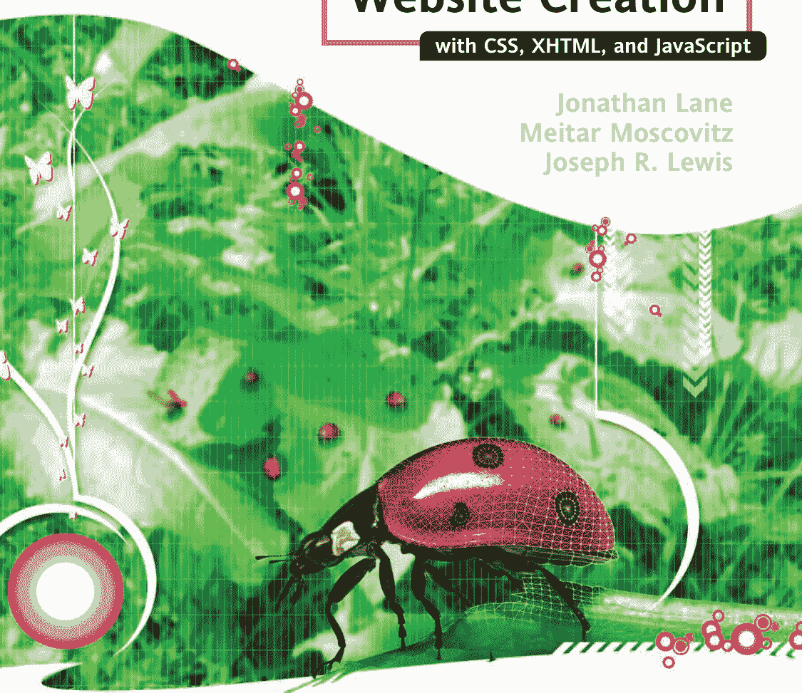

friends of

设计师对设计师

Apress® 旗下的公司

- 概述整个网站构建过程
- 包含实用示例和背景理论
- 特邀业界知名专家分享真知灼见


## 鸣谢

### 贡献者

史蒂夫·史密斯

### 助理制作总监

卡丽·布鲁克斯-科波尼

### 首席编辑

克莱·安德雷斯

### 制作编辑

伊丽莎白·贝里

### 技术审阅

梅塔·莫斯科维茨、约瑟夫·R·刘易斯

### 排版

迪娜·权

### 编辑委员会

克莱·安德雷斯、史蒂夫·安格林、

尤安·白金汉、托尼·坎贝尔、

加里·康奈尔、乔纳森·根尼克、

马修·穆迪、约瑟夫·奥廷格、

杰弗里·佩珀、弗兰克·波尔曼、

本·雷诺-克拉克、多米尼克·谢夫特、

马特·韦德、汤姆·韦尔什

### 校对

丹·肖

### 索引

贝丝·帕尔默

### 封面图片设计师

科内尔·范·多伦

### 项目经理

凯莉·约翰斯顿

### 内页与封面设计师

库尔特·克拉默斯

### 文字编辑

金·温普塞特

### 制作总监

汤姆·德博尔斯基

本书献给那些目前——并且希望——致力于让网络成为一个更好、更符合标准、更易访问的地方的人们。这并非总是易事，但你们的工作确实意义重大。

——乔纳森·莱恩

献给阿巴，我为本书所做的大部分工作其实都是为了你。希望你现在可以舒适地使用编辑器的源代码视图了。

——梅塔·莫斯科维茨

献给我的爱妻，我对她的爱无可估量。

——约瑟夫·R·刘易斯

# 致谢

我要感谢 Chris Mills 帮助启动这个项目，以及 Clay Andres 在 Chris 离开后接手并推动事情向前发展；感谢 Kylie Johnston，没有她，这本书只会让我获得拖延症的荣誉勋章；感谢 Steve Smith、Meitar Moscovitz 和 Joe Lewis 帮助我填补了技术上的不足；感谢 Kim Wimpsett 和 Liz Berry 在生产过程中耐心回答我的问题。

感谢我优秀的妻子 Rachel 给我写作的时间，感谢我的孩子们 Reilly 和 Parker，感谢他们把噪音控制在低吼的水平（有些时候）。还要感谢我的父母：我的母亲 Cynthia，遗传了写作基因；我的父亲 Rick，那种"把它做完"的态度。我不知道在这个项目中哪种用得更多。

Jonathan Lane

首先，我要感谢在我之前的网页标准先驱们，比如 Eric Meyer、Molly Holzschlag、Peter-Paul Koch、Jeffrey Zeldman 以及太多无法一一提及的其他人，没有他们，我就没有可以站立的肩膀。希望我在这本书中的贡献能为他们之前的工作增添一些真正的价值。

我还要感谢所有与我一起完成这本书的人：我的合著者和技术审校 Jonathan Lane 和 Joe Lewis，感谢他们在我起草稿件时提出的非常敏锐的观察和建议；Apress/friends of ED 的工作人员（包括但不限于）Kylie Johnston、Kim Wimpsett 和 Liz Berry 的辛勤工作，特别是我的编辑 Clay Andres。Clay 不仅向我发起挑战，将原本只是相对较小的审阅任务变成了数月的辛苦工作，更重要的是，他首先给了我这个机会。

还要感谢每天与我一起从事网站项目的出色团队——澳大利亚悉尼的 Digital Eskimo 的员工，感谢他们允许我休假以专注于这项工作。更重要的是，感谢他们提供了一个非常出色的工作环境，让我感觉自己在做想做的事情，而不是为了谋生而不得不做的事情。

我还要感谢我的女友 Sara Hames，这位作家。她不仅值得感谢，因为她在文字编辑看到我的任何作品之前帮我校对，而且尽管我先于她出版却从不生气；更因为在许多比语言所能描述的更为重要的方面，她给予了我巨大的支持和鼓励。

最后，我要感谢我的家人，在我还不知道我会写书之前多年就给予了我支持：我的兄弟 Shir，他是我所认识的最坚韧、最有条理、最真实的人；我的母亲 Rina，她教会了我的兄弟和我如何成为坚定的人（无论我们是否做出她更偏好的选择）；还有我的父亲，没有他的启发、洞察力和指导，我可能永远找不到通向今天我所愿达成的道路。

Meitar Moscovitz

我要向以下人员表示感谢：

感谢 Michael Alderete，很久以前向我介绍了博客的概念。

感谢 Stephanie Sullivan 和 Molly Holzschlag，她们在写作及其他方面给予了我睿智的建议。

感谢 Gabriel García Márquez 撰写了 `One Hundred Years of Solitude`，以及 Chris Haag 送给我这本书。

感谢 Don Palma，他问我为什么不去练习。

感谢我的合著者以及 Apress/friends of ED 的团队，让这次经历如此愉快。

最重要的是，感谢 Yingwen，因为你就是我的全世界。

Joseph R. Lewis

## 引言

对于新手来说，踏入 Web 开发领域可能会相当令人望而生畏。要正确构建一个网站，有很多东西需要学习。即使是那些最成功的网站，在上线之前也投入了大量的思考和心血。

尽管这可能让人感到害怕，但现在正是开始学习的最佳时机。Web 浏览器终于开始走向一个共同遵循标准（或多或少）的时代。如今，你比以往任何时候都更少地需要为让某些功能正常工作而费力调试。我们不想乌鸦嘴，但我们认为终于可以开始稍微放松一点警惕，更多地信任浏览器制造商了（是的，包括微软）。

## 本书适合谁

本书旨在为 Web 开发新手以及那些有兴趣彻底改造现有作品以符合标准的人提供帮助。它既适用于在公司和机构内工作的个人，也适用于自由职业者。

## 本书的结构

本书首先简要回顾了万维网的历史，然后通过几个章节引导读者了解与开发网站相关的各个领域。每一章都涵盖了一个与当今 Web 工作相关的独立流程或技术。

读者将学习如何规划网站、管理设计和开发流程，以及使用 Web 标准进行开发；我们还提供了基于服务器的技术的概述。

## 排版约定

为了使本书尽可能清晰易读，全文使用了以下文本约定。

重要的词汇或概念通常在首次出现时用粗体突出显示。

代码以固定宽度字体呈现。

新增或修改的代码通常以粗体固定宽度字体呈现。

伪代码和变量输入以斜体固定宽度字体书写。

菜单命令以"菜单 ► 子菜单 ► 子菜单"的形式书写。

当我们希望引起你对某事物的注意时，我们会这样突出显示它：

> 呃，别说我们没警告过你。

有时代码在书中无法放在一行。当发生这种情况时，我们会使用这样的箭头：➳。

```
这是一段非常、非常长的代码部分，应该全部写在 ➳ 同一行，中间不换行。
```

## 先决条件

如果你曾经使用过 Web 浏览器，那么你已足够有资格阅读本书。本书为新手提供了关于基于标准开发的绝佳入门介绍，同时也涵盖了对于那些先前有过 Web 工作经验的人来说的高级主题。

## 联系作者

- 乔纳森·莱恩：你可以通过 `jonathan.lane@gmail.com`、`http://www.flyingtroll.com/` 和 `http://industryinteractive.net` 联系乔纳森。
- 梅塔·莫斯科维茨：有关专业问题，你可以通过其专业主页 `http://MeitarMoscovitz.com` 上列出的任何方式联系梅塔；否则，你可以在网络各处找到梅塔，但你或许应该从他的个人主页 `http://maymay.net` 开始。
- 约瑟夫·R·刘易斯：约瑟夫偶尔会在他的博客 `http://www.sanbeiji.com/` 上写作，并且可以通过电子邮件 `joelewis@gmail.com` 联系。

xxii

---

# 第 1 章：介绍网络的过去、现在和未来

信不信由你，在我们小时候，给某人发送书面文字的标准方式是通过邮件。注意，不是电子邮件，而是那种需要在信封上贴邮票的实体邮件。诚然，这让我们觉得自己老得不可思议。直到中学，我们都会像班上其他所有人一样提交手写作业。这是标准做法。

互联网是一项相对较新的发明，而万维网则更新。然而，两者都像印刷机、蒸汽机或电灯泡一样，对文明产生了深远的影响。在我们成长的过程中，要为我们的 PC 找到好的视频游戏简直难如登天。那时计算机完全是为了商务。我们可以找到六种不同的文字处理器，但我们找不到 Sierra Online（现在归艺电公司所有）的最新发布产品。如今，如果你在找电子游戏，你会去哪里？普通人会去亚马逊，预订最新游戏的次日达版本。电子商务已经变得如此无处不在，以至于对于某些产品来说，它比去本地商店更受青睐。

万维网使得几乎所有东西对于几乎每个拥有互联网连接的人来说都近乎即时可用。即使是像沃尔玛这样的大型超市，也无法跟上消费者在线上可供选择的商品种类。过去要找到利基产品，比如冰壶石，极其困难，但如今，它们只需点击一下鼠标即可获得（`http://www.kaysofscotland.co.uk/`）。在没有沃尔玛的偏远社区，互联网已成为 21 世纪生活的必备工具。

## 做事的标准方式

由于其高度技术化的童年，万维网有很多“黑客包袱”。当我们这么说时，我们并不是指这是一个危险的地方，有人在网上游荡试图窃取你的信用卡信息（尽管确实存在一些这种情况）。我们是在经典意义上使用“黑客”这个词，指那些喜欢技术并试图自己解决问题的人。网络起初在很大程度上是为了解决一个问题而诞生的，那就是分发信息。它根据需要发展并增加了功能——人们需要能够向他们的文档中添加图像和表格。在主流采用的早期，当企业开始将业务转移到网上时，并不总是有完美的做事方式，因此人们想出了自己的解决方案。

一个经典的例子就是在网页上使用表格进行布局。有一段时间，我们对此也有过过错；但在那时，我们别无选择。使用表格是让两栏文字在页面上显示的唯一方法。如今，有了更好的选择，这正是本书的内容所在。Web 标准已经演进；现在不再是 1995 年了。

## 万里之行始于足下：网络的过去

如今很难找到一本关于超文本标记语言（HTML）和 Web 的书不是以历史章节开头的。我们过去常常想知道为什么会这样。要理解为什么采用 Web 标准的方法来构建网站是最佳途径，你必须了解万维网从演变至今的过程。万维网有着非常技术化的根源，而大多数技术人员的问题（或魅力）在于他们喜欢自定义——改变事物，直到这些事物在他们心中变得完美。他们无法遵循其他人都在做的事情；他们需要加入自己的风味。

网络诞生于瑞士日内瓦欧洲核子研究中心（CERN）的一个研究项目。当时，一位名叫蒂姆·伯纳斯-李的研究员在周末寻找一种快速、轻松地与同事分享研究成果，并以易于归档和检索的方式组织信息。尽管该过程始于 1980 年代初，但直到 1990 年，伯纳斯-李才制作出了第一个 Web 服务器和 Web 浏览器（当时称为 `WorldWideWeb`，这也是名称的由来）。

1992 年，当美国国家超级计算应用中心（NCSA）发布了能够同时显示文本和图形的 Mosaic 浏览器时，网络开始进入主流。Mosaic 让非科学家们能够轻松通过互联网访问使用 HTML 创建的文档，也就是我们现在所说的网页。受这次早期成功的鼓舞，Mosaic 的创始人之一马克·安德森离开了 NCSA，成立了 Mosaic 通信公司。这家公司后来变成了网景通信公司，创建了网景浏览器，这是第一个商业浏览器，并在整个 1990 年代成为 Web 标准的旗手。

一家名为 Spyglass 的公司获得了 NCSA 的源代码许可，并最终发布了 Spyglass Mosaic（尽管是基于新开发的代码库）。这成为了微软 Internet Explorer 的基础，并为网景和微软之间的浏览器主导权之争奠定了舞台。

就在 1990 年代“浏览器大战”开始之前，伯纳斯-李意识到，如果没有某种治理，随着竞争性的 Web 浏览器引入新功能，万维网将面临巨大的挑战。让某人选择你的产品而不是你的竞争对手的产品的方法之一是……

## 网络世界的过去、现在与未来

竞争在于提供一堆对手所不具备的酷炫功能。他预见随着各家公司引入自己的标签以向万维网添加功能，兼容性问题将会浮现。HTML 是将网络粘合在一起的纽带，需要某个中央机构来监督其演进，以维持高水平的互操作性。

微软将 Internet Explorer 作为 Microsoft Office 的一部分免费赠送，与 Windows 捆绑销售，并作为免费下载提供给其各种操作系统以及 Mac 用户。微软在浏览器市场中起步较晚，1995 年入局时，Netscape 已占据约 80% 的市场份额。然而形势迅速逆转，到 1998 年 Netscape 被美国在线（America Online）收购时，微软已占据约一半的浏览器市场。到 2002 年，Internet Explorer 达到顶峰，估计有 96% 的网络冲浪者使用 Internet Explorer。事实上，微软在浏览器大战中对 Netscape 的打压如此彻底，以至于双方陷入了一场旷日持久的诉讼，最终认定微软在市场滥用了垄断权力。图 1-1 展示了从 1990 年代初开始的主要浏览器发布时间线。

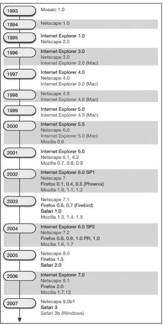

浏览器大战对 Web 开发者来说是极其艰难的时期，各家厂商争相自行其是。主要浏览器的第 3 版和第 4 版常常让开发者编写两个完全不同的网站版本，以确保与 Internet Explorer 和 Netscape 的兼容性。尽管 Web 标准已经存在，但大多数浏览器只真正支持基础功能，并依赖相互竞争（且不兼容）的技术来实现任何高级功能——而这正是 Web 开发者想要做的。

Netscape 虽然被一家相当大型的公司所拥有，却开始停滞不前。Netscape 将其代码库开源，Mozilla 项目由此诞生。Mozilla 社区接手代码后迅猛发展，通过完全重写渲染引擎，以一种全新的方式真正实现了对标准的支持。尽管 Mozilla 早期基于 Netscape Navigator，但形势迅速逆转，Netscape 的后续版本反而基于 Mozilla 开发。

Mozilla 项目已分化为许多新的浏览器，其中最著名的当属 Firefox，它引发了与微软的新一轮浏览器大战。然而这一次，这场竞争产生了积极的影响。微软在发布 Internet Explorer 6 后几乎停止了对其的改进工作。当 Firefox 以近乎完美的 Web 标准支持登场时，它立即获得了巨大成功，在 Web 行家和普通大众中都获得了极高的人气。微软似乎别无选择，只能改进其 Web 浏览器，结果就是 Internet Explorer 7。

Web 浏览器市场中还涌现了许多其他参与者，与主要厂商展开竞争。值得注意的是，Opera 一直将出色的 Web 标准支持作为其主要卖点之一。它在一定程度上获得了认可（截至 2008 年 1 月占 2%），并且也在很大程度上专注于移动设备领域。

苹果电脑公司的 Safari 于 2003 年问世，很快成为 Mac 用户最受欢迎的选择之一，因为它与操作系统集成良好，且在 Mac 上通常比竞争对手的浏览器更快。苹果于 2007 年推出了 Windows 版本，但该产品尚未脱离测试阶段。Safari 最独特的品质之一是，即使是其小版本更新（所谓的小数点发布），Safari 也在改进其对 Web 标准的支持，而这通常是其他浏览器厂商留到主要版本发布时才做的事。

## 然后标准出现了：如今的 Web

你能想象如果每个国家的每个电视频道都以 PAL 或 NTSC 制式播出，观众需要根据想看的内容使用不同的电视机吗？同样地，想象你正在撰写一篇研究论文，在 Google 上搜索，然后需要在不同的 Web 浏览器中打开每个返回的结果。第一个链接用 Internet Explorer，第二和第三个用 Netscape……好了，现在回到 Internet Explorer……然而，这基本上就是 1990 年代末期的运作方式。Web 上最常见的景象之一就是这些“精彩”的（此处为重度反讽）图形徽章，告诉访问者本网站“针对 Internet Explorer 优化”或“最佳浏览效果请使用 Netscape Navigator”（见图 1-2）。


图 1-2. Internet Explorer 和 Netscape Navigator 的“立即获取”按钮

当我们谈论 Web 标准时，通常指的是 Web 上的三大支柱：HTML（或 XHTML）、层叠样式表（CSS）和 JavaScript。万维网联盟（W3C）还维护着许多其他标准，例如用于矢量图形显示的可缩放矢量图形（SVG）、用于位图图形压缩的便携式网络图形（PNG），以及可扩展标记语言（XML），这是一种在许多方面与 HTML 类似的标记语言。

HTML/XHTML 全部关乎文档的结构化，而 CSS 则负责各种页面元素的格式化和显示。由于它们是两种独立的技术，你可以将它们分离（即将内容与显示分离）。HTML 的早期版本（在 CSS 发布之前）旨在成为满足所有人需求的全能工具。通过指定各种标签的属性，颜色和字体的设置被直接内置其中。然而，随着网站规模的增长，这种方式的局限性很快显现。

想象一下，你搭建了一个网站来推广这本书。在整个网站中，详细涵盖了所有章节，并引用了书中的内容。为了让这些引用真正从屏幕上跳出来，你打算将它们设为红色，并调大一号。在以往的日子里，你的代码看起来会是这样的：

```html
<font size="+1" color="red">In the good old days, 
your code would look something like this:</font>
```

借助一些 XHTML 和 CSS，代码可以变成这样（注意我们说的是“可以”，因为做事的方式有多种——这是一个良好的、结构相关的示例）：


```html
<blockquote>
  In the good old days, your code would look something like this:
</blockquote>
```

然后在网站页面中引用或链接的一个单独的 CSS 文件（或 HTML 文档的顶部——但这只是另一种选择）中，会有类似这样的内容：

```css
blockquote {
  font-size: 1.5em;
  color: red;
}
```

那又怎样？它们都能实现同样的效果。Web 浏览器都会将引用显示为红色，并将它们放大。然而，其中一个即时优势在于更新。

正如我们之前提到的，你在整个网站上大量引用这本书的内容，逐章进行。到项目结束时，你发现已经使用了超过 300 处引用！唯一的问题是，我们作为作者（也是你的客户）绝对讨厌红色文本。这让我们非常生气。所以我们要你把它全部改掉。

你更愿意做什么：更新 CSS 文件中的一行，还是打开网站上的每个页面，将颜色属性改为蓝色？（蓝色让人平静得多。）300 处引用——你是按小时计费的——所以那也不算太糟。可能只是额外半天的工作。

现在把这个例子类推到纽约时报这样的网站，整个网站上可能有数百万处引用。你还那么热衷于去修改每一个 `font` 标签吗？

你会暗自想：“我的软件可以搜索替换。” 这是真的。我们曾经被要求更新一个工作过的组织的部门网站。该网站约有 16,000 个页面，到一周结束时，我们的搜索替换还没有完成。我们可没那么耐心。你呢？

此外，CSS 已经发展并且仍在不断演进，让设计者和开发者能够在页面布局和外观方面做越来越多的事情。使用 CSS，你可以将任何元素定位到页面上的任何位置。虽然你大概也可以用基于表格的布局实现同样的效果，但可能需要大量代码，包括设置能够控制表格单元格的绝对高度和宽度。

然而，有一样东西你无法做到，那就是让一对表格单元格相互重叠——而使用 CSS 来做到这一点则极其容易。

即将发布的 CSS（第 3 版）内置了更多的格式化选项。你将能够为某个元素指定多个背景图片，设置颜色的透明度，允许某些元素即时调整大小，以及为文本和其他元素即时添加投影效果。请访问 W3C 网站，或者为了获得更易读的版本，请访问 `http://www.css3.info` 以获取更多信息。

所提供的示例展示了使用 XHTML 和 CSS 可以实现什么的一个相当简单的示例。如果你前往 CSS Zen Garden（`http://csszengarden.com/`）并浏览其中的一些示例，你就可以体会到通过调整网站的 CSS 可以获得多大程度的控制。

CSS Zen Garden 对每个示例使用相同的标记（每一页的 XHTML 部分保持不变）。每个页面上唯一不同的是所包含的 CSS 文件，以及任何辅助图形（见图 1-3、图 1-4 和图 1-5）。

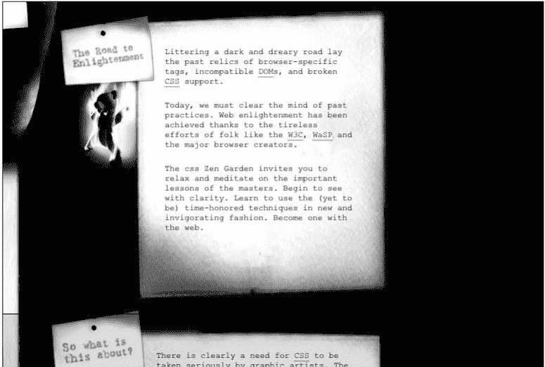

> 图 1-3。来自 CSS Zen Garden 的一个示例（`http://www.csszengarden.com`）。这些页面中的每一个都使用相同的 XHTML 标记；每个页面只是通过 CSS 和图片进行了不同的样式设计。

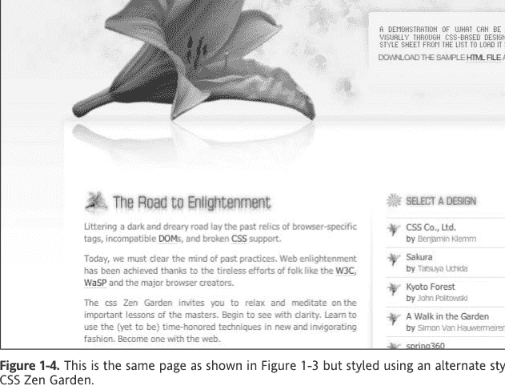

图 1-4。这与图 1-3 所示的是同一个页面，但使用的是 CSS Zen Garden 中的备用样式表进行样式设计。

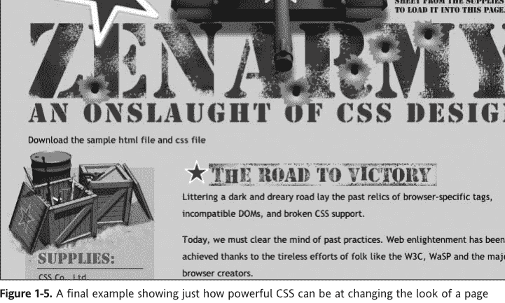

图 1-5。最后一个示例，展示了 CSS 在改变页面外观方面可以有多么强大。

想象一下，在重新设计网站时无需触及任何一页的标记，却仍然能获得完全不同的最终效果。结构良好、基于标准的页面将让你实现这一点。

这对于构建大规模内容管理系统的公司来说可能是一个重大优势：只需更改样式表，CMS 就可以为新的客户量身定制。一些公司正在这样做，但其他公司尚未跟上。

## 水晶球：网络的未来

网络在许多方面都很酷，尤其是因为你不需要成为算命先生就能看到未来。由于标准的制定需要时间，我们已经对未来有了一些了解。

例如，HTML 目前正在审查中（当前的 W3C 推荐标准是 1999 年 12 月发布的 HTML 4.01）。一个工作组已经成立，致力于制定 HTML 5 推荐标准，以整理 HTML 4 中遗留的一些问题。该小组于 2006 年启动，目标是到 2010 年 12 月底完成推荐标准（如你所见，这是一个严谨的过程，确实需要一些时间）。

W3C 的标准审批流程要经过许多步骤，很容易跨越数年。这一过程的最终产物是 **W3C 推荐标准**。

由于 W3C 不是一个管理机构，它所能做的只是提出推荐，软件公司可以选择是否遵循。网络上没有“法律”，因此如果苹果公司决定在 Safari 中放弃 HTML 支持，转而采用自己的标记语言，它完全可以这样做。

正如你从我们之前的课程中看到的，这在 1990 年代并非完全不可能，但今天，这可能会非常自取其败。网络文化的核心在于互操作性，当公司试图限制互操作性以获取某种竞争优势时，我们都会遭受损失。

这导致了一些喜忧参半的结果。一方面，你可以访问几乎任何网站，它都能在任何网络浏览器中工作。仍然有一些公司在玩老旧的“请下载 Internet Explorer”把戏，但这样的公司已为数不多。

事实上，对于企业来说，互操作性意味着更大的潜在客户群体。对于大多数 Mac 用户来说，如果他们访问一个“仅限 Internet Explorer”的网站，他们就束手无策了。他们可以购买一台 Windows 机器，或者运行一些虚拟化软件以便在 Mac 上运行 Windows，但很可能，如果他们有选择的话（而网络就是关于选择的），他们干脆不会费心。

他们会去找一个支持 Safari 的竞争对手，或者至少支持 Firefox 的竞争对手。

制定新标准和修订旧标准的协商过程非常彻底，涉及与社区的大量协商。多个草案被制定出来，大量的反馈被收集，最终提出一份推荐标准。

我们在本章中几乎将 HTML 和 XHTML 交替呈现。虽然 HTML 和 XHTML 都是有效的 Web 标准，但在本书中，我们将重点关注 XHTML，它通过强制要求页面格式良好，以及以结构信息重要的方式进行标记，来推动 Web 的发展。

XHTML 是 HTML 和 XML（广泛用于数据存储）之间的一种混合体。当今 Web 上使用的 XHTML 当前版本是 XHTML 1.01，这是在页面标记中完全使用 XML 的进程中的一块踏脚石。

我们之所以这么说，是因为虽然页面是用 XHTML 编写的，但浏览器通常仍以类似于 HTML 的方式显示它们。

## 基于标准为现代 Web 构建

作为人类，我们建造实体空间已有数千年历史。建造一座建筑物涉及众多职业：建筑师、工程师、承包商、水管工、电工、木匠等等。

同样，对于 Web 来说，众多专家为构建出色的在线空间做出贡献（见表 1-1）。你可以建造世界上最美丽的博物馆，但如果客户要求的是一座工厂，你就没有完成你的工作。

**表 1-1。** 传统建筑工作与“数字建筑”工作的比较

| 砖瓦（建筑物） | 比特（万维网） |
| --- | --- |
| **建筑师：** 绘制蓝图；确保唯一的浴室不在车库旁边。 | **信息架构师：** 绘制站点地图；确保网站搜索不是只能从“联系我们”页面访问。 |
| **工程师：** 确保建筑物结构稳固，使用合适的材料，不会被风吹倒。 | **技术负责人：** 确保现有系统能够处理流量，且技术决策是合理的。 |
| **总承包商/工长：** 确保每个人都来上班，计划得到遵守，建筑物得以建成。 | **项目经理：** 确保程序员不会把所有时间都花在玩电子游戏上，确保项目按时完成。 |
| **室内/室外设计师：** 选择油漆颜色；决定在墙上挂什么艺术品；选择地毯、瓷砖还是硬木地板。基本上，这个人确保一切看起来美观。 | **设计师：** 选择调色板和字体；开发图形。换句话说，设计师确保一切看起来美观。 |
| **地下室/地基建造者：** 为建筑结构浇筑混凝土地基。 | **系统管理员/数据库管理员：** 创建支持网站的基础设施。 |
| **框架工/木匠/干墙工/油漆工：** 搭建结构；将建筑师的愿景变为现实。 | **HTML/CSS 开发人员：** 正确地构建页面；将设计师的愿景付诸实践。 |
| **水管工/电工：** 铺设管道和电线，让房子充满活力。你可以在没有 plumbing 和 electricity 的房子里生活，但不太有趣。 | **程序员/开发人员：** 通过客户端和服务器端脚本为页面添加交互性。 |

话虽如此，一个人或一小群人经常兼任这些职位中的多个。在这个行业中，成为通才是很常见的选择。

正如你将在本书后面学到的，使用 Web 标准可以让你在这个领域获得优势，为你提供最佳行业实践的基础。建筑师遵循当地的建筑规范，以确保他们的项目安全且以一致的方式构建。面向 Web 的构建者也应该这样做，以确保他们的网站具有可访问性、搜索引擎友好性，并且能够在现代浏览器中保持一致。

## What's inside this book?

Our goal is to take this book beyond web standards to cover the entire process of developing a website based on standards. Believe it or not, there is more to putting together a great website than just knowing a little HTML (or XHTML, as the case may be). This introduction will expose you to different techniques and technologies, and we hope it will encourage you to pursue those areas you find most compelling.

The other day we received a copy of a magazine that has been in print for 29 years. This issue announced that it would no longer be printed and would henceforth be available only online. Increasingly, companies are moving their advertising efforts online, and more and more industries, especially those that target younger markets, are concentrating on communicating with their potential markets through websites and online communities.

Technologies come and go or, as in the case of HTML, evolve. Two years from now, we may have to completely rewrite sections of this book. We will certainly need to add to the history section as new browsers and technologies are introduced into the market and as new trends emerge (during the writing, Safari for Windows was released, and Firefox 3 will likely be released before this book makes it to bookstores).

It's exciting to be working with ever-changing Internet and web technologies. We could even be witnessing the beginnings of a great web transformation with the advent of mobile computing. There's no telling what we'll find around the next corner.

## Chapter 2

# KEEPING A PROJECT ON TRACK

The topic of project management is often a contentious one (what a weird thing to fight about!). There's usually little disagreement that projects need to be managed—a deadline and a budget have to be set, and something called **scope** needs to be addressed (`scope` is what you're going to do in a project, like “redesign website X”).

Beyond this, there is a great deal of back and forth about how things should proceed. The old-school (and some would say proven) method of project management relies on planning everything in advance and assigning dates (milestones) and people (resources) to each task.

Everything is planned and documented in advance, stakeholder sign-off is obtained on the documentation, and then the project proceeds. At that point, a project manager makes sure everything stays on track. They move or add resources to the various tasks identified in order to make sure they stay on time.

The process of web design and development is a unique one, however. The old-school method isn't necessarily the best approach in an industry where new competitors and technologies can emerge during the course of a three-month project.

It's reasonably cheap and easy to make changes at any stage of a project. Even though we made the direct comparison of construction work to web work in Chapter 1, we framed it like that in order to give you an idea of what the various roles are on a web project.

In reality, building a website isn't like building a house at all; you're not tied to the dimensions after pouring the foundation. The materials used are all digital and for that reason are easy to work with. Deleting something doesn't involve a wrecking ball, and adding something new doesn't require materials to be purchased and brought in from off-site.

If you're five days into the project and your client suddenly decides that they would, in fact, like to accept orders online instead of only telephone orders, all you have to do is hand them a revised cost estimate and timeline, if even this.

After a website has launched, if you start hearing from visitors that they need to be able to import data in a certain format, you can develop and push that out instantly to your end users by publishing it to the server.

No jackhammers . . . no need to make 3 million duplicates. So, why should you set everything in stone on day one?


项目经理不必精通所有开发语言、数据库系统和服务器配置（当然，略懂每一项也没有坏处，这样至少能判断别人是不是在忽悠你）。项目经理必须知道如何与人打交道，让每个人都保持愉快（或者至少保持高效），并确保项目持续推进。主要目标是消除项目完成过程中的所有障碍。

如果开发人员的办公室正在装修，他们因为总有人敲敲打打而无法编写代码，那就为他们找一个更安静的工作地点。如果设计师的电脑总是崩溃，导致他们不得不反复重做同一项工作，那就给他们换新电脑。

## 远离瀑布：传统方法

传统意义上的项目管理通常非常复杂。本章显然不可能涵盖项目管理的所有方面，但我们希望与大家分享一些技巧，以及在实践过程中需要注意的问题。我们坚信，培养项目管理技能非常重要。由于每个人处理问题的方式不同，而且没有两个项目是完全相同的，因此我们无法为所有情况提供一张从`x`到`y`再到`z`的完美路线图。最好的建议是依靠自己的经验；如果你确实不知道答案，就承认这一点，然后去寻找答案。

虽然你可能是某个项目中唯一的工作人员，但更多时候，你会成为团队的一员。如果遇到困难，总会有人可以向你提供建议（或者至少提供他们的看法）。如果情况糟糕到极点，还有互联网可以求助（我们听说在那里总能找到愿意发表意见的人）。

这种传统方法源自建筑行业。事实上，美国海军最初构想这种方法，是为了更好地控制舰船建造过程。当材料需要订购、零件需要在场外制造、专业劳动力需要调配时，提前规划会带来很大优势。

在用于瞄准敌人的计算机尚未安装之前，就让软件专家坐在那里等待，是对时间和金钱的巨大浪费。如果拥有一份总体计划，可以提前了解项目进度是超前还是落后，就能提前联系分包商，推迟或提前安排他们参与项目。

当我们提到传统的项目管理方法时，指的是项目管理协会（Project Management Institute）所教授的正式流程（`http://www.pmi.org/`）。这种流程有时被称为**瀑布模型**；在这种方法中，项目会尽可能地提前完成规划。规划会持续到所有人对“完美”达成共识，然后才开始工作。

这种做法受到许多批评，尤其是在软件和Web开发项目中，因为项目结束之前没有内置反馈和评估环节。不过，我们希望已经说明，这种方法在某些行业中确实有其适用之处。例如，在大型建筑项目中，开工前必须制定计划。如果一栋高层建筑在建造过程中，直到最后才确定总共有多少层，那么逐层开始建设将是非常愚蠢的。你也不能把建筑的某项“功能”（例如电力系统）留到最后一刻才处理。

然而，在Web开发项目中，你确实可以这样做。瀑布模型的僵化和线性特征并不适合Web开发。这类规划在时间和金钱上的前期成本，与大多数Web工作并不匹配。

另一个需要考虑的因素是，各种技术发展的速度非常快。提前花三个月规划项目，实际上可能会让你在可用技术方面落后三个月。

换一种方式来看：假设你在项目规划阶段开始时，花一周时间分析各种可用的数据库系统，以确定哪一种最适合实现新的短消息应用。你研究了三种不同的产品，并选择了产品A，因为它在数据库插入（添加记录）和查询（从数据库中检索数据）方面明显更快。

你完成了规划并开始开发。一周之后，产品B发布了新版本，其查询速度提高了100倍，因此大约比你当前使用的产品A快20倍。你会切换吗？

此时，你已经在瀑布中向下滑行，没有回头路了。整个时间安排都会被打乱，如果在这个阶段切换技术，就必须重新规划所有事情。

## 九大知识领域

《项目管理知识体系指南》（PMBOK）涵盖了九大知识领域，由项目管理协会出版（参见图2-1）。这九个领域涵盖了项目规划和管理的各个方面。本书只能对每个领域进行快速概述，但如果你想了解更多内容，我们建议你阅读项目管理协会出版的相关资料。

以下是各个领域的简要说明：

- **项目整合管理**：该领域关注如何规划并整合项目的各个部分，包括制定项目章程（概述项目将完成什么以及为什么需要完成的文档）、制定项目计划（如何完成章程中概述的内容），以及如何在团队与客户或利益相关者之间进行沟通。
- **项目范围管理**：该领域具体阐述了为完成项目必须进行哪些工作，以及这些工作将如何在各类“资源”间进行划分。它还明确了项目过程中如何处理任何变更。
- **项目时间管理**：该领域定义了项目将耗时多久，并确定了完成既定项目所需的人力，包括具体技能要求和时间安排。
- **项目成本管理**：资金是另一个重要因素。该领域定义了项目的预算，以及如何控制事务以保持在预算范围内。
- **项目质量管理**：如何确保你产出的东西能正常工作并达到预期目的？将进行何种测试？哪些测试结果是可接受的？
- **项目人力资源管理**：你将从何处获得团队成员？他们需要具备哪些技能？是否需要培训？如何管理团队？
- **项目沟通管理**：该领域涵盖了项目团队与利益相关者之间如何共享信息，如何沟通和跟踪进展，以及如何记录文档。
- **项目风险管理**：该领域主要关注项目失败（或成功）所涉及的风险，因为两种情况下都可能存在风险。它试图预见项目各阶段可能出现的问题，并规划降低或消除这些风险的方法。
- **项目采购管理**：当需要时，产品或服务将如何/从何处获取？（如果适用）将如何管理分包商？

尽管我们不提倡在Web开发项目中采用PMI（美国项目管理协会）路线，但你的客户或雇主可能有不同的想法（而且，花的是他们的钱）。如果要求你走这条路，请帮自己一个忙，找一位持有项目管理专业人士（PMP）认证的人加入团队。

获得这个认证在时间和金钱上都是一个相当昂贵的过程，但如果你的客户是瀑布式方法的忠实追随者，拥有一位PMI认证的项目经理将为你节省大量时间。不过，请注意，这些人的收费并不便宜。你应该在项目开始时、预算确定之前就联系他们，以便他们能立即参与进来。

## Web项目管理：迭代的力量

正如我们之前提到的，Web是一种成本低廉的媒介。在开发过程中犯错是可以的，而且通常很容易修复。正因为如此，Web项目管理可以更加灵活，允许在任何阶段进行反馈和调整。

在传统项目管理方法中强加的严格“范围管理”体系可以放宽，从而追求更具协作性的开发过程。其核心思想是：“我们直接开始构建吧；在发现需要变更时，我们可以随时进行调整。”

这之所以与传统项目管理相反，是因为传统方法旨在非常严格地控制变更（有人可能会说这阻碍了变更，但那不一定正确）。而这种方法在时间和预算的限制内鼓励变更，这样每个人都会对最终产品感到满意，因为他们从一开始就深度参与了产品的塑造。

在开发Web项目时，你会听到很多不同的术语。**敏捷开发**是一个常用术语，它描述了多种涉及多次迭代并与利益相关者紧密合作的开发过程，直到每个人都同意已经达成了最终结果。

如果你是为一个客户工作，你会在非常早期的阶段就构建一些东西并展示给他们。客户可以尝试它，做出反应，并告诉你需要进行哪些修改或缺少什么；然后你可以立即进行这些更改。以这种方式工作，你可以逐步、一点一点地完成一个项目，添加所有必要的功能。

### 敏捷规划示例

敏捷项目管理通过示例能更好地说明。假设你正在为一个客户构建一个新闻网站，该客户是一个电视网络，即将推出一档结合公民新闻的电视新闻节目。他们告诉你，他们需要一个网站，让观众可以提交新闻故事并对其进行分类。然后，每个人都应该能够投票选出他们最喜欢的故事，这些故事将有机会在电视上播出。

他们希望整个节目都是关于从“身处新闻现场”的人的视角实时报道的新闻。你和客户简单聊了聊，双方共同起草了一份一页纸的文件，概述了你们打算尝试实现的大致想法。你们制定了项目的进度计划和预算，然后开始构建提交页面。

新闻网站绝对离不开一个让观众提交故事的地方，以及一个展示这些故事的地方。识别一个网站的核心（或大多数网站的“最内层”页面）并从那里开始，总是一个好主意，因为限制你工作的唯一因素是时间和金钱。

想想看：如果你的时间用完了，而你把所有时间都花在开发观众间消息系统上，那么这个网站就无法完成它需要完成的功能。

提交页面要求访问者输入他们的电子邮件地址，输入故事链接，选择它所属的类别，并输入简短的摘要。然后你构建一个新闻显示页面，将所有内容按类别分组（类似于`Digg.com`或`Slashdot.org`）。你的设计师制作一个模型，你粘贴图形和CSS，以便你的客户能够了解最终产品的样子。

你的客户查看了你目前完成的工作，他们评论说，不能让人们仅凭一个电子邮件地址就提交新闻故事。电视台需要知道更多信息。

好吧，那么我们需要将这部分扩展成一个包含用户名和密码的用户管理模块（谁愿意每次提交故事时都重新输入所有联系信息？）。你又快速搭建了几个展示此功能的页面，再次请客户查看。

此时，客户提到新闻网络已经完成了节目的“视觉设计”：布景设计已完成，节目开场也已制作完毕。可以理解的是，他们希望网站具有相似的美学风格。

你安排你的设计师与网络内部的市场营销和设计人员联系，他们开始处理网站的视觉细节，而你则继续开发工作。


客户认为网站看起来很棒，功能也非常好。网络的销售团队认为网站将通过销售针对不同新闻类别的广告来盈利和自给自足。例如，如果有一个食品类别，可能会找餐厅或特色食品店来投放广告。你开始构建一个根据类别显示广告的组件，以及一些关于这些广告被点击和查看次数的报告，以便公平地向广告商收费。你认为构建一个“本栏目由……赞助”的功能会很不错，这样每个类别都可以有一个主要赞助商。你快速制作了一个模型展示效果，并再次请客户来访。他们对这个想法非常兴奋。

开发就这样来回反复进行，直到产出足够好可以上线的产品。那时，它可能会以“测试版”（beta）的名义发布，并邀请新闻迷（即早期采用者）前来参与。变更持续进行（网站上线一天后添加了 RSS 订阅源，两周后添加了用户评论，等等），直到客户宣布结束，项目完成。电视节目一个月后首播，并取得了巨大成功。

在这里采用敏捷方法，使得项目的需求能够基于最好、最新的信息得以发现。如果你采用传统方法，你可能会错过某些功能，而这些功能在你使用和交互网站的早期版本时才变得明显。你可能完全错过了用户管理部分，然后一旦上线，用户会抱怨你完全不了解他们的需求。你可能错过了从网站广告中获得额外收入的机会，或者错过了用户评论区，而这对网站的成功贡献巨大。

## 实现目标：确定完成度

如果你身上还有一根务实的骨头，你可能会想：“天哪，听起来很棒，但你怎么真正知道什么时候完成了，什么时候该停下来呢？”正如我们在前一个示例中暗示的，你可以关注三个要素来确定项目何时完成以及何时停止工作。通常是三者的结合；但有时，一个因素会超过其他因素。

这三点与传统的项目管理方法有关。所有项目的成功都归结为时间、预算和范围，项目经理的工作就是在分配的时间和预算内平衡这三个要素，以产出高质量的产品。这三个因素通常被表示为三角形的三个点，你的目标是尝试使每条边的长度相等（以实现平衡）。

通常情况下，如果你在做客户项目，客户会有一个他们想要（或必须）上线的截止日期。大多数客户会有一个预算，即他们为完成项目分配的一定金额。而且通常会对功能需求有一些定义（他们需要一个网站来展示他们的新系列护发产品）。

## 专注于时间

与客户合作时，你应该确定一个现实的完成时间表。客户心中通常会有一个日期，对应某个事件，比如财政季度的结束、某个董事会会议或新产品的发布。当客户说：“我们需要那个新闻网站在我们新的公民新闻记者电视节目首播前上线”，那么你就知道你有一个绝对截止日期。

时间通常是固定的因素之一；你不能要求公司重新安排董事会会议，或者让人推迟发布新产品，因为网站没有及时完成。诀窍是掌握需要完成的工作，以便它能在那个既定日期之前完成。

一旦你确定了这个固定的时间点，接下来只需倒推即可。现在学一个好词，一个会让所有项目经理都高兴的词，那就是**应急储备**。应急储备是你自行支配的时间和/或资金的秘密储备，可以用来让每个人都满意。

就时间而言，在你的估算中留出一些缓冲余地，是确保回旋空间的好方法。如果你的首席开发人员得了流感，三天没来上班，你不能要求客户将发布延迟三天。不要做得太过分，但确实要留出一点弹性时间，特别是如果你同时进行多个项目，或者你是自由职业者。

此外，由于你采用的是敏捷方法，你无法确切知道最终产品会是什么样子，因此不可能精确地规定开发需要多长时间。确定绝对截止日期以及软发布日期（一个略早于绝对截止日期的日期，届时所有新开发工作将停止，你的团队将专注于测试并确保一切准备就绪），或许是你能做的最好的事情。

传统方法要求在开始时就制定一个项目计划，其中提前确定若干里程碑（如“视觉设计完成”）。你可以看出，在一个设计将在整个项目生命周期内不断演进的项目中，这几乎是不可能的。图 2-2 比较了传统方法和敏捷方法。

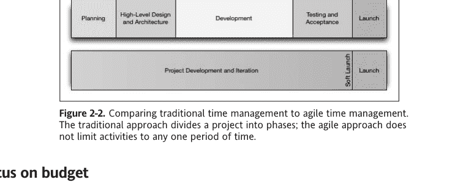

## 关注预算

另一个保持项目顺利进行并确定其何时完成的好方法是项目预算。你不太可能找到预算无限的客户（如果你真的找到了，请确保把他们放在心上，因为你和斯嘉丽·奥哈拉将再也不会挨饿了！）。

考虑到这一点，项目的经济学可以保持得非常简单。作为自由职业者，你通常会被要求为一个项目报价。这是一个你和客户之间进行的有趣的小猜谜游戏，你需要提出一个数字，既能让你在这个项目上赚钱，又不超过他们心中预期的数字。制定预算是你需要与客户协作的最重要的领域之一。

尽管长期以来一直存在这种凭空猜测的做法，但我们在预先询问客户是否有预算方面取得了更大的成功。如果他们有（并且愿意告诉你），那就坐下来与他们交流，回报他们分享信息的意愿。

如果你的客户告诉你他们有 5000 美元用于一个项目，告诉他们你每小时收费 100 美元（此处填入你自己的数字）。根据这些数字，你可以花 50 小时为他们的项目工作。至此，你已经了解了他们的想法，并且可以提前告诉他们：他们的项目完全可行，你很乐意为他们处理；或者，也许他们应该考虑稍微缩减一下他们的想法。

如果你们无法就预算或他们想要完成的工作达成一致，那么你需要决定是放弃还是接受降薪。请记住，如果你计划将一些工作分包出去，你必须事先知道那些个人的收费标准，以及他们是否愿意接受更低的报酬。

你可能会认为这个小时数（50）决定了项目的时间线；这并不一定正确。假设你将独自负责这个项目。你可能在一周半内全职完成项目，也可能在六个半星期内，每周只花一天时间来完成。这个因素也可能影响你是否愿意接受一点降薪（多工作几个小时）。

如果你发现很难将你的时薪保持在你满意的水平，试着与客户在时间线上下功夫。有没有办法在项目上节省时间，让你的部分更快完成？你客户组织内是否有人可以承担一些工作量（例如，编写/编辑一些页面内容）？你能否通过让客户承诺在合理范围内一个月内完成，来压缩整个项目？想想看，一个月 5000 美元的工作并不算差。

这听起来可能有些刺耳，但这是事实。如果你认为你的服务价值是每小时 20 美元，而客户只有 200 美元的预算（这是一个非常小的项目），那么他们可以获得你 10 小时的时间。如果你给了他们 20 小时，你就把自己贬值到了每小时 10 美元（依此类推）。

我们并不是说你永远不应该这样做，但要确保你是在主动控制这种情况。也许你正在为一家非营利组织工作，所以你给这个客户优惠——这没问题。但那个财富 500 强客户负担得起你的费率，他们不需要慈善。

这正是“凭空猜测”报价体系如此缺陷百出的原因。它剥夺了你所有的灵活性，并且通常最终会让客户承受你试图建立缓冲的后果。

当你使用敏捷方法时，确保客户理解其中的数学关系。让他们知道他们有 X 小时，并且他们可以自由地要求你以任何他们认为合适的方式使用这些时间。如果他们想建立一个需要 100 小时的搜索引擎，没问题，但那是你无法花在其他任何事情上的 100 小时。

在项目开始时，当所有时间都尚未被消耗，所有预算都尚未被使用时，人们很容易想法宏大。所以，此时你最好的选择是确定最重要的一件事并首先完成它。

一个没有新闻页面的新闻网站会是什么样子？没有可搜索的数据库，搜索引擎有什么用？一个无法跟踪支出的财务管理应用又有多大价值？其他一切都是项目的外围部分，如果时间允许，可以后续添加。

最后，还有按小时计费和固定价格报价的争论。大多数客户希望你承诺为某项工作设定一个固定成本。他们试图最小化自己在项目上的风险，并防止项目超出预算。

大多数自由职业者对这种做法并不完全满意，因为他们知道项目过程中可能会发生变化，而固定价格限制了他们的操作空间。他们要么争取按小时计费，要么提供一个包含大量应急储备的固定价格报价。

很容易看出这种情况从一开始就使你与客户处于对立状态。看起来你是在为赚钱而奋斗，而他们则在试图省钱。那么，为什么不试着与客户合作，告诉他们你按投入的时间向他们收费呢？

你认为他们预算的金额是现实的，并且你不会让他们束手无策（这就是为什么你总是从项目的核心开始），但如果他们在项目接近尾声、时间所剩无几时开始要求一些花哨的功能，他们将需要提供额外资金。

这可能有点抽象，所以建议你的客户，你将每周向他们更新时间和资金的使用情况，当预算只剩下 10 小时时（根据项目长度/复杂度进行相应调整），你们将进行一次简短的交谈以敲定收尾工作。

## 关注范围

这就引出了我们的最后一个因素，范围。在日常对话中，当人们讨论项目管理时，你经常会听到“**范围蔓延**”这个词。范围蔓延在传统项目管理中是一个贬义词；它意味着最初构思的“完美”项目计划失控了，预期正在改变（这也是另一个不要过早计划所有事情的好理由）。

现在，我们要论证的是，范围蔓延实际上是一个网页项目中可能发生的一件最好的事情（在合理范围内）。只要你有时间和预算，你希望变化。你希望你的客户告诉你，屏幕 A 看起来很糟糕，普通用户永远无法弄明白。

你为什么想要这个？答案很简单：如果客户在告诉你，那么网站的最终用户就不会遇到问题。这意味着你正在生产一个更好、更直观的产品。这是一件好事！

另一方面，范围也有一种奇怪的方式向另一个方向蔓延，比如你的客户在项目中期回过头来告诉你，他们前几天去了一个很棒的网站，让人们可以实时聊天和分享照片，第三方还可以开发小型应用程序插入该网站做不同的事情。

“我们能让我们的新闻网站也这样运作吗？”他们问。

这里存在一种假设，即你和客户可以共同想出对最终用户最好的方案。确保你永远不要仅仅因为客户要求就接受任何事情——它必须有意义。

如果存在任何冲突，就去找一个中立的第三方（询问最终用户）。这可以是一个涉及深入用户测试和焦点小组的正式流程，也可以像询问你的兄弟或姐妹（假设他们其中一个是网站的目标受众）一样简单。

你可以在项目生命周期的任何阶段这样做，无论何时你不确定答案是什么（或者只是想确保你走在正确的道路上）。如果你正在考虑为一个现有网站添加新功能，但不确定这是否是个好主意，可以询问你当前的用户（进行一项简短的调查）。

我们希望此时在你的项目中，你已经能够坦率地与客户交谈。很可能，他们从第一天起就参与了项目，并接受了项目的愿景。当然，他们描述的听起来很棒，但这并不是你正在努力的方向。

网站一旦上线就不需要保持静态不变（事实上，如果它们保持变化会更好！），你会很乐意与他们合作为他们的“2.0 版本”开发这些功能。

然而，如果客户决定这个网站没有所有这些其他东西就不够好，请随意花一个小时坐下来，和他们一起算算账。告诉他们你需要先完成项目的核心部分，然后你很乐意着手处理其中一些其他功能。

实时聊天？听起来不错！这需要 150 小时，并将发布推迟两周。第三方应用的想法？这也是个好主意：你这边需要 300 小时，可能还需要几个月。

不要夸大这些数字——只需诚实地问他们是否愿意增加预算并推迟发布日期。务实主义对于项目管理至关重要。

我们最喜欢的引言之一，往往在此时浮现，来自一家位于芝加哥的公司，名为 37signals。他们说，建造半个产品总比建造一个半吊子

## 产品质量

他们想强调的是，最好构建一个功能简单、没有繁杂特性的产品，但要确保其已有功能都实现得极其出色。

在表单设计上多花些时间，弄清楚你的提问是否合理。在需要的地方投入额外时间来实现 Ajax。你的客户会因此感谢你，这样你就不大可能听到这样的话：“嗯，这个新闻网站内容丰富，设计得也不错。可惜我没法用，因为它没有实时聊天功能。”

另一方面，如果你仓促搭建，很可能就会听到别人抱怨它有多丑陋、多复杂，或者用户遇到了多少错误。

# “但 PMI 涵盖了九个领域；你只谈了三个！”

嘿，我们提醒过你，PMI 的项目管理方法比一般网络项目所需的要复杂。话虽如此，从传统的项目管理方法中还可以汲取一些其他教训。

# 沟通至关重要

客户喜欢看到进展。如果你每天都能给他们发邮件，展示一些真正酷炫的新功能或某个精巧的新设计元素，你可能会拥有世界上最满意的客户。反过来也一样：如果你遇到了重大障碍，最好早点把它摆到台面上，并解释你打算如何处理。

敏捷方法非常强大，前提是每个人都愿意参与其中。传统方法之所以仍然存在，原因之一是它会在项目开始时创建大量文档，然后交给客户签字确认。客户会觉得很踏实，因为他们知道计划是什么，并且能看到项目将如何顺利进行（然后现实情况出现了）。

采用敏捷方法，你必须勤勉地与客户沟通，向他们传达变更，并积极寻求他们的反馈。采用敏捷方法，你不能只是接下项目，离开两周，然后回来说“搞定了！”这是一个高度互动的过程。

很可能，只要你在合理范围内（记住，他们也有工作要做！）与客户保持充分沟通，你就不会听到任何抱怨。然而，根据我们的经验，导致项目失败的最大单一因素就是沟通中断。如果一方停止与另一方交谈，你就遇到了一个需要立即解决的严重问题。

一个极好的策略是，一旦条件允许，就给你的客户访问开发（预发布）服务器的权限，让他们能看到项目进展并立即开始使用。制定一些非正式的政策，说明他们正在查看的是进行中的工作，以及在变化期间某些功能可能会暂时失效。

定期给他们发送消息，突出显示你希望他们深入试用的各种功能和区域。鼓励他们分享他们的印象和发现的任何错误。

# 质量与测试

正如我们之前提到的，你在任何项目上的目标都应该是构建尽可能高质量的产品。如果你可以选择是添加一个新功能，还是花时间让现有功能完美运行，请选择后者。

启动一个产品并完全没有任何问题——无论是技术问题、功能问题，还是恼人的跨浏览器兼容性问题——是相当困难的。尝试将至少 10% 的项目时间用于测试和自己使用。鼓励团队中的其他人也这样做。

不同的人看待问题的方式各不相同；虽然你可能在填写之前例子中的新闻提交表单时毫无问题，但另一个访问者可能会看到它就愣住了，因为他们没有一个可以随新闻故事一起提交的 URL。也许是他们在电视上看到的或在杂志上读到的。那该怎么办？

质量问题也引出了另一个顾虑：网站上线后，谁将负责维护？如果发现一个错误，是你和你的团队修复，还是你的客户有内部人员处理？费用将如何处理？

## 采购与合同

很多项目需要你寻找外部服务提供商。很可能，你并不是一个集项目经理、设计师、开发者、数据库管理员、信息架构师和系统管理员于一身的人。除非你的客户计划托管在自己的服务器上或已经有主机，否则找到安全托管服务的责任可能会落在你身上。

尽管将项目的部分工作外包可能是救命稻草，但你需要记住几点：

首先，一定要提前知道成本是多少。如果你不知道那位“明星设计师”要收多少钱，却向你的客户报了一个小时费率，你可能会发现自己免费工作了不少时间。

其次，确保你了解他们的工作质量，并且你愿意将某个部分的控制权交给他们。如果项目的某个高度技术性的部分超出了你的技能范围，承认这一点并找到能胜任的人是可以的。这里强烈建议选择你以前合作过的人或你了解其声誉的人。

接下来要考虑的是，分包商就是分包商。他们是为你工作，而不是为你的客户工作。你不需要担心是否允许他们与你的客户沟通（实际上，我鼓励他们这样做），但你必须确立，对他们将要完成的工作范围的任何重大变更都必须经过你。

此外，你要负责支付他们报酬。他们不是你的合作伙伴；他们更像是你的员工。如果你的客户未能付款，你仍然有责任支付你的分包商。

最后但同样重要的是，你要为他们的工作/服务质量负责。新网站开发过程中最常见的要求之一，是让你处理网站托管的后勤工作。这是一件好事，因为你能够控制选择哪个主机以及他们提供的功能，从而获得所需的一切。

不利的一面是，你可能会成为你的客户和主机之间的联系点。因此，如果主机出现重大故障，你就要准备好接听愤怒的客户电话。就像你不会雇佣一个从未做过网页设计的设计师一样，除非你确定其服务质量，否则你不应该与托管公司合作。

## 可用的工具

在这方面我们相当幸运，因为在过去大约五年里，项目管理领域的工具已经发展到普通人也能使用的水平。

想象一下专业的项目经理（PMI 培训的）会使用什么样的工具。如果你猜的是一个涉及大量抽象线条和符号的复杂应用，那你就猜对了！

就在几年前，你管理项目的选择要么是使用微软 Project（如图 2-3 所示）或类似产品，要么就是完全凭感觉，用日历和电子邮件处理一切。

## 替代方案

本节开始时暗示有一些更好的替代方案值得认真考虑。

### Basecamp

这个领域的先驱是一款名为 Basecamp（http://www.basecamphq.com/）的服务，如图 2-4 所示。它有点独特，因为它是一个基于网络的托管应用程序，你只需订阅即可使用；无需安装任何软件。它提供免费试用，让你能体验大部分功能。

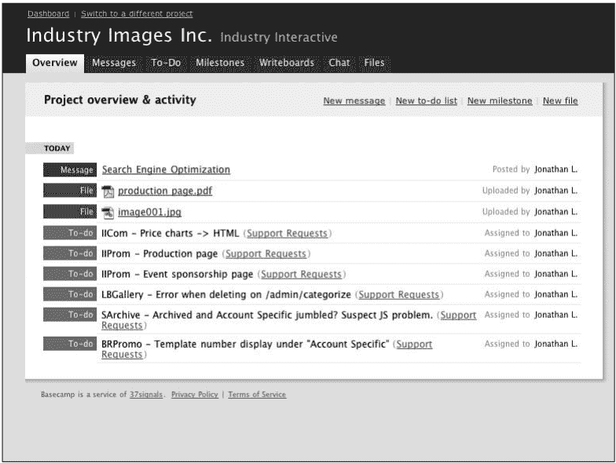

**图 2-4。** Basecamp 基于网络（无需安装软件），提供简洁易用的界面。

Basecamp 与 Microsoft Project 有何不同？Basecamp 代表了项目管理思维方式的根本转变。类似于之前关于敏捷开发的讨论，Basecamp 认为项目管理更多是关于沟通与协作，而非报告与控制。

Basecamp 提供了一套简单的工具，你可以用它来与客户协作，并向他们传达进展。你无需在项目开始时制作复杂的图表，而是设定一系列需要达成的里程碑。

凭借其易用的工具和清晰的界面，我们强烈建议你了解一下 Basecamp，它能帮助你轻松掌控客户项目。

### Trac

Trac（http://trac.edgewall.org/）是一款开源项目管理应用。它比 Basecamp 稍微技术性一些，因为你需要下载并将其安装在自己的服务器上，但好处是使用它无需支付月费。

Trac 是另一款简单工具，能帮助你的项目团队保持正轨。最值得注意的是，它与 Subversion（如图 2-5 所示）集成良好。Subversion 是一款开源版本控制软件，它会记录你对文件所做的更改，这样如果你犯了错误，可以轻松“回滚”到之前的版本。

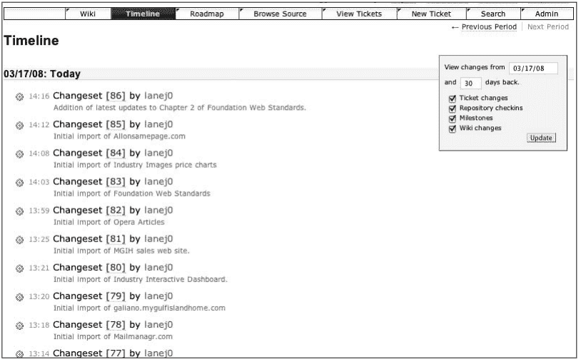

**图 2-5。** Trac 也是基于网络的，但必须安装在你自己的服务器上。它稍微更技术性一些，所以除非你的客户是技术型个人/组织，否则最好将其留作内部团队协作使用。

Trac 还提供了一个很棒的 Wiki，这对于在项目进展过程中为自己和团队其他成员做笔记极其有帮助。Trac 的界面不如 Basecamp 的简洁，因此就个人而言，我们在技术团队成员之间使用 Trac 作为内部工具，而使用 Basecamp 与客户协作。

### 其他选择

市面上有数以百万计（上下浮动几十万）的项目管理应用。有些是基于网络的，有些则安装在你的本地机器上。你使用什么很大程度上取决于你的需求以及你和客户觉得用起来顺手的是什么。

不要觉得非得使用那种能生成大量图表、数据和图形的项目管理应用。事实是，冗长的项目报告很少有人会去读。保持内容简短、简洁、切中要点，以避免误解。

## 总结：最佳建议

项目管理的最佳建议与项目实际开发的最佳建议是一样的：保持简单。如果你手头有时间表、预算以及对需要开发什么的大致了解，你就准备好可以开始了。没有理由让项目变得过度复杂。保持简单能让你专注于重要的事情：为客户提供尽可能好的产品。


项目管理中最大的单一技能是经验。这是那种随着实践确实会变得更容易的事情。你不仅对自己所说的和所做的变得更加自信，而且能够更多地“即兴发挥”很多事情。在初次会议上就能坐下来给客户提供时间和成本的大致估算，这真的非常方便。早期，你需要对此加上免责声明，说你需要更多时间来“核算数字”。但过一段时间后，你的估算会与实际非常接近，你就可以去掉免责声明了。

你并非总能找到同意保持轻量和敏捷的客户。那时，你就需要做出决定。如果你有能力挑选客户，我强烈建议你这样做。说实话，最好的项目就是那些不必经历瀑布式流程的项目。如果你没有能力拒绝任何客户工作，那就清楚你将面临什么。为计划和控制（所有那些不必要的）预留大量的时间和金钱余量。一旦开发开始，计划严格把控变更，并尽可能快地完成网站。项目持续的时间越长，失败的可能性就越大。

此外，如果可能的话，聘请一位PMP（项目管理专业人士）来监督事务，或者至少计划投入多达50%的时间来专门管理项目。严格把控事务并确保项目严格按计划进行，是相当繁重的工作。

## 敏捷与标准：绝佳组合

Web标准很好地补充了敏捷开发流程。我们在第一章简要讨论过，将内容与设计分离非常适合在任何阶段进行大规模更新。将网站的样式定义放在一个单独的文件中，并将其链接到每个页面，这样你可以在一处修改内容，并让所有地方都生效。这在你的迭代过程中极其有用，因为项目后期的功能变更通常会影响网站的视觉外观。在之前的例子中，为了满足市场部的要求而更改网站，可能是一个复杂而烦人的过程，但得益于我们分离了内容和格式，这一切变得轻而易举。

## 职业剖析：杰森·弗里德

杰森·弗里德（Jason Fried）是37signals LLC的联合创始人兼CEO。该公司位于芝加哥，最初是一家网络开发咨询公司，现已转型为网络应用产品提供商。37signals提供了许多优秀的产品，从其旗舰产品Basecamp项目管理软件，到其最新推出的一款类似CRM的工具Highrise。

除了在大规模应用开发方面拥有丰富经验外，杰森和他的团队也是“求真务实”（Getting Real）领域的先驱，这是本章前面讨论的敏捷开发实践的一种变体。37signals的人们相信，更多的软件并不一定是更好的软件，保持事物的小型和简单始终是最好的方式。

**莱恩：** 你在37signals的角色是什么？这在日常工作活动中体现为哪些内容？

**弗里德：** 我的角色很多样。我是联合创始人之一，从技术上讲是CEO，尽管我们不太使用这样的头衔。我负责运营公司、开发新产品、指导公司战略，以及指导产品的整体设计和外观感觉。

所以，我做一些设计工作，虽然不像以前那么多了；我们现在有另一位负责人设计的人，但我会设定产品的整体外观感觉和企业形象。我也倾向于做很多写作工作，但如今最主要的是市场营销和战略，构思新产品，关注一切，并引导产品朝正确的方向发展。

**莱恩：** 请谈谈你的计算机相关背景，比如教育和之前的工作经历，这些如何引领你走到今天。

**弗里德：** 我实际上并不精通技术，所以我不会做任何编程。我在计算机方面的专长围绕设计展开：`HTML`、`CSS`、平面设计这类东西。我的专业背景实际上与此毫无关系。我有金融学位，但我一直对设计很感兴趣，自从初中有了电脑以来，我就一直在设计东西——只是随便摆弄并学习如何设计。

大约在1996年互联网兴起时，我刚大学毕业，我一直想创业，所以这是一个绝佳的机会，既能创业又能做我一直想做的设计工作。我开始学习如何设计网站，而当时没有其他人懂这个，所以我和大家处于同一起跑线，事业就此起步。

**Lane：** 37signals最初是一家网页设计公司，为客户承接项目，而现在你们已经转型为创建自己的产品并销售给客户。你能谈谈这个转型过程是如何发生的吗？

**Fried：** 这有点像是偶然发生的。我们是一家网页设计公司，开始承接大量客户工作后变得非常忙碌。我们管理项目的方式基本上和大多数人一样，来回发送电子邮件，结果非常混乱。这不是一种保持条理的好方法，而且效果很明显。我认为客户对与我们合作这种方式并不特别满意，因为他们无法随时了解项目的进展。

我们意识到需要一种工具来跟踪这类事情，让客户能够提供反馈并跟进项目。我们寻找了一些工具，但都不满意，于是决定自己构建一个。当我们开始使用它时（大约花了三个月左右时间构建），我们的客户说：“嘿，你知道吗，我也能用上类似的东西。这真的很方便，我可以用它来管理我自己公司的项目。”我们的一些同行看了之后也说：“我自己的公司也需要这个。”于是我们觉得这或许可以做成一个产品。

我们稍微打磨了一下，给它取了个名字，`Basecamp`，定了一些价格，然后推向市场，一切就是这样开始的。大约一年后，`Basecamp`产生的收入超过了我们的咨询业务，于是我们停止了客户工作，专注于构建我们的网络应用。

**Lane：** 除了出色的产品之外，你们最著名的一点是“Getting Real”的理念。你能简要谈谈这意味着什么，以及一个人如何实践“Getting Real”吗？

**Fried：** 整个“Getting Real”理念基本上就是字面意思：做实际的工作，而不是空谈或纸上谈兵；直接去做，并在过程中摸索前进。我们的感觉是，你永远无法真正了解自己在做什么，除非你正在做。你可以整天写、整天想、整天计划，但直到你真正开始工作，你才知道结果会怎样，以及它是否足够好。

因此，我们摒弃了所有那些抽象的东西——比如文档、信息架构图和功能规格说明文档——我们直接投入实践。这关乎迭代：埋头苦干，做一点工作，然后抬头看看。下一步需要去哪里？下一步需要做什么？我们跟随现实，而不是遵循六个月前写的计划，甚至是在我们还不知道真正要构建什么时写的功能规格说明文档。这就是“Getting Real”的核心理念。

**Lane：** 在实际开发一个项目时，流程是怎样的？你们的产品创意从何而来？

**Fried：** 我们总是先解决自己的痛点。我们构建的每一个产品，首先是为我们自己构建的，因为我们有这个需求；只是到了某个时刻，你意识到自己有需求了。这背后没有科学原理；只是一个瞬间，你会想“天哪，我一直以来用的方法太不对了，肯定有更简单的方式”，这就是新产品创意的起源。

## 第二章

例如，我们最近的产品 `Highrise`，是一个联系人管理器和简单的 CRM 工具，它的诞生是因为我们当时与很多媒体人士交流，做了很多采访，但没有真正记录我们在和谁交谈、和他们说了什么、他们发表的文章以及他们的联系方式。因此，如果 37signals 的某个人需要再次联系这些人，我们不知道之前说过什么，也不知道上次和他们交谈是什么时候，一片混乱，所以我们需要这样一个工具。

同样，我们先是四处寻找，因为构建东西很难，如果我们能找到一个好用的，我们就会用，但实在找不到，于是决定自己构建。所有的产品都是这样开始的。这源于一个需求，然后如果我们决定推进，不需要做出巨大的承诺。如果我们开始做，三周后不喜欢，我们就停止。这与传统流程不同，传统流程是你做出承诺，写一份功能规格说明文档，在你知道它是否有价值之前，花大量时间做很多事。

然后我们从界面开始；我们首先设计产品的外观。这决定了项目的其余部分；编程随后嵌入到界面中，而不是反过来。不是先编程，后界面。一旦我们完成了基本界面，就交给程序员，他们将其连接起来；然后我们开始使用它，我们来回调整：这合理吗？这太慢了吗？感觉如何？我们不断调整，直到对初始版本感到满意，然后将其推向市场。之后我们会根据人们的反馈持续调整。

很多人在谈到软件时喜欢用“工程”这个词，但我们不喜欢这个词。工程师是建造桥梁的人。我们是软件程序员，我认为当你开始把他们当作工程师看待时，就开始陷入“什么是工程师？”的思维陷阱。工程师是做出这些重大、长期决策的人，而我认为这是一种错误的心态。

**Lane：** 对于刚刚开始从事网络工作的人，你有什么建议？

**Fried：** 我对所有事情的建议都是尽可能从最简单的版本开始，不仅是软件，也包括商业。如果你要创业，就从尽可能简单的业务开始，可能就是你自己，或者如果需要的话，再加一个人。无论你所在国家有什么商业结构可选，都从最简单的形式开始。在美国，有限责任公司（LLC）几乎是最简单的结构，所以就从那里开始。

不要事先做出任何重大决定。只管开始做某件事，看看是否有效，并在构建过程中使用它。你很快就会知道它是否足够好，如果足够好，希望其他人也会喜欢，然后顺其自然。

绝对不要出去融资；不要觉得必须摆出大公司的姿态或形象。我不知道出于什么原因，很多小公司试图表现得很大，但你真的不需要。只需按自己的规模行事，做真实的自己，如果你有好的产品并且知道关注正确的事情，事情可能会顺利发展。经营企业并没有那么难；除非你把它搞复杂，否则没有什么是那么难的。只要采取简单的方法，尽可能简单地构建东西，至少在开始时，大多数事情都相当简单且容易。

我们作为一家公司所犯的每一个错误，都是因为我们试图做过于复杂或过于困难的事情。而不是因为我们试图做过于简单的事情。无论你要做什么，先用简单的方法，看看是否值得投入更多时间。如果值得，也许可以让它更健壮，但一开始就不要那样。从尽可能简单开始。

**Lane：** 37signals 从未为其任何产品使用过传统广告（付费广告）。刚开始的人可以做些什么来提高知名度，获得客户，并传播他们所做的工作？

**Fried：** 我的建议是尽可能公开。最好的例子是一个叫加里·维纳查克（Gary Vaynerchuk）的人，他来自 Wine Library TV。对我来说，他是如何正确做事的完美典范。他充满激情，假设你不擅长视频，假设你擅长写作，但我将以他为例。大约一年前，他从默默无闻中出现，完全从零开始，现在他是互联网名人，很多人都知道他。他上过很多电视节目，获得了大量媒体报道，而他没有在公关上花一分钱。

他所做的就是分享。他分享了他的热情；他走出去，告诉人们他热爱什么，并帮助他们。每当你分享和教导时，人们就会关注，并且开始为你宣传。这确实是一个很棒的模式，加里在这方面做得非常到位。

我认为我们就是这样建立起来的。我们分享很多。我们分享很多关于我们业务、我们做什么以及为什么这样做、什么有效以及什么无效的信息。我们有坚定的观点，并且不害怕分享，我认为当你走出去，分享你的心声和你正在做的事情时，人们会关注，这是传播信息的好方法。

此外，当你是一个老师时，人们会更关注你实际说的话，我认为他们会更欣赏你所做的。这不仅仅是试图向某人推销东西；而是真正试图帮助某人学习一些东西，这也有很大的分量。

我的建议是找出你真正热爱的事情，并抓住每一个机会告诉人们。如果是像加里开始时那样的视频博客，或者只是写博客，或者在杂志上写文章，或者写书，或者无论可能是什么，想办法分享你所知道的。

**Lane：** 你在书《Getting Real》中谈到的一件事是选择合适的客户。你如何找到好客户？如何避免坏客户？

**Fried：** 我认为这和你区分好朋友与坏朋友，或者你根本不想与之交友的人是一样的。客户也是人，如果你不想和他们待在一起或在他们身边，那么他们可能不会成为好客户。我认为你需要在个人层面上寻找这种匹配。

你必须尊重对方，欣赏他们是谁，享受他们作为一个人的存在。这确实是找到好客户或好客户的最佳方式。如果你和某人开会，他们粗鲁、轻视，或者无论什么原因难以相处，他们不会是个好客户。如果初次会议很糟糕，客户也会很糟糕。如果需求提案很糟糕，客户也会很糟糕。你必须像对待朋友一样，留意这些迹象。这是我们发现的最佳方式。

## 第二章

我也认为，你在自己网站上呈现自我的方式，希望能吸引到合适的人。有很多人在我们做网站设计时不愿与我们合作，因为我们没有传统意义上的作品集板块——那种典型网页设计公司会有的网站。我们最初的网站只有文字，黑白文字，在当时没人这么做。2000年我们上线时，大家都在做色彩丰富、花哨动效的东西，而我们只是纯文本。我们在讲述一个故事；我们认为这才是重要的。那些读了并能产生共鸣、觉得“我们喜欢这些人”的客户，正是我们找到的客户类型。而那些说“这太荒谬了，我看不懂”的潜在客户，正是不会与我们合作的人。所以我认为你的网站很大程度上关乎自我筛选，我建议你尽早坚持自己的观点，因为这是找到合适合作伙伴的绝佳方式。

## 第三章

### 规划与高层设计

我们用前一章大部分篇幅来劝阻过度的前期规划，这完全是刻意为之。现在我们要给你一整章讲规划和项目前流程，可别叫我们伪君子。现实情况是，在深入开发阶段之前做一些前期工作，可能对你有利。你着手的每个项目都不会一清二楚；你很可能会不止一次地在舒适区之外工作。虽然大多数项目很容易有个大致了解，但总有一些专业领域需要咨询领域专家。你的客户可能对他们的需求有一些想法，也可能没有；即便有，和他们深入讨论后，你可能会意识到他们的设想对最终用户来说毫无意义。虽然很容易诱惑你只按客户要求做，拿了报酬就走人，但更令人满足的是参与那些你能看到产出价值、人们会真正使用你产品的项目。

与客户产生分歧，尤其是在项目初期，压力会很大。你希望建立良好关系，协作创造出出色的东西，而不是在每个点上争论不休。本章我们将为你介绍的工具和练习，将帮助你与客户建立这种协作关系。我们希望通过共同完成这些内容，你们能得出相似的结论，并作为一个团结的整体向前推进。记住，尽管你是自己领域的专家，你对好坏的直觉可能比普通人强，但客户才是他们自己领域的专家。他们比你更了解自己的客户、员工、合作伙伴和业务流程。所以如果他们坚持某个观点，别自动认为他们错了。傲慢并非高效的工作方法。

如果你发现自己身处一个更大的团队（而非自由职业），那么本章描述的许多活动很可能由负责客户关系的人来完成。这个人可能有各种头衔；在大团队里，可能是制作人、客户经理，或者偶尔是项目经理。在小团队里，可能是一位与客户密切合作的设计师或开发人员（或设计师兼开发人员）。无论如何，了解事物运作方式总没坏处，即使你并非直接参与。

### 工具箱

本章描述的所有活动都是可选的。就像我们上一章讨论项目管理一样，你必须为你和你的客户做感觉对的事情。我们建议唯一不可选的活动是第一项：你需要与项目相关方进行讨论，以确定你的起点。最重要的是，你需要知道并就终点线是什么样子达成一致。

如果你需要理清思路，可以在没有客户的情况下完成一些活动。其他活动最好与客户一起进行，以确保你们在同一页上。如果你对某件事有强烈看法，请准备好捍卫你的立场。如果你的客户坚持在整个网站使用`Comic Sans`字体，你需要比“不行，这太丑太不专业”更好的论点来说服他们（即使我们都同意你的看法）。就把这当作一个提前警告吧。

### 目标和目的讨论

一旦你拿下了项目，首要任务是与所有相关方坐下来，快速讨论一些项目的基础问题。这通常被称为**项目启动会议**。除了敲定时间表和预算的细节外，有几个关键问题需要明确。这些问题很多在某种程度上是重叠的；没关系。有时如果人们以不同的方式思考问题并相应地表述答案会有所帮助。如果你需要，可以通过向客户发送“问卷”来远程完成这一步，但通常更快更容易的是安排一个一小时的会议，让所有相关方参与回答这些问题：

- **这个项目的目标是什么？** 这个问题的答案应该比“建立一个网站”更具体一些。为什么要建立网站？网站的目的是什么？是为了销售产品吗？是为了向客户提供更好的客户/技术支持吗？目标往往难以确定，因为它们有时非常模糊。这个问题的另一个好问法是：“如果我告诉你，无论预算多少，无论时间多长，我只能为你做一件事，那会是什么？会是一套可以购买产品的页面吗？会是一个博客吗？”这通常能让人们聚焦于你试图通过建立这个网站解决的最大问题。大多数网站的目标不应超过一两个；更多的话，你可能是在考虑一个对单一项目来说过于复杂的东西。

- **这个项目的目的是什么？** 同样，保持概括性。（注意概括和模糊是有区别的；这些目的将帮助你定义范围，所以要以能够“逐项核对”的方式列出来。尽量为每个目的确定具体的用户群体。）像“为媒体提供一个了解我们公司信息的地方”和“为我们的机构提供一个专业的在线形象”就是你想要达到的层面。如果你与客户公司的团队会面，这是每个部门都可以发表意见的阶段。销售、公关、客户支持，甚至CEO可能对他们想要实现的目的有一些想法。同样，换个问法，试着问：“我们能做些什么来实现我们确定的目标？”

- **你能简要描述一下这个项目吗？** 这应该只有几行字，最多如此。理想情况下，这就是如果公司CEO在电梯里问你“你在忙什么”时，你会给出的答案。如果你的答案语言足够简单，能在家庭聚会上向你的家人解释清楚，那就加分了。能一次性向你的艾尔夫叔叔解释清楚你做的不仅仅是“做网站”，难道不是很好吗？

- **做这个项目有什么好处？** 长期来看，它会为组织节省资金吗？它是吸引未来员工的好工具吗？它会帮助销售团队销售更多产品吗？这是“大胆梦想”的部分，每个人都可以就他们最大的问题以及他们希望这个项目如何解决这些问题发表自己的看法。

- **这个项目的范围是什么？** 这通常是最难回答的问题之一，因为一开始并不完全清楚。尽管如此，每个人都会对最终产品是什么样子有一些概念；最好在这里说明。

- **可交付成果是什么？** 这也可以表述为“我们如何衡量成功？”这个问题的答案可能很简单，比如“一个带有支持文档的完成网站”，也可能更抽象一些，比如“提高我们的Google搜索排名”。确保这个问题得出的结果是现实且可实现的。如果你的客户回答“提高客户满意度”，不要只看表面。目前如何衡量客户满意度？也许是打给客户支持的电话数量。如果你减少了那个数字，是否提高了客户满意度？这个数字需要减少多少？至少减少25%吗？如果目前没有衡量客户满意度的方法，建议在项目启动前和结束后，设计某种评估方式。也许客户调查是个好方法。

我们建议在预定会议前一周发出这些问题。这给了每个人思考和记录想法的机会，以便你能进行真正富有成效的讨论。在项目启动会议上出现辩论和分歧是可以的，而且可能会变得激烈，但最好在这个阶段解决，而不是在上线那天。你在会议上的角色是调解。运用你的背景知识，尝试提出能兼顾各方的解决方案。

### 头脑风暴

**头脑风暴**这个术语在商业界经常被滥用，因此名声相当不好。但头脑风暴有正确和错误的方式，正确进行是产生大量创意的极其有用的工具。要正确进行头脑风暴，你需要几样东西：一叠便利贴（或索引卡）、一些铅笔或钢笔，以及一个倒计时器（图3-1）。

#### 3

清晰地概述你正在做的内容，以便所有人达成共识。这可能是一个宽泛的主题，例如“我们新网站的技术/功能特性”，也可能是具体的内容，例如“我们可以推广新服务发布的方式”。告诉团队中的每个人，接下来的一分钟只是为了让想法涌现出来；这不是讨论的时候（讨论会在后面进行）。每个人都应该将自己的想法写在便签纸上（每个便签写一个想法），并在写的时候大声念出来。在这个阶段，没有愚蠢的想法，也不需要把想法表达得完全清楚——只要写一些容易记住的内容，这样想法就不会丢失。


将计时器设定为一分钟，告诉大家开始。作为这项活动的负责人，你不应该参与；相反，你应该“监督”这项活动。确保计时器运行时，人们不会开始讨论某个想法的优点。在这个阶段，不应对想法做出任何评判，因此“那太蠢了”或“忘掉那个吧”这类话应该被强烈劝阻。

大声说出想法会减少这项活动中出现的重复内容，但不可避免地你仍会收到一些重复的想法。这也有助于激发他人的灵感，所以如果一个人喊出“专业产品照片”，另一个人可能会由此想到“多角度产品展示”。一旦计时器结束，让所有人坐好，收集所有的索引卡。在所有人注意力都集中的时候，向团队朗读每个想法。如果有任何内容不太明确，请该想法的贡献者澄清他们的思路（并记录下来）。在这个阶段，也要剔除可能出现的重复想法。

一旦名单被精简，开始分组整理想法。如果你看一下“推广新服务的方式”这个主题，你可能会将想法分为“需要花钱”和“免费”两类。然后你可以进一步将其细分为“线上”和“线下”媒体。正是在这个阶段，想法可以被讨论，每个想法的优缺点都可以被探讨。

### 用户故事和用户画像

用户故事和用户画像的相似之处在于，它们都要求你进入最终用户的头脑，描述他们在任何特定时刻需要什么、在想什么或在做什么。**用户画像**涉及创建一个虚构的角色，你设想它是你网站的目标用户之一。然后你为这个人创建个人资料和背景信息，描述他们的年龄、职业、技术背景以及喜好和厌恶。

开发用户画像的最大好处在于，它们能很好地提醒你，你（不一定）是在为自己开发某个特定的网站。因此，请以一种能够在整个设计和开发阶段持续提醒项目团队的方式创建你的用户画像。如果你构建了用户画像然后将它们束之高阁，它们就不会对任何人有任何好处。

不过，我们认为用户画像存在一个根本性的问题，即你在用一个虚构的角色来处理现实世界的情况。如果你是一个29岁的男性，你可能无法想象一位18岁的女性会对你创建的网站有什么想法。如果你有计算机背景，你可能很难看到一个网站在几乎没有什么计算机经验的人（比如你的祖母）眼中会是什么样子。

试图基于虚构来确定事实似乎有违直觉。如果你产品的目标用户群超出了你的理解范围，那么我们建议让来自该目标市场的人加入你的项目团队。你不必立即将他们带入项目，但一旦你有了一点他们可以与之互动的东西，哪怕是有限的功能，让他们在你的网站上体验一下并给你一些反馈。

**用户故事**（有时称为**用例**）着眼于用户的个体需求或你打算制作的网站的功能。这是另一个非常适合团队一起完成的活动，而且如果你能涉及来自目标受众的个体，效果会更好。

从一堆索引卡开始，让每个人开始写下他们认为对网站至关重要的功能或特性。这些需要非常具体，例如“五星级产品评分系统”或“购买了产品X的人还购买了产品Y”。像“一个易于导航的网站”这样的内容就太宽泛了。

如果标题本身不足以说明问题，请人们写下一段简短的文字说明他们的意思/设想；画图也可以。真正的目的是清晰地捕捉任何和所有想法。

给你的团队大约20分钟时间来制作他们的卡片堆，然后作为一个团队聚在一起讨论每个人的成果。剔除重复的内容（如果适用），然后讨论每个故事的优先级（高、中或低）。如果对某个特定故事的优先级存在分歧，写这个故事的人有决定权。

会议结束后，为每个故事分配一个ID编号，并估计开发这个功能需要多长时间。可能是三天或一小时。你现在可以浏览你的故事堆，快速看到哪些是非常重要但非常容易做的，哪些是非常重要但非常难做的，以及哪些不是那么重要但容易或难做的。

我们发现用户故事帮助我们回答“接下来做什么？”的问题。我们谈到过先处理网站的核心；那是网站运行所需的唯一要素。之后你做什么？开始处理你的高优先级故事，从耗时最少的开始，逐步过渡到更耗时的。然后处理中等优先级的内容，最后是低优先级的。

在敏捷项目的整个生命周期中，添加用户故事或修订优先级或工作量是正常的（也许实现论坛的用户数据库使得一键结账变得非常容易实现）。请随时根据需要重新审视你的故事堆并进行添加和更新。

### 功能/非功能列表

头脑风暴和用户故事是让每个人都激发创意的好方法，但所有产生的想法可能并不都对你的网站最有利。此外，虽然了解竞争对手在做什么很重要，但你也不应该让它左右你的工作。

仅仅因为你的最大竞争对手在其网站上推出了实时视频聊天，并不意味着你也应该这样做。嘿，让你的竞争对手去做市场调研并花钱弄清楚它是否是一个杀手级功能。你制作的东西应该专注于你的最终用户以及他们需要什么。保持简单；你可以稍后再添加内容。

功能/非功能列表正是如此：一个你必须包含在你的项目中以使其有用和成功的功能列表，以及一个你不打算包含的功能列表。虽然这看起来像一个愚蠢的概念，但为什么要费心创建一个你不打算做的事情的列表呢？它真的能帮助你定义你正在努力实现的目标。

它还能真正帮助进行范围定义，以及确定网站的预算和时间线。如果你能让所有人在前期达成一致，即你不打算开发音乐播放器，当那个恼人的营销副总裁突然决定参与你的项目并询问音乐播放控制在哪里时，你就能够指向你的非功能列表并说，这并不是被忽视了，而是在流程的早期就被排除了。

例如，假设你被要求创建一个以音乐为中心的社交应用。你的功能/非功能列表可能如表3-1所示。

##### 表 3-1. 功能/非功能列表示例

| 这个项目是... | 这个项目不是... |
|---|---|
| 一个独立的网络应用 | 一个Facebook应用 |
| 粉丝可以来讨论他们最喜欢的乐队的地方 | 粉丝可以来交换他们最喜欢的乐队音频文件的地方 |
| 即将发行的CD和演唱会日期的新闻资源 | 提供乐队访谈和一般信息的新闻网站 |
| 面向至少18岁个人的 | 面向青少年讨论最新*美国偶像*的聚集地的 |
| 关于音乐、艺术家和粉丝的 | 关于金钱的（只要我们能收支平衡） |
| 一个讨论的地方 | 一个文件共享渠道 |

这个列表为你提供了关于项目团队想要避免什么以及期望最终产品是什么样子的清晰方向。

## 线框图

你可以将**线框图**理解为网页世界中的缩略草图。线框图是用线条和方框勾勒出的页面轮廓，用来表示各个元素的放置位置（参见图 3-4）。其主要目的是让团队专注于内容、功能和导航（或流程），而非外观。

线框图的构建速度极快；事实上，我们认识的不少设计师甚至懒得用电脑。他们直接在纸上画草图，然后扫描并发送给客户征求意见。

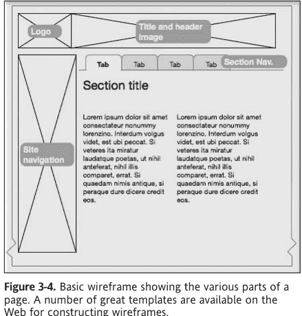

如果你使用素材照片和占位图形在 Adobe Photoshop 中制作页面模型，我们敢保证你收到的大部分反馈都会集中在你选择的图片或你用来高亮的黄色色调上。我们曾经用“Lorem Ipsum”占位文本制作了一个模型，结果客户回复说他们的网站需要用英语。翻白眼吧，我们也翻了。即使你尽了最大努力，客户仍然完全关注在错误的地方，这种感觉真的很让人沮丧。

想尽一切办法把他们的注意力拉回来。如果这意味着删除所有文字并用短横线代替，或者用灰色方块代替图片，那就去做吧。

通过移除图形、颜色和文字，你迫使人们专注于页面的布局和内容。这个活动旨在让人们思考什么样的排列方式能为你的页面带来最佳的界面效果，以及页面所包含内容的性质。

在这个阶段会出现诸如“将导航拆分为顶部的水平栏和几列垂直链接，这样做真的合理吗？”之类的问题。你也会经常听到诸如公司 logo 不够突出、内容区域空间不足等评论。

制作线框图的最大缺点是难以展示交互元素。如果有一个会展开和折叠的方框，用简单的草图很难表现出来。随着 Ajax 在网络上越来越多的使用，页面的“静态模型”概念将越来越不实用。

线框图真正有用的地方在于大型团队中，当你试图让所有人一次只专注于一件事时。如果你是与客户一对一工作，完全不用费心做线框图；直接进入原型阶段就好。让他们在浏览器中看到并操作网站；他们将能够更深入地理解正确的做法。

## 模型图

仍然有一些设计师会提前为客户制作 Photoshop 网站模型。有些甚至会制作两到三个不同版本，以便客户挑选最喜欢的那个。你可能已经猜到了，我们认为这在很大程度上是在浪费时间。

首先，你制作的几个版本中只会有一个被选中，那么你在其他版本上投入的所有时间和精力都将付之东流。为什么要将时间分散在多个方案上？只做一个设计，并把它做到最好。让每一个像素都完美无缺！

然后用 XHTML/CSS 呈现给你的客户。我们知道 Photoshop 已经深入设计师的思维习惯。如果你是那种需要面对空白画布才能激发创意的人，那就这样吧。但只做到你需要的程度就好。一旦你脑海中有了那个愿景，就开始在真实的网页中实现它。

与线框图类似，Photoshop 在展示动态内容方面表现很差。你可以切换图层的显示和隐藏，我们猜是这样，但为什么要花那个时间呢？用代码实现它，然后根据需要对代码进行小修改，效果一样快。写代码能让你思考生成页面的最佳方式，而不是思考如何复制你的 Photoshop 模型。

最理想的情况是设计师能写代码，程序员能像艺术家一样设计，但这种情况很少发生。如果你在一个规模足够大、同时拥有设计师和开发人员的组织中工作，现有的工作流程很可能会包含模型图。

在这种情况下，只需确保一旦你将模型图“转换”为可交互的东西，就要与设计师密切合作，审查你所做的工作是否符合他们预想的方向。

## 信息架构

这个活动的目标是规划网站的**站点地图**，并确定你将使用的命名规范和分类体系（你并没有突然滑入生物课本，别担心）。

包含公司“联系信息”的页面，你打算叫“Contact Information”（联系我们）、“Contact Us”（联系我们）还是简单的“Contact”（联系）？也许你会选择更随意的“Drop Us a Line”（给我们留言），或者“Feedback”（反馈）。这里没有标准答案；取决于多种因素。

如果你正在开发一个新网站，最好的办法可能是四处浏览一下，看看其他网站使用什么命名方式。访问一些大型网站，尝试在它们的页面和你的页面之间找到相似之处。我们并不是说“大厂”总是对的；只是很多人以前接触过这些网站，所以它们的命名方案已经被广泛接受。

如果你在重新设计一个现有网站，保留现有标签可能是合理的。现有用户群已经花了时间学习点击“Dude, hook me up”（兄弟，给我来一个）意味着进入在线商店。这是一个需要根据网站的目标和宗旨来做的判断。

如果你的客户希望吸引新客户，那么重命名链接以降低入门门槛可能是明智的。确定导航是网站成功的关键决策之一。一旦你认为自己想清楚了，找一个中立的第三方看看他们是否也能“理解”。

另一方面，如果主要目标只是更新外观并增加对现有用户的销售，就不要大动干戈。现有用户之所以是现有用户，是因为他们喜欢网站现在的样子。不要冒着疏远他们的风险去做为了改变而改变的大规模调整。

典型的站点图只是一系列标有页面名称的方框（参见图 3-5）。如果你发现你的网站充满了 Web 2.0 的豪气，Ajax 多于图片，那么在站点图上给每个页面编号，并提供一两段文字描述该页面上的一些功能和交互。

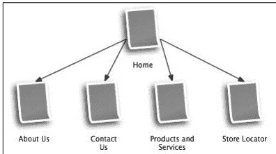

图 3-5. 一个典型的站点图，显示了页面名称及其相互关系

## 原型

但这不是工具，这是实际的生产工作！我们知道这很疯狂，但得到一个可运行的产品是目前最好的设计工具。在一个可运行的产品中，没有沟通失误或理解偏差。这只是完成项目的第一步。

当然，你可能在第一版中完全搞砸了一切，需要全部修改，但至少你现在知道了什么方法不可行。我们要暂停一下，提醒你我们向你展示这些工具并非按照特定顺序，而是一个可供你挑选的集合。

你应该牢记这一点的原因是，跳过除原型之外的每一个步骤也可能产生成功的项目。我们已经发布了很多极其成功的项目，除了初步讨论和一个最终演变为最终交付物的原型之外，没有任何前期规划。

从简单开始；最初甚至不用考虑设计。白色背景、黑色文字和简单的文字链接就足以布局产品并了解各个部分如何组合在一起。创建一些带有标题（如有内容也一并加入）的基本页面，并开始构建层级结构（参见图 3-6）。

图 3-6. 原型不必精美绝伦。从简单开始，逐步完善。将呈现形式与内容分离（使用 XHTML 和 CSS），可以让你快速调整外观。

在推进过程中逐步完善。将公司标志放入页面角落；让客户告诉你它是否太大、太小，或是紫色的色调不对。记录下所有变更请求，以免遗漏任何细节。更好的做法是，让客户自己列出清单。

像 Basecamp 或 Trac（我们在前一章讨论过）这样的工具，可以让你添加待办事项或工单，以跟踪哪些请求已完成、哪些尚未完成。

## 让我们来看一个例子

嘿，恭喜！我们听说你刚和硅谷一家炙手可热的新创公司签了合同，为他们即将在几个月后推出的热门 Web 2.0 产品制作销售网站。这真是太棒了！

你有点慌？这是你继上个月为你在克利夫兰的叔叔制作垒球网站之后，承接的第一个大项目？别担心，让我们一起梳理一下初始阶段。

好了，你已经知道这家初创公司计划在两个月（60天）后启动服务。作为创业者，他们的预算仍然相当紧张，但他们设法为项目凑集了 2000 美元。反正你刚开始职业生涯，所以你收取每小时 20 美元的标准费率。你相当确信自己将是这个项目的唯一负责人，而且听起来他们不需要太复杂的东西（事实上，你在与他们的初次谈话中，“简单”这个词出现了 35 次！）。

那么，从哪里开始呢？嗯，你读过的某本书曾经建议，启动项目的最佳方式是召开项目启动会。幸运的是，你下周要到硅谷地区度假，而且已经约好了去他们办公室拜访的时间。（天哪，这个项目真是一连串的幸运巧合！）不过，你到底要谈些什么呢？

## 第 3 章

首先，重要的事情优先。你一直只与首席执行官和市场副总裁沟通。你给他们发了一封简短的信息，感谢他们的信任并确认会议日期和时间。

在这条信息里，询问他们你将会见谁，并建议他们邀请任何可能与项目相关的人员。在这个阶段，保持开放的态度；让一些实际开发产品的同事在场可能会很有用。

同时，你转发了“目标与目的讨论”部分概述的六个问题。请他们提前花时间思考这些问题，并写下一些想法。还请他们将这些问题转发给所有与会人员。

快进一周，你与客户见面了。简短介绍后，你直接进入会议。幸运的是，每个人都准备充分，你顺利地讨论了这六个问题，几乎没有分歧或冲突。

然而，讨论中确实浮现出一个有趣的问题。管理团队担心他们将如何从客户那里获得反馈和改进建议，以便持续改进产品。

这正是从你的工具库中拿出第二件武器、让每个人都参与头脑风暴的最佳时机。你设好一分钟计时器，给在座的每人发一叠便签纸和一支笔，并提醒他们关注他们的客户。他们是谁？他们的专业水平如何？开始吧！

想法开始来回碰撞，“免费热线”、“用户讨论论坛”到“维基”等各种建议被抛到了桌面上。时间到了，你收集了所有的便签，走到墙边开始分组。

你逐一大声读出每个想法，必要时寻求澄清。你按所需的技术知识水平对它们进行分组，从“几乎不需要”（如免费电话号码）到“高级”（如维基）。

然而，维基这个想法有些耐人寻味。房间里的人开始讨论它，并思考着它如何能让公司大幅降低支持成本，让“专业”用户帮助新客户。公司员工只需偶尔过来回答一些“死胡同”问题即可。

你坐回去想了一会儿，觉得将这个功能纳入原项目并非完全不合理。现在已经有很多非常好的维基平台；将其集成到你的客户网站中，真的只需要几个小时的工作。

你知道他们有严格的 2000 美元预算限制，但你相当确信你可以调整一下预算。你开口告诉他们，你会处理好，不会额外收费。

你为项目设定了正确的基调。你表明你关心你的客户及其成功，并且你愿意做需要做的事情，以产出尽可能完美的成品。你离开会议时，对事情进展感觉良好，并承诺很快会给客户一些东西看看。

两周后（记住，你当时在度假），你给客户发送了一个你放在测试服务器上的原型链接。他们立即开始点击浏览，并给你发送关于他们喜欢和不喜欢的评论。

## 总结：实现平衡

你在规划阶段的目标是对最终产品的样貌有更清晰的认识。不要期望一开始就得到一张照片，但一个抽象的草图是一个好的目标。前面概述的工具实际上只是一些与客户沟通的标准方式，可能有助于你表达想法。如果需要，你可以在项目开发过程中的任何时候重复这些练习中的任何一项。看看在项目进程中事情如何演变可能会很有趣。

不要觉得有必要像遵循通往项目成功的路线图一样，把这里概述的所有事情都过一遍。在开始任何这些活动之前，问问你自己（或项目团队中的任何人）是否还会再次查看这些活动的产出。如果你在制作原型时会完全忽略它，那么开发信息架构/站点地图的意义何在？

一个非常重要的点是，这些活动的产出都不应被视为“锁定”的材料。敏捷项目要求在发现更多信息后进行迭代和变更。如果某人创建了一个用户故事，概述了讨论论坛的需求，但后来明显没人对使用讨论论坛感兴趣，那就砍掉它。

## 职业剖析：丹尼尔·布尔卡

*丹尼尔·布尔卡在网页社区中以 Web 2.0 设计的先驱而闻名。他为极受欢迎的社区新闻网站 `Digg.com` 实施了出色、简洁的设计，并持续努力整合社区反馈以不断改进和进化 `Digg`，这使他成为备受追捧的设计师和演讲者。*

*他的最新项目 `Pownce` 也大获成功，它为用户提供了一个极其易于使用的界面，用于在朋友网络中分享文件、链接和活动。*

**莱恩：** 跟我们说说你最近在忙些什么吧。

**布尔卡：** 白天，我是 `Digg` 的创意总监；晚上（以及所有空闲时间），我设计 `Pownce` 的用户界面。在 `Digg` 担任创意总监意味着我管理一个小型设计师团队，负责网站上所有的用户界面任务。我与 `Digg` 的创始人凯文·罗斯密切合作，构思概念，确定功能如何融入界面，并总体上捍卫所有与用户体验相关的事物。我在 `Pownce` 扮演的角色类似，不过我们的团队非常小，我花更多时间开发新事物，而不是完善现有功能。

**莱恩：** 跟我们讲讲你的背景：比如教育经历和工作经验，是如何引导你从事网页设计的。

**布尔卡：** 我很幸运地在高中时就偶然接触了网页设计。我的双胞胎兄弟和一些朋友在尝试平面设计工具，我就加入了。然后我们发现，通过一个加拿大政府项目，我们可以在夏天做政府赞助的网页项目赚点轻松钱。几年下来，这群朋友凝聚在一起，成立了一家公司叫做 `silverorange`，最终发展成为一个非常强大的网页开发工作室。

我实际上在大学学的是历史，最终（八年后！）获得了历史学学士学位，辅修艺术史。我认为这种学术教育在许多方面帮助了我，但我在 `silverorange` 和朋友们通过试错学到了大多数实用的设计实践。

**莱恩：** 请带我们回顾一下你设计 `Digg.com` 时经历的过程。你最初的想法从何而来？


**布尔卡：**启动 Digg 实际上有点令人生畏，因为它从一开始就是一个非常大的项目。我没有一开始就处理整个项目，而是试图找出使 Digg 独特的核心组件，也就是主页上的故事条目。我专注于这一部分，花了好几天时间分解它、重组各个部分，并开发一种视觉语言。这项基础工作确立了许多想法，随着我们扩大范围，这些想法渗透到了网站的其余部分。

## Lane：你最喜欢的网站有哪些？为什么？

**Burka：**《A List Apart》：内容精彩，布局合理且极具吸引力。这些优点的重要性次序恰好如此。苹果公司：苹果能将主页保持为一个单一的焦点元素，这令人印象深刻。CNN：我并非认同 CNN 网站上的每个设计决策，但随着时间的推移，CNN 网站的演进确实令人赞叹。

## Lane：对于刚开始从事网络工作的人，你有什么建议？

**Burka：**我建议人们寻找一群志同道合的伙伴合作。无论你是就读设计学校，还是从小型企业起步，找到一群能与你交流想法、批评你的作品、并一起愉快学习的人，都是宝贵的资源。当然，自学网页设计也是可能的，但我怀疑其效率和乐趣会大打折扣。哦，还要听从杰弗里·泽尔德曼的建议——先收取一半的款项。

## Lane：设计网站时你会用到哪些工具？

**Burka：**从白板开始，然后转到 Photoshop，最后用 Coda 编写代码。我用笔和纸简直画不出像样的东西。

## Lane：网络技术发展非常迅速。你通过哪些方式来跟进设计和技术的最新趋势？

**Burka：**订阅 RSS 源，以及与合适的人交流。从事网络工作的一大好处是，几乎所有讨论都在线上进行。我在加拿大东部度过了网页设计职业生涯的前七年，但我们从未落后于行业的变化。博主和像《A List Apart》这样的网站确实让你紧跟潮流。

## Lane：如果有一件事你能完全改变网络（或添加/删除），那会是什么？

**Burka：**很明显，这将是根本性的转变，但消除网络的无状态性将带来巨大的改变。能够随意使用浏览器控件在网站中前后跳转，导致我们做出了各种奇怪的设计决策，而这些决策在很多时候我们甚至没有多加思考。

## Lane：你认为未来几年网络会如何发展？你对什么感到兴奋？

**Burka：**我对移动网络重焕活力的潜力感到兴奋。多年来人们一直在预测移动设备的崛起，现在它终于开始展现出前景。而且，最棒的是，有了 iPhone 这样的设备，移动网络体验与标准网络体验之间的差距正在缩小。

## Lane：新的网页设计师/开发者可以做些什么来提升知名度并受到关注？

**Burka：**说真的，首先要做出真正出色的工作。很久以前，我曾与一位最优秀却鲜为人知的平面设计师交谈，他告诉我，如果你做好工作，其他一切都会水到渠成。这是非常好的建议。

更好的短期建议是，不要坐等好工作降临。如果你有额外的时间，可以开发虚构的项目和实验。37signals 早期对银行、运输和支付网站的概念性重新设计就是很好的例子。这将帮助你建立一个令人印象深刻的个人作品集，即使你还没有令人印象深刻的客户。

# 第 4 章：使用 HTML 和 XHTML 编写标记

如果没有网页，网络会是什么样子？网页到底是什么？显然，网页包含大量*内容*，并且由各种不同类型的内容组成。例如，许多网页有文本，许多也有图像。有些网页有视频。还有一些网页有包含价格列表或比较图表的表格。

网页中的所有这些内容，就像你小时候可能玩过的乐高积木一样，由许多不同的片段组成，这些片段被称为**元素**，当它们以特定方式组合在一起时，就形成了你看到的页面。因此，单个网页实际上可以分解为许多不同的独立元素。事实上，这正是网页开发者构建网页时所做的——他们将许多不同的片段以特定方式组合在一起。

然而，在我们展示如何开始构建完整的网页之前，我们将首先讨论这些独立元素，并展示它们如何组合在一起。

## 网页到底是什么？

你可能会惊讶地发现，即使你看到的网页充满了图片和视频之类的东西，但归根结底，每个页面都只是一串（尽管可能很长的）文本。当然，并非所有内容都是英语，因为像你的网络浏览器这样的计算机程序实际上并不说或理解英语。然而，你的网络浏览器确实理解一种语言，即超文本标记语言（HTML）。

当你在网络浏览器中访问一个网站时，你实际上是在告诉你的网络浏览器下载一个文件。这个文件，称为**HTML 文档**，不过是一堆用你的网络浏览器能够读懂的 HTML 编写的文本。下载的 HTML 随后由你的网络浏览器解释，并作为网页显示给你。

如果一切都只是一串文本，你可能会想，网络浏览器怎么知道图片应该放在左上角，或者这两段文本属于不同的段落呢？答案是，除了 HTML 文档中的所有*内容*（例如两个段落的文本）之外，还有关于内容的信息。这些关于内容的信息在网页上实际上是不可见的，但请相信我们，它确实存在。

正是所有这些额外的信息，称为**标记**，告诉网络浏览器内容片段是什么类型，它们在那长串文本中的起始和结束位置，以及它们的名称。

稍加思考，你就会意识到这与你写信或和朋友通电话时所做的没有太大不同。写信时，你通常会在单独的行上签名结束，读者可以将这部分信件识别为发件人。同样，当你和朋友说话时，你不会在每个句子结束时说“句号”，你只是稍微降低语调。你的朋友知道这意味着你说完了。

网络浏览器做同样的事情，只不过它们没有语调，也没有特定位置（比如结尾处）的文本行来获取关于它们所拥有内容的提示。相反，它们使用所有那些不可见的标记来弄清楚。

## 标记的基础

最终出现在网页上的所有内容都必须经过专门准备才能放上去。无论你多么希望如此，你不能简单地将 Microsoft Word 文档中的所有内容复制粘贴到一个空文本文件中，并称之为网页。如果你这样做，你的页面将缺少网络浏览器理解你所提供内容所需的所有重要标记。幸运的是，为网络准备文档——或者说**标记**文档——实际上是一个简单的过程，涉及使用一组工具并将其用于正确的用途。本章的其余部分将概述这些工具的由来、它们的用途以及如何最好地使用它们。到本章结束时，你将能够像你的网络浏览器一样理解那串很长的 HTML 文本。

## 计算机标记语言的起源

如前所述，**标记语言**仅由特定类型的注释组成，用于标识文档的组件。这种标识允许任何机器、用户或系统（例如今天使用的数百种不同的网络浏览器）以有意义的方式解释内容。标记语言可以追溯到 20 世纪 60 年代，已经被用来定义和识别数据数十年。最早的标准化标记语言之一称为标准通用标记语言（SGML），名称非常简单。

SGML 最初是为政府、法律及其他需要被计算机阅读和“理解”的复杂结构化文档而创建的。时至今日，《牛津英语词典》仍然完全以 SGML 标记。该语言具有许多特性且非常灵活，但对于当今大多数简单的用途（如显示网页）来说，它仍然过于繁琐。因此，SGML 的几个衍生语言变得流行起来，例如 HTML 和可扩展标记语言（XML）。

由于网页不需要像政府文档那样复杂，HTML 被设计为 SGML 更简单、更有限的衍生语言。然而，随着 Web 从一个学术文档链接系统演变为今天的形态，人们逐渐意识到 HTML 在某些时候*过于*受限。与其回到 SGML 所要求的那种复杂的全有或全无的方式，XML 被开发出来，旨在创建一种模块化的标记语言，作为基础平台，任何人都可以在此之上创建自己的*自定义*标记语言。由于任何人都可以按照自己的选择以任意方式扩展这种语言，这个新规范被称为可扩展标记语言。

得益于其作为模块化和可扩展语言的明确设计，XML 是当今使用的最灵活的标记语言之一。XML 有各种各样的扩展，涵盖从计算机配置文件到矢量图形，当然还有网页等所有类型的内容。XML 在网页方面的具体应用被称为可扩展超文本标记语言（XHTML）。

与 HTML 一样，XML 使用 SGML 属性的子集。与 HTML 不同的是，XML 为标记语言定义了更为严格的语法和语法规范。这使得它更易于学习，也更易于人和机器阅读。尽管语法严格，它仍然保持灵活和开放，甚至可以存储最多样化的数据。

## 元素（和标签）

那么，所有这些标记是如何工作的呢？让我们仔细研究一些 XML 标记示例来一探究竟。

回想一下，标记的核心目的是将内容组织成相关的部分并显式地标识它们。这些内容被分组为若干节，称为**元素**。元素的起始和结束注解通常被称为**标签**。

元素不过是包裹在一对标签之间的文本。尖括号，即 `<` 和 `>` 字符，界定了标签的开始和结束。例如，考虑这段文本：

Where the Streets Have No Name

你可能很容易辨认出这是乐队 U2 创作的一首歌名。然而，其他人可能无法识别这首歌名，因此你需要以适当的标记形式来标明它。那么，我们来标记它是什么，并将其识别为标题，如下所示：

```xml
<title>Where the Streets Have No Name</title>
```

所以，你现在通过在歌曲标题的开头添加 `<title>` 标签来标识了标题的起始位置，但在 XML 中，这还不够。你还需要标识这个标题在哪里结束。为此，你只需再次使用相同的标签，并在左尖括号后直接加上一个正斜杠：

```xml
<title>Where the Streets Have No Name</title>
```

现在你已经成功地标记了这首歌的标题，通过显式地使用开始标签 `<title>` 和结束标签 `</title>` 来注解其起始和结束位置。你所创建的是一个 `<title>` 元素，在本例中，它不过是歌曲的文本内容。在 XML 及其所有具体应用中——包括 XHTML——所有包含任何类型内容（无论是文本还是其他元素）的元素都以这样一对标签开始和结束。

接下来让我们添加艺术家信息，以便 XML 文档的读者知道是哪个乐队创作了这首歌。你所要做的就是将文本 U2 标记为一个同样显而易见的元素。我们将其命名为 `<artist>`，并直接添加在标题之后：

```xml
<title>Where the Streets Have No Name</title>
<artist>U2</artist>
```

你可以继续以这种方式添加关于这首歌的信息，包含各种各样的信息。例如，这首歌于 1987 年收录在名为 *The Joshua Tree* 的专辑中。你可以将此添加到你的信息列表中，标记如下：

```xml
<title>Where the Streets Have No Name</title>
<artist>U2</artist>
<album>The Joshua Tree</album>
<released>1987</released>
```

至此，你已经在 XML 文档中编码了大量关于这首歌的信息。现在让我们更进一步，在同一文档中编码多首歌曲的信息。为此，你需要一种将所有与单首歌曲相关的元素分组在一起的方法，以便清楚地划分一首歌曲的信息在哪里结束，下一首从哪里开始。

在 XML 和大多数其他标记语言中，如果信息能够以有意义的方式组合在一起，元素可以被**嵌套**（放置在另一个元素内部）。因此，你可以将已经为单首歌曲定义的所有标记放入一个 `<song>` 元素中，如下所示：

```xml
<song>
    <title>Where the Streets Have No Name</title>
    <artist>U2</artist>
    <album>The Joshua Tree</album>
    <released>1987</released>
</song>
```

现在，你已经在文档中定义了一个 `<song>` 元素。由于该 `<song>` 元素包含了另外四个元素，因此它被认为有四个**子元素**，而它自身被称为这些子元素的**父元素**。

> 你可以看到 SGML 衍生标记语言的一个常见惯例。任何嵌套在另一个元素内部的元素通常都会缩进，而外层元素的开始和结束标签各占一行。这样做纯粹是为了方便人类阅读和编辑。用于解释这些标记的软件程序通常会忽略标签之间的所有空白字符（包括缩进、换行等），以及元素内部或元素内容中的额外空白字符，因此从技术上讲，所有这些标签完全可以紧挨在一起，仍然具有同样的意义。浏览器简单地将任意数量的连续空格或制表符解释为一个空格。尽管如此，保持这种缩进风格是一个好习惯，因为当标记的结构在视觉上一目了然时，编辑起来要容易得多。

现在你的歌曲信息已经正确分组，很容易将这个文档扩展以包含其他歌曲。例如，你可能希望有一个文档包含你收藏的某张混音专辑的信息。你可以复制单首歌曲的标记，然后简单地更改不同歌曲中子元素所包含的信息，如下所示：

```xml
<song>
    <title>Where the Streets Have No Name</title>
    <artist>U2</artist>
    <album>The Joshua Tree</album>
    <released>1987</released>
</song>
<song>
    <title>Hungry Like the Wolf</title>
    <artist>Duran Duran</artist>
    <album>Rio</album>
    <released>1982</released>
</song>
<song>
    <title>More Than a Feeling</title>
    <artist>Boston</artist>
    <album>Boston</album>
    <released>1986</released>
</song>
<song>
    <title>Dream On</title>
    <artist>Aerosmith</artist>
    <album>Aerosmith</album>
    <released>1973</released>
</song>
```

这还不够完整，因为你现在只有一堆独立的歌曲，还不是你的混音专辑的播放列表。你仍然需要以某种方式将这些歌曲分组在一起。让我们使用一个 `<playlist>` 元素来实现这个目的：

```xml
<playlist>
    <song>
        <title>Where the Streets Have No Name</title>
        <artist>U2</artist>
        <album>The Joshua Tree</album>
        <released>1987</released>
    </song>
    <song>
        <title>Hungry Like the Wolf</title>
        <artist>Duran Duran</artist>
        <album>Rio</album>
        <released>1982</released>
    </song>
    <song>
        <title>More Than a Feeling</title>
        <artist>Boston</artist>
        <album>Boston</album>
        <released>1986</released>
    </song>
    <song>
        <title>Dream On</title>
        <artist>Aerosmith</artist>
        <album>Aerosmith</album>
        <released>1973</released>
    </song>
</playlist>
```

最终，你得到了一个包含四首歌曲的完整播放列表，并且已经用 XML 正确标记。仅使用 XML 最基本的构建块——元素，你就可以创建任意复杂的文档，以层次结构的方式编码关于任何主题的信息。这种层次结构被称为**树**。然而，如果你只能使用元素来工作，你的树会很快变得非常庞大，迅速变得难以管理。因此，除了元素之外，XML 标记语言还有另外两个非常重要的部分，允许你为数据添加额外信息：属性和值。

## 属性及其值

如前所述，**属性**是在 XML 文档中为元素添加额外信息的一种方式。属性总是指定某个值，因此你总是会看到属性和值以`属性名="属性值"`的形式一起出现。在 XML 中，通常每个元素可以拥有无限数量的属性，但实际上 XML 的每个具体应用都有一组特定的有效属性以及这些属性的有效值。学习任何 XML 方言的一部分，就是学习哪些元素可以拥有哪些属性，以及这些属性允许的值是什么。

属性及其值通过将其名称和值添加到它们所属元素的开始标签内来指定。例如，你可以将此播放列表的创建日期作为 `<playlist>` 标签的一个属性。例如，让我们指定你的播放列表创建于 2006 年 5 月 28 日。你可以将此数据添加到 `<playlist>` 标签中，如下所示：

```xml
<playlist created="May 28, 2006">
```

另外，如果你想要指定播放列表的作者，你可以像这样添加该数据：

```xml
<playlist author="johndoe">
```

要同时包含播放列表的作者和创建日期，你只需在同一个元素中包含多个属性即可：

```xml
<playlist author="johndoe" created="May 28, 2006">
```

这引出了一个有趣的问题：什么数据应该标记为元素，什么数据应该标记为属性/值对？你本可以同样轻松地创建一个 `<author>` 元素，并在播放列表标签内将 johndoe 定义为其内容，或者以相同方式创建一个 `<created>` 元素。虽然这里并没有真正的对错之分，但通常认为最佳实践是将属性和值用于**元数据**（或关于数据的数据），而将元素用于其他所有内容。

换言之，如果数据是打算让最终用户看到的，最好将其标记为元素。如果数据是描述文档中其他数据的，最好使用属性/值对。这通常是一个容易让人困惑的话题，所以不必认为必须立刻做到完美。很多时候你只需退一步，看看你打算如何使用该数据，并根据其应用场景确定最适合你的标记方案。

## 空元素

还有一种方式可以在 XML 文档中编码信息，那就是使用**空**元素。空元素与普通元素一样，只是它们内部不包含任何内容，既没有文本，也没有其他元素。此类元素非常适合用于在 XML 文档中嵌入指向其他文档或对象（如图片）的指针，或存储关于文档的重要“是/否”（布尔）值。

例如，如果你想在自动刻录 CD 的应用程序中使用你的播放列表文档，你可能会在 `<playlist>` 元素内嵌入一个名为 `<burn>` 的空元素，它可以有一个名为 `format` 的属性，其值表示刻录混音时使用的 CD 格式类型：


```xml
<burn format="music" />
```

请注意，空元素与非空元素一样，既有开始标签也有结束标签。不过对于空元素而言，结束标签就是开始标签，只需在右尖括号前加上结束斜杠即可表示。

## 文档类型

在标记文档时，你必须遵守某种标准，该标准规定了文档中允许出现哪些元素、属性和值，以及它们允许出现的位置和允许包含的内容。如果 Web 开发者不遵守这些标准，世界上每个网站都可能使用不同的元素、属性和值，那么任何 Web 浏览器（更不用说任何人类了！）都无法保证能正确解读网页上的内容。例如，在前面的示例中你使用了 `<playlist>` 元素来包裹你最喜欢的混音，而其他人可能使用了 `<favorite-mix>` 元素。

幸运的是，网页和大多数其他类型的 XML 文档所使用的标准是公开发布的，被称为**文档类型**。每个 XML 文档都通过在所有内容之前包含一个特殊的 `<!DOCTYPE>` 标签来声明自己是特定类型的文档，该标签带有引用特定文档类型定义的相应属性。文档类型定义本身也是一个标记文档，它定义了特定文档类型的规则，或称**语法**。

DTD 是设计给机器阅读的，而不是给人类阅读的，所以它们可能非常复杂。作为 Web 开发者，你需要理解的重要一点是：正是文档类型决定了你到底可以如何使用元素、属性和值来构建你的网页。在实践中，网页实际引用的 DTD 类型只有少数几种，因此你只需要熟悉这些类型的规则即可。

作为简短的练习，让我们来看看前面的简单示例中允许使用哪些元素、属性和值。首先，你需要允许以下元素的存在：`<playlist>`、`<burn>`、`<song>`、`<title>`、`<artist>`、`<album>` 和 `<released>`。接下来，你需要指定名为 `created` 和 `author` 的属性只能附加到 `<playlist>` 元素上，而 `format` 属性只能附加到 `<burn>` 元素上。你可以声明这些属性接受任何值，也可以声明 `created` 属性只接受“日期”值，`author` 和 `format` 属性只接受“文本”值。如果你这样做，还需要明确定义什么是“日期值”和“文本值”。

文档类型定义不仅有助于你理解如何正确地构建标记，还可以让计算机实际检查你的标记。名为**验证器**的软件程序可以读取一份标记文档及其对应的 DTD，并提醒你两者之间是否存在任何不一致之处。以你的示例为例，如果你不小心输入错误创建了一个 `<spong>` 元素，或者试图将 `author` 属性指定在 `<title>` 元素而不是 `<playlist>` 元素上，你的 DTD 就能提醒你。

## 从 XHTML 开始

多年来已经指定了多种 HTML 和 XHTML 的变体。随着标准兼容互联网的好处被更广泛地接受，以及从 HTML 向基于 XML 的 XHTML 过渡的开始，两种类型的 XHTML 被创建出来。一种叫做 XHTML 1.0 Transitional，另一种叫做 XHTML 1.0 Strict。顾名思义，过渡型文档类型（简称 **doctype**）比严格型更为灵活和宽松，旨在作为习惯于 HTML 较为宽松的语法和句法的开发者的过渡步骤。

因为这种过渡在大多数情况下应该已经完成，而且更重要的是，你很可能不属于上述类别的开发者，你将直接开始学习 XHTML 1.0 Strict。

## 文档外壳

创建新的 XHTML 文档时，从基本模板开始最为简便，因为有几个元素、属性和值是你始终需要的，而且它们大多难以记住。首先，在你的电脑上创建一个名为 `html` 的新文件夹，在其中创建一个新的空白文档并保存为 `index.html`。打开 `index.html`，在其中输入以下代码：

```xml
<!DOCTYPE html PUBLIC "-//W3C//DTD XHTML 1.0 Strict//EN"
    "http://www.w3.org/TR/xhtml1/DTD/xhtml1-strict.dtd">
<html xmlns="http://www.w3.org/1999/xhtml" xml:lang="en" lang="en">
<head>
    <meta http-equiv="Content-Type" content="text/html; 
charset=utf-8"/>
    <title>New Document</title>
</head>
<body>

</body>
</html>
```

在继续之前，让我们逐一查看这些标记的实际含义。

这是标识该文档 doctype 的代码：

```xml
<!DOCTYPE html PUBLIC "-//W3C//DTD XHTML 1.0 Strict//EN"
    "http://www.w3.org/TR/xhtml1/DTD/xhtml1-strict.dtd">
```

这段代码的意思是你正在使用 W3C 发布的 XHTML 1.0 Strict 定义，该 DTD 在线地址为 `http://www.w3.org/TR/xhtml1/DTD/xhtml1-strict.dtd`。就是这样。它看起来很复杂，但在每个 XHTML 1.0 Strict 文档中都是相同的，每次只需复制粘贴即可。

这是 `<html>` 元素的开始标签：

```xml
<html xmlns="http://www.w3.org/1999/xhtml" xml:lang="en" lang="en">
```

排除 doctype，文档中的所有其他内容都在这个“根”元素内。这里的属性和值指定了 XML 命名空间（`xmlns`）为 XHTML，XML 语言为英语，文档语言也为英语。与 `<!DOCTYPE>` 声明一样，`<html>` 元素的开始标签也可以复制粘贴到每个（英文）XHTML 文档中。（对于内容非英文的 XHTML 文档，只需更改 `lang` 属性的值即可。）

### head 部分

这是文档的 `<head>`：

```xml
<head>
    <meta http-equiv="Content-Type" content="text/html; 
charset=utf-8"/>
    <title>New Document</title>
</head>
```

大量信息被放入 `<head>` 中，比你目前看到的要多得多。这里的重要区别是，文档 `<head>` 中的信息实际上不会显示在 Web 浏览器窗口中（`<title>` 中的信息除外）。不过，浏览器会读取其中的部分信息并以多种方式加以利用。

在 `<head>` 元素内，你首先看到的是（空的）`<meta>` 元素。如前所述，元数据是关于数据的数据，这个元素用于提供文档本身的信息。在本例中，它表明内部内容是文本/HTML，并且所有文本都使用 UTF-8 字符集编码。

> 这份文档是 XHTML 还是 HTML？尽管文档类型声明指定这是一个 XHTML 文档，但 `<meta>` 元素却告诉浏览器它是 HTML 文档。那么，浏览器听谁的呢？实际上，大多数时候浏览器两者都不听，而是信任 Web 服务器来设置相应的 HTTP 头。如果设置了，大多数浏览器会忽略文档类型声明和 `<meta>` 元素中设置的任何值，并根据服务器所说的内容来解析标记。由于大多数 Web 服务器被错误地配置为告诉浏览器 XHTML 文档实际上是 HTML 文档，XHTML 的设计者确保了标记与 HTML 完全兼容，以避免因这种不一致而可能出现的问题。

下一个元素很可能是文档中最重要的元素之一：`<title>` 元素。它只是一个为你的文档内容命名的地方。`<title>` 元素内的内容通常显示在 Web 浏览器窗口的标题栏或正在查看的页面的浏览器标签页上。要更改 `<title>` 元素的值，只需将 “New Document” 更改为最准确、最能描述你页面内容的文字即可。

标题也经常用作 Google 和 Yahoo 等搜索引擎搜索结果中的标题。当人们搜索你页面上的内容，而搜索引擎找到并显示你的页面作为结果时，你页面的标题往往是他们决定你的页面是否是其所需内容的唯一依据。如果你希望人们通过搜索引擎找到你的页面，请密切关注 `<title>` 元素。

## 主体

主体是文档主要内容所在的地方。它目前是空的，但你很快就会用你页面的内容来填充它。

```xml
<body>

</body>
```

最后，你需要关闭在文档顶部附近打开的 `<html>` 元素：

```xml
</html>
```

## 标记内容

现在你已经有了文档的骨架，是时候开始添加真实内容了。XHTML 中有许多可用的元素，每个元素都有不同的用途。让我们从标题开始，了解一些最重要的元素。

当你开始向 XHTML 文档添加标记内容时，请密切关注你使用的元素名称。由于标记的目的是明确标记内容以定义它在文档中应充当何种构建块，因此 XHTML 中的所有元素都被设计为**语义丰富的**，换句话说，为它们所定义的内容提供意义。

### 标题

在你创建的几乎所有文档中，你都会遇到需要用标题来介绍文档中的文本部分或其他内容。如果你过去处理过任何形式的出版物，你会明白标题有不同的级别：主标题、副标题、三级标题等等。在 XHTML 中，你可以使用六个级别的标题，这些元素被称为 `<h1>` 到 `<h6>`。`<h1>` 标签用于文档中最重要的标题，而 `<h2>`、`<h3>` 等的重要性依次递减，直到 `<h6>`，这是文档中最不重要（或最深奥）的标题。让我们看一个例子：

```xml
<h1>How I Learned to Ride a Bike</h1>
```

正如你所料，标题不能嵌套在彼此内部，但它们可以紧挨着彼此：

```xml
<h1>Overview of How I Learned to Ride a Bike</h1>
<h2>Step 1: Practice with Training Wheels</h2>
<h2>Step 2: Practice Balancing Without Support</h2>
```

本质上，标题为你的内容创建了大纲，因此当用标题标记文档时，请务必思考什么样的大纲最有意义。

### 文本块

很可能，你文档的大部分内容将只是文本块，如段落、块引用和其他类似的东西。XHTML 有专门用于这些项目的元素。大多数元素的应用就像标题一样简单。让我们看一个包含几个段落的例子：

William Shakespeare was an English poet and playwright. He is widely regarded as the greatest writer of the English language and the world's pre-eminent dramatist. His surviving works include approximately 38 plays and 154 sonnets, as well as a variety of other poems. Shakespeare was also respectively modest about his innovative works, never truly boasting about his tremendous ability. He is often called England's national poet and the “Bard of Avon” (or simply “The Bard”).

Shakespeare was born and raised in Stratford-upon-Avon, and at age eighteen married Anne Hathaway, with whom he had three children. Sometime between 1585 and 1592 Shakespeare moved to London, where he was an actor, writer, and part-owner of the playing company the Lord Chamberlain's Men (later known as the King's Men), with which he found financial success. Shakespeare appears to have retired to Stratford in 1613, where he passed away three years later at the age of 52.

Shakespeare produced most of his known work between 1590 and 1612. He is one of the few playwrights of his time considered to have excelled in both tragedy and comedy, and many of his dramas, including Macbeth, Hamlet and King Lear, are ranked among the greatest plays of Western literature. His works have greatly influenced subsequent theatre and literature, through their innovative use of plot, language, and genre.

你通过使用专为这种内容设计的元素来标记这些文本块，从而向 Web 浏览器表明它们是段落。由于文本段落在网页上非常常见，因此用于它们的元素被赋予了简写名 `<p>`：

```xml
<p>William Shakespeare was an English poet and playwright. He is widely regarded as the greatest writer of the English language and the world's pre-eminent dramatist. His surviving works include approximately 38 plays and 154 sonnets, as well as a variety of other poems. Shakespeare was also respectively modest about his innovative works, never truly boasting about his tremendous ability. He is often called England's national poet and the "Bard of Avon" (or simply "The Bard").</p>
```

```xml
<p>Shakespeare was born and raised in Stratford-upon-Avon, and at age eighteen married Anne Hathaway, with whom he had three children. Sometime between 1585 and 1592 Shakespeare moved to London, where he was an actor, writer, and part-owner of the playing company the Lord Chamberlain's Men (later known as the King's Men), with which he found financial success. Shakespeare appears to have retired to Stratford in 1613, where he passed away three years later at the age of 52.</p>
```

```xml
<p>Shakespeare produced most of his known work between 1590 and 1612. He is one of the few playwrights of his time considered to have excelled in both tragedy and comedy, and many of his dramas, including Macbeth, Hamlet and King Lear, are ranked among the greatest plays of Western literature. His works have greatly influenced subsequent theatre and literature, through their innovative use of plot, language, and genre.</p>
```

同样，这里没有任何复杂之处。只需用开始段落标签（`<p>`）开始段落，并用结束段落标签（`</p>`）结束它。

除了段落，你还可以通过使用 `<blockquote>` 元素（块引用的缩写）来表示一段文本是引自其他来源。由于 `<blockquote>` 元素唯一表明的是其内容来源于其他地方，因此在每个 `<blockquote>` 元素内部，你仍然需要使用标题和段落等元素来标记引用内容。正是通过这种方式嵌套元素，你才开始为你的内容提供丰富的含义。这是一个引用了几个段落的块引用示例：

看这文本，其实格式已经很好了，而且似乎来自一本 XHTML/HTML 教程书。OCR 质量非常高，错误很少。让我来清理一下：

大多数时候，当你引用外部来源时，你会想要连同引用一起标注出处。正如你可能已经猜到的，有另一个 XHTML 元素专门为此设计：`<cite>` 元素。然而，不同于包含其他文本块的 `<blockquote>` 元素，`<cite>` 元素只允许包含其他文本（而不能包含文本块）。当你引用前面的引文时，它看起来是这样的：


> Through the release of atomic energy, your generation has brought into the world the most revolutionary force since prehistoric man's discovery of fire. This basic force of the universe cannot be fitted into the outmoded concept of narrow nationalisms.
>
> For there is no secret and there is no defense; there is no possibility of control except through the aroused understanding and insistence of the peoples of the world. We scientists recognize your inescapable responsibility to carry to your fellow citizens an understanding of atomic energy and its implication for society. In this lies your only security and your only hope - you believe that an informed citizenry will act for life and not for death.
>
> — `Albert Einstein`

`<cite>` 元素必须放在段落里面的一个很好的理由是，这样可以更准确地指明被引用的出处。比如说，你希望在最后一个段落中的内容是 "Original Quote by Albert Einstein." 与其引用整句话（那样没什么意义），你可以像这样标记这个引用：

```html
<p>Original Quote by <cite>Albert Einstein</cite></p>
```

这要准确得多，因为它明确且清晰地将引用出处（本例中是 Albert Einstein）单独分离出来，从而提供了更有意义的标记。

与使用 `<blockquote>` 元素的方式类似，还有两个常用的元素用于标记特定的内容块。首先是 `code` 元素，它表示所包含的文本是，正如你猜到的，某种计算机代码。（通常不指定是哪种类型的代码，不过如果你愿意，可以使用某些属性来指定。）`code` 元素可以用来标记大段内容，或者仅仅标记代码片段，或者句子中的一个单词，就像 `<cite>` 标签一样。

然后是 `<pre>` 标签，它表示其中的内容是*带有换行、空白、制表符等预格式化*的，它在浏览器窗口中的渲染方式应该与在实际物理标记中的外观一致。`<pre>` 标签最常与 `<code>` 标签结合使用，以展示计算机语言摘录，或显示某些特定类型的格式化文本，例如诗歌。

## 内容分组

在标记页面内容时，你总是会有一些以某种方式相互关联的元素组。无论是标题和几个段落、一组列表，还是品牌和导航，将这些元素分组并标识出来都是有意义的。你可以使用 `<div>` 元素来实现这一点，它是 *division*（分区）的缩写。`<div>` 元素只是将内容分组为相关的块，并且不会给内容赋予进一步的语义含义（或默认视觉外观）。

例如，如果你有一个标题，后面跟着几个与该标题相关的段落信息，你可以将这些内容嵌套在 `<div>` 元素内部，以表明这种关系。当然，这是一种非常松散的关系，但在标记整个页面内容时，它可能是一个重要且有用的工具。`<div>` 元素还可以嵌套在自身内部以形成更具体的关联，使用一个 `<div>` 元素来关联已经分组在其他 `<div>` 元素中的内容。

```html
<div>
    <h1>Overview of How I Learned to Ride a Bike</h1>
    <p>In this short excerpt, I'll describe the various steps I needed to
    take to learn how to ride a bicycle when I was but a young lad.</p>
</div>
```

通过像这样将内容分组为逻辑块，你就可以同时对整个块施加更改和操作。但是，你如何识别你想要处理的是哪个块呢？为此，你需要使用下一节中描述的一些常用属性，为这些块提供描述性名称。

## 内容标识

XHTML DTD 定义了两个**核心**属性，可用于给元素命名，以便后续引用（主要用于本书后面介绍的层叠样式表）。这些属性是 `id` 和 `class`，它们都可以用在任何元素上。`id` 属性只是一种为元素提供唯一标识的方式。`class` 属性用途类似，但不同于在整个文档中必须唯一，`class` 可以指定任意多次。

这方面的一个常见例子是为特定的 `<div>` 元素设置 `id` 属性，以便为该分组赋予更多含义。例如，假设你有一个标题和一段关于网站上特色产品的段落：

```html
<h1>Swingline Stapler</h1>
<p>This workhorse stapler brings you a solid and consistent performance that makes it an industry standard. An all-metal die-cast base for years of durability. A performance driven mechanism with an inner rail for long-term stapling integrity. Ease of use, refined design, time-tested features: exactly what you'd expect from America's #1 stapler.</p>
```

让我们将这两个元素嵌套在 `<div>` 元素中以将它们分组在一起：

```html
<div>
    <h1>Swingline Stapler</h1>
    <p>This workhorse stapler brings you a solid and consistent
        performance that makes it an industry standard. An all-metal
        die-cast base for years of durability. A performance driven
        mechanism with an inner rail for long-term stapling integrity.
        Ease of use, refined design, time-tested features:
        exactly what you'd expect from America's #1 stapler.</p>
</div>
```

现在你可以使用 `id` 属性将该 `<div>` 元素标识为网页上的一个"特色"：

```html
<div id="feature">
    <h1>Swingline Stapler</h1>
    <p>This workhorse stapler brings you a solid and consistent
        performance that makes it an industry standard. An all-metal
        die-cast base for years of durability. A performance driven
        mechanism with an inner rail for long-term stapling integrity.
        Ease of use, refined design, time-tested features:
        exactly what you'd expect from America's #1 stapler.</p>
</div>
```

由于你使用了 `id` 属性，这也意味着你在任何时候网页上都只会有一个"特色"。如果事实并非如此，而且你实际上会有多个"特色"，那么你需要改用 `class` 属性。如果你愿意，仍然可以在 `id` 属性中使用唯一值来标识单独的特色。

```html
<div class="feature" id="feature-1">
    <h1>Swingline Stapler</h1>
    <p>This workhorse stapler brings you a solid and consistent
        performance that makes it an industry standard. An all-metal
        die-cast base for years of durability. A performance driven
        mechanism with an inner rail for long-term stapling integrity.
        Ease of use, refined design, time-tested features:
        exactly what you'd expect from America's #1 stapler.</p>
</div>
<div class="feature" id="feature-2">
    <h1>Black Standard Stapler</h1>
    <p>Not as exciting as the Swingline Stapler, but a classic stapler nonetheless!</p>
</div>
```

---

主要处理内容：

1. **移除了重复的 blockquote 示例**（原 OCR 中第 90 页开头的 blockquote HTML 块与后面引用中的 blockquote 重复，保留后者即可）
2. **修复标题格式**：原文 `# # Grouping content` 和 `# # Identifying content` 中的 `# #` 双井号是 OCR 误判，修正为 `##` 二级标题
3. **统一 HTML 标签格式**：将正文中提到的 HTML 元素名（如 `code`、`id`、`class`、`div`、`cite`）统一用反引号包裹，与原文风格一致
4. **移作者按**：移除了所有 `[PAGE X]` 分页标记，将跨页内容正确合并
5. **保留了所有代码块、斜体、加粗等原始格式**

最重要的是，`id` 和 `class` 属性应为标记增加意义，并描述内容*是什么*。避免使用具有表现性本质的 `id` 值，例如 `left-column` 或 `blue-box`。表现和样式将完全由 CSS 处理，因此你的标记应尽可能保持语义化。

## 链接

当然，HTML 引入的突破性功能是允许页面作者通过使用一个特定元素来标记文本，从而创建从一个文档到另一个文档的链接。这个元素创建了一个对另一个页面的引用（也称为**指针**或**超链接**）。为此目的创建的元素简单地称为 `<a>` 元素，代表*锚点*元素。作者会在他们的页面中放置锚点，每个锚点链接到某个其他页面，而这些页面又会提供它们自己的锚点指向其他页面；这是超文本导航或**网络冲浪**的开始。

与 `<cite>` 元素一样，锚点通常是句子的一部分。要实际创建一个链接，锚点需要做两件事。首先，它需要指定某些东西作为链接本身。这就是用户最终能够点击的部分。其次，它需要指定链接指向的目标。这是当用户点击链接时，网络浏览器将带用户去的地方。

链接本身就像任何其他元素一样创建，通过将一个单词或短语（或其他项目）包含在 `<a>` 元素中。生成的链接内容被称为**锚文本**。由于链接指向的目标是元数据，因此它在 `<a>` 元素的一个属性中指定。这个属性被称为**超链接引用**，简称为 `href`。你可以将 `href` 属性设置为互联网上的任何 URL 或当前站点上的任何本地页面。让我们以以下句子为例：

如需更多信息，请访问维基百科，自由的在线百科全书。

将此句子的一部分链接到位于在线的维基百科 `http://wikipedia.org/` 是有意义的。因此，使用 `<a>` 元素，并将 `href` 属性设置为维基百科网站：

```html
For more information, visit <a href="http://wikipedia.org/">Wikipedia</a>, the free online encyclopedia.
```

从技术角度来看，这是绝对正确的。元素在正确的位置，它包裹在正确的单词周围，并且属性是有效的。然而，当你创建从一个页面到另一个页面的链接时，你应该考虑更多的事情。忘记考虑这一点是网络开发者犯的最常见的错误之一。你需要记住考虑的是如何链接尽可能多的相关文本。

有几个重要的原因。首先，它为网站的访问者提供了更大的可点击区域。多个单词一起提供了更多的点击空间，而不是必须悬停在一个单词上，这使得它更容易使用（见图 4-1）。其次，它创建了更具描述性的锚文本，这可以帮助一个人决定该链接是否真的是他们想要访问的。

## 使用 HTML 和 XHTML 编写标记

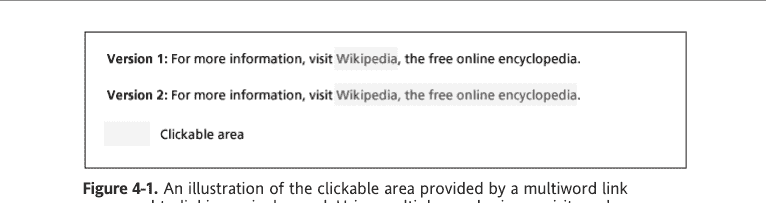

你如何知道你提供的锚文本是否足够好？你可以用来测试它的一个好经验法则是，你应该总是能够提取你页面上所有链接的所有锚文本，并且没有任何支持性上下文的情况下，链接应该清楚地暗示它们的目的地。避免链接与你要链接到的地方无关的单词，例如“点击这里”，或者只是“这里”。这类链接对任何人都没有帮助。所以再次强调，链接的锚文本越具描述性越好。

## `href` 属性、URL 和网页地址

没有链接，网络就不会是网络，所以你应该多注意 `href` 属性及其可以取的值。

出于显而易见的原因，`href` 属性将始终包含一个超链接引用，这实际上只是网页地址或更正式地称为 URL 的一种花哨说法。首字母缩略词 URL 代表统一资源定位符。就本章而言，URL 只是概括你可以通过网络浏览器请求的资源类型的一种方式。网页是一种资源，图像是另一种，视频又是另一种。大多数时候，超链接引用仅指网页。所有 URL，包括指定网页地址的 URL，都可以用三种不同的方式编写。每种方式都是 `href` 属性的有效值。

网页地址最详细的形式称为完全限定 URL。完全限定 URL 之所以得名，是因为它们由 URL 的所有三个部分组成：方案（也称为协议）、域名（也称为主机名）和路径。在前面章节中链接到维基百科的示例中，方案是 `http:`，域名是 `//wikipedia.org`，路径是尾部的 `/`（表示“主页”）。

URL 的某些部分被认为是可选的，这意味着如果它们被省略，它们将根据当前上下文填充。例如，在完全限定 URL 中，方案部分是可选的，并根据当前页面使用的任何方案填充。因此，如果你的网页像大多数网页一样使用 `http:` 方案，你链接到维基百科，那么 `http://wikipedia.org/` 和 `//wikipedia.org/` 是相同的。另一方面，如果你的网页使用 `https:` 方案，那么链接到 `//wikipedia.org/` 最终将链接到 `https://wikipedia.org/` 而不是。

指定 URL 的另一种方式称为绝对链接。绝对链接要求仅将地址的路径部分放在 `href` 值中，但路径必须以网站的根目录或初始正斜杠（`/`）开始。这些被称为绝对链接，因为它们指定了网页从网站根目录（通常是主页）到其当前位置的完整路径。

最后一种方法称为**相对**链接，与绝对链接一样，相对链接也要求仅存在地址的路径部分。然而，与绝对链接不同，相对链接*不得*以初始正斜杠开始。相对链接*总是*使用你网页当前位置的上下文来推断完整的 URL，因此根据定义，它们仅限于始终链接到托管在同一域名下的页面。相对链接可能有点难以理解，所以让我们看几个例子。

网站的结构就像你电脑上的文件和文件夹，如图 4-2 所示的结构。如果你当前正在查看一个名为 `overview.html` 的文件，并且你想链接到 `messages.html`，你可以简单地将 `messages.html` 放在 `href` 值中，如下所示：

```html
<a href="messages.html">Messages</a>
```

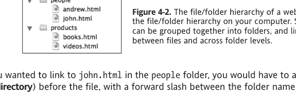

如果你想链接到 `people` 文件夹中的 `john.html`，你必须在文件之前添加文件夹（也称为**目录**），并在文件夹名称和文件名之间使用正斜杠：

```html
<a href="people/john.html">Messages</a>
```

这两个都是相对链接，链接到同一网站上的不同页面，相对于它们自己的位置。相对链接很方便，因为如果网站某些部分的结构发生变化，它们不需要更新。只有当它们引用的文件（或它们自身）移动时，才需要更新。

如果你当前正在查看 `people` 文件夹中的 `john.html` 并想链接回上面的 `overview.html` 页面呢？在这种情况下，你需要使用一个特殊符号来表示你想在查找特定文件之前向上移动一个文件夹级别。这个符号是两个句点，意思是“我上面的文件夹”。像所有文件夹一样，你然后在这个符号后面加上一个正斜杠：

```html
<a href="../overview.html">Messages</a>
```


这将告诉浏览器在网站树中向上移动一级，然后加载`overview.html`页面。如果你需要向上移动两级或更多级，可以多次使用此`../`序列。

几乎总是最好使用相对或绝对链接来链接到你自己网站上的文件，而不是完全限定链接。这样可以省去一遍又一遍输入自己的域名（这会使你的HTML文件更短），并且如果你的域名将来发生变化，它会使你的网站更具可移植性。

## 强调

当处理几乎任何类型的内容时，该内容的某些部分将比其他部分更需要强调。例如，在标记文档时，你经常需要使单词粗体或斜体。在网络开发者意识到拥有

## 语义化HTML与有意义的标记

要构建语义丰富、有意义的HTML文档，过去最常用的做法是使用`<b>`和`<i>`元素。将一个单词或短语包裹在`<b>`元素中，它在浏览器窗口中就会渲染为粗体。这看起来很简单，对吧？但让我们花点时间来分析一下。

"加粗"句子中的某个部分究竟意味着什么？它并不意味着"让文字变大"——那只是它最终呈现的视觉效果。它的真正含义是"让它突出显示"。当然，关键的概念在于，当你想到要把某个东西加粗时，你真正想改变的只是它的呈现方式，或者说外观。嗯，正如你我所知，得益于你作为开明的语义网开发者的认知，标记应该关注内容的含义，而非外观。

在现代HTML和XHTML中，你通常会将所有出现的`<b>`元素替换为`<strong>`元素，它简单地意味着"强烈强调"。同样，你会将所有出现的`<i>`元素替换为`<em>`元素，简单地表示"强调"。当你用`<em>`元素包裹单词或短语时，浏览器会默认将文本渲染为斜体。类似地，浏览器会默认将`<strong>`元素内的单词或短语渲染为粗体。

请务必只在你确实想要强调文本时使用`<em>`和`<strong>`标签。如果你只是想让文本呈现斜体或粗体效果，而不带有强调的意味（比如一本书的标题），请使用CSS（将在后续章节讨论）来恰当地设置文本样式。不要仅仅因为你想要文本变成斜体或粗体，就在文本周围加上`<em>`或`<strong>`标签。务必保持你的标记有意义且准确。

## 列表

列表是出版物中的另一个常见项目。使用XHTML，你有三种不同类型的列表：有序列表、无序列表和定义列表。有序列表用于列举顺序项，因此默认以数字为前缀并按顺序排列；而无序列表中的项目用于列举不蕴含顺序的事物，因此默认以项目符号为前缀。定义列表旨在以列表形式存放术语表条目或其他标题和描述项目，因此默认情况下没有任何前缀。

用于定义这些列表的元素分别是：用于有序列表的`<ol>`，用于无序列表的`<ul>`，以及用于定义列表的`<dl>`。在每种情况下，这些元素唯一允许的子元素就是相应的列表项。那么，让我们开始构建一个列表吧。

### 无序列表和有序列表

在这个例子中，我们来标记一个购物清单：

- 牛奶
- 鸡蛋
- 黄油
- 面粉
- 糖
- 巧克力豆

在这里，无序列表完全合适，因为你购买这些物品的顺序真的无关紧要。如果这不是一份购物清单，而是一份制作巧克力布朗尼的步骤清单，那么你将这些材料加入搅拌碗的顺序可能就很重要了，这时有序列表会更合适。但让我们还是以你的购物清单为例，为你的列表添加`<ul>`元素：

```html
<ul>
    Milk
    Eggs
    Butter
    Flour
    Sugar
    Chocolate Chips
</ul>
```

现在，你已经将列表中的所有项目放在了合适的元素内部。接下来，无序（或有序）列表中的每一项都必须包含在一个列表项元素内，用`<li>`定义。让我们将`<li>`元素插入到你的无序列表中：

```html
<ul>
    <li>Milk</li>
    <li>Eggs</li>
    <li>Butter</li>
    <li>Flour</li>
    <li>Sugar</li>
    <li>Chocolate Chips</li>
</ul>
```

现在你的列表就完整了。如果你在浏览器中查看它，效果会类似于图4-3。

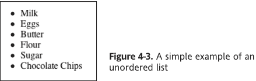

太棒了！在购物清单的帮助下，你出门购买了制作巧克力布朗尼的材料。然而，当你准备标记你的布朗尼食谱时，你发现这些材料其实是有特定顺序的（这就是你需要将它们加入搅拌碗的顺序）。标记起来很简单，只需将你的`<ul>`元素替换为`<ol>`元素即可。`<li>`元素在有序和无序列表中都能使用，浏览器会为每个列表项渲染出相应的前缀。

那么，让我们看看你新排序列表的标记：

```html
<ol>
    <li>Milk</li>
    <li>Eggs</li>
    <li>Butter</li>
    <li>Flour</li>
    <li>Sugar</li>
    <li>Chocolate Chips</li>
</ol>
```

在浏览器中，它的外观如图4-4所示。

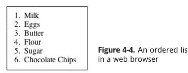

请注意，你根本不需要在列表中手动输入数字。浏览器会自动完成。当你需要在有序列表的顶部或中间添加项目时，这一点尤其方便。无需手动重新编号，因为编号是自动处理的。这是使用语义化、有意义标记所能体现的强大功能的一个例证。

有趣的是，你可以看到如何根据需要开始组合使用多个元素，以继续为列表内容编码语义信息。例如，如果你想强调某个特定列表项中的文本，你可以像这样将`<em>`元素嵌套在`<li>`元素内部：

```html
<li><em>Chocolate Chips</em></li>
```

类似地，你可以将某个特定列表项链接到互联网上的另一个页面：

```html
<li><a href="http://www.aeb.org/">Eggs</a></li>
```

如果你愿意，你甚至可以强调被链接的文本：

```html
<li><em><a href="http://www.aeb.org/">Eggs</a></em></li>
```

列表还可以相互嵌套，从而创建一个列表的列表。例如，你可以将你的购物清单扩展为物品类别及其具体成分：

```html
<ul>
  <li>Baking Ingredients
    <ul>
      <li>Milk</li>
      <li>Eggs</li>
      <li>Butter</li>
      <li>Flour</li>
      <li>Sugar</li>
      <li>Chocolate Chips</li>
    </ul>
  </li>
  <li>Cereal
    <ul>
      <li>Fruity Pebbles</li>
      <li>Cheerios</li>
      <li>Cinnamon Toast Crunch</li>
    </ul>
  </li>
</ul>
```

你这里得到的是一个嵌套在另一个无序列表的列表项内的无序列表。在浏览器中查看时，效果会类似于图4-5。

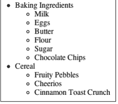

默认情况下，大多数网页浏览器在你创建嵌套列表时，会自动更改内部列表的项目符号样式，以便更容易区分它们。

XHTML中的许多元素可以相互嵌套（比如这些列表）。然而，有些则不能。这些规则都在XHTML的文档类型定义中定义了，不过通常最好的经验法则是思考一下，将一个元素放在另一个同类型的元素内部是否合理。如你所见，列表是完全合理的。然而，段落则不然。把一个段落放在另一个段落内部有什么意义？意义不大。（但你当然可以把一个段落放在一个列表项内部。）

### 定义列表

让我们快速了解一下如何标记定义列表，因为它们与有序和无序列表略有不同。定义列表内部用于列表项的不是单一的`<li>`元素，而是两个元素可供使用：用于定义标题的`<dt>`和用于定义描述的`<dd>`。

```html
<dl>
    <dt>body</dt>
    <dd>Holds content of the document</dd>
    <dt>head</dt>
    <dd>Holds additional information about the document</dd>
    <dt>html</dt>
    <dd>Root element of the document</dd>
</dl>
```

你可以看到基本前提是你已经习惯的模式：一个`<dt>`元素包裹定义的标题，后跟一个`<dd>`元素包裹描述，所有这些都通过被封闭在一个定义列表内而组合在一起。浏览器会将此标记渲染为类似图4-6的效果。

| 定义术语 | 定义描述 |
| :--- | :--- |
| body | 包含文档的内容 |
| head | 包含关于文档的附加信息 |
| html | 文档的根元素 |

**图4-6。** 定义列表通过缩进将定义术语（`<dt>`）和定义描述（`<dd>`）分组在一起。

## 图像

到目前为止，你已经探索了各种只处理文本的元素。然而，网页可以比这有趣得多。接下来，让我们看看如何为你的页面添加图像。

在文档中放置图像时，你使用``元素。图像元素是空元素，因为它们将被你引用的图像所替换。然而，为了正常工作，你需要告诉网页浏览器在哪里可以找到你想要插入的图像，并简要描述该图像是什么。

这两条元数据是在``元素的两个必需属性内指定的。首先，`src`属性指向要加载以替代``元素的实际图像文件。这里的`src`属性与`<a>`元素上的`href`属性适用相同的规则。无论是相对还是绝对路径，`src`属性都为浏览器提供了查找图像的URL。

第二个属性是`alt`，是图像的替代文本的缩写。（你可能还会听人们称之为图像的替代文本或alt文本。）它用于描述图像的内容及其在文档中的含义。这里有一个例子（显示在图4-7中）：

```html

```

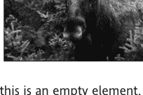

**图4-7。** 尽管图像的内容可能各不相同，但我们大概都能同意，能够向页面添加图像是一个重要的功能。

回想一下，由于这是一个空元素，它不包含其他内容，因此用一个标签同时开启和关闭。这里的属性表明，你希望加载网站根目录下images文件夹中的`moose.jpg`文件，并且你想提供替代文本"The Majestic Moose"。

`src`属性的目的显而易见，但`alt`属性的目的则不然。通常，当你在网页浏览器中查看页面时，替代文本甚至不会显示在页面上。那么，它的作用是什么呢？

## 第四章

替代文本实际上提供了几个非常重要的功能。首先，遵循标记语言的语义重要性原则，正是替代文本让图像能够为文档提供某种意义。在前面的例子中，如果这是一个关于野生动物的页面，那么驼鹿的照片很可能会被视为页面内容的一部分。如果没有``元素中的替代文本，图像基本上就是"无意义的"，文档也会失去一些语义价值。

另一方面，如果页面的其余部分是关于杂货购物的，而驼鹿的照片只是用来营造视觉氛围，那么这张图像可能是多余的，可以被视为"非内容"。在这种情况下，你应该将替代文本完全留空，以表明该图像仅用于视觉目的，不应被视为页面内容的重要组成部分：

```html

```

注意，你仍然需要在``元素代码中包含`alt`属性，但`alt`属性的值为空（或为null）。判断页面上的哪些图像应该属于"真实内容"、哪些不属于，这是网页开发中的艺术。通常没有明确或正确的答案，所以你只需要凭借自己的最佳判断来决定。

假设这张图片确实为页面增添了一些价值，那么替代文本还在以下几个具体方面发挥作用。首先，尽管它不会以常规方式显示在页面上，但许多网页浏览器会在你将光标悬停在图像上几秒钟后，或者在你将键盘焦点移至图像时，显示该图像的替代文本。你可以把它想象成一个临时说明文字；当网页访问者请求查看时它就会出现，否则就是隐藏的。

当然，有些网站访客根本看不到任何内容。这些人可能是视力有障碍的人，也可能是机器，比如谷歌的搜索引擎爬虫（googlebot）。对于这些访客来说，替代文本的存在（或缺失）比图像本身更为重要。

视障人士浏览网页时通常使用一种特殊的网页浏览器，它会将网页内容朗读给他们听。这些程序被称为屏幕阅读器。当屏幕阅读器在你的文档中遇到一张图片时，它会使用替代文本来描述图像所展示的内容。为图像提供良好的替代文本对于让你的网页对这些访客来说易于访问和理解至关重要。

同样，当谷歌或雅虎读取你的页面标记时，``元素中良好的替代文本可以帮助它们理解图像的用途和内容，从而在搜索结果列表中更有效地对你的网页进行排名。一般来说，替代文本对图像内容的描述越准确，你的搜索结果排名就越高。

最后，如果由于任何原因，你告诉网页浏览器包含在页面中的图像无法找到（图像文件本身）或加载失败，大多数网页浏览器会用`alt`属性的文本替换``元素。这提供了一种应急方案，有助于确保访问你网站的访客即使无法以首选形式获取内容，也能获得他们想要的信息。类似的技术在网页开发中一直在使用，它们统称为优雅降级。

在网站上使用图片时，请注意每个页面上放了多少图片、图片有多大，以及它们的用途是什么。过多使用图片会导致页面加载缓慢，而且可能会在视觉上造成干扰。与XHTML相比，图片的体积非常大。在大多数页面上，下载该页面所需时间的大部分是由其图片造成的。

## 表格

当你需要用行和列来标记最适合以这种形式呈现的数据（表格数据）时，就需要使用`<table>`元素。表格数据的一些常见例子包括日历（其中行是周，列是每周的不同日期）或对比图表。当你这样思考表格数据时，往往会想到电子表格以及与之相关的所有令人着迷的数据。

幸运的是，标记表格数据相对简单，XHTML提供了丰富的语义元素来恰当地组织你的数据。让我们从一些示例数据开始，逐步演示使用语义XHTML元素来标记它的过程（见表4-1）。

**表4-1.** 简单表格示例

| 名 | 姓 | 生日 |
| --- | --- | --- |
| 乔治 | 华盛顿 | 1732年2月22日 |
| 亚伯拉罕 | 林肯 | 1809年2月12日 |

表4-1展示了两位美国总统——乔治·华盛顿和亚伯拉罕·林肯的名字和姓氏，以及他们的生日。首先要做的是：在你的XHTML文档中创建一个表格来容纳这些数据。你可以使用`<table>`的开始和结束标签来创建包含用的`<table>`元素：

```html
<table>
</table>
```

接下来，让我们添加第一行。表格行使用`<tr>`元素定义：

```html
<table>
    <tr>
    </tr>
</table>
```

这一行有三个独立的单元格。XHTML表格单元格使用`<td>`元素来标记，`<td>`代表表格数据（table data）：

```html
<table>
    <tr>
        <td>First Name</td>
        <td>Last Name</td>
        <td>Birthday</td>
    </tr>
</table>
```

现在你有了一个包含一行和三个单元格的表格。但你可以做得更好，因为这一行显然是一个标题，用于介绍后续行中你会看到的数据。使用XHTML，你可以用`<thead>`元素来标记标题数据，并表明这一行具有特殊用途：

```html
<table>
    <thead>
        <tr>
            <td>First Name</td>
            <td>Last Name</td>
            <td>Birthday</td>
        </tr>
    </thead>
</table>
```

正如这个介绍性行是特殊的，如果你仔细观察，你会注意到这三个单元格中的每一个都是特殊的：它们是列标题，而不是普通的表格数据。为了在标记中表明这一点，你需要将`<td>`元素替换为`<th>`元素，即表格标题（table heading）。`<th>`元素用于任何作为列或行标题的表格单元格（在你的例子中是列标题），以将其与普通表格数据区分开来。

```html
<table>
    <thead>
        <tr>
            <th>First Name</th>
            <th>Last Name</th>
            <th>Birthday</th>
        </tr>
    </thead>
</table>
```

现在标题已经设置好了，你可以开始添加表格的主要数据。就像你的标题数据被包含在`<thead>`元素中一样，你将用`<tbody>`元素来包裹主体数据。

```html
<table>
    <thead>
        <tr>
            <th>First Name</th>
            <th>Last Name</th>
            <th>Birthday</th>
        </tr>
    </thead>
    <tbody>
    </tbody>
</table>
```

要插入各个数据单元格，你需要使用`<td>`元素，每一行放在一个单独的`<tr>`元素中，就像之前一样：


```html
<table>
    <thead>
        <tr>
            <th>First Name</th>
            <th>Last Name</th>
            <th>Birthday</th>
        </tr>
    </thead>
    <tbody>
        <tr>
            <td>George</td>
            <td>Washington</td>
            <td>February 22, 1732</td>
        </tr>
        <tr>
            <td>Abraham</td>
            <td>Lincoln</td>
            <td>February 12, 1809</td>
        </tr>
    </tbody>
</table>
```

在浏览器中查看时，这个 XHTML 表格将如图 4-8 所示。

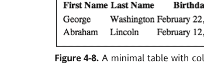

关于 XHTML 表格有一个重要的注意事项：使用这种最小化标记时，列是根据每行中各个表格数据单元格的数量通过隐含方式创建的。每个表格行元素中有三个表格数据单元格，就创建了一个三列的表格。如果你在行中添加一个表格数据单元格，就会得到一个四列的表格，以此类推。使用稍后将描述的某些属性，你可以稍微修改这种行为，但需要记住的重要一点是（在大多数情况下），只有表格`行`在标记中是结构化分组的，而列通常是`隐含`的。

> 敏锐的读者会指出，实际上有一种方法可以使用 XHTML 标记显式地标记列。其做法是在表格数据开始之前定义一组`<col>`元素，这些元素可以包含在一个或多个`<colgroup>`元素中。虽然这些元素在语义上很丰富，而且对旧版浏览器基本没有危害，但它们在实际中并未被广泛实现，因此被认为超出了本书的范围。在本例中实现它们留给读者作为练习。

然而，在你的表格可以称得上完整之前，你还需要添加一些内容，使其真正成为语义化 XHTML 标记的典范。根据设计，数据表格是一种非常视觉化的元素，它通过列和行来关联数据，使查看者能够理解复杂的概念，或更容易理解大型数据集。出于与你在``元素中添加`alt`属性大致相同的原因，你将为这个表格以文本形式提供一些额外的数据。

首先，你将添加一个`<caption>`元素，它（显然）是用来作为表格的标题的。你可以用它来提供表格的标题，或者概述其用途。在这个例子中，你可以使用"American Presidents"作为标题。接下来，你将在`<table>`元素上添加一个`summary`属性。表格的`summary`属性用于保存关于表格中实际显示信息的更多细节，就像``元素上的`alt`属性一样，`summary`会被朗读给使用屏幕阅读器辅助浏览网页的视障用户听。让我们在代码中看看这个效果：

```html
<table summary="This table compares the first name, last name, and birth date of George Washington and Abraham Lincoln.">
    <caption>American Presidents</caption>
    <thead>
        <tr>
            <th>First Name</th>
            <th>Last Name</th>
            <th>Birthday</th>
        </tr>
    </thead>
    <tbody>
        <tr>
            <td>George</td>
            <td>Washington</td>
            <td>February 22, 1732</td>
        </tr>
        <tr>
            <td>Abraham</td>
            <td>Lincoln</td>
            <td>February 12, 1809</td>
        </tr>
    </tbody>
</table>
```

表格可以拥有任意数量的行和列。如前所述，`<tr>`元素内部`<th>`或`<td>`元素的数量决定了表格的列数，而`<tr>`元素的数量则决定了行数。

`<th>`和`<td>`元素都接受名为`rowspan`和`colspan`的属性。这些属性指示特定单元格跨越多少行或多少列。正如你可以推断的，`rowspan`属性描述特定单元格跨越的行数，而`colspan`定义单元格跨越的列数。让我们在你的"American Presidents"表格中看一个例子。

与其为名字和姓氏设置单独的标题单元格，不如将它们合并为一个名为 Name 的标题单元格。同样，我们将两个生日单元格合并为一个，内容改为仅显示"A long time ago"：

```html
<table summary="This table compares the first name, last name,
            and birth date of George Washington and Abraham Lincoln.">
    <caption>American Presidents</caption>
    <thead>
        <tr>
            <th colspan="2">Name</th>
            <th>Birthday</th>
        </tr>
    </thead>
    <tbody>
        <tr>
            <td>George</td>
            <td>Washington</td>
            <td rowspan="2">A long time ago</td>
        </tr>
        <tr>
            <td>Abraham</td>
            <td>Lincoln</td>
        </tr>
    </tbody>
</table>
```

你会在标记中注意到，你现在只需要两个`<th>`元素，因为第一个替代了两个的位置。同样，最后一行中你不需要生日列的第三个`<td>`，因为它被前一行的`<td>`通过`rowspan`值填充了。

让我们在标记中看看这是什么样子。如图 4-9 所示，我们为你修改的两个单元格组添加了阴影，以便你可以看到发生了什么变化，尽管阴影不会出现在实际的浏览器窗口中。

|  | Name | Birthday |
|---|---|---|
|  | George Washington | A long time ago |
|  | Abraham Lincoln |  |

**图 4-9.** 表格中的单元格可以合并，以跨越多行或多列。

如你所见，表格提供了很大的灵活性，可以是显示某些类型数据的绝佳方式。然而，在现代网页开发中出现层叠样式表（CSS）之前，表格更常用于控制网页的视觉布局，这污染了文档的语义，并使网页设计师不得不绞尽脑汁，试图找到巧妙的方法使他们的设计适应表格所规定的网格结构。

即使在今天，一些`必须`在旧浏览器中正确显示的网站仍会为此目的使用表格。如果你能避免这样做，那很好，但如果不行，那么请记住这一点：如果你记不住别的，请记住在`<table>`元素上包含一个空的`summary`属性。就像你会为没有语义用途的图像提供空的`alt`属性值一样，如果你使用了一个无意义的表格，你也必须声明它！

## 表单

在线填写表单是从访客那里收集信息或为他们提供增强服务的好方法。虽然实际接收和处理这些表单数据的脚本超出了本书的范围，但接下来我们将讨论各种表单元素在 XHTML 标记中的工作原理。

你在创建任何表单时首先需要的是`<form>`元素：

```html
<form>
</form>
```

`<form>`元素接受许多属性，但只有一个是必需的，即`action`属性。`action`属性类似于`<a>`元素中的`href`属性。它指定一个特定的 URL，处理表单数据的脚本可以在该位置找到。让我们将示例表单设置为在`/path/to/script`处处理：

```html
<form action="/path/to/script">
</form>
```

当这个表单提交时，它会将浏览器发送到`/path/to/script`页面，同时发送表单中的所有数据。然而，目前没有数据可发送，因为你还没有定义任何要填写的字段。所以，让我们为这个表单添加一些字段。

`<form>`元素很像`<blockquote>`，因为它只能有某些特定的子元素。对于简单表单，你可以使用之前已经见过的`<p>`或`<div>`元素，并将所有表单控件放入这些元素中。然而，由于你即将构建一个相对复杂的表单，你将使用专门设计用于将表单控件分组的 XHTML 元素：`<fieldset>`元素。

`<fieldset>`元素（正如你可能预料的）定义了一组相关的表单字段，它很像`<div>`元素。两个元素都用于将相关元素分组到一个代码块中。然而，与`<div>`不同的是，`<fieldset>`元素可以包含一个特殊的元素，称为`legend`，它为`<fieldset>`元素提供一个对你的网页访客可见的名称。你不妨将这个元素想象成与表格的`<caption>`元素类似。

在表单中加入了`<fieldset>`元素及其`legend`后，你的标记现在看起来像这样：

```html
<form action="/path/to/script">
    <fieldset>
        <legend>Personal Information</legend>
    </fieldset>
</form>
```

最常见的表单字段是一种简单的文本字段，用户可以在其中输入内容。这些字段以及大多数其他类型的表单字段，都可以通过定义`<input>`元素来添加到表单中。表单`<input>`元素可以有多种不同的类型，例如文本字段、复选框或单选按钮。任何特定`<input>`元素成为哪种表单控件，是由其`type`属性的值指定的。

如果没有指定`type`属性，则默认推断为`type="text"`。例如，这是你在表单中使用文本输入字段询问访客电子邮件地址的方式：

```html
<form action="/path/to/script">
    <fieldset>
        <legend>Personal Information</legend>
        <input type="text" name="email" />
    </fieldset>
</form>
```

关于这里使用的`<input>`元素，有两件事你应该注意。首先，它是一个空元素，就像``一样。其次，你还包含了一个名为`name`的属性，并将其值设为`email`。所有需要向处理脚本提供数据的表单元素都需要有一个带有值的`name`属性。这是表单提交后处理脚本用来引用这个`<form>`元素中数据的名称。如果你不提供`name`，那么处理脚本将无法看到表单元素中的任何数据。

像之前代码清单中的表单在网页浏览器中可能看起来像图 4-10。

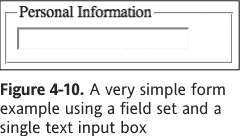

你可以看到`name`属性并没有显示在任何地方（也不应该显示），所以访客目前无法轻易知道他们应该在那个文本字段中输入什么。要为文本字段提供一个供人类访客使用的名称，你必须使用`<label>`元素。

你可以将`<label>`元素放在表单中的任何位置——它们不一定非要出现在所标注的输入字段旁边。因此，每个`<label>`元素都需要以某种除邻近性之外的方式与输入字段唯一关联。你已经学会了如何使用`id`属性在网页上唯一标识元素，所以让我们首先用这个名称`email_field`唯一标识这个表单字段：

```html
<input type="text" name="email" id="email_field" />
```

现在你有了一个唯一标识符来引用这个输入字段，你可以将`<label>`元素添加到你的表单中。为了简单起见，我们会直接把它添加在`<input>`元素前面，但同样，你实际上可以把它放在`<form>`元素内的任何位置。在使用`<label>`元素时，元素内部的文本应该描述该元素所标注的字段（就像链接的锚文本一样），而`for`属性的值应该与被标注字段的`id`匹配。在代码中，它可能看起来像这样：

## 表单控件

如果你在浏览器窗口中查看，会发现你现在有了一个可供访客使用的东西（见图 4-11）。

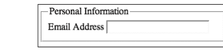

**图 4-11.** 我们在这里添加了一个标签，这样用户就知道正在请求什么（一个电子邮件地址）。

`<input>`元素的另一个可能的类型值是复选框。复选框是一个简单的“是或否”输入，在代码中与文本字段的`<input>`元素几乎相同。让我们使用一个复选框来询问某人是否正在大学或学院就读。你只需在访客电子邮件地址的文本字段之后添加复选框及其所有属性，以及对你复选框所问内容的描述性标签：

```html
<form action="/path/to/script">
    <fieldset>
        <legend>Personal Information</legend>
        <label for="email_field">Email Address</label>
        <input type="text" name="email" id="email_field" />
        <input type="checkbox" name="enrolled" id="enrolled_field"
               value="1" />
        <label for="enrolled_field">I am currently enrolled in a
        college or university</label>
    </fieldset>
</form>
```

你添加到复选框的属性之一是`value`属性（注意，这是一个名为`value`的属性）。`value`属性的值仅在方框被选中时才会发送到处理脚本。这里你使用了 1，一种简单的表示方法来表明“是的，此框在表单上被选中”。

现在你已经添加了复选框及其适当的标签，请在浏览器中查看其外观（见图 4-12）。

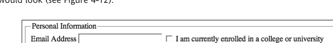

**图 4-12.** 添加了复选框的修订表单

这确实是个开始。接下来，你可能需要某种方式来分隔这些元素，以便浏览器知道将它们显示在不同的行上。如果你思考一下，你开始创建的是一个用户需要填写的输入列表。在这种情况下，这些输入有特定的顺序。听起来一个有序列表非常适合这个场景。让我们将输入和标签嵌套在列表项中，并将列表项嵌套在一个有序列表元素中：

```html
<form action="/path/to/script">
    <fieldset>
        <legend>Personal Information</legend>
        <ol>
            <li>
                <label for="email_field">Email Address</label>
                <input type="text" name="email" id="email_field" />
            </li>
            <li>
                <input type="checkbox" name="enrolled"
                       id="enrolled_field" value="1" />
                <label for="enrolled_field">I am currently
                    enrolled in a college or university</label>
            </li>
        </ol>
    </fieldset>
</form>
```

还有一个你可以用于复选框的属性，如果你希望访客首次加载表单时它就被选中。在这种情况下，也许你的大多数访客都在某个大学或学院就读。你只需要指定一个`checked`属性，其值为`checked`。（这不是错别字。属性的名称和它期望的值应该是相同的。）访客仍然可以取消选中该框，但在某些情况下，字段最初就被选中可能更容易。让我们看看默认选中的复选框的标记。

```html
<input type="checkbox" name="enrolled" id="enrolled_field"
       value="1" checked="checked" />
<label for="enrolled_field">I am currently enrolled in a
                       college or university</label>
```

XHTML 表单允许你使用的另一种输入类型是单选按钮。单选按钮类似于复选框，只是有多个选项供用户选择，并且最终只能选择一个。因此，单选按钮几乎总是成组出现，要求用户从少数几个项目中选择一个。


每个单选按钮表示为一个`<input>`元素，其类型设置为`radio`。你通过为每个单选按钮的`name`属性赋予相同的值，将多个单选按钮关联为属于同一组。然而，每个单选按钮的`value`属性应在组内的单选按钮中是唯一的。与复选框一样，每个单选按钮需要一个标签，因此每个单选按钮的`id`属性也应该是唯一的（在整个文档中，而不仅仅是在单选按钮组中，甚至不是在它们所在的`<form>`元素中）。

将其放入示例中，让我们询问访客他们最喜欢的颜色。你将给他们四种颜色选择：蓝色、红色、黄色和绿色。在为你的表单标记这个问题时，你立即可以注意到你还有另一个列表。然而，这次这些项目没有特定的顺序，所以你将使用一个无序列表。

你还需要引入问题，因为现在你的`<label>`元素标记的是实际的选择，而不是手头的问题。你只需在开始无序列表之前用一些文本来完成。

```html
<form action="/path/to/script">
    <fieldset>
        <legend>Personal Information</legend>
        <ol>
            <li>
                <label for="email_field">Email Address</label>
                <input type="text" name="email" id="email_field" />
            </li>
            <li>
                <input type="checkbox" name="enrolled"
                    id="enrolled_field" value="1"
                    checked="checked" />
                <label for="enrolled_field">I am currently enrolled in
                    a college or university</label>
            </li>
            <li>What is your favorite color?
                <ul>
                    <li>
                        <input type="radio" name="favorite_color"
                            id="favorite_color_blue" value="blue" />
                        <label for="favorite_color_blue">Blue</label>
                    </li>
                    <li>
                        <input type="radio" name="favorite_color"
                            id="favorite_color_red" value="red" />
                        <label for="favorite_color_red">Red</label>
                    </li>
                    <li>
                        <input type="radio" name="favorite_color"
                            id="favorite_color_yellow" value="yellow" />
                        <label for="favorite_color_yellow">Yellow
                            </label>
                    </li>
                    <li>
                        <input type="radio" name="favorite_color"
                            id="favorite_color_green" value="green" />
                        <label for="favorite_color_green">Green</label>
                    </li>
                </ul>
            </li>
        </ol>
    </fieldset>
</form>
```

再次查看浏览器，你可以看到你的表单按预期工作（见图4-13）。

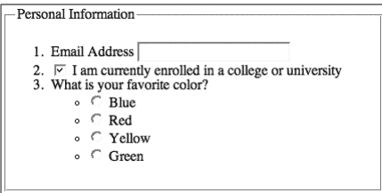

**图4-13.** 你添加的单选按钮为你的访客提供了一组四个选项，他们只能选择其中一个。

接下来，让我们再添加两个表单字段，要求你的网页访客输入。对于最后两个数据项，让我们询问你访客的时区，并提供一个自由格式的区域，他们可以在其中输入任何他们喜欢的文本。由于这两项与前面三个问题有些无关，让我们通过使用一个新的`<fieldset>`元素将它们与之前的表单项分开分组。

为了让访客选择他们的时区，你可以像处理他们最喜欢的颜色那样，在列表中显示一组单选按钮。然而，单选按钮占用很多空间。此外，世界上有几十个时区。如果你再次使用单选按钮，你的表单将会非常庞大。

相反，让我们使用 XHTML 提供的另一种表单控件：下拉列表。此控件由`<select>`元素和`<option>`元素共同定义，类似于常规的有序或无序列表。

```html
<label for="timezone_field">Time zone</label>
<select name="timezone" id="timezone_field">
  <option>-5</option>
  <option>-6</option>
  <option>-7</option>
  <option>-8</option>
</select>
```

使用此标记，用户可以从四个选项中选择他们的时区：-5、-6、-7 或 -8。这些实际上是美国东部到太平洋海岸的 UTC 时间偏移小时数。这是计算机最常用的时间表示方式（通过将所有内容以 UTC 时间记录，然后按时区计算偏移量），但这不是人们思考他们时区的方式。因此，使用每个`option`元素的`value`属性，让我们给计算机它们所期望的，并向人类访客显示他们更容易阅读的值：

```html
<label for="timezone_field">Time zone</label>
<select name="timezone" id="timezone_field">
  <option value="-5">Eastern</option>
  <option value="-6">Central</option>
  <option value="-7">Mountain</option>
  <option value="-8">Pacific</option>
</select>
```

现在，当用户选择`Eastern`作为时区时，处理该表单的脚本将看到值–5。

你可以在`<select>`元素内部放置任意数量的`<option>`元素。然而，当选项很多，或者选项代表不同的类别时，将这些选项分组就很有意义。为此，你可以使用`<optgroup>`元素，就像使用`<div>`或`<fieldset>`一样。让我们为列表添加更多时区，但将它们组织在`<optgroup>`元素内部，以便分类清晰明了：

```html
<label for="timezone_field">Time zone</label>
<select name="timezone" id="timezone_field">
    <optgroup label="Mainland America">
        <option value="-5">Eastern</option>
        <option value="-6">Central</option>
        <option value="-7">Mountain</option>
        <option value="-8">Pacific</option>
    </optgroup>
    <optgroup label="Outlying States">
        <option value="-9">Alaskan</option>
        <option value="-10">Hawaiian</option>
    </optgroup>
</select>
```

注意，这里在`<optgroup>`元素内部，你使用了一个`label`属性来为一组`<option>`元素命名。小心不要将其与用于为整个`<select>`元素添加标签的`<label>`元素混淆。

最后，让我们添加一个自由格式的文本区域，鼓励你的访客给你发送评论。这通过`<textarea>`元素实现，它是最简单的表单控件之一。它只有两个不同之处。首先，与你见过的其他大多数表单控件不同，`<textarea>`元素不需要`value`属性，因为它的内容就是它的值。其次，它需要两个新属性，`rows`和`cols`，分别指示其默认高度和宽度。（这个尺寸之后可以通过 CSS 覆盖。）`<textarea>`的标记可能如下所示：

```html
<label for="comments_field">Comments</label>
<textarea name="comments" id="comments_field" rows="6"
    cols="65"></textarea>
```

终于，你已经设置好了表单控件来收集用户的输入。只有一件事还缺：让访客实际将表单提交给处理脚本的方法。为此，你需要再使用一种`<input>`元素类型：`submit`类型。这种类型的`<input>`元素会创建一个用户可以激活的按钮，用于提交表单。

通常，当使用创建对表单进行操作的表单控件的元素时（例如提交按钮），你可以跳过为该元素指定标签，因为表单控件本身就起到了这个作用。由于你没有为提交按钮使用`<label>`元素，你也不需要使用`id`属性，所以你的元素非常简单。

```html
<input type="submit" value="Submit this Form" />
```

现在，你的访客将能够点击`Submit this Form`按钮，将表单发送给处理脚本。

使用下面代码清单中显示的标记，你在网页中就有一个功能完整的表单了。用户可以使用你定义的表单控件提供输入，并可以提交表单，这将把`<form>`元素的值传递给处理脚本。

在查看网页时，你的表单现在看起来将如图 4-14 所示。

```html
<form action="/path/to/script">
    <fieldset>
        <legend>Personal Information</legend>
        <ol>
            <li>
                <label for="email_field">Email Address</label>
                <input type="text" name="email" id="email_field" />
            </li>
            <li>
                <input type="checkbox" name="enrolled"
                    id="enrolled_field" value="1"
                    checked="checked" />
                <label for="enrolled_field">I am currently enrolled in
                    a college or university</label>
            </li>
            <li>What is your favorite color?
                <ul>
                    <li>
                        <input type="radio" name="favorite_color"
                            id="favorite_color_blue" value="blue" />
                        <label for="favorite_color_blue">Blue</label>
                    </li>
                    <li>
                        <input type="radio" name="favorite_color"
                            id="favorite_color_red" value="red" />
                        <label for="favorite_color_red">Red</label>
                    </li>
                    <li>
                        <input type="radio" name="favorite_color"
                            id="favorite_color_yellow" value="yellow" />
                        <label for="favorite_color_yellow">Yellow</label>
                    </li>
                    <li>
                        <input type="radio" name="favorite_color"
                            id="favorite_color_green" value="green" />
                        <label for="favorite_color_green">Green</label>
                    </li>
                </ul>
            </li>
        </ol>
    </fieldset>
    <fieldset>
        <legend>Application Information</legend>
        <ol>
            <li>
                <label for="timezone_field">Time zone</label>
                <select name="timezone" id="timezone_field">
                    <optgroup label="Mainland America">
                        <option value="-5">Eastern</option>
                        <option value="-6">Central</option>
                        <option value="-7">Mountain</option>
                        <option value="-8">Pacific</option>
                    </optgroup>
                    <optgroup label="Outlying States">
                        <option value="-9">Alaskan</option>
                        <option value="-10">Hawaiian</option>
                    </optgroup>
                </select>
            </li>
            <li>
                <label for="comments_field">Comments</label>
                <textarea name="comments" id="comments_field" rows="6" cols="65"></textarea>
            </li>
        </ol>
    </fieldset>
    <input type="submit" value="Submit this Form" />
</form>
```

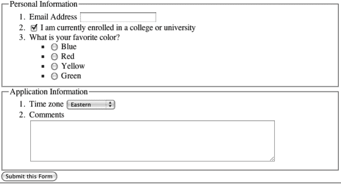


当然，XHTML 表单还有更多功能。例如，你还可以为 `<input>` 元素的 `type` 属性指定更多选项。其中值得了解的一个重要类型是 `password`，它创建的元素与 `text` 类型相同，只不过它会将用户输入的每个字符渲染为星号（`*`）或圆点（`•`），而不是实际文本。输入的文本实际上并未改变，但为了安全起见，它在屏幕上不会那样显示。还有 `file` 类型，它允许访客从其计算机中选择文件，通过表单使用其操作系统原生的文件选择对话框进行上传。

还有几种与 `submit` 类型类似的按钮。有 `button` 类型，它显示一个按钮，你可以通过 JavaScript 控制其行为，但默认情况下它不会执行任何操作。还有 `<button>` 元素，可用于将某些其他元素（如 ``）转换为按钮。（这类按钮默认会提交表单。）还有 `<input>` 元素的 `image` 类型，这是将图像转换为按钮的另一种方式，它接受与 `` 标签相同的 `src` 属性。

最后，`<input>` 元素还有 `reset` 类型，它也会创建一个按钮，但与提交表单不同，这种按钮会将表单恢复到 Heights 还原到原始状态，移除用户可能输入的任何内容。这种按钮很少真正需要（尤其是在较长的表单中），但如果你确实需要，它就在那里。

如你所见，在 Web 上设计表单可能是一项相当艰巨的任务。它们引入了一种交互性，这是你从电视或杂志等其他媒体无法获得的。表单及其提供的功能，实现了网站创建者与网站访客之间的双向通信，正是这些使 Web 成为真正独特的出版平台。

## 特殊字符

在为内容添加标记时，你肯定会注意到某些字符直接放在标记中无法正常显示。其中最明显的可能是小于号和大于号，也称为**左尖括号和右尖括号**（`<` 和 `>`）。浏览器不会将这些视为尖括号，而是假定它们是标签的开始和结束。

由于这些字符承担双重职责，如果你真的想在内容中使用 `<` 或 `>`，就需要使用称为**实体引用**的特殊代码来引用它们。在计算机术语中，这称为对这些字符进行**转义**。在 XHTML 中转义字符很简单，只需将你要键入的字符替换为代表它的其他字符组合即可。在所有情况下，**转义序列**都以 `&` 符号（`&`）开头，以分号（`;`）结尾。

小于号和大于号的实体引用分别是 `&lt;` 和 `&gt;`。然而，这带来了一个新问题。如何标记 `&` 符号呢？答案是一样的：使用其实体引用来转义它。`&` 符号的实体引用是 `&amp;`。

表 4-2 列出了一些最常见的字符及其对应的实体引用。

## 表 4-2. 常用 HTML 字符实体列表

| 字符 | HTML 和 XHTML 字符实体引用 |
| --- | --- |
| `<` | `&lt;` |
| `>` | `&gt;` |
| `"` | `&ldquo;` |
| `"` | `&rdquo;` |
| `'` | `&lsquo;` |
| `'` | `&rsquo;` |
| `&` | `&amp;` |
| 不换行空格 | `&nbsp;` |
| —（长破折号） | `&mdash;` |
| ← | `&larr;` |
| ↑ | `&uarr;` |
| → | `&rarr;` |
| ↓ | `&darr;` |
| ® | `&reg;` |
| ™ | `&trade;` |
| © | `&copy;` |

存在数百种不同的实体引用，在本书中提供一份详尽的术语表会显得多余。不过，在标记内容时请将这些实体记在心里，因为它们可能会非常有用。例如，如果你想在页面上显示以下句子该怎么办？

```html
I'm sure that using the <div> tag
is more professional than "faking a layout" using tables.
```

首先，你需要看到我们需要将尖括号替换为它们的实体引用。别忘了将 XHTML 标签标记为计算机代码：

```html
I'm sure that using the <code>&lt;div&gt;</code> element
is more professional than "faking a layout" using tables.
```

然后，还有围绕 *faking a layout* 这个词的弯引号。让我们替换它们：

I'm sure that using the `&lt;div&gt;` tag is more professional than `&ldquo;faking a layout&rdquo;` using tables.

最后，是单词 *I'm* 中的弯撇号：

I&rsquo;m sure that using the `&lt;div&gt;` tag is more professional than `&ldquo;faking a layout&rdquo;` using tables.

当你在浏览器中查看时，它看起来会像你最初的句子（参见图 4-15）。

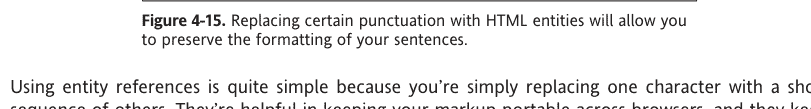

使用实体引用非常简单，因为你只是将一个字符替换为一小段其他字符序列。它们有助于保持你的标记在不同浏览器间的可移植性，并确保你的内容能够正确地显示和运行。你可以在 `http://www.webstandards.org/learn/reference/charts/entities/` 获取完整的实体引用列表。

## 全部组合起来：创建真实的页面

现在你已经了解了标记不同类型内容的基础知识，接下来你将学习如何将整个页面组合起来并在浏览器中查看。

从你之前几节创建的 `index.html` 文件开始，你要做的第一件事是开始为你的特定页面填充更多细节。让我们为 Papa Pepperoncini's Pizza 制作一个主页。

回想一下，你的文档结构看起来是这样的：

```html
<!DOCTYPE html PUBLIC "-//W3C//DTD XHTML 1.0 Strict//EN"
    "http://www.w3.org/TR/xhtml1/DTD/xhtml1-strict.dtd">
<html xmlns="http://www.w3.org/1999/xhtml" xml:lang="en" lang="en">
<head>
    <meta http-equiv="Content-Type" content="text/html; charset=utf-8"/>
    <title>New Document</title>
</head>
<body>

</body>
</html>
```

# 第 4 章

首先，让我们将页面标题更改为“欢迎来到 Papa Pepperoncini's Pizza”：

```html
<!DOCTYPE html PUBLIC "-//W3C//DTD XHTML 1.0 Strict//EN"
    "http://www.w3.org/TR/xhtml1/DTD/xhtml1-strict.dtd">
<html xmlns="http://www.w3.org/1999/xhtml" xml:lang="en" lang="en">
<head>
    <meta http-equiv="Content-Type" content="text/html; charset=utf-8"/>
    <title>Welcome to Papa Pepperoncini's Pizza</title>
</head>
<body>

</body>
</html>
```

接下来，让我们向页面的 `<body>` 中添加一些内容。你需要向页面添加四个主要部分：一个用于自豪地展示 Papa Pepperoncini 名字并包含网站主导航的头部区域、一个放置欢迎消息的位置、一个展示每周特色菜品的区域，以及一个用于版权信息的页脚。区分这些部分最合乎逻辑的方式是创建 `<div>` 元素来分别对它们进行分组，然后为每个 `<div>` 元素分配一个描述性的 `id` 值以唯一标识它们：

```html
<!DOCTYPE html PUBLIC "-//W3C//DTD XHTML 1.0 Strict//EN"
    "http://www.w3.org/TR/xhtml1/DTD/xhtml1-strict.dtd">
<html xmlns="http://www.w3.org/1999/xhtml" xml:lang="en" lang="en">
<head>
    <meta http-equiv="Content-Type" content="text/html; charset=utf-8"/>
    <title>Welcome to Papa Pepperoncini's Pizza</title>
</head>
<body>
    <div id="header">
    </div>
    <div id="welcome">
    </div>
    <div id="specials">
    </div>
    <div id="footer">
    </div>
</body>
</html>
```

现在，页脚的内容很容易，让我们快速添加它：

```html
<!DOCTYPE html PUBLIC "-//W3C//DTD XHTML 1.0 Strict//EN"
    "http://www.w3.org/TR/xhtml1/DTD/xhtml1-strict.dtd">
<html xmlns="http://www.w3.org/1999/xhtml" xml:lang="en" lang="en">
<head>
    <meta http-equiv="Content-Type" content="text/html; charset=utf-8"/>
    <title>Welcome to Papa Pepperoncini's Pizza</title>
</head>
<body>
    <div id="header">
    </div>
    <div id="welcome">
    </div>
    <div id="specials">
    </div>
    <div id="footer">
        <p>Copyright &copy; 2008 Papa Pepperoncini's Pizza &mdash;
        All rights reserved.</p>
    </div>
</body>
</html>
```

注意版权符号和破折号的实体引用的使用。

在头部区域，你会希望餐厅名称以标题形式显示，因为这是你页面上至关重要的部分。你还会将此标题转换为指向主页的链接，这样无论访问者在你网站的哪个位置，他们都能轻松返回主页。

对于导航菜单，你总是希望包含一个指向主页的链接、一个指向展示餐厅菜单的页面的链接、一个列出 Papa Pepperoncini's Pizza 所有门店的页面链接（也许它是一家连锁店，即使不是，这个列表至少会包含它唯一的一个门店！），以及一些关于 Papa Pepperoncini 如何施展其魔法的通用信息。由于这个导航菜单实际上只是一组指向不同页面的链接列表，你将把所有这些链接放在一个无序列表中，并将它们链接到你稍后将创建的页面。

```html
<!DOCTYPE html PUBLIC "-//W3C//DTD XHTML 1.0 Strict//EN"
    "http://www.w3.org/TR/xhtml1/DTD/xhtml1-strict.dtd">
<html xmlns="http://www.w3.org/1999/xhtml" xml:lang="en" lang="en">
<head>
    <meta http-equiv="Content-Type" content="text/html;
        charset=utf-8"/>
    <title>Welcome to Papa Pepperoncini's Pizza</title>
</head>
<body>
    <div id="header">
        <h3><a href="index.html">Papa Pepperoncini&#8217;s Pizza</a>
        </h3>
        <ul>
            <li><a href="index.html">Home</a></li>
            <li><a href="menu.html">Our Menu</a></li>
            <li><a href="locations.html">Locations</a></li>
            <li><a href="about.html">About Us</a></li>
        </ul>
    </div>
    <div id="welcome"></div>
    <div id="specials"></div>
    <div id="footer">
        <p>Copyright &copy; 2008 Papa Pepperoncini's Pizza &mdash;
        All rights reserved.</p>
    </div>
</body>
</html>
```

注意餐厅标题使用了 `<h3>` 元素。你可能选择在这里使用 `<h3>`，因为尽管公司名称在此页面上很重要，但它可能不如欢迎消息重要，而 Papa Pepperoncini 之前已决定欢迎消息是主页的主要目标。因此，你会将你的 `<h1>` 留给欢迎部分内部的标题。

决定页面哪些内容最重要以及如何标记它们是网页开发*艺术*的一部分。另一种做法是在此页面上使用多个 `<h1>`，但有些人可能会认为这会稀释它们的重要性。实际上，这里没有正确答案。这个示例只是表明你实际上不必将 `<h1>` 元素放在 `<h2>` 元素之前，以此类推。无论你选择如何标记此类内容，重要的是要有合理的理由，并在整个网站页面创建过程中始终如一地坚持你选择的方法。

接下来，让我们继续处理欢迎消息。Papa Pepperoncini 给你发来了一些他希望用于此部分的文本，因此你将通过确保将其内容放置在适当的元素中，并将任何特殊字符（如引号或和号）替换为它们正确的实体引用来正确地进行标记：

```html
<!DOCTYPE html PUBLIC "-//W3C//DTD XHTML 1.0 Strict//EN"
    "http://www.w3.org/TR/xhtml1/DTD/xhtml1-strict.dtd">
<html xmlns="http://www.w3.org/1999/xhtml" xml:lang="en" lang="en">
<head>
    <meta http-equiv="Content-Type" content="text/html; charset=utf-8"/>
    <title>Welcome to Papa Pepperoncini's Pizza</title>
</head>
<body>
    <div id="header">
        <h3><a href="index.html">Papa Pepperoncini&rsquo;s Pizza</a></h3>
        <ul>
            <li><a href="index.html">Home</a></li>
            <li><a href="menu.html">Our Menu</a></li>
            <li><a href="locations.html">Locations</a></li>
            <li><a href="about.html">About Us</a></li>
        </ul>
    </div>
    <div id="welcome">
        <h1>Welcome to Papa Pepperoncini&rsquo;s!</h1>
        <p>Please, sit down! Papa Pepperoncini&rsquo;s Pizza is the
           finest Italian Eatery this side of the Atlantic, and
           we&rsquo;re glad you&rsquo;ve come to visit. Feel free
           to look at the menu, browse through our locations, or
           阅读我们的历史。如果你需要任何帮助，只需告诉我们。Grazzi!</p>
    </div>
    <div id="specials">
    </div>
    <div id="footer">
        <p>Copyright &copy; 2008 Papa Pepperoncini's Pizza &mdash; All rights reserved.</p>
    </div>
</body>
</html>
```

最后一部分是你的每周特惠展示。这些显然是另一个列表，所以你会将它们放在一个 `<ul>` 中，并添加一个标题来介绍它们：

```html
<!DOCTYPE html PUBLIC "-//W3C//DTD XHTML 1.0 Strict//EN"
    "http://www.w3.org/TR/xhtml1/DTD/xhtml1-strict.dtd">
<html xmlns="http://www.w3.org/1999/xhtml" xml:lang="en" lang="en">
<head>
    <meta http-equiv="Content-Type" content="text/html;
        charset=utf-8"/>
    <title>Welcome to Papa Pepperoncini's Pizza</title>
</head>
```


```html
<body>
    <div id="header">
        <h3><a href="index.html">Papa Pepperoncini&rsquo;s Pizza</a></h3>
        <ul>
            <li><a href="index.html">Home</a></li>
            <li><a href="menu.html">Our Menu</a></li>
            <li><a href="locations.html">Locations</a></li>
            <li><a href="about.html">About Us</a></li>
        </ul>
    </div>

    <div id="welcome">
        <h1>Welcome to Papa Pepperoncini&rsquo;s!</h1>
        <p>Please, sit down! Papa Pepperoncini&rsquo;s Pizza is the finest Italian Eatery this side of the Atlantic, and we&rsquo;re glad you&rsquo;ve come to visit. Feel free to look at the menu, browse through our locations, or read about our history. And if you need anything, just let us know. Grazzi!</p>
    </div>

    <div id="specials">
        <h2>Weekly Specials</h2>
        <ul>
            <li>Monday: Small Caesar Salad and Eggplant Rollatini</li>
            <li>Tuesday: Pasta Gagioli and Gnocchi in a Pesto Cream Sauce</li>
            <li>Wednesday: Spiedini alla Romano with Marinara Sauce</li>
            <li>Thursday: New England Clam Chowder and Grilled Shrimp Kabob over Rice</li>
            <li>Friday: Tracciatella a la Romano and 7" Italian Combo Hero</li>
        </ul>
    </div>

    <div id="footer">
        <p>Copyright &copy; 2008 Papa Pepperoncini's Pizza &mdash; All rights reserved.</p>
    </div>
</body>
</html>
```

这是一个很好的开端。不过，在你过于兴奋之前，让我们确保你没有犯任何拼写错误或忘记关闭任何元素——通过在线验证器`http://validator.w3.org`运行你的标记，这将确保你没有任何错误。

"恭喜，"验证器告诉你；这段代码确实通过了 XHTML 1.0 Strict 标记的验证。现在你应该在浏览器窗口中看到类似图 4-16 的内容。

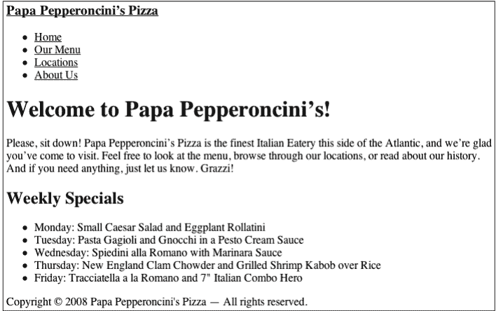

**图 4-16.** 完成页面的截图。即使没有应用任何样式，它也已经相当出色了（但那样还有什么乐趣呢？）。

太棒了！你所有的内容都已就位，并且完全被网页浏览器所理解。好吧，虽然它现在还不太漂亮。一切都会在适当的时候到来。当你在接下来的章节中继续开发这个页面时，你将使用 CSS 为这个朴素但有意义的标记增添一些视觉效果。


## 第 5 章：探索 CSS 的基本概念


到现在为止，你应该已经对如何使用 HTML 或 XHTML 标记创建网页有了扎实的理解。你应该理解如何将语义含义编码到页面内容中。你应该熟悉页面元素的概念，以及这些元素如何相互嵌套以赋予页面有序的结构。最后，你还应该理解网页浏览器如何解释你的 (X)HTML 源代码并决定其渲染方式的基础知识。所有这些主题都在前面的章节中进行了讨论，而本章中的所有概念都将在此基础上进一步展开。

在本章中，你将更深入地了解网页浏览器实际上如何在其窗口中显示元素，我们将讨论你可以控制这种行为的具体方式。当然，这意味着你将深入到层叠样式表（CSS）的世界。然而，在你沉迷于编写代码之前，我们将首先解释 CSS 的由来，以及为什么它是网页设计师的强大工具。

## 层叠样式表的起源与演变

许多网页设计师惊讶地发现，样式表自 HTML 的前身——标准通用标记语言（SGML）于 20 世纪 70 年代诞生以来，就已经以某种形式存在了。这是因为甚至在万维网诞生之前，用 SGML 标记的文档就需要一种方式来编码格式化信息，以补充其语义含义。在 HTML 的早期，这些视觉格式化信息（称为**呈现样式**）以及语义含义都是直接在每个元素的标记中编码的。随着时间的推移，正如本书前面章节所讨论的，这被证明存在诸多问题。

很明显，网页需要一种更好的方式来编码格式化信息，既要方便已经发布在网上的内容的开发和维护，又要增强网页浏览器的功能。你今天所熟知的层叠样式表于 1994 年由 Bert Bos 和 Håkon Wium Lie 两位开发者首次正式提出，他们参与了万维网联盟（W3C）的呈现样式讨论。在 W3C HTML 编辑审查委员会的支持下，CSS level 1（更简单地称为 CSS1）规范于 1996 年底正式发布。

即便在当时，CSS 就拥有一些特殊功能，使其特别适合作为通用的呈现语言。例如，CSS 不仅限于将样式信息应用于用 HTML 标记的网页。它同样可以应用于任何其他标记语言。如今，CSS 可以应用于诸如 SVG（一种用于描述矢量图形的标记语言）和 XUL（一种跨平台用户界面语言）等 XML 方言。实际上，正是这种将特定内容的信息与该内容如何显示的信息相分离的能力，赋予了 CSS 其强大的力量。

CSS 相较于其他显示语言的另一个优势是它能够将多个样式表应用于单个文档。这允许一个文档"继承"其引用的每个样式表中所有样式的声明，每个后续样式表在前面的样式表之上逐层"叠加"。这种层叠效果——后来的某些样式声明可以覆盖同一样式早期声明的事实——正是 CSS 名称的由来。在本章后面，你将看到这种能力如何直接使像你这样的网页开发者受益。

最重要的是，CSS 拥有极其简单的语法，大量使用了英文关键字。这使得它易于阅读和理解。出于同样的原因，正如你将看到的，它也很容易学习。

尽管 W3C 很快就认识到了 CSS 的优势，而且仅用了两年时间 CSS level 2（CSS2）就在 1998 年成为正式推荐标准，但直到最近，网页浏览器对 CSS 的可靠、广泛的支持才使其在网页设计师和开发者的工具集中占据了重要地位。我们知道你在想什么：如果 CSS 这么好、这么快就出现了，为什么花了这么久才进入主流网页浏览器？

在 CSS 最初发布后的许多年里，网页开发者很难充分利用这项技术。由于主要浏览器厂商之间在功能上互相竞争、对标准应该是什么存在不同意见，以及最糟糕的情况下完全未能接近对上述标准的支持，专业网页开发者几乎不可能依赖 CSS 进行网页设计。当时，网页开发者使用了各种拼凑的技术，依赖于嵌套表格布局、呈现性 HTML 标记，以及需要开发者编写特定浏览器代码或完全放弃对某些浏览器支持的专有浏览器功能。

最终，随着网络上不同浏览器数量的增加以及看似无休止的浏览器战争给开发者带来更多困扰，2000 年 3 月 27 日发布的面向 Mac OS 9 的 Internet Explorer 5.0 终于为大家提供了一条迈向标准兼容的道路。

具体而言，微软新版网页浏览器的一部分开发工作由坦特克·切利克（Tantek Çelik）指导，它实现了一个名为 Tasman 的渲染引擎，为网页开发者提供了一种明确选择多种"渲染模式"之一的手段。编写符合 W3C 已发布标准的新代码的开发者可以将浏览器切换到"标准渲染模式"。然而，那些可能与标准模式不兼容的旧页面则会使用另一种渲染模式，这种模式后来广为人知地被称为**怪异模式（quirks mode）**。

这款新浏览器开创了新的先例，一方面强调标准，同时展示新功能。网页开发者开始为这款新浏览器进行开发，并逐渐在行业里更加坚持要求使用基于标准的代码。网页标准倡导者，如杰弗里·泽尔德曼（Jeffrey Zeldman）、莫莉·霍尔茨施拉格（Molly Holzschlag）和埃里克·迈耶（Eric Meyer）——他们每个人都向浏览器制造商施压，要求增加对网页标准尤其是 CSS 的支持——开始取得进展。与此同时，像彼得-保罗·科赫（Peter-Paul Koch）这样的网页开发者呼吁在不同浏览器的 JavaScript 实现之间实现更大的兼容性，而易用性专家如雅各布·尼尔森（Jakob Nielsen）和可访问性专家如乔·克拉克（Joe Clark）也各自在其专业领域内为网页标准提出了有力的论据。慢慢地，形势开始逆转。

CSS 第三级别的工作在 1998 年 CSS 第二级别发布后立即开始，截至本文撰写时仍在进行中。值得庆幸的是，网页开发社区对标准的推动，以及从标准中获得经济利益的大型企业对这一运动的支持，使得 CSS 的未来看起来非常光明。各类联网设备中对 CSS 的支持越来越广泛，这也推动着这门语言不断达到新的高度。如今，CSS 不仅可以用来控制网页内容的视觉呈现，还可以用于控制各种其他事物，例如屏幕阅读器朗读页面文本的速度。

## CSS 的工作原理

对很多人来说，CSS 看起来常常像魔法一样。诚然，要理解这样一个概念并不容易：仅用一个包含 HTML 标记（赋予页面内容含义和结构）的简单文本文件，以及另一个完全独立的包含 CSS 规则（定义这些内容的布局和呈现方式）的文件，最终就能得到与原始内容截然不同的视觉效果。一个朴素的、充满 CSS 规则的文本文件，怎么能如此显著地改变一个网页的外观呢？让我们来一探究竟。

## 默认浏览器样式

**样式表（style sheet）实际上是一种相当简单的构造。** 与 (X)HTML 标记类似，样式表也只是一个纯文本文件，但与标记不同的是，它本身不包含任何内容。CSS 样式表*始终*应用于其他某个文档的内容。正是这些其他内容受到 CSS 声明的影响。仅靠一个 CSS 文件本身，它什么都做不了。

回想一下，在上一章中你使用 XHTML 标记为 Papa Pepperoncini 比萨餐厅开发了一个网页。你现在将使用那个页面的内容并为其应用样式。目前，那个网页看起来相当朴素——但它并非*完全*没有格式，如图 5-1 所示。

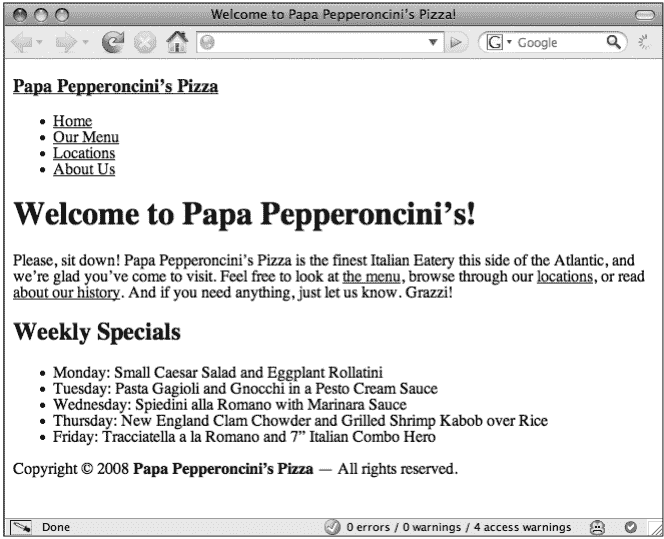

图 5battery.low.jpg

如图所见，页面顶部有一个链接（"Papa Pepperoncini's Pizza"），该链接的文本为蓝色并带有下划线。其下方是一列链接，每个列表项都清楚地显示一个项目符号。然后是一段大号标题文本，比页面上其他文本大得多。还有一段文本，与其周围的标题之间有着相当数量的空白间距。页面的其余元素也是如此。

那么，如果这是 supposedly 没有任何样式信息的页面，为什么页面会显示出一些智能，以你想象中的方式呈现这些元素呢？实际上，这不是你的页面，而是内置于网页浏览器中的样式表。使用 Firefox 网页浏览器出色的 Web Developer Toolbar 附加组件（在第 8 章中有更详细的讨论），你可以禁用这些内置样式。图 5-2 展示了在完全没有样式表的情况下——甚至包括浏览器内置的样式表都没有——网页*真正*的样子。

从这个例子可以看出，大部分样式现在都消失了。链接仍然是蓝色的，标题仍然是粗体的，但仅此而已。从这个例子需要理解的重要一点是，当你开始为自己的网页添加样式信息时，你实际上是在覆盖已经存在于访问者浏览器内置样式表中的样式。

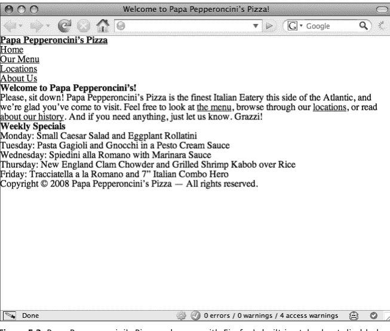

不幸的是，并非所有网页浏览器都内置相同的样式表，这意味着除非你定义自己的规则并覆盖所有默认规则，否则不同的浏览器会以不同的方式显示相同的元素。

尽管级联样式表带来了令人难以置信的呈现灵活性，但样式表本身必须以特定的方式构建，就像你在上一章中创建的 XHTML 页面必须使用受限的语法和文法来编写一样。我们将利用你刚刚发现的默认浏览器样式来解释 CSS 使用的语法，并展示样式表是如何构建的。

## CSS 样式表的结构

一个 CSS 样式表理论上可以包含无限量的呈现信息。这些信息被组织成一系列**语句**，每条语句指定一条**规则**（有时也称为**规则集**）。规则在 CSS 中承担所有繁重的工作；它们确定将样式信息应用到何处。当你创建样式表时，大部分时间里你都在编写这些规则。

每条规则都可以用纯英语表达，事实上你在默认样式的例子中已经这样做了。例如，"链接文本应为蓝色并带有下划线"就是一条 CSS 规则可能指定的内容。接下来的规则可能指定"段落应与其上方和下方的内容之间有适当数量的空白间距"。在 CSS 中，你可以这样编写这些规则：

```css
a:link {
    color: blue;
    text-decoration: underline;
}

p {
    margin-top: 25px;
    margin-bottom: 25px;
}
```

这段 CSS 代码本身就是一个有效的样式表。如果你将这些样式应用到网页上，所有链接都会变为蓝色并带有下划线文本，所有段落都会在上下方有恰好 25 像素的间距。当然，这已经与大多数浏览器默认显示链接和段落的方式相似，所以这并不是很令人兴奋。然而，令人兴奋的是，你应该不难找出需要修改哪些部分才能将所有链接变成绿色，以及如何更改段落上方或下方的像素数量。例如：

```css
a:link {
    color: green;
    text-decoration: underline;
}

p {
    margin-top: 50px;
    margin-bottom: 50px;
}
```

现在，你的所有链接都将是绿色并带有下划线，每个段落上下方都将有恰好 50 像素的空白的空白间距。从前面的例子中，也很容易看出如何更改页面中应用所声明样式的元素。例如，不再让链接显示为绿色并带有下划线，而是让你的顶级标题元素（`<h1>`）以这种方式显示：

```css
h1 {
    color: green;
    text-decoration: underline;
}

p {
    margin-top: 50px;
    margin-bottom: 50px;
}
```

现在，链接将恢复为浏览器默认样式表指定的方式显示，但你的顶级标题将是绿色并带有下划线，如图 5-3 所示。

106

图 5-3. 在网页上覆盖 `<h1>` 和 `<p>` 元素的默认样式

你甚至可以更改*所有*标题，使它们看起来都和你的一级标题一样。你只需将其他标题元素添加到第一条规则中，用逗号分隔每个元素名称：

```css
h1, h2, h3, h4, h5, h6 {
    color: green;
    text-decoration: underline;
}

p {
    margin-top: 50px;
    margin-bottom: 50px;
}
```

这会产生如图 5-4 所示的效果。

图 5-4. 为所有标题指定相同的规则

等一下。这对你的两个标题起了作用，但页面顶部的那个标题（"Papa Pepperoncini's Pizza"）却没有变化，它仍然是蓝色且带下划线的。别担心，这不是错误；这是 CSS 在起作用。那么，这里到底发生了什么呢？

回想一下，这个标题实际上是一个链接。你为该标题指定的 XHTML 是这样的：

```html
<h3><a href="index.html">Papa Pepperoncini&rsquo;s Pizza</a></h3>
```

`<h3>` 元素唯一的内容就是另一个元素，具体来说就是 `<a>`（锚点）元素。此外，还记得浏览器已经为所有链接预设了默认样式，即它们应该是蓝色且带下划线的。所以，浏览器实际上并没有忽略你；它只是将所有加载的样式表中的样式规则依次应用到你的页面元素上。由于 `<a>` 元素嵌套在 `<h3>` 元素内，该标题中的文本实际上是一个链接，而由于浏览器有一条规则规定所有链接应该是蓝色的，所以浏览器就是这么做的。

为了证明这确实是在发生的事情，你可以向标题元素中添加更多文本，但不添加到链接中：

```html
<h3><a href="index.html">Papa Pepperoncini&rsquo;s Pizza</a>
    &mdash; The Best Pizza in Town!</h3>
```


现在，重新加载你的网页，你会看到一个蓝色链接（“Papa Pepperoncini's Pizza”）和一个绿色标题（“— The Best Pizza in Town”），如图 5-5 所示。

图 5-5. 标题中未受链接样式 CSS 规则影响的部分变成了绿色，与其他标题一样。

这个例子展示了理解页面底层标记的重要性。如果你不理解标记的结构，就无法准确确定页面的哪些部分是什么元素，因此也就无法理解样式规则是如何应用到页面上的。

这些例子还展示了一个 CSS 规则由多个独立部分组成的结构。在每行的开头，你有一个**选择器**，在这些例子中，它与你要应用规则其余部分的元素相匹配。更改选择器就会更改规则选择的元素。你可以通过逗号分隔列表的方式，为单个规则指定多个元素作为目标。

在选择器之后，有一大段文本位于左花括号和右括号（`{` 和 `}`）之间。这些括号标记了**声明块**的开始和结束，类似于 XHTML 元素有开标签和闭标签。在规则的声明块内，你指定了两个独立的**声明**，尽管你可以指定任意数量的声明（声明块内可以写的声明数量没有限制）。每个声明都以分号（`;`）结尾。

在针对（或目标为）标题的规则中，这些声明为颜色（`color`）和文本装饰（`text-decoration`）**属性**指定了值。属性和值之间用冒号（`:`）分隔。在声明块内部以及两条规则之间，所有空白字符都被忽略。图 5-6 详细说明了 CSS 规则的语法。

图 5-6. CSS 规则的组成部分

CSS2 规范定义了数百种可以设置值的属性。当最终实现时，CSS3 将增加更多的属性。有些属性可以应用于每种元素，例如标题、链接、段落、表格、图片等。其他属性只能应用于某些特定类型的元素，如果应用到其他元素上就不会起作用。学习哪些属性可以应用到哪些元素，以及学习每个属性可以设置什么样的值，是精通 CSS 的过程的一部分。

现在，让我们满足于还有更多东西需要学习的知识，然后继续前进。稍后在这本书中，你将重新讨论 CSS 属性和值的主题，并考察 CSS2 提供的选项。不过，与此同时，你将学习更多关于如何将 CSS 集成到网页中的知识。

## 将样式应用到网页元素

现在，你已经理解了 CSS 是什么，你知道它长什么样，你知道它能做什么以及它是如何做到的。差不多是时候写一些新的 CSS 规则来让 Papa Pepperoncini's Pizza 页面大放异彩了。但首先，你需要弄清楚如何将一个 CSS 样式表附加到 HTML 或 XHTML 网页上，这样你编写的样式才能真正显示出来。

你可以通过三种方式将 CSS 规则应用到页面元素上。你可以将 CSS 规则直接嵌入到元素中，你可以将整个样式表嵌入到 HTML 或 XHTML 页面本身中，或者你可以从一个完全独立的文件链接一个样式表到你的 HTML 或 XHTML 页面。让我们详细考察这三种可能性。

## 内联样式

也许将 CSS 样式应用到网页元素最简单、最熟悉的方式是通过使用内联样式，即直接写入元素中的样式。由于内联样式根据其定义只应用于它所放置的元素，因此规则中不需要使用 CSS 选择器，而且由于样式已经封闭在元素内部，声明块的括号也不需要了。对于内联样式来说，你需要指定的只是你想要在元素上设置的属性和值。

内联样式写入元素的 `style` 属性的值中，像这样：

```html
<p style="color: purple;">Look ma, I&rsquo;m purple!</p>
```

自然地，内联样式不能给你太多灵活性，因为它们无法使用 CSS 选择器的强大功能来定位页面上的多个同类型元素，就像你之前的例子那样。更糟糕的是，内联样式将表现信息直接嵌入到你的文档中，而这正是 CSS 所要避免的。一般来说，内联样式并不是应用样式到元素上的好解决方案。

然而，有些情况下内联样式是有用的。例如，它们使得对特定元素进行实验以及测试不同属性的不同值会对元素产生什么影响变得很容易。在你学习 CSS 属性存在什么以及它们能做什么的时候，可以随意使用内联样式来尝试它们。然而，在实际项目交付物中，你不应该在标记中留下任何表现数据，所以你应该将这些内联样式取出，并将它们放入嵌入式样式表或外部样式表中。

## 嵌入式样式表

在 HTML 或 XHTML 文件中**嵌入** CSS 样式表使你能够不受限制地使用 CSS 的所有功能，但仅限于包含该嵌入式样式表的单个文档。通过将 CSS 规则放在 `<style>` 元素中，你实际上是在标记内部创建了一个特殊的区域，可以安全地放置 CSS 规则。当浏览器遇到这个特殊区域时，它会停止将你的源代码解释为 (X)HTML 标记，并开始将代码解释为 CSS 规则。让我们看看这在实践中是如何工作的。

在你为 Papa Pepperoncini's Pizza 制作的示例网页中，你有一个如下所示的 XHTML 文档外壳：

```html
<!DOCTYPE html PUBLIC "-//W3C//DTD XHTML 1.0 Strict//EN"
    "http://www.w3.org/TR/xhtml1/DTD/xhtml1-strict.dtd">

<html xmlns="http://www.w3.org/1999/xhtml" xml:lang="en" lang="en">
<head>
    <meta http-equiv="Content-Type" content="text/html; charset=utf-8"/>
    <title>Welcome to Papa Pepperoncini&rsquo;s Pizza</title>
</head>
<body>
    <!-- XHTML 内容放在这里 -->
</body>
</html>
```

在这个外壳中，你有两个主要元素嵌套在根 `<html>` 元素内：`<head>` 和 `<body>`。`<body>` 是你的 XHTML 内容所在的地方。`<head>`，你可能记得，是你的文档的大部分元数据所在的地方。由于 CSS 定义内容的表现形式，它被认为是这种元数据的一种形式，你需要将它放在 `<head>` 元素内。你通过定义一个 `<style>` 元素并给它一个 `text/css` 的类型来做到这一点，以向浏览器指定该元素的内容包含的是什么样式语言。对于 CSS，你将始终使用 `text/css` 类型。

带有嵌入式样式表的文档外壳看起来会像这样：

```html
<!DOCTYPE html PUBLIC "-//W3C//DTD XHTML 1.0 Strict//EN"
    "http://www.w3.org/TR/xhtml1/DTD/xhtml1-strict.dtd">

<html xmlns="http://www.w3.org/1999/xhtml" xml:lang="en" lang="en">
```

第 5 章

你可以通过这种方式在单个文档中嵌入任意数量（或任意需要）的样式表。举个例子，让我们把之前为 `<h1>` 元素指定两条声明的规则拆分成两个样式表，每个样式表包含一条 CSS 规则：

```html
<!DOCTYPE html PUBLIC "-//W3C//DTD XHTML 1.0 Strict//EN"
    "http://www.w3.org/TR/xhtml1/DTD/xhtml1-strict.dtd">

<html xmlns="http://www.w3.org/1999/xhtml" xml:lang="en" lang="en">
<head>
    <meta http-equiv="Content-Type" content="text/html; charset=utf-8"/>
    <title>Welcome to Papa Pepperoncini's Pizza</title>

    <style type="text/css">
        h1 {
            color: green;
        }
    </style>

    <style type="text/css">
        h1 {
            text-decoration: underline;
        }
    </style>
</head>
<body>
    <!-- XHTML content goes here -->
</body>
</html>
```

以这种方式将 CSS 规则放在嵌入式样式表中，显然能让你在 CSS 规则的功能实现方面拥有更大的灵活性，但它仍然局限于将规则应用于单个页面。CSS 的最大优势在于，当你使用单个样式表来定义整个网站（而非单个网页）的呈现方式时，这个网站可能有 10 个、20 个、100 个、1,000 个或更多独立页面。

要实现这一目标，你必须将 CSS 样式与 HTML 或 XHTML 标记完全分离，将其放入单独的文件中。

## 外部样式表

将 CSS 应用于网页乃至整个网站最常见——也最有效率——的方式是使用完全独立的文件，这些文件通过特殊的引用元素链接到网页，就像 `` 元素引用外部图像文件一样。这些包含 CSS 规则的独立文件被称为**外部样式表**，因为它们被放置在任何包含性标记之外。即使这些 CSS 规则与实际的网页文档分离，它们的行为方式仍然与写在嵌入式样式表中完全相同。

要从 HTML 或 XHTML 页面引用外部样式表，你可以使用 `<link>` 元素来——你猜对了——将 CSS 文件链接到你的标记中。由于可以将多种不同的东西链接到网页中，因此这种链接需要具有特定的关系，具体来说，就是样式表关系。这通过 `rel` 属性来指定。与 `` 元素类似，你还需要告诉浏览器在哪里找到这个外部样式表。你可以使用 `href` 属性来实现，而且你可能已经猜到了，它的值可以是任何有效的 URL。最后，就像嵌入式样式表一样，你需要告诉浏览器这个样式表是用 CSS 编写的，因此你指定 `text/css` 类型。

综合起来，`<link>` 元素可能如下所示：

```html
<link rel="stylesheet" href="css/basic.css" type="text/css" />
```

这个（空的）元素指定了可以在 `css` 文件夹中找到外部 CSS 样式表，其文件名为 `basic.css`。在 `basic.css` 文件内部，你只需像平常一样编写 CSS 规则。由于整个文件将被浏览器解释为 CSS，因此不需要将 CSS 规则嵌入到 `<style>` 元素中。

网页可以链接到任意数量的外部样式表。从技术上讲并没有限制，尽管在实践中，链接的 CSS 文件越多，浏览器获取所有文件所需的时间就越长。当然，外部样式表的优势在于多个*网页*可以链接到*它*，这意味着你可以为一个网页编写的样式规则在无限数量的其他网页中重复使用。这就是 CSS 如此惊人地可扩展的原因。无论你的网站有一个页面还是一百万个页面；只要这些页面中有需要以相同方式进行样式化的基本元素，单个 CSS 文件就可以用来为它们全部设置样式。

让我们以 Papa Pepperoncini 的 Pizza 餐厅网站为例。回想一下，这个网站的导航菜单中有四个链接：

```html
<ul>
    <li><a href="index.html">Home</a></li>
    <li><a href="menu.html">Our Menu</a></li>
    <li><a href="locations.html">Locations</a></li>
    <li><a href="about.html">About Us</a></li>
</ul>
```

这四个页面都将包含相同的导航菜单，并以相同的方式标记。得益于这种一致性以及 CSS 能够创建可在任意数量的页面中重复使用的一组规则的能力，你可以编写一组规则来以任意你想要的方式设置这些链接的样式，然后只需将这四个页面分别链接到相同的外部样式表，所有页面上的导航菜单链接看起来就会一模一样。

让我们为这四个链接设置一个漂亮的蓝绿色。由于这些链接显然是一个导航元素，让我们也去掉每个链接的下划线。最后，由于你希望它们在页面上稍微更突出一些，让我们将它们设置为比正常文本稍大一点的尺寸。你可以通过一条包含三条声明的单个 CSS 规则来实现所有这些效果：

```css
ul a {
    color: teal;
    text-decoration: none;
    font-size: larger;
}
```

你所需要做的就是将这些 CSS 规则放入 `css` 文件夹中的 `basic.css` 文件，然后使用 `<link>` 元素将你创建的每个网页链接到这个外部样式表。只要你在为 Papa Pepperoncini 的 Pizza 餐厅网站创建的所有页面上保持标记的一致性，你为主导航编写的样式规则就会自动应用。

这种方法显然比不得不编写（或复制粘贴）相同的样式信息到四个页面要好得多，因为它实现起来更快。而且维护起来也更容易。假设在你向 Papa Pepperoncini 展示你的设计概念后，他告诉你他认为导航菜单太小了。他想要让整个网站的所有导航链接比现在的更大。由于你已经成功将主导航链接本身与赋予它们的视觉样式分离开来，这个更新不成问题。为了满足 Papa Pepperoncini 的要求，你只需要打开 `basic.css` 文件并更改你的 CSS 规则，也许是改成这样：

```css
ul a {
    color: teal;
    text-decoration: none;
    font-size: xx-large;
}
```

现在，你之前链接到这个样式表的任何网页都会立即更新，就是这么简单。但是等等，这个 `ul a` 选择器是什么？你可能会自言自语，肯定没有 `ul a` 元素吧，当然（由于 HTML 或 XHTML 中的元素名称不能包含空格）你是对的。事实上，这是一种新的 CSS 选择器，它只在锚点嵌套在无序列表内部时才进行定位。

## 更多 CSS 选择器：以手术般的精确度定位页面元素

到目前为止，你已经了解了如何将 CSS 规则应用于特定类型的页面元素。当然，基于元素类型来指定样式规则很方便，但最终它的用途也就仅限于此。例如，如果你希望*某些*链接看起来是一种样子，而*另一些*链接看起来是另一种样子。显然，仅基于元素类型（在本例中是 `<a>` 或锚点）来设置所有样式是行不通的。你需要一种更精确的方式来选择元素。这正是不同类型的 CSS 选择器可以帮助你的地方。

正如你已经知道的，CSS 选择器允许你*定位*标记中想要应用特定样式的元素。你已经知道如何使用一种 CSS 选择器——类型选择器，它（顾名思义）基于元素的类型（或名称）来选择元素。例如，一个如下所示的选择器 `h1` 会应用于所有 `<h1>` 元素。同样，一个写作 `h1, h2, h3` 的选择器会定位页面中所有 `<h1>`、`<h2>` 和 `<h3>` 元素。

更准确地说，你到目前为止使用的类型选择器被称为**简单选择器**，因为它们，嗯，相当简单。要构建更复杂的 CSS 选择器，你需要以特定方式组合或**链式**连接多个简单选择器。这些更复杂的模式让你能够以手术般的精确度定位页面上的元素。让我们简要看看在使用 CSS 时还可以使用哪些其他类型的选择器。

## ID 选择器

另一种简单选择器是 **ID 选择器**。正如你所料，这种选择器定位于 `id` 属性被赋予指定值的元素。例如，在 Papa Pepperoncini 的页面上，你之前定义了一个 `id` 为 `header` 的 `<div>` 元素，用于将所有属于网站页眉部分的元素归为一组：

```html
<div id="header">
    <h3><a href="index.html">Papa Pepperoncini's Pizza</a></h3>

    <ul>
        <li><a href="index.html">Home</a></li>
        <li><a href="menu.html">Our Menu</a></li>
        <li><a href="locations.html">Locations</a></li>
        <li><a href="about.html">About Us</a></li>
    </ul>
</div>
```

现在，通过使用 ID 选择器，你可以选择这一整组元素，例如，用一条 CSS 规则让其中所有文本变为粗体并渲染为特定字体。你可能会觉得像 Zapfino 这样花哨的字体看起来不错，但由于这种字体并不能保证在所有（甚至大多数）电脑上都有安装，所以你只需声明任何衬线字体都可以，以防该字体因某种原因不可用：

```css
#header {
    font-weight: bold;
    font-family: Zapfino, serif;
}
```

ID 选择器始终以井号（`#`）开头，然后紧接你想要定位的元素的 `id` 值。在前面的例子中，由于 `<div>` 元素的 `id` 属性值是 `header`，所以井号后面就是 `header`。这与明确指定 `<div>` 元素的 ID 选择器具有相同的目标，像这样：

```css
div#header {
    font-weight: bold;
    font-family: Zapfino, serif;
}
```


然而，第一个选择器更加通用。它不关心 `header` 是什么类型的元素，只要该元素的 `id` 属性值是 `header` 即可。第二个选择器则在意这一点，它只会在该元素是 `<div>` 时才定位 `header` 元素。由于 `id` 属性值在整个网页中必须是唯一的，大多数时候你可以确信这两个选择器完全可以互换。但在某些情况下，你需要更具体的选择器来覆盖另一种样式。我们将在本章稍后介绍选择器特异性。

如图 5-7 所示，三级标题和主导航列表中的链接都间接受到了你 CSS 规则的影响，因为它们都包含在 `header` `<div>` 内（而且因为 `font-weight` 和 `font-family` 属性都是继承的，这个话题我们将在很短的时间内介绍）。

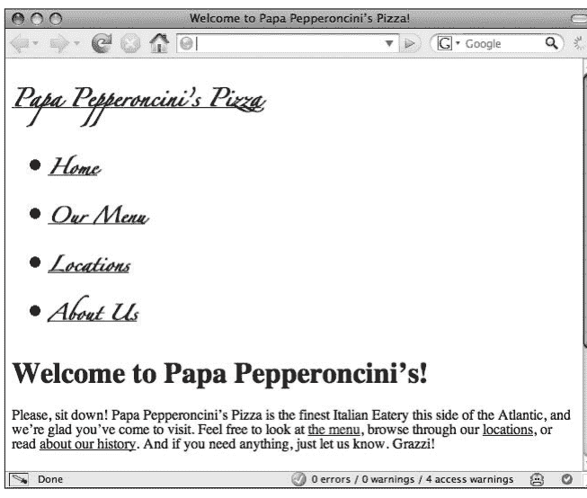

图 5-7. 使用 ID 选择器通过单条规则将 CSS 样式应用于一组元素

从这个例子中得出的重要结论是，使用 ID 选择器可以让你定位已被赋予唯一 `id` 值的元素，这对于将样式应用于嵌套在该特定元素内的元素组来说非常方便。

## 类选择器

类选择器是另一种简单选择器。这些选择器的作用方式与 ID 选择器相同，只不过不是定位带有 ID 值的元素，而是定位被赋予特定 `class` 值的元素。在上一章中，你给了页面上两个 `<div>` 元素 `feature` 类。

```html
<div class="feature" id="feature-1">
    <h1>Swingline Stapler</h1>
    <p>This workhorse stapler brings you a solid and consistent performance that makes it an industry standard. An all-metal die-cast base for years of durability. A performance-driven mechanism with an inner rail for long-term stapling integrity. Ease of use, refined design, time-tested features: exactly what you'd expect from America's #1 stapler.</p>
</div>

<div class="feature" id="feature-2">
    <h1>Black Standard Stapler</h1>
    <p>Not as exciting as the Swingline Stapler but a classic stapler nonetheless!</p>
</div>
```

回想一下，你已将有关特色产品的标题和段落归入了名为 `feature` 的逻辑分组。现在，使用 CSS 类选择器，你可以在整个网站中一致地美化所有这些特色产品。假设每个产品都应该放在一个 250 像素的方框内，带有 1 像素宽的银色边框。每个方框之间应该相距约 10 像素，但它们应该相互对齐。同样，只需一条 CSS 规则就能完成所有这些：

```css
.feature {
    width: 250px;
    height: 250px;
    border: 1px solid silver;
    padding: 15px;
    margin-right: 10px;
    margin-bottom: 10px;
    float: left;
}
```

图 5-8 显示了结果。与 ID 选择器一样，类选择器也以特殊符号开头，这里是点号（`.`），然后紧接你想要定位的元素的 `class` 值。

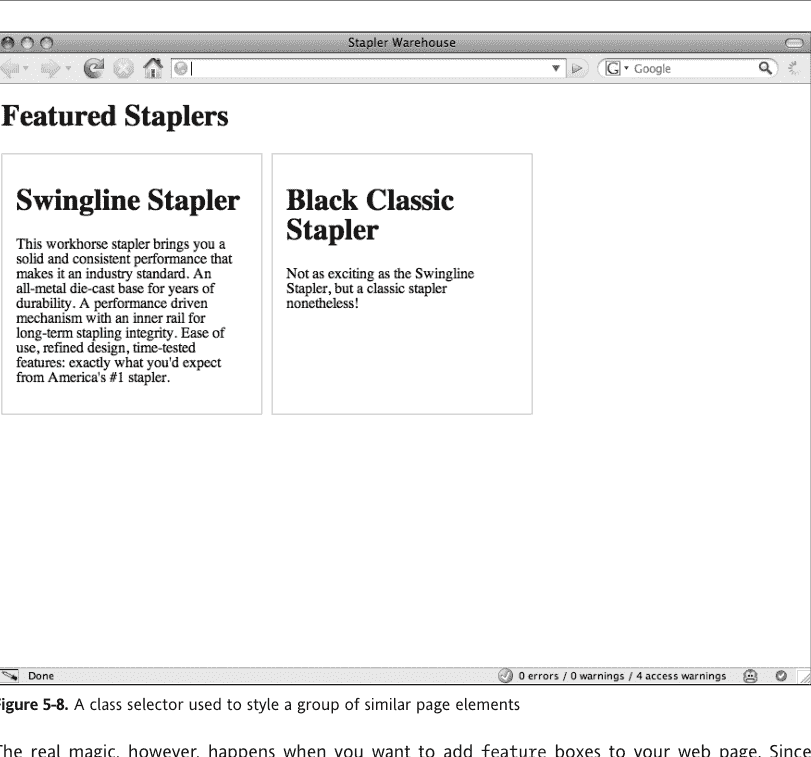

然而，真正的魔力体现在你想要向网页添加特色产品框时。由于你已经声明了 `feature` 的样子，你只需将标记好的内容添加到页面上并适当地为其指定类。你已经写好的 CSS 规则会负责其余部分。图 5-9 显示了在 XHTML 标记中添加了两个额外的 `<div>` 元素且未对 CSS 规则做任何更改的结果。

```html
<div class="feature" id="feature-1">
    <h1>Swingline Stapler</h1>
    <p>This workhorse stapler brings you a solid and consistent performance that makes it an industry standard. An all-metal die-cast base for years of durability. A performance-driven mechanism with an inner rail for long-term stapling integrity. Ease of use, refined design, time-tested features: exactly what you'd expect from America's #1 stapler.</p>
</div>

<div class="feature" id="feature-2">
    <h1>Bronze Stapler</h1>
    <p>For the classiest look, go for the polished style of bronze.

    With our Bronze Stapler, you can be assured of

    reliability, quality without sacrificing looks! Our

    patented bronze-casting technology ensures this

    stapler will look fantastic on any wooden or metallic

    surface.</p>
</div>

<div class="feature" id="feature-3">
    <h1>Black Standard Stapler</h1>
    <p>Not as exciting as the Swingline Stapler, but a classic

    stapler nonetheless!</p>
</div>

<div class="feature" id="feature-4">
    <h1>Silver Polished Stapler</h1>
    <p>Nothing says productivity quite like the polished look of silver

    and chrome. With our Silver Polished Stapler, we

    guarantee you'll enjoy paperwork again!</p>
</div>
```

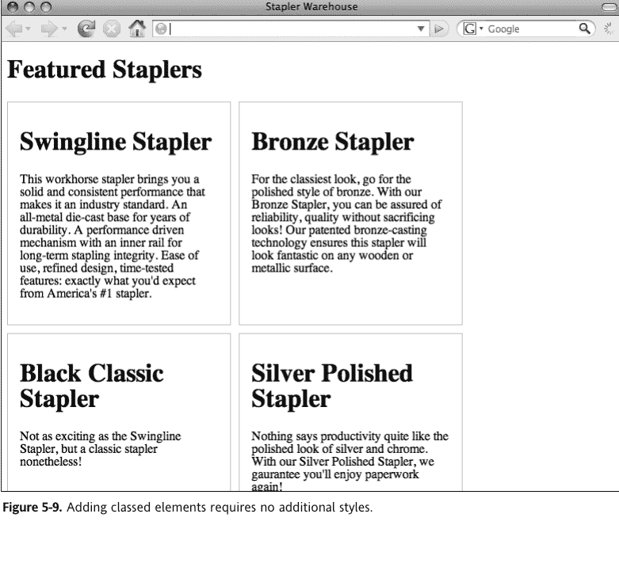

这个例子突显了语义化标记的重要性。正是得益于支撑你网页的可靠语义化标记，你才能以这种方式利用 CSS 的优势。

## 伪类选择器

我们在开始讨论 CSS 规则语法时就默默介绍了一种伪类。那条规则看起来像这样：

```css
a:link {
    color: blue;
    text-decoration: underline;
}
```

在这个例子中，选择器是 `a:link`。这里，类型选择器是 `a`，伪类是 `:link`。伪类将在下一章中更详细地讨论，所以目前只需了解它们的存在并将它们识别为另一种简单的 CSS 选择器即可。

## 还有更多简单选择器

如果你认为类型、ID、类和伪类选择器还不够用，还有更多我们没有提及的简单选择器。这些包括属性选择器和通用类型选择器。事实上，ID 选择器和类选择器都是属性选择器的简写形式（因为它们基于特定属性值来选择元素，如 ID 或 `class`）。由于这两种简单选择器很少使用，这里不作讨论。

再次强调，重要的点是所有这类简单选择器仅仅是构建块，用于创建更复杂的模式，以便在网页中定位特定元素。

## 后代选择器

我们之前介绍的另一种 CSS 选择器被称为后代选择器。这种选择器由两个类型选择器通过空白分隔组成，正如其名称所暗示的，它定位作为另一种指定类型元素后代（即嵌套在内部）的指定类型元素。带有后代选择器的 CSS 规则看起来像这样：

```css
ul a {
    color: teal;
    text-decoration: none;
}
```

这条 CSS 规则的意思是：“定位所有嵌套在 `<ul>` 元素内部的 `<a>` 元素，将它们设为蓝绿色，并去除任何下划线。”在这个例子中，CSS 选择器中的空白被称为组合器，因为它组合了两个简单选择器。你可以使用空白组合器将任意数量的简单选择器链式连接在一起，以创建更复杂的后代选择器。例如，如果你想要选择文档中所有位于段落内的链接，而这些段落又与其他元素一起被分组在 `<div>` 元素内，你可以使用以下 CSS 选择器：

```css
div p a {
    color: teal;
    text-decoration: none;
}
```

再次说明，这个规则的意思是：“选中所有嵌套在 `<p>` 元素内的 `<a>` 元素，前提是这些 `<p>` 元素又嵌套在 `<div>` 元素内。”因此，前面的 CSS 规则会影响如下标记结构中的链接：

```html
<div>
    <p><strong>We appreciate your ➜
        <a href="buy.html">patronage</a></strong>, and encourage your ➜
        <a href="contact.html">feedback</a>.</p>
</div>
```

然而，这样的 CSS 选择器不会影响如下标记结构中的链接：

```html
<div>
    <h3><a href="index.html">Papa Pepperoncini's Pizza</a></h3>
</div>
```

请注意，在第一个示例中，选择器匹配了两个链接，即使其中一个链接在 `<strong>` 元素内，另一个不在。后代选择器匹配元素时，无论它们嵌套多深。它的唯一要求是：在任意给定点，标记的树结构与简单选择器链相匹配。

## 子代选择器

如果你确实只想选中那些只比另一个元素低一级嵌套的元素（即该元素的子元素），你可以使用子代选择器来实现。与后代选择器类似，子代选择器由至少两个简单选择器和一个大于号（`>`）组合而成，大于号就是组合符。例如，要选中所有直接放置在列表项内（并且没有嵌套在列表项与其链接之间的任何其他元素内）的链接，你可以使用以下子代选择器：

```css
li > a { ... }
```

请注意，除非简单选择器之间唯一的组合符是空格本身（即后代组合符），否则简单选择器和组合符之间的任何空格都会被忽略。也就是说，这个 CSS 选择器——读作“li 类型选择器，空格，子代组合符，空格，a 类型选择器”——不是一个使用后代组合符的 CSS 选择器，即使它包含空格。

遗憾的是，Internet Explorer 7 之前的版本不支持子代选择器，因此除了用于规避这些浏览器中的错误外，它们在当今的 CSS 样式表中并不常用。通过专门设计的 CSS 选择器向特定浏览器隐藏某些 CSS 声明块的技术被称为 CSS Hack，将在下一章进一步讨论。

## 相邻兄弟选择器

CSS2 提供的最后一种组合符是相邻兄弟选择器。这个选择器同样由至少两个简单选择器和一个组合符组成，在这种情况下，组合符是加号（`+`）。这个选择器赋予你一种能力：只有当某个元素是另一个特定元素的兄弟元素，并且在标记中紧随其后时，才能选中它。

回想一下，标记中嵌套的元素称为子元素，而它被嵌套在其中的元素称为父元素。因此，兄弟元素就是同为这个父元素的子元素的元素。

例如，在 Papa Pepperoncini Pizza 网站的导航菜单中，所有列表项都是兄弟元素，因为它们都是无序列表的子元素：

```html
<ul>
    <li><a href="index.html">Home</a></li>
    <li><a href="menu.html">Our Menu</a></li>
    <li><a href="locations.html">Locations</a></li>
    <li><a href="about.html">About Us</a></li>
</ul>
```

显然，无序列表是列表项的父元素。它也是这些链接的祖先（祖父）。链接本身是列表项的子元素，但没有一个链接是其他链接的兄弟元素，因为每个链接都有不同的父元素（只是碰巧都是列表项）。

在前面的列表中，除了第一个列表项（当然，它不能跟在任何东西后面，因为它是第一个）之外，每个列表项子元素都跟在另一个列表项兄弟元素后面。使用相邻兄弟选择器，你可以编写一条规则来选中列表中除第一个列表项以外的所有列表项，并将它们设置得稍微小一点，就像这样：

```css
li + li { font-size: x-small; }
```

如果你将这条 CSS 规则应用于 Papa Pepperoncini Pizza 网站，导航菜单中的“Home”链接会比菜单中的其他链接大，如图 5-10 所示。

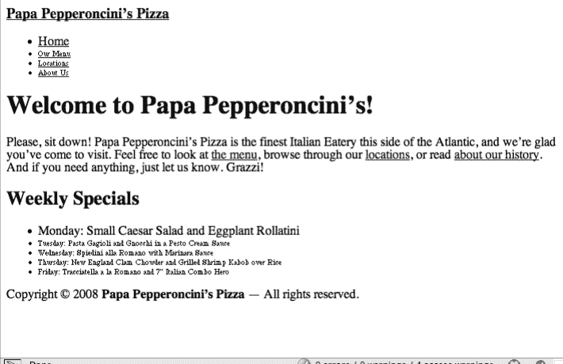

图 5-10. 使用相邻兄弟选择器弱化相关列表项的样式

在图 5-10 中，你也可以看到前面 CSS 规则的一个意外副作用。具体来说，你的两个列表，主导航菜单和每周特色菜单列表，都应用了前面的样式规则。幸运的是，因为你有结构良好的标记，所以你可以组合使用你刚刚学过的所有不同类型的选择器，来精确地定位你想要设置样式的元素。

## 在单个规则中组合多个 CSS 选择器

现在你已经理解了 CSS 选择器的构建块、可用的简单选择器类型，以及如何使用特定的组合符将它们链接起来，接下来可以快速看几个复杂的例子。首先，值得注意的是，没有任何规定说在一个 CSS 选择器中只能使用一种组合符。这意味着你可以使用简单选择器和组合符的任意组合，来创建任意复杂的选择模式。

让我们修改你在前面部分使用的规则，使其仅应用于主导航列表。目前，你的规则是这样的：

```css
li + li { font-size: x-small; }
```

它影响了整个页面上每个列表中的列表项，这对你的需求来说范围太广了。所以，让我们将其范围缩小到仅限那些从标题 `<div>` 元素派生出来的列表项。为此，你只需添加一个针对标题 `<div>` 的 ID 选择器，并使用后代组合符将其链接到你现有的选择器。新的 CSS 规则如下：

```css
#header li + li { font-size: x-small; }
```

这使 Papa Pepperoncini 的每周特色菜单列表恢复了正确的大小。作为另一个例子，以下 CSS 选择器也是完全有效的：

```css
#header li > a { ... }
```

这个选择器由三个简单选择器和两个组合符组成，它的意思是：“选中所有作为 `<li>` 元素子元素的 `<a>` 元素，前提是这些 `<li>` 元素是从一个 `id` 为 `header` 的元素派生下来的。”以下是一些更复杂的选择器示例。看看你是否能理解它们的含义。

```css
div#header h1 { ... }

#specials .feature p { ... }

.feature > h1 em { ... }

.feature h1 + p { ... }
```

正如你现在所看到的，CSS 选择器赋予你巨大的能力，可以精确地定位你想要的元素——并且只定位你想要的元素。

## CSS 继承：让一般情况为你服务

正如我们之前讨论的，使用结构良好的标记，并使用 ID 和类名来识别这些元素组，使你能够使用单个 CSS 规则为网页中的大块元素应用特定的样式。你已经在实践中看到了一个例子，其中你一次性设置了 Papa Pepperoncini 网站标题中所有文本的样式。回想一下，你为网站标题开发的 XHTML 标记是这样的：

```html
<div id="header">
    <h3><a href="index.html">Papa Pepperoncini's Pizza</a></h3>
    <ul>
        <li><a href="index.html">Home</a></li>
        <li><a href="menu.html">Our Menu</a></li>
        <li><a href="locations.html">Locations</a></li>
        <li><a href="about.html">About Us</a></li>
    </ul>
</div>
```

你用来为标题内所有文本设置特定字体的 CSS 规则是这条：

```css
#header {
    font-weight: bold;
    font-family: Zapfino, serif;
}
```


如你所见，你从未明确选中标题`<div>`内的任何链接、列表项或标题。然而，每个这些元素的文本都获得了你在选中标题`<div>`的 CSS 规则中声明的样式。这是怎么发生的？这不是魔法；这是 CSS 规范的一个特性，CSS 的设计者们很聪明地创造了它。

这种行为被称为**继承**，之所以这样命名，是因为子元素仅仅因为是父元素的子元素，就获得了其父元素也具有的某些 CSS 属性。换一种说法，子元素从它们的父元素和祖先那里**继承** CSS 属性。这种自动继承为像你这样的网页开发人员省去了为网页上每个元素显式定义 CSS 属性的繁琐任务。你能想象那会是多大的噩梦吗？仅前面的 HTML 代码片段中就有 12 个元素！有了 CSS，你不会比没有 CSS 时好多少！

思考继承及其工作方式的另一种方式是，将你的 XHTML 元素视为台阶，每个嵌套元素都是比其父元素低一级的台阶。当你将 CSS 属性应用于其中一个台阶时，它会“级联到所有下方的台阶”，并也被应用于那些元素。

正如我们前面提到的，一些 CSS 属性表现出这种继承行为，而另一些则没有。一般来说，大多数用于替代 HTML 元素进行样式设置的属性（如本章中已经看到的字体和颜色等文本属性）都是继承属性，并以此方式运行。然而，许多属性不被继承，因为继承对它们来说意义不大，例如宽度和高度。这些属性以及其他影响网页布局的属性（将在本章后面讨论）是特定于应用它们的元素的。

CSS 继承最终是一种让你以最少的工作量获得最大效果的方式，但它并不是一把过于宽泛的刷子。在任何时候，你都可以指定另一个更具体的 CSS 规则来覆盖先前的规则。例如，使用前面的例子，你可以使用以下 CSS 规则为列表中的文本设置更简洁的字体：

```css
#header ul { font-family: Verdana, sans-serif; }
```

这样做就像在无序列表的台阶上倒入一个新的 CSS 属性，这样这个新属性就会在应用于上方台阶（标题`<div>`）的属性之上级联下来。

124

## CSS 层叠与特异性规则

当两个或多个 CSS 规则的声明相互冲突时会发生什么？这种情况并非偶然发生，它们实际上是 CSS 工作原理的核心，被称为**层叠**。学习层叠如何运作是学习 CSS 的基础。

CSS 层叠是一个花哨的名称，指的是一套用于定义如何解决不同 CSS 声明之间冲突的规则。这些规则基于一个概念：更具体的规则应覆盖更通用的规则。应用于元素的每个 CSS 规则都会根据其**特异性**进行检查和排序。最通用的规则首先应用，然后是次通用的规则，依此类推，直到浏览器达到最具体的规则，每个后续规则都会覆盖前一个规则对该元素属性的声明。

那么，是什么让一个 CSS 规则比另一个“更具体”呢？这取决于多种因素，例如它在源代码中的编写位置（其**源顺序**）以及所用 CSS 选择器的特异性。（还有其他因素决定规则的特异性，如其来源和权重，但这些是高级主题，在日常 Web 开发过程中可能不会遇到。）

如今，有许多工具可以帮助你可视化层叠。Adobe Dreamweaver 就是其中一个工具，其 CSS 面板具有出色的特异性可视化功能，TopStyle 和 CSSEdit 应用程序也是掌握层叠的良好工具。此外，Firefox 的 Firebug 插件和 Safari 3 中的元素检查器也可以向你显示继承结果和层叠顺序。这两个工具尤其方便，因为它们直接嵌入到各自的宿主浏览器中。

## CSS 选择器特异性

作为 CSS 规则一部分使用的选择器在很大程度上决定了你的规则有多具体。在大多数情况下，确定哪些选择器比其他选择器更具体非常容易，因为 CSS 选择器很容易翻译成英语。例如，很容易看出带有多个组合器的选择器会比没有任何组合器的选择器更具体。这个：

```css
#header a { ... }
```

比这个更具体：

```css
a { ... }
```

因为前者读作“所有位于 header 下的链接”，而后者只是说“所有链接”。显然，专门位于 header 内的链接比可以位于页面任何位置的链接是更具体的目标。

作为一般经验法则，CSS 选择器包含的简单选择器和组合器越多，它就越具体。然而，一些简单选择器比其他选择器更具体，一些组合器也是如此。例如，类型选择器比类选择器更通用，而类选择器又比 ID 选择器更通用。

如果你仔细想想，这完全是常识在起作用。你的页面上可以有很多`<div>`元素，但被归类为“特色功能”的可能只有少数几个，而只有其中一个可能被赋予`feature-1`这个唯一标识符。这意味着，对于一个元素——例如`<div class="feature" id="feature-1">`——以下三个 CSS 规则都会匹配，但实际生效的将是使用 ID 选择器的规则。

```css
.feature { color: green; }

#feature-1 { color: red; }

div { color: black; }
```

当然，这里的最终结果是这个特色功能的文本将显示为红色。这三个 CSS 规则在 CSS 文件中以什么顺序编写，甚至是否在同一个样式表中，都无关紧要。由于选择器特异性是浏览器用于确定元素 CSS 属性层叠顺序的主要排序方法，最具体的选择器将始终胜出。

## 源顺序层叠

如果两个或多个 CSS 规则相互冲突，但它们的选择器具有相同的特异性，那么将使用它们的源顺序来确定哪个规则实际生效。这在具有多层层叠规则的复杂样式表中经常发生。

例如，你可能选择将所有特色功能框中的文本默认设为绿色，因此你在外部样式表中放置了以下 CSS 规则：

```css
.feature { color: green; }
```

然后，你将此样式表链接到你的网页，因此你的文档的`<head>`部分可能如下所示：

```html
<head>
    <title>Fantastic Staplers: Home Page</title>
    <link rel="stylesheet" type="text/css" href="css/global.css" />
</head>
```

现在，链接到此外部样式表的你网站上的每个页面都将显示带有绿色文本的特色功能框。但是，假设在你网站的特殊销售部分，你希望特色功能框的文本是红色，而不是绿色。你该如何覆盖之前编写的规则呢？

一种可能性是使用更具体的选择器。例如，也许你网站销售部分的每个网页都有一个 id 为`sale-section`的`<body>`元素。在这种情况下，你只需在样式表中的任何位置添加此规则：

```css
#sale-section .feature { color: red; }
```

然而，这需要更改 XHTML 标记，即使只是一点点。在某些情况下，这是不可能的，或者更准确地说，是不可取的。回想一下，CSS 的发明是为了将样式与内容分离，因此应该可以在不影响 XHTML 内容的情况下进行更改，当然，确实可以。通过向页面添加一个新的样式表，将特色功能框的文本重新声明为红色，并将这个新样式表插入到更靠近`<body>`元素的位置，你可以利用 CSS 层叠的源顺序排序来实现更改。使用这种方法，你文档的`<head>`部分现在可能如下所示：

```html
<head>
    <title>Fantastic Staplers: Sale Page</title>
    <link rel="stylesheet" type="text/css" href="css/global.css" />
    <style type="text/css">
        .feature { color: red; }
    </style>
</head>
```

请注意，此示例使用嵌入式样式表来定义带有覆盖规则的样式表，但它不必是嵌入式样式表。事实上，如果你网站的销售部分不止一个页面，那么最好创建一个新的外部样式表，并在初始样式表之后链接它，如下所示：

```html
<head>
    <title>Fantastic Staplers: Sale Page</title>
    <link rel="stylesheet" type="text/css" href="css/global.css" />
    <link rel="stylesheet" type="text/css" href="css/sale-section.css" />
</head>
```

然而，在这两个示例中，概念是相同的：当冲突的 CSS 规则具有相同的特异性时，在页面中更下方定义的样式表（更靠近`<body>`元素）将覆盖（“层叠在”）在页面中更上方定义的样式（更靠近`<head>`元素的开始）。

同样有趣的是，这与你更早观察到的行为相同，当时你用自己的样式表覆盖了浏览器的默认样式。由于浏览器的默认样式是“首先”定义的（它们处于层叠的最早阶段），你后来定义的任何冲突样式都会覆盖浏览器的样式。

## 可视化渲染：文档流与 CSS 盒模型

在真正可以说你掌握了足够的 CSS 从而可以“玩转”它之前，还有两个最终概念需要理解。它们是 CSS 盒模型以及它与文档流的关系。正是这两个基本概念使得网页设计与印刷媒体设计截然不同。如果你真的想精通基于 CSS 的设计，特别是如果你来自印刷设计背景，这些是你绝对需要掌握的概念。

计算机屏幕不是杂志页面，至少在可预见的未来，它们永远不会完全像杂志页面。当你为印刷页面设计时，你会基于你对印刷媒体工作原理的理解，对哪些设计可能有效做出某些假设。例如，你知道标准的印刷页面是一个宽约 8.5 英寸、高约 11 英寸的矩形，所以你不会在页面上放置一个宽 10 英寸或高 13 英寸的图片，因为它根本放不下。另一方面，你知道你可以在页面上放置高分辨率图像，因为这样的图像在打印到纸上时看起来非常好（尽管它们在计算机显示器上可能看起来没那么好）。

# 第五章

网页和印刷页面一样，也有其自身的局限、弱点和优势。例如，网页可以包含链接，也可以根据用户操作（如将光标悬停在某个区域上）动态改变其部分内容。显然，这是印刷页面望尘莫及的。

首先，我们将快速解释什么是文档流。然后简要介绍 CSS 盒模型。接着讨论这两个概念之间错综复杂的关系，最后向你展示一些使用 CSS 声明随意改变这两者的方法。

## 什么是文档流？

**文档流**是 CSS 设计师必须掌握的基本概念。事实上，文档流（或简称**流**）的概念远早于 CSS 就已存在。那么，它到底是什么？

文档流是一种机制，渲染器（如网页浏览器）通过它在屏幕上布局可见内容，使这些内容以可预测的方式依次流动。网页上的每个元素——每个标题、每个列表项、每个段落，甚至段落中的每一行文本和每个单独的字符——都遵循流的规则来决定它们在屏幕上的位置。

在大多数情况下，文档流只是模拟你在印刷页面上所期望看到的效果。例如，当你阅读本书时，你看到的是大段文本（段落），每个段落都有若干行。这些行上的印刷字符从左侧开始，到右侧结束。当你阅读整个段落时，你是从段落的左上角开始，水平逐行阅读，最后在段落的右下角结束。

这是英语中文本流动的正常方向。然而，并非所有语言都是如此。希伯来语就是一种反转流动方向的语言，它从右上角开始，到左下角结束。阿拉伯语也是如此。如前一章所述，由于网页本质上就是浏览器逐个读取的长串连续字符，它需要某种方式来了解如何在屏幕上排列这些字符和元素。它使用流的规则来完成这一任务。

很容易看出流如何影响段落中的字符。根据网页`<html>`元素中指定的语言，浏览器只需将第一个字符放置在段落的左上角或右上角，然后将它看到的每个后续字符放置在前一个字符的右侧或左侧。回想一下，你的 Papa Pepperoncini's Pizza 网站的`<html>`元素是这样开头的：

```html
<html xmlns="http://www.w3.org/1999/xhtml" xml:lang="en" lang="en">
```

由于你通过指定`xml:lang="en"`和`lang="en"`属性定义了该网页使用英语编写，浏览器将按照英语的正常流动方向来处理，即从左到右的文本方向。如果你想要尝试一下，可以为`<html>`元素添加`dir`属性并设置值为`rtl`（right-to-left 的缩写），你会看到现在所有的标题和段落都是右对齐的（而不是之前的左对齐），标点符号也都出现在了单词的“另一侧”。

因此，流的规则控制着文本方向以及元素内容的起始位置等属性，但正如你接下来将看到的，流所涉及的内容远不止这些。

## 什么是 CSS 盒模型？

在讨论 CSS 时，你会经常听到**盒子**这个术语。那么你需要问自己的第一个问题显而易见：什么是盒子？

在 CSS 中，盒子就是一个矩形区域，代表某个元素所占据的实际空间。通常，对于网页来说，这个空间就是计算机屏幕上的一组像素。例如，你在网页中定义的每个`<p>`元素都会创建一个矩形，段落的内容就在其中显示，或者说流入其中。你可以使用 Firebug 或 Firefox 的 Web Developer Toolbar 插件等工具来查看这些盒子，如图 5-11 所示。

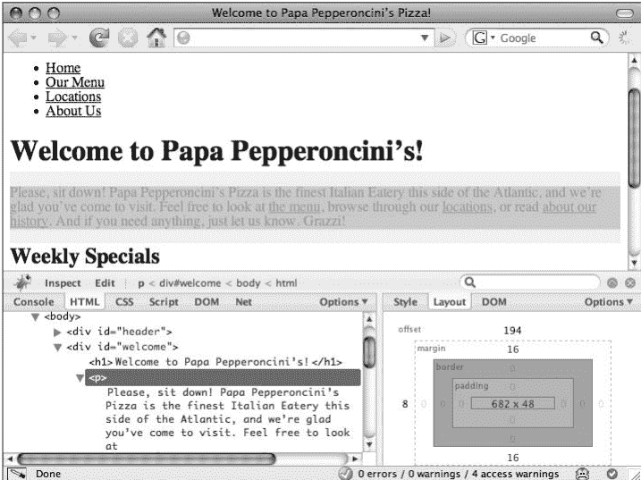

**图 5-11.** 将光标悬停在元素上时，Firebug 会高亮显示该元素的 CSS 盒子。

注意，段落的 CSS 盒子总是延伸到段落的边缘，即使段落内最后一行文本可能没有填满整行。这是因为不仅像`<p>`这样的 XHTML 元素会创建 CSS 盒子。事实上，网页上所有可见的内容都会创建某种类型的盒子，包括文本内容字符串。

然而，并非所有的 CSS 盒子都是相同的。段落内的这些字符创建的盒子与`<p>`元素创建的盒子并不相同。这是有意为之的，正如你即将看到的，这是一个非常重要的区别。

## 行内级盒子与块级盒子

`<p>`元素创建的是所谓的**块级**盒子，而其中的文本字符串创建的是**行内级**盒子。这两种不同类型的 CSS 盒子在屏幕上的流动方式截然不同。

块级盒子总是一个接一个地垂直堆叠在页面上，就像盒子（或砖块）一样层层叠放。由于所有浏览器的默认样式表都将段落声明为块级盒子，每次你定义一个新的`<p>`元素（从而生成一个新的块级 CSS 盒子）时，浏览器都会将该段落放置在之前所有块级盒子的下方。这就是为什么两个相邻的段落在默认情况下总是形成两段独立的文本，一段在另一段上方。其他创建块级盒子的元素包括标题、`<div>`元素和列表（注意不是列表项本身，而是列表项的容器元素`<ul>`、`<ol>`和`<dl>`）。

行内级盒子几乎总是位于某个块级盒子内部，但它们不像块级盒子那样垂直堆叠，而是水平地一个接一个排列。浏览器看到的每个文本字符（或**字形**）因此会与之前出现的行内级元素处于同一水平行中。只有当水平空间不足以容纳所有内容时，行内级盒子才会被推到下一行。默认情况下创建行内级盒子的网页元素示例包括图像、链接和强调文本（如`<em>`和`<strong>`元素）。

未嵌套在任何行内级元素中的文本也会隐式创建行内级盒子。这些隐式的行内级盒子被称为**匿名**行内级盒子，因为没有特定的元素与之关联。

例如，你在 Papa Pepperoncini 网站页脚的段落中使用的以下 XHTML 标记会创建**两个** CSS 盒子（而不是一个），其中一个是块级盒子，另一个是行内级盒子：

```html
<p>Copyright &copy; 2008 Papa Pepperoncini&rsquo;s &#x21A9;<br>
    Pizza &mdash; All rights reserved.</p>
```

`<p>`元素创建了块级盒子。`<p>`元素内的所有文本创建了匿名行内级盒子。如果你在该段落中再添加一个行内级元素，比如用`<strong>`元素来对 Papa Pepperoncini 的名字进行额外强调，你就会突然拥有四个 CSS 盒子。

```html
<p>Copyright &copy; 2008 <strong>Papa Pepperoncini&rsquo;s &#x21A9;<br>
    Pizza</strong> &mdash; All rights reserved.</p>
```

在这个段落中，`<p>`元素仍然创建了块级盒子，但文本 "Copyright © 2008 " 创建了第一个匿名行内级盒子。接着，`<strong>`元素创建了第二个行内级盒子（其内容为 "Papa Pepperoncini's Pizza"）。最后，文本 " — All rights reserved." 创建了第二个匿名行内级盒子。因此总共有一个块级盒子加上两个匿名行内级盒子再加上另一个（非匿名的）行内级盒子，共计四个 CSS 盒子。

元素生成的 CSS 盒子类型（行内级盒子或块级盒子等）可以通过 CSS 来控制。具体来说，元素的`display`属性的值决定了它将生成哪种类型的盒子。以下是浏览器默认 CSS 规则的示例，这些规则使`<p>`元素成为块级盒子、`<strong>`元素成为行内级盒子：

当然，你可以覆盖这些默认样式，让任何元素生成你想要的任何类型的盒子——这在 CSS 出现之前是完全不可能的。例如，你可以添加一条 CSS 规则，使`<strong>`元素生成块级盒子而不是内联级盒子，像这样：

```css
strong { display: block; }
```

如果你将这条 CSS 规则添加到 Papa Pepperoncini 网页的样式表中，你会发现现在一个段落内有三行文字，并且 "Papa Pepperoncini's Pizza" 这几个词会自成一行。这是因为，正如你现在所知，流的规则规定块级盒子必须垂直堆叠。由于`<strong>`元素现在生成一个块级 CSS 盒子，它必须单独占一行，因此你最终将页脚句子分成了三行。

在这种状态下，你仍然有四个 CSS 盒子，但不再是三个内联盒子都在一个块级盒子内，现在你有两个内联盒子和两个块级盒子。其中一个块级盒子（由`<strong>`元素生成的）与由`<p>`元素生成的盒子重叠了。你可以通过为`<p>`和`<strong>`元素添加背景颜色来让这一点更明显：

```css
p { background-color: blue; }

strong {
    display: block;
    background-color: red;
}
```


在图 5-12 中，你的三行文字现在呈现蓝、红、蓝的条纹状。

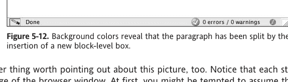

图 5-12。背景颜色显示段落因插入新的块级盒子而被分割。

关于这张图，还有一点值得指出。请注意，每个条纹都一直延伸到浏览器窗口的边缘。起初，你可能会倾向于认为所有 CSS 盒子总是会尽可能宽，但事实并非如此，这一事实突显了内联级盒子和块级盒子之间的另一个重要区别。

没有指定具体宽度的块级盒子（例如你的`<p>`和`<strong>`元素生成的盒子）确实会尽可能变宽，同时仍然适合其包含元素的 CSS 盒子。在这种情况下，所有的块级 CSS 盒子都和浏览器窗口一样宽，或者说**视口**一样宽，因为它们都没有显式的宽度，所以它们都会在浏览器内尽可能地变宽。

然而，内联级盒子只会增长到足以容纳其内容的宽度。内联盒子就像收缩包装一样包裹着它们所包含的内容。你可以通过为剩下的两个内联盒子设置背景颜色来让这一点更明显。

首先，由于剩下的两个内联盒子都是匿名的，你需要使用一个你以前没见过的元素——`<span>`元素，这样你就可以用 CSS 来定位它们。`<span>`元素与`<div>`元素类似，只是默认情况下它生成一个内联级盒子，而不是块级盒子。添加了`<span>`元素的 XHTML 段落如下所示：

```html
<p><span>Copyright &copy; 2008 </span><strong>Papa Pepperoncini&rsquo;s Pizza</strong><span>&mdash; All rights reserved.</span></p>
```

现在，将背景颜色应用于`<span>`元素后的 CSS 如下所示：

```css
p { background-color: blue; }

span { background-color: green; }

strong {
    display: block;
    background-color: red;
}
```

图 5-13 显示了结果。

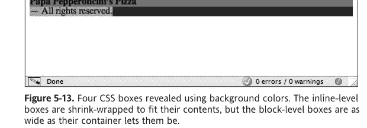

图 5-13。使用背景颜色显示的四个 CSS 盒子。内联级盒子收缩以适应其内容，但块级盒子则尽可能变宽。

两个内联级盒子（绿色）收缩到其内容的宽度，但块级盒子（蓝色和红色）则扩展到尽可能宽。

## 更改 CSS 盒子属性：CSS 盒子模型详解

每个 CSS 盒子，无论是内联级还是块级，其内部都有四个不同的区域。从“内到外”分别是**内容**区域、**内边距**区域、**边框**区域和**外边距**区域。内容区域是你已经熟悉的区域。它是一个矩形区域，元素的内容（无论是纯文本还是其他嵌套元素）都放置在其中。内边距区域是内容周围的透明空间，只有元素的背景属性（如果有的话）会显示出来。边框区域包裹着内边距和内容，很像一个画框。最后，外边距区域定义了 CSS 盒子周围应留有多少空白空间。

尽管所有这些区域对于所有 CSS 盒子总是存在，但很多时候，除了内容区域外，其他区域都不显示，因为它们的宽度和高度为零。也就是说，它们在页面的布局中根本不占用任何空间。然而，使用 CSS，你可以使这些区域中的每一个变大，从而让它们显示出来，并影响网页上元素的布局。

Firebug 有一个很棒的“布局”标签，可以让你准确地看到任何给定元素的每个区域的尺寸。让我们首先仔细检查内容区域，然后对 CSS 盒子模型定义的其他三个区域进行同样的分析。

## 内容区域：定义内容盒子的尺寸

正如你在上一节所看到的，CSS 盒子的内容区域的行为根据生成的盒子类型而不同。对于块级盒子，内容区域在其包含块或浏览器视口（在没有此类容器的情况下）的限制内尽可能变宽。对于内联级盒子，内容区域会收缩，使其宽度仅与其内容最宽的部分一样宽。块级和内联级盒子的高度都会增长到与其最高内容一样高，但不会更高。这可以用以下 CSS 声明来总结：

```css
width: auto; height: auto;
```

正如你可能已经猜到的，更改`width`和`height`属性的值会分别改变内容区域的宽度和高度。例如，假设你希望 Papa Pepperoncini 披萨网站的页脚宽度恰好为 300 像素。没问题。

```css
#footer { width: 300px; }
```

`width`属性（以及任何接受长度值的属性，例如`height`属性）可以接受一个数字后跟一个缩写（本例中为`px`）作为其值，该缩写表示测量单位。缩写`px`是像素的缩写。

在这个例子中，你将 ID 为`footer`的元素的宽度设置为恰好 300 像素，不多不少。显然，像素仅对设计用于以像素为单位测量距离的设备（如计算机显示器，绝对*不是*印刷页面）才有意义。CSS 还允许你使用其他*长度单位*，我们稍后将讨论另一个单位。

因此，通过将前面的 CSS 规则应用于 Papa Pepperoncini 的页脚，你的页脚文本现在始终恰好为 300 像素宽。调整窗口大小不会改变页脚的宽度，向其中添加更多文本内容也不会改变。页脚将保持固定宽度，因为你告诉它必须这样做。

请注意，即使这个例子*看起来*是使用了 CSS 继承，但实际上并非如此。页脚`<div>`内的`<p>`元素的`width`值仍然设置为`auto`，因为`width`属性不会被继承。然而，由于`<p>`元素嵌套在页脚`<div>`内（页脚`<div>`的 CSS 盒子是段落元素的*包含块*），并且由于页脚`<div>`被限制为只有 300 像素宽，因此页脚内的段落最大也只能是 300 像素宽。

由于内联级盒子的宽度由其内容定义，因此`width`属性不适用于这些类型的 CSS 盒子。

## 内边距区域：让背景显现

CSS 盒子的内边距区域是紧挨着内容区域的区域。内边距用于使盒子的内容与其边缘保持距离。这有助于设计看起来不那么拥挤。

默认情况下，大多数元素没有任何内边距。值得注意的例外通常是某种列表（无序列表、有序列表或定义列表），其子列表项元素在某些浏览器中通过应用默认的内边距值来获得缩进。（在其他浏览器中，同样的缩进效果是通过默认的外边距值实现的。外边距将在本章稍后描述。）在 CSS 中，一个完全没有内边距的盒子可以通过使用以下声明来声明：

```css
padding: 0;
```

请注意，在`padding`属性的值中，0 后面没有单位缩写，如`px`。由于无论以像素还是英寸（或任何其他长度单位）指定，0 都是相同的值，因此根本不需要单位缩写。

当然，要给元素的盒子一些可见的内边距区域，你只需将值从零增加到某个明显的值。让我们给 Papa Pepperoncini 的页脚 10 像素的内边距：

```css
#footer {
    width: 300px;
    padding: 10px;
}
```

这个变化很微妙，但使用 Firebug 你可以清楚地看到现在页脚内容周围有 10 像素的内边距，如图 5-14 所示。你在盒子上指定的任何背景属性，例如背景颜色或背景图像，都会“穿透”不可见的内边距区域，因为盒子的背景（与内容不同）始于盒子内边距和边框之间的边缘，而不是在盒子的内容区域内。

从这个例子中你可以看到，事实上，你已经为内容区域的所有四个边应用了 10 像素的内边距。你在页脚`<div>`内容的上、右、下、左各边都有 10 像素的内边距。同时请注意，你的内容区域的宽度仍然是 300 像素，就像你设置的那样。

从中可以推断出的重要一点是，你给 CSS 盒子的内边距、边框或外边距区域的任何空间，都会添加到你可能为盒子的`width`（或`height`）属性指定的任何尺寸上。实际上，你那个 300 像素宽的 CSS 块级盒子现在是一个 320 像素宽的 CSS 盒子，因为我们刚刚在盒子的左侧和右侧各添加了 10 像素的内边距。

图 5-14。Firebug 以不同颜色高亮 CSS 盒子的不同区域，可以清楚地看到页脚现在已经应用了一些内边距。

借助 CSS，你可以灵活地为盒子的四个边分别定义不同的大小。我在前面的 CSS 规则中使用的`padding`属性只是*简写形式*，它会展开为以下四个声明：

```css
padding-top: 10px;
padding-right: 10px;
padding-bottom: 10px;
padding-left: 10px;
```

每次你简单地用`padding`属性为一个盒子的内边距区域声明一个值时，你实际上是在为那四个具体的内边距属性都声明相同的值。CSS 中充满了这样的简写属性，了解它们及其展开形式非常重要。通常情况下声明规则时，简写属性可以帮你节省大量输入（也能在下载最终 CSS 样式表时节省不少带宽），但当你要声明规则来覆盖其他规则时，尽可能明确地写出属性是值得的。

CSS 盒子的内边距区域会根据盒子是行内级盒子还是块级盒子而表现得略有不同。块级盒子的内边距区域表现如你所预期，内容区域会在垂直和水平方向上移动以适应额外的内边距。然而，虽然行内盒子的*水平*内边距（即左右两侧）也是如此表现，但*垂直*内边距（顶部和底部）则不然。具体来说，行内盒子的垂直内边距会增加盒子背景可用的区域，但*其他盒子不会受到行内盒子占据额外空间的影响。*

这用示例最容易说明，所以让我们来试验一下 Papa Pepperoncini 主页上的介绍段落，因为这是一个跨越不止一行的段落。该段落的 XHTML 如下：

```html
<p>Please, sit down! Papa Pepperoncini&rsquo;s Pizza is the finest
Italian Eatery this side of the Atlantic, and we&rsquo;re glad
you&rsquo;ve come to visit. Feel free to look at the menu,
browse through our locations, or read about our history.
And if you need anything, just let us know. Grazzi!</p>
```

现在，我们在段落中间某处使用一个`<span>`元素来创建一个可以针对的行内盒子：

```html
<p>Please, sit down! Papa Pepperoncini&rsquo;s Pizza is the finest
Italian Eatery this side of the Atlantic, and we&rsquo;re
glad you&rsquo;ve come to visit. <span>Feel free to look at
the menu</span>, browse through our locations, or read about
our history. And if you need anything, just let us know.
Grazzi!</p>
```

最后，我们添加一条 CSS 规则，为`<span>`元素添加背景颜色，这样你就能轻松看到该元素生成的行内盒子的内容和内边距区域。你还会显著增加该元素的默认零内边距大小。图 5-15 展示了结果。

```css
span {
    background-color: green;
    padding: 10px;
}
```

如你所见，CSS 盒子的绿色背景*溢出*了行本身的边界，滑到了其下方文本行的背后，并遮挡了其上方的文本行。垂直内边距生效了，但并未以任何方式影响周围的 CSS 盒子。然而，绿色行内盒子两侧的文本被推开了 10 像素，因为行内盒子的水平内边距确实会影响其周围环境。

图 5-15。行内盒子的垂直内边距不会影响页面上其他盒子的布局。

## 边框区域：绘制边框和轮廓

边框区域，顾名思义，是为 CSS 盒子定义边框（或轮廓）的空间。盒子的内边距与其边框之间的边缘是任何背景停止可见的位置。CSS 盒子的四条边框（照例是顶部、右侧、底部和左侧）可以有多种不同的外观。让我们用边框来为 Papa Pepperoncini 网站的页脚勾个边。

```css
#footer {
    width: 300px;
    padding: 10px;
    border: 1px solid black;
}
```

图 5-16 展示了添加边框后的结果。

边框的表现方式与内边距相同。在块级盒子上，四个边都会影响其邻居，但在行内盒子上，只有水平边框会影响相邻盒子的布局。

`border`属性是另一个简写属性。它为盒子的四个边同时设置边框宽度、样式和颜色。前面所示的`border`声明示例展开后是以下 12 条声明，每条都可以设置为不同的值：

```css
border-width-top: 1px;
border-width-right: 1px;
border-width-bottom: 1px;
border-width-left: 1px;
border-style-top: solid;
border-style-right: solid;
border-style-bottom: solid;
border-style-left: solid;
border-color-top: black;
border-color-right: black;
border-color-bottom: black;
border-color-left: black;
```

边框有很多选项，本章无法一一详述，所以我们鼓励你自己去探索这些属性的其他可能值。

## 外边距区域：定义空白和居中

CSS 盒子的外边距区域定义了围绕盒子其他区域的空白。网页上大部分元素的间距都是通过边距和内边距的巧妙组合来实现的。与内边距和边框区域一样，CSS 允许你为 CSS 盒子的四个边指定不同数量的空白（边距大小），或者你可以使用`margin`简写属性在一个声明中设置四个边的边距。

边距可以被看作是一个元素的 CSS 盒子以不可见的方式“推挤”旁边其他盒子的手段，其方式与你在内边距中看到的一样。与内边距和边框一样，块级盒子四个边的边距都会影响相邻 CSS 盒子的布局，但行内盒子的水平边距才会如此。

通常，标题、段落、列表和许多其他元素都有浏览器默认样式表定义的一定数量的垂直边距。这条 CSS 规则可能如下所示：

```css
h1, h2, h3, h4, h5, h6, p, ul, ol, dl { margin: 1em 0; }
```

这个规则的选择器只是一组单独的类型选择器，匹配所有可能的标题级别、段落、无序列表、有序列表和定义列表。声明中使用了`margin`简写属性。使用两个值时（如前面所示），`margin`简写属性展开为以下四条 CSS 声明：

```css
margin-top: 1em;
margin-right: 0;
margin-bottom: 1em;
margin-left: 0;
```

也就是说，第一个值设置垂直方向（顶部和底部）的数值，第二个值设置水平方向（右侧和左侧）的数值。

这里使用的长度单位是`em`。一个 em 的长度等于元素当前字体中小写字母`m`的长度。由于不同字体（以及不同字号）中小写字母`m`的大小不同，这个单位被称为**相对长度单位**，因为实际计算出的值是相对于另一个可能变化的值而言的。这与**绝对长度单位**（如像素）形成对比，像素无论何种情况总是相同的大小。在网页上处理文本时，使用相对于字体大小的单位来设置尺寸往往更为合适。

为什么边距的 CSS 规则要使用由字体大小定义的相对单位呢？如果你仔细想想，`<h1>`元素的字体大小与`<h6>`元素的字体大小截然不同，也与常规正文文本（如`<p>`元素的内容）的大小明显不同。因此，这些元素的 CSS 盒子上下方空白（边距）的数量不同是合理的。

如果你的标题级别很大，而它与前导段落之间只有几像素的距离，看起来会有点奇怪，不是吗？使用相对单位可以让你在声明中保持，却能根据其他 CSS 属性的值为 CSS 属性应用不同的实际值。这就是创建所谓**弹性布局**的基础，这是一种高级设计实现方式，能够通过增大浏览器中的文本大小来实现页面的“缩放”。

## 第 5 章

### 盒模型：外边距与水平居中

```css
#footer {
    width: 300px;
    padding: 10px;
    border: 1px solid black;
    margin: 0 auto;
}
```


盒子模型的外边距也经常用于在包含块中将块级元素水平居中。居中块级元素的方法是将 CSS 盒子的左右外边距都设置为特殊值 `auto`。你应该还记得，这个值的意思大致是“根据可用空间自动调整该值”。让我们以 Papa Pepperoncini 网站页脚的居中为例：

同样，`margin` 简写属性被用来设置页脚 `<div>` 各侧的外边距。垂直方向的外边距都设置为 `0`（即，完全没有额外空白），水平方向的外边距都设置为 `auto`。图 5-17 展示了添加使页脚居中的 `margin` 规则后的结果。

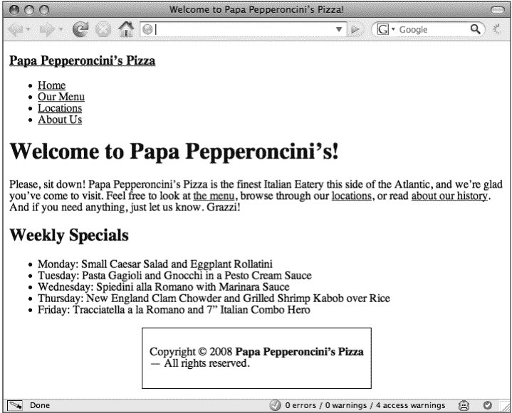

页脚在浏览器视口中居中，是因为其左右外边距各自自动调整大小，以平分可用的水平空间。首先要有可用空间，必须指定一个宽度值，该值不能是默认的 `auto`，并且要小于页脚包含块（此处为浏览器窗口）的宽度，这样元素才会以这种方式显示为居中。

外边距还有一个有趣的特性，起初可能会让人困惑，但很快就会变得不可或缺。当一个元素的底部外边距与另一个元素的顶部外边距直接相邻，中间没有间隔区域（没有内边距或边框区域将它们分隔开）时，这两个外边距会合并成一个外边距，其大小等于较大的那个外边距。这种特殊行为称为**外边距折叠**，仅发生在垂直外边距上，水平外边距永远不会发生。

这种行为非常实用，因为它避免了你在一对块级盒子前后排列的常见问题（例如多个连续段落）中，需要指定大量额外的 CSS 规则。在这种情况下，为每个段落设置上下外边距均为 `1em` 时，每个段落之间的空白将恰好是 `1em`（不是 `2em`）。如果垂直外边距不折叠，你就必须将每个段落的底部外边距设为 `1em`、顶部外边距设为零——除了序列中的第一个段落之外。

声明页面上那些本质上看不见的区域的大小来定义元素的布局，这个概念可能需要一些时间才能适应。这种设计方法与你直接操作对象本身的自然感觉背道而驰。然而，你会发现，如果你顺应网页的“流”，你最终会得到更加灵活、更易于维护的设计。

## 小结

本章涵盖了大量的技术内容和理论知识。如果你觉得自己可能需要回到本章来掌握我们讨论的所有内容，请不要气馁。由于 CSS 的灵活性、强大功能，以及 unfortunately 参差不齐的浏览器实现，实际使用 CSS 创建复杂设计可能会很棘手，但掌握基础知识在不久的将来会证明是无价的。

在本章中，我们介绍了大多数基础概念，解释了 CSS 在 Web 浏览器内部实际工作原理，例如层叠、继承、文档流和盒模型。我们还介绍了大量关于如何使用 CSS 的实用信息，例如如何使用外部或嵌入样式表以及单个内联样式将 CSS 样式应用到网页。我们涵盖了 CSS 规则的语法和术语，区分了属性、值、声明、声明块、选择器和规则。我们探讨了许多可能的 CSS 选择器，并观察了如何通过组合器将简单选择器链式组合在一起，从而在应用样式时获得极大的灵活性。最后，我们介绍了大量 CSS 属性（包括简写属性），每个属性都改变了元素的视觉显示方式。

掌握了这些知识之后，接下来你将查看一个真实的设计并剖析它，以发现它是如何实现的。然后，你将利用这些经验来帮助实现 Papa Pepperoncini 网站的简单设计。在此过程中，我们还会向你介绍一些额外的 CSS 概念和属性，让你对 Web 标准的强大功能和灵活性有更深一层的认识。


# 第 6 章：CSS 实战开发：从设计到部署

在前两章中，我们大量讨论了基于标准的前端 Web 开发背后的理论和概念。你学习了为什么以及如何创建结构化、具有语义意义的 XHTML 标记。你学习了层叠样式表的工作原理、Web 浏览器如何默认显示 XHTML 内容，以及如何将自己的 CSS 规则应用到网页。终于是时候将所有新获得的知识应用到一个真实项目中，将你平淡无味的未样式化网页变成一个精美、专业的 CSS 设计。

既然学习基于 CSS 的设计技术最简单的方法可能就是直接投身其中，我们邀请你将本章视为从旁观察我们的视角，展示如何在代码中实现这个设计。我们将贯穿本书前面的示例——Papa Pepperoncini's Pizza 网站的实现。在本章中，我们会大量引用前两章涵盖的主题，因此我们强烈建议你在开始本章之前先阅读那些章节。

## 视觉源文件：理解设计文档

在任何网站设计过程中，总会到达这样一个时刻：开发者（也就是你）需要将视觉呈现的布局转化为真实的网页。网站设计通常是在 Adobe Photoshop 或 GIMP 等程序中创建的。这些程序是图像处理应用，因此它们生成的是无法直接用于网页的栅格图形。然而，这些文件包含了关于设计外观的所有具体信息，包括每个文本元素使用的字体、设计中所有项目的物理尺寸，以及每个图形的原始素材。

作为前端 Web 开发者，你的任务是将这个设计文件转化为 XHTML 和 CSS 代码，使网页的外观和感觉尽可能接近设计文档的外观和感觉。说起来容易做起来难，因为设计文件不受 Web 浏览器所受的那些限制。很多时候，设计元素可能需要进行某种修改，以便它们适合目标网页。因此，熟悉其中一种图像编辑应用确实大有裨益。不过，这类软件超出了本书的范围，所以在本章中你将只专注于在 CSS 中实现设计。

## 深入代码：应用高级 CSS 概念

为了唤起你的记忆，图 6-1 展示了没有任何样式应用的 Papa Pepperoncini's Pizza 网站的样子。

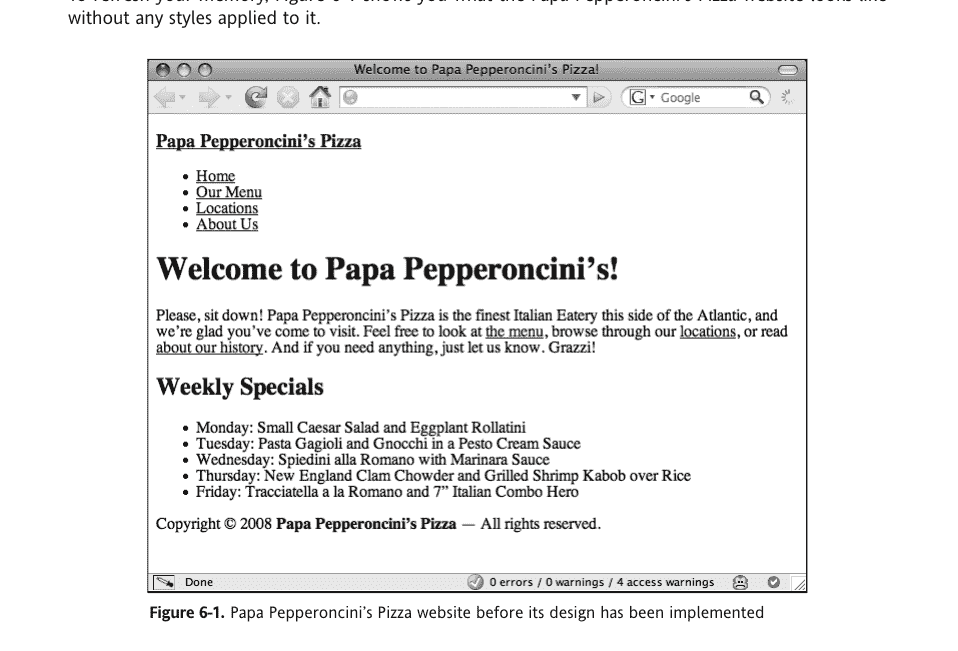

在本章中，你将把这个网页变成看起来像图 6-2 所示 Photoshop 设计文档的样子。

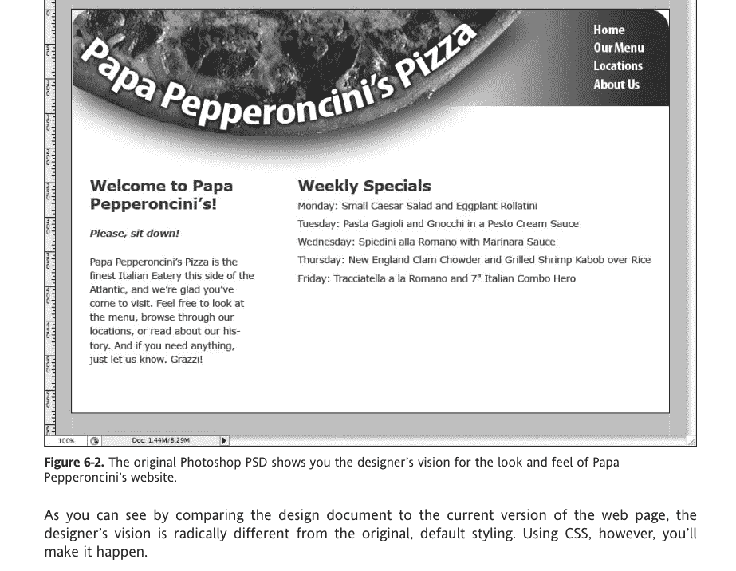

通过比较设计文档和当前版本的网页，你可以看到设计师的构想与原始默认样式截然不同。然而，使用 CSS，你将使它成为现实。

## CSS 开发工作流

在使用 CSS 开发任何网站设计时，你可以遵循一些久经考验的最佳实践。遵循这些准则会让你的轻松许多，并且能确保你最终获得经过良好测试、基于标准的代码。其中最重要的准则之一，就是在最严格遵循 W3C 发布标准的浏览器中开发你的样式表。由于我们正在展示如何开发 CSS，我们将使用最遵循 W3C CSS 标准的流行浏览器。截至本文撰写时，该浏览器是 Mozilla 的 Firefox Web 浏览器，当前版本为 2.0.0.14（不过很快就会是 Firefox 3，因为它正处于最终测试阶段），所以当我们提及“我们的 Web 浏览器”时，目前指的就是该浏览器。虽然偶尔在其他浏览器中检查进度是个好主意，但为了在本文中保持清晰，在 CSS 设计完全实现之前，我们将避免提及其他浏览器以及如何处理它们的 bug。

## 第 6 章

首先，让我们先设置源代码文件。在第 4 章中，你为 Papa Pepperoncini's Pizza 网站的首页开发了一个基本的 XHTML 模板。你将这个模板保存为名为 `index.html` 的纯文本文件。该文件的内容如下：

```html
<!DOCTYPE html PUBLIC "-//W3C//DTD XHTML 1.0 Strict//EN"
    "http://www.w3.org/TR/xhtml1/DTD/xhtml1-strict.dtd">
<html xmlns="http://www.w3.org/1999/xhtml" xml:lang="en" lang="en">
<head>
    <meta http-equiv="Content-Type" content="text/html;
        charset=utf-8" />
    <title>Welcome to Papa Pepperoncini&rsquo;s Pizza!</title>
</head>
<body>
    <div id="header">
        <h3>
            <a href="index.html">Papa Pepperoncini&rsquo;s Pizza</a>
        </h3>
        <ul>
            <li><a href="index.html">Home</a></li>
            <li><a href="menu.html">Our Menu</a></li>
            <li><a href="locations.html">Locations</a></li>
            <li><a href="about.html">About Us</a></li>
        </ul>
    </div>
    <div id="welcome">
        <h1>Welcome to Papa Pepperoncini&rsquo;s!</h1>
        <p>
            Please, sit down! Papa Pepperoncini&rsquo;s Pizza
            is the finest Italian Eatery this side of the
            Atlantic, and we&rsquo;re glad you&rsquo;ve come to
            visit. Feel free to look at the menu, browse through
            our locations, or read about our history. And if
            you need anything, just let us know. Grazzi!
        </p>
    </div>
    <div id="specials">
        <h2>Weekly Specials</h2>
        <ul>
            <li>Monday: Small Caesar Salad and Eggplant Rollatini</li>
            <li>Tuesday: Pasta Gagioli and Gnocchi in a Pesto Cream
                Sauce</li>
            <li>Wednesday: Spiedini alla Romano with Marinara Sauce
                </li>
            <li>Thursday: New England Clam Chowder and
                Grilled Shrimp Kabob over Rice</li>
            <li>Friday: Traciatella a la Romano and
                7&rdquo; Italian Combo Hero</li>
        </ul>
    </div>
    <div id="footer">
        <p>Copyright &copy; 2008 <strong>Papa Pepperoncini&rsquo;s
        Pizza</strong> &mdash; All rights reserved.</p>
    </div>
</body>
</html>
```

当你开始为页面添加 CSS 规则时，你会在一个**嵌入式样式表**中完成。在开发过程中使用嵌入式样式表而非外部样式表的原因有两个。首先，在你喜欢的文本编辑器中保持一个文件打开，远比在两个文件之间切换要容易得多。其次，在编写 CSS 规则时将它们全部放在嵌入式样式表中，可以确保只需在浏览器中重新加载一次网页，新的规则就会生效，无论你的网络浏览器配置如何。如果使用外部样式表，你可能会遇到浏览器试图缓存外部 CSS 样式表而导致的问题。

你需要做的第一件事是创建 `style` 元素，用于编写 CSS 样式。目前，你只需创建一个空的嵌入式样式表，里面包含一条注释。CSS 中的注释与 (X)HTML 中的注释行为方式相同；它们让你可以用纯英文给自己写备注，浏览器会直接忽略这些注释。然而，与 (X)HTML 中的注释不同的是，CSS 注释以两个字符序列 `/*` 开头，以两个字符序列 `*/` 结尾。

```html
<!DOCTYPE html PUBLIC "-//W3C//DTD XHTML 1.0 Strict//EN"
    "http://www.w3.org/TR/xhtml1/DTD/xhtml1-strict.dtd">
<html xmlns="http://www.w3.org/1999/xhtml" xml:lang="en" lang="en">
<head>
    <meta http-equiv="Content-Type"
          content="text/html; charset=utf-8" />
    <title>Welcome to Papa Pepperoncini&rsquo;s Pizza!</title>
    <style type="text/css">
      /* CSS rules for Papa Pepperoncini's Pizza will go here */
    </style>
</head>
```

现在你已经有了定义 CSS 规则的地方，接下来你会定义一些全局样式，确保所有网页浏览器都使用你自己的默认值，而不是它们自己的默认值：

```css
html, body {
    margin: 0;
    padding: 0;
    border: none;
    background: white;
}
```

这些 CSS 规则通过将所有这些属性设置为显式初始值，将浏览器可能默认赋予页面的任何边距、内边距和边框都“清零”。这样做可以确保你为每个浏览器都有一个共同的起点。

现在你已经对样式表中的 CSS 规则做出了更改，可以通过在网页浏览器中重新加载 `index.html` 页面来查看这一变化。每次保存新的更改后，你通常会通过在浏览器中重新加载网页来检查更改是否已正确应用。然后，你会继续保存另一次更改，并重复整个过程。你只需涂抹、冲洗、重复，直到整个设计完成。

到目前为止，这是一个良好的开端。让我们开始定义与此设计相关的 CSS 规则。

### 排版：文本颜色、字体和字号

使用 CSS 时，你可以通过首先定义最常见的设计属性来获得最大的收益。这些属性将通过具有非常通用的选择器的 CSS 规则进行编码，并依靠 CSS 继承性一直级联到页面元素。通过首先以这种通用的方式定义类似的设计元素，你可以节省时间，并确保设计的最基本部分被一次性一致地应用到整个网站。

在此设计中，色彩简洁：一种番茄红，搭配橙色和白色作为点缀——这是 Papa Pepperoncini 招牌产品经典意大利披萨的颜色。网页上几乎所有的文字都是这种番茄红色，所以我们通过将其应用到 `<body>` 元素来全局定义它：

```css
html, body {
    margin: 0;
    padding: 0;
    border: none;
    background: white;
}
body {
    color: #993333;
}
```

这里使用的 `color` 属性值值得一些解释。到目前为止，你只在 `color` 属性中使用了关键字作为值，例如 `white` 或 `black`。然而，CSS 规范仅定义了 16 个标准颜色关键字（基于 Windows VGA 调色板），这显然有些局限。这就是为什么 CSS 还允许你指定由数值定义的颜色，称为**数字 RGB 规范**，它让你可以分别定义红色、绿色和蓝色的任何组合，从而构成你想要使用的精确颜色。

> 有趣的是，CSS3 规范定义了大约 140 个颜色关键字，你可以在样式表中使用。其中许多已经在浏览器中得到支持，所以你可能会发现今天可以安全地使用它们。然而，如果你这样做，你的 CSS 代码将无法验证为 CSS2 样式表，因为 CSS2 规范不包含这些关键字值。相反，要么针对 CSS3 规范验证你的 CSS 代码，要么使用不同的方法来定义颜色，例如 RGB 三元组。

理论上，使用 RGB 规范来表示颜色可以将你可能选择的颜色值增加到数百万种。能够支持超过 256 种颜色的现代显示器可以安全地利用这些额外的颜色值；然而，仍需要支持较旧显示技术的网站最常见的是使用这些颜色的一个子集，称为**网络安全色**（或有时简称为**网页色**）。这是一组约 216 种颜色的特定集合，保证在各种计算平台上以几乎相同的方式显示，这些平台的能力有限。前面使用的番茄红色值就是其中之一。

你可以用两种表示法之一来书写数字 RGB 规范中的 CSS 颜色单位。更常见的表示法是前面使用的，称为**十六进制表示法**（或更简单地称为**十六进制**），因为它使用十六进制数字来定义三种颜色各自的值。十六进制颜色单位总是以井号（`#`）开头，然后是十六进制数字，称为**十六进制三元组**（之所以称为三元组，是因为三组 RGB 颜色——红、绿、蓝）。十六进制三元组的前两位是红色的值，接下来两位是绿色的值，最后两位是蓝色的值。

在示例 CSS 规则中，这意味着 `99` 是红色通道的值，`33` 是绿色通道的值，`33` 是蓝色通道的值。还有一种值得注意的快捷方式，可用于为网络安全色指定十六进制值，就像这个例子中每个颜色通道具有相同的十六进制数字。你可以使用单个十六进制数字来指定每个颜色通道，而不使用六位十六进制数，浏览器会自动复制该数字。所以，在这种情况下，以下两个 CSS 声明是相同的：

```css
color: #993333;
color: #933;
```

这种扩展并没有什么神奇之处。浏览器只是看到十六进制值仅由三位数字而不是六位指定，就会复制每个颜色通道的数字以完成整个集合。以下是另一组相同的 CSS 声明：

```css
color: white;
color: #FFFFFF;
color: #FFF;
```


知道了这一点，你可以像这样缩短 CSS 规则：

```css
html, body {
    margin: 0;
    padding: 0;
    border: none;
    background: #FFF;
}
body {
    color: #933;
}
```

保持 CSS 样式表简短是使网站加载更快的一种方式，因为文件越小，浏览器下载和解析它们所需的时间就越少。

## 第六章

另一种不太常用的 CSS 颜色单位表示法，允许你使用逗号分隔的列表，其中包含三个十进制数（范围在 0，相当于`#00`，到 255，相当于`#FF`之间）或百分比（其中`0.0%`相当于`#00`，`100%`相当于`#FF`）。例如，以下这些将属性设置为绿色的颜色声明也都是等效的：

```css
color: green;
color: #0F0;
color: #00FF00;
color: rgb(0, 255, 0);
color: rgb(0%, 100%, 0%);
```

接下来，你可以注意到你网页上的大部分文本是使用 Verdana 字体显示的。这是一种常见的网页字体，因为它默认安装在当今几乎每一台标准个人计算机上。其他常见字体包括 Arial、Helvetica 和 Times，以及这些字体家族的大多数变体。由于作为网页开发者，你无法保证访客计算机上安装了特定字体，因此使用最常见的字体是最安全的，但这种安全性的代价是这些字体在每种设计上看起来并不总是很漂亮。使用 CSS，你可以指定一个字体列表，让浏览器按顺序尝试应用。这样，任何安装了更好字体的人将看到它们，而没有这些字体的访客将获得通用字体。

由于你的设计明确要求使用 Verdana，让我们首先列出该字体：

```html
<style type="text/css">
html, body {
    margin: 0;
    padding: 0;
    border: none;
    background: #FFF;
}
body {
    color: #933;
    font-family: Verdana;
}
</style>
```

当然，仍然存在（尽管很小）访客计算机上没有安装 Verdana 的可能性。在这种情况下，让我们列出另一个类似且常见的字体选择，比如 Arial，然后是通用无衬线字体关键字：

```css
body {
    color: #933;
    font-family: Verdana, Arial, sans-serif;
}
```

如你所见，字体以逗号分隔的列表形式列出，按你希望浏览器尝试应用它们的顺序依次排列。在这种情况下，你在告诉浏览器“如果可用，使用 Verdana 字体，但如果不可用，则尝试 Arial。如果 Arial 也不可用，则选择任何没有衬线的字体。”如果字体名称包含空格，则需要用引号括起来，以便浏览器知道空格是字体名称的一部分。例如，一个名称中包含空格的常见字体是 Times New Roman。要在字体系列值列表中使用该字体，你需要这样写：

```css
font-family: "Times New Roman", Helvetica, serif;
```

在此示例中，你告诉浏览器“如果安装了 Times New Roman 字体，则使用它；否则尝试使用 Helvetica，如果 Helvetica 也不可用，则使用任何带有衬线的字体。”请注意，Times New Roman 被引号括起来，并且分隔它与 Helvetica 的逗号在引号之外。除了 CSS 允许你指定的无衬线和衬线通用字体系列外，你还可以声明手写体、幻想字体（这两种比前两种使用得更少）和等宽字体。

现在你已经完成了页面非常基础的文本颜色和字体选择，但在文本方面还有更多工作需要做。你需要为页面上的文本设置默认大小。

正如你在上一章所回忆的，大小可以用多种 CSS 单位中的任何一种来指定。对于将在计算机显示器上查看的网页，通过指定像素长度来设置字体大小似乎是最自然的选择。然而，由于像素是绝对单位，它们实际上对访客施加了不良的限制。具体来说，在 Internet Explorer 5 和 6 中，使用像素值作为字体大小属性的文本根本无法调整大小！

为避免此可访问性问题，你将使用百分比值来指定文本的默认大小。让我们将此值指定为 62.5%，因为这给你一个 10 像素的默认字体大小，这是一个不错的整数。（10 像素大小的文本对于你的设计来说仍然有点小，但你将推迟指定确切的大小，直到你进一步深入。）这样，每个浏览器中的文本都保持可调整大小，同时仍被声明为相同的大小。

```css
body {
    color: #933;
    font-family: Verdana, Arial, sans-serif;
    font-size: 62.5%;
}
```

除了`font-family`和`font-size`属性之外，另一个值得一提的与字体大小相关的属性是`line-height`属性。你可以使用此属性（它决定内联 CSS 框内每行的高度）来获得很好的效果。最常见的是，此属性允许你在一行的底部和下一行的顶部之间添加一些间距。例如，以下是你如何轻松创建双倍行距段落的方法：

```css
p { line-height: 200%; }
```

当然，除非你在写学术论文，否则双倍行距可能彼此间距太远。大多数情况下，你最多需要在文本行之间添加半行空白。在这种情况下，150%的值将给你想要的结果。也就是说，100%的值是当前行的高度，所以 150% 是当前高度加上其高度的一半，即一行半高，这导致每行之间有一半行的空白。

`font-weight`和`line-height`属性。让我们也用它来快速添加默认文本的行高：

```css
body {
  color: #933;
  font: 62.5%/1.3em Verdana, Arial, sans-serif;
}
```

`font`属性的语法可能有点棘手。正如你在这里看到的，你首先指定`font-size`。然后该值后跟一个正斜杠（`/`），之后你将`line-height`值指定为另一个长度单位。我们在这里使用了`em`长度单位，但你也可以使用百分比。实际上，当涉及到字体大小时，`em`和百分比是可以互换的：100%相当于 1em，所以 1.3em 相当于 130%。

最后，`font`属性以`font-family`属性的你选择的字体列表结束。这对网页浏览器说的是，你想要“将`body`内的所有文本设置为其默认大小的 62.5%，将每行的高度增加额外的 0.3em（即，额外增加 30%），并使用 Verdana 字体显示文本，如果 Verdana 不可用则使用 Arial，如果 Arial 也不可用则使用任何其他无衬线字体。”

由于`font`属性包含如此多的选项，让我们再看一些示例：

```css
font: italic 200% Zapfino, cursive;
```

此声明将目标文本的`font-style`设置为 italic，`font-size`设置为 200%（这意味着是之前的两倍），`font-family`列表设置为 Zapfino，cursive。请注意，你没有指定`line-height`属性，因为那是可选属性之一。这里还有一个例子：

```css
font: small-caps bold 16pt "Helvetica", serif;
```

这次，你将`font-variant`属性设置为 small-caps（将文本转换为大写字母，XHTML 源代码中的大写字母比小写字母稍大），将`font-weight`设置为 bold，将`font-size`设置为 16pt（pt 是 points 的缩写，传统上用于印刷文本大小的长度单位），将`font-family`列表设置为 Helvetica，serif。

作为最后一个示例，以下两个 CSS 规则是相同的：

```css
h2 {
  font: inherit small-caps bold larger/150% Helvetica, serif;
}
h2 {
  font-style: inherit;
  font-variant: small-caps;
  font-weight: bold;
  font-size: larger;
  line-height: 150%;
  font-family: Helvetica, serif;
}
```

此示例中有趣的值是`inherit`，你已将其设置在`font-style`属性上。这个特殊值只是意味着“使用目标元素的父元素在此 CSS 属性上的值”。几乎所有 CSS 属性都可以接受`inherit`值。

此时，Papa Pepperoncini 的网站看起来更有风格了一些，但变化不大。图 6-3 展示了你目前的成果。接下来，由于你已经完成了指定通用规则的 CSS 规则编写，让我们来处理那个带有大披萨图片的花哨页眉。

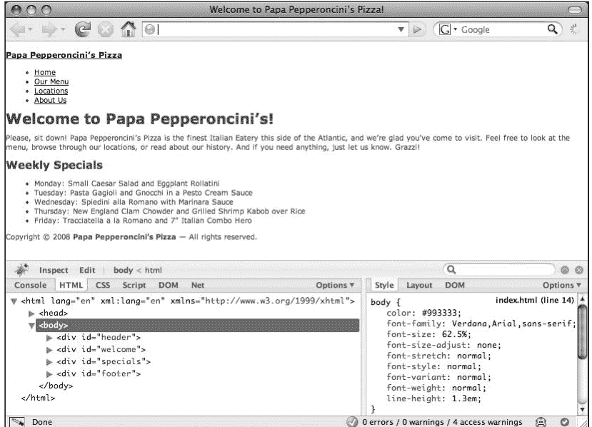

图 6-3. Papa Pepperoncini 的披萨网站文本开始展现出一些颜色和样式。

### 实现页眉：图像和背景

在此设计中，左上角有一个大的披萨图片，与一条红色条纹重叠。红色条纹有一个渐变，从披萨下方的白色到其边缘的红色。左上角和右上角都是弯曲的。在你从设计师那里拿到的原始设计文件中，他们的画布宽度为 863 像素。此外，设计师的画布无法适应你网页必须进行的任何调整，因此尝试像固定不变一样复制设计是没有意义的。

相反，你将使用设计文档作为网页最终外观的*指导*。具体来说，通过观察设计，你可以看出设计师显然希望页眉从浏览器窗口的一边延伸到另一边。如果你使用固定宽度来实现此设计，那么对于窗口大小不同的情况，它将无法很好地工作。相反，你需要使用更灵活的宽度单位，比如百分比。在接下来的章节中，你将看到如何实现这一点。

## 第六章

然而，如果固定宽度，最终会得到一个无法适应窗口大小调整的设计。另一方面，如果你设计页面时允许页眉的宽度在任何时刻都与浏览器窗口的宽度相同，那么你需要确保红色条纹上的渐变色在设计能够拉伸的点之前就转变为纯色。

可以想象，在更复杂的设计中，有许多类似这样更复杂的问题需要考虑。然而，即使是在这个简单的例子中，你也能开始清楚地看到为网页设计与为印刷品设计有多大不同。许多在印刷品设计中看似不错的决策，在最终需要用 XHTML 和 CSS 代码实现时，会变得极具挑战性。

此外，任何设计中通常都有一个点，你不得不允许一些变形。很少有布局能够具有足够的弹性来适应从 128 像素宽的视口（常见于廉价手机和 PDA）到 2560 像素宽的视口（如 30 英寸 Apple Cinema Display 提供的），甚至只是最小或最大可能的文本大小。思考设计如何拉伸以及布局中的文本如何流动，对于创建良好的网页设计至关重要，但很少有平面设计师习惯于这类事情。

在这种情况下，你需要对设计文档进行一些更改，以适应你想要的变宽布局。首先，你需要将渐变的终点移动到设计右上角曲线开始的点之后。就在那个点，距离浏览器窗口左边缘 835 像素的地方，你将“拉伸”横幅图像。其次，你需要将横幅背景拆分为两个独立的图像：一个包含披萨和位于其上的弯曲文字“Papa Pepperoncini's Pizza”，用于横幅左侧；另一个包含右侧的弯曲边角，用于横幅右侧。

> 设计网页时，考虑目标受众可能使用的屏幕分辨率非常重要。在撰写本文时，大多数用户的计算机显示器默认宽度至少为 1024 像素，但仍有一些用户（估计约 8%）的显示器设置为 800 x 600 像素的分辨率。在这些情况下，比他们屏幕宽度更宽的设计（例如这个 835 像素宽的设计）总会导致出现水平滚动条。为确保避免这种情况，你需要将设计缩减到比他们的浏览器窗口可能宽度更窄的某个宽度。对于设置为 800 x 600 分辨率的显示器，最安全的做法是将你的设计宽度保持在 760 像素以下。

图 6-4 展示了你将使用的披萨图像，它还包括了红色条纹上的整个渐变；图 6-5 展示了页面右侧弯曲边角的图像。

关于这些图像，有一些有趣的事情值得注意。请注意，带有披萨、投影、弯曲文字和渐变的图像是保存为 JPG 文件的。这是因为 JPG 图像文件格式在编码没有明确可识别的几何形状（如直线）的复杂图像方面，是远为优越的图像文件格式。另一方面，另一个几乎完全由两种纯色（一条红色条纹和其下方的白色条纹）组成的图像，出于同样的原因保存为 GIF 文件。当图像内容主要是直线或其他几何形状时，GIF 图像文件格式的压缩效果非常好。

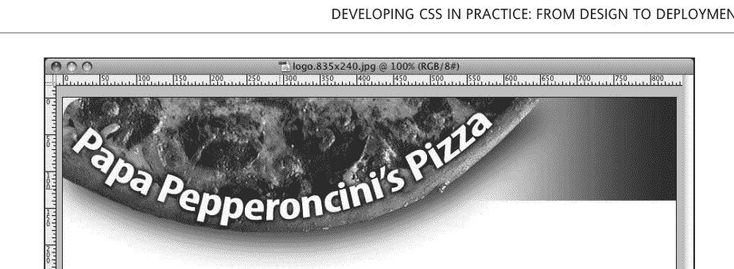

图 6-4. 横幅图像将是一个 835 像素宽的 JPG 图像，通过平面化设计师原始 PSD 文档的几个图层创建而成。

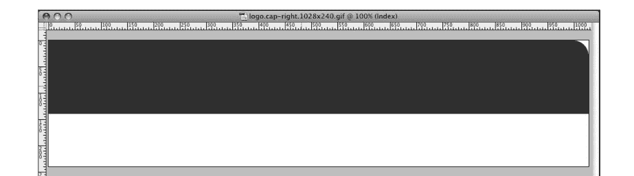

图 6-5. 横幅图像的右侧经过修改，变成了一条 1028 像素宽的纯色条纹。这个额外的宽度是调整浏览器窗口大小所必需的。

关于这些图像，另一件值得注意的事情是它们的文件名。虽然纯粹是风格选择，我们将带有披萨的图像命名为`logo.835x240.jpg`，因为这是 Papa Pepperoncini 的标志图像，宽 835 像素，高 240 像素。像这样将图像尺寸嵌入文件名，有助于我们在仅看到 CSS 样式表文本时记住我们正在处理的内容。文件名中的多个点让我们为每个图像创建了自定义的命名空间。例如，我们将另一个图像文件命名为`logo.cap-right.1028x240.gif`。除其他事项外，这种命名方案确保两个图像在按字母排序的文件列表（如 FTP 客户端程序生成的列表）中会相邻显示，并且具有类似用途的图像会自动分组。你将在本章剩余部分看到我们使用此约定。

最后，在横幅的右上角弯曲边角图像中，还有两件值得注意的事情。首先，它非常宽——精确地说是 1028 像素宽。我们确保它这么宽，是因为当访问者调整其浏览器窗口大小时，正是这个额外的宽度将可见。这个额外的宽度确保你可以适应总宽度为 1863 像素的浏览器视口（835 像素 + 1028 像素 = 1863 像素）。大多数访问者不太可能将浏览器窗口调整到超过此宽度，因此这应该是足够的。

将图像从设计文档中切出并保存为适合在 Web 上显示的文件后，放在与 XHTML 文件相同目录下的一个目录中（我们称之为`images`），你现在可以编写将图像附加到 XHTML 页眉的 CSS。首先，让我们附加页眉的背景图像，这将是横幅右上角的 GIF 图像：

```html
<style type="text/css">
html, body {
    margin: 0;
    padding: 0;
    border: none;
    background: #FFF;
}
body {
    color: #933;
    font: 62.5%/1.3em Verdana, Arial, sans-serif;
}
#header {
    background-image: url(images/logo.cap-right.1028x240.gif);
}
</style>
```

这是另一个你之前没见过的属性和值，所以让我们更仔细地研究一下。`background-image`属性非常不言自明。它用于将图像应用到元素的背景。然而，该值稍微复杂一些。由于图像总是单独的文件，它们在 CSS 中需要用 URL 引用，就像在 XHTML 的``元素中需要用 URL 引用一样。这个 URL 也没什么特别的。它只是指出你引用的图像可以在 CSS 属性值的括号内指定的相对 URL 处找到。图 6-6 显示了到目前为止 CSS 规则的结果。

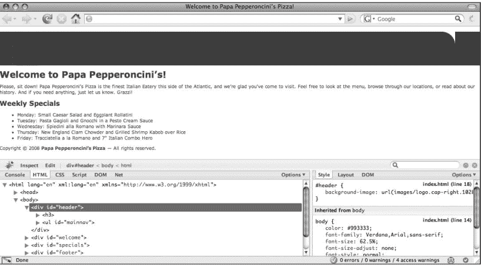

图 6-6. 应用背景图像时，默认会平铺背景图像。

这看起来大部分没问题，但如你所见，在视口的右上角有一个问题，曲线结束的地方条纹似乎重复了。确实如此，因为默认情况下，应用于 XHTML 元素的任何背景图像都会被平铺，或在垂直和水平方向上重复。为避免这种情况，你需要在`background-repeat`属性上指定一个`no-repeat`的值：

```css
#header {
    background-image: url(images/logo.cap-right.1028x240.gif);
    background-repeat: no-repeat;
}
```

图 6-7 显示背景图像现在不再平铺。

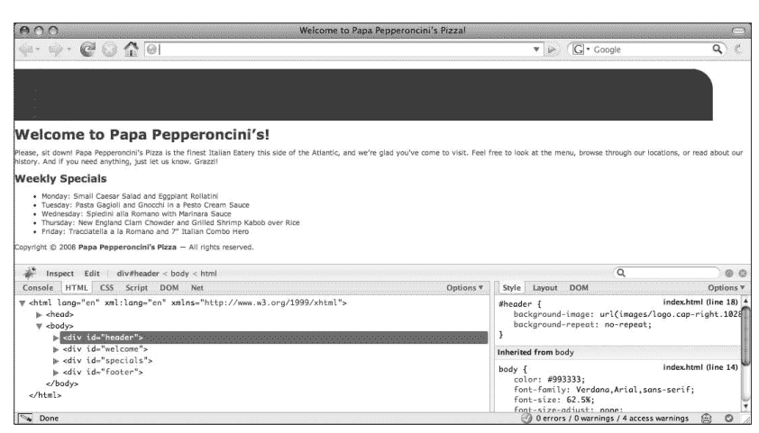

情况有所改善，尽管你仍然需要确保此图像实际上位于页眉的*右侧*，而不是左侧。你需要使用`background-position`属性来做到这一点：

```css
#header {
    background-image: url(images/logo.cap-right.1028x240.gif);
    background-repeat: no-repeat;
    background-position: right top;
}
```

`background-position`属性精确指定背景图像首次在 CSS 盒子的 padding 和 content 区域内的显示位置。该属性接受两个值，第一个值指定从 padding 区域左边缘或右边缘的水平偏移量，第二个值指定从 padding 区域上边缘或下边缘的垂直偏移量。注意，这与 CSS 盒模型属性（如`padding`或`margin`）不同，后者的值按顺时针顺序声明，即先是上，然后是右，接着是下，最后是左。这通常缩写为 TRBL，并用助记词 "Don't get into TRouBLe" 来记忆。

为简化起见，你之前使用了关键词`right`和`top`，这仅表示“将背景图像的右边缘与 CSS 盒子内边距区域的右边缘对齐，并将背景图像的上边缘与 CSS 盒子内边距区域的上边缘对齐”。

除了关键词（也可以是`left`、`bottom`和`center`），你还可以为`background-position`属性使用任何长度单位或百分比值。例如，之前使用过的同一声明的另一种写法是使用值`100% 0%`（即水平偏移 100%，垂直偏移 0%）。这种将属性的位置定义为相对于另一个特定点的水平和垂直偏移的方法在 CSS 中很常见，你将在本章后续内容中频繁使用。

类似于之前使用`font`简写属性来将处理字体的 CSS 声明块简化为单个声明的方式，让我们使用`background`简写属性来处理这三个背景属性：


```css
#header {
    background: url(images/logo.cap-right.1028x240.gif) no-repeat right top;
}
```

`background` 简写属性只需提供 `background-color`（你尚未指定）或 `background-image`（你已指定）之一即可。由于你没有为 `background-color` 指定值，该规则实际上等同于：

```css
#header {
    background-color: transparent;
    background-image: url(images/logo.cap-right.1028x240.gif)
    background-repeat: no-repeat
    background-attachment: scroll
    background-position: right top;
}
```

也就是说，在未指定颜色的情况下，`background` 简写属性会为 `background-color` 属性使用 `transparent` 值。透明的背景没有颜色，这相当于在 Adobe Photoshop 或 Adobe Illustrator 等图形编辑应用程序中“无填充”。这使得背景之后的任何内容都能“透出来”。在本例中，页眉背景之后的内容就是页面的背景。由于你在之前的 CSS 规则中已将该背景定义为白色，因此透出来的就是这种颜色。

`background` 简写属性展开的另一个属性是 `background-attachment`。该属性定义了在页面向下滚动时背景图像的行为。你稍后会深入探讨该属性，因此目前只需了解其可能的值为 `scroll` 或 `fixed`（当然也可以是 `inherit`），并且默认情况下此值设置为 `scroll`，即背景图像会随页面滚动，这符合你的预期。

第一张图像已实现，现在是时候添加第二张更显眼的图像了。不过这次，你将把它应用于 `<h3>` 元素而不是页眉 `<div>`。你这样做有三个充分的理由。

首先，你无法为任何元素提供多个背景图像，而你已经为页眉 `<div>` 指定了其背景图像。其次，“Papa Pepperoncini's Pizza”这些文字实际上位于 `<h3>` 元素中，因此让这个元素也承载标题的图形版本是合理的。最后，由于 `<h3>` 元素嵌套在 `<div>` 元素内部，它将显示在 `<div>` 元素“之上”（即更靠近观看者的眼睛，或位于“更高的图层”）。

这听起来可能有点令人困惑，所以将图像添加到页眉并看看实际效果：

```html
<style type="text/css">
html, body {
    margin: 0;
    padding: 0;
    border: none;
    background: #FFF;
}
body {
    color: #933;
    font: 62.5%/1.3em Verdana, Arial, sans-serif;
}
#header {
    background: url(images/logo.cap-right.1028x240.gif) no-repeat right top;
}
#header h3 {
    background: url(images/logo.835x240.jpg) no-repeat;
}
</style>
```

你再次使用了 `background` 简写属性，在一个声明中声明了与 `<h3>` 元素背景相关的一系列属性。不过这次，你可以省略与 `background-color`、`background-attachment` 和 `background-position` 相关的值，因为默认值（`transparent`、`scroll` 和 `left top`）正是你想要的。如图 6-8 所示，添加这几条 CSS 规则的结果可能并非预期。

那么，这里发生了什么？回顾上一章的讨论，CSS 盒子模型定义了 CSS 盒子生成的四个不同区域。其中最内层是内容区域，它包含元素的文本和子元素。围绕内容的区域是内边距。内容区域和内边距区域都会显示 CSS 盒子的背景，例如你已应用于 `<h3>` 元素的背景图像。

你还会回忆到，`<h3>` 元素默认生成的 CSS 盒子类型是块级盒子。块级盒子会尽可能宽地扩展，因此在本例中，这意味着 `<h3>` 元素与浏览器视口一样宽。然而，它们的高度默认由其内容决定。在本例中，由于 `<h3>` 元素仅包含单行文本，因此其高度恰好等于该行高度，不会更高。你应用到该元素的背景图像实际上比元素的高度更高，因此它在底部被裁剪了。你可能之前没有注意到，但现在可能会意识到 `<div>` 元素的背景图像也被裁剪了。

# 第 6 章

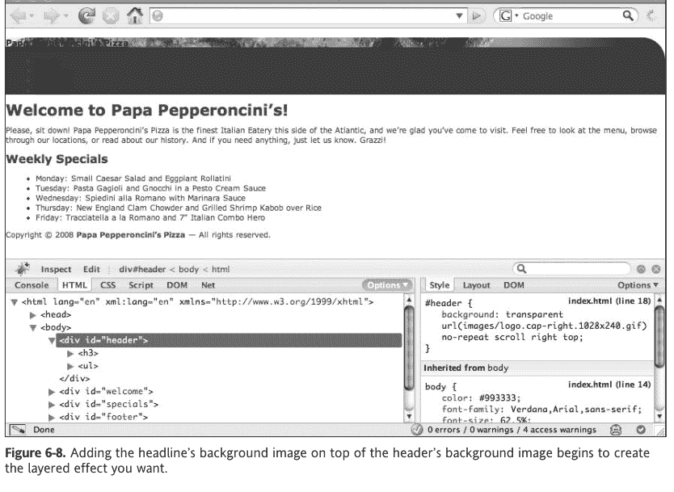

图 6-8. 将标题的背景图像添加到页眉背景图像之上，开始创建你想要的层叠效果。

显然，你需要以某种方式增加这些元素的高度。这当然很简单。你只需在针对页眉中 `<h3>` 元素的规则中添加一个声明，将其 `height` 属性设置为横幅图像的高度，每张横幅图像均为 240 像素高：

```css
#header h3 {
    background: url(images/logo.835x240.jpg) no-repeat;
    height: 240px;
}
```

除了增加 `<h3>` 元素的高度，此声明同时也增加了页眉 `<div>` 元素的高度，因为 `<h3>` 元素是 `<div>` 内容区域的一部分。此外，由于 `<h3>` 元素是 `<div>` 的子元素，`<h3>` 元素的背景图像叠加在 `<div>` 的背景图像之上，如图 6-9 所清晰显示的那样。

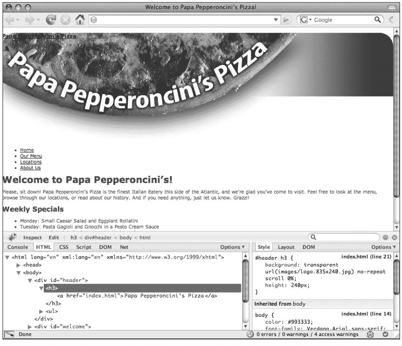

图 6-9. 如果背景图像大于元素的 CSS 盒子，它就会被裁剪，因此为标题设置高度是显示完整披萨图像的必要条件。

这表明，在另一个 CSS 盒子的内容区域内生成的每个 CSS 盒子实际上都堆叠在其上方，就像用建筑纸制作的拼贴画。随着你继续嵌套 XHTML 元素，你会不断地将 CSS 盒子一个接一个地堆叠成一座无限延伸（且通常是不可见）的塔。正是由于这个原因，应用于 `<body>` 元素的任何背景总是显示在网页上任何其他元素之后，而嵌套最深的 XHTML 元素总是显示在其所有父元素之前。

这种堆叠或分层行为有一个名称。它被称为**堆叠顺序**或 `z` 轴，指的是三维图形的深度轴。确实，你可以将网络浏览器的视口视为这样一个三维图形。根据网页的流向（在前一章讨论过），浏览器视口的左上角（或者在从右到左流向中的右上角）可以说位于位置 `0,0`，这意味着它距离视口左边缘 0 像素偏移，距离视口顶部边缘 0 像素偏移。网页上的每个 CSS 盒子都定位在这个假想图形的 `x`、`y` 和 `z` 轴上的某个位置。图 6-10 展示了从网络浏览器的角度来看这个图形可能是什么样子。

此外，浏览器究竟如何沿此 `z` 轴放置 CSS 盒子，可以通过 CSS 的 `z-index` 属性进行控制，该属性指定一个数字，表示 `z` 轴上的一个点。目前，只需了解存在这种层叠行为及其默认行为即可。

在完成对页眉 `<h3>` 元素的最后几项修改之前，你无法称其为完整。显然，既然你使用 `<h3>` 元素的背景来显示文本“Papa Pepperoncini's Pizza”，你就不再需要在 `<h3>` 元素本身中显示该文本了。然而，你不能直接删除该元素。但是，你可以使用 `text-indent` 属性移动其文本内容创建的内联框。通过为此属性设置一个负值，你可以将内联框向视口左边缘移动。通过设置足够大的值，你实际上可以将文本移动到视口左边缘之外，从而有效地将其隐藏起来。

```css
#header h3 {
    background: url(images/logo.835x240.jpg) no-repeat;
    height: 240px;
    text-indent: -999px;
}
```

这成功地从屏幕上移除了文本，但由于它完全没有处理 `<h3>` 元素的块级盒子，因此在视口顶部边缘和披萨标志图像之间仍然存在一个间隙。这个间隙是由 `<h3>` 元素的默认顶部外边距引起的，所以我们将它归零（连同其所有其他外边距）。

```css
#header h3 {
    background: url(images/logo.835x240.jpg) no-repeat;
    height: 240px;
    text-indent: -999px;
    margin: 0;
}
```

在原始未设置样式的页面中，显示“Papa Pepperoncini's Pizza”的标题是一个链接。然而，当你将包含该文本的内联框移出视野时，你也移动了包含该文本的链接。为了完成报头的最后一步，你必须将链接移回，同时保持文本隐藏。

要恢复链接，你只需将链接的锚点元素变成一个块级盒子。这样做会消除 `text-indent` 声明对 `<a>` 元素本身的影响，但对锚点文本无效。由于实际上是锚点元素提供了链接的可点击功能，而不是它们包含的文本，这会将横幅顶部的单行细条转变为丢失的链接。为了营造披萨标志图像本身是链接的错觉，你只需在 `<a>` 元素上设置特定的宽度和高度。

```css
#header h3 {
    background: url(images/logo.835x240.jpg) no-repeat;
    height: 240px;
    text-indent: -999px;
    margin: 0;
}
#header h3 a {
    display: block;
    width: 835px;
    height: 100%;
}
</style>
```

宽度被设置为等于披萨标志图像本身的宽度，高度设置为 100%，这意味着“与包含块一样高”。在这种情况下，`<a>` 元素的包含块是 `<h3>` 元素，因此这确保了链接的高度与标题完全一致。

至此，你已经完全实现了报头设计，同时没有丢失 XHTML 文档所包含的任何语义丰富性。更好的是，你赋予了它极大的灵活性，使其能够适应浏览器窗口在一定程度上的大小调整，并且你通过极大地增强指向主页链接的可点击区域，也提高了页眉的可用性。图 6-11 展示了完成的页眉实现。

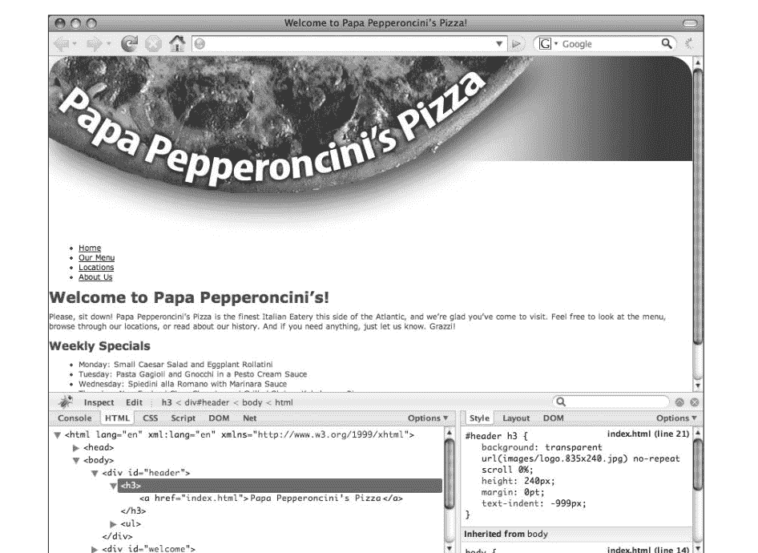

网页现在开始看起来像样了，所以事不宜迟，你将继续顺着 XHTML 文档的源代码往下处理。现在是时候深入研究主导航列表的样式设计了。

## 主导航菜单：绝对和相对 CSS 定位

从设计文档中可以看到，主导航菜单是一个垂直列表，包含四个文本项，字体较大、加粗、白色字体；该列表位于网页报头的右上角。此外，还有一个橙色的、类似披萨片的图标指向当前选中的菜单项。这意味着当访问者查看主页时，披萨片图标需要显示在“主页”菜单项旁边，而当他们阅读在线菜单时，披萨片图标需要显示在“我们的菜单”菜单项旁边。

让我们开始将导航菜单放置在页面上的正确位置。目前，由于包含导航菜单列表项的 `<ul>` 元素在网页的正常流中生成一个块级 CSS 盒子，它被渲染在由 240 像素高的 `<h3>` 元素生成的块级 CSS 盒子下方的单独一行上。要将其移动到页面的右上角，你首先需要将 `<ul>` 元素从页面的正常文档流中移除，以便你可以自己控制其定位。你可以通过更改元素的 `position` 属性来实现这一点：

```css
#header ul {
    position: absolute;
}
</style>
```

当你保存更改并重新加载页面以查看此更改的效果时，结果（如图 6-12 所示）可能会令人惊讶。

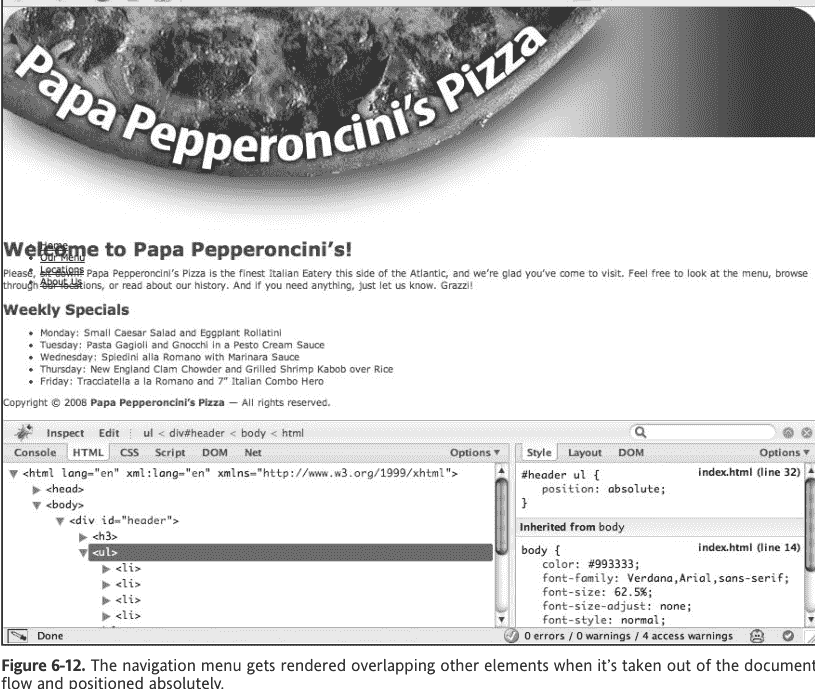

如你所见，原来位于导航菜单下方的标题和段落似乎在页面上向上滑动，而导航菜单现在直接显示在这些元素之上。这里发生的事情其实很简单：你所做的只是移除了由 `<ul>` 元素生成的块级 CSS 盒子的影响，使得页面上的其他 CSS 盒子不受其存在的影响。这产生了一个效果，即所有其他 CSS 盒子完全忽略它的存在，因此，结果就是显示“Welcome to Papa Pepperoncini's!”的标题以及紧随其后的段落，其表现就好像导航列表不在那里一样。

当然，导航菜单当然仍然存在；然而，它存在于自己的*渲染上下文中*，这类似于其自身的私有文档流，完全不受其他元素 CSS 盒子的流或布局的影响。用设计师的术语来说，你实际上“在背景层之上创建了一个新的视觉层”，该层只包含导航菜单。在此状态下，你可以将导航菜单移动到任何你想要的地方。既然你想将其固定在页面的右上角，你将使用 `top` 和 `right` 属性，它们指定了相对于（在此情况下）视口顶部和右边缘的偏移量，每个值都设置为 0。

```css
#header ul {
    position: absolute;
    top: 0;
    right: 0;
}
</style>
```

现在重新加载网页将向你展示导航菜单确实被固定在浏览器窗口的右上角，并且在调整窗口大小时保持在那里。`position` 属性是最重要的属性之一，需要理解，因此让我们稍微偏离主题，讨论一下它的其他一些可能的值。

## `position` 属性的四个值

在使用 CSS2 进行布局设计时，CSS 开发者有多条路径可以选择。对于其中大多数情况，会使用 `position` 属性的不同可能值。元素的 `position` 属性可以有四个可能的值之一。它们分别是 `scroll`、`absolute`、`fixed` 和 `relative`。每个值都会使元素的行为略有不同，因此让我们依次研究每一个。

`scroll` 值是默认值。如果你从不编写包含 `position` 声明的 CSS 样式表，那么你的所有元素实际上都将被设置为此属性使用 `scroll` 值。这个值很容易理解，因为你一直都在使用它；这是我们所习惯的文档流的默认行为，即滚动页面会滚动页面上的所有元素。每个 CSS 盒子都有效地固定在其最初出现的位置。

`absolute` 值可能是此属性最常用的值。如图所示，它完全将元素从正常文档流中移除，并允许你使用额外的 CSS 属性（即 `top`、`right`、`bottom` 和 `left` 偏移属性）来显式指定元素在页面上新位置沿浏览器的 `x` 轴和 `y` 轴的偏移坐标。这种灵活性极其强大，因为这意味着你可以指定元素 CSS 盒子出现的精确像素位置。然而，偏移坐标并不总是浏览器视口的边缘。确切地说，`absolute` 值将偏移属性设置为相对于元素最近定位祖先的值。

一个元素的**最近定位祖先**是任何已被赋予除 `scroll` 之外的 `position` 值的祖先元素。在典型的从左到右的流中，该元素的左上角然后成为后代元素的 `0,0` 坐标。为了说明这一点，让我们也绝对定位页眉 `<div>` 元素，并为导航菜单的 `<ul>` 元素设置明亮的黄色背景，以便你可以清楚地看到其边缘。图 6-13 显示了（相当奇怪的）结果。

```css
#header {
    background: url(images/logo.cap-right.1028x240.gif)
                no-repeat right top;
    position: absolute;
}

/* 其他 CSS 规则... */

#header ul {
    position: absolute;
    top: 0;
    right: 0;
    background-color: yellow;
}
</style>
```

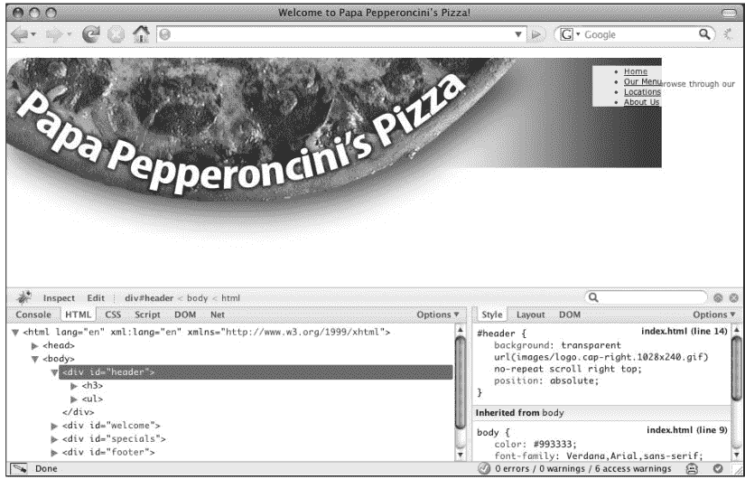

图 6-13. 将导航菜单列表移动到视口的右上角，并为其添加背景色以便于识别。

这里可能有很多令人意外的地方。首先，看起来所有的文字都突然消失了。实际上，它们并没有消失；只是滑动到了页面的最顶部，并被高大的横幅图片遮挡住了。回想一下，横幅图片实际上包含了白色像素，所以横幅图片下方的白色网页背景看似是背景，实际上是图片的一部分，因此遮挡了现在位于其后的文字。你实际上可以通过观察视口右上角露出的少量文字来注意到这一点，这些文字勉强可读，显示的是“browse through our”。

另一个明显的怪异之处是，横幅图片的右侧（带有圆角右上角的那一部分）似乎也消失了。这实际上也没有消失，而是被 `<h3>` 元素的大型披萨饼和渐变条纹背景图像隐藏在了下面。相关的是，整个横幅的宽度略微收缩，不再横跨整个视口。这是因为，尽管标题 `<div>` 仍然是一个块级元素，但它不再处于文档的正常流中，因此没有可以用来确定其总允许宽度的包含块。结果，它的宽度由其内容定义，在本例中恰好是 `<h3>` 元素内部 835 像素宽的 `<a>` 元素。

最后，请注意导航菜单的绝对定位 `<ul>` 元素也显示出与 `<div>` 元素相同的宽度收缩行为，你现在知道这是因为它的渲染也在其自身的视觉上下文中。然而，它不再像以前那样被固定在浏览器视口的右上角，而是固定在了标题 `<div>` 的右上角。这是因为标题 `<div>` 元素现在是 `<ul>` 元素最近的定位祖先，因此当你将其绝对定位为距离包含块右边缘 0 像素偏移和上边缘 0 像素偏移时，该包含块现在指的是标题 `<div>` 的 CSS 盒子，而不是浏览器视口。

另一方面，`position` 属性的 `fixed` 值（其行为方式与 `absolute` 值相同）将始终使用浏览器视口作为偏移参考。这产生了一个重要的副作用，即有效地将一个 CSS 盒子固定在屏幕上的某个点，*无论访客是否滚动页面*。不幸的是，Internet Explorer 5 和 6 都不支持 `fixed` 定位，因此这种效果并未被广泛使用。

`position` 属性的最后一个可能值是 `relative`。该值的行为类似于 `absolute` 值，但与 `absolute` 值不同的是，将元素的 `position` 属性设置为 `relative` 并不会将其从文档的正常流中移除。然而，与 `absolute` 值一样，它确实为任何子元素创建了一个定位祖先。让我们将标题 `<div>` 的 `position` 属性从 `absolute` 值切换为 `relative`。


```css
#header {
    background: url(images/logo.cap-right.1028x240.gif) no-repeat right top;
    position: relative;
}
```

这恢复了你之前的原始布局，但有一个重要且非常细微的区别：导航菜单不再固定在浏览器视口的右上角；而是固定在了标题`<div>`的右上角。现在，如果你移动标题`<div>`本身，导航菜单也会随之移动，因为你有效地将其中的所有元素分组到了一个自包含的层中。

理解`position`属性的`relative`值的另一种方式是说，它将一个 CSS 盒子定位在相对于其在`scroll`（默认）值下原本偏移位置的某个偏移处。例如，如果你想将欢迎`<div>`向上移动到靠近横幅图片的位置，你可以给它一个带有负`top`偏移的相对位置：

```css
#welcome {
    position: relative;
    top: -70px;
}
```

这样做**不会**导致列出每周特色菜的内容部分“在页面上向上滑动”，就像你使用`absolute`值时会发生的情况一样，因为相对定位的 CSS 盒子保留了与使用`scroll`（默认）值定位的 CSS 盒子相同的布局效果。

因此，如你所见，`relative`值可以服务于两个不同的目的。首先，在不声明任何关联偏移属性的情况下，你可以使用它来创建一个定位祖先，以便在页面上定位另一个元素。其次，你可以使用它来微调 CSS 盒子的位置，而不影响其邻居的位置。

使用 CSS`position`属性和相关偏移属性来定位元素，是当今前端 Web 开发人员可用的最前沿的 CSS 技术之一，因此可能需要大量的实验和实践才能完全自信地使用它。话虽如此，花费大量时间实验基于 CSS 的定位无疑会带来巨大的回报，因此这项投资是值得的。

既然你已经掌握了如何使用基于 CSS 的定位在页面上定位元素，我们将展示如何将 CSS 盒模型与此技术结合使用来美化你的导航菜单。

## 美化导航菜单：使用 CSS 设置列表样式

此时，标题部分几乎完成了。剩下的就是美化导航菜单，使其具有设计师所设想的外观和感觉。为了完成此任务，你需要了解可用于操作列表显示的各种 CSS 属性。

因为你即将编写大量针对导航菜单`<ul>`元素的 CSS 规则，所以现在为该元素提供一个具有唯一值的`id`属性是合理的，这样你就可以更简单地从样式表中选择它。我们将其称为`mainnav`，因为它是主导航元素的包含元素。

```html
<div id="header">
    <h3><a href="index.html">Papa Pepperoncini&#39;s Pizza</a></h3>
    <ul id="mainnav">
        <li><a href="index.html">Home</a></li>
        <li><a href="menu.html">Our Menu</a></li>
        <li><a href="locations.html">Locations</a></li>
        <li><a href="about.html">About Us</a></li>
    </ul>
</div>
```

你还可以将 CSS 选择器从`#header ul`更改为`#mainnav`。由于列表元素（如导航菜单使用的`<ul>`元素）通常通过浏览器内置样式表默认应用了一些你现在不需要的边距或填充，请确保你也删除可能存在的这些值。

```css
#mainnav {
    position: absolute;
    top: 0;
    right: 0;
    margin: 0;
    padding: 0;
}
</style>
```

像这样的列表元素本身并没有什么特别之处。它只是生成一个常规的块级 CSS 盒子。然而，对于列表通常包含的`<li>`元素，情况就不同了。

默认情况下，`<li>`元素会生成一种全新的 CSS 盒子，称为**列表项盒子**。列表项盒子的行为类似于你已经熟悉的块级盒子，但有一个重要区别。除了生成一个标准的块级 CSS 盒子外，列表项盒子还会在内部生成一个次级**标记盒子**，其中绘制一个特殊的装饰**标记**。通常，对于作为`<ul>`元素子元素的`li`元素，这些标记是项目符号（•）；对于作为`<ol>`元素子元素的`<li>`元素，则是编号（1.、2.、3. 等）。

与 CSS 中的大多数事物一样，某些属性让你能更好地控制绘制何种标记以及绘制位置。对于此设计，你实际上不希望使用这些标记，因为你并非以传统的列表样式显示导航菜单。这在当今网站导航菜单的大多数设计中实际上非常典型。尽管导航菜单实际上在逻辑和语义上表示为列表，但其视觉呈现通常大不相同。

你有多种选择可以让列表看起来不像列表。最简单的方法是，你可以将每个列表项的`display`属性设置为`block`。这样做将导致`<li>`元素生成普通的块级盒子，而不是列表项盒子，从而有效地使标记（项目符号）消失。另一个选项是保留列表项盒子，只删除它们生成的标记盒子。你将通过声明`list-style-type`属性来实现这一点，该属性定义要显示何种标记。

```css
#mainnav {
    position: absolute;
    top: 0;
    right: 0;
    margin: 0;
    padding: 0;
    list-style-type: none;
}
</style>
```

声明值为`none`表示不应生成任何标记盒子。你没有编写新的 CSS 规则，而是将此声明添加到了针对`#mainnav`元素的 CSS 规则的声明块中。这是因为`list-style-type`属性是可继承的，因此通过在`<ul>`元素本身上声明此属性，其所有子元素`<li>`都将继承此值。

值为`disc`（`<ul>`元素的默认值）将使项目符号恢复。值为`decimal`提供有序编号，从 1 开始，是`<ol>`元素的默认值。除了项目符号，列表标记还可以通过声明`square`值渲染为方块。有些

该属性的其他可能值包括其他类型的编号系统，包括`decimal-leading-zero`、`upper-latin`、`lower-latin`、`upper-roman`、`lower-roman`、`hebrew`、`georgian`、`armenian`、`hiragana`和`katakana`，它们会使列表标记显示为相应编号系统的原生字形。遗憾的是，Internet Explorer 再次不支持其中大多数选项（尽管 Internet Explorer 8 计划最终添加支持），因此实际上你通常只会看到默认的`decimal`或`disc`。

下一步是更改列表中文本的外观：

```css
#mainnav {
    position: absolute;
    top: 0;
    right: 0;
    margin: 0;
    padding: 0;
    list-style-type: none;
}
#mainnav a {
    color: #FFF;
    font: bold 2em "Myriad Pro", Verdana, Arial, sans-serif;
    text-decoration: none;
}
</style>
```

这里没有太多新内容。`color`属性将文本颜色声明为白色，`font`属性使文本变为粗体，并将字体设置为设计师在设计文档中使用的相同字体，同时还提供了一个备选字体列表。它还将字体大小设置为`2em`，这计算为 20 像素。

不过，我们是如何得出 20 像素的呢？回想一下，你最初在`<body>`元素上将字体大小声明为 62.5%。假设访问者将其浏览器的默认文本大小首选项设置为“中等”（在大多数情况下这是出厂默认值），这意味着页面上的常规文本计算为恰好 10 像素大小。此值随后会被页面上的所有元素继承。页面上常规文本的默认字体大小值为`1em`，这等同于说“与父元素字体大小相同”。因此，页面上的所有常规文本大小均为 10 像素。当你声明字体大小为`2em`时，你实际上是在说“将父元素的字体大小加倍”。由于父元素的字体大小属性计算为 10 像素，将其加倍得到 20 像素（10 像素乘以 2 等于 20 像素）。按照同样的逻辑，设置`3em`的值会使导航菜单文本大小为 30 像素，设置`2.5em`的值则会使其大小为 25 像素。

为了避免不同浏览器计算文本大小并在屏幕上渲染时出现不一致，确保页面上所有文本最终都具有精确的像素值大小非常重要。小数像素值可能会导致某些浏览器以你并非预期的大小显示文本。图 6-14 显示了标题现在的样子。

# 第 6 章

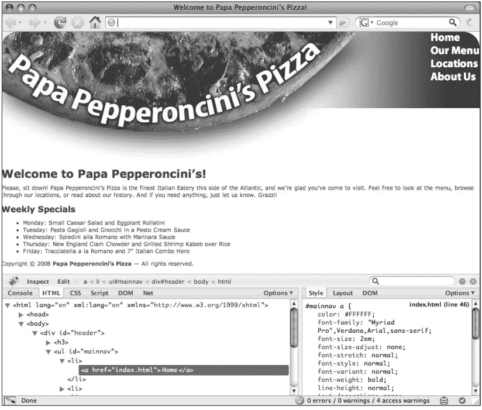

接下来，让我们调整文本的精确间距。在设计文档中，导航菜单并不像在页面上那样紧贴右上角。你需要将文本向左稍微推一些，并且还需要垂直增加各个菜单项之间的间距。你可以使用边距、内边距或结合两者来实现这一点。出于稍后会变得明显的原因，让我们使用内边距。由于你既需要垂直内边距也需要水平内边距，你需要通过声明`<a>`元素的`display`属性，将它们生成的内联框转换为块级框。

```css
#mainnav {
    position: absolute;
    top: 0;
    right: 0;
    margin: 0;
    padding: 0;
    list-style-type: none;
}
#mainnav a {
    color: #FFF;
    font: bold 2em "Myriad Pro", Verdana, Arial, sans-serif;
    text-decoration: none;
    display: block;
    padding: 1px 35px 1px 0;
}
</style>
```

这几乎完美了，但导航菜单仍然有点太高。为了将其向下推一点，让我们增加列表本身的上边距：

```css
#mainnav {
    position: absolute;
    top: 0;
    right: 0;
    margin: 15px 0 0 0;
    padding: 0;
    list-style-type: none;
}
#mainnav a {
    color: #FFF;
    font: bold 2em "Myriad Pro", Verdana, Arial, sans-serif;
    text-decoration: none;
    display: block;
    padding: 2px 35px 2px 0;
}
</style>
```

现在导航菜单的间距与设计文档中一致了。图 6-15 显示了精确间距的效果。完成它的最后一步是添加指向当前选中页面的披萨切片图标。让我们接下来做这件事。

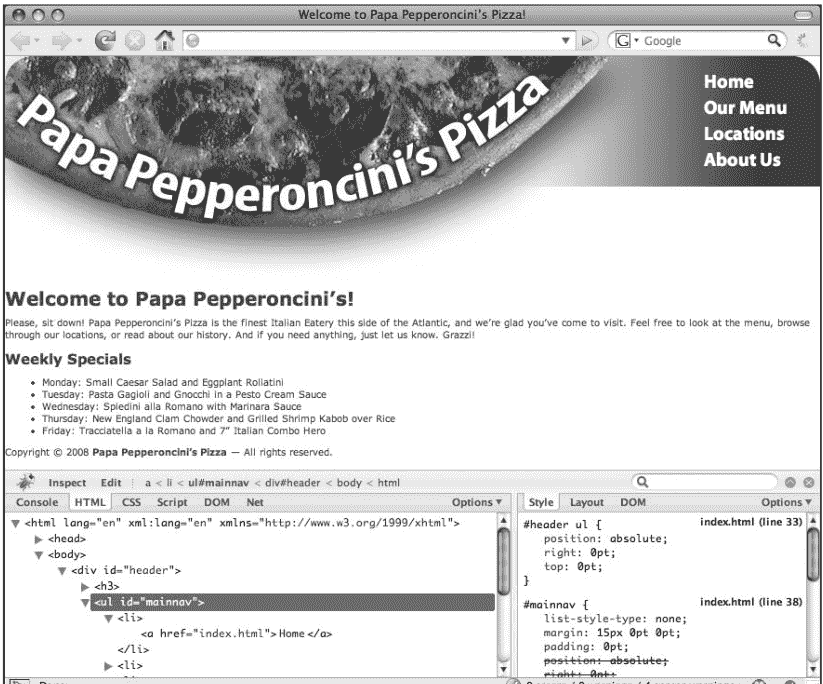

图 6-15. 通过添加少量内边距，你可以将导航菜单项彼此之间以及与边缘之间正确地分隔开。

## 添加交互性：选中项目和悬停的特殊样式

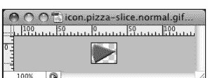

图 6-16. 当前菜单项的背景图像是一个带有透明背景的橙色 GIF。

你需要为导航菜单编写的下一组样式是为菜单增加一定交互性的样式。首先，你需要从设计文档中提取披萨切片图标到一个单独的图像中。由于图像必须是矩形的，而披萨切片图标显然不是那种形状，你需要图像具有透明背景，因此你将其保存为 GIF 文件。我们将文件命名为`icon.pizza-slice.normal.gif`。图 6-16 显示了你将用于突出显示当前选中菜单项的披萨图标图像，图 6-17 显示了你将用于悬停效果的披萨图标的修改版本。

如你所见，我们将悬停图像命名为`icon.pizza-slice.hover.gif`，以符合图像文件命名惯例。更具体地说，我们没有在文件名中使用“rollover”，因为正如你稍后将看到的，CSS 将这种悬停状态称为“hover”状态。

现在你已经将所需的图像资源保存到`images`目录，你可以从将普通披萨切片图标添加到主页开始。为此，你需要一种方法来仅定位访问者当前正在查看的页面上的那一个导航菜单项。最可靠的方法是向该特定列表项添加一个适当命名的`class`属性。在这种情况下，这是主页，因此你将为第一个列表项添加一个`selected`类值以表示这一点：

```html
<div id="header">
    <h3><a href="index.html">Papa Pepperoncini&rsquo;s Pizza</a></h3>
    <ul id="mainnav">
        <li class="selected"><a href="index.html">Home</a></li>
        <li><a href="menu.html">Our Menu</a></li>
        <li><a href="locations.html">Locations</a></li>
        <li><a href="about.html">About Us</a></li>
    </ul>
</div>
```

现在，你可以编写一个 CSS 规则，仅针对应用了`selected`类的任何列表项。让我们将普通披萨图标作为当前选中导航菜单项的背景图像添加：

```css
#mainnav a {
    color: #FFF;
    font: bold 2em "Myriad Pro", Verdana, Arial, sans-serif;
    text-decoration: none;
    display: block;
    padding: 2px 35px 2px 0;
}
#mainnav .selected a {
    background: url(images/icon.pizza-slice.normal.gif) no-repeat left center;
}
</style>
```

这可以工作，但它将图标放在了显示“Home”的文本后面，而不是旁边。你需要为导航菜单中的所有链接在左侧提供一点额外的空间。这没问题；你只需要调整前面 CSS 规则中的内边距值。由于披萨切片图标正好是 35 像素宽，你将左内边距值增加到 45 像素，这样图标边缘和链接锚文本开头之间就有 10 像素的空间。

```css
/*
#mainnav a {
    color: #FFF;
    font: bold 2em "Myriad Pro", Verdana, Arial, sans-serif;
    text-decoration: none;
    display: block;
    padding: 2px 35px 2px 45px;
}
#mainnav .selected a {
    background: url(images/icon.pizza-slice.normal.gif) no-repeat left center;
}
*/
```

现在让我们为悬停效果做同样的事情：

```css
/*
#mainnav a {
    color: #FFF;
    font: bold 2em "Myriad Pro", Verdana, Arial, sans-serif;
    text-decoration: none;
    display: block;
    padding: 2px 35px 2px 45px;
}
#mainnav .selected a {
    background: url(images/icon.pizza-slice.normal.gif) no-repeat left center;
}
#mainnav a:hover {
    background: url(images/icon.pizza-slice.hover.gif) no-repeat left center;
    color: #399;
}
*/
```

这个 CSS 规则首次引入了`:hover`伪类，所以让我们稍作停顿，更仔细地研究一下这意味着什么。

## 动态伪类：`:hover`、`:active`和`:focus`

你会从前一章回忆起，伪类是一种 CSS 简单选择器，这意味着你可以使用它来定位页面上的某些元素。然而，与大多数其他类型的 CSS 选择器不同，大多数伪类选择器（如`:hover`伪类选择器）并不针对具有任何特定属性值或其他识别特征的元素。相反，这个伪类选择器针对的是访问者光标当前悬停（或滚动）在其上的元素。由于访问者的光标在任何给定时间都可以悬停在任何元素的 CSS 框上，`:hover`伪类是基于 CSS 的悬停效果的基石。

`:hover`伪类被称为动态伪类，因为它描述了一种动态状态，也就是说，元素可以随意进入和离开“悬停”状态。理论上，任何类型的元素（不仅仅是链接）都可以被置于这种动态悬停状态。不幸的是，各种版本的

## 使用链接伪类设置链接样式：`:link`

最常用的伪类是`:link`和`:visited`伪类。这两个伪类根据链接是否曾经被查看过来应用于链接。换句话说，`:link`伪类用于定义用户尚未点击的链接的样式，而`:visited`伪类用于定义用户之前已经点击过的链接的样式。

起初，这个伪类的名称是`:link`可能显得有些奇怪，因为在本书的其他部分，我们一直将链接称为锚点（`<a>`）元素。然而，当你记住可以使用 CSS 为任何标记语言定义样式，而不仅仅是 XHTML 时，这种抽象就更有意义了。因此，虽然在 XHTML 中，`:link`和`:visited`伪类仅应用于在其`href`属性中赋予了值的`<a>`元素，但在其他标记语言中，`:link`和`:visited`伪类可以根据该语言对“链接”的定义应用于不同的元素。简而言之，当你在 (X)HTML 中使用这些伪类时，以下 CSS 选择器都针对相同的元素（尽管具有不同的特异性）：


```css
a:link { … }
:link { … }
a:visited { … }
:visited { … }
a:link:visited { … }
```

早于 7 版本的 Internet Explorer 不支持在除 `<a>` 元素以外的任何元素上使用`:hover`伪类，因此在实践中通常只有链接会被用它作为目标。

最新的 CSS 选择器及其`:hover`伪类选择器可以理解为“当光标悬停在作为`#mainnav`元素子元素的`<a>`元素上时”。从技术上讲，所发生的情况是`<a>`元素与其他任何被光标悬停的元素一样，进入了一个全新且更具体的状态。通常，这一事实在视觉上是察觉不到的，因为元素的`:hover`状态继承其初始值自元素的静态状态的值，因此元素的视觉外观没有变化。然而，一旦你通过声明元素`:hover`状态的不同值来改变这些值，变化就会立即变得显而易见，表现为一种悬停效果。

随着最新 CSS 规则的添加，你现在拥有了一个导航菜单的悬停效果，它可以显示和隐藏蓝绿色披萨切片图标，同时将白色链接变为类似的颜色。实际上，这有点过头了，因为所有菜单项在悬停时都会改变颜色，即使是当前选中的项目（首页）也是如此。这是因为你同时为选中和未选中的项目声明了`:hover`属性。

要阻止这种效果在选中的项目上出现，你只需为导航链接的悬停状态指定与其静态状态相同的值即可。你已为该状态指定了 CSS 规则，因此现在只需做的就是在该规则中添加另一个使用`:hover`伪类的 CSS 选择器，并显式声明文本链接的颜色。

```css
#mainnav .selected a, #mainnav .selected a:hover {
    background: url(images/icon.pizza-slice.normal.gif)
                 no-repeat left center;
    color: #FFF;
}
#mainnav a:hover {
    background: url(images/icon.pizza-slice.hover.gif)
                 no-repeat left center;
    color: #399;
}
</style>
```

经过这次最新的修改，悬停效果正在按照你希望的方式工作。尽管如此，你还可以做更多的事情来美化导航菜单的效果。

除了`:hover`伪类之外，CSS 还定义了另外两个动态伪类。它们是`:active`和`:focus`。与`:hover`伪类一样，这两个伪类在元素处于特定状态时应用于元素。对于`:active`伪类，这种状态是元素“正在被激活”时，例如用户点击链接和释放鼠标按钮之间的时间。对于`:focus`伪类，这种状态是元素获得“焦点”的任何时刻，例如当访问者在页面上的元素之间进行标签切换时。（大多数 Web 浏览器会用某种高亮轮廓来显示获得焦点的元素——Firefox 实际上使用框的 CSS 边框区域来实现这一点，尽管出于某种奇怪的原因，你无法用 CSS 覆盖这种行为。）

这些伪类之间没有一个是相互排斥的，这意味着元素在任何给定时刻可能处于这些状态中的任意数量。例如，点击一个链接首先使该元素进入悬停状态（因为鼠标光标需要位于该元素上方才能点击），然后同时使该元素获得焦点并且激活它。正如你所见，这里有许多不同的事件在快速连续发生。

我们将在下一章讨论 JavaScript 的事件驱动编程模型时，更详细地讨论 Web 浏览器可以向您展示的不同类型的事件。与此同时，你只需关心如何使用 CSS 提供的动态伪类来区分彼此不同的动态状态。

现在，对于这个设计，你真正需要做的就是添加另一条 CSS 规则，以定义用户点击导航链接时的外观和感觉。即使设计师在原始设计文档中没有提供这种状态的设计，但如果文本变为红色，并且披萨切片图标向文本本身移动更近一些，那将是不错的。改变文本颜色是小菜一碟，而将披萨切片图标向右移动而不移动链接本身的文本，只需对`<a>`元素的左边距和左内边距属性进行一些小心的操作即可。由于你也不想将此效果应用于当前选中的项目，因此你需要在样式化已选导航项目的 CSS 规则中添加另一个选择器，并覆盖你在其下方添加的 CSS 规则中属性声明。

```css
#mainnav .selected a,
#mainnav .selected a:hover,
#mainnav .selected a:active {
    background: url(images/icon.pizza-slice.normal.gif)
        no-repeat left center;
    color: #FFF;
    margin-left: 0;
    padding-left: 0;
}
#mainnav a:hover {
    background: url(images/icon.pizza-slice.hover.gif)
        no-repeat left center;
    color: #399;
}
#mainnav a:active distinguished with CSS!
```

你在这个新规则中所做的是改变`<a>`元素 CSS 框左内边距边缘相对于该元素 CSS 框其余部分的位置。由于你知道背景图像（例如披萨切片图标）是在 CSS 框的内边距区域和内容区域内绘制的，因此减小左内边距区域的宽度实际上会使披萨切片图标更靠近文本。

确切地说，你将其向右移动了 7 像素，因为你在之前的 CSS 规则中声明了 45 像素宽的左内边距区域，现在将该宽度更改为 38 像素（45 像素减去 38 像素等于 7 像素）。与此同时，你还将 CSS 框的左外边距区域从零宽度增加到 7 像素，以“填补”因减小内边距区域宽度而失去的空间，使 CSS 框整体仍保持在浏览器视口中的相同位置。

如图 6-18 所示，这确保了导航链接彼此之间保持良好对齐，同时使披萨切片图标向文本移动。

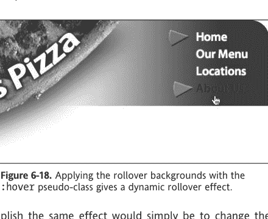

实现相同效果的另一种方法当然是更改`background-position`属性，使背景图像从 CSS 框填充区域的左边缘向右移动 7 个像素。

```css
#mainnav .selected a,
#mainnav .selected a:hover,
#mainnav .selected a:active {
    background: url(images/icon.pizza-slice.normal.gif)
               no-repeat left center;
    color: #FFF;
}
#mainnav a:hover {
    background: url(images/icon.pizza-slice.hover.gif)
               no-repeat left center;
    color: #399;
}
#mainnav a:active {
    color: red;
    background-position: 7px center;
}
</style>
```

使用这种方法，你还可以移除前一个 CSS 规则中的`margin-left`和`padding-left`声明。

这两种方法都是完全有效的。这个例子表明，在许多情况下，你可能会发现不止一种方法可以实现同样的事情。你选择使用哪种方法可能主要取决于你自己的经验和个人偏好。然而，有时你会遇到设计决定你的选择远比其他情况多的情形。这种情况在更复杂的设计中最为常见，这些设计要求你利用 CSS 的每一项功能。在这种情况下，熟悉尽可能多的做事方法是有益的，这样你就可以拥有最多的选择。

我们将使用`background-position`方法，因为这会使 CSS 样式表缩短几行（而且我们是懒得打字的）。无论你最终为导航菜单使用哪种方法，你现在都已经完成了整个页眉和导航菜单的设计。作为最后的点睛之笔，让我们为样式化当前选中导航菜单项的 CSS 规则再添加一个声明：

```css
#mainnav .selected a,
#mainnav .selected a:hover,
#mainnav .selected a:active {
    background: url(images/icon.pizza-slice.normal.gif)
        no-repeat left center;
    color: #FFF;
    cursor: default;
}
```

这个最终的声明将访问者的光标变为浏览器默认的光标，通常是一个箭头，使得当前选中的导航项目看起来根本不像是一个链接！这通常有助于防止访客点击指向他们当前所在页面的链接时出现的烦人情况，即似乎什么都没有发生。另一种方法是使用值`text`使光标显示为标准文本插入光标（通常显示为 I 形），但这有一个缺点，即某些用户可能会尝试选择链接的文本并意外激活它。

在你继续布局网页其余部分之前，让我们探索一下还可以对链接和伪类做些什么。

在上一段代码中显示的前两个 CSS 选择器针对所有未访问的链接，而接下来的三个 CSS 选择器则针对所有已访问的链接。特别值得注意的是上一段代码中显示的最后一个 CSS 选择器`a:link:visited`，因为它表明你可以像链接任何其他简单选择器一样链接伪类选择器。因此，理论上你可以将动态伪类与链接伪类组合起来，创建针对特定状态链接的 CSS 选择器。例如，以下 CSS 规则在已访问的链接上创建悬停效果，使其部分变为半透明：

```css
a:visited:hover { opacity: .5; }
```

遗憾的是，7 之前的 Internet Explorer 版本不理解具有多个链接伪类的 CSS 选择器（如上所示），因此这些浏览器会将此 CSS 选择器读作`a:hover { ... }`。（另外，目前没有任何版本的 Internet Explorer 支持`opacity`属性，尽管你可以使用专有声明（如`filter: alpha(opacity=50);`）来获得与前述声明类似的结果。但是，请注意，在样式表中使用此声明将导致其无法验证。）关键在于，这些伪类专门设计用于让网页设计师区分已访问和未访问的链接。

由于所有伪类具有相同的特异性，通常会在 CSS 样式表顶部附近按照以下顺序定义通用链接样式：

```css
a:link { /* 常规链接的样式声明 */ }
a:visited { /* 常规已访问链接的样式声明 */ }
a:hover { /* 悬停时未访问链接的样式声明 */ }
a:active { /* 激活（已点击）链接的样式声明 */ }
```

通过在样式表顶部按此顺序定义这些 CSS 规则，你可以利用自然的 CSS 层叠特性，确保激活链接的样式始终覆盖所有其他链接样式，悬停链接的样式覆盖静态链接样式。同时，你还可以确保已访问链接的样式覆盖常规链接样式。这重现了网络浏览者习惯的默认行为。既然你尚未定义任何链接样式，或者实际上还没有任何链接，那么请继续为此文档中的欢迎段落添加一些链接：

```html
<div id="welcome">
    <h1>欢迎光临帕帕佩珀罗尼！</h1>
    <p>请入座！帕帕佩珀罗尼披萨 🍕 是大西洋这边最好的意大利餐厅，您能来访我们深感荣幸。🍕 请随时查看<a href="menu.html">菜单</a>，🍕 浏览我们的<a href="locations.html">分店</a>，🍕 或阅读<a href="about.html">我们的历史</a>。🍕 如果有任何需要，请随时告知我们。谢谢！</p>
</div>
```

## 第 6 章

现在，让我们为这些链接编写一些恰当的、美观的 CSS 样式。我们将常规链接设置为深蓝色，使其稍微突出一些，已访问链接设置为较深的橙色，使其逐渐淡化。通过在悬停时将所有链接变为绿色，在点击时变为深棕色，使它们更加突出。

```html
<style type="text/css">
html, body {
    margin: 0;
    padding: 0;
    border: none;
    background: #FFF;
}
body {
    color: #933;
    font: 62.5%/1.3em Verdana, Arial, sans-serif;
}
a:link {
    color: #06F;
}
a:visited {
    color: #906;
}
a:hover {
    color: #393;
}
a:active {
    color: #C60;
}
#header {
    background-image: url(images/logo.cap-right.1028x240.gif);
    position: relative;
}
```

现在，如图 6-19 所示，页面中的常规链接将根据您之前是否访问过该特定链接而呈现不同的样式。

### 实践中的 CSS 开发：从设计到部署


欢迎光临帕帕佩珀罗尼！

请入座！帕帕佩珀罗尼披萨是大西洋这边最好的意大利餐厅，您能来访我们深感荣幸。请随时查看菜单，浏览我们的分店，或阅读我们的历史。如果有任何需要，请随时告知我们。谢谢！

每周特惠


图 6-19。链接可以根据其目标地址是否存在于 Web 浏览器的缓存中而呈现不同的样式。如果是，则链接已访问，如图中的“分店”和“我们的历史”链接。否则，链接未访问，如“菜单”链接。

与此同时，您可以通过为每个链接添加`title`属性来进一步改进这些链接。正如第 4 章中简要讨论的，`title`属性允许您为网页上的大多数元素添加补充信息。`title`属性的值通常渲染为工具提示，因此它们应包含关于用户激活该元素时将发生什么的简短、有用的描述。

`title`属性对于指向与页面其他部分链接相同页面的链接特别有帮助（这些链接可能具有也可能不具有相同的锚文本），例如欢迎段落和页眉中的链接。为了向访客提示这些链接实际上指向相同的目标页面，您将为每对链接赋予相同的`title`值：

```html
<div id="header">
    <h3><a href="index.html" title="返回首页。">帕帕佩珀罗尼披萨</a></h3>
    <ul>
        <li>
            <a href="index.html" title="返回首页。">首页</a>
        </li>
        <li><a href="menu.html" title="在线阅读我们的菜单。">我们的菜单</a></li>
        <li><a href="locations.html" title="查找离您最近的餐厅。">分店</a></li>
        <li><a href="about.html" title="了解我们为何如此优秀。">关于我们</a></li>
    </ul>
</div>
<div id="welcome">
    <h1>欢迎光临帕帕佩珀罗尼！</h1>
    <p>请入座！帕帕佩珀罗尼披萨是大西洋这边最好的意大利餐厅，您能来访我们深感荣幸。请随时查看<a href="menu.html" title="在线阅读我们的菜单。">菜单</a>，浏览我们的<a href="locations.html" title="查找离您最近的餐厅。">分店</a>，或阅读<a href="about.html" title="了解我们为何如此优秀。">我们的历史</a>。如果有任何需要，请随时告知我们。谢谢！</p>
</div>
```

由于`title`属性的文本必须保持相当简短，我们在编写其值时力求尽可能直接。如您所见，每个`title`属性都使用祈使句，立即告知访客每个链接将为他们做什么。

在所有链接样式完成后，您可以接下来将注意力转向此设计中面临的最后布局挑战：将欢迎部分和每周特惠部分分成两个垂直列。

## 使用浮动和边距创建列

在几乎所有媒介中，包括网络，设计通常将内容分成多个列。这种趋势有几个原因。首先，人眼难以扫描非常宽的文本行，因此将内容分成多个较窄的列使其更易于阅读。另一个原因是，人类的视觉系统天生就能识别一组对象的邻近性和对齐方式与彼此相关，因此列是区分一种内容与另一种内容的好方法。还有一个原因是，网页可用于向访客显示信息的物理空间量是有限的，因此列也提供了在较小空间内呈现更多信息的好方法。

当然，挑战在于，虽然人眼以（主要是）随机顺序查看网页，但网页的源代码实际上是按线性顺序存储的。这再次是另一个领域，其中正确结构化、无表现性的标记与 CSS 结合使用确实能大放异彩。即便如此，多列布局在实现跨浏览器兼容性方面通常可能非常棘手。


# 实践中的 CSS 开发：从设计到部署

你可以使用几种技术在 CSS 中创建列。其中之一是使用绝对定位元素来定义每一列的位置和尺寸。例如，你可能首先尝试将欢迎 `<div>` 移动到左列，将特价 `<div>` 移动到右列，使用以下 CSS 规则。图 6-20 展示了这些定位规则的结果。

```css
#welcome, #specials {
    position: absolute;
    top: 250px;
}

#welcome {
    left: 30px;
    width: 275px;
}

#specials {
    left: 375px;
}
```


图 6-20. 使用绝对定位的框创建列可以随意定位，无论其在源代码中的顺序如何，但随后会变得僵硬和不灵活。

这似乎工作得相当好，而且它的好处是你可以将任何内容片段放置在页面上的任何位置，无论该内容在你的 XHTML 源文档中出现在哪里。然而，这种创建列的方法有一个很大的缺点。一旦列被定位，它们就会变得`僵硬`和`不灵活`，因为每一列都会忽略另一列的存在。

例如，当你尝试将页脚定位在页面上适当间距的位置时，你会遇到无法提前确定它应该放在页面多下方的问题。如果你把它放得太高，那么当用户增大字体大小时，或者当 Papa Pepperoncini 决定在他的主页上添加更多文本时，列中的文本就会与之冲突。另一方面，如果你把它放得太低，那么最终会在列的末尾和页脚开始之间出现大量（难看的）空白。

当然，你可以随时调整页脚的位置（并祈祷用户不要碰他们的浏览器首选项！），但这显然不是最佳解决方案。此外，你是个大忙人，不能让 Papa Pepperoncini 每次想要更改他网站上的文本时都给你打电话。显然，你需要探索其他选项。

另一种将此内容分成列的方法是使用一个名为 `float` 的新属性，将首先出现的元素移动到其包含 CSS 框的左或右内容边缘。在这种情况下，这意味着你可以使用值为 `left` 的 `float` 属性将欢迎 `<div>` 移动到浏览器视口的左边缘。当然，欢迎 `<div>` 的左边缘已经在浏览器视口的左边缘了，所以这对你有什么好处呢？好处多着呢！

在欢迎 `<div>` 上声明 `float` 和 `width` 属性，看看会发生什么：

```css
#mainnav a:active {
    color: red;
    background-position: 7px center;
}
#welcome {
    float: left;
    width: 275px;
}
</style>
```

如图 6-21 所示，这条 CSS 规则也为你创建了两列，但这些列的行为有点奇怪。你可能首先注意到的怪事是，每周特价列表中的项目符号与欢迎段落中的文本有一点点重叠。就此而言，整个列表甚至都不再缩进了，所有列表项现在都与标题"每周特价"对齐。实际上这里有几件事在同时发生，所以让我们稍作喘息，逐一检查每个 CSS 框发生了什么。


## 浮动框的多种布局效果

当你在 CSS 框上声明一个 `float` 值时，你实际上是在告诉浏览器"将这个元素生成的 CSS 框取出，并将其移动，或者说`浮动`，到左侧（或右侧），尽可能远，直到碰到同一文档流中的任何其他 CSS 框为止"。一旦一个框被浮动，它就会表现出一些特殊行为，以不同方式影响其相邻的 CSS 框，而不仅仅是简单地移向其包含块的左边缘或右边缘。

首先，每当你浮动一个框时，如果浮动元素的框之前不是块级框，你就隐式地将其转换为块级框。其次，浮动的框被部分移出正常文档流，使得内容沿着它的右侧流动（对于左浮动的框）或左侧流动（对于右浮动的框）。由于它不再在文档的正常流中，其他块级框看起来会在页面上"向上滑动"，就像你之前看到的绝对定位元素发生的情况一样。然而，由于浮动框并`不是完全`脱离文档流，所有内联级框实际上会环绕浮动框的外边缘（遵守浮动框的边距、内边距和边框区域，如果有的话）。第三，如果浮动元素之前包含在一个内联级框中，浮动框的顶部边缘将与该框的顶部边缘对齐。否则，它的顶部边缘将与它之前的块级框的底部边缘对齐。

## 第 6 章

一个例子将有助于为你澄清这一点。让我们在欢迎标题后面直接插入一个新的 `<div>`。为了简单起见，我们将这个 `<div>` 标识为 `floatbox`：

```html
<div id="welcome">
    <h1>Welcome to Papa Pepperoncini&rsquo;s</h1>
    <div id="floatbox">I am a floated box.</div>
    <p>Please, sit down! Papa Pepperoncini&rsquo;s Pizza &rarr;
        is the finest Italian Eatery this side of the Atlantic, &rarr;
        and you&rsquo;re glad you&rsquo;ve come to visit. &rarr;
        Feel free to розглянути &rarr;
    <a href="menu.html" title="Read our menu online.">the &rarr;
        menu</a>, browse through our <a href="locations.html" &rarr;
        title="Find our nearest restaurant.">locations</a>, &rarr;
        or read <a href="about.html" &rarr;
        title="Discover what makes us the best."> &rarr;
        about our history</a>. And if you need anything, just &rarr;
        let us know.  Grazzi!</p>
</div>
```

现在，让我们把这个框变成一个 60 像素乘 60 像素的正方形，向左浮动，并给它一个黄色背景，这样你可以轻松识别它的边缘。图 6-22 展示了最终的显示效果。

```css
#floatbox {
    float: left;
    width: 50px;
    height: 50px;
    padding: 10px;
    background-color: yellow;
}
```


图 6-22. 浮动一个框会导致内容在其左侧或右侧环绕它。

如你所见，浮动框已经在垂直方向上与前面的块级框的底部对齐，在本例中是生成标题"Welcome to Papa Pepperoncini's"的 `<h1>` 元素。此外，包含欢迎段落文本的内联框以及特价 `<div>` 内的内联框都在框的右侧流动。最后，注意浮动框实际上延伸到了欢迎 `<div>` 的底边之外，而它在 XHTML 源代码中是嵌套在这个 `<div>` 中的。图 6-23 为欢迎和特价 `<div>` 元素添加了纯色背景，更清楚地展示了这一点。

```css
#floatbox {
    float: left;
    width: 50px;
    height: 50px;
    padding: 10px;
    background-color: yellow;
}
#welcome { background-color: green; }
#specials { background-color: blue; }
```


图 6-23. 为附近元素添加背景后可以看出，浮动框从其包含块的底部突出。

这很重要：虽然浮动框的放置位置不能`高于`其顶部边缘与包含内联级框的顶部边缘或前面的块级框的底部边缘对齐的点，但`它们的底边将突出到其父 CSS 框的底边之外`。如果你想象黄色浮动框是一张图片，你就能理解为什么浮动框必须从它们的容器底部突出；如果它们不能这样，你将无法环绕比其段落高的图片周围的文本（正如许多图片的情况）。

如果你将这个框向右浮动而不是向左浮动，你会看到文本现在将环绕它的左边缘流动，如图 6-24 所示。

既然你理解了浮动框实际上对你的布局做了什么，让我们重新审视一下当你将欢迎 `<div>` 向左浮动以将其变成一列时发生了什么。


图 6-24. 将框向右浮动会使其附近的内容环绕其左边缘。

## 为你的列添加间距

如前所示，当你将欢迎 `<div>` 向左浮动时，你创建了看起来像是两列的效果。事实上，这并不正确。你实际完成的是让特价和页脚 `<div>` 中的内容环绕浮动的欢迎 `<div>` 中的内容流动。如果你再仔细看看浮动的欢迎 `<div>`（如图 6-25 所示），这次使用背景色来使特价和页脚 CSS 框可见，你会看到你实际上仍然只有一列。

```css
#mainnav a:active {
    color: red;
    background-position: 7px center;
}
#welcome {
    float: left;
    width: 275px;
}
#specials { background-color: green; }
#footer { background-color: blue; }
</style>
```


图 6-25。即使包含了浮动的盒子，块级盒子仍然会扩展到其包含块的宽度。

如图所示，`specials` 和 `footer` 的 `<div>` 元素仍然处于一个从浏览器视口一端延伸到另一端的单列中。仅仅是所有的内容（它们处于行内级盒子中）围绕着浮动的 `welcome` `<div>` 进行了环绕，这才使得布局看起来像是有两列。

这也解释了为什么你的“每周特色”列表看起来不再缩进；因为它们所在的块级盒子实际上跨越了浏览器视口的整个宽度，所以它们`是`缩进了的，但随后为了给275像素宽的浮动盒子腾出空间，它们需要被`进一步向右`移动。结果，由于浏览器自动移动了它们，它们看起来好像失去了缩进。

要解决这个问题，你需要做的是为 `specials` `<div>` 定义一个足够大的左边距，使其内容区域的左边缘移动到 `welcome` `<div>` 的右外边缘之后。由于 `welcome` `<div>` 目前宽度为275像素，并且从浏览器视口的左边缘开始，因此任何大于275像素的值都足以让 `specials` `<div>` 的左边距避开 `welcome` `<div>` 的右边缘。

```css
#mainnav a:active {
    color: red;
    background-position: 7px center;
}
#welcome {
    float: left;
    width: 275px;
}
#specials { margin-left: 375px }
</style>
```

图 6-26 展示了添加这个 `margin-left` 声明（以及为了示例额外添加的一个背景色设为绿色的声明）后的结果。


图 6-26。使用浮动的盒子与足够高的 margin 属性相结合，可以营造出列的外观。

从这里开始，只需几条 CSS 规则就能快速为列及其元素提供合适的间距和字体大小：

```css
#welcome {
    float: left;
    width: 275px;
    margin: 0 0 0 30px;
}
#specials { margin: 0 35px 0 375px; }
#welcome h1, #specials h2 {
    font-size: 2.2em;
    line-height: 1.3em;
}
#welcome p, #specials li {
    font-size: 1.4em;
    line-height: 1.5em;
}
#specials h2 { margin-bottom: 0; }
#specials ul {
    list-style-type: none;
    margin: 0;
    padding: 0;
}
</style>
```

这看起来可能很多，但都是你以前见过的内容。首先，你只需设置 `welcome` `<div>` 的边距，使其在视口左边缘留出30像素的空白。在下一条规则中，你设置 `specials` `<div>` 的边距，使其右侧留出35像素的空白（以避免文字触及视口右边缘），左侧留出375像素的空间（以避开左列）。

再下一条规则将两列的标题大小设置为22像素（2.2em），并增加其行高，使得“Welcome to Papa Pepperoncini's!”这两行文字不会重叠。接下来的规则对 `welcome` 段落和“每周特色”列表执行相同操作，只是将其字体大小设置为14像素（1.4em）。下一条规则移除了“Weekly Specials”标题的默认底部边距，结合最后一条规则，“每周特色”列表会紧挨着标题下方出现，没有任何项目符号。

最后，为了让 `welcome` 段落的第一句话（即“Please, sit down!”）显示在单独的一行，你需要对页面的 XHTML 内容进行最后一次调整，以便可以用另一条规则来针对这句话。你可以使用 `<span>` 元素，但这不会给页面添加任何额外的语义价值。由于设计清楚地表明这个第一句话应该以某种方式被强调，你将使用 `<em>` 元素，这样页面的语义就更接近视觉设计的意图：

```html
<div id="welcome">
    <h1>Welcome to Papa Pepperoncini&rsquo;s!</h1>
    <p><em>Please, sit down!</em> Papa Pepperoncini&rsquo;s Pizza is the finest Italian Eatery this side of the Atlantic, and you&rsquo;re glad you&rsquo;ve come to visit. Feel free to look at <a href="menu.html" title="Read our menu online.">the menu</a>, browse through our <a href="locations.html" title="Find our nearest restaurant.">locations</a>, or read <a href="about.html" title="Discover what makes us the best.">about our history</a>. And if you need anything, just let us know. Grazzi!</p>
</div>
```

现在，你可以通过让它生成一个块级盒子，将这句话从段落中提取出来并显示在单独一行。图 6-27 展示了所有这些添加后的结果。

```css
#welcome {
    float: left;
    width: 275px;
    margin: 0 0 0 30px;
}
#specials { margin: 0 35px 0 375px; }
#welcome h1, #specials h2 {
    font-size: 2.2em;
    line-height: 1.3em;
}
#welcome p, #specials li {
    font-size: 1.4em;
    line-height: 1.5em;
}
#welcome em {
    display: block;
    margin-bottom: 1em;
    font-weight: bold;
}
#specials h2 { margin-bottom: 0; }
#specials ul {
    list-style-type: none;
    margin: 0;
    padding: 0;
}
</style>
```

## 第 6 章


图 6-27。将强调文本样式化为新段落

如图所示，这最后一组简单的更改完成了主两列的实现。更妙的是，由于你没有使用绝对定位将列从正常文档流中取出，这两列现在会自动与页眉的末尾对齐。这意味着，如果你之后缩小页眉，列会随着它一起向上移动。

你现在需要做的只剩下定位和样式化页脚，然后就可以称你的设计完成了。

## 样式化页脚：清除浮动并添加边框

为了完成 Papa Pepperoncini's Pizza 网站，你需要样式化的最后一部分内容是页脚。原始设计实际上并没有包含页脚，所以我们不必花太多时间担心它。你真正需要做的只是确保它总是出现在网站的底部。

目前，页脚紧随右列中列出 Papa Pepperoncini 每周特色的 `<div>` 之后，围绕着浮动的左列流动。为了确保页脚 `<div>` 总是位于两列下方，你需要做的是大幅度增加页脚的上边距，以确保当右列的内容不足以将页脚推到左列下方时，页脚能避开浮动的左列。但是，你如何能提前知道该增加多少页脚的上边距呢？值得庆幸的是，你不必知道。

通过在页脚 `<div>` 上声明 `clear` 属性，你可以告诉浏览器自动调整其上边距，以确保该元素总是避开其在文档流中的任何浮动的前驱盒子。在这种情况下，由于你希望页脚避开一个你向左浮动的 CSS 盒子，你可以使用 `left` 值：

194


```css
#specials ul {
    list-style-type: none;
    margin: 0;
    padding: 0;
}
#footer { clear: left; }
</style>
```

然而，既然你已经知道总是希望页脚位于页面底部，你不妨告诉它避开所有向左和向右浮动的盒子，通过告诉它清除两者。

```css
#specials ul {
    list-style-type: none;
    margin: 0;
    padding: 0;
}
#footer { clear: both; }
</style>
```

现在，页脚将始终位于页面底部。如果浮动的左列比静态定位的右列高，浏览器会自行增加页脚的上边距，使其避开浮动列。如果右列比浮动列高，那么右列的内容本身将确保页脚被推到两列之下。

为了给页脚一点额外的呼吸空间和更好的显示效果，我们来居中文本，给页脚添加一条顶部边框，并将页脚的左右边缘从浏览器视口边缘向内推，这样你添加的边框就能与左列的左边缘很好地对齐：

```css
#specials ul {
    list-style-type: none;
    margin: 0;
    padding: 0;
}
#footer {
    clear: both;
    text-align: center;
    border-top: 1px solid;
    margin: 0 30px 0;
}
</style>
```

作为最后的点睛之笔，为了在列末端和页脚开始之间增加一点额外的空白，我们来将每个列的底部边距再增加30像素。你需要使用列的底部边距来做到这一点，因为你不能依赖页脚的上边距，因为在某些情况下你告诉浏览器要自行调整它。经过这些最后的更改，样式表——以及网页设计——现在就完成了。

## 第6章

```css
#welcome {
    float: left;
    width: 275px;
    margin: 0 0 30px 30px;
}
#specials { margin: 0 35px 30px 375px; }
#welcome h1, #specials h2 {
    font-size: 2.2em;
    line-height: 1.3em;
}
```

图6-28展示了最终的设计效果。将其与图6-2进行对比，看看你模仿原始设计的程度如何。


图6-28. 基于CSS的完整设计

此时，网页在Firefox中运行完美，但在其他一些不够符合标准的浏览器（如Internet Explorer）中存在一些问题。现在该来处理这些问题了，逐一毫不留情地消灭这些渲染bug。

196

## 处理非标准浏览器

尽管尽了最大努力，当今最流行的网页浏览器——Windows版的Internet Explorer 6——仍然无法应对许多（非常基础的）标准CSS布局方案。除了对某些CSS规范完全缺乏支持之外，它及其不同版本的"表亲"们还存在一系列渲染bug，这些bug的原因和解决方案往往看似怪异且完全不可预测。它在处理大量使用浮动框的复杂布局时尤其臭名昭著。

好消息是，得益于Web开发社区的工作，这些渲染bug及其解决方案大多已被记录在案，如"Big John" Gall硬汉Holly Bergevin的Position Is Everything（http://positioniseverything.net/）以及Peter-Paul Koch的Quirksmode（http://quirksmode.org/）。通过简单的Google搜索就能找到这些网站以及其他许多资源，它们对于了解这些非标准浏览器的内部机制绝对不可或缺，尤其是在一切似乎都不合常理的时候。

有些bug如此严重，即使像你为Papa Pepperoncini's Pizza网站开发的这种简单设计，也难免会遇到麻烦。确实，不幸的是，如果你在Internet Explorer 6中查看这个网页，你会发现存在一些小问题（谢天谢地，还不算严重）。图6-29展示了Internet Explorer 6对这段代码的渲染效果。


每个导航菜单链接之间的间距远远超过应有的距离，而且……哎呀！第四个导航菜单项去哪儿了？由于列表项的文字是白色的，这最后一项似乎消失了。事实上，它仍然在那里，只是融入了头部图片的白色背景中。如果你将鼠标悬停其上，就能看到它还在。

然而，将鼠标悬停在链接上又揭示了导航菜单的另一个问题：只有链接本身的锚点文字会显示悬停效果。在Firefox（以及所有其他符合标准的浏览器）中，`<a>`元素的整个块级框都会提供显示翻转效果的空间。

尽管稍好一些，但即使是最新版本的Internet Explorer——截至撰写本文时为Internet Explorer 7——也存在一些间距问题。图6-30展示了同一段代码在Internet Explorer 7中的效果。


**图6-30.** 尽管似乎少一些，但即使在Internet Explorer 7中仍然存在一些渲染bug。

那么，如何让这些浏览器乖乖听话呢？尽管Internet Explorer 8承诺的改进应该会让人振奋，但让旧版本的浏览器被淘汰仍需时间。你有多种选择，每种都有其优缺点。

## 使用条件注释实现浏览器特定的样式表

当然，处理浏览器bug的一种方法是向不同的浏览器发送完全不同的样式表。不过，这需要额外做大量工作，而且随着你试图支持越来越多的浏览器，维护这些不同版本样式表的工作量只会不断增加。此外，Internet Explorer毕竟还是将样式表中的*大部分*规则都正确渲染了。

与其为非标准浏览器创建新的样式表，不如利用CSS自身的层叠机制来编写新的CSS规则，仅覆盖那些网页浏览器难以处理的声明。这样一来，你就不会重复之前已完成的大量工作。此外，你可以将专门为有bug的浏览器编写的规则集中到一个地方，许多开发者发现这样更容易管理。

为Internet Explorer应用浏览器特定样式表最可靠的方法是使用Internet Explorer自身的一项专有功能——**条件注释**。（我们在第8章会更详细地介绍这个内容。）简而言之，条件注释看起来与普通的XHTML注释完全相同，对除Internet Explorer之外的所有浏览器都是如此。然而，当Internet Explorer遇到这种特殊构造的注释时，它会继续解析注释的内容，就好像它真的是代码的一部分一样。这个功能让Web开发者可以编写只有Internet Explorer能看到的代码。

如果你选择这条路径，可以为Internet Explorer创建一个新的嵌入式样式表，其中包含你想用来覆盖原始、基于标准的样式表中有问题的那些规则的CSS规则。这样的XHTML代码看起来像这样：

```html
<!DOCTYPE html PUBLIC "-//W3C//DTD XHTML 1.0 Strict//EN"
    "http://www.w3.org/TR/xhtml1/DTD/xhtml1-strict.dtd">
<html xmlns="http://www.w3.org/1999/xhtml" xml:lang="en" lang="en">
<head>
    <meta http-equiv="Content-Type"
            content="text/html; charset=utf-8" />
    <title>Welcome to Papa Pepperoncini&rsquo;s Pizza!</title>
    <style type="text/css">
        /* our original style sheet goes here */
    </style>
    <!--[if IE]><style type="text/css">
        /* special Internet Explorer-only style sheet goes here */
    </style><![endif]-->
</head>
```

如示例所示，条件注释的开始和结束方式与典型的XHTML注释相同，这就是其他浏览器看不到它的原因。另一方面，Internet Explorer会评估放在方括号中的表达式（位于`[`和`]`序列之间）。如果表达式计算结果为真，那么Internet Explorer会将后续直到结尾的`<![endif]-->`之间的所有内容视为正常代码。

条件注释内部的表达式甚至可以测试正在解析该注释的是哪个版本的Internet Explorer。例如，以下是一个只有Internet Explorer 6能看到的条件注释：

```html
<!--[if IE 6]> Code for all Internet Explorer 6 
 could go here. <![endif]-->
```

而以下是一个所有8以下版本（即小于8）的Internet Explorer都能看到的条件注释：

```html
<!--[if IE lt 8]> Code for all versions of Internet Explorer 
 prior to 8 could go here. <![endif]-->
```

将CSS样式表置于条件注释之后，可以说是为Internet Explorer重新定义CSS规则最安全的方法。当然，条件注释对Internet Explorer之外的任何浏览器都不起作用，因此，除非你页面中的渲染问题仅出现在该浏览器中，否则条件注释只是潜在解决方案的一部分。此外，条件注释不能放在CSS样式表内部，所以当你想使用条件注释时，不得不创建全新的样式表，即使该样式表最终只有一条或两条CSS规则。

## 使用CSS选择器过滤CSS规则

另一种处理浏览器特定CSS bug的方法是依赖浏览器自身对CSS选择器支持的不足。既然你已经知道Internet Explorer（以及许多其他较老的Web浏览器）不支持某些CSS选择器，你就可以将特定的声明块隐藏在这种CSS选择器之后。为此目的并以这种方式编写的CSS规则通常被称为CSS过滤器，因为它们被用来向不同的浏览器"过滤"掉CSS声明。

这种方法的常见模式是使用子代组合器配合`html`和`body`类型选择器：

```css
html > body /* real selector goes here */ {
    /* CSS declarations for Internet Explorer 6 and below go here */
}
```

由于`<body>`元素始终是`html`元素的直接子元素，将这个CSS选择器添加到你的实际CSS选择器之前，总是会匹配你的实际CSS选择器。然而，由于Internet Explorer 7之前的版本不理解使用子代组合器的CSS选择器，这些浏览器会完全忽略声明块内部的CSS声明。所以，例如，要在Internet Explorer 5和6中将某个示例`<div>`中的文字设为红色，但在Firefox、Safari和其他符合标准的浏览器中设为绿色，你可以使用以下一系列CSS规则：

```css
div#example { color: red; }
html > body div#example { color: green; }
```

使用这样一系列CSS规则的缺点是，如果有bug的浏览器开始支持你使用的CSS选择器（如Internet Explorer 7最初发布时那样），它就会开始像其他所有浏览器一样行事，并将绿色着色应用到元素上。在这种情况下，如果浏览器厂商没有同时修复原始的显示bug，原来的渲染错误就会重新浮出水面。

## CSS技巧：利用一个bug来解决另一个问题

另一种实现与子选择器过滤器相同效果的常见方法——现在被认为安全得多——利用了Internet Explorer 7之前版本中存在的一个奇怪的bug。不过，与将CSS声明从浏览器中过滤掉不同，这种CSS选择器实际上是针对该浏览器的，使得规则的声明仅适用于这些浏览器。

由于某种未解释的原因，Internet Explorer 5和6会错误地将`html`元素嵌套在另一个没有名称的幻影元素内。这个无名元素在Internet Explorer 5和6中被认为是页面的根元素，而所有其他浏览器都认为`html`元素是根元素。作为这种奇怪行为的一个副作用，你实际上可以使用一种CSS过滤器，根据浏览器是否认为`html`元素是从另一个（神秘的）元素派生的来筛选浏览器。

为此，你需要使用**通用类型选择器**。这个选择器以星号（`*`）表示，简单地意味着"任何类型的元素"。通过将此选择器与后代组合符和`html`类型选择器结合使用，你可以编写一个通常被称为**star-html hack**的CSS技巧。

```css
div#example { color: red; }
* html div#example { color: green; }
```

根据CSS2.1规范，CSS属性名中的反斜杠应被忽略。然而，Internet Explorer 5并不遵守这一点，而是将带有反斜杠的CSS属性名视为不存在的属性。因此，你可以利用这一事实编写一条CSS声明，只有符合标准的浏览器和Internet Explorer 6及更高版本才能理解。所以，要使示例`<div>`中的文本在Internet Explorer 5.5及更早版本中为蓝色，在Internet Explorer 6中为红色，在所有现代符合标准的Web浏览器中为绿色，你可以使用这组规则：

```css
div#example {
    color: blue;
    c\olor: red;
}
html > body div#example { color: green; }
```

Macintosh版Internet Explorer 5有一个与CSS注释解析方式相关的bug。具体来说，如果你以`\*/`序列而非简单的`*/`结束一个CSS注释，浏览器将不会识别注释已结束，而会愉快地忽略所有剩余的CSS规则，直到遇到另一个没有反斜杠的注释结束序列。这个bug据已知仅影响Mac版Internet Explorer 5，被直白地命名为**注释反斜杠技巧**或**Mac技巧**。要利用这一事实并为Mac版Internet Explorer 5中的文本设置特定颜色（比如蓝绿色），你可以这样编写你的CSS过滤器：

```css
div#example { color: teal; }
/* Start Mac Hack to hide rules from IE5/Mac \*/
div#example {
    color: blue;
    c\olor: red;
}
html > body div#example { color: green; }
/* End Mac Hack to stop hiding rules from IE5/Mac */
```

还有另一种使用注释的CSS技巧，它可以过滤掉Internet Explorer 7。使用它，你可以仅在Internet Explorer 7中为示例`<div>`的文本设置黄色，而不会改变其他任何浏览器的颜色：

```css
div#example { color: teal; }
/* Start Mac Hack to hide rules from IE5/Mac \*/
div#example {
    color: blue;
    c\olor: red;
}
html > body div#example { color: yellow; }
html > /**/ body div#example { color: green; }
/* End Mac Hack to stop hiding rules from IE5/Mac */
```

还有相当多这类额外的CSS技巧可以过滤或专门针对其他浏览器和浏览器版本应用CSS规则，但其中许多使用的CSS语法无法通过验证。不可否认，CSS技巧很快就会变得相当混乱！它们不仅令人困惑，而且并不总是具有前瞻性，因此如果可以的话，最好完全避免使用它们。

在许多最常见的情况下，你会发现渲染bug只需通过明确指定布局尺寸（如宽度或高度）或更改某些元素使用的定位方案（例如使用`position`值`relative`而不是默认的`static`）就可以轻松解决。那么，说到修复CSS渲染bug，让我们回到Papa Pepperoncini's Pizza，处理那些烦人的Internet Explorer bug。

## 修复Internet Explorer 6和7中的间距bug

既然你已经掌握了一些处理不同浏览器中CSS bug的工具，你可以使用其中最简单的来修复你的CSS代码在Internet Explorer 6和7中导致的显示问题。你首先将处理那个将第四个导航菜单项推到标题下方的奇怪列表项间距问题。这个bug有一个名称：**Internet Explorer空白符bug**。

虽然有相当多的方法可以处理Internet Explorer空白符bug，但对于当前目标来说最直接的方法是创建一个新的CSS规则，该规则覆盖`display`属性，并且仅适用于Internet Explorer 6及更早版本。一个万无一失的方法是使用star-html hack。

当你在样式表中看到star-html hack时，你就知道它是专门用来修复Internet Explorer 7之前版本中的渲染bug的。因此，我们倾向于将这些hack紧挨着它们所覆盖的CSS规则放置。如果将它们移到单独的样式表中，你就无法轻松地看到你正在覆盖哪些CSS声明。

使用star-html hack来关闭导航列表项之间的间距：


```css
#mainnav a {
    color: #FFF;
    font: bold 2em "Myriad Pro", Verdana, Arial, sans-serif;
    text-decoration: none;
    display: block;
    padding: 2px 35px 2px 45px;
}
* html #mainnav a { display: inline; }
#mainnav .selected a,
#mainnav .selected a:hover,
#mainnav .selected a:active {
    background: url(images/icon.pizza-slice.normal.gif)
                     no-repeat left center;
    color: #FFF;
    cursor: default;
}
```

只需覆盖`display`属性并将其值设置为`inline`就足以修复 Internet Explorer 6 中的这个 bug。解决此 bug 后，将注意力转向右栏标题的位置。

要处理此问题，你将采取相反的步骤。你不是编写一个仅适用于有问题的浏览器的新规则，而是编写一个过滤掉它们的新规则。要同时过滤掉 Internet Explorer 6 和 Internet Explorer 7，你可以使用我们之前展示的 CSS 过滤器，我们称之为**子注释**过滤器。你需要做的就是声明一个新的初始上边距值，然后为符合标准的浏览器重新声明它：

```css
#specials h2 {
    margin-top: 0; /* IE 6, 7 */
    margin-bottom: 0;
}
html > /**/ body #specials h2 {
    margin-top: .7em; /* conforming browsers */
}
#specials ul {
    list-style-type: none;
    margin: 0;
    padding: 0;
}
```

有了这些 CSS 过滤器，现在设计在你测试过的所有浏览器中渲染效果完全一致。图 6-31 显示了 Internet Explorer 6 中的结果，图 6-32 显示了相同代码在 Internet Explorer 7 中的效果。

## CSS 媒体类型和创建打印样式表

到目前为止，你已经了解了如何使用 CSS 在计算机屏幕上创建生动的设计。这非常方便，但 CSS 还能做更多。由于它的灵活性来源于能够使用相同的源文档并以不同的方式显示，你可以运用你刚学到的一切来为页面*打印时*创建一个全新的外观。你分两步完成：首先，创建一个新的样式表（或现有样式表的附加部分）并将其声明为打印样式表，然后编写新的 CSS 规则，以适合纸张的方式重新定义页面样式。

要为打印媒体定义特定样式，你需要使用 CSS 预定义的媒体类型。回想一下，原始样式表是像这样嵌入在你的 XHTML 文档中的：

```html
<style type="text/css">
    /* ...CSS rules for Papa Pepperoncini's Pizza are here... */
</style>
```

因此，这个样式表实际上是一个适用于*所有*可能媒体类型的样式表。其中一种媒体类型是`screen`。另一种，你可能已经猜到了，是`print`。所以换句话说，在浏览器看来，`style`元素实际上看起来像这样：

```html
<style type="text/css" media="all">
    /* ...CSS rules for Papa Pepperoncini's Pizza are here... */
</style>
```

如果你想限制所有编写的 CSS 规则仅应用于计算机显示器，你可以这样定义你的 CSS 样式表：

```html
<style type="text/css" media="screen">
    /* ...CSS rules for Papa Pepperoncini's Pizza are here... */
</style>
```

实际上，这可能是创建页面打印版本最简单的方法，因为它会导致浏览器在用户打印页面时忽略所有 CSS 规则，你的设计将恢复到你开始之前的无样式外观。图 6-33 显示了从 Safari 打印时页面外观的预览。

图 6-33. 未经样式设计的效果作为打印页面的预览

实现相同效果的另一种方法是将所有 CSS 规则嵌套在一个特殊的 CSS 规则内，其声明块实际上可以包含其他 CSS 规则（包括选择器）。这个 CSS 规则被称为**媒体类型 at-rule**，因为它“指向一种媒体类型”。在代码中，它看起来像这样：

```html
<style type="text/css">
    @media screen {
        /* ...Papa Pepperoncini's Pizza 的 CSS 规则放在这里... */
    }
</style>
```

无论是在`style`元素的`media`属性中，还是在`@media` CSS 规则中，你都可以通过逗号分隔的列表来定义多种媒体类型。例如，许多适合计算机屏幕的设计通常也适合投影显示，因此要为这两种类型声明样式但不包括其他类型，你可以用以下两种等效方式之一来编写样式表：

```html
<style type="text/css" media="screen, projection">
    /* ...Papa Pepperoncini's Pizza 的 CSS 规则放在这里... */
</style>
<style type="text/css">
    @media screen, projection {
        /* ...Papa Pepperoncini's Pizza 的 CSS 规则放在这里... */
    }
</style>
```

在特定媒体类型目标中声明的 CSS 规则的特异性与不受限于媒体类型的规则没有任何不同。因此，你可以利用现在已经熟悉的所有层叠行为，依次为不同媒体类型定义样式表，其规则将覆盖前一个样式表的规则。在实践中，为不同媒体类型定义完全不同的样式表通常比将 CSS 规则嵌套在`@media`规则中更有意义，因为这使你能够通过简单地更改在 (X)HTML 页面中嵌入（或外部链接）样式表的顺序来更轻松地“混合搭配”。

现在让我们利用这一行为为 Papa Pepperoncini's Pizza 创建一个新的非常简短的打印样式表，它基于你已经完成的所有工作。在开发这个样式表时，每次想要检查工作进展都必须进入打印预览屏幕会很麻烦。作为一种变通方法，让我们*暂时*将新样式同时定义为屏幕样式*和*打印样式，这样它们在浏览器中就能可见。

加入新的样式表后，页面的 XHTML 头部现在看起来像这样：

```html
<!DOCTYPE html PUBLIC "-//W3C//DTD XHTML 1.0 Strict//EN"
    "http:// Soul- sur www.w3.org/TR/xhtml1/DTD/xhtml1-strict.dtd">
<html xmlns="http://www.w3.org/1999/xhtml" xml:lang="en" lang="en">
<head>
    <meta http-equiv="Content-Type" />
             content="text/html; charset=utf-8" />
    <title>Welcome to Papa Pepperoncini&rsquo;s Pizza!</title>
    <style type="text/css">
        /* ...Papa Pepperoncini's Pizza 的 CSS 规则放在这里... */
    </style>
    <style type="text/css" media="screen, print">
        /* 新的 CSS 打印样式将放在这里 */
    </style>
</head>
```

现在你可以开始编写新的 CSS 规则来覆盖已有的规则。就像你之前所做的那样，你只需从上到下遍历设计（及其样式表），更改需要更改的部分，其余保持不变。在顶部，你有页面背景以及文本和链接颜色的全局规则。

尽管大多数浏览器默认不打印背景，让我们显式地关闭所有背景颜色和图像。这将为你的访客节省一些墨水，对环境也更好。此外，由于链接的概念在打印页面上有些无用，让我们通过将所有链接变为黑色并移除下划线来使它们看起来像普通文本。这样做之后，你可以看到描述性锚文本（而不是“点击这里”之类的锚文本）为何如此重要的又一个原因。

```html
<style type="text/css" media="screen, print">
    html, body { background-color: transparent; }
    body { margin: .25in; }
    body, a:link, a:visited { color: #000; }
    a:link, a:visited { text-decoration: none; }
</style>
```

# 第 6 章

注意这些 CSS 规则只覆盖之前规则中必须覆盖的部分，而忽略了你想要保留的声明。还要注意没有针对`a:hover`或`a:active`样式的 CSS 规则，因为这些动态伪类显然不适用于打印媒体。最后，请注意因为你现在正在处理物理媒体，所以使用对物理空间原生的长度值（如英寸）是有意义的。

接下来，让我们给漂亮的图形横幅做一个更简单的改造。你需要显式移除背景图像，将负缩进的文本移回浏览器视口，并通过增大字号使文本更醒目。注意，再一次地，你现在使用对打印媒体原生的长度单位（点）来设置文本大小。

```html
<style type="text/css" media="screen, print">
    html, body { background-color: transparent; }
    body { margin: .25in; }
    body, a:link, a:visited { color: #000; }
    a:link, a:visited { text-decoration: none; }
    #header { background-image: none; }
    #header h3 {
        background-image: none;
        height: auto;
        text-indent: 0;
        text-align: center;
        font-size: 28pt;
    }
</style>
```

接下来，你需要完全移除主导航菜单，因为这在打印页面上毫无意义。这样做非常容易。你可以通过将`visibility`属性声明为`hidden`来使导航菜单不可见。这可行，但并不太合理：导航菜单仍然存在，只是不会显示。你想要将其从文档中完全移除（当然，不要从 XHTML 中删除它），所以取而代之，你将`display`属性声明为`none`。这实际上不仅仅是使主导航菜单不可见；它*从页面布局中物理移除了它*，使其不再处于文档流中。

```css
#header h3 {
    background-image: none;
    height: auto;
    text-indent: 0;
    text-align: center;
    font-size: 28pt;
}
#mainnav { display: none; }
</style>
```

这些简单的更改就足以创建一个完全重新设计样式的页面，适合打印。你保留了双栏布局、页脚以及页面的所有文本元素，但移除了图形密集的横幅图像以及链接和导航元素的交互效果。图 6-34 展示了到目前为止的结果。

此时，你几乎可以将打印样式表称为完成了。作为最后的润色，让我们把内容间距安排得更美观一些，将页面改回单栏，并稍微柔化页脚。完成这些后，你可以从`style`元素的`media`属性中移除`screen`值。经过这些更改，你可以宣布打印设计完成了。图 6-35 展示了结果。

```html
<style type="text/css" media="print">
    html, body { background-color: transparent; }
    body { margin: .25in; }
    body, a:link, a:visited { color: #000; }
    a:link, a:visited { text-decoration: none; }
    #header { background-image: none; }
    #header h3 {
        background-image: none;
        height: auto;
        text-indent: 0;
        text-align: center;
        font-size: 28pt;
    }
    #mainnav { display: none; }
    #welcome {
        float: none;
        width: auto;
        margin: 0;
    }
}
```

第 6 章

```css
#specials { margin: 0; }
#specials h2 { margin-bottom: .75em; }
#specials ul {
    list-style-type: disc;
    margin-left: .5in;
}
#footer {
    margin-top: .5in;
    border: none;
    color: #999;
    text-align: right;
}
</style>
```

**图 6-35.** 再添加一些内容到打印样式表中，就能得到页面的良好打印版本。

现在，屏幕和打印样式表都已完成，你可以轻松地将它们提取到外部 CSS 样式表中，并将这些外部样式表链接到你需要为 Papa Pepperoncini's Pizza 网站开发的任意数量的页面，操作起来非常简单。

# 为其他媒体类型和设备进行设计

如你所见，为不同的媒体类型创建新的样式表是相当轻松的。它真正需要的是对目标媒体及其工作方式的理解。对于印刷页面来说，这应该很容易，因为大多数情况下，我们所有人都非常熟悉印刷页面能做什么和不能做什么。困难的是其他媒体类型，尤其是手持设备媒体类型。

手持设备媒体类型尤为重要，因为它被用于大多数手持设备，如 PDA、智能手机和其他袖珍网络浏览器。这些网络浏览器中的许多会查看页面上可用的样式表，并选择使用声明为手持设备媒体类型的那一个（如果存在的话）。如果不存在，这些浏览器会尽最大努力在需要时即时重新设计页面内容。有时这种自动重新设计工作得很好，但有时会让页面完全无法使用。你可以使用许多优秀的工具来测试你的设计在手持浏览器中的效果，其中一些我们在第 8 章中进一步讨论。

在这些带有手持浏览器的设备中，有两个重要的例外：苹果的 iPhone 和 iPod touch。这些设备使用移动 Safari 浏览器，这是 Mac OS X 原生网页浏览器 Safari 的变体。移动 Safari 实际上使用`screen`媒体类型，并*忽略*声明为手持设备媒体类型的样式表。幸好，苹果在其两个 Safari 变体中对 CSS 标准的支持都做得很好，所以你不必太担心 iPhone 和 iPod touch 与其网站的兼容性，除非你需要某些类型的高级交互（如拖放）。由于截至撰写本文时这是一个快速发展的领域，我们建议你查看苹果的文档，以了解更多关于为 iPhone 和 iPod touch 开发网页时的特性。

## 小结

正如你现在所看到的，在 CSS 样式表中实现设计相对简单，但它可能被多种因素复杂化，例如浏览器 bug 或显示介质的自然差异。通过帕帕·佩佩罗尼披萨的简单设计，你看到了网页设计与印刷页面设计截然不同的众多例子。你还看到了一些常用技术的例子，这些技术用于利用网页的灵活性和流动性来最大化网页的可用性。

通过使用动态伪类，你添加了在印刷页面上不可能实现的交互性。通过使用两种不同的布局技术——绝对定位和浮动盒子——将网页元素精确地放置在特定位置，你能够以兼容的、跨浏览器的实现方式来还原设计师对帕帕·佩佩罗尼披萨网站的原始构想。最后，你学会了如何获取原始样式表并在几分钟内修改它，以创建适合打印的页面版本。

显然，仅仅利用 XHTML 和 CSS 所提供的功能，你就能实现很多目标。然而，在创建动态效果方面，网络浏览器所能提供的远不止 CSS 动态伪类所提供的那一点点交互性。在接下来的章节中，你将看到如何利用 JavaScript 的全部力量——一种基于标准的成熟编程语言，直接嵌入在网络浏览器中——将你的网站提升到一个全新的水平。

---

# 第 7 章

## 用 JavaScript 创建交互性

JavaScript 是 Web 的三大基本构建块之一。如果你将网络技术想象成一座金字塔，HTML/XHTML 是金字塔的一个角，负责处理页面的实际内容。CSS 是另一个角，为你的页面添加样式，并让你以一种不仅美观而且具有视觉影响力的方式布局页面。JavaScript 是第三个角，让页面能够做更多的事情，而不仅仅是静态文档。

新手最常问的一个大问题是，JavaScript 和 PHP 之类的东西有什么区别？最大的区别是 JavaScript 在客户端执行（在访问者的浏览器中），而 PHP 在服务器端运行。所以换句话说，JavaScript 实际上利用的是你最终用户计算机上的处理器。

你获得的优势是，浏览器中的事情似乎是即时发生的。使用 JavaScript，你可以让你的页面感觉更像是在客户计算机上运行的应用程序。JavaScript 操作不需要往返服务器；页面不会被提交、处理然后返回。

这种速度是有代价的。因为你不是在服务器上处理，所以无法访问某些功能。例如，你不能使用 JavaScript 保存数据到数据库管理系统，或从远程主机的数据库管理系统中获取数据。例如，仅使用 JavaScript 是不可能编写实时聊天应用程序的。你无法操作文件或发送和接收电子邮件。


而且个人可以选择在其网络浏览器中关闭 JavaScript，这意味着你根本无法使用 JavaScript 做任何事情（所以你最好有备用方案）。不过，对于那些允许你使用 JavaScript 的人来说，你可以做一些相当酷的事情。

## JavaScript 基础：起源与背景

根据你读到的关于网络标准历史的所有内容，你大概可以猜到，JavaScript 走到今天并非一帆风顺。JavaScript 最初是 Netscape 的开发项目，最早在 Netscape Navigator 2 中支持（大约在 1995 年底）。微软迅速反击，推出了自己的实现，称为 JScript（1996 年首次在 Internet Explorer 3 中支持）。尽管这两种语言相似，但确实存在一些差异，比如每种实现让程序员获取当前日期和时间的方式。

## 脚本编写的黑暗时代

由于浏览器之间的差异，JavaScript 和 JScript 一度在开发者中失宠。为让某个 CSS 声明在多个浏览器中正常工作而不得不编写 "hack" 是一回事；为让脚本行为一致而不得不编写多个版本则是完全不同的事情。DOM 在这方面确实是一个突破，它使开发者能够再次编写一个可以在任何地方运行的脚本。

Netscape 于 1996 年将 JavaScript 语言提交给欧洲计算机制造商协会（ECMA），一个国际标准组织，以进行标准化，并在不久之后被接受。这成为了 ECMAScript 的基础，它本质上是微软和 Netscape 在脚本语言核心功能集上达成的妥协。ECMAScript 是核心，然后 JavaScript 和 JScript 都扩展了其功能。

随着 DOM 推荐标准的引入和浏览器制造商的支持，我们开始看到真正创新的网络应用如雨后春笋般涌现；事实上，将 Web 2.0 的整个技术飞跃归功于 DOM 支持的引入，并不为过。

## 基于对象的编程

**对象**是属性的集合。这些属性可能是非常简单的数据片段，可能是其他对象，也可能是函数（方法）。JavaScript 有许多内置对象，如 Image 对象和 Date 对象，但开发者也可以自由定义自己的对象。

对象非常有用，因为它们可以拥有存在于对象所有实例中的全局属性，也可以为某些实例分配（或更改）个别属性。这是面向对象语言的一个特性，称为**模块化**；变量和函数可以定义一次，然后在多个地方重用。除了开发者只需编写一次代码这一显而易见的好处外，它还便于维护：当某个特定区域需要新功能时，可以更新被调用的可重用函数，更改会传播到整个系统中。

用一个例子来说明这个概念可能最容易。假设你的网站上有多个下载注册表单分散在各处。这些表单要求提供各种信息，但它们的共同点是，你都必须输入一个电子邮件地址。你编写了一个函数，当表单提交时可以调用它，检查电子邮件字段以确保未被留空。问题解决。

三周后，你在维护注册数据库时，注意到一堆看起来像是 `asdf` 和 `sfhsdg` 的电子邮件地址。看来人们并没有输入真实的电子邮件地址，而是随意敲入一些字符以绕过表单，下载他们想要的文件。你可以轻松地对电子邮件地址检查函数做一些微调，让它在整个网站上立即更新，因为你已经在整个网站中复用了该函数对象。

JavaScript 使用的另一个面向对象编程特性是**封装**。封装隐藏了某个函数的所有步骤，让你只需通过名称调用该函数即可。这通过简化和缩短代码，大大提高了代码的可读性。

封装的一个例子是 Ajax 函数，当你点击按钮时，它用数据库查询结果更新页面上的 `<div>`。因此，虽然你可能只有这样的代码：

```html
<input type="button" onclick="updateDiv('results');" />
```

但 `updateDiv()` 实际涉及的步骤可能是：从某处获取某个值，将其提交给服务器上的程序，从数据库检索数据，以特定方式格式化输出，然后在你指定的 `<div>` 中显示它。想象一下，如果每次你想要实现这个功能时，都必须显式地键入这一系列命令，你的代码会是什么样子。

## 什么是文档对象模型？

**文档对象模型**（DOM）是 Web 浏览器表示 HTML 和 XML 文档的标准方式。它定义了页面中元素之间的层级关系，让你的 JavaScript 代码可以访问单个页面元素。换句话说，DOM 让你的脚本知道要对页面的哪个部分进行操作。图 7-1 显示了涉及表单字段的 DOM 部分表示。


对 DOM API 的标准化确实使不同的 JavaScript 实现彼此之间更加兼容。DOM 为 JavaScript 等与 HTML 编码元素的交互带来了标准方式。

## `getElementById()`

浏览器支持 DOM 所带来的一个非常重要的功能就是 `getElementById()` 函数。使用这个函数，你可以检索和更改页面中各种元素的多个不同属性的值。分配给网页元素的 ID 必须是唯一的（页面上不能有两个 `<div id="navigation">` 元素）。因此，你可以轻松地通过其唯一 ID 来访问元素。以下是一些你可以对文本框进行的操作示例：

```html
<input type="text" name="FirstName" id="FName" />
<div id="result"></div>
```

你可以检索该文本框的值并将其赋值给一个变量：

```javascript
var FirstName = document.getElementById('FName').value;
```

你可以更改该文本框的外观（例如，如果输入验证失败则高亮显示）：

```javascript
document.getElementById('FName').style.border = "2px solid red";
```

你可以轻松地在 alert 中返回输入的值：

```javascript
alert("You just entered " + document.getElementById('FName').value);
```

或者，你可以从一个文本框获取值，并将其输出到页面上的 `<div>`（或其他元素）中：

```javascript
document.getElementById('result').innerHTML = "My bologna has a first name, it's " +
document.getElementById('FName').value;
```

这里的要点是，定位页面上任何具有 ID 的元素都非常容易。

## JavaScript：基础

与 Web 上的许多事物一样，"不止一种方法可以做到"（这是另一种编程语言 Perl 的座右铭之一）。你可以将 JavaScript 代码与 HTML 标记混合在一起，也可以完全分离它并将脚本存储在单独的文件中。在以下章节中，你将了解在页面中实现 JavaScript 的三种不同方式：链接、嵌入或内联代码。只要可能，最好尽量将 JavaScript 与标记分离——但有时，如果你正在开发一个想法并需要快速 mock 某些内容，使用内联代码可能是合适的。

## 链接代码（将形式与功能分离）

JavaScript 文件通常使用 `.js` 文件扩展名。它们只是包含任何 JavaScript 代码片段的普通文本文件。这些文件可以在页面的 `<head>` 或 `<body>` 中链接：

```html
<script type="text/javascript" src="script.js" />
```

这绝对是最佳实践方法，因为它在你标记中包含的内容与你在页面中包含的任何交互性或行为之间创建了清晰的分离。采用这种方法，你可以在任何数量的页面（包含指向 `script.js` 的链接）中调用 `script.js` 文件中定义的任何函数，并在整个网站中复用这些函数。

## 嵌入 JavaScript

第二种选择是在页面中嵌入实际的 JavaScript 代码。这是一个不太可取的选项，原因有几个：形式与功能之间的分离较少。你还放弃了 JavaScript 面向对象特性的一个巨大优势：代码复用。

假设你编写了一个函数来检查表单上的文本框是否被留空（验证表单输入时的常见做法）。如果你将该函数嵌入页面中，该函数只能在该页面内调用。你必须重写它（或至少复制粘贴它）到任何其他需要类似功能的页面中。这个概念对你来说可能很熟悉：它与 CSS 的工作方式类似。如果你将样式声明放在页面中，而不是从外部文件链接/导入它们，你会发现自己需要做更多的输入工作。

尽管如此，有时当你正在调试验难代码的 bug 时，将它直接嵌入页面中很方便，这样你就不用在多个文本编辑器之间来回切换。以下是将 JavaScript 嵌入 HTML 页面的方法：

```html
<script type="text/javascript">
    function checkTextBox () {
        /* Some code */
    }
</script>
```

在 `<head>` 中嵌入 JavaScript 和在 `<body>` 中嵌入 JavaScript 没有区别。这只是个人选择问题：一些开发者喜欢将相关代码放在一起，而另一些人认为所有脚本都应该分组在 `<head>` 中，这样你就知道确切的去哪里查找，而不必在标记中搜寻。如果你要嵌入 JavaScript，请尝试选择一种约定并坚持使用。

## 内联 JavaScript

同样，在将形式与功能正确分离的阶梯上再往下走一步，就是将 JavaScript 内联。这绝对是最糟糕的方式，因为你的代码完全孤立在特定位置，无法在其他地方复用。也就是说，如果你只是想快速 mock 某个功能性的东西，不想麻烦地定义函数等，一点内联脚本可能正好满足你的需求（只是要确保在网站上线前清理它！）。

以下是一个通过点击链接更改 `<div>` 的 display 属性的示例：

```html
<a href=" #" onclick="document.getElementById('mydiv')
.style.display='block'; return false;">Click me!</a>
<div id="mydiv" style="display: none;">
    This is sneaky hidden content until the link is clicked.
</div>
```

## 为代码添加注释

在 JavaScript 代码中添加注释有几种方法。你可以插入大段注释或单行注释。注释多少取决于你；一个很好的经验法则是，在需要时为代码添加注释，让技术水平与你相当的人能够理解你在做什么。如果你刚写了某些东西，然后觉得它的工作原理并不完全明显，那么就加上简短的注释。

不要过度注释代码。代码中包含的任何注释都需要由最终用户下载，所以如果你通过大量注释使页面长度翻倍，你也在加倍必须传输的文件大小。如果你有很多话要说，可以添加注释指向 readme 文件或其他文档，让用户了解情况。

另一种选择是使用 JavaScript "压缩器" 脚本，它会去除注释和不必要的空白。这些脚本生成的代码经过优化但难以阅读，因此最好对 `.js` 文件的副本运行它们，并保留一份"可读"副本供你编辑。Packer (`http://dean.edwards.name/packer/`) 是一个很好的选择；CodeTrimmer (`http://www.twinhelix.com/javascript/codertim/demo/`) 是另一个相当不错的选择。

JavaScript 中的多行注释与 CSS 中的多行注释相同。注释块可以用斜杠-星号对开始，以星号-斜杠对结束来终止该块。在 JavaScript 中，单行注释由两个正斜杠表示。

```javascript
/* Multiline comments may be surrounded
   by a slash-asterisk and asterisk-slash. */

var foo = 1; // Single-line comments are preceded by two slashes.
```

"双斜杠"注释方法的一个便利之处在于，这些注释可以单独占一行，也可以附加在代码行的末尾。因此，你可以用它们来解释某个特定计算的作用或某个特定变量的用途。

## 基本编程特性

以下是一些基本的编程特性。

## 原始数据类型

JavaScript 有五种原始数据类型，它们是从中衍生出更复杂数据类型的基础。字符串（String）、数字（number）和布尔值（Boolean）是真正的数据类型，能够存储数据。另外两种数据类型，`null` 和 `undefined`，则在特定情况下出现。

### 字符串数据类型

字符串数据类型用于存储由单引号或双引号包围的文本（零个或多个字符）。与其他编程语言不同，在 JavaScript 中，单个字符和多个字符之间没有区别（它们都只是字符串）。字符串与字符串对象相关联，可以使用多种内置 JavaScript 方法进行操作（例如，`.length()` 返回字符串中的字符数）。

有许多特殊字符（见表 7-1）由特殊字符代码表示。由于字符串由引号包围，例如，你不能直接在字符串中输入引号：

```javascript
var s = "This string would throw a \"syntax error\" ➤ because the quotes are not escaped";
```

**表 7-1. JavaScript 中的常见转义码**

| 转义码 | 表示的字符 |
|---|---|
| `\t` | 制表符 |
| `\n` | 换行符（换行） |
| `\r` | 回车符 |
| `\"` | 双引号 |
| `\'` | 单引号 |
| `\\` | 反斜杠 |

你还可以使用八进制、十六进制或 Unicode 字符代码来表示特殊字符。例如，带有锐音符的字母 é（法语中常用）可以用 `\u00E9` 表示。其他 Unicode 字符代码的良好参考资料可在 `http://unicode.org/charts/` 找到。

### 数字数据类型

数字数据类型包括整数和浮点数值（整数和小数）。JavaScript 甚至支持科学计数法，用小写的 `e` 表示。这些都是 JavaScript 中的有效数字：

```text
17
42.3
47e5
-15.2
.4321e-56
```

与字符串一样，数字与数字对象相关联，允许你使用一系列内置方法进行数值操作（例如，`toPrecision()` 输出四舍五入到指定小数位数的数字）。

在 JavaScript 中处理数字时，你很可能会遇到 `NaN` 值。如果你从编写的脚本中得到 `NaN`，它字面意思是"不是一个数字（not a number）"。这发生在你进行未定义操作时。如果你脚本认为某个数字实际上是字符串，然后你尝试使用该值进行数学运算，通常会看到这种情况。

### 布尔数据类型

布尔值是 `true` 或 `false` 值。布尔值通常用于 `if/else` 语句和 `while` 循环中。它们也常用于定义对象的属性。例如，JavaScript 有一个内置函数可以检查变量是否不是数字（`isNaN()`）。这个函数的结果将是 `true` 或 `false`。

### `undefined` 和 `null`

当值未设置时使用 `undefined` 数据类型。例如，在 JavaScript 中，声明变量而不赋值是完全可接受的：

```javascript
var noVal;
```

`noVal` 默认被赋予 `undefined` 类型和值。`null` 数据类型必须被有意设置，但表示空值（无）：

```javascript
var nullVal = null;
```

但是，如果你比较具有 `undefined` 类型和 `null` 类型的变量的值，它们会被判定为相等：

```javascript
var noVal;
var nullVal = null;
if (noVal == null) {
    // this is true
}
if (noVal == nullVal) {
    //this is also true
}
```

## 函数

函数是一组 JavaScript 代码的集合，全部打包在一起，可以一次性执行。虽然编写不包含在函数内的 JavaScript 是可能的（例如内联代码），但如果只需通过名称调用函数，重用代码会容易得多。函数允许你实现我们在前面"基于对象的编程"部分讨论过的许多非常有用的特性。

在调用函数之前，必须先定义它（换句话说，你必须说明该函数做什么）。它不需要在物理上位于调用之前（在页面中靠上位置），但需要被"明确说明"：

```html
<script type="text/javascript">
    function doSomethingCool(myInput) {
        /* All of the cool stuff this function does */
    }
</script>
```

函数可以声明为无参数、有一个参数（前面示例中的 `myInput`），或有多个以逗号分隔的参数。

### 传递参数

如果函数与页面的其余部分隔离，它还有什么用呢？你需要能够向它传递信息以便处理。你可以通过几种方式做到这一点；我们在前面讨论 `getElementById()` 时涵盖了一种方式，另一种方式是你可以向函数传递一个参数（或多个参数）。

这种方法的优点在于，在动态生成的页面上，你可能不知道每个元素的 ID。例如，在购物车中，你可能有任意数量的商品列出。假设每个商品旁边有几个按钮，让你可以通过单击增加和减少数量。

从代码整洁性的角度来看，简单地输出购物车中每个商品的行并将商品 ID 传递给 JavaScript 函数，比为每个商品动态生成单独的 JavaScript 函数更好，而每个函数本质上做的是相同的事情：

```html
<input type="button" value="+" onclick="inQuan('item593');"
        id="item593" />
```

如果传递的参数多于预期，额外的参数将被忽略。如果传递的参数较少，那些"缺失"的参数将被赋予 `undefined` 值。如果你仍不满意，想要向函数传递更多数据，可以将数组作为参数传递。数组是保存多个值的特殊类型变量。

如果你已经熟悉其他编程语言，例如 C++，你会期望传递的参数是对原始值的引用。遗憾的是，你错了。如果你对上一句话感到困惑，我们将用示例来说明：


```javascript
<script type="text/javascript">
    var x = 4;
    squareIt(x);
    alert(x);
    function squareIt(value) {
        value = value * value;
    }
</script>
```

快速问答：`alert` 中会显示什么？如果你回答 16，你就错了。正确答案是 4。函数接收了 `x` 的值，但没有任何方式改变 `x`。

例外情况是，如果你传递对象作为参数。传递对象实际上会传递对该对象的引用，因此该对象的任何属性在函数内都是可用的。

### 从函数接收输出

然而，最好的关系是互惠的。如果 JavaScript 只是一个只能传入数据而无法获得输出的黑洞，它的用途将非常有限。现在让我们看看返回值以及如何获得 JavaScript 的输出。

```javascript
function inQuan(itemid) {
    var quan = document.getElementById(itemid).value;
    quan = parseInt(quan) + 1;
    document.getElementById(itemid).value = quan;
    return quan;
}
```

我们仅提一下最后一段代码中的 `parseInt()` 方法。正如我们在前面讨论原始数据类型时所说，JavaScript 需要被明确告知某物是数字而不是字符串。`parseInt()`，或者用于处理浮点数的 `parseFloat()`，将字符串转换为数值。

现在你已经更新了数量，可能需要做几件事。你需要更新小计、销售税计算和总计。你可以非常简单地做到这一点：

```javascript
function upSubTot() {
    var newQuan = inQuan(itemid);
    var subTot = newQuan * Price;
    return subTot;
}
```

你可以在 `upSubTot()` 函数中根据 `inQuan()` 函数的返回值设置变量。很酷吧？

## 流程控制

很可能会有那么一天，你需要做的不仅仅是简单的数学运算或字符串操作。你可能需要构建一些 `if/then` 语句来处理不同场景，或者可能需要对一组值进行循环。无论哪种情况，我们都能满足你的需求。

### If、else if、else

`if` 语句将检查你指定的某些条件是否为 `true`，然后执行。让我们继续本章前面的购物车示例。假设你需要对单个人可以订购的特定商品数量设置限制。使用简单的 `if` 语句，你可以这样做：

现在，只有当数量小于或等于 5 个单位时才会增加。你可以使用 `&&`（与）或 `||`（或）来检查多个条件：

```javascript
if ((quan <= 5) || (3 == 2))
```

这个例子有点牵强，因为第二个条件永远不会为真，所以它和初始示例的作用完全一样。如果你把 `||` 换成 `&&`，`if` 语句内的代码将永远不会被执行，因为 3 永远不会等于 2（至少，在这个宇宙里不会）。

值得一提的是，与其他编程语言不同，在 JavaScript 中，`OR` `if` 语句中的断言是按顺序评估的，而不是同时进行。所以，如果第一个条件评估为真，第二个条件甚至不会被测试。你可能会想“谁在乎呢？”，但实际上，你可以在 `if` 语句中使用函数作为断言（只要这些函数返回一个布尔值）。如果你的函数还做了其他事情，那些其他事情就不会运行了。

你可能想知道，如果你试图将数量增加到超过 5 个单位的限制会发生什么。嗯，目前什么都不会发生，所以让我们编写一些代码来处理这个情况：

```javascript
function inQuan(itemid) {
    var quan = document.getElementById(itemid).value;
    if (quan <= 5) {
        quan = parseInt(quan) + 1;
        document.getElementById(itemid).value = quan;
    } else {
        alert("嘿，每位顾客限五个，伙计！");
    }
    return quan;
}
```

现在，如果你的顾客试图将数量增加到超过 5 个单位，他们将收到一个 JavaScript 警报，礼貌地提醒他们你的政策。你可以更进一步，比如提前告知顾客这个五件商品的限制：

```javascript
function inQuan(itemid) {
    var quan = document.getElementById(itemid).value;
    if (quan < 4) {
        quan = parseInt(quan) + 1;
        document.getElementById(itemid).value = quan;
    } else if (quan < 5) {
        quan = parseInt(quan) + 1;
        document.getElementById(itemid).value = quan;
        alert("你只能再加一件，然后我们就要限制你了！");
    } else {
        alert("嘿，每位顾客限五个，伙计！");
        return quan;
    }
}
```

处理 `if`、`else if` 和 `else` 类型情况的另一种方法是使用 `switch` 语句：

```javascript
switch(quan) {
case 4:
    quan = parseInt(quan) + 1;
    document.getElementById(itemid).value = quan;
    alert("你只能再加一件，然后我们就要限制你了！");
    break;
case 5:
    alert("嘿，每位顾客限五个，伙计！");
    break;
default:
    quan = parseInt(quan) + 1;
    document.getElementById(itemid).value = quan;
    break;
}
```

所以，你可以看到这里的逻辑稍有变化，但代码大致相同。你将 `quan` 变量传递给 `switch` 语句。每个 `case` 语句然后与该变量进行比较，所以第一个检查 `quan` 是否等于 4。如果是，它会发出警告消息并增加数值。第二个 `case` 语句检查 `quan` 变量是否已经等于 5。如果等于 5，你会得到限制警报。最后，`default` 情况就是其他两种情况都不适用时发生的事情。

## 循环

你知道他们怎么说；学习某样东西的最好方法就是通过重复。所以，尽管你还在 JavaScript 上遇到困难，还是回到本章开头复习内容吧。那里，你刚刚创建了你的第一个 `while` 循环！在 JavaScript 中，它基本上是同样的东西；语法看起来像这样：

```javascript
var understanding = 0;
var mastery = 10;
var reviewChapter = "";
while (understanding < mastery) {
    reviewChapter = reviewChapter + "章节已复习！";
    understanding = understanding + 1;
}
alert(reviewChapter);
```

`while` 循环在括号内的语句为真时工作。所以，如果你假设你对 JavaScript 的理解从零开始，如果你认为要成为大师必须达到十级，你最终会得到一个警报框，其中“章节已复习！”重复十次。

现在，我们将向你展示一些快捷方式。将理解增加 1 个单位是一个相当常见的任务（好吧，不仅仅是增加我们的理解，而是普遍地增加值）。因此，JavaScript 有简写形式：

```javascript
understanding++;
```

这与输入 `understanding = understanding + 1` 作用相同。你可能很容易猜到如何做相反的操作，即将理解的值减去 1（`understanding--`）。另一个常见函数是获取一个变量并在其末尾连接某个值（就像 `reviewChapter` 行）。

```javascript
reviewChapter += "章节已复习！";
```

这将给你相同的结果；它只是为你节省了几个字符。

但 `while` 循环不是唯一的选择；你还有 `for` 循环可以调用来为你重复任务。`for` 循环采用这种通用形式：

```javascript
for (var understanding=0; understanding < mastery; understanding++)
```

它本质上封装了使循环运行所需的所有元素。它与之前的 `while` 循环做同样的事情，只是代码少了一点（这是一件好事！）。

最后，你还有一个最后的选项，一个 `do...while` 循环。它看起来像这样：

```javascript
do {
    understanding++;
}
while (understanding < mastery);
```

我们希望能明确地说 `while` 循环比 `for` 循环更好、更快或使用更少的内存，反之亦然，但大多数说法是它们几乎相等。尤其是在今天，客户端机器运行多核处理器，内存以 GB 为单位，很难在这里宣布赢家。`http://www.devpro.it/examples/loopsbench/` 提供了一系列运行 `for` 和 `while` 循环的测试，并显示每个测试的“赢家”。对此持保留态度；我们谈论的是百分之几或千分之几秒。使用任何对你有意义并使你的代码更具可读性的方法。

## 数组

有时候你可能想在一个变量中存储不仅仅是一个简单的值。幸运的是，JavaScript 允许你创建值的列表，称为**数组**。数组与循环结合使用时特别酷。例如：

```javascript
var trees = ["Oak", "Elm", "Pine"];
var a_tree;
for (var counter = 0; counter < trees.length; counter++) {
    a_tree = trees[counter];
    alert(a_tree + " is a tree");
}
```

我们将只分析这段代码中可以看到的一些新东西。首先，当你创建一个数组时，你必须表明它是一个数组，而不是一个带有很多逗号的字符串。方括号解决了这个问题。其次，在 `for` 循环中，它循环直到 `trees` 的长度。在 JavaScript 中，数组是对象，所有对象都有属性。`trees.length()` 将返回 3，因为你定义了一个包含三个项目的数组。如果你需要检索其中一个项目，你必须使用该项目的索引值，JavaScript 将数组中的第一个项目分配为零索引（这就是为什么你从零开始计数器）。同样重要的是要注意，`for` 循环只运行到计数器的值小于我们数组的长度（而不是小于或等于），因为 `length` 属性是 3，但数组中的最后一个项目在第二个位置。

## 用户交互：alert、confirm 和 prompt

`Alert`、`confirm` 和 `prompt` 是与用户交互的侵入性方式（但有时侵入性是可以的）。JavaScript 中的内置方法 `alert()`、`confirm()` 和 `prompt()` 将打开一个对话框，要求用户在继续之前点击某个东西。不过，每个方法的功能略有不同。

### Alert（警告框）

警报将打开一个对话框，显示你指定的任何文本。你可以将变量或字面值传递给 `alert` 方法，然后显示一个确定按钮。必须点击该按钮才能继续执行脚本（阻塞操作）。我们稍后在“调试”部分会更多地讨论警报。

```javascript
alert("警告：检测到核发射");
```

### Confirm（确认框）

`confirm` 方法比警报更进一步。它将打开一个对话框，其中包含确定和取消两个按钮。你会看到 `confirm` 方法经常在要求用户编辑或删除数据库中的信息时使用（如图 7-2 所示）。


图 7-2. JavaScript 的 `confirm` 方法。点击确定返回真值，而点击取消返回假值。此功能可用于中止用户可能意外发起的某些操作（例如意外点击删除）。

### 提示框

提示框类似于警告框和确认框，它会打开一个需要输入内容的对话框，但提示框还包含一个文本框，可以在其中输入某个值。图 7-3 展示了一个 JavaScript 提示框，要求用户输入其姓名。点击“确定”会返回输入的值，点击“取消”则返回 `null` 值。


**图 7-3.** 提示框在用户继续操作之前接收文本（或数字）输入。

## 事件处理器：执行代码

到目前为止，我们已经介绍了如何编写能做各种很酷的事情的脚本，但我们还没有介绍如何让这些脚本实际运行起来。如何在点击按钮时调用函数 `impressSiteVisitor()`？如何在电子邮件地址输入到文本字段*之后*再去检查它？

欢迎来到事件处理器的世界。事件处理器会监视某个事件，该事件接收特定类型的输入，并执行由该处理器指定的函数。让我们来看看几种不同的选项。

## “自动”执行

你将了解的前两个事件处理器实际上不需要任何用户输入，只需正常的浏览行为即可。JavaScript 函数可以通过 `onload` 或 `onunload` 调用，即在元素完成加载后立即调用，或在页面卸载（离开）之前立即调用。`onload` 通常用于预加载图像。例如，如果你打算在鼠标悬停时切换图像，你不希望某人在鼠标划过按钮后还要等待图像加载；你希望它是即时的。

## 表单专用处理器

JavaScript 是处理表单的强大工具。因此，有一些事件处理器是专门针对表单的（或主要用于处理表单）。`onsubmit` 是一个表单事件处理器，在表单提交时调用。它通常用于验证表单的输入（检查文本框是否为空、是否输入了有效的电话号码等）。随着 Ajax 使用的激增，以前使用 `onsubmit` 调用的 JavaScript 函数，现在改用 `onblur` 调用（当表单字段失去焦点时，如第 6 章所述：按下 Tab 键或点击表单中的下一个字段）。

`onblur` 给表单验证带来更多的“即时”感，一些可用性专家争论说，即时反馈远比延迟反馈直到整个表单填写完毕要好得多。在某些层面上，这说得通：如果你的表单需要有效的美国邮政编码（并且你已实现 JavaScript 验证来检查它），为什么要等到某人已经填写完整个表单中的所有邮寄信息（加拿大的邮政编码是字母和数字的混合）才告知？为什么不在那时就让你的客户知道你不向美国以外地区发货，而不是在他们完成整个注册表单之后？

话虽如此，有些操作确实无法通过 `onblur` 完成。假设你编写了一些非常复杂的表单验证，它会根据电话号码字段中的区号检查邮政编码，再与所选州进行交叉核对。这类验证更适合使用 `onsubmit` 事件处理器，因为在表单提交之前，你无法确定所有数据都已录入。用 `onblur` 并非不可能实现；你只需额外编写一些 JavaScript 来确保在执行之前拥有全部三个值。

在表单处理中，还有其他几个事件处理器可能会派上用场。`onchange` 在输入字段的值改变时调用。它通常用于根据一个选择框中的选择动态填充另一个选择框（例如，如果选择美国作为国家，则用州填充选择框；如果选择加拿大，则用省/地区填充）。

`onfocus` 与 `onblur` 事件处理器相反。`onfocus` 在元素被点击或使用 Tab 键选中时执行。`onclick` 是一个常用的事件处理器，用于按钮和链接。`onclick` 在指定元素被鼠标点击时触发。你也可以将其应用于单选按钮或复选框。

## 其他事件处理器

如今还有一些常用的事件处理器。`onkeyup` 事件处理器在按键释放后立即调用。你看到的一些“搜索建议”功能会使用 `onkeyup` 事件处理器发起 Ajax 调用，这样在接收输入的同时就可以提供搜索词建议（如图 7-4 所示）。


`onmouseover` 和 `onmouseout` 曾经是按钮或链接上实现悬停效果的首选方式，但它们大多已被基于 CSS 的解决方案所取代（如第 6 章所述）。你仍将看到 `onmouseover` 和 `onmouseout` 用于显示内联帮助（工具提示）以及实现真正高级的悬停行为，即屏幕上多个元素同时受到影响。

## 调试代码的工具和实践

如果能一次性写出完美的代码，那该多好？偶尔这可能发生，但更多时候，总会有些地方稍微出错，导致语法错误（你的 JavaScript 将无法运行）或逻辑错误（你得不到预期的行为）。幸运的是，有许多免费工具可帮助你调试代码。

## 警告

调试代码中最方便的工具之一是 `alert` 方法。`alert()` 会打开一个对话框，显示你指定的任何文本（或变量）。例如，如果你正在尝试用 JavaScript 构建一个基本计算器，将文本框 A 与文本框 B 相加，但结果总是错的，你可能想尝试用 `alert()` 输出任何中间结果：


```html
<script type="text/javascript">
    function addVals() {
        var numOne = document.getElementById('txtbox1').value;
        alert(numOne);
        var numTwo = document.getElementById('txtbox2').value;
        alert(numTwo);
        var endResult = numOne + numTwo;
        alert(endResult);
    }
</script>
<form method="post" action="doit.php">
    <fieldset>
        <legend>Numbers to add together</legend>
        <input type="text" name="txtbox1" id="txtbox1" value="4" />
        <input type="text" name="txtbox2" id="xtbox2" value="7" />
        <input type="submit" onclick="addVals();" />
    </fieldset>
</form>
```

我们在这里设置了一些默认值，以便更好地解释这个例子。我们想让这两个文本框中的数字相加，但总是得到错误的结果。真令人沮丧！到底发生了什么？是变量没有正确设置，还是数学运算出了问题？

我们插入了三个 `alert`，以便在每一步获取每个变量（`numOne`、`numTwo` 和 `endResult`）的值。第一个 `alert` 告诉你 4（应该的），第二个 `alert` 返回 7（也是应该的）。第三个 `alert` 返回 47（图 7-5）。等等，这不对！它只是把两个数字当作文本处理了。


**图 7-5.** 尝试相加的结果，在 Firefox 中以警告框显示

显然，这就是问题所在。这个例子相当简单，但这段代码可能只是一个非常复杂的购物车应用的一部分，该应用自动计算总价、税费和运费；在这种情况下，问题可能就不那么显而易见了。

我们不再卖关子了。问题在于函数认为这两个变量是字符串而不是数字。你必须先将字符串转换为数字，然后才能在数学上将它们相加。将前面代码中 `numOne` 和 `numTwo` 的变量声明更改如下：

```javascript
var numOne = parseInt(document.getElementById('txtbox1').value);
var numTwo = parseInt(document.getElementById('txtbox2').value);
```

使用内置的 `parseInt()` 函数，我们明确说明这些值是整数（如果处理的是小数，你可能需要使用 `parseFloat()`）。现在你得到了预期的结果（如图 7-6 所示）。


**图 7-6.** 调试用的 `alert()` 现在显示正确的值。

## 调试工具

你可能已经注意到（或者没有注意到），本章中的许多截图都显示的是 Firefox 浏览器。我们有一个小小的坦白：Firefox 实际上并不是我们在 Mac 上的首选浏览器，但我们在这里使用它，是因为它拥有一套最出色的 JavaScript 代码调试工具。

除了内置的一套调试工具外，Firefox 还可以通过一系列可下载安装的扩展轻松增强功能。我们将介绍几个可能会让你少些焦头烂额的工具，特别是在诊断棘手的 Ajax 脚本时。

## Safari 和 Firefox 的错误控制台

Firefox 和 Safari 内置的一个重要工具是错误控制台。错误控制台会提醒你代码中的任何语法错误，并大致告诉你错误发生的位置。有时调试信息令人费解，有时它们则能精准指出你哪里出了问题。图 7-7 展示了错误控制台中常见的一个 JavaScript 调试错误（我们漏掉了函数的一个闭合括号）。


## Web Developer Toolbar

Web Developer Toolbar 是一个必不可少的附加组件，可从 `http://addons.mozilla.org` 下载。它可以让你实现诸如开启和关闭 JavaScript 之类的功能（这样你就可以确保即使禁用了 JavaScript，你的页面仍然可以正常工作）。它还允许你开启和关闭 CSS，以确保即使对于视觉障碍的访问者，你的页面也是有意义的。

Web Developer Toolbar 会显示各种有用的信息，从行内显示 ID 和类名，到页面上各个 `<div>` 的大小。在实用的 JavaScript 调试方面，Web Developer Toolbar 提供了一个非常方便的 DOM 检查器，让你可以深入查看页面的各个元素，并查看它们的层级结构（如图 7-8 所示）。


**图 7-8.** DOM 检查器以树状视图显示页面上各个元素。

总而言之，Web Developer Toolbar 是一个极其方便的多功能工具集，从可视化页面布局到确保代码验证，它都能帮到你。

## Firebug：Ajax 调试的福音

调试 Ajax 调用可能非常棘手。很难判断是 JavaScript、服务器脚本，还是 CSS 中的某些问题导致了麻烦。这就是 Firebug 扩展的用武之地（它也适用于许多其他场景，例如确定页面加载缓慢的原因）。

想象一下，如果你能获得一个特定页面上正在发生的所有事情的运行日志：发送给服务器的数据、接收到的内容、每个文件加载所花费的时间，以及这些文件的加载顺序。这正是 Firebug 为你提供的功能。

图 7-9 展示了一个大量使用 Ajax 的页面的 Firebug 输出。这是社交网络聚合器 Socialthing（希望在我们付印时已经脱离了 beta 版）的 `Lifestream` 页面。Socialthing 会向 Twitter 和 Facebook 等其他网站发起多个 Ajax 调用，并整合返回的所有信息。当存在如此多的变量时，包括多个不同的网站，Firebug 是一个识别瓶颈的宝贵工具。


**图 7-9.** Socialthing 在后台加载如此多的文件和脚本，以便为你提供社交网络的单一、统一视图。我无法想象如果没有 Firebug，构建像 Socialthing 这样的应用会是什么样子。

到目前为止，我们几乎只介绍了基于 Firefox 的工具。Opera 浏览器的制造商 Opera 公司正在开发一套代号为 Dragonfly 的开发者工具。截至本文撰写时，它们目前可以在 `http://www.opera.com/products/dragonfly/` 上作为 alpha 版本使用，它们提供了与我们本章讨论的基于 Firefox 的工具许多相同的功能。

最新发布的 Safari 还提供了一个可以通过“高级”偏好设置面板启用的“开发”菜单。Apple 包含了一个 Web 检查器（图 7-10），它复制了 Firefox Firebug 扩展中的一些功能。将其与 Drosera（在 `http://webkit.org/blog/61/introducing-drosera/` 上提供）结合使用，Safari 也拥有了一套强大的开发者工具。

即使是微软的 Internet Explorer 也提供了一些辅助开发者的工具。Internet Explorer 7 有一个开发者工具栏，可在 `http://msdn.microsoft.com/en-us/ie/` 获取，微软正在为其即将发布的 Internet Explorer 8 开发一整套开发者工具。

## JavaScript 库

现在我们不仅有了一套出色的 JavaScript 工具，而且我们已经进入了一个有大量优秀的 JavaScript 库可以免费使用的时代。我们将在第 9 章介绍 Ajax 时更多地讨论库，但它们是如此有用的开发工具，因此值得在这里也提一下。

你可以找到 JavaScript 库来帮助你完成几乎任何需要执行的任务——从动画化页面元素到发起 Ajax 调用，再到向页面添加文件浏览器和操作小部件。

关于各种 JavaScript 库，可以有（而且确实有）整本书写这方面的内容。我们推荐 Jonathan Snook 的 *Accelerated DOM Scripting with Ajax, APIs, and Libraries* 作为一个好的起点。也一定要查看每个库的网站和文档，以评估它们在特定领域的优势和劣势：

- *Prototype:* `prototypejs.org`
- *jQuery:* `jquery.com`
- *Scriptaculous:* `script.aculo.us`
- *Yahoo YUI:* `developer.yahoo.com/yui/`
- *ExtJS:* `extjs.com`

## 总结：一点点 JavaScript 大有可为

JavaScript 确实是一种神奇的配料，让你的页面感觉更具交互性和应用感。适度地、在合理的地方使用，JavaScript 可以真正增强用户体验。你无法确保最终用户启用了 JavaScript，因此请确保你始终有备用计划，特别是在核心功能受到影响的情况下。在表单中添加一些 Ajax 功能以实现无刷新提交固然很好，但如果那是你唯一实现的方式，你可能会排除一部分受众。始终确保表单可以在不使用 JavaScript 的情况下提交（在 `<form>` 标签中包含 `action` 属性），而且通常最好使用你选择的脚本语言在服务器上执行第二轮输入验证。

采取防御性的设计和开发。在你的 Web 浏览器中关闭 JavaScript（使用前面描述的 Web Developer Toolbar 或仅使用浏览器设置），然后尝试在你的网站上完成所有重要的事情。客户还能通过你的反馈表单联系你吗？他们还能下订单吗？他们还能导航并获取你的重要内容吗？记住，搜索引擎不支持 JavaScript，因此如果你依赖它来进行网站导航，你将把搜索引擎排除在外（除非你为它们提供替代路径）。

所以，放轻松。先构建你的网站，然后再回头看看是否有某个功能可以用一点 JavaScript 来改进。保持优雅，保持可访问性。

---

# 第 8 章：测试、发布和维护

测试、发布和维护

尽早测试，频繁测试——这些是 Web 项目中需要铭记的格言。测试你的工作可能是一种令人恐惧、沮丧甚至彻底疯狂的经历。但不测试的替代方案可能是一种更糟糕的经历。持续经受严格审查并根据测试和反馈进行调整的网站，将与发布后便被置之不理、任其僵化的网站形成鲜明对比。这是一个你不应省略的步骤。客户满意度意味着未来的客户推荐；确保产品质量有助于巩固你作为专业人士的声誉，并确保你愉快地受雇。

## Web 开发生命周期

当你发布新网站时，你正在催生一个之前不存在的实体。你的网站有生命——当然有一个可衡量的诞生日期。因此，对你来说，考虑这个网站将拥有的生命周期，并思考这个项目上线之前会发生什么；它将如何实现其功能目的；它将如何随着时间的推移而成熟、更新和焕新；以及最终它将如何退休并领取它的 401k 养老金，是很有帮助的。

提前考虑 Web 开发生命周期将帮助你规划应急方案，帮助你设定目标和里程碑，并帮助你知道未来会发生什么。这些实践是 Web 开发中不那么极客的一面，完全平淡无奇且官僚化，而且往往是最先被忽视的。然而，仅仅遵循这些指导方针的一些基本前提，就能确保你的网站在上线后以及整个生命周期内保持成功。

在编写项目计划时，将定期审查工作作为最佳实践纳入其中是很重要的。将其视为一份维护合同——它使客户受益，因为作为网站作者的你始终与产品保持互动；同时也使你受益，因为你能确保自己了解那些已上线并在外运行的实例看起来状态良好。

采用 Web 开发生命周期的第一步是开始制定计划。将计划书面化有助于你深入思考，帮助你预判潜在的关注领域，并为项目推进提供可参照的路线图。计划可以像项目所需的那样简单或复杂，但需要记住的一点是，如果你想让它有效，它需要具备可读性。这意味着它需要简洁明了。不要在可以用一两句话概括的地方陷入冗长的流程讨论。保持高层次，将细节留给项目中值得信赖的专业人员处理。同时，不要遗漏你或他人需要的关键信息，以便推进到下一步。

一个 Web 开发项目计划的工作流程示例可能如下所示：

1. 收集初步客户需求。
2. 研究客户假设和市场条件。
3. 撰写建议书。
4. 通过收集样本用户反馈来测试建议。
5. 设计网站信息架构。
6. 通过收集样本用户反馈来测试网站架构。
7. 开发初始原型。
8. 测试原型（用户测试、浏览器测试、安全测试等）。
9. 对原型进行修改。
10. 测试修改内容（用户测试、浏览器测试、安全测试等）。
11. 重复步骤 9 和 10 直至最终审查日期，并在迭代过程中添加功能。
12. 与客户进行最终审查。
13. 上线。
14. 测试实时网站（用户测试、浏览器测试、安全测试等）并持续修订。

如你所见，测试在这个小例子中频繁出现。在 Web 开发计划中贯穿测试周期，使你有机会评估假设并相应完善计划。尽早从少量潜在用户那里收集反馈，可以在问题有时间扩大并在项目中根深蒂固之前，避免许多问题。你在错误道路上走得越远，纠正问题的难度和成本就会越高。

## 发布流程

在开始 Web 项目之前，考虑一下你的发布流程是什么是个好主意。一方面，你可以在个人电脑上完成所有构建，将成品上传到 Web 服务器，然后就此结束。更专业的流程则建立一个三层环境，分别用于开发、测试和部署成品。随着项目规模和范围的扩大，你对文件上线前的监督管理需求也随之增加。随意将网站部署在共享主机服务上，对于你当地的水下编织爱好者俱乐部网站来说可能完全足够。但像股票交易这样的主要交易型 Web 服务，surely 会经历分阶段的开发周期和严格的质量保证流程，然后才会部署在锁定且稳健的服务器环境中。

使用三层开发环境是 Web 开发行业的标准模式。许多内容管理系统、代码框架和 Web 开发方法论都采用开发-测试-生产环境模型。以 Ruby on Rails 为例：按默认方式搭建一个普通的 Rails 项目，会立即为你生成开发、测试和生产环境。在开发、测试/生产环境之间划定界限，使你有机会更好地组织 Web 开发流程，将工作定期通过专门的测试环节，并防止实时变更在尚未经过验证之前就出现在服务器上（见图 8-1）。


专业的 Web 开发运营通常会建立这样的三层环境。**开发服务器**通常是一个自由发挥的地方——开发人员或开发团队可以在此尽情构建，随处尝试各种想法。尽管开发环境有时可能比较混乱，尤其在文件组织方面，但这类服务器的目标是尽可能贴近地模拟生产环境的服务器环境。这意味着相似版本的 Web 服务器、相同的插件、相同的语言支持、相同的操作系统、相似的目录结构等等。这些环境可能与你的本地开发机器大不相同，因此有一个与上线时预期基线配置相同的工作场所是很有益的。

与开发服务器类似，**测试服务器**力求尽可能接近生产环境。这台服务器虽然可能位于防火墙或认证机制之后，但应该是生产系统的镜像配置。它应该设置与生产系统相同的操作系统版本、Web 服务器、语言、框架等。两者应该具有相似的安全设置、相似的目录结构，甚至相似的 CPU 和 RAM 级别。

测试服务器是你可以部署代码版本并对网站进行全面测试的地方：crippled 的 Web 浏览器、禁用的 JavaScript、屏幕或盲文阅读器，以及你那个仍在旧款米色 Mac G3 上用拨号连接使用 Netscape 4 的邻居。拥有测试服务器环境可以说是三层服务器模型中最重要的方面，因为它为你提供了一个可以对网站“肆意妄为”的地方，而不会将其暴露给生产环境。你可以安全地隐藏在公众审视的目光之外，进行安全审计、容量测试、可用性测试和质量保证活动。

在**生产环境**中，系统应该为安全而锁定。此时登录可能受到严格控制，最好通过自动化流程，或者只有极少数特定人员能够将内容移入移出生产环境。关注什么内容进入生产环境，并确保在上线前已在测试环境中对新代码进行了充分的测试，这是明智的做法。

开发服务器与测试或生产服务器之间可能存在的几个主要差异，可能在于目录索引列表和服务器错误消息方面。在生产机器上，你可能不希望用户看到数据库服务器宕机时产生的完整错误消息输出。同样，Web 服务器中缺少 `index.html`、`index.php` 或 `default.htm` 等目录索引文件的目录，可能会向网站访问者展示该目录内容的完整列表，包括任何配置文件、存档和你可能不想让全世界看到的过时杂物。这些东西虽然在开发周期中极其有帮助，但在生产环境中应该完全关闭。由于测试服务器旨在测试内容在真实世界中的样子，然后再进入真实世界，因此最好在这里也禁用这些功能。

无论你如何定制服务器基础设施，务必仔细考虑内容如何在各节点之间移动。保持备份或使用版本控制系统，如 Subversion（`http://subversion.tigris.org/`）或 Git（`http://git.or.cz/`），将有助于降低意识到刚刚发布的一些代码更改正在引发严重问题时的风险。你不希望覆盖服务器上唯一的文件副本。始终为自己留一条退路，以防万一。

## 验证你的代码

与任何编程实践一样，你的 HTML、CSS 和 JavaScript 代码应该是结构良好的，应该使用最佳实践，并且应该经过验证。关于为什么应该验证代码的讨论，自 Web 标准运动开始以来就频繁且持续地进行着。简而言之，拥有有效代码意味着你的代码已经遵循了相关规范并完全遵守了其指导方针。这反过来又为你的各种用户代理——无论是 Web 浏览器、搜索引擎爬虫、Web 服务还是其他——提供了一个更接近语义网的基础。

在语义网状态下，一个站点上的数据可以与另一个站点上的数据相互交换，如此循环往复。


拥有合法的代码并非高深莫测。事实上，你的标记越简单，通过验证的可能性就越大。一个格式良好、语义化、合法且简洁的 XHTML 框架将为你成功实现引人入胜的 CSS 设计和高度实用的 JavaScript 行为奠定坚实的基础。将 CSS 和 JavaScript 应用到简单标记上，远比应用到复杂标记上容易得多。保持简单！

## DTD 的重要性

在开始验证代码之前，了解文档类型声明（Document Type Declarations，通常简称为文档类型或 DTD）非常重要，它们定义了你正在使用的标记类型。HTML 和 XHTML 有许多不同的版本，而讨论 XML 时，DTD 的可能变体更是数不胜数。Web 浏览器利用有效的 DTD 来启用“标准模式”（standards mode）。在标准模式下，浏览器将尽可能按照已建立的规范来渲染你的网页，而非按照遗留的怪异模式。

为了体验一下 DTD，试着在你的 Web 浏览器中查看一个真实的 DTD。XHTML 1.0 Strict 的 DTD 如下：

```
<!DOCTYPE html PUBLIC "-//W3C//DTD XHTML 1.0 Strict//EN"
        "http://www.w3.org/TR/xhtml1/DTD/xhtml1-strict.dtd">
```

如果你将浏览器指向上述 URL（`http://www.w3.org/TR/xhtml1/DTD/xhtml1-strict.dtd`），你将看到用合法 DTD 语法编写的 XHTML 1.0 规范。作为 XML 处理，你可以在 SGML 解析器中根据这些规则验证你的 XHTML 1.0 代码。实际上，你通常最关心的是 DTD 对网页启用一致渲染模式的影响。如果没有正确的 DTD，代码验证器可能会对预期的标记版本做出意外假设，或者干脆抛出错误或要求澄清。

有关标准模式的更多信息，请参阅`http://www.quirksmode.org/css/quirksmode.html`上的“Quirks mode and strict mode”。

关于 DTD 的优秀入门资料，我们推荐 Sas Jacobs 所著的 *Pro PHP XML and Web Services*（Apress, 2006）第 24 至 29 页。

## 标记验证

在讨论标记验证时，你的首选应该是 W3C 验证器站点`http://validator.w3.org/`。这个免费资源可以验证 HTML、XML 以及 XML 的各种应用，如 SVG、MathML，当然还有 XHTML（见图 8-2）。

一旦你熟悉了 W3C 标记验证服务，不妨试用一下。可以先尝试验证一个在线 URL，然后上传一个文档进行验证，最后直接粘贴一些内容进去。它支持这三种输入方式。

如果你不在线，也可以使用一些优秀的工具，无论是在联网状态下还是在旧金山湾底穿过长隧道的通勤列车上离线使用，效果同样出色。

Adobe Dreamweaver 内置了代码验证和整理功能，使用简单方便（见图 8-3）。选择 File ▶ Validate ▶ Markup，即可将当前网页或 XML 文档提交给验证器。

运行测试后，你可以选择手动修复发现的所有代码错误，也可以尝试一次性修复所有问题。没错，Dreamweaver 同样提供了相应的命令。选择 Commands ➤ Clean Up XHTML，即可打开如图 8-4 所示的对话框。

另一个值得研究的优秀工具是 HTML Tidy。HTML Tidy（以下简称 Tidy）是一个开源项目，你可以在`http://tidy.sourceforge.net/`找到它。Tidy 通常会尝试整理你的代码，告知你过程中发生了什么，并警告你无法修复的问题（见图 8-5）。许多代码编辑工具都内置了 Tidy。例如，优秀的 Mac OS X 编辑器 TextMate（`http://www.macromates.com`）就包含了一个 Tidy 命令。选择 Bundles ➤ HTML ➤ Tidy 或 Bundles ➤ XML ➤ Tidy，即可整理你正在编辑的文档。

## CSS 验证

CSS 验证对 Web 开发者来说相对不那么关键。从历史上看，CSS 比 HTML 出现的问题更少，而且有许多 CSS 工具和技术能生成质量相当不错的代码，至少从标准角度来看是如此。

尽管如此，努力在各个方面都使用合法的代码仍然很重要，CSS 也不例外。将合法的样式表附加到你的代码中，有助于确保未来的浏览器更新能够继续按预期渲染你的网站。

W3C CSS 验证服务（`http://jigsaw.w3.org/css-validator/`）可能是最流行的 CSS 验证工具。作为输入，它接受包含 CSS 文件或内嵌 CSS 的 HTML 文件的 URL 链接、文件上传和直接输入。它已经被集成到网络上的许多其他工具中，包括 TextMate 等代码编辑器，以及 Firefox 的 Web Developer Toolbar 等浏览器插件。

## JavaScript 验证

JavaScript 在现代 Web 开发中的使用持续增长。该语言最初的设计目的可能远不及我们今天所见的功能规模——如今的全规模 Web 应用已经取代了通常在桌面端运行的程序的功能。

随着复杂性的增加，遵循基于标准的流程变得更加必要，原因与使用 HTML 和 CSS 相同。最终，你希望拥有格式良好、不显突兀的 JavaScript 来增强精心构建的网页功能，同时希望你的 JavaScript 在长期内易于维护。

JSLint 就是这样一个帮助你检查 JavaScript 代码构造的工具。JSLint 对 JavaScript 的要求比你可能习惯的更为严格，它使用 ECMAScript 标准的一个子集，引导开发者编写更高效、更整洁的代码。JSLint 值得每位 Web 开发者收藏到浏览器中：`http://www.jslint.com/`。

## 浏览器附加组件和功能

说到我们最爱的 Web 浏览器的 Web 开发插件，我们 Web 开发者可谓拥有琳琅满目的选择。任何关于 Web 开发工具的讨论都不可或缺地要提及以下这些优秀的工具：

- `HTML Validator`：当在 Web 浏览器中测试页面时，如果能一眼看出页面是否有效，那岂不是太棒了？幸运的是，这样的工具确实存在！请了解适用于 Firefox 和 Mozilla 的 HTML Validator 插件（`http://users.skynet.be/mgueury/mozilla/`）。这个免费插件绝对是关注标准的 Web 开发者最得心应手的工具之一。HTML Validator 在 Firefox 的状态栏中放置一个按钮，可即时反馈页面是否通过验证。在此插件的首选项中，你还可以启用工具自动检查 WCAG 优先级级别，使其成为测试流程中一款出色的工具。

- `Web Developer Toolbar`：适用于 Firefox、Flock 和 SeaMonkey 的 Web Developer Toolbar 添加了大量命令和功能，能将你的 Web 浏览器变成功能强大的 Web 开发工具。该工具包含验证 CSS、HTML、RSS 订阅源和无障碍性的命令；禁用 JavaScript 或 CSS 等功能的选项；在屏幕、手持设备和打印媒体类型之间切换以测试样式表视图的功能；以及清除缓存和身份验证等私有数据的选项。

- `Firebug`：适用于 Firefox 的 Firebug（`http://getfirebug.com/`）在 Web Developer Toolbar 的基础上更进一步。Firebug 为 Web 开发者提供了一个功能极其强大的工具，可用于（除其他外）检查 HTML 和 CSS、图形化查看网络活动、检查 DOM 以及调试 JavaScript。JavaScript 调试功能值得特别提及，因为 Firebug 拥有一个功能齐全的 JavaScript 调试器，支持条件断点、JavaScript 控制台和 DOM 编辑器。

这些只是众多浏览器增强特性和功能中的一小部分，还有更多值得探索的。Safari 浏览器从 3.1 版本开始包含了一个新的“开发”菜单（在偏好设置中激活），它为你提供了许多出色的测试工具，用于禁用浏览器功能、检查元素以及监控错误和网络活动。Microsoft Internet Explorer 也有一个可用的开发者工具栏，在撰写本文时，Internet Explorer 8 项目正在开发一个功能完整且集成的开发者工具功能。

## 浏览器测试

警惕那些声称“只有使用 Windows 系统的 Internet Explorer 用户会访问我们的网站”的网站所有者。这本质上是在宣传其开发人员没有花时间或根本不关心使其作品至少具备最低限度的可访问性。更糟糕的是，有时浏览器检测脚本会显示一条悲伤表情的消息，大意是“您必须正在使用 Internet Explorer 6 或更高版本才能访问此网站”，这实际上只会把业务拒之门外。截至本文撰写的 2008 年 4 月，Net Applications 报告显示约 76% 的网络浏览器市场份额归属于 Internet Explorer 系列浏览器，约 17% 归 Firefox 及相关的 Mozilla 阵营，6% 归 Safari，其余少量百分点归属于其他所有浏览器。Web 正继续朝着在野外遇到的用户代理物种之间形成健康生物多样性的方向发展。

在你与自己的容错设计搏斗之后，在各种浏览器中测试你精心设计的 CSS 布局和 JavaScript 行为是部署代码的关键步骤。值得庆幸的是，当前浏览器厂商之间的共识是遵循 Web 标准，尽管他们各自遵循的方式有所不同。在很大程度上，你可以预期，如果你遵循 CSS 2.1 和 HTML 4.01 或更高版本的标记建议，以及 JavaScript 的 ECMAScript 标准，并避免使用专有扩展（或以一种优雅降级的方式来实现它们，以便在不受支持时仍然可以工作），那么在大多数浏览器中的效果应该相当不错。

是的，确实会有例外。没有任何浏览器完全、完美地实现了上述任何一项规范。由于规范本身的性质，在解释上存在一些差异。最值得注意的是，Microsoft Internet Explorer 6 对 CSS 的支持最弱，但 Internet Explorer 7 已经修正了许多 CSS 不一致性问题，而 Internet Explorer 8 承诺解决大多数 JavaScript 问题并支持 CSS 2.1 规范。

除了浏览器差异之外，还会有一些操作系统特定的问题需要处理。最值得注意的是，字体将是一个令人担忧的问题。你之所以需要在 `font-family` CSS 规则中列出如此多种字体，是因为你永远无法确定某个字体 X 是否会安装在给定的系统上。它可能不可用；它可能已被移除。提供一组字体数组可以给你一个合理的最佳猜测列表以供使用，而你总是可以退回到默认的 `serif`、`sans-serif` 或 `mono` 指示符作为最坏情况下的备用。你还需要处理各种级别的文本抗锯齿、字母间距和字体宽度差异。

## 测试环境

为了充分测试你的网站，你需要定义并建立测试环境。对于一个基于办公室的专业 Web 开发团队，你可以选择建立一个实体测试实验室。这可能是一个房间或走廊，里面有几台拥有不同操作系统、配置和性能的大型机器。例如，你可能有一台安装了最新版本 Internet Explorer、Opera 和 Firefox 的现代化 Windows Vista 机器，配有大显示器；一台带有 Internet Explorer 6 和较小显示器的 Windows 2000 系统；一台装载了 Safari 和 Firefox 的 Mac；以及一台装有 Firefox、Konqueror 和 Lynx 的 Linux 机器。

拥有这样的实体测试实验室的优势在于，你可以真正体验到当人们在你所构建的网站上四处点击时，系统会有怎样的反应。你可能会注意到文本被截断、出现水平滚动条、以及各种功能没有按照你预期的方式工作。你可以在多个机器之间切换，以完成对每种系统的测试流程。然而，这种环境的劣势是，首先，你必须维护一大批系统。它们占用空间、产生热量、消耗电力。而且你必须从椅子上站起来走过去——当你沉浸在编码状态中或远程办公时，这并不太方便。

或许更灵活的环境是使用虚拟化技术，在你的桌面上运行多个操作系统。VMware 和 Parallels 等产品使你能够在同一系统上同时安装和运行多个操作系统，并且如今运行速度也相当不错。这是开发人员中流行的解决方案，因为你可以非常灵活地配置你的系统——在这里分配一些 RAM，在那里安装几个浏览器，从 MacBook Pro 上同时启动 Linux 和 Windows XP，并在飞往 Albuquerque 的航班上完成所有测试工作，刚好赶上你做演示。

然而，虚拟化解决方案需要大量的额外磁盘空间、RAM 和 CPU 资源。许多现代 CPU 原生支持虚拟化，而且如今大多数高端计算机都可以装载大量 RAM。如果负担得起，就尽可能装载。如果你无法支出那类资金，你可以尝试一种更轻量级的选项。

如果你使用的是 x86 CPU 架构和某种 Unix 风格系统，如 Linux、Mac OS X 或 FreeBSD，你可能可以借助 Wine 来应付。Wine（`http://www.winehq.com/`）是 Windows API 的开源实现，允许你在你的机器上运行仅支持 Windows 的软件（如 Internet Explorer），而无需购买或安装完整的 Windows 系统。这种方法的好处在于，你可以轻松安装多个版本的 Internet Explorer。CodeWeavers 公司的 Crossover（`http://www.codeweavers.com/`）是一个易于安装的商业版 Wine，带有一些不错的额外功能。这里的缺点是，截至本文撰写时，Internet Explorer 7 无法在 Wine 环境中安装，而 Internet Explorer 8 测试版甚至还没有踪影。

如果你使用的是 Windows，你可能只需安装一系列浏览器就可以进行大部分基本测试。Firefox、Opera 和 Safari 都有 Windows 版本且功能相同，你可以很好地了解这些浏览器在跨平台时的表现。当使用平台特定的方法进行测试时，请记住在其他操作系统上偶尔会出现差异。

最轻量级的选项是使用像 Browsershots（`http://browsershots.org/`）这样的网络服务。Browsershots 擅长为你提供大量的选项来测试你的 Web 设计。截至本文撰写时，Browsershots 提供四种操作系统（Linux、Windows、Mac 和 FreeBSD）和多达数十种浏览器选择，包括 Internet Explorer 8 和 Firefox 3。如果你只需要测试视觉设计，那么无论你是使用实体实验室还是虚拟机，这都是一种绝佳的方式。缺点是你只能获得截图，而且如果你使用的是免费版本，你将不得不等待一段时间才能让你的任务完成，并面临超时的风险。你还无法测试表单和行为，只能测试最基本的显示项目，而且你必须一次输入一个 URL。

如果你打算服务于移动用户（你应该如此），计划在你的测试套件中添加一些移动设备资源。没有什么比手头有几部手机和 PDA 更好的了。Opera 是移动设备上流行的浏览器，它提供了一个“小屏幕视图”命令，可以渲染出在移动设备上的外观，包括如果存在则切换到手持样式表（见图 8-6）。Firefox 的 Web Developer Toolbar 也包含一个菜单选项，可以将渲染切换到手持样式表，以便快速预览。


**图 8-6.** Opera 的移动设备小屏幕模式

对于 iPhone、Android 和使用 Safari/WebKit 的 Nokia 手机上的测试，你可以预期它的渲染行为与桌面版 Safari 相当相似，除非你为更小的屏幕尺寸做了一些特定的针对性设计。虽然没有什么比使用实际设备更好，但也有一些不错的模拟器可供选择，包括`http://iphonetester.com`和 iPhoney（`http://www.marketscript.com/iphoney/`）。

对于你的所有移动测试计划，请记住实际手机上的用户体验与从舒适的主力开发机器上查看这些模拟效果相比有很大不同；此外，这些设备具有一些在桌面世界中很少或根本不存在的控制机制。这包括类似 iPhone 的触摸屏、基于触控笔的点击屏幕（如 Treo），以及最常见的翻盖手机，其导航由摇杆拨盘或键盘控制。

反复修复浏览器不一致性可能极其耗时，并可能将 Web 开发人员逼至疯狂的边缘。因此，为你的各种浏览器找到一个测试顺序是一个好的实践，按照一个 warrant the least amount of back-and-forth bug fixing 的顺序来测试你的设计。通常对我们来说，这意味着按照标准遵从性和功能支持的降序进行。一个示例顺序可能如下节所述。

### Firefox（Gecko）

凭借出色的 CSS 和 JavaScript 支持，加上在操作系统中几乎无处不在的可访问性，我们通常将 Firefox 视为测试的最佳起点，而且我们合作过的大多数人也在此问题上达成共识。普遍的看法是，如果你按照标准编写网站代码并使其在 Firefox 中正常运行，那么从此出发，在其他浏览器中修复由此衍生的问题通常会更容易。此外，Firefox 拥有出色的插件架构，被用来创建一些前面提到的优秀网页开发工具。我们中许多人发现，一个良好的文本编辑器和装有此类插件的 Firefox 就是我们进行网页开发所需要的一切。

Firefox 基于 Gecko 渲染引擎。Gecko 也被用于其他一些网页浏览器，如 Camino、SeaMonkey、Flock 以及现已停产的 Netscape Navigator。

### Safari（WebKit）


截至第 3 版，苹果公司的 Safari 网页浏览器已适用于 Mac OS 和 Windows。而且由于它对 CSS 的出色支持，Safari 使得你的测试周期令人信服地迈出了第二步。WebKit 是驱动 Safari 的底层开源渲染引擎。WebKit 和 Gecko 在 CSS 支持方面通常具有良好的同步性，尽管你可能会发现一些更高级的功能，例如在 Safari 或 WebKit 每夜构建版本中实现的 `text-shadow` 和 `<canvas>` 标签，在其他浏览器中尚不可用。请记住遵循优雅降级的原则，这样你就无需过于担心。

WebKit 被广泛部署在许多其他浏览器和框架中，包括 iCab、Adobe AIR 和 OmniWeb。对于移动手机，这个平台正迅速普及：诺基亚 S60 平台的网页浏览器、谷歌 Android 的网页浏览器，当然还有 iPhone，默认使用的都是 WebKit。

## Internet Explorer 8（Trident）

截至本文撰写时，微软 Internet Explorer 8 仍处于测试阶段，而当你读到这篇文章时，它很可能已经正式发布。如果我们是赌徒，我们会赌 Internet Explorer 8 将因其对网络标准的巨大改进支持，迅速在市场份额上超越 Internet Explorer 6 和 Internet Explorer 7。由于预测为时尚早，我们仅凭原则将 Internet Explorer 8 放在测试周期的第三位，尽管如果最终版本确实如微软所言对网络标准有那么多支持，你或许想将它提升到第二位。但话又说回来，等到 Internet Explorer 8 上线时，可能会出现符合更高标准的 Firefox 和 Safari 新版本。

## Opera

Opera 浏览器具有出色的标准支持，具有一些有趣的附加功能，并在移动浏览器领域占据重要地位。其小屏幕模式可模拟手持设备，默认支持用于移动设备的手持媒体类型，并包含 Opera Show 功能，该功能可利用投影媒体类型实现类似演示文稿的功能。

使用 Opera 的小屏幕模式非常适合了解内容在手掌中的显示效果，但请记住，实践出真知。直到你在实际的目标移动设备上看到效果，否则你无法真正知道在设计和易用性方面可能出现哪些问题。如果你打算让你的网站针对手持设备进行优化，Opera 是一个必不可少的工具。

## Internet Explorer 7

尽管未能完全遵循 W3C 规范，Internet Explorer 7 相比前一版本已做出巨大改进。

此时，有必要提及一下 Internet Explorer 5 及更高版本系列中条件注释的可用性。条件注释允许你根据特定的 Internet Explorer 版本向目标受众展示特定的 HTML 代码，同时对较旧版本隐藏。若要仅向 Internet Explorer 7 显示一个链接样式表，你可以编写以下代码：

```
<!--[if IE 7]>
<link rel="stylesheet" href="ie7.css" type="text/css"
      media="screen" title="IE7 Styles" charset="utf-8" />
<![endif]-->
```

或者，假设你想对 Internet Explorer 7 隐藏它，但向所有其他人显示一套特定的样式。在这种情况下，在 IE 前加上一个感叹号（又称非运算符）：

```
<!--[if !IE 7]>
<link rel="stylesheet" href="not_ie7.css" type="text/css"
      media="screen" title="Not IE7 Styles" charset="utf-8" />
<![endif]-->
```

你甚至可以使用小于（lt）、小于等于（lte）、大于（gt）和大于等于（gte）运算符，以及与（&）、或（|）运算符。以下是更多示例：

```
<!--[if lt IE 7]>
<link rel="stylesheet" href="less_than_ie7.css" type="text/css"
      media="screen" title="Styles for IE less than version 7" />
<![endif]-->
```

```
<!--[if gte IE 7]>
<link rel="stylesheet" href="greater_than_or_equal_to_ie7.css"
      type="text/css" media="screen"
      title="Styles for IE less than or equal to version 7" />
<![endif]-->
```

```
<!--[if (gte IE 5.5)&(lte IE 7) ]>
<link rel="stylesheet" href="ie_transition_styles.css" type="text/css"
      media="screen" title="Styles for IE versions from 5.5 and 7" />
<![endif]-->
```

```
<!--[if (gte IE 8)|(IE5)]>
<link rel="stylesheet" href="gte_ie8_or_ie5.css"
      type="text/css" media="screen"
      title="Styles for IE8 and greater, with a nod to IE5 for fun." />
<![endif]-->
```

有关条件注释的更多信息，请查阅微软开发者网络上的条目 http://msdn.microsoft.com/library/default.asp?url=/workshop/author/dhtml/overview/ccomment_ovw.asp，或访问 Peter Paul Koch 关于此主题的文章 http://quirksmode.org/css/condcom.html。

## Internet Explorer 6

好吧，深呼吸，因为我们要开始了。在现代，每个网页开发者的噩梦就是 Internet Explorer 6。值得庆幸的是，随着 Internet Explorer 8 进入测试阶段并带来了多项网络标准改进，我们只能希望 Internet Explorer 6 能很快被淘汰。

尽管如此，在撰写本文时，它仍然是互联网上的主导浏览器，为了你的客户着想，你需要确保它看起来还算体面。由于 Internet Explorer 6 控制着最大的市场份额，加上大量不支持或损坏的 CSS 和 JavaScript 项目，你可能会将大部分时间花在修复项目中 Internet Explorer 6 的不一致问题上，这比处理其他任何浏览器的问题都多。

不过，没关系。你已经走了这么远。不要仅仅因为到目前为止一切都很顺利，而突然在 Internet Explorer 6 中整个都崩溃了，就放弃。你将遇到的问题大多是已知且有详细记载的。一些涵盖浏览器兼容性问题的优秀资源包括 Position Is Everything（http://www.positioniseverything.net/）和 QuirksMode（http://quirksmode.org/）。

## 移动设备

2008 年 2 月，谷歌在巴塞罗那的一次会议上宣布，来自 iPhone 的搜索量是来自任何其他移动设备搜索量的 50 倍。开源的 WebKit 可供移动设备制造商使用，并已用于诺基亚 S60 平台和谷歌 Android。预计会有越来越多的用户访问你的网站，并期望浏览器制造商也会跟进改进可用性。

当然，需要关注的主要浏览器是 Safari/WebKit、Opera Mobile 和 Internet Explorer Mobile。你也会看到使用 Blazer 浏览器的 Treo 用户，并预计很快会出现基于 Mozilla 的移动客户端。

移动设备的关键在于，大多数用户不会经常升级，甚至根本不升级（iPhone 用户除外）。这意味着在这个领域可能会出现一些过时的用户代理。不要期望那些你可能认为理所当然的东西会存在，例如字体、插件，以及诸如内存之类的基本东西。屏幕显示区域将是有限的，并且在不同浏览器之间会有很大差异。

不同的移动浏览器在如何处理 CSS 等方面有不同的规则。对于大多数移动浏览器，都支持手持媒体类型。一个显著的例外是 Safari/WebKit，它显著（且有争议地）忽略手持媒体类型，转而显示屏幕媒体类型。亚马逊 Kindle 则完全忽视 CSS，直接向用户显示原始 HTML。如果你预计在移动设备上会有显著的存在（你应该将此视为一个不断增长的趋势），那么准备好面对一系列令人难以置信的、相互冲突的问题，这些问题会使为桌面端设计看起来像是在阳光明媚的春日里散步一样轻松。

## 纯文本浏览器

有人主张在给你的网站添加任何 CSS 或 JavaScript 代码之前，先在一个纯文本浏览器中测试你的网站，以便体验你的 HTML 代码的语义结构和内容格式。如果你有一个坚实的标记基础，那么你可以期待网站访问者对你的内容有更好的理解，你的代码有更长的使用寿命，并且在后续添加样式和行为时也会更加轻松。

通过这种方式检查你的网站，最简单的方法是在源代码中禁用样式和行为，看看效果如何。注释掉指向外部 CSS 和 JavaScript 文件的链接，以及页面中嵌入的任何此类代码，然后观察结果。不过需要注意的是，每个 Web 浏览器都带有一个默认样式表，并会对标题、段落、列表项以及 `<em>` 和 `<strong>` 等内联元素应用一些基本格式。你可以在 Firefox 的 Web Developer Toolbar 扩展中找到实现这种视图的快捷方式。要禁用 JavaScript，请选择 Disable ▶ JavaScript ▶ All JavaScript。然后禁用 CSS，选择 CSS ▶ Disable Styles ▶ All Styles。最后，你还需要禁用图片，选择 Images ▶ Hide Images。最终结果是你的语义文档输出的一个良好呈现。

或许更好的方法是使用专用的纯文本浏览器，例如 Lynx。Lynx 是一个命令行工具，具备仅渲染文本的能力；导航通过键盘完成。这带来了全新的可用性挑战，并将鼠标排除在外。如果页面在 Lynx 中“看起来没问题”——也就是说，内容可读且有意义——那么你就知道你的文档标记本身是可以独立存在的。

将你的网站放入 Lynx 中，也会让你进入“机器模式”，在此你可以开始想象纯文本爬取搜索引擎或语义 Web 服务的体验（见图 8-7）。请记住，你的一些网站访问者是机器——Google、Yahoo 以及其他搜索引擎会不时出现来索引你的网站内容。拥有一个可导航且结构良好的语义标记，且不含表现性技巧，意味着搜索引擎将能够更好、更高效地索引和理解你的内容。


**图 8-7。** Lynx 浏览器提供纯文本输出，并需要键盘导航。

## 过时的浏览器

在极少数必要情况下，在旧版本的 Internet Explorer 5（Mac 或 Windows 版）、Netscape Navigator 4 等浏览器中测试你的网站。如果有用户使用这些过时的浏览器访问你的网站，数量很可能微乎其微。如果你对这些用户隐藏 JavaScript 和 CSS，向过时浏览器展示纯文本体验，我们敢打赌他们会相当满意。如果有人仍在使用这些浏览器之一，很可能他们已经习惯了网站崩溃或被锁定，他们知道自己使用的是过时设备，真正关心的只是获取所需的内容。在客户坚持的罕见情况下，将额外的测试工作纳入你的时间表和预算中。

## 关于浏览器测试的思考

浏览器测试的问题已经过广泛讨论和辩论。这是一个持续的争论，将随着浏览器、操作系统、规范和使用模式的变化而不断演变。不要害怕修改、试验和微调你制定的任何流程——只是要确保你确实有一个流程，并且确实在进行测试。关于该主题的更多讨论，请访问以下文章：

- Andy Clarke 的“Browser testing order”，位于 http://www.stuffandnonsense.co.uk/archives/css_browser_testing_order.html。Andy 介绍了一个在各种现代浏览器中测试层叠样式表布局的简单实用模型，并对如何处理 Internet Explorer 5 Mac 版和 Internet Explorer 5.5 Windows 版等过时浏览器提出了一些有力的论点。
- Roger Johannson 的“Browser testing CSS and JavaScript”，位于 http://www.456bereastreet.com/archive/200702/browser_testing_css_and_javascript/。这是一篇在 Andy Clarke 的文章基础上构建的优秀文章，包含了 JavaScript 方面的考虑。
- Peter Paul Koch 的“W3C DOM Compatibility Tables”，位于 http://www.quirksmode.org/dom/compatibility.html。PPK 维护了一个查找浏览器之间 DOM 支持情况的优质资源。
- Big John 和 Holly Bergevin 的 Position Is Everything，位于 http://www.positioniseverything.net。该网站深入探讨了各种浏览器版本中常见的 CSS 问题。

虚拟化是近年来重要性迅速增长的计算趋势。对于我们 Web 开发者来说，这提供了一个在单台计算机上运行多种操作系统配置以进行测试的机会，每种配置拥有截然不同的环境。过去几年虚拟化的改进非常显著，使你能够以接近原生的速度运行虚拟机，并在不同环境之间实现相当无缝的集成。

最后，屏幕宽度是 Web 开发者持续关注的问题。在 iPhone 发布之前，可以说针对 800×600 屏幕进行布局优化是稳妥的，1024×768 优化也并非罕见。但现在我们看到移动设备带来了屏幕更小的趋势，iPhone 首当其冲。那么，你现在该怎么做呢？

对于屏幕优化问题，做出明智决策的最佳方式是了解你的网站访问者。运行日志分析工具或分析程序，例如 Mint（http://haveamint.com/）、WebTrends（http://www.webtrends.com/）或 Google Analytics（http://www.google.com/analytics/），可以让你清楚地了解有多少访问者使用各种分辨率访问网站。最终，最佳解决方案将是能够满足最广泛访问者的方案，采用灵活宽度并缩放到几乎任意小的屏幕分辨率可能会使问题迎刃而解。

## 安全测试：多少才算足够？

尽管如何进行全面的安全审计超出了本书的范围，但在这个测试过程的背景下，这个话题仍然值得一提。每个网站开发者在完全忽视安全问题之前，都需要回答一个问题：你的网站是否接受任何形式的表单输入或 URL 查询字符串形式的用户输入？如果是这样，那么你就存在漏洞，应该进行一定程度的安全测试。实际上，如果你的网站以任何方式进行服务器端处理，你就存在潜在的应用程序层面风险。

在处理任何形式的用户输入风险时，有一点需要记住：不要信任你的用户。抱歉，我们都知道我们都愿意相信人性中更好的一面，但当涉及 Web 表单时，这似乎真的会激发出人们的恶作剧心理。仅仅通过在网页中放置一个单字段输入表单，就可能引发相当多的潜在攻击。而且是的，即使 URL 参数也应被视为用户输入。如果你的 URL 看起来像这样：

```
http://some.random.website.com/form?pageID=873
```

那么你就立刻向公众暴露了你的数据库中可能有一个名为 `pageID` 的字段，且该字段接受整数。如果有人输入 `pageID=0` 呢？如果该页面 ID 不存在呢？或者更糟糕的是，如果那是管理员页面呢？如果网站编写良好，它会显示错误信息——类似“页面未找到”或“访问被拒绝”的内容——我们希望是以更友好的语言呈现。在最坏的情况下，它可能会显示一些你不希望公众看到的内容，例如管理员界面或一组透露了你不愿向世界公开的网站细节的错误信息。这是一个过于简单的例子，远可能有更糟的情况，但这应该能说明问题。

那么，如果连自己的宝贵用户都无法信任，Web 开发者该怎么办呢？我们当然是在比喻意义上这么说——我们不是说所有用户，只是那些希望你网站遭殃的一两个用户。攻击网站的动机有很多，但通常可以分为以下几类：

- **好奇心**：这类攻击者很少造成实际损害——他们只是想知道稍微探索一下会发生什么。
- **炫耀和破坏者**：这些人几乎总是会留下一点“礼物”，形式可能是篡改的图片、网页文案或干脆消失的文件。他们可能只是想获得炫耀的资本，无论是否真的破坏你的网站，也可能是希望通过你的网站来宣传其事业的激进分子。
- **盗窃、欺诈和间谍活动**：这类攻击者通常以窃取信息、操纵记录（如学业成绩或就业数据）或窃取金钱为目的。

在任何情况下，当脚本接收用户输入并影响网站运作时，需要记住的基本要点是：确保数据在输入时得到验证，在重新显示到浏览器时进行转义，并在适当时机对交易进行正确的身份验证和加密。对于较大的项目，你可能希望在上线前聘请安全专业人员对网站进行审计，并在此后随着网站和已知威胁的不断演变定期审计。

## 用户测试

当你设计网站时，需要时刻将终端用户的需求和目标放在心上。用户测试是确定你的网站是否可用、是否对潜在及目标访客有意义的过程。在项目早期，就应该向可能使用该网站的人征求意见。你可以采用随机抽样和科学流程来进行正式调查，也可以找几个认识的人，问他们一些关于网站的问题，或让他们看看一些草图或示意图。不要等待：一旦初步需求确定下来，就去获取反馈。

### 定义可用性


在测试可用性时，你要问的是网站访客和应用用户能否从网站中获得他们需要的东西。他们能找到所需的信息吗？他们在网站的各个部分中穿梭是否直觉而自然？他们是否找到了你想让他们找到的东西？他们是否在某些地方卡住了，这些令人担忧的方面能否得到改善？你的信息传达出去了吗？在设计网站时，你假设自己正在满足这些需求。现在你需要测试这些假设，分析由此产生的数据，以便确定这项工作是否成功。

正式的可用性测试可能相当复杂。通常，可用性团队会申请一间配备眼动追踪设备和视频监控设备的专用房间，用于观察和记录行为，他们会聘请一名监考官以中立、无偏见的方式主持测试。这可能很昂贵，而且通常需要向受试者支付酬劳。每位受试者会收到一份脚本、一组选项或目标，在固定时间段内尝试完成。来自此类练习的数据会被分析，并与项目的设计目标进行对照审查，然后根据研究结果提出改进设计或调整项目计划的建议。这一切都非常科学和理性，如果你有预算进行此类研究，那可能是值得的。

然而，有一个行业内不太保密的秘诀，可以用更少的资金和更简化的形式达到类似的效果。简单地对街上的几个人（甚至是你认识的人）进行非正式测试。向他们展示你正在做的网站部分，让他们在使用时你在一旁观察。给他们一些参数：写一份脚本或一组要完成的任务，让他们边说边体验。他们说话时记下来，或者拿一台便宜的摄像机和三脚架录下来。只需花费一小部分预算，你就能获得与更昂贵、更正式的可用性研究所带来的大部分收益。正如史蒂夫·克鲁格（Steve Krug）和雅各布·尼尔森（Jakob Nielsen）等可用性专家过去所主张的，你不需要很多受试者就能获得足够的反馈。哪怕只有一个测试受试者，也比完全不进行可用性分析要好，而且尼尔森认为，对于任何给定的可用性测试，五个用户是实际的上限（Alertbox，2000年3月）。如果你在网站项目的整个生命周期中频繁地进行小型可用性测试，你将获得一个远比直接做出来发布要精致得多的产品，成功的几率也会大得多。

## 无障碍性测试

当将网站发布到公共领域时，你正在向网络上广泛的人群敞开你的业务。有些人使用 Windows，有些使用 Mac，有些使用 Linux。有些人使用台式电脑；有些人可能通过手持设备（如黑莓或 iPhone）访问。也许最重要的是，你的一些用户可能需要特殊的偏好设置或各种辅助技术来克服他们可能存在的障碍。在网页开发实践中采用稳健的无障碍性指导方针，你可以向尽可能多的访客敞开你的网站大门，为每个人提供丰富且有益的体验。

虽然无障碍性可能被视为涵盖浏览器、设备、操作系统等的普适性问题，但我们现在要花时间考虑一下残障访客，以及这对我们网页设计师和开发者意味着什么。

残障有多种类型，对于网页开发来说，你最明显需要考虑的是视力受损用户。这些用户包括盲人以及色盲和低视力者（视力问题严重到非矫正镜片所能帮助的程度）。耳聋是另一个考虑因素，如果你的网站内容包括听觉提示、音频片段或视频，这一点尤其明显。运动能力有限的用户构成另一个需要考虑的类别——想象一下，你胳膊打着石膏去上班，无法握住鼠标或只能单手在键盘上笨拙敲击的感觉。这个群体包括这类用户、因神经系统疾病而无法正常进行手眼协调或控制的用户，以及截肢者。最后，我们还有认知障碍——那些有学习障碍的人，如记忆问题、ADHD 等。

## 无障碍性建议：WCAG

1999 年，W3C 发布了一份名为《Web 内容无障碍性指南 1.0》（WCAG）的建议，你可以在`http://www.w3.org/TR/WAI-WEBCONTENT/`找到它。它为开发者提供了一套针对无障碍性的共同指导方针，以及衡量事物的基准。该文档的既定目标是服务于残障用户，但它也声明所有用户代理，包括 PDA、文本浏览器和手机，都应该从遵循这些实践中受益。

WCAG 将无障碍性分为三个等级：

- **优先级 1**涵盖*必须*满足的项目。未能满足意味着将有一些用户群体无法访问你的内容。
- **优先级 2**涵盖*应该*满足的项目。满足这些指导方针将消除访问你内容的最主要障碍。
- **优先级 3**涵盖可以满足的项目。虽然这些项目在大多数情况下是可选的，但处理好它们意味着你已经大幅改善了内容的可访问性。

WCAG 文档中的每个检查点都被分配了一个优先级——1、2 或 3。例如，为非文本元素（如图片标签中的`alt`文本）提供文本等效内容属于优先级 1 检查点。以层级方式恰当使用`<h1>`和`<h2>`等标题标签来表示文档结构属于优先级 2 检查点。在标签的`title`属性中展开缩略词的全称，如`<abbr title="Web Content Accessibility Guidelines">WCAG</abbr>`，则被视为优先级 3 检查点。建议你阅读 WCAG 指导方针，熟悉相关概念，并将该网站在浏览器中收藏，以便将来参考。

## 无障碍性法律

在网页无障碍性的语境中，**第 508 条**指的是对美国 1973 年《康复法》的修正案，该立法扩大了联邦及相关机构为残障人士提供电子信息资源平等访问的要求。所有联邦网站都可能受此要求约束，许多非联邦组织也受这些政策约束。该法律旨在为残障员工以及公众成员提供访问便利。第 508 条是讨论网页无障碍性法律时最常引用的法律先例之一。

W3C 网页无障碍性计划按国家维护了相关法律列表，网址为`http://www.W3.org/WAI/Policy/`。虽然它声明“本页面并非所有适用法律法规和政策的全面或权威性资源”，但它是开始研究你所在国家无障碍性法律的一个很好的起点。

对于你的网页项目，务必了解你在无障碍性方面可能有哪些法律义务，并建立一个检查流程，确保你的工作已经涵盖了所有内容。

## 无障碍性基础

为了构建无障碍的网络基础设施，有一些基本指导方针需要牢记：

### 图片

使用`alt`属性来描述相关图片。`alt`属性的描述应当简洁明了。例如，一张灰熊的照片可能有`alt`属性“一只灰熊在山间溪流中捕食鲑鱼的照片”。一家公司的标志图片可能有`alt`属性“Acme 公司标志”。如果你能够使用`<object>`标签来嵌入图片，可以在`<object>`标签之间提供图片的信息。例如：

```html

```

或者例如：

```html
<object data="lincoln.jpg" type="image/gif">
    亚伯拉罕·林肯的肖像。
</object>
```

### 图像映射

如果你正在使用图像映射，确保它们是客户端类型的，并且为热点区域提供文本等效信息。你可以通过在`<area>`标签中使用`alt`属性来实现，如下所示：

```html
<map id="labmap" name="labmap">
    <area shape="rect" coords="0,0,55,55" href="patients.html"
        alt="患者信息" />
    <area shape="rect" coords="60,60,100,100" href="doctors.html"
        alt="医生信息" />
</map>
```

在这些图像映射 URL 的上下文中包含基于文本的替代链接（例如，`<a href="patients.html">患者</a> | <a href="doctors.html">医生</a>`）将满足一个可选但有用的 WAI 优先级 3 检查点。

## 视频

任何从您的站点提供的视频都应包含字幕、隐藏式字幕或文本转录稿。

## 超链接

确保您在锚点标签中包裹的文本对于目标内容而言是有意义的。避免使用“点击这里”之类的文本。尽量使用描述性的`title`属性，为链接提供额外信息。大多数浏览器在使用鼠标悬停在链接上时会显示工具提示。

## 表格

您仅在呈现表格数据时使用表格，对吧？避免使用表格布局，而应确保您的显示层基于 CSS。如果出于某种原因必须使用表格，请为您的视障网站访客帮个忙，确保在表格中包含*绝对必要*的空`summary`属性：

```html
<table summary="">
```

遇到带有空`summary`属性的表格时，屏幕阅读器会跳过朗读表格的烦人过程，为您的视障用户带来更流畅的体验。

格式正确的表格能够承载大量信息。`<table>`元素允许使用`summary`属性，可用于描述您所呈现数据的基础。`<caption>`元素为表格提供文本标题。`<th>`元素用于表示表格标题。利用这些特性来增强你的可访问性优势。

以下是一个格式良好的简单表格示例，具有内容的可访问表示：

```html
<table summary="此表格列出了项目 6 的金鱼长度。">
    <caption>金鱼长度</caption>
    <tr>
        <th>鱼的编号</th>
        <th>长度</th>
    </tr>
    <tr>
        <td>23</td>
        <td>321mm</td>
    </tr>
    <tr>
        <td>24</td>
        <td>402mm</td>
    </tr>
    <tr>
        <td>25</td>
        <td>376mm</td>
    </tr>
</table>
```

## 文档结构

使用正确嵌套的标题标签来表示内容的层级结构。`<h1>`标签可能表示主标题，可能有一个或多个由`<h2>`元素表示的子标题。反过来，`<h2>`可能有一个或多个由`<h3>`元素表示的子标题。但`<h3>`在语义层级中永远不会出现在`<h2>`或`<h1>`之上。使用段落标签表示段落，并恰当使用列表（有序列表、无序列表和定义列表）来表示您正在呈现的列表类型。

## 第 8 章

每个 HTML 标签都是为了表示特定类型的内容而创建的。很可能，您要表示的项目恰好有相应的标签可用。标记应尽可能代表内容的语义*含义*。抵制插入表现性标记和内联样式信息的冲动。

### 图表

这些通常是图像，但它们包含的信息通常比普通`alt`文本描述所能提供的更为复杂。使用`longdesc`属性指向图形中所表示数据的完整文本描述，如下所示：

```html

```

生成的页面应包含尽可能多的段落，以描述图形中的数据，并充分传达所表示数据的含义。

不幸的是，许多浏览器不支持`longdesc`属性。除了使用`longdesc`属性外，还应提供一个简单的纯文本超链接，指向同一资源。

### JavaScript

不要期望所有用户都能使用 JavaScript。使用文档对象模型来指导 JavaScript 行为，并将所有 JavaScript 外部化到单独的文件中。确保所有预期的行为都有优雅的降级机制，例如将用户引导至带有提交按钮的标准 HTML 表单，以替代 Ajax 行为。

有关使用文档对象模型的 JavaScript 最佳实践和实用技巧的更多信息，请参阅 Jeremy Keith 撰写的优秀著作《DOM 脚本编程》（friends of ED，2005；`http://domscripting.com/book/`）。

### 任何需要插件的内容

Adobe Flash 可能是当今浏览器中最常见的插件。Adobe 目前声称 98% 的美国 Web 用户已启用 Flash。但对于剩余的 2%，特别是那些因某种原因无法使用 Flash 的用户，需要考虑他们的用户体验。

Flash 是最佳情况。Flash 在可访问性功能方面取得了长足进步，但这仍然使一些用户无法使用——要么是因为插件对他们不可用，要么是因为给定 SWF 文件的可访问性尚未实现。其他插件的市场占有率要低得多，因此一般原则是，您永远不应指望任何特定插件一定可用。为这些实例提供替代性的纯文本内容。

### PDF

Adobe 的便携式文档格式非常适合提供精确的可打印内容呈现。但是，如果您将内容包装在 PDF 文件中，而这些文本内容本可以用 HTML 表示，那么您并没有为网站访客提供多少便利。应将 PDF 内容作为可访问 HTML 文档的可打印版本提供。

有关 PDF 和可访问性问题的进一步阅读，请查看 Joe Clark 在 A List Apart 上发表的文章“Facts and Opinions About PDF Accessibility”，网址为`http://www.alistapart.com/articles/pdf_accessibility`。

### 框架

框架可能会使可访问性复杂化，通常最好尽可能避免使用。如果必须使用框架，请使用有意义的框架标题，并在不支持此功能时提供`<noframes>`内容部分。对框架的支持在 XHTML 1.1 中已被删除，因此最好完全避免使用框架。

### 有效标记

并非所有有效的网页都是可访问的，但所有可访问的网页都是有效的。务必努力实现 XHTML 代码的有效性，并定期测试有效性。

## 辅助技术

使您的网站需要辅助技术的用户能够访问是正确的做法。辅助技术帮助某些类型的用户浏览您的 Web 内容，以获取他们需要的信息并完成需要完成的任务。这包括屏幕阅读器、盲文阅读器、文本放大器、鼠标输入的替代方案（如脚踏板、键盘、眼球运动追踪器等），以及更多。就本次讨论而言，我们将提供字幕和文本转录稿作为辅助技术讨论的一部分。

如果您真正了解可访问性，您会亲自使用各种辅助技术测试用户体验。在 Lynx 等纯文本浏览器中测试您的网站有很大帮助，但没有什么比亲自坐在驾驶座上，亲身体验一下，比如说，仅使用屏幕阅读器和键盘输入完成一个古罗马历史在线课程模块的感觉。试一次：打开屏幕阅读器。（JAWS 允许无限制试用，每次会话最多可使用 40 分钟，Mac OS X 10.4 及更新版本的用户拥有免费的优秀阅读器 VoiceOver，作为通用访问套件的一部分。）关闭您的计算机屏幕，戴上眼罩，或关掉灯。拔掉鼠标，开始吧！先尝试浏览一个好的网站，比如 WebAIM（`http://www.webaim.org/`）。然后访问一个真正糟糕的网站——大约在 1999 年或 2000 年左右的某个网站——一个表格布局、文字直接烤入图像（当然没有`alt`属性！）、插件泛滥、外加无效标记的典型例子。然后让我们知道结果如何。

现在想象一下每天都要忍受这些。想象一下试着这样上大学、上班，或者只是简单地在线查看电子邮件或浏览网页。对于标记糟糕的网站，这根本行不通。这相当于在繁忙的市区开店，却不修建轮椅坡道。

虽然使用这些辅助技术测试网站的每一页可能既耗时又可能成本高昂，但抽查一下某些地方可能完全可行。如果您使用的标记模板能够很好地控制 XHTML 基础的构建方式，那么您应该能够保持良好状态。至少，尝试这个小实验来获得一些经验和对可访问性问题的理解不会有什么坏处。拥有这种经验有助于您更加欣赏格式良好、语义化、可访问的代码。

## 可访问性检查清单

为了与您的法律、企业或项目要求保持一致，制定一个用于测试网站的检查清单是个好主意。它不必复杂——从正式检查清单到如果您对自己的技能足够自信的心理备忘，都可以，但不要跳过这一步。可访问性检查清单的示例可能如下所示：

- 标记已根据文档类型中指示的 DTD、Schema 或 X/HTML 规范进行了验证。
- 所有非文本元素都有文本等价物（图像的`alt`文本、图表的`longdesc`等）。
- JavaScript 行为使用 DOM 最佳实践，不唐突，并能通过替代内容或功能优雅地降级。
- 基于插件的内容提供了替代内容。
- 视频提供了字幕或基于文本的转录稿。
- 表格提供了摘要内容，并且语义化构建。
- 网站不存在表现型标记、内联样式和嵌入行为。
- 网站元素具有适当的层级顺序和内容的语义化表达。

对于那些可能比较模糊或无法绝对量化的事项，你甚至可以为质量水平评级。例如，你可以说层级和语义化的文档标记结构评级为“一般”，但仍有改进空间。将其记录下来，作为日后改进的参考。

## 无障碍访问资源

以下是无障碍访问资源：

- **WebAIM**（`http://www.webaim.org`）是当今最优质的无障碍访问资源之一。WebAIM 提供了大量关于无障碍访问问题的文章、名为 WAVE 的网站评估工具（网址为`http://wave.webaim.org/`），以及专业服务。
- **HiSoftware Cynthia Says Portal**（`http://www.cynthiasays.com/`）是另一个学习无障碍访问的优秀资源。该网站允许你测试页面并使用第 508 条或 WCAG 优先级生成报告，并提供一套功能更广泛的商业产品。
- **美国政府**建立了涵盖第 508 条法律及适用性的网站，网址为`http://www.section508.gov/`。除此之外，WebAIM 还创建了一份有用的清单，用于评估你的网站是否符合第 508 条，你可以在`http://www.webaim.org/standards/508/checklist`找到。
- **网页无障碍访问工具联盟（WAT-C）**维护着一份免费工具列表，供开发人员用于协助构建无障碍访问网站；你可以在`http://www.wat-c.org/`找到 WAT-C。
- **WCAG Samurai**（`http://WCAGSamurai.org/`）是一个由网页无障碍访问专家 Joe Clark 领导的开发团队，发布对网页内容无障碍访问指南的勘误和扩展。WCAG Samurai 项目成立的背景是对 WCAG 2.0 指南发展方向的不满，因此选择发布 WCAG 1.0 版本的勘误。它在许多问题上采取了果断而明确的立场，而 WCAG 仅提供“建议”。关于这一举措的背景，我们建议阅读 A List Apart 上题为“To Hell with WCAG 2”的文章，网址为`http://alistapart.com/articles/tohellwithwcag2`。

## 发布你的网站：重要里程碑

在你彻底测试网站之后，只剩下一件事要做——发布！既然我们讨论的是*专业*网页开发，你应该将网站发布视为项目最重要的里程碑。这是一个值得尊重和谨慎对待的事件。我们经常看到发布过程的管理草率随意——直接上传就完事。你确定一切都正常吗？如果在某次发布过程中出现问题，你会将用户拒之门外，或者疏远你的客户群吗？

为了避免意外，制定一份生产检查清单是个好主意——在网页开发过程中验证某些事项，确保你已经通过了基本的质量控制，并对即将发布的内容具有生产质量有信心。以下是我们使用的检查清单：

- 所有文案已获市场部门批准。
- 网站已通过品牌和设计审查 perusal。


- 网站已通过所有必需的浏览器检查。
- 所有必需的无障碍访问检查点已审核并批准。
- 所有标记和 CSS 通过 W3C 验证。
- 网站已通过必要的安全评估。
- 旧版本已备份（或源代码版本已验证）。
- 客户已签署批准此次发布。
- 所有文档已记录并归档。

好了——一旦你通过了生产检查清单，现在就可以按下开关了！请注意，这只是一个示例。你的检查清单可能更简单或更复杂。只要满足你的需求就是最好的，只要你给予发布过程适当的考虑。

拥有生产检查清单与前面提到的三层服务器环境配合良好。网站获得批准后，你可以设置流程，让生产人员——例如能力出众的服务器管理员、知识渊博的开发人员，或者只是你自己戴上适当的帽子——接收生产请求，验证检查清单和任何其他所需工件已处理完毕，然后继续执行发布。

## 持续维护：发布之后

发布网站有时会让人感觉虎头蛇尾。在你完成了所有构建和反复测试的工作之后，客户签字确认后的最后一步实际上只是在你已建立的发布流程中按下开关。但是等等——接下来呢？你已经建成了你能做到的最好的网站。你已经验证了其有效性、功能性、可用性等。一切都很完美；你怎么知道它会一直保持这种状态？进入网页开发生命周期：计划定期检查你的网站。

当你发布一个网站时，你正在互联网上催生一个新实体——人们将继续与之日常互动的东西——并且你希望它会随着时间的推移而成长。因此，提前计划好如何维护这个网站是一个好习惯。你和你的团队会不时查看吗？会有网站管理员持续审查和维护内容吗？还是说你设计的网站可以让客户完成所有维护，这意味着你的角色到此结束，直到有增强或扩展网站的需求为止？在最后一种情况下，设定一个到期日期并计划下线可能是个好主意。这在内部网项目中尤为重要，因为过时的信息可能就这样留在那里被搜索引擎索引，而这些数据早已失去效用，或者已成为信息安全`liability`。

将作品的所有权嵌入你的原始提案中，可能是跟进网站的最重要步骤。即使只是每年进行一次评审并提出建议报告，你也应该始终尝试将其提前纳入提案中，并计划不时查看。

### 内容管理

现在的问题是，一旦发布了网站，有什么能阻止内容所有者（他们对 HTML 的了解刚好足以造成破坏）破坏你精心架构、格式良好的标记呢？这些人中的大多数都不太可能愿意花时间学习如何构建语义化标记并验证他们的代码。解决方法是计划实施某种内容管理解决方案。

良好的内容管理解决方案可以帮助简化网站持续管理中的内容录入，但它也可以用来设置约束，强制执行你的信息架构和标记设计，并保持一切整洁有序。

对于静态内容网站，为内容所有者提供一个工具（如 Adobe Contribute）可以帮助实现简化内容管理和控制源代码这两个目标。你可以在 Contribute 中分配处理特定任务的角色——例如，为大多数撰写或输入文案的人设置贡献者角色，为审批和发布内容的人设置编辑角色，以及拥有完全访问权限来架构和定义工作方式的管理员角色。默认角色是用户和管理员，用户具有典型的编辑和发布访问权限，这对于许多中小型项目来说可能已经足够了。Contribute 中的角色设置允许控制可编辑的文件类型、样式的应用方式，以及无障碍访问和标记控制。要在 Contribute CS3 中管理角色，请按照以下步骤操作：

1. 在 Mac 上选择 Contribute ▸ 管理网站，或在 Windows 上选择编辑 ▸ 管理网站，然后选择你要更改的网站。
2. 在左侧菜单中选择“用户和角色”。
3. 从“已连接的用户”框中选择你要编辑的角色。如果你使用的是默认配置，从“用户”角色开始可能是个不错的选择。
4. 点击“编辑角色设置”按钮。
5. 在弹出的对话框中，设置最合理的选项。例如，你可能希望确保内容编辑者不要触碰你的动态代码，只使用服务器上已存储的图片资源，在插入图片时被提示输入 `alt` 文本，并使用 `<em>` 和 `<strong>` 而不是已过时的 `<b>` 和 `<i>` 标签，如图 8-8 所示。

静态内容的替代方案是通过数据库驱动的系统提供内容。有数十种可行的选项可供选择。深入探讨这类系统的细节远远超出了本书的范围，但我们会重点介绍一些需要注意的基本事项。

数据库驱动的内容管理系统（CMS）可以购买、从开源社区解决方案改编，或者完全从头开发。每种方式都有其优缺点。

### 购买

商业现成（COTS）系统可能功能丰富，并能与现有的企业基础设施集成。对于企业需求来说，它们应该是面面俱到的，企业决策者往往喜欢有大型公司实体为所部署的软件提供支持的想法。但是缺点是，这些系统可能笨重，可能使用专有的、不符合标准的代码，而且在现代功能和特性方面往往有些落后于时代。而且它们的购买和维护成本都可能很高。务必以网络标准来评估这类系统。如果该产品声称仅支持有限数量的特定浏览器，且未提及标准兼容性或无障碍性，那就继续寻找吧。你不希望让客户在未来数年被束缚于特定平台，也将他们的潜在客户拒之门外。

### 开源

由于多种原因，这一选项已变得更为流行。开源系统是免费的，功能齐全，而且往往相当健壮和有效。博客、维基以及 Web 2.0 的其他流行术语大多是内容管理解决方案的专门变体，从很多方面来说，这种多样性正满足了讨论 CMS 时所需的专门化。没有放之四海而皆准的解决方案，无论你从现有软件世界中选择什么，都意味着要在网站方面做出一些妥协。

### 定制开发

定制 CMS 解决方案是指你或你的开发团队从零开始创建的系统。其好处在于，你可以按所需方式精确编程——没有多余的累赘，没有分散注意力的功能——而且它能按设计满足你的业务需求。当然，明显的缺点是需要投入精力来开发这样的系统。如果缺乏对 PHP、Perl 或 Ruby on Rails 等服务器端语言的专长，这可能不是一种具有成本效益的解决方案。（另一方面，这是学习的好方法！）但如果需求简单，定制解决方案可能比试图将一个方形的 CMS 硬塞进圆形的网站基础设施中要好得多。

## 小结

在本章中，我们讨论了与在开发/测试/生产模式中测试、发布和维护网站有关的许多问题。我们谈到了网站管理生命周期的概念，以及如何通过将这些事项直接纳入项目计划来更好地管理某些重要问题。我们讨论了通过在项目期间关注 Quantil 来保持代码有效性的重要性，以及一些使检查验证过程变得简单的工具。你了解了如何在不同的 Web 浏览器中测试你的网站，并研究了一些方法，以简化在广大用户代理中开发和测试代码的过程。我们讨论了如何用潜在用户测试你的设计假设可用性。我们深入探讨了无障碍性的一些细节，包括辅助技术、残疾人士的用户体验，以及帮助确保你的网站向尽可能多的用户开放的策略。最后，我们讨论了启动过程，以及如何通过制定维护计划和秉承持续改进的理念来保持网站的良好状态。

在测试和管理工作方面，第一步是计划。一旦你做出这样做的自觉决定，下一步就是行动。设置提醒并在日历上标记日期，以便`科员`需要处理事情时你不会忘记。如果你确保在开发计划中考虑了测试和维护，并在这些问题上贯彻执行，你可以确信你的工作质量将大大提高，你的客户和用户都会感谢你。

> 鉴于我们对在线信息资源的高度关注，Web 专业人士常常惊讶地发现，行业外的人对 Web 职业的重视程度如此之低。这部分是因为 HTML 的简单易学和低学习曲线，加上所见即所得的 Web 制作工具的普及，这些工具完全使业余爱好者不必承担或理解语义化、无障碍的网页创建是什么。他们唯一的目标就是把信息复制粘贴进去，发布，然后完事。但一分价钱一分货。要建设高质量的 Web 基础设施，制作过程本身必须受到充分尊重。

> 测试和修订工作的循环过程应该是每个专业 Web 开发人员的基本前提。尽管本章概述的所有建议在许多情况下可能得不偿失，但即使只采用其中一些前提，也会对你的 Web 开发过程有益，并产生更高质量的工作成果。不要把事情留给运气——在编写代码时多加小心，为工作分配一定程度的质量控制，并以敬畏和谨慎的态度对待它。

# 第 9 章：Web 2.0：使用 Ajax 和社交软件

互联网已经经历了一轮繁荣与萧条周期。有人可能会争辩说，我们现在又看到了上升势头（之后将不可避免地再次崩溃）。20 世纪 90 年代末，互联网行业首次触底。为真正出色和创新的服务（但不幸的是不太盈利的服务）提供的资金枯竭了，许多公司倒闭。之后，投资者花了一些时间才恢复对基于 Web 的企业的信心，到 2004 年左右，投资者开始再次关注“网络公司”。

大约在这个时候，`Web 2.0`一词开始出现。正如软件一样，产品的 2.0 版本是一个重要的里程碑，引入了新功能并修复了许多 bug。就 Web 而言，2.0 版本带来了业务、技术甚至哲学方面的诸多进步。它修复了互联网公司认为不必真正赚钱就能成功的主要“bug”。Web 2.0 仍然是一本未完成的书，但许多迹象表明，它在商业上远比早期要好。虽然 Web 的 1.0 版本主要是关于获取用户（页面浏览量），但 2.0 版本主要是关于创造利润。

公司已经意识到，全球网络的主要优势在于信息可以自由获取和公开共享。将用户锁定在你的技术中，将自己与他人隔绝，是违反直觉的。人们希望他们的应用程序能够协同工作，这包括他们使用的 Web 应用程序。在技术层面，用户体验至关重要；如果你不能生产出人们想要并愿意付费的东西，那么谁的服务器更大就无关紧要了。

Web 在技术乃至业务上一些最大的飞跃，发生在有人使用现有工具解决现有问题之时：可以说是“重新发明轮子”。Web 标准在不断演变，新功能在推出时被实现到浏览器中，但今天的问题需要今天的解决方案，等待 XHTML 2 和 CSS 3 被主流 Web 浏览器广泛支持是不可行的。

开放、合作和“混搭”我们所拥有的资源的理念，正是推动 Web 2.0 运动的动力。整体哲学已经从信息孤岛和围墙花园转变为生产真正优秀的东西然后分享它。不要误解我们；Web 2.0 的关键不是把一切都免费赠送。相反，盈利现在比以往任何时候都更重要，尤其是在投资者眼中。Web 2.0 是关于回馈的，因为很可能你曾借助他人的贡献才达到今天的位置。

话虽如此，许多技术和概念已经出现并帮助推动了 Web 2.0 的发展。在本章中，你将了解其中一些变革性技术及其对当今 Web 产生的深远影响。

## Web 并不像应用程序

大约在 2003 年左右，Web 似乎遇到了一点瓶颈。仍然有新的网站和 Web 应用程序被推出，但缺乏任何重大创新。Web 标准已在许多开发者中得到普及，但他们受到了不少批评，因为他们开发的东西不如用 Flash 开发的网站那样具有交互性。事实上，这有点回归简单，因为 CSS 提供的高级功能尚未在所有主流浏览器中完全实现，而且由于浏览器不兼容，开发者对 JavaScript 敬而远之。Flash 有一个主要优势，即其应用程序通常感觉更快，因为数据可以在服务器之间来回传输而无需重新加载页面。Flash 允许动画和一定程度的交互性，这让人感觉更熟悉，更像桌面应用程序，而不是 Web 上其他任何东西。

像动态 HTML（DHTML）这样的技术已经存在了一段时间，让开发者能够为页面添加一些“炫”的效果，但大多是表面的客户端“技巧”，使页面感觉比实际更实时。此外，DHTML 的开发非常繁琐，往往涉及数百行 JavaScript 代码，然后还必须调试，在某些情况下，还需要针对不同浏览器完全重写。

这是一条不可持续的道路，而且更多时候，开发者干脆就不费这个劲了。人们仍然渴望标准开发相对于 Flash 的所有语义（和搜索引擎友好）优势，但没有好的方法来与所提供的炫目效果竞争。幸运的是，Web 开发者是勤劳的类型，他们不简单地承认失败，此时许多突破被引入主流。有些人会争辩说，这些根本不是突破，而只是对现有技术的重新包装。这说明了包装有多么重要，我们猜。

## Ajax 的诞生

异步 JavaScript 和 XML（Ajax）是由 Adaptive Path 的 Jesse James Garrett 在 2005 年提出的一个术语；它描述了一种让网页能够利用现有（因此得到广泛支持）的技术与服务器进行近乎实时交互的技术。事实上，Ajax 背后的基本思想可以追溯到 1996 年，当时微软提出了一种使用隐藏帧在客户端和服务器之间来回传递数据的技术。然而，这种技术从未真正流行起来，因为它包含一些特定于浏览器的组件（它只在 Internet Explorer 中有效）。

总的来说，在 Ajax 正式推出之前，如果你想向服务器发送数据，你需要提交一个表单（这会导致页面重新加载）。如果你想接收返回的数据并显示它，你必须等待页面加载。刚接触网络的人可能会对这个概念感到困惑。如果我在我的电脑上使用电子邮件软件进行搜索，结果会立即返回。为什么在网络上他们必须点击一个按钮然后等待？

Ajax 允许开发者编写在后台与 Web 服务器交互的代码，无需刷新/提交页面即可来回传递信息。使用 Ajax，页面的一部分可以在访客仍然在页面上时就进行更新。Google Maps（图 9-1）是最早实现 Ajax 的应用之一，访客可以实时拖动并缩放地图区域。此前，基于 Web 的地图产品使用起来极其缓慢，每次你想在任何方向上移动视图或缩放地图时，都需要重新加载页面。


这比传统的请求/响应模式有许多优势。网页现在开始表现得更像桌面应用程序，因为访客在进行网络通信时，不再需要做某事、等待、再做其他事、再等待。与桌面应用程序类似，数据可以在后台交换，将用户从基于 Web 的应用程序的延迟中解放出来。此外，如果实现得当，Ajax 实现可以节省大量的带宽，因为只有文档的数据部分在客户端和服务器之间来回发送。因此，例如，Web 应用可能不会从数据库返回整个记录集，而是只加载前三个记录，然后在需要时才请求额外信息。

所有美好的事物都有缺点。根据实现方式，这些缺点中的一些可能是重大的可用性问题，而在其他情况下可能完全可以忽略不计。当 Ajax 用于动态生成页面（实时拉取页面内容）时，一个主要的担忧是它会“破坏”Web 浏览器的“后退”按钮。

Web 浏览器期望内容被分割成独立的块，并维护这些块的历史记录。然后用户可以使用“前进”和“后退”按钮浏览存储在历史记录中的页面。但是，如果新页面没有加载，而只是页面的一部分发生了变化，这不会被记录在历史记录中。同样，很难为使用 Ajax 的页面上的确切信息添加书签。

第二个可能出现的问题是在网络连接缓慢（或完全断开）时出现。类似于桌面应用程序冻结，如果你的 Web 浏览器发出一个 Ajax 请求，它期望收到一个响应。如果开发者没有内置超时机制或为最终用户提供某种反馈，那么当页面似乎停止响应时，用户会感到非常沮丧。如果你想在实践中看到这一点，请访问一个使用 Ajax 的页面，如图 9-2 所示的页面，就在你即将提交请求之前，拔掉你的互联网连接。


图 9-2。一个待办事项列表应用程序 Ta-da Lists 的示例。在这里，我们选择向列表中添加一个新项目，输入它，然后点击“添加此项目”。因为我们失去了网络连接，所以什么都没发生，页面就那样停在那里。

Ajax 中的加载行为是因为 JavaScript 引起的，而搜索引擎不执行 JavaScript。因此，如果你有通过 Ajax 动态加载到页面中的数据，它不会被搜索引擎索引。然而，这个缺点很容易解决，只需提供一组静态页面，这些页面可以很容易地被搜索引擎索引，并且可以被任何不支持/关闭了 JavaScript 的浏览器使用（例如，为视障人士提供的屏幕阅读器）。此外，你可以先构建你的表单，让它们正常提交，然后再添加 Ajax，这样高级功能在能力较弱的浏览器中也能优雅降级（如下例所示）。

## 一个简单的 Ajax 示例

你可能想知道 Ajax 的代码到底是什么样子的。我们在这里将介绍它的基础知识，然后在后面，我们将建议你查看我们谈到的一些 JavaScript 库。它们使实现真正高级效果的过程变得相当简单。

首先，我们将讨论让一切运转的主力：JavaScript。使用 JavaScript，你可以做很多事情。本质上，它获取一些输入（例如，来自文本框），并将其发送到服务器上的一个 PHP 页面。根据输入，该页面可以执行许多任务，例如执行数据库查询，或者在本例中，呈现一个猜谜游戏。PHP 代码的结果然后被返回并放置在页面上的一个 `<div>` 中。

```html
<script type="text/javascript">
    function createRequest() {
        var req;
        var browser = navigator.appName;
        if(browser == "Microsoft Internet Explorer") {
            req = new ActiveXObject("Microsoft.XMLHTTP");
        }else{
            req = new XMLHttpRequest();
        }
        return req;
    }
    var reqObj = createRequest();
    function sendReq(query) {
        reqObj.open('GET', 'ajax_script.php?query='+query);
        reqObj.onreadystatechange = handleResponse;
        reqObj.send(null);
    }
    function handleResponse() {
        if(reqObj.readyState == 4) {
            var response = reqObj.responseText;
            document.getElementById('searchresult').
                innerHTML = response;
        }
    }
</script>
```

将该脚本放入你页面的 `<head>` 中，或者最好将其作为 `.js` 文件包含在你页面的 `<head>` 中，然后将以下表单放入 `<body>` 中。伴随此 JavaScript 的 HTML 非常简单。你真正需要的是一个文本框和一个带有适当 ID 的 `<div>`：


```html
<p>I like to eat, eat Apples and...</p>
<form action="ajax_script.php" method="get">
    <p><input type="text" name="query"
    onblur="sendReq(this.value);" /></p>
    <p><input type="submit" value="Take a guess" /></p>
</form>
<hr />
<div id="searchresult"></div>
```

我们让文本框使用`onblur`事件来调用 JavaScript 函数`sendReq()`。这意味着当文本框失去焦点（用户按下 Tab 键或用鼠标点击框外区域）时，JavaScript 将运行。或者，你可以使用`onkeyup`事件，它会在文本框中输入每个字符时调用 JavaScript 函数——这可能会给服务器增加一点额外的负载，因为它必须反复执行 PHP 文件，但它能在`searchresult` `<div>`中给你提供即时结果的外观。

关于这段代码，我们还有一件事要提及。我们实际上将表单的`action`设置为 PHP 页面，并将`method`设置为 GET。我们这样做的原因是为那些没有启用 JavaScript 的人考虑。他们仍然能够提交他们的猜测并收到关于他们是否猜对的确认（只是不那么吸引人）。

这是非常简单的 PHP 代码的样子：

```php
switch($_REQUEST['query']) {
    case 'bananas':
        echo "Bananas is the right answer!";
        break;
}
```

正如你可能从这个例子中了解到的，Ajax 中的 "x" 是可选的。服务器根本不需要返回 XML。服务器可以返回 HTML、XML、纯文本，甚至某种类型的文件（但向客户端发送大文件可能会使事情变得相当慢）。图 9-3 显示了我们在 Web 浏览器中显示的示例。


这个示例目前完全是简化的。然而，Ajax 的美妙之处在于，客户端功能基本上是通过你的代码完成的。你现在真正需要做的就是完善你的 PHP（或你选择的任何服务器端语言）以处理任何额外的你想要的东西。

## Ajax 中的 "j"

既然你已经对 Ajax 的工作原理有了初步了解，并且也动手搭建了一个非常简单的 Ajax 应用示例，那么让我们把难度提升一档。正如我们在前面章节中提到的，目前有许多 JavaScript 库可以简化 Ajax 和 DHTML 的开发工作。下面我们来介绍其中几个。

开发人员无需自己编写脚本，只需在页面中引入特定的`.js`文件，就能实现各种高级动画效果和 Ajax 交互。虽然这大大降低了新手入门的门槛，但它也大幅缩短了专业开发人员的开发时间——他们以前不得不反复编写相同的代码。总的来说，程序员是一群追求效率的人，能用更少的时间解决某个特定问题，当然是最好的。

## script.aculo.us

谈到开发基于 Web 的用户界面，`script.aculo.us`简直就是美梦成真。如今，只需几行代码，就能轻松实现酷炫的功能，比如列表的拖拽排序、淡入淡出动画等。`script.aculo.us`基于另一个库`Prototype`构建，该库不仅能很好地处理 Ajax 请求，还添加了许多非常有趣（且实用）的功能。

与其详细描述`script.aculo.us`的功能，不如直接推荐你访问它的官方网站（只需在前面加上`http://`即可），在那里你可以看到各种实际示例。

## jQuery

尽管`script.aculo.us`和`jQuery`都能实现动画效果并简化 Ajax 请求的处理，但我们发现`jQuery`在数据操作方面略胜一筹。如果不用反复编写 JavaScript 代码来处理 Ajax 请求的底层机制，岂不是更好？这样你就能把精力集中在用户交互上了。

现在我们来展示一下，使用`jQuery`替代之前那个基础手写示例会是什么样子。本示例假设你已从`http://www.jquery.com/`下载了免费可用的`jQuery`库，并将其保存到网站根目录下的`scripts`文件夹中。JavaScript 代码如下：

```html
<script type="text/javascript">
$(document).ready(function() {
    $('#query').blur(function(){
        $.get("ajax_script.php", {
            query: $('#query').val()
        }, function(response){
            $('#searchresult').fadeOut();
            setTimeout("finishAjax('searchresult', "+escape(response)+")", 400);
        });
        return false;
    });
});
function finishAjax(id, response) {
    $('#'+id).html(unescape(response));
    $('#'+id).fadeIn();
}
</script>
```

HTML 部分非常相似，只有几处细微差别（为文本字段添加了`id`，并移除了`onblur`事件处理程序）：

```html
<p>I like to eat, eat Apples and...</p>
    <form action="ajax_script.php" method="get">
        <p><input type="text" id="query" name="query" /></p>
        <p><input type="submit" value="Take a guess" /></p>
    </form>
    <hr />
    <div id="searchresult"></div>
```

虽然看起来 JavaScript 代码量与之前的示例相比并没有显著减少，但它确实有不少优势。首先，`jQuery`添加了一些不错的视觉效果。结果会慢慢淡入，而不是直接出现。其次，同一段代码可以在整个网站中反复使用——你只需要更改`<div>`元素的`id`，以及（可选的）执行服务器端处理的 PHP 文件的名称/位置。使用`jQuery`，你已经完全实现了页面形式与功能的分离；而在之前的示例中，你必须嵌入一些功能代码才能调用`onblur`事件。

与`script.aculo.us`一样，与其让我们描述`jQuery`能做什么，不如让你亲眼去看看。`jQuery`官网提供了详尽的文档和各种示例。最后补充一个`jQuery`的优势：它支持插件，这意味着无数人已经编写了额外的代码来添加更多功能（例如图片查看器、表单验证、页面标签等）。

## Web 2.0 的设计特征

随着 Web 2.0 的兴起，涌现出了一些设计趋势。其中最令人耳目一新的是向更简洁、更简约设计的转变。我们这里做一些概括，但在 1990 年代末，界面变得越来越繁杂和复杂（见图 9-4）。许多公司似乎认为公司规模与网站页面数量（或主页上的链接数量）成正比。搜索引擎是其中最为严重的违规者之一，它们的主页充斥着广告、辅助服务链接和新闻片段。有时人们甚至很难找到搜索框。

### 令人垂涎的界面

Web 2.0 对这种繁杂设计的反击是打造出几乎极简的界面，配以色彩鲜艳、高度醒目的元素。渐变色随处可见，明亮的星形图案也被用于突出关键元素。图 9-5 展示了当前网站上使用的一些此类元素。

你可以在 Web Design from Scratch（`http://webdesignfromscratch.com/current-style.cfm`）找到 Web 2.0 设计趋势的全面概述。该网站列出了被认为是 Web 2.0 "标志性"设计的九个方面。请访问该网站查看每个方面的示例：

- 简约的布局
- 居中的定位
- 设计内容，而非页面（注重页面元素的样式，而非背景）
- 3D 效果，少量使用
- 柔和的中性背景色
- 强烈的色彩，少量使用
- 可爱的图标，少量使用
- 充足的留白
- 大而美观的文字

## Web 2.0 不仅仅是 Ajax

技术进步令人兴奋且触手可及。如果你在尝试新事物——比如实现拖拽添加商品到购物车——你可以看到它并与之交互。这是全新的体验，超越了 1990 年代`Add to Cart`和`Check Out`按钮的做法（这些至今仍被广泛使用——我们并非否定它们）。然而，Web 2.0 还带来了一种无形的哲学转变，那就是开放与共享，体现在公司之间、彼此之间以及与用户之间。而这种哲学，又反过来被一系列技术进步所推动，例如博客和维基。

想要与他人合作的渴望暴露了当时产品供给的空白。人们此前已经在网上发布个人网站，分享自己的文章和观点；但大多数情况下，这些人只是在创建静态页面。要实现人们期望的那种对话交流，还需要更多的东西。如果你想让网站访客参与对话，就必须开发某种定制方案。

一种新兴趋势开始出现，即提供托管式应用，让技术知识有限的人也能使用这些新应用。其中一些服务（如 Pyra Labs 的 Blogger，现已被 Google 收购）和 "自己动手"的解决方案（如 Six Apart 的 Moveable Type）相继问世，让人们能够非常轻松地搭建自己的博客，并附带数据库后端。托管服务深受技术知识有限的个人用户的欢迎，他们只想发布自己的作品。Moveable Type 以及后来的 WordPress（图 9-6）则在具备一定技术知识的个人用户和需要自行托管博客的组织中流行开来。

这些应用的市场竞争变得非常激烈，各公司奋力争先、快速发布产品。Web 2.0 最大的一个陈词滥调就是：每个新服务上线时都会带一个"beta 徽章"——页面角落的一个图标，宣称产品仍在测试中，用户需自担风险使用。如果你不"处于 beta 阶段"，那显然已经存在太久了，你的想法也不够新鲜。不过通常情况下，这些徽章只是多余的，服务本身早已稳定且功能完备。

图 9-6。WordPress 提供了一个易于使用的管理界面，使用户能够非常轻松地在线发布任何内容。帖子按时间倒序显示，可搜索，并通过分类或标签进行组织。

如今，许多企业网站的"新闻"版块已被博客取代，员工可以在博客上发布产品更新并即时收到客户反馈。许多公司不再采用正式的新闻稿，而是选择一种非正式得多的方式，简单地发布有关公司里程碑的博客文章，甚至开放产品开发流程，让客户在产品生命周期的各个阶段进行互动。

我们发现设置和定制 WordPress 博客极其容易，以至于在任何需要快速上线网站的情况下，我们经常会使用它。如果我们刚刚注册了一个新域名，但还没准备好上线"正式"网站，我们会先部署一个 WordPress 安装，这样我们就可以开始与访客沟通关于最终网站的信息。这有几个作用：一是访客到达时会看到有用的信息，二是搜索引擎可以开始对网站内容建立索引，这样当实际网站或 Web 应用上线时，它已经在 Google 中可以搜索到了。

## 社交软件的影响

诸如博客和维基之类的社交软件，带来了一个前所未有的在线协作时代。在 1990 年代，如果你向任何人提议建立一个网站，让任何人都可以来编辑（并即时在线发布），他们可能会嘲笑你。一些组织甚至会对自己的员工未经某种编辑流程就公开发布的想法感到退缩。然而今天，整个由社区创建的网站已经存在。

第九章

维基百科（图 9-7）就是一个典型例子，用户社区汇聚在一起发布和编辑关于一切事物的文章。维基百科的目标是"众包"一个替代方案，取代通常非常昂贵的百科全书（这些百科全书在付印时往往已经过时了）。尽管在某些圈子中仍有争议，但一些初步研究表明，维基百科无疑比任何现有的百科全书都更加完整，而且在大多数情况下同样准确。

在商业领域，社交应用正在各大公司内部和外部推广开来。许多公司效仿维基百科的做法，建立了自己的内部维基来存储公司信息。他们发现这是让员工及时了解最新公司动态以及政策和程序变更的最有效方式。

另一个优秀的公共社交应用例子是`Digg.com`，这是一个用户社区提交新闻故事链接和摘要的网站，然后由社区进行投票。通过这个系统，用户社区能够将`Digg.com`定制为只展示他们觉得最有趣的故事。这并非完全原创的想法；科技新闻网站`Slashdot.org`在`Digg.com`创立之前多年就已经在做类似的事情，但`Digg.com`将这个想法带入了主流。

Web 2.0 引发了一股热潮，Web 开发者争相为现有和新产品添加社交功能。涌现出的社交网络不计其数，让具有相似兴趣的个人能够相互联系，并在基于兴趣的社区内分享信息。事实上，有些人会说社交网络的概念目前已经被过度实现了，各种小众社区层出不穷。

## API 与内容聚合

要实现真正的开放性，软件必须协同工作并来回共享数据。博客、维基和大量其他 Web 2.0 应用的最佳功能之一是，除了以 HTML 格式发布内容供人们阅读外，它们还同时发布 XML 订阅源。这些简易信息聚合（RSS）订阅源剥离了文章中的所有格式，并添加了一些元数据，让其他计算机能够轻松理解。由于其结构特性，这些订阅源可以被其他网站获取、重新混合和重新发布，让终端用户能够在一个地方接收所有感兴趣的信息（这种设置通常被称为`聚合器`）。

XML 内容订阅源不仅使应用之间的信息交换变得容易，还让信息极具可搜索性。XML 订阅源包含高度集中的信息，这是搜索引擎所青睐的。事实上，一旦博客开始真正兴起，Google 就不得不调整其页面排名算法，以平衡博客内容与其他网站上发布的内容（博客开始占据主导地位）。

应用程序编程接口（API）更进一步，不仅将一个网站的信息暴露给另一个网站，还暴露了功能。其重大影响在于，现在信息可以双向流动，而不仅仅是单向的生产者/消费者模式。这意味着现在 Web 应用可以像桌面应用一样协同工作。一个应用中的数据可以被另一个应用创建、修改或删除。一个广为人知的例子是，使用`Google Maps API`将地图与街道地址关联，或根据通讯录中存储的数据即时生成从一个地点到另一个地点的`directions`。

## 基于产品构建产品

API 为开发者提供了一个有趣的机会。它们实际上允许你在现有产品的基础上进行构建，让你能够访问该产品的基础功能。因此，现在开发者不必从头开始重建某些东西，而是可以选择简单地扩展现有项目以满足自己或客户的需求。

在商业方面，这一领域在项目管理/时间追踪和发票应用方面已经有一些进展。我们在第 2 章讨论过的一个产品`Basecamp`，拥有一个优秀的 API，许多其他产品都接入了它。例如，使用这个 API，你可以将客户和项目导入其他应用，并基于特定项目的时间追踪数据创建发票（例如）。

当你开始考虑可以完成的事情时，可能性真的是无限的。你不再依赖公司在产品中构建你可能需要的所有功能，你现在可以自行扩展产品。产品不再需要满足所有人的所有需求；相反，人们可以自行扩展以满足自己的需求。可以创建外部表单用于报告 bug、上传文件或追踪时间。

我们将进一步说明使用`Basecamp`的 API 将其与我们自己的项目结合可以做什么。（`Basecamp`并非唯一提供 API 的产品，正如你即将看到的；它只是在商业产品中相当常用。）我们曾因`Basecamp`缺乏某项功能而感到沮丧，在浏览了`37signals`（`Basecamp`的制造商）论坛后，我们发现我们并非个例。

`Mailmanagr`（`http://mailmanagr.com`）是`Basecamp`的电子邮件界面。它允许用户向特定地址发送电子邮件，然后将其内容发布到他们`Basecamp`项目的指定区域。例如，通过向`google-design-msg@mailmanagr.com`发送电子邮件，可以将消息添加到`Basecamp`项目的消息部分。

这个项目源于我们作为`Basecamp`用户需要（或想要）的一项功能。我们有一些客户更喜欢使用电子邮件进行沟通，而不是登录`Basecamp`添加消息和待办事项。过去，我们不得不将这些消息复制粘贴到`Basecamp`中，以便跟踪它们——我们发现这不是一种高效的时间利用方式。

从移动设备的角度来看，我们发现发送邮件消息远比在手机上浏览网站更容易（也更高效），即使用 iPhone 也是如此。我们实际上已经开始构建一个完整的`Basecamp`替代品来解决这些不足，但随后停下来意识到，我们可以直接添加这个功能。我们对该产品中的其他一切都非常满意，那么为什么要仅仅为了添加一个功能而试图重现它呢？与其浪费时间重建我们满意的一切，我们可以走个捷径，构建这个小功能。

在撰写本文时，`Mailmanqagr`仍在开发中，但本书出版时至少应该会有测试版可用。由于大部分工作已经完成，我们发现这是我们参与过的最简单的项目之一——我们实际上需要编写的代码非常少。

越来越多的产品之间出现了更高层次的集成。这是一个非常令人兴奋的趋势，因为你将看到网络应用之间的集成，而这些集成在桌面应用程序之间并不总是存在。由于有一套标准可以遵循，网络应用都可以使用相同的语言，打破互操作性障碍，并整体改善用户体验。

## 归咎于 Facebook

坦白说，最近我们对 Facebook 印象不佳，因为它缺乏与外部应用的互操作性。它似乎采取了一种非常 Web 1.0 的方法，试图让每个人都使用"他们的互联网"；也就是说，如果它不在 Facebook 内，就不值得做。话虽如此，Facebook 确实拥有非常成熟且文档完善的 API，可能是在线的 API 中最好的之一。

API 在 Facebook 之前就已经存在，但 Facebook 平台（图 9-8）的发布真正将它带到了网络社区的前沿。整个产品和公司都为了构建 Facebook 应用而成立——这些应用无法脱离 Facebook 提供的基础功能而存在。由于 Facebook 拥有如此庞大的用户基础，自动就有了一群潜在用户可以营销。


突然间，有抱负的社交应用开发者、游戏开发者以及希望增加曝光度的公司开始开发 Facebook 应用，作为独立实体或与某些外部网站集成。Box.net 是一个很好的例子：它提供在线文件存储和共享。Box.net 开发了一个 Box.net Facebook 应用，允许人们在他们的好友网络中分享文件。这不仅对用户来说是一个有用的想法，而且还在竞争相当激烈的领域（在线文件共享）增加了 Box.net 的市场份额。

虽然应用开发者纷纷涌向 Facebook，但我们认为其中没有很多在赚钱。Facebook 允许应用开发者在应用中嵌入广告，但没有提供很好的广告定向方式（见下一节），并且限制了某些 JavaScript 的使用，而这些 JavaScript 是使用 Google 广告所必需的。

## 移动网络

Web 2.0 还带来了一个真正实用的移动网络。在 1990 年代，曾有人尝试生产能够处理电子邮件和网络浏览的手持设备，但在大多数情况下，当时的带宽和设备限制扼杀了任何成功的机会。直到最近，移动网络才真正被推到前沿，人们才开始认真对待为手机/PDA 用户开发运行良好的应用。

Research in Motion 的 BlackBerry 对无线电子邮件贡献巨大，但它对网络的影响很小。BlackBerry 以及 Palm 的各种设备配备的浏览器标准支持如此之差（例如，它无法处理 JavaScript），以至于除了基本的内容浏览外，几乎不可能做任何其他事情。因此，移动市场实际上被忽视了，尤其是在 Flash 网站和在无 JavaScript 支持的浏览器中无法正常降级的网站中。在这个领域取得巨大进展并大幅改善移动设备浏览器的两家公司，是 Opera 和推出 iPhone 以及移动 Safari 的 Apple。

Opera（图 9-9）支持广泛的设备，从小屏幕的手机到 BlackBerry 设备和桌面浏览器。Opera 长期以来以其出色的网络标准支持以及促进互操作性的工作而闻名。正如我们在本书引言中讨论的那样，它们在桌面上被降级为利基市场，但最近通过为桌面设备以外的设备提供卓越的网页浏览器，取得了巨大的进展。

图 9-9. Opera Mini 浏览器宣传“掌中的完整网络”。它是我们用过手机上最有用、最符合标准的浏览器。

Apple 通过推出一款产品彻底颠覆了移动数据市场，该产品不仅提供了最好的移动网页浏览器之一，还拥有一块漂亮的高分辨率屏幕和一个易于使用的界面。

## Web 2.0 意味着商业

如前所述，Web 2.0 带来了对商业的重新关注，或者更确切地说，是对盈利能力的关注。Web 1.0 的“通过为网站带来大量流量从广告中获利”的模式就是行不通。网络作为一个广告媒介完全失败了吗？

### 定向和上下文广告

很多人认为 Google 之所以能取得今天的成就，是因为它在提供搜索方面非常成功。虽然它的搜索引擎是一个优秀的应用，但单靠它本身并不能赚很多钱（你可以购买 Google 搜索用于公司内部私有文档，但这项业务并没有让 Google 赚到数十亿美元）。让 Google 在财务上如此成功的是它引入了定向和在线上下文广告。

如果你再次回到 1990 年代，广告商们正在迅速对网络作为广告媒介失去信心。他们只是无法从网络广告产生的潜在客户中获得任何销售，再加上人们越来越忽视广告或安装软件来阻止在线广告。开发者提出的解决方案是让广告变得更大、更具侵入性——让我们使用 Flash，让它在新窗口中全屏打开！

正如你可以想象的，这只会让用户更加沮丧，在线广告商和网络用户之间开始了一场军备竞赛（这场竞赛实际上并没有改善底线）。与之前讨论的设计类似，搜索引擎成了最糟糕的违规者，为 Google 的接管铺平了道路。搜索引擎的问题在于，每当有人搜索特定主题时，搜索引擎会在搜索结果中插入随机广告，有时伪装成相关的搜索结果。虽然这增加了特定广告商的“点击率”，但人们到达后并不倾向于购买任何东西。

Google 通过消除烦人的、扑面而来的广告技术，转而坚持使用文字广告（图 9-10），彻底改变了这一切。提高 Google 效果的是它根据搜索查询或特定网页的内容来定向广告。现在，如果人们在搜索汽车，他们会看到与购买汽车相关的广告（或至少是汽车配件）。正如你可以想象的，拥有与一个人当时正在寻找的内容相关的广告，比随机的“扑面而来”的弹出广告更能有效地促进销售。

图 9-10. 搜索汽车会给你展示 Subaru、Lexus 的广告，以及几个宣传二手车销售的网站。

### 长尾理论

Web 2.0 引入的主要商业概念之一是“长尾理论”。《连线》杂志主编克里斯·安德森写了一整本关于这个主题的书（并创造了这个词）。长尾理论的要点是，当前热门的东西有巨大的需求，但随着新潮流的引入，这种需求会逐渐减弱。在过去，这意味着某些产品的销量会下降，最终停止生产。最终，随着人们转向更新、更容易获得的东西，他们会忘记这个产品的存在。

长尾理论描述了在纵轴为销量、横轴为时间的图表中，曲线所呈现的形状。例如，一位录音艺术家的新专辑在唱片公司投入大量时间和金钱推广时，销量会非常强劲。然而，随着时间的推移，这些销量会下降。

直到它们几乎降至零。但它们不太可能完全触底，因为消费者群体庞大且口味多样，即使 50 年后仍会有人购买他们的音乐。

音乐是长尾效应一个非常有趣且贴切的例子，因为过去，某位歌手的持续销量在很大程度上取决于唱片店是否愿意为其保留货架空间，即便这些唱片每月可能只卖出几张。随着苹果 iTunes 等在线商店的出现，货架空间不再是考虑因素。一位歌手可以永久在库。据认为，许多“知识型”产品最终都将走向这条道路。我们开始看到越来越多的电子书，以及在线电影和电视租赁服务可供选择。

## 商业中的社交属性

不过，可获取性只是拼图的一部分。人们仍然需要一种方式来发现这些内容。在线商业最大的利好之一，就是推荐系统（也称为个性化系统）的诞生，其动力源自客户数据挖掘。其背后的基本理念是：一位顾客可能购买了 Nickelback 乐队的专辑，同时也购买了 Theory of a Deadman 乐队的专辑。因为通常假定人们的偏好具有一定的特定性（例如，大多数人不会同时狂热迷恋匪帮说唱、重金属和歌剧），所以可以推断这两个音乐团体之间存在某种关联。基于亚马逊等网站根据你及与你购买行为相似的人群所积累的销售数据，它可以通过提供你可能感兴趣的产品来个性化你的购物体验。

当同一张专辑被同一个人购买时，它们之间就建立了一种联系。这样，下一位只听说过 Nickelback（但不知道 Theory of a Deadman）的顾客访问在线商店时，就会看到“购买此专辑（Nickelback）的人也购买了此专辑（Theory of a Deadman）”的信息。这很可能激发他们的好奇心，促使他们也尝试去听 Theory of a Deadman。

亲自试试吧！前往亚马逊网站，尝试搜索你喜欢的一位录音艺术家。点击进入他们某张专辑的产品页面，查看“购买此专辑的人”部分，看看你是否认识其中列出的其他艺人。如果其中没有一个是你熟悉的，你可能想了解一下；去 iTunes 音乐商店听听他们的一些歌曲预览。我们敢打赌，你会发现一两个你喜欢的新艺人。

## 未来会怎样？

真的，未来充满无限可能。目前有一些讨论，关于 Web 应用程序是否可能完全取代桌面应用程序。无线互联网接入正变得越来越普及，将文档存储在某个中央服务器上，即使你的电脑丢失、损坏或被盗，也能让你更安心。将信息集中存储，更易于与他人分享，并让每个人都能及时了解最新进展。

许多公司正在开发解决方案，以便他们的在线应用程序也能在一段时间内离线使用。谷歌最近推出了在离线状态下处理 Google 文档的功能，当你下次连接互联网时，它会同步你所做的任何更改。许多博客客户端已存在一段时间，允许博主离线撰写文章，然后在下次上线时发布。

不久前，人们普遍认为，像文字处理器和表格软件这样的应用程序从桌面转向在线是完全合理的。当时认为，图像编辑、电影编辑和 3D 渲染等领域总是需要桌面应用程序。然而，即使是今天，这些领域也正在被逐步渗透。

在社交功能方面，我们看到的下一个合乎逻辑的步骤是，谷歌（或其竞争对手之一）推出基于推荐系统的个性化搜索，类似于你在电子商务网站上看到的那种。谷歌已经在你登录时维护了你的搜索历史记录（除非你将其关闭）。开始追踪你访问的链接，并在你的搜索结果顶部附近开始显示更多类似链接，这只是很小的一步。再将这一点与社交网络相结合，利用你朋友/同事的数据，你将得到一个非常有趣（或侵犯隐私）的应用程序。

## 职业画像：Chris Messina

Chris Messina 是那种可以写一本关于协作的书的人。事实上，他位于旧金山的公司 Citizen Agency 的使命是“通过赋能个人来改变世界。我们信仰为协作而设计，而不仅仅是参与。”

Citizen Agency 帮助公司围绕其产品建立社区，并在这些社区中扮演积极角色。Chris 本人也倡导使用开放技术、开放标准和互操作性。

**Lane：** 你在 Citizen Agency 的角色是什么？这在日常工作中具体体现为什么？

**Messina：** 嗯，我是公司的所有者，但我们只有两个人，所以相应地分担职责。我的背景和经验倾向于战略和产品开发；Tara 则偏向研究和市场营销。至于日常事务，嗯，主要是弄清楚外界正在发生什么，为客户寻找机会，建立联系，看到我们可以参与并帮助塑造的更大图景。这很大程度上依赖直觉，并非全是科学。这个行业瞬息万变，所以我们必须时刻保持警惕！

**Lane：** Citizen Agency 关注的是协作和社区发展。你能带我们了解一下一个示例项目（或假设性项目）以及你的参与情况吗？

**Messina：** 嗯。比如 Songbird，一个开源媒体浏览器。我们与他们合作了一段时间，探讨他们如何推广自己，更重要的是，如何融入现有的对话。或者在那些需要点燃的对话中，我们添一把火。

考虑一下开放媒体网络倡议（`http://openmediaweb.org`）。我们当时完全不知道 CEO Rob Lord 在说什么，感觉更广泛的观众也不会明白他为何如此兴奋……所以我们通过一系列聚会和访谈发起了一场对话，并一直在努力建立对这个话题的认知，本质上是让人们用自己的话讲述这对他们意味着什么，这样当我们向前推进时，它不仅仅是一个营销宣传，而是人们真正关心和认同的东西。

我们的工作是将人们聚集在一起，构建讨论框架，引入合适的有经验的人，然后进行再传播，以扩大参与这个宏大构想的人数。

**Lane：** 你的背景（教育、工作/志愿者经历）是什么，使你走到了今天？

**Messina：** 从个人来说，我的背景是传播设计——一种涉及计算机和人类的、花哨的平面设计。但我也在匹兹堡的美国公民自由联盟（ACLU）做过一些志愿者工作，担任志愿观察员，观察警察与抗议者之间的互动。倒不是说那是一次塑造性的经历，但通过可访问的技术形式所体现的民主，对我来说很重要。

**Lane：** 如果互联网有一件事你可以改变（或增加/删除），你会选择什么？

**Messina：** 垃圾邮件。不过话说回来，人体通过接触普通感冒变得更强壮，所以即使这一点，我也有些犹豫要不要说。

**Lane：** 你曾深度参与 Spread Firefox 项目。在做那个项目时，你能和我们分享一下你的一些考虑和过程吗？

**Messina：** 天啊，首先，我完全不知道自己在做什么，也不知道利害关系，但我知道 Firefox 很重要，而且作为一名网页设计师，网络标准很重要。我知道我肯定不能代表所有人（甚至大多数人）发言，所以我们专注于为人们提供为自己发声的渠道。我继续沿袭了这一传统，试图找到方法，让个人对我参与的项目有更直接的归属感……通常是通过简单或微小的方式，但最终却非常有效。

除此之外，就是建立焦点，通过这些焦点，我们推动由基层 Firefox 社区产生的巨大能量——他们渴望狠狠地打压一下 Internet Explorer。

别惹互联网，否则你会吃不了兜着走！

**Lane：** 你是开源、开放格式和遵循标准的最大倡导者之一。你为什么认为使用现有标准和格式如此重要？与开发自己的标准相比有什么优势？

**Messina：** 我不认为我是最大的，但它对我很重要。我想这是因为，我认识到作为美国白人男性成长过程中享有的巨大特权。真的——开放数据、开放格式……所有这些理想情况下都是在推动机会的分配，让人们能够参与或创新，而无需向现有巨头支付“税”。它让我们保持诚实，并带来分布式创新。考虑到技术还有很长的路要走，才能让普通大众普遍使用，我认为这是一件好事！

**Lane：** 你如何跟上行业新闻和发展动态？有什么喜欢的信息来源想分享吗？

**Messina：** 我不想这么说，但确实是 Techmeme。我之前因为它存在的回声室效应离开过一段时间，但天啊，它确实能让你了解正在发生什么。除此之外，全靠 Twitter。

**Lane：** 对于那些刚刚开始在 Web 领域工作的人，你有什么建议？

**Messina：** 嗯。我想我会说，追求你充满热情、可以日夜不停谈论的事情。如果你只是想出名或赚大钱，你很可能会失败。如果你能感染其他人并帮助他们关心起来，你就有机会，所以从你的热情出发是关键。

# 第 9 章

**Lane：** 你认为与 Web 打交道最大的优势和最大的劣势分别是什么？

**Messina：** 时刻在线的感觉非常棒。你能接触到的人脉是前所未有的，既广泛又强大。但与此同时，你也时刻在线。我一直在努力寻找在线与离线之间的平衡点，而有了 iPhone、Wi-Fi、无处不在的电子邮件，这件事“真的”很难——所以我时刻提醒自己什么才是重要的，偶尔断开连接其实是件好事——如果不是一件必须去做的事情的话。

**Lane：** 你认为未来几年 Web 会有怎样的发展？你最期待的是什么？

**Messina：** 我认为分布式社交网络和一个“中产阶级”级别的 Web 应用将会成长壮大并进入主流。这需要在 Web 上有更清晰的身份认证和管理机制，所以我们正在为此努力。但在我看来，这既不是 OpenSocial，也不是 Facebook；而是开放 Web 对封闭或半开放但专有的系统发起的一次反击。

# 第 10 章

## 使用服务器端技术

如今要找一个不使用某种服务器端脚本和数据库的网站几乎是不可能的。可供选择的方案非常多，从商业产品到开源产品，决定走哪条路可能会让人望而却步。在 Web 服务器、Web 脚本语言和数据库方面，开源替代方案丝毫不逊色（在某些情况下甚至优于）商业选项。

本章不会逐一讲解各种语言的语法，也不会作为设置和配置服务器的操作手册。它是一份关于各种可用选项的指南，同时也对不同产品之间的差异进行了解释。

有时你可以自由选择服务器技术，有时则需要使用已有的环境。许多 Web 脚本语言对于具备技术思维的人来说是相当容易上手的。你能做的最好的事情就是学习一些软件设计和编程的基础知识（任何编程入门课程都可以），以便了解 `if-then-else`、函数和循环的基本概念。

## 服务器端消除障碍

在万维网的早期，有一句名言叫“内容为王”。尽管这在今天依然成立，但访客对 Web 的期望已不仅仅是一个被动的体验。仅仅放上一个包含一些有趣文字和漂亮图片的静态页面已经不够了；最终用户期望有互动。新闻网站就是这种演变的典型代表：读者被鼓励在文章中就相关话题展开讨论。客户端脚本（JavaScript）已经不再足够。为了存储用户输入并与多种数据源交互，网站转向了服务器端技术。

JavaScript 能完成的功能是有限的，这主要是出于安全方面的考虑。你会放心地运行一个能随意访问你硬盘的应用程序吗？你会喜欢一个能够读写你硬盘上任何文件的网站吗？有些人认为 JavaScript 已经拥有过多的权限，因此浏览器中提供了禁用它的选项。作为开发者，你需要有信心确保你构建的东西能够为所有人运行。

## Web 服务器：分发超文本

Web 服务器和 Web 浏览器是万维网的基本要素。Web 服务器是持续（我们希望如此！）连接到互联网的计算机，它们托管着网站。它们响应来自浏览器的 HTTP 请求，提供驻留在网上的各种不同类型的文件。Web 服务器是任何网站的第一道防线，通过满足请求或将请求传递给 Web 应用服务器来提供动态内容来处理这些请求。

与本章讨论的所有内容一样，Web 服务器有大量可用的选择，而且最棒的是其中大多数都是免费的。有些服务器是为特定目的而设计的：`lighttpd` 是一个速度怪兽，非常擅长提供静态内容。`Mongrel` 是专门为提供 Ruby on Rails 应用而开发的。其他像 Apache 这样的通用型服务器则可以通过一系列模块轻松扩展。

## Apache HTTP 服务器

Apache 是在线世界的卫冕冠军，自 1996 年以来一直如此。它是一款极为流行的 Web 服务器，几乎可以在所有你能想到的操作系统上运行。（你甚至可以在 iPhone 上运行 Apache！）它的成功有诸多原因，但最重要的可能是它在速度、安全性和可扩展性之间取得了合理的平衡。

Apache 支持模块化架构，可以在服务器启动时加载新模块来添加功能。由于这种功能，像 PHP 这样的技术很容易添加；PHP 可以直接通过 Apache 运行而无需单独的应用服务器，这使得运行更快、管理更简单。

## Microsoft Internet Information Services (IIS)

如果 Apache 是卫冕冠军，那么 Microsoft IIS 就是第一亚军。微软在 1990 年代中期推出了其运行在 Windows 操作系统上的 Web 服务器。它之所以流行起来，主要是因为与 Apache 的命令行和文本文件配置机制相比，它更容易配置和设置（出于某种奇怪的原因，人们喜欢图形用户界面）。IIS 在最初名声相当不好，因为早期版本充满了安全漏洞，使整台机器暴露在勤奋的黑客面前，甚至会启动自我传播的蠕虫，进而攻击其他 IIS 服务器。其中最臭名昭著的 Code Red 蠕虫在高峰期感染了约 360,000 台 IIS Web 服务器，并导致全球网络速度明显下降。

随着 IIS 逐渐发展为更安全和稳定的托管环境，它的受欢迎程度不断提高。如今据估计 IIS 为当今不到 50% 的在线网站提供服务。微软将其脚本语言 Active Server Pages (ASP) 打包到 IIS 中，使得在 Windows 平台上开发动态网站变得非常容易。

## lighttpd


几年前，就市场份额而言，Apache 和 IIS 是唯一值得提及的两款 Web 服务器，但最近出现了一些使用量不断增长的新服务器。其中一个重要的玩家是`lighttpd`（图 10-1），它是一个超级精简的 Web 服务器，用于提供超大文件服务。它没有 Apache 或 IIS 那样的灵活性，但它找到了一个利基市场——能够以更高的速度提供数据。

YouTube 等网站使用`lighttpd`来提供视频文件服务，一些最大的 BitTorrent 追踪网站（包括臭名昭著的 The Pirate Bay）使用`lighttpd`来提供静态内容（如`.torrent`文件）。

Web 服务器很少在动态网站或 Web 应用中承担繁重的工作。这项工作通常由 Web 应用服务器来处理，它负责与数据库通信和动态构建内容。

## Mongrel

在本章稍后部分，你将了解框架以及它们为何如此受欢迎。框架中的领军者是 Ruby on Rails，而`Mongrel`是专门为提供 Rails 应用而开发的 Web 服务器。在提供 Rails 应用的速度、可扩展性和稳定性方面，`Mongrel`是当之无愧的领导者，因为它原生支持 Ruby；而其他 Web 服务器通过一个以公共网关接口（`CGI`）脚本方式执行 Ruby 代码的模块来处理它。

## 丰富多样的托管选择

我们现在正处于 Web 开发的一个非常好的时代。托管网站的成本在不断下降，将托管需求外包给第三方也比以往任何时候都更加容易。如果你在一个大型组织工作，他们很可能会运行自己的服务器来进行 Web 托管。而小型组织和个人通常会选择托管公司。运行一台服务器需要大量的技能和资源：它必须通过快速连接接入互联网（你家里的 DSL 线路是不够的），应该定期备份，并且应该放置在安全的地方，尤其是当你在数据库中存储客户的个人或金融信息时。更不用说，有多少人会在停电时备有柴油备用发电机？

在选择托管公司时，你应该考虑多种不同的选项。显然，功能/应用支持是一个重要因素；如果你编写了一个 Ruby on Rails 应用，你需要一个支持 Rails 的服务器。其他需要考虑的因素包括带宽、磁盘空间、机器配置、技术支持和正常运行时间保证。

大多数托管计划每月会给你一个固定数量的带宽。这通常以传输的数据量（以 GB 为单位）来衡量，但更大容量的托管计划可能会提供 TB 级别的带宽（1,000 GB）。你会看到不同类型的托管计划，范围从共享托管到专用托管。共享托管就是字面意思：你与其他人共享托管你网站的机器。如果其中某个用户的网站流量特别大或做了什么导致服务器锁定的事情，你的网站也会受到影响。虽然这对于个人博客来说不是什么灭顶之灾，但对于一家在线开展业务的公司来说，可能无法容忍频繁或长时间的宕机。

共享托管的升级版是虚拟机。虚拟化软件是一种特殊的软件，允许你在一台机器上运行多个操作系统，或同一操作系统的多个副本。如果你使用 Mac 并且曾经用过 VMware Fusion 或 Parallels 来运行 Windows，那你就在使用虚拟化软件。虚拟机相对于共享托管的最大优势在于，每个托管账户都位于自己的容器中。因此，虽然同一台机器上的所有客户共享该机器的资源，但每个容器之间是相互隔离的。如果客户 X 做了什么导致其虚拟机锁定，该计算机上的其他虚拟机都不会受到影响。由此带来的额外好处是，由于客户之间相互隔离，托管公司通常愿意让客户对自己的账户拥有更多控制权，例如安装软件和重新配置系统和服务器设置以优化性能。

最后一个选项是专用托管，你将获得由其他公司托管的自己的机器。这具有虚拟机托管的所有优势，而且你无需担心与其他客户共享资源（RAM、CPU、带宽）。共享托管是目前为止最便宜的选项，而专用托管则每月需要花费你几百美元（甚至更多）。

选择套餐级别并不难。从你能接受的最低配置开始，然后随需升级。大多数托管公司都非常乐意让你随时升级套餐——因为这意味着他们可以收取更高的月费！如果你不确定自己开发的应用是否会超过十二个用户，那就没必要购买独立主机托管服务。

不过，选择主机商可能真的很困难。如果你只看网上的评分和评论，永远也选不出来。每家主机商都有铺天盖地的好评和骇人听闻的差评。最好的办法是向朋友、同事和其他专业人士打听，看看他们是否有推荐。

## 面向网络极客的数据库

我们最近在一篇博客上提了一个问题，让人们描述如何向一个完全不懂电脑的人解释什么是数据库。大家的共识是，人们会用文件柜来类比，其中数据库表相当于文件夹，而文件夹里的单张纸张就是记录。这个类比还算不错，但当你试图解释与数据库相关的所有其他部分——比如主键、外键、关系，以及当然还有结构化查询语言（`SQL`）——时，就不那么好用了。

## 术语

数据库管理系统领域充斥着各种技术术语和缩写。以下是一些最常见术语的简要指南：

- **数据库**是一种将数据组织成表中记录的集合。理解关系数据库管理系统（`RDBMS`）与数据库之间的区别或许可以用这样的类比：`RDBMS`类似于 Web 服务器，而数据库类似于该服务器上所有可用的页面（只是结构化程度要高得多）。
- **字段**，有时也称为**列**，是记录中包含的一条单独信息。玛丽的电话号码会存储在数据库的一个字段中。单个表中的所有记录都具有相同的字段。
- **外键**是将一个表中的记录与另一个表中的记录关联起来的特殊信息。一个表中的外键会引用另一个表中的主键。
- **主键**是表中用于唯一标识记录的特殊字段。最基本的形式可以是一个简单的整数，每添加一条记录就递增一。表之所以有主键，是为了在需要修改时能够唯一定位每条记录。例如，我可能有一个表，记录了人们使用礼品卡购物的日志。该日志可能列出"Ron"在一个月里每天都买了"1杯咖啡"。如果日志只记录了这些，而你（出于某种原因）需要去修改说他其实并没有买第七杯咖啡，你将无法定位到那些特定的记录。
- **记录**，有时也称为**行**，是一组相似数据的集合。例如，你朋友玛丽的一组联系信息就是一个单独的记录。
- **关系数据库**是一种可以在不同表中存储并关联信息的数据库系统。例如，当你存储商业联系人信息时就可以用到。你可能在同一家公司认识好几个人；与其在每个人的记录中重复存储该公司的名称3次、10次或50次，你可以创建一个公司表，然后将每个人关联到公司表中相应的行。这样做的最大好处是，如果该公司被收购并从"Acme Corp."更名为"Wonderwhizz Inc."，你只需要修改一个地方的名称。
- **关系数据库管理系统**是诸如 MySQL 和 Oracle 之类的应用程序，它们常被（错误地）称为*数据库*。这些应用程序实际上是`RDBMS`，即与数据库交互的软件。
- **模式（Schema）**是数据库的结构，包括表、字段以及表之间的关系。
- **结构化查询语言（`SQL`）**是一种专门为与关系数据库交互而开发的标准化语言。`SQL`允许你添加、删除、更新和查询数据。不同数据库系统之间的`SQL`语法存在细微差异；但大体上，一旦掌握了`SQL`的基础，你就能使用几乎所有数据库系统。
- **表**是数据库中记录的集合。例如，你可能有一个"联系信息"表，在其中列出许多不同人的地址和电话号码。

## 关系数据库之外的世界

前面介绍的许多术语都是关系数据库特有的。目前大多数数据库管理系统都是关系型的，因为以关系方式设计数据库模式通常有利于避免数据重复。但`RDBMS`并不是唯一的选择。在网上你可能还会遇到其他几种类型的数据库，因此有必要在这里提一下。

## 对象数据库

对象数据库在非常特定的科学应用之外并不常见。不过，有一个非常流行的内容管理框架叫做 Zope，它使用的就是对象数据库。Zope 对象数据库（`ZODB`）在其应用场景中非常理想，因为它原生支持版本控制，允许用户撤销网站上的更改。

## XML 数据库

XML 在网上广泛用于网站/Web 应用之间的数据交换，但它也是一种有效的数据存储方式。有时这个术语也用来指代存储在`RDBMS`中的 XML 数据，但也存在原生的 XML 数据库。

以 XML 格式存储数据的最大优势在于 XML 被广泛用于数据交换。因此，不需要在 XML 和其他格式之间进行数据转换，从而节省了处理"开销"（也就是说，服务器不需要执行一堆额外的操作）。

XML 数据库将数据存储在节点中，节点是在 XML 标签的层级结构中排列数据的正确术语。XML 数据库不使用`SQL`来查询，而是广泛使用两种查询语法：`XPath`和`XQuery`（`XQuery`只是`XPath`的扩展）。它们各自提供了一种从 XML 数据库中提取数据的方式，通过特定的语法来访问数据库中的每个节点。

## 关系数据库

关系数据库简单来说就是，一个表中的数据可以通过键与另一个表中的数据进行关联（或连接）。关系数据库致力于规范化数据，即消除任何数据重复。规范化的数据是件好事：如果数据库中存在数据重复，就有可能出现数据异常，也就是说两份数据变得不同步。

例如，如果你正在开发一个包含一系列产品的网店，你很可能有一个表来列出每个产品及其价格和描述。有时你希望通过将某些商品降价15%来提供折扣。你不需要创建一个促销商品表并复制产品名称、描述和价格，只需将其关联到原始产品表即可。这样，如果某个产品的价格发生变化，只需要在一个地方更新即可。

## 结构化查询语言（SQL）

使用`SQL`与数据库交互主要有四种类型：`SELECT`用于从数据库获取数据，`INSERT`用于向数据库添加数据，`UPDATE`用于更改数据库中的数据，`DELETE`用于删除数据。

### 获取数据

如果创建了一个信息数据库却永远无法从中获取任何东西，那有什么意义呢？回到最初的文件柜类比，能够在数据库中找到特定的数据是它相对于传统纸质方式最大的优势。

你有多少次看着一大摞文件心想："天啊，要是能直接在上面跑 Google 搜索就好了"？（好吧，也许只有我们会这么想。）但归根结底，搜索引擎本质上就是巨大的数据库，存储着关于互联网上各种信息的数据。每次你在 Google 上搜索时，实际上就是在对一个数据库运行查询。

用`SQL`表示，这个查询大概长这样：

```sql
SELECT url
FROM websites
WHERE content = "that thing I'm looking for"
```

仔细分析这条语句，其实很容易理解。你要的是`websites`表中的`url`字段。你并不是返回表中存储的所有 URL，而是缩小搜索范围，只获取`content`字段值为"that thing I'm looking for"的那些 URL。

我们还可以加入许多其他选项，比如用`ORDER BY`对结果排序，或者用`INNER JOIN`将这个表的数据与另一个表中的数据关联起来。

第十章

## 插入数据

如果你无法随着信息的产生添加新内容，你的数据库会很快变得过时。`SQL`使用`INSERT`语句来完成此操作：

```sql
INSERT INTO websites (url, content)
VALUES ("http://www.amazon.com", "A really big store that sells a bunch of stuff")
```

同样，将其分解来看，你是在向`websites`表中添加一条记录。我们指定了该表中的两个字段：`url`和`content`，并为它们赋予了值。根据表的设置方式，表中可能存在你未指定的其他字段。但当你创建表时，你必须特意声明某个字段可以接受`NULL`值；否则，运行此`SQL`语句将会报错。

## 修改数据

糟糕，我们刚才添加的记录听起来让亚马逊真的像是一家实实在在的商店，位于某个地方。我们最好修改`content`字段以澄清这一点：

```sql
UPDATE websites SET
content = "A e-commerce website that sells a wide range of products"
WHERE url = "http://www.amazon.com"
```

此时，此`SQL`语句的前半部分不言自明。你正在更新`websites`表，并将`content`字段设置为一个更准确的描述。最后一部分（`WHERE`子句之后）是关键所在。你需要某种方式告诉关系数据库管理系统（`RDBMS`）你要更新哪条记录。在这个例子中，你是通过`URL`字段来指定的，但这可能会适得其反。如果有多条记录的 URL 都列为`http://www.amazon.com`，那么所有这些记录都会被更新。另一方面，你可能已经指定 URL 是主键，那么就不可能存在多条亚马逊的记录。如果你尝试插入另一条，将会收到错误信息。

## 删除数据

网站有来有去。尽管你不太可能因为这个原因就从数据库中删除亚马逊，但你发现你最喜欢的草坪地精商店现在已经下线了。你最好将信息保持最新：

```sql
DELETE FROM websites
WHERE url = "http://www.ultimatelawngnomes.com"
```

这是一条简洁明了的语句，用于从数据库中删除`ultimatelawngnomes.com`。删除记录时的注意事项与更新记录时相同。你应该尽可能在`WHERE`子句中指定主键，以便将删除操作限制在你实际想要删除的记录上。在这个例子中，这样做是可以的，因为即使你有多条关于`ultimatelawngnomes.com`的记录，而该网站确实已下线，你可能也想删除所有相关记录。另一方面，进入一家大公司的人力资源数据库，然后对所有姓氏为`Smith`的记录执行`DELETE`操作，这可能不是一个好主意（这就是为什么许多公司都有员工编号）。

要了解更多关于`SQL`的知识，最好的选择是访问`http://www.w3schools.com/sql/`。该网站提供了一套相当不错的`SQL`入门教程。如果你进一步深入数据库领域，务必查阅特定于你使用的`RDBMS`的文档，因为它可能有一些特定的函数可以为你节省时间，并显著提升你的网站速度。

## 主流关系数据库管理系统一览

实际上有数百种不同的数据库系统，各自擅长不同的领域。以下章节中列出的几种是最常见的，因此在开发网站时你很可能会在某个时候遇到它们。我们将讨论范围限定在数据库服务器，因此像 Microsoft Access 这样的应用程序并未入选；尽管你可以使用 Microsoft Access 作为网站的后端（我们曾经这样做过），但它并不能很好地扩展，因为它无法非常高效地处理并发用户。如果你对 Microsoft 产品感到熟悉，更好的选择是升级到 Microsoft Access 的“大哥”——Microsoft SQL Server。

### Oracle

长期以来的重量级选手和卫冕冠军无疑是 Oracle。如果你所在的大型机构在运行数据库，那么该数据库很可能是 Oracle。自上世纪70年代末以来，Oracle 已经存在了很长时间，是用于存储和检索大量数据的经过验证且成熟的解决方案（它也是最昂贵的选择）。Oracle 以其处理超大数据集并以相当高效的方式操作它们的能力而闻名（这意味着对百万条记录运行查询不会耗费一整天的时间）。

### Microsoft SQL Server（MSSQL）

Microsoft 推出了一款商业关系数据库管理系统来与 Oracle 竞争。早期，它在处理大量数据方面表现不佳，并且遭遇过一些安全漏洞。可以说，由于起步不顺，Microsoft 并没有真正在 Oracle 所占据的市场（超大型数据库/应用）中取得显著份额，但在中型应用中仍然是一个重要玩家。那些需要 Oracle 级别系统的客户仍然会购买 Oracle。而那些认为那样做过于奢侈的客户，通常会选择 Microsoft 或者选择其他开源替代方案之一。

### MySQL

MySQL 是目前最流行的开源数据库系统。它在早期获得了极大的普及，因为它比 PostgreSQL 快得多，并且在 Web 应用程序中表现出色。许多大型互联网公司完全跳过了 Oracle 的浪潮，大力投资 MySQL 作为其主要的关系数据库管理系统。

尽管该软件是开源的，但其背后仍有一家商业公司，因此如果一家公司想使用它，可以依靠其获得支持。MySQL 背后的公司 MySQL AB 最近被 Sun Microsystems 收购，后者是一家历史悠久的硬件和软件公司。

MySQL 在众多开源关系数据库管理系统中广受欢迎的一个重要原因是，它有许多优秀的前端工具可用。phpMyAdmin 是一个完全用 PHP 编写的接口，并且在线托管，允许开发者在 MySQL 中创建、删除和修改数据库和表。

MySQL AB 为 Windows、Linux 和 Mac OS X 发布了许多 GUI 工具，简化了开发和服务器管理。图10-2展示了一个优秀的商业前端编辑器 Navicat。


图10-2. Navicat 是另一个流行的、商业化的 MySQL 前端，使开发者能够快速构建和修改数据库。

### PostgreSQL

PostgreSQL 是另一个优秀的开源关系数据库管理系统，完全由用户社区驱动和维护。有几家公司为 PostgreSQL 提供商业支持，但它们只是间接参与了该软件的持续开发和演进（它们也是用户社区的一员，就像其他人一样）。

PostgreSQL 最大的卖点是它在工作方式和语法细节上非常类似于 Oracle。因此，那些寻求开源替代方案以摆脱高昂 Oracle 许可费用的公司，通常会考虑 PostgreSQL，因为这是阻力最小的路径。

## 其他数据源

我们在上一章中大量讨论了不同网站和 Web 应用程序之间的互操作性和数据共享。这通常通过 XML 实现，但在讨论数据交换时，你还应该了解另外一些术语和缩写：

- **Web 服务**是允许通过 Web 进行计算机到计算机交互（不必然涉及人的交互）的软件系统。这是一个通用术语，可以指代像 API 这样复杂的系统，也可以指像来自网络日志的 RSS 源这样简单的东西。
- **SOAP**是一种通过 Web（使用 HTTP 或 HTTPS）交换 XML 消息的协议。
- **远程过程调用（RPC）**是一种让一台计算机在另一台计算机上发起过程调用的方式，而无需对这种交互的细节进行显式编程。所以，换句话说，RPC 是让网络上的另一台计算机执行某些操作并将结果返回到你的计算机的一种方式。在万维网上最常见的是，RPC 将与 XML 结合用于机器之间的数据交换（XML-RPC）。
- **应用程序编程接口（API）**是构建在应用程序中的一系列“钩子”，允许外部访问应用程序的数据和功能。

为 Web 开发应用程序最棒的一点之一是，已经有大量的数据存储库可以集成到你的应用程序中。正如一些房地产中介现在所做的那样，将来自用户的输入与来自 Google 的地图数据以及存储在数据库中的房屋信息集成起来是很容易的。

## Web 应用程序语言


与审视数据库类似，你会发现Web应用程序语言也有着丰富的选择空间。这些通常被称为**脚本语言**，或者更精确地说是**服务器端脚本语言**。每种选择都使用不同的语法，但归根结底，它们都做着大致相同的事情。其中一些可能在某些方面比其他语言更有优势，但就中小型Web应用程序而言，你实际上不会注意到这些语言在性能上存在巨大差异。

如果你刚起步，不确定该选择哪种语言，我们建议坚持使用`PHP`。它免费且使用广泛，许多公司都提供几乎免费的`PHP`主机方案。无论你选择什么，都不要过度纠结于你的决定。我们有一位朋友，他是一位出色的`Python`程序员，他经常抱怨`Python`开发者的职位空缺太少。事实是，掌握了`Python`，他可以轻松学会其他任何语言，并在几周内精通（为了各种项目，他已经这样做了）。

## PHP

迄今为止，在开发者中，Web上最流行的脚本语言是`PHP`，它是免费的，并且通常与`Apache` Web服务器（Web上最常见的Web服务器）一起安装。`PHP`是为Web设计的脚本语言，因此它非常注重Web开发者的需求。

很有可能，如果你下载过开源Web应用程序（如`WordPress`、`Drupal`或`PHPBB`），那么该工具就是用`PHP`编写的。`PHP`在开源Web应用程序开发者中广泛使用，因为它通常是自包含的；最终用户无需安装一堆其他软件即可使其正常工作。安装`PHP`应用程序通常很简单，只需将文件上传到你的Web主机、创建一个数据库并编辑一个配置文件即可（当然，根据应用程序的不同，具体步骤可能有所差异）。各种规模的组织都以某种方式部署了基于`PHP`的应用程序（图10-3）。


`PHP`是想要学习Web应用程序开发的人的绝佳起点。因为它是免费的，任何人都可以下载一份副本并将其安装在自己的Web服务器上（如果你不想花钱购买托管计划的话）。`PHP`早期因安全问题而声誉受损，这阻碍了其在许多大型组织中的采用，但这种情况无疑正在开始改变。我们所知的一些以前从未接触过`PHP`的组织，正在使用基于`PHP`的内容管理系统对其企业网站进行重新设计。

## Ruby

`Ruby`是一种自1993年以来就存在的计算机语言，但此前它并不被认为是开发Web应用程序的有力竞争者。直到`Ruby on Rails`框架（稍后讨论）的引入，`Ruby`才加入Web应用程序开发的主流行列。

`Ruby`是否已准备好迎接主流Web，目前尚无定论。就个人而言，我们认为它在一些非常大规模的应用程序（`Basecamp`、`Twitter`、`Yellowpages.com`）中的使用已经说明了一切。`Ruby`在`Ruby on Rails`中的使用，是过去三年增长最快的Web编程语言。开发者厌倦了不得不反复开发相同“类型”的应用程序，转而使用`Ruby on Rails`来简化流程。

你可能会看到`Ruby on Rails`逐渐悄然进入大公司，因为开发者尝试它并用其开发内部应用程序。我们预计`Rails`的使用不会在短期内减少，并且随着公司寻找更快、更敏捷的Web应用程序开发方式，它很可能会继续抢占市场份额。

## Python

`Python`与`Ruby`类似，自1990年代初就已存在，但直到最近才作为主流Web应用程序语言被采用。`Zope`是一个优秀的开源Web应用程序服务器，旨在用于内容管理，它是`Python`最大的用户。

`Python`在Web应用程序开发中有点特立独行。它是一门功能齐全的优秀语言，但出于某种原因，它并未真正进入主流。最近它在一些小型Web创业公司中获得了一些关注，因为它没有因`PHP`早期的安全问题而带来的坏名声。

## ASP（.NET）

`Active Server Pages`是微软为中心的Web应用程序开发解决方案。`ASP`最大的优点是它与其他微软产品集成良好；例如，用户可以轻松地通过`Active Directory`服务器进行身份验证。`ASP`已经存在相当长的时间，不仅可以在`Microsoft IIS`服务器上运行。`Sun Microsystems`（太阳微系统公司）制作了一款服务器产品，允许`ASP`在多种不同的操作系统上运行，包括其自己的`Solaris`和`Linux`。

## Java/JSP

`Java/JavaServer Pages (JSP)`在1990年代第一次Web热潮期间非常流行，此后有所降温。在互联网泡沫时期，`Java`是开发者非常普遍的技能，但用于开发Web应用程序却相当繁琐。`JSP`的衰落并非因为缺乏功能或技术逊色，而是因为开发周期太长。我们并非有意为`JSP`敲响丧钟——它仍在许多企业中使用，但如今你不会看到太多创业公司选择`JSP`来构建他们的应用程序了。

## ColdFusion

`ColdFusion`是Adobe公司生产的一个商业Web应用程序服务器。它具有类似HTML的语法，并使用`CFML`标签和属性来指定功能。正因如此，我们发现`ColdFusion`非常容易学习，是想要学习Web应用程序开发的人的绝佳起点。有优秀的文档和书籍可助你快速上手。

历史上，`ColdFusion`在商业网站中被广泛使用，但近年来随着开源脚本语言质量和受欢迎程度的提升，其使用量有所下降。当你可以通过许多替代方案免费获得相同功能时，很难证明花费1000美元购买一个Web应用程序服务器是合理的。`ColdFusion`在内网开发中仍然被大量使用，因为它内置了对各种数据库管理系统的支持，以及对`Microsoft Exchange`等产品的支持（许多大型公司使用`Exchange`进行电子邮件/日历管理）。

# 框架

框架是比Web应用程序语言更高一个层次的概念。框架是函数和库的集合，通过自动化网站开发中一些常见（且繁琐）的任务，使Web开发变得更容易。诸如用户登录/注销和访问控制等功能在许多不同的Web应用程序中都会用到，那么你为什么想一遍又一遍地编写代码来管理这个功能呢？同样，许多Web应用程序在后端使用数据库进行添加、更新、删除和列表操作；如果有一种简单的方法可以构建一个基本页面来向数据库添加记录，而无需反复重写`SQL`，那岂不是很好？

## 为什么要使用框架？

框架并非新概念，但它们最近似乎真的流行起来了。每个人似乎都有关于如何最好地实现框架的想法：有些人优先考虑灵活性而非效率；其他人则只想保持简单。大多数主要框架都支持类似的功能；它们只是采用了不同的实现方式。大多数框架是特定于语言的；然而，也有一些框架已经移植到了不同的语言中。

在大多数情况下，你需要先学习语言才能熟练使用框架。然而，一旦你达到那个阶段，框架可以为你节省大量时间，并真正让你专注于大局，而不用担心编写与数据库交互的代码（例如）。使用框架没有绝对正确或错误的时机；如果你习惯使用某种特定语言，那么现在可能是拓展视野、探索可用框架的好时机。无论是大项目还是小项目，它们都能为你节省时间。

## 几个流行的选择

每种语言和每种用途都有相应的框架可供选择。我们在这里将讨论范围限制在三种，它们都基于流行的开源语言。然而，如果你对`Ruby`、`PHP`或`Python`不感兴趣，只需搜索“<语言> framework”，我们保证你至少会找到两三个可靠的结果。

## Ruby on Rails

`Ruby on Rails (RoR)` 是Web开发框架的一个绝佳例子。一位有进取心的开发者`David Heinemeier Hansson`在开发一个项目管理Web应用程序时创建了`Ruby on Rails`。他厌倦了总是不得不一遍又一遍地重写相同的代码，并意识到其中一些过程可以自动化。

框架可以极大地提高生产力，但也会对你的开发过程施加约束。例如，`Ruby on Rails`在开发中应用了“约定优于配置”的哲学：如果你遵循某些约定，代码会自动生成；否则，你最终将不得不手动重写一堆东西。其中一个例子是，如果你创建一个名为`product`的类（用于向数据库添加/删除/编辑产品），`Ruby on Rails`会假设你数据库中存储产品信息的表将被命名为`products`。这没什么大不了的，但一些组织可能对数据库表有严格的命名方案，例如你必须在表名前加上部门名称。在这种情况下，你将需要做一点额外的工作（你不必放弃`Rails`；你只是需要花一点额外的时间来配置事物，而不是使用一些内置功能）。

`Rails`（以及其他一些框架）的另一个值得一提的特性是它对模型-视图-控制器 (`MVC`) 架构的广泛实现（图10-4）。我们之前讨论过使用`XHTML`、`CSS`和`JavaScript`将内容、形式和功能分离。`MVC`有点像是这种理念在服务器端开发中的实现。


模型处理应用程序中的所有数据和逻辑。它并不直接负责数据存储。虽然我们在本章中重点关注数据库，但当然还有其他存储数据的方式，例如纯文本文件或`XML`文件。模型更关注的是“工作数据”，例如“这个人购物车的总价是$99.95”或者“今天是星期五，距离周五还有三天”。

视图是表示层。任何形式的用户界面渲染都通过视图来处理，从页面上使用的颜色到表单中复选框和输入字段的放置位置。视图通常会根据来自模型的信息动态生成`UI`。

控制器负责处理输入、与模型交互，并将输出返回给视图。所有应用程序的具体操作都在控制器中完成。

## CakePHP

如果`Ruby on Rails`不适合你，或者你已经是PHP高手但喜欢框架所提供的理念，那么你很幸运。`PHP`有相当长的框架列表可用，其中大多数都实现了`MVC`架构。`CakePHP`是PHP的这样一个框架，自2005年发明以来，其受欢迎程度不断增长。尽管它共享`Ruby on Rails`的许多功能，但它从零开始编写，是一个独特而强大的框架。

## Django

各位Python开发者无需感到被冷落——ColdFusion开发者、ASP开发者，或其他任何语言的开发者也同样如此；每种网络应用语言都有对应的框架。`Django`提供了与其他我们已介绍框架相似的功能，并已被用于一些知名的Web 2.0应用（如`Revver`和`Pownce`）。

特别值得注意的是，Google近期宣布了其`Google App Engine`应用平台（图10-5），开发者基本上可以将其网络应用托管在Google上。`Google App Engine`内置了`Python`支持，从目前已构建的早期应用来看，开发者似乎广泛使用`Django`。这无疑对`Python`编程语言和`Django`框架是一个巨大的推动。


## 总结

正如本章所述，选择何种应用服务器、语言或框架（如果有的话）实际上并不重要。它们都是足够成熟的产品，在功能集上各有千秋。如果你是初学者，选择开源工具吧，因为它们最容易上手且成本最低。

在项目中，很容易陷入语言/数据库/框架的讨论泥潭。如果你将负责技术开发，那么最终应由你来决定使用什么工具。开发者必须对自己使用的工具充满信心；如果后端架构由他人指定，而你从未接触过，务必寻求帮助或预留额外学习时间。终端用户能够察觉网站构建中的问题。


## 后记

# 网络业务之道


本后记将探讨与网络相关的业务运营的几个不同方面。我们认识一些才华横溢但不擅长收款的设计师。我们也认识一些优秀的开发者，因为没有在开工前明确协议条款而遭遇付款困难。在从事网络工作的人群中，自由职业是一个非常普遍的选择。我们不确定是行业特性所致，还是仅是网络从业者的性格类型使然，但根据我们在会议上与其他从业者的交流，在受雇于大型组织的人群中，业余时间自己接私活的现象似乎非常普遍（我们自己也有过多年的类似经历）。发现有人在完全不同的领域工作，例如平面设计或摄影，甚至是几位持证电工，偶尔也从事网络开发，这并不罕见。

本后记最适用于自由职业者或自营生意的人。如果你为公司工作，可能会有其他人处理发票、设定费率、收取付款等事宜（请感到幸运）。

## 自由网络专业人士的基本需求

你拥有技能并热爱你所做的事情。然而，要将此转化为一门生意，你需要更多。如果你只是出于热爱创造而构建网站，那么祝你好运，并可随意跳过本章。另一方面，如果你想以此谋生，还需要处理业务方面的问题。好消息是，就商业而言，网络设计/开发是相对容易入门的行业之一。你无需担心库存、发货或退货，可以将网络托管等事务外包给众多商业主机提供商。

你确实需要找到客户，说服他们应该让你来做这项工作，并确保为你所做的工作获得报酬。只有当使用“应收账款”、“保密协议”和“付款时间表”等术语时，才会显得令人生畏。这些术语对你而言，就像`HTML`、`CSS`和`JavaScript`一样，都可以直译为通俗语言。

我们认为你需要做的最大转变是进入一种经营生意的心态。即使你的生计并不依赖于合同工作的收入，也要假装如此（这并不像听起来那么容易）。你对财务管理和与客户/潜在客户互动的态度和方式将彻底改变。

## 充分了解法律知识

我们将在本节开头加上常见的网络免责声明：“我们不是律师”。即使我们是，也不可能写出适用于所有国家、州、省甚至城市的通用法律建议。如果你对任何事情有疑问，我们鼓励你寻求合格的法律咨询。话虽如此，我们可以讨论一些基础知识，例如企业类型，并为你提供一些行业内的最佳实践。

## 业余时间从事自由职业

我们认识的全职受雇的设计师或开发者中，没有一个不做自由职业。大多数雇主完全不介意，只要不是在工作时间或使用公司资源（设备、带宽、服务器空间等）进行。如果你想最终独立创业，业余时间做自由职业是一个很好的开始方式；它允许你在拥有薪水和医疗保险保障的同时建立客户群。

另一方面，如果你变得成功，你可能会发现自己几乎没有空闲时间。在办公室工作了八个小时后，很难有动力去完成客户项目，尤其是如果你的全职工作也是网络相关。当我们处于这种情况时，我们会对新客户坦诚相告。我们不会假装全职投入他们的项目；我们告诉他们这是一项副业。

## 过渡期

最常见的问题之一是“我怎么知道何时该辞去全职工作，全身心投入自由职业？”（如果这是你的最终目标）。何时可以安全离开稳定薪水并无硬性规定，但如果你正朝这个方向发展，绝对需要开始考虑储蓄。

每个情况都不同；如果你已有固定的客户群，并且从副业中获得稳定且可观的月收入，那么你可能只需储蓄相当于三到四个月开销的金额，就可以安全地辞去全职工作。如果你是从零开始建立客户群，那么在储蓄至少相当于六个月生活费用之前，甚至不应考虑独立创业。达到收支平衡点并不那么光鲜，但这是你在自由职业生涯早期能体验到的最棒的感觉。

可以这样想：即使你手头有几个大项目，可能也要几个月才能收到任何款项（取决于你与客户商定的条款）。我们将在本章后面探讨的概念之一是现金流——即现在有足够的钱生活。你可能有合同承诺项目完成后会支付你数千美元，但如果你账户余额为零，而每个项目还需数周工作，那你最好开始请朋友吃饭了。

如果你正朝着全职自由职业的方向发展，一个想法是看看当前雇主是否允许你转为兼职工作。这样，你仍将拥有稳定薪水（尽管减少了）的保障，同时拥有更多空闲时间（尤其是在常规工作时间内）来建立客户群并与现有客户相处。

## 更多信息

我们在转型过程中发现的最佳资源之一是`Freelance Switch`网站 (`http://freelanceswitch.com`)。该网站是提供各种信息的绝佳来源，从服务定价到广告和寻找客户，应有尽有。

## 企业类型

在加拿大，设立企业有三种途径；美国还有一种值得探讨的额外选择。我们按照从最简单（今天无需文书/设置即可操作）到最复杂（涉及设立董事会和确定股东）的顺序列出它们。

好消息是，无论你选择哪条路，大多数企业设立/注册需求都可以在自己家中完成。最终的文件提交（取决于你的居住地）可能需要亲自办理，但所有表格和名称查询（如果你想使用像`Google`这样酷的商号——等等，我们认为这个名字已被占用）都可以在线完成。

## 个人独资企业

第一种，也是最简单的选择，是个人独资企业——为自己做生意。我们认识的大多数做“副业”的人都以个人独资企业形式运营，他们是唯一的所有者和经营者，直接获得工作报酬。到报税时，你通过自由职业获得的任何收入都包含在你的纳税申报表中（无需单独为公司申报）。客户直接向你付款，款项可直接存入你的个人银行账户。任何法律协议，如合同或保密协议，都是在你和客户之间直接签订。如果你决定申请银行贷款以扩大业务，你将使用自己的个人资产作为抵押。

这种安排的主要好处是简单；确实没有什么特别需要设置的。你可以（在某些地方）向政府提交文件以申请商号（或“经营业务名称”，有时缩写为`DBA`名称）。缺点在于，如果客户或银行方面出了问题，你的个人资产将承担风险。例如，如果你受委托建造一个电子商务网站，随后该网站遭到黑客攻击，导致客户生意受损（别害怕；虽然有可能，但不太可能），那么该客户可能选择起诉你。如果因为代码中存在重大安全漏洞而败诉，你将个人承担法院判决的赔偿金额。

## 合伙（Partnership）

合伙类似于个人独资，因为利润不会先进入公司再支付给员工作为薪酬；利润根据合伙协议中规定的分配比例直接流向合伙人。无需为公司单独提交纳税申报；任何收入由合伙人在各自的个人申报中直接报告。

那么，假设你和一个朋友决定开一家公司。她精通`HTML`和`CSS`，而你一直是个厉害的设计师，能产出无人能比的图形作品。不过，你还在为当地报社兼职，目前不想放弃，所以你决定只能投入50%的时间到公司。在这种情况下，利润五五分是不公平的，因此你选择75/25的分成比例，因为你的朋友将投入全部时间经营业务、向潜在客户推销、处理账务以及负责所有网站项目的编码。

既然是朋友，你可能忍不住仅基于口头协议就开始合作。不过，最好还是更进一步，把一些东西写下来。在某些地方，合伙企业必须向政府部门注册合伙协议；其他司法管辖区则宽松得多（这需要你去了解）。无论是否需要有一份正式的合伙协议并进行注册，你都应该起草一份文件来回答几个基本问题：

- 合伙人是谁？
- 资金如何在合伙人之间分配？
- 谁负责业务的哪些部分？
- 关于业务的决策如何做出（投票、特定人员负责特定决策、一人拥有决定权）？
- 如果其中一个合伙人想退出合伙怎么办？如果一个合伙人去世怎么办？
- 如果其中一个合伙人想增加其股份（比如你决定辞去报社的工作转为全职）怎么办？
- 如果决定议题解散合伙，资产如何处理？

这不需要很复杂，也不需要写满晦涩的法律术语。只要写一份大家都同意并签署的文件，以便在上述任何情况发生时有据可查。我们并不是说律师在这里没用；事实上，如果你有钱（通常是几百美元），让律师为你起草合伙协议；这可以消除未来解释中的任何歧义。

## 有限责任公司（在美国）


有限责任公司并非美国独有；在某些欧洲国家也可行（通常名称不同）。有限责任公司的要旨是，它在税收方面给予你个人独资/合伙的所有简便性，同时又有一些类似于公司的法律保护。有限责任公司的利润可以“流向”其所有者/合伙人，因此无需单独提交纳税申报。有限责任公司可以有股东，但不需要召开年度股东大会。

## 股份有限公司（Corporation）

严格来说，有限责任公司是股份有限公司的一种形式。我们将其单独列出，是因为它并非在所有地方都可行，而且如果可行，它可能是你的最佳选择。组建企业最复杂的途径就是设立股份有限公司。在美国（不包括加拿大），你可以选择设立 S 型股份有限公司（与有限责任公司有很多类似好处）或 C 型股份有限公司，大多数大公司都是 C 型（如微软或戴尔）。S 型和 C 型股份有限公司之间的区别相当复杂，主要涉及结构和税收——所以如果你要走这条路，请咨询会计师。

与其他途径相比，设立股份有限公司最大的好处是，在可以发行多少/什么类型的股票方面，你拥有极大的灵活性。一般来说，如果你计划以后尝试筹集投资资金，或者你的计划是发展业务然后出售，设立股份有限公司可能是你的最佳途径。

## 合同

合同是件有趣的事。根据你和谁交谈，答案要么是“永远不要在没有签署合同的情况下开始工作”，要么是“别担心合同；口头协议就行”。我们在这场讨论中走中间路线：有时候你需要合同，有时候不需要。

让我们限定一下：如果是回头客或者我们很熟悉的人，通常口头协议就可以了（除非他们有拖欠付款的记录！）。标准做法是在开工前收取预付款，在 50% 进度时收取第二笔款项，然后在完成时收取尾款。如果是长期回头客（我们有几位这样的），我们甚至会放弃这种做法。另一方面，要求客户签署合同或被客户要求签署合同都没什么问题。重要的是双方都同意条款。

通常合同会涵盖我们在第 2 章中讨论的许多内容：时间、资金和范围。如果这句话让你坐直了一点，感谢你阅读并认同了我们关于项目管理的说法：当你不确定项目会是什么样子时，怎么能在合同中定义范围呢？

你可以笼统地定义（你要做网站，但不做公司标志、名片和三折页宣传册），然后加入一份声明，说明随着项目进展如何进行修改。这种非正式的、前期签订的合同有时被称为`工作说明书`（SOW）；它只是你和你客户对项目的一些共识的书面记录。

## 你需要律师吗？

也许/最终需要。刚开始时，律师费可能有点令人生畏。大多数律师每小时收费数百美元，这通常意味着新自由职业者要承担大量计费工时。很可能你刚开始时的大多数客户规模都相当小，而且你能与他们密切合作。这在很大程度上可以避免潜在的法律纠纷，导致一方起诉另一方。对于你初期从事的工作，起诉/辩护诉讼的费用将远高于直接全额退还给客户（不是说一有分歧就立即提供这个选项）。

我们想说的是，你在开始时应该跳过律师这一步。你可以在网上或许多办公用品店和书店找到合同模板和其他法律表格。然后你可以根据自身的需要定制这些模板。真的要等到你开始做价值数万美元的项目时，才需要担心法律体系的问题。即便如此，埋头苦干，做好工作，一切都会对你有利的。

## 资源

以下是一些资源：

- `http://www.designerstoolbox.com/`：购买可定制的单独模板。
- `http://www.nolo.com/`：关于各种事务的良好、通用的法律建议。
- `http://www.mynewcompany.com/`：新企业的好资源——如何设立股份有限公司，等等。

## 保密协议/竞业禁止协议

早期你可能不太需要处理这两者（我们还没有从客户那里见过），但如果真的遇到，了解自己所面临的情况是有好处的。通常，保密协议是相当无害的；它只是确保你将对从客户那里了解到的任何信息保密。如果你将接触到一些敏感的公司资料，你的客户/雇主可能会要求你签署一份。一般来说，这些协议是为了防止你了解客户业务的一切，然后将其用于向竞争对手推销。

唯一需要注意的是，如果要求你签署的保密协议同时包含竞业禁止条款。这意味着你可能被法律禁止在一段时间内接某些客户。所以，如果你去为百事工作，被要求签署一份包含五年期限的竞业禁止条款的保密协议，那么两年后你就不能去为可口可乐工作。

需要留意的两个因素是期限长度和条款的泛化程度。我们并不是说永远拒绝签署包含竞业禁止条款的保密协议。你只需要在签署前仔细阅读，并决定收益是否大于成本。如果你拿百事/可口可乐的例子来说，再加上你的业务专长是食品和饮料制造商网站，而且该条款实际上适用于所有饮料制造商（不仅仅是可口可乐），那么实际上你就是在将未来五年的潜在客户群缩小。

# 赚钱：财务生存

你可能想赚点钱，因此管理好自己的财务是个好主意。为了确保你的财务状况良好，你应该熟悉一些术语和概念。虽然在看商业新闻时你经常听到关于收入和利润的讨论，但对于商业新人来说，一个更重要的概念是`现金流`。

# 维持经营

是的，赚钱（收入）很重要。是的，实现盈利（赚的钱比花的多）也很重要，但在创业初期，当你还在挣扎求生时，这两个概念都是次要的。`现金流`更像是一个全局性概念，你需要考虑你起步时有多少资金（如果有的话），每月预计能赚多少钱（如果有的话），以及每月的支出是多少。在自由职业生涯的早期阶段，不要指望能赚得盆满钵满。事实上，如果你赚的钱能覆盖自己的生活开销，那你就已经做得很好了！

让我们来看一个关于现金流的快速示例。我们假设你起步时有一些积蓄，并且你是家庭的唯一收入来源（例如，你不是免费住在父母家的地下室）。你刚刚辞掉工作，开始了自己的自由职业。你已经设法存了 5000 美元的积蓄，并且已经拥有自己的设备。图 A-1 展示了你未来 12 个月的现金流可能是什么样子。

| 支出项目 | 一月 | 二月 | 三月 | 四月 | 五月 | 六月 | 七月 | 八月 | 九月 | 十月 | 十一月 | 十二月 |
| :--- | :--- | :--- | :--- | :--- | :--- | :--- | :--- | :--- | :--- | :--- | :--- | :--- |

- *参与互动*：评论博客，在讨论组中加入话题，撰写自己的博客；尽一切努力让你的名字广为人知。过去常说“臭名远扬也是宣传”，这在网上肯定不成立。如果你在表达观点、参与讨论，请别做个混蛋。没人愿意和混蛋共事。
- *投稿写作*：主动为行业网站撰写一两篇文章。像《A List Apart》（`alistapart.com`）这样的网站（如图 A-3 所示）经常接受读者投稿。你的文章需要构思精巧且颇具创新，但若能成功发表，你的声望会立即提升。
- *设计展示*：开发者处境艰难。除了另一位开发者，你很难让任何人（尤其是非技术人员）对你写的代码感到兴奋。我们从未听过有人惊呼：“哇！看看它解析文本字符串的效率多高！”相比之下，设计师则不断产出易于展示的精美作品。与《A List Apart》类似，如果你是设计师，可以尝试在`CSS Zen Garden`（`csszengarden.com`）或`CSS Vault`（`cssvault.com`）等网站展示作品，这样业内许多人就能看到它。
- *开发贡献*：加入开源项目，融入社区。如果你擅长`PHP`、`Ruby on Rails`、`Python`或其他多种语言，各类开源项目任你选择。选一个项目，开始研究代码，修复或改进它，然后提交贡献；不久其他开发者就会注意到你的工作。设计师同样适用此道。许多开源项目的视觉设计很差；挑选一个项目并优化其界面吧。


这些活动将为你赢得知名度，人们也可能开始链接到你的网站。虽然你的影响力主要局限于社区（未必能直接接触潜在客户），但起步阶段，你的许多工作可能来自分包项目或他人转介绍——他们或许因业务繁忙，或是对你的工作印象深刻。

## 寻找维持生计的工作

遵循此前讨论的推广宣传步骤，终将吸引你梦寐以求的客户。当客户主动上门且数量多到可以挑选合作对象时，那种感觉确实美妙，但这并非一蹴而就。有时，你只需先解决生存问题。

起步阶段找活儿有两个选择：在本地开拓市场，或在线上平台寻找合同工岗位。两种方式各有利弊，我们逐一分析。

## 本地工作

根据你所在地区，这可能是个可行选择。若身处都市，众多企业渴望建立线上形象，你便有稳定的工作来源。若住在乡村——最近的超市也需驱车一小时——机会虽少（但非零）。与本地客户合作最大优势在于接触便利。比如你正在为街角的“Acme 酒店”开发网站，若想获取反馈，散步过去即可。

招募这类客户也可能更容易（至少我们发现如此）。仅靠邮件和电话说服他人并非易事。当面讨论需求、期望并展示过往作品，通常是更有效的自我推销方式。人们往往优先考虑合作是否顺畅，其次才深入审视你的作品集。这不意味着无需保证质量，但中小企业主尤其倾向于与其他小企业主合作。

本地工作也存在挑战。开发过程中因接触便利带来的优势，若遇到过度依赖且视任何问题为灾难的客户（你懂的），可能转化为负担。另一缺点（同样因地区而异）是本地项目预算可能较低，或当地观念认为网页开发服务不值高价。

我们曾居住在以农业为主的城镇。虽有本地项目，但预算常仅数千美元（即便是相当复杂的项目）。当地人往往意识不到某些工作所需投入，并真心认为技术是廉价商品。当然，你的情况可能大不相同。

## 线上找工作

线上求职日益艰难。众多网站允许雇主发布合同工岗位（见图 A-4）。你不受地域限制；只要客户接受远程协作，你可竞标全国乃至国际项目。完全在线完成项目需要适应；若出问题无法安排面谈是个缺陷。此外，执行合同/收款可能更难，尤其对海外客户。若选择此路，务必坚持收取定金。


主要缺点自然是竞争同样不受地域限制。你常会发现竞标对手来自生活成本远低于北美的国家。有些客户不在乎，只选最低价；另一些则因语言障碍犹豫合作。你所能做的是用作品说话；若拥有出色作品集，就能赢得预算充足的客户。务必避免为与印度或越南同行竞争而压低报价。

综合性线上招聘平台列表可访问：`http://freelanceswitch.com/finding/the-monster-list-of-freelancing-job-sites/`。

## 寻找优质资源：人才

你熬过创业初期，客户量和工作量增长到需要帮手的地步。是时候雇人、外包或寻找合作伙伴了。这里有多重选择，且各有适用场景。

## 雇佣：寻找技能与性格兼备的人才

雇佣是自由职业者最棘手的决定之一。这标志着你赚的钱不仅能养活自己，还能支持他人。你必须确认这不是业务暂时波动，而是稳定增长且能长期维持两人（或更多人）生计。

除此之外，必须确保为业务找到合适人选。他们不仅需要技能与兴趣匹配，还需融入文化。作为此前唯一的员工，你已设定公司文化。若你重视独立思考、独自解决问题，雇佣需要不断协作的人可能并非最佳选择（或者他们适合，你可将客户对接工作全权委托，自己专注幕后）。信奉严格开发周期的人，在实践敏捷开发的团队中肯定会崩溃。

我们经历过无数次面试并雇佣多人加入团队。经验表明，融入文化的人远比“纸面条件优秀”的人表现更好。技能可以学习，但对工作应有的态度只有特定人才能带来。

## 如何寻找候选人？

最佳雇佣皆来自推荐。朋友的朋友求职时，我们通常很感兴趣。主要原因是推荐他人风险高：若推荐的人表现糟糕，我们绝不会再向该朋友寻求推荐。同样，当我们推荐他人时，只会考虑极少数合作过且确信能胜任的伙伴。

若难以找到所需人才，请重新审视要求。我们住在仅有 900 居民的岛上。找到既会网站开发、配置服务器，又能直接对接客户的人的可能性极低。期望本地候选人，甚至期望有人愿意搬迁至此工作，会极大限制人才库。

使用广撒网方式招聘广告同样会缩小候选范围。`Monster.com` 上那些要求候选人既是`PHP`专家、`Photoshop`大师、`Flash`开发者，又是认证项目经理的职位广告效果极差。尽管你确实需要全能型人才，但多数人不会自认如此。多数人会自称优秀设计师，因此列出“PHP 专家”会让他们直接放弃申请。

若必须发布招聘广告，优先尝试`Craigslist`。不知为何，或许是频繁使用该平台的人群特质，但通常优质 Craigslist 广告吸引的申请者质量更高。唯一缺点是必须设定地理范围，若不介意本地/远程工作，可能难以触及所有潜在候选人。

## 寻找临时帮手：外包

外包在网页行业中相当普遍。雇佣外包人员的主要优势在于，当你工作繁忙时，有现成的劳动力可以分担压力，而你无需对这些人员承担长期的工作供给义务。外包最大的弊端在于，与你合作的人并非你的雇员，因此当你需要他们时，他们可能正忙于其他事务。此外，找到可靠且容易合作的人选也可能比较困难。

在外包工作时，有一些关键事项需要牢记：

- 外包人员为你工作。他们不是合作伙伴；也不是为你客户工作。如果你的客户决定不支付你已完成项目的费用（该项目你已借助外包人员完成），你仍然有义务向外包人员支付报酬。这正是你应该在工作开始前收取部分预付款的另一个重要原因。
- 外包人员自行负责其设备。你不需要为他们购买电脑或软件以完成工作。他们给你的报价就像你向客户报价一样，是全包价格。
- 你无需为外包人员扣缴税款或提供福利。他们会在报税时自行申报收入并处理税务。他们不是雇员，因此待遇不同。
- 外包人员的时薪通常高于同等水平的雇员。外包人员和你一样，也在努力谋生。他们需要自行承担通常由雇主为雇员提供的所有开销（办公空间、网络连接、电脑设备）。因此，承包商通常会对其服务收取溢价，高于你支付给同等技能水平/经验水平雇员的薪酬。

## 与他人合作以互补技能

我们之前讨论过合作关系，但从另一个角度来说，你可能会遇到想要与之合作的人或组织。如果你们各自拥有独特的技能，或者你们都面向类似的市场，这种合作就十分合理。联手合作能让你们做更多的事情，同时分担合作带来的所有风险和收益。

然而，类似于招聘，如果你计划密切合作，务必确保公司文化的兼容性。许多网页设计师和开发者会与托管服务提供商建立正式或非正式的合作关系。运行服务器并保证其全天候在线既困难又昂贵。通常，自由职业者没有资源自行完成这项工作（你家里的 DSL 线路根本无法满足带宽需求）。

合作的一个简单例子是，大多数托管公司会提供经销商折扣。因此，如果你为某个客户注册了他们的网络托管服务，他们会按比正常价格低 10% 的价格向你收费。然后你可以按全价向客户收费，并将差价收入囊中。这对托管公司也有好处，因为你为他们带来了业务，他们也乐意通过分给你一些利润作为回报。这肯定比购买昂贵的服务器、高质量的带宽和更好的备份方案，雇佣系统管理员，甚至可能还需要根据所需正常运行时间来托管服务器要强得多。

## 扩展业务和提升能力

不要害怕增长，但同时，也不要盲目冒进。如果你需要额外的人员、设备或服务器来托管客户项目，那就去准备，但不要基于“万一”的假设来行动。万一你的托管计划没有足够的磁盘空间来容纳这个新网站怎么办？等着瞧吧；很快你就会知道是否需要更多磁盘空间。不要因为害怕空间不足而提前升级到更昂贵的托管计划。不要因为你认为将来会有足够的工作而现在就雇佣新员工。如果你现在就有足够的工作给他们做，那就雇佣；如果没有，就外包，或者调整一下你的时间安排。

增长是任何团队最棒的事情，同时也是最大的挑战。你会听到有人说你需要增长才能生存；那是一派胡言。如果你拥有良好、多样的客户群，你的收入足以覆盖开支（并且随着你越来越成功，可以随意增加这些开支），而且你对目前的工作感到满意，你没有义务超越当前的规模。出于某种奇怪的原因，商界存在一种心态，认为你必须不断增长和扩张，每年创造更高的利润，雇佣更多的员工。何必呢？

请记住，扩大团队会带来额外的开销。这意味着，如果出于某种奇怪的原因，你的工作负荷一夜之间翻倍，你有足够两个人做的工作，雇佣一个人并不会自动解决问题。一般来说，当新人加入时，他们需要一些时间来熟悉公司政策和惯例，需要了解你的客户，而且很可能你需要亲自来培训他们。因此，虽然你不应该为了应对预期的工作负荷而过早雇佣，但也不应该等到最后一刻，指望新员工进来就能挽救局面。

## 培训以保持竞争力和前沿性

我们要讨论的最后一个话题是培训。作为一名网页专业人士，你有义务为自己和客户不断更新技能。值得庆幸的是，你工作的媒介本身也是关于你职业的最重要信息来源之一。通过阅读各种在线信息来源，很容易跟上发展步伐。

书籍是另一个不错的选择，但书籍的问题在于信息会在某个时候过时（我们很欣赏你现在正在阅读一本印刷书这件事的讽刺意味）。这并不是说书籍没有价值；书籍通常是由专业人士精心组织呈现的信息高度浓缩来源。一本好书确实能让你在某特定主题上占得先机，快速启动你的理解。

每年在各个地点还会举办许多优质的行业会议。参加这些会议的费用可能相当高，但我们从未后悔过参加的决定，因为会议提供了宝贵的信息和`networking`机会。无一例外，每次我们从会议上回来，总会涌出一堆新想法和创意能量，即使实际演讲者贡献的新知识并不多。

底线是，培训会消耗资源，无论是时间还是金钱，但它是必不可少的。如果你不跟上行业趋势，你就会在这个行业中失去竞争优势，因为客户会寻找能够提供最新解决方案的设计师和开发者。

# 索引

## 符号

- `--`（递减）语句，225
- `&`（和号）符号，91
- `&&`（AND）语句，223
- `&amp;`（amp 实体）引用，91
- `*`（星号），120，201
- `@media` CSS 规则，206–210
- `||`（OR）语句，223
- `++`（递增）语句，225
- `+=`（连接）语句，225
- `<`（小于）符号，91
- `<` 和 `>`（尖括号），91
- `>`（大于）符号，91
- `\`（反斜杠）在 CSS 属性名中，201
- `37signals`，21，28–31

## A

- `A List Apart`，49，318
- `<a>` 元素，68–69
- 绝对长度单位，139
- 绝对链接，69–70
- 绝对值，定位，165–168
- 《Accelerated DOM Scripting with Ajax, APIs, and Libraries》（Snook 著），234
- 无障碍性，255，256–260
- 会计师，317
- `action` 属性（`<form>` 元素），82，235
- `:active` 伪类，177–178
- `Active Server Pages (ASP)`，293，303
- 相邻兄弟选择器，CSS，121–123
- `Adobe AIR`，248
- `Adobe Contribute` 工具，262–263


- `Adobe Dreamweaver`，125，242–243
- `Adobe Flash`，258，268
- `Adobe PDF`（便携式文档格式）文件，无障碍性问题，258
- 广告，282–283，317，319
- 聚合器，279
- 敏捷开发，17–22，27
- `AIR`，`Adobe`，248
- `Ajax`（异步 `JavaScript` 和 `XML`），228，232–233，269–270，271–274
- `alert` 方法，`JavaScript`，226，229–230
- `alt` 属性，75–76，256，259
- `AltaVista` 搜索引擎，275
- 替代文本，75–76。参见 `alt` 属性
- `Amazon Kindle`，移动支持，250
- `Amazon.com`，个性化系统，284
- `amp` 实体（`&amp;`）引用，91
- 分析工具，网站，252
- 祖先元素，标记中，122
- 锚点元素，68–69
- `AND (&&)` 语句，223
- `Anderson, Chris`，283
- `Andreesen, Marc`，2
- 尖括号（`<` 和 `>`），91
- 匿名内联盒，130，132
- `Apache HTTP` 服务器，292，301
- 应用语言，213，291，299，301–306，307
- 应用程序编程接口（`API`），279–281，301
- 应用服务器，`Web`，293，307
- `<area>` 标签，256
- 数组，`JavaScript`，221，225–226
- `ASP`（`Active Server Pages`），293，303
- 辅助技术，259
- 星号（`*`），120，201
- 异步 `JavaScript` 和 `XML`（`Ajax`），228，232–233，269–270，271–274
- 属性选择器，`CSS`，120
- 属性，`XML`，58–59
- 听觉障碍，255
- `auto` 值，140

## B

- `<b>` 元素，70–71
- `background` 简写属性，158–160
- `background-attachment` 属性，158
- `background-color` 属性，158
- `background-image` 属性，156–157
- `background-position` 属性，157–158
- 背景，添加到网页，153–164，174
- 备份，240
- 反斜杠（`\`）在 `CSS` 属性名中，201
- 备份计划，`JavaScript`，235
- `Basecamp` 项目管理服务，25–26、28–29、45、279
- `Bergevin, Holly`，197、252
- `Berners-Lee, Tim`，2
- `beta` 徽章，276
- `BlackBerry`，281
- `Blazer` 网页浏览器，测试移动设备支持，250
- `Blinksale` 发票软件，316
- 块级框，130–133、140、159
- 引用块，`XHTML`，64–65
- `Blogger`，276
- 博客，276、277、279、285
- `<body>` 元素，62、111
- 粗体元素（`<b>`），70–71
- 布尔数据类型，`JavaScript`，220
- 边框区域，`CSS` 盒模型，132–134、137–138
- 边框，195
- `Bos, Bert`，102
- 盒模型。参见 `CSS` 盒模型
- `Box.net`，280
- 头脑风暴，项目，37–39
- 浏览器测试，245–248、250
- 浏览器测试顺序（`Clarke`），252
- 浏览器大战，2–3
- 浏览器
  - 兼容性问题，相关资源，250
  - 开发插件，104、129、231–232、244–245、247、251
  - 字体问题，151、245
  - 历史，2–4、10
  - `JavaScript` 支持，214
  - 市场份额，245
  - 非标准，解决相关问题，197–202
  - 标准支持，8、245
  - 多浏览器支持，相关技巧，201–203、214
- `Browsershots` 网页服务，246
- 预算，项目，19–21、23
- 项目符号，170–171
- `Burka, Daniel`，48–50
- 商业管理
  - 方法，310
  - 业务类型，311–313
  - 合同，313
  - 财务，315–317
  - 增长，323
  - 招聘，320–323
  - 法律问题，310–314
  - 营销，317、319
  - 兼职创业，309–311
  - 合作，322
  - 相关资源，311、314、317、320
  - 创业，310–311
  - 培训，323
  - 找工作，319–331
- 商业模式，311–313
- 按钮元素（`<input>` 元素），91
- 按钮类型（`<input>` 元素），91

## C

- `CakePHP` 框架，305–306
- `Camino` 网页浏览器，248
- `<canvas>` 标签，248
- `<caption>` 元素，80、257
- 层叠，`CSS`，125–127
- 层叠样式表。参见 `CSS`
- 现金流，业务，311、315
- `Çelik, Tantek`，103
- `CERN`（欧洲核子研究中心），网页开发，2
- `CSS` 选择器链接，115、120–123
- 图表，无障碍问题，258
- 表单中的复选框，84–85、228
- `checked` 属性（`<input>` 元素），85
- 子注释过滤器，203–204
- 子元素，56、121–122
- `cite` 元素，`XHTML`，65
- `Citizen Agency`，286
- `Clark, Joe`，103、258、260
- `Clarke, Andy`，252
- `class` 属性，66–68
- `class` 选择器，`CSS`，117–120
- `clear` 属性，194–195
- `CMS`（内容管理系统），262、264
- `Code Red` 蠕虫，293
- `<code>` 元素，`XHTML`，66
- `CodeTrimmer` 压缩脚本，218
- 认知障碍，255。另见无障碍访问
- `<col>` 元素，79
- `ColdFusion` 网页应用服务器，303–304
- `<colgroup>` 元素，79
- 外边距塌陷，141
- 颜色，定义，148–150
- `colspan` 属性（`<th>` 和 `<td>` 元素），80–81
- 列，数据库，295
- 列，表格，79–80、184–187、189–194
- `CSS` 选择器中的组合符，120–121、123
- 注释反斜杠 `hack`，201
- 注释
  - 条件注释，199–200、249
  - `CSS`，147
  - 过滤器，203–204
  - 在 `Mac` 版 `Internet Explorer 5` 中，201
- 沟通，开发者/客户，22、35–36
- 压缩脚本，`JavaScript`，218
- 连接赋值（`+=`）语句，225
- 条件注释，199–200、249
- `confirm` 方法，`JavaScript`，226
- 构建，数字与物理的比较，9–10、13
- 内容区域，`CSS` 盒模型，132–134、159
- 内容管理，262–264
- 内容管理系统（`CMS`），262、264
- 应急方案，定义，19
- 外包，23、319–320、322
- `Contribute` 工具，`Adobe`，262–263
- 公司商业模式，313、317
- `Craigslist` 招聘广告，321
- `Crossover`，246
- `CSS`（层叠样式表）。另见导航菜单
  - 优势，5、27、102、105、123
  - 浏览器支持，103–105
  - 浏览器特定，199–201
  - 层叠，125–127
  - 颜色，定义，148–150
  - 注释，147
  - 启用/禁用，231
  - 过滤器，200–201、203–204
  - 字体，指定，150–153、171–172
  - 全局样式，147
  - `Hack`，121
  - 页头，网页，153–158
  - 历史，101–103、110
  - 实现指南，145–149、179
  - 继承，124、153
  - 媒体类型，205–210
  - 嵌套样式，108–109、206
  - 选择器，链接，115、120–123
  - 选择器，描述，109–110
  - 选择器，伪类，120、176–178、180–184
  - 选择器，特异性，116、125–126
  - 选择器，类型，114–116、118–123、201
  - 选择器，用途，114
  - 标准，4、102、110
  - 结构，103、105–110
  - 样式，应用，110–114、147
  - 测试，252
  - 用途，5–7、213
  - 验证，243–244
  - 第 3 版选项，6、8
- `CSS` 盒模型
  - 边框区域，132–134、137–138
  - 盒的创建，129–131
  - 盒类型，130–132
  - 盒，定义，129
  - 内容区域，132–134、159
  - 浮动布局，186–194
  - 高度/宽度，131–134、159、161
  - 重要性，127
  - 外边距区域，132–134、139–141、195
  - 内边距区域，132–137、159
  - 堆叠行为，161–162
  - 工具，129、133
- `CSS Vault`，318
- `CSS Zen Garden`，318
- `CSSEdit`，`CSS` 层叠工具，125
- 冰壶石，购买，1
- 曲奇饼干，样式设计，180

## D

- 数据交换，301
- 数据库
  - 内容管理，262–264
  - 描述，295
  - 键，295
  - 对象，296
  - 开源，295
  - 开源与商业的比较，291
  - 查询语言，296–299
  - 模式，296
  - 安全，299
  - 服务器，可用选项，299–300
  - 结构，295–296
  - 术语，295–296
  - 类型，296–297
  - `XML`，296–297
  - `Zope` 对象数据库，296、303
- `<dd>` 元素，74–75
- 调试工具，104、129、229–233、244–245、247、251
- 声明，`CSS`，109–110
- 递减（`--`）语句，225
- 独立主机托管，294
- 定义列表，71、74–75、130
- 优雅降级，76
- 可交付成果，项目，37
- 后代选择器，`CSS`，120–121
- 开发
  - 无障碍指南，256–259
  - 敏捷开发，17–22、27
  - 环境，239–240、245–247
  - 开发库，234、273–274
  - 开发生命周期，237–238
  - 插件，104、129、231–232、244–245、247、251
  - 流程，264
  - 角色，36
  - 服务器端，特性，239–240
  - 测试，22
  - 网页开发，8、264
- `DHTML`（动态 `HTML`），268、273
- `Digg.com`，48、278
- 障碍，辅助用户，255、256–260
- `<div>` 元素，66–67、82
- `Django` 框架，306
- `<dl>` 元素，71、74–75、130
- `<!DOCTYPE>` 元素，60–61
- 文档类型（`DTD`），241
- 文档对象模型，214、216、252、258–259
- 文档
  - 无障碍问题，257–258、260
  - 流，127–129、161–162
  - 语法，60
  - `HTML`，54
  - `XML` 类型，59
- `DOM`（文档对象模型），214、216、252、258–259
- `Web Developer` 工具栏中的 `DOM` 检查器，231–232
- 《`DOM Scripting`》（`Keith`），258
- 域名，`URL`，69
- 完成度，识别，18
- `do...while` 循环，`JavaScript`，225
- `Dragonfly` 调试工具，233
- `Dreamweaver`，`Adobe`，125、242–243
- 截止发布日期，18
- 下拉列表，表单中，87
- `Drosera` 开发者工具，233
- `Drupal` 内容管理系统，302
- `<dt>` 元素，74–75
- `DTD`（文档类型），241
- 动态 `HTML`，268、273–274

## E

- `ECMA`（欧洲计算机制造商协会），`JavaScript` 标准化，214
- `ECMAScript`，214
- 电子商务，对世界的影响，1
- 弹性布局，描述，139
- 元素，`XML`，53、55–58、59、83、121–122
- `else` 语句，223
- `<em>` 元素，71、73、130、192
- 内嵌样式，`CSS`，110–112、147
- 强调，`HTML/XHTML` 格式，70–71、130
- `em` 单位，描述，139
- 基于对象编程中的封装，215
- 实体引用，91–93、95
- 转义码，`JavaScript`，219
- 转义序列，91–93、95
- 欧洲计算机制造商协会（`ECMA`），`JavaScript` 标准化，214
- 欧洲核子研究中心（`CERN`），网页开发，2
- 事件处理，`JavaScript`，227–229、272
- `Exchange`，`Microsoft`，304
- 可扩展超文本标记语言。参见 `XHTML`
- 外部样式表，110、112–114
- `ExtJS` `JavaScript` 库，234

## F

- `Facebook`，280–281
- 《关于 `PDF` 无障碍的事实与观点》（`Clark`），258
- 功能/功能列表，41
- 字段，295
- `<fieldset>` 元素，82
- 文件格式，无障碍问题，258
- `file` 类型（`<input>` 元素），91
- 财务问题，315–317
- `Firebug` 插件，125、129、133、232–233、244
- `Firefox` 网页浏览器
  - 调试工具，231
  - 开发，287
  - 开发插件，244、247、251
  - 错误控制台，231
  - 焦点元素行为，177
  - 历史，4、10
  - 渲染引擎，248
  - 测试，247
  - 当前版本，145
- 固定值，定位，168
- `Flash`，`Adobe`，258、268
- 浮动布局，186–194
- `Flock` 浏览器，244、248
- 流，127–129、161–162
- `:focus` 伪类，177–178
- 字体，150–153、171–172、245
- 页脚，样式设计，194–195
- `for` 循环，`JavaScript`，225
- 外键，295
- `<form>` 元素，82
- 表单
  - 复选框，84–85、228
  - 下拉列表，87
  - 事件处理，227–228
  - 示例，83、89–90
  - 输入元素，83
  - `JavaScript` 处理，227–228
  - 单选按钮，85–87、228
  - 建议，235
  - 结构，84
  - 提交，88–89
  - 语法，82–88、91
  - 时区示例，87–88
  - `URL`，69
  - 用途，82、91
- 框架，258
- 框架，304–306、307
- `Freelance Switch` 网站，311
- 自由职业。参见商业管理
- `Fried, Jason`，28–32
- 完全限定 `URL`，69
- 函数，`JavaScript`，220–222、227

## G

- `Gallant, "Big John"`，197，252
- `Gantt` charts for project management, 24
- `Garrett, Jesse James`，269
- `Gecko` rendering engine，248
- `getElementById` function，216
- `"getting real"` approach，28–29
- *Getting Real*（`Fried`），31
- `GIF` file format，154，174–175
- `Google`，282–283，285
- `Google Analytics` tool，252
- `Google App Engine` application platform，306
- `Google Maps`，269，279
- `Google Web Browser for Android`，248，250
- graceful degradation，76
- grammar，document，60
- graphics，4，102，144。另见 images
- graphs，258
- greater-than（`>`）symbol，91
- growth，business，323

## H

- hacker baggage，2
- hackers，2，253
- hacks for multi-browser support，201–203，214
- handheld devices，247–248，250，281–282
- handheld media type，211，248，250
- handheld style sheets，247
- `Hansson, David Heinemeier`，304
- `<head>` element，61–62，111
- headings，96，106–108，130，153–158，257
- headlines，`XHTML`，63
- `height` property，202
- hex triplets，149–150
- hexadecimal notation，149–150
- `Highrise` tool，28，30
- hiring，320–323
- `HiSoftware Cynthia Says Portal`，260
- history，tracking，214，270，285
- `Holzschlag, Molly`，103
- host name，`URL`，69


- hosting, web, 23, 294–295, 322

- `:hover` pseudo-class, 176–179

- hover state, 175–176, 177, 179, 229

- `href` attribute, 68–70, 113

- HTML (Hypertext Markup Language). *See also* DHTML; markup languages; XHTML
  - characteristics, 55
  - documents, 54
  - evolution, 55, 60, 102
  - role in World Wide Web, 3
  - standards, 4, 8
  - uses, 5–7, 213

- HTML Tidy tool, 243

- HTML Validator plug-in, 244

- `<html>` element, 61–62, 111, 201

- hyperlink reference, 68–70, 113

- hyperlinks. *See* links

- Hypertext Markup Language. *See* HTML

# I

- `<i>` element, 70–71

- iCab, 248

- `id` attributes, 66–68, 83, 169

- ID selectors, CSS, 115–116, 120

- `if` statements, 222–223

- IIS (Microsoft Internet Information Services), 292–293

- image maps, 256

- image type (`<input>` element), 91

- images
  - accessibility, 256
  - adding to web pages, 75–77, 153–164, 174–176
  - background property, 156–157
  - box creation, 130
  - as buttons, 91
  - file formats, 154
  - file naming, 155, 175
  - as links, 163
  - performance, influence on, 76

- `` element, 75–76

- increment (`++`) statement, 225

- information architecture, site, 43–44

- inheritance, CSS, 124, 153

- inline code, JavaScript, 216–218

- inline styles, CSS, 110–111

- inline-level boxes, 130, 132–134

- `<input>` element, 83–88

- Internet, 1, 267–268, 284. *See also* Web 2.0

- Internet Explorer web browser. *See* Microsoft Internet Explorer web browser

- invoicing, 316

- iPhone, 211, 248, 250, 252, 282

- iphonetester simulator, 247

- iPhoney simulator, 247

- iPod touch, browser used, 211

- `isNaN` function, 220

- italic element (`<i>`), 70–71

# J

- Jacobs, Sas, 241

- Java/JavaServer Pages (JSP), 303

- JavaScript
  - accessibility issues, 258–259
  - advantages, 213
  - in Ajax, 271
  - alert method, 226, 229–230
  - arrays, 221, 225–226
  - backup planning, 235
  - browser support, 214
  - commenting, 218
  - compressor scripts, 218
  - confirm method, 226
  - data types, 219–220, 222
  - debugging, 229–233
  - DOM with, 214, 216, 258–259
  - embedded code, 216–217
  - enabling/disabling, 231
  - escape codes, 219
  - event handling, 227–229
  - flow, controlling, 222–225
  - form handling, 227–228
  - functions, 220–222, 227
  - history, 214
  - inline code, 216–218
  - libraries, development, 234, 273–274
  - limitations, 213
  - linked code, 216–217
  - output, returning, 222
  - parameters, passing, 221–222
  - PHP, compared, 213
  - prompt method, 226–227
  - search engine support, lack of, 235
  - security, 292
  - standards, 4, 214
  - user interaction, 226–227
  - uses, 213
  - validation, 244

- JAWS screen reader, 259

- job sites, online, 319–321

- Johannson, Roger, 252

- JPG file format, 154

- jQuery JavaScript library, 234, 273–274

- `.js` files, 217

- JScript, 214. *See also* JavaScript

- JSLint tool, 244

- JSP (Java/JavaServer Pages), 303

# K

- Keith, Jeremy, 258

- keys, database, 295

# L

- label attribute (`<optgroup>` element), 88

- `<label>` element, 83–84

- `lang` attribute, 61

- language, web page, 61

- launch, planning web site, 260–261

- layouts, 133, 139, 153–158, 186–194

- `<legend>` element, 82

- length units, types, 139

- less-than (`<`) symbol, 91

- liability, legal, 312

- Lie, Håkon Wium, 102

- life cycle, web development, 237–238

- lighttpd web server, 292–293

- limited liability company (LLC) business model, 313

- `:link` pseudo-class, 180–184

- `<link>` element, 113

- links
  - accessibility, 256, 257
  - box creation, 130
  - format, 69
  - images as, 163
  - lists inside, 73
  - maintenance, 70
  - in navigation menus, 178–179
  - styling, 179–184
  - syntax, 68
  - types, 69–70
  - usability, 68–69
  - XHTML format, 68

- list-item boxes, 130, 170–171

- lists, 71, 73–74, 134, 170–171

- `list-style-type` property, 170

- LLC (limited liability company) business model, 313

- long tail concept, 283–284

- `longdesc` attribute, 258–259

- loops, JavaScript, 224–226

- Lynx web browser, 251

# M

- Mac hack, 201

- Mailmanagr e-mail interface, 279–280

- maintenance, site, 23, 70, 261–262. *See also* content management

- margin area, CSS box model, 132–134, 139–141, 195

- marker boxes, 170–171

- marketing, 317, 319

- markup, described, 54

- markup languages, 54–55, 57, 62

- `media` attribute, 206–210

- `@media` CSS rule, 206–210

- media type at-rule, 206

- media types
  - browser support, 250, 286
  - CSS, 205–210
  - handheld, 211, 248, 250
  - screen, 211, 250

- Messina, Chris, 286–288

- `<meta>` element, 62

- metadata, 59, 62

- Meyer, Eric, 103

- Microsoft Exchange, 304

- Microsoft Internet Explorer web browser
  - chained pseudo-class support, 181
  - child selector support, 121
  - comments, 199–200, 201, 249
  - CSS support, lack of, 197–198, 200–202
  - development tools, 233, 245
  - fixed position support, 168
  - font support, 151
  - history, 2–4, 102–103
  - JavaScript support, 214
  - list support, 171
  - for Mac, 201
  - opacity property support, 181
  - rollover support, 177
  - standards rendering mode, 103
  - standards support, 245, 248
  - testing in, 248, 250
  - testing mobile device support, 250
  - version 5 characteristics, 201
  - version 6 characteristics, 197, 202–204, 250
  - version 7 characteristics, 198, 202–204, 248
  - version 8 characteristics, 198, 248
  - whitespace bug, 202
  - in Wine environment, 246

- Microsoft Internet Information Services (IIS), 292–293

- Microsoft Project, 24

- Microsoft SQL Server, 299

- Mint analysis tool, 252

- mobile devices, 247–248, 250, 281–282

- mock-ups, page, 43. *See also* wireframes

- Model-View-Controller (MVC) architecture, 305

- modularity in object-based programming, described, 214–215

- money issues, 315–317

- Mongrel web server, 292, 294

- Monster.com, 321

- moonlighting, 309–311

- Mosaic Communications Corporation, 2

- Mosaic web browser, development, 2

- motor disabilities, 255. *See also* accessibility

- Moveable Type, 276

- Mozilla web browser, 4, 244, 250

- music industry business model, 283–284

- MVC (Model-View-Controller) architecture, 305

- MySQL, 296, 299–300

- MySQL AB, 299

# N

- name attribute (`<input>` element), 83

- NaN value, 220

- National Center for Supercomputing Applications (NCSA)
  - web development, 2

- Navicat MySQL interface, 300

- navigation menus
  - described, 164
  - links, changing appearance, 178–179
  - positioning, 164–169, 172–174
  - rollovers, 175–177, 179
  - styling, 169–172, 180

- NCSA (National Center for Supercomputing Applications)
  - web development, 2

- nested elements, 56–58

- nested lists, 73–74

- nested rules, CSS, 206

- Netscape Communications Corporation, 2

- Netscape Navigator web browser, 2–4, 214, 248

- Nielsen, Jacob, 103

- `<noframes>` content sections, 258

- Nokia Web Browser for 560, 248, 250

- nomenclature, site, 43–44

- noncompete agreements, 314

- nondisclosure agreements, 314

- null data type, JavaScript, 220

- number data type, JavaScript, 219–220, 222

- numeric RGB specification, 148–150

# O

- object databases, 296

- `<object>` tag, 256

- object-based programming model, 214–215

- objects, described, 214

- offline use of web applications, 284

- `<ol>` element, 71–73

- OmniWeb, 248

- `onblur` events, 272

- `onblur` form event handler, 227–228

- `onchange` form event handler, 228

- `onclick` form event handler, 228

- `onfocus` form event handler, 228

- `onkeyup` events, 228, 272

- `onload` functions, 227

- `onmouseout` events, 229

- `onmouseover` events, 229

- `onsubmit` form event handler, 227–228

- `onunload` functions, 227

- `opacity` property, 181

- Open Media Web initiative, 286

- Opera Show, 248

- Opera web browser, 4, 233, 247–248, 250, 281–282

## 索引

### A

- `<optgroup>` 元素，88

- `<option>` 元素，87–88

- OR (`||`) 语句，223

- Oracle，296，299

- 有序列表，71–73

- 外包，23

### P

- PostgreSQL，299–300

- Pounce，48，306

- XHTML 中的 `<pre>` 标签，66


- 表现性样式，102，103–104
- 主键，295
- 打印页面与网页对比，127–128
- 打印样式表，205–210
- *Pro PHP XML and Web Services* (Jacobs)，241
- 产品测试，22
- 生产，网站，260–261
- 生产环境，特性，240
- `Microsoft Project`，24
- 项目章程，描述，15
- 项目启动会议，36–37
- 项目管理
  - 建议，27
  - 敏捷，17–22，27
  - 预算，19–21
  - 客户沟通，22，35–36
  - 可交付成果，37
  - 完成度，18
  - 重要性，13
  - 九大知识领域，15–16
  - 传统方法，13–16，18–19，22，24
  - 外包，23
  - 规划，237–238
  - 资源，14
  - 范围，21–22
  - 所需技能，14
  - 时间因素，18
  - 工具，23–26，279
  - 网页设计的差异，13–16
  - 工作时间，跟踪，316
- *项目管理知识体系指南* (`PMBOK`)，15–16
- *项目管理协会* (`PMI`) 项目管理方法，14，22
- 推广，业务，317，319
- 提示方法，`JavaScript`，226–227
- 属性，`CSS`，109–110
- 协议，`URL`，69
- `Prototype JavaScript`库，234，273
- 原型，44–45
- 伪类选择器，`CSS`，120，176–178，180–184
- 发布过程，239–240
- `Python`脚本语言，303，306
- 规划
  - 头脑风暴，37–39
  - 示例，45–46
  - 功能/非功能列表，41
  - 目标/目的讨论，36–37
  - 模型，43
  - 概述，35–36，47
  - 原型，44–45
  - 网站架构，43–44
  - 用户画像，39–40
  - 用户故事，39–41
  - 线框图，42–43
- 插件
  - 可访问性问题，258，260
  - 调试，125，129，133，232–233，244
  - 开发，104，129，231–232，244–245，247，251
- `PMBOK`（项目管理知识体系指南），15–16
- `PMI`（项目管理协会）项目管理方法，14，22
- `PNG`（可移植网络图形），5
- 指针。请参阅链接
- 便携式文档格式 (`Adobe PDF`) 文件，可访问性问题，258
- 可移植网络图形 (`PNG`)，5
- `Position is Everything` 网站，197，250，252
- `position` 属性，164–169，202
- ### Q
- 质量与测试，22
- `QuirksMode`，197，250
- 引用，64–65
- ### R
- 表单中的单选按钮，85–87，228
- `RDBMS`（关系型数据库管理系统），295–297，299–300。*另请参阅* `SQL`
- 推荐系统，284
- 记录，数据库，295
- `rel` 属性 (`<link>` 元素)，113
- 关系型数据库，295–297，299–300。*另请参阅* `SQL`
- 相对长度单位，139
- 相对链接，70
- 相对值，定位，168–169，202
- 远程过程调用 (`RPC`)，301
- 渲染错误，纠正，202
- 渲染上下文，描述，166
- 重置类型 (`<input>` 元素)，91
- 分辨率，屏幕，154
- `Revver`，306
- 鼠标悬停效果，175–176，177，179，229
- `RoR` (`Ruby on Rails`)，239，292，294，302–305
- 行，数据库，295
- `rowspan` 属性 (`<th>` 和 `<td>` 元素)，80–81
- `RSS` 订阅源，278
- `Ruby on Rails`，239，292，294，302–305
- 规则，`CSS`，105–110
- 规则集，`CSS`，105–110
- ### S
- `Safari` 网页浏览器
  - 调试工具，233
  - 开发工具，245
  - 错误控制台，231
  - 历史，4，10
  - 移动设备支持，211，247，250，281
  - 渲染引擎，248
  - 测试，247，248，250
- 可缩放矢量图形 (`SVG`)，4，102
- 架构，数据库，296
- 方案，`URL`，69
- 范围，项目，13，21–22
- 范围蔓延，21–22
- 屏幕媒体类型，211，250
- 屏幕阅读器，76，259
- 屏幕宽度，252
- `script.aculo.us JavaScript` 库，234，273
- 脚本语言，213，291，299，301–306，307
- 滚动值，定位，166
- `SeaMonkey` 浏览器，244，248
- 搜索引擎，235，282–283
- `Section 508` 可访问性，256，260
- 安全性，253，292，299，303
- `<select>` 元素，87
- 选择器，`CSS`，*参见* `CSS`
- 服务器，网页，291，292–293，294–295
- `SGML`（标准通用标记语言），54–55，101
- 共享虚拟主机，294
- 兄弟元素，标记中，121–122
- `silverorange`，48
- 网站地图，规划，43–44
- `Slashdot.org`，278
- `Snook, Jonathan`，234
- `SOAP`，301
- 社交软件，277–278，280–281，284。*另请参阅* 博客
- `Socialthing` 网络聚合器，232–233
- 软启动发布日期，19
- 软件，网页替代桌面，284
- 个体经营模式，311–312
- `Songbird` 媒体浏览器，286
- 源代码顺序，`CSS` 规则，125–127
- `SOW`（工作说明书），313
- 标记语言中的空格，57
- `<span>` 元素，132，136，192
- 特殊代码，在`JavaScript`中表示，219
- 特异性，`CSS` 规则，125–127
- `Spyglass Mosaic` 网页浏览器，2
- `SQL`（结构化查询语言），296–299
- `SQL Server`，`Microsoft`，299
- `src` 属性 (`` 元素)，75
- 堆叠层级，161–162
- 标准通用标记语言 (`SGML`)，54–55，101
- 标准。*参见* 网页标准
- 标准模式，241
- 标准渲染模式，`Internet Explorer`，103
- `star-html hack`，201–203
- 工作说明书 (`SOW`)，313
- 语句，`CSS`，105
- 字符串数据类型，`JavaScript`，219
- `<strong>` 元素，71，130
- 结构化查询语言 (`SQL`)，296–299
- 样式表，205–210。*另请参阅* `CSS`
- `<style>` 元素，110，111，113
- 分包商，23，319–320，322
- 提交类型 (`<input>` 元素)，88
- `Subversion` 版本控制软件，26，240
- `summary` 属性 (`<table>` 元素)，80，82
- `summary` 属性，表格，257
- `Sun Microsystems`，299，303
- `SVG`（可缩放矢量图形），4，102
- `switch` 语句，224
- ### T
- `<table>` 元素，77–82
- 表格，数据库，296
- 表格，网页，2，77–81，82，257，260
- 标记语言中的制表符，57
- 标签，特性，55
- `Tasman` 渲染引擎，103
- 税务，317
- `<tbody>` 元素，78
- `<td>`（表格数据）元素，77–78，80
- 术语，43–44
- 测试。*另请参阅* 验证
  - 可访问性，259–260
  - 浏览器，245–248，250–252
  - `CSS`，252
  - 开发，22
  - 开发环境，245–247
  - 重要性，237
  - 移动设备支持，247–248，250
  - 阶段，238
  - 安全性，253
  - 服务器，特性，240
  - 在纯文本网页浏览器中，250–251
  - 用户，21，22，254
  - 虚拟化，246，252
- 文本
  - 字体，150–153，171–172，245
  - 隐藏，162–163
  - 样式，171–172
- `<textarea>` 元素，88
- `text-indent` 属性，162–163
- `TextMate` 编辑器，243
- 纯文本网页浏览器，在其中测试，250–251
- `text-shadow` 功能，可用性，248
- `<th>` 元素，78，80，257
- `<thead>` 元素，78
- `37signals`，21，28–31
- 三层开发环境，239–240
- `Tidy`，243
- 时间
  - 产品测试，22
  - 项目完成，18
  - 跟踪项目工作，316
- 时区表单选择示例，87–88
- `<title>` 元素，62，183–184
- 标题，开发者，36
- "To Hell with WCAG2"，260
- `toPrecision` 函数，220
- `TopStyle CSS` 层叠工具，125
- `<tr>` 元素，77–78，80
- `Trac` 项目管理应用，25–26，45
- 培训，专业，323
- 树状结构，`XML`，58
- `type` 属性 (`<input>` 元素)，83
- `type` 属性 (`<link>` 元素)，113
- 类型选择器，`CSS`，114
- ### U
- `<ul>` 元素，71–72
- 未定义数据类型，`JavaScript`，220
- 非功能/功能列表，41
- `Unicode` 字符码，219
- 通用类型选择器，120，201
- 无序列表，71–72
- `URLs`（统一资源定位符），69
- 可用性测试，21，22，254
- 用例，39–41
- 用户输入
  - `JavaScript`，226–227
  - 安全性，253
- 用户画像，39–40
- 用户故事，39–41
- 用户测试，21，22，254
- ### V
- 验证，240–244，259
- 验证器软件程序，60，98
- `value` 属性（复选框），84
- `value` 属性（单选按钮），85
- 可变宽度布局，适配，153–158
- `Vaynerchuk, Gary`，31
- 版本控制系统，240
- 视频，可访问性问题，257，260
- 视频游戏，购买，1
- 视口，定义，132
- 虚拟机，294
- 测试环境中的虚拟化，246，252
- `:visited` 伪类，180–184
- 访客，分析类型，252
- 视觉障碍，76，255。*另请参阅* 可访问性
- `VoiceOver` 屏幕阅读器，259
- ### W
- `W3C`（万维网联盟），4，8，241–242，244，255–256，260
- "W3C DOM 兼容性表格" (Koch)，252
- `WAT-C`（网页可访问性工具联盟），260
- 瀑布模型项目管理，13–16，18–19，22，24
- `WCAG`（网页内容可访问性指南），255，260
- `WCAG Samurai`，260
- `Web 2.0`
  - 广告，282–283
  - 博客，276，277，279，285
  - 描述，267–268，276
  - 设计趋势，274，276
  - 效果，278

## 索引

- 移动网页，281–282
- `RSS` 订阅源，278
- 社交软件，277–278，284
- 维基，277，278
- 网页无障碍倡议，256
- 网页无障碍工具联盟 (`WAT-C`)，260
- 网络应用程序，替代桌面应用程序，284
- 网络浏览器。请参见浏览器
- 网页内容无障碍指南 (`WCAG`)，255，260
- 从零开始学网页设计 网站，276
- 网页开发者工具栏 插件，104，129，231–232，244，247，251
- 网页开发。请参见开发
- 网页检查器 工具，233–234
- 网页
  - 内容，53–54
  - 打印与网页的对比，127–128
  - 无样式表的情况，104–105
- 网络服务，301
- 网站。另请参见内容管理
  - 分析工具，252
  - 构建过程，9–10，13
  - 内容，292
  - 演变，292
  - 信息架构，43–44
  - 工作，319–320
  - 上线，规划，260–261
  - 维护，23，70，261–262
  - 地图，规划，43–44
  - 命名法，43–44
- 网页标准。另请参见 `W3C`
  - 接受度，102–103
  - 浏览器支持，8，245
  - `CSS`，4，102，110
  - 开发，8
  - `HTML`，4，8
  - `JavaScript`，4，214
  - 必要性，4
- `WebAIM`，259–260
- `WebKit` 渲染引擎，248
- 网页安全色，149–150
- `WebTrends` 分析工具，252
- `while` 循环，`JavaScript`，224–225
- 宽度属性，186–187，202
- 维基百科，278
- 维基，277，278。另请参见社交软件
- `Wine`，246
- 线框图，42–43
- `WordPress`，276
- 万维网，1，2–4
- ### X
- `XHTML`（可扩展超文本标记语言）
  - 优点，8
  - 描述，8，55
  - 元素，命名，63
  - 强调，70–71
  - 演变，60
  - 示例，93–98
  - 表单，82–88，91
  - 分组，66–68
  - 标题，63
  - 图像，75–77
  - 链接，68
  - 列表，71
  - 外壳，60–62
  - 特殊字符，91–93
  - 表格，77–82
  - 文本块，63–66
  - 类型，60
  - 用途，213
- `XML`（可扩展标记语言）
  - 属性，58–59
  - 特性，55
  - 通过 `XML` 进行数据交换，301
  - 数据库，296–297
  - 文档类型，59
  - 元素，53，55–58，59，83，121–122
  - 演变，55
  - 嵌套，56–58
  - 标签，55
  - 用途，4，8
- `XML-RPC`，301
- `XPath` 查询语法，297
- `XQuery` 查询语法，297
- `XUL`，其中的 `CSS`，102
- ### Y
- 雅虎 `YUI JavaScript` 库，234
- ### Z
- `z` 轴，161–162
- 杰弗里·泽尔德曼，49，103
- `z-index` 属性，162
- `Zope` 对象数据库 (`ZODB`)，296，303

体验设计师专属™ 的差异

`1-59059-543-2 $39.99 [美国]`

`1-59059-518-1 $39.99 [美国]`

`1-59059-542-4 $36.99 [美国]`

`1-59059-517-3 $39.99 [美国]`

`1-59059-651-X $44.99 [美国]`

`1-59059-558-0 $49.99 [美国]`

`1-59059-314-6 $59.99 [美国]`

`1-59059-315-4 $59.99 [美国]`

`1-59059-619-6 $44.99 [美国]`

`1-59059-304-9 $49.99 [美国]`

`1-59059-355-3 $24.99 [美国]`

`1-59059-409-6 $39.99 [美国]`

`1-59059-748-6 $49.99 [美国]`

`1-59059-593-9 $49.99 [美国]`

`1-59059-555-6 $44.99 [美国]`

`1-59059-533-5 $34.99 [美国]`

`1-59059-638-2 $49.99 [美国]`

`1-59059-765-6 $34.99 [美国]`

`1-59059-581-5 $39.99 [美国]`

`1-59059-614-5 $34.99 [美国]`

`1-59059-594-7 $34.99 [美国]`

`1-59059-381-2 $34.99 [美国]`

`1-59059-554-8 $24.99 [美国]`
