# HTML5、CSS3 和 JavaScript 基础网站创建

# 引言

从零开始接触 Web 开发可能会让人感到相当畏惧。要正确构建一个网站，需要学习很多东西，而最成功的网站在投入生产之前，就已经投入了大量的思考和工作。

尽管这可能令人望而生畏，但现在是开始的最佳时机。Web 浏览器终于开始达到一个共同遵循 Web 标准（或多或少）的阶段。如今，你不再需要像以前那样为了让它们正常工作而进行大量调整。我们不想说不吉利的话，但我们认为终于可以稍微放松警惕，开始更多地信任浏览器制造商了（是的，甚至包括微软）。

## 本书适合谁？

本书面向刚接触 Web 开发的人，以及那些希望将现有工作改造成符合标准的人。它适用于在公司或机构工作的个人，也适用于自由职业者。

## 本书的结构是怎样的？

本书简要介绍了万维网的历史，然后引导读者阅读多个章节，每个章节涵盖与网站开发相关的不同领域。每一章都涉及一个与当今 Web 工作相关的独立流程或技术。

读者将学习如何规划网站、管理设计与开发流程，以及使用 Web 标准进行开发；我们还提供了基于服务器技术的概述，并沿途分享示例项目。

## 本书使用的约定

为了使本书尽可能清晰易懂，全书使用了以下文本约定。

重要词汇或概念在首次出现时通常以*斜体*突出显示。

代码以等宽字体显示。

新增或更改的代码通常以**粗体等宽字体**显示。

伪代码和变量输入以*斜体等宽字体*书写。

菜单命令以“菜单 ➤ 子菜单 ➤ 子菜单”的形式书写。

当我们想引起你的注意时，会这样突出显示：*嗯，别说我们没警告过你。*

xvii

## 先决条件

你听说过 Web 吗？用过 Facebook 吗？或者在 Google 上搜索过什么？

先决条件已满足，本书为新手读者提供了基于标准开发的绝佳入门介绍。然而，这并非全部。中高级读者也将学到新的概念，并将其应用于专业实践中。

xviii


# 第 1 章：介绍 Web 的过去、现在与未来

信不信由你，我们小时候给朋友或家人发送消息的标准方式是邮寄。注意，不是电子邮件，而是需要在信封上贴邮票的实体邮件。传真机曾风靡一时，彻底改变了通信方式，因为突然间，你可以在几分钟内将文件发送到全国各地，而不是几天。

个人电脑开始出现在家庭中，但通常价格昂贵，而且肯定没有任何与外界通信的方式。大多数情况下，学校的作业都是手写的，除非你家里有打字机！这就是当时的常态。

如今二十多岁的人很难相信互联网是一项相当新的发明，而万维网则更新。然而，两者对文明的影响之深远，不亚于印刷机、蒸汽机或电灯。在我们成长的过程中，很难为我们的 PC 找到好的电子游戏。那时电脑都是用于商业的。很容易找到六种不同的文字处理器，但几乎找不到 Sierra Online（现已被 Electronic Arts 收购）的最新版本。如今，如果你想找一款电子游戏，你会去哪里？普通人会去亚马逊预购最新版本，以便次日送达。电子商务已经变得如此普遍，以至于对于某些产品，人们更倾向于网购而不是去当地商店。

即使从本书第一版写到现在（仅仅三年前！），也发生了巨大的变化。例如，你现在很有可能甚至不是以纸质形式阅读这本书！你可能正在使用 iPad 或 Playbook 等平板电脑、亚马逊 Kindle 等电子阅读器、笔记本电脑或台式电脑上的 PDF，甚至是在手机上阅读。


我必须告诉你，回顾过去并思考在我的一生中，从每 1000 户家庭只有 1 户拥有计算机，到现在计算机拥有率可能已经达到顶峰，人们正在转向更简单、更易用的设备，这真是一种奇妙的体验。

## 标准做法

由于其高度技术性的起源，万维网背负着许多“黑客包袱”。我们这么说，并不是指它是一个危险的地方，人们在线游荡试图窃取你的信用卡信息（虽然这种情况也存在）。我们是在经典意义上使用*黑客*这个词，指的是那些对技术充满好奇、试图找到自己解决问题方法的人。万维网最初就是为了解决一个问题而诞生的：分发研究信息。它随着需求而演变并增加了功能——人们需要能够在文档中添加图像和表格。在主流应用的早期，当企业开始转向线上时，并不总是有完美的做法，因此人们提出了自己的解决方案。

一个典型的例子是在网页上使用表格进行布局。我们曾经也犯过这个错误；但在当时我们别无选择。使用表格是让两列文本并排显示在页面上的唯一方法。如今情况已大不相同，大多数人都会同意，页面的布局最好由样式信息来处理，而不是在页面标记本身中处理。网络标准已经演变；这不再是 1995 年，甚至也不是 2005 年。事情已经改变——而且，我们敢说——已经改进了！

## 千里之行，始于足下：网络的历史

如今很难找到一本关于超文本标记语言（HTML）和万维网的书，开头不包含历史章节。我们过去常常想知道为什么会这样。要理解为什么采用网络标准的方法来构建网站是最佳途径，你必须了解万维网的发展历程以及它是如何演变成今天这个样子的。万维网有着非常技术性的根源，而大多数技术人员的麻烦（或魅力）在于，他们喜欢定制和修改东西，直到这些事物在他们心中变得完美。他们无法跟随别人的做法；他们需要加入自己的风格。

万维网最初是瑞士日内瓦的欧洲核子研究组织（CERN）的一个研究项目。当时，那里的一位名叫蒂姆·伯纳斯-李的研究员正在寻找一种快速简便的方法，与同行分享研究成果，并以易于归档和检索的方式组织信息。虽然这个过程始于 20 世纪 80 年代初，但直到 1990 年，伯纳斯-李才制作出第一个网络服务器和网络浏览器（名为 WorldWideWeb，这也是该名称的起源）。

2

# 介绍网络的过去、现在和未来

1992 年，当美国国家超级计算应用中心（NCSA）发布 Mosaic 浏览器时，万维网开始进入主流。Mosaic 能够同时显示文本和图形。Mosaic 使非科学人员能够轻松通过互联网访问使用 HTML 编写的文档，也就是我们现在所说的*网页*。受到这一早期成功的鼓舞，Mosaic 的创始人之一马克·安德森离开了 NCSA，创立了 Mosaic 通信公司。这家公司后来更名为网景通信公司，并创建了 Netscape Navigator，这是第一个商业浏览器，也是 20 世纪 90 年代大部分时间的网络标准引领者。

一家名为 Spyglass 的公司获得了 NCSA 的源代码许可，并最终发布了 Spyglass Mosaic（尽管基于新开发的代码库）。这成为了微软 Internet Explorer 的基础，并为网景和微软之间的浏览器霸主之争奠定了基础。

就在 20 世纪 90 年代“浏览器战争”开始之前，伯纳斯-李认识到，如果没有某种形式的治理，随着竞争性浏览器引入新功能，万维网将面临巨大挑战。让用户选择你的产品而非竞争对手的方法之一，就是提供一堆对方没有的酷炫功能。他预见到，随着竞争公司为了给万维网添加功能而引入自己的标签，兼容性问题将会出现。HTML 是连接万维网的粘合剂，需要某个中央机构来监督其演变，以维持高度的互操作性。

微软将 Internet Explorer 作为 Microsoft Office 的一部分免费提供，将其捆绑在 Windows 中，并作为免费下载提供给其所有各种操作系统以及 Mac。微软在浏览器市场上起步较晚；当它在 1995 年进入市场时，网景估计占有 80%的市场份额。然而，形势迅速逆转。到 1998 年网景被美国在线收购时，微软已拥有大约一半的网络浏览器市场。到 2002 年，Internet Explorer 达到顶峰，估计有 96%的网络用户使用 Internet Explorer。事实上，微软在浏览器战争中彻底击败了网景，以至于两家公司最终卷入了一场合同诉讼。

最终，这导致了一项裁决，即微软滥用了其在市场中的垄断权力。图 1-1 显示了从 20 世纪 90 年代初开始的主要浏览器发布时间线。

浏览器战争对网络开发者来说是一段极其艰难的时期，因为制造商们竞相推出自己的东西。主要浏览器的第 3 版和第 4 版常常让开发者编写两个完全独立的网站版本，以确保与 Internet Explorer 和网景的兼容性。尽管网络标准已经存在，但大多数浏览器只真正支持基本功能，并依赖竞争性（且不兼容）的技术来实现任何高级功能，而这正是网络开发者想要做的。

网景虽然被一家相当规模的公司收购，但开始停滞不前。网景将其代码库开源，Mozilla 项目由此诞生。Mozilla 社区接手了代码，并通过完全重写渲染引擎，开始以一种新的方式真正实现标准支持。尽管 Mozilla 最初基于 Netscape Navigator，但形势迅速逆转，后续的网景版本反而基于 Mozilla。

Mozilla 项目已经衍生出许多新的浏览器，其中最著名的是 Firefox，它引发了与微软的新一轮浏览器战争。然而，这一次，这场战斗产生了积极的影响。微软在发布 Internet Explorer 6 后几乎停止了对其的开发。当 Firefox 以近乎完美的网络标准支持出现时，它立即大获成功，并在网络专家和普通公众中获得了极大的欢迎。微软似乎别无选择，只能改进其网络浏览器，结果就是 Internet Explorer 7。

**图 1-1.** 主要浏览器发布时间线

- 1994 年 Netscape 1
- 1995 年 Internet Explorer 1, 2
- 1996 年 Internet Explorer 3, Netscape 2, 3
- 1997 年 Internet Explorer 4, Netscape 4
- 1999 年 Internet Explorer 5
- 2000 年 Internet Explorer 5.5, Netscape 6
- 2001 年 Internet Explorer 6
- 2002 年 Netscape 7
- 2003 年 Safari 1
- 2004 年 Firefox 1
- 2005 年 Firefox 1.5, Safari 2
- 2006 年 Firefox 2, Internet Explorer 7, Netscape 8
- 2007 年 Netscape 9, Safari 3
- 2008 年 Chrome 1, Firefox 3
- 2009 年 Chrome 2, 3, Firefox 3.5, Internet Explorer 8, Safari 4
- 2010 年 Chrome 4, 5, 6, 7, 8, Firefox 3.6, Safari 5
- 2011 年 Firefox 4, 5, 6, 7, 8, 9, Internet Explorer 9, Chrome 9, 10, 11, 12, 13, 14, 15, 16
- 2012 年 Chrome 17, Firefox 10, 11


网络浏览器市场上涌现了许多其他参与者，与主要玩家展开竞争。值得注意的是，Opera 一直将出色的网络标准支持作为其主要卖点之一。它在一定程度上获得了认可（截至 2012 年 1 月，市场份额为 2.4%），并且也大力专注于移动设备。

苹果电脑公司的 Safari 于 2003 年问世，并迅速成为 Mac 用户最受欢迎的选择之一，因为它与操作系统集成良好，并且通常比 Mac 上的其他浏览器更快。苹果于 2007 年推出了 Windows 版本。Safari 最独特的特点之一是，即使在其小版本更新（所谓的点发布）中，浏览器也改进了对网络标准的支持。而其他浏览器制造商通常只在大版本更新中才会这样做。

4


# 介绍 Web 的过去、现在和未来

当谷歌于 2008 年携 Chrome 进入浏览器市场时，又一只“800 磅大猩猩”加入了这场竞赛。

Chrome 完全朝着不同的方向发展，并真正颠覆了网络浏览器领域。

自 90 年代末以来，首次出现了一款专注于速度、稳定性和安全性，而将功能特性置于次要地位的网络浏览器。当然，Chrome 对标准有很好的支持，并且在支持新兴标准方面通常甚至领先于潮流；然而，谷歌的团队（至少最初）忽略了为浏览器增加更多功能的竞赛，而是专注于提供极速体验，这一点确实引起了许多人的共鸣。

## 然后是标准：现在的 Web

想象一下，如果每个电视频道在每个国家都以 PAL 或 NTSC 格式播放，观众需要根据自己想看的内容使用不同的电视机。或者，想象一下，你写一篇研究论文，在谷歌上搜索，然后必须用不同的网络浏览器打开返回的每个结果。例如，你会用 Internet Explorer 打开第一个链接，但用 Netscape 打开第二和第三个链接。而下一个链接，你又得回到 Internet Explorer。然而，这基本上就是 90 年代末的情况。开发者要么制作网站的并行版本，要么专门为某一款浏览器设计。

当时 Web 上最常见的景象之一就是这些“精彩”（此处强烈讽刺）的图形徽章，告诉访问者某个网站是“为 Internet Explorer 优化”或“最佳浏览效果使用 Netscape Navigator”（见图 1-2）。

**图 1-2.** Netscape Navigator 和 Internet Explorer 的“立即获取”按钮  
当我们谈论网络标准时，通常指的是 Web 上的三大巨头：HTML（或 XHTML）、层叠样式表（CSS）和 JavaScript。万维网联盟（W3C）还维护着许多其他标准，例如用于矢量图形显示的 SVG（可缩放矢量图形）、用于压缩位图图形的 PNG（便携式网络图形），以及 XML（可扩展标记语言），这是一种在许多方面与 HTML 相似的标记语言。

HTML/XHTML 负责文档的结构，而 CSS 则通过格式化和一些交互性来增强用户体验。由于它们是两种独立的技术，你可以将它们物理分离（将标记放在一个文件中，样式声明放在另一个文件中）。早期的 HTML 版本（在 CSS 发布之前）旨在满足所有人的所有需求。通过指定各种标签的属性，可以直接内置颜色和字体的设置。然而，随着网站规模的增长，这种方式的局限性很快就显现出来。

假设你搭建了一个网站来推广这本书。在整个网站中，详细介绍了所有章节，并引用了书中的内容。为了让这些引用在屏幕上更突出，你决定将它们设为红色并放大字号。在美好的旧时光里，你的代码看起来会像这样：

```
<font size="+1" color="red">在美好的旧时光里，
➤ 你的代码看起来会像这样：</font>
```

5

# 第 1 章

使用一点 HTML 和 CSS，代码可以变成这样（注意我们说的是“可以”，因为实现方式有多种——包括旧的方式——但这是一个很好的、结构相关的例子）：

```
<blockquote>在美好的旧时光里，
➤ 你的代码看起来会像这样：</blockquote>
```

然后，在一个单独的 CSS 文件中（或者在你的 HTML 文档顶部——但这只是另一种选择），你可以导入/链接到你的网站页面，看起来像这样：`blockquote { font-size: 1.5em; color: red; }`

那又怎样？它们做的事情是一样的。网络浏览器会以红色显示引用，并让它们变得又大又醒目。然而，一个直接的优势在于更新。正如我们之前提到的，你在整个网站中大量引用了这本书的内容，一章接一章。到项目结束时，你发现已经使用了超过 300 条引用！唯一的问题是，作为作者（也是你的客户），我们非常讨厌红色文本。它让我们很生气。所以，我们要你把它全部改掉。

你更愿意怎么做：更新 CSS 文件中的一行代码，还是打开网站上的每个页面，把颜色属性改成蓝色？（蓝色更让人平静。）300 条引用——你按小时收费——所以这还不算太糟。可能也就多花半天时间。现在把这个例子放大到像《纽约时报》这样的网站，整个网站上很可能有数百万条引用。你还愿意去修改每个页面上的每个字体标签吗？

你可能会想：“我的软件可以执行查找替换。”这倒是真的。我们曾经被要求更新我们工作过的一个组织的部门网站。该网站大约有 16,000 个页面；到一周结束时，我们的查找替换还没有完成。我们可没那么有耐心。你呢？

除了易于更新之外，以这种方式将内容与表现分离，还有助于保持整个网站的一致性。那些引用你设置的是 1.5em 还是 1.2em？日复一日，周复一周，很难记住你为网站上每段文本设置了什么样的格式参数——那么为什么不把记忆从方程式中移除呢？定义一组可以应用于文档的样式选项要容易得多。

此外，CSS 已经发展并且仍在发展，允许设计师和开发者在页面的布局和外观方面做越来越多的事情。使用 CSS3，你可以将任何元素放置在页面上的任何位置，并设置该元素的不透明度（如果你曾在 Photoshop 中使用过图层，我想你很快就能看到这其中的可能性）。虽然你可能用基于表格的布局和透明图形也能实现同样的效果，但很可能需要编写大量代码，设置表格单元格的绝对高度和宽度，更不用说在设计过程中生成和重新生成图形所需的时间了。

CSS3 内置了更多的格式化选项。它允许你为一个元素指定多个背景图像，设置颜色的透明度，允许某些元素即时调整大小，甚至可以为文本和其他元素添加投影。CSS3 更进一步，从简单的格式化扩展到“体验”层。CSS3 允许你对元素进行变换和过渡；例如，你可以动态地旋转和缩放它们。请访问 W3C 网站了解更多信息；或者，为了更容易理解的格式（包含示例），[请访问 www.CSS3.info](http://www.CSS3.info) 获取更多信息。

6


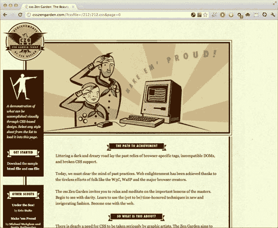

# 介绍 Web 的过去、现在与未来

前面描述的例子只是使用 HTML 和 CSS 所能实现功能的简单展示。如果你访问 CSS Zen Garden（[`CSSzengarden.com/`](http://CSSzengarden.com/)）并浏览其中的一些示例，就能体会到通过调整网站的 CSS 所能达到的控制程度。CSS Zen Garden 的每个示例都使用相同的标记（XHTML 部分在每个页面上保持不变），每个页面唯一不同的就是所包含的 CSS 文件以及配套的图形（见图 1-3、图 1-4 和图 1-5）。

下载自 Wow! eBook <www.wowebook.com>

**图 1-3.** CSS Zen Garden 中的一个示例（Make ’em Proud），你可以在 [www.CSSzengarden.com](http://www.CSSzengarden.com) 找到它。该示例使用了与图 1-4 和图 1-5 相同的 XHTML 标记，但每个页面通过不同的 CSS 样式表和图片进行样式设计。

想象一下，在重新设计网站时无需触碰任何标记页面，却能获得完全不同的最终结果。结构合理、基于标准的页面就能让你做到这一点。这对于构建大型内容管理系统的公司来说可能是一个重大优势：只需更改样式表，CMS 就能为新的客户量身定制。有些公司已经在这样做，但其他公司尚未跟上。

7

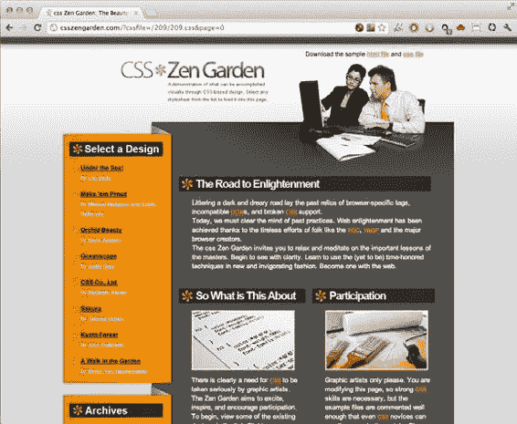

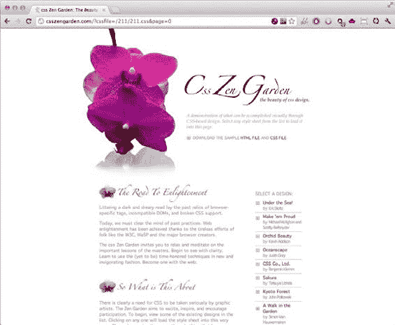

第 1 章

**图 1-4.** 与图 1-3 相同的页面，但在 CSS Zen Garden 中使用了另一种样式表（Orchid Beauty）进行样式设计。

**图 1-5.** 最后一个示例（CSS Co., Ltd.），展示了 CSS 在改变页面外观方面有多么强大。

8

介绍 Web 的过去、现在与未来

## 水晶球：Web 的未来

Web 在很多方面都是一个很酷的地方，尤其是我们不需要成为预言家就能预见未来。由于标准需要时间才能发展，我们已经对未来有所了解。HTML5 是新的热门标准，但它仍然是标记世界中一个不断发展的标准。该规范的大部分内容现已定义，目标是解决 HTML 4 中的许多遗留问题，并弥合与 XHTML 世界之间的差距。

W3C 的标准审批流程需要经过多个步骤，并且可能跨越数年。该流程的最终产物是 W3C 推荐标准。由于 W3C 并非管理机构，它只能提出建议，软件公司可以选择是否遵循。Web 没有“法律”；因此，如果苹果公司决定放弃 Safari 中的 HTML 支持，转而使用自己的标记语言，它完全可以这样做。从我们之前的历史课可以看出，这在 1990 年代并非完全不可能；但今天，这很可能会弄巧成拙。Web 的文化核心是互操作性；当公司试图限制互操作性以获取某种竞争优势时，我们都会受损。

这导致了有些复杂的结果。一方面，你几乎可以访问任何网站，并且它在几乎任何浏览器中都能正常工作。仍然有一些公司在玩“请下载 Internet Explorer”的老把戏，但这些公司已经很少了（我的银行前几天就对我玩了这一招，我现在正在找新银行）。事实是，对于企业来说，互操作性意味着更大的潜在客户群。对于大多数 Mac 用户来说，如果他们访问一个“仅限 Internet Explorer”的网站，他们就寸步难行。对于移动用户（增长最快的互联网用户群体）来说也是如此。当然，他们可以购买一台 Windows 机器或运行一些虚拟化软件来使其工作；但很可能，如果他们有的选（而 Web 就是关于选择的），他们根本不会费这个劲。他们会去找一个支持 Chrome、Safari 或 Firefox 的竞争对手。

制定新标准和修订旧标准的咨询过程非常彻底，并且涉及大量与社区的沟通。会制定多个草案，收集大量反馈，最终提出推荐标准。我们在第一章中几乎交替使用了 HTML 和 XHTML。虽然 HTML 和 XHTML 都是有效的 Web 标准，但在本书中，我们将重点介绍 HTML5，这是标记语言推荐标准漫长发展历程中的最新版本。

HTML5 最初针对 Web 应用程序，旨在提高速度、兼容性和构建的便捷性。它引入了许多新元素，并放宽了 XHTML 中一些严格的标记规则，使其比前代更容易学习。HTML5 还试图最大限度地减少显示内容时对大量第三方插件的需求。

## 本书内容

我们的目标是让本书超越 Web 标准，涵盖基于标准开发网站的整个过程。信不信由你，构建一个出色的网站不仅仅需要了解一点 HTML 和 CSS。本导论将向你介绍不同的技术和工具，我们希望它能鼓励你深入探索那些最吸引你的领域。

整个出版行业正在发生变化和演进。网站和其他电子出版媒体变得越来越突出，因为它们降低了成本，促进并加速了内容创作过程，并允许即时交付内容。这正在对许多相关行业产生深远影响，因为广告资金正从报纸和杂志转向在线渠道。

技术来了又去，或者像 HTML 那样不断演进。三年前，我们写道：“两年后，我们可能不得不完全重写本书的某些部分。”事实证明这是真的！

虽然原版书中的所有内容仍然有效，但其中介绍的技术已不再是最快、最简单或最好的方法。与不断变化的互联网和 Web 技术打交道令人兴奋。原版书撰写时，移动 Web 才刚刚崭露头角，尚未完全发展。我们无法预测下一个转角会遇到什么。

10


# 第 2 章

## 保持项目在正轨

项目管理不一定是高深莫测的学问。当然，关于这个主题的书架上摆满了书籍，让项目管理听起来像是博士级别的材料。但请相信我们：当你刚开始时，保持简单是我们能给你的最好建议！很可能你当前正在面对的项目并不特别复杂，所以不要让它在你脑海中变得复杂。我们将快速了解几种不同的项目管理方法，以及你应始终牢记的三件事：时间、金钱和*范围*（需要完成的工作）。

Web 设计和开发的过程是独特的。在一个新竞争对手和新技术可能在三个月项目期间涌现的行业中，老式的项目管理方法不一定是最佳方法。在项目的任何阶段进行更改通常都相当便宜且容易。尽管我们在[第 1 章](http://dx.doi.org/978-1-4302-3789-1_1)中直接将建筑工作与 Web 工作进行了比较，但我们这样做的目的是让你了解 Web 项目中的各种角色。


# 第 2 章

实际上，构建网站完全不像建造房屋；你不需要在打好地基后就受限于特定的尺寸。所使用的材料都是数字化的；因此，它们易于操作，并且事后修改也很方便。删除某些东西不需要动用破碎球，添加新内容也不需要从外部采购和运输材料。如果项目进行到第五天时，客户突然决定她其实希望在线接受订单，而不仅仅是电话订单，那么你只需向客户提交一份修订后的成本估算和时间表（甚至可能连这都不需要）。网站上线后，你可能会开始收到访问者的反馈，说他们需要能够以某种格式导入数据。如果是这样，你可以开发并近乎即时地通过发布到服务器来推送这个修订版本。不需要风镐，不需要拆除团队，也不需要制作三百万份副本。那么，为什么你还要在第一天就把所有事情都计划好并一成不变呢？

Web 项目的项目经理不必精通所有开发语言、数据库系统和服务器配置（不过对每样都了解一点也无妨，这样你至少能判断出是否有人在忽悠你）。项目经理需要知道如何与人打交道，让每个人都开心（或者至少保持高效），并让所有相关人员确信项目正在推进。主要目标是消除项目完成过程中的任何障碍。如果你的开发人员办公室正在装修，因为总有人在敲敲打打而无法编写代码，那就给他们找个更安静的地方工作。如果你的设计师电脑频繁崩溃，导致他们不得不反复重做同样的工作，那就给他们换新机器。

## 传统的项目管理方法

传统意义上的项目管理通常非常复杂。仅凭这一章肯定无法涵盖其所有方面，但我们希望与你分享一些技巧和在此过程中需要注意的事项。我们坚信培养项目管理技能的价值，哪怕仅仅是为了提高你的估算能力。由于每个人都有自己处理事情的方式，而且没有两个项目是完全相同的，我们无法为你提供从`x`到`y`再到`z`的完美路线图。我们最好的建议是依靠你的经验；如果你真的不知道答案，那就承认并找到答案。

尽管你可能是某个项目的唯一负责人，但更多情况下你会是团队的一员。当你遇到困难时，总有人可以寻求建议（或者至少是意见）。如果最坏的情况发生，还有互联网——我们听说你总能找到愿意发表意见的人，无论对错！

传统的项目管理方法源于建筑行业。事实上，美国海军最初构思这种项目管理流程是为了更好地掌控造船过程。当需要订购材料、在外部制造零件以及引入专业劳动力时，提前规划具有很大的优势。在用于瞄准敌人的计算机安装好之前，就让软件专家闲置等待是巨大的时间和金钱浪费。拥有一个总体规划，让你能提前了解事情是超前还是落后于进度，这样你就能提前联系分包商，延迟或提前他们参与项目的时间。

当我们提到传统的项目管理方法时，我们指的是项目管理协会（[www.pmi.org](http://www.pmi.org)）所教授的正式流程。这种方法有时被称为*瀑布模型*；采用这种方法时，项目会在前期尽可能地进行规划。规划一直持续到就“完美”达成共识，然后才开始工作。这种做事方式受到了很多批评，尤其是在软件和 Web 开发项目中，因为直到项目结束才内置反馈和评估机制。你不是先构建一个小型原型，与客户（以及可能的最终用户）核对以验证你的假设，然后再继续，而是在第一天就决定了最终结果的样子。这大大削弱了项目的灵活性；或者至少，当事情需要反复规划和重新规划时，会浪费大量时间。然而，这种方法在某些行业确实有其用武之地。例如，在大型建筑项目中，你需要在开始之前就制定好计划。如果不知道大楼最终会有多少层，就一层一层地开始建造，那是愚蠢的。你不能把建筑的某些“功能”（比如电力）留到最后一刻。但在 Web 开发项目中，你恰恰可以这样做。

### 保持项目按计划进行

瀑布模型的僵化和线性特性并不适合 Web 开发。这种规划方式在时间和金钱上的前期成本与大多数 Web 工作不成比例。

另一个考虑因素是，随着各种技术发展的速度，花三个月时间提前规划一个项目，实际上可能会让你在可用技术方面落后三个月。换个角度思考：假设你在项目规划阶段开始时花了一周时间分析各种可用的数据库系统，以便确定哪个系统最适合实现一个新的短文本消息应用。你考察了三种不同的产品，并决定选择产品 A，因为它在数据库插入（添加记录）和选择（从数据库中查询数据）方面绝对是最快的。你完成规划并开始开发。

在开发应用一周后，产品 B 发布了一个新版本，其选择操作速度快了 100 倍（这使得它比你当前使用的产品 A 快大约 20 倍）。你会切换吗？好吧，你已经从瀑布上掉下来了；现在无法回头。如果你在这个阶段切换，整个时间表将崩溃，一切都需要重新规划。

## 九大知识领域

尽管方法论可能不是最合适的，但借鉴项目管理协会的经验来指导我们如何推进是值得的。项目管理协会发布的《项目管理知识体系指南》（PMBOK）涵盖了九大知识领域（见图 2-1）。这九个领域涵盖了项目规划和管理的所有可能方面。本书篇幅有限，只能对每个领域进行简要概述；但如果你想了解更多，我们鼓励你查阅项目管理协会出版的一些资料。

项目范围管理  
项目时间管理  
项目整合管理  
项目质量管理  
**项目管理**  
项目成本管理  
**知识领域**  
项目风险管理  
项目人力资源管理  
项目采购管理  
项目沟通管理  

**图 2-1.** 项目管理协会涵盖的九大知识领域

以下是每个领域的简要描述：


## 项目整合管理：
该领域着眼于规划并整合项目的各个部分。它涉及制定项目章程（一份总结项目将完成什么以及为何需要的文件）、制定项目计划（如何执行章程中概述的内容），以及团队与客户或利益相关者之间的沟通方式。

## 项目范围管理：
该领域具体规定了完成项目所需完成的工作，以及这些工作如何在各个“资源”之间进行分解。它还明确了在项目过程中如何处理任何变更。

## 项目时间管理：
该领域定义了项目需要多长时间，并确定了需要多少人（包括具体技能和时间点）来完成所定义的项目。

## 项目成本管理：
资金是另一个重要因素。该领域定义了项目的预算，以及如何控制各项事务以保持在预算范围内。

## 项目质量管理：
如何确保所交付的成果能够正常运行并达到预期效果？将进行何种测试，以及哪些测试结果是可以接受的？

## 项目人力资源管理：
从哪里获取团队成员？他们需要具备哪些技能？是否需要培训人员？团队将如何管理？

## 项目沟通管理：
该领域涵盖了如何在项目团队和利益相关者之间共享信息，如何沟通和跟踪进度，以及如何记录各项事务。

## 项目风险管理：
该领域主要关注项目失败（或成功；无论哪种情况都可能存在风险）所涉及的风险。它试图预测项目各个阶段可能出现的任何问题，并规划如何最小化或消除这些风险。

## 项目采购管理：
如何在需要时获取产品或服务，以及如何管理分包商（如适用）？

尽管我们不主张在 Web 开发项目中走 PMI 路线，但你的客户/雇主可能有不同想法（嘿，毕竟是他们的钱！）。如果你被要求走这条路，请帮自己一个忙，找一位拥有项目管理专业人士（PMP）认证的人加入团队。获得这一认证在时间和金钱上都相当昂贵；然而，如果你的客户对瀑布方法非常执着，那么拥有一位 PMI 认证的项目经理将为你节省大量时间。

但请注意，PMP 并不便宜。你需要在项目一开始、预算确定之前就联系他，以便他能立即参与进来。

### Web 项目管理：迭代的力量

正如我们之前提到的，Web 是一种成本较低的媒介。在开发过程中犯错是可以接受的，而且通常很容易修复。因此，Web 项目管理可以更加灵活，允许在任何阶段进行反馈和变更。传统项目管理方法中强加的范围管理系统可以放宽，从而可以采用更具协作性的开发流程。这种方法的核心思想是：“让我们先开始构建这个东西；我们可以在发现需要变更时进行修改。你有固定的时间线和预算，这没问题。我会尽力在过程中随时向你更新我们的进展。”

这与传统项目管理相反的原因在于，传统方法旨在严格控制变更（有些人可能会说它不鼓励变更，但这并不一定正确）。而这种方法鼓励变更（在时间和预算的限制内），以便所有各方都对最终产品感到满意，因为他们从一开始就深入参与了产品的塑造。虽然最终结果可能与最初讨论的完全不同，但它仍然能够满足某种需求。

在开发 Web 项目时，你会听到许多不同的术语。*敏捷开发*是常用的术语，它描述了许多涉及多次迭代并与利益相关者密切合作，直到所有人都同意最终结果已达成的发展过程。

如果你是为客户工作，你会在非常早期的阶段构建一些东西并展示给她。客户可以试用、反馈，并告诉你需要修改或缺少什么。然后你可以立即根据反馈进行修改。通过这种方式，你可以逐步地、一块一块地完成项目，添加所有必要的功能。

### 一个敏捷规划的示例

敏捷项目管理通过示例能更好地说明。假设你正在为一位客户构建一个新闻网站，该客户是一家电视网络公司，正在推出一档结合公民新闻的直播新闻节目。客户告诉你，他需要一个允许观众提交新闻故事并对其进行分类的网站。网站访问者应该能够对他们最喜欢的故事进行投票，而这些故事将最终在节目中播出。客户希望整个节目都围绕“身处第一现场”的人所报道的实时新闻展开。你与客户简单聊了聊，然后共同起草了一份一页纸的文档，概述了你们要尝试实现的大致想法。你们确定了项目的时间表和预算，然后开始构建一个提交页面。

如果没有观众提交故事的地方和展示这些故事的地方，新闻网站就根本无法存在。始终建议先确定网站的核心（或网站最“内层”的页面）并从那里开始，因为限制你工作的唯一因素是时间和金钱。想想看：如果时间耗尽，而你却把所有时间都花在开发观众对观众的即时通讯系统上，那么网站就无法实现其应有的功能。

提交页面要求访问者输入她的电子邮件地址、输入故事的链接、选择所属类别，并输入简短摘要。然后你构建一个新闻展示页面，将所有内容按类别分组（类似于 Digg.com 或 Slashdot.org）。你的设计师制作了一个模型，你粘贴上图形和 CSS，以便客户了解最终产品的外观。

客户查看了你目前所做的工作，并评论说电视台不能只凭电子邮件地址就让人们提交新闻故事。电视台需要了解更多关于故事来源的信息。我们发现了一个需要添加的功能；我们需要将其扩展为一个包含用户名和密码的用户管理模块（谁愿意每次提交故事时都重新输入所有联系信息呢？）。你快速添加了几个展示此功能的页面，并让客户再次查看。

15

第 2 章

此时，客户提到新闻网络已经完成了节目的“外观”设计：演播室布景设计已完成，节目开场也已制作完毕。可以理解，他希望网站具有类似的美学风格。你让设计师与网络公司的内部营销和设计团队联系，他们开始着手修改网站的视觉细节。与此同时，你继续开发工作。


客户认为网站目前看起来很棒，功能也运行得很好。网络销售团队决定，网站需要通过向不同新闻类别投放定向广告来盈利并维持自身运营。因此，如果有一个美食类别，就可以联系餐馆或特色食品店来投放广告。你开始构建一个根据类别显示广告的组件，以及一份关于这些广告被点击和查看次数的报告；这样网站就能公平地向广告商收费。你认为构建一个“本栏目由……赞助”的功能会很不错，这样每个类别都可以有一个主要广告商。你快速制作了一个展示效果的原型，并再次邀请客户来访。客户对这个想法感到非常兴奋。

开发就这样反复进行，直到产出足够好的成果可以公开。此时，可能会附带一个 *beta*（测试版）标签发布，并邀请新闻爱好者（也就是早期采用者）参与。后续继续进行调整（网站进入测试版后一天添加了 RSS 订阅，两周后添加了用户评论，等等），直到客户叫停并宣布项目完成。电视节目一个月后首播，并取得了巨大成功，因为其内容非常及时。

采用敏捷方法，可以根据项目进展过程中最新、最准确的信息来发现项目需求。如果采用传统方法，你可能会错过一些在早期版本新闻网站使用和交互过程中才变得明显的功能。你可能会完全忽略用户管理部分；然后一旦上线，就会涌入大量推销各种“性能增强”产品的垃圾故事。你可能会错过网站内广告带来的额外收入机会，或者错过用户评论部分——而正是这部分通过围绕节目建立在线社区，为网站的成功做出了巨大贡献。

## 实现目标：确定“完成”

如果你身上还有一点务实精神，你可能会想：“嗯，听起来不错，但你怎么真正知道什么时候算完成，什么时候该叫停呢？”正如我们在前一个例子中暗示的那样，你可以关注三个要素来判断项目何时完成、何时该停止工作。通常是三者结合；但偶尔也会有一个因素压倒其他因素。

这三件事与传统项目管理方法有关。所有项目的成功最终归结为时间、预算和范围；项目经理的工作就是平衡这三个要素，在时间和预算范围内产出高质量的产品。这三个因素通常被表示为三角形的三个顶点，你的目标是让每条边长度相等（达到平衡）。通常情况下，如果你在做客户项目，客户会有一个她希望（或必须）上线网站的截止日期。大多数客户会有一个预算，即他们为完成项目分配的一定金额。通常还会对功能需求有一些定义（例如，他们需要一个网站来展示他们的新护发产品线）。

16

## 保持项目按计划进行

### 关注时间

与客户合作时，你应该确定一个切合实际的完成时间表。客户通常会在脑海中有一个与某个事件相对应的日期，例如财务季度末、特定的董事会会议或新产品发布。例如，客户可能会说：“我们需要那个新闻网站及时上线，以配合我们新的公民记者电视节目的首播。”在这种情况下，你知道有一个严格的截止日期要满足。因为网站没做完而推迟节目制作是不可行的。时间通常是固定因素之一；你不能要求公司重新安排董事会会议，也不能因为网站无法按时完成而让人们推迟发布新产品。诀窍在于掌控工作，区分哪些是必要的、哪些是“锦上添花”的，以便所有工作都能在指定日期前完成。

一旦确定了这个固定时间点，你就倒推工作。现在要学习的一个好词——这个词能让每个项目经理都开心——就是 *应急储备*。应急储备是你秘密预留的时间和/或资金，你可以酌情使用，让每个人都满意。就时间而言，在估算事情需要多长时间时留出一些余量，是确保有一定喘息空间的好方法。如果你的首席开发人员得了流感，三天没来上班，你不能要求客户将上线推迟三天。你需要以某种方式弥补这段时间，无论是通过重新安排工作，还是让开发人员多工作几个小时。不要过度，但一定要留出一点缓冲时间，尤其是当你同时处理多个项目或做自由职业时。

由于你遵循敏捷方法，你并不确切知道最终产品会是什么样子，因此你不可能精确规定开发需要多长时间。确定最终截止日期以及软启动日期（比最终截止日期稍早的日期，届时所有新开发将停止，你的团队将专注于测试并确保一切准备就绪）可能是你能做的最好的事情。

传统方法要求在项目开始时制定项目计划，提前确定多个里程碑（例如，“视觉设计完成”）。你可以看到，在一个设计会在整个项目生命周期中不断演变的项目中，这几乎是不可能的。图 2-2 比较了传统方法和敏捷方法。

高层设计  
测试与  
规划  
开发  
上线  
验收  
项目开发与迭代  
上线  
软启动  

**图 2-2.** 比较传统时间管理与敏捷时间管理。传统方法将项目划分为多个阶段；敏捷方法不将活动限制在任何单一时间段内。

17

第 2 章

### 关注预算

保持项目按计划进行并确定何时完成的另一个好方法是项目预算。

你不太可能遇到预算无限的客户。考虑到这一点，项目的经济性可以保持得非常简单。作为自由职业者，你通常会被要求对项目进行投标。这是一个与客户玩的有趣的小猜谜游戏，你要想出一个数字，既能让你在项目上赚钱，又不会超过客户心中的数字。制定预算是你与客户协作的最重要领域之一。


尽管长期以来我们习惯于“盲猜”报价，但在直接询问客户是否有预算方面，我们取得了更大的成功。如果客户确实有预算（并且愿意告诉你），那就坐下来，以同样的坦诚回报他。如果他告诉你项目预算是 5000 美元，你就告诉他你的时薪是 100 美元（此处可填入你自己的数字）。根据这些数字，你可以花 50 小时处理他们的项目。此时，你已经了解了客户的想法，可以提前告诉他这个项目是否完全可行。你也可以告诉他，你很乐意接手这个项目，或者他或许应该考虑适当缩减他的想法。如果你们无法就预算或客户想要完成的内容达成一致，那么你需要决定是放弃这个项目，还是接受减薪。请记住，如果你打算将部分工作分包出去，你必须提前知道那些人的收费标准，以及他们是否愿意接受更低的报酬。

你可能会认为工时数（50 小时）决定了项目的时间线，但这并不一定正确。

假设你将独自完成这个项目。如果你全职投入，可以在一个半星期内完成；如果每周只工作一天，则需要六个半星期。这个因素也可能影响你是否愿意接受一定程度的减薪（即多工作几个小时）。如果你不必在接下来的十天里只专注于一个项目，那么以稍低的薪酬标准来迁就客户就会更容易一些。

如果你发现很难将时薪维持在自己满意的水平，不妨尝试与客户就时间线进行协商。有没有办法在项目上节省时间，让你这部分更快完成？客户公司内部是否有人可以承担部分工作量（例如，编写/编辑部分页面内容）？你是否可以通过让客户承诺在一个月内（合理范围内）宣布项目完成，从而压缩整个项目？仔细想想，一个月赚 5000 美元其实并不差。

这听起来可能有点苛刻，但事实确实如此。如果你认为自己的服务价值是每小时 20 美元，而客户预算只有 200 美元（一个非常小的项目），那么客户只能得到你 10 小时的时间。如果你给了客户 20 小时，那就等于把自己的价值降到了每小时 10 美元（以此类推）。我们并不是说你绝对不能这样做，但一定要确保你掌控着自己的价格。也许你是在为非营利组织工作，所以给客户一些优惠——这没问题。但那些财富 500 强公司完全有能力支付你的费率，它们不需要你的慈善。这正是“盲猜”报价体系如此有缺陷的原因。它剥夺了你所有的灵活性，而且当你试图加入缓冲时间时，最终往往会让客户承受最大的冲击。

当你采用敏捷方法时，务必让客户理解其中的数学逻辑。让客户知道，按照她当前的预算，她拥有 X 小时的工作时间，她可以自由地要求你以任何她认为合适的方式使用这些时间。如果她想构建一个需要 100 小时的搜索引擎，那没问题；但这就意味着你无法将 100 小时花在其他事情上。在项目初期，当工时尚未消耗、预算尚未花费时，人们很容易想得很大。因此，此时你最好的做法是确定最重要的一件事，并优先完成它。一个没有新闻页面的新闻网站算什么？一个没有数据库可搜索的搜索引擎又算什么？一个无法追踪开支的财务管理应用能有多好？其他所有内容都是项目的附属功能，如果时间允许，可以添加，甚至可以在后续版本中实现。

## 保持项目在正轨上

最后，是关于按小时计费和固定价格报价的争论。大多数客户希望你能以固定的成本完成某项工作。他们试图最小化自己在项目中的风险，防止超支。大多数自由职业者对此并不完全放心，因为他们知道项目过程中可能会发生变化，而承诺固定价格会限制他们能做什么和不能做什么。他们要么会推动按小时计费，要么会给出一个包含大量应急余量的固定价格报价。

很容易看出，这种情况从一开始就让你与客户处于对立状态。看起来你是在努力赚钱，而客户则在努力省钱。同样，为什么不尝试与客户合作，告诉他你是按实际投入的时间收费呢？你认为他的预算合理，并且你不会让他陷入困境（这就是为什么你总是从项目的核心开始）；然而，如果他在项目接近尾声、时间所剩无几时开始要求添加花哨的功能，他可能就需要追加资金了。

这可能有点模糊，所以建议客户你会每周向他汇报时间和资金的使用情况；当预算只剩下 10 小时时（根据项目长度/复杂度相应调整），你会快速与他沟通如何收尾。

## 关注范围

这就引出了我们的最后一个因素：范围。在日常对话中，当人们讨论项目管理时，你经常会听到*范围蔓延*这个术语。在传统项目管理中，范围蔓延是一个贬义词；它意味着项目初期构思的“完美”计划存在缺陷，并且期望在发生变化。要么是某些东西发生了变化，要么是初期没有考虑到。

然而，采用敏捷方法，你可以论证范围蔓延实际上是网络项目中最棒的事情（在合理范围内）。只要你有时间和预算，你就希望变化。你希望客户指出你设计中的缺陷，这样你就可以尽早修复。你希望客户告诉你她在哪里对你的界面感到困惑。为什么你想要这些？答案很简单：如果你的客户向你指出了问题，那么你网站的最终用户就不会遇到这些问题。这意味着你在生产一个更好、更直观的产品。这是好事！

另一方面，范围也可能以另一种方式悄悄蔓延，比如客户在项目中途回来告诉你，她前几天去了一个很棒的网站。那个网站让人们可以实时聊天、分享照片，第三方甚至可以开发小型应用程序嵌入网站并实现各种功能。“我们能让我们新闻网站也像那样吗？”她问道。

这里有一个假设，即你和你的客户能够共同想出对最终用户最有利的方案。基于这个假设，请确保你永远不会仅仅因为客户要求就全盘接受——这些请求必须合理。如果出现冲突，请寻求中立的第三方（询问最终用户）。这可以是一个正式的过程，涉及深入的用户测试和焦点小组，也可以简单到去问别人，无论是朋友还是同事（假设此人是网站的目标受众）。你可以在项目生命周期的任何阶段这样做，只要你不确定答案（或者只是想确认自己是否走在正确的方向上）。如果你正在考虑为现有网站添加一个新功能，但不确定这个想法是否正确，那就去问问你现有的用户（做一个简短的调查）。


希望在你的项目进行到这一步时，你已经能够与客户坦诚交流。很可能客户从项目第一天就参与其中，并且认同了愿景。当然，他描述的内容听起来很棒，但这并不是你当前努力的方向。网站上线后不必保持一成不变（事实上，不保持静止反而更好！），你很乐意与客户合作，为网站的“第二版”开发这些功能。然而，如果客户认定没有这些额外功能网站就不够好，那么不妨花一个小时坐下来，和他一起算算数字。告诉他你需要先完成项目核心，然后很乐意继续处理这些其他功能。实时聊天？听起来很棒！但这需要 150 个小时，并且会将上线时间推迟两周。第三方应用？这也是个好主意：你需要 300 个小时，可能还要几个月。不要夸大这些数字——只需坦诚相告，询问客户是否愿意增加预算并推迟上线日期。在项目管理中，务实很重要。

我们最喜欢的一句名言——在这种时刻常常浮现——来自芝加哥一家名为 37signals 的公司（本章后面你会听到更多关于这家公司的信息）。它常说：构建半个产品总比构建一个半吊子产品要好。这意味着，构建一个非常简单但功能不多的产品，而它所拥有的功能都实现得很好，这样更好。多花点时间在你的表单上，弄清楚你提出的问题是否合理。在合适的地方花额外时间实现 Ajax。你的客户会为此感谢你，而且你也不太可能听到：“哎呀，这个新闻网站信息丰富、构建精良，可惜因为没有实时聊天功能，我无法使用。”另一方面，如果你仓促行事，你很可能会听到人们抱怨它有多丑、多复杂，或者出现了多少错误。

**“但 PMI 涵盖了九个领域；你只谈了三个！”**

嘿，我们警告过你，PMI 的项目管理方法比普通 Web 项目所需的要复杂得多。话虽如此，从传统的项目管理方法中，我们还能汲取一些经验教训。

## 沟通至关重要

客户喜欢看到进展。如果你能每天给他们发邮件，展示一些很酷的新功能或漂亮的新设计元素，你可能会拥有世界上最开心的客户。

反之亦然：如果你遇到了重大障碍，最好尽早公开，并解释你将如何处理。

如果每个人都参与其中，敏捷方法非常强大。传统方法仍然存在的原因之一是，一开始会创建一大堆文档，然后交给客户签字确认。客户对此感觉良好，因为她知道计划是什么，并且可以看到计划如何顺利进行（然后现实就来了）。如果你采用敏捷方法，你必须勤于与客户沟通，向她转发变更，并积极寻求她的反馈。采用敏捷方法，你不能只是接受一个项目，然后离开两周，再回来说：“给你！”这是一个非常互动的过程。

## 保持项目在正轨上

如果你与客户沟通过度（在合理范围内），你很可能不会听到太多抱怨。（记住，他也有自己的工作要做！）然而，根据我们的经验，导致项目失败的最大单一因素是沟通中断。如果一方停止与另一方沟通，你就遇到了一个需要立即解决的严重问题。如果你的客户直到最后一刻才告诉你，你设计的东西让他感到恶心，那对你不公平，而且很可能导致最后一刻的重新设计。如果你的预算快用完了，直到只剩一个小时才联系客户，那对客户不公平，而且可能让他得到一个未完成的产品。

这里有一个极好的策略：尽快让客户访问你的开发（暂存）服务器，这样她就能看到项目的进展并立即开始使用。制定一些非正式的政策，说明她看到的是正在进行中的工作，以及随着变化，某些功能可能会在短时间内出现问题（如果客户经常查看项目，那么不要每次出问题都发邮件，除非问题持续 48 小时未解决）。此外，务必定期向客户发送消息，突出显示你希望她深入体验的各种功能和区域。最后，鼓励客户向你发送她的印象以及她可能发现的任何错误信息。

## 质量与测试

正如我们之前提到的，你在任何项目上的目标都应该是构建尽可能高质量的产品。

如果你可以选择添加一个功能，或者花时间让现有功能完美运行，请选择后者。发布一个产品并完全没有问题是非常困难的，无论是技术问题、功能问题，还是一两个烦人的跨浏览器错误。尽量将你在项目上花费的时间的至少 10%用于测试和亲自使用。鼓励团队中尽可能多的人也这样做。不同的人以独特的方式看待问题；尽管你在上一个示例中填写新闻提交表单可能毫无困难，但另一个访问者可能会看着它不知所措，因为他没有要提交的新闻故事的 URL。或者，这个故事是他从电视上看到或从杂志上读到的——那他该怎么办？

质量问题还引发了另一个担忧：网站上线后，谁负责维护？如果发现了一个错误，是你和你的团队修复，还是客户内部有人修复？费用如何处理？是否有单独的维护预算，还是包含在项目总预算中（如果是后者，至少预留 10%的预算用于上线后的修复）？

## 采购与合同

许多项目会要求你寻找外部服务提供商。你很可能不是项目经理、设计师、开发人员、数据库管理员、信息架构师和系统管理员的合体。除非你的客户计划在自己的服务器上托管应用程序，或者已经有托管服务商，否则你可能至少需要为项目找到安全的托管服务。

虽然将项目部分外包可以救命，但你需要记住几件事。首先，确保你事先知道这会花费你多少钱。如果你不知道那位出色的设计师要价多少，却向客户报了一个小时费率，你可能会发现自己免费工作了很多小时。其次，确保你了解外部人员的工作质量，并且你愿意将某个部分的控制权交给他。如果你的项目中有一些高度技术性的方面超出了你的技能范围，承认这一点并找到能胜任的人是可以的。你的强项


接下来要考虑的是，分包商就是分包商：他为你工作，而不是为你的客户工作。你无需担心是否让他与客户沟通（事实上，我鼓励你允许这样做）；但你必须明确，他工作范围中的任何重大变更都必须经过你。此外，你还需要负责支付他的报酬。这个分包商不是你的合作伙伴，他更像是你的员工。如果你的客户未能付款，你仍然有责任支付分包商，因此请相应规划你的付款结构。

最后但同样重要的是，你还需要对分包商的工作/服务质量负责。在新网站开发过程中，最常见的需求之一就是由你处理网站托管的后勤事宜。这是一件好事，因为你可以控制选择哪个主机以及主机提供哪些功能，从而获得所需的一切。但缺点是，你很可能会成为客户和主机之间的联络人。因此，如果主机出现重大故障，你可以预料到会接到客户愤怒的电话。就像你不会雇佣一个从未做过网页设计的设计师一样，除非你确信托管公司提供的服务质量，否则也不应该与其合作。请做好调研：托管是一个竞争激烈的领域，所有参与者绝非同等水平。因为你负有责任，所以要提前考察潜在主机的支持情况。例如，回复是否需要 24 小时？如果是这样，当客户紧逼你时，你能接受吗？

## 可用工具

我们在这方面相当幸运，因为大约在最近五年，项目管理领域的工具才发展到普通人也能使用的程度。想象一下专业项目经理（经过 PMI 培训）使用的工具是什么样。如果你猜是一个涉及大量抽象线条和符号的复杂应用程序，那么你猜对了！

## 旧工具集

直到几年前，管理项目的选择要么是使用 Microsoft Project（如图 2-3 所示，或类似产品），要么就是凭感觉行事，仅靠日历和电子邮件来处理一切。

我们并非要贬低 Microsoft Project；它是管理瀑布式项目的出色工具。它会根据你设定的参数自动计算日期和进度。但就像一般的瀑布模型一样，它并不适合网络项目。使用甘特图规划项目，会在你掌握最少信息、无法做出明智决策时，提前锁定许多事项。甘特图描绘了任务之间的顺序和依赖关系。它们也大大降低了日程安排的灵活性，所以你可能会疑惑为什么要使用它们。

再次，我们要发出与之前相同的警告：有些组织会使用 Microsoft Project，并要求你也这样做。如果是这种情况，请去报名参加一门课程（是的，有专门教授如何使用 Microsoft Project 的完整课程）；或者，至少去买一本关于这个主题的好书。这是一款相当复杂的软件，学会正确使用它确实物有所值。

22

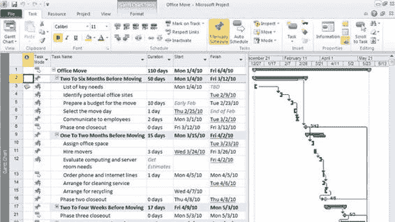

保持项目在正轨上

**图 2-3.** Microsoft Project 中的甘特图视图。确实，里面包含了大量信息，但其中任何信息真的有用吗？

## 替代方案

本节开头暗示了一些更好的替代方案，它们绝对值得考虑。该领域的许多创新正在线上发生，即在基于网络的软件世界中。我们已经讨论了瀑布式方法，以及所谓的敏捷方法——但说实话，并没有正式的“敏捷”方法。相反，有几种不同的方法论可以被归类为敏捷，并且有几种不同的工具适用于各种方法。以下是我们最喜欢的一些：

### Basecamp

在更简单的管理工具领域中，开拓者是一项名为 Basecamp 的服务 [(www.basecamp.com)](http://www.basecamp.com)，如图 2-4 所示。它是一个基于网络的托管应用程序，你可以订阅使用（这通常被称为“软件即服务”）。无需安装任何东西，Basecamp 提供免费试用，让你可以使用其大部分功能。

Basecamp 与 Microsoft Project 有何不同？Basecamp 代表了项目管理思维的根本转变。类似于之前关于敏捷开发的讨论，Basecamp 认为项目管理更多是关于沟通与协作，而非报告与控制。Basecamp 提供了一套简单的工具，包括消息、待办事项、日历和文件共享。你可以使用这些工具与客户合作，并向他们传达项目进展。与在项目开始时生成复杂图表不同，你可以确定一系列里程碑，并通过消息分享更新。在 Basecamp 出现之前，许多这类活动都是通过电子邮件和日历处理的。

23

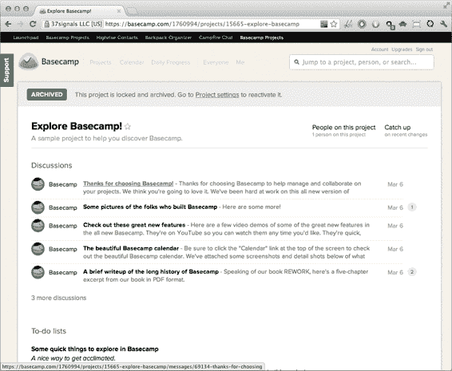

第 2 章

**图 2-4.** Basecamp 是一个基于网络（无需安装软件）的管理工具，提供简洁易用的界面。

凭借其易用的工具和清晰的界面，我们强烈建议你了解一下 Basecamp，以帮助你掌控客户项目。37signals 最近推出了 Basecamp 的新版本，比上一版更易用。你的项目通过单个页面呈现，但大多数出色的沟通工具仍然存在。

### Trac

Trac [(http://trac.edgewall.org)](http://trac.edgewall.org) 是一个开源的项目管理应用程序。它比 Basecamp 更技术化一些，因为你需要下载并安装到自己的服务器上；但好处是不需要每月付费。Trac 是另一个简单的工具，可以让你集中管理项目团队的沟通。最值得注意的是，它与 Subversion 集成得很好（见图 2-5），Subversion 是一种开源版本控制软件，可以记录你对文件所做的更改。如果你犯了错误，Subversion 可以让你轻松“回滚”到文件的先前版本（要了解更多关于 Subversion 和版本控制的一般知识，请参阅 Chris Kemper 和 Ian Oxley 合著的《Foundation Version Control for Web Developers》（friendsofEd，2012 年））。

24

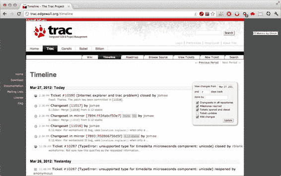

保持项目在正轨上

**图 2-5.** Trac 也是基于网络的，但必须安装在你自己的服务器上。它比 Basecamp 更技术化一些，因此除非你的客户是技术型个人/组织，否则最好将此工具用于内部团队协作。

Trac 还提供了一个出色的 wiki，在项目进行过程中，对于为自己和其他团队成员做笔记非常有帮助。Trac 的界面不如 Basecamp 简单。因此，我们将 Trac 用作技术团队成员之间的内部工具，而使用 Basecamp 与客户协作。

如果你正在寻找类似 Trac 但采用托管形式（如 Basecamp）的工具，可以看看 github。


该工具在软件开发（包括网页开发）项目中表现出色。它使用 git 作为版本控制系统，并提供了许多与 Trac 类似的文档工具；不过，无需安装任何东西。Git 可能需要一点时间来适应，所以如果 GitHub 听起来符合你的需求，不妨在 Google 上搜索 git 和 GitHub 教程，确保你正确设置了环境。

## Harvest

Harvest（[www.getharvest.com](http://www.getharvest.com)）是一款时间追踪和报告应用。它可以帮助你掌握在项目上已经花费了多少时间和金钱，以及距离总预算还有多远。

如果财务是你的硬性约束之一（难道不总是如此吗？），那么你需要某种方式来追踪已花费的金额以及预算中剩余的部分。Harvest 提供了一种很好的方法来实现这一点，并且它拥有非常简单的界面（完全披露：作者乔纳森是 Harvest 的员工）。

## 其他

市面上有无数（大概几十万种）项目管理应用。

有些是基于网页的，另一些则安装在本地服务器或桌面电脑上。你使用哪种工具在很大程度上取决于你的需求，以及你和客户感到舒适的方式。不要因为压力而使用那些生成大量图表、数据和图形的项目管理应用。

事实是，冗长的项目报告很少有人会读。保持内容简短、简单且切中要点，以避免误解。

## 总结：最佳建议

项目管理的最佳建议，与项目实际开发的最佳建议如出一辙：保持简单。如果你手头有日程表、预算，以及需要开发内容的粗略想法，那么你就可以开始了。项目没有理由被过度复杂化。保持简单能让你腾出精力专注于重要的事情：为客户交付尽可能最好的产品。

项目管理中最重要的一项技能是经验。这是一件随着时间推移会变得越来越容易的事情。你不仅会对自己所说所做更加自信，还能“凭直觉”完成更多事情。在初次会议中与客户坐下来，无需经过数小时的估算计算，就能给出大致的时间和成本范围，这确实非常方便。早期阶段，你可能需要对这些估算加上大量免责声明，并说明你需要更多时间来“仔细核算数字”。但过了一段时间后，你的大致估算会非常接近实际数字，那时你就可以去掉免责声明了。

你并不总能找到认同保持轻量和敏捷的客户。这时，你需要做出决定。如果你处于可以挑选客户的位置，我强烈建议你这样做。老实说，最好的项目是那些不必陷入“瀑布式”流程的项目。如果你无法拒绝任何客户的工作，那么就要清楚自己将面临什么。计划好大量的应急时间（和资金），以应对所有的规划、重新规划以及范围控制。

此外，一旦开发开始，就要严格控制变更，并尽可能快地完成网站建设。项目持续的时间越长，失败的可能性就越大。

另外，如果可能的话，聘请一位项目管理专业人士（PMP）来监督事务；或者，至少计划将你 50% 的时间专门用于管理项目。严格控制事务并确保项目与计划同步进行，是相当繁重的工作。

## 人物专访：Jason Fried

*Jason Fried 是 37signals LLC 的联合创始人兼首席执行官，该公司总部位于芝加哥，最初是一家网页开发咨询公司，后来转型为网页应用产品提供商。37signals 提供众多优秀产品，从旗舰产品 Basecamp 项目管理软件到其最新产品——一款类似 CRM 的工具 Highrise。除了在大规模应用方面拥有丰富经验外，Jason 及其团队还是“务实开发”（getting real）领域的先驱，这是本章前面讨论过的敏捷开发实践的一种变体。37signals 的人认为，更多的软件并不一定意味着更好的软件，保持小而简单始终是最佳方式。*

## 保持项目在正轨上

**Lane：** 你在 37signals 担任什么角色？这对应到日常活动中有哪些具体工作？

**Fried：** 我的角色相当多样化。我是联合创始人之一，从技术上讲是首席执行官，尽管我们不太使用这类头衔。我负责公司运营、提出新产品、指导公司战略，以及把控产品的整体设计和外观感受。

所以，我会做一些设计工作，尽管不像以前那么多；现在有另一位同事负责主导设计，但我负责设定产品的整体外观感受和企业形象。我也经常写作，但如今最主要的工作是市场营销和战略、提出新产品、关注全局，并引导产品朝着正确的方向发展。

**Lane：** 请谈谈你与计算机相关的工作背景——比如教育经历和之前的工作经验——这些是如何引领你走到今天这一步的？

**Fried：** 我实际上并不懂技术，所以我不做任何编程。我在计算机方面的专长围绕设计展开：HTML、CSS、平面设计之类的东西。我的背景其实与此毫无关系。我拥有金融学学位，但我一直对设计感兴趣，而且从初中拥有第一台电脑开始，我就一直在捣鼓设计——只是随便玩玩，学习如何设计东西。

大约在 1996 年互联网兴起时，我刚大学毕业，一直想自己创业，所以这是一个绝佳的机会，可以去做设计，这正是我一直想做的事情。我开始学习如何设计网站，而当时其他人都不懂，所以我和大家站在同一起跑线上，从此便一发不可收拾。

**Lane：** 37signals 最初是一家网页设计公司，为客户做项目，现在你们转型为创建自己的产品并转售给客户。能谈谈这个转变是如何发生的吗？

**Fried：** 这有点像是偶然发生的。我们是一家网页设计公司，开始因为大量客户工作而变得非常忙碌。我们管理项目的方式基本上和大多数人一样，通过来回发送电子邮件，这非常混乱。这不是保持组织性的好方法，而且问题也暴露了出来。我认为客户对这种合作方式感到不太舒服，因为他们并不总是了解项目的进展情况。

我们意识到需要某种工具来追踪这类事情，并让客户能够提供反馈以及跟进项目。我们四处寻找一些工具，但都不满意，于是决定自己构建一个。当我们开始使用它（大约花了三个月时间构建）时，客户们说：“嘿，你知道吗，我也需要这样的工具。这真的很方便，我可以用它来管理自己公司的项目。”我们展示给一些同行看，他们说：“我自己的业务也需要这个。”所以我们觉得这可能是一个产品机会。


我们稍微打磨了一下，给它取了个名字叫 Basecamp，定了个价格，然后推向市场，一切就这样开始了。大约一年后，Basecamp 带来的收入超过了我们的咨询业务，于是我们停止了客户工作，专注于构建我们的网络应用程序。

# 第 2 章

**Lane:** 除了出色的产品之外，你最出名的一点就是“务实”的理念。你能简单谈谈这意味着什么，以及人们该如何做到“务实”吗？

**Fried:** 整个“务实”理念基本上就是字面意思：做真正的工作，而不是谈论它或把它写下来；边做边摸索。我们的感觉是，在你真正动手之前，你永远不知道自己到底在做什么。你可以整天写、整天想、整天计划，但只有当你真正开始工作时，你才知道结果会怎样，以及它是否足够好。

所以，我们摒弃了所有那些抽象的东西——比如文档、信息架构图、功能规格说明书——然后直接投入进去。这关乎迭代：埋头苦干一点，抬起头来环顾四周。下一步该往哪走？接下来需要做什么？我们遵循现实，而不是遵循六个月前制定的计划，或者在我们还不知道要构建什么之前就写好的功能规格文档。这就是“务实”的总体理念。

**Lane:** 在实际开发一个项目时，流程是怎样的？你们的产品创意从何而来？

**Fried:** 我们总是解决自己的痛点。我们构建的每一个产品，首先都是为自己而建，因为我们有需求；只是到了某个时刻，你意识到自己确实有需求。这背后没有什么科学道理；就是那么一瞬间，你会想：“天哪，我这样错了好久了，一定有个更简单的方法。”这就是新产品创意的起源。

举个例子，我们最近的产品 Highrise，是一个联系人管理和简单的 CRM 工具。它的诞生是因为我们经常与媒体人士交谈、做很多采访，但我们并没有真正记录下和谁聊过、说了什么、他们发表过哪些文章以及他们的联系方式。所以，如果 37signals 的某个人需要再次联系其中某位，我们不知道之前说过什么，也不知道上次联系是什么时候；简直一团糟，所以我们确实需要这样一个工具。

同样，我们四处寻找现成的东西，因为构建东西很难。如果能找到我们认为好用的，我们就会用；但实在找不到，于是我们决定自己建一个。所有产品都是这样开始的。它源于一个需求。然后，如果我们决定推进，我们不会对它做出巨大的承诺。如果我们开始了，三周后不喜欢了，我们就停下来——不像传统流程那样，你先做出承诺，写功能规格文档，花大量时间做很多前期工作，然后才知道它好不好。

接着我们从界面开始；先设计这个东西看起来是什么样子。这决定了项目的其余部分；编程随后嵌入到界面中，而不是反过来。

不是先编程再界面。一旦我们完成了基本界面，就交给程序员，他们把它连接起来；然后我们开始使用它，反复调整：这样合理吗？是不是太慢了？感觉如何？我们不断调整，直到对初始版本非常满意，然后推向市场。之后我们会根据用户的反馈继续调整。

很多人谈论软件工程，但我们不喜欢这个词。工程师是造桥的人。我们是软件程序员，我认为当你开始把他们当作工程师时，你就会掉进那个陷阱：“什么是工程师？”工程师是做出那些重大、长期决策的人，而我认为这是一种错误的思维模式。

## 保持项目在正轨上

**Lane:** 对于刚开始从事网络工作的人，你有什么建议？

**Fried:** 我对所有事情的建议都是：从尽可能简单的版本开始，不仅对软件如此，对商业也是如此。如果你要创业，那就从尽可能简单的业务开始，可能只有你一个人，或者如果需要的话再加一个人。无论你所在的国家有什么样的商业结构，都从最简单的形式开始。在美国，LLC 是最简单的结构，所以就从那里开始。

不要一开始就做任何重大决定。直接开始做某件事，看看它是否可行，并在构建过程中使用它。你很快就能知道它好不好；如果好，希望其他人也会喜欢，然后顺其自然。

绝对不要出去融资；不要觉得你必须有大企业的姿态或形象。我认为很多小公司出于某种原因试图表现得很大，其实完全没必要。做你该有的样子，做你自己，如果你有好产品并且知道如何关注正确的事情，事情很可能会顺利。经营企业并不那么难；除非你把它搞复杂，否则没什么是难的。大多数事情都很简单、很容易，只要你走简单的路，尽可能简单地构建东西，至少一开始是这样。

我们作为企业犯过的每一个错误，都是因为我们试图做太复杂或太难的事情。而不是因为我们试图做太简单的事情。无论你要做什么，先走简单的路，看看是否值得之后投入更多时间。如果是，那么也许你可以让它更健壮，但不要一开始就那样。从尽可能简单开始。

**Lane:** 37signals 从未对其任何产品使用过传统广告（付费广告）。刚开始创业的人可以做些什么来打响名声、获得客户、并传播他们正在做的工作？

**Fried:** 我的建议是尽可能公开。最好的例子是一个叫 Gary Vaynerchuk 的人，他做了 Wine Library TV。对我来说，他是如何做对的完美例子。他充满激情。假设你不擅长视频；假设你更擅长写作。但我还是以他为例。他完全是从无名小卒，变成了网络红人，很多人都知道他。他上过很多电视节目，获得了大量媒体报道，却没有花一分钱在公关上。

他所做的就是分享。他分享他的激情；他走出去告诉人们他热爱什么，并帮助他们。每当你分享和教导时，人们就会关注，他们会开始为你宣传。这真是一个很好的模式，Gary 在这方面做得非常到位。

我认为我们就是这样建立起来的。我们分享很多。我们分享很多关于我们业务的事情，我们做什么以及为什么做，什么有效，什么无效。我们有强烈的观点，并且不害怕分享它们。我认为当你走出去，分享你的内心和你正在做的事情时，人们会关注，这是一个传播名声的好方法。


此外，当你作为一名教师时，人们会更关注你实际说出的内容，而且我认为他们会更欣赏你所做的事情。这不仅仅是试图向某人推销东西，而是真正试图帮助某人学习，这本身也很有分量。

# 第二章

我的建议是，找到你真正热爱的事情，并抓住每一个机会告诉别人。无论是像加里最初那样做视频博客，还是写博客、在杂志上发表文章、写书，或者任何其他形式——找到你能做的，去分享你所知道的。

**莱恩：** 你在你的书《务实》中谈到的一件事是选择正确的客户。你是如何找到好客户的？又如何避开不好的客户？

**弗里德：** 我认为这就像你识别好朋友和坏朋友，或者那些你根本不会与之交朋友的人一样。客户也是人；如果你不想和他们待在一起或相处，那么他们很可能不会成为好客户。我认为，你要在个人层面寻找这种匹配。

你必须尊重对方，欣赏他们的为人，并享受与他们作为人的相处。

这确实是找到优秀客户或大客户的最佳方式。如果你和某人开会时，他们粗鲁无礼、不屑一顾，或者因为某种原因难以相处，那他们就不会是好客户。如果初次见面就很糟糕，那么客户也会很糟糕。如果提案请求很糟糕，客户也会很糟糕。你必须像对待朋友一样留意这些信号。

这是我们找到的最佳方法。

我还认为，你在自己网站上的呈现方式有望吸引到合适的人。在我们做网站设计时，有很多人不会与我们合作，因为我们的网站不像典型的网页设计公司那样有作品集板块。我们最初的网站只是纯文本，黑白的文本，当时没有人这么做。2000 年我们上线时，大家都在做色彩鲜艳、动画效果十足的东西，而我们只做纯文本。我们在讲述一个故事；我们认为这才是重要的。那些阅读并产生共鸣、觉得“我们喜欢这些人”的客户，就是我们找到的客户。而那些潜在客户说“这太荒谬了，我不明白”——他们就是不会与我们合作的人。所以我认为你的网站很大程度上起到了自我筛选的作用，我建议你从一开始就坚持自己的观点，因为这是找到愿意与你合作的合适人群的好方法。


# 第三章

### 规划与高层设计

我们特意用了上一章的大部分篇幅来劝阻过多的前期规划。但现在我们却用整整一章来介绍规划和项目前期流程，请不要说我们是伪君子。实际情况是，在进入开发阶段之前，先做一些前期工作对你是有利的。你着手进行的每个项目不一定会非常清晰；你很可能不止一次地需要在舒适区之外工作。虽然大多数项目很容易把握整体感觉，但无疑会有一些专业领域需要你咨询主题专家。你的客户可能对他们在寻找什么有一些想法，也可能没有；即使有，在和他们讨论之后，你可能会意识到他们想要的东西对最终用户来说完全没有意义。你可能会忍不住简单地按客户要求去做，收钱走人；然而，参与那些你能看到其价值、人们会实际使用你产出的项目，会更有成就感。

与客户产生分歧，尤其是在项目早期，可能会非常令人紧张。你希望和睦相处，协作创造出伟大的作品；你尤其不想在每个点上都要争论。我们在本章中介绍的工具和练习将帮助你与客户达成这种协作基调。我们希望，在完成这些部分后，你会得出类似的结论，并与客户形成统一战线。请记住：虽然你是你所在领域的专家，你对好坏的直觉可能比普通人更准，但你的客户是他们领域的专家。他们比你更了解自己的客户、员工、合作伙伴和业务流程；所以如果他们对某个观点坚持己见，不要自动认为他们是错的。傲慢不是一种有效的工作方式。

如果你碰巧是作为更大团队的一员工作，而不是自由职业者，那么本章描述的许多活动很可能是由负责客户关系的人来完成的。这个人可能有各种头衔；在非常大的团队中，他是制作人、客户经理，有时是项目经理。在较小的团队中，可能是与客户密切合作的设计师或开发人员（或设计师/开发人员）。无论如何，即使你没有直接参与，了解事情是如何运作的也绝无坏处。

### 工具箱

本章描述的所有活动都是可选的。就像我们在上一章讨论项目管理时一样，你必须做对你和你的客户来说合适的事情。我们建议唯一不可选的活动是第一个：你需要与项目利益相关者进行讨论，以确定你的起点。最重要的是，你需要知道并同意终点线是什么样子。

如果你需要理清思路，你可以在没有客户的情况下进行其中一些活动。

另一些活动则最好与客户一起进行，这样你们就能达成共识。如果你对某件事有强烈的看法，准备好捍卫你的立场。如果你的客户坚持要在整个网站上使用 Comic Sans 字体，你需要一个比“不，它又丑又不专业”更有力的论据来说服她（尽管我们都同意你的看法）。把这当作一个预先警告吧。

还记得在学校里老师总是唠叨要“引用你的参考文献”和“捍卫你的立场”吗？与微积分不同，他们教给你的这些技能在现实生活中确实有用。如果你拿着一篇讨论 Comic Sans 字体可读性差的研究论文进来，真的没人能反驳你。

### 目标与目的讨论

一旦你接下一个项目，首要任务就是与所有相关人员坐下来，快速讨论项目的一些基本问题。这通常被称为*项目启动会议*。除了敲定时间表和预算的细节外，你会发现回答几个关键问题会很有帮助。其中很多问题在某种程度上是重叠的；这没关系。有时，让人们以不同的方式思考并相应地措辞回答会有所帮助。如果需要，你可以通过向客户发送问卷来远程处理这一步，但通常安排一次与所有相关人员的一小时会议来回答这些问题会更快捷、更容易：

- *这个项目的目标是什么？* 这个问题的答案应该比


“建一个网站。”你为什么要建一个网站？它的目的是什么？你是想卖东西吗？还是想为客户提供更好的客户/技术支持？

目标往往难以确定，因为它们有时非常模糊。另一种更好的提问方式是：“如果我告诉你，无论你的预算多少、时间多长，我只能为你建一样东西——那会是什么？是一套可以购买产品的页面？还是一个博客？”这通常能让人们聚焦于你建站试图解决的最大问题。大多数网站的目标不应超过一两个；再多的话，你可能正在考虑一个对单个项目来说过于复杂的东西，应该考虑将其分解为多个阶段。

## 规划与高层设计

### *这个项目的目标是什么？*
同样，保持概括性。（注意，概括与模糊是有区别的；这些目标将帮助你定义项目范围，因此要以能够“从清单上勾掉”的方式列出它们。尝试为每个目标确定特定的用户群体。）像“为媒体提供一个获取公司信息的场所”和“为我们的代理机构提供专业的在线形象”这样的表述，就是你应保持的层次。如果你与客户公司的一个团队会面，这个阶段每个部门都可以发表意见。销售、公关、客户支持，甚至 CEO 都可能对他们想要实现的目标提出一些想法。同样，换个方式提问，可以试着问：“我们可以做哪些事情来实现我们已确定的目标？”或者“你对最终产品的愿景是什么？”在一个背景各异的人群中问这些问题会非常有趣（提示：如果房间里有 10 个人，你可能会得到 10 个不同的答案！）。

### *你能对这个项目做一个简短描述吗？*
最多几行字。

理想情况下，这应该是当公司 CEO 在电梯里突然拦住你，问你在做什么时，你会给出的回答。如果你能用足够简单的语言表达，让家人在家庭聚会上也能听懂，那会加分不少。难道你不希望有一次能向你的欧文叔叔解释，你做的不仅仅是“做网站”吗？这个问题确实有助于回答一个外围问题：“我们为什么要做这个？”

### *做这个项目有什么好处？*
从长远来看，它能节省组织资金吗？它是一个吸引潜在员工的好招聘工具吗？它能帮助销售团队销售更多产品吗？

这是“大胆梦想”的部分，每个人都可以就自己最大的问题以及希望这个项目如何解决这些问题发表意见。如果此时房间陷入沉默，那么从相反方向来探讨这个问题会很有趣：这个项目不会实现什么？换句话说，询问“反范围”——即你将要产出的东西无法解决的事情。

由于对组织了解有限，抛出一些完全荒谬的建议（比如这个网站无法解决全球文盲问题）会更容易让讨论开始。

### *这个项目的范围是什么？*
这通常是最难回答的问题之一，因为一开始并不完全清楚。尽管如此，每个人都会对最终产品是什么样子有一些想法，所以最好把这些想法说出来。同样，你可以从相反方向来探讨这个问题。这与前一个问题不同，因为我们寻找的是更具体、更实在的东西。

### *交付物是什么？*
这个问题也可以表述为：“我们如何衡量成功？”答案可能很简单，比如“一个带有支持文档的完整网站”。

或者，它可能更抽象一些，比如“提高我们在谷歌搜索中的排名”。

确保从这个问题的答案中得出的东西是现实的、可衡量的、可实现的。

如果你的客户回答“提高客户满意度”，不要直接接受表面意思。目前客户满意度是如何衡量的？也许是客户支持电话的数量。如果你减少了这个数字，是否就提高了客户满意度？这个数字需要减少多少？至少 25%？如果没有现有的客户满意度衡量标准，建议在项目启动前和启动后想出某种评估方法。客户调查可能是一个好方法；你也可以想出一些可以使用的关键统计数据。

我们建议在预定会议前一周将这些问题的清单发送出去。这样所有参与者都有时间思考并记下他们的想法，从而进行真正富有成效的讨论。在项目启动会议上出现辩论和分歧是可以的，它们可能会变得不愉快；然而，最好在此时就把这些问题解决掉，而不是在项目上线的那一天。


你在这次会议中的角色是调解。利用你的背景知识，尝试提出能够容纳所有人的解决方案。

我们一开始提到这次会议应该持续一小时。一般来说，参与的人越多，时间就越长。无论如何，设定一小时的会议时限，并以此为目标尽可能多地完成这些内容。如果需要安排后续会议，那也没问题；但不要让这次会议拖成两三个小时的马拉松。一小时后，没有人能再提出最好的想法。

你还应该计划带上录音设备。或者，让一位同事陪同你做笔记。你不会有时间一边疯狂记录一边参与讨论。你需要能够积极参与回答这些问题，而不仅仅是被动记录别人的意见。

## 头脑风暴

**头脑风暴**这个词在商业界经常被滥用，因此名声不太好。不过，头脑风暴有正确和错误的方法；正确地进行头脑风暴是获取大量想法的极其有用的工具。要正确地进行头脑风暴，你需要几样东西：一堆便利贴（或索引卡）、一些铅笔或钢笔，以及一个倒计时器（见图 3-1）。

**图 3-1.** 本章将用到的高科技工具箱。有时让人们离开电脑有助于激发创造力！

重要的是，你要清晰地概述你们正在做什么，以便大家保持一致。

它可能是一个宽泛的主题，比如“我们新网站的技术/功能特性”；或者，也可能是具体的东西，比如“推广我们新服务上线的方法”。告诉小组中的每个人，接下来的一分钟只是围绕主题提出想法，而不是讨论（讨论将在之后进行）。参与者应该把他们的想法写在便利贴上（每张便利贴一个想法），并在写的时候大声说出来。

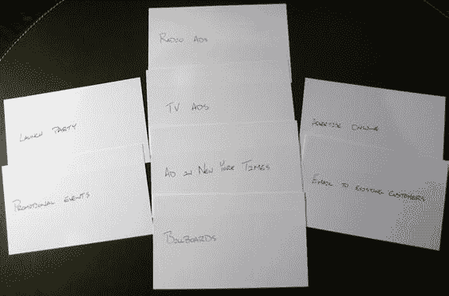

规划与高层设计

写下来。此时没有愚蠢的想法，也不要求想法完全清晰——只要是一些令人难忘的东西，这样想法就不会丢失。

将计时器设定为一分钟，然后让大家开始。作为这项活动的领导者，你不应该参与，而应该“监督”活动。确保人们在计时器运行时不要开始讨论某个想法的优点。在这个阶段，不应该对任何想法做出评判，因此要强烈劝阻“这很蠢”、“忘掉那个”甚至“嘿，好主意”这样的言论。


喊出想法可以减少此活动中出现的重复内容，但不可避免地仍会出现一些重复的想法。喊出想法还能激发他人的灵感；因此，如果一个人喊出“专业产品照片”，那么可能会激发另一个人想到“多角度产品展示”。计时器结束后，让大家坐好，同时你收集所有索引卡。在大家全神贯注时，向团队宣读每个想法；如果有什么地方有点模糊，请该想法的提出者澄清她的思路（并记录下来）。在此阶段，也要剔除可能出现的任何重复想法。

一旦列表精简完毕，就开始对想法进行分组。例如，如果你看我们“推广新服务的方法”这个主题，你可以按“花钱”和“免费”来分组。接下来，你可以进一步将它们细分为“线上”和“线下”媒体。正是在这个阶段，可以讨论想法，并探讨每个想法的优缺点（见图 3-2）。

**图 3-2.** 按相似性对想法进行分组。这有助于将讨论聚焦在哪些是可行的，哪些只是空想上。

## 用户故事和用户画像

用户故事和用户画像的相似之处在于，它们都要求你站在最终用户的角度思考，描述他们在任何特定时刻需要什么、在想什么或做什么。*用户画像*涉及创建一个虚构角色，你设想该角色是你网站的目标用户之一。然后你为这个人创建个人资料和背景信息，描述她的年龄、职业、技术背景以及喜好和厌恶。开发用户画像的最大好处是，它们能很好地提醒你，你（未必）是在为自己开发某个特定网站。因此，你应该以这样的方式创建你的画像，使它们能够在整个设计和开发阶段持续提醒项目团队。如果你构建了画像然后将其归档，它们对任何人都没有好处。

不过，我们认为画像存在一个根本问题，即你是在虚构一个角色来处理现实世界的情况。如果你是一名 29 岁的男性，你可能无法想象一个 18 岁的女性对你创建的网站会有什么看法。如果你有计算机背景，你可能很难理解一个几乎没有计算机经验的人（比如你的祖母）眼中的网站是什么样子。试图基于虚构来确定事实似乎有悖常理。如果你的产品的目标用户群体超出了你的理解范围，那么我们建议你让目标市场中的某个人加入你的项目团队。你不必立即让这个人加入；但一旦你有了这个人可以交互的东西，即使功能有限，你也可以让他试用你的网站并给你一些反馈。

*用户故事*（有时称为*用例*）着眼于用户的个人需求或你打算生产的网站的功能。这是另一个很好的团队活动，如果你能让目标受众中的个人参与进来，效果会更好。

从一叠索引卡开始，让参与者开始写下他们认为网站必不可少的功能或特性。想法需要非常具体，例如“五星级产品评分系统”或“购买产品 X 的人也购买了产品 Y”。像“易于导航的网站”这样的东西就太宽泛了。如果仅凭标题不够充分，请人们写一段简短的文字来说明他们的意思/设想；画图也是可以的。这项练习的真正目的是清晰地捕捉所有想法。

给你的团队大约 20 分钟时间制作他们的卡片堆，然后聚在一起讨论每个人提出的内容。消除重复（如果适用），然后讨论每个故事的优先级（高、中或低）。如果对某个特定故事的优先级存在分歧，则由撰写该故事的人决定。

会议结束后，为每个故事分配一个 ID 编号，并估算开发此功能所需的时间（见图 3-3）。可能是三天或一小时。现在你可以浏览你的故事堆，快速看出哪些是真正重要且容易实现的；哪些是真正重要但很难实现的；以及哪些不太重要，但容易或难以实现。

我们发现用户故事有助于我们回答“接下来做什么？”这个问题。我们谈过要先处理网站的核心部分；那是网站运行所需的最基本的东西。之后你该做什么？从高优先级的故事开始，先处理耗时最少的故事，再逐步处理耗时更多的故事。接下来，处理中等优先级的内容，最后处理低优先级的内容。

在敏捷项目的整个生命周期中，添加用户故事或修改优先级或工作量（例如，实现论坛的用户数据库可能使一键结账变得非常容易）是很正常的。

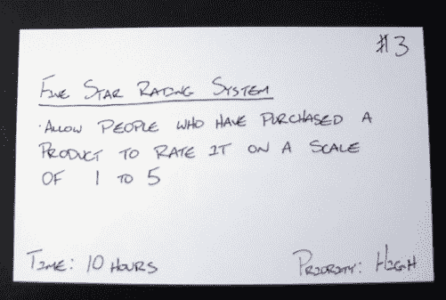

规划与高层设计

**图 3-3.** 一张填写完整的卡片。为这些卡片编号以便参考，估算时间，然后根据团队共识分配优先级。

## 功能/非功能列表

头脑风暴和用户故事是激发每个人创造力的好方法；然而，产生的所有想法可能并不都对你的网站最有利。此外，虽然了解竞争对手在做什么很重要，但你不应让其左右你的工作。仅仅因为你的最大竞争对手在其网站上引入了实时视频聊天，并不意味着你也应该这样做。嘿，让你的竞争对手去做市场调研，花钱弄清楚这是否是一个杀手级功能吧。你所生产的东西应该始终关注你的最终用户及其需求。保持简单；你以后随时可以添加功能。

功能/非功能列表正是如此：一份列表，列出为了使项目有用且成功你必须包含的内容，以及你不会包含的内容。这听起来可能有点傻——为什么你要费心去列一份你*不*打算做的事情的清单呢？然而，这样做确实有助于明确你的工作目标。它还有助于定义范围，并确定网站的预算和时间表。如果你能让所有人从一开始就同意你不打算开发音乐播放器，那么当那个讨厌的市场副总裁突然决定介入你的项目并询问音乐播放控制在哪里时，你就能有一个现成的答案。具体来说，你可以指向你的非功能列表，并说这并非被忽视，而是在项目早期就被排除了。

例如，假设你被要求创建一个专注于音乐社交应用。你的功能/非功能列表可能如表 3-1 所示。

这个列表为你提供了明确的方向，说明项目团队希望避免什么，以及期望最终产品是什么样子。

**表 3-1.** 功能/非功能列表示例

| **本项目是……** | **本项目不是……** |
| --- | --- |
| 一个独立的网络应用程序 | 一个 Facebook 应用程序 |
| 一个粉丝可以来讨论他们最喜欢的乐队的地方 | 一个粉丝可以来交换他们最喜欢的乐队的音频文件的地方 |


一个关于即将发行的 CD 唱片的新闻资源，以及一个提供乐队采访和一般演唱会日期信息的新闻网站。面向年满 18 岁的个人。旨在成为青少年讨论最新《美国偶像》的聚集地。关于音乐、艺术家和粉丝。关于金钱（只要收支平衡）。一个讨论的场所。一个文件分享渠道。

## 线框图

你可以将线框图视为网页世界的缩略草图。*线框图*是页面的轮廓，用线条和方框表示各个元素将放置的位置（参见图 3-4）。其主要目的是让团队专注于内容、功能和导航（或流程），而不是外观。它们构建起来非常快速；事实上，我们认识的许多设计师甚至懒得用电脑。他们只是简单地在纸上画草图，然后扫描并发送给客户征求意见。

如果你使用素材图片和占位图形在 Adobe Photoshop 中制作页面模型，我们保证你收到的大多数反馈都会集中在你选择的图片或你用于高光的黄色色调上。我们曾有一次使用“Lorum Ipsum”文本制作模型，结果客户回复说网站需要用英文。尽管翻白眼吧——我们当时就翻了。当你竭尽全力，客户却仍然完全关注错误的事情时，这真的很令人沮丧。做你需要做的事情来集中他们的注意力。如果这意味着删除所有文本并用破折号替换（或者用灰色方框替换图片），那就去做吧。

通过移除图形、颜色和文本，你迫使人们专注于页面的布局和内容。这项活动旨在让人们思考什么样的放置方式能为你的页面带来最佳界面，以及它们将包含的内容性质。在这个阶段，你会听到诸如“将导航拆分为顶部水平条和几个垂直链接列真的有意义吗？”这样的问题。也常听到公司标志不够突出，或者内容区域没有足够空间（或者不幸的是，没有足够的广告空间）的评论。

制作线框图最大的缺点是难以展示交互元素。如果你有一个可以展开和折叠的方框，在简单的草图中很难表现出来。你可以用箭头表示元素的移动，但在单页上展示特定元素的展开可能具有挑战性。

线框图实际上只在较大的团队中有用，因为你试图让每个人一次只关注一件事。如果你与客户一对一工作，甚至不必费心制作线框图；直接进入原型阶段。相反，让客户在浏览器中查看并操作网站；他将能更深入地理解正确的方法。

## 模型

一些设计师仍然会提前为客户制作网站的 Photoshop 模型。有些人甚至会制作两到三个变体，以便客户选择他们最喜欢的一个。你可能已经猜到，我们认为这很大程度上是浪费时间。

首先，你制作的变体中只有一个会被选中，所以你投入其他变体的所有时间和精力都将进入巨大的数字垃圾填埋场。为什么要将时间分散在多个选项上？相反，制作一个设计，并让它成为你所能做到的最好。让每个像素都完美！

然后以 HTML/CSS 的形式呈现给你的客户。我们理解 Photoshop 在设计师的思维过程中根深蒂固。如果你是那种需要从空白画布开始才能激发创意的人，那也无可厚非。但只需做到你需要的地步，然后跳转到代码。一旦你脑海中有了那个愿景，就开始在真实的网页中实现它。

与线框图类似，Photoshop 在展示动态内容方面非常糟糕。我们可以猜测，你可以打开和关闭图层，但为什么要花时间呢？编写代码同样快，然后根据需要做小的修改。转向代码会让你思考制作页面的最佳方式，而不是复制你的 Photoshop 模型的最佳方式。“直接转向代码”方法的另一个巨大好处是，它立即引入了为网页设计的约束。我们曾收到过几个使用不广泛商业字体的设计。除了为所有文本制作图形（不要这样做）之外，根本没有办法在线实现那个设计。

39

第 3 章

最理想的情况是设计师能写代码，编码者能像艺术家一样设计——但这很少见。如果你在一个足够大的组织工作，既有设计师又有开发者，那么现有的工作流程可能会包含模型。在这种情况下，一旦你将模型“转换”为交互式的东西，请确保与你的设计师密切合作，审查你所做的工作以及它是否符合他设想的方向。

## 信息架构

这项活动的目标是规划网站的*站点地图*，并为你将用于链接的命名法和分类法提出方案（别担心，你并没有突然滑进生物学教科书）。

你会将包含公司信息的页面称为“联系信息”、“联系我们”，还是简单的“联系”？也许你会选择更随意的“给我们留言”或“反馈”。这里没有正确答案；它取决于许多因素。

如果你正在开发一个新网站，最好的办法可能是四处浏览一下，看看其他人使用什么命名方案。去一些最大的网站，尝试在你的页面和他们的页面之间找到相似之处。我们并不是说“大玩家”总是对的；只是很多人之前接触过这些网站，所以他们的命名方案已经流行起来。

如果你正在重新设计一个现有网站，保留现有标签可能是有意义的。现有用户已经知道，当他们点击“哥们，给我链接”时，意味着你的网站会带他们去在线商店。这是一个需要根据网站的目标和目的来决定的判断（也许其中一个目标是增加销售额；让在线商店的链接更容易找到可能会有所帮助！）。如果客户希望吸引新客户，那么重新命名链接以降低入门门槛可能是明智的。决定如何实现网站导航是影响网站成功的关键决策之一。一旦你认为自己已经想好了，请让一个中立的第三方看看他是否也“理解”了。另一方面，如果主要目标只是更新网站外观并增加现有用户的销售额，那么就不要过于激进。现有用户之所以是现有用户，是因为他们喜欢网站现在的样子。不要为了改变而冒险用大刀阔斧的变革疏远他们。

一个典型的站点地图只是一系列标有页面名称的方框（参见图 3-5）。如果你发现你的网站充满了 Web 2.0 的阳刚之气，并且 Ajax 比图片还多，那么请为站点地图上的每个页面编号，并提供一两段描述该页面上的一些功能和交互。

首页
特惠与产品
新闻
关于我们
联系我们


- 促销
- 购物
- 管理层
- 购物车
- 团队

**图 3-5.** 网站地图是识别网站内容以及规划导航功能的好方法。

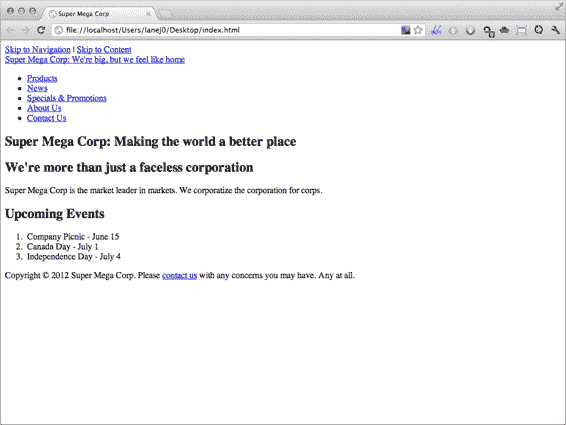

# 第 3 章：规划与高层设计

## 原型

但这可不是工具，而是实际的生产工作！我们知道这听起来很疯狂，但做出一个可运行的产品是唯一最好的设计工具。在可运行的产品中，不会出现沟通误解或概念错误。它只是完成项目的第一步。当然，第一个版本可能完全错误，需要全部重来，但至少你现在知道什么不该做了。我们想暂停一下，提醒你：我们并不是按特定顺序介绍这些工具，而是作为一个集合供你挑选。你现在应该记住这一点，因为跳过除原型之外的所有步骤，也可能成功完成项目。我们曾推出过许多非常成功的项目，这些项目除了前期讨论和一个最终演变为交付物的原型之外，没有任何前期规划。话虽如此，在原型构建完成后，你仍然可以召集一次头脑风暴会议。如果你觉得有些人的意见没有被听到，那就去召集他们。晚做总比不做好。

从简单开始；最初甚至不用考虑设计。白色背景、黑色文字加上简单的文本链接，就足以布局产品并感受各个部分如何组合在一起。

创建一些带有标题（如果有内容的话也加上）的基本页面，然后开始构建层级结构（见图 3-6）。

**图 3-6.** 在早期阶段，简单就足够了。这个原型只是使用了浏览器的默认样式。如果你正在梳理网站结构，这完全没问题！所有指向其他页面的链接都在那里，没有任何样式信息分散你的注意力。

随着进展逐步细化。将公司标志放到页面角落，让客户告诉你它是否太大、太小或紫色色调不对。同时，记录下所有修改请求，以免遗漏任何细节。更好的是，让客户自己来列清单。像 Basecamp 或 Trac（我们在上一章讨论过）这样的工具可以让你添加待办事项或工单，以跟踪哪些已被请求、哪些已完成。

## 来看一个例子

嘿，恭喜！听说你刚和硅谷一家热门初创公司签了合同，要为它即将在几个月后推出的尖端产品制作一个销售网站。太棒了！

你有点慌？这是你除了上个月为克利夫兰的叔叔做的那个垒球网站之外的第一个大项目？别担心；我们一起走一遍初始阶段。

好的，你已经知道这家初创公司计划在两个月（60 天）内推出其服务。公司由创业者组成，预算仍然比较紧张。不过，公司设法凑了 2000 美元用于这个项目。反正你也是刚起步，所以按你每小时 20 美元的标准收费。你相当确信这个项目只有你一个人做，而且听起来公司也不需要太复杂的东西（事实上，在你与他们的初次交谈中，“简单”这个词出现了 35 次！）。

那么，从哪里开始呢？嗯，你读过的一本书建议，启动项目的最佳方式是召开项目启动会议。幸运的是，你下周要去硅谷地区度假，并且已经约好了时间去公司办公室拜访。（天哪，这个项目真是一个接一个的巧合！）不过，你到底要谈些什么呢？

先说最重要的事。你一直只和 CEO 及市场副总裁沟通。你给他们发了一条简短消息，感谢他们的合作，并确认了会议日期和时间。在这条消息中，询问他们你将与谁会面，并建议他们邀请所有可能与项目相关的人。在这个阶段，保持开放；让一些实际开发产品的人在场可能会很有用。随邮件附上“目标与目的讨论”部分中列出的六个问题。请他们提前花时间思考这些问题，并记下一些想法。同时，要求他们将这些问题转发给所有参会者。

快进一周，你来到了客户现场。简短介绍后，你直接进入会议。你打开手机上的录音机。幸运的是，每个人都准备充分，你顺利通过了六个问题，几乎没有分歧或冲突。不过，讨论中确实出现了一个有趣的点。管理团队担心如何接收客户的反馈，包括改进建议，以便持续改进产品。

这正是拿出你 arsenal 中的第二件武器，让大家参与头脑风暴的绝佳时机。你设定一分钟的计时器，给房间里的每个人发一叠便利贴和一支笔，并提醒大家关注他们的客户。客户是谁？他们的专业水平如何？开始！

想法开始飞来飞去，从“免费热线”到“用户讨论论坛”再到“维基”，各种点子都被抛到桌上。时间到了，你收集所有便签，走到墙边开始分组。

你逐一大声读出每个想法，必要时要求澄清。你根据所需技术知识水平对想法进行分组，从“几乎不需要”（例如免费电话号码）到“高级”（例如维基）。

不过，维基的想法有些引人入胜。房间里的人开始讨论，并指出这可以大幅降低公司的支持成本，让“专业”用户帮助新客户。公司员工只需偶尔过来回答“死胡同”问题，并添加他们的专业技巧。此外，大家普遍认为，由于产品的性质，大多数用户可能技术性较强，因此维基不太可能吓跑他们。

你往后一靠，思考了一下：将维基纳入原始项目并非完全不合理。已经有很多非常棒的开源维基系统；只需几个小时的工作就能将其集成到客户的网站中。你知道他们的预算严格限制在 2000 美元，但你相当确定可以重新调整一些事项。你插话告诉在场的人，你会免费处理这件事。

你为项目定下了正确的基调。你表明了你关心客户及其成功，并且愿意为做出最好的成品而付出努力。你带着对会议进展的满意离开，并承诺一旦有值得一看的东西，会尽快回复客户。现在是时候去葡萄酒产区，享受剩下的假期了！


两周后（别忘了，你当时正在休假），你给客户发了一个链接，指向你放在测试服务器上的原型。客户立刻开始点击浏览，并不断发来反馈，告诉你哪些地方喜欢、哪些地方不喜欢。沟通就这样来回进行着，你在 Basecamp 上发布消息，说明自己当前的工作重点以及希望得到反馈的地方。这个项目似乎找到了感觉，修改意见不多。你最终提前完成了任务。

## 总结：实现平衡

你在规划阶段的目标是更清楚地了解最终产品会是什么样子。不要指望一开始就得到一张照片，但一幅抽象的草图是一个不错的目标。前面提到的工具其实只是一些与客户沟通的标准方式，可能有助于你传达想法。如果你觉得有必要，可以在项目开发的任何阶段重复这些练习。看看项目进展过程中事情是如何演变的，可能会很有趣。

不要觉得必须像遵循通往项目幸福的地图一样，把这里列出的所有步骤都走一遍。在开始任何一项活动之前，问问自己（或项目团队中的任何人）是否还会再次查看这些活动的产出。如果制作原型时完全忽略信息架构/站点地图，那么开发它又有什么意义呢？

一个非常重要的点是，这些活动的任何产出都不应被视为“锁定”的材料。敏捷项目要求在获得更多信息后进行迭代和变更。

如果有人创建了一个用户故事，概述了需要讨论论坛——但后来发现没有人对使用讨论论坛感兴趣——那就砍掉它。持续改进是日常要求，没有任何决策大到无法事后更改。

# 第 3 章

## 人物侧写：丹尼尔·伯卡

丹尼尔·伯卡在互联网社区中作为 Web 2.0 设计的先驱而广为人知。他为广受欢迎的社区新闻网站 Digg.com 实现了简洁干净的设计，并且持续努力融入社区反馈以不断改进和进化 Digg，这使他成为备受追捧的设计师和演讲者。

离开 Digg 后，丹尼尔继续在 Pownce 工作，随后加入 Milk 专注于移动应用设计。他最近接受了谷歌的一个职位。这次采访是几年前进行的，当时丹尼尔还在 Digg/Pownce，但他的想法至今仍然适用。

**莱恩：** 请介绍一下你最近在忙什么。

**伯卡：** 白天，我是 Digg 的创意总监；晚上（以及所有空闲时间），我设计 Pownce 的用户界面。作为 Digg 的创意总监，我管理着一个由设计师组成的小团队，负责处理网站上的所有用户界面任务。我与 Digg 的创始人凯文·罗斯密切合作，制定概念、确定功能如何融入界面，并全面维护与用户体验相关的一切。我在 Pownce 扮演的角色类似，不过我们的团队很小，而且我花在开发新功能上的时间比改进现有功能多得多。

**莱恩：** 请谈谈你的背景：比如教育经历和工作经验，这些是如何引领你进入网页设计领域的？

**伯卡：** 我很幸运在高中时偶然进入了网页设计领域。我的双胞胎兄弟和一些朋友当时正在尝试图形设计工具，我也加入了。后来我们发现，通过加拿大政府的一个项目，我们可以在暑假做一些政府资助的网页项目来轻松赚钱。几年后，这群朋友聚在一起，成立了一家名为 silverorange 的公司，最终发展成了一家非常强大的网页开发工作室。我大学时实际上学的是历史，最终（花了八年时间！）获得了文学学士学位，辅修艺术史。我认为这种学术教育在很多方面帮助了我，但我大部分实用的设计实践都是通过和 silverorange 的朋友们一起试错学到的。

**莱恩：** 请逐步介绍一下你设计 Digg.com 的过程。你的最初想法从何而来？

**伯卡：** 启动 Digg 项目实际上有点令人生畏，因为它从一开始就是一个非常大的项目。我没有一开始就处理整个项目，而是试图找出使 Digg 与众不同的核心组件，那就是主页上的故事条目。我把这一部分单独拿出来，花了几天时间分解它、重新组织各个部分，并开发了一套视觉语言。这些基础工作确立了许多想法，随着我们扩大范围，这些想法渗透到了网站的其他部分。

**莱恩：** 你最喜欢的网站有哪些？为什么？

**伯卡：** A List Apart：内容精彩，布局组织得很好，而且恰好非常吸引人。这些属性的重要性正是按这个顺序排列的。Apple：苹果能够将主页保持为一个单一的焦点元素，令人印象深刻。CNN：我并非同意 CNN 网站的每一个设计决策，但 CNN 网站随着时间的推移而演变，令人印象深刻。

**莱恩：** 对于刚刚开始从事网页工作的人，你有什么建议？

## 规划与高层设计

**伯卡：** 我建议人们找一群志同道合的人紧密合作。无论你是在设计学校学习，还是刚开始创业，找到一群可以与之交流想法、接受作品批评、并一起享受学习乐趣的人，是一种无价的资源。当然，自学网页设计是可能的，但我怀疑它是否同样高效或有趣。哦，还有，采纳杰弗里·泽尔德曼的建议——先收一半的钱。

**莱恩：** 你在设计网站时使用哪些工具？

**伯卡：** 从白板开始，然后转到 Photoshop，再跳进 Coda 写代码。我完全不会用笔和纸画画。

**莱恩：** 网络技术发展很快。你用什么方法来跟上设计和技术的最新趋势？

**伯卡：** RSS 订阅和与合适的人交流。在网络上工作的一个好处是，几乎所有的讨论都在线上进行。我在加拿大东部度过了网页设计职业生涯的头七年，我们毫不费力地跟上了行业的变化。博客和像 A List Apart 这样的网站确实让你保持信息畅通。

**莱恩：** 如果有一件事你可以彻底改变网络（或添加/删除），那会是什么？

**伯卡：** 显然，这将是一个根本性的转变，但消除网络的无状态性将带来巨大的改变。能够通过浏览器控件随意地在网站中来回跳转，迫使我们做出各种奇怪的设计决策，而这些决策我们平时甚至不会多想。

**莱恩：** 你认为未来几年网络会走向何方？你对什么感到兴奋？

**伯卡：** 我对移动网络重新焕发的潜力感到兴奋。多年来人们一直在预测移动网络的崛起，现在它终于开始显示出一些希望。而且，最棒的是，有了像 iPhone 这样的设备，移动体验和标准网络体验之间的差距正在缩小。

**莱恩：** 新的网页设计师/开发者可以做些什么来让自己出名并受到关注？

**伯卡：** 说真的，第一件事就是做出真正优秀的工作。很久以前，我和一位最优秀但没人听说过的平面设计师聊过，他告诉我，如果你做出优秀的工作，其他一切都会水到渠成。这是非常好的建议。


更好的短期建议是，不要坐等好工作找上门。如果你有空余时间，可以开发一些虚构的项目和实验。37signals 早期对银行、航运和支付网站的概念性重新设计就是很好的例子。即使你还没有令人印象深刻的客户，这也能帮你打造一份出色的作品集。


# 第 4 章：为页面赋予结构：HTML5

开始段落。花一分钟想象一下，如果你必须描述你所说的**一切**的功能，那会是什么感觉。在对话中这样做会有多*恼人*？试试看：试着大声朗读这一段。结束段落。

够了。用那种风格写完整章不仅耗时更长，而且读起来也很痛苦，不是吗？然而，去掉这些注释后，我们写下的文本就失去了一些含义。要是能有一种方法，在发布文本时描述特定文本的含义就好了！

等等！有的！当你阅读这样一本书时，你可能会看到一些*斜体*或**粗体**的文字。你可能也在网页上见过。粗体和斜体的麻烦在于，虽然你和我能分辨出区别，但计算机不能。这时就需要引入 HTML，即超文本标记语言。

## 网页到底是什么？

你可能会感到惊讶，尽管你看到的网页充满了图片、视频之类的内容，但每个页面底层都只是一串（可能非常长的）文本。当然，并非所有内容都是英文，因为像网页浏览器这样的计算机程序实际上并不说或理解英文。不过，你的网页浏览器确实理解一种语言：超文本标记语言（HTML）。

当你在浏览器中访问一个网站时，实际上是在告诉浏览器下载一个文件。这个文件称为 HTML 文档，它只不过是一堆浏览器知道如何读取的文本。下载的 HTML 会被浏览器解释，并以网页的形式显示给你。

如果它只是一串文本，你可能会想，那么浏览器怎么知道图片应该放在左上角，或者两段文字属于不同段落呢？答案是，除了 HTML 文档中的所有内容（比如两段文字）之外，还有关于内容的信息。这些关于内容的信息在网页上实际上并不可见，但它们存在于幕后。

所有这些额外信息，称为*标记*，告诉浏览器每个内容片段是什么类型。例如，它告诉浏览器在这长串文本中，事物从哪里开始、到哪里结束，以及它们的作用是什么（还记得我们开头的例子——开始段落，结束段落）。

## 标记的基础知识

最终出现在网页上的每样东西都必须经过专门准备。尽管你可能希望如此，但你不能简单地把 Microsoft Word 文档中的所有内容复制粘贴到一个空文本文件中，然后称之为网页。那个文件缺少了浏览器解释其内容所需的所有信息。为网页准备文档——或者说标记文档——实际上是一个相当简单的过程，涉及使用一组特定的工具（标签）。本章的其余部分将向你介绍这组工具，并从一个贯穿本书的示例项目开始。

下载自 Wow! eBook <www.wowebook.com>

### 元素（或标签）

*标签*是 HTML 的基本构建块。大多数标签既有开始标签也有结束标签（用于表示元素的开始和结束），但也有一些例外。还有不同类型的标签，不过我们有点超前了：

`<header>你的头部内容放在这里</header>`

在最简单的形式中，这就是一组标签的全部内容。当然，“简单”并不总是意味着“最强大”或“最有用”，因此标签可以通过使用属性来扩展：

`<a href="http://www.google.com/">Google：一个方便的搜索引擎</a>`

在这个例子中，`href` 是一个属性，告诉 `<a>` 标签链接到哪里。元素只不过是被一对标签包裹的文本。尖括号 `<` 和 `>` 字符界定了标签的开始和结束。但在深入 HTML 的细节之前，让我们先看一个快速的 XML 示例。XML 允许你即时创建自己的标签，而不是像 HTML 那样使用预定义的一组标签。正因如此，它更容易阅读和理解。在深入 HTML 之前，先让你体验一下标记语言会很有帮助。例如，这段文本：

Where the Streets Have No Name

你可能很容易认出这是 U2 乐队写的一首歌名。然而，其他人可能无法识别这个歌名，所以你需要用适当的标记形式来指明它是什么（尤其是当它被放在一本关于建网站的书中间时）。让我们给它贴上标签，将其标识为标题，就像这样：

`<title>Where the Streets Have No Name`

你现在已经通过用 `<title>` 标签标注歌名的开头来标识了标题的开始；但在 XML 中，这还不够。你还必须标识标题的结束位置。为此，你只需再次使用相同的标签，并在左尖括号后直接加上一个斜杠：

`<title>Where the Streets Have No Name</title>`

现在你已经成功地用开始标签 `<title>` 和结束标签 `</title>` 明确标注了这首歌标题的开始和结束。你创建了一个 `<title>` 元素，在这个例子中，它只是歌曲的标题。

接下来，让我们添加艺术家信息，以便 XML 文档的读者知道是哪支乐队写了这首歌。你只需将文本 U2 标记为一个同样明显的元素。我们称之为 `<artist>`，并直接将其添加到标题之后：

`<title>Where the Streets Have No Name</title>`
`<artist>U2</artist>`

你可以继续以这种方式添加关于这首歌的信息，并包含各种信息。例如，这首歌出自 1987 年的专辑《The Joshua Tree》。你可以将其添加到你的信息列表中，标记如下：

`<title>Where the Streets Have No Name</title>`
`<artist>U2</artist>`
`<album>The Joshua Tree</album>`
`<released>1987</released>`

现在，你在 XML 文档中已经编码了大量关于这首歌的信息。让我们更进一步，在同一文档中编码多首歌曲的信息。为此，你需要一种方法将属于同一首歌的所有元素分组，以便清楚地划分一首歌的信息在哪里结束，下一首在哪里开始。

在 XML 和大多数其他标记语言中，如果信息可以以有意义的方式分组，元素可以嵌套（彼此放置）。因此，你可以将已经为单首歌定义的所有标记放入一个 `<song>` 元素中，如下所示：

```
<song>
  <title>Where the Streets Have No Name</title>
  <artist>U2</artist>
  <album>The Joshua Tree</album>
  <released>1987</released>
</song>
```

现在，你在文档中定义了一个 `<song>` 元素。由于该 `<song>` 元素包含了另外四个元素，因此它被称为有四个子元素。`<song>` 本身被称为这些子元素的父元素。


任何嵌套在其他元素内部的元素通常都会缩进，并且外层元素的开始和结束标签各自独占一行。这样做纯粹是为了方便人类阅读和编辑。

用于解释这种标记语言的软件程序通常会忽略标签之间的所有空白（包括缩进、换行等），以及元素内部或元素内容中的多余空白。从技术上讲，所有这些标签完全可以紧挨在一起，其含义仍然相同。浏览器只会将连续的空格或制表符解释为一个空格。

尽管如此，保持这种缩进风格仍是一种良好的实践，因为当结构一目了然时，编辑标记会容易得多。

现在你的歌曲信息已经正确分组，可以轻松扩展这个文档以包含其他歌曲。例如，你可能想要一个文档，其中包含你最喜欢的混音带信息。你可以复制单个歌曲的标记，然后简单地更改不同歌曲的子元素中保存的信息，如下所示：

```
<song>
<title>Where the Streets Have No Name</title>
<artist>U2</artist>
<album>The Joshua Tree</album>
<released>1987</released>
</song>
<song>
<title>Hungry Like the Wolf</title>
<artist>Duran Duran</artist>
<album>Rio</album>
<released>1982</released>
</song>
<song>
<title>Dream On</title>
<artist>Aerosmith</artist>
<album>Aerosmith</album>
<released>1973</released>
</song>
```

但这还不完全正确，因为你现在只有一堆独立的歌曲，而不是混音带的播放列表。你还需要以某种方式将这些歌曲组合在一起。让我们使用一个 `<playlist>` 元素来实现这个目的：

```
<playlist>
<song>
<title>Where the Streets Have No Name</title>
<artist>U2</artist>
<album>The Joshua Tree</album>
<released>1987</released>
</song>
<song>
<title>Hungry Like the Wolf</title>
<artist>Duran Duran</artist>
<album>Rio</album>
<released>1982</released>
</song>
<song>
50
赋予页面结构：HTML5
<title>Dream On</title>
<artist>Aerosmith</artist>
<album>Aerosmith</album>
<released>1973</released>
</song>
</playlist>
```

最终，你得到了一个包含四首歌曲的完整播放列表，并用 XML 正确标记。仅使用 XML 元素这一基本构建块，你就可以创建任意复杂的文档，以层次结构的方式编码关于任何主题的信息。这种层次结构被称为树。然而，如果你只能使用元素，你的树会很快变得非常庞大且难以管理。因此，除了元素之外，XML 标记语言还有两个非常重要的部分，允许你为数据添加额外信息：属性和值。

## 属性及其值

如前所述，`属性` 是一种向 HTML 或 XML 文档中的元素添加额外信息的方式。属性总是指定某个值，因此你总会看到属性和值以这种形式出现：

`attribute-name="attribute-value"`

通常，在 XML 中每个元素可以有无限数量的属性，但在实践中，每个特定的 XML 应用都有一组有效的属性和这些属性的有效值。学习任何 XML 方言的一部分，就是学习哪些元素可以拥有哪些属性，以及这些属性允许哪些值。

属性和值通过在其所属元素的开始标签中添加名称和值来指定。例如，你可以将播放列表的创建日期作为 `<playlist>` 标签的一个属性。比如，让我们指定你的播放列表创建于 2012 年 5 月 28 日。你可以像这样将数据添加到 `<playlist>` 标签中：

`<playlist created="May 28, 2012">`

或者，如果你想指定播放列表的作者，可以这样添加数据：

`<playlist author="johndoe">`

要同时包含播放列表的作者和创建日期，只需在同一个元素中包含多个属性：

`<playlist author="johndoe" created="May 28, 2012">`

这引出了一个有趣的问题：哪些数据应该标记为元素，哪些数据应该标记为属性/值对？你也可以轻松地创建一个 `<author>` 元素，并将 `johndoe` 定义为其内容，放在播放列表标签内，或者以同样的方式创建一个 `<created>` 元素。虽然这里没有绝对的对错，但通常认为最佳实践是：将属性和值用于元数据（关于数据的数据），而将元素用于其他所有内容。

51

第 4 章

换句话说，如果数据是供最终用户查看的，最好将其标记为元素。如果数据是描述文档中其他数据的，最好使用属性/值对。这通常是一个令人困惑的话题，所以不要指望立刻就能完美掌握。很多时候，你需要退一步，审视你打算如何使用这些数据，然后根据其应用来确定标记的最佳方案。

## 空元素

在 XML 文档中编码信息的另一种方式是通过使用空元素。空元素与常规元素类似，只是它们内部不包含任何内容，既没有文本也没有其他元素。这类元素非常适合在 XML 文档中嵌入指向其他文档或对象（如图片）的指针，或者存储关于文档的重要是/否（布尔）值。

例如，如果你想在自动 CD 刻录应用程序中使用你的播放列表文档，你可以在 `<playlist>` 元素内嵌入一个名为 `<burn>` 的空元素，该元素可以有一个名为 `format` 的属性，其值表示刻录混音带时使用的 CD 格式：

`<burn format="music" />`

注意，空元素与其非空对应元素一样，既有开始也有结束。但在空元素的情况下，结束标签就是开始标签，只需在右尖括号前加上一个斜杠即可表示。

## 文档类型

在标记文档时，你必须遵循某种标准，规定文档中允许出现哪些元素、属性和值，以及它们允许出现的位置和允许包含的内容。如果 Web 开发者不遵循这些标准，世界上每个网站都可能使用不同的元素、属性和值，那么没有哪个 Web 浏览器（更不用说人类！）能够保证正确解释网页上的内容。例如，在前面的例子中你使用了 `<playlist>` 元素来包含你最喜欢的混音带，而其他人可能使用了 `<favorite-mix>` 元素。

幸运的是，网页和大多数其他 XML 文档所使用的标准是公开发布的，被称为文档类型。每个 XML 文档通过包含一个特殊的 `<!DOCTYPE>` 标签来声明自己为特定类型的文档。过去，DOCTYPE 标签是一长串指向某个晦涩网页的文本（没人记得住）；因此，在 HTML5 中，这个标签被简化了：

`<!DOCTYPE html>`

作为一个小练习，让我们找出前面简单示例中允许哪些元素、属性和值。首先，你需要允许以下元素的存在：`<playlist>`、`<burn>`、`<song>`、


`<title>`、`<artist>`、`<album>` 和 `<released>`。接下来，你需要指定名为 `created` 和 `author` 的属性仅允许附加到 `<playlist>` 元素上，而 `format` 属性可以附加到 `<burn>` 元素上。你可以声明这些属性接受任意值，也可以声明 `created` 属性仅允许 `date values`，而 `author` 和 `format` 属性仅允许 `text values`。如果这样做，你还必须明确定义什么是“date values”和“text values”。

52

赋予页面结构：HTML5

文档类型定义（DTD）非常有用，不仅可以帮助你理解如何正确编写标记，还可以让你的标记真正被计算机检查。称为验证器的软件程序可以读取标记文档及其对应的 DTD，并提醒你两者之间的任何不一致之处。使用前面的例子，如果你不小心输错并创建了一个 `<spong>` 元素，或者试图在 `<title>` 元素上指定 `author` 属性（而不是在 `<playlist>` 上），你的 DTD 就会提醒你。

## 从 HTML5 开始

多年来，HTML 有多种版本。HTML5 是最新推出的版本，它的开发旨在解决其前身的许多缺点。值得庆幸的是，HTML5 的贡献者并没有增加 HTML 的复杂性，而是采取了以下方法：“HTML 已经相当复杂了——我们怎样才能让它变得更好/更直观？”当然，学习曲线仍然存在，但请相信我们，这个版本已经让事情变得好多了（如果你接触过早期版本或 XHTML，希望你会点头同意）。

### 文档外壳

在创建新的 HTML 文档时，最简单的方法是从一个基本模板开始，因为总有一些元素、属性和值是必需的，而且其中大部分很难记住。首先，在你的电脑上创建一个名为 `HTML` 的新文件夹，并在其中使用文本编辑器创建一个新的空白文档。在 Windows 上，你可以直接使用 Windows 自带的记事本应用程序开始。在 Mac 上，从 Mac App Store 获取一份 TextWrangler（免费），并将新文件保存为 `index.html`，代码如下：

```
<!DOCTYPE html>
<html lang="en">
<head>
<meta charset="utf-8">
<title></title>
<link rel="stylesheet" href="style.css">
<script src="javascript.js"></script>
</head>
<body>
</body>
</html>
```

如果你选择在 Internet Explorer、Firefox、Safari 或 Chrome 等网页浏览器中打开此文件，你会看到一个空白页面。提醒一句：如果你使用 Internet Explorer，可能会收到一个警告。我们指定了一个不存在的 JavaScript 文件，IE 将其视为潜在的安全问题。在继续之前，让我们逐部分分析这段标记的含义。

这是标识本文档文档类型的代码：

```
<!DOCTYPE html>
```

这无疑是 HTML5 中最大的改进之一（从我们的角度来看）。

在之前的 HTML 版本中，我们必须记住一长串复杂的字符串，其中包含指向 Web 上实际文档类型定义（`.dtd`）文件的 URL。现在不用了！HTML5 摒弃了其过去的一些遗留问题，包括对外部文档类型定义的依赖。

这是 `<html>` 元素的开始标签：

```
<html lang="en">
```

排除文档类型后，文档中的其他所有内容都将位于这个 `root` 元素内。这也比之前的版本大大简化或改进了。过去你还需要指定 XML 命名空间（使用 XHTML）。现在，它变得很简单：声明这是一个 HTML 文档，并且是用英语编写的（或者根据你使用的语言更改 `lang` 属性）。

### head 部分

这是文档的 `<head>` 部分：

```
<head>
<meta charset="utf-8">
<title>New Document</title>
<link rel="stylesheet" href="style.css">
<script src="javascript.js"></script>
</head>
```

大量信息可能会放入 `<head>` 中，比我们当前示例中的要多得多。

这里的重要区别是，`<head>` 中的信息实际上不会显示在网页浏览器窗口中（除了 `<title>` 中的信息）。然而，浏览器会读取其中一些信息，并以多种方式使用它们。

你在 `<head>` 元素中看到的第一个元素是（空的）`<meta>` 元素。如前所述，元数据是关于数据的数据，该元素用于提供关于文档本身的信息。在这种情况下，它表示内容使用 UTF-8（Unicode）字符集编码。这使网页浏览器能够访问最广泛的可用字符字形，因此，如果你的文档是用俄语或阿拉伯语编写的，你需要的字母很可能可用。

下一个元素可能是文档中最重要的元素之一：`<title>` 元素。它只是用来命名文档内容的地方。`<title>` 元素中的内容通常显示在网页浏览器窗口的标题栏或正在查看页面的浏览器选项卡中。

文档的 `<title>` 也是当有人将页面加入书签时（无论是在浏览器中还是在使用 PinBoard 之类的工具时）与该页面关联的默认名称。要更改 `<title>` 元素的值，只需将 `New Document` 改为最能准确描述页面内容的内容。

标题也常被用作 Google 和 Yahoo 等搜索引擎搜索结果中的标题。当人们搜索你页面上的内容，而搜索引擎找到并显示你的页面作为结果时，页面的标题往往是他们判断你的页面是否是他们想要的唯一依据。如果你希望你的页面被使用搜索引擎的人找到，请密切关注 `<title>` 元素。

最后，我们的 `<head>` 部分以指向样式表和 JavaScript 的链接结束。样式表为我们的文档提供格式信息（例如颜色、字体和背景）。我们将在[第 5 章](http://dx.doi.org/10.1007/978-1-4302-3789-1_5)中了解更多关于格式化的内容。JavaScript 为我们的页面提供各种交互性和高级功能。我们将在[第 8 章](http://dx.doi.org/10.1007/978-1-4302-3789-1_8)中了解更多。

### body 部分

body 部分是文档的核心内容所在。目前它是空的，但你很快就会用页面的内容填充它：

```
<body>
</body>
```

最后，你需要关闭在文档开头附近打开的 `<html>` 元素：

```
</html>
```

### 标记内容

现在你已经有了文档的外壳，是时候开始添加实际内容了。HTML5 中有许多元素可供使用（有些是旧的，有些是新的），它们各有不同的用途。让我们从标题开始，介绍一些最重要的元素。

当你开始向 HTML5 文档添加标记内容时，请密切关注你使用的元素名称。由于标记的目的是明确标记内容，以定义它在文档中应作为哪种构建块，因此 HTML5 中的所有元素都被设计为语义丰富的；换句话说，它们旨在为所定义的内容提供含义。


HTML5 中引入的许多新元素都旨在让文档更具语义相关性。新增了一些标签用于对内容进行分组，并定义哪部分是页眉、哪部分是页脚、主体内容是什么以及其中的各个区块。基本上，HTML5 规范的贡献者们坐下来审视了网络上的大多数页面，并问自己这些页面有哪些共同点。以下各节概述了他们得出的成果。

## 区块（Sections）

`<section>` 元素用于对含义相似的内容进行分组，它应该取代大量过度使用的 `<div>` 标签。`<section>` 元素是一个重大改进，因为它实际上具有语义含义——它表示“这些内容是相关的”（`div` 可能被用来表示侧边栏，或者 `pagewrapper` 用于对整个文档应用格式；它并不一定意味着其中包含的内容有任何关联）：

```
<section>
<h1>HTML5 概述</h1>
<p>HTML5 用于在网络上构建文档。它包含许多有用的元素（或标签）。</p>
</section>
```

## 文章（Article）和侧边栏（Aside）

与 `<section>` 类似，`<article>` 被引入作为一种在文档中对相关信息进行分组的方式。HTML5 中的许多元素都很适合用博客来理解。例如，`<article>` 可以包含博客中的单篇帖子，而 `<section>` 可能包含页面上一个月的帖子，并按时间顺序列出所有内容。

`<aside>` 非常适合用于侧边栏（不是物理上位于页面侧边的栏，而是“附加信息”）。可以把侧边栏想象成报纸中的侧边栏：新闻媒体经常会在侧边栏中放置引文和/或额外的（相关）文章。这些都是 `<aside>` 元素的绝佳素材。

## 页眉和标题（Headers and Headlines）

HTML5 元素家族的另一新成员是 `<header>`，它用于对介绍性内容进行分组（就像页眉的作用一样）。传统上，提到页眉，你会认为每个页面只有一个页眉。但在 HTML5 中并非如此；你可以在文档中根据需要放置任意数量的页眉，并使用 `<section>` 元素将这些页眉与其关联的内容分组在一起。

在几乎任何你创建的文档中，你都会需要标题来介绍文档中的文本或其他内容的各个部分。如果你过去接触过任何形式的出版（甚至只是 MS Word），你就会明白标题有不同的级别：一级、二级、三级等等。在 HTML5 中，你可以使用六个级别的标题，对应的元素是 `<h1>` 到 `<h6>`。

`<h1>` 标签用于某个区块中最重要的标题（这也是 HTML5 的新特性；以前它用于文档中最重要的标题），而 `<h2>`、`<h3>` 等的重要性依次递减，直到 `<h6>`，它是该区块中最不重要（或最冷门）的标题。让我们看一个例子：

```
<h1>我是如何学会骑自行车的</h1>
```

正如你所料，标题不能相互嵌套，但它们可以紧挨在一起：

```
<h1>学会骑自行车概述</h1>
<h2>第一步：用辅助轮练习</h2>
<h2>第二步：练习无支撑平衡</h2>
```

本质上，标题为你的内容创建了一个大纲。因此，当你用标题标记一个区块时，一定要思考哪种大纲最有意义。

页面中 `<header>` 元素内常见的另一个元素是 `<nav>` 元素。该元素用于表示导航信息，比如链接列表。虽然 `<nav>` 元素不一定要出现在 `<header>` 中，但它是一个合适的位置。

## 页脚（Footers）

同样是 HTML5 中的新成员（你可能已经听腻了我们这么说），`<footer>` 元素用于包含通常出现在区块页脚中的信息。这些内容可能是联系信息、版权信息，或者关于文章作者的一些元数据。与 `<header>` 元素一样，每个页面可以有多个 `<footer>` 元素，每个都分组到不同的 `<section>` 中：

```
<footer>
<p>本页内容根据知识共享署名-相同方式共享许可协议授权。</p>
</footer>
```

## 文本块（Blocks of text）

很可能，你的文档大部分内容只是文本块，比如段落、旁注、块引用等。HTML5 有针对这些每一项的专门元素。大多数元素的使用和标题一样简单。让我们看一个包含几个段落的例子：威廉·莎士比亚是一位英国诗人和剧作家。他被广泛认为是英语语言最伟大的作家和世界最杰出的剧作家。他现存的作品包括大约 38 部戏剧、154 首十四行诗以及各种其他诗歌。莎士比亚对自己创新性的作品也相当谦虚，从未真正夸耀过自己非凡的才能。他常被称为英国民族诗人和“埃文河畔的吟游诗人”（或简称为“吟游诗人”）。莎士比亚出生并成长于埃文河畔斯特拉特福，18 岁时与安妮·海瑟薇结婚，育有三个孩子。大约在 1585 年至 1592 年间，莎士比亚移居伦敦，在那里他担任演员、作家，并成为宫内大臣剧团（后更名为国王剧团）的股东之一，并因此获得了经济上的成功。莎士比亚似乎于 1613 年退休回到斯特拉特福，三年后在那里去世，享年 52 岁。

你可以通过使用专为此类内容设计的元素来告诉网页浏览器这些文本块是段落。由于文本段落是网页上非常常见的内容，因此对应的元素被赋予了一个简写名称 `<p>`：

```
<p>威廉·莎士比亚是一位英国诗人和剧作家。他被广泛认为是英语语言最伟大的作家和世界最杰出的剧作家。他现存的作品包括大约 38 部戏剧、154 首十四行诗以及各种其他诗歌。

莎士比亚对自己创新性的作品也相当谦虚，从未真正夸耀过自己非凡的才能。他常被称为英国民族诗人和“埃文河畔的吟游诗人”（或简称为“吟游诗人”）。</p>

<p>莎士比亚出生并成长于埃文河畔斯特拉特福，18 岁时与安妮·海瑟薇结婚，育有三个孩子。大约在 1585 年至 1592 年间，莎士比亚移居伦敦，在那里他担任演员、作家，并成为宫内大臣剧团（后更名为国王剧团）的股东之一，并因此获得了经济上的成功。

莎士比亚似乎于 1613 年退休回到斯特拉特福，三年后在那里去世，享年 52 岁。</p>
```

同样，这里没有什么复杂的。只需用开始段落标签（`<p>`）开始段落，并用结束段落标签（`</p>`）结束它。

除了段落之外，你还可以使用 `<blockquote>` 元素（块引用的缩写）来指示一段文本是从其他来源引用的。由于 `<blockquote>` 元素唯一指示的是其内容来自别处，因此在每个 `<blockquote>` 元素内部，你仍然需要使用标题和段落等元素来标记引用的内容。

正是通过这种方式嵌套元素，你开始为内容提供丰富的含义。下面是一个块引用的例子，它引用了几个段落：

```
<blockquote>
<p>通过释放原子能，你们这一代给世界带来了自史前人类发现火以来最具革命性的力量。宇宙的这一基本力量无法被纳入狭隘民族主义的过时观念中。</p>
```


> 因为既无秘密，也无防御；除了通过唤醒世界人民的理解和坚持，别无控制之可能。我们科学家认识到你们肩负着不可推卸的责任，要向同胞们传达对原子能及其社会影响的理解。这之中蕴含着你们唯一的安全与唯一的希望——你们相信，知情的公民会为生命而非死亡而行动。

大多数情况下，当你引用外部来源时，你希望同时引用该来源和引文。

你可能已经猜到，HTML5 中有一个专门为此设计的元素：`<cite>` 元素。

`<cite>` 在 HTML5 中略有重新定义，但坦率地说，这种“重新定义”并不太合理。

`<cite>` 仅应用于引用被引用作品的标题，而非作者。不幸的是，没有类似的元素用于引用作者；所以，我认为在这种情况下你可以打破规则。然而，与包含其他文本块的 `<blockquote>` 元素不同，`<cite>` 元素只允许包含其他文本（而非文本块）。以下是引用前一段引文时的样子：

```html
<blockquote>
<p>通过释放原子能，你们这一代将自史前人类发现火以来最具革命性的力量带入了世界。这种宇宙的基本力量无法被纳入狭隘民族主义的过时观念中。</p>
<p>因为既无秘密，也无防御；除了通过唤醒世界人民的理解和坚持，别无控制之可能。我们科学家认识到你们肩负着不可推卸的责任，要向同胞们传达对原子能及其社会影响的理解。这之中蕴含着你们唯一的安全与唯一的希望——你们相信，知情的公民会为生命而非死亡而行动。</p>
<p><cite>阿尔伯特·爱因斯坦</cite></p>
</blockquote>
```

将 `<cite>` 元素放在段落内的一个充分理由是，这样你可以更准确地指明被引用的参考文献。例如，假设你希望最后一段的内容是“原始引文来自阿尔伯特·爱因斯坦”。与其引用整个句子（这不太合理），不如这样标记参考文献：

```html
<p>原始引文来自 <cite>阿尔伯特·爱因斯坦</cite></p>
```

这样更加准确，因为它明确且孤立地指出了被引用的参考文献（本例中为阿尔伯特·爱因斯坦），因此这个示例提供了更有意义的标记。

与 `<blockquote>` 元素的使用方式类似，还有两个常用元素用于标记特定的内容块。首先，`<code>` 元素表示其包含的文本是某种计算机代码（正如你所猜测的那样）。（通常不指定代码的具体类型，但如果你愿意，可以使用某些属性来指定。）`<code>` 元素可用于标记大块内容，也可用于标记单段代码，甚至句子中的一个词，这与 `<cite>` 标签类似。

然后是 `<pre>` 标签，它表示其中的内容是预先格式化好的，包含换行、空白、制表符等；它在浏览器窗口中的呈现方式应与实际物理标记中的显示方式相同。`<pre>` 标签通常与 `<code>` 标签结合使用，以显示计算机语言片段或展示某些格式化文本（如诗歌）。

# 为页面赋予结构：HTML5

## 标识内容

HTML5 文档中定义了两个核心属性，可用于为元素赋予名称，以便后续引用（主要用于层叠样式表，本书后续会介绍）。这两个属性是 `id` 和 `class`，它们都可以用于任何元素。`id` 属性是一种为元素赋予唯一标识的方式。`class` 属性的用途类似，但它并非在整个文档中唯一，同一个类可以被多次指定。

一个常见的例子是在特定元素上设置 `id` 属性，以便为分组提供更多含义。例如，假设你有一个关于网站特色产品的标题和段落：

```html
<h1>Swingline 订书机</h1>
<p>这款耐用的订书机为您带来稳定一致的性能，使其成为行业标准。全金属压铸底座，经久耐用。性能驱动机制，配有内轨，确保长期装订的完整性。易于使用、设计精良、久经考验的功能：这正是您对美国排名第一的订书机的期望。</p>
```

让我们将这两个元素嵌套在一个 `<article>` 元素中，将它们组合在一起：

```html
<article>
<h1>Swingline 订书机</h1>
<p>这款耐用的订书机为您带来稳定一致的性能，使其成为行业标准。全金属压铸底座，经久耐用。性能驱动机制，配有内轨，确保长期装订的完整性。易于使用、设计精良、久经考验的功能：这正是您对美国排名第一的订书机的期望。</p>
</article>
```

现在，你可以通过使用 `id` 属性将该 `<article>` 元素标识为网页上的一个*特色*内容：

```html
<article Id="feature">
<h1>Swingline 订书机</h1>
<p>这款耐用的订书机为您带来稳定一致的性能，使其成为行业标准。全金属压铸底座，经久耐用。性能驱动机制，配有内轨，确保长期装订的完整性。易于使用、设计精良、久经考验的功能：这正是您对美国排名第一的订书机的期望。</p>
</article>
```

由于你使用了 `id` 属性，你也暗示了在任意给定时间你的网页上只有一个特色内容。如果并非如此，实际上你会有多个“特色”内容，那么你需要改用 `class` 属性。如果你愿意，仍然可以在 `id` 属性中使用唯一值来标识各个特色内容：

```html
<article class="feature" Id="feature-1">
<h1>Swingline 订书机</h1>
<p>这款耐用的订书机为您带来稳定一致的性能，使其成为行业标准。全金属压铸底座，经久耐用。性能驱动机制，配有内轨，确保长期装订的完整性。易于使用、设计精良、久经考验的功能：这正是您对美国排名第一的订书机的期望。</p>
</article>
<article class="feature" Id="feature-2">
<h1>黑色标准订书机</h1>
<p>虽然没有 Swingline 订书机那么令人兴奋，但也是一款经典订书机！</p>
</article>
```

最重要的是，`id` 和 `class` 属性应为标记增加含义，并描述内容是什么。你应该避免使用本质上是表现性的 `id` 值，例如 `left-column` 或 `blue-box`。

呈现和样式将完全由 CSS 处理，因此你的标记应尽可能保持语义化。

## 链接

当然，HTML 带来的突破是允许页面作者通过使用一个元素标记特定文本来创建从一个文档到另一个文档的链接，该元素创建了对另一个页面的引用（也称为*指针*或*超链接*）。为此目的创建的元素简称为 `<a>` 元素，代表锚点元素。作者会在他们的页面中放置锚点，每个锚点链接到其他页面，而这些页面又会提供指向其他页面的锚点；这就是超文本导航（即网页浏览）的开端。


与 `<cite>` 元素类似，锚点通常是句子的一部分。要实际创建一个链接，锚点需要做两件事。首先，它需要指定某个内容作为链接本身，这就是用户最终能够点击的部分。其次，它需要指定链接指向的目标地址，即当用户点击链接时，网页浏览器将用户带到的地方。

链接本身的创建方式与其他元素相同，只需将一个单词、短语（或其他项目）包裹在 `<a>` 元素中。链接生成的内容称为锚文本。由于链接指向的目标是元数据，因此它在 `<a>` 元素的属性中指定。这个属性称为超链接引用，简写为 `href`。你可以将 `href` 属性设置为互联网上的任何 URL，或当前网站上的任何本地页面。以下面这句话为例：如需更多信息，请访问维基百科，免费的在线百科全书。

将这句话的一部分链接到位于 [`wikipedia.org/`](http://wikipedia.org/) 的维基百科是合理的。

因此，使用 `<a>` 元素并将 `href` 属性设置为维基百科网站：如需更多信息，请访问 `<a href="http://wikipedia.org/">维基百科</a>`，免费的在线百科全书。

从技术角度来看，这完全正确。元素位置正确，包裹了正确的单词，属性也有效。然而，在创建从一个页面到另一个页面的链接时，你还需要考虑其他事情。忘记考虑这一点是网页开发者最常见的错误之一。你需要记住考虑的是如何链接尽可能多的相关文本。

这样做有几个重要原因：

- 它为网站访问者提供了更大的可点击区域。相比悬停在一个单词上，多个单词一起提供了更多的点击空间，从而更易于使用。
- 它创建了更具描述性的锚文本，这有助于人们判断该链接是否是他们真正想要访问的。同时，这也提高了屏幕阅读器应用程序（针对视障人士）的可访问性。
- 从 SEO（搜索引擎优化）的角度来看，为页面提供描述性链接更好。指向另一个页面的链接中的描述性文本是 Google 在确定某个页面与特定主题的相关性时考虑的因素之一。

如何判断你提供的锚文本是否足够好？一个可以用来测试的好经验法则是：你应该始终能够提取页面上所有链接的锚文本；并且在没有上下文支持的情况下，这些链接应能清晰地暗示其目标。避免链接与目标无关的单词，例如“点击这里”或仅仅“这里”。这类链接对任何人都没有帮助。因此，链接的锚文本越具描述性越好。

为了促进这一点，HTML5 引入了从多个元素创建链接的能力。因此，现在如果你想将标题的大部分内容变成超链接，没有任何限制：

```
<header>
<a href="http://www.cnn.com/">
<h1>CNN.com — 你的新闻来源</h1>
<p>CNN.com 提供对你重要的新闻的本地和全球视角。</p>
</a>
</header>
```

此规则的唯一例外是，一个 `<a>` 元素不能嵌套在另一个 `<a>` 元素内部；但除此之外，没有其他限制。

## href 属性、URL 和网页地址

没有链接，网络就不成其为网络，因此你值得多关注一下 `href` 属性及其可以取的值。

显而易见，`href` 属性始终包含一个超链接引用，这实际上只是网页地址或更正式地称为 URL 的一种花哨说法。URL 代表*统一资源定位符*。就本章而言，URL 只是概括你可以通过网页浏览器请求的各种资源的一种方式。网页是一种资源，图像是另一种，视频又是另一种。大多数情况下，超链接引用仅指向网页。所有 URL，包括那些指定网页地址的 URL，都可以用三种不同的方式书写。每种方式都是 `href` 属性的有效值。

最冗长的网页地址形式称为完全限定 URL。完全限定 URL 之所以得名，是因为它们由 URL 的三个部分构成：方案（也称为协议）、域名（也称为主机名）和路径。在前一节中链接到维基百科的例子中，方案是 `http:`，域名是 `//wikipedia.org`，路径是末尾的 `/`（表示“主页”）。

另一种指定 URL 的方式称为绝对链接。绝对链接要求只在 `href` 值中放置地址的路径部分，但该路径必须以网站的根目录或初始正斜杠（`/`）开头。之所以称为绝对链接，是因为它们指定了网页从网站根目录（通常是主页）到当前位置的完整路径。

最后一种方法称为相对链接。与绝对链接类似，相对链接也要求只在地址中放置路径部分。然而，与绝对链接不同的是，相对链接不能以初始正斜杠开头。相对链接总是利用当前网页所在位置的上下文来推断完整的 URL，因此它们从定义上限制为只能链接到同一域名下的页面。相对链接可能有点难以理解，所以让我们看几个例子。

网站的结构就像你电脑上的文件和文件夹。如果你的服务器上有一个名为 `overview.html` 的文件，并且你想链接到 `messages.html`，你可以简单地将 `messages.html` 作为 `href` 值，如下所示：

`<a href="messages.html">粉丝留言</a>`

如果你想链接到 `people` 文件夹中的 `john.html`，你需要在文件名前添加文件夹（也称为目录），并在文件夹名和文件名之间加上正斜杠：

`<a href="people/john.html">约翰的联系信息</a>`

这两个都是相对链接，它们根据自身位置链接到同一网站的不同页面。

相对链接很方便，因为如果网站某部分的结构发生变化，它们不需要更新。只有当它们引用的文件移动（或它们自身移动）时，才需要更新。

如果你当前正在查看 `people` 文件夹中的 `john.html`，并且想链接回上一级的概览 HTML 页面，该怎么办？在这种情况下，你需要使用一个特殊符号来表示在查找特定文件之前要向上移动一级文件夹。这个符号是两个句点，表示“我上一级的文件夹”。与所有文件夹一样，你需要在符号后加上正斜杠：

`<a href="../overview.html">我们的服务概览</a>`

上面的代码片段告诉浏览器在网站树中向上移动一级，然后加载 `overview.html` 页面。如果需要向上移动两级或更多级，可以多次使用 `../` 序列。

通常，最好使用相对链接或绝对链接来链接自己网站上的文件，而不是使用完全限定 URL。这样可以避免反复输入自己的域名（从而缩短 HTML 文件），并且如果将来域名发生变化，也能使网站更具可移植性。

## 强调


# 为页面赋予结构：HTML5

在处理几乎任何类型的内容时，某些部分需要比其他部分更加强调。例如，在标记文档时，经常需要将文字加粗或设为斜体。在过去，在网页开发者意识到拥有语义丰富且有意义的 HTML 文档的重要性之前，最常用的方法是使用 `<b>` 和 `<i>` 元素。如果你将某个单词或短语包裹在 `<b>` 元素中，它在浏览器窗口中会显示为粗体。这看起来很简单，对吧？但让我们分析一下。

“加粗”句子中的某部分到底意味着什么？它并不意味着“让它变大”——那只是最终呈现的效果。它的意思是“让它突出”。当然，关键概念是，当你想要让某部分内容加粗时，你真正想改变的只是它的呈现方式，或者说它的外观。嗯，众所周知，作为开明的语义网页开发者，标记应该关注内容的意义，而不是它的外观。

在现代 HTML 中，你通常会将所有出现的 `<b>` 元素替换为 `<strong>` 元素，它仅仅表示“强烈强调”。同样，你将所有出现的 `<i>` 元素替换为 `<em>` 元素，它仅仅表示“强调”。当你将单词或短语包裹在 `<em>` 元素中时，浏览器默认会将文本设为斜体。类似地，浏览器默认会将 `<strong>` 元素中的单词或短语加粗。

***注意：** 我们将在下一节中看到 `<b>` 和 `<i>` 在 HTML5 中是如何处理的。*

请确保只在需要强调文本时才使用 `<em>` 和 `<strong>` 标签。如果你希望文本变为斜体或加粗但并非为了强调（例如，书籍标题），那么你可以使用 CSS 来适当地样式化文本（这个话题将在后续章节中讨论）。不要仅仅因为希望文本变为斜体或加粗就使用 `<em>` 或 `<strong>` 标签；相反，应使用带有指定 class 的 `<span>` 标签。请确保你的标记保持有意义且准确。

## 其他内联元素

`<strong>` 和 `<em>` 被称为内联元素，因为它们可以包含在一段文本的中间，并且不会在该文本中引起换行或增加间距。我们之前讨论过的 `<cite>` 也被视为内联元素。让我们看看其他一些内联元素，它们能让你的内容更具意义。

## 旧元素：重新定义

在之前的 HTML 版本中，`<small>` 和 `<big>` 用于将文本格式化为比常规段落文本更大或更小。在 HTML5 中，`<big>` 已经消失，但 `<small>` 有了新的含义：它现在用于表示律师们经常使用的那种小字印刷。HTML5 在这里并没有开律师的玩笑；它通过赋予他们一个可以随意使用的专属元素，让他们感到被包容。

类似地，之前提到的 `<b>` 和 `<i>` 元素也被重新定义了。`<b>` 现在不再仅仅表示加粗，而是具有了语义含义：“一个在风格上与普通散文有所偏移但不传达额外重要性的元素”。所以基本上，它仍然做同样的事情，但现在它确实带有感情色彩了！`<i>` 则更有趣一些；它不再表示“斜体”，而是表示“以另一种语气或情绪”。*我不知道你怎么想，但我一直渴望有一种语义化的方式来表达我的* *讽刺。*

前面提到的 `<span>` 实际上是一个语义空洞的内联元素，用于包裹内容（非常类似于块级元素 `<div>`）。Span 通常会被分配一个 class 或 id，并且主要用作文本的格式化钩子。换句话说，如果你能使用语义更丰富的元素来避免使用 `<span>`，那就这样做吧！

## 看，闪亮的新元素！

HTML5 不仅仅是对旧内容的重新定义。它还引入了一系列新元素，供你享受语义化的乐趣。例如，你曾多少次对自己说：“自己啊，我希望有一种方法可以高亮显示一段在上下文中相关的文本。”（如果你的答案不是“从未有过”，也许我们应该喝杯热茶聊聊）。

别担心！HTML5 通过引入 `<mark>` 元素来拯救你。`<mark>` 元素（除了穿着时髦之外）旨在高亮显示一段文本，但不赋予它任何额外的重要性。我读到过的一个最佳应用场景是在一组搜索结果中。如果有人在你文档中搜索“HTML5”这个词，并且你想在搜索结果中高亮显示该词的所有实例，那么 `<mark>` 就是你的得力助手。

HTML5 引入了一堆用于标记数据的新元素（说是一堆，其实只有两个）。`<time>` 和 `<meter>` 对于处理日期和时间需求以及任何需要包含的度量非常方便。它们允许你包含一些机器可读的属性，以保持一致性，同时也让你可以使用任何你习惯的格式进行显示：

```
<time datetime="2012-02-14">2012 年的情人节</time> 将落在星期二。记得买 <meter max="36" min="12" optimum="24" value="24">两打玫瑰</meter> 送给你的爱人，以表达你有多爱他。
```

我在上面的例子中有点疯狂，但这有助于向你展示这些元素提供的强大属性。

嗯，到目前为止，我们在这一章取得了不错的进展。等等，这提醒了我——还有一个值得提及的元素：`<progress>`。Progress 可用于标记进度的度量（想想：文件的上传或下载）。就像 `<meter>` 一样，它有一些很好的属性来增强其含义：

```
<progress min="0" max="100" value="30">你现在大约完成了本章的 30%！</progress>
```

## 列表

列表是出版中的另一个常见项目。使用 HTML，你可以拥有三种不同类型的列表：有序列表、无序列表和定义列表。*有序列表* 用于逐项列出顺序项目，因此默认情况下它们以数字为前缀并按顺序排列。相比之下，*无序列表* 中的项目用于列出不暗示顺序的项目，因此默认情况下它们以项目符号为前缀。*定义列表* 用于在列表中包含词汇术语或其他标题和描述项，因此默认情况下它们没有任何前缀。

用于定义这些列表的元素分别是：有序列表用 `<ol>`，无序列表用 `<ul>`，定义列表用 `<dl>`。在每种情况下，这些元素允许的唯一子元素是相应的列表项。那么，让我们开始构建一个列表。

## 无序列表和有序列表

在这个例子中，让我们标记一个购物清单：

牛奶

鸡蛋

黄油

面粉

糖

巧克力豆

这里，无序列表非常合适，因为你购买这些物品的顺序实际上无关紧要。如果这不是一个购物清单，而是一个制作巧克力布朗尼的步骤列表，那么将这些材料加入搅拌碗的顺序可能就很重要了，此时有序列表会更合适。但让我们继续使用购物清单的例子，并将 `<ul>` 元素添加到你的列表中：

```
<ul>
牛奶
鸡蛋
黄油
面粉
糖
巧克力豆
</ul>
```

现在，你列表中的所有项目都位于正确的元素内。接下来，无序（或有序）列表中的每个项目都必须包含在一个列表项元素中，该元素由 `<li>` 定义。让我们将 `<li>` 元素插入到你的无序列表中：

```
<ul>
<li>牛奶</li>
<li>鸡蛋</li>
<li>黄油</li>
<li>面粉</li>
<li>糖</li>
<li>巧克力豆</li>
</ul>
```


太好了！在购物清单的帮助下，你出门采购了制作巧克力布朗尼所需的原料。然而，当你准备标记你的布朗尼食谱时，你发现这些原料实际上是有顺序的（也就是你需要将它们加入搅拌碗的顺序）。标记起来很简单，只需将`<ul>`元素替换为`<ol>`元素即可。`<li>`元素在有序列表和无序列表中都能正常工作，浏览器会为每个列表项渲染合适的前缀。

那么，让我们看看你新排序列表的标记：

```
<ol>
<li>牛奶</li>
<li>鸡蛋</li>
<li>黄油</li>
<li>面粉</li>
<li>糖</li>
<li>巧克力豆</li>
</ol>
```

注意，你完全不需要在列表中手动添加数字；浏览器会自动完成。当你需要在有序列表的顶部或中间添加项目时，这一点尤其方便。无需自己重新编号，因为它是自动处理的。这就是使用语义化、有意义的标记所能带来的强大功能的一个例子。

有趣的是，你可以开始根据需要同时使用多个元素，以继续为列表内容编码语义含义。例如，如果你想强调某个特定列表项中的文本，可以将`<em>`元素嵌套在`<li>`元素中，如下所示：

```
<li><em>巧克力豆</em></li>
```

类似地，你可以将某个列表项链接到互联网上的另一个页面：

```
<li><a href="http://www.aeb.org/">鸡蛋</a></li>
```

甚至，如果你愿意，还可以强调被链接的文本：

```
<li><em><a href="http://www.aeb.org/">鸡蛋</a></em></li>
```

你还可以将列表相互嵌套，创建列表的列表。例如，你可以将购物清单扩展为物品类别及其实际原料：

```
<ul>
<li>烘焙原料
<ul>
<li>牛奶</li>
<li>鸡蛋</li>
<li>黄油</li>
<li>面粉</li>
<li>糖</li>
<li>巧克力豆</li>
</ul>
</li>
<li>麦片
<ul>
<li>水果味 Pebbles</li>
<li>Cheerios</li>
<li>肉桂吐司脆</li>
</ul>
</li>
</ul>
```

这里你得到的是一个无序列表嵌套在另一个无序列表的列表项中。默认情况下，大多数网页浏览器在创建嵌套列表时会自动切换内部列表的项目符号样式，以便更容易区分它们。

HTML 中的许多元素可以嵌套在同类元素中（就像这些列表一样）。然而，有些元素则不能。这些规则都在 HTML 的 DTD 中定义，不过通常最好的经验法则是思考将元素放在另一个同类元素中是否有意义。正如你所见，列表完全合理。但段落则不然。将一个段落放在另一个段落中有什么意义呢？这完全没有意义（但你当然可以将段落放在列表项中）。

**定义列表**

让我们快速了解一下如何标记定义列表，因为它们与有序列表和无序列表略有不同。定义列表中的列表项不是使用单一的`<li>`元素，而是有两个元素可供使用：`<dt>`用于定义标题，`<dd>`用于定义描述：

```
<dl>
<dt>body</dt>
<dd>包含文档的内容</dd>
<dt>head</dt>
<dd>包含文档的附加信息</dd>
<dt>HTML</dt>
<dd>文档的根元素</dd>
</dl>
```

你可以看到基本概念与你已经熟悉的类似：`<dt>`元素包裹定义标题，后面跟着`<dd>`元素包裹描述。所有这些都被包含在定义列表中。

**图像**

到目前为止，你已经探索了各种仅处理文本的元素。然而，网页可以比这有趣得多。接下来，让我们了解如何向页面添加图像。

在文档中放置图像时，你使用``元素。图像元素是空元素，因为它们会被你引用的图像替换。但是，为了正常工作，你需要告诉网页浏览器在哪里找到你想要插入的图像，并给它一个简短的文本描述来说明图像是什么。

这两条元数据在``元素的两个必需属性中指定。首先，`src`属性指向要加载到文档中的实际图像文件。`src`属性的规则与`<a>`元素上的`href`属性相同。无论是相对路径还是绝对路径，`src`属性都会为浏览器提供 URL，告诉它在哪里查找图像。

第二个属性是`alt`，是图像替代文本的缩写。（你可能也会听到人们称其为图像的*替代文本*或*alt 文本*）。它用于描述图像是什么以及它在文档中的含义：

```

```

回想一下，这是一个空元素，因此它不包含其他内容，所以用一个标签同时完成打开和关闭。这里的属性表明你想要加载位于网站根目录下`images`文件夹中的`moose.jpg`文件，并且你想要提供替代文本“雄伟的驼鹿”。

`src`属性的用途显而易见，但`alt`属性的用途则不那么明显。通常，替代文本甚至不会在网页浏览器中显示在页面上。那么，它有什么用呢？

替代文本实际上提供了几个非常重要的功能。首先，为了保持标记的语义重要性，它让图像能够为文档提供一些含义。在前面的例子中，如果这是一个关于野生动物的页面，那么驼鹿的图片很可能被视为页面内容的一部分。如果没有``元素中的替代文本，图像基本上就是“无意义的”，文档也会失去一些语义价值。

另一方面，如果页面的其余部分是关于杂货购物的，而驼鹿的图片只是为了视觉氛围，那么这张图片可能就多余了，可以被视为“非内容”。在这种情况下，你应该将替代文本完全留空，以表明该图像仅用于视觉目的，不应被视为页面内容的重要部分（这样它就不会被辅助技术捕获）：

```

```

注意，你仍然需要在``元素代码中包含`alt`属性，但`alt`属性的值是缺失的（或为 null）。判断页面上的哪些图像应该是“真实内容”，哪些不是，是网页开发艺术的一部分。通常没有明确或正确的答案，所以你只需要运用你的最佳判断。

假设图片确实为页面增加了一些价值，那么替代文本还在一些额外的具体方面有所帮助。例如，尽管它通常不会在页面上显示，但许多网页浏览器会在你将鼠标悬停在图像上几秒钟，或者将键盘焦点移到图像上时，显示图像的替代文本。你可以将其视为一种临时标题；如果网页访问者请求查看，它就会出现，否则就隐藏起来。

当然，有些访问者可能完全无法看到你的网站。这些访问者可能是视力障碍的人类，也可能是机器，比如谷歌的搜索引擎爬虫（googlebot）。对于这些访问者来说，替代文本的存在（或缺失）比图像本身更重要。


视力受损的用户在浏览网页时，通常会使用一种特殊的浏览器，这种浏览器会大声朗读网页内容。这些程序被称为屏幕阅读器。当屏幕阅读器遇到文档中的图片时，它会使用替代文本来描述图片所展示的内容。

为图片提供良好的替代文本，对于让这些访客能够访问和理解你的网页至关重要。

同样，当谷歌或雅虎读取你页面的标记时，`` 元素中良好的替代文本可以帮助搜索引擎理解特定图片的用途和内容，从而更有效地在搜索结果列表中适当提升你网页的排名。通常，你的替代文本越能准确描述图片中的内容，你的搜索结果排名就会越高。

最后，如果由于任何原因，你告诉浏览器要包含在页面中的图片（图片文件本身）无法找到或加载，大多数浏览器会用 `alt` 属性的文本来替换 `` 元素。这提供了一种应急方案，有助于确保即使访客无法以首选形式获取内容，他们也能得到所需的信息。类似的技术在网页开发中经常使用，统称为*优雅降级*。

在网站上使用图片时，请注意每页放置了多少张图片、它们的大小、下载自 Wow! eBook <www.wowebook.com> 以及它们的用途。过度使用图片会导致页面加载缓慢，也可能在视觉上造成干扰。与 HTML 相比，图片文件非常大。在大多数页面上，下载页面所花费的大部分时间都是由图片引起的。

## 如果你想绘图怎么办？

虽然你的朋友 `` 标签非常适合显示照片和其他预生成的图片，但如果你想动态绘制一幅画或生成某个数据的图表呢？HTML5 在这方面已经为你考虑到了，它提供了 `<canvas>` 标签。

`<canvas>` 元素本身非常简单。你只需指定尺寸（并给它一个 `id`，以便用 JavaScript 来定位并绘制图片）：

```
<canvas Id="a_simple_box" width="640" height="480"></canvas>
```

如果你在 canvas 标签之间放置任何内容，尚不支持 `<canvas>` 的浏览器将渲染这些内容：

```
<body onload="drawIt();">

<canvas Id="a_simple_box" width="640" height="480">
  <p>抱歉，你无法看到这里绘制的漂亮方框。请跟上时代。</p>
</canvas>

</body>
```

这有点吊人胃口，但本章已经足够长了，不再讨论实际绘制方框所需的 JavaScript。我们将列出一些示例代码，但避免详细讨论（我们将在后续章节中更深入地介绍 JavaScript）：

```
<script type="text/javascript">
function drawIt() {
  var canvas=document.getElementById('a_simple_box');
  var context=canvas.getContext('2d');
  context.strokeStyle='#000000';
  context.fillStyle='red';
  context.fillRect(10, 20, 300, 300);
  context.strokeRect(10, 20, 300, 300);
}
</script>
```

## 我想要动态画面（和声音）！

你们这些年轻人现在总是不满足于静态图片。你们总是想调动更多感官，融入视频和音频。幸运的是，HTML5 的开发人员与你们想法一致，他们为此添加了一对新元素。读者，来认识一下 `<audio>` 和 `<video>`。

`<audio>` 和 `<video>` 都有能良好协作的伙伴，但这些伙伴的背景截然不同。关于哪种文件格式应作为网络的“视频格式”或“音频格式”，一直存在且仍在持续的分歧。在音频方面，MP3 非常流行，并得到大多数播放器（Internet Explorer、Safari 和 Chrome）的支持。不幸的是，MP3 格式存在一些专利问题，而 OGG 格式则完全开放且免费。

目前，OGG 是 Firefox 唯一支持的格式，因此为了最大兼容性，必须同时包含两者。这基本上是一场意识形态之战，希望最终能尘埃落定。但就目前而言，我们必须同时支持两者。代码如下：

```
<audio controls preload="auto">
  <source src="my_audio.ogg" type="audio/ogg" />
  <source src="my_audio.mp3" type="audio/mpeg" />
</audio>
```

`<audio>` 元素只有少数几个属性，但这些属性可能与我们之前看到的略有不同。在 HTML5 中，并非所有属性都必须赋值。音频和视频标签的某些属性，以及某些表单属性，可以独立使用，充当真/假类型的开关。如果存在，值为真；如果不存在，值为假。以下是 `<audio>` 元素的一些独立属性：

- `controls` 属性将显示一个带有播放、暂停和音量控制的播放器（这是一个真/假属性）。
- `preload` 属性将确保音频在用户播放之前就开始“后台”下载。
- 还有 `loop`（猜猜它是做什么的！）和 `autoplay` 属性。不过，使用最后一个属性时要小心，因为当你加载网页时突然开始播放音频可能会让人感到困惑。在大多数情况下，最好让用户控制播放。

`<video>` 元素存在与音频类似的文件专利问题。这里的主要选项是 MP4 视频和 Theora；但就像 `<audio>` 一样，同时提供并指定两者并无坏处。代码如下：

```
<video controls width="640" height="480" poster="img/slam_it.jpg">
  <source src="my_video.ogv" type="video/ogg" />
  <source src="my_video.mp4" type="video/mp4" />
</video>
```

`controls` 属性你应该从音频中已经熟悉。我们还指定了影片的高度和宽度，并提供了一个 *poster*（海报）。基本上，这是一张静态图片，会在页面加载时显示，但用户尚未点击视频的播放按钮。

## 表格

当你需要标记最适合以行和列呈现的数据（表格数据）时，就需要使用 `<table>` 元素。表格数据的一些常见示例包括日历（其中行代表周，列代表一周中的不同日期）或对比图表。当你想到这样的表格数据时，通常会联想到电子表格及其所有引人入胜的数据。

幸运的是，标记表格数据相对容易，HTML 提供了丰富的语义元素来帮助你恰当地组织数据。让我们从一些示例数据开始，逐步了解使用语义 HTML 元素标记它的过程：

```
<table>
</table>
```

接下来，让我们添加第一行。表格行使用 `<tr>` 元素定义：

```
<table>
  <tr>
  </tr>
</table>
```

这一行有三个不同的单元格。HTML 表格单元格使用 `<td>` 元素标记，代表表格数据：

```
<table>
  <tr>
    <td>名字</td>
    <td>姓氏</td>
    <td>生日</td>
  </tr>
</table>
```

现在你有了一个包含一行三个单元格的表格。但你可以做得更好，因为这一行显然是标题行，介绍了后续行中的数据内容。使用 HTML5，你可以使用 `<thead>` 元素来标记标题数据，表明这一行具有特殊用途：

```
<table>
  <thead>
    <tr>
      <td>名字</td>
      <td>姓氏</td>
      <td>生日</td>
    </tr>
  </thead>
</table>
```


这个介绍行很特殊，但三个单元格也同样特殊，它们是列标题，而不是普通的表格数据。要在标记中指明这一点，你需要将 `<td>` 元素替换为 `<th>` 元素，后者表示表格标题。`<th>` 元素用于任何作为列或行（此处为列）标题的表格单元格，以区别于常规表格数据：

```
<table>

<thead>

<tr>

<th>First Name</th>

<th>Last Name</th>

<th>Birthday</th>

</tr>

</thead>

</table>
```

现在表头已经就位，你可以开始添加表格的主体数据了。正如表头数据被包裹在 `<thead>` 元素中一样，主体数据应包裹在 `<tbody>` 元素中：

```
<table>

<thead>

<tr>

<th>First Name</th>

<th>Last Name</th>

<th>Birthday</th>

</tr>

</thead>

<tbody>

</tbody>

</table>
```

要插入各个数据单元格，你需要使用 `<td>` 元素，每一行放在单独的 `<tr>` 元素中，和之前一样：

```
<table>

<thead>

<tr>

<th>First Name</th>

<th>Last Name</th>

<th>Birthday</th>

</tr>

</thead>

<tbody>

<tr>

<td>George</td>

<td>Washington</td>

<td>February 22, 1732</td>

</tr>

<tr>

<td>Abraham</td>

<td>Lincoln</td>

<td>February 12, 1809</td>

</tr>

</tbody>

</table>
```

关于 HTML 表格，有一点很重要：在使用这种最简标记时，列是根据每行中存在的表格数据单元格数量隐式创建的。每个表格行元素中有三个表格数据单元格，就创建了一个三列表格。如果你在行中添加一个表格数据单元格，就创建了一个四列表格，以此类推。你可以通过某些属性稍微修改这种行为，稍后会介绍；但需要记住的关键点是（大多数情况下），在标记中只有表格行在结构上被分组在一起，而列通常是隐式的。

敏锐的读者可能会指出，实际上有一种方法可以使用 HTML 标记显式地标记列。你可以通过定义一组 `<col>` 元素来实现，这些元素可选地包含在一个或多个 `<colgroup>` 元素中，位于表格数据开始之前。虽然这些元素语义丰富且对旧浏览器基本无害，但在实际应用中并未广泛实现，因此被认为超出了本书的范围。在示例中实现它们留给读者作为练习。

然而，在宣布表格完成之前，你还需要添加一些内容，使其真正成为语义化 HTML 标记的典范。根据设计，数据表格是一种非常视觉化的元素，通过列和行关联数据，使观看者能够理解复杂概念或更容易理解大量数据集。出于与你在 `` 元素中添加 `alt` 属性类似的原因，你将提供一些关于此表格的附加文本数据。

首先，你将添加一个 `<caption>` 元素，它（显然）是表格的标题。你可以用它来提供表格的标题或概述其用途。在此示例中，你可以使用“American Presidents”作为标题。接下来，你将在 `<table>` 元素上添加一个 `summary` 属性。表格的 `summary` 属性旨在包含关于表格实际显示信息的更多细节，并且就像 `` 元素上的 `alt` 属性一样，`summary` 会被朗读给借助屏幕阅读器浏览网页的视障用户。让我们在代码中看看：

```
<table summary="This table compares the first name,
last name, and birth date of George Washington
and Abraham Lincoln.">
<caption>American Presidents</caption>
<thead>
<tr>
<th>First Name</th>
<th>Last Name</th>
<th>Birthday</th>
</tr>
</thead>
<tbody>
<tr>
<td>George</td>
<td>Washington</td>
<td>February 22, 1732</td>
</tr>
<tr>
<td>Abraham</td>
<td>Lincoln</td>
<td>February 12, 1809</td>
</tr>
</tbody>
</table>
```

表格可以有任意数量的行和列。如前所述，`<tr>` 元素中 `<th>` 或 `<td>` 元素的数量决定了表格的列数，而 `<tr>` 元素的数量决定了行数。

`<th>` 和 `<td>` 元素都接受名为 `rowspan` 和 `colspan` 的属性。这些属性指示该特定单元格跨越多少行或列。`rowspan` 属性，顾名思义，描述该单元格跨越多少行，而 `colspan` 定义该单元格跨越多少列。让我们看一个使用你的美国总统表格的示例。

不再为名字和姓氏分别设置标题单元格，而是将它们合并为一个名为 Name 的标题单元格。同样，将两个生日单元格合并为一个，内容改为简单的“A long time ago”：

```
<table summary="This table compares the first name,
last name, and birth date of George Washington
and Abraham Lincoln.">
<caption>American Presidents</caption>
<thead>
<tr>
<th colspan="2">Name</th>
<th>Birthday</th>
</tr>
</thead>
<tbody>
<tr>
<td>George</td>
<td>Washington</td>
<td rowspan="2">A long time ago</td>
</tr>
<tr>
<td>Abraham</td>
<td>Lincoln</td>
</tr>
</tbody>
</table>
```

你会注意到在标记中，现在只需要两个 `<th>` 元素，因为第一个元素占据了两个的位置。同样，最后一行中不需要第三个用于生日列的 `<td>`，因为它被上一行的 `<td>` 通过 `rowspan` 值填充了。

如你所见，表格提供了很大的灵活性，是展示某些类型数据的好方法。然而，在现代 Web 开发中引入层叠样式表之前，表格更常用于控制网页的视觉布局，这污染了文档的语义，并使网页设计师不得不绞尽脑汁寻找巧妙的方法，让他们的设计适应表格所规定的网格状结构。

即使在今天，一些为了在旧浏览器中正常显示而必须保持外观的网站仍然使用表格来实现这一目的。如果你能避免这样做，那太好了！但如果不幸必须使用，那么请记住这一点，即使其他都忘了：在 `<table>` 元素上包含一个空的 `summary` 属性。就像你会为没有语义用途的图像提供空的 `alt` 属性值一样，如果你使用了无意义的表格，也必须声明它！

## 表单

在线填写表单是从访问者那里收集信息或为他们提供增强服务的好方法。虽然实际接收和处理表单数据的脚本超出了本书的范围，但本节我们将讨论各种表单元素在 HTML 标记中的工作方式。

在继续之前，先快速提醒一下：HTML5 中的许多新元素并未得到大多数浏览器的良好支持。也就是说，当浏览器尚不支持某个特定元素时，它会回退到常规文本框。

创建任何表单时，首先需要的是 `<form>` 元素：

```
<form>

</form>
```

`<form>` 元素接受许多属性，但只有一个属性是必需的，即 `action` 属性。`action` 属性类似于 `<a>` 元素中的 `href` 属性。它指定了一个特定的 URL，用于定位处理表单数据的脚本。让我们将示例表单设置为由 `/path/to/script` 处理：

```
<form action="/path/to/script">

</form>
```

当此表单提交时，它会将浏览器导航到 `/path/to/script` 页面，并附带表单中的所有数据。然而，目前还没有数据可发送，因为你还没有定义任何要填写的字段。那么，让我们向此表单添加一些字段。


`<form>` 元素与 `<blockquote>` 非常相似，因为它只能包含特定的子元素。对于简单的表单，你可以使用之前见过的 `<p>` 或 `<div>` 元素，并将所有表单控件放入这些元素中。然而，由于你即将构建一个相对复杂的表单，你将使用专门用于将表单控件分组为组的 HTML 元素：`<fieldset>` 元素。

74

# 为页面赋予结构：HTML5

## fieldset 元素

`<fieldset>` 元素（顾名思义，用于定义一组相关的表单字段）与 `<div>` 元素非常相似。两者都用于将相关元素分组到单个代码块中。

然而，与 `<div>` 元素不同，`<fieldset>` 元素可以包含一个名为图例（legend）的特殊元素，该元素为 `<fieldset>` 元素提供一个对网页访问者可见的名称。你可以将这个元素视为类似于表格的 `<caption>` 元素。

在你的表单中使用 `<fieldset>` 元素及其图例后，标记代码如下所示：

```
<form action="/path/to/script">
<fieldset>
<legend>个人信息</legend>
</fieldset>
</form>
```

## 添加 input 元素

最常见的表单字段类型是简单的文本字段，用户可以在其中输入内容。这些字段（以及大多数其他类型的表单字段）通过定义 `<input>` 元素添加到表单中。表单的 `<input>` 元素可以是多种不同类型，例如文本字段、复选框或单选按钮。每个特定 `<input>` 元素所成为的表单控件类型由其 `type` 属性的值指定。

如果未指定 `type` 属性，则默认为 `type="text"`。例如，以下是如何在表单中使用文本输入字段询问访问者的名字和姓氏：

```
<form action="/path/to/script">
<fieldset>
<legend>个人信息</legend>
<input type="text" name="fullname" />
</fieldset>
</form>
```

关于此处使用的 `<input>` 元素，有两点需要注意。首先，它是一个空元素，类似于 ``。其次，你还包含了一个名为 `name` 的属性，并为其赋值为 `fullname`。所有需要向处理脚本提供数据的表单元素都必须有一个带有值的 `name` 属性。这是处理脚本在表单提交后用于引用此 `<form>` 元素中数据的名称。如果你不提供 `name`，则处理脚本将无法看到表单元素中的任何数据。

你可以看到 `name` 属性不会在任何地方显示（也不应该显示），因此目前访问者无法轻松知道他们应该在该文本字段中输入什么。为了给文本字段一个人类访问者可以使用的名称，你必须使用 `<label>` 元素。

## 添加 label

你可以将 `<label>` 元素放置在表单中的任何位置——它们不必紧挨着它们所标记的输入字段。因此，每个 `<label>` 元素需要以某种方式（而非仅仅通过邻近性）与一个输入字段唯一关联。你已经学会了如何使用 `id` 属性唯一标识网页上的元素，那么首先让我们用 `id` 为 `fullname_field` 来唯一标识这个表单字段：

```
<input type="text" name="fullname" Id="fullname_field" />
```

75

现在你有了一个唯一标识符来引用这个输入字段，你可以将 `<label>` 元素添加到表单中。为简单起见，你将其直接放在 `<input>` 元素之前；但再次强调，从技术上讲，你可以将其放置在 `<form>` 元素内的任何位置。使用 `<label>` 元素时，元素内的文本应描述该元素所标记的字段（就像链接的锚文本一样），而 `for` 属性的值应与被标记字段的 `id` 匹配。在代码中，可能如下所示：

```
<label for="fullname_field">名字和姓氏：</label>
<input type="text" name="fullname" Id="fullname_field" />
```

## 新属性

在上一节中，我们提到了 HTML5 中表单字段的一些新属性。现在让我们来看看这些属性及其作用：

```
<input type="text" Id="fullname" name="fullname_field" autocomplete="on" required autofocus />
```

第一部分你已经见过。我们正在创建一个名为 `fullname` 的文本输入。我们还为该元素创建了一个值为 `fullname_field` 的 `id`。以下是之前未见过的属性及其作用：

- `autocomplete` 告诉浏览器是否在该特定元素上使用内置的自动完成功能。默认情况下，它是开启的（即在上面的示例中我们不必指定它；我们这样做仅是为了说明目的）。
- `required` 指示表单字段是可选的（如果省略）还是必填的。如果是必填的，浏览器将不允许提交表单，直到该字段被填写。不过，提醒一句：这个新属性目前支持度还不够广泛，因此如果你有一个表单，其中某个字段绝对需要填写，那么（目前）这不是最佳方式。不支持此属性的浏览器会忽略它，并将该字段视为可选。你可以借助 JavaScript 和服务器端处理来双重检查必填字段（我们将在[第 9 章和](http://dx.doi.org/10.1007/978-1-4302-3789-1_9) [第 10 章](http://dx.doi.org/10.1007/978-1-4302-3789-1_10)中展示 JavaScript 版本）。
- `autofocus` 是一个方便的新属性，它取代了 JavaScript 中已经存在一段时间的功能。你是否曾加载过一个网页，光标立即出现在搜索框中（想想 Google）？这种行为称为自动聚焦。

除了这些节省时间的新属性，HTML5 还引入了相当多的新字段类型。有些看起来与现有字段类型没有区别，只是在某些情况下行为不同。其他一些则让多年来不得不开发复杂 JavaScript 替代方案的开发者们大大松了一口气。

让我们来看看它们。

## 新数据类型字段

HTML5 带来了一系列联系人数据类型字段。目前，在桌面网页浏览器中，你不会注意到这些字段与标准文本输入（文本框）有任何区别。真正的魔力在于当你使用移动网页浏览器（如 iPhone 上的浏览器）访问这些字段时。如果你使用 `<input type="tel">`，

76

用户在 Mobile Safari 中会收到一个数字键盘——因为实际上，没有人需要为电话号码输入字母：

```
<input type="email" name="email" Id="email" />
<input type="tel" name="mobile" Id="mobile" />
<input type="url" name="web" Id="web">
```

`<input type="email">` 和 `<input type="url">` 也会产生特殊的键盘配置，包括用于电子邮件地址的 `@` 符号和用于 URL 的域名后缀菜单（例如 `.com`、`.net` 或 `.org`）。这并非惊天动地，但当人们试图在微小的屏幕键盘上输入内容时，这无疑是有帮助的：

```
<input type="search" name="search" Id="search">
```

搜索输入类型是标准文本输入的另一种细微变体。唯一的区别在于，某些浏览器会以不同于常规文本输入的方式对其进行样式设置。可以说，如果你计划在页面中包含搜索字段，使用搜索类型在语义上也更好。

## 添加复选框

`<input>` 元素的另一种可能类型值是复选框。复选框是一个简单的“是或否”输入，在代码中与文本字段的 `<input>` 元素几乎相同。让我们使用一个复选框来询问某人当前是否在大学或学院就读：

```
<input type="checkbox" name="enrolled" Id="enrolled_field" value="1" />
```


`<label for="enrolled_field">我目前正在大学或学院就读</label>` 你添加到复选框的一个属性是 `value` 属性（注意，这是一个名为 `value` 的属性）。只有当复选框被选中时，`value` 属性的值才会被发送到处理脚本。这里你使用了 `1`，这是一种简单的方式来表示“是的，这个复选框在表单中被选中了”。

让我们暂停一下，思考如何最好地展示一个表单。仔细想想，你开始创建的其实是一个供用户填写的输入列表。在这种情况下，这些输入是按特定顺序排列的。听起来有序列表非常适合这个场景。让我们将前面示例中的一些输入和标签嵌套到列表项中，然后将这些列表项嵌套到一个有序列表元素中：

```
<form action="/path/to/script">

<fieldset>

<legend>个人信息</legend>

<ol>

<li>

<label for="fullname_field">姓名：</label>

<input type="text" name="fullname" Id="fullname_field" />

</li>

<li>

<input type="checkbox" name="enrolled" Id="enrolled_field" value="1" />

<label for="enrolled_field">我目前正在大学或学院就读</label>

</li>

77

第 4 章

</ol>

</fieldset>

</form>
```

还有一个可用于复选框的属性，适用于你希望访问者首次加载表单时复选框默认选中的情况。在这种情况下，也许你的大多数访问者都在某所大学或学院就读。要实现这一点，你只需指定一个 `checked` 属性。访问者仍然可以取消选中该框；但在某些情况下，默认选中该字段可能会更方便。让我们看看默认选中时复选框的标记：

```
<input type="checkbox" name="enrolled" Id="enrolled_field" value="1" checked/>

<label for="enrolled_field">我目前正在大学或学院就读</label>
```

## 添加单选按钮

HTML 表单允许你使用的另一种输入类型是单选按钮。单选按钮与复选框类似，但它包含多个选项，用户只能从中选择一个。因此，单选按钮几乎总是以一组的形式出现，要求用户从少量选项中选择一个。

每个单选按钮由一个 `<input>` 元素表示，其 `type` 设置为 `radio`。通过为多个单选按钮的 `name` 属性设置相同的值，可以将它们关联到同一组。然而，每个单选按钮的 `value` 属性在该组中应该是唯一的。与复选框一样，每个单选按钮都需要一个标签，因此每个单选按钮的 `id` 属性也应该是唯一的（在整个文档中唯一，而不仅仅是在单选按钮组或它们所在的 `<form>` 元素中）。

例如，让我们询问访问者她最喜欢的颜色。你将给她四种颜色选择：蓝色、红色、黄色或绿色。在标记这个表单问题时，你会立刻注意到这又是一个列表。不过这次，这些项目没有特定的顺序，所以你将使用无序列表。

从 Wow! eBook 下载 `<www.wowebook.com>`

你还需要引入问题，因为现在你的 `<label>` 元素标记的是实际选项，而不是当前的问题。你只需在开始无序列表之前包含一些文本即可：

```
<ol>

<li>你最喜欢的颜色是什么？

<ul>

<li>

<input type="radio" name="favorite_color" Id="favorite_color_blue" value="blue">

<label for="favorite_color_blue">蓝色</label>

</li>

<li>

<input type="radio" name="favorite_color" Id="favorite_color_red" value="red" />

<label for="favorite_color_red">红色</label>

</li>

<li>

<input type="radio" name="favorite_color" Id="favorite_color_yellow" value="yellow" />

<label for="favorite_color_yellow">黄色</label>

</li>

<li>

<input type="radio" name="favorite_color" Id="favorite_color_green" value="green"/> 78

为页面赋予结构：HTML5

<label for="favorite_color_green">绿色</label>

</li>

</ul>

</li>

</ol>
```

你可能会想，这里使用四个复选框会有一个问题：如果用户最喜欢的颜色不是列出的选项之一怎么办？HTML5 再次通过新的 `datalist` 元素解决了这个问题：

```
<input type="text" name="favorite_color" Id="favorite_color" list="colors">

<datalist Id="colors">

<option value="红色">

<option value="蓝色">

<option value="绿色">

<option value="橙色">

<option value="黄色">

<option value="长春花色">

</datalist>
```

`datalist` 是对常规文本输入字段的增强。它提供了一个选项列表供用户选择；或者，如果用户不喜欢列表中的任何选项，她可以自己输入。这在填写调查问卷时非常理想，比如要求从列表中选择一个选项或选择“其他”。`datalist` 可以省去你为此类问题使用两个独立元素的麻烦。

## 下拉列表

让我们询问访问者的时区，并提供一个自由文本区域，让他可以输入任何他喜欢的文本。由于这两个问题与前三个问题有些无关，让我们使用一个新的 `<fieldset>` 元素将它们与之前的表单项目分开分组。

为了让访问者选择他的时区，你可以像处理他最喜欢的颜色一样，在列表中显示一组单选按钮。然而，单选按钮会占用大量空间。此外，世界上有几十个时区。如果再次使用单选按钮，你的表单会变得巨大。你可以使用新的 `datalist` 元素，但选项数量实际上是有限的。我们不希望有人输入“-56 奇幻之地”。

相反，让我们使用 HTML 提供的另一种表单控件：下拉列表。该控件由 `<select>` 和 `<option>` 元素共同定义，很像常规的有序或无序列表：

```
<label for="timezone_field">时区</label>

<select name="timezone" Id="timezone_field">

<option>-5</option>

<option>-6</option>

<option>-7</option>

<option>-8</option>

</select>
```

这个标记为用户提供了四个时区选项：`-5`、`-6`、`-7` 或 `-8`。这些实际上是美国东部到太平洋沿岸相对于 UTC 时间的小时偏移量。这是计算机最常用的计时方式（通过以 UTC 时间记录所有内容，然后计算每个时区的偏移量）；然而，人们通常不会这样理解自己的时区。因此，让我们为每个 `option` 元素使用 `value` 属性，既满足计算机的期望，又向人类访问者显示更易读的值：

```
<label for="timezone_field">时区</label>

<select name="timezone" Id="timezone_field">

<option value="-5">东部时间</option>

<option value="-6">中部时间</option>

<option value="-7">山地时间</option>

<option value="-8">太平洋时间</option>

</select>
```

现在，当用户选择“东部时间”作为她的时区时，处理该表单的脚本将看到值 `-5`。

你可以在 `<select>` 元素中放置任意数量的 `<option>` 元素。然而，当选项很多，或者选项代表不同类别时，对这些选项进行分组是有意义的。为此，你可以使用 `<optgroup>` 元素，就像使用 `<div>` 或 `<fieldset>` 一样。让我们向列表中添加更多时区，但将它们组织在 `<optgroup>` 元素中，以便分类一目了然：

```
<label for="timezone_field">时区</label>

<select name="timezone" Id="timezone_field">

<optgroup label="美国本土">

<option value="-5">东部时间</option>

<option value="-6">中部时间</option>

<option value="-7">山地时间</option>

<option value="-8">太平洋时间</option>

</optgroup>

<optgroup label="海外州">

<option value="-9">阿拉斯加时间</option>

<option value="-10">夏威夷时间</option>
```


```
</optgroup>

</select>
```

注意，在`<optgroup>`元素内部，你使用了一个`label`属性来为你的`<option>`元素组命名。注意不要将其与用于标记整个`<select>`元素的`<label>`元素混淆。

## 添加文本区域

作为最后的点缀，让我们添加一个自由格式的文本区域，鼓励访问者向你发送他们的评论。这可以通过`<textarea>`元素实现，它是最简单的表单控件之一。它只有两个不同之处。首先，与你见过的其他大多数表单控件不同，`<textarea>`元素不需要`value`属性，因为它的内容就是它的值。其次，它需要两个新属性`rows`和`cols`，分别指示其默认高度和宽度。（这个尺寸稍后可以用 CSS 覆盖。）一个`<textarea>`元素的标记可能如下所示：

```
<label for="comments_field">Comments</label>

<textarea name="comments" Id="comments_field" rows="6" cols="65"></textarea>
```

为你的页面赋予结构：HTML5

## 添加提交按钮

终于，你已经设置好了所有表单控件来收集用户的输入。只缺少一样东西：让访问者实际将表单提交给处理脚本的方法。为此，你需要使用另一种`<input>`元素类型：`submit`类型。这种`<input>`元素将创建一个按钮，用户点击即可提交表单。

通常，当使用创建操作表单的控件（如提交按钮）的元素时，你可以跳过为该元素指定标签，因为表单控件本身就能起到这个作用。由于你没有为提交按钮使用`<label>`元素，因此也不需要`id`属性，所以你的元素实际上非常简单。

```
<input type="submit" value="Submit this Form" />
```

现在，你的访问者将能够点击“提交此表单”按钮将表单发送到处理脚本。

## 其余所有

当然，你还可以用 HTML5 表单做更多事情。例如，`<input>`元素的`type`属性还有更多选项。其中一个重要的类型是`password`，它创建的元素与`text`类型相同，只是它将用户输入的所有字符显示为星号（`*`）或圆点（`•`）而不是实际文本。实际上，输入的文本并未改变，但出于安全目的不会显示在屏幕上。还有`file`类型，它允许访问者从自己的计算机中选择一个文件，通过操作系统的原生文件选择对话框上传到表单。

还有几种与`submit`类型输入类似的按钮。例如，有一个`button`类型，它显示一个按钮，你可以通过 JavaScript 控制它，尽管默认情况下它什么也不做。还有一个`button`元素，可以用来将某些其他元素（如``）变成按钮。（默认情况下，这类按钮会提交表单。）还有`<input>`元素的`image`类型，它提供了另一种将图像变成按钮的方式。这个元素有一个`src`属性，就像``标签一样。

最后，还有`<input>`元素的`reset`类型，它也会创建一个按钮；不过，这种按钮不是提交表单，而是将表单恢复到原始状态，清除用户可能输入的任何内容。这种按钮很少真正需要（尤其是在较长的表单上），但如果你需要，它就在那里。

如你所见，设计表单在 Web 上可能是一项相当艰巨的任务。它们引入了一种交互性，这是电视或杂志等其他媒体无法提供的。表单——以及它们提供的使网站创建者和网站访问者之间能够双向通信的能力——正是使 Web 成为一个真正独特的发布平台的原因。

## 支持度较低

除了前面讨论的细微补充之外，表单元素库还增加了一些其他很棒的元素。不幸的是，其中许多元素目前还没有被大多数浏览器支持，

第 4 章

因此，我建议如果你选择使用它们，一定要非常谨慎。用多种浏览器测试你的表单，并提供后备方案或替代方案是一个好主意。

`<input type="date">`解决了许多开发者长期以来的一个痛点。它提供了一个浏览器原生的日期选择器，让你可以控制表单中日期的输入和格式。它解决的问题是，日期的写法有很多种。例如，你可以写以下任何一种：12-Oct-2012；October 12th, 2012；2012-10-12；甚至 12/10/2012。所有这些格式对你来说都是可接受的，但计算机（数据库）通常期望日期采用特定格式（例如，mySQL 日期类型是 YYYY-MM-DD）。如果有人提供了不符合预期的格式，你需要验证并让她修正，或者自己用 JavaScript 和/或某种服务器端脚本来修正。`<input type="date">`将让你更好地控制输入内容，并以非常用户友好的格式呈现！

类似地，`<input type="color">`将帮助你控制表单上的输入，以便提示用户输入正确的颜色值。大多数屏幕上的颜色值以十六进制格式表示（例如`#FFFFFF`是白色）。最终，当浏览器支持它时，这个输入将产生一个漂亮的颜色选择器（就像你在 PhotoShop 中看到的那样），它会自动将颜色转换为六位字符串。在那一天到来之前，继续梦想吧！

最后两种新的输入类型专注于数值。`<input type="range" min="10" max="1000">`将显示一个滑块控件，允许用户前后滑动旋钮，在数值范围内选择一个值。同时，`<input type="number" min="0" max="1000">`将提供一个带有上下箭头的文本框，允许用户在该范围内选择一个精确值（范围输入只提供图形表示，让用户“大致”选择）。

## 特殊字符

在标记内容时，你一定会注意到某些字符直接放在标记中时无法正确显示。其中最明显的可能是小于号和大于号，也称为左尖括号和右尖括号（`<`和`>`）。浏览器不会将它们视为尖括号，而是假定它们是标签的开始和结束。

由于这些字符具有双重职责，如果你确实想在内容中使用`<`或`>`，你需要使用称为实体引用的特殊代码来引用它们。用计算机术语来说，这叫做*转义*字符。在 HTML5 中转义字符很简单，只需将你想要输入的字符替换为代表它的其他字符组合。在所有情况下，这样的转义序列都以与号（`&`）开头，以分号（`;`）结尾。

小于号和大于号的实体引用分别是`&lt;`和`&gt;`。然而，这带来了一个新问题。如何标记与号符号？答案是一样的：使用它的实体引用来转义它。与号的实体引用是`&amp;`。

有数百种不同的实体引用，在这本书中列出详尽的词汇表是多余的。不过，在标记内容时请记住这些，因为它们可能会非常有用。例如，假设你想在页面上显示以下句子：我确信使用`<div>`标签比使用表格“伪造布局”更专业。

为你的页面赋予结构：HTML5


首先，你会看到我们需要将尖括号替换为对应的实体引用。别忘了将 HTML 标签标记为计算机代码：

我确信使用 `<code>&lt;div&gt;</code>` 元素比用表格“伪造布局”更专业。

还有关于“faking a layout”这个词周围的花引号问题。我们来替换它们：我确信使用 `<code>&lt;div&gt;</code>` 标签比用表格 &ldquo;faking a layout&rdquo; 更专业。

最后，你需要转义单词“I’m”中的花撇号：I&rsquo;m sure that using the `<code>&lt;div&gt;</code>` tag is more professional than &ldquo;faking a layout&rdquo; using tables.

当你在浏览器中查看时，它会看起来像你最初的句子。

使用实体引用非常简单，因为你只是用一个字符替换成一组短字符序列。它们有助于让你的标记在不同浏览器中保持可移植性，并确保你的内容外观和行为正常。你可以在 [www.webstandards.org/](http://www.webstandards.org/learn/reference/charts/entities/) [learn/reference/charts/entities/.](http://www.webstandards.org/learn/reference/charts/entities/) 找到完整的实体引用列表。

**让我们来看一个例子！**

在接下来的几章中，我们将用一个扩展的例子来展开。这一章关于 HTML 的内容向你展示了如何构建页面以及如何组织内容。不幸的是，仅凭这些，页面会显得相当平淡。在接下来的几章中，我们将向你展示如何使用 CSS 为页面添加一些样式，然后展示如何使用 JavaScript 添加一些功能和交互性。

我们认为一个很好的例子是活动的注册表单。这将让我们使用许多新的 HTML5 元素，并真正测试它们。那么，闲话少说，让我们从基本的页面外壳开始：

```html
<!DOCTYPE html>
<html lang="en">
<head>
<meta charset="utf-8">
<title>Summer Smash 2012 Registration</title>
<link rel="stylesheet" href="css/style.css">
<script src="js/javascript.js"></script>
</head>
<body>
</body>
</html>
```

# 第 4 章：为页面赋予结构：HTML5

前面的代码提供了一个很好的起点。接下来，让我们在 `<body>` 标签之间勾勒出页面的一些基本元素：

```html
<body>
<div Id="pagewrap">
<header>
</header>
<section Id="main">
<section Id="registration_form">
</section>
<aside>
</aside>
</section>
<footer>
</footer>
</div>
</body>
```

到目前为止，我们已经为这个页面布置了“块”结构。这是一个注册表单，所以我们希望去掉普通网页上常见的许多界面杂乱元素，以免分散用户的目标注意力。（你有没有注意到亚马逊的结账流程缺少页面导航？这是故意的！）话虽如此，我们还是提供一个返回网站其他部分的方式，以防用户还没有准备好注册：

```html
<header>
<a href="/">
<h1>Summer Smash 2012</h1>
<p>This summer's most smashing event!</p>
</a>
</header>
```

我们还要添加一些联系信息，以防用户有注册前的问题。`<aside>` 是放置这些信息的完美位置：

```html
<aside>
<h2>Questions about whether Summer Smash is right for you?</h2>
<p>We're here to help! Our team of smashtastic smashers will
shatter any doubt in your mind. Why not give us a call, or send
us an email?</p>
<ul>
<li>Call: 1-800-555-5555</li>
<li>Email: <a href="mailto: smash@example.com">smash@example.com</a></li>
</ul>
</aside>
```

最后，说明一下整个 Summer Smash 活动是谁在背后操办——你知道，通过关联我们的名字来增加可信度。页脚似乎是个好地方：

```html
<footer>
<p>Summer Smash 2012\. A Barker and Lane Production.</p>
</footer>
```

我们现在已经组装了很多外围元素，让我们把它们放在一起看看效果：

```html
<!DOCTYPE html>
<html lang="en">
<head>
<meta charset="utf-8">
<title>Summer Smash 2010 Registration</title>
<link rel="stylesheet" href="css/style.css">
<script src="js/javascript.js"></script>
</head>
<body>
<div Id="pagewrap">
<header>
<a href="/">
<h1>Summer Smash 2012</h1>
<p>This summer's most smashing event!</p>
</a>
</header>
<section Id="main">
<section Id="registration_form">
</section>
<aside>
<h2>Questions about whether Summer Smash is right for you?</h2>
<p>We're here to help! Our team of smashtastic
smashers will shatter any doubt in your mind. Why not give us a
call, or send us an email?</p>
<ul>
<li>Call: 1-800-555-5555</li>
<li>Email: <a href="mailto: smash@example.com ">smash@example.com</a></li>
</ul>
</aside>
</section>
<footer>
<p>Summer Smash 2012\. A Barker and Lane Production.</p>
</footer>
</div>
</body>
</html>
```

看起来不错。现在我们只需要将表单放入注册表单部分。注册表单需要什么？让我们从一些基础开始：

```html
<section Id="registration_form">
<form action="/registration/">
<fieldset>
<legend>Registrant Information</legend>
<ol>
<li>
<label for="name">Registrant name:</label>
<input type="text" name="name" Id="name" required autofocus />
</li>
<li>
<label for="email">Email address:</label>
<input type="email" name="email" Id="email" required />
</li>
<li>
<label for="phone">Phone number:</label>
<input type="tel" name="phone" Id="phone" />
</li>
<li>
<label for="party">How many people do you
have in your party (including yourself)?</label>
<input type="number" name="party" Id="party" min="1" max="10" />
</li>
<li>
<label for="dob">Your date of birth:</label>
<input type="date" name="dob" Id="dob" />
</li>
</ol>
</fieldset>
<fieldset>
<legend>A few quick questions</legend>
<ol>
<li>
Is this your first Summer Smash event?
<ul>
<li>
<input type="radio" name="yes_first" Id="yes_first" value="1" />
<label for="yes_first">Yes, this is my first</label>
</li>
<li>
<input type="radio" name="no_first" Id="no_first" value="0" />
<label for="no_first">No, I've been to one before</label>
</li>
</ul>
</li>
<li>
<label for="how_hear">How did you hear about Summer Smash 2012?</label>
<input type="text" name="how_hear" Id="how_hear" list="media">
<datalist Id="media">
<option value="Google search">
<option value="Magazine ad">
<option value="A friend told me">
<option value="An enemy told me">
<option value="My dog told me">
<option value="My dead uncle Henry told me">
</datalist>
</li>
</ol>
</fieldset>
<input type="submit" value="Register now!" />
</form>
</section>
```

我们确实冒了一些风险，使用了这些全新的 HTML5 表单元素；不过，Summer Slam 的参与者通常技术素养较高，很可能使用最新最好的浏览器。即使不是，我们也会提供一些后备方案——但得等到我们涉及 JavaScript 时再说，所以网站的这方面只能先等等了！

我们的页面完成了！虽然很丑，但完成了！我们将在接下来的几章中解决这个丑陋问题，届时我们将深入使用 CSS（层叠样式表）来美化我们的标记。只需注意，虽然我们在本章中为页面布置了基础，但我们作者在此保留在后续章节中修改此标记的权利。生活就是这样。有时，在发布前一天，你的客户会来找你，要求你在注册表单中询问用户的鞋码。没什么大不了的。


# 第 5 章：探索 CSS 的基本概念


# 第 5 章：探索 CSS 的基本概念

到目前为止，你应该已经对如何使用 HTML 标记创建网页有了扎实的理解。你应该了解如何将语义含义编码到页面内容中，并且应该熟悉页面元素的概念，以及这些元素如何相互嵌套以赋予页面有序的结构。最后，你还应该理解网页浏览器如何解释你的 HTML 源代码并决定其渲染的基本原理。所有这些主题都在前一章中讨论过，而本章中的所有概念都将在此基础上展开。

在本章中，我们将更深入地探讨网页浏览器实际上是如何在其窗口中显示元素的，并讨论如何控制这一行为的具体细节。我们将深入探讨层叠样式表（CSS）的世界。然而，在我们开始编写代码之前，我们首先会解释 CSS 的起源，以及为什么它对网页设计师来说是一个如此强大的工具。

### 层叠样式表的起源与演变

许多网页设计师惊讶地发现，样式表以某种形式存在的时间可以追溯到 HTML 的前身——标准通用标记语言（SGML）诞生之初，即 20 世纪 70 年代。

这是因为，甚至在万维网诞生之前，用 SGML 标记的文档就需要某种方式来编码格式化信息，而不仅仅是其语义含义。在 HTML 早期，这些视觉格式化信息（称为表现样式）和语义含义都被直接编码在每个元素的标记中。随着时间的推移，正如本书前几章所讨论的，这种做法因多种原因被证明是有问题的。

### CSS1 的诞生

很明显，网络需要一种更好的方式来编码格式化信息，既要简化已发布在网上的内容的开发和维护，又要增强网页浏览器的能力。你今天所知的层叠样式表（CSS）最初于 1994 年由 Bert Bos 和 Håkon Wium Lie 共同制定，这两位开发者参与了万维网联盟（W3C）关于表现样式的讨论。在 W3C HTML 编辑审查委员会的支持下，CSS 第 1 级（更简单地称为 CSS1）规范于 1996 年底正式发布。

即使在当时，CSS 也拥有一些特殊功能，使其特别适合作为通用表现语言。例如，CSS 不仅限于将样式信息应用于用 HTML 标记的网页；它同样可以轻松应用于任何其他标记语言。如今，CSS 可以应用于诸如 SVG（一种用于描述基于矢量的图形的标记语言）和 XUL（一种跨平台用户界面语言）等 XML 方言。事实上，正是这种将特定内容的信息与内容显示方式的信息分离的能力，赋予了 CSS 力量。

CSS 相对于其他显示语言的另一个优势是它能够将多个样式表应用于单个文档。这使得一个文档可以*继承*其引用的每个样式表中所有样式的声明，并且每个后续样式表都会*层叠*在前一个之上。这种层叠效果——即后面对某些样式的声明可以覆盖先前对相同样式的声明——是 CSS 得名的部分原因。在本章后面，你将看到这一能力如何直接惠及像你这样的网页开发者。

最重要的是，CSS 拥有极其简单的语法，广泛使用了英文关键词。这使得它易于阅读和理解。出于同样的原因，正如你将看到的，它也很容易学习。

### 紧随其后的 CSS2

尽管 W3C 很快意识到了 CSS 的优势，并且仅用了两年时间，CSS 第 2 级（CSS2）就在 1998 年成为官方推荐标准，但直到最近，网页浏览器对 CSS 的可靠、广泛支持才使其在网页设计师和开发者的工具集中占据突出地位。我们知道你在想什么：如果 CSS 这么好这么快，为什么花了这么长时间才进入主流浏览器？

在 CSS 最初发布后的许多年里，网页开发者很难充分利用这项技术。由于主要浏览器供应商之间为了在功能上互相超越而竞争；对于标准应该是什么存在不同意见；以及最糟糕的情况下，甚至完全未能接近对这些标准的支持；这使得专业网页开发者几乎无法依赖 CSS 进行网页设计。当时，网页开发者使用一种拼凑的技术，依赖于嵌套表格布局、表现性 HTML 标记以及专有浏览器功能的实现，这要求开发者编写特定于浏览器的代码，否则就完全放弃对某些浏览器的支持。

最终，随着网络上不同浏览器的数量不断增加，以及看似无休止的浏览器战争给开发者带来更多困扰，2000 年 3 月 27 日发布的 Internet Explorer 5.0 for Mac OS 9 终于为所有人提供了一条走向标准合规的道路。具体来说，这款由微软开发的新版浏览器（部分由 Tantek Çelic 指导）实现了一个渲染引擎（称为 Tasman），为网页开发者提供了一种明确选择多种可能的“渲染模式”之一的方法。编写符合 W3C 发布标准的新代码的开发者可以将浏览器切换到*标准渲染模式*。然而，那些可能与标准模式不兼容的旧页面将使用另一种渲染模式，这种模式被广泛称为怪异模式。

### 进入 CSS3

CSS 第 3 级的工作始于 1998 年 CSS 第 2 级发布之后，现在开始崭露头角。CSS3 接续 CSS2 的成果，采用一系列模块，每个模块旨在做不同的事情（例如，除了格式化之外，CSS 现在还可以实现一些基本的动画）。采用基于模块的方法使得浏览器制造商更容易以不同的速度实现 CSS3 规范的不同功能集（这对我们来说是件好事！）。

不过，提醒一句：CSS3 仍在开发中，因此本章和下一章中我们将讨论的一些功能在不同浏览器中的支持情况各不相同。有时有变通方法，有时没有。通常情况下，我们将使用更高级的 CSS3 技术来增强用户体验，而不是执行某些基本功能。所以，如果一个链接没有缩放和旋转，至少那个链接仍然可以点击！

### CSS 的工作原理

对很多人来说，CSS 常常看起来像魔法。诚然，很难理解这样一个概念：通过两个简单的文本文件，一个包含 HTML 标记（赋予页面内容意义和结构），另一个完全独立的文件包含 CSS 规则（定义这些内容的布局和呈现），最终可以得到一个与原始内容完全不同的视觉显示。一个充满 CSS 规则的普通文本文件如何能如此戏剧性地改变一个网页的那么多内容？让我们来一探究竟。

### 默认浏览器样式

样式表实际上是一个非常简单的结构。与 HTML 标记一样，样式表只是一个纯文本文件；但与标记不同的是，它本身不包含任何内容。CSS 样式表总是应用于其他文档的内容：CSS 声明影响的是这些其他内容。单独一个 CSS 文件什么也做不了。

回想一下，在上一章中，我们使用 HTML 为 Summer Smash 2012 开发了一个注册表单。


# 第 5 章：探索 CSS 的基本概念

标记语言。让我们使用该页面的内容，并为其应用一些样式。目前，这个表单看起来相当朴素——但它并非完全没有格式。

如你所见，页面顶部有一个链接（“Summer Smash 2012”），该链接的文本是蓝色并带有下划线。在其下方，有一些较小的文本（仍然是链接），带有活动的标语。

我们为不同的字段集设置了漂亮的边框，所有表单元素都按预期显示，并包含在列表中。

那么，如果这个页面按理说没有任何样式信息，为什么它却能展现出一些关于这些元素应该呈现何种外观的智能呢？答案，朋友们，在于每个网页浏览器都内置了一个默认样式表，在没有其他样式信息的情况下，它会使用该样式表来显示元素。

不幸的是，并非所有浏览器都内置了相同的样式表，这意味着不同的浏览器会以不同的方式显示相同的元素，除非你定义自己的规则并覆盖所有默认规则。

尽管 CSS 带来了令人难以置信的呈现灵活性，但样式表本身必须以特定的方式构建，就像你在上一章中创建的 HTML 页面必须以特定的方式编写一样。但首先，我们将使用你刚刚发现的默认浏览器样式来解释 CSS 使用的语法，并展示样式表是如何构建的。

## 样式表的构成

一个样式表可以包含无限量的呈现信息。这些信息被组织成一系列语句，并通过选择器进行组织，每个选择器指定一条规则（有时也称为*规则集*），该规则应用于选择器选中的所有元素。规则在 CSS 中承担了所有繁重的工作；它们决定了应用哪些样式信息以及应用于何处。当你创建样式表时，大部分时间都在编写这些规则。

每条规则都可以用简单的英语表达；事实上，在默认样式的示例中你已经这样做了。例如，“链接文本应为蓝色并带有下划线”就是 CSS 规则可能指定的内容。另一条规则可能指定“段落的上方和下方应有适量的空白”。在 CSS 中，你会这样编写这些规则：

```
a:link {
  color: blue;
  text-decoration: underline;
}

p {
  margin-top: 25px;
  margin-bottom: 25px;
}
```

这段 CSS 代码片段是一个有效的样式表。如果你将这些样式应用于网页，所有链接（我们特别指定了`a:link`；稍后我们会在伪类中详细讨论）将变为蓝色并带有下划线，所有段落的上方和下方将恰好有 25 像素的间距。我们在样式声明中使用了一些关键字，以便于阅读（例如`blue`和`underline`）。

CSS 中有许多关键字可以使用，颜色关键字的列表可以在[www.w3schools.com/cssref/css_colornames.asp](http://www.w3schools.com/cssref/css_colornames.asp)找到。

当然，我们的方法与大多数浏览器默认显示链接和段落的方式类似，因此到目前为止我们所做的并不令人兴奋。然而，令人兴奋的是，只需做一个简单的更改，就能让所有链接变成绿色，或者更改段落上方或下方的像素数。例如，看看下面代码片段中的更改，这些更改以粗体突出显示：

```
a:link {
  color: green;
  text-decoration: underline;
}

p {
  margin-top: 50px;
  margin-bottom: 50px;
}
```

现在，所有链接将变为绿色并带有下划线，每个段落的上方和下方将恰好有 50 像素的空白。前面的例子还说明了更改声明样式所应用的元素是多么容易。例如，与其让链接带有下划线并变成绿色，不如让你的顶级标题元素（`<h1>`）以这种方式显示：

```
h1 {
  color: green;
  text-decoration: underline;
}

p {
  margin-top: 50px;
  margin-bottom: 50px;
}
```

现在，链接将恢复为浏览器默认样式表所指定的显示方式，但你的顶级标题将变为绿色并带有下划线。

你甚至可以更改所有标题，使它们看起来像你的顶级标题。只需将其他标题元素添加到第一条规则中，并用逗号分隔每个元素名称：

```
h1, h2, h3, h4, h5, h6 {
  color: green;
  text-decoration: underline;
}

p {
  margin-top: 50px;
  margin-bottom: 50px;
}
```

但是，你的所有标题看起来真的都一样吗？嗯，它们的颜色都是绿色的，并且都带有下划线，但它们的大小仍然不同。这是因为我们这里的规则规范只覆盖了某些属性，而默认浏览器样式表中的其他属性仍然显示出来（例如，本例中的字体大小）。

## 重置样式表

因此，使用*重置样式表*已成为一种流行做法，它将元素的所有属性设置为一致的值，然后在此基础上进行构建。我们不能说这是一种最佳实践，而只是某些开发者的偏好，他们喜欢从零开始构建，而不是让浏览器之间的差异决定设计中的某些变化。

然而，重置样式表对于为某些可能尚未被所有浏览器支持的 HTML5 元素提供回退方案非常重要。我们这里包含的 CSS 重置是由一个名为 HTML5doctor.com 的网站提出的。该网站是获取 HTML5 相关文章以及帮助你解决可能遇到的问题的绝佳资源。闲话少说，让我们看看该网站提出的 CSS 重置：

```
html, body, div, span, object, iframe,
h1, h2, h3, h4, h5, h6, p, blockquote, pre,
abbr, address, cite, code,
del, dfn, em, img, ins, kbd, q, samp,
small, strong, sub, sup, var,
b, i,
dl, dt, dd, ol, ul, li,
fieldset, form, label, legend,
table, caption, tbody, tfoot, thead, tr, th, td,
article, aside, canvas, details, figcaption, figure,
footer, header, hgroup, menu, nav, section, summary,
time, mark, audio, video {
  margin: 0;
  padding: 0;
  border: 0;
  outline: 0;
  font-size: 100%;
  vertical-align: baseline;
  background: transparent;
}

body {
  line-height: 1;
}

article, aside, details, figcaption, figure,
footer, header, hgroup, menu, nav, section {
  display: block;
}

nav ul {
  list-style: none;
}

blockquote, q {
  quotes: none;
}

blockquote:before, blockquote:after,
q:before, q:after {
  content: '';
  content: none;
}

a {
  margin: 0;
  padding: 0;
  font-size: 100%;
  vertical-align: baseline;
  background: transparent;
}

/* 根据你的需要更改颜色 */
ins {
  background-color: #ff9;
  color: #000;
  text-decoration: none;
}

/* 根据你的需要更改颜色 */
mark {
  background-color: #ff9;
  color: #000;
  font-style: italic;
  font-weight: bold;
}

del {
  text-decoration: line-through;
}

abbr[title], dfn[title] {
  border-bottom: 1px dotted;
  cursor: help;
}

table {
  border-collapse: collapse;
  border-spacing: 0;
}

/* 根据你的需要更改边框颜色 */
hr {
  display: block;
  height: 1px;
  border: 0;
  border-top: 1px solid #cccccc;
  margin: 1em 0;
  padding: 0;
}

input, select {
  vertical-align: middle;
}
```


这里涉及的内容很多，但让我们快速浏览一些重点！第一个规则块列出了我们可能在页面上使用的大部分元素。它将它们设置为统一的大小（100%），并确保它们没有边框、外边距或内边距。我们肯定会在后续针对某些元素覆盖这些设置——很可能我们会让标题比正文更大，并在元素周围添加一些间距。请记住，我们只是通过这个 CSS 重置来建立一个基准。

再往下一点，有一条以 `article, aside` 开头的规则。这条规则列出了许多新的 HTML5 块级元素，旨在用于尚不支持这些元素的浏览器。通过添加这条规则，我们至少可以告诉浏览器将这些元素显示为块级元素，而不是内联元素：

```
article,aside,details,figcaption,figure,
footer,header,hgroup,menu,nav,section {
display:block;
}
```

现在，让我们清除列表的样式（即移除项目符号和编号），并统一表格和表格边框的显示方式：

```
nav ul {
list-style:none;
}
```

95

第 5 章

...

```
table {
border-collapse:collapse;
border-spacing:0;
}
```

基本上，如果你之前觉得我们的页面单调乏味，那么这次调整会让它更上一层楼，彻底剥夺所有乐趣！不过没关系，因为我们马上要开始重新注入乐趣了！嗯，我们会的——在稍微讨论一点理论之后。

## 为网页元素应用样式

现在你已经了解了 CSS 是什么、它长什么样、它能做什么以及它是如何工作的。是时候编写一些新的 CSS 规则，让 Summer Smash 页面大放异彩了。但首先，你需要弄清楚如何将样式表附加到 HTML 网页上，这样你编写的样式才能真正显示出来。

你可以通过三种方式将 CSS 规则应用于页面元素。

- 你可以将 CSS 规则直接嵌入到元素中。
- 你可以将整个样式表嵌入到 HTML 页面本身中。
- 你可以将样式表从完全独立的文件链接到你的 HTML 页面。

让我们详细探讨这三种方式。

### 内联样式

将 CSS 样式应用于网页元素的最简单方法可能是使用*内联样式*，即直接写在元素中的样式。根据定义，内联样式仅适用于它所放置的元素，因此无需在规则中使用 CSS 选择器。而且由于样式已经包含在元素内部，因此也不需要声明块的花括号。要使内联样式生效，你只需要指定要在元素上设置的属性和值。

内联样式写在元素的 `style` 属性值中，如下所示：

```
<p style="color: purple;">看，妈妈，我是紫色的！</p>
```

显然，内联样式并没有提供太多灵活性，因为它们无法利用 CSS 选择器的能力来定位页面上同一类型的多个元素（与我们之前的示例相反）。更糟糕的是，内联样式将呈现信息直接嵌入到文档中，而这正是 CSS 旨在避免的。在实际操作中，内联样式并不是为元素应用样式的好方法。

不过，在某些其他情况下，内联样式还是有用的。例如，它们可以方便地针对特定元素进行实验，并测试不同属性的不同值对元素的影响。在你学习 CSS 属性及其功能的过程中，可以随意使用内联样式来尝试它们。然而，在实际项目交付物中，你不应该在标记中留下任何呈现数据。因此，一旦你弄清楚了，就应该将这些内联样式提取出来，并将它们放入嵌入式样式表或外部样式表中。

96

探索 CSS 的基本概念

### 嵌入式样式表

将 CSS 样式表嵌入到 HTML 文件中，可以让你无限制地使用 CSS 的所有功能，但仅限于包含该嵌入式样式表的单个文档。通过将 CSS 规则放在 `<style>` 元素中，你实际上是在标记中创建了一个小区域，可以安全地放置 CSS 规则。当浏览器遇到这个特殊区域时，它会停止将源代码解释为 HTML 标记，并开始将其解释为 CSS 规则。让我们看一些代码：

```
<!DOCTYPE html>
<html lang="en">
<head>
<meta charset="utf-8">
<title>Summer Smash 2012 注册</title>
<style>
h1 {color: red;}
p {line-height: 2em;}
</style>
</head>
```

以这种方式将 CSS 规则放在嵌入式样式表中，显然让你在实现 CSS 规则的目标方面有了更大的灵活性，但你仍然只能将这些规则应用于单个页面（这取决于具体情况，有时可能是一件好事）。不过，有时你希望覆盖多个页面上的元素呈现。CSS 最大的优势之一在于，你可以使用单个样式表来定义呈现，不仅针对单个网页，而是针对整个网站，该网站可能有 10、20、100 甚至 1000 个或更多独立页面。

要实现这一壮举，你必须将 CSS 样式与 HTML 标记完全分离，将其放入一个单独的文件中。

### 外部样式表

将 CSS 应用于网页——实际上，应用于整个网站——最常见且高效的方式是使用完全独立的文件，并通过一个特殊的引用元素将其链接到网页。这与 `` 元素引用外部图像文件的方式类似。这些包含 CSS 规则的独立文件被称为外部样式表，因为它们被放置在任何包含性标记之外。即使这些 CSS 规则与实际的网页文档分离，它们的行为仍然像写在嵌入式样式表中一样。

要从 HTML 页面引用外部样式表，你需要使用 `<link>` 元素——你猜对了——将你的 CSS 文件链接到你的标记中。由于你可以将许多不同类型的内容链接到网页中，因此链接需要具有特定的关系；具体来说，它必须具有 `stylesheet` 关系。这通过 `rel` 属性指定。与使用 `` 元素时一样，你需要告诉浏览器在哪里找到这个外部样式表。你可以通过 `href` 属性来实现；正如你可能已经猜到的，它的值可以是任何有效的 URL。综合起来，`<link>` 元素可能如下所示：

```
<link rel="stylesheet" href="css/style.css" />
```

这个（空）元素指定了一个外部 CSS 样式表，位于 `css` 文件夹中，文件名为 `style.css`。在 `style.css` 文件中，你只需像平常一样编写 CSS 规则。由于整个文件将被浏览器解释为 CSS，因此无需将 CSS 规则包含在 `<style>` 元素中。

97

第 5 章

网页可以链接到任意数量的外部样式表。实际上并没有技术限制，尽管在实践中，你链接的 CSS 文件越多，浏览器获取所有这些文件所需的时间就越长。当然，外部样式表的好处是，多个网页可以链接到同一个样式表，这意味着你可以将为一个网页编写的样式规则重复用于无限数量的其他网页。这就是 CSS 具有惊人可扩展性的原因。无论你的网站有一个页面还是一百万个页面，只要这些页面具有需要以相同方式样式化的基本元素，一个 CSS 文件就可以用于为它们全部设置样式。


在我们的 Summer Smash 示例中，我们将采用刚才描述的路径，链接到一个外部样式表。虽然目前我们只在一个页面（注册表单）上工作，但该页面很可能会成为一个更大网站的一部分，并且我们可能希望重复使用即将应用到其他地方的某些样式。让我们开始吧：

```
body {

background-color: #cccccc;

}

header a {

text-decoration: none;

color: #ffffff;

}
```

这里没有什么特别花哨的东西。首先，我们将页面的背景颜色改为中灰色。显示的那个有趣数字是该颜色的十六进制表示。使用十六进制值可以让我们有更广泛的颜色选择范围，而且如果你使用取色器来确定值，它们非常容易选择。例如，[www.colorpicker.com/](http://www.colorpicker.com/) 上的取色器会在顶部显示你正在寻找的值。

其次，我们创建了 header `<a>` 元素。等等——什么是“header `<a>`”元素？这是 CSS 的一大特性；它允许你通过元素的上下文更精确地定位元素。

## 更多 CSS 选择器：以手术般的精度定位页面元素

到目前为止，你已经看到了如何将 CSS 规则应用于特定类型的页面元素。当然，基于元素类型指定样式规则很方便，但它的实用性终究有限。例如，如果你希望某些链接看起来是一种样式，而其他链接看起来是另一种样式，该怎么办？仅仅基于元素类型（在我们的示例中是 `<a>` 或锚点）来设置所有样式是行不通的。你需要一种更精确的方式来选择元素。这时，不同类型的 CSS 选择器就派上用场了。

正如你已经知道的，CSS 选择器允许你定位标记中想要应用特定样式的元素。你已经知道如何使用一种 CSS 选择器——类型选择器，它（顾名思义）根据元素的类型（或名称）来选择元素。例如，一个读作 `h1` 的选择器将应用于所有 `<h1>` 元素。类似地，一个读作 `h1, h2, h3` 的选择器将定位页面中的所有 `<h1>`、`<h2>` 和 `<h3>` 元素。

更精确地说，你到目前为止使用的类型选择器被称为简单选择器，因为它们确实很简单。为了构建更复杂的 CSS 选择器，你需要以特定方式组合或链式连接多个简单选择器。这些更复杂的模式使你能够以手术般的精度定位页面上的元素。让我们简要了解一下在使用 CSS 时还可以使用哪些其他类型的选择器。

### ID 选择器

另一种简单选择器是 ID 选择器。正如你所料，该选择器定位其 `id` 属性被赋予指定值的元素。例如，在我们的 Summer Smash 页面中，我们创建了一个 `id` 为 `pagewrap` 的 `<div>` 元素：

```
<div id="pagewrap">

<header>

<a href="/">

<h1>Summer Smash 2012</h1>

<p>This summer’s most smashing event!</p>

</a>
```

通过使用这个选择器，我们可以设置页面上所有内容的宽度，并使页面在 CSS 中居中：

```
#pagewrap {

width: 75%;

margin: 20px auto;

}
```

ID 选择器总是以井号（`#`）开头，后面紧跟你要定位的元素的 id 值。在前面的示例中，`<div>` 元素的 id 属性值是 `pagewrap`，所以这就是井号后面的内容。这与显式指定 `<div>` 元素的 ID 选择器具有相同的目标，如下例所示：

```
div#pagewrap {

width: 75%;

Download from Wow! eBook <www.wowebook.com>

margin: 20px auto;

}
```

第一个选择器更通用；它不关心元素是什么类型，只要该元素的 id 属性值是 `pagewrap` 即可。第二个选择器则关心类型，它只会在该元素是 `<div>` 时才定位 `pagewrap` id。由于 id 属性值在网页中必须是唯一的，大多数情况下你可以确信这两个选择器完全可以互换。然而，在某些情况下，你需要更具体的选择器来覆盖另一个样式。我们将在本章稍后讨论选择器的特异性。

### 类选择器

类选择器是另一种简单选择器。这些选择器的工作方式与 ID 选择器相同，只不过它们不是定位具有 id 值的元素，而是定位被赋予了特定类值的元素。我们还没有给注册表单中的任何元素赋予类值，所以让我们进入并稍微修改一下标记：

```
<legend>Registrant Information</legend>

<ol>

<li class="formitem">

99

Chapter 5

<label for="name">Registrant name:</label>

<input type="text" name="name" id="name" required autofocus />

</li>

<li class="formitem">

<label for="email">Email address:</label>

<input type="email" name="email" id="email" required />

</li>
```

这里，我们给表单中的每个顶级列表项（即使在此代码片段中未显示的那些）添加了一个类名 `formitem`。现在我们可以专门定位这些列表项，而其他列表项（如页脚中的那些）则不受影响。

```
li.formitem {

list-style: none;

margin: 5px 0;

padding: 0;

}
```

我们还去掉了表单中每个项目旁边的数字，并在表单元素之间添加了一点间距。

真正的魔力在于，如果网站上还有另一个表单，并且我们希望使用一致的样式（例如，联系我们表单），那么我们的类名是可重用的，并且所有样式信息都包含在一个外部链接的样式表中。只要我们在联系页面链接该样式表，并给表单的列表项赋予类名 `formitem`，我们刚刚建立的格式就会延续下去。

这个例子强调了语义标记的重要性。正是支撑我们网页的健全语义标记，使我们能够以这种方式利用 CSS 的优势。

### 伪类选择器

我们在开始讨论 CSS 规则的语法时，悄悄地引入了一个伪类。那条规则如下：

```
a:link {

color: blue;

text-decoration: underline;

}
```

这里的选择器是 `a:link`。其中类型选择器是 `a`，伪类是 `:link`。伪类将在下一章中更详细地讨论；所以现在只需知道它们的存在，并将它们视为另一种简单的 CSS 选择器即可。

### 更多简单选择器

如果你认为类型、ID、类和伪类选择器还不够，那么还有其他类型的简单选择器我们尚未涉及。这些包括属性选择器和通用类型选择器。实际上，ID 和类选择器都是属性选择器的简写形式（因为它们基于特定的属性值（如 id 或 class）来选择元素）。由于属性选择器和通用类型选择器很少使用，这里就不讨论了。

100

Exploring Fundamental Concepts of CSS

再次强调，重点是所有这些简单选择器都只是构建块，用于创建更复杂的模式，以定位网页中的特定元素。

### 后代选择器

我们之前介绍的另一个 CSS 选择器被称为后代选择器。该选择器由两个类型选择器组成，中间用空格分隔。顾名思义，它定位指定类型的元素，这些元素是另一个指定类型元素的后代。使用后代选择器的 CSS 规则如下：

```
header a {

text-decoration: none;

color: #ffffff;

}
```


# 第 5 章

这条 CSS 规则的意思是：“针对所有嵌套在`<header>`元素内的`<a>`元素，将它们设置为白色，并移除可能存在的下划线。”在这个例子中，CSS 选择器中的空白被称为**组合器**，因为它组合了两个简单选择器。你可以使用空白组合器将任意数量的简单选择器串联起来，创建更复杂的后代选择器。例如，如果你想选择文档中所有位于段落内、而这些段落又与其他元素一起分组在`<div>`元素内的链接，那么你可以使用以下 CSS 选择器：

```
div p a {
color: teal;
text-decoration: none;
}
```

再次说明，这条规则的意思是：“针对所有嵌套在`<p>`元素内的`<a>`元素，前提是这些`<p>`元素嵌套在`<div>`元素内。”因此，上述 CSS 规则会影响如下标记结构中的链接：

```
<div>
<p><strong>We appreciate your
<a href="buy.html">patronage</a></strong>, and encourage your
<a href="contact.html">feedback</a>.</p>
</div>
```

然而，这样的 CSS 选择器不会影响如下标记结构中的链接：

```
<div>
<h3><a href="index.html">Oh won't you please take me home?</a></h3>
</div>
```

请注意，在第一个示例中，选择器匹配了两个链接，尽管其中一个链接位于`<strong>`元素内，而另一个没有。后代选择器会匹配元素，无论它们嵌套得多深，只要它们按照指定的顺序嵌套即可。换句话说，选择器的唯一要求是标记的树结构必须与简单选择器的链相匹配，而不管中间是否存在其他元素。

## 子选择器

如果你确实想针对仅嵌套在另一个元素下一层的元素（例如，该元素的子元素），那么你可以使用子选择器来实现。与后代选择器类似，子选择器由至少两个简单选择器和大于号（`>`）符号（即组合器）组成。例如，要针对所有直接放置在列表项内的链接（并且这些链接在列表项与自身之间没有嵌套任何其他元素），你可以使用以下子选择器：

```
li > a { ... }
```

请注意，简单选择器与组合器之间的任何空白都会被忽略，除非简单选择器之间唯一的组合器本身就是空白（即后代组合器）。换句话说，这个 CSS 选择器——读作“li 类型选择器、空格、子组合器、空格、a 类型选择器”——并不是一个带有后代组合器的 CSS 选择器，尽管它包含空格。

## 相邻兄弟选择器

CSS 提供的最后一种组合器是相邻兄弟选择器。这个选择器同样由至少两个简单选择器和一个组合器组成，这里的组合器是加号（`+`）。这个选择器允许你选择某个特定元素，但仅当该元素是另一个特定元素的兄弟元素，并且在标记中紧接在该元素之前时。

回顾一下，标记中的嵌套元素称为子元素，而它嵌套在其中的元素称为父元素。因此，兄弟元素是指同样作为该父元素子元素的元素。

例如，在这个示例导航菜单中，所有列表项都是兄弟元素，因为它们都是无序列表的子元素：

```
<ul>
<li><a href="index.html">Home</a></li>
<li><a href="menu.html">Our menu</a></li>
<li><a href="contact.html">Contact Us</a></li>
<li><a href="about.html">About Us</a></li>
</ul>
```

无序列表是列表项的父元素。它也是链接的祖先（祖父）。链接本身是列表项的子元素，但没有任何一个链接是其他链接的兄弟元素，因为每个链接都有不同的父元素（恰好都是列表项）。

在上面的列表中，每个列表项子元素都跟在另一个列表项兄弟元素之后，除了第一个（它无法跟在任何元素之后，因为它当然是第一个）。使用相邻兄弟选择器，你可以编写一条规则来选择列表中除第一个之外的所有列表项，并使它们稍微小一点，如下所示：

```
li + li { font-size: x-small; }
```

这对于导航列表之类的情况来说是一个强大的工具，你可能希望列表中的项目彼此之间样式略有不同。

## 在单条规则中组合多个 CSS 选择器

到目前为止，你已经了解了 CSS 选择器的基本构建块、有哪些简单选择器可供使用，以及如何使用特定的组合器将它们串联起来。现在，你可以快速看几个复杂的示例。首先，值得注意的是，并没有规定说一条 CSS 选择器中只能使用一种组合器。这意味着你可以使用任意简单选择器和组合器的组合来创建任意复杂的选择模式。

让我们修改上一节中使用的规则，使其仅适用于这个问题：“这是你的第一次夏季狂欢节活动吗？”目前，你的规则如下：

```
li + li { font-size: x-small; }
```

这条规则会影响整个页面上每个列表中的列表项，这范围太广了。让我们将它的目标缩小到仅从`<ul>`列表继承下来的列表项。为此，你只需添加一个针对`<ul>`的元素类型选择器，并使用后代组合器将其与现有选择器串联起来。新的 CSS 规则如下：

```
ul { font-size: x-small; }
```

虽然这目前有效，但仍然有点宽泛。但如果你在页面上添加了另一个`<ul>`，比如二级站点导航呢？这条规则也会应用于那个列表。让我们进一步缩小这个示例的范围：

```
ol li.formitem ul { font-size: x-small; }
```

正如你现在所见，CSS 选择器赋予你巨大的能力来定位你想要的元素——并且只定位你想要的元素。

## CSS 继承：让一般情况为你服务

正如我们之前讨论的，使用结构良好的标记，并通过 id 和类名标识这些元素组，使你能够使用单条 CSS 规则将某些样式应用于网页中的一大块元素。你已经看到了一个实际应用的例子，你一次性为夏季狂欢节标题中的所有文本设置了样式。回想一下，你为网站标题开发的 HTML 标记如下：

```
<header>
<a href="/">
<h1>Summer Smash 2012</h1>
<p>This summer's most smashing event!</p>
</a>
</header>
```

以下是用于为标题中所有文本设置特定字体的 CSS 规则：

```
header a {
text-decoration: none;
color: #ffffff;
}
```

如你所见，我们只针对了包含在`<a>`标签中的文本（目前所有文本都在其中）。我们没有专门针对`<h1>`和`<p>`标签本身。然而，这些元素中的每一个文本都被赋予了你在 CSS 规则中声明的样式。这是怎么发生的？这不是魔法；这只是 CSS 规范的另一个特性，CSS 的设计者们足够聪明地创造了它。

这种行为被称为**继承**，之所以这样命名，是因为子元素仅仅因为是父元素的子元素，就会获得父元素拥有的某些 CSS 属性。换句话说，子元素从它们的父元素和祖先那里继承 CSS 属性。这种自动继承节省了像你这样的网页开发者为网页上每个元素显式定义 CSS 属性的繁琐工作。你能想象那将是多么噩梦般的场景吗？仅在上面的 HTML 片段中就有四个独立的元素！有了 CSS，你也不会比没有它好到哪里去！


另一种理解继承及其工作方式的方法是将 HTML 元素视为阶梯，每个嵌套元素都是其父元素向下的一级。当你对某一级应用 CSS 属性时，它会“向下层叠到所有下级”，并同样应用于这些元素。

正如我们之前提到的，某些 CSS 属性表现出这种继承行为，而其他属性则不然。一般来说，大多数用于替换 HTML 元素进行样式设置的属性（例如 `font` 和 `color` 等文本属性），包括你在本章中已经看到的那些，都是继承属性，并以这种方式工作。然而，许多属性不会被继承，因为继承它们几乎没有意义（例如 `width` 和 `height`）。这些属性以及其他影响网页布局的属性（我们将在本章后面讨论它们的示例）仅适用于它们所应用的元素。

CSS 继承本质上是一种让你以最少的工作量获得最大效果的方式。在任何时候，你都可以指定另一个更具体的 CSS 规则来覆盖之前的规则。例如，使用前面的例子，你可以给我们的标语行一个稍深的颜色，以在视觉上弱化它：`header a p { color: #eeeeee; }`

这样做就像在段落这一级向你的阶梯上倾倒一个新的 CSS 属性，使得这个新属性层叠在应用于上一级（`<a>`）的属性之上。

## CSS 层叠与特异性规则

当两个或多个 CSS 规则的声明相互冲突时会发生什么？这并非偶然情况，实际上这些情况是 CSS 工作方式的核心，被称为层叠。学习层叠的工作原理是学习 CSS 的基础。

CSS 层叠只是一组规则的别称，这些规则定义了不同 CSS 声明之间的冲突应如何解决。这些规则基于更具体的规则应覆盖更通用规则的概念。每个应用于元素的 CSS 规则都会根据其特异性被检查并排序。最通用的规则首先应用，然后是次通用的规则，依此类推，直到浏览器到达最具体的规则。每个后续规则都会覆盖前一个规则对该元素属性的声明。

那么，是什么让一个 CSS 规则比另一个“更具体”呢？这取决于多个因素，例如它在源代码中的编写位置（源顺序）以及所使用的 CSS 选择器的特异性。

（还有其他因素决定规则的特异性，例如其来源和权重，但这些是高级主题，在日常网页开发过程中不太可能遇到。）104

探索 CSS 的基本概念

如今，有许多工具可以帮助你可视化层叠。Adobe Dreamweaver 就是其中之一，它在 CSS 面板中包含了很好的特异性可视化功能。TopStyle 和 CSSEdit 应用程序也是掌握层叠的好工具。此外，Firefox 的 Firebug 插件以及 Safari 和 Google Chrome 中的元素检查器也可以显示继承结果和层叠顺序。这两个工具特别方便，因为它们直接嵌入到各自的主浏览器中。

## CSS 选择器特异性

你在 CSS 规则中使用的选择器在很大程度上决定了该规则的具体程度。

在大多数情况下，确定哪些选择器比其他选择器更具体非常容易，因为 CSS 选择器很容易翻译成英文。例如，很容易看出带有多个组合符的选择器比没有任何组合符的选择器更具体：

`header a { ... }`

上面的例子比这个更具体：

`a { ... }`

第一个读作“所有位于 header 中的链接”，而第二个只是说“所有链接”。

显然，专门位于 header 内部的链接比页面上任何位置的链接更具体。

一般来说，CSS 选择器包含的简单选择器和组合符越多，它就越具体。然而，某些简单选择器比其他选择器更具体，某些组合符也是如此。例如，类型选择器比类选择器更通用，而类选择器又比 id 选择器更通用。

如果你仔细想想，这其实都是常识在起作用。你的页面上可以有多个 `<div>` 元素，但其中被归类为 *features* 的数量要少得多，而可能只有一个被赋予了 `feature-1` 这个唯一标识符。这意味着，对于一个元素——例如 `<div class="feature" id="feature-1">`——以下三个 CSS 规则都会匹配。然而，使用 id 选择器的规则实际上将是访问者看到的那个被应用的规则。

```
.feature { color: green; } #feature-1 { color: red; } div { color: black; }
```

这里的结果是，这个 feature 的文本将显示为红色。这三个 CSS 规则在 CSS 文件中以什么顺序编写并不重要，甚至它们是否不在同一个样式表中也不重要。由于选择器特异性是浏览器用来确定元素 CSS 属性层叠顺序的主要排序方法，因此最具体的选择器总是会胜出。

## 源顺序层叠

如果两个或多个 CSS 规则相互冲突，但它们的选择器具有相同的特异性，那么将使用它们的源顺序来确定实际应用哪个规则。这在具有多层叠规则的复杂样式表中经常发生。

105

第 5 章

例如，你可能希望默认将所有 feature 框中的文本设为绿色，因此你在外部样式表中放置了以下 CSS 规则：

`.feature { color: green; }`

接下来，你将此样式表链接到你的网页，因此文档的 `<head>` 部分可能如下所示：

```
<head>
<title>Fantastic staplers: Home page</title>
<link rel="stylesheet" href="css/global.css" />
</head>
```

现在，你网站上所有链接到此外部样式表的页面都会显示绿色文本的 feature 框。但是，假设你希望网站特殊促销部分的 feature 框文本是红色而不是绿色。你如何覆盖之前编写的规则呢？

一种可能性是使用更具体的 CSS 选择器。例如，也许你网站促销部分的每个网页都有一个带有 `id` 为 `sale-section` 的 `<body>` 元素。在这种情况下，你可以在样式表中的任何位置添加以下规则：

`#sale-section .feature { color: red; }`

然而，实现这一点需要更改 HTML 标记（即向 body 标签添加 `id="sale-section"` 属性），即使只是稍微改动。在某些情况下，这是不可能的，或者更确切地说，是不可取的。回想一下，CSS 的发明是为了将样式与内容分离；因此，应该可以在不影响 HTML 内容的情况下进行此更改。当然，这是完全可以做到的。通过向页面添加一个新的样式表，将 feature 框文本重新声明为红色，并将这个新样式表插入到比另一个样式表更靠近 `<body>` 元素的位置，你可以利用 CSS 层叠的源顺序排序来实现更改。使用这种方法，文档的 `<head>` 部分现在看起来如下：

```
<head>
<title>Fantastic staplers: sale page</title>
<link rel="stylesheet" href="css/global.css" />
<style>
.feature { color: red; }
</style>
</head>
```


请注意，此示例使用了内嵌样式表来定义带有覆盖规则的样式表。然而，它并不一定非得是内嵌样式表。实际上，如果你的网站销售部分不止一个页面，那么创建一个新的外部样式表，并在初始样式表之后链接它，是更明智的做法，如下例所示：

```
<head>
<title>神奇订书机：促销页面</title>
<link rel="stylesheet" href="css/global.css" />
<link rel="stylesheet" href="css/sale-section.css" />
</head>
```

106

探索 CSS 的基本概念

然而，在这两个示例中，概念是相同的：当冲突的 CSS 规则具有相同的特异性时，位于页面更靠后（更接近`<body>`元素）的样式表将覆盖（“层叠在顶部”）位于页面更靠前（更接近`<head>`元素起始位置）的样式。

同样有趣的是，这与你在更早之前观察到的行为相同——当时你用自己的样式表覆盖了浏览器的默认样式。由于浏览器的默认样式是“最先”定义的（它们位于层叠的最早位置），因此你之后定义的任何冲突样式都会覆盖浏览器的样式。

## 最后一种覆盖方式

最后，如果我们不告诉你最后一种覆盖所有规则的方式，那将是我们失职：`!important`。

在我们展示其用法之前，我们要提醒你，使用`!important`不应轻率，因为它会完全破坏被覆盖元素上的层叠规则。在一条规则后指定`!important`将确保无论什么情况，该规则都用于显示该元素。记住这一点，或许能帮助你排查层叠似乎无法正常工作的位置。让我们看一个新示例：

```
a { color: red; }
.featured_item a { color: blue; }
```

前面的代码片段与我们之前的示例有些相似。它实现了两条规则：1. 将页面上的所有链接设为红色。2. 接下来，查找任何包含在类名为`featured_item`的元素中的链接，并将这些链接设为蓝色。

根据我们刚刚学到的层叠知识，我们知道这在理论上是可行的。然而，在实际操作中，我们正在处理的网站却显示了不同的结果：所有链接都显示为绿色。

如果我们继续深挖，会看到 CSS 文件中更靠后的另一条规则：

```
a { color: green !important; }
```

根据我们学到的层叠规则，这条规则应该覆盖我们的`color: red`规则，但它不应该影响`.featured_item a`规则。那为什么会出现这种情况呢？规则中的`!important`部分使其优先级高于所有其他规则。看来有人只是接到了“将网站上的所有链接改为绿色”的指令；她没有更新现有规则来实现这一点，而是走捷径，直接用`!important`覆盖了所有规则。

## 视觉渲染：文档流与 CSS 盒模型

在你可以诚实地说自己已经掌握了足够危险的 CSS 知识之前，还有两个最终概念需要理解：CSS 盒模型及其与文档流的关系。正是这两个基本概念使得网页设计与印刷设计截然不同。107

第 5 章

探索 CSS 的基本概念

### 什么是文档流？

文档流是 CSS 设计人员的一个基本概念。事实上，文档流（或简称为流）的概念远在 CSS 出现之前就已存在。那么，它是什么呢？

*文档流*是一种系统，渲染器（如网页浏览器）通过它来将可见内容片段按顺序排列在屏幕上，使它们以可预测的方式一个接一个地流动。网页上的每个元素、每个标题、每个列表项、每个段落，甚至每个段落中的每一行文本和每个字符，都遵循文档流的规则来确定它们在屏幕上的最终位置。

在大多数情况下，文档流只是模仿你在印刷页面上所期望看到的效果。例如，在阅读本书时，你看到的是大块的文本（段落），每个段落都有若干行。这些行上有从左到右排列的印刷字符。

当你阅读整个段落时，你是从段落的左上角开始，水平逐行阅读，最后到达同一段落的右下角。

这是英语中内容流动的正常方向。然而，并非所有语言都是如此。希伯来语就是一个例子，它反转了流动方向，从右上角开始，到左下角结束。阿拉伯语也是如此。正如前一章所述，网页实际上只是由一系列连续的字符组成的长字符串，浏览器会逐个读取它们，因此它需要某种方式来知道如何在屏幕上排列这些字符和元素。它正是利用文档流的规则来实现这一点的。

很容易看出文档流如何影响段落中的字符。根据网页`<html>`元素中指定的语言，浏览器只需将第一个字符放置在段落的左上角或右上角，然后将后续看到的每个字符依次放置在前一个字符的右侧或左侧。回想一下，你的 Summer Smash 2012 网站的`<html>`元素是这样开始的：

```
<html lang="en">
```

108

探索 CSS 的基本概念

由于你通过指定`lang="en"`属性定义了该网页是用英语编写的，浏览器将假定英语中预期的正常流动方向。具体来说，文本将从左到右流动。如果你有实验精神，可以尝试在`<html>`元素中添加`dir`属性，值为`rtl`（right-to-left 的缩写）——你会看到现在每个标题和段落都右对齐了（之前是左对齐），并且标点符号都跑到了单词的“错误一侧”。

因此，文档流的一些规则控制着文本方向以及元素内容起始位置等事项。但正如你接下来将看到的，文档流远不止于此。

### 什么是 CSS 盒模型？

在谈论 CSS 时，你会经常听到“盒”这个术语。显然，你首先需要问自己的问题是：“什么是盒？”


在 CSS 中，一个 `box`（盒子）就是一个矩形区域，代表某个事物所占用的物理空间。通常，对于网页来说，这个空间就是计算机屏幕上的一组像素。例如，你在网页中定义的每一个 `<p>` 元素，都会创建一个矩形区域，该段落的内容就在这个矩形内显示或流入。你可以使用 Firebug 或 Firefox 的 Web 开发者工具栏插件等工具来查看这些盒子。

请注意，段落的 CSS 盒子总是延伸到段落的边缘，即使段落内的最后一行文本可能没有延伸到边缘。这是因为不仅仅是像 `<p>` 元素这样的 HTML 元素会创建 CSS 盒子。实际上，网页上任何可见的内容都会创建某种类型的盒子，包括文本内容的字符串。

然而，并非所有 CSS 盒子都是相同的。段落内的这些字符并不会创建与 `<p>` 元素相同类型的盒子。这是有意为之的；而且你即将看到，这是一个非常重要的区别（回想一下，我们在上一章中简要讨论过块级元素与行内元素的区别（从 Wow! eBook `<www.wowebook.com>` 下载））。

## 行内级盒子与块级盒子

`<p>` 元素创建的是所谓的块级盒子，而其中的文本字符串创建的是行内级盒子。这两种不同类型的 CSS 盒子在屏幕上的流动方式截然不同。

块级盒子总是像垂直堆叠的盒子（或砖块）一样，一个接一个地堆叠在页面上。

由于所有网页浏览器的默认样式表都将段落声明为块级盒子，因此每当你定义一个新的 `<p>` 元素（从而生成一个新的块级 CSS 盒子）时，浏览器都会将该段落放置在任何之前的块级盒子下方。这就是为什么默认情况下，相邻的两个段落总是会创建两个独立的文本块，一个在另一个之上。其他创建块级盒子的元素包括标题、`<div>` 元素和列表（不是列表项，而是列表项的包含元素，如 `<ul>`、`<ol>` 和 `<dl>`）。还有一系列新的 HTML5 块级元素，包括 `<header>`、`<section>`、`<article>` 和 `<aside>`。

行内盒子几乎总是位于某个包含它的块级盒子内部；但与块级盒子垂直堆叠不同，行内盒子是水平地一个接一个地流动。因此，浏览器看到的每个文本字符（或字形）都会与之前的所有行内级元素放在同一水平行上。只有当水平空间不足以容纳所有内容时，行内级盒子才会被挤到下一行。默认情况下创建行内级盒子的网页元素示例包括图片、链接和强调文本（例如 `<em>` 和 `<strong>` 元素）。

未嵌套在任何这些行内级元素中的文本串也会隐式地创建行内盒子。这些隐式的行内级盒子被称为匿名行内盒子，因为它们没有与之明确关联的元素。

例如，你在 Summer Smash 网站页脚中使用的以下 HTML 标记会创建两个 CSS 盒子（而不是一个），其中一个是块级盒子，另一个是行内级盒子：

```
<p>Summer Smash 2012\. A Barker and Lane Production.</p>
```

`<p>` 元素创建了块级盒子。`<p>` 元素内的所有文本创建了匿名行内级盒子。如果你再向该段落中添加另一个行内级元素，例如一个 `<strong>` 元素来对年份进行额外强调，那么你突然就有了四个 CSS 盒子：

```
<p>Summer Smash <strong>2012</strong>. A Barker and Lane Production.</p>
```

在这个段落中，`<p>` 元素仍然创建块级盒子，但文本 "Summer Smash" 创建了第一个匿名行内盒子。接下来，`<strong>` 元素创建了第二个行内级盒子（内容为 "2012"）。最后，文本 ". A Barker and Lane Production" 创建了第二个匿名行内级盒子。因此，我们有一个块级盒子，加上两个匿名行内盒子，再加上另一个（非匿名）行内级盒子。总共四个 CSS 盒子。

元素生成的 CSS 盒子类型（例如行内级或块级盒子）可以通过 CSS 来控制。具体来说，元素的 `display` 属性的值决定了它将生成哪种类型的盒子。

以下示例展示了网页浏览器用于使 `<p>` 元素成为块级、`<strong>` 元素成为行内级的默认 CSS 规则可能的样子：

```
p { display: block; }
strong { display: inline; }
```

当然，你可以覆盖这些默认样式，让任何元素生成你想要的任何类型的盒子——这在 CSS 出现之前是完全不可能做到的。例如，你可以添加一条 CSS 规则，使 `<strong>` 元素生成块级盒子而不是行内级盒子：

```
strong { display: block; }
```

如果你将这条 CSS 规则添加到 Summer Smash 网页的样式表中，你会看到现在一个段落内有三行文本，数字 "2012" 会单独占一行。这是因为，正如你现在所知，流动规则规定块级盒子要垂直堆叠。由于 `<strong>` 元素现在生成的是块级 CSS 盒子，它必须被放置在自己的行上，因此最终页脚句子被分成了三行。

在这种状态下，你仍然有四个 CSS 盒子。但现在不再是三个行内盒子全部位于一个块级盒子内部，而是有两个行内盒子和两个块级盒子。其中一个块级盒子（由 `<strong>` 元素生成的）与由 `<p>` 元素生成的块级盒子重叠。你可以通过为 `<p>` 和 `<strong>` 元素添加背景颜色来使这一点更明显：

```
p {
  background-color: blue;
}

strong {
  display: block;
  background-color: red;
}
```

关于这张图还有一点值得指出。注意每个色带都一直延伸到浏览器窗口的边缘。起初，你可能会认为所有 CSS 盒子总是尽可能宽；然而，事实并非如此，这一点也凸显了行内级盒子与块级盒子之间的另一个重要区别。

没有声明特定宽度的块级盒子（例如由你的 `<p>` 和 `<strong>` 元素生成的盒子）确实会尽可能宽地扩展，同时仍然适合其包含元素的 CSS 盒子内部。在这种情况下，所有块级 CSS 盒子都与浏览器窗口（或视口）一样宽，因为它们都没有显式宽度。这意味着它们都会在网页浏览器内部扩展到尽可能宽。

然而，行内级盒子只扩展到足以容纳其内容的宽度。行内盒子就像收缩包装一样包裹着它们所包含的任何内容。你可以通过为剩下的两个行内盒子添加背景颜色来使这一点更明显。

由于剩下的两个行内盒子都是匿名的，你需要使用一个你之前没见过的元素——`<span>` 元素——这样你就可以用 CSS 来定位它们。`<span>` 元素与 `<div>` 元素类似，只不过默认情况下它生成的是行内级盒子而不是块级盒子。添加了 `<span>` 元素后的 HTML 段落如下：

```
<p><span>Summer Smash </span><strong>2012</strong><span>. A Barker and Lane Production.</span></p>
```

应用了背景颜色到 `<span>` 元素后的 CSS 如下：

```
p {
  background-color: blue;
}

span {
  background-color: green;
}

strong {
  display: block;
  background-color: red;
}
```


两个行内级盒子（绿色）会收缩到其内容的宽度，而块级盒子（蓝色和红色）则会尽可能扩展宽度。

111

## 第 5 章

### 修改 CSS 盒子属性：CSS 盒子模型详解

每个 CSS 盒子，无论是行内级还是块级，内部都有四个不同的区域。从内到外依次是：内容区域、内边距区域、边框区域和外边距区域：

■ *内容区域*：你已经熟悉这个区域了。它是一个矩形区域，元素的内容（无论是纯文本还是其他嵌套元素）都放置在其中。

■ *内边距区域*：这是内容周围的一个透明空间，只有元素的背景属性（如果有的话）会显示出来。

■ *边框区域*：这个区域像画框一样框住内边距和内容。

■ *外边距区域*：这个区域定义了 CSS 盒子周围应保留的空白空间。

所有这些区域始终存在于所有 CSS 盒子中。然而，大多数时候，除了内容区域外，其他区域都不会显示。这是因为其他三个区域的宽度和高度都为零。也就是说，它们在页面布局中不占据任何空间。但是，通过 CSS，你可以让这些区域变大，从而显示出来并影响网页上元素的布局。

`Firebug`有一个很棒的布局选项卡，可以让你精确查看每个区域在任意给定元素上的尺寸。让我们先仔细检查内容区域，然后对 CSS 盒子模型定义的其他三个区域也进行同样的操作。

### 内容区域：定义内容盒子的尺寸

正如你在上一节中看到的，CSS 盒子的内容区域根据生成的盒子类型不同而表现不同。对于块级盒子，内容区域在其包含块或浏览器视口（如果没有这样的容器）的范围内尽可能宽地扩展。对于行内级盒子，内容区域会收缩，使其宽度仅等于其内容最宽部分的宽度。块级和行内级盒子的高度都会增长到与其最高内容相同——不会更高。这可以通过 CSS 中的以下声明来总结：

```
width: auto;
height: auto;
```

你现在可能已经猜到，更改`width`和`height`属性的值会分别影响内容区域的宽度和高度。例如，假设你想要 Summer Smash 网站的页脚正好 300 像素宽。这没问题：

```
footer {
  width: 300px;
}
```

`width`属性（以及任何接受长度值的属性，如`height`属性）可以接受一个数字后跟一个表示度量单位的缩写（本例中为`px`）作为其值。

缩写`px`是*像素*的简称。

在这个例子中，你将 id 为`footer`的元素的宽度设置为正好 300 像素。显然，像素仅适用于将在以像素为单位测量距离的设备（例如计算机显示器，但不适用于打印页面）上显示的设计。CSS 还允许你使用其他长度单位，我们稍后会讨论。

112

探索 CSS 的基本概念

因此，将前面的 CSS 规则应用于 Summer Smash 的页脚后，你的页脚文本现在始终正好是 300 像素宽。调整窗口大小不会改变页脚的宽度，添加更多文本内容也不会。页脚将保持固定宽度，因为你明确告诉它这样做。

请注意，尽管这个例子看起来使用了 CSS 继承，但实际上并没有。页脚`<footer>`内部的`<p>`元素仍然将`width`值设置为`auto`，因为`width`属性不会被继承。然而，由于`<p>`元素嵌套在页脚`<footer>`内部（页脚`<footer>`的 CSS 盒子是段落元素的包含块），并且由于页脚`<div>`被限制为仅 300 像素宽，因此页脚内部的段落最多也只能是 300 像素宽。

由于行内级盒子的宽度由其内容定义，因此`width`属性不适用于这些类型的 CSS 盒子，所以我们设置的宽度会被忽略。换句话说，如果这个行内元素没有内容，它甚至不会显示。

### 内边距区域：为背景提供空间

CSS 盒子的内边距区域是紧邻内容区域周围的区域。内边距用于将盒子的内容与其边缘隔开。这有助于设计看起来不那么拥挤。

默认情况下，大多数元素没有任何内边距。值得注意的例外通常是某种列表（例如无序列表、有序列表或定义列表），在这些列表中，子列表项元素在某些浏览器中通过应用默认内边距值来获得缩进。（在其他浏览器中，相同的缩进效果是通过默认外边距值实现的。外边距将在本章后面描述。）在 CSS 中，一个完全没有内边距的盒子可以通过使用以下声明来声明：

```
padding: 0;
```

注意，在`padding`属性的值中，`0`后面没有单位缩写（如`px`）。由于`0`无论以像素还是英寸（或任何其他长度单位）指定都是相同的值，因此不需要单位缩写。可以指定（所以`0px`也能工作），但没必要这样做——我们为什么要多打字呢？

当然，要让一个元素的盒子具有可见的内边距区域，我们只需将内边距从零增加到某个明显的值。例如，让我们给 Summer Smash 的页脚添加 10 像素的内边距：

```
footer {
  width: 300px;
  padding: 10px;
}
```

这个变化很细微，但使用`Firebug`你可以清楚地看到，现在页脚内容周围有 10 像素的内边距。你在盒子上指定的任何背景属性（例如背景颜色或背景图像）都会“透出”不可见的内边距区域，因为盒子的背景（与内容不同）是从盒子的内边距和边框之间的边缘开始的，而不是从盒子内容区域内部开始的。

从这个例子中你可以看到，实际上你在内容区域的四个边上都应用了 10 像素的内边距。在页脚`<div>`内容的顶部、右侧、底部和左侧各有 10 像素。还要注意，内容区域的宽度仍然是 300 像素，和你之前设置的一样。

113

第 5 章

从中可以推断出的重要一点是，你为 CSS 盒子的内边距、边框或外边距区域分配的任何空间都会添加到你可能为盒子的`width`（或`height`）属性指定的任何尺寸上。实际上，我们 300 像素宽的 CSS 块级盒子现在变成了 320 像素宽的 CSS 盒子，因为我们在盒子的左右两侧各添加了 10 像素的内边距。

通过 CSS，我们可以灵活地为盒子的四个单独边定义不同的尺寸。

前面 CSS 规则中使用的`padding`属性是简写形式，可以展开为以下四个声明：

```
padding-top: 10px;
padding-right: 10px;
padding-bottom: 10px;
padding-left: 10px;
```

每当你使用`padding`属性简单地声明一个盒子的内边距区域的值时，实际上是在声明这四个特定的内边距属性，并且每个属性都应用相同的值。CSS 中充满了这样的简写属性，了解它们以及它们展开后的内容非常重要。在一般声明规则时，简写属性可以节省大量打字时间（以及下载完成的 CSS 样式表时的带宽）；然而，在声明规则以覆盖其他规则时，尽可能明确是值得的。


CSS 盒子的内边距区域的行为会根据该盒子是行内级盒子还是块级盒子而略有不同。块级盒子的内边距区域会如你所预期的那样工作，使内容区域在垂直和水平方向上移动以容纳额外的内边距。然而，虽然行内盒子的水平内边距（即左右两侧）也以相同方式工作，但其垂直内边距（即上下两侧）却并非如此。具体来说，行内盒子的垂直内边距会增加盒子背景可用的区域，但其他盒子不会受到该行内盒子占用额外空间的影响。

## 边框区域：绘制边框和轮廓线

边框区域，顾名思义，是用于定义 CSS 盒子边框（或轮廓线）的空间。盒子的内边距与边框之间的边界是背景停止可见的地方。CSS 盒子的四条边框（即通常的上、右、下、左四个方向）有多种不同的外观可选。让我们用边框来勾勒 Summer Smash 网站页脚的轮廓。

```
footer {
  width: 300px;
  padding: 10px;
  border: 1px solid black;
}
```

边框的行为与内边距相同。对于块级盒子，所有四个方向都会影响相邻元素；但对于行内盒子，只有水平边框会影响相邻盒子的布局。

`border` 属性是另一个简写属性。它同时设置盒子四个方向的边框宽度、样式和颜色。前面示例中的边框声明展开后对应以下 12 条声明，每条都可以设置不同的值：

```
border-top-width: 1px;
border-right-width: 1px;
border-bottom-width: 1px;
border-left-width: 1px;
border-top-style: solid;
border-right-style: solid;
border-bottom-style: solid;
border-left-style: solid;
border-top-color: black;
border-right-color: black;
border-bottom-color: black;
border-left-color: black;
```

边框有很多选项——本章无法详尽讨论——因此我们鼓励你自行探索这些属性的其他可能取值。

## 外边距区域：定义空白与居中

CSS 盒子的外边距区域定义了围绕盒子其他区域的空白。网页上元素的大部分间距都是通过巧妙组合外边距和内边距来实现的。与内边距和边框区域类似，CSS 允许你为 CSS 盒子的四个方向分别指定不同的空白量（即外边距大小）。或者，你也可以使用 `margin` 简写属性在一条声明中设置所有四个方向的外边距。

可以将外边距视为元素 CSS 盒子的一种“推挤”相邻其他盒子的无形方式，其效果与你之前看到的内边距完全相同。与内边距和边框一样，块级盒子所有四个方向的外边距都会影响其相邻 CSS 盒子的布局，但行内盒子只有水平外边距会起作用。

通常，标题、段落、列表以及许多其他元素都会由浏览器的默认样式表定义一定量的垂直外边距。这些 CSS 规则可能如下所示：

```
h1, h2, h3, h4, h5, h6, p, ul, ol, dl { margin: 1em 0; }
```

该规则的选择器只是一组独立的类型选择器，匹配所有可能的标题级别、段落、无序列表、有序列表和定义列表。声明使用了 `margin` 简写属性。当有两个值时，`margin` 简写属性会展开为以下四条 CSS 声明：

```
margin-top: 1em;
margin-right: 0;
margin-bottom: 1em;
margin-left: 0;
```

也就是说，第一个值设置垂直方向（即上下两侧）的值，第二个值设置水平方向（即左右两侧）的值。

这里使用的长度单位是 `em`。一个 `em` 等于当前元素所选字体中字母 `m` 的宽度。由于小写字母 `m` 在不同字体（以及不同字号）中的大小不同，因此该单位被称为相对长度单位，因为实际计算值相对于另一个可能变化的值。与此相对的是绝对长度单位，例如像素，无论什么情况它们的大小始终相同。在处理网页上的文本时，使用相对于字体大小来衡量的单位来设置尺寸通常更划算。

为什么外边距的 CSS 规则会使用由字体大小定义的相对单位？如果你仔细想想，`<h1>` 元素的字号与 `<h6>` 元素的字号相差巨大，同样也与常规正文文本（如 `<p>` 元素的内容）的字号不同。因此，每个元素 CSS 盒子上下方的空白量（外边距）也应该不同，这是合理的。

如果你有一个巨大的一级标题，但它与紧随其后的介绍段落之间只有几个像素的距离，那看起来会有点奇怪。使用相对单位可以让你在声明中保持一致，同时根据其他 CSS 属性的值对 CSS 属性应用不同的实际值。这是创建所谓*响应式*（以前称为*弹性*）布局的基础，这是一种高级设计实现，能够通过增大浏览器中的文本大小来“放大”页面。

盒子的外边距通常用于在包含块内水平居中一个块级元素。

通过将 CSS 盒子的左右外边距都设置为特殊值 `auto` 即可实现块级元素的居中。你可能还记得，这个值的意思大致是“根据可用空间自动调整此值”。例如，让我们将 Summer Smash 网站的页脚居中：

```
footer {
  width: 300px;
  padding: 10px;
  border: 1px solid black;
  margin: 0 auto;
}
```

同样，使用 `margin` 简写属性来设置页脚所有方向的外边距。垂直方向的外边距都设为 `0`（即完全没有额外空白），水平方向的外边距都设为 `auto`。

页脚在浏览器视口中居中，因为它的左右外边距会自动调整大小，平分可用的水平空间。为了首先创建可用空间，必须指定一个不同于默认值 `auto` 且小于页脚包含块（此处为浏览器窗口）宽度的宽度值，这样元素才会显示为居中。

外边距还有一个有趣的性质，起初可能令人困惑，但很快会变得不可或缺。当一个元素的底部外边距直接紧邻另一个元素的顶部外边距，且中间没有其他区域（即没有内边距或边框区域分隔它们）时，这两个外边距会合并成一个等于较大外边距大小的单一外边距。这种特殊行为称为*外边距折叠*，仅发生在垂直外边距上，而从不发生在水平外边距上。

这种行为很方便，因为在文档流中两个块级盒子依次排列的常见情况下（例如多个连续段落），你无需指定大量额外的 CSS 规则。在这种情况下，为每个段落设置上下外边距为 `1em`，将导致段落之间恰好有 `1em` 的空白（而不是 `2em`）。如果垂直外边距不折叠，你就必须为除第一个段落外的每个段落指定类似 `1em` 的底部外边距和零顶部外边距。


要适应声明页面中本质上不可见区域的大小来定义元素布局这一概念，可能需要花点时间。这种设计方法与直接操作对象本身所带来的更自然的感觉背道而驰。然而，你会发现，如果你“顺应”网页的“流”，最终创建的设计将更加灵活且更易于维护。

## 总结

本章涵盖了大量的技术材料和理论内容。如果你觉得可能需要回头再看一遍本章才能掌握我们讨论的所有内容，请不要气馁。由于 CSS 的灵活性、强大功能以及浏览器实现中不幸存在的不一致性，实际使用 CSS 创建复杂设计可能颇具挑战性。然而，了解这些基础知识在不久的将来会证明是无价的。

在本章中，我们介绍了大部分基础概念，这些概念解释了 CSS 在 Web 浏览器中实际工作的方式，例如层叠、继承、文档流和盒模型。我们还介绍了大量关于如何使用 CSS 的实用信息，例如如何通过外部或嵌入式样式表以及单独的内联样式将 CSS 样式应用于网页。我们还涵盖了 CSS 规则的语法和术语，并区分了属性、值、声明、声明块、选择器和规则。接下来，我们探索了许多可能的 CSS 选择器，并观察了如何通过将简单选择器与组合符链接起来，从而在将样式应用于元素时获得极大的灵活性。最后，我们介绍了大量 CSS 属性，包括简写属性，每个属性都会改变元素的显示方式。

掌握了这些知识后，接下来你将看到一个真实的设计，并剖析它以了解其实现方式。然后，你将利用这一经验为 Summer Smash 网站实现一个简单的设计。在此过程中，我们将向你介绍一些额外的 CSS 概念和属性，这将让你进一步体会到 Web 标准的强大和灵活性。


# 第 6 章：CSS3 实战开发：从设计到部署

在前两章中，我们讨论了很多关于基于标准的前端 Web 开发的理论和概念。你学习了为什么以及如何创建结构化、语义化的 HTML5 标记。你还学习了层叠样式表的工作原理、Web 浏览器默认如何显示 HTML 内容，以及如何将自己的 CSS 规则应用于网页。现在是时候将你所有新学到的知识应用于一个真实项目，并将你平淡无奇、没有样式的网页变成一个美观、专业实现的 CSS 设计。

由于学习基于 CSS 的设计技术最简单的方法可以说是直接深入实践，我们邀请你将本章视为在我们展示如何用代码实现这个设计时，你在一旁观摩。我们将继续执行本书前面的一个示例：Summer Smash 2012 注册表单。在本章中，我们将引用前两章中涵盖的主题，因此我们强烈建议你在开始本章之前先阅读那些章节。

## 视觉源：理解设计文档

在任何网站设计过程中，总会有一个时刻，开发者（也就是你！）需要将视觉呈现的布局转化为真实的网页。网站设计通常是在 Adobe Photoshop 等程序中创建的。这些文件包含关于设计外观的所有具体信息，包括每个文本元素使用的字体、设计中所有项目的物理尺寸以及每个图形的原始素材。

作为前端 Web 开发者，你的任务是将这个设计文件转换为 HTML 和 CSS，使网页的外观和感觉尽可能与设计文档相匹配。这说起来容易做起来难，因为设计文件不受 Web 浏览器相同限制的约束。很多时候，设计元素可能需要进行某种修改，以便它们适合它们将要呈现的网页。因此，熟悉其中一种图像编辑应用程序是非常值得的。然而，这类软件超出了本书的范围，因此在本章中你将只专注于用 CSS 实现设计。

## 深入代码：应用高级 CSS 概念

在使用 CSS 开发任何网站设计时，你可以遵循一些公认的最佳实践。遵循这些指南将使你的工作轻松很多，并确保你最终得到经过良好测试、基于标准的代码。最重要的指南之一是在最严格遵守 W3C 发布标准的浏览器中开发你的样式表。由于我们现在介绍的是如何开发 CSS3，我们将在 Google Chrome 中测试我们的标记。从现在开始，每当我们提到“我们的 Web 浏览器”时，指的就是这个浏览器。虽然偶尔在其他浏览器中检查进度是个好主意，但为了本文的清晰性，除非有助于讨论，否则我们将避免提及其他浏览器。

首先，让我们设置源代码文件。在[第 4 章](http://dx.doi.org/10.1007/978-1-4302-3789-1_4)中，我们为 Summer Smash 网站的注册页面开发了一个基本的 HTML5 模板。我们将这个模板保存为一个纯文本文件，名为`registration.html`。该文件的内容如下：

```html
<!DOCTYPE html>
<html lang="en">
<head>
Download from Wow! eBook <www.wowebook.com>
<meta charset="utf-8">
<title>Summer Smash 2010 Registration</title>
<link rel="stylesheet" href="css/style.css">
<script src="js/javascript.js"></script>
</head>
<body>
<div id="pagewrap">
<header>
<a href="/">
<h1>Summer Smash 2012</h1>
<p>This summer's most smashing event!</p>
</a>
</header>
<section id="main">
<section id="registration_form">
<form action="/registration/">
<fieldset>
<legend>Registrant Information</legend>
<ol>
<li class="formitem">
<label for="name">Registrant name:</label>
<input type="text" name="name" id="name" required autofocus />
</li>
<li class="formitem">
<label for="email">Email address:</label>
<input type="email" name="email" id="email" required />
</li>
<li class="formitem">
<label for="phone">Phone number:</label>
<input type="tel" name="phone" id="phone" />
</li>
<li class="formitem">
<label for="party">How many people do you have in your party (including yourself)?</label>
<input type="number" name="party" id="party" min="1" max="10" />
</li>
<li class="formitem">
<label for="dob">Your date of birth:</label>
<input type="date" name="dob" id="dob" />
</li>
</ol>
</fieldset>
<fieldset>
<legend>A few quick questions</legend>
<ol>
<li class="formitem">
Is this your first Summer Smash event?
<ul>
<li>
<input type="radio" name="yes_first" id="yes_first" value="1" />
<label for="yes_first">Yes, this is my first</label>
</li>
<li>
<input type="radio" name="no_first" id="no_first" value="0" />
<label for="no_first">No, I've been to one before</label>
</li>
</ul>
</li>
<li class="formitem">
<label for="how_hear">How did you hear about Summer Smash 2012?</label>
<input type="text" name="how_hear" id="how_hear" list="media">
<datalist id="media">
<option value="Google search">
<option value="Magazine ad">
<option value="A friend told me">
<option value="An enemy told me">
<option value="My dog told me">
<option value="My dead uncle Henry told me">
</datalist>
</li>
</ol>
</fieldset>
<input type="submit" value="Register now!" />
</form>
```


```html
</section>
<aside>
<h2>关于 Summer Smash 是否适合您的疑问？</h2>
<p>我们随时为您提供帮助！我们充满活力的粉碎团队将消除您心中的任何疑虑。何不给我们打个电话，或发送一封电子邮件？</p>
<ul>
<li>电话：1-800-555-5555</li>
<li>邮箱：<a href="mailto:smash@example.com">smash@example.com</a></li>
</ul>
</aside>
</section>
<footer>
<p>2012 年 Summer Smash。Barker and Lane 制作。</p>
</footer>
</div>
</body>
</html>
```

回想一下，我们在上一章已经为这个页面设置了一些规则。例如，我们决定应用一个重置样式表，将所有元素在所有浏览器中的基准格式大致统一。这个重置样式表还将为一些较旧的浏览器提供处理我们在页面中使用的一些较新的 HTML5 元素的能力，即使这些浏览器不支持 HTML5。我们在上一章中还添加了一些其他规则，但它们只是为了演示目的，所以现在让我们删除它们。我们的起始 CSS 文件将如下所示：

```
/* RESET STYLES */
html, body, div, span, object, iframe,
h1, h2, h3, h4, h5, h6, p, blockquote, pre,
abbr, address, cite, code,
del, dfn, em, img, ins, kbd, q, samp,
small, strong, sub, sup, var,
b, i,
dl, dt, dd, ol, ul, li,
fieldset, form, label, legend,
table, caption, tbody, tfoot, thead, tr, th, td,
article, aside, canvas, details, figcaption, figure,
footer, header, hgroup, menu, nav, section, summary,
time, mark, audio, video {
margin:0;
padding:0;
border:0;
outline:0;
font-size:100%;
122
Developing CSS3 in Practice: From Design to Deployment
vertical-align:baseline;
background:transparent;
}
body {
line-height:1;
}
article,aside,details,figcaption,figure,
footer,header,hgroup,menu,nav,section {
display:block;
}
nav ul {
list-style:none;
}
blockquote, q {
quotes:none;
}
blockquote:before, blockquote:after,
q:before, q:after {
content:";
content:none;
}
a {
margin:0;
padding:0;
font-size:100%;
vertical-align:baseline;
background:transparent;
}
/* change colours to suit your needs */
ins {
background-color:#ff9;
color:#000;
text-decoration:none;
}
/* change colours to suit your needs */
mark {
background-color:#ff9;
color:#000;
font-style:italic;
font-weight:bold;
}
del {
text-decoration: line-through;
}
123
q
Chapter 6
abbr[title], dfn[title] {
border-bottom:1px dotted;
cursor:help;
}
table {
border-collapse:collapse;
border-spacing:0;
}
/* change border colour to suit your needs */
hr {
display:block;
height:1px;
border:0;
border-top:1px solid #cccccc;
margin:1em 0;
padding:0;
}
input, select {
vertical-align:middle;
}
/* END RESET */
```

现在，我们对样式表中的 CSS 规则进行了更改（删除了额外的样式），可以通过在浏览器中重新加载 `registration.html` 页面来查看更改。每次保存新更改后，我们通常都会通过重新加载浏览器中的网页来检查更改是否已正确应用。

我们继续保存另一个更改，并重复整个过程。我们只需重复操作，直到整个设计完成。

到目前为止，这是一个良好的开端。让我们开始定义此设计特有的 CSS 规则。

## 页面结构：布局页面

让我们从将内容放置到我们想要的位置开始。在大多数情况下，我们将在此处布局块级元素。目前，所有内容都堆叠在一起，并挤在页面的右上角。如今，大多数页面都将内容居中在视口内——这似乎是一个不错的起点。我们添加了一个特殊的 `<div>`，以便能够定位页面上的所有内容：

```
div#pagewrap {
  width: 80%;
  margin: 4em auto;
}
```

在上面的代码中，我们做了几件事。我们将页面内容的宽度设置为浏览器窗口的 `80%`。使用 `80%` 而不是 `800px` 是编码页面以使其能够适应不同设备的重要步骤。我们计划让 Summer Slam 注册表单在从 iPhone 或 Android 设备到各种平板设备，再到（可能）拥有超大且超精细屏幕的台式电脑上都能正常工作。

我们将在下一章关于响应式设计的章节中详细讨论这种方法的细节；但暂时，我们将尽可能使用相对或比例单位。继续，让我们处理其他块级元素：

```
header {
  padding: 1em 0 2em;
}
section#main {
  float: left;
}
section#registration_form {
  width: 74%;
  float: left;
  padding: 0 1% 0 0;
}
aside {
  width: 25%;
  float: right;
}
footer {
  clear: both;
  padding: 2em 3%;
}
```

让我们看看我们做了什么：对于 `header`，我们只是在其顶部和底部应用了一些内边距，以便在其内容和下方元素之间留出一些空间。一旦我们开始应用背景颜色和图形，内边距就变得重要得多。

在 `#main` 部分，我们应用了浮动。这样做是为了让这个元素包含两个子浮动元素 `#registration_form` 和 `<aside>`。如果我们不浮动这个部分，那么 `footer` 就会向上移动并进入 `#main` 部分。

我们希望注册表单和联系信息并排显示，因此我们将注册表单的宽度设置为 `74%`（右侧内边距 `1%`），将 aside 的宽度设置为 `25%`。乍一看，这可能会让人困惑：我们不是将 `div#pagewrap` 设置为 `80%` 宽吗？是的，我们确实这样做了。但是，当定义百分比宽度时，你定义的是相对于父元素的百分比，而父元素内部始终是 `100%` 宽。

我们将 `#registration_form` 和 `<aside>` 分别浮动到相反的两侧，这样它们就不会相互干扰。最后，我们使用 `footer` 清除了浮动，并对其应用了一些内边距。

好的，我们的设计仍然没有达到让人称赞美观的程度，如图 6-1 所示，但至少我们取得了一些进展。让我们继续添加样式信息。

我们可能会回来重新审视其中一些规则，但就目前而言，我们已经得到了想要的基本布局。

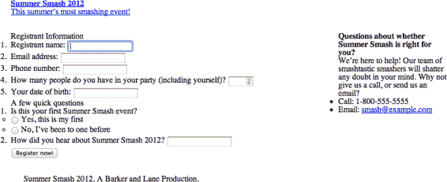

**图 6-1.** 我们已经完成了页面的基本布局，但在样式方面还可以做得更好。

## 页眉：从顶部开始

我们将从页面顶部开始，逐步向下。目前，我们的页眉非常朴素，看起来并不有趣。它实际上只是几个链接，字体、大小和颜色都相同。我们可以做得更好！首先，让这些标题看起来像标题，而不是文本链接：

```
header {
  background-color: #333;
}
header a {
  text-decoration: none;
  color: white;
  text-align: center;
}
header h1 {
  font-size: 3em;
  font-family: Helvetica, Arial, sans-serif;
}
header p {
  font-size: 1.2em;
  font-family: Helvetica, Arial, sans-serif;
}
```

好的，我们再次取得了进展。我们为页眉设置了深灰色背景色，去掉了链接的下划线，将其变为白色，并居中显示。

我们还增大了页眉和标语行的字体大小，并将字体改为 Helvetica。图 6-2 展示了我们取得的进展。


Helvetica 对我们来说，实在无法传达出“夏日狂欢”的感觉；我们需要一种更具创意的字体来担当此任。遗憾的是，我们不能指望用户本地都安装了我们的首选字体，因此不能随意指定任何字体。在过去，这确实是个难题，设计师们常常转而使用图片来显示字体。但这样做在语义上并不理想，对吧？肯定有更好的办法！

126

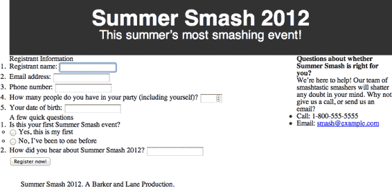

《CSS3 实战：从设计到部署》

**图 6-2.** 未使用惊艳字体时的样式化标题

## 探索字体的世界

幸运的是，处理字体有更好的方法。借助现代浏览器，你可以指定替代字体，并向最终用户提供字体文件（注意某些字体的版权限制！）。网上已经出现了一些帮助完成这一过程的网站，其中包括一家知名搜索巨头——谷歌。在撰写本文时，谷歌在其“Google Web Fonts”网站上提供了超过 400 种字体，你可以选择一种字体，链接到谷歌为你托管的特殊样式表，然后在你的网站上使用该字体。

这有点难以描述，所以我们直接来看代码。首先，我们前往 [www.google.com/webfonts](http://www.google.com/webfonts)，选择一种符合我们“夏日狂欢”需求的字体。“Frijole”看起来是个候选，我们就选它。谷歌让后续操作变得简单；我们只需复制粘贴它提供的代码即可。

在 `registration.html` 中，我们将 `<head> </head>` 部分替换为以下内容：

```html
<head>
<meta charset="utf-8">
<title>夏日狂欢 2010 注册</title>
<link href="http://fonts.googleapis.com/css?family=Frijole" rel="stylesheet">
<link rel="stylesheet" href="css/style.css">
<script src="/js/javascript.js"></script>
</head>
```

接下来，我们对标题的 CSS 样式做一些调整：

```css
header h1 {
  font-size: 3.5em;
  font-family: "Frijole", Arial, sans-serif;
  color: #eee;
}
```

127

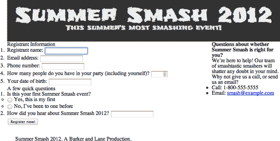

第 6 章

```css
header p {
  font-size: 1.2em;
  font-family: "Frijole", Arial, sans-serif;
  color: #ccc;
}
```

每种字体都略有不同，因此我们在选定字体后调整了 `<h1>` 元素的大小。例如，使用纯白色在这种粗体字体下有点刺眼，所以我们把 `<h1>` 和 `<p>` 都设为浅灰色。

`font-family` 规则是神奇之处。我们在文档的 `<head>` 中直接链接了来自谷歌的样式表，该样式表描述了 Frijole 字体；它为那些电脑上没有安装该字体的用户提供了必要的文件。然后我们可以使用 `font-family` 构建一个可接受的字体堆栈。查看图 6-3，体验更惊艳的效果。

**图 6-3.** Frijole 字体简直在呐喊“惊艳”！

趁此机会，我们把页面的默认字体改为 Verdana（取代大多数浏览器默认的 Times/Times New Roman）：

```css
div#pagewrap {
  width: 80%;
  margin: 4em auto;
  font-family: Verdana, Arial, sans-serif;
}
```

## 呼吸空间：拉开间距

现在所有元素大致布局好了，但让我们在元素之间添加一些间距，让页面看起来更美观。先从标题开始，页面标题（`<h1>`）和标语（`<p>`）看起来有点拥挤。我们在它们之间添加一些间距，同时拉开标语中各个字符的间距——它们看起来有点挤在一起。

128

《CSS3 实战：从设计到部署》

```css
header p {
  font-size: 1.2em;
  font-family: "Frijole", Arial, sans-serif;
  color: #ccc;
  margin: 0.7em 0 0 0;
  letter-spacing: 1px;
}
```

目前这样就可以了。现在我们来拉开内容区块的间距：

```css
section#main {
  float: left;
  margin: 2em 2%;
}
```

在上面的代码片段中，我们为 `#main` 部分设置了上下 `2em` 的外边距，使其与页眉和页脚保持距离。同时左右两侧各缩进 `2%`。接下来，我们清理一下表单：

```css
fieldset {
  padding: 0.5em 1% 1em;
}

legend {
  text-transform: uppercase;
  font-size: 1.2em;
  font-weight: bold;
  padding-bottom: 3px;
  border-bottom: 1px solid #333;
  width: 100%;
}

form ol, form ul {
  list-style-type: none;
  margin: 0 2%;
}

form li {
  margin: 0.5em 0;
}

label {
  font-size: 0.8em;
}

form ol li label {
  display: block;
}

form ul li label {
  display: inline;
}
```

这里声明了很多外边距和内边距。还有一些其他需要注意的地方。表单中的有序列表 `<ol>` 和无序列表 `<ul>` 都被设置了 `list-style-type: none`。尽管表单元素包含在列表中，但我们不希望列表像普通列表那样显示数字和项目符号。

129

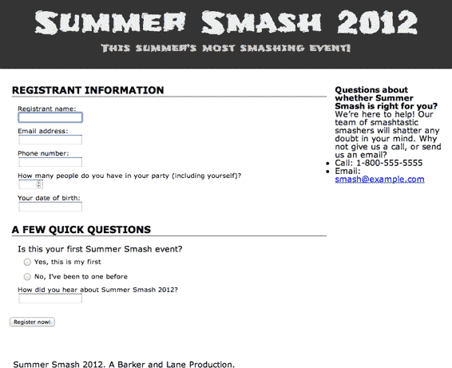

第 6 章

我们将有序列表中的标签 `display` 类型改为 `block`，这样输入字段会出现在下一行。同时，我们覆盖了无序列表（单选按钮）中标签的显示类型，使表单元素与标签同行显示。

最后，我们对 `<legend>` 元素进行了样式化，使其更突出，像章节标题一样醒目。它们的文本稍大，并以大写和粗体显示。我们还在其底部添加了 `1px` 的边框，为页面提供视觉分割。

现在一切开始融合在一起，如图 6-4 所示！

下载自 Wow! eBook <www.wowebook.com>

**图 6-4.** 页面格式接近完成

## 给表单元素加点样式

我们的输入字段看起来有点单调乏味。让我们为它们应用一些样式，提升一下视觉效果：

```css
input[type="text"], input[type="number"], input[type="tel"], input[type="email"], input[type="date"] {
  width: 50%;
  padding: 0.5em 0.7%;
  margin-top: 0.4em;
  font-size: 1em;
  color: #eee;
  border: none;
  background-color: rgba(0,0,0,0.6);
  -webkit-border-radius: 4px;
  -moz-border-radius: 4px;
  -o-border-radius: 4px;
  border-radius: 4px;
}
```

130

《CSS3 实战：从设计到部署》

这里我们使用了属性选择器（`type=`）来定位除单选按钮之外的所有元素（我们不希望单选按钮宽度为 50%，它们会单独处理）。我们为所有这些元素设置了 `width`、`font-size`、`padding`、上外边距、`color` 和 `border`——这些声明相当直接。不过背景色和最后四行需要稍作解释。

对于 `background-color`，我们没有声明颜色名称（如 `red` 或 `green`），也没有使用十六进制值（如 `#666666`）。相反，我们使用了 RGBA 值，这是 CSS3 支持的一种新颜色模型。RGBA 允许我们指定红色、绿色和蓝色的用量（前三个值分别对应；这里三个零产生黑色），以及颜色的不透明度（最后一个值设置为 60% 不透明度）。

不过，数字字段和出生日期字段看起来有点奇怪；考虑到它们要容纳的数据，它们太宽了。让我们覆盖这些宽度：

```css
input[type="number"], input[type="date"] {
  width: 20%;
}
```

最后，还有一个小细节：我们的提交按钮看起来有点奇怪，因为它是浅灰色，而页面其他元素是深灰色。让我们修正一下：

```css
input[type="submit"] {
  background-color: rgba(0,0,0,0.6);
  color: #eee;
  padding: 0.5em 0.7%;
  font-size: 1em;
  border: none;
  -webkit-border-radius: 4px;
  -moz-border-radius: 4px;
  -o-border-radius: 4px;
  border-radius: 4px;
  margin-left: 2%;
}
```

这里没有什么特别之处：代码基本上模仿了我们对其他表单元素所做的处理。


# 第 6 章

我们为按钮添加了左边距，并将提交按钮与其他元素对齐。现在在浏览器中检查进度（见图 6-5）。

131

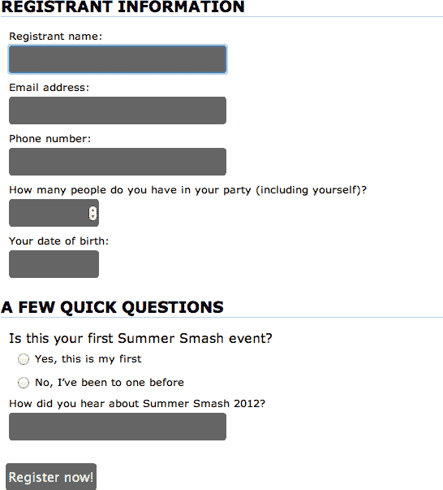

**图 6-5.** 美化后的表单

## 侧边栏样式

注册表单的侧边栏包含一些有用的客户服务信息。我们为用户提供了在遇到问题或疑虑时联系我们的一种方式，但这些信息需要更突出一些：

```css
aside {
  background-color: #ccc;
  padding: 1em 2%;
  -webkit-border-radius: 4px;
  -moz-border-radius: 4px;
  -o-border-radius: 4px;
  border-radius: 4px;
}
```

132

《CSS3 实战：从设计到部署》

当我们这样做时，遇到了一个小问题：侧边栏被推到了页面下方。

还记得我们之前讨论的盒模型吗？这里，通过给`aside`添加水平内边距，我们加宽了该元素，导致它无法与注册表单并排浮动。修复方法很简单——只需从之前的声明中减去一些宽度：

```css
aside {
  width: 21%;
  float: right;
}
```

我们没有将宽度声明为 25%，而是设置为 23%，并加上两个 1%的内边距（这样`aside`的宽度与之前保持一致）。但还有更多工作要做：侧边栏中的文本挤在一起，看起来非常糟糕。让我们清理一下各个元素：

```css
aside h2 {
  font-size: 1em;
  line-height: 1.3em;
  text-transform: uppercase;
  margin-bottom: 1em;
}

aside p {
  font-size: 0.8em;
  line-height: 1.2em;
  margin-bottom: 1.5em;
}

aside ul {
  list-style-type: none;
  font-size: 0.8em;
  line-height: 1.5em;
}
```

看起来还不错。但我们不太喜欢电子邮件链接默认的蓝色下划线样式。让我们对它做些特别处理：不仅要改变链接的样式，还要添加一点交互效果，当用户鼠标悬停在链接上时，会出现一些动画。

## CSS3 过渡

CSS3 的新特性之一是引入了过渡效果。过渡允许你在元素的两种状态之间进行动画。这意味着，你可以让某个元素从蓝色逐渐过渡到红色，而不是瞬间改变。过渡通常包含三部分：`transition-property`（要改变的内容）、`transition-duration`（改变所需的时间）和`transition-timing-function`（过渡随时间变化的速度）。具体如下：

```css
aside a {
  color: #333;
  background-color: transparent;
  text-decoration: none;
  -webkit-transition: all 3s ease;
  -moz-transition: all 3s ease;
  -o-transition: all 3s ease;
  transition: all 3s ease;
}

aside a:hover {
  color: #c00;
  background-color: black;
  font-weight: bold;
}
```

在第一个声明中，我们关闭了下划线，设置了过渡效果，并将链接颜色设为深灰色。我们还明确声明了背景色为透明（这是为了在 Firefox 中正常工作所必需的）。在第二个声明中，我们使用了 `a:hover` 伪类来指定鼠标悬停在链接上时的效果。这里，我们将链接颜色改为红色，字体加粗，背景色改为黑色。颜色可以产生过渡效果，但字体粗细不能——这意味着当用户鼠标悬停在链接上时，字体立即加粗，而颜色会在半秒内逐渐变为红色。

让我们暂停一下，更详细地看看这些声明。首先，我们编写了多个厂商（即浏览器）特定的声明，它们都实现相同的功能。你可能会问为什么这样做，完全是因为 CSS3 仍处于初期阶段。某些浏览器支持 CSS3 过渡，而另一些不支持。这里，我们专门针对一些支持该特性的浏览器，最后以通用的 `transition:` 声明结尾。随着时间的推移和浏览器支持的改善，我们将能够去掉这些厂商特定的规则；但目前，它们还是必需的。

我们还应该剖析其中一个声明，解释其含义。第一个属性 `all` 告诉浏览器对所有支持的属性进行过渡。我们也可以改变链接的大小、旋转或位置；指定 `all` 可以确保所有这些变化都能平滑过渡。

`3s` 表示过渡持续的时间。三秒足够慢，我们能够实际看到变化。此外，`ease` 表示时间函数。这里有六种可用的时间函数，最好的体验方式就是亲自尝试。例如，尝试将 `ease` 替换为 `ease-in`、`ease-out`、`ease-in-out`、`linear` 或 `cubic-bezier`，看看它们各自的效果。别担心，我们不会走远。

还有其他属性可以进行过渡。一些常用的包括大小（可以让元素变大或缩小）、旋转（让元素旋转）、背景颜色和透明度（让元素出现或消失）。

## 页脚美化

我们终于到达了页面底部。页脚通常被忽视，因为它位于页面最下方。然而，页脚往往包含非常有价值的信息。在我们的例子中，我们让所有人知道谁是 2012 年夏季大满贯的幕后推手——臭名昭著的推广人 Barker 和 Lane！这需要一些样式：

```css
footer {
  border-top: 1px solid #666;
  color: #c00;
  font-family: Zapfino, Verdana, sans-serif;
  font-size: 0.8em;
}
```

134

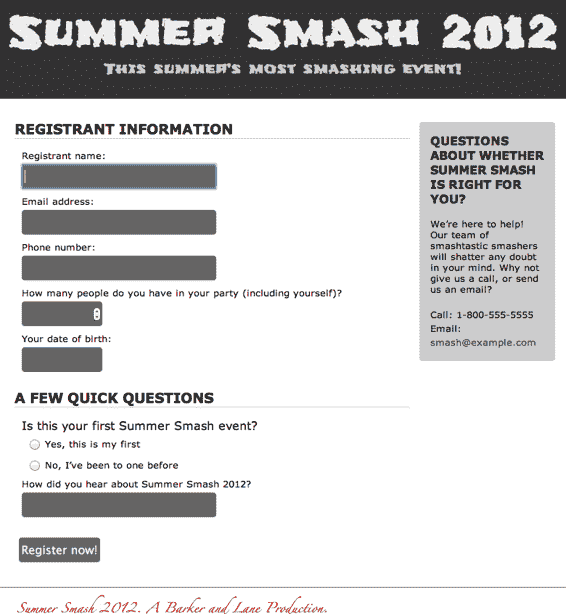

《CSS3 实战：从设计到部署》

我们通过将文本颜色改为漂亮的深红色（红色）来为页脚增添一些特色。我们还稍微减小了字体大小——没必要让它从页面上跳出来！——并设置了一个包含 Zapfino 和 Verdana 的字体栈。我们没有像处理 Frijole 字体那样将 Zapfino 字体作为单独的样式表包含进来；这意味着，如果访问我们网站的用户电脑上安装了 Zapfino 字体，他们就会看到页脚以漂亮的草书字体显示。如果没有安装，也没关系；我们会用 Verdana 字体显示。

有些设计师可能会对这个想法感到不安。如果字体样式对你的设计至关重要，那就多花点功夫把它包含进来。但在这里，页脚只包含一些元信息，所以没有必要过于纠结。现在让我们最后看一眼页面（见图 6-6）。

**图 6-6.** 完成的页面

135

## 完整代码

本章中我们四处调整，这里改改值，那里调调参数，所以我们认为在继续之前，应该给你一份完整的样式表清单。我们完成的 `style.css` 样式表如下：

```css
/* RESET STYLES */
html, body, div, span, object, iframe,
h1, h2, h3, h4, h5, h6, p, blockquote, pre,
abbr, address, cite, code,
del, dfn, em, img, ins, kbd, q, samp,
small, strong, sub, sup, var,
b, i,
dl, dt, dd, ol, ul, li,
fieldset, form, label, legend,
table, caption, tbody, tfoot, thead, tr, th, td,
article, aside, canvas, details, figcaption, figure,
footer, header, hgroup, menu, nav, section, summary,
time, mark, audio, video {
  margin:0;
  padding:0;
  border:0;
  outline:0;
  font-size:100%;
  vertical-align:baseline;
  background:transparent;
}

body {
  line-height:1;
}

article,aside,details,figcaption,figure,
footer,header,hgroup,menu,nav,section {
  display:block;
}

nav ul {
  list-style:none;
}

blockquote, q {
  quotes:none;
}

blockquote:before, blockquote:after,
q:before, q:after {
  content:";
  content:none;
}

a {
  margin:0;
  padding:0;
  font-size:100%;
  vertical-align:baseline;
}
```


```
background:transparent;

}

/* change colours to suit your needs */

ins {

background-color:#ff9;

color:#000;

text-decoration:none;

}

/* change colours to suit your needs */

mark {

background-color:#ff9;

color:#000;

font-style:italic;

font-weight:bold;

}

del {

text-decoration: line-through;

}

abbr[title], dfn[title] {

border-bottom:1px dotted;

cursor:help;

}

table {

border-collapse:collapse;

border-spacing:0;

}

/* change border colour to suit your needs */

hr {

display:block;

height:1px;

border:0;

border-top:1px solid #cccccc;

margin:1em 0;

padding:0;

}

input, select {

vertical-align:middle;

}

/* END RESET */

/* Layout Block level elements */

div#pagewrap {

width: 80%;

margin: 4em auto;

font-family: Verdana, Arial, sans-serif;

}

137

Chapter 6

header {

padding: 1em 0 2em;

}

section#main {

float: left;

margin: 2em 2%;

}

section#registration_form {

width: 74%;

float: left;

padding: 0 1% 0 0;

}

aside {

width: 21%;

float: right;

}

footer {

clear: both;

padding: 2em 3%;

}

/* Header */

header {

background-color: #333;

}

header a {

text-decoration: none;

color: white;

text-align: center;

}

header h1 {

font-size: 3.5em;

font-family: "Frijole", Arial, sans-serif;

color: #eee;

}

header p {

font-size: 1.2em;

font-family: "Frijole", Arial, sans-serif;

color: #ccc;

margin: 0.7em 0 0 0;

letter-spacing: 1px;

}

/* Form */

fieldset {

padding: 0.5em 1% 1em;

}

138

Developing CSS3 in Practice: From Design to Deployment

legend {

text-transform: uppercase;

font-size: 1.2em;

font-weight: bold;

padding-bottom: 3px;

border-bottom: 1px solid #333;

width: 100%;

}

form ol, form ul {

list-style-type: none;

margin: 0 2%;

}

form li {

margin: 0.5em 0;

}

label {

font-size: 0.8em;

}

form ol li label {

display: block;

}

form ul li label {

display: inline;

}

input[type="text"], input[type="number"], input[type="tel"], input[type="email"], input[type="date"] {

width: 50%;

padding: 0.5em 0.7%;

margin-top: 0.4em;

font-size: 1em;

color: #eee;

border: none;

background-color: rgba(0,0,0,0.6);

-webkit-border-radius: 4px;

-moz-border-radius: 4px;

-o-border-radius: 4px;

border-radius: 4px;

}

input[type="number"], input[type="date"] {

width: 20%;

}

input[type="submit"] {

background-color: rgba(0,0,0,0.6);

color: #eee;

padding: 0.5em 0.7%;

font-size: 1em;

139

Chapter 6

border: none;

-webkit-border-radius: 4px;

-moz-border-radius: 4px;

-o-border-radius: 4px;

border-radius: 4px;

margin-left: 2%;

}

/* Aside */

aside {

background-color: #ccc;

padding: 1em 2%;

-webkit-border-radius: 4px;

-moz-border-radius: 4px;

-o-border-radius: 4px;

border-radius: 4px;

}

aside h2 {

font-size: 1em;

line-height: 1.3em;

text-transform: uppercase;

margin-bottom: 1em;

}

aside p {

font-size: 0.8em;

line-height: 1.2em;

margin-bottom: 1.5em;

}

aside ul {

Download from Wow! eBook <www.wowebook.com>

list-style-type: none;

font-size: 0.8em;

line-height: 1.5em;

}

aside a {

color: #333;

background-color: transparent;

text-decoration: none;

-webkit-transition: all 3s ease;

-moz-transition: all 3s ease;

-o-transition: all 3s ease;

transition: all 3s ease;

}

aside a:hover {

color: #c00;

background-color: black;

font-weight: bold;

}

140

Developing CSS3 in Practice: From Design to Deployment

/* Footer */

footer {

border-top: 1px solid #666;

color: #c00;

font-family: Zapfino, Verdana, sans-serif;

font-size: 0.8em;

}
```

### 关于浏览器兼容性的快速说明

我们在本章开头就声明过，希望你在学习本章时暂时忽略其他浏览器，专注于在 Google Chrome 上进行测试。我们之所以提出这个要求，是因为在撰写本文时，Chrome 对我们讨论的新 CSS3 属性提供了最好的支持之一。这里需要强调的是，CSS3 仍然是一个工作草案，目前还不是一个完全批准的标准。

我们确实是在处理前沿技术。因此，浏览器的支持程度会有很大差异。

CSS3 在 Safari、Opera、Chrome 和 Firefox 中得到了相当好的支持。Internet Explorer 10 及更高版本也提供了不错的支持。你可能会问，为什么我们要考虑使用这种支持不完善的技术？答案很简单：当 CSS3 得到支持时，效果非常棒。而当它不被支持时，也不会出现任何问题（无害无过）。CSS3 在得到支持时能够提升用户体验。可以这样理解：作为开发者，你是在奖励你的最终用户使用最新的技术！

### CSS 媒体类型与创建打印样式表

到目前为止，你已经了解了如何使用 CSS 在计算机屏幕上创建生动的设计。这非常方便，但 CSS 还能做更多。由于其灵活性来自于能够使用同一源文档并以不同方式显示，你可以利用刚刚学到的所有知识，为页面创建全新的打印外观。这需要两个步骤：

1. 创建一个新的样式表（或在现有样式表上添加一部分），并将其声明为打印样式表。
2. 编写新的 CSS 规则，以适当的方式重新设计页面以适应纸张。

要专门为打印媒体定义样式，你需要使用 CSS 预定义的媒体类型。回想一下，原始样式表是这样嵌入到 HTML 文档中的：

`<link rel="stylesheet" href="css/style.css">`

这个样式表实际上是针对所有可能的媒体类型的样式表。其中一种媒体类型是 `screen`；另一种，你可能已经猜到了，是 `print`。换句话说，样式表元素在浏览器中实际上是这样的：

`<link rel="stylesheet" href="css/style.css" media="all">`

如果我们想限制所有 CSS 规则仅适用于计算机显示器，我们可以这样定义 CSS 样式表：

`<link rel="stylesheet" href="css/style.css" media="screen">`

事实上，这可能是创建大多数页面打印版本的最简单方法，因为它会导致浏览器在用户打印页面时忽略我们所有的 CSS 规则，我们的设计将恢复到我们开始之前的无样式外观。

让我们为 Summer Smash 注册表单创建一个新的、非常简短的打印样式表（有些人不喜欢在线提交信息，所以我们可以让他们打印出来并邮寄）。这个样式表建立在我们已经完成的所有工作之上。我们不会做得太复杂，只是稍微清理一下，并从打印视图中移除某些不必要的元素。

将这个新样式表添加到组合中后，页面的 HTML 头部现在看起来像这样：

```
<!DOCTYPE html>
<html lang="en">
<head>
<meta charset="utf-8">
<title>Summer Smash 2010 Registration</title>
<link href="http://fonts.googleapis.com/css?family=Frijole" rel="stylesheet">
<link rel="stylesheet" href="css/style.css">
<link rel="stylesheet" href="css/print.css" media="print">
<script src="/js/javascript.js"></script>
</head>
```

我们不想浪费整片森林的纸张，也不想因为频繁往返打印机而把自己逼疯。因此，在开发打印样式表时，我们会将 `media="print"` 属性从代码中移除。这样会在屏幕上渲染我们的打印样式，以便我们能够按照自己的喜好调整外观（完成后可以再添加这些样式）。这样做会向浏览器发出以下信号：

“这只是一个没有特定针对任何媒体的样式表，因此将其应用于所有地方。”


# 第 6 章

让我们在`/css`目录下创建一个名为`print.css`的新文件，并开始编写新的 CSS 规则来覆盖已有的规则。就像我们之前做的那样，我们将从上到下逐一检查设计（及其样式表），修改需要修改的部分，其余保持不变。在顶部，有页面背景以及文本和链接颜色的全局规则。

尽管大多数浏览器默认不打印背景，我们还是显式地关闭所有背景颜色和图片。这样可以节省访问者的墨水，也更环保。

此外，由于链接在打印页面上没什么用，我们将所有链接变为黑色并移除下划线，使其看起来像普通文本。这样做之后，我们就能看到描述性锚文本（而不是像“点击这里”这样的锚文本）如此重要的另一个原因：

```
html, body {
background-color: #fff;
background-image: none;
color: #000;
}
body {
margin: 0.25in;
}
a {
text-decoration: none;
color: #000;
}
```

142

《CSS3 实战：从设计到部署》

注意，这些 CSS 规则只覆盖了之前规则中必须覆盖的部分，而忽略了我们要保留的声明，比如字体大小和字体样式。还要注意，由于我们现在处理的是物理媒介，使用物理空间固有的长度值（如英寸）是合理的。

接下来，让我们稍微清理一下页眉，以免页面上出现一大块深色条纹。我们可以保留字体的特性，但将其改为白底黑字：

```
header {
background-color: #fff;
}
header h1, header p {
color: #000;
text-align: left;
}
```

现在让我们清理一些区块，从页面中移除侧边栏和页脚——它们对于打印的注册表单来说并不是必需的：

```
div#pagewrap {
width: 100%;
}
aside, footer {
display: none;
}
section#main {
float: none;
}
section#registration_form {
width: 100%;
float: none;
}
```

最后但同样重要的是，那些深灰色的框框写起来有点困难。通常纸质表单在需要填写答案的地方只有实线——这里也更有意义。

```
input[type="text"], input[type="number"], input[type="tel"], input[type="email"], input[type="date"] {
background-color: #fff;
border-bottom: 1px solid #000;
font-size: 1.3em;
-webkit-border-radius: 0;
-moz-border-radius: 0;
-o-border-radius: 0;
border-radius: 0;
width: 100%;
}
input[type="submit"] {
display: none;
}
```

143

我们将背景色设为白色，底部添加黑色边框，增大字体大小（使线条变大，以便有更多书写空间），关闭圆角，并将字段宽度设为 100%。我们还趁机隐藏了提交按钮——这在打印副本上确实没什么用：

```
html, body {
background-color: #fff;
background-image: none;
color: #000;
}
body {
margin: 0.25in;
}
a {
text-decoration: none;
color: #000;
}
header {
background-color: #fff;
}
header h1, header p {
color: #000;
text-align: left;
}
div#pagewrap {
width: 100%;
}
aside, footer {
display: none;
}
section#main {
float: none;
}
section#registration_form {
width: 100%;
float: none;
}
input[type="text"], input[type="number"], input[type="tel"], input[type="email"], input[type="date"] {
background-color: #fff;
border-bottom: 1px solid #000;
font-size: 1.3em;
-webkit-border-radius: 0;
-moz-border-radius: 0;
-o-border-radius: 0;
border-radius: 0;
width: 100%;
}
input[type="submit"] {
display: none;
}
```

144

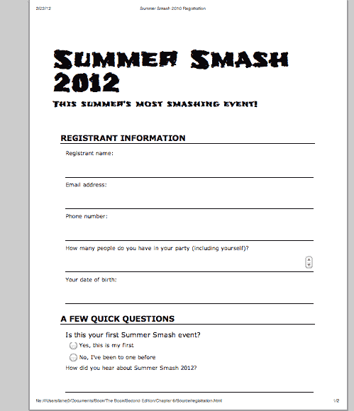

《CSS3 实战：从设计到部署》

我们完成的打印样式表只有 45 行，但在打印时它极大地改变了注册表单的外观。等等！别忘了把`media="print"`属性加回去，否则这个样式表会到处改变表单的外观！打印注册表单时，我们应该会看到类似于图 6-7 的效果。

**图 6-7.** 注册表单的打印预览

145

## 为其他媒体类型和设备设计

如你所见，为不同媒体类型创建新样式表相当简单。真正需要的只是理解目标媒体及其工作原理。对于打印页面，这应该很容易，因为我们大多数人（即使不是全部）都非常熟悉打印页面能做什么和不能做什么。棘手的是其他媒体类型——尤其是手持设备媒体类型。

幸运的是，我们一直在使用相对单位（em 和%）而不是绝对单位来设计许多元素。在下一章中，我们将进一步提升，将注册表单从在电脑屏幕上看起来不错，转变为能够“响应”其所在设备。我们将把简陋的注册表单转换为在 iPhone、Android 设备和平板电脑（如 iPad 或 Kindle Fire）上完美运行的注册表单。它在传统屏幕上也会继续保持出色的外观。

我们不会为这些设备分别开发单独的样式表；相反，我们会在各处添加一些例外，使内容在任何分辨率下都能看起来和运行得很好。相信我们：我们已经走在正确的道路上了。

## 总结

正如我们所见，在 CSS 样式表中实现设计相对直接，但可能因众多因素而变得复杂，例如浏览器错误或显示媒介的自然差异。通过 Summer Smash 2012 的简单设计，我们看到了许多例子，说明为网页设计与为打印页面设计截然不同。我们还看到了一些常用技术的例子，这些技术利用网页的灵活性和流动性来最大化网页的可用性。

通过使用动态伪类，我们添加了在打印页面上无法实现的交互性。我们使用浮动块布局页面，并使用目前并非所有浏览器都完全实现的 CSS 规则进一步设计了表单。最后，我们学习了如何获取原始样式表并在几分钟内修改它，以创建页面的打印版本。

显然，仅利用 HTML 和 CSS 提供的功能，我们就能完成很多事情。然而，在创建动态效果方面，网络浏览器能提供的远不止 CSS 动态伪类所提供的少量交互性。在后续章节中，我们将介绍如何利用 JavaScript 的全部力量，这是一种基于标准的、功能完备的编程语言，直接嵌入在网页浏览器中。这将使我们能够将网页提升到一个全新的水平。

146


# 第 7 章 响应式设计


响应式设计是一个旧概念的新名称。过去，术语`responsive`主要用来描述网站的速度（即，如果一个网站速度快，就说明它的响应时间好）。最近，这个术语被赋予了新的用途。现在，响应式网站指的是能够根据其视口做出响应的网站。过去，网页设计师只需关注最低 640 像素×480 像素和最高 1280×1024 像素的屏幕分辨率。有两个因素导致了下限降低和上限提高。首先，用于访问网络的移动和平板设备急剧增加，将下限一路拉低至 240×320 像素。其次，屏幕分辨率的急剧提升以及宽屏显示器的普及，将分辨率上限提高到了 2560×1440 像素（甚至可能更大）。面对如此多样的设备，我们该如何制作一个看起来不错的网站呢？

## 为什么要费心？

第一个值得问的问题是：“我到底该不该费这个心？”答案很简单：你可能别无选择。如今很多客户都要求他们的网站能在 iPhone 上运行。如果是这种情况，你有两种选择：构建一个响应式网站，或者加倍努力，为完全相同的内容构建两个并行的网站。

不过，如果客户没有明确要求，你该如何判断响应式网站是否合理呢？首先，站在访客的角度思考。根据你正在制作的网站类型，可能不值得增加这些麻烦。人们会在外出时频繁访问这个网站吗？他们需要执行哪些操作？

对于某些网站，决定是显而易见的：任何与旅行和旅游相关的内容，都可能从移动友好的视图中受益。你有多希望自己最喜欢的餐厅能让你在手机上查看菜单？也许它已经做到了，这就是它成为你最爱的原因！

另一个很好的例子：在我们居住的地方，冬天有时会有非常猛烈的暴风雨，经常停电。当地的电力公司有一个非常棒的移动友好（虽然不是响应式）网站，你可以查看影响你所在区域的停电状态，并查看预计恢复供电的时间。停电期间，很少有人能启动台式电脑并连接互联网，因此手机是他们与外界联系的生命线。

现在，我们（希望）已经为构建响应式设计提供了理由，那么该如何驯服这头野兽呢？

## 策略与实践

好消息是，与网页设计者从一开始就必须面对的问题相比，其实并没有什么真正的不同。在这种情况下，技术只是得到了改进，让我们更容易应对这些变化。

开发响应式网站的第一步（也是可以在与客户早期讨论中进行的步骤）是确定你为哪些设备设计。这个网站是否会因手机友好而受益？可以说，任何网站都会从移动友好中受益。例如，如果你有一个移动友好的购物网站，人们会在外出时购物。

如果你有一个移动友好的新闻网站，人们会在通勤途中阅读。如果你有一个移动友好的活动注册网站，人们就能随时随地报名参加你的活动！

我们可能有点过头了；但说实话，你应该考虑一下让你的网站兼容 iPhone 和 Android 是否有任何好处。游客在度假时是否会参考你的网站？他们更可能使用移动设备而不是台式电脑来查找本地信息。另外，想想你使用移动设备的场景；这个企业/组织/个人的网站是否符合其中一种场景。如果你在此陷入僵局，无法决定，那就快速估算一下“转向响应式”需要多少额外时间，并向客户提供一个具体的金额。基于移动网站的预期收益，需要多长时间才能收回成本？

以之前的电力公司为例，移动网站的财务收益在于节省了呼叫中心的成本，因为不需要那么多客服人员接听“我的电什么时候能恢复？”之类的电话。相反，人们可以自己在网上获取这些信息。不难理解，这样的网站很快就能收回成本。

## 其他考虑因素

然而，屏幕尺寸并不是移动设备的唯一限制；带宽也是一个问题。尽管手机网络发展迅速，但它们仍然落后于最快的家庭和企业网络连接。再加上各地区网络覆盖不一致的问题，你会发现有些访客可能不得不以远低于你最初计划的速度来浏览你的网站（如今大多数网站的设计都没有考虑拨号上网）。

你可以采取一些非常简单的方法来考虑速度：为移动设备提供替代的、更小的图片，或者完全省略一些图片。但我们有点操之过急了！

## 接下来呢？

在开发过程中尽早做出决定，会让开发者更容易制作出一个能在各种分辨率下正常工作的网站。你可以选择自上而下（从最高分辨率到最低）或自下而上进行设计。我们认为自下而上的方法实际上更好，因为你从一开始就考虑到了最多的限制。

不幸的是，决定并不总是能尽早做出。我们将继续之前章节的项目；不同之处在于，现在我们决定制作一个能在以下设备上正常工作的网站：

- 台式机
- 平板设备
- 手机

我们已经走到了这一步，所以还需要做一些额外的基础工作。例如，我们是否需要为每种设备制作单独的样式表？是否需要为每种设备制作单独的网站？

这方面有个好消息：通过利用层叠样式表中的“层叠”部分（我们在 CSS 章节中讨论过），我们可以重用大部分已有的样式信息，只覆盖那些需要修改的部分（比如字体大小和边距）。

所以，在这方面我们已经有了一个良好的开端。到目前为止，我们所有的开发工作都使用了相对单位（em 和%）而不是固定单位（像素）。这意味着，在目前的形式下，Summer Smash 2012 网站会进行一定程度的缩放。查看图 7-1，了解我们在 320×480 显示屏上的当前效果。它确实清晰可读，但我们还可以做得更好。如果我们使用了固定单位，情况可能会更糟。

图 7-2 展示了同一个网站使用固定宽度和像素大小文本的效果。请注意，我们需要向右滚动才能看到网站的其余部分。

## 引入@media 查询

我们经常谈论过去，这里再回顾一下。检测特定浏览器或设备并不是一个新想法；事实上，在 90 年代的浏览器大战中，它几乎被视为一种生存工具。如果你想做任何比显示简单的基于表格的页面更复杂的事情，你就得用 JavaScript 来嗅探哪个`useragent`（即哪个网页浏览器）正在访问你的页面。


用户代理嗅探并非万无一失的操作方式。伪造特定的用户代理非常容易，而且这实际上已成为常见做法，因为如果你不使用某些网站偏好的浏览器（例如 Internet Explorer 或 Netscape Navigator），它们可能会拒绝你的访问。因此，你

149

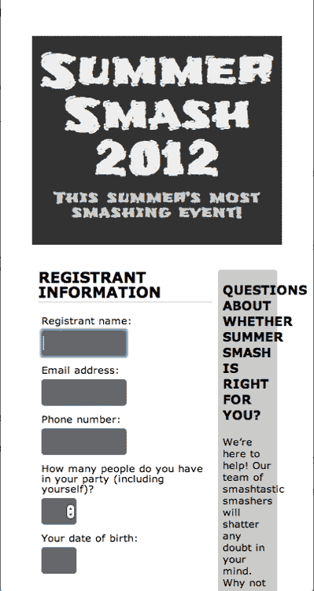

# 第 7 章

下载自 Wow! eBook <www.wowebook.com>

**图 7-1.** 这是我们网站在小屏幕上的当前显示效果。我们的边距和元素大小确实还有改进空间！

根本无法信任这种自我报告。可以这样理解：你熟悉那些写着“你好，我叫”的贴纸，人们会在上面写下自己的名字。你怎么能确定这个人写的是真名呢？你又怎么知道 Reilly 一家没有冒充 Parker 一家呢（顺便说一句，根据情况，这其实可以很有趣！）。

150

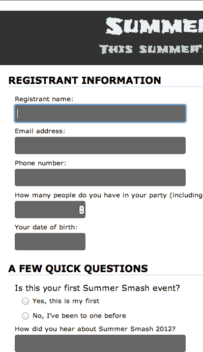

## 响应式设计

**图 7-2.** 情况可能会更糟——如果我们在原始设计中没有使用比例单位，现在看到的就会是这样。

因此，最好能根据某些特征而不是名称来区分事物。

同样，最好寻找 480×320 的屏幕，而不是像下面这样的字符串：`Mozilla/5.0 (iPhone; CPU iPhone OS 5_0_1 like Mac OS X) AppleWebKit/534.46 (KHTML, like Gecko) Version/5.1 Mobile/9A405 Safari/7534.48.3`

这就是 `@media` 查询的用武之地；它允许你指定目标设备的一个或多个属性，以便专门针对该设备应用一条或多条规则。

151

# 第 7 章

在我们的案例中，我们专门针对屏幕媒介（我们也可以使用媒体查询来指定打印样式）。我们还希望定位特定的 `breakpoints`；也就是说，我们要确定某些分辨率，在这些分辨率下我们很可能从一种设备过渡到另一种设备。这将使我们能够在我们确定的三种设备上完美显示网站：

```
@media screen and (max-width: 520px) {

…

}
```

这段小代码表示，对于任何宽度不超过 520 像素的屏幕，我们需要应用后面的规则。这条规则针对我们所有的小型设备，但不包括平板电脑——这些设备的分辨率更高。

### 添加手机专用规则

让我们直接开始，在样式表中添加一些手机专用规则：

```
@media screen and (max-width: 520px){

div#pagewrap {

width: 100 %;

margin: 0;

}

header {

padding: 0.5em;

}

header h1 {

font-size: 1.5em;

}

header p {

font-size: 0.7em;

font-family: Verdana, Arial, sans-serif;

font-weight: bold;

}

}
```

这里有一些调整。首先，页面占满整个屏幕宽度。在这么小的屏幕上，没有必要缩小并居中，所以我们把宽度设为 100% 并移除了边距。

我们还减少了页眉的内边距，并稍微缩小了页眉文字。在 `0.7em` 下，标语使用 Frijole 字体有点难以阅读，所以我们把字体改成了 Verdana（但仍然加粗）。现在我们的页眉看起来不错了（见图 7-3）；然而，内容部分还需要一些调整：

```
section#registration_form {

float: none;

width: 100 %;

}

aside {

float: none;

width: 100 %;

}
```

152

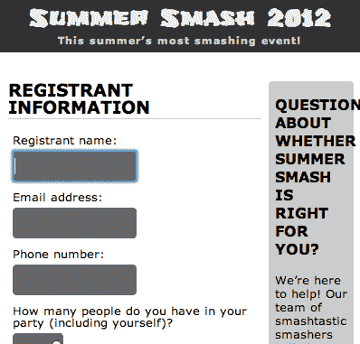

## 响应式设计

**图 7-3.** 我们清理了页眉的大小和内边距，并使布局占满屏幕宽度。

我们移除了浮动，并将内容以更线性的方式排列。小屏幕不太适合多列文本，所以我们移除了侧边栏，并将其放在注册表单之后。现在看起来还算可以，但让我们再做些调整，以提高可读性并充分利用有限的屏幕空间。以下是针对此屏幕宽度的完整媒体查询（见图 7-4）。

```
@media screen and (max-width: 520px){

div#pagewrap {

width: 100 %;

margin: 0;

}

header {

padding: 0.5em;

}

header h1 {

font-size: 1.5em;

}

header p {

font-size: 0.7em;

font-family: Verdana, Arial, sans-serif;

font-weight: bold;

}

section#registration_form {

float: none;

width: 100 %;

margin-bottom: 1em;

}
```

153

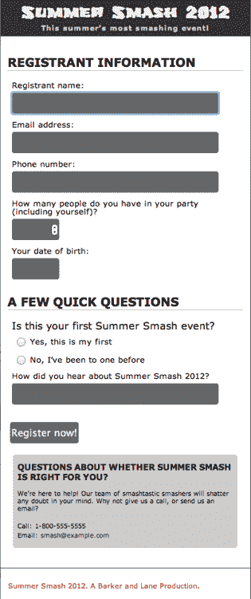

# 第 7 章

**图 7-4.** 我们完成的智能手机友好布局。最显著的变化：我们将侧边栏移到了注册表单下方，并采用了单列布局。

154

## 响应式设计

```
aside {

float: none;

width: 90 %;

font-size: 0.8em;

margin: 0 auto;

}

input[type = "text"], input[type = "tel"], input[type = "email"] {

width: 90 %;

}

footer {

font-family: Verdana, Arial, sans-serif;

font-size: 0.7em;

}

}
```

因为我们使用了 `max-width`，测试起来非常容易。我们只需将浏览器窗口缩小到窄版视图，再放大回常规布局即可。这并不意味着我们不应该在 iPhone/Android 手机上测试，特别是如果我们有一些高级格式或使用了复杂的 JavaScript。但简单的浏览器缩放足以帮助我们快速检查。

### 添加平板专用规则

在通往设备完美的道路上，我们还有最后一站——让我们看看在平板屏幕（如 iPad）上的效果。我们的手机最大宽度为 520 像素，而平板的最大宽度约为 768 像素（实际上，任何比这更宽的屏幕，我们的网站看起来都正常）。所以让我们快速调整窗口大小，看看在 768 像素下的效果，如图 7-5 所示。

总的来说，还不算太糟。不过，我们想解决一些问题。例如，让我们减少页眉周围的空白，并清理侧边栏。我们还可以稍微加宽表单字段。为此，我们将创建一个 `@media` 查询，查找 `max-width` 为 `768px` 的情况……等等！如果我们针对 `max-width` 为 `768px`，那么这里写的任何内容不也会应用到我们的小屏幕设备上吗？

是的，完全正确！我们在这里要做的是，将这些样式声明放在样式表中 520 媒体查询的上方，这样我们在那个 `@media` 查询中做的任何声明都会覆盖 768 媒体查询中的声明。我们还可以利用这一点来简化事情。例如，我们可以将表单字段的宽度声明上移（以及其他一些内容）：

```
@media screen and (max-width: 768px){

div#pagewrap {

width: 95 %;

margin: 1em auto;

}

aside {

font-size: 0.8em;

}

input[type = "text"], input[type = "tel"], input[type = "email"] {

width: 90 %;

}

}
```

155

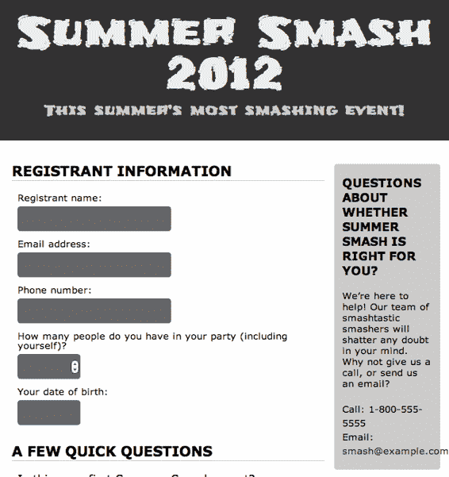

# 第 7 章

**图 7-5.** 平板设备上的当前状态。虽然不算太糟，但我们仍然可以做一些清理，使其在中型屏幕上看起来很棒。

在上面的代码片段中，我们加宽了页面，减少了边距，并稍微缩小了侧边栏（这条规则是从我们的 520 媒体查询中移过来的）。现在我们的页面看起来如图 7-6 所示。在较小的屏幕尺寸下，一切仍然和之前一样，但我们避免了规则重复。

### 整合所有内容

以下是我们的完整源代码：

```
/* 平板样式 */

@media screen and (max-width: 768px){

div#pagewrap {

width: 95 %;

margin: 1em auto;

}
```

156

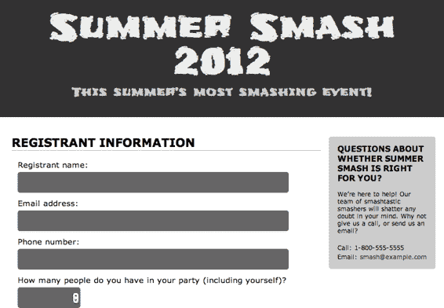

## 响应式设计

**图 7-6.** 我们的平板友好视图

```
aside {

font-size: 0.8em;

}

input[type = "text"], input[type = "tel"], input[type = "email"] {

width: 90 %;

}

}

/* 手机专用样式 */

@media screen and (max-width: 520px){

div#pagewrap {

width: 100 %;

margin: 0;

}

header {

padding: 0.5em;

}

header h1 {

font-size: 1.5em;

}

header p {

font-size: 0.7em;
```


```css
font-family: Verdana, Arial, sans-serif;

font-weight: bold;

}
```

157

# 第 7 章

```css
section#registration_form {

float: none;

width: 100 %;

margin-bottom: 1em;

}

aside {

float: none;

width: 90 %;

margin: 0 auto;

}

footer {

font-family: Verdana, Arial, sans-serif;

font-size: 0.7em;

}

}
```

## 本章小结

利用 CSS 的层叠机制，我们能够逐步增强网站，并为不同设备提供多种显示格式。由于样式可以全局应用，然后根据我们指定的屏幕尺寸条件进行覆盖，因此可以避免大量额外工作，也无需为不同版本重复编写样式表。

在开发初期明确目标设备，并从最小设备入手至关重要。此外，我们应使用相对单位而非绝对单位，并确定需要针对特定设备调整显示的最大宽度断点。接下来，我们需要针对设备优化设计。对于智能手机而言，两列布局并非最佳方案；而对于宽屏显示器，单列文本又显得过于冗长。我们需要据此进行规划。

158


# 第 8 章

## JavaScript 入门

本章将开始讨论 JavaScript 以及编程的一般概念。在此过程中，我们将探索 JavaScript 中编程逻辑的基本构建块。但在开始之前，让我们回顾一下 JavaScript 的历史，以便全面了解其发展脉络，并看清塑造现代 JavaScript 格局的重大事件的全貌。

由于本章旨在介绍 JavaScript，如果你已经对 JavaScript 有初步了解，可以跳过本章。如果你知道什么是变量，或者如何构建条件语句或循环，也可以跳过。另一方面，如果你曾经编辑过别人的代码，但不确定每一行代码的作用，那么你绝对应该阅读本章。本章将帮助你确保熟练掌握该语言的基础知识。

### 什么是 JavaScript？

JavaScript 是 Web 的脚本语言。它嵌入在我们的 HTML 页面中，由浏览器内置的解释器执行，并且可以访问页面上的所有 HTML 元素。因此，我们可以用它来为页面添加交互性。我们还可以用它从外部来源甚至最终用户那里加载和解析信息。现代 JavaScript 简洁、细腻，是任何 Web 开发者技能组合中不可或缺的一部分。

159

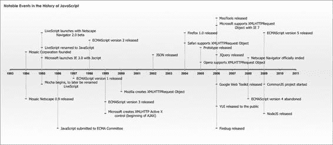

第 8 章

### JavaScript 简史

在深入探讨 JavaScript 的具体细节之前，让我们先回顾一下该语言的历史，以及

其用法如何随时间演变（见图 8-1）。

**图 8-1.** JavaScript 历史上的重要事件

#### 早期历史

布兰登·艾克在网景公司工作时创建了 JavaScript。该语言旨在作为该公司浏览器的胶水语言，因此他为前端添加了脚本功能。据他本人所述¹，他被招募到网景公司，目的是在浏览器中实现一个 Scheme 解释器。该语言最初代号为 Mocha，随后在网景 2.0 beta 版首次发布时被称为 LiveScript。最终，在 1995 年网景 Navigator 2.0B3 版本发布时，它被重命名为 JavaScript。

请记住，1995 年的世界截然不同。市场上的两大主流浏览器是网景 Navigator 和 Internet Explorer。Internet Explorer 尚未集成到操作系统中，而且这两款浏览器都不是免费的，更不用说开源了。

JavaScript 显然很受欢迎，因为不到一年，它就被逆向工程，更名为 JScript，并随同微软希望成为 JavaScript 语言直接竞争对手的 VBScript 一起被纳入 Internet Explorer。

顺便提一下：虽然 VBScript 在其他领域取得了成功——作为 ASP 的首选语言和 Microsoft Office 产品中的胶水语言——但它从未被 Web 开发社区接受为客户端脚本语言。这主要是因为只有 IE 支持它，而 JavaScript 则被所有浏览器支持（尽管有时不幸地被称为 JScript）。

正是在这种背景下——或许部分是由于试图稀释该品牌的结果——网景公司将 JavaScript 提交给 ECMA 委员会（后来称为 Ecma International）进行标准化，成为 ECMAScript。

[¹ http://brendaneich.com/2008/04/popularity/](http://www.merriam-webster.com/dictionary/syntax)

160

JavaScript 入门

需要说明的是，Ecma International 是一个非营利性国际标准组织。ECMA 是欧洲计算机制造商协会的缩写。Ecma International 还负责许多其他标准，包括 C#语言规范、FAT 文件系统和 Eiffel 语言。

#### 现代 JavaScript

就这样，JavaScript 的采用率和流行度随着 Web 的扩展和增长以及浏览体验的改进而不断提高。ECMA 继续发布标准的新更新，浏览器本身也通过本地化方言添加了自己的改进。

最显著的本地化改进无疑是`XMLHttpRequest`对象（`XHR`），它催生了 Ajax（异步 JavaScript 和 XML）的创新。有趣的是，`XHR`最初是作为 IE 5 中的`ActiveX`控件诞生的，后来才被浏览器本地方言采纳为 JavaScript 对象。

随着`XHR`的引入，Web 开发者终于可以从客户端以同步或异步方式向 Web 服务器发送数据或接收数据。这一创新扩展了 Web 应用程序的能力范围，但也增加了 Web 开发的整体复杂性。

为了跟上这种新复杂性对产品提出的更高要求，浏览器制造商——此时数量已大大增加——投入了大量精力来改进和优化各自专有的 JavaScript 解释器（有时也称为 JavaScript 引擎）。截至撰写本文时，主流 JavaScript 引擎有五个：

- Safari 的 Nitro
- Chrome 的 V8
- Firefox 的 SpiderMonkey
- Opera 的 Carakan
- IE 的 Chakra

随着技术能力和浏览器效率潜力的日益复杂，Web 开发者也需要提升自己的技能。想想看：现在可以在运行时将新内容加载到页面中，但这引入了新问题。当页面上的所有信息被更新或替换为新内容时，当前状态会发生什么？如果新内容是异步加载的，在等待数据时页面状态如何？如果数据从未加载会怎样？新数据会覆盖现有数据吗？

随着 Web 开发对代码工艺的要求越来越高，语言的最佳部分被主流化，而缺陷则被规避。

与此同时，Web 开发者越来越熟练地运用 JavaScript 的复杂性，他们也在开发框架和库以加速开发并处理底层功能。Prototype、JQuery 以及许多其他 JavaScript 框架应运而生。每个框架都让 Web 开发者能够实现更多功能并更快完成，但代价是需要学习新的做事方式。

161

第 8 章


这就来到了当今。JavaScript 仍在不断创新，最近出现了诸如 Jasmine 和 QUnit 等框架，用于促进测试驱动开发（TDD）中的单元测试，我们将在[第 10 章](http://dx.doi.org/10.1007/978-1-4302-3789-1_10)中讨论这些内容。你还可以在 Node.js 等新框架中看到这种创新，它使得在 JavaScript 中进行服务器端开发成为可能。

## JavaScript 基础

好了，现在我们已经了解了 JavaScript 的来龙去脉，让我们开始探索这门语言的基础知识。

## 代码放置

JavaScript 可以通过在文档中内联放置 `<script>` 标签，或者链接到外部 JavaScript 文档的方式包含在文档中。无论你选择哪种方式包含 JavaScript，它只能放在页面的 `<head>` 或 `<body>` 部分。

内联 JavaScript 看起来像这样：

```html
<script>
// 这里是一些 JavaScript 代码 ...
</script>
```

当外部引入 JavaScript 时，你需要将外部文件的 URL 放在 `<script>` 标签的 `src` 属性中，并将 `type` 设置为 `"text/javascript"`，以便浏览器知道如何解释正在加载的新数据：

```html
<script src="[外部 js 文件的 URL]" type="text/javascript"></script>
```

外部文件应以 `.js` 扩展名命名，并且只包含纯 JavaScript 代码，不能包含任何 `<script>` 标签或任何 HTML 标签。

如何包含 JavaScript 取决于你自己。你可以选择外部引入 JavaScript，以便在整个 Web 应用程序中共享核心功能。但这样做意味着浏览器必须为每个包含的文件发起一次 HTTP 请求，这可能会增加加载 JavaScript 所需的时间。你也可以选择将所有 JavaScript 内联在页面中，以减少 HTTP 请求的数量，但这会增加浏览器需要下载和解释的页面整体大小。没有唯一的正确答案；你需要根据 Web 应用程序的功能需求、页面大小以及目标受众访问网站的方式来决定最佳方案。

***提示：** 有时将所有的 JavaScript 放在页面底部加载是有用的。这是因为浏览器会从上到下解释页面。将外部脚本放在底部，可以让页面先渲染给最终用户，然后再开始解释 JavaScript。这会造成页面加载更快的错觉。但如果你这样做，请确保页面上的任何内容都不依赖于页面加载时 JavaScript 中存在的对象。*

## 代码执行

放置在 `<script>` 标签根层级或 JavaScript 文档根层级的代码会在加载后立即执行。延迟执行的唯一方法是将代码包装在函数中，因为函数只有在被调用时才会运行：

```html
<script>
// 这段代码会在浏览器读取后立即运行
var userMessage = "hello, world!";

// 这段代码只会在被调用时运行
function initialize(){
  var msg = "hi there";
}
</script>
```

## 注释代码

前面的示例中包含以两个正斜杠开头的行。这些行是注释。注释是代码中不会被解释器执行的行。通常，你在代码中添加注释是为了给自己和后续阅读代码的人留下关于代码的说明。

JavaScript 中有两种注释：单行注释和多行注释。

单行注释以两个正斜杠开头。无论你在哪里插入这两个正斜杠，都会开始一条注释，解释器会忽略它们之后直到换行之前的所有内容。以下代码片段展示了单行注释的有效示例：

```html
<script>
// 这是一条注释
var tempData = "" // 这是一条注释，可能关于 tempData
function initialize(){ // 这是一条注释，可能关于 initialize 函数
}
</script>
```

多行注释以正斜杠加星号（`/*`）开头，以星号加正斜杠（`*/`）结尾。注释开始和结束之间的任何内容都会被解释器忽略。以下是一个多行注释的示例：

```html
<script>
/*
这是一个多行注释
用于表示跨多行的
注释块
*/
</script>
```

为什么要注释代码？注释代码可以提高可读性，让你和其他人能够轻松了解页面上发生了什么。当你隔了几天、几个月甚至几年再回头查看代码时，这会让你受益。它也会帮助接手你代码的下一个开发者。第二部分非常重要；世界正变得越来越小，你在同行社区中因留给下一个人的代码而建立起来的声誉，可能会对你未来产生影响。有很多方法可以让代码更具可读性，注释只是其中之一。随着你在本书中的学习，我们还会指出其他让代码更易读的方法。

## 表达式、空白、分号和压缩

每种语言，包括口语和书面语，都有语法。梅里亚姆-韦伯斯特词典 2 将*语法*定义如下：

*语言元素（如单词）组合成构成成分（如短语或从句）的方式。*

将其应用于 JavaScript，句子被称为表达式。表达式由关键字、变量和值组成。

*关键字*（或保留字）是在语言中具有特殊含义的词，因为它们用于定义原生功能。*变量*（我们很快会详细探讨）是我们创建的用于保存数据（即*值*）的词。

表达式以分号结尾，表达式中的单词由空白分隔。以下代码片段展示了几个表达式的示例：

```html
<script>
var expressionExample = "";
sum = 421 + 42;
var anonFunction = function(){
  // 一些功能
};
</script>
```

表达式也会求值为值。

***提示：** JavaScript 解释器会忽略不必要的空白（空格、制表符和换行符），因此你可以通过压缩来减小 JavaScript 文件的大小。压缩会从代码中移除不必要的空白以及注释。两个流行的压缩工具是 JSMin（[`crockford.com/javascript/jsmin`](http://crockford.com/javascript/jsmin)）和 YUI Compressor（[`developer.yahoo.com/yui/compressor`](http://developer.yahoo.com/yui/compressor)）。*

## 变量

变量是可以为其分配名称的内存块。你可以使用它们来存储、更新和检索数据。可以这样理解：你的计算机（或手机、设备等）拥有有限的内存。内存是 RAM，它在运行时加载并可供存储。你正在运行的浏览器[2](http://www.merriam-webster.com/dictionary/syntax)在内存中占用一定空间，这是浏览器占用并分配给自己使用的内存量。当你在代码中创建变量时，浏览器（通过 JavaScript 解释器）会从这块空间中分配一块内存，并赋予你指定的名称，从而允许你使用那块内存（见图 8-2）。

浏览器占用空间 变量 内存

**图 8-2.** 内存

你可以使用 `var` 关键字在 JavaScript 中创建变量：

```html
<script>
var newVariable = "";
</script>
```


当创建多个变量时，你可以将它们初始化放在一个表达式中，用逗号分隔。这样省去了重复输入 `var` 的麻烦，并减少了 JavaScript 文件中的字符数量。请看以下示例：

```
<script>
// 这种方式效率极低，不算换行总共 30 个字符
var a = 1;
var b = 2;
var c = 3;

// 这种方式更简洁，压缩后仅 16 个字符，是上面示例大小的 53%
var a=1,b=2,c=3;

/* 这种方式可读性更好，如果在发布前自动压缩，仍能获得上面示例的改进效果 */
var a = 1,
    b = 2,
    c = 3;
</script>
```

你使用变量来存储数据，以便对其进行求值和执行操作，但变量中可以存储哪些类型的数据呢？JavaScript 支持多种数据类型，包括 `String`、`Number`、`Boolean`、`Undefined` 和 `Array`。它还支持 `function` 和 `object` 数据类型。下面我们来逐一详细了解这些数据类型。

`String` 数据类型是由单引号或双引号包围的任何字母数字字符：

```
<script>
var myString = "this is a string";
</script>
```

第 8 章 165

`Number` 数据类型是任何数值，包括负数、零和浮点数：

```
<script>
var myNumber = 34;
</script>
```

`Boolean` 数据类型以 19 世纪数学家、哲学家、计算机科学奠基人之一乔治·布尔（George Boole）的名字命名。它表示 `true` 或 `false` 的值。

```
<script>
var myBool = true;
</script>
```

`Undefined` 数据类型用于表示一个变量已被命名，但尚未分配任何数据。它表示缺少数据类型。

`Array` 数据类型表示变量包含一个数组。数组是向量数据类型，因为它们包含多个值。由于 JavaScript 是一种松散类型语言，你可以在数组中存储任何类型的数据，甚至其他数组。当数组包含其他数组时，它们被视为多维数组。

你可以通过使用 `Array` 构造函数，或者直接以数组格式（即用方括号包裹变量，每个值用逗号分隔）为变量赋值来实例化一个新数组：

```
<script>
var first_list = new Array(); // 使用数组构造函数
var second_list = [583, 103, 902]; // 隐式赋值创建新数组
var multidim_list = [ [34, 21, 10] , [88, 310, 34] ]; // 多维数组，即数组的数组
</script>
```

你可以通过索引号（即数组中存储的顺序编号）来检索和设置数组中的值。注意，所有数组都是基于零的，即数组的编号从零开始。

```
<script>
var ind = second_list[0]; // 从数组中检索 583 并存储在 ind 中
second_list[2] = 20; // 将之前的值覆盖为 20
</script>
```

JavaScript 支持的其他数据类型包括函数和对象，我们将在后面详细讨论。

数据类型定义了可以在变量中存储的数据种类，但 JavaScript 是一种松散类型语言（另一个术语是*弱类型语言*）。这意味着，当你声明一个变量并为其分配一种类型的数据后，你可以再为同一个变量分配完全不同的数据类型。以下示例是完全有效的 JavaScript：

```
<script>
var userName = "tom@tom-barker.com";
userName = 21; // userName 原来是字符串，现在变成了数字

// 下面的代码显示数组可以包含不同类型的数据
var myCollection = [23, "test data", true, true, false, -120, [20, "user@tom-barker.com"]];
</script>
```

166 JavaScript 入门

这种方法与强类型语言（另一个术语是*强类型语言*）形成对比。在强类型语言中，你必须在创建变量时声明其数据类型，并且该变量只能存储该类型的数据。

这对如何安全地编写代码有影响。对于松散类型语言，你不需要对变量进行类型转换（即转换），而且数组更加灵活。但在松散类型语言中，你永远无法假设你知道变量的数据类型。

JavaScript 提供了 `typeof` 运算符，允许你检查变量以查看其包含的数据类型：

```
<script>
var myVar = "";
alert(typeof myVar);
</script>
```

现在我们已经了解了变量和表达式是什么，接下来看看如何对变量进行操作以创建更复杂的表达式。

## 条件语句与运算符

你可以通过测试变量中的值或测试表达式求值的结果来控制应用程序中的逻辑流程。这些测试在条件语句中执行。JavaScript 支持以下条件语句：`if`、`else` 和 `else if`。

### 使用条件语句

`if`-`else` 语句的结构如下：

```
if([某个条件进行测试]){
    // 如果条件为真，则执行此代码块
}else{
    // 如果条件为假，则执行此代码块
}
```

你也可以在 `if` 后面跟一个 `else if`；这样的语句结构如下：

```
if([某个条件]){

}else if([某个不同的条件]){
    // 如果第二个条件为真，则执行此代码块
}
```

前面的示例使用 `if` 关键字来测试条件；该条件用括号括起来。条件通常对变量进行求值，可能测试列表的上限、检查变量是否包含预期的数据类型，或检查类似的内容。花括号包围代码块，代码块只是一组表达式，如下例所示：

```
<script>
var userName = "tom@tom-barker.com",
    passWord = "test123";

if(passWord.length > 0){ // 如果变量中有数据
    submitCredentials();
}else{ // 如果变量中没有数据
    promptForCredentials();
}
</script>
```

上面的例子极其简单，但通过它我们可以开始看到我们学过的概念是如何协同工作的。我们创建了两个变量，然后测试其中一个变量（密码）是否有数据。如果有，则提交该变量以供进一步执行；如果没有，则提示用户输入新的凭据。这种技术通过条件语句控制逻辑流程。

### 使用运算符

你使用运算符来测试条件。JavaScript 支持以下运算符：比较运算符、算术运算符、赋值运算符、逻辑运算符和三元运算符。接下来的部分将更深入地介绍这些运算符：

#### 比较运算符

`==`

这是相等运算符；它测试两边的值是否相等。该运算符测试值，但不测试数据类型：

```
if ( sum == 10){

}
```

`===`

这是严格相等运算符；它测试运算符两边的值和数据类型是否都相等：

```
if (sum === "10"){
    // 仅当 sum 是字符串且等于 "10" 时才为真
}
```

`!=`

这是不等运算符。

`!==`

这是严格不等运算符。

`<=`、`<`、`>`、`>=`

这些运算符分别是小于、小于等于、大于、大于等于。

168 JavaScript 入门

#### 算术运算符

`+`

当用于数字时，这是加法运算符：

```
var sum = 45 + 19;
```

当用于字符串时，它变成连接运算符，将两个或多个字符串连接成一个字符串：

```
var username = "tom@tom-barker.com";
var msg = "Welcome, " + username; // 生成 Welcome, tom@tom-barker.com
```

注意，当用于字符串和数字的组合时，数字会被转换为字符串，并执行字符串连接，而不是数字加法。

`-`

这是减法运算符。

`/`

这是除法运算符。

`*`

这是乘法运算符。

`++`


这是递增运算符；它将其作用的值加一：
```
var runningTotal = 1;

runningTotal++; // 现在包含 2
```

--

这是递减运算符；它将其作用的值减一。

`%`

这是取模运算符。当与两个数字一起使用时，它执行除法并返回该计算的余数。

这在程序化绘制网格或确定交替行时最为有用。

- 在绘制网格的情况下，迭代时只需获取当前迭代次数与行中列数的模。当模为零时，开始新的一行。
- 在交替行的情况下，做法同上，但获取当前迭代次数与行数的模，从而得知当前行是奇数行还是偶数行。

我们很快会进一步讨论迭代。

169

# 第 8 章

## 赋值运算符

`=`

这是赋值运算符；用于给变量赋值。

`+=`、`-=`、`*=`、`/=`

这些运算符都是简写形式，用于同时执行算术运算和赋值：
```
sum += 3; // 将 sum 的值加 3
diff -= 1; // 将 diff 的值减 1
prod *= 2; // 将 prod 的值乘以 2
```

## 逻辑运算符

`&&`

这是逻辑与运算符。它将两个或多个条件组合在一起，所有条件都必须为真，整体结果才为真：
```
if((x > 0) && (x <= 10)){
  // x 必须同时大于 0 且小于等于 10，
  // 此条件才为真
}
```

`||`

这是逻辑或运算符。与逻辑与运算符类似，它将两个或多个条件组合在一起，但只需其中一个条件为真，整体结果即为真。

`!`

这是逻辑非运算符。它测试条件中内容的相反值：
```
if !(x < 10){} // 如果 x 不小于 10，则为真
```

## 三元运算符

下载自 Wow! eBook <www.wowebook.com>

你可以使用三元运算符来替代 `if else` 语句。这虽然可读性较差，但会使用更少的字符，从技术上讲，这会使你的 JavaScript 文件字节数更小。如何取舍取决于你以及你所在组织采用的标准。

三元运算符是 `? :`，其结构如下：

`[要评估的条件] ? [条件为真时的结果] : [条件为假时的结果]`

三元运算符返回一个值，因此可用于变量赋值。考虑以下代码示例，它创建了三个变量：

- 一个最大值
- 一个不超过该最大值的随机值
- 一个字符串，用于说明该随机值是否超过最大值的中点：

170

JavaScript 入门

三元运算符的代码如下：
```
<script>
var ceiling = 100,
    random = Math.random()*ceiling,
    returnValue = (random <= (ceiling / 2)) ? "不到一半" : "超过一半";
alert(random + " " + returnValue);
</script>
```

## 迭代

到目前为止，我们已经学会了通过声明变量、给变量赋值、使用运算符和条件语句测试变量来创建表达式。但假设我们想要多次重复同一个表达式或一组表达式，或者以编程方式遍历数组中的每个索引——这时就需要使用循环，也称为*迭代语句*。

JavaScript 支持多种类型的循环；我们将讨论的第一种循环类型是 `for` 循环。

`for` 循环由三部分组成：

- 初始化器
- 条件
- 增量器

每个部分由分号分隔，三者用圆括号括起来，前面加上 `for` 关键字。你想要重复的表达式块用花括号括起来。其结构如下：
```
for ([初始化器] ; [条件] ; [增量器]) {
  // 要重复的表达式块
}
```

`for` 循环的每个部分都如其名：

- *初始化器* 初始化一个变量。
- *条件* 测试一个条件——通常只要条件为真，循环就会继续迭代。
- *增量器* 递增变量。

总体思路是递增（或递减）变量，最终使条件不再为真，从而让循环结束（见图 8-3）。

如果你尝试修改每个部分，就可以测试语言对 `for` 循环支持的各种边界情况。例如，你可以尝试声明并测试多个变量。也可以尝试将变量初始化为一个较大的值，然后递减它来实现倒计时，等等。

仅仅机械地重复相同的事情作用有限。正是由于增量器在每次循环中改变值（并且我们可以访问该值），才使得循环变得有趣得多。

171

第 8 章

初始化

假

条件

真

表达式块

增量

**图 8-3.** 实现一个 for 循环

假设你想遍历数组中的每个索引。为此，只需将迭代变量用作索引，如下例所示：
```
<script>
var my_list = [20, 1003, 394, 2];
for (var x = 0; x < my_list.length; x++){
  alert(my_list[x]); // 将 x 用作索引号
}
</script>
```

JavaScript 还支持 `while` 循环，其结构如下：
```
while([条件]){
  // 要执行的代码块
}
```

它还支持 `do while` 循环，其结构如下：
```
do{
}while([条件])
```

172

JavaScript 入门

需要提醒一点：`for` 循环声明了一个迭代器，你通过测试它来结束循环，但 `while` 和 `do while` 循环没有这样的迭代器。你必须跟踪条件中测试的内容，并确保该测试最终会评估为假；否则，你的循环将永远不会结束（即变成*无限循环*）。无限循环会导致应用程序失败，并且很可能导致浏览器崩溃（较新的浏览器已经开始意识到这个问题，可能会给用户机会终止运行时间过长的代码）。

虽然从技术上讲，它们做的事情相同——重复执行一定次数——但 `for` 循环和 `while` 循环在理念上有所不同。由于 `for` 循环内置了终止条件，它最适合用于遍历已知数量的内容，比如数组或对象中的属性。而 `while` 循环没有内置的终止条件，因此只要测试条件为真，它就会继续循环。因此，它最适合用于游戏引擎循环等场景，其中状态在循环中保持，直到用户或系统事件触发更新状态，从而停止循环。

## 总结

在本章中，我们探讨了 JavaScript 的历史，并讨论了一些影响其流行度和复杂性提升的事件。我们还初步涉足了该语言的基础知识，从创建变量到测试条件和循环。

这些都是编程逻辑的构建块。在下一章中，我们将利用这些概念，开始用 JavaScript 进行抽象思考，使用对象和函数等隐喻概念——甚至深入探讨函数作为一等对象的美妙世界。

173


# 第 9 章

## 深入探索 JavaScript

既然我们已经能够使用循环和条件语句构建更复杂的逻辑，那么让我们将 JavaScript 知识提升到下一个层次。

在本章中，我们将介绍 JavaScript 中一些更高级的概念。例如，我们将探讨面向对象设计——从*为什么*使用对象的策略到*如何*使用对象的战术。理解面向对象设计是一项至关重要的技能，它将适用于你将学习的大多数其他语言。


我们还将学习函数，从如何构造函数等入门概念，到 lambda 演算（即把函数用作变量的艺术）等高级概念。将函数用作变量是函数式编程中的一个关键概念，这是一种非常灵活且可扩展的编程哲学，体现在 Scala、Clojure 和 Lisp 等其他语言中。

接下来，我们将讨论事件——它是让你的代码对用户操作做出反应的粘合剂。最后，我们将研究如何与 DOM（浏览器向 JavaScript 暴露的、用于与页面上的 HTML 元素交互的 API）进行交互，并将我们目前学到的所有内容整合到一个综合示例中。

## 面向对象设计哲学

在讨论对象时，我们首先需要解决的问题是：什么是对象？在抽象层面上，对象是代表概念的隐喻。

这些隐喻可能是高级业务概念，比如系统用户的概念；也可能是系统部件的隐喻，比如目录监视器。无论它们代表什么概念，对象都应该包含该概念的一切，包括定义该概念的内容（属性的值）以及该概念的行为（对象的方法）。

例如，如果一个对象代表一个用户，那么用户的*属性*就是定义用户的东西。

想象一下你在网上填写注册表单时的情景。你通常会输入姓名、电子邮件地址、密码，可能还有街道地址。这些都是在一个给定系统中定义你的属性。

继续用这个类比，*方法*是用户可以执行的操作。以在线购物车为例，用户可以将商品添加到购物车中，或者登录和退出网站。这些都是用户可以通过方法表示的操作。

但在最具体的层面上，对象是函数（在对象上下文中称为方法）和变量（在对象上下文中称为属性）的集合。

我们为什么要使用对象？对象允许我们将与某个给定概念相关的所有信息封装在一个简洁且易于理解的变量中。它们允许我们使用业务案例的语言和术语来构建应用程序的逻辑。

在 JavaScript 中，我们可以通过几种不同的方式创建对象：

■ 使用对象构造函数

■ 使用对象字面量

### 对象构造函数

我们将探索的第一种创建对象的方式是使用对象构造函数。对象构造函数是函数（我们将在下一节更深入地探讨函数），它接受参数，并将传入的值填充到对象的属性中。我们使用 `new` 关键字从对象构造函数*实例化*新对象：

```html
<script>
function user(fname, lname, emailaddress){
    this.firstname = fname;
    this.lastname = lname;
    this.email = emailaddress;
}
var tom = new user("tom", "barker", "tom@tom-barker.com")
</script>
```

在上面的例子中，我们创建了一个名为 `user` 的新对象构造函数，它接受三个参数：

■ 名字（`fname`）

■ 姓氏（`lname`）

■ 电子邮件地址（`emailaddress`）

请注意，属性名是 `firstname`、`lastname` 和 `email`，而函数签名中定义的变量是 `fname`、`lname` 和 `emailaddress`。这是因为它们是不同的变量。属性是通过对象引用的变量（`user.firstname`），而签名中的变量是参数，我们不想混淆两者。我们将在本章后面更详细地讨论参数。

构造函数将传入的值存储到变量中。请注意，这些变量使用 `this` 关键字限定作用域。`this` 关键字将变量暴露为对象的属性；如果我们不使用这个关键字，那么当我们从构造函数创建对象时，将看不到存储的值。

要创建一个新对象，我们只需创建一个新变量。例如，我们可以创建一个 `tom` 对象，并将对象构造函数赋值给它。这将创建一个名为 `tom` 的新对象，其属性被设置为我们传入构造函数的值。

我们可以使用点号表示法访问对象的属性和方法。这意味着我们像 `[对象名].[对象属性]` 这样引用属性和方法。因此，对于上面的例子，我们可以使用以下语法访问 `tom` 对象的 `firstname` 属性：

```html
<script>
log(tom.firstname);
</script>
```

但对象也有方法，所以让我们更新这个例子，为 `user` 对象添加一些可执行的操作：

```html
<script>
function user(fname,lname, emailaddress){
    this.firstname = fname;
    this.lastname = lname;
    this.email = emailaddress;
    this.whoami = function(){
        alert(this.fname);
    };
}
var tom = new user("tom", "barker", "tom@tom-barker.com")
tom.whoami();
</script>
```

在上面的例子中，我们向构造函数添加了 `whoami()` 方法——再次注意，它前面有 `this` 关键字。同样，我们通过点号表示法访问 `whoami()` 方法。

### 对象字面量

在 JavaScript 中创建对象的另一种方式是直接使用对象字面量。通过对象字面量创建对象时，对象被包裹在花括号中，方法和属性是逗号分隔的键值对。这也称为创建*对象字面量*。要使用对象字面量重现上述功能，我们可以这样做：

```html
<script>
var newuser = {
    firstname: "tom",
    lastname: "barker",
    email: "tom@tom-barker.com",
    whoami: function(){
        console.log(this)
    };
}
newuser.whoami();
</script>
```

### 继承

使用对象可以带来许多好处。对象封装了与某个给定概念相关的所有数据和功能，这省去了你跟踪和关联许多不同变量的麻烦。它将关于某个主题的所有相关信息打包在一起，并允许你通过一个变量来检查和更新这些信息。它还允许你重用这种聚合和结构来创建子类。

你还可以从现有类创建子类，这些子类继承原始对象的功能，但允许你针对不同的用例扩展该功能。这称为*继承*。

这到底是什么意思？让我们仔细看看前面的例子。我们创建了一个 `user` 对象，其中包含用户的名字、姓氏和电子邮件地址。`user` 对象还有一个名为 `whoami` 的方法，该方法将对象输出到控制台（假设已安装 Firebug；更多关于 Firebug 的信息请参见[第 10 章](http://dx.doi.org/10.1007/978-1-4302-3789-1_10)）。

但假设我们想创建一个特殊的用户——超级用户——他可以修改其他用户。我们可以创建一个从 `user` 对象派生的新对象 `admin`，如下例所示：

```html
<script>
function user(fname,lname, emailaddress){
    this.firstname = fname;
    this.lastname = lname;
    this.email = emailaddress;
    this.whoami = function(){
        alert(this.fname);
    };
}
function admin(){
    //do some initialization here
};
admin.prototype = new user;
admin.prototype.constructor = admin
admin.prototype.editUser = function(usr){
    //update user properties or permissions
    console.log("editing properties of " + usr.firstname)
};
var su = new admin();
su.whoami(); //shows object in object notation
su.editUser(tom) // assumes that object tom from previous example exists
</script>
```

现在，让我们仔细地逐步分析上面的例子。


首先，我们创建了一个名为 `admin` 的构造函数。注意，在创建 `admin` 构造函数时，我们没有包含任何参数。这纯粹是因为在这个例子中，我们只是为 `admin` 构造函数创建了一个存根；它在此处没有实际功能。然而，根据我们希望它执行的操作，我们可以传入在启动时初始化属性的参数，就像我们对 `user` 构造函数所做的那样。然后，我们可以将 `admin` 的原型设置为 `user` 对象。

这是 JavaScript 背后哲学的关键部分：它是一种基于原型的语言。在战术层面上，这意味着对象可以通过它们的 `prototype` 属性链接在一起，形成原型链。

当你引用一个对象的某个方法或属性，而该对象没有显式定义该属性或方法时，它会查找其 `prototype` 属性，以查看存储在那里的对象是否具有该属性或方法。这种沿链向上查找的过程会一直持续，直到某个对象拥有该属性或方法——或者直到 JavaScript 到达链的顶端，即 `Object` 对象。`Object` 对象位于原型链的最顶端，它是 JavaScript 中所有对象继承的基对象（见图 9-1）。

**图 9-1.** JavaScript 原型链

这对我们的示例意味着，通过将 `user` 对象设置为 `admin` 对象的原型，我们可以从 `admin` 对象调用 `user` 对象的方法或属性。

因此，在设置 `admin` 对象的原型之后，我们将 `admin` 对象的 `constructor` 属性设置为 `admin` 构造函数。这样做可以确保我们创建的任何实例都是 `admin` 类型。

接下来，我们创建一个名为 `editUser()` 的新方法。此方法仅存在于 `admin` 对象中，而不存在于 `user` 对象中。通过这种方式，我们扩展了 `user` 对象，创建了一个具有增强功能的特殊用户——`admin`。

我们可以通过调用 `admin` 的 `whoami()` 方法来观察其效果；它的工作方式与 `user` 对象相同。

## 函数

函数是一种有意义地聚合和命名表达式的方式。通过给函数命名，我们可以通过其名称调用该函数，它将执行其包含的所有表达式。函数的结构如下：

```
function [函数名] (){
    // 要执行的表达式
}
```

179

第 9 章

我们可以像命名其他变量一样命名函数。例如，假设我们想要一个向用户发送消息的函数。我们可以这样写：

```
<script>
function messageUser(){
    alert("hello, world!");
}
</script>
```

这将创建一个名为 `messageUser` 的函数。每次调用该函数时，它都会弹出一个包含字符串 "hello, world" 的警告框。我们通过调用其名称后跟一对圆括号来调用该函数：`messageUser();`

## 参数和实参

仅靠这种方法，其用途有限；不过，我们还可以向函数传递数据以供使用。在创建函数时，我们可以允许向函数传递一个或多个实参。这些实参的数据会临时存储为参数，参数是函数中的局部变量，仅在函数运行期间存在。其结构如下：

```
<script>
function msgUser(msg){
    // 现在使用传入并存储在参数 msg 中的字符串执行 alert
    alert(msg);
}
msgUser("hello, world!");
</script>
```

当我们调用函数时，我们传入数据（一个或多个实参）以存储在参数中。

需要明确的是，当我们调用函数时，传入的数据称为 `实参`。当定义函数时，用于保存传入数据的局部变量称为 `参数`。

因此，在前面的示例中，函数签名中的 `msg` 变量是参数，而 "hello, world" 字符串是传入函数的实参。

请原谅我跑题了——我厌倦了写 alert！在实际的生产代码中，我们永远不会向最终用户弹出警告框。因此，在下一个示例中，让我们创建一个 `log` 函数。这个函数接收一个字符串，并将其写入页面上的一个 div 中，后面跟一个换行符。从现在开始，所有需要显示数据的示例都将使用我们的 `log` 函数。`log` 函数假设页面上存在一个 id 为 `log` 的 div：

```
<body>
<div id="log"></div>
<script>
function log(msg){
    document.getElementById("log").innerHTML += msg + "<br/>";
}
log("hello, world!"); // 调用函数，传入字符串 hello, world
</script>
</body>
```

180

深入探索 JavaScript

## 返回值

函数也会返回值。在强类型语言中，函数会声明返回类型。即使没有返回值，我们也需要将其声明为 void 类型。但由于 JavaScript 是弱类型语言，我们无需担心这一点。

我们使用 `return` 关键字退出函数并返回一个值。

返回值允许函数输出其处理结果。这个输出可以存储在变量中，也可以在条件中进行测试。

在下一个示例中，我们创建了两个函数，一个名为 `sum`，另一个名为 `avg`。名为 `sum` 的函数接收一个数组作为参数，遍历该数组，并累加其中包含的值（仅当特定索引处的值是数字时）。最后，它返回总和。

名为 `avg` 的函数也接收一个数组；它调用 `sum` 函数并传入该数组；存储从 `sum` 返回的值；最后，返回 `sum` 的总和除以数组长度，即数组中的平均值：

```
<script>
function sum(vals){
    var summed_value = 0;
    for(var x = 0; x < vals.length; x++){
        summed_value += vals[x];
    }
    return(summed_value);
}
function avg(vals){
    var total = sum(vals);
    return(total / vals.length);
}
Download from Wow! eBook <www.wowebook.com>
var test_scores = [90, 94, 88, 56, 100, 81];
var grade = avg(test_scores);
</script>
```

请注意，使用 `return` 关键字不仅会返回值，还会退出函数。如果你的函数中有多个不同的返回路径——例如，有多个 `if` 语句，每个分支返回不同的值——那么调试应用程序将更加困难。通常的最佳实践是只保留一种退出函数的方式。如果你确实有多个 `if` 语句，应该在 `if` 语句体中设置一个变量，然后在 `if` 语句之后返回该变量，如下例所示：

```
<script>
function dosomething(){
    var returnValue = 0;
    if(somecondition){
        returnValue = 1;
    }else{
        returnValue = 2;
    }
    181
    第 9 章
    return returnValue;
}
</script>
```

## 函数作为一等对象

在上一章中，我们提到函数是一种数据类型。这对于有效使用 JavaScript 的一些更有趣的特性来说是一个极其重要的点。虽然我们可以存储函数的返回值，但这些返回值的类型就是返回的类型。在前面的示例中，`sum` 和 `avg` 都返回数字。

但我们也可以将函数本身存储在变量中！这意味着我们可以将函数传递给其他函数，并从函数中返回函数。这就是我们所说的函数是一等对象，这为我们使用函数开辟了巨大的可能性。

再次考虑前面关于 `avg` 和 `sum` 函数的示例，但这次假设我们是一位教授，想要创建一个脚本来根据输入的考试成绩计算学期成绩。作为教授，我们希望更改业务逻辑，去掉学期中的最低分，如下例所示：

```
<script>
var LOGIC_TO_USE = "adjusted",
    semester_data = {
        test_scores:[90, 94, 88, 56, 100, 81],
        total:0,
        grade:0
    };
if(LOGIC_TO_USE === "adjusted"){
```


```
avg(semester_data, sum_drop_lowest); // 这将返回平均值

// 基于去掉最低分

}else{

avg(semester_data, sum); // 这将返回所有测试分数的平均值

}

log(semester_data.grade);

// 这是驱动业务逻辑的引擎开始

function sum(semester_object){

for(var x = 0; x < semester_object.test_scores.length; x++){

if(typeof semester_object.test_scores[x] == "number"){

semester_object.total += semester_object.test_scores[x];

}

}

return(semester_object);

}

function avg(semester_object, sum_function){

semester_object = sum_function(semester_object);

semester_object.grade = semester_object.total/ semester_object.test_scores.length; return(semester_object);

}
```

## 深入探索 JavaScript

```
function sum_drop_lowest(semester_object){

semester_object.test_scores = semester_object.test_scores.sort(function(a,b){return a -

b});

semester_object.test_scores = semester_object.test_scores.slice(1,

semester_object.test_scores.length)

for(var x = 0; x < semester_object.test_scores.length; x++){

if(typeof semester_object.test_scores[x] == "number"){

semester_object.total += semester_object.test_scores[x];

}

}

return(semester_object);

}

</script>
```

好的，这次重构的代码量不小；不过别担心，我们会一步步讲解这个例子。首先，我们创建了一个对象来聚合学期数据，这样就能传递它，并且让函数之间不再相互依赖。学期对象拥有 `test_scores`、`total` 和 `grade` 这三个属性。我们可以通过点号表示法来访问这些属性，例如 `obj.grade` 和 `obj.total`。

接着，我们创建了三个函数。我们已经见过 `sum` 函数。在这里，我们只是更新了该函数，让它使用包含数组的对象；函数不再返回总和，而是更新对象中的 `total` 并返回该对象。

然后，我们创建了一个新函数 `sum_drop_lowest`。这个函数从对象中取出成绩数组并对其进行排序。注意，我们向 `sort` 方法传入了一个函数。这样做会让 JavaScript 原生的 `sort` 功能为每个索引调用传入的函数，并将索引的值作为参数进行评估。

这样我们就得到了一个按数值排序的数组。利用这个新排序的数组，我们使用 `slice` 方法从第二个索引（严格来说，是索引 1，因为数组从零开始）到最后一个索引截取数组的一部分。这实际上就去掉了第一个值，因为它是最低分。然后函数返回该对象。

最后，我们更新了 `avg` 函数，它现在接受两个参数：对象和一个用于求和的函数。根据我们传入 `avg` 函数的内容，它会执行不同的操作。如果传入常规的 `sum` 函数，它会像之前一样工作，得到 84.8 的结果；但如果传入去掉最低分的 `sum_drop_lowest` 函数，`avg` 函数会给出 90.6 的结果。

我们创建了一个名为 `LOGIC_TO_USE` 的变量，并将其视为常量——`const` 关键字确实存在，但 IE 还不支持它，所以我们继续使用 `var`。常量是在声明后其值无法更改的变量。我们测试这个*伪*常量的值，并将适当的函数传入 `avg` 函数。

### 匿名函数

JavaScript 支持*匿名函数*，即没有指定名称的函数。匿名函数可以赋值给变量、从函数中返回（通常存储在变量中）、作为回调函数存储（在属性中），或者作为自调用函数，通常用于对页面上的变量进行命名空间管理（参见下一节）。

匿名函数通常格式如下：

```
function(){

//要执行的代码

}
```

当将它们存储在变量中时，格式如下：

```
var func = function(){

//要执行的代码

}
```

如果将函数存储在变量（或对象的属性，或作为参数传递）中，就可以像函数有名称一样使用变量名来调用它，例如：`func();`

当从一个函数中返回匿名函数时，格式如下：

```
function x(){

return function(){

//返回的匿名函数中的代码

}
}
```

要将返回的匿名函数存储到变量中并执行，可以这样做：

```
function returnAnonFunc(){

return function(){ // 返回的匿名函数

alert("匿名函数！")

};

}

var f = returnAnonFunc(); // 匿名函数存储在此变量中

f(); // 我们可以调用存储的匿名函数
```

### 自调用函数

*自调用函数*是在定义后立即执行的函数。它们的格式与其他匿名函数相同，只是后面跟着一对圆括号：

```
function (){

//要执行的代码

}();
```

你可能会想，为什么有人会想使用自调用函数，因为在脚本标签根级别定义的代码本来就会自动执行。答案是：这种函数限制了所定义变量和函数的作用域。让我解释一下：

在脚本标签根级别（或函数或对象外部）定义的变量会被置于全局作用域中；这被称为*全局变量*。这样的变量在当前页面中随处可用，并且可以被其他脚本标签中的代码或外部导入的代码访问。最重要的是，全局变量可能会被其他脚本标签中的代码以及外部导入的代码意外覆盖。

为了说明这有多危险，考虑以下场景。

假设你的网站上有广告标签，允许从第三方广告服务器向你的页面包含 JavaScript。你编写了一个名为 `log()` 的函数，用于将错误和其他问题记录到你的服务器进行分析。你的 `log()` 函数存在于全局作用域中，因为你是在页面脚本标签的根级别定义的。

在你的页面上运行的广告代码也有一个 `log()` 函数，它用于向广告服务器报告广告已显示，这样你就能因这次广告展示而获得报酬。广告代码的 `log()` 函数也存在于全局作用域中。

如果你的代码先被加载和解释，那么广告代码加载时就会覆盖你的 `log()` 函数，你将永远无法在该页面加载时向你的服务器发送消息。同时，你还会向广告服务器发送虚假的广告调用，这可能会给你的公司带来法律和财务后果。如果广告代码先加载，那么你的代码加载时就会覆盖它，广告展示将永远不会被记录，你也不会因该页面加载而从广告公司获得报酬。

如果其他函数或对象依赖于 `log()` 函数，影响可能会进一步扩散。

幸运的是，我们有一个解决方法：*命名空间*。

在函数内部定义的变量是局部作用域的，这意味着它们只在函数运行期间存在，并且只能被函数内部的代码访问。一旦函数运行完毕，变量就会被销毁，分配给它的内存空间会被标记为垃圾回收。这被称为*局部作用域*。

然而，通过一个称为*闭包*的概念，我们可以将局部声明的变量和函数绑定到返回的对象上，如下例所示：

```
<script>

var myPage = function(){

return {

log : function(){

//将数据记录到我的服务器

}

};

}();

</script>
```


在前面的示例中，我们声明了一个名为 `myPage` 的变量。这个变量保存了匿名函数返回的对象。这就是我们的命名空间，它保护了我们为页面或 Web 应用程序编写的所有函数和变量。要调用 `log()` 函数（或任何其他我们将命名空间的函数），我们需要通过 `myPage` 对象来调用，就像这样：`myPage.log();`

如果我们想进一步扩展前面的示例，可以在匿名函数内部（但不在返回的对象内部）创建变量和函数，这些变量和函数对于返回的对象是可访问的，但在其他地方则不可访问：

```javascript
<script>
var myPage = function(){
  var runtime = "production"; // 局部作用域
  function _logtopage(msg){ // 私有作用域
    // 将消息写入页面
  }
  function _logtoserver(msg){ // 私有作用域
    // 将消息发送到服务器
  }
  return {
    log : function(msg){
      if (runtime === "production"){
        _logtoserver(msg);
      }else{
        _logtopage(msg);
      }
    }
  };
}();
</script>
```

在这段代码片段中，我们创建了一个名为 `myPage` 的命名空间，它暴露了一个 `log()` 方法。`log()` 方法会根据 `runtime` 变量的值，将消息发送到服务器或写入页面。

这个示例说明了 `runtime` 变量以及 `_logtopage()` 和 `_logtoserver()` 函数是如何在匿名函数内部进行局部作用域的。然而，它们对于返回对象内部的函数是可访问的。这就是闭包，正如前面所描述的；它是保持局部作用域变量对在同一上下文中创建的函数（本例中为匿名函数）可用的上下文。

## 深入探索 JavaScript

### 事件

事件是在页面生命周期内发生的动作。这些动作可以是最终用户通过点击按钮或移动鼠标触发的，也可以是由其他 DOM 或 UI 相关操作引起的。

它们也可以是页面上发生的动作（例如，文档加载）或网络上发生的动作（例如，[Ajax 调用](http://dx.doi.org/10.1007/978-1-4302-3789-1_10)中的 HTTP 状态变化）。第 10 章将更深入地讨论 Ajax。

JavaScript 通过*事件处理程序*来响应事件，事件处理程序是在事件触发时被调用的函数。

事件处理程序可以通过名称调用，也可以定义为函数字面量。

当将事件绑定到 DOM 元素时——请记住，DOM 是浏览器允许 JavaScript 访问页面上 HTML 元素的 API——你可以将事件处理程序包含在事件属性中引用的 DOM 元素内。其结构如下：

`<element [event attribute] = "[javascript function]"/>`

一个更具体的例子是将 `onmousemove` 事件属性添加到一个 `div` 上，以便每次鼠标移过该 `div` 时触发一个事件。如下所示：

`<div onmousemove = "trapMouse()"></div>`

现在，让我们用一个更长、更复杂的示例来充实这个想法：

```html
<body>
  <div id="content" onmousemove="trapMouse(event)">
    <p>显示鼠标位置。</p>
    <div id="log"></div>
    <script>
      function trapMouse(event){
        log("鼠标 X: " + event.clientX + " 鼠标 Y: " + event.clientY)
      }
      function log(msg){
        document.getElementById("log").innerHTML += msg + "<br/>";
      }
    </script>
  </div>
</body>
```

在前面的示例中，我们将 `onmousemove` 事件属性添加到了 `content` div 上。`onmousemove` 事件属性指向 `trapMouse()` 函数。它将以事件对象的形式传入被触发的事件的引用。

`trapMouse()` 函数接收事件对象，并调用我们现有的 `log()` 函数，传入一个包含当前鼠标位置 x 和 y 坐标的字符串。

在 HTML 中内联使用事件属性的缺点是，你现在已经将功能与表示耦合在一起了。为了使代码更灵活，你可以通过编程方式将事件处理程序分配给元素。

下一个示例包含两个文件。第一个是 HTML 文件（`chapter9_example.html`），仅包含页面布局（参见清单 9-1）；第二个是 JavaScript 文件（`chpt9_engine.js`），包含功能；请确保这两个文件位于同一目录下（参见清单 9-2）。

清单 9-1. 页面布局文件

```html
<html>
  <head></head>
  <style>
    #content{
      border:2px solid;
    }
  </style>
  <body>
    <div id="content"></div>
    <div id="log"></div>
    <script src="chpt9_engine.js"></script>
  </body>
</html>
```

清单 9-2. 包含功能的 JavaScript 文件

```javascript
var myApp = function(){
  return{
    log:function(msg){
      document.getElementById("log").innerHTML += msg + "<br/>";
    },
    registerEventHandlers:function(){
      document.getElementById("content").onmousemove = function(){
        myApp.log("鼠标正在移动！")
      }
    }
  };
}();
myApp.registerEventHandlers();
```

在前面的示例中，我们整合了之前讨论的许多内容。我们创建了一个自执行匿名函数，为页面上的所有对象提供了命名空间。这个命名空间叫做 `myApp`。`myApp` 对象有一个名为 `registerEventHandlers()` 的函数，它将一个匿名函数分配给页面上 `id` 为 `content` 的元素的 `onmousemove` 事件。

这种方法的妙处在于，我们可以将其应用于任何我们想要的 HTML 页面，只要该页面有一个 `id` 为 `content` 的元素，它就能正常工作。

有关事件的完整列表以及每个事件的含义，请参阅 W3C 的事件列表，地址为 [DOM-Level-3-Events](http://www.w3.org/TR/DOM-Level-3-Events)。

### 与 DOM 交互

至此，我们对 JavaScript 有了更好的理解，那么让我们开始为我们一直在处理的运行示例添加一些脚本。我们要做的第一件事是创建一个外部 JavaScript 文件，我们的 Summer Slam 表单将链接到该文件。我们将该文件命名为 `javascript.js`，并将其放在 `js` 目录中。

让我们从创建命名空间开始。首先，我们创建一个名为 `summerSlam` 的对象，该对象由一个自执行函数返回。在这个对象中，我们创建一个名为 `formValidate()` 的方法。目前，这个方法只是弹出一个警告框；这样做是为了确保我们能够正确链接到 `.js` 文件、创建对象并调用该方法。在开始添加功能之前，最好先确保代码正确连接，因为随着代码量的增加，调试问题只会变得更加困难：

```javascript
var summerSlam = function(){
  return{
    formValidate: function(form){
      alert("你好");
      return false;
    }
  };
}();
```

为了测试这一点，我们可以更新 HTML 页面中的 `form` 元素：

`<form action="/registration/" onsubmit="return summerSlam.formValidate(this);">`

到目前为止，我们已经挂接到了表单的 `onsubmit` 事件上，并调用了 `summerSlam` 对象的 `formValidate()` 方法。

这里需要注意几点。首先，我们将 `this` 传递给 `formValidate()` 事件处理程序；在此上下文中，`this` 关键字指的是表单元素，它使我们的 JavaScript 能够直接访问表单中的元素及其值。

另一件需要注意的事情是，在事件处理程序中，我们明确返回了 `formValidate()` 函数的结果。如果 `formValidate()` 返回 `false`，则会取消表单的进一步提交；但如果返回 `true`，则表单将成功提交。

如果我们一切连接正确，那么填写表单并点击提交应该会弹出一个警告框。下一步是在点击提交时实际执行一些操作。

我们在表单元素中使用了一些非常酷的 HTML5 验证来确保它们被填写；不过，让我们编写一些 JavaScript 后备方案，以防最终用户的浏览器不支持该功能。


让我们从更新 `formValidate()` 开始。首先，我们将创建一个数组，用于存放所有必填字段的 ID：

```
var requiredFields = ["name", "email", "party" ]
```

接下来，我们将通过表单对象传入的数据遍历表单的所有元素。这些元素以数组形式存储在 `elements` 属性中：

```
for(var x = 0; x < form.elements.length; x++){

}
```

为了提高效率，我们确保只引用必填列表中的元素。为此，我们编写一个 `if` 语句，在遍历表单元素时，使用 `indexOf()` 方法检查每个元素是否在必填字段数组中。`indexOf()` 方法返回一个索引号，可用于查找你要搜索的值。如果数组不包含该值，则 `indexOf()` 返回 `-1`。

```
if(requiredFields.indexOf(form.elements[x].id)>-1){

}
```

在该 `if` 块内，我们将测试该元素是否被赋予了任何值。我们只关心表单中的文本框，因此我们将测试 `value` 属性——该属性存储了输入到文本框中的数据。我们将测试 `value` 属性是否没有值，或者是否为空字符串。如果这两个条件中的任何一个成立，我们将通过调用该元素的 `focus()` 方法将用户带回该输入元素。接着，我们将提示用户请填写所有必填字段；最后，返回 `false`。

你可能还记得，在事件属性中，我们将 `onsubmit` 设置为该函数调用的返回值。

因此，从函数返回 `false` 可以阻止表单提交：

```
if((form.elements[x].value.length <=0) || (form.elements[x].value == " ") ){

form.elements[x].focus()

alert("please complete all required fields")

return false;

}
```

# 第 9 章

如果我们将所有这些整合在一起，就可以用以下代码填充我们的 `javascript.js` 文件：

```
formValidate: function(form){

var requiredFields = ["name", "email", "party" ]

for(var x = 0; x < form.elements.length; x++){

if(requiredFields.indexOf(form.elements[x].id)>-1){

if((form.elements[x].value.length <=0) || (form.elements[x].value == " ") ){

form.elements[x].focus()

alert("please complete all required fields")

return false;

}

}

}

}
```

## 总结

本章我们涵盖了大量内容。例如，我们探讨了面向对象设计背后的哲学；如何创建对象；以及最重要的是，我们为什么要这样做。此外，我们还探讨了继承的概念，并了解了 JavaScript 如何使用原型来允许创建从其他对象派生的对象。

我们还探讨了函数，并体验了函数式编程的灵活之美——将函数视为可以传递的一等对象。我们还与 DOM 交互以进行表单验证。

最重要的是，我们现在可以考虑在 JavaScript 中实现更复杂的逻辑，并且应该能够用这门语言解决以前可能无法解决的问题。

但这仅仅是开始——运用本章所学的内容，并尝试这些想法。编写你自己的脚本，测试你认为自己能用这门语言做到什么的极限。我经常挑战我的学生，让他们设计自己的应用程序并向全班展示，这样他们就能展示如何用这门语言思考。现在我也向你提出同样的要求。练习并尝试这些想法，直到它们在脑海中完全清晰。

当你准备好后，进入下一章，我们将探索更多概念，例如使用 Cookie 或本地存储存储数据、使用 AJAX 加载外部数据、使用调试工具，以及将测试驱动方法论引入我们的 JavaScript 开发！


Download from Wow! eBook <www.wowebook.com>

# 第 10 章：用 JavaScript 完成闭环

我们在 JavaScript 方面已经取得了长足的进步。我们从理解这门语言的根源开始，然后逐步发展到用其创建复杂的逻辑。接着，我们开始创建自己的页面级命名空间；最后，我们学会了如何在一个给定的页面或站点中容纳所有需要的功能。

下一步是完成这门语言的闭环；我们将结合已学的内容和一些高级概念，从而能够用 JavaScript 创建完整、专业的应用程序。例如，我们将探讨处理数据的多种方式；研究如何存储数据以备将来使用；学习如何加载外部数据；并探索在你的技艺中实现并保持卓越的细节，包括如何调试和测试你的应用。

让我们从数据开始。

## 处理数据

处理数据是你在使用 JavaScript 时要做的最重要的事情之一。存储和检索数据将占据你编写代码的很大一部分，无论是保存用户偏好、允许用户投票并实时更新结果，还是随着用户输入查找并显示搜索结果数据。

### 保存和检索客户端数据

首先，让我们问问自己为什么要存储数据。HTTP 是一种无状态协议，这意味着会话或请求之间不会存储任何数据。因此，如果我们想保留浏览会话期间发生的任何内容，就需要显式地自己保存数据。例如，我们可能希望在一定时间内保存登录状态，为下次访问某个网站的用户预填用户名，或者将用户添加到购物车中的商品从一个页面带到另一个页面。无论哪种情况，我们都可以使用 JavaScript 来实现。

#### 隐藏表单字段

在页面之间保存信息的最简单方法是使用隐藏表单字段。*隐藏表单字段* 正如其名：它们像文本框一样工作，但不会在页面的呈现中显示。它们并非完全对最终用户隐藏——查看页面源代码可以看到该元素；然而，如果你只需要在同一会话中将信息从一个页面传递到下一个页面，这种字段非常有用且轻量：

```
<input type="hidden" id="passedVal">

<script>

document.getElementById("passedVal").value=cartItem;

</script>
```

上面的代码片段展示了一个隐藏表单字段，其 `id` 为 `passedVal`，以及一段 JavaScript 代码，将变量 `cartItem` 存储到 `passedVal` 中。通常，你会在表单提交之前将数据存储到隐藏表单元素中（参见上一章关于如何在表单提交前执行代码的示例），然后该值会随其他表单值一起传递。

这种方法的缺点是信息不是持久的。如果你需要信息在用户关闭浏览器并在第二天返回时仍然可用，那么还有其他选项可以探索。

#### Cookie

Cookie 几乎与 Web 同时出现，但直到最近，由于 Cookie 的使用变得更加高级和协调，公众才对其有了深刻的认识，这也引发了对在线隐私的担忧。

Netscape 的创始工程师之一 Lou Montulli（他还负责其他多项创新，如 Web 代理）于 1994 年首次提出了通过 HTTP 传输 Cookie 的概念。Cookie 是浏览器在客户端本地存储的数据包。它们在客户端和服务器之间的 HTTP 通信中来回传递；并且，就我们的目的而言，JavaScript 可以访问它们。

##### 创建 Cookie

你可以通过 `document.cookie` 对象使用 JavaScript 访问 Cookie 并创建新的 Cookie。


# 用 JavaScript 实现闭环

本质上，cookie 只是存储在字符串中的键值对。让我们在现有页面命名空间中编写一个函数来存储 cookie：

1 [www.montulli.org/lou](http://www.montulli.org/lou)

```javascript
createCookie: function(cookie_name, cookie_value){
    document.cookie=cookie_name+"="+cookie_value;
}
```

记住：我们这里使用的是对象表示法。这个函数接受两个参数——`cookie_name` 和 `cookie_value`——它简单地设置一个 cookie（名称是变量 `cookie_name` 中的任意字符串值），其值为 `cookie_value`。

我们可以通过以下调用来测试：

```javascript
summerSlam.createCookie("sslam", "myfirstcookie");
```

这会创建一个名为 `sslam` 的 cookie，其值为 `myfirstcookie`。

这是一个好的开始，但让我们进一步充实它，使其对我们更有用。让我们更新现有代码（执行表单验证的代码），让它也将表单值保存为键值对字符串。接下来，一旦表单成功提交，我们将把保存的键值对传递给我们的 cookie。

让我们先在 `formValidate()` 函数中添加一个名为 `storedValues` 的新变量：

```javascript
//片段 …
formValidate: function(form){
    var requiredFields=["name", "email", "party" ];
    var storedValues="";
    //片段…
```

`storedValues` 是我们将*拼接*（或追加）所有表单值的变量；最终我们将把它传递给 `createCookie()` 函数。

接下来，让我们在 `for` 循环中，在检查必填字段的 `if` 语句之后，添加以下代码行：

```javascript
if(form.elements[x].id){
    storedValues+= form.elements[x].id+"="+form.elements[x].value+",";
}
```

上述代码首先检查当前表单字段是否确实有 `id`——我们不想捕获其中的 fieldset。如果有，我们则将表单元素的 `id` 和值拼接成一个字符串，追加到 `storedValues` 末尾。我们还在每个 id-值对末尾存储一个逗号。

接下来，在 `for` 循环之后添加以下代码：

```javascript
this.createCookie("sslam", storedValues);
```

这段代码调用我们的 `createCookie()` 函数，并将表单的 id-值对作为 cookie 值传入。

现在我们可以成功地将所有表单名称和值存储到 cookie 中了！唯一的问题是？cookie 没有显式设置过期时间，因此它将在当前浏览会话结束时过期。为了解决这个问题，让我们设置一个过期日期。

让我们更新 `createCookie()` 函数，使其接受另一个参数，即 cookie 保留的天数：

```javascript
createCookie: function(cookie_name,cookie_value,daysToExpire ){
    var expirationDate=new Date();
    expirationDate.setDate(expirationDate.getDate()+daysToExpire);
    cookie_value+= ";expires="+expirationDate;
    document.cookie=cookie_name+"="+cookie_value;
}
```

这里我们传入第三个参数，表示 cookie 将在未来多少天后过期。

我们还以 `expires=[过期日期]` 的格式将该日期追加到 cookie 值中。

我们的命名空间现在应该如下所示：

```javascript
var summerSlam=function(){
    return{
        formValidate: function(form){
            var requiredFields=["name", "email", "party" ]
            var storedValues="";
            for(var x=0; x<form.elements.length; x++){
                if(requiredFields.indexOf(form.elements[x].id)>-1){
                    if((form.elements[x].value.length<=0) || (form.elements[x].value == " ") ){
                        form.elements[x].focus()
                        console.log(form.elements[x].value.length)
                        alert("please complete all required fields")
                        return false;
                    }
                }
                if(form.elements[x].id){
                    storedValues+= form.elements[x].id+"="+form.elements[x].value+",";
                }
            }
            this.createCookie("sslam", storedValues, 30)
            return false;
        },
        createCookie: function(cookie_name,cookie_value, daysToExpire){
            var expirationDate=new Date();
            expirationDate.setDate(expirationDate.getDate()+daysToExpire);
            cookie_value+= ";expires="+expirationDate;
            document.cookie=cookie_name+"="+cookie_value;
        }
    };
}();
```

太棒了！现在每当用户提交我们的表单时，我们都会将她的数据保存到一个 30 天后过期的 cookie 中。

既然我们可以在客户端存储数据，那么让我们来检索它。

## 从 cookie 中检索数据

记住，cookie 以字符串形式存储在 `document.cookie` 对象中；就我们的目的而言，它的值格式如下：

```
sslam=name=[value],email=[value],phone=[value],
party=[value],dob=[value],yes_first=[value],no_first=[value],
how_hear=[value],
```

在这种情况下，`[value]` 是最终用户在表单字段中输入的值。让我们思考如何智能地解析它。

首先，我们需要从 cookie 值中剥离 cookie 名称。我们将通过使用 `sslam=` 作为分隔符来拆分字符串来实现这一点。为此，我们将使用 `split()` 方法，该方法接受一个字符串，将其拆分为更小的字符串，并以数组形式返回。它在每个分隔符实例处拆分字符串，分隔符是你传入的一个变量。因此，如果你拿一个包含句子的字符串，并传入一个空格作为分隔符，`split()` 将返回一个包含句子中每个单词的数组。在我们的例子中，我们将传入 `sslam=`，以便将其从存储的 cookie 数据中剥离出来。

```javascript
var cookieVal=document.cookie.split("sslam=")[1]
```

我们可以创建一个变量来保存返回数组中的第二个索引：第一个值将是一个空字符串，第二个值将包含 cookie 数据中的键值对，以逗号分隔。此时，`cookieVal` 应该如下所示：

```
name=[value],email=[value],phone=[value],party=[value],
dob=[value],yes_first=[value],no_first=[value],how_hear=[value],
```

接下来，我们想在逗号处拆分 `cookieVal`，以得到一个由键值对字符串组成的数组。

```javascript
namevalueArray=cookieVal.split(",")
```

本质上，我们将创建一个键值对数组，如下所示：

```
"[name]=[value]"
```

最后，我们想遍历 `namevalueArray`，并在赋值运算符（`=`）处拆分每个索引。为了高效，让我们创建一个对象，将名称作为对象的属性，将值作为该属性的值：

```javascript
var formdata={};
for(ind in namevalueArray){
    namevalHolder=namevalueArray[ind].split("=")
    formdata[namevalHolder[0]]=namevalHolder[1];
}
```

哦，但如果我们尝试访问时还没有保存 cookie 呢？为了安全编码的最低要求，让我们将逻辑包装在一个 `if` 语句中，测试 `document.cookie` 是否有数据。接下来，我们将该功能封装到一个名为 `parseCookieData()` 的函数中，并让 `parseCookieData()` 返回 `formdata` 对象：

```javascript
parseCookieData: function(){
    var formdata={};
    if(document.cookie.length>0){
        var cookieVal=document.cookie.split("sslam=")[1]
        namevalueArray=cookieVal.split(",")
        for(ind in namevalueArray){
            namevalHolder=namevalueArray[ind].split("=")
            formdata[namevalHolder[0]]=namevalHolder[1];
        }
    }
    return formdata
}
```

## 用 cookie 数据填充表单

好的，那么让我们获取该对象，并在用户携带 cookie 访问我们的网站时，用这些数据预填充用户的表单。首先，我们将创建一个函数 `populateForm()`，并让它接受一个对象作为参数。

在 `populateForm()` 中，我们将遍历传入对象中的每个键值对：

```javascript
populateForm: function(data){
    for (var key in data) {
    }
}
```

在这种情况下，`key` 变量保存属性的名称。

接下来，我们需要确保我们遍历的每个属性都属于当前对象——这样做是为了避免引用可能通过原型链继承的属性（有关更多信息，请参见上一章）。为此，我们测试对象的 `hasOwnProperty()` 方法：

```javascript
if (data.hasOwnProperty(key)) {
}
```


因此，当我们遍历每个名称-值对时，需要测试当前处理的表单元素类型。从表单中可以看出，我们主要需要处理文本框以及像 `tel` 和 `date` 这样的 HTML5 文本框衍生类型——在 JavaScript 中，它们的工作方式与文本框和单选按钮相同。那么，让我们执行以下操作：

```
if(currentElement.type === "radio"){

if(data[key] === "1"){

currentElement.checked=true;

}

}else{

currentElement.value=data[key];

}
```

当我们遍历对象的属性时，我们会引用页面上对应的元素（即，获取页面上 `id` 与对象属性名称匹配的元素），并测试该元素的类型（例如，该元素是否为单选按钮？）。

如果是单选按钮，并且对应属性的值为字符串 `"1"`，那么我们将该元素的 `checked` 属性设置为 `true`。这就会为用户选中该单选按钮。

如果不是单选按钮，就我们的目的而言，我们可以假设它是某种文本框。因此，我们将元素的 `value` 属性设置为对象属性的值。

## 用 JavaScript 收尾

完整的函数应该如下所示：

```
populateForm: func tion(data){

for (var key in data) {

var currentElement=document.getElementById(key)

if (data.hasOwnProperty(key)) {

if(data[key] !== undefined){

if(currentElement.type === "radio"){

if(data[key] === "1"){

currentElement.checked=true;

}

}else{

currentElement.vsalue=data[key];

}

}

}

}

}
```

为了整合所有功能，我们可以创建一个名为 `setFormData()` 的函数，它会调用 `populateForm()` 并传入 `parseCookieData()` 的返回值。我们还会创建一个 `init()` 函数来启动整个过程：

```
setFormData: function(){

this.populateForm(this.parseCookieData());

}

init: function(){

this.setFormData();

}
```

最后，我们将在 HTML 页面的 `body onload` 事件中调用 `init()` 函数。

```
<body onload="summerSlam.init();">
```

此时，我们的命名空间——即捕获提交的表单数据并将其存入 cookie，并在用户返回时用该 cookie 预填充表单的地方——应该如下所示：

```
var summerSlam=function(){

return{

init: function(){

this.setFormData();

},

formValidate: function(form){

var requiredFields=["name", "email", "party"]

var storedValues="";

for(var x=0; x<form.elements.length; x++){

if(requiredFields.indexOf(form.elements[x].id)>-1){

if((form.elements[x].value.length<=0) ||

(form.elements[x].value == " ") ){

form.elements[x].focus()

console.log(form.elements[x].value.length)

alert("please complete all required fields")

return false;

}

}

if(form.elements[x].id){

storedValues+= form.elements[x].id+"="+form.elements[x].value+",";

}

}

this.createCookie("sslam", storedValues, 30)

return false;

},

createCookie: function(cookie_name,cookie_value, daysToExpire){

var expirationDate=new Date();

expirationDate.setDate(expirationDate.getDate()+daysToExpire);

cookie_value+= ";expires="+expirationDate;

alert(cookie_value)

document.cookie=cookie_name+"="+cookie_value;

},

setFormData: function(){

this.populateForm(this.parseCookieData());

},

parseCookieData: function(){

var formdata={};

if(document.cookie.length>0){

var cookieVal=document.cookie.split("sslam=")[1]

namevalueArray=cookieVal.split(",")

for(ind in namevalueArray){

namevalHolder=namevalueArray[ind].split("=")

formdata[namevalHolder[0]]=namevalHolder[1];

}

}

return formdata

},

populateForm: function(data){

for (var key in data) {

var currentElement=document.getElementById(key)

if (data.hasOwnProperty(key)) {

if(data[key] !== undefined){

if(currentElement.type === "radio"){

if(data[key] === "1"){

currentElement.checked=true;

}

}else{

currentElement.value=data[key];

}

}

}

}

}

};

}();
```

## 用 JavaScript 收尾

虽然 cookie 很有用，但它们也存在一些问题。它们会包含在 HTTP 传输中，从而增加页面的总负载。浏览器对 cookie 的使用施加了某些限制，例如[总共最多 300 个 cookie、每个域名最多 20 个 cookie、每个 cookie 最多 4 KB](http://support.microsoft.com/kb/306070)。

### Web 存储

HTML5 带来了一种用于存储客户端数据的新 API：Web 存储。Web 存储有两个核心对象，支持不同级别的持久性。`sessionStorage` 对象存储当前会话的数据，但浏览器关闭时会被清除。`localStorage` 对象即使在浏览器关闭且会话结束后仍然持久存在。

cookie 将数据存储为需要解析的字符串，而 Web 存储对象则将数据存储为 JavaScript 内置的原生对象。这使得从 Web 存储对象中存储和检索数据更加容易。

由于 Web 存储是 HTML5 的一部分，并且由于在撰写本文时，当今使用的许多旧版浏览器不支持 HTML5，因此专业使用 Web 存储时会检查对 HTML5 API 的支持，并在不支持时回退到 cookie。

我们检查 Web 存储是否受支持的方法是检查 `Storage` 对象的 `typeof`。如果返回 `"object"`，那么就可以使用。表面上，我们可以在每次需要保存数据时都检查 `typeof`，但这种调用成本会很高，尤其是对于不支持 Web 存储的浏览器。

相反，让我们在命名空间对象中创建一个名为 `webstoragesupport` 的布尔变量，并在 `init()` 函数中进行检查：

```
webstoragesupported: false,

init: function(){

if(typeof(Storage)){

this.webstoragesupported=true

}else{

this.webstoragesupported=false

}

this.setFormData();

}
```

#### 在 Web 存储中存储数据

现在让我们进行一些重构，以便在支持 Web 存储时使用它，在不支持时使用 cookie。我们将把所有与 cookie 相关的代码从 `formValidate()` 中提取出来，放到一个名为 `saveToCookie()` 的函数中。接下来，我们不再在 `formValidate()` 末尾调用 `createCookie()`，而是调用一个我们将定义的名为 `saveData()` 的函数：

```
formValidate: function(form){

var requiredFields=["name", "email", "party" ]

for(var x=0; x<form.elements.length; x++){

if(requiredFields.indexOf(form.elements[x].id)>-1){

if((form.elements[x].value.length<=0) || (form.elements[x].value == " ")){

form.elements[x].focus()

alert("please complete all required fields")

return false;

}

}

}

this.saveData(form)

return false;

},

saveToCookie: function(form){

var storedValues="";

for(var x=0; x<form.elements.length; x++){

if(form.elements[x].id){

storedValues+= form.elements[x].id+"="+form.elements[x].value+",";

}

}

this.createCookie("sslam", storedValues, 30)

}
```

接下来，我们将创建 `saveData()` 函数。这个函数应该简单地检查我们的 `webstoragesupported` 布尔变量，并调用 `saveToCookie()` 或一个我们即将创建的新函数 `saveToWebStorage()`：

```
saveData: function(form){

if(this.webstoragesupported){

this.saveToWebStorage(form)

}else{

this.saveToCookie(form)

}

}
```

最后，我们将创建 `saveToWebStorage()` 函数。同样，我们将遍历表单，但这次我们会在 `localStorage` 对象中创建新属性，这些属性以表单元素 id 命名，并具有与表单元素值相同的值。请注意，如果我们只想在会话期间（而不是永久）保存这些信息，我们会使用 `sessionStorage` 而不是 `localStorage`：

```
saveToWebStorage: function(form){

for(var x=0; x<form.elements.length; x++){

if(form.elements[x].id){

localStorage[form.elements[x].id]=form.elements[x].value

}

}

}
```


我们的页面现在可以保存到 cookie 或 `localStorage` 中了！剩下的唯一工作就是重构用于检索数据的代码。请记住，`populateForm()` 这个用于填充表单字段的函数，期望接收一个对象，其属性与页面上表单元素的 id 相匹配。另外，回忆一下，这正是我们存储在 `localStorage` 中的结构。

## 用 JavaScript 闭合循环

### 从本地存储中检索数据

因此，我们可以对 `setFormData()` 进行简单修改，将 `parseCookieData()` 的输出或 `localStorage` 对象传递给 `populateForm()`：

```
setFormData: function(){
  this.populateForm((this.webstoragesupported)?localStorage:this.parseCookieData());
}
```

我们的 JavaScript 文件现在应该如下所示：

```
var summerSlam=function(){
  return{
    webstoragesupported: false,
    init: function(){
      if(typeof(Storage)){
        this.webstoragesupported=true
      }else{
        this.webstoragesupported=false
      }
      this.setFormData();
    },
    formValidate: function(form){
      var requiredFields=["name", "email", "party" ]
      for(var x=0; x<form.elements.length; x++){
        if(requiredFields.indexOf(form.elements[x].id)>-1){
          if((form.elements[x].value.length<=0) || (form.elements[x].value == " ") ){
            form.elements[x].focus()
            alert("please complete all required fields")
            return false;
          }
        }
      }
      this.saveData(form)
      return false;
    },
    saveData: function(form){
      if(this.webstoragesupported){
        this.saveToWebStorage(form)
      }else{
        this.saveToCookie(form)
      }
    },
    saveToWebStorage: function(form){
      for(var x=0; x<form.elements.length; x++){
        if(form.elements[x].id){
          localStorage[form.elements[x].id]=form.elements[x].value
        }
      }
    },
    saveToCookie: function(form){
      var storedValues="";
      for(var x=0; x<form.elements.length; x++){
        if(form.elements[x].id){
          storedValues+= form.elements[x].id+"="+form.elements[x].value+",";
        }
      }
      this.createCookie("sslam", storedValues, 30)
    },
    createCookie: function(cookie_name,cookie_value, daysToExpire){
      var expirationDate=new Date();
      expirationDate.setDate(expirationDate.getDate()+daysToExpire);
      cookie_value+= ";expires="+expirationDate;
      alert(cookie_value)
      document.cookie=cookie_name+"="+cookie_value;
    },
    setFormData: function(){
      this.populateForm((this.webstoragesupported)?localStorage:this.parseCookieData());
    },
    parseCookieData: function(){
      var formdata={};
      if(document.cookie.length>0){
        var cookieVal=document.cookie.split("sslam=")[1]
        namevalueArray=cookieVal.split(",")
        for(ind in namevalueArray){
          namevalHolder=namevalueArray[ind].split("=")
          formdata[namevalHolder[0]]=namevalHolder[1];
        }
      }
      return formdata
    },
    populateForm: function(data){
      for (var key in data) {
        var currentElement=document.getElementById(key)
        if (data.hasOwnProperty(key)) {
          if(data[key] !== undefined){
            if(currentElement.type === "radio"){
              if(data[key] === "1"){
                currentElement.checked=true;
              }
            }else{
              currentElement.value=data[key];
            }
          }
        }
      }
    }
  };
}();
```

请注意，我们当前的示例当然可以通过多种方式进行重构，而且我们有许多设计选择。例如，我们可以创建一个完全独立的命名空间来处理数据保存。请自行探索如何有效地创建可在页面之间甚至在你可能制作的应用程序之间共享的 JavaScript 库。

我们已经了解了如何保存客户端数据；现在让我们看看如何加载外部数据。

## 加载外部数据

正是从谷歌在其搜索框中加载自动补全数据开始，我们首次看到了在不中断用户体验的情况下加载外部数据的微妙可能性。从显示实时更新、投票结果，到在用户购物时更新购物车信息——我们现在可以在不中断用户体验的情况下，更全面地反映用户周围的世界。

在本节中，我们将探讨如何加载外部数据。

### Ajax

正如我们在[第 8 章](http://dx.doi.org/10.1007/978-1-4302-3789-1_8)中看到的，Ajax——即异步 JavaScript 和 XML 的缩写，通过 `XMLHttpRequest`（XHR）对象提供——是 JavaScript 近期最重要的创新之一。

它增加了在运行时向客户端添加内容而无需刷新浏览器的能力。这开启了一个你可以引入网站的复杂世界；并且，它首次让你能够真正构建复杂的、面向客户端的 Web 应用程序。

一个 Ajax 事务包含以下步骤：

1. 实例化一个 `XMLHttpRequest` 对象。
2. 创建一个回调函数，该函数将在 XHR 对象的网络状态发生变化时触发。
3. 通过 HTTP POST 或 GET 发送外部数据请求。
4. 当网络状态发生变化时，回调函数应检查响应的 `readyState` 和 HTTP 状态。

Ajax 事务的 UML 序列图请参见图 10-1。

让我们来看一个代码示例！

首先，我们创建并实例化一个新的 `XMLHttpRequest` 对象。在早期，我们必须检查浏览器是否原生支持该对象，或者我们是否在处理 IE 6，在这种情况下，我们需要实例化一个 `XMLHttpRequest` ActiveX 对象。但在我们的示例中，我们将保持代码的纯净，并假设我们的用户已经遵循了微软的建议，放弃了 IE 63，转而使用现代浏览器。

```
var xmlhttp;
xmlhttp=new XMLHttpRequest();
```

XHR 对象的 `open()` 方法接受五个参数：

- 第一个参数指定我们的 Ajax 调用将使用的 HTTP 请求方法，通常是 GET 或 POST。然而，只要浏览器支持并且我们访问的服务器配置支持，其他方法（例如 HEAD 或 PUT）也是支持的。
- 第二个参数是远程数据源的 URL。
- 其余参数是可选的。第三个参数是一个布尔值，指示事务是异步（`true`）还是同步（`false`）。这是一个重要的设计决策。如果调用是异步的，页面将继续正常运行，仅在收到响应时做出反应。如果调用是同步的，页面上的所有其他功能将阻塞，直到收到响应。如果省略此参数，则默认为 `true`（即异步）。
- 第四个和第五个参数用于用户名和密码（如果需要凭据）。

下一步是调用 XHR 对象的 `open()` 方法：

```
xmlhttp.open("GET","",true);
```

现在，我们要为 XHR 对象的 `onreadystatechange` 属性分配一个回调函数。在我们的示例中，我们将使用一个匿名函数，但如果你不想，也不限于只使用匿名函数。

每当 XHR 对象的 `readyState` 属性更新时（因为它被赋值给 `onreadystatechange`），这个回调函数就会被调用。`readyState` 属性有四个可能的值：1、2、3 或 4。以下是这些值的含义：

- 1：表示 XHR 对象的 `open()` 方法已被调用。
- 2：表示 XHR 对象的 `send()` 方法已被调用。
- 3：表示远程服务器的响应已开始加载。
- 4：表示响应已加载完成。

[3](http://www.ie6countdown.com)


我们的回调函数需要检查 `XHR` 对象的 `readyState` 属性，以确保响应已加载完成。同时还需要检查返回响应的 HTTP 状态码，该状态码存储在 `XHR` 对象的 `status` 属性中。

我们希望确保 HTTP 状态值为 `200`，这表示响应正常。我们检查这一点是为了避免读取 `4xx` 或 `5xx` 错误消息响应。我们甚至可能需要捕获 `4xx` 或 `5xx` HTTP 状态码，并相应地提醒用户（或者根据业务需求包含重试逻辑）：

```
xmlhttp.onreadystatechange=function(){
  if (xmlhttp.readyState==4 && xmlhttp.status==200)
  {
    //解析响应
  }
}
```

最后，我们调用 `send()` 方法来发送请求。我们还可以将任何希望随请求一起发送的额外参数作为 `send()` 的参数传入：

```
xmlhttp.send();
```

我们还需要确保考虑到数据传输过程中可能发生的任何错误。`XHR` 对象有一个 `onerror` 事件处理程序，允许我们跟踪错误发生的时间；我们可以记录错误供自己使用，或者如果数据至关重要，则向用户发出错误警报。

让我们看一个完整的示例，假设我们有一个外部数据文件，格式为 JSON（JavaScript 对象表示法），文件名为 `userData.js`：

```
var user={
  id: 21,
  uname: "tb4912x",
  playlist: [23343,1355,9303]
}
```

我们像这样加载数据：

```
var xmlhttp;
xmlhttp=new XMLHttpRequest();
xmlhttp.onreadystatechange=function()
{
  if (xmlhttp.readyState==4 && xmlhttp.status==200)
  {
    user=eval(xmlhttp.responseText) // 对 responseText 中的 JSON 数据执行 eval
    // 将字符串转换为 JavaScript
    alert(user.uname)
  }
}
xmlhttp.onerror=function(){
  alert("抱歉，无法加载您的用户数据，请刷新后重试。");
}
xmlhttp.open("GET","userData.js",true);
xmlhttp.send();
```

但 Ajax 存在局限性。加载的内容必须与代码所在的源相同。具体来说，必须使用相同的域名、协议和端口。因此，通过 HTTP 提供的脚本无法调用通过 HTTPS 提供的远程文件，即使它们位于相同的域名下。同样，位于根域名的脚本也无法调用主域名子域下的远程数据源。

这些局限性有一些变通方法，我们将在下一节中介绍。

## 跨源资源共享

跨源资源共享（CORS）是 W3C 的一项新工作草案，允许资源跨源可用。[CORS 的规范可以在 www.w3.org/TR/cors/ 找到](http://www.w3.org/TR/cors/)。

CORS 的理念是，远程服务器通过在 HTTP 响应头中指定 `Access-Control-Allow-Origin: *` 来声明内容可跨源访问。对于大多数现代浏览器，`XMLHttpRequest` 对象可以与 CORS 配合使用——明显的例外是（当然！）IE8 和 IE9。

我们可以通过使用 `XHR` 对象的 `withCredentials` 属性来主动检查 CORS 支持。

请注意：`withCredentials` 属性是 CORS 的一个症状，而非直接指示器。它检查 `XHR` 对象是否支持需要设置 Cookie 的凭证 HTTP 请求（从而间接暗示浏览器支持 CORS）。然而，该属性实际上并不表示远程服务器支持 CORS：

```
var xmlhttp;
xmlhttp=new XMLHttpRequest();
if (xmlhttp.withCredentials !== undefined)
{
  // 发起跨站点请求
  xmlhttp.onreadystatechange=function(){
  }
  xmlhttp.open("GET","userData.js",true);
  xmlhttp.send();
}
```

如前所述，主要的例外是 Internet Explorer。IE8 和 IE9 使用一个只有这些浏览器实现的专有对象 `XDomainRequest`。在 IE8 或 IE9 中尝试使用 `XHR` 对象访问 CORS 内容会导致错误。

使用 `XDR` 对象的语法与使用 `XHR` 对象的语法非常相似：

```
xdr=new XDomainRequest();
if (xdr)
{
  xdr.onprogress=XDRprogress; //回调函数
  xdr.onload=XDRcomplete; //回调函数
  xdr.open("get", url);
  xdr.send();
}
```

## 工具

可以说，区分一门健壮的专业语言与业余爱好者的玩具的最重要因素，就是该语言可用的工具集。拥有好的工具可以促进更快、更高质量的开发，使开发者能够快速轻松地调试问题；创建一套确保最终产品质量的测试套件；分析（或测量）并跟踪内存使用情况；以及仅打包必要的部分以更快地交付给客户端。近年来，随着 JavaScript 语言逐渐成熟，可用的工具数量和质量都得到了极大的发展。

### 使用 Firebug 进行调试

2006 年 Firebug 的发布标志着 Web 开发的一个重要转折点。Firebug 是由 Joe Hewitt 创建的工具，它允许在浏览器中进行实时的 JavaScript 调试，此外还有许多其他功能。Firebug 最初是作为 Firefox 扩展诞生的，但后来已扩展到其他浏览器。它还创建了大多数其他浏览器调试工具现在遵循的范式。

在 Firebug 出现之前，当 Web 开发人员在 JavaScript 中遇到错误时，唯一可用的运行时调试方法就是在源代码中放置 alert，首先尝试确定错误发生的位置（这个 alert 会触发吗？好的，错误是否在这行之上？那这里呢？）。一旦确定了大致位置，Web 开发人员就会使用 alert 来尝试找出错误发生时每个变量的状态。

这是一个不精确的过程，而且耗时太长。

Firebug 让 JavaScript 开发人员能够享受一个真正的调试环境，而这种环境以前只适用于编译语言或目标代码语言。

让我们看看如何使用 Firebug 调试代码。首先，我们必须确保已安装 Firebug。它可以从[这里下载：http://getfirebug.com/](http://getfirebug.com/)。只需单击“安装 Firebug”按钮并按照说明操作即可。完成后，浏览器重新启动，您将在浏览器右上角看到 Firebug 图标（通常如此）。单击它并打开 Firebug 面板，应该类似于图 10-2 中所示。

我们现在关心的选项卡是“控制台”和“脚本”。

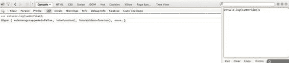

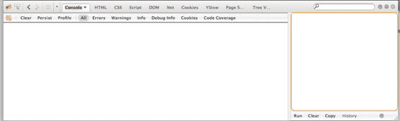

**图 10-2.** Firebug 面板

#### 使用控制台选项卡

控制台选项卡分为两个面板：

- 左侧面板是控制台；它显示页面的输出错误消息，或者您可以通过 `console.log()` 调用嵌入到 JavaScript 中的显式跟踪语句。
- 右侧面板是命令行；它是一个输入框，您可以在其中输入要运行的 JavaScript 代码。当前页面上的所有全局变量都在此作用域内，您可以在此窗口中直接与代码交互。

来看一个示例，在命令行中输入 `console.log(summerSlam)` 并单击“运行”按钮。您应该会看到整个命名空间对象被序列化并显示在控制台中（见图 10-3）。

**图 10-3.** 序列化的命名空间对象

这是一种手动调用函数、查看潜在问题或检查对象结构的好方法。然而，Firebug 真正的吸引力在于“脚本”选项卡中提供的调试器。

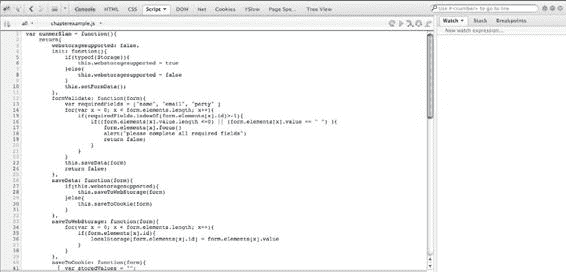

#### 使用脚本选项卡

如果单击“脚本”选项卡，将看到如图 10-4 所示的屏幕。

**图 10-4.** 脚本选项卡中的 Firebug 调试器


左侧面板显示我们的源代码，右侧面板则让我们能够跟踪监视表达式、当前调用栈或断点列表。监视表达式正是那些我们可以在应用程序运行时查看当前值的表达式。当前调用栈指的是堆栈跟踪，在 JavaScript 中即表示我们当前所在的函数。当前调用栈会显示是哪个函数调用了当前函数，你可以利用它来展示调用链，从而了解我们是如何到达当前执行点的。

为了调试应用程序，我们首先需要创建一个断点，即代码中解释器会停止执行并允许调试器接管后续执行的位置。当调试器接管执行后，我们可以观察并单步执行代码，查看当前作用域内每个变量所持有的值。这样我们就能确认实际发生的情况是否符合预期。要创建断点，只需单击某行代码的左侧边距（行号左侧）。点击处会出现一个红色圆圈，这就是断点。让我们在 `init()` 函数中设置一个断点，以便单步执行填充表单数据的 JavaScript 代码。

刷新页面后，调试器会跳转到这个断点，并允许我们单步执行代码。注意图 10-5 右上角的按钮。

从左到右，这些按钮分别允许我们重新运行代码、继续执行到下一个断点、逐行进入函数、单步跳过函数（即执行该函数但不逐行调试）、或跳出当前执行并将控制权返回给原始调用者。

另外，请注意 Watch 面板中显示了应用程序的当前状态。

209

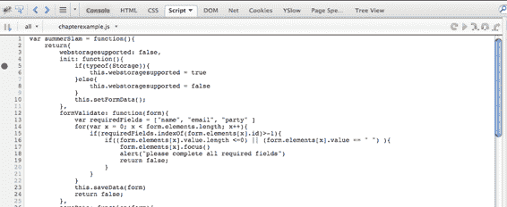

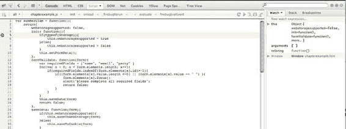

第 10 章

**图 10-5.** 设置断点

**图 10-6.** 在断点处开始调试

如果我们点击“单步进入”按钮，调试器会带我们进入将要执行的下一条代码行。如果继续点击“单步进入”按钮逐步执行代码，我们将看到代码的完整执行过程以及每个对象在执行过程中的当前状态。

## 压缩 JavaScript

JavaScript 不识别多余的空格或换行符。这意味着我们可以移除所有无关的空格和换行（只要每个表达式以分号正确结束），JavaScript 解释器仍会正常读取并执行我们的代码。

我们可以利用这一点，通过称为“压缩”的过程来去除所有空白和换行，并提供代码的压缩版本。压缩还涉及使用 HTTP 压缩，即在服务器端将内容编码设置为 gzip，然后将多个外部 JavaScript 文件合并为一个文件。

为什么要压缩呢？当我们浏览网站时，每个页面都有一个*有效载荷*，即构成页面的所有内容（包括图片、CSS 文件、页面本身的标记以及链接的 JavaScript 文件）的总大小（见图 10-8）。

Download from Wow! eBook <www.wowebook.com>

**图 10-8.** Firebug 中显示的应用程序有效载荷

从 JavaScript 中去除无关字符可以减小 JavaScript 的大小，进而减小页面的整体有效载荷，从而使页面加载更快。

将多个外部文件合并为一个文件可以减少构建页面所需的 HTTP 事务数量，这同样能使页面加载更快。你看到了趋势；最终，这些都是加速向用户传递内容的优化手段。

那么如何压缩呢？有很多优秀的工具可以用来压缩我们的应用程序——只需在 Google 上简单搜索，就能找到大量开源选项。Google 自己提供了一个名为 Google Closure Compiler 的压缩工具，Yahoo 则提供了 YUI Compressor。在我们的示例中，我们将使用一个名为 Minify 的开源工具。它可以从这里获取：[`code.google.com/p/minify/`](http://code.google.com/p/minify/)。或者，如果你愿意，也可以从 GitHub 获取：[`github.com/mrclay/minify`](https://github.com/mrclay/minify)。

Minify 可以下载为一个 zip 文件，解压后放在网站根目录。它有一个 Web 界面，可以通过以下 URL 访问：[http://[你的站点]/min/builder/](http://%5Byour%20site%5D/min/builder/)。你可以在 Web 界面中添加所有想要合并的文件，Minify 会生成一个脚本标签，你可以在 Web 应用程序中使用它来提供压缩后的 JavaScript：

```
<script type="text/javascript" src="/min/f=chapterexample.js"></script>
```

图 10-9 突出显示了压缩外部 JavaScript 文件后页面大小的改进。

**图 10-9.** 压缩 JavaScript 文件后页面大小的改进
在本例中，文件大小从 2.8 KB 降到了 887 字节。页面的整体有效载荷从 5.5 KB 降到了 3.6 KB。

## 使用 Jasmine 进行 JavaScript 单元测试

*测试驱动开发*（TDD）是一种正式的方法论，即先编写一个描述功能单元的测试（理想情况下是最小的可测试功能单元），然后再编写该测试所描述的功能。你编写的这些测试被称为*单元测试*。

应用程序的单元测试套件用于向新加入项目的开发人员描述其功能。这些测试还能通过在任何更新改变应用程序功能时抛出错误来保证质量，并且通常通过确保你以小型、模块化（因此可测试）的代码块编写代码来培养良好的编程实践。

随着单元测试框架的发布，测试驱动开发的思想终于开始在 JavaScript 社区中兴起。目前有多个框架可用，但我们将重点介绍 Jasmine，它由 Pivotal Labs 开发，可从 [`pivotal.github.com/jasmine/`](http://pivotal.github.com/jasmine/) 下载。

在我们的示例中，我们将下载最新版本的独立发行版，可从以下地址获取：[`pivotal.github.com/jasmine/download.html`](http://pivotal.github.com/jasmine/download.html)。独立发行版是一个 ZIP 文件，解压后包含三个文件夹（`lib`、`spec` 和 `src`）以及一个 HTML 文件（`SpecRunner.html`）。

`SpecRunner` 将是我们的测试框架。传统上，测试框架是运行测试并生成结果报告的软件。查看 `SpecRunner` 的源代码可以发现，Pivotal 很贴心地包含了其自身的演示数据——具体来说，它引用了 `Player.js`、`Song.js`、`SpecHelper.js` 和 `PlayerSpec.js`。这些文件演示了我们将如何使用 `SpecRunner`；也就是说，我们将包含自己的外部 JavaScript 文件，并在一个名为 `SummerSlamSpec.js` 的新文件中编写一系列单元测试。但首先，让我们清除所有 Pivotal 的数据，以便从头开始。

我们的测试框架的源代码现在应该如下所示：

```
<!DOCTYPE>

<html>

<head>

<title>Jasmine Test Runner</title>

<link rel="stylesheet" type="text/css" href="lib/jasmine-1.0.0/jasmine.css">

<script type="text/javascript" src="lib/jasmine-1.0.0/jasmine.js"></script>

<script type="text/javascript" src="lib/jasmine-1.0.0/jasmine-html.js"></script>

<!—下面的脚本标签应链接到我们的外部 js 文件 .. -->
```


<script type="text/javascript" src="chapterexample.js"></script>

<!-- 在此处包含规范文件... -->

<script type="text/javascript" src="spec/SummerSlamSpec.js"></script>

</head>

<body>

<script type="text/javascript">
jasmine.getEnv().addReporter(new jasmine.TrivialReporter());
jasmine.getEnv().execute();
</script>

</body>

</html>

现在，让我们向规范文件添加一些测试！

## 添加测试

从高层次来看，我们编写的每个测试都称为一个 spec（规范），而 specs 被分组为 suites（套件）。我们使用 `describe()` 函数来定义套件，该函数接受两个参数：

- 一个描述套件用途的字符串
- 一个返回 specs 的函数

以下代码片段为 Summer Slam 网站定义了一个套件：

```
describe("summerSlam", function(){});
```

我们在作为第二个参数传递的函数内部添加 specs。Specs 是对 `it()` 函数的调用；这些函数与 `describe()` 函数具有相同的签名：

- 第一个参数是一个字符串，描述 spec 将要测试的内容。
- 第二个参数是一个函数，可以包含功能以及匹配器。

以下代码片段展示了 `it()` 函数的实际应用：

```
describe("summerSlam", function(){
  it("checks fields", function(){});
});
```

匹配器是使用简单英语描述来表示条件逻辑的函数。它们用于测试我们正在测试的函数的结果。当前 Jasmine 原生匹配器的列表可以在[此处：https://github.com/pivotal/jasmine/wiki/Matchers](https://github.com/pivotal/jasmine/wiki/Matchers)找到。

好了，我们已经了解了初步概念，现在开始为我们的 `summerSlam` 命名空间对象编写一些测试。

如前所述，在实际的专业开发中，你首先编写描述你期望应用程序做什么的测试。只有编写完这些测试后，你才开始编写代码来满足这些期望。你甚至可以提前与业务负责人和 QA 团队一起审查你的测试，以确保每个人对应用程序的功能有相同的期望。

遵循这种工作流程的一个好处是，它鼓励我们从一开始就构建更模块化的应用程序——如果功能紧密耦合，我们将无法对其进行测试。由于我们要回头为已经编写的代码添加测试，我们可能需要稍微重构以使其更加模块化，从而能够高效地进行测试。

## 重构代码

让我们看看我们的表单验证函数。首先应该注意到的是，它在验证部分与 DOM 耦合。让我们稍微重构一下，将其抽象出来，并使我们的操作更具可读性。

我们将提取检查表单元素是否为必填项的代码，并将其放入一个名为 `isRequired()` 的独立函数中。我们还将提取检查元素是否有值的代码，并将其移动到名为 `hasValue()` 的独立函数中。为了不直接引用传入的表单变量，我们将表单名称及其值存储到局部变量中，并将它们传递给新函数：

```
isRequired: function(name, requiredList){
  if(requiredList.indexOf(name)>-1){
    return true;
  }else{
    return false;
  }
},

hasValue: function(data){
  if((data.length<=0) || (data == " ")) {
    return false;
  }else{
    return true;
  }
},

formValidate: function(form){
  var requiredFields=["name", "email", "party" ]
  for(var x=0; x<form.elements.length; x++){
    var currentElementName=form.elements[x].id
    var currentElementValue=form.elements[x].value
    if(this.isRequired(currentElementName, requiredFields)){
      if(!this.hasValue(currentElementValue)){
        form.elements[x].focus()
        alert("please complete all required fields")
        return false;
      }
    }
  }
  this.saveData(form)
  return false;
}
```

生成的代码更具可读性；很明显，`formValidate()` 中的条件现在正在检查某项是否为必填项以及该项是否有值。

此外，我们现在暴露了一些功能片段，可以围绕它们创建单元测试，而无需直接绑定到 DOM。让我们回到规范文件，开始围绕表单验证创建一个套件。

## 编写测试套件

我们的第一个套件将测试 `isRequired()` 函数：

```
describe("Summer Slam Check isRequired Function", function(){
});
```

我们将向套件添加一个 spec，检查传入的名称是否在必填列表中；如果是，则函数返回 true：

```
it("given a list of required fields, returns true if the name passed in is in the list", function(){
  expect(summerSlam.isRequired("name", ["name", "email", "party" ])).toEqual(true);
});
```

接下来，让我们添加一个 spec，确保如果传入的名称不在必填列表中，`isRequired()` 函数返回 false：

```
it("given a list of required fields, returns false if the name passed in is not in the list", function(){
  expect(summerSlam.isRequired("first_name", ["name", "email", "party" ])).toEqual(false);
});
```

我们可以通过刷新测试工具来查看结果。如果所有测试都通过，我们会看到如图 10-10 所示的屏幕。

**图 10-10.** 所有测试通过！

单元测试的美妙之处在于，如果测试未通过，我们会收到一条非常明确的错误消息，准确告诉我们代码失败的原因。为了测试这一点，我们可以将第二个 spec 中传入的值更改为必填列表中的某个项目；这应该会得到如图 10-11 所示的结果。

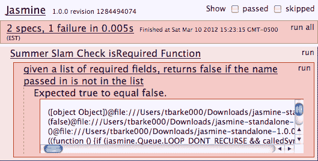

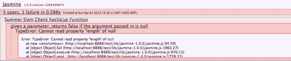

**图 10-11.** 单元测试失败！

现在让我们为 `hasValue()` 创建一个套件。我们将添加一个 spec，测试传入字符串、传入空字符串以及传入 null 的情况：

```
describe("Summer Slam Check hasValue Function", function(){
  it("given a parameter, returns true if the argument passed in has value", function(){
    expect(summerSlam.hasValue("test")).toEqual(true);
  });
  it("given a parameter, returns false if the argument passed in is an empty string", function(){
    expect(summerSlam.hasValue(" ")).toEqual(false);
  });
  it("given a parameter, returns false if the argument passed in is null", function(){
    expect(summerSlam.hasValue(null)).toEqual(false);
  });
});
```

哎呀，这是什么？当我们运行上述套件时，我们看到测试 null 值的 spec 失败了，如图 10-12 所示。

**图 10-12.** 我们的 `hasValue` 单元测试失败

为这个用例编写测试暴露了我们逻辑中的一个疏忽；我们从未费心测试是否有任何内容传入函数。为了解决这个问题，让我们重构 `hasValue()` 函数。我们将主要逻辑包装在一个 `if` 语句中，该语句测试 `data` 变量是否已初始化。同时，让我们重构以使用我们自己的最佳实践，即函数中只有一个返回。新的 `hasValue()` 函数现在应该如下所示：

```
hasValue: function(data){
  retVal=false
  if(data){
    if((data.length>0) && (data !=" ")) {
      retVal=true;
    }
  }
  return retVal
}
```

我们的完整测试套件应该如下所示：

```
describe("Summer Slam Check isRequired Function", function(){
  it("given a list of required fields, returns true if the name passed in is in the list", function(){
    expect(summerSlam.isRequired("name", ["name", "email", "party" ])).toEqual(true);
  });
  it("given a list of required fields, returns false if the name passed in is not in the list",
    function(){
      expect(summerSlam.isRequired("nme", ["name", "email", "party" ])).toEqual(false);
    });
});

describe("Summer Slam Check hasValue Function", function(){
  it("given a parameter, returns true if the argument passed in has value", function(){
```


```
expect(summerSlam.hasValue("test")).toEqual(true);

});

it("given a parameter, returns false if the argument passed in is an empty string", function(){

expect(summerSlam.hasValue(" ")).toEqual(false);

});

it("given a parameter, returns false if the argument passed in is null", function(){

expect(summerSlam.hasValue(null)).toEqual(false);

});

});
```

遵循这种方法论，我们可以为我们的 JavaScript 功能创建一套完整的自动化测试，从而确信代码能按预期工作。如果我们做了任何破坏功能的更改，测试会立即提醒我们，以便我们进行修复。

这只是单元测试所能实现的冰山一角。一旦你习惯了以这种方式思考如何开发代码，还有更多概念值得探索，从模拟功能以扩展测试范围，到使用暴露 DOM 级别交互的插件！

# 第 10 章

## 本章小结

在本章中，我们创建了一个在客户端保存数据的框架。我们利用了 HTML5 新增的 Web 存储能力，同时也实现了回退功能：当 Web 存储不被支持时，使用 HTTP Cookie。我们还探讨了 Ajax 以及如何从远程数据源加载数据。

接着，我们评估了一些可用的工具，这些工具真正提升了 JavaScript 开发的水平。例如，我们了解了一个可以在浏览器中调试脚本的工具，以及另一个可以使用代码压缩来优化代码交付的工具。最后，我们学习了如何用 JavaScript 进行真正的单元测试！


# 第 11 章

## 使用服务器端技术

如今，很难找到一个完全不使用某种服务器端脚本和数据库的网站。从商业产品到开源产品，有太多不同的选择，以至于决定走哪个方向可能令人望而生畏。就 Web 服务器、Web 脚本语言和数据库而言，开源替代方案与商业选项一样好（在某些情况下甚至更好）。

本章不会逐一介绍各种语言的语法，也不是关于如何设置和配置服务器的操作手册。相反，它是一份指南，介绍一些可用的不同选项，并解释各种产品之间的差异。

有时你可以选择服务器技术；而其他时候，你可能需要使用已有的技术。许多 Web 脚本语言对于有技术头脑的人来说相当容易上手。我们在讨论 JavaScript 时涵盖的概念——从基本编程逻辑到分支和迭代——都可以迁移到这些语言中。然而，即使是最简单的语言也需要花时间掌握。如果你被要求参与一个超出你专业范围的项目，很可能需要请一位外援。

### 服务器端消除了障碍

在万维网早期，有句老话叫“内容为王”。虽然今天依然如此，但访问者对网站的期望已不仅仅是被动阅读体验。仅仅放一个包含有趣文字和漂亮图片的静态页面已经不够了；最终用户期望互动。他们希望能够搜索内容，将商品添加到心愿单和购物车，并连接到 Twitter 和 Facebook 等社交媒体网站。新闻网站就是这种演变的典型例子：读者被鼓励在文章内联讨论话题，并被要求提交新闻创意。新闻编辑坐在办公室里决定什么有新闻价值的日子早已一去不复返。客户端脚本（JavaScript）也已经不够用了。为了存储输入并与多样化的数据源交互，网站转向了服务器端技术。

JavaScript 能实现的功能有限，这主要是出于安全考虑。你会放心让一个能随意访问你硬盘的 Web 应用程序运行吗？你希望一个网站能够读取和写入你硬盘上的任何文件吗？有些人认为 JavaScript 已经拥有太多权限，因此浏览器中提供了禁用它的选项。作为开发者，你需要确信你构建的内容能够为所有用户运行，无论他们是否启用了某些功能。

### Web 服务器：提供超文本服务

Web 服务器和 Web 浏览器共同构成了万维网的基本要素。Web 服务器是（我们希望）持续连接到互联网的计算机，它们托管网站。

它们响应来自浏览器的 HTTP 请求，提供驻留在网络上的各种类型的文件。

Web 服务器是任何网站的前线。它们处理请求，要么直接满足请求，要么将请求传递给 Web 应用服务器以提供动态内容（我们将在本章后面更深入地讨论这一点）。

与本章讨论的所有技术一样，Web 服务器也有众多选择，最棒的是其中大部分是免费的。有些服务器是为特定目的设计的：例如，nginx 是一个速度极快的服务器，擅长提供静态内容；而 Mongrel 则是专门为提供 Ruby on Rails 应用程序而开发的。其他服务器如 Apache 则是通用型，可以通过一系列模块轻松扩展。

#### Apache HTTP 服务器

Apache 是网络上的常胜冠军，自 1996 年以来一直如此。它是一个极其流行的 Web 服务器，几乎可以在所有可想象的操作系统上运行。（你甚至可以在 iPhone 上运行 Apache！）它成功的原因有很多，但最重要的可能是它相当快速、安全且可扩展。

Apache 支持模块架构，可以在服务器启动时通过加载新模块来添加功能。由于这种功能，像 PHP 这样的东西很容易添加；无需运行单独的应用服务器，PHP 可以直接通过 Apache 解析，这使得管理更快、更简单（我们将在本章后面更深入地介绍 PHP）。

不过，近年来 Apache 的市场份额有所下降。因为它过于灵活，所以既不够精简也不够快速。对于你梅婶的猫咪博客来说这没什么大不了的；但对于像亚马逊这样每秒服务数万访问者的网站来说，Apache 的额外负担就有点大了。

一个相对较新的竞争者正在占据中心舞台：nginx。

#### nginx

发音为 engine-x，*nginx* 是一个极其轻量、极其快速的 Web 服务器，正越来越受欢迎，尤其是在提供动态内容方面。nginx 最吸引人的一点是，处理单个请求所需的计算能力要少得多。这意味着可以使用相同的硬件（成本更低）服务更多的请求。过去，人们需要添加服务器来为 Apache 提供更多动力；但现在有些人转而使用 nginx，并发现他们当前的机器完全能够处理当前的请求量。Nginx 问世的时间没有 Apache 长，可用的模块（或附加组件）范围也没有那么广；尽管如此，它对大多数情况来说已经足够灵活。

#### Microsoft Internet Information Services (IIS)


微软在 20 世纪 90 年代中期推出了运行于 Windows 操作系统上的 Web 服务器。它之所以广受欢迎，主要是因为与 Apache 的命令行和文本文件配置机制相比（出于某种奇怪的原因，人们喜欢图形用户界面），它易于配置和设置。

IIS 最初名声不佳，因为早期版本的服务器充满了安全漏洞，使得整个机器暴露给勤奋的黑客，他们甚至可以发起自我传播的蠕虫病毒，进而攻击其他 IIS 服务器。其中最臭名昭著的蠕虫之一“红色代码”，在其高峰期感染了约 36 万台 IIS Web 服务器，并导致全球网络速度明显下降。

随着 IIS 逐渐成熟为更安全、更稳定的托管环境，它的受欢迎程度也在增长；然而，近年来它的市场份额也有所下降。似乎越来越多的人转向开源技术，这些技术提供了更广泛、更优秀的成熟选择。微软的回应是将动态.NET 语言捆绑到 IIS 中，使得在 Windows 平台上开发动态网站变得非常容易。

## Mongrel

在本章稍后部分，你将读到关于框架及其为何越来越受欢迎的内容。框架中的领头羊是 Ruby on Rails，而 Mongrel 是专门为分发 Rails 应用程序而开发的 Web 服务器。Mongrel 在服务 Rails 应用程序的速度、可扩展性和稳定性方面是无可争议的领导者，因为它原生支持 Ruby；其他 Web 服务器则通过一个将 Ruby 代码作为通用网关接口（CGI）脚本执行的模块来处理它。

## 广泛的托管选择

我们正处在一个 Web 开发的绝佳时代。托管网站的成本正在下降，将托管需求外包给第三方比以往任何时候都更容易。如果你在一家大组织工作，很可能它自己运行 Web 托管服务器，或者至少在第三方托管商那里有专用机器。较小的组织和个人通常会选择托管公司并使用共享托管，即多个网站在同一台服务器上运行。运行服务器需要大量的技能和资源：它必须通过快速连接接入互联网（你家里的 DSL 线路根本不够用），应该定期备份，并且应该放在安全的地方，尤其是当你在数据库中存储客户的个人或财务信息时。更不用说，有多少人拥有备用发电机以防停电？

在选择托管公司时，你应该考虑许多不同的因素。显然，功能/应用程序支持将是一个重要因素；如果你编写了一个 Ruby on Rails 应用程序，你需要一个支持 Rails 的服务器。其他需要考虑的因素包括带宽、磁盘空间、机器规格、技术支持以及正常运行时间保证。

大多数托管计划每月会给你一定量的带宽。这通常以传输的数据量（千兆字节）来衡量，但大容量托管计划可能提供太字节（1,000 千兆字节）的带宽。你会看到几种不同类型的计划选项，从共享托管到专用主机。共享主机正是如此：你与其他客户共享托管你网站的机器。如果其中一个其他客户有一个流量特别高的网站，或者做了某些导致服务器锁死的事情，你的网站也会受到影响。虽然这对你的个人博客来说并非世界末日，但一个在线开展业务的公司可能对频繁或长时间的宕机容忍度较低。

共享主机之上的下一个级别是虚拟机。虚拟化软件是一种特殊软件，它允许你在单台机器上运行多个操作系统，或同一操作系统的多个副本。如果你在 Mac 上使用过 VMware Fusion 或 Parallels 来运行 Windows，那你就是在使用虚拟化软件。虚拟机相对于共享托管的一大优势是，每个托管账户都位于自己的容器内。因此，尽管单台机器上的所有客户共享该机器的资源，但每个容器与其他容器相互隔离。如果客户 X 做了某些导致其虚拟机锁死的事情，该计算机上的其他虚拟机都不会受到影响。这样做还有一个额外的好处：由于客户之间相互隔离，托管公司通常愿意让客户对自己的账户拥有更多控制权。例如，托管公司通常会允许客户安装软件并重新配置系统和服务器设置以优化性能（在共享托管账户中，你绝不可能获得这种级别的控制权）。

另一种选择是专用托管，即你拥有自己的机器，由其他公司托管。这具有虚拟机托管的所有优点，但你无需担心与其他客户共享资源（例如 RAM、CPU 和带宽）。共享托管是目前最便宜的选择，而专用托管每月会花费你几百美元（或更多）。

最后，还有云托管。使用云托管，你只需为使用的处理能力、存储和带宽向托管公司付费，但并没有一台单一的机器托管你的网站。云托管公司拥有一个机器网络，基本上是在向你出售在该网络上提供网站所需的能力。这里的一大优势是你只需为使用量付费，而且如果你的流量突然激增，这种方法可以非常快速地扩展。人们经常认为云托管更可靠，因为你的托管需求分布在多台机器上；如果一台机器宕机，不会导致你的网站瘫痪。然而，这并非绝对，因为大多数托管设置都存在弱点，云主机和传统主机一样容易出问题。

选择你需要的托管计划级别并不难。从你认为可以应付的最便宜的计划开始，然后随着需求升级。大多数托管公司非常乐意让你随时升级计划；这意味着他们可以收取更高的月费！如果你不确定你的应用程序是否会有超过十几个并发用户，那么为它购买专用托管是没有意义的。

不过，选择托管商确实很困难。如果你只看网上的评分和评论，你永远找不到合适的（在线评分大多被严重刷屏，几乎无法分辨哪些是真实评论，哪些是来自 xyz 托管公司市场部的评论）。每个托管商都有大量好评和恐怖故事。最好的办法是向朋友、同事和其他专业人士打听，看看他们是否有任何推荐。

## 数据库入门

我们在一个博客上提出了一个问题，询问人们如何向一个对计算机完全不了解的人描述数据库。普遍的共识是，人们会用文件柜来类比，数据库表就像文件夹，而文件夹中的单个文件就是记录。这个类比还不错，直到你试图解释与数据库设置相关的所有其他部分——比如主键、外键、关系，当然还有结构化查询语言（SQL）。让我们来看看所有这些术语。

### 术语

数据库管理系统领域充斥着各种技术术语和缩写词。以下是一些最常见术语的快速指南：


# 第 11 章

*关系数据库*是一种数据库系统，其中存储在一个表中的信息可以与存储在另一个表中的信息进行连接（或关联）。例如，如果你正在存储商业联系人信息，可能会用到这种系统。很可能你在同一家公司认识几个不同的人；与其在每个人的记录中重复存储该公司名称 3 次、10 次或 50 次，不如创建一个公司表，然后通过将公司表中的主键作为人员表中的*外键*，将每个人与公司表中的相应行关联起来。这样做的一大优势是，如果公司被收购并更名为从 Acme Corp.改为 Wonderwhizz Inc.，你只需要在一个地方更改该名称。

*关系数据库管理系统*（RDBMS）是一种应用程序，如 MySQL 或 Oracle，通常（错误地）被称为*数据库*。这种应用程序实际上是一个 RDBMS，即与数据库交互的软件。

*数据库*是结构化到表内记录中的数据的集合。用以下术语来理解 RDBMS 和数据库之间的区别可能会有所帮助：RDBMS 类似于 Web 服务器，而数据库类似于该服务器上所有可用的页面（只是结构更加有序）。

*模式*是数据库的结构，包括表、字段以及表之间的任何关系。

*表*是数据库中记录的集合。例如，你可能有一个“联系信息”表，其中列出了许多不同人的地址和电话号码。

*记录*，有时也称为*行*，是一组相似数据项的集合。例如，你朋友 Mary 的一组联系信息就是一条记录。同一表中的所有记录都由相同的字段组成。

*字段*，有时也称为*列*，是记录中包含的单一信息项。Mary 的电话号码将存储在数据库的一个字段中。

*主键*是表中的一个特殊字段，用于唯一标识一条记录。表之所以有主键，是为了在需要对记录进行更改时，能够唯一地定位每条记录。例如，我可能有一个表，记录人们使用礼品卡购物的日志。这个日志可能列出“Ron”在一个月内每天购买“1 杯咖啡”。如果日志只列出了这些，并且（出于某种原因）你需要进去说明他实际上并没有购买每第七杯咖啡，那么你将无法定位那些特定的记录。主键通常是一个顺序编号的字段。

*外键*是将一个表中的记录与另一个表中的记录关联起来的特殊信息。一个表中的外键会引用另一个表中的主键。

*结构化查询语言*（SQL）是一种专门为与关系数据库交互而开发的标准语言。SQL 允许你添加、删除、更新和查询数据。不同数据库系统之间的 SQL 语法略有差异；但大多数情况下，一旦你掌握了 SQL 的基础知识，就能与几乎任何数据库系统一起工作。

## 关系数据库之外的世界

前面介绍的许多术语都是关系数据库特有的。当今大多数可用的 DBMS 都是关系型的，因为以关系方式设计数据库模式通常有利于避免信息重复。但 RDBMS 并非唯一的选择，你在网上可能还会遇到其他几种类型的数据库，因此这里值得提一下。

这些 DBMS 通常被统称为“NoSQL”数据库，因为它们不支持也不使用结构化查询语言来与数据库中存储的信息进行交互。

NoSQL 数据库通常用于非常特定和独特的环境（例如 Google BigTable——一种压缩的专有数据库，为 Google 搜索索引提供支持）。

### 对象数据库

对象数据库在非常特定的科学应用之外并不常见。然而，有一个非常常见且流行的内容管理框架 Zope 使用了对象数据库。

Zope 对象数据库（ZODB）在其应用中非常理想，因为它原生支持版本控制，允许用户撤销在网站上所做的更改。

### XML 数据库

XML 在网络上广泛用于网站/Web 应用程序之间的数据交换，但它也是一种有效的数据存储方式。有时，这个术语会用于指代存储在 RDBMS 中的 XML 数据，但也存在原生的 XML 数据库。

以 XML 格式存储数据的最大优势在于 XML 被广泛用于数据交换。因此，无需将数据转换为 XML 或从 XML 转换回来，从而节省了处理成本（即服务器无需执行大量额外操作）。XML 文件可以从一台机器复制到另一台机器并立即使用——无需安装额外的软件。

XML 数据库将数据存储在节点中，这是对 XML 标签层次结构内数据的正确术语。查询 XML 数据库时，不使用 SQL，而是广泛使用两种查询语法：XPath 和 XQuery（后者只是 XPath 的扩展）。它们通过提供一种寻址数据库节点的语法，从 XML 数据库中提取数据。

## 使用服务器端技术

## 关系数据库

关系数据库简单来说就是，一个表中的数据可以通过键与另一个表中的数据连接（或关联）。关系数据库力求数据规范化；也就是说，它们试图消除记录和表之间的任何数据重复。规范化数据是好事：如果数据库中存在数据重复，就可能出现数据异常，即两条数据变得不同步（想想我们之前的“公司名称”例子）。

例如，如果你正在开发一个包含一系列产品的在线商店，你可能会有一个表列出每种产品及其价格和描述。有时，你可能想通过降价 15%来提供某些商品的促销。与其创建一个促销商品表并重复产品名称、描述和价格，不如直接引用原始产品表中的主键并列出折扣来关联它。你还可以为该商品添加一个条款和条件字段（例如，优惠于当月 15 日到期）。这样，如果产品价格发生变化，只需在一个地方更新即可。

在我们开始讨论如何与表交互之前，请帮自己一个忙，找一个好的数据库客户端，它能让你轻松地创建、删除和修改表。虽然可以使用 SQL 语句来完成这些操作，但通过点击鼠标就能创建表和列要快得多。

## 结构化查询语言（SQL）

使用 SQL 与数据库进行交互主要有四种类型：`SELECT`用于从数据库中获取数据，`INSERT`用于向数据库添加数据，`UPDATE`用于更改数据库中的数据，以及`DELETE`用于删除数据。

### 获取数据

如果永远无法从数据库中取出任何东西，那么创建信息数据库又有什么意义呢？回到最初的档案柜类比，能够在数据库中找到特定数据是相对于旧式纸质替代方案的最大优势。


你有多久没有看着一大摞文件，心里想着“天哪，我真希望能用谷歌搜一下这个”？（好吧，可能只有我们这么想。）不过，归根结底，搜索引擎其实就是巨大的数据库，里面装满了关于网页信息的信息。每次你在谷歌上搜索，其实就是在对数据库执行查询。

用 SQL 术语来说，这个查询看起来像这样：

```
SELECT url
FROM websites
WHERE content="that thing I'm looking for"
```

如果你拆解这条语句，其实很容易理解。你是在请求 `websites` 表中的 `url` 字段。你不是返回表中存储的所有 URL，而是缩小搜索范围，只获取那些 `content` 字段值为“that thing I'm looking for”的 URL。

我们还可以在这里加入许多其他选项，比如用 `ORDER BY` 对结果排序，或者用 `INNER JOIN` 将这张表的数据与另一张表中存储的数据关联起来。

## 插入数据

如果你不能在新信息出现时将其添加进去，你的数据库很快就会变得过时。

SQL 使用 `INSERT` 来实现这一点：

```
INSERT INTO websites (url, content) VALUES ("http://www.amazon.com/",
"A really big store that sells a bunch of stuff")
```

同样，拆解来看，你是在向 `websites` 表中添加一条记录。我们指定了这张表中的两个字段 `url` 和 `content`，并为它们都赋予了值。根据表的设置方式，表中可能还有其他你没有指定的字段。不过，在创建表时，你必须特意指定某个字段可以包含 `NULL` 值；否则，运行这条 SQL 会报错。

## 修改数据

哎呀，我们刚才添加的那条记录听起来好像亚马逊是一家实体店，位于某个地方。

我们最好修改一下 `content` 字段来澄清这一点：

```
UPDATE websites
SET content="An e-commerce website that sells a wide range of products"
WHERE url="http://www.amazon.com/"
```

这条 SQL 语句的第一部分现在应该不言自明了。你正在更新 `websites` 表，并将 `content` 字段设置为更准确的描述。最后一部分（`WHERE` 之后）是重点。

你需要某种方式告诉 RDBMS 你要更新哪条记录。在这个例子中，你通过 `url` 字段做到了这一点，但这可能会适得其反。如果有多条记录的 URL 都是 `http://www.amazon.com/`，那么所有这些记录都会被更新。另一方面，你可能已经指定 URL 是表中的主键，在这种情况下，不可能存在多条 Amazon.com 记录（回想一下，主键强制记录之间的值唯一）。如果你试图插入另一条记录，就会收到错误。

## 删除数据

网站来来去去。虽然你不太可能因为这个原因把亚马逊从数据库中删除，但你可能在某个时候注意到你购买草坪小矮人的最爱商店已经下线了。你需要保持数据更新：

```
DELETE FROM websites
WHERE url="http://www.ultimatelawngnomes.com/"
```

这段代码是一个简洁明了的语句，用于从数据库中删除 `ultimatelawngnomes.com` 网站。

适用于更新记录的注意事项同样适用于删除记录；也就是说，你应该尽可能在 `WHERE` 语句中指定主键，以便将删除操作限制在你实际想要删除的记录上。在这个例子中，这样做没问题，因为即使 `ultimatelawngnomes.com` 有多条记录，而且该网站确实已经下线，你可能也想删除所有这些记录。另一方面，进入一家大公司的人力资源数据库，对所有姓氏为 Smith 的员工记录执行 `DELETE` 可能不是个好主意（这就是为什么很多公司使用员工 ID 作为主键；不允许重复）。

要了解更多关于 SQL 的知识，最好的办法是查看 [`www.w3schools.com/sql/`](http://www.w3schools.com/sql/)。这个网站提供了一套相当不错的 SQL 入门课程。如果你进一步深入数据库，一定要查看你所用 RDBMS 的特定文档，因为它可能有一些特定的函数，可以节省你的时间并显著加快查询速度。

## 主流 RDBMS 一览

实际上有数百种不同的数据库系统，各有千秋。下面列出的几种是最常见的，因此你在开发网站时很可能会遇到它们。我们这里只限于数据库服务器，所以像 Microsoft Access 这样的应用程序没有被列入。虽然你可以将 Microsoft Access 用作网站的后端（我们以前做过），但它扩展性不太好，因为它处理并发用户的效率不高。

如果你对 Microsoft 产品比较熟悉，最好升级到 Microsoft Access 的大哥——Microsoft SQL Server。

### Oracle

数据库领域长期以来的重量级选手和 RDBMS 冠军无疑是 Oracle。如果你有一个大型组织在运行数据库，那么该数据库很可能是 Oracle。自 20 世纪 70 年代末问世以来，Oracle 已经是一个经过测试和验证的存储和检索大量数据的解决方案（它也是最昂贵的选择）。Oracle 以其处理超大数据集并以相当高效的方式处理它们的能力而闻名（例如，对一百万条记录执行查询不会花一整天时间）。不过，对于客户要求的那个博客来说，它绝对是杀鸡用牛刀了。

### Microsoft SQL Server

微软推出了自己的商业 RDBMS 来与 Oracle 竞争：Microsoft SQL Server（MSSQL）。早期，这个数据库在处理大量数据方面并不尽如人意，并且还出现了一些安全漏洞。公平地说，由于数据库起步不稳，微软在 Oracle 所针对的市场（真正的大型数据库/应用）中并没有取得太大进展；然而，MSSQL 在中等规模的应用中仍然是一个相当大的玩家。那些需要 Oracle 级别系统的客户仍然会购买 Oracle。而那些认为 Oracle 过于大材小用的客户通常会选择微软或某个开源替代方案。

微软确实提供了其 SQL Server 产品的 Express 版，它是免费的，但通常不建议在生产环境中使用，而且它的性能肯定不如完整的 SQL Server 产品。不过，Express 版是构建和测试的绝佳选择！

### MySQL

MySQL 是目前最流行的开源数据库系统。它早期之所以大受欢迎，是因为它比 PostgreSQL（见下一节）快得多，并且在 Web 应用中表现惊人。许多大型互联网公司完全跳过了 Oracle 的潮流，而是大力投资 MySQL 作为他们的主要 RDBMS。

尽管该软件是开源的，但 MySQL 背后仍然有一家商业公司。这意味着想要使用 MySQL 的公司有可以依赖的支持方。MySQL AB（MySQL 背后的公司）被 Sun Microsystems 收购，Sun 是一家历史悠久的硬件和软件公司。有趣的是，2009 年 Sun 被 Oracle 收购，所以现在 MySQL 正式归数据库巨头所有。世界真是越来越小了！


MySQL 在开源关系型数据库管理系统中广受欢迎的一大原因是，有许多优秀的前端工具可供使用。例如，`phpMyAdmin` 是一个完全用 PHP 编写的界面，托管在线上，允许开发者在 MySQL 中创建、删除和修改数据库及表。它还允许开发者轻松地添加、更新、删除和查询数据。MySQL AB 还发布了一系列适用于 Windows、Linux 和 Mac OS X 的 GUI 工具，以简化开发和服务器管理。

## PostgreSQL

PostgreSQL 是另一个优秀的开源关系型数据库管理系统，完全由用户社区驱动和维护。有几家公司为 PostgreSQL 提供商业支持，但它们只是间接参与软件的持续开发和演进（它们和其他人一样，都是用户社区的成员）。

PostgreSQL 最大的卖点在于，它在工作方式和语法细节上与 Oracle 非常相似。因此，那些寻找 Oracle 高额许可费的开源替代方案的公司，往往会选择 PostgreSQL，因为它提供了阻力最小的路径。

## 其他数据源

在上一章中，我们讨论了很多关于互操作性和不同网站及 Web 应用程序之间共享数据的内容。这通常通过 XML 或 JSON（JavaScript 对象表示法）来实现；然而，在讨论数据交换时，你可能还需要了解一些其他术语和缩写词：

- *Web 服务* 是允许计算机之间通过 Web 进行交互的软件系统（不一定涉及人的交互）。这是一个通用术语，可以指代像 API 这样复杂的东西，也可以指代像博客的 RSS 订阅这样简单的东西。
- *SOAP* 是一种通过 Web（使用 HTTP 或 HTTPS）交换 XML 消息的协议。
- *远程过程调用*（RPC）是一种让一台计算机在另一台计算机上启动过程的方法，而无需显式编程这些交互的细节。换句话说，RPC 是一种让网络上的另一台计算机执行某些操作并将结果返回给你的计算机的方法。在万维网上，RPC 最常与 XML 结合使用，用于机器之间的数据交换（XML-RPC）。
- *应用程序编程接口*（API）是应用程序中内置的一系列*钩子*，允许外部访问应用程序的数据和功能。API 通常与我们讨论的四种主要数据库操作非常相似：GET（SELECT）、DELETE（DELETE）、POST（UPDATE）和 PUT（INSERT）。

为 Web 开发应用程序的最大好处之一是，已经有大量现成的数据存储库可以集成到你的应用程序中。你可以轻松地将用户的输入与 Google 提供的地图数据以及数据库中存储的房屋信息结合起来，就像一些房地产经纪人现在正在做的那样。

## Web 应用程序语言

正如我们之前对数据库的探讨，你会发现有许多可用于 Web 编程的应用程序。这些通常被称为*脚本语言*，或者更准确地说，是*服务器端脚本语言*。每种选项都使用不同的语法；但归根结底，它们做的事情都差不多。

虽然某些语言可能在某些方面比其他语言更有优势，但在中小型 Web 应用程序方面，你真的不会注意到各个语言之间在性能上有巨大差异。

如果你刚开始学习，不确定选择哪种语言最好，我们建议坚持使用 PHP。它是免费的，被广泛使用，而且许多公司提供几乎免费的 PHP 托管方案。无论你选择什么，都不要过于纠结。我们有一个朋友，他是一位出色的 Python 程序员，经常抱怨 Python 开发者的职位空缺太少。事实是，因为他懂 Python，他可以轻松掌握其他任何语言，并在几周内变得熟练（他已经在多个项目中做到了这一点）。

### PHP

目前，在 Web 开发者中最流行的脚本语言是 PHP，它是免费的，并且通常与 Apache Web 服务器（Web 上最常见的 Web 服务器）一起安装。PHP 被设计为一种用于 Web 的脚本语言，因此它非常关注 Web 开发者的需求。

如果你下载过开源 Web 应用程序（如 WordPress、Drupal 或 PHPBB），那么该工具很可能就是用 PHP 编写的。PHP 在开源 Web 应用程序开发者中广泛使用，因为它通常是自包含的；最终用户无需安装一堆其他软件就能让一切运行起来。安装 PHP 应用程序通常只需将文件上传到你的 Web 主机、创建数据库并编辑配置文件即可（当然，具体取决于应用程序，你的体验可能会有所不同）。各种规模的组织都在一定程度上推出了基于 PHP 的应用程序。

对于想要学习 Web 应用程序开发的人来说，PHP 是一个很好的起点。因为它是免费的，你可以下载一份并安装在自己的 Web 服务器上（如果你不想花钱购买托管方案的话）。PHP 早期因安全问题而名声不佳，这阻碍了它在许多大型组织中的采用；然而，这种情况已经彻底改变了。我们了解到，一些以前从未接触过 PHP 的组织，现在正在使用基于 PHP 的内容管理系统重新设计其公司网站。

### Ruby

Ruby 是一种自 1993 年就存在的计算机语言，但此前它并未被视为开发 Web 应用程序的有力竞争者。直到 Ruby on Rails 框架（我们稍后会讨论）的出现，Ruby 才进入了 Web 应用程序开发的主流。自 Rails 推出以来，许多其他基于 Ruby 的框架也相继问世（例如，如果你想学习 Ruby，Sinatra 是一个很好的起点）。

开发者们厌倦了反复开发相同“类型”的应用程序，于是转向 Ruby on Rails 来简化流程。Rails 是一个“有主见”的框架；也就是说，如果你遵循框架中提供的一些约定，它可以显著加快你的开发项目。Rails 在科技初创公司中得到了大量采用，并且现在（并且已经有一段时间了）被公认为一个稳定、支持良好的框架。如今，它驱动着一些非常流行的 Web 应用程序。

### Python

Python 与 Ruby 类似，自 20 世纪 90 年代初就已存在。然而，直到最近它才被广泛采用为主流 Web 应用程序语言。Python 之所以获得大量关注，是因为它被 Google 广泛使用。它扩展性极好，是一种高性能语言，并且拥有相当强大的社区。但它不像其他一些选项那样被广泛使用。

### ASP.NET

ASP.NET（曾经 ASP 代表 Active Server Pages）是微软主导的 Web 应用程序开发解决方案。ASP.NET 最大的优势在于它与微软的其他产品集成良好；例如，用户可以轻松地通过 Active Directory 服务器进行身份验证。ASP.NET 已经存在了相当长的时间，但它只能在微软的 IIS 服务器上运行。你会发现 ASP.NET 主要被用于大型的微软主导的组织中，但也有一些独立的应用程序是用 ASP.NET 编写的。.NET 开发者是一个有趣的群体。一个扎实的 .NET 开发者可以做任何事情——潜力无限。然而，存在一个入门门槛，因为 .NET 托管可能比选择开源路线更昂贵。

### Java/JSP


Java/JavaServer Pages (JSP) 在 20 世纪 90 年代的第一次网络热潮中相当流行，但此后逐渐式微。在互联网泡沫时期，Java 是开发者相当常见的技能，但如今用它来开发 Web 应用程序已经相当繁琐。JSP 的没落并非因为功能缺失或技术落后，而是因为开发周期过长。我们并非想敲响 JSP 的丧钟——它仍在许多企业中使用——但如今你很少看到初创公司选择 JSP 来构建他们的应用程序。

说实话，上面这段话在五年前和今天一样真实，而 Java 依然坚挺。它的市场份额没有大幅增长，但也没有大幅流失。因此，我们大胆预测，在可预见的未来，Java 将继续保持现状。

## 框架

就功能而言，框架比 Web 应用程序语言高一个层次。框架是函数和库的集合，通过自动化网站开发中的一些常见（且繁琐）任务，使 Web 开发更加容易。例如，用户登录/注销和访问控制等功能在许多不同的 Web 应用程序中都会用到，那么为什么要反复编写代码来管理这些功能呢？同样，许多 Web 应用程序在后端使用数据库进行添加、更新、删除和列表操作；但如果有一种简单的方法来构建一个基本页面，用于向数据库添加记录，而无需反复用 SQL 重写代码，那岂不是很好？

### 为什么要使用框架？

框架并非新概念，但最近似乎确实流行起来。每个人似乎都对如何最好地实现框架有自己的想法：有些人更看重灵活性而非效率；另一些人则希望保持简单。大多数主流框架都支持类似的功能，只是实现方式不同。大多数框架都是特定于语言的；不过，也有少数框架在不同语言之间移植。通常，你需要先掌握语言，然后才能熟练使用框架。然而，一旦达到那个水平，框架可以为你节省大量时间，让你真正专注于大局，而不是担心编写与数据库交互的代码（仅举一例）。使用框架没有绝对的正确或错误时机；如果你对某种语言感到得心应手，那么可能是时候拓展一下，探索可用的框架了。无论你是在创建大型项目还是小型项目，框架都能为你节省时间。

### 几个流行的候选框架

每种语言和每种用途都有相应的框架。这里我们只讨论三种，它们都基于流行的开源语言。不过，如果你对 Ruby、PHP 或 Python 不感兴趣，只需搜索 *<语言> framework*，我们保证你至少会得到两到三个可靠的结果。

#### Ruby on Rails

Ruby on Rails (RoR) 是 Web 开发框架的一个绝佳范例。一位富有进取心的开发者 David Heinemeier Hansson 在开发一个项目管理 Web 应用程序时创建了 Ruby on Rails。他厌倦了总是重复编写相同的代码，并意识到其中一些过程可以自动化。

框架可以极大地提高生产力，但也可能对你的开发过程施加限制。例如，Ruby on Rails 在开发中采用了*约定优于配置*的理念：如果你遵循某些约定，代码几乎会自动生成；否则，你将不得不手动重写大量内容。一个例子是，如果你创建一个名为 `product` 的类（即用于在数据库中添加/删除/编辑产品），Ruby on Rails 会假设数据库中存储产品信息的表名为 `products`。这没什么大不了的，但有些组织可能对数据库表有严格的命名方案——例如，他们可能要求你在表名之前加上部门名称。在这种情况下，你就需要额外做一些工作（你仍然可以使用 Rails，但需要花更多时间来配置，而不是使用框架内置的约定优于配置功能）。

Rails（以及许多其他框架）的另一个值得一提的特性是它对模型-视图-控制器（MVC）架构的广泛实现。我们之前讨论过在使用 HTML5、CSS 和 JavaScript 时分离内容与功能。MVC 有点像在服务器端开发中实现这一点：

- *模型*处理应用程序中的所有数据和逻辑。它不直接负责数据存储。尽管本章重点讨论了数据库，但肯定还有其他存储数据的方式，例如纯文本文件或 XML 文件。模型更关注“工作数据”——例如，某人购物车的总金额为 99.95 美元，或者今天是周五，距离今天还有三天。
- *视图*是表示层。任何用户界面的渲染都由视图处理，从页面使用的颜色到表单中复选框和输入字段的放置。视图通常会根据模型中的信息动态生成用户界面。
- *控制器*负责处理输入、与模型交互，并将输出返回给视图。应用程序的所有具体工作都在控制器中完成。

#### CakePHP

如果你不喜欢 Ruby on Rails——或者你已经是 PHP 高手，但喜欢框架所提供的理念——那么你很幸运。PHP 有大量的框架可供选择，其中大多数都实现了 MVC 架构。CakePHP 就是这样一个 PHP 框架，自 2005 年创建以来越来越受欢迎。尽管它与 Ruby on Rails 共享许多特性，但它从头开始编写，是一个独特而强大的框架。

CakePHP 的一大优势是易于使用且文档出色。如果你是 PHP 新手，你可能会想跳过所有基础工作，直接投入 CakePHP——很可能你开箱即用就能完成 95% 的目标。

#### Django

Python 开发者不必感到被冷落（ASP.NET 开发者或其他任何人也不必——几乎每种流行的 Web 应用程序语言都有对应的框架）。例如，Django 为 Python 开发者提供了与我们介绍的其他框架类似的功能，并且已被用于一些高知名度的 Web 应用程序（如 Revver 和 Pownce）。

特别值得一提的是，Python 开发者可能会考虑 Google 的 Google App Engine 应用平台，它本质上允许你将 Web 应用程序托管在 Google 上。Google App Engine 内置了对 Python 的支持，早期构建在该平台上运行的应用程序中，开发者广泛使用了 Django。这无疑是对 Python 编程语言和 Django 框架的巨大推动。

## 总结

正如我们在本章中提到的，你选择哪个应用服务器、语言或框架（假设你有选择权）其实并不重要。它们都是足够成熟的产品，在功能集上同样强大。如果你是该领域的新手，请选择开源产品，因为这些产品最容易学习且成本最低。


在项目中，很容易陷入关于语言/数据库/框架的讨论。如果你要负责技术开发，那么最终应该由你来决定使用什么工具。

开发者必须对自己使用的工具有信心；如果后端架构是强加给你的，但却是你从未接触过的，那么一定要寻求帮助，或者留出额外的时间来学习这项技术。最终用户能够判断网站构建是否存在问题。

233


# 第 12 章

## 使用 WordPress 快速启动开发

在本书中，到目前为止，我们已经涵盖了从头构建网站的大部分基础知识。我们讨论了 Web 最基本的构建块，以及如何将它们组合起来启动并运行一个网站。我们介绍了使用 JavaScript 为页面添加交互性并实现动态效果。我们甚至简要地了解了各种服务器端语言和系统，它们可以帮助网站成为一个真正的动态系统。

这一切都相当令人望而生畏，不是吗？本章将向你介绍一个小技巧，它将提供我们之前讨论的所有内容，而且还能让你在几分钟内启动并运行（第一次可能需要多花点时间——毕竟你还在学习）。在本章中，我们将介绍一个优秀的开源博客和内容管理系统，名为 WordPress。

本章建立在我们目前的知识基础之上。我们没有时间或篇幅深入探讨本书中使用 PHP 和数据库的细节，但这正是我们在本章中利用 WordPress 所要做的。我们仍然不会深入所有繁琐的细节；但到本章结束时，你将拥有一个完全可用的、由数据库驱动的网站。

235

## 介绍 WordPress

WordPress 是一个非常出色的软件，它使用了我们已经讨论过的许多技术构建而成。当前版本具有有效的 HTML 和 CSS，并且使用 PHP 编写，由 MySQL 数据库驱动。不过，你可能没有注意到最后两句话中最好的部分：WordPress 已经构建好了！你无需花费数小时（或数天）重新发明轮子，编写用于构建数据库驱动网站的代码；你只需安装 WordPress，调整一些设置，然后根据需要进行或多或少的定制即可。

本章将介绍如何在本地桌面机器上下载和安装 WordPress。这总是一个好的起点——你总是希望在上传到所选的主机之前，有一个地方可以测试你的网站。

## 安装 WordPress

在开始安装任何东西之前，我们必须确保拥有运行所需的软件。手动安装 PHP、MySQL 和 Web 服务器需要一整章的篇幅，所以我们在这里走个捷径。

无论你使用的是 Windows 还是 Mac，都有一种非常简单的方法来运行这三个组件：

- [www.mamp.info/en/index.html](http://www.mamp.info/en/index.html)：Mac 上的 MAMP（及其大哥 MAMP Pro）提供一键下载和设置 Apache、MySQL 和 PHP。它甚至捆绑了一个漂亮的图形用户界面来配置你的服务器。MAMP 是免费的，而 MAMP Pro 需要少量许可费（就我们的目的而言，我们只需要 MAMP）。
- [www.wampserver.com/en/](http://www.wampserver.com/en/)：WampServer 为 Windows 用户提供了类似的功能。它提供一键下载和安装，然后你就可以开始使用了。

作者使用的是 Mac，因此我们将描述 MAMP 的设置过程。不过，WampServer 同样易于下载和安装，因此这些说明也大致适用于该软件。使用 MAMP，完成安装后，前往你的`/Applications`文件夹，打开 MAMP 文件夹，然后双击`MAMP.app`。你应该会看到类似于图 12-1 所示的内容。

左侧状态窗口中的绿灯表示 Apache Server（含 PHP）和 MySQL Server 正在运行。花点时间去向朋友炫耀你刚刚搭建了一个完整的网站测试环境。完成了？好的，继续！很可能当你启动 MAMP 时，它也启动了你的 Web 浏览器，并带你进入了 MAMP 起始页。点击该页面顶部的`phpInfo`链接。

嘿，这是个好消息！这意味着你现在已经成功运行了 PHP。接下来，点击`phpMyAdmin`。

你可能还记得我们在本书的[第 11 章](http://dx.doi.org/10.1007/978-1-4302-3789-1_11)中提到过`phpMyAdmin`。`phpMyAdmin`是一个完全用 PHP 编写的软件，它允许你与 MySQL 数据库服务器进行交互。你需要它来创建 WordPress 所需的数据库——事实上，我们现在就来处理这件事。

236

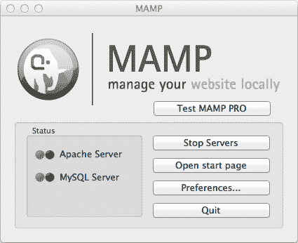

使用 WordPress 快速启动开发

**图 12-1.** MAMP 已启动并运行，它提供了一个完整的测试环境，用于开发基于 PHP 和 MySQL 的网站。

### 创建数据库和用户

按照以下步骤创建数据库和用户配置文件：

1. 点击“数据库”选项卡，在页面底部的“创建新数据库”下，输入`wordpress`。当你最终将网站托管到互联网上时，你会想使用比这里更描述性的名称，但暂时这样就可以了。
2. 选择`utf8_bin`作为排序规则（这将创建支持 Unicode 的数据库），然后点击“创建”按钮。你会看到一条消息，提示数据库创建成功。
3. 现在可以创建一个可以访问该数据库的用户——点击“权限”选项卡，然后点击“添加新用户”链接。
4. 是时候添加用户名了（作者使用了极具创意的“wordpress”作为用户名）。对于主机，选择“本地”。作者让`phpMyAdmin`生成了一个密码，但你可以随意设置自己的密码。
5. 记下你选择的用户名和密码；在安装 WordPress 时会用到它们。
6. 在“用户数据库”部分，选择“授予数据库“wordpress”的所有权限”选项，然后点击“执行”按钮。你的设置应该类似于图 12-2 所示。

237

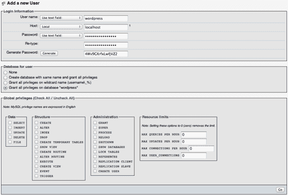

第 12 章

**图 12-2.** 测试环境的数据库设置

### 获取 WordPress 副本

你已经完成了初步设置。现在是时候获取 WordPress 副本并进行安装和运行了：

7. 前往[`wordpress.org/download/`](http://wordpress.org/download/)下载最新版本。
8. 下载 zip 文件并解压缩。MAMP 默认将其网站文件（即文档根目录）保存在`/Applications/MAMP/htdocs/`中。将 wordpress zip 文件中的全部内容复制到该文件夹中。
9. 现在，如果你加载`http://localhost:8888`（再次说明，这是 MAMP 的默认端口，但你可以指定不同的端口号），你应该会看到类似于图 12-3 所示的内容。这很好；这意味着你已经安装了 WordPress，并且它正在被 PHP 处理，然后由 Apache 提供给你（你出汗了吗？）。它还告诉你需要进行一些配置，所以是时候开始了。
10. 点击“创建配置文件”按钮。
11. 下一个屏幕显示 WordPress 需要一些关于数据库的信息（见图 12-4）。没问题：你之前已经设置好了，并记下了所有相关信息！点击“开始吧！”按钮。

238

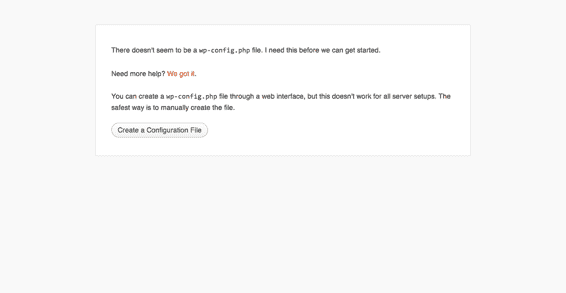

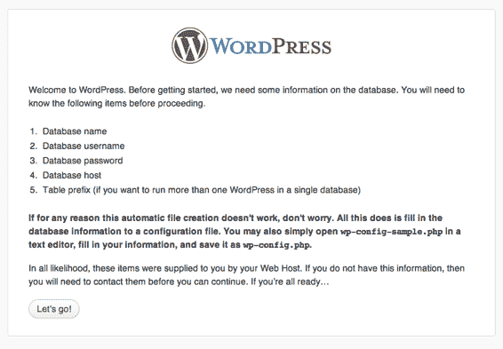


## 使用 WordPress 快速启动开发

**图 12-3.** 新安装但尚未配置的 WordPress **图 12-4.** WordPress 欢迎界面

239

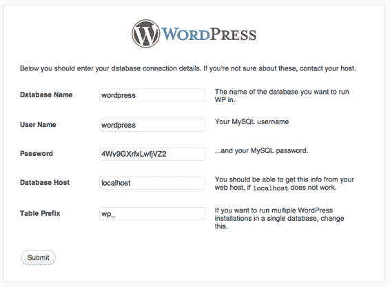

## 第 12 章

12. 输入你的数据库名称（再次说明，作者使用了`wordpress`，但你可能会用其他名称）、用户名（同样，我们只用了“wordpress”）以及密码。此处的数据库主机为`localhost`（即你正在使用的同一台机器），表前缀可以保持默认。最终，你应该会得到类似图 12-5 的结果。

点击“提交”按钮。

**图 12-5.** WordPress 数据库设置——这个界面看起来有点吓人，但这些都是你在上一节提供的信息，所以一切都很容易获取。

13. 如果一切顺利，你会收到一条友好的消息，说明你已成功连接到数据库，并且安装的这一部分已完成（如果没有收到，请返回并仔细检查你的用户名、密码和数据库名称）。点击“运行安装”按钮。

14. 现在你已进入最后一步，需要设置一些选项并在 WordPress 上创建一个账户（见图 12-6）。你的网站标题就是人们访问时在网站上看到的内容。为了本章的连贯性，我们继续使用前几章中的“Summer Smash”示例。对于用户名，请选择“admin”以外的名称（出于安全考虑），然后选择一个强大且安全的密码。在这里设置良好的安全性非常重要，因为任何拥有 WordPress 网站管理权限的人都可以随意更改网站上的任何内容——防患于未然！输入你的电子邮件地址（这是为了让你能重置密码，而不是订阅任何邮件列表），然后点击“安装 WordPress”按钮。

240

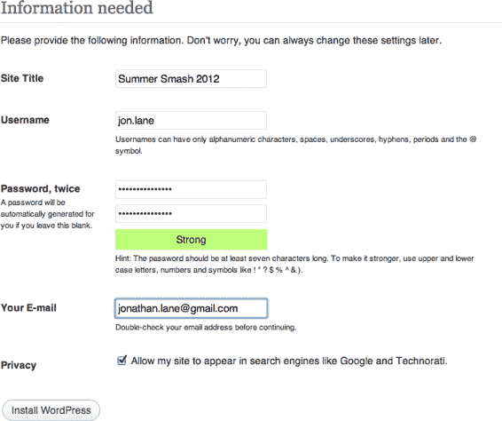

## 使用 WordPress 快速启动开发

**图 12-6.** 设置 WordPress 管理员账户并选择强密码

再次，你会收到一条友好的确认信息，表示一切已设置完毕，可以开始使用了。点击“登录”按钮。

## 一点自定义

至此，你已经取得了很大进展。你设置了一个 Web 服务器、一个应用服务器和一个关系型数据库管理系统（或者如果你愿意，也可以叫数据库服务器）。你还创建了一个数据库，安装了世界上最流行的内容管理系统之一，并执行了一些基本配置。几分钟内完成这些工作，已经很不错了！

如果你正在跟着操作，你可能会看到一个 WordPress 登录框，要求输入用户名和密码。不过，我们先不急着登录，而是去看看当前网站的样子。点击页面底部的“返回 Summer Smash 2012”链接。

还不错，对吧？图 12-7 展示了你的默认 WordPress 网站，没有任何额外的自定义或样式。想更惊讶吗？试着缩小浏览器窗口，让它变得又高又窄。注意页面格式如何根据视口变化。你看到的是一个响应式网站！WordPress 的默认主题实际上是一个响应式主题，它提供了大量的自定义选项（稍后你会看到）。

241

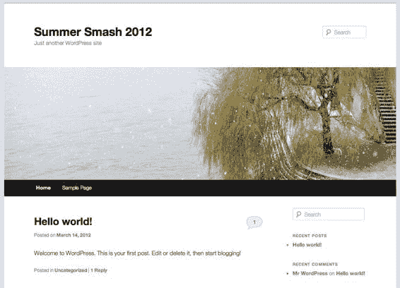

## 第 12 章

**图 12-7.** 默认的 WordPress 主题是完全响应式的设计。它虽然不算惊艳，但是一个很好的起点。

下载自 Wow! eBook <www.wowebook.com>

你可以随意点击浏览几个页面。默认情况下，WordPress 被设置为一个博客。

你在首页看到的是文章列表。文章支持评论，这样网站访问者可以对所读内容做出回应。这些文章也是可搜索的，并且会自动按类别和月份时间顺序组织（你可以在页面侧边栏看到所有相关链接）。

最后，WordPress 为你的文章和评论提供了 RSS feed。这意味着网站访问者可以使用新闻阅读器订阅你的新闻推送。点击侧边栏中的“登录”链接，返回登录页面。输入你的用户名和密码，以便查看一些可用选项。

## 仪表盘

登录后，你会看到 WordPress 仪表盘（见图 12-8）以及一条友好的入门消息。这条消息是 WordPress 相对较新的功能，但非常有用，因为这里列出的许多链接会引导你完成网站所需的操作。让我们从左侧栏开始，点击“选择你的标语和时区”链接。

242

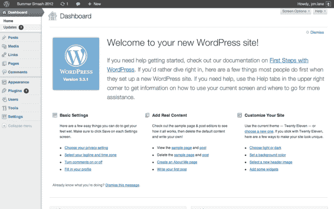

## 使用 WordPress 快速启动开发

**图 12-8.** WordPress 仪表盘：这是开始自定义网站的理想位置。

你可能还记得，在前几章中，我们使用了“This Summer’s Most Smashing Event”作为网站的标语。

让我们在这里输入它。选择你的时区，并设置你想要的任何日期和时间格式。完成后点击“保存更改”按钮，然后返回仪表盘。接下来，点击“开启或关闭评论”链接。

这个界面主要涉及博客类型设置的定制。如果你不打算运行博客（或者不使用博客功能作为网站的“新闻”板块），那么你可以安全地跳过这一部分。如果你打算使用 WordPress 的博客功能，那么花几秒钟设置好如何处理评论是值得的。

此页面上的大多数设置都相当直观。你可以根据自己对谁能在网站上发布评论的宽松或严格程度进行设置。顶部的“默认文章设置”部分需要稍作解释。这部分允许 WordPress 自动“通知”你链接到的网站（通常是其他博客）。同时，它还会在其他博客上自动创建一个指向你特定文章的链接（有点像魔法）。这对于从其他网站带来流量非常有用；然而，它也可能被用来向你的网站*发送垃圾链接*（提醒一下）。在线社区的基本规则是，如果你要建立一个社区（即允许人们在你的网站上评论，本质上就是在采取措施建立社区），那么你必须参与并进行管理。

243

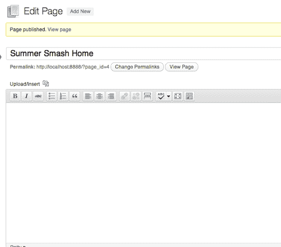

## 第 12 章

调整任何你喜欢的其他设置，然后返回仪表盘！下一步是为你的网站创建几个页面，然后将首页更改为默认以外的内容。

1. 点击侧边栏中的“页面”链接，然后点击“添加新页面”按钮。WordPress 提供了一些基本的编辑工具来构建你的页面。

2. 在这个阶段，你不需要编写什么精彩内容，所以只需输入“Summer Smash Home”作为页面标题，正文暂时留空。

3. 如果你在上一步中开启了评论，你可能想为这个页面关闭评论（谁希望自己的首页上有一堆匿名评论呢？）。点击右上角的“屏幕选项”链接，勾选“讨论”旁边的复选框。

4. 取消勾选“允许评论”和“允许引用及通告”选项。页面上的其他所有设置都可以保持默认，所以点击“发布”。你应该会收到一条页面已发布的确认信息，如图 12-9 所示。

5. 点击侧边栏中的“所有页面”链接。

**图 12-9.** 一个已发布的页面（本例中是我们未来的首页）

244

## 使用 WordPress 快速启动开发


现在你的网站有两个页面：WordPress 默认创建的示例页面，以及你刚刚创建的主页。将鼠标悬停在示例页面上，点击“移至回收站”链接（你不再需要那个页面）。在屏幕顶部，你可以看到该页面已被移至回收站，并且可以撤销刚才的操作（这让人放心，以防你误删了想保留的内容）。

你将使用 WordPress 的博客功能，只是不希望它作为你的主页。为此，你需要创建第二个页面，名为“夏日狂欢新闻”，用于发布更新（试试看能否自己创建这个页面！）。

接下来是另一个设置页面：阅读设置页面。点击侧边栏中的“设置”，然后选择“阅读”。在“首页显示”部分，选择第二个选项，然后将你的主页指定为首页，并将新闻页面设置为处理文章。记得点击“保存更改”按钮！

让我们暂停一下，快速查看一下你目前的效果。点击页面顶部栏中的“2012 夏日狂欢”字样，你将进入网站预览。你会看到一个报头图形，下方是导航菜单（目前包含两个链接：主页和夏日狂欢新闻）。一切进展顺利，但你还需要完成几件事。

## 扩展 WordPress

WordPress 被广泛应用于各种场景，用于实现各种功能。其内置功能已经相当出色，但当你需要更进一步时，就需要借助一些帮助。以下功能可以帮助你充分利用 WordPress：

*   *插件*：允许你为网站添加额外功能（例如会员专区、讨论论坛或注册表单）。
*   *主题*：这些是 WordPress 网站的预打包样式，只需点击几下即可完全改变网站的外观。

我们已经在 WordPress 中使用了一个主题；默认情况下，WordPress 自带一个优秀、响应式且符合标准的主题，名为 Twenty Eleven（这个主题会随时间变化，但在撰写本文时，Twenty Eleven 是默认主题）。你可以购买其他主题、安装免费主题、开发自己的主题，或者只是调整/自定义现有主题（这正是你为夏日狂欢所做的）。

## 改变 WordPress 的外观

改变 WordPress 的外观和感觉很容易。按照以下步骤操作：

1.  点击顶部栏中的“2012 夏日狂欢”返回仪表盘。现在，你应该将注意力集中在顶部区域的最后一列。点击“选择浅色或深色”链接。
2.  夏日狂欢虽然是一个热闹的活动，但风格偏暗。你希望网站更具前卫感，因此首先将主题切换为深色。
3.  深色主题的默认链接颜色是一种很棒的橙色，但对于这个网站来说有点太万圣节风格了。相反，将其改为一种漂亮、深沉（但仍具对比度）的红色。点击橙色，你会看到一个方便的取色器（作者选择了 `#e4211f`，但你可以随意选择任何你喜欢的颜色）。另外，保持默认布局，内容在左侧，就像你在前几章使用表单开发时一样。

245

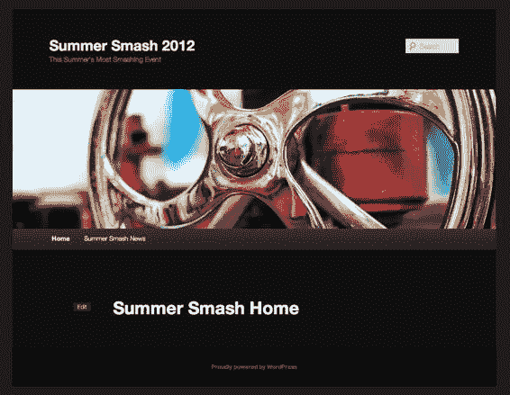

第 12 章

4.  保存这些更改并再次预览网站（见图 12-10）。我们之前应该提到过，如果你的屏幕显示的报头图像与本书截图不同，请不要沮丧——Twenty Eleven 会循环显示一系列图像。
5.  接下来，是时候稍微调整背景了。返回仪表盘，点击最后一列中的下一个链接。你将使用背景图像为页面增添一些质感。Subtlepatterns.com 是一个很棒的在线资源，提供非常有品位的背景纹理（免费使用）。我们选择了一个名为“Vertical cloth”的纹理（[`subtlepatterns.com/patterns/vertical_cloth.png`](http://subtlepatterns.com/patterns/vertical_cloth.png)），但如果你喜欢，也可以发挥创意！
6.  那些报头图像不太合适。返回仪表盘，点击“选择新的页眉图像”。
7.  报头是一个可以强化网站主题的地方。你需要一张能充分体现“粉碎”感的图像。这里有一张（[www.sxc.hu/photo/1181196](http://www.sxc.hu/photo/1181196)）来自 stock.xchng 网站，这是一个很好的免费图库来源。那张源图像有点大（WordPress 提示图像应为 1000 像素 × 288 像素，但进行一些调整和裁剪很容易。如果你的电脑上没有图像编辑器，别担心。WordPress 也能帮你解决。只需上传图像，你就可以直接在屏幕上裁剪。

**图 12-10.** 切换到默认主题的深色变体后，你的网站开始初具雏形。

246

## 使用 WordPress 快速启动开发

### 更进一步

好了，你现在拥有的网站与最初相比已经大不相同——但如果你想更进一步呢？例如，假设你想展示你的 CSS 技能，并自行进行一些修改。WordPress 非常乐意让你访问源文件。点击侧边栏中的“外观”，然后点击“编辑”。

打开的第一个文件正是你需要的：样式表。它已经相当庞大；Twenty Eleven（当前主题）中包含大量样式信息。问题是，你该从哪里开始呢？

你已经熟悉样式声明的样子；你只需要知道你要将样式应用于什么元素，以及相应的类名/ID。让我们从一个简单的目标开始：为“内容区域”添加一点发光效果，使其与页面背景区分开来。需要说明的是，本章只是一个起点。你可以删除所有内容，从头开始，为页面上的各种元素编写自己的自定义样式声明。但是，利用已有的内容可以为你提供捷径，并让你有机会运用前几章学到的技能。

一种方法是滚动样式表，寻找可能的候选元素（也许是 `div#content`？）。但你无法确定页面作者是否使用了 id 为 content 的元素，甚至是否使用了 `div`。因此，你需要使用当今大多数浏览器内置的工具：*网页检查器*。Firefox、Safari 和 Chrome 都内置了此工具。它也可以作为 IE 的开发工具可选安装，但不要使用 IE——说真的。

现在加载 2012 夏日狂欢的预览网站。接下来，右键点击内容区域，选择“检查元素”选项（Chrome 菜单中是这样显示的，你选择的浏览器可能略有不同）。你应该会看到类似图 12-11 所示的内容（取决于你点击的位置）。

你会在顶部看到页面预览，底部看到页面的标记。如果将鼠标悬停在底部页面的各个元素上，它们会在顶部页面中高亮显示。网页检查器是一个非常实用的工具，用于检查页面结构并识别应用于特定元素的样式。


# 第 12 章

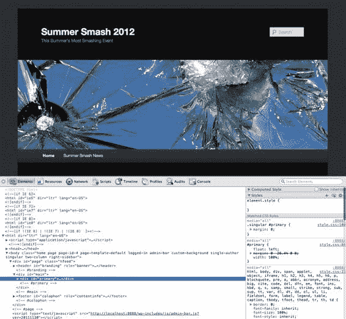

**图 12-11.** Chrome 中的 Web 检查器工具可帮助你快速识别页面上的各种元素，从而知道样式表中应定位哪些内容。

现在加入以下代码：

```css
#page {
  margin: 2em auto;
  max-width: 1000px;
  -moz-box-shadow: 0 0 20px rgba(255,255,255,0.3);
  -webkit-box-shadow: 0 2 20px rgba(255,255,255,0.3);
  box-shadow: 0 0 20px rgba(255,255,255,0.3);
}
```

248

## 使用 WordPress 加速开发

盒阴影是 CSS3 的新属性，因此目前需要使用一些特定于供应商的前缀。我们再做一个修改，将标题字体改为前面章节中选定的字体：Frijole。首先，需要包含 Frijole 的样式表，该样式表应放在页面的头部。为此，转到`外观 ➤ 编辑器`，点击`头部 (header.php)`，然后粘贴以下代码行：

```html
<link href="http://fonts.googleapis.com/css?family=Frijole" rel="stylesheet">
```

希望这行代码位于主样式表之前，因此将其粘贴在主样式表的上方。完成后点击`更新文件`。现在需要跳回样式表，因此点击右侧栏中的`样式表 (style.css)`。同样，需要找出标题和标语元素，因此返回并检查它们（如果打开第二个浏览器窗口，可以避免频繁来回切换，可能会更方便）。看起来主标题是一个`<h1>`，其`id`为`site-title`，标语是一个`<h2>`，其`id`为`site-description`。它们都包含在一个`hgroup`中，而该`hgroup`又位于一个`id`为`branding`的`div`内。你可以利用层叠规则，通过一条声明将字体应用于这两个元素。在样式表中找到声明`#branding hgroup`，查看已有的外边距声明。现在添加你的`font-family`声明：

```css
#branding hgroup {
  margin: 0 7.6%;
  font-family: "Frijole", Arial, sans-serif;
}
```

接下来，点击`更新文件`，然后前往查看页面。漂亮的字体又回来了。

### 通过插件更进一步

之前，我们用了几章时间为活动设计了一个很棒的注册表单——如果能使用该表单并将其提交到某个地方，那该多好啊？WordPress 本身并不内置表单处理功能（除了允许访问者在页面上提交评论，但我们不希望注册表单使用这个功能！）。不过，让我们看看能否为 WordPress 添加一些东西来帮助我们解决这个问题。

首要任务是创建一个注册表单页面。请按照以下步骤操作：

1. 转到管理页面，点击`页面`，然后选择`添加新页面`。将页面标题设为`注册`，并像之前一样关闭评论和引用通告/回溯引用。
2. 从[第 4 章](http://dx.doi.org/10.1007/978-1-4302-3789-1_4)中获取表单的完整标记并粘贴进来。默认情况下，你会看到可视化编辑器，因此在粘贴前切换到 HTML 编辑器（右上角）。点击`发布`。
3. 接下来，点击`插件`。可以看到 WordPress 中已经安装了两个插件（但都未激活）。`Akismet`插件可以保护你的博客免受垃圾评论骚扰。如果你打算在网站的任何页面上开放评论或引用通告，我们强烈建议你花点时间配置`Akismet`插件。`Hello Dolly`只是一个测试插件，你可以删除它。
4. 这两个插件都无法满足表单处理的需求，因此需要找一个合适的插件。点击左侧栏中`插件`下的`安装插件`。你需要一个*表单处理器*，因此尝试搜索该关键词。搜索结果很多，但快速浏览后，发现一个名为`Filled In`的插件似乎正合适。点击该插件下方的`现在安装`链接，然后点击`启用`链接。
5. 很可能需要做一些配置才能使该插件正常工作，因此点击`工具`，然后点击侧边栏中的`Filled In`。好的，看起来需要创建一个新表单。将其命名为`注册`，然后点击`创建`。你还可以看到一堆其他配置选项（可以自行查看）；现在，我们只做最基本的工作以使其运行。在表单列表中点击`注册`。

你需要通过此表单实现以下几个目标：

- 希望将表单的结果通过电子邮件发送给你。
- 希望注册者在点击`注册`按钮后看到一条友好的“感谢”消息。

按照以下步骤设置此表单：

1. 在`后处理器`部分，选择`作为电子邮件发送`，然后点击`添加`。接下来，点击出现的链接，输入你的电子邮件地址，然后点击`保存`按钮。
2. 在`结果处理器`部分，点击`显示‘感谢’消息`选项，然后点击`添加`。接下来，点击出现的链接，输入你的感谢消息。
3. 勾选`自动格式化`和`替换整个页面`复选框，然后点击`保存`按钮。

好的，我们的表单能够完成所有这些功能，但如何将其与之前章节中构建的表单关联起来呢？答案在帮助页面中。如果你点击右上角的`帮助`链接并阅读`Filled In 文档`，就会发现只需给表单一个`id`（此处为`Registration`），即可轻松地将表单与此表单处理器关联。按照以下步骤完成新表单与之前章节中创建的表单的关联：

1. 返回你的`注册`页面（即点击`页面`，然后从列表中选择`注册`）。
2. 如果直接复制了表单代码，请删除表单中的`action=…`属性，并将其替换为`id="Registration"`。
3. 点击`更新`按钮，然后查看你的表单。你会注意到格式有点奇怪，因为你还没有从[第 5 章](http://dx.doi.org/10.1007/978-1-4302-3789-1_5)和[第 6 章](http://dx.doi.org/10.1007/978-1-4302-3789-1_6)复制任何样式信息；不过你可以稍后再做。现在，尝试填写表单，然后点击`立即注册！`按钮。

你会注意到几件事。在图 12-12 中，可以看到一个漂亮的确认页面，上面显示了你的感谢消息；看起来一切正常。然而，你可能没有收到包含注册信息的电子邮件。没关系；在我们的台式电脑上，没有设置邮件服务器来处理这些消息的发送。一旦网站上传到真实的网络主机上，这部分功能就能正常工作了。与此同时，如何确保确实发生了某些操作呢？

现在返回管理页面，点击`工具`，然后点击`Filled In`链接。在你的`注册`表单旁边，应该会在`成功`列下看到一个`1`。点击那个`1`，就可以访问该条目。

250

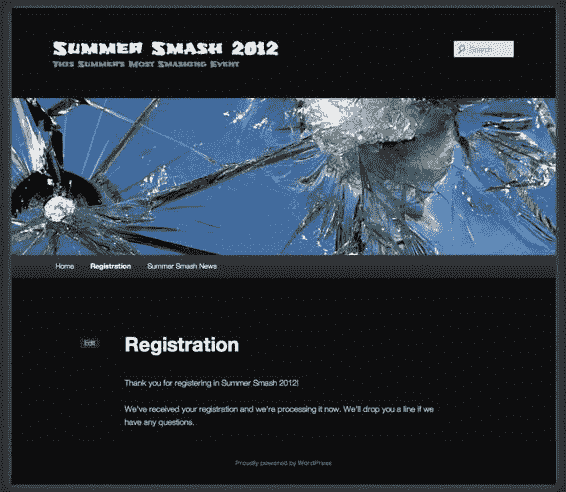

使用 WordPress 加速开发


**图 12-12.** 用户注册 Summer Smash 后显示的确认屏幕。

## 总结

在短短几页的篇幅中，你已经从零开始，拥有了一个功能完备、数据库驱动的网站。

你采用了前几章创建的表单，并为其添加了处理能力（记得也要添加样式声明，以确保表单格式正确！）。你自定义了 WordPress 主题，并赋予了它在之前章节中你为其打造的风格。

接下来的步骤将是完善网站其他页面的内容，进行测试，然后将网站迁移到合适的托管服务上，使其能够全天候运行。

251


# 第 13 章

## 后记：网络商业

这篇后记将探讨如何在与网络相关的领域中最好地开展业务。

我们认识一些才华横溢的设计师，他们却不擅长开票。我们也认识一些优秀的开发者，他们因为未在开始工作前商定好协议条款而难以收到报酬。

自由职业是网络从业者中非常流行的一种选择。我们不知道这是行业特性使然，还是网络从业者的性格类型所致，但根据我们在会议上与同行的交流，似乎在大机构工作的人中，有很多人同时也在做自己的副业。你经常会发现，那些从事完全不同领域（如平面设计或摄影）的人，甚至我们遇到过几位持证电工，偶尔也会涉足网站开发。

这篇后记主要适用于*自由职业者*，或者说是为自己工作的人。如果你在一家公司工作，很可能会有其他人来处理诸如开票、设定费率、收款等事宜（那你可算幸运了）。不过，每个人偶尔也需要寻求一些帮助，因此关于招聘的部分是相当通用的。

### 自由职业网络专业人士的基本需求

你拥有技能，并且热爱你所做的事情。然而，要想将其转化为一项业务，你还需要更多。如果你只是想出于创作的热爱而建网站，那么祝你好运，你可以跳过本章。但如果你想以此为生，你就需要处理商业方面的事务。好消息是，就商业而言，网站设计/开发是相对容易进入的领域之一。你无需担心库存、运输或退货问题；你可以将网站托管等事务外包给任何商业主机提供商。风险因素非常有限，因为你所需的设备只是一台电脑，而大多数人已经拥有电脑。

不过，如果这要成为一项可行的业务，你需要有办法找到客户，说服他们应该让你来做这项工作，然后确保你为所做的工作获得报酬。当你用“应收账款”、“保密协议”和“付款计划”这样的术语来表达时，可能会让人望而生畏。但这些术语翻译成通俗语言，就像 HTML、CSS 和 JavaScript 对你来说现在已经变得通俗易懂一样。

我们认为，你需要做出的最大转变是树立一种经营业务的思维模式。

即使你的生计并不依赖于合同工作带来的收入，也要假装它确实如此（这说起来容易做起来难）。你对待财务以及客户/潜在客户的态度和方法将会彻底改变。虽然你热爱自己的专业工作很好，但如果有选择，你是愿意花大把时间开发网站，还是与家人朋友一起享受户外时光？

### 具备法律常识

我们先用常见的互联网免责声明来开头：“我们不是律师。”即使我们是律师，也不可能写出适用于所有国家、州、省甚至城市的法律建议。如果你对任何问题有疑问，我们建议你寻求合格的法律建议。

尽管如此，我们可以讨论一些基础知识，比如企业类型，并且我们将描述当前行业中的一些最佳实践。

### 兼职自由职业

我们认识的全职设计师或开发者中，几乎没有人不做自由职业。大多数雇主对此完全接受，只要不是在公司时间或使用公司资源（设备、带宽、服务器空间等）进行即可。如果你最终打算单干，兼职自由职业是一个很好的起步方式；它让你在拥有薪水和医疗保险保障的同时，还能建立客户群。

另一方面，如果你成功了，你可能会发现自己几乎没有空闲时间。在办公室工作了八小时之后，很难再有动力去处理客户项目，尤其是如果你的全职工作也是与网络相关的话。当我们处于这种情况时，我们总是会向新客户坦诚说明情况。我们不会假装全职投入他们的项目；我们会告诉他们这是副业。如果你的客户真的想与你合作，并且他们有一定灵活性，那么一切都会顺利。

那么如何找到动力呢？热爱你所做的事情是很大一部分原因。只接受那些你感兴趣并且知道自己能成功的项目。同时，为自己设定合理的期望；你不可能每天下班后投入四个小时，然后周末每天花十个小时做项目。给自己留一些休闲时间，否则你肯定会精疲力竭。

### 过渡转型

最常见的问题之一是：“我如何知道何时该辞去全职工作，全身心投入自由职业？”——假设这是你的最终目标。关于何时可以安全地离开固定薪水，并没有硬性规定，但如果你正朝着这个方向前进，你绝对需要开始考虑储蓄。

254

后记：网络商业

每个案例都不同；如果你已经有了明确的客户群，并且从副业中获得了稳定且可观的月收入，那么你很可能可以安全地退出全职工作，同时存有三到四个月的生活费。如果你是从零开始，需要建立客户群，那么你至少应该存够六个月的生活费，才考虑单干。达到收支平衡点并不那么光鲜，但这是你在自由职业生涯早期能体验到的最棒的感觉。

这样想：即使你手头有几个大项目，也可能需要几个月才能开始收到付款（取决于你与客户商定的条款）。我们将在本章后面讨论的一个概念是现金流——手头有足够的钱维持生活。你可能签了合同，承诺项目完成后会支付你数千美元；但如果你的账户余额为零，而每个项目还有数周的工作要做，那你最好开始向朋友讨饭吃了。

如果你正朝着全职自由职业的方向发展，可以考虑的一个想法是，看看你现在的雇主是否允许你转为兼职工作。这样，你仍然有固定薪水的保障（尽管减少了），但有了更多的空闲时间，尤其是在正常工作时间，来建立你的客户群并与现有客户相处。


## 更多信息

我们在自己转型过程中发现的最佳资源之一是 Freelance Switch 网站（[`freelanceswitch.com`](http://freelanceswitch.com)）。这个网站提供了从服务定价到广告宣传和寻找客户等各方面的丰富信息。

## 企业类型

在加拿大，设立企业有三种途径；美国则多了一种值得探索的选择。我们按照从简单到复杂的顺序列出：从今天就能完成、无需任何文书或设置的方式，到需要设立董事会和确定股东的最复杂设置。

好消息是，无论你选择哪种途径，大部分公司注册/企业设立需求都可以在家中舒适地完成。最终的文件提交（取决于你居住的地方）可能需要亲自办理，但所有表格和名称查询（如果你想使用像 Google 这样酷炫的商业名称——等等，那个已经被用了！）都可以在线完成。

## 独资企业

第一种（也是最简单的）选择是独资企业——自己创业。我们认识的大多数做“副业”的人都经营着独资企业，他们是唯一的业主和经营者，并直接获得所做工作的报酬。到了报税时，你自由职业所得的所有收入都包含在个人所得税申报表中（无需为公司单独报税）。客户直接向你付款，款项可以直接存入你的个人银行账户。任何法律协议，如合同或保密协议，都是你与客户之间直接签订的。如果你决定尝试申请银行贷款来扩大业务，你将使用自己的个人资产作为抵押。

这种安排的主要好处是简单；实际上不需要任何特殊的设置。你（在某些地方）可以向政府提交文件以获得商业名称（或“经营名称”，有时缩写为 DBA 名称）。缺点是，如果与客户或银行出现问题，你的个人资产将面临风险。例如，如果你签约建立一个电子商务网站，该网站随后被黑客攻击并导致客户业务受损（别害怕；虽然有可能，但我们说的是最坏情况），那么该客户可能会选择起诉你。如果你因代码中留下重大安全漏洞而在法庭上败诉，你将个人负责支付法院判决的赔偿金。

## 合伙企业

合伙企业与独资企业类似，利润不会先进入公司再支付给员工；而是根据合伙协议中确定的分成比例直接流向合伙人。无需为公司单独报税；任何收入都由合伙人直接在其个人申报表中报告。

假设你和一位朋友决定创办一家公司。她精通 HTML 和 CSS，而你一直是个出色的设计师，能制作出无人能及的图形。不过，你目前在当地报社兼职，暂时不想放弃这份工作，因此你决定只能投入 50% 的时间到公司。在这种情况下，按 50/50 平分利润是不公平的，所以你选择了 75/25 的分成，因为你的朋友将投入全部时间经营业务、向潜在客户推销、处理会计工作以及完成网站项目的所有编码。

因为是朋友，你们可能倾向于仅凭口头协议就开始合作。不过，最好还是更进一步，将一些事项书面化。在某些地方，合伙企业需要向政府机构注册合伙协议；其他司法管辖区则宽松得多（这是你需要核实的事情）。无论你是否需要制定并注册正式的合伙协议，你都应该起草一份文件，回答几个基本问题：

- 合伙人是谁？
- 资金如何在合伙人之间分配？
- 谁负责业务的哪些部分？
- 如何就业务做出决策（投票、特定人员处理特定决策、一人拥有权威）？出现平局时怎么办？
- 如果一位合伙人想要退出合伙关系怎么办？如果一位合伙人去世怎么办？
- 如果一位合伙人想要增加其股份（例如你决定辞去报社工作全职投入）怎么办？
- 如果决定终止合伙关系（解散公司），资产如何处理？

这不必复杂，也无需用繁重的法律术语书写。只需将大家同意并签字的内容书面化，以便在出现这些情况时有所参考。

我们并不是说律师在这里没用；事实上，如果你有资金（通常几百美元），让律师为你起草合伙协议可以消除未来解释中的任何歧义。但即使只是一份某晚喝酒时写下的友好文件，也能在遇到麻烦时帮助你有所参考。

## 有限责任公司（美国）

有限责任公司并非美国独有；某些欧洲国家也有（通常名称不同）。有限责任公司的要点是，它在税收方面具有独资企业/合伙企业的所有简便性，同时拥有公司的一些法律保护。有限责任公司的利润可以“直接流向”其所有者/合伙人，因此无需单独报税。有限责任公司可以有股东，但不需要召开年度股东大会。

## 公司

严格来说，有限责任公司是公司的一种形式。但我们单独提及它，是因为它并非在所有地方都可用，如果可用，它可能是你最好的选择。成立企业最复杂的途径是注册公司。在美国（加拿大不行），你可以选择成立 S 公司（与有限责任公司有很多类似的好处）或 C 公司，大多数大公司（如微软或戴尔）都是 C 公司。S 公司和 C 公司之间的区别相当复杂，主要涉及结构和税收——因此，如果你选择这条路，请咨询会计师。

与任何其他途径相比，注册公司最大的好处是你在可发行的股份数量/类型方面拥有极大的灵活性。一般来说，如果你计划以后寻求投资资金，或者你的计划是发展业务然后出售，那么注册公司可能是最适合你的途径。这并不是说你不能出售其他类型的企业，但公司是最正式的企业结构。

## 合同

合同是一件有趣的事情。根据你与谁交谈，答案要么是“没有签署的合同绝不开始工作”，要么是“不用担心合同；口头协议就可以了”。我们在讨论中采取中间路线：有时你需要合同，有时不需要。

让我们稍微说明一下：如果是老客户或我们非常熟悉的人，我们通常没问题。


仅凭口头协议（除非他们有拖欠付款的历史！）。如果真到了万不得已的时候，你需要为已完成的工作收款，手头有一份合同会让你轻松很多，尤其是在法庭上。很可能你不会因为莫特叔叔赖掉部分账单而起诉他（或者你可能会，那个混蛋！）。标准的付款条款是：新项目先收一笔预付款，完成 50%时再收一笔，最后完工时收尾款（常见的分账比例是 25-50-25 或 50-25-25）。偶尔，对于长期重复客户（我们有几位这样的客户），我们会放弃这种做法。另一方面，要求客户签署合同或被客户要求签署合同，这本身并没有错。如果你想缓和一下气氛，可以称之为“协议”。毕竟，重要的是你们双方都同意这些条款。

257

# 第 13 章

大多数情况下，合同会涵盖我们在[第 2 章](http://dx.doi.org/10.1007/215422_1_En_2)中讨论的许多内容：时间、金钱和范围。如果这句话让你坐直了身子，感谢你阅读并认同了我们关于项目管理的观点：当你还不确定项目会是什么样子时，你怎么能在合同中定义范围呢？

你可以大致定义它（比如你要做网站，但不包括公司的 Logo、名片和三折页宣传册），然后加入一条说明，表明随着项目进展，内容将如何修订。这种非正式的前期合同有时被称为工作说明书（SOW）；它只是书面记录了你和客户对项目的一些共同理解。描述你的工作方式也无妨；例如，如果你只打算提供一个设计方案，那就明确说出来。如果你只交付最终文件而不交付任何工作文件（无论出于何种原因），也请说明。意外越少越好。不过，不要写得过于详尽；一个为期两周的项目，签一份 30 页的合同就过头了。

你的合同/协议/工作说明书应包含价格和付款条款。还应包括逾期付款的罚则（包括你收取的利率）。最后，如果你的客户有一个“最终截止日期”，务必将其包含在内。如果没有，你可以自行加入一个上线日期——如果有一个双方商定并写下来的固定结束日期，确实有助于项目按计划推进。

## 你需要律师吗？

简短的回答是：可能/最终需要。当你刚开始创业时，律师费可能有点令人望而却步。

大多数律师每小时收费数百美元，这对一个新自由职业者来说通常意味着大量的计费时间。刚开始时，你的大多数客户可能规模相当小，你能够与他们非常紧密地合作。这大大有助于避免那些导致一方起诉另一方的潜在法律纠纷。对于你初期所做的工作，起诉/应诉的成本将远高于直接全额退款给客户（当然，这并不意味着出现分歧时你应该立即提出这个选项）。

我们的意思是，在初期，你可以跳过律师。你可以在线上或线下的许多办公用品商店和书店找到合同模板和其他法律表格。然后你可以根据自己的需要定制这些模板。直到你开始接手价值数万美元的项目时，才需要真正关注法律体系。即便如此，保持低调，做好工作，一切都会对你有利。没有人会因为对你的工作极其满意而赖账（好吧，有人会，比如那个混蛋莫特叔叔）。

## 资源？

以下是一些值得记住的资源：

- [www.designerstoolbox.com/](http://www.designerstoolbox.com/)：让你购买可定制的单个模板。
- [www.nolo.com/](http://www.nolo.com/)：提供各类事务的通用法律建议。
- [www.mynewcompany.com/](http://www.mynewcompany.com/)：为新企业提供良好资源，提供如何注册公司等信息。

258

## 后记：网络业务

## 保密/竞业禁止

在早期阶段，你不太可能需要处理这两类协议（我们至今还没见过客户提出这类要求）；但万一遇到，了解自己将面对什么总是好的。通常，保密协议（NDA）是无害的；它只是确保你对从客户那里了解到的信息保密。如果你将接触到某些敏感的公司材料，你的客户/雇主可能会要求你签署一份这样的协议。一般来说，这些协议是为了防止你了解客户业务的所有信息，然后将其用于向竞争对手推销。

唯一需要注意的是，你被要求签署的保密协议是否也包含竞业禁止条款。这意味着你可能在法律上被禁止在一段时间内承接某些客户。例如，如果你为百事公司工作，并签署了一份附带五年期竞业禁止条款的保密协议，那么两年后你就不能去为可口可乐公司工作。

需要关注的两个因素是条款的期限和条款的宽泛程度。我们并不是说永远不要签署带有竞业禁止条款的保密协议。你只需要在签署前仔细阅读，并判断收益是否大于成本。以百事/可口可乐为例，再加上你的业务专门从事食品和饮料制造商网站，而条款实际上适用于所有饮料制造商（不仅仅是可口可乐），那么你在未来五年内实际上就减少了潜在客户群。

如果与百事的合同足够有利可图（无论是经济上还是声望上），并且你的业务足够广泛，以至于你在行业之外找客户毫无困难，那么就可以签。不过，这些协议的条款通常不是一成不变的，所以你可以仔细阅读并提出修改建议。

## 赚钱：财务生存

你可能不仅仅是为了每天坐在电脑前数小时的“光鲜”而做这行，你可能还想赚点钱。因此，打理好自己的财务是个好主意。为了确保你的财务健康，你需要熟悉一些术语和概念。虽然你在看商业新闻时经常听到收入和利润，但对于新创业者来说，更重要的概念是现金流。

### 维持经营

是的，赚钱（收入）很重要。是的，盈利（收入大于支出）也很重要。但在你挣扎求生的早期阶段，这两个概念都是次要的。现金流更像是一个宏观概念，你需要关注你起步时有多少钱（储蓄），你每个月能赚多少钱（收入），以及你每个月的开支是多少。在开始自由职业生涯的初期，不要指望能大把赚钱。事实上，如果你赚的钱足以支付自己的生活开销，那已经很棒了！

让我们快速看一个现金流的例子。假设你有一些储蓄，并且你是家庭唯一的收入来源（例如，你不是免费住在父母的地下室）。你刚刚辞去工作，开始自己的自由职业。除了已经拥有自己的设备外，你还攒下了 5000 美元的储蓄。

259

# 第 13 章


你也曾坐下来用电子表格计算过，每月需要 2000 美元来支付房租、水电和伙食。显而易见，如果接下来 60 天里你一个付费项目都接不到，你的生意就要黄了。你至少需要在未来 60 天内赚到 1000 美元才能维持运营，然后在接下来的 30 天内将这个数字翻倍。这并非不可能，但中途休两周假恐怕不太现实。

## 收款（即应收账款）

在网页设计和开发领域，标准做法是在项目开始时收取首付款，在项目中期收取第二笔款项，然后在项目完成时收取尾款结清余额。如果你采用固定价格（即预先报出项目总价，而非按小时计费），那么通常将付款比例分为 50:25:25 或 25:50:25（你可以根据自己的喜好调整这些条款，它们只是参考）。

提前收取大部分款项的理由是，这能让客户对项目做出承诺。虽然这听起来像是一句废话，但客户委托你开发项目，你投入大量精力制作原型或设计，然后客户因为忙于其他事情而人间蒸发的情况并不少见。如果客户连预付合同总额的一半都不愿意，那么他们很可能也没有足够的承诺坚持到项目完成。

我们在此重申本书中已经说过无数次的话：开发网站是一个协作过程；你需要客户在整个过程中与你合作。

和所有事情一样，要具体情况具体分析；但对于你从未合作过的新客户，一笔可观的定金是你确保他们保持参与的唯一保障。

## 时间追踪与开票

无论你采用哪种计费方式（固定费率或按小时），记录你在各个项目上花费的时间都至关重要。客户完全有权要求查看你在他们项目上花费的时间明细，这也有助于你将来估算（报价）项目。如果你陷入财务困境，需要找出不赚钱的原因，这是你唯一的数据来源。原因可能并不总是显而易见，但如果你有过去几个月的工时记录，你至少能看出问题是出在计费工时不足，还是你的费率定得太低。

有成千上万种应用程序可以在 Mac、Windows 电脑上运行，甚至还有很多优秀的基于 Web 的产品，可以让你记录工时。其中许多产品都集成了某种开票软件，因此一旦你记录了在项目上投入的工时，就可以自动生成发票发送给客户。根据经验，如果发票上包含足够多的细节，客户质疑工时的可能性就会小得多。递给别人一张写着“10 小时：300 美元”的纸是行不通的。要把时间分解成各个工作时段（例如 3 月 2 日：2 小时，3 月 5 日：2 小时，等等），并确保提供你在该时段所做工作的简短描述。

我们使用一款名为 Harvest 的出色 Web 产品（[www.getharvest.com](http://www.getharvest.com)）来进行所有的时间追踪和开票（完全披露：Jonathan 也在 Harvest 工作）。Harvest 让你可以非常轻松地为正在进行的工作（无论是计费还是非计费工作）运行计时器，然后根据这些工时生成报告并向客户开具发票。

## 260 后记：Web 生意经

## 你需要会计师吗？

虽然我们对是否需要律师持保留态度，但我们强烈建议你在自由职业生涯的早期就与会计师谈谈。会计师会告诉你报税时需要记录哪些内容，如果你决定成立公司，他们还能极大地帮助你（为你省钱）。

如果你真的想省下这笔费用，也可以不请专业人士来打理。但请记住，这可能会在报税时让你多花一点钱。要么雇一名会计师，要么从每张发票中多留出一点钱（以防万一）。税收因国家、州、省甚至城市而异，差异很大。如果你决定独自处理，不寻求专业建议，那么至少要找一些针对你所在地区的具体信息。

认为美国的建议也适用于加拿大（反之亦然）是愚蠢的。

## 资源

以下是一些资源：

- [`cpadirectory.com/`](http://cpadirectory.com/)：注册会计师名录（美国）
- [www.accountants-4u.ca/](http://www.accountants-4u.ca/)：加拿大会计师名录

## 广告与推广

获得曝光的最佳（也是最便宜）方式是做出真正优秀的工作。如果你建立起一个高质量、可靠、按时按预算完成工作的声誉，那么你将通过口碑推荐获得大量业务。还有什么比让现有的好客户把你推荐给他们的同行更好的方式来找到更多优质客户呢？

如果你的专长是设计，那就建立一个出色的作品集（并展示出来）。如果你因为没什么可展示而难以获得最初的几个客户，那就自己编造一些项目。仅仅因为“史蒂夫银行”并不存在，并不意味着它不需要一个网站。同样，“南极海滩度假村”也迫切需要建立线上形象；自己编造一些有奇葩需求的客户，通常比解释现实案例有趣得多。

没有哪个客户太大或太小而不值得展示，也没有哪个客户太真实或太虚构。

有一点要提醒你，尤其是刚开始的时候：有些人会提出“让你”免费为他们做网站，以帮助你建立作品集。在任何情况下都不要接受这些活儿。如果你想建立作品集，就按自己的方式来做。如果你免费为别人工作，他们不会尊重你，也不会尊重你的时间。这个项目会以糟糕的结局收场。一定会。我们是认真的。

## 广而告之

但是，嘿，做出优秀的产品还不够。一旦完成，你必须大声宣传。最好的方法是在网上建立你的声誉。建立声誉的唯一途径是走出去并与人交流。就像你会告诉客户的那样：仅仅拥有一个很棒的网站是不够的；人们必须知道它并访问它。

## 261 第 13 章

有几种方法可以为你的网站带来流量。你可以花钱购买广告，但如果资金紧张，看看一些免费替代方案可能更有用：

- *参与*：在博客上评论，加入讨论组的帖子，写自己的博客；做任何能让你名字曝光的事情。过去人们常说没有所谓的坏名声。这在网上当然不成立。如果你在发表观点和参与讨论，不要做一个混蛋。没有人愿意和一个混蛋合作。


# 写作

为某个行业网站撰写并提交一两篇文章。像 A List Apart（alistapart.com）这样的网站经常接受读者投稿。你的文章需要经过深思熟虑且颇具创新性；但如果你成功发表，你的声望会立刻提升。

# 设计

开发者的处境比较艰难。很难让其他人（除了另一位开发者）对你写的代码感到兴奋。我们还没听到有人惊叹：“哇！看它解析那个文本字符串的效率多高！”而设计师则不同，他们不断创作出易于展示的漂亮作品。类似于 A List Apart，如果你是一名设计师，可以让你的作品登上 [CSS Zen Garden](http://www.csszengarden.com)，这样业内其他人就能看到。同时，也发布你自己精美的作品集。

# 开发

加入一个开源项目并参与社区活动。如果你精通 PHP、Ruby on Rails、Python 或其他多种语言，有各种各样的开源项目可供选择。挑选一个，开始查看代码。修复/改进代码并提交；用不了多久，其他开发者就会注意到你的工作。设计师也一样适用。许多开源项目在视觉设计上非常糟糕；选一个并把它美化起来。

所有这些活动都会让你获得知名度，而且人们很可能会开始链接到你的网站。虽然你主要是在社区内留下印记（并没有真正接触到潜在客户），但当你起步时，你的很多工作可能是作为别人的分包商，或者是由那些太忙且对你的工作印象深刻的人推荐而来。这是获得客户、建立新联系甚至找到导师的好方法。

## 寻找工作来支付账单

按照广告和推广（前面讨论过的）步骤进行，最终会让你获得梦寐以求的客户。当客户足够多，你可以挑选为谁工作时，那种感觉真的很棒。然而，这并非一蹴而就。

有时候，你只是需要支付账单。

你有两个选择可以立即找到工作。你可以本地化，尝试在你所在的城市或城镇招揽业务；或者你可以上网，到许多发布合同工作的招聘网站上去。每种方法都有利弊；我们分别来看一下。

### 本地工作

根据你所在的地点，这可能是一个可行的选择。如果你身处城市中心，周围有很多想要建立在线形象的企业，那么你就有可靠的工作来源。如果你住在农村，开车一小时才能到最近的超市，那么机会就较小（但并非没有）。与本地客户合作的最大优势是你可以直接接触到他们。如果你在为街角的 Acme Hotels 开发网站，想要获得反馈，只需走一小段路。

招募本地客户也可能容易得多（至少我们发现是这样）。仅通过电子邮件和电话很难说服别人你是合适的人选。亲自与客户会面，讨论他们的需求和期望，并谈论你做过的工作，往往是推销自己更容易的方式。通常，人们会先看你是否好相处/容易合作，然后才会仔细查看你的作品集。这并不意味着你不需要做出高质量的项目；但小企业主尤其喜欢与其他小企业主合作。

本地工作也有其挑战。开发过程中接触客户的优势，如果遇到一个需求多且认为每个问题都是灾难的客户（你知道那种类型），就会变成挑战。其他缺点——同样取决于你的地点——是本地项目可能规模较小（预算方面），而且本地人可能认为网页开发服务价值不高。

我们之前住在一个以农业为主的中心。虽然本地有工作可做，但本地项目的预算通常不超过几千美元（而且那还是针对相当复杂的项目）。这个中心的人根本不了解某些工作所需的工作量，他们真心认为技术技能是非常廉价的商品。当然，你的情况可能完全不同。

在这个领域要有创新。小企业往往担心网站成本失控以及网页项目中的“隐藏成本”。我们看到一些非常好的解决这个问题的方法，比如为网站提供套餐定价：范围非常明确，价格固定。企业知道他们要付多少钱，你也可以放心，项目只会达到一定的规模和时限。

### 在线找工作

在线找工作变得越来越困难。有大量的招聘网站允许雇主发布合同工作。你不受地理限制；只要客户接受远程合作，你就可以竞标国内甚至国际项目。完全在线完成项目需要一些练习；例如，如果出现问题无法安排面对面会议，会有些不利。此外，这可能会使执行合同/收款变得更加困难，尤其是来自其他国家的客户。如果你决定走这条路，一定要坚持要求预付定金。

当然，主要的缺点是，你的竞争对手也不受地理限制。你经常会发现自己与来自生活成本远低于北美国家的人竞标。有些客户不在乎，只会选择最低价者。另一些客户则不愿与可能存在语言障碍的人合作。你唯一能做的就是以你的工作为后盾；如果你有一个出色的作品集，你会赢得那些预算足够支付你的客户。只是要确保不要为了与印度或越南的人竞争而降低你的费率；那是不可持续的。

## 寻找优质资源：人

你已经度过了创业期，你的客户群和相应的工作量已经增加到需要帮助的程度。是时候雇佣、分包或合作了。这里有很多选择，在不同情况下都适用。

### 雇佣：找到合适的技能和个性

对于新的自由职业者（或企业主）来说，雇佣是最令人畏惧和困难的决定之一。这意味着你决定自己赚的钱不仅足以养活自己，还能养活另一个人。你必须确保自己不仅仅是在享受业务的暂时增长，而是看到了足够稳定的增长，现在可以维持两个（或更多）人的生计。


撇开这些不谈，你必须确保为你的企业找到合适的人选。潜在员工不仅需要具备合适的技能和兴趣组合，还需要能够在文化上融入。作为迄今为止唯一的员工，你已为公司设定了文化基调。如果你珍视独处时间，喜欢从头到尾独立解决问题，那么雇佣那些需要不断协作才能解决问题的人可能并非最佳选择（当然也可能是最佳选择——你可以把所有面向客户的工作都交给他们，自己则退居幕后）。而雇佣一个信奉严格开发周期的人，在一家践行敏捷开发的公司工作，肯定会抓狂。

我们经历过无数次面试，过去也招聘过不少人加入团队。毫无疑问，表现最出色的员工是那些文化契合度高的，远胜于那些“纸面上”看起来非常优秀的人。技能可以学习，但对待工作的正确态度只有某些人才能带来。

## 从哪里寻找候选人？

我们做过的最成功的招聘，都是通过推荐找到的人。如果朋友的朋友正在找工作，我们通常会很感兴趣。主要原因在于，推荐一个人去工作并不容易。如果我们的朋友推荐了某人，而那个人完全是个灾难，我们以后甚至不会再考虑向那位朋友寻求推荐。同样，如果有人请我们推荐人选，我们只会从自己合作过的、知道能完成任务的那一小部分人中挑选。

如果你在寻找符合要求的候选人时遇到困难，请重新思考你的要求。

我们住在一个只有 1000 人的小岛上。找到本地能开发网站、配置 Web 服务器、并直接与客户合作项目的人，机会渺茫。期望本地候选人——甚至期望有人愿意搬迁到这里为我们工作——会严重限制我们的候选人池。

同样，当你用“散弹枪”式的方法发布招聘广告时，也会大大缩小候选人池。Monster.com 上那些要求候选人必须是 PHP 专家、Photoshop 大师、Flash 开发者和认证项目经理的招聘广告简直糟糕透顶。虽然你可能真正需要的是一个多面手，但大多数人不会这样给自己归类。大多数人会说自己是某个领域的强手，所以列出“PHP 专家”会立刻让他们自我淘汰。

如果不得不发布招聘广告，先试试 Craigslist。我们也不确定为什么；可能只是经常逛 Craigslist 的那类人本身素质较高，但总体而言，针对精心撰写的 Craigslist 广告的应聘者质量似乎更高。唯一的缺点是，你必须按地域定位广告；如果你不介意本地/远程工作，那么用 Craigslist 很难覆盖所有潜在候选人。

## 寻找临时帮手：分包

分包在网页行业中相当普遍。雇佣分包商的主要优势在于，当你忙碌时，可以随时获得劳动力来填补空缺，但无需长期承诺为他们提供工作。分包最大的缺点是，与你合作的人并非你的员工，所以当你需要他们时，他们可能正忙。此外，找到可靠且易于合作的人也很困难。

分包时需牢记几个关键点：

- *分包商为你工作。* 他们不是合伙人，也不为你的客户工作。如果你的客户决定不支付你已完成的项目（即使有分包商协助），你仍然有义务支付分包商。这也是为什么你应该在项目开始前收取部分预付款的另一个重要原因。
- *分包商自备设备。* 你无需为他们购买电脑或软件来完成工作。他们报价的价格就像你给客户报价一样：全包价。
- *你无需为分包商代扣税款或提供福利。* 他们在报税时会自行处理税务。他们不是员工，所以待遇不同。不过，根据你分配给他们的工作量，你可能仍需处理一些税务手续，请就此咨询你的会计师。
- *本质上，当你使用分包商时，你就是客户。* 所有适用于你客户的规则也可能适用于你（取决于分包商），他们可能要求预付部分款项，也可能要求你为他们的服务签署合同。

预计支付给分包商的时薪会高于（同等水平的）员工。分包商和你一样，也在谋生。他们需要自行承担所有日常开销（例如办公空间、网络连接和电脑设备），而这些通常是你为员工提供的。因此，分包商通常会对其服务收取高于同等技能/经验水平员工的溢价。

## 与他人合作以互补技能

我们之前讨论过合伙关系；但换个角度，你可能会遇到想要合作的人或组织。如果你们各自拥有独特的技能，或者都面向相似的市场，那么合作就完全合理。联合力量可以让你做更多事，同时分担合作带来的所有风险和收益。

然而，与招聘类似，如果计划紧密合作，请确保公司文化兼容。许多网页设计师和开发者会正式或非正式地与托管服务商合作。运行一台服务器并保持 24/7 在线既困难又昂贵。通常，自由职业者没有资源自己做到这一点（你家里的 DSL 线路带宽根本不够）。

一个简单的合作例子是，大多数托管公司会提供转售折扣。因此，如果你为你的客户在他们那里注册了网页托管，他们会向你收取比正常费率低 10%的费用。然后你可以反过来向客户收取全价，赚取差价。这对托管公司也有好处，因为你为他们带来了业务，他们很乐意通过给你一点回扣来回报。这绝对比购买昂贵的服务器、高质量带宽和更好的备份、雇佣系统管理员、甚至根据所需正常运行时间托管服务器要划算得多。

你也可以临时与其他个人合作。如果你正在做一个项目，需要引入一些专业知识；或者你因为自己的专业知识而被邀请加入项目；那么请确保事先明确关系。如果是合作关系，你有权获得一部分利润（并且有权知道这些利润是多少）。但你也面临风险：如果客户不付款，你就拿不到报酬。

## 发展业务与提升产能


不要害怕成长，但也不要愚蠢地急于求成。如果你需要额外的人员、设备或服务器来托管客户，那就去获取它们；然而，不要为了应对“万一”的情况而这样做。万一你的托管计划没有足够的磁盘空间来容纳这个新网站呢？先等等看；很快你就会发现自己是否需要更多磁盘空间。不要因为担心空间不足而提前升级到更贵的托管计划。不要因为觉得未来有足够的工作给新员工做而现在就雇佣他们。如果现在就有足够的工作给他们做，那就雇佣；如果没有，那就外包或者调整你的日程安排。

成长是最大的好事，同时也是任何团队面临的最大挑战。你会听到必须成长才能生存的说法；那是胡说八道。如果你有一个良好且多样化的客户群，赚到的钱足以覆盖开支（并且随着你越来越成功，可以自由地增加这些开支），而且你对自己目前所做的事情感到满意，那么你没有义务超越当前的状态。出于某种奇怪的原因，商界有一种心态，认为你必须不断成长和扩张，每年赚取更高的利润，雇佣更多的员工。为什么？

请记住，扩大团队会带来额外的开销。这意味着，如果你的工作量因某种奇怪的原因一夜之间翻倍，并且你有足够两个人做的工作，那么雇佣一个人并不会自动解决问题。通常，新人加入后，需要一些时间来熟悉公司的政策和实践；他们需要熟悉你的客户；而且很可能，你必须亲自带他们上手。因此，虽然你不应该过早雇佣以应对预期的工作量，但也不应该等到最后一刻，指望新员工来救场。

266

## 后记：网络业务

### 培训以保持与时俱进和竞争力

我们要讨论的最后一个主题是培训。作为一名网络专业人士，你有义务对自己和客户负责，保持技能的更新。幸运的是，你所从事的媒介本身也是你职业中最大的信息来源之一。通过阅读各种在线信息来源，很容易跟上时代。

书籍是另一个不错的选择，但书籍的问题在于信息会在某个时候过时（我们理解你正在读这本书，这有点讽刺！）。这并不是说书籍没有用武之地；书籍通常是高度浓缩的信息来源，经过专业组织和呈现。一本好书确实能让你领先一步，并快速启动你对某个特定主题的理解。

每年还有不少非常优秀的行业会议在不同地点举行。参加这些会议的费用可能相当高，但我们从未后悔过参加的决定，因为会议提供了极好的信息和交流机会。毫无疑问，每次从会议回来，我们总是充满新想法和创意能量，即使实际演讲者贡献的新知识并不多。

底线是，培训会消耗资源，无论是时间还是金钱——但它也是必不可少的。

如果你不跟上行业趋势，你就会在这个行业中失去竞争优势，因为客户寻找的是能够提供最新解决方案的设计师和开发者。

267


## 索引

### A

- 起源，161
- `send()` 方法，205
- 绝对链接，61, 62
- 事务步骤，203–206
- 敏捷项目管理，15–16
- UML 序列图，203, 204
- 预算管理，18–19
- 音频元素，69
- 范围管理，19–20
- 时间管理，17

### B

- Ajax。*参见* 异步 JavaScript 和 XML (Ajax)
- `Boolean` 数据类型，166
- 匿名函数，183–188
- 头脑风暴，34–35
- Apache HTTP 服务器，220
- Burka, Daniel，44–45
- 应用程序编程接口 (API)，228–229
- 网络业务。*参见* 自由职业，网络专业人士
- 自由职业的企业类型
    - 公司，257
    - 有限责任公司 (LLC)，257
    - ASP.NET, 230, 232
    - 合伙制，256–257
    - 赋值运算符，170
    - 独资经营，255–256
- 异步 JavaScript 和 XML (Ajax)
    - 回调函数，203–205
    - 局限性，206
    - `open()` 方法，203–205
    - 事务步骤，203–206
    - UML 序列图，203, 204

### C

- CakePHP 框架，232
- 层叠样式表 (CSS)
    - 与 HTML/XHTML 对比，5–8
    - 继承，103–105, [](#index_split_002.html_p108)113, 117
    - 层叠规则，104–105
    - CSS 层叠与特异性规则, 104–105
    - 设计文档，119
    - CSS 选择器特异性，105
    - 媒体类型，141–145
    - 源顺序层叠，105–107
    - 打印样式表创建，141–145
    - 起源与演变
        - 浏览器样式，93
        - 浏览器兼容性，141
        - CSS1，90
        - 字体样式，127–128
        - CSS2，90–91
        - 页脚美化，134–135
        - CSS3，91
        - 表单元素样式，130–132
        - 重置样式表，93–95
        - 页眉样式，126–127
        - 样式表结构，92–93
        - 页面结构，124–126
        - 网页元素样式
            - 类选择器，99–100
            - CSS 选择器，96, 98, 100–103
            - CSS 选择器组合规则，103
            - 内嵌样式，103
            - 外部样式，97–98
            - ID 选择器，99
        - 侧边栏样式，132–133
        - 间距与格式化，128–130
        - `style.css` 样式表列表，136–141
        - 动画中的过渡，133–134
    - CSS 盒模型
        - 边框区域，112, 114–115
        - ID 选择器，99
- 跨源资源共享 (CORS)，206–207
- CSS。*参见* 层叠样式表 (CSS)
- CSS3。*另请参阅* 层叠样式表 (CSS)
- CSS 选择器特异性，105
- 源顺序层叠，105–107
- 起源与演变
    - 浏览器样式，93
    - 浏览器兼容性，141
    - CSS1，90
    - CSS2，90–91
    - CSS3，91
    - 重置样式表，93–95
    - 样式表结构，92–93
- 字体样式，127–128
- 页脚美化，134–135
- 表单元素样式，130–132
- 页眉样式，126–127
- 页面结构，124–126
- 侧边栏样式，132–133
- 间距与格式化，128–130
- `style.css` 样式表列表，136–141
- 动画中的过渡，133–134
- CSS 盒模型
    - 边框区域，112, 114–115
    - ID 选择器，99
- 类选择器，99–100
- CSS 选择器，96, 98, 100–103
- CSS 选择器组合规则，103
- 内嵌样式，103
- 外部样式，97–98
- ID 选择器，99


# 索引

内容区域，112–114

内联样式，96

内联级 vs. 块级

伪类选择器，100

盒子，109–112, 114

视觉渲染

外边距区域，112, 115–117

CSS 盒模型，107–116

内边距区域，112–114

文档流, 107–116

CSS 选择器，96, 98–103, 105, 117

类选择器，99, 100

CSS vs. HTML/XHTML, 5–8

闭包，185, 186

云托管，222

## ■ **D**

代码重构，214–215

比较运算符，168

数据库，219, 221, 223–233, 235–233

条件语句，167, 171

字段/列，223

内容标记

外键，223, 224

article 元素，59

主键，223–227

blockquote 元素，57, 58

记录，223–227, 231

footer 元素，56

关系型数据库，223, 225

header 元素，56

关系型数据库管理系统

section 元素，55, 56

(RDBMS)

id 和 class 属性，60

定义，223

合同，21–22

MSSQL，227

合同，自由职业

MySQL，228

需要律师，258

Oracle，227, 228

资源，258

PostgreSQL，228

Cookie

模式，223, 224

创建，192–194

结构化查询语言 (SQL)

数据检索，195–196

DELETE 语句，226–227

用 Cookie 数据填充表单，196–199

定义，224

270

索引

INSERT 语句，226

label 元素，75–76

SELECT 语句，225–226

textarea 元素，80

表，223–228, 231

password 类型属性，81

UPDATE 语句，226

单选按钮，78–79

XML 数据库，224, 225

range 类型属性，54

Zope 对象数据库 (ZODB)，224

required 属性，67

数据类型

reset 类型属性，81

数组，166

提交按钮，81

布尔值，166

submit 类型属性，81

数字，166

框架

字符串，165

CakePHP, 232

undefined，166

Django，232

专用托管，222

Ruby on Rails (RoR)，220–222, 229–232

设计文档，119

自由职业，网络专业人士，253–254

Django 框架，232

广告与推广，261

文档流，107–116

文章发布，262

文档外壳

博客评论，262

head，54–55

设计展示，262

body, 55

开源项目，262

文档类型定义 (DTD)，53, 54

业务类型，255

公司，257

## ■ **E**

有限责任公司 (LLC)，257

合伙企业，256–257

Engine-x。*参见* Nginx 网络服务器

独资企业，255–256

事件，175, 186–188

合同，257–258

## ■ **F**

需要律师，258

资源，258

字段/列，223

财务生存，259

财务生存

现金流，259–260

现金流，259–260

分期付款，260

分期付款，260

时间跟踪与开票，260

时间跟踪与开票，260

Freelance Switch 网站，260

Firebug 调试工具，207

全职自由职业，254–255

控制台选项卡，208

招聘最佳候选人，254, 264

脚本选项卡，209–210

本地客户，262–263

外键，223, 224

需要会计师，261

For 循环，171–173

保密协议 (NDA)，259

表单元素，74

在线工作，253, 263

autocomplete 属性，76

合作伙伴关系，256–257

autofocus 属性，76

兼职自由职业，255

复选框，77–78

分包，265

color 类型属性

团队成长，266

数据类型字段，76–77

培训，267

date 类型属性，82

Fried, Jason

下拉列表，79–80

Basecamp，26

fieldset 元素，75

37signals LLC 的 CEO，26

input 元素，75

客户选择，29

271

索引


- “务实”哲学，28
- header 元素, 56
- 新产品开发，28
- section 元素，55
- 公开分享，广告，29
- id 和 class
- 简单业务启动，29
- 属性，60
- 技术背景，27
- 文档外壳, 53–54
- 函数, 179
- body, 53
- 匿名函数，183–184
- head, 53
- 事件, 186–188
- 文档类型, 52–53
- 一等对象, 182–183
- audio 元素，69
- 参数和实参，180
- form 元素，74
- 返回值，181–182
- 自动完成属性, 76
- 自调用函数, 184–186
- 复选框, 77–78
- 颜色类型属性, 78

## G
- 全局作用域，184, 185
- 全局变量, 184
- 平稳退化, 68

## H
- 高层设计
- 项目收益, 33
- 头脑风暴，34–35
- 持续改进, 43
- 项目描述, 33
- 功能/非功能列表，37–38
- 项目目标, 32
- 信息架构，40
- 线框图，39–40
- 项目目的, 33
- 项目交付物, 33
- 项目启动会议，32
- 原型, 41–42
- 销售网站示例，42–43
- 项目范围，33
- 用户画像，35–37
- 用户故事/用例, 35–37
- 线框图, 38–39
- 托管。*参见* Web 托管
- HTML5
- 绝对链接, 61–62
- 内容标记
- article 元素，59
- blockquote 元素, 57–58
- footer 元素, 56
- HTML/XHTML vs. CSS，5–8
- 超链接，60–61

## I
- ID 选择器, 99
- 图像元素, 67–68
- canvas 元素，68
- 信息架构，40
- 继承
- 层叠规则，104–105
- CSS 层叠与特异性规则，104–105
- CSS 选择器特异性, 105
- 描述, 178
- JavaScript 原型链，179
- 源顺序层叠，105–107
- 内联元素
- b 和 i 元素，62–63
- mark 元素，63
- meter 元素，64
- progress 元素，64
- small 元素, 63
- span 元素，63
- time 元素，64
- 迭代变更管理
- 敏捷项目管理, 15–16
- 预算管理, 18–19
- 沟通，20–21
- 采购与合同，21–22
- 质量与测试，21
- 范围管理，19–20
- 时间管理，17

## J
- Jasmine。*参见* 单元测试，Jasmine 工具
- Java/JavaServer 页面 (JSP), 230
- JavaScript
- 算术运算符, 169
- 赋值运算符, 170
- 异步 JavaScript 与 XML, 161
- 代码注释，163–164
- 代码执行，163
- 代码放置，162
- 比较运算符，168
- DOM, 188–190
- 早期历史, 160–161
- 引擎，161
- 表达式, 164
- 函数, 179–180
- 匿名函数，183–184
- 事件, 186–188
- 一等对象, 182–183
- 参数和实参，180
- 返回值，181–182
- 自调用函数, 184–186
- 创新，161, 162
- 关键字，164
- 加载外部数据
- Ajax, 203–206
- 跨源资源共享 (CORS)，206–207
- 逻辑运算符, 170
- 代码压缩, 164
- 面向对象设计
- 继承, 178–179
- 对象构造函数, 176–177
- 对象表示法, 177–178
- 保存与检索客户端数据
- cookies，192–199
- 隐藏表单字段, 192
- Web 存储，199
- 语法，164
- 三元运算符，170–171
- 工具, 207
- 代码压缩，210–212
- 使用 Jasmine 进行单元测试, 212–213
- 变量, 164–167
- 空白，164
- XMLHttpRequest 对象 (XHR)，161
- JSP。*参见* Java/JavaServer 页面 (JSP)

## K
- 知识领域。*参见* 瀑布模型，项目管理


## L

- 复杂性, 161
- 条件语句, 167
- 链接. *参见* 超链接
- 定义, 159
- 列表
- 273 索引
- 定义列表, 66–67
- 运算符
- 有序列表, 64–66
- 算术, 168–170
- 无序列表, 64–66
- 赋值, 168, 170
- 局部作用域, 185
- 比较, 160
- 逻辑运算符, 170
- 逻辑的, 170
- 弱类型语言, 166, 167
- 三元运算符, 168, 170, 171
- Oracle, 227, 228

## M

- 标记内容. *参见* 内容标记
- 标记, HTML5, 55
- 属性和值, 51–52
- 空元素, 52
- 标签/元素, 48–51
- @Media 查询, 149–152
- 手机特定规则, 152–155
- 源代码, 156
- 平板特定规则, 155–156
- 微软 Internet 信息服务 (IIS), 221
- 微软 SQL Server (MSSQL), 227
- 原型, 39–40
- 模型-视图-控制器 (MVC) 架构, 231
- Mongrel web 服务器, 221
- MSSQL. *参见* 微软 SQL Server (MSSQL)
- MVC. *参见* 模型-视图-控制器 (MVC) 架构
- MySQL, 223, 228

从 Wow! eBook 下载 <www.wowebook.com>

## N

- NDA. *参见* 保密协议 (NDA)
- Nginx web 服务器, 220, 221
- 保密协议 (NDA), 254, 255, 259
- 数字数据类型, 166

## O

- 对象构造函数, 176–177
- 对象数据库. *参见* Zope 对象数据库 (ZODB)
- 对象表示法, 177–178
- 面向对象设计
- 继承, 178–179
- 对象构造函数, 176–177
- 对象表示法, 177–178
- 274 索引
- 其他应用, 26

## P, Q

- PHP, 220, 229
- 规划
- 项目收益, 33
- 头脑风暴, 34–35
- 持续改进, 43
- 项目描述, 33
- 功能/非功能列表, 37–38
- 项目目标, 32
- 信息架构, 40
- 原型, 39–40
- 项目目标, 33
- 项目交付物, 33
- 项目启动会议, 32
- 原型, 41–42
- 销售网站示例, 42–43
- 项目范围, 33
- 用户角色, 35–37
- 用户故事/用例, 35–37
- 线框图, 38–39
- PostgreSQL, 228
- 主键, 223–227
- 采购, 21–22
- 项目管理, 网站设计, 12–13
- Basecamp 工具, 23–24
- 最佳项目, 26
- Microsoft Project 中的甘特图视图, 22–23
- Harvest 应用程序, 25
- 迭代变更管理
- 敏捷项目管理, 15–16
- 预算管理, 18–19
- 沟通, 20–21
- 采购与合同, 21–22
- 质量与测试, 21
- 范围管理, 19–20
- 时间管理, 17
- 其他应用, 26
- Trac 应用程序, 24–25
- 传统瀑布模型, 13
- 沟通管理, 14
- 成本管理, 14
- 人力资源管理, 14
- 集成管理, 14
- 采购管理, 14
- 质量管理, 14
- 风险管理, 14
- 范围管理, 14
- 时间管理, 14
- 项目规划. *参见* 规划
- 产品原型, 41–42
- 伪类选择器, 100
- 相邻兄弟选择器, 102
- 子选择器, 102
- 后代选择器, 101
- 简单选择器, 99
- Python, 229, 230, 232

## R

- RDBMS. *参见* 关系数据库管理系统 (RDBMS)
- 记录, 223–227, 231
- 关系数据库, 223, 225. *另见* 主键, 223–227
- 记录, 223–227, 231
- 关系数据库管理系统 (RDBMS)
- 定义, 223
- MSSQL, 227
- MySQL, 228
- Oracle, 227, 228
- PostgreSQL, 228
- 相对链接, 61–62
- 远程过程调用 (RPC), 228
- 响应式网站, 147, 148
- RoR. *参见* Ruby on Rails (RoR) 框架
- RPC. *参见* 远程过程调用 (RPC)
- Ruby, 220–222, 229–232
- Ruby on Rails (RoR) 框架, 229–232

## S

- 模式, 223, 224
- 脚本语言. *参见* Web 应用程序语言
- 自调用函数, 184–186
- 服务器端脚本语言. *参见* Web 应用程序语言
- 服务器端技术
- 数据库, 219, 221, 223–229, 231–233
- 数据源, 220, 228–229
- 字段/列, 223
- 外键, 223, 224
- 框架
- CakePHP, 232
- Django, 232
- Ruby on Rails (RoR), 220–222,[](#index_split_003.html_p223) 229–232
- 交互与安全问题, 218
- 主键, 223–227
- 记录, 223–227, 231
- 关系数据库, 223, 225
- 关系数据库管理系统 (RDBMS)
- 定义, 223
- MSSQL, 227
- MySQL, 228
- Oracle, 227, 228
- PostgreSQL, 228
- 相对链接, 61–62
- 远程过程调用 (RPC), 228


schem, 223, 224

常驻内存, 164, 165

结构化查询语言（SQL）, 223,

响应式设计

225–227

`@media` 查询, 149–152

表格, 223–226, 228, 231

手机专用规则, 152–155

Web 应用语言

源代码, 156

ASP.NET, 230

平板专用规则, 155–156

Java/JavaServer Pages (JSP), 230

移动友好网站, 148

PHP, 229

响应式网站, 147, 148

Python, 230

屏幕尺寸、带宽和速度, 148

Ruby, 229–230

多种分辨率下的网站, 149

网站托管

275

索引

带宽, 222

测试驱动开发（TDD）, 162, 212

云托管, 222

工具，JavaScript

专用托管, 222

使用 Firebug 调试, 207

因素, 222

控制台选项卡, 208

评论, 222

脚本选项卡, 209–210

共享主机, 222

使用 Jasmine 进行单元测试, 212–213

虚拟机, 222

代码重构, 214–215

Web 服务器

`describe()` 函数, 213

Apache HTTP 服务器, 220

测试套件, 215–217

Microsoft Internet Information Services

`TrapMouse()` 函数, 187

(IIS), 221

`Typeof` 运算符, 167

Mongrel, 221

nginx, 221

## ■ **U**

XML 数据库, 224–225

Zope 对象数据库（ZODB）, 224

未定义数据类型, 166

共享主机, 221, 222

统一资源定位符（URL）, 61–62

37signals LLC, 26

单元测试，Jasmine 工具

Basecamp, 26

代码重构, 214–215

CEO, Jason Fried, 26

`describe()` 函数, 213

客户选择, 29

测试套件, 215–217

务实理念, 28

单元测试, 212, 213, 215

新产品开发, 28

URL。参见 统一资源定位符（URL）

公开分享、广告, 29

用例, 35–37

简单创业, 29

用户角色, 35–37

技术背景, 27

用户故事, 35–37

SOAP, 228

特殊字符, 82–83

## ■ **V**

SpecRunner, 212

视频元素, 70

字符串数据类型, 165

虚拟化软件, 222

结构化查询语言（SQL）

可视化渲染

`DELETE` 语句, 226–227

CSS 盒模型, 107–116

定义, 224

边框区域, 112, 114–115

`INSERT` 语句, 226

内容区域, 112–114

`SELECT` 语句, 225–226

行内框与块级框,

表格, 223–228, [](#index_split_004.html_p229)231

109–111

`UPDATE` 语句, 226

外边距区域, 112, 115–117

XML 数据库, 224, 225

内边距区域, 112–114

Zope 对象数据库（ZODB）, 224

分包, 265

## ■ **W**

## ■ **T**

Waterfall 模型，项目管理, 13

沟通管理, 14

Table, 223–228, [](#index_split_004.html_p229)231

成本管理, 14

表格元素, 70–74

人力资源管理, 14

TDD。参见 测试驱动开发（TDD）

集成管理, 14

三元运算符, 170–171

采购管理, 14

276

索引

质量管理, 14

Web 服务, 228

风险管理, 14

网站设计。参见 项目

范围管理, 14

管理，网站设计

时间管理, 14

Website structure, 62

弱类型语言, 166

Web 存储

Web 应用语言

从本地存储中检索数据

ASP.NET, 230

存储, 201–203

Java/JavaServer Pages (JSP), 230

在本地存储中存储数据, 199–200

PHP, 229

线框图, 38–39

Python, 230

WordPress

Ruby, 229–230

安装, 236–237

Web 应用产品提供商。参见

更改外观和感觉,

37signals LLC

自定义, 245–246

Web 浏览器

仪表盘，自定义, 242–245

Chrome, 5

数据库和用户配置文件

Microsoft Internet Explorer, 3

创建, 237–238

Mozilla Firefox, 3

登录过程, 238–241

Netscape, 3

插件，自定义, 245, 249–251

Netscape Navigator, 3

样式表，自定义, 245–249

Opera, 4

主题，自定义, 245

Safari, 4

万维网

Spyglass Mosaic, 3

Chrome, 5

Web 2.0 设计，先驱, 44–45

黑客, 2

Web 开发咨询公司。参见 37signals


HTML5，8

LLC

HTML/XHTML 与 CSS，5–8

Web 框架。*参见* 框架

Microsoft Internet Explorer, 3

Web 托管

Mozilla Firefox，3

带宽，221–223

Netscape，2

云托管，222

Netscape Navigator, 3

专用托管，222

Opera，4

因素，222

CERN 研究项目，2

评价，222

Safari，4

共享主机，222

Spyglass Mosaic，3

虚拟机，222

网站设计，9

网页地址。*参见* 统一资源定位符（URL）

### X, Y

Web 服务器

Apache HTTP 服务器，220

XMLHttpRequest 对象（XHR），161

Microsoft Internet 信息服务（IIS），221

### Z

Mongrel，221

Zope 对象数据库（ZODB），224

nginx，221

277


使用 HTML5、CSS3 和 JavaScript 创建基础网站

**Jonathan Lane、Tom Barker、Joseph R. Lewis 和 Meitar Moscovitz**

**使用 HTML5、CSS3 和 JavaScript 创建基础网站**

版权所有 © 2012 Jonathan Lane、Tom Barker、Joseph R. Lewis 和 Meitar Moscovitz。本作品受版权保护。出版商保留所有权利，无论是全部还是部分内容，特别是翻译、重印、使用插图、朗诵、广播、以缩微胶片或任何其他物理方式复制，以及传输或信息存储与检索、电子改编、计算机软件，或现在已知或以后开发的类似或不同方法的权利。法律保留的例外情况包括与评论或学术分析相关的简短摘录，或专门为输入和执行到计算机系统而提供的材料，仅供购买者独家使用。复制本出版物或其部分内容仅允许在出版商所在地现行版权法的规定下进行，且必须始终获得 Springer 的许可。使用许可可通过 RightsLink 在版权清算中心获得。违规行为将根据相应版权法受到起诉。

ISBN-13（平装）：978-1-4302-3789-1

ISBN-13（电子版）：978-1-4302-3790-7

本书中可能出现商标名称、徽标和图像。我们不会在每个商标名称、徽标或图像出现时都使用商标符号，而是仅以编辑方式使用这些名称、徽标或图像，以维护商标所有者的利益，无意侵犯商标。

本出版物中使用的商品名称、服务标记和类似术语，即使未明确标识，也不应被视为对其是否受专有权利保护的表达意见。

尽管本书中的建议和信息在出版时被认为是真实准确的，但作者、编辑和出版商均不对可能出现的任何错误或遗漏承担法律责任。出版商对本书内容不作任何明示或暗示的保证。

本书通过 Springer Science+Business Media New York 在全球图书贸易中发行，地址：233 Spring Street, 6th Floor, New York, NY 10013。电话：1-800-SPRINGER，传真：(201) 348-4505，电子邮件：orders-ny@springer-sbm.com，或访问 [www.springeronline.com](http://www.springeronline.com)。

有关翻译信息，请发送电子邮件至 rights@apress.com 或访问 [www.apress.com](http://www.apress.com)。

Apress 和 friends of ED 的书籍可批量购买用于学术、企业或促销用途。大多数图书也提供电子书版本和许可证。更多信息，请参考我们的特别批量销售–电子书许可网页：[www.apress.com/bulk-sales](http://www.apress.com/bulk-sales)。

作者在本文中引用的任何源代码或其他补充材料可在 [www.apress.com](http://www.apress.com) 上获取。有关如何找到本书源代码的详细信息，请访问 [www.apress.com/source-code](http://www.apress.com/source-code)。

**致谢**

**总裁兼出版商：** Paul Manning  
**文字编辑：** Patrick Meader  
**首席编辑：** Ben Renow-Clarke  
**排版：** SPi Global  
**技术审校：** Heather Wallace  
**校对：** SPi Global  
**编辑委员会：** Steve Anglin、Ewan Buckingham、Gary Cornell、Louise Corrigan、Morgan Ertel、Jonathan Gennick、Jonathan Hassell、Robert Hutchinson、Michelle Lowman、James Markham、Matthew Moodie、Jeff Olson、Jeffrey Pepper、Douglas Pundick  
**索引编制：** SPi Global  
**美术：** SPi Global  
**封面图片设计：** Ben Renow-Clarke、Dominic Shakeshaft、Corné van Dooren、Gwenan Spearing、Matt Wade、Tom Welsh  
**封面设计：** Debra Kelly  
**协调编辑：** Anna Ishchenko

*献给我美丽的 Rachel。*

*你在很多方面都令人惊叹，我绝对崇拜你。*

*——Jonathan Lane*

*献给我美丽的 Rabbit。*

*——Tom Barker*

*献给我美丽的妻子，我对她的爱无法衡量。*

*——Joseph R. Lewis*

*献给 Aba，我在这本书上的大部分工作实际上都是为了你。*

*希望你现在能舒适地使用编辑器的源代码视图。*

*——Meitar Moscovitz*

**目录**

**关于作者.................................................................................................. xii**

**关于技术审校.............................................................................. xiii**

**关于封面图片设计........................................................................... .xiv**

**致谢................................................................................................... xv**

**引言........................................................................................................... ..xvii**

**第 1 章：介绍 Web 的过去、现在和未来 ........................ 1**

**标准化的做事方式 ........................................................................... 2**

**千里之行，始于足下：Web 的过去........................................... 2**

**然后有了标准：Web 的现在 ............................................................... 5**

**水晶球：Web 的未来 ................................................................................... 9**

**本书内容是什么？........................................................................................... 9**

**第 2 章：保持项目按计划进行 .................................................................. 11**

**传统的项目管理方法 ................................................................ 12**


### 九大知识领域
## 网络项目管理：迭代的力量
### 一个敏捷规划示例
### 达成目标：确定完成度
### “但 PMI 涵盖了九个领域；你只谈了三个！”
## 可用工具
### 旧工具箱
### 替代方案
## 总结：最佳建议
## 人物简介：Jason Fried
# 第 3 章：规划与高层设计
## 工具箱
### 目标与目的讨论
### 头脑风暴
### 用户故事与用户角色
### 功能/非功能列表
### 线框图
### 模型图
### 信息架构
### 原型
## 让我们看一个示例
## 总结：实现平衡
## 人物简介：Daniel Burka
# 第 4 章：为页面赋予结构：HTML5
## 网页到底是什么？
## 标记基础
### 元素（或标签）
### 属性及其值
### 空元素
## 文档类型
## 从 HTML5 开始
### 文档外壳
### 标记内容
### 链接
### href 属性、URL 和网页地址
### 强调
### 其他内联元素
### 列表
### 图像
### 我想要动态画面（和声音）！
### 表格
### 表单
### 特殊字符
## 让我们看一个示例！
# 第 5 章：探索 CSS 的基本概念
## 层叠样式表的起源与演变
### CSS1 诞生
### 紧随其后的是 CSS2
### 进入 CSS3
## CSS 的工作原理
### 默认浏览器样式
### 样式表剖析
### 重置样式表
## 将样式应用于网页元素


### 内联样式 .......................................................................................................... 96
### 嵌入式样式表 ....................................................................................... 97
### 外部样式表 ........................................................................................... 97
### 更多 CSS 选择器：精准定位页面元素 .............. 98
### 在单条规则中组合多个 CSS 选择器 ........................................... 103
## CSS 继承：让通用情况为你所用.......................... 103
### CSS 层叠与特异性规则 ................................................... 104
### CSS 选择器特异性 ..................................................................................... 105
### 源顺序层叠..................................................................................... 105
### 最后一种覆盖方式 ................................................................................... 107
## 视觉渲染：文档流与 CSS 盒模型 ................................ 107
### 什么是文档流？ .................................................................................... 108
### 什么是 CSS 盒模型？ ............................................................................. 109
## 小结 ................................................................................................................ 117
# 第 6 章：CSS3 实战开发：从设计到部署 ........... 119
## 视觉源：理解设计文档 ....................................... 119
## 深入代码：应用高级 CSS 概念 ........................................... 120
### 页面结构：布局页面 .................................................................. 124
### 页眉：从顶部开始 ............................................................................... 126
### 探索字体世界............................................................................... 127
### 留白空间：拉开间距 ........................................................................... 128
### 为表单元素添加样式 ............................................................... 130
### 侧边栏样式 ................................................................................................... 132
### CSS3 过渡 ................................................................................................ 133
### 页脚美化 .......................................................................................... 134
### 整合在一起 ......................................................................................................... 136
### 关于浏览器兼容性的快速说明 ......................................................... 141
## CSS 媒体类型与创建打印样式表 ............................................... 141
## 为其他媒体类型和设备设计 .................................................... 146
## 小结 ................................................................................................................ 146
# 第 7 章：响应式设计 ............................................................................. 147
## 为何要费心？ ........................................................................................................... 147
## 策略与实践 ............................................................................................ 148
## 其他考虑因素 ............................................................................................. 148
## 下一步是什么？ ........................................................................................................... 149
## 介绍@media 查询 ............................................................................. 149
### 添加手机专用规则 .............................................................................. 152
### 添加平板专用规则 ............................................................................... 155
### 整合所有内容 . ........................................................................................ 156
## 小结 ................................................................................................................ 158
# 第 8 章：JavaScript 入门 ................................................................................ 159
## 什么是 JavaScript？ ............................................................................................... 159
## JavaScript 简史 ............................................................................... 160
### 早期历史 . ..................................................................................................... 160
### 现代 JavaScript . ........................................................................................... 161
## JavaScript 基础 . .......................................................................................... 162
### 代码放置 . ............................................................................................... 162
### 代码执行 . ................................................................................................ 163
### 注释代码 . ................................................................................... 163
### 表达式、空白、分号与压缩 ................................. 164
### 变量 . .......................................................................................................... 164
### 条件语句与运算符 ............................................................................... 167
### 迭代 . .......................................................................................................... 171
## 小结 ................................................................................................................ 173
# 第 9 章：深入 JavaScript ................................................................... 175


# 面向对象设计哲学 ............................................................................................... 175

下载自 Wow! eBook <www.wowebook.com>

## 对象构造函数 ................................................................................................... 176

## 对象表示法 ....................................................................................................... 177

## 继承 ................................................................................................................... 178

# 函数 ...................................................................................................................... 179

## 参数与实参 ....................................................................................................... 180

## 返回值 ............................................................................................................... 181

## 函数作为一等公民 ........................................................................................... 182

## 匿名函数 ........................................................................................................... 183

# 与 DOM 交互 ........................................................................................................ 188

# 小结 ...................................................................................................................... 190

# 第 10 章：使用 JavaScript 完成循环 .................................................................. 191

## 数据处理 ............................................................................................................ 191

### 保存与检索客户端数据 ................................................................................. 192

viii

目录

### 加载外部数据 .................................................................................................. 203

## 工具 ...................................................................................................................... 207

### 使用 Firebug 调试 .......................................................................................... 207

### 压缩 JavaScript .............................................................................................. 210

### 使用 Jasmine 进行 JavaScript 单元测试 ...................................................... 212

## 小结 ...................................................................................................................... 218

# 第 11 章：使用服务器端技术 ............................................................................. 219

## 服务器端消除障碍 .......................................................................................... 219

## Web 服务器：分发超文本 ............................................................................... 220

### Apache HTTP 服务器 .................................................................................... 220

### nginx ................................................................................................................ 221

### Microsoft Internet Information Services (IIS) .............................................. 221

### Mongrel ............................................................................................................ 221

### 丰富的托管选项 .............................................................................................. 221

## 数据库入门 .......................................................................................................... 223

### 术语 ................................................................................................................. 223

### 关系数据库之外的世界 .................................................................................. 224

### 对象数据库 ..................................................................................................... 224

### XML 数据库 .................................................................................................... 224

### 关系数据库 ..................................................................................................... 225

### 主流 RDBMS 一览 .......................................................................................... 227

## 其他数据源 .......................................................................................................... 228

## Web 应用语言 .................................................................................................... 229

### PHP .................................................................................................................. 229

### Ruby ................................................................................................................. 229

### Python .............................................................................................................. 230

### ASP.NET .......................................................................................................... 230

### Java/JSP .......................................................................................................... 230

## 框架 ...................................................................................................................... 230

### 为何要使用框架？ ........................................................................................... 231

### 几个流行的候选框架 ........................................................................................ 231

### CakePHP .......................................................................................................... 232

### Django .............................................................................................................. 232

## 小结 ...................................................................................................................... 232

# 第 12 章：使用 WordPress 快速启动开发 .......................................................... 235

ix

目录

## WordPress 简介 ................................................................................................... 236

## 安装 WordPress ................................................................................................... 236

### 创建数据库和用户 ......................................................................................... 237

### 获取 WordPress 副本 ...................................................................................... 238


## 一点定制化 ......................................................................................... 241

## 收尾工作 ............................................................................................... 251

## 第 13 章：后记：Web 的商业 .............................................................................................................. 253

## 自由职业网络专业人士的基本需求 .................................................. 253

### 具备良好的法律意识 ................................................................................ 254

### 兼职自由职业 ..................................................................................... 254

### 实现转型 ......................................................................................... 254

### 更多信息 ................................................................................................ 255

## 企业类型 ...................................................................................................... 255

### 独资企业 ............................................................................................ 255

### 合伙企业 ......................................................................................................... 256

### 有限责任公司（美国） .............................................................................................................. 257

### 股份有限公司 ........................................................................................................ 257

## 合同 ................................................................................................................ 257

### 你需要律师吗？ ...................................................................................... 258

### 资源？ ........................................................................................................ 258

## 保密协议/竞业禁止 .................................................................................. 259

## 赚钱：财务生存 ......................................................................... 259

### 维持业务 ........................................................................................... 259

### 收款（即应收账款） ..................................................................... 260

### 跟踪时间与开具发票 .............................................................................. 260

## 你需要会计师吗？ ................................................................................ 261

### 资源 .......................................................................................................... 261

## 广告与推广 ................................................................................... 261

### 广而告之 .......................................................................................... 261

## 寻找工作以支付账单 ................................................................................ 262

### 本地工作 .................................................................................................. 262

### 在线寻找工作 ........................................................................................... 263

## 寻找优秀资源：人才 .......................................................................... 264

### 招聘：找到合适的技能与个性 ................................................... 264

### 从哪里寻找候选人？ ......................................................................... 264

### 寻找临时帮手：分包 ................................................................... 265

x

目录

### 与他人合作以互补技能组合 ............................................................................................................... 265

## 发展业务与提升产能 ................................................................. 266

## 培训以保持与时俱进与竞争力 ..................................................................... 267

## 索引 ........................................................................................................................ 269

xi


## 关于作者

### 乔纳森·莱恩

乔纳森·莱恩就职于 Harvest（GetHarvest.com），同时也是 Industry Interactive, Inc. 的唯一员工。他为加拿大和美国的众多客户提供设计与开发服务，并运营着自己的几个副业项目（如 Mailmanagr[—www.mailmanagr.com](http://www.mailmanagr.com)）。乔纳森从事 Web 相关工作已有十余年，担任过多种职务。

乔纳森已婚，育有三个孩子：赖利、帕克和塞蕾妮蒂，这几乎占据了他所有的非工作时间。

### 汤姆·巴克

汤姆·巴克自 90 年代末起便担任软件工程师，专注于 Web 开发的全栈领域。目前他是康卡斯特（Comcast）的 Web 开发高级经理、费城大学的兼职教授，同时也是一位丈夫、父亲、业余力量举重爱好者和业余哲学家。在康卡斯特，他的团队负责创建和维护 xfinity.com 及 xfinitytv.com。在费城大学，他教授本科生和研究生关于 HTML、JavaScript、ActionScript、PHP 和 MySQL 的课程。他痴迷于优雅的软件解决方案、持续改进、流程优化、数据分析与可视化。

### 约瑟夫·R·刘易斯

约瑟夫·R·刘易斯是桑迪亚国家实验室（Sandia National Laboratories）的首席 Web 架构师，其工作包括研究、开发以及教授语义 Web、社交媒体和移动技术，用于科学协作和国家安全应用。

在从事计算机科学职业之前，乔曾是一名专业古典音乐家，拥有新英格兰音乐学院的硕士学位，他仍会在有空时演奏和教授低音提琴。

### 梅塔尔·莫斯科维茨

梅塔尔·莫斯科维茨在纽约市出生并长大，1986 年还是婴儿时就第一次接触了电脑（一台 Apple Macintosh Plus）。在父亲的鼓励下，他 12 岁时创建了自己的第一个网站，并由此创建了首个面向患有双相情感障碍的青少年和年轻人的在线社区。

16 岁辍学后，他正式以初级网络管理员的身份进入职场；18 岁时，他开始全职从事 Web 开发自由职业。

在短暂涉足苹果（Apple）和 Opsware（现为惠普）等公司的企业 IT 领域后，他重返专业 Web 开发，为包括 Oxygen Media, Inc. 和电气电子工程师学会（IEEE）在内的客户开发网站。


他现在与交往三年的才华横溢的女友萨拉·哈姆斯（Sara Hames）居住在澳大利亚悉尼，担任 Digital Eskimo Pty Ltd 的高级前端网页开发人员兼 IT 总监。在日益减少的业余时间里，梅塔（Meitar）喜欢将自己的技术才能志愿贡献给非营利组织和其他小型团体。

他还是一位狂热的博主和杂耍爱好者，并且在社交网络上拥有过多的个人资料。

xii

## 关于技术审校者

**希瑟·R·华莱士（Heather R. Wallace）** 是多本畅销书的作者，内容涵盖多个主题。她最近的一本技术相关书籍是《WordPress 3 网站蓝图》（Packt Publishing, 2010），该书向读者展示了如何使用 WordPress 以及免费或付费主题和插件的正确组合来构建各种网站。希瑟还管理过多个成功的网站和博客，这些网站和博客是她使用 HTML、CSS 和 WordPress 开发的。

xiii


## 关于封面图像设计师

**科内·范·多伦（Corné van dooren）** 设计了本书的封面图像。在暂别 friends of ED 为 Foundation 系列设计新作品后，他致力于将技术与有机形态相结合，其成果如今出现在本书及其他书籍的封面上。

科内童年时随手在一切可及之物上涂鸦，随后开始探索多媒体这个无限世界——他的探索之旅自此从未停歇。他的座右铭一直是“多媒体的唯一限制是想象力”，这句话不断推动他前行。

科内为众多国际客户工作，为多媒体杂志撰写专题文章，评测和测试软件，撰写多媒体研究文章，并参与多本 friends of ED 书籍的编写。如果你喜欢科内的作品，请务必阅读他在《新 Photoshop 大师：第二卷》（friends of ED，2004）中的章节。你可以在[他的网站 www.cornevandooren.com](http://www.cornevandooren.com)上看到更多他的作品（并与他联系）。

xiv

## 致谢

技术书籍能出到第二版实属不易！得知 Apress 的杰出同仁们希望让《网站创建基础》这趟列车继续前行，我欣喜若狂！感谢本·雷诺-克拉克（Ben Renow-Clarke）、马修·穆迪（Matthew Moodie）和黛布拉·凯利（Debra Kelly）引导我完成第二轮的流程。感谢希瑟·华莱士（Heather Wallace）在本书编辑过程中提供的所有出色而周到的反馈。感谢汤姆·巴克（Tom Barker）看似无缝地填补了我知识中的所有空白，并真正将这一版提升了一个档次。

汤姆，你是一位出色的作家。感谢帕特里克·米德（Patrick Meader）为我们查漏补缺。你的反馈极其宝贵。

感谢我在 Harvest 的同事们，每一位都在我任职期间教会了我很多。

我很荣幸能与如此出色的团队共事。

感谢我亲爱的妻子瑞秋（Rachel），她给予我时间和支持再次写作；感谢我的孩子们——赖利（Reilly）、帕克（Parker）和塞雷妮蒂（Serenity），他们再次将噪音控制在可忍受的范围内（至少部分时间如此）。还要感谢我的父母：我的母亲辛西娅（Cynthia）赋予我写作基因，我的父亲里克（Rick）赋予我“把事情搞定”的态度。我不确定在这个项目中哪个用得更多。

乔纳森·莱恩（Jonathan Lane）

我要感谢我出色的妻子林恩（Lynn）以及我们可爱的孩子卢卡斯（Lukas）和帕洛玛（Paloma），感谢他们在我每晚写作到深夜时的耐心和理解。

我要感谢本·雷诺-克拉克（Ben Renow-Clarke）让我参与这个伟大的项目。我要感谢马修·穆迪（Matthew Moodie）、黛布拉·凯利（Debra Kelly）以及 Apress 团队的其他成员给予我的指导和方向。我还要感谢乔纳森·莱恩（Jonathan Lane），他是一位不可思议的合作者。

我要感谢我在 Comcast 的团队，你们每一位都非常出色，能成为这个不可思议团队的一员让我变得更好。

汤姆·巴克（Tom Barker）

谨以此纪念我的老师、邻居、导师和朋友莱斯特·M·亨德森（Lester M. Henderson），他教会我：大多数问题都可以用一支铅笔、一张白纸和足够的决心来解决。

约瑟夫·R·刘易斯（Joseph R. Lewis）

首先，我要感谢在我之前的网络标准巨人们，如埃里克·迈耶（Eric Meyer）、莫莉·霍尔茨施拉格（Molly Holzschlag）、彼得-保罗·科赫（Peter-Paul Koch）、杰弗里·泽尔德曼（Jeffrey Zeldman）以及其他不胜枚举的人，没有他们，我将没有肩膀可站立。我希望我对本书的贡献能为我之前他们所做的工作增添一些真正的价值。

我还要感谢所有与我合作完成本书的人：我的合著者和技术审校者——乔纳森·莱恩（Jonathan Lane）、乔·刘易斯（Joe Lewis）和汤姆·巴克（Tom Barker），感谢他们在我的撰稿过程中提出的非常敏锐的观察和建议；以及 Apress/friends of ED 的工作人员。

还要感谢每天与我一起从事网站项目的优秀同仁们——澳大利亚悉尼 Digital Eskimo 的员工，感谢他们允许我抽出必要的时间专注于这项工作。更重要的是，感谢他们提供了一个真正出色的工作环境，让我感觉自己在做想做的事，而不是为了谋生而必须做的事。

xv

## 致谢

我还要感谢我的女友萨拉·哈姆斯（Sara Hames），她是一位作家。她不仅值得感谢，因为她在文字编辑看到任何内容之前就帮助校对了我的所有作品，并且没有因为在我之前出版而生气，而且她在许多更重要的方面给予了我巨大的支持和鼓励，这些是言语无法描述的。

最后，我要感谢我的家人，在我知道自己会写书之前的多年里一直支持我：我的兄弟希尔（Shir），他是我认识的最坚韧、最有条理、最真实的人；我的母亲里娜（Rina），她教会我和兄弟如何成为坚强的人（无论我们是否做出她希望的选择）；以及我的父亲，没有他的启发、洞察和指导，我可能永远找不到通往今天想要到达之处的道路。

梅塔·莫斯科维茨（Meitar Moscovitz）

xvi

# 文档大纲

*   网站创建

    *   关于作者

    *   关于技术审校者

    *   关于封面图像设计师

    *   致谢

    *   引言

        *   本书适合谁？

        *   本书结构如何？

        *   本书使用的约定

        *   先决条件

    *   第 1 章：介绍 Web 的过去、现在和未来

        *   做事的标准方式

        *   千里之行，始于足下：Web 的过去

        *   然后有了标准：Web 的现在

        *   水晶球：Web 的未来

        *   本书内容是什么？

    *   第 2 章：保持项目在正轨上

        *   传统的项目管理方法

            *   九大知识领域

        *   Web 项目管理：迭代的力量

            *   敏捷规划示例

            *   实现目标：定义完成

                *   关注时间

                *   关注预算

                *   关注范围

            *   “但 PMI 涵盖了九个领域；你只谈了三个！”

                *   沟通至关重要


## 质量与测试
## 采购与合同
## 可用工具
## 旧工具箱
## 替代方案
### Basecamp
### Trac
### Harvest
### 其他
## 总结：最佳建议
## 职业剖析：Jason Fried
# 第 3 章：规划与高层设计
## 工具箱
### 目标与目的讨论
### 头脑风暴
### 用户故事与用户画像
### 功能/非功能列表
### 线框图
### 视觉稿
### 信息架构
### 原型
## 让我们看一个示例
## 总结：实现平衡
## 职业剖析：Daniel Burka
# 第 4 章：为页面赋予结构：HTML5
## 网页究竟是什么？
## 标记基础
### 元素（或标签）
### 属性及其值
### 空元素
## 文档类型
## 从 HTML5 开始
### 文档外壳
#### head
#### body
### 标记内容
#### 区块
#### article 与 aside
#### 页眉与标题
#### 页脚
#### 文本块
#### 标识内容
### 链接
### href 属性、URL 与网页地址
### 强调
### 其他内联元素
#### 旧元素：重新定义
#### 看，闪亮的新元素！
### 列表
#### 无序列表与有序列表
#### 定义列表
### 图像
#### 如果你想绘图怎么办？
### 我要动态画面（还有声音）！
### 表格
### 表单
#### fieldset 元素
#### 添加 input 元素
#### 添加 label
#### 新属性
#### 新数据类型字段
#### 添加复选框
#### 添加单选按钮
#### 下拉列表
#### 添加 textarea
#### 添加提交按钮
#### 其余所有
#### 支持较弱的
### 特殊字符
## 让我们看一个示例！
# 第 5 章：探索 CSS 的基本概念
## 层叠样式表的起源与演变
### CSS1 诞生
### CSS2 紧随其后
### CSS3 登场
## CSS 的工作原理
### 浏览器默认样式
### 样式表的构成
### 重置样式表
## 为网页元素应用样式
### 内联样式
### 嵌入式样式表
### 外部样式表
### 更多 CSS 选择器：精准定位页面元素
#### ID 选择器
#### 类选择器
#### 伪类选择器
#### 更多简单选择器
#### 后代选择器
#### 子选择器
#### 相邻兄弟选择器
### 在单条规则中组合多个 CSS 选择器
## CSS 继承：让通用情况为你服务
### CSS 层叠与特异性规则
### CSS 选择器特异性
### 源顺序层叠
### 最后一种覆盖方式
## 视觉渲染：文档流与 CSS 盒模型
### 什么是文档流？
### 什么是 CSS 盒模型？
#### 内联级与块级盒子
#### 改变 CSS 盒子属性：CSS 盒模型详解
#### 内容区域：定义内容框的尺寸
#### 内边距区域：为背景提供空间
#### 边框区域：绘制边框与轮廓
#### 外边距区域：定义空白与居中
## 总结
# 第 6 章：实践中的 CSS3 开发：从设计到部署
## 视觉源文件：理解设计文档
## 深入代码：应用高级 CSS 概念
### 页面结构：布局页面
### 页眉：从顶部开始


### 探索字体世界
### 呼吸空间：拉开间距
### 为表单元素添加样式
### 侧边栏样式
### CSS3 过渡
### 页脚美化
### 整合在一起
### 关于浏览器兼容性的快速说明
## CSS 媒体类型与创建打印样式表
## 为其他媒体类型和设备设计
## 总结
# 第 7 章：响应式设计
## 为何要费心？
## 策略与实践
## 其他考虑因素
## 下一步是什么？
## 介绍 @media 查询
### 添加手机专用规则
### 添加平板专用规则
### 整合所有内容
## 总结
# 第 8 章：JavaScript 入门
## 什么是 JavaScript？
## JavaScript 简史
### 早期历史
### 现代 JavaScript
## JavaScript 基础
### 代码放置
### 代码执行
### 注释代码
### 表达式、空白、分号与压缩
### 变量
### 条件语句与运算符
#### 使用条件语句
#### 使用运算符
##### 比较运算符
##### 算术运算符
##### 赋值运算符
##### 逻辑运算符
##### 三元运算符
### 迭代
## 总结
# 第 9 章：深入探索 JavaScript
## 面向对象设计哲学
### 对象构造函数
### 对象表示法
### 继承
## 函数
### 参数与实参
### 返回值
### 函数作为一等对象
### 匿名函数
#### 自调用函数
#### 事件
## 与 DOM 交互
## 总结
# 第 10 章：用 JavaScript 完成闭环
## 处理数据
### 保存和检索客户端数据
#### 隐藏表单字段
#### Cookie
##### 创建 Cookie
##### 从 Cookie 中检索数据
##### 用 Cookie 数据填充表单
#### Web 存储
##### 在 Web 存储中存储数据
##### 从本地存储中检索数据
### 加载外部数据
#### Ajax
#### 跨源资源共享
## 工具
### 使用 Firebug 调试
#### 使用控制台选项卡
#### 使用脚本选项卡
### 压缩 JavaScript
### 使用 Jasmine 进行 JavaScript 单元测试
#### 添加测试
#### 重构代码
#### 编写测试套件
## 总结
# 第 11 章：使用服务器端技术
## 服务器端消除障碍
## Web 服务器：提供超文本
### Apache HTTP 服务器
### nginx
### Microsoft Internet Information Services (IIS)
### Mongrel
### 广泛的托管选项
## 数据库入门
### 术语
### 关系数据库之外的世界
### 对象数据库
### XML 数据库
### 关系数据库
#### 结构化查询语言 (SQL)
#### 获取数据
#### 插入数据
#### 修改数据
#### 删除数据
### 主流 RDBMS 一览
#### Oracle
#### Microsoft SQL Server
#### MySQL
#### PostgreSQL
## 其他数据源
## Web 应用语言
### PHP
### Ruby
### Python
### ASP.NET
### Java/JSP
## 框架
### 为何要使用框架？
### 几个流行的候选
#### Ruby on Rails
### CakePHP
### Django


# 摘要
# 第 12 章：使用 WordPress 快速启动开发
## 介绍 WordPress
## 安装 WordPress
### 创建数据库和用户
### 获取 WordPress 副本
### 一点自定义
#### 仪表盘
#### 扩展 WordPress
##### 改变 WordPress 的外观
##### 更进一步
#### 通过插件更进一步
## 总结
# 第 13 章：后记——网络业务
## 自由职业网络专业人士的基本需求
### 了解法律知识
### 兼职自由职业
### 转型过渡
### 更多信息
## 业务类型
### 独资企业
### 合伙企业
### 有限责任公司（美国）
### 股份有限公司
## 合同
### 你需要律师吗？
### 资源？
## 保密/竞业禁止协议
## 赚钱：财务生存
### 维持经营
### 收款（即应收账款）
### 时间追踪与开票
## 你需要会计师吗？
### 资源
## 广告与推广
### 广而告之
## 寻找工作以支付账单
### 本地工作
### 在线寻找工作
## 寻找优质资源：人才
### 招聘：找到合适的技能与个性
### 在哪里寻找候选人？
### 寻找临时帮手：分包
### 与他人合作以互补技能
## 发展业务与提升产能
## 培训以保持与时俱进和竞争力
# 索引
