# 富互联网应用开发框架、方法论与工具指南


吉纳·阿洛尔-埃尔南德斯、维里迪亚娜·亚雷尔·罗萨莱斯-莫拉莱斯、路易斯·奥马尔·科隆博-门多萨

---


---

---

## 《网络技术与工程进展》(AWTE) 丛书系列

加齐·I·阿尔卡提布
约旦科技大学
戴维·C·赖恩
美国乔治梅森大学


## 使命

**《网络技术与工程进展》(AWTE) 丛书系列** 旨在为信息技术 (IT) 概念、工具、方法与民族志在现代通信系统和 Web 工程应用背景下的研究提供平台。各类组织不断被各种新的信息技术所淹没，其中许多基于 Web。这些新技术利用网络和通信技术的广泛使用，实现组织内部及组织之间信息与知识共享中各种问题的无缝集成。这种对集成方法的重视是本丛书的特色，并决定了研究与实践的跨平台、多学科策略。

**《网络技术与工程进展》(AWTE) 丛书系列** 致力于创建一个平台，发布综合性出版物，以实现改进和扩展网络系统、知识获取与通信技术领域的目标。该系列将为研究人员和从业者提供解决方案，以改进技术利用方式，提升对 Web 应用与工程重要性的认识。

## 覆盖范围

- 知识结构、分类与搜索算法或引擎
- 集成系统间的服务质量与服务等级协议问题
- 集成的用户配置文件、资源调配与基于上下文的处理
- 网络工程系统中的射频识别 (RFID) 研究与应用
- 数据与知识获取及质量问题
- IT 准备度与技术转移研究
- 验证基于 Web 的 IT 解决方案的案例研究
- 虚拟团队与虚拟企业：沟通、政策、运营、创造力与创新
- 面向商业和政府组织的数据分析
- 基于 IT 的系统中的人为因素与文化影响

> IGI Global 目前正在接受本丛书的稿件投稿。如需提交本丛书一卷的提案，请联系我们的组稿编辑 Acquisitions@igi-global.com 或访问：http://www.igi-global.com/publish/。

《网络技术与工程进展》(AWTE) 丛书系列 (ISSN 待定) 由 IGI Global 出版，地址：701 E. Chocolate Avenue, Hershey, PA 17033-1240, USA，网站：www.igi-global.com。本系列由可单独购买的各册组成；每册均经过编辑，确保与本系列中其他任何一册在内容上均不重叠。如需定价和订购信息，请访问 http://www.igi-global.com/book-series/advances-web-technologies-engineering/37158。邮政局长：请将所有地址变更寄至上述地址。版权所有 © 2015 IGI Global。保留所有权利，包括其他语言的翻译权。未经出版商书面许可，不得以任何形式或任何方式——图形、电子或机械，包括影印、录音、录像或信息检索系统——复制或使用本系列的任何部分，但用于非商业、教育目的（包括课堂教学）的除外。本系列中表达的观点为作者个人观点，不一定代表 IGI Global 观点。

---

## 本丛书书目

*如需查看本丛书其他书目列表，请访问：www.igi-global.com*

***《按需 Web 服务研究手册：理论、技术与应用》***
扎豪·孙 (澳大利亚巴拉瑞特大学 & 中国河北师范大学) 与约翰·耶尔沃德 (澳大利亚联邦大学)
信息科学参考 ● 版权 2014 ● 474页 ● 精装 (ISBN: 9781466658844) ● 美元 325.00 (我方价格)

***《评估网站与 Web 服务：用户满意度的跨学科视角》***
丹尼斯·扬纳科普洛斯 (希腊皮拉乌斯技术教育学院)、帕纳吉奥蒂斯·马诺利察斯 (希腊克里特技术大学)、尼科斯·马察齐尼斯 (希腊克里特技术大学) 与埃万杰洛斯·格里戈鲁迪斯 (希腊克里特技术大学)
信息科学参考 ● 版权 2014 ● 354页 ● 精装 (ISBN: 9781466651296) ● 美元 215.00 (我方价格)

***《维持互联网增长可扩展性的解决方案》***
穆罕默德·布卡代尔 (法国电信-Orange 实验室) 与戴维·比内 (法国电信)
信息科学参考 ● 版权 2014 ● 288页 ● 精装 (ISBN: 9781466643055) ● 美元 190.00 (我方价格)

***《面向模块化和可复用软件开发的自适应 Web 服务：策略与解决方案》***
瓜达卢佩·奥尔蒂斯 (西班牙加的斯大学) 与哈维尔·库博 (西班牙马拉加大学)
信息科学参考 ● 版权 2013 ● 415页 ● 精装 (ISBN: 9781466620896) ● 美元 195.00 (我方价格)

***《公共服务、治理与 Web 2.0 技术：社交媒体的未来趋势》***
埃德·唐尼 (美国纽约州立大学布罗克波特分校) 与马修·A·琼斯 (美国波特兰州立大学)
信息科学参考 ● 版权 2012 ● 369页 ● 精装 (ISBN: 9781466600713) ● 美元 190.00 (我方价格)

***《服务计算中的性能与可靠性：概念、技术与研究方向》***
瓦莱里亚·卡德利尼 (意大利罗马大学)、埃米利亚诺·卡萨利基奥 (意大利罗马大学)、卡琳卡·雷吉娜·卢卡斯·雅基·卡斯特洛·布兰科 (巴西圣保罗大学)、儒利奥·塞扎尔·埃斯特雷拉 (巴西圣保罗大学) 与弗朗西斯科·何塞·摩纳哥 (巴西圣保罗大学)
信息科学参考 ● 版权 2012 ● 477页 ● 精装 (ISBN: 9781609607944) ● 美元 195.00 (我方价格)

***《电子活动与智能 Web 构建：社会设计的影响》***
松尾德郎 (日本山形大学) 与藤本隆之 (日本东洋大学)
信息科学参考 ● 版权 2011 ● 284页 ● 精装 (ISBN: 9781615208715) ● 美元 180.00 (我方价格)

www.igi-global.com

701 E. Chocolate Ave., Hershey, PA 17033
在线订购 www.igi-global.com 或致电 717-533-8845 分机 100
如需订购本丛书出版的图书，请联系：cust@igi-global.com
周一至周五 8:00 am - 5:00 pm (美国东部时间) 或传真 24 小时 717-533-8661


## 前言

## WEB 开发的演进：从静态网页到富互联网应用

Web 已成为快速有效地向人们传递信息的最重要平台之一。1990 年，Web 以 HTML 技术起步，该技术最初旨在通过 Web 浏览器呈现静态信息。数据流是单向的，从服务器端流向客户端。然而，当时没有个性化功能；大多数网站不需要对用户进行身份验证，因为没有必要。

随着时间的推移，Web 应用开始为商业目的所用，通过 JavaScript 增强客户端信息技术向用户展示动态内容，并引入了如 Applet 和 ActiveX 这样的组件，或如 Adobe™ Flash™ 这样的插件。在服务器端，出现了为 Web 内容提供动态性的信息技术。最初为此目的采用的技术之一是 CGI，它在 1993 年成为将动态内容从服务器端传递到客户端的标准接口。三年后，除了已成熟的 PHP 和 Microsoft™ ASP 等技术外，Java Applet 也应运而生。那时，Web 应用使用 .Net 作为业务平台，基于后端业务逻辑和数据库内容向用户渲染动态内容。开发者通过向客户端（用户）计算机添加脚本——JavaScript 和 VBScript——以及组件（如 Applet 和 ActiveX™），增强了互联网的能力以满足商业应用的需求。虽然这种用户体验在某种程度上得到了提升，但传统互联网应用基于“文档驱动”的同步方式本质上并未改变。随着用户体验要求的日益复杂，这种方式被证明是复杂商业应用的障碍。尽管服务器端实现取得了显著进展，但向最终用户呈现信息的方式保持不变。因此，人们日益感受到将桌面应用丰富的、交互式的、响应式的特性融入其中的必要性。

当时，也存在将桌面应用的主要特性——响应性和交互性——整合进来的需求。阻碍实现这一需求的是处理多事务业务工作流的困难。传统互联网应用的单向性意味着需要不断刷新网页，这使得呈现大量复杂数据变得困难，并限制了丰富的用户体验。

Web 开发演进的最后阶段是 RIA（富互联网应用），始于 Adobe™ Flex、JavaFX™ 或 Ajax 等技术。Ajax 结合了使用 XHTML 和 CSS 的标准化呈现、使用文档对象模型的动态显示和交互、使用 XML 和 XSLT 的数据交换与操作，以及使用 XMLHttpRequest 的异步数据检索，并通过 JavaScript 将这一切整合在一起。Adobe™ AIR™ 允许开发者使用 Flex 技术构建可部署在智能手机、平板电脑、电视、台式机和上网本等多种设备上的 RIA。AIR™ 应用程序可以跨操作系统运行，并且可以通过单一安装文件轻松交付。借助 AIR™，Flex 开发者可以利用他们现有的技能、工具和代码来构建高度吸引人且视觉丰富的应用程序，这些应用程序结合了本地资源和数据的强大能力与 Web 的广泛覆盖力。

## 本书内容

本书讲述的是 Web 开发演进的最后阶段（即 RIA）。为了涵盖这一主题，本书阐述了以下要素：1）开发方法，2）开发维度，3）应用框架，以及 4）开发工具。此外，本书还讨论了一些旨在实现这些概念的案例研究。因此，本书旨在全面介绍 RIA 开发的当前实践。RIA 是新一代的互联网应用，它们结合了 Web 应用和桌面应用的行为和特性，例如：1）客户端-服务器架构，2）客户端和服务器端的数据密集型处理及业务逻辑执行，从而形成先进的客户端-服务器通信机制，以及 3）高度交互的多媒体内容。因此，这类 Web 应用允许用户通过吸引人的可视化界面进行交互式数据探索，从而提高可用性和性能（Martínez-Nieves, Hernández-Carrillo, & Alor-Hernández, 2010）。RIA 是当今企业 Web 应用的未来：它们增强了用户体验，提供了桌面应用的功能性，并兼具企业 Web 应用提供的可移植性和数据覆盖能力。RIA 改变了客户端 Web 应用与服务器交互的方式，从用户体验中移除或最小化了频繁的服务器事务。RIA 提供了两全其美的方案：丰富的客户端和广泛的覆盖力。“丰富”一词描述了用户界面在表示层的吸引力和交互性。“覆盖力”描述了与应用程序其他层的连接能力。RIA 承诺无论平台如何，所有用户看到的都是相同的表示层，同时还能提供企业 Web 应用能够交付的强大、数据丰富的环境。

在 Web 开发中，需要考虑三个基本要素：1）Web 开发方法，2）Web 框架，以及 3）工具包。Web 开发方法可以分为两类：1）传统 Web 应用的软件开发方法，以及 2）RIA 的软件开发方法。第一类方法在方法论和实现方面难以充分适应 Web 特有的方面；然而，它们为开发新方法或扩展现有方法奠定了基础。其中一些方法是 WSDM、SOHDM、OOHD M 和 UWE。第二类方法是在考虑现有方法的基础上开发的，以满足 RIA 开发的需求和特性。一些例子包括 RUX Method、OOH4RIA、OOHD M Extension 和 UWE-R。

在 Web 框架方面，开发 RIA 的选择可以分为三类：1）基于 JavaScript 的框架，2）非 JavaScript 框架，以及 3）多设备框架。基于 JavaScript 的框架是开源的，包含一组预先编写的 JavaScript 代码，有助于促进基于 JavaScript 应用的开发。这允许开发者使用这些 JavaScript 框架中编写的相同代码来开发应用，而不是从头编写...


### 原生/嵌入式视频播放在RIAs开发框架上的多媒体支持

每次都要手动编写相同的代码行，这变得更加困难且耗时。其中一些基于JavaScript的框架的例子包括Dojo、jQuery、Prototype和Sencha ExtJS。非基于JavaScript的框架则基于专有编程语言，这些框架通常在付费许可证下使用。一些例子包括Adobe Flex、JavaFX、Silverlight和OpenLaszlo，仅举几例。多设备框架涵盖了移动设备的两种应用：1) 原生应用程序，即为特定设备的硬件和操作系统编写的应用程序；2) 基于Web的应用程序；以及3) 混合应用程序，即使用Web技术构建并封装在设备特定的原生应用程序容器中的应用程序。这些框架能够同时支持多个移动平台，例如iOS™和Android™。一些多设备框架的例子包括PhoneGap、iUi、ipFaces和Sencha Touch。

在工具包方面，有用于RIAs开发的不同集成开发环境（IDE）。根据其架构，这些IDE可以分为以下两大类：1) 独立应用程序和2) 插件应用程序。用于RIAs开发的独立应用程序的一些例子包括Adobe Flash Builder、NetBeans和Microsoft Visual Studio等。而插件应用程序的例子则有SapphireSteel Amethyst plugin for Visual Studio™、E(fx)clipse plugin for Eclipse™和Eclipse4SL plugin for Eclipse™。

图1展示了关于上述因素的总体视角。

本书提出了一种RIAs开发的新视角；它考虑了不仅与丰富的UI设计目的相关，而且与软件质量目的相关的若干问题。因此，本书涵盖的与RIAs开发相关的主题包括多媒体支持、AOP（面向切面编程）支持、设计模式的使用以及UI模式的使用，如图1所示。

*图1. 关于RIAs开发栈的总体视角*

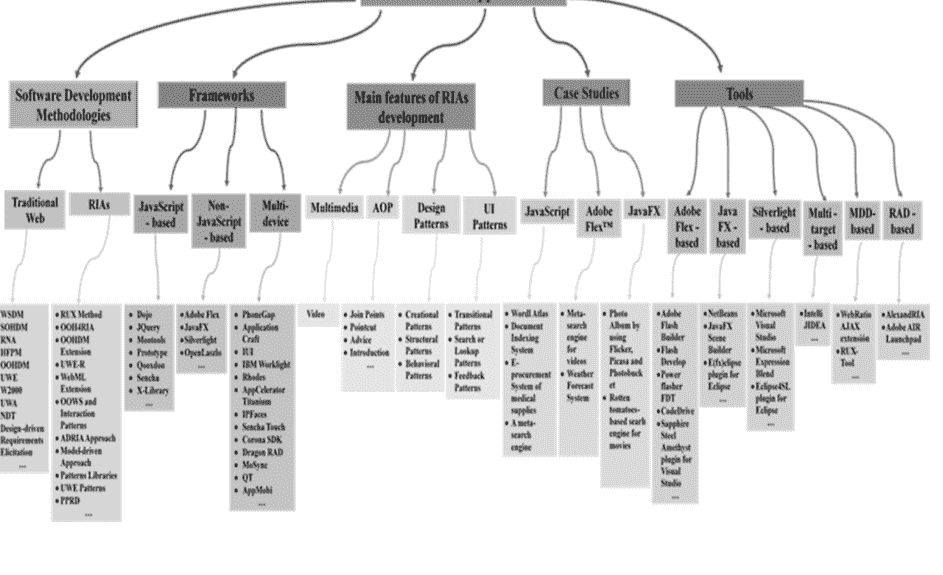

多媒体内容对于RIAs至关重要。它通过更动态和娱乐性地呈现信息，为Web应用程序提供最丰富的内容。多媒体内容的例子包括视频和图像库。图像库的使用增强了即时自定义视图的能力，并提供了所选项目的实时可视化表示。呈现图形、音频和视频的能力被视为RIAs（富互联网应用程序）的固有能力。事实上，随着UI的变换，视觉连续性和时间性是影响RIAs显著特征之一——增强型UI——的因素。

AOP允许在不更改原始源代码的情况下为Web应用程序添加新功能。例如，当一个遗留应用程序需要身份验证方法时，可以使用AOP开发一个单独的方法，而无需更改应用程序的原始结构。这在将遗留的Web 1.0应用程序UI适配为RIA UI时尤为重要，这是RIAs开发中的常见做法。使用AOP在RIAs开发中可以实现的一些软件质量因素包括：1) 可维护性，2) 可扩展性，3) 可重用性。可维护性对于RIAs开发非常重要，因为它使人能够尽可能有效和高效地进行更改。此外，AOP提供了高水平的可维护性。可扩展性是RIAs开发中的另一个关键方面，因为有时需要向正在运行的应用程序添加新功能，并且必须确保应用程序不会失败。最后，可重用性不仅在软件开发中很重要，在AOP中也是如此。事实上，可重用性封装了需要重用的功能，以便在后续场合使用。这减少了开发时间并提高了生产力。在RIAs和软件开发的情况下，开发时间都非常昂贵。

设计模式在软件开发中以及传统Web应用程序和RIAs的开发中都很重要。设计模式的主要用途之一是为了可重用性目的（即简化工作），从而提供一个先前已测试并成功应用于重复出现问题的解决方案。事实上，RIA技术基于软件可重用性原则，即UI是从可重用的部件或UI控件开始构建的，这些部件或控件被组织在组件层次结构中。在非基于JavaScript的RIA框架中，这一点更为明显，因为其基于UI标记语言（如MXML、FXML和XAML）的声明性UI定义模型。Web应用程序开发中一个众所周知的设计模式是MVC（模型-视图-控制器）。MVC模式基于用户输入，将领域建模、表示和动作分离为三个类：1) 模型，2) 视图，3) 控制器。MVC模式是用于将用户界面逻辑与业务逻辑分离的基本设计模式。幸运的是，Web应用程序的出现有助于解决一些模糊性，因为视图和控制器之间的分离是显而易见的。

RIAs设计涉及两个主要阶段：1) 应用程序结构设计和2) UI设计。本书重点关注RIAs设计的第二阶段。丰富的UI设计通常涉及使用UI模式以简化用户与应用程序之间的交互。UI模式能够提供更直观和响应迅速的用户体验（即丰富的用户体验）。事实上，它们允许开发人员鼓励用户与应用程序互动。大多数RIA框架提供了原生实现UI模式的简单UI控件（例如，Adobe™ Flex或JavaFX™中的进度条[进度指示器模式]和手风琴[展开/折叠模式]）。然而，一些UI模式需要更多的开发时间和精力才能实现。因此，理解UI控件和UI模式之间的差异并不容易。

如今，RIAs开发需要Web和桌面应用程序的设计原则，这些原则通过所谓的交互设计模式来实现。此外，移动设备，如智能手机和平板电脑，也由于Web 2.0应用程序的普遍性要求（Finkelstein, Savigni, Kimmerstorfer, & Pröll, 2002）而被纳入RIAs开发中。在这个意义上，RIAs被称为多设备RIAs。这个术语涵盖了作为跨浏览器Web应用程序、跨平台桌面应用程序和移动应用程序运行的RIAs。基于Web浏览器的RIAs是集成了类桌面功能的Web 2.0应用程序。基于桌面的RIAs是一种能够在Web浏览器之外运行的应用程序。移动RIAs是具有改进UI的原生移动应用程序。

RIAs开发的新趋势可以通过分析Web从Web 2.0到Web 4.0的演进步骤来识别，其中云计算作为Web 2.0演进中的一个趋势贯穿其中。云计算可能是RIAs开发在商业和学术领域走向的最佳例证。在Web 3.0的背景下，一种称为语义RIAs的新型RIA最近出现。语义RIAs试图通过使用本体和链接数据原则来解决系统间互操作性相关问题。在Web 4.0的情况下，无处不在的Web的必要性导致了上下文感知Web应用程序的出现，这些应用程序利用RIA技术来提供丰富的用户体验。

图2描绘了说明本书结构的概念图。

图2. 本书总体结构的概念图

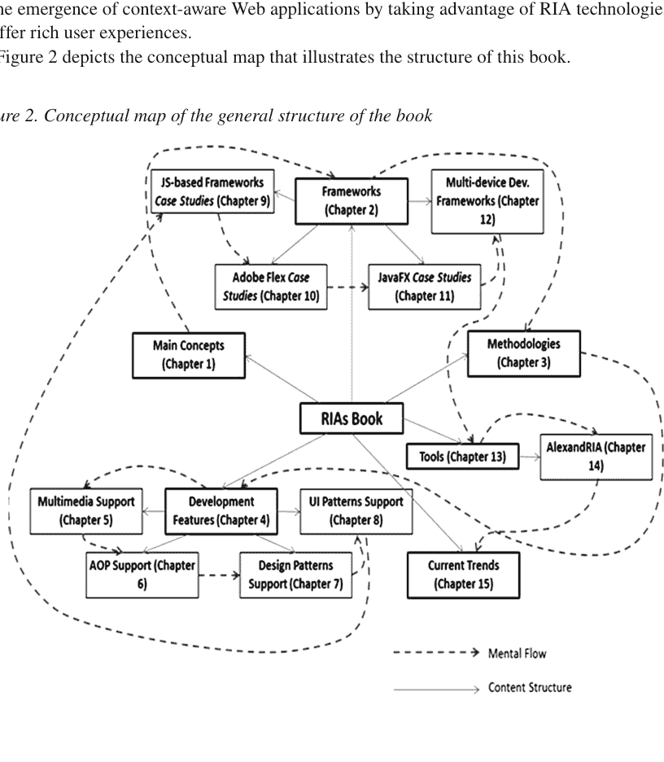

因此，本书的结构如下：

## 第1章：RIAs的基本概念

介绍了RIAs特性的概述，并解释了RIAs开发的最重要概念，以及它们在多个领域的好处和重要性。本章描述了一个RIAs的标准架构。该架构有三个明确的层次：1) 渲染丰富用户界面的客户端，2) 执行业务逻辑的控制器层，3) 数据事务管理器。介绍了Web开发的重要领域，并在每个领域中解释了RIAs的重要性，强调了每个领域的特定特性。最后，介绍了在B2C电子商务领域使用RIAs的经验和成功案例。其中提到的一些成功案例包括Kodak EasyShare、MINI USA、FootJoy™、The Broadmoor Hotel™和BlueGreen Vacation Rentals™、Verizon Wireless™、Yankee Candle Company和Charles Schwab。

## 第2章：用于RIAs开发的框架

描述了用于RIAs开发的最受欢迎的选项。出于实际目的，这些选项分为两类：1) 基于JavaScript的框架和2) 非基于JavaScript的框架；尽管文献中报道了其他分类，但本章和整本书中使用了这种分类。事实上，这种分类通过抽象预期软件架构的技术细节，有助于快速理解RIAs开发技术。

## 第3章：传统Web应用程序和RIAs的软件开发方法论

对RIAs开发方法论的最新技术进行了回顾。为此，首先介绍了传统Web应用程序开发的方法论，因为在某些情况下，RIAs开发方法论要么是现有Web（和超媒体）方法论的扩展，要么是新的UI设计方法，这些新方法是在现有Web方法论之上使用的。本章还讨论了不依赖遗留Web模型而涵盖RIAs特性的新方法。

## 第4章：RIAs开发中的重要因素

讨论了一些软件质量指标，如RIAs开发的可使用性、可扩展性和可重用性。本章描述了不仅使用多媒体内容和UI（用户界面）模式对于改善RIAs外观的重要性，而且对于提供丰富用户体验的重要性。同样，本章描绘了利用AOP（面向切面编程）能力和实施设计模式以简化RIAs维护并实现RIAs可重用性的重要性。

## 第5章：原生/嵌入式视频播放在RIAs开发框架上的多媒体支持

讨论了RIA框架在多媒体内容支持方面的能力。为此，介绍了使用基于JavaScript和非基于JavaScript的RIA框架实现视频播放功能的多种替代方案。具有多媒体内容支持的基于JavaScript的RIA框架的例子包括Dojo、jQuery、Prototype和Mootools。非基于JavaScript的RIA框架的例子包括Adobe Flex™、JavaFX™、Silverlight™和OpenLaszlo。对于每个案例研究，都提到了必需的文件。本章还展示了一个显示视频播放器的屏幕截图以及使用的代码片段。最后，对每个框架的视频播放支持在视频容器格式和编码类型方面进行了比较分析。

## 第6章：面向切面编程（AOP）在RIAs开发中的支持

强调了在软件开发，特别是在软件工程中使用面向切面编程（AOP）的重要性。使用AOP进行RIAs开发的一些优势是可维护性、可扩展性和可重用性。本章回顾了几个在现实世界开发项目中实施AOP的成功案例，并讨论了这些项目中获得的经验教训。


## 第7章“设计模式对RIA开发的支持”对GoF分类中提出的设计模式进行了综述。GoF将设计模式分为创建型模式、结构型模式和行为型模式。本章通过基于JavaScript和非JavaScript的框架，展示了GoF设计模式在RIA开发中的一些实现示例。此外，本章还进行了比较分析，总结了基于JavaScript的RIA框架与非JavaScript的RIA框架在GoF设计模式支持方面的能力差异。最后，本章还探讨了如何利用设计模式解决不同的编程问题。

## 第8章“UI模式对RIA开发的支持”综述了使用非JavaScript框架和JavaScript框架开发RIA时所支持的UI模式。为此，UI模式被分类为过渡模式、查找模式和反馈模式。此外，本章还提供了一系列应用示例，不仅展示了UI控件的使用，还说明了非视觉功能或类（如适用）在实现所支持UI模式时的应用。这些应用旨在阐明UI控件与UI模式之间的异同点。最后，本章进行了比较分析，总结了在丰富UI设计背景下各RIA框架的能力。

## 第9章“基于JavaScript框架的案例研究”讨论了使用jQuery、Prototype、Dojo和JSP开发四个不同的基于SOAP Web服务的瘦客户端应用程序。本章涉及开发一个世界地图应用程序、一个文档索引与搜索系统、一个医疗领域的电子采购系统，以及一个针对eBay和Amazon产品的元搜索引擎。这些案例研究以及后续章节中的案例研究，展示了如何运用某些UI模式来实现丰富设计原则，例如“留在页面上”和“使用过渡效果”。同样，对于本章介绍的每个案例研究，还提供了互联网上公开可用的一些类似现实世界实现的综述。最后，本章综述了使用Java调用基于SOAP的Web服务的支持情况。这旨在为案例研究以及基于SOAP的Web服务的使用和应用做铺垫。

## 第10章“基于Adobe Flex™的案例研究”提供了两个关于使用Adobe Flex™结合HTML和JavaScript开发基于REST（表述性状态转移）Web服务的RIA的案例研究。本章涉及开发一个针对YouTube和Vimeo视频的元搜索引擎，以及一个基于雅虎天气的天气预报系统。此外，本章还回顾了Adobe™ Flex™中对消费RESTful Web服务的支持，作为这些案例研究的引言。

## 第11章“基于JavaFX™的案例研究”介绍了四个关于在流行的社交网络网站基础上开发基于JavaFX™的RIA的案例研究。本章分别介绍了基于Flickr™、Picasa™和Photobucket™网站开发的三个相册应用程序。此外，还展示了基于Rotten Tomatoes™网站开发的电影搜索引擎。对于每个案例研究，本章都回顾了互联网上公开可用的一些类似现实世界实现。

## 第12章“多设备RIA开发”介绍了多设备RIA的概念，描述了一种可以从相同代码库出发在多种设备上运行的RIA。这不仅包括跨浏览器的Web应用程序，还包括浏览器外应用程序，即跨平台桌面和移动应用程序。随后，本章概述了多设备开发框架。对每个提到的框架，描述了其支持的平台和主要功能。此外，本节还包括对移动设备最流行操作系统的简要描述，以及一个用于总结多平台开发框架主要特性的比较表格。

## 第13章“RIA开发工具概览”综述了RIA开发工具，包括官方和第三方工具。为此，考虑了文献中已确定的两种主要RIA开发方法：1）基于框架的开发方法；2）MDD（模型驱动开发）方法。然而，本分类通过引入第三类进行了扩展：RAD（快速应用开发）方法。因此，本章不仅回顾了用于RIA框架开发的IDE，还涉及了RAD的其他支持工具，例如代码生成工具。同样，根据其架构，对RIA开发IDE进行了回顾和分类，分为以下两个主要类别：1）独立应用程序；2）插件应用程序。介绍的一些开发工具包括Adobe™ Flash Builder™、NetBeans IDE™、Microsoft™ Visual Studio™、WebRatio™、RUX-Tool™和AlexanRIA。

## 第14章“AlexanRIA：一种用于生成多设备RIA的可视化工具”解释了如何使用AlexanRIA通过实现UI模式来开发基于云服务的RIA。与第13章描述的其他RIA开发工具不同，AlexanRIA完全专注于RIA源代码和原生代码的全自动生成功能，并且完全针对多设备RIA开发。在本章中，还通过一个示例开发场景演示了AlexanRIA背后的UI设计过程，该场景涉及开发一个基于云服务API的跨平台移动RIA。该场景在后续的案例研究中被进一步探讨，该案例研究演示了使用AlexanRIA自动生成等效应用程序。此外，本书的这一部分回顾了AlexanRIA支持的UI模式和云服务API，为案例研究做铺垫。

## 第15章“RIA开发的新趋势”通过考虑从Web 2.0到Web 4.0的Web演进步骤，介绍了RIA开发的新趋势，其中包括基于云的RIA开发和富用户界面的mashup开发，这两者是与Web 2.0相关的两个明显趋势。语义RIA、RMA（富移动应用）、上下文感知RIA和泛在Web应用程序是与Web 3.0和Web 4.0相关的一些学术提案，本章对此进行了讨论。同样，本章也讨论了来自IBM™、TopQuadrant™ Inc.和Salesforce.com Inc.等公司的一些商业努力。

## 目标读者

本书面向希望提升Web工程知识及其在RIA开发中应用方法的专业开发人员和学生。涵盖的一些概念（方法论、框架、工具）将假设读者具备一定的基础知识和理解。如果读者需要有关这些主题的进一步阅读材料，作者在每章末尾提供了一份建议书目清单。如果读者希望学习如何开发RIA以及了解此类应用的所有功能，那么这无疑是他们需要的书。

## 致谢

虽然本书涵盖的部分主题是基于作者个人经验实现的，但其中许多主题此前已被他人识别和解释。这项工作是作者和其他研究人员综合经验的成果，他们的研究在参考文献部分有完整记载。

*Giner Alor-Hernández*
*墨西哥奥里萨巴理工学院*

*Viviana Yarel Rosales-Morales*
*墨西哥奥里萨巴理工学院*

*Luis Omar Colombo-Mendoza*
*墨西哥奥里萨巴理工学院*

## 参考文献

Finkelstein, A. C. W., Savigni, A., Kimmerstorfer, E., & Pröll, B. (2002). Ubiquitous web application development - A framework for understanding. In *Proceedings of 6th Systemics, Cybernetics, and Informatics Conference* (pp. 431–438). Academic Press.

Martínez-Nieves, L. A., Hernández-Carrillo, V. M., & Alor-Hernández, G. (2010). An ADV-UWE based phases process for rich internet applications development. In *Proceedings of IEEE Electronics, Robotics and Automotive Mechanics Conference* (pp. 45–50). IEEE.


## 致谢

作者始终对帮助审阅和改进本书的优秀技术审稿人深表感激。他们为本项目带来的知识和热情令人惊叹。

因此，作者谨向以下人士致谢：Ulises Juárez-Martínez 博士，感谢他的支持，尤其是在第 4 章和第 6 章的 AOP 主题方面；Desdemona Almazan-Morales 学士和 Luis A. Barroso 博士，来自墨西哥蒙特雷理工学院韦拉克鲁斯中央校区，感谢他们对本书部分章节英文审校工作的支持；Gabriela Cabrera-Zepeda 硕士，奥里萨巴理工学院研究与研究生部主任，感谢她对本项目提供的帮助和支持；Maria Fernanda Villafuerte-Bianchi 学士，感谢她在校对过程中的支持；以及奥里萨巴理工学院的所有同事和朋友们，感谢他们所有的支持。

*Giner Alor-Hernández*
*墨西哥奥里萨巴理工学院*

*Viviana Yarel Rosales-Morales*
*墨西哥奥里萨巴理工学院*

*Luis Omar Colombo-Mendoza*
*墨西哥奥里萨巴理工学院*

# 第 1 章
富互联网应用基础概念

**摘要**

第 1 章概述了 RIA 的特性，并解释了 RIA 开发的最重要概念，以及它们在多个领域的益处和重要性。本章描述了一个 RIA 的标准架构。该架构具有三个明确划分的层次：1）渲染丰富用户界面的客户端层，2）执行业务逻辑的控制层，以及 3）数据事务管理器。本章介绍了 Web 开发的重要领域，并在每个领域中解释了 RIA 的重要性，强调了每个领域的特定功能。最后，介绍了在 B2C 电子商务领域使用 RIA 的经验和成功案例。

## 1. 引言

Web 或 WWW（万维网）是一个由相互链接的超文本或超媒体组成的信息分发系统，通过互联网访问。要访问这些媒体，需要 Web 浏览器。用户可以查看不同的网站，这些网站由可能包含文本、图像、视频或多媒体内容的网页组成。用户可以通过超链接浏览构成网站的网页，这会在客户端和服务器之间产生大量流量，因为每次用户点击其中一个超链接时，整个页面都会在用户请求某些数据或交互时重新加载，此任务意味着需要向服务器发出另一个请求，从而导致数据显示缓慢。随着请求数据量的增加，这种缓慢程度会加剧。

Web 由英国人蒂姆·伯纳斯-李和比利时人罗伯特·卡里奥于 1989 年在瑞士日内瓦的欧洲核子研究中心（CERN）工作时创建，并于 1992 年发布。此后，伯纳斯-李在引导 Web 标准发展方面发挥了积极作用，而在过去几年中，他将自己的视野聚焦在语义网方面。

近年来，Web 2.0 一词已经出现。这个术语与 Web 应用程序相关联，这些应用程序使得信息共享、互操作性、以用户为中心的设计以及与万维网的协作变得更容易。Web 2.0 应用程序的一些例子包括 Web 社区、Web 服务、社交网络、托管视频的网站、维基、博客、混搭和大众分类法等。该术语与蒂姆·奥莱利密切相关，因为它是在 2004 年 O'Reilly Media 关于 Web 2.0 的会议上提出的（O'Reilly，2004）。尽管该术语暗示了万维网的新版本，但它并非指 Web 上技术规范的更新过程，而是更多地指设计师和最终用户使用 Web 方式的累积变化。

在 Web 应用程序的特性中，相较于桌面应用程序有一些优势。这些优势包括：1）无需在运行应用程序的每台计算机上进行安装和更新，现在可以在服务器端进行；2）它们可以在不同的操作系统上运行，通常被称为平台无关、跨平台或多平台。然而，这类应用程序也有一些缺点：1）对于用户在图形界面上执行的动作、行为或事件没有即时响应；2）无法拖放文档、文本、图像或任何多媒体内容。

RIA（富互联网应用程序）成为一种增加传统 Web 应用程序优势并避免其缺点的必要方式。RIA 类似于 Web 应用程序，但它们也共享桌面应用程序的大部分特性。这些应用程序使用标准化的 Web 浏览器运行，并通过附加组件和虚拟机添加额外特性。RIA 是结合了 Web 应用程序和传统应用程序优势的应用程序，旨在改善用户体验。富互联网应用程序结合了桌面应用程序的功能和特性，但它们是通过 Web 交付的。

通常，当用户点击超链接时，传统 Web 应用程序上的网页会不断刷新。这种情况导致客户端和服务器之间产生大量流量，结果是同一个网页因最小的更改而被刷新。通过使用 RIA，此过程不需要刷新每个网页，而是从一开始就加载整个应用程序，并且仅在需要外部数据（例如与数据库或某些外部文件通信）时才与服务器通信。RIA 有一种特殊的方式来处理和处理信息，这是另一个区别。如今，传统桌面应用程序完全依赖于客户端处理。当任务启动时，本地系统资源被利用来处理请求。相比之下，Web 应用程序完全依赖于服务器端技术来处理请求。通过使用 RIA，负载由客户端和服务器端技术共同分担。RIA 代表了 Web 应用程序演进中的下一个过渡；它们承诺提供当今许多 Web 应用程序所缺乏的丰富性、交互性和可用性。

## 2. 基本概念

RIA 构成了 Web 开发的一个新范式，目前在 IT（信息技术）和商业领域中正取得巨大成功。理解 RIA 的最佳方式是将它们置于其他相关技术的上下文中，例如 ASP（Active Server Pages）或 JSP（Java Server Pages）。为了更好地理解这个概念，有必要从两个特征来考虑技术解决方案：广度（reach）和丰富度（richness）。"丰富度是在客户端整合直观交互性和用户界面的能力，而广度是应用程序可供任何用户使用的能力"（Namscimbene，2005）。2004 年，Macromedia 的一项研究¹ 比较了使用 JSP 技术构建的传统 Web 应用程序和使用 Macromedia Flex 构建的相同应用程序。研究表明，在基于 Flex 的应用程序中，服务器请求和 CPU 使用率均显著降低。基于 Flex 的应用程序在高负载下平均服务器 CPU 利用率为 0.8%，峰值仅为 50%，而基于 JSP 的界面在相同负载下服务器 CPU 利用率为 21.2%，峰值高达 100%。

RIA 以异步方式工作，这使得它们比传统 Web 应用程序更具动态性。因此，它们缩小了基于 Web 的应用程序和桌面应用程序之间的差距。与传统 Web 应用程序相比，RIA 所代表的一些优势如下所示：

-   **即时访问：** 用户在任何时候都不会失去对所访问网页的控制，因为访问时间非常短。

-   **图形界面特性：** RIA 技术使得诸如从屏幕一部分拖放到另一部分的功能成为可能。

-   **响应性和交互性：** RIA 在客户端执行数据处理。这种情况导致网络流量减少和更快的响应，因为应用程序利用了客户端 CPU（中央处理器）。此外，当点击按钮或 URL（统一资源定位符）时，只有网页的相应部分被异步重新加载，而不是整个页面。此操作为用户提供了持续的视觉参考，使他们不会因界面变化而分心。

-   **实时通信：** 它使用户能够通过即时通讯、视频点播、音频/视频会议等实时通信渠道在互联网上协作和共享信息。

-   **易于维护：** 例如，无需刷新当前网页即可修改和/或删除项目，无论是为了提高性能还是修复错误（Veit，2008）。

> "RIA 是一种为传统 Web 应用程序提供多种优势的应用程序类型。RIA 的功能结合了 Web 应用程序和传统应用程序的优势"（Viveros García & García Godoy，2009）。

RIA 源自 Web 应用程序和桌面应用程序的需求，实现了两者优势的结合：即 RIA 是传统 Web 应用程序（瘦客户端）和桌面应用程序（胖客户端）之间的中间体（Rivero 等，2007）。

如今，关于 RIA 有几个概念和定义。RIA 一词最早由 Macromedia 在 2002 年 3 月使用。RIA 被定义为一种开发 Web 应用程序的新模型，该模型将数据服务器服务与丰富的用户界面分开，用户界面通过在 Web 浏览器中运行时执行的插件呈现。

一些概念仅将 RIA 与桌面应用程序进行一般性比较，忽略了服务器端处理和异步数据加载等重要特性。例如，维基百科（Wikipedia，2011）将 RIA 定义为："富互联网应用程序是一种具有桌面应用程序许多特征的 Web 应用程序，通常通过特定网站的浏览器、浏览器插件、独立沙箱或虚拟机交付……"。

由于 RIA 不仅在 Web 浏览器上实现，而且得益于新 Web 开发平台的出现；它们可以完美地运行在桌面和移动设备上，这个概念已经发生了变化。以下摘录强调了 Linaje（Linaje 等，2008）所强调的离线和在线功能、本地数据存储和客户端处理能力：

> "RIA 的一些新特性影响了 UI（用户界面）和交互范式；其他特性扩展到了架构问题，例如客户端-服务器通信以及数据和业务逻辑的分布。它们支持在线和离线使用、复杂的 UI、直接在客户端进行的数据存储和处理能力、强大的"


### 关于富互联网应用的基本概念

交互工具能够带来更好的可用性和个性化体验、更低的带宽消耗，以及演示与内容之间更清晰的分离。

Brambilla (Brambilla et. al., 2008) 将富互联网应用定义为："*利用Web客户端的能力来提高Web界面的响应速度和可用性，提供与桌面应用程序类似功能的Web应用程序。RIA遵循客户端/服务器范式，但与传统Web应用不同，RIA能够将用户界面、业务逻辑和数据管理的处理转移到客户端，并可能使用异步通信*。"这一概念涉及将处理能力返回客户端，并利用硬件配置持续改进的能力。

同样，Bozzon (Bozzon et. al., 2006) 讨论了客户端-服务器架构所扮演的角色及其异步工作流程，并将RIA定义如下："*它们是基于Web系统的变体，为表示复杂流程和数据提供精巧的界面，最小化客户端与服务器之间的数据传输，并将交互层和展示层从服务器移至客户端。通常，RIA随一些初始数据一起由客户端加载；然后，它管理数据渲染和事件处理，并在用户需要更多信息或必须提交数据时与服务器通信*。"

作为结论，可以推断出以下概念，着重强调与传统Web应用程序的主要区别："*RIA通常是由任何支持RIA的设备执行的应用程序，它渲染富用户界面，并使用可由服务器端和客户端共同处理的数据。*"

所谓支持RIA的设备，是指任何执行基于JavaScript和第三方技术（例如JavaFX、Silverlight和Adobe Flex等）以进行RIA开发的电子设备。RIA开发的主要原则之一是异步数据加载，这意味着它们能够在不刷新整个网站的情况下获取数据块。RIA定义中涉及的"丰富性"概念，源于其在五个基本方面增强传统Web应用功能的能力：

1.  应用程序使用客户端内存，数据在其中进行本地操作和存储。一旦整个任务完成，它将被发送回服务器端。
2.  RIA利用客户端的处理能力。它使服务器端和客户端都能执行复杂的操作，从而导致其导航结构与传统Web应用程序相比有所不同。
3.  RIA允许同步和异步通信。客户端与服务器之间的数据分发扩展了生成事件的功能，因为它们以不同的方式被发起、检测、通知和处理。
4.  给用户的演示和复杂交互得到了增强。RIA呈现为单一的Web页面，避免了不必要的加载，并允许以渐进式方式或在需要时显示数据。
5.  RIA结合了Web用户界面的灵活性和桌面应用程序的处理能力。

总而言之，RIA是将用户图形界面的大部分加载处理分配给客户端，而控制处理和数据管理的主要部分仍保留在服务器端的系统。从这个角度来看，RIA开发的标准架构如图1所示。在图1中，定义了典型RIA开发的三个层次：1) 渲染富用户界面的客户端，2) 执行业务逻辑的控制器层，3) 数据事务管理器。

在图1中，该架构具有三个主要特性：

*图1. RIA的标准架构*

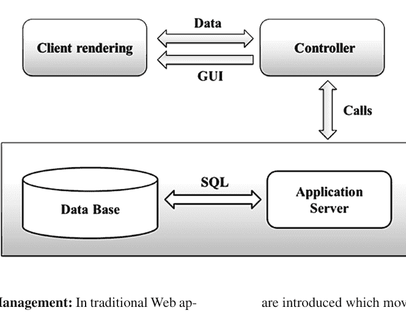

1.  **数据管理：** 在传统Web应用中，数据驻留在服务器端。在RIA中，应用数据可以在服务器端和客户端之间分布。因此，RIA可以使用客户端的持久性和易失性内容。数据可以在客户端进行操作，最后在操作完成后将它们发送到服务器端。

2.  **双端控制器：** 在传统Web应用中，只有服务器端的一个控制器来编排网页的计算。每次用户交互时，整个网页都会被计算和重新加载。在客户端，RIA引入了第二个控制器，负责计算和刷新网页的一部分。数据处理可以在客户端和服务器端执行。由于客户端处理能力的增强，RIA具有与Web 1.0应用不同的导航结构。在RIA中，客户端和服务器端都可以执行复杂的操作。

3.  **客户端/服务器端通信：** 在RIA中，引入了最小化数据传输的机制，将交互层和展示层从服务器端移至客户端。与Web应用相反，RIA同时使用同步和异步通信。拉取和推送通信功能均可使用。客户端和服务器之间的数据分布和功能扩展了生成事件的功能，因为它们可以以多种方式被发起、检测、通知和处理。

这些特性代表了RIA的核心，因为所有RIA至少实现了其中一项。

## 3. 富互联网应用的主要跨领域优势

RIA解决了传统Web应用的问题。传统Web应用中的主要问题发生在需要导航以进行以下操作时：

-   表示工作流程。
-   浏览结构化信息。
-   实现复杂的用户界面。

这些方面可能导致：

-   客户端和服务器之间的流量增加。
-   服务器端的工作负载增加。
-   客户端响应时间降低 (Rivero et al., 2007)。

RIA通过互联网访问。RIA解决了桌面应用程序的可访问性和移动性问题。在下一节中，将讨论RIA对不同领域的影响和重要性。

### 3.1. 富互联网应用在电子商务中的重要性

信息技术因用户的新需求而不断变化。考虑新兴信息技术很重要，因为它们为相关人士提供了诸多好处，例如更强大的开发能力、更快的执行速度以及应用程序之间的集成。电子商务是互联网的主要用途之一，随着Web应用程序的发展，其应用范围不断扩大。RIA为电子商务领域的商业实体、购物者和开发者提供了更多好处。电子商务中商业实体的主要好处如下：

1.  **产品随时随地展示：** 通过RIA，商业实体可以向客户展示其产品，无论客户身在何处、何时访问。客户无需进入商店即可购买。
2.  **购物流程简便：** RIA构建交互式、直观、生动且易于使用的应用程序。因此，它们允许用户以更简单快捷的方式探索产品。
3.  **获得更好的购物体验：** 购物体验使客户能够更频繁地访问和购买。通过提供用户与应用程序之间的交互实现了这种情况。例如，它允许在同一个网页上搜索、检索、显示、比较、选择和购买产品。
4.  **产品需求增加：** 当产品的详细信息通过富用户界面呈现时，用户的购买兴趣会增加。
5.  **暴露更多产品信息：** 向客户更详细地描述可用产品的采购过程，以便他们自行利用。
6.  **复杂性降低：** 有必要以简单的方式呈现产品信息，并指导客户选择其产品。当用户查看单个网页时，用户无需选择所有产品功能并发送信息来构建新的网页。RIA允许在同一个网页中选择所有功能并更新产品。
7.  **退货减少：** 当客户了解产品的全部信息时，客户对购买该产品没有任何疑虑。这使客户满意并降低了购买退货率。
8.  **减少开发投资：** 有许多用于设计、创建和构建RIA的开源Web框架。因此，商业实体可以使用电子商务以更少的投资展示其产品或服务。
9.  **视频集成：** 视频集成提供了展示产品信息的新方式。例如，通过视频，可以提供关于应用、服务或产品的指导或说明。它也使Web应用程序更具吸引力。
10. **缩短购物时间：** 由于购物时间更短，客户不会离开应用程序，从而增加了产品的销量。


## RIAs 的基本概念

电子商务为消费者带来的主要优势如下：

- **1. 产品可定制：** 这些应用可以轻松定制产品，如运动鞋、服装、箱包等。它为购物提供了新的方式，因为 RIAs 允许选择产品特性，同时始终在一个网页中完成配置。
- **2. 用户购物体验更佳：** 通过单个网页，用户购物体验快速、流畅且有趣，因为不需要刷新网页。因此，顾客感知到网站提供了更好的响应时间。
- **3. 提供更多产品信息：** RIAs 提供了多种组件，如视频、图像和效果，展示了解产品或服务所需的全部信息，且用时更少。这使购物过程更加便捷。
- **4. 快速响应用户需求：** 当用户需要产品或服务时，只需访问应用即可。用户无需离开家或办公室。

电子商务为开发者带来的主要优势如下：

- **1. RIAs 促进 SOA（面向服务的架构）的使用：** 结合 RIA 和 SOA，富应用开发更加简单快速。两种技术的集成能够通过可扩展应用增加共享信息。
- **2. 有多种设计工具、IDE（集成开发环境）和开源框架：** 这些工具使 RIA 开发更加简便，因为它们提供了一组组件，开发者只需进行配置。
- **3. RIAs 具有高级用户能力和交互式用户界面，可为客户构建自定义富界面：** 它还提供了更简便的方式来整合设计师和开发者的工作。

电子商务系统对商业实体非常重要，因为它们吸引潜在客户，并且随时随地展示产品。这些优势展示了 RIAs 如何为电子商务领域带来改进，这要归功于新一代互联网应用提供了交互式、直观和动态的产品与服务信息探索方式。

### 3.2. RIAs 在电子学习中的重要性

在过去几年中，人们为提供电子学习系统付出了巨大努力，然而电子学习课程的高失败率归因于在线体验的糟糕设计，这无法激励学生实现更好的学习过程，因为它们只提供重复的、枯燥的任务以及一些其他令人沮丧的内容。

为了改进这些系统，学习软件还应包含多媒体元素，如模拟、探索、拖放练习等。电子学习系统应该是主动的，应该以动态和交互的方式提供教学过程。

如今，电子学习系统的开发者可以使用 RIAs 技术，以结合各种多媒体内容和外部应用，构建丰富的内容并改善在线学习体验。

RIAs 技术的特点是能够实现更高质量并改善在线交互体验。RIAs 在电子学习领域提供了一些优势，列举如下：

RIAs 的基本概念

- **1.** 学生可以从任何地点访问信息和课程。这有助于最大化受众覆盖范围。
- **2.** RIAs 无需修改即可在多个平台的互联网上运行。凭借这一优势，学生可以从任何地方接收信息，无需事先安装软件。
- **3.** 可以提供吸引人的用户界面，具有高水平的交互性。易用性和吸引学生注意力的能力对电子学习系统的成功至关重要。通过构建对学生更具吸引力的课程，可以实现留存率，从而使学生成功完成课程。
- **4.** 可以使用音频、视频、图像和文本来改进电子学习应用的内容；它改善了学生的体验。RIAs 提供了许多便利来包含任何类型的多媒体内容，这对学生有很大帮助且有益。
- **5.** RIAs 兼容移动工作流，使用户能够在线和离线工作。RIAs 与传统 Web 应用相比具有优势，因为它们可以用于设计课程或电子学习系统的内容。

- **1.** 用户可以在线访问视频游戏，无需购买游戏机或配件。
- **2.** 可以添加高水平的交互性与用户界面，使应用和内容的使用更具吸引力。这些用户界面可以帮助管理员控制内容，实现拖放等操作，以及对内容进行实际分页，从而避免网页刷新。
- **3.** 可以添加带有个人控件的视频播放器或多媒体内容。这为管理员和消费者都提供了更大的控制权。

RIAs 比传统 Web 应用提供了更好的功能，通过提供包含多媒体内容和具有更高交互水平的用户界面设计的特性。因此，这些学习体验的设计师可以显著改善用户的动机和体验，在这种情况下即学生。

仅在美国，年营业额就远远超过美国票房收入。此外，还有大量的专业游戏机，总数超过了家用个人电脑的数量。

通过使用 RIAs，可以设计包括网页视频游戏在内的交互式界面，或开发用于在互联网上观看电影的 Web 应用，而无需离开家。

RIAs 在电子娱乐领域提供了一些优势，列举如下：

### 3.3. RIAs 在电子娱乐中的重要性

如今，电子娱乐非常流行，这归因于大量的商业游戏标题，

RIAs 将尖端技术与创新的商业实践相结合，为中小企业、大公司和政府组织提供具有成本效益的商业解决方案。

如本节所示，RIAs 可以在不同领域实施。RIAs 可以在电子政务或电子健康中实施；只要应用需要即可。还有一些关于 RIA 开发的成功案例；在以下章节中将描述其中一些。

## 4. RIAs 开发的成功案例

### 在 B2C 电子商务领域使用 RIAs 的经验与成功案例

许多年前，网页基于 HTML 技术。这些基于 HTML 的网页包含文本、图像和表单元素，如文本框、列表、组合框和超链接。当用户点击超链接时，Web 浏览器加载另一个网页，其中所有内容都必须由新的基于 HTML 的文档替换，而之前的内容则消失了。如果用户返回重新加载之前的内容，信息通常会丢失了。这种交互无法实现丰富的用户体验。

与使用传统 HTML 设计的 Web 应用不同，RIA 通过结合桌面和 Web 应用的优势来丰富用户体验，增加并改进了它们的选项和功能。RIAs 为用户提供的新体验包括：

- **1.** 提供类似于桌面应用中"外观和感觉"的富用户界面。
- **2.** 使用这些技术开发的应用使用性能更高、功能更强大的用户界面控件。例如水平或垂直菜单、导航树菜单、标签面板、视频和数据捕获控件等。
- **3.** 用户与应用交互以获得即时响应，加载新数据时无需重新绘制网页。
- **4.** 应用使用户能够执行以前仅在桌面应用中可用且在传统基于 HTML 的网页中无法执行的常见操作：拖放、调整大小等。
- **5.** 访问网站或应用无需复杂的设置过程（某些情况下只需插件）。
- **6.** RIAs 接收即时响应。无需等待与服务器的往返连接即可获得结果。

RIAs 提供的一项重要改进是交互式网站的开发。现在，顾客有机会在线查看产品，甚至根据自己的需求进行更改和定制。设计良好的 RIA 网站为消费者提供完整的购物体验：顾客在整个过程中得到逐步的视觉引导，从产品目录选择到付款。以下描述了一些 RIAs 应用以提高生产力的成功案例。

#### 柯达 EasyShare (www.kodakgallery.com)

它是伊士曼柯达公司™ 的子公司，为全球数百万客户提供数字图像处理在线服务。一些服务包括存储、展示、分享照片和订购冲印。该公司开发了一个基于 Web 的平台来处理数百万张数字照片、数字质量印刷相册、用户之间的照片分享。此外，公司需要能够扩展功能以在未来添加新产品，而不仅限于图像处理，还要为用户提供使用完全交互式平台时的出色体验。为实现上述目标，柯达 EasyShare 于 2004 年推出了 Photo Books，允许用户通过引人注目的界面创建自己的照片书，他们可以将图像拖放到书页上、更改页面、更改背景，还有其他选项。在 Photo Books 中，用户可以


#### MINI USA（www.miniusa.com）

MINI USA 是 BMW™ 北美公司旗下的一个部门。MINI USA 负责在美国市场生产 MINI 汽车；开发 RIA 的目标是通过独特的汽车定制品牌来推广品牌。通过实施 RIA，用户获得了全新的网站管理体验。其主要功能是网页定制，允许用户通过一个简单的过程制造自己的 MINI 汽车，可以在车内或车外添加非线性元素；导航功能确保所有置换选项在网页的某个区域中都可用。用户可以看到他们即将获得的精确车辆，并能在购买流程的每个步骤中了解其配置选择对价格的影响。

这一新开发成果使人们能够通过一个简单的、非线性的五步流程定制自己的个性化 MINI，其中包括添加售后 MINI 驾驶配件的能力，如定制车顶图案和轮毂。导航功能确保所有内容都能在一个网页上查看。这种基于规则的架构确保只允许配置实际可以购买的车辆，并且当车辆规格从一个车型年份到下一个车型年份发生变化时，MINI 可以轻松维护这些规则。当用户完成汽车配置流程后，他们可以为车辆命名、保存、计算付款金额，并轻松地将配置发送给 MINI 经销商或朋友。MINI 鼓励他们根据自己的喜好配置和保存尽可能多的定制 MINI。定制功能提供了以下好处：

- 增加了注册客户数量。
- 大多数注册客户都配置了 MINI。
- 客户被他们按照自身需求定制 MINI 汽车的方式所吸引。
- 定制过程简单易行；所有信息始终显示在屏幕上。
- 信息直接发送给 MINI 经销商，增强了客户的信心。

#### FootJoy™（www.footjoy.com）

FootJoy 作为 Acushnet Company™ 的主要品牌之一，是全球高尔夫鞋和高尔夫手套产品的主要制造商和分销商。据估计，FootJoy 在上述每个市场中占据了 55%-60% 的份额。其他产品包括袜子、外套和配饰。该公司在两个方面脱颖而出：一是产品质量和服务，二是其在高尔夫鞋和手套技术创新方面的声誉。他们认为自己非常了解消费者及其需求，并懂得如何为其服务。他们面临以下几项挑战：

- 提高网站的可用性。他们希望提供双向互动体验，拥有更能代表品牌风格的外观和感觉。他们希望具备支持客户的能力，并能更好地展示或推介产品、新闻等信息。
- 通过在网站上复现客户在 FootJoy 实体店中能够获得的专业指导和体验，使客户与公司建立关系。具体而言，他们希望基于从 FootJoy 专家那里获取的产品知识开发产品查找器，使访客能够快速识别自身及其需求，并将这些需求匹配到合适的产品。
- 建立一个战略技术基础架构，包括内容管理系统以及与遗留产品系统的对接，作为未来网站开发的基础。
- 对目录内容进行系统化整理，使他们能够自行更快速地更新在线目录，而无需依赖昂贵且排期紧张的技术资源。
- 创建一个参与式网站来促进社区建设，通过在线投票征求用户反馈，并提供有关产品、高尔夫球场、技巧、专家访谈和天气预报等信息。

为了保持其可观的市场份额，FootJoy 开发了一款名为产品查找器（Product Finder）的 RIA，通过提出一系列问题引导访客完成产品选择过程，类似于专家在店内引导客户的方式。高尔夫鞋或手套的图片以及简短的文字产品描述等内容从内容管理系统中提取。2003 年 9 月初，FootJoy 推出了 myjoys.com，这是一款 RIA，旨在革新在线购买高尔夫鞋的方式。通过该应用程序，客户可以访问一个精美的鞋子创建界面，在设计和修改过程中实时查看鞋子的实际效果（MyJoys 为用户提供 2 种鞋底色和 14 种鞍面色的选择，以及最多 3 个字母和/或数字个性化定制鞋子的机会）。通过 Flash Remoting 实时检查皮革库存，当客户的皮革选择不可用时会通知客户，并在恢复库存时发送电子邮件通知。该应用程序包含一个完全集成的购物车和结账流程，包括加密（通过 Verisign SSL）、防欺诈信用卡检查以及实时地址检查和税务计算，以确保准确、安全的结账体验。"My FootJoy"区域允许用户将定制鞋子保存到心愿单并跟踪订单。定制鞋子订单直接发送到中国制造，鞋子在 3 周内制造完成并发货给客户。

FootJoy 的使用量超出预期 200% 以上。以平均每双鞋订单 150 美元计算，这一意外增长为 FootJoy 带来了可观的收入增长，该公司也观察到 MyJoys 应用程序的投资回报率大幅提升。

#### The Broadmoor Hotel™ 和 BlueGreen Vacation Rentals™（www.broadmoor.com、www.bluegreenvacation.com）

在线旅行预订已经相当普遍。但这个过程常常令人沮丧。用户通常需要浏览多个搜索和结果页面，选择酒店、日期和房型，然后才发现没有空房，或者直到最后才显示令人难以承受的房价，迫使用户不得不重新操作。与此同时，网络是酒店最便宜的销售渠道。使用旅行代理可能会让酒店支付 15%-30% 的佣金收入，许多大型酒店和连锁酒店必须付费使用全球分销系统（GDS）来电子化分发其库存。如果酒店能够将更多预订转移到网络上，就能节省大量费用。但主要问题在于，他们需要确保不会仅仅因为将客户转移到网络上而导致


## **Verizon Wireless™ (www.verizonwireless.com)**

Verizon Wireless是美国最大的移动电话运营商，拥有8000万活跃客户。为了向更广泛的受众推广其产品和服务，Verizon开发了一个在线商店，提供铃声、回铃音等。该商店的主要目标是支持数百万用户和高交易量，同时为客户提供一个轻量级的应用程序，以便轻松下载MP3文件。该平台采用Adobe Flash开发，为客户提供了灵活的体验，并为公司和客户带来了诸多好处：

-   增加与铃声和回铃音相关的在线收入，使其在商店中随时可用。
-   为注册客户提供访问大量MP3文件库的权限。
-   平台具有可扩展性，可提供更多产品。

#### Yankee Candle Company

Yankee Candle Company是另一个强有力的例子，说明基于RIA的配置器如何影响一家公司。它是美国高端香氛蜡烛的设计者、制造商、零售商和批发商。他们直接通过门店、目录和在线网站销售，也通过合作伙伴销售。他们有强劲的增长计划，希望创造一个比现在网站更好的电子商务环境。他们面临的挑战是提高买家的信心，以改善定制蜡烛的在线销售。客户购买定制蜡烛用于婚礼或企业活动等重要场合，通常批量购买。问题在于，买家很难直观地看到他们在做出所有选择后，定制蜡烛会是什么样子。网站初始版本的定制蜡烛部分使用基于HTML的页面，要求用户勾选复选框来选择蜡烛颜色，并填写表单输入蜡烛标签的文本信息。一旦选择了颜色，他们在被要求批量购买之前，永远无法看到这个配置实际的样子。难怪人们会放弃购物车，或者致电客户服务以确保蜡烛看起来符合他们的想象。

Yankee Candle认为网站的这一部分效率低下。数据显示在线平均购买量低于其他渠道，这也证实了这一点。这也表明他们在网上进行追加销售和交叉销售的工作做得不够。

从技术角度来看，问题在于使用基于HTML的技术无法展示最终产品的外观。

Yankee Candle选择为定制蜡烛配置器开发基于Flash的用户界面，原因有几个。首先，它允许他们根据用户的选择动态渲染蜡烛的图片。它还使他们能够创建更好的网络客户体验，在不同平台上表现一致，这是广泛覆盖和跨平台支持的优势。其次，他们能够比使用替代技术更快、因此更廉价地开发应用程序。这部分归功于开发工具，它们提供了开箱即用的用户界面组件，如下拉菜单框，还因为他们能够将展示层集成到现有的后端系统中，该系统由Oracle产品数据库和BroadVision电子商务系统组成。

虽然网站的大部分使用基于HTML的技术，但定制蜡烛配置器是一个单屏幕的基于Flash的界面，利用其现有的电子商务基础设施。它从产品数据库和电子商务系统获取数据和图像。当用户选择标签和香味并输入标签的文本信息时，他们立即看到了定制蜡烛完成时的真实图片。用户被鼓励选择可选的收尾装饰，如用布料包裹蜡烛或添加丝带或花朵，这为Yankee Candle提供了向客户追加销售的机会。用户可以在任何时候构建"假设"场景，看看基本蜡烛以及额外选项的外观和成本。

最终结果是，这种定制蜡烛的实时可视化让消费者有了更高的信心，他们购买了更多的蜡烛。Yankee Candle观察到产品收入和平均订单规模均增长了25%，超出了他们的预期。此外，定制蜡烛产品线的呼叫中心电话减少了70%，他们还收到了多个客户的积极反馈 testimonials。还有一个意想不到的结果：他们自己的呼叫中心代表在处理客户电话时也开始访问网站并使用配置器。

## **Charles Schwab**

Charles Schwab的营销计划日历为跨部门数据可视化应用提供了一个绝佳的例子。Charles Schwab Corporation是一家证券经纪及相关金融服务提供商，包括零售、电话和互联网经纪业务。Schwab的营销部门需要集中规划、跟踪和分析所有营销活动，并使信息对高管和营销项目协调员都可见且可访问。他们需要构建一个高度复杂的企业报告应用程序。他们面临许多挑战。他们需要：

-   应对具有不同信息需求和可视化要求的多种类型的用户
-   以直观、合理且可视化的方式呈现深度、多维数据集（例如，在哪些项目上花费了多少资金，时间跨度是多少）
-   提供既复杂又易于使用的报告工具，可供高管和项目规划师使用
-   提供响应迅速且交互性强的工具，让用户能够掌控

他们选择开发定制的数据可视化解决方案，以便能够动态地向不同受众传达信息。数据可视化的复杂性要求全新的方法，超出了使用基于HTML的技术或任何开箱即用或基于网络的日历工具的现实可行性。例如，他们希望有一个可下钻的甘特图，在其中可以看到特定项目的支出细节。这在基于HTML的技术中是不可能实现的。为了满足两种不同且 distinct 的用户需求，他们开发了两个视图：时间线和分析。

时间线视图以动态甘特式日历的形式呈现信息，面向项目协调员。通过使用此视图，项目经理可以快速轻松地可视化多个项目的整体时间状态。下钻功能允许项目经理点击查看某个项目内的单个项目细节，如预算数据，或操作项目，如为不同的媒体渠道计划广告。该工具为他们提供了一个框架来可视化和操作详细的营销规划信息。

分析视图呈现了一个聚合的整体视图，允许Schwab营销高管回答更大的问题，如"我在第一季度如何花钱？"借助这个动态可视化工具，Schwab高管可以快速分析各项营销活动和时间跨度的营销支出，实现营销预算的更有效利用。他们可以更改所选特征来提出不同的问题，并获得对数据的不同视角。通过使用此工具，他们可以对信息进行切片和切块，然后以以前不可能的有用方式可视化信息。

这些在不同领域呈现的使用体验展示了使用RIA所能带来的商业效益的范围和类型。RIA改变了应用程序的配置，特别是在需要增强可视化时。RIA允许买家在单个屏幕上购买产品，并看到他们选择的结果产品，从而改善用户体验。

## 5. 结论

在本章中，提供了Web应用程序及其发展历程的概述，以便让读者了解RIA开发的背景。还讨论了关于RIA的最相关信息。所呈现的案例研究展示了富互联网应用程序所能带来的商业效益的范围和类型。这些案例研究表明RIA如何处理各种复杂性，并实现全新的Web应用程序类型。虽然有些结果明显更加显著或引人注目，但整体来看，它们开始呈现出Web应用程序可以成为什么样子的另一种图景，以及它们在很多时候如何从根本上改变公司的业务或与其竞争对手的游戏性质。

在电子商务应用中，RIA允许酒店通过简化预订的工作流程复杂性，大幅增加预订量、收入和入住夜数。RIA改变了配置应用程序，特别是在需要增强可视化时。对于MINI USA和Yankee Candle Company而言，由RIA支持的配置器让客户有了更高的信心，促使他们进行本可能放弃或推迟的购买。


 ## 富互联网应用的基本概念

公司，富互联网应用让买家在单个屏幕上购买产品，并看到他们选择所产生的结果产品的能力，彻底改变了用户体验。最后，嘉信理财（Schwab）证明，RIA 可以通过促进不同用户群体之间的数据可视化和报告，对企业内部应用产生重大影响。

## 参考文献

Bozzon, A., Comai, S., Fraternali, P., & Carugui, G. T. (2006). Capturing RIA concepts in a web modeling language. In *Proceedings of the 15th international Conference on World Wide Web WWW 06*, (pp. 907-908). ACM. Retrieved from http://discovery.ucl.ac.uk/1320284/

Brambilla, M., Preciado, J. C., Linaje, M., & Sanch ez Figueroa, F. (2008). Business Process-based Conceptual Design of Rich Internet Applications. In *Proceedings of Eighth International Conference on Web Engineering*, (pp. 155-156). IEEE. Retrieved from http://ieeexplore.ieee.org/lpdocs/ epic03/wrapper.htm?arnumber=4577879

Linaje, M., Preciado, J.C., Morales-Chaparro, R., & Sanchez-Figueroa, F. (2008). On the Implementation of Multiplatform RIA User Interface Components. In *Proceedings of ICWE 2008 Workshops, 7th Int. Workshop on Web-Oriented Software Technologies*, (pp. 44-49). ICWE. Retrieved from http://icwe2008.webengineering.org/ Program/Workshops/ISBN978-80-227-2899-7/ icwe2008ws-CD/individual-files/02icwe2008ws- iwwost08-linaje.pdf

Namscimbene, C. (2005). *Adobe & Macromedia Sales Engineer en el distribuidor ALAB S.A.* Retrieved 6 July 2011 from http://www.canal-ar.com. ar/noticias/noticiamuestra.asp?Id=2639

O'Reilly, T. (2005). What is Web 2.0. Design Patterns and Business Models for the Next Generation of Software. *Design*, *65*(65), 17-37. Retrieved from http://papers.ssrn.com/sol3/papers.cfm?abstract_id=1008839

Rivero, J. M., & Buzzo, M. H. (2007). *Definición de Rich Internet Applications a través de Modelos de Dominio Específico.* Retrieved from: http:// revista.info.unlp.edu.ar/tesinas/tesis51.pdf

Veit, F. (2008). *Introducción a Tecnologías Enriquecidas para Internet.* (Unpublished thesis). Facultad de Ingeniería, Universidad ORT Uruguay, Uruguay.

Viveros García, M. C., & García Godoy, D. (2009). *Elaboración de una guía para el desarrollo de aplicaciones en extjs.* (Unpublished thesis). Instituto Tecnológico de Orizaba.

Wikipedia. (2011). *Rich Internet Application.* Retrieved 02 Feb 2011, from http://en.wikipedia. org/wiki/Rich_Internet_application

## 延伸阅读

Fraternali, P., Rossi, G., & Sánchez-Figueroa, S. (2010). Rich Internet Applications. *IEEE Internet Computing*, *14*(3), 9-12. Citeseer. Retrieved from http://ieeexplore.ieee.org/lpdocs/epic03/wrapper. htm?arnumber=5481362

Shahrooz Feizabadi. (n.d.). *History of the World Wide Web.* Retrieved from http://ei.cs.vt.edu/book/ chap1/htx_hist.html

uclm.es. (n.d.). *A CERN invention you are familiar with: The World Wide Web.* Retrieved from http:// www.uclm.es/profesorado/ricardo/CursoHTML/ Presentacion/CERN/web.html

w3.org. (n.d.). *A Little History of the World Wide Web, from 1945 to 1995.* Retrieved from http:// www.w3.org/History.html

w3.org. (n.d.a). *Some early ideas of HTML*. Retrieved from http://www.w3.org/MarkUp/historical

w3.org. (n.d.b). *The World Wide Web - past, present and future*. Retrieved from http://www.w3.org/People/Berners-Lee/1996/ppf.html

## 关键术语与定义

**企业对客户（B2C）：** 商业企业直接接触客户或终端用户的一些策略。

**电子商务：** 通过电子媒体，尤其是互联网，对产品或服务进行营销。

**电子娱乐：** 通过电子媒体，尤其是互联网，提供娱乐的方式。

**电子学习：** 通过电子媒体，尤其是互联网，传授知识和教育的方式。

### 富互联网应用的基本概念

**富互联网应用：** 部署在Web上的应用，这类应用结合了Web应用和桌面应用的特点与功能。

**Web 2.0：** 允许更容易地共享信息、实现互操作性、以用户为中心的设计以及与万维网协作的Web应用。

**万维网（WWW）：** 一种信息分发系统，由通过使用互联网访问的相互链接的超文本或超媒体组成。

## 脚注

¹ "Flex性能简介：Flex与JavaServer Pages应用之比较"，Macromedia白皮书，2004年5月。

# 第二章

## RIA开发框架

**摘要**

第二章描述了RIA开发最受欢迎的选择。出于实用目的，这些选择被分为两类：1）基于JavaScript的框架和2）非基于JavaScript的框架；尽管文献中报告了其他分类方法，但本章及全书均采用此分类。事实上，这种分类通过抽象有关预期软件架构的技术细节，可以快速理解RIA开发技术。在基于JavaScript的框架中，选择并分析了Dojo、jQuery、Mootools和Prototype等框架。在非基于JavaScript的框架中，选择并分析了Adobe Flex™、JavaFX™、Silverlight™和OpenLaszlo™等框架。对于每个框架，都描述了其架构、功能和特性。

**1. 引言**

开发RIA（富互联网应用）有多种选择。RIA框架近年来变得流行。"框架是一个已定义的支持结构，另一个软件项目在其中组织和开发。通常，RIA包括程序、库和解释语言的支持，以帮助开发项目的不同组件"（Viveros García & García Godoy, 2009）。

根据其许可证类型，RIA框架可分为开源框架——如jQuery，和商业框架——如Adobe Flex™。本章描述了RIA开发最受欢迎的选择，以帮助开发人员和设计人员在决策过程中确定要使用的RIA技术，考虑哪种最适合要执行的项目特性。本章讨论了RIA开发的不同技术。

**2. RIA开发框架**

近年来，提出了几种RIA的分类。这些分类涉及RIA的不同方面，如功能、目标运行时环境，以及其他更复杂的问题，如软件开发技术（Toffetti, Comai, Preciado, & Linaje, 2011）。以下是其中一些RIA分类。

基于用户体验，考虑应用开发的四个主要方面：

- **丰富的展示：** RIA提供客户端事件处理和小部件，类似于基于桌面的UI。这允许部分页面更新，支持与可视化数据表示和多媒体内容（例如，音频、视频）的交互。
- **客户端数据存储：** 可以以不同持久化级别在客户端存储数据（在应用程序运行时以临时方式）。
- **客户端（和分布式）业务逻辑：** 可以直接在 Chimatz *Translation in progress...* 客户端执行复杂操作，如多条件数据导航/过滤/排序、特定领域操作和本地数据验证。也可以在客户端和服务器端之间分配业务逻辑（例如，在客户端验证某些表单字段，在服务器端验证其他字段）。
- **客户端-服务器通信：** RIA支持客户端与服务器端之间的同步通信，以分发域对象、数据、计算，并提供服务器推送（例如，在协作/监控应用中）（Toffetti et al., 2011）。

根据应用的每种*功能*，上述特性可以组合以获得独立应用、协作应用，或仅为现有Web应用提供更具吸引力的UI（UI代表用户界面）。就功能增加和开发复杂性而言，RIA通常可能属于以下一种应用类型（它们可能可以组合以获得复杂的RIA）：

- **传统Web应用的RIA改造：** 在传统Web应用中添加简单的独立RIA功能（通常用于部分页面更新）（例如，Facebook™）。
- **丰富的用户界面：** 应用了小部件的Web应用，其中客户端逻辑是浏览器上的扩展层，取代核心浏览器职责，如处理事件和管理状态，且丰富的用户界面组件以协调方式工作（例如，Gmail™）。
- **独立式RIA：** 能够在浏览器内和/或外运行，以连接和/或断开方式运行的Web应用（例如，SlideRocket™）。
- **分布式RIA：** 应用数据和逻辑（有时动态地）分布在客户端和服务器端。此外，支持在线协作，并使用客户端-服务器通信来弥补跨越应用组件的对象和事件之间的差距（例如，Google Docs™）（Toffetti et al., 2011）。

目前，RIA功能可以通过多种不同的客户端技术实现。根据*运行时环境*，这些技术大致可分为三类：

- **基于JavaScript：** 客户端业务逻辑使用JavaScript脚本语言实现（该方法也称为"AJAX"，即异步JavaScript和XML的缩写）。此外，用户界面基于HTML（超文本标记语言）和CSS（层叠样式表）的组合。The


 # 富互联网应用开发框架

**图 1. 富互联网应用开发分类图**

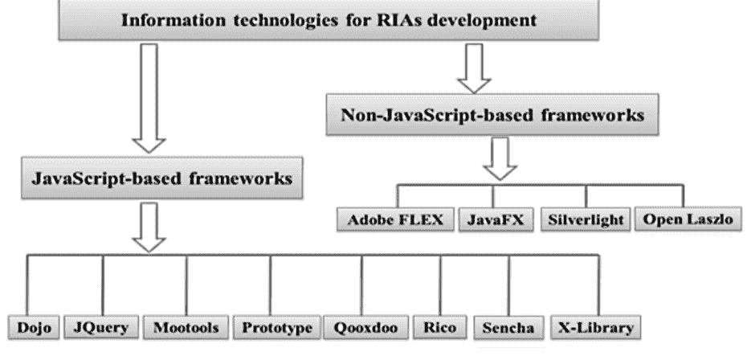

这种方法的主要优势在于它同时依赖于浏览器内置的 JavaScript 支持和 W3C（万维网联盟）标准。

- **基于插件：** 浏览器插件解释特定的脚本语言、XML（可扩展标记语言）或媒体文件，从而提供高级渲染和事件处理功能（例如，Adobe Flex™、JavaFX™、Silverlight™）。

- **运行时环境：** 应用程序从 Web 下载，但在浏览器外部的桌面运行时环境中执行（例如，Java Web Start、Adobe AIR™）。这些解决方案提供客户端功能和离线使用，并可完全访问底层操作系统。许多 RIA 技术可用于为这些运行时开发应用程序（例如，开发技术可用于 Adobe AIR™、基于 JavaScript 和/或基于 Flash 的技术）（Toffetti 等人，2011）。

为了应对开发富互联网应用的多种选择，本章提出了一个富互联网应用的分类方案。该分类是按照开发技术进行的。图 1 展示了这一分类方案，它比其他提案更为简洁。具体而言，该方案包含两个类别：第一类是 JavaScript 框架，第二类是非 JavaScript 框架。

## 2.1. 非 JavaScript 框架

开发富互联网应用的第一类框架是非 JavaScript 框架。仅考虑了市场上最受欢迎、因此也是使用最广泛的框架。

### 2.1.1. Adobe Flex™

Flex 是一个开源框架，用于为 Apple iOS™、Android™ 和 BlackBerry™ Tablet OS 开发移动应用程序。它也可用于传统的 Web 和桌面应用程序，这些应用程序使用相同的代码库部署在主要 Web 浏览器和操作系统中（Adobe, 2011）。

此外，Flex 提供了一种编程语言和基于标准的编程模型，这些标准由通用设计模式支持（Adobe, 2011）。

最后，Flex 与 Flash Player 和 Adobe AIR 运行时环境一起，属于所谓的 Adobe Flash 平台，它包含不同的组件/模块。这些组件/模块描述如下：

1. **MXML 和 ActionScript 语言：** MXML 是一种声明式的、基于 XML 的语言，允许描述应用程序用户界面的布局、外观和行为。ActionScript 3.0 是一种基于 ECMAScript 的面向对象语言，用于定义应用程序的业务逻辑。MXML（Macromedia 可扩展标记语言）和 ActionScript 源代码一起被编译成单个 SWF 文件，该文件包含基于 Flex 的应用程序。

2. **Flex Framework SDK 组件：** Flex SDK（软件开发工具包）是一组用户界面组件，如列表、按钮和图形等。它包含 Adobe Flex™ 框架（组件类库）和 Flex 编译器。Flex 编译器可以自由开发和部署基于 Flex 的应用程序。

3. **Flash Builder IDE（集成开发环境）：** 一个基于 Eclipse™ 的 IDE，用于基于 Adobe Flex™ 的应用程序开发。Flash Builder™ 提供构建基于 Adobe Flex™ 和基于 ActionScript 的应用程序的支持，这些应用程序可运行在 Android™、BlackBerry™ Tablet OS 和 Apple™ iOS™ 上。

4. **用于 Web 浏览器的运行时环境，Adobe Flash Player™：** Adobe Flash Player™ 是一个用于基于 Web 浏览器的应用程序的多平台运行时环境。它允许使用插件在 Web 浏览器中部署基于 Adobe Flex™ 的应用程序（McCune & Subramaniam, 2008）。

**图 2. Adobe Flex™ 主要组件**

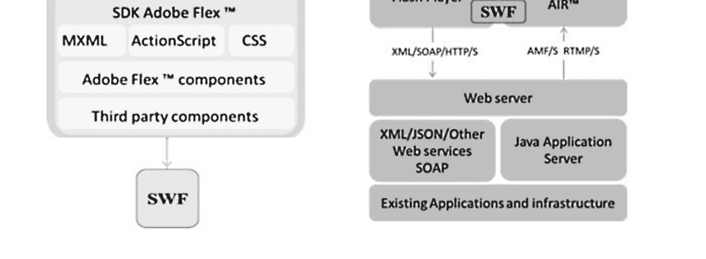

图 2 描述了 Adobe Flex™ 所涉及的组件/模块之间的交互。

Adobe Flex™ 提供了一个基于标准的中间层展示服务器，专门用于构建基于服务器的富互联网应用。

Adobe 开发 Flex 的目的是改善用户在创建丰富的动态互联网应用程序方面的体验，并帮助开发人员以更少的资源完成更多工作。

使用基于 Adobe Flex™ 的技术的优势列举如下。

**表 1. Adobe Flex™ 特性**

| | |
|---|---|
| **开发方** | Adobe™ |
| **特性** | **部署平台**<br>Adobe Flash Player™：<br>Windows™、Mac OS™、Linux™、Solaris™、Android™ 和 BlackBerry Tablet OS™<br>Adobe AIR™：<br>Windows™、Mac OS™、Android™ 和 Apple iOS™<br><br>**开发平台**<br>Windows™、Mac OS™、Ubuntu™ 和 Fedora™（Adobe Flex™ SDK 4.6） |
| **版本** | 当前版本 4.6 |
| **许可证** | 专有（免费 Adobe Flex™ SDK）和 Mozilla™ 公共许可证（MPL）1.1（开源 Adobe Flex™ SDK） |

- 基于 Web 浏览器的应用程序在受控环境，即 Adobe Flash Player™ 插件中运行。因此，无需考虑 Web 浏览器的特性。据 Adobe 称，Adobe Flash Player™ 目前已安装在超过十亿台台式计算机上，覆盖各种 Web 浏览器和操作系统（Flash Player, 2012）。
- Adobe Flex™ 是一门成熟的技术。
- IDE 支持不仅来自 Adobe 的 FlashBuilder，还有 Jetbrains 的 IntelliJ IDE。
- Adobe Flex™，特别是自 Adobe AIR™ 发布以来，代表了富互联网应用开发的强大选择（Smeets、Boness 和 Bankras, 2008）。

Adobe Flex™ 最重要的特性在表 1 中展示。

在著名网站开发中使用 Adobe Flex™ 的一些成功案例在表 2 中描述。

Adobe AIR™ 运行时环境使开发人员能够使用 HTML、JavaScript™、Adobe Flash™ 和 ActionScript™ 来构建作为独立客户端应用程序运行的 Web 应用程序，而无需受 Web 浏览器的限制。事实上，它是一个一致且灵活的运行时环境，允许将基于 Adobe Flex™ 的应用程序部署为桌面和原生移动应用程序（Adobe AIR™, 2011）。

**表 2. Adobe Flex™ 成功案例**

| 网站 | 描述 |
|---|---|
| Honda™，www.buildyourhonda.eu | 该网站允许用户定制他们的摩托车，同时可以可视化结果。该应用程序使用 Adobe Creative Suite™、Adobe Flash Player™、Adobe Flex™、Adobe Flash Builder™ 和 Adobe Photoshop™ 构建。 |
| 渣打银行™，standardchartered.com | 为了通过交互式且视觉吸引力的网站实现丰富的用户体验，银行机构渣打银行™ 使用 Adobe Flex™ 开发了其网站的用户界面。 |
| 纽约时报™，timesreader.nytimes.com / webapp / TimesReader.do | 纽约时报™ 的动态数字阅读器，名为 Times Reader 2.0，使用 Adobe Flex™ 和 Adobe AIR™ 开发。 |
| 飞利浦照明™，www.lighting.philips.com | 该富互联网应用使用户能够通过基于 Adobe Flex™ 开发的界面动态管理和处理大量实时信息（例如，销售数据、成本模型、订单历史）。 |

### 2.1.2. JavaFX™

JavaFX™ 是一个用于开发和部署富互联网应用的应用程序平台，可在多种设备上运行。它与 JRE（Java 运行时环境）完全集成，并利用基于 Java 的平台的性能和普遍性。基于 JavaFX 的应用程序可在任何运行 JRE 的桌面和 Web 浏览器上运行，它们可以轻松集成到 JME（Java 平台微型版）中。JavaFX™ 为手机、电视和其他设备的应用程序开发开辟了可能性。值得注意的是，只有 2.0 之前的版本支持移动设备。

JavaFX™ 平台包含以下组件：

- **FXML 语言：** 一种可脚本化的、基于 XML 的标记语言，用于构建 Java 对象图。

- **JavaFX SDK：** 包含：
  - JavaFX™ 桌面运行时环境（Desktop JavaFX™ Runtime）。
  - JavaFX™ 的 API（API 代表应用程序编程接口）。
  - JavaFX™ 编译器。

- **用于 JavaFX™ 的 NetBeans™ IDE：** JavaFX™ 技术与 NetBeans™ IDE 集成，这是一个成熟而强大的开发环境，可以更轻松地开发、预览和调试 JavaFX™ 应用程序。

- **Java FX™ Scene Builder：** JavaFX™ Scene Builder 是一款免费的商业软件工具，用于在 FXML 中可视化设计 JavaFX™ 应用程序的 GUI（图形用户界面）。它是 JavaFX™ 平台的一个组件，最初由 Sun Microsystems™ 开发，目前由 Oracle™ 公司维护。

**表 3. JavaFX™ 特性**

| 开发方 | Oracle™ Corporation |
| 特性 | **部署平台**<br>任何使用 JVM（Java 虚拟机）的操作系统<br><br>**开发平台**<br>任何操作系统（JDK 1.7） |
| 版本 | 当前版本 2.2 |
| 许可证 | BCL（二进制代码许可证） |

JavaFX™ 最重要的特性在表 3 中展示。

使用基于 JavaFX™ 的技术的优势列举如下：

- Java™ 程序员在 JavaFX™ 应用程序中使用标准的基于 Java™ 的库。

- JavaFX™ 平台包含开发工具：用于 JavaFX™ 的 NetBeans™ IDE 和用于 NetBeans™ 的 JavaFX™ 插件，均为免费软件。它还提供设计工具：用于 Adobe Photoshop™ 和 Adobe Illustrator™ 的 JavaFX™ 插件，也为免费软件（Oracle Corporation, 2011）。

使用基于 JavaFX™ 的技术的缺点列举如下：

- 它构建在 JRE 之上。JRE 在每个主要平台（以及许多次要平台）上都可用。然而，它并非普遍安装。当然，Adobe Flex™/AIR™ 和 Silverlight™ 也是如此，但 Flash 是比整个 JRE+JavaFX™ 更轻量级的解决方案，而后者基本上是目标平台上的默认选择（Smeets 等人，2008）。

- JavaFX™ 是一个不成熟的领域中的不成熟技术，该领域有几个更成熟的竞争对手，如 Adobe Flex™/AIR™ 和 Silverlight™。


## RIA 开发框架

表 4. JavaFX™ 成功案例

| 网站 | 描述 |
|---|---|
| Ubivent™, http://www.ubivent.com/en/start | Ubivent™ 是欧洲虚拟活动专家，提供虚拟活动平台。该平台支持数千名参与者之间的在线交流，提供真实的活动体验。该平台基于 JSE（JSE 代表 Java 标准版）7 构建，利用了 Java Web Start 技术。 |
| Celer Technologies™, http://celer-tech.com/products/framework/ | Celer Technologies™ 是一家全球金融软件公司，拥有金融科技领域的专业知识。它提供端到端的金融交易框架，包含使用 JavaFX™ v. 2.2 开发的丰富 GUI。 |
| DooApp™, http://www.dooapp.com/index.php/fr/produits | DooApp™ 是一家总部位于法国的软件公司。它专注于开发满足绿色建筑专业人士需求的工具。它还提供一个名为 Infiltrtea™ 的平台，用于测量气密性。Infiltrtea™ 基于 JSE 6 构建，大量使用了 JavaFX™。 |

表 4 描述了使用 JavaFX™ 开发知名浏览器外 RIA 的一些成功案例。

### 2.1.3. Silverlight™

Silverlight 是一款功能强大的开发工具，用于为 Web 和移动应用程序创建引人入胜且交互式的用户体验。Silverlight™ 是一个由 .NET 框架驱动的免费插件，兼容多种浏览器、设备和操作系统。它为 Web 工作的任何地方带来了全新水平的交互性（Microsoft, 2011a）。Silverlight™ 引入了对在浏览器中运行具有桌面功能的 Silverlight™ 应用程序的支持、视频质量和性能改进，以及提高开发者生产力的功能。Microsoft Silverlight™ 平台由两个主要框架和一个安装更新组件组成。这些特性在表 5 中进行了描述。

有关更多详细信息，Microsoft Silverlight™ 的 .NET 框架元素在表 6 中进行了描述。

使用 Microsoft Silverlight 的优点如下：

- 它允许访问 .NET 框架编程模型，以便使用动态语言开发基于 Silverlight™ 的应用程序。

表 5. Microsoft Silverlight™ 特性

| 特性 | 描述 |
|---|---|
| 基础演示框架 | 与设计和用户交互相关的组件和服务。这包括用户提供的数据、用户界面控件、多媒体播放、数字版权管理、数据链接以及矢量图形、文本、动画和图像等演示功能。它包含用于设计用户界面的 XAML（可扩展应用程序标记语言）语言。 |
| 适用于 Silverlight™ 的 .NET 框架 | .NET 框架包含提供数据集成设施、可扩展 Windows™ 控件、网络、分发（RSS / Atom）设施、XML 序列化和垃圾回收设施的组件和库。此外，它还包括 LINQ（语言集成查询）查询语言、CLR（公共语言运行时）和 DLR（动态语言运行时）运行时环境。 |
| 安装和升级组件 | 控制安装和升级，简化了新用户的安装申请流程。随后，它提供低影响的自动更新（Microsoft™, 2011a）。 |

表 6. 适用于 Microsoft Silverlight™ 的 .NET 框架组件

| 元素 | 描述 |
|---|---|
| 数据 | 支持 LINQ 和用于 XML 的 LINQ（XLinq）查询语言的特性，便于从不同来源集成数据。它还支持使用基于 XML 的序列化和数据管理类。 |
| 基础类库（BCL） | .NET 框架提供了一组基础类库，可提供可与任何 .NET 框架支持的编程语言一起使用的功能和特性，例如 Visual Basic、C#、Visual C++ 等。基础类库包含标准编程特性，如集合、XML 解析、数据类型定义、I/O 设施（用于读写文件）、反射和全球化等。此外，它还包含一些非标准特性，如 LINQ 查询语言、ADO.NET 类库（用于数据库交互）、绘图功能以及表单和 Web 支持。 |
| Windows Communication Foundation（WCF） | Windows Communication Foundation 提供了一个统一的编程模型，用于快速构建跨 Web 和企业通信的面向服务的应用程序。它提供了简化对远程数据和服务访问的功能。它包括对跨域 HTTP（超文本传输协议）请求、RSS（简易信息聚合）/ Atom 内容聚合以及 JSON（JavaScript 对象表示法）、POX（普通旧 XML）和 SOAP（简单对象访问协议）格式的支持。 |
| Windows Presentation Foundation（WPF） | 它提供了一组丰富的控件，例如按钮、日历、复选框、数据网格、日期选择器、超链接按钮、列表框、单选按钮和滚动查看器等。 |
| 动态语言运行时（DLR） | 支持动态语言的动态编译和执行，例如 JavaScript 和 IronPython，用于调度基于 Silverlight™ 的应用程序。DLR 还包括与其他语言兼容的模型，可与 Microsoft Silverlight™ 一起使用（Microsoft, 2011b）。 |

动态语言，如 IronPython 和 IronRuby，或编译语言，如 C# 和 Visual Basic™（Microsoft™, 2011b）。

- Microsoft™ 公司提供两种不同的 IDE：面向设计师的 Microsoft Expression Studio™ 和面向开发者的 Microsoft Visual Studio™；后者作为免费软件提供。

使用 Microsoft Silverlight™ 的缺点如下：

- Microsoft Silverlight™ 不支持 Linux 操作系统；然而，有一个名为 Moonlight（版本 2.0）的开源实现，适用于 Linux™ 和其他基于 Unix/X11 的操作系统（Moonlight, 2011）。
- Microsoft Silverlight™ 插件的市场渗透率低于 Flash Player™，甚至低于 JRE。不过，Microsoft 已在其最新版本的操作系统 Windows™ 7 中分发了一个 Silverlight™ 插件。根据英国计算机协会的数据，Windows 7 目前已安装在超过 20% 的联网个人计算机上（bcs, 2011）。

最重要的 Silverlight™ 属性在表 7 中呈现。

表 7. Silverlight™ 属性

| | |
|---|---|
| 开发者 | Microsoft™ 公司 |
| 特性 | 部署平台<br>Windows™、Mac OS™ 和 Windows Phone™<br><br>开发平台<br>Windows™ 和 Mac OS™（Silverlight™ SDK 5） |
| 版本 | 当前版本<br>5 |
| 许可证 | 专有 |

表 8 列出了一些使用 Silverlight™ 开发的知名网站的成功案例。

表 8. Silverlight™ 成功案例

| 网站 | 描述 |
|---|---|
| Siemens™, siemensplmcampus.com | 该网站展示了 Siemens™ PLM Software 园区的虚拟展览。Siemens™ PLM Software 是一家专门从事产品生命周期管理的软件开发公司。用户可以通过与提供的虚拟建筑互动来了解业务运作方式。 |
| Mazda™, mazda.co.uk / car-configurator | 该网站展示了一个 Mazda 品牌汽车定制器。它整合了高分辨率图像和外部功能，如 360 度视图和放大的内部视图（Silverlight™ 展示, 2011）。 |
| Digital Mixup™, mixupdigital.com | Mixup™ 是一个在线数字音乐和视频商店。该网站旨在为用户提供寻求、购买和下载歌曲和专辑的丰富用户体验。 |

### 2.1.4. OpenLaszlo™

OpenLaszlo™ 是一个开源平台，用于开发和交付具有可用用户界面的 Web 应用程序。OpenLaszlo™ 平台使开发者能够开发具有典型桌面客户端软件丰富用户界面功能的应用程序，同时利用无需下载的 Web 部署模式。这些应用程序使用基于 XML 的代码，在所有主流桌面操作系统的所有主流 Web 浏览器上运行。OpenLaszlo™ 是 Laszlo Systems 开发的产品，根据通用公共许可证（CPL）发布（Smeets 等, 2008）。

OpenLaszlo™ 使用一种名为 LZX 的专有编程语言来定义应用程序用户界面。LZX 是一种基于 XML 的标记语言，嵌入了基于 JavaScript 的业务逻辑（Smeets 等, 2008）。

OpenLaszlo 支持将 LZX 代码编译为适用于 DHTML（DHTML 代表动态超文本标记语言）和 Flash 执行环境的可执行二进制文件（Laszlo Systems, Inc, 2013c）。

OpenLaszlo™ SDK 包括：1）一个内置的 Java 编译器，2）一个基于 JavaScript 的库运行时，以及 3）一个基于 Java 的 servlet，为运行中的应用程序提供额外服务（Laszlo Systems, Inc, 2013c）。这些组件在表 9 中进行了描述。

OpenLaszlo™ 使用现有的技术基础设施和标准，如图 3 所示。两种应用程序部署模型详细描述如下：

- 通过 OpenLaszlo 服务器中介：OpenLaszlo™ 服务器始终运行。它根据需要编译源代码，并将生成的文件（SWF 或 JavaScript）发送到客户端以执行应用程序。

表 9. OpenLaszlo™ 平台组件

| 组件 | 描述 |
|---|---|
| OpenLaszlo™ 编译器 | 它将 LZX 文件编译为适用于特定环境的可执行二进制文件。OpenLaszlo™ 目前涵盖 Flash（SWF 格式）版本 8.9 和 10，以及 DHTML。 |
| OpenLaszlo™ Servlet | 它拦截应用程序对传统媒体类型以及 SOAP 和 XML-RPC Web 服务的请求。 |
| Laszlo™ 基础类（LFC） | 它是一个运行时库，包括用户界面组件、数据绑定设施和网络服务等功能（Laszlo Systems, Inc, 2013a）。 |


## 富互联网应用（RIA）开发框架

图3. OpenLaszlo™ 平台部署模型

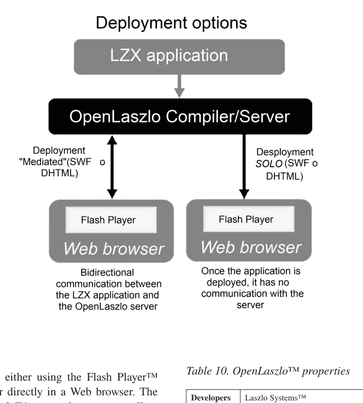

应用程序可通过 Flash Player™ 插件运行，也可直接在 Web 浏览器中运行。OpenLaszlo™ 服务器通过多种协议截获应用程序请求。

- **SOLO（Standalone OpenLaszlo Output，独立 OpenLaszlo 输出）**：LZX 源代码被预编译为独立的 SWF 文件（可放置在 HTTP Web 服务器中），或编译为基于 JavaScript 的文件。因此，基于 OpenLaszlo™ 的应用程序可以使用 SOLO 部署模型直接与其他服务器通信。（Laszlo Systems, Inc, 2013a）。

使用 OpenLaszlo™ 的优点如下：

表 10. OpenLaszlo™ 特性

| 开发者 | Laszlo Systems™ |
| --- | --- |
| 特性 | 部署平台：任何操作系统 |
| | 开发平台：任何操作系统 |
| 版本 | 当前版本 4.9.0 |
| 许可证 | 通用公共许可证（Common Public License） |

- OpenLaszlo™ 是一个开源平台。
- OpenLaszlo™ 架构支持不同的部署模型，以满足应用程序的需求（Theserverlabs, 2011）。

表 11. OpenLaszlo™ 成功案例

| 网站 | 描述 |
| :--- | :--- |
| Walmart™，walmart.com | 沃尔玛™ 跨国公司使用这项开源技术重新设计了其网站，增加了丰富的功能（Laszlo Systems, Inc, 2013b)。 |
| Gliffy™，gliffy.com | 这是一款基于 Web 的免费 CASE（计算机辅助软件工程）工具，可作为商业 CASE 工具（如 Microsoft Visio™）的替代方案。该应用程序完全使用 OpenLaszlo™ 开发，提供了拖放等丰富功能（Laszlo Systems, Inc, 2013b)。 |
| Fnac™，fnac.com | Fnac™ 是一家总部位于法国的国际公司，专注于电子产品和娱乐软件销售。Fnac™ 使用 OpenLaszlo™ 开发的在线购物车允许用户在做出购买决策前轻松比较优惠和选项（Laszlo Systems, Inc, 2013b)。 |

使用 OpenLaszlo™ 的主要缺点是，当使用 SOLO 部署模型时，基于 OpenLaszlo™ 的应用程序性能可能会受到影响（Laszlo Systems, Inc, 2013a)。OpenLaszlo 最重要的特性呈现在表 10 中。

表 11 描述了使用 Open-Laszlo™ 开发的知名网站的成功案例。

响应发生在不刷新或不渲染新页面的情况下。此外，开发人员可以使用 DOM（**Document Object Model，文档对象模型**）修改 Web 页面的部分内容，以显示作为 HTTP 响应一部分返回的更改或数据。

基于 JavaScript 的框架或库是一组实用工具和功能，使生成跨浏览器兼容的 JavaScript 代码变得更加容易。每个库都可以在不同的现有 Web 浏览器版本上进行广泛测试，以确保基于 JavaScript 的 RIA 在不同平台上都能类似地执行（RibosoMatic, 2013）。

根据作者的观点，以下介绍了用于 RIA 开发的八个最受欢迎的基于 JavaScript 的框架。

## 2.2. 基于 JavaScript 的框架

JavaScript 是一种面向对象的脚本语言，用于定义基于 Web 浏览器的应用程序客户端。JavaScript 使 Web 开发人员能够以编程方式在 Web 页面上创建对象。它提供了一个平台，用于即时操作这些对象。自异步 JavaScript 和 XML 技术（**AJAX**）推出以来，JavaScript 已经发展得更为实用。目前，它为基于 Web 的编程带来了全新的交互性水平。事实上，在 Ajax 出现之前，任何服务器端处理或数据库访问都需要整个页面被刷新或由 Web 浏览器渲染新页面。

Ajax 代表**异步 JavaScript 和 XML（Asynchronous JavaScript and XML）**，尽管对 XML 的引用已不再有效，因为 Ajax 请求可以以其他多种格式返回响应，例如 JSON。Ajax 使 JavaScript 能够异步向 Web 服务器提交 HTTP 请求，并渲染响应。

### 2.2.1. Dojo

Dojo 是一个包含 API 和 widgets（控件）的框架，用于促进使用基于 AJAX 的技术开发 Web 应用程序。Dojo 包含智能打包系统、UI 效果、拖放 widgets API 的函数库、事件抽象、客户端存储 API，以及与基于 AJAX 的 API 的交互。Dojo 还解决了常见的可用性问题，如导航和浏览器检测、地址栏中的 URL 变化（书签），以及在客户端不支持 AJAX / JavaScript 时的降级能力（RibosoMatic, 2013)。Dojo 远不止是一个框架，它的创建者将其称为 JavaScript 工具集（**"toolkit"**），使专业人员能够轻松快速地开发 Web 应用程序。此外，Dojo 具有免费软件许可证类型（Eguíluz Pérez, 2008)。Dojo 节省开发时间，并在开发过程中提供强大的性能和可扩展性（Dojotoolkit, 2014)。Dojo 最重要的特性呈现在表 12 中。

表 12. Dojo 特性

| 开发者 | Alex Russell，2004年；David Schontzler 和 Dylan Schiemann。同样重要的是要提及 Dojo 基金会提供的支持。 |
| --- | --- |
| 赞助商 | IBM™、Google™、AOL™ 和 Nexaweb™。 |
| 特性 | Dojo 补充组件是由 JavaScript、HTML 和 CSS 资源组成的预打包组件，可用于开发 RIA。<br>• 菜单、标签和工具提示<br>• 可排序表格、动态图形和二维矢量绘图<br>• 动画效果和创建个性化动画的可能性<br>• 支持拖放<br>• 表单和参数验证例程<br>• 日历、时间和时钟选择器<br>• 在线富文本编辑器<br>• 可从早期版本访问的核心组件（dijit）和屏幕阅读器<br><br>浏览器支持<br>Internet Explorer™ 6-9<br>Mozilla Firefox™ 3.6+<br>Safari™ 5+<br>Opera™ 10.5-12<br>Chrome™ 13+ |
| 版本 | 稳定版本 1.8，2012年10月10日发布 |
| 许可证 | Berkeley 软件分发许可证（BSD）和学术自由许可证（AFL） |

通过使用 Dojo，开发人员可以构建更具可用性的网页。这可能以多种方式体现。网页应该更快。它应该更美观。它应该更易于用户操作。它应该帮助用户正确输入所需信息，并且网页应该更易于导航。Dojo 提供了可用性增强功能，如提供额外功能的 HTML 表单元素。这些增强功能应使当前表单元素以更有用的方式运行。性能可以通过使事物运行更快或使事物看起来运行更快来提高。使过程看起来更快的理想方式是在用户做其他事情时让过程运行，而不是让用户等待过程完成。Ajax 为支持这种技术提供了理想的机制。Dojo 与 Ajax 结合使用，允许网页异步向服务器发起数据请求，同时用户继续工作。网页对用户来说显得更快、更响应。数据验证可以通过将验证更接近数据输入来改进。Dojo 支持向服务器发送小型验证请求的能力，而不要求提交整个表单（Harmon, 2008)。

### 2.2.2. jQuery

jQuery 是一个简洁的 JavaScript 库，简化了 HTML 文档遍历、事件处理、动画和 Ajax 交互，以实现快速的 Web 开发。事实上，jQuery 压缩版本仅有 20 KB。此外，jQuery 和 Prototype 共享许多想法；它们也有共同的函数名称。然而，它们的内部结构存在一些显著差异。jQuery 简化了 JavaScript 编程——包括 AJAX 调用和 DOM 操作——同时 jQuery 文档非常完整，包含许多示例（Eguiluz Pérez, 2008)。jQuery 最重要的特性呈现在表 13 中。

表 13. jQuery 特性

| 开发者 | John Resig，2006年。 |
| --- | --- |
| 赞助商 | Microsoft™ 和 Nokia™ 公司宣布将该库包含在他们的平台中。Microsoft™ 将在 Visual Studio™ 3 版本 IDE 中添加它，支持基于 ASP.NET 和 ASP.NET MVC 的开发。另一方面，Nokia 将将该库集成到 Web Run-Time 平台中。 |
| 特性 | • 选择 DOM 元素<br>• 交互性和 DOM 树更改，包括对 CSS 1-3 和基本 XPath 插件的支持<br>• 事件<br>• 处理 CSS 样式表<br>• 效果和动画<br>• 自定义动画<br>• AJAX<br>• 支持扩展<br>• 各种实用工具，如浏览器信息、对象操作和常用例程的矢量函数等（jQuery, 2012）<br><br>浏览器支持<br>Internet Explorer™ 6+<br>Mozilla Firefox™ 2.0+<br>Safari™ 3+<br>Opera™ 10.6+<br>Chrome™ 8+ |
| 版本 | 稳定版本 1.8.3，2012年11月13日发布 |
| 许可证 | 通用公共许可证（GPL）和麻省理工学院许可证（MIT） |

jQuery 被认为是 Web 开发社区的最佳选择。这反映在一些知名大型网站的开发中，如 MSNBC，以及备受推崇的开源项目，包括 SourceForge、Trac 和 Drupal。

与其他专注于 JavaScript 技术的工具包相比，jQuery 旨在改变 Web 开发人员在其网页中创建丰富功能的方式。设计师无需花费时间处理高级 JavaScript 的复杂性，可以利用他们现有的级联样式表（**CSS**）、可扩展超文本标记语言（**XHTML**）和良好的传统简单 JavaScript 知识来直接操作网页元素，使更快速的开发成为现实（Bibeault & Katz, 2008)。

### 2.2.3. MooTools

MooTools 是一个紧凑且模块化的面向对象 JavaScript 框架，专为中级和高级 JavaScript 开发人员设计。它允许使用其文档完善且连贯的 API 编写强大、灵活和跨浏览器的代码（Mootools, 2012)。MooTools 在开源 MIT 软件许可证下发布，这提供了在任何情况下使用和修改它的机会。MooTools 最重要的特性呈现在表 14 中。

一些框架专注于重新创建某种传统的继承模型，而 MooTools 专注于这一点，并高度鼓励代码重用和开发模块化设计。JavaScript 具有原型继承模型，并且


## RIA开发框架

表14. MooTools特性

| 开发者 | MooTools 开发团队 |
|---|---|
| 赞助者 | 未知 |
| 特性 | MooTools包含许多组件。值得注意的是其官网上提供的一个下载工具，允许用户仅下载他们计划使用的库部分，包括依赖项。用户还可以选择文件的压缩级别进行下载。MooTools的部分组件类别概述如下： |
| | - **Core（核心）：** 这是一组支持函数，供其他组件使用。 |
| | - **Class（类）：** 这是MooTools对象实例化的基础库。 |
| | - **Natives（原生）：** 这是一组对原生JavaScript对象的增强，通过添加功能、兼容性以及简化代码的新方法。 |
| | - **Element（元素）：** 对HTML对象有许多改进和兼容性增强。 |
| | - **Effects（效果）：** 用于增强元素的 advanced API。 |
| | - **Remote（远程）：** 提供XHR请求接口，以及JSON Cookie工具。 |
| | - **Window（窗口）：** 提供适用于任何浏览器的接口，用于获取客户端信息，如窗口大小。 |
| 浏览器支持 | Internet Explorer™ 6+<br>Mozilla Firefox™ 2+<br>Safari™ 3+<br>Opera™ 9+<br>Chrome™ 4+ |
| 版本 | 稳定版本 1.4.1<br>2011年10月6日 |
| 许可证 | MIT |

MooTools创建了一种结构，以更加Java开发者熟悉的方式利用这一模型（Newton, 2008）。

### 2.2.4. Prototype

表15. Prototype特性

| 开发者 | Sam Stephenson 及 Prototype 核心团队 |
|---|---|
| 赞助者 | 未知 |
| 特性 | Prototype能够以非常简单、有趣且特别安全的方式（跨浏览器）处理Ajax调用。除了简单的请求外，该模块还能智能处理从服务器返回的JavaScript代码，并提供用于轮询的辅助类。Ajax功能包含在全局Ajax对象中。Ajax请求的传输使用XmlHttpRequest，浏览器差异对用户安全抽象。实际请求通过创建Ajax.Request对象的实例来完成。 |
| 浏览器支持 | Internet Explorer™ 6+<br>Mozilla Firefox™ 1.5+<br>Safari™ 2.0.4+<br>Opera™ 9+<br>Chrome™ 2+ |
| 版本 | 稳定版本 1.7.1<br>2012年6月5日 |
| 许可证 | MIT |

Prototype简化了客户端Web编程的复杂性。它旨在解决实际问题。它还添加了对Web浏览器脚本环境有用的扩展，并提供了Ajax和DOM API。Prototype是一个基于JavaScript的框架，旨在简化动态Web应用程序的开发。它提供了熟悉的类式面向对象框架、广泛的Ajax支持、高阶编程构造以及便捷的DOM操作。它由Sam Stephenson于2005年2月创建，作为Ruby on Rails中Ajax支持的基础。Prototype以单个JavaScript文件实现，通常命名为prototype.js。Prototype还以大型项目的一部分进行分发，如Ruby on Rails、script.aculo.us和Rico。如今，它被3.9%的网站使用，使其成为最受欢迎的JavaScript库之一（Prototypejs, 2014）。Prototype最重要的特性如表15所示。

声称一个JavaScript库可以扩展其编写的语言可能看起来奇怪，但这正是Prototype所做的。JavaScript提供了一种称为基于原型的继承的机制（该库即由此得名）。实际上，几种脚本语言都提供了扩展语言基础对象的功能。Ruby就是这样，而Prototype提供的许多扩展都是从Ruby借鉴而来的。可以描述Prototype的目标是使JavaScript感觉更像Ruby（Crane, Bibeault & Locke, 2007）。

### 2.2.5. Qooxdoo

Qooxdoo是一个JavaScript库，为开发高级基于JavaScript的界面提供了许多便利条件，包括调试控制台、事件管理和源代码控制等。它支持当前流行Web浏览器的最新版本，并根据GNU Lesser General Public License (LGPL)免费软件许可证发布（RibosoMatic, 2013）。Qooxdoo是一个全面且创新的RIA开发框架。此外，Qooxdoo是一种面向对象、基于JavaScript的编程语言，用于开发跨浏览器应用程序，无需任何HTML、CSS或DOM方面的专业知识。它包括一组开发工具、一个平台无关的GUI工具包以及先进的客户端-服务器通信（Qooxdoo, 2014）。Qooxdoo最重要的特性如表16所示。

Qooxdoo是一个通用的JavaScript框架，具有一致的一组独立组件和强大的工具链。它在宽松的许可证下开源，并由世界领先的网络主机之一1&1提供支持（Qooxdoo, 2014）。

表16. Qooxdoo特性

| 开发者 | qx 社区 |
|---|---|
| 赞助者 | 未知 |
| 特性 | • 允许开发者抽象HTML、CSS和基于DOM的应用程序。<br>• 面向对象编程<br>• 跨浏览器<br>• AJAX<br>• 原生桌面外观和体验 |
| 浏览器支持 | Internet Explorer™ 6+<br>Mozilla Firefox™ 2+<br>Safari™ 3.0+<br>Opera™ 9+<br>Chrome™ 2+ |
| 版本 | 稳定版本 1.0.1<br>2010年1月27日 |
| 许可证 | LGPL 和 Eclipse Public License (EPL) |

### 2.2.6. Rico

Rico是一个用于创建基于JavaScript的RIA的函数库。它是面向对象的，这使得将Web应用程序用户界面重构为富用户界面变得容易（Openrico, 2014）。Rico提供了响应式动画，以实现流畅的效果和过渡，比传统Web应用更具交互性地传达用户界面变化。此外，这个JavaScript库提供了一个非常简单的接口，用于注册Ajax请求处理器，以及将HTML元素或JavaScript对象作为Ajax响应对象。从这个角度来看，多个元素和/或对象可能作为一次Ajax请求的结果被更新（RibosoMatic, 2013）。Rico基于Prototype，包括网络功能、复杂的用户界面控件（如日历和树）、拖放功能和用户界面效果。此外，Rico根据Apache 2.0软件许可证免费开源发布，可用于个人或商业用途。Rico最重要的特性如表17所示。

表17. Rico特性

| 开发者 | Richard Cowin 和 OpenRico.org |
|---|---|
| 赞助者 | Open Rico.org 和 Sabre Airline Solutions |
| 特性 | **组件**<br>Rico 2.0扩展了之前版本的组件集。例如，实时网格组件已扩展为包括过滤、列大小调整以及更多功能。Rico 2.0的核心设计旨在使自定义组件更容易构建。<br><br>**动画效果**<br>Rico 2.0提供了响应式动画，以实现流畅的效果和过渡，比传统Web应用更具交互性地传达用户界面变化。与大多数效果不同，Rico 2.0动画可以被中断、暂停、恢复，或应用其他效果，以实现快速的响应式交互，否则用户将没有时间等待。<br><br>**行为**<br>Rico可用于创建类似于Adobe Flex™和OpenLaszlo™中发现的组件。<br><br>**样式**<br>Rico在一个非常简单的接口中提供了几种电影效果以及一些简单的视觉效果。<br><br>**浏览器支持**<br>Internet Explorer™ 5.5+<br>Mozilla Firefox™ 1.5+<br>Safari™ 2.0.3+<br>Opera™ 9+<br>Chrome™ 2+<br>不支持Safari™上的拖放功能。 |
| 版本 | 稳定版本 3.0.9<br>2012年6月4日 |
| 许可证 | Apache 2.0 |

### 2.2.7. Sencha ExtJS

表18. Sencha ExtJS特性

| 开发者 | Jack Slocum、Brian Moeskau、Aaron Conran 和 Rich Waters，以 Ext JS 之名创建 |
|---|---|
| 赞助者 | 2010年6月15日宣布，Ext JS、jQTouch和Raphaël将合并，以成立一个名为Sencha的新组织。<br>Ext JS仍在新的网站上单独提供，同时还有Sencha、Sencha Touch、Ext GWT、Ext Designer、Animator和Sencha Ext Core。 |
| 特性 | 有一组组件（小部件）可用于Web应用程序中。其中一些组件列举如下：<br>- 表格和文本区域<br>- 日期字段<br>- 数字字段<br>- 组合框<br>- 单选按钮和复选框<br>- HTML编辑器<br>- 数据元素（具有只读模式、可排序数据、可锁定和拖拽的列等功能）<br>- 数据树<br>- 标签页<br>- 工具栏<br>- Windows风格菜单<br>- 可分割的面板<br>- 滑块<br>- 图形<br>其中几个组件能够使用AJAX与服务器端通信。Sencha ExtJS还包含允许为基于HTML的网页添加交互性的功能，例如：<br>- 对话框<br>- QuickTips显示单个字段的验证消息和信息。<br><**br>浏览器支持**<br>Internet Explorer™ 6+<br>Mozilla Firefox™ 3.6+<br>Safari™ 4+<br>Opera™ 11+<br>Chrome™ 10+ |
| 版本 | 稳定版本 4<br>2011年4月4日 |
| 许可证 | GNU GPL 版本 3，商业版 |

它是另一个流行的基于JavaScript的框架。它最初是作为Yahoo!™ YUI™库的补充而出现的。除了其通用工具外，Sencha ExtJS还包括许多即用型用户界面组件。Sencha根据通用公共许可证（GNU GPL）作为免费软件发布，或作为旨在提供技术支持的商业软件发布（Eguíluz Pérez, 2008）。

Sencha是一个轻量级的跨浏览器JavaScript库，提倡高性能，并允许开发者开发动态Web页面和富用户界面（Sencha, 2011）。在被Sencha™ Inc.收购之前，它曾被称为Ext JS。因此，仍然可以在网上找到Ext JS的参考资料，以及信息-


**富互联网应用程序开发框架**

必须注意，本节的目的并非评判所介绍框架的优劣。相反，本章的目标是概述每个框架的主要特性。这将帮助开发者根据他们将要开展的项目特性，包括预算、时间表以及功能性和非功能性需求，做出关于最适合的RIA框架的正确决策。

Sencha ExtJS最重要的特性如表18所示。

Sencha Ext JS是业界最强大的桌面应用程序开发平台之一，具有无与伦比的跨浏览器兼容性、先进的MVC架构、无插件的图表功能以及现代化的UI组件（Sencha，2014）。

### 2.2.8. X-Library

它是一个松散绑定的、跨浏览器的JavaScript函数和对象集合（RibosoMatic，2013）。它包含核心DOM/Style函数、非侵入式增强、实用工具函数以及诸如菜单和标签面板等对象。它也包含一些实验性功能。X-Library已在广泛的操作系统和浏览器上进行了充分测试。X-Library作为自由软件在GNU宽通用公共许可证（LGPL）软件许可下分发，甚至可用于商业项目。然而，存在一些限制和要求（Cross-browser，2014）。表19列出了X-Library最重要的特性。

表19. X-Library特性

| 开发者 | Michael Foster 和 Cross-Browser |
| --- | --- |
| 赞助商 | cross-browser.com |
| 特性 | 众多的**X演示**展示了如何在各种JavaScript应用程序中使用**X**——从简单到复杂。基于JavaScript的非侵入式代码可在某些特性中找到，例如菜单、事件处理演示、表单增强、调试工具、动态布局等。有几个动画演示说明了几种不同的动画技术。**X文档：** **X查看器**为所有**X**函数和对象提供了全面的文档——源代码、语法、参数、依赖关系、演示链接等。**X**没有实现自己的对象或事件模型。**X工具：** **XAG**是一个库文件聚合器。XAG扫描应用程序文件并创建自定义的**X**库文件，该文件仅包含应用程序中使用的那些**X**变量、函数和对象（X符号）。**XPP**是一个简单的文本预处理器。它支持条件输出和文本替换。这些特性使得能够执行混淆和条件编译。 |
| 浏览器支持 | Internet Explorer™ 7-9, Mozilla Firefox™ 3.5+, Safari™ 4.0+, Opera™ 10.6+, Chrome™ 4+ |
| 版本 | 稳定版 4.23, 2011年5月14日 |
| 许可证 | GNU LGPL |

## 3. 结论

必须注意，本节的目的并非评判所介绍框架的优劣。相反，本章的目标是概述每个框架的主要特性。这将帮助开发者根据他们将要开展的项目特性，包括预算、时间表以及功能性和非功能性需求，做出关于最适合的RIA框架的正确决策。

因此，由于此处介绍的框架不断添加新功能，建议开发者持续检查并更新框架以获取新版本。

此外，一些基于JavaScript的框架能够协同工作并相互补充；然而，这对于其他框架则不可能，而对于非基于JavaScript的框架来说，这几乎是无法考虑的。

对于这些非基于JavaScript的框架，必须考虑待开发应用程序的类型，即应用程序架构，因为这些框架针对不同的功能，从独立应用程序到经过RIA改造的传统Web应用程序。此外，还必须考虑预期的运行时环境，因为根据应用程序类型，这些框架通常需要Web浏览器插件或桌面运行时环境。最后，在特定的基于Web浏览器的RIA开发场景中，框架在数据库存储分布和业务逻辑分布方面的能力和局限性是关键问题。

## 参考文献

Adobe AIR. (2011). *Adobe AIR*. 检索日期 2011年1月30日, 来自 http://www.adobe.com/products/air/

Adobe. (2011). *Flex overview*. 检索日期 2011年1月29日, 来自 http://www.adobe.com/products/flex/overview

BCS. (2011). *Windows 7 market share exceeds 20% mark*. 检索日期 2011年2月6日, 来自 http://www.bcs.org/content/conWebDoc/38577

Bibeault, B., & Katz, Y. (2008). *jQuery in Action*. Greenwich, CT: Manning Publications Co.

Crane, D., Bibeault, B., & Locke, T. (2007). *Prototype and Scriptaculous in Action*. Greenwich, CT: Manning Publications Co.

Cross-Browser. (2014). *X-library*. 检索日期 2014年1月, 来自 http://www.cross-browser.com/

Dojotoolkit. (2014). *Dojotoolkit*. 检索日期 2014年2月, 来自 http://www.dojotoolkit.org/

Eguíluz Pérez, J. (2008). *Introducción a AJAX*. Librosweb. 检索日期 2014年2月, 来自 http://librosweb.es/ajax/

Flash Player. (2012). *Statistics*. 检索日期 2012年12月18日, 来自: http://www.adobe.com/mx/products/flashruntimes/statistics.html

Harmon, J. E. (2008). *Dojo: Using the Dojo JavaScript Library to Build Ajax Applications*. Addison Wesley Professional.

JQUERY. (2012). *Documentation*. 检索日期 2012年9月, 来自 http://docs.jquery.com/

Laszlo Systems, Inc. (2013a). *Architecture*. 检索日期 2013年1月29日, 来自: http://www.openlaszlo.org/architecture

Laszlo Systems, Inc. (2013b). *OpenLaszlo Architecture*. 检索日期 2011年2月6日, 来自: http://www.openlaszlo.org/lps4.9/docs/developers/architecture.html

Laszlo Systems, Inc. (2013c). *OpenLaszlo Showcase*. 检索日期 2011年2月6日, 来自: http://www.openlaszlo.org/showcase

McCune, D., & Subramaniam, D. (2008). Getting to Know Flex. In *Adobe Flex 3.0 for Dummies* (pp. 9–16). Indianapolis, IN: Wiley Publishing, Inc.

Microsoft. (2011a). *Arquitectura de Silverlight*. 检索日期 2011年1月30日, 来自: http://msdn.microsoft.com/es-es/library/bb404713(v=VS.95).aspx

Microsoft. (2011b). *Información general sobre Silverlight*. 检索日期 2011年1月30日, 来自: http://msdn.microsoft.com/es-es/library/bb404700(v=VS.95).aspx

Moonlight. (2011). *Moonlight*. 检索日期 2011年1月30日, 来自: http://www.mono-project.com/Moonlight

Mootools. (2012). *Mootools*. 检索日期 2012年8月, 来自: http://mootools.net/

Newton, A. (2008). *MooTools Essentials: The Official MooTools Reference for JavaScript and Ajax Development*. Berkeley, CA: Apress.

Openrico. (2014). *Openrico*. 检索日期 2014年8月, 来自: http://openrico.org/

Oracle Corporation. (2011). *Develop Expressive Content with the JavaFX Platform*. 检索日期 2011年1月29日, 来自: http://javafx.com/about/overview/index.jsp

Prototypejs. (2014). *Prototypejs*. 检索日期 2014年1月, 来自: http://www.prototypejs.org/

Qooxdoo. (2014). *Qooxdoo*. 检索日期 2014年4月, 来自: http://qooxdoo.org/

RibosoMatic. (2013). *Listado de librerías, frameworks y herramientas para AJAX, DHTML y JavaScript*. 检索日期 2013年8月, 来自: http://www.ribosomatic.com/articulos/top-librerias-ajax-dhtml-y-javascript/

Sencha. (2014). *Sencha ExtJS*. 检索日期 2014年4月, 来自: http://www.sencha.com/products/extjs/

Smeets, B., Boness, U., & Bankras, R. (2008). Introducing Rich Internet Applications (RIAs). In *Beginning Google Web Toolkit: From Novice to Professional* (pp. 1–19). New York: Apress.

Theserverlabs. (2011). *Rich Internet Applications, Frameworks evaluation*. 检索日期 2011年2月6日, 来自: http://www.theserverlabs.com/brochures/RIA_Frameworks-TSL-evaluation.pdf

Toffetti, G., Comai, S., Preciado, J. C., & Linaje, M. (2011). State-of-the Art and trends in the Systematic Development of Rich Internet Applications. *Journal of Web Engineering*, *10*(1), 70–86.

Viveros García, M. C., & García Godoy, D. (2009). *Elaboración de una guía para el desarrollo de aplicaciones en extjs. (未发表论文).* Instituto Tecnológico de Orizaba.

## 延伸阅读

Adobe. (2012). *Flex, What is Flex?* 检索日期 2012年9月, 来自 http://www.adobe.com/es/products/flex.html

Microsoft. (2012). *Silverlight 5*. 检索日期 2012年9月, 来自 http://www.microsoft.com/silverlight/

Oracle Corporation. (2012). *JavaFX*. 检索日期 2012年9月, 来自 http://www.oracle.com/technetwork/java/javafx/overview/index.html

## 关键术语与定义

**框架：** 一种软件定义的结构，其他软件项目在此基础上设计和开发。

**超文本标记语言（HTML）：** 用于开发网页的标记语言。它是一个作为不同版本网页开发参考的标准，定义了基本结构和代码（HTML代码）。

**基于JavaScript的框架：** 使用基于JavaScript的编程语言开发的框架，例如 *Dojo*、*Prototype* 和 *Mootools*。

**非基于JavaScript的框架：** 使用其自身编程语言开发的框架，例如 *AdobeFlex™*、*JavaFX* 和 *Silverlight™*。

**RIA框架：** 用于富互联网应用程序开发的框架。

**独立RIA：** 可以在Web浏览器内部或外部部署，并且可以在线/离线执行的RIA。

**传统Web应用程序：** 这些是在Web浏览器中显示的软件应用程序，其中用户与应用程序的每次交互都意味着完全重新加载应用程序以显示更新的信息。

## 第三章
### 传统 Web 应用与 RIA 的软件开发方法

### 摘要

第三章对 RIA 开发方法的最新研究现状进行了回顾。为此，首先介绍了传统 Web 应用的开发方法，因为在某些情况下，RIA 开发方法要么是现有 Web（和超媒体）方法的扩展，要么是在已有 Web 方法之上使用的新型 UI 设计方法。同时，还讨论了那些不依赖遗留 Web 模型、涵盖 RIA 特性的新方法。Web 开发的示例包括 UWE（基于 UML 的 Web 工程），其发展为 UWE-R（面向 RIA 的 UWE），以及 WebML 扩展，它是 WebML（Web 建模语言）的扩展。这些方法必须经过修改，以添加新特性来满足 RIA 开发的需求。其他一些 RIA 开发方法还包括 RUX 方法、OOH4RIA、OOHDM 扩展和 PPRD。

## 1. 引言

软件工程是将工程原理应用于软件的设计、开发和维护的研究与应用。软件工程的主要问题包括设计模式、架构风格和软件开发方法。因此，研究文献中针对传统 Web 应用和 RIA 提出的不同软件开发方法具有重要意义。根据牛津词典的定义，方法是"*在某一特定研究领域或活动中使用的一套方法体系*"，而这里讨论的是软件开发。

一方面，存在用于传统软件开发的软件开发方法，如 **RUP**（Rational 统一过程）、**Scrum** 和 **XP**（极限编程）。另一方面，也存在用于 Web 开发的方法，如 **UWE**（基于 UML 的 Web 工程）、**WebML**（Web 建模语言）和 **OOHDM**（面向对象的超媒体设计方法）等。然而，上述用于 Web 开发的软件开发方法并未考虑 **RIA**（富互联网应用）的特性，即它们未涵盖这类应用的开发方面，因为它们仅用于传统 Web 应用，忽略了 RIA 的相关方面。Preciado 等人（Preciado et al., 2005）讨论了为 Web 应用的设计和开发所提出的软件开发方法和工具的数量及类型。然而，传统 Web 应用仍不足以支持用户所要求的交互和展示特性。近年来，RIA 为这些问题提供了解决方案，因为它们提供了新的交互和展示层次。RIA 的使用呈指数级增长；然而，存在一个严重问题：缺乏针对这类应用的完整软件开发方法。Preciado 等人（Preciado et al., 2005）描述了建模 RIA 所需的主要特性，并提出了一项评估过程，以获得能够实现这一目标的方法。该过程用于评估某些现有方法的适用性，并证明每一种方法都只有很少的 RIA 特性。从这个角度来看，需要一种新方法或扩展现有方法。Preciado 等人（Preciado et al., 2005）确定，这些领域中没有一种方法适用于 RIA 建模。RIA 提供了新的多媒体和交互特性。Preciado 等人（Preciado et al., 2005）讨论了多媒体和超媒体都是有助于识别 RIA 新软件开发方法所需领域的观点。RIA 在过去几年的 Web 开发中具有重要意义。因此，多项研究提出了用于 RIA 开发的新开发方法和/或现有方法的扩展。

在本章中，介绍了一组应用开发方法。这些方法分为两大组，第一组是用于传统 Web 应用的方法，第二组介绍的是用于 RIA 开发的方法。在第二组中很容易识别出，大多数方法都是传统 Web 应用所用方法的扩展，这些方法必须做出调整以支持 RIA 的特性。

## 2. 传统 Web 应用的软件开发方法

首先，介绍了传统的 Web 开发方法，因为它们是创建新方法或扩展现有方法以满足 RIA 开发需求的开创者。Escalona 和 Koch（Escalona & Koch, 2004）对 Web 开发方法进行了综述，以下是其改进扩展版本。

### 2.1. WSDM：网站设计方法

WSDM 是一种以用户为中心的网站建设方法，它根据用户群体的信息需求来建模应用（Detroyer & Leune, 1998）。开发过程分为四个阶段。WSDM 的阶段如图 1 所示，具体描述如下：

- *用户建模*，对用户进行分类和分组，以便根据每个用户群体研究系统需求，
- *概念设计*，设计 UML 类图来表示系统的静态模型，并设计导航模型来表示导航的可能性，
- *实施设计*，将概念设计的模型轻松转换为计算机可理解的抽象语言，以及
- *实施*，将实施设计的结果用特定的计算机编程语言编写出来。

WSDM 过程中剩余的步骤都基于第一阶段的分类。

最重要的阶段是用户建模。它旨在通过执行以下两项任务来识别不同的用户角色：

- *用户分类* 是识别网站的潜在用户/访客，并根据其兴趣和导航偏好对其进行分类。WSDM 建议分析应用将要使用的组织环境，并将注意力集中在应用所支持的业务流程的利益相关者上。在 WSDM 中，利益相关者与执行业务流程活动之间的关系通过角色和活动的概念图以图形方式表示。
- *用户群体描述* 是对前一步骤中识别出的用户群体进行详细描述。借助数据词典，描述每个用户群体的信息需求、功能需求和安全需求。

### 2.2. SOHDM：基于场景的面向对象超媒体设计方法

SOHDM 方法是第一种强调允许分析师捕获和定义应用需求的过程的重要性的方法（Lee et al., 1998）。SOHDM 与 OOHDM（Schwabe & Rossi, 1998）有相似之处，但它提出了基于场景的需求规范。SOHDM 架构如图 2 所示。

SOHDM 生命周期中执行以下六项任务；就实际目的而言，只有第一项是相关的：

1. *分析*，使用场景描述需求；
2. *对象模型实现*，构建 UML 类图以展示系统的静态结构；
3. *视图设计*，表达系统将如何呈现给用户；
4. *导航设计*，开发导航类模型以表达系统中的导航可能性；
5. *实施实现*，开发网页、界面和数据库；最后，
6. *系统构建*，构建系统。

需求定义从设计上下文图开始， Warnier 类似 Yourdon（Yourdon, 1989）定义的 DFD（数据流图）。要构建此上下文图，分析师必须识别与应用通信的外部实体，以及触发这些实体与应用之间通信的事件。事件集被指定为一张表，显示参与事件的实体。SOHDM 建议为每个事件关联一个场景。场景使用一种称为 SAC（场景活动图）的专有符号以图形方式表示。场景描述当事件触发活动时，用户与应用之间的交互过程。它规定了活动流程、涉及的对象和执行的事务。

SOHDM 提出了从这些场景中获取应用概念模型的过程。所提出的概念模型由 UML 类图表示。SOHDM 开发过程中的下一步是重新分组这些类，以获得导航类图。

### 2.3. RNA：关系-导航分析

RNA 是一种提供 Web 应用开发步骤序列的方法，主要侧重于分析（Bieber et al., 1998）。RNA 的阶段为：

- 阶段 1 – 环境分析：目标是分析受众的特征。识别应用的利益相关者，并根据其角色将其分类为不同群体（类似于


## 传统Web应用与富互联网应用的软件开发方法

图1所示的WSDM用户建模阶段。

- **阶段2 – 元素分析：** 在此阶段，确定应用所有感兴趣的元素，例如文档、表单、信息、模型等。
- **阶段3 – 元知识分析：** 其目标是构建应用的模式。RNA旨在确定与应用相关的目标、过程和操作，并描述这些元素之间的关系。
- **阶段4 – 导航分析：** 在此阶段，前一个阶段的模式通过导航特性得到扩展。
- **阶段5 – 实现分析：** 包括确定如何用可计算语言（Bieber等人，1998）生成阶段4中描述的模型。

RNA仅提供了每个阶段应执行操作的一些指导方针。它既未提出建模概念，也未提出符号体系，但RNA方法是关注需求规范在Web应用开发过程中重要性的方法论之一。它强调了概念需求分析与导航需求分析分离的必要性。

### 2.4. HFPM：超媒体灵活过程建模

由Olsina（Olsina，1998）提出的HFPM是一种广泛的基于工程的方法，它包括面向分析的*描述性*和*规定性*过程建模策略。它涵盖技术、管理、认知和参与性任务。因此，HFPM为规划和管理Web项目提供了指导方针，覆盖软件项目的整个生命周期。它由十三个阶段组成，每个阶段HFPM定义一组任务。出于实际目的，需求模型

模型是最相关的阶段，其相关任务定义如下：

- **问题描述：** HFPM未规定执行问题描述的具体技术，例如可以使用自然语言。
- **功能需求描述：** 通过用例来涵盖。
- **已识别用例的数据模型：** 提议设计UML类图。
- **用户界面建模：** 实现草图和原型，用于向客户展示草案。
- **非功能需求描述：** 如安全性、性能等。

HFPM一方面提出了处理需求的详细过程，另一方面，它并未规定具体技术，分析师和开发者可以自由选择。

### 2.5. OOHDM：面向对象超媒体设计模型

OOHDM是一种被广泛接受的Web应用开发方法（Schwabe & Rossi，1998），其早期版本侧重于设计阶段，未包含需求工程。OOHDM阶段如图3所示。

OOHDM中的过程分为四个阶段，产生以下结果：

1. *概念模型*以类模型的形式构建，以展示系统的静态方面。
2. *导航模型*由导航类图和导航结构图组成。前者表示系统中导航的静态可能性。后者通过包含访问结构和导航上下文扩展了导航类图。
3. *抽象界面模型*使用一种名为ADVs（抽象数据视图）（Schwabe & Rossi，1998）的特殊技术开发。
4. *实现*包含已实现的代码，并基于之前的模型。

需求的捕获和定义后来由Vilain、Schwabe和Sieckenius（Vilain等人，2000）引入OOHDM，他们提议使用UID（用户交互图）。UID基于众所周知的用例技术。用例用于捕获需求，但在OOHDM中被认为具有歧义且不足以定义Web应用的需求，用例主要涉及用户与系统之间的交互。因此，对于需求规范，该方法建议细化用例以构建UID，用于图形化建模用户与系统之间的交互，而不考虑界面的特定方面。从用例获取UID的过程在该方法中有非常详细的描述。

### 2.6. UWE：基于UML的Web工程

UWE是一种基于统一过程（Jacobson等人，1999）和（Booch等人，1999）的Web应用开发方法论。它主要基于其他方法提供的最相关概念，但定义了UML符号（UML配置文件），该符号定义了一个系统化和半自动化的设计过程（Hennicker & Koch，2000）。

UWE覆盖Web应用的整个生命周期，并侧重于自适应应用。它包含一个特定的需求工程阶段，其中需求获取、规范和验证作为过程的独立活动来处理。UWE中需求捕获阶段的最终结果是一个用例模型，辅以描述应用用户、适配规则、界面以及与用例实现相关的用例细节的文档。后者可以文本描述或用UML活动图建模。

UWE将需求分为两组：功能性和非功能性。UWE中的功能性需求包括：

- 内容需求。
- 结构需求。
- 表示需求。
- 适配需求。
- 用户模型需求。

此外，UWE提议访谈、问卷和检查表作为需求捕获的适当技术，用例、场景和术语表作为需求规范。为了验证它们，UWE提议走查、审计和原型（Koch & Wirsing，2001）。

### 2.7. W2000

W2000（Baresi等人，2001）也是一种扩展UML符号以建模多媒体元素的方法。这些多媒体元素继承自HDM（超媒体设计模型）（Garzotto等人，1993）。W2000的开发过程分为三个阶段：需求分析、超媒体设计和功能设计。出于实际目的，下面描述第一阶段。W2000中的需求分析分为两个子活动：功能需求分析和导航需求分析。需求获取始于对不同用户角色（即与应用交互的参与者）的分析。每个已识别的参与者都有自己的导航和功能需求模型。后者由UML用例模型表示。导航需求在另一个用例图中建模，该图表示参与者的导航可能性。图形符号被定义为UML扩展。W2000模型如图4所示。

### 2.8. WebML：Web建模语言

WebML是一种用于超媒体应用的高级规范语言。WebML遵循实体-关系和UML的风格，提供专有符号并使用UML语法进行图形表示。该符号辅以一组开发Web应用所需执行的活动，例如需求规范、数据设计和超文本设计（Ceri等人，2002）。

该方法论侧重于需求收集和需求规范。它提议使用访谈和文档分析等技术，但不主张使用规定性检查表进行需求捕获。需求收集始于用户识别和个性化需求。此外，收集数据需求以及功能性和非功能性需求。导航或特定的超文本结构化需求未单独处理。需求规范（称为需求分析）由经典的用例规范补充半结构化文本描述组成。该方法提议使用活动图来表达复杂用例的工作流。对于站点视图和风格指南的规范，建议使用基于模板的描述和模型（草图）。最后，验收测试主要用于检查非功能性需求。

### 2.9. NDT：导航开发技术

NDT是一种用于规范和分析Web应用导航方面的技术。NDT侧重于NDT为捕获和定义需求而选择的获取和规范技术。NDT中的需求分析工作流始于捕获需求并应用访谈、头脑风暴和JAD（联合应用开发）技术研究环境。在第二步中，系统目标被捕获和描述。基于这些目标，系统需求被识别；NDT将其分类为（Escalona等人，2002）：

- 存储信息需求。
- 参与者需求。
- 功能需求。
- 交互需求。
- 非功能性需求。

交互需求由短语和可视化原型表示。短语显示如何检索系统信息，并由名为BNL（有界自然语言）（Brisaboa等人，2002）的特殊语言表示。可视化原型用于表示系统导航、数据可视化和用户交互。

NDT提出的目标和需求获取与规范的整个过程主要基于模板或模式。此外，它使用其他需求定义技术，如用例和术语表。NDT方法为每种需求类型提议不同的模板，因此需求和目标以结构化方式描述。模板中的某些字段仅接受特定值，从而允许系统化过程。需求规范工作流以需求目录的审查和可追溯性矩阵的开发结束，该矩阵允许了解规范是否覆盖所有可能的需求。

在NDT项目的背景下，开发了一个名为NDT-Tool的案例工具。该工具支持填写模板并自动从模板中提取设计结果。

NDT开发过程可以描述为一个自下而上的过程。NDT过程侧重于需求驱动目标的详细工程阶段，该阶段包括


## 针对传统Web应用和富互联网应用的软件开发方法论

这涵盖了需求的捕获、定义以及验证。

该过程始于定义目标。基于这些目标，描述了一个用于捕获和定义不同系统需求的过程。这些目标根据其所属类型进行分类和处理。NDT将需求划分为：

- **存储需求：** 定义系统将管理哪些信息以及它们如何相互关联。NDT还可以定义系统中将使用的全新数据的性质。

- **利益相关者需求：** 定义可以在系统中交互的角色以及它们之间可能存在的关系。

- **功能需求：** 允许定义系统的功能。

- **交互需求：** 定义信息如何显示、用户如何导航系统以及所提供的恢复标准。

- **非功能性需求：** 包含其他系统需求（Escalona等，2002）。

### 2.10. 设计驱动的需求获取

设计驱动的需求获取是Lowe和Eklund（Lowe & Eklund, 2002）为开发Web应用而提出的设计驱动流程的一部分。它涉及在设计过程中捕获、定义和验证需求，也就是说，设计活动的开展方式应使得需求能够同时被处理和管理。该过程基于原型设计，旨在探索可能的解决方案和需要解决的问题。用户和客户基于对这些原型的研究来定义需求。这是一个迭代过程，旨在消除客户和用户的疑虑。该周期有三个阶段：评估、规格说明和构建。

这个设计驱动的过程是基于对Web商业应用开发中“最佳实践”的详尽分析而定义的。它以同等方式处理所有需求。需求包括：内容、接口协议、导航结构、外观和感觉、数据内部表示、版本、变更控制、安全、内容管理、访问控制、效率、用户监控、功能支持、系统适应性、用户识别等。

## 3. 针对富互联网应用的软件开发方法论

文献中报道了一些旨在提出富互联网应用软件开发方法论的工作。从这一视角出发，Busch和Koch（Busch & Koch, 2009）对RIA开发方法论进行了文献综述。本文展示并讨论了该文献综述的一个扩展版本，以建立富互联网应用的软件开发方法论。

### 3.1. RUX方法

Preciado等人（Preciado et al., 2007）讨论了在RIA开发中实施软件工程方法的难度。富互联网应用因其提供的便利性而广受欢迎，这些便利性使得开发具有多媒体、高交互性、协作工作和/或客户端同质化呈现要求的Web应用成为可能。Preciado等人（Preciado et al., 2007）提出了一种集成的Web工程方法，该方法基于WebML和RUX-Model概念模型，以支持这些应用的高级设计及其自动代码生成。RUX方法结合了RIA表现层方面的建模与现有的Web应用设计方法。UWE与RUX方法互补，用于用户界面设计。该方法包括将UWE表现模型转换为RUX抽象界面模型（AIM），随后用典型的RIA用户界面操作进行充实。在该方法中，与当前方法相比，RIA特性被引入到更低抽象层次的模型中。作者计划从两个方面扩展他们的研究；第一是将RUXModel与除WebML之外的其他模型相结合，第二是扩展WebML和/或RUXModel以覆盖在RIA上识别出的不同模型的所有基本概念。

Preciado等人（Preciado et al., 2008）提出了一种基于RIA开发的方法，该方法结合了UWE（一种用于建模数据和业务逻辑的方法）和RUX-Method（用于建模富互联网应用的用户界面）。作者提出了一种基于模型的方法，通过结合UWE和RUX-Method来进行RIA开发。UWE更适合于建模Web应用的特性，即数据和业务逻辑，而RUX-Method则应用于富互联网应用的用户界面设计。该方法提供了一种简单的方式来增强类似Web 2.0的Web 1.0应用。该方法考虑了业务流程中的静态和动态导航。未来的工作包括通过引入RIA的特定操作来改进此方法，例如在客户端完成文本字段的数据输入，这在Web 1.0中仍然无法实现。作者计划扩展RUX-Method的模型元素，例如向客户端呈现向后台服务器提交请求或执行操作，并扩展UWE模型元素以表示与服务器操作相对应的数据。同时，也考虑扩展UWE描述技术，以包含RIA特性的需求，例如动画、客户端与服务器之间的异步通信。RUX方法的总体方案如图5所示。

Brambilla等人（Brambilla et al., 2008）提出了一种方法论以及概念模型的组合，以涵盖在富界面支持下的Web应用设计与开发。为了详细说明高级用户任务的设计，该研究使用了对业务流程建模，这构成了Web应用的数据和导航模型，并应用表现模型以获得一个富互联网应用。它使用标准建模语言来描述业务工作流，这些工作流被转换为WebML，这是一种按照RIA典型的单一页面范式实现的Web应用规格说明。最后，集成了RUX-Method的特性，以细化富界面的设计。该方法论和一套概念模型提供了涵盖富互联网应用设计和开发的方案，以达到业务流程模型所使用视图的高级设计水平。BPMN（业务流程建模符号）语言被转换为WebML语言，从而集成RUX-Method的特性，这演示了如何细化富界面。所提模型的组合实现了精细的设计和丰富的交互。由于该方法的通用性，基于业务流程的设计被应用于其他超文本浏览模型和其他表现模型。只需指定新的赋值即可。

> 条件：图5. RUX方法概览
>
> 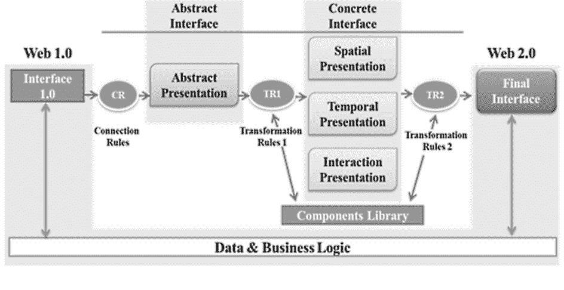

类似于桌面应用的图形界面。然而，富互联网应用是复杂的，其开发需要设计和实现。此外，富互联网应用的开发是Web工程的一大挑战，因为它需要修改和引入新的方面。OOH4RIA使用了一种基于模型的开发过程，该过程扩展了OOH方法。OOH开发过程如图6所示。

这引入了新的结构和行为模型，以构成完整的富互联网应用，并应用转换以减少工作量并加速Web开发。该方法在GWT（Google Web Toolkit）框架中实现。该方法为服务器端应用生成基于Java的代码，为客户端代码生成HTML和JavaScript。OOH4RIA模型到OO-H模型同样通过MOF（元对象设施）元模型使用UML语法进行指定。

### 3.2. OOH4RIA

OOH4RIA扩展了OOH方法（面向对象超媒体），为富互联网应用引入了许多新的模型元素，包括表现模型和编排模型，这些模型补充了面向对象超媒体的领域和导航模型。表现模型捕获了用于用户界面的不同小部件。编排模型表示小部件与系统其余部分之间的交互。Meliá等人（Meliá et al., 2008）使用了一种名为OOH4RIA的新方法，这是因为Web应用在其用户界面方面存在很大局限性。为了克服这些局限性，Meliá等人（Meliá et al., 2008）提出了更丰富、更高效

### 3.3. 面向对象超媒体设计方法（OOHDM）扩展

Urbieta等人（Urbieta et al., 2007）在RIA界面设计方面提出了一种新方法。该方法使用了ADV设计模型，该模型能够从用户界面的结构和行为中表达高度的抽象。此外，使用高级的需求分离技术能够以简单的组合创建复杂的界面。作者介绍了该方法的基础、基本步骤以及与OOHDM的集成。OOHDM扩展如图7所示。

Urbieta等人（Urbieta et al., 2007）专注于OOHDM以及用于指定RIA用户界面结构和行为的ADV框架模型。Urbieta等人（Urbieta et al., 2007）通过简单的例子证明了这一点，例如使用*ADVcharts*设计RIA的典型界面类型。作者这样做是为了


 # **传统Web应用与RIA软件开发方法论**

## **图6. OOH4RIA开发流程**

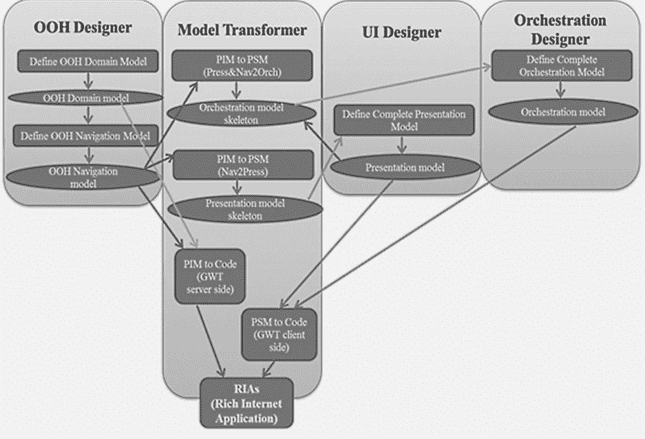

实现其对象在界面中显示或隐藏的目标，即信息如何在屏幕上展开或收缩。

### 3.4. UWE-R

UWE-R (Machado et al., 2009) 是UWE针对RIA的轻量级扩展，涵盖导航、流程和展示方面。因此，定义了新的建模元素，这些元素从UWE元素继承了结构和行为。与许多研究不同，UWE-R使用构造型（stereotypes）进行许多扩展，而不是元属性。UWE-R如图8所示。

### 3.5. WebML扩展

关于现有方法的扩展，Bozzon等人在(Bozzon et al., 2006)中提出了数据密集型RIA中分布式数据和事件的建模，重点关注客户端或服务器端操作。WebML区分客户端和服务器端的分布式数据，以及持久和临时对象。具体而言，WebML通过丰富数据规范的二维度进行了扩展：(1) 数据位置和 (2) 数据持续时间。WebML扩展的流程如图9所述。

位置可以是服务器端或客户端；持续时间可以是持久或临时的。WebML引入了新的建模元素，用于客户端计算的超级文本建模。作者展示了如何显式描述事件，并与WebML的其他概念结合，以实现RIA协作特性的规范。

**传统Web应用与RIA软件开发方法论**

图7. OOHDM扩展：RIA设计框架

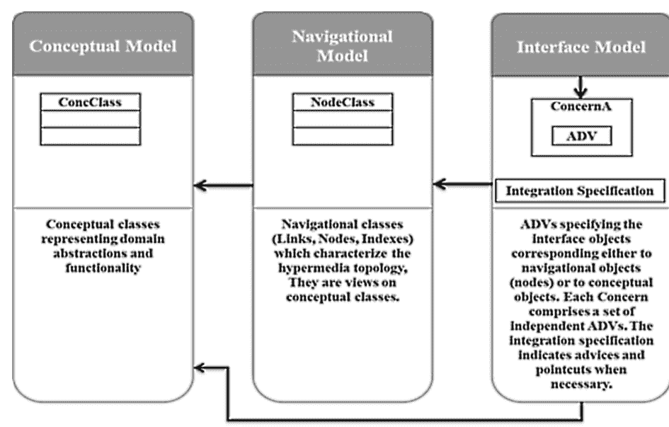

图8. UWE-R导航扩展

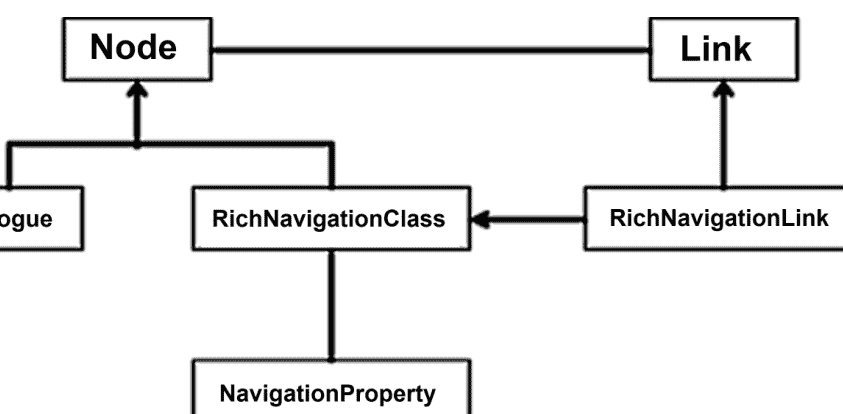

48

# **传统Web应用与RIA软件开发方法论**

*图9. WebML扩展：WebML流程*

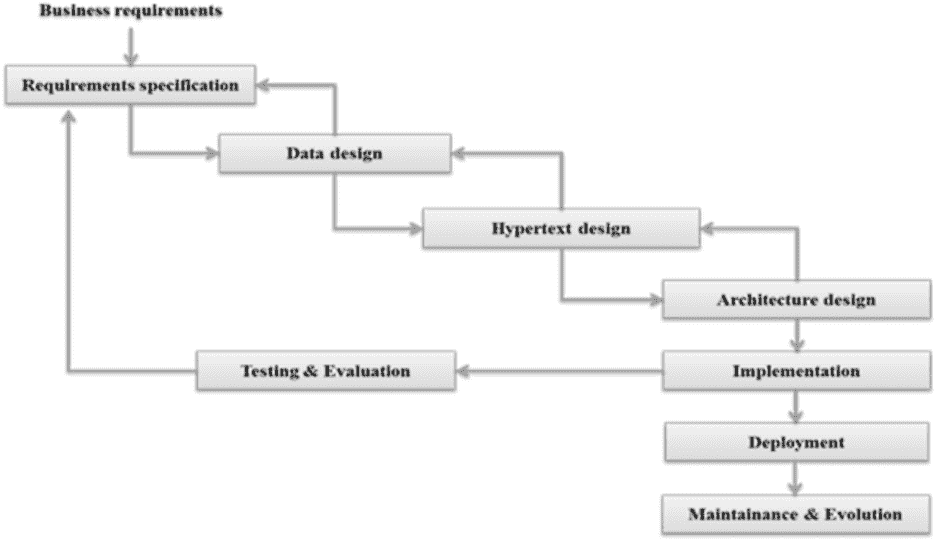

### 3.6. 面向对象Web解决方案（OOWS）与交互模式

为了定义交互模型，交互模式概念被用来描述常见用户-系统交互的解决方案。这些交互模式作为生成RIA界面代码的指南，基于一组转换规则。OOWS的交互模型如图10所示。

此类交互模式对模式的结构方面进行建模；行为方面仅通过文本描述。(Valverde & Pastor, 2008)中未给出转换规则的详细说明。OOWS方法提出创建交互模型以解决RIA特性问题 (Valverde & Pastor, 2008)。

### 3.7. ADRIA方法

Dolog和Stage (Dolog & Stage, 2007) 还提出了一种名为ADRIA（富互联网应用抽象设计方法）的新方法，该方法采用交互空间、任务模型和状态机。此方法专注于由用户交互触发的事件设计。ADRIA的活动如图11所述。

这种新方法的主要缺点是遗留Web应用的再工程需要从零开始进行建模。

### 3.8. Martinez-Ruiz等人提出的模型驱动方法

Martinez-Ruiz等人 (Martinez-Ruiz et al., 2006) 阐述了RIA开发中图形用户界面开发的问题，以及可以实施的社会环境，即：用户的教育背景、社会背景、个人知识等。因此，有必要对这些需求进行分析，并提出解决这些问题的方案。设计的界面必须是独立于平台和供应商的。因此，作者提出了一种设计此类用户界面的方法。该提案是基于模型的设计，并应用一系列XSLT（可扩展样式表语言转换）模型转换，将抽象界面模型转换为在特定平台上编码的最终用户界面。UsiXML被用于对所有级别进行建模。图形RIAUI的设计方法如图12所示。

在UsiXML中转换为XAML XSL文档。这些是在初步评估中进行的转换。作者正在编译XAML中定义的所有组件的仓库，以便在名为RIAZML的基于Java的实现原型中完成XSLT转换，但这仍处于早期开发阶段。

*图10. OOWS：交互模型*

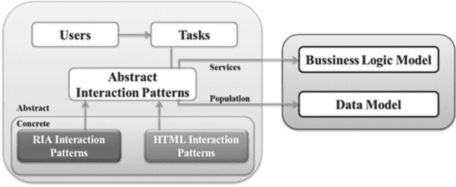

*图11. ADRIA中的活动*

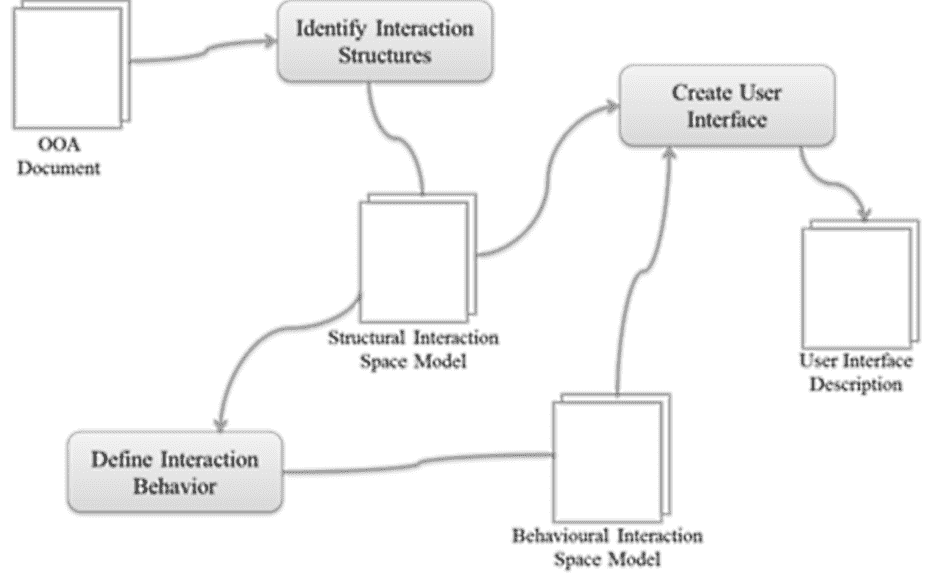

### 3.9. 模式库

模式库基于内部模式库的工作，创建了大量新模式以表达Ajax风格应用的丰富交互 (Scott, 2009)。RIA模式的结构如图13所示。

基于该模型提出了不同的技术。此外，此方法自动将UsiXML中定义的用户界面转换为XAML XSL文档。这些是在初步评估中进行的转换。作者正在编译XAML中定义的所有组件的仓库，以便在名为RIAZML的基于Java的实现原型中完成XSLT转换，但这仍处于早期开发阶段。

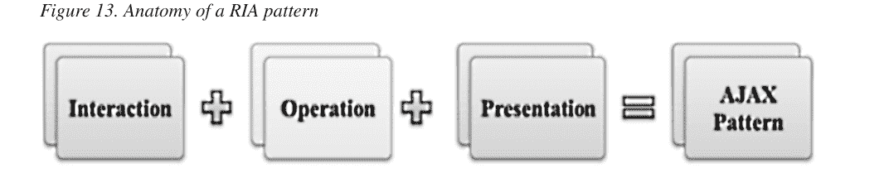

呈现Ajax应用中蕴含的知识。关键在于通过调查开发者如何成功权衡相互冲突的设计原则来发现最佳实践。Ajax的核心在于可用性，因此这些模式特别关注在面对约束条件下实现可用性，最值得注意的是：用户能力和期望、带宽限制、HTTP的无状态特性、JavaScript的复杂性。

### 3.10. UWE模式

设计模式已被证明对高效的RIA编程有效 (Mahemoff, 2006)。UWE建议在更高的抽象层次上应用设计模式，即在建模层面，以实现最小化设计工作量并最大化RIA开发中所用模型表达能力的目标。重点聚焦于使用状态机来表示模式——这是一种广泛使用的建模技术。UWE模式用于描述RIA特性的行为；这与(Valverde & Pastor, 2008)中引入的交互模式形成对比，后者仅对模式的结构进行建模。RIA模式的模型可以集成到几乎所有现有的软件开发方法论中。从这个意义上说，它是一种适用于所有UML方法的通用方法。使用这些RIA模式只需要在方法论中定义扩展点，随后说明如何将其集成到UWE等语言中，这使得它们易于重用 (Preciado et al., 2008)。

### 3.11. PPRD：RIA设计与开发阶段流程

Alor-Hernandez等人 (Alor-Hernandez et al., 2012) 提出了一个名为PPRD的RIA开发阶段流程。PPRD是一个构建RIA的开发流程，它允许仅关注主要活动，通过六个阶段将用户需求转化为软件产品，如下所示。

- 1. **需求识别**：此阶段涉及收集需求，并由用户表达以获得包含一组用户需求文档。

2. **需求分析**：此阶段的目标是通过UML用例图和UML活动图，向开发相关人员（如用户、客户和开发者）发现和呈现真正的需求。

3. **应用架构定义**：定义应用将运行的平台很重要，以便获得一组将用于开发的信息技术。

4. **概念模型**：此阶段识别用户涉及的对象与应用对象，这些对象共同执行各种功能。为了获得概念模型，有必要分析上一阶段的结果，生成代表对象、其属性和属性以及类之间关联的UML类图。


## 导航模型

导航模型通过UML类图表示，展示了导航结构中的节点和现有链接。节点代表视图、组件或表示元素；关联代表节点间的链接，用于显示或处理信息。

## 表示模型

此阶段旨在通过使用高级演示向量（ADVs），构建允许用户与应用程序交互的接口。该阶段完成后，将获得一组ADVs。一个ADV指示了界面所需的对象、其状态、行为以及与其他对象的交互（Rossi等人，2008）。此阶段的特殊性在于设计ADV的方式。

前述阶段的呈现顺序指示了在富互联网应用程序（RIAs）初始设计和开发中要执行活动的最优顺序，但作为一个增量式和迭代式的开发过程，随时可能返回到任何阶段。PPRD流程如图14所示。

（Colombo-Mendoza等人，2011）提出了一种名为PPMRD的PPRD扩展，用于多设备RIAs的源代码生成。作为一个突出贡献，与其他专注于软件建模以半自动生成代码的方法相比，该提案涵盖了多设备应用程序。PPMRD扩展流程如图15所示。

PPMRD的阶段描述如下。

*图14. PPRD中用于多设备RIAs源代码生成的实施阶段集成*

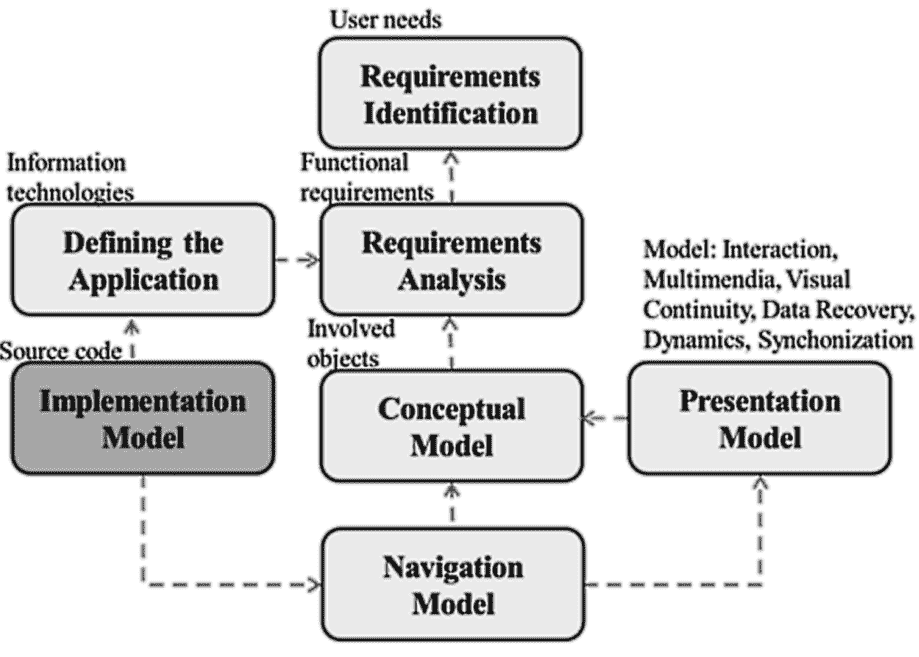

## 传统Web应用程序和RIAs的软件开发方法论

*图15. a) PPMRD在PPRD中的集成 b) PPMRD的阶段*

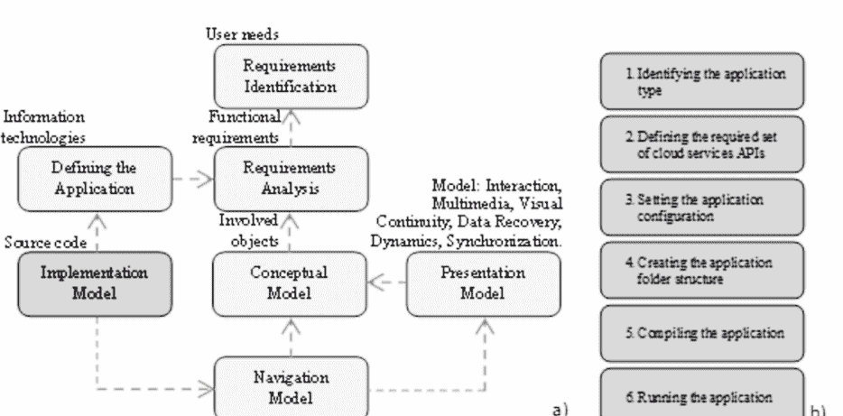

- 1. **识别应用程序类型：** 在此阶段，确定所需的多设备RIA类型。此处，选择以下类型的RIA之一：基于Web浏览器的应用程序、桌面应用程序或移动设备应用程序。在后一种情况下，还必须确定目标平台。基于Web浏览器的RIA是集成了类似桌面功能的Web 2.0应用程序，它可以简单地基于HTML和JavaScript，也可以基于RIA技术。桌面RIA是具有改进（丰富）图形用户界面（GUI）的传统桌面应用程序。面向移动设备的RIA是具有改进GUI的本机移动应用程序。这些应用程序的架构通常具有一个代表业务逻辑的服务后端；事实上，在Web 2.0应用程序的开发中，使用云服务越来越普遍。

- 2. **定义所需的云服务API集合：** RIA技术的需求源于基于云服务的应用程序开发的增加；因此，在此阶段识别开发RIA所需的云服务API。可以在同一个RIA中包含2个或更多的云服务API。从云服务API获得的功能彼此独立。在这个意义上，每个功能都可以显示为一个小组件。小组件是通过脚本创建和控制的交互元素。

- 3. **设置应用程序配置：** 此阶段要求开发人员在开发桌面应用程序和移动设备应用程序方面付出更多努力。

- 4. **创建应用程序文件夹结构：** 在此阶段，创建应用程序文件夹结构并生成源代码文件。为了提供可以根据已识别的应用程序类型和所需的云API重复使用的源代码文件，需要使用软件组件仓库。

- 5. **编译应用程序：** 如果适用，在此阶段，应用程序的源代码应被编译成可执行代码。

例如，要编译MXML文件，必须使用Adobe™ Flex SDK应用程序编译器来获取相应的SWF文件。该编译器使用mxmlc命令行工具调用。编译语法必须包含主MXML文件的名称，可选地可以包含以空格分隔的参数列表，例如指示所需SWC文件路径的library-path参数。作为应用程序编译的结果，生成可执行代码文件，如SWF文件。SWF文件的运行方式根据应用程序类型的不同而不同。

- 6. **运行应用程序：** 在此阶段，生成本机代码，最后将应用程序部署到目标设备上。要部署基于Web浏览器的应用程序，如果编译后的文件是SWF文件，则必须创建应用程序包装器。应用程序包装器是一个简单的HTML或服务器端网页，用于嵌入SWF文件。一旦创建了包装器，就可以在任何集成了所需插件（如Adobe Flash Player™插件）的Web浏览器上显示基于Web浏览器的应用程序。要部署桌面应用程序和移动设备应用程序，必须创建一个安装文件。移动设备的安装文件通常使用数字签名证书进行签名，可以是自签名证书或由证书颁发机构（CAs）颁发的证书。

软件开发方法论，还需要创建能够方便开发RIAs的CASE工具，也就是说，软件开发方法论的发展是导致开发CASE工具的第一步。这些工具在软件开发中非常有用，因为它们有助于减少时间和财务成本，并促进软件开发。CASE工具在开发过程中提供辅助，例如在半自动生成代码、UML编辑器或版本控制等方面，仅举几例。尽管在RIAs开发方面仍有许多工作要做，但一些研究人员正在提出非常有趣的提案来开发此类应用程序。

## 4. 结论

对于RIA开发，有许多不同的软件开发方法论，并且鉴于开发一种能够满足此类应用程序所有需求的方法论的需要，许多研究人员一直在研究这个课题，产生了大量的提案，其中一些非常成功。就像

## 参考文献

Alor-Hernandez, G., Hernandez-Carrillo, V. M., Ambros-Antemate, J. F., & Martinez-Nieves, L. A. (2012). 使用富互联网应用程序改善B2C电子商务系统中的购物体验。 In K. Rezaul (Ed.), 战略性和实用电子商务：对未来业务实践的影响 (pp. 72–99). Academic Press. doi:10.4018/978-1-4666-1619-6.ch004

Baresi, L., Garzotto, F., & Paolini, P. (2001). 扩展UML以建模Web应用程序。 In *第34届夏威夷国际系统科学会议论文集*. IEEE Comput. Soc. 取自 http://ieeexplore.ieee.org/lpdocs/epic03/wrapper.htm?arnumber=926350

Bieber, M., Galnares, R., & Lu, Q. (1998). Web工程与灵活超媒体。 In P. Brusilovksy & P. De Bra (Eds.), *第二届自适应超文本和超媒体研讨会论文集 Hypertext 98*. 取自 http://wwwis.win.tue.nl/ah98/Bieber.html

Booch, G., Rumbaugh, J., & Jacobson, I. (1999). *统一建模语言用户指南*. Addison-Wesley.

Bozzon, A., Comai, S., Fraternali, P., & Carughi, G. (2006). 富互联网应用程序的概念建模与代码生成。 In *第六届国际Web工程会议论文集*. ACM. 取自 http://discovery.ucl.ac.uk/1334175/

Brambilla, M., Preciado, J. C., Linaje, M., & Sanchez-Figueroa, F. (2008). 基于业务流程的富互联网应用程序概念设计。 In *2008年第八届国际Web工程会议论文集* (pp. 155-161). IEEE. 取自 http://ieeexplore.ieee.org/lpdocs/epic03/wrapper.htm?arnumber=4577879

Brisaboa, N. R., Penabad, M. R., Places, A. S., & Rodriguez, F. J. (2002). 一种文档数据库查询语言。 *数据库进展*, 2405, 242–245.

Busch, M., & Koch, M. (2009). *现状. 富互联网应用程序* (技术报告 0902). Academic Press.

Ceri, S., Fraternali, P., Bongio, A., Brambilla, M., Comai, S., & Matera, M. (2002). *设计数据密集型Web应用程序. 数据库*. Morgan Kaufmann Publishers Inc. 取自 http://www.amazon.com/dp/1558608435

Colombo-Mendoza, L. O., Alor-Hernandez, G., & Rodríguez-Gonzáles, A. (2011). *一种用于多设备RIAs源代码生成的PPRD扩展*. 在计算机与教育先进技术国际会议上发表的论文. New York, NY.

Detroyer, O., & Leune, C. (1998). WSDM：一种以用户为中心的网站设计方法。 *计算机网络与ISDN系统*, 30(1-7), 85-94. 取自 http://linkinghub.elsevier.com/retrieve/pii/S0169755298000427

Dolog, P., & Stage, J. (2007). 使用UML为富互联网应用程序设计交互空间。 *技术*, 4607, 358-363. 取自 http://www.springerlink.com/index/10.1007/978-3-540-73597-7

Escalona, M., & Koch, N. (2004). Web应用程序的需求工程——一项比较研究。 *Web工程杂志*, 2(3), 193-212. Citeseer. 取自 http://citeseerx.ist.psu.edu/viewdoc/download?doi=10.1.1.153.5974&rep=rep1&type=pdf

Escalona, M. J., Torres, J., & Mejías, M. (2002). 全球信息系统中的需求捕获工作流。 In *OOIS论文集*. Springer-Verlag. doi:10.1007/3-540-46102-7_31

Garzotto, F., Paolini, P., & Schwabe, D. (1993). HDM - 一种基于模型的超媒体应用程序设计方法。 *ACM信息系统汇刊*, 11(1), 1–23. doi:10.1145/151480.151483

Hennicker, R., & Koch, N. (2000). 一种基于UML的超媒体设计方法。 In *第三届统一建模语言国际会议论文集 推进标准* (Vol. 1939, pp. 410-424). Springer-Verlag. 取自 http://portal.acm.org/citation.cfm?id=1765218&dl=GUIDE&coll=GUIDE

Jacobson, I., Booch, G., & Rumbaugh, J. (1999). *统一软件开发过程*. Addison-Wesley.

Koch, N., & Wirsing, M. (2001). 自适应超媒体应用程序的软件工程。 *博士论文 FAST系列软件技术*, 12. 取自 http://citeseerx.ist.psu.edu/viewdoc/download?doi=10.1.1.24.4017&rep=rep1&type=pdf


## **传统 Web 应用程序与富互联网应用程序的软件开发方法学**

Lee, H., Lee, C., & Yoo, C. (1998). A scenario-based object-oriented methodology for developing hypermedia information systems. In *Proceedings of the ThirtyFirst Hawaii International Conference on System Sciences*, (pp. 47-56). IEEE Comput. Soc. Retrieved from http://ieeexplore.ieee.org/lpdocs/epic03/wrapper.htm?arnumber=651682

Lowe, D., & Eklund, J. (2002). *Client Needs and the Design Process in Web Projects*. Paper presented at the Web Engineering Track of the WWW2002 Conference. New York, NY.

Machado, L., Filho, O., & Ribeiro, J. (2009). UWE-R: An extension to a web engineering methodology for rich internet applications. *WSEAS Transactions on Information Science and Applications*, *6*(4), 9.

Mahemoff, M. (2006). *Ajax Design Patterns*. O'Reilly.

Martinez-ruiz, F., Arteaga, J., Vanderdonckt, J., Gonzalez-callero s, J., & Mendoza, R. (2006). A first draft of a Model-driven Method for Designing Graphical User Interfaces of Rich Internet Applications. In *Proceedings of 2006 Fourth Latin American Web Congress*, (pp. 32-38). IEEE. Retrieved from http://ieeexplore.ieee.org/lpdocs/epic03/wrapper.htm?arnumber=4022089

Meliá, S., Gómez, J., Pérez, S., & Díaz, O. (2008). A Model-Driven Development for GWT-Based Rich Internet Applications with OOH4RIA. In *Proceedings of 2008 Eighth International Conference on Web Engineering*, (pp. 13-23). IEEE. Retrieved from http://ieeexplore.ieee.org/lpdocs/epic03/wrapper.htm?arnumber=4577865

Olsina, L. (1998). *Building a Web-based Information System applying the Hypermedia Flexible ProcessModeling Strategy*. Paper presented at the 1st International Workshop on Hypermedia Development, Hypertext '98. Pittsburgh, PA.

Preciado, J. C., Linaje, M., Comai, S., & Sanchez-Figueroa, F. (2007). Designing Rich Internet Applications with Web Engineering Methodologies. In *Proceedings of 2007 9th IEEE International Workshop on Web Site Evolution*, (pp. 23-30). IEEE. Retrieved from http://ieeexplore.ieee.org/lpdocs/epic03/wrapper.htm?arnumber=4380240

Preciado, J. C., Linaje, M., Morales-Chaparro, R., Sanchez-Figueroa, F., Zhang, G., Kroiß, C., & Koch, N. (2008). Designing Rich Internet Applications Combining UWE and RUX-Method. In *Proceedings of 2008 Eighth International Conference on Web Engineering*, (pp. 148-154). IEEE. Retrieved from http://ieeexplore.ieee.org/lpdocs/epic03/wrapper.htm?arnumber=4577878

Preciado, J. C., Linaje, M., Sanchez, F., & Comai, S. (2005). Necessity of methodologies to model Rich Internet Applications. In *Proceedings of Seventh IEEE International Symposium on Web Site Evolution*, (pp. 7-13). IEEE. Retrieved from http://ieeexplore.ieee.org/lpdocs/epic03/wrapper.htm?arnumber=1517975

Rossi, G., Urbieta, M., Ginzburg, J., Distante, D., & Garrido, A. (2008). Refactoring to Rich Internet Applications. A Model-Driven Approach. In *Proceedings of 2008 Eighth International Conference on Web Engineering*, (pp. 1-12). IEEE. Retrieved from http://ieeexplore.ieee.org/lpdocs/epic03/wrapper.htm?arnumber=4577864

Schwabe, D., & Rossi, G. (1998). Developing Hypermedia Applications using OOHDM. *Methodology*, 98, 1-20. Retrieved from http://citeseerx.ist.psu.edu/viewdoc/summary?doi=10.1.1.40.4780

Scott, B. (2009). *RIA Patterns. Best Practices for Common Patterns of Rich Interaction*. Retrieved from http://www.uxmatters.com/mt/archives/2007/03/

Urbiatea, M., Rossi, G., Ginzburg, J., & Schwabe, D. (2007). Designing the Interface of Rich Internet Applications. In *Proceedings of 2007 Latin American Web Conference LAWEB 2007*, (pp. 144-153). IEEE. Retrieved from http://ieeexplore.ieee.org/lpdocs/epic03/wrapper.htm?arnumber=4383169

Valverde, F., & Pastor, O. (2008). Applying Interaction Patterns: Towards a Model-Driven Approach for Rich Internet Applications Development Francisco Valverde, Oscar Pastor. In *Proceedings of IWWO* (pp. 13-18). Retrieved from http://icwe2008.webengineering.org/program/workshops/isbn978-80-227-2899-7/icwe2008ws-cd/individual-files/02icwe2008ws-iwwost02-valverde.pdf

Vilain, P., Schwabe, D., & Souza, C. S. D. (2000). A Diagrammatic Tool for Representing User Interaction in UML. *Lecture*, 133-147. Retrieved from http://citeseerx.ist.psu.edu/viewdoc/summary?doi=10.1.1.32.4062

Yourdon, E. (1989). *Modern Structured Analysis*. Prentice-Hall.

Homeria Open Solutions. (n.d.c). *WebRatio*. Retrieved from http://www.homeria.com/#!/page16.do?kcond367.att3=32&kcond25.att3=32

WebRatio. (n.d.). *WebRatio*. Retrieved from http://www.webratio.com/portal/content/es/home.jsessionid=3FC6937BF069B713FC8400F3EB6C7FC0

### 补充阅读材料

Homeria Open Solutions. (n.d.a). *RUX-Tool*. Retrieved from http://www.homeria.com/#!/page16.do?kcond367.att3=33&kcond25.att3=33

Homeria Open Solutions. (n.d.b). *Homeria Open Solutions S.L*. Retrieved from http://www.homeria.com/

## 关键术语与定义

**方法学：** 为达到特定目的以进行研究或活动而采用的一组方法。

**软件开发方法学：** 用于构建、规划和控制软件开发过程的方法学。

**富互联网应用程序的软件开发方法学：** 用于富互联网应用程序开发的方法学，例如 *RUX 方法*、*OOH4RIA* 和 *UWE-R*。

**传统 Web 应用程序的软件开发方法学：** 用于传统 Web 应用程序开发的方法学，例如 *UWE*、*WebML* 和 *OOHDM*。

**软件工程：** 对软件的设计、开发和维护进行工程学研究与应用的学科。

**传统方法学：** 用于传统软件开发的方法学，例如 *RUP*、*Scrum* 和 *XP*。

**传统 Web 应用程序：** 这类软件应用程序在 Web 浏览器中显示，且用户与应用程序的每次交互都意味着需要完全重新加载应用程序以显示更新后的信息。

# 第 4 章
富互联网应用程序开发的重要因素

## 摘要

第 4 章讨论了一些软件质量度量标准，如富互联网应用程序开发的可用性、可扩展性和可重用性。本章描述了使用多媒体内容和用户界面模式的重要性，这不仅有助于改善富互联网应用程序的外观，还能提供丰富的用户体验。同样，本章也阐述了利用面向切面编程能力并实施设计模式的重要性，以便于富互联网应用程序的维护并实现其可重用性。在本章中，选取了关于 Web 开发和富互联网应用程序开发的四个概念。这些概念是多媒体支持、面向切面编程支持、设计模式支持和用户界面模式支持，并在本章中进行了详细描述。

## 1. 引言

显然，使用富互联网应用程序具有多重优势。由于富互联网应用程序非常易于使用，用户的应用体验得到了提升。此外，富互联网应用程序还在连接性、应用程序的即时显示以及访问速度方面提供了改善。然而，富互联网应用程序最显著的特征之一是无需安装。富互联网应用程序仅需刷新浏览器，即可自动更新到新版本。与使用可执行程序相比，这一特性大大降低了计算机感染病毒的风险。最后，富互联网应用程序还提供了更好的响应能力，因为用户无需重新加载网站即可与信息进行交互。目前，多家公司（如 Flickr™ 或 Gmail™）正专注于富互联网应用程序的开发。

富互联网应用程序有四个方面极为重要，它们是：

-   **可扩展性：** 在计算机系统领域，可扩展性是一个复杂的概念。它基本指代一个系统适应变化并随之发展的能力。如今，考虑系统的可扩展性很重要。这将有助于预见并准备应对任何系统可能发生的任何变化。面向切面编程的使用

## RIA开发中的重要因素

（面向切面编程）在可扩展性方面提供了显著的益处，因为AOP是一种有助于向已开发系统中引入新功能和修改的编程方式。在RIA中实现可复用性的一种非常直接的方法是通过使用设计模式。事实上，某些设计模式默认就依赖于可复用性。例如，**Facade（外观）**是一种仅通过切换接口和复用功能就能以不同方式呈现信息的模式。这在图形设计中尤其有用。

- **可复用性（Reusability）：** 顾名思义，这一概念指的是在软件系统中复用某一部分，以便在同一系统中以不同方式使用它，或构建新系统的能力。

- **可用性（Usability）：** 在计算领域，可用性指的是人们与软件系统交互的便捷程度；它涉及**人机交互（Human-Computer Interaction, HCI）**的概念。为了实现可用性，设计的系统必须促进机器与人之间的信息交换。促进这种信息交换的一种方式是通过高效且易于使用的**用户界面（User Interfaces, UIs）**。这类界面是使用**用户界面模式（User Interfaces Patterns, UI-Patterns）**开发的，这些模式有利于创建友好的用户界面，从而提升软件系统和RIA的可用性。

- **对不同类型内容的支持：** RIA的内容指的是直接提供给用户的信息，包含要传递的消息。因此，对不同类型内容的支持在RIA开发中非常重要。内容可以包括文本、图像、视频或动画等。多媒体内容如今如此重要，以至于有多个网站专门致力于传输这类内容。例如，**Youtube™**专注于视频传输，而**Flickr™**则是一个用于图片托管、分享和发布的网站。尽管多媒体内容形式多样，但视频仍然是最受欢迎的，因为它们可以包含图像、文本、音频和动画，这些也都是多媒体内容的其他形式。

这四个方面对于RIA的开发非常重要。它们为RIA提供了更好的外观，并提供了新的功能，如更高效的响应能力和交互性。

本章描述了上述四个概念；解释了它们的重要性和用途。

## 2. RIA中的多媒体支持

多媒体内容的集成目前是传统Web应用开发中的关键问题，因而也是富互联网应用（Rich Internet Applications）开发中的关键问题。多媒体指的是"以多种方式传播信息，包括使用文本、音频、图形、动画图形和视频"（Freedman, 1999）。根据这一定义，多媒体涉及不同类型的信息；然而，视频是最常用的内容类型，因为它可以包含其他类型的信息，如图像、音频和文本。

从词源学上讲，*multimedia*一词意为"多种媒体"，在信息技术领域，它指的是"信息源和信息目的地之间存在多个中介，即使用各种手段来存储、传输、显示或接收信息"。换句话说，多媒体指的是文本、音频和图像的任何组合。从这个角度来看，电视或报纸将被视为多媒体设备。然而，对于RIA而言，多媒体的恰当术语是**数字多媒体**，它可以定义为"文本、图形、图像、视频、动画、音频以及任何其他手段在计算机系统中的数字集成"。这类媒体的常见支持形式是电子类型，其中计算机系统负责以正确的方式生成信息的呈现。

多媒体内容对RIA非常重要。它通过以更加动态和有趣的方式呈现信息，为Web应用提供**更丰富的内容**。一些多媒体内容的例子包括视频和图像画廊等。图像画廊的使用增强了动态自定义视图的能力，并提供了所选项目的实时视觉表现。网站上的图像画廊是上传到网站的一系列图像或照片，供网站访客查看。这个术语最初源自"gallery"一词，该词首先指的是船只上连接类似走廊房间的一条狭窄通道。在图像画廊中，这条通道通过使用按钮、列表和组合框等提供；尽管最受欢迎的是按钮。画廊中的**前进**和**后退**按钮可手动实现图像的通道切换。此外，还可以使用按钮提供其他功能，如开始、停止、关闭或隐藏。在某些情况下，可以使用**lightbox**组件来放大图像。该组件有助于不丢失应用程序主页面的焦点。因此，当用户希望访问图像画廊时，会部署lightbox组件。另一方面，当用户希望退出图像画廊时，lightbox组件会关闭，用户将返回到之前的页面。图1展示了这种画廊的一个示例。

### 图1. 图像画廊示例


照片/图像画廊中的图像文件格式支持是一个需要考虑的重要方面。表1描述了一些最流行的图像文件格式。

### 表1. 压缩图像文件格式（Miano, 1999）

| 格式 | 描述 |
|--------|-------------|
| **BMP**（BMP表示Bitmap文件格式） | Windows BMP是**Microsoft™ Windows™**操作系统中的原生图像格式。它支持每像素1、4、8、16、24和32位的图像；尽管使用16和32位每像素的BMP文件很少见。BMP还支持每像素4位和8位的简单游程压缩。 |
| **JPEG**（JPEG代表Joint Photographic Experts Group，联合图像专家小组） | JPEG已成为存储照片图像最常用的格式。JPEG格式的强大之处在于，对于照片图像，它提供了所有常用位图格式中最大的压缩率。一张在Windows BMP文件中占用1 MB存储空间的照片，通常可以压缩到50 KB的JPEG。尽管JPEG在计算上较为密集，但其出色的压缩率通常超过了所需的处理量。 |
| **GIF**（GIF代表Graphics Interchange Format，图形交换格式） | GIF的主要特点包括：<br>• 使用每像素1至8位，最多256种颜色<br>• 每个文件包含多幅图像<br>由于其更好的压缩和更大的色深，JPEG通常已取代GIF用于照片图像。然而，GIF仍用于其他应用；但法律纠纷无疑已使其注定要过时。<br>GIF文件由文件起始处的固定区域组成，后面跟着可变数量的块，并以图像尾部结束。 |
| **PNG**（PNG代表Portable Network Graphics，便携式网络图形） | PNG格式使用**无损压缩**过程，并支持：<br>• 彩色图像中每像素高达48位<br>• 1位、2位、4位、8位和16位样本精度<br>• 用于完全控制透明度的Alpha通道<br>• 复杂的色彩匹配<br>由于GIF使用的法律问题，PNG现在被用于那些GIF不适合替代的应用中。 |

视频播放是RIA开发中另一个非常重要且突出的多媒体内容。必须提及的是，视频格式涉及两种不同的技术概念：**容器（containers，有时称为包装器）**和**编解码器（codecs，coder/decoder的缩写）**。编解码器在容器内部使用，因此视频格式可能被混淆。容器描述文件结构：各个部分存储在哪里、它们如何交织，以及哪些编解码器被哪些部分使用。它可能指定音频编解码器以及视频编解码器。它用于封装视频及其组件（音频/元数据），并通过文件扩展名识别，如`.AVI`、`.MP4`或`.MOV`等。**编解码器（codec，"coder/decoder"的缩写）**是一种将音频或视频编码为字节流的方法。它是用于编码视频的方法。也可以说，容器是文件本身，而编解码器是内容。

值得一提的是，Web组件中的视频文件格式（编解码器和容器）支持是一个需要考虑的重要方面。表2描述了一些最常见的容器。

### 表2. 最常见的视频容器（Buchanan, 2013）

| 格式 | 描述 |
|--------|-------------|
| **AVI**（AVI代表Audio Video Interleave，音频视频交错） | Windows标准多媒体容器 |
| **MPEG-4 Part 14**（即.mp4） | 它是MPEG-4的标准化容器。 |
| **FLV**（FLV代表Flash Video，Flash视频） | 它指的是通过Flash Player传输MPEG视频的格式。 |
| **MOV** | Apple的QuickTime容器格式 |
| **VOB**（VOB表示DVD Video Object，DVD视频对象） | 它是DVD的标准容器。 |
| **ASF**（ASF代表Advanced Systems Format，高级系统格式） | 微软为WMV和WMA设计的格式。 |

表3描述了一些最流行的编解码器。

视频是RIA开发中使用最广泛的内容类型，因为它可以涵盖其他类型的信息，如图像、音频和文本。因此，值得提及的是


## 富互联网应用开发的重要因素

表3. 最常见的视频编解码器（Buchanan, 2013）

| 格式 | 描述 |
|---|---|
| MPEG（MPEG代表动态图像专家组） | 三种视频格式：MPEG 1、2和4。<br>• *MPEG-1*：旧格式，兼容性极佳（至少支持352x240分辨率），效率尚可。<br>• *MPEG-2*：MPEG-1的升级版本，压缩性能更好。分辨率为720x480。用于高清电视（HDTV）、DVD和超级视频光盘（SVCD）。<br>• *MPEG-4*：一个编解码器家族，其中部分是开源的，另一些则是微软™的专有格式。 |
| H.264 | 最常用于上传到网络的视频编解码器。它是MPEG-4编解码器的一部分。 |
| MJPEG（MJPEG代表运动JPEG） | 此编解码器由一系列JPEG图像流组成。常见于数码相机的视频文件中，是视频编辑的合理格式。然而，其压缩率不高，因此不适合网络分发。 |
| DV（DV代表数字视频） | 通常用于通过火线从摄像机抓取的视频。固定分辨率为720x480 @ 29.97FPS，或720x576 @ 25 FPS。压缩率不高。 |
| WMV（WMV代表Windows媒体视频） | 微软专有视频编解码器的集合。自第7版起，WMV采用了特殊版本的MPEG-4。 |
| RM（RM代表Real媒体） | Real Networks公司开发的闭源编解码器，用于流式传输视频和音频。 |
| DivX | 早期版本本质上是一个封装在AVI容器中的ASF（不完整的早期MPEG-4）编解码器；DivX 4及后续版本是更完整的MPEG-4编解码器……无分辨率限制。 |
| Quicktime™ 6 | 苹果公司对MPEG-4编解码器的实现。 |

现有的视频文件格式及其在网络应用程序中的使用方式。

视频被用于知名的视频播放网站。其中一个最重要的视频播放网站是YouTube™。YouTube™是一个用户可以上传和分享视频的网站，其人气在近年来显著增长，为全球众多人士所熟知。YouTube™的成功基于三个因素：1）它是免费的，2）它易于操作，3）它具有社交性。凭借这三点，YouTube™已成为全球访问量最大的视频播放网站。Vimeo™是另一个明确体现网络多媒体内容分享成功的网站。它是一个允许全球分享视频的在线社区。从这个角度看，Vimeo™与YouTube™非常相似；然而，与YouTube™不同，Vimeo™提供了将视频下载到用户电脑的选项。Vimeo™的一个缺点是某些视频可能只能使用最新版本的QuickTime™视频播放器来播放。此外，Vimeo™不允许使用RSS联合格式来获取新的视频条目。另一个视频播放网站是VideoEgg™。VideoEgg™是一个视频发布系统，可以将任何媒体文件转换为单一的压缩和播放格式。VideoEgg™的主要优势在于它使所有格式都兼容。因此，用户无需下载各种视频播放器来观看视频，也无需担心这些视频录制时所使用的各种文件格式。Yashi™和VSocial™是两个托管视频的新兴网站示例。这些网站比其他视频播放网站接受更多的压缩格式。

另一个视频播放网站是Netflix™。这是一个视频平台，通过每月订阅费提供完全合法的流媒体电影和电视节目交换服务。如今，Netflix在美国和加拿大拥有约1500万线上线下订阅用户。要理解Netflix™的规模，2011年美国的互联网流量统计数据显示，约21%的下载流量（从供应商到最终用户）被Netflix™协议消耗。在美国，只有HTTP协议的下载流量能够超过Netflix™。根据Sandvine的一份新报告，2012年Netflix™的视频流成为美国互联网峰值下行流量的最大单一来源。该流媒体视频服务目前占峰值下行流量的29.7%，高于2011年的21%（Sandvine, 2012）。

上述网站清晰地描绘了多媒体内容在Web应用程序中的重要性，尤其是在富互联网应用（Rich Internet Applications）中。如今，不仅专门用于视频播放的网站在其网页上使用视频播放器，许多开发者也将视频播放器或多媒体内容集成到他们的应用程序中，以吸引用户并使这些Web应用程序更具互动性。

## 3. 富互联网应用中的面向切面编程（AOP）支持

面向对象编程（OOP）已被证明是一种成熟且现代的技术，用于对现实领域问题建模。有些问题需要艰难的设计决策，因为其本质并不适合OOP方法。面向切面编程的编程技术支持交叉关注点的问题本质，作为OOP的扩展。AOP描述了一种在软件开发过程中分离交叉关注点的开发方法（Kiczales, Lamping, Mendhekar, Maeda, Lopes, Loingtier & Irwin, 1997）。与面向对象编程中将公共功能上推到层次结构树不同，AOP单独定义这些方面，并使用AOP环境来管理它们到单一可执行程序的正确组合（Elrad, Filman & Bader, 2001）。

已有多种研究被提出，以支持该范式与软件工程其他特性的结合。以下提及一些最重要的工作。

在（Heo & Choi, 2006）中，面向切面编程被引入作为改进软件产品线组装过程的方法。该方法通过语法元素（如连接点、切入点和通知）描述了核心资产和可变性的组装，无需更改代码。在另一项工作（Kwanwoo, Botterweck & Thiel, 2009）中，作者提到面向切面编程为模块化功能实现提供了有效手段。此外，还讨论了当前的AOP工具，以提供一种机制来开启和关闭切面模块以配置产品。结论是，在具有数千种变体的大型产品线环境中，这变得不可行。在（Tahir & Ahmad, 2010）中，作者分析指出AOP是一项有前途的技术，目前用于将交叉关注点添加到软件应用程序中。AOP可用于在编译时透明地检测代码。本研究建议AOP作为一种可用于收集软件可维护性动态指标数据的新技术。因此，设计并实现了一个基于AOP的动态指标收集框架，并对其进行了评估。评估结果表明，该框架是收集可维护性动态指标的合理方法。在（Zhou, Ji, Zhao & Liu, 2010）中，作者提出了一种AOP方法，以确保组件之间的交互严格遵循组件声明的API使用策略。此外，通过使用AOP，可以通过所谓的切面将约束违规检查代码与正常功能代码分离，从而通过关注点分离来提高软件质量。实验表明，使用AspectJ作为AOP实现技术，其性能与非嵌入代码相当。在另一项工作（Chen, Lin & Cheng, 2012）中，作者描述了COCA（COCA代表使用AOP将计算卸载到云端）。COCA是一个编程框架，允许智能手机应用程序开发人员轻松地将部分计算卸载到云服务器。COCA在源代码级别工作。通过利用AOP的强大功能，COCA基于静态和动态分析的结果，将适当的卸载代码插入目标应用程序的源代码中。作为概念验证，作者将COCA集成到Android开发环境中，并完全自动化了新的构建流程，使应用程序编程和软件维护更加容易。有了COCA，移动应用程序现在可以自动将部分计算卸载到云端，从而实现更好的性能和更长的电池寿命。

AOP在Web工程中的应用较少；然而，近年来，一些框架已被扩展，以多种方式提供必要的支持来实现这一新范式。AOP是一种“实现方法，其中程序被组织成组件、特性和量化规范，以实现系统”（Juárez Martínez, 2008）。

AOP允许实现与系统性能相关的某些概念。面向切面系统的AOP开发方法与其他方法类似（Czarnecki, 1999）（Laddad, 2003）。主要目的是满足系统需求，或者更广泛地说，是满足关注点。关注点是软件项目相关人员感兴趣的东西，它不仅仅是一个需求、一段代码或一个概念（Clarke & Baniassad, 2005）（Jacobson & Ng, 2005）。为了更好地理解AOP的主要功能，我们从性能角度解释这一编程范式。从这个角度看，当修改程序源代码以启用某些功能时，会产生很高的失败风险。在最坏的情况下，程序将停止工作。应用AOP可确保源代码保持完整且不丢失其核心功能。因此，在添加新功能的同时，已经正常工作的功能不会被改变。

总之，AOP允许向应用程序添加新功能。在富互联网应用（RIAs）的情况下，AOP允许在不更改原始源代码的情况下向Web应用程序添加新功能。例如，当一个遗留应用程序需要认证方法时，可以使用AOP开发一个单独的方法，而无需更改应用程序的原始结构。AOP的另一个使用示例是当应用程序需要附加模块时，例如报告生成和以图形方式显示的信息。在此情况下，假设遗留应用程序不包含这些模块。因此，这些模块需要单独开发，然后可以引入一些AOP技术来整合这些能力。

可用性通常被定义为特定用户群体在特定环境中执行特定任务时，系统的易用性和可接受性。易用性影响最终用户的性能和满意度，而可接受性影响产品是否被使用。人机交互（HCI）的基本经验之一是必须在原型制作之前考虑可用性。关键设计缺陷发现得越早，纠正它们的可能性就越大。因此，用户界面设计更恰当地应称为用户界面开发，类似于软件开发，因为设计通常侧重于综合阶段，而用户界面组件包括隐喻、心智模型、导航、交互、外观和可用性（Holzinger, 2005）。然而，可用性工程的过程及其迭代方法通常成本高昂且耗时。因此，使用自动化来减少可用性评估的时间和成本直接影响产品的经济成功。可用性评估过程可通过以下活动描述：（1）捕获：收集可用性数据；（2）分析：解释可用性数据；（3）评估：提出解决方案。


在 AOP 中，“捕获”阶段直接受到影响，因为收集信息的工作量可以大幅减少，同时可用性数据的质量可以提高并且易于定制（Ivory & Hearst，2001）。

授权、缓存、通信、配置管理、异常管理、状态管理和验证等，代表了 AOP 如何有助于 RIA 开发的其他一些示例，旨在为 RIA 和 Web 应用程序引入新功能。

AOP 扩展了传统的面向对象编程模型，以提高跨不同对象层次结构的代码重用。AOP 中的基本概念是“关注点”，这是一个典型地分散在方法、类、对象层次结构甚至整个对象模型中的共同行为（jboss，2013）。AOP 提供了一种解决方案，用于抽象跨多个对象层次结构且与其所跨越的代码无功能相关性的“横切关注点”代码。AOP 允许将横切关注点代码抽象到一个单独的模块（称为“切面”）中，而不是将其嵌入到类中，然后动态地将其应用到需要的地方。横切关注点代码的动态应用是通过在对象模型中定义特定的位置（称为“切入点”）来实现的，横切关注点代码应在这些位置被应用。在运行时或编译时——取决于 AOP 框架——横切关注点代码会被注入到指定的切入点。本质上，AOP 允许向对象引入新功能，而无需对象自身对此引入有任何了解（Ekabua，2012）。

AOP 引入了一些概念。这些概念如下所示（Laddad，2003）：

### 3.1. 横切

编译器对织入规则的执行称为横切。织入规则以系统的方式横跨多个模块，以模块化横切关注点。存在两种类型的横切，定义为静态横切和动态横切。

## RIA 开发的重要因素

- 1. **动态横切：** 动态横切是将新行为织入到程序执行中。动态横切以一种横切模块修改系统行为的方式，来增强甚至替换核心程序执行流程。

- 2. **静态横切：** 静态横切是将修改织入到系统的静态结构——类、接口和切面——中。静态横切本身不修改系统的执行行为。静态横切最常见的功能是支持动态横切的实现。例如，可以向类和接口添加新的数据和方法，以定义可在动态横切操作中使用的类特定状态和行为。静态横切的另一个用途是跨多个模块声明编译时警告和错误。

#### 3.1.1. 动态横切元素

涉及动态横切的元素有三个：连接点、切入点和通知。

- 1. **连接点：** 一个*连接点*是程序执行中的一个可识别点。它可能是对方法的调用，也可能是对对象成员的赋值。

- 2. **切入点：** 一个*切入点*是一种选择连接点并在这些点收集上下文的程序构造。例如，一个切入点可以选择一个作为方法调用的连接点。它也可以捕获方法的上下文，例如被调用方法的目标对象和方法的参数。

- 3. **通知：** *通知*是在切入点先前选定的连接点处要执行的代码。通知可以在连接点之前、之后或周围执行。环绕通知可以修改连接点处的代码执行；它可以替换它，甚至可以绕过它。使用通知，可以在执行分布在多个模块中的某些连接点的代码之前记录消息。

#### 3.1.2. 静态横切元素

静态横切的元素是引入和编译时声明。

- 1. **引入：** *引入*是一种静态横切指令，用于向系统的类、接口和切面引入更改。它对模块进行静态更改，但不会直接影响其行为。例如，可以向一个类添加一个方法或字段。

- 2. **编译时声明：** *编译时声明*是一种静态横切指令，允许在检测到某些使用模式时添加编译时警告和错误。

上述概念在图 2 中进行了描绘。

图 2 是对应用程序代码所发生情况的图形化表示。它描绘了横切关注点所在的位置以及连接点如何被识别。它还识别了引入了哪些模块，哪些是可重用的，哪些可以在同一应用程序的多个地方使用。

在一定程度上，使用 AOP 实现新功能或纠正应用程序中的错误很容易。图 2 代表了一个可以识别可重用模块的应用程序。这些模块具有特定的功能，并且可以通过连接点和横切关注点将其引入到应用程序的一部分中来集成。

## 4. RIA 的设计模式支持

设计模式在软件开发以及 Web 应用程序开发中被广泛使用。在这种情况下，设计模式通过应用先前测试过的有效解决方案，来促进解决反复出现的问题。

*一个设计模式系统地命名、阐释并解释了一个解决面向对象系统设计中反复出现的问题的通用设计。它描述了该问题、解决方案、应用解决方案时的情境及其后果。该解决方案是解决该问题的对象和类的通用约定。该解决方案针对特定上下文解决问题进行了定制*（Gamma, Helm, Johnson & Vlissides, 1994）。

*每个模式都描述了在我们的环境中反复出现的一个问题，然后描述了解决该问题的核心，这样你就可以百万次地使用这个解决方案，而无需两次以相同的方式做*（Alexander, Ishikawa & Silverstein, 1977）。

*图 2. AOP 表示*

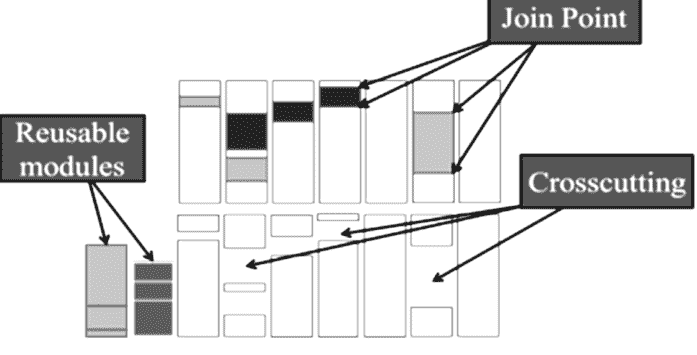

Web 应用程序开发中一个众所周知的设计模式是 MVC（MVC 模型-视图-控制器）。MVC 模式将领域建模、表示以及基于用户输入的操作分离到三个类中：1）模型管理应用程序域的行为和数据，响应对其状态的请求（通常来自视图）和更改状态的指令（通常来自控制器）；2）视图管理信息的显示；3）控制器解释来自用户的鼠标和键盘输入，通知模型和/或视图进行适当的更改。需要注意的是，视图和控制器都依赖于模型。然而，模型既不依赖于视图，也不依赖于控制器。这种分离允许模型独立于视觉呈现进行构建和测试。在许多富客户端应用程序中，视图和控制器之间的分离是次要的，事实上，许多用户界面框架将这两个角色实现为一个对象。另一方面，在 Web 应用程序中，视图（浏览器）和控制器（处理 HTTP 请求的服务器端组件）之间的分离非常明显。

模型-视图-控制器是将用户界面逻辑与业务逻辑分离的基础设计模式。不幸的是，该模式的流行导致了一些错误的描述。特别是，“控制器”一词在不同的上下文中被用来代表不同的事物。幸运的是，Web 应用程序的出现有助于解决一些模糊性，因为视图和控制器之间的分离非常明确。

设计模式在软件开发中的使用非常重要。不同的作者对设计模式进行了多种分类；然而，他们都认同设计模式对于改进正在编写的代码结构的重要性。

设计模式可用于解决不同的问题，并提出不同的目标。其中一些目标包括：

- 通过考虑可重用性是软件和 RIA 开发中的一个重要方面，为软件开发中的可重用元素提供目录。
- 避免在寻找已经解决过的已知问题的解决方案时重复。
- 标准化软件系统设计的方法。
- 通过预存知识促进新一代软件设计师的学习。

同样，设计模式并不试图：

- 强加某些给定的设计方案高于其他方案。
- 消除软件系统设计过程中固有的创造力。

在软件系统的设计中使用设计模式并非强制性的。然而，当问题尚未解决，或者当前问题与另一个已通过设计模式解决的问题相似时，这是一个非常推荐的选项。

在软件工程中，设计模式被 GoF¹ 分为三种类型：


*RIA开发中的重要因素*

| 创建型模式 | 结构型模式 | 行为型模式 |
| --- | --- | --- |
| 抽象工厂 | 适配器 | 责任链 |
| 建造者 | 桥接 | 命令 |
| 工厂方法 | 组合 | 解释器 |
| 原型 | 装饰器 | 迭代器 |
| 单例 | 外观 | 备忘录 |
| | 享元 | 观察者 |
| | 代理 | 状态 |
| | | 策略 |
| | | 模板方法 |
| | | 访问者 |
| | | 中介者 |

表4. GoF提出的设计模式分类

1) 创建型模式，2) 结构型模式，3) 行为型模式。表4提供了GoF描述的二十三种设计模式的高级描述。

设计模式在软件开发中至关重要，同样适用于Web应用程序和RIA的开发。设计模式在RIA的各个方面以多种方式得到应用。一个非常清晰的例子是信息的可视化。例如，假设有一些信息需要在RIA上显示。最初，这些信息以表格形式展示；然而，需要以不同的方式展示相同的信息。这是一个持续存在的问题，可以使用通用的解决方案。最佳方案是通过不同的界面对相同信息应用设计模式。在这种特定情况下，可以使用外观模式，从而在不改变编程逻辑的情况下应用多种不同的界面。这使得展示某些类型的信息成为可能，例如饼图或条形图等。在这种情况下，行为模式也是RIA的重要组成部分，因为这些模式关注事件，而RIA是事件驱动的应用程序。

正如前面提到的，设计模式在RIA开发中至关重要。设计模式的主要用途之一是简化工作，从而提供一个经过预先测试并成功应用于重复出现问题的解决方案。在RIA开发中，各种元素和组件是通用的。例如，灯箱和进度条等图形用户界面组件用于以相同的方式解决每次出现的问题。因此，如果设计模式作为功能性解决方案得以实施，不仅允许减少时间和开发成本，也简化了开发者的工作。

## 5. RIA对用户界面设计模式的支持

需要更好地理解和改进设计RIA的方法。Web应用程序的外观几乎与其功能同等重要。RIA是一个特例，因为其主要特征之一是改进的用户体验。在这种情况下，用户界面设计问题在RIA开发中是常见且可重复的，这就是界面设计模式被确立的原因。

> *界面设计模式是解决常见设计问题的反复出现的解决方案。设计模式是用户界面设计师经验的标准化参考点（Scott & Neil, 2009）。*

关于用户界面设计模式，已有多个不同主题的研究被提出，以下提及其中最重要的一些。

首先，Raj和Komaragiri（2009）提出了一项分析，旨在识别移动设备上的UI设计模式——更具体地说是交互模式。该分析表明，原型工具在解决可用性和一致性限制以及减少移动应用程序开发时间方面是有用的。此外，Nilsson（2009）提出了一套针对移动应用程序的结构化用户界面设计模式集合。该论文描述了这些模式如何用于解决移动应用程序开发中已识别的六个问题。用户界面设计模式集合具有不同的抽象层次，并展示了如何使用模式在不同细节层次上呈现问题和解决方案。同样，Richard等人（2011）的工作解释说，在开发系统界面时不使用UI设计模式会导致生产力和质量的显著损失。作者识别了30种UI模式，并将它们在一个库中提供，同时以四种呈现模式进行比较：模式缩略图、应用类型、决策树和字母顺序模式。Korozi等人（2009）的另一个提案提出了一种名为MAID的新设计框架，帮助设计师轻松创建用户界面。该设计框架补充了一个控件库。该库可用于不同的应用程序面板或完全不同的应用程序。MAID工具的开发过程可分解为以下四个阶段：1) UI定义，2) 应用数据集成，3) UI适配和4) 部署。Seffah等人（2004）的另一种方法强调了为多种设备（如计算机、笔记本电脑或移动电话）开发用户界面时的问题。作者介绍了关于多用户界面（MUI）的研究以及围绕MUI开发模型的最重要问题。最后，提出了一组人机交互模式，并讨论了每种模式推荐的跨平台类型。Javahery等人（2007）提出了一种基于模式的UI设计过程，该过程由一组输入变量组成。这些变量封装了用户需求和上下文信息。输出过程是一组模式，可以在概念设计中组合使用，或用作用户界面原型。Tidwell（2011）根据UI设计的不同方面对一组模式进行了分类。类别包括内容组织、导航、页面布局和操作/命令。这些模式已被用于为桌面应用程序、网站、Web应用程序和移动设备开发更有效的UI。同样，Seffah和Taleb（2012）的另一项研究工作讨论了模式如何可以作为从用户体验和需求中推导设计过程的核心工具。该研究回顾了UI设计中模式应用的演变。最后，作者进行了一项关于基于模式设计的研究，讨论了如何通过使用用户变量、模式属性和关联关系，将用户体验纳入模式选择过程。最后，在Scott和Neil（2009）的研究中，界面设计模式基本上分为三类：1) 过渡模式，2) 搜索或查找模式，和3) 反馈模式。将采用此分类，因为作者的观点是最完整且易于理解的。这些界面设计模式将在下一小节中描述。

### 5.1. 过渡模式

这些类型的模式用于改变用户界面的外观。它们是在特定时间段内发生的特殊效果，其主要目的是吸引用户的注意力。每种过渡模式描述如下：

- **变亮和变暗**：此模式用于将用户的注意力集中在特定组件上，例如对话框或灯箱组件等。例如，当打开类似灯箱元素中的对话框时，焦点转移到对话框，屏幕其余部分变暗，就可以看到此模式。

- **展开/折叠：** 当有大量信息需要显示，同时又有可能部分显示信息时，使用此模式。这意味着信息可以被分割并分部分显示。用于实现此模式的最常用用户界面组件是手风琴。手风琴的一个常见用途是网站菜单，其中选项在按下光标时展开，在光标移开时收缩以释放空间。

- **动画**：此模式用于为用户提供应用的吸引人视图。用于示例此模式的用户界面组件包括幻灯片、拖放组件和带图像的动画。例如，拖放在应用程序中有多个按特定顺序排列的组件，并且在某个时候顺序可以更改的情况下非常有用。在这种情况下，用户只需将项目拖动到同一窗口中的新位置。这提供了用户与应用程序的简便交互。动画有很多用途；事实上，动画是RIA中最常见和实用的用户界面组件之一。需要注意的是，此功能以前仅适用于桌面应用程序。

- **聚光灯**：此模式用于指示用户界面中的某些内容已发生变化。此指示通过改变聚光灯位置或简单地高亮或下划线更改的元素来实现。例如，Hotmail™主页在用户在整个页面上在此字段中书写时高亮显示电子邮件地址字段；然后，当用户将焦点切换到密码字段时，该字段现在高亮显示。

### 5.2. 搜索或查找模式

这些类型的用户界面设计模式旨在为执行搜索提供帮助。查找模式的主要目标是方便用户搜索信息，因为这些模式实时响应数据输入：

- **自动完成**：这是一种旨在简化用户体验的模式；它提供自动完成文本输入的建议和可能性，例如在文本框或组合框中。最著名的自动完成示例是Google™搜索引擎。一旦开始输入搜索条目，就会显示相关建议；然后，当选择其中一个建议时，文本框中的单词就会被补全。

- **实时建议**：此模式与自动完成模式非常相似。区别在于实时建议模式提供创建搜索的实时建议。上述关于Google™的示例也适用于此模式；但是，还有许多其他搜索引擎使用实时建议，例如YouTube™网站和Yahoo!™搜索引擎补充功能。

- **实时搜索**：此模式与前两个非常相似。然而，它通过在输入搜索条目时显示实时结果提供了更大的优势。此外，此模式被认为是自动完成和实时建议模式的演进。事实上，它已经在大多数使用了前述两种模式的网站上实施。例如，Google™搜索引擎使用此模式。


## RIAs 开发的重要因素

#### 精炼搜索
这种模式是自动完成（AutoComplete）和实时建议（Live Suggest）模式的另一个变体。区别在于，精炼搜索模式提供了用于精炼搜索的过滤器。这能在最短时间内提供最恰当的结果。Amazon™ 网站的搜索引擎就基于这种用户界面模式。除了完成和建议输入以创建搜索外，Amazon™ 的搜索引擎还提供了一个列表来过滤所需搜索的内容。

例如，Facebook™ 网站使用此模式来显示一个进度条，告知用户在加载界面内容时任务正在进行中。

### 5.3. 反馈模式

这些模式允许实时操作，对于让用户了解 Web 应用程序中发生的情况很有用：

-   **实时预览：** 此模式旨在防止错误。它用于告知用户应用程序将如何解释输入的数据。例如，当创建 Google™ 帐户时，系统会要求输入用户姓名，并且在下方的文本框中显示所需数据格式的示例。
-   **渐进式揭示：** 此模式旨在仅在必要时向用户显示信息，从而避免应用程序用户界面信息过载。为了创建 Google™ 帐户，当输入无效的用户名时，Google™ 帐户网站会显示一条红色文字消息。这是渐进式揭示用户界面模式的一个明显例子。
-   **进度指示器：** 此模式旨在指示应用程序中复杂任务的进度。实现此模式最常见的用户界面组件是进度条。当需要告知用户所请求操作的进度时，会使用它。
-   **定期刷新：** 此模式用于在应用程序中显示新内容。内容的更新始于用户交互或与第三方应用程序的交互，例如新闻频道。Twitter™ 网站的时间线就是此模式的一个例子，它需要持续的用户交互来保持自身更新。

概述的用户界面模式的使用取决于可用性要求。在这种情况下，对于每个可用性标准，应在用户界面中调整其需求和影响，因为这些模式应对用户有用，而不是损害其与应用程序的交互。

## 6. 结论

本章讨论了基于本书引言中提到的 RIA 开发的其他四个关键特性，在 RIA 开发中需要考虑的四个最重要方面。在作者看来，本章提出的四个方面可以帮助改善 RIAs 的外观并提供新功能，例如响应性和交互性。多媒体支持通过更动态和吸引人的方式呈现信息，为 Web 应用程序提供更丰富的内容。此外，AOP 允许以非侵入方式为 Web 应用程序添加新功能和可扩展性。设计模式为重复出现的问题提供了重用已知解决方案的可能性。最后，用户界面设计模式为用户界面上已识别的设计问题提供了解决方案，并促进了软件系统的可用性。

如今，客户端和软件开发者都寻求高效、快速和敏捷的开发。然而，在这种情况下，考虑软件/应用程序的最终用户也至关重要。尽管软件系统的运行确实非常重要，但开发人员不能忽视系统的外观。因此，可以说在软件系统的开发中，功能性和外观应该相辅相成。

此外，编程语言本身如今也已在代码中实现了设计模式，以支持良好的编程实践。这一点非常重要，原因有二：首先，设计模式不仅帮助开发者编写功能性的代码，还编写高效的代码；其次，它们提供了促进系统重用的元素。另一个值得注意的方面是 AOP，它已悄然进入软件系统的开发中，并在可扩展性和维护性方面提供了巨大帮助。

已经进行了多项关于 UI 模式的研究来定义和分类它们。因此，出现了为最终用户开发即用型界面的需求，以及改进这些用户与系统交互的需求。同样，多媒体内容有助于改善和使界面外观更具吸引力。其主要目标是改善软件系统的内容，特别是 RIAs 的内容。

作为最终结论，可以说本章阐述的方面将使程序员能够开发出高效、结构良好且外观更佳的应用程序。此外，本章中提到的所有元素都是为了能够在 RIAs 中实现，这相对于使用传统 Web 应用程序来说是一个巨大的优势。

## 参考文献

Alexander, C., Ishikawa, S., & Silverstein, M. (1977). *《模式语言：城镇、建筑、构造》*. 牛津大学出版社.

Buchanan, M. (2013). *《理解视频容器与编解码器指南》*. 检索于 2013 年 1 月，来自 http://library.rice.edu/services/dmc/guides/video/VideoFormatsGuide.pdf

Chen, H. Y., Lin, Y. H., & Cheng, C. M. (2012). COCA：使用 AOP 将计算卸载到云. 载于 *《第 12 届 IEEE/ACM 国际集群、云计算和网格计算研讨会 (CCGrid 2012) 论文集》* (pp. 466-473). 华盛顿特区：IEEE 计算机学会. doi:10.1109/CCGrid.2012.98

Clarke, S., & Baniassad, E. (2005). *《面向方面的分析与设计——主题方法》*. Addison-Wesley Professional.

Czarnecki, K. (1999). *《生成式编程：基于自动配置和基于片段组件模型的软件工程原理与技术》*. (博士论文). 德国：伊尔梅瑙工业大学.

Ekabua, O. (2012). 使用面向方面技术构建软件质量. *《国际计算机科学问题杂志》*, 9(4), 250–255.

Elrad, T., Filman, R. E., & Bader, A. (2001). 面向方面编程：介绍. *《ACM 通讯》*, *44*(10), 28–32. doi:10.1145/383845.383853

Freedman, A. (1999). *《计算机双语词典》*. Mc Graw Hill.

Gamma, E., Helm, R., Johnson, R., & Vlissides, J. (1994). *《设计模式：可复用面向对象软件的基础》*. 波士顿，马萨诸塞州：Addison-Wesley Longman Publishing Co., Inc.

Heo, S. H., & Choi, E. M. (2006). 使用面向方面编程表示软件产品线中的可变性. 载于 *《第四届软件工程研究、管理与应用国际会议论文集 (SERA '06)》* (pp. 66-73). 华盛顿特区：IEEE 计算机学会.

Holzinger, A. (2005). 面向软件开发者的可用性工程方法. *《ACM 通讯》*, 48(1), 71–74. doi:10.1145/1039539.1039541

Kwanwoo, L., Botterweck, G., & Thiel, S. (2009). 特征建模与面向方面编程：集成与自动化. 载于 *《2009 年第 10 届 ACIS 国际软件工程、人工智能、网络与并行/分布式计算会议论文集 (SNPD '09)》* (pp. 186-191). 华盛顿特区：IEEE 计算机学会.

Ivory, M. Y., & Hearst, M. A. (2001). 用户界面可用性自动化评估的现状. *《ACM 计算机综述》*, 33(4), 470–516. doi:10.1145/503112.503114

Laddad, R. (2003). *《AspectJ in Action：实用面向方面编程》*. 格林威治，康涅狄格州：Manning Publications Co.

Jacobson, I., & Ng, P. W. (2005). *《用例的面向方面软件开发》*. Addison Wesley Professional.

Miano, J. (1999). *《压缩图像文件格式：Jpeg, Png, Gif, Xbm, Bmp》*. 纽约，纽约州：ACM Press/Addison-Wesley Publ. Co.

Javahery, H., Sinnig, D., Seffah, A., Forbrig, P., & Radhakrishnan, T. (2007). 基于模式的 UI 设计：通过用户和上下文变量增加严谨性. 载于 *《第五届任务模型与用户界面设计图表国际会议论文集 (TAMODIA'06)》* (pp. 97-108). 柏林：Springer-Verlag. doi:10.1007/978-3-540-70816-2_8

Nilsson, E. G. (2009). 移动应用程序用户界面设计模式. *《软件工程进展》*, 40(12), 1318–1328. doi:10.1016/j.advengsoft.2009.01.017

Jboss. (2013). *《面向方面编程 (AOP) 支持》*. 检索于 2013 年 1 月，来自 http://docs.jboss.org/jbossas/jboss4guide/r2/html/aop.chapt.html

Raj, A., & Komaragiri, V. (2009). RUCID：基于快速、可用、一致的交互设计模式的移动电话 UI 设计库. 载于 *《第 13 届人机交互国际会议论文集。第一部分：新趋势》* (pp. 677-686). 柏林：Springer-Verlag. doi:10.1007/978-3-642-02574-7_76

Juárez Martínez, U. (2008). *《Énfasis：细粒度面向方面编程》*. (博士论文). 国立理工学院研究中心.

Richard, J., Robert, J.-M., Malo, S., & Migneault, J. (2011). 赋予 UI 开发者 UI 设计模式的力量. 载于 *《2011 年人机界面与信息管理国际会议论文集 - 第 I 卷 (HI'11)》* (pp. 40-47). 柏林：Springer-Verlag. doi:10.1007/978-3-642-21793-7_5

Kiczales, G., Lamping, J., Mendhekar, A., Maeda, C., Lopes, C., Loingtier, J. M., & Irwin, J. (1997). 面向方面编程. 载于 M. Aksit, & S. Matsuoka (编), *《Eoop '97：面向对象编程》* (pp. 220–242). 柏林：Springer-Verlag.

Sandvine. (2012). *《全球互联网现象报告：2012 年下半年》*. 检索于 2013 年 1 月，来自 www.sandvine.com/news/global_broadband_trends.asp

Korozi, M., Leonidis, S., Margetis, G., & Stephanidis, C. (2009). MAID：一个多平台可访问界面设计框架. 载于 *《第五届通用访问人机交互国际会议论文集。第三部分：应用与服务 (UAHCI '09)》* (pp. 725-734). 柏林：Springer-Verlag. doi:10.1007/978-3-642-02713-0_77

Scott, B., & Neil, T. (2009). *《设计 Web 界面：丰富交互的原则与模式》* (第 1 版). O'Reilly Media, Inc.


## RIAs开发的重要因素

Seffah, A., Forbrig, P., & Javahery, H. (2004). Multi-devices "Multiple" user interfaces: Development models and research opportunities. *Journal of Systems and Software*, 73(2), 287–300. doi:10.1016/j.jss.2003.09.017

## 关键词与定义

Seffah, A., & Taleb, M. (2012). Tracing the evolution of HCI patterns as an interaction design tool. *Innovations in Systems and Software Engineering*, 8(2), 93–109. doi:10.1007/s11334-011-0178-8

Tahir, A., & Ahmad, R. (2010). An AOP-Based Approach for Collecting Software Maintainability Dynamic Metrics. In *Proceedings of the 2010 Second International Conference on Computer Research and Development (ICCRD '10)* (pp.168–172). Washington, DC: IEEE Computer Society. doi:10.1109/ICCRD.2010.26

Tidwell, J. (2011). *Designing Interfaces* (2nd ed.). Sebastopol, CA: O'Reilly Media, Inc.

Zhou, J., Ji, Y., Zhao, D., & Liu, J. (2010). Using AOP to ensure component interactions in component-based software. In *Computer and Automation Engineering (ICCAE), 2010 the 2nd International Conference on* (Vol.3, pp. 518-523). Singapore: IEEE Computer Society.

**面向切面编程（Aspect-Oriented Programming）**：它是一种新的编程范式，描述了一种在软件开发过程中分离横切关注点的开发方法。

**设计模式（Design Patterns）**：它是一种经过验证的、针对常见且反复出现的问题的解决方案。该方案专为特定上下文而设计。

**多媒体（Multimedia）**：它是通过不同传播手段（如音频、文本和图像，但主要是视频）对信息进行呈现。

**可重用性（Reusability）**：它是开发新软件系统时，重用其他软件系统或其他软件系统中的组件或代码片段的能力。

**富互联网应用（Rich Internet Applications）**：富互联网应用是通过Web部署的应用程序。这类应用结合了Web应用和桌面应用的特性与功能。

**可扩展性（Scalability）**：它是系统、模型或功能的一种特性，描述其在增加或不断扩大的工作负载下应对和执行的能力。

**可用性（Usability）**：它最终决定软件系统是否易于使用，在本例中，指的是软件系统。

## 延伸阅读

用户界面设计模式：UI设计模式是针对常见用户界面问题的解决方案。

*Flickr*. (2012). 2012年11月获取，来自www.flickr.com

*Gmail*. (2012). 2012年11月获取，来自mail.google.com

## 尾注

*Netflix*. (2012). 2012年11月获取，来自www.netflix.com/

*Vimeo*. (2012). 2012年11月获取，来自www.vimeo.com

1 GoF是四人组（Gang of Four）的缩写，即《*设计模式：可复用面向对象软件的基础*》一书的作者。这本重要书籍描述了多种开发技术和陷阱，此外还提供了二十三种面向对象编程设计模式。四位作者分别是Erich Gamma、Richard Helm、Ralph Johnson和John Vlissides。

*YouTube*. (2012). 2012年11月获取，来自www.youtube.com

## 第五章

## RIAs开发框架对原生/嵌入式视频播放的多媒体支持

## 摘要

第五章讨论RIA框架在多媒体内容支持方面的能力。为此，介绍了使用基于JavaScript的RIA框架和非基于JavaScript的RIA框架实现视频播放功能的几种替代方案。具有多媒体内容支持的基于JavaScript的RIA框架示例包括Dojo、jQuery、Prototype和Mootools。非基于JavaScript的RIA框架示例包括Adobe Flex™、JavaFX™、Silverlight™和OpenLaszlo。对于每个案例研究，都会提及必需的文件。本章还展示了显示视频播放器的屏幕截图以及使用的代码片段。最后，以视频容器格式和编码类型为维度，对各框架的视频播放支持进行了比较分析。

## 1. 引言

图形、音频和视频的表现能力被认为是RIA（富互联网应用）的固有能力。事实上，与GUI（图形用户界面）转换、视觉连续性和时间行为一样，它是影响RIA一个显著特征——增强型GUI的重要因素（Preciado等人，2005）。因此，评估和了解哪些用于RIA开发的框架原生支持这些功能显得尤为重要。

本章主要关注基于JavaScript和非基于JavaScript框架对视频播放的支持审查，因为对其他类型媒体（即音频和图形）的支持是支持视频播放的前提条件。

如本章所述，大多数非基于JavaScript的RIA开发框架以一种统一的方式、就GUI控件而言为所有媒体类型提供支持。然而，非基于JavaScript的RIA框架以三种不同方式为媒体内容提供支持：1）使用嵌入式标准（默认）媒体播放器，2）使用自己的GUI控件，以及3）使用基于HTML5的`<audio>`和`<video>`标签。

从这个角度来看，本章旨在审查上述前两种方法，因为基于JavaScript的RIA框架通常不将视频播放支持作为其核心功能。相反，它们提供扩展该核心的机制（通过插件或附加组件），从而实现多种第三方视频播放支持实现。因此，我们参考了（Rosales-Morales等人，2011）中概述的第三方插件。

## 2. 基于JavaScript框架中的多媒体支持

视频播放使用多种文件格式。每种格式提供特定的功能。以下描述了这些格式及其功能：

- **FLV（Flash Video）**是一种容器文件格式，用于使用Adobe Flash Player™版本6-10通过互联网传输视频。Flash Video内容也可以嵌入到SWF（Shockwave Flash）文件中。有两种不同的视频文件格式被称为Flash Video：FLV和F4V。FLV文件中的音频和视频数据采用与SWF文件中相同的编码方式。该格式迅速确立了自己作为Web嵌入式视频首选格式的地位。YouTube™、Hulu™、Google Video™、Yahoo Video™、Metacafe™、Reuters™以及许多其他新闻提供商都是使用Flash视频格式的网站示例。

- **MPEG（Moving Picture Experts Group）**是由ISO（国际标准化组织）和IEC（国际电工委员会）组建的专家工作组，旨在制定音频和视频压缩与传输标准。MPEG算法将数据压缩成易于传输的小比特，然后进行解压缩。MPEG通过仅存储从一帧到另一帧的变化而非存储每一整帧来实现其高压缩率。然后使用称为离散余弦变换（DCT）的技术对视频信息进行编码。

- **RMVB（Real Media Variable Bitrate）**是由RealNetworks™开发的RealMedia™多媒体压缩格式的可变比特率扩展。与更常见的以恒定比特率编码流媒体的RealMedia™容器相比，RMVB文件扩展名通常用于本地存储的多媒体内容。

- **WMV（Windows Media Video）**是Microsoft™高级系统格式（ASF）容器格式的一个子集。WMV文件可以由MPlayer或Windows™ Media Player™等视频播放器播放，后者仅适用于Microsoft™ Windows™和Macintosh™（Mac™）系统。WMV是一种闭源、专有的编解码器，无法被修改。

在以下章节中，将讨论RIA开发中视频播放的支持情况。

### 2.1. 使用Dojo进行视频播放支持

Dojo通过DojoX包支持视频播放。除此之外，DojoX是一个模块


## 各框架上原生/嵌入式视频播放的多媒体支持

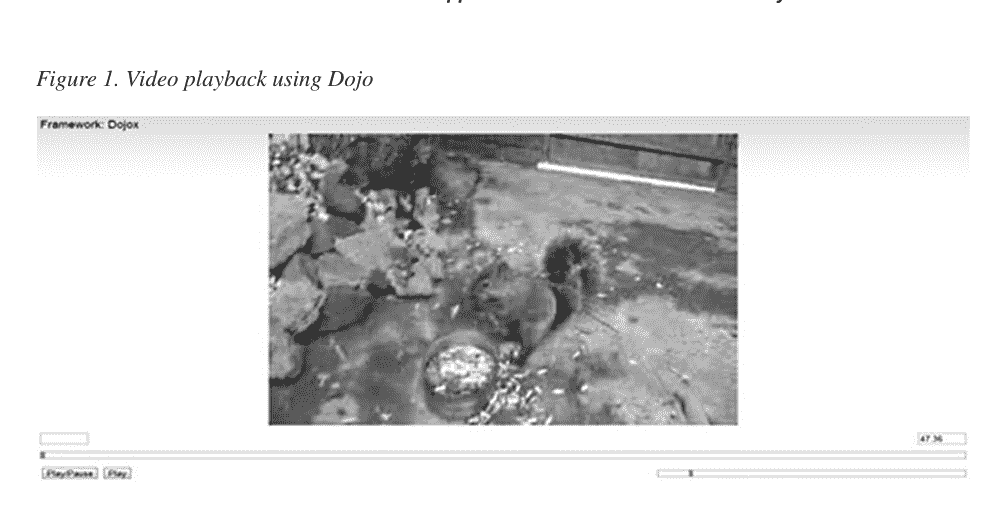

用于开发 Dojo 工具包的扩展；它是一个存放更稳定、更成熟扩展的仓库，同时也作为实验性代码的孵化器和主工具包新增功能的试验场。此外，DojoX 包在其"av"模块中提供了用于操控视频的原生控件。DojoX 使用 Adobe Flash Player™ 插件来播放 FLV 视频，并且还需要 Web 服务器的支持。

为了展示这种支持，我们开发了一个基于 PHP 的 Web 应用程序，使用了 XAMPP。XAMPP 是一个解决方案堆栈包，主要由 Apache HTTP 服务器、MySQL 数据库管理系统（DBMS）以及基于 PHP 和 Perl 的解释器组成。该示例应用程序的实现如图 1 所示，其中展示了完整视频播放器的截图。该视频播放器实现了播放和暂停控件。

基于 Dojo 的源代码片段如图 2 所示。该图展示了 Dojo 提供的视频播放器的重要方面。视频播放器的音量、播放时间和进度条控件均在此代码片段中实现。要播放的视频描述位于代码片段的第 11 行。

用于实现 FLV 视频播放器的基于 HTML 的源代码如图 3 所示，其中包括 Dojox widget 类提供的播放控件。

表 1 总结了与多媒体支持相关的 DojoX 类的功能。

### 2.2. 使用 jQuery 实现视频播放支持

jQuery 支持多种视频容器格式的嵌入式视频播放，例如 MPEG-4、FLV 和 AVI（音频视频交错格式）等。它还支持本地和远程视频文件，以及实时和录制的媒体。这是通过不同的 jQuery 插件（即对 jQuery 原型对象的扩展）来实现的。

在基于 JavaScript 的 RIA 开发中，嵌入式视频播放支持通常通过弹出对话框来实现。在 jQuery 中，这通过 jQuery ThickBox 插件来解决。这在表 2 中进行了说明。

此外，通过使用 jQuery framework 插件，可以使用 jQuery Multimedia Portfolio 来播放 FLV 视频文件。该插件通过画廊的方式展示各种媒体内容。图 4 展示了使用 jQuery Multimedia Portfolio 插件将本地 FLV 视频文件嵌入基于 jQuery 的 RIA 中。另外，

图 2. 用于实现视频播放的基于 Dojo 的源代码片段

```javascript
dojo.require("dojox.av.FLVideo");
dojo.require("dojo.parser");
var prgDim, volDim, progressNode, volumeNode, sliderNode, volsliderNode, durNode, timeNode;
dojo.addOnLoad(function() {
    progressNode = dojo.byId("progress");
    volumeNode = dojo.byId("volume");
    sliderNode = dojo.byId("slider");
    volsliderNode = dojo.byId("volslider");
    durNode = dojo.byId("dur");
    timeNode = dojo.byId("time");
    w = new dojox.av.FLVideo({initialVolume:.1, mediaUrl: "video/VideoArdillaMarlin2.flv",
autoPlay:true, isDebug:false}, "vid");
    toggle = function() {
        if(w.isPlaying) { w.pause(); }
        else{ w.play(); }
    }
```

图 3. 用于在 Dojo 中实现视频播放的基于 HTML 的源代码片段

```html
<table id="player">
    <tr>
        <td><h1>Framework: Dojo</h1></td><td></td>
    </tr>
    <tr>
        <td colspan="2" style="height:100%;"><div id="vid" style="height:100%;"></div></td>
    </tr>
    <tr>
        <td style="text-align:left;"><input id="time" type="text" /></td>
        <td style="text-align:right;"><input id="dur" type="text" /></td>
    </tr>
    <tr>
        <td colspan="2"><div id="progress"><div id="slider"></div></div></td>
    </tr>
    <tr>
        <td><button onclick="toggle();">Play/Pause</button>
            <button onclick="w.play('video/VideoArdillaMarlin2.flv');">Play</button></td>
        <td style="text-align:right;"><div id="volume"><div id="volslider"></div></div></td>
    </tr>
</table>
...
```

表 1. 与媒体支持相关的 DojoX 类总结（dojox.av 模块）

| 类/组件 | 描述 | 方式 | 支持的容器格式 |
|---|---|---|---|
| FLVideo (dojox.av) | 这是一个功能齐全的类，提供在 Dojo 环境中播放 FLV 视频的能力。它提供了典型的 play()、pause()、seek() 和 volume() 播放功能¹。它提供两种定义方法：声明式（基于标记）方式和编程方式。 | 原生 | FLV 以及采用 H.264 视频压缩的 MP4。 |
| widget (dojox.av) | 它为构建媒体播放器提供了基础播放器控件 widget，包括播放按钮、音量按钮、进度滑块、状态容器和播放器容器²。 | - | - |

表 2. 与基于 jQuery 的视频播放支持相关的 JavaScript 文件总结

| 脚本/组件 | 描述 | 方式 | 支持的容器格式 |
|---|---|---|---|
| jquery-multimedia-portfolio.js | 这是一个轮播组件，能够自动检测添加到其中的每个媒体的文件扩展名，并应用适配的媒体播放器。它支持图像、音频和视频³。 | 嵌入式 | 采用 H.264 视频压缩的 FLV。 |
| Slider | 其基本形式是一个带有单个滑块的水平滑块，可以使用鼠标或方向键来移动。 | - | - |
| thickbox.js | 这是一个基于 jQuery 库编写的对话框 widget。它旨在以混合模态⁴的方式显示图像、内联内容、iframe 内容或通过 AJAX 加载的内容。 | 嵌入式 | 无（可通过 `<iframe>` 标签实现） |

图 4. 使用 jQuery 实现视频播放

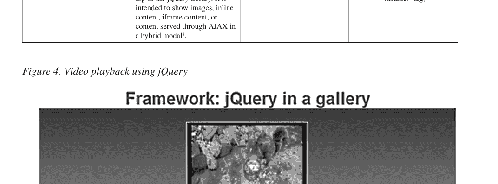

图 5. 用于实现视频播放的基于 jQuery 的源代码片段

```javascript
...
<script type="text/javascript" src="js/jquery.js"></script>
<script type="text/javascript" src="js/jquery.dimensions.js"></script>
<script type="text/javascript" src="js/ui.mouse.js"></script>
<script type="text/javascript" src="js/ui.slider.js"></script>
<script type="text/javascript" src="js/jquery.multimedia-portfolio.js"></script>
<script type="text/javascript">$(document).ready(function(){$("ul.multimedia-
portfolio").multimedia_portfolio({width: 800});});</script>
...
```

图 6. 用于在 jQuery 中实现视频播放的基于 HTML 的源代码片段

```html
...
<div class="page">
    <h1>Framework: jQuery in a gallery</h1>
    <center>
        <ul class="multimedia-portfolio">
            <li>
                <a href="VideoArdillaMarlin2.flx"></a>
            </li>
        </ul>
    </center>
</div>
...
```

图 5 和图 6 展示了相应源代码的片段。这些片段涉及多个文件的使用，例如：

- jquery.js
- jquery.dimensions.js
- ui.mouse.js
- ui.slider.js
- jquery-multimedia-portfolio.js

由于视频播放是作为媒体画廊的一部分来实现的，因此可以添加更多的视频或图像。图 4 展示了使用 jQuery Multimedia Portfolio 实现的画廊。该图显示了画廊中的视频以及视频播放的进度条。使用此组件，可以 1) 向画廊中添加更多视频或图像，以及 2) 在不同内容之间进行导航。

### 2.3. 使用 Mootools 实现视频播放支持

MooTools 的核心并未提供视频播放支持。因此，必须使用第三方扩展来实现此功能。实际上，MooTools 有一个官方插件仓库托管在 http://mootools.net/forge/。这些插件支持本地和远程的录制视频，基于 QuickTime 文件格式（QTFF）、SWF 和 Ogg 视频容器格式等。

在这方面，可以使用一个名为 Videobox 的流行插件，将各种视频文件格式嵌入基于 MooTools 的 RIA 中，如表 3 所述。需要特别指出的是，MooTools Videobox 插件使用 SWFObject JavaScript 库来嵌入基于 Adobe Flash™ 的媒体内容。

图 7 展示了使用 MooTools Videobox 插件为 YouTube™ 视频（SWF 视频文件）实现播放支持。此外，图 8 和图 9 展示了相应源代码的片段。这些片段涉及多个文件的使用，例如：

- mootools.js
- swfobject.js
- videobox.js
- videobox.css

表 1 总结了与多媒体支持相关的 jQuery 类的功能。


# 框架中本地/嵌入式视频播放的多媒体支持

表 3. 与基于 MooTools 的视频播放支持相关的 JavaScript 文件摘要

| 脚本/组件 | 描述 | 方法 | 支持的容器格式 |
|---|---|---|---|
| videobox.js | 它提供了一种通过使用覆盖层来显示视频的方法；它是一个视频的灯箱。videobox.js 文件是 Mootools 库的附加组件⁵。 | 嵌入式 | SWF (YouTube, Metacafe 和 Google 视频), QuickTime 文件格式 (QTFF): MOV 文件格式, ASF: WMV 文件格式 和 FLV: FLV 文件格式。 |
| swfobject.js | 它是一个 JavaScript 库，用于将 Adobe Flash™ 内容嵌入到网页中。它提供两种嵌入方法：一种基于标记的方法和一种依赖于 JavaScript 的方法⁶。 | 嵌入式 | SWF |

图 7. 使用 Mootools 进行视频播放

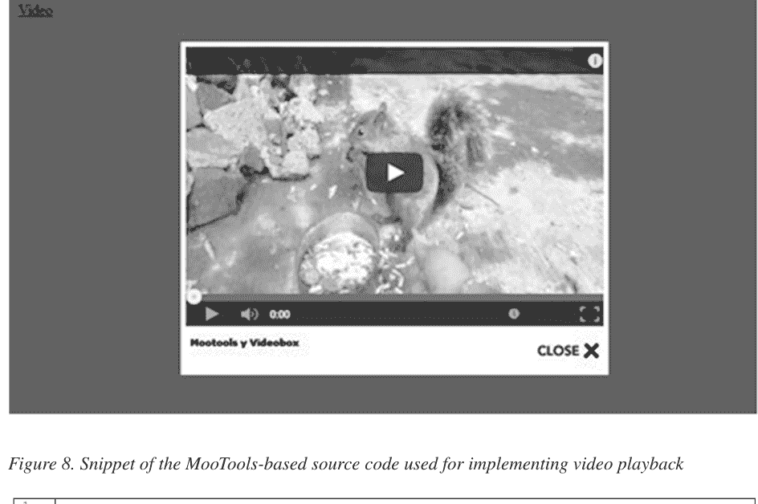

图 8. 用于实现视频播放的基于 MooTools 的源代码片段

```
1 ...
2 <div>
3     <a href="http://www.youtube.com/v/MrXfbyj26Vk?version=3&amp;hl=es_MX" rel="vidbox"
4     id="flvvideo" title="Mootools y Videobox" >Video</a>
5 </div>
6 ...
```

图 9. 用于在 MooTools 中实现视频播放的基于 HTML 的源代码片段

```
1	…
2	<script type="text/javascript" src="js/mootools.js"></script>
3	<script type="text/javascript" src="js/swfobject.js"></script>
4	<script type="text/javascript" src="js/videobox.js"></script>
5	<link rel="stylesheet" href="css/videobox.css" type="text/css" media="screen" />
6	…
```

表 4. 与基于 Prototype 的视频播放支持相关的 JavaScript 文件摘要

| 脚本/组件 | 描述 | 方法 | 支持的容器格式 |
|---|---|---|---|
| lightwindow.js | 它是一种用于多种媒体类型的模态窗口，包括图像、视频、Adobe Flash™ 内容和 PDF 文件。它也是一种用于其他类型内容的模态窗口，例如内联内容和外部页面。它构建在 Prototype 框架之上⁷。 | 嵌入式 | AVI, SWF (自定义 Adobe Flash™ 内容), QuickTime 文件格式 (QTFF) 和 ASF, MPEG-2, 以及其他容器格式。实际上支持任何文件格式（通过配置）。 |
| scriptaculous.js | 它是一组 JavaScript GUI 库集合。它提供了一个视觉效果引擎、一个拖放库，以及一组 GUI 控件等元素。它是 Prototype 框架的附加组件⁸。 | - | - |

图 7 展示了使用 Mootools 进行视频播放。图片包含一个托管在知名视频网站 YouTube™ 上的视频。用于视频播放的元素是 Videobox 元素，它允许激活或停用视频播放任务。有一个包含激活所需方向的链接，以及一个用于停用组件的关闭按钮。

图 8 描绘了一个代码片段，包括托管在 YouTube™ 上的视频链接以及激活 VideoBox 组件的链接。

图 9 展示了包含引入必要文件以实现视频播放器的代码片段。

表 3 总结了与多媒体支持相关的 MooTools 类的特性，特别是 VideoBox 插件。

### 2.4. 使用 Prototype 进行视频播放支持

Prototype 支持所有主要视频容器格式的嵌入式视频播放，例如 AVI、FLV 和 ASF 等，尽管这不是 Prototype 基本功能的一部分，而是第三方插件的功能。在互联网上公开可用的 Prototype 媒体插件——例如 http://www.prototype-plug-ins.com/ 上可用的那些——提供了对本地和远程录制视频的支持。

类似地，Prototype 插件的另一个例子是 Light Window。Light Window 是一个功能齐全且文档完善的媒体插件，构建在 Prototype 之上。它允许将几乎任何媒体格式嵌入到基于 Prototype 的 RIA 中。这在表 4 中有解释。

图 10. 使用 Prototype 和 Script.aculo.us 进行视频播放

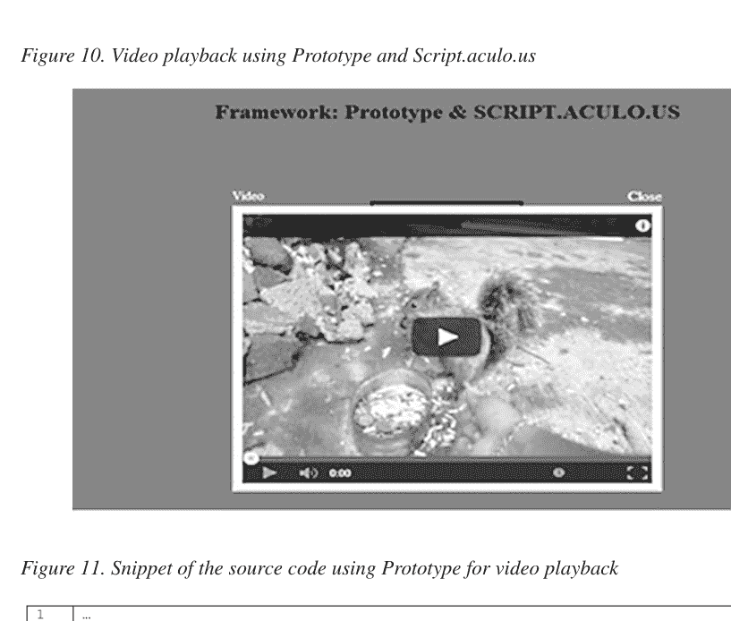

图 11. 使用 Prototype 进行视频播放的源代码片段

```
1 ...
2 <a class="lightwindow"
3    params="lightwindow_width=425,lightwindow_height=344,lightwindow_loading_animation=true"
4        title="Video" href="http://www.youtube.com/v/MrXfbyj26Vk?version=3&amp;hl=es_MX">
5            
6 </a>
7 ...
```

使用 Prototype LightWindow 插件为 YouTube 视频（SWF 文件）实现播放支持如图 10 所示。此外，图 11 展示了相应的源代码片段。此实现涉及使用多个文件，例如：

- prototype.js
- scriptaculous.js
- lightwindow.js
- lightwindow.css

Script.aculo.us JavaScript 库通常用于为基于 Prototype 的 RIA 提供视觉效果。因此，它是 Prototype LightWindow 插件的一个依赖项。

图 10 展示了一个使用 Prototype 实现的视频播放器；视频出现在一个窗口中。除了关闭按钮外，该窗口还包含其他一些可配置参数，例如窗口的大小等。

图 11 代表一个代码片段。第 4 行可以找到正在播放的视频链接以及视频嵌入的窗口的可配置参数。

### 2.5. 使用 Qooxdoo 进行视频播放支持

Qooxdoo 仅具有将远程视频嵌入容器的能力。实际上，Qooxdoo 没有自己的视频播放器组件；因此，视频播放是通过 Qooxdoo 工具或辅助类实现的。实际上，helper.js 文件是将视频播放支持合并到基于 Qooxdoo 的 RIA 中的唯一要求。

图 12. 使用 Qooxdoo 进行视频播放

# 框架：Qooxdoo

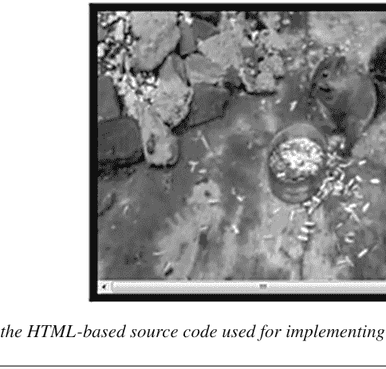

图 13. 用于在 Qooxdoo 中实现视频播放的基于 HTML 的源代码片段

```
1  ...
2  <div id="b1"
3  style="position:absolute;background:red;top:100px;left:400px;overflow:scroll;width:365px;height:365px">
4      <embed src="http://www.youtube.com/v/MrXfbyj26Vk?version=3&amp;hl=es_MX" width="350"
5  height="350">
6      </embed>
7  </div>
8  ...
```

使用 Qooxdoo JavaScript 框架为 YouTube™ 视频（SWF 文件）实现播放支持如图 12 所示。此外，图 13 展示了相应的源代码片段。

图 12 展示了使用 Qooxdoo 实现的视频播放器；在图中可以观察到视频和滚动条。嵌入视频的组件是可配置的。这意味着可以指示宽度、高度以及组件是否应支持滚动条等特性。如果视频的尺寸大于组件，则它将显示为不完整。

在图 13 中，第 4 行可以找到正在播放的视频链接。同样，用于实现播放器的组件配置也可以在该行找到。

### 2.6. 使用 Rico 进行视频播放支持

Rico 能够使用原生面板容器将远程录制的视频嵌入到基于 JavaScript 的 RIA 中。在这种情况下，只需 rico.js 文件，因为该文件负责创建主 Rico 对象。根据要实现的功能，可能需要额外的 JavaScript 文件，因为 Rico 构建在 Prototype 框架之上，同时也包括对 jQuery、MooTools、Dojo 和 Sencha Ext JS 框架的支持。

图 14. 使用 Rico 进行视频播放

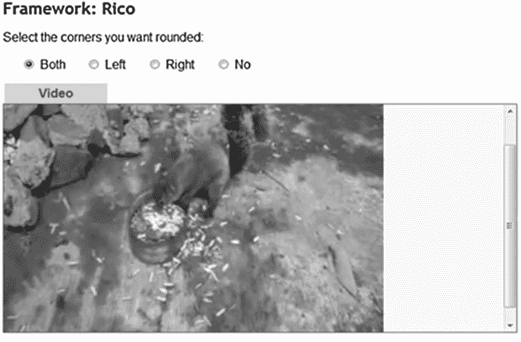

图 14 展示了使用 Rico 框架实现的视频播放器。需要提及的是，这里的视频播放器是在选项卡组件下开发的。出于本研究的目的，仅实现了一个选项卡；但是，在需要更多视频或功能的情况下，可以实现额外的选项卡。

图 15 描绘了 Rico 上的视频播放器的代码片段。第 10 行同时出现了正在播放的视频链接和组件配置。

### 2.7. 使用 Sencha ExtJS 进行视频播放支持

Sencha Ext JS 需要一个扩展来实现视频播放。有一个用于 Sencha 产品的第三方扩展的官方仓库，称为 Sencha market，可在 https://market.sencha.com/ 访问。这些扩展支持的视频容器格式范围包括：MPEG-4、QuickTime 文件格式 (QTFF) 和 RealMedia 视频容器格式。

在这种情况下，一个流行的 Sencha Ext JS 媒体扩展名为 Ext.ux.YoutubePlayer，它允许将托管在 YouTube™ 网站上的视频连同常见的播放控件嵌入到使用原生 Ext JS GUI 控件的基于 JavaScript 的 RIA 中。根据上述内容，此扩展支持的格式仅为 SWF，如表 5 所述。

使用 Sencha Ext JS YoutubePlayer 插件如图 16 所示。此外，图 17 展示了相应的源代码片段。

图 16 展示了在 Sencha Ext JS 中实现的视频播放器。该视频播放器包含基本的播放控件，例如播放、停止、快进和音量等。

图 17 展示了一个代码片段，其中包含了视频播放器的主要特性


 ## 框架对原生/嵌入式视频播放的多媒体支持

图15. 在Rico中实现视频播放的基于HTML的源代码片段

```
1	...
2	<div id="tabsExample">
3		<div>
4			<div class="panelheader">
5				Video
6			</div>
7		</div>
8		<div class="panelContentContainer">
9			<div class="panelContent">
10				<embed src="http://www.youtube.com/v/MrXfbyj26Vk?version=3&amp;hl=es_MX"
11				width="480" height="360">
12				</embed>
13			</div>
14		</ExternalPanel>
15	</div>...
```

表5. 与Sencha Ext JS视频播放支持相关的JavaScript文件摘要

| 类/组件 | 说明 | 方法 | 支持的容器格式 |
| :--- | :--- | :--- | :--- |
| **Ext.ux.YouTubePlayer** | 利用YouTube无Chrome播放器API的组件。 | 嵌入式 | SWF（YouTube视频） |
| **Ext.ux.YouTubePlayer.Control** | 提供加载YouTube视频的功能，以及典型的播放控制功能——例如播放和暂停视频、静音和取消静音，以及设置音量等⁹。 | 原生 | - |

图16. 使用Sencha Ext JS进行视频播放


图17. 用于实现视频播放的基于Ext JS的源代码片段

```
1  ...
2  Ext.onReady(function(){
3      var playerPanel = newExt.ux.YoutubePlayer({
4          developerKey: DEVELOPER_KEY,
5          playerId    : 'myplayer',
6          border: false,
7          ratioMode: 'strict',
8          hideMode: 'visibility',
9          bgColor: "#000000',
10         bodyStyle: 'background-color:#000000;'
11     });
12     playerPanel.on('ready', function(panel, player) {
13         panel.cueVideoById('Us-TVg40ExM', 0);
14     }, playerPanel);
15 var w = new Ext.Window({
16     title   : 'Ext.ux.YoutubePlayer',
17     layout: 'fit',
18     maximizable: true,
19     animCollapse: false,
20 ...
```

图18. 使用X-Library进行视频播放

## 框架：X-Library


**框架对原生/嵌入式视频播放的多媒体支持**

### 2.8. 使用X-Library实现视频播放支持

与Rico类似，X-Library在其核心功能中支持嵌入式视频播放。具体而言，它允许使用典型的容器（如标签面板和手风琴组件）将远程录制的视频嵌入到基于JavaScript的RIA中，因为它没有原生的视频播放控件。

此外，图18展示了使用X-Library框架实现YouTube™视频（SWF文件）播放支持的情况。另外，图19展示了相应源代码的片段。该实现涉及使用以下列出的文件，这些文件在表6中进行了描述。

- offline.js
- v3.css
- tpg_def.css
- x.js
- xtabpanelgroup.js

图18展示了在X-Library中实现的视频播放器。在这种情况下，视频被嵌入到任何支持它的组件中。

实现。这些特性的示例包括播放器的颜色和其他功能。

图19展示了通过使用X-Library实现视频播放器的代码片段。表6总结了与X-Library多媒体支持相关的类的特性。

### 2.9. 比较

表7总结了本章分析的基于JavaScript的RIA框架提供的视频播放功能概述。从该分析可以推断，大多数框架没有与媒体播放相关的原生控件。事实上，它们只允许在原生容器内嵌入视频（视频播放器Web浏览器插件）。此外，值得注意的是，大多数提供定制视频播放支持的框架需要第三方扩展。

## 3. 非基于JavaScript的框架中的多媒体支持

RIA技术必须提供丰富的媒体API或标签（在标记语言的具体情况下，如HTML5），以利用客户端图形、硬件加速能力，并确保在不同平台上的一致部署，从而提供高性能的可移植RIA。该标准仅针对RIA技术原生支持的视频播放的媒体文件格式多样性进行评估。

### 3.1. 使用Adobe Flex™实现视频播放支持

Adobe Flex™ Spark皮肤和组件架构由四个主要部分组成：布局引擎、效果（动画）引擎、图形库和组件库。作为Spark组件库的一部分，提供了一些与媒体处理相关的GUI控件和类，如表8所总结。此外，表9总结了与远程视频网络管理相关的其他重要ActionScript类（Subramaniam, 2010）。

从上述总结分析可以推断，在开发基于Adobe Flex™的应用程序时，一些多媒体功能可以通过Flash平台的ActionScript™类实现，特别是来自Flash媒体框架的类，其中包括Sound、Camera和Microphone等类，以及Video类。

从上述分析可以推断，Video类与NetStream和NetConnection类结合使用可以实现高级的媒体应用，例如面向用户社区的视频分享应用，其中用户录制的实时视频被发送到服务器，然后从服务器广播给其他用户。

此外，值得注意的是，Video类并不是像VideoDisplay和VideoPlayer控件那样的GUI控件；然而，它是一个显示对象，代表视频中GUI运行的视觉空间，并且可以使用

图19. 使用X-Library实现视频播放的源代码片段

```
1 ...
2 <div>
3     <div id='tpg1' class='tabPanelGroup'>
4         <div class='tabGroup'>
5             <a href='#tpg11' class='tabDefault'>Video</a>
6             <span class='linkDelim'>&nbsp;|&nbsp;</span>
7         </div>
8         <div id='tpg11' class='tabPanel'>
9             <embed src="http://www.youtube.com/v/MrXfbyj26Vk?version=3&amp;hl=es_MX"
10 width="480" height="360">
11             </embed>
12         </div>
13     </div>
14 </div>
15 ...
```

表6. 与X-Library视频播放支持相关的JavaScript文件摘要

| 脚本/组件 | 说明 | 方法 | 支持的容器格式 |
| --- | --- | --- | --- |
| x.js | 代表X-Library的入口点。事实上，它定义了X-Library的主对象。 | - | - |
| xtabpanelgroup.js | 提供可降级的标签面板容器，即当JavaScript禁用时降级的标签面板。 | 嵌入式 | 未知 |

表7. 本章分析的基于JavaScript的RIA框架视频播放功能摘要

| 框架 | 支持的视频文件格式和必需文件 | 视频显示的组件 |
| --- | --- | --- |
| Mootools | 支持远程视频和音频。支持AVI、WMV和SWF等流行视频文件格式。必需文件：mootool.js、swfobject.js、videobox.js、videobox.css | 在一个称为VideoBox的组件中播放视频。 |
| Prototype | 标识符支持远程视频和音频。支持的视频文件格式有AVI、FLV等。必需文件：prototype.js、scriptaculous.js、lightwindow.js、lightwindow.css | 视频嵌入在框架提供的容器组件中，该组件使用Scriptaculous框架的功能 |
| JQuery | 支持FLV文件格式的视频播放，也支持最常用格式的远程视频播放，如MPEG和AVI等。必需文件：thickbox-compressed.js、jquery.dimensions.js、ui.mouse.js、ui.slider.js、jquery.multimedia-portfolio.js、thickbox.css、multimedia-portfolio.css、jquery.js | 第一种情况使用图库播放视频，第二种情况使用容器组件。 |
| Dojo | 仅支持FLV视频文件格式 必需文件：DojoX | 视频播放使用需要Flash的DojoX视频播放器。 |
| Qooxdoo | 支持远程视频和音频。支持的视频文件有AVI、FLV等。必需文件：helper.js。 | 视频在容器组件中播放。 |
| Rico | 支持远程视频和音频。支持的视频文件有AVI和FLV等。必需文件：rico.js | 视频以嵌入式方式在容器组件中播放。 |
| Sencha Ext JS | 支持来自YouTube网站的远程视频和音频。支持的视频文件有FLV、AVI、MPEG和WMV等。使用名为Ext.ux.YoutubePlayer的ExtJS插件 | 视频在插件提供的视频播放器中播放。 |
| X-Library | 支持远程视频和音频。支持的视频文件有AVI、FLV等。必需文件：offline.js、v3.css、tpg_def.css、x.js、xtabpanelgroup.js。 | 视频在容器组件中播放。 |

### 3.1. 使用Adobe Flex™实现视频播放支持

表8. 与媒体支持相关的ActionScript™类摘要

| 类 | 说明 | 包 | 支持的文件格式（视频） | 支持的传输技术 | 支持的媒体类型 |
|-------|-------------|---------|-------------------------------|--------------------------------|------------------------|
| **VideoPlayer** | 这是一个可换肤的视频播放器，具有功能完整的GUI来控制视频播放¹⁰。 | spark.components | FLV和基于MPEG-4的容器，如F4V和MP4（"了解视频格式"，n.d.）。 | 本地、渐进式下载、流式传输（通过RTMP（实时消息传输协议）协议）和动态流媒体（通过RTMP和HTTP协议）。 | 实时或录制媒体。 |
| **VideoDisplay** | 这是VideoPlayer控件的无Chrome版本，不支持换肤¹¹。 | spark.components mx.components | | | |
| **StreamingVideoSource** | 代表流媒体视频源。VideoPlayer控件可以将StreamingVideoSource实例作为其source属性¹²。 | spark.components.mediaClasses | | | |
| **Video** | 允许在基于Flash的应用程序中显示视频，无需将视频嵌入到SWF文件中¹³。 | flash.media | | | |

## 原生/嵌入式视频播放的框架多媒体支持

## 表 9. 与网络管理相关的 ActionScript™ 类摘要

| 类 | 描述 | 包 | 服务器兼容性 |
|-------|-------------|---------|---------------------|
| NetStream | 在通过 Video 类加载视频文件的上下文中，它表示视频内容的源。它通过 NetConnection 对象¹⁴ 打开一个单向流通道。 | flash.net | - |
| NetConnection | 在通过 Video 类加载视频文件的上下文中，它表示与视频文件的连接。它在客户端和服务器之间创建双向连接¹⁵。 | | Flash Media Server（RTMP 协议）或运行 Flash Remoting MX 或 Adobe Cirrus 服务¹⁶ 的应用程序服务器（RTMFP 协议）。 |

## 图 20. Adobe Flex VideoPlayer™ 控件


定位、变换、滤镜和其他功能。

图 20 展示了在开发基于 Web 浏览器的 RIA 中嵌入视频播放器时使用 Adobe Flex VideoPlayer™ 控件的情况。此示例应用程序播放位于 http://clips.vorwaerts-g手机游戏mbh.de/VfE_html5.mp4 的 MP4（H.264）视频。Adobe Flex VideoPlayer™ 控件为每个播放器区域定义了一个外观部件；因此，它定义了 videoDisplay 外观部件和 playerControls 外观部件。playerControls 部件又包含一个播放/暂停按钮、一个滑动条（时间轴）、一个当前时间显示、一个时长显示、一个音量条和一个全屏按钮。

对应的源代码片段如图 21 所示。此片段仅排除了应用程序容器的定义，它是 MXML 应用程序中的第一个元素。

## 图 21. 基于 Adobe Flex™ 的源代码片段

```
1  <s:VGroup width="100%" height="100%" horizontalAlign="center" verticalAlign="middle">
2      <s:VideoPlayer source="http://clips.vorwaerts-gmbh.de/VfE_html5.mp4"/>
3  </s:VGroup>
```

缓冲进度和播放功能。所有这些总结在表 10 中（Castillo, n.d.）。

### 3.2. 使用 JavaFX™ 的视频播放支持

与 Adobe Flex VideoPlayer™ 控件不同，JavaFX MediaPlayer™ 控件没有内置的播放器控件，它仅提供典型的播放器功能，例如 play()、pause() 和 stop()。此外，JavaFX MediaPlayer™ 具有适用于所有媒体类型（音频和视频）的属性，如静音和音量。Furthermore, JavaFX™ 中的媒体概念基于 javafx.scene.media 包中包含的所有类。因此，这些类必须组合使用来创建媒体播放器，无论是音频播放器还是视频播放器。

JavaFX™ 媒体框架在所有支持 JavaFX™ 的平台上提供了经过充分测试的媒体功能。JavaFX™ 媒体栈支持的部分功能包括以下元素：FLV 容器、MP3 音频、MPEG-4 容器、HTTP 和 FILE 协议支持、渐进式下载、跳转、

表 10. 与媒体支持相关的 JavaFX™ 类摘要

| 类 | 描述 | 包 | 支持的容器格式（视频） | 支持的传输技术 | 支持的媒体类型 |
|---|---|---|---|---|---|
| Media | 它表示一个媒体资源，包含信息，如源 URI 以及媒体源中包含的元数据¹⁷。 | javafx.scene.media | 带有 H.264/AVC 视频压缩的 FLV 和基于 MPEG-4 的容器（"Package javafx.scene.media," n.d.）。 | 本地、渐进式下载以及通过 HTTP 协议的媒体流。 | 实时或录制的媒体。 |
| MediaPlayer | 它提供播放媒体的控件。它不包含任何可视元素；因此，必须与 MediaView 类¹⁸ 配合使用。 | | | | |
| MediaView | 它表示一个 JavaFX™ 节点，提供由 MediaPlayer 实例播放的媒体的视图。它支持动画和效果¹⁹。 | | | | |

## 图 22. 基于 JavaFX™ 的视频播放器（桌面 RIA）

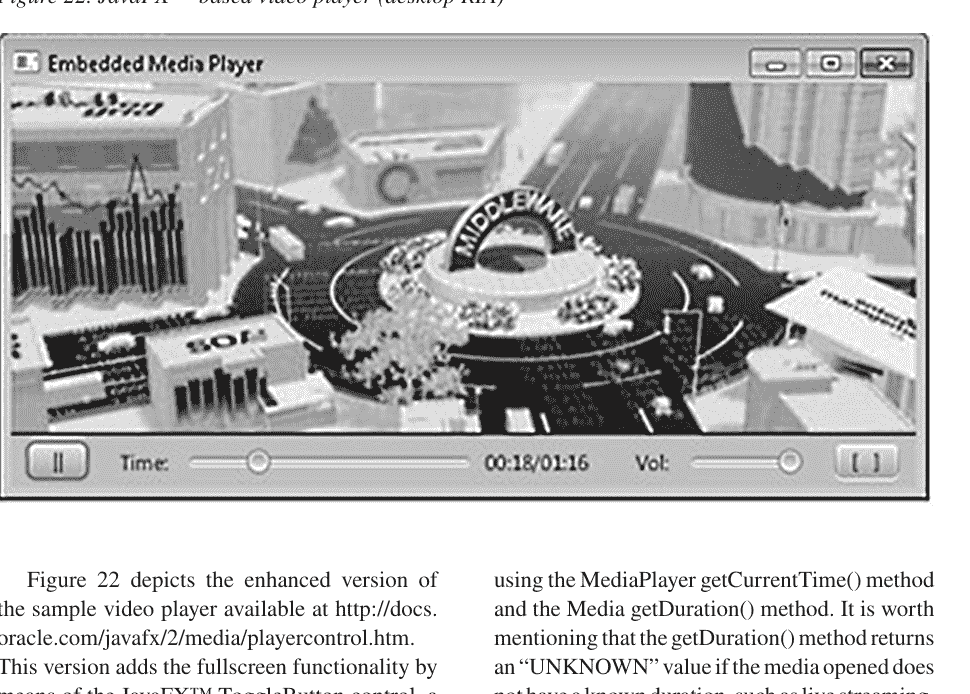

图 22 描绘了位于 http://docs.oracle.com/javafx/2/media/playercontrol.htm 的示例视频播放器的增强版本。此版本通过 JavaFX™ ToggleButton 控件添加了全屏功能，该控件是一种可以被选中的按钮。具体来说，全屏功能通过在应用程序的主 Stage 上简单调用 Stage setFullScreen() 函数来实现，这使得舞台尝试使用无装饰窗口进入全屏模式。可以推断，JavaFX™ Stage 类是任何 JavaFX™ 应用程序的顶层容器。

此外，值得注意的是此视频播放器集成了时间显示。此时间显示通过使用 JavaFX™ Label 控件和 JavaFX™ Duration 类实现，后者是一个定义时间持续量并提供实用方法的类，例如返回指定时间段内的毫秒数、秒数、分钟数和小时数的方法。时间显示展示的是视频播放时间与正在加载的视频时长的比值。因此，它通过使用 MediaPlayer getCurrentTime() 方法和 Media getDuration() 方法正确设置。值得一提的是，如果打开的媒体没有已知的持续时间（如实时流媒体），getDuration() 方法将返回"UNKNOWN"值。

事实上，此增强型视频播放器是一个 JavaFX™ 自定义控件，集成了与 Adobe Flex VideoPlayer™ 控件内置功能类似的播放功能。图 23 展示了为此示例应用程序实现的部分自定义播放控件的源代码片段。

### 3.3. 使用 Silverlight™ 的视频播放支持

Silverlight™ 平台整体由两个主要部分组成：核心呈现框架和 Silverlight™ 的 .NET Framework。Silverlight™ 提供的全部媒体功能集成在前一个组件中，它支持多种音频和视频文件格式（如 WMV 和 MP3）的播放和管理。

## 图 23. 基于 JavaFX™ 的源代码片段

```
1  Media media = new Media(MEDIA_URI);
2  MediaPlayer mediaPlayer = new MediaPlayer(media);
3  MediaView mediaView = new MediaView(mediaPlayer);
4  VBox mvPane = new VBox();
5  mvPane.setAlignment(Pos.CENTER);
6  mvPane.getChildren().add(mediaView);
7  HBox mediaBar = new HBox();
8  mediaBar.setAlignment(Pos.CENTER);
9  final Button playButton = new Button(">");
10  mediaBar.getChildren().add(playButton);
11  Label timeLabel = new Label("Time: ");
12  mediaBar.getChildren().add(timeLabel);
13  Slider timeSlider = new Slider();
14  timeSlider.setMinWidth(50);
15  mediaBar.getChildren().add(timeSlider);
16  ...
```

表 11. 与媒体支持相关的 Silverlight™ 类摘要

| 类 | 描述 | 包 | 支持的容器格式（视频） | 支持的传输技术 | 支持的媒体类型 |
|---|---|---|---|---|---|
| **MediaElement** | 它表示一个包含音频、视频或两者的对象。在这种情况下，它是一个可以在其表面显示视频或播放音频的矩形区域²⁰。 | System.Windows.Controls | 带有 WMV 和 VC-1 视频压缩的 ASF、带有 H.264 视频压缩的 MP4 以及带有 H.264 和 H.263 视频压缩的 3GP 和 3G2（"Supported Media Formats, Protocols, and Log Fields," n.d.）。 | 本地、渐进式下载以及媒体流（通过 HTTP 协议的 Windows Media Streaming Media）。 | 实时或录制的 |

表 11 总结了与媒体支持相关的 Silverlight™ 类的特性（"Silverlight Architecture," n.d.）。

与 JavaFX MediaPlayer™ 控件类似，Silverlight™ MediaElement 控件不集成内置的播放器控件，而是暴露了类似的播放功能。因此，这些播放功能必须通过 GUI 事件处理程序与开发者手动添加的 GUI 控件（通常是按钮和滑块）相关联。然而，与 JavaFX™ 不同的是，Silverlight™ 将所有媒体功能和属性抽象到一个类中。这可以在开发媒体密集型应用程序时节省时间和精力。

图 24 展示了基于 Silverlight™ 的视频播放器版本，该播放器在本章前面部分（使用 JavaFX™ 的视频播放支持）中开发。全屏功能同样通过切换按钮（Silverlight™ ToggleButton 控件）添加。然而，在这种情况下，全屏功能基于 Silverlight™ Content 类，该类暴露了与 Silverlight™ 内容区域相关的 API，即在应用程序初始化中由 width 和 height 属性声明的区域。具体来说，当用户选择切换按钮时，托管应用程序的 Content 实例的 IsFullScreen 属性被设置为 true。这使得 Silverlight™ 插件以全屏插件方式显示。

此外，视频播放器的时间显示区域通过使用 Silverlight™ Label 控件实现，如下方源代码片段所示。此外，还使用了 .NET Framework DispatcherTimer 类。此类表示集成到队列中的计时器


 ## 框架中多媒体支持的本机/嵌入式视频播放

图24. 基于Silverlight™的视频播放器（基于Web浏览器的RIA）

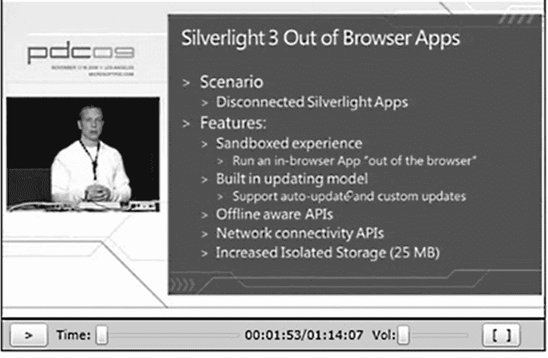

线程的工作项。计时器间隔设置为1000毫秒（一秒），以便每次计时器间隔到期时（每秒），视频播放时间更新为MediaElement控件的Position属性返回的值。另一方面，视频时长通过MediaElement的NaturalDuration.TimeSpan属性获取，该属性能够获取当前打开的媒体文件的时长。值得一提的是，当打开的媒体没有已知时长时（如直播流），NaturalDuration属性返回"Automatic"值。需要注意的是，图25中展示的源代码片段仅包含自定义播放控件的的部分定义。

### 3.4. 使用OpenLaszlo™的视频播放支持

OpenLaszlo™应用程序可以通过OpenLaszlo™服务器代理部署，也可以作为独立应用程序部署（"SOLO"部署模式）。因此，OpenLaszlo™应用程序在运行时加载的媒体可以通过OpenLaszlo™服务器代理，也可以直接加载。无论如何，它们可以有两种运行时目标之一：Adobe Flash Player™或AJAX，也就是说，它们可以编译为SWF文件。

根据上述内容，OpenLaszlo™中的视频由底层平台运行时Adobe Flash Player™处理；事实上，本章描述的OpenLaszlo™视频API仅在针对Flash运行时目标编译的OpenLaszlo™应用程序中工作。详细地说，OpenLaszlo™视频API使开发人员能够访问媒体播放器的完整功能，如Adobe Flash™媒体服务器和Red5媒体服务器，后者是Adobe Flash™媒体服务器的开源实现，支持RTMP协议（"Media Support," n.d.）。

需要注意的是，此示例应用程序使用了所涉及GUI组件的默认外观和感觉。如图26所示，OpenLaszlo™ VideoPlayer™组件没有集成全屏功能，而Adobe Flex™ VideoPlayer™组件则恰恰相反。

表12中描述的一组类包含两种元素：1）作为扩展包装Adobe Flash Player™ API的基本类，以及2）完全用LZX（OpenLaszlo™的标记语言）编写的高级GUI组件。在这种情况下，类似的视频播放能力可以通过使用VideoView类与标准GUI控件（如用于控制播放功能的按钮和滑块）配合实现，或者使用具有内置播放控件的VideoPlayer组件，类似于Adobe Flex™ VideoPlayer™组件。

此外，为此示例应用程序实现的源代码（仅由三行源代码组成）如图27所示。

图26展示了在开发嵌入本机视频播放器的RIA时OpenLaszlo™ VideoPlayer组件的使用情况。此示例应用程序播放FLV（VP6）视频，该视频也被基于JavaFX™的视频播放器使用（见本章5.3.2节）。该视频可在http://download.oracle.com/otndocs/products/javafx/oow2010-2.flv获取。

### 3.5. 比较

基于媒体类型是容器格式和一种或多种编码类型的组合这一理解，表13总结了本章分析的非基于JavaScript的RIA框架之间对媒体类型支持的比较。此比较分析考虑了本章开头概述的容器格式。从这个角度来看，由于MP4的流行，除了MP4容器格式本身之外，还包含了一些基于MP4的容器格式（F4V和3GP）。

最后，需要注意的是，媒体类型不仅涉及视频压缩格式，还涉及音频压缩格式。然而，就本章而言，表13仅总结了第二种压缩类型。

*图25. 基于Silverlight™的源代码片段*

```
1 <StackPanel x:Name="LayoutRoot" Background="White" HorizontalAlignment="Center"
2   VerticalAlignment="Center" Margin="0,0,0,0">
3     <Border Width="500" Height="300" BorderThickness="1" BorderBrush="Black">
4         <MediaElement DownloadProgressChanged="downloadProgressHandler" x:Name="video"
5   Width="500" Height="300" Source="http://ecn.channel9.msdn.com/09/pdc09/wmv/CL20.wmv"
6   HorizontalAlignment="Left" DataContextChanged="video_DataContextChanged"/>
7       </Border>
8       <Border Width="500" Height="30" BorderThickness="1" BorderBrush="Black" >
9         <StackPanel Width="500" Height="30" Background="#FFCCCCCC"
10  HorizontalAlignment="Center" VerticalAlignment="Center" Orientation="Horizontal">
11          <Button x:Name="playButton" Width="35" Height="22" Content="&gt;"
12  Margin="8,0,0,0"/>
13          <sdk:Label Name="timeLabel" Height="24" Content="Time:" Margin="8,0,0,0"/>
14          <Slider Name="timeSlider" Width="140" Maximum="1"/>
15          ...
16       </StackPanel>
17     </Border>
18   </StackPanel>
```

表12. OpenLaszlo™与媒体支持相关的类总结

| 类 | 描述 | 包 | 支持的容器格式（视频） | 支持的交付技术 | 支持的媒体类型 |
|---|---|---|---|---|---|
| VideoView | 用于从视频服务器显示视频的视觉对象。它是View类的扩展，View类是最基本的视觉元素，并针对视频流进行了优化²¹。 | lps.components.extensions.av | 采用VP6和Sorenson Spark视频压缩的FLV。 | 本地、渐进式下载和媒体流（通过HTTP和RTMP协议的Flash Media Server或Red5 Media Server）。 | 直播或录制 |
| MediaStream | 打开连接以接收流媒体。它允许控制由VideoView类创建的流，即它与VideoView实例一起使用²²。 | | | | |
| VideoPlayer | 提供处理音频和视频的基本GUI控件（播放控件）的高级组件²³。 | lps.components.av | | | |

图26. 基于OpenLaszlo™的视频播放器

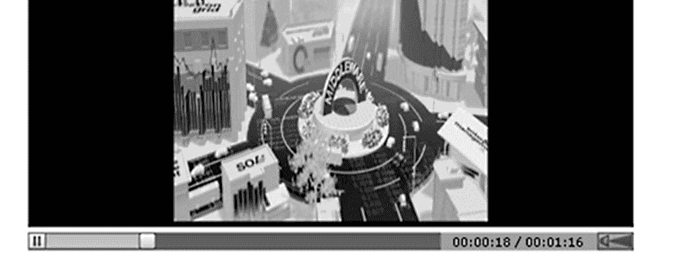

图27. 基于OpenLaszlo™的源代码

```
1 <canvas width="100%" height="80%">
2     <videoplayer     width="540"     height="241"     align="center"     valign="middle"
3 url="http://download.oracle.com/otndocs/products/javafx/oow2010-2.flv"/>
4 </canvas>
```

*表13. 非基于JavaScript的RIA开发框架之间媒体类型支持总结*

| 视频容器格式 | Adobe Flex™ | JavaFX™ | Silverlight™ | OpenLaszlo™ |
|---|---|---|---|---|
| FLV | 是（VP6和Sorenson Spark） | 是（VP6） | 否 | 是（VP6和Sorenson Spark） |
| MP4 | 是（H.264/AVC） | 是（H.264/AVC） | 是（H.264/AVC） | 否 |
| F4V | 是（H.264/AVC） | 否 | 否 | 否 |
| 3GP | 是（H.264/AVC） | 否 | 是（H.264/AVC和H.263） | 否 |
| ASF | 否 | 否 | 是（WMV和VC-1） | 否 |

## 4. 结论

对于基于JavaScript的RIA框架，本章分析的插件并不是将本机/嵌入式视频播放支持集成到基于JavaScript的RIA中的唯一选择。事实上，基于JavaScript的RIA框架支持的视频容器和压缩格式范围可能因所选插件而有很大差异。此外，HTML标准第五版的发布为富媒体支持开辟了新的可能性，原因是包含了<audio>、<video>和<canvas>标签。这些新特性旨在促进多媒体和图形内容在Web上的集成，而无需依赖专有的vasive Web浏览器插件和API。然而，这些新特性尚未被所有Web浏览器完全支持。由于HTML5目前是W3C候选推荐标准，因此本章不讨论这种视频播放支持方法。

另一方面，尽管某些音频和视频压缩格式的解码依赖于特定于操作系统的媒体引擎，但非基于JavaScript的RIA框架中对视频播放的支持通常取决于所涉及的Web浏览器插件和运行时环境本机支持的视频容器和压缩格式。因此，对于Adobe Flex™、Adobe Flash Player™和Adobe AIR™，它们提供对FLV和F4V容器格式的支持，这些格式目前被认为是在线视频的事实标准。然而，对于Silverlight™，Silverlight™插件提供对与微软™开发的几种专有编解码器相关的ASF容器格式的支持。

根据上述内容，选择开发多媒体交互式RIA的技术可能取决于所涉及的视频文件格式，以及将预期功能纳入所需的开发工作量。事实上，正如本章所解释的，一些非基于JavaScript的框架不提供对视频播放的内置支持。这可能导致开发时间和工作量的增加。总之，在此评估中，框架的能力不仅是决定性因素，而且这些能力作为开发人员友好API的暴露程度也是决定性因素。


# **参考文献**

Architecture, S. (无日期). *MSDN*。检索于2013年5月10日，来源：http://msdn.microsoft.com/en-us/library/bb404713(v=vs.95).aspx

Castillo, C. (无日期). 1 JavaFX 媒体简介。*JavaFX 文档*。检索于2013年5月9日，来源：http://docs.oracle.com/javafx/2/media/overview.htm#CJAHFAHJ

Package javafx.scene.media. (无日期). *JavaFX 2.2*。检索于2013年5月9日，来源：http://docs.oracle.com/javafx/2/api/javafx/scene/media/package-summary.html

Preciado, J. C., Linaje, M., Sanchez, F., & Comai, S. (2005). 建模富互联网应用程序对方法论的必要性。收录于 *第七届IEEE网站演化国际研讨会论文集* (第7–13页)。华盛顿特区：IEEE计算机协会。doi:10.1109/WSE.2005.10

Rosales-Morales, V. Y., Alor-Hernández, G., & Juárez-Martínez, U. (2011). 用于开发RIA的JavaScript框架中的多媒体支持概述。收录于 *2011年第21届国际电气通信与计算机会议（CONIELECOMP）论文集* (第66–70页)。doi:10.1109/CONIELECOMP.2011.5749341

Subramaniam, D. (2010, 3月 8日). *Spark架构与组件集简要概述*。检索于2013年5月9日，来源：http://www.adobe.com/devnet/flex/articles/flex4_sparkintro.html

Support, M. (无日期). *OpenLaszlo wiki*。检索于2013年5月22日，来源：http://wiki.openlaszlo.org/MediaSupport

Supported Media Formats, P., & Fields, L. (无日期). *MSDN*。检索于2013年5月9日，来源：http://msdn.microsoft.com/en-us/library/cc189080(v=vs.95).aspx

Understanding Video Formats. (无日期). *Adobe Flash Platform*。检索于2013年5月9日，来源：http://help.adobe.com/en_US/as3/dev/WS5b3ccc516d4fb-f351e63e3d118a9b90204-7d46.html

# **扩展阅读**

Basics of Video. (无日期). *Adobe Flash™ Platform*。检索于2013年5月9日，来源：http://help.adobe.com/en_US/as3/dev/WS5b3ccc516d4fb-f351e63e3d118a9b90204-7d50.html

Designing Rich Internet Applications. (无日期). *MSDN*。检索于2013年5月10日，来源：http://msdn.microsoft.com/en-us/library/ee658083.aspx

Spark VideoPlayer and VideoDisplay Controls. (无日期). *Adobe Flex 4.6*。检索于2013年5月9日，来源：http://help.adobe.com/en_US/flex/using/WSc78f87379113c38b-669905c51221a3b97af-8000.html

# **关键术语与定义**

**比特率：** 每单位时间传输或处理的比特数。其量化单位为比特每秒（bit/s 或 bps）。

**容器类型：** 指定用于存储编码后的音频、视频及其他媒体数据的文件格式。

**编码类型：** 指定采样的音频或视频数据的存储方式，通常意味着特定的压缩算法。

**图形用户界面：** 是系统软件的一部分，作为用户界面，即为用户提供与软件交互的机制，这些机制可以是文本、图像及其他图形。

**媒体播放器：** 这些是用于播放多媒体内容，特别是视频内容的播放器，可以支持多种格式。

# 框架上原生/嵌入式视频播放的多媒体支持

**渐进式下载：** 当视频从标准Web服务器传输时，按顺序加载视频数据的过程。

**流式传输：** 渐进式下载的替代技术，客户端计算机从不一次性下载整个视频。

## 尾注

1 http://dojotoolkit.org/reference-guide/1.9/dojox/av/FLVideo.html#dojox-av-flvideo
2 http://dojotoolkit.org/reference-guide/1.9/dojox/av/widget.html#dojox-av-widget
3 http://www.openstudio.fr/jQuery-Multimedia-Portfolio.html?lang=fr
4 http://thickbox.net/
5 http://videobox-lb.sourceforge.net/
6 https://code.google.com/p/swfobject/
7 http://www.p51labs.com/lightwindow/
8 http://script.aculo.us/
9 https://code.google.com/p/ext-ux-youtube-player/
10 http://help.adobe.com/en_US/FlashPlatform/reference/actionscript/3/spark/components/VideoPlayer.html
11 http://help.adobe.com/en_US/FlashPlatform/reference/actionscript/3/mx/controls/VideoDisplay.html
12 http://help.adobe.com/ru_RU/FlashPlatform/reference/actionscript/3/spark/components/mediaClasses/StreamingVideoSource.html
13 http://help.adobe.com/en_US/FlashPlatform/reference/actionscript/3/flash/media/Video.html
14 http://help.adobe.com/en_US/FlashPlatform/reference/actionscript/3/flash/net/NetStream.html
15 http://help.adobe.com/en_US/FlashPlatform/reference/actionscript/3/flash/net/NetConnection.html
16 http://labs.adobe.com/technologies/cirrus/
17 http://docs.oracle.com/javafx/2/api/javafx/scene/media/Media.html
18 http://docs.oracle.com/javafx/2/api/javafx/scene/media/MediaPlayer.html
19 http://docs.oracle.com/javafx/2/api/javafx/scene/media/MediaView.html
20 http://msdn.microsoft.com/en-us/library/system.windows.controls.mediaelement(v=vs.95).aspx
21 http://www.openlaszlo.org/lps3.4/docs/reference/index.html?videoview.html
22 http://www.openlaszlo.org/lps3.4/docs/reference/index.html?mediastream.html
23 http://www.openlaszlo.org/lps4.9/docs/reference/lz.videoplayer.html

101

# 第6章

面向切面编程（AOP）对RIA开发的支持

# 摘要

第6章强调了在软件开发中，尤其是在软件工程中，采用面向切面编程（AOP）的重要性。在富互联网应用程序（RIA）开发中使用AOP的一些优势包括可维护性、可扩展性和可重用性。本章回顾了几个在现实世界开发项目中成功实施AOP的案例，并讨论了这些项目中获得的经验教训。对最新技术文献的分析按Web开发、可用性工程以及其他相关视角进行分类。最后，本章还探讨了基于JavaScript的RIA框架与非基于JavaScript的RIA框架之间对AOP的支持情况，这些框架或提供原生AOP设施，或提供第三方AOP设施。文中还展示了一些代码片段，以说明如何利用这些设施来实现AOP概念。

## 1. 引言

如今，面向切面编程（AOP）是计算机编程中的概念之一，主要用于研究和工业领域。它的使用是软件开发的一种演进方式，改进了面向对象编程（OOP），正如OOP改进了过程式编程一样。OOP引入了封装、继承和多态的概念，以创建一组模拟共同行为的对象层次结构。尽管OOP已变得举足轻重，但它未能有效处理跨不相关对象存在的共同行为。这意味着OOP增强了垂直关系，但未能增强水平关系。例如，日志代码通常水平分散在对象层次结构中，但它与分散其中的对象核心功能无关。这种情况也发生在其他类型的代码中，例如安全和异常处理。AOP提供了一种解决方案，用于抽象跨越对象层次结构且与其功能无关的横切代码。AOP是一种工具，能够将横切代码抽象到一个单独的模块中，称为切面（aspect），而不是将横切代码嵌入到类中，然后在需要时动态应用该代码。横切代码的应用是通过在对象模型中定义特定位置（称为切入点（pointcuts））来实现的，这些切入点是应该应用横切代码的地方（Ekabrot, 2012）。根据所使用的AOP框架，横切代码在运行时或编译时注入到指定的切入点。理想情况下，AOP引入了一个非常强大的概念，它允许在不被对象察觉的情况下为对象引入新功能（Holmes, 2012）。软件的缺陷和恶化是由源代码的更改引起的，而其中许多更改是无法避免的；但是，它们可以被最小化。在大多数情况下，当对软件进行更改时，整个程序需要重新设计（Fayad & Adam, 2001）。

更改是软件演进中不可或缺的一部分。更改发生在开发过程中，也发生在软件维护期间。巨大且低效的实施成本是更改实施的典型特征。通常，更改实施意味着整个应用程序的重新设计。提高软件适应性的必要性相当明显。更改通常被指定为对基础应用程序行为的修改。有时，需要回滚更改，如果以可插拔的方式表达，这将是最佳选择。更改可插拔性的另一个好处在于，当更改需要重新应用时显现。然而，要实现一个能适应任何上下文的更改是不可能的，但如果一个更改可以被提取并应用于同一基础应用程序的另一个版本，那将是足够有帮助的。这种可插拔性可以通过将更改表示为切面来实现（Dolog, Vranic & Bieliková, 2001）。有些更改表现为真正的横切关注点，因为它们影响代码中的许多地方，这是将它们表达为切面的另一个原因。这在Web应用程序的定制化中将特别有用。

通常，通用Web应用程序通过一系列更改来适应特定上下文。随着基础应用程序新版本的出现，所有这些更改都必须应用到新版本上。在许多情况下，新旧应用程序之间的差异并不会影响更改的结构。

AOP的成功应用需要一个结构良好的基础应用程序。结构良好的Web应用程序通常基于MVC（模型-视图-控制器）模式，具有三个可区分的层次：模型层、表现层和持久层（Bebjak, Vranic & Dolog, 2007）。

AOP可以在富互联网应用程序（RIA）中实现。这种编程能够为RIA带来许多好处，例如在不修改原始应用程序代码的情况下增加新的安全性和功能性。如上所述，应用AOP进行RIA开发的优势是多样且非常重要的。以下提及了在富互联网应用程序开发中使用AOP的一些最重要的优势：

-   **可维护性**对于富互联网应用程序的开发非常重要，因为它使得能够尽可能高效地进行更改。此外，AOP提供了高水平的可维护性。
-   **可扩展性**是富互联网应用程序开发中的另一个重要方面，因为有时需要向正在运行的应用程序添加新功能，并且必须确保应用程序不会因此失败。
-   **可重用性**不仅在软件开发中很重要，在AOP中也是如此。事实上，可重用性封装了后续场合重用所需的功能。这减少了开发时间并提高了生产力。无论是富互联网应用程序还是软件开发，开发时间都非常昂贵。


[content]
## 面向切面编程在富互联网应用开发中的支持

本章探讨了面向切面编程在软件开发，特别是软件工程中的应用。必须指出，已有多种技术采用了AOP；因此，用于实现AOP的编程语言种类繁多。其中两种编程语言是AspectJ和CaesarJ等。然而，本章的目的并非详细阐述这些编程语言。相反，开发和维护分布式应用程序正变得日益复杂。不幸的是，大多数已知的应用程序开发方法从设计的早期阶段就涉及物理分布问题。因此，为了降低基于Web的应用程序开发的复杂度，作者们提出了一种强调应用程序设计中位置透明性的方法；从而将物理分布的关注点推迟到开发过程的后期阶段处理。

下一节探讨了几项支持AOP的Web工程研究。这些研究被归为三个主题：Web开发、可用性工程以及其他支持AOP的视角。

## 2. 支持AOP的Web工程研究工作

为了解决这些模块化问题，AOP被采纳为一种编程模型，它提供了在需要时将分布式方面集成到应用程序中的手段。AOP范式允许系统设计者通过集成Web服务通信和协调基础设施，获得应用程序的分布式版本。这项工作的主要贡献在于简化了基于Web的应用程序的开发过程。这降低了应用程序的生产和维护成本，同时，也显著提高了应用程序的灵活性和动态性。

AOP是一种重要的编程范式，近年来，它已被开发者（包括Web开发者）多次使用。这就是为什么在本章中强调AOP的重要性。已有多种研究被提出，以支持AOP与Web工程其他特性的结合。Web工程涵盖多种问题，其中最重要的一些包括Web开发的CASE工具、代码生成、协作式Web开发、Web服务的开发与部署，以及Web应用程序的可用性。基于AOP的目标，从这些问题中选出最重要的一些。下面提及一些最重要的研究工作，它们被归为三个主题：Web开发、可用性工程以及其他支持AOP的视角。

类似地，(Hmida, Tomaz & Monfort, 2005) 解释说，Web服务是提供实现面向服务架构所需松耦合的合适技术解决方案。在之前的工作中，作者们提出了一种利用AOP范式来提高Web服务适应性的方法。这种方法存在一些缺陷，因为它依赖于特定的编程语言（Java）和SOAP引擎（AXIS）。因此，作者们提出通过使用主要的AOP公认语义——通知、切入点和连接点——来改变原始Web服务的行为，从而提高Web服务的适应性。作者们建议使用一种XML语言来描述切入点、连接点和引用通知。通知（Web服务）的调用通过一个XQuery引擎完成，以确保与SOAP引擎无关，并且通知被实现为Web服务以促进编程语言无关性。

(Verheecke, Vanderperren & Jonckers, 2006) 提出了一种创新技术，其基于这样一个事实：面向服务的架构旨在支持交互软件应用之间的松耦合。使用Web服务技术，SOA（面向服务架构）支持在异构环境中创建分布式应用程序。SOA的最终目标是让开发者编写的程序独立于他们所使用的特定服务——能够动态选择和集成服务的程序。目前，服务开发者使用Web服务描述语言来描述他们的服务，并将文档发布到注册表中。服务客户端可以浏览这些注册表，以找到符合其需求的服务，并确定如何与之通信。通过分析WSDL文档，客户端可以集成该服务，并通过基于XML的SOAP通信来调用它。Web服务管理层提供了适应性中间件，利用AOP动态特性来解决面向服务架构中的多个横切关注点。

此外，(Xu, Tang, Tang, Xu & Xiao, 2007) 解释说，尽管访问单个Web服务可能有一定价值，但更大的价值来自于将Web服务组装成更强大的组合Web服务。Web服务流是基于流程的组合Web服务。作者们应用了AOP概念来支持Web服务流的动态适配。他们还提供了一种将切面描述作为BPEL扩展的方法，并考虑了如何重用可能在不同切入点具有不同类型的切面定义。他们提出了一种方法，用于在部署之前验证与切面编织后的Web服务流的正确性。

此外，在(Ponnalagu, Narendra, Krishnamurthy & Ramkumar, 2007)中，作者们提供了一种新颖的方法，用于指定和关联分布式组件Web服务的非功能性属性，这些属性可用于调整组合Web服务。该方法使用分布式AOP技术来建模用于Web服务组合和执行的适应性架构。现有的Web服务适应机制仅限于Web服务编排过程中的Web服务选择/调用，以满足预先指定的服务级别协议约束。该系统通过AOP来表示每个Web服务（组合的和组件的）的非功能性属性，从而扩展了这一思想。因此，该系统建模了组合Web服务的切面与组件Web服务各个切面之间的关系函数。这使得组合Web服务能够在运行中进行适应性调整——以响应非功能性需求的变化——通过适当地修改组件Web服务的各个切面来实现。从最终用户的角度来看，这种对非功能性属性的切面导向建模，实现了按需调整组合Web服务，同时最小化了对服务质量的干扰。

(Patel & Pandey, 2009) 描述了在各种场景、不同平台和非受控环境中执行的传感器网络应用。中间件中的数据聚合和数据处理都需要一种方法来整合来自不同网络集群的各种功能需求。因此，与其为单个问题提供专有解决方案，不如拥有一个独立于面向服务架构的平台。SOA由客户端应用调用的交互式Web服务组成。这些应用中，安全地访问和使用Web服务是首要要求。从软件工程的角度来看，身份验证和日志记录是Web服务的横切关注点。作者们没有使用传统的面向对象方法在每个类或方法中处理这些关注点，而是提出使用AOP范式来减少系统的代码开销。

在(Zhang, Meng & Liu, 2009)中，作者们提出，如今Web服务是解决Web环境中跨平台、跨语言和松耦合分布式系统的最佳方式。然而，由于Web服务中存在一些横切关注点——例如日志记录、授权、事务等——通过集成Web服务构建的系统会因代码交织和代码分散而产生一些问题。为了解决上述问题，AOP被引入到Web服务中。横切关注点被分离出来并作为切面服务独立执行，一个编织器在系统运行时将它们编织在一起。在研究了SOA和多层架构之后，提出了一种基于切面服务和Web服务的系统架构。

在对关于Web开发的不同研究工作，特别是在Web服务开发和部署中采用AOP的研究进行分析之后，很容易识别出AOP为开发者带来的优势。事实上，这个领域中一些最常见的问题都可以通过使用这种新的编程范式（AOP）来解决。正如从上述研究工作中所观察到的，诸如如何提高Web服务的弹性和可重用性等问题，使用AOP可以相对容易地解决。

### 2.2. 通过使用AOP进行可用性工程

在(Lippert & Lopes, 2000)中，作者们描述了AOP旨在简化涉及多种代码交织的情况。该研究报告了一项研究，旨在探讨AOP在简化与异常检测和处理相关的交织方面的能力。作者们采用了一个用Java™编写的现有框架——JWAM框架，并使用AspectJ™（Java的面向切面编程扩展）对其异常检测和处理方面进行了部分逆向工程。作者们发现AspectJ™支持的实现大幅减少了与异常检测和处理相关的代码部分。在一个场景中，作者们成功地将代码减少了4倍。他们还发现，与纯Java的原始实现相比，AspectJ为异常行为的不同配置提供了更好的支持，对异常行为规范的变更更具容忍度，为增量开发提供了更好的支持，实现了更好的重用，自动强制执行了使用该框架的应用程序中的契约，并且程序文本更加清晰。

同样地，在(Tarta & Moldovan, 2006)中，可用性被解释为软件系统最重要的质量之一。为可用性而设计是一项复杂的任务，有时成本高昂。自动可用性评估可以简化评估过程。作者们试图分析AOP可以在何处以及如何用于开发支持自动可用性评估的模块。一个小型家庭预算应用程序被用于测试使用AOP设计和实现的模块。

在(Ruengmee, Silva, Bajracharya, Redmiles & Lopes, 2008)中描述到，尽管AOP范式支持模块化优势，但不同的可用性问题阻碍了它的采用。不同AOP语言中切面定义与基础代码的分离以及采用的编译时编织机制，要求开发者自己管理基础代码和切面代码之间的一致性。这些机制为与切面编织不可见性和AOP语言非局部控制特性相关的错误创造了机会。作者们描述了XE（Extreme Editor），这是一个支持开发者在函数式面向切面编程领域管理这些问题的IDE。

在(Barbosa, Honorio, Leite da Silva & Lopes, 2009)的工作中，分析了复杂系统的优化，因为这需要高级

### 2.1. 支持AOP的Web开发

在(Resendiz & Aguirre, 2005)中，作者们描述道，随着新的Web服务标准和技术的出现和采纳，开发和维护分布式应用程序正成为一项复杂的任务。不幸的是，大多数已知的应用程序开发方法从设计的早期阶段就涉及物理分布问题。因此，为了降低基于Web的应用程序开发的复杂度，作者们提出了一种强调应用程序设计中位置透明性的方法；从而将物理分布的关注点推迟到开发过程的后期阶段处理。


面向方面编程（AOP）在RIA开发中的支持

这些方法是在专门的软件中实现的。优化方法、目标函数和约束条件的多种组合进一步增加了开发该软件的复杂性，使其难以创建、维护和演化。为了克服这一问题，该研究提出了一种基于AOP思想的新开发方法论，应用于最优潮流问题。这种新方法论支持关注点（concerns）的清晰分离，并将依赖关系维持在最低水平。优化方法是自包含的，与系统的其余部分完全独立；对于每个优化场景，解决方案在运行时将优化与具体问题绑定。这种方法提高了处理多种不同目标函数和约束条件的能力。因此，它还为开发和演化工作提供了灵活性、可维护性和可用性，而不会降低计算时间。为了评估该方法，使用多个软件指标将其与传统OOP范式进行了比较。

此外，在（Holzinger, Brugger & Slany, 2011）中，作者解释说可用性工程可以被视为软件开发过程中的横切关注点（crosscutting concern）。另一方面，AOP是一种支持软件工程中关注点分离的技术。因此，通过应用旨在在单个应用程序中处理不同关注点的技术来支持可用性工程似乎是合理的。远程可用性测试已被证明能够产生良好的结果，而AOP是一种可用于简化测试各种软件产品过程的技术，通过将测试数据的生成与程序执行分离，从而避免关注点的混淆。作者展示了一个示例应用程序，讨论了他们在这种实践中的经验，并为后续开发提供了建议。

可用性是软件系统和RIA最重要的方面之一。此外，正如可以观察到的，AOP对于解决与可用性工程相关的问题非常有帮助，特别是因为可用性工程中最常见的问题之一是模块化。在这种情况下，AOP提供了轻松实现模块化的便利条件。

### 2.3. 支持AOP的其他视角

在（Kulesza, Sant'Anna, Garcia, Coelho, Von Staa & Lucena, 2006）的研究中，AOP的主要承诺之一是促进横切关注点的改进模块化，从而增强软件在面临变化时的稳定性。该研究提出了一项定量研究，评估AOP对Web信息系统典型维护活动的正面和负面影响。该研究包括对同一应用程序的面向对象版本和面向方面版本进行系统比较，以评估每种解决方案在多大程度上提供了可维护的软件分解。该分析由基本的模块化属性驱动，如耦合度、内聚性、简洁性和关注点分离。作者发现，面向方面的设计在变化过程中表现出更优越的稳定性、可重用性，因为它产生了更少的代码行、改进的关注点分离、更弱的耦合度和更低的组件内部复杂性。

此外，在（Ortiz, Bordbar & Hernandez, 2008）中，介绍了MDA（模型驱动架构）以缩短软件开发时间、产生更高质量的代码并促进软件工件的重用。在熟练程度方面，采用新技术通常需要额外的成本和工作量，包括与培训和支持软件工具相关的成本。因此，评估这两种技术的联合应用是否有用至关重要。该研究还提出了一种定量方法，以评估在服务导向环境中使用MDA和AOP的情况。

另一项研究（Xu & Huang, 2009）讨论了AOP是一种新兴的编程范式。现在，面向方面的概念已经扩展到其他开发阶段和其他领域。大量研究集中于面向方面的Web服务组合领域。然而，它们都没有为面向方面的服务组合提供形式化基础。但是，在（Xu & Huang, 2009）中，作者提出了一种基于Petri网的面向方面Web服务组合代数。在该模型中，Web服务组合被建模为基本组合网和方面网，然后提供了一种编织机制以便组合基本网和方面网。组合操作的形式语义用Petri网表示。因此，可以根据底层Petri网验证和分析编织后的复合服务的属性。

此外，在（Li, Zhang & Wang, 2010）中，作者描述了为什么AOP擅长解决OOP中横切关注点的困难，并从更高的角度松耦合系统。基于Web应用系统的特点，该论文引入了AOP思想，并设计了一种基于MVC的多玩家架构。它还着重分析了Web系统中的横切关注点，包括授权、异常、日志和定时处理程序。此外，使用AspectJ语言，作者设计了解决这些横切关注点的实现，用于基于J2EE平台的分布式企业Web系统。最后，与OOP相比，该研究总结了使用AOP的优势。

本节介绍了一组关于Web工程各个主题的相关工作。它们都同意在Web开发中实施AOP以解决各种问题的优势。正如可以观察到的，关于代码甚至完整模块的可重用性的几个问题都可以通过实施这种新编程范式来解决。

此外，正如在前面分析的工作中可以观察到的，由于其多种能力和优势，AOP已被用于Web工程的多个语境中。必须提到的是，开发人员正在考虑将AOP纳入其开发中，因为它在近年来获得了普及。事实上，AOP已经证明了其在软件开发不同领域中的实用性。

## 3. 基于JavaScript框架上的AOP支持

有多种用于RIA开发的基于JavaScript的框架，如Dojo、jQuery、Mootools、Qooxdoo、Prototype、Rico、Sencha ExtJS、X-Library、GWT、Cappuccino、SproutCore、Spry、midori和YUI Library等。

然而，本章仅分析其中八种基于JavaScript的框架：Dojo、jQuery、Mootools、Qooxdoo、Prototype、Rico、Sencha ExtJS和X-Library。这些框架被分为两组：1）支持AOP的基于JavaScript的框架；以及2）不支持AOP的基于JavaScript的框架。以下小节详细解释了这些框架中每一个所提供的AOP支持范围。

### 3.1. 支持AOP的RIA开发基于JavaScript的框架

必须提到的是，基于JavaScript框架上的AOP支持是有限的，不可能应用和识别每一个AOP概念，因为并非所有概念都在框架中实现。下面展示了支持AOP的基于JavaScript的框架。

表1. Dojo中AOP支持的元素（Harmon, 2008）

| AOP支持元素 |
| :--- |
| - 连接点（Join Point） |
| - 切入点（Pointcut） |
| - 建议（before） |

表2. dojo.connect函数的参数

| 参数 | 说明 |
| :--- | :--- |
| **Object参数** | 该参数表示一个对象，包含其执行将被视为事件的方法。此属性包含对该对象的引用。 |
| **Method参数** | 其执行被视为事件的方法。方法名是一个字符串。 |
| **HandlerObject参数** | 它表示一个对象，包含将作为事件处理程序的方法。此属性包含对该对象的引用。 |
| **handlerMethod参数** | 它指示将作为事件处理程序的方法。方法名是一个字符串。 |

#### 3.1.1. Dojo中的AOP支持

Dojo（1.5版）具有AOP支持。Dojo支持动态横切，支持的元素如表1所示。

在Dojo中提供AOP支持的函数是：

`dojo.connect (object, method, handlerobject, handlermethod)`

此函数在调用方法之前添加一个建议（advice）。建议代表方面的实现；这意味着它们包含新功能的代码实现。建议被插入到连接点中，为此，建议必须事先在切入点案中定义。然而，在这种情况下，可以清楚地观察到切入点（Pointcut）和连接点（Join Point）在所使用的方法中是隐含的。

建议在RIA的开发中非常有用，其主要用途是修改先前开发的应用程序的任何行为，以提供新功能。RIA中的建议可以在不同的情况下使用，例如：1）添加用户认证方法，2）添加接受使用条款的方法，以及3）在购买流程中添加步骤等。

此函数将事件处理程序与方法的执行相关联。该函数的参数如表2所示（Harmon, 2008）。

以下示例是用于在标准输出（控制台）上写入消息的代码片段。该消息仅用于示例，但函数可以执行其他任何操作。为此，提供了`foo`和`bar`函数，如下所示：

```
1 function foo() {
2 console.log("Running foo");
3 }
4 function bar() {
5 console.log("Running bar");
6 }
```

现在，一旦执行了`foo function`，`bar function`也会被执行。为了更好地理解该过程，下面展示了传统的解决方案。为此，在`Font`方法中添加了一行代码以执行`bar`方法。

```
1 function foo() {
2 console.log("Running foo");
3 bar();
4 }
```

尽管提出的解决方案有效，但编码是静态的。为了实现动态方式，Dojo提供了一种解决方案。

通过使用Dojo，可以将函数的执行视为一个事件，其中另一个函数被关联为事件控制，


#### 3.1.2. jQuery 中的 AOP 支持

*dojo.connect* 函数提供了这种关联，示例如下：

```
dojo.connect(null, "foo", null, "bar");
```

*Dojo.connect* 函数提供了 AOP 所指定的功能，例如事件管理，即*切点*、*连接点*和*通知*都是在 *Dojo.connect* 函数中隐式建立的，通知在程序继续正常执行之前被发送。一旦 foo 函数执行完毕，bar 函数将自动执行。

这是一个 AOP 支持的简单示例，但它展示了 *Dojo.connect* 函数的功能。该方法的标准用法能够将需要应用的功能动态添加到多种类型的对象中。例如，如果某些方法需要新功能，则可以在函数编写完成后添加这些功能。为此，需要添加一个新函数，该函数必须包含应用所需的新增功能；接下来，需要为每个需要此新功能的函数分配一个注册方法；这样，AOP 就在应用中付诸实践，避免了在每个需要手动添加新功能的函数中添加新代码。AOP 方法更优，因为它不需要直接在方法中编码，也不需要修改函数。根据行业参考资料，每次修改代码时，都有很高的概率导致某些功能失效。因此，如果能够避免修改方法，那是更好的选择（Harmon, 2008）。

在 RIA 的场景中，此示例可应用于多种情况，例如在执行特定操作之前添加功能。一个实际的例子是在执行操作前显示警告消息，或在完成交易前显示合同。这样做是为了在不偏离应用程序主要焦点的前提下，在最终操作之前执行其他操作。这种情况如图 1 所示。

在图 1 中，使用了 *dojo.connect* 函数并将其添加到 Web 应用程序或 RIA 中，以便在操作执行前显示警告消息。借助 AOP 支持，可以在遗留应用程序未包含此功能的情况下添加该功能。在遗留应用程序中，一旦点击轮播图片搜索器，系统将执行搜索并向用户展示信息。然而，验证用户是否为成年人以及是否了解使用条款是很重要的。为此，必须添加一个函数，该函数在每次调用搜索功能时都会被触发。然后，新函数在搜索功能向用户发送消息之前执行。接下来，用户需要按下"确定"按钮才能继续。完成此操作后，信息将展示给用户，仅通过少量修改，就可以在不影响正常运行的情况下为 Web 应用程序添加功能。

#### 3.1.2. jQuery 中的 AOP 支持

JQuery 1.4 版本能够通过一个名为 JQuery AOP 的插件支持面向切面编程。

此外，JQuery AOP 1.3 版本是一个轻量级的 JQuery 插件，为 JavaScript 添加了 AOP 功能，并集成在 jQuery 中。jQuery AOP 允许在对象的某些实例中添加通知（Before、After、After Throw、After Finally、Around 和 Introduction）；它还支持使用正则表达式定义横切关注点，可与全局函数和方法协同工作；此外，可以在通知使用后将其移除，且该插件非常紧凑。jQuery AOP 的使用非常简单，只需在源代码中包含一个 .js 文件即可（jquery-aop, 2014）。

在 RIA 中，此 AOP 功能的应用非常实用，因为经常需要在应用程序中添加新功能。jQuery 是一个非常有用的工具，因为它提供了许多在多种场景下都很实用的函数。例如，当需要在应用程序中添加新部分，或必须在应用程序的特定部分中添加新功能时，jQuery 的功能就在于决定使用哪个部分或功能最为合适。

jQuery 支持动态横切关注点和静态横切关注点。其支持的元素如表 3 所示。

*图 1. 使用 AOP 支持的基于 Dojo 的 RIA*

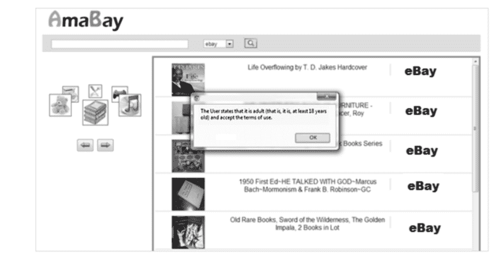

*表 3. jQuery 中 AOP 支持的元素（jquery-aop, 2014）*

| 支持的 AOP 元素 |
| --- |
| • 连接点 |
| • 切点 |
| • 通知（before、after、around） |
| • 引入 |

在此场景中，将以方法之后的通知为例进行说明。RIA 中的通知可用于多种场景，尤其是在调用方法之后。在 RIA 中使用通知的一些场景包括：1）添加检索用户先前输入信息的方法，2）添加将信息定期存储到数据库管理系统的方法，3）添加对 Web 服务器的调用以检索信息，仅列举几例。

### 在方法之后添加通知

*after(Map pointcut, Function advice) returns Array\<Function\>*

此函数在定义的切点之后创建一个通知。该通知将在切点方法成功完成执行后执行，并接收一个包含执行结果的参数。此函数返回一个织入切面的数组（Function）。该函数的参数如表 4 所示（jquery-aop, 2014）。

下一个示例描述了两种在方法之后添加通知的不同方式：

*表 4. after 函数的参数*

| Map 切点参数 | 要应用通知的切点定义。切点是要被织入的对象和方法的定义。<br> - Target：要被织入的对象。<br> - Method：要被织入的函数名称 |
|-----------------------|---------------------------------------------------------------------------------------------------------------------------------------|
| Function 通知参数 | 包含在切点执行之后将被调用代码的函数。它接收一个包含切点执行结果的参数。该函数可以选择返回相同的值或提供不同的值。 |

```
//example 1
jQuery.aop.after({target: window,
    method: 'MyGlobalMethod' },
    function(result) {
        alert('Returned: ' + result);
        return result;
    });

//example 2
jQuery.aop.after({target: String,
    method: 'indexOf' },
    function(index) {
        alert('Result found at: ' + index + ' on:' + this);
        return index;
    }
);
```

这些内容必须由用户手动输入。问题在于当用户更改了一些数据但未点击"完成"按钮时，因为如果发生故障，信息将会丢失，用户不得不重新输入数据。为避免这种情况，可以在方法之后使用通知，这样就可以在用户每次更改表单字段时添加保存信息的功能。此外，应用程序可以向用户发送消息，告知数据已被修改。通过这种方式，可以防止信息和时间的丢失。这只是一个说明 AOP 支持在 RIA 中可能用途的示例，特别是在方法之后使用通知方面。

#### 3.1.3. Qooxdoo 中的 AOP 支持

jQuery-AOP 在函数方面提供了许多选项。这些函数可以在 RIA 开发过程中根据需要使用。jQuery-AOP 具有能够提供额外功能的特性。例如，这些特性 1）能够为应用程序添加新功能，2）能够解决开发或设计中的问题，3）可以修改 RIA 的行为，甚至 4）可以禁用 RIA 的运行，只需添加少量函数且无需修改原始源代码。

Qooxdoo 1.1 版本有一个名为 Aspect（qx.core.Aspect）的静态类，这是唯一提供 AOP 支持的类。该类提供了非常基础的 AOP 支持，允许在每次调用函数之前或之后连接函数。该类包含两个静态方法；第一个用于通知，第二个用于包装（qooxdoo.org, 2014）。

为了更好地理解方法之后通知的功能，假设一个包含用户数据的应用程序，如地址、电话号码等。再假设注册表单需要大量数据

定义自身切面的类必须在头部注释中使用以下代码添加显式的 require/requirement（require() 用于加载文件）到此类：

```
#require(qx.core.Aspect)
#ignore(auto-require)
```

Qooxdoo 支持动态横切关注点，其支持的元素如表 5 所示。


## 面向切面编程（AOP）在 RIA 开发中的支持

*表 5. Qooxdoo 中支持 AOP 的元素（qooxdoo.org, 2014）*

| 支持的 AOP 元素 |
|---|
| • 连接点（Join Point） |
| • 切入点（Pointcut） |
| • 通知（Advice）（before 和 after） |

其余五个框架不支持 AOP。这五个框架及其版本如下所示。

在方法之前或之后添加通知

*addAdvice (Function fcn, String position?, String type?, (String | RegExp) name?)*

#### 3.2.1. Mootools 中的 AOP 支持

Mootools（版本 1.3）没有 AOP 支持，与其他框架不同的是，它也没有扩展或插件来提供 AOP 支持。不过，一些努力和开发正在进行中，但它们仍然不够成熟，尚不能发布或公布。

此函数注册一个函数，当所选函数之一被调用时，该函数将被恰好在之前或之后调用。该函数的参数如表 6 所示（qooxdoo.org, 2014）。

#### 3.2.2. Prototype 中的 AOP 支持

Prototype（版本 1.7）既没有 AOP 支持，也没有扩展或插件来提供 AOP 支持。然而，一些研究和开发正在进行以解决这一问题。不过，它们仍然不够成熟，尚不能发布或公布。

在这种情况下，Aspect 类提供了添加通知的能力，这些通知可以根据需要在方法之前或之后执行。对于 Qooxdoo 而言，AOP 功能非常有帮助，因为同一个功能提供了在方法之前或之后使用通知的能力。通过使用此功能，Qooxdoo 可以解决许多问题，这些问题需要在另一个特定函数之前或之后执行一个函数。这另一个函数必须事先在通知参数中指定。

#### 3.2.3. Sencha ExtJS 中的 AOP 支持

Sencha ExtJS（版本 3.3）没有 AOP 支持，并且目前还没有开发出扩展或插件来提供 AOP 支持。

### 3.2. 不支持 AOP 的基于 JavaScript 的 RIA 开发框架

#### 3.2.4. Rico 中的 AOP 支持

Rico（版本 2.0）既没有 AOP 支持，也没有扩展或插件来提供 AOP 支持。

在本书分析的八个基于 JavaScript 的框架中，仅仅有三个支持 AOP。这意味着

*表 6. addAdvice 函数的参数*

| 参数 | 说明 |
|---|---|
| **Function fcn** 参数 | 这是一个在所选函数之一被调用之前或之后立即调用的函数。 |
| **position（默认值："after"）** 参数 | before 或 after，它定义函数是在主函数之前还是之后被调用。 |
| **type（默认值：null）** 参数 | 它指的是函数类型。仅允许以下值之一："member"、"static"、"constructor"、"destructor"、"property" 或 ""，null 的处理方式与 "" 相同。 |
| **name（默认值：null）** 参数 | 它指的是匹配名称的模式。不必具有相同的名称，也可以只是与之匹配的一部分。 |

#### 3.2.5. X-Library 中的 AOP 支持

X-Library（版本 4.2）没有 AOP 支持，也没有扩展或插件来提供 AOP 支持。

需要提及所审查的框架版本，因为不能排除在这些框架的未来版本中添加 AOP 功能的可能性。

## 4. 非基于 JavaScript 的框架中的 AOP 支持

对于开发 RIA 的非基于 JavaScript 的框架，有四个重要的框架，即 Adobe Flex™、JavaFX™、Silverlight™ 和 OpenLaszlo™。下面介绍每个框架的 AOP 支持情况。

### 4.1. Adobe Flex™ 中的 AOP 支持

Adobe Flex™（Flex™ 4）没有 AOP 支持，但 Adobe Flex™ 开发有一些替代方案。例如，当需要特定的 AOP 技术时，可以使用一个名为 Swiz 的框架。

Swiz（版本 1.4）是用于 Adobe Flex™、Adobe AIR™ 和 Adobe Flash™ 的框架，旨在为 RIA 开发带来完全的简洁性。Swiz 提供：

- 控制反转 / 依赖注入
- 事件处理
- 异步远程方法调用的简单生命周期
- 与应用程序代码解耦的框架
- 与 Flex™ 和非 Flex™ AS3 项目的兼容性

Swiz 代表了行业内一些顶级咨询公司的顶尖 RIA 开发人员所学习的最佳实践。因此，Swiz 简单、轻量且极其高效。

流行的 Swiz 框架提供了新的 AOP 支持，以及一种大幅降低障碍、简化 AOP 的新方法。Swiz AOP 提供了强大的能力，可以轻松地将新功能配置到现有代码中，而不是弄乱基本的业务逻辑。这是一种极其强大的方法论，Swiz 使其易于使用（Swiz Framework, 2014）。

虽然需要提及的是，这个 Swiz 项目目前正在开发中以提供对 Flex 的 AOP 支持，但同样需要提及的是，它仍然存在 beta 版本，并且是由第三方而非 Adobe™ 本身开发的。

### 4.2. JavaFX™ 中的 AOP 支持

JavaFX™（版本 2.1）没有 AOP 支持；然而，已经开展了独立项目以提供该支持。这些正在进行中的项目之一是 Spring™ Framework。

Spring™ Framework（版本 3.2）是一个轻量级解决方案，也是构建企业级应用程序的潜在一站式选择。然而，Spring™ 是模块化的，这使其能够只使用需要的部分，而不必将整个框架引入。Spring Framework 支持声明式事务管理、通过 RMI（远程方法调用）或 Web 服务远程访问逻辑，以及各种数据持久化选项。它提供了功能完备的 MVC 框架，并能够将 AOP 透明地集成到软件中。Spring 的 AOP 模块提供了一个符合 AOP Alliance 标准的面向切面编程实现，允许定义例如方法拦截器和切入点，以干净地解耦实现需要分离功能的代码。行为信息可以通过使用源代码级别的元数据功能纳入代码中。

## 面向切面编程（AOP）在 RIA 开发中的支持

与 Adobe Flex™ 的情况相同，该框架由第三方开发，所提及的功能默认不包含在 JavaFX™ 中，JavaFX™ 的 AOP 支持仅由 Spring™ 框架提供（Spring-source.org, 2014）。

### 4.3. Silverlight™ 中的 AOP 支持

Silverlight™（版本 5.1）没有 AOP 支持，目前还没有框架或插件提供 AOP 支持。需要指出的是，一些研究和开发正在进行中，尽管它们仍然缺乏支持和成熟度，尚不能发布或公布。

### 4.4. OpenLaszlo™ 中的 AOP 支持

OpenLaszlo™（版本 4.9）没有 AOP 支持，目前还没有提供 AOP 支持的框架或插件。与上述某些框架的情况一样，研究和开发正在进行中以解决此问题，但它们仍然不够成熟，尚不能发布或公布。

## 5. 结论

大多数基于 AOP 的研究和开发是使用专门的编程语言进行的。这些语言中的大多数用于开发桌面应用程序。到目前为止，Web 应用程序开发方面的贡献还很少。但近年来，开发人员需要为 Web 编程语言添加 AOP 支持，这就是为什么提出了一些贡献。其中一个例子是最近将 AOP 功能纳入用于开发 RIA 的框架中。

另一个重要方面是其他工作通过使用插件来补充框架的贡献。两个具体的案例是 Adobe Flex™ 和 JavaFX™。虽然 AOP 功能有限，但提供新编程语言 AOP 支持的贡献正在增加。因此，我们相信 Web 开发编程语言可以实现 AOP 功能。RIA 上的 AOP 支持提供了以下好处：1）减少开发时间和成本，2）扩展应用程序的功能，3）防止由于原始代码修改而导致的错误和故障。

最后，众所周知，可重用性在任何软件开发中都至关重要，包括 Web 开发，因为它节省了大量的开发时间并避免了可能的错误和事故。因此，在软件开发中实现 AOP 是一个极好的补充，因为 AOP 在可重用性方面非常有用。此外，还可以改善系统和 RIA 的维护性与可扩展性。这将减少开发时间并改善所开发的系统。

## 参考文献

Barbosa, D. A., Honório, L. M., Leite da Silva, A. M., & Lopes, C. (2009). Concepts of Aspect-Oriented Modeling Applied to Optimal Power Flow Problems. In *Proceedings of Intelligent System Applications to Power Systems*, (pp. 1-6). IEEE. doi:10.1109/ISAP.2009.5352929

Bebjak, M., Vranic, V., & Dolog, P. (2007). Evolution of Web Applications with Aspect-Oriented Design Patterns. In *Proceedings of AEWSE*. AEWSE.

Dolog, P., Vranic, V., & Bielikova, M. (2001). Representing change by aspect. *ACM SIGPLAN Notices*, 36(12), 77–83. doi:10.1145/583960.583970

Ekabua, O. O. (2012). Using Aspect Oriented Techniques to Build-in Software Quality. *International Journal of Computer Science Issues*, 9(4).


## 面向切面编程（AOP）在RIA开发中的支持

Fayad, M. E., & Adam, A. (2001). 客观思考：软件稳定性导论。*Communications of the ACM*, *44*(9), 95–98. doi:10.1145/383694.383713

Harmon, J. E. (2008). *Dojo：使用Dojo JavaScript库构建Ajax应用*。Addison-Wesley Professional.

Hmida, M. M. B., Tomaz, R. F., & Monfort, V. (2005). 应用AOP概念提升Web服务灵活性。载于*下一代Web服务实践会议论文集*。IEEE.

Holmes, J. (2012). *将抽象更进一步*。检索于2014年4月，来自 https://weblogs.java.net/blog/2004/09/29/taking-abstraction-one-step-further

Holzinger, A., Brugger, M., & Slany, W. (2011). 在可用性工程流程中应用面向切面编程：以远程可用性测试中跟踪使用信息为例，载于*国际电子商务会议论文集（ICE-B 2011）*（第1-4页）。西班牙塞维利亚：IEEE.

jquery-aop. (2014). *API参考*。检索于2014年4月，来自 http://code.google.com/p/jquery-aop/wiki/Reference

Kulesza, U., Sant'Anna, C., Garcia, A., Coelho, R., Von Staa, A., & Lucena, C. (2006). 量化面向切面编程的效果：一项维护研究。载于*软件维护会议论文集*（第223-233页）。IEEE.

Li, H., Zhang, J., & Wang, L. (2010). 基于Web的面向切面特性系统的研究与应用。载于*计算机工程与技术会议论文集（ICCET）*（第V4-480页）。IEEE.

Lippert, M., & Lopes, C. V. (2000). 使用面向切面编程进行异常检测和处理的研究。载于*2000年国际软件工程会议论文集*（第418-427页）。IEEE.

Ortiz, G., Bordbar, B., & Hernandez, J. (2008). 评估AOP和MDA在Web服务开发中的应用。载于*互联网和Web应用与服务会议论文集*（第78-83页）。IEEE. doi:10.1109/ICIW.2008.24

Patel, S. V., & Pandey, K. (2009). 使用AOP的传感器Web架构SOA。载于*计算机工程与技术会议论文集*（第2卷，第503-507页）。IEEE. doi:10.1109/ICCET.2009.152

Ponnalagu, K., Narendra, N. C., Krishnamurthy, J., & Ramkumar, R. (2007). 复合Web服务非功能性适配的面向切面方法。载于*服务会议论文集*（第284-291页）。IEEE. doi:10.1109/SERVICES.2007.18

qooxdoo.org. (2014). *API文档*。检索于2014年4月，来自 http://demo.qooxdoo.org/current/apiviewer/#qx.core.Aspect

Resendiz, M. P., & Aguirre, J. O. O. (2005). 使用面向切面编程实现Web服务的动态调用。载于*电气与电子工程会议论文集*（第48-51页）。IEEE.

Ruengmee, W., Silva, R. S., Bajracharya, S. K., Redmiles, D. F., & Lopes, C. V. (2008). XE（极限编辑器）——弥合面向切面编程可用性差距。载于*2008年IEEE/ACM第23届国际自动化软件工程会议论文集*（第435-438页）。IEEE Computer Society. doi:10.1109/ASE.2008.67

Springsource.org. (2014). *Spring框架参考文档*。检索于2014年4月，来自 http://static.springframework.org/spring/docs/3.2.x/spring-framework-reference/pdf/spring-framework-reference.pdf

Swiz Framework. (2014). *Swiz AOP入门*。检索于2014年4月，来自 http://swizframework.org/post.cfm/getting-started-with-swiz-aop

Tarta, A. M., & Moldovan, G. S. (2006). 使用AOP进行自动化可用性评估。载于*IEEE自动化、质量与测试国际会议。IEEE机器人学*，2, 84–89.

Verheecke, B., Vanderperren, W., & Jonckers, V. (2006). 揭示Web服务中间件中的横切关注点。*Software, IEEE*, 23(1), 42–50. doi:10.1109/MS.2006.31

Xu, Y., & Huang, H. (2009). 基于Petri网的面向切面Web服务组合模型。载于*管理与服务科学会议论文集*（第1-4页）。IEEE. doi:10.1109/ICMSS.2009.5305764

Xu, Y., Tang, S., Tang, Z., Xu, Y., & Xiao, R. (2007). 使用可复用切面构建Web服务流。载于*互联网和Web应用与服务会议论文集*（第21-21页）。IEEE. doi:10.1109/ICIW.2007.27

Zhang, J., Meng, F., & Liu, G. (2009). 基于AOP和Web服务的多层分布式系统研究。载于*教育技术与计算机科学会议论文集*（第2卷，第203-207页）。IEEE. doi:10.1109/ETCS.2009.307

## 延伸阅读

Alexander, R. (2003). 面向切面编程的真实成本。*Software, IEEE*, 20(6), 91–93. doi:10.1109/MS.2003.1241373

Holzinger, A. (2005). 面向软件开发者的可用性工程方法。*Communications of the ACM*, 48(1), 71–74. doi:10.1145/1039539.1039541

Jacobson, I., & Ng, P.-W. (2005). *基于用例的面向切面软件开发*。Addison-Wesley Professional.

Kiczales, G., Lamping, J., Mendhekar, A., Maeda, C., Lopes, C., Loingtier, J. M., & Irwin, J. (1997). 面向切面编程。载于ECOOP'97：面向对象编程（第220-242页）。柏林：Springer-Verlag.

Laddad, R. (2003). *AspectJ实战：实用面向切面编程*。Manning Publications.

## 关键术语与定义

**通知（Advice）：** 在切入点先前选定的连接点处执行的代码。通知可以在连接点之前、之后或周围执行。

**面向切面编程（Aspect-Oriented Programming）：** 一种新的编程范式，描述了在软件开发过程中分离横切关注点的开发方法。

**横切（Crosscutting）：** 编译器对编织规则的实现被称为横切。横切存在两种类型，分别定义为静态横切和动态横切。

**连接点（Join Point）：** 程序执行中一个可识别的点。它可以是对方法的调用，也可以是对对象成员的赋值。

**模型驱动架构（Model-Driven Architecture）：** 一种软件开发架构。

**切入点（Pointcut）：** 一种选择连接点并收集这些点处上下文信息的程序构造。

**可用性工程（Usability Engineering）：** 一个工程领域，涉及人与计算机之间的交互，以及允许这种交互的界面的开发。

## 第7章
设计模式对RIA开发的支持

## 摘要

在第7章中，对GOF分类法提出的设计模式进行了回顾。GOF将设计模式分为创建型模式、结构型模式和行为型模式。通过使用基于JavaScript的框架和非基于JavaScript的框架进行RIA开发，展示了一些GoF设计模式的实现示例。此外，本章还进行了比较分析，总结了在GoF设计模式支持方面，基于JavaScript的RIA框架与非基于JavaScript的RIA框架的能力评估。最后，本章还介绍了如何使用设计模式来解决不同的编程问题。全章使用了GOF设计模式及其分类体系。

## 1. 引言

设计模式通常源于以系统化方式解决软件开发问题的需要。设计模式是对问题及其解决方案的正式描述。设计模式必须有一个简单且具有描述性的名称，以便在引用该模式时可以方便使用。模式应当记录问题、解决方案以及使用它的后果。设计模式可用于辅助解决与软件开发相关的问题。从这个角度来看，设计模式是一种可复用的解决方案，可以应用于软件设计中的常见问题。

> 设计模式系统地命名、阐释并说明了一种通用设计，该设计解决了面向对象系统设计中反复出现的问题。它描述了问题、解决方案、应用解决方案的时刻及其后果。解决方案是解决该问题的对象和类的通用约定。该解决方案被定制以在特定上下文中解决问题。（Gamma等，1994）

Web应用开发中一个著名的设计模式是MVC（模型-视图-控制器）。MVC模式将域建模、表示和基于用户输入的操作分离为三个类：1）模型、2）视图和3）控制器。MVC模式是一种基本的设计模式，提供了在应用中分离关注点的方式。


## 设计模式对 RIA 开发的支持

模型-视图-控制器（MVC）是一种架构设计模式，用于将用户界面逻辑与业务逻辑分离。幸运的是，Web 应用程序的出现有助于解决一些模糊性问题，因为视图和控制器之间的分离是显而易见的。

在软件工程领域，设计模式被 GoF（四人组）分为三种类型：1）创建型模式，2）结构型模式，3）行为型模式。

创建型设计模式是处理对象创建机制的设计模式，试图以适合具体情况的方式创建对象。所有创建型模式都定义了创建对象的最佳方式，同时考虑了重用性和可变更性。这些模式描述了处理实例化的最佳方法（Christiansson 等，2008）。

结构型设计模式是通过识别实体间关系的简单实现方式来简化设计的设计模式。这些模式描述了如何将对象和类组合起来以形成结构。区分对象模式和类模式很重要。区别在于，类模式借助继承来描述关系和结构。而对象模式则描述如何将对象关联和聚合以形成更大、更复杂的结构（Christiansson 等，2008）。

行为型设计模式是识别对象间常见通信模式并实现这些模式的设计模式。这些模式侧重于协作对象之间的交互。协作对象之间的交互应尽可能保持松耦合。松耦合是多层架构的关键。在此背景下，实现端和客户端应松耦合，以避免硬编码和依赖（Christiansson 等，2008）。

设计模式在 RIA（富互联网应用程序）开发中非常重要。特别是，设计模式被应用于 RIA 开发框架中。本章对支持基于 JavaScript 和非基于 JavaScript 的 RIA 开发框架的设计模式进行了回顾和分析。应当指出，本次回顾和分析使用的是 GoF 分类法。

## 2. 设计模式

设计模式根据 GoF 分为三类：创建型模式、结构型模式和行为型模式。在以下小节中，将介绍每种设计模式的描述以及代表其结构的 UML 类图。

### 2.1. 创建型模式

属于此类别的设计模式示例包括抽象工厂、建造者、工厂方法、原型和单例模式。下面将详细描述这些设计模式。

#### 抽象工厂

抽象工厂模式是一种软件设计模式，它提供了一种封装一组具有共同主题的独立工厂的方法。该模式将一组对象的实现细节与其一般用法分离。工厂和产品是抽象工厂模式的关键元素。该模式捕获了如何在不执行类实例化过程的情况下创建相关对象族的方法。当产品对象的总体数量和种类保持不变，但特定产品族之间存在差异时，它是最合适的选择（Gamma 等，1994）。

工厂是代码中构造对象的位置或具体类。采用该模式的目的是将对象的创建与其使用隔离开来。这允许引入新的派生类型，而无需修改使用基类的代码。使用此模式可以在不更改使用它们的代码的情况下互换具体实现，甚至在运行时也可以。然而，与类似的设计模式一样，采用此模式可能会在代码的初始编写中导致不必要的复杂性和额外工作。

*图 1. 抽象工厂模式的 UML 类图*

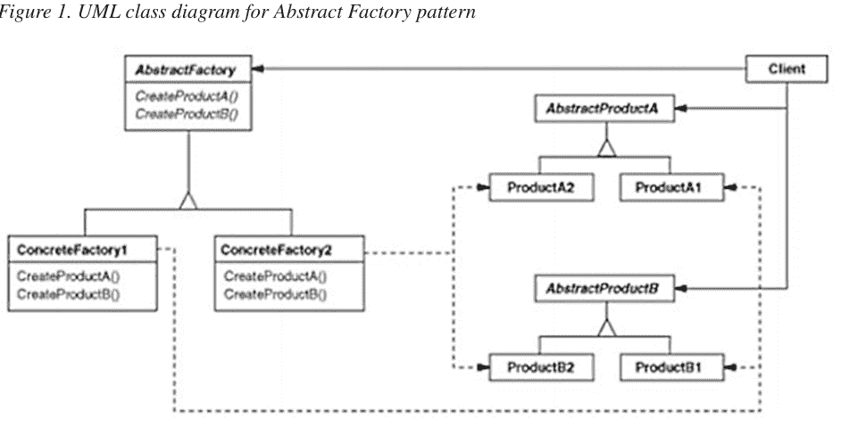

图 1 展示了表示抽象工厂模式行为的 UML 类图。该 UML 类图源自名为 *设计模式* 的书籍（Gamma 等，1994）。

#### 建造者

建造者模式是一种对象创建的软件设计模式。与旨在实现多态性的抽象工厂模式和工厂方法模式不同，建造者模式的目的是为伸缩构造函数反模式找到解决方案。当对象构造函数参数组合的增加导致构造函数列表呈指数级增长时，就会出现伸缩构造函数反模式。建造者模式不使用众多构造函数，而是使用另一个对象——建造者对象，该对象逐步接收每个初始化参数，然后一次性返回最终构造的对象（Gamma 等，1994）。

其目的是抽象对象的构建步骤，以便这些步骤的不同实现可以构建对象的不同表示。通常，建造者模式用于根据组合模式构建产品。

在图 2 中，描绘了表示建造者模式行为的 UML 类图。在此图中，可以识别参与此模式的元素。

*图 2. 建造者模式的 UML 类图*

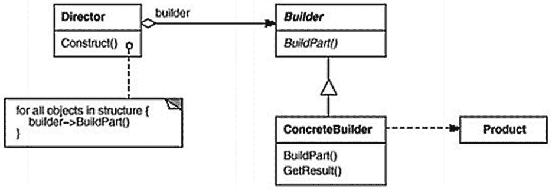

#### 原型

在软件开发中，当要创建的对象类型由原型实例确定，并通过克隆该实例来生成新对象时，会使用原型模式。当系统应独立于其产品的创建、组合和表示方式时，使用原型模式；以及

- 当要实例化的类在运行时指定，例如通过动态加载；或
- 为了避免构建与产品类层次结构并行的工厂类层次结构；或
- 当类的实例可能只有少数几种不同的状态组合时。安装相应数量的原型并克隆它们，而不是每次都以适当的状态手动实例化类，可能更方便（Gamma 等，1994）。

原型模式使用原型实例来指定要创建的对象类型。新产品的原型通常在完全生产之前构建（Gamma 等，1994）。

在图 3 中，展示了表示原型模式行为的 UML 类图。

*图 3. 原型模式的 UML 类图*

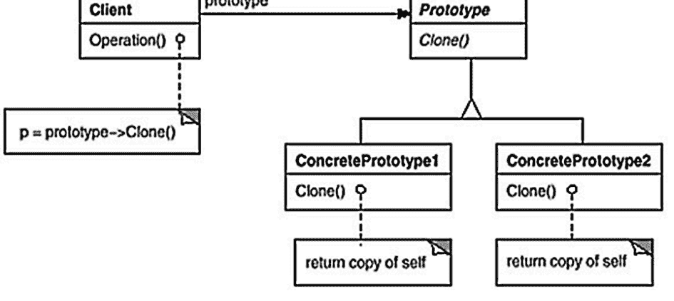

#### 单例

单例模式是一种将类的实例化过程限制为一个对象的设计模式。当系统中恰好需要一个对象来协调操作时，这非常有用。该概念有时被推广到仅存在一个对象时操作更有效的系统，或者将实例化限制到特定数量的对象。该术语源自数学中的单例概念（Gamma 等，1994）。

单例模式的实现过程必须满足单实例和全局访问原则。它需要一种机制来访问单例类成员而不创建类对象，以及一种机制来在类对象之间持久化类成员的值。单例模式通过创建一个类来实现，该类有一个方法，如果类不存在则创建一个新的类实例。如果实例已经存在，则只需返回对该对象的引用。

在图 4 中，描绘了表示单例模式结构行为的 UML 类图。

*图 4. 单例模式的 UML 类图*

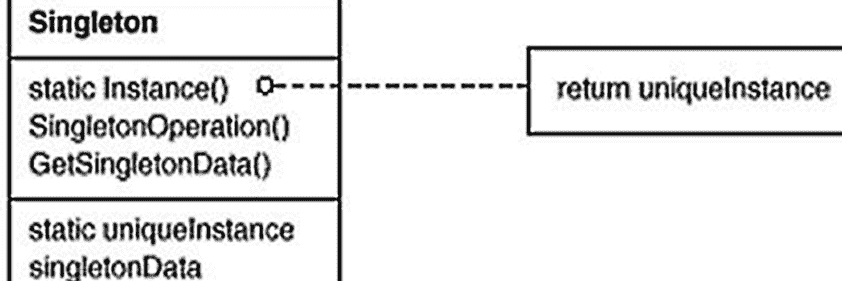

### 2.2. 结构型模式

结构型设计模式的一些示例包括适配器、桥接、组合、装饰器、外观、享元和代理模式。出于实际目的，这里描述最具代表性的模式。

#### 组合

组合模式是一种分区设计模式。组合模式描述了一组对象应被视为与单个对象实例相同的方式。组合的意图是将对象“组合”成树形结构以表示部分-整体的层次结构。实现组合模式让客户端可以统一地处理单个对象和组合对象（Gamma 等，1994）。

当客户端应忽略对象组合与单个对象之间的差异时，可以使用组合模式（Gamma 等，1994）。如果程序员发现他们以相同的方式使用多个对象，并且通常有几乎相同的代码来处理每个对象，那么组合模式是一个很好的选择；在这种情况下，将基本对象和组合对象视为同质对象会更简单。

在图 5 中，组合模式通过 UML 类图表示，其中可以观察到其组件。

*图 5. 组合模式的 UML 类图*


## 面向RIA开发的设计模式支持

### 图5. 组合模式的UML类图

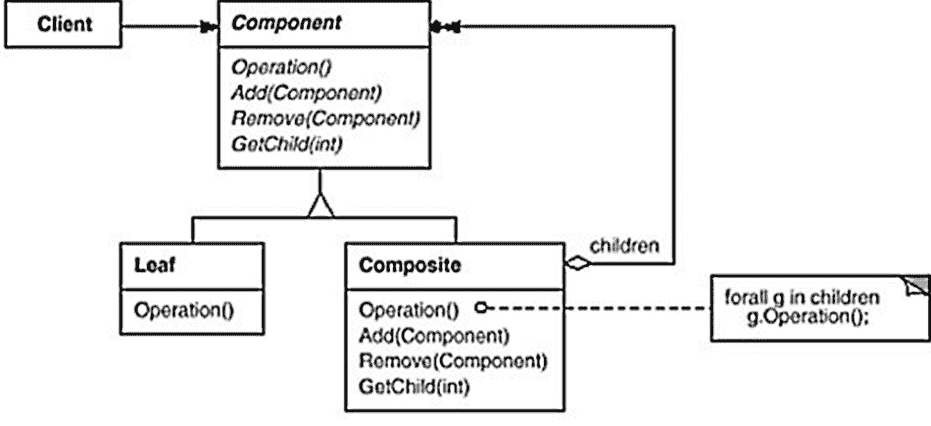

#### 外观模式

外观模式（Façade pattern）是一种常用于面向对象编程的软件**设计模式**。其名称类比于建筑学中的外立面。外观是一个为更大段代码（如类库）提供简化接口的对象。外观可以：

- 使软件库更易于使用、理解和测试，因为外观为常见任务提供了便捷的方法；
- 使库更具可读性，原因同上；
- 减少外部代码对库内部运作的依赖，因为大多数代码使用外观，从而在系统开发中允许更大的灵活性；
- 用一个设计良好的API来包装一组设计不佳的API（根据任务需要）。

**外观模式**为子系统中的一组接口提供统一的接口。**外观模式**定义了一个更高层次的接口，使子系统更易于使用。

这种**设计模式**允许将系统结构化分为多个子系统，这种情况有助于降低软件设计的复杂性。一个常见的设计目标是最小化子系统之间的通信和依赖关系。实现这一目标的一种方法是引入一个外观对象，它为子系统的更通用功能提供单一的简化接口（Gamma 等，1994）。

在图6中，**外观模式**的行为通过UML类图进行描述。

### 图6. 外观模式的UML类图

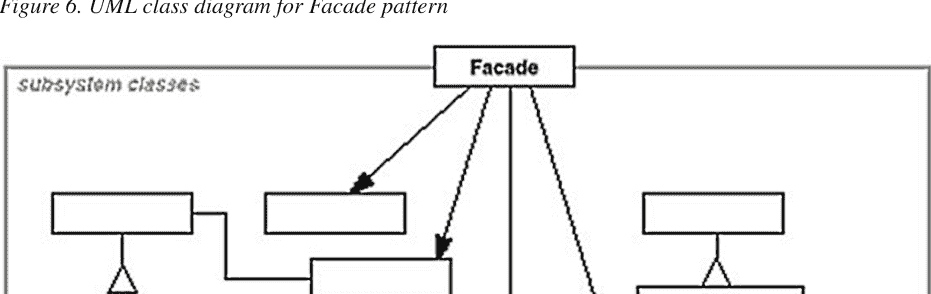

#### 享元模式

**享元**是一种通过与其他相似对象共享尽可能多的数据来最小化内存使用的对象。这是一种在简单重复表示会使用不可接受的内存量时大量使用对象的方法。通常，对象状态的某些部分可以被共享，常见的做法是将它们保存在外部数据结构中，并在使用享元对象时临时传递给它们（Gamma 等，1994）。

**享元模式**的经典应用示例是文字处理器中字符图形的标准数据结构。对于文档中的每个字符，可能希望有一个字形对象，包含其字体轮廓、字体度量和其他格式数据，但这将为每个字符占用数百或数千字节。取而代之的是，对于每个字符，可能存在一个指向享元字形对象的引用，该对象被文档中相同字符的每个实例共享；只有每个字符的位置（在文档和/或页面中）需要内部存储。在其他上下文中，共享相同数据结构的概念被称为**哈希 consing**。

一旦所有代理实例都超出作用域，复杂对象的内存可能被释放。

在图7中，展示了**享元模式**的UML类图。在此UML类图中，可以观察到参与该模式结构的所有类。

### 图7. 享元模式的UML类图

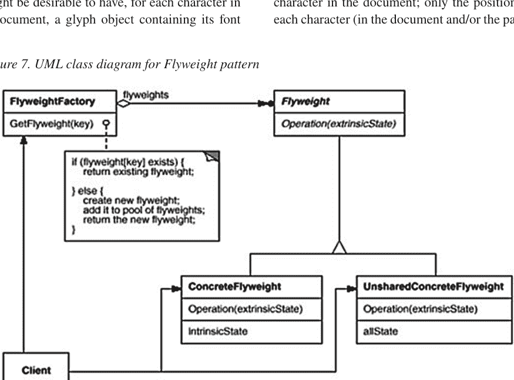

在图8中，描绘了**代理模式**的UML类图。

#### 代理模式

**代理**是一个作为其他东西接口的类。代理可以与任何东西对接：网络连接、内存中的大对象、文件或其他昂贵或无法复制的资源。**代理模式**的一个著名示例是引用计数指针对象（Gamma 等，1994）。在必须存在复杂对象的多个副本的情况下，可以调整**代理模式**以结合**享元模式**，从而减少应用程序的内存占用。通常，创建一个复杂对象的实例和多个代理对象，所有代理对象都包含对单个原始复杂对象的引用。对代理执行的任何操作都会被转发给原始对象。

### 2.3. 行为模式

行为**设计模式**的一些示例包括责任链、命令、解释器、迭代器、备忘录、观察者、状态、策略、模板方法和访问者模式以及中介者模式。出于实用目的，下面介绍最具代表性的模式。

#### 迭代器模式

**迭代器模式**是一种**设计模式**，其中使用迭代器来遍历容器并访问容器的元素。**迭代器模式**将算法与容器解耦；在某些情况下，算法必然是特定于容器的，因此无法解耦。**迭代器模式**的本质是"提供一种顺序访问聚合对象元素的方法，而不暴露其底层表示"（Gamma 等，1994）。

### 图9. 迭代器模式的UML类图

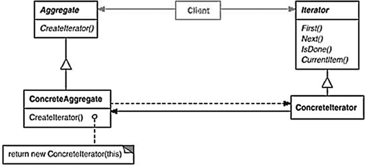

为了便于理解，**迭代器模式**结构的UML类图描绘在图9中。

#### 观察者模式

**观察者模式**是一种软件**设计模式**，其中一个对象（称为主题）维护其依赖者（称为观察者）的列表，并在任何状态变化时自动通知它们，通常通过调用它们的一个方法。它主要用于实现分布式事件处理系统。**观察者模式**也是熟悉的模型-视图-控制器（MVC）架构模式的关键部分。事实上，**观察者模式**最初是在Smalltalk的基于MVC的用户界面框架中实现的。**观察者模式**在众多编程库和系统中实现，包括几乎所有GUI工具包（Gamma 等，1994）。

**观察者模式**的本质是"定义对象之间的一对多依赖关系，以便当一个对象改变状态时，所有依赖者都会自动收到通知并更新"（Gamma 等，1994）。

### 图10. 观察者模式的UML类图

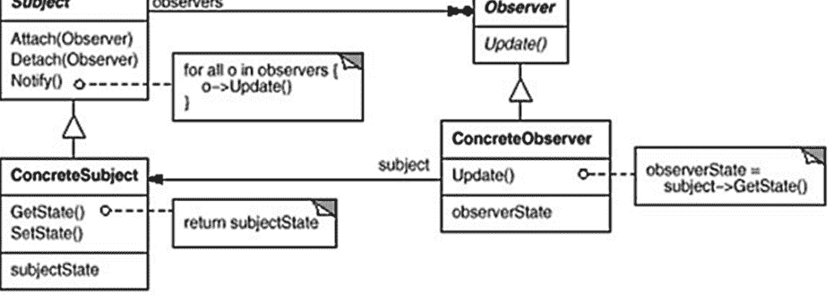

在图10中，描绘了表示**观察者模式**行为的UML类图。

#### 状态模式

**状态模式**与**策略模式**非常相似，是一种行为软件**设计模式**，也被称为*状态对象模式*。这种用于计算机编程的**模式**封装基于对象状态对象的同一例程的不同行为。这可以是一种更简洁的方式，让对象在运行时改变其行为，而无需诉诸庞大的单一条件语句（Gamma 等，1994）。

这种**模式**的一个示例是绘图程序。该程序有一个鼠标光标，在任何时间点都可以作为几种工具之一。不是在多个光标对象之间切换，光标维护一个内部状态，表示当前使用的工具。当调用依赖于工具的方法时（比如，作为鼠标点击的结果），方法调用被传递给光标的状态。每个工具对应一个状态。

如图11所示，描绘了**状态模式**的UML类图。此图描述了该**模式**的主要结构。

### 图11. 状态模式的UML类图

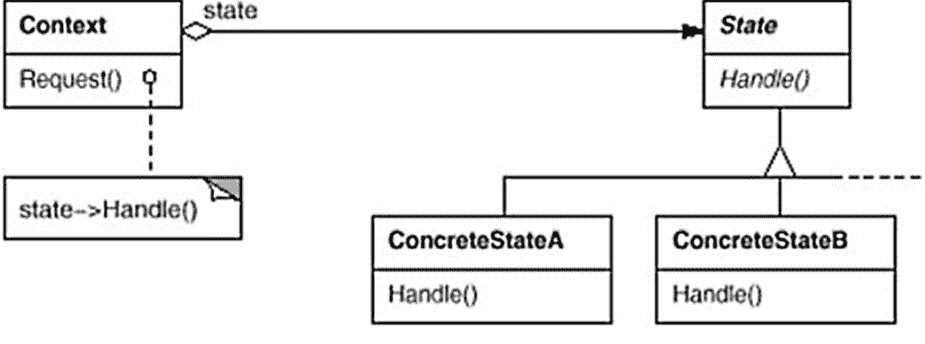

#### 策略模式

**策略模式**（也称为**策略模式**）是一种软件**设计模式**，使算法的行为可以在运行时选择。**策略模式**定义了一组算法，封装每个算法，并使这些算法在该组内可互换（Gamma 等，1994）。例如，一个对传入数据执行验证的类可以使用**策略模式**，根据数据类型、数据来源、用户选择或其他区分因素来选择验证算法。这些因素在每种情况下直到运行时才知道，可能需要执行截然不同的验证。单独封装的验证策略，可以与验证对象分离，被系统中不同区域（甚至不同系统）的其他验证对象使用，而无需代码重复。编程语言中的基本要求是能够存储对数据结构中的某些代码的引用并检索它。

**策略模式**的UML类图描绘在图12中。


# RIA 开发中的设计模式支持

#### 中介者模式

中介者模式定义了一个封装一组对象交互方式的对象。由于该模式可以改变程序运行时的行为，因此被认为是一种行为设计模式（Gamma 等，1994）。

通常一个程序由多个类组成，因此逻辑和计算分散在这些类中。然而，随着程序中类的增多，尤其是在维护和/或重构期间，这些类之间的通信问题可能变得更加复杂。这使得程序更难阅读和维护。此外，程序的修改也会变得困难，因为任何更改都可能影响其他多个类中的代码。通过使用中介者模式，对象之间的通信被封装在一个中介者对象中。对象不再直接相互通信，而是通过中介者进行通信。这减少了通信对象之间的依赖，从而降低了耦合度。

中介者模式的本质是"定义一个封装一组对象交互方式的对象。中介者通过避免对象之间显式地相互引用来促进松耦合，并允许你独立地改变它们之间的交互"（Gamma 等，1994）。

图 13 描绘了中介者模式的 UML 类图。

128

## 3. 基于 JavaScript 框架中的设计模式支持

设计模式是减少开发时间问题和提高解决方案有效性指标的有效方案。需要特别指出的是，并非所有编程语言和 RIA 框架都支持设计模式。如今，开发者越来越关注这些问题，并开发了新特性，为不同框架（如基于 JavaScript 的框架）中的设计模式实现提供支持。用于 RIA 开发的基于 JavaScript 的框架有很多，例如 Dojo、jQuery、Mootools、Qooxdoo、Prototype、Rico、Sencha ExtJS、X-Library、GWT、Cappuccino、SproutCore、Spry、midori 和 YUI Library 等，不胜枚举。本章仅分析八个基于 JavaScript 的框架：Dojo、jQuery、Mootools、Qooxdoo、Prototype、Rico、Sencha ExtJS 和 X-Library。以下小节详细说明了每个框架所提供的设计模式支持范围。

### 3.1. Dojo 中的设计模式支持

Dojo 是一个功能强大的基于 JavaScript 的框架，包含在 Dojo Toolkit 中。表 1 展示了 Dojo 支持的设计模式。

表 1. Dojo 支持的设计模式（Harmon，2008）

| 创建型模式 | 结构型模式 | 行为型模式 |
| :--- | :--- | :--- |
| 单例模式 | 未报告 | 观察者模式 |

表 2 对 Dojo 框架支持的设计模式进行了分析。以下展示了 Dojo 支持的设计模式之一的代表性示例。

#### 观察者模式

观察者是一种结构型模式，实现了发布/订阅功能。它通过一个自主对象（发布者）来完成，该对象允许其他对象根据自身意愿附加或取消订阅。该模式对可以附加或订阅的观察者数量没有任何限制，以便接收发布者状态未来变化的通知。当一个对象想要发布信息而多个对象需要接收该信息时，可以使用此模式。其好处是发布者和订阅者之间实现了松耦合，因为发布者无需知道谁是订阅者或有多少订阅者。该模式的后果是，例如在复杂场景中，可能难以确定对发布者更新的相关性是针对所有订阅者还是仅针对部分订阅者。向所有订阅者发送更新信号可能会带来不必要的通信开销（Christiansson 等，2008）。

为了更好地说明观察者设计模式的使用，下面给出一个实际示例。假设来自不同领域的多个 Web 应用程序或 RIA 由同一家公司管理，而且这些应用程序都用于发布来自同一来源的新闻。问题是 RIA 管理员必须在每个不同的应用程序上分别发布新闻。这种情况会导致时间浪费，从而造成经济损失，还可能产生差异或错误。该问题的一个解决方案是使用观察者设计模式。该设计模式采用发布/订阅结构，在此场景中，新闻的主要来源是发布者或主体，而每个需要发布新闻的网站则是订阅者或观察者。当主体发生变化时，必须将此变化通知观察者，以便观察者能够相应地做出改变。

### 3.2. jQuery 中的设计模式支持

jQuery 是一个被开发者广泛使用的基于 JavaScript 的库。随着 Web 开发需求的增长，jQuery 中设计模式的使用也在不断增加。jQuery 支持不同的设计模式。表 3 展示了 jQuery 支持的设计模式。

表 3. jQuery 支持的设计模式（Osmani，2010）

| 创建型模式 | 结构型模式 | 行为型模式 |
| :--- | :--- | :--- |
| 建造者模式 | 组合模式 | 迭代器模式 |
| 原型模式 | 外观模式 | 观察者模式 |
| | 享元模式 | 策略模式 |
| | 代理模式 | |

表 4 对 jQuery 支持的设计模式进行了分析。

以下展示了 jQuery 支持的设计模式之一的代表性示例。

#### 外观模式

该设计模式为子系统中的一组接口提供了一个统一的接口。它定义了一个更高级别的接口，使子系统更易于使用。外观模式的设计可用于使软件库更易于使用和理解，因为外观模式为常见任务提供了便捷的方法。同样地，它也可以使使用该库的代码更具可读性。还有一种使用场景是可以将多个设计不佳的 API 包装在一个设计良好的 API 中。外观模式的主要好处在于，非常复杂的方法调用和代码块可以合并为一个方法，用于执行复杂且重复的任务。除了使代码更易于使用和理解外，它还减少了库或包之间的代码依赖，使程序员在编写暴露库或包内部工作原理的新代码之前更倾向于慎重考虑。此外，由于外观模式在客户端代码与其他包或库之间建立了弱耦合，它允许变更内部组件，因为客户端不会直接调用它们。一个缺点是对表面之下发生的事情控制力较弱。另外，当某些类需要对外观方法的实现进行小幅调整时，这可能会导致混乱（Christiansson 等，2008）。

外观设计模式的一个代表性示例是所有函数库或框架，如 jQuery 本身，它们非常有用，因为使用者无需了解 API 函数的内部工作原理，只需知道如何调用该函数并了解其一般工作方式即可。同样地，开发者使用外观设计模式来开发自己的 API，即一位经验丰富的 Web 应用程序开


## 富互联网应用开发中的设计模式支持

表 4. jQuery 支持的设计模式分析（Osmani，2010）

| 设计模式 |  |
| :--- | :--- |
| 创建型模式 |  |
| **生成器（Builder）** | 生成器模式抽象了创建对象所涉及的步骤，因此这些步骤的不同实现能够构建对象的不同表示。以下是 jQuery 如何利用该模式的一个示例。该示例展示了如何使用字符串定义来构造一个元素，并将其附加到文档主体中以供显示。<br>$('<div class="foo"> bar </div>'); |
| **原型（Prototype）** | 原型模式用于需要创建的对象由一个原型实例确定的情况，该实例被克隆以产生新对象。本质上，当通过标准方式创建新对象的过程可能代价高昂或过于复杂时，就会使用这种模式。在以下扩展 jQuery.fn 对象以实现最小化插件的代码示例中，底层原型代码使这成为可能：<br>$.fn.plugin = function(){}<br>$('#container').plugin(); |
| 结构型模式 |  |
| **组合（Composite）** | 组合模式描述了一组可以被单个实例以相同方式处理的对象，就像只有一个对象一样。通过实现该模式，单个对象和组合对象都被统一处理。在 jQuery 中，当对单个 DOM 元素或一组 DOM 元素进行操作时，它们可以被统一处理。以下示例展示了这一点：<br>$('#someDiv').addClass('active'); // 单个元素<br>$('div').addClass('active'); // 一组元素 |
| **外观（Facade）** | 外观模式在 OOP（面向对象编程）中相当常见，其中外观是一个为更大的代码片段提供更简单接口的对象，例如使用类库的某个函数。外观在 jQuery 库中随处可见，它们使方法更易于使用和理解，也更易读。以下函数是 jQuery 的 $.ajax() 的外观：<br>$.get();<br>$.post();<br>$.getJSON();<br>$.getScript(); |
| **享元（Flyweight）** | 享元模式是一种设计模式，对象试图通过与其他相似对象共享尽可能多的信息来最小化内存使用量。当简单的重复表示可能使用不可接受的内存量时，这是一种以大量方式利用对象的方法。对象的某些状态方面通常可以共享，这些通常存储在外部数据结构中，在需要时临时传递给享元对象。在该函数中，userConfig 是共享的。此示例使用继承来定义包含有关用户配置的所有信息的对象。这使得节省内存更加容易。<br>$.fn.plugin = function(userConfig){<br>userConfig = $.extend({<br>content: 'Hello user!'<br>}, userConfig);<br>return this.html(useConfig.content);<br>}); |
| **代理（Proxy）** | 代理模式——代理基本上是一个充当其他事物接口的类。代理可以是任何东西的接口：文件、资源、内存中的对象、其他难以复制的事物。jQuery.proxy() 函数接受一个函数作为输入，并返回一个新的函数，该函数将始终具有特定的上下文。这类似于提供接口的想法，如代理模式。<br>$.proxy(function(){}, obj); |
| 行为型模式 |  |
| **迭代器（Iterator）** | 迭代器模式是一种设计模式，其中迭代器（允许遍历集合中所有元素的对象）按顺序访问聚合对象的元素，而无需暴露其底层形式。迭代器封装了该特定迭代发生的内部结构，在 jQuery 中就是 .each() 迭代器，它能够使用 .each() 背后的底层代码来遍历集合，而无需查看或理解在幕后提供此功能的代码。<br>//这里 jQuery 在其事件系统之上使用 DOM 事件<br>$('.button').click(function(){})<br>$('.button').trigger('click', function(){}) |
| **观察者（Observer）** | 观察者模式是指主体（对象）维护一个其依赖者的列表，这些依赖者被称为观察者，并在状态发生任何变化时自动通知它们。这通常通过调用它们的某个方法来完成。观察者模式可以被认为是 PubSub（发布/订阅模式）的子集。jQuery 在其事件系统之上使用 DOM 事件，如以下函数所示。<br>$(".button").click(function(){})<br>$(".button").trigger("click", function(){}) |
| **策略（Strategy）** | 策略模式是一种脚本可以在运行时选择特定算法的模式。该模式的目的是能够提供一种清晰定义算法族的方法，将每个算法封装为对象，并使它们易于互换。此模式提供的最大好处是它允许算法独立于使用它们的客户端而变化。一个例子是 toggle()，它允许将两个或更多处理程序绑定到匹配的元素上，在交替点击时执行。策略模式允许使用替代算法，独立于函数内部的客户端。<br>$("#container").toggle(function(){}, function(){}); |

同类应用程序，例如，需要定期执行相同的功能，导致时间、金钱的浪费以及源代码中可能出现错误。然而，如果所有这些功能都被分组到一个库或 API 中，这些函数就可以在使用时无需担心每次需要时都要开发它们，只需使用函数调用即可。这些资源用于富互联网应用开发。外观设计模式在富互联网应用开发中的另一个重要应用源于管理由一系列子系统组成的复杂系统的需要，以及独立访问这些子系统的可能性，因为通过这种方式，设计模式应该能够实现组成复杂系统的各个子系统之间的高效通信机制，并进而提供与一个或多个子系统的通信，从而实现更加独立、可移植和可重用的系统。

### 3.3. Mootools 中的设计模式支持

Mootools 是一个紧凑的基于 JavaScript 的框架，专为中级到高级 JavaScript 开发人员设计。表 5 显示了 Mootools 支持的设计模式。

表 5. Mootools 支持的设计模式（mootools.net，2013）

| 创建型模式 | 结构型模式 | 行为型模式 |
| :--- | :--- | :--- |
| 单例模式（Singleton） | 未报告 | 未报告 |

在表 6 中，呈现了对 Mootools 框架支持的设计模式的分析。下面展示了 Mootools 支持的一种设计模式的代表性示例。

#### 单例模式（Singleton Pattern）

单例模式提供了控制允许实例数量（通常为 1 个）的可能性。当只允许创建类的一个实例或特定数量的实例时，可以使用此模式。外观对象通常是单例，因为只需要一个外观对象。该模式的优点包括：对唯一实例的受控访问、减少命名空间、允许细化操作和表示等。单例模式的缺点也被一些人认为是反模式，他们觉得它被过度使用，在实际上不需要类的唯一实例的情况下引入了不必要的限制（Christiansson 等，2008）。

## 富互联网应用开发中的设计模式支持

表 6. Mootools 框架支持的设计模式分析（mootools.net，2013）

| 设计模式 |  |
| :--- | :--- |
| 创建型模式 |  |
| 单例模式（Singleton） | Mootools 有一个单例类，它执行单例设计模式的功能。以下是单例模式用法的示例：<br>var MySingleton = new Class.Singleton({<br>initialize: function(){<br>// code here<br>},<br>method1: function(){<br>// code here<br>},<br>method2: function(){<br>// code here<br>}<br>}); |

单例设计模式的一个示例可能是：当对 Web 应用程序或富互联网应用的访问以有限方式允许时，即测试应用程序只允许用户访问一次或有限次数。这种模式很有用，因为一旦用户访问过或用户耗尽了允许的访问次数，应拒绝访问该应用程序。这可以通过单例模式实现。值得注意的是，该模式还有其他与上述相同或更大益处的应用。

### 3.4. Prototype 中的设计模式支持

Prototype 是一个流行的基于 JavaScript 的框架，也是开发人员使用最多的框架之一。表 7 显示了 Prototype 支持的设计模式。

表 7. Prototype 支持的设计模式（prototypejs.org，2013）

| 创建型模式 | 结构型模式 | 行为型模式 |
| :--- | :--- | :--- |
| 单例模式（Singleton）、生成器模式（Builder） | 未报告 | 观察者模式（Observer） |

表 8 呈现了对 Prototype 支持的设计模式的分析。

下面展示了 Prototype 支持的一种设计模式的代表性示例。

#### 生成器模式（Builder Pattern）

生成器模式可用于简化从简单对象构建复杂对象的过程。生成器模式还将复杂对象的构建与其表示分离，以便相同的构建过程可用于创建另一个对象组合。此模式适用于：1）创建复杂对象的算法应独立于组成该对象的部件及其组装方式时，2）构建过程必须为所构建的对象允许不同的表示时，3）客户端需要与实际创建过程和/或最终产品隔离时。使用该模式的好处在于，构建的对象被屏蔽了构建细节，构建代码与表示代码隔离，且两者易于替换而不影响对方，它提供了对构建过程的控制，并提供了独立重用和/或更改过程和/或产品的可能性。


## 设计模式

| 设计模式 |
| --- |
| 创建型模式 |
| **单例** | Prototype 中单例模式的使用示例是通过 SlideShow 对象实现的，因为 SlideShow 对象是作为单例创建的。 |
| **生成器** | createSlide() 函数充当构造函数的作用，因为每次调用 Builder.node 函数时，都会创建一个新元素。<br>var newSlide=Builder.node("div", { className: "slide"<br>});<br>此外，Prototype 具有**代理**元素的功能，并且可以定义**迭代器**元素，也就是说，它也使用了这两种设计模式。 |
| 行为型模式 |
| **观察者** | Snippet 元素充当观察者，根据以下源代码：<br>new Form.Element.Observer("favColor",2,function(el,value){<br>show($F("name")+" likes...",value);<br>}); |

缺点在于创建各种复杂对象时需要灵活性（Christiansson 等，2008）。

生成器设计模式的一个示例是房屋的建造，其中建造过程遵循以下顺序：地板、墙壁和天花板，假设客户向建造者请求建造两栋房屋：木屋和砖房。虽然材料不同，但建造过程是完全相同的，首先是地板，然后是墙壁，最后是天花板。因此，建造过程与任何其他因素隔离开来。这种设计模式在 RIA 开发中非常有用，因为需要构建具有相同结构但元素不同的应用程序。生成器设计模式在 RIA 开发中的一个具体示例可能是网站的自动开发。为此，只需定义网站的结构，例如，所有网站都将由页眉、分为两列的主体和页脚组成，然后生成器将负责自动开发网站，而不必过多关注所开发网站各个部分的内容。

## 表 9. Qooxdoo 中支持的设计模式（qooxdoo.org，2013）

| 创建型模式 | 结构型模式 | 行为型模式 |
| --- | --- | --- |
| 单例 | 未报告 | 未报告 |

### 3.5. Qooxdoo 中的设计模式支持

Qooxdoo 是一个功能强大的基于 JavaScript 的框架，用于开发高级 JavaScript 应用程序。表 9 显示了 Qooxdoo  favColor中支持的设计模式。favColor

表 10 展示了 Qooxdoo 中支持的设计模式的分析。

单例设计模式已在上文定义和讨论；它是一种广泛应用于各种应用程序的模式。这种模式承担着重要的任务，在 RIA 开发中非常有帮助。

### 3.6. Rico 中的设计模式支持

Rico 框架未报告设计模式支持（版本 2.0）。

## RIA 开发中的设计模式支持

表 10. Qooxdoo 框架支持的设计模式分析（qooxdoo.org，2013）

| 设计模式 |
| --- |
| 创建型模式 |
| 单例 | Qooxdoo 使用类 define() 来创建单例类型的实例，以下源代码示例展示了单例模式的使用。qx.Class.define("qx.test.Cat", { type: "singleton" ... }); |

表 11. Sencha ExtJS 中的设计模式支持（sencha.com.，2013）

下面展示了 Sencha ExtJS 支持的设计模式中的一个代表性示例。

| 创建型模式 | 结构型模式 | 行为型模式 |
| --- | --- | --- |
| 单例 | 未报告 | 观察者 状态 |

#### 状态模式

### 3.7. Sencha ExtJS 中的设计模式支持

状态模式允许对象在其内部状态改变时改变其行为。通过使用继承，让子类代表不同的状态和功能，这些可以在运行时切换。这是一种让对象在运行时部分改变其类型的方式。这种模式可用于，1）需要定义一个"上下文"类以便向外界呈现单一接口时。通过定义一个状态抽象基类；以及 2）需要呈现状态机的不同"状态"作为状态基类的派生类时。使用这种模式的好处有：1）当每个状态都是一个类时，代码更整洁；2）使用类来表示状态，而不是常量，等等。缺点是：会生成大量的小类对象，但在此过程中，简化和澄清了程序，并消除了在整个代码中散布大量冗长、相似的条件语句的必要性（Christiansson 等，2008）。

这种模式的一个示例可以是 Web 应用程序的语言更改。让我们假设一个 RIA 提供两种或更多语言，用户可以选择使用哪种语言。为每种语言定义一个状态，应用程序的状态根据选择的语言从一个状态转变为另一个状态。

Sencha ExtJS 是一个功能强大的基于 JavaScript 的框架，用于开发富 Internet 应用程序。表 11 显示了 Sencha ExtJS 中支持的设计模式。表 12 展示了 Sencha ExtJS 中支持的设计模式的分析。

表 12. Sencha ExtJS 框架支持的设计模式分析（sencha.com.，2013）

| 设计模式 |
| --- |
| 创建型模式 |
| 单例 | Sencha ExtJS 通过一个名为 QuickTip 的工具提示类型支持单例模式。要使用 QuickTip，需要通过 QuickTip 实例来激活它。`<div id="tip4" class="tip-target" ext:qtitle="Informacion" ext:qtip="Este es un ejemplo de QuickTip">QuickTip</div>` 要启用 QuickTip，使用以下语句：`Ext.QuickTips.init()` |
| 行为型模式 |
| 观察者 | 通过使用 Sencha ExtJS，有多种监听器类型的方法，这些方法具有其特定功能，它们被称为观察者。这是观察者设计模式的一种应用，以下源代码是一个小示例：`this.addListener("render",this.onRender,this,{ct:this.ct,position:this.position});` |
| 状态 | 状态设计模式非常常用，它也出现在 Sencha ExtJS 中。它用于保存组件的状态并在状态之间切换。以下源代码是使用状态设计模式的示例：`Ext.state.Manager.setProvider(new Ext.state.CookieProvider());` 在此示例中，创建了一个管理器状态；通过 setProvider 方法创建了一个新的 CookieProvider 对象。这意味着应用程序状态保存在客户端的 cookie 中，然后读取该 cookie 以启用组件的实际状态。 |

### 3.8. X-Library 中的设计模式支持

X-Library 框架未报告设计模式支持（版本 4.2）。

### 3.9. 基于 JavaScript 的框架中设计模式支持总结

基于 JavaScript 的框架每天都在其源代码中实现更多的设计模式。这是因为设计模式帮助开发人员以相对简单的方式解决不同的问题，以获得最有效的解决方案，在更短的时间内实现更好的软件开发。表 13 提供了所分析的各个基于 JavaScript 的框架所支持的设计模式的概览。

## 4. 非基于 JavaScript 的框架中的设计模式支持

设计模式对非基于 JavaScript 的 Web 框架也具有很大的帮助和重要性。本节回顾以下非基于 JavaScript 的框架的设计模式支持：AdobeFlex™、JavaFX™、Silverlight™ 和 OpenLaszlo™。以下展示了这些框架中每一个的设计模式支持。

表 13. 基于 JavaScript 的框架中涉及的设计模式

| 框架 | 创建型模式 | 结构型模式 | 行为型模式 |
| :--- | :--- | :--- | :--- |
| **Dojo** | 单例 | 未报告 | 观察者 |
| **jQuery** | 生成器 原型 | 组合 外观 享元 代理 | 迭代器 观察者 策略 |
| **Mootools** | 单例 | 未报告 | 未报告 |
| **Prototype** | 单例 生成器 | 未报告 | 观察者 |
| **Qooxdoo** | 单例 | 未报告 | 未报告 |
| **Rico** | 未报告 | 未报告 | 未报告 |
| **Sencha Ext JS** | 单例 | 未报告 | 观察者 状态 |
| **X-Library** | 未报告 | 未报告 | 未报告 |


RIA 开发中的设计模式支持

表 14. Adobe Flex™ 支持的设计模式（Fain 等，2010）

代理模式

| 创建型模式 | 结构型模式 | 行为型模式 |
| --- | --- | --- |
| 单例模式 | 代理模式 | 中介者模式 |

代理是一种结构型模式，它为另一个对象提供一个替身，以控制对该对象的访问。此模式可用于：1）当某个对象的创建相对昂贵时，用一个代理来确保昂贵对象的实例化保持在最低限度是个好主意；2）当代理模式的实现允许在访问所请求的实际对象之前进行登录和权限检查时；以及 3）当可以为远程位置的对象提供本地表示时。代理模式的优点之一是该模式能够控制对对象的访问，无论是由于该对象的创建过程成本高昂还是出于安全问题。代理模式的缺点是它引入了另一个抽象层次，如果某些对象直接访问目标对象，而另一些通过代理访问，则它们可能获得不同的行为，这可能是也可能不是创建者的意图（Christiansson 等，2008）。

### 4.1. Adobe Flex™ 中的设计模式

Adobe Flex™ 是一个用于富互联网应用程序的高效框架。表 14 展示了 Adobe Flex™ 支持的设计模式。表 15 对 Adobe Flex™ 支持的设计模式进行了分析。值得注意的是，Adobe Flex™ 还支持其他不属于 GoF 分类的设计模式，因此本章未对这些模式进行描述。这些设计模式包括：数据传输对象、异步令牌和类工厂。下面给出了 Adobe Flex™ 支持的一种设计模式的代表性示例。

表 15. Adobe Flex™ 支持的设计模式分析（Fain 等，2010）

| 设计模式 | |
| --- | --- |
| **创建型模式** | |
| 单例模式 | 单例设计模式可表示如下：var model: AppModelLocator.getInstance AppModelLocator = (); Flex 提供了一个名为 Cairngorm 单例的元素，它可以与服务器通信并确保单一实例，其表示代码如下：service = ServiceLocator.getInstance () getHTTPService ('loadEmployeesService.'); Flex 提供了实现单例设计模式的能力，还提供了源代码中已包含的、实现相同功能且已经过测试的元素。 |
| **结构型模式** | |
| 代理模式 | 在 ActionScript 中，可以将类 XYZ 包装在 mx.util.ObjectProxy 中，这将形成一个控制对 XYZ 属性访问的代理。import mx.utils.ObjectProxy var person:Person = new Person; var personProxy:ObjectProxy = new ObjectProxy(person); 在 PersonProxy.mxml 中有一行代码将 Person 类的实例包装到 ObjectProxy 中。 |
| **行为型模式** | |
| 中介者模式 | 中介者设计模式对于任何编程环境都非常有用，因为它包含了用于事件驱动环境（如 Flex）中通信的特殊组件。在 Flex 中，中介者设计模式在分类为布局和导航器的组件中实现。例如，在一个基于 Flex 的应用程序中，Panel 组件包含 TabNavigator 组件，而 TabNavigator 组件包含 TextInput 和 Button 组件。TabNavigator 组件在 Panel 组件与 TextInput 和 Button 组件之间充当中介者。在大多数情况下，中介者设计模式由容器类型组件表示。 |

代理模式最常见的用途之一是安全代理。此代理用于为现有对象添加安全访问，在这种情况下，代理将确定客户端是否可以访问感兴趣的对象。代理模式在 RIA 和 Web 应用程序中被广泛使用，以提供应用程序的安全性。此外，它通过 mx.util.ObjectProxy 类在 Flex 和 ActionScript 中被广泛使用。代理模式的另一个例子是，假设一个应用程序必须快速部署，但它包含的大图像使得下载过程非常缓慢，那么就需要实现代理模式，因为使用此模式可以向用户呈现一个界面，其中图像是按需部署的，当用户选择时，只有当用户同意后，图像才会被下载。甚至在某些情况下，用户可以选择是下载所有图像还是逐个下载。

### 4.2. JavaFX™ 中的设计模式

JavaFX™ 中的 GoF 分类设计模式支持尚未见报道。然而，可以手动实现这些模式，也就是说，开发者可以通过编码来实现这些模式。这可以通过开发具有设计模式架构的功能来实现，也就是说，如果开发者需要，可以通过他们正在使用的编程语言来实现设计模式架构。众所周知，JavaFX™ 使用 MVC 设计模式（模型-视图-控制器）或 MVP 设计模式（模型-视图-展示器）；然而，这些设计模式在本章中未作解释，因为它们不属于 GoF 分类。

### 4.3. Silverlight™ 中的设计模式

Silverlight™ 未报告 GoF 分类的设计模式支持。然而，Silverlight™ 使用 MVC 设计模式和 MVVM 设计模式（模型-视图-视图模型）。

### 4.4. OpenLaszlo™ 中的设计模式

值得注意的是，OpenLaszlo™ 未报告 GoF 分类的设计模式支持。

## 5. 结论

设计模式对开发者来说非常重要且有帮助。良好实现的设计模式可以帮助开发者：1）用简单的解决方案解决复杂问题，2）重用思想，3）减少开发时间，4）降低生产成本，5）应用最佳开发实践，以及其他好处。

可以看出，并非所有框架都具有广泛的设计模式支持；然而，开发公司以及开发者正在最常用的框架中致力于设计模式的实现，以实现更高效的编程。

可以观察到，基于 JavaScript 的框架具有更多的设计模式实现。这种情况有几个原因，包括：1）框架的成熟度，2）编程语言，以及 3）开发社区。基于 JavaScript 的框架由于使用 JavaScript 作为编程语言而具有较高的成熟度，因此学习曲线得以缩短。此外，基于 JavaScript 的框架拥有大量的开发者社区，持续不断地为这些框架添加新功能。非基于 JavaScript 的框架存在一些限制，例如使用专有编程语言和付费许可证。另一个重要的细节是编程语言的持续演变，例如 JavaFX™ 的情况，从一个版本到另一个版本，语法和组件变化太多，使得版本之间不兼容。这些因素使得开发者必须学习新功能。另一个因素是基于 JavaScript 的框架主要关注业务逻辑，即数据库和用户界面之间的信息交换。非基于 JavaScript 的框架基于演示，用于开发图形用户界面，包括页面布局、页面过渡和页面控制元素。

sencha.com. (2013). *API 文档*. 2013 年 1 月检索自 http://docs.sencha.com/extjs/4.1.3/

扩展阅读

Gamma, Carolosader de la Gamow, R. P. (1954). The code of thesObject-Oriented Software. Addison Wesley.

参考文献

关键术语和定义

Christiansson, B., Forss, M., Hagen, I., Hansson, K., Jonasson, J., & Jonasson, M. 等 (2008). *GoF 设计模式——使用 Java 和 UML2 的示例*. Logica Java Architects Training Crew. Authors.

**行为型模式（Behavioral Patterns）：** 识别对象之间常见通信模式并实现这些模式的设计模式。这些模式关注协作对象之间的交互。

Fain, Y., Rasputnis, V., & Tartakovsky, A. (2010). *Enterprise Development with Flex* (p. 688). O'Reilly Media.

**类图（Class Diagram）：** 一种 UML 图，也是一种静态结构图，通过展示系统的类、它们的属性、操作（或方法）以及对象之间的关系来描述系统的结构。

Gamma, E., Helm, R., Johnson, R., & Vlissides, J. (1994). Design Patterns. In *Elements of Reusable Object-Oriented Software*. Addison Wesley.

**创建型模式（Creational Patterns）：** 处理对象创建机制的设计模式，试图以适合当前情况的方式创建对象。

Harmon, J. E. (2008). *Dojo: Using the Dojo JavaScript Library to Build Ajax Applications*. Addison-Wesley Professional.

**设计模式（Design Patterns）：** 针对特定上下文中的常见和反复出现的问题的经过验证的解决方案。

Mootools.net. (2013). *API 文档*. 2013 年 1 月检索自 http://mootools.net/docs/core

**MVC：** 一种软件架构模式。MVC 模式将领域建模、表示和基于用户输入的操作分离为三个类：模型、视图和控制器。

Osmani, A. (2010). *Essential JavaScript & jQuery Design Patterns For Beginners*. Addy Osmani.

**结构型模式（Structural Patterns）：** 通过识别实现实体之间关系的简单方式来简化设计的设计模式，描述对象和类如何组合形成结构。

prototypejs.org. (2013). *API 文档*. 2013 年 1 月检索自 http://prototypejs.org/learn

**UML：** 软件工程领域的一种通用建模语言；UML 旨在提供一种可视化的标准方式来设计系统，由 OMG（对象管理组织）支持。

qooxdoo.org. (2013). *API 文档*. 2013 年 1 月检索自 http://demo.qooxdoo.org/current/apiviewer/#qx.core.Aspect


## 第8章
富互联网应用开发中的用户界面模式支持

## 摘要

第8章综述了为富互联网应用开发，基于非JavaScript框架和基于JavaScript框架所支持的用户界面模式。为此，用户界面模式被划分为过渡模式、查找模式和反馈模式。此外，本章还提供了一系列应用示例，展示了不仅使用用户界面控件，还包括非可视功能或类（如适用）来实现所支持的用户界面模式。这些应用旨在阐明用户界面控件与用户界面模式之间的差异与相似之处。最后，本章呈现了一项比较分析，总结了JavaScript框架与非JavaScript框架在富用户界面设计背景下，富互联网应用框架能力的综述。

## 1. 引言

富互联网应用设计涉及两个主要阶段：1）应用结构设计，以及2）图形用户界面设计，后者又包含三个子任务：a）布局设计，b）图形用户界面控件设计，c）交互设计（Neil，2009）。

布局设计涵盖了视觉元素，即图形用户界面控件在屏幕上的排列方式。在这个意义上，排列富互联网应用图形用户界面控件有常见的方式，即画布、垂直布局和水平布局。事实上，大多数富互联网应用框架都考虑了这些标准布局；因此，Web 2.0社区概述了一系列可用于此设计阶段的屏幕模式，它们可以通过组合图形用户界面控件容器（如面板、表单和前述布局）来实现。

图形用户界面控件设计涵盖了允许应用程序传达所需用户交互的图形用户界面控件的设计。通常，富互联网应用框架既提供一组作为应用构建模块的简单图形用户界面控件，也提供一组外观和感觉定制机制。然而，大多数富互联网应用框架还提供了从简单控件构建自定义图形用户界面控件的可能性。

另一方面，交互设计意味着使用旨在实现有效用户体验的模式，即丰富的交互体验。在这个意义上，大多数富互联网应用框架提供了原生实现交互模式的简单图形用户界面控件，例如，Adobe Flex™或JavaFX™中的进度条（进度指示模式）和手风琴（展开/折叠模式）。然而，某些交互模式需要更多的开发时间和精力来实现。因此，理解图形用户界面控件与交互模式之间的差异并不容易。交互设计模式通常用于通过带来更直观和响应迅速的用户体验，即丰富的用户体验，来简化用户与Web 2.0应用程序之间的交互；简而言之，它们使开发者能够鼓励用户参与应用程序。从作者的角度来看，最流行的交互模式描述如下。

- **提亮与变暗：** 它实际上被视为一对交互设计模式，旨在通过同时提亮图形用户界面的某个区域并变暗其余部分（表示未使用）来将用户注意力集中到该区域。实现这一点最常用的技术是在变暗的背景上显示一个未变暗的覆盖层，这被称为灯箱效果。
- **展开/折叠：** 它允许在用户需要之前隐藏额外的内容；当内容长度超过图形用户界面旨在显示它们的区域长度时，它也很有用。
- **动画：** 它是通过模仿现实世界中的物体过渡来澄清用户交互的一种手段。此模式与拖放交互模式密切相关，因为它通常用于澄清物体的来源和去向。
- **聚光灯：** 它是通知用户应用程序发生变化的主要机制之一。它包括临时将用户注意力集中在图形用户界面的变化上，即使这些变化是由用户明确触发的。
- **自动完成：** 它允许用户节省填写表单的时间，这在互联网搜索引擎中被过度使用，如Google™、Bing™和Yahoo!™，旨在通过提供实时术语建议来优化搜索，这些术语基于先前的输入来创建搜索。此时，此模式被称为实时建议。
- **实时预览：** 在表单提交的上下文中，它用于通过提供关于表单输入的实时反馈来防止错误。它也可以在电子商务的上下文中用作展示可定制产品（如衣服和汽车）的手段。
- **进度指示：** 它是让用户了解后台运行的长时间操作进度的一种手段；它也用于简单地向用户指示必须等待操作完成；即，作为应用程序繁忙的指示。
- **周期性刷新：** 它有助于保持应用程序内容的最新状态；在这个意义上，新内容可以自动或按需加载，正如一些微博客网站（如Twitter™和Facebook™）广泛使用的那样。

根据上述内容，本章旨在综述流行的非JavaScript和基于JavaScript的富互联网应用框架对实现上述交互设计模式的支持，不仅在图形用户界面控件方面，也在非可视类方面。这一系统性综述最终在富图形用户界面设计背景下对富互联网应用框架能力的比较分析中得到了总结。此外，旨在通过使用示例应用程序来解释图形用户界面控件与交互设计模式之间的差异和相似之处。

需要指出的是，本章中介绍的示例实现基于相关基于JavaScript的富互联网应用框架官方文档中提供的演示应用程序。出于实际目的，用于实现这些示例应用程序的源代码并未完整呈现。事实上，本章仅包含每个富互联网应用框架的两个实现。尽管如此，所有上述描述的交互设计模式在示例实现方面都得到了涵盖。

## 2. 基于JavaScript框架中的用户界面模式支持

### 2.1. Dojo中的用户界面模式

#### 提亮与变暗

由于大多数基于JavaScript的富互联网应用框架是根据开源软件许可提供的；它们利用了贡献功能的开发者社区。从这个角度来看，本节中分析的一些交互设计模式并非严格与标准图形用户界面控件相关，而是完全由第三方插件使用HTML控件和CSS样式表语言实现，因此涵盖这些第三方扩展的重要性。这是因为交互模式实际上是一套设计原则和最佳实践，用于提供丰富的用户体验。

Dojo作为*Dojox*包的一部分提供了一个灯箱组件。此组件继承自*Dijit Dialog*类的属性和方法，该类是一个弹出的模态对话框。可以推断，*Dijit*是Dojo的图形用户界面库。在其基础上，*Dojox Lightbox*小部件允许将包含title和href属性的链接转换为小部件；实际上，它既可以以编程方式使用，也可以以内联方式使用。图1展示了在开发图像库时使用*Dojox Lightbox*和*ThumbnailPicker*小部件。*ThumbnailPicker*实际上是一个布局，可以水平或垂直显示一系列图像，并提供用于浏览图像的控件。

图1. 使用Dojox Lightbox和ThumbnailPicker小部件实现提亮与变暗交互设计模式


 **富互联网应用开发中的 UI 模式支持**

#### 展开/折叠

Dojo 提供了一款名为 *AccordionContainer* 的布局容器，用于实现展开/折叠交互设计模式。事实上，Dojo 作为 *Dijit* 包的一部分，提供了一整套布局方案。例如，*AccordionContainer* 布局包含一组面板，每个面板本身都是一个 *ContentPane* 布局的实例，而 *ContentPane* 是 Dojo 最基础的布局，它包含一个标题区域。此外，与 Dojo 的 *TabContainer* 和 *StackContainer* 布局类似，*AccordionContainer* 布局每次只显示一个面板。图 2 展示了 Dojo *AccordionContainer* 布局的使用方式。

*图 2. 使用 Dojo AccordionContainer 布局实现手风琴交互设计模式*

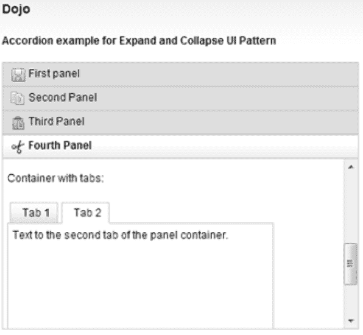

#### 动画

从根本上说，动画交互设计模式可用于为富互联网应用添加效果，即在一定时间内发生的视觉或听觉变化。在这方面，Dojo 拥有一个名为 *Fx* 的子包，提供针对 DOM 节点的特效，包括淡入淡出、滑动和擦除效果。作为 *Dojox* 包的一部分，Dojo 还有一个子包，提供诸如高亮和调整大小等额外效果。每个 Dojo 效果都建立在 *base/fx* 子包提供的基础效果功能之上，该子包包含 *animateProperty()* 函数，该函数允许对 CSS 属性的变化进行动画处理。图 3 展示了使用 Dojo 的 *animateProperty()*、*slideTo()*、*fadeIn()* 和 *fadeOut()* 函数对文本和图像节点进行动画处理。

图 3. 使用 Dojo Fx 引擎实现动画交互设计模式

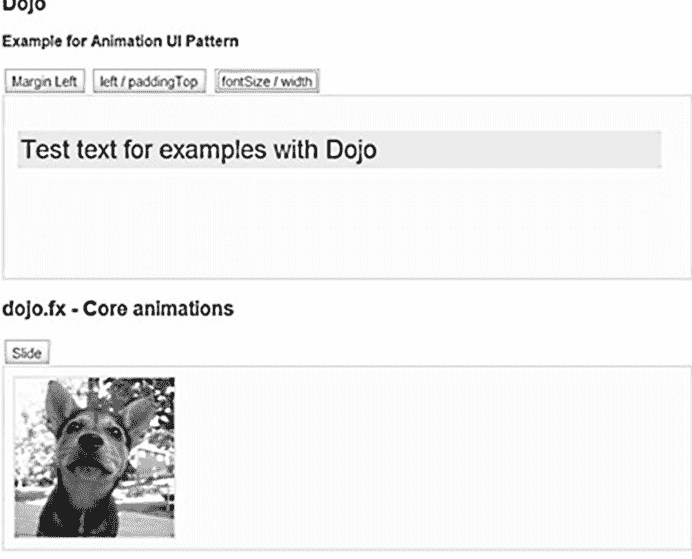

#### 聚光灯

聚光灯交互设计模式通常用于高亮显示图形用户界面的某个区域，以暂时吸引用户的注意力。在这种情况下，该模式与动画模式密切相关。事实上，Dojo 效果引擎提供的功能可用于对布局容器的属性进行动画处理，从而高亮显示图形用户界面上的某些区域。图 4 展示了使用 Dojo 的 *animateProperty()* 函数对 Dojo *ContentPane* 布局的边框颜色和大小进行动画处理。

#### 自动完成

作为 *Dijit* 包的一部分，Dojo 提供了一个名为 *ComboBox* 的部件，它是 HTML *select* 控件和 *input* 控件的混合体。尽管名为 ComboBox，Dojo 的 *ComboBox* 部件在用户输入时，会在文本框下方的弹出窗口中显示与输入部分匹配的值。与实例化 *Dijit* 部件的通常做法一样，*ComboBox* 部件可以以编程方式或声明方式使用；后者方法需要使用 HTML *select* 和 *option* 标签。图 5 展示了 Dojo *ComboBox* 部件在为用户输入提供州名匹配建议方面的使用。

#### 实时预览

Dojo 通过 *Dijit* 包中的 *Form* 类提供了表单验证功能。事实上，它提供了一组具有内置客户端表单验证支持的表单控件。例如，*DateTextBox* 部件是一个日期输入部件，允许用户直接输入或从日历中选择日期。它会根据特定区域的国际化（i18n）规则自动验证输入的内容；此外，它还允许根据开发者提供的约束条件（如最小值和最大值）进行验证。可以推断，这些表单部件通常与 *Dijit Form* 类配合使用，该类等效于 HTML 的 *form* 标签，并提供了 *isValid()* 和 *validate()* 方法来阻止无效表单的提交。图 6 展示了 Dojo *DateTextBox* 部件在 Dojo *Form* 中的使用。此外，图 7 展示了相应的源代码片段。

图 4. 使用 Dojo animateProperty() 函数实现聚光灯交互设计模式

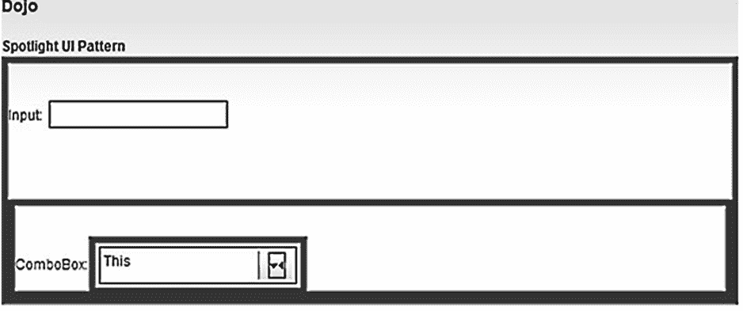

图 5. 使用 Dojo ComboBox 部件实现自动完成交互设计模式

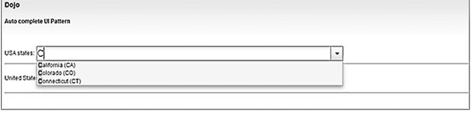

*图 6. 使用 Dojo DateTextBox 部件实现实时预览交互设计模式*

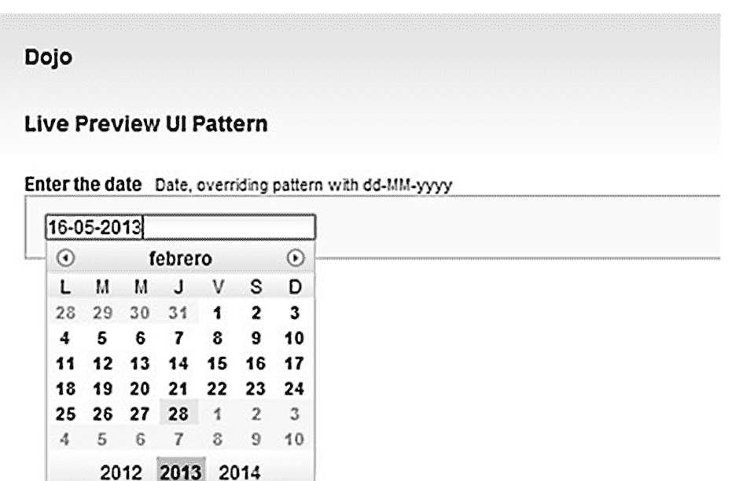

*图 7. 用于实现实时预览交互设计模式的基于 Dojo 的源代码片段*

```
1 <link id="themeStyles" rel="stylesheet" href="../../../dijit/themes/tundra/tundra.css">
2 <script type="text/javascript" src="../../../dojo/dojo.js" djConfig="isDebug: true,
3 parseOnLoad: true, extraLocale: ['de-de', 'en-us']"></script>
4 <script type="text/javascript" src="../_testCommon.js"></script>
5 <script type="text/javascript">
6 	dojo.require("dijit.dijit");
7 	dojo.require("dijit.form.DateTextBox");
8 	dojo.require("dijit.form.Form");
9 	dojo.require("dojo.date.locale");
10 	dojo.require("dojo.parser");
11 	function eventHandler(e){
12 		console.log(this.domNode.getAttribute('widgetId') + ' ' + arguments[0].type);
13 	}
14 </script>
15 ...
16 <form id="form1" dojoType='dijit.form.Form' action="" name="example" method=""
17 onSubmit="return this.validate()">
18 	<div class="dojoTitlePaneLabel">
19 		<label for="pattern">Enter the date</label>
20 		<span class="noticeMessage">Date, overriding pattern with dd-MM-yyyy</span>
21 	</div>
22 	<div class="testExample">
23 		<input id="pattern" name="noDOMvalue" type="text"
24 dojoType="dijit.form.DateTextBox" constraints="{datePattern:'dd-MM-yyyy', strict:true}">
25 	</div>
26 </form>
```

#### 进度指示

Dojo 提供了 *BusyButton* 部件和 *ProgressBar* 部件，前者实现了进度指示模式的最简单形式，后者实现了进度指示模式的最复杂形式。具体来说，*BusyButton* 部件是 *Dojox* 包的一部分，旨在表单提交的上下文中使用；它允许在可配置的超时时间内显示自定义标签。另一方面，*ProgressBar* 部件是 *Dijit* 包的一部分，它允许为长时间运行的 JavaScript 操作的进度提供动态反馈。图 8 展示了 Dojo *BusyButton* 部件的使用。此外，图 9 展示了相应的源代码片段。

图 8. 使用 Dojo BusyButton 部件实现进度指示交互设计模式

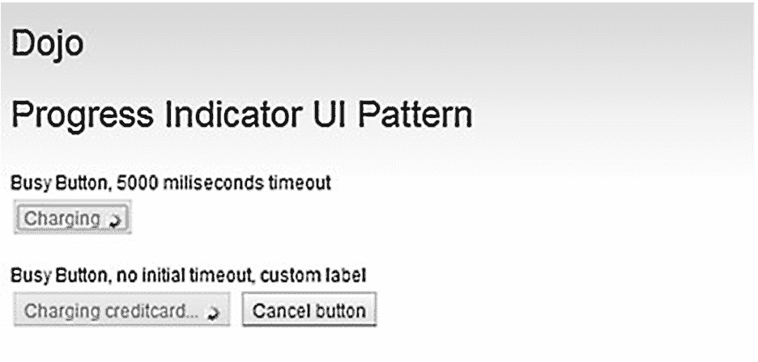

图 9. 用于实现进度指示交互设计模式的基于 Dojo 的源代码片段

```
<script type="text/javascript" src="../../.../dojo/dojo.js" djConfig="parseOnLoad: true,
isDebug: true"></script>
<style type="text/css">
    @import url(../../.../dojo/resources/dojo.css);
    @import url(../../..._static/js/dojo/.../dojox/form/resources/BusyButton.css);
    @import url(../../.../dijit/themes/tundra/tundra.css);
</style>
<script type="text/javascript">
    dojo.require("dojox.form.BusyButton");
</script>
...
<p> Busy Button, 5000 miliseconds timeout <br/>
    <button dojoType="dojox.form.BusyButton" busyLabel="Charging" timeout="5000"
>Click</button>
</p>
```

### 2.2. jQuery 中的 UI 模式

#### 亮化和变暗

jQuery UI 是一个建立在 jQuery 之上的图形用户界面框架，其组件架构中定义了一系列交互设计模式。事实上，它是一组图形用户界面交互、效果、部件和主题。然而，它并不包含亮化和变暗模式，因此必须使用提供此功能的插件。图 10 展示了在 http://leandrovieira.com/projects/jquery/lightbox/ 上可用的 jQuery *lightbox* 插件第 5 版本在开发图片画廊时的使用。此外，该应用的截图如图 10 所示。此外，相应的源代码片段如图 11 所示。


图 10. 使用 jQuery lightbox 插件实现“提亮与变暗”交互设计模式

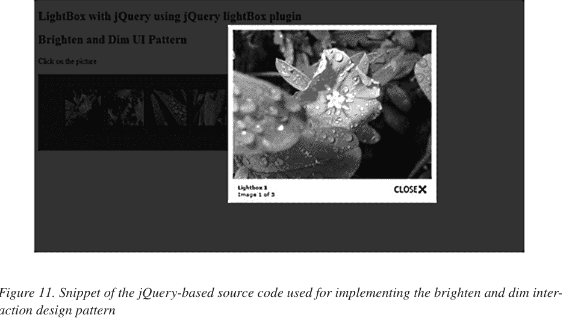

图 11. 用于实现“提亮与变暗”交互设计模式的基于 jQuery 的源代码片段

```
1 <script type="text/javascript" src="js/jquery.js"></script>
2 <script type="text/javascript" src="js/jquery.lightbox-0.5.js"></script>
3 <link rel="stylesheet" type="text/css" href="css/jquery.lightbox-0.5.css" media="screen" />
4 <script type="text/javascript">
5     $(function() {
6         $('#gallery a').lightbox();
7     });
8 </script>
9 ...
10 <div id="gallery">
11     <ul>
12         <li>
13             <a href="photos/image1.jpg" title="Lightbox 1">
14                 
15             </a>
16         </li>
17         ...
18     </ul>
19 </div>
```

#### 自动完成

jQuery UI 框架有一个名为自动完成的原生 GUI 小部件，它使用通过 source 选项提供的简单 JavaScript 数组作为数据源。图 12 展示了 jQuery 自动完成小部件的用法。这里的建议项是城市名称标签。此外，图 13 展示了相应的源代码片段。

图 12. 使用 jQuery 自动完成小部件实现“自动完成”交互设计模式

cc56a46ee37d32a6e156adf2a25e0_167_0.png)

图 13. 用于实现“自动完成”交互设计模式的基于 jQuery 的源代码片段

```
1  <script type="text/javascript" src="../lib/jquery.js"></script>
2  <script type="text/javascript" src="../lib/jquery-ui.js"></script>
3  <link rel="stylesheet" type="text/css" href="main.css" />
4  <script type="text/javascript">
5      $(function() {
6          $("#suggest1").autocomplete({
7              source: cities
8          });
9      });
10 </script>
11
12 <div class="ui-widget">
13     <p>
14         <label for="suggest1">City:</label>
15         <input type="text" id="suggest1" />
16     </p>
17     ...
18 </div>
```

### 2.3. MooTools 中的 UI 模式

#### 提亮与变暗

MooTools 是一个主要处理 Ajax 操作和视觉效果的基于 JavaScript 的框架。事实上，MooTools 的动画引擎依赖于 *Fx* 包的类，是 MooTools 的一个主要组成部分。根据上述内容，MooTools 没有原生小部件。然而，互联网上有一些第三方 MooTools 插件可用。例如，官方 MooTools 网站列出了不同类别的第三方插件，包括小部件。从这个意义上说，有许多插件主要通过 lightbox 效果技术实现“提亮与变暗”交互设计模式。一个名为 *Videobox* 的流行插件提供了一种通过使用覆盖层显示视频的方式；它是一个用于视频的 lightbox。图 14 展示了 MooTools *Videobox* 插件在实现“提亮与变暗”交互设计模式中的用法。此外，图 15 展示了相应的源代码片段。

图 14. 使用 MooTools Videobox 插件实现“提亮与变暗”交互设计模式

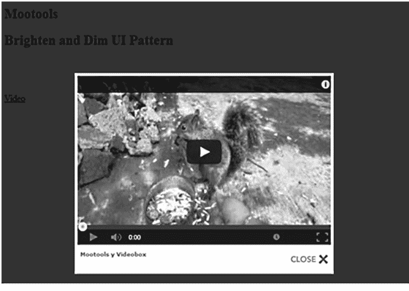

图 15. 用于实现“提亮与变暗”交互设计模式的基于 MooTools 的源代码片段

```
<script type="text/javascript" src="js/mootools.js"></script>
<script type="text/javascript" src="js/swfobject.js"></script>
<script type="text/javascript" src="js/videobox.js"></script>
<link rel="stylesheet" href="css/videobox.css" type="text/css" media="screen" />
...
<div>
    <a href="http://www.youtube.com/v/MrXfbyj26Vk?version=3&amp;hl=es_MX" rel="vidbox" id="flvvideo" title="Mootools y Videobox" >Video</a>
</div>
```

#### 动画

在实现拖放手势的上下文之外，动画交互设计模式可用于模拟现实世界对象转换的各种场景。从这个意义上说，为单个 CSS 属性值添加动画是基于 JavaScript 的 RIA 框架中最基本的动画类型。作为 MooTools Fx 包的一部分，有一组类为简单和复杂的基于 CSS 的动画提供支持，包括 Tween 和 Morph 类。Fx 类层次结构以一个名为 Fx 的类开始，该类定义了启动、暂停和取消效果的方法。具体来说，Tween 类用于将任何 CSS 属性从一个值过渡到另一个值，即实现补间效果。此外，Morph 类用于同时为多个 CSS 属性添加动画。要使用 MooTools Tween 类为单个 CSS 属性添加动画，必须将要动画化的属性名称以及起始值和目标值传递给 start() 方法。图 16 展示了 MooTools *Tween* 类在实现动画交互设计模式中的用法。此外，图 17 展示了相应的源代码片段。

图 16. 使用 MooTools Tween 类实现动画交互设计模式

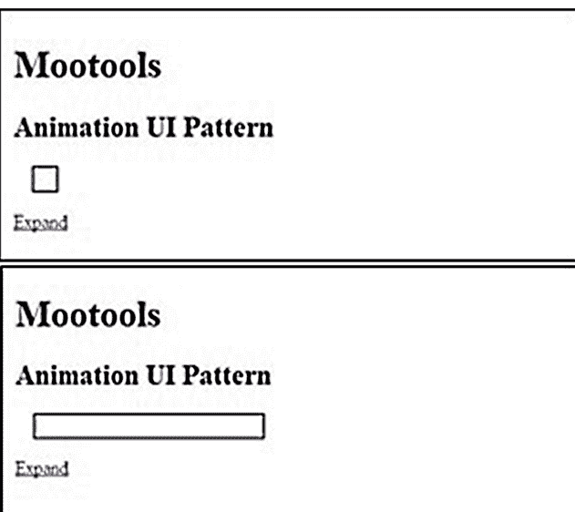

图 17. 用于实现“放下”动画交互设计模式的基于 MooTools 的源代码片段

```
1 <script type="text/javascript" src="js/mootools.js"></script>
2 <script type="text/javascript">
3     var myFx = new Fx.Tween('one_one_div', {
4         duration: 'long',
5         transition: 'bounce:out',
6         link: 'cancel',
7         property: 'width'
8     });
9     document.id('myLink').addEvent('click', function(event){
10        event.stop();
11        myFx.start(140);
12    });
13 </script>
14 ...
15 <div id="one_one_div" style="border: 1px solid; height: 20px; width: 20px;"></div>
```

### 2.4. Prototype 中的 UI 模式

#### 提亮与变暗

Prototype 和 Script.aculo.us 不提供对弹出对话框或窗口的原生支持，作为实现“提亮与变暗”交互设计模式的主要手段。然而，有几个 Prototype 插件通过所谓的 lightbox 效果技术实现了“提亮与变暗”交互模式。例如，*Lightbox Slideshow* 插件是一个用于将图像叠加到当前网页上的脚本，可在 http://www.justinbarkhuff.com/lab/lightbox_slideshow/ 获取。如同其他 lightbox 插件一样，*Lightbox Slideshow* 插件在调用 *initialize()* 方法时，实现了一个旨在将弹出窗口从一个点调整到全尺寸的动画。*initialize()* 方法可以接收一个对象，指定可选的配置选项，例如调整动画的持续时间以及图像调整速度。最后，值得注意的是，此插件还可用于浏览和显示图像组。图 18 展示了 Prototype *Lightbox Slideshow* 插件在实现“提亮与变暗”交互设计模式中的用法。此外，图 19 展示了相应的源代码片段。

#### 展开/折叠

因为 Prototype 主要处理 Ajax 和 DOM 操作，它不将 GUI 组件作为其核心的一部分 (Raymond & Pereira, 2006)。事实上，它通常与 Script.aculo.us 一起使用，后者是一个基于 JavaScript 的库，构建在 Prototype 之上，增加了 GUI 组件、视觉效果和行为类。可以推断，Script.aculo.us 的行为类等同于 jQuery UI 的交互类，它们可以直接映射到富 GUI 设计的交互设计模式层面。然而，Script.aculo.us 迄今为止没有 GUI 控件或布局容器实现“展开/折叠”交互设计模式；因此，必须使用第三方插件。从这个意义上说，互联网上有很多公开可用的 Prototype 插件。例如，可在 http://www.prototype-plugins.com/ 获取的插件仓库列出了一个名为 *e24TabMenu* 的插件，它实现了一个能够展开和折叠的选项卡导航容器。图 20 展示了 Script.aculo.us *e24TabMenu* 插件在实现“展开/折叠”交互设计模式中的用法。此外，图 21 展示了相应的源代码片段。

#### 动画

Script.aculo.us 提供了一组类，允许为 Web 应用程序添加丰富的行为；这些称为行为类的类包括 *Draggable* 和 *Droppables* 类。它还有一个 *Sortable* 类，为布局容器添加了额外的内置拖放操作支持。*Draggable* 类用于使 DOM 元素可被拖动；为此，必须创建 *Draggable* 类的一个新实例。*Droppables* 类是一个静态类，用于使 DOM 元素在可拖动元素被放置到其上时做出反应；为此，可以使用 *Droppables.add()* 方法。尽管使用 Script.aculo.us 的 *Draggable* 和 *Droppables* 类不需要处理鼠标事件，但它们作为配置选项的一部分，接受与典型拖放鼠标事件关联的回调函数。最后，值得注意的是，*Draggable* 类实现了一个拖动动画，包括更改被拖动元素的透明度。


# RIA开发中的UI模式支持

图18. 使用Prototype Lightbox Slideshow插件实现亮化和暗化交互设计模式

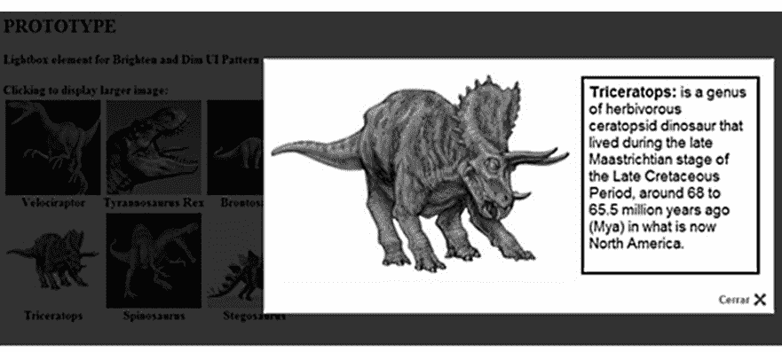

图19. 用于实现亮化和暗化交互设计模式的基于Prototype的源代码片段

```
1   <link rel="stylesheet" href="css/lightbox.css" type="text/css" media="screen" />
2   <script type="text/javascript" src="PyS/Librerias/prototype.js"></script>
3   <script type="text/javascript" src="PyS/Librerias/scriptaculous.js"></script>
4   <script src="PyS/Librerias/lightbox.js" type="text/javascript"></script>
5   <table border="0">
6       <tr>
7           <th><a href="imagenes/dgl.png" rel="lightbox"></a>
8           <center><b>Velociraptor</b></center></th>
9           ...
10      </tr>
11  </table>
```

图20. 使用Script.aculo.us e24TabMenu插件实现展开/折叠交互设计模式

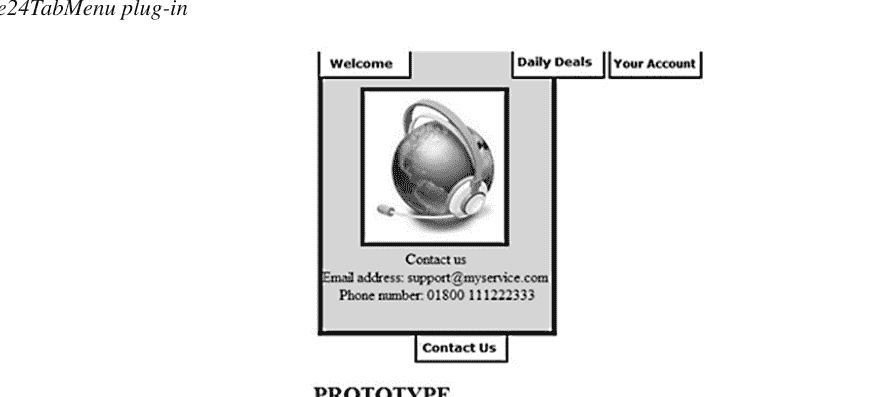

# RIA开发中的UI模式支持

*图21. 用于实现展开/折叠交互设计模式的基于Prototype的源代码片段*

```
<script type="text/javascript" src="../PyS/Librerias/prototype.js"></script>
<script type="text/javascript" src="../PyS/Librerias/scriptaculous.js"></script>
<script type='text/javascript' src='../PyS/Librerias/menujs/e24tabmenu.js'></script>
<script type="text/javascript">
    function initApp() {
        oe24TabMenu = new e24TabMenu("menu", { mode: 'uppertabs', duration: 1.0,
transition: Effect.Transitions.sinoidal });
    }
    Event.observe(window, 'load', initApp, false);
</script>
…
<div id="page">
    <div id="menu">
        <div id="item_bn" class="menutarget">
            <div class="gallery">
                <center>
                <br>欢迎来到 <b>BuysAll.com</b>
                <br>Buys All Store</center>
            </div>
        </div>
        …
    </div>
</div>
```

*图22. 使用Script.aculo.us的Draggable和Droppable类实现拖放动画交互设计模式*

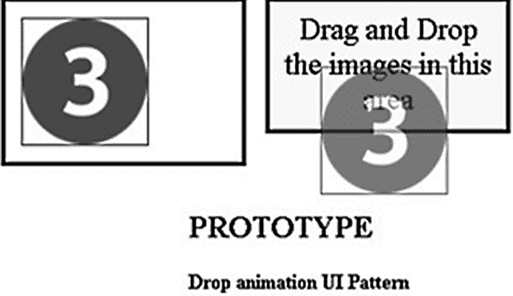

# RIA开发中的UI模式支持

图23. 使用Qooxdoo List组件实现拖放动画交互设计模式

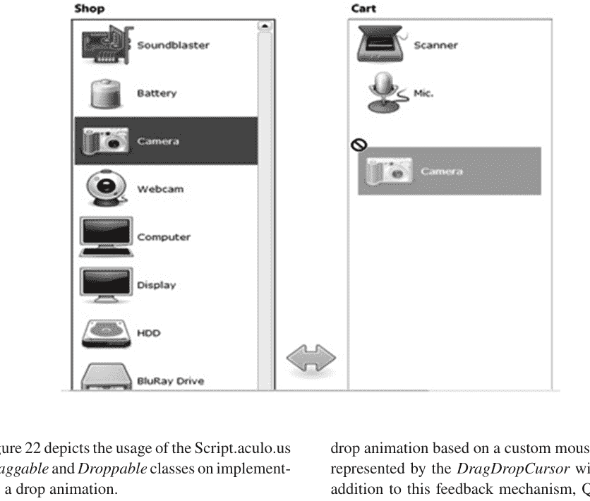

图22展示了Script.aculo.us的*Draggable*和*Droppable*类在实现拖放动画中的用法。

拖放动画基于由*DragDropCursor*组件表示的自定义鼠标光标。除了这种反馈机制外，Qooxdoo还会自动显示正在被拖动项目的快照。图23展示了一个基于Qooxdoo的RIA示例，该示例在*List*组件上实现了拖拽手势。

### 2.5. Qooxdoo中的UI模式

#### 动画

Qooxdoo作为其事件驱动编程模型的一部分，提供了对拖放操作的支持。因此，任何Qooxdoo组件都可以被配置为用作发送者（拖放源）、接收者（拖放目标）或两者兼有。为此，必须在目标组件上启用draggable和droppable属性。除了典型的鼠标事件处理外，必须通过从*DragDrop*事件处理程序类继承的*addAction()*方法在拖放源上指定支持的拖放操作。在这个意义上，支持的拖放操作是copy、move和alias。这种配置自动启用了一个

#### 进度指示

在指示组件类别下，Qooxdoo提供了一个简单的进度条组件。这个名为*ProgressBar*的组件设计用于显示冗长JavaScript操作的当前完成百分度，因此它是一种确定性进度条。它只暴露两个设置方法：一个方法设置进度条的最大值，另一个方法设置进度条的当前值。需要注意的是，与其他进度条实现不同，Qooxdoo的*ProgressBar*组件不允许在进度值旁边显示标签。图24展示了Qooxdoo的*ProgressBar*组件在实现进度指示交互设计模式中的用法。

图24. 使用Qooxdoo ProgressBar组件实现进度指示交互设计模式


### 2.6. Rico中的UI模式

#### 展开/折叠

与其他提供展开/折叠交互设计模式支持的基于JavaScript的RIA框架不同，Rico没有原生的手风琴控件或布局容器；*Rico.Accordion*类实际上是一个简单的脚本，用于将一组HTML `<div>`标签转换为手风琴GUI控件。详细来说，*Rico.Accordion*类允许向相应的*div*元素添加管理展开和折叠行为所需的事件处理程序。在这个意义上，每个手风琴窗格必须使用一对*div*元素表示：一个表示窗格标题，一个表示窗格内容。图25展示了*Rico.Accordion*类在实现展开/折叠交互设计模式中的用法。此外，图26展示了相应的源代码片段。

#### 动画

Rico提供了一组类，使RIA能够支持拖放操作。详细来说，这些类包括一个名为*dndManager*的预定义对象，它允许通过使用*registerDraggable()*和*registerDropZone()*方法轻松定义可拖动（拖放源）对象以及充当放置区域（拖放目标）的对象。为此，Rico提供了*Rico.Draggable*和*Rico.DropZone*类。需要注意的是，与大多数基于JavaScript的RIA框架不同，Rico不需要处理涉及拖放手势的鼠标事件。此外，Rico实现了一个拖放动画，该动画在可拖动对象被拖动时改变拖放区域的外观。图27展示了*Rico.Draggable*和*Rico.DropZone*类在实现拖放动画中的用法。此外，图28展示了相应的源代码片段。

RIA开发中的UI模式支持

图25. 使用Rico.Accordion类实现展开/折叠交互设计模式

## Rico
手风琴UI模式


图26. 用于实现展开/折叠交互设计模式的基于Rico的源代码片段

```
1	<script src="../../src/rico.js" type="text/javascript"></script>
2	<script type='text/javascript'>
3	    Rico.loadModule('Accordion');
4	    Rico.onLoad(function() {
5	        new Rico.Accordion($$('div.panelheader'), $$('.panelContent'),
{panelHeight:200, hoverClass: 'mdHover', selectedClass: 'mdSelected'}));
6	    });
7	</script>
8	
9	<div style='clear:both;'>
10	    <div id="accordionExample">
11	        <div>
12	            <div class="panelheader">
13	                Overview
14	            </div>
15	            <div class="panelContent">
16	                <br>此示例说明如何使用 Rico.Accordion 行为将
17	一组 div 转换为一流的手风琴组件。<br><br>
18	            </div>
19	        </div>
20	        ...
21	    </div>
22	</div>
```

图27. 使用Rico.Draggable和Rico.DropZone类实现拖放动画交互设计模式


图28. 用于实现拖放动画交互设计模式的基于Rico的源代码片段

```
1	<script src="../../src/rico.js" type="text/javascript"></script>
2	<script type='text/javascript'>
3		Rico.loadModule('Corner','DragAndDrop');
4		Rico.onLoad(function() {
5			Rico.Corner.round('explanation');
6			dndMgr.registerDraggable(new Rico.Draggable('test-rico-dnd','dragme'));
7			dndMgr.registerDropZone(new Rico.Dropzone('droponme'));
8			dndMgr.registerDropZone(new Rico.Dropzone('droponme2'));
9		});
10	</script>
11	...
12	<div style="padding:5px;border:1px solid #5b5b5b;height:50px;clear:both;">
13		<div class="box" style="background:#f7a673" id="dragme">拖动我</div>
14	</div>
15	<p><table style="margin-bottom:8px" cellspacing="3" cellpadding="3">
16		<tr>
17			<td>
18				<div id="droponme" class="simpleDropPanel" style="background:#ffd773">
19					<div class="title">放置在我上面</div>
20				</div>
21			</td>
22			...
23		</tr>
24	</table>
```

### 2.7. Sencha Ext JS中的UI模式

#### 亮化和暗化

Sencha Ext JS主要通过一个名为*MessageBox*的实用程序类提供对实现弹出对话框的支持，该类允许创建不同类型的弹出对话框，包括确认、警告以及不确定和确定的进度对话框。所有这些对话


## RIAs开发中的UI模式支持

图29. 使用Ext JS MessageBox类实现变亮和变暗交互设计模式


图30. 使用Ext JS Accordion类实现展开/折叠交互设计模式


对话框默认以模态方式创建；也可以通过正确设置传递给*MessageBox show()*方法的对象的`modal`属性，将其创建为非模态。此外，基于Ext JS *MessageBox*的对话框可以通过正确设置`title`和`closeable`属性，以完整装饰或非装饰对话框的形式显示。另外，Ext JS *MessageBox*类完全实现了变亮和变暗交互设计模式，因为它会在显示对话框之前自动使整个GUI变暗。图29展示了使用Ext JS *MessageBox*类创建简单确认对话框的示例。

#### 展开/折叠

与Dojo类似，Sencha Ext JS也有一个实现了展开和折叠交互设计模式的布局容器。这个名为*Accordion*布局的容器使用可手风琴样式的可展开窗格；它基于堆叠布局，因为一次只允许展开一个窗格。然而，与Dojo *Accordion*容器不同的是，Ext JS *Accordion*容器可以配置为一次展开多个窗格；为此，需要正确设置`multi`属性。此外，与其他手风琴容器的常见实现一样，ExtJS *Accordion*容器只接受一种组件作为直接子组件：由头部和主体部分组成且内置支持展开和折叠效果的Ext JS *Panel*容器。图30展示了使用Ext JS Accordion类的示例。另外，相应的源代码片段在图31中展示。

*图31. 用于实现展开/折叠交互设计模式的基于Ext JS的源代码片段*

```
<link rel="stylesheet" type="text/css" href="../../resources/css/ext-all.css"/>
<script type="text/javascript" src="../../adapter/ext/ext-base.js"></script>
<script type="text/javascript" src="../../ext-all.js"></script>
<script type="text/javascript">
   Ext.onReady(function() {
       var item1 = new Ext.Panel({
           title: 'Accordion Item 1',
           html: '&lt;empty panel&gt;',
           cls:'empty'
_less
       });
       ...
       var accordion = new Ext.Panel({
           region:'west',
           margins:'5 0 5 5',
           split:true,
           width: 210,
           layout:'accordion',
           items: [item1, item2, item3, item4, item5]
       });
   });
</script>
```

#### 动画

Sencha Ext JS拥有一个广泛的类层次结构，抽象了拖放操作所涉及的所有概念。这些类被组织在一个名为*DD*的包中，它们都源自一个名为*DragDrop*的接口，该接口定义了可以作为拖动源或放置目标的项目的基本功能。具体来说，*DragDrop*接口为拖放手势中通常涉及的所有鼠标事件提供了事件处理程序，包括开始拖动、拖动中、拖动悬停和拖动离开。需要注意的是，任何打算被拖动的项目必须通过设置`draggable`属性来允许被拖动。此外，ExtJS *grid*和*tree* GUI组件都通过一个为基于视图的类提供功能的插件，内置支持拖放操作。从这个意义上说，Ext JS *View*类提供了一种使用自定义布局模板和格式显示数据的机制。图32展示了使用Ext JS *grid.DragDrop*插件实现拖动动画交互设计模式的示例。

#### 聚光灯

Sencha Ext JS可以通过原生GUI组件实现聚光灯交互设计模式。事实上，它有一个名为*Spotlight*的GUI组件作为*UX*包的一部分。具体来说，ExtJS *Spotlight*组件用于通过将所有其他应用内容变暗，将用户输入限制在特定的GUI区域。虽然这种行为类似于变亮和变暗交互模式，但Ext JS *Spotlight*组件最适合用户无法与某个GUI区域交互直到另一个区域的更改被确认的情况。此外，可以通过正确设置`duration`属性，在指定的时间段内配置变暗效果。图33展示了使用Ext JS Spotlight GUI组件实现聚光灯交互设计模式的示例。另外，相应的源代码片段在图34中展示。

图32. 使用Ext JS grid.Drag-Drop插件和Ext JS grid小部件实现拖动动画交互设计模式

# 从网格到网格的拖放示例

此示例展示了如何设置从一个GridPanel到另一个的双向拖放。

此示例代表了动画UI模式


图33. 使用Ext JS Spotlight小部件实现聚光灯交互设计模式


```
Ext.onReady(function() {
    var spot = Ext.create('Ext.ux.Spotlight', {
        easing: 'easeOut',
        duration: 300
    })

    Ext.define('DemoPanel', {
        extend: 'Ext.panel.Panel',
        ...
        toggle: function(on) {
            var btns = this.dockedItems.last(),
            btn = btns.items.first();
            if(btn) {
                btn.setDisabled(!on);
            }
        }
    });

    var p1, p2, p3;
    var updateSpot = function(id) {
        if (typeof id == 'string') {
            spot.show(id);
        } else if (!id && spot.active) {
            spot.hide();
        }
        p1.toggle(id == p1.id);
        p2.toggle(id == p2.id);
        p3.toggle(id == p3.id);
    });
```

#### 进度指示

自Sencha Ext JS 2.3.0版本起，有一个名为ProgressBar的组件，支持确定模式和不确定模式。在确定模式下，使用基于值填充的进度条；在不确定模式下，使用显示重复图案的进度条。确定模式是手动的，这意味着必须通过*updateProgress()*方法手动更新进度值。可以推断，基于Ext JS的不确定进度条是自动的，它只需调用*wait()*方法即可无限期运行；或者，可以通过正确设置传递给*wait()*方法的对象的`duration`和`interval`参数，让它运行指定的时间段。图35展示了一个使用Ext JS *ProgressBar*类显示一组不确定和确定进度条的示例应用程序。

图35. 使用Ext JS ProgressBar类实现进度指示交互设计模式


### 2.8. X-Library中的UI模式

#### 动画

X-Library定义了一个名为*xEnableDrag()*的函数，它允许将拖动行为添加到任何DOM元素。它还定义了一个名为*xEnableDrop()*的函数，用于使DOM元素能够接收来自已启用拖动对象的放置事件。具体来说，*xEnableDrag()*函数必须接收要拖动对象的引用，也可以选择接收处理拖动开始、开始和拖动结束事件的鼠标事件的函数。根据上述内容，*xEnableDrag()*函数实现了基本拖动功能，即通过捕获鼠标在x和y坐标上的位置来定位被拖动的对象的功能。与*xEnableDrag()*函数类似，*xEnableDrop()*函数实现了基本的放置功能，因此任何放置动画都必须手动实现。图36展示了使用X-Library *xEnableDrag()*和*xEnableDrop()*函数实现放置动画的示例。另外，相应的源代码片段在图37中展示。

图36. 使用X-Library xEnableDrag()和xEnableDrop()函数实现放置动画交互设计模式


图37. 用于实现放置动画交互设计模式的基于X-Library的源代码片段

```
<script type="text/javascript" src="../x.js"></script>
<script type="text/javascript" src="../lib/xenabledrag.js"></script>
<script type="text/javascript" src="../lib/xconsole.js"></script>
<script type="text/javascript">
    window.onload = function() {
        var i, e, p = xGetElementById('parent');
        for (i = 0; i < 20; ++i) {
            e = document.createElement('div');
            e.className = 'child';
            p.appendChild(e);
            xEnableDrag(e, onDragStart);
        }
    };

    function onDragStart(ele, mouseX, mouseY, xEventObj) {
        var x = xPageX(ele), y = xPageY(ele);
        document.body.appendChild(ele);
        ele.style.float = 'none';
        ele.style.position = 'absolute';
        xMoveTo(ele, x, y);
        xConsole.log('x:' + x + ', y:' + y);
    }
</script>
```

### 2.9 比较

表1总结了本章对基于JavaScript的RIA框架在实现交互设计模式方面的支持分析。它涵盖了八种最流行的模式（见第1节）以及Dojo、jQuery、MooTools、Prototype、Qooxdoo、Rico、Sencha ExtJS和X-Library框架。此比较旨在确定哪个基于JavaScript的RIA框架提供了最广泛的支持来实现交互设计模式，以八种最流行的模式（见第8.1节）为例。然而，选择这些框架中的哪一个也取决于待执行开发项目的内部特性，例如问题领域、日程和预算，即此比较分析的结果对于选择基于JavaScript的RIA框架并非决定性因素。

## 3. 非基于JavaScript的框架中的UI模式支持

交互设计模式不是RIA框架（无论是基于JavaScript还是非基于JavaScript）组件架构的一部分。因此，丰富的设计层次


## 富互联网应用开发中的UI模式支持

**表1. 基于JavaScript的框架对UI模式的支持**

| 框架 | 过渡型模式 | 查找型模式 | 反馈型模式 |
| :--- | :--- | :--- | :--- |
| **Sencha** | Brighten and Dim<br>Expand/Collapse<br>Animation<br>Spotlight | 未报告 | Progress Indicator |
| **Prototype** | Brighten and Dim<br>Expand/Collapse<br>Animation | 未报告 | 未报告 |
| **Dojo** | Brighten and Dim<br>Expand/Collapse<br>Animation<br>Spotlight | Auto Complete | Live Preview<br>Progress Indicator<br>Periodic Refresh |
| **jQuery** | Brighten and Dim | Auto Complete | 未报告 |
| **MooTools** | Brighten and Dim<br>Animation | 未报告 | 未报告 |
| **Qooxdoo** | Animation | 未报告 | Progress Indicator |
| **Rico** | Expand/Collapse<br>Animation | 未报告 | 未报告 |
| **X-Library** | Animation | 未报告 | 未报告 |

本章开头所描述的可以部分映射到非基于JavaScript的RIA技术的组件架构中。例如，Adobe™ Flex的官方集成开发环境（IDE)按类别将组件分组为：1) GUI控件，2) 布局，3) 导航器和4) 图表。在这种情况下，导航器是一种特殊的GUI控件容器，它可以包含其他容器作为子项。另一方面，图表是一种特殊的简单GUI控件，代表了一种提供丰富数据可视化的方式，它们能够实现快速高效的数据分析。

### 3.1. Adobe™ Flex中的UI模式

#### Brighten and Dim

Flex的Alert控件与JavaScript的Alert控件类似，是实现Brighten and Dim交互模式最简单的方式；它显示一个模态弹出对话框，可以包含标题、消息、图标和一对按钮。事实上，该控件通过将网页或窗口（背景）变暗，并在背景上方显示一个未变暗的弹出对话框来实现"Brighten and Dim"交互模式。然而，Flex还为开发人员提供了构建自定义弹出窗口的其他机制，即SkinnablePopUpContainer和TitleWindow布局容器。在任何情况下，这些容器都以弹出窗口的形式出现在其父容器上方；因此，它们不是在其父容器的MXML代码中定义的，而是作为自定义MXML组件，可能在外部的MXML文件中。详细来说，TitleWindow容器包含标题栏、标题栏中的标题和状态区域、内容区域、边框以及可选的关闭按钮，而SkinnablePopUpContainer是用于简单弹出的轻量级容器。此外，尽管两个容器都可以是模态或非模态的，但只有TitleWindow容器支持拖动。在任何情况下，当弹出窗口被定义为模态时，父容器会自动变暗。图38展示了通过SkinnablePopUpContainer实现Brighten and Dim交互模式的方式。

*图38. 使用ActionScript SkinnablePopUpContainer类实现Brighten and Dim交互模式*


#### Expand/Collapse

Expand/Collapse交互模式是一种将额外内容保持隐藏直到用户需要时才显示的方式，它是许多RIA框架中与特定GUI控件紧密关联的交互模式示例之一。例如，Flex包含Accordion导航器容器，它定义了一系列子面板并一次只显示一个面板。每个面板又定义了一个导航按钮，允许用户导航到它。由于Flex Accordion是导航器容器，因此不能直接在其中嵌套控件。详细来说，它是Flex MX组件架构的一部分；因此，它的直接子项必须是MX容器，不过它也接受一个Spark容器，即NavigatorContent容器。一般来说，Accordion对于处理大型表单很有用。在这方面，图39展示了使用Flex Accordion导航器容器实现在线简历应用程序，该应用程序通过五个独立的表单包含五种不同类型的信息。

*图39. 使用Adobe™ Flex Accordion导航器容器实现Expand/Collapse交互模式*


#### Animation

Flex基于列表的控件（如DataGrid和List控件）内置支持拖放交互模式。此外，这些控件还支持放置动画交互模式。而且，可以通过以下方式为任何非基于列表的Flex控件手动添加拖放操作支持：1) 处理涉及的事件，如dragEnter和dragDrop，以及2) 使用特定的ActionScript类，如DragSource（包含正在拖拽的数据）。对于内置的拖放支持，需要通过使用相关基于列表控件的dragEnabled和dropEnabled属性来正确启用拖放操作。此外，要在不同的基于列表的控件之间拖放数据，唯一的要求是数据提供器的结构匹配。dropEnabled属性还会激活默认的放置动画，通过改变基于列表控件的边框颜色并使用自定义鼠标光标来指示预期的放置目标是有效的放置目标。图40展示了一个Flex应用程序的截图，该应用程序允许在两个List控件之间拖放YouTube™视频结果。

*图40. 使用Adobe Flex™ List控件实现拖放和放置动画交互模式*


#### Auto Complete

Auto Complete交互模式定义了一种在用户输入时显示与输入匹配的值的方式。通常，这种行为是通过使用文本框控件进行用户输入，并结合包含基于当前用户输入的可能匹配项的下拉列表控件来实现的。在非基于JavaScript的RIA框架中，没有原生实现此行为的GUI控件，尽管有一些方法。例如，Flex包含ComboBox控件和DropDownList控件，它们基本上允许用户从预定义的选项集中选择一项。详细来说，ComboBox控件包含一个提示区域，允许用户输入以选择预定义的项或输入新项。因此，Flex开发人员可以通过构建自定义MXML或ActionScript控件，或利用第三方控件来实现Auto Complete交互模式。事实上，图39展示了使用基于Flex TextInput和List控件的第三方Auto Complete控件。需要注意的是，这是一个自定义ActionScript控件，它不是基于ComboBox控件或DropDownList控件，而是基于List控件（List控件不是下拉控件）；因此，它还使用Flex PopUpAnchor控件在文本框下方以弹出方式显示匹配值列表。

*图41. 使用第三方ActionScript控件实现Auto Complete交互模式*


#### Live Preview

表单验证可以被认为是Live Preview交互模式的主要用途，该模式允许用户事先了解他们的输入是否合适。在这方面，与传统的Web应用程序不同，RIA可以在用户在客户端修改其输入时就提供即时反馈，而不是等到他们将输入提交给服务器。Flex既包含一个名为*Validator*的事件分发器基类（可以扩展以构建自定义验证器），也包含一组


**富互联网应用程序开发中的UI模式支持**

预定义的验证器控件可用于确保典型数据（如信用卡号、邮政编码和电话号码）符合有效模式。通常，Flex 验证器还可通过使用 *required* 属性来将字段设置为必填项。对于自定义 Flex 验证器，必须重写 *Validator doValidation()* 方法以包含自定义验证逻辑，可能包括根据输入内容匹配正则表达式。无论哪种情况，都需要设置：1）验证器的 *source* 属性为用户输入所在控件的名称，以及 2）验证器的 *property* 属性为验证器应检查的属性的名称。此外，必须为用户输入所在控件的 *errorMessage* 属性设置自定义错误消息，以便在验证失败时显示；否则，将显示默认错误消息。默认情况下，相关控件的边框颜色会变为红色，并在错误消息旁显示一个警告图标。需要注意的是，在 Flex 中触发验证有两种主要方式：1）作为用户输入所在控件发生变化的结果，或 2）作为第三方控件（例如“提交”按钮）发生变化的结果。图 42 展示了使用 Flex 数字验证器来实现实时预览交互模式。此外，图 43 展示了相应的源代码片段。

*图 42. 使用 Flex 数字验证器实现实时预览交互模式*


#### 定期刷新

定期刷新交互模式是与特定 GUI 控件无关的交互模式的一个示例。它是一种在未收到用户直接请求的情况下，向应用程序提供新内容（可能是由用户社区生成的内容）的方式。它可以与与显示附加内容相关的交互模式结合使用。通常，定期刷新交互模式背后的行为与计划任务相关，即主要作为后台进程每隔一定时间执行一次的任务。在这个意义上，有一个 ActionScript Timer 类充当计时器的接口，使应用程序能够在指定的时间序列上运行代码。它提供了常见的计时器函数，如 *start()*、*stop()* 和 *reset()*，以及常见的计时器属性，如 delay（即执行之间的时间间隔）。图 44 展示了在 Flex 应用程序中，定期刷新交互模式与“更多内容”邀请模式相结合的实现。该应用程序的灵感来源于 Twitter™ 的外观和行为。实际上，它使用 ActionScript Timer 类每隔 30 秒搜索已登录 Twitter™ 用户时间线中的新推文；它还使用 Flex List 控件来显示时间线，并使用 Flex Label 控件在 GUI 顶部嵌入一条邀请信息，以便在新推文到达时发现它们。此外，图 45 展示了相应的源代码片段。

*图 43. 用于实现实时预览交互设计模式的基于 Flex 的源代码片段*

```
1	<fx:Script>
2	    protected function validationFailsHandler():void{
3	            postal.errorString = "Please use the NNNNN format.";
4	    }
5	    ...
6	</fx:Script>
7	<fx:Declarations>
8	<s:NumberValidator trigger="{postal}" invalid="validationFailsHandler()"
9	triggerEvent="change" domain="int" maxValue="99999"/>
10	</fx:Declarations>
11	...
12	<mx:Accordion width="87.5%" height="75%" borderColor="0xE6E6E6">
13	    <s:NavigatorContent label="1. Personal Data" width="90%" height="90%">
14	        <s:layout>
15	            <s:HorizontalLayout horizontalAlign="center" verticalAlign="middle"/>
16	        </s:layout>
17	        <s:HGroup horizontalAlign="center" verticalAlign="middle"  width="100%"
18	height="100%">
19	            <s:BorderContainer borderColor="0xE6E6E6" width="33%" height="100%">
20	                <s:Form width="290">
21	                    ...
22	                    <s:FormItem label="Postal Code: *  ">
23	                        <s:TextInput id="postal"/>
24	                    </s:FormItem>
25	                    ...
26	                </s:Form>
27	            </s:BorderContainer>
28	        </s:HGroup>
29	    </s:NavigatorContent>
30	</mx:Accordion>
```

*图 44. 使用 ActionScript Timer 类实现定期刷新交互模式*


*图 45. 用于实现定期刷新交互设计模式的基于 Flex 的源代码片段*

```
1  private function onGetHomeTimeline(event:Event):void {
2      var list:XMLList = new XMLList(new XML(loader.data).status);
3      listCol = new XMLListCollection(list);
4      ...
5      minuteTimer = new Timer(30000);
6      minuteTimer.addEventListener(TimerEvent.TIMER, onTick);
7      minuteTimer.start();
8      for(index;indice<listCol.length;index++){
9          row=new Object();
10         row.id=listCol[index].id.toString();
11         ...
12         data.addItem(row);
13     }
14     tweets.dataProvider = data;
15 }
16 private function onTick(event:TimerEvent):void {
17     getHomeTimeline(true);
18 }
```

### 3.2. JavaFX™ 中的 UI 模式

#### 展开/折叠

除了复杂表单的实现，展开/折叠交互模式的另一个典型用途是实现包含不同类型信息需要显示的应用程序，例如产品目录，通常一次只显示一种产品。图 46 所示的 JavaFX™ 应用程序是一个通过折叠面板控件提供静态内容的 RIA 示例。与 Flex 类似，JavaFX™ 包含一个原生的折叠面板控件，它实际上是一组 *TitledPane* 控件。可以推断，与 Flex 的 *Accordion* 控件不同，JavaFX™ 的 *Accordion* 控件必须包含一种特定类型的控件作为直接子项。*TitledPane* 控件是一个带有标题的面板，可以打开和关闭，并且可以封装任何 *node*，无论是控件还是布局容器。*TitledPane* 控件的标题通过使用 *setText()* 方法设置，而内容则通过使用 *setContent()* 方法添加。此外，一个标题窗格可以作为独立控件使用，即可以在折叠面板之外使用。

#### 进度指示

进度指示交互模式是另一个大多数非 JavaScript RIA 框架以原生方式实现的交互模式示例。它允许让用户了解漫长过程的进度，例如上传、搜索或加载操作。在其最简单的形式中，此模式用于通知应用程序当前正忙于一个漫长过程；因此，在基于非 JavaScript 的 RIA 框架中存在一个忙碌控件，即 Flex Busy 控件，它仅限用于移动应用程序。需要注意的是，本节仅关注进度指示器交互模式的最简单形式。JavaFX™ 2.2 包含一个 *ProgressIndicator* 类和一个 *ProgressBar* 子类。*ProgressBar* 类将进度可视化为完成条，而 *ProgressIndicator* 类将进度可视化为饼图。这两个控件都提供了指示特定任务正在处理以及检测任务已完成多少的能力。在这个意义上，进度百分比是通过 *setProgress()* 方法设置 *progress* 变量在 0 到 1 之间的值来指示的。*progress* 变量的负值表示进度处于不确定模式。在这种情况下，控件将保持不确定模式，直到任务长度被确定，即它们指示某个操作正在进行中，但未指定当前的进度百分比。可以推断，此方法可用于将 JavaFX™ ProgressBar 和 ProgressIndicator 控件显示为忙碌指示器控件。图 47 展示了使用 JavaFX™ ProgressIndicator 控件实现进度指示器交互模式。此外，图 48 展示了相应的源代码片段。

*图 46. 使用 JavaFX™ Accordion 控件实现展开/折叠交互模式*


#### 变亮和变暗

与 Flex 和 Silverlight™ 不同，JavaFX™ 2.2 没有对类似警报对话框的通用支持；此功能目前正在开发中，并在 JavaFX™ 3.0 路线图上。因此，开发人员可能需要创建自己的实现，可以使用或扩展 JavaFX™ 的 *Stage* 类。*Stage* 类是 JavaFX™ 的顶级容器，它继承自 JavaFX™ 的 *Window* 类，而 *Window* 类也是其他类（如 *PopupWindow* 类）的父类。*PopupWindow* 类依次是 *Popup* 和 *PopupControl* 类的父类，这些是用于 *scene graphs* 的特殊类窗口容器，通常用于类似工具提示的通知和下拉框。尽管 *PopupWindow* 类似乎是实现弹出对话框的最佳选择，但 *PopupWindow* 窗口没有装饰，即不包括标题栏。因此，在某些情况下


## RIA 开发中的 UI 模式支持

图 47. 使用 JavaFX™ ProgressIndicator 控件实现进度指示交互模式


图 48. 用于实现进度指示交互设计模式的 JavaFX™ 源代码片段

```
1	cell.addEventFilter(MouseEvent.MOUSE_PRESSED, new EventHandler<MouseEvent>() {
2	    @Override
3	    public void handle(MouseEvent元人r) {
4	        ...
5	        currentVideo.setText(((Title)((Video)table.getSelectionModel().getSelectedItem()
6	    .getTitle()).getTitle());
7	        progress.setVisible(true);
8	        event.consume();
9	    }
10	});
11	Label currentVideo = new Label("-");
12	javafx.scene.control.ProgressIndicator progress=new
13	javafx.scene.control.ProgressIndicator();
14	progress.setStyle("-fx-progress-color:CCCCCC;");
15	progress.setVisible(false);
16	boxRight.getChildren().addAll(currentVideo,progress);
```

当需要标题栏时，为 JavaFX™ *PopupWindow* 窗口添加标题栏样式可能是一项耗时的任务。另一方面，*Stage* 窗口默认带有装饰；它可以被定义为模态或非模态窗口。图 49 展示了一个 JavaFX™ 应用程序

图 49. 使用 JavaFX™ Stage 类实现变亮和变暗交互模式


该应用程序使用 *Stage* 类来显示一个模态弹出对话框，其中包含从列表中所选缩略图的全尺寸图像。需要注意的是，与 Flex 的 *SkinablePopUpContainer* 容器不同，JavaFX™ *Stage* 类不具备自动使 *Stage* 窗口的父容器（背景）变暗的功能。为此，示例应用程序使用了 JavaFX™ *ColorAdjust* 效果来调整背景的饱和度。

#### 聚光灯提示

聚光灯提示提供了一种在 GUI 中微妙地通知用户更改的手段。由于这种交互模式可以应用于不同类型的对象，通知可以通过多种方式实现。因此，在基于非 JavaScript 的 RIA 框架中，没有与聚光灯提示交互模式紧密关联的 GUI 控件。一种常见的方法是在 GUI 已更改的区域上方显示状态消息，并随时间推移逐渐淡出。为此，没有必要实现一个弹出带有通知消息的"窗口"的机制。这项任务只需使用一个标签控件，并通过绝对定位将其放置在 GUI 上即可完成，即显式设置其 x 和 y 坐标值。图 50 所示的 JavaFX™ 应用程序使用 JavaFX™ *HBox* 布局来构建一个自定义通知消息，该消息包含文本消息和图像。该应用程序允许用户搜索 YouTube™ 视频；它以每页五条结果的形式显示视频搜索结果，并允许将最多五个视频添加到视频播放列表中。每次将视频添加到播放列表时，GUI 右上方会显示一条通知消息。通知消息在五秒后被移除；但它们每隔一秒就会淡出，以便区分新消息和旧消息。上述行为是通过使用 JavaFX™ *Timeline* 类和 *HBox* 类继承的 *setOpacity()* 方法来实现的，该方法通过 0 到 1 之间的值来指定节点的不透明度。此外，图 51 展示了相应的源代码片段。

*图 50. 使用 JavaFX™ Timeline 类实现聚光灯提示交互模式*


图 51. 用于实现聚光灯提示交互设计模式的 JavaFX™ 源代码片段

```
public void displaySpotlight() {
    spotCount++;
    final HBox spot = new HBox();
    ...
    spot.setLayoutX(boxCenter.getLayoutX()+boxCenter.getWidth()-(spot.getWidth()+10));
    spot.setLayoutY(boxCenter.getLayoutY()+spotCount*(spot.getHeight()+25));
    spot.setStyle("-fx-background-color:CCCCCC; -fx-border-color:gray; -fx-dash-style:dashed;");
    ((Group)stage.getScene().getRoot()).getChildren().add(spot);

    Timeline fiveSecondsWonder = new Timeline(new KeyFrame(Duration.seconds(5), new
EventHandler<ActionEvent>() {
        @Override
        public void handle(ActionEvent event) {
            try {
                stop();
                ((Group)stage.getScene().getRoot()).getChildren().remove(spot);
                spotCount--;
            }
            catch(Exception e) {}
        }
    }), new KeyFrame(Duration.seconds(3), new EventHandler<ActionEvent>() {
        @Override
        public void handle(ActionEvent event) {
            spot.setOpacity(0.5);
        }
    }));

    fiveSecondsWonder.setCycleCount(Timeline.INDEFINITE);
    fiveSecondsWonder.play();
}
```

图 52. 在 JavaFX™ TableView 控件中实现拖放动画交互模式


#### 动画

与 Flex 不同，JavaFX™ 不包含内置支持拖放手势的控件。因此，JavaFX™ 开发者必须手动实现拖放手势。此任务不仅涉及相关事件的处理，还包括拖放动画的实现，即目标控件外观的变化，以向用户提示数据可以放置的位置。从这个意义上说，源控件必须至少为 *MouseEvent*.*DRAG_DETECTED* 事件实现一个处理程序，以便通过调用从 *Node* 类继承的 *startDragAndDrop()* 方法来启动拖放手势。必须为 *DragEvent.DRAG_OVER* 事件实现一个处理程序，以指定哪个控件接受数据，因为拖放操作开始后，鼠标拖动经过的任何控件都是放置数据的潜在目标。此外，目标控件必须为 *DragEvent.DRAG_DROPPED* 事件实现一个处理程序，该事件在拖放手势目标上释放鼠标按钮时触发；此处理程序必须通过调用 *setDropCompleted()* 方法来完成拖放手势。图 52 展示了一个示例应用程序中拖放手势的实现，该应用程序允许用户在两个视频列表之间拖放 YouTube™ 视频项。每个视频项包含一个显示视频缩略图的 JavaFX™ *ImageView* 控件。视频列表使用 JavaFX™ *TableView* 控件实现。该示例应用程序通过更改目标表格的边框颜色并在 GUI 上移动被拖动的视频缩略图快照来实现拖放动画。快照通过 *DragEvent* 类的 *x* 和 *y* 属性在 *ImageView* 控件被拖动时定位在 GUI 上。需要注意的是，JavaFX™ 2.2 在 Windows 上不支持自定义拖放光标。

## Silverlight™ 中的 UI 模式

#### 展开/折叠

与 Flex 和 JavaFX™ 不同，Silverlight™ 没有对展开/折叠交互模式的原生支持，即它没有原生的折叠面板控件。不过，Silverlight™ 标准开发工具包（SDK）中包含一个折叠面板控件，该工具包由 Silverlight™ Toolkit 开源项目发布。此 *Accordion* 类继承自 Windows™ 的 *ItemsControl* 类；因此，它可以用于呈现一组项目。实际上，Silverlight™ Toolkit *Accordion* 控件由一组可折叠面板组成，每个面板实际上是一个 *AccordionItem* 控件。每个 *AccordionItem* 控件的标题通过 *Header* 属性设置，而内容则通过 *Content* 属性设置。要在折叠面板中显示的元素既可以作为直接子元素添加，也可以通过模板添加。在这个意义上，Silverlight™ Toolkit *Accordion* 控件公开了一个 *HeaderTemplate* 属性和一个 *ContentTemplate* 属性，它们通常在涉及数据绑定操作时使用，分别允许设置 *AccordionItem* 的 *Header* 和 *Content* 属性。与 Flex 和 JavaFX™ 的 *Accordion* 控件不同，如果添加到 Silverlight™ Toolkit *Accordion* 控件中的项目不是 *AccordionItem* 类型，它们在运行时会被包装在 *AccordionItem* 控件中。此外，Silverlight™ Toolkit *Accordion* 控件允许通过适当设置 *SelectionMode* 属性来同时展开多个面板；这种非标准行为在特定情况下可能很有用。此外，该控件除了典型的垂直布局外，还可以使用水平布局来显示其面板。图 53 展示了 Silverlight™ Toolkit *Accordion* 控件在展开/折叠交互模式实现中的使用。

#### 进度指示

Silverlight™ 应用程序可以使用 Silverlight™ 原生的 *ProgressBar* 控件或 Silverlight™ Toolkit 的 *BusyIndicator* 控件来实现进度指示器交互模式。与 Flex 和 JavaFX™ 的 *ProgressBar* 控件类似，Silverlight™ 的 *ProgressBar* 控件可以用作根据值填充的进度条（确定型），也可以通过将 *IsInDeterminate* 属性设置为某个值来显示重复模式的进度条（不确定型）。不确定型样式可作为忙碌指示器控件的替代方案，后者是本章中用于实现进度指示器交互模式的控件。另一方面，*BusyIndicator* 控件用作包装控件，用于包装导致应用程序进入忙碌状态的内容。这样做时，内容在忙碌指示器显示期间被禁用；同时还会对被禁用的内容应用视觉效果，以完善提供给用户的反馈。图 54 展示了使用 Silverlight™ Toolkit *BusyIndicator* 控件实现进度指示器交互模式的效果。

#### 变亮和变暗

除了支持 JavaScript 警告弹出框之外，Silverlight™ 还提供了两种不同的原生控件，开发者可以使用它们来实现自定义弹出框：*PopUp* 和 *ChildWindow* 控件。Silverlight™ 的 *PopUp* 控件通常用于临时显示附加内容，如帮助信息；它被定位在现有 Silverlight™ 控件的上方。


# UI Patterns Support on RIAs Development

图 53. 使用 Silverlight™ Toolkit Accordion 控件实现展开/折叠交互模式


控件，即在另一个控件的边界内。Silverlight™ PopUp 控件的内容使用其 Child 属性设置；它可以接受一组控件，这些控件可以像 Silverlight™ Group 控件那样组合在一个容器中。另一方面，Silverlight™ ChildWindow 控件提供了一个作为模态弹出窗口显示在父窗口之上的窗口，即一个阻止与父窗口交互的子窗口。该控件不仅像 Flex SkinnablePopUpContainer 容器那样使父窗口变暗，而且实际上包含一个覆盖父窗口的暗淡覆盖层。此外，与 Silverlight™ PopUp 控件不同，Silverlight™ ChildWindow 控件包含装饰元素，即一个包含关闭按钮的标题栏。因此，在需要实现模态弹出框的情况下，ChildWindow 控件似乎是最合适的选择。此外，如图 55 所示，该控件允许开发者以省时省力的方式实现变亮和变暗的交互模式。

#### 动画

Silverlight™ 没有原生控件内置支持拖放手势。然而，Silverlight™ Toolkit 提供了一系列包装控件，为嵌套在其中的控件添加了默认的拖放功能：TreeViewDragDropTarget、ListBoxDragDropTarget 和 DataGridDragDropTarget。事实上，几乎每一种旨在显示数据的 Silverlight™ 原生控件都有一个对应的 Silverlight™ Toolkit DragDropTarget 控件。当项目被拖动到 Silverlight™ Toolkit DragDropTarget 控件上时，它会自动启动拖放操作。此外，当一个项目被放置到 Silverlight™ Toolkit DragDropTarget 控件上时，它会自动添加到 DragDropTarget 控件内部嵌套的控件中。虽然 Silverlight™ Toolkit DragDropTarget 控件在项目被拖动时会自动显示其快照，但也可以手动实现自定义的放置动画。在这个意义上，为了指示一个控件是否可以接受放置操作，必须正确设置其 *AllowDrop* 属性。图 8.56 描绘了在允许用户在两个视频列表之间拖放 YouTube™ 视频项目的示例应用程序中拖放手势的实现。每个视频列表都是通过使用包装在 Silverlight™ Toolkit *DataGridDragDropTarget* 控件中的 Silverlight™ *DataGrid* 控件实现的。该示例应用程序通过更改目标 Silverlight™ *DataGrid* 控件的边框颜色，补充了 Silverlight™ Toolkit *DataGridDragDropTarget* 控件提供的放置动画。此外，图 57 展示了相应的源代码片段。

UI Patterns Support on RIAs Development

图 54. 使用 Silverlight™ Toolkit BusyIndicator 控件实现进度指示器交互模式


图 55. 使用 Silverlight™ ChildWindow 控件实现变亮和变暗交互模式


UI Patterns Support on RIAs Development

图 56. 使用 Silverlight™ Toolkit DataGridDragDropTarget 控件实现放置动画交互模式


#### 自动完成

自动完成交互模式可能是最广泛使用的交互模式。像 Google™ 和 Bing™ 这样的搜索引擎使用这种交互模式来提供用户可以选择的建议列表，而无需完成搜索关键词的输入。Silverlight™ SDK 有一个 *AutoCompleteBox* 控件，它使用一个项目集合来生成要显示在下拉列表中的建议列表。与其他类似控件（如组合框）不同，自动完成框会在用户在其文本框区域中输入时即时过滤建议列表。在这个意义上，Silverlight™ Toolkit *AutoCompleteBox* 默认使用“以...开头”的过滤模式；然而，它也定义了其他替代模式，如“包含”或“等于”。使用的过滤函数通过 *FilterMode* 属性设置。此外，该控件公开了一个 *IsTextCompletionEnabled* 属性，该属性允许控件在文本框中自动显示第一个可能的匹配项，正如 Google™ 自动完成框所做的那样。最后，Silverlight™ Toolkit *AutoCompleteBox* 控件不仅可以显示文本字符串作为建议，还可以显示由图像和文本字符串组成的复杂项目。为此，必须将 *ItemTemplate* 属性设置为一个容器，如 Silverlight™ *StackPanel* 控件。图 58 描绘了在实现基于 Last.fm™ 的搜索引擎中使用 Silverlight™ Toolkit AutoCompleteBox 控件的情况。此外，图 59 展示了相应的源代码片段。

## UI Patterns Support on RIAs Development

图 57. 用于实现放置动画交互设计模式的基于 Silverlight™ 的源代码片段

```
1  <data:DataGridDragDropTarget>
2      <sdk1:DataGrid x:Name="VideosGrid"...>
3          <sdk1:DataGrid.Columns>
4              <sdk1:DataGridTemplateColumn Header="Image" Width="130">
5                  <sdk1:DataGridTemplateColumn.CellTemplate>
6                      <DataTemplate>
7                          <Image Source="{Binding Filename}" Height="85"/>
8                      </DataTemplate>
9                  </sdk1:DataGridTemplateColumn.CellTemplate>
10             </sdk1:DataGridTemplateColumn>
11             ...
12         </sdk1:DataGrid.Columns>
13     </sdk1:DataGrid>
14 </data:DataGridDragDropTarget>
15 ...
16 <data:DataGridDragDropTarget DragLeave="DataGridDragDropTarget_DragLeave_1"
17 Drop="PlaylistGrid_Drop_1" DragEnter="PlaylistGrid_Drag_1"...>
18     <sdk1:DataGrid AllowDrop="True" x:Name="PlaylistGrid"...>
19         <sdk1:DataGrid.Columns>
20             <sdk1:DataGridTemplateColumn Header="Image" Width="100">
21                 <sdk1:DataGridTemplateColumn.CellTemplate>
22                     <DataTemplate>
23                         <Image Source="{Binding Filename}"/>
24                     </DataTemplate>
25                 </sdk1:DataGridTemplateColumn.CellTemplate>
26             </sdk1:DataGridTemplateColumn>
27             ...
28         </sdk1:DataGrid.Columns>
29     </sdk1:DataGrid>
30 </data:DataGridDragDropTarget>
```

图 58. 使用 Silverlight™ Toolkit Auto-CompleteBox 控件实现自动完成交互模式


UI Patterns Support on RIAs Development


58 描绘了在实现基于 Last.fm™ 的搜索引擎中使用 Silverlight™ Toolkit AutoCompleteBox 控件的情况。此外，图 59 展示了相应的源代码片段。

本章前面讨论过的简历应用程序。此外，图 61 展示了相应的源代码片段。

### 3.4. UI Patterns in OpenLaszlo™

#### 展开/折叠

OpenLaszlo 有一个名为 tabslider 的 GUI 组件，它实现了展开/折叠交互模式；它实际上是一个容器，因为它用于将子组件排列为一系列选项卡窗格。这些选项卡窗格是通过使用 tabelement 类定义的，这是一种可以在父 tabslider 的协调下打开和关闭的视图，它主要包含一个内容区域和一个标题区域。tabslider 组件允许自定义默认实现的滑动动画的持续时间；为此，必须正确设置从 basetabslider 类继承的 slideduration 属性。tabelement 对象的标题使用从 basecomponent 类继承的 text 属性设置。最后，重要的是要注意，OpenLaszlo tabslider 组件与 JavaFX™ Accordion 组件类似，因为两者都只接受一种对象作为直接子项。图 60 描绘了在实现本章前面讨论过的在线简历应用程序中使用 OpenLaszlo tabslider 容器的情况。此外，图 61 展示了相应的源代码片段。

#### 变亮和变暗

OpenLaszlo 有一个广泛的窗口类层次结构，从一个基类开始，该基类被一个名为 windowpanel 的类扩展，该类为各种类似窗口的类提供了通用行为，它代表一个完全装饰的（标题栏和关闭按钮）可拖动面板。在第三层层次结构中，windowpanel 类提供的功能通过一个名为 window 的类进行扩展，特别是通过可调整大小的能力；此外，还有一个名为 modaldialog 的类，它内置了对模态弹出窗口的支持。在窗口类层次结构的末尾，modaldialog 类提供的功能通过一个名为 alert 的类进行扩展，该类允许显示模态警告对话框，即仅显示文本消息（警告消息）和确认按钮的模态弹出对话框。根据上述内容，modaldialog 类似乎是实现自定义模态弹出窗口的最合适方式。在这个意义上，与 Flex SkinnablePopUpContainer 容器不同，OpenLaszlo modaldialog 类可以被声明为其父容器代码的一部分；事实上，它通常在 OpenLaszlo 应用程序中最顶层的视图，即 canvas 容器内实例化。此外，重要的是要注意


# UI 模式在 RIA 开发中的支持

图 60. 使用 OpenLaszlo 的 tabslider 容器实现展开/折叠交互模式


图 61. 用于实现展开/折叠交互设计模式的基于 OpenLaszlo 的源代码片段

```
1  <tabslider width="1000" height="600" slideduration="300" align="center" yoffset="-25">
2      <tabelement text="1. Personal Data">
3          <simplelayout axis="y" spacing="5"/>
4          <hbox spacing="5" align="center" width="900">
5              <view bgcolor="0xE6E6E6" height="400" width="33%">
6                  <simplelayout axis="y" spacing="5" inset="1"/>
7                  <form bgcolor="white" width="99%" height="398" align="center" >
8                      <hbox>
9                          <text width="85">First Name:*</text>
10                         <edittext width="150"></edittext>
11                     </hbox>
12                     ...
13                 </form>
14             </view>
15             ...
16         </hbox>
17         ...
18     </tabelement>
20     <tabelement text="2. Current Affiliation"/>
21     <tabelement text="3. Grades"/>
22     <tabelement text="4. Foreign Languages"/>
23     <tabelement text="5. Work Experience"/>
24 </tabslider>
```

与 Flex 的 *SkinnablePopUpContainer* 容器和 Silverlight™ 的 *ChildWindow* 组件不同，OpenLaszlo 的 *modaldialog* 类没有自动调暗模态弹出窗口的父容器（背景）的功能。因此，可以使用从 OpenLaszlo *view* 类继承而来的 *bgcolor*（背景颜色）和 *opacity* 属性来实现此目的。从这个意义上说，OpenLaszlo *view* 类是任何显示在 *canvas* 容器中的内容的基类。图 62 展示了一个 OpenLaszlo 应用程序的屏幕截图，该应用程序使用 *modaldialog* 类显示一个模态弹出对话框，其中包含从网格中选择的缩略图的完整尺寸图像。此外，图 63 展示了相应的源代码片段。

图 62. 使用 OpenLaszlo 的 modaldialog 类实现高亮和调暗交互模式


图 63. 用于实现高亮和调暗交互设计模式的基于 OpenLaszlo 的源代码片段

```
1 <modaldialog name="albumDialog"
2 title="${parent.parent.view1.vbox1.view2.view3.vbox2.grid1.title}" align="center"
3 valign="middle" width="345" closeable="true">
4 <image src="${parent.parent.view1.vbox1.view2.view3.vbox2.albumsGrid.selected}"/>
5 </modaldialog>
6 ...
7 <headerlessGrid name="albumsGrid" sizetoheader="false" datath="myData2/*" align="center"
8 width="455" rowheight="48" height="240" valign="middle" showscroll="false">
9 <handler name="onselect" method="onSelectHandler"/>
10 <method name="onSelectHandler">
11 this.setAttribute('title',this.getSelection()[0].p.childNodes[0].childNodes[0].data);
12 canvas.albumDialog.open();
13 </method>
14 <gridtext editable="false" datath="position()" width="50" resizable="false"
15 sortable="false" showheader="false"/>
16 ...
</headerlessGrid>
```

#### 动画

与基于非 JavaScript 的 RIA 框架中的情况一样，OpenLaszlo 没有内置支持拖放手势的原生控件。然而，它提供了一个名为 *dragstate* 的实用类，该类扩展了 *state* 类，并且与 Silverlight™ Toolkit 的 *DragDropTarget* 控件类似，可以用来使嵌套它的视图可拖动。事实上，*dragstate* 类用于为任何视图添加标准拖动行为；这需要在正在被拖动的元素（父视图）上处理 *mousedown* 和 *mouseup* 鼠标事件，以便激活和停用拖动状态。尽管如此，这种标准功能不涉及同时定义拖动源和放置目标，这与 Adobe™ Flex 中手动支持拖放操作的实现形成对比。在 OpenLaszlo 应用程序中抽象拖动源和放置目标的复杂场景可能需要更多的开发时间和精力，特别是如果要操作的元素是自定义的 GUI 控件，例如可以包含几乎任何其他 GUI 控件的 *grid* 控件的行。在这方面，有一些基于 *dragstate* 类构建的第三方库，可在 OpenLaszlo 官方论坛（http://forum.openlaszlo.org）上找到，它们支持不同的 GUI 控件，如列表和网格。在本章中，使用一个扩展 *grid* 类的库来开发一个示例应用程序，该程序允许在 two different grids 之间拖动包含文本和图像的行；该库可在 http://forum.openlaszlo.org/showthread.php?t=5707 获取。上述库允许显示正在拖动的网格行的快照；事实上，它会创建该行每个组成元素的副本，并通过捕获鼠标的位置（以 x 和 y 坐标表示）将它们正确地定位在父视方之上。然而，它仅支持文本，因此必须手动添加用于渲染图像的功能。最后，应当注意的是，该库通过使用图标来实现放置动画交互模式，以指示预期的放置目标是无效的放置目标。图 64 展示了在示例应用程序中实现拖放手势的情况，该程序允许用户在两个视频网格之间拖放 YouTube™ 视频项目。

图 64. 使用基于 OpenLaszlo dragstate 类构建的第三方库实现放置动画交互模式


#### 实时预览

在客户端表单验证的上下文中，实时预览交互模式是 RIA 的一个显著特征，因为它涉及客户端数据计算，这通常被认为是 RIA 的四个标准特性之一（Toffetti 等，2011）。从这个意义上说，OpenLaszlo 并没有将验证组件作为其核心部分，而是作为孵化器类包的一部分，即一组尚未完全集成到产品中但已贡献给 OpenLaszlo 项目的类。事实上，作为 OpenLaszlo 4.9.0 版本分发的一部分，一组验证类包含在孵化器目录中。详细来说，OpenLaszlo 验证类包括四个预定义验证器：字符串验证器、数字验证器、电子邮件验证器和日期验证器，以及一个可以通过 *iserror* 和 *errorstring* 属性来扩展以实现自定义验证器的基验证类。在其基本形式中，OpenLaszlo 验证器可以使用从 *basevalidator* 类继承的 *required* 和 *requiredErrorstring* 属性来使字段成为必填。此外，例如 *numbervalidator* 类可以用来强制值类型为整数或实数，以及设置最小值和最大值；从这个意义上说，它公开了 *domain*、*minvalue* 和 *maxvalue* 属性以及四个错误消息属性。需要注意的是，只有 *minvalue* 和 *maxvalue* 属性必须正确设置才能使用此数字验证器，因为其他属性具有默认值。最后，应当注意的是，所有 OpenLaszlo 验证器除了显示上述错误消息外，还会显示错误和成功图标；这两个反馈指示器都可以自定义。图 65 展示了 OpenLaszlo *numbervalidator* 类在 ZIP 码验证上下文中实现实时预览交互模式的用法。

图 65. 使用 OpenLaszlo 的 numbervalidator 类实现实时预览交互模式


186


 ## RIAs 开发中的 UI 模式支持

### 3.5. 比较

## 4. 结论

表 2 总结了非基于 JavaScript 的 RIA 框架在实现交互模式方面的支持情况对比。需要注意的是，这一比较是基于本章所做的分析；因此，它仅涵盖 Flex、JavaFX™ 和 Silverlight™ 框架，以及本章开头概述的八种交互模式。

需要注意的是，某些交互模式，即焦点照明（spotlight）、实时预览（live preview）和定期刷新（periodic refresh），与特定的 GUI 控件无关，也就是说，它们可以通过多种方式实现。因此，这些交互模式的支持并不依赖于特定框架的能力。此外，还有其他交互模式，即动画（animation）和自动完成（auto-complete），使用非原生控件比原生控件更容易实现。这就是为什么决定分析非原生控件的原因。

正如本章所解释的，对于那些与特定 GUI 控件或控件集没有密切关系的交互设计模式，实现它们的方式并非只有一种。事实上，本章分析的设计模式为用户任务上下文中的常见交互问题提供了通用解决方案，这些解决方案是高级别的抽象，即不在设计层面，而在实现层面的解决方案。

根据上述内容，本章讨论的实现方式对于实际应用来说是最合适的，但它们当然不是唯一的，也不是最优的。同时，这些实现旨在作为本章涵盖的 RIA 框架能力的比较分析，主要从提供的 GUI 组件和容器方面进行。

由于基于 JavaScript 的 RIA 框架的特性，在互联网上可以找到许多不同的第三方实现，用于某个未原生集成到其核心中的功能。这也适用于设计原则和最佳实践，如交互设计模式；因此，本章前半部分呈现的示例应用程序主要是为了举例说明这方面的广泛可能性。

就非基于 JavaScript 的 RIA 框架的具体情况而言，本章分析的交互模式是作为常见 Web 2.0 场景的一部分实现的；这种情境化使开发人员能够理解本章开头概述的 RIA 设计任务三个阶段之间的关联。

*表 2. 非基于 JavaScript 的 RIA 框架对交互模式的支持*

| 框架 | 过渡模式 | 查找模式 | 反馈模式 |
| :--- | :--- | :--- | :--- |
| **Flex** | 明暗变化（Brighten and Dim）<br>展开/折叠（Expand/Collapse）<br>动画（Animation）<br>焦点照明（Spotlight） | 自动完成（非原生） | 实时预览（Live Preview）<br>进度指示器（Progress Indicator）<br>定期刷新（Periodic Refresh） |
| **JavaFX™** | 明暗变化（Brighten and Dim）<br>展开/折叠（Expand/Collapse）<br>动画（Animation）<br>焦点照明（Spotlight） | 未知 | 实时预览（Live Preview）<br>进度指示器（Progress Indicator）<br>定期刷新（Periodic Refresh） |
| **Silverlight™** | 明暗变化（Brighten and Dim）<br>展开/折叠（非原生）<br>动画（非原生）<br>焦点照明（Spotlight） | 自动完成（非原生） | 实时预览（Live Preview）<br>进度指示器（Progress Indicator）<br>定期刷新（Periodic Refresh） |
| **OpenLaszlo** | 明暗变化（Brighten and Dim）<br>展开/折叠（Expand/Collapse）<br>动画（Animation）<br>焦点照明（Spotlight） | 自动完成（incubator 类） | 实时预览（incubator 类）<br>定期刷新（Periodic Refresh） |

用户界面设计模式。（n.d.）。*UI Patterns Library*。2013 年 5 月 25 日检索自 http://ui-patterns.com/

Yahoo 设计模式库。（n.d.）。*Yahoo! Developer Network*。2013 年 5 月 25 日检索自 http://developer.yahoo.com/ypatterns/

## 参考文献

Neil, T. (2009)。*Designing Rich Applications*。Slideshare 网站。2012 年 5 月 28 日检索自 http://www.slideshare.net/theresaneil/designing-rich-applications

Raymond, S., & Pereira, S. (2006)。*Prototype Quick Reference*。O'Reilly Media, Inc.

Toffetti, G., Comai, S., Preciado, J. C., & Linaje, M. (2011)。Rich Internet Applications 系统开发的现状与趋势。*Journal of Web Engineering, 10*(1), 70–86。

## 关键术语和定义

**层叠样式表（Cascading Style Sheet, CSS）：** 一种样式表语言，用于描述以标记语言编写的文档的外观和格式。虽然最常用于为 HTML 和 XHTML 编写的网页和界面设置样式，但该语言可应用于任何类型的 XML 文档，包括纯 XML、SVG 和 XUL。

**图形用户界面（Graphic User Interface, GUI）：** 系统软件的一部分，充当用户界面，即为用户提供与软件交互的机制，这些机制可以是文本、图像和其他图形。

**超文本标记语言（Hypertext Markup Language, HTML）：** 用于开发网页的标记语言。它是不同版本网页开发的参考标准，定义了基本结构和代码（HTML 代码）。

**图片库（Image Gallery）：** 图像的表示形式，可以各种格式和样式呈现，在本例中是在 Web 应用程序开发的上下文中处理的。

**灯箱效果（Lightbox）：** 一种 UI 模式，是一种显示模态对话框的技术，并允许将注意力集中在对话框本身；其最具代表性的特性是使屏幕其余部分变暗，从而能够将用户的注意力集中在特定任务上。

**用户界面设计模式（User Interface Design Pattern）：** UI 设计模式是解决常见用户界面问题的方案。

**Web 2.0：** 允许共享信息、互操作性、以用户为中心的设计以及与万维网协作的 Web 应用程序。

## 延伸阅读

A Pattern Library for Interaction Design。（n.d.）。*Patterns in Interaction Design*。2013 年 5 月 25 日检索自 http://www.welie.com/patterns/index.php

Mahemoff, M. (2006)。*Ajax Design Patterns*。O'Reilly Media。

Neil, T. (n.d.)。*RIA Screen Layouts*。Technology。检索自 http://www.slideshare.net/theresaneil/ria-screen-layouts

Tidwell, J. (2011)。*Designing Interfaces*（第 2 版）。O'Reilly Media。

---

# 第 9 章

## 使用基于 JavaScript 的框架的案例研究

### 摘要

在瘦客户端应用程序的开发中，通常的做法是使用服务器端技术来创建数据和业务逻辑后端，使用客户端技术来创建轻量级的基于超文本标记语言（HTML）的前端。在 Web 2.0 应用程序的开发中，数据和业务逻辑后端通常构建在第三方 Web 服务之上。在此背景下，简单对象访问协议（SOAP）传统上一直作为基于可扩展标记语言（XML）的 Web 服务的标准通信协议。本章回顾了使用 Java 调用基于 SOAP 的 Web 服务的支持情况；然后，它讨论了使用 jQuery、Prototype、Dojo 和 Java Server Pages（JSP）开发不同的基于第三方 SOAP Web 服务的瘦客户端应用程序，通过一系列案例研究来举例说明一些用户界面（UI）模式的使用，以实现丰富的设计原则，如保持页面状态和使用过渡效果。

## 1. 引言

案例研究对于呈现关于特定主题的真实和实际应用非常重要。RIA（富互联网应用程序）在 Web 开发中正扮演着越来越重要的角色，因为企业关注于改进其 Web 应用程序以提高可访问性和良好的展示效果。有不止一种技术可用于开发 RIA，如 Adobe™ Flex™ 或 Microsoft™ Silverlight™ 等，但它们代表了高昂的开发成本，因为必须支付昂贵的开发许可费用或购买其昂贵的开发套件。通常，用户无法承担这些高昂的成本；因此最佳选择是使用开源替代方案，而在 RIA 开发中，基于 JavaScript 的框架是最佳解决方案。

对于开发人员来说，增加开发选项非常重要；而 JavaScript 可能是一个强大的选择，因为它既降低了成本又缩短了学习曲线。有不同的基于 JavaScript 的框架，如 Dojo、jQuery、Mootools、Qooxdoo、Prototype、Rico、Sencha™ ExtJS™、X-Library、GWT（Google Web Toolkit™）、Cappuccino、SproutCore、Spry、midori 和 YUI Library 等。本章介绍了使用基于 JavaScript 的

技术。用于开发这些应用程序的基于JavaScript的框架包括jQuery、Prototype和Dojo。这些框架的选取依据是：1）它们对开发基于JavaScript的应用程序特别有用；2）能够同时使用两个框架而不会引发它们之间的开发冲突。使用基于JavaScript框架的案例研究包含了关于富互联网应用（RIAs）开发的诸多重要因素，例如多媒体支持、面向切面编程（AOP）支持、设计模式支持以及用户界面（UI）模式支持。

本章选择的应用程序，是因为它们能轻松展示基于JavaScript框架的使用和功能，以及富互联网应用（RIAs）的特性，例如避免页面跳转并保持用户注意力在主屏幕上，还有其他一些特性。

开发的富互联网应用（RIAs）包括：

1.  一个世界地图集系统，用于展示世界上所有国家的信息。该应用程序使用多媒体支持来播放相关视频并提升用户体验。它还允许在同一个网页上加载信息。该应用程序通过使用进度指示器等元素，体现了UI模式（具体是交互模式）的使用。
2.  一个文档索引系统，能够在一个界面中搜索并显示结果。该应用程序提供有关已索引文件的信息，展示了诸如标签云和声誉系统等元素，以体现UI模式的实现。
3.  一个在医院实施的医疗用品电子采购系统。该应用程序搜索不同美国供应商的医疗用品。为了完成此任务，主界面设计为在LightBox元素内显示结果，以避免页面跳转并保持用户的注意力在同一个界面上。同时，还包含了自动完成和手风琴元素，以展示对UI模式的支持。
4.  一个元搜索引擎，它代表一个搜索引擎，在相同的输入界面中显示结果。使用了轮播（carrousel）元素来体现UI模式的实现，并展示了一个AOP支持使用和实现的例子。

本章对每个示例应用程序进行了简要的现状分析。该分析旨在强调所开发应用的显著特点。

## 2. 开发基于SOAP Web服务的应用程序

SOAP（简单对象访问协议）是一种简单轻量的机制，用于在去中心化和分布式的环境中，使用可扩展标记语言（XML）在对等方之间交换结构化和类型化的信息。它由三部分组成：

1.  SOAP信封构建定义了一个整体框架，用于表达消息的内容、应由谁处理消息，以及消息是可选的还是必需的。
2.  SOAP编码规则定义了一种序列化机制，可用于交换应用程序定义的数据类型的实例。
3.  SOAP RPC（远程过程调用）表示定义了一种约定，可用于表示远程过程调用和响应。

SOAP消息本质上是从发送方到接收方的单向传输；然而，它们经常被组合起来以实现请求/响应等模式。根据上述内容，SOAP消息可以利用超文本传输协议（HTTP）所定义的广为人知的连接模型和消息交换模式，从而可以推断出在HTTP请求消息正文中发送的SOAP消息与相应HTTP响应中返回的SOAP消息之间的关联性。

SOAP消息是基于XML的文档，由一个必需的SOAP信封、一个可选的SOAP头和一个必需的SOAP体组成。头是一种通用机制，用于以去中心化的方式为SOAP消息添加功能，而无需通信方事先达成协议。体是用于存放旨在给消息最终接收者的必需信息的容器。

因此，可以添加到SOAP消息体中的信息受到另一种基于XML的文档的规范：WSDL（Web服务描述语言）文档。WSDL是一种基于XML的格式，指定了一种语法，用于将服务描述为一组在网络上操作包含面向文档或面向过程信息的消息的端点。WSDL文档将服务定义为称为端口的网络端点集合；单个端口定义为网络地址与特定端口类型的具象协议和数据格式规范的组合；端口类型定义为一个或多个端点支持的一组抽象操作；操作定义为服务支持的关于消息的一个抽象动作描述；消息定义为所交换数据的抽象定义。上述概念实际上对应于WSDL文档中的元素。

在开发基于SOAP Web服务的应用程序的上下文中，解析描述目标Web服务的WSDL文档的URL是一个强制性要求。一旦URL被解析，就可以确定感兴趣的操作。然后，可以通过它们的名称和数据类型来确定输入和输出参数。基本上，这些是开发基于SOAP Web服务应用程序的早期步骤。

### 2.1. 使用基于JavaScript的RIA框架调用基于SOAP的Web服务

在开发瘦客户端应用程序时，通常的做法是使用服务器端技术，如PHP（PHP超文本预处理器）、JSP（Java服务器页面）和ASP.NET™，来创建数据和业务逻辑后端，以及使用客户端技术（如JavaScript）来创建轻量级的基于HTML的前端。本章介绍了三个基于JSP、HTML和JavaScript开发瘦客户端应用程序的案例研究。这些应用程序利用了公共的基于SOAP的Web服务；因此，它们可以被视为基于SOAP的Web服务客户端。

由于本章讨论的应用程序是瘦客户端应用程序，Web服务调用应在服务器端进行。表1总结了在Java中开发基于SOAP的Web服务客户端的不同选项。这些选项包括高级解决方案——如内置API和实现这些API的第三方框架——以及低级解决方案，如Java核心网络类。需要注意的是，本章不考虑另一种与使用命令行工具自动生成Web服务客户端存根相关的方法。

对于包含基于HTML/JavaScript前端的厚客户端应用程序，可以使用JavaScript的*XMLHttpRequest*对象调用基于SOAP的Web服务。这意味着Web服务调用被视为异步HTTP请求，这排除了使用其他传输协议（如SMTP（简单邮件传输协议）和XMPP（可扩展消息与出席协议））的可能性。实际上，JavaScript *XMLHttpRequest*对象用于发送HTTP和

## 使用基于JavaScript框架的案例研究

### 表1. 在Java中开发基于SOAP的Web服务客户端的选项

| API/框架/类 | 描述 | 包 | 传输协议 | SOAP版本 |
| --- | --- | --- | --- | --- |
| JAX-WS | 它是一种用于构建使用XML通信的Web服务和客户端的技术。JAX-WS支持面向消息和面向RPC的Web服务。它是Java EE（Java平台企业版）平台的一部分。 | javax.xml.ws<br>javax.xml.ws.handler<br>javax.xml.ws.handler.soap<br>javax.xml.ws.http<br>javax.xml.ws.soap<br>javax.xml.ws.spi<br>javax.xml.ws.spi.http<br>javax.xml.ws.wsaddressing | HTTP、JMS（Java消息服务）、IN-VM（虚拟机）、TCP（传输控制协议）以及通过JAX-WS commons项目支持的其他协议（SMTP、Grizzly和自定义协议）。 | 1.1 和 1.2 |
| JAX-RS | 它是一个Java API（应用程序编程接口），为根据REST（表述性状态转移）架构风格创建Web服务提供支持。JAX-RS支持Java注解，这使开发人员能够轻松构建RESTful Web服务。JAX-RS是Java EE平台的一部分。 | javax.ws.rs<br>javax.ws.rs.client<br>javax.ws.rs.container<br>javax.ws.rs.core<br>javax.ws.rs.ext | HTTP | - |
| Apache Axis2/Java | 它是Apache Axis2™ Web服务/SOAP/WSDL引擎的Java实现。它允许开发人员创建、部署和运行Web服务。 | 请参阅在线API文档 | HTTP以及通过Axis2 Transports支持的其他协议：JMS、SMTP、POP3（邮局协议3）、TCP、SMS（短信服务）、UDP（用户数据报协议）、XMPP | 1.1 和 1.2 |
| Apache CXF™ | 它是一个开源Web服务框架，允许开发人员使用各种消息协议（如SOAP、XML/HTTP、RESTful HTTP和CORBA（公共对象请求代理架构））构建和开发Web服务。 | 请参阅在线API文档 | HTTP、JMS、IN-VM（本地）、UDP、自定义协议，以及通过CXF的Camel传输支持的其他协议（SMTP/POP3、TCP和XMPP） | 1.1 和 1.2 |
| HttpURLConnection | 它表示Java应用程序与URL之间的通信链接，支持HTTP特定功能。 | java.net | - | - |


# 基于 JavaScript 框架的案例研究

图 1. 世界地图应用程序的初始用户界面


在后台，使用 HTTPS（超文本传输安全协议）向 Web 服务器发出请求。在基于 JavaScript 框架的上下文中，这项任务可以通过使用封装了 `XMLHttpRequest` 的函数来完成，例如 jQuery 中的 `ajax()` 函数、Prototype 中的 `Ajax.Request` 对象以及 Dojo 中的 `dojo/request/xhr` 函数。

JAX-WS API 作为 Java EE SDK（软件开发工具包）的一部分，并未对表 1 中提到的额外传输协议提供支持。事实上，这些传输协议的实现是名为 Metro 的开源服务栈的一部分。更具体地说，它们是 JAX-WS commons 项目的一部分。Metro 是 Glassfish 项目的一部分；然而，它也可以与其他应用服务器或 Servlet 容器（如 Apache Tomcat™）一起使用。

Apache Axis2/Java 是 JAX-WS API 的一种实现，而 Apache CXF™ 则是 JAX-WS 和 JAX-RS API 的共同实现。因此，可以通过采用这些高级方法中的任何一种来创建基于 SOAP 的 Web 服务。由于 WSDL 2.0 HTTP 绑定规范，这一点同样适用于 RESTful Web 服务。WSDL 2.0 HTTP 绑定定义了一种通过 Web 服务实现 REST 的方式，并且它由 Apache Axis2/Java 实现。

基于核心网络类（如 `HttpURLConnection` 类和其他与通过数据流的系统输入输出相关的类）的自主实现，涉及创建整个 SOAP 消息，要么是手写的字符串变量，要么是使用用于 XML 解析和验证的 API，如 JAXP（Java API for XML Processing）和 JDOM。处理来自 Web 服务的响应也需要使用 XML 解析 API。

## 3. 开发世界地图

世界地图是地图的优秀合集，作为一个应用程序，它是一个有用的工具，可以显示来自不同国家的信息。世界地图可以显示从相同地图、货币、语言，甚至国旗到各种信息。它还可以包含额外信息，如视频。

图 1 和图 2 描述了本案例研究中开发的世界地图的主要用户界面。与互联网上公开可用的其他世界地图应用程序不同，本案例研究中开发的应用程序集成了视频作为额外的媒体资源。这些视频包含地图上可视化地点的宝贵信息。由于应用程序提供了独立的视频搜索功能，因此也可以进行免费的视频搜索。

本章开发的世界地图有一些类似的应用程序。类似的应用程序包括网站和移动应用程序，可在在线数字应用商店（如 Google Play™ 商店、iTunes Store™ 和 Windows™ MarketPlace）上获取。表 2 根据上述应用商店中用户的评分，总结了最具代表性的应用程序的功能。

在图 1 中，前两个方块包含信息，而界面的其余部分为空白。只有当需要显示的信息被请求时，它才会被填充。

此应用程序的结构如下：

- 1. 第 1 部分代表选择洲的选项。允许的值有：非洲、南极洲、亚洲、欧洲、大洋洲和美洲。这些值通过使用属性 *ListOfContinentsByName* 从 Web 服务 *CountryInfoService*（Country Info Service, 2013）中检索，该服务可在 http://webservices.oorsprong.org/websamples.countryinfo/CountryInfoService.wso?WSDL 访问。此部分提供了一个大陆列表，并使用定期刷新交互模式作为更新所请求信息的手段。一旦输入信息发生变化，第 2 部分的国家列表就会根据来自第 1 部分的信息进行自动更新。

- 2. 第 2 部分包含在第 1 部分选择大洲后出现的国家列表。如果选择了一个国家，则该国家的相关信息将显示在第 3、4 和 5 部分，如图 2 所示。如果第 2 部分中的国家列表发生变化，则第 3、4 和 5 部分会进行自动更新。

## 表 2. 世界地图应用程序的现状分析

| 名称 | 应用程序类型 | 描述 | 功能 |
|------|-----------------|-------------|----------|
| World Atlas Atlas of the World | Web 应用程序 | 它是世界地图、地图集和深入地理信息的教育资源。 | 它具有丰富的用户界面，允许直接从世界地图中选择要探索的大洲。所有地图都基于名为 Graphic Maps 的平台，部分可由第三方应用程序使用。在 World Atlas 提供的地理信息中，有事实、国旗、地理统计、旅行信息、天气、时区和地理信息，如地形和水体。 |
| World Atlas | 原生移动应用程序（Android™） | 它是由 Mindbeach™ 开发的免费且功能齐全的地图集应用程序。它整合了来自不同来源的信息，如 Wikipedia™、Wikitravel™、Google Maps™、Weather Underground™、CIA（中央情报局）的《世界概况》等。 | 它显示按大洲组织的国旗画廊，并允许在地图中选择要探索的国家的国旗。World Atlas 基于 Google Maps™ 地图服务提供国家和首都政治地图。除了地理信息外，它还提供奥运会数据和测验应用程序。必须提到的是，此应用程序被认为是一个混合移动应用程序，因为来自 Wikipedia™ 和 Wikitravel™ 等来源的信息是通过将这些网站的相应网页嵌入到原生移动容器中来显示的。 |
| National Geographic World Atlas | 原生移动应用程序（Apple™ iOS） | 它是由国家地理学会开发的高分辨率地图集应用程序。National Geographic™ World Atlas 针对基于 Retina Display 的 iPhone™ 和 iPad™ 设备进行了优化。 | 它显示一个交互式 3D 地球仪，允许选择要探索的国家。National Geographic™'s World Atlas 提供的地图基于 Microsoft™ Bing™ Maps 平台。与其他世界地图应用程序不同，此应用程序集成了距离和旅行时间测量工具。此外，它还提供拖放图钉功能，使用户能够放置点标记并将其保存在云端。 |

- 3. 第 3 部分显示与第 2 部分中选定国家相关的信息。此信息包括国旗、语言、货币和该国的首都城市。

- 4. 第 4 部分显示选定国家的地图（但是，这些地图是由 Google Maps™ API（应用程序编程接口）提供的不同版本，例如混合和卫星等（Google Developers–GoogleMaps, 2013））。

- 5. 第 5 部分呈现从 YouTube™（Google Developers–Youtube, 2013）获取的与所选国家相关的视频列表。在本节中，实现了展开/折叠交互模式，因为当选择特定视频时会显示视频播放器。此外，用户有能力隐藏整个视频部分。

应用程序的所有部分都通过使用进度条元素利用了进度指示器交互模式。必须注意的是，有时由于应用程序的加载速度，无法检测到进度条元素的行为。因此，图 3 描绘了进度指示器模式在世界地图应用程序上下文中的行为。

- 6. 为了实现此功能，使用了 Web 服务，如 JAX-WS（Java API for XML Web Services）。本例中使用了 JAX-WS 2.2 版本。JAX-WS 包含在任何版本的 NetBeans™ IDE 中。此应用程序使用的 Web 服务是 *CountryInfoService*，可在 http://webservices.oorsprong.org/websamples.countryinfo/CountryInfoService.wso?WSDL 访问。此 Web 服务具有以下方法

 使用基于 JavaScript 的框架进行案例研究

图 3. 显示进度条元素的用户界面，当选择大洲时显示国家列表

世界地图集

表 3. CountryInfoService 的 Web 服务描述

| 操作 | 描述 |
|---|---|
| ListOfContinentsByName | 按名称返回大洲列表 |
| ListOfContinentsByCode | 按代码返回大洲列表 |
| ListOfCurrenciesByName | 按名称返回货币列表 |
| ListOfCurrenciesByCode | 按代码返回货币列表 |
| CurrencyName | 返回货币名称 |
| ListOfCountryNamesByCode | 按 ISO（国际标准化组织）代码返回所有已存储国家的列表 |
| ListOfCountryNamesByName | 按国家名称返回所有已存储国家的列表 |
| ListOfCountryNamesGroupedByContinent | 按大洲分组返回所有已存储国家的列表 |
| CountryName | 通过传入 ISO 国家代码在数据库中搜索国家 |
| CountryISOCode | 此函数尝试根据传入的国家名称查找国家 |
| CapitalCity | 给定国家代码返回首都城市名称 |
| CountryCurrency | 给定国家 ISO 代码返回货币 ISO 代码和名称 |
| CountryFlag | 返回国家旗帜图片的链接 |
| CountryIntPhoneCode | 返回传入的 ISO 国家代码的国际电话代码 |
| FullCountryInfo | 给定 ISO 国家代码返回包含所有已存储国家信息的结构 |
| FullCountryInfoAllCountries | 返回包含所有国家和所有语言信息的数组 |
| CountriesUsingCurrency | 返回使用相同货币代码的所有国家列表。传入 ISO 货币代码 |
| ListOfLanguagesByName | 按名称返回语言数组 |
| ListOfLanguagesByCode | 按代码返回语言数组 |
| LanguageName | 根据 ISO 语言代码查找语言名称 |
| LanguageISOCode | 根据语言名称查找语言 ISO 代码 |

## 使用基于 JavaScript 的框架进行案例研究

允许执行特定功能，如表 3 所示。只有两个方法在此应用中未使用。这两个方法是：*CountryISOCode* 和 *FullCountryInfo*。

为了使用 Web 服务，开发者应审查每个可用的操作。这使他或她能够选择最适合项目需求的操作。还必须满足所需的参数，因为有时这取决于所使用操作的选择。

该应用是使用 JSP（Java Server Pages）和 Web 服务开发的。AJAX（异步 JavaScript 和 XML）和 Prototype 框架用于实现定期刷新和进度指示器交互模式。Web 服务用于在必要时呈现信息，因为不需要存储信息。然而，Web 服务的不可访问性可能会导致一些缺点，例如应用中断。对此的一个可能解决方案是使用数据库，存储所有必要信息以避免与 Web 服务的连接错误。此应用的一个推荐用途是在 Google Maps™ 提供的地图上实现标记。这通过点击标记时显示相关信息来增加世界地图集的功能性。

## 4. 开发文档索引系统

如今，当用户浏览互联网时，搜索引擎已变得更加流行和关键。各种搜索引擎 readily available。然而，最受欢迎的搜索引擎是 Google™，由 Google Inc. 所有。

开发搜索引擎系统有不同的方法。可用于全文索引和搜索的 API 是 Apache™ Lucene™。Lucene™ 是一个高性能、功能齐全的全文搜索引擎库，完全用 Java 编写。它是一种适合几乎任何需要全文搜索的应用的技术，尤其是跨平台应用。（lucene, 2013）。Lucene™ 与 Apache™ TIKA™ 互补，TIKA™ 是一个用于使用现有解析库检测和提取各种文档的元数据和结构化文本的工具包。支持的文档类型包括：HTML（超文本标记语言）、XML（可扩展标记语言）、DOC、XLS、PPT（Microsoft™ Office 格式）和 PDF（便携式文档格式）等（Apache Tika, 2013）。

文档索引是捕获存储在文档中的数据和关于文档本身的数据以使其可搜索的过程。文档数据可搜索的方式有两种。第一种是使用全文索引，而另一种方式涉及输入"关于数据的数据"——此类数据称为"元数据"。第一种方法使用 OCR（光学字符识别）或文本提取来捕获文档内的文本。第二种索引方法捕获文档在各种字段下的详细信息，并存储这些数据以帮助在需要时定位文档。这是由文档索引软件本身完成的（sohodox.com, 2013）。

本章介绍的 RIA 整合了多种元素， exemplify UI 模式的使用和实现。例如，本案例研究中开发的应用是一个文档索引和搜索系统，支持 DOCX、XLSX、PPTX、TXT、HTML 和 PDF 文件扩展名。它还集成了一个评分系统，旨在使用户能够通过分配评分来指示检索到的文档的有用性。同样，基于标签的搜索功能也集成到此应用中，以便可以对文档进行标记。

由于安全和隐私问题，本地使用的文件索引和搜索系统不作为在线公共 Web 应用提供，而是作为桌面应用提供。然而，有一些在线公共服务为互联网上公开可用的文件提供索引和搜索功能。一些知名文件索引和搜索系统的功能，无论是 Web 应用还是桌面应用，总结在表 4 中。

### 表 4. 文件索引和搜索系统的最新技术分析

| 名称 | 应用类型 | 描述 | 支持的文件扩展名 | 功能 |
|------|------------------|-------------|---------------------------|----------|
| DocFetcher | 桌面应用 | 它是一个免费的开源桌面搜索引擎。它是一个多平台应用，运行在 Windows™、Linux™ 和 Mac OS™ X 上 | Microsoft™ Office 格式、OpenOffice.org 格式、PDF、TXT、RTF（富文本格式）、MP3、JPG、PST 等。 | DocFetcher 允许使用支持短语搜索、通配符、模糊搜索和邻近搜索等功能的查询语法来搜索文档。它还支持基于正则表达式的索引排除。搜索结果可以按文件大小、位置和文件类型进行过滤。 |
| FindThatDoc | Web 应用 | 它是一个免费的互联网文件搜索服务。由 Find That File LLC（有限责任公司）开发。 | 47 种文件类型和超过 558 种文件扩展名。详情请参见在线信息。 | FindThatDoc 支持视频、音频、文档、字体、压缩、种子和软件文件类别。在 FindThatDoc 中，搜索结果可以按文件扩展名和来源类型过滤，包括 Web、FTP（文件传输协议）、直接连接、USENET 和 eMule。FindThatFile 拥有超过 3 亿文件的数据库。 |
| Docjax | Web 应用 | 它是一个免费的互联网文档和电子书搜索引擎。由 IJAX LC（有限公司）开发 | PDF、DOC、XLS 和 PPT。 | Docjax 允许通过关键词搜索文档。搜索结果可以按文件扩展名过滤；文档可以预览和下载。预览模式基于 lightbox 类型的控件。Docjax 提供 top-n 列表，包括最多查看和最多下载的文件列表。 |

图 4 所示的用户界面用于在特定位置查找已索引的文件。搜索可以通过两种不同的方式执行：1）在文本框中输入关键词或 2）点击词云中的概念。要开始搜索，用户必须点击"索引"选项来索引和存储文件夹中的文档。用户可以通过点击对话框中的"OK"按钮返回初始界面，如图 5 所示。

搜索仅对已索引的文档执行，即，索引是使用来自已索引文件夹中文档的信息构建的。图 6 显示了一个界面，其中通过输入关键词"chapter"显示了一些结果。

图 6 呈现的界面分为三个部分：

- 1. 此部分显示从搜索中找到的文件。这些文件以文件类型图标呈现。当点击文档中的"查看"选项时，会显示一个 lightbox 类型的元素，其中包含文件描述。为此操作，使用了一个 jQuery fancy box 元素，并在此元素中显示所选文件的信息。要实现此元素，使用样式表 jquery.fancybox-1.3.1.css 和 JavaScript 文件 jquery.easing 以及 jquery.fancybox-1.3.1.pack.js-1.3.pack.js。这如图 7 所示。

- 2. 此部分定义搜索参数，在本例中，是要搜索的文件类型。

- 3. 此部分显示一个标签云，这是通过使用样式表和 da-


# 使用基于 JavaScript 框架的案例研究

## 主用户界面和信息展示

图 4. 信息搜索引擎的主用户界面


图 5. 索引过程消息


数据库用于存储分配给每个文件的标签。第 2 节和第 3 节通过使用位于 *jquery.ui.accordion.js* 样式表中的 jQuery 函数，在类手风琴元素中实现。

图 7 所示的信息展示界面分为四个部分：

+   1.  本节展示所选文件的名称和图标。
+   2.  本节显示文件信息，如大小和名称。该部分还提供下载文件的链接。
+   3.  本节用于为文件添加标签，并显示先前添加的标签。添加到文件的标签列在图 6 的第 3 节中。
+   4.  本节是一个排名系统，通过使用星级评分问题元素来评估文件，以此作为实现动画交互模式的手段。星级评分问题元素允许受访者根据行和列标题定义的不同类别对标准进行交互式评分。每颗星代表该评分的等效数值。要实现星级评分问题元素，需要包含以下样式表：*crystal-stars.css?v=2.0.3b38* 和 *jquery.ui.stars.js?v=3.0.0b38*。必须提及的是，星级评分元素使用数据库来存储投票并对每个已索引文件进行评分。

## 结果和所选文件信息

图 6. 显示找到结果的用户界面


图 7. 显示所选文件信息的用户界面


## 实现细节和电子采购系统

第 2 节和第 3 节在折叠面板元素中实现，该元素通过使用位于 *jquery.ui.accordion.js* 样式表中的 jQuery 函数来表示展开/折叠交互模式。该应用程序在 JSP 技术下开发。索引系统通过使用 Lucene™ 和 TIKA™ 执行。还使用了 AJAX 和 jQuery 框架。该应用程序的每个部分都是使用 jQuery 函数开发的。

给定名称、州和邮政编码，此应用程序仅显示提供多种医疗设备和用品的美国供应商。为了找到潜在的供应商，该应用程序提供了一组用户界面和自动查询，以搜索美国可用的供应商。查询通过使用 Web 服务和数据库支持来执行。

## 5. 医疗用品电子采购系统的开发

本案例研究中开发的应用程序是一个电子采购应用程序，帮助医院、临床医生和医生升级其医疗设备。事实上，该应用程序显示了一系列潜在的医疗供应商列表。

有一些供应链管理的解决方案，作为提供商业智能设施的完整应用套件的一部分。然而，对于表 4 中总结的最先进分析的目的，本书作者仅考虑了一些提供与本节开发的应用程序所提供功能类似功能的公共在线服务。

*表 5. 医疗电子采购应用程序最先进分析*

| 名称 | 应用程序类型 | 描述 | 特性 |
|---|---|---|---|
| Medicare.gov 的质量护理查找器 | Web 应用程序 | 作为美国社会保险计划 Medicare 官方网站的一部分，质量护理查找器应用程序允许搜索和比较医院、医生、疗养院、用品供应商、家庭健康服务、设施提供商以及美国的其他健康提供商。 | Medicare.gov 的质量护理查找器允许按位置搜索医疗保健提供商。为此，无论搜索哪种类型的提供商，都必须输入城市名称、州名或邮政编码。然而，Medicare.gov 为每种支持的提供商类型提供不同的搜索功能，因为搜索结果可以通过根据提供商类型显示的一组过滤器进行过滤。例如，在医院搜索的情况下，结果可以按医院名称和类型进行过滤。除了典型的列表视图外，搜索结果还可以使用依赖 Google Maps™ 地图的地图视图显示。 |
| 加州蓝盾的查找提供商应用程序 | Web 应用程序 | 加州蓝盾的查找提供商应用程序是医疗保健行业中的 B2C（企业对消费者）电子采购解决方案。它旨在为 Californians 提供基于医疗保健提供商的医疗保健计划访问权限，如医生、牙医、视力护理专业人员、设施提供商、药房以及设备和用品提供商。 | 在加州蓝盾的查找提供商中，可以通过输入城市名称或邮政编码按位置搜索医疗保健提供商。为此，必须事先指明所需的供应商类别；否则，将默认选择一个类别。此外，可以根据所选类别执行高级搜索。例如，在医生类别的情况下，可以按姓名、专业、性别和语言搜索医生。 |

## 电子采购系统的用户界面

图 8. 医疗用品电子采购系统的用户界面


图 8 所示的用户界面分为三个部分：

1.  在本节中，需要选择美国州名才能执行搜索。使用 Dojo 框架的 *AutoComplete* 元素来完成此任务。此外，需要包含样式表 *tundra.css* 和 *dojo.css*，以及 JavaScript 文件 *testCommon.js* 和 *dojo.js*。一旦 Select 元素发生变化，就会调用函数。
2.  本节显示第 1 节所选州的可用邮政编码。应点击"搜索"按钮。接下来，还应点击"查看结果"按钮。已实现定期刷新和进度指示器元素来完成此任务。这些元素通过使用 Prototype 框架实现。本节使用美国各州的邮政编码数据库。当点击"查看结果"选项时，会打开一个 lightwindow 元素，如图 9 所示。需要 JavaScript 文件 *prototype.js*、*scriptaculous.js?load=effects* 和 *lightwindow.js*，并使用 *lightwindow.css* 样式表来实现 lightwindow 元素。
3.  本节显示一系列包含美国各州信息的标签页。本节通过使用 Prototype 框架的标签页元素实现。实现此元素需要样式表和 *fabtabulous.js* JavaScript 文件。
4.  在本节中，使用了折叠面板元素。该元素旨在实现展开/折叠交互模式，并被插入到用于实现明亮和暗淡交互模式的 lightwindow 元素中。本节还使用进度指示器元素来显示数据加载的进度。为此，使用了 Prototype 框架和 Scriptaculous。还需要一些文件，如 *accordion_glam.css* 样式表以及 *prototype.js*、*accordion.js* 和 *scriptaculous.js* JavaScript 文件。

在图 8 中点击"查看结果"按钮后，信息将如图 9 所示呈现。此界面显示给定美国邮政编码的所有可用提供商。如果关闭此用户界面，焦点将返回主用户界面。

## 应用程序技术和 Web 服务

此应用程序使用了 JSP 和 Web 服务技术。实现了 *medicareSupplier* Web 服务以获取有关医疗用品的信息（Medicare Supplier, 2013）。此 Web 服务位于 http://www.webservicex.net/medicareSupplier.asmx?WSDL，它具有如表 6 所述的各种操作。此应用程序中唯一未使用的方法是 *GetSupplierByZipCode* 方法。


## 使用 JavaScript 框架的案例研究

*图 9. 显示选定邮政编码区域内医疗用品搜索结果的用户界面*


*表 6. medicareSupplier Web 服务描述*

| 操作 | 描述 |
| :--- | :--- |
| GetSupplierByZipCode | 根据邮政编码获取供应商详情 |
| GetSupplierByCity | 根据城市获取供应商详情 |
| GetSupplierBySupplyType | 根据供应类型获取供应商详情 |

## 6. 开发混搭应用：一个元搜索引擎

混搭是一种构建应用程序的技术，它将来自多个来源的数据组合起来，以创造一种集成体验。许多现有的混搭应用作为网站托管在互联网上，提供公开可用数据的可视化表示（Holmes, 2013）。

本案例研究中开发的应用是一个混搭程序，它整合了一个搜索引擎，用于使用 Amazon™ 和 eBay™ 提供的 Web 服务。它被设计成可以在同一界面上对两个不同的网站执行搜索，即它能够通过同一个界面在 eBay™ 和 Amazon™ 这两个最大的在线销售网站上搜索产品。

有一些公开可用的网站提供了与本章开发的混搭程序类似的功能。表 7 总结了一些整合了 Amazon™ 和 eBay™ Web 服务的网站的特性。

*表 7. Amazon™/eBay™ 混搭应用现状分析*

| 名称 | 描述 | 特性 |
|---|---|---|
| WishMindr™ | 这是由 WRIGHTLABS, LLC 开发的免费在线服务。它允许为任何场合创建和发送通用礼物心愿单。WishMindr 依赖于 ShopStyle™、eBay™ Finding、eBay™ Shopping 和 Amazon™ Product Advertising API。 | WishMindr™ 不仅允许同时在 ShopStyle™、eBay™ 和 Amazon™ 上搜索产品，还允许将产品添加到心愿单，无论其来源。这些心愿单可以通过创建 Yahoo!™ 和 Gmail™ 联系人列表并设置自动提醒电子邮件，进一步通过电子邮件发送。 |
| Oskope | 这是一个免费的可视化搜索引擎，允许直观地浏览和组织来自 Amazon™、eBay™、Flickr™、Fotolia 和 YouTube™ 服务的项目。 | 要使用 Oskope 开始搜索，需要选择一个服务。这意味着搜索不会同时在所有服务上进行。搜索结果是图像，可以使用五种不同的布局显示：堆、叠、网格、列表和图。因此，需要点击图像才能获取结果的详细信息。详细信息使用类似灯箱的控件显示。此外，搜索结果可以按类别、子类别和关键字进行过滤。实际上，开始时显示的是随机搜索结果。 |
| 5th village | 这是一个类似 Pinterest 的免费可视化搜索引擎，用于 Amazon™、eBay™ 和 Shopstyle™ 在线购物服务。它也是一个 Instagram 客户端。 | 起初，5th village 显示来自 ShopStyle™ 的随机服装搜索结果。要在 eBay™ 和 Amazon™ 上搜索产品，需要点击导航栏中的相应链接。在这两种情况下，都显示每日优惠作为响应。在 eBay™ 的情况下，搜索结果只能按类别和子类别进行细化；也可以按价格、日期和受欢迎程度排序。在 Amazon™ 的情况下，搜索结果可以按类别和关键字进行细化；还可以向结果列表添加价格过滤器。在任何情况下，搜索结果主要由图像组成，并且可以按需加载。最后，如果点击图像，会重定向到相应的网站。 |

图 10 显示了主用户界面。可以通过点击轮播图元素中的图标来选择产品/服务类别；接下来，必须在文本框中输入关键字。最后，用户必须选择他/她想要查找产品或服务的网站。在图 10 中，第 1 部分显示了一个轮播图元素，用于实现动画交互模式。轮播图元素是通过使用 jQuery 框架实现的。JavaScript 文件：jquery-1.2.3.min.js、jquery.simplemodal.js、cloud-carousel.1.0.5.js 和 cloud-carousel.1.0.5.min.js 用于执行此任务。当从轮播图元素中选择一个选项时，会显示如图 11 所示的信息。

在图 11 中，如果选择了一个产品，就可以看到如图 12 所示的详情。此功能使用了类似灯箱的元素。

要部署灯箱元素（在本例中是使用 jQuery 函数的弹出窗口），需要单独提供以下文件：popup.css 和 styles.css 样式表；以及 simplemodal.js jQuery 文件。窗口内容通过调用 Amazon™ 和 eBay™ 提供的 Web 服务获得。

为了说明对 AOP 支持的实现，在本应用中实现了一个示例。AOP 支持可以用于，例如，在先前设计的应用程序中添加登录方法或修改业务逻辑。在这些情况下，AOP 支持用于修改应用程序中的搜索过程，并且实现为验证用户是否知道他/她正在哪个类别中进行搜索。这防止显示不正确的结果。下面解释 AOP 支持的实现。

对于此示例，在源代码中使用 *dojo.connect* 函数，如下所示：

```
dojo.connect(null, "funcion", null, "getCategories")
```

此代码片段允许修改玩具的搜索过程。在这种情况下，引入一个对话框，如图 13 所示。此应用是一个基于 PHP 的 Web 系统，其中也使用了 Amazon™ 和 eBay™ 提供的 Web 服务。轮播图和灯箱元素是通过使用 jQuery 框架实现的。AOP 支持是通过使用 Dojo 函数实现的。在这个特定案例中，无法使用数据库代替 Web 服务，因为信息必须直接从 Amazon™ 和 eBay™ 获取。

*图 10. 用于在 Amazon™ 和 eBay™ 中搜索产品和服务的用户界面*


*图 11. 显示在 eBay™ 上找到的产品列表的用户界面*


*图 12. 选定产品的详细信息*


*图 13. 用于修改搜索过程的 AOP 支持*


## 使用 JavaScript 框架的案例研究

*表 8. AWSECommerceService Web 服务描述（公共请求参数）*

| 操作 | 描述 |
| :--- | :--- |
| **AssociateTag** | 它是一个字母数字令牌，用于唯一标识一个推广会员。通过使用此令牌，Amazon™ 可以识别推广会员并授予其销售特权。<br>有效值：由 Amazon™ 分发的、用于唯一标识推广会员的字母数字令牌。 |
| **AWSAccessKeyId** | 它是一个字母数字令牌，用于唯一标识一个卖家。有效值：由 Amazon™ 分发的访问密钥 ID。 |
| **ContentType** | 它指定内容的响应格式。例如，要将 Product Advertising API 响应转换为 HTML，必须将 *ContentType* 设置为 text/html。 |
| **MarketplaceDomain** | 它指定请求将被定向到的市场域。 |
| **MerchantId** | 一个可选参数，可用于过滤搜索结果和优惠列表，仅包括由 Amazon™ 销售的物品。默认情况下，API 将返回由包括 Amazon™ 在内的多个商家销售的物品。 |
| **Operation** | 它指定要执行的 Product Advertising API 操作。<br>有效值：Product Advertising API 操作，例如 *ItemLookup*。 |
| **Service** | 它指定 Product Advertising API 服务。有效值：*AWSECommerceService*。 |
| **Validate** | 它用于阻止执行某个操作。如果 *Validate* 参数设置为 true，则可以在不实际执行请求的情况下对其进行测试。默认值：false。有效值：true, false。 |
| **Version** | 要使用的 Product Advertising API 软件和 WSDL（Web 服务描述语言）的版本。默认情况下，使用 2011-08-01 版本。默认值：2011-08-01。有效值：有效的 WSDL 版本日期，例如 2011-08-01。 |
| **XMLEscaping** | 它指定响应是单次传递还是两次传递进行 XML 编码。默认情况下，*XMLEscaping* 为 single，Product Advertising API 响应只在 XML 中编码一次。默认值：single。有效值：single, double。 |

*表 9. eBay API 描述（FindProducts 方法的所有特定输入字段）*

| 操作 | 描述 |
| :--- | :--- |
| **AvailableItemsOnly** | 如果为 true，则该操作仅检索已用于在指定的 eBay 站点上预填充活跃列表的产品数据。如果为 false，则检索与查询匹配的所有产品。默认值：false。 |
| **CategoryID** | 它在请求中包含一个标识符，以将查询限制在特定类别内。请求需要以下三个元素之一：*QueryKeywords*、*ProductID* 或 *CategoryID*，并且只能包含其中一个。最大长度：10。 |
| **DomainName** | 要搜索的域。这类似于搜索目录的某个部分。如果未指定，则对所有域进行产品搜索。 |
| **HideDuplicateItems** | 它指定是否从搜索结果中删除重复项。当设置为 true，并且搜索结果中存在同一物品的重复项时，后续的重复项将不会出现在结果中。默认值：false。 |
| **MaxEntries** | 它指定在单次调用中每页返回的最大产品数量。最小值：1。最大值：20。默认值：1。 |
| **PageNumber** | 它指定在调用中将返回哪一页数据。最小值：1。最大值：2000。默认值：1。 |
| **ProductID** | 用于检索特定产品的详细信息。指定为字符串的标识符，并使用 type 属性来指示标识符的性质。最大长度：4000。 |
| **QueryKeywords** | 一个或多个要搜索的关键字。当使用关键字搜索时，eBay 在产品标题、描述和/或物品属性中搜索匹配的单词，并返回匹配的产品列表。最大长度：350。 |


## 基于 JavaScript 框架的案例研究

所使用的亚马逊™网络服务是 *AWSECommerceService*（Amazon Web Services, 2013），详见表8。eBay API（Ebay developers program, 2013）可通过 http://svcs.ebay.com/services/search/FindingService/v1 访问。*FindProducts* 方法的主要特定输入字段见表9。

通过使用 AJAX 技术，信息能够快速而简洁地显示出来。

## 7. 结论

基于 JavaScript 的框架在 Web 应用程序开发中，特别是在富互联网应用程序（RIAs）开发中，具有极其重要的意义。这些框架使得整合不同的 RIAs 特性变得容易。RIAs 旨在提升用户体验和生产力，为此，需要整合多种特性，例如避免在 Web 应用程序中为了与服务器通信而不断重载页面和无差别地使用链接。在这些情况下，RIAs 以特定方式工作，即 RIA 通过一次服务器调用下载所有可用信息，但这些信息仅在需要时才呈现给用户。本章开发的应用程序整合了一些重要特性，旨在展示 RIAs 的典型交互机制，并向用户明确这一点。然而，应用程序中也整合了其他特性，减少了传统 Web 应用程序的局限性。因此，用户体验和生产力都得到了提升。基于 JavaScript 的框架允许与其他技术集成，如 AJAX、Web 服务和数据库等。它们还支持开发混搭（mashup）式应用程序，通过整合来自不同数据源的信息，以更动态的方式丰富用户界面。这些 Web 应用程序易于使用，并且避免了因使用不同的编程语言和不同的基于 JavaScript 的框架（甚至是它们的组合）来开发应用程序以丰富在网页间导航的信息，同时也避免了信息冗余的问题。

## 参考文献

Amazon Web Services. (2013). *Amazon Web Services*. 2013年3月检索自 http://aws.amazon.com/es/

Apache Tika. (2013). *A content analysis toolkit*. 2013年3月检索自 http://tika.apache.org/

Country Info Service. (2013). *Country Info Service*. 2013年3月检索自 http://webservices.oorsprong.org/websamples.countryinfo/CountryInfoService.wso

Ebay Developers Program. (2013). *Ebay API*. 2013年3月检索自 http://developer.ebay.com/common/api/

Google Developers – GoogleMaps. (2013). *API Google Maps*. 2013年3月检索自 https://developers.google.com/maps/?hl=es

Google Developers – Youtube. (2013). *Youtube API Resources*. 2013年3月检索自 https://developers.google.com/youtube/

Holmes, J. (2013). Enterprise Mashups. *MSDN Architecture Journal. MSDN Architecture Center*. 2013年3月检索自 http://msdn.microsoft.com/en-us/architecture/bb906060.aspx

Lucene (2013). *Apache Lucene Core*. 2013年3月检索自 http://lucene.apache.org/core/

Medicare Supplier. (2013). *MediCareSupplier*. 2013年3月检索自 http://www.web-servicex.net/medicareSupplier.asmx

sohodox.com. (2013). *Document Indexing: The Key to Finding Documents Quickly*. 2013年5月检索自 http://www.sohodox.com/articles/document-indexing-the-key-to-finding-documents-quickly#sthash.CdBNBeue.dpuf

## 拓展阅读

Atlases. (2013). Geography and maps. *Library of congress and illustrated guide*. 2013年3月检索自 http://www.loc.gov/rr/geogmap/guide/gmillatl.html

## 关键术语与定义

**面向切面编程：** 一种新的编程范式，它描述了一种在软件开发过程中分离横切关注点的开发方法。

**文档索引系统：** 一种能够捕获存储在文档中的数据以及文档本身的数据的软件工具，旨在使这些数据可被搜索。

**电子采购系统：** 一种用于通过互联网进行企业对企业（B2B）、企业对消费者（B2C）或企业对政府（B2G）物资和服务采购与销售的软件工具。

**交互设计模式：** 一种旨在实现有效用户体验（即丰富的交互）的用户界面模式。

**混搭（Mashup）：** 一种集成来自多个数据源的数据以提供独特服务的 Web 应用程序。

**富互联网应用程序（Rich Internet Application, RIA）：** 部署在 Web 上的应用程序；这类应用程序结合了 Web 应用程序和桌面应用程序的功能和特性。

**瘦客户端应用程序：** 一种依赖于客户端/服务器架构的应用程序，其大部分业务逻辑操作在服务器端执行。

# 第10章
## 使用 Adobe™ Flex 的案例研究

## 摘要

*表征状态转移（REST）* 是一种架构风格，它最近作为一种开发和交付 Web 服务的新方法而兴起。事实上，大量公司，如 eBay™、Twitter™ 和 Amazon.com™，都已采用 REST 来交付 Web 服务和 Web 源。本章回顾了 Adobe™ Flex™ 对消费 RESTful Web 服务的支持；然后，展示了两个关于使用 Adobe Flex™ 以及超文本标记语言（HTML）和 JavaScript 开发基于第三方 RESTful Web 服务的富互联网应用程序（RIAs）的案例研究。本章介绍的案例研究旨在解释使用 RESTful Web 服务应用程序编程接口（API）的共同前提条件，以及具体的实施细节，包括面对目标技术能力和限制时的挑战和替代方案。此外，它们也展示了一些用户界面（UI）模式的使用。

## 1. 引言

Adobe™ Flex 是一个免费且开源的应用程序框架，用于构建 Web 和桌面富互联网应用程序（RIAs），以及使用通用代码库¹为各种移动设备构建 RIAs。Adobe™ Flex 包含 Macromedia FleX 标记语言（MXML）和 ActionScript 编程语言。MXML 是一种基于 XML 的语言，用于设计应用程序图形用户界面（GUI）。ActionScript 是一种面向对象的语言，用于定义客户端应用程序逻辑。MXML 和 ActionScript 被一起编译成单个 SWF 文件。基于 Flex 的 Web 应用程序通过 Adobe™ Flash™ Player 插件在 Web 浏览器中运行。另一方面，AIR™ 是一个跨操作系统运行时，允许在浏览器之外和移动设备上构建和部署基于 ActionScript 或 JavaScript 的 RIAs。

据 Adobe™ 称，Flash™ Player 大约安装在全球 13 亿台桌面计算机的 Web 浏览器和操作系统中。这一事实代表了其在 RIA 市场中最大的市场份额。此外，Flex 是一项成熟的技术，它拥有一个由 Adobe™² 官方支持的庞大开发者社区，以及作为 Apache Incubator™ 项目一部分的开源社区³。除了技术本身固有的能力和限制外，为了恰当地选择开发 RIAs 的技术，还必须考虑上述因素。从这个角度来看，Flex 可能是与其他非基于 JavaScript 的应用程序框架相比的一个绝佳选择。

资源通过其统一资源标识符（URI）进行标识，并且可以通过标准传输协议（如超文本传输协议（HTTP））使用 GET、POST、PUT 和 DELETE 方法进行访问。实际上，对资源操作的请求和响应都基于传输表征，以捕获资源的当前状态或预期状态（“REST application programming,” 2010）。

考虑到 Web 服务已成为允许第三方开发者在互联网连接的公司基础设施之上进行构建的一种手段，本章展示了两个使用 Flex 以及 HTML 和 JavaScript 开发基于表征状态转移（REST）Web 服务的 RIAs 的案例研究。REST 是一种架构风格，它最近作为一种开发和交付 Web 服务的新方法而兴起。事实上，大量公司如 eBay™、Twitter™ 和 Amazon.com™ 已采用 REST 来交付 Web 服务以及 Web 源。

基于 REST 的应用程序编程接口（API）是一个 URI 或一个 URI 集合，可以管理创建、读取、更新和删除（CRUD）操作。通常，基于 REST 的 API 暴露一个基础 URI，该 URI 是所有资源共用的 URI，并作为 API 的入口点。此外，基于 REST 的 API 与编程语言无关，因为可以从任何具有 HTTP 客户端库的语言（包括 ActionScript、Java 和 PHP）访问它们（“REST application programming,” 2010）。

其他应用程序示例、不同领域的案例研究和展示应用程序可在线 http://www.adobe.com/devnet/flex/samples.html 找到。此外，Tour de Flex 桌面应用程序（可通过 http://www.adobe.com/devnet/flex/tourdeflex.html 获取）提供了超过 200 个运行示例，每个示例都包含源代码、文档链接、资源和其他细节。

开发基于 REST Web 服务应用程序时需要考虑的两个最重要问题是：1）目标 API 支持的 HTTP 方法；2）可用的响应格式。第二个方面影响着处理响应以向用户显示数据的方式。许多基于 REST 的 API 支持 JSON、RSS 或 Atom 格式的响应，以及基于 XML 的响应。与后者的区别在于，前者无需第三方库即可处理。此外，使用标准的基于 XML 的客户端库可以轻松操作 RSS 和 Atom 格式的响应，因为 RSS 和 Atom 聚合格式是基于 XML 的方言。

## 2. 开发表征状态转移（REST）Web 服务应用程序

表征状态转移（REST）是一种混合架构风格，源自几种基于网络的架构风格，并结合了定义统一连接器接口的附加约束。REST 源自 Roy Fielding 2000 年的博士论文（Fielding, 2000）。基本上，它指的是一个无状态的客户端/服务器架构，其中的 Web 服务和任何其他类型的可达对象（如文档或图像文件）都被视为资源。资源

### 2.1. 使用 Flex™ 调用基于 REST 的 Web 服务

从概念上讲，由于基于 REST 的 Web 服务可以通过标准 HTTP 方法访问，因此任何封装 HTTP 请求的类都可用于消费基于 REST 的 Web 服务。允许


# Adobe™ Flex 案例研究

为实现上述目的，开发者可参考表 10.1 中所述的类。这些类均作为 Flex 标准开发工具包（SDK）的一部分提供。基本上，有两种选择：1）HTTPService 类和 2）URLRequest 类。

一方面，HTTPService 类也可在 MXML 中使用，因为 mx.rpc.http.mxml 包中包含 HTTPService 组件。使用 HTTPService 组件时，所有需要发送到目标 URL 的参数必须在相应 mx:HTTPService 标签下的唯一 mx:request 标签中指定。无论如何，结果数据都可以通过 lastResult 属性访问，具体数据类型由 resultFormat 属性指定。此外，该类允许比 URLRequest + URLLoader 方式更高级别的抽象编程。因此，对于非专业开发者来说，它可能是最佳选择。另一方面，URLRequest 类没有等效的 MXML 组件。此外，它必须与一个 ActionScript 类配合使用，该类负责发送 HTTP 请求、处理相应的 HTTP 响应，并以开发者友好的方式提供对接收数据的访问。例如，当 URLRequest 类与 URLLoader 类配合使用时，需要传输到目标 URL 的数据必须赋给 URLRequest 的 data 属性，而响应中接收的数据可以通过 URLLoader 的 data 属性访问。此外，用于发送请求的 HTTP 方法必须通过 URLRequest 的 method 属性指定，这与 HTTPService 的 method 属性不同，它仅支持 GET 和 POST HTTP 方法。

包括挑战与替代方案，涉及该技术的能力与局限性，以及用于开发基于 Vimeo™ 和 YouTube™ 的视频元搜索引擎和基于 Yahoo!™ 的预报系统的最佳实践和设计模式。这些应用程序是使用 Flex 4.5 应用框架（可从 http://www.adobe.com/devnet/flex/flex-sdk-download.html 获取）和 Flash™ Builder 4.6 Standard 开发工具（可从 http://www.adobe.com/products/flash-builder-standard.html 获取）开发的。

天气预报系统是一个桌面应用程序，让用户既能按名称搜索国家、州和城镇等地点，也能获取选定地点的基于 Yahoo!™ 的天气信息，包括当前状况和两天预报。匹配结果分页显示，每页最多显示十条结果。此外，通过使用 Google Maps™，系统会显示地图以补充选定地点的天气信息。

这些应用程序实现了 Bill Scott 和 Theresa Neil（Scott & Neil, 2009）提出的不同交互设计模式，即内联分页、进度指示器和对话框叠加（灯箱效果）交互模式。这类 GUI 设计模式使传统 Web 应用程序能够融入丰富的交互，旨在改善用户体验。

## 3. 案例研究

以下两节将分别说明：1）与使用 REST 式 API 相关的先决条件，以及 2）实现细节。

### 3.1. 开发视频元搜索引擎

元搜索引擎涉及同时扫描两个或更多可用来源的信息。这种搜索引擎可以应对传统搜索工具的常见缺点，如搜索结果缺乏准确性以及信息资源的快速持续增长。元搜索也可以被视为涉及两种或更多不同类型搜索工具的 mashup（"Search engine mashup," 2007）。Dogpile、Kayak 和 Ixquick 等网站是知名的元搜索工具。

### 表 1. 用于调用基于 REST 的 Web 服务的实用 ActionScript 类

| 类 | 描述与用途 | 包 | 结果格式 | 参数格式 | HTTP 方法 |
|-------|----------------------|---------|-------------|-----------------|-------------|
| **HTTPService** | 表示一个 HTTP 请求-响应事务。允许调用基于 HTTP 的 Web 服务并访问从服务器端脚本检索的信息⁴。 | mx.rpc.http | Object、Array object、xml（XMLNode 对象）、flashvars（名称-值对映射到 Object）、text（String 对象）和 e4x（XML 对象）。 | 名称-值对（Object） | GET、POST、HEAD、OPTIONS、PUT、TRACE 和 DELETE。 |
| **URLRequest** | 捕获建立 HTTP 请求所需的所有信息。URLRequest 对象与 Loader、URLLoader、URLStream 或 FileReference 对象配合使用以管理 HTTP 响应⁵。 | flash.net | - | 原始二进制数据（ByteArray 对象）、URL 编码变量（URLVariables 对象）和文本（String 对象）。 | GET 和 POST。 |
| **Loader** | 加载本地和外部的 SWF 文件或图像（JPG、PNG 或 GIF）文件⁶。 | flash.display | 加载文件的内容作为原始二进制数据（ByteArray 对象）提供。 | - | - |
| **SWFLoader** | 加载并显示本地和外部的 SWF 文件。允许在一个宿主 Flex 应用程序中加载另一个 Flex 应用程序⁷。 | mx.controls.SWFLoader | - | - | - |
| **URLLoader** | 与 HTTPService 类类似，允许向服务器端脚本发送请求并访问返回的信息。还允许从本地和外部的 XML 文档或文本文件加载数据⁸。 | flash.net | 文本（String 对象）、原始二进制数据（ByteArray 对象）和 URL 编码变量（URLVariables 对象）。 | - | - |
| **URLStream** | 提供下载数据时的低级别访问功能，在数据到达时即可获取，无需像 URLLoader 类那样等待整个文件完成下载⁹。 | flash.net | 下载文件的内容作为原始二进制数据（ByteArray 对象）提供。 | - | - |
| **FileReference** | 提供在用户计算机与服务器之间下载和上传文件的方法。允许打开操作系统对话框，提示用户选择保存位置或要上传的文件¹⁰。 | flash.net | - | - | - |

#### 3.1.1. 所使用的基于 REST 的 API 描述

根据 ProgrammableWeb.com 网站，两个最受欢迎的视频分享 API 是 Vimeo™ 和 YouTube™ API¹¹。这些 API 还提供视频搜索功能。因此，在本案例研究中，开发了一个用于 YouTube™ 和 Vimeo™ 视频的元搜索引擎。YouTube™ 和 Vimeo™ 都是视频分享网站，用户可以在上面上传、分享、搜索和观看视频。由于具有评分和评论功能，这些网站也被视为以视频为中心的社交网络网站。此外，根据 Alexa 排名，这些网站分别是全球第三¹²和第一百二十¹³最受欢迎的网站。本案例研究中所用 API 的主要特性在表 2 中描述。

关于使用上述数据 API 的要求，需要注意的是，对 Vimeo™ Advanced API 的每次调用都必须使用 OAuth 协议的 1.0 版进行授权，因为该 API 包含需要读写访问私有数据的方法，这意味着需要 Vimeo™ 用户进行身份验证，以便向外部应用程序授予这些权限。此外，Vimeo™ 还提供另一个称为 Simple API 的数据 API，它是只读的，允许获取有关用户、视频、用户组、频道和其他类型数据实体的公共信息，而无需授权外部应用程序。另一方面，YouTube™ Data API 要求用户使用 OAuth 协议的 2.0 版进行身份验证，仅用于执行影响与 YouTube™ 账户相关信息的行为。

为简化 OAuth 授权流程，Vimeo™ 和 YouTube™ 网站都为每个注册的应用程序提供演示用的 OAuth 访问令牌和密钥。这是本案例研究中采用的方法，因为 OAuth 流程的解释超出了本章的范围。

因此，使用 Vimeo™ Advanced API 的唯一要求是获取 OAuth 访问令牌和密钥，方法是在 Vimeo™ 网站上注册有关待开发应用程序的一些信息。关于上述 API 支持的结果格式，需要注意的是，YouTube™ Data API 是 Google™ Data APIs 协议的一部分，该协议是在线读写数据的标准方式，基于 Atom 1.0 和 RSS 2.0 聚合格式。因此，从 YouTube™ Data API 检索的数据主要可以以 Atom 或 RSS 源的形式获取。

事实上，该 API 被构想 isoler 为 一组不同类型的源，如视频、频道和播放列表源，而不是一组 API 方法或服务。另一方面，Vimeo™ Advanced API 默认提供简单的基于 XML 的响应，可以轻松处理而无需第三方客户端库。

关于播放器 API，Vimeo™ 和 YouTube™ 网站除了提供 ActionScript 播放器 API 外，还提供 JavaScript 播放器 API；但是，该 API 还涉及将封装在 SWF 文件中的 Flash™ 对象嵌入到 HTML 网页中。唯一的区别是通过向公共 URI 添加 *version* 参数（指示所需的 API 版本）来通过 JavaScript 或 ActionScript 提供函数。与嵌入式 YouTube™ 播放器以及 Vimeo™ 播放器相比，YouTube™ 播放器的无 chrome 版本需要更多的开发工作，因为无 chrome 的 YouTube™ 播放器不包含播放控件。因此，必须使用 JavaScript 或 ActionScript 开发自定义控件，这意味着调用相应 API 的函数来设置标准播放功能，即播放、暂停和停止。简而言之，对于非


## 使用 Adobe™ Flex 的案例研究

表 2. 用于开发视频元搜索引擎的基于 REST 的 API

| API | 描述 | 基础 URI | 支持的结果格式 | 支持的 HTTP 方法 | 官方库 |
|---|---|---|---|---|---|
| Vimeo™ Advanced API | 它允许应用程序执行通常在 Vimeo 网站上执行的操作，包括搜索视频和用户、检索有关视频和用户的信息、删除现有视频和上传新视频、管理视频评论、创建和删除视频专辑和频道、将视频添加到专辑或从专辑中移除、订阅和取消订阅用户频道、允许用户加入或离开用户组等。发送到此 API 的所有请求都必须经过授权<sup>14</sup>。 | http://vimeo.com/api/rest/v2?method=METHOD 目标方法：vimeo.videos.search | XML, JSON, JSOP 和 PHP | GET 和 POST | PHP |
| Vimeo™ ActionScript Player API (客户端库) | 它让开发者通过将 Vimeo™ 视频播放器加载到 Flash™/Flex 应用程序中，并通过 ActionScript 函数来控制它。这个版本的 Vimeo™ 播放器 API 被称为 Moogaloop，它包含一个单独的 ActionScript 类，可以轻松地将视频支持添加到 Flash™/Flex 应用程序中。通过 Moogaloop API 可用的函数包括：设置播放器的颜色和尺寸，以及常见的播放功能<sup>15</sup>。 | - | - | - | - |
| YouTube™ Data API 2.0 | 它允许应用程序执行用户可以在 YouTube™ 网站上直接执行的操作，包括搜索视频、检索视频源、评论、播放列表、订阅和用户资料，以及上传或更新现有视频。此外，此 API 允许应用程序通过发送授权请求<sup>16</sup> 来创建播放列表、订阅和其他特定于账户的实体。 | https://gdata.youtube.com/feeds/api/FEED 目标源：videos | JSON, JSON-IN. SCRIPT, JSONC, RSS 和 Atom | GET, POST, PUT 和 DELETE | Java, .NET, PHP, Python, Objective-C, JavaScript (Google™ APIs) |
| YouTube™ ActionScript 3.0 Player API (SWF 播放器) | 它让开发者通过将 YouTube™ 视频播放器加载到 Flash™/Flex 应用程序中并调用其 ActionScript 函数来控制它们。YouTube™ 播放器有两个版本：1) 具有标准内置控件的播放器，2) 不显示任何控件的播放器。前者被称为嵌入式播放器，而后者被称为无边框播放器。除了常见的播放功能外，此 API 还允许在播放列表中播放视频并检索播放列表信息<sup>17</sup>。 | http://www.youtube.com/apiplayer?version=3 (无边框播放器) http://www.youtube.com/v/VIDEO_ID?version=3 (嵌入式播放器) | - | - | - |

此外，需要注意的是，Vimeo™ ActionScript Player API 实际上是一个由单个类组成的客户端库。虽然没有明确公开 URI，但 Vimeo™ ActionScript Player API 内部使用 `http://api.vimeo.com/moogaloop_api.swf` URI，通过 ActionScript Loader 类来加载播放器。

#### 3.1.2. 实现细节

在开发基于 Web 服务 API 的应用程序时，对于需要应用程序授权才能进行调用的情况，首要考虑的是必要的应用程序类型。这个方面决定了用于授权应用程序的方法。在使用 OAuth 进行 Web 应用程序授权的情况下，会使用一个回调 URI，该 URI 使服务器能够在凭证成功交换后将用户重定向到他们的应用程序。另一方面，在原生桌面和移动应用程序的情况下，会使用一个从服务器检索到的 PIN 码，该 PIN 码在凭证成功交换后作为 HTML 内容显示。通常，此 PIN 码由用户手动输入到应用程序中，并作为访问令牌添加到对 API 的每次调用中。

本案例研究涵盖了开发一个 Web 元搜索引擎，该引擎从两个不同的数据源扫描数据：YouTube™ Data API 和 Vimeo™ Advanced API。这种期望功能背后有一个关键原则：并发性，即同时执行多组代码指令的能力。这种能力与 RIA 的一个典型特征相关，该特征使应用程序能够以同步和异步的方式对不同来源进行并行请求（Preciado 等人，2005）。在 ActionScript 中，每个将数据加载到 SWF 文件中的函数，例如 URLLoader 的 load 函数和 HTTPService 的 send 函数，都是异步的。这意味着此类操作的结果会在不确定的时间返回。此外，ActionScript Worker 类提供了一种在称为执行线程的多个线性执行步骤块中执行应用程序代码的方式。从这个意义上讲，worker 对象代表应用程序运行时的一个虚拟实例，通常用于在后台执行代码，而同时其他操作在主应用程序线程中运行，主线程本身隐式地是一个 worker 对象，通常负责更新屏幕。然而，这种执行模型对于元搜索引擎的期望功能并不完全准确。因此，这里只考虑了对基于 REST 的 API 的调用的异步执行。

为了选择一个用于显示 YouTube™ Data API 和 Vimeo™ Advanced API 返回结果的组件，下面分析了 Flex List 和 DataGrid 组件。前者显示一个可滚动的数据项列表。后者可以被视为一个可滚动的列表，该列表可以显示多列数据，并在列表上方带有一行额外的列标题。它代表了基于 Flex 的应用程序中显示数据的主要方式，并且易于使用，因为它允许在无需大量代码的情况下排列大量数据。它还提供有用的功能，如列排序和单元格编辑。Adobe™ 不鼓励在移动设备上使用 DataGrid 组件。最佳实践是编写尽可能多的兼容 Web、桌面和移动平台的代码，以减少未来迁移所需的工作。从这个意义上说，尽管本案例研究中开发的元搜索引擎是一个 Web 工具，但使用了 List 控件以保持跨 AIR™ 平台的兼容性。考虑到所有基于列表的组件都使用一个项目渲染器来控制列表中数据项的显示，必须定义一个自定义项目渲染器，使 List 能够在单个单元格中显示一组数据项。具体来说，这些数据项是所使用的基于 REST 的 Web 服务返回的每个视频实体的标题、上传日期和缩略图。

为了在基于 Flex 的 AIR™ 应用程序中显示基于 HTML 的内容，可以使用 HTML 组件或 HTMLLoader 类。前者是 MX 组件架构的一部分，不适用于开发 Web 和移动应用程序。另一方面，后者是 AIR™ SDK 的一部分，它定义了一种显示对象类型，该类型是基于 HTML 内容的容器，提供了 ActionScript 和 JavaScript 之间的紧密集成和脚本桥接。然而，HTMLLoader 类的功能仅由桌面操作系统支持；因此，此类不能用于开发移动应用程序。还有另一个名为 StageWebView 的类，它提供了一种简单的方法在 HTMLLoader 类不受支持的设备上显示基于 HTML 的内容。但是，此类不是显示对象，不能添加到任何 Flash™ 显示对象中；因此，必须手动控制此类定义的渲染区域的大小和位置，这可能需要更多的开发工作量。实际上，互联网上存在第三方客户端库，旨在以一种开发者友好的方式将此类集成到任何 Flex 应用程序中¹⁸˒¹⁹。此外，无论应用程序类型如何，都可以通过使用 navigateToURL ActionScript 函数直接在 Web 浏览器中显示 HTML 内容。

区分 RIA 和传统 Web 应用程序的一个特性是有可能避免屏幕刷新和闪烁体验，这被称为视觉连续性（Preciado 等人，2005）。从这个意义上讲，RIA 根据用户交互改变其 GUI 的内容和外观，而不会影响视觉连续性。例如，基于 Flex 的应用程序可以使用 State 类定义视图状态，即其组件的特定视图。每个自定义视图状态可以通过添加或移除子组件、设置样式和属性值或定义特定于状态的事件处理程序来修改默认视图状态。在本案例研究中，定义了几个代表应用程序执行阶段的自定义视图状态：1) 从 Web 服务检索数据时，2) 数据已显示时，3) 视频播放器正在加载时，以及 4) 视频播放器已加载时。此外，由于用户可以选择两个可用源（即 Vimeo™ Advanced API 和 YouTube™ Data API）之一来搜索视频，因此上述视图状态经过专门化以支持此行为。具体来说，元搜索引擎的默认视图状态仅包含一个搜索框、一个按钮和两个复选框。代表数据已加载阶段的自定义视图状态在默认视图状态中添加了一个繁忙指示器，以指示正在进行长时间运行的操作。该组件实现了一种反馈类型

图 1. 显示的来自 YouTube™ 的搜索结果


## 使用 Adobe™ Flex 的案例研究

图 2. 同时从 Vimeo™ 和 YouTube™ 加载搜索结果


一种称为进度指示器的模式，它提供了一种设计响应式图形用户界面（GUI）的方法。尽管 Flex 作为 Spark 组件架构的一部分提供了 BusyIndicator 组件，但它只能在 AIR™ 移动应用程序中使用。

因此，在本案例研究中，使用了一个包含旋转加载图标的动画 GIF 文件。图 1 描绘了仅显示来自一个来源的搜索结果的阶段。图 2 描绘了正在从两个来源检索搜索结果的阶段。

最后，为了将 YouTube™ 和 Vimeo™ 播放器嵌入到基于 Flex 的应用程序中，分别使用了 SWFLoader 和 SpriteVisualElement 组件。虽然 Vimeo™ Player 类内部加载了一个 SWF 文件，但它继承了 Sprite 类的属性和功能，Sprite 类是适合不需要时间轴的图形用户界面（GUI）对象的基本显示列表构建块。因此，必须使用 SpriteVisualElement 组件将 Vimeo™ 播放器类添加到 MXML 组件树中。图 3 描绘了正在加载 YouTube™ 视频播放器的阶段。图 4 描绘了两个视频播放器均已加载完成的阶段。

### 3.2. 开发天气预报系统

天气预报是应用科学技术来预测给定地点大气状态的活动。在气象学领域，Web 服务正变得越来越必要，因为它们允许从传感器和其他测量仪器收集有关当前天气状况的所有信息，并通过 Web 将天气预报提供给人们 (Rambadt, 2009)。像 The Weather Channel 的 weather.com、National Weather Service 的 weather.gov 以及 AccuWeather.com 这样的网站都是受欢迎的天气预报网站。

#### 3.2.1. 使用的基于 REST 的 API 描述

根据 ProgrammableWeb.com 网站的数据，Weather Channel™ 的 Weather API 和 National Weather Service 的 National Digital Forecast Database SOAP Web 服务是两个最受欢迎的天气 API。然而，出于本案例研究的目的，并且旨在不仅提供天气信息，还提供有关给定地点的地理信息，考虑了 Yahoo! GeoPlanet™ API 和 Yahoo!™ Weather RSS Feed。事实上，前者为互联网上的地理参照数据提供了一个开放的基础设施。另一方面，根据 ProgrammableWeb.com²⁰ 的数据，后者是第五大最受欢迎的天气 API。最后，为了补充所提供的地理信息，使用了 Google Maps™ API 来嵌入给定地点的地图。

*图 3. 加载 YouTube™ 视频播放器*


*图 4. 视频播放器已加载*


表 3. 用于开发天气预报系统的基于 REST 的 API

| API | 描述 | 基础 URI | 支持的结果格式 | 支持的 HTTP 方法 | 官方库 |
|---|---|---|---|---|---|
| Yahoo! GeoPlanet™ | 它是管理地球上所有地理永久性命名地点的资源。它能够获取资源集合，例如大洲、大洋、海洋和国家，以及与查询字符串匹配的地点。它还允许根据地球上的位置 ID (WOEID)²¹ 获取地点资源。 | http://where.yahooapis.com/v1 | XML、JSON 和 GeoJSON | GET | - |
| Yahoo!™ Weather RSS Feed | 它能够根据特定地点的 WOEID²² 获取有关风、大气状况和天文状况的最新天气信息。 | http://weather.yahooapis.com/forecastrss | RSS | GET | - |
| Google Maps™ JavaScript API v3 | 它允许在任何网页中嵌入 Google Maps™。它适用于桌面和移动设备的应用程序。该 API 提供了多种实用工具来操作地图，就像在 Google Maps™ 网站上一样，它还允许通过各种服务²³ 将缩放控件、位置标记和折线等内容添加到地图中。 | http://maps.google.com/maps/api/js | - | - | - |

本案例研究中使用的 API 的主要功能如表 3 所述。

关于使用 Yahoo!™ API 的要求，必须通过在 Yahoo!™ Developer Network 网站注册有关待开发应用程序和开发者的某些信息来获取应用程序 ID。从这个意义上说，需要使用 Yahoo!™ ID 登录 Yahoo!™；或者可以使用 Facebook™ 或 Google™ 帐户。Yahoo! GeoPlanet™ Web 服务符合 REST 架构元素；因此，它包含资源集合，例如地点、大洲、大洋、海洋和国家。可以通过使用过滤参数来检索这些集合的子集。例如，本案例研究中使用的地点集合，可以通过使用名称、WOEID 和类型过滤器进行过滤。此外，可以指定与分页以及所需语言和结果格式相关的其他名称-值对参数。实际上，必须将应用程序 ID 作为必需的名称-值对参数添加到 Yahoo! GeoPlanet™ Web 服务的基础 URI 中，过滤器参数可以另外添加到基础 URI 中。对于 Yahoo!™ Weather RSS Feed，不是应用程序 ID，而是需要天气预报地点的 WOEID 必须作为必需参数添加到基础 URI 中。对于 Google Maps™，提供了一个 Flash™ API；但是，它已正式弃用，转而支持 JavaScript API。实际上，Flash™ API 有一个由两个 SWC 文件组成的客户端库：一个用于在 Flex 应用程序中使用的 SWC 文件，一个用于在 Flash™ CS3 应用程序中使用的 SWC 文件。此客户端库需要使用一个 API 密钥，该密钥必须指定为 Map MXML 组件的属性。JavaScript API 也需要使用 API 密钥，该密钥可以通过使用 Google™ 帐户访问 Google™ APIs Console 来获取。

关于上述 API 支持的结果格式，Yahoo! GeoPlanet™ Web 服务支持三种不同的格式：XML、JSON 和 GeoJSON。后者是 JSON 的一种方言，可用于表示地理特征。另一方面，Yahoo!™ Weather RSS Feed 以 RSS 2.0 feed 的形式响应请求。

#### 3.2.2. 实现细节

来自 Yahoo!™ Weather RSS Feed 的 feed 包含一个包含给定地点当前状况数据的元素，以及一个包含两天预报数据的元素。这些数据也作为基于 HTML 的内容一起提供，准备好进行显示。基于 HTML 的内容是在基于 Flex 的应用程序中显示天气信息的最简单方式；但是，由于此信息包含描述状况文本描述的图像，因此基于 HTML 的内容无法在 MXML 组件（如 HTML 组件）中正确显示。从这个意义上说，本案例研究中使用简单的数据来构建文本 HTML 字符串，并通过 MXML Text 组件进行显示。Text 组件是 Flex MX 组件架构的一部分，它允许显示多行不可编辑的文本，可以使用 HTML 标签进行格式化。而图像则通过使用 Image MXML 组件来显示，该组件允许在运行时导入本地或远程图像文件。此外，用于测量温度的单位可以在运行时通过使用 Flex CheckBox 组件从华氏度更改为摄氏度，反之亦然。当指定了温度单位时，所有其他单位（例如风速情况下的速度单位）也会相应地从英制单位更改为公制单位，反之亦然。

为了通过使用 HTTPService 类从外部源检索数据，必须设置结果和错误事件监听器。结果事件是由 ResultEvent 类表示的一种事件类型，表示 RPC 操作已成功返回结果，而错误事件是由 FaultEvent 类表示的一种事件类型，当 RPC 调用发生故障时会触发该事件。从可用性的角度来看，错误消息是向用户通知意外情况的手段。从这个意义上说，Flex Alert 组件是让用户了解情况的主要方式。Alert 组件是一个模态弹出对话框，可以包含标题、消息、图标和按钮。实际上，此组件实现了对话框覆盖交互设计模式，这是旧式 Web 浏览器弹出窗口的替代品 (Scott & Neil, 2009)。在本案例研究中，Alert 组件用于显示在调用基于 REST 的 Web 服务时发生的故障相关的错误消息。除了错误消息外，Alert 组件还用于显示与未返回匹配结果的搜索相关的信息消息。图 5-6 描绘了对话框覆盖交互模式在显示错误消息中的使用。

通常，当向基于 REST 的 API 请求资源集合时，响应包含一个描述查询返回结果数量的元素。可以检索这些数据来计算要提供给用户的结果页数。然而，一些 API 从指示响应中所需结果数量的参数开始计算可用结果页数。此参数必须与指示要跳过的结果数量（即必须包含在响应中的第一个匹配结果的索引）的参数一起添加到基础 URI 中。然而，一些 API 自己计算起始索引。在这些情况下，必须将指示 API 应返回的结果页的参数添加到基础 URI 中。在这种情况下


# 使用Adobe™ Flex的案例研究

图5. "未找到匹配地点"错误消息


图6. "此地点无可用天气信息"错误消息


在研究中，一旦计算出可用结果页的数量，就会显示一个允许在结果页之间导航的分页栏。该分页栏基于Flex ButtonBar组件，该组件定义了一组具有共同外观的相关按钮的水平行，并实现了由Bill Scott和Theresa Neil提出的内联分页交互模式。通过仅切换搜索结果区域并保持应用程序其余部分稳定，可以创建内联分页体验。图7描述了使用内联分页交互模式让用户在Yahoo! GeoPlanet™ Web服务返回的结果中导航。

图7. 使用内联分页交互模式


图8. 显示的天气信息


最后，为了将给定地点的地图嵌入天气预报系统，必须使用一个基于HTML内容的容器。为此，由于天气预报系统是一个Flex桌面应用程序，可以使用HTML组件、HTMLLoader类和StageWebView类。在本案例研究中，使用HTMLLoader类旨在在Google Maps™ JavaScript API中的JavaScript定义与基于Flex的应用程序中的ActionScript定义之间启用脚本桥接。具体而言，通过在HTML script元素的src属性中指定http://maps.google.com/maps/api/js URI，将Google Maps™ JavaScript API加载到本地HTML网页中。然后，通过将URLRequest对象传递给load函数，将该HTML网页加载到HTMLLoader对象中，该函数不仅显示基于HTML的内容，还加载其中包含的所有JavaScript定义。通过调用HTMLLoader的window属性（代表加载到HTMLLoader对象中的内容的全局JavaScript对象）的JavaScript函数来加载地图。此JavaScript函数接收要显示在地图上的地点的经纬度坐标。这些坐标是Yahoo! GeoPlanet™ Web服务响应的一部分返回的。图8展示了天气预报系统显示给定地点的天气信息和Google Maps™地图的屏幕截图。

列表组件。事实上，这些组件使用数组包装对象（如ArrayCollection或ArrayList对象）作为数据提供者。

AIR™ API与其他客户端技术（如HTML和JavaScript）具有出色的集成能力。关于HTML支持，有多种MXML组件可以轻松显示HTML格式的字符串，例如MX组件架构中的HTML、Text、Label和TextArea组件。然而，后两个组件已被弃用，取而代之的是相应的Spark Label和TextArea组件，这些组件需要更多努力来显示HTML内容，即使用TextFlow对象。实际上，ActionScript TextFlow类负责管理添加到支持Adobe™的Text Layout Framework文本引擎的基于文本组件中的所有文本。另一方面，HTMLLoader和StageWebView等ActionScript类允许加载HTML格式的字符串以及加载本地和远程HTML网页。此外，这些类加载HTML网页中的JavaScript定义，并允许在ActionScript和JavaScript之间调用JavaScript函数和传递值。此外，与HTMLLoader类不同，StageWebView类不仅在桌面操作系统上，而且在移动设备上也受支持。然而，与HTMLLoader类不同，StageWebView类需要更多努力来显示基于HTML的内容，因为它不是一个显示对象。因此，必须手动控制此类定义的渲染区域的大小和位置。重要的是要注意，HTMLLoader类和StageWebView类都不能用于开发Web应用程序。因此，必须通过将JavaScript定义添加到用于显示Flex Web应用程序的HTML包装器中，并通过ActionScript ExternalInterface类访问它来启用ActionScript和JavaScript之间的脚本桥接。

## 4. 结论

Flex使用远程过程调用（RPC）协议与服务器端技术（如PHP、Microsoft ASP.NET和Java）提供出色的集成。这些技术可以与SQL数据库结合使用，以开发数据密集型富互联网应用程序（RIA）。此外，诸如URLRequest和URLLoader等ActionScript类以及诸如HTTPService等MXML组件也可用于访问基于REST的Web服务。这些ActionScript类允许根据请求中指定的格式来格式化Web服务响应中返回的数据。为此，可以使用ActionScript XML、XMLNode和Object类。此外，作为Flash™ Player 11 API的一部分，有一个ActionScript JSON内置解析器。可以使用ActionScript XML或XMLNode类操作Atom和RSS格式的响应，因为这些联合格式是XML的方言。此外，可以使用ActionScript Array类来格式化响应，以便将数据绑定到MXML组件（如DataGrid和List组件）。事实上，这些组件使用数组包装对象（如ArrayCollection或ArrayList对象）作为数据提供者。

## 参考文献

Fielding, R. T. (2000). *Architectural styles and the design of network-based software architectures*. (PhD dissertation). University of California, Irvine, CA.

Preciado, J. C., Linaje, M., Sanchez, F., & Comai, S. (2005). Necessity of methodologies to model Rich Internet Applications. In *Proceedings of the Seventh IEEE International Symposium on Web Site Evolution* (pp. 7–13). Washington, DC: IEEE Computer Society. doi:10.1109/WSE.2005.10

Rambadt, M. (2009). *Monitoring of Web Services Using UNICORE 6 as an Example*. (MS thesis). Aachen University of Applied Sciences, Aachen, Germany. Retrieved November 30, 2012, from http://www.ibm.com/developerworks/aix/library/au-aem_rest/

Scott, B., & Neil, T. (2009). *Designing Web Interfaces: Principles and Patterns for Rich Interactions*. O'Reilly Media.

SearchEngine Mashup. (2007, July 6). *EurekAlert.org*. Retrieved November 16, 2012, from http://www.eurekalert.org/pub_releases/2007-07/ip-sem070407.php

## 延伸阅读

Accessing JavaScript Functions. (n.d.). *Adobe™ help*. Retrieved November 23, 2012, from http://help.adobe.com/en_US/flex/using/WS2db454920e96a9e51e63e3d11c0bf626ae-7fe8.html

Neil, T. (2009). Designing Rich Applications. *Slideshare™ Website*. Retrieved May 28, 2012, from http://www.slideshare.net/theresaneil/designing-rich-applications

Noble, J., Anderson, T., Braithwaite, G., Casario, M., & Tretola, R. (2010). *Flex 4 Cookbook*. O'Reilly Media.

Richardson, L., & Ruby, S. (2007). *Restful Web Services*. O'Reilly Media.

Tomayko, R. (2004). How I Explained REST to My Wife. *Ryan Tomayko website*. Retrieved November 23, 2012, from http://tomayko.com/writings/rest-to-my-wife

Using WebService Components. (n.d.). *Adobe™ help*. Retrieved November 23, 2012, from http://help.adobe.com/en_US/Flex/4.0/AccessingData/WS2db454920e96a9e51e63e3d11c0bf69084-7fdb.html

## 关键术语与定义

**应用程序编程接口客户端库：** RESTful API的包装器；它是用特定编程语言编写的。

**桌面RIA：** 一种可以在多种操作系统上一致运行的浏览器外富互联网应用程序。

**交互设计模式：** 一种旨在实现有效用户体验（即丰富交互）的用户界面模式。

**元搜索引擎：** 一种依赖其他搜索引擎的搜索引擎，以便查询结果是聚合底层搜索引擎响应的结果。

**基于表征性状态转移的Web服务：** 遵循表征性状态转移（REST）约束的Web服务。REST是一种混合架构风格，源自多种基于网络的架构风格，并结合了额外约束，定义了统一的连接器接口。这是一种开发和交付Web服务的新方法。

**富互联网应用程序：** 通过网络部署的应用程序；这种类型的应用程序结合了Web应用程序和桌面应用程序的功能和特性。

**网络订阅源：** 一个包含内容项以及指向这些项来源链接的文档。


它用于通过RESTful API向开发者交付频繁更新的内容。主要的两种网络源格式是RSS和Atom。

## 脚注

1.  http://www.adobe.com/products/flex.html
2.  http://www.adobe.com/devnet/flex.html
3.  http://incubator.apache.org/flex/index.html
4.  http://help.adobe.com/en_US/FlashPlatform/reference/actionscript/3/mx/rpc/http/HTTPService.html
5.  http://help.adobe.com/en_US/FlashPlatform/reference/actionscript/3/flash/net/URLRequest.html
6.  http://help.adobe.com/en_US/FlashPlatform/reference/actionscript/3/flash/display/Loader.html
7.  http://help.adobe.com/en_US/FlashPlatform/reference/actionscript/3/mx/controls/SWFLoader.html
8.  http://help.adobe.com/en_US/FlashPlatform/reference/actionscript/3/flash/net/URLLoader.html
9.  http://help.adobe.com/en_US/FlashPlatform/reference/actionscript/3/flash/net/URLStream.html
10. http://help.adobe.com/en_US/FlashPlatform/reference/actionscript/3/flash/net/FileReference.html
11. http://www.programmableweb.com/apis/directory/1?apicat=Video
12. http://www.alexa.com/siteinfo/youtube.com
13. http://www.alexa.com/siteinfo/Vimeo.com
14. https://developer.vimeo.com/apis/advanced
15. https://developer.vimeo.com/player/as-api
16. https://developers.google.com/youtube/2.0/developers_guide_protocol_audience
17. https://developers.google.com/youtube/flash_api_reference
18. http://soenkerohde.com/2010/11/air-mobile-stagewebview-uicomponent/
19. http://www.judahfrangipane.com/blog/2011/01/16/stagewebview-uicomponent/
20. http://www.programmableweb.com/apis/directory/1?apicat=Weather
21. http://developer.yahoo.com/geo/geoplanet/guide/
22. http://developer.yahoo.com/weather/
23. https://developers.google.com/maps/documentation/javascript/tutorial

## 第11章

## 使用JavaFX™的案例研究

## 摘要

JavaFX™ 2.0是Java编程语言作为富客户端平台的演进。JavaFX™平台为Java开发者和Java生态系统中的公司提供了多重优势，包括能够利用现有的Java技能和开发工具，以及扩展Swing应用程序，从而提供了一条通往更现代、更灵活的用户界面（UI）技术的迁移路径。本章首先深入探讨了JavaFX架构，并描述了使用JavaFX开发高度交互式Web应用程序的好处；然后，它展示了四个案例研究，涉及基于热门社交网络服务构建的JavaFX™富互联网应用程序（RIA）的开发。对于每个案例研究，都提供了互联网上公开可用的一些类似现实世界实现的评述。

## 1. 引言

JavaFX™ 2.0是Java编程语言作为富客户端平台的演进。它旨在提供一个现代的基于Java的环境，以缩短开发时间并简化数据驱动的业务和企业客户端应用程序的部署。JavaFX™平台使应用程序开发人员能够轻松创建和部署在多个平台上行为一致的富互联网应用程序（RIA）。基于Java技术构建，JavaFX™平台提供了一套丰富的图形和媒体API，以及高性能的硬件加速图形和媒体引擎，简化了数据驱动的企业客户端应用程序的开发。JavaFX™平台为Java开发者和Java生态系统中的公司提供了多重优势，包括能够利用现有的Java技能和开发工具，以及扩展Swing应用程序，从而提供了一条通往更现代、更灵活的UI技术的迁移路径。

JavaFX™ API使开发人员能够创建可在不同设备上无缝工作的UI。JavaFX™ API的通用配置文件包括可在桌面和移动设备上运行的类。但是，可以从桌面配置文件中使用额外的类和包，以利用可增强桌面应用程序的特定功能。

JavaFX™于2007年5月在Sun Microsystems举办的“World Wide JavaOne Developer”大会上宣布，旨在帮助内容开发人员和应用程序开发人员在移动设备、桌面、电视和其他消费设备上构建富互联网应用程序。2007年12月4日，该技术的第一个版本发布，最初包括JavaFX™ Mobile平台和JavaFX™ Script语言。JavaFX™ 2.0具有其前身所缺乏的新特性；主要特性如下所列：

-   **面向JavaFX™的Java API：** 这组API被设计为对基于不同Java虚拟机的编程语言（如JRuby和Scala）友好。由于JavaFX™的功能通过Java API提供，因此可以使用IDE、代码重构、调试器和分析器等工具来开发基于JavaFX™的应用程序。
-   **新的图形引擎：** 它处理现代图形处理单元（GPU）。这个新引擎的基础是一个名为Prism的硬件加速图形管线，它与一个名为Glass的窗口工具包相耦合。该图形引擎是当前和未来以简单快速的方式进行丰富图形开发的基础。
-   **新的多媒体引擎：** 它支持在网络上传播多媒体内容。它提供了基于GStreamer多媒体的稳定且低延迟的体验。
-   **一个Web组件：** 它提供了通过使用WebKit HTML渲染技术，在JavaFX™应用程序中嵌入基于HTML内容的能力。通过使用Prism，可以实现硬件加速的视图。
-   **更新的浏览器插件：** 它允许加载基于Prism的JavaFX™小程序。
-   **其他组件：** 用于用户界面的广泛集成控件，包括图形、表格、菜单和面板。此外，它还提供了一个API，允许其他人为用户社区贡献自己的用户界面控件，以便他们可以使用。

在下一节中，将描述JavaFX架构的主要组件。本章介绍了四个基于热门社交网络网站开发JavaFX RIA的案例研究。具体来说，本章涉及分别基于Flickr™、Picasa™和Photobucket™网站的三个相册的开发。此外，还讨论了基于Rotten Tomatoes™网站的电影搜索引擎的开发。

## 2. JavaFX™ 架构

JavaFX™平台是一个基于Java技术构建的富客户端平台（RCP），旨在允许开发人员轻松构建和部署在跨平台时具有一致行为的富互联网应用程序。

图1展示了JavaFX™平台的架构组件，描述了每个组件及其相互关系（Debnath，2012）。

JavaFX™ 2.0由几个子组件组成，包括一个名为Prism的高性能图形引擎。Prism是Mozilla Labs实验的副产品，旨在弥合Web和桌面应用程序之间的用户体验差距。JavaFX™还包括Glass窗口工具包、媒体引擎和Web引擎。它负责显示窗口（包括Stage、Popup、智能窗口），管理事件队列，将事件传递给JavaFX™，以及设置定时器。

-   *JavaFX™公共API* 为创建富客户端应用程序提供了自由和灵活性。由于JavaFX™ 2.0包含了Java平台的功能；它可以利用Java特性（如注解、多线程、泛型和扩展的Java集合库）的强大功能。大多数API和编程模型都直接作为其前身的延续移植而来，而一些API（如Layout和Media）则根据先前用户的反馈进行了优化和简化。

## 使用JavaFX™的案例研究

## 图1. JavaFX™的架构组件


-   场景图是JavaFX™ 2.0应用程序的起点。它负责渲染用户界面，并通过表示为节点分层树的各种视觉元素处理用户输入。场景图中的每个项目都称为节点，有一个父节点和零个或多个子节点。javafx.scene API简化了丰富UI的处理。

-   Quantum Toolkit将Prism和Glass窗口工具包连接在一起，使它们可用于堆栈上方的JavaFX™层，并且它还管理与渲染和事件处理相关的线程规则。

-   Prism负责光栅化和渲染JavaFX场景，并处理渲染任务。它可以在硬件和软件渲染器上运行，包括3-D。

-   Glass窗口工具包的主要职责是提供原生操作系统服务，例如管理窗口、定时器和表面。它作为平台相关层，将JavaFX™平台连接到原生操作系统。Glass工具包还负责管理事件队列。

-   媒体引擎组件是完全为JavaFX™ 2.0设计的，以提高稳定性、改善性能并在跨平台时提供一致的行为。

-   Web引擎组件基于WebKit，这是一个支持HTML5、CSS、JavaScript、DOM和SVG的开源Web浏览器引擎。它使开发人员能够在他们的Java应用程序中实现诸如渲染HTML内容、支持历史记录、前进后退导航、执行JavaScript命令和事件处理等功能。

JavaFX™工具套件为开发人员和设计人员提供了创造性的解决方案。有一个带有NetBeans™ IDE语言支持的JavaFX™ Script插件。该插件允许在跨平台的NetBeans™工具套件中开发JavaFX™应用程序。此外，Project Nile是一组易于使用的插件。


## 使用 JavaFX™ 的案例研究

适用于 Adobe™ Photoshop 和 Adobe™ Illustrator，允许设计师将图形资源导出到 JavaFX™ 应用程序。该工具简化了设计师/开发者的工作流程，实现了设计师与开发者之间更好的协作。

当今移动手机的处理和网络功能有潜力提供一类全新的丰富、互联网支持的内容。为了让内容创作者利用这一能力，Sun Microsystems 正在将 JavaFX™ 技术引入移动设备。JavaFX™ Mobile 构建在市场领先的 Java ME 平台之上，以利用其强大的设备级功能。由于 Java ME 平台已在超过 20 亿部手机上运行，Sun 处于有利地位，可以将 JavaFX™ Mobile 确立为移动设备上丰富互联网应用程序（RIA）的领先技术。为 JavaFX™ 技术创建的内容能够在不同设备的所有屏幕上运行。这意味着基于 JavaFX™ 技术为桌面、移动电话或其他消费设备构建内容的人，将能够比使用任何其他平台更广泛地部署他们的内容。

有许多 RIA 的需求尚未被任何平台满足，而 Sun 正准备应对这些挑战。JavaFX™ 技术提供了许多前所未有的优势（JavaFX 的特性）：

- **基于 Java 构建：** JavaFX™ 并非从零开始；它构建在 Java 平台（Java SE 和 Java ME）之上，并利用 Java 平台的所有强大功能和性能。

- **跨设备和屏幕：** JavaFX™ 应用程序在多个设备和屏幕上运行，包括浏览器、桌面、移动设备、电视等。在浏览器中运行的相同 JavaFX™ Script 应用程序也可以不经修改直接部署到桌面上。

- **开源：** JavaFX™ 是唯一非专有的丰富客户端环境，其技术的许多组件已经以开源形式提供。

- **设计师/开发者工作流程：** 显然需要缩小设计师愿景与程序员技能之间的差距，需要一套易于使用、视觉精确、高性能的工具套件。JavaFX™ 技术和工具套件使设计师能够与使用基于 Java 技术的开发者协作。Project Nile 通过允许设计师从领先的设计工具导出图形资源到 JavaFX™ 应用程序，简化了设计师/开发者工作流程。JavaFX™ Designer 工具计划在未来发布。JavaFX™ Designer 工具将提供全面的可视化设计环境，使设计师能够创建丰富的、互联网支持的内容和应用程序，而无需了解底层的 JavaFX™ Script 语言或 Java 平台的具体细节。

## 3. 使用 JAVAFX™ 的优势

虽然丰富互联网应用程序适用于广泛的行业和用途，但其主要优势之一是允许公司降低复杂性，这种复杂性介于他们今天使用传统 Web 应用程序的现状与他们想要达到的目标之间。RIA 始终让公司更接近其应用程序愿景，更接近客户，更接近他们相信互联网能够对其整体业务产生的实际商业影响。这在 RIA 允许或使公司能够做到的方面表达得最为清楚（Browder, 2003）。公司考虑并选择 JavaFX 是因为他们相信自己能够：

- 开发具有新功能或能力的新型应用程序，这些功能或能力对于开发者来说使用传统 Web 技术将极其困难或无法创建。
- 更亲密或更贴近面对面方式地在线吸引、引导和倾听客户，以提高忠诚度、改善服务、深化客户关系、区分公司或指导产品开发。
- 使用音频、视频、文本和图形创建引人入胜、吸引人的网站，以产生潜在客户、增加销售、简化沟通并创造值得再次访问的独特在线体验。
- 简化通常复杂的流程，如注册、配置或购买，从而增加潜在客户、销售、预订、网站停留时间和重复访问。
- 以清晰、创新、直观和有效的方式向员工、管理层和合作伙伴呈现信息，以提高生产力、信息共享、决策制定和竞争优势。
- 为底层 Web 服务提供引人入胜的、高度交互的展示层。
- 降低与高流量网站频繁页面刷新相关的带宽成本。
- 通过其互联网渠道大幅增加产品和服务的销售。
- 与使用替代 Web 技术相比，以更低的成本构建引人入胜的、高度交互的网站或应用程序。

从高层次来看，RIA 可以改善整体客户体验，并提供当今许多网站所缺乏的连续性。当用户访问网站并面临查找产品/服务的任务时，实际上有两种方式可以完成，通过浏览或搜索。如果网站的产品/服务范围相对较小或高度集中，那么浏览可以是一种有效的导航方式。然而，如果零售商提供种类繁多的产品，特别是具有非常不同特征的产品，那么搜索可能是更有效的选择。例如，在典型的基于 HTML 的网站中，如果消费者搜索产品，严格的逐页模型意味着他/她将被带到一个新页面，搜索结果在那里显示。如果他/她点击特定产品，则会启动第二个页面显示产品详细信息。返回原始搜索结果通常意味着猛击浏览器的后退按钮或重新提交搜索。使用 RIA，搜索功能可以在同一页面上启动结果，然后使用模态窗口显示详细的产品信息。这保持了搜索的上下文可见，并允许消费者即时调整标准并更新其搜索（Simmons, 2007）。

此外，特定的 RIA 驱动工具可以用来增强网站上的用户体验，这些包括（Simmons, 2007）：

- **产品选择器：** 如果零售商只提供少量产品，定位过程很简单。然而，当网站提供数百或数千种不同选项时，深入查找特定物品、特定颜色或尺寸可能具有挑战性。产品选择器帮助用户筛选大量数据，并将结果轻松缩小到他们关注的领域。通过使用滑块、复选框、色板、产品比较和其他自定义功能，用户可以搜索产品，然后有选择地将结果缩小到精确找到合适的匹配。增强的即时自定义视图能力以及提供所选产品的实时视觉表示，也显著增强了用户的购物体验。此功能的一个示例是通过在 Amazon.com™ 网站的"寻找钻石"应用程序中使用滑块来呈现的。

- **配置器：** 随着零售商为客户提供更多个性化选项，购买物品的复杂性显著增加。配置器允许用户构建和配置自己的产品，并立即可视化他们所做出的定制。由于 RIA 允许页面更新，它们非常适合这种类型的实现，因为它们允许图像即时更改以反映添加和更新。配置器对于提供许多选项和例外的复杂产品非常有用。它们可以用于战略性地展示配件依赖性，并向客户追加销售附加功能。产品配置器可以带来更好的转化率和更大的订单规模（得益于用户可以轻松通过几次点击添加的捆绑包和附加组件的概念）。此功能的一个示例是通过使用 Teamwork™ 网站的运动服创建器来呈现的。

- **集成视频：** 零售商增强其网站的另一种丰富媒体方式是通过添加集成视频。许多时尚零售商正在探索将时装秀的录制视频添加到他们的网站上，供消费者闲暇时观看。这种完整造型的展示，通常带有提供详细产品信息和"立即购买"选项的叠加层，鼓励一次购买多件商品。除了时尚之外，集成视频还可以用于：1）利用广告素材，2）融入生活方式元素（如体育片段）使网站更具粘性，3）为产品提供指导、操作指南或说明。此功能的一个示例是通过使用 RL 风格指南来呈现的，这是一个嵌入 Ralph Lauren™ 网站的小型应用程序。

- **可视化：** 与上述示例类似，可视化工具允许用户真正看到他们在购买什么。例如，如果零售商销售地毯和地板，在不看到样品并向他们展示地板在他们家中的样子的情况下，可能难以推动买家完成购买过程。可视化工具允许用户选择与他们相似的房间，甚至上传自己房间的照片，并虚拟应用地板以精确看到房间的外观。这样的工具不仅让消费者更多地参与品牌，因此更致力于销售；它们还提高了转化率并减少了退货。此功能的一个示例是通过浏览 Shaw Floors Idea™ Gallery 网站来呈现的。

- **附加组件：** 这些附加组件可以通过增加更多接触点来补充零售策略，并为忠实客户提供进一步与品牌互动的机会。从通知用户何时添加新产品到网站，到推送特别优惠甚至收集客户信息，这些桌面小部件可以提供全新水平的互动和关系建设。此功能的一个示例是通过安装 eBay™ Desktop 来呈现的，它运行在用户桌面上，并在有互联网连接时更新。

- **全站改版：** 为网站增加丰富性以增强用户体验的最终选择是全站改版。如果零售商拥有的是没有开放架构的专有解决方案，那么采用此处介绍的其他一些选项可能具有挑战性。

这些功能被纳入考虑，以开发一组使用 JavaFX™ 编程语言的基于 Web 的应用程序。在以下章节中，将介绍使用


## 4. 使用 FLICKR™ 开发相册

*使用 JavaFX™ 的案例研究*

*表 1. 第三方 Flickr API*

| Actionscript | C | Java | PHP | Ruby |
|---|---|---|---|---|
| Flasrh<br>AS3 Flickr Lib | Flickrcurl | Flickrj<br>Flickr-jAndroid<br>Jickr | phpFlickr<br>Phlickr<br>PEAR::Flickr_API | Flickrraw<br>Flickr.rb<br>RFlickr |

本文介绍了使用 JavaFX™ 构建高度交互式 Web 应用程序的方法。

- **api_key：** 此必需参数用于指定要使用的 API 密钥。
- **format：** 此可选参数用于指定响应格式。

Flickr™ 是一个图片托管和视频托管网站、Web 服务套件和在线社区，由 Ludicorp™ 于 2004 年创建，并于 2005 年被 Yahoo!™ 收购。Flickr™ 是一个非常适合托管家庭照片、旅行照片、婚礼照片或任何旨在与朋友或家人分享的图片集的网站。Flickr™ 的受欢迎程度在很大程度上归功于其使用工具管理图片的能力，这些工具允许作者为自己的图片添加标签，同时探索和评论其他用户的图片。Flickr™ API 可供外部开发者用于非商业用途。商业用途可通过事先安排实现（USF College of Education, n.d.）。

以下是使用示例，展示在以下 URL 中：

```
http://api.flickr.com/services/rest/?method=search&api_key=A3344DSLNSDS&format=JSON
```

Flickr™ API 支持三种请求格式：1) REST、2) XML-RPC 和 3) SOAP。此外，Flickr™ API 支持五种不同的响应格式：1) REST、2) XML-RPC、3) SOAP、4) JSON 和 5) PHP。

每种方法的参数、格式响应和错误代码均列在 Flickr™ 网站上的 API 文档中。此外，还有一些由第三方开发的 Flickr™ API，但 Flickr™ 不对其运行负责。其中一些 API 列在表 1 中。

要使用 Flickr™ API 执行操作，必须构建一个请求并将其发送到入口点。此请求包含一些参数和要调用的方法。调用结果是一个格式化的响应。所有请求都包含一些参数；下面列出了一些示例。

要开发基于 JavaFX™ 的相册，需要使用 flickr.photo.search 方法。此方法返回匹配某些条件的照片列表。仅返回对调用用户可见的照片。要返回私有或半私有照片，调用者必须使用"read"权限进行身份验证，并且有权查看这些照片。未经过身份验证的调用将仅返回公共照片。此方法的一些参数列在表 2 中。

- **method：** 此必需参数用于指定方法调用。

以下是使用示例，展示在以下 URL 中：

```
http://api.flickr.com/services/rest/?method=flickr.photos.search&api_key=c953fff5d22c9cd6f57d7501d04d1921&text=Giner&per_page=10&page=3
```

*使用 JavaFX™ 的案例研究*

*表 2. Flickr API flickr.photo.search 方法的参数*

| 参数 | 必需 | 默认值 | 描述 |
|---|---|---|---|
| api_key | 是 | 无 | 注册过程中分配的应用程序密钥 |
| user_id | 否 | 无 | 如果指定了此参数，则应用程序搜索该用户的照片 |
| Tags | 否 | 无 | 返回匹配以逗号分隔的标签的照片 |
| text | 是 | 无 | 允许在照片的标题、描述和标签中搜索文本 |
| min/max_upload_date | 否 | 无 | 指定照片上传的时间段 |
| licence | 否 | All | 指定许可证类型 |
| sort | 是 | date-posted-asc | 指定返回的列表顺序。可选值为 date-posted、date-taken、interestingness 和 relevance |
| privacy_filter | 否 | 1 | 返回匹配用户身份验证时所应用的所需隐私级别的照片 |
| bbox | 否 | 无 | 用于将地理标记照片定义为坐标 |
| safe_search | 否 | 3 | 安全搜索，1 为安全，2 为适度 |
| media | 是 | All | 按媒体类型过滤。允许的值为 all、photos 和 videos |
| per_page | 是 | 100 | 每页返回的照片数量。最大值为 500 |
| page | 是 | 1 | 要返回的结果页码 |

关于实现细节，本章中开发的所有示例应用程序都实现了一些交互设计模式（参见第 8 章）。例如，它们通过所谓的灯箱效果技术实现了明暗交互设计模式。灯箱效果用于通过调暗父窗口（背景）来将用户的注意力集中在弹出对话框（对话框覆盖层）上。同时，它允许强化模态性；实际上，它通常与模态弹出框一起使用，即不允许用户与父窗口交互的弹出对话框。此外，本章中开发的示例应用程序还实现了内联分页交互设计模式，因为它们一次显示一组搜索结果（一页结果），即允许在保持应用程序其余部分（搜索面板）稳定的同时切换搜索结果集。

此外，这些示例应用程序还阐释了影响 RIA 三个显著特征的其他因素，即增强的 GUI、客户端和服务器端业务逻辑以及复杂的客户端-服务器通信机制（Tofetti et al., 2011）。事实上，利用 JavaFX™ 对客户端业务逻辑的支持以及 Java SE 对异步 HTTP 请求的支持，这些示例 RIA 实现了单页导航模型，以保持其 GUI 的视觉连续性。

具体来说，本章中开发的相册由三个主要组件组成：1) 搜索面板、2) 结果面板和 3) 使用灯箱技术的模态弹出框。弹出对话框是一个 JavaFX™ VBox 布局，其实际大小与应用程序的顶层容器——*Stage* 容器相同。在这种情况下，模态性不是问题，因为它是通过覆盖一个实际大小与父窗口相同的弹出对话框来实现的，因此在弹出对话框被移除之前，用户无法与父窗口交互。具体来说，弹出对话框显示从结果面板中选择的缩略图的居中全尺寸图像。此全尺寸图像基于 JavaFX™ *ImageView* 控件。此外，弹出对话框的背景颜色设置为黑色，同时使用从 JavaFX™ *Node* 类继承的 *opacity* 属性将不透明度调整为 0.5，以使弹出对话框呈半透明效果。结果面板由一个 JavaFX™ *TilePane* 布局组成，将结果（缩略图）排列为八列五行，每个单元格包含一个显示相应缩略图的 *ImageView* 控件。结果面板还包含一个 JavaFX™ *HBox* 布局，其中包含典型的分页控件（下一页和上一页控件）；这些分页控件实际上是 JavaFX™ *Button* 控件。应该注意的是，虽然 JavaFX™ 提供了内置多页内容导航功能的 *Navigation* 控件，但本章中开发的示例应用程序使用了一个自定义导航控件，它是 JavaFX™ *Navigation* 控件的轻量级版本。实际上，JavaFX™ *Navigation* 控件包含内容区域和导航区域两部分；导航区域又包含下一页按钮、上一页按钮、当前页标签以及一组可配置的页面指示按钮，可直接导航到特定的内容页面。

本章中开发的相册功能描述了一个工作流程，其中函数按以下顺序执行：1) 在文本框中输入关键字并单击搜索按钮，2) 生成相应的 URI 并将请求发送到底层 Web 服务引擎，3) 加载包含相应结果的文档并对其进行适当处理以检索要呈现给用户的数据；相关数据（缩略图）显示在结果面板上，4) 用户从结果面板中选择一个结果，包含该结果更详细信息（全尺寸图像）的模态弹出框会自动显示。

需要注意的是，所有示例应用程序均优先使用基于 XML 的结果格式从底层 Web 服务引擎检索数据。最后，需要注意的是，与 JavaFX™ 1.x 版本不同，JavaFX™ 2.x 版本没有为同步和异步 HTTP 请求提供特殊支持，而这些请求是调用基于 REST 的 Web 服务的手段。在这一点上，必须使用标准的 Java 特性来实现此目的。因此，对与 HTTP 请求/响应处理相关的 Java API 的分析超出了本章的范围，后续也不会进行讨论。

在本节中开发的基于 Flickr™ 的相册的具体情况下，它允许用户搜索托管在 Flickr™ 上的图像，并为检索到的每个结果显示缩略图和全尺寸图像。使用 JavaFX™ 开发的基于 Flickr™ 的相册的 GUI 初始状态如图 2 所示。此 GUI 由上述搜索面板和结果面板组成。此外，与本章中开发的其他相册不同，基于 Flickr™ 的相册的搜索面板包含一组排序字段，允许按日期、相关性和趣味性对搜索结果进行排序。图 3 展示了通过输入"mastin napolitano"关键字搜索狗图像时使用基于 Flickr™ 的相册的情况。最后，图 4 展示了使用基于 Flickr™ 的相册显示从结果面板中选择的缩略图（题为"Mi nena"的图像）的全尺寸图像。此功能代表了基于 Flickr™ 的相册 GUI 的第二个状态。


## 5. 使用 PICASA™ 开发相册

Picasa™ 是一款图像整理和图像查看工具，用于整理和编辑数字照片，并提供集成的照片分享网站，最初由一家名为 Lifescape™ 的公司创建。自 2004 年起，该 Web 应用程序归属于 Google™。Picasa™ Web 相册数据 API 允许网站和程序与 Picasa™ Web 相册集成，使用户能够创建相册、上传和检索照片、对照片发表评论等。一些开发者已使用该 API 实现了以下功能：

- 创建应用程序，便于从设备、桌面应用程序和其他 Web 服务上传照片。
- 创建功能齐全的移动客户端，用于浏览和上传到 Picasa™ Web 相册。
- 将 Picasa™ Web 相册与博客软件集成，方便展示 Picasa™ Web 相册中的相册和照片。
- 使用 Picasa™ Web 相册驱动数码相框。

Picasa™ 提供两种 API（Indiana University，2009）：

* **Picasa Button API：**该 API 允许在 Picasa™ 中添加自定义按钮，使终端用户能够一键将图像从 Picasa™ 导出到另一个应用程序或服务。Picasa™ 用户界面（UI）包含自定义按钮，可以在本地应用程序中打开图像文件，并使用 Picasa™ Web Uploader 将选中的图像文件上传到网络。
* **Picasa Web Uploader API：**与 Picasa™ Button API 结合使用，该 API 允许用户在查看所选图像的网页预览后，将照片上传到 Web 服务。Uploader API。Picasa™ Web Uploader（PWU）使终端用户能够将照片从 Picasa™ 上传到在线服务，如基于 Web 的电子邮件、博客、图库展示和照片打印服务。通过 PWU，终端用户可以与动态 Web UI 交互，并在发送照片数据之前预览图像。PWU 是一种无状态 API，它赋予开发者和 IT 管理员通过服务器设置控制上传哪些图像（以及上传尺寸）的能力。该 API 支持上传视频文件。

为了展示 JavaFX™ 的功能，本节开发了一个使用 Picasa™ Web 相册 API 的示例 RIA。该应用程序允许用户搜索托管在 Picasa™ 上的图像，并为检索到的每个结果显示缩略图和全尺寸图像。与本章开发的所有相册一样，该应用程序具有第 11.4 节中描述的结构和功能。表 3 总结了 Picasa™ Web 相册 API 搜索方法的参数。

图 5 展示了基于 Picasa™ 的相册在输入"pico de orizaba"关键字搜索图像时的使用情况。此外，图 6 展示了基于 Picasa™ 的相册从结果面板中选择缩略图（标题为"Pico de Orizaba 154"的图像）后显示全尺寸图像的使用情况。与本章开发的其他相册一样，该功能代表了基于 Picasa™ 的相册 GUI 的第二种状态。

以下是其他类似的基于 Flickr™ 工具的示例：

* **PicPush：**（http://blog.350nice.com/wp/products/picpush）一款适用于 Android 的多媒体联合应用。它自动将图片和视频分享到 Shutterfix™、PhotoBucket™、SmugMug™、Facebook™、Gallery™、Picasa™ 和 Flickr™。
* **Picasa Mobile：**（http://imprologic.com/picasa/android/）一款适用于 Android 设备的移动应用程序，允许浏览和管理 Picasa™ Web 相册和照片。它还允许直接从移动设备的相机以及 SD 卡浏览和上传本地照片。
* **Web Albums：**（http://www.webalbumsapp.com/）一款适用于 iOS 设备的 Picasa™ Web 相册和照片查看及管理应用程序。它不仅允许上传本地存储的照片和视频，还允许上传使用内置相机功能拍摄的照片和视频。它支持离线浏览，并且兼容 Google+™。
* **Picasa Tool：**（https://play.google.com/store/apps/details?id=larry.zou.colorfulllife&hl=en）一款跨平台移动应用程序（Android 和 BlackBerry Tablet OS），用于在线或离线浏览和管理 Picasa™ Web 相册和照片以及 Google+™ 照片。它具有照片编辑功能，包括调整图像大小和特效。

表 3. Picasa™ Web 相册 API 搜索方法的参数

| 参数 | 是否必需 | 默认值 | 描述 |
|---|---|---|---|
| Access | 是 | Public | 表示元素的可见性 |
| Alt | 否 | Atom | 允许一种替代表示形式 |
| Bbox | 否 | 无 | 返回地理标记照片的特定地理区域的结果 |
| Fields | 否 | 无 | 过滤响应中要显示的部分功能 |
| Imgmax | 否 | 可变 | 指定照片的最大尺寸 |
| Kind | 是 | All | 指定要搜索的元素类型 |
| L | 否 | 无 | 指定可以找到照片的地点 |
| max-results | 是 | 100 | 要显示的最大结果数量 |
| start-index | 是 | 0 | 表示要显示的第一个结果的索引 |
| Tag | 否 | 允许根据特定标签过滤照片 |

## 6. 使用 PHOTOBUCKET™ 开发相册

Photobucket™ 是一个图片托管、视频托管、幻灯片制作和照片分享网站。它由 Alex Welch 和 Darren Crystal 于 2003 年创立，并获得 Trinity Ventures™ 的投资。2007 年被 Fox Interactive Media™ 收购。2009 年 12 月，Fox 的母公司 News Corp 将 Photobucket™ 出售给西雅图移动成像初创公司 Ontela™。Ontela™ 随后更名为 Photobucket Inc.，并继续以 Photobucket™ 名义运营。

Photobucket™ 提供多种选项将应用程序或网站连接到 Photobucket™ 上的媒体。Photobucket™ API 提供 API 调用，用于将应用程序连接到 Photobucket™。当需要 Photobucket™ 的应用程序未显示在 Photobucket™ 界面上时，该功能非常有用。

此外，还有一些由第三方开发的 Photobucket™ API，但 Photobucket 不对其操作负责。其中一些 API 列于表 4 中。

Photobucket™ API 允许执行以下一组操作：

- 上传图像。
- 上传视频。
- 获取所有最近的媒体（视频和图像），包括：
  - 特定用户的媒体。
  - 所有用户的媒体。
  - 群组相册的媒体。
- 搜索匹配特定术语的媒体，范围包括：
  - 单个用户账户。
  - 所有用户账户。
  - 群组相册。

### 使用 JavaFX™ 的案例研究

表 4. 第三方 Photobucket™ API

| 编程语言 | API |
|---|---|
| C# | * Photobucket C#.NET<br>* PhotobucketNet<br>* Silverlight 2 |
| PHP | * Zend_Service_Photobucket library<br>* PHP5 Fluent library |
| Actionscript | * Actionscript 3 Photobucket API Library |
| Java | * Photobucket Java API |
| Python | * Photobucket Python API |
| Javascript | * OAuth for WebOS |
| Ruby | * BitBucket Ruby |
| Objective-C | * BitBucket Objective-C |

图 2. 为 Flickr™ 开发的相册主界面


图 3. 使用开发的相册在 Flickr™ 上搜索狗的图片，输入"mastin napolitano"关键字


### 使用 JavaFX™ 的案例研究

*图 4. 使用开发的相册预览托管在 Flickr™ 上的图像*


以下是其他类似的基于 Flickr™ 工具的示例：

* **Flickr's Badge Maker**（http://flickr.com/badge_new.gne）：允许为网站创建基于 HTML 或 Flash™ 的徽章。
* **fd's Flickr Toys**（http://bighugelabs.com/flickr/）：该网站拥有大量可与 Flickr™ 账户配合使用的不同工具。它允许创建励志海报、杂志封面等。
* **Preloadr**（http://preloadr.com/）：一款用于 Flickr™ 图像的图像编辑工具。Preloadr 允许调整亮度、色彩平衡、锐度等，也可用于裁剪图像。Preloadr 使用 Flickr™ 账户。

图 5. 在 Picasa™ 上输入"Pico de Orizaba"关键字搜索图像


图 6. 使用开发的相册预览托管在 Picasa™ 上的图像


238


# 使用 JavaFX™ 的案例研究

- 获取与某段媒体相关的所有详细信息，例如：
  - 链接 URL。
  - 缩略图 URL。
- 更新标题、描述和标签。

Photobucket™ API 使用 REST（表述性状态转移）进行请求和响应，因此特定领域的数据可以通过 HTTP 传输，而无需额外的消息层（如 SOAP 或通过 HTTP Cookie 进行的会话跟踪）。REST 请求格式是简单的 HTTP GET、POST、PUT 或 DELETE 操作。任何与用户关联的对象必须使用 Photobucket™ 提供的 URL，该 URL 通过登录过程或通过 Get User URL 方法获取。任何未与用户关联的对象可以使用匿名请求，发送到 http://api.photobucket.com。REST 响应格式是简单的基于 XML 的块，其中在 `<method>` 标签中包含操作：HTTP GET、POST、PUT 或 DELETE。响应格式可以在请求中指定。默认响应格式为 XML。所有响应都包装在一个"响应信封"中，其中包含：

- "status" 响应状态。
- "format" 当前格式。
- "method" 用于请求的方法。
- "timestamp" 请求的时间戳。
- "content" - 响应的内容。

Search 方法是 Photobucket™ API 的主要方法之一。该方法提供了一组操作，如下所列：

- **搜索图片：** 允许搜索图片。
- **搜索视频：** 允许搜索视频。
- **搜索群组相册：** 允许在群组相册中搜索图片和视频。
- **获取首页推荐分类：** 获取 Photobucket™ 在首页推荐的分类。
- **获取推荐群组相册：** 获取推荐群组相册的列表。
- **获取查找内容分类名称：** 获取查找内容页面的分类名称。
- **获取查找内容分类媒体：** 获取特定分类中的媒体或所有分类的推荐媒体。
- **关注搜索词：** 允许搜索某个词并关注其结果。
- **停止关注搜索词：** 停止关注某个搜索词。
- **获取搜索词关注状态：** 确定用户是否正在关注某个特定的搜索词。

Search 方法中涉及的这些操作包含用于自定义特定搜索的参数。其中一些参数列于表 5 中。

为了展示 JavaFX 的功能，本节开发了一个使用 Photobucket™ API 的示例 RIA。该应用程序允许用户搜索托管在 Photobucket™ 上的图片，并为检索到的每个结果显示缩略图和全尺寸图片。与本章中开发的所有相册一样，该应用程序具有第 11.4 节中先前描述的结构和功能；不过，它包含一个排序字段，允许按日期对检索结果进行排序，并将结果限制为最近 7 天。

图 7 描述了基于 Photobucket™ 的相册通过输入"gatitos"关键字搜索图片的使用情况。此外，图 8 描述了基于 Photobucket™ 的相册通过从结果面板中选择缩略图（标题为"Gatitos"的图片）来显示全尺寸图片的使用情况。与本章中开发的其他相册一样，此功能代表了基于 Photobucket™ 相册图形用户界面的第二个状态。

## 表 5. Photobucket™ API search 方法的参数

| 参数 | 是否必填 | 默认值 | 描述 |
| :--- | :--- | :--- | :--- |
| Identifier | 否 | 无 | 搜索词。如果未输入搜索词，或输入"-"，则返回最近的图片 |
| Num | 否 | 20 | 要返回的结果数量（最近的）。最大为 100 |
| Perpage | 否 | 20 | 主要搜索类型要返回的结果数量。最大为 100 |
| Page | 否 | 1 | 要显示的页码（从 1 开始） |
| Offset | 否 | (page-1)*Perpage | 结果的起始偏移量 |
| Secondaryperpage | 否 | 5 | 次要搜索类型每页要显示的图片数量 |
| Recentfirst | 否 | False | 显示最近七天的图片 |

图 7. 通过输入"gatitos"关键字在 PhotoBucket™ 中搜索图片


以下是其他类似的基于 Photobucket™ 的工具的一些示例：

- **FotoFlexer：** (http://fotoflexer.com/) 一个网络应用程序（及 Facebook™ 应用程序），允许对照片进行高质量的、接近 Photoshop 质量的修改。该网站最初是作为 MySpace™ 用户存储和分享照片的地方而发展起来的。
- **Photobucket Mobile：** (http://photobucket.com/mobile) 官方的 Photobucket™ 移动应用程序。因此，它允许执行用户可以在 Photobucket™ 网站上直接执行的大多数任务。实际上，它允许管理 Photobucket™ 账户，用于本地上传存储的照片和视频、从相册下载照片等。

242

图 8. 使用开发的相册预览托管在 PhotoBucket™ 中的图片


- **Snapbucket：** (http://photobucket.com/mobile) 由 Photobucket.com, Inc. 开发的多平台（基于 Android 和 iOS 的移动设备）照片编辑移动应用程序。它不仅是一个照片编辑工具；还允许通过 Twitter™、Facebook™、电子邮件、短信和 Photobucket™ 分享快照。

- **JustPictures!：** (https://play.google.com/store/apps/details?id=com.justpictures&hl=en) 一个面向基于 Android 的移动设备的多平台照片查看器应用程序。它允许浏览和同步来自 Picasa™、Flickr™、Smugmug™、Photobucket™、Tumblr™ 和其他 Web 2.0 网站的照片相册；还支持本地存储的照片。

## 7. 开发基于 ROTTEN TOMATOES™ 的电影搜索引擎

Rotten Tomatoes™ 是一个专门提供电影评论、信息和新闻的网站，被广泛认为是电影评论聚合网站。该 API 可以访问 Rotten Tomatoes™ 丰富的电影信息，允许任何人构建使用 Rotten Tomatoes™ 数据进行增强的应用程序和小组件。使用该 API，用户可以，例如：

- 搜索电影并检索详细的电影信息，如演员阵容、导演和电影海报
- 访问 Rotten Tomatoes™ 评分（评论家评分的聚合）和观众评分
- 获取当前院线电影、新上映电影和即将上映电影

Rotten Tomatoes™ API 是一个 RESTful Web 服务，旨在易于探索和使用。访问所有资源的基础 URI 是

http://api.rottentomatoes.com/api/public/v1.0。

通过使用该基础 URI，开发者无需阅读大量文档页面即可到达和操作资源。这是通过在响应本身中链接相关资源并提供如何使用每种表示（链接模板）的说明来实现的。

Rotten Tomatoes™ API 的主要操作列于表 6 中。

## 表 6. ROTTEN TOMATOES™ API 的操作

| 操作 | 描述 |
| --- | --- |
| Movies Search | 用于纯文本查询的电影搜索端点。允许搜索电影 |
| Lists Directory | 显示 API 中可用的顶级列表。有电影列表和 DVD 列表可用 |
| Movie Lists Directory | 显示可用的电影列表 |
| Box Office Movies | 显示票房最高的电影，按最近一个周末的票房收入排序 |
| In Theaters Movies | 检索当前正在影院上映的电影 |
| Opening Movies | 检索当前正在上映的电影 |
| Upcoming Movies | 检索即将上映的电影。如果结果超过指定的页数限制，则进行分页显示 |
| DVD Lists Directory | 显示可用的 DVD 列表 |
| Top Rentals | 检索当前热门的 DVD 租赁 |
| Current Release DVDs | 检索当前发行的 DVD。如果结果超过指定的页数限制，则进行分页显示 |
| New Release DVDs | 检索新发行的 DVD。如果结果超过指定的页数限制，则进行分页显示 |
| Upcoming DVDs | 检索即将发行的 DVD。如果结果超过指定的页数限制，则进行分页显示 |
| Movie Info | 提供由 ID 指定的特定电影的详细信息。可以使用电影搜索端点或浏览电影/DVD 列表以获取电影的 URL |
| Movie Cast | 获取某部电影的完整演员阵容 |
| Movie Clips | 提供某部电影的相关片段和预告片 |
| Movie Reviews | 检索某部电影的评论。如果结果超过指定的页数限制，则进行分页显示 |
| Movie Similar | 显示某部电影的相似电影 |
| Movie Alias | 提供通过来自不同供应商的 ID 进行电影查找。目前仅支持 IMDb™ 查找 |

为了展示 JavaFX™ 的功能，开发了一个使用 Rotten Tomatoes™ API 的示例 RIA。该应用程序允许用户搜索列在 Rotten Tomatoes™ 上的电影，并显示特定电影的详细信息，包括海报和相似电影。具体来说，它由四个主要组件组成：1）搜索面板，2）结果面板，3）详细信息面板，4）使用灯箱技术的模态弹出框。与本章前面几节分析的相册所开发的弹出对话框不同，为此示例 RIA 开发的弹出对话框显示与详细信息面板上正在显示的电影相关的其他电影列表。弹出对话框和结果面板都基于 JavaFX™ VBox 布局，它们将电影海报和电影标题排列为每个结果的单列。电影标题基于 JavaFX™ Label 控件，而电影海报基于 JavaFX™ ImageView 控件。另一方面，详细信息面板使用 JavaFX™ HBox 布局来水平排列全尺寸电影海报和详细的电影信息，其中包括上映日期、分级（美国电影协会的分级制度）和剧情简介。该

## 使用 JavaFX™ 的案例研究

影片信息通过简单的标签控件显示。需要注意的是，与用于显示非编辑文本的其他 GUI 控件（如 Adobe™ Flex *Label*）不同，JavaFX™ *Label* 可用于显示多行文本标签。为此，必须使用直接从 *Labeled* 类继承的 `setWrapText()` 方法。详情面板还包含一个 JavaFX™ *Button* 控件，该控件负责显示一个模态弹出框，展示从结果面板中选定影片的相关影片。

本节中开发的影片搜索引擎的功能描述了一个工作流程，其中的函数按以下顺序执行：1）在文本字段中输入关键词并点击搜索按钮；2）生成相应的 URI 并将请求发送到底层的 Rotten Tomatoes™ 引擎；3）加载包含相应结果的文档，并进行适当处理以检索要呈现给用户的数据；4）在结果面板上显示相关数据（电影海报缩略图和影片标题）；5）用户从结果面板中选择一个结果，相应的详细信息显示在详情面板上（完整尺寸的电影海报、发行日期、影片评级和剧情简介）；6）点击详情面板上的“显示相似影片”按钮，显示一个模态弹出框，列出与正在查看的影片相似的影片。

使用 JavaFX™ 开发的基于 Rotten Tomatoes™ 的搜索引擎的 GUI 初始状态如图 9 所示。该 GUI 由前述的搜索、结果和详情面板组成。图 10 展示了通过输入“the avengers”关键词使用基于 Rotten Tomatoes™ 的搜索引擎搜索影片的使用情况。此外，图 11 展示了该示例应用程序在显示预览影片（“Marvel's The Avengers”）的详细信息时的使用情况。最后，图 12 展示了基于 Rotten Tomatoes™ 的搜索引擎在显示与特定影片（“Marvel's The Avengers”）相关的影片列表时的使用情况。与前面章节中开发的相册不同，基于 Rotten Tomatoes™ 的搜索引擎 GUI 的第二种状态由后一功能表示。

下面列出了一些其他类似的基于 Rotten Tomatoes™ 的工具示例：


图 10. 使用开发的搜索引擎在 Rotten Tomatoes™ 上搜索影片，输入“the avengers”关键词


图 11. 使用开发的搜索引擎显示“Marvel™’s The Avengers”影片的详细信息


图 12. 使用开发的搜索引擎显示与“Marvel™’s The Avengers”影片相关的影片列表


*   **Flixster Mobile:** (http://community.flixster.com/wap/apps) 一个用于流媒体播放和下载完整长度影片的多平台移动应用程序。它还允许观看即将上映影片的预告片，以及获取来自 Rotten Tomatoes™ 的评论家评价。此外，它允许用户浏览放映时间表并在指定影院购票。
*   **Worth Watching:** (https://play.google.com/store/apps/details?id=com.moubry.worthwatching&hl=en) 一个适用于 Android 设备的移动应用程序。它允许搜索影片并获取正在上映、即将上映和新发行 DVD 的列表。它检索来自 Rotten Tomatoes™ 的评论家和观众评分以及评论家共识。
*   **TomatoFlix:** (http://rive.rs/projects/tomatoflix) 一个 Google™ Chrome 扩展程序，允许在浏览 Netflix™ 网站时获取 Netflix™ 影片的 Rotten Tomatoes™ 评论家和观众评分。
*   **On Demand Movie Reviews:** (http://www.ondemandmoviereviews.com/) 一个 XFINITY On Demand/Rotten Tomatoes™ 混合应用。它允许查看 XFINITY On Demand 影片的 Rotten Tomatoes™ 评论家和观众评分。它允许按影片类型、发行年份和影片评级筛选评论；它还允许使用包括 Rotten Tomatoes™ 评分在内的多种标准对评论进行排序。

## 8. 结论

RIA 代表了 Web 应用程序从简单的瘦客户端模型向提供桌面客户端/服务器应用程序用户体验同时利用互联网普遍性的模型的转变。大多数 RIA 的标准功能可以通过流行的非 JavaScript 基于的 RIA 框架的功能来实现。例如，JavaFX™ 框架提供：1）一套旨在改善用户交互的 GUI 控件；2）支持某些容器和压缩格式、交付技术和媒体类型的多媒体引擎；3）支持 2-D 和 3-D 场景图以及硬件加速的图形引擎；4）一个基于 Webkit Web 浏览器引擎的 Web 引擎，它提供了与 HTML5、CSS 和 JavaScript 等 Web 技术的出色集成。

正如本章中介绍的案例研究可以推断出的那样，利用上述功能来实现 RIA 的大部分显著特征是可能的，特别是与第 4 章概述的 RIA 开发相关重要因素相关的特征，即 GUI 模式支持、设计模式支持和多媒体支持。此外，在理解 RIA 的典型架构具有作为其业务逻辑层一部分的服务后端的情况下，本章中的案例研究举例说明了对基于 REST 的 Web 服务的支持，作为提供 Web 服务和信息源的新方式。

USF College of Education. (n.d.). *使用 Flickr 的在线照片共享。* 检索自 http://fcit.usf.edu/laptop

## 参考文献

## 补充阅读

Debnath, M. (2012, May 3). *JavaFX 2.0：丰富型企业客户端应用的平台。* 2012年11月26日检索，http://www.devx.com/Java/Article/48067

Dea, C. (2011). *JavaFX 2.0：实例入门。* Fremont, CA: Nielsen Norman Group.

Duhl, J. (2003). *丰富互联网应用程序。* Framingham, MA: IDC, Inc.

Weaver, J., Gao, W., Chin, S., Iverson, D., & Vos, J. (2012). *Pro JavaFX 2：使用 Java 技术进行丰富客户端开发的权威指南。* Apress. doi:10.1007/978-1-4302-6873-4

Indiana University. (2009). *Google Picasa 3：基础。* 检索自 http://ittraining.iu.edu/free/picba.pdf

Simmons, A. (2007). *通过丰富互联网应用程序（RIAs）增强电子商务投资回报率。* Montreal, Canada: Integration New Media, Inc.

## 关键术语和定义

Toffetti, G., Comai, S., Preciado, J. C., & Linaje, M. (2011). Rich Internet Applications 的系统开发现状与趋势。*Journal of Web Engineering, 10*(1), 70–86.

**应用程序编程接口客户端库：** RESTful API 的包装器；它是用特定的编程语言编写的。

**企业丰富客户端应用程序：** 一种专门设计用于在组织背景下而非单个最终用户提供业务价值的丰富客户端应用程序。

**交互设计模式：** 一种旨在实现有效用户体验（即丰富交互）的用户界面模式。

**丰富客户端应用程序：** 依赖于客户端/服务器架构的应用程序，其大部分业务逻辑操作在客户端执行。因此，丰富客户端应用程序通常作为类桌面应用程序交付。

**丰富互联网应用程序：** 部署在 Web 上的应用程序；这种类型的应用程序结合了 Web 应用程序和桌面应用程序的特性和功能。

**搜索引擎：** 一种旨在搜索信息和文件的软件工具。它通常在 Internet 上可用。

**用户体验：** 用户与软件应用程序之间交互的质量。


## 第12章

## 多设备富互联网应用开发

**摘要**

Web 2.0应用正在成为无处不在的应用（即任何人在任何时间、任何地点、使用任何设备都能访问的应用）。这些无处不在的应用的一个关键要素是移动设备。事实上，智能手机和平板电脑等移动设备参与到Web 2.0应用开发中，催生了一种新型的富互联网应用——可以从相同代码库运行在各种设备上的应用，被称为多设备富互联网应用。多设备富互联网应用这一术语不仅涵盖移动应用，还包括其他类型的浏览器外应用，如跨平台桌面应用以及传统的跨浏览器Web应用。本章首先将多设备富互联网应用的概念形式化，然后概述了多种多设备开发框架的功能。最后，通过对比分析对本次综述进行了总结。

## 1. 引言

近年来，Web应用因其丰富多样的功能而日益普及。富互联网应用开发的新趋势主要体现在两个方面：1）云计算使应用得以分布式部署；2）富互联网应用向移动设备领域渗透。由于移动设备用户数量庞大，且用户对移动设备的使用超过了对联网个人电脑的使用，第二个方面是本章关注的重点。

移动设备是一种小型便携式计算设备。手机、智能手机、平板电脑和掌上电脑都是移动设备的例子，它们在功能质量和范围上可能有所不同。为了便于分类，这些设备根据T38 DuPont Global Mobility Innovation Team在2005年提出的按功能水平划分的类别进行区分。根据这一分类，有三种广为人知的类型：1）有限数据移动设备，2）基本数据移动设备和3）增强数据移动设备。嵌入了几乎与桌面计算机操作系统同样强大的操作系统的移动设备属于第三类。事实上，现代移动操作系统集成了桌面操作系统的功能，并支持触摸屏、蓝牙、GPS、摄像头、录音机、音乐播放器等。

DOI: 10.4018/978-1-4666-6437-1.ch012

因此，存在满足各种需求和预算的不同操作系统和硬件特性的移动设备。本章对多设备富互联网应用开发进行了系统性的综述。

## 2. 多设备富互联网应用

由于Web 2.0应用的普适性要求（Kappel等人，2003年），智能手机和平板电脑等移动设备最近已被引入富互联网应用开发。从这个意义上说，富互联网应用被称为多设备富互联网应用。该术语涵盖了作为跨浏览器Web应用、跨平台桌面应用以及用于多种移动设备的应用运行的富互联网应用。

在过去几年里，移动设备上的操作系统在数量和种类上都有所增加。这些设备正变得越来越像一台功能齐全的小型计算机。移动设备的多样操作系统包括：由Google™公司开发的Android™；由Apple™公司开发的iOS™；以及由Microsoft™开发的Windows™ Phone等，仅举几例。下面简要介绍最受欢迎的移动操作系统。

-   **Android™** 是一个基于修改版Linux内核的移动操作系统。它最初由Android™公司开发，该公司于2005年8月被Google™收购。Android™目前由多家硬件、软件和电信公司组成的联盟开发，例如由Google™领导的开放手机联盟。Google™根据Apache License V. 2开源了Android™源代码。如今，Android™在全球智能手机市场占据主要份额，也运行在平板电脑上。为基于Android™的设备开发的应用通常使用Java编程语言，通过Android™ SDK进行。

-   **Apple™ iOS**，前身为iPhone™ OS，是由Apple™公司开发和分发的移动操作系统。它基于XNU混合内核，该内核也被Apple™公司所有的Mac OS X操作系统使用。iOS在专有软件许可证下发布，该许可证限制其只能安装在Apple™硬件设备上，如iPod Touch、iPhone、iPad和Apple™ TV。Apple™公司允许第三方开发者使用仅能安装在Mac OS X桌面计算机上的Xcode集成开发环境（IDE）为iOS和Mac OS X操作系统构建Objective-C应用程序。然而，只有在支付Apple™开发者计划费用后，才能在Apple™设备上部署第三方应用程序。

-   **Windows™ Phone** 是由Microsoft™开发的移动操作系统。它是Windows™ Mobile平台的后继者，后者主要面向企业市场。最新版本是Windows™ Phone 8，基于Windows™ NT混合内核。Windows™ Phone在专有软件许可证下发布，被HTC Corporation、Samsung Electronics和Nokia Corporation等多家制造商用于多款智能手机。此外，Microsoft™为开发基于Windows™ Phone的设备的应用提供了两个框架：允许开发基于XAML的富互联网应用的Silverlight™框架，以及允许为所有Microsoft™游戏平台构建视频游戏的XNA框架。

-   **Symbian™** 是一个基于实时内核的移动操作系统。它是Symbian Ltd公司开发的Symbian™ OS移动操作系统的后继者，该公司已被Nokia™公司收购。Symbian™是通过整合软件资产创建的，例如其核心是Symbian™ OS，以及Nokia™贡献的用于手机的S60平台。尽管Symbian™ OS源代码于2010年2月在Eclipse Public License（EPL）下发布，但目前它是在专有软件许可证下发布的。即使Nokia™正在向Windows™ Phone移动操作系统过渡，Symbian™仍然是Nokia手机产品组合的核心部分。

-   **BlackBerry™ OS** 是由Research In Motion (RIM) 公司开发的移动操作系统。它有一个基于Java虚拟机（JVM）的内核。BlackBerry™ OS旨在RIM的BlackBerry™系列智能手机上运行。与在专有软件许可证下发布的BlackBerry™ OS不同，RIM推出了一系列开放的SDK用于开发BlackBerry™ OS应用，例如用于C/C++的原生SDK、用于Java的SDK、用于HTML5/JavaScript的SDK以及用于Adobe™ AIR的SDK。该平台还支持为BlackBerry™ PlayBook平板电脑开发应用，该平板电脑运行另一种称为BlackBerry™ Tablet OS的操作系统。

-   **Bada™** 是由Samsung™ Electronics开发的移动操作系统。它基于可配置的内核架构，允许使用Linux内核或实时操作系统内核。Bada™广泛用于Samsung™ Wave系列智能手机。Samsung以专有软件许可证发布了Bada™。它还提供了一个开放的SDK，用于为基于Bada™的设备开发基于C/C++、基于Flash™和基于HTML/JavaScript的应用程序。

-   **MeeGo™** 是一个基于Linux内核的自由开源操作系统，它融合了Intel™的Moblin和Nokia™的Maemo之前的操作系统的努力，并由Linux基金会赞助。MeeGo™在GNU General Public License (GPL) V. 2下发布。它被介绍为一个可以运行在上网本、手机、车载信息娱乐（IVI）系统、智能电视和媒体手机上的操作系统。MeeGo™的主要特性是支持x86微处理器指令集架构。2011年9月，Linux基金会宣布取消MeeGo项目，转而支持一个名为Tizen的新项目。

-   **HP™ webOS™** 是一个基于Linux内核的移动操作系统，最初由Palm™公司开发，该公司于2010年4月被Hewlett-Packard™（HP™）收购。它同时在专有软件许可证和Apache License V. 2下发布。HP™ webOS™用于HP™的智能手机，如HP™ Pre 3和HP™ Veer，以及HP™ TouchPad平板电脑。HP™提供了一个用于开发HP™ webOS™应用程序的SDK。它包括一个名为Enyo的框架，用于开发基于HTML/JavaScript的应用程序；还包括用于开发基于C/C++应用程序的库。

移动设备的富互联网应用具有相同的功能，它们与为桌面计算机开发的应用基本相似，不同之处在于移动设备的富互联网应用必须能够在移动Web浏览器上正确显示。如今，移动应用拥有广阔的市场，因为用户希望从其移动设备上并随时随地执行更多活动。移动应用程序是一种为


## 3. 多设备开发框架

如今，存在多种移动应用开发框架。这些软件平台旨在支持以嵌入式动态网站形式编写的移动应用开发，并且能够利用设备的原生功能，例如地理数据或联系人列表。以下章节将介绍其中部分框架。

### 3.1. PhoneGap™

它是一个免费的移动应用开发框架，通过名为Apache Cordova的项目贡献给了Apache软件基金会（ASF）；因此，它以Apache许可证v. 2开源发布。PhoneGap™的主要目标是开发嵌入式应用。Nitobi是PhoneGap™的原始创建者，也是该框架开发的主要贡献者之一；然而，也有一个全球社区为该项目做出贡献，包括IBM™、Microsoft™和RIM™等公司。2011年10月，Adobe™收购了Nitobi，使该团队能够专注于PhoneGap™项目。

易用性是该框架的优势之一，因为它不需要学习新的编程语言，而是使用更广为人知的Web开发技术，如HTML和JavaScript。在IDE方面，同样由Adobe™拥有的DreamWeaver™ CS 5.5工具可以与PhoneGap™集成。类似地，其他用于设备特定编程语言的IDE，如XCode和Eclipse Classic也可以使用。

PhoneGap™是最流行的跨平台开发框架之一。事实上，它最近已被Panasonic™ Corporation、Wikipedia Foundation, Inc.和British Broadcasting Corporation (BBC™)等公司使用。

此外，还有一些关于PhoneGap™出版的书籍，例如，由Matt Gifford撰写的名为《PhoneGap Mobile Application Development Cookbook》的书；由Rohit Ghatol和Yogesh Patel撰写的名为《Beginning PhoneGap》的书；以及由PhoneGap开发团队成员Andrew Lunny撰写的名为《PhoneGap Beginner's Guide》的书。

该框架的主要功能以及支持的平台分别在表1和表2中呈现。此外，更多信息，如用户手册和技术文档，可在phonegap.com网站上找到。

表1. PhoneGap™支持的移动应用平台

| iOS™ | Android™ | BlackBerry™ | Palm WebOS™ | Symbian™ | Windows™ Mobile | 其他 |
|---|---|---|---|---|---|---|
| 是 | 是 | 是 | 是 | 是 | 是 | - |

表2. PhoneGap™的主要功能

| 功能 | 支持情况 |
|---|---|
| 企业数据同步 | 否 |
| 多线程应用 | 否 |
| 文件上传 | 是 |
| 图片库浏览 | 未知 |
| 应用内电子邮件 | 未知 |
| 应用分发支持 | 否 |
| 独立运行，无需网络 | 是 |
| Web服务 | 未知 |
| 移动API支持 | 未知 |
| 能够访问网络获取数据 | 是 |
| 地理位置支持 | 是 |
| 振动支持 | 是 |
| 加速度计支持 | 是（BlackBerry需要OS 4.7） |
| 声音（播放）支持 | 是 |
| 声音（录制）支持 | 是 |
| 摄像头支持 | 是 |
| XMPP支持 | 是 |
| 文件系统IO支持 | 是 |
| 手势/多点触控支持 | 是 |
| 原生日/时间选择器支持 | 未知 |
| 短信支持 | 是 |
| 电话支持 | 是 |
| 地图支持 | 是 |
| 屏幕方向变化支持 | 是 |
| 联系人支持 | 是 |
| SQLite支持 | 是（BlackBerry上不可行） |
| 原生语言应用开发支持 | 否 |
| 图形库支持 | 未知 |

### 3.2. Application Craft™

Application Craft™是一个基于云的跨平台框架，用于开发桌面和移动应用。它由一家由Freddy May创立的英国公司使用纯Web技术创建。类似地，基于此框架构建的应用程序可以使用相同的Web标准，即JavaScript、HTML5和CSS3。

Application Craft™包含一个独特的基于Web浏览器的可视化IDE，集成了拖放式GUI设计器、代码编辑器以及用于将HTML/JavaScript源代码编译为移动二进制文件的构建工具。该构建工具依赖于一个名为AC Mobile Build的云服务，该服务基于开源的Apache Cordova项目。

关于许可，Application Craft™提供为期14天的无限制免费试用，可以按月付费升级到终身版。它还提供企业版，允许开发人员将框架托管在企业的服务器上。该框架主要被Coca-Cola™ Enterprises和New Dimension Technology (NDTec™) Ltd.使用，后者是南非一家为建筑专业人员提供软件的供应商。

迄今为止，尚未有关于该框架出版书籍的报道，不过在官方网站上可以下载理解Application Craft™功能所需的手册和用户指南。

该框架的主要功能以及支持的平台分别在表3和表4中呈现。此外，更详细的信息可在application-craft.com网站上找到。

表3. Craft™支持的移动应用平台

| iOS™ | Android™ | BlackBerry™ | Palm WebOS™ | Symbian™ | Windows™ Mobile | 其他 |
|---|---|---|---|---|---|---|
| 是 | 是 | 是 | 是 | 是 | 是 | 平板电脑、桌面和Web环境 |

表4. Craft™的主要功能

| 功能 | 支持情况 |
|---|---|
| 企业数据同步 | 是 |
| 多线程应用 | 未知 |
| 文件上传 | 是 |
| 图片库浏览 | 是 |
| 应用内电子邮件 | 是 |
| 应用分发支持 | 是 |
| 独立运行，无需网络 | 是 |
| Web服务 | 未知 |
| 移动API支持 | 是 |
| 能够访问网络获取数据 | 是 |
| 地理位置支持 | 是 |
| 振动支持 | 是 |
| 加速度计支持 | 是 |
| 声音（播放）支持 | 是 |
| 声音（录制）支持 | 是 |
| 摄像头支持 | 是 |
| XMPP支持 | 是 |
| 文件系统IO支持 | 是 |
| 手势/多点触控支持 | 是 |
| 原生日/时间选择器支持 | 未知 |
| 短信支持 | 是 |
| 电话支持 | 是 |
| 地图支持 | 是 |
| 屏幕方向变化支持 | 是 |
| 联系人支持 | 是 |
| SQLite支持 | 是（BlackBerry上不可行） |
| 原生语言应用开发支持 | 否 |
| 图形库支持 | 是 |

### 3.3. iUI™

iUI™是一个用于开发移动应用的框架。该框架是免费的，并以开源MIT许可证分发。它最初由Joe Hewitt发布，旨在为iPhone开发提供GUI库。尽管如此，它支持几乎所有移动平台，框架的核心代码非常轻量，并且拥有大量的扩展和主题。

iUI™的主要目的是通过提供使用JavaScript、HTML和CSS3 Web标准创建基于Web应用程序的所有基础知识，来最大限度地减少手动输入代码的需要。从这个意义上说，可以使用现有的HTML编辑器来创建大多数基于iUI的应用程序。此外，与其他跨平台开发框架不同，基于iUI的应用程序的源代码不会被修改或翻译。

美国银行和阿德尔菲大学是使用iUI的成功案例典范。

目前尚未报道专门为开发基于iUI的应用程序而设计的开发环境。此外，有一本由Arturo Fernández-Montoro撰写的名为《iPhone JavaScript Cookbook》的书，概述了用于iPhone开发的不同框架（如iUI、PhoneGap和Sencha Touch）的功能。

最后，该框架的主要功能以及支持的平台分别在表5和表6中呈现；更详细的信息可在iui-js.org网站上找到。

### 3.4. IBM WorkLight™

WorkLight™是一个移动应用开发框架，用于开发纯HTML5、混合和原生应用。它旨在开发企业应用。具体来说，混合应用既可以传统方式开发（即使用Web技术），也可以通过混合Web和原生源代码来开发。事实上，所需的开发技能范围从Web技术到原生编程语言。

# 多设备富互联网应用开发


## 多设备富互联网应用开发

表5. iUI™支持的移动应用平台

| iOS™ | Android™ | BlackBerry™ | Palm WebOS™ | Symbian™ | Windows™ Mobile | 其他 |
| :--- | :--- | :--- | :--- | :--- | :--- | :--- |
| 是 | 是 | 有限型号 | 是 | 未知 | 是 | 平板电脑、桌面和Web环境 |

表6. iUI™的主要功能

| 功能 | 状态 |
| :--- | :--- |
| 企业数据同步 | 否 |
| 多线程应用 | 否 |
| 文件上传 | 未知 |
| 图片库浏览 | 未知 |
| 应用内邮件 | 未知 |
| 应用分发支持 | 否 |
| 自包含，无需Web | 否 |
| Web服务 | 是 |
| 移动API支持 | 未知 |
| 能够访问网络获取数据 | 是 |
| 地理位置支持 | 是 |
| 振动支持 | 是 |
| 加速度计支持 | 是 |
| 声音（播放）支持 | 是 |
| 声音（录制）支持 | 未知 |
| 摄像头支持 | 未知 |
| XMPP支持 | 未知 |
| 文件系统IO支持 | 未知 |
| 手势/多点触控支持 | 是 |
| 原生日期/时间选择器支持 | 未知 |
| 短信支持 | 是 |
| 电话支持 | 是 |
| 地图支持 | 是 |
| 方向变化支持 | 是 |
| 通讯录支持 | 是 |
| SQLite支持 | 未知 |
| 原生语言应用开发支持 | 否 |
| 图表库支持 | 未知 |

Worklight™是IBM™的财产；实际上，它是IBM™移动基础架构的一部分，该产品系列为企业内完整的移动开发、部署和管理提供了必要的核心要素。该框架包含不同的产品：1) Worklight™ Studio：一个基于Eclipse的集成开发环境（IDE），2) Worklight™ Server：一个基于Java的服务器，充当应用、外部服务和企业后端基础设施之间的网关，以及3) Worklight™ Device Runtime：客户端运行时代码，将服务器功能嵌入到已部署应用的目标环境中。

Worklight™不是免费的，提供两种不同的付费版本；但是，可以在其网站上获得免费的开发者版本，该版本包含一个Eclipse IDE插件，打包了Worklight™ Studio和Worklight™ Server。Worklight™最著名的使用者包括TBC公司（汽车替换市场轮胎销售商）和韩国信用卡公司乐天卡有限公司（Lotte Card Co., Ltd.）。

该框架的主要功能以及支持的平台分别概述在表7和表8中。此外，更多信息可以在worklight.com网站上以更详细的方式找到。

### 3.5. Rhodes™

它是一个基于Ruby的框架，用于快速开发移动应用，其主要目的是开发嵌入式应用。与其他跨平台开发框架不同，Rhodes™只生成原生应用，而不是基于Web的（混合）应用，其视图用HTML（包括HTML5）编写，而控件用Ruby编写。

表7. Worklight™支持的移动应用平台

| iOS™ | Android™ | BlackBerry™ | Palm WebOS™ | Symbian™ | Windows™ Mobile | 其他 |
|------|----------|-------------|-------------|----------|-----------------|--------|
| 是 | 是 | 是 | 用于Web应用 | 用于Web应用 | 是 | |

表8. Worklight™的主要功能

| 功能 | 状态 |
| :--- | :--- |
| 企业数据同步 | 是 |
| 多线程应用 | 未知 |
| 文件上传 | 是 |
| 图片库浏览 | 是 |
| 应用内邮件 | 是 |
| 应用分发支持 | 是 |
| 自包含，无需Web | 是 |
| Web服务 | 是 |
| 移动API支持 | 是 |
| 能够访问网络获取数据 | 是 |
| 地理位置支持 | 是 |
| 振动支持 | 是 |
| 加速度计支持 | 是 |
| 声音（播放）支持 | 是 |
| 声音（录制）支持 | 是 |
| 摄像头支持 | 是 |
| XMPP支持 | 是 |
| 文件系统IO支持 | 是 |
| 手势/多点触控支持 | 是 |
| 原生日期/时间选择器支持 | 是 |
| 短信支持 | 是 |
| 电话支持 | 是 |
| 地图支持 | 是 |
| 方向变化支持 | 是 |
| 通讯录支持 | 是 |
| SQLite支持 | 是 |
| 原生语言应用开发支持 | 是 |
| 图表库支持 | 是 |

Rhodes™是摩托罗拉解决方案公司（Motorola™ Solutions, Inc.）的财产，在MIT许可下免费且开源；但是，对于需要高级别商业级支持的组织，也提供付费版本。HTML、JavaScript和Ruby是基于该框架开发应用所需的编程语言。

Rhodes™是所谓的Rhomobile™套件的一部分，这是一个HTML5开发平台，包含：RhoConnect（后端数据连接管理器）、RhoStudio（一个Eclipse插件，允许基于RhoElements的应用进行开发、调试和测试）和RhoElements（一个覆盖主流移动操作系统的HTML5开发框架）。必须安装RhoStudio，以便自动获取所有RhoMobile产品。

关于技术文档，可以找到一本由Abhishek Nalwaya撰写的名为《RhoMobile初学者指南》的书。还有一本由Sarah Allen、Vidal Graupera和Lee Lundrigan撰写的名为《专业智能手机跨平台开发》的书，涵盖了多种跨平台工具包，如Rhodes、PhoneGap和Appcelerator Titanium。

该框架的主要功能以及支持的平台分别概述在表9和表10中；更多信息可以在rhomobile.com网站上找到。

表9. Rhodes™支持的移动应用平台

| iOS™ | Android™ | BlackBerry™ | Palm WebOS™ | Symbian™ | Windows™ Mobile | 其他 |
| :---: | :---: | :---: | :---: | :---: | :---: | :---: |
| 是 | 是 | 是 | 否 | 是 | 是 | 平板电脑和桌面（Windows™） |

### 3.6. Appcelerator Titanium™

表10. Rhodes™的主要功能

| 功能 | 状态 |
| :--- | :--- |
| 企业数据同步 | 是（通过RhoConnect） |
| 多线程应用 | 是（通过Ruby） |
| 文件上传 | 是 |
| 图片库浏览 | 是 |
| 应用内邮件 | 未知 |
| 应用分发支持 | 是（通过RhoGallery） |
| 自包含，无需Web | 是 |
| Web服务 | 未知 |
| 移动API支持 | 未知 |
| 能够访问网络获取数据 | 是 |
| 地理位置支持 | 是 |
| 振动支持 | 是 |
| 加速度计支持 | 是 |
| 声音（播放）支持 | 是 |
| 声音（录制）支持 | 未知 |
| 摄像头支持 | 是 |
| XMPP支持 | 未知 |
| 文件系统IO支持 | 是 |
| 手势/多点触控支持 | 是 |
| 原生日期/时间选择器支持 | 是 |
| 短信支持 | 是 |
| 电话支持 | 是 |
| 地图支持 | 是 |
| 方向变化支持 | 是 |
| 通讯录支持 | 是 |
| SQLite支持 | 是 |
| 原生语言应用开发支持 | 是（通过Rhodes扩展） |
| 图表库支持 | 是（通过HTML5 Canvas或SVG） |

它是一个跨平台移动开发平台，用于构建Android™和Apple™ iOS的原生、混合和基于Web的应用，其主要目的是开发嵌入式应用。

Appcelerator Titanium™拥有广泛的产品系列，包括Titanium SDK（一个基于JavaScript的SDK，利用设备和移动操作系统API）、Titanium Studio（一个基于Eclipse的IDE，用于开发、测试和部署移动应用）以及Appcelerator Cloud Services（一个移动后端即服务（MBaaS），提供公共云应用服务库，如社交集成或推送通知，以及自定义后端服务集成）。

Appcelerator Titanium™作为Appcelerator Titanium™移动开源项目的一部分，在Apache公共许可v. 2下可用；但是，它也发布在三个不同的付费版本下（涵盖企业扩展）以及一个有限的免费版本。所有商业版本都包括Titanium SDK和Titanium Studio产品。关于开发环境，该公司最近收购了Aptana™，后者构建了自己的IDE，名为Titanium Studio。

Appcelerator Titanium™支持以下编程语言：HTML、Javascript，以及用于桌面应用开发的PHP、Ruby和Python。

关于Appcelerator Titanium™的成功案例，包括Blockbuster™公司、NBCUniversal Media™公司和Koninklijke Philips™电子公司。


 # 多设备富互联网应用开发

表11. Appcelerator Titanium™支持的移动应用平台

| iOS™ | Android™ | BlackBerry™ | Palm WebOS™ | Symbian™ | Windows™ Mobile | 其他 |
|---|---|---|---|---|---|---|
| 是 | 是 | Beta版本 | 未知 | 未知 | 未知 | 桌面端（Windows™、Linux和Mac OS） |

表12. Appcelerator Titanium™的主要功能

| 企业数据同步 | 否 |
| 多线程应用 | 未知 |
| 文件上传 | 未知 |
| 图片库浏览 | 未知 |
| 应用内邮件 | 未知 |
| 应用分发支持 | 是（通过云服务） |
| 自包含，无需Web | 是 |
| Web服务 | 未知 |
| 移动API支持 | 未知 |
| 能够访问Web获取数据 | 是 |
| 地理位置支持 | 是 |
| 振动支持 | 是 |
| 加速度计支持 | 是 |
| 声音（播放）支持 | 是 |
| 声音（录制）支持 | 是 |
| 摄像头支持 | 是 |
| XMPP支持 | 是（通过JavaScript） |
| 文件系统IO支持 | 是 |
| 手势/多点触控支持 | 是 |
| 原生日期/时间选择器支持 | 是 |
| SMS支持 | 是 |
| 电话支持 | 未知 |
| 地图支持 | 是 |
| 屏幕方向切换支持 | 是 |
| 通讯录支持 | 未知 |
| SQLite支持 | 是 |
| 原生语言应用开发支持 | 是 |
| 图形库支持 | 未知 |

N.V.是使用该框架的更佳范例。

此外，有一些关于Appcelerator Titanium的书籍。例如，Boydlee Pollentine所著的*Appcelerator Titanium智能手机应用开发食谱*；Boydlee Pollentine和Trevor Ward所著的*Appcelerator Titanium：模式与最佳实践*；以及John Anderson所著的*Appcelerator入门实战*。

最后，该框架的主要功能和支持的平台分别汇总于表11和表12。此外，更多信息可在appcelerator.com网站上找到。

### 3.7. IPFaces™

IPFaces™是一个移动应用框架，用于利用PHP、ASP.NET和Java Web开发技能开发原生的面向表单的网络应用。IPFaces™通过函数库工作，其创建目标是将开发者完全屏蔽在移动平台本身之外。目前尚无关于该框架的开发环境。

该解决方案由两个组件组成：一个设备特定的客户端应用程序和一组管理整个应用逻辑的特定语言服务器端包。客户端引擎以免费软件形式分发，同时也提供商业许可证以供应品牌化的客户端应用程序；而服务器端包则在BSD许可证下作为开源软件免费提供。

表13. iPFaces™支持的移动应用平台

| iOS™ | Android™ | BlackBerry™ | Palm WebOS™ | Symbian™ | Windows™ Mobile | 其他 |
|------|----------|-------------|-------------|----------|-----------------|--------|
| 是 | 在路线图中 | Beta版本 | 未知 | 未知 | 在路线图中 | Java ME |

表14. iPFaces™的主要功能

| 企业数据同步 | 在路线图中 |
| 多线程应用 | 未知 |
| 文件上传 | 未知 |
| 图片库浏览 | 未知 |
| 应用内邮件 | 未知 |
| 应用分发支持 | 是（AppStore、云服务） |
| 自包含，无需Web | 是 |
| Web服务 | 未知 |
| 移动API支持 | 未知 |
| 能够访问Web获取数据 | 是 |
| 地理位置支持 | 是 |
| 振动支持 | 未知 |
| 加速度计支持 | 未知 |
| 声音（播放）支持 | 未知 |
| 声音（录制）支持 | 未知 |
| 摄像头支持 | 是 |
| XMPP支持 | 未知 |
| 文件系统IO支持 | 未知 |
| 手势/多点触控支持 | 未知 |
| 原生日期/时间选择器支持 | 未知 |
| SMS支持 | 未知 |
| 电话支持 | 未知 |
| 地图支持 | 未知 |
| 屏幕方向切换支持 | 是 |
| 通讯录支持 | 未知 |
| SQLite支持 | 否 |
| 原生语言应用开发支持 | 否 |
| 图形库支持 | 未知 |

关于技术文档，可以找到Kn Tr Benoit所著的*IPaces移动框架*一书。

该框架的主要功能和支持的平台分别汇总于表13和表14；更多信息可在ipfaces.org网站上找到。

### 3.8. Sencha Touch™

Sencha Touch™是Sencha, Inc.旗下的HTML5移动应用框架，也是跨平台开发中最流行的框架之一。该框架通过函数库工作，支持HTML5、CSS3和JavaScript等编程语言。

Sencha Touch™是Sencha Complete软件套件的一部分，该套件包括Sencha Architect（一个HTML5可视化IDE，支持基于Web的桌面和移动设备应用的设计、开发和部署）、Sencha ExtJS™（一个基于JavaScript的跨浏览器富互联网应用开发框架）、Sencha GXT™（一个面向Google Web Toolkit（GWT）的应用框架）以及其他解决方案。Sencha Touch™提供免费商业许可证、开源GNU GPL v.3许可证以及面向原始设备制造商（OEM）使用的付费商业许可证。

在使用Sencha Touch™的成功案例中，DirecTV™、Vimeo™和Intuit™公司是明显的范例。

此外，关于Sencha Touch开发的书籍较少，例如Jesús García、Anthony De Moss和Mitchell Simoens所著的*Sencha Touch实战*；Ajit Kumar所著的*Sencha Touch食谱*。还有一本电子书名为*构建Sencha Touch应用*。

表15. Sencha Touch™支持的移动应用平台

| iOS™ | Android™ | BlackBerry™ | Palm WebOS™ | Symbian™ | Windows™ Mobile | 其他 |
|---|---|---|---|---|---|---|
| 是 | 是 | 是 | 否 | 否 | 否 | 兼容Webkit的桌面浏览器（Google™ Chrome和Apple™ Safari） |

表16. Sencha Touch™的主要功能

| 企业数据同步 | 未知 |
| 多线程应用 | 未知 |
| 文件上传 | 未知 |
| 图片库浏览 | 未知 |
| 应用内邮件 | 未知 |
| 应用分发支持 | 未知 |
| 自包含，无需Web | 是（离线支持） |
| Web服务 | 是（JSONP、JSON、GWT RPC） |
| 移动API支持 | 未知 |
| 能够访问Web获取数据 | 是 |
| 地理位置支持 | 未知 |
| 振动支持 | 未知 |
| 加速度计支持 | 未知 |
| 声音（播放）支持 | 未知 |
| 声音（录制）支持 | 未知 |
| 摄像头支持 | 未知 |
| XMPP支持 | 未知 |
| 文件系统IO支持 | 未知 |
| 手势/多点触控支持 | 是 |
| 原生日期/时间选择器支持 | 未知 |
| SMS支持 | 否 |
| 电话支持 | 否 |
| 地图支持 | 否（在路线图中） |
| 屏幕方向切换支持 | 否 |
| 通讯录支持 | 未知 |
| SQLite支持 | 未知 |
| 原生语言应用开发支持 | 未知 |
| 图形库支持 | 未知 |

该框架的主要功能和支持的平台分别汇总于表15和表16。此外，更多信息可在sencha.com网站上找到。

### 3.9. Corona SDK™

Corona SDK™是由Ansca Mobile联合创始人Walter Luh创建的软件开发工具包。它允许软件开发者为iPhone、iPad和Android™设备构建和部署移动应用。Corona让开发者使用集成在C++/OpenGL之上的Lua语言，构建图形丰富且体积轻巧、开发速度快的应用。这种方法通常适用于为移动设备开发游戏。该SDK是Corona平台的核心，包括支持资源、开发工具和云服务，并采用基于订阅的购买模式，允许新功能立即推送给用户（Corona SDK™, n.d.）。

关于许可证，Corona SDK™提供免费无限制的试用版本，以及两种不同的订阅版本，这两种版本也以折扣价向教育工作者和学生提供。此外，还有面向机构的学术站点许可证。该框架已被诸如环球影业、治理员工保险公司（GEICO，一家汽车保险公司）


## 多设备富互联网应用开发

表 17. *Corona SDK™ 支持的移动应用平台*

| iOS™ | Android™ | BlackBerry™ | Palm WebOS™ | Symbian™ | Windows™ Mobile | 其他 |
|------|----------|-------------|-------------|----------|-----------------|------|
| 是 | 是 | 否 | 否 | 否 | 否 | - |

表 18. *Corona SDK™ 主要功能*

| 功能 | 是否支持 |
|------------|----------|
| 企业数据同步 | 否 |
| 多线程应用 | 否 |
| 文件上传 | 是 |
| 图片库浏览 | 是 |
| 应用内邮件 | 是 |
| 应用分发支持 | 是 |
| 自包含，无需网络 | 是 |
| Web 服务 | 是 |
| 移动 API 支持 | 是 |
| 地理定位支持 | 是 |
| 振动支持 | 是 |
| 加速计支持 | 是 |
| 音频（播放）支持 | 是 |
| 音频（录制）支持 | 是 |
| 相机支持 | 是 |
| XMPP 支持 | 否 |
| 文件系统 IO 支持 | 是 |
| 手势/多点触控支持 | 是 |
| 原生日期/时间选择器支持 | 是（通用选择器控件） |
| 短信支持 | 否 |
| 电话支持 | 是 |
| 地图支持 | 是 |
| 方向变化支持 | 是 |
| 联系人支持 | 否 |
| SQLite 支持 | 是 |
| 原生语言应用开发支持 | 是 |
| 图形库支持 | 是 |
| 是一家在美国所有州提供服务的公司；还有总部位于伦敦的儿童娱乐制作商和版权所有者 HIT Entertainment，仅举几例。

关于技术文档，有一本由 Michelle M. Fernandez 撰写的名为 *Corona SDK Mobile Game Development Beginner's Guide* 的书籍，介绍如何为 iOS 和 Android 设备开发 monetized 游戏。

最后，该框架的主要功能以及支持的平台分别在表 17 和表 18 中呈现。更多详细信息可在 coronalabs.com/products/corona-sdk/ 网站找到。

### 3.10. DragonRad™

DragonRad™ 是由 Seregon Solutions Inc. 创建的跨平台移动应用开发工具，允许开发者创建、管理和部署移动应用。该工具支持 iPhone、Android™、BlackBerry™ 和 Windows™ Mobile 等主要移动平台。该工具专注于数据库驱动的移动企业应用，具有简单且广泛的数据库支持。它提供了拖放环境，帮助开发者节省时间。DragonRad™ 便于将数据库系统与原生功能（如联系人、日历、支付、基于位置的服务、地图、相机和原生设备）进行集成和同步（Palmieri 等，2012）。

实际上，DragonRAD™ 由三个组件组成：1）一个带有所见即所得编辑器的可视化拖放 IDE，称为 DragonRAD™ 设计器，2）一个管理后端数据库与移动设备之间同步的服务器主机，以及 3）一个驻留在移动设备上并执行使用 DragonRAD™ 设计器开发的应用程序的客户端引擎。DragonRAD™ 设计器提供功能完整的 30 天试用版，以及包含免费单主机许可证的付费订阅版本。此外，标准移动客户端可以无限量免费部署；但品牌版本需要额外付费。DragonRad™ 最著名的用户包括总部位于伦敦的住房和支持服务公司 Paradigm Housing Group； ScotiaBank™ 以及全球空间信息管理（SIM）软件提供商 Intergraph™ 公司。此外，还有一本由 Evander Luther 撰写的名为 *DragonRAD™* 的书籍。该框架的主要功能以及支持的平台分别在表 19 和表 20 中呈现。更多详细信息可在 dragonrad.com 网站找到。

表 19. DragonRad™ 支持的移动应用平台

| iOS™ | Android™ | BlackBerry™ | Palm WebOS™ | Symbian™ | Windows™ Mobile | 其他 |
|---|---|---|---|---|---|---|
| 是 | 是 | 是 | 否 | 否 | 是 | - |

表 20. DragonRad™ 主要功能

| 功能 | 是否支持 |
|---|---|
| 企业数据同步 | 是 |
| 多线程应用 | 否 |
| 文件上传 | 否 |
| 图片库浏览 | 否 |
| 应用内邮件 | 否 |
| 应用分发支持 | 否 |
| 自包含，无需网络 | 是 |
| Web 服务 | 是 |
| 移动 API 支持 | 是 |
| 地理定位支持 | 是 |
| 振动支持 | 是 |
| 加速计支持 | 与 |
| 音频（播放）支持 | 是 |
| 音频（录制）支持 | 是 |
| 相机支持 | 是 |
| XMPP 支持 | 否 |
| 文件系统 IO 支持 | 否 |
| 手势/多点触控支持 | 否 |
| 原生日期/时间选择器支持 | 是 |
| 短信支持 | 否 |
| 电话支持 | 是 |
| 地图支持 | 是 |
| 方向变化支持 | 否 |
| 联系人支持 | 是 |
| SQLite 支持 | 是 |
| 原生语言应用开发支持 | 是 |
| 图形库支持 | 否 |

### 3.11. Mosync™

Mosync™ 是由瑞典公司开发的开源解决方案，面向移动市场。它根据 GNU 通用公共许可证（GPL）v. 2.0 授权。另外，它还针对商业用途发布了两种不同的付费订阅版本。Mosync™ 拥有功能完整的 SDK，帮助开发者构建和打包所有类型的应用。简单、高级和复杂的应用可以共享相同的代码库。Mosync™ SDK 被证明是一个非常强大的工具，许多组件紧密耦合在一起，如库、运行时、设备配置文件数据库、编译器等。它提供了功能完整的基于 Eclipse 的 IDE，并使用标准 C/C++，易于使用且文档完善的 API。支持多种移动操作系统的理念与其他工具不同，并且与其他移动操作系统代码也相当隔离。基于 Mosync 的应用是通过使用 GNU 编译器集合（gcc）和 pipe-tool 针对设备配置文件构建的。应用编写完成后，pipe-tool 用于编译应用中涉及的资源。然后调用 GCC 后端，并将目标设备配置文件的路径传递给它。GCC 使用它来生成 Mosync™ 中间语言，然后将其输入到 pipe-tool 中。因此，pipe-tool 充当 Mosync™ 应用与目标设备配置文件之间的桥梁。配置文件数据库帮助应用确保其已正确适应设备。运行时是绑定在一起提供支持的库，涉及图形、音频、通信、输入、低级系统 API 的统一接口和其他设备特性（Palmieri 等，2012）。

一些使用 Mosync™ 的成功案例涉及 InMobi™ 等公司，这是一家在多个国家设有办事处的移动广告公司；瑞典最大的冰淇淋公司 GB Glace™；以及瑞典中西部的地方日报 Dalarnas Tidningar。

到目前为止，尚未发现关于 MoSync™ 的出版书籍。因此，该框架的主要功能以及支持的平台分别在表 21 和表 22 中概述。更多详细信息可在 mosync.com 网站找到。

表 21. *Mosync™ 支持的移动应用平台*

| iOS™ | Android™ | BlackBerry™ | Palm WebOS™ | Symbian™ | Windows™ Mobile | 其他 |
|---|---|---|---|---|---|---|
| 是 | 是 | 是 | 否 | 是 | 是 | - |

表 22. *Mosync™ 主要功能*

| 功能 | 支持 |
|---|---|
| 企业数据同步 | 否 |
| 多线程应用 | 否 |
| 文件上传 | 是 |
| 图片库浏览 | 否 |
| 应用内邮件 | 是 |
| 应用分发支持 | 否 |
| 自包含，无需网络 | 是 |
| Web 服务 | 是 |
| 移动 API 支持 | 是 |
| 地理定位支持 | 是 |
| 振动支持 | 是 |
| 加速计支持 | 是 |
| 音频（播放）支持 | 是 |
| 音频（录制）支持 | 是 |
| 相机支持 | 是 |
| XMPP 支持 | 否 |
| 文件系统 IO 支持 | 是 |
| 手势/多点触控支持 | 是 |
| 原生日期/时间选择器支持 | 是 |
| 短信支持 | 是 |
| 电话支持 | 是 |
| 地图支持 | 是 |
| 方向变化支持 | 是 |
| 联系人支持 | 是 |
| SQLite 支持 | 是 |
| 原生语言应用开发支持 | 是 |
| 图形库支持 | 是 |


*表 23. Qt™ 支持的移动应用程序平台*

| iOS™ | Android™ | BlackBerry™ | Palm WebOS™ | Symbian™ | Windows™ Mobile | 其他 |
| --- | --- | --- | --- | --- | --- | --- |


# 多设备富互联网应用开发

App Inventor、DroidDraw、Rhomobile、PhoneGap、Appcelerator、WebView 和 AML 的比较。（无日期）。*应用程序标记语言网站*。2012 年 7 月 6 日检索自 http://www.amlcode.com/2010/07/16/comparison-appinventor-rhomobile-phonegap-appcelerator-webview-and-aml/

移动框架对比图表。（无日期）。*Markus Falk 网站*。2012 年 7 月 6 日检索自 http://www.markus-falk.com/mobile-frameworks-comparison-chart/

## 关键术语与定义

**混合移动应用程序：** 使用 Web 技术构建并封装在特定于设备的原生应用程序容器中的应用程序。

**移动设备：** 一种小型手持计算设备。手机、智能手机、平板电脑和个人数字助理都是移动设备的例子，它们在质量和功能范围上可能有所不同。

**移动 Web 应用程序：** 使用 Web 标准编写并以移动 Web 浏览器为基础部署的应用程序。

**多设备开发框架：** 一种软件平台，旨在支持将移动应用程序开发为嵌入式 Web 应用程序或用跨平台编程语言（如 Lua 和 Haxe）编写的应用程序。

**多设备富互联网应用程序：** 一种可以从相同代码库运行在各种设备上的 RIA。这不仅包括跨浏览器 Web 应用程序，还包括浏览器外应用程序，即跨平台桌面和移动应用程序。

**原生移动应用程序：** 为特定设备的硬件和操作系统编写的应用程序。

**富互联网应用程序：** 部署在 Web 上的应用程序；此类应用程序结合了 Web 应用程序和桌面应用程序的功能特性。

268

# 第 13 章

## 富互联网应用开发工具概述

## 摘要

富互联网应用（RIA）的开发传统上采用基于框架的开发方法（即使用应用框架），这些方法通常包含标准开发工具包（SDK）、类库和集成开发环境（IDE）等工具。然而，另一种依赖模型驱动开发（MDD）方法和工具的开发方法最近已经出现，这是学术界和商业界为缓解专门面向 RIA 开发的开发方法和支持工具不足而做出的努力的结果。在本章中，通过引入第三个类别——快速应用程序开发（RAD）方法，提出了一种新的 RIA 开发方法分类。因此，本章不仅回顾了基于框架的 RIA 开发的 IDE；还涉及了 MDD 和 RAD 的其他支持工具，如代码生成工具。此外，通过一系列面向 RIA 实现的使用场景，讨论了所分析工具的特性、范围和局限性。

## 1. 引言

RIA 工程是软件工程的一个新兴领域，与 Web 工程相比，缺乏开发方法和软件工具。因此，RIA 的开发主要由一组编程语言（如 ActionScript 和 JavaScript）以及应用框架（如 **Adobe™ Flex™** 和 **Microsoft™ Silverlight™**）推动。

然而，一些基于 MDD（模型驱动开发）方法的提议最近已经出现，旨在解决上述需求。事实上，根据 Toffeti、Comai、Preciado 和 Linaje（Toffeti 等，2011）的研究，RIA 的开发目前通过 1）提供 SDK（标准开发工具包）、类库、IDE（集成开发环境）及其他开发工具的应用框架，2）从高级软件模型生成可执行代码的 MDD 工具来解决。

基于 RAD（快速应用程序开发）方法的软件工具的使用是 RIA 开发的当前趋势。因此，上述分类通过添加一个基于 RAD 方法的聚类类别进行了扩展。在本章中，描述了扩展分类中每个类别中最具代表性的软件工具。

此外，通过一系列面向 RIA 实现的使用场景，讨论了这些工具的特性、范围和局限性。详细来说，这些使用场景解决了 Toffetti（Toffeti 等，2011）所识别的一些 RIA 开发方面。需要注意的是，这些使用场景不是作为用例而是以技术讨论的形式实现的，总结了使用本章描述的工具开发示例 RIA 时学到的经验教训；因此，不包含关于实现的技术细节。在大多数情况下，这些使用场景不仅涉及编码，还涉及构建活动，即编译和调试，因此它们对于 UI（用户界面）设计工具、RAD 和 MDD 工具来说并不完全准确，但对本章描述的 IDE 来说是如此。在可能的情况下，本章通过一些截图展示了应用程序在调试模式下的执行。

## 2. 基于框架的 RIA 开发工具

本节介绍了基于四种主要 RIA 开发技术开发 RIA 的最流行的软件工具。需要注意的是，本节考虑的大多数软件工具都是集成开发环境（IDE）。IDE 是一种为开发者提供全面软件开发设施的软件应用程序，理想情况下集成了源代码编辑、可视化设计、调试和构建功能。这些特性将在以下小节中用于描述一些 IDE。

RIA 开发的 IDE 可以根据其架构分为以下两大类别：1）独立应用程序和 2）插件应用程序。此外，插件应用程序是一组为大型软件应用程序添加特定功能的软件组件。从这个角度来看，需要注意的是，有一些流行的基于插件架构的 IDE，如 **Eclipse™**，可以通过插件扩展以支持多种编程语言和框架。因此，有许多基于 **Eclipse™** 的 IDE 既可以作为独立应用程序也可以作为插件应用程序使用。出于实用目的，本节使用了上述分类。此外，需要注意的是，除了官方开发工具（即由技术所有者开发、提供和维护的工具）外，还有第三方开发工具，即由第三方开源社区或外部软件公司开发、提供和维护的工具。

### 2.1. 基于 Adobe™ Flex™ 的 RIA 集成开发环境

**Adobe™ Flex™** 包括 MXML（Macromedia FleX 标记语言）以及 **Adobe™ Flash™ Player** 和 **Adobe™ AIR™** 运行时。MXML 是一种基于 XML 的语言，用于设计应用程序 UI，而 ActionScript 是一种面向对象的语言，用于定义客户端应用程序逻辑。MXML 和 ActionScript 代码一起编译成单个 SWF（小型 Web 格式）文件。根据应用程序类型，SWF 文件可以在 **Adobe™ Flash™ Player** 或 **Adobe™ AIR™** 上运行。

基于 **Adobe™ Flex™** 开发的官方 IDE 是 **Adobe™ Flash Builder™**，这是一个商业软件应用程序。虽然 **Adobe™** 也针对教育用途发布了免费许可的 **Adobe™ Flash Builder™**，但对于 Flex™ 开发者来说还有许多开源选项，本节将对其进行介绍。

## 富互联网应用开发工具概述

表 1. **Adobe™ Flash Builder™** 总体特性

| 特性 | 详情 |
|---|---|
| 一般特性 | |
| 许可类型 | 商业 |
| 开发者 | **Adobe™ Systems Incorporated** |
| 网站 | http://www.adobe.com/products/flash-builder-family.html |
| 最新稳定版本 | 4.7（2014 年 5 月） |
| 操作系统 | **Microsoft™ Windows™**、**Mac OS™** |
| 截图 | [IDE 界面图片] |


这些工具的范围和局限性通过一个面向基于 **Adobe™ Flex™** 的移动 RIA 开发的使用场景进行讨论。详细来说，该场景旨在开发一款能够从基于 **Android™** 的移动设备摄像头捕获和显示视频的 RIA。该应用程序是一个单视图应用程序，当视图加载时在屏幕顶部显示 480x360 的视频。为此，使用了 **Adobe™ Flex™** 的 *Camera* 和 *Video* 类。前者允许应用程序连接到客户端系统和移动设备摄像头，并在本地或远程广播视频，而后者用于显示从摄像头捕获的视频。同时，该场景旨在补充第 5 章中提供的对非基于 JavaScript 的 RIA 开发框架上多媒体内容（即视频播放）支持的回顾。

根据 Toffetti 等（Toffeti 等，2011）对 RIA 特性的分类，该场景考虑了 RIA 开发中的丰富表现方面。

### 2.1.1. **Adobe™ Flash Builder™**

**Adobe™ Flash Builder™** 是一款基于 **Eclipse™** 的 IDE，用于使用 ActionScript™ 编程语言和 **Adobe™ Flex™** 框架，通过通用代码库构建跨浏览器 Web 应用程序以及跨平台桌面和移动应用程序。**Adobe™ Flash Builder™** 提供两种付费版本以及一种学术免费版本。它既可以作为独立应用程序使用，也可以作为已配置 **Eclipse™** 环境的插件使用。除了内置的 ActionScript 和 MXML 代码编辑器外，**Adobe™ Flash Builder™** 还提供可视化布局工具、ActionScript 调试器、性能分析器，以及用于在各种平台上部署和打包应用程序的构建工具。


## RIA开发工具概览

表 2. Adobe™ Flash Builder™ 的主要功能

| 功能 | 支持情况 |
|---|---|
| **1. 源代码编辑** | |
| 脚本语言支持（MXML） | 是 |
| 高级代码重构 | 否（仅支持重命名） |
| 语法高亮 | 是 |
| 实时代码分析 | 是 |
| 内置代码补全 | 是 |
| 文档注释标签 | 是（AsDoc） |
| 源代码生成工具 | 是 |
| **2. 可视化设计** | |
| 拖放式设计 | 是 |
| UML（统一建模语言）图表工具 | 否 |
| 层叠样式表（CSS）编辑工具 | 是 |
| **3. 调试与编译** | |
| 编译器错误/警告信息 | 是 |
| 测试工具 | 是（FlexUnit） |
| 条件断点 | 是 |
| 移动设备模拟器仿真 | 是 |
| 本地连接移动设备调试/运行 | 是（Android™ 和 BlackBerry™ Tablet OS 移动设备） |
| **4. 构建与发布** | |
| 构建向导 | 是 |
| 签名向导 | 是（与 BlackBerry™ Tablet SDK for Adobe™ AIR™ 集成） |
| **5. 附加工具** | |
| 项目文件资源管理器 | 是 |
| Web 服务集成向导 | 是，SOAP（简单对象访问协议）和 REST（表述性状态传递） |
| 高级导入/导出功能 | 是 |
| 应用服务器集成向导 | 是（Java、PHP、ColdFusion™、ASP.NET™） |
| Web 框架集成 | 是（Zend™ Framework） |
| 更新管理器功能 | 是 |
| 版本控制工具 | 是，CVS（并发版本系统） |

Builder™ 提供了一个所见即所得（**WYSIWYG**，What You See Is What You Get）编辑器，用于基于 MXML 可视化构建用户界面。它还提供了用于打包和对 Android™、Apple™ iOS 和 BlackBerry™ Tablet OS 平台的移动应用程序进行数字签名的向导。

Adobe™ Flash Builder™ 的整体特性如表 1 所述。

Adobe™ Flash Builder™ 4.5 的主要功能如表 2 所述。

#### 2.1.2. FlashDevelop

FlashDevelop 是一款用于 Adobe™ Flash™、Adobe™ Flex™ 和 Haxe 应用程序开发的免费开源 IDE。Haxe 是一种开源的高级多平台编程语言，可针对不同源代码语言进行编译，如 PHP、JavaScript 和 C#。FlashDevelop 具有处理 XML 和 HTML 代码的文本编辑功能；因此，它可用作 Web 开发的代码编辑器。FlashDevelop 支持 ActionScript 2.0 和 3.0 版本。在这方面，它使用免费的 MTASC（Motion-Twin ActionScript 2 编译器）编译器来构建 ActionScript 2.0 应用程序。它是基于 .NET™ 框架的应用程序；因此，仅以独立应用程序的形式提供于 Microsoft™ Windows™ 操作系统。

表 3. FlashDevelop 的整体特性

| 一般特性 | |
|---|---|
| 许可证类型 | 麻省理工学院（MIT）许可证 |
| 开发者 | FlashDevelop |
| 网站 | http://www.flashdevelop.org/ |
| 最新稳定版本 | 4.6.1（2014年5月） |
| 操作系统 | Microsoft™ Windows™ |
| 截图 | [Image] |

FlashDevelop 的整体特性如表 3 所述。

FlashDevelop 4.0.4 的主要功能如表 4 所述。

#### 2.1.3. Powerflasher FDT

Powerflasher FDT 是一款基于 Eclipse™ 的商业 IDE，用于构建 Adobe™ Flash、Adobe™ Flex 和 Haxe 应用程序。它由 Powerflasher™ 开发，提供免费受限版本和完整版本。此外，它以独立应用程序和已配置 Eclipse™ 环境的插件两种形式提供。Powerflasher FDT 支持基于 Adobe™ AIR™ 的 Android™、Apple™ iOS 和 BlackBerry™ Tablet OS 应用程序的完整移动开发工作流。它可以通过名为 SWFBridge™ 的插件进行扩展和定制。SWFBridge™ 是一个开源平台，允许开发人员使用 ActionScript 和 Adobe™ Flex™ 创建新功能，如视图、插件和工具，以支持自定义工作流。

表 4. FlashDevelop 的主要功能

| 功能 | 支持情况 |
|---|---|
| **1. 源代码编辑** | |
| 脚本语言支持（MXML） | 是 |
| 高级代码重构 | 是 |
| 语法高亮 | 是 |
| 实时代码分析 | 否 |
| 内置代码补全 | 是 |
| 文档注释标签 | 是（JavaDoc） |
| 源代码生成工具 | 是 |
| **2. 可视化设计** | |
| 拖放式设计 | 否 |
| UML 图表工具 | 否（仅通过插件） |
| CSS 编辑工具 | 是 |
| **3. 调试与编译** | |
| 编译器错误/警告信息 | 是 |
| 测试工具 | 否 |
| 条件断点 | 否 |
| 移动设备模拟器仿真 | 是 |
| 本地连接移动设备调试/运行 | 否 |
| **4. 构建与发布** | |
| 移动应用程序打包向导 | 否（仅有标准构建功能） |
| 移动应用程序签名向导 | 否 |
| **5. 附加工具** | |
| 项目文件资源管理器 | 是 |
| Web 服务集成向导工具 | 否 |
| 高级导入/导出项目功能 | 否（与 Adobe™ Flash™ Creative Suite™ 集成） |
| 应用服务器集成向导 | 否（仅手动） |
| Web 框架集成 | 否 |
| 更新管理器功能 | 是 |
| 版本控制工具 | 否（仅通过插件） |

…

Powerflasher FDT 利用 Haxe 的功能来提供 HTML5 和 WebGL 开发支持。

Powerflasher FDT 的整体特性如表 5 所述。

Powerflasher FDT 5.6.2 的主要功能如表 6 所述。

#### 2.1.4. CodeDrive™

CodeDrive™ 是一款用于使用 Adobe™ Flex™ SDK 构建 ActionScript™ 3.0 应用程序的商业 IDE。它以 Microsoft™ Visual Studio™ 2010 扩展和独立应用程序两种形式提供。CodeDrive™ 允许使用同一 IDE 为 .NET™ 应用程序开发基于 Adobe™ Flash™ 的前端。CodeDrive™ 由 iSpring Research 开发，以付费版本发布；同时也提供全功能免费试用版。CodeDrive™ 支持 Adobe™ Flash™ 和 Microsoft™ Visual Studio™ 项目的联合调试，以及多个 Adobe™ Flash™ 项目的同步调试。CodeDrive™ 构建引擎基于 RIO™ 编译器和 Adobe™ Flex™ 应用程序编译器。RIO™ 是 iSpring Research 提供的 SDK，用于构建基于 Flash™ 内容的 RIA，如播放器、游戏和电子学习课程。

表 5. Powerflasher FDT 的整体特性

| 一般特性 | |
|---|---|
| 许可证类型 | 商业 |
| 开发者 | Powerflasher |
| 网站 | http://fdt.powerflasher.com/ |
| 最新稳定版本 | 6（2014年5月） |
| 操作系统 | Microsoft™ Windows™、Mac OS™、Linux™ |
| 截图 | [Image] |

CodeDrive™ 的整体特性如表 7 所述。

CodeDrive™ 1.5 的主要功能如表 8 所述。

#### 2.1.5. SapphireSteel Amethyst Visual Studio™ 插件

SapphireSteel Amethyst 是一款基于 Microsoft™ Visual Studio™ 的商业 IDE，用于开发基于 Adobe™ Flash™ 和 Adobe™ Flex™ 的 Web 和桌面应用程序。它是 SapphireSteel Software 的产品，以免费受限版本和付费完整版本发布。SapphireSteel Amethyst 1.6 分别提供适用于 Microsoft™ Visual Studio™ 2008 和 Microsoft™ Visual Studio™ 2010 的版本。它支持 Adobe™ Flex™ 3 和 4 版本，以及 Adobe™ Flash™ Player 9 和 10 版本。与 Adobe™ Flash Builder™ 类似，SapphireSteel Amethyst 提供了基于 MXML 可视化构建 GUI 的拖放式编辑器。此外，它使开发人员能够与 Adobe™ Flash Creative Suite™ 和 Adobe™ Flash Builder™ 共享代码，以导入和转换现有项目。SapphireSteel Amethyst 还可以选装与 Midnight Coders 的 WebORB 集成服务器集成，从而创建与 ASP.NET™ 服务器通信的 Adobe™ Flex™ 应用程序。

表 6. Powerflasher FDT 的主要功能

| 功能 | 支持情况 |
|---|---|
| **1. 源代码编辑** | |
| 脚本语言支持（MXML） | 是 |
| 高级代码重构 | 是 |
| 语法高亮 | 是 |
| 实时代码分析 | 是 |
| 内置代码补全 | 是 |
| 文档注释标签 | 是（AsDoc） |
| 源代码生成工具 | 是 |
| **2. 可视化设计** | |
| 拖放式设计 | 否 |
| UML 图表工具 | 否 |
| CSS 编辑工具 | 否 |
| **3. 调试与编译** | |
| 编译器错误/警告信息 | 是 |
| 测试工具 | 否 |
| 条件断点 | 是 |
| 移动设备模拟器仿真 | 是 |
| 本地连接移动设备调试/运行 | 是 |
| **4. 构建与发布** | |
| 移动应用程序打包向导 | 是 |
| 移动应用程序签名向导 | 是（与 BlackBerry™ Tablet SDK for Adobe™ AIR™ 集成） |
| **5. 附加工具** | |
| Web 服务集成向导 | 否 |
| 高级导入/导出项目功能 | 是 |
| 应用服务器集成向导 | 是，HTTP 服务器 |
| Web 框架集成 | 否 |
| 更新管理器功能 | 是 |
| 版本控制工具 | 是（CVS） |

SapphireSteel Amethyst 的整体特性如表 9 所述。

SapphireSteel 1.6 的主要功能如表 10 所述。

#### 2.1.6. 讨论

除了 Adobe™ Flash Builder™ 之外，SapphireSteel Amethyst 也提供了用于拖放 MXML 组件的可视化 UI 编辑器。然而，与其他基于 Adobe™ Flex™ 的工具不同


## RIA 开发工具概述

### 表7. CodeDrive™ 总体特性

| | 通用特性 |
|:---|:---|
| **许可证类型** | 商业版 |
| **开发商** | iSpring Research |
| **网站** | http://www.codedrive.com/ |
| **最新稳定版本** | 1.5（2014年5月） |
| **操作系统** | Microsoft™ Windows™ |
| **截图** | [截图] |

本节描述的开发中，Amethyst 1.6 未提供与 AIR 调试器启动器（ADL）工具的集成——该工具是随 Adobe™ Flex™ SDK 分发的、用于 AIR™ 应用程序的模拟器。因此，在 Amethyst 中调试 AIR™ 应用程序需要使用 Android™ SDK 模拟器，这就要求在 Android 模拟器端和 Amethyst 端进行相同的配置。实际上，在 Amethyst 中调试要求应用程序实际安装在 Android™ 模拟器中；因此，它们必须事先使用数字证书进行打包和签名。此过程由 Amethyst 处理；然而，Android™ 模拟器端的配置，例如创建 Android 虚拟设备（AVDs），需要手动完成。由于 Android™ 模拟器并非 AIR™ 应用程序调试任务的主要目标，需要仔细考虑要模拟的硬件能力。例如，在 Android™ API 级别 14 之前，Android™ 模拟器中不支持摄像头模拟。API 级别在创建 AVD 时设置。从这个角度来看，对于本节开头所述的使用场景，选择了较低级别的 Android™ API；因此，未模拟摄像头。与支持基于 ADL 调试的其他 Adobe™ Flex™ 开发工具不同，FlashDevelop 4.0.4 未提供调试配置向导；因此，诸如要模拟的设备型号和屏幕尺寸等 ADL 参数需要直接在执行 ADL 工具的批处理文件中进行配置。

### 表8. CodeDrive™ 主要功能

| | |
|---|---|
| **1. 源代码编辑** | |
| 脚本语言支持（MXML） | 否 |
| 高级代码重构 | 否（仅支持重命名功能） |
| 语法和语义着色 | 是 |
| 实时代码分析 | 是 |
| 内置代码补全 | 是 |
| 文档注释标签 | 是（AsDoc） |
| 源代码生成工具 | 是（不支持生成设置器/获取器） |
| **2. 可视化设计** | |
| 拖放式设计 | 否 |
| UML 图工具 | 否 |
| CSS 编辑工具 | 是 |
| **3. 调试和编译** | |
| 编译器错误/警告消息 | 是 |
| 测试工具 | 否 |
| 条件断点 | 是 |
| 在移动设备模拟器上模拟 | 否 |
| 在本地连接的移动设备上模拟 | 否 |
| **4. 构建和发布** | |
| 移动应用程序打包向导 | 否（仅具有标准构建功能） |
| 移动应用程序签名向导 | 否 |
| **5. 附加工具** | |
| 项目文件浏览器 | 是 |
| Web 服务集成向导 | 否 |
| 高级导入/导出项目功能 | 否 |
| 应用服务器集成向导 | 否（仅具有数据库服务器集成向导） |
| Web 框架集成 | 否 |
| 更新管理器功能 | 是 |
| 版本控制工具 | 否 |

### 2.2. 基于 JavaFX™ 的 RIA 集成开发环境

JavaFX™ 是一个免费的开源应用程序框架，用于构建基于 Web 浏览器和浏览器外的 RIA 以及桌面应用程序。JavaFX™ 使用 FXML，这是一种基于 XML 的用户界面标记语言。它还使用基于 JVM 的编程语言（如 Java 和 Groovy）来定义业务逻辑。FXML 和 Java 源代码被编译成 Java 字节码；因此，JavaFX™ 应用程序可以在任何运行 JRE（Java 运行时环境）的桌面和 Web 浏览器上运行。

NetBeans™ IDE 被认为是基于 JavaFX 开发的官方 IDE。实际上，它与官方的 JavaFX™ UI 设计工具 JavaFX™ Scene Builder 提供了紧密的集成。

### 表9. SapphireSteel Amethyst 总体特性

| 通用特性 |
| :--- |
| 许可证类型 | 商业版 |
| 开发商 | SapphireSteel Software |
| 网站 | http://www.sapphiresteel.com/Adobe-Flex-IDE-Amethyst-Beta-2 |
| 最新稳定版本 | 2（2014年5月） |
| 操作系统 | Microsoft™ Windows™ |
| 截图 | [图片] |

然而，实际上任何 Java IDE 都可以通过一些配置来开发 JavaFX™ 应用程序。这些选项将在本节中描述。

使用场景是一个单页应用程序，它异步加载四个远程图像，每个图像来自不同的源。通过将 JavaFX™ Image 类的 backgroundLoading 属性设置为 true，强制应用程序异步加载图像。这会导致图像加载操作在单独的执行线程中进行，以保持 UI 的响应性。可以推断，JavaFX™ Image 类用于从 URL（统一资源定位符）加载图像。这些图像需要进一步使用 ImageView 类进行显示。

JavaFX™ 目前不支持移动应用程序的开发（JavaFX 2.0）。此外，由于基于 JavaFX 的桌面应用程序缺乏对网络摄像头访问的支持，用于讨论基于 JavaFX 开发的工具特性的使用场景旨在开发一个展示高级客户端-服务器通信机制的基于 Web 浏览器的 RIA。实际上，此场景旨在概述 RIA 开发中客户端-服务器通信方面的内容（Toffetti 等，2011），即从两个或多个同步源异步检索数据的能力。此方面对 RIA UI 实现的影响实际上在第8章中讨论。详细来说，在上述描述的使用场景中，该应用程序是一个单页应用程序，它异步加载四个远程图像，每个图像来自不同的源。该应用程序通过将 JavaFX™ Image 类的 backgroundLoading 属性设置为 true 来强制异步加载图像。这会导致图像加载操作在单独的执行线程中进行，以保持 UI 的响应性。可以推断，JavaFX™ Image 类用于从 URL（统一资源定位符）加载图像。这些图像需要进一步使用 ImageView 类进行显示。

#### 2.2.1. NetBeans™ IDE

NetBeans™ IDE 是由 Oracle™ 公司开发的免费开源 IDE。它建立在 NetBeans™ Platform 之上。NetBeans™ Platform 是一个基于 Java 的桌面应用程序开发框架。基于 NetBeans™ Platform 的应用程序（如 NetBeans™ IDE）可以通过使用称为模块的软件组件进行扩展；这里，模块可与插件相媲美。NetBeans™ IDE 官方支持基于 Java 的技术以及 Groovy、PHP、JavaScript 和 C/C++ 编程语言；然而，也有第三方模块支持其他语言，如 Python 和 Scala。

NetBeans™ IDE 的总体特性在表11中描述。
NetBeans™ IDE 7.2 的主要功能在表12中描述。

### 表10. SapphireSteel 主要功能

| 功能 | 值 |
| :--- | :--- |
| **1. 源代码编辑** | |
| 脚本语言支持（MXML） | 是 |
| 高级代码重构 | 未知 |
| 语法和语义着色 | 是 |
| 实时代码分析 | 是 |
| 内置代码补全 | 是 |
| 文档注释标签 | 是（AsDoc） |
| 源代码生成工具 | 是 |
| **2. 可视化设计** | |
| 拖放式设计 | 是 |
| UML 图工具 | 是 |
| CSS 编辑工具 | - |
| **3. 调试和编译** | |
| 编译器错误/警告消息 | 是 |
| 测试工具 | 否 |
| 条件断点 | 是 |
| 在移动设备模拟器上模拟 | 否 |
| 在本地连接的移动设备上模拟 | 否 |
| **4. 构建和发布** | |
| 应用程序打包向导 | 否（仅具有标准构建功能） |
| 应用程序签名向导 | 否 |
| **5. 附加工具** | |
| 项目文件浏览器 | 是 |
| Web 服务集成向导 | 否 |
| 高级导入/导出项目功能 | 否（仅允许导入和转换 Adobe™ Flash Builder™ 项目） |
| 应用服务器集成向导 | 否（仅具有数据库服务器集成向导） |
| Web 框架集成 | 是（Midnight Coders' WebORM） |
| 更新管理器功能 | 是 |
| 版本控制工具 | 是，TFSV（Team Foundation Server 版本控制） |


## RIA开发工具概述

表 11. NetBeans™ IDE 的总体特性

| 通用特性 | |
|---|---|
| 许可证类型 | 双重许可：CDDL（通用开发和分发许可证）和 GPL（GNU 通用公共许可证）v. 2.0 |
| 开发商 | Oracle™ 公司 |
| 网站 | http://netbeans.org/ |
| 最新稳定版 | 8（2014年5月） |
| 操作系统 | Microsoft™ Windows™, Mac OS™, Linux™ 和 Solaris™ |
| 截图 | |


#### 2.2.2. JavaFX™ Scene Builder™

JavaFX™ Scene Builder 是一个免费的商业软件工具，用于在 FXML 中可视化地设计 JavaFX™ 应用程序的用户界面。它是 JavaFX™ 平台的一个组件。它最初由 Sun™ 微系统开发，现由 Oracle™ 公司维护。虽然 JavaFX™ Scene Builder 可与任何用于编写 JavaFX™ 应用程序业务逻辑的 Java IDE 结合使用，但它提供了与 NetBeans™ IDE 的紧密集成。JavaFX™ Scene Builder 提供了一个拖放式所见即所得（WYSIWYG）UI 编辑器；该编辑器支持外部 CSS 文件绑定，用于外观和感觉的自定义。

JavaFX™ Scene Builder 1.0 的主要功能如表 14 所述。

表 12. NetBeans IDE 的主要功能

| 1. 源代码编辑 | |
| --- | --- |
| 脚本语言支持（FXML） | 是 |
| 高级代码重构 | 是 |
| 语法和语义着色 | 是 |
| 实时代码分析 | 是 |
| 内置代码补全 | 是 |
| 文档注释标签 | 是（JavaDoc） |
| 源代码生成工具 | 是 |
| 2. 可视化设计 | |
| 拖放设计 | 否（仅限 Swing 控件） |
| UML 图表工具 | 否（仅通过插件） |
| CSS 编辑工具 | 是 |
| 3. 调试和编译 | |
| 编译器错误/警告消息 | 是 |
| 测试工具 | 是（JUnit） |
| 条件断点 | 是 |
| 在移动设备模拟器上模拟 | - |
| 在本地连接的移动设备上模拟 | - |
| 4. 构建和发布 | |
| 应用程序打包向导 | 是，JAR（Java ARchive）和 JNLP（Java Network Launching Protocol）文件 |
| 应用程序签名向导 | 是（JAR 文件） |
| 5. 附加工具 | |
| 项目文件浏览器 | 是 |
| Web 服务集成向导 | 是（SOAP 和 REST） |
| 高级导入/导出项目功能 | 否（仅允许导入 Eclipse™ 项目） |
| 应用服务器集成向导 | 是 |
| Web 框架集成 | 是（Java 框架） |
| 更新管理器功能 | 是 |
| 版本控制工具 | 是（Git™, Mercurial, Subversion™ 和 CVS） |

#### 2.2.3. Eclipse™ 的 E(fx)clipse 插件

JavaFX™ Scene Builder 的总体特性如表 13 所述。

E(fx)clipse 是一个免费开源的基于 Eclipse™ 的 IDE，用于开发 JavaFX™ 2.0 应用程序。它由 BestSolution.at 开发，仅作为已配置 Eclipse™ 环境的插件提供。E(fx)clipse 也是一个运行时平台，使开发者能够在 Eclipse™ Equinox 之上开发 JavaFX™ 应用程序，而 Eclipse™ Equinox 是 OSGi 技术的一个实现。OSGi 是一组规范，为 Java 定义了一个服务平台和动态组件模型。E(fx)eclipse 提供了一个名为 fxgraph 的 DSL（领域特定语言），用于定义类似 JSON（JavaScript 对象表示法）的对象图，该图可被转换为 FXML 代码。它还提供了一个 CSS 编辑器，除了支持流行 Web 浏览器常用属性外，还能识别 JavaFX™ 2.0 使用的 CSS 属性。E(fx)clipse 的总体特性如表 15 所述。

E(fx)clipse 0.1.0 的主要功能如表 16 所述。

#### 2.2.4. 讨论

NetBeans™ IDE 7.2 没有集成用于拖放 FXML 组件的可视化 UI 编辑器；因此，需要使用额外的工具来可视化地设计基于 JavaFX™ 的 UI：JavaFX™ Scene Builder。这允许开发者和设计师的角色分离，从而可以为每个角色提供特定的工具。实际上，基于 JavaFX™ 的 UI 可以在 NetBeans™ IDE 中以编程方式定义（在“开发模式”下），并在 JavaFX™ Scene Builder 中进一步编辑（在“设计模式”下）。因此，NetBeans™ IDE 与 JavaFX™ Scene Builder 提供了紧密集成。这确保了开发者和设计师工作的集成。同样，e(fx)clipse 0.1.0 也不提供可视化 FXML 编辑器。实际上，这个基于 Eclipse™ 的工具没有为基于 JavaFX™ 的开发提供专用视图；因此，基于 JavaFX™ 的应用程序作为纯 Java 应用程序来实现、调试和执行。在 Eclipse™ 中，视图定义了工作台窗口中视图的初始集合和布局。工作台窗口是一个或多个视图的集合（“Eclipse 文档 - 先前版本”，n.d.）。

### 2.3. 基于 Microsoft™ Silverlight™ 的 RIA 集成开发环境

Microsoft™ Silverlight™ 是一个免费的应用程序框架，用于构建基于 Web 浏览器和脱离浏览器的 RIA，以及 Windows™ Phone 设备的应用程序。一方面，Silverlight™ 使用一种称为 XAML（可扩展应用程序标记语言）的基于 XML 的用户界面标记语言。另一方面，它使用 .NET™ Framework 支持的编程语言，包括像 IronPython 这样的动态语言和像 Visual C#™ 这样的类型安全语言，来定义应用程序业务逻辑。Silverlight™ 应用程序的运行时可作为最流行 Web 浏览器的插件使用。

Microsoft™ Visual Studio™ 被认为是 Microsoft™ Silverlight™ 的官方 IDE。与 JavaFX 的情况类似，也有一个用于 Microsoft™ Silverlight™ 的 UI 设计工具：Microsoft™ Expression Blend™。该工具与 Visual Studio™ 提供了紧密集成。除了这些官方工具外，还有其他基于流行可扩展插件系统（如 Eclipse™）的第三方工具。本节将介绍这些选项。

与用于基于 Adobe™ Flex™ 开发的工具情况类似，本节通过一个使用场景来讨论基于 Silverlight™ 开发的工具的范围和限制，该场景涉及开发一个能够从基于 Windows™ Phone 的移动设备摄像头捕获视频的移动应用程序。具体来说，该应用程序是一个单页应用程序，在页面加载时，在屏幕顶部（在默认的标题面板下方，该面板包含应用程序和页面名称）显示一个 640x480 的视频。为此，使用了 Silverlight™ 的 *CaptureDeviceConfiguration* 和 *CaptureSource* 类。前者用于访问音频和视频捕获设备（如网络摄像头和移动设备摄像头），而后者允许应用程序从这些设备捕获音频和视频。

表 13. JavaFX™ Scene Builder 的总体特性

| 通用特性 | |
| :--- | --- |
| 许可证类型 | 商业 |
| 开发商 | Oracle™ 公司 |
| 网站 | http://www.oracle.com/technetwork/java/javafx/tools/index.html |
| 最新稳定版 | 1.1（2014年5月） |
| 操作系统 | Microsoft™ Windows™ 和 Mac OS™ |
| 截图 |  |

表 14. JavaFX™ Scene Builder 1.0 的主要功能

| 1. 源代码编辑 | |
|---|---|
| 脚本语言支持（FXML） | 是 |
| 高级代码重构 | - |
| 语法和语义着色 | - |
| 实时代码分析 | - |
| 内置代码补全 | - |
| 文档注释标签 | - |
| 源代码生成工具 | 是（FXML 源代码） |
| **2. 可视化设计** | |
| 拖放设计 | 是 |
| UML 图表工具 | 否 |
| CSS 编辑工具 | 否（仅允许链接外部 CSS 文件） |
| **3. 调试和编译** | |
| 编译器错误/警告消息 | - |
| 测试工具 | - |
| 条件断点 | - |
| 在移动设备模拟器上模拟 | - |
| 在本地连接的移动设备上模拟 | - |
| **4. 构建和发布** | |
| 应用程序打包向导 | - |
| 应用程序签名向导 | - |
| **5. 附加工具** | |
| 项目文件浏览器 | 否 |
| Web 服务集成向导 | - |
| 高级导入/导出项目功能 | 是 |
| 应用服务器集成向导 | - |
| Web 框架集成 | - |
| 更新管理器功能 | 否 |
| 版本控制工具 | 否 |

表 15. E(fx)clipse 的总体特性

| 通用特性 | |
| :--- | --- |
| **许可证类型** | EPL（Eclipse 公共许可证） |
| **开发商** | BestSolution.at |
| **网站** | http://efxclipse.org/ |
| **最新稳定版** | 0.9.0（2014年5月） |
| **操作系统** | Microsoft Windows™, Mac OS™ 和 Linux™ |
| **截图** |  |

#### 2.3.1. Microsoft™ Visual Studio™

Microsoft™ Visual Studio™ 是 Microsoft™ 公司提供的商业 IDE，用于开发 XML Web 服务、控制台应用程序、传统 Web 应用程序、基于 Windows™ 的桌面应用程序、RIA 和 Windows™ Phone 应用程序。实际上，它支持 .NET™ Framework 和 Microsoft™ Silverlight™ 平台。Visual Studio™ 2012 以三种不同的付费版本以及分别用于 Web 开发和基于 Windows™ 应用程序开发的免费限量版发布。它提供了一组可视化设计器，例如 UML 用例图和类图设计器，以及用于 Windows™ Presentation Foundation API（使用 XAML 语言）的拖放式 UI 设计器。Visual Studio 的功能可以扩展

 *RIA 开发工具概览*

*表 16. E(fx)clipse 的主要功能*

| 1. 源代码编辑 | |
|:---|:---|
| 脚本语言支持 (FXML) | 是 |
| 高级代码重构 | 未知 |
| 语法和语义着色 | 是 |
| 实时代码分析 | 是 (仅在 Java 代码编辑器中可用) |
| 内置代码补全 | 是 |
| 文档注释标签 | 是 (JavaDoc) |
| 源代码生成工具 | 是 (仅在 Java 代码编辑器中可用) |
| **2. 可视化设计** | |
| 拖放式设计 | 否 |
| UML 图表工具 | 否 |
| CSS 编辑工具 | 是 |
| **3. 调试与编译** | |
| 编译器错误/警告信息 | 是 |
| 测试工具 | 是 (JUnit) |
| 条件断点 | 是 |
| 移动设备模拟器仿真 | - |
| 本地连接移动设备仿真 | - |
| **4. 构建与发布** | |
| 应用程序打包向导 | 是 (JAR 和 JNLP 文件) |
| 应用程序签名向导 | 是 (JAR 文件) |
| **5. 额外工具** | |
| 项目文件资源管理器 | 是 |
| Web 服务集成向导 | 否 |
| 高级导入/导出项目功能 | 是 |
| 应用服务器集成向导 | 未知 |
| Web 框架集成 | 否 |
| 更新管理器功能 | 是 |
| 版本控制工具 | 是 (CVS) |

通过使用加载项来实现；加载项是可集成到 IDE 中的附加应用程序。加载项可以用任何支持组件对象模型 (COM) 的编程语言实现。从这个意义上说，必须在 Visual Studio™ 中安装名为 Microsoft™ Silverlight™ Tools for Visual Studio™ 的加载项，以提供对 Silverlight™ 平台的支持。

Microsoft™ Visual Studio 的整体功能在表 17 中描述。

Microsoft™ Visual Studio™ 2012 的主要功能在表 18 中描述。

## RIA 开发工具概览

表 17. Microsoft™ Visual Studio 的整体功能

| 通用功能 | |
| --- | --- |
| 许可类型 | 商业 |
| 开发商 | Microsoft™ Corporation |
| 网站 | http://www.microsoft.com/visualstudio/11/en-us |
| 最新稳定版本 | 12.0.30110.00 (Visual Studio™ 2013) |
| 操作系统 | Microsoft™ Windows™ |
| 截图 |  |

#### 2.3.2. Microsoft™ Expression Blend™

Microsoft™ Expression Blend™ 是一款商业软件工具，用于使用 XAML 设计 Windows Presentation Foundation 和 Microsoft™ Silverlight™ 应用程序的用户界面。它支持多个目标平台，包括 Microsoft™ Silverlight™ 的版本 3 和 4，以及 Microsoft™ .NET™ Framework 的版本 3 和 4。Microsoft™ Expression Blend™ 由 Microsoft™ Corporation 开发，它曾作为 Windows™ Phone 应用程序开发的版本发布，也是 Microsoft™ Expression Studio™ 的一部分，Expression Studio™ 是一套用于设计基于 Web 浏览器的 RIA 和基于 Windows™ 的应用程序的完整工具套件。关于其主要功能，Microsoft™ Expression Blend™ 包含一个所见即所得编辑器和一个支持 XAML、Visual C#™ 和 Visual Basic .NET 自动补全的代码编辑器。此外，它还能让视觉设计师导入现有的 Adobe™ Photoshop 和 Adobe™ Illustrator 文件作为设计素材。

Microsoft™ Expression Blend™ 的整体功能在表 19 中描述。

Microsoft™ Expression Blend™ 4.0.20525.0 的主要功能在表 20 中描述。

#### 2.3.3. 面向 Eclipse™ 的 Eclipse4SL 插件

Eclipse4SL 是一个基于 Eclipse™ 的免费开源 IDE，由 Soyatec 开发，用于开发 Microsoft™ Silverlight™ 应用程序。它仅作为 Eclipse™ IDE 的插件提供。与 Microsoft™ Visual Studio™ 不同，Eclipse4SL 是一个多平台 IDE，因为它既可以在 Microsoft™ Windows™ 也可以在 Mac OS™ 操作系统中使用。Eclipse4SL 的最新稳定版本仅支持 Microsoft™ Silverlight™ 平台的第 2 版。这个开源项目的目的是通过引入 Eclipse™ RCP（富客户端平台）来提供 Silverlight™ 与 Java 之间的互操作性。RCP 是一个用于构建和部署原生富用户界面到各种桌面操作系统的平台。Eclipse4SL 提供所见即所得编辑器和 XAML 代码编辑器，以及用于构建应用程序业务逻辑的 Visual C#™ 代码编辑器。使用 Eclipse4SL 创建的项目与 Microsoft™ Visual Studio™ 和 Expression Blend™ 开发工具兼容。Eclipse4SL 的整体功能在表 21 中描述。Eclipse4SL 1.0.0 的主要功能在表 22 中描述。

## RIA 开发工具概览

## 表 18. Microsoft™ Visual Studio™ 的主要功能

| 1. 源代码编辑 | |
| --- | --- |
| 脚本语言支持 (FXML) | 是 |
| 高级代码重构 | 是 (仅适用于 Visual C#™ 开发) |
| 语法和语义着色 | 是 |
| 实时代码分析 | 是 |
| 内置代码补全 | 是 |
| 文档注释标签 | 是 (XML 文档注释) |
| 源代码生成工具 | 是 |
| 2. 可视化设计 | |
| 拖放式设计 | 是 |
| UML 图表工具 | 是 |
| CSS 编辑工具 | 是 |
| 3. 调试与编译 | |
| 编译器错误/警告信息 | 是 |
| 测试工具 | 是 (Microsoft™ 单元测试框架) |
| 条件断点 | 是 |
| 移动设备模拟器仿真 | 否 (仅在 Visual Studio 2010 中可用) |
| 本地连接移动设备仿真 | 否 (仅在 Visual Studio 2010 中可用) |
| 4. 构建与发布 | |
| 应用程序打包向导 | 是 (仅在适用于 Windows™ Phone 的 Visual Studio™ 中) |
| 应用程序签名向导 | 否 (签名在 Windows™ Phone 开发者中心执行) |
| 5. 额外工具 | |
| 项目文件资源管理器 | 是 |
| Web 服务集成向导 | 是 (仅 XML Web 服务) |
| 高级导入/导出项目功能 | 否 (仅允许导出项目模板) |
| 应用服务器集成向导 | 是 |
| Web 框架集成 | 未知 |
| 更新管理器功能 | 是 |
| 版本控制工具 | 是 (TFS) |

## RIA 开发工具概览

表 19. Microsoft™ Expression Blend™ 的整体功能

| 通用功能 | |
| :--- | :--- |
| 许可类型 | 商业 |
| 开发商 | Microsoft™ Corporation |
| 网站 | http://www.microsoft.com/expression/products/Blend_Overview.aspx |
| 最新稳定版本 | 4.0.20525.0 (2014年5月) |
| 操作系统 | Microsoft™ Windows™ |
| 截图 |  |

#### 2.3.4. 讨论

与 Visual Studio™ 不同，Eclipse4SL 不支持 Windows™ Phone 应用程序开发。同样，Eclipse4SL 不提供调试功能；因此，应用程序无法调试，只能使用 Eclipse4SL 执行。事实上，Visual Studio™ 为调试和运行（发布）Windows™ Phone 应用程序提供了内置的 Windows™ Phone 模拟器。然而，这个模拟器并非功能完备的模拟器。例如，在 Windows™ Phone 第 8 版之前，相机无法被模拟。从这个角度来看，针对本节所述的使用场景，使用了 Windows™ Phone 7.1 版；因此，相机没有被模拟。尽管存在上述缺点，Eclipse4SL 似乎仍然是用于 Silverlight™ 基于 Web 的设计和开发的强大工具，因为它集成了一个可视化的 XAML 编辑器。事实上，这个基于 Eclipse™ 的工具提供了一个透视图，集成了 Silverlight™ 组件面板、Silverlight™ 项目资源管理器、C# 编辑器、XAML 编辑器和所见即所得视图。最后，需要注意的是，在 Visual Studio™ 中，基于 Silverlight™ 的 Web 应用程序是作为包含两个项目的解决方案来创建的：一个用于 Silverlight™ 应用程序本身，另一个用于托管 Silverlight™ 代码的基于 ASP.NET™ 的 Web 应用程序。同样，在 Eclipse4SL 中，应用程序由两个独立的项目组成。这可能会让没有经验的 Silverlight™ 开发者感到困惑。

RIA 开发工具概览

表 20. Microsoft™ Expression Blend™ 的主要功能

| | 1. 源代码编辑 | |
|---|---|---|
| 脚本语言支持 (XAML) | 是 |
| 高级代码重构 | 否 (仅重命名功能) |
| 语法和语义着色 | 是 |
| 实时代码分析 | 是 |
| 内置代码补全 | 是 |
| 文档注释标签 | 否 |
| 源代码生成工具 | 是 |
| | 2. 可视化设计 | |
| 拖放式设计 | 是 |
| UML 图表工具 | 否 |
| CSS 编辑工具 | 否 (仅在 Expression Blend™ 5 开发预览版中) |
| | 3. 调试与编译 | |
| 编译器错误/警告信息 | 是 |
| 测试工具 | 否 (仅在 Visual Studio™ 中) |
| 条件断点 | 否 (仅在 Visual Studio™ 中) |
| 移动设备模拟器仿真 | 是 (仅在适用于 Windows™ Phone 的 Expression Blend™ 中) |
| 本地连接移动设备仿真 | 是 |
| | 4. 构建与发布 | |
| 应用程序打包向导 | 否 (仅在 Visual Studio™ 中) |
| 应用程序签名向导 | 否 (签名在 Windows™ Phone 开发者中心执行) |
| | 5. 额外工具 | |
| 项目文件资源管理器 | 是 |
| Web 服务集成向导 | 否 |
| 高级导入/导出项目功能 | 是 |
| 应用服务器集成向导 | 否 |
| Web 框架集成 | 否 |
| 更新管理器功能 | 否 |
| 版本控制工具 | 是，集成 TFS |

### 2.4. 多目标集成开发环境

本节分析一个名为 IntelliJ IDEA™ 的独立 IDE。该工具面向基于 JavaFX™ 和 Adobe™ Flex™ 的 RIA 开发。它可以被视为基于框架的 RIA 开发的第三方 IDE，因为它并非作为应用框架的官方组成部分提供，尽管它支持底层编程语言和开发工作流。用于讨论 IntelliJ IDEA™ 范围和局限性的使用场景与用于讨论基于 Adobe™ Flex™ 开发工具的使用场景相同。因此，该讨论是在其他基于 Adobe™ Flex™ 开发工具的上下文中给出的。

290


## RIA 开发工具概览

表 21. Eclipse4SL 总体特性

| | 通用特性 |
|---|---|
| 许可证类型 | EPL v. 1.0 |
| 开发者 | Soyatec |
| 网站 | http://www.eclipse4sl.org/ |
| 最新稳定版本 | 1.0.0（2014 年 5 月） |
| 操作系统 | Microsoft™ Windows™ 和 Mac OS™ |
| 屏幕截图 |  |

#### 2.4.1. IntelliJ IDEA™

IntelliJ IDEA™ 是一款基于开源 IntelliJ™ 平台构建的**商业 IDE**。IntelliJ™ 是一个基于 Java 的平台，用于构建具备语言感知能力的 IDE，整合了文本编辑器、UI 框架和版本控制工具等组件。IntelliJ IDEA™ 由 JetBrains 软件公司开发，以**免费开源的有限版本**和**完整版本**两种形式发布。IntelliJ IDEA™ 的功能可以通过**插件**进行扩展和定制。新增编程语言和基于 XML 的语言支持就是通过插件实现的功能改进示例。IntelliJ IDEA™ 支持基于 Java、Groovy、Python、Ruby、JavaScript 等多种编程语言的**多语言开发**。此外，IntelliJ IDEA™ 还为 Web、移动和企业框架提供支持，例如 Spring、Adobe™ Flex™、Apache Struts™ 以及 Hibernate™ 等持久化框架。另外，与 Oracle™ JDeveloper 和 Microsoft™ Visual Studio™ 类似，IntelliJ IDEA™ 还提供 **UML 图表工具**，用于设计类图、包图和数据库图。由于 IntelliJ IDEA™ 主要是一款基于 Java 的 IDE，因此可以手动配置用于开发 JavaFX™ 2.0 应用程序。JavaFX™ 1.0 支持可通过第三方插件获得。

IntelliJ IDEA™ 的总体特性描述见表 23。

IntelliJ IDEA™ 11.1.3 的主要功能描述见表 24。

#### 2.4.2. 讨论

与其他用于 Adobe™ Flex™ 开发的工具不同，IntelliJ IDEA™ 11.1.3 **不提供**编辑 AIR 描述符文件的功能。这些配置文件由 IntelliJ IDEA™ **自动生成**，并且不会显示在基于 AIR 的应用程序项目的文件夹结构中。事实上，编译器输出文件也不会显示在这些文件夹结构中。不过，可以根据需要在应用程序的构建配置中创建自定义描述符文件。为此，提供了一个向导。

表 23. IntelliJ IDEA™ 总体特性

| **通用特性** |
| :--- |
| **许可证类型**：商业版 |
| **开发者**：JetBrains |
| **网站**：http://www.jetbrains.com/idea/ |
| **最新稳定版本**：13.1 |
| **操作系统**：Microsoft Windows™、Mac OS™ 和 Linux™ |
| **屏幕截图**： |

## 3. 用于 RIA 开发的 MDD 工具

RIA 开发的另一种方法是基于 **MDD 方法论**以及来自研究人员和软件厂商的软件工具。MDD 方法采用**高级软件模型**来描述应用程序，而不涉及实现细节。MDD 工具的理想目标是从软件模型出发自动生成可执行代码。

由于缺乏 RIA 系统化的开发方法，一些现有的超媒体、多媒体和 Web 方法论最近已被扩展，采用 MDD 作为解决 RIA 开发的开发框架（Toffetti 等，2011）。因此，**开发方法的类型**被用作描述 RIA 开发 MDD 工具的关键属性。

尽管 MDD 的典型阶段包括需求分析、设计（不同抽象层次）、实现、测试和维护，但大多数 MDD 方法都集中于**设计**，特别是**展示设计**，并且以用户交互为中心。然而，RIA 设计除了展示细节外，还涉及**数据、业务逻辑和通信细节**。因此，这些方面在本节中被考虑用于描述 RIA 开发 MDD 工具的**主要功能**。

### 3.1. WebRatio™

WebRatio™ 是 Homeria Open Solutions 开发的 **MDD 环境**，支持定制 Web 应用程序的规划、生产和维护。它可以作为**独立应用程序**使用，也可以作为**插件**嵌入到已配置好的 Eclipse™ 环境中。WebRatio™ 提供了一个用 OMG 的 **BPMN（业务流程建模符号）**表达的业务逻辑模型，以及一个基于 **WebML 建模语言**的技术无关应用程序模型。后者允许指定应用程序的所有功能需求。从这两个模型出发，WebRatio™ 能够自动生成**功能完备且可部署的 Web 应用程序**（Acerbis 等，2007）。虽然 WebRatio™ 可以通过添加业务逻辑组件和以 HTML、CSS、JavaScript 和 AJAX（异步 JavaScript 和 XML）等渲染语言定义的自定义布局模板进行扩展，但生成应用程序的服务器端基于 **Java J2EE 技术**。Ajax 支持允许生成基于 Web 浏览器的 RIA，具备功能

表 24. IntelliJ IDEA™ 主要功能

| | |
|---|---|
| **1. 源代码编辑** | |
| 脚本语言支持（XAML） | 是 |
| 高级代码重构 | 是 |
| 语法和语义着色 | 是 |
| 实时代码分析 | 是 |
| 内置代码补全 | 是 |
| 文档注释标签 | 未知 |
| 源代码生成工具 | 是 |
| **2. 可视化设计** | |
| 拖放设计 | 是 |
| UML 图表工具 | 是 |
| CSS 编辑工具 | 是 |
| **3. 调试与编译** | |
| 编译器错误/警告信息 | 是 |
| 测试工具 | 是（FlexUnit） |
| 条件断点楼 | 是 |
| 移动设备模拟器模拟 | 是 |
| 本地连接移动设备模拟 | 是 |
| **4. 构建与发布** | |
| 应用程序打包向导 | 是（仅限 Android™ 和 Apple™ iOS 应用程序） |
| 应用程序签名向导 | 是（仅限 Android™ 和 Apple™ iOS 应用程序） |
| **5. 额外工具** | |
| 项目文件资源管理器 | 是 |
| Web 服务集成向导 | 是（SOAP 和 REST） |
| 高级导入/导出项目功能 | 否（仅具备导入/导出设置功能） |
| 应用服务器集成向导 | 是（HTTP 服务器） |
| Web 框架集成 | 是（Spring、Apache Struts™、Hibernate™ 等） |
| 更新管理器功能 | 是 |
| 版本控制工具 | 是（Git 和 SVN） |

表 25. WebRatio™ 总体特性

| | 总体特性 |
|---|---|
| **研究领域** | Web 工程 - WebML 扩展 |
| **服务器端技术** | Java J2EE |
| **客户端技术** | HTML + Ajax |
| **建模语言** | WebML（数据、超文本和展示设计）、BPMN（业务逻辑设计） |
| **模型范围** | 数据计算、数据存储和客户端-服务器通信方面 |
| **应用程序类型** | Web 2.0 应用程序 |
| **屏幕截图** |  |

表 26. WebRatio™ 主要功能

| | 1. 展示 |
|---|---|
| 部分页面刷新 | 是 |
| 客户端事件处理 | 是 |
| 类桌面 GUI 控件 | 否 |
| 多媒体内容 | 否 |
| | **2. 数据计算** |
| 客户端数据验证 | 是 |
| 客户端数据排序 | 是 |
| 客户端数据过滤 | 是 |
| | **3. 数据存储** |
| 客户端数据存储 | 否 |
| | **4. 客户端-服务器通信** |
 asynchronous communication | 是 |
| 数据同步自贡死我 | 否 |


表 27. RUX-Tool 的整体特性

| 整体特性 | |
|---|---|
| 研究领域 | HCI（人机交互）- RUX 方法 |
| 服务器端技术 | - |
| 客户端技术 | HTML + Ajax |
| 建模语言 | 用于抽象 UI 设计的可视化 DSL |
| 模型范围 | 表示层方面 |
| 应用类型 | RIAs |
| 截图 |  |

表 28. RUX-Tool 的主要能力

| 功能 | 1. 表示层 |
|---|---|
| 部分页面刷新 | 是 |
| 客户端事件处理 | 是 |
| 桌面级 GUI 控件 | 是 |
| 多媒体内容 | 是 |
| 功能 | 2. 数据计算 |
| 客户端数据验证 | 是 |
| 客户端数据排序 | 未知 |
| 客户端数据筛选 | 未知 |
| 功能 | 3. 数据存储 |
| 客户端数据存储 | 否 |
| 功能 | 4. 客户端-服务器通信 |
| 异步通信 | 是 |
| 数据同步 | 否 |

## RIAs 开发工具概述

表 29. AlexandRIA 的整体特性

| 研究领域 | RIAs 工程 - PPMRD |
| 服务器端技术 | PHP 和 JSP |
| 客户端技术 | Adobe™ Flex (MXML + ActionScript) 和 HTML + JavaScript。 |
| 高级构造 | 可复用的业务逻辑组件（基于云 API）、应用模板和配置文件模板。 |
| 代码生成范围 | 可执行（原生）代码自动生成 |
| 应用类型 | 跨浏览器 RIAs、跨平台桌面和移动应用（Android™、Apple™ iOS、BlackBerry™ Tablet OS）。 |
| 截图 | [Image] |


表 30. AlexandRIA 的主要能力

| 1. 表示层 | |
|---|---|
| 部分页面刷新 | 是 |
| 客户端事件处理 | 是 |
| 桌面级 GUI 控件 | 是 |
| 多媒体内容 | 是 |
| 2. 数据计算 | |
| 客户端数据验证 | 是 |
| 客户端数据排序 | 是 |
| 客户端数据筛选 | 是 |
| 3. 数据存储 | |
| 客户端数据存储 | 否 |
| 4. 客户端-服务器通信 | |
| 异步通信 | 是（云服务后端） |
| 数据同步 | 否 |

RIAs 开发工具概述

表 31. Adobe™ AIR™ Launchpad 的整体特性

| 整体特性 |
|:---|
| **研究领域** | - |
| **服务器端技术** | - |
| **客户端技术** | Adobe™ Flex™ (MXML + ActionScript) |
| **高级构造** | 未知 |
| **代码生成范围** | 源代码自动生成 |
| **应用类型** | 多平台桌面应用和原生移动应用（Android、Apple™ iOS 和 BlackBerry™ Tablet OS）。 |
| **截图** |  |

表 32. Adobe™ AIR™ Launchpad 的主要能力

| 1. 表示层 | |
|:---|:---|
| 部分页面刷新 | 是 |
| 客户端事件处理 | 是 |
| 桌面级 GUI 控件 | 是 |
| 多媒体内容 | 是 |
| **2. 数据计算** | |
| 客户端数据验证 | 否 |
| 客户端数据排序 | 否 |
| 客户端数据筛选 | 否 |
| **3. 数据存储** | |
| 客户端数据存储 | 是 |
| **4. 客户端-服务器通信** | |
| 异步通信 | 否 |
| 数据同步 | 否 |

**RIAs 开发工具概述**

例如拖放、选择性页面刷新和动态表单事件处理。

WebRatio™ 的整体特性在表 25 中描述。

该 MDD 工具的主要能力在表 26 中描述。

### 3.2. RUX-Tool

RUX-Tool 是由 Homeria Open Solutions 开发的一种 MDD 工具，它实现了 RUX-Method（富用户 eXperience 方法）。RUX-Method 从三个层面解决基于多设备 Web 浏览器的 RIAs 设计问题：1）抽象界面设计，代表高级规约；2）具体界面设计，针对特定设备或设备组但与平台无关；3）最终界面设计，允许自动获得针对特定实现平台和设备或设备组的最终 UI 代码。RUX-Method 定义了一个丰富的 UI 控件库以及上述 UI 设计层面之间的转换规则（Linaje 等人，2007）。RUX-Tool 本身就是一个 RIA，它作为 WebRatio™ 的插件提供。实际上，RUX-Tool 与 WebRatio™ 协同工作，以获取用 WebML 设计的遗留应用程序的内容结构和业务逻辑。从概念上讲，RUX-Method 可以与任何 Web 方法论集成以获取数据和业务逻辑，而最终 UI 代码则使用 Ajax、Adobe™ Flex™ 或 OpenLaszlo™ 等 RIA 技术自动生成。

RUX-Tool 的整体特性在表 27 中描述。

该 MDD 工具的主要能力在表 28 中描述。

## 4. 用于 RIAs 开发的 RAD 工具

RIAs 开发可以通过使用 RAD 方法来实现。RAD 是一种软件开发方法论，它建议最小化软件建模并利用软件原型法（Martin，1991）。因此，在 RAD 方法中使用自动化工具是基础。原型工具、图表工具和代码生成器是三种 RAD 工具，它们能够提高生产力并节省开发时间、精力和预算（Linaje 等人，2007）。

出于实际目的，本节仅考虑代码生成器。在此背景下，作为 RAD 工具的基本原则，代码生成器必须从高级构造生成源代码。此外，代码生成器必须至少以半自动方式生成可执行代码。这些方面在后续小节中用于描述 RIAs 开发的代码生成器的整体特性时予以考虑。此外，由于 RIAs 设计涉及数据、业务逻辑、表示和通信问题，描述 RIAs 开发的代码生成器主要能力时，所有这些方面都被考虑在内。主要能力可作为评估和比较不同 RIAs 开发代码生成器的标准。

### 4.1. AlexandRIA

AlexandRIA 是一种学术代码生成工具，它使用 Adobe™ Flex™ 和 PhoneGap™ 作为底层跨平台开发框架，自动化了一种基于 UI 模式的多设备 RIAs 代码生成方法（Colombo-Mendoza 等人，2013）。AlexandRIA 使用预定义的 GUI/业务逻辑组件以及应用和配置文件模板作为高级构造。实际上，AlexandRIA 实现的代码生成方法是一种特定领域的方法，专注于生成基于云服务 API 的多设备 RIAs。此处，术语“多设备 RIA”涵盖了基于 Web 浏览器的 RIAs、桌面 RIAs 以及用于移动设备的 RIAs。AlexandRIA 允许开发人员通过向导选择一组偏好设置，生成多设备 RIAs 的源代码和原生代码。AlexandRIA 生成的源代码可直接导入 Adobe™ Flash Builder™ 4.5。类似地，AlexandRIA 生成的应用程序安装程序（如果适用）可直接部署到目标设备。AlexandRIA 本身就是一个基于 Web 浏览器的 RIA，可通过互联网访问。

AlexandRIA 的整体特性在表 29 中描述。

该 RAD 工具的主要能力在表 30 中描述。

### 4.2. Adobe™ AIR™ Launchpad

Adobe™ AIR™ Launchpad 是由 Adobe™ Labs 开发的一种商业 RAD 工具，它允许生成可直接编译的基于 Adobe™ AIR™ 的应用程序源代码，即用于部署在 Adobe™ AIR™ 运行时的桌面应用和移动应用（适用于 Android™、Apple™ iOS 和 BlackBerry™ Tablet OS 操作系统）。基本上，Adobe™ AIR™ Launchpad 是一个代码生成器。输出的应用程序并非旨在成为功能完备的应用程序，而是可导入 Adobe™ Flash Builder™ 的起始项目。Adobe™ AIR™ Launchpad 作为独立应用程序提供，它提供了一组可通过向导选择的预定义功能。在这个意义上，为了让开发人员能够以生成的源代码作为开发功能完备的基于 Adobe™ AIR™ 的应用程序的起点，所选功能的实现方式允许轻松自定义和扩展。

Adobe™ AIR™ Launchpad 的整体特性在表 31 中描述。

该 RAD 工具的主要能力在表 32 中描述。

## RIAs 开发工具概述

## 5. 结论

与传统的 Web 应用程序（Web 1.0）开发相比，RIAs 开发是一项复杂且耗时的任务。事实上，RIAs 是新一代的 Web 应用程序，它们已成为 Web 1.0 应用程序缺点的解决方案，例如整个页面重新加载、响应时间慢以及缺乏多媒体支持。如今，RIAs 开发通过三种不同方式解决：1）使用应用框架，它们提供 SDK、类库、IDE 等开发工具；2）使用 MDD 工具，它们从高级软件模型生成可执行代码；3）使用代码生成器，它们基于 RAD 方法并使用底层应用框架。因此，RIAs 开发人员必须面对选择最符合其开发项目需求（包括日程安排、预算和问题领域）的选项的挑战。在这个意义上，本章可以作为选择 RIAs 开发方法的入门指南。

对于基于框架的 RIAs 开发，应用框架通常与开发套件一起提供官方开发工具。然而，在某些情况下，可以选择第三方供应商的其他工具（包括开源项目），以节省项目预算、避免高昂的学习曲线、利用现有开发技能和利用现有开发基础设施等目的。需要注意的是，在某些情况下，由于底层 RIA 技术的专有性质，这些替代开发工具并非功能齐全，例如 Microsoft™ Silverlight™。

选择用于 RIAs 开发的 MDD 工具时，需要评估底层 MDD 方法的复杂性。还需要评估 MDD 方法对于开发项目的分析和设计阶段的准确性。这是因为 MDD 工具需要先前的建模工作，以便以半自动的方式……


# 富互联网应用程序开发工具概览

这些工具可以自动生成或半自动生成特定实现技术的源代码。此外，这类开发工具也可用于技术迁移项目，因为模型驱动开发工具底层的 XSL 转换几乎可以适配任何基于 XML 的实现技术。这意味着同一个模型可用于生成不同技术的代码。

最后，为富互联网应用程序开发选择代码生成工具时，最关键的因素是这些工具提供的功能范围，因为在大多数情况下，其功能仅限于特定领域或有限的示例代码集，尽管这些代码集可以不断扩展以显得无限。这可能更适合小型项目或教育目的的项目。同样，标准实现任务（即编码、编译、链接、调试和测试）的自动化程度是选择富互联网应用程序开发代码生成工具的另一个关键因素，因为在大多数情况下，人们不仅希望获得源代码，还希望获得可执行代码。

## 参考文献

Acerbis, R., Bongio, A., Brambilla, M., & Butti, S. (2007). WebRatio 5: an eclipse-based CASE tool for engineering web applications. In *Proceedings of the 7th international conference on Web engineering* (pp. 501–505). Berlin: Springer-Verlag. Retrieved from http://dl.acm.org/citation.cfm?id=1770588.1770642

Colombo-Mendoza, L. O., Alor-Hernández, G., Rodríguez-González, A., & Colomo-Palacios, R. (2013). Alexandria: A Visual Tool for Generating Multi-device Rich Internet Applications. *Journal of Web Engineering, 12*(3–4), 317–359.

Eclipse documentation - Previous Release. (n.d.). *Concepts*. Retrieved May 11, 2014, from http://help.eclipse.org/juno/index.jsp?topic=%2Forg.eclipse.platform.doc.user%2Fconcepts%2Fconcepts-4.htm

Linaje, M., Preciado, J. C., & Sánchez-Figueroa, F. (2007). Engineering Rich Internet Application User Interfaces over Legacy Web Models. *IEEE Internet Computing, 11*(6), 53–59. doi:10.1109/MIC.2007.123

Martin, J. (1991). *Rapid Application Development*. New York: Macmillan USA.

Toffetti, G., Comai, S., Preciado, J. C., & Linaje, M. (2011). State-of-the Art and trends in the Systematic Development of Rich Internet Applications. *Journal of Web Engineering, 10*(1), 70–86.

Eclipse documentation - Previous Release. (n.d.). *Concepts*. Retrieved May 11, 2014, from http://help.eclipse.org/juno/index.jsp?topic=%2Forg.eclipse.platform.doc.user%2Fconcepts%2Fconcepts-4.htm

Linaje, M., Preciado, J. C., & Sánchez-Figueroa, F. (2007). Engineering Rich Internet Application User Interfaces over Legacy Web Models. *IEEE Internet Computing, 11*(6), 53–59. doi:10.1109/MIC.2007.123

Martin, J. (1991). *Rapid Application Development*. New York: Macmillan USA.

Toffetti, G., Comai, S., Preciado, J. C., & Linaje, M. (2011). State-of-the Art and trends in the Systematic Development of Rich Internet Applications. *Journal of Web Engineering, 10*(1), 70–86.

## 补充阅读

Developing applications in MXML. (n.d.). *Adobe™ help*. Retrieved May 11, 2014, from http://help.adobe.com/en_US/flex/using/WS2db454920e96a9e51e63e3d11c0bf69084-79b5.html

Introduction to FXML. (n.d.). *Oracle™ docs*. Retrieved May 11, 2014, from http://docs.oracle.com/javafx/2/api/javafx/fxml/doc-files/introduction_to_fxml.html4

Linaje, M., Preciado, J. C., Morales-Chaparro, R., Rodríguez-Echeverría, R., & Sánchez-Figueroa, F. (2009). Automatic Generation of RIAs Using RUX-Tool and Webratio. In *Proceedings of the 9th International Conference on Web Engineering* (pp. 501–504). Berlin: Springer-Verlag. doi:10.1007/978-3-642-02818-2_48

Overview, X. A. M. L. (n.d.). *Microsoft MSDN*. Retrieved May 11, 2014, from http://msdn.microsoft.com/en-us/library/ms752059.aspx

Stearn, B. (2007). XULRunner: A New Approach for Developing Rich Internet Applications. *IEEE Internet Computing*, *11*(3), 67–73. doi:10.1109/MIC.2007.75

## 关键术语和定义

**基于框架的开发方法：** 使用应用程序框架（即标准开发套件、类库、集成开发环境等）以及其他开发工具来开发软件应用的过程。

**集成开发环境 (IDE)：** 一种为开发者提供全面软件开发设施的软件应用程序，并理想地集成了源代码编辑、可视化设计、调试和构建功能。

**模型驱动开发：** 任何使用领域模型作为实现生成器输入的软件开发方法学，使得主要工件不是实现（算法），即输出，而是模型。

**插件应用程序：** 一组为更大软件应用程序添加特定功能的软件组件。从这个角度来看，存在基于插件架构的流行 IDE，如 Eclipse™，它可以通过插件扩展以支持多种编程语言和框架。

**快速应用程序开发：** 一种忽视传统需求收集技术，转而支持软件原型开发的软件开发方法。

**富互联网应用程序：** 部署在 Web 上的应用程序；此类应用程序结合了 Web 应用程序和桌面应用程序的功能和特性。

**独立应用程序：** 在自身系统进程中运行的软件应用程序，区别于作为现有系统进程附件运行的应用程序。

# 第 14 章
## AlexandRIA：一种用于生成多设备富互联网应用程序的可视化工具

**摘要**

*用于富互联网应用程序开发的模型驱动开发工具侧重于软件建模，而将自动代码生成置于次要地位。另一方面，用于富互联网应用程序开发的快速应用程序开发工具使开发者能够通过重用可复用的软件组件来节省开发时间和精力。AlexandRIA 是一种快速应用程序开发工具，它允许开发者通过向导选择一组偏好设置，遵循基于用户界面模式的多设备富互联网应用程序代码生成方法的阶段，自动生成多设备富互联网应用程序的源代码和原生代码。本章通过一个示例开发场景演示了 AlexandRIA 背后的用户界面设计过程的使用，该场景涉及开发一个基于云服务应用程序编程接口的跨平台移动富互联网应用程序。该场景在后续案例研究中通过使用 AlexandRIA 自动生成一个等效应用程序得到了进一步探讨。*

## 1. 引言

如今，开发者需要以遗留需求规范富互联网应用程序的功能和特性，以减少开发工作并确保应用程序更少出错。因此，软件开发活动的自动化工具已成为富互联网应用程序开发过程的一个主要特点。从这个角度来看，大多数软件开发自动化工具基于模型驱动工程方法，例如 RUX-Tool（Linaje 等人，2007），它是一种自动化富用户体验方法的软件工具，允许对基于遗留模型的 Web 1.0 应用程序进行工程化改造以适应 Web 2.0 图形用户界面。简而言之，RUX-Tool 侧重于软件建模，将自动代码生成置于次要地位。

此外，还有另一种通过设置建立来专注于自动代码生成的方法：Adobe™ AIR™ Launchpad。它允许生成基于 AIR™ 的应用程序（即桌面应用程序以及部署在 Adobe™ AIR™ 运行时上的 Android™、Apple™ iOS 和 BlackBerry™ Tablet OS 平台应用程序）的可编译源代码。然而，Adobe™ AIR™ Launchpad 并非基于富互联网应用程序开发过程；此外，它并未完全涵盖多设备富互联网应用程序的生成，因为它不考虑基于 Web 浏览器的富互联网应用程序。

AlexandRIA 改进了上述缺点。AlexandRIA 是一种代码生成软件工具，它允许开发者通过向导选择一组偏好设置，遵循基于用户界面模式的多设备富互联网应用程序代码生成方法的阶段，生成基于云服务应用程序编程接口的多设备富互联网应用程序的源代码和原生代码。这种代码生成方法主要侧重于富互联网应用程序的用户界面细节；然而，它包含了用于在客户端和服务器之间分配业务逻辑操作以及定义高级客户端-服务器通信机制的高级抽象。

AlexandRIA 符合快速应用程序开发工具的理念，因为它使用了一组可复用的软件组件（Fraternali, 1999）。这些组件封装了多种云服务应用程序编程接口（例如 Twitter™ REST、Flickr™ 和 Google™ 自定义搜索 API 等）提供的功能。

此外，AlexandRIA 专注于生成多设备富互联网应用程序。这里，术语“多设备”指的是富互联网应用程序能够从相同代码库出发，一致地部署在不同的 Web 浏览器、桌面操作系统和移动平台上，分别作为 Web、桌面和移动应用程序。需要注意的是，此术语与基于插件的富互联网应用程序密切相关，例如基于 Adobe™ Flex™ 和 Microsoft™ Silverlight™ 的富互联网应用程序。

本章通过一个示例开发场景，在 AlexandRIA 的约束范围内，演示了作为 AlexandRIA 实现的代码生成方法一部分的用户界面设计过程的使用，该场景涉及为不同移动设备开发基于云服务应用程序编程接口的原生移动富互联网应用程序。该场景在后续案例研究中通过使用 AlexandRIA 自动生成一个等效应用程序得到了进一步探讨。

## 2. ALEXANDRIA：一种基于用户界面模式的多设备富互联网应用程序生成方法

AlexandRIA 自动化了一种基于用户界面模式的多设备富互联网应用程序代码生成方法，旨在解决当前富互联网应用程序工程建议（如 RUX-Method（Linaje 等人，2007）、PPRD（Martínez-Nieves 等人，2010）和 UWE-R（Machado 等人，2009））的以下缺点：它们未完全解决多设备富互联网应用程序问题；因此，它们未以自动或半自动方式涵盖多设备富互联网应用程序的开发。

作为概念验证，选择了 Adobe™ Flex™ 4.5 和 PhoneGap™ 1.0 作为实现上述代码生成方法的跨平台开发框架。因此，AlexandRIA 目前基于 ActionScript 和 JavaScript 技术。最后，需要注意的是，AlexandRIA 实现的代码生成算法是一种专注于生成基于云服务应用程序编程接口的多设备富互联网应用程序的特定领域方法，即 AlexandRIA 要生成的应用程序的功能是以云服务应用程序编程接口的数据和操作来实现的，正如本章第 14.3 节广泛解释的那样。

尽管这种代码生成方法主要侧重于富互联网应用程序的用户界面细节，但它包含了用于在客户端和服务器之间分配业务逻辑操作以及定义高级客户端-服务器通信机制的高级抽象。云服务应用程序编程接口

 ## 逻辑分布任务，仅考虑 AlexandRIA 端的操作，即为此目的考虑的与领域无关的操作，如数据验证和过滤。需要强调的是，数据存储分布不在此代码生成方法的范围内，因为 AlexandRIA 生成的应用的数据层完全通过云服务 API 数据来表示。

详细来说，AlexandRIA 实现的代码生成方法包含以下阶段：

1. 识别要生成的多设备 RIA 类型以及目标平台
2. 通过云服务 API 提供的功能来定义数据和特定领域的业务逻辑操作。
3. 将 UI 设计为交互设计模式的抽象组合
4. 在 AlexandRIA 级别将 UI 事件链接到业务逻辑操作，以确定这些业务逻辑操作在客户端和服务器之间的分布。
5. 细化抽象 UI 以获得具体 UI
6. 根据要生成的多设备 RIA 类型和目标平台，建立应用配置设置。
7. 从封装云服务 API 的可重用 UI/业务逻辑组件以及根据具体 GUI 实现交互设计模式的 UI 组件开始生成源代码。在此阶段，生成用于定位要生成的源代码文件的文件夹结构是前提条件。文件夹结构因要生成的多设备 RIA 类型而异。
8. 根据目标平台编译源代码并生成可执行代码（如适用）。

## 3. 云 APIs

AlexandRIA 考虑的云服务 API 包括：Twitter™ REST API、Flickr™ API、Google™ Custom JSON/Atom Search API、Google™ Maps JavaScript API、eBay™ finding API、last.fm™ API、YouTube™ Player API、YouTube™ Data API、Digg™ API、Yahoo!™ Weather API 和 Delicious API。这些服务 API 的主要特性描述于表 1 中。

上述大多数 API 都是基于 REST 的 API。然而，有少数 API 部分基于 SOAP 协议和 REST 风格。在所有情况下，AlexandRIA 都使用基于 REST 的风格与这些 API 进行交互。对于仅包含一个方法的 API，包含完整的 URL。需要注意的是，在某些情况下，没有 API 方法而是 feed，因此包含的词语不是作为附加参数添加到基础 URL 的，而是调用 URL 的一部分。

在 AlexandRIA 中，上述云服务 API 提供的功能由一组可重用的 MXML/ActionScript 和 HTML（超文本标记语言）/JavaScript 基础的 UI/业务逻辑组件封装。类似地，AlexandRIA 还利用一组可重用的 MXML/ActionScript 和 HTML/JavaScript 基础的 UI/业务逻辑组件来实现由 Scott & Neil (2009) 提出的一些交互模式。这两种软件组件是代码生成引擎的高级构造。事实上，从这些简单的组件开始，通过交互设计模式实现云服务 API 功能的组合组件被即时构建。此后，这些派生组件被称为组合 UI/业务逻辑组件。出于性能考虑，AlexandRIA 为每个云服务 API 预构建了一个组合 UI/业务逻辑组件。无论如何，AlexandRIA 生成的应用使用组合 UI/业务逻辑组件的方式如下：如果需要多个云服务 API，则生成一个标签式应用或基于视图的应用，其中每个标签或视图仅链接一个组合 UI/业务逻辑组件。否则，生成单视图应用。无论如何，生成的应用都由一组全屏应用视图或单个全屏应用视图组成。

表 1. AlexandRIA 源代码生成引擎使用的云服务 API

| 云服务 API | 描述 | 请求格式 | 响应格式 | 使用的操作 |
|---|---|---|---|---|
| Twitter™ REST API | Twitter™ REST API 方法让开发者访问核心 Twitter™ 数据，包括：推文和时间线、用户信息、保存的搜索、热门话题等数据。 | REST | • REST<br>• JSON<br>• RSS<br>• Atom | statuses/home_timeline.xml |
| Flickr™ API | 它让开发者与 Flickr™ 用户账户交互，管理存储的照片和照片元数据、上传新照片、管理照片画廊、管理 Flickr™ 用户组等操作。 | • REST<br>• SOAP<br>• XML-RPC | • REST<br>• JSON<br>• SOAP<br>• XML-RPC<br>• PHP | flickr.photos.search |
| Google™ JSON/Atom Custom Search API | 它使开发者能够通过 Google™ 提供支持的定制搜索引擎，在网站或网站集合中检索网页搜索或图片搜索结果。 | REST | • JSON<br>• Atom | https://www.googleapis.com/customsearch/v1 |
| Google™ Maps JavaScript API v. 2.0 | 它允许开发者在桌面应用以及移动设备应用中嵌入 Google™ 地图。它允许像 Google™ 地图网站上那样操作地图，并通过添加特定内容来自定义地图。 | - | - | maps.google.com/maps |
| eBay™ Finding API | eBay™ Finding API 允许开发者搜索 eBay™ 网站上列出的商品。它提供标准搜索和搜索细化功能。 | • REST<br>• SOAP | • REST<br>• JSON<br>• SOAP | findItemsAdvanced |
| Last.fm™ API | 它允许开发者与 Last.fm™ 核心数据交互，即 Last.fm™ 网站上存储的艺术家、专辑和曲目。此外，它还允许管理用户的 Last.fm™ 资料库以及检索 Last.fm™ 用户账户和用户组数据。 | • REST<br>• XML-RPC | • REST<br>• XML-RPC | • artist.search<br>• artist.gettopalbums |
| YouTube™ Data API v. 2.0 | YouTube™ Data API 允许应用执行用户可以在 YouTube™ 网站上执行的操作。 | REST | • JSON<br>• JSON-C<br>• JSONC<br>• RSS<br>• Atom | videos |
| YouTube™ JavaScript Player API | YouTube™ JavaScript Player API 让开发者通过 JavaScript 函数控制无 chrome 的和嵌入的 YouTube™ 播放器。 | - | - | http://www.youtube.com/v/videoId |
| Digg™ API | 它让开发者以编程方式与 Digg™ 交互，检索与提交到 Digg™ 网站的新闻故事和视频相关的 digg 计数和评论等信息。此外，它还允许管理 Digg™ 用户账户。 | REST | REST | story.getPopular |
| Yahoo!™ Weather API | 它使开发者能够获取特定位置的最新天气信息，包括风、大气压力、湿度、能见度和天文条件。 | REST | RSS | • http://where.yahooapis.com/v1/places<br>• http://weather.yahooapis.com/forecastrss |
| Google™ Suggest API | 尽管这不是一个官方 API，但 Google™ 公开了一个方法，允许获得与用户搜索期间输入的搜索条件相似的实时反馈。 | REST | REST | http://google.com/complete/search |
| Delicious™ Feeds API | 它允许开发者检索 Delicious）网站。在这方面，Delicious™ Feeds API 公开了用于按标签和按用户过滤书签的 URL（统一资源定位器）。它还允许检索 Delicious™ 用户账户的数据 feed。 | REST | • JSON<br>• RSS | tag/{tag} |

详细来说，作为 AlexandRIA 自动化的代码生成方法的一部分提出的 UI 设计方法，此后称为 AGUIDM，基于 ADV（抽象数据视图）设计模型，它包含两个设计层次上的两个抽象级别，具体如下。需要强调的是，此设计方法遵循自底向上的方法。

1. **视图级别的抽象 UI：** 其中每个应用视图的 UI 被建模为由交互设计模式组成的组合 ADV，而交互设计模式又被建模为简单的 ADV；在这里，ADV 设计模型被扩展，以允许开发者指定如果业务逻辑操作位于 AlexandRIA 端，则在响应某些 UI 事件时必须作为客户端操作还是服务器端操作执行。

2. **应用级别的抽象 UI 设计：** 其中应用的 UI 被建模为由视图 GUI 组成的组合 ADV，而视图 GUI 又被建模为组合 ADV。

3. **视图级别的具体 UI 设计：** 通过简单地添加外观和感觉细节到每个抽象视图 GUI，即代表应用视图 UI 的每个 ADV 模型来实现。生成的 ADV 模型称为 CDV（具体数据视图）。

实际上，还有另一个更低的设计层次：交互模式层次。然而，AGUIDM 目前不考虑此层次上的设计活动。

4. **应用级别的具体 UI 设计：** 通过简单地添加外观和感觉细节到应用的抽象 GUI，即代表应用 GUI 的 ADV 来实现。这也生成一个 CDV。

在 RIA 的背景下，ADV 设计模型已被用作指定丰富 GUI 结构和行为的一种手段（Urbieta 等，2007；Rossi 等，2008；Martínez-Nieves 等，2010）。AGUIDM 提案通过以下实际示例进行解释，该示例涉及使用 AlexandRIA 为基于 Android™ 和 Apple™ iOS 的移动设备生成瘦客户端应用。该应用旨在允许用户在 eBay™ 网站上搜索音乐专辑。在本节中，仅涉及视图级别 UI 的设计。尽管如此，此示例在本章后续章节中将进一步重新审视和完善。

AlexandRIA

图 1. 封装了 finding eBay™ API 的预构建组合 UI/业务逻辑组件的 ADV


封装 finding eBay™ API 的简单 UI/业务逻辑组件使用 `findItemsAdvanced` 方法，允许用户在 eBay™ 网站上搜索商品，并通过输入最低和最高商品价格来细化搜索结果。默认情况下，这种行为是通过**细化搜索模式**实现的。此外，由于一次请求可以获取大量商品，这种行为部分是通过使用**内联分页交互模式**来实现的。因此，AlexandRIA 提供了一个封装 finding eBay™ API 并实现上述交互模式的预构建 UI/业务逻辑组件。该预构建组件（进一步视为应用视图）的 ADV 是一个组合 ADV，由两部分组成：一部分是通过 Adobe™ Flex™ NumericStepper 控件或 HTML5 `input(type=numeric)` 元素实现细化搜索模式的 ADV，另一部分是通过 Adobe™ Flex™ Button 控件或 HTML5 `button` 元素实现内联分页模式的 ADV。

需要注意的是，如本章以下章节所述，基于 AlexandRIA 的应用程序所要实现的模式可以在视图级别的抽象 UI 设计阶段进行变更。然而，ADV 在交互模式级别的预定义结构无法定制。事实上，ADV 的预定义结构在视图级别和应用级别均无法定制。

封装 finding eBay™ API 的预构建组合 UI/业务逻辑组件的 ADV 如图 1 所示。

一般而言，预构建组合 UI/业务逻辑组件的 ADV 代表了 AGUIDM 的入口点，因为它们是通过在某些代码生成用例中使用 AlexandRIA 自动化抽象 UI 设计阶段（在视图级别）而产生的。因此，它们被视为待生成应用程序的视图。

AGUIDM 扩展了 ADV 设计模型，其方式是将实现细节添加到 UI 模型中，以便在代码生成过程的早期识别目标 RIA 技术。也就是说，构成 UI 的元素与目标 RIA 技术中对应的 UI 控件进行匹配。

AlexandRIA

图 2. 为封装 finding eBay™ API 的预构建组合 UI/业务逻辑组件指定业务逻辑分布偏好


通过指定这些 UI 控件的名称来实现。因此，可以推断出图 2 所示 ADV 所代表的 UI/业务逻辑组件不是基于 HTML/JavaScript 的 eBay™ 组件，而是基于 MXML/ActionScript 的 eBay™ 组件。

由于所需的应用程序是瘦客户端应用程序，因此需要将所有与唯一视图相关联的组合 UI/业务逻辑组件的业务逻辑操作定义为服务器端操作。例如，下面介绍如何为封装 finding eBay™ API 的预构建组合 UI/业务逻辑组件指定业务逻辑分布偏好。默认情况下，AlexandRIA 端的业务逻辑操作被视为客户端操作，因此必须显式指定相反的情况。为此，触发领域无关业务逻辑操作的 UI 元素必须标记为 "S" 标签，如图 3 所示。图 3 所示的 ADV 是在视图级别执行抽象 UI 设计阶段的结果。

AGUIDM 区分三种领域无关操作：输入数据验证、数据检索和输出数据过滤。第一种通常与文本输入控件（如文本框和文本区域）相关；第二种通常与命令控件（如按钮和链接）相关；最后一种通常与数据展示控件（如数据网格和表格）相关。需要注意的是，在较低抽象级别（由 AlexandRIA 自动化的代码生成方法的实现阶段），数据检索操作封装了云服务 API 操作（领域特定操作），例如在封装 finding eBay™ API 的 UI/业务逻辑组件中，就是 `findItemsAdvanced` 方法。

基于 AGUIDM，应用程序每个视图的外观和感觉是在视图级别执行具体 UI 设计阶段时指定的。尽管无法使用 AGUIDM 指定富 GUI 的结构，但 AlexandRIA 利用了基于 AGUIDM 的 GUI 的模块化特性来指定外观和感觉属性，因此 GUI 被认为由以下区域组成：数据输入区域、数据展示区域和分页区域。每个区域在 ADV 模型中由一个控件容器表示。由于 AlexandRIA 目前不支持为每个单独的 UI 控件指定外观和感觉属性，因此视图的外观和感觉是为其每个区域独立指定的。同样，AlexandRIA 目前仅支持以下几类外观和感觉属性：与背景相关的属性、与字体相关的属性和与边框相关的属性。可以推断，AlexandRIA 目前不支持与布局相关的偏好。因此，本章仅涉及这些类型的外观和感觉属性。图 4 描述了为封装 finding eBay™ API 的预构建组合 UI/业务逻辑组件指定外观和感觉属性的情况。可以推断，AGUIDM 使用的符号灵感来自 UML（统一建模语言）的 Note 模型元素。

dRIA 的简单 UI/业务逻辑组件默认实现了该模式，即以云服务 API 代表其使用领域。然而，得益于 AGUIDM 的模块化特性，并考虑到设计模式可以在不考虑待解决问题领域的情况下重用（在此情况下是在设计丰富用户体验的上下文中），交互模式可以在这些预构建组合 UI/业务逻辑组件的 ADV 中自由替换，从而产生其他组合 UI/业务逻辑组件。需要注意的是，如表 2 所示，每个预构建组合 UI/业务逻辑组件可以同时封装多个云服务 API。

回顾本章前文介绍的示例，假设应用程序需要显示从 eBay™ 检索到的商品的完整尺寸图像。在生成过程的这一点上，最简单的做法是将**高亮与淡化模式**添加到执行 AGUIDM 抽象 UI 设计阶段（在视图级别）所产生的 ADV 中，并进一步将该更改复制到执行具体 UI 设计阶段（在应用级别）所产生的 ADV 中。为了保持示例的连贯性，图 2 通过后者 ADV 模型展示了这一更改的结果。需要注意的是，AlexandRIA 完全支持这种需求变更。

## 4. 交互设计模式

Scott & Neil（2009）在设计丰富用户体验的六大原则背景下提出了一组交互设计模式；他们还为每个交互模式提供了一组最佳实践。这些交互模式是 AGUIDM 和 AlexandRIA 的构建块，其含义在于：基于 AGUIDM 的 GUI 被认为由一组视图组成，而每个视图被认为由一组以简单 ADV 形式表示的交互模式组成。AlexandRIA 当前实现的交互模式在表 2 中简要描述。

从图 5 可以推断，**高亮与淡化模式**并非像细化搜索组件那样应用于 UI 的数据输入区域，而是应用于数据展示区域。事实上，细化搜索模式并未被高亮与淡化模式取代。这是因为这两种模式解决的设计问题类型不同。事实上，这两种模式背后的设计原则分别是：留在页面上和立即响应。然而，这并不意味着 AlexandRIA 实现的模式是领域特定模式，而是这些模式

表 2 展示了上述每种交互模式与 Alexand-


*表2. AlexandRIA 实现的交互模式*

| 交互模式 | 描述 | 外部用例 | AlexandRIA 组件 |
|---|---|---|---|
| 内联分页 | 它允许仅刷新搜索结果区域（例如数据网格控件），而其余UI控件保持稳定。也称为页面刷新。 | Adobe™ 网站、阿里巴巴网站 | 几乎全部 |
| 实时建议 | 它允许提供实时搜索词建议以创建搜索。也称为筛选。 | IMDB网站、Pinterest网站 | Google™ JSON/Atom 自定义搜索 API 和 Google™ Suggest API |
| 滚动分页 | 它结合了内联分页和虚拟滚动，使得分页在内容滚动到视图中时正常执行。 | Disney™ 网站、AOL™ Radio 网站 | Flickr™ API |
| 虚拟滚动 | 它允许按需加载额外内容，即根据用户需要加载。此方法不进行页面刷新，而是营造出无限虚拟空间的错觉。 | LinkedIn™ 网站、DZone (dzone.com) | Twitter™ REST API |
| 精炼搜索 | 它提供一组实时过滤器，允许实时调整搜索结果。也称为分面浏览。 | Bing™、omio (omio.com) | Finding eBay™ API |
| 虚拟平移 | 它通过允许用户在二维（2D）空间中自由漫游来创建一个虚拟画布。 | Foursquare™ 网站、雅虎地图 | Google™ Maps JavaScript API |
| 拖放 | 它能够直接选择对象本身（即无需额外控件，例如复选框控件）并在图形用户界面（GUI）上将其拖放到新位置。 | Outlook™、Academia.edu | Delicious API |
| 明暗变化 | 它能够使整个应用程序窗口变暗，并在正常、非变暗状态下显示一个覆盖层。 | Facebook™、KAYAK (kayak.com) | Last.fm™ API |
| 列表内嵌 | 它允许显示按行列组织的项目列表。根据需要，项目详情可就地显示，即在列表本身内显示。 | 亚马逊™ 移动网站 | 雅虎天气 API |
| 周期性刷新 | 它让应用程序在没有特定用户直接交互的情况下，定期显示最新的社区内容。 | iTunes™、StackOverflow 网站 | Digg™ API |
| 进度指示器 | 它向用户指示应用程序当前正忙于一个耗时的操作，并显示任务的完成进度。 | Internet Explorer™、Spotify™ | YouTube™ Data API 和 YouTube™ JavaScript Player API |

用于特定上下文：数据输入、数据呈现和分页。事实上，应用领域保持稳定。

本章第2节概述的多设备RIA代码生成方法。为此目的，AlexandRIA 采用了快速应用开发（RAD）理念。因此，AlexandRIA 通过一个可视化向导，以逐步引导开发者的方式，涵盖了多设备RIA源代码和原生代码的全自动生成。

## 5. 案例研究

AlexandRIA 本身就是一个基于Web浏览器的RIA，它为基于UI模式的

# AlexandRIA

图5. 选择所需的云服务API


AlexandRIA 允许开发者生成以下类型的源代码和原生代码：1) 基于Web浏览器的RIA，2) 桌面RIA，3) 基于移动Web浏览器的RIA，以及4) 原生移动RIA。原生移动RIA可能的目标平台包括 Android™、Apple™ iOS、BlackBerry™ Tablet OS 和 Windows™ Phone，而桌面RIA是多平台的，基于Web浏览器的RIA是跨浏览器的，因此这两种多设备RIA没有相关的目标平台选项。

为了证明 AlexandRIA 适用于开发基于云服务API的多设备RIA，让我们将本章前面几节讨论的示例应用场景细化为一个案例研究：使用 AlexandRIA 生成一个基于多个云服务API的瘦客户端移动RIA。考虑到上述应用领域（即音乐），向用户提供的功能可以通过 AlexandRIA 已支持的、与音乐领域相关的其他云服务API进行扩展；即 Last.fm™ API 和 YouTube™ API。它们可以补充 Finding eBay™ API 提供的功能，如下所示。前者被 AlexandRIA 利用以允许在 Last.fm™ 上搜索有关艺术家及其专辑的信息，而后者被 AlexandRIA 利用以允许在 YouTube™ 上搜索和播放视频。在实际开发场景中，此需求变更可能对项目的预算和进度产生严重影响，因为需求变更管理是一项耗费精力和时间的工作。事实上，精力和时间通常对软件开发构成约束。此时，像 AlexandRIA 这样的自动化工具就显得尤为重要。从这个意义上说，AlexandRIA 是一个适合缺乏经验的云服务API应用开发者的解决方案，因为它可以节省分析云服务API和确定必须实现的操作所需的精力和时间。

AlexandRIA 提供以下有价值元素：1) 一套可复用的基于云服务API和交互模式的多设备软件组件，2) 一套设备特定的应用程序模板，以及3) 一个代码生成引擎，该引擎允许按照以下案例研究中描述的步骤，为不同平台和设备生成基于云服务API的RIA的源代码和原生代码。

### 5.1. 为基于 Android™ 和 Apple™ iOS 的移动设备生成多设备RIA

1. 用户通过Web浏览器使用URL访问AlexandRIA。
2. 一旦AlexandRIA完全渲染完毕，用户可以选择要生成的多设备RIA类型；如果适用，可以选择一个或多个目标平台；向导的此阶段对应于本章第2节概述的代码生成方法的第一阶段。
3. 向导的下一阶段是通过抽象图形用户界面（GUI）指定要使用的云服务API和要实现的交互设计模式。本章第3节和第4节分别回顾了AlexandRIA当前支持的云服务API和交互设计模式。从这些高级构造开始，AlexandRIA可以为每个云服务API和交互设计模式的组合构建基于MXML/ActionScript的UI/业务逻辑组件和基于HTML/JavaScript的UI/业务逻辑组件。这些组件可以复用，无论AlexandRIA提供的多设备RIA类型如何；即它们是多设备组件。在本案例研究中，不仅选择了本章第3节引入的示例应用场景所需的 Finding eBay™ API，还选择了 Last.fm™ API 和 YouTube™ API。从这个角度看，当用户选择一个云服务API时，会显示相应预构建组合UI/业务逻辑组件的ADV模型。每个ADV模型表示待实现的应用程序视图的UI，它由表示默认交互模式的ADV模型组成。在这里，用户可以通过从包含所有可用选项的调色板中选择其他交互设计模式来自定义每个ADV模型。在本案例研究中，封装了 Finding eBay™ API 的预构建组合UI/业务逻辑组件所链接的视图，其交互模式从精炼搜索模式更改为明暗变化模式，如本章第4节所述。组成最终ADV模型的UI组件背后的业务逻辑操作分布，可以通过将鼠标悬停在包含所需UI组件的ADV模型区域上，并从随后显示的滑块中选择“服务器端”或“客户端”选项来指定。可以推断，AlexandRIA目前不支持为每个单独的UI控件指定业务逻辑分布偏好，因此这些偏好是为每个UI区域指定的，就像外观偏好一样。值得一提的是，上述行为受到本章未讨论的一种交互模式的启发：悬停显示工具。

 AlexandRIA

在本案例研究中，所有应用视图中涉及的业务逻辑操作均被标记为服务器端操作，因为该应用被设计为瘦客户端应用。最终，在此向导阶段结束时，通过选择用于实现应用的应用模板来指定应用级别的抽象UI，即将其作为应用视图的组合；具体而言，可以使用基于视图的应用模板或标签式应用模板。可以推断，该向导阶段对应于AGUIDM的抽象UI设计阶段（包括视图和应用抽象层次），即对应于AlexandRIA自动化的代码生成方法的第一、第二和第三阶段。图6展示了本案例研究中选定的云服务API集合。图5展示了封装eBay™查找API的预构建组合UI/业务逻辑组件的ADV模型。图7展示了封装eBay™查找API的组合UI/业务逻辑组件的最终ADV模型。

4. 一旦所需的云服务API和交互设计模式被选定，就需要根据要生成的RIA类型配置不同的参数。其中存在适用于所有RIA类型的参数，即多设备参数，例如：1）应用名称，2）应用标题，3）DPI（每英寸点数）度量，该参数允许自动缩放应用以适应不同的屏幕密度；此功能是开发适用于移动设备的与密度无关的应用的决定性因素，4）构成应用的每个视图的样式，以及5）作为应用视图组合的应用本身的样式。此处，样式是多种外观属性（如背景和字体颜色）的集合。本章第4节中通过CDV为封装eBay™查找API的组合UI/业务逻辑组件指定的外观属性，在本案例研究中也适用于所有其余的应用视图以及应用本身。对于原生移动RIA的代码生成，此阶段需要配置的参数包括：1）适用于所有提供的移动平台的参数，即多平台参数，如"全屏模式启动"和"屏幕自动旋转"功能，以及2）仅适用于所需目标平台的属性，如适用于Apple™ iOS设备应用的iPhone™/iPad™支持，或适用于Android™设备应用的应用安装位置。最后，需要注意的是，唯一必需的参数是应用名称和标题；其他参数均为可选，可以采用默认值。本案例研究中为 multi-device 参数配置的设置如图8所示。封装eBay™查找API的组合UI/业务逻辑组件的最终CDV模型如图9所示。可以推断，该向导阶段实现了AGUIDM的具体UI设计阶段（包括视图和应用抽象层次），即对应于AlexandRIA自动化的代码生成方法的第五和第六阶段。

5. 应用配置完成后，AlexandRIA会显示用户在先前向导阶段中指定的需求摘要，并允许将应用源代码生成为简单的源代码文件，或在Adobe™ Flex™应用代码生成的情况下生成为Adobe™ Flash Builder 4.5兼容的项目文件。此处会生成应用的文件夹结构，并立即触发源代码生成过程。该向导阶段对应于AlexandRIA实现的代码生成方法的第七阶段。

6. 向导的下一阶段是对应原生代码的生成。对于桌面RIA和原生移动RIA的代码生成，AlexandRIA需要获取数字证书文件及相应密码，以便为每个所需目标平台的安装文件进行签名。在针对Apple™ iOS设备应用代码生成的特定情况下，还必须提供配置文件。AlexandRIA会执行数字证书的实时验证，如密码验证和过期日期验证。此外，在针对Apple™ iOS设备原生移动应用代码生成的特定情况下，AlexandRIA还会执行认证机构身份验证。无论如何，一旦所有必需的资源都已提供并验证通过，AlexandRIA将显示"生成原生代码"选项。用户选择此选项后，即触发原生代码生成过程。原生代码生成过程中会显示一系列信息消息。该向导阶段对应于AlexandRIA实现的代码生成方法的第八阶段。

7. 向导的最后阶段是生成一个ZIP文件，该文件打包先前生成的源代码和原生代码文件。ZIP文件生成后，将显示"下载ZIP文件"选项。用户通过点击此选项下载ZIP文件。至此，AlexandRIA向导结束。用户必须解压ZIP文件以获取文件夹结构。原生移动RIA的文件夹结构包含多设备源代码文件以及取决于所选目标平台的安装文件；这些安装文件位于根文件夹中。在本案例研究中，由于Apple™ iOS和Android™均被选择为目标平台，因此提供了ipa文件和apk文件。图10展示了在Nexus 7™平板电脑上运行的原生移动RIA。

在向导的第一阶段，无需选择目标平台，因为要生成的RIA类型是基于Web浏览器的RIA。

在向导的第三阶段，除了适用于所有RIA类型的参数外，还需要配置一个仅适用于基于Web浏览器的RIA（无论移动版还是桌面版）的额外参数：用于生成包含服务器端业务逻辑的服务器端网页的编程语言。在这方面，AlexandRIA目前支持PHP和JSP（Java服务器页面）服务器端技术。图11展示了本案例研究中为仅适用于基于Web浏览器的RIA的参数所定义的设置。

### 5.2. 生成基于Web浏览器的多设备RIA

作为补充案例研究，旨在证明AlexandRIA适用于为不同平台和设备生成相同的RIA，即为生成多设备RIA，本节还将讨论上一节所述原生移动RIA的基于Web浏览器的版本（桌面版）的生成。为此，此处仅强调这两种情况在向导各阶段中的差异。

源代码文件生成后，在基于Web浏览器的RIA代码生成情况下，将在向导的第四阶段生成应用包装器（基于HTML的网页）。这是因为AlexandRIA生成的基于Web浏览器的RIA实际上是Flash内容。Flash内容需要作为多媒体内容嵌入到基于HTML的网页中。


## AlexandRIA

*图 10. 运行在 Nexus 7™ 平板电脑上的原生移动 RIA 截图*


*图 11. 设置仅适用于基于 Web 浏览器的 RIA 的参数配置*


最后，如前面的案例研究所述，在向导的最后阶段，会生成一个 ZIP 文件，其中打包了包含先前生成的源代码和原生代码文件的文件夹结构。对于基于 Web 浏览器的 RIA，该文件夹结构包含一个可部署文件夹，其中既有应用程序包装器，也有实现服务器端业务逻辑的服务器端网页。后者代表了应用程序的后端。对于本案例研究，AlexandRIA 提供了一个基于 PHP 的网页。可以推断，AlexandRIA 生成的基于 Web 的 RIA 必须通过 HTTP 服务器（如 Apache HTTP Server™）来执行，对于基于 PHP 和 JSP 的后端，则分别需要使用 Apache Tomcat™ 等 Servlet 容器。

*图 12. 在 Firefox™ Web 浏览器上运行的基于 Web 浏览器的 RIA 截图*


图 12 展示了在本案例研究中使用 Firefox™ Web 浏览器生成的基于 Web 浏览器的 RIA 的执行情况。

 AlexandRIA 自动化了前述的 RIA 代码生成方法，遵循 RAD 理念，使开发人员能够节省开发时间和精力，同时确保应用程序更少出错。作为概念验证，AlexandRIA 使用了 Adobe™ Flex 4.5 和 PhoneGap™ 框架实现；然而，它可以轻松适配其他跨平台开发框架。与其他主要基于 MDE 方法且专注于改进遗留 Web 1.0 应用程序 GUI 的贡献不同，AlexandRIA 专注于多设备 RIA 代码生成，将软件建模置于次要地位。

## 6. 结论

RIA 工程是软件工程的一个新兴领域，每天都在定义新的边界。如今，RIA 开发涉及 Web、桌面和移动设备应用程序的开发。在这一点上，AlexandRIA 所自动化的基于 UI 模式的 RIA 代码生成方法变得相关，因为它涵盖了从构想到部署的多设备 RIA 代码生成。

AlexandRIA 在 RAD 理念下自动化了上述 RIA 代码生成方法，使开发人员能够节省开发时间和精力，同时确保应用程序更少出错。作为概念验证，AlexandRIA 生成的多设备 RIA 基于云服务 API，因为云服务在 Web 2.0 应用程序开发中的使用日益普遍。此外，为了提供丰富的用户体验，AlexandRIA 生成的多设备 RIA 通过 Web Engineering 文献中已有的交互模式来实现云服务。事实上，交互模式构成了 AlexandRIA 所自动化的代码生成方法中作为 UI 设计过程组成部分的构建模块。

## 参考文献

Fraternali, P. (1999). Tools and approaches for developing data-intensive Web applications: A survey. *ACM Computing Surveys*, *31*(3), 227–263. doi:10.1145/331499.331502

Linaje, M., Preciado, J. C., & Sánchez-Figueroa, F. (2007). Engineering Rich Internet Application User Interfaces over Legacy Web Models. *IEEE Internet Computing*, *11*(6), 53–59. doi:10.1109/MIC.2007.123

Machado, L., Filho, O., & Ribeiro, J. (2009). UWER: An extension to a web engineering methodology for rich internet applications. *WSEAS Trans. Info. Sci. and App.*, 6(4), 601–610.

Martínez-Nieves, L. A., Hernández-Carrillo, V. M., & Alor-Hernández, G. (2010). An ADV-UWE Based Phases Process for Rich Internet Applications Development. In *Proceedings of Electronics, Robotics and Automotive Mechanics Conference (CERMA)*, (pp. 45–50). CERMA. doi:10.1109/CERMA.2010.16

Rossi, G., Urbieta, M., Ginzburg, J., Distante, D., & Garrido, A. (2008). Refactoring to Rich Internet Applications. A Model-Driven Approach. In *Proceedings of the 2008 Eighth International Conference on Web Engineering* (pp. 1–12). Washington, DC: IEEE Computer Society. doi:10.1109/ICWE.2008.41

Scott, B., & Neil, T. (2009). *Designing Web Interfaces: Principles and Patterns for Rich Interactions*. O'Reilly Media.

Urbieta, M., Rossi, G., Ginzburg, J., & Schwabe, D. (2007). Designing the Interface of Rich Internet Applications. In *Proceedings of Web Conference*, (pp. 144 –153). doi:10.1109/LA-Web.2007.14

## 延伸阅读

Bozzon, A., Comai, S., Fraternali, P., & Carughi, G. T. (2006). Conceptual modeling and code generation for rich internet applications. In *Proceedings of the 6th international conference on Web engineering*, (pp. 353–360). New York: ACM. doi:10.1145/1145581.1145649

Busch, M., & Koch, N. (2009). *Rich Internet Applications. State-of-the-Art* (Tech. Rep. No. 0902). München, Germany: Ludwig-Maximilians-Universität München.

Finkelstein, A. C. W., Savigni, A., Kimmerstorfer, E., & Pröll, B. (2002). Ubiquitous Web Application Development - A Framework for Understanding. In *Proc. of SCI2002* (pp. 431–438). SCI.

Martinez-Ruiz, F. J., Arteaga, J. M., Vanderdonckt, J., Gonzalez-Calleros, J. M., & Mendoza, R. (2006). A first draft of a Model-driven Method for Designing Graphical User Interfaces of Rich Internet Applications. In *Proceedings of Web Congress*, (pp. 32–38). doi:10.1109/LA-WEB.2006.1

Melia, S., Gomez, J., Perez, S., & Diaz, O. (2008). A Model-Driven Development for GWT-Based Rich Internet Applications with OOH4RIA. In *Proceedings of Eighth International Conference on Web Engineering, 2008. ICWE '08* (pp. 13–23). doi:10.1109/ICWE.2008.36

Sorokin, L., Montero, F., & Märtin, C. (2007). Flex RIA development and usability evaluation. In *Proceedings of the 2007 international conference on Web information systems engineering*, (pp. 447–452). Berlin: Springer-Verlag. Retrieved from http://dl.acm.org/citation.cfm?id=1781503.1781552

Valverde, F., & Pastor, O. (2008). Applying Interaction Patterns: Towards a Model-Driven Approach for Rich Internet Applications Development. In *Proceedings of 7th International Workshop on Web-Oriented Software Technologies* (pp. 13–18). Vydavateľstvo STU.

Valverde, F., & Pastor, O. (2009). Facing the Technological Challenges of Web 2.0: A RIA Model-Driven Engineering Approach. In *Proceedings of the 10th International Conference on Web Information Systems Engineering*, (pp. 131–144). Berlin: Springer-Verlag. doi:10.1007/978-3-642-04409-0_18

## 关键术语与定义

**抽象数据视图（Abstract Data View）：** 某些富互联网应用程序开发方法采用的一种设计模型，作为从构成用户界面的对象规范及其与其他软件组件的关系出发设计富用户界面的手段。

**业务逻辑分布（Business Logic Distribution）：** 富互联网应用程序开发过程的一个维度，涉及将业务逻辑操作指定为客户端或服务器端操作。

**云服务（Cloud Service）：** 来自 Web 2.0 网站的 Web 服务，如社交网络服务和视频共享网站。

**具体数据视图（Concrete Data View）：** 抽象数据视图设计模型的扩展，允许向抽象用户界面模型添加具体的外观和感觉细节。

**交互设计模式（Interaction Design Pattern）：** 一种用户界面模式，旨在实现有效的用户体验，即丰富的交互。

**多设备富互联网应用程序（Multi-Device Rich Internet Application）：** 一种可以在各种设备上从相同代码库运行的 RIA。这不仅包括跨浏览器 Web 应用程序，还包括浏览器外应用程序，即跨平台桌面和移动应用程序。

**富互联网应用程序（Rich Internet Application）：** 部署在 Web 上的应用程序；这类应用程序结合了 Web 应用程序和桌面应用程序的功能特性。

## 第 15 章：RIA 开发的新趋势

### 摘要

*富互联网应用程序（RIA）被认为是 Web 2.0 应用的一种；然而，它们已证明有潜力贯穿 Web 演进的各个阶段，从 Web 2.0 到 Web 4.0。在某些情况下，可以利用 RIA 来克服开发其他类型基于 Web 的应用程序的挑战。在其他情况下，RIA 开发中的挑战可以通过使用 Web 技术栈中的其他技术来克服。从这个角度来看，可以通过分析 Web 演进的各个步骤来识别 RIA 开发的新趋势。本章介绍了这些趋势，包括与 Web 2.0 相关的两个显而易见的趋势：基于云的 RIA 开发和混搭式富用户界面（UI）开发。同样，语义 RIA、RMA（富移动应用程序）和上下文感知 RIA 是本章讨论的一些与 Web 3.0 和 Web 4.0 相关的学术提案。*

## 1. 引言

本章旨在概述富互联网应用程序（RIA）开发的新趋势。根据详尽的前沿技术分析，从作者的角度来看，这些趋势是在 Web 演进步骤的背景下定义的，如图 1 所示，从 Web 2.0 到 Web 4.0，经过云计算作为 Web 2.0 演进的一个趋势。

云计算可能是 RIA 发展方向的最佳范例，无论是在商业领域还是学术领域。在此背景下，RIA 使云提供商能够主要实现 SaaS（软件即服务）云模型，这要归功于 RIA 的桌面式功能和特性。然而，在 PaaS（平台即服务）云模型的情况下，RIA 可以发挥重要作用。事实上，PaaS 模型的一种变体最近已经出现，其中应用程序旨在作为原生式移动应用程序交付。

对于 Web 3.0，文献中最近提出了一种称为语义 RIA 的新型 RIA。语义 RIA 试图通过使用语义 Web 和链接数据原则来解决系统之间的互操作性问题。这是如何将 RIA 缺点转化为


**RIA 开发的新趋势**

图 1. 网络的演进

可通过使用网络语义技术来实现。在更低的抽象层次上，语义 Web 技术可以在 Web 2.0 应用开发的背景下加以利用。事实上，W3C（万维网联盟）曾有一项旨在鼓励开发者在系统与软件工程实践中使用语义 Web 常用知识表示语言的努力，该工作一直持续到 2006 年。

最后，在 Web 4.0 的情况下，对无处不在的网络的需求催生了移动 Web 应用程序的出现，这些应用将数据和业务逻辑分布在移动设备本身与远程服务器之间。这些应用利用 RIA 技术，不仅提供丰富的用户体验，还实现了数据和业务逻辑的分布。在此，客户端使用基于 HTML5（超文本标记语言 5）和 JavaScript 的 RIA 框架，似乎是解决技术异构性问题最自然的方案。同时，通过 JavaScript API（应用程序编程接口）对移动设备硬件资源的访问，使得移动 Web 应用具备了情境感知能力。

上述趋势将在后续小节中详细描述。需要指出的是，本章并非旨在从技术层面解释与当前 RIA 开发趋势相关的各个主题概念，而是概述这些概念对于 RIA 开发的重要性。

## 2. RIA 与云计算

云计算是一种计算模式，其中动态可扩展且通常是虚拟化的资源作为服务通过互联网提供。用户无需了解、掌握或控制支撑所交付服务的底层云基础设施。云计算既指通过互联网作为服务交付的应用程序，也指提供这些服务的数据中心中的硬件和系统软件。这些服务本身被称为 SaaS，而底层的高层系统软件和低层硬件则分别被称为 PaaS 和 IaaS（基础设施即服务）。

根据美国国家标准与技术研究院（NIST）（Mell & Grance, 2011）的定义，云计算由五个基本特征组成：1) 按需自助服务，即消费者能够根据需要自动单方面配置计算能力，无需与每个服务提供商进行人工交互；2) 广泛的网络访问，即计算能力可通过网络获得，并采用促进异构客户端平台使用的标准机制；3) 资源池化，即提供商的计算资源通过多租户模型汇集以服务于多个消费者；4) 快速弹性，即能够弹性地配置和释放计算能力，在某些情况下可以自动进行，以便快速与需求相匹配；5) 可计量服务，即系统能够通过利用适合服务类型的某种抽象层次的计量能力来控制和优化资源使用。

凭借按需自助服务的特性，除了已有的模式外，还出现了新的按使用付费或随用随付的部署模式：1) 基于内部专用基础设施的传统客户端/服务器模式；2) 依赖基于内网的客户端和第三方运营和管理基础设施的外包模式；3) 依赖基于 Web 的客户端和云基础设施的 ASP（应用程序服务提供商）模式。

从这个角度来看，RIA 技术可以被供应商用来提供其应用程序的互联网托管版本，供远程客户访问，并按使用订阅付费。因此，RIA 技术使供应商能够实现第一种云模型，即 SaaS。根据 Deb、Bannur 和 Bharti（2007）的观点，由于 RIA 技术提供了丰富的功能，而这些功能通常只能通过桌面应用程序实现，因此它们是 SaaS 模型的强大推动者。

尽管如此，RIA 技术在第二种云模型，即 PaaS 中也能发挥作用。在此背景下，Punjabi（2012）基于将产品迁移到云端是 Oracle™ 和 IBM™（“IBM Cloud Computing,” 2014）等商业智能供应商日益频繁采用的策略这一事实，识别了 PaaS 模型的一种变体，即 RIA 可以部署在云端，然后访问时无需担心部署和可扩展性。需要指出的是，在这些平台上，RIA 主要用于通过丰富的用户界面向最终用户展示最终结果。

此外，移动市场（即智能手机和平板电脑）的蓬勃发展，导致了 RIA 赋能的云计算市场出现了一个新趋势：移动 PaaS。通常，移动云计算被定义为在移动生态系统中提供云计算服务（Cox, 2011）。移动 PaaS 预计将集成用于构建、部署、集成和管理移动应用程序的服务。出于开发目的，云供应商一直利用 Web 开发者当前的技能和知识，将 HTML、CSS（层叠样式表）和 JavaScript 等 Web 标准引入移动开发领域。因此，所谓的混合移动应用程序应运而生；混合移动应用程序使用 Web 技术构建，然后被包装在特定设备的原生应用程序容器中。在此背景下，基于 JavaScript 的移动 RIA 框架（如 jQuery Mobile 和 Sencha™ Touch）传统上已被集成到移动 PaaS 的开发工具栈中，作为一种手段，使混合移动应用程序不仅能够采用与呈现相关的 RIA 类型特性，还能采用 RIA 开发的其他方面，例如客户端业务逻辑的定义和客户端数据存储机制的使用。然而，利用跨移动设备的硬件能力（如加速度计和摄像头）的必要性，导致云供应商也开始提供对原生移动应用程序的支持。在此，非基于 JavaScript 的 RIA 框架（如 Adobe™ Flex™ 和 Microsoft™ Silverlight™）主要被用于呈现目的。

根据上述内容，应用程序可以通过异构的桌面和移动设备（具有多种“形状和尺寸”）由远程客户端访问。此外，利用 RIA 在客户端层和服务器层之间分发处理和存储的能力，提供商可以通过将这些方面分布在云和客户端设备之间来提高应用程序的响应能力。

事实上，与传统的 Web 应用程序不同，RIA 使用客户端编程语言和用户界面标记语言，这些通常需要 Web 浏览器插件（对于基于 JavaScript 的 RIA 框架则不然）或桌面运行时环境安装在客户端设备上，以便下载和执行应用程序代码。在无需 Web 浏览器的 RIA 情况下，这一前提可以使应用程序利用客户端硬件来提供更高的性能和设备原生能力，类似于传统的客户端安装应用程序，甚至是上述传统客户端/服务器交付模型所指的分布式应用程序（Dunlop, Ettl, & Abani, 2010）。

使用 RIA 技术将云服务交付给远程设备的另一个优势是，由于应用程序在客户端执行，因此有可能减少网络和云基础设施的负载。此外，得益于一些 RIA 技术的存储分发能力，提供商可以提供数据复制功能，允许消费者在离线时工作，并在连接时进行同步。

作为云供应商利用 RIA 技术的一个例子，Salesforce.com™, Inc.（其率先通过互联网交付销售自动化和 CRM（客户关系管理）软件）使用 Adobe™ Flex™ 框架，使开发者能够为其基于 force.com 的应用程序添加动态、交互式的用户体验。具体而言，force.com™（即 Salesforce.com™ 的 PaaS）提供了一种非通用编程语言 Apex、一种基于 XML 的 UI（用户界面）标记语言 Visualforce™，以及 HTML5、CSS3 和 JavaScript 等 Web 标准来开发 Web 应用程序。Force.com™ 还提供了一个“Adobe™ AIR™ 和 Flex™”工具包，旨在开发离线桌面应用程序和使用基于 Visualforce™ 的网页包装的 Web 应用程序（Deb et al., 2007）。

最近，Antenna™ Software 提供了 Antenna™ Mobility Platform AMPchroma™，这是一个企业级 PaaS，用于原生、混合和基于 Web 的移动应用程序。AMPchroma™ 除支持 HTML5 和 CSS3 等 Web 标准外，还支持基于 JavaScript 的框架，如 jQuery Mobile、Sencha Touch 和 Dojo Mobile，使开发者能够构建丰富的混合和基于 Web 的移动应用程序。此外，它还支持 Apple™ iOS、Android™、BlackBerry™ 和 Windows™ Mobile 平台的原生 SDK（标准开发套件）。基于 AMPchroma™ 的混合和原生应用程序使用名为 AMP 客户端的运行时环境，该环境提供实时和离线功能，并暴露 GPS（地理定位系统）和摄像头等设备功能（Antenna Inc., 2010）。

在学术提案方面，来自 HP™ Laboratories Singapore 的 March 等人（2011）提出了一个融合移动和云计算概念的框架，用于开发被视为新一代分布式移动应用程序的丰富移动应用程序，这些应用程序提供丰富的功能。这个名为 μCloud 的框架采用软件组合方法，允许通过混搭模块化组件来创建应用程序。确实，这些应用程序


## 富互联网应用开发的新趋势

被建模为有向图，其中节点代表云端组件、设备端组件和混合组件。μCloud 解决了云增强移动应用的设计挑战，例如在各种网络条件下的可靠性，包括断连情况。它还解决了独立移动应用的典型约束，如移动设备资源和能源的限制——这些限制通过将资源密集型的复杂任务卸载到云端来克服。此外，应用的可移植性通过在云端实现那些只为那些不需要设备特定功能的任务来实现。

从上述案例研究中可以推断，基于云的应用开发和消费的增加正在推动对 RIA 技术需求的增长，促使软件供应商和开发者转向 RIA 和云市场，特别是 PaaS 和 SaaS 模式。

## 3. 富互联网应用与混搭应用

从 Web Services 和 Atom/RSS（简易信息聚合）数据源等信息源中重新利用信息，旨在满足个人或感兴趣社区的需求，这是 Web 2.0 趋势的一部分。因此，被称为混搭应用（mashup）的新一代 Web 2.0 应用应运而生。混搭应用是一种整合来自多个数据源的数据以提供独特服务的 Web 应用（Tuchinda, Szekely, & Knoblock, 2008）。

关于 Web 2.0 趋势，根据 Tim O'Reilly 的观点（O'Reilly, 2007），为传统 Web 应用提供丰富的用户体验被认为是 Web 2.0 的一项原则，其他原则还包括将 Web 理解为平台以及利用集体智慧。提供丰富的用户体验这一挑战最早由 Macromedia™ 在 2002 年实现，该公司引入了"富互联网应用"（Rich Internet Application）一词（Allaire, 2002），以突出 Flash™ 的能力——不仅能提供多媒体内容，还能提供类似用户界面的应用体验。"富互联网应用"一词后来随着 Google™ 公司引入"AJAX"（异步 JavaScript 和 XML）一词而得到扩展，用于命名 Gmail™ 和 Google Maps™ 网站背后的技术集合。据此，富互联网应用 welfare The term "Rich Internet Application" was later expanded with the introduction of the term "AJAX" (Asynchronous JavaScript And XML) by Google™ Inc. to name the collection of technologies behind the Gmail™ and Google Maps™ websites. According to this, RIAs can also be considered a kind of Web 2.0 application.

此外，混搭应用开发中有两项主要任务：1）访问数据源，这意味着分析各种 API 并消费所需的 Web 服务或 RSS/Atom 订阅源；2）构建用户界面，这意味着将所有所需来源的信息集中呈现在一个地方。

除 RSS/Atom 订阅源外，Web 服务是混搭应用的常见数据源。无论是基于 WSDL（Web 服务描述语言）的 Web 服务还是 RESTful Web 服务，RIA 技术如作为 Adobe™ Flex™ 一部分的 ActionScript，或封装 XMLHttpRequest 对象的基于 JavaScript 的框架如 jQuery，都可以用来向它们发送异步 HTTP（超文本传输协议）请求。这类 HTTP 请求允许在不重新加载整个网页的情况下更新网页的部分内容，这是富互联网应用被称为"视觉连续性"的显著特征之一。

然而，正是在第二项任务中，富互联网应用可以发挥重要作用，因为将来自不同来源的异构信息合并并通过单一用户界面恰当展示并非易事（Deb, Bannur, & Bharti, 2007）。事实上，混搭应用可以利用富互联网应用的单页导航模型，这有助于防止用户思维流的干扰，提供诸如标签页、手风琴面板和视图堆栈等容器，以及弹出对话框等控件。在（Pietschmann, Voigt, Rümpel, & Meiβner, 2009）中，提出了一种面向服务的 Web 应用丰富用户界面组合方法。这种被称为 CRUISe（丰富用户界面服务组合）的方法旨在通过启用丰富 UI 组件的封装和重用来简化和维护 Web 用户界面。因此，用户界面通过在选择、定制和交换 UI 部分时动态调整。基于 CRUISe 的应用程序是作为混搭应用构建的，由来自基于 SOA（面向服务的架构）的 Web 服务的通用纯基于 JavaScript 的组件组成。由于利用 CRUISe 进行服务集成活动所涉及的动态性，用户界面最初被设计为与平台无关的视觉模型，然后进一步细化为特定于平台的混搭骨架。因此，其他客户端开发技术，包括非基于 JavaScript 的 RIA 框架，如 Adobe™ Flex™ 和 JavaFX™，可以用来增强最终应用的能力，允许针对各种目标平台。

由于数据是混搭应用的核心元素，这种 Web 2.0 应用可以轻松与企业业务流程耦合。事实上，传统软件供应商越来越多地提供面向企业的混搭平台（Clarkin & Holmes, 2007）。例如，IBM™ 提供了 IBM™ Mashup Center，它支持快速创建、共享和发现可重用的应用构建块，如小部件，这些小部件可以轻松组装成新应用或在现有应用中使用。详细来说，IBM™ Mashup Center 提供了许多即用型小部件，用于构建混搭应用。额外的小部件可以使用基于 JavaScript 的框架如 Dojo、非基于 JavaScript 的框架如 Adobe™ Flex™ 以及 Lotus™ Widget Factory 来开发——后者是一种无需编写代码即可开发自定义小部件的用户界面工具（Leung, 2009）。同样，IBM™ 还提供了 EGL Rich UI。EGL 是一种用于开发商业应用和服务的更高级编程语言。EGL 代码可以编译为 COBOL、Java 和 JavaScript。EGL Rich UI 是 EGL 的开发工具，使用 UI 小部件作为应用构建块；它同时适用于 IBM™ Rational™ EGL Communication Edition 和 IBM™ Rational™ Business Developer 集成开发环境。EGL Rich UI 旨在通过简化编程模型、隐藏 JavaScript 和 AJAX 的复杂性，并使各种背景的开发者能够快速构建 Web 2.0 应用，来简化富互联网应用和混搭应用的开发方式。EGL Rich UI 开发者可以使用 Dojo 和 YUI 等外部 JavaScript 库来编写 EGL 应用。此外，非基于 JavaScript 的 RIA 框架如 Microsoft™ Silverlight™ 和 Adobe™ Flex™ 也可以用来扩展 EGL Rich UI 的小部件集（Barosa, 2010）。

自出现以来，混搭应用已广泛覆盖以消费者为中心的应用互联网市场。近年来，混搭应用在企业市场中越来越受欢迎。各组织开始意识到，他们可以将自己的明确定义的服务与其他现有服务（组织内部或外部）结合起来，以提供新的、有趣的数据视图。作为基于互联网的混搭应用示例，Housingmaps™ 网站将来自 Craigslists™ 分类广告网站的房产列表与来自 Google Maps™ 的地图数据相结合，以显示在地图上选定位置的可供房产列表。AJAX 技术的使用使 Housingmaps™ 能够在不重新加载整个网页的情况下更新房产列表，从而保持地图上加载的位置。另一个利用 AJAX 技术的基于互联网的混搭应用示例是 Yelp™ 网站，它提供餐厅、家庭服务、酒吧和其他本地服务的搜索引擎，以及用户评论和推荐。Yelp™ 还集成了 Google Maps™ 数据，以显示每项服务的位置。

从分析过的学术和商业提案中可以推断，混搭应用正越来越多地利用 RIA 技术，不仅是为了应对与用户界面设计相关的挑战，也是为了改进数据源的访问方式。


 ## RIA 开发新趋势

## 4. RIA 与 Web 3.0

Web 3.0，也称为语义网，是由 W3C 标准组织主导的一场运动。根据 W3C 的定义，它提供了一个通用框架，允许数据跨应用、企业和社区边界进行共享和重用。该术语由 Tim Berners Lee 于 2001 年提出（Berners-Lee, Hendler, & Lassila, 2001）。五年后，这一术语被重新审视；语义网被定义为一个由数据通过语义理论解释符号而导出可操作信息的网络。从这个意义上说，语义理论提供了一种意义解释方式，其中术语的逻辑联系建立了系统之间的互操作性。

根据一些研究提案（Hermida, Meliá, Montoyo, & Gómez, 2011; Linaje et al., 2011），RIA 的一个缺点是对某些类型 Web 客户端的数据访问复杂，这导致系统之间的互操作性有限。例如，由于 RIA 中缺乏 HTML 代码，搜索引擎无法正确索引上述 RIA 子集。此外，与 HTML 元素不同，RIA UI 控件缺乏标签和属性，使开发者无法添加辅助技术所需的语义，从而使残障用户无法感知和交互信息。上述缺点最近通过使用语义网技术得到解决，具体说明如下。

事实上，W3C 语义网活动曾有一个名为"语义网最佳实践与部署工作组"（Semantic Web Best Practices & Deployment Working Group）的项目，旨在为语义网应用开发者提供实践支持。该 W3C 小组在 2006 年完成使命后关闭。然而，作为该小组产出成果的一部分，一份草案被发布，概述了在系统和软件工程实践中应用语义网通用知识表示语言（如 RDF（Resource Description Framework，资源描述框架）和 OWL（Web Ontology Language，网络本体语言））的益处。虽然这项工作主要针对传统 Web 应用而非 RIA，但在将语义网特征化为一系列形式化、相互关联、可重用内容集合的过程中，识别出了两种 Web 应用共有的架构元素，这些内容旨在在设计和运行时期间被严格描述、识别、发现和共享于软件系统与系统设计团队之间。例如，在这种特征化中，包括基于 JavaScript 的脚本在内的功能组件被归类为活动内容，因为它们被引用为 HTML 文件的平面文档中的片段；这里，这些平面文档被称为被动内容。除了 JavaScript，非 JavaScript 基础的 RIA 技术如 Adobe Flex 也可以参与这种语义网特征化，因为基于 Adobe Flex 的 Web 应用实际上是嵌入 HTML 文件中的 SWF 文件（最简单的形式）。从这个角度来看，SWF（Small Web Format，小型 Web 格式）文件不代表媒体内容，而是功能组件。

作为 W3C 语义网最佳实践与部署工作组工作的一部分，一份名为 SemanticWebTools 的语义网开发 RDF 和 OWL 工具清单被编制并维护至 2010 年 1 月；该清单目前被保留但不再维护；不过，其中包含的许多工具目前仍可在互联网上找到。SemanticWebTools 清单包含多个类别的开发工具，包括开发环境；该类别按编程语言细分。例如，表 1 总结了 SemanticWebTools 清单中包含的一些基于 JavaScript 的开发工具的功能。

WAI（Web Accessibility Initiative，Web 无障碍倡议）是 W3C 发起的一项倡议，旨在制定策略、指南和资源，帮助残障人士访问 Web。它提供了一套专门面向富 Internet 应用的技术文档。这套名为 WAI-ARIA（Accessible Rich Internet Applications，无障碍富 Internet 应用）的技术规范定义了一种方法，使使用 AJAX、HTML 和 JavaScript 开发的动态内容和高级 UI 控件对残障人士更加可访问。WAI-ARIA 1.0 工作草案（W3C, 2014）提供了一个角色、状态和属性的本体，定义了 RIA 技术引入的小部件必须包含的属性，以便被辅助技术和无障碍 API 解释。为了支持 WAI-ARIA，（Linaje et al., 2011）提出了一种基于 RUX-Method 扩展的语义方法，RUX-Method 是一种用于设计 RIA UI 的 MDD（Model Driven Development，模型驱动开发）方法。该提案的核心是两个组件：1）一个名为 ontoRUX 的本体，它通过向该分类法添加 OWL 约束来扩展 WAI-ARIA 本体，以保持无障碍属性的语义一致性；2）一个名为 editRUX 的编辑器工具，旨在用无障碍属性丰富 RUX-Tool 组件库的组件，它被集成在 RUX-Tool 中，RUX-Tool 是实现 RUX-Method 的 MDD 工具。

Hermida, Meliá, Montoyo, & Gómez（2011）提出了**语义 RIA**的概念，作为传统 RIA 的扩展，它使用本体和链接数据原则来克服 RIA 与系统互操作性相关的问题。为了解决语义 RIA 的设计和开发问题，还提出了一种 MDD 方法，该方法被设计为 OOH4RIA 方法（Melia, Gomez, Perez, & Diaz, 2008）的扩展。OOH4RIA 通过两个服务器端模型和两个 RIA 表示模型来规范几乎完整的 RIA。所提出的称为 Sm4RIA（Semantic Models for RIAs，RIA 语义模型）的过程通过以下方式扩展了 OOH4RIA 基于 MOF（Meta Object Facility，元对象设施）的元模型：1）一组将 RIA 客户端和服务器概念与语义概念相关联的元类；2）一组模型到模型的转换，以自动从 OOH4RIA 模型中获取领域、导航和表示本体。

在（Balkić, Pešut, & Jović, 2007）中，提出了一种用于建模、部署和集成 RIA 的语义方法。它基于一个本体，将不同的知识项和流程整合在一起，为应用客户端提供知识领域的集成视图，以及语义数据挖掘技术的平台。它包括一个用于数据和元数据存储与检索的仓库，该仓库基于 JCR（Java Content Repository，Java 内容仓库）API、OWL 和用于 Web 数据交换的 RDF 模型。还提出了一个应用框架，定义了基于本体的系统的五个模块化组件或领域。它涵盖应用数据、文档数据、安全约束、业务流程定义和配置数据。

此外，作为集成语义网和 RIA 技术的软件供应商示例，TopQuadrant™ 公司提供了一种应用组装工具包，用于从本体和可选的 RDF 数据快速创建动态语义 Web 应用。这个名为 TopBraid Ensemble™ 的工具包包含预打包的应用，可以使用浏览器内编辑器通过添加、删除和重新配置基于 Adobe™ Flex™ 的 RIA 组件来进行定制。自定义组件可以使用所谓的 Ensemble™ SDK 进行开发。TopBraid Ensemble™ 面向 RIA，从协作系统到混搭应用。

从分析学术界和商业界的提案可以推断，RIA 开发者可以利用 Web 语义技术来解决 RIA 的一些缺陷，同时，语义 Web 应用也可以利用 RIA 技术，使用丰富的 UI 作为前端。

## 5. RIA 与 Web 4.0

Web 4.0 仍然是一个进行中的地下概念，尚无确切定义说明它将如何呈现；然而，根据 Web 应用的发展趋势和智能设备的兴起，**泛在 Web**（Ubiquitous Web）被广泛认为是 Web 演进的下一步。Web 4.0 关乎在泛在 Web 中连接智能，提供一种人与机器交互的新模式（Aghaei et al., 2012; Davis, 2010）。

从这个意义上说，W3C 有一个名为"泛在 Web 领域"（Ubiquitous Web Domain）的倡议，专注于使任何人、在任何地方、任何时候、使用任何设备都能访问 Web 的技术。这包括从手机访问 Web，以及从新兴环境如消费电子、交互式电视甚至汽车访问 Web。泛在 Web 将使人们在任何时间、任何地点都能获得访问，应用能动态适应用户的需求、设备能力和环境条件。

如今，Web 应用正在变成泛在应用，即任何人、在任何地方、任何时候、使用任何设备都可访问的应用。在这方面，泛在性基于现有技术，并非新概念。尽管如此，泛在性为 Web 应用提供了新的机遇，具体体现在：时间感知、位置感知、设备感知、上下文感知和个性化服务。

可以推断，泛在 Web 的一个关键要素是移动设备。在此背景下，移动 Web 应用代表着 Web 开发的下一步。在这方面，使用 HTML5 和基于 JavaScript 的 RIA 框架似乎是最合适的解决方案，因为它消除了移动设备上安装额外运行时环境的必要性，从而避免了与移动操作系统的兼容性问题，实现了更广泛的移动设备支持。


Maximiliano Firtman 在其 mobilehtml5 网站² 上总结，根据 netmarketshare 网站的数据，2014 年第一季度，HTML5 的大多数功能已在最主流的移动 Web 浏览器上可用，包括 Safari™、Android™ 浏览器、Chrome™ 和 Opera Mini™。HTML5 是万维网核心语言——HTML 的第 5 次重大修订。它引入了帮助 Web 开发者的新功能；同样，它基于对主流开发实践的研究定义了新元素；最后，它为用户代理定义了符合性标准，以努力提升互操作性。具体而言，在移动 Web 开发的背景下，它提供了四个有用的元素：1) Canvas 元素；它为脚本提供了一个分辨率相关的位图画布，可用于即时渲染图形、游戏画面、艺术或其他视觉图像，而无需任何额外插件，2) 触摸事件 API；它是一组低级事件，代表与一个或多个触敏表面的接触点；它通过革新传统的 Web 导航模式，使 Web 用户体验与原生移动用户体验无缝匹配，3) 应用程序缓存 API；它使移动 Web 应用程序能够在离线模式下使用；借助该 API，移动 Web 应用程序还可以通过访问本地缓存资源而非远程资源来提高响应速度并减少客户端-服务器通信，以及 4) 视频和音频元素；视频元素允许播放带有字幕的电影和音频文件，而音频元素允许播放声音和音频流，无需外部插件；在这两种情况下，典型的播放控制都可以轻松集成。

在关于普适移动应用的学术提案背景下，Abolfazli、Sanaei、Gani、Xia 和 Yang（2014）将 RMA（富移动应用）正式定义为在线（基于 Web 的）移动应用，其特点是具有从 RIA 继承而来的多项丰富特性，旨在为移动用户提供丰富的用户体验。这些应用依赖于一种多层架构，其中功能和数据分布在移动设备和一个或多个远程服务器之间，实现随时随地的使用。从这个角度来看，在异构连接和带宽条件下普适地访问功能和数据，被认为是 RMA 开发中的当前趋势之一，这需要更多的技术和研究工作。

在更低的抽象层次上，为了支持普适 Web 应用的开发，已经出现了若干提案。例如，UWA（普适 Web 应用）方法论定义了四种建模活动：1）需求获取，2）涵盖信息、导航和展示模型的超媒体设计，3）事务设计，以及 4）定制设计。后者允许开发者指定应用如何根据上下文、用户、设备、时间、通信渠道和位置进行自我适应。UWA 可被视为一个框架，它集成了定义上述活动的元模型，以及一个基于 IBM™ Rational Rose™ 产品家族的 IDE（集成开发环境）（UWA 联盟，2002）。

类似地，旨在支持开发上下文感知 RIA 的提案，或者从另一个角度而言，利用丰富 UI 的上下文感知 Web 应用的提案，最近也已出现。在这方面，Cirilo、Prado、Souza 和 Zaina（2010）提出了一个 MDD 流程，用于开发上下文感知普适应用的丰富 UI。这个名为 RichUbi 的流程定义了有助于为不同平台建模和生成部分代码的活动和工件。该流程分两个主要步骤执行：1）领域工程，包括丰富 UI 领域元模型的规范、设计和实现（旨在对丰富 UI 进行建模）、一组用于半自动代码生成的模型到模型转换的构建，以及一组用于执行动态 UI 适配的内容适配器的构建；以及 2）应用工程，侧重于构建特定问题领域的应用，包括分析、设计、实现和测试学科。在 Linaje-Trigueros、Preciado 和 Sánchez-Figueroa（2010）中，提出了一个用于获得多设备上下文感知 RIA 的 MDD 方法。该方法结合了用于上下文感知的 WebML（Web 建模语言）扩展和 RUX-Method。WebML 扩展在数据和超文本层面处理上下文感知特性，而 RUX-Method 则根据其 UI 层和转换进行了扩展，以在展示层面实现上下文感知。具体而言，设备感知展示通过使用所谓的 RUX 设备库（RUX-DR）来解决，RUX-DR 是一个设备能力存储库。位置感知展示通过利用 RIA 的单页导航范式来解决。时间感知展示和用户个性化则通过使用动态 UI 属性来简单解决。

## RIA 开发的新趋势

## 6. 结论

尽管 RIA 被认为是 Web 2.0 应用的一种，但它们已显示出贯穿于 Web 演进各阶段的能力，从 Web 2.0 到 Web 4.0，甚至超越 Web，进入桌面和移动应用领域，其中智能设备在推动普适 Web 方面发挥着重要作用。从这个角度来看，Web 开发似乎不再指传统的 Web 应用，而是指 Web 2.0 应用，尤其是 RIA。RIA 的潜力似乎尚未被充分挖掘，以设计促进普适 Web 的新型客户端-服务器架构。

在某些情况下，开发者可以利用 RIA 来克服开发其他类型基于 Web 的应用（如基于云的应用）的挑战，即维护和部署。在其他情况下，RIA 开发中的挑战（如可用性和数据异构性）可以通过使用进一步的技术（如本体和关联数据）来克服。事实上，RIA 并非解决 Web 开发所有问题的方案，本章的目的也不是声称相反，而是概述 RIA 的主要研究方向，并指导未来在这些方向上的努力。在此背景下，有关 RIA 开发方法必要性的可能研究方向的进一步信息，可查阅 Toffetti、Comai、Preciado 和 Linaje（2011）的工作。

IBM™ 和 Oracle™ 等商业智能公司正在将其解决方案迁移到云端并利用 RIA 技术，这是一个明确的信号，它将指引 RIA 的未来发展方向。

最后，需要注意的是，在 Web 演进中，有许多想法尚未被精确定义，它们仍在进行中。然而，当前 Web 应用开发的实践以及智能设备（包括交互式电视和汽车）的蓬勃发展，正在展示 Web 的发展方向。

## 参考文献

Abolfazli, S., Sanaei, Z., Gani, A., Xia, F., & Yang, L. T. (2014). Rich Mobile Applications: Genesis, taxonomy, and open issues. *Journal of Network and Computer Applications*, *40*, 345–362. doi:10.1016/j.jnca.2013.09.009

Aghaei, S., Nematbakhsh, gleichzeitig M. A., & Farsani, H. K. (2012). Evolution of the World Wide Web: From Web 1.0 to Web 4.0. *International Journal of Web & Semantic Technology*, *3*(1), 1–10. doi:10.5121/ijwest.2012.3101

Allaire, J. (2002). *Macromedia Flash MX—A next-generation rich client*. San Francisco, CA: Macromedia, Inc. Retrieved from http://download.macromedia.com/pub/flash/whitepapers/richclient.pdf

Antenna Inc. (2010, January 11). *Harnessing the Power of the Mobile Cloud*. Jersey City, NJ: Antenna Inc. Retrieved from http://www.antennasoftware.com/pdf/whitepaper_Antenna_Mobile_Cloud.pdf

Balkić, Z., Pešut, M., & Jović, F. (2007). *Semantic Rich Internet Application (RIA) Modeling, Deployment and Integration*. Presented at the International Conference on Advances in the Internet, Processing, Systems and Interdisciplinary Research. Opatija, Croatia.

Barosa, R. (2010). *Build Web 2.0 applications using EGL*. IBM Boston. Retrieved from http://public.dhe.ibm.com/software/dw/rational/emz/Build_Web_2.0_application_using_EGL.pdf

Berners-Lee, T., Hendler, J., & Lassila, O. (2001). The Semantic Web. *Scientific American*, 284(5), 34–43. doi:10.1038/scientificamerican0501-34 PMID:11396337

Clarkin, L., & Holmes, J. (2007, October). Enterprise Mashups. *Microsoft Developer Network*. Retrieved December 20, 2012, from http://msdn.microsoft.com/en-us/library/bb906060.aspx

Cirilo, C. E., do Prado, A. F., de Souza, W. L., & Zaina, L. A. M. (2010). Model Driven RichUbi—A Model-Driven Process to Construct Rich Interfaces for Context-Sensitive Ubiquitous Applications. In *Proceedings of the 2010 26th Brazilian Symposium on Software Engineering* (pp. 100–109). Los Alamitos, CA: IEEE Computer Society. doi:10.1109/SBES.2010.20

Consortium, U. W. A. (2002). *Ubiquitous Web Applications*. Presented at the eBusiness and eWork Conference 2002. Prague, Czech Republic.

Cox, P. A. (2011, March 11). *Mobile cloud computing*. Retrieved October 22, 2012, from http://www.ibm.com/developerworks/cloud/library/cl-mobilecloudcomputing/

Davis, M. (2010, February 2). *Web 3.0 And The Next Internet: New Directions And Opportunities For...* Business & Mgmt. Retrieved from http://www.slideshare.net/ajmalik/web-30-and-the-next-internet-new-directions-and-opportunities-for-scientific-technical-and-medical-publishing

Deb, B., Bannur, S., & Bharti, S. (2007). *Rich Internet Applications (RIA): Opportunities and Challenges for Enterprises*. Bangalore, India: Infosys Technologies. Retrieved from http://www.infosys.com/IT-services/application-services/white-papers/Documents/rich-internet-applications.pdf

Dunlop, J., Ettl, R., & Abani, P. (2010). *Cloud computing: how client devices affect the user experience*. Intel. Retrieved from http://download.intel.com/it/pdf/Cloud-Computing-How-Client-Devices-Affect-User-Experience.pdf

Hermida, J. M., Meliá, S., Montoyo, A., & Gómez, J. (2011). Developing semantic rich internet applications using a model-driven approach. In *Proceedings of the 2010 international conference on Web information systems engineering* (pp. 198–211). Berlin: Springer-Verlag. doi:10.1007/978-3-642-24396-7_16

*IBM Cloud Computing Platform as a Service (PaaS)—United States*. (2014, May 9). Retrieved May 20, 2014, from http://www.ibm.com/cloudcomputing/us/en/paas.html

Leung, R. C. (2009, June 29). *Integrating Flex applications with IBM Mashup Center*. Retrieved December 22, 2012, from http://www.ibm.com/developerworks/lotus/library/mashups-flex/

Linaje, M., Lozano-Tello, A., Perez-Toledano, M. A., Preciado, J. C., Rodriguez-Echeverria, R., & Sanchez-Figueroa, F. (2011). Providing RIA user interfaces with accessibility properties. *Journal of Symbolic Computation*, 46(2), 207–217. doi:10.1016/j.jsc.2010.08.008


 *RIA 开发新趋势*

Linaje-Trigueros, M., Preciado, J. C., & Sánchez-Figueroa, F. (2010). Multi-Device Context-Aware RIAs Using a Model-Driven Approach. *Journal of Universal Computer Science, 16*, 2038–2059.

March, V., Gu, Y., Leonardi, E., Goh, G., Kirchberg, M., & Lee, B. S. (2011). μCloud: Towards a New Paradigm of Rich Mobile Applications. *Procedia Computer Science, 5*, 618–624. doi:10.1016/j.procs.2011.07.080

Melia, S., Gomez, J., Perez, S., & Diaz, O. (2008). A Model-Driven Development for GWT-Based Rich Internet Applications with OOH4RIA. In *Proceedings of the 2008 Eighth International Conference on Web Engineering* (pp. 13–23). Los Alamitos, CA: IEEE Computer Society. doi:10.1109/ICWE.2008.36

Mell, P., & Grance, T. (2011). *The NIST definition of Cloud Computing* (No. Tech. Rep. 800-145) (p. 7). Gaithersburg, MD: National Institute of Standards and Technology. Retrieved from http://csrc.nist.gov/publications/nistpubs/800-145/SP800-145.pdf

O'Reilly, T. (2007). What is Web 2.0: Design Patterns and Business Models for the Next Generation of Software. *Communications & Strategies, 1*(65), 17–38.

Pietschmann, S., Voigt, M., Rümpel, A., & Meißner, K. (2009). CRUISe: Composition of Rich User Interface Services. In *Proceedings of the 2009 Ninth International Conference on Web Engineering* (pp. 473–476). Berlin: Springer-Verlag. doi:10.1007/978-3-642-02818-2_41

Punjabi, M. (2012). *Evolutionary Trends in Rich Internet Applications* (No. 1). Infosys Labs Briefings. Retrieved from http://www.infosys.com/infosys-labs/publications/Documents/winning-it/evolutionary-trends.pdf

Toffetti, G., Comai, S., Preciado, J. C., & Linaje, M. (2011). State-of-the Art and trends in the Systematic Development of Rich Internet Applications. *Journal of Web Engineering, 10*(1), 70–86.

Tuchinda, R., Szekely, P., & Knoblock, C. A. (2008). Building Mashups by example. In *Proceedings of the 13th international conference on Intelligent user interfaces* (pp. 139–148). New York, NY: ACM. doi:10.1145/1378773.1378792

W3C. (2014). *Accessible Rich Internet Applications (WAI-ARIA) 1.0* (No. 1.0). Retrieved from http://www.w3.org/TR/wai-aria/complete

## 延伸阅读

The Antenna Mobility Platform. AMPchroma™. (n.d.). *Antenna Software website*. Retrieved December 22, 2012, from http://www.antennasoftware.com/products/overview

TopBraid Ensemble™. (n.d.). *TopQuadrant™ Website*. Retrieved December 22, 2012, from http://www.topquadrant.com/products/TB_Ensemble.html

Ubiquitous Web Domain. (n.d.). *W3C Website*. Retrieved December 22, 2012, from http://www.w3.org/UbiWeb/

W3C Data Activity. (n.d.). *W3C Website*. Retrieved March 25, 2014, from http://www.w3.org/2013/data/

Web Accessibility Initiative (WAI). (n.d.). *W3C Website*. Retrieved December 22, 2012, from http://www.w3.org/WAI/

What is force.com? (n.d.). *Force.com website*. Retrieved December 22, 2012, from http://www.salesforce.com/platform/what/

## RIA 开发新趋势

## 关键术语与定义

**云计算（Cloud Computing）：** 一种计算方式，其中动态可扩展且通常虚拟化的资源作为服务通过互联网提供。它既指通过互联网以服务的形式交付的应用程序，也指提供这些服务的数据中心中的硬件和系统软件。

**上下文感知富互联网应用（Context-Aware Rich Internet Application）：** 一类利用其交付环境中的上下文信息（如位置和时间）来提供丰富用户体验的 RIA。

** Mashup：** 一种整合来自多个数据源的数据以提供独特服务的 Web 应用程序。

**富互联网应用（Rich Internet Application）：** 部署在 Web 上的应用程序；这类应用程序结合了 Web 应用程序和桌面应用程序的特性与功能。

**富移动应用（Rich Mobile Application）：** 一种在线（基于 Web 的）移动应用程序，其特点是具有多项从富互联网应用继承而来的丰富特性，旨在为移动用户提供丰富的用户体验。它依赖于一种多层架构，其中功能和数据分布在移动设备与一个或多个远程服务器之间，实现随时随地的使用。

**语义富互联网应用（Semantic Rich Internet Application）：** 一类试图通过使用语义 Web 和关联数据原则来解决系统之间互操作性问题的富互联网应用。

**Web 2.0：** 若干原则的集合，包括向传统 Web 应用程序提供丰富的用户体验、将 Web 视为一个平台，以及利用集体智慧。

**Web 3.0：** 一场也被称为语义 Web 的运动，由 W3C 标准组织领导。根据 W3C 的说法，它提供了一个通用框架，允许数据跨应用程序、企业和社区边界进行共享和重用。

**Web 4.0：** 泛在 Web，其中智能相互连接，提供了一种人机交互的新模式。

## 尾注

1. https://www.oracle.com/cloud/paas.html
2. http://mobilehtml5.org/

## 参考文献汇编

Abolfazli, S., Sanaei, Z., Gani, A., Xia, F., & Yang, L. T. (2014). Rich Mobile Applications: Genesis, taxonomy, and open issues. *Journal of Network and Computer Applications*, *40*, 345–362. doi:10.1016/j.jnca.2013.09.009

Acerbis, R., Bongio, A., Brambilla, M., & Butti, S. (2007). WebRatio 5: an eclipse-based CASE tool for engineering web applications. In *Proceedings of the 7th international conference on Web engineering* (pp. 501–505). Berlin: Springer-Verlag. Retrieved from http://dl.acm.org/citation.cfm?id=1770588.1770642

Adobe AIR. (2011). *Adobe AIR*. Retrieved January 30, 2011, from http://www.adobe.com/products/air/

Adobe. (2011). *Flex overview*. Retrieved January 29, 2011, from http://www.adobe.com/products/flex/overview

Aghaei, S., Nematbakhsh, M. A., & Farsani, H. K. (2012). Evolution of the World Wide Web : From Web 1.0 to Web 4.0. *International Journal of Web & Semantic Technology*, *3*(1), 1–10. doi:10.5121/ijwest.2012.3101

Alexander, C., Ishikawa, S., & Silverstein, M. (1977). *A Pattern Language: Towns, Buildings, Construction*. Oxford University Press.

Allaire, J. (2002). *Macromedia Flash MX—A next-generation rich client*. San Francisco, CA: Macromedia, Inc. Retrieved from http://download.macromedia.com/pub/flash/whitepapers/richclient.pdf

Alor-Hernandez, G., Hernandez-Carrillo, V.M., Ambros-Antemate, J. F., & Martinez-Nieves, L. A. (2012). Improving the Shopping Experience in B2C E-Commerce Systems using Rich Internet Applications. In K. Rezaul (Ed.), Strategic and Pragmatic E-Business: Implications for Future Business Practices (pp. 72–99). Academic Press. doi:10.4018/978-1-4666-1619-6.ch004

Amazon Web Services. (2013). *Amazon Web Services*. Retrieved March, 2013, from http://aws.amazon.com/es/

Antenna Inc. (2010, January 11). *Harnessing the Power of the Mobile Cloud*. Jersey City, NJ: Antenna Inc. Retrieved from http://www.antennasoftware.com/pdf/whitepaper_Antenna_Mobile_Cloud.pdf

Apache Tika. (2013). *A content analysis toolkit*. Retrieved March, 2013, from http://tika.apache.org/

AppMobi XDK. (n.d.). *AppMobi website*. Retrieved July 6, 2012, from http://www.appmobi.com/?q=node/27

Architecture, S. (n.d.). *MSDN*. Retrieved May 10, 2013, from http://msdn.microsoft.com/en-us/library/bb404713(v=vs.95).aspx

Balkić, Z., Pešut, M., & Jović, F. (2007). *Semantic Rich Internet Application (RIA) Modeling, Deployment and Integration*. Presented at the International Conference on Advances in the Internet, Processing, Systems and Interdisciplinary Research. Opatija, Croatia.

Barbosa, D. A., Honório, L. M., Leite da Silva, A. M., & Lopes, C. (2009). Concepts of Aspect-Oriented Modeling Applied to Optimal Power Flow Problems. In *Proceedings of Intelligent System Applications to Power Systems*. (pp. 1-6). IEEE. doi:10.1109/ISAP.2009.5352929

Baresi, L., Garzotto, F., & Paolini, P. (2001). Extending UML for Modeling Web Applications. In *Proceedings of the 34th Annual Hawaii International Conference on System Sciences*. IEEE Comput. Soc. Retrieved from http://ieeexplore.ieee.org/lpdocs/epic03/wrapper.htm?arnumber=926350


## 参考文献汇编

Barosa, R. (2010). *使用EGL构建Web 2.0应用*. IBM Boston. 取自 http://public.dhe.ibm.com/software/dw/rational/emz/Build_Web_2.0_application_using_EGL.pdf

Busch, M., & Koch, M. (2009). *技术现状：富互联网应用* (技术报告 0902). Academic Press.

Castillo, C. (无日期). 1 JavaFX媒体简介. *JavaFX文档*. 取自2013年5月9日, http://docs.oracle.com/javafx/2/media/overview.htm#CJAHFAHJ

BCS. (2011). *Windows 7市场份额超过20%*. 取自2011年2月6日, http://www.bcs.org/content/conWebDoc/38577

Ceri, S., Fraternali, P., Bongio, A., Brambilla, M., Comai, S., & Matera, M. (2002). *设计数据密集型Web应用. 数据库*. Morgan Kaufmann Publishers Inc. 取自 http://www.amazon.com/dp/1558608435

Bebjak, M., Vranic, V., & Dolog, P. (2007). Web应用的演化与面向方面的设计模式. 载于 *AEWSE会议论文集*. AEWSE.

Berners-Lee, T., Hendler, J., & Lassila, O. (2001). 语义网. *Scientific American*, *284*(5), 34–43. doi:10.1038/scientificamerican0501-34 PMID:11396337

Chen, H. Y., Lin, Y. H., & Cheng, C. M. (2012). COCA：使用AOP将计算卸载到云端. 载于 *第12届IEEE/ACM集群、云计算与网格计算国际研讨会（CCNational 2012）论文集* (pp. 466-473). 华盛顿特区: IEEE Computer Society. doi:10.1109/CCGrid.2012.98

Bibeault, B., & Katz, Y. (2008). *jQuery实战*. 格林威治, CT: Manning Publications Co.

Bieber, M., Galnares, R., & Lu, Q. (1998). Web工程与灵活超媒体. 载于 P. Brusilovksy & P. De Bra (编), *第二届自适应超文本与超媒体研讨会论文集 Hypertext* 98. 取自 http://wwwis.win.tue.nl/ah98/Bieber.html

Christiansson, B., Forss, M., Hagen, I., Hansson, K., Jonasson, J., & Jonasson, M. 等 (2008). *GoF设计模式 - 包含Java和UML2示例*. Logica Java Architects Training Crew. 作者.

Booch, G., Rumbaugh, J., & Jacobson, I. (1999). *统一建模语言用户指南*. Addison-Wesley.

Cirilo, C. E., do Prado, A. F., de Souza, W. L., & Zaina, L. A. M. (2010). Model Driven RichUbi - 一种用于构建上下文敏感普适应用丰富界面的模型驱动过程. 载于 *2010年第26届巴西软件工程研讨会论文集* (pp. 100–109). 洛斯阿拉莫斯, CA: IEEE Computer Society. doi:10.1109/SBES.2010.20

Bozzon, A., Comai, S., Fraternali, P., & Carugui, G. T. (2006). 在Web建模语言中捕获RIA概念. 载于 *第15届国际万维网会议 WWW 06论文集*, (pp. 907-908). ACM. 取自 http://discovery.ucl.ac.uk/1320284/

Brambilla, M., Preciado, J. C., Linaje, M., & Sanchez Figueroa, F. (2008). 基于业务流程的富互联网应用概念设计. 载于 *第八届国际Web工程会议论文集*, (pp. 155-156). IEEE. 取自 http://ieeexplore.ieee.org/lpdocs/epic03/wrapper.htm?arnumber=4577879

Clarke, S., & Baniassad, E. (2005). *面向方面的分析与设计 - 主题方法*. Addison-Wesley Professional.

Clarkin, L., & Holmes, J. (2007, 十月). 企业Mashup. *微软开发者网络*. 取自2012年12月20日, http://msdn.microsoft.com/en-us/library/bb906060.aspx

Brisaboa, N. R., Penabad, M. R., Places, A. S., & Rodríguez, F.J. (2002). 一种文档数据库查询语言. *数据库进展*, 2405, 242–245.

Colombo-Mendoza, L. O., Alor-Hernandez, G., & Rodríguez-González, A. (2011). *用于多设备RIA源代码生成的PPRD扩展*. 论文发表于国际计算机与教育技术会议. 纽约, NY.

Buchanan, M. (2013). *理解视频容器与编解码器指南*. 取自2013年1月, http://library.rice.edu/services/dmc/guides/video/VideoFormatsGuide.pdf

Colombo-Mendoza, L. O., Alor-Hernández, G., Rodríguez-González, A., & Colomo-Palacios, R. (2013). Alexandria：一种用于生成多设备富互联网应用的可视化工具. *Web工程杂志*, *12*(3-4), 317–359.

Consortium, U. W. A. (2002). *普适Web应用*. 发表于2002年电子商务与电子工作会议. 捷克共和国，布拉格.

Corona, S. D. K. (无日期). *Corona Labs网站*. 取自2012年7月6日, http://www.coronalabs.com/products/corona-sdk/

Country Info Service. (2013). *国家信息服务*. 取自2013年3月, http://webservices.oorsprong.org/websamples.countryinfo/CountryInfoService.wso

Cox, P. A. (2011, 3月11日). *移动云计算*. 取自2012年10月22日, http://www.ibm.com/developerworks/cloud/library/cl-mobilecloudcomputing/

Crane, D., Bibeault, B., & Locke, T. (2007). *Prototype与Scriptaculous实战*. 格林威治, CT: Manning Publications Co.

Cross-Browser. (2014). *X-library*. 取自2014年1月, http://www.cross-browser.com/

Czarnecki, K. (1999). *生成式编程：基于自动化配置与基于片段组件模型的软件工程原理与技术*. (博士论文). 德国: Technische Universitat Ilmenau.

Davis, M. (2010, 2月2日). *Web 3.0与下一代互联网：新方向与机遇……商业与管理*. 取自 http://www.slideshare.net/ajmalik/web-30-and-the-next-internet-new-directions-and-opportunities-for-scientific-technical-and-medical-publishing

Deb, B., Bannur, S., & Bharti, S. (2007). *富互联网应用（RIA）：企业的机遇与挑战*. 印度班加罗尔: Infosys Technologies. 取自 http://www.infosys.com/IT-services/application-services/white-papers/Documents/rich-internet-applications.pdf

Debnath, M. (2012, 5月3日). *JavaFX 2.0：面向丰富企业客户端应用的平台*. 取自2012年11月26日, http://www.devx.com/Java/Article/48067

Detroyer, O., & Leune, C. (1998). WSDM：一种以用户为中心的网站设计方法. *计算机网络与ISDN系统*, *30*(1-7), 85-94. 取自 http://linkinghub.elsevier.com/retrieve/pii/S0169755298000427

Dojotoolkit. (2014). *Dojotoolkit*. 取自2014年2月, http://www.dojotoolkit.org/

Dolog, P., & Stage, J. (2007). 使用UML为富互联网应用设计交互空间. *技术*, *4607*, 358-363. 取自 http://www.springerlink.com/index/10.1007/978-3-540-73597-7

Dolog, P., Vranić, V., & Bieliková, M. (2001). 通过方面表示变更. *ACM SIGPLAN Notices*, *36*(12), 77–83. doi:10.1145/583960.583970

Duhl, J. (2003). *富互联网应用*. 马萨诸塞州弗雷明汉: IDC, Inc.

Dunlop, J., Ettl, R., & Abani, P. (2010). *云计算：客户端设备如何影响用户体验*. Intel. 取自 http://download.intel.com/it/pdf/Cloud-Computing-How-Client-Devices-Affect-User-Experience.pdf

Ebay Developers Program. (2013). *Ebay API*. 取自2013年3月, http://developer.ebay.com/common/api/

Eclipse documentation - 以前版本. (无日期). *概念*. 取自2014年5月11日, http://help.eclipse.org/juno/index.jsp?topic=%2Forg.eclipse.platform.doc.user%2Fconcepts%2Fconcepts-4.htm

Eguíluz Pérez, J. (2008). *AJAX入门*. Librosweb. 取自2014年2月, http://librosweb.es/ajax/

Ekabua, O. (2012). 运用面向方面技术构建软件质量. *国际计算机科学问题杂志*, *9*(4), 250–255.

Elrad, T., Filman, R. E., & Bader, A. (2001). 面向方面编程：导论. *ACM通讯*, *44*(10), 28–32. doi:10.1145/383845.383853

Escalona, M., & Koch, N. (2004). Web应用的需求工程——一项比较研究. *Web工程杂志*, 2(3), 193–212. Citeseer. 取自 http://citeseerx.ist.psu.edu/viewdoc/download?doi=10.1.1.153.5974&rep=rep1&type=pdf

Escalona, M. J., Torres, J., & Mejías, M. (2002). 全球信息系统中的需求捕获工作流. 载于 *OOIS会议论文集*. Springer-Verlag. doi:10.1007/3-540-46102-7_31

Fain, Y., Rasputnis, V., & Tartakovsky, A. (2010). *企业Flex开发* (p. 688). O'Reilly Media.

Fayad, M. E., & Adam, A. (2001). 客观思考：软件稳定性导论. *ACM通讯*, 44(9), 95–98. doi:10.1145/383694.383713

Fielding, R. T. (2000). *网络软件架构的架构风格与设计*. (博士论文). 加州大学欧文分校, 加州.

Flash Player. (2012). *统计数据*. 取自2012年12月18日, http://www.adobe.com/mx/products/flashruntimes/statistics.html

Fraternali, P. (1999). 开发数据密集型Web应用的工具与方法：综述. *ACM计算综述*, 31(3), 227–263. doi:10.1145/331499.331502

Freedman, A. (1999). *英西计算机词典*. Mc Graw Hill.

Gamma, E., Helm, R., Johnson, R., & Vlissides, J. (1994). *设计模式：可复用面向对象软件的基础*. 波士顿, MA: Addison-Wesley Longman Publishing Co., Inc.

Garzotto, F., Paolini, P., & Schwabe, D. (1993). HDM - 一种基于模型的超媒体应用设计方法. *ACM信息系统汇刊*, 11(1), 1–23. doi:10.1145/151480.151483

Google Developers – GoogleMaps. (2013). *Google Maps API*. 取自2013年3月, https://developers.google.com/maps/?hl=es

Google Developers – Youtube. (2013). *Youtube API资源*. 取自2013年3月, https://developers.google.com/youtube/

Harmon, J. E. (2008). Dojo：使用Dojo JavaScript库构建Ajax应用. Addison-Wesley Professional.

Hennicker, R., & Koch, N. (2000). 一种基于UML的超媒体设计方法. 载于 *第三届国际统一建模语言会议论文集 推进标准* (Vol. 1939, pp. 410–424). Springer-Verlag. 取自 http://portal.acm.org/citation.cfm?id=1765218&dl=GUIDE&coll=GUIDE

Heo, S. H., & Choi, E. M. (2006). 使用面向方面编程表示软件产品线中的可变性. 载于 *第四届软件工程研究、管理与应用国际会议论文集 (SERA '06)* (pp. 66-73). 华盛顿特区: IEEE Computer Society.

Hermida, J. M., Meliá, S., Montoyo, A., & Gómez, J. (2011). 使用模型驱动方法开发语义富互联网应用. 载于 *2010年国际Web信息系统工程会议论文集* (pp. 198–211). 柏林: Springer-Verlag. doi:10.1007/978-3-642-24396-7_16

Hmida, M. M. B., Tomaz, R. F., & Monfort, V. (2005). 应用AOP概念提高Web服务灵活性. 载于 *下一代Web服务实践会议论文集*. IEEE.

Holmes, J. (2012). *将抽象更进一步*. 取自2014年4月, https://weblogs.java.net/blog/2004/09/29/taking-abstraction-one-step-further

Holmes, J. (2013). 企业Mashup. MSDN架构杂志. *MSDN架构中心*. 取自2013年3月, http://msdn.microsoft.com/en-us/architecture/bb906060.aspx

Holzinger, A., Brugger, M., & Slany, W. (2011). 在可用性工程流程中应用面向方面编程：以远程可用性测试的使用信息跟踪为例. 载于 *电子商务国际会议论文集 (ICE-B 2011)* (pp. 1-4). 西班牙塞维利亚: IEEE.

Holzinger, A. (2005). 面向软件开发者的可用性工程方法. *ACM通讯*, 48(1), 71–74. doi:10.1145/1039539.1039541


## 参考文献汇编

*IBM Cloud Computing Platform as a Service (PaaS) - United States*. (2014, May 9). 2014年5月20日检索，来自 http://www.ibm.com/cloud-computing/us/en/paas.html

Indiana University. (2009). *Google Picasa 3: The Basics*. 检索自 http://ittraining.iu.edu/free/picba.pdf

Ivory, M. Y., & Hearst, M. A. (2001). The state of the art in automating usability evaluation of user interfaces. *ACM Computing Surveys*, *33*(4), 470–516. doi:10.1145/503112.503114

Jacobson, I., Booch, G., & Rumbaugh, J. (1999). *The Unified Software Development Process*. Addison-Wesley.

Jacobson, I., & Ng, P. W. (2005). *Aspect-Oriented Software Development with Use Cases*. Addison Wesley Professional.

Javahery, H., Sinnig, D., Seffah, A., Forbrig, P., & Radhakrishnan, T. (2007). Pattern-based UI design: adding rigor with user and context variables. In *Proceedings of the 5th international conference on Task models and diagrams for users interface design (TAMODIA'06)* (pp. 97-108). Berlin: Springer-Verlag. doi:10.1007/978-3-540-70816-2_8

Jboss. (2013). *Aspect Oriented Programming (AOP) Support*. 2013年1月检索，来自 http://docs.jboss.org/jbossas/jboss4guide/r2/html/aop.chapt.html

JQUERY. (2012). *Documentation*. 2012年9月检索，来自 http://docs.jquery.com/

jquery-aop. (2014). *API Reference*. 2014年4月检索，来自 http://code.google.com/p/jquery-aop/wiki/Reference

Juárez Martínez, U. (2008). *Énfasis: Programación Orientada a Aspectos de Grano Fino*. (博士论文). Centro de Investigación y de Estudios Avanzados del Instituto Politécnico Nacional.

Kappel, G., Proll, B., Retschitzegger, W., & Schwinger, W. (2003). Customisation for Ubiquitous Web Applications: a Comparison of Approaches. *Int. J. Web Eng. Technol.*, *1*(1), 79–111. doi:10.1504/IJWET.2003.003322

Kiczales, G., Lamping, J., Mendhekar, A., Maeda, C., Lopes, C., Loingtier, J. M., & Irwin, J. (1997). Aspect-oriented programming. In M. Aksit, & S. Matsuoka (Eds.), *Eco-op'97: Object-Oriented Programming* (pp. 220–242). Berlin: Springer-Verlag.

Koch, N., & Wirsing, M. (2001). Software engineering for adaptive hypermedia applications. *Ph Thesis FAST Reihe Softwaretechnik*, *12*. 检索自 http://citeseerx.ist.psu.edu/viewdoc/download?doi=10.1.1.24.4017&rep=rep1&type=pdf

Korozi, M., Leonidis, S., Margetis, G., & Stephanidis, C. (2009). MAID: a Multi-platform Accessible Interface Design Framework. In *Proceedings of the 5th International Conference on Universal Access in Human-Computer Interaction. Part III: Applications and Services (UAHCI'09)* (pp. 725-734). Berlin: Springer-Verlag. doi:10.1007/978-3-642-02713-0_77

Kulesza, U., Sant'Anna, C., Garcia, A., Coelho, R., Von Staa, A., & Lucena, C. (2006). Quantifying the Effects of Aspect-Oriented Programming: A Maintenance Study. In *Proceedings of Software Maintenance*, (pp. 223-233). IEEE.

Kwanwoo, L., Botterweck, G., & Thiel, S. (2009). Feature-Modeling and Aspect-Oriented Programming: Integration and Automation. In *Proceedings of the 2009 10th ACIS International Conference on Software Engineering, Artificial Intelligences, Networking and Parallel/Distributed Computing (SNPD'09)* (pp. 186-191). Washington, DC: IEEE Computer Society.

Laddad, R. (2003). *AspectJ in Action: Practical Aspect-Oriented Programming*. Greenwich, CT: Manning Publications Co.

Laszlo Systems, Inc. (2013a). *Architecture*. 2013年1月29日检索，来自：http://www.openlaszlo.org/architecture

Laszlo Systems, Inc. (2013b). *OpenLaszlo Architecture*. 2011年2月6日检索，来自：http://www.openlaszlo.org/lps4.9/docs/developers/architecture.html

Laszlo Systems, Inc. (2013c). *OpenLaszlo Showcase*. 2011年2月6日检索，来自：http://www.openlaszlo.org/showcase

Lee, H., Lee, C., & Yoo, C. (1998). A scenario-based object-oriented methodology for developing hypermedia information systems. In *Proceedings of the Thirty First Hawaii International Conference on System Sciences*, (pp. 47-56). IEEE Comput. Soc. 检索自 http://ieeexplore.ieee.org/lpdocs/epic03/wrapper.htm?arnumber=651682

Leung, R. C. (2009, June 29). *Integrating Flex applications with IBM Mashup Center*. 2012年12月22日检索，来自 http://www.ibm.com/developerworks/lotus/library/mashups-flex/

Li, H., Zhang, J., & Wang, L. (2010). The research and application of web-based system with Aspect-Oriented features. In *Proceedings of Computer Engineering and Technology* (ICCET), (pp. V4-480). IEEE.

Linaje, M., Preciado, J.C., Morales-Chaparro, R., & Sanchez-Figueroa, F. (2008). On the Implementation of Multiplatform RIA User Interface Components. In *Proceedings of ICWE 2008 Workshops, 7th Int. Workshop on Web-Oriented Software Technologies*, (pp. 44-49). ICWE. 检索自 http://icwe2008.webengineering.org/Program/Workshops/ISBN978-80-227-2899-7/icwe2008ws-CD/individual-files/02icwe2008ws-iwwoost08-linaje.pdf

Linaje, M., Lozano-Tello, A., Perez-Toledano, M. A., Preciado, J. C., Rodriguez-Echeverria, R., & Sanchez-Figueroa, F. (2011). Providing RIA user interfaces with accessibility properties. *Journal of Symbolic Computation*, *46*(2), 207–217. doi:10.1016/j.jsc.2010.08.008

Linaje-Trigueros, M., Preciado, J. C., & Sánchez-Figueroa, F. (2010). Multi-Device Context-Aware RIAs Using a Model-Driven Approach. *Journal of Universal Computer Science*, *16*, 2038–2059.

Lippert, M., & Lopes, C. V. (2000). A study on exception detection and handling using aspect-oriented programming. In *Proceedings of the 2000 International Conference on Software Engineering* (pp. 418-427). IEEE.

Lowe, D., & Eklund, J. (2002). *Client Needs and the Design Process in Web Projects*. 在WWW2002会议Web工程分会上发表的论文。New York, NY.

Lucene (2013). *Apache Lucene Core*. 2013年3月检索，来自 http://lucene.apache.org/core/

Machado, L., Filho, O., & Ribeiro, J. (2009). UWE-R: An extension to a web engineering methodology for rich internet applications. *WSEAS Trans. Info. Sci. and App.*, *6*(4), 601–610.

Mahemoff, M. (2006). *Ajax Design Patterns*. O'Reilly.

March, V., Gu, Y., Leonardi, E., Goh, G., Kirchberg, M., & Lee, B. S. (2011). μCloud: Towards a New Paradigm of Rich Mobile Applications. *Procedia Computer Science*, *5*, 618–624. doi:10.1016/j.procs.2011.07.080

Martínez-Nieves, L. A., Hernández-Carrillo, V. M., & Alor-Hernández, G. (2010). An ADV-UWE Based Phases Process for Rich Internet Applications Development. In *Proceedings of Electronics, Robotics and Automotive Mechanics Conference* (*CERMA*), (pp. 45–50). CERMA. doi:10.1109/CERMA.2010.16

Martinez-ruiz, F., Arteaga, J., Vanderdonckt, J., Gonzalez-calleros, J., & Mendoza, R. (2006). A first draft of a Model-driven Method for Designing Graphical User Interfaces of Rich Internet Applications. In *Proceedings of 2006 Fourth Latin American Web Congress*, (pp. 32-38). IEEE. 检索自 http://ieeexplore.ieee.org/lpdocs/epic03/wrapper.htm?arnumber=4022089

Martin, J. (1991). *Rapid Application Development*. New York: Macmillan USA.

McCune, D., & Subramaniam, D. (2008). Getting to Know Flex. In *Adobe Flex 3.0 for Dummies* (pp. 9–16). Indianapolis, IN: Wiley Publishing, Inc.

Medicare Supplier. (2013). *MediCareSupplier*. 2013年3月检索，来自 http://www.webservicex.net/medicareSupplier.asmx

Meliá, S., Gómez, J., Pérez, S., & Díaz, O. (2008). A Model-Driven Development for GWT-Based Rich Internet Applications with OOH4RIA. In *Proceedings of 2008 Eighth International Conference on Web Engineering*, (pp. 13-23). IEEE. 检索自 http://ieeexplore.ieee.org/lpdocs/epic03/wrapper.htm?arnumber=4577865

Melia, S., Gomez, J., Perez, S., & Diaz, O. (2008). A Model-Driven Development for GWT-Based Rich Internet Applications with OOH4RIA. In *Proceedings of the 2008 Eighth International Conference on Web Engineering* (pp. 13–23). Los Alamitos, CA: IEEE Computer Society. doi:10.1109/ICWE.2008.36

Mell, P., & Grance, T. (2011). *The NIST definition of Cloud Computing* (No. Tech. Rep. 800-145) (p. 7). Gaithersburg, MD: National Institute of Standards and Technology. 检索自 http://csrc.nist.gov/publications/nistpubs/800-145/SP800-145.pdf

Miano, J. (1999). *Compressed Image File Formats: Jpeg, Png, Gif, Xbm, Bmp*. New York, NY: ACM Press/Addison-Wesley Publ. Co.

Microsoft. (2011a). *Arquitectura de Silverlight*. 2011年1月30日检索，来自：http://msdn.microsoft.com/es-es/library/bb404713(v=VS.95).aspx

Microsoft. (2011b). *Información general sobre Silverlight*. 2011年1月30日检索，来自：http://msdn.microsoft.com/es-es/library/bb404700(v=VS.95).aspx

Moonlight. (2011). *Moonlight*. 2011年1月30日检索，来自：http://www.mono-project.com/Moonlight

Mootools. (2012). *Mootools*. 2012年8月检索，来自：http://mootools.net/

Mootools.net. (2013). *API Documentation*. 2013年1月检索，来自 http://mootools.net/docs/core

Namscimbene, C. (2005). *Adobe & Macromedia Sales Engineer en el distribuidor ALAB S.A*. 2011年7月6日检索，来自 http://www.canal-ar.com.ar/noticias/noticiamuestra.asp?Id=2639

Neil, T. (2009). *Designing Rich Applications*. Slideshare Website. 2012年5月28日检索，来自 http://www.slideshare.net/theresaneil/designing-rich-applications

Newton, A. (2008). *MooTools Essentials: The Official MooTools Reference for JavaScript and Ajax Development*. Berkely, CA: Apress.

Nilsson, E. G. (2009). Design patterns for user interface for mobile applications. *Advances in Engineering Software, 40*(12), 1318–1328. doi:10.1016/j.advengsoft.2009.01.017

O'Reilly, T. (2005). What is Web 2.0. Design Patterns and Bussiness Models for the Next Generation of Software. *Design, 65*(65), 17-37. 检索自 http://papers.ssrn.com/sol3/papers.cfm?abstract_id=1008839

O'Reilly, T. (2007). What is Web 2.0: Design Patterns and Business Models for the Next Generation of Software. *Communications & Strategies, I*(65), 17–38.

Olsina, L. (1998). *Building a Web-based Information System applying the Hypermedia Flexible Process Modeling Strategy*. 在第一届超媒体开发国际研讨会（Hypertext '98）上发表的论文。Pittsburgh, PA.

Openrico. (2014). *Openrico*. 2014年8月检索，来自：http://openrico.org/

Oracle Corporation. (2011). *Develop Expressive Content with the JavaFX Platform*. 2011年1月29日检索，来自：http://javafx.com/about/overview/index.jsp

Ortiz, G., Bordbar, B., & Hernandez, J. (2008). Evaluating the Use of AOP and MDA in Web Service Development. In *Proceedings of Internet and Web Applications and Services, (pp. 78-83)*. IEEE. doi:10.1109/ICIW.2008.24

Osmani, A. (2010). *Essential JavaScript & jQuery Design Patterns For Beginners*. Addy Osmani.

Package javafx.scene.media. (n.d.). *JavaFX 2.2*. 2013年5月9日检索，来自 http://docs.oracle.com/javafx/2/api/javafx/scene/media/package-summary.html

Palmieri, M., Singh, I., & Cicchetti, A. (2012). Comparison of cross-platform mobile development tools. In *Proceedings of 2012 16th International Conference on Intelligence in Next Generation Networks (ICIN) (pp. 179–186)*. IEEE. doi:10.1109/ICIN.2012.6376023

Patel, S. V., & Pandey, K. (2009). SOA Using AOP for Sensor Web Architecture. In *Proceedings of Computer Engineering and Technology, (vol.2, pp. 503-507)*. IEEE. doi:10.1109/ICCET.2009.152

Pietschmann, S., Voigt, M., Rümpel, A., & Meißner, K. (2009). CRUISe: Composition of Rich User Interface Services. In *Proceedings of the 2009 Ninth International Conference on Web Engineering (pp. 473–476)*. Berlin: Springer-Verlag. doi:10.1007/978-3-642-02818-2_41

Ponnalagu, K., Narendra, N. C., Krishnamurthy, J., & Ramkumar, R. (2007). Aspect-oriented Approach for Non-functional Adaptation of Composite Web Services. In *Proceedings of Services, (pp. 284-291)*. IEEE. doi:10.1109/SERVICES.2007.18


## 参考文献汇编

Preciado, J.C., Linaje, M., Comai, S., & Sanchez-Figueroa, F. (2007). Designing Rich Internet Applications with Web Engineering Methodologies. 载于 *Proceedings of 2007 9th IEEE International Workshop on Web Site Evolution*, (第 23-30 页). IEEE. 获取自 http://ieeexplore.ieee.org/lpdocs/epic03/wrapper.htm?arnumber=4380240

Preciado, J. C., Linaje, M., Morales-Chaparro, R., Sanchez-Figueroa, F., Zhang, G., Kroiß, C., & Koch, N. (2008). Designing Rich Internet Applications Combining UWE and RUX-Method. 载于 *Proceedings of 2008 Eighth International Conference on Web Engineering*, (第 148-154 页). IEEE. 获取自 http://ieeexplore.ieee.org/lpdocs/epic03/wrapper.htm?arnumber=4577878

Preciado, J. C., Linaje, M., Sanchez, F., & Comai, S. (2005). Necessity of methodologies to model Rich Internet Applications. 载于 *Proceedings of Seventh IEEE International Symposium on Web Site Evolution*, (第 7-13 页). IEEE. 获取自 http://ieeexplore.ieee.org/lpdocs/epic03/wrapper.htm?arnumber=1517975

Preciado, J. C., Linaje, M., Sanchez, F., & Comai, S. (2005). Necessity of methodologies to model Rich Internet Applications. 载于 *Proceedings of the Seventh IEEE International Symposium on Web Site Evolution* (第 7-13 页). Washington, DC: IEEE Computer Society. doi:10.1109/WSE.2005.10

Prototypejs. (2014). *Prototypejs*. 2014年1月获取自: http://www.prototypejs.org/

prototypejs.org. (2013). *API Documentation*. 2013年1月获取自 http://prototypejs.org/learn

Punjabi, M. (2012). *Evolutionary Trends in Rich Internet Applications* (编号 1). Infosys Labs Briefings. 获取自 http://www.infosys.com/infosys-labs/publications/Documents/winning-it/evolutionary-trends.pdf

Qooxdoo. (2014). *Qooxdoo*. 2014年4月获取自: http://qooxdoo.org/

Qt, S. D. K. (n.d.). *Nokia products*. 2012年7月6日获取自 http://qt.nokia.com/products

Raj, A., & Komaragiri, V. (2009). RUCID: Rapid Usable Consistent Interaction Design Patterns-Based Mobile Phone UI Design Library. 载于 *Proceedings of the 13th International Conference on Human-Computer Interaction. Part I: New Trends* (第 677-686 页). Berlin: Springer-Verlag. doi:10.1007/978-3-642-02574-7_76

Rambadt, M. (2009). *Monitoring of Web Services Using UNICORE 6 as an Example*. (硕士论文). Aachen University of Applied Sciences, Aachen, Germany. 2012年11月30日获取自 http://www.ibm.com/developerworks/aix/library/au-aem_rest/

Raymond, S., & Pereira, S. (2006). *Prototype Quick Reference*. O'Reilly Media, Inc.

Resendiz, M. P., & Aguirre, J. O. O. (2005). Dynamic invocation of Web services by using aspect-oriented programming. 载于 *Proceedings of Electrical and Electronics Engineering*, (第 48-51 页). IEEE.

RibosoMatic. (2013). *Listado de librerías, frameworks y herramientas para AJAX, DHTML y JavaScript*. 2013年8月获取自: http://www.ribosomatic.com/articulos/top-librerias-ajax-dhtml-y-javascript/

Richard, J., Robert, J.-M., Malo, S., & Migneault, J. (2011). Giving UI Developers the Power of UI Design Patterns. 载于 *Proceedings of the 2011 international conference on Human interface and the management of information - Volume Part I (HI'11)* (第 40-47 页). Berlin: Springer-Verlag. doi:10.1007/978-3-642-21793-7_5

Rivero, J. M., & Buzzo, M. H. (2007). *Definición de Rich Internet Applications a través de Modelos de Dominio Específico*. 获取自: http://revista.info.unlp.edu.ar/tesinas/tesis51.pdf

Rosales-Morales, V. Y., Alor-Hernández, G., & Juárez-Martínez, U. (2011). An overview of multimedia support into JavaScript-based Frameworks for developing RIAs. 载于 *Proceedings of 2011 21st International Conference on Electrical Communications and Computers (CONIELECOMP)* (第 66-70 页). doi:10.1109/CONIELECOMP.2011.5749341

Rossi, G., Urbieta, M., Ginzburg, J., Distante, D., & Garrido, A. (2008). Refactoring to Rich Internet Applications. A Model-Driven Approach. 载于 *Proceedings of 2008 Eighth International Conference on Web Engineering*, (第 1-12 页). IEEE. 获取自 http://ieeexplore.ieee.org/lpdocs/epic03/wrapper.htm?arnumber=4577864

Rossi, G., Urbieta, M., Ginzburg, J., Distante, D., & Garrido, A. (2008). Refactoring to Rich Internet Applications. A Model-Driven Approach. 载于 *Proceedings of the 2008 Eighth International Conference on Web Engineering* (第 1-12 页). Washington, DC: IEEE Computer Society. doi:10.1109/ICWE.2008.41

Ruengmee, W., Silva, R. S., Bajracharya, S. K., Redmiles, D. F., & Lopes, C. V. (2008). XE (eXtreme editor) - bridging the aspect-oriented programming usability gap. 载于 *Proceedings of the 2008 23rd IEEE/ACM International Conference on Automated Software Engineering* (第 435-438 页). IEEE Computer Society. doi:10.1109/ASE.2008.67

Sandvine. (2012). *Global Internet Phenomena Report: 2H 2012*. 2013年1月获取自 www.sandvine.com/news/global_broadband_trends.asp

Schwabe, D., & Rossi, G. (1998). Developing Hypermedia Applications using OOHDM. *Methodology, 98*, 1-20. 获取自 http://citeseerx.ist.psu.edu/viewdoc/summary?doi=10.1.1.40.4780

Scott, B. (2009). *RIA Patterns. Best Practices for Common Patterns of Rich Interaction*. 获取自 http://www.uxmatters.com/mt/archives/2007/03/

Scott, B., & Neil, T. (2009). *Designing Web Interfaces: Principles and Patterns for Rich Interactions* (第1版). O'Reilly Media, Inc.

Search Engine Mashup. (2007, July 6). *EurekAlert. org*. 2012年11月16日获取自 http://www.eurekalert.org/pub_releases/2007-07/ip-sem070407.php

Seffah, A., Forbrig, P., & Javahery, H. (2004). Multi-devices "Multiple" user interfaces: Development models and research opportunities. *Journal of Systems and Software, 73*(2), 287–300. doi:10.1016/j.jss.2003.09.017

Seffah, A., & Taleb, M. (2012). Tracing the evolution of HCI patterns as an interaction design tool. *Innovations in Systems and Software Engineering, 8*(2), 93–109. doi:10.1007/s11334-011-0178-8

Sencha. (2014). *Sencha ExtJS*. 2014年4月获取自: http://www.sencha.com/products/extjs/

sencha.com. (2013). *API Documentation*. 2013年1月获取自 http://docs.sencha.com/extjs/4.1.3/

Simmons, A. (2007). *Enhancing eCommerce ROI through Rich Internet Applications (RIAs)*. Montreal, Canada: Integration New Media, Inc.

Smeets, B., Boness, U., & Bankras, R. (2008). Introducing Rich Internet Applications (RIAs). 载于 *Beginning Google Web Toolkit: From Novice to Professional* (第 1–19 页). New York: Apress.

sohodox.com. (2013). *Document Indexing: The Key to Finding Documents Quickly*. 2013年5月获取自 http://www.sohodox.com/articles/document-indexing-the-key-to-finding-documents-quickly#sthash.CdBn-Beue.dpuF

Springsource.org. (2014). *Spring Framework Reference Documentation*. 2014年4月获取自 http://static.springframework.org/spring/docs/3.2.x/spring-framework-reference/pdf/spring-framework-reference.pdf

Subramaniam, D. (2010, March 8). *A brief overview of the Spark architecture and component set*. 2013年5月9日获取自 http://www.adobe.com/devnet/flex/articles/flex4_sparkintro.html

Support, M. (n.d.). *OpenLaszlo wiki*. 2013年5月22日获取自 http://wiki.openlaszlo.org/MediaSupport

Supported Media Formats, P., & Fields, L. (n.d.). *MSDN*. 2013年5月9日获取自 http://msdn.microsoft.com/en-us/library/cc189080(v=vs.95).aspx

Swiz Framework. (2014). *Getting Started with Swiz AOP*. 2014年4月获取自 http://swizframework.org/post.cfm/getting-started-with-swiz-aop

Tahir, A., & Ahmad, R. (2010). An AOP-Based Approach for Collecting Software Maintainability Dynamic Metrics. 载于 *Proceedings of the 2010 Second International Conference on Computer Research and Development (ICCRD '10)* (第 168-172 页). Washington, DC: IEEE Computer Society. doi:10.1109/ICCRD.2010.26

Tarta, A. M., & Moldovan, G. S. (2006). Automatic Usability Evaluation Using AOP. 载于 *IEEE International Conference on Automation, Quality and Testing. IEEERobotics, 2*, 84–89.

Theserverlabs. (2011). *Rich Internet Applications, Frameworks evaluation*. 2011年2月6日获取自: http://www.theserverlabs.com/brochures/RIA_Frameworks-TSL-evaluation.pdf

Tidwell, J. (2011). *Designing Interfaces* (第2版). Sebastopol, CA: O'Reilly Media, Inc.

Toffetti, G., Comai, S., Preciado, J. C., & Linaje, M. (2011). State-of-the Art and trends in the Systematic Development of Rich Internet Applications. *Journal of Web Engineering, 10*(1), 70–86.


 # 参考文献汇编

Tuchinda, R., Szekely, P., & Knoblock, C. A. (2008). Building Mashups by example. In *第13届智能用户界面国际会议论文集* (pp. 139–148). New York, NY: ACM. doi:10.1145/1378773.1378792

Understanding Video Formats. (n.d.). *Adobe Flash Platform*. 检索于 May 9, 2013, 来自 http://help.adobe.com/en_US/as3/dev/WS5b3ccc516d4fbf351e63e3d-118a9b90204-7d46.html

Urbieta, M., Rossi, G., Ginzburg, J., & Schwabe, D. (2007). Designing the Interface of Rich Internet Applications. In *2007拉丁美洲Web会议论文集 LAWEB 2007*, (pp. 144-153). IEEE. 检索来自 http://ieeexplore.ieee.org/lpdocs/epic03/wrapper.htm?arnumber=4383169

USF College of Education. (n.d.). *使用Flickr进行在线照片共享*. 检索来自 http://fcit.usf.edu/laptop

Valverde, F., & Pastor, O. (2008). Applying Interaction Patterns: Towards a Model-Driven Approach for Rich Internet Applications Development Francisco Valverde, Oscar Pastor. In *IWOST论文集* (pp. 13-18). 检索来自 http://icwe2008.webengineering.org/program/workshops/isbn978-80-227-2899-7/icwe2008ws-cd/individual-files/02icwe2008ws-iwwost02-valverde.pdf

Veit, F. (2008). *互联网增强技术导论*. (未发表论文). Facultad de Ingeniería, Universidad ORT Uruguay, Uruguay.

Verheecke, B., Vanderperren, W., & Jonckers, V. (2006). Unraveling crosscutting concerns in Web services middleware. *IEEE软件*, 23(1), 42–50. doi:10.1109/MS.2006.31

Vilain, P., Schwabe, D., & Souza, C. S. D. (2000). A Diagrammatic Tool for Representing User Interaction in UML. *讲义*, 133-147. 检索来自 http://citeseerx.ist.psu.edu/viewdoc/summary?doi=10.1.1.32.4062

Viveros García, M. C., & García Godoy, D. (2009). *ExtJS应用开发指南编写*. (未发表论文). Instituto Tecnológico de Orizaba.

W3C. (2014). *无障碍富互联网应用 (WAI-ARIA) 1.0* (No. 1.0). 检索来自 http://www.w3.org/TR/wai-aria/complete

Wikipedia. (2011). *富互联网应用*. 检索于 02 Feb 2011, 来自 http://en.wikipedia.org/wiki/Rich_Internet_application

Xu, Y., & Huang, H. (2009). A Petri Net-Based Model for Aspect-Oriented Web Service Composition. In *管理与服务科学论文集*, (pp. 1-4). IEEE. doi:10.1109/ICMSS.2009.5305764

Xu, Y., Tang, S., Tang, Z., Xu, Y., & Xiao, R. (2007). Constructing Web Service Flows with Reusable Aspects. In *互联网与Web应用及服务论文集*, (pp. 21-21). IEEE. doi:10.1109/ICIW.2007.27

Yourdon, E. (1989). *现代结构化分析*. Prentice-Hall.

Zhang, J., Meng, F., & Liu, G. (2009). Research on Multi-tier Distributed Systems Based on AOP and Web Services. In *教育技术与计算机科学论文集*, (Vol. 2, pp. 203-207). IEEE. doi
