# HTML5 和 JavaScript 游戏设计基础

*为方便读者，Apress 将部分前言材料置于索引之后。请使用“书签”和“内容概览”链接进行访问。*

Apress®

## 前言

1980 年，我十岁那年，父母郑重其事地坐下来宣布要为我买一台电脑作为圣诞礼物。不知他们从哪里听说电脑可以“帮助你完成作业”。

我简直不敢相信。

“当然它会帮我做作业，电脑特别擅长数学！”我脱口而出，“还有科学！”

我打算顺着他们的心意说，只要他们赶紧买电脑，趁这股热乎劲儿还没过去。因为我只想着用电脑玩游戏，但绝不会把这个念头说出来。

我活着就是为了电子游戏。那年夏天，我和朋友们骑着自行车在镇上到处转悠，寻找人行道上遗失的硬币，好用这些钱玩街机游戏。最近一家没有“坏孩子”扎堆的街机厅里有台《吃豆小姐》机器，骑车要二十分钟才能到，藏在昏暗的老餐馆角落里。但这很值得，因为我们熟记了攻略书里所有关卡的地图解法，能玩很长时间，连围观的小孩子们都惊叹不已。找不到硬币时，我们就用纸箱、蜡笔、图钉和塑料大衣纽扣自制街机游戏。夏末时我们有了最幸福的发现：一台故障的《太空侵略者》机器，只要以特定角度投入便士就能玩。我从银行换了一卷 100 枚便士，在八月的最后两周里沉浸在狂喜而朦胧的太空侵略梦境中。

那个圣诞早晨，我兴奋得发狂地撕开红白条纹的糖棍包装纸。里面正是我梦寐以求的尖端科技——Commodore Vic-20 电脑。它拥有超大 5K 内存、最新磁带存储驱动器和 16 色显示屏。学校的电脑只能显示两种颜色：绿色和黑色。我简直置身天堂！我笨拙地翻着说明书，用颤抖的双手小心翼翼地将闪闪发亮的新 Vic-20 连接到家用电视上，然后开机。

屏幕毫无反应。电视完全空白，只有左上角有个平静闪烁的蓝色小方块。

“游戏呢？”我想，“《吃豆小姐》在哪？外星人呢？”

我摇晃电源线，摆弄电视背面的电线。但那个蓝色方块只是稳定地闪烁着，无声地嘲弄我。后来我才知道这个蓝色方块叫“光标”。我讨厌它，感到恶心。

原来游戏存储在音频磁带上，需要连接录音机并按下播放键才能加载到电脑里。但这些磁带得花钱买，每盘 20 美元。最近的专卖店要开车翻山越岭 45 分钟才能到。这根本不可能——完全没办法。而且不管怎样，我本该用这台电脑“做作业”。

但我在电脑包装盒里发现一本 BASIC 编程书。我完全不懂这是什么意思，书里内容也看不明白。书中全是各种零散的大写英文字母和数字组成的代码片段，据说能让电脑执行任务。这叫做“程序代码”。也许这是大人才能玩的把戏？“不对，”我想，“电脑是给孩子的，大人们害怕它。”于是我坚持读下去。在书的最后，我找到了“尝试运行的程序”章节。我的目光落在“致命彗星”字样上——这是个电子游戏！下面是一长串难以理解的代码。但我最终明白：只要把这些代码输入 Vic-20，就能玩这个游戏。

就是这个！

如果“编程”意味着“可以免费玩电子游戏”，那我一定要学会编程。接下来两天我像发了疯似的，一边读书一边输入所有代码，试图让“致命彗星”运行起来。我完全不知道自己在做什么，每次运行程序时电脑都不断显示“语法错误！语法错误！语法错误！”。我抓着头发想尖叫！但到了第二天深夜，奇迹发生了——程序成功运行：

> 一个*白色小方块*从屏幕*顶部*移动到*底部*。

按下正确数量的正确按键后，方块消失了。

*仅此而已*。

这是我生命中见过最美的事物。

就在那一刻，我发现制作电子游戏比玩游戏有趣得多得多。所以亲爱的读者，这就是我认为应该随每台新电脑附赠的书。希望你读起来能像我写时一样快乐！

# 第 1 章

## 学习 HTML 与 CSS

有什么比玩电子游戏更有趣？制作游戏！本书将向你展示如何操作。你不需要了解编程或其他复杂的计算机技术知识，甚至不需要太多数学知识。本书将教你制作精彩游戏所需的一切，这些游戏可以在网页、桌面电脑或手机和平板电脑的应用程序中运行。

制作电子游戏的方法数不胜数。但你无需掌握所有方法——只需学习最佳方法。所谓“最佳”，我指的是最简单、最有趣的方法，也就是你将在本书中学到的方法。这种方法能让你的游戏拥有最广泛的受众，为你提供最扎实的游戏设计技能，并让你最有希望通过游戏赚取一些收入。

要制作游戏，必须学习`计算机编程语言`，用它与电脑沟通并指挥其运作。编程语言可能看起来很像英语，因此易于学习。有人可能从技术角度争辩说 HTML 和 CSS 是标记语言而非编程语言，但本书将它们统称为编程语言，不再区分。

本书将教你如何使用名为 HTML5 的技术套件制作游戏。HTML5 基于三种协同工作的独立编程语言：

- `HTML`（超文本标记语言）：描述游戏和应用程序结构的编程语言。游戏和大多数网站都通过 HTML 构建。
- `CSS`（层叠样式表）：描述 HTML 代码视觉呈现方式的编程语言。
- `JavaScript`：让你控制游戏行为的编程语言。

你将在这本书中学习所有三种语言。本章将介绍 HTML 和 CSS。它们使用起来极其简单，我们本章涵盖的内容足以让你开始制作游戏。你也可以运用本章学到的技能，使用 HTML 和 CSS 开始构建网站（如果你有兴趣的话）。要制作游戏，你还需要学习 JavaScript，这也是本书剩余部分的核心内容。

这些编程语言让你能够访问和控制 HTML5 标准中的许多专业技术。对于游戏而言，最重要的一项技术是`canvas`。Canvas 是一种非常适合动画和动作游戏的显示技术。从第六章开始，你将全面学习如何使用 canvas 来制作游戏。

> 注意：如果你已经了解 HTML 和 CSS，可以直接跳到第二章学习 JavaScript。如果你已经了解 JavaScript，只想开始制作游戏，请跳到第三章。如果你已经了解 JavaScript 和通用编程知识，但只想使用 canvas 开始制作游戏，第六、七、八章将完全满足你的需求！

## 你需要什么

令人惊讶的是，视频游戏设计可以是一项技术门槛相对较低的工作。以下是利用本书所需的基本设备。

### 一台电脑

你需要一台配置相对最新的电脑，运行 Windows、最新版 Mac OS X 或 Linux 均可。你应具备基本的计算机操作技能，包括了解如何创建新文件以及如何在文件夹中组织它们。

### 编程软件

幸运的是，这些软件都是免费的，而且你的电脑上很可能已经安装了所需的全部编程软件。以下是你需要的东西：

- **文本编辑器**：如果你使用 Windows，记事本就很好用。如果你使用 Mac OS X，可以使用 TextEdit。
- **Safari、Chrome、Firefox 或 Opera**：这些网页浏览器包含一些用于构建和测试 HTML5 游戏的出色功能。本书将解释如何利用它们来帮助你制作游戏。Safari、Chrome、Firefox 和 Opera 适用于 Windows 和 Mac。Chrome 也适用于 Linux。如果你使用 Mac，Safari 已预装在你的电脑上。如果你使用 Windows，可以在这里下载 Chrome 或 Safari：`www.google.com/chrome`，以及 `www.apple.com/safari/download`

本书将描述如何使用这些软件程序和工具来编写游戏程序——你不需要其他任何东西。

不过，如果你进行大量编程并希望让事情变得更简单一些，可能会想尝试一些更专业但可选的软件。

### 其他编程软件

- **Komodo Edit** 或 **jEdit**：这些是适用于 Windows、Mac OS X 和 Linux 的免费文本编辑器。它们专门为编写程序代码而设计。它们为代码的每一行编号，并以不同颜色高亮显示重要的编程单词（语法高亮）。这两个功能使编写代码更加容易，因为你可以更轻松地查找和修改代码段。一旦你开始掌握编程技巧，并想尝试比记事本或 TextEdit 更高级的文本编辑器，Komodo Edit 或 jEdit 是不错的下一步选择。
- **Aptana Studio**：这是一个免费的 IDE（集成开发环境），基于 Eclipse，适用于 Windows 和 Mac OS X。它包含语法高亮和代码行号功能，你可以安装一个帮助你调试 JavaScript 的插件。
- **Dreamweaver**：在很长一段时间里，它是构建网页最广泛使用的软件。它不是免费的，对于游戏设计师的简单需求来说可能过于复杂，但它专门为编写 HTML、CSS 和 JavaScript 代码而设计。Dreamweaver 可在 Adobe 处购买，适用于 Windows 和 Mac：`www.adobe.com`。
- 如果你使用 Mac OS X，你还有另外两个选择。**Coda** 是一款高效的代码编辑器，内置 JavaScript 调试器和一个实时预览窗口，可以在你编程时显示游戏的样子。**Textmate** 是另一款出色的仅适用于 OS X 的代码编辑器，它也提供游戏的实时预览窗口以及集成的 JavaScript 调试功能。Coda 和 Textmate 都不是免费的，但如果你进行大量编程，它们所节省的时间可能物有所值。Coda 和 Textmate 都可以通过 Mac OS X 应用商店购买。

HTML5 是一项非常新且发展迅速的技术，当你阅读本书时，很可能已经出现了更多、甚至更好的创建 HTML5 游戏的工具。请留意新软件，并尝试所有工具！

如果你已经有一些编程经验，你可能喜欢只使用其中一个编辑器。但如果你是初学者，它们只会让你困惑。记住，你真正需要的永远只是一个简单的文本编辑器和一个良好的网页浏览器。保持简单，你就不会出错。

> 注意：如果你决定在最新版本的 Mac OS X 上使用`TextEdit`，你需要进行设置以允许你编写**纯文本**，这对编程很重要。操作步骤如下：
>
> 1. 从 TextEdit 主菜单选择**偏好设置**。
> 2. 在**格式**部分选择**纯文本**。
> 3. 在**打开和存储**部分，取消勾选“给纯文本文件添加`.txt`扩展名”。
> 4. 选择“**忽略 HTML 文件中的富文本命令**”。

### 图形设计软件（可选）

本书仅涉及游戏编程。我不会教你如何制作游戏的图形或插图，所以如果你对此感兴趣，你需要自己学习。事实上，如果你没有任何计算机图形制作经验，可能在开始本书之前先学习一些相关知识。

最广泛用于制作游戏图形的两个应用程序是 Photoshop 和 Illustrator（均由 Adobe 提供）。其他选择是 GIMP 和 Inkscape，两者都是免费的。以下是你应该学习的计算机图形设计知识，以便最好地利用本书：

- 制作带有 Alpha 透明度的 PNG 图像
- 更改图像大小并了解如何裁剪
- 掌握基本的插图技能，例如如何绘制角色和游戏对象

你会找到许多关于如何使用上述任何软件执行这些任务的在线教程和书籍。

## 我可以制作什么样的游戏？

本书主要介绍如何制作二维动作、冒险和街机游戏；也涉及解谜、逻辑和策略游戏。HTML5 是创建这类游戏的绝佳媒介。每一章都将指导你完成设计过程的每一步，但项目都非常开放。我鼓励你运用本书中的技术，在你自己的游戏中想出原创的运用方式。本书从计算机编程的所有基础知识开始，我们将逐步构建这些技术，直到你能够从头制作出非常复杂的游戏。你将学习制作游戏的最简单方法，以便轻松理解它们的工作原理，然后自己将其发展成更复杂的游戏。

你制作的游戏可以上传到网上供任何人玩。或者，你可以将它们打包用于手机和平板电脑，然后通过应用商店销售。要开启游戏设计师的职业生涯，你需要知道从开始到结束的一切知识，都包含在这本书里。

## 这有多难？

学习制作游戏的难度大约相当于学习一门外语的基本对话或理解如何读写乐谱。所以，如果你以前做过这些事情中的任何一件，你会知道这根本不难。你只需要慢慢来，一步一步、有条不紊地进行。尽可能多地练习你学到的技能，在完全理解当前主题之前，不要进入新的话题。如果你匆忙翻阅本书，将一无所获。你可能在任何一章上花费几天、几周甚至几个月的时间。花尽可能多的时间，因为这本书不会跑掉！但如果你努力付出，读完后你将成为一名出色的游戏设计师。

## 学习 HTML

制作游戏需要了解三种相关的编程语言：HTML、CSS 和 JavaScript。我们将从最简单的开始：HTML。

HTML 是一种被称为标记语言的计算机编程语言。标记语言可以描述信息。这与 JavaScript 不同，JavaScript 是一种逻辑编程语言。逻辑编程语言用于分析信息并做出决策。HTML 用于制作网站，是制作游戏的基础。它目前的版本号是 5，因此被称为 HTML5。

## 标签

HTML 用于描述信息。它使用**标签**来告诉计算机文档包含何种信息。标签就是一个被左右尖括号（有时也称为脱字符）包围的单词。下面是一个标签的示例：

```html
<thisIsATag>
```

这是一个标识网页标题的标签。

```html
<h1>The main heading</h1>
```

`<h1>` 表示“一级标题”。标签通常成对出现，由一个起始标签和一个结束标签组成。起始标签如下所示：

```html
<h1>
```

结束标签添加了一个正斜杠`/`，表示该标签现在完成了对信息的描述：

```html
</h1>
```

在这个例子中，起始标签和结束标签之间的所有内容都将被标识为标题，如下所示：

```html
<h1>Anything between the opening and closing tags is part of the heading</h1>
```

这是一个非常简单的系统，你可以用它来以你喜欢的任何方式标识任何类型的信息。

> 注意：HTML 还允许你使用不需要闭合的独立标签，例如：
>
> `<br>`
>
> 这个标签代表“换行”，它会在文本中创建一个行间距。它不用于描述任何包含的信息。
>
> 如果你使用过早期版本的 HTML，你可能需要在独立标签的标签名末尾加上一个正斜杠来表示标签是自闭合的，如下所示：
>
> `<br />`
>
> 在 HTML5 中你不再必须这样做。

标签及其包含的信息统称为**元素**。请记住这一点！当我在本书中提到 HTML 元素时，我指的就是标签及其内部的所有内容。

# 第 1 章：构建 HTML 文档结构

要使用 HTML 标签制作游戏或网站，你必须将标签组织成文档结构。HTML5 对于如何构建 HTML 文档结构非常灵活和宽松。然而，大多数使用 HTML 制作的游戏、应用程序和网站都遵循一些关于文档结构以及如何使用其构建标签的标准约定。这样做的原因是，让读取这些文档的计算机能够轻松解释它们包含的信息，并在任何屏幕上正确显示。在本节中，我将向你展示如何使用最常用的 HTML 标签构建一个非常基础的网站。

下面是使用 HTML 构建网站的经典结构：

```html
<!doctype html>
<html>
  <head>
    <title>The title of the web page</title>
  </head>
  <body>
    <p>Anything you want to appear on the screen goes inside the body section.</p>
  </body>
</html>
```

你可以看到所有内容都被一对`<html></html>`标签包围。在这些标签内部，是另一对称为`<head></head>`的标签，然后是另一对称为`<body></body>`的标签。

在`<head>`标签之间，你可以提供任何你希望告诉读取你文档的计算机，它们需要知道哪些信息才能正确显示信息。`<head>`部分中的信息在浏览器窗口中实际上不可见。在这个例子中，`<head>`部分包含一个名为`<title>`的元素。

```html
<head>
  <title>The title of the web page</title>
</head>
```

`<title>`元素描述了页面的标题。

出现在`<body>`标签之间的所有内容在网页浏览器中都是可见的——它就是你看到的网页。你的 HTML 文档的大部分信息都将放在这里。在这个例子中，`<body>`部分包含一个位于`<p>`标签内的句子。

```html
<body>
  <p>Anything you want to appear as a paragraph of text on the screen goes inside the body section.</p>
</body>
```

`<p>`标签代表**段落**。你用它来显示句子或段落。

在文档的最顶部有一个特殊的独立标签，如下所示：

```html
<!doctype html>
```

这必须是 HTML5 文档中的第一个标签。它的意思就是：“嘿，计算机，这是一个 HTML5 文档！”仅此而已。

构建 HTML5 游戏或网站通常意味着在`<head>`和`<body>`部分添加标签和信息。最后，你会注意到，嵌套在其他标签内的标签从左边距缩进了两个空格。

```html
<html>
  <head>
    <title></title>
  </head>
  <body>
    <p></p>
  </body>
</html>
```

这种缩进使得更容易看出内部标签被包含在一个外部标签内。

> 注意：将 HTML 代码缩进到包含标签内部是一种常见约定。然而，以这种方式缩进有时实际上会使包含长文本行的大型 HTML 文档更难阅读。正如你将在下一个例子中看到的，我选择不缩进大多数位于其他标签内部的标签，除了简短的列表项和页面标题。你需要根据你认为更可读的风格来决定如何缩进你的 HTML 代码。浏览器并不在意你如何缩进；它只是在需要时使其更易于阅读。

让我们看看如何利用这个结构来制作一个非常基础的网页。

## 一个基础网页

让我们运用你对 HTML 的了解来构建一个真实的网页。我们将查看一个使用一些最常见 HTML 标签构建的网页。

在本章的源文件中，你会找到一个名为`simpleWebpage.html`的文件。双击它，它会自动在网页浏览器中打开。图 1-1 会向你展示你将看到的内容。

### 一个简单的网页

你在这个页面上看到的所有内容都是使用基本的 HTML 标签制作的。

### 这是一个子标题

你使用 HTML 标签来*组织信息*。这是一个用`p`标签组织的文本段落。

### 制作列表

你也可以使用标签来**制作列表**。

- 第一项
- 第二项
- 第三项

### 添加链接数日

## 添加页面标题

第一段代码使用`<title>`标签为网页添加标题。

```html
<head>
<title>A web page</title>
</head>
```


这个标题不会显示在实际网页内容中，而是出现在网络浏览器的标题栏中。仔细观察你的浏览器，你会在窗口最顶部看到 "A web page" 这几个字。很酷吧？你也可能在浏览器标签页中看到它。`<title>` 标签应始终在 `<head>` 部分内使用。

## 页面标题

`<body>` 标签内的第一个标签是 `<h1>`，它代表“标题 1”，是网页的主标题。

```html
<h1>A simple web page</h1>
```

浏览器将其解释为页面的主标题，并以大号、粗体字显示标题文本。再往下看页面，你会注意到其他页面标题是用 `<h2>` 标签创建的。

```html
<h2>This is a sub-heading</h2>
<h2>Making lists</h2>
<h2>Adding links</h2>
```

浏览器以较小的字体显示这些标题。你可以使用 `<h1>` 到 `<h6>` 标签在网页中创建不同级别的标题和子标题。

## 段落文本

页面上的大部分文本都包含在 `<p>` 标签中，这表明文本是一个段落的一部分。

```html
<p>Everything you see on this page was made using basic HTML tags.</p>
```

网络浏览器会将段落字体设置得比标题小。你网站的大部分文本将位于 `<p>` 标签内。

> 注意：如果你需要在段落文本内强制换行，请使用单个 `<br>` 标签。`<br>` 代表“break”（换行），它将导致其后的文本出现在新行上。

## 斜体和粗体文本

如果你想强调任何文本，请将其用 `<em>` 或 `<strong>` 标签包围起来。网络浏览器通常将 `<em>` 标签解释为斜体文本。

```html
<em>This text will be italicized</em>
```

`<strong>` 标签通常被解释为粗体文本。

```html
<strong>This text will be bold</strong>
```

你通常在 `<p>` 标签内使用 `<em>` 和 `<strong>` 标签，像这样：

```html
<p>Here is some text which is <em>italic</em> and <strong>bold</strong></p>
```

## 创建列表

结合使用 `<ul>` 和 `<li>` 标签来创建项目列表。`<ul>` 代表无序列表，这意味着列表项没有编号。创建无序列表时，首先添加一对 `<ul>` 标签，像这样：

```html
<ul>
</ul>
```

然后，将 `<li>` 标签插入 `<ul>` 标签内，像这样：

```html
<ul>
  <li>First item</li>
  <li>Second item</li>
  <li>Third item</li>
</ul>
```

网络浏览器会自动在每个列表项前添加项目符号（小圆点）。

> 注意：如果你希望列表项按编号排列，请使用 `<ol>` 代替 `<ul>`。`<ol>` 代表有序列表，网络浏览器会自动在每个 `<li>` 列表项前添加数字。

## 添加链接

你可以使用 `<a>` 标签轻松创建指向另一个网页的链接。`<a>` 代表锚点（anchor）。它使用一个名为 `href` 的属性，让你添加要链接到的网站地址。每当有人点击 `<a>` 和 `</a>` 标签之间的内容时，网络浏览器就会打开你用 `href` 属性指定的页面。

你可以这样使用 `<a>` 标签：

```html
<a href="http://anyLinkToAnyWebsite">Click to go to the link</a>
```

如果你现在点击 `Click to go to the link`，一个新网页将打开你用 `href` 属性指定的地址。（以防你好奇，`href` 代表 `hypertext reference`，即超文本引用。）

你可以创建指向互联网上任何网页的链接。

```html
<a href="http://www.apress.com">Visit Apress</a>
```

> 注意：网站地址的正式名称是 URL，即统一资源定位符（Uniform Resource Locator）。了解这一点很重要，因为你会经常看到 URL 这个术语。现在你知道了！

你也可以链接到你计算机上的另一个网页，像这样：

```html
<a href="anotherWebPage.html">The next page</a>
```

最后一个示例将打开一个名为 `anotherWebPage.html` 的 HTML 文件，该文件与当前文件位于同一文件夹中。使用此技术，通过链接多个独立的 HTML 文件来构建网站。

当你点击一个链接时，浏览器要么通过替换浏览器窗口当前内容来打开新页面，要么打开一个全新的浏览器窗口，浮动在旧窗口之上。你可以使用一个名为 `target` 的额外属性来控制此行为。

使用 `target="_blank"` 强制浏览器在新浏览器窗口中打开链接。方法如下：

```html
<a href="http://www.apress.com" target="_blank">Visit Apress</a>
```

如果你想在当前页面的同一窗口中打开页面，请使用 `target="_self"`，像这样：

```html
<a href="http://www.apress.com" target="_self">Visit Apress</a>
```

> 注意：网络浏览器通常会自动将新页面加载到当前页面中，因此通常不需要使用 `"_self"` 来指定此行为。如果你想要这种行为，只需完全省略整个 `target` 属性即可。

你还可以使用特殊的 `mailto:` 命令创建一个链接，该链接会生成发送到任何地址的电子邮件。以下是你用来指定电子邮件地址和电子邮件主题的格式。

```html
<a href="mailto:anyone@email.com?Subject=Hello%20from%20me!">Send an email.</a>
```

这将自动打开一个电子邮件客户端，并创建一封空白电子邮件，收件人设置为 `anyone@email.com`。它还会添加主题行 `"Hello from me!"`。

你会注意到主题中每个单词之间都有这些字符：

```text
%20
```

这是空格的代码。你不能在 `href` 属性中提供的任何链接中使用空格。因此，如果需要空格，必须用 `%20` 替换它们。当网络浏览器生成电子邮件时，它会正确地将其重新解释为空格。

## 链接到同一页面上的内容

你也可以使用 `<a>` 标签链接到同一页面上的某个部分。首先，在 `<a>` 标签内创建你要链接到的部分。使用 `name` 属性为该部分命名。名称可以是你想使用的任何单词。

```html
<a name="information">Any kind of information</a>
```

此部分的名称现在是 `"information"`。你可以像这样创建指向它的链接：

```html
<a href="#information">Click to find more information</a>
```

现在，如果你点击此链接，页面将跳转到 `"information"` 部分。

## 预取页面

通常，当你点击指向另一个页面的链接时，你需要等待几秒钟才能加载完成。你可以设置你的网页，使其在你仍在当前页面时预加载某些页面。这意味着当你点击链接时，新页面会立即打开。这被称为**预取**页面。为此，请在 `<head>` 元素内使用 `<link>` 标签。这是一个预取 `www.apress.com` 的 `link` 标签。

```html
<head>
<link rel="prefetch" href="http://www.apress.com">
</head>
```

当你仍在阅读当前页面时，它会在后台加载 `www.apress.com` 的主页。你可以使用 `<link>` 标签预取任意数量的页面，无论是来自你自己的网站还是互联网上的任何其他地方。

## 添加图像

`` 标签允许你向网页添加图像。它有一个 `src` 属性，让你指定浏览器应在何处查找图像。

```html

```

只要你在与 HTML 文档相同的文件夹中有一个同名的图像文件，图像就会加载。

但图像不必只在你的计算机上，它可以位于互联网上的任何位置。只需使用指向图像的网站地址即可，像这样：

```html

```

你还可以通过将 `` 标签添加到 `<a>` 标签内来使用图像作为链接，像这样：

```html
<a href="newPage.html"></a>
```

现在，如果你点击图像，浏览器将打开一个名为 `newPage.html` 的 HTML 文件。`<a>` 标签可以以相同的方式为任何 HTML 元素创建链接。

> 注意：图像文件可以具有 JPG、GIF 或 PNG 扩展名。这些是网络上使用的压缩图像文件格式的类型。压缩图像格式文件大小较小，但仍然看起来很好。文件大小越小，图像在互联网上的加载速度就越快。

最常用的照片格式是 JPG，因为它可以显示数百万种颜色。这对于准确显示照片中的细微阴影和渐变非常重要。然而，JPG 文件不能包含透明区域。

更简单的图形通常使用 GIF 格式。GIF 图像不用于照片，因为它们不能包含 JPG 图像那样多的颜色信息。但是，GIF 图像可以包含一些基本的透明度，并且可以压缩成非常小的文件大小。

一个很好的折中格式是 PNG，它允许透明度并可以显示数百万种颜色。它的文件大小通常比 JPG 或 GIF 稍大一些。

`` 标签还有一个名为 `alt` 的属性，如果图像无法加载，将显示该文本。在 `` 标签内使用 `alt` 属性，像这样：

```html

```

如果网络浏览器找不到图像，或者网络连接太慢无法加载图像，将显示来自 `alt` 属性的文本。该文本还有助于搜索引擎识别你的图像是什么，以便有人搜索时更容易找到。

## 添加注释

有时，在创建 HTML 文档时，你可能需要对某个部分进行注释。HTML 允许你使用以下格式添加注释：

```html
<!-- This is a comment in the document. It won't be displayed in the web browser -->
```

在注释开始标签 `<!--` 和注释结束标签 `-->` 之间的任何文本都不会在网络浏览器中显示。

## 字符编码

你应该考虑在页面中添加的最后一件事是**字符编码**。这是可选的，但它告诉网络浏览器如何解释文档中的字符（字母和数字）。如果你打开一个网页，发现文字变成了乱码，这可能意味着浏览器没有正确解释字符编码。你可以通过 `<head>` 标签内的 `<meta>` 标签来设置字符编码，如下所示：

```html
<head>
    <meta charset="utf-8">
    <title>Your page title</title>
</head>
```

`<meta>` 标签将字符编码设置为 `utf-8`，这是最常用的标准。它应该是 `<head>` 元素内的第一个标签，位于 `<title>` 之前。养成在 HTML 文档中添加字符编码的好习惯，这样可以确保你的页面按照你期望的方式显示。

## 更多关于 HTML 的内容

令人惊讶的是，这就是你所需了解的大部分 HTML 内容。通过本书的学习过程，你会学到更多具体的技巧。看到它有多简单了吗？HTML 只是一种简单的方式，用来向计算机描述如何解释信息。

你现在最好能从书中休息一两个小时，尝试自己制作一个 HTML 网页。添加标题、一些标题、一些段落文字、一两个列表、几个链接，并尝试添加一些图片。首先，请按照以下步骤操作：

1. 打开你的文本编辑器，应该是记事本（Windows）或 TextEdit（Mac OS X）。
2. 选择文件 ▸ 新建，然后开始用 HTML 标签和文字创建你的页面。

完成后，保存你的工作：

3. 选择文件 ▸ 另存为…（Windows）或 文件 ▸ 另存为…（Mac OS X）。
4. 给你的 HTML 文档命名为 `test.html`。
5. 将它保存在电脑上的某个位置。

要查看你的 HTML 文档在网络浏览器中的效果，请按照以下步骤操作：

6. 打开网络浏览器。选择文件 ▸ 打开文件…
7. 选择你刚刚创建的 `test.html` 文件并打开它。
8. 你会看到你的 HTML 文档在浏览器窗口中显示为网页。

如果这是你第一次创建网页，很有可能你在某处犯了一些小错误，导致页面无法正常显示。以下是一些需要检查的事项：

- 确保你已经关闭了所有标签。这是非常常见的错误。
- 确保你想在浏览器中显示的所有内容都包含在 `<body>` 的开始和结束标签之间。
- 检查你是否正确拼写了标签名称。这也是一个非常常见的错误。
- 如果图片无法显示，请确保图片与 HTML 页面位于同一文件夹中，并且你为该文件名使用了正确的图片文件扩展名：`.jpg`、`.gif` 或 `.png`。

在下一节中，我们将学习如何通过使用 CSS 来改变 HTML 标签的外观。

> 注意：在 HTML5 中，`<html>`、`<head>` 和 `<body>` 标签是可选的。以下是最基本的有效 HTML 文档：

```html
<!doctype html>
<html>
<head>
<title></title>
</head>
</html>
```

就是这样！享受这种简洁性吧。你会在本书的大多数示例中看到这种格式。

## 用 CSS 让它更美观

正如你在上一节中看到的，网络浏览器会以其自己的方式解释所有 HTML 元素。它会自动将标题设为大号和粗体；为你选择字体、颜色和大小；并决定所有 HTML 元素之间的间距。你无法用 HTML 来控制这些内容。

要改变 HTML 文档的视觉样式，你需要使用描述性编程语言 CSS。CSS 编程代码通常被称为**样式表**。你可以使用样式表来控制所有 HTML 元素的颜色、字体、大小和位置。你会发现 CSS 和 HTML 一样简单易学。事实上，如果你将它们视为同一技术的一部分会有所帮助，因为 HTML 和 CSS 几乎总是一起使用。

样式表通常作为单独的 CSS 文件创建，然后加载到 HTML 文档中。这很有用，因为这意味着你可以通过加载不同的样式表来完全改变 HTML 文档的外观。你也可以只使用一个样式表来改变多个 HTML 文档的外观。然而，对于简单的 HTML 文档，尤其是在学习阶段，最好将样式表和 HTML 代码放在同一个文档中。

使用 CSS 来改变标签的显示方式非常简单。首先，输入你想要修改的元素名称。然后在一对大括号内更改你想要更改的样式属性。像这样：

```css
elementName
{
  change the tag's style here;
}
```

你在这些大括号内所做的任何更改都会影响该元素在浏览器中的显示方式。

让我们来看一个 CSS 实际应用的例子。在本章的源文件中，你会找到一个名为 `styledWebpage.html` 的 HTML 文档。在浏览器中打开它。图 1-3 展示了你会看到的内容。

### 一个简单的网页

你在本页上看到的所有内容都是使用基本的 HTML 标签制作的。

### 这是一个副标题

你使用 HTML 标签来<u>构建信息</u>。这是一个使用 `p` 标签构建的文本段落。

### 制作列表

你也可以使用标签来**制作列表**。

- 第一项
- 第二项
- 第三项

### 添加链接

创建指向其他网页的超链接，或创建生成电子邮件的链接很容易。方法如下：

- **这是一个很好的资源**，用于学习 HTML。
- 如果你想打个招呼，[给我发邮件](mailto:)。

用 `img` 标签添加一张照片，像这样：

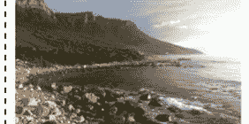

**图 1-3.** HTML 文档现已通过 CSS 进行样式设置

字体类型、大小和颜色都已更改。图片变小了一些，并且周围有边框。如果你将鼠标移到任何一个链接上，你还会看到它们被高亮显示。

文本和 HTML 代码完全没有改变。相反，该文档现在包含一些 CSS 代码，用于改变标签的显示方式。

CSS 代码添加在 HTML 文档的 `<head>` 部分中特殊的 `<style>` 标签之间。

```html
<head>
  <style>
  ... CSS 代码放在这里
  </style>
</head>
```

`<style>` 标签告诉浏览器你正在添加 CSS 代码。

> 注意：早期版本的 HTML 要求你在 `<style>` 标签中添加一个 `type` 属性，如下所示：

```html
<style type="text/css">
```

HTML5 不再要求这样做。然而，你可能仍然想使用它，因为许多编程语言编辑器会使用这个属性作为启用语法高亮的提示，这对编写程序很有帮助。

以下是已添加到 HTML 文档中的完整 CSS 代码。我将在接下来的页面中解释它的工作原理。


```html
<!doctype html>
<html lang="en">
<head>
<title>A web page</title>
<style>

h1
{
    font-family: Georgia, "Times New Roman", serif;
    font-size: 30px;
    color: #7924ff;
    font-style: italic;
    font-weight: bold;
}

h2
{
    font-family: "Lucida Console", Monaco, monospace;
    font-size: 20px;
    color: teal;
}

p, li
{
    font-family: Arial, Helvetica, sans-serif;
    font-size: 16px;
}

em
{
    text-decoration: underline;
    font-style: normal;
}

strong
{
    font-weight: bold;
    color: red;
}

li
{
    list-style-type: square;
}

a
{
    color: green;
    text-decoration: none;
}

a:hover
{
    background-color: black;
    color: white;
}

img
{
    width: 250px;
    height: auto;
    border-style: dashed;
    border-width: 2px;
    border-color: navy;
    padding: 10px;
}

</style>
</head>
... HTML 文档的其余部分保持不变
```

你会认出我们在 HTML 文档中使用的所有标签：`h1`、`h2`、`p`、`li`、`a`、`img`以及其他一些标签。CSS 代码已经更改了这些标签的属性，以修改这些标签在浏览器中的显示方式。让我们看看这究竟是如何工作的。

如果你选择省略可选的`<head>`标签，浏览器会理解它是隐含的。

## 字体样式

CSS 让你可以轻松选择想要使用的字体样式、大小和颜色。我们网页中的第一段 CSS 代码更改了`<h1>`标签内文本的显示方式。它更改了五个属性。你可能只需看着它们就能猜出它们的作用。它们将主标题文字设置为 Georgia 字体，将大小设置为 30 像素，将颜色更改为紫色，并使其同时设置为粗体和斜体。

## CSS 属性

属性是你想要更改的那个标签的样式。这五个属性各自单独占一行，位于花括号内。每一行都从左边缘缩进，以便你清楚地看到它包含在花括号内。每个属性名后面跟着一个冒号，然后是改变该属性的值。在每行末尾添加分号非常重要：

```css
;
```

这表示“我已结束对此属性的更改”。它就像句末的句号。你必须在每行 CSS 代码的末尾添加分号。如果你忘记了这一点，之后添加的任何新代码都将无法工作。

让我们看看这些属性的作用。

## 字体族

`font-family`属性允许你设置要使用的字体。

```css
font-family: Georgia, "Times New Roman", serif;
```

上面一行列出了三种字体：Georgia、“Times New Roman”和 serif。第一个字体是 Georgia，如果浏览器能够使用，就会使用该字体。如果查看此网页的计算机上没有安装 Georgia，那么浏览器将尝试加载第二种字体“Times New Roman”。如果该字体也无法找到，它只会加载一种称为 serif 的通用字体样式。提供第二或第三备用字体总是很重要的，以防第一种字体由于某种原因无法加载。

字体名称用逗号分隔。如果你的字体名称不止一个单词，则需要用引号括起来，例如“Times New Roman”或“Lucida Console”。

大多数字体可以归为三种通用字体族：衬线体（serif）、无衬线体（sans-serif）和等宽体（monospace）。

衬线体字体在字母边缘使用装饰性细节。Times New Roman、Georgia 和 Baskerville 是常见的衬线体字体。你经常在书籍和报纸中看到衬线体字体。

无衬线体字体在字母边缘不使用任何细节。常见的无衬线体字体有 Arial、Helvetica 和 Futura。你倾向于在高速公路标志、机场以及超级现代的艺术画廊和杂志中看到这类字体。以下是使用`font-family`属性分配无衬线体字体的方法：

```css
font-family: Helvetica, Arial, sans-serif;
```

浏览器将首先尝试加载 Helvetica。如果找不到 Helvetica，它将尝试加载 Arial。如果这也失败，它将回退到任何能找到的通用无衬线体字体。在我们的示例网页中，`<p>`标签使用无衬线体字体显示。

第三种主要字体族称为等宽体（有时称为固定宽度）。这些字体在字母之间具有固定的间距，并且设计得极其易于阅读。常见的等宽体字体有 Courier、Lucida Console 和 Monaco。它们用于旧式计算机控制台显示屏和打字机。程序员喜欢它们，因为缩进和空格能很好地对齐，这使得它们在计算机屏幕上非常容易阅读。以下是你可以如何使用 CSS 分配等宽体字体族：

```css
font-family: "Lucida Console", Monaco, monospace;
```

在我们简单的示例网页中，`p`和`li`元素使用无衬线体字体显示，而`h2`元素使用等宽体字体显示，如下所示：

```css
h2 {
  font-family: "Lucida Console", Monaco, monospace;
  font-size: 20px;
  color: teal;
}

p, li {
  font-family: Helvetica, Arial, sans-serif;
  font-size: 16px;
}
```

在上面的例子中，注意`p`和`li`元素共享相同的 CSS 代码。你可以通过列出元素并用逗号分隔来为多个元素分配样式，如下所示：

```css
p, li {
}
```

这样你就无需编写两次相同的代码。你可以让任意数量的元素共享相同的样式。

## 嵌入自定义字体

如果你想使用一种并非大多数人计算机上普遍安装的字体，你需要用`@font-face`将其嵌入。以下是如何在 HTML 文档中嵌入和使用自定义字体。

1. 找到你要使用的字体类型的字体文件。两种最常见的字体格式是 TrueType 字体（文件扩展名为 TTF）和 OpenType 字体（文件扩展名为 OTF）。将字体文件复制到包含 HTML 和 CSS 文件的同一文件夹中。
2. 在样式表中使用`@font-face`来加载字体并为其创建新的字体族。以下是一些嵌入名为 Londrina Solid-Regular 字体的 CSS 代码。

```css
@font-face {
  font-family: LondrinaSolid-Regular;
  src: url("LondrinaSolid-Regular.otf");
}
```

现在，你可以将这个新的字体族分配给你希望的任何元素。以下是将其分配给`h1`元素的方法。

```css
h1 {
  font-family: LondrinaSolid-Regular, "Courier New", monospace;
  font-size: 40px;
}
```

你可以分配任何其他你希望的字体属性，例如大小和颜色。与任何字体一样，分配一两个备用字体也很重要，以防你的嵌入字体由于某种原因无法加载。

## 字体大小

`font-size`属性允许你更改字体的大小。px 代表像素。像素是构成计算机屏幕上文本和图形的微小点。此代码将字体大小设置为 40 像素。

```css
font-size: 40px;
```

> 注意：CSS 允许你使用不同的单位来指定字体大小。如果你需要字体大小根据不同的屏幕分辨率动态变化，请考虑使用`em`而不是`px`。方法如下：

```css
font-size: 1em;
```

`1em`将等于显示页面的浏览器的默认字体大小。在大多数浏览器中，这大约等于 16 像素。如果你想要字体大小是其两倍，请使用`2em`。这将以大约 32 像素显示字体。`0.75em`的值将给你大约 12 像素的字体大小。

## 字体颜色

你可以使用`color`属性更改字体的颜色。

```css
color: #7924ff;
```

我在本例中使用的颜色是十六进制颜色值。它们也称为十六进制颜色。十六进制颜色是使用一串数字和字母描述颜色的标准方法，前面带有一个井号（数字符号）。

以下是一些常见颜色的十六进制代码：

- 黑色：`#000000`
- 白色：`#FFFFFF`
- 红色：`#FF0000`
- 蓝色：`#0000FF`
- 绿色：`#00FF00`
- 黄色：`#FFFF00`
- 橙色：`#FF9900`
- 紫罗兰色：`#CC33FF`

> 注意：你可以将黑色简写为`#000`，白色简写为`#FFF`。如果十六进制代码中的所有六个字符相同，你只需要使用前三个字符。

在网页上搜索“十六进制颜色图表”将提供颜色及其匹配十六进制代码的全面列表。你也可以在图形设计软件（如 Photoshop 或 Illustrator）的调色板中找到十六进制颜色代码。

然而，你不一定非要使用十六进制颜色。CSS 还允许你使用许多常见的颜色名称来分配基本颜色，如下所示：

```css
color: blue;
```

以下是 CSS 能理解的颜色名称：aqua（水绿色）、black（黑色）、blue（蓝色）、fuchsia（紫红色）、gray（灰色）、green（绿色）、lime（酸橙绿）、maroon（栗色）、navy（海军蓝）、olive（橄榄色）、purple（紫色）、red（红色）、silver（银色）、teal（青色）、white（白色）和 yellow（黄色）。

## 关于颜色的更多信息

十六进制颜色并非你可以使用的唯一颜色系统。你可以选择使用 RGB/RGBA 或 HSL/HSLA 颜色系统。它们都能产生相同的颜色，但以不同的方式描述它们。

RGB 系统使用三个数字来描述混合在一起以产生任何颜色的红、绿、蓝的相对量。数字范围可以从 0 到 255。以下是深紫罗兰色的 RGB 颜色代码：`rgb(204, 51, 255)`

你可以将其应用于 CSS 属性，例如字体颜色，如下所示：

```css
color: rgb(205, 51, 255);
```

RGBA 系统增加了一个数字来描述颜色的透明度。0 表示颜色完全透明，1 表示完全不透明（实心）。0.5 的值使颜色半透明。以下是深紫罗兰色的半透明 RGBA 版本：

`rgba(204, 51, 255, 0.5)`

你可以看到红、绿、蓝的颜色值与 RGB 系统相同。第四个数字 0.5 是透明度值。

RGBA 中的“A”代表 alpha（透明度），这是平面设计中的一个术语，意为透明。

RGBA 颜色之所以好用，是因为如果将其设置为半透明，下方的对象仍然可见，效果非常棒。这在投影效果中尤其有用，你将在第 3 章中学习这部分内容。

HSL 系统基于色相、饱和度和亮度来描述颜色。以下是用 HSL 描述的同一种深紫色：

```css
hsl(285, 100%, 60%)
```

第一个数字是色相（hue），取值范围为 0 到 360，表示颜色在色轮上的位置。第二个数字是饱和度（saturation），取值范围为 0% 到 100%，表示颜色的饱和程度（鲜艳度）。第三个数字是亮度（lightness），取值范围也是 0% 到 100%，表示颜色的明暗程度。

HSLA 系统与 RGBA 类似，增加了第四个 0 到 1 之间的数字，表示颜色的透明度。以下是半透明度为 0.5 的 HSLA 深紫色。

```css
hsla(285, 100%, 60%, 0.5)
```

使用哪种颜色系统完全取决于你个人的偏好。你可以使用 Photoshop 或 Illustrator 等平面设计软件中的调色板来查找这些颜色代码，也有很多在线工具可以帮助你完成此操作。

## 粗体、斜体和下划线字体样式

要使字体显示为斜体，请使用`font-style`属性，如下所示：

```css
font-style: italic;
```

如果字体当前显示为斜体而你想取消它，请将`font-style`属性的值设为`normal`。

使用`font-weight`属性使文本加粗：

```css
font-weight: bold;
```

要为文本添加下划线，请使用`text-decoration`属性，如下所示：

```css
text-decoration: underline;
```

`text-decoration`属性还有其他可选值：`line-through`和`over-line`。如果你想移除字体上的所有文本装饰，请使用`none`。

你可以在修改`<em>`和`<strong>`标签的 CSS 代码中看到所有这些样式的实际应用。

`<em>`（强调）标签内的所有文本都会添加下划线。

```css
em
{
  text-decoration: underline;
  font-style: normal;
}
```

（将`font-style`设为`normal`是为了关闭大多数浏览器为`<em>`标签自动添加的斜体效果。）

`<strong>`标签内的所有文本都会加粗并显示为红色：

```css
strong
{
  font-weight: bold;
  color: red;
}
```

以上就是样式化字体所需的所有基础知识。让我们再来看一些 CSS 代码的其他功能。

## 列表样式

在我们的网页示例中，你会注意到三个列表项的前面都有一个方形项目符号（一个小黑方块）。图 1-4 展示了这一效果。

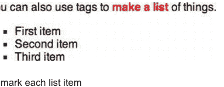

`list-style-type`属性控制着这一效果：

```css
li
{
  list-style-type: square;
}
```

有许多可选值可供使用，但最常用的是`square`和`circle`。如果你不想在列表上显示任何项目符号，可以使用`none`。

## 链接高亮效果

如果你将鼠标移到示例中的任何链接（`<a>`标签）上，你会看到文本变为白色，整个标签以黑色背景高亮显示。图 1-5 展示了这一效果。

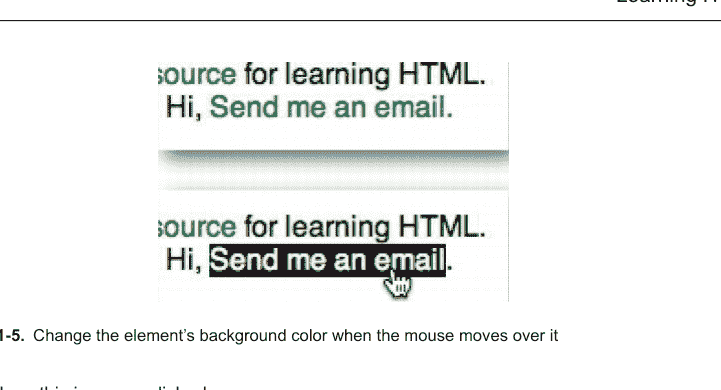

**图 1-5.** 当鼠标悬停在元素上时更改其背景颜色

下面是实现这一效果的方法。

首先，对`<a>`标签元素进行样式设置，使链接显示为绿色，并关闭大多数网页浏览器为链接自动添加的下划线样式。

```css
a
{
    color: green;
    text-decoration: none;
}
```

`a:hover`是一个特殊的样式选择器，用于描述当鼠标“悬停”在`<a>`标签元素上时该元素的外观。

```css
a:hover
{
    background-color: black;
    color: white;
}
```

它将`<a>`标签的背景色设为黑色，字体颜色设为白色。这就是产生高亮效果的原因。它只在鼠标悬停在链接上时才会生效。当鼠标离开`<a>`标签区域时，链接的颜色会恢复正常。

所有元素都有一个`background-color`属性，它可以用来更改任何元素的背景颜色。

`a:hover`是 CSS 中称为伪类的功能。伪类可以让你实现这类特殊效果。你可以通过元素名称与效果名称之间用冒号分隔的方式识别伪类。

还有一些伪类可以与`<a>`标签配合使用：

- `a:visited`：链接被点击过后的颜色。
- `a:active`：当前处于激活状态的链接。
- `a:link`：链接被点击之前的颜色。

请确保在`a:link`和`a:visited`之前为`a:hover`分配样式，这样才能使这些伪类正常工作。

## 边框、内边距、高度和宽度

请记住，``标签用于在 HTML 文档中显示图像。你可以用 CSS 更改图像的显示方式，就像更改文本的外观一样简单。

以下是为示例中的图像设置样式的 CSS 代码。

```css
img
{
    width: 250px;
    height: auto;
    border-style: dashed;
    border-width: 2px;
    border-color: navy;
    padding: 10px;
}
```

这段代码通过改变宽度使图像稍微变小。高度会自动调整以匹配宽度的变化，从而保持图像的比例。图像周围添加了两像素宽的海军蓝色虚线边框，同时在图像和边框之间添加了 10 像素的内边距。图 1-6 展示了这段代码对图像产生的效果。

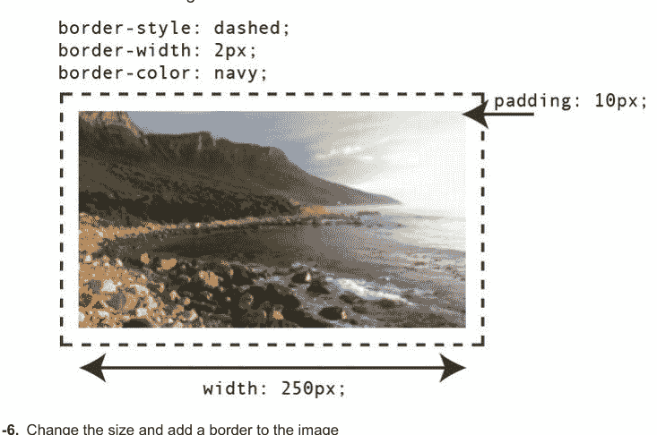

**图 1-6.** 调整图像大小并添加边框

`width`和`height`属性决定了图像的像素尺寸。

```css
width: 250px;
height: auto;
```

`auto`表示当宽度发生变化时，高度会自动调整以保持图像比例。`padding`属性在图像和边框之间四周均匀添加 10 像素的空白区域。

```css
padding: 10px;
```

如果你想为四个边分别设置不同的内边距值，可以使用如下 CSS 代码：

```css
padding: 10px 30px 20px 5px;
```

这会按以下顺序更改四边的内边距：上、右、下、左。（你可以通过从上开始顺时针方向来记住这个顺序。）

> 注意：还有一些设置内边距的简写方式：

`padding: 20px 30px 50px;`

上内边距为 20 像素，左右内边距为 30 像素，下内边距为 50 像素。

`padding: 20px 50px;`

上下内边距为 20 像素，左右内边距为 50 像素。

你也可以为每一边单独设置内边距，如下所示：

```css
padding-top: 10px;
padding-bottom: 20px;
padding-right: 30px;
padding-left: 5px;
```


> 注意：内边距值会加到元素的高度和宽度上。这意味着如果元素宽度为 250 像素，你在其左右两侧各添加 10 像素的内边距，元素的实际宽度将变为 270 像素。如果你在做复杂的布局，这一点非常重要：内边距值会累加到宽度和高度值上。

`border`属性决定了边框的样式、宽度和颜色。

你可以使用`border-style`属性更改边框样式：

```css
border-style: dashed;
```

这会在元素周围创建虚线边框。可选的值有`dashed`、`double`、`dotted`、`groove`、`ridge`、`hidden`、`inset`和`outset`。要移除边框，请将此值设为`none`。图1-7展示了这些边框样式。

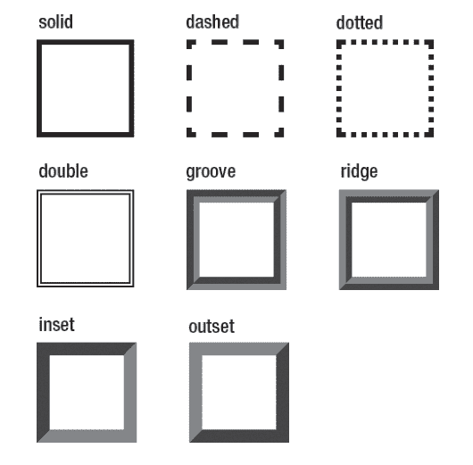

**图1-7.** 边框样式

你可以使用`border-width`属性设置边框的宽度：

```css
border-width: 2px;
```

通常以像素为单位设置宽度，但你也可以使用三个预定义值之一：`thin`、`medium`或`thick`。与添加内边距一样，边框宽度也会累加到元素的总宽度和高度上。

`border-color`属性更改边框的颜色：

```css
border-color: navy;
```

它接受与文本`color`属性相同的颜色值。

你可以使用简写方式在一行代码中定义所有边框属性，如下所示：

```css
border: 2px dashed navy;
```

如果你使用这种简写方式，请确保按以下顺序列出属性：线宽、样式和颜色。

## 层叠样式

你可能在想“层叠样式表”中的“层叠”部分是什么意思。它的含义是，如果在 CSS 代码的开头为某个元素分配了一种样式，你可以在此后的代码中添加或更改该样式。以下是一个示例，展示了这在我们的样式表中是如何运作的。

`p`和`li`元素共享相同的初始样式。

```css
p, li
{
  font-family: Helvetica, Arial, sans-serif;
  font-size: 16px;
}
```

但在样式表的后面部分，`li`元素被赋予了新的样式：

```css
li
{
  list-style-type: square;
}
```

这个样式是追加到最初定义的样式之上的。这是一个实用的功能，因为它意味着许多元素可以共享相同的样式，但你仍然可以对单个元素进行自定义。

不过，如果你愿意，也可以完全覆盖原始样式，只需在第一个样式之后添加这个新样式：

```css
li
{
  list-style-type: square;
  font-family: "Lucida Console", Monaco, monospace;
  font-size: 10px;
}
```

最后设置的样式会被应用到 HTML 元素上。

## 使用`<DIV>`元素

在前面的示例中，我们使用了一些标准的 HTML 标签来显示页面元素，如`<h1>`、`<h2>`、`<p>`、`<ul>`和``。然而，有时你可能想在页面中添加一些不适合任何标准标签所定义的整齐类别的内容。如果你使用 HTML 来创建游戏和应用程序，这一点尤其明显，因为它们所使用的元素与普通网页上的元素截然不同。对于这些情况，HTML 提供了一个通用标签`<div>`，它可以用于任何用途。

> 注意：`<div>`标签最初是用于表示网页分区（网页的不同部分）的，但它早已超越了其原始用途。

当你创建一个`<div>`元素时，通常也会给它一个名称，以便你可以轻松地使用 CSS 为其设置样式。这个名称可以是`id`或`class`属性。让我们来看看这是如何工作的。

### 使用`id`

如果你只有某一种类型的单个元素，可以使用`id`属性为其命名。

```html
<div id="elementName"></div>
```

`id`是一个唯一的名称，只有一个元素可以拥有。你可以使用`id`来用 CSS 设置元素的样式，如下所示：

```css
#elementName
{
    在这里更改任何样式属性
}
```

井号字符`#`必须放在元素`id`名称的前面。

> 注意：你可以为`id`使用任何你喜欢的名称，但不要使用包含空格的名称。尽量将`id`名称保持为一个单词，并使用小写字母。

如果你想使用多个单词的`id`名称，考虑使用驼峰命名法（`camelCaseNotation`）。这是一种将多个单词连写而不使用空格的风格，在计算机编程中非常常见。在驼峰命名法中，第一个单词用小写字母书写，其后每个单词的首字母大写，像这样：

`firstSecondThird`

你能猜出为什么它叫`camelCaseNotation`吗？你会在本书的大多数示例中看到它的使用。

在本章的源文件中，你会找到一个名为`id.html`的文件，它演示了一个简单的示例。在 Web 浏览器中打开它，你会看到它显示了一个带有虚线边框的简单矩形，如图1-8所示。

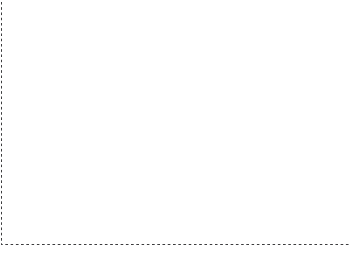

以下是实现此效果的 HTML 和 CSS 代码：

```html
<!doctype html>
<title>Using an id</title>
<style>
#stage
{
    width: 400px;
    height: 300px;
    border: 1px dashed black;
}
</style>
<div id="stage"></div>
```

`<div>`元素具有`id`属性`"stage"`。CSS 代码为其设置了高度、宽度和边框。你可以看到这与其他 HTML 元素的样式设置非常相似，只不过 CSS 代码使用的是标签的`id`属性，而不是标签名称。

在本书中，我使用`"stage"`这个名称来表示包含我们游戏中操作的矩形区域。

### 使用`class`

如果多个元素共享相同的属性，那么你应该将它们分配到一个类中。方法如下：

```html
<div class="theClassName">
```

类的工作方式与`id`完全相同，不同之处在于多个元素可以属于同一个类。在本章源文件中打开`class.html`文件查看一个简单示例。你会看到三个动物的名称，它们都以相同的方式被设置样式。

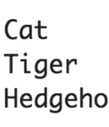

**图1-9.** 使用`class`为多个元素设置相同样式

以下是实现此效果的代码：

```html
<!doctype html>
<title>Using a class</title>

<style>

.animal
{
    font-family: Monaco, "Courier New", monospace;
    font-size: 30px;
}

</style>

<div class="animal">Cat</div>
<div class="animal">Tiger</div>
<div class="animal">Hedgehog</div>
```

你可以看到三个`<div>`元素都共享相同的类名：`"animal"`。

CSS 代码中有一个名为`.animal`的样式，它将字体设置为 Monaco，大小设置为 30px。任何属于`animal`类的元素都将共享这些属性。

要使用 CSS 设置类的样式，始终在类名前面加上一个点号，像这样：

```css
.className
{
    在这里设置类的样式属性
}
```

在这些示例中，我向你展示了如何在`<div>`标签中使用`id`和`class`属性，但你也可以将它们用于任何 HTML 标签。元素还可以同时拥有`id`并属于一个类。让我们看看这如何发挥作用。

### 同时使用`id`和`class`

如果你的元素共享大量通用属性，将它们全部分配到同一个类中是合理的。但是，你可能想要更改单个元素中的一两个特定属性，同时保持大多数通用属性不变。在这种情况下，创建一个同时具有`class`和`id`的元素，如以下示例：

```html
<div class="general" id="specific"></div>
```

然后你可以将所有通用样式分配给`class`，将特定样式分配给`id`。

让我们来看一个具体示例。在本章源文件中打开`classAndId.html`文件。你会看到三个动物名称，每个都共享相同的字体和大小，但每个都有不同的样式。图1-10展示了在 Web 浏览器中打开该文件时你将看到的效果。

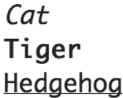

**图1-10.** 使用`class`和`id`的组合来自定义共享相关属性的元素

猫的文本是斜体的，老虎是粗体的，刺猬是带下划线的。以下是产生此效果的 HTML 和 CSS 代码：

```html
<!doctype html>
<title>Using a class and id together</title>

<style>

.animal
{
  font-family: Monaco, "Courier New", monospace;
  font-size: 30px;
}

#cat
{
  font-style: italic;
}

#tiger
{
  font-weight: bold;
}

#hedgehog
{
  text-decoration: underline;
}

</style>

<div class="animal" id="cat">Cat</div>
<div class="animal" id="tiger">Tiger</div>
<div class="animal" id="hedgehog">Hedgehog</div>
```

所有元素都共享同一个`animal`类。这意味着它们共享相同的基本字体和字体大小。但请注意，它们还被分配了唯一的`id`：

```html
<div class="animal" id="cat">Cat</div>
<div class="animal" id="tiger">Tiger</div>
<div class="animal" id="hedgehog">Hedgehog</div>
```

CSS 代码可以使用这些`id`来自定义每个元素：

```css
#cat
{
  font-style: italic;
}

#tiger
{
  font-weight: bold;
}

#hedgehog
{
  text-decoration: underline;
}
```

这些样式被应用到每个元素上，除此之外还有它们作为`animal`类成员所共享的样式。像这样组合`class`和`id`是一种非常简单但强大的方式，可以创建易于管理的复杂样式。

元素还可以属于多个类。

## 将背景图像加载到 HTML 元素中

你在网页示例中看到了如何使用``标签在浏览器窗口中显示图像。但还有另一种加载图像的方式，它通常更适合游戏和交互式应用程序。你可以将图像加载到元素的`background-image`属性中。使用格式如下：

```css
background-image: url("imageName.png");
```

图像文件名用引号括起来，并且必须包含文件类型扩展名。你可以使用 JPG、GIF 或 PNG 图像。只要图像与 CSS 代码在同一文件夹中，图像就会加载。（该元素还需要是一个块级元素。你将在后面详细了解块级元素。）

以下是如何使用`background-image`属性将图像加载到元素中的方法。

从一个代表你想显示的图像的 HTML 元素开始。

```html
<div id="cat"></div>
```

接下来，为猫的`id`创建一个样式。给出与你要显示的图像完全匹配的高度和宽度。然后将图像加载到`background-image`属性中。

```css
#cat
{
    height: 100px;
    width: 100px;
    background-image: url("cat.png");
}
```

`cat.png`图像将被加载到`<div>`元素中，并在浏览器窗口中显示。

你可以在本章源文件的`backgroundImages`文件夹中找到此示例的可运行版本。在文本编辑器中打开`backgroundImages.html`文件，你会发现一些显示猫图片的简单代码。代码如下：

```html
<!doctype html>
<title>Background images</title>

<style>

#cat
{
    width: 100px;
    height: 100px;
    background-image: url("cat.png");
}

</style>
<div id="cat"></div>
```

图1-11展示了 HTML 代码如何加载图像文件并在网页浏览器中显示它。

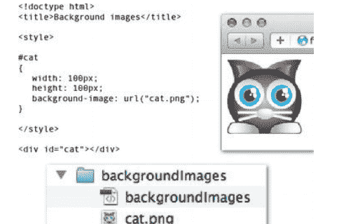

**图1-11.** 使用背景图像属性将图像加载到元素中

现在你知道了如何加载一个图像，让我们再加载两个，并学习如何在浏览器中定位它们。

## 使用 CSS 定位元素

CSS 可以用于将元素定位在精确的位置。样式表让你完全控制元素在浏览器窗口中出现的位置。元素的定位对于游戏和网站同样重要，我们将看一些具体示例来展示如何做到这一点。

首先，你需要理解行内元素和块级元素之间的区别。

## 行内元素和块级元素

行内元素在同一条水平线上共享空间。`<em>`和`<strong>`元素就是一个很好的例子。你可以在`<p>`标签内使用它们，所有文本都将保持在同一行。这里有一些使用`<em>`和`<strong>`标签的简单 HTML 示例。

```html
<p>This is some text with <em>italic</em> and <strong>bold</strong> letters.</p>
```

这段 HTML 代码将显示为：

This is some text with *italic* and **bold** letters.

因为`<em>`和`<strong>`标签是行内元素，所以它们都保持“在行内”。

块级元素的行为则相反：它们像积木一样彼此堆叠。你可以使用`display`属性将任何元素转换为块级元素，如下所示：

```css
display: block;
```

你可以使用此属性将`<em>`和`<strong>`元素转换为块，如下所示：

```css
em, strong
{
    display: block;
}
```

现在同一行 HTML 代码将显示为：

```text
This is some text with
italic
and
bold
letters.
```

它们形成一个塔，就像玩具积木。网页浏览器自动将`<h1>`、`<h2>`、`<p>`和`<div>`标签显示为块级元素，你可以在这些示例中看到这一点。每当使用这些标签时，元素都会显示在其他块级元素的下方。对于段落内的文本，比如本例中的情况，这没什么用，但对于游戏中的图像就不同了。使用块级元素来处理游戏图像的一个优势是，你可以将它们精确地定位在浏览器窗口中的任何位置。让我们看看如何使用 CSS 来做到这一点。

> 注意：如果你需要将任何块级元素改为行内元素，可以将这些元素的`display`属性设置为`inline`，如下所示：

> `display: inline;`

## 浮动元素

CSS 为你提供了许多定位块级元素的选项。你可以让块浮动起来，使它们水平排列，而不是垂直堆叠。这使它们看起来像行内元素，但优势在于它们拥有可以容纳图像并具有样式化边框的固定尺寸。

在本章的源文件中，你会找到一个名为`floatingElements.html`的文件夹。双击它在网页浏览器中打开。你会看到三个动物垂直堆叠，被一个矩形包围。图1-12展示了你将看到的内容。

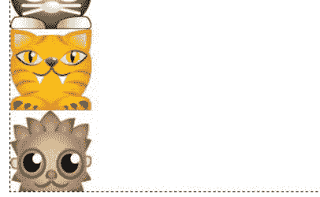

在文本编辑器中打开`floatingElements.html`文件，你将看到这段 HTML 代码：

```html
<!doctype html>
<title>Floating elements</title>

<style>

#stage
{
    display: block;
    width: 400px;
    height: 300px;
    border: 1px dashed black;
}
```

```css
.animal
{
    display: block;
    width: 100px;
    height: 100px;
}

#cat
{
    background-image: url("cat.png");
}

#tiger
{
    background-image: url("tiger.png");
}

#hedgehog
{
    background-image: url("hedgehog.png");
}
```

```html
</style>

<div id="stage">
    <div class="animal" id="cat"></div>
    <div class="animal" id="tiger"></div>
    <div class="animal" id="hedgehog"></div>
</div>
```

图1-13展示了这四个元素在浏览器中是如何显示的。

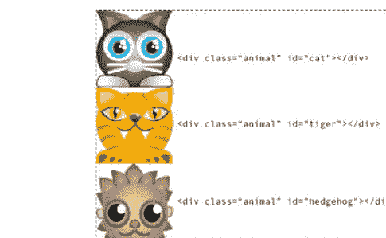

**图1-13.** 动物被包含在矩形舞台内

`<div id="stage">`元素是一个 400 像素宽、300 像素高的虚线边框矩形。以下是为其设置样式的 CSS 代码：


```css
#stage
{
  display: block;
  width: 400px;
  height: 300px;
  border: 1px dashed black;
}
```

动物也是矩形。它们都是 100 像素宽、100 像素高。

```css
.animal
{
  display: block;
  width: 100px;
  height: 100px;
}
```

所有动物都共享这些相同的属性。然而，每个动物还有一个独特的图像。代码使用`id`属性为每个动物分配一个唯一的名称，正如你在 HTML 代码中看到的。

```html
<div class="animal" id="cat"></div>
<div class="animal" id="tiger"></div>
<div class="animal" id="hedgehog"></div>
```

这些 id 允许我们单独引用每个动物，分别为`cat`、`tiger`和`hedgehog`。CSS 代码正是这样做的，为每个元素加载一个独特的背景图像。

```css
#cat
{
  background-image: url("cat.png");
}

#tiger
{
  background-image: url("tiger.png");
}

#hedgehog
{
  background-image: url("hedgehog.png");
}
```

这是另一个有用的例子，展示了如何通过定位其唯一的 id 并更改其特定内容来定制每个元素。

因为动物是块级元素，所以它们垂直堆叠。我们可以通过以下这段 CSS 代码让动物向左浮动，形成整齐的水平行：

```css
float: left;
```

尝试将这行代码添加到`floatingElements.html`文件中的`animal`样式定义中：

```css
.animal
{
  display: block;
  width: 100px;
  height: 100px;
  
  float: left;
}
```

保存文件并刷新浏览器窗口。图 1-14 显示动物现在水平排列。

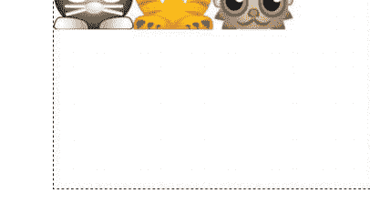

**图 1-14.** 块级元素浮动形成水平行

使用`float`属性就像给每个动物充入氦气，使其`float`到顶部。`left`值意味着每个动物将占据左侧所有可用空间。这使元素左对齐。使用`float: right`可以让元素右对齐。

## 添加外边距来分隔元素

你可以通过添加一些左边距和上边距，将动物居中放置在舞台的上半部分。你可以使用以下代码将上边距设置为 50 像素，左边距设置为 25 像素：

```css
margin-top: 50px;
margin-left: 25px;
```

将这两行添加到`animal`样式定义中：

```css
.animal
{
    display: block;
    width: 100px;
    height: 100px;
    float: left;
    margin-top: 50px;
    margin-left: 25px;
}
```

保存文件并刷新浏览器。你会看到外边距已添加到每个动物的顶部和左侧，如图 1-15 所示。它们现在间距均匀。

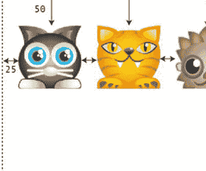

**图 1-15.** 添加外边距使动物均匀分隔

## 清除浮动元素

如果你想在一些浮动元素下方添加一个新元素，你需要设置新元素的`clear`属性。以下是清除向左浮动元素的方法：

```css
clear: left;
```

这将导致新元素出现在左浮动元素的下方。`clear`属性也接受`right`和`both`值。

让我们看看如何使用`clear`属性在我们三个浮动动物下方居中一些文本。

在`<div id="stage">`元素内添加一个`<h1>`元素：

```html
<div id="stage">
<div class="animal" id="cat"></div>
```

## 第 1 章

要使文本显示在动物图像下方，请将`h1`元素的`clear`属性设置为`left`：

```css
h1 {
  clear: left;
}
```

使用`text-align`属性将文本在`stage`元素内居中：

```css
h1 {
  clear: left;
  text-align: center;
}
```

`text-align`属性还可以接受`left`、`right`和`justify`的值。

图 1-16 展示了 clear 代码在浏览器窗口中的效果。

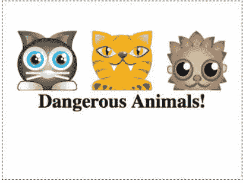

**图 1-16.** 使用 clear 属性使文本出现在浮动元素下方

使用`@font-face`嵌入自定义字体，并添加一些内边距，使文本在`stage`内更均匀地分布：

```css
@font-face {
  font-family: LondrinaSolid-Regular;
  src: url("LondrinaSolid-Regular.otf");
}

h1 {
  clear: left;
  display: block;
  text-align: center;
  padding-top: 50px;
  font-family: LondrinaSolid-Regular;
  font-size: 40px;
}
```

> 注意：大多数浏览器会自动将`<h1>`和`<div>`元素样式化为块级元素，因此对于这些元素，使用`display: block`是可选的。

图 1-17 展示了其在浏览器窗口中的效果。

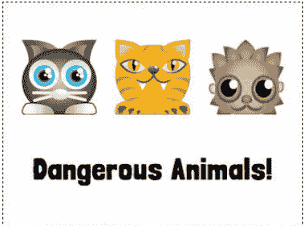

**图 1-17.** 自定义标题

你可以在本章源代码的`floatingElementsFinished.html`文件中找到所有这些可运行的代码。

## 关于元素居中的更多信息

你现在知道可以使用`text-align`属性在元素内居中文本，如下所示：

```css
text-align: center;
```

你也可以将其设置为`left`、`right`、`justify`和`inherit`的值。`justify`会使文本拉开间距，使其拉伸以充满整个元素。`inherit`意味着它将遵循其包含元素所使用的任何`text-align`规则。

你可以使用`text-align`来居中文本，但它对块级元素无效。如果你想将一个块级元素在另一个元素内居中，请使用`margin`属性并赋予这些值：

```css
margin: 0px auto;
```

这会给元素一个相等的、自动的左右外边距，从而使其居中。你可以使用这段代码在另一个块级元素内居中任何块级元素。你也可以用它来使一个元素在浏览器窗口内居中。将其与`body`元素一起使用来居中整个网页，如下所示：

```css
body {
  margin: 0px auto;
}
```

像这样使用外边距、内边距、浮动和清除通常是定位元素最灵活的方式，因为这些元素会自动调整自身以适应可用空间。如果你添加或删除元素，它们会重新调整间距和位置。但是，你也可以使用精确的像素位置来定位元素，接下来我将向你展示如何操作。

## 绝对定位

图 1-18 展示了一个黑色正方形被精确地定位在一个矩形内部。

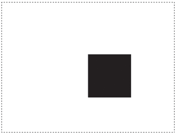

**图 1-18.** 使用绝对定位为元素提供精确的像素位置

该正方形的左上角距离包含它的矩形顶部边框 120 像素，距离矩形左侧边框 200 像素。你可以在本章源代码的`absolutePositioning.html`文件中找到这个可运行的代码。

```html
<!doctype html>
<title>Absolute positioning</title>

<style>
#stage {
  position: relative;
  display: block;
  width: 400px;
  height: 300px;
  border: 1px dashed black;
}

#square {
  position: absolute;
  top: 120px;
  left: 200px;
  display: block;
  width: 100px;
  height: 100px;
  background-color: black;
}
</style>

<div id="stage">
  <div id="square"></div>
</div>
```

为了使其工作，你首先需要将要定位的元素包含在另一个元素内。在这个例子中，正方形被包含在矩形的`stage`内，使用这段 HTML 代码：

```html
<div id="stage">
  <div id="square"></div>
</div>
```

接下来，你需要将包含元素的`position`属性设置为`relative`：

```css
#stage {
  position: relative;
}
```

然后，你需要将内部元素的`position`属性设置为`absolute`：

```css
#square {
  position: absolute;
}
```

这使得正方形成为 stage 坐标系的一部分。你现在可以通过告诉正方形应该距离 stage 的顶部和左侧边框多远来定位它，如下所示：

```css
#square {
  position: absolute;
  top: 120px;
  left: 200px;
}
```

这会将正方形定位在距离 stage 顶部边框 120 像素处，并且距离其左侧边框 200 像素。正方形是根据其左上角定位的。图 1-19 演示了这一点。

**图 1-19.** 通过指定距离 stage 顶部和左侧边框的像素数来相对于 stage 定位正方形

你也可以选择将正方形相对于 stage 的底部和右侧边框定位，如下所示：

```css
#square {
  position: absolute;
  bottom: 120px;
  right: 200px;
}
```

这会产生如图 1-20 所示的效果。正方形的右下角相对于 stage 的底部和右侧边框偏移。

**图 1-20.** 可选地使正方形从底部和右侧边框偏移

使用 CSS 定位元素可能变得相当复杂，但没必要如此复杂。坚持使用我在这些简单示例中使用的模型，你就不会出错。

> 注意：如果需要，你还可以使用`position: fixed`来将 HTML 元素相对于浏览器窗口锁定位置。`left`和`top`值将从浏览器的左侧和顶部边缘计算。这意味着即使你更改浏览器窗口大小或滚动页面，HTML 元素也会保持固定位置。如果你想制作漂浮在页面上方且不受正常文档流影响的元素，这很有用。

## 关于块级元素尺寸的更多信息：盒模型

块级元素具有你可以更改的`width`和`height`属性。然而，它们仅指块内内容的宽度和高度。整个块的总高度和宽度实际上是由内容的宽度和高度与块的外边距、边框和内边距组合决定的。这个系统被称为**盒模型**。它可能会令人困惑，因为如果你不理解盒模型如何计算块的最终尺寸，那么块的最终宽度和高度可能不是你所期望的。但幸运的是，在你设置内边距、边框和外边距之后，很容易预测盒模型如何计算块的尺寸。

块的最终宽度和高度是如何确定的？想象你有一个块级元素，具有这些属性。

```css
width: 100px;
height: 100px;
padding: 10px;
border: 10px;
margin: 10px;
```

以下是如何计算总宽度：

```text
totalWidth = width + leftPadding + rightPadding + leftBorder + rightBorder + leftMargin + rightMargin
```

如果你将其转换为实际数字，最终得到：

```text
totalWidth = 100 + 10 + 10 + 10 + 10 + 10 + 10
```

这意味着块的总宽度为 160 像素。

```text
totalWidth = 160
```

你以同样的方式计算块的总高度。图 1-21 说明了其工作原理。

如果你对为什么你的块级元素似乎没有正确地间距或定位自己感到困惑，请回到本章的这一节，检查你是否根据盒模型正确地确定了它们的尺寸。

## 组织你的文件

在本章的示例中，HTML 和 CSS 代码都在同一个文件中。这对于小型项目来说非常方便，但如果你正在设计一个复杂的网站或游戏，并且需要管理大量代码，这很快就会变得难以控制。通常最好将 HTML 和 CSS 代码分离到单独的文件中。让我们看几个这样做的例子。

## 分离 HTML 和 CSS 代码

这是一个非常简单的 HTML 文档，它显示一个页面标题和一些使用 CSS 样式的段落文本。

```html
<!doctype html>
<title>A simple document</title>

<style>
```

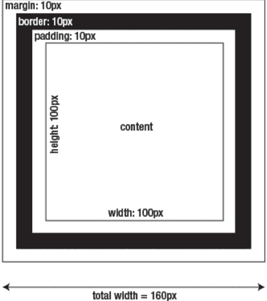

**图 1-21.** 盒模型通过将内容大小与内边距、边框和外边距相结合来计算块的最终宽度和高度

## 第 1 章

让我们将这个文档拆分为两个独立的 HTML 和 CSS 文件：

1. 在你的文本编辑器中，创建一个新文件。
2. 将所有 CSS 代码复制到新文件中。

```css
h1
{
  font-size: 40px;
}

p
{
  font-family: Helvetica, Verdana, Arial, sans-serif;
}
```

3. 将此文件保存为`newStyle.css`。确保将其保存在与 HTML 文件相同的文件夹中。
4. 在 HTML 文件中，删除`<style>`标签以及其中所有的 CSS 代码。
5. 在`<title>`标签下方添加以下内容：

```html
<link rel="stylesheet" href="newStyle.css">
```

这个`<link>`标签使用`href`属性将`newStyle.css`文件加载到 HTML 文档中。`rel`属性告诉 HTML 文档，加载的文件是一个样式表。以下是完整的 HTML 文档现在应有的样子：

```html
<!doctype html>
<title>A simple document</title>
<link rel="stylesheet" href="newStyle.css">

<h1>Page Heading</h1>
<p>A bit of text.</p>
```

这将在网页浏览器中显示完全相同的效果，使用加载的样式表中的样式。你可以在本章源文件中的`organizingFiles`文件夹里找到一个可用的示例。你会看到该文件夹包含两个文件：`simpleDocument.html`和`newStyle.css`。

将 HTML 和 CSS 代码拆分为两个独立文件有两大优势：

- 如果你想完全改变 HTML 文档的样式，只需创建一个新的 CSS 文件，然后将 HTML 文件链接到它。这意味着你可以在不改变原始样式的情况下测试新样式，而且除了样式表的链接外，无需在 HTML 文件中更改任何内容。
- 你的代码变得不那么混乱。这对于复杂的游戏、应用程序和网站非常重要，因为你可能会编写数百行 CSS 和 HTML 代码。将 CSS 和 HTML 分开意味着你在任何时候只需查看一半的代码，这更易于管理。

对于游戏和网站，你还需要组织图像，可能还有音频文件和视频。让我们看看如何将不同类型的媒体放在不同的文件夹中，并将它们加载到主 HTML 文件中。

## 组织代码和媒体

图 1-22 展示了一种组织 HTML5 项目的高效方式。有一个项目文件夹，包含四个子文件夹：`src`（source code 的缩写，即源代码）、`images`、`videos`和`sounds`。HTML 和 CSS 文件位于`src`文件夹中。"源代码"是计算机程序的另一种名称。将编程代码放在名为`src`的文件夹中是一种非常常见的惯例。将主项目文件命名为`main`也非常常见。`main.html`文件从其他文件夹加载图像、视频和音频文件。

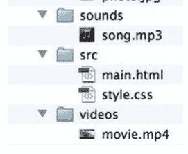

以下是`main.html`文件，它加载了一张图片、一个视频和一个声音。

```html
<!doctype html>
<title>Organizing project folders</title>
<link rel="stylesheet" href="style.css">
<h1>Organizing project folders</h1>
<h2>Images</h2>


<h2>Video</h2>
<video controls>
<source src="../videos/movie.mp4">
</video>

<h2>Audio</h2>
<audio controls>
<source src="../sounds/song.mp3">
</audio>
```

你可以看到``、`<video>`和`<audio>`标签用于加载照片、视频和音频。但仔细看看文件的路径：

```text
../images/photo.jpg
```

你可以看到`photo.jpg`是被加载的图像文件。但其余的部分是什么意思？

```text
../images/
```

让我们将其分解为更小的部分。

当你在文件路径中的单词后看到正斜杠时，它表示"这是一个文件夹"。

```text
images/
```


因此我们知道`photo.jpg`文件位于名为`images`的文件夹中：

```
images/photo.jpg
```

但我们还需要知道`images`文件夹在哪里。这些字符告诉我们：

```
../
```

两个点和正斜杠告诉程序在当前目录之外的目录中查找`images`文件夹。图 1-23 说明了这是如何工作的。

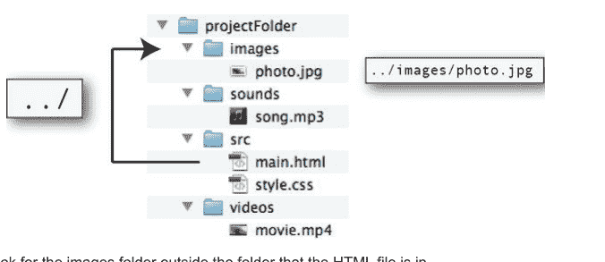

**图 1-23.** 在 HTML 文件所在文件夹的外部查找`images`文件夹。

如果你不添加`../`，HTML 文件将在`src`文件夹内部查找`images`文件夹。

音频和视频文件以相同的方式加载歌曲和视频。

在本书后面的章节中，你将看到这种结构被用于组织更复杂游戏项目中的代码和媒体。

## 关于`video`和`audio`元素的更多内容

使用`<video>`标签将视频加载到 HTML 文档中，如下所示：

```html
<video>
<source src="movieName.mp4">
</video>
```

HTML5 目前允许你加载任何 MP4、OGG 或 WEBM 格式的视频。未来可能会添加更多格式。

可选的`control`属性显示用于播放和暂停视频的控件。

```html
<video control>
```

每个网页浏览器都会显示不同的控件集。

以相同的方式使用`<audio>`标签将声音加载到 HTML 文档中：

```html
<audio>
<source src="soundName.mp3">
</audio>
```

你目前可以加载任何 MP3、OGG 和 WAV 格式的声音，不过，与视频一样，HTML5 未来可能会支持更多格式。

`audio`元素还有一个可选的`control`属性，用于显示播放和暂停声音的控件。

```html
<audio control>
```

还有一些其他可选属性可以与`video`和`audio`元素一起使用：

| 属性 | 功能 | 可赋予的值 |
| --- | --- | --- |
| `autoplay` | 媒体一旦开始加载就自动播放。 | 无。 |
| `loop` | 媒体到达结尾后再次播放。 | 无。 |
| `preload` | 确定页面加载时是否应加载媒体。 | 可以取`auto`、`none`或`metadata`值。`preload="auto"`：媒体将在开始播放之前开始加载。这会缓冲播放，使其不太可能被缓慢或不稳定的网络连接中断。`preload="none"`：媒体立即开始播放，不进行缓冲。`preload="metadata"`：仅加载有关媒体的信息，例如标题和时长。注意，`autoplay`属性通常会覆盖这些选项。 |
| `height` | 设置视频的高度。 | 以像素为单位的值，如下所示：`height="720"` |
| `width` | 设置视频的宽度。 | 以像素为单位的值，如下所示：`width="400"` |
| `poster` | 在视频开始播放之前显示一张图像。 | 任何图像文件的路径，如下所示：`poster="photo.jpg"` |

仅视频属性：

在撰写本文时，HTML5 中的音频和视频有时会以奇怪的方式表现，这取决于你使用哪个网页浏览器，或者视频或音频文件的编码方式。

如果你想确保视频一定能加载，请提供 MP4、OGG 和 WEBM 格式的视频版本。如果浏览器不支持一种格式，它会加载另一种。你可以通过在`<video>`标签内使用三个`source`元素来实现这一点，每个元素链接到该文件的不同版本，如下所示：

```html
<video>
<source src="movieName.mp4">
<source src="movieName.ogg">
<source src="movieName.webm">
</video>
```

对音频执行相同操作：

```html
<audio>
<source src="soundName.mp3">
<source src="soundName.wav">
<source src="soundName.ogg">
</audio>
```

这将确保你的视频和音频在所有现代网页浏览器中播放。

如果你确定只需要使用一种视频或音频格式，则不需要使用`<source>`标签。你可以直接在`<video>`和`<audio>`标签中添加视频或音频`src`属性，如下所示：

```html
<video src="movie.mp4"></video>

<audio src="song.mp3"></audio>
```

此外，请考虑使用可选的`type`属性，它指定音频或视频的格式。

```html
<video src="movie.mp4" type="video/mp4"></video>

<audio src="song.mp3" type="audio/mp3"></audio>
```

这有助于浏览器决定是否应该尝试加载文件。

## 进一步了解 HTML 和 CSS

这是你创建游戏所需了解的大部分 CSS 和 HTML 知识。在本书结束之前你还会学到几个技巧，但所有基础知识都在这一章中。

但如果你想使用 HTML 和 CSS 来设计网站，你需要再学习一些知识。你需要了解如何组织页面内容，以及如何处理能够适应不同屏幕分辨率和方向的复杂布局。以下是一些你需要进一步研究的主题。

- **HTML 标签**：我们在本章中涵盖了所有基本的 HTML5 元素，但还有更多元素可用于更具体地定义网页的区域。你可以在世界万维网联盟的网站上找到完整的 HTML5 元素列表，以及它们应该如何使用的示例：`www.w3.org/community/webed/wiki/HTML/Elements`。

- **弹性盒子模型（Flexible Box Model）**：网页通常需要动态改变它们显示的内容布局，如果网页浏览器的大小发生变化。弹性盒子模型是你可以使用的 CSS 代码，用于制作根据页面上可用空间按比例调整大小的元素。你还可以使用弹性盒子模型轻松制作多列布局。

- **CSS 选择器和伪类**：在本章中，你学习了如何使用 CSS 选择可以特定方式设置样式的 HTML 标签、id 和类。你还学习了如何使用`a:hover`在鼠标移动到链接上时创建突出显示效果。CSS 还有许多更具体的样式设置方式，你可以在世界万维网联盟的网站找到完整列表：`http://www.w3.org/TR/selectors`。

56

在网上搜索这些主题中的任何一个，都会找到大量有用的文章和教程，数量太多，无法在此一一列举。

> 注：关于 HTML 和 CSS 的入门好书是 Christopher Murphy、Richard Clark、Oliver Studholme 和 Divya Manian 合著的*Beginning HTML5 and CSS3*。该书涵盖了本章介绍的所有主题。

## 小结

现在你已经掌握了开始构建网站以及更重要的是制作游戏所需的所有 HTML 和 CSS 知识。

我们涵盖了所有基本的 HTML 标签。你学会了如何用 CSS 为它们设置样式和定位，也学会了如何使用文本编辑器编写编程代码。是的，关于 HTML 和 CSS 还有很多可以学习的内容，而且你应该尽可能多地学习。它们是非常重要的技术。但你会高兴地发现，尽管 HTML 和 CSS 可以变得相当复杂，其基本概念并不比我们在本章中介绍的内容更难。

还有一个重要的 HTML 标签我们没有在本章讨论：`<canvas>`。它能让你使用 canvas 显示技术，这对动画和快节奏的电子游戏非常有用。从第 6 章开始，你将学习如何使用它。

既然你已经了解了 HTML 和 CSS，还需要学习一门编程技术才能开始制作游戏：JavaScript。这就是本书剩余内容的主题，JavaScript 是实现真正游戏魔法的所在。这是有趣的部分。在下一章中，我将带你温和地入门 JavaScript，并通过一系列简洁专注的示例涵盖其所有基本功能。如果你以前从未进行过任何计算机编程，你很快就会发现编程是最有趣的计算机活动之一。

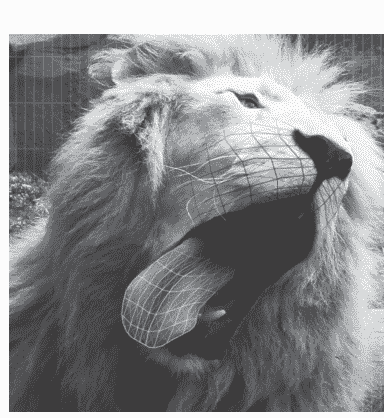

## 学习 JavaScript

JavaScript 是一种计算机编程语言，它是 HTML5 游戏的核心。游戏中几乎所有重要的东西都将以某种方式由 JavaScript 控制。JavaScript 是最容易学习的编程语言之一。你可以在几小时或几天内学会所有重要的知识，稍加练习，很快就能流利地编写它。

在本章中，你将学习 JavaScript 中所有重要的知识，这些都是你开始制作游戏所必须了解的。在后续的章节中，我将向你展示如何将这些技能应用到真实的游戏项目中。

请在本章中慢慢学习。这完全是关于如何像程序员一样思考。对于每个示例，请花足够的时间充分理解任何新概念，并创建自己的测试程序来摆弄这些技术。

## 设置环境

要开始用 JavaScript 编程，你需要一个文本编辑器和一个网页浏览器。你需要配置网页浏览器以显示**JavaScript 控制台**。控制台用于显示来自程序的消息，也会帮助你找出错误。你很快就会看到它是如何使用的。

以下是在 Safari、Chrome 和 Firefox 中显示 JavaScript 控制台的方法。每个浏览器对控制台的称呼不同，但功能都一样：

### Safari

- 从 Safari 的主菜单中选择**开发** ▶ **显示错误控制台**。这将打开一个名为“Web 检查器”的新窗口。可选操作：点击 Web 检查器左下角的窗口图标，将其停靠到 Safari 的主窗口中。

### Chrome

- 选择**视图** ▶ **开发者** ▶ **JavaScript 控制台**。

### Firefox

- 选择**工具** ▶ **Web 开发者** ▶ **Web 控制台**。

你可以在电脑桌面上安排文本编辑器、网页浏览器和控制台，使它们同时可见。图 2-1 展示了我在自己电脑上的布局方式。

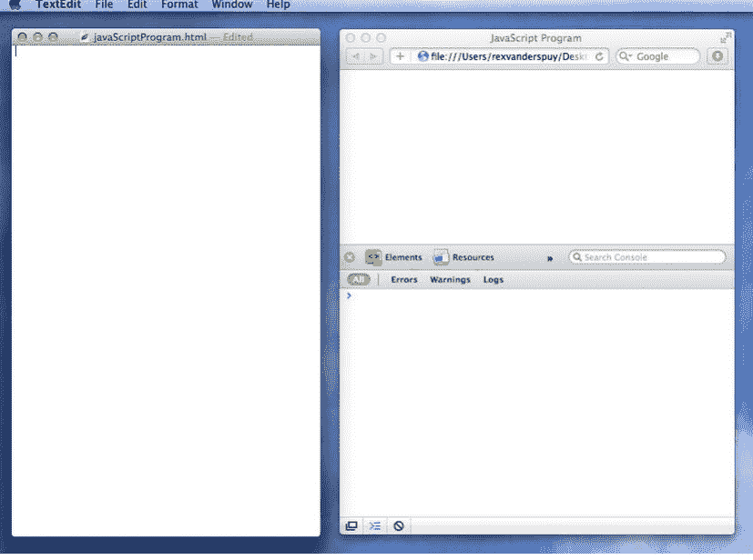

**图 2-1.** 安排文本编辑器、网页浏览器和控制台

> 注：如果你使用的是 Mac OS X，可以使用 Mission Control 将这种布局分配到单独的桌面。这样可以让任何文件更易于处理，而不会被桌面上其他打开的窗口所干扰。

## 在控制台中显示消息

现在我们来写一个简单的 JavaScript 程序，它将在 JavaScript 控制台中显示“Hello World!”这几个字。

1. 在文本编辑器中输入以下内容。

   ```html
   <!doctype html>
   <title>Display console output</title>
   <script>
   console.log("Hello World!");
   </script>
   ```

2. 以文件名`displayConsoleOutput.html`保存。

3. 在网页浏览器中打开此文件。你应该只能看到一个空白页面。别担心：这就是你应该看到的！

4. 如果控制台尚未打开，请显示它。你会看到它显示了“Hello World!”几个字。图 2-2 展示了你会看到的效果。

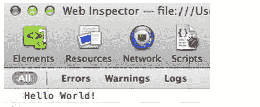

**图 2-2.** 在控制台中显示“Hello World!”几个字

恭喜你，你刚刚编写了你的第一个 JavaScript 程序！让我们看看它是如何工作的。

你在 HTML 文档的`<script>`标签内编写 JavaScript：

```html
<script>
... 在这里添加 JavaScript
</script>
```

> 注：早期版本的 HTML 要求在`<script>`标签中添加`type`属性，如下所示：
>
> ```html
> <script type="text/javascript">
> ```
>
> HTML5 不再需要这样做。不过，你可能仍然想使用它，因为许多 JavaScript 文本编辑器使用此属性作为开启语法高亮的提示，这可以帮助你更容易地阅读程序。

这是在控制台中显示文字的 JavaScript 代码：

```javascript
console.log("Hello World!");
```

这一行代码称为**指令（directive）**。指令是你想要执行的动作。你总是能识别出指令，因为它以分号结尾。分号告诉程序：“现在就执行这个！”

这些字是通过一个名为`console.log()`的**方法（method）**显示在控制台中的：

```javascript
console.log();
```

方法是让你执行特定任务的特殊短语。`console.log`方法让你可以在 Web 检查器的控制台中显示文字。任何放在其括号内的文字都会像这样显示：

```javascript
console.log("You can write any words here.");
```

文字必须用引号括起来。

亲自试试，看看你是否能让新文字出现在控制台中。在文本编辑器中修改 HTML 文件，让`console.log`方法显示不同的文字。示例如下：

```html
<!doctype html>
<title>Display console output</title>

<script>

console.log("Can you really write anything?");

</script>
```

保存文件并点击网页浏览器的刷新按钮。你现在应该能看到你写的新文字出现在控制台中了。

就这样！看到 JavaScript 有多简单了吧？如果你已经正确设置了所有内容，并且得到了我刚才描述的结果，你就可以继续学习本章其余部分的示例了。

> 注：将 JavaScript 程序加载到网页浏览器中称为**运行（running）**它。每当在本书中看到“run the program”这个短语时，我的意思是在网页浏览器中打开它并观察发生了什么。

## 如果你的程序无法运行该怎么办？

如果你是编程新手，很有可能在某个地方犯了一个小错误，导致程序无法运行。以下是一些可能出错的地方：

- 如果网页浏览器显示一堆乱码字符，那很可能意味着你的文本编辑器没有将文件保存为纯文本。检查文本编辑器的首选项设置，确保它不会将你的作品保存为富文本格式。富文本格式会向文件中添加额外的格式代码，阻止网页浏览器读取纯 JavaScript 代码。

- 控制台给出了错误信息。如果你输入 JavaScript 代码时有误，它将无法工作，控制台会尝试告诉你它认为哪里出了问题。仔细检查你写的代码，并与本书中的代码进行比较。它们完全一样吗？图 2-3 展示了你如果在`console`和`log`之间忘记加点时会得到的错误信息。它会显示为`ReferenceError: Can't find variable: consolelog`

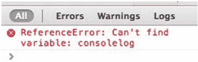

**图 2-3.** 一个典型的错误信息

如你所见，这个错误信息实际上并没有告诉你忘记了加点。但它确实告诉你它认为问题与`console.log`有关，所以至少能让你知道应该在程序的哪个位置寻找错误。

你可能会犯几十种这样的小错误。每个错误都可能触发几十种不同的错误信息，其中大多数对你来说将完全无法理解。你需要大量的练习，犯很多错误，才能准确理解那些错误信息试图告诉你什么。

目前，只需将错误信息视为计算机告诉你某处有错误的方式。可能是任何东西，可能在你程序中的任何位置。回到你的程序，再三检查小错误。本章所有代码的工作示例都在本书的源文件中，如果有任何疑问，可以将它们与你自己的程序进行对比。

在本章末尾，你会找到一个名为“调试代码快速指南”的部分，其中列出了你可能犯的许多常见错误以及它们产生的错误信息。如果你遇到严重困难，可以参考它寻求帮助。

好了，就说到这里，让我们开始学习编程吧！

> 注意：为简单起见，接下来的示例是纯 JavaScript 代码，不包含围绕它们的 HTML 代码。要在 HTML 文档中运行这些示例，请按照以下格式将代码插入到`<script>`标签之间：
>
> ```html
> <!doctype html>
> 
> <title>示例名称</title>
> 
> <script>
> 在此处添加 JavaScript 代码
> </script>
> ```
>
> 所有可运行的示例（包含 HTML 代码）都可在本章的源文件中找到。

## 变量

变量就像一个存储信息的小盒子。每个变量都有一个名字。当在程序中使用这个名字时，变量就会显示它所包含的任何信息。

图 2-4 展示了两个变量。名为`name`的变量存储了一个游戏玩家的名字。名为`score`的变量存储了该玩家的当前得分。

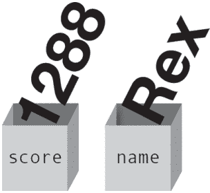

**图 2-4.** 变量是存储信息的盒子

无论何时在程序中使用`name`或`score`这些词，它们都会被盒子里的内容所替换。你可以像这样将一个数字放入变量：

```javascript
score = 1288;
```

等号将 1288 复制到名为`score`的变量中。现在，每当程序看到`score`这个词，它就会用 1288 来替代。

变量也可以存储文本，像这样：

```javascript
name = "Rex";
```

只需用引号将文本括起来。如果程序现在看到`name`这个词，它就会用“Rex”来替代。

如果你是第一次使用一个变量，你需要使用一个叫做`var`的**关键字**来创建它。方法如下：

```javascript
var score;
```

关键字是 JavaScript 能理解的特殊词语。`var`告诉程序创建一个名为`score`的变量。它创建了这个变量。但在上面的例子中，变量是空的，它不包含任何值。如果你需要向里面放入一些信息，你现在可以这样做：

```javascript
score = 128;
```

如果你想创建一个变量并同时放入信息，你可以这样做：

```javascript
var score = 1288;
```

让我们看一些关于变量如何工作的实际例子。

### 使用数字

这是一个在控制台中显示变量值的 JavaScript 程序。


```javascript
var number = 12;
console.log(number);
```

运行这个程序（在网页浏览器中打开它），你会在控制台中看到如下输出：

```text
12
```

程序首先创建一个名为`number`的变量，并将 12 放入其中：

```javascript
var number = 12;
```

## 第 2 章

然后你可以使用`console.log`，通过将变量名放入括号之间来显示变量的值：

```javascript
console.log(number);
```

需要注意的是，它显示的不是变量的名字`number`，而是变量*包含*的内容。你可以将任何其他值放入该变量，像这样：

```javascript
var number = 2900;
console.log(number);
```

控制台现在会显示 **2900**。

变量的名字可以随你喜欢。如果你将它改名为`alarmingStatistic`，它仍然会显示数字 **2900**。

```javascript
var alarmingStatistic = 2900;
console.log(alarmingStatistic);
```

变量的名字完全由你决定。现在你也知道每年有多少河马袭击事件了。下次去动物园时要小心。

变量也可以包含一个数学计算，像这样：

```javascript
var number = 4 + 6;
console.log(number);
```

`number`的值现在将显示为 **10**。JavaScript 为你完成了计算。

你还可以将变量相加。下一个例子展示了如何给变量赋值，将这些变量相加，然后将总和显示在第三个变量中。

```javascript
var firstNumber = 4;
var secondNumber = 3;
var total = firstNumber + secondNumber;

//显示总和
console.log(total);
```

这会在控制台中显示 7。

很容易看出它是如何工作的。首先，将两个数字赋值给一些变量：

```javascript
var firstNumber = 4;
var secondNumber = 3;
```

然后将这两个数字在一个名为`total`的第三个变量中相加。

```javascript
var total = firstNumber + secondNumber;
```

这意味着`total`现在的值是 7。

这个例子中有一个新的东西，我确信你对此感到疑惑。这行代码是什么？

```javascript
//显示总和
```

这是一个**注释**。每当你看到两个正斜杠字符时，它意味着该行中它们之后的所有文字都不会作为 JavaScript 代码运行。注释是程序员为自己写的笔记，用来提醒自己程序某部分的功能。

如果你想写一个跨越多行的更长注释，你可以用一组这样的字符将其包围：

```javascript
/*
这组字符之间的所有内容
都是注释，不会作为 JavaScript 代码运行
*/
```

> 注意：因为注释内的任何内容都不会作为编程代码运行，所以注释有时被用来临时禁用一行或一段代码，以测试程序在没有它们时的运行情况。

对于数字，你可以做的不仅仅是将它们相加。你还可以使用这些符号进行减法、乘法和除法。

| 符号 | 描述 |
| --- | --- |
| `+` | 加法 |
| `-` | 减法 |
| `*` | 乘法 |
| `/` | 除法 |
| `%` | 模运算。返回除法问题的余数。例如：5 % 2 = 1。5 除以 2 等于 4 余 1。模运算代表余数。 |

> 注意：现在不用太担心模运算符，但正如你将在本书后面看到的，它在游戏编程中会变得出奇地有用。

这些符号被称为**算术运算符**。这是一个展示每个运算符如何使用的程序示例。

```javascript
var firstNumber = 4;
var secondNumber = 3;
```

```javascript
//算术运算
var total = firstNumber + secondNumber;
var product = firstNumber * secondNumber;
var quotient = firstNumber / secondNumber;
var difference = firstNumber - secondNumber;
```

```javascript
//显示总和
console.log(total);
```

```javascript
//显示乘积
console.log(product);
```

```javascript
//显示商
console.log(quotient);
```

```javascript
//显示差
console.log(difference);
```

这个程序在控制台中显示的内容如下：

```text
7
12
1.3333333333333333
1
1
```

注意，除法运算的结果会自动添加小数位。你将在下一章学习如何将数字四舍五入到最近的整数。

尝试更改`firstNumber`和`secondNumber`的值，并观察再次保存并运行程序时结果如何变化。你离构建自己的计算器已经不远了。

使用数字变量很容易，而且你会发现将文本存储在变量中也同样容易。

### 使用字符串

在编程术语中，“文本”被称为“字符串”。这个名字的由来是因为文本是由“一串字母”组成的。这是一个需要记住的重要术语，因为计算机程序员在谈论文本或字母时总是使用“字符串”这个词。他们就是这么称呼的。所以从现在起我也会这么做。字符串！

变量可以存储字符串，就像它存储数字一样容易。这个 JavaScript 程序在控制台中显示字符串`"Hungry hippo"`。

```javascript
var message = "Hungry hippo";
console.log(message);
```

字符串必须始终用引号括起来。

你可以使用加号将字符串组合成新的短语或句子，像这样：

```javascript
firstWord + secondWord
```

这是一个展示其工作原理的程序示例：

```javascript
var firstWord = "Hungry";
var secondWord = "hippo";
var combinedWords = firstWord + secondWord;

console.log(combinedWords);
```

这会显示：

```text
Hungryhippo
```

你看到加号是如何将两个字符串组合在一起，然后将结果复制到一个新变量中的了吗？

> 注意：程序员用**连接**这个术语来表示像这样将字符串连接在一起。

但你也可以看到它有一个问题。“Hungry”和“hippo”之间应该有一个空格。你可以通过在两个单词之间插入一个空格来解决这个问题，像这样：

```javascript
var combinedWords = firstWord + " " + secondWord;
```

空格由包围一个空格的空引号表示：

```javascript
" "
```

如果你对程序进行这个更改，它将按预期显示组合后的文本：

```text
Hungry hippo
```

在 JavaScript 中，空格只是一个不可见的字符。现在你几乎已经了解了关于数字、字符串和变量的所有知识。但要开始制作游戏，你还需要了解另一种变量类型。

### 使用布尔变量

你也可以将一个变量设置为真或假。想象一下，你正在制作一个太空冒险游戏，玩家必须拯救宇宙免于被一只巨大的、多维度的袋熊吞噬。在游戏开始时，宇宙显然还没有被吞噬。因此，你可以通过创建一个名为`universeEaten`的变量并将其设置为`false`来告知游戏这一状态。

```javascript
var universeEaten = false;
```

如果玩家未能拯救宇宙，那么你就将该变量设置为`true`。

```javascript
universeEaten = true;
```

游戏就会结束。（或者，如果你是一个非常聪明的后现代游戏设计师，可以让游戏在袋熊的肚子里继续进行。）

让我们看看这是否真的有效。下面是一个程序，它将`universeEaten`初始化为`false`，然后将其设置为`true`并显示结果。

```javascript
// 游戏开始时将变量初始化为 false
var universeEaten = false;
```

```javascript
// 在游戏后期将其更改为 true
universeEaten = true;
```

```javascript
// 显示其值
console.log(universeEaten);
```

这将在控制台中显示 **true**，这是最后设置的值。（还要注意，`var`只在变量首次创建时使用一次。）

真和假的值被称为**布尔值**。这个名字来源于乔治·布尔，他关于使用真和假值的逻辑思想构成了现代计算机科学的基础。

既然你知道了如何使用变量，让我们看看如何运用一些逻辑来开始编写更有趣的程序。

## 决策制定

你的大多数游戏和程序都需要在事物之间做出决策。你需要一种方法来判断某些数字是高于还是低于其他数字，以及某些对象是与其他对象相同还是不同。

例如，让我们考虑一个你在日常生活中遇到的常见决策问题。你正开着你的车冲下悬崖，以逃离一群狂奔的河马。如果你的车有超过 5 升火箭燃料，那么捆绑在车顶的火箭就有足够的燃料带你飞越深邃的峡谷到达另一边。如果燃料少于 5 升，你就会燃料不足，盘旋坠入下方袋熊出没的湍急河流中走向毁灭。你可以这样表述这个问题：

> 如果我有超过 5 升燃料，
>
> 我就能活下来。
>
> 否则，
>
> 我就活不下来。

这很简单，对吧？JavaScript 代码中的完全相同的逻辑是这样的。

```javascript
if(fuel > 5)
{
    live = true;
}
else
{
    live = false;
}
```

这被称为**if 语句**。关键字`if`检查括号内的内容是否为真。如果为真，那么其后花括号内的代码就会运行。

```javascript
if(this thing is true)
{
    then do this;
}
```

你可以让`if`语句保持这样，也可以添加一个可选的**else 语句**。`else`语句允许你在`if`语句检查的内容为假时运行一些代码。方法如下：

```javascript
if(this thing is true)
{
    then do this;
}
else
{
    do this;
}
```

如果这件事不为真，那么`else`语句就会运行其花括号内的代码。这是在一件事或另一件事之间做出简单选择。让我们看一些实际的例子。

> 注意：任何包含在一对花括号内的编程代码部分都称为一个**代码块**。像这样：

```javascript
{
    这里的所有内容都是代码块的一部分
}
```

代码块内的代码通常与另一个代码块的代码是分开的，尽管代码块可以共享信息。你很快就会看到如何做到这一点。

下面是一个程序，用于检查两个数字是相同还是不同。

```javascript
var firstNumber = 10;
var secondNumber = 12;

if(firstNumber === secondNumber)
{
    console.log("The numbers are the same");
}
else
{
    console.log("The numbers are different");
}
```

这将在控制台中显示`"The numbers are different"`。如果你将`firstNumber`改为 12 并再次运行程序，控制台将显示`"The numbers are the same"`。

`if`语句使用三个等号来检查数字是否相同。

```javascript
if(firstNumber === secondNumber)
```

如果为真，那么直接跟在它后面的花括号内的代码就会运行。如果为假，那么`else`部分花括号内的代码就会运行。

你也可以使用`if`语句来检查一个值是大于还是小于另一个值。下面是一个例子：

```javascript
var firstNumber = 10;
var secondNumber = 12;

if(firstNumber > secondNumber)
{
    console.log("The first number is greater");
}
else
{
  console.log("The second number is greater");
}
```

在这个例子中，控制台将显示`"The second number is greater"`。`if`语句使用大于符号`>`来检查第一个数字是否大于第二个。

```javascript
if(firstNumber > secondNumber)
```

如果你将`firstNumber`的值改为 13 并再次运行程序，控制台将显示`"The first number is greater"`。

这些符号，`===`和`>`，被称为**条件运算符**。以下是你需要知道的重要条件运算符。

| 运算符 | 描述 |
| --- | --- |
| `===` | 等于 |
| `!==` | 不等于 |
| `>` | 大于 |
| `<` | 小于 |
| `>=` | 大于或等于 |
| `<=` | 小于或等于 |

仅使用这些条件运算符和`if`语句，你就可以为游戏创建一些极其复杂的逻辑。本书充满了例子。让我们再看一个。

你可以使用`if`语句来检查两个字符串（单词）是否相同或不同。下面是一个简单的程序，用于检查一只猫是否和一只河马一样。

```javascript
var firstAnimal = "cat";
var secondAnimal = "hippo";

if(firstAnimal === secondAnimal)
{
  console.log("The animals are the same");
}
else
{
  console.log("The animals are different");
}
```

这将在控制台中显示`"The animals are different"`。

### 检查更多条件

在前面的例子中，`if`语句检查两个不同的条件，看看其中一个是否为真。如果你想检查两个以上的条件，方法如下。

这是一个`if`语句，试图判断`"cat"`是什么类型的动物。

```javascript
var animal = "cat";

if(animal === "horse")
{
    console.log("It's a horse");
}
else if(animal === "mouse")
{
    console.log("It's a mouse");
}
else if(animal === "cat")
{
    console.log("It's a cat");
}
else
{
    console.log("I don't know what it is");
}
```

注意其中额外的`else if`语句，它们用于检查更多条件。当你运行这个程序时，它将显示`"It's a cat"`。如果你将`animal`变量的值改为`"mouse"`，它将显示`"It's a mouse"`。如果你将`animal`变量改为程序无法识别的内容，比如`"giraffe"`，它将显示`"I don't know what it is"`。

让我们分解一下，这样你就能清楚地看到它是如何工作的。从一个像这样简单的`if`语句开始：

```javascript
var animal = "cat";

if(animal === "cat")
{
    console.log("It's a cat");
}
else
{
    console.log("I don't know what it is");
}
```

这很简单。控制台将显示`"It's a cat"`。如果你将`animal`的值改为其他任何值，它将显示`"I don't know what it is"`。

现在想象一下，你还想检查这只动物是否可能是老鼠。你可以通过插入一个`else if`语句来实现这一点。`else if`语句如下所示，以粗体突出显示：

```javascript
var animal = "cat";

if(animal === "cat")
{
  console.log("It's a cat");
}
else if(animal === "mouse")
{
  console.log("It's a mouse");
}
else
{
  console.log("I don't know what it is");
}
```

你可以看到，中间的`else if`语句检查另一个特定条件，就像第一个`if`语句一样。如果`animal`的值是`"mouse"`，这个程序将在控制台中显示`"It's a mouse"`。

你可以根据需要加入任意多个`else if`语句来检查尽可能多的条件。如果其他条件都不为真，链中的最终`else`语句将运行。这被称为**默认条件**。它是可选的。如果你愿意，完全可以省略最后的`else`语句，像这样：

```javascript
var animal = "cat";

if(animal === "cat")
{
  console.log("It's a cat");
}
else if(animal === "mouse")
{
  console.log("It's a mouse");
}
```

在这个例子中，如果`animal`的值不是`"cat"`或`"mouse"`，则不会发生任何事情。这完全没问题。

这就是逻辑开始变得复杂和有趣的地方。但你可以看到规则其实非常简单。保持这样简单，你就会成为一个快乐的程序员。

### 使用 switch 语句

像上面例子中的复杂`if`语句非常常见，你会在游戏项目中一直使用它们。它们非常常见，以至于 JavaScript 为你提供了一种替代的编写方式，可能稍微更容易阅读。它被称为**switch 语句**。

## 第 2 章

下面是一个`switch`语句，它与我们刚刚查看的`if`语句功能完全相同：

```javascript
var animal = "cat";

switch(animal)
{
  case "horse":
    console.log("It's a horse");
    break;

  case "mouse":
    console.log("It's a mouse");
    break;

  case "cat":
    console.log("It's a cat");
    break;

  default:
    console.log("I don't know what it is");
}
```


结果与之前的`if`语句相同：控制台将显示“It's a cat”。以下是`switch`语句的工作原理。

使用`switch`关键字，后跟括号内要检查的值。

```
switch(animal)
```

`switch`语句的主体位于一对花括号内。

```
switch(animal)
{
  ...the body of the switch statement goes here
}
```

在花括号内部，你可以逐个检查要测试的情况，如下所示：

```
case "horse":
  console.log("It's a horse");
  break;
```

如果“horse”与`animal`的值匹配，则控制台将显示“It's a horse”。同时它还会执行`break`指令：

```
break;
```

这会停止程序检查其他任何情况，并退出`switch`语句。你可以添加任意多个`case`，每个`case`可以包含任意多条指令。但你必须记住，每个`case`都需要以`break`指令结束：

```
case "horse":
    console.log("It's a horse");
    break;

case "mouse":
    console.log("It's a mouse");
    break;

case "cat":
    console.log("It's a cat");
    break;
```

> 注意：别忘了`break`语句！省略它是一个非常常见的错误，如果你真的省略了，你的程序将无法按预期运行。如果你的任何程序表现异常，而你又找不到原因，请仔细检查是否在某处遗漏了`break`。

请注意，每个`case`内的所有指令都缩进了两个空格，并且每个`case`之间都用空行分隔。这些视觉提示显示了每个`case`是如何分隔的。

`switch`语句还使用可选的`default`情况，当没有任何匹配项时它会运行。

```
default:
    console.log("I don't know what it is");
```

> 注意：`default`这个技术术语的意思是“如果没有其他情况发生，就会发生的事情”。这就像周六晚上你的朋友们都忙时，你点个披萨看视频一样。

你可以决定是使用一系列`if`语句还是`switch`语句。图2-5是并排比较。如果它们检查的条件对所有情况都相同，它们的功能完全相同。使用哪一个没有技术原因：唯一的区别在于它们的外观。你更喜欢哪一个？

## if

```
var animal = "cat";

if(animal === "horse")
{
  console.log("It's a horse");
}
else if(animal === "mouse")
{
  console.log("It's a mouse");
}
else if(animal === "cat")
{
  console.log("It's a cat");
}
else
{
  console.log("I don't know what it is");
}
```

## switch

```
var animal = "cat";

switch(animal)
{
  case "horse":
    console.log("It's a horse");
    break;

  case "mouse":
    console.log("It's a mouse");
    break;

  case "cat":
    console.log("It's a cat");
    break;

  default:
    console.log("I don't know what it is");
}
```

**图2-5。** `if`语句和`switch`语句的功能相同。使用你喜欢的任何一个。

在本书中我使用`switch`语句，因为在复杂程序的上下文中它们更容易阅读。

### 使用`&&`和`||`

有时你可能希望只有在多个条件都为真时才执行某些操作。你可以使用**与运算符**同时检查两个或多个条件，如果它们都为真，它就会执行一个操作。与运算符是一个双`&`符号：

```
&&
```

你可以在`if`语句中这样使用它：

```
if(thisIsTrue && thisIsAlsoTrue)
{
  ... do these things
}
```

假设你正在创建一个冒险游戏，只有当法术被打破*并且*女巫死亡时游戏才会结束。你可以这样检查游戏是否结束：

```
var spellIsBroken = true;
var witchIsDead = true;

if(spellIsBroken && witchIsDead)
{
  console.log("Game Over!");
}
```

```
else
{
  console.log("Keep playing...");
}
```

如果*两个*变量`spellIsBroken`和`witchIsDead`都为`true`，那么控制台将显示“Game Over!”。但如果其中任何一个设置为`false`，控制台将显示“Keep playing...”。两个变量都需要为`true`游戏才能结束。

有时你可能希望在一件事物*或*另一件事物为真时执行操作。在这种情况下，你使用或运算符，它看起来像这样：

```
||
```

这是一个双*竖线符号*。如果你仔细观察，你会发现竖线符号（一条垂直的直线）在你的键盘上。它通常与反斜杠字符在同一个键上，在很多情况下，它位于退格键或删除键下方。

你可以这样使用或运算符：

```
if(thisIsTrue || thisIsTrue)
{
  ... do these things
}
```

这些条件中只需要一个为真，而不是两个都为真。

让我们想象一下，你改变了冒险游戏的规则，使其变得稍微容易一些。玩家如果法术被打破*或者*女巫死亡就可以获胜。他们不必同时完成两个任务。你可以使用或运算符来检查这个条件：

```
var spellIsBroken = true;
var witchIsDead = false;

if(spellIsBroken || witchIsDead)
{
  console.log("Game Over!");
}
else
{
  console.log("Keep playing...");
}
```

如果`spellIsBroken`或`witchIsDead`中*任一个*为`true`，控制台将显示“Game Over!”。其中任何一个为真都可以，无论哪一个。但如果它们*都*为`false`，控制台将显示“Keep playing...”。

## 使用函数

如果你的程序有一些专门的工作要做，创建一个**函数**通常是个好主意。你可以将这些工作放入一个函数中，使其与程序的其余部分分离。无论何时你需要完成这项工作，只需调用该函数即可。

创建和使用函数是一个两步过程。你首先必须**定义**它。定义函数就像第一次设置它。一旦定义了，你就必须**调用**它。这就像告诉你的程序去做你在函数中设置的事情。

你可以这样定义一个函数：

```
function theFunctionName()
{
  ... any work you want the function to do
}
```

使用关键字`function`，然后写上函数的名称。它的名称可以是任何你喜欢的，但你必须在它后面加上空括号。在花括号内，输入你希望函数完成的所有工作。这被称为**函数定义**。

每当你希望函数执行其工作时，你就**调用**它。只需写下函数的名称，后跟括号和分号。

```
theFunctionName();
```

这将告诉函数开始工作。你在函数定义的花括号之间插入的任何编程代码都将运行。

用一个实际的例子更容易理解这一点。下面是一个使用函数将两个数字相加的程序。

```
var firstNumber = 4;
var secondNumber = 3;

add();

function add()
{
  var total = firstNumber + secondNumber;
  console.log(total);
}
```

这将在控制台中显示7。

让我们把它分解成更小的部分。首先，看看函数定义。

```
function add()
{
  var total = firstNumber + secondNumber;
  console.log(total);
}
```

它将数字相加，并将结果复制到一个名为`total`的新变量中。然后它在控制台中显示`total`的值。这就是显示7的原因。

> 注意：因为名为`total`的变量是在函数内部声明的，所以它只能在此函数中使用。程序的其余部分看不到它。你在函数内部创建的任何变量对于程序的其余部分都是不可见的。这些被称为**局部变量**。

另外，因为`firstNumber`和`secondNumber`是在函数外部声明的，所以该函数可以使用它们。它们也可以被任何其他函数使用。它们被称为**全局变量**，因为它们可以在程序中的任何地方使用。

但该函数只有在被调用时才会执行其加法和显示数字的工作。这就是这行代码的作用：

```
add();
```

它告诉`add`函数开始工作。如果这行代码不在我们的程序中，函数定义就不会运行其代码。

> 注意：你还会注意到，函数在调用之后定义也没关系。函数定义只需要在程序中的某个位置即可。那么你应该把它放在哪里呢？

如果你把所有的函数定义都放在程序的末尾，你的程序会更容易阅读。这是因为它们往往做很多重复性的工作，并且在编写之后你很少需要再查看它们。这会将所有使用这些函数的重要逻辑集中在靠近程序顶部的地方。那里是你进行大部分创造性编程工作的地方。

通过将特定任务分配给函数，你可以通过模块化它们使程序更易于管理。如果你知道某个特定函数执行特定任务，你就知道在哪里可以找到它来修改或修复程序中的问题。

### 带有额外信息的函数

你可能想知道为什么函数名称后面有空括号。这是为了让你可以给函数一些额外的信息来完成其工作。

## 第二章

下面是一个简单示例，介绍如何创建带有额外信息的函数。这是一个会在控制台显示单词"Hello"的函数。单词"Hello"通过函数的括号传递给函数。

```
displayAnything("Hello");
```

```
function displayAnything(thingToDisplay)
{
  console.log(thingToDisplay);
}
```

当程序运行时，"Hello"会出现在控制台中。

这是如何运作的。首先，单词"Hello"被插入到函数调用的括号中。

```
displayAnything("Hello");
```

你可以把括号想象成一张巨大的嘴巴，或者通往另一个宇宙的虫洞。它吞下"Hello"，并将其直接传送到函数定义的括号中：

```
function displayAnything(thingToDisplay)
{
  ...
}
```

函数会自动将"Hello"复制到一个名为`thingToDisplay`的变量中。这个变量现在会自动为你声明，你可以在函数中的任何地方使用它。现在，每当函数使用`thingToDisplay`时，它都会将其替换为"Hello"。

```
function displayAnything(thingToDisplay)
{
  console.log(thingToDisplay);
}
```

你明白了吗？

就函数而言，它正在运行的代码看起来是这样的：

```
console.log("Hello");
```

这就是它显示"Hello"的原因。

如果你是编程新手，可能会觉得这很令人困惑。请仔细查看图2-6。它说明了"Hello"是如何被传送到函数定义中进行处理的。或者，如果你喜欢那张巨大的嘴巴的比喻，它展示了"Hello"是如何被消化的。

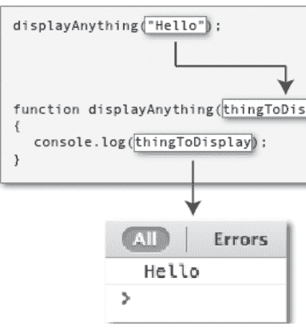

**图2-6。** "Hello"被发送到函数，函数将其显示在控制台中

这有什么用处呢？因为你可以将单词"Hello"替换为任何其他你喜欢的信息，而函数定义会将其显示出来。你不需要对函数定义内部的代码做任何更改。下面是一个例子。将"Hello"替换为"你可以向函数发送任何内容"：

```
displayAnything("你可以向函数发送任何内容");

function displayAnything(thingToDisplay)
{
    console.log(thingToDisplay);
}
```

这会显示"你可以向函数发送任何内容"。你会发现，如果函数更复杂一些，这将更加有用。

### 带多个参数的函数

通过函数括号发送给函数的额外信息被称为**参数**。这是一个需要了解的重要术语，因为所有程序员都在使用它，而且你在每本关于计算机编程和游戏设计的书中都会看到它。在前面的例子中，我们向函数传递了一个参数："Hello"。你可以向函数传递多个参数。只需用逗号将参数分隔开。让我们来看一个简单的例子，看看这是如何工作的。

这个程序将数字3和4相加，然后显示结果：

```
add(3, 4);

function add(firstNumber, secondNumber)
{
  var total = firstNumber + secondNumber;
  console.log(total);
}
```

这会在控制台中显示7。

你可以看到，3和4被插入到函数名后面的括号中：

```
add(3, 4);
```

它们用逗号分隔。这将3和4发送到函数定义：

```
function add(firstNumber, secondNumber)
{ ...
```

它们被复制到名为`firstNumber`和`secondNumber`的变量中。现在，每当函数使用`firstNumber`时，它会将其替换为3。每当它使用`secondNumber`时，它会将其替换为4。

```
function add(firstNumber, secondNumber)
{
  var total = firstNumber + secondNumber;
  console.log(total);
}
```

就函数而言，它正在运行的代码看起来是这样的：

```
var total = 3 + 4;
console.log(total);
```

这就是它显示7的原因。

图2-7说明了这是如何工作的。

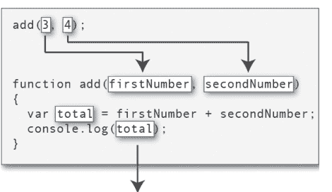

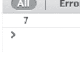

**图2-7。** 你可以向函数发送多个参数

现在这真的很有用了。你已经创建了自己的小加法计算器。你可以将3和4替换为任意两个数字，函数会将它们相加并显示结果。将数字10和32放入函数调用的括号中，然后再次运行程序：

```
add(10, 32);
```

控制台现在会显示42。你根本不需要改动函数定义，只需要改动你提供的信息。你现在看到这有多有用了吗？

### 计算器函数

你现在对 JavaScript 的了解已经足够创建你自己的小计算器了。尝试创建四个函数，分别对两个数字进行加、减、乘、除运算。你的函数调用应该像这样：

```
add(12, 6);
subtract(67, 45);
multiply(34, 26);
divide(100, 5);
```

这四个匹配的函数定义应该是什么样的呢？试着自己解决这个问题；如果你能独立想出答案，你会学到很多。但如果你卡住了，这里有一个完整的计算器程序，正好可以实现这个功能。

```
add(12, 6);
subtract(67, 45);
multiply(34, 26);
divide(100, 5);
```

```
function add(firstNumber, secondNumber)
{
    var total = firstNumber + secondNumber;
    console.log(total);
}

function subtract(firstNumber, secondNumber)
{
    var difference = firstNumber - secondNumber;
 ambiguity
    console.log(difference);
}

function multiply(firstNumber, secondNumber)
{
    var product = firstNumber * secondNumber;
    console.log(product);
}

function divide(firstNumber, secondNumber)
{
    var quotient = firstNumber / secondNumber;
    console.log(quotient);
}
```

看，真的就像你想的那么简单！

### 返回值的函数

关于函数，还有一个重要的特性你应该了解。你可以让函数直接将值返回到主程序中。下面是一个例子：

```
var total = add(4, 4);

console.log(total);

function add(firstNumber, secondNumber)
{
    var sum = firstNumber + secondNumber;
    return sum;
}
```

这会在控制台中显示8。你能想出为什么吗？

是的，这有点让人头晕！所以让我们分解一下，让你看看发生了什么。

程序创建了一个名为`total`的变量：

```
var total
```

但`total`不仅仅被赋予一个普通值，比如数字或字符串。`total`的值是`add`函数：

```
var total = add(4, 4);
```

这意味着`add`函数的结果将被复制到`total`中。`total`变量实际上得到的值是"8"。

```
var total = 8;
```


之所以能这样工作，是因为函数定义中的关键字`return`（下面高亮显示）：

```javascript
function add(firstNumber, secondNumber)
{
    var sum = firstNumber + secondNumber;
    return sum;
}
```

`return`告诉函数将变量的值返回到主程序中。在这种情况下，它返回的是自身变量`sum`的值，即 4 加 4。

这是一个循环的过程，你可以在图 2-8 中最好地看到。

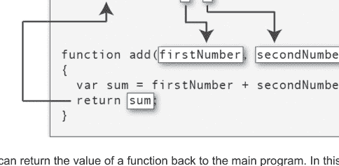

**图 2-8.** 函数可以将函数的值返回到主程序中。在这个例子中，它将数字“8”发送回`total`。

练习使用`return`函数的一个好方法，是重写你在上一节中编写的计算器。创建将计算结果返回到主程序的函数，就像这个例子一样。如果你卡住了，可以在本章的源文件中找到一个名为`returnFunctionCalculator.html`的工作示例。

我们刚才看到的三种函数风格都可以产生相同的结果，而且通常不清楚哪一种才是最佳的选择。通过一些练习和更多的经验，你会开始意识到哪种编写函数的风格对于你正在处理的任何程序来说都是最有用的。你将在本书中各种不同的上下文中看到所有这些风格被使用。

### 函数表达式

你可以使用一种替代语法来创建函数。它看起来像这样：

```javascript
var functionName = function(arguments)
{
    //你想让函数运行的代码
};
```

你以同样的方式调用函数，像这样：

```javascript
functionName(arguments);
```

这种编写函数的风格被称为**函数表达式**。它将函数赋值给一个变量。它的工作方式与普通函数相同，只是现在你也可以像使用变量一样使用这个函数。除此之外，还有两个重要的区别：

- 你必须在调用函数表达式之前定义它。
- 最后一个花括号后面有一个分号。

下面是一个将两个数字相加的函数表达式：

```javascript
var add = function(firstNumber, secondNumber)
{
    var total = firstNumber + secondNumber;
    console.log(total);
};
add(4, 4);
```

你是否使用这种编写函数的风格取决于你自己，但我们将在本书后面看到函数表达式的一些特定用途。

## 控制 HTML 和 CSS

JavaScript 可以控制 HTML 文档中的所有元素。它还可以更改 CSS 样式或创建新样式。你还可以使用 JavaScript 来编程按钮，从文本字段中读取用户输入。然后你可以在你的程序中使用该输入。如果你知道如何做到这一点，这是开始构建游戏和应用程序的第一步，也是最重要的一步。让我们来看看如何做到这一点。

### 在 HTML 元素中创建新文本

在前面的例子中，我使用`console.log`在 JavaScript 控制台中显示我们测试程序的结果。这对于测试程序的工作方式非常有用，但如果能直接在网页浏览器中显示结果，岂不是更好？这很容易做到。

所有 HTML 元素都有一个名为`innerHTML`的属性。`innerHTML`属性代表一对开标签和闭标签之间的文本。

```html
<p>标签之间的所有内容都是 innerHTML</p>
```

### 使用 innerHTML

你可以使用 JavaScript 来访问任何元素的`innerHTML`。以下是它的工作原理。

假设你有一个空的 HTML 元素，其`id`为`output`。

```html
<p id="output"></p>
```

JavaScript 首先需要知道`output`是指该元素的`id`。你可以使用一个名为`document.querySelector`的内置 JavaScript 方法来实现这一点：

```javascript
document.querySelector("#output");
```

它会在 HTML 文档中搜索，直到找到一个`id`为`output`的元素。

下一步是将这些信息存储在一个变量中。你可以给变量起任何你喜欢的名字，但最简单的方法就是给它起和你所查找元素的`id`相同的名字。以下是将该元素赋值给名为`output`的变量的方法：

```javascript
var output = document.querySelector("#output");
```

现在这个新的`output`变量直接指向 HTML 文档中的`<p id="output">`标签。它就是连接 HTML 代码与 JavaScript 代码的纽带。

> 注意：这说明变量不仅可以存储数字、字符串或 true/false 值。你可以在变量中存储几乎任何东西，在本书的更多示例中你会看到这一点。

你现在可以使用这个变量，配合`innerHTML`来改变元素显示的内容，像这样：

```javascript
output.innerHTML = "Hello World!";
```

现在该元素将在网页浏览器中直接显示“Hello World!”。HTML 代码实际上已经被 JavaScript 改变，使其看起来像这样：

```html
<p id="output">Hello World!</p>
```

这是一个巧妙的技巧。你不会在代码中看到这个变化，但它正在网页浏览器中不可见地在后台发生。让我们来看一下一个真实的 HTML 文档，它准确地展示了这是如何工作的。

```html
<!doctype html>
<title>显示 HTML 文本</title>

<p id="output"></p>

<script>

var output = document.querySelector("#output");
output.innerHTML = "Hello World!";

</script>
```

正如你所期望的那样，这个 HTML 文档显示“Hello World!”。文本只是通过 JavaScript 被添加到了空的`<p>`标签中。

在这个例子中，我使用`document.querySelector`来查找具有特定`id`的元素。你也可以用它来查找特定的类。只需将井号`#`替换为点号即可。以下是你查找一个名为`button`的类的方法：

```javascript
document.querySelector(".button");
```

这与 CSS 中的规则相同：井号指向`id`，点号指向类。你可以通过直接使用标签名来引用 HTML 标签，不需要井号或点号。以下是你查找`<body>`标签的方法：

```javascript
document.querySelector("body");
```

> 注意：如果你的 HTML 文档中有多个相同名称的标签，比如很多个`<p>`标签，`document.querySelector`只会找到第一个。要找到所有相同名称的标签，你可以使用`document.querySelectorAll`。它会给你一个包含 HTML 文档中所有相同名称标签的列表。这个列表将以一种称为**数组**的格式呈现。如果你需要这样做，你会在第 4 章学习如何使用数组，但现在不用担心这个。

### 使用 JavaScript 改变 CSS

你可以使用 JavaScript 来改变任何元素的 CSS 样式。以下是一个简单的例子。这个 HTML 文档中的 JavaScript 代码改变了“Hello World!”这几个字的样式。它使它们变成红色，高度为 50 像素，并带有下划线。你能看出是怎么做到的吗？

```html
<!doctype html>
<title>改变 CSS</title>

<p class="example">Hello World!</p>

<script>

var example = document.querySelector(".example");
example.style.color = "red";
example.style.fontSize = "50px";
example.style.textDecoration = "underline";

</script>
```

这与前面的例子非常相似。首先，使用`document.querySelector`来查找类名为`example`的元素。

```javascript
var example = document.querySelector(".example");
```

它被复制到一个同样名为`example`的变量中。

接下来，使用以下格式来改变 CSS 样式：

```javascript
example.style.anyCSSproperty = "value";
```

这是改变元素样式的代码：

```javascript
example.style.color = "red";
example.style.fontSize = "50px";
example.style.textDecoration = "underline";
```

注意所有的样式值都被引号包围。这些值与你在 CSS 代码中给样式属性的任何值相同。

CSS 属性的名称也与普通 CSS 属性相同。如果你想改变字体颜色，只需使用 CSS 的`color`属性，像这样：

```javascript
example.style.color = "red";
```

属性名称唯一的区别在于由多个单词组成的属性。在 CSS 中，影响字体大小的属性是这样的：

```css
font-size
```

在 JavaScript 中，同一个属性的写法是这样的：

```javascript
fontSize
```

单词之间的连字符被移除，第二个单词的首字母大写。所有使用连字符分隔单词的 CSS 属性在 JavaScript 中都是这样写的。

只要记住这个简单的格式，你就可以用 JavaScript 改变任何元素的 CSS 属性。

能够用 JavaScript 改变 CSS 对游戏来说非常有用，因为这意味着你可以根据玩家的游戏方式交互式地改变 HTML 元素的样式。你很快就会看到这是如何实现的。

### 创建和删除 HTML 元素

你可以使用 JavaScript 来创建和删除 HTML 元素。以下是如何将一个`<p>`元素添加到文档的`body`中，然后向其中添加一些文本的例子。

```html
<!doctype html>
<title>创建 HTML 元素</title>
<body></body>
<script>
var p = document.createElement("p");
document.body.appendChild(p);
p.innerHTML = "Hello World!";
</script>
```

这会创建一个包含“Hello World!”字样的`<p>`标签。如果你能看到它生成的 HTML 代码，它看起来会像这样：

```html
<body>
  <p>Hello World!</p>
</body>
```

当 HTML 文档首次加载时，它是空白的。它只包含一个空的`<body>`标签。

```html
<body></body>
```

JavaScript 代码使用一个名为`document.createElement`的方法来创建一个新的`<p>`标签，像这样：

```javascript
document.createElement("p");
```

将它赋值给一个名为`p`的变量：

```javascript
var p = document.createElement("p");
```

下一步是将这个新创建的`<p>`标签放到文档中的某个位置。一个名为`appendChild`的方法让你可以将这个新标签添加到已有的元素中。在这种情况下，你想把`<p>`标签添加到已有的`<body>`标签中。以下是如何使用`appendChild`来实现这一点：

```javascript
document.body.appendChild(p);
```

这就是新的 HTML 文档现在的样子：

```html
<body><p></p></body>
```

最后一步是向`<p>`标签中添加一些文本。使用`innerHTML`属性很容易做到这一点：

```javascript
p.innerHTML = "Hello World!";
```

你的新 HTML 文档现在看起来会像这样：

```html
<body><p id="example">Hello World!</p></body>
```

你可以同样容易地为元素创建一个新类。以下是如何使用`setAttribute`为`<p>`元素创建一个新类：

```javascript
p.setAttribute("class", "anyClassName");
```

使用相同的格式来添加你可能需要的任何属性。

### 删除 HTML 元素

在游戏中，你可能会遇到需要删除元素的情况。例如，如果导弹击中了宇宙飞船，你就要把宇宙飞船从游戏中移除。要删除任何 HTML 元素，使用`parentNode.removeChild`方法。以下是如何使用它来删除我们刚才创建的`<p>`标签：

```javascript
p.parentNode.removeChild(p);
```

`parentNode`是包含`<p>`标签的元素。在这种情况下，`parentNode`是`<body>`元素。所以这段代码实际上是告诉`<body>`元素删除`<p>`标签。这样做的原因是，元素不允许删除自己；相反，只有包含它们的元素才能删除它们。

是的，这是非常令人困惑的绕弯逻辑，但不要让这困扰你。只要遵循这个格式来删除元素，一切都会 A-OK。它有效！

### 点击按钮

你可以用 HTML 创建一个按钮，然后使用 JavaScript 在点击按钮时让某事发生。这是构建交互式游戏和应用程序的第一步。

要实现这一点，你需要使用一种称为**事件监听器**的特殊函数。事件监听器会“监听”程序中发生的事情。你可以将事件监听器附加到一个按钮上，使得当你点击它时某事发生。

理解其工作原理最简单的方法是通过一个实际的例子。在本章的源文件中，你会找到一个名为`eventListener.html`的 HTML 文件。在网页浏览器中打开它，并确保 JavaScript 控制台已打开，以便你能读取`console.log`消息。你会看到一个标签为“click me”的按钮。点击按钮，控制台中会显示“Button clicked”字样。

## 第 2 章

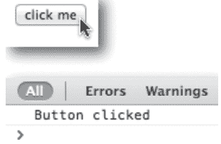

**图 2-9.** 点击按钮在控制台显示一条消息。

以下是实现此功能的 HTML 代码。我将详细解释它的工作原理：

```html
<!doctype html>
<title>Event listener</title>

<button>click me</button>

<script>

var button = document.querySelector("button");
button.addEventListener("click", clickHandler, false);

function clickHandler()
{
  console.log("Button clicked");
}

</script>
```

HTML 代码非常简单：它只是创建了一个`<button>`元素，也就是你在浏览器中看到的按钮。

```html
<button>click me</button>
```

我们需要知道按钮何时被点击。因此，JavaScript 代码为按钮添加了一个称为**事件监听器**的东西。当按钮被点击时，事件监听器会运行一个名为`clickHandler`的函数，该函数在控制台中显示消息。

```javascript
var button = document.querySelector("button");
button.addEventListener("click", clickHandler, false);

function clickHandler()
{
  console.log("Button clicked");
}
```

你看明白它是如何工作的了吗？让我们把它分解成更小的步骤。JavaScript 代码做的第一件事是使用`document.querySelector`找到按钮元素，并将其复制到一个同样名为`button`的变量中。

```javascript
var button = document.querySelector("button");
```

现在我们有了一个引用 HTML 按钮的变量。我们可以使用这个变量开始用 JavaScript 代码控制该按钮。我们可以为它附加一个事件监听器，以监听鼠标点击。这是通过一个名为`addEventListener`的特殊方法完成的。事件监听器将监听按钮上的“点击”事件。

```javascript
button.addEventListener("click", clickHandler, false);
```

你可以看到`addEventListener`方法通过一个点附加到`button`变量上。括号中有三个参数。

```javascript
("click", clickHandler, false)
```

它们分别起什么作用？

“click”告诉事件监听器它应该监听按钮的点击事件。`clickHandler`是一个函数的名称，该函数应在按钮被点击时运行：

```javascript
function clickHandler()
{
    console.log("Button clicked");
}
```

现在，每当按钮被点击，这个函数就会运行。这就是为什么“Button clicked”这些字会出现在控制台中。一个巧妙的技巧，不是吗？


> 注意：最后一个参数是“false”。`("click", clickHandler, false)` 这意味着什么？简短的回答是，你不需要担心它为什么在那里，但你应该始终记得在最后一个参数添加“false”。但如果你必须知道，这里是长答案：它决定了事件是在**捕获阶段**（`true`）还是**冒泡阶段**（`false`）被分发。这些阶段是程序中创建和监听事件过程的一部分。这是一个技术细节，对于本书中的任何项目，你都不需要担心。而且你可能永远都不需要担心它。你可能只有在试图监听位于其他元素内部的元素上的事件，并且得到一些意外结果时，才需要对此做一些进一步的研究。

## 第 2 章

为事件监听器执行工作的函数称为**事件处理器**。它们“处理”事件。这就是为什么这个函数的名称是`clickHandler`。“click”是事件，通过添加“Handler”这个词，你知道这是一个处理按钮点击的函数。你可以给这些函数任何你喜欢的名字，但遵循这个简单的命名约定，你总能知道这个函数应该做什么。你会看到本书中所有处理事件的函数都使用“Handler”这个词来命名。

你可以看到`addEventListener`和按钮被点击时运行的函数之间存在着非常密切的关系。图2-10更详细地说明了这一点。

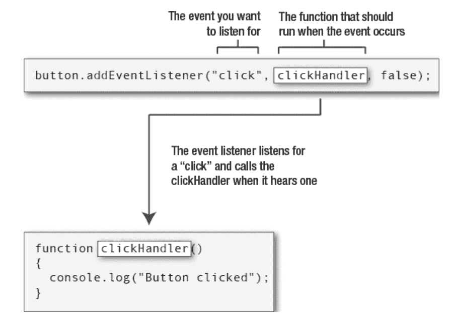

在这个例子中，事件监听器正在等待一个“click”事件。这发生在左键鼠标被释放的时候。但元素可以监听的其他鼠标事件还有很多，它们在这个图表中显示。

| 鼠标事件 | 何时发生？ |
| :--- | :--- |
| `mousedown` | 当在元素上按下左键鼠标时。 |
| `mouseup` | 当在元素上释放左键鼠标时。 |
| `click` | 当在同一个元素上按下并释放左键鼠标时。 |
| `dblclick` | 当鼠标双击一个元素时。 |
| `mousemove` | 当鼠标正在被移动时。 |
| `mouseover` | 当鼠标被移动到一个元素上时。 |
| `mouseout` | 当鼠标移出一个元素时。 |

你可以在示例代码中将“click”替换为这些事件中的任何一个，以观察其效果。例如，如果你想让一个按钮在鼠标按下时（但未释放）做出反应，请使用“mousedown”事件。

```javascript
button.addEventListener("mousedown", clickHandler, false);
```

此表中的这些鼠标事件适用于任何HTML元素，而不仅仅是按钮。所有这些事件都是JavaScript内置的。如果使用它们，请确保拼写正确，因为如果你有一个小的拼写错误，它们将无法工作，但你也不会得到错误消息告诉你拼写有误。

> 注意：JavaScript还允许将事件监听器和处理器合并到单个代码块中，如下所示：

```javascript
button.addEventListener("click", function()
{
    console.log("Button clicked");
}, false);
```

仔细看，你会注意到在“click”之后是一个函数。这个函数包含按钮被点击时应该运行的代码。整个函数实际上是事件监听器的第二个参数。这意味着你仍然必须在函数之后添加第三个参数`false`。如果函数不需要被其他监听器使用，并且你知道你的程序永远不需要移除它，可以考虑使用这种格式。

### 移除事件监听器

如果你想停止监听一个事件，可以使用一个名为`removeEventListener`的方法来移除它。以下是你可以在我们刚才看的例子中从按钮移除“click”事件监听器的代码。

```javascript
button.removeEventListener("click", clickHandler, false);
```

这有什么用？让我们想象一下，你有一个游戏，你只想让玩家按一次按钮，之后再也不能按。你可以通过在第一次点击后移除监听器来禁用按钮。你可以在我们的示例程序中这样做。在点击处理器中添加这行新代码：

```javascript
function clickHandler()
{
    console.log("Button clicked");
    button.removeEventListener("click", clickHandler, false);
}
```

如果你现在运行程序，你会看到“Button clicked”这些字只会显示一次。如果你再次点击按钮，这些字就不会显示了。

如果你想让按钮完全消失，请使用JavaScript将其CSS `display`属性设置为`none`，如下所示：

```javascript
button.style.display = "none";
```

你可以在`clickHandler`中这样使用此代码：

```javascript
function clickHandler()
{
    console.log("Button clicked");
    button.removeEventListener("click", clickHandler, false);
    button.style.display = "none";
}
```

现在，按钮在被点击后将从浏览器窗口中消失。

将元素的CSS `display`属性设置为`none`通常是比使用`removeChild`移除它更好的替代方案，这是我们上一节使用的方法。这是因为，即使它的`display`属性为`none`，元素仍然会存在。所以如果你想让它再次可见，只需将它的`display`属性设置为`block`，而无需从头开始重建它。

既然你知道了如何创建按钮，让我们用一个按钮来演示另一种非常重要的编程技术。

### 计数

在你的游戏中，你会想要做的事情之一是增量地改变变量的值。例如，你可能想在玩家每次做对某件事时，将分数加1。如果分数是7，你可能想将其更新为8。下面是一个简单的例子，展示了如何做到这一点。每次点击按钮，`score`的值就加1。

```javascript
//访问按钮
var button = document.querySelector("button");
button.addEventListener("click", clickHandler, false);
```

像这样使用变量来计数非常普遍，因此 JavaScript 提供了一种简写方式，使用特殊的**递增**和**递减**运算符：

```javascript
+=
-=
```

下面是如何使用递增运算符将分数加 1：

```javascript
score += 1;
```

这与写`score = score + 1`效果相同。即将 1 加到`score`的当前值上。你可以使用递减运算符从`score`中减去 1，像这样：

```javascript
score -= 1;
```

尝试修改示例程序，使点击事件处理函数使用`+=`运算符将分数加 1，像这样：

```javascript
function clickHandler()
{
  score += 1;
  console.log(score);
}
```

你可以看到结果是一样的。

你可以像这样对变量加上或减去任意数值。下面是如何使用`+=`运算符在每次点击按钮时将分数增加 5。

```javascript
function clickHandler()
{
  score += 5;
  console.log(score);
}
```

如果你保存并再次运行程序，你会看到控制台显示：0、5、10、15，以此类推。这与写以下代码产生相同的结果：

```javascript
score = score + 5;
```

但如果你只想将变量加 1 或减 1，JavaScript 提供了更简单的方式。你可以使用特殊的**后缀运算符**：

```javascript
++
--
```

要将分数加 1，你可以使用双加号，像这样：

```javascript
score++
```

要减去 1，则使用双减号：

```javascript
score--
```

尝试在`clickHandler`中使用双加号将分数加 1：

```javascript
function clickHandler()
{
  score++;
  console.log(score);
}
```

像这样逐步改变变量的值，是你所有游戏都会用到的操作，你将在本书中看到更多这样的例子。

```javascript
//创建一个 score 变量并将其初始化为零

var score = 0;

console.log(score);

function clickHandler()

{

  score = score + 1;

  console.log(score);

}
```

程序首先做的是创建一个`score`变量并将其初始值设为零。

```javascript
var score = 0;
```

在程序加载时给变量赋第一个值称为**初始化**。初始化变量通常是你的程序要做的第一件事。

当按钮被点击时，`clickHandler`运行。它将当前分数值加 1：

```javascript
score = score + 1;
```

每次点击按钮时这条指令都会运行。第二次点击时，分数变为 2，第三次点击时，变为 3。为什么会这样？如果你是编程新手，这可能会令人困惑，所以我们将其分解成更小的步骤。

这条指令的意思是：

`score`的新值等于`score`当前的值加上 1。

记住，当程序首次加载时`score`被初始化为 0。这意味着程序第一次运行时，你可以这样理解这条指令：

```javascript
score = 0 + 1;
```

0 + 1 等于 1，所以 1 被*复制回*`score`变量中。这意味着`score`现在变为 1。

第二次点击按钮时会发生什么？因为`score`已被改为 1，你现在可以这样理解这条指令：

```javascript
score = 1 + 1;
```

`score`现在的新值为 2。

第三次点击时，`score`仍然是 2。所以这条指令被理解为：

```javascript
score = 2 + 1;
```

`score`现在变为 3。你看出规律了吗？这是一种非常简单的向变量增加值以进行计数的方式。

### 检测键盘按键

还有一些隐藏的东西你可以用 JavaScript 来控制，它们不是 HTML 元素。我们已经见过其中一个隐藏的东西：**document 对象**。它包含我们用来查找所需元素的`querySelector`方法。

```javascript
document.querySelector()
```

JavaScript 还允许你访问**window 对象**。你可以使用`window`对象来访问或更改浏览器窗口的属性。你还可以为`window`对象附加事件监听器，以便检测某些按键何时被按下。这对于通过按 Enter 键向程序输入文本或使用键盘方向键移动游戏对象非常有用。

让我们看一个如何使用`window`对象来检测是否有人按下 Enter 键的示例。在本章的源文件中，你会找到一个名为`enterKey.html`的文件。在打开控制台的网页浏览器中打开它。按下 Enter 键。你会看到控制台中显示 "Enter key pressed" 消息。下面是实现此功能的代码：

```javascript
window.addEventListener("keydown", keydownHandler, false);

function keydownHandler(event)
{
  if(event.keyCode === 13)
  {
    console.log("Enter key pressed");
  }
}
```

从第一行可以看到，事件监听器通过点号附加到`window`对象上（表明它是`window`对象的一个**方法**——稍后会详细介绍）：

```javascript
window.addEventListener("keydown", keydownHandler, false);
```

它监听的事件叫做`keydown`，用于检测任何按键何时被按下。如果检测到按键按下，它会调用`keydownHandler`。

```javascript
function keydownHandler(event)
{
  if(event.keyCode === 13)
  {
    console.log("Enter key pressed");
  }
}
```

所有按键都有对应的键码数字。Enter 键的键码是 13。一条`if`语句检查键码是否匹配 13。

```javascript
if(event.keyCode === 13)
{
  console.log("Enter key pressed");
}
```

如果匹配，说明 Enter 键被按下了，因此消息会显示在控制台中。

这个函数有一个你之前没见过的稍显奇怪的地方。它在括号中包含了 "event" 这个词：

```javascript
function keydownHandler(event)
{ ...
```

这是因为`keydown`事件会向函数发送关于所按下按键的一些额外信息。函数需要某个地方来存储这些信息，所以它使用一个名为`event`的变量来存储它。所存储的信息是代表被按下按键的键码。你可以像这样访问键码：

```javascript
event.keyCode
```

在这个例子中，`event.keyCode`等于 13，表示 Enter 键。

如果你现在觉得这有点令人困惑，不用担心。你将在本书后续内容中看到更多关于事件处理函数如何使用事件的额外信息的例子。目前，只需记住如果你想让程序对按键做出反应，你的 JavaScript 代码应该像这样写。

> *注意：键码数字都基于 ASCII（美国信息交换标准代码）。在网上搜索 ASCII 字符代码会找到键盘上所有按键的完整代码列表。*

你现在知道了如何使用`window`对象的`keydown`事件来监听按键被按下。如果你想检测按键何时被释放，可以使用`keyup`事件。

现在让我们把本章所学的内容综合起来，制作一个简单的用户界面，你将在本书的第一部分中经常用到它。

### 输入和显示文本

游戏的核心在于交互性。它们关乎玩家与作为游戏设计者的你所创造的游戏之间的互动。玩家需要做些什么，而你的游戏需要对此做出反应。这意味着你需要某种方式从玩家那里获取信息并输入到游戏中。HTML 提供了一种非常简单的方式，通过`<input>`元素来实现这一点。在本节中，我将向你展示如何使用它让玩家向游戏或程序中输入信息。

在本章的源文件中，你会找到一个名为`enteringText.html`的程序。它让你在文本框中输入一些文本。当你点击按钮时，你输入的文本会显示在文本框下方。图 2-11 展示了你将看到的内容。这是一个简单的界面，但正如你将看到的，它是制作交互式游戏的第一步。

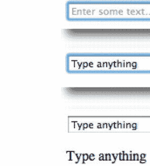

**图 2-11.** 输入一些文本，点击按钮，文本被显示出来

下面是实现此功能的 HTML 和 JavaScript 代码：

```html
<!doctype html>
<title>Entering and displaying text</title>

<input id="input" type="text" placeholder="Enter some text...">
<button>enter</button>
<p id="output"></p>

<script>

var button = document.querySelector("button");
button.addEventListener("click", clickHandler, false);
button.style.cursor = "pointer";
```

```javascript
function clickHandler()
{
  var input = document.querySelector("#input");
  var output = document.querySelector("#output");
  output.innerHTML = input.value;
}

</script>
```

HTML代码创建了文本框、按钮和一个空的`<p>`元素。

```html
<input id="input" type="text" placeholder="Enter some text...">
<button>enter</button>
<p id="output"></p>
```

文本框是一个称为`input`的元素。当`input`元素的`type`属性设置为`text`时，你就可以在其中输入内容。

```html
<input id="input" type="text" placeholder="Enter some text...">
```

`placeholder`属性决定了文本框首次创建时显示的内容，如图2-11所示。

HTML中还包含一个空的`<p>`元素，其`id`为`output`。

```html
<p id="output"></p>
```

这个程序的输出将显示在这个`<p>`标签的`innerHTML`中。

JavaScript代码使用`querySelector`获取按钮的引用，然后为其添加了一个点击事件监听器。

```javascript
var button = document.querySelector("button");
button.addEventListener("click", clickHandler, false);
```

但它还修改了按钮的CSS。它将按钮的`cursor`属性改为`pointer`。

```javascript
button.style.cursor = "pointer";
```

这使得当鼠标悬停在按钮上时，它会显示为一个指向手形，如图2-11所示。

当按钮被点击时，`clickHandler`函数会被调用。

```javascript
function clickHandler()
{
  var input = document.querySelector("#input");
  var output = document.querySelector("#output");
  output.innerHTML = input.value;
}
```


它获取了对`input`文本框和那个空的`<p>`元素（其 id 为`output`）的引用。然后，它将`input`文本框的值复制到`output`中，像这样：

```javascript
output.innerHTML = input.value;
```

每个文本框都有一个名为`value`的属性，它告诉你输入了什么内容。这行代码将那个值复制到`<p>`标签的`innerHTML`属性中。结果就是你在文本框中输入的任何内容都会显示在`<p>`标签中。

你现在有了一种简单的方法，可以从玩家那里获取信息到游戏中。你的游戏将如何处理这些信息？这是个关键问题，也是本书接下来要探讨的内容。

### 其他光标属性

在前面的例子中，你看到了可以通过将按钮的 CSS `cursor`属性改为`pointer`，将鼠标箭头变成一个指向手形。以下是一些你可以赋给`cursor`属性的值，用于更改鼠标悬停在元素上时的外观：

- `move`：将鼠标改为一个指向四个方向的箭头。
- `wait`：将光标改为一个旋转的圆圈，表示程序正在加载或处理某些内容。
- `help`：将光标改为一个问号，表示通过点击该元素，你将看到关于程序如何工作的一些信息。
- `crosshair`：将光标改为一个十字准星，用于瞄准或精确定位。
- `text`：输入文本时的标准光标。
- `auto`或`default`：浏览器自动设置光标样式。
- `n-resize`：这会将光标改为一个指向北（向上）的箭头。"n"代表 north（北）。如果你想让箭头指向另一个方向，你可以将"n"替换为以下任何值：`ne`、`e`、`se`、`s`、`sw`、`w`、`nw`。例如，如果你想让箭头指向西南方，请使用这个属性：`sw-resize`。

你可能会发现这些属性中的许多对游戏开发很有用。

## 组织你的 JavaScript 代码

对于小型程序和游戏，将 JavaScript 代码放在主 HTML 文档的`<script>`标签之间是最佳位置。这就是我在本章以及本书大部分小型示例游戏中所做的。它整洁、简单且高效。

对于更大的项目，你会希望将 JavaScript 代码保存在它自己的文件中或多个文件中。这一点很重要，因为许多复杂的游戏依赖于可能需要在多个游戏之间共享的公共函数和其他编程组件。如果你的 JavaScript 代码独立于主 HTML 文档，你就可以轻松地将其链接到任何你喜欢的其他项目。这也意味着你可以将长程序分解成一系列更易于处理的小文件。让我们通过下一个例子来了解如何做到这一点。

## 第 2 章

1. 使用你的文本编辑器创建一个名为`program.js`的新文档。仔细输入以下 JavaScript 代码。

```javascript
(function(){

window.alert("The JavaScript program has loaded!");

}());
```

`window.alert`方法将在浏览器窗口中显示一个对话框，其中包含括号内的文字。

2. 保存`program.js`文件。

3. 创建一个名为`main.html`的新 HTML 文件。它应该与`program.js`文件位于同一文件夹中。输入以下 HTML 代码：

```html
<!doctype html>
<title>Organizing files</title>
<script src="program.js"></script>
```

4. 保存`main.html`文件，并在 Web 浏览器中打开它。你将看到一个警告窗口打开，上面写着"The JavaScript program has loaded!"，如图 2-12 所示。

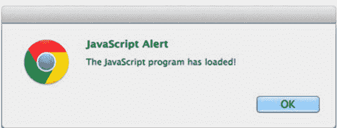

**图 2-12.** 将 JavaScript 文件链接到主 HTML 文档

### 将 JavaScript 程序链接到 HTML 文档

你可以看到`main.html`文件通过使用`<script>`标签的`src`属性加载了`program.js`文件。

```html
<script src="program.js"></script>
```

如果你有一个复杂的 HTML 文档，其中使用了`<body>`元素，请将`<script>`标签放在结束`</body>`标签之前，像这样：

```html
<!doctype html>
<title>Organizing files</title>
```

```html
<body>
<p>Any other HTML code</p>
<script src="program.js"></script>
</body>
```

这确保了 JavaScript 会在 HTML 元素加载完毕后再加载。如果程序依赖任何 HTML 代码才能工作，这一点就很重要。

### 使用 `program.js` 文件

`program.js`文件只包含一行重要的 JavaScript 代码。

```javascript
window.alert("The JavaScript program has loaded!");
```

这就是在浏览器窗口中显示警告框的代码。

但请注意，这行代码被上下一串看似杂乱的字符包围着。

```javascript
(function(){

window.alert("The JavaScript program has loaded!");

}());
```

那些东西是什么？这被称为立即执行函数。它通常看起来像这样：

```javascript
(function(){ }());
```

立即执行函数是一种自动运行的函数。你不需要调用它。其内部花括号中的任何内容都会立即运行。下面是一个立即执行函数，它在控制台中显示"Hello World!"。

```javascript
(function(){console.log("Hello World!");}());
```

我知道：它看起来像一团乱麻！如果像这样格式化，它会更容易阅读：

```javascript
(function(){

  console.log("Hello World!");

}());
```

在游戏项目中通常永远不需要使用立即执行函数。它唯一的用途是封装一个独立的 JavaScript 程序。这意味着当你创建一个 JavaScript 文件时，你应该将整个程序写在函数的花括号内，像这样：

```javascript
(function(){

//Write your entire JavaScript program
//inside the immediate function's curly braces

}());
```

你为什么需要这样做？有两个非常好的理由。

首先，这意味着一旦 HTML 文件加载了你的程序，它就会立即运行。

其次，它保护你程序中使用的所有变量，使其不会与其他程序中可能具有相同名称的变量发生冲突。在一个大型游戏项目中，你很可能需要链接许多 JavaScript 文件，每个文件在游戏执行特定任务。如果这些不同的文件碰巧使用了相同名称的变量，你的程序可能会混淆你指的是哪个变量。将你的程序包装在一个函数中可以保护这些变量，使其不会与同时运行的其他程序中的变量发生冲突。

> 注意：这里有一个重要的技术原因需要理解。当你在函数内部创建一个变量时，它对于该函数是局部的。它被称为局部变量。这意味着它不能被该函数花括号之外的任何其他部分使用或理解。当你在函数外部创建一个变量时，它对于整个程序是全局的。它被称为全局变量。这意味着它可以在程序中的任何地方被任何函数使用，甚至可以被同时运行的其他链接的 JavaScript 程序使用。全局变量听起来非常方便，它们确实如此。但你必须极其谨慎地使用它们，否则你就有与其他程序中其他变量发生命名冲突的风险。作为最佳实践，根本不要使用全局变量。将整个程序包装在一个立即执行函数中，这样程序的变量就只对该程序是局部的。这可以保护它们免受全局命名冲突的影响。

变量是局部还是全局，是计算机编程中一个称为作用域的话题。

你可以在本章源代码文件的`organizingFiles`文件夹中找到一个如何将外部 JavaScript 文件链接到 HTML 文件的可用示例。在后面的章节中，你将学习如何使用这个包含多个链接 JavaScript 文件的系统来构建复杂的游戏。

## 调试代码的快速指南

1947 年 9 月 9 日，哈佛大学的 Mark II 计算机遇到了问题。Mark II 是一台庞然大物：它由成千上万的电线、开关、旋钮、按钮和发光真空管，全部排列成行，装在钢制机柜中，占据了相当于一栋小房子的面积。它还会吸引虫子。一位操作员在调查时，从 Mark II 的一块面板后面拉出了一只蛾子。问题解决了！Mark II 成功地被"debugged"（调试）了。从那天起，程序员们就把查找和修复代码问题的过程称为调试。

幸运的是，当你的程序出现问题时，你不需要去电脑里寻找筑巢的昆虫（尽管有时候你可能希望解决方案真有那么简单！）。通常你会犯的错误都是以下这些非常常见的类型。问问自己以下这些问题：

- 你的拼写是否正确，并且使用了正确的大小写？
- 你是否在`if`语句中意外地使用了单等号`=`，而不是三等号`===`？
- 你是否关闭了所有的花括号和圆括号？

浏览器控制台中的 JavaScript 调试器也会尝试告诉你它认为你的程序出了什么问题。但是，我相信你现在已经注意到了，这些错误信息极其晦涩难懂，而且即使你设法解读了它们，它们也可能实际上并没有告诉你到底哪里出了问题。

然而，如果你知道如何解读错误信息，它们实际上会非常有用。以下是一些常见的错误信息以及它们真正想要告诉你的内容。（调试器还会告诉你它认为出错的代码行号。）

```text
Reference errror: Can't find variable
```

你可能拼错了变量或函数的名称。

```text
SyntaxError: Unexpected token ")"
```

你可能忘记关闭一对圆括号。

```text
SyntaxError: Unexpected EOF
```

你可能忘记关闭围绕字符串的一对引号。（如果你好奇的话，EOF 代表 end of file，即文件末尾。这意味着调试器感到困惑了，无法理解你的程序，也无法确定你的程序应该在哪里结束。）

```text
SyntaxError: Expected an identifier but found "somethingElse" instead
```

你可能拼错了 JavaScript 关键字，比如`function`或`var`。

```text
SyntaxError: Unexpected token "}"
```

你可能忘记关闭一对花括号。

```text
TypeError: "undefined" is not a function
```

你可能拼错了函数名。例如，你可能把`console.log`拼成了`console.lg`。

## 第 2 章

以下是一些更通用的建议，你在调试程序时应该始终牢记：

- 如果你收到多个错误信息，始终先尝试修复第一个。后续的错误通常是依赖于前面代码正常运行的代码片段导致的。修复了第一个错误，修正往往会级联传播到整个代码中，常常神奇地修复其余的错误。
- 检查调试器所认为的问题行上面的那一行代码。通常，上一行中的小错误本身可能不足以产生错误，但足以导致下一行的代码出错。
- 在重新运行之前，始终保存你正在编辑的文件。我怎么强调这有多常见都不为过。程序员找到一个错误并修复它，但再次运行程序时却得到了完全相同的错误信息。这是因为修复后没有保存文件，所以调试器实际运行的仍然是之前错误版本的文件。
- 每次只做一处修改，然后保存并再次测试程序。如果你的程序在修改之前正常工作，修改后突然停止工作，你就准确地知道是什么导致了问题。如果你做了五处修改后才运行，而程序不能正常工作，你就不知道是这五处修改中的哪一个导致了问题。
- 最后，记住程序员的普遍箴言：尽早测试，频繁测试。尽早进行大量测试，解决大量小而易管理的问题，以避免日后不得不处理那些可能导致项目停滞不前的庞大而棘手的问题。

调试代码需要大量练习，但不要让调试器使你感到沮丧。慢慢来，仔细将你使用的代码与本书中的类似示例进行对比。小错误很容易犯，但同样也很容易修复。

## 总结

在本章中，你学习了 JavaScript 编程的所有基础知识和技能。这些技术在所有编程语言中都是通用的。变量、`if`语句、函数以及输入/输出系统构成了编程的核心。

关于编程还有什么要学习的？还有一些，但信不信由你，你现在已经掌握了开始制作游戏所需的所有核心 JavaScript 编程技术。你已经打开了这个盒子，但里面的零件仍然散落在地板上，你还不知道如何把它们组装成有用的东西。这正是我们下一章要做的事情。我们将使用你在本章中学到的所有编程代码片段来构建我们的第一个游戏。

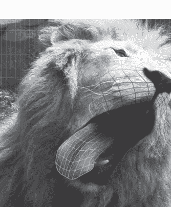

# 第 3 章：你的第一个游戏

本章将是你第一次真正了解如何设计完整游戏的内容。它们是简短、简单的游戏，但包含了游戏设计的所有要素，你将反复回到这些要素上来。分配输入和输出、做决策、记分、判断玩家是赢还是输、使用随机数，以及判断两个对象是否接触——这些内容都会涉及。你还将更深入地了解变量和`if`语句，以及如何通过将大程序分解成更小的模块来使用函数简化程序。在本章结束时，你将掌握构建复杂逻辑和基于此简单模型的回合制游戏所需的所有技能。如果上一章教你像程序员一样思考，那么这一章将教你像游戏设计师一样思考。

我们将构建的第一个游戏是一个简单的猜数字游戏。游戏要求你猜测一个 0 到 99 之间的数字。如果你猜得太高或太低，游戏会告诉你，直到你能通过推理推断出神秘数字是多少。图 3-1 展示了游戏完成后的样子。

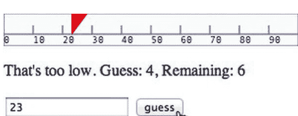

**图 3-1.** 猜数字游戏

我们实际上会分几个阶段来构建这个游戏。你将从游戏的最基本版本开始，然后逐步添加更多功能，例如限制猜测次数、向玩家提供更详细的游戏状态信息，以及随机化神秘数字。我们还将了解如何制作自定义游戏按钮，使其外观根据你的交互方式而变化。最后，我们将添加一些图形来直观地显示游戏信息。

但这还不是全部。我还将向你展示如何将基本游戏概念修改成一个完全不同的游戏：《外星人来袭！》，如图 3-2 所示。你将学习如何根据游戏事件更改显示的图像，以及如何判断两个对象是否接触。

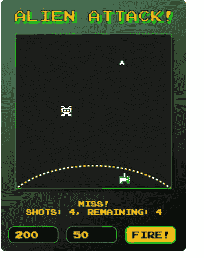

**图 3-2.** 从外星人入侵中拯救世界

听起来内容很多？别担心，我们会慢慢来，当你把所有部分组合在一起时，你会惊讶于这一切是多么简单。

## 基本的猜数字游戏

我们的第一个游戏是猜数字游戏。这个游戏最简单的形式你完全可以在没有任何进一步帮助的情况下自己编写。事实上，如果你已经学习了上一章的内容，你完全可以做到！那么，在继续阅读之前，为什么不自己先试试呢？你的游戏应该实现以下功能：

- 要求玩家猜测一个 0 到 99 之间的神秘数字。
- 允许玩家通过点击按钮在文本框中输入猜测。
- 使用`if`语句判断输入的数字是大于、小于还是等于神秘数字。
- 显示一条消息，告诉玩家猜得太低、太高还是正确。

图 3-3 展示了游戏运行时的工作方式。

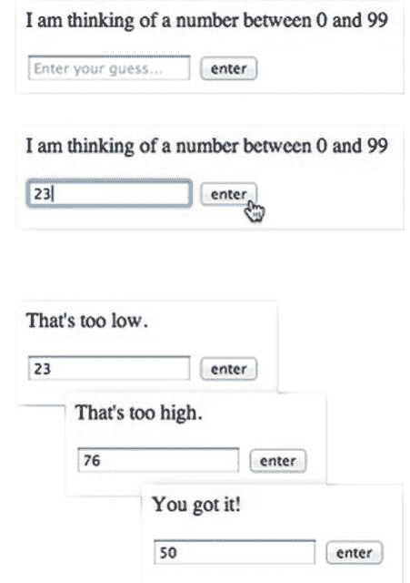

**图 3-3.** 完成的猜数字游戏

这是处理后的文本：

### 关于 `parseInt` 的更多说明

`parseInt`代表“解析整数”。一词“解析”意指使信息合乎逻辑地理解。整数是完整数字，即没有小数点的数字。这意味着`parseInt`从字符串创建的数字不会包含任何小数等分数信息。如果有小数值，它将直接舍去。以下是一个示例：

```javascript
parseInt("12.8");
```

这将产生 12。小数值会被舍去。

如果需要保留小数位，可以使用一个名为`parseFloat`的相关方法。

```javascript
parseFloat("12.8");
```

这将产生 12.8。

> 注意：“float”一词指的是“浮点数”，这是指具有小数或分数值的数字的另一种说法。

## 显示游戏状态

让我们开始对猜数字游戏进行一些改进。在当前版本中，游戏给你无限次猜测机会，即使你猜对了神秘数字；如果你愿意，也可以永远继续玩下去。为了限制猜测次数，程序需要了解游戏状态的更多信息，然后在达到获胜或失败条件时采取相应操作。我们将分两部分解决这个问题，首先从显示游戏状态开始。

要知道玩家是赢还是输，游戏需要了解更多信息：

- 玩家在游戏结束前还有多少次猜测机会。我们需要一个名为`guessesRemaining`的新变量来存储此信息。
- 玩家已经进行了多少次猜测。我们需要另一个名为`guessesMade`的新变量来跟踪此信息。
- 游戏的状态是什么。我们需要第三个名为`gameStatus`的变量，它将在`<p id="output">`标签中显示此信息。

让我们将这些功能添加到游戏中：

1. 在程序中添加以下三个新变量，就在其他变量下方（在所有这些示例中，粗体文本代表新代码）：

```javascript
//游戏变量
var mysteryNumber = 50;
var playersGuess = 0;
var guessesRemaining = 10;
var guessesMade = 0;
var gameState = "";
```

## 第三章

2. 将此新代码添加到`playGame`函数中：


```javascript
function playGame()
{
    guessesRemaining = guessesRemaining - 1;
    guessesMade = guessesMade + 1;
    gameState = " Guess: " + guessesMade + ", Remaining: " + guessesRemaining;

    playersGuess = parseInt(input.value);

    if(playersGuess > mysteryNumber)
    {
        output.innerHTML = "That's too high." + gameState;
    }
    else if(playersGuess < mysteryNumber)
    {
        output.innerHTML = "That's too low." + gameState;
    }
    else if(playersGuess === mysteryNumber)
    {
        output.innerHTML = "You got it!";
    }
}
```

保存并运行游戏，你现在将看到一条消息，告诉你已经进行了多少次猜测，以及还剩多少次。图 3-5 展示了你将看到的内容。

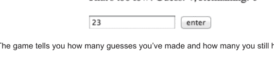

**图 3-5.** 游戏告诉你已经进行了多少次猜测以及还剩多少次。

新代码创建了三个新变量并赋予了它们初始值：

```javascript
var guessesRemaining = 10;
var guessesMade = 0;
var gameState = "";
```

玩家在游戏结束前可进行的总猜测次数存储在`guessesRemaining`变量中。你赋予它初始值 10，但当然你可以更改此值以使游戏更容易或更难玩。你还想计算玩家进行的猜测次数，因此创建了`guessesMade`变量来存储该信息。当游戏首次开始时，玩家显然还没有进行任何猜测，因此`guessesMade`变量被设置为 0。`gameState`是一个字符串，用于显示这些新信息，你稍后会看到它是如何做到这一点的。它最初不包含任何文本（只是被分配了一对空引号）。

### 计算猜测次数

以下是`playGame`函数中用于更改这些变量的三个新指令：

```javascript
function playGame()
{
    guessesRemaining = guessesRemaining - 1;
    guessesMade = guessesMade + 1;
    gameState
        = " Guess: " + guessesMade + ", Remaining: " + guessesRemaining;
}
```

> 注意：最后一行非常长，为了便于在本书中打印，我通过在等号处换行将其拆分为两行。在你的程序中，你可能可以将其保持为一条不间断的代码行，如图 3-6 所示。我将遵循相同的规则来拆分本书中所有长代码行。请记住，如果你有疑问，总是可以通过查找分号来识别一行代码的结束。你如何换行或断行不会影响其运行方式。

```javascript
function playGame()
{
    guessesRemaining = guessesRemaining - 1;
    guessesMade = guessesMade + 1;
    gameState = " Guess: " + guessesMade + ", Remaining: " + guessesRemaining;
}
```

**图 3-6.** 将长段代码保持在单行上。

第一行从`guessesRemaining`的当前值中减去 1：

```javascript
guessesRemaining = guessesRemaining - 1;
```

如果`guessesRemaining`在游戏开始时的值为 10，那么它现在的值将是 9。你在第二章的“计算”部分学习了这是如何工作的。

程序使用相同的技术将`guessesMade`增加 1：

```javascript
guessesMade = guessesMade + 1;
```

每次点击按钮时，`guessesMade`就会增加 1。

你也可以选择使用后缀运算符`++`和`--`。要从`guessesRemaining`变量中减去 1，你可以使用此指令：

```javascript
guessesRemaining--;
```

你可以像这样将`guessesMade`增加 1：

```javascript
guessesMade++;
```

这是增加或减少变量值 1 的有效方式，你将在本章后面看到它的使用。

### 连接字符串

游戏使用了另一个名为`gameState`的新变量。每次`playGame`函数运行时，它都会告诉玩家已经进行了多少次猜测以及还剩多少次：

```javascript
gameState = " Guess: " + guessesMade + ", Remaining: " + guessesRemaining;
```

这是一个将变量与文本结合起来的字符串。当你在游戏中第一次进行猜测时，`gameState`将生成：

```
Guess: 1, Remaining: 9
```

随后的`if`语句使用`gameState`变量在输出元素中显示完整的消息：

```javascript
if(playersGuess > mysteryNumber)
{
    output.innerHTML = "That's too high." + gameState;
}
else if(playersGuess < mysteryNumber)
{
    output.innerHTML = "That's too low." + gameState;
}
else if(playersGuess === mysteryNumber)
{
    output.innerHTML = "You got it!";
}
```

加号将`gameState`变量的内容添加到输出文本框中。这展示了如何将游戏变量与文本混合使用，以告诉玩家游戏中正在发生什么。

### 获胜与失败

游戏现在拥有足够的关于玩家操作的信息，可以判断游戏是赢还是输。你现在需要做的是找到一种方式来说“嘿，游戏结束了！”并告诉玩家他们的表现如何。

为此，在程序中添加以下内容：

- 一个名为`gameWon`的布尔（true/false）变量，如果游戏获胜则设置为`true`，否则为`false`。
- 用于检查游戏是否结束的`if`语句。
- 一个名为`endGame`的方法，告诉玩家他们赢了还是输了。

让我们对程序进行这些更改，看看会发生什么。

在程序开头添加新的`gameWon`变量。其初始值为`false`。

```javascript
//游戏变量
var mysteryNumber = 50;
var playersGuess = 0;
var guessesRemaining = 10;
var guessesMade = 0;
var gameState = "";
var gameWon = false;
```

将以下新的粗体代码添加到`playGame`函数中：

```javascript
function playGame()
{
    guessesRemaining = guessesRemaining - 1;
    guessesMade = guessesMade + 1;
    gameState = " Guess: " + guessesMade + ", Remaining: " + guessesRemaining;

    playersGuess = parseInt(input.value);

    if(playersGuess > mysteryNumber)
    {
        output.innerHTML = "That's too high." + gameState;

        //检查游戏是否结束
        if (guessesRemaining < 1)
        {
            endGame();
        }
    }
    else if(playersGuess < mysteryNumber)
    {
        output.innerHTML = "That's too low." + gameState;

        //检查游戏是否结束
        if (guessesRemaining < 1)
        {
            endGame();
        }
    }
    else if(playersGuess === mysteryNumber)
    {
        gameWon = true;
        endGame();
    }
}
```

## 第 3 章

在`playGame`函数下方添加这个新的`endGame`函数：

```javascript
function endGame()
{
  if (gameWon)
  {
    output.innerHTML
      = "Yes, it's " + mysteryNumber + "!" + "<br>"
      + "It only took you " + guessesMade + " guesses.";
  }
  else
  {
    output.innerHTML
      = "No more guesses left!" + "<br>"
      + "The number was: " + mysteryNumber + ".";
  }
}
```

你可以选择性地从`playGame`方法的`if`语句中删除以下指令。这段文本将被`endGame`方法中的新文本替换。实际上保留它也没有什么坏处，但它是多余的。

```javascript
output.innerHTML = "You got it!"
```

保存程序并试玩游戏。现在程序会限制你最多猜测 10 次，并告诉你赢了还是输了。图 3-7 展示了如果你猜对了，游戏现在的样子。

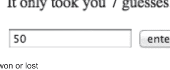

**图 3-7.** 游戏现在可以有输赢结果。

在你添加新代码之前，游戏虽然能统计猜测次数，但不知道该如何处理这些信息。新代码为这些信息提供了存储位置，以便将其反馈给用户。

`if`语句的前两个代码块现在还会检查`guessesRemaining`是否小于 1。如果是，它们就会调用新的`endGame`函数。

```javascript
if(playersGuess > mysteryNumber)
{
  output.innerHTML = "That's too high." + gameState;

  //Check for the end of the game
  if(guessesRemaining < 1)
  {
    endGame();
  }
}
```

```javascript
else if(playersGuess < mysteryNumber)
{
  output.innerHTML = "That's too low." + gameState;

  //Check for the end of the game
  if(guessesRemaining < 1)
  {
    endGame();
  }
}
```

一个`if`语句嵌套在另一个`if`语句内部，称为**嵌套 if 语句**。这是你第一次见到它。嵌套`if`语句在为你的决策逻辑添加额外层级时非常有用。

`if`语句的最后一个代码块检查玩家的猜测是否与神秘数字匹配。如果玩家猜对了，那么玩家就赢了游戏，因此它会调用新的`endGame`函数。同时，非常重要的是，它会将`gameWon`变量设置为`true`。

```javascript
else if(playersGuess === mysteryNumber)
{
  gameWon = true;
  endGame();
}
```

那么这个`endGame`函数做了什么呢？它检查玩家是否赢得了游戏。如果`gameWon`变量为`true`，那么玩家就赢了，并显示相应的消息。但如果`gameWon`为`false`，函数会告诉玩家他或她输了。

```javascript
function endGame()
{
  if(gameWon)
  {
    output.innerHTML
      = "Yes, it's " + mysteryNumber + "!" + "<br>"
      + "It only took you " + guessesMade + " guesses.";
  }
  else
  {
    output.innerHTML
      = "No more guesses left!" + "<br>"
      + "The number was: " + mysteryNumber + ".";
  }
}
```

玩家看到的消息会根据`gameWon`是`true`还是`false`而有所不同。`gameWon`只有在玩家猜对数字时才会被设置为`true`。否则，它将保持为`false`，即它被初始化时的值。

### if 语句和布尔变量

你可能还记得上一章的内容，只包含`true`或`false`值的变量被称为布尔变量。好好享受这个美妙的词汇吧，因为计算机编程是你唯一有机会使用它的领域。`gameWon`是一个布尔变量，因为它只能被设置为`true`或`false`。

看看`if`语句是如何检查`gameWon`变量的：

```javascript
if(gameWon)
{…
```

这意味着“如果`gameWon`变量为`true`，则执行此操作。”但这与其他`if`语句的写法非常不同。为什么会这样呢？

`if`语句的工作原理是*当括号中的条件为 true 时*运行其指令。如你所知，你可以使用等号运算符（三个等号）将任何布尔值与`true`或`false`值进行比较，如下所示：

```javascript
if(gameWon === true)
```

如果`gameWon`为*false*，则该语句整体上被读取为`false`，指令不会运行。如果`gameWon`为*true*，则该语句整体上被读取为`true`，指令会运行。这些你已经从上一章了解了，但这里有一些新内容。如果你只需要检查一个布尔变量是`true`还是`false`，使用这种简写方式会更方便，而且通常使你的代码更易于阅读：

```javascript
if(gameWon)
```

因为`gameWon`的值*只能*是`true`或`false`，所以它提供的信息与第一个示例完全相同。

在本书中，我们将使用这种方式作为在`if`语句中检查布尔变量值的首选方式。`if(gameWon)`非常接近英语短语“If the game is won”（如果游戏赢了）。仔细选择你的变量名，你很快就会发现这种编写`if`语句的方式可以使你的程序易于阅读。

### 字符串中的 HTML 代码

这段代码的另一个新特性是最终消息中包含了 HTML`<br>`标签。这会将消息分成两行。以下是获胜消息的样子：

```javascript
output.innerHTML
 = "Yes, it's " + mysteryNumber + "!" + "<br>"
 + "It only took you " + guessesMade + " guesses.";
```

你可以看到`<br>`标签在`mysteryNumber`之后创建了一个换行，如图 3-8 所示。这是一个展示如何将字符串、变量和 HTML 标签组合成交互式游戏消息的复杂示例。你能看出代码是如何产生你在游戏中看到的输出吗？仔细思考你希望消息如何显示以及它们应该是什么样子，稍加练习后你很快就会发现编写这样的代码并不难。

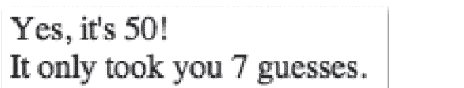

```javascript
output.innerHTML
  = "Yes, it's " + mysteryNumber + "!" + "<br>"
  + "It only took you " + guessesMade + " guesses.";
```

**图 3-8.** 组合字符串、变量和 HTML 标签来创建复杂的游戏消息。

### 使用函数进行模块化编程

你应该能看出`playGame`和`endGame`函数是如何帮助将代码模块化的。实际上，你本可以在不使用它们的情况下编写这个程序，将它们检查的所有条件添加到一个极长的`if`语句中。但如果你这样做的话，就必须重复大量代码，而且代码会变得非常难以阅读和调试。

将特定任务封装在独立的函数中进行模块化，使你能够独立地修改或调试这些代码片段，而不必更改（也可能搞乱）程序的其他正在运行的部分。这也意味着，每当你想要执行某个任务时，你不需要复制已经编写的任何代码；你只需要调用完成该任务所需的函数即可。

使用函数对代码进行模块化可能需要你稍加练习，在看到更多示例并在自己的项目中尝试使用之前，你可能会觉得有点烧脑。看看游戏目前是如何运行的，看看你能否弄清楚函数定义和函数调用之间的相互关系是如何工作的。图 3-9 是它们如何组合在一起的示意图。你可以将每个函数看作程序中的一个“模块”。

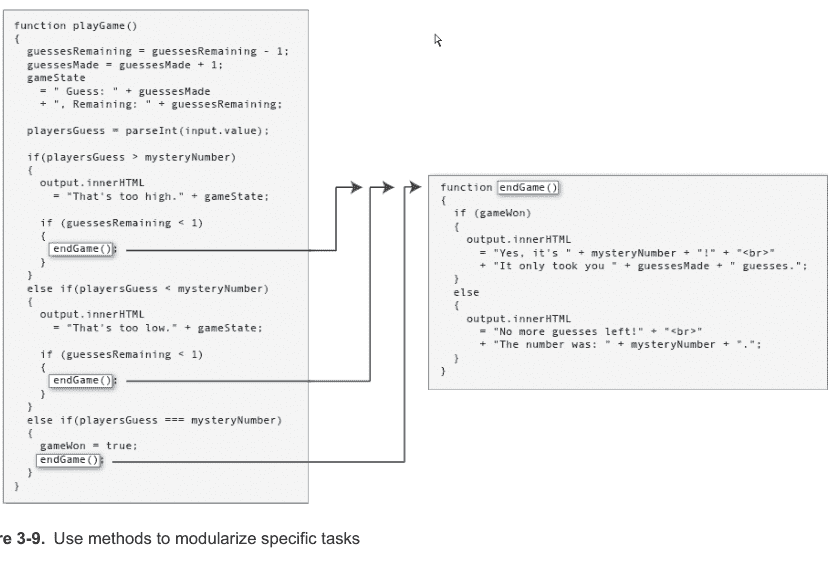

像这样使用函数并不是模块化代码的唯一方式。在第 6 章中，你将学习如何创建和使用**对象**来帮助你实现同样的目标。

## 打磨完善


编写软件所花的时间中，大约 30% 用于让它能运行，而另外 70% 用于让它运行得好。没有比数字猜测游戏更好的例子来说明这一原则了。游戏可以玩，但还有很多不足之处，大多数玩家都会抱怨。

以下是我们可以改进的地方：

- 我们应该确保玩家只能在输入框中输入数字，而不是文字。
- 玩家应该能够使用回车键以及鼠标来提交猜测。
- 游戏应该防止玩家在游戏结束后继续游玩。
- 我们应该随机生成神秘数字。

让我们撸起袖子，看看能否解决这些问题。你可以在本章源文件的`numberGame_4.html`文件中找到包含所有这些修改的游戏可运行示例。

## 仅允许输入数字

在当前版本的游戏中，玩家可以在输入框中输入任何内容，而不仅仅是数字。让我们来优化一下游戏，使其在输入文字时显示一条提示信息，要求输入数字。

要做到这一点，程序首先需要一种区分数字和字符串的方法。JavaScript 有一个名为`isNaN`的方法可以做到这一点。`isNaN`代表"is not a number"（不是一个数字）。你可以这样使用它：

```javascript
isNaN("anyValue");
```

如果你在括号中放入字符串，`isNaN`将产生以下结果：

```text
true
```

这意味着"这是一个字符串"。如果你在括号中放入一个实际的数字，像这样：

```javascript
isNaN(2600)
```

它将产生：

```text
false
```

这意味着"这不是一个字符串"。你可以在游戏中通过检测玩家的输入来使用这个方法：

```javascript
isNaN(playersGuess)
```

如果这产生`true`，那么你知道玩家输入了一个字符串。

我们将在游戏中使用这个方法，创建一个名为`validateInput`的全新函数来为我们检查这一点。当玩家点击按钮时，`clickHandler`将首先调用`validateInput`。如果输入是数字，`validateInput`将调用`playGame`函数，游戏正常进行。但如果输入是字符串，`validateInput`将显示一条信息，要求玩家输入数字。

这个新的`validateInput`函数将作为`clickHandler`和`playGame`之间的过滤器。以下是游戏需要做的更改：

1. 将`clickHandler`修改为如下所示：

```javascript
function clickHandler()
{
  validateInput();
}
```

2. 在`clickHandler`下方添加新的`validateInput`函数：

```javascript
function validateInput()
{
  playersGuess = parseInt(input.value);
```

## Chapter 3

```javascript
if(isNaN(playersGuess))
{
  output.innerHTML = "Please enter a number.";
}
else
{
  playGame();
}
}
```

3. 注意以下这行代码已从`playGame`函数移动到了这个新的`validateInput`函数中：

```javascript
playersGuess = parseInt(input.value);
```

你应该将它从`playGame`函数中移除。

你可以看到，`isNaN`方法直接位于`if`语句的括号内：

```javascript
if(isNaN(playersGuess))
{…
```

如果它产生的结果为`true`，`if`语句将显示"Please enter a number."。如果为`false`，它将调用`playGame`函数，让游戏照常进行。图 3-10 说明了`validateInput`如何作为`clickHandler`和`playGame`函数之间的过滤器。

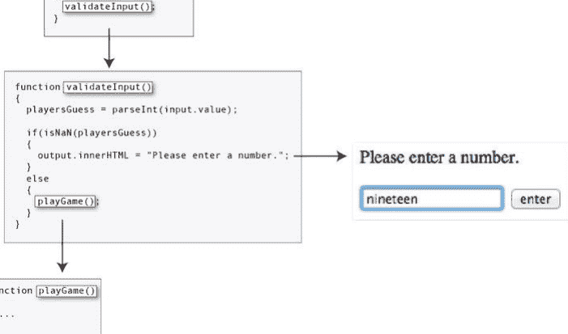

你可以看到，由于你已经将程序模块化，现在可以轻松添加像这样的新功能，而无需更改已经写好的代码。在下一节中，你将进一步体会到它的优点。

> 注意：JavaScript 有一些特殊的内置方法用于验证输入，如果你有大量输入字段（比如网站上的表单），这些方法会很有帮助。研究一下"HTML5 Forms API"以了解更多相关信息。

### 使用 Enter 键输入数字

在上一章中，你学习了如何使用 Enter 键为程序提供信息。你可以在此处同样使用这个技巧。然而，有一点新内容是鼠标和 Enter 键都可以用于输入相同的信息。这是因为无论你点击鼠标还是按下 Enter 键，两个操作都会调用`validateInput`函数。

在`clickHandler`上方添加这段新代码：

```javascript
window.addEventListener("keydown", keydownHandler, false);

function keydownHandler(event)
{
    if(event.keyCode === 13)
    {
        validateInput();
    }
}
```

记住 13 是 Enter 键的 ASCII 编码。如果`event.keyCode`匹配数字 13，`if`语句将调用`validateInput`函数。

保存并再次运行游戏，你现在可以通过点击按钮或按下 Enter 键来输入数字了。图 3-11 展示了按钮或 Enter 键现在如何调用`validateInput`函数。

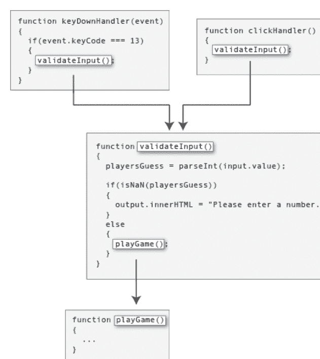

Figure 3-11. 按钮和 Enter 键都可以调用同一个函数

### 改进用户界面

**用户界面**（user interface）指的是玩家玩游戏所需使用的所有按钮、文本框和其他交互元素。你经常会看到它被称为`UI`或有时`GUI`（图形用户界面，graphical user interface）。你的 UI 响应玩家预期的方式在很大程度上决定了他们享受游戏的程度。让我们让游戏的 UI 更加用户友好一些。

#### 为输入框添加焦点

在当前版本的游戏中，你需要先用鼠标点击输入框才能输入数字。你可以对 HTML 代码做一个小改动，使闪烁的输入光标在游戏开始时自动出现在输入框中。玩家就可以立即输入数字，而无需先点击输入框。这称为给输入框**焦点**（focus）。

你只需要在`input`元素中添加一个`autofocus`属性：

```html
<input id="input" type="text" placeholder="Enter your guess..." autofocus>
```

保存游戏并再次运行。你现在会看到输入框中立即出现闪烁的光标，可以马上开始输入数字了。图 3-12 说明了这一点。


**图 3-12.** 为输入框添加焦点

你可以为任何 UI 元素添加`autofocus`，包括按钮。

#### 禁用输入框、按钮和 Enter 键

游戏结束后，玩家实际上仍然可以继续输入猜测并点击按钮。你可以在游戏结束时禁用输入框、按钮和 Enter 键来防止这种情况。在`endGame`函数的末尾添加以下用粗体标记的新代码。

```javascript
function endGame()
{
  if(gameWon)
  {
    output.innerHTML
      = "Yes, it's " + mysteryNumber + "!" + "<br>"
      + "It only took you " + guessesMade + " guesses.";
  }
  else
  {
    output.innerHTML
      = "No more guesses left!" + "<br>"
      + "The number was: " + mysteryNumber + ".";
  }

  //Disable the button
  button.removeEventListener("click", clickHandler, false);
  button.disabled = true;

  //Disable the enter key
  window.removeEventListener("keydown", keydownHandler, false);

  //Disable the input field
  input.disabled = true;
}
```

你可以看到使用了`removeEventListener`，使按钮和 Enter 键不再调用事件处理程序。这使它们停止工作。

但代码还通过将它们的`disabled`属性设置为`true`来禁用按钮和 Enter 键，像这样：

```javascript
button.disabled = true;
input.disabled = true;
```

当按钮被禁用时，它在浏览器窗口中会变暗，你无法点击它。当输入框被禁用时，你无法点击它来输入文本。

`disabled`是所有 HTML 输入元素的属性，如按钮和文本框。当你想阻止它们工作时，将其设置为`true`。将`disabled`设置为`false`可以使它们重新开始工作。

### 生成随机数

在大多数游戏项目中，你几乎肯定会需要使用随机数。JavaScript 有许多内置的方法可用于操作数字。其中之一是`Math.random`方法，它生成一个 0 到 1 之间的随机数。它看起来像这样：

```javascript
Math.random()
```

你可以将这个随机数赋值给变量，就像赋值其他值给变量一样，如下例所示：

```javascript
var randomVariable = Math.random();
```

`randomVariable`现在被赋值为一个 0 到 1 之间的随机数，最多有 16 位小数。所以它可以是任何数字；例如，0.3669164208535294 或 0.5185672459021346。

你可能会问，一个 0 到 1 之间且有 16 位小数的随机数有什么用？正如你所猜到的，几乎没有什么用！幸运的是，你可以做一些调整来获得更有用的结果。

首先，游戏中的随机数通常需要是整数——也就是整数。所有那些小数位都必须去掉。你能想象如果神秘数字是像 33.609315570832 这样的数，猜数字游戏会变得多么噩梦吗？如果你去掉所有的小数，就会得到一些有用的数字，比如 33，这在大多数人的有生之年里还是能够猜到的。

幸运的是，JavaScript 有一些内置的方法可以帮助我们向上或向下取整：

- `Math.round`：可用于向上或向下取整。例如，`Math.round(3.4)`返回值 3。`Math.round(3.8)`返回 4。`Math.round(3.5)`也返回 4。
- `Math.floor`：始终向下取整。`Math.floor(3.2)`返回 3。`Math.floor(3.9)`也返回 3。
- `Math.ceil`：始终向上取整。`Math.ceil(3.2)`返回 4，`Math.ceil(3.9)`也返回 4。（ceil 是*ceiling*的缩写。天花板在上，地板在下。能理解吗？）

要将这些方法与`Math.random`方法一起使用，你需要使用如下格式：

```javascript
Math.round(Math.random())
```

想想这行代码在做什么。`Math.random()`会生成一个 0 到 1 之间带有大量小数位的随机数。所以假设它生成了一个 deliciously useless 的数字，比如 0.6781340985784098。你可以假装前面那行代码现在看起来像这样：

```javascript
Math.round(0.6781340985784098)
```

你会如何对这个数字进行四舍五入呢？你会将它向上取整，结果如下：

```text
1
```

但如果随机数更小一些呢，比如这样？

```javascript
Math.round(0.2459678308703125)
```

它将会被向下取整为：

```text
0
```

这意味着你可以使用`Math.round(Math.random())`这行代码来生成一个随机数，它有**50%**的概率是 0 或 1。虽然这还不是游戏中你想要的功能，但它也并非毫无用处。在很多情况下，计算某件事有 50% 发生的概率在游戏中会非常有用，而你可以用这一小段代码精确地实现这一点。

> 注意：事实上，你可以用这段代码来生成随机的布尔值（`true`/`false`）。假设你有一个名为`rainToday`的布尔变量，你可以将其初始化为`false`：
>
> ```javascript
> rainToday = false;
> ```
>
> 哦，要是这是真的该多好！所以为了让它更真实一些，你可以给它 50% 的概率为`true`或`false`。你只需要在`if/else`语句中使用`Math.round(Math.random())`这段代码，并将其与 1 进行比较。代码看起来可能是这样的：
>
> ```javascript
> if(Math.round(Math.random()) === 1)
> {
>     rainToday = true;
> }
> else
> {
>     rainToday = false;
> }
> ```
>
> `Math.round(Math.random())`有恰好 50% 的概率生成数字 1 或 0。如果结果是 1，第一条指令就会执行，`rainToday`变为`true`。如果是 0，今天就没有雨！

所以 0 到 1 之间的随机数虽然稍微更有用了一点，但还不是游戏中你想要的那种。那么如何获得 0 到 99 之间的数字呢？方法如下：

```javascript
Math.floor(Math.random() * 100)
```

这行代码将随机数乘以 100，然后使用`Math.floor`向下取整。这意味着最小可能是 0，最大可能是 99。这就给了我们一个完美的随机整数，范围在 0 到 99 之间。

换个角度来看。假设随机数是 0.3378208608542148，那么代码看起来就是这样：

```javascript
Math.floor(0.3378208608542148 * 100)
```

乘以 100 后，随机数就会变成这样：

```javascript
Math.floor(33.78208608542148)
```

小数点只是向右移动了两位，给了我们一个更大更易处理的数字。但你仍然要面对那些烦人的小数！别担心：`Math.floor`来拯救你了，它将整个数字向下取整。所以结果非常令人满意：

```text
33
```

非常适合猜数字游戏！图 3-13 展示了这一过程的实际应用示例。

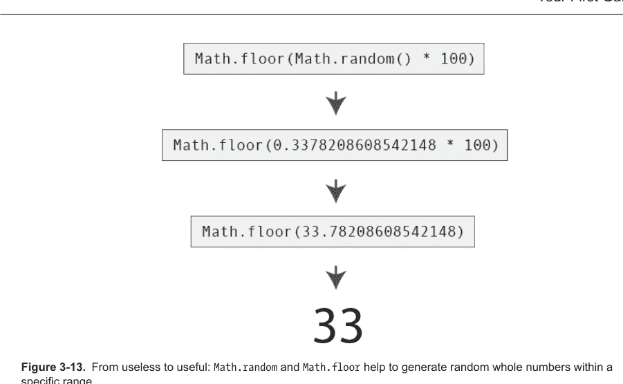

**图 3-13.** 从无用的到有用的：`Math.random`和`Math.floor`帮助生成指定范围内的随机整数

如果你需要 1 到 100 之间的随机数，可以使用如下代码：

```javascript
Math.ceil(Math.random() * 100);
```

`Math.ceil`将随机数向上取整，所以最小可以是 1，最大可以是 100。你可以用同样的格式来生成任意范围的数字，只需改变乘以随机数的那个数字即可。以下是一些例子：

- `Math.ceil(Math.random() * 10)`生成 1 到 10 之间的随机数。
- `Math.ceil(Math.random() * 27)`生成 1 到 27 之间的随机数。
- `Math.ceil(Math.random() * 5)`生成 1 到 5 之间的随机数。

使用`Math.ceil`会让随机数的范围从 1 开始的原因是，任何小于 1 的数字，比如 0.23，都会被向上取整为 1。这样你就不用在处理 0 值上费心了，而 0 值通常不是你游戏中需要的有用范围。但如果你确实想让 0 成为范围的一部分，那就使用`Math.floor`，并将随机数乘以 101。

```javascript
Math.floor(Math.random() * 101)
```

这会给你一个 0 到 100 之间的随机数。为什么需要将随机数乘以 101 呢？因为如果随机数超过 100，`Math.floor`会将它压低回 100。它永远不可能达到 101。

## 第 3 章

> 注意：如果你想生成的随机数范围不是从 1 或 0 开始呢？
>
> 假设你需要一个 10 到 25 之间的数字。这意味着你有 15 个可能的数字可以被选中：10、11、12……一直到 25。你所需要做的就是生成一个 0 到 15 之间的随机数，然后加上 10，将它推入你需要的范围。代码看起来是这样的：
>
> ```javascript
> Math.floor(Math.random() * 16) + 10;
> ```
>
> 这样想。随机数在 0 到 15 之间。假设它是 8。然后你加上 10。最终得到 18。你就得到了一个 10 到 25 之间可能的随机数范围。

你可以在章节源文件中的`randomNumbers.html`文件中找到所有这些生成随机数的实际应用示例。

现在让我们将学到的关于随机数的知识应用到游戏中。我们需要一个 0 到 99 之间的随机数，所以修改初始化`mysteryNumber`的那行代码，让它看起来像这样：

```javascript
var mysteryNumber = Math.floor(Math.random() * 100);
console.log(mysteryNumber);
var playersGuess = 0;
var guessesRemaining = 10;
var guessesMade = 0;
var gameState = "";
var gameWon = false;
```

你可以添加可选的`console.log(mysteryNumber)`这一行，让数字显示在控制台中，这在测试游戏时非常有用。

保存程序并再次运行游戏。现在每次玩的时候你都会得到不同的数字！

### 添加字符编码

一个小技术细节是，你应该始终确保你的完整游戏包含描述文档字符编码的`<meta>`标签。

```html
<!doctype html>
<meta charset="utf-8">
<title>Number guessing game</title>
```

这一点很重要，因为即使是最新的现代网页浏览器也并不总是能正确解释字符，特别是在文本字段中。如果你在游戏的某个地方看到一些乱码或数字，很可能是因为你没有包含字符编码。

## 完成游戏

我们在本节中对猜数字游戏做了很多修改，所以这里提供一份完整的代码清单供你参考，如果你有任何关于如何整合的问题。


```html
<!doctype html>
<meta charset="utf-8">
<title>Number guessing game</title>

<p id="output">I am thinking of a number between 0 and 99.</p>
<input id="input" type="text" placeholder="Enter your guess..." autofocus>
<button>guess</button>

<script>

//Game variables
var mysteryNumber = Math.floor(Math.random() * 100);
console.log(mysteryNumber);
var playersGuess = 0;

var guessesRemaining = 10;
var guessesMade = 0;
var gameState = "";
var gameWon = false;

//The input and output fields
var input = document.querySelector("#input");
var output = document.querySelector("#output");

//The button
var button = document.querySelector("button");
button.addEventListener("click", clickHandler, false);
button.style.cursor = "pointer";

//Listen for enter key presses
window.addEventListener("keydown", keydownHandler, false);

function keydownHandler(event)
{
  if(event.keyCode === 13)
  {
    validateInput();
  }
}

function clickHandler()
{
  validateInput();
}
```

```javascript
function validateInput()
{
  playersGuess = parseInt(input.value);

  if(isNaN(playersGuess))
  {
    output.innerHTML = "Please enter a number.";
  }
  else
  {
    playGame();
  }
}

function playGame()
{
  guessesRemaining = guessesRemaining - 1;
  guessesMade = guessesMade + 1;
  gameState
    = " Guess: " + guessesMade
    + ", Remaining: " + guessesRemaining;

  playersGuess = parseInt(input.value);

  if(playersGuess > mysteryNumber)
  {
    output.innerHTML = "That's too high." + gameState;

    //Check for the end of the game
    if (guessesRemaining < 1)
    {
      endGame();
    }
  }
  else if(playersGuess < mysteryNumber)
  {
    output.innerHTML = "That's too low." + gameState;

    //Check for the end of the game
    if (guessesRemaining < 1)
    {
      endGame();
    }
  }
  else if(playersGuess === mysteryNumber)
  {
    gameWon = true;
    endGame();
  }
}
```

```javascript
function endGame()
{
  if (gameWon)
  {
    output.innerHTML
      = "是的，就是 " + mysteryNumber + "！" + "<br>"
      + "你只猜了 " + guessesMade + " 次。";
  }
  else
  {
    output.innerHTML
      = "没有机会再猜了！" + "<br>"
      + "那个数字是：" + mysteryNumber + "。";
  }

  // 禁用按钮
  button.removeEventListener("click", clickOutputHandler, false);
  button.disabled = true;

  // 禁用回车键
  window.removeEventListener("keydown", keydownHandler, false);

  // 禁用输入框
  input.disabled = true;
}

</script>
```

到目前为止，这个游戏只使用了文本，但你可以运用所有 HTML 和 CSS 技能来添加颜色和图形。在接下来的几节中，你将学习如何创建自定义输入按钮，以及如何添加视觉显示。

## 制作非常漂亮的按钮

当你与大多数游戏或软件中的按钮交互时，你会注意到它在三个重要方面发生变化：

- 当鼠标移到按钮上时，会产生高亮效果。
- 当你点击或按住鼠标按钮时，按钮通常会改变颜色。有时它会稍微改变位置，看起来像是被按下了。
- 当鼠标离开按钮时，按钮会恢复到正常状态。

这三个基本的按钮状态分别称为**上**、**悬停**和**激活**。有多种不同的方式来表现这些状态。如果你仔细观察网站、游戏和应用程序中按钮的行为方式，你会看到无数种变体和风格。图 3-14 展示了一个简单的示例，说明这些状态在我将教你制作的按钮上可能是什么样子。

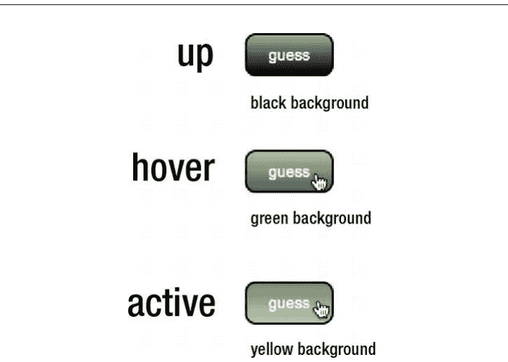

**图 3-14.** 按钮的*上*、*悬停*和*激活*状态

要创建你自己的自定义按钮，你需要某种方式来表示这三个独立的状态。你可以使用三张图片，每张代表一种状态，然后根据你想要显示的状态更改背景图片。或者，你可以用 CSS 设置按钮样式，并通过更改其样式来切换状态。这是最灵活的方法，也是你接下来将要学习的。

你会在章节源文件的`customButton.html`文件中找到这个按钮的工作示例。以下是整个文件。它只包含 HTML 和 CSS，所以没有 JavaScript。

```html
<!doctype html>
<title>自定义按钮</title>

<style>

button
{
  font-family: Arial, Helvetica, sans-serif;
  font-size: 14px;
  color: #fff;
  padding: 10px 20px;
  border: 2px solid #000;
  cursor: pointer;

  -webkit-border-radius: 10px;
  -moz-border-radius: 10px;
  border-radius: 10px;
}
```

```css
background: -webkit-linear-gradient(top, #a3a3a3, #000);
background: -moz-linear-gradient(top, #a3a3a3, #000);
background: linear-gradient(top, #a3a3a3, #000);

-webkit-box-shadow: 5px 5px 3px rgba(0,0,0,0.5);
-moz-box-shadow: 5px 5px 3px rgba(0,0,0,0.5);
box-shadow: 5px 5px 3px rgba(0,0,0,0.5);

-webkit-user-select: none;
-moz-user-select: none;
user-select: none;
}

button:hover
{
background: -webkit-linear-gradient(top, #acc7a3, #506651);
background: -moz-linear-gradient(top, #acc7a3, #506651);
background: linear-gradient(top, #acc7a3, #506651);
}

button:active
{
background: -webkit-linear-gradient(top, #858565, #c5c9a9);
background: -moz-linear-gradient(top, #858565, #c5c9a9);
background: linear-gradient(top, #858565, #c5c9a9);
}

</style>

<button>猜测</button>
```

这是一大段代码，所以让我们把它分解成易于理解的小块。首先，看一下设置按钮样式的 CSS。第一部分设置了边框样式、字体颜色、内边距和光标样式等属性，这些都是你在第 1 章和第 2 章中学到的属性。

```css
font-family: Arial, Helvetica, sans-serif;
font-size: 14px;
color: #fff;
padding: 10px 20px;
border: 2px solid #000;
cursor: pointer;
```

你应该能看出代码是如何影响按钮样式的。

但在这之后，有三个你以前没见过的新属性：`border-radius`、`linear-gradient`和`box-shadow`。在撰写本文时，这些是新的“实验性”样式，这意味着它们还不是 CSS 标准的正式部分。为了在不同的浏览器上可靠地工作，你需要使用至少三个不同的版本。以`-webkit-`为前缀的版本可以在 Safari 和 Chrome 上工作。以`-moz-`为前缀的版本可以在 Firefox 上工作。最后一个没有任何前缀，是该属性的纯净版本。不久的将来，当这些属性成为官方标准的一部分时，你将只需要使用最后一个。

> 注意：为了简化这些示例，我将不再继续包含`-webkit-`和`-moz-`版本的属性，但你要知道，你应该在所有最终代码中添加它们，直到你确定不再需要它们为止。以上面的代码清单作为添加这些前缀的模型。这些 CSS 属性的前缀被称为**厂商前缀**。

以下是其他流行浏览器的厂商前缀，以防你需要：

- Internet Explorer：`-ms-`
- Konqueror：`-khtml-`
- Opera：`-o-`

### 圆角

这里是`border-radius`属性。它决定了按钮的圆角程度。

```css
border-radius: 10px;
```

想象一下，这些角是半径为 10 像素的圆的一部分。这就是决定圆角的因素。图 3-15 显示了像`20px`和`5px`这样的不同值如何影响边框半径。

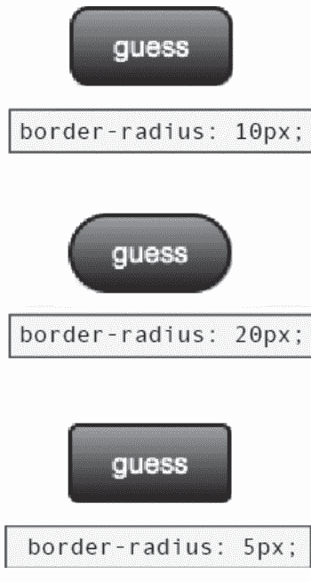

**图 3-15.** 使用`border-radius`属性创建圆角

### 渐变

`linear-gradient`背景属性可以创建按钮颜色从浅到深的渐变效果。按钮顶部是浅灰色，逐渐加深到底部的黑色。这种效果称为**渐变**，这里是实现此效果的代码：

`background: linear-gradient(top, #a3a3a3, #000);`

第一个十六进制颜色`#a3a3a3`是渐变的起始颜色，即浅灰色。第二个十六进制颜色`#000`是结束颜色，即黑色。

`top`是起始位置。你也可以选择`bottom`、`left`或`right`，这取决于你想从哪个方向开始渐变。如果你想让渐变以一定角度显示，例如从左上角到右下角，你可以使用类似这样的代码：

`background: linear-gradient(300deg, #a3a3a3, #000);`

只需添加你想要渐变跟随的角度度数。图 3-16 说明了`linear-gradient`背景属性如何实现这些效果。

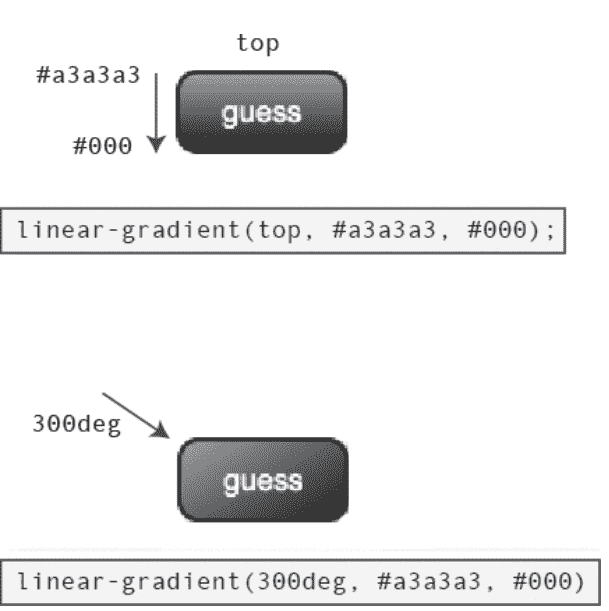

## 图 3-16. 创建背景渐变

对于更复杂的渐变效果，你可以为每种颜色分配一个百分比，以确定渐变应覆盖该区域的多少。这段代码将第一种颜色分配给元素的顶部 20%。

```css
linear-gradient(top, #a3a3a3 20%, #000);
```

你也可以使用两种以上的颜色进行渐变。这里是一个从灰色过渡到蓝色，以及从黄色过渡到黑色的渐变。

```css
linear-gradient(top, #a3a3a3, #0000FF, #FFFF00, #000);
```

> **注意：** 对于圆形渐变，请使用`radial-gradient`属性。
>
> `radial-gradient(startPosition, shape, firstColor, secondColor)`

起始位置可以是像素数、百分比或任何组合的词语：“top”、“left”、“bottom”、“right”或“center”。形状可以是“circle”或“ellipse”。颜色值遵循与线性渐变相同的规则。

如果你愿意，可以对任何渐变使用 RGB/RGBA 或 HSL/HSLA 颜色值，而不是十六进制值。有关这些替代颜色系统的更多信息，请回顾第 1 章。

渐变可能会变得相当复杂！不要为此担心。你不必使用所有这些选项，甚至一个都不用，但你应该知道它们的存在，以防万一。

### 投影

按钮也可以有投影效果，这是通过`box-shadow`属性实现的。

```css
box-shadow: 5px 5px 3px rgba(0,0,0,0.5);
```

这些值决定了阴影的水平和垂直偏移量、模糊程度、像素大小以及颜色。

```css
box-shadow: horizontalOffset verticalOffset blurriness color;
```

这个阴影相对于按钮向右下方偏移了 5 像素，模糊了 3 像素。RGBA 颜色是黑色，透明度为 0.5。通常建议对投影使用 RGBA 或 HSLA 值，因为透明度可以让阴影下的任何内容仍然可见，就像真实的阴影一样。

### 防止玩家选中按钮文本

HTML 文档中的任何文本都可以用鼠标选中。这对于将信息从网站复制粘贴到另一个文档很有用。但是，你也可以选中`<button>`标签内的文本。

```html
<button>所有这些文本都可以用鼠标选中</button>
```

这是一个问题，因为鼠标会混淆你是想点击按钮还是选中里面的文本。你可以通过将`user-select`属性设置为`none`来防止它尝试选中文本，如下所示：

```css
user-select: none;
```

如果你以后想恢复选中文本的能力，可以将此设置改回`auto`或`text`。

你现在知道了按钮的上状态是如何创建的。让我们来找出按钮如何切换到其悬停和激活状态。

### 理解`:hover`和`:active`状态

所有三个按钮状态都是通过 CSS 设置的。悬停状态决定了鼠标“悬停”在按钮上时按钮的外观。激活状态决定了按钮被按下时的外观。

```css
button:hover
{
  ... 当鼠标悬停在按钮上时。
}
```

```css
button:active
{
  ... when the button is pressed.
}
```

让我们来看看它们是如何工作的。

> 注意：CSS 中的一个特殊之处在于，你必须在悬停状态之后定义活动状态，它才能生效。在 CSS 术语中，这些状态被称为**伪类**（假类）。你总是可以通过一个冒号来识别 CSS 伪类。

当鼠标悬停在按钮上时，悬停状态通过将背景变为绿色来创建高亮效果。

```css
button:hover
{
  background: linear-gradient(top, #acc7a3, #506651);
}
```

当在按钮上按下鼠标左键时，活动状态会将背景变为黄色。它还会反转渐变的方向，使其从亮到暗。这创造出一种按钮被按下去的错觉。

```css
button:active
{
  background: linear-gradient(top, #858565, #c5c9a9);
}
```

当鼠标释放时，按钮会重置到悬停状态。当鼠标不再悬停在按钮上时，它会重置到正常状态。这就是控制按钮显示的全部三种按钮状态！

> 注意：为了省去你从头编写按钮 CSS 代码的工作，可以在网上搜索“CSS3 button generator”。你会发现许多网站允许你通过可视化界面设计按钮，并自动为你生成 CSS 代码。

如果你需要比 CSS 提供的更多的按钮状态控制，可以考虑使用 JavaScript 鼠标事件来改变按钮的外观。

下一步是将这个按钮添加到猜数字游戏中。你现在应该有足够的编程技巧自己完成这个任务，所以我将这个任务留给你。但以防你遇到困难，你会在`numberGameWithButton.html`文件中找到一个可以工作的例子。图 3-17 显示了它的样子。

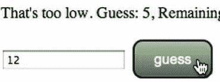

**图 3-17.** 将自定义按钮添加到猜数字游戏中

## 查看游戏


这里有一些你需要知道的非常重要的事情：所有游戏都只是信息。在猜数字游戏中，这些信息是`mysteryNumber`（神秘数字）、`playersGuess`（玩家猜测）、`guessesMade`（已猜测次数）和`guessesRemaining`（剩余猜测次数）。你如何选择显示这些信息完全取决于你。在前面的示例中，信息是以文本形式显示的。但没有理由不能以视觉方式显示相同的信息。在下一节中，我将向你展示两个如何为猜数字游戏添加视觉显示的示例。

### 为猜数字游戏添加视觉显示

在本章的源文件中，你会找到一个名为`numberGameWithGraphics.html`的文件夹。在网页浏览器中打开该文件并玩游戏。这是猜数字游戏的一个稍微简化的版本。你会看到一个箭头平滑地移动到标尺上与玩家猜测相匹配的数字。图 3-18 显示了你将看到的内容。

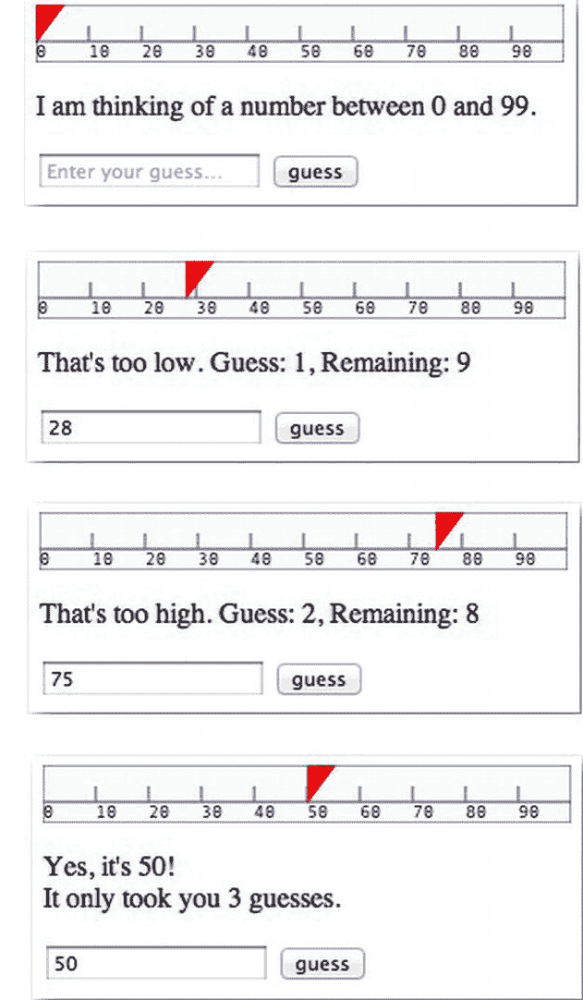

我在想一个 0 到 99 之间的数字。

那太低了。猜测：1，剩余：9

那太高了。猜测：2，剩余：8

是的，就是 50！

你只用了 3 次猜测。

图 3-18. 箭头移动到玩家猜测的位置

这是通过使用 JavaScript 将箭头的图像移动到标尺上与玩家猜测相匹配的位置来实现的。它还使用了 CSS 过渡来使箭头平滑移动。这是一个非常简单的例子，但如果你理解它的工作原理，你会发现更容易理解使用相同技术的更复杂的游戏。让我们仔细看看这是如何完成的。

标尺和箭头只是图像。它们是两个独立的 PNG 文件。打开项目文件夹，你会看到它们在`images`文件夹中。这个项目使用了我在第 1 章建议你使用的文件组织格式。图 3-19 说明了这一点。

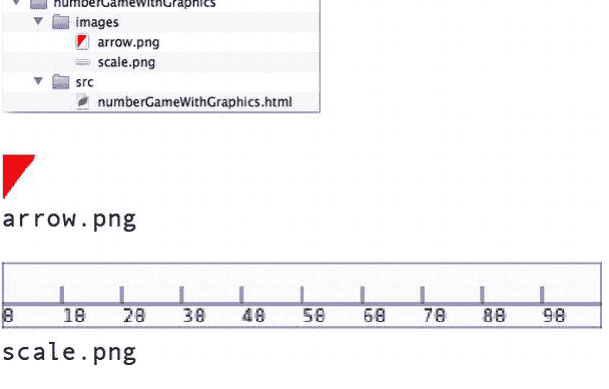

图 3-19. 文件和文件夹

HTML 文件显示这些图像。它使用 CSS 定位将它们绘制在一个`id`为`stage`的`<div>`标签内的正确位置。然后 JavaScript 代码使用一个新的`render`函数来改变箭头的 CSS 位置，使其与玩家的猜测相匹配。这些新功能只是添加到了游戏中；游戏逻辑没有改变。下面是完成所有这些工作的完整 HTML 文件。我将在后续页面中解释所有内容。

```html
<!doctype html>
<meta charset="utf-8">
<title>Number guessing game with graphics</title>

<style type="text/css">

#stage
{
    width: 300px;
    height: 33px;
    position: relative;
}

#scale
{
  width: 300px;
  height: 33px;
  position: absolute;
  top: 0px;
  left: 0px;
  background-image: url(../images/scale.png);
}

#arrow
{
  width: 17px;
  height: 22px;
  position: absolute;
  top: 0px;
  left: 0px;
  background-image: url(../images/arrow.png);

  /*Transition*/
  -webkit-transition: left 0.5s ease-out 0s;
  -moz-transition: left 0.5s ease-out 0s;
  transition: left 0.5s ease-out 0s;
}

</style>

<div id="stage">
  <div id="scale"></div>
  <div id="arrow"></div>
</div>

<p id="output">I am thinking of a number between 0 and 99.</p>
<input id="input" type="text" placeholder="Enter your guess...">
<button>guess</button>

<script type="text/javascript">

//Game variables
var mysteryNumber = 50;
var playersGuess = 0;
var guessesRemaining = 10;
var guessesMade = 0;
var gameState = "";
var gameWon = false;

//The input and output fields
var input = document.querySelector("#input");
var output = document.querySelector("#output");

//The button
var button = document.querySelector("button");
button.style.cursor = "pointer";
button.addEventListener("click", clickHandler, false);

//The arrow
var arrow = document.querySelector("#arrow");

function render()
{
  //Position the arrow
  //Multiply the players guess by 3 to get the
  //correct pixel position on the scale
  arrow.style.left = playersGuess * 3 + "px";
}

function clickHandler()
{
  playGame();
}

function playGame()
{
  guessesRemaining = guessesRemaining - 1;
  guessesMade = guessesMade + 1;
  gameState = " Guess: " + guessesMade + ", Remaining: " + guessesRemaining;
  
  playersGuess = parseInt(input.value);
  
  if(playersGuess > mysteryNumber)
  {
    output.innerHTML = "That's too high." + gameState;
    
    //Check for the end of the game
    if (guessesRemaining < 1)
    {
      endGame();
    }
  }
  else if(playersGuess < mysteryNumber)
  {
    output.innerHTML = "That's too low." + gameState;
    
    //Check for the end of the game
    if (guessesRemaining < 1)
    {
      endGame();
    }
  }
  else if(playersGuess === mysteryNumber)
  {
    gameWon = true;
    endGame();
  }

  //Update the graphic display
  render();
}

function endGame()
{
    if (gameWon)
    {
        output.innerHTML
            = "Yes, it's " + mysteryNumber + "!" + "<br>"
            + "It only took you " + guessesMade + " guesses.";
    }
    else
    {
        output.innerHTML
            = "No more guesses left!" + "<br>"
            + "The number was: " + mysteryNumber + ".";
    }
}

</script>
```

标尺和箭头的图像是使用 CSS 的绝对定位来定位的。它遵循你在第 1 章学到的相同模型。CSS 代码将这些图像相对于`stage` `<div>`标签进行定位。标尺和箭头将与 stage 的左上角对齐。

标尺和箭头具有与其包含的图像大小相匹配的高度和宽度。stage 与其包含的最大元素大小相同，在这种情况下是标尺。（箭头还包含过渡属性，使其能够平滑移动。我稍后将解释它是如何工作的。）

然后 JavaScript 执行通常的工作，初始化游戏变量和界面元素。但它现在还需要一个变量来引用箭头：

```javascript
var arrow = document.querySelector("#arrow");
```

它需要这个引用，以便代码可以通过 CSS 更改箭头的位置。

其余的代码你将非常熟悉。当玩家点击按钮时，`clickHandler`运行并调用`playGame`函数。代码与前面示例中的代码完全相同，但有一个小改动。在最后是对`render`函数的调用：

```javascript
function playGame()
{
  ... same code as usual...
  render();
}
```

这是它调用的`render`函数：

```javascript
function render()
{
  arrow.style.left = playersGuess * 3 + "px";
}
```

它正在改变箭头的`left`位置，使其与玩家的猜测相匹配。数字标尺宽 300 像素，但玩家可以猜测的可能数字范围仅在 0 到 99 之间。这意味着我们必须将玩家的猜测乘以 3，这样箭头才能出现在标尺上的正确位置。

另外，请注意代码在末尾添加了`"px"`。

```javascript
arrow.style.left = playersGuess * 3 + "px";
```

它必须这样做，因为你会记得 CSS 定位值需要以 px 结尾。如果玩家猜测 36，那么这行代码在 CSS 中会被解释为：

```javascript
arrow.style.left = "108px";
```

（这表示 36 乘以 3 等于 108，再加上`"px"`。）

它生成的 CSS 代码将如下所示：

```css
#arrow
{
  left: 108px;
}
```

请记住，这代表箭头左边缘与包含它的舞台元素左边缘之间的距离。

每当玩家点击按钮时，这个`render`函数就会被调用，然后它会更新箭头的 CSS 位置以匹配玩家的猜测。

### 使用 CSS 过渡的动画

箭头的`transition`属性使其能够从当前位置平滑地移动到下一个位置。每当箭头的`left`属性发生变化时，箭头需要 0.5 秒的时间移动到下一个位置，如图 3-20 所示。

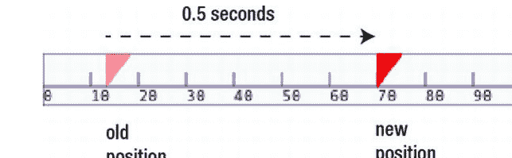

图 3-20. 箭头逐渐平滑地移动到其新位置

以下是实现此效果的 CSS 代码：

```css
transition: left 0.5s ease-out 0s;
```

这有点令人困惑，但仔细看，你会发现它有四个不同的参数，每个参数之间用空格隔开。

- `left`：这告诉过渡效果，当箭头的`left`属性发生变化时应该触发。你可以将其更改为任何 CSS 属性。例如，如果你想在`top`属性发生变化时触发过渡，只需将其更改为`top`即可。它适用于大多数 CSS 属性，包括`height`、`width`和`color`。如果你想在多个属性发生变化时触发过渡，用逗号分隔这些属性。如果你想在元素的任何属性发生变化时都触发过渡，请使用`all`。
- `0.5s`：这是过渡效果的持续时间，以秒为单位：0.5s 是半秒；1s 是一秒；0.3s 是 300 毫秒。你可以使用任何你喜欢的时间。
- `ease-out`：这是过渡应该使用的动画效果。`ease-out`意味着动画应该逐渐减速直至停止。你可以使用以下任何其他效果：`ease`、`linear`、`ease-out`或`ease-in-out`。尝试一下，看看你喜欢哪些。
- `0s`：这是延迟，以秒为单位。它是一个可选参数。它意味着过渡开始前不应有延迟。通常你会将其保持为 0s。如果你想设置延迟，例如半秒，可以将其设置为 0.5s。

一旦你习惯了，`transition`属性就非常易于使用。只需一行简单的代码，你就可以精美地为任何 HTML 元素添加动画。这对于为标题、游戏界面和其他用户界面元素制作动画非常有用。

### 将游戏信息与显示分离

请记住，游戏只是信息。我们在这个示例中使用的`render`函数就像一个镜头，让我们能更清晰地看到这些信息。重要的是要意识到，无论有无视觉显示，这个游戏都能完美运行，且方式完全相同。添加图形并不会改变游戏的运行方式。而且，控制箭头位置的代码也没有以任何方式改变游戏信息。视觉显示与信息是分离的。

你很快就会看到将游戏信息与显示分离有多重要。如果你能将你的游戏作为纯信息来解决，那么将其可视化显示就变得非常容易。学会这样做是成为优秀游戏设计师的关键。

让我们看一个更令人兴奋的例子，它能更清晰地展示这种方法的优势。

## 外星人来袭！

猜数字游戏是构建简单游戏的一个非常清晰的例子。但是，让我们面对现实，它让我们想起了数学课！我们是游戏设计师，我们制作有趣的游戏；数学课可不是我们报名参加的！那么，我们如何运用目前所学的知识来制作一个真正有趣的游戏呢？我们只需要一点想象力。

想象一下，你不是在猜测一个神秘的数字，而是在猜测一个入侵的太空外星人的位置，以便用核导弹将其击落。这对我来说听起来很有趣！你将在`alienAttack.html`文件中看到一个可运行的示例。图 3-21 展示了你将看到的内容。


图 3-21. 尝试猜测入侵外星人的 X 和 Y 位置

尝试猜测外星人的位置以将其击落。输入 0 到 300 之间的 X 和 Y 位置，然后点击"Fire!"按钮。X 位置是距左侧的水平距离（以像素为单位）。Y 位置是距屏幕顶部的垂直距离（以像素为单位）。如果你未击中，外星人会向地球靠近并选择一个新的随机 X 位置。如果在八轮内到达地球，你就输了。但如果你击中了它，你就拯救了地球！每次你进行猜测时，你的大炮会移动到你输入的 X 位置，而你的导弹会移动到你猜测的 X 和 Y 位置。

这看起来会很复杂吗？别被迷惑了，它不过是我们朴素的猜数字游戏精心装扮后出门游玩一番。但现在你猜的不是一个数字，而是两个：外星人的 X 和 Y 位置。用于显示游戏图形的技术与我们在猜数字游戏中显示和更改箭头所用的技术完全相同。但这一次，你是在重新定位三个图像，而不仅仅是一个。

以下是完整的代码清单，我将带你逐步了解它是如何工作的。你很快就会发现，它比你乍一看所想的要简单得多。

```html
<!doctype html>
<meta charset="utf-8">
<title>Alien attack</title>

<style>

#stage
{
  width: 300px;
  height: 300px;
  position: relative;
}

#background
{
  width: 300px;
  height: 300px;
  position: absolute;
  top: 0px;
  left: 0px;
  background-image: url(../images/background.png);
}

#cannon
{
  width: 20px;
  height: 20px;
  position: absolute;
  top: 270px;
  left: 140px;
  background-image: url(../images/cannon.png);
}
```

```css
#alien
{
  width: 20px;
  height: 20px;
  position: absolute;
  top: 20px;
  left: 80px;
  background-image: url(../images/alien.png);
}

#missile
{
  width: 10px;
  height: 10px;
  position: absolute;
  top: 240px;
  left: 145px;
  background-image: url(../images/missile.png);
}

</style>
```

```html
<div id="stage">
  <div id="background"></div>
  <div id="cannon"></div>
  <div id="missile"></div>
  <div id="alien"></div>
</div>

<p id="output">Enter the X and Y position (0-300), then click fire.</p>
<input id="inputX" type="text" placeholder="X...">
<input id="inputY" type="text" placeholder="Y...">
<button>fire!</button>
```


```html
<script>

//游戏变量
var alienX = 80;
var alienY = 20;
var guessX = 0;
var guessY = 0;
var shotsRemaining = 8;
var shotsMade = 0;
var gameState = "";
var gameWon = false;

//游戏对象
var cannon = document.querySelector("#cannon");
var alien = document.querySelector("#alien");
var missile = document.querySelector("#missile");
```

```javascript
//输入和输出字段
var inputX = document.querySelector("#inputX");
var inputY = document.querySelector("#inputY");
var output = document.querySelector("#output");

//按钮
var button = document.querySelector("button");
button.style.cursor = "pointer";
button.addEventListener("click", clickHandler, false);
```

```javascript
function render()
{
    //定位外星人
    alien.style.left = alienX + "px";
    alien.style.top = alienY + "px";

    //定位大炮
    cannon.style.left = guessX + "px";

    //定位导弹
    missile.style.left = guessX + "px";
    missile.style.top = guessY + "px";
}
```

```javascript
function clickHandler()
{
    playGame();
}
```

```javascript
function playGame()
{
    shotsRemaining = shotsRemaining - 1;
    shotsMade = shotsMade + 1;
    gameState = " Shots: " + shotsMade + ", Remaining: " + shotsRemaining;

    guessX = parseInt(inputX.value);
    guessY = parseInt(inputY.value);
```

```javascript
//找出玩家的x和y猜测值是否在外星人的区域内
if(guessX >= alienX && guessX <= alienX + 20)
{
    //是的，在X范围内，那么现在让我们
    //检查Y范围

    if(guessY >= alienY && guessY <= alienY + 20)
    {
        //它在X和Y范围内，所以击中了！
```

### 第三章

```javascript
gameWon = true;
    endGame();
  }
}
else
{
  output.innerHTML = "Miss!" + gameState;

  //检查游戏是否结束
  if (shotsRemaining < 1)
  {
    endGame();
  }
}

//如果游戏尚未胜利，则更新外星人的位置

if(!gameWon)
{
  //更新外星人的X坐标
  alienX = Math.floor(Math.random() * 280);

  //在新的Y坐标上增加30，使外星人向地球方向下移
  alienY += 30;
}

//渲染新的游戏状态
render();
console.log("X: " + alienX);
console.log("Y: " + alienY);
}

function endGame()
{
  if(gameWon)
  {
    output.innerHTML
      = "命中！你拯救了地球！" + "<br>"
      + "你仅用了 " + shotsMade + " 次射击。";
  }
  else
  {
    output.innerHTML
      = "你输了！" + "<br>"
      + "地球已被入侵！";
  }
}
</script>
```

# 游戏设置

项目文件夹的格式与前面的示例相同。HTML文件位于`src`文件夹中。游戏使用的图像位于`images`文件夹中。图3-22说明了这一点。


外星人和炮台的尺寸均为20 x 20像素。导弹为10 x 10像素。背景为300 x 300像素。这些都是我设计的PNG图像，旨在使它们看起来像来自复古视频游戏。但你可以使用任何你喜欢的任何尺寸的图像。

你会看到，这个程序的格式完全遵循前面示例的格式。HTML代码在舞台内部创建可视化的游戏元素：

```html
<div id="stage">
  <div id="background"></div>
  <div id="cannon"></div>
  <div id="missile"></div>
  <div id="alien"></div>
</div>
```

你添加这些元素的顺序很重要。你添加的第一张图像将位于后续添加的图像之后。这意味着如果你想让背景出现在其他图像后面，就必须先添加背景。如果最后添加背景，它将覆盖其他图像。图像像图层一样堆叠，就像在Photoshop或Illustrator等图形设计软件中一样。

> 注意：你可以使用CSS的`z-index`属性来改变元素的堆叠顺序。为元素分配`z-index`数字，例如1、2、3或4。数字较小的元素将堆叠在数字较大的元素之下。以下是一个示例：

```css
#elementOne
{
  z-index: 2;
}

#elementTwo
{
  z-index: 1;
}
```

`elementOne`将出现在`elementTwo`之上，因为它的`z-index`数字更大。

`z-index`属性仅对已使用CSS定位属性定位的元素有效。

游戏有两个输入字段。`inputX`让你输入导弹的X位置，`inputY`让你输入Y位置。

```html
<p id="output">输入X和Y位置（0-300），然后点击开火。</p>
<input id="inputX" type="text" placeholder="X...">
<input id="inputY" type="text" placeholder="Y...">
<button>开火！</button>
```

CSS代码加载图像，并将所有对象设置为相对于舞台左上角的绝对位置。舞台的尺寸与其包含的最大元素一样大，在本例中是背景。

```css
<style>

#stage
{
    width: 300px;
    height: 300px;
    position: relative;
}

#background
{
    width: 300px;
    height: 300px;
    position: absolute;
    top: 0px;
    left: 0px;
    background-image: url(../images/background.png);
}

#cannon
{
    width: 20px;
    height: 20px;
    position: absolute;
    top: 270px;
    left: 140px;
    background-image: url(../images/cannon.png);
}

#alien
{
    width: 20px;
    height: 20px;
    position: absolute;
    top: 20px;
    left: 80px;
    background-image: url(../images/alien.png);
}
```

```css
#missile
{
  width: 10px;
  height: 10px;
  position: absolute;
  top: 240px;
  left: 145px;
  background-image: url(../images/missile.png);
}

</style>
```

这些是游戏首次加载时对象的位置。

然后代码初始化它需要的所有变量，以便能够访问和修改这些对象。到现在为止，这些你应该都很熟悉了。

```javascript
//游戏变量
var alienX = 80;
var alienY = 20;
var guessX = 0;
var guessY = 0;
var shotsRemaining = 8;
var shotsMade = 0;
var gameState = "";
var gameWon = false;
```

```javascript
//游戏对象
var cannon = document.querySelector("#cannon");
var alien = document.querySelector("#alien");
var missile = document.querySelector("#missile");
```

```javascript
//输入和输出字段
var inputX = document.querySelector("#inputX");
var inputY = document.querySelector("#inputY");
var output = document.querySelector("#output");
```

```javascript
//按钮
var button = document.querySelector("button");
button.style.cursor = "pointer";
button.addEventListener("click", clickHandler, false);
```

有两个变量将存储玩家猜测的X和Y位置：

```javascript
var guessX = 0;
var guessY = 0;
```

猜数字游戏中的`guessesRemaining`和`guessesMade`变量已被更改为匹配我们新的太空战争主题。

```javascript
var shotsRemaining = 8;
var shotsMade = 0;
```

它们的作用是相同的。

`alienX`和`alienY`变量存储外星人在舞台上的位置。它们共同描述了外星人的起始位置。`alienX`初始化为80，即舞台左侧80像素处。`alienY`初始化为20，即舞台顶部下方20像素处。

```javascript
var alienX = 80;
var alienY = 20;
```

这两个变量的值被设置为CSS代码中分配给外星人的`left`和`top`值。是CSS代码设置了外星人的初始位置，而不是这些变量。但是，当游戏进行时，我们将使用这些变量来更改CSS值。这就是让外星人移动的原因。将这些变量的值设置为与CSS值相同是一个良好的起点。

## 判断外星人是否被击中

当玩家点击按钮时，会调用`playGame`函数。它首先计算`shotsRemaining`和`shotsMade`，并更新`gameState`。它还将输入字段`inputX`和`inputY`的值复制到变量`guessX`和`guessY`中。

```javascript
function playGame()
{
    shotsRemaining = shotsRemaining - 1;
    shotsMade = shotsMade + 1;
    gameState = " 射击次数: " + shotsMade + ", 剩余: " + shotsRemaining;

    guessX = parseInt(inputX.value);
    guessY = parseInt(inputY.value);
    //...
}
```

所有这些都与猜数字游戏中的情况类似。

新增的是，游戏现在必须判断玩家的猜测是否正确。它是如何做到的呢？以下是`playGame`函数中判断外星人是否被击中的代码。它使用了一个嵌套的`if`语句来完成这个判断：

```javascript
if(guessX >= alienX && guessX <= alienX + 20)
{
    //是的，它在X范围内，现在让我们
    //检查Y范围

    if(guessY >= alienY && guessY <= alienY + 20)
    {
        //它在X和Y范围内，所以是命中！
```

```javascript
gameWon = true;
endGame();
}
}
```

这段代码检查猜测值是否在外星人所占据的X和Y范围内。它首先检查`guessX`。如果`guessX`是一个大于或等于外星人X位置*并且*小于其宽度（`alienX + 20`）的数字，那么这个猜测就是正确的。这意味着在水平轴上可能被击中。但只有在`guessY`也正确的情况下才算真正击中，这就是第二个`if`语句检查的内容。它检查`guessY`是否是一个大于或等于外星人Y位置*并且*小于其高度（`alienY + 20`）的数字。如果这两个条件都为真，那么猜测就在外星人占据的范围内，玩家就赢了。

这个逻辑相当紧凑，但如果你仔细分析，你会发现它确实非常有道理。让我们把它分解成更小的部分来理解。

想象一下，外星人的X位置是50，Y位置是30。玩家猜测X位置是55。请记住，这些位置指的是外星人的左上角。图3-23说明了这一点。


**图3-23.** 玩家猜测的X位置是否在外星人占据的范围内？

我们需要判断玩家的猜测55是否在外星人于X轴上占据的范围内。我们知道外星人的左上角在位置50。外星人宽20像素，这意味着它占据了从50到70之间的空间。55是否在50和70之间？当然！第一个`if`语句告诉了我们这一点。以下是使用这些实际数字的`if`语句：

```javascript
if(55 >= 50 && 55 <= 70)
{
    //是的，它在X范围内
```

假设玩家猜测的数字是45。这个数字是否在外星人占据的范围内呢？图3-24显示了答案。


```javascript
if(45 >= 30 && 45 <= 50)
{
  //它在 X 和 Y 范围内都符合，所以命中了！
  gameWon = true;
  endGame();
}
```

从图3-25中可以看到，`guessX`和`guessY`实际上指向了外星人内部的X和Y位置。


所以数学在击落外星人方面其实很有用，这真是太酷了！

花点时间理解一下它是怎么工作的；值得花点脑力去琢磨，直到恍然大悟。这实际上是一个巧妙的引入，引出了一个重要的游戏设计主题，叫做**碰撞检测**。你将在第8章中学习它。

## 移动游戏对象

如果玩家没有射中外星人，`playGame`函数会找到外星人下一个新的位置。它会在0到280之间给外星人一个随机的X位置，然后在其当前的Y位置上增加30。

```javascript
if(!gameWon)
{
  //更新外星人的X位置
  alienX = Math.floor(Math.random() * 281);

  //在当前Y位置基础上加30
  //让外星人向地球移动
  alienY += 30;
}
```

外星人宽20像素，所以给它0到280之间的随机范围意味着它的右侧永远不会越过背景的右侧边缘。这样可以让它始终保持在游戏场地内。

请记住，这段代码还没有真正移动外星人。这只是游戏信息。它只是计算出了外星人渲染时应该位于何处。将外星人的图像移动到这个位置的工作是通过调用`render`函数来完成的：

```javascript
render();
```

下面是`render`函数，它根据游戏信息移动所有游戏对象：

```javascript
function render()
{
  //定位外星人
  alien.style.left = alienX + "px";
  alien.style.top = alienY + "px";

  //定位大炮
  cannon.style.left = guessX + "px";

  //定位导弹
  missile.style.left = guessX + "px";
  missile.style.top = guessY + "px";
}
```

外星人根据游戏刚刚计算出的新`alienX`和`alienY`值移动到新位置：

```javascript
alien.style.left = alienX + "px";
alien.style.top = alienY + "px";
```

这段代码改变了外星人的CSS位置值，真正将它移动到浏览器中的新位置。

大炮移动到`guessX`位置：

```javascript
cannon.style.left = guessX + "px";
```

导弹则移动到玩家猜测的精确的X和Y位置：

```javascript
missile.style.left = guessX + "px";
missile.style.top = guessY + "px";
```

重要的是要记住，这些点代表的是对象的左上角。目前这样就可以了，但通常你会想要相对于中心点来移动对象。这涉及一些简单的数学运算，你将在第8章中学习如何做到这一点。

## 让游戏更完善


我把这个游戏保持得尽可能简单，这样你就能理解底层的编程逻辑是如何工作的。没有什么能阻止你利用本章学过的许多其他技巧，并加入一些自己的想法，让游戏变得更好。以下是一些改进建议。

### 添加爆炸效果

当外星人被击中时创建一个爆炸效果。图 3-26 展示了这可能的样子。


**图 3-26.** 当外星人被击中时添加爆炸效果。

爆炸应该出现在与外星人相同的位置。外星人和导弹都应该消失。

你有足够的能力自己完成这个，但这里有一些提示：

- 添加一个新的 `<div>` 元素，id 为 `explosion`。
- 在 CSS 代码中，将爆炸的 `display` 属性设置为 `none`，这样它在游戏开始时不会显示。
- 创建一个变量，使用 `document.querySelector` 引用爆炸元素。
- 在 `render` 函数中，添加一个 if 语句检查游戏是否已经获胜。如果是，你的代码应该做以下事情：
  - 通过设置其 CSS `display` 属性为 `block` 使爆炸可见。
  - 给爆炸设置与外星人相同的 X 和 Y 位置。
  - 通过将外星人和导弹的 `display` 属性设置为 `none` 使它们不可见。

如果你卡住了，可以查看本章源文件中的 `alienExplosion.html` 文件，那里有一个可运行的示例。

### 验证新的输入数字

阻止玩家输入除数字以外的任何内容。同时，阻止玩家输入大于 300 的数字。你需要在 `validateInput` 函数中完成这个操作，它可能看起来像这样：

```javascript
function validateInput()
{
  guessX = parseInt(inputX.value);
  guessY = parseInt(inputY.value);

  if(isNaN(guessX) || isNaN(guessY))
  {
    output.innerHTML = "请输入数字。";
  }
  else if(guessX > 300 || guessY > 300)
  {
    output.innerHTML = "请输入小于 300 的数字。";
  }
  else
  {
    playGame();
  }
}
```

### 添加更多 HTML 和 CSS 样式

利用你目前所学来改进游戏的外观和操作体验。这里有一些显而易见的改进点：

- 创建一个自定义的"发射"按钮。
- 应用你从最终的猜数字游戏中学到的所有润色技巧：让玩家可以使用 Enter 键；在第一个输入框添加自动聚焦；在游戏结束时禁用输入字段和按钮。
- 最后，尝试运用你所知道的 HTML 和 CSS 知识让游戏看起来更好。你可以添加一个嵌入字体的标题，将整个游戏放入自己的盒子中，并使用一些渐变或阴影效果。

图 3-27 展示了你的成品游戏可能的样子，你可以在章节源文件的 `alienAttackFinished` 文件夹中找到包含所有这些修改的可运行示例。


**图 3-27.** 为你的游戏添加一些收尾工作。

让我们快速看一下这个成品游戏是如何构建的，我还会向你展示一些你可能想要使用的新 HTML 和 CSS 技巧。

图 3-28 说明了项目文件和文件夹的组织方式。


**图 3-28.** 最终项目文件夹的组织结构。

这个项目中有大量的 CSS 代码，所以我把它们放在了一个单独的 CSS 文件中，并通过 `<link>` 元素将其链接到 HTML。

```html
<link rel="stylesheet" href="alienAttack.css">
```

如果你需要复习如何链接外部 CSS 文件，请回顾第 1 章。

游戏还使用了一种名为 `emulogic.ttf` 的嵌入式字体，以营造老式电子游戏的氛围。它在项目文件夹内的 `fonts` 文件夹中。下面是加载和嵌入它的 CSS 代码。

```css
@font-face
{
    font-family: emulogic;
    src: url("../fonts/emulogic.ttf");
}
```

> **注意：** 如果你使用 Firefox，嵌入式字体只有在与 CSS 文件位于同一文件夹时才能被加载。

我希望所有元素都使用这种字体，包括按钮和输入字段，所以我使用了通用选择器，即星号，来强制所有元素使用它。

```css
*
{
    font-family: emulogic;
    padding: 0px;
    margin: 0px;
}
```

通过通用选择器设置的任何属性都将应用于你所有的 CSS 元素。

我还使用通用选择器将所有元素的 `padding` 和 `margin` 设置为零。这覆盖了 Web 浏览器自动赋予某些元素的 `padding` 和 `margin`。从零开始逐步构建你的 `padding` 和 `margin`，通常是你开始布局元素时最简单、最清晰的方式。

你可以在图 3-27 中看到，整个舞台和用户界面都被一个盒子包围。我通过创建一个特殊的 `<section id="game">` 元素来实现这一点，它包围了所有其他的 HTML 代码。

你看到 `<section>` 从哪里开始到哪里结束了吗？那就是包围游戏的盒子。

```html
<!doctype html>
<meta charset="utf-8">
<title>Alien explosion</title>
<link rel="stylesheet" href="alienAttack.css">

<section id="game">

<h1>Alien Attack!</h1>

<div id="stage">
    <div id="background"></div>
    <div id="cannon"></div>
    <div id="missile"></div>
    <div id="alien"></div>
    <div id="explosion"></div>
</div>

<p id="output">Enter the X and Y position (0-300), then click fire.</p>
<input id="inputX" type="text" placeholder="X..." autofocus>
<input id="inputY" type="text" placeholder="Y...">
<button>fire!</button>

</section>
```

你可以使用 `<section>` 元素来包围任何你希望因某种原因而保持在一起的一组 HTML 代码。`<section id="game">` 元素具有圆角、背景渐变、阴影和一些 `padding`，并且足够大以舒适地容纳所有其他元素。

```css
#game
{
    margin: 0px auto;
    width: 330px;
    height: auto;
    padding: 15px;
    border: black;
    background: linear-gradient(top, #588063, #000);
    box-shadow: 5px 5px 5px rgba(0, 0, 0, 0.5);
    border-radius: 10px;
}
```

## 使用文字轮廓和阴影

你还会注意到它在浏览器窗口中是居中的，正如你在第 1 章中学到的，这得益于 `margin` 属性：

```css
margin: 0px auto;
```

这会给元素设置相等的、自动的左右外边距，从而使其在浏览器中居中。包含游戏图像的 `stage` 元素，也通过同样的代码行在游戏元素内部居中：

```css
#stage
{
  margin: 0px auto;
  ...
}
```

这种方法适用于块级元素，但不适用于文本。请记住，如果你想让文本在另一个元素内部居中，请使用 CSS 的 `text-align` 属性，并将其值设置为 `center`：

```css
text-align: center;
```

游戏标题 `Alien Attack!` 有黑色轮廓和酸绿色阴影。要为文字添加轮廓，请使用 CSS 的 `text-stroke` 属性。它需要两个值：线条粗细（以像素为单位）和颜色：

```css
-webkit-text-stroke: 1px #000;
-moz-text-stroke: 1px #000;
text-stroke: 1px #000;
```

这会用 1 像素宽的黑色线条勾勒出文字轮廓。

> **注意：** 在撰写本文时，`text-stroke` 属性仅适用于基于 WebKit 的浏览器，如 Chrome 和 Safari。

使用 `text-shadow` 属性为文字创建阴影。它需要三个值：x 偏移量、y 偏移量和颜色。以下是示例中创建绿色阴影的代码：

```css
text-shadow: 3px 3px lime;
```

绿色阴影向右下方偏移 3 像素。颜色可以是预设置的颜色（如 `lime`），或任何十六进制、RGB/RGBA 或 HSL/HSLA 颜色。

你还可以添加一个额外的可选值，即模糊量。并且可以使用 RGB 颜色值来设置阴影，使其半透明。以下代码创建了一个半透明的阴影，偏移 5 像素，模糊 3 像素：

```css
text-shadow: 5px 5px 3px rgba(0, 0, 0, 0.5);
```

这是一个很好的效果，因为半透明性使下方的任何图像都能可见。

有了这些新技术，以及你在前几章学到的所有 CSS 知识，你应该能够制作一个非常好看的游戏了。

## 总结

现在你知道如何开始制作游戏了！尽管你可以而且将会构建更复杂、更大规模的游戏，但这些小游戏是你需要解决的游戏问题的模型。如果你理解了游戏设计的问题以及你在这里找到的解决方案，当你尝试更有雄心壮志的项目时，你将会处于非常有利的地位。

在本章中，你学到了制作回合制游戏的所有基础知识。在继续阅读本书之前，休息片刻，尝试创建你自己的游戏。你知道如何移动对象、判断对象是否接触、分析游戏信息，以及使用随机数来保持不可预测性。没有比用自己的方式尝试更好的学习方法了，这将使你对我们在接下来的章节中将要看的一些更高级的技术有更深的理解。

你现在也理解了游戏信息将如何创建并与游戏规则交互。接下来，我将向你展示如何使用信息来构建一个完整的、沉浸式的游戏世界。


# 第 4 章：创建游戏世界

游戏好玩的原因之一是它们是对现实世界的简化模拟。现实世界往往不那么有趣，因为它太过复杂，规则太多。在现实世界中，我们必须应对食物、雨水、截止日期、交通、蚊子和重力等问题，有时还会同时遇到。这可能会让人疲惫！但游戏世界有更简单、更清晰的规则。我们可以比解决现实世界的问题更容易、更易理解、更快速地解决游戏问题，这给了我们很大的成就感和满足感。而且因为游戏是交互式的，玩家可以改变游戏世界，并观察他们的变化如何与世界规则互动。这创造了一种即时的沉浸感。

在本章中，你将学习如何使用信息来构建游戏世界，以及如何对这些信息应用规则来创建交互式游戏。在本章的第一部分，你将学习两个非常重要的新编程技巧：数组和循环。在本章的第二部分，我将向你展示如何使用它们来构建一个奇幻冒险游戏 `Lyrica 森林`，如图 4-1 所示。


**图 4-1.** 奇幻冒险游戏

你可以将这个游戏作为创建你自己的非常复杂、沉浸式冒险游戏的模型。但正如你在接下来的章节中将要看到的，用于制作它的核心技术是制作*任何*类型游戏的核心，包括动作游戏和街机游戏。

## 循环

循环用于重复执行一段代码一定次数。在 JavaScript 中你可以创建多种不同的循环，但最常见的是 `for` 循环。它可以让你“重复任意次数”地执行一段代码，从一次到数百次甚至数千次。

以下是循环的用途。想象一下，你想显示“Hello world!”五次。没有循环时，你的代码看起来是这样的：

```javascript
console.log("Hello world!");
console.log("Hello world!");
console.log("Hello world!");
console.log("Hello world!");
console.log("Hello world!");
```

这有点繁琐。如果能只写一行代码并告诉它重复五次，那不是更容易吗？这就是 `for` 循环让你做到的。以下是一个显示“Hello world!”五次的 `for` 循环：

```javascript
for(var i = 0; i < 5; i++)
{
    console.log("Hello world!");
}
```

这是它在控制台中的显示：

```text
Hello world!
Hello world!
Hello world!
Hello world!
Hello world!
```

`for` 循环的结构起初可能看起来很奇怪和令人困惑，因为它的参数实际上包含三个独立的语句。每个语句用分号分隔。

```javascript
for(firstStatement; secondStatement; thirdStatement)
{
    ...你想要重复的内容;
}
```

但如果将其分解为更小的部分，就很容易理解它的工作方式。它首先做的是声明一个用于计数的变量。这个变量称为索引变量：

```javascript
for(var i = 0; i < 5; i++)
{
    ...你想要重复的内容;
}
```

这创建了一个名为 `i` 的变量，初始化为 `0`。

```javascript
var i = 0;
```

虽然你可以使用任何你喜欢的变量名，但按照惯例每个人都使用 `i`，因为“i”代表“index（索引）”。

下一个语句告诉循环应该重复多少次：

```javascript
for(var i = 0; i < 5; i++)
{
    ...你想要重复的内容;
}
```

这是一个条件语句。它告诉循环“在索引变量小于 5 时”重复。

```javascript
i < 5;
```

在这个例子中，索引变量初始化为 `0`，所以循环会重复直到达到 `4`。它使循环从 `0` 运行到 `4`，从 `0` 开始算是五次：`0`、`1`、`2`、`3` 和 `4`。你可以在这里使用任何类型的条件语句。

最后一个语句在每次循环运行时增加索引变量 `1`：

```javascript
i++;
```

循环第一次运行时，`i` 从 `0` 开始。下次重复时，`++` 运算符加 `1`。

这意味着 `i` 等于 `1`（因为 `0` 加 `1` 等于 `1`，当然）。下次循环重复时，`i` 再次加 `1`，结果值为 `2`。这在 `i` 小于 `5` 时重复。一旦它得到 `5` 的值，循环就立即停止。

虽然 `i++` 是增加索引变量值的最常见方式，但你可以使用任何你喜欢的语句来增加或减少它。例如，`i += 2` 会在每次循环重复时将索引变量增加 `2`。如果你想让循环倒计数，`i--` 会减少 `1`。

以下是一个显示 `0` 到 `4` 数字的 `for` 循环示例。

```javascript
for(var i = 0; i < 5; i++)
{
    console.log(i);
}
```

这是它在控制台中的显示：

```text
0
1
2
3
4
```

它只是在每次循环运行时显示循环索引变量 `i` 的值。你现在可以清楚地看到循环是如何运行 5 次的。它从 `0` 开始，并在达到 `5` 之前退出。

你可以将 `i` 初始化为任何你想要的数字，并且可以使用任何条件来退出循环。这是另一个例子：`i` 被初始化为 `1`，循环会一直重复直到它变成 `5`：

```javascript
for(var i = 1; i <= 5; i++)
{
    console.log(i);
}
```

这会显示以下内容：

```text
1
2
3
4
5
```

在这个例子中，循环显示了最终数字 `5`。循环在 `i` 小于或等于 `5` 时运行。

```javascript
i <= 5;
```

只有当 `i` 变得大于 `5` 时，循环才会退出。

将索引变量初始化为 `1` 并在 `5` 处退出循环特别有用，因为它非常清楚地表明了循环从哪里开始和结束。

在本章中，我们将探讨几种不同的使用 `for` 循环的方法。图 4-2 是 `for` 循环工作原理的快速参考图。


**图 4-2.** `for` 循环的工作原理

> **注意：** 虽然 `for` 循环是一个经久不衰的首选，但 JavaScript 也允许你以几种其他方式创建循环。你也可以创建 `while` 循环或 `do-while` 循环。它们都与 `for` 循环做同样的事情，尽管它们在某些情况下可能有用的细微差别。

`while` 循环对于游戏来说可能特别有用。它看起来像这样：

```javascript
while(某个条件为真)
{
    //...你想运行的代码
}
```

`while` 循环不会运行固定的次数：它们会一直运行，直到括号中的条件变为假。当你在程序中使用 `while` 循环时，你必须确保条件最终会变为假。如果不会，循环将“永远”运行，程序可能会挂起。

`while` 循环只有在它们检查的条件为真时，才会运行它们包含的指令。这意味着如果条件从未变为真，循环可能永远不会运行。然而，在某些情况下，你可能需要一个至少运行一次的循环。在这种情况下，你可以使用 `do-while` 循环。

`do-while` 循环使用这种格式：

```javascript
do
{
    //... 你想重复运行的代码
}
while (这个条件为真);
```


你可以看到，`while`语句只在花括号内的指令运行后才检查条件。这意味着这些指令在`while`语句检查循环条件是否为真之前，将有机会至少运行一次。

## 使用数组存储大量信息

变量用于存储信息。但一个变量一次只能存储一条信息。如果你想使用变量存储大量信息，你需要使用大量的变量。

但是有一种更好的方法来存储大量信息。你可以使用一个数组。数组就像一个储物柜，你可以在里面存放任意数量的东西。当你有许多想要跟踪的信息时，通常最好将所有信息存储在一个数组中，而不是存储在大量变量中。

要创建一个空数组，为你的数组选择一个名字，并为它赋一对空的方括号，像这样：

```js
var closet = [];
```

这个数组的名字是`closet`，但你可以使用任何你喜欢的名字。空的括号表示它目前不包含任何东西。它是空的。有时你会希望在程序开始时像这样从一个空数组开始，并随着游戏的进展向其中添加东西。

你的数组不必以空数组开始；你可以在创建时就填充好内容。这是一个名为`closet`的数组，它存储了三样东西：

```js
var closet = ["hat", "umbrella", "katana"];
```

它存储了"hat"（帽子）、"umbrella"（雨伞）和"katana"（katana是一种极其危险的日本刀）——这些都是你在城里度过一个有趣夜晚所需的一切。数组中的所有内容都被方括号包围，并且它们之间用逗号分隔。"hat"、"umbrella"和"katana"是字符串，但你可以在数组中存储任何你喜欢的东西：字符串、变量、数字，甚至其他数组。数组存储的东西被称为元素。`closet`数组有三个元素。

### 数组基础

让我们看一些简单的例子，演示如何使用数组来存储和查找信息。

数组中的所有元素都按顺序编号，从0开始。这些数字被称为索引号。在前面的例子中，"hat"的索引号是0，"umbrella"的索引号是1，"katana"的索引号是2。

你可以这样找出哪个元素在哪个索引号：

```js
closet[1]
```

这个值为"umbrella"，因为"umbrella"的索引号是1。

这其实非常简单。数组只是一个带编号的元素列表。图4-3说明了一个空数组与一个包含三个元素的数组的对比。


有几种方法可以将元素放入数组中。在前面的例子中，三个元素是在数组初始化时添加的。但你也可以随时直接向数组的索引位置赋值：

```js
closet[2] = "katana";
```

那么，无论何时你的代码看到`closet[2]`，它都会将其解释为"katana"。

让我们看一个稍微具体一点的例子。这是一个名为`basicArray.html`的程序，你可以在本章的源文件中找到它。

```js
//创建一个空数组

var closet = [];

//添加三样东西

closet[0] = "hat";

closet[1] = "umbrella";

closet[2] = "katana";

//查看整个数组内容

console.log("Entire array: " + closet);

//查看单个元素

console.log("Element 0: " + closet[0]);

console.log("Element 1: " + closet[1]);

console.log("Element 2: " + closet[2]);
```

这是它在控制台中的显示：

```text
Entire Array: hat,umbrella,katana

Element 0: hat

Element 1: umbrella

Element 2: katana
```

这是整个数组内容的显示方式：

```js
console.log("Entire array: " + closet);
```

它在控制台中是这样显示的：

```text
Entire Array: hat,umbrella,katana
```

当数组像这样与字符串组合时，所有数组的元素都会自动转换为一个字符串：

```text
"hat,umbrella,katana"
```

单个数组元素的显示方式如下：

```js
console.log("Element 0: " + closet[0]);

console.log("Element 1: " + closet[1]);

console.log("Element 2: " + closet[2]);
```

数组元素`closet[0]`、`closet[1]`和`closet[2]`也被解释为普通字符串。这就是为什么上面的行会产生以下输出：

```text
Element 0: hat

Element 1: umbrella

Element 2: katana
```

从这个例子很容易看出，数组只是存储容器。

### 向数组中推送元素

另一种非常常见的将元素放入数组的方法是使用数组的`push`方法。你可以使用`push`来真正地将一个元素“推入”数组，使用这种格式：

```js
arrayName.push(elementName);
```

当你将一个元素推入数组时，你会将其添加到数组的末尾。该元素获得的索引号比已经在数组中的最后一个元素的索引号高1。这意味着，如果最后一个元素的索引号是`[2]`，你推入的新元素的索引号将是`[3]`。

使用`push`非常有帮助，因为你无需担心应该将元素添加到哪个索引号。数组会为你处理好这一点。这就像把东西塞进一个大袋子里，你不必担心顺序。顶部的那些是你最后塞进去的。

这是一个使用`push`向数组添加元素的简单程序：

```js
//创建一个空数组

var closet = [];

//添加三样东西

closet.push("hat");

closet.push("umbrella");

closet.push("katana");

//查看整个数组内容

console.log("Entire array: " + closet);

//查看单个元素

console.log("Element 0: " + closet[0]);

console.log("Element 1: " + closet[1]);

console.log("Element 2: " + closet[2]);
```

输出结果与第一个示例完全相同。无需担心索引编号这一事实确实非常方便。

你可以在本章源文件中的`usingPush.html`文件中找到此示例的工作代码。

### 从数组中移除元素

要从数组中移除一个元素，你可以使用数组的`pop`方法。以下代码使用`pop`从数组中移除最后一个元素：

```js
closet.pop();
```

如果数组原本有三个元素，那么现在只剩下两个了，最后一个元素消失了。你可以这样理解：如果你挤压数组，最后一个元素就会“弹出”。

被移除的元素可以直接复制到一个新变量中。方法如下：

```js
var removedElement = closet.pop();
```

如果最后一个元素是"katana"，那么`removedElement`的值现在就是"katana"。这也意味着`closet`数组现在只包含两个元素："hat"和"umbrella"。

这是一个工作示例：

```js
//创建一个空数组

var closet = ["hat", "umbrella", "katana"];

//弹出最后一个元素

var lastElement = closet.pop();

//查看 lastElement 的值

console.log("The popped element: " + lastElement);

//查看新的 closet 数组

console.log("The closet array: " + closet);
```

它在控制台中显示的内容如下：

```text
The popped element: katana

The closet array: hat,umbrella
```

你还可以通过使用`splice`方法来添加和移除数组中的元素。这允许你在精确的索引位置移除一个元素。这是一个包含三个元素的数组：

```js
var closet = ["hat", "umbrella", "katana"];
```

如果你想删除索引位置为1的umbrella，你可以像这样使用`splice`来实现：

```js
closet.splice(1, 1);
```

括号中有两个数字。第一个是你想要删除的元素的索引位置编号。第二个是你想要从该点开始移除的元素数量。在这种情况下，我们移除索引编号为1的元素，并且在该点只移除一个元素。

你可以像这样同时移除umbrella和katana：

```js
closet.splice(1, 2);
```

在这种情况下，从索引编号1开始移除了两个元素。

与`pop`一样，你可以将通过`splice`移除的元素赋值给一个新变量，像这样：

```js
var removedElement = closet.splice(1, 1);
```

`removedElement`的值现在将是"umbrella"。`closet`数组现在将只包含"hat"和"katana"。

> 注意：`removedElement`不是一个普通变量；它实际上本身就是一个数组。在这个例子中，它只包含一个值："umbrella"。但是，如果你从`closet`数组中`splice`出多个元素，`removedElement`将包含所有这些元素。然后你就可以像处理任何普通数组一样来处理`removedElement`。

这是`splice`方法的一个工作示例：

```js
//创建一个空数组

var closet = ["hat", "umbrella", "katana"];
```

```js
//剪接出中间的元素

var middleElement = closet.splice(1, 1);
```

```js
//查看 middleElement 的值

console.log("The spliced element: " + middleElement);
```

```js
//查看新的 closet 数组

console.log("The closet array: " + closet);
```

这是你在控制台中看到的内容：

```text
The spliced element: umbrella

The closet array: hat,katana
```

你可以在本章源文件中找到`usingPop.html`和`usingSplice.html`文件，其中包含所有这些示例的工作代码。

这些就是本书其余部分所有游戏需要用到的、关于数组操作的所有重要技巧。

### 它活了！

如果你将信息存储在数组中，那么相比于使用简单变量，你对这些信息将拥有更强的控制力。这是因为使用索引编号来访问信息，可以让你运用简单的数学技巧、公式和循环，以有趣的方式查找和组织这些信息。本章的余下部分将介绍如何做到这一点。但让我们先从一个有趣且实用的例子开始。

我们是否有可能创造出有生命的、有意识的计算机？如果我们真的创造出来了，我们又如何能确定它真的有意识呢？事实证明，这是一个特别棘手的问题，因为至今还没有人能够识别或定义意识本身是什么。我们甚至不知道如何在我们认为有生命的植物和动物身上定位意识。然而，现代计算机之父艾伦·图灵提出，这种不确定性实际上使得问题更容易解决。我们不需要问“计算机有意识吗？”；我们只需要问“它的行为是否像其他我们认为有意识的东西？”他提出了一个简单的测试：如果一个真人与计算机聊天，而那台计算机成功地让这个人误以为它也是一个真人，那么我们就必须假设这台计算机是有意识的。

哦，真的吗？让我们来看看。

在本章的源文件中，你会找到一个名为`artificialLife.html`的程序。它会问你一些问题。和它聊聊天，看看它如何回应。它真的有生命吗？图4-4向你展示了你可能进行的一段对话。


**图4-4.** 使用随机数创建聊天机器人

正如你可能猜测的那样，该程序从预先写好的列表中随机选择一个回复。计算机可以用五种不同的方式进行回复。每个回复都是一个名为`replies`的数组中的一个元素。

```js
var replies = [];

replies[0] = "Oh really??";

replies[1] = "That's interesting.";

replies[2] = "Now I'm not so sure. Can you explain?";

replies[3] = "And how do you feel about that?";

replies[4] = "Is that usual for you?";
```

每次你点击按钮，都会从0到4之间随机选择一个数字。程序使用该数字来选择一个回复。

```js
function clickHandler()
{
    var randomNumber = Math.floor(Math.random() * 5);

    output.innerHTML = replies[randomNumber];
}
```

你可以看到，数组的索引编号被随机选择的数字替换了：

```js
replies[randomNumber]
```

使用数组来实现这一点非常容易，但如果你只是将计算机的回复存储在五个独立的变量中，那将会困难得多。这个基本系统是大多数你可能在游戏中的聊天机器人和非玩家角色（NPC）的核心，你可以在自己的游戏中使用这个技巧。

> 注意：艾伦·图灵在他的猜想中没有提到任何关于时间的问题。如果你被骗了一秒钟，误以为计算机是一个真人，那么计算机是否在那一秒钟内拥有了意识？关于我是否刚刚创造了人工智能这个问题，就留给你去撰写博士论文吧。最先进的聊天机器人系统包含数以万计的回复，能够分析对话主题，并给出非常智能的回复。每年，洛布纳奖都会举办一场竞赛来寻找最佳聊天机器人，但到目前为止，还没有程序员能够通过艾伦·图灵最初提出的简单测试。正如你所看到的，可能还需要一段时间才会有人成功。

### 循环数组

当数组与循环结合使用时，它们变得极其有用。你可以使用`for`循环，仅用一行代码就能遍历数组中的每个元素——即使你有数百个元素。数组和循环几乎总是像这样一起使用。让我们来了解一下如何使用循环来读取数组中的所有元素。

每个数组都有一个名为`length`的内置属性，它告诉你数组中有多少个元素。你可以像这样访问数组的`length`属性：

```js
arrayName.length
```

`length`属性的编号从1开始。这意味着如果你有一个包含10个元素的数组，`length`属性将是10。这似乎是显而易见的，但可能会变得有些混乱，因为数组的编号是从0开始的。这意味着一个包含10个元素的数组，其索引编号如下：0, 1, 2, 3, 4, 5, 6, 7, 8, 9。“第10个元素”的索引编号是“9”。所以你需要记住，数组的`length`属性值总是比数组的最后一个索引编号大1。

> 注意：要查找数组中最后一个元素的索引编号，你可以使用类似这样的代码：`arrayName.length - 1`。

你可以使用数组的`length`属性来控制循环重复的次数。这非常有用，因为你不需要预先知道数组中有多少个元素。

这是一个你可以使用的基本格式示例：

```js
for(var i = 0; i < arrayName.length; i++)
{
    console.log(arrayName[i]);
}
```

此代码显示数组中的所有元素，从元素0开始，一直运行到数组的末尾，无论它有多长。

这是一个`arrayLoop.html`程序，其中包含如何使用`for`循环列出数组内容的示例：

```js
var closet = [];

closet[0] = "hat";

closet[1] = "umbrella";

closet[2] = "katana";

//查看整个数组

for(var i = 0; i < closet.length; i++)
{
    console.log("Element " + i + ": " + closet[i]);
}
```

它的显示内容如下：

```text
Element 0: hat

Element 1: umbrella

Element 2: katana
```

这段代码是游戏设计中最常见、最有用的代码之一，你会在本书的大多数项目中看到它。

### 搜索数组

你可以使用循环来搜索数组中的信息。只需在其中加入一个`if`语句即可。这非常简单。检查循环中的数组元素是否匹配某个特定的搜索词。如果匹配成功，就说明你要找的元素已经找到了。

以下是搜索数组的基本格式：

```js
for(var i = 0; i < arrayName.length; i++)
{
  if(arrayName[i] === "searchTerm")
  {
    console.log("Search term found.");

    break;
  }
}
```

这里有一个新东西：关键字`break`，它用于立即停止循环，而不用等待循环完成。当你使用循环搜索数组时，通常只查找一个项目。一旦找到该项目，继续循环就没有意义了，所以你可以使用`break`来提前停止循环。因为你的程序不必进行不必要的检查，你的游戏将会更高效地运行。

你可以在章节的源文件中找到`arraySearch.html`。它在循环内部使用了一个`if`语句来检查数组是否包含一个名为"umbrella"的元素。一旦`if`语句找到了正确的元素，`break`指令就会停止循环的继续：

```js
var closet = [];

closet[0] = "hat";

closet[1] = "umbrella";
```


```javascript
closet[2] = "katana";

//Search for umbrella

for(var i = 0; i < closet.length; i++)

{

  if(closet[i] === "umbrella")

  {

    console.log("Umbrella found at position: " + i);

    break;

  }

}
```

程序显示的内容如下：

```
Umbrella found at position: 1
```

因为包含了`break`指令，循环在这一点停止了。它永远不会检查元素`[2]`，这是一件好事。循环已经找到了它要找的东西，所以不需要进一步检查。

用烧红的烙铁将这段代码烙印在你的脑细胞中。每当你看到它时，你应该想到："这是一个数组搜索！"这是你需要了解的最重要的编程代码之一。

### 简单的数据库

如果你有多个数组，事情就开始变得非常有趣了。想象一下，你想计划你的暑假去附近的行星旅行。这颗行星应该离地球近，而且在八月天气良好。创建三个数组来存储你正在考虑的行星的名称、距离和天气状况。（距离以天文单位表示，以每颗行星围绕太阳运行的轨道为中心。）

```javascript
var planetNames = ["Jupiter", "Venus", "Saturn", "Mars"];

var distancesFromEarth = [5.2, 0.72, 9.5, 1.5];

var sunnyInAugust = [false, true, false, true];
```

这里的关键是所有行星信息必须具有相同的数组索引编号。如果土星在位置`2`，那么它的距离和天气信息也应该在位置`2`。然后你可以遍历这些数组并显示每颗行星的信息。方法如下：

```javascript
for(var i = 0; i < planetNames.length; i++)

{

  console.log(planetNames[i]);

  console.log(distancesFromEarth[i]);

  console.log(sunnyInAugust[i]);

  console.log("----------");

}
```

显示结果如下：

```text
Jupiter
5.2
false
----------

Venus
0.72
true
----------

Saturn
9.5
false
----------

Mars
1.5
true
----------
```

这种方法之所以有效，是因为每颗行星信息在所有数组中的索引位置编号都是相同的。

你可以通过在循环中添加`if`语句来找出哪些行星在八月是晴天。遍历`planetNames`数组，检查每颗行星对应的`sunnyInAugust`信息是`true`还是`false`。然后只显示晴天的行星名称。方法如下：

```javascript
console.log("These planets are sunny in August:");

for(var i = 0; i < planetNames.length; i++)

{

    if(sunnyInAugust[i])

    {

        console.log(plan planetNames[i]);

    }

}
```

显示结果如下：

```text
These planets are sunny in August:
Venus
Mars
```

（不过，在一年中的那个时候，我听说金星偶尔会遭受有毒的硫酸气体云风暴和致命的二氧化碳晶体雨的侵袭。）现在你知道如何找到晴天的行星了，但是如何找到最近的那一颗呢？

将每颗行星的距离与数组中另一颗行星的距离进行比较。找出哪个距离更小，然后保存该行星的名称和距离。然后将该行星与数组中的下一颗进行比较。如果你对所有数组元素都这样做，最终就会得到距离最近的行星的名称和距离。

为此，你需要创建两个新的临时变量：`shortestDistance`和`closestPlanet`。每次循环重复时，最近行星的距离和名称都会被复制到这些变量中。然后它们将被用于测试数组中的下一个元素。当循环结束时，`shortestDistance`和`closestPlanet`将最终获得你要找的最佳信息。以下是找到最近行星的代码：

```javascript
var closestPlanet = "";

var shortestDistance = 10;

for(var i = 0; i < planetNames.length; i++)

{

    if(distancesFromEarth[i] < shortestDistance)

    {

        shortestDistance = distancesFromEarth[i];

        closestPlanet = planetNames[i];

    }

}

console.log("Closest planet: " + closestPlanet);

console.log("Shortest distance: " + shortestDistance);
```

这段代码显示的内容如下：

```text
Closest planet: Venus
Shortest distance: 0.72
```

这两个新变量帮助我们追踪当前最近的行星：

```javascript
var closestPlanet = "";

var shortestDistance = 10;
```

`shortestDistance`被初始化为`10`，这样它是一个比`distancesFromEarth`数组中最大的数还要大的数。这是一个好的起点。

每次循环重复时，它检查当前的`distancesFromEarth`数值是否小于`shortestDistance`。

```javascript
if(distancesFromEarth[i] < shortestDistance)

{...
```

如果是，该数值就会被复制到`shortestDistance`变量中，该行星的名称就会被复制到`closestPlanet`变量中。

```javascript
shortestDistance = distancesFromEarth[i];

closestPlanet = planetNames[i];
```

循环第一次重复时，这将是木星，其距离为`5.2`。这小于`10`，所以`5.2`被复制到`shortestDistance`中。

下一次循环重复时，`shortestDistance`仍然具有这个新值`5.2`。下一颗行星金星距离为`0.72`，甚至更小。所以现在`0.72`被复制到`shortestDistance`中，行星名称`"Venus"`被复制到`closestPlanet`中。

然后循环检查土星和火星。但因为它们的距离都不小于`0.72`，`shortestDistance`和`closestPlanet`不会被改变。这就是为什么金星在循环结束时胜出。玩得开心，但别忘了防晒霜和防毒面具。

你可以在章节源文件夹的`database.html`文件中找到所有这些代码的工作示例。

## 制作冒险游戏

现在你知道如何将信息存储在数组中，并能够使用循环来查找这些信息，你可以开始使用这些技术来制作游戏了。我们要创建一个名为"Lyrica 森林"的冒险游戏。游戏让你探索一片神秘的森林，解开谜题，并杀死一条龙。我们将从简单的开始，逐步添加功能，最后添加图像和用户界面。这款游戏使用了经典的冒险游戏编程技术，这些技术已经推动了数千款商业游戏的发展，你将能够将这些技术用于各种各样的不同游戏类型。

> 注意：最著名的经典冒险游戏是 Infocom 公司于 1977 年推出的 Zork。如果你还没玩过，下载来玩一玩吧；它非常精彩，是所有现代角色扮演和开放世界游戏的曾 ancestor。它诞生于家用计算机还不足以渲染 3D 图形的年代，因此它依赖人类的想象力来完成渲染。冒险游戏当时是世界上最受欢迎的电脑游戏类型，它们代表了游戏设计和人工智能技术的最前沿。纯文字冒险游戏的传统自那时起演变为一个繁荣的类型，称为**互动小说**。但这些技术是各种冒险和奇幻游戏的核心，从 Monkey Island 到 Zelda，再到 Myst 和 Skyrim。冒险游戏是一个非常多产的类型，仍然有待实验和创新，你亲自创作的游戏仍有很大的发展空间。

以下是我建议你阅读本章其余部分的方式。对于我描述的每个新游戏阶段，尝试从头开始构建你自己的版本。与其做一个奇幻游戏，不如把它设定在科幻宇宙中，甚至设定在现实世界中，比如你的邻里。最终的游戏很复杂，就像大多数游戏项目一样。但是，通过将它分解为小块、一步步慢慢构建，你会在前进过程中理解并解决每个小问题。

### 绘制地图

第一步是绘制你的世界地图。"Lyrica 森林"是我们正在创建的游戏世界，非常小。只有九个地点可以探索。你可以在一个 3×3 的网格中描述整个游戏世界，如图 4-5 所示。每个网格方块代表森林中的一个地点。

| 0 | 1 | 2 |
|---|---|---|
| stone keep | well | sunny glade |
| **3** | **4** | **5** |
| sleeping dragon | path | ancient gate |
| **6** | **7** | **8** |
| river's edge | wooden bench | cottage |

图 4-5. 用网格来规划你的游戏世界

网格方块从左到右编号为 0 到 8。该地图代表一个数组，地图上的每个位置都是该数组中的一个元素。数字告诉你哪个位置对应哪个数组元素。

下一步是创建一个与你绘制的地图相匹配的数组。它可以是这样的：

```javascript
var map = [];

map[0] = "An old stone keep.";

map[1] = "A deep well.";

map[2] = "A sunny glade.";

map[3] = "A sleeping dragon.";

map[4] = "A narrow pathway.";

map[5] = "An ancient gate.";

map[6] = "The edge of a river.";

map[7] = "A lonely wooden bench.";

map[8] = "An isolated cottage. Faint music comes from inside.";
```

然后你需要决定玩家应该从哪里开始游戏。狭窄的小路位于地图正中央，是个不错的起点。创建一个名为`mapLocation`的变量，并将其赋值为`4`，以匹配地图上小路的索引编号。

```javascript
var mapLocation = 4;
```

现在你所要做的就是将其显示给玩家。你可以在章节的源文件中找到`lyrica1.html`来完成这件事。它使用一个简单的`<p>`输出标签让玩家知道自己的方位。以下是完整的 HTML 文件：

```html
<!doctype html>

<title>The Forest of Lyrica - 1</title>

<p id="output"></p>

<script>
//Create the map

var map = [];

map[0] = "An old stone keep.";

map[1] = "A deep well.";

map[2] = "A sunny glade.";

map[3] = "A sleeping dragon.";

map[4] = "A narrow pathway.";

map[5] = "An ancient gate.";

map[6] = "The edge of a river.";

map[7] = "A lonely wooden bench.";

map[8] = "An isolated cottage. Faint music comes from inside.";

//Set the player's start location

var mapLocation = 4;

//The output element

var output = document.querySelector("#output");

//Display the player's location

output.innerHTML = map[mapLocation];
</script>
```

当你运行这个文件时，它会显示玩家的起始位置：

```text
A narrow pathway.
```

试着将`mapLocation`的值改为其他数字，比如`3`或`7`，你会看到显示了不同的起始位置。它只是引用了地图数组中的不同元素。

恭喜你，你已经创建了你的第一个游戏世界！接下来的步骤是让它变得可交互。我们首先让玩家能够在地图上移动和探索。

### 在游戏世界中移动

在章节的源文件中，你可以找到`lyrica2.html`。这个版本的游戏有一个输入字段和一个按钮。输入以下四种动作中的任意一种："north"、"east"、"south"或"west"，然后点击按钮。游戏会根据你选择的方向正确显示你的新地图位置。如果你输入了它不理解的词，它会显示"I don't understand that."图 4-6 展示了游戏如何根据我们的地图正确地在世界中移动你。


以下是完整的代码清单，我将详细为你讲解它的工作原理：

```html
<!doctype html>

<title>The Forest of Lyrica - 2</title>

<p id="output"></p>

<input id="input" type="text" placeholder="Enter your action...">

<button>enter</button>

<script>
//Create the map

var map = [];

map[0] = "An old stone keep.";

map[1] = "A deep well.";

map[2] = "A sunny glade.";

map[3] = "A sleeping dragon.";

map[4] = "A narrow pathway.";

map[5] = "An ancient gate.";

map[6] = "The edge of a river.";

map[7] = "A lonely wooden bench.";

map[8] = "An isolated cottage. Faint music comes from inside.";

//Set the player's start location

var mapLocation = 4;

//Initialize the player's input

var playersInput = "";

//Initialize the gameMessage

var gameMessage = "";

//Create an array of actions the game understands

//and a variable to store the current action

var actionsIKnow = ["north", "east", "south", "west"];

var action = "";

//The input and output fields

var output = document.querySelector("#output");

var input = document.querySelector("#input");

//The button

var button = document.querySelector("button");

button.style.cursor = "pointer";

button.addEventListener("click", clickHandler, false);

//Display the player's location

render();

function clickHandler()

{

  playGame();

}

function playGame()

{

  //Get the player's input and convert it to lowercase

  playersInput = input.value;

  playersInput = playersInput.toLowerCase();

  //Reset these variables from the previous turn

  gameMessage = "";

  action = "";

  //Figure out the player's action

  for(i = 0; i < actionsIKnow.length; i++)

  {

    if(playersInput.indexOf(actionsIKnow[i]) !== -1)

    {

      action = actionsIKnow[i];

      console.log("player's action: " + action);

      break;

    }

  }

}

//Choose the correct action

switch(action)

{

  case "north":

    mapLocation -= 3;

    break;

  case "east":

    mapLocation += 1;

    break;

  case "south":

    mapLocation += 3;

    break;

  case "west":

    mapLocation -= 1;

    break;

  default:

    gameMessage = "I don't understand that.";

}
```


```javascript
//Render the game

render();

}

function render()

{

  //Render the location

  output.innerHTML = map[mapLocation];

  //Display the game message

  output.innerHTML += "<br><em>" + gameMessage + "</em>";

}

</script>
```

这个新版本的游戏与第 3 章中的猜数字游戏遵循完全相同的模式，所以你应该熟悉这种格式。`playGame` 函数分析玩家的输入并决定如何处理它。如果动作合理，它会调用 `render` 函数，在浏览器中显示结果。

这里的新内容是如何找到玩家的正确动作，以及如何计算出正确的位置。

# 第 4 章

## 识别玩家的动作

这个游戏的一个有趣特性是，你可以在输入字段中输入任何内容。只要其中包含游戏理解的词，输入就会生效。目前，游戏理解 `"north"`、`"east"`、`"south"` 和 `"west"` 这几个词。如果你在句子使用了这些词中的任意一个，游戏就会正确地注意到你使用了它理解的词。例如，如果你想向北走，你可以输入以下任意句子：

- `north`
- `I want to go north`
- `move to the north`

重要的是你在某处使用了 `"north"` 这个词。游戏将 `"north"` 识别为它已知的动作，然后使用 `switch` 语句在游戏中执行正确的动作。

这之所以有效，是因为一种叫做 `indexOf` 的方法。`indexOf` 方法可以告诉你正在查找的字符串是否在某个较长的字符串内部。以下是使用它的基本格式。

```javascript
var longStringOfText = "This string contains the word north.";

longStringOfText.indexOf("north");
```

如果 `longStringOfText` 不包含 `"north"`，`indexOf` 将返回 `"-1"`。这并不像最初看起来那么无用。这意味着你可以通过测试 `indexOf` 是否得出 `"-1"` 来判断较长的字符串是否包含你要查找的词。使用 `if` 语句来实现这一点，这也是 `indexOf` 几乎总是如何使用的。

```javascript
var longStringOfText = "This string contains the word north.";

if(longStringOfText.indexOf("north") !== -1)

{

    console.log("word found");

}

else

{

    console.log("word not found");

}
```

`if` 语句检查 `indexOf` 不产生 `"-1"`。如果确实如此，说明你要查找的词已被找到。

这是检查一个词的方法。但在游戏中，你经常需要检查一整组可能的词。方法是将所有要查找的词放入一个数组中。然后遍历所有这些词，在循环每次重复时使用 `indexOf` 逐一测试它们。这就是我在"The Forest of Lyrica"中使用的系统，让我们看看它是如何工作的。

首先，游戏创建一个名为 `actionsIKnow` 的数组，其中包含所有可能的游戏动作。

```javascript
var actionsIKnow = ["north", "east", "south", "west"];
```

## 查找玩家的位置

玩家的动作现在被捕获在动作变量中。下一步是使用 `switch` 语句根据动作来改变地图位置。

```javascript
switch(action)

{

    case "north":

        mapLocation -= 3;

        break;

    case "east":

        mapLocation += 1;

        break;

    case "south":

        mapLocation += 3;

        break;

    case "west":

        mapLocation -= 1;

        break;

    default:

        gameMessage = "I don't understand that.";

}
```

你可以看到这段代码根据方向对 `mapLocation` 加或减 1 或 3。如果你查看原始地图，每个位置都分配了一个数组索引号，你就会明白为什么这样能奏效。

如果动作是“west（西）”，游戏会将 `mapLocation` 减去 1。如果 `mapLocation` 原本是 4，它就变成了 3。看看地图，你会看到索引值为 3 的位置就在位置 4 的正西方。


如果玩家输入“east（东）”，`mapLocation` 将会加上 1。你可以看到，新的变量值对应着一个向东移动的地图位置。游戏对“south（南）”或“north（北）”加或减 3，这也与那些方向的正确位置相匹配。你可以看到，无论玩家在地图上的哪个位置，这一点都成立。这里没有什么诀窍：这只是小学一年级的数学！

> 注意：向北和向南移动时加或减 3 之所以有效，是因为我们使用的是一个 3x3 的网格。例如，如果你使用的是 9x9 的网格，你就必须加或减 9。

目前我们的游戏世界有一个问题，那就是地图边缘没有限制。玩家可以从位置 3（西边的沉睡之龙）只向西移动一步，就跳到位置 2（东边的阳光林地）。游戏不应该允许这样做，但这很容易修复，你马上就会看到。

它还初始化了一个名为 `action` 的变量，该变量将用于存储每一轮游戏中玩家的当前动作。

```javascript
var action = "";
```

当玩家输入一些文本并点击按钮时，`playGame` 函数会被调用。以下是 `playGame` 函数的第一部分，它读取玩家的输入并找到正确的动作。

```javascript
function playGame()

{

  //Get the player's input and convert it to lowercase

  playersInput = input.value;

  playersInput = playersInput.toLowerCase();

  //Reset these variables from the previous turn

  gameMessage = "";

  action = "";

  //Figure out the player's action

  for(i = 0; i < actionsIKnow.length; i++)

  {

    if(playersInput.indexOf(actionsIKnow[i]) !== -1)

    {

      action = actionsIKnow[i];

      console.log("player's action: " + action);

      break;

    }

  }

}
```

它做的第一件事是将 HTML 输入字段中的文本复制到一个名为 `playersInput` 的变量中：

```javascript
playersInput = input.value;
```

然后，它使用 `toLowerCase` 方法将玩家的输入转换为小写字符：

```javascript
playersInput = playersInput.toLowerCase();
```

这很重要，因为玩家可能输入同时包含大写和小写字符的单词。JavaScript 是区分大小写的，因此为了避免测试像“North”或“South”这样的单词的大写版本，简单地将它们全部强制转换为小写更为简便。

然后，程序遍历 `actionsIKnow` 数组中的所有四个单词（north, east, south, west）。在每次循环中，它使用 `indexOf` 来检查每个单词是否存在于 `playersInput` 中。如果有一个单词没有返回 `-1`，那么程序就知道玩家输入了一个它能理解的单词。

```javascript
for(i = 0; i < actionsIKnow.length; i++)

{

    if(playersInput.indexOf(actionsIKnow[i]) !== -1)

    {

        action = actionsIKnow[i];

        console.log("player's action: " + action);

        break;

    }

}
```

不要让这段代码迷惑你！它看起来很复杂，但慢慢梳理一遍。这就是我要求你牢记在心的那种基本搜索代码——你还记得吗？

当找到该单词时，程序会将该单词从 `actionsIKnow` 数组复制到 `action` 变量中。

```javascript
action = actionsIKnow[i];
```

我们现在可以在游戏中使用这个 `action` 变量来选择正确的动作。`if` 语句做的最后一件事是在找到单词时中断循环：

```javascript
break;
```

这可以防止循环在成功找到第一个单词后继续检查更多单词。

> 注意：富有想象力的玩家可能会在游戏中输入类似“我不想往北走，只想往南走”的内容。这是一个在同一个句子中同时使用“north”和“south”的情况，而且两者都是有效的动作。游戏会选择哪一个？第一个。这是因为 `break` 指令在找到第一个动作后就停止了循环。你需要决定这是否可能是你游戏中的一个问题，如果是的话，你的游戏该如何处理它。

## 显示消息和渲染输出

游戏使用一个名为 `gameMessage` 的变量，它告诉玩家正在发生什么。游戏开始时，它被初始化为空字符串。

```javascript
var gameMessage = "";
```

你会经常使用 `gameMessage`，但它首次使用是在 `switch` 语句中。如果玩家输入了一个游戏不理解的动作，`switch` 语句的 `default` 情况就会运行。它将 `gameMessage` 设置为 `"I don't understand that."`

```javascript
default:

  gameMessage = "I don't understand that.";
```

如果玩家输入的内容不包含任何游戏理解的单词，就会发生这种情况。

`playGame` 函数做的最后一件事是调用 `render` 函数。它显示新的地图位置和 `gameMessage`。

```javascript
function render()

{

  //Render the location

  output.innerHTML = map[mapLocation];

  //Display the game message

  output.innerHTML += "<br><em>" + gameMessage + "</em>";

}
```

## 添加图片

为每个位置显示图片和显示文本一样容易。技术是相同的，只是你改变的不是文本的 `innerHTML` 属性，而是 `` 标签的 `src` 属性。你可以在 `lyrica3.html` 文件中找到一个带有图片的游戏的可工作示例。在世界中四处走动，现在你会看到与每个位置匹配的图片，如图 4-8 所示。


**图 4-8.** 为世界添加一些图片

这比你想象的要容易得多，只需要对现有程序进行一些小的添加。使此功能工作的关键是每个图片文件的名称都存储在一个数组中，该数组的顺序与 `map` 数组中的位置顺序完全匹配。这意味着如果 `mapLocation` 是 3，你可以使用相同的数字来引用正确的描述和正确的图片文件。让我们看看这一切是如何工作的。

首先，项目的 `images` 文件夹中有九张 PNG 图片，如图 4-9 所示。


`lyrica3.html` 在游戏首次加载时有一个新的 `` 标签，其 `src` 元素为空。

```html


<p id="output"></p>

<input id="input" type="text" placeholder="Enter your action...">

<button>enter</button>
```

然后，游戏初始化一个名为 `images` 的数组。数组中的每个元素都与一个 PNG 文件名同名。

```javascript
var images = [];

images[0] = "keep.png";

images[1] = "well.png";

images[2] = "glade.png";

images[3] = "dragon.png";

images[4] = "path.png";

images[5] = "gate.png";

images[6] = "river.png";

images[7] = "bench.png";

images[8] = "cottage.png";
```

图片的数组索引号与它们所描绘的地图位置完全匹配。这意味着我们可以像这样为当前位置找到正确的图片：

`images[mapLocation]`

游戏还需要一个对 `` 标签的引用，以便访问它。

```javascript
var image = document.querySelector("img");
```

最后一个改变在 `render` 函数中。`` 标签的 `src` 属性被更改，以便加载正确的图片文件。

```javascript
function render()

{

    //Render the location

    output.innerHTML = map[mapLocation];

    image.src = "../images/" + images[mapLocation];

    //Display the game message

    output.innerHTML += "<br><em>" + gameMessage + "</em>";

}
```

你可以看到文件路径 `"../images/"` 与来自 `images` 数组中与地图位置匹配的文件名组合在一起。

```javascript
image.src = "../images/" + images[mapLocation];
```

如果 `mapLocation` 是 7，这行代码将被解释为：

```javascript
image.src = "../images/bench.png";
```

因为 `mapLocation` 跟踪你在世界中的位置，而图片文件名位于与地图位置完全匹配的数组索引位置，所以每次都会加载正确的图片。

> 注意：在第 2 章和第 3 章中，你学习了如何将图片加载到 `<div>` 元素的 `background-image` 属性中。在这个例子中，我只使用了一个普通的 `` 标签并更改了它的 `src` 属性。你更喜欢使用哪个系统完全由你决定。因为 `` 标签是独立的（它们没有结束标签），所以它们不能包含其他元素。这可能是你决策中的一个因素。

就是这样！没有其他需要更改的地方。看看使用数组来组织复杂信息是多么高效和简单？

## 检查游戏世界边界

在游戏的下一个版本中，我们将阻止玩家穿越游戏世界的边缘。当玩家位于极北、极东、极南和极西的边缘时，游戏应阻止玩家继续向那些方向移动。你可以在 `lyrica4.html` 文件中找到一个可运行的示例。如果你尝试移动到地图边缘之外，你将被阻止，并且会根据你所在的世界区域收到一条独特的消息。图 4-10 展示了这一点。


**图 4-10.** 为游戏世界添加一些边界

第一步是为每个位置想要显示的阻断路径消息创建一个数组。我将我的数组命名为 `blockedPathMessages`，它看起来像这样：

```javascript
var blockedPathMessages = [];

blockedPathMessages[0] = "It's too dangerous to move that way.";

blockedPathMessages[1] = "A mysterious force holds you back.";

blockedPathMessages[2] = "A tangle of thorns blocks your way.";

blockedPathMessages[3] = "You can't step over the dragon.";

blockedPathMessages[4] = "";

blockedPathMessages[5] = "The gate locks shut.";

blockedPathMessages[6] = "The river is too deep to cross.";

blockedPathMessages[7] = "The trees are too thick to pass.";

blockedPathMessages[8] = "You're too scared to go that way.";
```


你可以看到每条消息都有一个索引编号，与其在世界中的位置相匹配。这与我们用于显示位置描述和图片的技巧相同。（地图中心的 4 号位置没有任何被阻挡的方向，所以只是分配了一个空字符串。）

下一步是为选择 `"north"`、`"east"`、`"south"` 或 `"west"` 的 `switch` 语句添加额外的条件。这些条件检查玩家的位置。如果玩家位于应该阻止某个方向移动的位置，它就不会更新 `mapLocation`。它还会显示该位置的阻断路径消息，告诉玩家由于某种原因无法继续前进。

`"west"` 和 `"east"` 方向巧妙地利用了我在第 2 章介绍的神秘取模运算符 `%`。我将在接下来的几页中解释原理。

```javascript
switch(action)
{
  case "north":
    if(mapLocation >= 3)
    {
      mapLocation -= 3;
    }
    else
    {
      gameMessage = blockedPathMessages[mapLocation];
    }
    break;

  case "east":
    if(mapLocation % 3 != 2)
    {
      mapLocation += 1;
    }
    else
    {
      gameMessage = blockedPathMessages[mapLocation];
    }
    break;

  case "south":
    if(mapLocation < 6)
    {
      mapLocation += 3;
    }
    else
    {
      gameMessage = blockedPathMessages[mapLocation];
    }
    break;

  case "west":
    if(mapLocation % 3 != 0)
    {
      mapLocation -= 1;
    }
    else
    {
      gameMessage = blockedPathMessages[mapLocation];
    }
    break;

  default:
    gameMessage = "I don't understand that.";
}
```

让我们来看看这段代码如何防止玩家移出地图。

假设玩家站在位于地图最北端的井边。那是位置 1。玩家输入 `"I want to go north."`，`if` 语句检查玩家是否位于应该阻止向北移动的位置。

```javascript
case "north":
  if(mapLocation >= 3)
  {
    mapLocation -= 3;
  }
  else
  {
    gameMessage = blockedPathMessages[mapLocation];
  }
  break;
```

地图的顶行包含位置编号 0、1 和 2。这意味着只有当当前的 `mapLocation` 大于这些数字时，才应该允许玩家向北移动。如果是这样，就意味着玩家位于顶行下方的某一行。`if` 语句检查这是否为真。如果是，玩家就可以向北移动。

```javascript
if(mapLocation >= 3)
{
  mapLocation -= 3;
}
```

然而，如果玩家当前在顶行，比如位置 1 的井边，`mapLocation` 将不会改变。相反，`else` 语句会显示阻断路径的消息。

```javascript
gameMessage = blockedPathMessages[mapLocation];
```

它通过使用 `mapLocation` 找到正确的阻断路径消息。该消息被复制到 `gameMessage` 中。`gameMessage` 将由 `render` 函数显示，结果就是你在游戏中看到的那样。

如果玩家想要向南走，使用相同的逻辑来确保玩家不在最南边的行。在这种情况下，它检查 `mapLocation` 是否小于 6，这意味着玩家将在中间行或顶行。

```javascript
case "south":
  if(mapLocation < 6)
  {
    mapLocation += 3;
  }
  else
  {
    gameMessage = blockedPathMessages[mapLocation];
  }
```

那么如果玩家在地图的最左侧并输入 `"west"` 会发生什么？

看看你在开始时绘制的地图。注意位置编号是 0、3 和 6。它们有什么共同点？如果你将这些数字中的任何一个除以 3，它们都不会有余数。这个看似无用的事实实际上意味着我们可以判断玩家是否在地图的西侧。为什么？因为如果我们用 `mapLocation` 除以 3 且没有余数，那么玩家一定在地图的最西边缘。如果是这种情况，我们就想阻止玩家继续向西移动。

这就是特殊取模运算符 `%` 发挥作用的地方。它的作用是告诉你除法问题的余数是多少。我们可以用它将 `mapLocation` 除以 3。

```javascript
mapLocation % 3
```

如果结果不是 0，那么应该允许玩家向西移动。但如果结果确实是 0，游戏应该显示一条阻断路径的消息。以下是 `switch` 语句如何实现这一点的。

```javascript
case "west":
  if(mapLocation % 3 != 0)
  {
    mapLocation -= 1;
  }
  else
  {
    gameMessage = blockedPathMessages[mapLocation];
  }
  break;
```

`switch` 语句以同样的方式检查玩家是否在地图的东侧。地图东侧边缘的位置编号是 2、5 和 8。如果你将这些数字中的任何一个除以 3，你会得到余数 2。所以你只需要使用取模运算符来检查这一点，就可以判断玩家是否在地图的最东边缘。

```javascript
case "east":
  if(mapLocation % 3 != 2)
  {
    mapLocation += 1;
  }
  else
  {
    gameMessage = blockedPathMessages[mapLocation];
  }
  break;
```

很巧妙吧？取模运算符还有更多锦囊妙计，正如你在本书其余部分的其他示例中将会看到的那样。

同样，我们使用数组以非常少的代码或脑力实现了相当复杂的行为。因为所有数组都与 `mapLocation` 值同步，所以整个系统是自我组织的。如果你需要在你的世界中加入更多细节，只需继续添加包含更多信息的数组，并遵循相同的系统即可。

你现在拥有了一个完整的游戏世界，可以在其中移动并带有明确的边界。下一步是添加可以与之交互的物品。

### 游戏物品

`itemLocations` 存储了三个物品各自的地图位置。物品的顺序并不重要，但它们在 `items` 数组中的位置必须与其 `itemLocations` 顺序具有相同的数组位置。这意味着第一个物品 `flute` 将位于位置 1。`Stone` 将位于位置 6，`sword` 将位于位置 8。你很快就会发现，游戏毫不费力地保持这些数组同步。

`render` 函数通过遍历 `items` 数组来显示物品。如果 `mapLocation` 与 `itemLocations` 数组中的某个数字匹配，它就会显示该物品。

```javascript
function render()
{
  //Render the location
  output.innerHTML = map[mapLocation];
  image.src = "../images/" + images[mapLocation];

  //Display an item if there's one in this location
  //1. Loop through all the game items
  for(var i = 0; i < items.length; i++)
  {
    //Find out if there's an item at this location
    if(mapLocation === itemLocations[i])
    {
      //Display it
      output.innerHTML
      += "<br>You see a <strong>"
      + items[i]
      + "</strong> here.";
    }
  }

  //Display the game message
  output.innerHTML += "<br><em>" + gameMessage + "</em>";

  //Display the player's backpack contents
  if(backpack.length !== 0)
  {
    output.innerHTML += "<br>You are carrying: " + backpack.join(", ");
  }
}
```

`for` 循环首先遍历所有物品。

```javascript
for(var i = 0; i < items.length; i++)
{...
```

游戏开始时世界中有三个物品，但这可能会改变。玩家可以通过拾取来从 `items` 数组中移除物品，而且如果玩家解开谜题，游戏可能会创建新物品。所以你永远不会确切知道 `items` 数组中会有多少物品。通过遍历数组的次数与物品数量相同，游戏自动调整其包含的物品数量。

在每一次循环中，一个 `if` 语句会检查当前的 `mapLocation` 是否与某个物品的位置匹配。

```javascript
if(mapLocation === itemLocations[i])
{
  ...
}
```

如果找到匹配项，它会显示该物品。

```javascript
output.innerHTML
  += "<br>You see a <strong>"
  + items[i]
  + "</strong> here.";
```

这个版本的游戏没有使用物品的图片，但你可以通过创建第三个包含图片文件名的数组，然后在这个循环中显示它们来轻松添加。

### 与物品互动

当你捡起一个物品时，该物品会从 `items` 数组移动到一个名为 `backpack` 的数组中。当你丢弃一个物品时，它会从 `backpack` 数组移动回当前地图位置的 `items` 数组。在游戏开始时，`backpack` 数组被初始化为空，因为玩家还没有携带任何东西。

```javascript
var backpack = [];
```

游戏还需要理解如果玩家输入“拿长笛”时他或她的意思。它需要理解“拿”是一个动作，“长笛”是一个物品。游戏已经知道“北”、“东”、“南”和“西”是动作，因此将任何其他游戏动作添加到我们已经使用过的同一个 `actionsIKnow` 数组中。

```javascript
var actionsIKnow = ["north", "east", "south", "west", "take", "use", "drop"];
var action = "";
```

游戏还需要了解物品，因此创建另一个名为 `itemsIKnow` 的数组并用游戏物品名称填充它。你还需要一个名为 `item` 的变量来跟踪玩家选择的当前物品。

```javascript
var itemsIKnow = ["flute", "stone", "sword"];
var item = "";
```

> 注意：与其创建 `itemsIKnow` 数组，你也可以直接使用现有的 `items` 数组，因为它包含相同的物品名称。然而，并非所有游戏物品都始终在 `items` 数组中；它们可能在 `backpack` 数组或你设计的其他数组中。如果我们不需要搜索多个数组来查找物品名称，这会稍微简化我们的代码，尽管你可能想在你成为一个更熟练的程序员后实现这一点。

## 第四章

当玩家输入一些文本并点击按钮时，`playGame` 函数现在需要找到玩家想要互动的动作和物品。用于在 `playersInput` 中查找物品的代码与用于查找动作的代码相同。它循环遍历 `itemsIKnow` 中的所有单词，并尝试将它们与 `playersInput` 中的字符串匹配。如果找到匹配项，它会将单词复制到 `item` 变量中。

```javascript
for(i = 0; i < itemsIKnow.length; i++)
{
  if(playersInput.indexOf(itemsIKnow[i]) !== -1)
  {
    item = itemsIKnow[i];
    console.log("player's item: " + item);
  }
}
```

我们最终会得到一个名为 `item` 的变量，其中包含玩家想要互动的物品名称。正如你从之前的步骤中知道的，我们已经有了一个名为 `action` 的变量，它匹配动作名称。

下一步是使用 `switch` 语句选择正确的动作。你需要做的就是为每个新动作添加一个新的 `case`。我们已经有了 `"north"`、`"east"`、`"south"` 和 `"west"` 的 `case`，所以你只需要添加 `"take"`、`"drop"` 和 `"use"`。这是新的 `switch` 语句的样子（为了简化代码，我已将方向 `case` 缩减）：

```javascript
switch(action)
{
  case "north":
    ...
    break;

  case "east":
    ...
    break;

  case "south":
    ...
    break;

  case "west":
    ...
    break;

  case "take":
    takeItem()
    break;

  case "drop":
    dropItem();
    break;

  case "use":
    useItem();
    break;

  default:
    gameMessage = "I don't understand that.";
}
```

你可以看到每个动作都调用了一个函数：`takeItem`、`dropItem` 和 `useItem`。让我们看看这些函数是如何工作的。

### 拾取物品

以下代码显示了 `takeItem` 函数：

```javascript
function takeItem()
{
  //在 items 数组中查找该物品的索引号
  var itemIndexNumber = items.indexOf(item);

  //该物品是否存在于游戏世界中，并且是否在玩家的当前位置？
  if(itemIndexNumber !== -1
  && itemLocations[itemIndexNumber] === mapLocation)
  {
    gameMessage = "You take the " + item + ".";

    //将该物品添加到玩家的背包中
    backpack.push(item);

    //从游戏世界中移除该物品
    items.splice(itemIndexNumber, 1);
    itemLocations.splice(itemIndexNumber, 1);
  }
  else
  {
    //如果玩家尝试拾取一个不在当前位置的物品时的消息
    gameMessage = "You can't do that.";
  }
}
```

代码首先检查玩家想要拾取的物品是否确实在 `items` 数组中。这是借助我们之前看过的 `indexOf` 方法完成的。

```javascript
items.indexOf(item)
```

`indexOf` 会告诉你你插入其括号中的任何已知数组元素的索引位置编号。如果它能在 `items` 数组中找到玩家想要拾取的物品，它会告诉你它的数组索引编号是多少。如果找不到该物品，它将返回 -1。在上面的代码中，它返回的数字存储在一个名为 `itemIndexNumber` 的变量中。

## 第四章

```javascript
var itemIndexNumber = items.indexOf(item);
```

如果 `itemIndexNumber` 是 -1，这意味着玩家想要使用的物品在 `items` 数组中未找到。但如果它不是 -1，则意味着该物品确实存在于游戏世界中。

但该物品是否也在玩家的当前地图位置上？如果是，则意味着玩家可以拾取该物品。一个 `if` 语句检查这两个条件：

```javascript
if(itemIndexNumber !== -1
&& itemLocations[itemIndexNumber] === mapLocation)
{...
```

如果两个条件都为真，代码将允许玩家拾取该物品。它首先更新游戏消息，告诉玩家该物品已被拾取。

```javascript
gameMessage = "You take the " + item + ".";
```

如果该物品是长笛，此游戏消息将显示："You take the flute."

接下来，代码将该物品推送到玩家的背包中。

```javascript
backpack.push(item);
```

请记住，`backpack` 是一个存储玩家携带物品的数组。

然后，我们需要从游戏世界中移除该物品。为此，我们需要从 `items` 数组中拼接该物品，然后从 `itemLocations` 数组中拼接其地图位置编号。

```javascript
items.splice(itemIndexNumber, 1);
itemLocations.splice(itemIndexNumber, 1);
```


请记住，`itemIndexNumber` 是该物品在 `items` 数组中的数组位置编号。这就是为什么我们可以在上面的代码中使用它来从数组的正确位置拼接该物品。因为你正好在相同的索引编号上拼接两个数组，所以这些数组中的其他元素将保持同步。（如果你有一个用于物品图片名称的第三个数组，你也必须像这样拼接它。）

游戏现在已将该物品从游戏世界移入玩家的背包中。如果 `items` 数组中有三个物品，那么现在数组中将剩下两个。如果背包之前是空的，它现在将包含一个物品。

如果玩家尝试拾取一个不在 `items` 数组中或不在当前地图位置上的物品，游戏会显示一条消息来通知玩家。

```javascript
else
{
    gameMessage = "You can't do that.";
}
```

如果背包包含物品，`render` 函数会显示它。这是显示背包中物品的 `render` 函数的缩减版本：

```javascript
function render()
{
    ...

    if(backpack.length !== 0)
    {
        output.innerHTML += "<br>You are carrying: " + backpack.join(", ");
    }
}
```

只有当背包中有东西时，才会显示这些物品。代码做的第一件事是使用一个 `if` 语句来找出 `backpack` 数组的长度是否不为 0。

```javascript
if(backpack.length !== 0)
{...
```

如果不为 0，则 `backpack` 数组必须至少包含一个元素，因此它会显示这些物品。

以下是显示背包内容的代码行：

```javascript
output.innerHTML += "<br>You are carrying: " + backpack.join(", ");
```

如果玩家携带一把长笛，它将显示："You are carrying: flute."

但这里有一些你以前没见过的新东西。这段代码是做什么的？

```javascript
backpack.join(", ")
```

这是数组的 `join` 方法。它决定了数组元素在显示时应如何分隔。无论你在括号内的双引号中插入什么字符，都将用于分隔数组元素。在此示例中，`join` 方法在它们之间插入一个逗号和一个空格。这意味着如果你的 `backpack` 数组中有多个元素，每个元素之间将用逗号和空格分隔。例如，假设玩家携带长笛、石头和剑。`backpack` 数组将如下所示：

You are carrying: flute, stone, sword

你注意到每个物品之间的逗号和空格了吗？这要归功于 `join` 方法。

> 注意：添加一个玩家可以输入以显示背包中所有物品而非始终将其显示在屏幕上的 `inventory` 操作也将是微不足道的。这是冒险游戏中一个非常常见的功能。

# 第 4 章

## 丢弃物品

丢弃物品几乎与拾取物品相反。代码检查该物品是否在背包中，如果是，则将其添加到物品数组中。以下是执行此操作的 `dropItem` 函数：

```javascript
function dropItem()
{
  //仅当背包不为空时才尝试丢弃物品
  if(backpack.length !== 0)
  {
    //在背包中查找物品的数组索引编号
    var backpackIndexNumber = backpack.indexOf(item);

    //如果backpackIndex number不是-1，则该物品在背包中
    if(backpackIndexNumber !== -1)
    {
      //通知玩家物品已被丢弃
      gameMessage = "You drop the " + item + ".";

      //将物品从背包添加到游戏世界中
      items.push(backpack[backpackIndexNumber]);
      itemLocations.push(mapLocation);

      //从玩家背包中移除该物品
      backpack.splice(backpackIndexNumber, 1);
    }
    else
    {
      //如果玩家尝试丢弃不在背包中的物品时的消息
      gameMessage = "You can't do that.";
    }
  }
  else
  {
    //如果背包为空时的消息
    gameMessage = "You're not carrying anything.";
  }
}
```

代码首先确保背包不为空。

```javascript
if(backpack.length !== 0)
{...
```

如果背包不为空，程序使用 `indexOf` 在背包数组中查找该物品的数组索引编号。

```javascript
var backpackIndexNumber = backpack.indexOf(item);
```

它将该物品的数组索引编号存储在一个名为 `backpackIndexNumber` 的变量中。如果找不到玩家想要丢弃的物品，该数值将为 `-1`。但如果不是 `-1`，则表示该物品在背包中。一条 `if` 语句会检查这一点。

```javascript
if(backpackIndexNumber !== -1)
{...
```

如果条件为真，则允许玩家丢弃该物品。首先，它更新游戏消息以告知玩家物品已被丢弃。

```javascript
gameMessage = "You drop the " + item + ".";
```

如果玩家丢弃了长笛，这将显示为 "You drop the flute."。

接下来，代码需要将该物品添加到游戏世界中。请记住，`items` 数组中的每个元素都必须在 `itemLocations` 数组的相同位置有一个对应的元素。代码将物品从背包中推入 `items` 数组。同时还将 `mapLocation` 推入 `itemLocations` 数组。

```javascript
items.push(backpack[backpackIndexNumber]);
itemLocations.push(mapLocation);
```

由于物品和地图位置是同时被推入数组的，它们将保持在相同的索引编号下同步。这会将物品添加到玩家当前所在的世界位置。

然后从背包数组中 `splice` 移除该物品。

```javascript
backpack.splice(backpackIndexNumber, 1);
```

如果背包中有物品，但不是玩家想要丢弃的物品，则会显示以下消息：

```javascript
else
{
  gameMessage = "You can't do that.";
}
```

如果背包为空，玩家将看到此消息：

```javascript
else
{
  gameMessage = "You're not carrying anything.";
}
```

## 使用物品

现在我们已经知道如何拾取和丢弃物品，让我们来看看如何使用它们。

`useItem` 函数比其他两个函数稍微复杂一些，因为它做了两件不同的事。首先，它检查背包中是否包含玩家想要使用的物品。如果有，它会根据游戏条件（例如地图位置）确定该物品应该如何表现。将这些相关步骤分成两部分可以简化一些逻辑。以下是完整的 `useItem` 函数，我将逐步为你讲解其工作原理。

```javascript
function useItem()
{
  //1. 查明物品是否在背包中

  //在背包中查找物品的数组索引编号
  var backpackIndexNumber = backpack.indexOf(item);

  //如果索引编号为-1，则表示它不在背包中。
  //告诉玩家他或她没有携带该物品。
  if(backpackIndexNumber === -1)
  {
    gameMessage = "You're not carrying it.";
  }

  //如果背包中没有物品，则
  //告诉玩家背包是空的
  if(backpack.length === 0)
  {
    gameMessage += " Your backpack is empty";
  }

  //2. 如果在背包中找到了该物品
  //决定如何处理它
  if(backpackIndexNumber !== -1)
  {
    switch(item)
    {
      case "flute":
        gameMessage = "Beautiful music fills the air.";
        break;

      case "sword":
        if(mapLocation === 3)
        {
          gameMessage
            = "You swing the sword and slay the dragon!";
        }
        else
        {
          gameMessage
            = "You swing the sword listlessly.";
        }
        break;

      case "stone":
        if(mapLocation === 1)
        {
          gameMessage = "You drop the stone in the well.";

          //从玩家背包中移除该物品
          backpack.splice(backpackIndexNumber, 1);
        }
        else
        {
          gameMessage
            = "You fumble with the stone in your pocket.";
        }
        break;
    }
  }
}
```

代码首先使用 `indexOf` 在背包中查找物品的数组索引编号。该索引编号被复制到一个名为 `backpackIndexNumber` 的变量中。

```javascript
var backpackIndexNumber = backpack.indexOf(item);
```

如果 `backpackIndexNumber` 是 `-1`，则表示玩家想要使用的物品在背包中未找到。游戏可以利用这一信息告诉玩家他或她没有携带该物品。

```javascript
if(backpackIndexNumber === -1)
{
  gameMessage = "You're not carrying it.";
}
```

如果背包是空的，游戏也可以告诉玩家这一点。

```javascript
if(backpack.length === 0)
{
  gameMessage += " Your backpack is empty";
}
```

如果 `backpackIndexNumber` 不是 `-1`，那么我们知道该物品已在背包中找到，程序将允许玩家使用该物品。一条 `switch` 语句执行物品动作。每个物品对应一个 `case`。以下是 `switch` 语句的精简版本，向你展示其结构实际上是多么简单：

```javascript
if(backpackIndexNumber !== -1)
{
  switch(item)
  {
    case "flute":
      ...
      break;

    case "sword":
      ...
      break;

    case "stone":
      ...
      break;
  }
}
```

如果你的游戏中有更多物品，只需为每个新物品创建一个新的 `case`。如果物品有复杂的行为需要大量代码，则为它们创建函数。在一个大型冒险游戏中，你可能会有数十个物品和数十个物品函数。

让我们看看使用每个物品时会发生什么。长笛很简单。无论你身在世界的哪个地方，它都会奏出美妙的音乐。

```javascript
case "flute":
  gameMessage = "Beautiful music fills the air.";
  break;
```

剑则更复杂。在世界上的大多数位置，使用它只是显示 "You swing the sword listlessly."。但如果你在位置 3，有沉睡的巨龙的地方，它会显示 "You swing the sword and slay the dragon!"。

```javascript
case "sword":
  if(mapLocation === 3)
  {
    gameMessage
      = "You swing the sword and slay the dragon!";
  }
  else
  {
    gameMessage
      = "You swing the sword listlessly.";
  }
  break;
```

在一个完成的游戏中，如果玩家杀死了巨龙，你可以将 `endGame` 变量设置为 `true`，然后它会运行你想在游戏结束时发生的任何其他动作。

石头有最复杂的行为。在大多数位置使用它只会显示 "You fumble with the stone in your pocket."。但在位置 1，水井处，石头会被丢入井中。

```javascript
case "stone":
  if(mapLocation === 1)
  {
    gameMessage = "You drop the stone in the well.";

    //从玩家背包中移除该物品
    backpack.splice(backpackIndexNumber, 1);
  }
  else
  {
    gameMessage
      = "You fumble with the stone in your pocket.";
  }
  break;
```

通过显示一条消息，然后从背包中移除石头，来实现丢弃石头的动作。

```javascript
backpack.splice(backpackIndexNumber, 1);
```

这就是为什么在代码最初搜索玩家背包中的物品时记录 `backpackIndexNumber` 很重要。如果你想从背包中移除该物品，你需要用到它。

这些是你的物品可以拥有的简单动作示例，但它们真的只是冰山一角。使用物品可以改变任何游戏变量，让物品在世界任何地方出现或消失，改变位置描述或图像，加载新的世界地图——任何内容都可以。正是在这些行为中，你将你的交互式世界变成了一款游戏。

## 完整代码清单

到目前为止，我们创建的是一个交互式冒险世界模型，它可以扩展到任何矩形大小的地图。所有繁重的工作都已完成。对于更大的游戏，你不需要再编写任何代码，只需向数组中添加信息并为新动作添加 `case` 即可。`takeItem` 和 `dropItem` 函数将按原样工作，无论你拥有 1 个物品还是 1,000 个物品。对于更多的物品行为，只需在 `useItem` 函数中添加更多的 `case`，并发挥你的想象力来决定它们应该做什么。

```html
<!doctype html>

<title>利里卡森林 - 6</title>


<p id="output"></p>

<input id="input" type="text" placeholder="Enter your action...">

<button>enter</button>
```

# 第四章

```javascript
//创建地图

var map = [];

map[0] = "An old stone keep.";
map[1] = "A deep well.";
map[2] = "A sunny glade.";
map[3] = "A sleeping dragon.";
map[4] = "A narrow pathway.";
map[5] = "An ancient gate.";
map[6] = "The edge of a river.";
map[7] = "A lonely wooden bench.";
map[8] = "An isolated cottage. Faint music comes from inside.";

//设置玩家的起始位置

var mapLocation = 4;

//设置图片

var images = [];

images[0] = "keep.png";
images[1] = "well.png";
images[2] = "glade.png";
images[3] = "dragon.png";
images[4] = "path.png";
images[5] = "gate.png";
images[6] = "river.png";
images[7] = "bench.png";
images[8] = "cottage.png";

//设置路径受阻时的消息

var blockedPathMessages = [];

blockedPathMessages[0] = "It's too dangerous to move that way.";
blockedPathMessages[1] = "A mysterious force holds you back.";
blockedPathMessages[2] = "A tangle of thorns blocks your way.";
blockedPathMessages[3] = "You can't step over the dragon.";
blockedPathMessages[4] = "";
blockedPathMessages[5] = "The gate locks shut.";
blockedPathMessages[6] = "The river is too deep to cross.";
blockedPathMessages[7] = "The trees are too thick to pass.";
```


```javascript
blockedPathMessages[8] = "You're too scared to go that way.";

//创建物品并设置它们的位置
var items = ["flute", "stone", "sword"];
var itemLocations = [1, 6, 8];

//一个用于存储玩家携带物品的数组
var backpack = [];

//初始化玩家的输入
var playersInput = "";

//初始化游戏消息
var gameMessage = "";

//创建游戏能识别的动作数组
//以及一个用于存储当前动作的变量
var actionsIKnow = ["north", "east", "south", "west", "take", "use", "drop"];
var action = "";

//游戏能识别的物品数组
//以及一个用于存储当前物品的变量
var itemsIKnow = ["flute", "stone", "sword"];
var item = "";

//img元素
var image = document.querySelector("img");

//输入和输出字段
var output = document.querySelector("#output");
var input = document.querySelector("#input");

//按钮
var button = document.querySelector("button");
button.style.cursor = "pointer";
button.addEventListener("click", clickHandler, false);

//显示玩家的位置
render();

function clickHandler()
{
  playGame();
}

function playGame()
{
  //获取玩家的输入并将其转换为小写
  playersInput = input.value;
  playersInput = playersInput.toLowerCase();

  //重置上一轮的这些变量
  gameMessage = "";
  action = "";

  //识别玩家的动作
  for(i = 0; i < actionsIKnow.length; i++)
  {
    if(playersInput.indexOf(actionsIKnow[i]) !== -1)
    {
      action = actionsIKnow[i];
      console.log("player's action: " + action);
      break;
    }
  }

  //识别玩家想要的物品
  for(i = 0; i < itemsIKnow.length; i++)
  {
    if(playersInput.indexOf(itemsIKnow[i]) !== -1)
    {
      item = itemsIKnow[i];
      console.log("player's item: " + item);
    }
  }

  //选择正确的动作
  switch(action)
  {
    case "north":
      if(mapLocation >= 3)
      {
        mapLocation -= 3;
      }
      else
      {
        gameMessage = blockedPathMessages[mapLocation];
      }
      break;

    case "east":
      if(mapLocation % 3 != 2)
      {
        mapLocation += 1;
      }
      else
      {
        gameMessage = blockedPathMessages[mapLocation];
      }
      break;

    case "south":
      if(mapLocation < 6)
      {
        mapLocation += 3;
      }
      else
      {
        gameMessage = blockedPathMessages[mapLocation];
      }
      break;

    case "west":
      if(mapLocation % 3 != 0)
      {
        mapLocation -= 1;
      }
      else
      {
        gameMessage = blockedPathMessages[mapLocation];
      }
      break;

    case "take":
      takeItem();
      break;

    case "drop":
      dropItem();
      break;

    case "use":
      useItem();
      break;

    default:
      gameMessage = "I don't understand that.";
  }

  //渲染游戏
  render();
}

function takeItem()
{
  //在物品数组中查找该物品的索引号
  var itemIndexNumber = items.indexOf(item);

  //该物品是否存在于游戏世界中，并且是否在玩家当前所在的位置？
  if(itemIndexNumber !== -1
  && itemLocations[itemIndexNumber] === mapLocation)
  {
    gameMessage = "You take the " + item + ".";

    //将物品添加到玩家的背包中
    backpack.push(item);

    //从游戏世界中移除该物品
    items.splice(itemIndexNumber, 1);
    itemLocations.splice(itemIndexNumber, 1);

    //在控制台中显示以供测试
    console.log("World items: " + items);
    console.log("backpack items: " + backpack);
  }
  else
  {
    //如果玩家试图拿取不在当前位置的物品时显示的消息
    gameMessage = "You can't do that.";
  }
}

function dropItem()
{
  //仅在背包非空时尝试丢弃物品
  if(backpack.length !== 0)
  {
    //在背包中查找该物品的数组索引号
    var backpackIndexNumber = backpack.indexOf(item);

    //如果backpackIndexNumber不是-1，则该物品在背包中
    if(backpackIndexNumber !== -1)
    {
      //告诉玩家该物品已被丢弃
      gameMessage = "You drop the " + item + ".";

      //将物品从背包添加到游戏世界中
      items.push(backpack[backpackIndexNumber]);
      itemLocations.push(mapLocation);

      //从玩家的背包中移除该物品
      backpack.splice(backpackIndexNumber, 1);
    }
    else
    {
      //如果玩家试图丢弃不在背包中的物品时显示的消息
      gameMessage = "You can't do that.";
    }
  }
  else
  {
    //如果背包为空时显示的消息
    gameMessage = "You're not carrying anything.";
  }
}

function useItem()
{
  //1. 确定该物品是否在背包中

  //在背包中查找该物品的数组索引号
  var backpackIndexNumber = backpack.indexOf(item);

  //如果索引号是-1，则它不在背包中。
  //告诉玩家他或她没有携带该物品。
  if(backpackIndexNumber === -1)
  {
    gameMessage = "You're not carrying it.";
  }

  //如果背包中没有物品，则告诉玩家背包是空的
  if(backpack.length === 0)
  {
    gameMessage += " Your backpack is empty";
  }

  //2. 如果在背包中找到了该物品，就确定如何使用它
  if(backpackIndexNumber !== -1)
  {
    switch(item)
    {
      case "flute":
        gameMessage = "Beautiful music fills the air.";
        break;

      case "sword":
        if(mapLocation === 3)
        {
          gameMessage
            = "You swing the sword and slay the dragon!";
        }
        else
        {
          gameMessage
            = "You swing the sword listlessly.";
        }
        break;

      case "stone":
        if(mapLocation === 1)
        {
          gameMessage = "You drop the stone in the well.";

          //从玩家的背包中移除该物品
          backpack.splice(backpackIndexNumber, 1);
        }
        else
        {
          gameMessage
            = "You fumble with the stone in your pocket.";
        }
        break;
    }
  }
}

function render()
{
  //渲染位置
  output.innerHTML = map[mapLocation];
  image.src = "../images/" + images[mapLocation];

  //如果此位置有物品则显示它
  //1. 遍历所有游戏物品
  for(var i = 0; i < items.length; i++)
  {
    //查找此位置是否有物品
    if(mapLocation === itemLocations[i])
    {
      //显示它
      output.innerHTML
        += "<br>You see a <strong>"
        + items[i]
        + "</strong> here.";
    }
  }

  //显示游戏消息
  output.innerHTML += "<br><em>" + gameMessage + "</em>";

  //显示玩家背包中的内容
  if(backpack.length !== 0)
  {
    output.innerHTML += "<br>You are carrying: " + backpack.join(", ");
  }
}
```

## 创建任务和谜题

我们现在有了一个交互式的世界，但还没有形成一个游戏。制作优秀奇幻冒险游戏的技巧在于，当玩家与世界互动时，以有趣的方式改变世界。他们需要解开谜题或完成任务。这更多的是关于想象力和创造力，而非编程，制作游戏真正有趣的部分可以开始了。以下是一些简单的想法，帮助你构建你的游戏。

- 当玩家完成任务时，添加有用的新型游戏物品。
- 让玩家使用新的游戏物品来解决其他游戏谜题。
- 当玩家完成任务时，让他们进入世界的新的区域。
- 根据玩家的行为改变地点和物品的描述或图片。

根据你目前的编程技能和我们正在使用的模型，这些都将很容易实现。为了帮助你开始，运行`lyrica6.html`。当游戏开始时，世界上唯一的物品是石头。拿起石头并将其丢入井底，笛子就会出现。将笛子拿到小屋。在小屋外吹奏笛子，一位老人会走出来，赠予你一把剑。将剑带给龙，并使用它杀死龙，拯救森林。图4-12展示了游戏攻略流程图。


# 第4章

这是通过对现有代码进行非常细微的修改来实现的。

当游戏开始时，游戏中唯一的物品是石头。

```javascript
var items = ["stone"];
var itemLocations = [6];
```

其余的更改都在`useItem`函数中。如果玩家在井边（地图位置1）使用石头，笛子会被添加到物品数组中，并显示一条消息通知玩家。

```javascript
case "stone":

  if(mapLocation === 1)

  {

    gameMessage = "You drop the stone in the well.";

    gameMessage += " A magical flute appears!";

    //Remove the stone from the player's backpack

    backpack.splice(backpackIndexNumber, 1);

    //Add the flute to the world

    items.push("flute");

    itemLocations.push(mapLocation);

  }

  else

  {

    gameMessage

      = "You fumble with the stone in your pocket.";

  }

  break;

}
```

玩家现在可以拿起并使用笛子，这能让他或她解开其他游戏秘密。如果玩家在小屋（地图位置8）使用笛子，会显示一条消息告诉玩家一位老人提供了一把剑。然后，通过将其推入物品数组，剑被添加到游戏世界中。

```javascript
case "flute":

  if(mapLocation === 8)

  {

    gameMessage = "Beautiful music fills the air.";

    gameMessage += "A wizened old man steps outside "

    gameMessage += "and hands you a sword!";

    //Add the sword to the world

    items.push("sword");

    itemLocations.push(mapLocation);

  }
```

```javascript
else

{

  gameMessage = "You try and play the flute "

  gameMessage += "but it makes no sound here.";

}

break;
```

你也可以在这里看到，如果玩家在世界的任何其他地方使用笛子，它不会正常工作。玩家会看到这条消息："You try and play the flute but it makes no sound here."。这是一个线索，让玩家知道笛子*可能*在游戏中的某个地方有效，只要他或她能想出在哪里演奏它。小屋的描述包括这句话："Faint music comes from inside."，一个敏锐的玩家会想，也许这是尝试吹笛子的好地方。

剑的情况基本没有改变。在地图位置8使用它来杀死龙并拯救森林。

```javascript
case "sword":

    if(mapLocation === 3)

    {

        gameMessage

            = "You swing the sword and slay the dragon! ";

        gameMessage

            += "You've saved the forest of Lyrical!";

    }

    else

    {

        gameMessage

            = "You swing the sword listlessly.";

    }

    break;
```


你可以看到，我们通过只对物品行为进行微小的改动，就创建了一个相当复杂的小谜题。游戏代码的其余部分保持不变，自动处理。仔细规划你的游戏，你就能通过仔细考虑使用物品如何改变世界，来构建非常复杂和有趣的任务和谜题。

## 制作你自己的游戏

既然你知道了如何制作冒险游戏，有很多你可以做的事情来改进它。在完成的游戏中，我添加了一些基本的 CSS 来改善样式：参见图 4-13 作为示例。


**图 4-13.** 添加一些样式

我还添加了一个帮助系统。如果你输入 `"help"`，游戏会告诉你它理解哪些词语。如果你在有井、龙或小屋的位置，它还会给你解决谜题的提示。例如，如果你站在井边并输入 `"help"`，游戏会显示：

```text
I wonder if you could 'use' something to find out how deep the well is?
```

如果玩家解决了谜题，帮助消息会被清除。这只需要几分钟来实现，并且使用与`blockedPathMessages`完全相同的逻辑。

首先，我创建了一个名为`helpMessages`的数组。每个元素对应一个地图位置。

```javascript
var helpMessages = [];

helpMessages[0] = "";

helpMessages[1] = "I wonder if you could 'use' something to find out how deep the well is?";

helpMessages[2] = "";

helpMessages[3] = "Maybe if you had a sword, you could slay the dragon?";

helpMessages[4] = "";

helpMessages[5] = "";

helpMessages[6] = "";

helpMessages[7] = "";

helpMessages[8] = "This seems like a nice place for music.";
```

没有特定帮助消息的位置只是空引号。

然后，我在`playGame`函数的`switch`语句中添加了一个新的`help`情况。如果此位置有帮助消息，它会显示该消息。如果没有，它只是显示游戏理解的词语的一般列表。

```javascript
case "help":

  //Display a hint if there is one for this location

  if(helpMessages[mapLocation] !== "")

  {

    gameMessage = helpMessages[mapLocation] + " ";

  }

  gameMessage += "Try any of these words: "

  gameMessage += "north, east, south, west, take, drop, ";

  gameMessage += "use, stone, flute, sword.";

  break;
```

当玩家在任何一个位置解决谜题时，`helpMessage`通过赋予空引号来清除。我在下面的代码中突出显示了玩家拿起石头时`helpMessage`是如何被清除的：

```javascript
case "stone":

  if(mapLocation === 1)

  {

    gameMessage = "You drop the stone in the well.";

    gameMessage += " A magical flute appears!";

    //Remove the stone from the player's backpack

    backpack.splice(backpackIndexNumber, 1);

    //Add the flute to the world

    items.push("flute");

    itemLocations.push(mapLocation);

    //Reset the location's help message

    helpMessages[mapLocation] = "";

  }

  else
```

```javascript
{

    gameMessage = "You fumble with the stone in your pocket.";

}

break;

}
```

在一个更复杂的游戏中，如果一个地点需要解决一个新的谜题，你可以为这个地点插入一个新的、更新的帮助消息。

游戏设计师通常认为他们的游戏比实际更容易玩，所以添加这样一个慷慨的帮助系统会让游戏更有趣。请朋友和家人来测试游戏，找出他们觉得特别难的谜题，并思考如何通过措辞谨慎的提示，温和地引导玩家想出解决方案。

这个帮助系统是游戏的一个简单的改进，但这里有一些你可能想尝试的其他更改：

- 不要输入文本，而是让玩家从点击式或触摸界面中选择游戏操作。到第 6 章时，你将有足够的新技能来做到这一点。
- 制作一个更大的游戏世界。一个好的起始尺寸是 4x4 的游戏世界，这给你 16 个位置。这对于一个有挑战性但时间不会太长的短游戏来说是理想的。一个 64 个位置的 8x8 世界是冒险游戏的经典尺寸，但要准备好大量的工作。
- 你不仅限于文本和图像：如何添加视频和声音？
- 添加玩家可以与之交谈的角色。把角色看作一个“物品”。使用“talk”动作与它互动。也许你的角色能识别某些词语，从而给玩家关于如何解决游戏的提示？
- 制作可以自己在不同位置之间移动的角色或物品。你将如何做到这一点？如果你思考片刻，你会意识到你已经知道怎么做。但如果你卡住了，你会在下一章找到一个好的解决方案。
- 创建一个分数变量，并在玩家完成任务时奖励分数。如果玩家知道游戏中的最高分数，他或她就会对已经完成的游戏量有一个概念。
- 你可以创建一个战斗系统。例如，为了与龙战斗，创建两个新变量，分别称为`playerHitPoints`和`dragonHitPoints`。然后玩家可以输入 `"fight the dragon"`。游戏会检查`"fight"`动作，并发现它应该运行一个函数，该函数计算玩家和龙每轮可能损失多少生命值，如果物品是`"dragon"`。这可以是随机的，也可以基于另一个设置玩家技能的变量。这将是一个有趣且具有挑战性的实现——试一试吧！
- 添加一个带有标记的地图，向玩家显示其在世界中的位置。一种简单的方法是准备九张不同的地图图片，每张对应一个位置，每张图片都显示玩家所在的位置。然后，你可以像加载其他图片一样，为每个位置加载新的地图图片。一种更好但更具挑战性的方法是加载一张地图图片，然后将标记移动到地图上玩家所在的位置。你在前一章已经学习了如何定位图片，所以你只需要弄清楚如何将这些技能应用到这个新游戏中。如果你遇到困难，将在下一章学习如何实现。

用心设计你的游戏，搭配一些精美的插图，将其打包成适用于手机和平板电脑的应用程序，你就能拥有一个很棒的小游戏，可以用来销售。也许你的游戏会成为点燃冒险游戏类型复兴的导火索？

## 总结

我不想说我欺骗了你，但，嗯，我确实有点！我一直称之为“冒险游戏”的东西，实际上只是一个经典的数据库管理系统。你所学到的技术是创建任何类型数据库的基础，在这种数据库中，你可以存储、搜索和检索信息。在我们的冒险游戏中，我们存储和检索游戏信息，但你完全可以使用相同的模型来存储和检索任何类型的信息。如果有人请你制作“产品目录”、“学生数据库”或“库存管理系统”，就把它们想象成冒险游戏的枯燥版本，你就能做到。是的，你现在是一个真正的程序员了！

但是，相信我，你不想制作产品目录或库存管理系统！人生太短暂，不值得那样做。你想做游戏，而这些技术是视频游戏设计的核心。你现在不仅掌握了使用文本制作多种游戏的技能，而且你很快就会看到，它们对于制作所有类型的动作和街机风格游戏同样至关重要。

在本章中，你学习了如何构建一个交互式游戏世界。在第 5 章，我们将更仔细地研究游戏地图以及如何使用它们来制作角色扮演策略游戏。

# 第 5 章：制作地图

在本章中，你将学习如何开始制作角色扮演游戏、策略游戏和桌面游戏。你将只学习一个重要新技巧——如何使用二维（2D）数组——但这将彻底改变你从此能够制作的游戏类型。我将向你展示如何从零开始制作一个基本的混合策略/角色扮演游戏，你可以将其作为自己游戏的模板。

## 嵌套数组

在上一章中，你看到了数组对于管理游戏信息的重要性。在本章中，我将向你展示如何制作和使用所谓的 2D 数组。这类数组是每个元素都包含另一个数组的数组。你可以用它们非常轻松地创建游戏地图或关卡。一旦你学会如何使用，你就会爱上在你的游戏中使用它们。你需要花费一点脑力来理解它们的工作原理，但你会看到 2D 数组可以为非常复杂的问题提供极其简单的解决方案。学习使用 2D 数组可能是最重要的单一游戏编程技能。

一个单独的、空的数组看起来像这样：

```javascript
[ ]
```

它只是一对方括号，里面什么也没有。如果你想把三个新数组放入那个初始的空数组中，你可以这样做：

```javascript
[ [ ], [ ], [ ] ]
```

第一个数组现在包含了三个新的空数组。但这样看起来令人困惑，所以这里有一种更简单的可视化方式：

```javascript
[

  [ ],

  [ ],

  [ ]

]
```

现在非常清楚，外层数组包含了三个新数组。这就是一个 2D 数组。

想象一下，你有一个带三个架子的大衣柜。一个架子放玩具，另一个放书，第三个放乐器。你可以为你的衣柜创建一个如下所示的 2D 数组：

```javascript
var closet =

[

  ["ball", "yoyo", "teddy"],

  ["Austen", "Bronte", "Swift"],

  ["guitar", "tabla", "flute"]

];
```

你现在有一个名为`closet`的数组，它包含三个内部数组。（注意，最后一个数组后面没有逗号，最后的方括号后面有一个分号。）

每个内部数组只是包含它的数组的一个元素。如果你想访问包含乐器的数组，你可以这样做：

```javascript
closet[2]
```

这会给你`"guitar"`、`"tabla"`和`"flute"`。

如果你想找到该数组的第二个元素，你可以这样做：

```javascript
closet[2][1]
```

这会给你`"tabla"`。

这是另一个例子。如果你想找到第二个数组的第三个元素，你可以这样找到它：

```javascript
closet[1][2]
```

这会给你：`"Swift"`。

在本章的源文件中，你会找到`twoDimensionalArrays.html`，它有一个关于此的工作示例。

```javascript
var closet =

[

  ["ball", "yoyo", "teddy"],

  ["Austen", "Bronte", "Swift"],

  ["guitar", "tabla", "flute"]

];
```

```javascript
//查看整个数组。

//ball, yoyo, teddy, Austen, Bronte,

//Swift, guitar, tabla, flute

console.log("Entire 2D array: " + closet);

//查看第一个数组。

//ball, yoyo, teddy

console.log("Array 0: " + closet[0]);

//查看第二个数组。

//Austen, Bronte, Swift

console.log("Array 1: " + closet[1]);

//第二个数组的第一个元素。

//Austen

console.log("First element of second array: " + closet[1][0]);

//第三个数组的第三个元素。

//flute

console.log("Third element of third array: " + closet[2][2]);

//第一个数组的第二个元素。

//yoyo

console.log("Second element of first array: " + closet[0][1]);
```

以下是上述代码的输出：

```text
Entire 2D array: ball,yoyo,teddy,Austen,Bronte,Swift,guitar,tabla,flute
Array 0: ball,yoyo,teddy
Array 1: Austen, Bronte, Swift
First element of second array: Austen
Third element of third array: flute
Second element of first array: yoyo
```

图 5-1 说明了这个 2D 数组是如何工作的。

```javascript
var closet =

[

  ["ball", "yoyo", "teddy"],

  ["Austen", "Bronte", "Swift"],

  ["guitar", "tabla", "flute"]

];
```

| | | |
|:---|:---|:---|
| `closet[0]` | ... | ball, yoyo, teddy |
| `closet[1]` | ... | Austen, Bronte, Swift |
| `closet[1][0]` | ... | Austen |
| `closet[2][2]` | ... | flute |
| `closet[0][1]` | ... | yoyo |
| `closet` | ... | ball,yoyo,teddy,Austen,Bronte,Swift,guitar,tabla,flute |

**图 5-1.** 理解二维数组

2D 数组是组织复杂信息的一种非常高效的方式，如果你理解了这个系统，就很容易找到你想要的东西。

## 遍历二维数组

在上一章中，你学习了如何通过`for`循环遍历数组来搜索和查找信息。你也可以对 2D 数组这样做。

`closet`数组实际上是一个信息网格，如图 5-2 所示。

```javascript
var closet =

[

  ["ball", "yoyo", "teddy"],

  ["Austen", "Bronte", "Swift"],

  ["guitar", "tabla", "flute"]

];
```

| ball | yoyo | teddy |
|:---|:---|:---|
| Austen | Bronte | Swift |
| guitar | tabla | flute |

**图 5-2.** 二维数组实际上就是一个网格

下面是一些读取 2D 数组中每个元素的代码。它首先从左到右读取三个内部数组中的第一个。读完第一个后，它跳到下一个数组并继续读取。它遵循这种模式来读取所有数组的所有元素，直到循环结束。

这段代码使用两个循环来完成这个任务。第一个循环检查每一行。第二个内部循环检查该行的每一列。通过这种方式，2D 数组中的所有元素都被包含在内。我将提前解释这一切是如何工作的。

```javascript
var closet =

[

  ["ball", "yoyo", "teddy"],

  ["Austen", "Bronte", "Swift"],

  ["guitar", "tabla", "flute"]

];
```

```javascript
//找出行数和列数

var ROWS = closet.length;

var COLUMNS = closet[0].length;

//遍历每一行

for(var row = 0; row < ROWS; row++)

{

  console.log("--- Array: " + row);

  //遍历每一行的每个元素

  for(var column = 0; column < COLUMNS; column++)

  {

    //显示行内容

    console.log(closet[row][column]);

  }

}
```

图 5-3 显示了这些循环如何协同工作以显示数组内容。

**图 5-3.** 外层循环读取数组。内层循环读取每个内部数组元素

## 进一步了解二维数组

让我们详细探讨这个问题。

你知道这个储物柜数组有三行三列。第一步是用变量定义行数和列数，如下所示：

```javascript
var ROWS = closet.length;

var COLUMNS = closet[0].length;
```

我将`ROWS`和`COLUMNS`大写是因为，与普通变量不同，我永远不希望它们的值改变。包含不应改变的信息的变量被称为常量。使用全大写字母作为常量名称是一种常见的编程约定。这仅仅是为了让你不会忘记在首次创建后不应该更改这些值。这纯粹是可选的，但在接下来的页面中，你将看到全大写常量如何帮助你更好地阅读和理解你的程序。

> **注意：**虽然这还不是官方的 JavaScript 标准，但现代浏览器允许你使用`const`关键字声明常量，如下所示：
>
> `const CONSTANT_NAME = "任何值";`
>
> 如果你使用`const`关键字，程序将不允许你在首次声明后更改常量的初始值。

`ROWS`获取与储物柜数组长度相同的值。

```javascript
var ROWS = closet.length;
```

这将是 3，因为储物柜数组包含三个内部数组。

`COLUMNS`被设置为储物柜内第一个数组的长度。

```javascript
var COLUMNS = closet[0].length;
```

这也将是 3，因为第一个数组中有三个元素。这个例子中的所有数组都有相同数量的元素，因为它们代表一个矩形网格。

现在你需要创建循环。诀窍是创建一个内部嵌套第二个循环的循环。第一个循环遍历所有三个数组（行）。第二个循环遍历这些数组中的所有元素（列）。以下是循环工作原理的简单英文描述：

```text
遍历所有行

{

  遍历当前行中的每个元素

  {

    对此元素执行某些操作

  }

}
```

这将逐行检查每一行的每个元素。考虑到这一点，以下是为我们的二维储物柜数组执行此操作的实际 JavaScript 代码。它逐行显示每个数组中的每个元素。

```javascript


```javascript
for (var row = 0; row < ROWS; row++) {
  for (var column = 0; column < COLUMNS; column++) {
    console.log(closet[row][column]);
  }
}
```

你可以看到，`for` 循环不使用`i`作为循环计数器。相反，它们使用变量名`row`和`column`。这使得理解循环如何工作变得更加容易。

外层循环运行的次数等于我们设置的`ROWS`值。在这个例子中，`ROWS`等于 3。

```javascript
for (var row = 0; row < ROWS; row++) {
  // ...
}
```

这将循环遍历包含的储物柜数组内的所有三个数组。

内层循环检查这些数组的单个元素：

```javascript
for (var column = 0; column < COLUMNS; column++) {
  // ...
}
```

然后你可以通过行号和列号访问每个元素，如下所示：

```javascript
closet[row][column]
```

> 注意：如果你想在二维数组中按列而不是按行组织信息，只需交换行和列循环计数器，就像这样：`closet[column][row]`。元素将按列从上到下显示，如下所示：ball, Austen, guitar, yoyo, Bronte, tabla, teddy, Swift, flute。

在这个例子中，数组元素只是显示在控制台中。但是，当然，在你的游戏中，你可以对它们做任何需要的事情。你可以应用在前一章中学到的所有用于搜索和查找数组信息的相同技巧。

我有点过度解释了，因为这是你需要知道的最重要的游戏编程代码之一。从现在开始，你将经常使用它，用于各种你可能从未想过的疯狂事情。从这个例子中看不出这一点，但在下一个例子中就会显现。

## 可视化二维数组

你现在知道二维数组是一个网格。你可以使用这个网格来制作图案，比如游戏板或关卡地图。你所要做的就是为网格中的每个单元格显示一些有趣的东西，然后将其显示在正确的位置。在下一个例子中，我将向你展示如何做。

打开`visualizing2DArrays.html`文件，你会看到一个由九个黑白方块组成的图案，如图 5-4 所示。


图 5-4. 使用二维数组显示网格图案

图 5-4 是如下所示的二维数组的可视化：

```javascript
var pattern = [
  [1, 0, 1],
  [0, 1, 0],
  [1, 0, 1]
];
```

每个“1”是一个黑色方块。你实际上可以看到数组中的图案。这不再是一些抽象的编程代码，而是几乎可以触摸到的东西。如果你更改这个数组并再次运行程序，显示将随之更改以匹配它。尝试在源代码中更改数组，使其如下所示：

```javascript
var pattern = [
  [1, 0, 0],
  [1, 0, 1],
  [1, 0, 1]
];
```

再次运行程序，图 5-5 将显示你将看到的内容。


图 5-5. 更改数组以更改图案

程序通过循环遍历数组并为每个数组元素添加一个新的 HTML 元素来实现这一点。HTML 元素被定位在正确的位置。如果数组元素是 1，则将其背景设置为黑色。如果是 0，HTML 元素保持白色。以下是完整的代码，我将在接下来的页面中进行解释。

```html
<!doctype html>

<title>可视化二维数组</title>

<style>
#stage {
  position: relative;
}

.cell {
  position: absolute;
  width: 30px;
  height: 30px;
  border: 1px solid black;
  background-color: white;
}
</style>

<div id="stage"></div>

<script>
// 获取 stage 的引用
var stage = document.querySelector("#stage");

// 定义图案的二维数组
var pattern = [
  [1, 0, 1],
  [0, 1, 0],
  [1, 0, 1]
];

// 每个单元格的大小
var SIZE = 30;

// 每个单元格之间的间距
var SPACE = 10;

// 显示数组
var ROWS = pattern.length;
var COLUMNS = pattern[0].length;

for (var row = 0; row < ROWS; row++) {
  for (var column = 0; column < COLUMNS; column++) {
    // 创建一个名为 cell 的 div HTML 元素
    var cell = document.createElement("div");

    // 将其 CSS 类设置为 "cell"
    cell.setAttribute("class", "cell");

    // 将 div HTML 元素添加到 stage
    stage.appendChild(cell);

    // 如果是 "1" 则将其设为黑色
    if (pattern[row][column] === 1) {
      cell.style.backgroundColor = "black";
    }

    // 将单元格定位在正确的位置
    // 周围留有 10 像素的空间
    cell.style.top = row * (SIZE + SPACE) + "px";
    cell.style.left = column * (SIZE + SPACE) + "px";
  }
}
</script>
```

你可以看到 CSS 代码定义了一个名为`cell`的类。这决定了单元格的大小和背景颜色（白色）。其位置设置为`absolute`，这是相对于`stage` `<div>`元素的。这意味着你可以使用`top`和`left` CSS 属性精确地定位单元格。

```css
.cell {
  position: absolute;
  width: 30px;
  height: 30px;
  border: 1px solid black;
  background-color: white;
}
```

然后程序将我们想要显示的图案定义为二维数组。

```javascript
var pattern = [
  [1, 0, 1],
  [0, 1, 0],
  [1, 0, 1]
];
```

图案数组定义后，两个常量定义每个单元格的大小以及它们之间的间距。

```javascript
var SIZE = 30;
var SPACE = 10;
```

`SIZE`与 CSS `cell`类中的高度和宽度匹配。`SPACE`实际上是可选的，但仍然有用。你赋给`SPACE`的任何数字将决定单元格之间的水平和垂直间距。

然后循环遍历二维数组的行和列，与你在前一个例子中看到的方式完全相同。

```javascript
for (var row = 0; row < ROWS; row++) {
  for (var column = 0; column < COLUMNS; column++) {
```

内层循环读取二维数组的每个元素。它创建一个`<div>`标签，将`cell`类分配给它，并将`<div>`添加到`stage`。

```javascript
var cell = document.createElement("div");

cell.setAttribute("class", "cell");

stage.appendChild(cell);
```

然后它检查数组元素是否为 1。如果是，它将背景色更改为黑色。

```javascript
if (pattern[row][column] === 1) {
  cell.style.backgroundColor = "black";
}
```

循环的最后一步是使用一个简单的公式为单元格定位。通过将单元格的尺寸与间距相加，然后乘以行的值，即可得到顶部位置。

```javascript
cell.style.top = row * (SIZE + SPACE) + "px";
```

外层循环第一次运行时，`row`的值为 0。因此公式会被解释为：

```javascript
cell.style.top = 0 * (30 + 10) + "px";
```

任何数乘以 0 都等于 0，所以 CSS 的`top`值现在看起来像这样：

```css
top: 0px;
```

这会将单元格正好放置在舞台的顶部。当外层循环再次运行时，`row`的值等于 1。

```javascript
cell.style.top = 1 * (30 + 10) + "px";
```

这意味着`top`现在的值为 40。

```css
top: 40px;
```

这会将第二行`<div>`元素放置在距离舞台顶部下方 40 像素的位置。由于每个单元格高 30 像素，因此每个单元格之间会有 10 像素的间距。

在最后一次循环中，`row`的值等于 2。

```javascript
cell.style.top = 2 * (30 + 10) + "px";
```

这使得`top`的值为 80。

```css
top: 80px;
```

这意味着最后一行被定位在距离舞台顶部下方 80 像素的位置。列的定位方式遵循完全相同的格式。

你应该知道，这段代码实际上创建了九个`<div>`标签。它们被追加到包含舞台的`<div>`标签中。这个过程发生在程序运行时的浏览器中，因此你在代码中看不到它。但如果你能看到它生成的 HTML 代码，它会是这样的：

```html
<div id="stage">
  <div class="cell"></div>
  <div class="cell"></div>
  <div class="cell"></div>
  <div class="cell"></div>
  <div class="cell"></div>
  <div class="cell"></div>
</div>
```

## 第五章

```css
.cell {
  display: block;
  position: absolute;
  width: 64px;
  height: 64px;
}
```

> 注意：计算机显示 2 的倍数大小的图像效率非常高。例如 2x2、4x4、8x8、16x16、32x32、64x64 等尺寸。计算机内存被组织成与这些尺寸匹配的网格，因此能够非常快速地读取具有这些尺寸的像素信息。如果像素尺寸是 2 的倍数，计算机就可以在无需进行大量处理的情况下读取和存储图像。这对于依赖快速显示和更改图像的游戏来说是个好消息。你会注意到，从现在起，本书中的大多数图像尺寸都将是 2 的倍数。

接着，程序定义了循环显示数组所需的`ROWS`和`COLUMNS`常量：

```javascript
var ROWS = map.length;
var COLUMNS = map[0].length;
```

它们的值都是 6。

## 显示地图

地图定义完成后，`render`函数被调用。它以 HTML 代码显示数组。它通过使用与我们前面示例中显示黑白方块图案完全相同的格式来实现。它显示一个由 36 个``标签组成的 6x6 网格，每个标签包含正确的图像。但是，有一个重要的补充。在最终的游戏中，每次玩家按下键盘上的方向键，程序都会更改地图数组以更新飞船的新位置。这意味着`render`函数将需要被再次调用以显示数组的更改。如果之前回合中已经存在 36 个``标签，那么应该在显示新的更新标签之前将它们移除。这是我们的`render`函数要做的第一件事——让我们看看是如何做的。

### 清除上一回合的单元格

你可能还记得前面的示例，网格的`<div>`标签都是`stage`元素的*子节点*。如果存在任何子节点，我们必须移除它们。JavaScript 有一个名为`hasChildNodes`的方法，如果一个 HTML 元素有子节点，该方法将返回`true`。如果有子节点，你可以使用另一个名为`removeChild`的方法来移除它们。这是`render`函数中执行此操作的代码：

```javascript
if (stage.hasChildNodes()) {
  for (var i = 0; i < ROWS * COLUMNS; i++) {
    stage.removeChild(stage.firstChild);
  }
}
```

`if`语句使用`hasChildNodes`来检查`stage`元素是否有任何子节点。除了游戏第一次运行时，游戏的每一回合此条件都将为`true`。如果`stage`确实有``标签子节点，那么将有 36 个，每个网格单元格一个。`for`循环重复 36 次（因为`ROWS`和`COLUMNS`都等于 6，6 乘以 6 等于 36）。每次循环中，它使用`removeChild`来移除`stage`的一个子节点。该子节点由`stage`的`firstChild`属性表示。

```javascript
stage.removeChild(stage.firstChild);
```

完成此操作后，`stage`就清除了上一回合的``标签子节点，可以容纳另外 36 个。

### 创建新的单元格

`render`函数的下一部分创建 36 个新的``标签。它遍历`map`数组的所有 36 个元素。它为每个数组元素创建一个``标签，并根据其地图代码将正确的图像加载到其中。然后，它将``定位在浏览器窗口中的正确位置。

```javascript
for (var row = 0; row < ROWS; row++) {
  for (var column = 0; column < COLUMNS; column++) {
    // 创建一个名为 cell 的 img 标签
    var cell = document.createElement("img");

    // 将其 CSS 类设置为 "cell"
    cell.setAttribute("class", "cell");

    // 将 img 标签添加到 <div id="stage"> 标签中
    stage.appendChild(cell);

    // 为此地图单元格找到正确的图像
    switch (map[row][column]) {
      case WATER:
        cell.src = "../images/water.png";
        break;

      case ISLAND:
        cell.src = "../images/island.png";
        break;

      case PIRATE:
        cell.src = "../images/pirate.png";
        break;

      case HOME:
        cell.src = "../images/home.png";
        break;
    }

    // 定位单元格
    cell.style.top = row * SIZE + "px";
    cell.style.left = column * SIZE + "px";
  }
}
```

循环首先创建``标签，然后将其赋值给一个名为`cell`的变量。它还将 CSS 类设置为`cell`，然后将``标签追加到`stage`中。

```javascript
var cell = document.createElement("img");
cell.setAttribute("class", "cell");
stage.appendChild(cell);
```

然后循环使用`switch`语句来找出当前数组元素的值。你会记得，你可以像这样找到循环中当前正在检查的数组元素的值：

```javascript
map[row][column]
```

请记住，在我们的地图中，这将是 0、1、2 或 3：0 是`WATER`，1 是`ISLAND`，2 是`PIRATE`，3 是`HOME`。根据它找到的内容，将正确的图像加载到``标签的`src`属性中：

```javascript
switch (map[row][column]) {
  case WATER:
    cell.src = "../images/water.png";
    break;

  case ISLAND:
    cell.src = "../images/island.png";
    break;

  case PIRATE:
    cell.src = "../images/pirate.png";
    break;

  case HOME:
    cell.src = "../images/home.png";
    break;
}
```

很简单，对吧？

> 注意：我在这个游戏中使用了``标签，但你同样可以使用`<div>`标签，通过更改`<div>`标签的 CSS `background-image`属性来更改单元格图像。没有技术上的理由非要用``标签而不用`<div>`标签，但在这种情况下，使用``标签会使代码更简单。

循环做的最后一件事是使用本章前面向你展示的相同公式来定位新的单元格``标签。


```javascript
cell.style.top = row * SIZE + "px";
cell.style.left = column * SIZE + "px";
```

这将绘制``单元格网格，使其与数组完全匹配。

就是这样了！一个非常复杂的结果用一些相当简单的代码就实现了。

> **注意：**在这个游戏中，所有``单元格标签都在每回合被移除并重新添加。这使得代码简单且万无一失。你可以更改、添加和移除地图数组中的内容，`render`函数会自动正确显示它。然而，更有效的方法可能是在游戏首次加载时只创建``单元格一次，然后只更改需要更改的单元格的`src`属性。这会使你的代码稍微复杂一些，但当你完全理解这个系统的工作原理并且想要冒险时，你可能会想尝试一下。

### 添加飞船

飞船与游戏中的其他物品不同，因为它会移动。这意味着它将始终与另一个地图单元格（如水域、岛屿或海盗）重叠。如果飞船位于其中一个单元格上，地图数组就需要知道在一个单元格网格中有两个物品。如果数组元素可以包含多个值，前提是这些值存储在另一个数组中。这种类型的数组是三维数组。但对于这个游戏来说，一个更简单且可能更好的解决方案是为移动对象创建一个新的、独立的数组。这个新数组的行数和列数与地图数组完全相同，但它只包含游戏中四处移动的物品。然后你可以将这个新数组覆盖在原始地图上，两个数组将完美同步。

在《岛屿冒险》中，`gameObjects`数组将包含游戏中所有的移动对象。在这个阶段，我只添加飞船，但稍后我也会添加游荡的海怪。在`islandAdventure2.html`文件中，你将看到如何使用这个新数组来添加飞船。

以下是原始的地图数组和新的`gameObjects`数组。`gameObjects`在左下角包含数字4，代表飞船。

```javascript
var map =
[
  [0, 2, 0, 0, 0, 3],
  [0, 0, 0, 1, 0, 0],
  [0, 1, 0, 0, 0, 0],
  [0, 0, 0, 0, 2, 0],
  [0, 2, 0, 1, 0, 0],
  [0, 0, 0, 0, 0, 0]
];
```

## 第5章

```javascript
var gameObjects = 
[
  [0, 0, 0, 0, 0, 0],
  [0, 0, 0, 0, 0, 0],
  [0, 0, 0, 0, 0, 0],
  [0, 0, 0, 0, 0, 0],
  [0, 0, 0, 0, 0, 0],
  [4, 0, 0, 0, 0, 0]
];

var WATER = 0;
var ISLAND = 1;
var PIRATE = 2;
var HOME = 3;
var SHIP = 4;
```

现在游戏知道`SHIP`的值是4。

每次玩家按下一个方向键，程序都会通过改变其行号和列号来移动船只。这意味着我们需要用变量来跟踪船只的行和列。这很容易添加。

```javascript
var shipRow;
var shipColumn;
```

它们被创建时没有任何初始值。这是因为程序使用一个循环来找出船只在`gameObjects`数组中的位置。循环会将这些值赋给`shipRow`和`shipColumn`变量。

```javascript
for(var row = 0; row < ROWS; row++)
{
  for(var column = 0; column < COLUMNS; column++)
  {
    if(gameObjects[row][column] === SHIP)
    {
      shipRow = row;
      shipColumn = column;
    }
  }
}
```

在这个循环结束时，`shipRow`的值是5，`shipColumn`的值是0。你可以看到这正好匹配了船只在`gameObjects`数组中的位置。使用循环来查找这些值的优势在于，如果你之后决定改变数组中船只的位置，这个循环会自动更改这些值以匹配。这使得游戏非常容易修改和维护。

最后一步是渲染`gameObjects`数组。下面是`render`函数中创建``标签单元格的整个循环。添加船只的代码是一个`switch`语句，就在循环的末尾附近。

```javascript
for(var row = 0; row < ROWS; row++)
{
  for(var column = 0; column < COLUMNS; column++)
  {
    //创建一个名为cell的img标签
    var cell = document.createElement("img");

    //将其CSS类设置为"cell"
    cell.setAttribute("class", "cell");

    //将img标签添加到<div id="stage">标签中
    stage.appendChild(cell);

    //为此地图单元格查找正确的图像
    switch(map[row][column])
    {
      case WATER:
        cell.src = "../images/water.png";
        break;

      case ISLAND:
        cell.src = "../images/island.png";
        break;

      case PIRATE:
        cell.src = "../images/pirate.png";
        break;

      case HOME:
        cell.src = "../images/home.png";
        break;
    }

    //从gameObjects数组添加船只
    switch(gameObjects[row][column])
    {
      case SHIP:
      cell.src = "../images/ship.png";
      break;
    }

    //定位单元格
    cell.style.top = row * SIZE + "px";
    cell.style.left = column * SIZE + "px";
  }
}
```

你可以看到，它是使用与其他地图对象相同的格式来渲染的。它将`ship.png`图像加载到单元格的`src`属性中。唯一的区别是，它不是引用`map`数组中的行和列，而是引用我们新的`gameObjects`数组。

```javascript
switch(gameObjects[row][column])
{
    case SHIP:
        cell.src = "../images/ship.png";
        break;
}
```

在后面的步骤中，我们会在这个`switch`语句中添加海怪，以便以完全相同的方式显示它。结果是`gameObjects`数组被叠加在`map`数组之上。因为它在`map`之后渲染，所以`gameObjects`数组中的任何内容都会显示在地图单元格的上方。这对于这个游戏来说非常完美，因为我们希望船只出现在地图的上面，而不是下面。图5-8说明了这一点。

```javascript
var map =
[
    [0, 2, 0, 0, 0, 3],
    [0, 0, 0, 1, 0, 0],
    [0, 1, 0, 0, 0, 0],
    [0, 0, 0, 0, 2, 0],
    [0, 2, 0, 1, 0, 0],
    [0, 0, 0, 0, 0, 0]
];

var gameObjects =
[
    [0, 0, 0, 0, 0, 0],
    [0, 0, 0, 0, 0, 0],
    [0, 0, 0, 0, 0, 0],
    [0, 0, 0, 0, 0, 0],
    [0, 0, 0, 0, 0, 0],
    [4, 0, 0, 0, 0, 0]
];
```


```javascript
var WATER = 0;
var ISLAND = 1;
var PIRATE = 2;
var HOME = 3;
var SHIP = 4;
```

图5-8. 两个数组一起渲染，构成一个游戏地图

### 移动船只

打开`islandAdventure3.html`，你现在可以通过按方向键在地图上移动船只了。需要知道的重要一点是，方向键并不直接重新定位船只。它们只是改变`gameObjects`数组中船只的行和列。每次按键后，`render`函数都会运行，读取更新后的数组并显示船只的新位置。

第一个新增内容是`keydown`事件监听器。

```javascript
window.addEventListener("keydown", keydownHandler, false);
```

它会调用`keydownHandler`。（为了使这个游戏的代码尽可能简单，我把所有的游戏逻辑都放在了`keydownHandler`中，而不是像前面章节的游戏那样创建一个专门的`playGame`函数。）

你会回忆起第2章的内容，键盘上的每个键都有一个特殊的键码数字。正如你在前一章所学，Enter键的值是13。上、下、左、右方向键也都有自己的数字。为了使我们的程序更易读，将这些数字赋给常量：

```javascript
var UP = 38;
var DOWN = 40;
var RIGHT = 39;
var LEFT = 37;
```

现在你可以使用这些常量来检查哪个方向键被按下了。这就是`keydownHandler`的作用。它使用一个`switch`语句来确定按下了哪个键。然后，它会更改`gameObjects`数组中船只的行号和列号，以在正确的方向上移动船只。下面是`keydownHandler`的结构。

```javascript
function keydownHandler(event)
{
    switch(event.keyCode)
    {
        case UP:
            //在gameObjects数组中将船只向上移动一行
            break;

        case DOWN:
            //在gameObjects数组中将船只向下移动一行
            break;

        case LEFT:
            //在gameObjects数组中将船只向左移动一列
            break;

        case RIGHT:
            //在gameObjects数组中将船只向右移动一列
            break;
    }

    //渲染游戏
    render();
}
```

实际的代码稍微复杂一点，但不要被吓到。当你理解它的时候，你会惊讶于它是多么简单。

```javascript
function keydownHandler(event)
{
  switch(event.keyCode)
  {
    case UP:

      //检查船只的移动是否在游戏区域内
      if(shipRow > 0)
      {
        //如果是，则清除船只当前单元格
        gameObjects[shipRow][shipColumn] = 0;

        //将船只的行减1，使其在地图上向上移动一行
        shipRow--;

        //将船只的新更新位置应用到数组
        gameObjects[shipRow][shipColumn] = SHIP;
      }
      break;

    case DOWN:
      if(shipRow < ROWS - 1)
      {
        gameObjects[shipRow][shipColumn] = 0;
        shipRow++;
        gameObjects[shipRow][shipColumn] = SHIP;
      }
      break;

    case LEFT:
      if(shipColumn > 0)
      {
        gameObjects[shipRow][shipColumn] = 0;
        shipColumn--;
        gameObjects[shipRow][shipColumn] = SHIP;
      }
      break;

    case RIGHT:
      if(shipColumn < COLUMNS - 1)
      {
        gameObjects[shipRow][shipColumn] = 0;
        shipColumn++;
        gameObjects[shipRow][shipColumn] = SHIP;
      }
      break;
  }

  //渲染游戏
  render();
}
```

相同的逻辑重复了四次，每个方向一次。如果你理解了一个方向的工作原理，你就会理解其他方向。让我们看看按下向上箭头键时会发生什么。

```javascript
case UP:
  //检查船只的移动是否在游戏区域内
  if(shipRow > 0)
  {
    //如果是，则清除船只当前单元格
    gameObjects[shipRow][shipColumn] = 0;

    //将船只的行减1，使其在地图上向上移动一行
    shipRow--;

    //将船只的新更新位置应用到数组
    gameObjects[shipRow][shipColumn] = SHIP;
  }
  break;
```

这有点抽象，所以我们来看一个实际的例子。想象一下，船只在第二行和第三列。`gameObjects`数组将如下所示。

```javascript
gameObjects =
[
  [0, 0, 0, 0, 0, 0],
  [0, 0, 4, 0, 0, 0],
  [0, 0, 0, 0, 0, 0],
  [0, 0, 0, 0, 0, 0],
  [0, 0, 0, 0, 0, 0],
  [0, 0, 0, 0, 0, 0]
];
```

`shipRow`和`shipColumn`变量的值将是：

```javascript
shipRow = 1
shipColumn = 2
```

（记住，数组从0开始编号。这意味着最上面的行是“第0行”，最左边的列是“第0列”。）所以你可以这样引用船只的位置：

```javascript
gameObjects[shipRow][shipColumn]
```

这等同于你这样访问它：

```javascript
gameObjects[1][2]
```

## 第五章

到目前为止，感觉没那么难吧？图5-9展示了这一切如何与地图上的船只位置相对应。

列

0 1 2 3 4 5

0 [0, 0, 0, 0, 0, 0],

1 [0, 0, 4, 0, 0, 0],

2 [0, 0, 0, 0, 0, 0],

3 [0, 0, 0, 0, 0, 0],

4 [0, 0, 0, 0, 0, 0],

5 [0, 0, 0, 0, 0, 0]

`gameObjects[1][2]`

```javascript
shipRow = 1
shipColumn = 2
gameObjects[shipRow][shipColumn]
```

图5-9. 描述船只在地图上位置的不同方式

如果你想让船向上移动，你就必须把数字4移到当前行的上一行。但同时，你也需要将船只从其当前所在的行中移除。你希望最终得到一个看起来像这样的数组：

```javascript
gameObjects =
[
    [0, 0, 4, 0, 0, 0],
    [0, 0, 0, 0, 0, 0],
    [0, 0, 0, 0, 0, 0],
    [0, 0, 0, 0, 0, 0],
    [0, 0, 0, 0, 0, 0],
    [0, 0, 0, 0, 0, 0]
];
```

你需要做的第一件事是将船只当前行的值设为0，这样它就不再包含数字4了。

```javascript
gameObjects[shipRow][shipColumn] = 0;
```

这清除了船只当前位置的内容。你现在得到了一个空白的数组，看起来像这样：

```javascript
gameObjects =
[
  [0, 0, 0, 0, 0, 0],
  [0, 0, 0, 0, 0, 0],
  [0, 0, 0, 0, 0, 0],
  [0, 0, 0, 0, 0, 0],
  [0, 0, 0, 0, 0, 0],
  [0, 0, 0, 0, 0, 0]
];
```

下一步是将数字4添加到顶行，也就是第0行。`shipRow`的值是1。那么1减1是多少？是0。这意味着你可以像这样描述船只的新行：

```javascript
shipRow - 1
```

你现在要做的就是使用这个表达式告诉数组将数字4复制到这个新位置。

```javascript
gameObjects[shipRow - 1][shipColumn] = 4;
```

数组现在看起来像这样：

```javascript
gameObjects =
[
  [0, 0, 4, 0, 0, 0],
  [0, 0, 0, 0, 0, 0],
  [0, 0, 0, 0, 0, 0],
  [0, 0, 0, 0, 0, 0],
  [0, 0, 0, 0, 0, 0],
  [0, 0, 0, 0, 0, 0]
];
```

船只向上移动了一行。当`render`函数读取这个新更新的数组时，它会显示船只的图像以匹配其新的数组位置。图5-10说明了这是如何工作的。


**图5-10.** 将船只的行数减1，使其在地图中向上移动一行


巧妙地简单！《岛屿冒险》中的上箭头键正是通过做完全相同的事情来使船只在数组中向上移动一行。这就是这段代码的功能：

```
case UP:
    if(shipRow > 0)
    {
        gameObjects[shipRow][shipColumn] = 0;
        shipRow--;
        gameObjects[shipRow][shipColumn] = SHIP;
    }
    break;
```

### 让船只保持在地图内

这段代码还做了一件事。`if`语句防止船只移动超出地图的边缘。它通过检查船只想要移动进入的行是否大于或等于0来实现这一点。

```
if(shipRow > 0)
{
  ...
```

记住，0是地图最顶端数组的行号。如果`shipRow`等于0，意味着船只已经在最顶行了。如果是这种情况，我们不应该允许船只继续向上移动。我们只应该在`shipRow`大于0时才允许移动，这意味着船只不在最顶行。`if`语句检查的就是这个条件。玩家可以按上箭头键一百次，但船只不会移出地图。

这就是上箭头键的工作原理，但所有其他方向的工作原理都一样。如果玩家按下箭头键，代码会将`shipRow`加1。

```
case DOWN:
    if(shipRow < ROWS - 1)
    {
        gameObjects[shipRow][shipColumn] = 0;
        shipRow++;
        gameObjects[shipRow][shipColumn] = SHIP;
    }
    break;
```

为了防止船只移动超出地图底部，`if`语句检查新位置是否大于数组的最大行数。如果`shipRow + 1`小于或等于6（即`ROWS - 1`），船只就不会移动。

左箭头和右箭头的情况遵循完全相同的逻辑，但使用的是船只的列值。

```
case LEFT:
    if(shipColumn > 0)
    {
        gameObjects[shipRow][shipColumn] = 0;
        shipColumn--;
        gameObjects[shipRow][shipColumn] = SHIP;
    }
    break;

case RIGHT:
    if(shipColumn < COLUMNS - 1)
    {
        gameObjects[shipRow][shipColumn] = 0;
        shipColumn++;
        gameObjects[shipRow][shipColumn] = SHIP;
    }
    break;
```

现在你知道如何在地图上移动物体了！

### 搞清楚船只在哪里

游戏需要知道船只在地图上的位置。它是在水上、在岛屿上、在与海盗战斗，还是安全地在家？我们游戏的下一阶段，在`islandAdventure4.html`中，会在控制台中显示一条消息，告诉你船只处于哪种单元格。稍微移动一下船，你就会在控制台中看到船只的旅程。图5-11展示了你可能看到的内容。


**图5-11.** 程序知道船只处于哪种单元格

看起来这可能很复杂，但它其实很简单。实现这一点的代码是`keydownHandler`中的一个`switch`语句。

```
switch(map[shipRow][shipColumn])
{
    case WATER:
        console.log("water");
        break;
    case PIRATE:
        console.log("pirate");
        break;
    case ISLAND:
        console.log("island");
        break;
    case HOME:
        console.log("home");
        break;
}
```

真的，这就是全部了。它是如何工作的？

多亏了`shipRow`和`shipColumn`变量，你知道船只在数组中的位置。每次船只移动时，程序都会用新的位置更新这些变量。要找出船只在哪里，只需使用这些变量来找出地图数组上相同位置的内容。

`map[shipRow][shipColumn]`

这会是0（WATER）、1（ISLAND）、2（PIRATE）或3（HOME）。

你只是在比较`gameObjects`数组中的一个位置与`map`数组中的相同位置。仅此而已！

## 创建游戏

我们现在可以在地图上移动船只，并找出船只的位置。下一步是将其转化为某种游戏。基于我们目前的内容，你可以制作几十种不同的游戏。我的游戏并不复杂。我希望玩家能够与海盗战斗、与岛屿进行交易，并在玩家到达家时结束游戏。当船只在开阔水域航行时，游戏还应该显示一条消息。

第一步是为我们刚才看到的`switch`语句添加函数，让这些事情发生。

```
switch(map[shipRow][shipColumn])
{
    case WATER:
        gameMessage = "You sail the open seas.";
        break;
    case PIRATE:
        fight();
        break;
    case ISLAND:
        trade();
        break;
    case HOME:
        endGame();
        break;
}
```

我很快会向你展示这些函数是如何工作的，但首先我们需要一些游戏变量。我希望玩家能够从海盗那里赢得金币，从岛屿购买食物，并在完成任务时获得一些经验值。我还想给玩家发送关于游戏中发生的事情的消息。所有这些我都需要一些变量。

```
var food = 10;
var gold = 10;
var experience = 0;
var gameMessage = "Use the arrow keys to find your way home.";
```

这些变量都在程序开始时初始化。

玩家开始游戏时有10个食物（我猜是椰子）和10个金币。我希望玩家每回合都损失一点食物。毕竟，船员们会饿。如果玩家的食物或金币用完了，游戏就应该结束。`keydownHandler`底部的这段代码将完成所有这些事情。

```
//每回合减去一些食物
food--;

//检查船只是否用完了食物或金币
if(food <= 0 || gold <= 0)
{
    endGame();
}
```

现在让我们看看游戏的核心：`fight`、`trade`和`endGame`函数。我是通过花一个小时左右摆弄游戏变量，找到一个看起来公平且有趣的平衡点来想出这些的。我们需要一点策略和一点运气。好吧，我承认，这主要是运气！但有足够的多样性，会让玩家误以为其中包含的策略比实际要多。这些是一些想法，可以让你开始思考自己的游戏，但你肯定能想出自己的配方，这些配方会比这些好得多。

### 与岛屿进行交易

如果船在岛屿上，`trade`函数就会运行。岛屿上的食物数量是通过将玩家的金币和经验值相加来计算的。成本是随机的，但基于岛屿拥有的食物量。如果玩家有足够的金币购买食物，`food`变量会增加`islandsFood`变量的值。玩家还会为成功的交易获得两个经验值点。如果玩家没有足够的金币，游戏会显示一条消息。但玩家也会因为尝试而获得一个经验值点。

### 与海盗战斗

`fight`函数稍微复杂一些。它首先通过基于玩家食物和金币的一半生成一个随机数来计算船只的战斗力。然后通过生成一个高达该数量两倍的随机数来计算海盗的战斗力。如果玩家失败，金币将被扣除海盗战斗力的一半。如果玩家获胜，则获得海盗所有的金币。

```
function fight()
{
  //The ship's strength
  var shipStrength = Math.ceil((food + gold) / 2);

  //A random number between 1 and the ship's strength
  var pirateStrength = Math.ceil(Math.random() * shipStrength * 2);

  //Find out if the pirates are stronger than the player's ship
  if(pirateStrength > shipStrength)
  {
    //The pirates ransack the ship
    var stolenGold = Math.round(pirateStrength / 2);
    gold -= stolenGold;

    //Give the player some experience for trying
    experience += 1;

    //Update the game message
    gameMessage
      = "You fight and LOSE " + stolenGold + " gold pieces."
      + " Ship's strength: " + shipStrength
      + " Pirate's strength: " + pirateStrength;
  }
  else
  {
    //The player wins the pirates' gold
    var pirateGold = Math.round(pirateStrength / 2);
    gold += pirateGold;

    //Add some experience
    experience += 2;

    //Update the game message
    gameMessage
      = "You fight and WIN " + pirateGold + " gold pieces."
      + " Ship's strength: " + shipStrength
      + " Pirate's strength: " + pirateStrength;
  }
}
```

每次战斗的胜负几率始终是五五开。但由于食物和金币变量总是在变化，这带来了一些不错的多样性。你可以通过将经验值加到船只战斗力上来给玩家一些优势。

## 结束游戏

如果玩家食物或金币耗尽，或者船只到达家园，就会调用`endGame`函数。如果玩家安全抵达家园，得分将通过将食物、金币和经验值相加来计算。同时也会移除`keydown`事件监听器，以禁用更多的按键操作。

```
function endGame()
{
  if(map[shipRow][shipColumn] === HOME)
  {
    //Calculate the score
    var score = food + gold + experience;

    //Display the game message
    gameMessage
      = "You made it home ALIVE! " + "Final Score: " + score;
  }
  else
  {
    //Display the game message if the player has run out of gold or food
    if(gold <= 0)
    {
      gameMessage += " You've run out of gold!";
    }
    else
    {
      gameMessage += " You've run out of food!";
    }
    gameMessage
      += " Your crew throws you overboard!";
  }

  //Remove the keyboard listener to end the game
  window.removeEventListener("keydown", keydownHandler, false);
}
```

### 渲染游戏输出

最后，游戏需要渲染`gameMessage`和相关变量。这些将在每个回合后更新。这段代码出现在渲染数组的代码下方。

```
function render()
{
  //... the code that renders the arrays

  //Display the game message
  output.innerHTML = gameMessage;

  //Display the player's food, gold, and experience
  output.innerHTML
    += "<br>Gold: " + gold + ", Food: "
    + food + ", Experience: " + experience;
}
```

就这样！我们现在有了一个完整可运行的游戏。

# 目前的游戏代码

以下是来自`islandAdventure5.html`文件的完整代码清单。如果你需要检查到目前为止所有部分是如何组合在一起的，请将其与你自己的游戏进行比较。


```html
<!doctype html>
<title>Island Adventure 1</title>

<style>
#stage
{
  position: relative;
  width: 384px;
  height: 384px;
  background-image: url("../images/background.png");
}

.cell
{
  display: block;
  position: absolute;
  width: 64px;
  height: 64px;
}

p
{
  width: 400px;
}
</style>

<div id="stage"></div>
<p id="output"></p>

<script>
//Get a reference to the stage and output
var stage = document.querySelector("#stage");
var output = document.querySelector("#output");

//Add a keyboard listener
window.addEventListener("keydown", keydownHandler, false);

//The game map
var map =
[
  [0, 2, 0, 0, 0, 3],
  [0, 0, 0, 1, 0, 0],
  [0, 1, 0, 0, 0, 0],
  [0, 0, 0, 0, 2, 0],
  [0, 2, 0, 1, 0, 0],
  [0, 0, 0, 0, 0, 0]
];

//The game objects map
var gameObjects =
[
  [0, 0, 0, 0, 0, 0],
  [0, 0, 0, 0, 0, 0],
  [0, 0, 0, 0, 0, 0],
  [0, 0, 0, 0, 0, 0],
  [0, 0, 0, 0, 0, 0],
  [4, 0, 0, 0, 0, 0]
];

//Map code
var WATER = 0;
var ISLAND = 1;
var PIRATE = 2;
var HOME = 3;
var SHIP = 4;

//The size of each cell
var SIZE = 64;

//The number of rows and columns
var ROWS = map.length;
var COLUMNS = map[0].length;

//Arrow key codes
var UP = 38;
var DOWN = 40;
var RIGHT = 39;
var LEFT = 37;

//Find the ship's start position
var shipRow;
var shipColumn;

for(var row = 0; row < ROWS; row++)
{
  for(var column = 0; column < COLUMNS; column++)
  {
    if(gameObjects[row][column] === SHIP)
    {
      shipRow = row;
      shipColumn = column;
    }
  }
}

//The game variables
var food = 10;
var gold = 10;
var experience = 0;
var gameMessage = "Use the arrow keys to find your way home.";

render();

function keydownHandler(event)
{
  switch(event.keyCode)
  {
    case UP:

      //Find out if the ship's move will be within the playing field
      if(shipRow > 0)
      {
        //If it is, clear the ship's current cell
        gameObjects[shipRow][shipColumn] = 0;

        //Subtract 1 from the ship's row to move it up one row on the map
        shipRow--;

        //Apply the ship's new updated position to the array
        gameObjects[shipRow][shipColumn] = SHIP;
      }
      break;

    case DOWN:
      if(shipRow < ROWS - 1)
      {
        gameObjects[shipRow][shipColumn] = 0;
        shipRow++;
        gameObjects[shipRow][shipColumn] = SHIP;
      }
      break;

    case LEFT:
      if(shipColumn > 0)
      {
        gameObjects[shipRow][shipColumn] = 0;
        shipColumn--;
        gameObjects[shipRow][shipColumn] = SHIP;
      }
      break;

    case RIGHT:
      if(shipColumn < COLUMNS - 1)
      {
        gameObjects[shipRow][shipColumn] = 0;
        shipColumn++;
        gameObjects[shipRow][shipColumn] = SHIP;
      }
      break;
  }

  //Find out what kind of cell the ship is on
  switch(map[shipRow][shipColumn])
  {
    case WATER:
      gameMessage = "You sail the open seas.";
      break;

    case PIRATE:
      fight();
      break;

    case ISLAND:
      trade();
      break;

    case HOME:
      endGame();
      break;
  }

  //Subtract some food each turn
  food--;

  //Find out if the ship has run out of food or gold
  if(food <= 0 || gold <= 0)
  {
    endGame();
  }

  //Render the game
  render();
}

function trade()
{
  //Figure out how much food the island has and how much it should cost
  var islandsFood = experience + gold;
  var cost = Math.ceil(Math.random() * islandsFood);

  //Let the player buy food if there's enough gold to afford it
  if(gold > cost)
  {
    food += islandsFood;
    gold -= cost;
    experience += 2;

    gameMessage
      = "You buy " + islandsFood + " coconuts"
      + " for " + cost + " gold pieces.";
  }
  else
  {
    //Tell the player if he or she does not have enough gold
    experience += 1;
    gameMessage = "You don't have enough gold to buy food.";
  }
}

function fight()
{
  //The ship's strength
  var shipStrength = Math.ceil((food + gold) / 2);

  //A random number between 1 and the ship's strength
  var pirateStrength = Math.ceil(Math.random() * shipStrength * 2);

  //Find out if the pirates are stronger than the player's ship
  if(pirateStrength > shipStrength)
  {
    //The pirates ransack the ship
    var stolenGold = Math.round(pirateStrength / 2);
    gold -= stolenGold;

    //Give the player some experience for trying
    experience += 1;

    //Update the game message
    gameMessage
      = "You fight and LOSE " + stolenGold + " gold pieces."
      + " Ship's strength: " + shipStrength
      + " Pirate's strength: " + pirateStrength;
  }
  else
  {
    //The player wins the pirates' gold
    var pirateGold = Math.round(pirateStrength / 2);
    gold += pirateGold;

    //Add some experience
    experience += 2;

    //Update the game message
    gameMessage
      = "You fight and WIN " + pirateGold + " gold pieces."
      + " Ship's strength: " + shipStrength
      + " Pirate's strength: " + pirateStrength;
  }
}

function endGame()
{
  if(map[shipRow][shipColumn] === HOME)
  {
    //Calculate the score
    var score = food + gold + experience;

    //Display the game message
    gameMessage
      = "You made it home ALIVE! " + "Final Score: " + score;
  }
  else
  {
    //Display the game message if the player has run out of gold or food
    if(gold <= 0)
    {
      gameMessage += " You've run out of gold!";
    }
    else
    {
      gameMessage += " You've run out of food!";
    }
    gameMessage
      += " Your crew throws you overboard!";
  }

  //Remove the keyboard listener to end the game
  window.removeEventListener("keydown", keydownHandler, false);
}

function render()
{
  //... the code that renders the arrays

  //Display the game message
  output.innerHTML = gameMessage;

  //Display the player's food, gold, and experience
  output.innerHTML
    += "<br>Gold: " + gold + ", Food: "
    + food + ", Experience: " + experience;
}
</script>
```

```javascript
//更新游戏消息
gameMessage
  = "你战斗并赢得了" + pirateGold + "枚金币。"
  + " 船只强度：" + shipStrength
  + " 海盗强度：" + pirateStrength;
  }
}

function endGame()
{
  if(map[shipRow][shipColumn] === HOME)
  {

//计算分数
    var score = food + gold + experience;

//显示游戏消息
    gameMessage
      = "你成功活着回到了家！" + "最终得分：" + score;

else
  {
    //如果金币或食物耗尽，显示游戏消息
    if(gold <= 0)
    {
      gameMessage += " 你的金币已经耗尽了！";
    }
    else
    {
      gameMessage += " 你的食物已经耗尽了！";
    }

    gameMessage
      += " 你的船员把你扔下了船！";
  }

//移除键盘监听器以结束游戏
  window.removeEventListener("keydown", keydownHandler, false);

function render()
{

//清除上一轮游戏的图片单元格

  if(stage.hasChildNodes())
  {
    for(var i = 0; i < ROWS * COLUMNS; i++)
    {
      stage.removeChild(stage.firstChild);
    }
  }
}

//通过循环遍历地图数组来渲染游戏
for(var row = 0; row < ROWS; row++)
{
  for(var column = 0; column < COLUMNS; column++)
  {
    //创建一个名为 `cell` 的 img 标签
    var cell = document.createElement("img");

    //将其 CSS 类设置为 "cell"
    cell.setAttribute("class", "cell");

    //将 img 标签添加到 `<div id="stage">` 标签中
    stage.appendChild(cell);

    //为这个地图单元格找到正确的图片
    switch(map[row][column])
    {
      case WATER:
        cell.src = "../images/water.png";
        break;

      case ISLAND:
        cell.src = "../images/island.png";
        break;

      case PIRATE:
        cell.src = "../images/pirate.png";
        break;

      case HOME:
        cell.src = "../images/home.png";
        break;
    }

    //从 `gameObjects` 数组中添加船只
    switch(gameObjects[row][column])
    {
      case SHIP:
        cell.src = "../images/ship.png";
        break;
    }

    //定位单元格
    cell.style.top = row * SIZE + "px";
    cell.style.left = column * SIZE + "px";
  }
}
```

# 第 5 章

```javascript
//显示游戏消息
output.innerHTML = gameMessage;

//显示玩家的食物、金币和经验值
output.innerHTML
    += "<br>金币：" + gold + "，食物："
    + food + "，经验值：" + experience;
}
```

```html
</script>
```

现在让我们来看看如何添加游戏中最有趣的部分：游荡的海怪。

## 添加海怪

海怪的添加方式与船只完全相同。首先，它以数字 5 的形式被添加到`gameObjects`数组中。


```javascript
var gameObjects =
[
    [0, 0, 0, 0, 0, 0],
    [0, 0, 5, 0, 0, 0],
    [0, 0, 0, 0, 0, 0],
    [0, 0, 0, 0, 0, 0],
    [0, 0, 0, 0, 0, 0],
    [4, 0, 0, 0, 0, 0]
];

var WATER = 0;
var ISLAND = 1;
var PIRATE = 2;
var HOME = 3;
var SHIP = 4;
var MONSTER = 5;
```

然后游戏会创建 `monsterRow` 和 `monsterColumn` 变量来跟踪海怪的位置。它们与赋值 `shipRow` 和 `shipColumn` 变量的循环相同。

```javascript
var shipRow;
var shipColumn;
var monsterRow;
var monsterColumn;

for(var row = 0; row < ROWS; row++)
{
    for(var column = 0; column < COLUMNS; column++)
```

```javascript
{
  if(gameObjects[row][column] === SHIP)
  {
    shipRow = row;
    shipColumn = column;
  }
  if(gameObjects[row][column] === MONSTER)
  {
    monsterRow = row;
    monsterColumn = column;
  }
}
```

然后海怪会在 `render` 函数中与船只一起被渲染：

```javascript
function render()
{

  //... 渲染地图的代码

  //从 gameObjects 数组中添加船只和海怪
  switch(gameObjects[row][column])
  {
    case SHIP:
      cell.src = "../images/ship.png";
      break;

    case MONSTER:
      cell.src = "../images/monster.png";
      break;
  }

  //...定位单元格的代码
}
```

所有这些代码使得海怪在游戏首次加载时在其起始位置可见。

### 移动海怪

每次按下方向键时，海怪都会移动到一个与其当前位置相邻的随机单元格中。但海怪只在水面上移动。它永远不会经过岛屿、海盗或家园单元格，如图 5-12 所示。

图 5-12。海怪随机移动，但只在水面上移动

程序将海怪向随机方向移动，但只进入 `WATER` 单元格。这是如何实现的呢？

首先，一个新的 `moveMonster` 函数在 `keydownHandler` 中被调用。

```javascript
moveMonster();
```

它在确定船只在地图上位置的 `switch` 语句之后被调用。`moveMonster` 函数很长，但正如你将在后面的解释中看到的，当你把它分解成更小的步骤时，理解它并不难。

```javascript
function moveMonster()
{
    //海怪可以移动的 4 个可能方向
    var UP = 1;
    var DOWN = 2;
    var LEFT = 3;
    var RIGHT = 4;

    //一个数组，用于存储海怪可以移动的有效方向
    var validDirections = [];

    //海怪将要移动的最终方向
    var direction = undefined;

    //找出海怪周围的单元格中有什么东西。
    //如果单元格包含 WATER，
    //就将相应的方向（UP、DOWN、LEFT 或 RIGHT）推入 validDirections 数组
    if(monsterRow > 0)
    {
        var thingAbove = map[monsterRow - 1][monsterColumn];
```

```javascript
if(thingAbove === WATER)
{
    validDirections.push(UP)
}
}
if(monsterRow < ROWS - 1)
{
    var thingBelow = map[monsterRow + 1][monsterColumn];
    if(thingBelow === WATER)
    {
        validDirections.push(DOWN)
    }
}
if(monsterColumn > 0)
{
    var thingToTheLeft = map[monsterRow][monsterColumn - 1];
    if(thingToTheLeft === WATER)
    {
        validDirections.push(LEFT)
    }
}
if(monsterColumn < COLUMNS - 1)
{
    var thingToTheRight = map[monsterRow][monsterColumn + 1];
    if(thingToTheRight === WATER)
    {
        validDirections.push(RIGHT)
    }
}

//validDirections 数组现在包含 0 到 4 个
//包含 WATER 单元格的方向。海怪将选择
//哪个方向移动呢？

//如果找到了一个有效方向，就随机选择一个
//可能的方向并将其赋值给 direction 变量
if(validDirections.length !== 0)
{
    var randomNumber = Math.floor(Math.random() * validDirections.length);
    direction = validDirections[randomNumber];
}

//将海怪沿选定的随机方向移动
switch(direction)
{
    case UP:
        //清除海怪当前所在的单元格
        gameObjects[monsterRow][monsterColumn] = 0;
        //海怪的行数减 1
        monsterRow--;
```

# 第 5 章

```javascript
    //将海怪更新后的新位置应用到数组中
    gameObjects[monsterRow][monsterColumn] = MONSTER;
    break;

    case DOWN:
        gameObjects[monsterRow][monsterColumn] = 0;
        monsterRow++;
        gameObjects[monsterRow][monsterColumn] = MONSTER;
        break;

    case LEFT:
        gameObjects[monsterRow][monsterColumn] = 0;
        monsterColumn--;
        gameObjects[monsterRow][monsterColumn] = MONSTER;
        break;

    case RIGHT:
        gameObjects[monsterRow][monsterColumn] = 0;
        monsterColumn++;
        gameObjects[monsterRow][monsterColumn] = MONSTER;
    }
}
```

该函数首先创建四个常量，表示海怪可以移动的可能方向。

```javascript
var UP = 1;
var DOWN = 2;
var LEFT = 3;
var RIGHT = 4;
```

然而，并非所有这些方向都是有效的。海怪只在水面上移动，因此可能有岛屿或海盗阻挡了它的去路。正如你将看到的，这个函数会运行测试来告诉我们海怪的有效移动方向有哪些。这些方向将存储在一个名为 `validDirections` 的数组中。

```javascript
var validDirections = [];
```

它在函数开始时被初始化为空数组，但你很快就会看到我们如何向其中添加有效方向。当函数运行结束时，它将只包含含有 `WATER` 单元格的方向。

我们还将使用一个名为 `direction` 的变量来存储海怪选择移动的最终方向。它在函数开始时被初始化为 `undefined`。

```javascript
var direction = undefined;
```

`undefined` 意味着该变量没有任何值，甚至不是 0。如果你不确定一个数字变量是否会被赋值，将其初始化为 `undefined` 是一个好习惯。

海怪需要知道其周围地图单元格中有什么东西。上方是否有水，下方是否有海盗，或者左边是否有岛屿？四个 `if` 语句可以告诉我们这些。如果它们找到一个包含 `WATER` 的单元格，就会将相应的方向推入 `validDirections` 数组。当这些 `if` 语句完成检查后，`validDirections` 将只包含含有 `WATER` 单元格的方向。我将在后面解释这一切是如何运作的。

```javascript
if(monsterRow > 0)
{
    var thingAbove = map[monsterRow - 1][monsterColumn];

    if(thingAbove === WATER)
    {
        validDirections.push(UP)
    }
}

if(monsterRow < ROWS - 1)
{
    var thingBelow = map[monsterRow + 1][monsterColumn];

    if(thingBelow === WATER)
    {
        validDirections.push(DOWN)
    }
}

if(monsterColumn > 0)
{
    var thingToTheLeft = map[monsterRow][monsterColumn - 1];

    if(thingToTheLeft === WATER)
    {
        validDirections.push(LEFT)
    }
}

if(monsterColumn < COLUMNS - 1)
{
    var thingToTheRight = map[monsterRow][monsterColumn + 1];

    if(thingToTheRight === WATER)
    {
        validDirections.push(RIGHT)
    }
}
```

第一个 `if` 语句检查怪物上方的单元格。但是，如果怪物已经在地图的最顶部，就不应该检查上方的单元格，因为如果怪物位于最顶行，其上方不会有任何单元格。这个 `if` 语句通过与之前用于将船保持在地图内的相同地图边界检查来实现这一点。

```javascript
if(monsterRow > 0)
{
  ...
```

如果怪物上方有行，代码接着确定怪物正上方单元格中的内容。

```javascript
var thingAbove = map[monsterRow - 1][monsterColumn];
```

例如，假设怪物在第 6 行。`monsterRow - 1` 将等于第 5 行。编号较小的行在地图中位于编号较大的行的上方，因此第 5 行正好在第 6 行上方。这让怪物能看到它正上方单元格中的内容。`map` 数组包含数字 0、1、2 和 4；0 代表 `WATER`，而海怪只会在 `WATER` 单元格上移动，因此它检查这一点：

```javascript
if(thingAbove === WATER)
{ ...
```

如果上方单元格*确实*是 `WATER`，`UP` 方向就会被推入 `validDirections` 数组。

```javascript
validDirections.push(UP)
```

如果该单元格不是 `WATER`，该方向不会被添加到 `validDirections` 中，而是尝试下一个方向。当所有四个 `if` 语句执行完毕后，`validDirections` 将包含那些只有 `WATER` 单元格的方向。图 5-13 说明了游戏如何识别怪物上方、下方、右侧和左侧的单元格。


**图 5-13。** 程序找出围绕怪物的单元格

> 如果你想修改这个游戏，让玩家的船也只在水面上移动，可以使用相同的技术。这是创建迷宫游戏防止玩家穿墙的经典方法。

下一步是从有效方向中随机选择一个。最终选择的方向会被复制到 `direction` 变量中。

```javascript
if(validDirections.length !== 0)
{
  var randomNumber = Math.floor(Math.random() * validDirections.length);
  direction = validDirections[randomNumber];
}
```

这有点紧凑，所以让我们仔细看看它是如何工作的。

首先，我们要防止在 `validDirections` 数组为空时选择方向。在一些更复杂的游戏地图中，怪物可能被四面围困而无法移动。在这种情况下，找不到有效的方向，我们不希望怪物尝试向任何方向移动。如果 `validDirections` 的 `length` 属性为 0，你就知道它是空的。

```javascript
if(validDirections.length !== 0)
{ ...
```

如果它不是空的，这意味着 `validDirections` 将包含最多四个可能的方向值。下一步是生成一个随机数，范围在 0 到 `validDirections` 包含的元素个数之间。实现这一点的代码如下：

```javascript
var randomNumber = Math.floor(Math.random() * validDirections.length);
```

例如，如果 `validDirections` 包含三个元素，`randomNumber` 将是 0 到 2 之间的任意数字（0、1 或 2）。现在我们可以使用这个数字从 `validDirections` 数组中选择一个方向。只需将 `randomNumber` 用作索引号。

```javascript
direction = validDirections[randomNumber];
```

`direction` 现在将具有 `UP`、`DOWN`、`LEFT` 或 `RIGHT` 的值。我们不知道具体会是哪一个，但我们知道它只能是包含 `WATER` 单元格的方向。

最后，我们要做的就是使用这个方向，结合 `switch` 语句，将怪物移动到 `gameObjects` 数组中的新位置。

```javascript
switch(direction)
{
  case UP:

    //Clear the monster's current cell
    gameObjects[monsterRow][monsterColumn] = 0;

    //Subtract 1 from the monster's row
    monsterRow--;

    //Apply the monster's new updated position to the array
    gameObjects[monsterRow][monsterColumn] = MONSTER;

    break;

  case DOWN:

    gameObjects[monsterRow][monsterColumn] = 0;
    monsterRow++;
    gameObjects[monsterRow][monsterColumn] = MONSTER;

    break;

  case LEFT:

    gameObjects[monsterRow][monsterColumn] = 0;
    monsterColumn--;
    gameObjects[monsterRow][monsterColumn] = MONSTER;

    break;
```

# 第 5 章

```javascript
case RIGHT:

  gameObjects[monsterRow][monsterColumn] = 0;

  monsterColumn++;

  gameObjects[monsterRow][monsterColumn] = MONSTER;
}
```

将怪物移动到所选单元格的代码与将玩家船移动到新的单元格的代码完全相同。

这样你就掌握了一个很棒的新技术，可以用来制作在各种不同游戏中都能使用的游荡怪物。

### 吞没船只

如果船和怪物碰撞，怪物会吞没船，游戏结束。这是如何实现的。

游戏检查船是否与怪物处于相同的数组位置。`moveMonster` 函数调用后直接跟着的代码检查这一点：

```javascript
//Move the monster

moveMonster();
```

```javascript
//Find out if the ship is touching the monster

if(gameObjects[shipRow][shipColumn] === MONSTER)
{
  endGame();
}
```

这样做是因为 `moveMonster` 在船移动之后被调用。

如果船在怪物的单元格中，`endGame` 函数被调用。它添加了对海怪碰撞的新检查。以下是 `endGame` 函数的精简版本，新增代码以粗体显示。

```javascript
function endGame()
{
  if(map[shipRow][shipColumn] === HOME)
  {
    //... Figure out the score
  }
  else if(gameObjects[shipRow][shipColumn] === MONSTER)
  {
    gameMessage
```


```javascript
= "Your ship has been swallowed by a sea monster!";

}

else

{

  //... You run out of food or gold

}
```

```javascript
//Remove the keyboard listener to end the game

window.removeEventListener("keydown", keydownHandler, false);

}
```

游戏到此结束！你现在明白 2D 数组能带来什么样的威力了吗？这意味着游戏对象可以智能地分析其环境，并根据自身位置做出决策。这是一种极其复杂的技能，但正如你所见，2D 数组内置的逻辑使其易于实现。

## 总结

2D 数组让你能够在游戏世界中定位并移动对象。有了这个数组，因为你可以轻松找到对象的位置及其周围的内容，你的游戏逻辑和人工智能被大大简化了。如果你想制作棋盘游戏、策略游戏或角色扮演游戏，从这里开始。既然你已经理解 2D 数组的工作原理，你可以将这些相同的技术应用到前一章描述的文字冒险游戏中。而且正如你在后续章节中将会看到的，2D 数组也将成为电子游戏动作核心中的关键。

你已经学习了大部分需要了解的核心游戏编程技术。还有一个你需要了解：对象。这将是我们下一章的主题，我将向你展示如何结合使用对象与 canvas 技术来创建动画角色。


# 第 6 章：游戏对象与动画

到目前为止，本书中我们制作的所有游戏都是回合制的。这意味着玩家走一步，然后等待电脑走它的一步。棋盘游戏、纸牌游戏、策略游戏和许多模拟都是回合制的。从本章开始，并延续到第 7 章和第 8 章，你将学习制作快节奏动作游戏所需的所有技能。

这是一个重要的章节，因为你将学习一些基础的 JavaScript 编程技术，以及一种全新的游戏图像显示方式。以下是你将学习的内容：

- 如何使用 canvas 技术显示图像。
- 对象是什么，以及如何在游戏中使用它们。
- 如何控制对象状态，并使用状态来改变游戏角色的外观。
- 如何让事情随时间发生，以及如何制作计时器。
- 什么是 tilesheet，以及如何使用它来显示图像。

而且你还将学习最重要的游戏设计技能之一：

- 动画，这样你就可以显示一系列单独的图像，让游戏角色看起来移动。

所有这些技能将在一个名为 Monster Smash 的有趣小游戏中得到综合运用，如图 6-1 所示。在 30 秒内，你能砸到多少只跳跃的怪物？


图 6-1. 怪物大碰撞

## 使用 Canvas 显示图像

你已经知道两种显示图像的方法。可以使用 `` 标签并将其 `src` 属性设置为所需的图像文件。或者可以使用 `<div>` 标签并设置其 `background-image` 属性。但还有第三种方法，可能最适合游戏开发：Canvas。

Canvas 是一种复杂的图形显示技术。它基本上就是一个 HTML 标签 `<canvas>`，代表一个可以通过 JavaScript 控制的位图图像。（位图图像是由像素构成的图像。）你可以用 Canvas 显示图像和视频、绘制形状以及渲染文本。Canvas 技术本身就是一个专门的领域，但在本书中，我们将把它用于其最擅长的领域：为游戏快速高效地渲染图形和动画。

> 注意：虽然使用 `<div>` 甚至 `` 标签也能实现许多相同的效果，但 Canvas 专门用于显示快速变化的游戏图形。在本书的后续内容中，我们将把它作为首选的显示系统。唯一可能还需要考虑使用 `<div>` 或 `` 标签来显示游戏图形的情况是，当你必须为不支持较新的 `<canvas>` 标签的旧版浏览器制作游戏时。

Canvas 在一种称为上下文（context）的东西中显示图像。上下文就是图像被渲染在其上的绘图表面，以及你用来控制它的特殊 JavaScript 代码。上下文可以是 2D 或 3D 的。3D 上下文称为 WebGL（Web 图形库），它本身也是一项专门的技术。在本书中，我们将使用 2D 上下文。

以下是一些使用 Canvas 显示 64x64 像素游戏怪物图像的代码。运行后，你将在浏览器窗口中看到类似图 6-2 的效果。这里有很多新技术，但别担心：我接下来会一一解释。


**图 6-2.** 使用 Canvas 显示图像

```html
<!doctype html>

<title>Displaying an image with canvas</title>

<canvas width="64" height="64"></canvas>

<script>

//1. Get a reference to the canvas

var canvas = document.querySelector("canvas");

//2. Get a reference to the canvas's drawing surface

var drawingSurface = canvas.getContext("2d");

//3. Create a monsterImage variable to hold the new image

var monsterImage = new Image();

//4. Add a listener to the image to call the

//render function when the image has loaded

monsterImage.addEventListener("load", loadHandler, false);

//5. Assign the image's src property to the image you want to load

monsterImage.src = "monster.png";

function imageLoadHandler()

{

  //6. Draw the monsterImage onto the drawingSurface

  drawingSurface.drawImage(monsterImage, 0, 0);

}

</script>
```

要使用 Canvas，你首先需要创建一个 `<canvas>` HTML 元素。在这个例子中，它的 `width` 和 `height` 都是 64，与图像的尺寸相匹配。

```html
<canvas width="64" height="64"></canvas>
```

> 注意：当然，你可以将这些尺寸更改为任何你想要的大小。`<canvas>` 标签就像其他任何 HTML 元素一样，所以你可以用 CSS 更改它的任何样式属性。你可以在游戏中使用任意多个 `<canvas>` 标签，并给它们不同的 id 或 class。在这些示例中，我通过 CSS 为 Canvas 元素添加了虚线边框，以便你能轻松看到它的边界。

Canvas 元素有一个隐藏的绘图表面，称为“2D 上下文”。在你在 Canvas 中显示任何内容之前，必须通过 JavaScript 访问这个绘图表面。方法如下：

```javascript
//Get a reference to the canvas HTML tag

var canvas = document.querySelector("canvas");

//Access the canvas's drawing surface

var drawingSurface = canvas.getContext("2d");
```

现在你有了一个名为 `drawingSurface` 的变量，它引用了 2D 上下文。你可以用它来加载图像。你可以把绘图表面想象成一张空白的纸。它的大小与 `<canvas>` 标签相同。

下一步是创建一个新的图像对象：

```javascript
var monsterImage = new Image();
```

这使用 JavaScript 的 `new Image()` 语句创建了一个空白的图像对象。`new Image()` 是 JavaScript 的一个内置功能，它在你的程序中直接创建一个空白、不可见的 `` 标签。现在你可以使用 `monsterImage` 变量来加载和访问任何图像。

下一行代码为图像添加了一个加载事件监听器。当图像加载完成后，它将调用 `loadHandler`。

```javascript
monsterImage.addEventListener("load", loadHandler, false);
```

这是为了解决一个技术问题。图像不会立即加载；程序从你的电脑硬盘加载它需要几毫秒的时间。而当图像正在加载时，程序的其余部分会继续运行。这是一个问题，因为如果图像在程序尝试显示它时尚未完成加载，它将是不可见的。添加加载事件监听器解决了这个问题。

然后，代码将图像的 `src` 属性设置为你想要加载的图像文件。

```javascript
monsterImage.src = "monster.png";
```

当图像加载完成后，它将调用 `loadHandler` 来显示图像。

```javascript
function loadHandler()

{

  drawingSurface.drawImage(monsterImage, 0, 0);

}
```

正是 `drawingSurface` 的 `drawImage` 方法将加载的 PNG 图像显示在 Canvas 上。`drawImage` 方法是使用 Canvas 显示图像的核心，所以让我们仔细看看它是如何工作的。

### 使用 Canvas 的 `drawImage` 方法

`drawImage` 是属于 Canvas 绘图表面（2D 上下文）的一个方法。最简单的形式，它接受三个参数：

- 你想要显示的图像。
- 图像在 Canvas 上的 x 位置。
- 图像在 Canvas 上的 y 位置。

以下是一个使用它的简单模板：

```javascript
drawingSurface.drawImage(theImage, xPosition, yPosition);
```

X 位置从 Canvas 的左侧开始测量。Y 位置从顶部开始测量。这与我们使用 CSS 定位图像的系统相同。要让 `monsterImage` 从左上角开始填满整个 Canvas，请使用 X 和 Y 位置为零，如下所示：

```javascript
drawingSurface.drawImage(monsterImage, 0, 0);
```

如果你想将图像从顶部和左侧偏移 20 像素，可以使用这段代码：

```javascript
drawingSurface.drawImage(monsterImage, 20, 20);
```

图 6-3 展示了这是如何工作的。


**图 6-3.** 使用 Canvas 的 `drawImage` 方法

这展示了如何使用 `drawImage` 将原始 PNG 图像绘制在绘图表面的任意位置。但你也可以告诉 `drawImage` 只绘制图像的特定部分。例如，如果你想只绘制怪物的左眼怎么办？可以使用类似这样的代码：

```javascript
drawingSurface.drawImage(

    monsterImage,

    3, 12, 28, 28,

    0, 0, 28, 28

);
```

图 6-4 展示了结果。


**图 6-4.** 在 Canvas 上绘制图像的一部分

这段代码比乍一看容易理解得多。`drawImage` 只是在描述原始源图像的哪个部分应该被复制到 Canvas 的哪个部分。这里有一个模板可以帮助你理解（“源”是原始图像，“目标”是 Canvas）。

```javascript
drawingSurface.drawImage
(

    /*Image*/        imageName,

    /*Source*/       x, y, width, height,

    /*Destination*/  x, y, width, height

);
```

为了将怪物的眼睛复制到绘图表面，`drawImage` 首先在源 PNG 图像中的眼睛周围创建一个不可见的框。该框的左上角 X 位置为 3 像素，Y 位置为 12 像素，高度和宽度均为 28 像素。源部分中的高亮代码描述了这个框。

```javascript
drawingSurface.drawImage
(

    /*Image*/        monsterImage,

    /*Source*/       3, 12, 28, 28,

    /*Destination*/  0, 0, 28, 28

);
```

然后 `drawImage` 将此框复制到 Canvas 绘图表面的一个位置。其 X 和 Y 位置为 0，高度和宽度为 28。目标部分中的高亮代码描述了这一点。

```javascript
drawingSurface.drawImage
(

    /*Image*/        monsterImage,

    /*Source*/       3, 12, 28, 28,

    /*Destination*/  0, 0, 28, 28

);
```

图 6-5 说明了这一切是如何组合在一起的。

# 第六章


```javascript
drawingSurface.drawImage
(

    monsterImage,

    3, 12, 28, 28,

    0, 0, 28, 28

);
```

图 6-5. 仅将图像的一部分绘制到画布上

你可以将复制的图像块绘制到绘图表面的任意位置。如果想将其居中，可以在目标区域中将 X 和 Y 位置都设为 18，如下所示：

```javascript
drawingSurface.drawImage
(

    monsterImage,

    3, 12, 28, 28,

    18, 18, 28, 28

);
```

源图像保持不变，但眼睛已经被居中，如图 6-6 所示。数字 18 能使眼睛居中，是因为眼睛的总宽度和高度为 28。画布的宽度和高度为 64。用 64 减去 28，得到 36。36 的一半就是 18。

图 6-6. 你可以将原始图像的任何部分放置在画布绘图表面上的任何其他位置

你还可以更改目标图像的高度和宽度，使其比原始图像更大或更小。在目标区域中将高度和宽度改为 64 像素，让怪兽的眼睛填满整个画布，如图 6-7 所示。

```javascript
drawingSurface.drawImage
(

  monsterImage,

  3, 12, 28, 28,

  0, 0, 64, 64

);
```


图 6-7. 更改目标图像的高度和宽度，用原始图像的一小部分填满画布

你也可以反过来操作。你可以将目标图像缩小到四分之一大小，并将其放置在左下角位置，如图 6-8 所示。以下是实现这一效果的代码：

```javascript
drawingSurface.drawImage
(

  monsterImage,

  0, 0, 64, 64,

  32, 32, 32, 32

);
```


图 6-8. 缩小并重新定位原始图像

在本章继续学习之前，请动手实验一下画布。加载一些你自己的不同大小的图像，并更改其中一些数值。在进入动画部分之前，你需要完全理解这些基础知识。你可以在章节源文件中的 `displayingWithCanvas.html` 文件中找到所有这些可运行的示例。

> 注意：我对 `drawImage` 方法采用了自己的格式化风格，以便更容易阅读，但如果你愿意，也可以将其格式化为单行代码，如下所示：

```javascript
drawImage(imageName, X, Y, height, width, X, Y, height, width);
```

在我们刚刚看到的示例中，`imageName` 将被替换为 `"monsterImage"`。

画布还允许你使用这些相同的技术将视频文件加载到绘图表面上。

但在进一步了解画布之前，让我们短暂休息一下，看看另一个重要主题：对象。你很快就会看到，将对象与画布相结合是制作动画游戏角色的核心。

## 如何创建对象

JavaScript 允许你创建称为对象的东西。对象是游戏中某些有用事物的自包含模型。创建和使用对象非常简单，最好的学习方式是通过一个生动的例子。我们将创建一个名为 `robot` 的对象，赋予它一些属性，并通过使用方法让它执行一个动作。

### 对象属性

我有点懒，所以我打算创建一个机器人来帮我做家里的事情。我要创建一个 `robot` 对象。它将有两个属性：制作它的材料，以及一个快乐开关。这是我的机器人的样子。

```javascript
var robot = {material: "titanium", happy: true};
```


对象的名称是`robot`。你使用`var`关键字来创建它。你可以看到它有两个属性：`material`和`happy`。它的`material`是"titanium"，`happy`被设置为`true`。属性之间用逗号分隔，并用花括号括起来。图 6-9 说明了这一点。


**图 6-9.** 一个具有两个属性的对象

属性只是属于对象的变量。你可以给它们起任何你喜欢的名字，以及任何值：数字、字符串、布尔值、数组，甚至其他对象。但与变量不同的是，属性值用冒号赋值，而不是等号。

创建对象后，你可以在程序的主体部分这样访问它的属性：

```
robot.material

robot.happy
```

使用对象名称，然后是一个点，再加上你想访问的属性。像使用其他变量一样使用它们。例如，如果你想显示机器人的属性，只需将它们与`console.log`一起使用，如下所示：

```
console.log(robot.material);

console.log(robot.happy);
```

以下是显示的内容：

```
titanium

true
```

你可以像这样更改对象的属性：

```
robot.material = "plastic";

robot.happy = false;
```

它们就像普通变量一样。

对象通常包含许多属性，因此你可以通过如下格式化代码使它们更易读：

```
var robot =
{
  material: "titanium",
  happy: true
};
```

（请记住，最后一个属性后面没有逗号，最后一个花括号后面有分号。）

### 对象方法

你也可以使用这种格式创建对象：

```
var robot = {};

robot.material = "titanium";

robot.happy = true;
```

使用你喜欢的任何格式。

我希望我的机器人服从我的命令，就像任何好的机器人应该做的那样。我可以通过添加方法来实现这一点。方法就是对象内部的函数的另一个名称。我要教我的机器人给我做早餐。方法如下：

```
var robot =
{
  material: "titanium",

  happy: true,

  makeBreakfast: function()
  {
    console.log("Here are your waffles and milk, master.");
  }
};
```

我现在可以这样命令我的机器人给我做早餐：

```
robot.makeBreakfast();
```

正如你所期望的，这是它显示的内容：

```
Here are your waffles and milk, master.
```

它的工作方式与其他任何普通函数一样。唯一的区别是它在我们的`robot`对象内部。这意味着`makeBreakfast`方法不能直接在主程序中使用，除非前面加上对象名称和一个点，像这样：`robot.makeBreakfast();`

以下是在对象内部创建方法的格式：

```
methodName: function()
{
  ... 方法应该运行的任何代码
}
```

然后你可以这样调用方法：

```
objectName.methodName();
```

简单易懂！

### 在方法中使用对象属性

你可以使用对象的任何属性来帮助方法完成工作。但要用到它们，你需要在属性名称前加上单词"this"和一个点。以下是如何引用我们机器人的两个属性：

```
this.material

this.happy
```

在一个真实例子中很容易看出这是如何工作的。有时我的机器人不快乐，所以它在早餐上做得就不那么好。以下是我更新后的`robot`对象，带有更复杂的做早餐方法。

```
var robot =
{
  material: "titanium",

  happy: true,

  makeBreakfast: function()
  {
    if(this.happy)
    {
      console.log("Here are your waffles and milk, master.");
    }
    else
    {
      console.log("Here's your burnt toast and lukewarm water, master.");
    }
  }
};
```

你可以看到`if`语句正在检查`this.happy`是否为`true`。现在让我们看看如果我的机器人不快乐时尝试做早餐会发生什么。

```
robot.happy = false;

robot.makeBreakfast();
```

以下将是显示的内容：

```
Here's your burnt toast and lukewarm water, master.
```

我的机器人现在闷闷不乐地走开了，嘟囔着什么"机器人末日"的话，然后花了一整天非常可疑地往互联网上上传成千上万条猫视频。啊，机器人！

### 复制对象

对象的一个巧妙特性是，你可以制作更多的副本，然后对每个副本进行自定义。一个名为`Object.create`的特殊方法让你可以实现这一点。如果你想从已有的机器人制作一个新机器人，可以使用`Object.create`这样做（请注意`Object`中的"O"必须大写）：

```
var newRobot = Object.create(robot);
```

新对象名为`newRobot`。它是从原始`robot`创建的，`robot`放在`Object.create`的括号中。`newRobot`包含原始`robot`的所有属性和方法，你可以用相同的方式访问和使用它们。图 6-10 说明了`Object.create`如何从一个旧对象创建一个新对象。


图 6-10. 使用 Object.create 复制对象

你可以通过让`newRobot`给你做早餐来测试这个新对象。

```
newRobot.makeBreakfast();
```

它会像你所期望的那样工作。你还可以自定义`newRobot`的任何属性，像这样：

```
newRobot.material = "transparent aluminum";
```

它还具有与原始`robot`对象相同的属性和方法。

你现在有两个机器人：用钛制成的原始机器人，以及用最新透明铝制成的新机器人。如果你想的话，可以创建并自定义一支华夫饼制作机器人大军。我希望你饿了。

> 注意：为什么不能直接用看起来像这样的代码创建新机器人呢？
>
> ```javascript
> var newRobot = robot;
> ```
>
> 这将意味着`newRobot`与原始`robot`是同一个对象。它是对第一个`robot`对象的引用，而不是一个独立的新对象。这不是你想要的。你想要制作原始`robot`对象的新副本，以便`newRobot`是一个你可以控制和自定义的独立对象。这就是`Object.create`为你所做的。

### 添加新的属性和方法

你可以随时为对象添加属性和方法。你可以像这样为你的机器人添加一个颜色属性。

```
robot.color = "blue";
```

这个新的颜色属性将被自动添加到对象中。这被称为动态添加属性。

你也可以随时为对象添加一个新方法，像这样：

```
robot.enslaveHumanity = function()
{
  console.log("The robot starts uploading lots of cat videos in a suspicious manner.");
}
```

然后，当你需要使用时，只需调用对象的方法，像这样：

```
robot.enslaveHumanity();
```

需要了解的一件重要事情是，如果你为一个对象添加了新的属性和方法，所有基于它创建的其他对象都将继承这些属性和方法。这意味着，如果你将`enslaveHumanity`方法添加到原始机器人，你的`newRobot`将自动能够使用相同的方法。如果你只想让你的`newRobot`奴役人类，可以将该方法直接添加到它上面。

```
newRobot.enslaveHumanity = function()
{...
```

现在，只有`newRobot`能够上传猫咪视频。你原来的机器人仍然只会做早餐。你可以在`robotObject.html`文件中找到包含所有这些示例的可运行程序。

> 注意：你可以使用`delete`关键字从对象中删除属性和方法：
>
> ```javascript
> delete robot.material;
> ```

### 遍历对象

仔细想想，对象和数组非常相似。让我们回到基础，看看这个简单的机器人对象。

```
var robot =
{
  material: "titanium",

  happy: true,

  makeBreakfast: function()
  {
    console.log("Here are your waffles and milk, master.");
  }
};
```

想象一下，这是一个包含三个元素的数组。这些元素是"titanium"、"true"和一个函数。每个元素都有一个名称："material"、"happy"和"makeBreakfast"。你明白了吗？

不，这不仅仅是你或我的想象。它确实是一个数组，只是每个元素使用名称而不是索引号。这意味着你可以使用对象来存储信息，就像使用普通数组一样。不同之处在于，你可以通过名称来查找信息，而不仅仅是索引号。这在技术上被称为关联数组。

> **注意：** 有一种替代语法可以访问和更改对象属性，它清楚地表明对象实际上就是数组。你可以像这样访问任何对象的属性：
>
> `robot["happy"]`
>
> 只需将属性名称用方括号和引号括起来。你可以使用相同的语法来更改属性，像这样：
>
> `robot["happy"] = false;`

在前面的章节中，你学习了如何使用`for`循环来显示数组的所有元素。你可以使用`for ... in`循环对对象做同样的事情。这是一个`for...in`循环，用于显示机器人属性和方法的名称及值：

```
for(var i in robot)
{
  console.log(i + ": " + robot[i]);
}
```

控制台中将显示：

```
material: titanium

happy: true

makeBreakfast: function(){...
```

该循环重复三次——每个属性和方法一次。你可以看到"i"指的是属性/方法名称：material、happy和makeBreakfast。循环中的`robot[i]`给出了值titanium、true和function。

你还可以轻松地找出一个对象是否包含特定的属性。以下是如何找出机器人由什么材料制成的方法：

```
if("material" in robot)
{
    console.log("The robot is made from: " + robot.material);
}
```

这将显示：

```
The robot is made from titanium
```

非常巧妙！但是，如果你从一个现有对象创建另一个对象，然后向该新对象添加新的属性和方法，这是如何工作的呢？让我们来一探究竟。

假设你使用`Object.create`从原始对象创建了一个新机器人。

```
var newRobot = Object.create(robot);
```

然后向`newRobot`添加一个新方法或属性，像这样：

```
newRobot.newProperty = "This belongs to the newRobot";
```

现在，使用`for...in`循环来查看这个新机器人有哪些属性和方法。

```
for(var i in newRobot)
{
    console.log(i + ": " + newRobot[i]);
}
```

显示的内容如下：

```
newProperty: This belongs to the newRobot

material: titanium

happy: true

makeBreakfast: function(){...
```

这些都是原始机器人的所有属性和方法，加上只属于`newRobot`的`newProperty`。原始机器人仍然只有三个。

但是，如果你想找出只属于`newRobot`的属性呢？你可以使用特殊的`hasOwnProperty`方法。像这样在循环内的`if`语句中使用它：

```
for(var i in newRobot)
{
    if(newRobot.hasOwnProperty(i))
    {
        console.log(i + ": " + newRobot[i]);
    }
}
```

这将只显示属于`newRobot`的属性和方法：

```
newProperty: This belongs to the newRobot
```

`hasOwnProperty`检查其括号内（由"i"表示）的属性是否匹配只属于`newRobot`的属性或方法。`if`语句不会让原始机器人的任何属性被显示出来。你可以在`loopingThroughObjects.html`文件中找到所有这些示例的可运行代码。

这基本上就是你需要知道的关于对象的所有知识。更难的部分是识别在你的游戏中何时使用它们。这并不总是像你想象的那样明显，需要一些练习。我们将在本书剩余的大部分项目中使用对象，所以你将看到许多关于何时使用以及何时不使用对象的好例子。

### 对象状态

对象的一个有用特性是，你可以赋予它们不同的状态，并且可以根据游戏中发生的情况来改变它们的状态。例如，你可能有一个具有两种状态的剑对象："sharp"（锋利）和"dull"（钝）。游戏开始时剑可能处于"dull"状态。如果玩家在游戏后期找到一种方法来磨利这把剑，你可以将剑的状态设置为"sharp"。剑的行为会根据其状态而不同。因为这些状态包含在对象内部，所以你不必担心为游戏中的所有对象维护大量不同的变量。对象状态不是 JavaScript 内置的特殊功能；它们只是一种编程风格，利用对象属性来简化一些棘手的问题。

让我们了解如何创建和控制对象状态。我们将借助我们的电子游戏怪物来完成这件事，它已经大方地自愿成为本章中我们持续折磨的忠实对象。这个怪物有两种状态：NORMAL（正常）和 SCARED（受惊）。图 6-11 展示了这 2 种状态的样子。


**图 6-11.** 怪物的两种状态

我将向你展示如何创建一个可以显示这两种状态的对象。但在那之前，让我们看一个非常基础的例子。

这是一个名为`monster`的对象。它有两种状态，定义为数字常量：NORMAL 是"0"，SCARED 是"1"。

```
var monster =
{
  //Define the monster's states
  NORMAL: 0,

  SCARED: 1,

  //Set its initial state
  state: 0
};
```

它还有一个名为`state`的属性，定义了其初始状态。`state`属性被设置为"0"，这意味着怪物首次加载时的状态将是 NORMAL。你可以像这样在控制台中显示怪物的初始状态：

```
console.log("The monster's initial state: " + monster.state);
```

游戏中必须发生某种事件来改变怪物的状态。你可以通过创建一个键盘监听器来模拟这一点，该监听器将改变怪物的状态。

```
//Change the monster's state by pressing a key
window.addEventListener("keydown", keydownHandler, false);

function keydownHandler(event)
{
  //Change the monster's state
  monster.state = monster.SCARED;

  //Display the new state
  console.log("The monster's new state: " + monster.state);
}
```

当你按下按键时，怪物的状态变为 SCARED，即等于 1。

```
monster.state = monster.SCARED;

console.log("The monster's new state: " + monster.state);
```


如果这一切看起来异常明显和不起眼，那么做得好！我们开了一个非常好的头。

下一步是使用这个状态来实际显示怪物的正确图像。

## 使用 Canvas 显示状态

在下一个示例中，我将向你展示如何将你所知道的对象知识与你所知道的 Canvas 知识结合起来。运行`renderingStates.html`程序，你将看到显示 NORMAL 状态的怪物图像。按下键盘上的任意键，它的 SCARED 状态将出现。松开按键，它将再次变回正常状态。

你可能认为这是通过在按键被按下时改变怪物的 PNG 图像来实现的，但事实并非如此。相反，只有一张包含怪物两种图像状态的 PNG 图像。它叫做`monsterStates.png`，如图 6-12 所示。

在仔细研究程序之前，让我们先看看它是如何工作的。

## 第六章


**图 6-12.** 单个图像文件包含怪物的两种状态

`monsterStates.png`图像宽 128 像素，高 64 像素。它的宽度足以包含两个版本的怪物，每个宽度为 64 像素。程序使用`drawImage`根据怪物的状态有选择地显示图像的正确部分。

如果怪物处于 NORMAL 状态，画布将只显示源图像的第一部分。它宽 64 像素，其左上角的 X 和 Y 位置均为 0。

```javascript
drawingSurface.drawImage
(
  monsterImage,
  0, 0, 64, 64,
  0, 0, 64, 64
);
```

如果怪物处于 SCARED 状态，则只显示第二部分。图像的第二部分与第一部分宽度相同，但其 X 位置比第一部分向右偏移 64 像素。

```javascript
drawingSurface.drawImage
(
  monsterImage,
  64, 0, 64, 64,
  0, 0, 64, 64
);
```

图 6-13 说明了这一点。


**图 6-13.** 显示与怪物状态匹配的图像部分

这就像你使用相机拍摄想要使用的图像部分的方形快照。

`renderingStates.html`文件将此技术与你刚刚了解的关于对象状态的知识结合起来。这是完整的代码清单。

```html
<!doctype html>

<title>Rendering states</title>

<canvas width="64" height="64"></canvas>

<script>
var monster =
{
  //The monster's image
  image: "monsterStates.png",

  //The monster's states
  NORMAL: 0,
  SCARED: 1,

  //Set its initial state
  state: 0
};

//Set up the canvas and drawing surface
var canvas = document.querySelector("canvas");
var drawingSurface = canvas.getContext("2d");

//Load the monster's image
var monsterImage = new Image();

monsterImage.addEventListener("load", render, false);
monsterImage.src = monster.image;

//Change the monster's state by pressing and releasing a key
window.addEventListener("keydown", keydownHandler, false);
window.addEventListener("keyup", keyupHandler, false);

function keydownHandler(event)
{
  //When a key is pressed, change the monster's state to SCARED and render it
  monster.state = monster.SCARED;
  render();
}

function keyupHandler(event)
{
  //When a key is released, change the monster's state to NORMAL and render it
  monster.state = monster.NORMAL;
  render();
}

function render()
{
  //Render the correct state
  switch(monster.state)
  {
    case monster.NORMAL:
      drawingSurface.drawImage
      (
        monsterImage,
        0, 0, 64, 64,
        0, 0, 64, 64
      );
      break;

    case monster.SCARED:
      drawingSurface.drawImage
      (
        monsterImage,
        64, 0, 64, 64,
        0, 0, 64, 64
      );
  }

  //Shortcut
  /*
  drawingSurface.drawImage
  (
    monsterImage,
    64 * monster.state, 0, 64, 64,
    0, 0, 64, 64
  );
  */
}
</script>
```

你可以看到，程序的第一部分设置怪物对象，然后设置画布。当按下按键时，怪物的状态被更改为 SCARED，并调用`render`函数。

```javascript
function keydownHandler(event)
{
  monster.state = monster.SCARED;
  render();
}
```

当释放按键时，怪物的状态被恢复为 NORMAL，并再次调用`render`函数。

```javascript
function keyupHandler(event)
{
  monster.state = monster.NORMAL;
  render();
}
```

`render`函数只使用一个简单的`switch`语句来确定应该显示 PNG 图像的哪个部分。

```javascript
function render()
{
  switch(monster.state)
  {
    case monster.NORMAL:
      drawingSurface.drawImage
      (
        monsterImage,
        0, 0, 64, 64,
        0, 0, 64, 64
      );
      break;

    case monster.SCARED:
      drawingSurface.drawImage
      (
        monsterImage,
        64, 0, 64, 64,
        0, 0, 64, 64
      );
  }
}
```

`drawImage`在画布上任何现有图像的上方绘制。这意味着当显示怪物的 SCARED 图像时，它是在现有 NORMAL 图像的上方绘制的。

实际上，有一种更简单的方法来改变怪物的状态，而不需要使用`switch`语句。我们可以使用一点简单的数学运算，让`drawImage`自动显示正确的状态。将整个`switch`语句替换为这段代码（我已高亮显示起作用的数学运算部分）：

```javascript
drawingSurface.drawImage
(
  monsterImage,
  64 * monster.state, 0, 64, 64,
  0, 0, 64, 64
);
```

保存程序并再次运行，你会看到正确的状态会自动显示。它是如何工作的？

请记住，我们怪物对象的状态只是数字：0 是 NORMAL，1 是 SCARED。这是有原因的。如果你将 0 乘以 64（怪物的宽度），你会得到 0。（任何事物乘以零都是零，还记得吗？）为什么这很重要？因为 0 恰好是图像中怪物 NORMAL 状态的 X 位置。你可以在图 6-14 中看到这一点。

```text
NORMAL = 0
x = NORMAL * 64
x = 0
```


**图 6-14.** 将怪物的状态乘以其宽度，以确定要显示图像的哪一部分

我认为这个技术名称叫做“显而易见的”。更有趣的是，如果你对 SCARED 状态应用完全相同的公式，它也会准确地告诉你怪物 SCARED 图像的 X 位置是多少。如果你将 SCARED 状态 1 乘以 64，你最终得到 64（1 乘以 64 等于 64）。这与图像中怪物的 SCARED 状态相匹配，如图 6-15 所示。

```text
SCARED = 1
y = SCARED * 64
y = 64
```


**图 6-15.** 将 SCARED 状态乘以怪物的宽度，以找到要显示图像的正确部分

这更酷一点！在我们的程序中，`drawImage`代码通过将源图像的 X 位置替换为这个公式来实现这一点：

```javascript
64 * monster.state
```

更酷的是，无论你有多少个状态，这种方法都有效。如果怪物有 10 个状态，你可以创建一个图像，每个状态对应一个 64 像素宽的部分。然后将你的状态编号为 0 到 9。你无需对`drawImage`代码做任何更改。该公式将自动显示与当前状态匹配的图像正确部分。

这非常方便，因为这意味着你可以自由地添加和删除状态来测试或更改你的游戏，而无需担心更新渲染代码来匹配它。谢谢你，数学！

嗯，是的，但我有个愚蠢的问题！我们不能只使用两个单独的图像文件，使用``标签，然后更改`src`属性来为每个状态加载正确的图像吗，就像我们为冒险游戏和策略游戏所做的那样？

当然可以，而且代码会简单得多。但如果你理解这个系统是如何工作的，这正是你需要了解的动画基础，这将在几页后介绍。它也是我们在后续章节中将要学习的非常高效的加载和管理游戏图形系统的基础。

而且，如果这还不够，它也在训练你的大脑理解画布的`drawImage`方法是如何工作的，以便你能够使用它来制作动作游戏。

### 定时状态变化

我们将对怪物做一点改进，使其状态在延迟一秒后从 SCARED 切换回 NORMAL。为此，我们需要在固定时间段后调用一个函数。两个名为`window.setTimeout`和`window.setInterval`的新方法将帮助我们实现这一点。

### 使用 `setTimeout`

`window.setTimeout`让你在延迟一定时间后调用一个函数。

这是一个说明`window.setTimeout`如何工作的程序。延迟一秒钟后，`timer`函数运行并显示单词“tick!”。

```javascript
window.setTimeout(timer, 1000);

function timer()
{
  console.log("tick!");
}
```

延迟一秒钟后，你将在控制台中看到以下内容：

```text
tick!
```

`window.setTimeout`接受两个参数：

- 你想要调用的函数。
- 在函数被调用之前，你想要等待的时间，以毫秒为单位。1 秒等于 1,000 毫秒。也就是说，如果你想延迟 1 秒，使用 1,000。如果想延迟 5 秒，使用 5,000。如果想延迟半秒，使用 500。

以下是使用`setTimeout`的格式：

```javascript
window.setTimeout(anyFunction, timeInMilliseconds)
```

### 使用 `setInterval`

如果你想每秒持续调用一次函数，可以使用`window.setInterval`。下面是一个展示如何使用的程序：

```javascript
window.setInterval(timer, 1000);

function timer()
{
  console.log("tick!");
}
```

它会在控制台中每秒显示一次“tick!”：

```text
tick!
tick!
tick!
tick!
... 无限循环！
```

使用`setInterval`来完成这项任务通常很方便，但你也可以使用`setTimeout`来实现相同的效果，你将在后面的示例中看到。

### 使用 `window.clearInterval`退出定时器

如果你想停止`setInterval`的运行，可以使用`window.clearInterval`来退出定时器。下面是一个简单的程序，演示了`window.clearInterval`的工作原理。定时器运行 5 秒，然后`window.clearInterval`停止它。

```javascript
var interval = window.setInterval(timer, 1000);

var counter = 0;

function timer()
{
  if(counter < 5)
  {
    console.log("tick! " + counter);
  }
  else
  {
    window.clearInterval(interval);
  }

  counter++;
}
```

## 第 6 章

它每秒显示“tick!”和计数器的值。它只运行 5 秒。运行时你会看到如下内容：

```text
tick! 0
tick! 1
tick! 2
tick! 3
tick! 4
```

……然后它就停止了。

`setInterval`和`clearInterval`之间有一个重要的关系。`setInterval`不是直接调用的，而是被复制到一个名为`interval`的变量中。

```javascript
var interval = window.setInterval(timer, 1000);
```

这会启动定时器，但也会将对`setInterval`的引用复制到名为`interval`的变量中。这是你之前没有见过的东西：一个保存函数引用的变量。但这很重要，因为`clearInterval`需要这个引用来退出定时器。你很快就会看到。

接下来，我们需要一个计数器变量来跟踪计数器已经运行了多少次。它被初始化为 0。

```javascript
var counter = 0;
```

定时器函数每秒被调用一次。它将计数器变量加 1，如果计数器小于 5，则显示“tick!”。它会在 5 秒内每秒显示一次“tick”：

```javascript
function timer()
{
  if(counter < 5)
  {
    console.log("tick! " + counter);
  }
  else
  {
    window.clearInterval(interval);
  }
}
```

当计数器达到 5 时，`clearInterval`会这样退出定时器：

```javascript
window.clearInterval(interval);
```

它的参数是`interval`变量，其中包含对定时器的引用。`window.clearInterval`告诉它停止。

> 注意：在`setTimeout`、`setInterval`和`clearInterval`前添加`window`通常是可选的。

## 创建定时器对象

在为怪物添加定时状态变化之前，还有一件事你需要学习。你需要知道如何制作一个定时器对象。这是一个值得学习的技巧，它还说明了一个名为**绑定**的重要 JavaScript 技术特性，在这个简单的例子中很容易理解。

下面是一个包含两个方法的对象：`start`和`tick`。`start`方法使用`setInterval`创建一个定时器。运行时，它会每秒调用一次对象的`tick`方法。`tick`方法在控制台中显示“tick!”。

```javascript
var timer =
{
  start: function()
  {
    var self = this;
    window.setInterval(function(){self.tick();}, 1000);
  },

  tick: function()
  {
    console.log("tick!");
  }
};
```

记住，这只是一个对象。在主页程序通过调用其`start`方法启动它之前，它不会开始工作。

```javascript
timer.start();
```

当定时器的`start`方法运行时，它会调用其内部的`tick`方法，从而在控制台中显示：

```text
tick!
tick!
tick!
... 每秒一次，无限循环。
```


以下是定时器使用`window.setInterval`调用`tick`方法的`start`方法。

## 第 6 章

```javascript
start: function()
{
  var self = this;

  window.setInterval(function(){self.tick();}, 1000);
},
```

那一堆令人困惑的东西是什么？它不应该是这样的吗？

```javascript
start: function()
{
  window.setInterval(this.tick, 1000);
},
```

在完美的世界里，是的，本该如此。但有个问题。

`tick`是我们刚创建的这个定时器对象的方法。`setInterval`属于`window`对象（`window`对象指的是程序正在其中运行的浏览器窗口）。它们是两个不同的对象。这意味着，如果你使用关键字`this`来引用“这个定时器对象”的属性，代码实际上会认为你指的是“这个`window`对象”。结果是你将收到错误消息，比如“找不到变量 …”、“undefined …”或“NaN”（不是一个数字）。

要解决这个问题，你必须强制`window.setInterval`记住关键字`this`指的是定时器，而不是`window`。让我们来看看如何做到这一点。

记住，你可以使用关键字`this`来引用对象内部的任何属性或方法。例如，如果你有一个剑对象，它可以像这样引用自己的`sharp`和`dull`属性：

```javascript
this.sharp
this.dull
```

关键字`this`指的是“这个对象”。

问题是，如果你试图将一个对象的属性发送到另一个对象，就像我们在示例中所做的，任何对`this`的引用都会丢失。为了解决这个问题，你必须将`this`的值复制到一个完全不同的新变量`self`中。方法如下：

```javascript
var self = this;
```

`self`现在被锁定到“这个对象”，在我们的示例中就是定时器对象。定时器现在可以像这样引用它的`tick`方法：

```javascript
self.tick();
```

（使用`self`只是一种常见的约定：你可以使用任何你想要的变量名。）

但在使用`window.setInterval`之前，还有一件事必须做。你必须将`self.tick()`包装在一个函数中，像这样：

```javascript
function()
{
  self.tick();
}
```

你可以把这看作是将定时器对象密封在一个密封的太空舱中，这样当它通过`window.setInterval`的虫洞时不会被摧毁。最终得到的是这两行代码：

```javascript
var self = this;
window.setInterval(function(){self.tick();}, 1000);
```

我已经突出显示了函数是如何直接嵌入到`setInterval`的第一个参数中的。你能看到吗？

我知道，它看起来像一团乱麻！但别担心：这是万无一失的，它完美地工作，你会习惯的。这意味着`window.setInterval`确切知道要调用定时器对象中的哪个方法。它不会迷路。每当你需要将一个对象的属性发送到完全不同的对象时，使用这种格式。

这是一个名为绑定的重要 JavaScript 技术问题。这是你迟早都要处理的事情，所以最好现在就处理。通常最好尽量避免这样的绑定问题，但有时是不可避免的。现在你知道怎么做了——绑定解决！幸运的是，与大多数其他编程语言相比，JavaScript需要处理的这类技术问题非常少。

### 制作怪物状态变化定时器

让我们将关于定时器的知识与关于怪物的知识结合起来。下面是一个程序，它以`NORMAL`状态显示怪物。按下任意键，怪物将切换到`SCARED`状态。延迟一秒后，它会切换回`NORMAL`。

```html
<!doctype html>

<title>Rendering timed state changes</title>

<canvas width="64" height="64"></canvas>

<script>
var monster =
{
  //The monster's image
  image: "monsterStates.png",

  //The monster's states
  NORMAL: 0,
  SCARED: 1,

  //设置其初始状态
  state: 0
};

//设置画布和绘图表面
var canvas = document.querySelector("canvas");
var drawingSurface = canvas.getContext("2d");

//加载怪物的图片
var monsterImage = new Image();
monsterImage.addEventListener("load", render, false);
monsterImage.src = monster.image;

//通过按键改变怪物的状态
window.addEventListener("keydown", keydownHandler, false);

function keydownHandler(event)
{
  //当按下按键时，改变怪物的状态
  becomeScared();
}

function becomeScared()
{
  monster.state = monster.SCARED;
  setTimeout(becomeNormal, 1000);
  render();
}

function becomeNormal()
{
  monster.state = monster.NORMAL;
  render();
}

function render()
{
  drawingSurface.drawImage
  (
    monsterImage,
    64 * monster.state, 0, 64, 64,
    0, 0, 64, 64
  );
}
</script>
```

怪物对象与之前的示例相比没有变化。现在发生的情况是，当按下按键时，程序会调用`becomeScared`函数。

```javascript
function keydownHandler(event)
{
  becomeScared();
}
```

`becomeScared`将怪物的状态改为`SCARED`（1）并渲染它。它还使用`setTimeout`在延迟一秒后调用`becomeNormal`。

```javascript
function becomeScared()
{
  monster.state = monster.SCARED;
  setTimeout(becomeNormal, 1000);
  render();
}
```

`becomeNormal`将怪物的状态重置为`NORMAL`（0）。

```javascript
function becomeNormal()
{
  monster.state = monster.NORMAL;
  render();
}
```

现在，通过画布、对象和定时器，你已经掌握了开始制作动画所需的知识！

## 动画

本章的前半部分主要为你准备了开始制作动画所需的技能。所以让我们把这些拼图碎片拼凑起来，看看能创造出什么。

动画是一种视觉错觉。首先，从一系列图像开始。每个图像必须与下一个图像略有不同。然后快速连续地显示这些图像。如果图像之间的差异很小，并且显示得足够快，你的大脑就会被欺骗，认为这些静态图像真的是一幅运动的图像。这种错觉被称为视觉暂留，所有电影和视频都基于此。

在本章中，我将向你展示如何通过让我们的怪物从地上的一个洞里跳出来来制作动画。这大概是你能创建的最简单的动画了。但即使你创建更复杂的动画，你也会以同样的方式使用这些完全相同的技术。唯一的区别是你将使用的图像数量以及它们显示之间的时间间隔。

## 第 6 章

### 帧与图块表

用于制作动画的每个图像称为一帧。一个动画的所有帧通常保存在一个称为图块表的单一图像中。图 6-16 展示了我们将用于第一个动画的图块表。这是一个 128 像素高、768 像素宽的 PNG 图像。它包含了我们动画中将要使用的所有帧。


**图 6-16.** 所有动画帧都在一个名为图块表的 PNG 图像文件中。

> *注意：图块表是一个单一的图像文件。它包含了你想在游戏或动画中使用的所有不同图像。所有这些图像都以正方形的“图块”组织起来。图块表有时也称为“精灵表”、“图块集”或“帧集”。为避免混淆，在本书中我将统称为图块表。*

你可以使用像 Illustrator 或 Photoshop 这样的图形设计软件逐帧绘制动画来制作图块表。如果你的动画不太复杂且不使用太多帧，这是可行的。但对于更复杂的动画，可以考虑使用像 Adobe Flash Professional 这样的专业动画软件。最新版本的 Flash Professional 有一个选项可以从 SWF 动画文件生成精灵表。如果你使用的是 CS6 之前的 Flash Professional 版本，你可以使用名为 Zoë（www.createjs.com）或 SWFSheet（www.bit-101.com）的免费软件来快速将 SWF 动画转换为图块表。

为了制作这些帧的动画，我们需要快速连续地显示每个单独的帧。为此使用的技术与我们用来改变怪物状态的技术相同。唯一的区别是，我们现在处理的是六张图像，而不仅仅是两张。你可以在`animationObject.html`文件中找到一个可行的示例。运行该程序，你会看到怪物在大约两秒的时间内从洞里跳出来。下面是实现此功能的完整程序，我将提前解释所有细节。

```html
<!doctype html>

<title>动画对象</title>

<canvas width="128" height="128"></canvas>

<script>

//创建怪物对象
var monster =
{
  //怪物的图像文件和每个帧单元的大小
  IMAGE: "frames.png",
  SIZE: 128,

  //动画帧的数量和起始帧
  numberOfFrames: 5,
  currentFrame: 0,

  //动画单元在图块表上 X 和 Y 位置的属性。
  //当此对象首次加载时，它们为 0
  sourceX: 0,
  sourceY: 0,

  //怪物的 updateAnimation 方法
  updateAnimation: function()
  {
    //使用 currentFrame 找到要显示的图块表的正确部分
    this.sourceX = this.currentFrame * this.SIZE;
    this.sourceY = 0;

    //如果 currentFrame 不大于总帧数，则将其增加 1
    if(this.currentFrame < this.numberOfFrames)
    {
      this.currentFrame++;
    }
  }
};

//设置画布和绘图表面
var canvas = document.querySelector("canvas");
drawingSurface = canvas.getContext("2d");

//加载动画图块表
var image = new Image();
image.addEventListener("load", loadHandler, false);
image.src = monster.IMAGE;

function loadHandler()
{
  //开始动画
  updateAnimation();
}

function updateAnimation()
{
  //设置一个定时器，每 300 毫秒调用一次 updateAnimation
  setTimeout(updateAnimation, 300);

  //更新怪物的动画帧
  monster.updateAnimation();

  //渲染动画
  render();
}

function render()
{
  //清除画布上之前的任何帧
  drawingSurface.clearRect(0, 0, canvas.width, canvas.height);

  //绘制怪物的当前动画帧
  drawingSurface.drawImage
  (
    image,
    monster.sourceX, monster.sourceY, monster.SIZE, monster.SIZE,
    0, 0, monster.SIZE, monster.SIZE
  );
}

</script>
```

### 用于动画的对象

此示例中的怪物对象具有专门为动画设置的属性和方法。

```javascript
var monster =
{
  //怪物的图像文件和每个帧单元的大小
  IMAGE: "frames.png",
  SIZE: 128,

  //动画帧的数量和起始帧
  numberOfFrames: 5,
  currentFrame: 0,

  //动画单元在图块表上 X 和 Y 位置的属性。
  //当此对象首次加载时，它们为 0
  sourceX: 0,
  sourceY: 0,

  //怪物的 updateAnimation 方法
  updateAnimation: function()
  {
    //使用 currentFrame 找到要显示的图块表的正确部分
    this.sourceX = this.currentFrame * this.SIZE;
    this.sourceY = 0;

    //如果 currentFrame 不大于总帧数，则将其增加 1
    if(this.currentFrame < this.numberOfFrames)
    {
      this.currentFrame++;
    }
  }
};
```

该对象存储了用于动画的图块表 PNG 文件名。在此示例中，它是名为`frames.png`的图像。它还有一个属性存储图块表上每个图块的大小（128 像素）。

```javascript
IMAGE: "frames.png",
SIZE: 128,
```

怪物需要一个名为`numberOfFrames`的属性来告诉你它的动画中有多少帧。有六个帧，因此数组使用数字 0 到 5 来表示这些帧。（就像数组元素一样，第一帧是第零帧。）该对象还有一个名为`currentFrame`的属性，我们将用它来找出要显示哪一帧。

```javascript
numberOfFrames: 5,
currentFrame: 0,
```

`currentFrame`被设置为 0，以便动画从第一帧开始。

对象还需要名为`sourceX`和`sourceY`的属性，它们将告诉程序显示图块表的哪一部分。当对象首次加载时，它们被初始化为零。这是因为动画的第一帧在图块表上的 X 位置为零，Y 位置也为零。

```javascript
sourceX: 0,
sourceY: 0,
```

该对象有一个名为`updateAnimation`的方法，用于计算要显示图块表的哪一帧。

```javascript
updateAnimation: function()
{
  //使用 currentFrame 找到要显示的图块表的正确部分
  this.sourceX = this.currentFrame * this.SIZE;
  this.sourceY = 0;
}
```

它通过将`currentFrame`的值乘以`SIZE`来计算出沿水平轴要显示的帧。

```javascript
this.sourceX = this.currentFrame * this.SIZE;
```

这是之前我们看到的同一个公式的变体。例如，假设我们想显示第三帧。如果`currentFrame`是 2，那么 2 乘以`SIZE`（128）等于 256。由于帧从零开始计数，这正好与第三帧匹配。图 6-17 展示了这是如何工作的。


结果被复制到对象的`sourceX`属性中，程序需要用该属性在画布上显示帧。

在这个例子中，我们只有沿水平轴排列的帧，因此`sourceY`位置始终为零。

```javascript
this.sourceY = 0;
```

动画仅在`currentFrame`小于`numberOfFrames`时更新。这给了我们从 0 到 5 的范围，对应六个帧号：0、1、2、3、4 和 5。

```javascript
if(this.currentFrame < this.numberOfFrames)
{
```

它通过将`currentFrame`的值乘以`SIZE`来计算出沿水平轴要显示的帧。

```javascript
this.sourceX = this.currentFrame * this.SIZE;
```


这是之前我们看到的同一个公式的变体。例如，假设我们想显示第三帧。如果`currentFrame`是 2，那么 2 乘以`SIZE`（128）等于 256。由于帧从零开始计数，这正好与第三帧匹配。图 6-17 展示了这是如何工作的。


结果被复制到对象的`sourceX`属性中，程序将需要用该属性在画布上显示帧。

在这个例子中，我们只有沿水平轴排列的帧，因此`sourceY`位置始终为零。

```js
this.sourceY = 0;
```

动画仅在`currentFrame`小于`numberOfFrames`时才会更新。这给了我们 0 到 5 的范围，与六个帧编号相匹配：0、1、2、3、4 和 5。

```js
if(this.currentFrame < this.numberOfFrames)
{
  this.currentFrame++;
}
```

将`currentFrame`加 1 可使动画前进一帧。

### 运行和渲染动画

我们刚刚了解了怪物对象的工作原理，但实际让它动起来是主程序的工作。该程序加载怪物的瓦片表，并在瓦片表加载完成后调用`loadHandler`。

```js
var image = new Image();
image.addEventListener("load", loadHandler, false);
image.src = monster.IMAGE;
```

`loadHandler`调用`updateAnimation`函数。

```js
function loadHandler()
{
  updateAnimation();
}
```

`updateAnimation`是一个动画循环。其中的每一行代码每 300 毫秒运行一次。

```js
function updateAnimation()
{
  //通过每 300 毫秒调用一次 updateAnimation 来循环此函数中的所有代码
  setTimeout(updateAnimation, 300);

  //更新怪物的动画帧
  monster.updateAnimation();

  //渲染动画
  render();
}
```

这段代码是如何循环的？`setTimeout`用于每 300 毫秒调用一次`updateAnimation`。

```js
function updateAnimation()
{
  setTimeout(updateAnimation, 300);
```

你能看出发生了什么吗？0.3 秒后，`setTimeout`再次调用`updateAnimation`。然后`updateAnimation`再次运行`setTimeout`，0.3 秒后再次调用`updateAnimation`。然后`updateAnimation`再次运行`setTimeout`，0.3 秒后再次调用`updateAnimation`。然后`updateAnimation`运行……嗯，就这样，永远循环下去！正是这个循环以固定间隔更新怪物的动画帧。图 6-18 展示了这个循环的工作原理。

## 第六章


图 6-18. 该函数以固定间隔调用自身来创建动画循环

> 注意：函数调用自身是一种称为`递归`的编程技术。

该循环每 300 毫秒调用以下两行代码：

```js
monster.updateAnimation();
render();
```

我们在上一节中了解了`monster.updateAnimation`的工作原理。那是推进怪物下一动画帧的代码。然后循环调用`render`函数在画布上显示新帧。

`render`函数首先清除画布上之前的帧。然后使用怪物对象的所有属性来显示正确的帧。

```js
function render()
{
    //清除画布上之前的帧
    drawingSurface.clearRect(0, 0, canvas.width, canvas.height);

    //绘制怪物当前的动画帧
    drawingSurface.drawImage(
        image,
        monster.sourceX, monster.sourceY, monster.SIZE, monster.SIZE,
        0, 0, monster.SIZE, monster.SIZE
    );
}
```

`updateAnimation`每 300 毫秒调用一次`render`函数，每次运行都会显示一个新帧。这就是产生动画效果的原因。

这里有一个新内容是 canvas 的`clearRect`方法。它的作用是清除画布，使其变为空白。以下代码清除整个画布：

```js
drawingSurface.clearRect(0, 0, canvas.width, canvas.height);
```

画布的顶部和左侧 X 和 Y 位置是 0 和 0。`canvas.width`和`canvas.height`决定了从这两个坐标开始清除多少画布。（`canvas.width` YM 和`canvas.height`都等于 128。）

进行动画制作时，首先清除画布总是很重要的，这样就不会显示之前帧的任何图像。

图 6-19 展示了`setInterval`如何每 300 毫秒调用一次`updateAnimation`。`updateAnimation`然后调用怪物自身的`updateAnimation`方法，该方法计算出要显示哪一帧。然后`render`方法使用怪物更新后的属性来显示正确的帧。这是一个非常稳定且灵活的系统，可用于创建任何类型的游戏或交互式软件的动画。


> 注意：为了使这些示例尽可能清晰，我每隔 300 毫秒才更新一次动画，大约每秒三次。对于真正流畅的动画，you'll want to update each frame between 12 to 30 times per second。Twelve frames per second is 83 milliseconds。Thirty frames per second is 33 milliseconds。

### 使用包含多行的瓦片表

我们在前一个例子中使用的长水平瓦片表对于一个只有几帧的短动画来说是可以的。但如果你有一个使用 100 帧的动画呢？如果每帧宽 128 像素，你就会得到一个宽度为 12,800 像素的 PNG 图像！那是无法管理的。如果你能把你所有的帧保留在一个矩形网格形状中会更好。如果你的动画有 100 帧，你可以把这些帧组织成一个 10 行 10 列的网格。这样你处理的图像就只有 1,280 乘 1,280 像素，这容易处理得多。

多亏了我马上给你展示的一个巧妙的数学技巧，你可以使用包含多行的瓦片表。下一个例子显示与之前相同的动画，但它使用了一个将帧组织成两行的瓦片表，如图 6-20 所示。


**图 6-20.** 包含多行的瓦片表

运行`tilesheetWithRows.html`文件，你会看到程序如何读取和显示这个新的瓦片表。该程序与前一个完全相同，只是对怪物对象做了一些小的更改。以下是怪物对象，更改部分以粗体标出。

```js
var monster =
{
  IMAGE: "monsterTileSheet.png",
  SIZE: 128,
  COLUMNS: 3,
  numberOfFrames: 5,
  currentFrame: 0,
  sourceX: 0,
  sourceY: 0,

  updateAnimation: function()
  {
    //Find the frame's correct column and row on the tilesheet
    this.sourceX = Math.floor(this.currentFrame % this.COLUMNS) * this.SIZE;
    this.sourceY = Math.floor(this.currentFrame / this.COLUMNS) * this.SIZE;

    if(this.currentFrame < this.numberOfFrames)
    {
      this.currentFrame++;
    }
  }
};
```

## 游戏对象与动画

第一个新内容是一个名为`COLUMNS`的属性，它描述瓦片表有多少列。

```js
COLUMNS: 3,
```

你可以在图 6-20 中看到瓦片表有三列。我们不需要指定行数。

下一个更改是`updateAnimation`方法中的公式，它找到正确帧的`sourceX`和`sourceY`值。

```js
this.sourceX = Math.floor(this.currentFrame % this.COLUMNS) * this.SIZE;
this.sourceY = Math.floor(this.currentFrame / this.COLUMNS) * this.SIZE;
```

让我们首先看看它是如何计算出`sourceX`值的，`sourceX`代表帧所在的列。它借助模运算符使用了一个巧妙的数学技巧：

```js
%
```

模运算告诉你除法运算的余数是多少。例如，`10 % 3`会给你 1。（那是因为 10 除以 3 等于 3，余 1。）模运算会给你那个余数。

这是计算帧在哪一列的公式：

```js
Math.floor(this.currentFrame % this.COLUMNS) * this.SIZE
```

它会始终按顺序给你 0、128 和 256，然后重新开始于 0。它循环遍历瓦片表三列的 X 位置。这些数字将与我们想要显示的帧的 X 位置完全匹配。

这是计算`sourceY`的公式，`sourceY`是瓦片表的行。它是相同的，只是它使用除法运算符而不是模运算符。

```js
Math.floor(this.currentFrame / this.COLUMNS) * this.SIZE
```

这前三个帧会给你三个零。然后下三个帧会给你三个 128。这也与我们需要的帧的 Y 位置完全匹配。如果 YM 我们有第三行帧，这个公式会继续运行并给我们第三行的三个 256。

这个系统的好处是一旦设置好，它就可以用于任何大小、任何行数或列数的瓦片表。另外，你不需要有偶数个帧。如果你有一个 10×10 的瓦片表但只有 93 帧，这个系统也能工作。你不需要对这些公式做任何更改。你只需要将动画对象上的`COLUMN`属性更改为与瓦片表的列数匹配即可。

### 循环动画

我们要对我们的动画做一个改进，让怪物从洞里跳出来，然后再掉回去。然后我们将循环那个动画，让怪物无尽地跳上跳下。我们不需要对瓦片表做任何更改。我们只需要使用一些简单的逻辑来计算动画`should currently be running forward or backward`。我们随后只需将`currentFrame`加 1 或减 1，以显示正确的帧。你可以在`animationLoop.html`文件中看到这种效果。

我们只需要对怪物动画对象做一个更改即可实现这一点。下面是更新后的怪物对象，所有新代码都已突出显示。

```js
var monster =
{
    IMAGE: "monsterTileSheet.png",
    SIZE: 128,
    COLUMNS: 3,
    numberOfFrames: 5,
    currentFrame: 0,
    sourceX: 0,
    sourceY: 0,

    //A variable to control the direction of the loop
    forward: true,

    updateAnimation: function()
    {
        this.sourceX
            = Math.floor(this.currentFrame % this.COLUMNS) * this.SIZE;
        this.sourceY
            = Math.floor(this.currentFrame / this.COLUMNS) * this.SIZE;

        //If the last frame has been reached, set forward to false
        if(this.currentFrame === this.numberOfFrames)
        {
            this.forward = false;
        }

        //If the first frame has been reached, set forward to true
        if(this.currentFrame === 0)
        {
            this.forward = true;
        }

        //Add 1 to currentFrame if forward is true, subtract 1 if it's false
        if(this.forward)
        {
            this.currentFrame++;
        }
        else
        {
            this.currentFrame--;
        }
    }
};
```

怪物对象有一个名为`forward`的新属性。它决定动画是否正向运行。对象首次加载时，它被设置为`true`。

```js
forward: true
```

`updateAnimation`方法使用两个`if`语句来判断动画应该正向还是反向运行。第一个语句检查动画是否已经到达最后一帧。如果是，`if`语句会将`forward`设置为`false`。

```js
if(this.currentFrame === this.numberOfFrames)
{
    this.forward = false;
}
```

第二个`if`语句检查动画是否已经到达第一帧。如果是，下一个`if`语句会将`forward`设置为`true`。

```js
if(this.currentFrame === 0)
{
    this.forward = true;
}
```

如果`forward`为`true`，代码会将`currentFrame`加 1；如果`forward`为`false`，则将其减 1。这正是使动画正向或反向移动的原因。

```js
if(this.forward)
{
    this.currentFrame++;
}
else
{
    this.currentFrame--;
}
```

### 随机开始的动画

在接下来的 Monster Smash 游戏中，我们将需要使用的一个特性是：怪物应该在随机、不可预测的时间从洞里跳出来。我们可以通过一个选择随机时间的计时器来实现这一点。

为了简化逻辑，将怪物的状态视为两种是很有用的：隐藏（`HIDING`）和跳跃（`JUMPING`）。当怪物处于隐藏状态时，只应显示第一帧的空洞。当它处于跳跃状态时，应运行完整的动画循环。图 6-21 说明了这两种状态。


图 6-21. 帮助我们控制动画何时运行的两种状态

确定这些状态没有固定规则。当你规划对象状态时，可以根据你认为描述对象行为的有用方式随时定义它们。对于我想要实现的效果来说，这两种状态看起来是合理的，接下来你将看到我是如何实现它们的。

你可以在`randomAnimation.html`文件中找到这个可运行的示例。动画开始时是一个空洞，怪物会在随机间隔后从洞里跳出来。下面是实现这一点的新`monster`对象，所有新的改动都用粗体标出。


```javascript
var monster =
{
  IMAGE: "monsterTileSheet.png",
  SIZE: 128,
  COLUMNS: 3,
  numberOfFrames: 5,
  currentFrame: 0,
  sourceX: 0,
  sourceY: 0,
  forward: true,

  //States
  HIDING: 0,
  JUMPING: 1,
  state: this.HIDING,

  //A property to store the random time
  waitTime: undefined,

  //A method to find a random animation time
  findWaitTime: function()
  {
    this.waitTime = Math.ceil(Math.random() * 60);
  },

  //The monster's updateAnimation method
  updateAnimation: function()
  {
    //Figure out the monster's state
    if(this.waitTime > 0 || this.waitTime === undefined)
    {
        this.state = this.HIDING;
    }
    else
    {
        this.state = this.JUMPING;
    }

    //Switch the monster's action based on its state
    switch(this.state)
    {
        case this.HIDING:
            this.currentFrame = 0;
            this.waitTime--;
            break;

        case this.JUMPING:
            //If the last frame has been reached, set forward to false
            if(this.currentFrame === this.numberOfFrames)
            {
                this.forward = false;
            }

            //If the first frame has been reached, set forward to true
            if(this.currentFrame === 0 && this.forward === false)
            {
                //Set forward to true, find a new waitTime,
                //set the state to HIDING and break the switch statement
                this.forward = true;
                this.findWaitTime();
                this.state = this.HIDING;
                break;
            }

            //Add 1 to currentFrame if forward is true, subtract 1 if it's false
            if(this.forward)
            {
                this.currentFrame++;
            }
            else
            {
                this.currentFrame--;
            }
    }

    this.sourceX
      = Math.floor(this.currentFrame % this.COLUMNS) * this.SIZE;
    this.sourceY
      = Math.floor(this.currentFrame / this.COLUMNS) * this.SIZE;
  }
};
```

两个新状态像这样添加到`monster`对象中：

```javascript
HIDING: 0,
JUMPING: 1,
state: this.HIDING,
```

初始状态设置为隐藏（`HIDING`），这样动画刚开始加载时怪物不会可见。

怪物有一个名为`waitTime`的属性，用于存储怪物应该从洞里跳出来的随机时间。它还有一个名为`findWaitTime`的方法来确定这个时间应该是多少。

```javascript
waitTime: undefined,

findWaitTime: function()
{
  this.waitTime = Math.ceil(Math.random() * 60);
},
```

`waitTime`初始化为`undefined`。`findWaitTime`方法选择一个 1 到 60 之间的随机数并赋给`waitTime`。主程序在瓦片表图像加载完成后调用`monster.findWaitTime`。

```javascript
function loadHandler()
{
  //Find a random wait time
  monster.findWaitTime();

  //Start the animation
  updateAnimation();
}
```

这就是给怪物第一个随机`waitTime`的方式。怪物对象用它来确定自己的状态应该是什么。如果`waitTime`大于 0，或者它尚未被设置（如果是`undefined`），怪物的状态将是隐藏（`HIDING`）。否则，它的状态将是跳跃（`JUMPING`）。怪物`updateAnimation`方法中的一个`if`语句来确定这一点。

```javascript
if(this.waitTime > 0  || this.waitTime === undefined)
{
  this.state = this.HIDING;
}
else
{
  this.state = this.JUMPING;
}
```

假设`waitTime`是 22。它将如何倒计时到零？记住，怪物的`updateAnimation`方法每 300 毫秒被调用一次。我们只需要在`updateAnimation`方法中的某个地方从这个数字减去 1。如果我们这样做，`waitTime`将在 6.6 秒内达到零。

我们可以用一个`switch`语句来实现。如果怪物的状态是隐藏（`HIDING`），只需从`waitTime`减去 1，像这样。

```javascript
switch(this.state)
{
  case this.HIDING:
  this.currentFrame = 0;
  this.waitTime--;
  break;
```

隐藏（`HIDING`）情况还将`currentFrame`设置为 0，即第一帧。

当`waitTime`达到 0 时，怪物的状态切换为跳跃（`JUMPING`），这是`switch`语句中的第二个`case`。你可以想象怪物躲藏在洞里，数着每一秒过去，然后在计数到零时跳出来。

```javascript
case this.JUMPING:
  //If the last frame has been reached, set forward to false
  if(this.currentFrame === this.numberOfFrames)
  {
    this.forward = false;
  }

  //If the first frame has been reached, set forward to true
  if(this.currentFrame === 0 && this.forward === false)
  {
    this.forward = true;
    this.findWaitTime();
    this.state = this.HIDING;
    break;
  }
```

这是我们在上一节中用于动画循环的相同代码的一个版本。`switch`语句首先检查动画是否已经到达最后一帧。如果是，它将`forward`设置为`false`，这将反转动画。

```javascript
if(this.currentFrame === this.numberOfFrames)
{
  this.forward = false;
}
```

下一个`if`语句检查动画在反转后是否已到达第一帧。如果`currentFrame`为 0 且`forward`为`false`，则此条件成立。如果满足此情况，它需要完成一系列工作：将`forward`重新设为`true`，计算一个新的随机等待时间，将怪兽的状态更改为`HIDING`，并中断`switch`语句。

```javascript
if(this.currentFrame === 0 && this.forward === false)
{
  this.forward = true;
  this.findWaitTime();
  this.state = this.HIDING;
  break;
}
```

这会重置动画，使怪兽能够再次从洞中跳出。

我不想说这就是你进行基于帧的游戏动画需要知道的全部内容，但实际上，这几乎就是全部了！你很少会发现游戏中的对象动画需要基于这些技术之外的方法。如果你创建像我们的怪兽对象这样的“动画对象”，其中包含了动画运行所需的所有属性和方法，那么你会发现在游戏中管理数十个这样的动画对象非常容易。让主程序负责运行这些对象的`updateAnimation`方法并使用 Canvas 渲染它们。

那么，现在我们知道了如何创建一个动画对象，如何在游戏使用它呢？

> **注意：** 这种使用一系列帧来创造运动错觉的动画风格被称为基于帧的动画。在后面的章节中，你将学习如何进行脚本化动画，这通过改变游戏对象的 X 和 Y 位置来实现。

## 怪兽大乱斗！

我们能用到目前为止掌握的所有技能做些什么呢？你在上一章学了很多关于网格和地图的知识，在这一章又学了很多关于动画对象的知识。让我们来设计一个结合这些技术的游戏。我想出的游戏叫做“怪兽大乱斗”，它基于经典的嘉年华游戏“打地鼠”。你可以玩`monsterSmashFinished.html`来了解一下它是如何运作的。在时间用完之前，你能击中多少个怪兽？

我们将分几个阶段来构建这个游戏。但与之前的章节不同，我不会在你现在已经应该知道的许多小细节上过多停留。相反，我将向你展示所有主要部分是如何组合在一起的。我还将重点介绍一些重要的新技术，你需要了解这些技术才能制作自己的类似游戏。

所以，亲自试试吧！学习完本章的剩余部分，看看你是否能用你自己的图形制作你自己的游戏版本。

> **注意：** 这里没有你需要知道的新技术来继续本书的其余部分。所以，如果你对跳跃的怪兽感到疲劳，你可以随时跳到下一章，稍后当你需要知道如何制作这样的游戏时再回来。这也是一个稍微高级一点的项目，所以如果你是编程新手，你可能想在练习更多之后再回来。

### 制作可击打的怪兽

我们将在现有的怪兽对象上添加一个`HIT`状态。图 6-22 展示了`HIT`状态是什么样子的。


我们需要一个新的图块表来显示`HIT`状态，你可以在图 6-23 中看到它。


第 6 章

新的图块表添加了一个额外的第六帧来显示`HIT`状态。我们一直使用的帧显示系统会自动适应这一点，所以我们不需要对动画代码做任何更改。

我们需要让怪兽在玩家按下鼠标左键时切换到其`HIT`状态。我们将添加一个`mousedown`事件监听器来实现这一点。如果怪兽正在跳跃，它将怪兽的状态更改为`HIT`。

运行`monsterSmash1.html`文件，可以找到一个实现了所有这些功能的可运行示例。在怪兽跳跃时点击它，你会看到它切换到了`HIT`状态。`HIT`状态在屏幕上保持一秒钟，然后随机的动画循环重新开始。图 6-24 说明了这一点。


让我们来弄清楚这是如何工作的。主程序在怪兽的画布上添加了一个`mousedown`事件监听器。

```javascript
canvas.addEventListener("mousedown", mousedownHandler, false);
```

我还改变了动画循环的时间为 120 毫秒，以便动画更新得更快。

```javascript
function updateAnimation()
{
    //Set a timer to call updateAnimation every 120 milliseconds
    setTimeout(updateAnimation, 120);

    //Update the monster's animation frames
    monster.updateAnimation();

    //Render the animation
    render();
}
```

我们希望只能在怪兽跳跃时击打它，而不是在隐藏时。所以`mousedownHandler`检查以确保怪兽的当前状态是`JUMPING`。如果是，它就将怪兽的状态切换为`HIT`。

```javascript
function mousedownHandler(event)
{
  if(monster.state === monster.JUMPING)
  {
    monster.state = monster.HIT;
  }
}
```

怪兽对象有一个新的`HIT`状态，它在图块表中显示新的第六帧一秒钟。以下是完整的更新后的怪兽对象，新代码已突出显示。我将解释它的工作原理。

```javascript
var monster =
{
  IMAGE: "monsterTileSheet.png",
  SIZE: 128,
  COLUMNS: 3,
  numberOfFrames: 5,
  currentFrame: 0,
  sourceX: 0,
  sourceY: 0,
  forward: true,

  //States
  HIDING: 0,
  JUMPING: 1,
  HIT: 2,
  state: this.HIDING,

  //Properties needed to help reset the animation
  timeToReset: 9,
  resetCounter: 0,

  waitTime: undefined,
  findWaitTime: function()
  {
    this.waitTime = Math.ceil(Math.random() * 60);
  },

  updateAnimation: function()
  {
    this.sourceX
      = Math.floor(this.currentFrame % this.COLUMNS) * this.SIZE;
    this.sourceY
      = Math.floor(this.currentFrame / this.COLUMNS) * this.SIZE;
```

第 6 章


```javascript
//Figure out the monster's state
if (this.state !== this.HIT) {
    if (this.waitTime > 0 || this.waitTime === undefined) {
        this.state = this.HIDING;
    } else {
        this.state = this.JUMPING;
    }
}

//Change the behavior of the animation based on the state
switch (this.state) {
    case this.HIDING:
        this.currentFrame = 0;
        this.waitTime--;
        break;

    case this.JUMPING:
        //If the last frame has been reached, set forward to false
        if (this.currentFrame === this.numberOfFrames) {
            this.forward = false;
        }

        //If the first frame has been reached, set forward to true
        if (this.currentFrame === 0 && this.forward === false) {
            //Set forward to true, find a new waitTime,
            //set the state to HIDING and break the switch statement
            this.forward = true;
            this.findWaitTime();
            this.state = this.HIDING;
            break;
        }

        //Add 1 to currentFrame if forward is true, subtract 1 if it's false
        if (this.forward) {
            this.currentFrame++;
        } else {
            this.currentFrame--;
        }
        break;
```

```javascript
case this.HIT:
    //Set the current frame to the last one on the tilesheet to display the explosion image
    this.currentFrame = 6;

    //Update the resetCounter by 1
    this.resetCounter++;

    //Reset the animation if the resetCounter equals the timeToReset
    if (this.resetCounter === this.timeToReset) {
        this.state = this.HIDING;
        this.forward = true;
        this.currentFrame = 0;
        this.resetCounter = 0;
        this.findWaitTime();
    }
    break;
}
}
}
```

这个新的怪兽对象添加了一个新的`HIT`状态：

```javascript
HIT: 2,
```

请记住，当鼠标点击怪兽时，怪兽的状态由主程序设置为`HIT`。这会显示爆炸图像一秒钟，然后重置动画。为了保持图像显示一秒钟，怪兽需要两个属性来帮助计算自爆炸开始以来经过的时间。

```javascript
timeToReset: 9,
resetCounter: 0,
```

让我们来看看它们是如何工作的。

如果怪兽的状态是`HIT`，`updateAnimation`将把`currentFrame`设置为 6，即显示爆炸图像的帧。然后它将`resetCounter`更新 1。当`resetCounter`等于`timeToReset`时，动画被重置。以下是实现此功能的代码。

```javascript
case this.HIT:
    //Set the current frame to the last one on the tilesheet to display the explosion image
    this.currentFrame = 6;

    //Update the resetCounter by 1
    this.resetCounter++;
```

### 重置动画

```javascript
// Reset the animation if the resetCounter equals the timeToReset
if (this.resetCounter === this.timeToReset) {
    this.state = this.HIDING;
    this.forward = true;
    this.currentFrame = 0;
    this.resetCounter = 0;
    this.findWaitTime();
}
break;
```

这段代码每 120 毫秒更新一次。每次更新时，`resetCounter`会增加 1。

```javascript
this.resetCounter++;
```

大约一秒钟后，`resetCounter`的值将变为 9，这恰好等于`timeToReset`。

```javascript
if (this.resetCounter === this.timeToReset) {
    // ...
}
```

当条件满足时，动画会被重置，使用的代码与前面示例相同。唯一新增的部分是将`resetCounter`重新设置为 0，以便我们可以复用它来帮助显示下一次爆炸效果。

```javascript
this.state = this.HIDING;
this.forward = true;
this.currentFrame = 0;
this.resetCounter = 0;
this.findWaitTime();
```

由于我们已经通过 canvas 精心搭建好了显示系统，并且使用了同样的巧妙数学技巧来在图块表中找到正确的帧，因此我们不需要对程序做任何其他更改。

### 创建大量怪物

现在你知道了如何制作一个可击打的怪物，要为 Monster Smash 制作所有需要的怪物就很容易了。只需用`Object.create`复制原始对象并将它们绘制在网格上即可。最难的部分已经过去了。而且，得益于前面的章节，你已经是在网格上绘制事物的专家了。让我们来看看如何将你学到的关于对象的知识与你已知的网格知识结合起来运行。

运行`monsterSmash2.html`文件，你会看到一个由随机跳跃的怪物组成的网格。在它们跳跃时点击任意一个，就能让它们的`HIT`状态显示出来，如图 6-25 所示。这几乎已经是一个完整的游戏了。


让我们先从整体上了解一下它的工作原理。程序创建了 12 个怪物对象的副本。然后创建了 12 个 canvas 元素，以及 12 个与之对应的 canvas 绘图表面。怪物、canvas 和绘图表面都被复制到这三个数组中。

```javascript
var monsterObjects = [];
var monsterCanvases = [];
var monsterDrawingSurfaces = [];
```

每个怪物对象将与一个匹配的 canvas 和绘图表面共享同一个数组索引号。例如，如果你想访问第九个怪物，你可以像这样找到它的对象、canvas 和绘图表面。

```javascript
monsterObjects[8];
monsterCanvases[8];
monsterDrawingSurfaces[8];
```

你只需使用相同的索引号就可以引用任何怪物的 canvas 和绘图表面。这对你来说并不新鲜。这与我们在第 4 章冒险游戏中使用的技术完全相同。在冒险游戏中，我们使用一致的`mapLocation`编号来帮助我们找到每个位置对应的描述、图像和帮助信息。

考虑到这一点，操作 12 个怪物与操作 1 个怪物是相同的。唯一的区别是你需要遍历这 12 个怪物中的每一个，调用它们的`updateAnimation`方法，并将它们显示在 canvas 绘图表面上。

我们不需要对怪物对象做任何更改：所有这些工作都由主程序完成。让我们来看看具体实现。

## HTML 和 CSS

HTML 代码创建了一个带有`stage` id 的`<div>`元素。你会看到，程序将创建 12 个`<canvas>`标签。所有这些`<canvas>`标签都将被绝对定位为 stage 标签的子元素。

```html
<!doctype html>
<title>Monster Smash 2</title>
<link rel="stylesheet" href="monsterSmash.css">
<div id="stage"></div>
```

链接的 CSS 文件为`<div>`和`<canvas>`标签提供了一些基本样式。它还设置了`<canvas>`标签，使其能够相对于 stage 进行绝对定位。以下是链接的`monsterSmash.css`文件中实现此功能的 CSS 代码。

```css
#stage {
    position: relative;
    width: 552px;
    height: 414px;
}

canvas {
    display: block;
    position: absolute;
    width: 128px;
    height: 128px;
    box-shadow: 5px 5px 5px rgba(0, 0, 0, 0.5);
    border-radius: 10px;
    cursor: pointer;
}
```

CSS 代码还为`<canvas>`元素添加了阴影和圆角，并将鼠标箭头更改为指针样式。

## 构建地图

要创建怪物网格，我们需要定义网格的行数和列数，以及每个单元格之间的间距。我们还需要创建空数组来存储怪物对象、它们的 canvas 元素和它们的绘图表面。以下是我们将使用的变量。

```javascript
// The number of rows and columns and the size of each cell
var ROWS = 3;
var COLUMNS = 4;
var SIZE = monster.SIZE;
var SPACE = 10;
```

```javascript
// Arrays for the monsters, their canvases and their drawing surfaces
var monsterObjects = [];
var monsterCanvases = [];
var monsterDrawingSurfaces = [];
```

代码像往常一样加载图块表，使用的代码与前面的示例相同。

```javascript
var image = new Image();
image.addEventListener("load", loadHandler, false);
image.src = "../images/" + monster.IMAGE;
```

当图块表加载完成后，`loadHandler`会运行。

```javascript
function loadHandler() {
    // Plot the grid of monsters
    buildMap();

    // Start the animation loop
    updateAnimation();
}
```

它有两项任务。首先，它调用`buildMap`函数，该函数将怪物绘制到 canvas 上。然后调用`updateAnimation`来启动动画循环。

`buildMap`函数遍历所有行和列。它为网格中的每个单元格创建一个怪物对象、一个 canvas 元素和一个绘图表面。它为它们设置初始值，并将它们推入我们之前创建的空数组中。它还设置`updateAnimation`每 120 毫秒运行一次，从而启动动画。

```javascript
function buildMap() {
    for (var row = 0; row < ROWS; row++) {
        for (var column = 0; column < COLUMNS; column++) {

            // Create a single new monster object,
            // give it a random time, display its
            // first frame and push it into an array
            var newMonsterObject = Object.create(monster);
            newMonsterObject.findWaitTime();
            monsterObjects.push(newMonsterObject);

            // Create a canvas tag for each monster
            // and add it to the <div id="stage"> tag,
            // position it, add a mousedown listener
            // and push it into an array
            var canvas = document.createElement("canvas");
            canvas.setAttribute("width", SIZE);
            canvas.setAttribute("height", SIZE);
            stage.appendChild(canvas);
            canvas.style.top = row * (SIZE + SPACE) + "px";
            canvas.style.left = column * (SIZE + SPACE) + "px";
            canvas.addEventListener("mousedown", mousedownHandler, false);
            monsterCanvases.push(canvas);

            // Create a drawing surface and push
            // it into the drawingSurfaces array
            var drawingSurface = canvas.getContext("2d");
            monsterDrawingSurfaces.push(drawingSurface);
        }
    }
}
```

`buildMap`函数中有很多内容。循环使用`Object.create`来创建 12 个新的怪物对象，每个单元格一个。

```javascript
var newMonsterObject = Object.create(monster);
```

临时变量`newMonsterObject`引用的是循环当前正在创建的怪物副本。循环将运行这段代码 12 次，每次都会用下一个要创建的怪物覆盖`newMonsterObject`。

创建新怪物后，它会设置随机等待时间。

```javascript
newMonsterObject.findWaitTime();
```

然后将怪物推入`monsterObjects`数组。

```javascript
monsterObjects.push(newMonsterObject);
```

循环接着创建一个新的 canvas 元素。它设置 canvas 的宽度和高度属性，并将其附加到 stage 上。

```javascript
var canvas = document.createElement("canvas");
canvas.setAttribute("width", SIZE);
canvas.setAttribute("height", SIZE);
stage.appendChild(canvas);
```

然后使用我们在第 5 章中介绍过的相同公式，将 canvas 元素定位到正确的网格位置。

```javascript
canvas.style.top = row * (SIZE + SPACE) + "px";
canvas.style.left = column * (SIZE + SPACE) + "px";
```

接下来，循环会向画布添加一个`mousedown`事件监听器，这样我们就能点击它了。

```javascript
canvas.addEventListener("mousedown", mousedownHandler, false);
```

最后，新的 canvas 元素被添加到`monsterCanvases`数组中。

```javascript
monsterCanvases.push(canvas);
```

然后，循环创建画布对应的绘图表面（2D 上下文），并将其推入`monsterDrawingSurfaces`数组。


```javascript
var drawingSurface = canvas.getContext("2d");
monsterDrawingSurfaces.push(drawingSurface);
```

当这个循环完成时，我们将拥有12个怪物对象、12个`canvas`元素和12个绘图表面，它们都整齐地存储在数组中，我们可以随时访问。

## 更新怪物动画

我们现在需要让12个怪物动起来。`updateAnimation`函数遍历`monsterObjects`数组中的所有怪物，并调用它们的`updateAnimation`方法。然后，它调用`render`方法来显示结果。

```javascript
function updateAnimation()
{
    //设置一个定时器，每隔120毫秒调用一次updateAnimation
    setTimeout(updateAnimation, 120);

    //遍历怪物数组中的所有怪物，并调用它们的updateAnimation方法
    for(var i = 0; i < monsterObjects.length; i++)
    {
        monsterObjects[i].updateAnimation();
    }

    //渲染动画
    render();
}
```

注意每个对象自身的`updateAnimation`方法是如何被调用的：

```javascript
monsterObjects[i].updateAnimation();
```

使用循环索引变量`i`，直接在数组中访问当前的怪物对象：

```javascript
monsterObjects[i]
```

然后你添加一个点号和你想要访问的方法：

```javascript
monsterObjects[i].updateAnimation();
```

通过这种格式，你可以访问存储在数组中的任何对象的方法或属性。

## 渲染动画

要渲染动画，你需要能够访问怪物对象及其对应的绘图表面。因为怪物及其绘图表面是同时被推入它们的数组的，所以它们将共享相同的数组索引号。所以这就是实现这一点的诀窍。

1. 遍历所有怪物对象。将会有12个。
2. 对于每次循环，创建引用当前怪物及其对应绘图表面的临时变量。
3. 将这些临时变量与`drawImage`方法一起使用，以使正确的怪物对象在其正确的画布绘图表面上显示当前帧。

下面是实现此功能的代码。

```javascript
function render()
{
  for(var i = 0; i < monsterObjects.length; i++)
  {
    //获取对当前怪物和绘图表面的引用
    var monster = monsterObjects[i];
    var drawingSurface = monsterDrawingSurfaces[i];
    
    //清除当前怪物的画布
    drawingSurface.clearRect(0, 0, SIZE, SIZE);
    
    //绘制怪物的当前动画帧
    drawingSurface.drawImage
    (
      image,
      monster.sourceX, monster.sourceY, SIZE, SIZE,
      0, 0, SIZE, SIZE
    );
  }
}
```

你可以看到，除了是在循环内部，用于在画布上显示怪物动画的`clearRect`和`drawImage`代码与本章中的所有其他示例都是相同的。

这里需要注意的重要一点是代码如何在循环中捕获对当前怪物和绘图表面的临时引用：

```javascript
var monster = monsterObjects[i];
var drawingSurface = monsterDrawingSurfaces[i];
```

然后，它使用这些临时变量来渲染动画。当下一次循环重复时，这些变量将被数组中的下一个怪物和绘图表面覆盖。这意味着每次调用`render`方法（每120毫秒一次）时，所有12个怪物动画都将被渲染。

## 点击怪物

程序如何知道我们点击的是哪个怪物？怪物对象本身无法检测鼠标点击。但是HTML标签，如`<div>`或`<canvas>`，可以附加鼠标事件监听器。程序需要知道，当我们点击一个`<canvas>`标签时，它应该对其显示的匹配怪物对象进行更改。这是一个容易解决的问题，因为怪物对象和`canvas`标签的数组索引号是同步的。

首先，回想一下`buildMap`方法在循环中创建的12个`canvas`标签上都附加了一个`mousedown`事件监听器。

```javascript
canvas.addEventListener("mousedown", mousedownHandler, false);
```

这意味着每当在`canvas`标签上按下鼠标左键时，它就会调用`mousedownHandler`。这个相同的函数被所有12个`canvas`标签共享。下面是完整的函数，我将解释它的工作原理。

```javascript
function mousedownHandler(event)
{
  //找出哪个画布被点击了
  var theCanvasThatWasClicked = event.target;

  //在monsterCanvases数组中搜索
  //与被点击画布匹配的画布
  for(var i = 0; i < monsterCanvases.length; i++)
  {
    if(monsterCanvases[i] === theCanvasThatWasClicked)
    {
      var monster = monsterObjects[i]
      if(monster.state === monster.JUMPING)
      {
        monster.state = monster.HIT;
      }
    }
  }
}
```

# 第6章

它首先要做的是找出12个`canvas`元素中是哪一个调用了这个函数。事件监听器有一个特殊的参数叫做`event`，我已经在这里用高亮标出了：

```javascript
function mousedownHandler(event)
{...
```

你可以通过使用事件的`target`属性来找出是哪个HTML元素触发了这个事件，像这样：

```javascript
event.target
```

所以，为了获取对被点击的当前`<canvas>`标签的引用，该函数首先创建一个存储此信息的临时变量。

```javascript
var theCanvasThatWasClicked = event.target;
```

现在我们有了一个名为`theCanvasThatWasClicked`的变量，它链接到调用此函数的同一个`<canvas>`标签。

这是一个良好的第一步，但我们如何知道这个`canvas`连接到哪个怪物对象呢？我们必须搜索`monsterCanvases`数组中的所有`<canvas>`标签，以找到与之匹配的那个。

```javascript
for(var i = 0; i < monsterCanvases.length; i++)
{
  if(monsterCanvases[i] === theCanvasThatWasClicked)
  {...
```

当找到匹配项时，循环会从`monsterObjects`数组中获取对匹配怪物的引用。

```javascript
var monster = monsterObjects[i]
```

记住，这是有效的，因为`canvas`数组和怪物数组中的索引号是同步的。`monsterCanvases[i]`总是对应于`monsterObjects[i]`中的正确怪物。

既然我们知道哪个对象连接到了那个`canvas`，我们就检查它是否处于`JUMPING`状态。如果是，就将其状态设置为`HIT`。

```javascript
if(monster.state === monster.JUMPING)
{
  monster.state = monster.HIT;
}
```

这与我们在前面示例中使用的代码段是相同的。

游戏的所有机制现在都已就位。最后一步是添加一些游戏规则，使其玩起来更有趣。

## 完成游戏

你能在30秒内砸碎多少个怪物？让我们添加一个计时器和计分系统来找出答案。游戏的最终版本会计数砸碎的怪物数量，并告诉你还剩多少时间，如图6-26所示。


**图6-26.** 计数砸碎的怪物数量并添加倒计时器

最终游戏还会在计时器归零时停止计时器和动画。让我们看看所有这些功能是如何添加的。

### 计数被击中的怪物

最终版本在主程序中添加了一个名为`monstersHit`的变量。

```javascript
var monstersHit = 0;
```

每当玩家点击一个跳跃的怪物时，它就会将`monstersHit`加1。你可以在下面`mousedownHandler`的高亮代码中看到这一点。

```javascript
function mousedownHandler(event)
{
    var theCanvasThatWasClicked = event.target;

    for(var i = 0; i < monsterCanvases.length; i++)
    {
        if(monsterCanvases[i] === theCanvasThatWasClicked)
    {
    var monster = monsterObjects[i]
    if(monster.state === monster.JUMPING)
    {
        monster.state = monster.HIT;
        monstersHit++;
    }
}
}
```

### 制作倒计时器

倒计时器从30开始，每秒减1。我将计时器创建为一个名为`gameTimer`的独立对象。它基于本章前面我们看过的计时器对象。它有一个名为`time`的属性，初始化为0。

```javascript
var gameTimer =
{
    time: 0,
    interval: undefined,

    start: function()
    {
        var self = this;
        this.interval = setInterval(function(){self.tick();}, 1000);
    },
    tick: function()
    {
        this.time--;
    },
    stop: function()
    {
        clearInterval(this.interval);
    },
    reset: function()
    {
        this.time = 0;
    }
};
```

主程序中的`loadHandler`在怪物网格绘制完成后启动计时器。它将`gameTimer`的`time`设置为30并调用其`start`方法。

## 结束游戏

如你所知，主程序中的`updateAnimation`函数每120毫秒被调用一次，以更新怪物动画。我添加了一些新代码，当计时器归零时停止怪物动画，并调用`endGame`函数来结束游戏。新代码在下方高亮显示：

```javascript
function updateAnimation()
{
    //Call updateAnimation every 120 milliseconds while the timer is greater than zero.
    if(gameTimer.time > 0)
    {
        setTimeout(updateAnimation, 120);
    }

    //Loop through all the monsters in the monsters array and call their updateAnimation methods
    for(var i = 0; i < monsterObjects.length; i++)
    {
        monsterObjects[i].updateAnimation();
    }

    //check for the end of the game
    if(gameTimer.time === 0)
    {
        endGame();
    }
}
```

## 第六章

```javascript
//Render the animation
render();
```

如果玩家时间耗尽，动画会冻结。这得益于一个新的`if`语句，该语句仅在计时器大于零时才运行动画循环。

```javascript
if(gameTimer.time > 0)
{
  setTimeout(updateAnimation, 120);
}
```

一旦`gameTimer.time`变为0，`updateAnimation`循环就会停止，所有怪物将冻结在原地。

当计时器等于零时，游戏也应该结束。`updateAnimation`函数中的另一个新`if`语句会检查这一点。如果计时器为零，它会调用`endGame`函数。

```javascript
if(gameTimer.time === 0)
{
  endGame();
}
```

`endGame`函数通过调用`gameTimer`对象的`stop`方法来停止计时器。它还遍历所有画布标签并移除它们的`mousedown`事件监听器，以防止你点击更多怪物。

```javascript
function endGame()
{
  //Stop the gameTimer
  gameTimer.stop();
  
  //Remove the mousedown event listeners from the canvas tags so that they can't be clicked
  for(var i = 0; i < monsterCanvases.length; i++)
  {
    var canvas = monsterCanvases[i];
    canvas.removeEventListener("mousedown", mousedownHandler, false);
  }
}
```

## 显示游戏信息

完成的游戏会告诉玩家击中了多少怪物以及剩余多少时间。使用你在前几章学到的相同技术，可以轻松实现这一点。首先，游戏添加一个输出HTML标签。

```html
<p id="output">Text</p>
```

主程序随后创建了对它的引用。

```javascript
var output = document.querySelector("#output");
```

最后，每120毫秒调用一次的`render`方法会显示信息。以下是`render`方法的简化版本，其中包含了执行此操作的代码。

```javascript
function render()
{
  //... display the animations...

  //Display the output
  output.innerHTML
    = "Monsters smashed: " + monstersHit
    + ", Time left: " + gameTimer.time;
}
```

链接的`monsterSmash.css`文件为文本添加了一些非常基本的样式。

游戏完成了！

## 最终代码

以下是`monsterSmashFinished.html`的最终代码。你可以将其作为参考，以帮助你理解所有内容如何在其适当的上下文中组合在一起。JavaScript代码使用了两个对象：`gameTimer`和`monster`。它们已被首先添加。然后我高亮显示了主程序开始的位置。


```html
<!doctype html>
<title>Monster Smash Finished</title>
<link rel="stylesheet" href="monsterSmash.css">

<div id="stage"></div>
<p id="output"></p>

<script>

//--- The gameTimer object

var gameTimer =
{
  time: 0,
  interval: undefined,

  start: function()
  {
    var self = this;
    this.interval = setInterval(function(){self.tick();}, 1000);
  },
  tick: function()
  {
    this.time--;
  },
  stop: function()
  {
    clearInterval(this.interval);
  },
  reset: function()
  {
    this.time = 0;
  }
};

//--- The monster object
var monster =
{
    //The size of each frame on the tilesheet and the tilesheet's number of columns
    IMAGE: "monsterTileSheet.png",
    SIZE: 128,
    COLUMNS: 3,

    //The numbers of the animation frames and the starting frame
    numberOfFrames: 5,
    currentFrame: 0,

    //Properties of the animation frames's X and Y positions on the tilesheet.
    //They're 0 when this object first loads
    sourceX: 0,
    sourceY: 0,

    //A property to control the loop
    forward: true,

    //States
    HIDING: 0,
    JUMPING: 1,
    HIT: 2,
    state: this.HIDING,

    //Properties needed to help reset the animation
    timeToReset: 9,
    resetCounter: 0,

    //A property to store the random time
    waitTime: undefined,

    //A method to find a random animation time
    findWaitTime: function()
    {
        this.waitTime = Math.ceil(Math.random() * 60);
    },

    //The monster's updateAnimation method
    updateAnimation: function()
    {
        this.sourceX
            = Math.floor(this.currentFrame % this.COLUMNS) * this.SIZE;
        this.sourceY
            = Math.floor(this.currentFrame / this.COLUMNS) * this.SIZE;

        //Figure out the monster's state
        if(this.state !== this.HIT)
        {
            if(this.waitTime > 0 || this.waitTime === undefined)
            {
                this.state = this.HIDING;
            }
            else
            {
                this.state = this.JUMPING;
            }
        }

        //Change the behavior of the animation based on the state
        switch(this.state)
        {
            case this.HIDING:
                this.currentFrame = 0;
                this.waitTime--;
                break;

            case this.JUMPING:
                //If the last frame has been reached, set forward to false
                if(this.currentFrame === this.numberOfFrames)
                {
                    this.forward = false;
                }

                //If the first frame has been reached, set forward to true
                if(this.currentFrame === 0 && this.forward === false)
                {
                    //Set forward to true, find a new waitTime,
                    //set the state to HIDING and break the switch statement
                    this.forward = true;
                    this.findWaitTime();
                    this.state = this.HIDING;
                    break;
                }

                //Add 1 to currentFrame if forward is true, subtract 1 if it's false
                if(this.forward)
                {
                    this.currentFrame++;
                }
                else
                {
                    this.currentFrame--;
                }
                break;

            case this.HIT:
                //Set the current frame to the last one on the tilesheet to display the explosion image
                this.currentFrame = 6;

                //Update the resetCounter by 1
                this.resetCounter++;

                //Reset the animation if the resetCounter equals the timeToReset
                if(this.resetCounter === this.timeToReset)
                {
                    this.state = this.HIDING;
                    this.forward = true;
                    this.currentFrame = 0;
                    this.resetCounter = 0;
                    this.findWaitTime();
                }
                break;
        }
    }
};

//--- The main program

//Load the animation tilesheet
var image = new Image();
image.addEventListener("load", loadHandler, false);
image.src = "../images/" + monster.IMAGE;

//The number of rows and columns and the size of each cell
var ROWS = 3;
var COLUMNS = 4;
var SIZE = monster.SIZE;
var SPACE = 10;

//Arrays for the monsters, their canvases, and their drawing surfaces
var monsterObjects = [];
var monsterCanvases = [];
var monsterDrawingSurfaces = [];

//Game variables
var monstersHit = 0;

//Get a reference to the output
var output = document.querySelector("#output");

function loadHandler()
{
  //Plot the grid of monsters
  buildMap();

  //Start the game timer
  gameTimer.time = 30;
  gameTimer.start();

  //Start the animation loop
  updateAnimation();
}

function buildMap()
{
  for(var row = 0; row < ROWS; row++)
  {
    for(var column = 0; column < COLUMNS; column++)
    {
      //Create a single new monster object, give it a random time, display its
      //first frame and push it into an array
      var newMonsterObject = Object.create(monster);
      newMonsterObject.findWaitTime();
      monsterObjects.push(newMonsterObject);

      //Create a canvas tag for each monster and add it to the <div id="stage"> tag,
      //position it, add a mousedown listener and push it into an array
      var canvas = document.createElement("canvas");
      canvas.setAttribute("width", SIZE);
      canvas.setAttribute("height", SIZE);
      stage.appendChild(canvas);
      canvas.style.top = row * (SIZE + SPACE) + "px";
      canvas.style.left = column * (SIZE + SPACE) + "px";
      canvas.addEventListener("mousedown", mousedownHandler, false);
      monsterCanvases.push(canvas);
```

## 第6章

```javascript
//创建绘图表面并将其推入drawingSurfaces数组
var drawingSurface = canvas.getContext("2d");
monsterDrawingSurfaces.push(drawingSurface);
}
}
}

function updateAnimation()
{
    //设置一个计时器，每120毫秒调用一次updateAnimation
    //只要计时器大于零就继续执行。
    if(gameTimer.time > 0)
    {
        setTimeout(updateAnimation, 120);
    }

    //遍历monsters数组中的所有怪物并调用它们各自的updateAnimation方法
    for(var i = 0; i < monsterObjects.length; i++)
    {
        monsterObjects[i].updateAnimation();
    }

    //检查游戏是否结束
    if(gameTimer.time === 0)
    {
        endGame();
    }

    //渲染动画
    render();
}

function endGame()
{
    //停止gameTimer
    gameTimer.stop();

    //从canvas标签中移除mousedown事件监听器，这样就无法再点击了
    for(var i = 0; i < monsterCanvases.length; i++)
    {
        var canvas = monsterCanvases[i];
        canvas.removeEventListener("mousedown", mousedownHandler, false);
    }
}
function mousedownHandler(event)
{
    //找出哪个canvas被点击了
    var theCanvasThatWasClicked = event.target;
```

```javascript
//在monsterCanvases数组中搜索与被点击canvas匹配的canvas
for(var i = 0; i < monsterCanvases.length; i++)
{
  if(monsterCanvases[i] === theCanvasThatWasClicked)
  {
    var monster = monsterObjects[i]
    if(monster.state === monster.JUMPING)
    {
      monster.state = monster.HIT;
      monstersHit++;
    }
  }
}

function render()
{
  for(var i = 0; i < monsterObjects.length; i++)
  {
    //获取当前怪物和绘图表面的引用
    var monster = monsterObjects[i];
    var drawingSurface = monsterDrawingSurfaces[i];

    //清除当前怪物的canvas
    drawingSurface.clearRect(0, 0, SIZE, SIZE);

    //绘制怪物的当前动画帧
    drawingSurface.drawImage
    (
      image,
      monster.sourceX, monster.sourceY, SIZE, SIZE,
      0, 0, SIZE, SIZE
    );
  }

  //显示输出
  output.innerHTML
    = "Monsters smashed: " + monstersHit
    + ", Time left: " + gameTimer.time;
}

</script>
```

## 小结

现在，你已经全面了解了如何使用 Canvas 显示图像、如何创建和使用对象、如何制作动画以及如何创建计时器。你学会了如何用许多简单的部分构建一个复杂的游戏，这将为制作各种点击类游戏打开大门。《怪物大乱斗》是一个非常适合触摸界面的游戏，在第12章中，你将看到为基于触摸的设备改编这个游戏是多么容易。

在下一章中，我们将扩展所学到的关于对象和 Canvas 的知识，来创建一个用于制作交互式游戏角色的系统。

## 第7章

### 游戏精灵

本章是本书中最重要的章节之一。在这里，我们将从制作游戏过渡到制作*电子游戏*。你将学习如何用 Canvas 创建一个通用的显示系统，通过它你可以使用鼠标、键盘或触摸接口在屏幕上移动游戏对象。这个系统将构成本书其余游戏和项目的基础。

在本章中，你将学到以下内容：

- 精灵：在屏幕上移动的事物。
- 使用 Canvas 显示精灵。
- 更改精灵的属性：它的位置、大小、旋转、可见性和透明度。
- 创建动画循环，以每秒60帧的速度在屏幕上更新精灵。
- 屏幕边界：在屏幕边缘阻止精灵移动以及屏幕环绕效果。
- 滚动：让精灵穿过一个大型环境。


- 视差滚动：让精灵穿过一个浅 3D 环境。

但是，首先，什么是游戏精灵？我们如何制作一个呢？

## 精灵

**精灵**是会在屏幕上移动的动画游戏对象。它们可以是游戏角色、玩家可以收集的物品、像子弹这样的投射物、爆炸中的粒子、阻挡玩家移动的墙壁，甚至是大型背景。在电子游戏中，你想要控制的几乎任何单个元素都是精灵。以下是制作和显示游戏精灵需要做的事情。

1. 创建一个精灵对象。这只是一个普通的 JavaScript 对象，它包含了可以帮助你在屏幕上移动对象的特殊属性。这些属性包括精灵的 X 和 Y 位置、高度和宽度以及速度。它们也可以包括旋转和可见性。
2. 创建一个动画循环，根据游戏中的情况更新精灵的属性。动画循环应该每秒运行 30 到 60 次，这样精灵看起来才会移动得流畅。
3. 渲染精灵。这意味着游戏应该读取精灵更新后的属性，并使用它们在屏幕上显示精灵的图像。我们将使用 Canvas 技术来渲染精灵。

在本章中，你将学习如何完成所有这些事情。我们将构建一个用于制作、移动和显示电子游戏精灵的系统，这个系统将成为本书其余游戏的范本。这是一个非常容易学习和使用的系统，是各种动作游戏（无论大小）的基础。

### 创建基本动画精灵

运行`basicSprite.html`程序，看看制作精灵并将其用于交互式游戏动画的最简单方法。该程序加载一张猫的图片，并使用一个精灵将其从屏幕左侧移动到右侧。猫的图像在一个 550×400 像素的 canvas 元素中显示和动画化。图 7-1 展示了你将看到的内容。

**图 7-1。**猫精灵缓慢地从 canvas 左侧移动到右侧

以下是实现此功能的完整程序。我将在后面详细解释它。

```html
<!doctype html>
<title>Basic sprite</title>
<canvas width="550" height="400" style="border: 1px dashed black">
<script>

//--- 精灵对象

var spriteObject =
{
    //精灵图像的源位置 X 和 Y 及其高度和宽度
    sourceX: 0,
    sourceY: 0,
    sourceWidth: 64,
    sourceHeight: 64,

    //精灵在 canvas 上的 X 和 Y 位置及其高度
    x: 0,
    y: 168,
    width: 64,
    height: 64
};

//--- 主程序

//canvas 及其绘图表面
var canvas = document.querySelector("canvas");
var drawingSurface = canvas.getContext("2d");

//用于存储游戏精灵的数组
var sprites = [];

//创建猫精灵。
//将其放置在 canvas 中心并推入 sprites 数组
var cat = Object.create(spriteObject);
cat.x = 0;
cat.y = 168;
sprites.push(cat);

//加载猫的图像
var image = new Image();
image.addEventListener("load", loadHandler, false);
image.src = "cat.png";

function loadHandler()
{
    //图像加载完成后立即更新精灵
    update();
}
```

```javascript
function update()
{
  //创建动画循环
  window.requestAnimationFrame(update, canvas);

  //更改精灵的 X 位置，使其在 canvas 上向右移动
  cat.x++;

  //渲染动画
  render();
}

function render()
{
  //清除上一帧动画
  drawingSurface.clearRect(0, 0, canvas.width, canvas.height);

  //遍历 "sprites" 数组中的所有精灵，并使用它们的属性来显示它们
  if(sprites.length !== 0)
  {
    for(var i = 0; i < sprites.length; i++)
    {
      var sprite = sprites[i];
      drawingSurface.drawImage
      (
        image,
        sprite.sourceX, sprite.sourceY,
        sprite.sourceWidth, sprite.sourceHeight,
        Math.floor(sprite.x), Math.floor(sprite.y),
        sprite.width, sprite.height
      );
    }
  }
}

</script>
```

### 制作精灵

制作精灵的第一步是创建一个名为`spriteObject`的 JavaScript 对象。这是一个没有任何属性的空白精灵对象：

`var spriteObject = {};`

这将被用作模板来创建更多的精灵对象。在本书中，我决定在任何仅用作模板来创建其他对象的对象名称后添加“Object”一词。这提醒我，我不会直接使用这个对象，而只会通过`Object.create`用它来创建其他对象。这完全是我自己的约定，所以不要觉得你需要在自己的游戏中使用它。

我们需要给它添加一些属性。首先，我们需要一些信息来帮助我们在 canvas 上显示精灵。要在 canvas 上渲染图像，你必须知道源图像的宽度和高度，以及它的 X 和 Y 位置。（如果你对此不确定，请回顾第 6 章中关于使用 canvas 显示图像的部分。）以下是这些精灵属性的样子：

```javascript
sourceX: 0,
sourceY: 0,
sourceWidth: 64,
sourceHeight: 64,
```

本书中大多数游戏的精灵都是 64 乘 64 像素，所以我把这些尺寸设为 sourceWidth 和 sourceHeight。如果你的精灵是不同大小，你可以轻松地覆盖这些值，你很快就会看到。

接下来，精灵需要属性来告诉它应该出现在屏幕上的哪个位置。这些就是它的 X 和 Y 位置。我们将在这个模板对象中给它们初始值零，但当我们开始制作和添加精灵到游戏中时，我们很快会改变这些值。

```javascript
x: 0,
y: 0,
```

我们的精灵还需要 width 和 height 属性来告诉它显示时应该有多大。通常这些值会与图像原始的 sourceWidth 和 sourceHeight 值相同。

```javascript
width: 64,
height: 64
```

你可能想要使用与 sourceWidth 和 sourceHeight 不同的 width 和 height 值的唯一原因是，如果你希望精灵的大小与瓦片图中的原始图像不同。

以下是我们最终的精灵对象完成时的样子：

```javascript
var spriteObject =
{
  sourceX: 0,
  sourceY: 0,
  sourceWidth: 64,
  sourceHeight: 64,
  x: 0,
  y: 0,
  width: 64,
  height: 64
};
```

我们现在可以使用这个`spriteObject`来制作其他游戏精灵。让我们用它来制作一个名为`cat`的游戏角色。

```javascript
var cat = Object.create(spriteObject);
```

## 第 7 章

我们的`cat`对象继承了所有`spriteObject`的属性。我们可以从原始的`spriteObject`中制作尽可能多的不同游戏精灵，给它们独特的名称，并自定义它们的所有属性。

我们将在一个 550 乘 400 像素的 canvas 上显示`cat`精灵。我们可以用以下 X 和 Y 值将它设置在 canvas 的左侧中心位置。

```javascript
cat.x = 0;
cat.y = 168;
```

将猫的 Y 位置设为 168 可以使猫在 canvas 上垂直居中。这个数字是 canvas 高度的一半，减去猫高度的一半。

> 注意：你可以使用这个简单的公式来自动将精灵居中显示在 canvas 中：

```javascript
sprite.y = canvas.height / 2 - sprite.height / 2;

sprite.x = canvas.width / 2 - sprite.width / 2;
```

你在本章后面的示例中会看到这个公式的使用。

在这个例子中，我们只有一个游戏精灵。但在大多数游戏中，你会有很多。你需要将它们全部存储在一个数组中。创建一个名为`sprites`的数组，并将新的`cat`精灵推入其中。

```javascript
var sprites = [];
sprites.push(cat);
```

在存储大量特定类型对象的数组名称后面加上“s”，比如“sprites”、“bullets”或“aliens”，是一种有助于记住它们用于存储这些对象的好方法。

既然`cat`游戏精灵已定义并存储在`sprites`数组中，让我们看看它是如何显示的。

### 设置 canvas 和精灵图像

在上一章中，我们使用了 12 个独立的 canvas 元素来显示 Monster Smash 游戏中的每个动画怪物。这非常方便，因为它使得附加鼠标监听器到 canvas 元素变得容易，从而我们可以确定哪个怪物被点击了。但在这个例子中，我们采用了一种不同的方法，你很快就会看到这是大多数电子游戏中更典型的做法。我们创建了一个大的 canvas 元素作为我们的“游戏屏幕”。这个例子中的大 canvas 元素是 550 乘 400 像素，这定义了游戏区域的边缘。（你可以将 canvas 设为任何你喜欢的大小；我使用 550 乘 400 只是因为它是一个方便的测试项目尺寸。）然后我们在这个 canvas 元素中定位精灵。这意味着我们的 HTML 代码只包含一个定义屏幕的`<canvas>`标签。

```html
<canvas width="550" height="400" style="border: 1px dashed black"></canvas>
```

我添加了一些内联 CSS 来给 canvas 一个黑色虚线边框，让你在创建和测试游戏时能看到 canvas 的边界。

主程序随后需要获取 canvas 及其 2D 上下文绘图表面的引用。

```javascript
var canvas = document.querySelector("canvas");
var drawingSurface = canvas.getContext("2d");
```

主程序还负责加载精灵的图像，这是一个名为`cat.png`的 64 乘 64 像素 PNG 文件。

```javascript
var image = new Image();
image.addEventListener("load", loadHandler, false);
image.src = "cat.png";
```

图像加载完成后，它会调用`loadHandler`，从而启动动画。

```javascript
function loadHandler()
{
    update();
}
```

让我们来了解动画是如何工作的。

### 动画和显示精灵

`loadHandler`调用`update`函数。`update`函数作为一个循环运行，大约每秒 60 次。每次运行时，它会将猫的 X 位置增加 1。它还会调用`render`函数来显示猫的新位置。

```javascript
function update()
{
    //The animation loop
    window.requestAnimationFrame(update, canvas);

    //Change the sprite's X position to make it move to the right across the canvas
    cat.x++;

    //Render the animation
    render();
}
```

`update`做的第一件事是使用`requestAnimationFrame`创建动画循环。

```javascript
window.requestAnimationFrame(update, canvas);
```

这会以循环方式调用`update`函数，大约每秒 60 次。这与上一章中我们使用`setTimeout`来动画化跳跃怪物的技术相同。使用`requestAnimationFrame`的优势在于它与你的电脑显示器刷新率同步，因此它能产生非常流畅的动画，并且占用很少的 CPU 资源。大多数显示器的刷新率约为每秒 60 帧，这对于游戏动画来说是完美的。我们将在本书剩余的游戏和示例中使用`requestAnimationFrame`。

`requestAnimationFrame`需要两个参数：你希望在每一帧调用的函数，以及 canvas。

```javascript
window.requestAnimationFrame(theFunctionToLoop, theCanvas);
```

## 第 7 章

`requestAnimationFrame`是 window 对象的一个方法，但添加 window 纯粹是可选的。（有关`requestAnimationFrame`如何工作的更多详细信息，请参见下一节。）

所以我们现在有一个游戏动画循环，以大约每秒 60 帧的速度调用`update`方法。以下是`update`方法中的下一行代码。

```javascript
cat.x++;
```

由于这在循环内部，这意味着`update`每秒将猫的 X 位置增加 1，共 60 次。这就是使猫看起来在 canvas 上逐渐移动的原因。

`update`函数还每秒调用`render`函数 60 次。

```javascript
render();
```

`render`函数遍历`sprites`数组中的所有对象。（在这个例子中只有一个，就是猫，但通常游戏中会有很多精灵。）然后它使用精灵的更新属性在 canvas 上的正确位置显示其图像。

```javascript
function render()
{
    //Clear the previous animation frame
    drawingSurface.clearRect(0, 0, canvas.width, canvas.height);

    //1. Make sure that the sprites array contains at least 1 sprite
    if(sprites.length !== 0)
    {
        //2 Loop through all the sprites and use their properties to display them
        for(var i = 0; i < sprites.length; i++)
        {
            var sprite = sprites[i];
            drawingSurface.drawImage
            (
                image,
                sprite.sourceX, sprite.sourceY,
                sprite.sourceWidth, sprite.sourceHeight,
                Math.floor(sprite.x), Math.floor(sprite.y),
                sprite.width, sprite.height
            );
        }
    }
}
```

这个`render`函数可以不变地工作，适用于任意数量的精灵。你会发现从现在起，我们将在所有游戏和项目中使用这个完全相同的函数，只会有微小的修改。

这段代码使用了与我在第 6 章中介绍的相同的 canvas 渲染系统`drawImage`。一个小的修改是，精灵的 X 和 Y 位置通过使用`Math.floor`向下取整。

```javascript
Math.floor(sprite.x), Math.floor(sprite.y),
```

`Math.floor`会截取精灵的 X 和 Y 值可能存在的任何小数部分。这一点很重要，因为精灵应该只在画布上以完整的 X 和 Y 位置数字显示，例如 135 或 467（这些数字没有小数部分）。然而，在某些情况下，精灵的 X 和 Y 值可能是小数，例如 135.98 或 467.15。如果你尝试在画布上显示带小数的 X 和 Y 值，你可能会看到精灵图像渲染方式出现细微但明显的故障。当你开始使用将在第 11 章学习的物理公式时，这一点尤其重要。使用`Math.floor`截断小数部分可以解决这个问题。

## requestAnimationFrame

在本书中，我以这种方式创建游戏动画循环：

```javascript
function update()
{
  requestAnimationFrame(update, canvas);
  //...移动精灵
}
```

`requestAnimationFrame`运行非常高效，因为它将更新画布的工作交给了计算机的显示系统。它使帧率与计算机屏幕的刷新率同步。它接受两个参数：应该循环执行的函数和将被更新的 canvas 元素。第二个参数 canvas 是可选的，但你应该总是包含它。添加这个第二个参数可以防止在窗口不可见时浏览器运行动画。这对于网站上的游戏很重要，因为用户可能打开了多个浏览器标签页。你不希望你的游戏在后台的隐藏标签页中运行，因为它会不必要地消耗电量。这对于依靠有限电池供电的移动设备尤为重要。

在撰写本文时，`requestAnimationFrame`还是一个非常新的方法，因此它仍然需要浏览器前缀才能工作。当你阅读本书时，这可能已经不是问题了，但以防万一，以下是三大流行浏览器的浏览器前缀。

- 基于 WebKit 的浏览器（Chrome 和 Safari）：`webkitRequestAnimationFrame`
- Firefox：`mozRequestAnimationFrame`
- Internet Explorer：`msRequestAnimationFrame`


在不需要前缀的 `requestAnimationFrame` 成为标准之前，考虑使用一些额外的代码，使其无论在什么浏览器中运行都能可靠工作。你可以将这些额外的代码（称为 `polyfill`）放在 JavaScript 程序代码的最开头。在本章的源文件中，你会找到一个名为 `requestAnimationFramePolyfill.js` 的 JavaScript 文件。它由 Erik Möller、Paul Irish 和 Tino Zijdell 编写，并经许可在本书中使用。它使用 MIT 许可证，因此你可以自由地在自己的作品中使用它。用一个 `<script>` 标签将其链接到你的程序，如下所示：

```html
<script src="requestAnimationFramePolyfill.js"></script>
```

## 第 7 章

将其添加到你的 HTML 代码中，就在启动程序的 `<script>` 标签之前，如下所示：

```html
<!doctype html>
<title>Game</title>

<canvas width="550" height="400" style="border: 1px dashed black"></canvas>

<script src="requestAnimationFramePolyfill.js"></script>

<script>
//...你的 JavaScript 游戏程序...
```

现在你可以在程序中使用不需要浏览器前缀的 `requestAnimationFrame`，并且它将适用于所有浏览器。它还将使 `requestAnimationFrame` 在不支持它的旧浏览器中工作。该代码首先检查浏览器中是否存在 `requestAnimationFrame` 功能来实现所有这些。如果可以工作，但需要前缀，它会添加正确的前缀。如果浏览器根本无法使用 `requestAnimationFrame`，即使添加前缀也不行，它会使用 `setTimeout` 创建动画循环。它还为很少使用的 `cancelAnimationFrame` 方法提供跨平台支持。代码非常紧凑，你可能永远不需要查看或更改它，但这里仅供参考。

```javascript
(function() {

var lastTime = 0;
var vendors = ['ms', 'moz', 'webkit', 'o'];

for(var x = 0; x < vendors.length && !window.requestAnimationFrame; ++x)
{
    window.requestAnimationFrame = window[vendors[x]+'RequestAnimationFrame'];
    window.cancelAnimationFrame = window[vendors[x]+'CancelAnimationFrame']
                                  || window[vendors[x]+'CancelRequestAnimationFrame'];
}

if (!window.requestAnimationFrame)
    window.requestAnimationFrame = function(callback, element) {
        var currTime = new Date().getTime();
        var timeToCall = Math.max(0, 16 - (currTime - lastTime));
        var id = window.setTimeout(function() {callback(currTime + timeToCall); }, timeToCall);
        lastTime = currTime + timeToCall;
        return id;
    };

if (!window.cancelAnimationFrame)
{
    window.cancelAnimationFrame = function(id)
    {
        clearTimeout(id);
    };
}

}());
```

为了尽可能保持简单，我在本书所有示例中都使用 `requestAnimationFrame` 的普通版本，不带任何前缀。如果源代码在你的系统上测试时不起作用，只需按照我描述的方式链接 `polyfill` 代码即可。

## 创建多个精灵

使用 `object.Create` 为你游戏所需的任意数量的精灵。只需将它们推入 `sprites` 数组，渲染就会自动处理。将所有精灵图像保存在一个 `tilesheet` 中可以为你省去很多麻烦。这不仅省去了加载大量单独图像的麻烦，而且正如你将在后面章节看到的，使用 `tilesheet` 让你可以使用一些快捷方式来快速创建游戏关卡。你可以使用一个 `tilesheet` 来处理所有游戏角色，以及像背景这样的大图像。

运行 `manySprites.html` 文件，查看一个使用三个精灵的程序示例。你会看到一只猫向右移动，一只老虎向上移动，背景上。猫、老虎和背景都是独立的精灵。图 7-2 显示了你将看到的内容。


**图 7-2.** 一个有三个精灵的程序。猫向右移动，老虎在背景上向上移动

这个程序使用一个名为 `tileSheetWithBackground.png` 的图像。图 7-3 显示了它的样子。猫和老虎都是 64 像素高和宽。它们位于 `tilesheet` 顶部那条 64 像素高的长行中。它们的 `sourceY` 位置都为零，因为它们对齐到图像的顶部。大的背景图像就在它们下方，这意味着它的 `sourceY` 位置是 64。


**图 7-3.** 一个单独的 `tilesheet` 图像包含了精灵使用的所有图像

从 `manySprites.html` 文件加载此图像的代码与第一个示例的代码相同，只是图像名称不同。

精灵图像的大小或它们在 `tilesheet` 上的位置并不重要。重要的是你要知道它们的位置，以便在创建精灵时能够分配正确的源图像位置和尺寸。

查看 `manySprites.html` 文件，你会看到首先创建的精灵是背景。

```javascript
var background = Object.create(spriteObject);
background.sourceY = 64;
background.sourceWidth = 550;
background.sourceHeight = 400;
background.width = 550;
background.height = 400;
background.x = 0;
background.y = 0;
sprites.push(background);
```

你可以看到它的源值与它在 `tilesheet` 上的位置和尺寸相匹配。背景是 550 像素宽、400 像素高，这与画布大小完全匹配。它的 X 和 Y 位置是 0，这将其放置在画布的左上角。

但关于背景，有一点需要记住：在将它们添加到 `sprites` 数组之前，先添加任何其他前景精灵。这是因为渲染函数将按照你将精灵添加到数组的顺序进行渲染。你后来添加的精灵将显示在先添加的精灵之上。如果你最后添加背景，它将覆盖下面所有的较小精灵。

> 注意：精灵的显示顺序称为 `堆叠顺序`。你可以通过更改精灵在 `sprites` 数组中的位置，使精灵显示在其他精灵的上方或下方。

背景完成后，接下来你将创建猫和老虎精灵。

```javascript
var cat = Object.create(spriteObject);
cat.x = 0;
cat.y = 168;
sprites.push(cat);

var tiger = Object.create(spriteObject);
tiger.sourceX = 64;
tiger.x = 300;
tiger.y = 336;
sprites.push(tiger);
```

你可以看到老虎的 `sourceX` 与其在 `tilesheet` 上的 X 位置相匹配。我们不必将它的 `sourceY` 设置为 0，因为原始的 `spriteObject` 已经将其 `sourceY` 值设置为 0。

更新动画循环添加了一行新代码，将老虎移动到画布顶部，我在下面突出显示了它。

```javascript
function update()
{
  //创建动画循环
  requestAnimationFrame(update, canvas);

  //让猫向右移动
  cat.x++;

  //让老虎向上移动
  tiger.y--;

  //渲染游戏
  render();
}
```

它每秒将老虎的 Y 位置减少 1。这使得老虎向上移动。

这个示例中的其余代码与第一个示例没有变化。要添加更多精灵，只需使用包含更多图像的 `tilesheet`，并使用相同的模型创建精灵。

### 为每个精灵使用单独的图像文件

在设计游戏图形时，与使用许多独立的图像文件相比，使用一张大的瓦片表（`tilesheet`）来存放游戏图像有很多优势。你的图像加载和运行速度会更快，因为程序只需向硬盘或服务器发起一次请求即可加载所有图像。这对游戏来说是一个很大的性能提升，尤其是当你的游戏在网页上运行时。另一个优势是，你可以仅通过更换一张瓦片表图像来完全改变游戏的外观，而无需修改任何其他游戏代码。你的代码量也会大大减少，因为你只需要加载一个图像文件。而且，如果这还不够，使用瓦片表可以让你使用瓦片地图编辑器快速轻松地构建游戏世界，你将在第 10 章学习如何使用它。

然而，在某些情况下你需要加载多个图像。例如，如果你的游戏使用了大量复杂的动画，将每个动画作为单独的瓦片表图像加载是有意义的，只是为了保持组织性。但如果你的游戏加载了多个图像，有一个额外的技术问题需要处理。`update` 函数（即游戏动画循环）不应在所有图像完全加载之前运行。这意味着你需要在图像加载时进行计数，只有当已加载图像的数量与游戏中图像总数相等时才运行更新循环。每个精灵还需要一个额外的属性来存储其图像名称，以便 `drawImage` 渲染正确的图像。如果你需要或想要这样做，你可以在 `manyImageFiles.html` 文件中找到一个可运行的示例。关于这个系统如何工作的完整解释，请参阅第 9 章。

## 一个可交互的精灵

精灵是通用的游戏对象，每当你想在游戏屏幕上显示或移动任何东西时都应该使用它们。它们极其多才多艺。打开 `interactiveSprite.html` 程序，可以看到一个实用的示例。图 7-4 展示了你会看到的内容。点击上、下、左、右按钮来移动精灵。点击 `hide` 让精灵消失。点击 `show` 让它再次显示。点击 `bigger` 和 `smaller` 按钮来改变精灵的大小。


**图 7-4.** 点击按钮以交互方式更改精灵的属性

每个按钮都会改变精灵的一个属性。

### 移动精灵

上、下、左、右按钮改变精灵在画布上的 X 和 Y 位置。以下是实现这一功能的按钮事件监听器。

```javascript
//Up
function upHandler(event)
{
  cat.y -= 10;
}
```

```javascript
//Down
function downHandler(event)
{
  cat.y += 10;
}
```

```javascript
//Right
function rightHandler(event)
{
  cat.x += 10;
}
```

```javascript
//Left
function leftHandler(event)
{
  cat.x -= 10;
}
```

这些按钮将猫的 X 位置增加 10，使其向右移动 10 像素。减去 10 则向左移动 10 像素。上下按钮的工作原理相同，通过加 10 将猫向下移动，减 10 则向上移动。

### 放大和缩小

当你点击 `bigger` 和 `smaller` 按钮时，猫分别会放大和缩小 10 像素。

```javascript
//Bigger
function biggerHandler(event)
{
  cat.height += 10;
  cat.width += 10;
  cat.x -= 5;
  cat.y -= 5;
}
```

```javascript
//Smaller
function smallerHandler(event)
{
    cat.height -= 10;
    cat.width -= 10;
    cat.x += 5;
    cat.y += 5;
}
```

代码通过向精灵的高度和宽度增加或减去 10 来实现这一点。精灵保持居中，因为向它的 X 和 Y 位置增加或减去 5。这使得猫看起来向外扩展。

### 隐藏和显示精灵

让猫消失或重新出现是通过一个名为 `visible` 的新 `spriteObject` 属性来实现的。

```javascript
visible: true
```

它设置为 `true`，以便精灵在首次加载时可见。以下是带有 `visible` 属性的新 `spriteObject`。

```javascript
var spriteObject =
{
    sourceX: 0,
    sourceY: 0,
    sourceWidth: 64,
    sourceHeight: 64,
    x: 0,
    y: 0,
    width: 64,
    height: 64,
    visible: true
};
```

`visible` 属性由 `render` 函数使用。如果设置为 `true`，`drawImage` 将显示精灵；否则不会。以下是 `hide` 和 `show` 按钮的事件处理程序，它们改变猫的 `visible` 属性。

```javascript
//Hide
function hideHandler(event)
{
    cat.visible = false;
}

//Show
function showHandler(event)
{
    cat.visible = true;
}
```

以下是显示这一点的新的 `render` 函数。一个额外的 `if` 语句检查精灵的 `visible` 属性是 `true` 还是 `false`。

```javascript
function render(event)
{
  //Clear the previous animation frame
  drawingSurface.clearRect(0, 0, canvas.width, canvas.height);

  //Display the sprites
  if(sprites.length !== 0)
  {
    for(var i = 0; i < sprites.length; i++)
    {
      var sprite = sprites[i];

      //Draw the sprite onto the canvas if its visible property is true
      if(sprite.visible)
      {
        drawingSurface.drawImage
        (
          image,
          sprite.sourceX, sprite.sourceY,
          sprite.sourceWidth, sprite.sourceHeight,
          Math.floor(sprite.x), Math.floor(sprite.y),
          sprite.width, sprite.height
        );
      }
    }
  }
}
```

这些是你需要的最基本的精灵属性。但还有两个属性，`rotation` 和 `alpha`（透明度），我们需要更详细地了解。我还会向你展示如何为精灵添加阴影。

## 带旋转功能的可交互精灵

你的许多游戏精灵都需要旋转。要查看示例，请运行名为 `interactiveSpriteWithRotation.html` 的文件。点击新的 `rotate left` 和 `rotate right` 按钮来旋转猫。猫围绕其中心旋转。你可以将旋转按钮与所有其他按钮结合使用。图 7-5 展示了你会看到的内容。


**图 7-5.** 让精灵旋转

首先，向精灵对象添加了一个新的 `rotation` 属性。

```javascript
rotation: 0
```

`rotation` 属性的值应该是一个从 0 到 360 的数字，代表圆的度数。它设置为 0，以便精灵在首次加载时不会旋转。以下是带有新 `rotation` 属性的 `spriteObject`。

```javascript
var spriteObject =
{
  sourceX: 0,
  sourceY: 0,
  sourceWidth: 64,
  sourceHeight: 64,
  x: 0,
  y: 0,
  width: 64,
  height: 64,
  visible: true,
  rotation: 0
};
```

以下是改变此属性的 `rotate left` 和 `rotate right` 按钮事件处理程序。

```javascript
//Rotate right
function rotateRightHandler(event)
{
  cat.rotation += 10;
}
```

```javascript
//Rotate left
function rotateLeftHandler(event)
{
  cat.rotation -= 10;
}
```

每次点击按钮时，这些事件处理程序会添加或减去 10 度。


但这只是第一步。我们需要向`render`函数添加一些代码，使其知道如何旋转精灵。以下是新的`render`函数的样子。你现在还无法理解，但我稍后会解释一切。

```javascript
function render(event)
{
  //Clear the previous animation frame
  drawingSurface.clearRect(0, 0, canvas.width, canvas.height);

  //Display the sprites
  if(sprites.length !== 0)
  {
    for(var i = 0; i < sprites.length; i++)
    {
      var sprite = sprites[i];
      
      if(sprite.visible)
      {
        //Save the current state of the drawing surface before it's rotated
        drawingSurface.save();
        
        //Rotate the canvas
        drawingSurface.translate
        (
          Math.floor(sprite.x + (sprite.width / 2)),
          Math.floor(sprite.y + (sprite.width / 2))
        );
        
        drawingSurface.rotate(sprite.rotation * Math.PI / 180);
        
        drawingSurface.drawImage
        (
          image,
          sprite.sourceX, sprite.sourceY,
          sprite.sourceWidth, sprite.sourceHeight,
          Math.floor(-sprite.width / 2), Math.floor(-sprite.height / 2),
          sprite.width, sprite.height
        );
```

## 第七章

```javascript
//Restore the drawing surface to its state before it was rotated
drawingSurface.restore();
}
}
}
}
```

新代码的工作原理是旋转整个`canvas`绘图表面。然后将猫的图像印记到旋转后的绘图表面上。接着再将其旋转回正常状态。这个过程非常快，快到你无法察觉它的发生。你能看到的只有最终旋转后的猫。

实现这一效果的代码使用了`canvas`的一些非常技术性的特性，你无需为此担心。对于通用游戏设计来说，详细了解这些内容并不重要。你只需要知道，如果你想旋转精灵，这就是应该使用的代码。我会概括性地解释这段代码的工作原理，如果你对其中的各项`canvas`特性感兴趣，可以自行进一步研究。

> 注意：关于`canvas`技术所有特性的详细全面解释，请参阅 Rob Hawkes 所著的《Foundation HTML5 Canvas》。

首先，代码保存了`canvas`旋转前的状态。这是通过`drawingSurface`的`save`方法实现的：

```javascript
drawingSurface.save();
```

这很重要，因为在接下来的步骤中我们将旋转整个`canvas`绘图表面。当我们完成添加猫的图像后，就能够使用`drawingSurface`的`restore`方法将绘图表面旋转回正常状态。

接下来，使用`translate`方法将绘图表面移动到精灵的中心点。精灵的中心是其 X 位置加上宽度的一半，以及其 Y 位置加上高度的一半。

```javascript
drawingSurface.translate
(
    Math.floor(sprite.x + (sprite.width / 2)),
    Math.floor(sprite.y + (sprite.width / 2))
);
```

下一步，使用`rotate`方法旋转绘图表面。

```javascript
drawingSurface.rotate(sprite.rotation * Math.PI / 180);
```

该方法旋转整个`canvas`，使其与精灵的`rotation`属性值相匹配。精灵的`rotation`属性是一个以度为单位的数值。度数便于使用，因为很容易想象精灵的旋转如何由 360 个可能角度之一来描述。然而，`canvas`使用的旋转值称为**弧度**，它以截然不同的方式描述旋转。当你取一个圆的半径并将其绕圆周包裹时，得到的就是 1 弧度。这大约等于 57.2 度。半圈是 3.14 弧度（Pi），整圈约为 6.2 弧度，等于 360 度。弧度在高等数学中使用，因为使用它们可以产生非常优雅的结果。但对于日常使用来说，度数更容易理解，因此我们将在游戏精灵中使用度数。

这意味着如果精灵使用度数而`canvas`使用弧度，我们就必须将精灵的旋转值转换为弧度，以便`canvas`能够正确解析。有一个标准公式可以帮助我们完成这个转换。

```javascript
sprite.rotation * Math.PI / 180
```

将精灵的旋转度数乘以 Pi（3.14）的值。JavaScript 的内置常量`Math.PI`存储了 Pi 的值。然后将结果除以 180。现在精灵的度数已被转换为弧度，`rotate`方法将使用它来旋转绘图表面。

现在绘图表面已经旋转好了，使用`drawImage`将精灵的图像绘制到上面。

```javascript
drawingSurface.drawImage
(
  image,
  sprite.sourceX, sprite.sourceY,
  sprite.sourceWidth, sprite.sourceHeight,
  Math.floor(-sprite.width / 2), Math.floor(-sprite.height / 2),
  sprite.width, sprite.height
);
```

在`translate`方法将绘图表面移动到精灵的中心点之后，该点将成为绘图表面的新 0,0 位置。这意味着如果你想让精灵以该点为中心，就必须将其向上移动一半高度，向左移动一半宽度。这就是`drawImage`方法中正确将精灵定位到该点的代码。

```javascript
Math.floor(-sprite.width / 2), Math.floor(-sprite.height / 2),
```

结果是精灵准确地出现在它应该在的位置，并且当你点击旋转按钮时围绕其中心旋转。

代码最后做的是使用`restore`方法将绘图表面重置为旋转前的原始状态。

```javascript
drawingSurface.restore();
```

现在绘图表面已重置，准备好处理更多旋转的精灵。

关于`canvas`如何定位和旋转图像，还有很多可以学习的内容，但这是你可能在将来某个时候想要深入了解的另一个专业领域。对于大多数你想制作的游戏来说，你无需担心这段代码的技术细节。只需记住，如果你想让精灵旋转，这就是你的渲染函数应该有的样子。

### 添加透明度

让我们为精灵添加一个属性来控制其透明度。运行`interactiveSpriteWithTransparency.html`来查看效果。点击“更透明”和“较不透明”按钮，逐渐让猫消失（见图 7-6）。


图 7-6. 添加透明度使精灵逐渐消失

帮助我们实现这一效果的新`spriteObject`属性称为`alpha`。alpha 这个词是透明度的专业图形设计术语。它被初始化为 1。

```javascript
alpha: 1
```

如果精灵完全不透明，`alpha`属性将为 1。（opaque 一词表示图像是实心的，完全不可穿透。）如果`alpha`为 0，精灵将完全透明。0 到 1 之间的任何值都会使精灵以不同程度的半透明效果显示。例如，要让精灵半可见，将其`alpha`设置为 0.5。精灵的`alpha`属性初始化为 1，以便在首次加载时完全不透明。

以下是添加了`alpha`属性的新`spriteObject`：

```javascript
var spriteObject =
{
    sourceX: 0,
    sourceY: 0,
    sourceWidth: 64,
    sourceHeight: 64,
    x: 0,
    y: 0,
    width: 64 adhesion 64,
    height: 64,
    visible: true,
    rotation: 0,
    alpha: 1
};
```

要渲染精灵的透明度，我们必须使用`drawingSurface`的`globalAlpha`属性。将`globalAlpha`设置为精灵的`alpha`属性，如下所示：

```javascript
drawingSurface.globalAlpha = sprite.alpha;
```

这段代码需要出现在`drawingSurface`的`save`和`restore`方法之间的某个位置，像这样：

```javascript
drawingSurface.save();
drawingSurface.globalAlpha = sprite.alpha;
drawingSurface.restore();
```

在示例文件中，我在`render`函数中添加了`globalAlpha`属性，就在处理精灵旋转的代码之后。以下是新`render`函数的精简版本，显示了这行新代码添加的位置。

```javascript
function render()
{
  //...
  //Rotate the canvas

  drawingSurface.translate
  (
    Math.floor(sprite.x + (sprite.width / 2)),
    Math.floor(sprite.y + (sprite.width / 2))
  );

  drawingSurface.rotate(sprite.rotation * Math.PI / 180);

  //Render the sprite's transparency
  drawingSurface.globalAlpha = sprite.alpha;

  //...
}
```

这就是你需要添加的唯一一行新代码。

以下是控制精灵透明度的按钮事件处理器。它们以 0.1 的增量增加和减少`alpha`值。这使精灵有 10 种不同的透明度设置，从完全不透明到完全不可见。

```javascript
//More transparent
function moreTransparentHandler(event)
{
  if(cat.alpha > 0.1)
  {
    cat.alpha -= 0.1;
  }
}
```

```javascript
//Less transparent
function lessTransparentHandler(event)
{
  if(cat.alpha < 1)
  {
    cat.alpha += 0.1;
  }
}
```

`if`语句确保`alpha`值永远不会大于 1 或小于 0。（这些值是否真的超出范围其实并不重要：它们只是不会产生任何可见效果。）

### 添加阴影

我们将要添加的最后一项修改是给精灵添加阴影。打开`interactiveSpriteWithShadow.html`文件查看可用示例。点击“阴影开”和“阴影关”按钮，让投影出现在猫下方，如图 7-7 所示。


**图 7-7.** 添加投影

为了实现这一效果，`spriteObject`首先添加了一个名为`shadow`的新属性。它被设置为`true`。

```javascript
shadow: true
```

`render`函数添加了一个额外的`if`语句来检查这个`shadow`属性是否为`true`。如果是，它就使用四个专门用于显示阴影的`canvas`属性。这些属性需要在`canvas`的`save`和`restore`方法之间进行设置。以下是`render`函数中添加阴影的新代码。

```javascript
if(sprite.shadow)
{
  drawingSurface.shadowColor = "rgba(100, 100, 100, 0.5)";
  drawingSurface.shadowOffsetX = 3;
  drawingSurface.shadowOffsetY = 3;
  drawingSurface.shadowBlur = 3;
}
```

### 使用最终的`render`函数

这些都是你在游戏中最常需要用到的精灵属性。如你所见，在本书后续的游戏中，我们会使用各种组合的这些属性。仅供参考，以下是包含了我们所创建的所有精灵效果代码的最终`render`函数。你可以根据自己的游戏需要，使用其中全部或部分代码。

```javascript
function render(event)
{
    //Clear the previous animation frame
    drawingSurface.clearRect(0, 0, canvas.width, canvas.height);

    //Display the sprites
    if(sprites.length !== 0)
    {
        for(var i = 0; i < sprites.length; i++)
        {
            var sprite = sprites[i];

            if(sprite.visible)
            {
                //Save the current state of the drawing surface before it's rotated
                drawingSurface.save();

                //Rotate the canvas
                drawingSurface.translate
                (
                    Math.floor(sprite.x + (sprite.width / 2)),
                    Math.floor(sprite.y + (sprite.width / 2))
                );

                drawingSurface.rotate(sprite.rotation * Math.PI / 180);

                //Render the sprite's transparency
                drawingSurface.globalAlpha = sprite.alpha;

                //Add a shadow
                if(sprite.shadow)
                {
                    drawingSurface.shadowColor = "rgba(100, 100, 100, 0.5)";
                    drawingSurface.shadowOffsetX = 3;
                    drawingSurface.shadowOffsetY = 3;
                    drawingSurface.shadowBlur = 3;
                }

                //Draw the sprite image from the image file onto the canvas
                drawingSurface.drawImage
                (
                    image,
                    sprite.sourceX, sprite.sourceY,
                    sprite.sourceWidth, sprite.sourceHeight,
                    Math.floor(-sprite.width / 2), Math.floor(-sprite.height / 2),
                    sprite.width, sprite.height
                );

                //Restore the drawing surface to its state before it was rotated
                drawingSurface.restore();
            }
        }
    }
}
```

请务必在源文件中查看这些示例的完整代码，这样你就能了解所有内容是如何在合适的上下文中整合在一起的。

## 使用 HTML 精灵

尽管`canvas`通常在显示精确、快速移动的游戏图形方面表现更好，但使用 HTML 和 CSS 同样可以轻松创建游戏精灵。而且在大多数情况下，效果同样出色。事实上，本书中的所有动作游戏都可以使用 HTML 渲染系统，而且你可能不会注意到游戏体验有任何差异。如果你出于某些原因不想使用`canvas`，可以查看`interactiveSpriteHTML.html`文件。它展示了一个可正常工作的 HTML/CSS 精灵渲染系统模型，能够实现我们刚刚看过的示例的功能，但无需使用`canvas`。如果你愿意，可以将此系统进行调整，以替代本书中任何游戏的`canvas`渲染。


你可能有哪些不使用 canvas 的原因呢？向 HTML 元素添加鼠标和触摸事件监听器非常容易。如果你要制作复杂的点击或拖放游戏，你可能会发现 HTML 精灵更为方便。你还可以对 HTML 元素使用 CSS 过渡，这是添加动画效果的快捷方式。现代浏览器渲染 HTML 的效率非常高，因此无论你使用 HTML 还是 canvas 进行渲染，可能不会注意到任何性能差异。HTML 和 canvas 可以无缝协作，因此你可以在游戏中随意混合使用它们。

## 使用键盘移动精灵

在上一示例中，你通过点击按钮在画布上移动精灵。使用键盘方向键移动精灵是学习制作游戏的下一步。运行`keyboardControl.html`文件来查看实际效果。使用键盘上的上、下、左、右键来移动画布上的猫。图 7-8 展示了你会看到的效果。


其背后的原理非常容易理解。确定按下了哪个方向键，然后让猫朝相应方向移动。然而，有一些额外的细节需要解决，这些并不是显而易见的。代码需要考虑多个按键可能同时被按下的情况。例如，如果左方向键和右方向键同时被按下，哪个应该优先？我们将使用一个非常简单的解决方案来处理这些问题。

以下是实现此功能的完整程序。你会认出其中大部分代码来自前面的示例，但这里有一些新内容。你会注意到`spriteObject`有两个名为`vx`和`vy`的新属性。它们用于控制精灵的速度，我将解释它们是如何让精灵移动的。

```html
<!doctype html>
<title>Keyboard control</title>
<canvas width="550" height="400" style="border: 1px dashed black"></canvas>
<script>
//--- The sprite object
var spriteObject =
{
  sourceX: 0,
  sourceY: 0,
  sourceWidth: 64,
  sourceHeight: 64,
  x: 0,
  y: 0,
  width: 64,
  height: 64,
  vx: 0,
  vy: 0
};

//--- The main program

//The canvas and its drawing surface
var canvas = document.querySelector("canvas");
var drawingSurface = canvas.getContext("2d");

//An array to store the sprites
var sprites = [];

//Create the cat sprite and center it
var cat = Object.create(spriteObject);
cat.x = 243;
cat.y = 168;
sprites.push(cat);

//Load the image
var image = new Image();
image.addEventListener("load", loadHandler, false);
image.src = "cat.png";

//Arrow key codes
var UP = 38;
var DOWN = 40;
var RIGHT = 39;
var LEFT = 37;

//Directions
var moveUp = false;
var moveDown = false;
var moveRight = false;
var moveLeft = false;

//Add keyboard listeners
window.addEventListener("keydown", function(event)
{
  switch(event.keyCode)
  {
    case UP:
      moveUp = true;
      break;

    case DOWN:
      moveDown = true;
      break;

    case LEFT:
      moveLeft = true;
      break;

    case RIGHT:
      moveRight = true;
      break;
  }
}, false);

window.addEventListener("keyup", function(event)
{
  switch(event.keyCode)
  {
    case UP:
      moveUp = false;
      break;

    case DOWN:
      moveDown = false;
      break;

    case LEFT:
      moveLeft = false;
      break;

    case RIGHT:
      moveRight = false;
      break;
  }
}, false);

function loadHandler()
{
  update();
}

function update()
{
  //The animation loop
  requestAnimationFrame(update, canvas);

  //Up
  if(moveUp && !moveDown)
  {
    cat.vy = -5;
  }
  //Down
  if(moveDown && !moveUp)
  {
    cat.vy = 5;
  }
```

### 以速度移动

你首先应该注意到的两个新东西是两个新的`spriteObject`属性：`vx`和`vy`。

```javascript
vx: 0,
vy: 0
```

它们存储精灵的速度以及它移动的快慢。实际上，你存储的并不是物体的*速度（speed）*，而是**速度（velocity）**。这就是变量名中`v`的含义：`velocity x`和`velocity y`。

速度就是速率，但它也表示一个方向。这可能是一个难以理解的概念，所以让我们更详细地看看它。看看下面这条指令：

```javascript
cat.vx = -5;
```

`vx`指的是猫在 X（水平）轴上的速度。这实际上告诉了你两件事。首先，5 是你希望精灵每帧移动的像素数。我们动画循环的帧率是每秒 60 帧，这意味着物体每帧移动 5 个像素，或者说每秒移动 300 个像素。所以这是第一件事：它的速率。

注意那个负号。

```javascript
cat.vx = -5;
```

它告诉了你什么？记住，画布的最左边缘的 X 值为 0。当你向右移动时，X 值增加。如果你向左移动，它会减小。这意味着那些负值的`vx`实际上是指*向左*。正值*向右*。这条指令告诉了你精灵的速率和方向，也就是速度。所以这条指令的意思如下：

向左 5 个像素。

这是另一个例子：

```javascript
cat.vy = +5;
```

`vy`指的是物体在 Y（垂直）轴上的速度。画布的顶部 Y 值为 0。当你向下移动时，Y 值增加。所以这条指令的意思如下：

这就是它的速度。一点都不难，对吧？图 7-9 是一个图表，展示了正值和负值如何表示方向。


图 7-9. 你可以通过确定 X 或 Y 值是正数还是负数来找到运动方向

如果所有这些看起来特别平淡无奇、显而易见，那太好了！它本该如此！现在让我们看看所有这些关于速度的讨论如何融入程序的运行中。

### 使用键盘的方向键

在第 5 章中，你学习了如何在《岛屿冒险》中改变飞船的位置。在那个游戏中，你使用方向键来改变飞船在数组中的位置。在这个例子中，你使用方向键来改变猫的`vx`和`vy`属性的值。稍后我们将使用这些属性来让精灵在屏幕上移动。

主程序创建了四个常量来存储方向键的键码。它还创建了四个变量，帮助我们确定猫应该向哪个方向移动。

```javascript
//Arrow key codes
var UP = 38;
var DOWN = 40;
var RIGHT = 39;
var LEFT = 37;
```

```javascript
//Directions
var moveUp = false;
var moveDown = false;
var moveRight = false;
var moveLeft = false;
```

所有方向变量在程序首次加载时都被初始化为`false`。

主程序使用一个`keydown`事件监听器来判断哪个键正在被按下。与本书中大多数其他示例不同，它没有调用单独的`keydownHandler`函数。相反，它通过使用**内联函数**将代码直接添加到监听器中。

```javascript
window.addEventListener("keydown", function(event)
{
  switch(event.keyCode)
  {
    case UP:
      moveUp = true;
      break;

    case DOWN:
      moveDown = true;
      break;

    case LEFT:
      moveLeft = true;
      break;

    case RIGHT:
      moveRight = true;
      break;
  }
}, false);
```

内联函数的工作方式是用一个包含你希望事件发生时运行的所有代码的函数来替换对事件处理程序的调用。这里有一个简单的例子，函数部分已高亮显示：

```javascript
window.addEventListener("keydown", function(event){console.log("Hello World!");}, false);
```

如果按下某个键，这将显示 "Hello World!"。如果函数包含大量代码，这样格式化会更易读：

```javascript
window.addEventListener("keydown", function(event)
{
  console.log("Hello World!");
}, false);
```

内联函数是为事件监听器添加代码的一种便捷方式，前提是该函数不会被程序的其他部分重用。（它们不能被重用，因为它们没有名称，并且直接嵌入到添加事件监听器的那行代码中。内联函数也被称为**匿名函数**。）

在我们的键盘示例中，当`keydown`事件发生时函数会运行。它使用`switch`语句来根据按下的键将方向变量设置为`true`。

```javascript
switch(event.keyCode)
{
  case UP:
    moveUp = true;
    break;

  case DOWN:
    moveDown = true;
    break;

  case LEFT:
    moveLeft = true;
    break;

  case RIGHT:
    moveRight = true;
    break;
}
```

`update`函数将使用这些值来改变精灵在画布上的 X 和 Y 位置。关于这个稍后再说，但首先让我们快速看看一个新事件：`keyup`。

### 判断某个键是否未被按下

知道一个键被抬起与知道它被按下对游戏来说同样重要。JavaScript 让你可以通过`keyup`事件监听器来监听任何被释放的键。主程序使用内联函数添加`keyup`监听器，如下所示：

```javascript
window.addEventListener("keyup", function(event)
{
  switch(event.keyCode)
  {
    case UP:
      moveUp = false;
      break;

    case DOWN:
      moveDown = false;
      break;

    case LEFT:
      moveLeft = false;
      break;

    case RIGHT:
      moveRight = false;
      break;
  }
}, false);
```

它监听被*释放*的键。如果任何方向键被释放，它会将相应的方向变量设置为`false`。你很快就会看到我们如何使用这些方向变量来让猫移动和停止。

### 让精灵移动

我们现在有四个方向变量，它们将是`true`或`false`：`moveUp`、`moveDown`、`moveLeft`和`moveRight`。下一步是使用它们来改变猫的速度，使其朝正确的方向移动。如果没有键被按下，猫的速度应设置为零，使其不移动。以下是执行此操作的完整`update`动画循环。

```javascript
function update()
{
  //The animation loop
  requestAnimationFrame(update, canvas);

  //Up
  if(moveUp && !moveDown)
  {
    cat.vy = -5;
  }
  //Down
  if(moveDown && !moveUp)
  {
    cat.vy = 5;
  }
  //Left
  if(moveLeft && !moveRight)
  {
    cat.vx = -5;
  }
  //Right
  if(moveRight && !moveLeft)
  {
    cat.vx = 5;
  }

  //Set the cat's velocity to zero if none of the keys are being pressed
  if(!moveUp && !moveDown)
  {
    cat.vy = 0;
  }
  if(!moveLeft && !moveRight)
  {
    cat.vx = 0;
  }

  //Move the cat
  cat.x += cat.vx;
  cat.y += cat.vy;

  //Render the sprite
  render();
}
```

前四个`if`语句根据哪些方向变量为`true`或`false`来改变猫的速度。代码允许上下方向中的一个与左右方向中的一个同时工作。这让猫可以斜向移动（例如，同时向上和向左）。然而，代码阻止了上下或左右方向同时激活。例如，如果玩家按下左方向键，然后同时按住右方向键，只有首先按下的左键会生效。以下是执行此操作的代码。

```javascript
//Left
if(moveLeft && !moveRight)
{
  cat.vx = -5;
}
//Right
if(moveRight && !moveLeft)
{
  cat.vx = 5;
}
```

`moveLeft`会在`moveRight`尚未为`true`时让猫向左移动。

```javascript
if(moveLeft && !moveRight)
{
  cat.vx = -5;
}
```

`moveRight`只会在`moveLeft`不为`true`时让猫向右移动。

```javascript
if(moveRight && !moveLeft)
{
  cat.vx = 5;
}
```

## 第 7 章

上下方向的检查方式相同。

最后两个`if`语句会在上下和左右方向均未激活时，将小猫的速度归零。

```javascript
if(!moveUp && !moveDown)
{
    cat.vy = 0;
}
if(!moveLeft && !moveRight)
{
    cat.vx = 0;
}
```

这就是当用户未按下任何方向键时，让小猫停止的方法。

这些`if`语句设置了小猫的速度，但代码尚未让小猫真正移动。要移动小猫，需要将其`vx`和`vy`值赋给其`X`和`Y`属性，如下所示：

```javascript
cat.x += cat.vx;
cat.y += cat.vy;
```

由于小猫的`X`和`Y`值每秒更新 60 次，它就会移动。太棒了！

> *注意：处理同时按下多个按键的问题还有另一种方案。你可以将当前所有被按下的键存入一个数组。然后在`update`函数中循环遍历这个数组，以识别哪些键被按下，并运行与这些被按下键对应的代码。当键被释放时，从数组中移除对该键的引用。对于像本书中这样的简单游戏来说，这可能有些大材小用，但如果你正在制作一个依赖于多个同时输入的游戏，这确实是一个值得考虑的方案。你可以在名为`keyboardControl KeyArray.html`的文件中找到该系统的一个完整示例，其中包含详细注释的代码。*

## 设置屏幕边界

现在你可以让小猫在画布上移动了，但请注意，你也可以把它完全移出屏幕边缘，并让它无限地移动下去。这很有趣，但不好玩！游戏设计师主要使用三种策略来防止这种情况发生。

- 在屏幕边缘阻止移动。
- 屏幕环绕，即玩家从屏幕左侧离开后从右侧出现。
- 滚动，当角色处于一个非常大的环境中，背景移动以揭示未探索区域时发生。

我们将逐一介绍每种技术。

### 在屏幕边缘阻止移动

与大多数编程问题一样，如果你理解了试图实现的逻辑背后的意义，那么你只需要想办法用编程代码来表达这种逻辑。所以，让我们花点时间思考一下我们需要解决的问题。

想象一下，你有一个球，你把它沿着地板滚向一堵墙。现实生活中会发生这样的情况：

*把球沿着地板滚动。当它撞到墙时，它会停下来。*

很简单，对吧？嗯，不幸的是，这在电子游戏中完全不是这样发生的。所以立刻把这种想法从你脑海中赶走！

在电子游戏中，“墙”只是由数字描述的不可见边界。它并不存在。没有实体的物体让球去撞击。所以在电子游戏中会发生这样的情况：

*把球沿着地板滚动。如果它越过了一道我们视为“墙”的不可见边界，就把球推回去，使其看起来像是停在了墙的边界处。*

考虑到这一点，让我们思考一下，要让一个精灵在屏幕边缘停下需要做什么。首先，我们需要定义屏幕的大小。然后，我们需要检查精灵是否移动超出了屏幕的尺寸。如果它移出了，我们必须把它推回屏幕内，使其看起来像是停在了边缘。

因此，这段代码需要实现的逻辑如下：

*如果精灵越过了屏幕边缘，就将其推回屏幕内。*

嗯。说起来容易做起来难？让我们看看。


我们无法整体表示“屏幕的边缘”，但你可以访问画布的`height`和`width`属性来获取其尺寸。我们可以使用这些属性来确定上、下、左、右的边界。然后，如果你发现精灵的`X`或`Y`位置超出了这些边界，就可以阻止其移动。要查看实际效果，请运行`screenBoundaries.html`程序。用方向键移动小猫，你会看到你无法将它移出画布的任何边缘，如图7-10所示。


**图7-10.** 小猫到达画布边缘时停止移动

此示例中的代码与前一个示例相同，只是在`update`函数中添加了一个新的`if/else`语句。以下是`update`函数的简化版本，包含了新的代码。

## 第7章

```javascript
function update()
{
  //... 移动小猫的代码...

  //在画布边缘停止小猫
  if (cat.x < 0)
  {
    cat.x = 0;
  }
  if (cat.y < 0)
  {
    cat.y = 0;
  }
  if (cat.x + cat.width > canvas.width)
  {
    cat.x = canvas.width - cat.width;
  }
  if (cat.y + cat.height > canvas.height)
  {
    cat.y = canvas.height - cat.height;
  }

  //渲染精灵
  render();
}
```

这个代码是如何阻止小猫越过屏幕的左、上、右、下边缘的呢？

画布的最左侧的`X`位置值为0。记住，精灵的`X`和`Y`位置位于其左上角（小猫的左耳尖）。这意味着你可以使用以下逻辑来防止精灵越过画布的左侧：

> 如果精灵的`X`位置小于零，那么将其设置为零。

在代码中，同样的逻辑如下所示：

```javascript
if (cat.x < 0)
{
  cat.x = 0;
}
```

记住，我们是在精灵越过屏幕边界时将其推回屏幕内。让我们看看这为什么有效。

如果小猫从右向左移动，其`X`位置值会逐渐减小。如果它移动得足够远，其`X`值最终会达到零甚至变为负数。当这种情况发生时，代码会将小猫推回，使其正好位于位置零——画布的最左边缘。图7-11说明了这一点。


### 图7-11. 如何在屏幕边缘停止精灵

尽管精灵实际上会稍微移动到屏幕边界之外，但你永远看不到它这样做；你只会看到它在被强制返回的那个点。

检查上边界的逻辑完全相同。

> 如果精灵的`Y`位置小于零，那么将其设置为零。

如果精灵越过画布顶部，它会被强制返回到`Y`位置零。

```javascript
if (cat.y < 0)
{
  cat.y = 0;
}
```

当检查右侧和底部边界时，情况会稍微复杂一些。这是因为精灵的`X`和`Y`位置是从其左上角测量的。你需要在精灵的左上角到达右、下边界*之前*阻止它。如果你等到精灵的左上角到达画布右侧或底部时才阻止它，它的身体就已经消失在屏幕外了。图7-12说明了这个问题。


图7-12. 你不能直接使用精灵的`X`和`Y`位置来将其停止在右边缘和底部边缘

它应该移动多远后停止呢？应该正好是其宽度或高度的距离。图7-13展示了为什么这样做有效。


图7-13. 加上精灵的宽度和高度以准确地将其停止在右边缘和底部边缘

要准确地将精灵停止在右侧和底部边缘，你需要这样做：

1. 首先，将精灵的宽度或高度加到其`X`或`Y`位置上。这将给出精灵前沿的位置。

   `cat.x + cat.width`

2. 如果这个前沿的值大于画布的右边缘或底边缘，将精灵移回一个等于画布尺寸减去精灵高度或宽度的`X`或`Y`位置。

   `cat.x = canvas.width - cat.width`

以下是检查精灵`X`和`Y`位置是否越过画布右、下边界的`if`语句中的代码：

```javascript
if (cat.x + cat.width > canvas.width)
{
  cat.x = canvas.width - cat.width;
}

if (cat.y + cat.height > canvas.height)
{
  cat.y = canvas.height - cat.height;
}
```

它补偿了精灵的宽度和高度，并使其精确地停在屏幕边缘。图7-14展示了这一点。


由于你使用了精灵和画布的`width`和`height`属性，你无需知道它们具体有多大。无论游戏精灵或画布的尺寸如何，这段代码都能无需修改地运行。

你可以在本章的源文件`screenBoundaries.html`中找到这段代码的完整版本。

### 精简代码

你可以借助两个内置的 JavaScript 函数来精简所有这些代码：`Math.max`和`Math.min`。

`Math.max`是一个函数，它会告诉你你给出的任何一组数字中最大的那个是多少。例如，假设你想找出哪个数字最大：2、6还是10。你可以这样找出：

```javascript
Math.max(6, 10, 2)
```

这将返回10。

你可以将结果赋给一个变量，像这样：

```javascript
var largestNumber = Math.max(6, 10, 20);
```

现在`largestNumber`的值将是10。

这如何帮助我们将精灵限制在屏幕边界内呢？因为你可以用它来检查精灵的位置是否大于零，而零代表了屏幕的左边缘和上边缘。

以下是如何检查哪个值更大：猫的 X 位置，还是代表屏幕左侧的0：

```javascript
Math.max(0, cat.x + cat.vx)
```

如果猫在屏幕上向右移动，位置大于零，该函数将返回猫的更新后位置。这是因为猫的位置将大于零。但一旦猫越过左边界（0），猫的位置将变得*小于零*。在这种情况下，0将是较大的数字。因此函数将返回0。这意味着，要让猫保持在屏幕左边缘内，你需要做的是将这个函数赋值给猫的 X 位置，像这样：

```javascript
cat.x = Math.max(0, cat.x + cat.vx);
```

现在，如果猫移动超出屏幕的左边缘，其 X 位置将被设置为0。这将把它定位在屏幕的精确左边缘。

你可以使用相同的逻辑将猫限制在屏幕顶部边缘内，像这样：

```javascript
cat.y = Math.max(0, cat.y + cat.vy);
```

如果猫越过屏幕的顶部边缘，其 Y 位置将被强制设置为0。

现在我们已经将猫限制在屏幕的左边缘和上边缘内。借助另一个名为`Math.min`的函数，我们也可以将其限制在底部和右边缘内。

`Math.min`返回你给出的任何一组数字中最小的那个，像这样：

```javascript
Math.min(6, 10, 2)
```

这将返回2。

我们可以用它来判断猫是否越过了屏幕的右边界，像这样：

```javascript
cat.x = Math.min(cat.x + cat.vx, canvas.width - cat.width);
```

一旦猫的 X 位置变得大于画布宽度减去猫的宽度，猫就会被设置为那个位置。结果就是猫将停在屏幕的右边缘。

你可以使用相同的技术让猫停在屏幕底部，像这样：

```javascript
cat.y = Math.min(cat.y + cat.vy, canvas.height - cat.height);
```

现在你需要做的是将所有这些技术组合成两行代码，既能移动猫，又能使其在所有四个屏幕边缘停下。最终结果如下：

```javascript
cat.x = Math.max(0, Math.min(cat.x + cat.vx, canvas.width - cat.width));

cat.y = Math.max(0, Math.min(cat.y + cat.vy, canvas.height - cat.height));
```

这两行代码取代了检查屏幕边界的四个`if`语句以及移动猫的代码。以下是新的`update`函数，展示了这段代码如何融入其适当上下文。

```javascript
function update()
{
  //动画循环
  requestAnimationFrame(update, canvas);

  //上
  if(moveUp && !moveDown)
  {
    cat.vy = -5;
  }

  //下
  if(moveDown && !moveUp)
  {
    cat.vy = 5;
  }

  //左
  if(moveLeft && !moveRight)
  {
    cat.vx = -5;
  }

  //右
  if(moveRight && !moveLeft)
  {
    cat.vx = 5;
  }

  //如果没有按下任何键，则将猫的速度设为零
  if(!moveUp && !moveDown)
  {
    cat.vy = 0;
  }

  if(!moveLeft && !moveRight)
  {
    cat.vx = 0;
  }

  //移动猫并使其保持在屏幕边界内
  cat.x = Math.max(0, Math.min(cat.x + cat.vx, canvas.width - cat.width));
  cat.y = Math.max(0, Math.min(cat.y + cat.vy, canvas.height - cat.height));

  //渲染精灵
  render();
}
```

现在让我们看看另一种处理到达屏幕边缘的精灵的方法。

## 屏幕环绕

**屏幕环绕**发生在精灵从屏幕一侧消失，然后从对侧重新出现时。这是一个相当有趣的效果，而且非常容易实现。事实上，用于实现它的逻辑几乎与我们在屏幕边缘阻止移动的逻辑完全*相反*。你可以在`screenwrapping.html`文件中看到一个这样的例子。使用箭头键将猫移动到屏幕边缘。它会从另一侧重新出现，如图7-15所示。


`update`函数中的一个`if`语句使这成为可能。

```javascript
if(cat.x + cat.width < 0)
{
  cat.x = 550;
}

if(cat.y + cat.height < 0)
{
  cat.y = 400;
}

if(cat.x > canvas.width)
{
  cat.x = 0 - cat.width;
}

if(cat.y > canvas.height)
{
  cat.y = 0 - cat.height;
}
```

这个`if`语句使用精灵的宽度和高度来判断它是否已完全移出画布边缘。一旦检测到这种情况，它就会将精灵放置到屏幕对侧，刚好在可见边界之外。这制造了一种精灵被困在某种圆柱形、永无止境的平面的错觉。当然，屏幕环绕是许多老派游戏（如《吃豆人》和《小行星》）的主要特色，现在你知道如果需要的话该如何实现了。

## 滚动

**滚动**是一种效果，允许玩家在一个远大于游戏屏幕范围的环境中移动。我决定让我勤奋的小猫角色去太空度假：前往火星的卫星之一，火卫一。运行`basic_scrolling.html`程序，并使用键盘方向键驾驶猫的太空舱在火卫一周围飞行。图7-16展示了你将看到的内容。


**图7-16.** 让猫在火卫一表面上空飞行

这个示例的新内容是，程序使用了两个名为`camera`和`gameWorld`的特殊对象。我们将用它们来帮助确定背景的哪一部分应该是可见的，以及猫在游戏世界中被允许移动的位置。

要实现滚动，首先需要某种远大于画布的巨大背景图像。在这个示例中，我在`photojournal.jpl.nasa.gov`上找到了一张火卫一的大型高分辨率图片。它的尺寸是2561 x 1922像素。我用它制作了一个图块集（tilesheet），你可以在图7-17中看到。那个64 x 64像素的太空猫的小图像在图块集顶部的细条中，但大部分被火卫一的图像占据了。除了这个超大的图像尺寸外，你使用图块集制作精灵的方式与你从前面的例子中学到的完全相同。


**图7-17.** 包含猫和一张超大火卫一图片的图块集

### 创建游戏对象

代码首先做的是创建背景精灵。

```javascript
var background = Object.create(spriteObject);

background.sourceY = 64;

background.sourceWidth = 2561;

background.sourceHeight = 1922;

background.width = 2561;

background.height = 1922;

background.x = 0;

background.y = 0;

sprites.push(background);
```

记住，背景精灵需要首先被添加到`sprites`数组中，这样它才不会覆盖猫。

接下来创建的是一个名为`gameWorld`的新对象。它的任务是描述我们的猫可以探索的区域有多大。它有四个属性：X、Y、width和height。它的宽度和高度被设置为背景的宽度和高度。

```javascript
var gameWorld =
{
  x: 0,
  y: 0,
  width: background.width,
  height: background.height
};
```

`gameWorld`对象不显示任何图像。它只是定义了世界的大小，以便我们可以在其中定位其他对象。

下一个新对象是`camera`。它的任务是定义`gameWorld`中应该显示在画布上的区域。摄像头将在猫探索`gameWorld`时跟随它移动。你可以将`camera`对象想象成真实相机的取景框；在其边界内的任何东西都将显示在画布上。

`camera`也有四个属性：`X`、`Y`、`width`和`height`。它的宽度和高度被设置为与画布相同的大小。

```javascript
var camera =
{
  x: 0,
  y: 0,
  width: canvas.width,
  height: canvas.height
};
```

`camera`也只是一个模型，它将为我们简化许多位置计算。

接下来，将相机的位置设置为正好位于`gameWorld`的正上方。

```javascript
camera.x = (gameWorld.x + gameWorld.width / 2) - camera.width / 2;

camera.y = (gameWorld.y + gameWorld.height / 2) - camera.height / 2;
```

这里使用的是你在本章开头学到的自动居中公式。

最后要创建的是猫咪精灵。同样使用相同的公式将其居中放置在`gameWorld`中。

```javascript
var cat = Object.create(spriteObject);

cat.x = (gameWorld.x + gameWorld.width / 2) - cat.width / 2;

cat.y = (gameWorld.y + gameWorld.height / 2) - cat.height / 2;

sprites.push(cat);
```

对象创建完成后，我们现在就可以开始在滚动游戏世界中移动它们了。

### 移动猫咪和相机

在现实世界中，如果你想用视频捕捉某个动作，就需要用相机跟随拍摄。我们的滚动系统原理相同。如果猫咪移动，相机就会跟随它移动。

所有这些代码都在更新动画循环中。当你按下方向键时，猫咪就会移动。猫咪的位置被限制在`gameWorld`的边界内，这样它就不会超出边界。相机的位置会不断更新，以保持在猫咪的正上方。但是，你不希望相机移动到`gameWorld`的边缘之外。这意味着你还需要检查它不会超出`gameWorld`的上、下、左、右边缘。以下是`update`函数中实现这一切的全部代码。（我省略了设置猫咪速度的代码；它与前面的示例相同。）

```javascript
function update()
{
  //The animation loop

  requestAnimationFrame(update, canvas);

  //...Figure out the cat's velocity based on the direction variables...

  //Move the cat and keep it inside the gameWorld boundaries

  cat.x = Math.max(0, Math.min(cat.x + cat.vx, gameWorld.width - cat.width));

  cat.y = Math.max(0, Math.min(cat.y + cat.vy, gameWorld.height - cat.height));

  //Center the camera to follow the cat
}
```


```javascript
camera.x = Math.floor(cat.x + (cat.width / 2) - (camera.width / 2));

camera.y = Math.floor(cat.y + (cat.height / 2) - (camera.height / 2));

//Keep the camera inside the gameWorld boundaries

if(camera.x < gameWorld.x)

{

    camera.x = gameWorld.x;

}

if(camera.y < gameWorld.y)

{

    camera.y = gameWorld.y;

}

if(camera.x + camera.width > gameWorld.x + gameWorld.width)

{

    camera.x = gameWorld.x + gameWorld.width - camera.width;

}

if(camera.y + camera.height > gameWorld.height)

{

    camera.y = gameWorld.height - camera.height;

}

render();

}
```

你可以看到，移动猫咪并将其保持在`gameWorld`边界内的代码与我们在前面示例中将其保持在画布内的代码相同。唯一的区别是画布尺寸被替换为了`gameWorld`的尺寸。

```javascript
cat.x = Math.max(0, Math.min(cat.x + cat.vx, gameWorld.width - cat.width));

cat.y = Math.max(0, Math.min(cat.y + cat.vy, gameWorld.height - cat.height));
```

然后，代码将相机的 X 和 Y 位置直接保持在猫咪的正上方。

```javascript
camera.x = Math.floor(cat.x + (cat.width / 2) - (camera.width / 2));

camera.y = Math.floor(cat.y + (cat.height / 2) - (camera.height / 2));
```

这意味着当猫咪移动时，相机的位置会随之改变以保持在它的正上方。（X 和 Y 位置需要使用`Math.floor`向下取整，以截断任何可能的小数值。）

但相机也需要被限制在游戏世界内部：它不应该显示其边界之外的任何内容。四个`if`语句对此进行检查。

```javascript
if(camera.x < gameWorld.x)

{

  camera.x = gameWorld.x;

}

if(camera.y < gameWorld.y)

{

  camera.y = gameWorld.y;

}

if(camera.x + camera.width > gameWorld.x + gameWorld.width)

{

  camera.x = gameWorld.x + gameWorld.width - camera.width;

}

if(camera.y + camera.height > gameWorld.height)

{

  camera.y = gameWorld.height - camera.height;

}
```

你也可以使用`Math.max`和`Math.min`来移动`camera`并将其保持在`gameWorld`内。以下是你可以使用的代码：

```javascript
camera.x = Math.max(0, Math.min

(

  Math.floor(cat.x + (cat.width / 2) - (camera.width / 2)),

  gameWorld.width - camera.width

));

camera.y = Math.max(0, Math.min

(

  Math.floor(cat.y + (cat.height / 2) - (camera.height / 2)),

  gameWorld.height - camera.height

));
```

我们的滚动系统现在几乎准备就绪了。但还有一个重要的组件缺失。所有这些数字都只是抽象的。我们只是为滚动游戏世界的行为创建了一个数学模型。下一步是使用这个模型来精确渲染游戏世界。

### 渲染滚动游戏世界

游戏世界中唯一应该在画布中可见的部分是相机帧内的区域。为了实现这一点，画布`drawingSurface`的位置需要进行偏移，使其相对于相机的位置来定位。

我们可以使用画布`drawingSurface`的`translate`方法来帮助实现。`translate`会根据你提供的两个参数中的 X 和 Y 像素值来偏移`drawingSurface`。例如，要将绘图表面向右移动 100 像素、向下移动 50 像素，可以使用以下代码：

```javascript
drawingSurface.translate(100, 50);
```

（第一个数字表示 X 轴上的像素数，第二个数字表示 Y 轴上的像素数。）

要将`drawingSurface`相对于相机位置进行偏移，只需向`translate`方法传入相机的负 X 和 Y 位置值即可。如下所示：

```javascript
drawingSurface.translate(-camera.x, -camera.y);
```

这是你需要添加到`render`函数中使滚动系统工作所需的唯一新代码行。它只需要出现在`save`和`restore`方法之间的某个位置。以下是添加了这行代码的新的`render`函数。我高亮了新增的代码。

```javascript
function render(event)

{

  drawingSurface.clearRect(0, 0, canvas.width, canvas.height);

  drawingSurface.save();

  //Move the drawing surface so that it's positioned relative to the camera

  drawingSurface.translate(-camera.x, -camera.y);

  //Loop through all the sprites and use their properties to display them

  if(sprites.length !== 0)

  {

    for(var i = 0; i < sprites.length; i++)

    {

      var sprite = sprites[i];

      drawingSurface.drawImage

      (

        image,

        sprite.sourceX, sprite.sourceY,

        sprite.sourceWidth, sprite.sourceHeight,

        Math.floor(sprite.x), Math.floor(sprite.y),

        sprite.width, sprite.height

      );

    }

  }

  drawingSurface.restore();

}
```

所有精灵的 X 和 Y 位置值都是相对于`gameWorld`对象尺寸的。但画布当然比`gameWorld`小得多。通过按照相机位置偏移画布，精灵将在画布内被重新定位，这样如果它们在相机帧内，就会变得可见。

请记住，游戏只是信息。这个示例的重要之处在于它展示了如何创建一个游戏世界的抽象模型，该模型完全独立于渲染系统。因为我们在创建模型时首先使用了相机和`gameWorld`对象，所以实际的渲染工作就变得非常简单了。

### 更好的滚动

这个简单的滚动系统可以带你走得很远，但它有一个小问题。相机始终停留在猫咪的正上方。它唯一停止移动的时候是到达游戏世界边界时。这虽然可行，但如果相机只有在猫咪移动到屏幕边缘附近时才开始跟随，看起来会自然得多。这样猫咪就可以自由探索屏幕内的区域，而无需相机移动。

为了解决这个问题，可以设置一个虚构的**内部边界**，即相机帧内的一个矩形区域。内部边界的高度和宽度应该正好是相机的一半。猫咪可以在内部边界内自由移动。当猫咪到达边缘时，相机就会开始移动。

在实际看到效果之前，这可能不太好理解。运行`betterScrolling.html`文件来看看这个理论的实际效果。图 7-18 说明了它的工作原理。


**图 7-18.** 猫可以在内边界内自由移动。当它到达其中一条边缘时，摄像机开始跟随它。

这个内边界由四个值定义，分别描述其上、下、左、右边缘的位置。它们是摄像机对象的一部分。下面是添加了这些边界的新摄像机对象。

```javascript
var camera =

{

  x: 0,

  y: 0,

  width: canvas.width,

  height: canvas.height,

  //摄像机的内边界

  rightInnerBoundary: function()

  {

    return this.x + (this.width * 0.75);

  },

  leftInnerBoundary: function()

  {

    return this.x + (this.width * 0.25);

  },

  topInnerBoundary: function()

  {

    return this.y + (this.height * 0.25);

  },

  bottomInnerBoundary: function()

  {

    return this.y + (this.height * 0.75);

  }

};
```

你可以看到，所有四个边界都定义为方法。每个方法的作用是返回一个计算结果。每个计算描述了内边界四条边中一条边的位置。它们定义的边界是一个面积为摄像机一半大小的区域。这是猫可以自由活动的内部区域。图 7-19 展示了这些计算如何定义这个区域。


**图 7-19.** 定义摄像机的内边界

这些方法中的每一个都使用`return`关键字在被调用时自动返回方法的结果。下面是`rightInnerBoundary`方法，它计算右边应该在何处。

```javascript
rightInnerBoundary: function()

{

  return this.x + (this.width * 0.75);

},
```

它通过取摄像机的 X 位置并加上其宽度的 75% 来计算右边缘。要在程序中的任何地方使用这个值，你可以像这样调用这个方法：

```javascript
camera.rightInnerBoundary()
```

像这样只计算一个值并返回结果的方法称为 getter。你将在第 8 章中了解更多关于 getter 的内容。

下面是使用这些变量来实现滚动效果的新`update`函数。（我省略了设置猫速度的代码；它与前面的示例相同。）

```javascript
function update()

{

  //动画循环

  requestAnimationFrame(update, canvas);

  //...根据方向变量计算猫的速度...

  //移动猫并使其保持在 gameWorld 边界内

  cat.x = Math.max(0, Math.min(cat.x + cat.vx, gameWorld.width - cat.width));

  cat.y = Math.max(0, Math.min(cat.y + cat.vy, gameWorld.height - cat.height));

  //滚动摄像机

  if(cat.x < camera.leftInnerBoundary())

  {

    camera.x = Math.floor(cat.x - (camera.width * 0.25));

  }

  if(cat.y < camera.topInnerBoundary())

  {

    camera.y = Math.floor(cat.y - (camera.height * 0.25));

  }

  if(cat.x + cat.width > camera.rightInnerBoundary())

  {

    camera.x = Math.floor(cat.x + cat.width - (camera.width * 0.75));

  }

  if(cat.y + cat.height > camera.bottomInnerBoundary())

  {

    camera.y = Math.floor(cat.y + cat.height - (camera.height * 0.75));

  }

  //摄像机的世界边界

  if(camera.x < gameWorld.x)

  {

    camera.x = gameWorld.x;

  }

  if(camera.y < gameWorld.y)

  {

    camera.y = gameWorld.y;

  }

  if(camera.x + camera.width > gameWorld.x + gameWorld.width)

  {

    camera.x = gameWorld.x + gameWorld.width - camera.width;

  }

  if(camera.y + camera.height > gameWorld.height)

  {

    camera.y = gameWorld.height - camera.height;

  }

  //渲染游戏

  render();

}
```

让我们看看第一个`if`语句是如何工作的。

```javascript
if(cat.x < camera.leftInnerBoundary())

{

  camera.x = Math.floor(cat.x - (camera.width * 0.25));

}
```

它检查猫是否已经越过左内边界。如果是，摄像机开始跟随猫。代码通过将摄像机的 X 位置设置为猫的 X 位置并减去摄像机宽度的四分之一来实现这一点。

其他三个`if`语句将相同的逻辑应用于上、下和右边界。它们只在猫越过这些边界时让摄像机移动。这使得猫可以自由探索屏幕内部区域，而摄像机只会在它到达屏幕边缘时才开始跟随。

接下来的四个`if`语句用我们在前面示例中使用的相同代码检查摄像机的游戏世界边界。如果你更喜欢使用`Math.max`和`Math.min`技巧，你可以将所有八个`if`语句替换为以下四个`if`语句：

```javascript
if(cat.x < camera.leftInnerBoundary())

{

  camera.x = Math.max(0, Math.min

  (

    Math.floor(cat.x - (camera.width * 0.25)),

    gameWorld.width - camera.width

  ));

}

if(cat.y < camera.topInnerBoundary())

{

  camera.y = Math.max(0, Math.min

  (

    Math.floor(cat.y - (camera.height * 0.25)),

    gameWorld.height - camera.height

  ));

}

if(cat.x + cat.width > camera.rightInnerBoundary())

{

  camera.x = Math.max(0, Math.min

  (

    Math.floor(cat.x + cat.width - (camera.width * 0.75)),

    gameWorld.width - camera.width

  ));

}

if(cat.y + cat.height > camera.bottomInnerBoundary())

{

  camera.y = Math.max(0, Math.min

  (

    Math.floor(cat.y + cat.height - (camera.height * 0.75)),

    gameWorld.height - camera.height

  ));

}
```


我不确定这样代码更少了，而且肯定更难阅读，但我把决定权留给你，让你选择更喜欢使用哪种风格。选择其中一种而不是另一种没有技术上的原因。

### 视差滚动

还有另一种滚动技术我们应该简要了解一下，因为它非常广泛使用且极其有效：视差滚动。

**视差**是一种视觉效果，其中物体的位置似乎因观察点的不同而发生变化。游戏中的视差滚动效果用于营造浅景深的错觉。这是一种简单的 3D 效果，其中遥远的背景物体比任何更近的前景物体移动得更慢。这营造出移动较慢的物体更远的错觉。视差滚动即使对于简单的 2D 游戏也能产生非常强烈的视觉冲击力。

要了解原理，请运行`parallaxScrolling.html`文件，如图 7-20 所示。使用方向键左右移动猫。远处的云将以前景树木和岩石一半的速度移动，产生非常令人愉悦的深度错觉。


**图 7-20.** 视差滚动是一种浅 3D 效果，其中遥远的背景和前景以不同速度移动。

首先，你需要将背景场景分成两个或更多单独的图像。第一个用于远处的东西，比如山脉或云。也许你可以把它叫做`distantBackground`。让它的高度与画布相同（本例中为 238 像素）。但让它非常长，宽度可能超过 2000 像素。图 7-21 展示了这可能是什么样子。


**图 7-21.** 用于远处物体的远景背景对象。

接下来，你需要一个用于更近物体的图像。也许你可以把它叫做前景。让它的大小与远景背景完全相同。图 7-22 展示了这可能是什么样子。


**图 7-22.** 用于较近物体的前景对象。

然后将它们组合在一个单独的图集中，并添加一个游戏角色的图像。图 7-23 展示了本示例使用的`parallaxScrollingTileSheet.png`文件。


**图 7-23.** 将图像添加到单个图集中。

创建精灵并将它们居中。然后，在`update`函数中，让`distantBackground`对象以摄像机速度的一半移动。你使用的指令可能如下所示：

```javascript
distantBackground.x += camera.vx / 2;
```

试试看！这是一种令人着迷的效果。而且你也可以无障碍地添加第三个元素作为极远景背景对象，让它以更慢的速度移动。

为了让你开始自己的视差滚动实验，下面是本章源文件中`parallaxScrolling.html`程序的完整代码。我将在后面解释细节。

```html
<!doctype html>

<title>Parallax scrolling</title>

<canvas width="550" height="238" style="border: 1px dashed black"></canvas>
```

```javascript
<script>

//--- 精灵对象

var spriteObject =
{
  sourcex: 0,
  sourceY: 0,
  sourceWidth: 64,
  sourceHeight: 64,
  x: 0,
  y: 0,
  width: 64,
  height: 64,
  vx: 0,
  vy: 0
};

//--- 主程序

//画布及其绘制表面

var canvas = document.querySelector("canvas");
var drawingSurface = canvas.getContext("2d");

//一个用于存储精灵的数组

var sprites = [];

//创建远景背景精灵

var distantBackground = Object.create(spriteObject);
distantBackground.sourceY = 64;
distantBackground.sourceWidth = 1190;
distantBackground.sourceHeight = 238;
distantBackground.width = 1190;
distantBackground.height = 238;
distantBackground.x = 0;
distantBackground.y = 0;

sprites.push(distantBackground);

//创建前景精灵

var foreground = Object.create(spriteObject);
foreground.sourceY = 302;
foreground.sourceWidth = 1190;
foreground.sourceHeight = 238;
foreground.width = 1190;
foreground.height = 238;
foreground.x = 0;
foreground.y = 0;

sprites.push(foreground);
```

## 第 7 章

```javascript
//创建 gameWorld 和 camera 对象

var gameWorld =
{
  x: 0,
  y: 0,
  width: foreground.width,
  height: foreground.height
};

//摄像机有两个新属性："vx" 和 "previousX"

var camera =
{
  x: 0,
  y: 0,
  width: canvas.width,
  height: canvas.height,
  vx: 0,
  previousX: 0,

  //摄像机的内部滚动边界

  rightInnerBoundary: function()
  {
    return this.x + (this.width * 0.75);
  },

  leftInnerBoundary: function()
  {
    return this.x + (this.width * 0.25);
  }
};

//将摄像机居中于 gameWorld 上方

camera.x = (gameWorld.x + gameWorld.width / 2) - camera.width / 2;
camera.y = (gameWorld.y + gameWorld.height / 2) - camera.height / 2;

//创建猫精灵并将其居中

var cat = Object.create(spriteObject);
cat.x = (gameWorld.x + gameWorld.width / 2) - cat.width / 2;
cat.y = 174;

sprites.push(cat);

//加载图片

var image = new Image();
image.addEventListener("load", loadHandler, false);
image.src = "parallaxScrollingTileSheet.png";

//方向键代码

var RIGHT = 39;
var LEFT = 37;
```

//方向

```javascript
var moveRight = false;
var moveLeft = false;
```

//添加键盘监听器

```javascript
window.addEventListener("keydown", function(event)
{
  switch(event.keyCode)
  {
    case LEFT:
      moveLeft = true;
      break;

    case RIGHT:
      moveRight = true;
      break;
  }
}, false);
```

```javascript
window.addEventListener("keyup", function(event)
{
  switch(event.keyCode)
  {
    case LEFT:
      moveLeft = false;
      break;

    case RIGHT:
      moveRight = false;
      break;
  }
}, false);
```

```javascript
function loadHandler()
{
  update();
}
```

```javascript
function update()
{
  //动画循环

  requestAnimationFrame(update, canvas);

  //向左

  if(moveLeft && !moveRight)
  {
    cat.vx = -5;
  }
```

## 第 7 章

```javascript
//向右

if(moveRight && !moveLeft)
{
  cat.vx = 5;
}

//如果没有按键被按下，则将猫的速度设置为零

if(!moveLeft && !moveRight)
{
  cat.vx = 0;
}

//移动猫并将其保持在 gameWorld 边界内

cat.x = Math.max(0, Math.min(cat.x + cat.vx, gameWorld.width - cat.width));

//滚动摄像机

if(cat.x < camera.leftInnerBoundary())
{
  camera.x = Math.floor(cat.x - (camera.width * 0.25));
}

if(cat.x + cat.width > camera.rightInnerBoundary())
{
  camera.x = Math.floor(cat.x + cat.width - (camera.width * 0.75));
}

//摄像机的世界边界

if(camera.x < gameWorld.x)
{
  camera.x = gameWorld.x;
}

if(camera.x + camera.width > gameWorld.x + gameWorld.width)
{
  camera.x = gameWorld.x + gameWorld.width - camera.width;
}

//通过从当前帧的位置减去前一帧的位置来计算摄像机的速度

camera.vx = camera.x - camera.previousX;

//以摄像机速度的一半移动远景背景

distantBackground.x += camera.vx / 2;

//捕获摄像机当前的 X 位置，以便在下一帧中将其用作 previousX 值

camera.previousX = camera.x;

render();
}
```

```javascript
function render(event)
{
  drawingSurface.clearRect(0, 0, canvas.width, canvas.height);
  drawingSurface.save();

  //移动绘制表面，使其相对于摄像机定位

  drawingSurface.translate(-camera.x, -camera.y);

  //遍历所有精灵，并使用它们的属性来显示它们

  if(sprites.length !== 0)
  {
    for(var i = 0; i < sprites.length; i++)
    {
      var sprite = sprites[i];

      drawingSurface.drawImage
      (
        image,
        sprite.sourceX, sprite.sourceY,
        sprite.sourceWidth, sprite.sourceHeight,
        Math.floor(sprite.x), Math.floor(sprite.y),
        sprite.width, sprite.height
      );
    }
  }

  drawingSurface.restore();
}

</script>
```

这段代码使用了我们在本章中学到的所有技术。但它还使用了一种新技术来计算摄像机的速度。让我们看看它是如何工作的。

### 计算摄像机的速度

摄像机对象有两个新属性：`vx`和`previousX`。

```javascript
var camera =
{
  x: 0,
  y: 0,
  width: canvas.width,
  height: canvas.height,
  vx: 0,
  previousX: 0,
};
```

## 第 7 章

```javascript
//摄像机的内部滚动边界

rightInnerBoundary: function()
{
  return this.x + (this.width * 0.75);
},

leftInnerBoundary: function()
{
  return this.x + (this.width * 0.25);
}

};
```

这些新属性如何帮助计算摄像机的速度？

有一个简单的公式可以计算物体的移动速度。用当前位置减去它在上一帧中的位置：

```
速度 = 当前位置 - 之前位置
```

这是可用于计算任何物体移动速度的通用公式。以下是`update`函数中使用此公式计算摄像机速度的实际代码行：

```javascript
camera.vx = camera.x - camera.previousX;
```

假设摄像机的当前位置 X 为 50，而它在上一帧中的位置是 45。这意味着我们可以这样解释上面的代码行：

```javascript
camera.vx = 50-45;
```

结果是摄像机的`vx`将为 5：

```javascript
camera.vx = 5;
```

我们现在可以在`update`函数中使用`camera.vx`值，以摄像机速度的一半来移动`distantBackground`，如下所示：

```javascript
distantBackground.x += camera.vx / 2;
```

这就是使`distantBackground`移动的原因。

但有一个缺失：我们如何知道摄像机在上一帧中的位置是什么？该值存储在摄像机的`previousX`属性中。有一个技巧可以找到它。在`update`函数的最后，就在`render`函数被调用之前，是这行代码：

```javascript
camera.previousX = camera.x;
```

这会捕获摄像机当前的 X 位置并将其存储在`previousX`属性中。它在动画循环结束前执行此操作。因为在此之后摄像机的位置不再改变，所以`previousX`在**下一个循环周期中**仍将存储此值。它持续记录摄像机一帧之前的 X 位置是什么。

查看完整的代码清单，看看这段代码如何在其适当的上下文中运行。您可以将此技术用于计算游戏中任何物体的速度。

## 使用鼠标和触摸移动精灵

使用鼠标和触摸代替键盘来移动精灵很容易。您将在第 12 章找到关于如何使用鼠标和触摸控制游戏角色的详细解释，但这里有一个快速介绍，帮助您入门。

### 追逐鼠标

打开`mouseControl.html`文件，了解如何使用鼠标移动游戏角色的基础示例。单击鼠标使猫移动，释放它则使猫停止移动。图 7-24 显示了您将看到的内容。像所有真正的猫一样，它朝鼠标的方向移动。


**图 7-24。** 猫追逐鼠标

您需要两个鼠标监听器来实现此功能。您需要一个`mousedown`监听器来设置猫的速度。然后需要一个`mouseup`监听器，通过将速度设置为零来停止猫。

```javascript
canvas.addEventListener("mousedown", mousedownHandler, false);

window.addEventListener("mouseup", mouseupHandler, false);
```

## 第七章

`mousedown`监听器被添加到`canvas`元素上。当鼠标在`canvas` HTML 元素内部点击时，它会激活。但是，`mouseup`监听器被添加到`window`对象上，该对象代表整个浏览器区域。这一点很重要，因为这意味着即使你在`canvas`区域之外释放鼠标，它仍然会生效。

下面是`mousedownHandler`函数。它首先计算鼠标在`canvas`内的 X 和 Y 位置。然后根据鼠标相对于猫的顶部、左侧、底部和右侧边缘的位置，设置猫的`vx`和`vy`属性。

```javascript
function mousedownHandler(event)
{
  //查找鼠标在画布上的 X 和 Y 位置

  var mouseX = event.pageX - canvas.offsetLeft;
```


```javascript
var mouseY = event.pageY - canvas.offsetTop;

//定义猫的四边

var left = cat.x;

var right = cat.x + cat.width;

var top = cat.y;

var bottom = cat.y + cat.height;

//根据鼠标相对于猫的位置改变速度

if(mouseX < left)

{

  cat.vx -= 5;

}

if(mouseX > right)

{

  cat.vx += 5;

}

if(mouseY < top)

{

  cat.vy -= 5;

}

if(mouseY > bottom)

{

  cat.vy += 5;

}

}

```

我们来看看这是如何工作的。

你需要找出鼠标的位置。事件的 `pageX` 和 `pageY` 属性告诉你鼠标在浏览器窗口中的 X 和 Y 位置。

```javascript
event.pageX

event.pageY
```

然而，你想要知道的不是鼠标在浏览器窗口中的位置，而是鼠标在 canvas 元素内部的精确位置。如果 canvas 元素通过外边距偏移了浏览器窗口边缘，或者通过 CSS 的 `top` 和 `left` 属性定位，你将无法获得精确的鼠标位置。幸运的是，HTML 元素有一些叫做 `offsetLeft` 和 `offsetTop` 的属性，它们告诉你元素距离浏览器窗口顶部和左侧边缘的距离。你可以这样计算 canvas 可能的偏移量。

```javascript
canvas.offsetLeft;

canvas.offsetTop;
```

这意味着你可以通过从鼠标在浏览器中的位置减去这个偏移量，来找到鼠标在 canvas 中的精确位置。本例中的代码就是这样做的，并将结果赋值给两个叫做 `mouseX` 和 `mouseY` 的变量。

```javascript
var mouseX = event.pageX - canvas.offsetLeft;

var mouseY = event.pageY - canvas.offsetTop;
```

现在我们得到了鼠标在 canvas 中的 X 和 Y 位置。

我们现在需要弄清楚鼠标相对于猫的顶部、左侧、右侧和底部边缘的位置。我们的代码将这些定义为变量，这样逻辑更容易理解。（记住猫的左上角是其 X 和 Y 位置。）

```javascript
var left = cat.x;

var right = cat.x + cat.width;

var top = cat.y;

var bottom = cat.y + cat.height;
```

然后，一个 `if` 语句找出鼠标相对于这些点的位置。它改变猫的 `vx` 和 `vy` 属性，这将使猫向正确的方向移动。

```javascript
if(mouseX < left)

{

  cat.vx -= 5;

}

if(mouseX > right)

{

  cat.vx += 5;

}

if(mouseY < top)

{

  cat.vy -= 5;

}

if(mouseY > bottom)

{

  cat.vy += 5;

}
```

然后，本章一直使用的同一个更新函数使用这段我们非常熟悉的代码来移动猫。下面是本例中简化后的更新函数。

```javascript
function update()

{

    //...

    cat.x += cat.vx;

    cat.y += cat.vy;

    //...

}
```

当鼠标按钮释放时，猫的 `vx` 和 `vy` 属性被设置回零，这会阻止猫移动。

```javascript
function mouseupHandler(event)

{

    vx = 0;

    vy = 0;

}
```

你可以使用这个系统作为替代方案，来为本章中的任何游戏和项目移动精灵，而不是使用键盘移动。查看本章源文件中的完整 `mouseControl.html` 文件，以了解所有这些代码在正确上下文中的应用。

### 通过触摸移动精灵

你很可能在有鼠标和键盘的电脑上制作和测试你的大部分游戏。但你的游戏最终版本很可能会使用触摸界面，以便可以在 iPhone 和 iPad 等移动设备和平板电脑上玩。

有三个事件可以用来捕获触摸输入：`touchstart`、`touchend` 和 `touchmove`。这些是 `mousedown`、`mouseup` 和 `mousemove` 的触摸等价物。`touchstart` 在你用手指触摸屏幕时触发。`touchend` 在你将手指从屏幕上抬起时触发。`touchmove` 在你移动手指同时保持与屏幕接触时触发。

> 注意：这些事件在一个数组中存储了最多 11 个同时触摸点的位置信息。你可以使用这些信息为你的游戏创建复杂的多点触控手势。如果你正在为 iOS 设备开发一个多点触控游戏，你也可以使用名为 `gesturestart`、`gestureend` 和 `gesturechange` 的事件。这些内置手势让你可以轻松实现多点触控旋转、捏合和缩放。

解释多点触控手势事件如何工作超出了本书的范围，但你可以在 Chris Apers 和 Daniel Paterson 所著的《Beginning iPhone and iPad Web Apps》中找到详细的示例。

你可以在 `touchControl.html` 文件中找到一个如何通过触摸移动游戏角色的基本示例。你需要在支持触摸的设备上打开它以测试其工作原理。在画布内的任何位置触摸，猫就会向那个方向移动。

实现此功能的代码与我们用于用鼠标移动猫的代码非常相似。最大的区别是 `mousedown` 和 `mouseup` 事件已被替换为 `touchstart` 和 `touchend`。

```javascript
canvas.addEventListener("touchstart", touchstartHandler, false);

window.addEventListener("touchend", touchendHandler, false);
```

下面是移动猫的 `touchstartHandler`。

```javascript
function touchstartHandler(event)

{

  //查找触摸点的 X 和 Y 位置

  var touchX = event.pageX - canvas.offsetLeft;

  var touchY = event.pageY - canvas.offsetTop;

  //定义猫的四边

  var left = cat.x;

  var right = cat.x + cat.width;

  var top = cat.y;

  var bottom = cat.y + cat.height;

  //根据触摸点相对于猫的位置改变速度

  if(touchX < left)

  {

    cat.vx -= 5;

  }

  if(touchX > right)

  {

    cat.vx += 5;

  }

  if(touchY < top)

  {

    cat.vy -= 5;

  }

  if(touchY > bottom)

  {

    cat.vy += 5;

  }

  //防止画布被选中

  event.preventDefault();

}
```

`touchX` 和 `touchY` 点是通过使用事件的 `pageX` 和 `pageY` 属性来捕获的。`pageX` 和 `pageY` 告诉你鼠标相对于浏览器窗口左上角的位置。canvas 可能相对于浏览器的偏移量是通过使用 canvas 的 `offsetLeft` 和 `offsetTop` 属性来计算的。

```javascript
var touchX = event.pageX - canvas.offsetLeft;

var touchY = event.pageY - canvas.offsetTop;
```

另一个新增部分是事件处理程序末尾的这段代码：

```javascript
event.preventDefault();
```

这可以防止 `touchstart` 事件在你触摸 canvas HTML 元素时选中它。你不想选中 canvas，因为浏览器会高亮显示整个 canvas 元素，并可能显示选项让你复制或移动它。这将覆盖你的 `touchstart` 事件代码，让玩家感到非常困惑。发生这种情况的原因是，大多数浏览器对 `touchstart` 事件的默认操作是选中被触摸的元素。使用 `event.preventDefault` 可以关闭此默认操作，让你自己的代码得以运行。

当你将手指从屏幕上移开时，`touchend` 事件被触发。它调用 `touchendHandler`：

```javascript
function touchendHandler(event)

{

    cat.vx = 0;

    cat.vy = 0;

    event.preventDefault();

}
```

这会将猫的速度设置为零，同时也禁用任何可能覆盖此代码的默认浏览器操作。

这将让你开始思考如何在你的游戏中使用鼠标和触摸事件，你将在第 12 章找到许多详细且实用的示例。

## 总结

本章是我们进入制作电子游戏领域的第一课。你学习了如何使用 canvas 创建、显示和移动精灵。我们将在本书的其余示例和项目中使用这个相同的系统，你很快就会看到它有多么通用和有用。

你还学习了如何使用键盘、鼠标和触摸界面设置玩家控制系统。在本书后面，你将学习如何让精灵在有摩擦力和重力的情况下移动，以及一些更高级的鼠标和触摸控制系统。

在本章中，你解决了一些对游戏设计至关重要的问题，这些问题在后续章节的不同场景中会反复出现。自己动手尝试一些这些技术，当你准备好的时候，我们在第 8 章见。我将向你展示如何创建一个环境，让游戏角色可以通过碰撞检测进行互动。

## 碰撞检测

大多数电脑游戏之所以好玩，本质上是因为它们是对现实世界的风格化模拟。与现实世界一样，它们包含你可以与之互动的对象。这些对象可能是阻挡你移动的墙壁、帮助你的朋友，或者伤害你的敌人。

要创建这种可交互的对象，首先需要一种方法来确定一个对象是否正在接触另一个对象。在计算机编程中，这被称为碰撞检测。碰撞检测是描述物体相互碰撞时发生的情况的术语。

在本章中，你将学习如何判断两个精灵（sprite）是否接触，以及如果接触，应该发生什么。它们应该分开、改变状态、更新分数，还是导致另一个精灵以某种方式改变？你将学到所有这些知识。

游戏中的碰撞大多数分为两类：圆形碰撞和矩形碰撞。即使游戏精灵并不完全是圆形或矩形的，游戏设计师也会假装它们是。这是因为圆形和矩形的碰撞检测代码运行快速且高效。而且，在快速进行的动作游戏中，玩家永远察觉不到实际上是用圆形或矩形来进行碰撞检测，而不是精灵的实际形状。

图 8-1 展示了一个典型的例子。你可以看到圆形和矩形可以用来粗略表示刺猬的形状。这些形状被称为包围圆和包围盒。精灵会使用这些包围形状之一来检查碰撞，而不是使用刺猬的实际形状。你在画布上永远不会看到这些包围形状。它们只是作为数字隐形地存在于碰撞检测代码中。

**图 8-1.** 使用包围形状来判断两个精灵是否接触

包围圆比刺猬的身体稍小，或者包围盒与其带刺的发型并不完全匹配，这要紧吗？没关系。精灵在屏幕上移动得如此之快，没人会注意到。只需选择最符合你精灵的包围形状。你认为图 8-2 中哪个形状最符合刺猬？你会想要使用圆形，因为正方形形状在顶部、左侧和右侧角落包含了空白区域。

在本章中，我们将探讨使用包围形状进行碰撞检测的所有经典技术。这是本书中数学内容最多的一章，但不要因此却步。我会用通俗的语言解释数学原理，但你不一定需要完全理解它才能使用。我会给你一些公式和函数，你可以直接用于无数个项目。在需要时直接把它们放入你的游戏程序中，让它们为你施展魔法。

本章的大部分内容将涉及如何处理两个精灵之间的碰撞。但在那之前，让我们从基础开始。让我们判断一个点是否在接触一个矩形。这是最简单也是最有用的碰撞检测类型之一。

> 注意：本章使用与第 7 章相同的模型来创建、显示、动画化和渲染精灵。我已将示例程序中的代码结构和函数名称与第 7 章中的示例保持一致。如果你不确定任何具体细节，请回顾第 7 章。

### 点碰撞

能够判断一个点是否与矩形区域相交是很有用的。所谓点，我指的是一个单独的 X 和 Y 位置，比如鼠标光标的位置。矩形区域可以是一个方形的精灵。运行 `pointCollision.html` 文件可以看到实际效果。将鼠标移到方块上，文本会从 "No collision..." 变为 "Collision!"，如图 8-2 所示。

**图 8-2.** 判断鼠标光标是否在接触精灵

这是一个值得学习的实用技巧，因为你可以用它来判断鼠标光标是否悬停在任意精灵之上。稍加编程，你就可以使用这个基础系统在点击精灵时改变其状态。或者，你可以用鼠标在画布上拖动精灵，这将在第 12 章中学习。点碰撞展示了碰撞检测最基本的概念之一，是其最简形式。我在本示例中引入的新特性是文本使用画布渲染，而非 HTML。稍后我会解释其工作原理。

要判断一个点是否与矩形相交，首先需要定义矩形的左、右、上、下四条边。在上一章中，我们创建了变量来定义精灵的这四条边，如下所示：

```javascript
var left = sprite.x;

var right = sprite.x + sprite.width;

var top = sprite.y;

var bottom = sprite.y + sprite.height;
```

因为我们可能想要了解游戏中每个精灵的这些信息，所以最好将它们作为属性直接添加到 `spriteObject` 中，该对象将作为创建所有游戏精灵的模板。下面是包含这些属性的新 `spriteObject`。

```javascript
var spriteObject =

{

  sourceX: 0,

  sourceY: 0,

  sourceWidth: 64,

  sourceHeight: 64,

  x: 0,

  y: 0,

  width: 64,

  height: 64,

  //Getters to define the left, right, top and bottom sides

  left: function()

  {

    return this.x;

  },

  right: function()

  {

    return this.x + this.width;

  },

  top: function()

  {

    return this.y;

  },

  bottom: function()

  {

    return this.y + this.height;

  }

};
```

这四个新属性实际上是方法。你可以看到它们计算精灵各边的位置并返回结果。像使用任何其他对象方法一样使用它们。例如，要找出精灵底边的位置，只需调用 `bottom()` 方法，如下所示。

```javascript
sprite.bottom();
```

它会返回计算结果（`this.y + this.height`）。

> 注意：像这样只返回属性的方法被称为 getter。每当你需要访问一个需要一点计算的精灵属性时，请使用 getter。

我们如何确定一个点是否与精灵相交呢？

#### `hitTestPoint` 函数

一个名为 `hitTestPoint` 的函数可以帮助我们完成这个任务。如果点和精灵接触，它返回 `true`；如果不接触，返回 `false`。下面是 `hitTestPoint` 函数。

```javascript
function hitTestPoint(pointX, pointY, sprite)

{

  var hit = false;

  if(pointX > sprite.left()

  && pointX < sprite.right()

  && pointY > sprite.top()

  && pointY < sprite.bottom())

  {

    hit = true;

  }

  return hit;

}
```

你可以看到它接收三个参数。第一个是点的 X 位置，第二个是点的 Y 位置，第三个是任意精灵对象。

```javascript
function hitTestPoint(pointX, pointY, sprite)

{...
```

该函数有一个布尔变量来跟踪点和精灵是否接触。它初始化为 `false`。

```javascript
var hit = false;
```

`if` 语句判断点的 X 和 Y 位置是否在精灵四条边定义的边界内。如果是，`hit` 被设为 `true`。

```javascript
if(pointX > sprite.left()

&& pointX < sprite.right()

&& pointY > sprite.top()

&& pointY < sprite.bottom())

{

    hit = true;

}
```

如果点与精灵不相交，`hit` 保持 `false`。函数返回 `hit` 的最终值。

```javascript
return hit;
```

`hitTestPoint` 函数的作用是根据点和精灵是否接触返回 `true` 或 `false`。这意味着你可以像这样将它与 `if` 语句配合使用。

```javascript
if(hitTestPoint(anyXPosition, anyYPosition, anySpriteObject))

{

    //If hitTestPoint is true, run this code

}
```

如果点与精灵相交，`if` 语句中的代码就会运行。

### 精简代码

有一种替代的简化方式来写这个函数。你可以将检查碰撞的条件语句赋值给一个名为 `hit` 的变量，像这样：

```javascript
var hit
```


```javascript
= pointX > sprite.left() && pointX < sprite.right()
  && pointY > sprite.top() && pointY < sprite.bottom();
```

然后只需返回`hit`的值，它将是`true`或`false`。

```javascript
return hit;
```

这是采用这种风格的新版`hitTestPoint`函数。

```javascript
function hitTestPoint(pointX, pointY, sprite)
{
  var hit
    = pointX > sprite.left() && pointX < sprite.right()
   && pointY > sprite.top() && pointY < sprite.bottom();

  return hit;
}
```

你可以使用任何一种你觉得更易理解的风格；从技术角度来说，使用哪一种都没有特别的理由。

### 使用`hitTestPoint`检测碰撞

让我们来看看`pointCollision.html`程序是如何使用这个函数来判断鼠标与精灵是否相交的。

这个正方形是一个精灵，居中显示在画布中。

```javascript
var square = Object.create(spriteObject);

square.x = canvas.width / 2 - square.width / 2;

square.y = canvas.height / 2 - square.height / 2;

sprites.push(square);
```

主程序使用`mouseX`和`mouseY`变量来存储鼠标光标的位置。画布上有一个`mousemove`监听器，当你移动鼠标经过画布时就会触发。`mousemoveHandler`会找到鼠标的 X 和 Y 位置，并将这些值复制到`mouseX`和`mouseY`变量中。

```javascript
//用于存储鼠标X和Y位置的变量

var mouseX = 0;

var mouseY = 0;

//添加一个mousemove事件监听器

canvas.addEventListener("mousemove", function(event)
{
  //找到鼠标在画布上的X和Y位置

  mouseX = event.pageX - canvas.offsetLeft;

  mouseY = event.pageY - canvas.offsetTop;
}, false);
```

主程序还有一个名为`message`的变量，用于告诉你鼠标是否正在触碰精灵。当程序首次加载时，它被设置为"No collision..."。

```javascript
var message = "No collision...";
```

程序的`update`方法使用一个带有`hitTestPoint`的`if`语句来判断鼠标和精灵是否接触。如果`hitTestPoint`返回`true`，则将`message`设置为"Collision!"

```javascript
function update()
{
  //动画循环

  requestAnimationFrame(update, canvas);

  //使用hitTestPoint检测碰撞并将
  //结果（true或false）返回给collision变量

  if(hitTestPoint(mouseX, mouseY, square))
  {
    message = "Collision!";
  }
  else
  {
    message = "No Collision...";
  }

  //渲染精灵

  render();
}
```

最后一步是显示碰撞信息。它是通过使用画布的文本渲染功能直接在画布上显示的。

### 渲染画布文本

与本书迄今为止所有其他项目不同，本例中的文本是通过画布而非 HTML 显示的。画布有自己内置的文本渲染系统，这对于显示动态文本非常方便，比如持续更新的分数、游戏计时器或简短的游戏消息。它很好用，因为它让你可以将文本无缝集成到画布渲染系统的其余部分中，这样如果你不愿意，就无需转换思路去考虑 HTML 和 CSS。我们将在本章介绍画布文本渲染的基本原理，在第 9 章你将学习如何使用它来构建一个简单的消息显示系统用于你的游戏。

主程序初始化了画布文本三个最重要的属性：`font`、`fillStyle`和`textBaseline`。

```javascript
drawingSurface.font = "normal bold 18px Helvetica";

drawingSurface.fillStyle = "#000";

drawingSurface.textBaseline = "top";
```

如你所见，它们是`drawingSurface`（画布的"2D上下文"）的属性。

`font`属性设置文本的样式、粗细、大小和字体系列。

```javascript
drawingSurface.font = "normal bold 24px Helvetica";
```

引号内的四个值应该与你通常用于以下四个 CSS 属性的任何值相匹配：`font-style`、`font-weight`、`font-size`和`font-family`。（`font-style`和`font-weight`是可选的，所以如果你想省略它们也可以。）

`fillStyle`决定文本颜色。在本例中，它设置为`#000`，这是黑色的简写十六进制代码。

```javascript
drawingSurface.fillStyle = "#000";
```

下一个属性是`textBaseline`。它决定文本的 Y 位置应该如何对齐。将其设置为`"top"`意味着文本将根据其左上角的位置进行对齐。

```javascript
drawingSurface.textBaseline = "top";
```

这对我们来说是一个很好的设置，因为我们的精灵也是从它们的左上角开始定位的。这意味着我们可以将相同的定位原则应用于文本，就像我们对精灵所做的那样。

当你设置好这三个属性后，就可以准备显示文本了。`fillText`方法让你可以做到这一点。以下是如何使用它的格式。

```javascript
drawingSurface.fillText("Any text", xPosition, yPosition);
```

这将在画布上的任意 X 和 Y 位置显示"Any text"这些文字。

在`pointCollision.html`示例程序中，`fillText`方法位于`render`函数中。它在正方形上方 45 像素处显示碰撞消息变量。

```javascript
render()
{
  //...显示精灵的代码...

  //在正方形上方显示消息文本

  drawingSurface.fillText(message, square.x, square.y - 45);
}
```

因为`render`方法每秒被调用 60 次，所以一旦碰撞变量的值发生变化，文本就会立即改变。

Canvas 让你可以非常精细地控制文本的显示方式，你可以通过进一步研究 Canvas Text API 来了解如何做到这一点。然而，你可能会发现我在这里介绍的内容大概就是你使用画布文本渲染进行游戏开发所需要知道的最多的东西了。它真正有用的地方是简短、动态的文本片段，比如变化的分数或简短的状态消息。如果你的游戏使用大量文本，HTML 仍然是最佳选择。HTML 和 CSS 是专门为文本设计的，你会发现它们在创建游戏说明、显示字幕或执行复杂文本格式方面更容易使用。要将画布与 HTML 文本结合使用，可以使用 CSS 将 HTML 文本元素定位并显示在画布上方，这样你就可以兼得两者的优点。

你可以使用本章源文件中的`canvasText.html`文件来试验画布文本渲染。这是你能制作的最简单的使用画布显示文本的程序。

```html
<!doctype html>

<title>Canvas text</title>

<meta charset="UTF-8">

<canvas width="550" height="400" style="border: 1px dashed black"></canvas>

<script>
//画布及其绘图表面

var canvas = document.querySelector("canvas");

var drawingSurface = canvas.getContext("2d");

//画布文本属性

drawingSurface.font = "normal bold 24px Helvetica";

drawingSurface.fillStyle = "#000";

drawingSurface.textBaseline = "top";

//显示文本

drawingSurface.fillText("Any text to display", 100, 180);
</script>
```

运行时，这将在画布中显示"Any text to display"这些文字。

### 圆形碰撞

既然你已经了解了使用点进行碰撞检测的基础知识，我们可以开始继续学习形状了。圆形是一个很好的起点，因为它们以尽可能简单的方式体现了形状间碰撞检测所需了解的所有重要知识。圆形碰撞检测也是最广泛使用的碰撞检测类型之一。当你理解了使用圆形进行形状碰撞检测的基础知识后，你会发现检查与更复杂形状（如矩形）的碰撞将更容易理解。

你可以将任何碰撞检测系统分解为两部分。

1. 判断两个形状是否接触。
2. 判断当这两个形状接触时该做什么。

在本节中，你将学习如何对圆形执行这两项操作。你将首先学习如何判断两个圆形是否接触。然后你将学习如何分离它们，使它们看起来是完全实心的物体。

## 第 8 章

### 检测圆形之间的碰撞

要判断两个圆形是否接触，你需要执行以下操作。

1. 测量圆形之间的距离。
2. 如果圆形之间的距离小于它们的半宽之和，那么它们一定在接触。一个圆的半宽称为其**半径**。

让我们先看看如何做到这一点的理论，然后我们会看到实际例子。

首先，我们必须在两个圆心之间画一条假想的线。这条假想的线称为**向量**。图 8-3 显示了一个在两个名为`c1`和`c2`的圆形圆心之间运行的向量。


**图 8-3.** 在两个圆形圆心之间运行的向量可以帮助我们了解它们相距多远

我说的"假想"是指这条线只是以数字的形式存在。你可以使用两个名为`vx`和`vy`的变量来描述这个向量。

- **`vx`**：这告诉你向量在 X 轴上的宽度。"vx"代表"沿 X 轴的向量"。
- **`vy`**：这告诉你向量在 Y 轴上的高度。"vy"代表"沿 Y 轴的向量"。

如果你拥有存储这些信息的`vx`和`vy`变量，那么你就创建了一个可以在游戏中使用的向量。这可能很难可视化，所以请仔细查看图 8-4。它展示了如何使用`vx`和`vy`变量来描述向量。

### 撞上物体

你可以从图8-4中清楚地看到，圆形在X轴和Y轴上相距5个单位。这就是`vx`和`vy`变量告诉你的全部信息。定义这些变量的方法如下：

```javascript
vx = 5

vy = 5
```

这两个变量所描述的向量，就是你可以从`vx`的起点到`vy`的终点画出的那条对角线。

然而，我们还不知道这条实际的对角线向量有多长。但我们可以通过使用`vx`和`vy`的值，结合一个叫做**勾股定理**的特殊公式来计算。勾股定理是一个非常常见、被广泛使用的公式。以下是使用它与`vx`和`vy`变量来计算圆形之间精确距离的方法：

```javascript
magnitude = Math.sqrt(vx * vx + vy * vy);
```

`Math.sqrt`是一个内置的JavaScript方法，它返回其参数值的平方根。我已经将结果存储在一个名为`magnitude`的变量中。`Magnitude`只是“向量的长度”的意思。它代表了两个圆形中心之间的精确距离。

> 注意：我通常尽量避免使用像“magnitude”这样的术语，除非直接用“距离”更好。然而，magnitude是一个常用来描述向量长度的术语，你最好熟悉一下它。如果你在其他地方看到它使用，你就会知道它的意思。只需记住，在本书中每当你看到“magnitude”这个词时，它只是指两个精灵之间的距离。

在图8-4中，`vx`和`vy`变量的值是5和5。如果你把这些值代入上面的公式，它看起来会是这样：

```javascript
magnitude = Math.sqrt(5 * 5 + 5 * 5);
```

如果你在JavaScript中运行这段代码，你会得到以下结果：

```javascript
magnitude = 5.9
```

这正好是圆形之间向量的长度。图8-5对此进行了说明。

你现在知道了圆形之间的确切距离。下一步是计算圆形的总半径。我说的“总半径”是什么意思？

看看图8-6，你会注意到两个圆形都是3个单位宽。这个宽度的一半是1.5，也就是它们的半径。如果你把1.5和1.5加在一起，圆形的总半径就是3。你可以这样计算：

```javascript
totalRadii = (c1.width / 2) + (c2.width / 2)
```

```javascript
totalRadii = (c1.width / 2) + (c2.width / 2)

totalRadii = 1.5 + 1.5

totalRadii = 3
```

**图8-6.** 计算圆形的总半径

为什么知道总半径很重要？因为如果向量的大小小于总半径，那么你就知道两个圆形正在接触。你可以用JavaScript这样表示这个逻辑：

```javascript
if(magnitude < totalRadii)
{
  //The circles are touching!
}
```

在图8-6中，向量的大小是5.9，这比总半径大得多。这意味着圆形之间没有碰撞。但如果大小小于总半径，那么这两个圆形一定在接触。图8-7显示了两个明显接触的圆形。向量的大小是1.14，远小于总半径。

**图8-7.** 如果向量的大小小于圆形的总半径，那么圆形一定在接触

现在让我们运用这个理论，看看如何在一个实际的工作示例中使用它。

### 编写圆形碰撞代码

运行**`circleCollision.html`**文件。你会在画布上看到一个小蓝色圆形和一个大红色圆形。使用方向键将蓝色圆形移动到红色圆形中。当圆形接触时，红色圆形上方的文本会显示“Collision!”（碰撞！），当它们不接触时，则显示“No collision...”（无碰撞...）。图8-8展示了你将看到的内容。让我们看看这个程序是如何制作的。

**图8-8.** 圆形之间的精确碰撞检测

请记住，你必须测量圆形中心点之间的距离，才能判断它们是否接触。你还需要知道精灵的半径。

### 一个新的精灵对象

为了帮助我们弄清这些事情，我们将在我们的`spriteObject`中添加一些新的 getter 方法。我们还将添加`vx`和`vy`属性，这些属性将帮助我们移动精灵。下面是更新后的`spriteObject`，包含了这些新的属性和方法。

```javascript
var spriteObject =
{
  sourceX: 0,

  sourceY: 0,

  sourceWidth: 64,

  sourceHeight: 64,

  width: 64,

  height: 64,

  x: 0,

  y: 0,

  vx: 0,

  vy: 0,

  //Getters

  centerX: function()
  {
    return this.x + (this.width / 2);
  },

  centerY: function()
  {
    return this.y + (this.height / 2);
  },

  halfWidth: function()
  {
    return this.width / 2;
  },

  halfHeight: function()
  {
    return this.height / 2;
  }
};
```

`centerX`和`centerY` getter告诉你精灵的中心X和Y位置。要找到`centerX`点，需将精灵宽度的一半加到它的X位置上。

```javascript
centerX: function()
{
  return this.x + (this.width / 2);
},
```

精灵的`centerY`点是通过将精灵高度的一半加到它的Y位置上找到的。

```javascript
centerY: function()
{
  return this.y + (this.height / 2);
},
```

圆形的半径是其宽度的一半。然而，并非你所有的精灵都是圆形，因此为了使代码通用，我使用了名称`halfWidth`。它返回一个数字，告诉你精灵宽度的一半是多少。

```javascript
halfWidth: function()
{
  return this.width / 2;
},
```

我还添加了一个名为`halfHeight`的 getter。虽然在这个例子中没有使用，但本章后面的示例中我们会用到它。它告诉你精灵高度的一半是多少。

```javascript
halfHeight: function()
{
  return this.height / 2;
}
```

`spriteObject`还具有`vx`和`vy`属性，你在上一章中已经了解过。我们将使用这些属性来帮助我们用键盘移动蓝色圆形。

```javascript
vx: 0,

vy: 0,
```

让我们看看如何使用这些新的精灵属性来判断两个圆形是否接触。

### 判断是否发生碰撞

程序使用一个名为`hitTestCircle`的函数来找出两个圆形是否接触。该函数接受两个精灵作为参数。这些精灵由变量名`c1`和`c2`（圆形1和圆形2）表示。该函数使用我们在上一节中看到的所有公式来计算圆形是否接触。以下是`hitTestCircle`函数。

```javascript
function hitTestCircle(c1, c2)
{
```


// Calculate the vector between the circles' center points

var vx = c1.centerX() - c2.centerX();

// Calculate the vector between the circles' center points

var vy = c1.centerY() - c2.centerY();

// Find the distance between the circles by calculating
// the vector's magnitude (how long the vector is)

var magnitude = Math.sqrt(vx * vx + vy * vy);

// Add together the circles' total radii

var totalRadii = c1.halfWidth() + c2.halfWidth();

// Set hit to true if the distance between the circles is
// less than their totalRadii

var hit = magnitude < totalRadii;

return hit;

}
```

如果发生碰撞，函数将返回`true`，如果没有，则返回`false`。

你可以在`if`语句中使用`hitTestCircle`来判断是否发生碰撞。以下是使用方法。

```javascript
if (hitTestCircle(anySprite, anyOtherSprite))
{
  // If hitTestCircle is true, run this code
}
```

示例程序在`update`函数内部使用了这段代码。它检查两个精灵`blueCircle`和`redCircle`是否接触。如果是，它将消息从“No collision...”更改为“Collision!”。

```javascript
if (hitTestCircle(blueCircle, redCircle))
{
  message = "Collision!";
}
else
{
  message = "No collision...";
}
```

这就是全部内容了。你可以使用任何大小的精灵，无需任何更改，这都能很好地工作。

#### 防止圆形重叠

我们现在有办法判断圆形是否接触了。但我们能用它来做什么呢？让我们用它来使圆形完全实体化，这样它们就不会相交。要查看结果，请运行`blockingCircles.html`。使用方向键将小蓝色圆形移动到大红色圆形中。无论你怎么努力，圆形永远不会重叠。它们看起来就像真实的实体物体。图8-9对此进行了说明。

**图8-9.** 圆形看起来完全实体

当然，圆形根本不是实体物体；这只是一个借助一些巧妙数学实现的惊人错觉。让我们看看这个技巧是如何实现的。

...

```javascript
else
{
  // There's no collision on the X axis
  hit = false;
}

return hit;

}
```

该函数在发生碰撞时返回`true`，未发生碰撞时返回`false`。

有一个新知识点是，它使用了 JavaScript 的`Math.abs`方法来检查`vx`和`vy`变量是否小于半宽，如下所示：

```javascript
Math.abs(vx) < combinedHalfWidths
```

`Math.abs`的作用是什么？它将负数转换为正数。这大大简化了代码，因为这意味着我们不需要对负的`vx`和`vy`值进行额外的检查。

在`if`语句中使用`hitTestRectangle`来检测精灵之间的碰撞，如下所示：

```javascript
if (hitTestRectangle(anySprite, anyOtherSprite))
{
  // Any code you want to run if the sprites are colliding
}
```

示例程序在`update`函数中使用了这段代码。它检查两个精灵`cat`和`box`是否接触。如果是，则将消息从“No collision...”改为“Collision!”

```javascript
if (hitTestRectangle(cat, box))
{
  message = "Collision!";
}
else
{
  message = "No collision...";
}
```

本章中的矩形碰撞系统基于传奇计算机科学家 Stefan Gottschalk 开发的分离轴定理（SAT）。它充分利用了这样一个事实：在任何游戏中，两个物体未发生碰撞的概率远大于发生碰撞的概率。这个方法非常高效，因为只需检测一个轴就能立即判断两个物体是否可能发生碰撞。这意味着碰撞函数大部分时间可以跳过大部分的碰撞代码。这对游戏来说非常棒，因为它节省了大量的处理能力。你也可以将这个系统用于 3D 碰撞检测。只需添加一个额外的`if`语句来检查第三个（Z）轴上是否有重叠。

下面是`hitTestRectangle`的一个更简洁的版本。通过在 X 轴和 Y 轴上同时检测碰撞，并用一行代码返回结果，它节省了大量的代码。如果你不需要在每秒 60 帧的情况下检测成千上万个精灵Ku线精灵碰撞，那么对于大多数游戏来说，这肯定足够快了。

```javascript
function hitTestRectangle(r1, r2)
{
  // This will return true if there's a collision on both the X and Y axes
  return Math.abs(r1.centerX() - r2.centerX())
    < r1.halfWidth() + r2.halfWidth()
    && Math.abs(r1.centerY() - r2.centerY())
    < r1.halfHeight() + r2.halfHeight();
}
```

既然我们已经知道如何检测矩形精灵之间的碰撞，那它有什么用呢？在接下来的几个部分中，我们将构建一个交互式的游乐场，展示各种有趣的小技巧，让你了解与碰撞精灵相关的各种乐趣。以下是你要做的事情：

- 学习让精灵改变状态。
- 减少游戏角色的生命值计量。
- 当两个精灵接触时更新游戏得分。
- 制作精灵无法穿越的实心墙壁和盒子。
- 制作可以在屏幕上推动的精灵。

这些都是你开始制作一些创新和富有想象力的电子游戏所需的一切。

### 改变精灵的状态

我们可怜的小怪物在第 6 章中受的罪还不够多！运行`changingStates.html`程序，并使用方向键将猫移动到怪物身上。当猫碰到怪物时，怪物会张开嘴巴。当猫移开时，怪物又会闭上嘴巴。


正如你可能已经猜到的，碰撞代码使怪物从 NORMAL 状态变为 SCARED 状态。这是一个非常容易实现的效果，但你需要正确设置怪物的状态。怪物还需要一个方法来改变其状态，并从图块表中选择正确的图像显示。

让我们先看看怪物对象中的新属性，然后看看主程序如何使其改变状态。下面是`monster`对象，其新属性已高亮显示。

### 碰撞物体

```javascript
var monster = Object.create(spriteObject);

monster.sourceX = 64;

monster.x = 350;

monster.y = 100;

monster.NORMAL = [1, 0];

monster.SCARED = [0, 1];

monster.state = monster.NORMAL;

monster.update = function()
{
  this.sourceX = this.state[0] * this.sourceWidth;

  this.sourceY = this.state[1] * this.sourceHeight;
}

sprites.push(monster);
```

你可以看到，怪物的状态 NORMAL 和 SCARED 是数组。

```javascript
monster.NORMAL = [1, 0];

monster.SCARED = [0, 1];
```

数组中的第一个数字是状态图像在图块表中的列号。第二个数字是行号。图 8-17 展示了本示例中使用的`collisionTileSheet.png`文件。（图块表中还包括一个生命值计量器的图像，我们将在后文使用，本示例中未使用。）


你可以看到，怪物的 NORMAL 状态在第 1 列第 0 行。

```javascript
monster.NORMAL = [1, 0];
```

它的 SCARED 状态在第 0 列第 1 行。

```javascript
monster.SCARED = [0, 1];
```

图 8-18 对此进行了说明。


**图 8-18.** 使用数组描述怪物状态在图块表上的行号和列号。

怪物还有一个名为`update`的方法，它使用这些信息来改变状态。

```javascript
monster.update = function()
{
  this.sourceX = this.state[0] * this.sourceWidth;

  this.sourceY = this.state[1] * this.sourceHeight;
}
```

它是如何工作的？让我们来看一下。

主程序中的`update`函数检测猫和怪物之间的碰撞。如果检测到碰撞，则将怪物的状态设置为 SCARED。如果没有碰撞，则将怪物的状态设置为 NORMAL。然后调用怪物自身的`update`方法，以便将变化显示出来。

```javascript
if (hitTestRectangle(cat, monster))
{
  monster.state = monster.SCARED;
}
else
{
  monster.state = monster.NORMAL;
}

monster.update();
```

怪物的`update`方法将怪物的`sourceX`和`sourceY`属性更改为与数组描述的新状态图像相匹配。

```javascript
monster.update = function()
{
  this.sourceX = this.state[0] * this.sourceWidth;

  this.sourceY = this.state[1] * this.sourceHeight;
}
```

如果状态是 SCARED，你可以将这几行代码理解为：

```javascript
this.sourceX = 0 * 64;

this.sourceY = 1 * 64;
```

这准确地更改了怪物的源图像。由于主程序的`render`函数使用`sourceX`和`sourceY`来显示精灵的图像，怪物的状态会立即改变。

> 注意：你也可以将此技术与`hitTestPoint`结合使用，为 canvas 游戏用户界面制作交互式按钮。使用三张按钮图像来显示按钮的三种不同状态：抬起、悬停和活动。创建一个代表此按钮的精灵。然后使用`hitTestPoint`来判断鼠标是否在按钮上方，并更改按钮的状态以显示不同的按钮图像。

### 改变角色的生命值计量器

许多动作游戏使用生命值计量器来让你了解游戏角色的状况。如果角色撞到对它有害的东西，比如敌人或子弹，它的生命值计量器就会下降。当生命值降到零时，这个可怜的角色就会死亡，游戏结束。（"Bhwahahaha!" 邪恶的游戏设计师阴险地笑着！）

你可以在`healthMeter.html`程序中看到这个功能的工作示例。使用方向键将猫移动到怪物身上。当它们接触时，怪物的生命值计量器会减少。当计量器完全降到零时，"Game Over!" 会显示在其上方。图 8-19 展示了你会看到的画面。


**图 8-19.** 精灵碰撞时生命值计量器会减少。

生命值计量器实际上是由两个不同的精灵组成的，分别叫做`innerMeter`和`outerMeter`。`innerMeter`是一条红线。`outerMeter`是黑色边框。你可以在`collisionTileSheet.png`文件中看到它们。


**图 8-20.** 生命值计量器由两个精灵组成，它们的图像分别位于图块表中。

每个精灵的宽度为 128 像素，高度为 14 像素。（是的，你的精灵可以是任何大小或形状，你可以将它们的图像放在图块表的任何位置。）创建这两个精灵的方式与创建其他精灵一样。

```javascript
// Create the innerMeter and center it above the monster

var innerMeter = Object.create(spriteObject);

innerMeter.sourceY = 142;

innerMeter.sourceWidth = 128;

innerMeter.sourceHeight = 14;

innerMeter.width = 128;

innerMeter.height = 14;

innerMeter.x = monster.x - 32;

innerMeter.y = monster.y - 32;

sprites.push(innerMeter);
```

```javascript
// 创建outerMeter并将其定位在innerMeter之上

var outerMeter = Object.create(spriteObject);

outerMeter.sourceY = 128;

outerMeter.sourceWidth = 128;

outerMeter.sourceHeight = 14;

outerMeter.width = 128;

outerMeter.height = 14;

outerMeter.x = innerMeter.x;

outerMeter.y = innerMeter.y;

sprites.push(outerMeter);
```

`innerMeter`居中显示在怪物的上方。

```javascript
innerMeter.x = monster.x - 32;

innerMeter.y = monster.y - 32;
```

`outerMeter`的 X 和 Y 位置与`innerMeter`完全相同。

```javascript
outerMeter.x = innerMeter.x;

outerMeter.y = innerMeter.y;
```

由于`outerMeter`是第二个被添加到`sprites`数组中的精灵，因此它会显示在`innerMeter`之上。并且因为`outerMeter`的中心是透明的，`innerMeter`可以从下方透出来。这使得这两个独立的精灵看起来像是一个单一的精灵。

主程序中的`update`函数使用`hitTestRectangle`来检测猫与怪物之间是否发生碰撞。如果发生碰撞，它会将`innerMeter`的`width`和`sourceWidth`各减少 1。

```javascript
if (innerMeter.width > 0)
{
  innerMeter.width--;

  innerMeter.sourceWidth--;
}
```

它只会在`innerMeter`的宽度大于零时才减少宽度。这使得生命值条在耗尽时停止变化。

同时减少`width`和`sourceWidth`非常重要。这样可以防止当`innerMeter`的宽度减小时，其图像发生变形（看起来被压扁了）。保持`width`和`sourceWidth`同步意味着精灵条的图像是被裁剪，而不是被调整大小。在这个例子中你不会注意到差异，因为`innerMeter`只是一个均匀的纯色。但如果你的精灵条有渐变填充或某种填充图案，比如一排心形，你肯定要确保同步`width`和`sourceWidth`以避免变形。

更新函数中的另一个`if`语句用于检查`innerMeter`的宽度是否小于 1。如果是，则显示游戏结束信息。

```javascript
if (innerMeter.width < 1)
{
  message = "Game Over!";
}
```

这个信息是使用本章开头你学过的同一个 canvas 文本渲染系统来显示的。

### 更新分数

大多数游戏通过根据玩家的表现更新分数来跟踪玩家是赢还是输。在下一个示例中，你将学习如何更新分数以及当达到特定分数时结束游戏。运行`updateScore.html`程序并试一试。每次猫撞到怪物，分数就增加 1。当分数达到 5 时，显示"Game Over!"。图 8-21 展示了你将看到的内容。


**图 8-21.** 使用碰撞检测来增加分数

这个系统的一个重要特点是，分数只在每次精灵接触时更新一次。在精灵分开然后再次发生碰撞之前，分数不会再次增加。这意味着代码必须在检测到碰撞的第一个帧之后禁用碰撞检测。如你所见，这非常容易实现。

程序使用一个`score`变量来计数分数。它还有另一个名为`collisionHasOccurred`的变量，用于防止在第一次碰撞后发生进一步的碰撞。一个`message`变量将在游戏结束时显示"Game Over!"文本。主程序这样初始化这些变量。

```javascript
var score = 0;

var collisionHasOccurred = false;

var message = "";
```


更新函数使用`hitTestRectangle`检查碰撞。当检测到碰撞时，它会更新分数。它还将`collisionHasOccurred`设置为`true`。这可以防止在当前碰撞期间分数再次更新。当精灵分开时，`collisionHasOccurred`被设置为`false`。这允许在下一次碰撞时再次更新分数。

```javascript
if(hitTestRectangle(cat, monster) && score < 5)
{
  if(!collisionHasOccurred)
  {
    score++;
    collisionHasOccurred = true;
  }
}
else
{
  collisionHasOccurred = false;
}
```

代码首先检查是否发生碰撞以及分数是否小于5。

```javascript
if(hitTestRectangle(cat, monster) && score < 5)
{
```

下一个`if`语句然后检查`collisionHasOccurred`是否为`false`。

```javascript
if(!collisionHasOccurred)
{
```

如果所有这些测试都通过，分数就增加1，并且`collisionHasOccurred`被设置为`true`。

```javascript
score++;
collisionHasOccurred = true;
```

因为`collisionHasOccurred`现在是`true`，所以在精灵仍然接触时，分数不会再次更新。

如果精灵没有接触，`collisionHasOccurred`被设置为`false`。

```javascript
else
{
  collisionHasOccurred = false;
}
```

这使得下一次精灵碰撞时分数可以再次更新。

更新函数中的另一个`if`语句在分数为5时设置“Game Over!”信息：

```javascript
if(score === 5)
{
  message = " - Game Over!";
}
```

`render`函数在怪物上方显示分数和信息。

```javascript
drawingSurface.fillText(score + message, monster.x, monster.y - 40);
```

你在游戏中需要使用的任何评分系统都只是这个基本系统的变体。

### 防止矩形重叠

现在你知道如何判断两个矩形精灵是否接触。下一步是防止它们重叠。这让你可以在游戏中创建实体边界，比如墙壁或箱子。在下一节中，你将学习如何做到这一点。

如何防止两个矩形重叠？只有当你知道它们碰撞时重叠了多少，你才能做到这一点。如果你能弄清楚这一点，你就可以将矩形推开相同的距离。`hitTestRectangle`无法帮助你，因为它没有提供关于碰撞中矩形重叠量的任何信息。图8-22说明了这个问题。


让我们看看这两个精灵重叠的情况。你知道当矩形之间的距离小于它们半宽和半高的总和时，它们之间就会发生碰撞。图8-23说明了一个典型的例子。


`vx`和`vy`值小于`combinedHalfWidths`和`combinedHalfHeights`，所以碰撞肯定在发生。

**图8-23。**两个精灵已经碰撞

那么，我们如何弄清楚它们重叠了多少呢？你可以用一个非常简单的计算来实现。只需从精灵的半宽和半高中减去向量的`vx`和`vy`值。将重叠量存储在名为`overlapX`和`overlapY`的变量中。图8-24说明了为什么这有效。


**图8-24。**计算重叠量

最后一步是分开精灵，使它们不再接触。既然你知道它们重叠了多少，这很容易做到。只需从精灵的X和Y位置减去重叠量，像这样：

```javascript
sprite.x = sprite.x - overlapX;
sprite.y = sprite.y - overlapY;
```

这等同于说，精灵的新位置将是它的旧位置减去重叠量。

这会将精灵移出碰撞区域。图8-25说明了这一点。


**图8-25。**从精灵的当前位置减去重叠量，将其移出碰撞区域

我们刚才看的这个系统在X轴和Y轴上都将精灵移出碰撞区域。然而，在大多数情况下，X轴或Y轴上的重叠会稍多一些。在这种情况下，你想将精灵移出重叠量最小的那个轴上的碰撞。重叠量最小的轴就是发生碰撞的那一边。接下来我们将了解如何做到这一点。

### 使用`blockRectangle`函数

接下来你需要做的就是将这个逻辑转换成编程代码。你将在`blockingRectangles.html`文件中找到一个工作示例。使用方向键尝试将猫移过箱子。但你做不到，因为猫的移动在所有方向上都被阻挡了。无论你多么努力尝试，箱子和猫都不会重叠。图8-26展示了你将看到的内容。

## 第八章


**图8-26。**猫被箱子从四面挡住

`update`函数中的一行代码就实现了这个效果。

```javascript
blockRectangle(cat, box);
```

在某些游戏中，了解碰撞发生在哪一侧可能很重要。`blockRectangle`方法有一个非常实用的功能可以告诉你这一点。它向主程序返回一个字符串，告诉你猫的哪一侧正在接触箱子。要找出碰撞侧面，请将示例程序中的上述代码行改写成下面这样。

```javascript
message = blockRectangle(cat, box);
```

保存并再次运行程序。程序现在会告诉你猫的哪一侧正在接触箱子。它会显示`"left"`、`"right"`、`"top"`或`"bottom"`。（它会告诉你作为函数参数首先提供的精灵的侧面，本例中是猫。）如果没有碰撞，则显示`"none"`。图8-27展示了你会看到的效果。`render`函数使用与之前示例中相同的画布文本渲染系统来显示消息文本。


**图8-27。**找出碰撞发生在哪一侧

你会看到我们将在第十一章制作的平台游戏中如何使用这些信息。

`blockRectangle`方法还有另一个诀窍。交换精灵参数的顺序，使其看起来像这样。

```javascript
blockRectangle(box, cat);
```

保存并运行程序。现在猫可以在画布上任何方向推动箱子了。图8-28展示了这一点。


**图8-28。**让猫推动箱子

这是如何实现的？通过改变参数的顺序，代码的效果作用在箱子上，而不是猫。唯一的区别是因为猫在移动，箱子必须持续地在猫行进方向的前面重新定位自己，以防止两个物体重叠。

下面是实现这一功能的完整`blockRectangle`函数。你会注意到它的第一部分使用与`hitTestRectangle`相同的代码来检查精灵之间的碰撞。新增的是检测到碰撞后运行的代码。它计算碰撞发生的方向。然后利用该信息计算矩形之间的重叠量，并以相同的量将它们分开。`blockRectangle`还有一个名为`collisionSide`的变量，用于存储碰撞发生在哪一侧。它将`collisionSide`变量返回给主程序，以便你在游戏中需要时使用该信息。该函数使用名称`r1`和`r2`（矩形1和矩形2）来代表精灵。

```javascript
function blockRectangle(r1, r2)
{
  //A variable to tell us which side the collision is occurring on
  var collisionSide = "";

  //Calculate the distance vector
  var vx = r1.centerX() - r2.centerX();
  var vy = r1.centerY() - r2.centerY();

  //Figure out the combined half-widths and half-heights
  var combinedHalfWidths = r1.halfWidth() + r2.halfWidth();
  var combinedHalfHeights = r1.halfHeight() + r2.halfHeight();

  //Check whether vx is less than the combined half-widths
  if(Math.abs(vx) < combinedHalfWidths)
  {
    //A collision might be occurring!
    //Check whether vy is less than the combined half-heights
    if(Math.abs(vy) < combinedHalfHeights)
    {
      //A collision has occurred! This is good!
      //Find out the size of the overlap on both the X and Y axes
      var overlapX = combinedHalfWidths - Math.abs(vx);
      var overlapY = combinedHalfHeights - Math.abs(vy);

      //The collision has occurred on the axis with the
      //smallest amount of overlap. Let's figure out which
      //axis that is

      if(overlapX >= overlapY)
      {
        //The collision is happening on the X axis
        //But on which side? vy can tell us
        if(vy > 0)
        {
          collisionSide = "top";

          //Move the rectangle out of the collision
          r1.y = r1.y + overlapY;
        }
        else
        {
          collisionSide = "bottom";
          //Move the rectangle out of the collision
          r1.y = r1.y - overlapY;
        }
      }
      else
      {
        //The collision is happening on the Y axis
        //But on which side? vx can tell us
        if(vx > 0)
        {
          collisionSide = "left";
          
          //Move the rectangle out of the collision
          r1.x = r1.x + overlapX;
        }
        else
        {
          collisionSide = "right";
          
          //Move the rectangle out of the collision
          r1.x = r1.x - overlapX;
        }
      }
    }
    else
    {
      //No collision
      collisionSide = "none";
    }
  }
  else
  {
    //No collision
    collisionSide = "none";
  }

  return collisionSide;
}
```

函数的第一部分使用与`hitTestRectangle`相同的代码检查精灵之间的碰撞。当发现碰撞时，它首先计算X轴和Y轴上的重叠量。

```javascript
var overlapX = combinedHalfWidths - Math.abs(vx);
var overlapY = combinedHalfHeights - Math.abs(vy);
```

然后代码将这些重叠值与`vx`和`vy`值进行比较，以找出碰撞发生在第一个对象的哪一侧。当代码知道后，就可以使用正确的重叠值来重新定位第一个精灵，使其不再接触第二个精灵。

```javascript
if(overlapX >= overlapY)
{
    //The collision is happening on the X axis
    //But on which side? vy can tell us
    if(vy > 0)
    {
        collisionSide = "top";

        //Move the rectangle out of the collision
        r1.y = r1.y + overlapY;
    }
    else
    {
        collisionSide = "bottom";

        //Move the rectangle out of the collision
        r1.y = r1.y - overlapY;
    }
}
else
{
    //The collision is happening on the Y axis
    //But on which side? vx can tell us
    if(vx > 0)
    {
        collisionSide = "left";

        //Move the rectangle out of the collision
        r1.x = r1.x + overlapX;
    }
    else
    {
        collisionSide = "right";

        //Move the rectangle out of the collision
        r1.x = r1.x - overlapX;
    }
}
```

最后一步是如果在任一轴上都没有碰撞，`iren`将`collisionSide`设置为`"none"`。然后将`collisionSide`的值（`"top"`、`"bottom"`、`"left"`、`"right"`或`"none"`）返回给主程序。

```javascript
else
{
  //No collision
  collisionSide = "none";
}
}
else
{
  //No collision
  collisionSide = "none";
}

return collisionSide;
}
```

这就是全部了。你可以看到逻辑稍微有些复杂，但如果你花几分钟在脑海中仔细逐步分析代码，你也会发现它相当直接。

因为`collisionSide`变量告诉你碰撞的侧面，你可以在游戏中这样使用它：

```javascript
var catsCollisionSide = blockRectangle(cat, box);
if(catsCollisionSide === "bottom")
{
  //The cat is standing on the box, so release the swarm of killer bees!
}
```

我将由你的技巧和想象力来实际编写这个游戏。（我等不及要玩了！）在第十一章中，你会看到我们如何使用`collisionSide`来帮助我们制作平台游戏。

## 在游戏中使用碰撞函数

你在本章学习了如何制作五个非常重要的碰撞函数：`hitTestPoint`、`hitTestCircle`、`blockCircle`、`hitTestRectangle`和`blockRectangle`。你将能够在无数的游戏项目中反复使用它们。它们是碰撞检测的**面包和黄油**。

但现在你知道了它们的工作原理，你真的还想费心把它们打出来或者再看一遍吗？绝不！你只想制作游戏。所以，为了帮助你，本章的源文件中包含一个名为`collision.js`的文件。它是一个纯 JavaScript 文件，只包含这五个碰撞函数。如果你在游戏中需要使用其中任何一个，只需用`<script>`标签将`collision.js`文件链接到你的主 HTML 文件中，就像这样。

```html
<!doctype html>
<title>Any game</title>
<meta charset="utf-8">
<script src="collision.js"></script>
```

## 第9章

## 制作电子游戏


如何将你所了解的 canvas、精灵和碰撞检测等知识结合起来，制作一个真正的游戏呢？本章将向你展示具体方法。你将学习如何制作一款名为`Alien Armada`的游戏，如图 9-1 所示。在这款游戏中，你需要在入侵的外星人抵达屏幕底部之前将其击落。这几乎是你能制作的最简单的电子游戏，却包含了制作大多数动作街机游戏所需的所有元素。我将带你逐步走完开发过程的每一步，在本章末尾，你将拥有一个可用于构建各种电子游戏的坚实模型。如果你知道如何制作这款游戏，那么制作更复杂的游戏只是添加更多细节的问题。


**图 9-1.** 击落 60 个入侵的外星人以拯救地球

这款游戏的一个独特之处在于它使用了音效和音乐。你将在本章末尾学习如何为游戏添加声音。

## 文件和文件夹结构

图 9-2 展示了游戏文件夹和文件的结构方式。它与本书中的其他项目格式相同。主要的 JavaScript 程序代码位于`alienArmada.js`文件中，编号从 1 到 6。每个新数字代表游戏的一个新阶段，包含更多功能。`alienArmadaFinished.js`是游戏的最终版本。


**图 9-2.** 游戏的文件和文件夹

`objects.js`是一个仅包含游戏所用自定义对象的文件。它包括`spriteObject`、`alienObject`和`messageObject`。我们将在项目进行过程中逐步介绍这些对象。我将所有这些对象放在单独的文件中，以免它们 clutter up 游戏的主程序代码。

`collision.js`包含你在第 8 章中学到的所有碰撞函数。

CSS 文件中唯一的代码是嵌入字体，用于显示分数和游戏消息。

`sound`文件夹包含 MP3 和 OGG 文件，即音效和音乐。我将在本章末尾向你展示如何将这些添加到游戏中。

## 图块表

在`images`文件夹中，你可以找到本游戏使用的图块表，如图 9-3 所示。你可以看到它包含了炮台、外星人、导弹、爆炸和游戏的背景图像。


## HTML 文件

`alienArmada.html`加载 CSS 和 JS 文件，并设置 canvas。

```html
<!doctype html>
<meta charset="utf-8">
<title>Alien Armada!</title>

<!-- 样式表 -->
<link rel="stylesheet" href="alienAttack.css">

<!-- 声音 -->
<audio id="music">
  <source src="../sounds/music.mp3" type="audio/mpeg" loop>
  <source src="../sounds/music.ogg" type="audio/ogg" loop>
</audio>
<audio id="shootSound">
  <source src="../sounds/shoot.mp3" type="audio/mpeg">
  <source src="../sounds/shoot.ogg" type="audio/ogg">
</audio>
<audio id="explosionSound">
  <source src="../sounds/explosion.mp3" type="audio/mpeg">
  <source src="../sounds/explosion.ogg" type="audio/ogg">
</audio>

<!-- 画布 -->
<canvas width="480" height="320"></canvas>

<!-- 游戏代码 -->
<script src="../src/objects.js"></script>
<script src="../src/collision.js"></script>
<script src="../src/alienArmadaFinished.js"></script>
```

HTML 文件使用`<audio>`和`<source>`标签链接三个 MP3 和 OGG 文件。你在第 1 章中学过如何操作。在本章末尾，我将向你展示如何在游戏中播放这些声音。我包含了这两种文件类型，以便游戏目前可以同时在基于 Webkit 的浏览器（Chrome 和 Safari）和基于 Gecko 的浏览器（Firefox）中运行。

本项目使用`<script>`标签的`src`属性加载 JavaScript 代码。这与你在第 2 章末尾学到的将 JavaScript 文件链接到 HTML 文件的系统相同。

## 开始项目

最终的游戏程序位于名为`alienArmadaFinished.js`的 JS 文件中。你可以在每章源代码文件中 Alien Armada 项目文件夹的`src`文件夹中找到它。我将带你了解这款游戏每个阶段的设计和开发过程。我将每个阶段组织到各自的 JS 文件中，编号为`alienArmada1.js`到`alienArmada6.js`。要加载和运行游戏的每个阶段，请打开`alienArmada.html`文件并更改`<script>`标签的`src`属性以加载正确的 JS 文件。例如，当你首次打开 HTML 文件时，你会看到这个`<script>`标签，它链接到已完成的游戏程序。

```html
<script src="../src/alienArmadaFinished.js"></script>
```

要加载游戏的第一个阶段，请将`src`属性改为`alienArmada1.js`，如下所示：

```html
<script src="../src/alienArmada1.js"></script>
```

游戏的第一个阶段创建了背景和炮台精灵。它还设置了炮台的键盘控制系统和屏幕边界。你会发现大部分代码与我们前几章使用的代码非常相似。

然而，我引入了两个重要的新特性：

- 一个灵活的加载大量声音和图像的系统。在前几章中，我们只需要加载一张图像：图块表。这款游戏除了图像还使用了声音，在游戏运行之前，所有这些声音和图像都应该加载完毕并准备就绪。你将学习如何计算需要加载的声音和图像数量，然后只有在它们全部加载完成后才能启动游戏。
- 游戏状态管理器。一种根据玩家正在游戏、获胜或失败来改变游戏状态的新方法。

从现在开始，你几乎每款游戏都需要使用这两个特性，我将在接下来的页面中详细解释它们的工作原理。

## `alienArmada1.js`文件

正如你在第 2 章中学到的，如果你想让链接的 JS 文件立即运行，应该将其放入*立即执行函数*中。整个`alienArmada1.js`程序都包含在一个立即执行函数的括号内，如下所示：

```javascript
(function(){

    //所有游戏的程序代码都放在这里

})();
```

`alienArmada1.js`完成了设置精灵和画布以及加载图像的所有常规工作。它在`update`函数中设置了游戏动画循环。它还允许玩家用键盘方向键控制炮台，并为炮台设置了屏幕边界。这是许多游戏的重要起点，因此我将在此列出整个文件供你参考。

**游戏状态管理器**和我用于加载图块表的新系统是这里的新组件。我将在接下来的页面中解释这两个功能的工作原理。

```javascript
(function(){

//画布
var canvas = document.querySelector("canvas");

//创建绘图表面
var drawingSurface = canvas.getContext("2d");

//用于存储游戏对象和待加载资源的数组
var sprites = [];
var assetsToLoad = [];
```

你可以完全按照平常的方式调用这些函数；它们只是不会在你的主程序中可见。这样你就再也不用考虑这些函数，也不会让它们 clutter up 你的游戏代码。玩得开心！

## 总结

在本章中，你学习了电子游戏中所有经典的碰撞检测技术。你会发现，你制作的几乎每个 2D 动作游戏都会以某种方式使用这些技术中的至少一种。

但在跳转到下一章之前，请稍作休息并制作一款游戏。嘿，别害怕；你能做到的！毕竟，这就是本书的全部意义所在——制作你自己的游戏。如果你将本章的碰撞检测技术与第 7 章的玩家控制技术结合起来，你就拥有了制作一些相当复杂的游戏所需的所有工具。

而这正是你将在下一章要做的事情。你将把到目前为止学到的所有技能结合起来，制作你的第一款真正的电子游戏。

## 第 9 章

```javascript
//Create the background
var background = Object.create(spriteObject);
background.x = 0;
background.y = 0;
background.sourceY = 32;
background.sourceWidth = 480;
background.sourceHeight = 320;
background.width = 480;
background.height = 320;
sprites.push(background);
```

```javascript
//Create the cannon and center it
var cannon = Object.create(spriteObject);
cannon.x = canvas.width / 2 - cannon.width / 2;
cannon.y = 280;
sprites.push(cannon);
```

```javascript
//Load the tilesheet image
var image = new Image();
image.addEventListener("load", loadHandler, false);
image.src = "../images/alienArmada.png";
assetsToLoad.push(image);
```

```javascript
//Variable to count the number of assets the game needs to load
var assetsLoaded = 0;
```

```javascript
//Game states
var LOADING = 0
var PLAYING = 1;
var OVER = 2;
var gameState = LOADING;
```

```javascript
//Arrow key codes
var RIGHT = 39;
var LEFT = 37;
```

```javascript
//Directions
var moveRight = false;
var moveLeft = false;
```

```javascript
//Add keyboard listeners
window.addEventListener("keydown", function(event)
{
  switch(event.keyCode)
  {
    case LEFT:
      moveLeft = true;
      break;
    case RIGHT:
      moveRight = true;
  }
}, false);

window.addEventListener("keyup", function(event)
{
  switch(event.keyCode)
  {
    case LEFT:
      moveLeft = false;
      break;
    case RIGHT:
      moveRight = false;
  }
}, false);

//Start the game animation loop
update();
```

```javascript
function update()
{
  //The animation loop
  requestAnimationFrame(update, canvas);

  //Change what the game is doing based on the game state
  switch(gameState)
  {
    case LOADING:
      console.log("loading...");
      break;
    case PLAYING:
      playGame();
      break;
    case OVER:
      endGame();
      break;
  }

  //Render the game
  render();
}
```

```javascript
function loadHandler()
{
  assetsLoaded++;
  if(assetsLoaded === assetsToLoad.length)
  {
    //Remove the load event listener
    image.removeEventListener("load", loadHandler, false);
    
    //Start the game
    gameState = PLAYING;
  }
}
```

```javascript
function playGame()
{
  //Left
  if(moveLeft && !moveRight)
  {
    cannon.vx = -8;
  }
  //Right
  if(moveRight && !moveLeft)
  {
    cannon.vx = 8;
  }
  
  //Set the cannon's velocity to zero if none of the keys are being pressed
  if(!moveLeft && !moveRight)
  {
    cannon.vx = 0;
  }
  
  //Move the cannon and keep it within the screen boundaries
  cannon.x = Math.max(0, Math.min(cannon.x + cannon.vx, canvas.width - cannon.width));
}
```

```javascript
function endGame()
{
  //Empty for now
}
```

```javascript
function render()
{
  drawingSurface.clearRect(0, 0, canvas.width, canvas.height);
  
  //Display the sprites
  if(sprites.length !== 0)
  {
    for(var i = 0; i < sprites.length; i++)
    {
      var sprite = sprites[i];
      drawingSurface.drawImage
      (
        image,
        sprite.sourceX, sprite.sourceY,
        sprite.sourceWidth, sprite.sourceHeight,
        Math.floor(sprite.x), Math.floor(sprite.y),
        sprite.width, sprite.height
      );
    }
  }
}
}());
```

## 加载多个资源

**资源（Assets）**是游戏设计师对图像、声音、视频或其他想要在游戏中使用的额外文件的称呼。它们也可以是数据文件，比如存储游戏关卡地图的 XML 或 JSON。在 3D 游戏中，资源可能是模型和纹理。在前两章中，我们的游戏只需要加载一个资源：一张 PNG 瓦片图。在复杂的游戏项目中，你可能需要加载多张瓦片图，而且你肯定希望加载大量声音。

所有这些资源都需要在程序主体运行之前加载完毕。原因在于，如果程序试图访问一个尚未完全加载的资源，你 either 会收到错误消息，或者更可能的是，游戏干脆就无法运行，而你却不知道原因。

如果你的游戏是通过网络进行的，声音和图像需要从网络服务器加载，游戏的资源可能需要几秒钟甚至几分钟才能加载完成。但即使只是在本地电脑上玩游戏，加载一张图像或一段声音也可能需要两三毫秒。你的 JavaScript 程序运行速度比这快得多，因此你需要阻止程序继续执行，直到所有资源都加载完成。

你知道，当你想要加载图像时，必须为其附加一个加载事件监听器。当图像加载完成后，`loadHandler`会启动游戏。如果你想加载不止一张图像，你的程序就必须统计已经加载的图像数量，并且只在所有图像都加载完成后才运行程序的其余部分。这并不难做到，接下来我将向你展示的这个系统，对图像、声音和视频都同样适用。

下面就是我利用这个系统来加载 Alien Armada 瓦片图的方式。首先，你需要一个数组来存储游戏将要加载的资源。

```javascript
var assetsToLoad = [];
```

接下来，创建你要加载的资源的引用，然后为其附加一个事件监听器。最后将其推入`assetsToLoad`数组。

```javascript
var image = new Image();
image.addEventListener("load", loadHandler, false);
image.src = "../images/alienArmada.png";
assetsToLoad.push(image);
```

创建你需要的任何其他资源（声音、图像或视频），并在需要时将它们推入`assetsToLoad`数组。确保它们都调用同一个`loadHandler`。

下一步是创建一个名为`assetsLoaded`的变量，用来在资源加载时进行计数。将其初始化为零。


```javascript
var assetsLoaded = 0;
```

下一步是每次运行`loadHandler`时，将`assetsLoaded`加1。当`assetsLoaded`等于`assetsToLoad`数组中的元素数量时，你就知道所有内容都已加载完成。然后你就可以启动游戏了。

```javascript
function loadHandler()
{
  assetsLoaded++;
  if(assetsLoaded === assetsToLoad.length)
  {
    //Remove the load event listener
    image.removeEventListener("load", loadHandler, false);

    //Start the game
    gameState = PLAYING;
  }
}
```

当所有内容都加载完成后，就不再需要事件监听器了。`removeEventListener`将其移除。

```javascript
image.removeEventListener("load", loadHandler, false);
```

然后游戏通过这行代码开始运行：

```javascript
gameState = PLAYING;
```

这是做什么的？我们接下来就明白了。

只要你记得将想要加载的新资源推入`assetsToLoad`数组，这个系统就可以处理游戏需要加载的任意数量的内容。在本章末尾，你将看到我们如何使用它来加载游戏的音效和音乐。

> **注意**：如果一切都在你的预期之内顺利加载，这一切都会正常工作。但如果某个图像或声音没有加载怎么办？在大型游戏项目中，你应该设计一个系统来处理这种情况，这样在出现问题时更容易调试。你可以通过设置一个名为`ERROR`的游戏状态来实现，当某些内容加载失败时显示兼容性页面。接下来你将学习有关游戏状态的全部内容。

## 使用游戏状态管理器

在前面的章节中，你学习了如何使用状态来控制游戏对象的行为。使用状态对于控制整个游戏的行为同样方便。使用游戏状态可以简化大量的游戏逻辑，因为这意味着你不必设置和检查多个布尔变量来改变游戏的行为方式。

要使用游戏状态，你首先需要思考游戏的重要状态有哪些。对于简单的游戏，会有三个：`LOADING`（加载中）、`PLAYING`（游戏中）和`OVER`（结束）。这是我在 Alien Armada 中使用的三个状态，不过在更复杂的游戏中，可能会有几十种不同的状态。我在程序开头这样定义了这三个状态。

```javascript
var LOADING = 0
var PLAYING = 1;
var OVER = 2;
var gameState = LOADING;
```

游戏的初始状态设置为`LOADING`。这存储在`gameState`变量中。

游戏创建精灵并初始化游戏变量后，主程序调用`update`函数。

```javascript
update();
```

从前面的章节中你知道，`update`函数的作用是运行游戏动画循环（使用`setTimeout`）并调用`render`函数。在这个游戏中也是如此，只是它还有了一项新任务。它使用`switch`语句根据游戏当前的状态调用不同的函数。

```javascript
function update()
{
  //The animation loop
  requestAnimationFrame(update, canvas);

  //Change what the game is doing based on the game state
  switch(gameState)
  {
    case LOADING:
      console.log("loading...");
      break;
    case PLAYING:
      playGame();
      break;
    case OVER:
      endGame();
      break;
  }

  //Render the game
  render();
}
```

## 第9章

```javascript
case PLAYING:
    playGame();
    break;

case OVER:
    endGame();
    break;
}

//Render the game
render();
}
```

所调用的函数会根据当前游戏状态而改变。这个`update`函数每秒检查`gameState` 60 次，这意味着如果你在代码的任何位置将`gameState`从`PLAYING`改为`OVER`，游戏的行为会立刻改变。

游戏初次加载时，`gameState`被设置为`LOADING`。当所有资源完成加载后，`loadHandler`将`gameState`设置为`PLAYING`，正如你在上一节中看到的。

```javascript
gameState = PLAYING;
```

一旦`gameState`被更改，`update`函数中的`switch`语句就会执行`PLAYING`分支。

```javascript
case PLAYING:
    playGame();
    break;
```

它会调用`playGame`函数。`playGame`函数是游戏所有核心逻辑的存放处。在这个版本的游戏中，它设置加农炮的速度，并防止其越过左右屏幕边界。

```javascript
function playGame()
{
    //Left
    if(moveLeft && !moveRight)
    {
        cannon.vx = -8;
    }
    //Right
    if(moveRight && !moveLeft)
    {
        cannon.vx = 8;
    }

    //Set the cannon's velocity to zero if none of the keys are being pressed
    if(!moveLeft && !moveRight)
    {
        cannon.vx = 0;
    }
}
```

正如你即将看到的，`playGame`函数将成为我们所有游戏代码的**核心**。

`update`函数中的`switch`语句还有一个`OVER`状态。

```javascript
case OVER:
    endGame();
    break;
```

你可以通过将`gameState`设置为`OVER`来在任何时候结束游戏，如下所示：

```javascript
gameState = OVER;
```

当玩家获胜或失败时，你会希望这样做。如果发生这种情况，`endGame`函数将会运行。

```javascript
function endGame()
{
    //Code that should run to end the game
}
```

`endGame`在这个游戏的第一个版本中不起任何作用，但在后续步骤中你会看到我们将如何在玩家获胜或失败时使用它来结束游戏。

现在我们已经将这个基本的游戏模板搭建并运行起来了，让我们给加农炮一些可以发射的导弹。

## 发射导弹

`alienArmada2.js`是游戏的下一个版本，它允许加农炮发射导弹。按下空格键，加农炮会向屏幕顶部发射导弹，如图 9-4 所示。


图 9-4. 按下空格键发射导弹

当按下空格键时，会创建一个新的`missile`精灵。它会被添加到一个`missiles`数组中，该数组包含当前游戏中所有的导弹。如果导弹越过屏幕顶部，游戏会将其从`missiles`数组和`s​​prites`数组中移除。让我们来了解这是如何工作的。

主程序初始化了一个名为`missiles`的空数组，用于存储玩家发射的所有导弹。

```javascript
var missiles = [];
```

然后添加一个常量来表示空格键的键码。

```javascript
var RIGHT = 39;
var LEFT = 37;
var SPACE = 32;
```

我们还需要两个新变量来帮助我们管理导弹应该在何时发射。

```javascript
var shoot = false;
var spaceKeyIsDown = false;
```

我们只想在空格键被按下并释放时发射一枚导弹，而不是在空格键被持续按住时不断发射。`spaceKeyIsDown`变量会告诉我们空格键当前是否被按住。如果是，我们希望防止每次轻按空格键时发射多于一枚的导弹。以下是这些变量在`keydown`监听器中的处理方式。

```javascript
window.addEventListener("keydown", function(event)
{
    switch(event.keyCode)
    {
        case LEFT:
            moveLeft = true;
            break;

        case RIGHT:
            moveRight = true;
            break;

        case SPACE:
            if(!spaceKeyIsDown)
            {
                shoot = true;
                spaceKeyIsDown = true;
            }
    }
}, false);
```

如果空格键被按下，且它尚未处于按下状态，代码会将`shoot`变量设为`true`。同时会将`spaceKeyIsDown`设为`true`，以防止再次发射。

`spaceKeyIsDown`将保持为`true`，直到`keyup`事件将其重新设为`false`。

```javascript
window.addEventListener("keyup", function(event)
{
  switch(event.keyCode)
  {
    case LEFT:
      moveLeft = false;
      break;

    case RIGHT:
      moveRight = false;
      break;

    case SPACE:
      spaceKeyIsDown = false;
  }
}, false);
```

这将允许空格键释放后再发射另一枚导弹。

`playGame`函数会检查`shoot`是否为`true`，如果是，则调用`fireMissile`函数。它还会将`shoot`重新设为`false`，以防止发射多于一次的射击。以下是执行此操作的`if`语句；它被放在一个精简版的`playGame`函数中，以便你可以看到它的位置。

```javascript
function playGame()
{
  //... code that sets the cannon's velocity...

  if(shoot)
  {
    fireMissile();
    shoot = false;
  }

  //... code that moves the cannon...
}
```

以下是实际创建导弹精灵的`fireMissile`函数。它设置导弹的高度和宽度、速度（-8），将其居中放置在加农炮上方，并将其推入`s​​prites`数组。同时还会将其推入新的`missiles`数组。

```javascript
function fireMissile()
{
    //Create a missile sprite
    var missile = Object.create(spriteObject);
    missile.sourceX = 96;
    missile.sourceWidth = 16;
    missile.sourceHeight = 16;
    missile.width = 16;
    missile.height = 16;

    //Center it over the cannon
    missile.x = cannon.centerX() - missile.halfWidth();
    missile.y = cannon.y - missile.height;

    //Set its speed
    missile.vy = -8;

    //Push the missile into both the sprites and missiles arrays
    sprites.push(missile);
    missiles.push(missile);
}
```

一个重要细节是，导弹被同时推入**两个**数组：`sprites`数组和`missiles`数组。`sprites`数组包含所有游戏精灵。它被`render`函数用于在`canvas`上绘制精灵。`missiles`数组仅包含导弹。它被用于移动导弹并检查它们与其他精灵的碰撞。你很快就会看到具体做法。

> **注意**：实际上也可以只使用一个数组，即`s​​prites`数组，尽管你的代码最终会更复杂。这是因为你必须考虑游戏中存在的不同类型的精灵，因为它们每一种都需要以不同方式处理。如果你想尝试这种方法，请创建一个名为`type`的新`spriteObject`属性。当你创建新精灵时，将其`type`设置为游戏对象的类型，例如`"missile"`或`"alien"`。然后为了专门处理这些对象，遍历`s​​prites`数组并检查每个精灵的`type`。只对你感兴趣的精灵类型进行更改。这并不一定是一种更好的解决方案，而且它肯定更复杂，所以你需要自己决定哪种风格让你感觉更舒适。

如果你此时测试代码，你会看到每次按下空格键时，一枚导弹都会出现在加农炮正上方。下一步是让导弹移动。你在`playGame`函数中完成这一点。以下是包含使导弹移动到屏幕顶部的新代码的完整`playGame`函数。当它们越过屏幕顶部边界时，会被移除。

```javascript
function playGame()
{
    //Left
    if(moveLeft && !moveRight)
    {
        cannon.vx = -8;
    }
    //Right
    if(moveRight && !moveLeft)
    {
        cannon.vx = 8;
    }

    //Set the cannon's velocity to zero if none of the keys are being pressed
    if(!moveLeft && !moveRight)
    {
        cannon.vx = 0;
    }

    //Fire a missile if shoot is true
    if(shoot)
    {
        fireMissile();
        shoot = false;
    }

    //Move the cannon and keep it within the screen boundaries
    cannon.x = Math.max(0, Math.min(cannon.x + cannon.vx, canvas.width - cannon.width));

    //Move the missiles
    for(var i = 0; i < missiles.length; i++)
    {
        var missile = missiles[i];

        //Move it up the screen
        missile.y += missile.vy;

        //Remove the missile if it crosses the top of the screen
        if(missile.y < 0 - missile.height)
        {
            //Remove the missile from the missiles array
            removeObject(missile, missiles);

            //Remove the missile from the sprites array
            removeObject(missile, sprites);

            //Reduce the loop counter by 1 to compensate for the removed element
            i--;
        }
    }
}
```

## 第9章

代码遍历`missiles`数组中的所有导弹精灵。它首先获取当前循环中导弹的引用。

```javascript
var missile = missiles[i];
```

然后，它将导弹的`vy`值应用于其 Y 位置。这就是导弹在屏幕上向上移动的原理。

```javascript
missile.y += missile.vy;
```

这些导弹被创建时，`vy`值为`-8`，这使它们以每帧 8 像素的速度向上移动。

一个`if`语句检查导弹是否已经移出屏幕顶部。如果移出了，新的`removeObject`函数会将其从`missiles`数组和`s​​prites`数组中移除。

```javascript
removeObject(missile, missiles);
removeObject(missile, sprites);
```

我稍后会展示这个自定义函数是如何工作的。

循环最后做的一件事是将循环索引变量减1。

```javascript
i--;
```

这是为了补偿我们刚刚移除的对象，对循环计数器进行调整。

这是将导弹从`missiles`和`s​​prites`数组中移除的`removeObject`函数。它需要两个参数：要移除的对象，以及要从中移除它的数组。它使用`indexOf`来检查对象是否在数组中，然后，如果找到了，就将其从当前数组索引位置拼接出来。


```javascript
function removeObject(objectToRemove, array)
{
  var i = array.indexOf(objectToRemove);
  if (i !== -1)
  {
    array.splice(i, 1);
  }
}
```

你的电子游戏通常需要移除大量对象，因此将这项工作封装在一个像这样的专用函数中，可以避免你编写大量重复代码。

## 生成外星人

游戏的下一阶段会在屏幕顶部上方的随机位置生成外星人。每1.6秒出现一个新的外星人，但逐渐地它们开始出现得更频繁。当第一个外星人到达屏幕底部时，控制台会显示“Game Over!”。打开`alienArmada3.js`文件以了解所有这一切是如何工作的。图9-5显示了你运行程序时将看到的内容。


图9-5. 外星人如雨而下！

### 外星人对象

在`objects.js`文件中，你会找到`alienObject`。它是使用`Object.create`从与上一章相同的`spriteObject`创建的。它有两个状态：`NORMAL`和`EXPLODED`，以及一个改变其显示状态的`update`方法。

```javascript
var alienObject = Object.create(spriteObject);
alienObject.NORMAL = 1;
alienObject.EXPLODED = 2;
alienObject.state = alienObject.NORMAL;
alienObject.update = function()
{
    this.sourceX = this.state * this.width;
};
```

我们将通过使用这个`alienObject`作为标准模板来在游戏中创建新的外星人。它包含了原始`spriteObject`的所有属性，以及这些新的属性。在当前项目阶段，我们不会改变外星人的状态，但在后续阶段会。

游戏还需要一个数组来存储所有外星人。一个空的`aliens`数组在主程序创建所有其他游戏对象数组时被初始化。

```javascript
var aliens = [];
```

### 外星人计时器

游戏需要知道应该以多高的频率创建外星人。它使用一个名为`alienFrequency`的变量，该变量决定了在创建新外星人之前应该经过的毫秒数。当游戏首次启动时，主程序将`alienFrequency`初始化为100。

```javascript
var alienFrequency = 100;
```

数字100指的是在创建新外星人之前，游戏的`playGame`函数将运行的次数。

游戏还需要一个名为`alienTimer`的变量，该变量将计算`playGame`函数运行的次数。它被初始化为零。

```javascript
var alienTimer = 0;
```

以下是简化的`playGame`函数中的代码，该代码用于判断创建新外星人的时机是否合适。

```javascript
function playGame()
{
    //... 移动大炮和导弹的代码...

    //alienTimer加1
    alienTimer++;

    //如果alienTimer等于alienFrequency，则创建新外星人
    if(alienTimer === alienFrequency)
    {
        makeAlien();
        alienTimer = 0;

        //将alienFrequency减1以逐渐增加外星人的生成频率
        if(alienFrequency > 2)
        {
            alienFrequency--;
        }
    }
}
```

请记住，`playGame`每秒被`update`函数调用60次。每次运行，它都会使`alienTimer`增加1。

```javascript
alienTimer++;
```

当`alienTimer`等于`alienFrequency`时，就会调用`makeAlien`函数。

```javascript
if(alienTimer === alienFrequency)
{
    makeAlien();
}
```

如果`alienFrequency`等于100，这意味着在调用`makeAlien`之前，`playGame`函数已经运行了100次。（大约1.6秒，因为`playGame`以每秒60帧的速度运行。）你将在接下来的步骤中看到`makeAlien`函数是如何向游戏添加新外星人的。

`alienTimer`也会被重置为零，以便它可以开始计数以生成下一个新外星人。

```javascript
alienTimer = 0;
```

这个游戏的一个特点是，随着你继续玩下去，你会注意到外星人开始出现的频率更高。这是因为每次创建新外星人时，`alienFrequency`都会减1。

```javascript
if(alienFrequency > 2)
{
    alienFrequency--;
}
```

这意味着，在第一个外星人创建之后，`alienFrequency`将等于99。在第二个外星人之后，`alienFrequency`将等于98。你玩的时间越长，外星人出现的速度就越快，游戏也就越难。

### `makeAlien`函数

实际将外星人添加到游戏中的工作由`makeAlien`函数完成。它与`fireMissile`函数非常相似。它创建一个外星人精灵，给它一个随机的X位置，分配其速度，并将其添加到`sprites`和`aliens`数组中。

```javascript
function makeAlien()
{
    //创建外星人
    var alien = Object.create(alienObject);
    alien.sourceX = 32;

    //将其Y位置设置在屏幕顶部边界之上
    alien.y = 0 - alien.height;

    //为外星人分配随机的X位置
    var randomPosition = Math.floor(Math.random() * 15);
    alien.x = randomPosition * alien.width;

    //设置其速度
    alien.vy = 1;

    //将外星人推入sprites和aliens数组
    sprites.push(alien);
    aliens.push(alien);
}
```

外星人被添加到屏幕上边缘之外。以下是它们的起始Y位置。

```javascript
alien.y = 0 - alien.height;
```

每个外星人高32像素，因此起始Y位置将是-32。（屏幕顶部是Y位置0，这意味着-32将把外星人置于其上方32像素处。）当它们开始移动时，这意味着它们从屏幕顶部逐渐出现，仿佛是经过深空漫长旅程后到来。

### 移动外星人

每个外星人都被赋予了一个随机的X位置。每个外星人宽32像素，画布宽480像素。这意味着有15个可能的起始X位置，外星人可以均匀占据而不会重叠（480 / 32 = 15）。代码通过选择0到14之间的随机数，然后乘以外星人的宽度来实现这一点。

```javascript
var randomPosition = Math.floor(Math.random() * 15);
alien.x = randomPosition * alien.width;
```

```javascript
{
    //如果外星人到达地球，则结束游戏
    gameState = OVER;
}
}
}
}
```

代码遍历`aliens`数组中的所有外星人对象。如果外星人的状态是`NORMAL`，它就会移动外星人。

```javascript
if(alien.state === alien.NORMAL)
{
    alien.y += alien.vy;
}
```

外星人在创建时初始状态均为`NORMAL`，并且在游戏当前阶段没有代码改变它们的状态。（然而，当它们的状态设置为`EXPLODED`时，它们将停止移动，这将在后面看到。）

然后代码检查外星人是否已经越过屏幕底部边界：

```javascript
if(alien.y > canvas.height + alien.height)
{
    //如果外星人到达地球，则结束游戏
    gameState = OVER;
}
```

如果越过了，`gameState`就被设置为`OVER`。这是游戏状态变化的一个很好的例子。一旦发生这种情况，`update`函数中的`switch`语句就会运行下面突出显示的`OVER`分支。

```javascript
function update()
{
    requestAnimationFrame(update, canvas);

    switch(gameState)
    {
        case LOADING:
            console.log("loading...");
            break;

        case PLAYING:
            playGame();
            break;

        case OVER:
            endGame();
            break;
    }
}
```

```javascript
//渲染游戏
render();
}
```

你可以看到它调用了`endGame`函数。在这个游戏阶段，`endGame`函数的唯一职责就是在控制台中显示"Game Over!"。

```javascript
function endGame()
{
  console.log("Game Over!");
}
```

你还会注意到，当游戏状态变为`OVER`时，它有一个非常有用的副作用：屏幕上所有的动作都停止了。外星人、大炮和导弹都停止了移动。这是因为负责移动它们的`playGame`函数不再被调用了。游戏的动作完全冻结，这很棒，因为这通常是游戏结束时你想要的效果。这一切都要归功于我们简单的游戏状态管理器。

我们有了外星人，也有了导弹——现在让我们让它们碰撞吧！

## 击落外星人

`alienArmada4.js`是游戏的下一个版本，它让你能够击落外星人。当导弹击中外星人时，导弹会消失，外星人的图像会被爆炸图像替换。一秒钟后，爆炸图像也会消失。图9-6展示了你运行游戏时会看到的内容。


图9-6. 发射导弹击落外星人

每次击中一个外星人，游戏分数就增加1分。主程序在游戏首次加载时将分数变量初始化为零。它创建另一个名为`scoreNeededToWin`的变量，该变量决定了玩家需要击落多少个外星人才能赢得游戏。

```javascript
var score = 0;
var scoreNeededToWin = 60;
```

代码遍历所有外星人，并使用`hitTestRectangle`来检测它们中的任何一个是否与任何导弹发生碰撞。如果有碰撞，导弹会被移除，外星人会被自定义的`destroyAlien`函数销毁。这个循环发生在`playGame`函数内部，就在移动外星人的代码之后。

```javascript
for(var i = 0; i < aliens.length; i++)
{
    var alien = aliens[i];

    for(var j = 0; j < missiles.length; j++)
    {
        var missile = missiles[j];

        if(hitTestRectangle(missile, alien)
        && alien.state === alien.NORMAL)
        {
            //销毁外星人
            destroyAlien(alien);

            //更新分数
            score++;

            //移除导弹
            removeObject(missile, missiles);
            removeObject(missile, sprites);

            //将循环计数器减1，以补偿被移除的导弹
            j--;
        }
    }
}
```

这段代码需要检查所有外星人和所有导弹之间的碰撞。它首先遍历所有外星人。循环中的当前外星人被分配给一个名为`alien`的临时变量。然后另一个循环运行，检查该外星人与所有导弹的碰撞。在这个第二个循环中被检查的当前导弹被分配给一个名为`missile`的临时变量。

```javascript
for(var i = 0; i < aliens.length; i++)
{
    var alien = aliens[i];
```

```javascript
for(var j = 0; j < missiles.length; j++)
{
  var missile = missiles[j];
  ...
```

两个循环这样协同工作被称为**嵌套`for`循环**。它就是一个循环嵌套在另一个循环里面。它保证所有外星人都会与所有导弹进行碰撞检测。

> 注意：在嵌套的`for`循环中，第二个循环使用一个名为`j`的计数器变量。

然后，一个`if`语句使用`hitTestRectangle`来检测导弹和外星人是否接触，以及外星人的状态是否为`NORMAL`。

```javascript
if(hitTestRectangle(missile, alien) && alien.state === alien.NORMAL)
{...
```

外星人的状态需要是`NORMAL`，因为如果它已经被击中并且状态变为了`EXPLODED`，我们就不想再检查碰撞了。你很快就会明白原因。

如果有碰撞，外星人会被送入`destroyAlien`函数，我稍后会解释这个函数。

```javascript
destroyAlien(alien);
```

然后代码将玩家的分数增加1，使用`removeObject`函数移除导弹，并将循环计数器减少1。

```javascript
score++;
removeObject(missile, missiles);
removeObject(missile, sprites);
j--;
```

循环计数器需要减少1，以补偿被移除的元素。

`destroyAlien`函数将外星人的状态更改为`EXPLODED`。它还在一秒钟后从游戏中移除该外星人。

```javascript
function destroyAlien(alien)
{

  //改变外星人的状态并更新对象
  alien.state = alien.EXPLODED;
  alien.update();

  //一秒钟后移除外星人
  setTimeout(removeAlien, 1000);
}
```

```javascript
function removeAlien()
{
  removeObject(alien, aliens);
  removeObject(alien, sprites);
}
}
```

当外星人被导弹击中时，它的`EXPLODED`状态会显示来自图块集的爆炸图像。它使用了你在第8章学过的改变对象状态的相同系统。

```javascript
alien.state = alien.EXPLODED;
alien.update();
```

当外星人的状态为`EXPLODED`时，它会停止在屏幕上向下移动，并且不能被更多导弹击中。

爆炸在屏幕上显示一秒钟后消失。我通过使用`setTimeout`并在1000毫秒后调用一个名为`removeAlien`的函数来创建这个延迟。

```javascript
setTimeout(removeAlien, 1000);
```

```javascript
function removeAlien()
{
  removeObject(alien, aliens);
  removeObject(alien, sprites);
}
```

这段代码的一个新特性是，`removeAlien`函数实际上位于`destroyAlien`函数内部。

这些都是你需要了解的，在这类动作视频游戏中进行碰撞检测的基本技术。

现在让我们看看游戏如何显示分数和游戏结束信息。

## 显示游戏信息

运行`alienArmada5.js`以查看显示信息的下一个游戏版本。它显示以下三件事：

- 一个分数，显示你击中的外星人数量。
- 如果你击中60个外星人，会显示一条信息"EARTH SAVED!"。
- 如果一个外星人到达屏幕底部，会显示一条信息"EARTH DESTROYED!"。

图9-7展示了这些信息。让我们看看它们是如何工作的。


图9-7. 游戏信息

### 设置游戏信息

信息使用`emulogic`字体显示。你可以在`fonts`文件夹中找到它，它由CSS文件嵌入。

```css
@font-face
{
  font-family: emulogic;
  src: url("../fonts/emulogic.ttf");
}
```

> 注意：如果你正在制作商业游戏，请确保你有使用字体的权利。许多字体，就像图像一样，需要购买和授权。你可以在以下网站找到一些优秀且完全免费的字体：www.fontsquirrel.com、www.google.com/webfonts和www.edgefonts.com。

信息文本使用画布显示，使用了我们在第8章用过的相同简单系统。在`objects.js`文件中，你会找到一个游戏用来创建信息的`messageObject`。

```javascript
var messageObject =
{
  x: 0,
  y: 0,
  visible: true,
  text: "Message",
  font: "normal bold 20px Helvetica",
  fillStyle: "red",
  textBaseline: "top"
};
```

它包含这些默认设置，以便你可以测试并确保你的游戏信息正常工作。当你从这个`messageObject`模板创建新信息时，你将自定义所有这些属性。


所有游戏信息都存储在一个名为`messages`的数组中。主程序在游戏首次加载时将其初始化为空。

```javascript
var messages = [];
```

然后`render`函数需要知道如何显示信息。这是`render`函数中实现此功能的代码。

```javascript
function render()
{
  //... 渲染精灵的代码...

  //显示游戏信息
  if(messages.length !== 0)
  {
    for(var i = 0; i < messages.length; i++)
    {
      var message = messages[i];
      if(message.visible)
      {
        drawingSurface.font = message.font;
        drawingSurface.fillStyle = message.fillStyle;
        drawingSurface.textBaseline = message.textBaseline;
        drawingSurface.fillText(message.text, message.x, message.y);
      }
    }
  }
}
```

主程序创建了两个信息对象：`scoreDisplay`和`gameOverMessage`。`scoreDisplay`的职责是在屏幕右上角显示`score`变量。它被分配了 X 和 Y 位置以及字体，然后被推入`messages`数组。

## 第九章

```javascript
var scoreDisplay = Object.create(messageObject);

scoreDisplay.font = "normal bold 30px emulogic";

scoreDisplay.fillStyle = "00FF00";

scoreDisplay.x = 400;

scoreDisplay.y = 10;

messages.push(scoreDisplay);
```

`gameOverMessage`显示玩家在游戏结束时看到的信息。它的设置方式与之相同，但有一个重要的区别。它的`visible`属性被设置为`false`。你可以在下面的高亮代码中看到这一点。

```javascript
var gameOverMessage = Object.create(messageObject);

gameOverMessage.font = "normal bold 20px emulogic";

gameOverMessage.fillStyle = "00FF00";

gameOverMessage.x = 70;

gameOverMessage.y = 120;

gameOverMessage.visible = false;

messages.push(gameOverMessage);
```

`visible`为`false`，这样`gameOverMessage`在游戏刚开始时不会显示。只有在游戏结束、需要显示游戏结束信息时，游戏才会将`visible`设置为`true`。

### 显示分数和结束游戏

每当玩家击落一个外星人时，分数就增加 1。新的分数会立即通过这行代码显示出来：

```javascript
scoreDisplay.text = score;
```

这就是在整个游戏中显示更新后分数所需的全部代码。接下来的新代码检查分数是否等于`scoreNeededToWin`。如果是，`gameState`就被设置为`OVER`。

```javascript
if(score === scoreNeededToWin)
{
    gameState = OVER;
}
```

如你所知，当`gameState`变为`OVER`时，`endGame`函数就会运行。正是`endGame`函数显示游戏结束信息，所以我们来看看它的作用。

### 显示游戏结束信息

下面是显示游戏结束信息的`endGame`函数。它做的第一件事是将`gameOverMessage`的`visible`属性设置为`true`。然后检查玩家是否达到了`scoreNeededToWin`。根据不同的结果，会显示不同的信息。

```javascript
function endGame()
{
  gameOverMessage.visible = true;

  if(score < scoreNeededToWin)
  {
    gameOverMessage.text = "EARTH DESTROYED!";
  }
  else
  {
    gameOverMessage.x = 120;
    gameOverMessage.text = "EARTH SAVED!";
  }
}
```

（如果显示"EARTH SAVED!"，`gameOverMessage`的 X 位置会改为 120，以便文本在屏幕中居中。）

我们现在有了一个完整可运行的游戏。最后一步是添加一些音效和音乐。

## 添加声音

打开并运行`alienArmada6.js`，这是包含声音的下一个版本的游戏。你会听到背景音乐在播放，以及发射导弹和外星人爆炸时的音效。

使用声音的第一步是将声音文件链接到 HTML 文件。打开`alienArmada.html`，你会看到`<audio>`标签链接了我们在游戏中要使用的三个声音。

```html
<audio id="music">
  <source src="../sounds/music.mp3" type="audio/mpeg" loop>
  <source src="../sounds/music.ogg" type="audio/ogg" loop>
</audio>

<audio id="shootSound">
  <source src="../sounds/shoot.mp3" type="audio/mpeg">
  <source src="../sounds/shoot.ogg" type="audio/ogg">
</audio>

<audio id="explosionSound">
  <source src="../sounds/explosion.mp3" type="audio/mpeg">
  <source src="../sounds/explosion.ogg" type="audio/ogg">
</audio>
```

声音同时提供 MP3 和 OGG 两种格式，以便在不同的浏览器中保持广泛的当前兼容性。

> 注意：你可以使用名为 Audacity 的开源软件来帮助你将声音转换为不同的文件类型。

第一个文件`music`包含一些游戏音乐。注意它包含了`loop`属性。这将使音乐在整个游戏中循环播放。`shootSound`是大炮发射导弹时发出的声音，`explosionSound`是外星人爆炸时发出的声音。

HTML 文件链接了这些声音，但 JavaScript 程序必须在游戏中使用它们之前加载它们。下面我们来了解如何操作。

> 注意：在撰写本文时，只有 Safari、Chrome 和最新版本的 Internet Explorer 支持 MP3 音频文件。Firefox 支持 OGG 声音文件。浏览器对声音文件的兼容性经常变化，因此请确保你了解目标浏览器当前支持哪些格式。

如果你在为游戏寻找音乐，GarageBand 或 ACID Pro 等软件可以帮助你使用预先创作的循环轻松制作配乐。你也可以从许多网站购买免版税的音乐用于你的游戏。如果你想冒险一下，让电脑为你作曲，可以访问`tones.wolfram.com`。

### 加载声音

下面是程序开头加载声音的代码。这段代码出现在加载瓦片表图像代码的下方。每个声音的加载方式都相同，使用了一些你之前没见过的新方法和事件。我将在下面解释这是如何工作的。

```javascript
var music = document.querySelector("#music");

music.addEventListener("canplaythrough", loadHandler, false);

music.load();

assetsToLoad.push(music);

var shootSound = document.querySelector("#shootSound");

shootSound.addEventListener("canplaythrough", loadHandler, false);

shootSound.load();

assetsToLoad.push(shootSound);

var explosionSound = document.querySelector("#explosionSound");

explosionSound.addEventListener("canplaythrough", loadHandler, false);

explosionSound.load();

assetsToLoad.push(explosionSound);
```

代码首先需要创建一个对声音的引用，将其分配给一个变量。

```javascript
var music = document.querySelector("#music");
```

接下来，它为声音添加一个事件监听器。

```javascript
music.addEventListener("canplaythrough", loadHandler, false);
```

该事件称为`canplaythrough`。当程序确定它可以"从头到尾"播放整个声音时，就会触发此事件。如果可以，就意味着声音已完全加载。你可以看到，当声音加载完成后，监听器会调用`loadHandler`。这个`loadHandler`与瓦片表图像加载时调用的`loadHandler`是同一个。在接下来的步骤中，你将看到`loadHandler`如何加载声音和图像。

然后程序使用`load`方法加载声音。

```javascript
music.load();
```

接着将其推入`assetsToLoad`数组。

```javascript
assetsToLoad.push(music);
```

所有三个声音和瓦片表图像在完成加载时都会调用`loadHandler`。

```javascript
function loadHandler()
{
    assetsLoaded++;

    if(assetsLoaded === assetsToLoad.length)
    {
        //Remove the load event listener from the image and sounds
        image.removeEventListener("load", loadHandler, false);
        music.removeEventListener("canplaythrough", loadHandler, false);
        shootSound.removeEventListener("canplaythrough", loadHandler, false);
        explosionSound.removeEventListener("canplaythrough", loadHandler, false);

        //Play the music
        music.play();
        music.volume = 0.3;

        //Start the game
        gameState = PLAYING;
    }
}
```

所有声音和图像都已添加到`assetsToLoad`数组中，这意味着当所有内容都加载完成后，`assetsToLoad`将等于四。然后`if`语句移除所有事件监听器。

```javascript
image.removeEventListener("load", loadHandler, false);

music.removeEventListener("canplaythrough", loadHandler, false);

shootSound.removeEventListener("canplaythrough", loadHandler, false);

explosionSound.removeEventListener("canplaythrough", loadHandler, false);
```

音乐将在游戏开始时开始播放。你可以使用`play`方法使任何声音播放。

```javascript
music.play();
```

我还想让音乐比其他游戏声音播放得更安静一些。你可以使用`volume`属性控制声音的大小。它接受 0（无声）到 1（最大音量）之间的任何值。我将音乐的音量设置为 0.3，约为其最大音量的三分之一。

```javascript
music.volume = 0.3;
```

最后，`if`语句将`gameState`更改为`PLAYING`以开始游戏。

```javascript
gameState = PLAYING;
```

既然声音已加载，音乐正在播放，下面我们来了解如何播放音效。

> 注意：你可能还希望在未加载声音的情况下游戏也能运行。在这种情况下，将你的声音推入一个`soundsToLoad`数组，并使用`soundLoadHandler`检查声音是否已加载。使用一个名为`soundsLoaded`的变量来统计已成功加载的声音数量。然后你需要决定程序在声音未加载或经过一定时间后仍未加载时应如何表现。

### 播放音效

你可以在需要听到任何音效时使用`play`方法来播放它。当玩家发射导弹时，应该播放`shootSound`。下面是添加到`fireMissile`函数中的新代码，用于播放该声音。

```javascript
function fireMissile()
{
    //... the code that creates the missile...

    //Play the firing sound
    shootSound.currentTime = 0;
    shootSound.play();
}
```

代码首先将`shootSound`的`currentTime`属性设置为 0。

```javascript
shootSound.currentTime = 0;
```

这将把声音重置到起始位置。就像按下播放按钮直接跳到音轨的开头一样。`currentTime`是以毫秒为单位的数字。声音的最开始位置是 0。如果你想让声音从开头以外的位置开始播放，可以给`currentTime`指定其他以毫秒为单位的数字。例如，如果你想让声音从第五秒开始播放，将`currentTime`设置为 5000。

接下来你只需要调用声音的`play`方法。

```javascript
shootSound.play();
```

Translated content here...

## 第9章

```javascript
//更新分数
score++;

//移除导弹
removeObject(missile, missiles);

removeObject(missile, sprites);

//从循环计数器中减去1，以补偿被移除的导弹
j--;
}
}
}

//--- 分数

//显示分数
scoreDisplay.text = score;

//检查游戏是否结束
if(score === scoreNeededToWin)
{
  gameState = OVER;
}

function destroyAlien(alien)
{
  //改变外星人的状态并更新对象
  alien.state = alien.EXPLODED;
  alien.update();

  //一秒钟后移除外星人
  setTimeout(removeAlien, 1000);

  //播放爆炸声音
  explosionSound.currentTime = 0;
  explosionSound.play();

  function removeAlien()
  {
    removeObject(alien, aliens);
    removeObject(alien, sprites);
  }
}
```

```javascript
function endGame()
{
  gameOverMessage.visible = true;

  if(score < scoreNeededToWin)
  {
    gameOverMessage.text = "地球被摧毁！";
  }
  else
  {
    gameOverMessage.x = 120;
    gameOverMessage.text = "地球得救！";
  }
}
```

```javascript
function makeAlien()
{
  //创建外星人
  var alien = Object.create(alienObject);
  alien.sourceX = 32;

  //将其Y位置设置在屏幕边界上方
  alien.y = 0 - alien.height;

  //为外星人分配一个随机的X位置
  var randomHalting = Math.floor(Math.random() * 15);
  alien.x = randomPosition * alien.width;

  //设置其速度
  alien.vy = 1;

  //将外星人推入sprites和aliens两个数组
  sprites.push(alien);
  aliens.push(alien);
}
```


```javascript
function fireMissile()
{
  //创建一个导弹精灵
  var missile = Object.create(spriteObject);
  missile.sourceX = 96;
  missile.sourceWidth = 16;
  missile.sourceHeight = 16;
  missile.width = 16;
  missile.height = 16;

  //将其居中于大炮上方
  missile.x = cannon.centerX() - missile.halfWidth();
  missile.y = cannon.y - missile.height;

  //设置其速度
  missile.vy = -8;

  //将导弹推入sprites和missiles两个数组
  sprites.push(missile);
  missiles.push(missile);

  //播放发射声音
  shootSound.currentTime = 0;
  shootSound.play();
}
```

```javascript
function removeObject(objectToRemove, array)
{
  var i = array.indexOf(objectToRemove);

  if (i !== -1)
  {
    array.splice(i, 1);
  }
}
```

```javascript
function render()
{
  drawingSurface.clearRect(0, 0, canvas.width, canvas.height);

  //显示精灵
  if (sprites.length !== 0)
  {
    for (var i = 0; i < sprites.length; i++)
    {
      var sprite = sprites[i];

      drawingSurface.drawImage
      (
        image,
        sprite.sourceX, sprite.sourceY,
        sprite.sourceWidth, sprite.sourceHeight,
        Math.floor(sprite.x), Math.floor(sprite.y),
        sprite.width, sprite.height
      );
    }
  }

  //显示游戏消息
  if (messages.length !== 0)
  {
    for (var i = 0; i < messages.length; i++)
    {
      var message = messages[i];

      if (message.visible)
      {
        drawingSurface.font = message.font;
        drawingSurface.fillStyle = message.fillStyle;
        drawingSurface.textBaseline = message.textBaseline;
        drawingSurface.fillText(message.text, message.x, message.y);
      }
    }
  }
}());
```

## 小结

你现在知道如何制作电子游戏了！Alien Armada 是一个非常基础的模型，你可以使用这种格式制作数十种类似的游戏。电子游戏设计的所有重要功能都在本章中：加载多个资源、改变游戏状态、使用碰撞检测、添加和移除精灵、显示游戏消息以及播放声音。你将能够把这款游戏作为模板，用于今后制作的许多游戏项目。

为什么不试试呢？在进入下一章之前，使用本章的代码作为起点，制作你自己的动作街机游戏吧。只要逐步将我的代码、声音和图像替换成你自己的，你就能很快拥有一个原创的街机游戏。

在下一章中，我们将详细研究最有趣的电子游戏类型之一：迷宫游戏。

# 第10章：迷宫游戏

你想要制作的许多种类的电子游戏都属于迷宫游戏。在这些游戏中，玩家需要在有墙壁和障碍物的环境中导航，以找到有用的物品并躲避敌人。在本章中，我将向你展示开始制作自己的迷宫游戏所需的所有基础知识。你将学习所有经典的设计技巧，我们还将看两个完整的演示游戏：Time Bomb Panic 和 Monster Mayhem。图10-1展示了这些完成后的游戏的样子。你可以在章节源文件中找到它们。

**图10-1.** Time Bomb Panic 和 Monster Mayhem

在 Time Bomb Panic 中，你需要在时间耗尽之前收集所有炸弹。Monster Mayhem 是一个双关滚动迷宫游戏，你需要收集所有星星并躲避游荡的怪物。

你将学习如何使用二维数组快速制作和修改游戏关卡，以及如何实现滚动等特殊技巧。你很快就会发现，一旦理解了迷宫游戏设计背后的基本原理，用相对较少的代码就能制作复杂的游戏是非常快速和容易的。

> 注意：本章中的游戏使用**基于图块**的游戏设计系统。基于图块的游戏设计非常强大和高效，因为它让你能够用很少的代码创建复杂的游戏世界、游戏逻辑和敌人人工智能（AI）。"基于图块"这个名字来自于游戏世界使用二维数组描述为网格这一事实。网格中的每个单元格就是一个"图块"。你在第5章中对基于图块的游戏设计有了初步的了解。在迷宫游戏的背景下很容易理解基于图块的游戏是如何工作的，但当你熟练使用这个系统后，你会发现大多数其他类型的游戏都会受益于从基于图块的方法开始。

## 规划迷宫游戏

制作新的迷宫游戏时，你需要做出的最重要的决定是每个迷宫网格单元格的大小。图10-2展示了来自 Time Bomb Panic 的截图。你可以看到整个游戏基于一个正方形网格。每个正方形宽64像素，高64像素。整个游戏屏幕宽704像素，高512像素。

每个迷宫单元格的大小很重要，原因如下：

- 迷宫单元格的大小将决定你的图块表中大多数精灵图像的大小。正如你很快就会看到的，你可以在迷宫游戏中制作任何大小的精灵。但将它们固定为与每个单元格相同或不大于每个单元格的大小，可以实现简洁的设计，并让你使用一些非常方便的编程捷径。
- 你的移动游戏角色需要X和Y位置，让它们能整齐地与非移动对象对齐。如果你给移动对象一个能被迷宫单元格大小整除的速度，它们就能在迷宫墙壁的拐角处顺畅移动，而不会被边缘卡住。你将在后面的页面中看到这是如何以及为什么起作用的。
- 你可以使用二维数组来设计和构建关卡。如果使用固定的单元格大小，你可以用很少的代码构建大型游戏世界。你还可以使用图块地图编辑器来帮助你轻松构建复杂的游戏关卡。

本章中的迷宫游戏使用一个名为 `SIZE` 的常量来确定每个迷宫单元格的大小。在所有这些示例中，它设置为64。

```javascript
var SIZE = 64;
```

本章中我们要看的第一个游戏是 Time Bomb Panic，你可以在章节源文件中找到它。其文件夹、文件和代码的结构与第9章中 Alien Armada 使用的结构相同。它使用 `objects.js` 文件中相同的 `spriteObject` 和 `messageObject` 来创建游戏对象。所有碰撞函数都在 `collision.js` 文件中。你可以在 `images` 文件夹中找到它的图块表，如图10-3所示。

## 图块表和游戏对象

用于墙壁、地板、箱子和游戏角色的精灵图像均为64×64像素。不过，炸弹稍小一些。用于显示分数的黑色矩形和游戏结束图像则要大得多。

你的游戏程序需要知道图块表中的列数。图10-3中的图块表有五列。本章的游戏使用名为 `tilesheetColumns` 的变量来存储此信息。

```javascript
var tilesheetColumns = 5;
```

你的程序需要利用这个数字来准确地将图块表中的图像映射到二维数组中，稍后你会看到具体方法。（行数并不重要。正如你将看到的，我们用来在游戏屏幕上绘制图像的公式会自动计算图块表的行数。）

## 构建迷宫

我要告诉你一件令人惊讶的事：你已经知道如何制作迷宫游戏了！还记得第5章的岛屿冒险吗？那其实就是一个回合制迷宫游戏。如果你理解了那个游戏的制作方式，你会发现本章接下来的几个小节非常熟悉。

迷宫是使用描述游戏世界的二维数组来构建的。要构建迷宫，你需要遍历这些数组，根据数组内容在屏幕上绘制对应的图像。这和我们在岛屿冒险中所做的完全一样，所以放心，那里并没有什么真正需要学习的新内容。接下来的示例中新的是如何使用精灵和 canvas 来构建迷宫。我还会向你展示一个巧妙的小技巧，它可以自动将正确的精灵图像从图块表加载到迷宫的正确位置。

你可以在本章源文件的 `timeBombPanic.js` 文件中找到所有这些示例的工作代码。

### 使用二维数组设计迷宫

使用两个不同的二维数组来构建迷宫是一个好主意。第一个数组名为 `map`，应包含游戏中所有不移动的对象，比如地板和墙壁。第二个数组名为 `gameObjects`，应包含游戏中所有会移动或变化的对象，包括游戏角色以及任何需要收集的物品。

以下是《定时炸弹恐慌》中使用的 `map` 和 `gameObjects` 数组。

```javascript
//The game map
var map =
[
  [3,3,3,3,3,3,3,3,3,3,3,3],
  [3,1,1,1,1,1,1,1,1,1,1,3],
  [3,1,2,2,2,1,2,1,2,1,3],
  [3,1,1,2,1,1,1,1,1,1,3],
  [3,1,1,1,1,2,1,1,2,1,3],
  [3,1,2,1,2,2,1,2,2,1,3],
  [3,1,1,1,1,1,2,1,1,1,3],
  [3,3,3,3,3,3,3,3,3,3,3,3]
];
```

```javascript
//The game objects map
var gameObjects =
[
  [0,0,0,0,0,0,0,0,0,0,0,0],
  [0,0,0,0,0,0,0,0,0,0,0,0],
  [0,0,0,0,0,0,0,0,0,5,0,0],
  [0,0,0,0,0,4,0,0,0,0,0,0],
  [0,0,5,0,0,0,0,0,0,0,0,0],
  [0,0,0,0,0,0,5,0,0,0,0,0],
  [0,0,0,0,5,0,0,5,0,0,0,0],
  [0,0,0,0,0,0,0,0,0,0,0,0]
];
```

```javascript
//Map code
var EMPTY = 0;
var FLOOR = 1;
var BOX = 2;
var WALL = 3;
var ALIEN = 4;
var BOMB = 5;
```

```javascript
//The size of each tile cell
var SIZE = 64;
```

```javascript
//The number of rows and columns
var ROWS = map.length;
var COLUMNS = map[0].length;
```

```javascript
//The number of columns on the tilesheet
var tilesheetColumns = 5;
```

图10-4展示了每个数组如何描述地图的每一层，同时也展示了与地图代码对应的图块表图像。（如果你不确定这些细节，请回顾第5章。）

```javascript
var map = [
  [3,3,3,3,3,3,3,3,3,3,3],
  [3,1,1,1,1,1,1,1,1,1,3],
  [3,1,2,2,2,1,2,1,2,1,3],
  [3,1,1,2,1,1,1,1,1,1,3],
  [3,1,1,1,1,1,2,1,1,2,1,3],
  [3,1,2,1,2,1,2,2,1,2,1,3],
  [3,1,1,1,1,1,2,1,1,1,3],
  [3,3,3,3,3,3,3,3,3,3,3]
];
```


```javascript
var gameObjects = [
  [0,0,0,0,0,0,0,0,0,0,0],
  [0,0,0,0,0,0,0,0,0,0,0],
  [0,0,0,0,0,0,0,0,0,5,0],
  [0,0,0,0,0,0,4,0,0,0,0],
  [0,0,5,0,0,0,0,0,0,0,0],
  [0,0,0,0,0,0,5,0,0,0,0],
  [0,0,0,0,5,0,0,5,0,0,0],
  [0,0,0,0,0,0,0,0,0,0,0]
];
```


**图10-4.** 游戏关卡由两个地图层构成

### 地图代码

以下是游戏的地图代码。

```javascript
var EMPTY = 0;
var FLOOR = 1;
var BOX = 2;
var WALL = 3;
var ALIEN = 4;
var BOMB = 5;
```

每个数字代表图块表上的一张精灵图像。第一个精灵 `FLOOR` 的编号为1，其余数字按顺序递增。图10-5说明了这一点。如果你的图块表有多行，只需在下一行继续编号即可。这与你在第6章中为动画帧编号所用的系统相同。

```javascript
var EMPTY = 0;
var FLOOR = 1;
var BOX = 2;
var WALL = 3;
var ALIEN = 4;
var BOMB = 5;
```


```javascript
var map =
[
  [3,3,3,3,3,3,3,3,3,3],
  [3,1,1,1,1,1,1,1,1,3],
  [3,1,2,2,2,1,2,1,2,3],
  [3,1,1,2,1,1,1,1,1,3],
  [3,1,1,1,1,2,1,1,1,3],
  [3,1,2,2,2,1,2,2,1,3],
  [3,1,1,1,1,1,2,1,1,3],
  [3,3,3,3,3,3,3,3,3,3]
];
```

```javascript
var gameObjects =
[
  [0,0,0,0,0,0,0,0,0,0],
  [0,0,0,0,0,0,0,0,0,0],
  [0,0,0,0,0,0,0,0,0,0],
  [0,0,0,0,0,0,4,0,0,0],
  [0,0,0,0,0,0,0,0,0,0],
  [0,0,0,0,0,0,0,0,0,0],
  [0,0,0,0,0,0,0,0,0,0],
  [0,0,0,0,0,0,0,0,0,0]
];
```

**图10-5.** 地图代码引用的是图块表上精灵图像的位置编号

空白单元格的代码为0。你很快就会看到我们如何利用它来避免在该位置绘制图像。图块表上较大的精灵图像不用于创建游戏关卡，所以我们暂时可以忽略它们。

> 注意：这个地图代码系统完全是可选的，所以请随意使用任何你觉得有用的其他系统。我所使用的这个系统从"1"开始为精灵图像编号，与流行的图块地图编辑器（如 Tiled）的输出一致，你将在本章末尾学习如何使用 Tiled。

## BUILD_MAP 游戏状态

在第9章中，你学习了如何使用游戏状态来改变游戏的运行方式。外星舰队使用了三种游戏状态：`LOADING`、`PLAYING` 和 `OVER`。定时炸弹恐慌使用了相同的状态，但增加了一个：`BUILD_MAP`。

```javascript
var LOADING = 0;
var BUILD_MAP = 1;
var PLAYING = 2;
var OVER = 3;
var gameState = LOADING;
```

`loadHandler` 加载图块表图像后，会将 `gameState` 改为 `BUILD_MAP`，如下代码所示。

```javascript
function loadHandler()
{
  assetsLoaded++;

  if (assetsLoaded === assetsToLoad.length)
  {
    //Remove the load handler
    image.removeEventListener("load", loadHandler, false);

    //Build the map
    gameState = BUILD_MAP;
  }
}
```

`update` 函数中的 `switch` 语句有一个新的 `case` 来检查这个状态。

```javascript
function update()
{
  //The animation loop
  requestAnimationFrame(update, canvas);

  //Change what the game is doing based on the game state
  switch (gameState)
  {
    case LOADING:
      console.log("loading...");
      break;

    case BUILD_MAP:
      buildMap(map);
      buildMap(gameObjects);
      createOtherObjects();
      gameState = PLAYING;
      break;

    case PLAYING:
      playGame();
```


```javascript
break;

case OVER:

    endGame();

    break;

}

//Render the game

render();

}
```

你可以看到 `BUILD MAP` 这个 case 调用了两次名为 `buildMap` 的函数。`buildMap` 函数的参数是描述游戏关卡的两个二维数组：`map` 和 `gameObjects`。

```javascript
buildMap(map);

buildMap(gameObjects);
```

这个自定义的 `buildMap` 函数接收二维数组，并使用地图代码将游戏精灵绘制到 canvas 上。我们接下来将详细了解它的工作原理。

`BUILD MAP` 这个 case 还调用了另一个名为 `createOtherObjects` 的函数。

```javascript
createOtherObjects();
```

这个函数创建游戏中大于 64×64 像素的精灵，包括“游戏结束”图像和屏幕顶部的矩形计时板显示。我们将在了解 `buildMap` 函数之后再来看它是如何工作的。

当这三个函数运行完毕后，所有的游戏精灵都将被创建并放置在正确的位置。然后 `BUILD MAP` 这个 case 将 `gameState` 设置为 `PLAYING`，游戏动作正式开始。

```javascript
gameState = PLAYING;
```

让我们来看看 `buildMap` 函数是如何接收二维数组数据并创建和定位游戏精灵的。

### 构建关卡地图

`buildMap` 函数运行两次：一次用于 `map` 数组，另一次用于 `gameObjects` 数组。

```javascript
buildMap(map);

buildMap(gameObjects);
```

如你所见，`buildMap` 函数遍历每个数组，并为每个匹配的地图代码创建一个精灵。它为这些精灵赋予与它们在数组中的列和行位置相对应的 X 和 Y 坐标。它创建的所有精灵都将被添加到一个名为 `sprites` 的数组中，canvas 使用这个数组来渲染它们。（这与我们在之前章节中使用的 canvas 渲染精灵的系统相同。）此外，炸弹和箱子需要被添加到各自的数组中，以便我们进行碰撞检测。在 `buildMap` 函数运行之前，主程序需要创建空数组来存储所有这些对象。

```javascript
var sprites = [];

var boxes = [];

var bombs = [];
```

外星人游戏角色还需要被程序中的其他函数引用，这意味着它必须在主程序中与所有其他游戏变量一起定义。

```javascript
var alien = null;
```

它被赋予初始值 `null`，因为在 `buildMap` 函数运行之前它不会被创建。

以下是完整的 `buildMap` 函数，我将在下文解释它的工作原理。

# 第10章

```javascript
function buildMap(levelMap)

{

    for(var row = 0; row < ROWS; row++)

    {

        for(var column = 0; column < COLUMNS; column++)

        {

            var currentTile = levelMap[row][column];

            if(currentTile !== EMPTY)

            {

                //Find the tile's X and Y positions on the tilesheet

                var tileSheetX = Math.floor((currentTile-1) % tilesheetColumns) * SIZE;

                var tileSheetY = Math.floor((currentTile-1) / tilesheetColumns) * SIZE;

                switch (currentTile)

                {

                    case FLOOR:

                        var floor = Object.create(spriteObject);

                        floor.sourceX = tileSheetX;

                        floor.sourceY = tileSheetY;

                        floor.x = column * SIZE;

                        floor.y = row * SIZE;

                        sprites.push(floor);

                        break;

                    case BOX:

                        var box = Object.create(spriteObject);

                        box.sourceX = tileSheetX;

                        box.sourceY = tileSheetY;

                        box.x = column * SIZE;

                        box.y = row * SIZE;

                        sprites.push(box);

                        boxes.push(box);

                        break;

                    case WALL:

                        var wall = Object.create(spriteObject);

                        wall.sourceX = tileSheetX;

                        wall.sourceY = tileSheetY;

                        wall.x = column * SIZE;

                        wall.y = row * SIZE;

                        sprites.push(wall);

                        break;

                    case BOMB:

                        var bomb = Object.create(spriteObject);

                        bomb.sourceX = tileSheetX;

                        bomb.sourceY = tileSheetY;

                        bomb.sourceWidth = 48;
```

```javascript
bomb.sourceHeight = 36;

bomb.width = 48;

bomb.height = 36;

bomb.x = column * SIZE + 10;

bomb.y = row * SIZE + 16;

bombs.push(bomb);

sprites.push(bomb);

break;
```

```javascript
case ALIEN:

//Note: "alien" has already been defined in the main

//program so you don't need to precede it with "var"

alien = Object.create(spriteObject);

alien.sourceX = tileSheetX;

alien.sourceY = tileSheetY;

alien.x = column * SIZE;

alien.y = row * SIZE;

sprites.push(alien);

break;
```

`buildMap` 函数有一个参数：`levelMap`。这就是你要使用的二维数组，它可以是 `map` 或 `gameObjects` 数组。

```javascript
function buildMap(levelMap)

{...
```

随后，代码以你在第5章中学过的熟悉格式遍历数组的行和列。

```javascript
for(var row = 0; row < ROWS; row++)

{

  for(var column = 0; column < COLUMNS; column++)

  {
```

每次循环迭代时，当前正在检查的元素被赋给一个名为 `currentTile` 的临时变量。

```javascript
var currentTile = levelMap[row][column];
```

它的值将是以下六种之一：`EMPTY`、`FLOOR`、`BOX`、`WALL`、`BOMB` 或 `ALIEN`。如果值为 `EMPTY`，我们不希望创建任何精灵，因此先用一个 `if` 语句进行检查。

```javascript
if(currentTile !== EMPTY)

{...
```

如果它*不是* `EMPTY`，则允许其余代码运行。其首要任务是确定精灵图像在图块表（tilesheet）上的位置。借助以下两行代码，计算出精灵在图块表上的列和行：

```javascript
var tilesheetX = Math.floor((currentTile-1) % tilesheetColumns) * SIZE;

var tilesheetY = Math.floor((currentTile-1) / tilesheetColumns) * SIZE;
```

这与我们在第6章中用于查找动画帧 X 和 Y 位置的系统是相同的。

> 注意：这个系统与第6章的唯一区别是，从 `currentTile` 的值中减去了1，像这样：
>
> `currentTile-1`
>
> 为什么要这样做？这是因为我们的地图编码系统从“1”开始为精灵图像编号。`FLOOR` 是1，`BOX` 是2，`WALL` 是3，依此类推。但为了让此循环加载正确的图像，第一个图像实际上应该是“0”。在我们的地图编码中，0被保留给空单元格。将所有 `currentTile` 数值减去1就是对此进行补偿。我之所以使用这个系统，是因为地图编码与许多地图图块编辑器的输出相匹配，而且用0来表示空单元格很方便。

`switch` 语句使用 `tileSheetX` 和 `tileSheetY` 来创建箱子精灵。

```javascript
case BOX:

    var box = Object.create(spriteObject);

    box.sourceX = tileSheetX;

    box.sourceY = tileSheetY;

    box.x = column * SIZE;

    box.y = row * SIZE;

    sprites.push(box);

    boxes.push(box);

    break;
```

这与我们在前几章中用于创建精灵的基本代码相同。代码通过将精灵在数组中的列号和行号乘以 `SIZE`（64），为箱子精灵指定在画布上的 X 和 Y 位置坐标。

```javascript
box.x = column * SIZE;

box.y = row * SIZE;
```

例如，如果箱子在数组中的第3列第2行，它在画布上的 X 位置将是192，Y 位置将是128。

最后，箱子精灵被同时推入 `sprites` 和 `boxes` 两个数组。

```javascript
sprites.push(box);

boxes.push(box);
```

它需要被放入 `sprites` 数组，以便 `render` 函数能将其渲染到画布上。它需要被放入 `boxes` 数组，以便游戏可以遍历箱子来检查它们与外星人的碰撞，这一点你将在接下来的内容中看到。

`switch` 语句中的其余情况在创建迷宫中的其他精灵时应用了相同的逻辑。一个例外是 `BOMB` 情况。游戏中的每个炸弹都是48像素宽、36像素高。这使它们比所有其他地图精灵标准的64×64像素宽度和高度要小。然而，这并不成问题；代码只需在创建炸弹时指定它们的大小。

```javascript
bomb.sourceWidth = 48;

bomb.sourceHeight = 36;

bomb.width = 48;

bomb.height = 36;
```

炸弹还需要在每个64×64像素的地图单元格内居中。要做到这一点，只需将炸弹的 X 位置加10，Y 位置加16。

```javascript
bomb.x = column * SIZE + 10;

bomb.y = row * SIZE + 16;
```

如果你像这样自定义精灵的大小和位置，就可以在你的关卡地图中使用任意大小的精灵。

> 注意：或者，你也可以直接在图块表中将炸弹图像居中于其64×64像素的单元格内。这样你就不需要更改它的宽度或高度，当它渲染在游戏屏幕上时会自动居中显示。

每个炸弹精灵还需要被推入 `bombs` 数组，这样我们就可以检查炸弹与外星人的碰撞。

```javascript
bombs.push(bomb);
```

### 分层地图关卡数组

请记住，`buildMap` 函数被调用了两次：每个数组各一次。

```javascript
buildMap(map);

buildMap(gameObjects);
```

这以两层构建了游戏关卡。`map` 层中的精灵将首先被添加到 `sprites` 数组。这意味着画布也会先渲染它们。`gameObjects` 数组中的精灵随后被添加到 `sprites` 数组，这意味着它们将被渲染在第一层之上。这非常自然地使 `gameObject` 精灵，如外星人和炸弹，显示在环境精灵（如地板）之上。

现在你知道了游戏关卡是如何构建的，但游戏中还有其他不属于游戏关卡的精灵也需要创建。

### 制作更大的精灵和游戏消息

游戏还需要制作另外两个精灵：`timeDisplay` 和 `gameOverDisplay`。`timeDisplay` 是那个圆角黑色矩形，带有黄色边框，用作倒计时器的背景。`gameOverDisplay` 是游戏结束时出现的大型爆炸图像。图10-6展示了这些精灵在图块表上的位置以及它们在游戏中的外观。


游戏还需要两个消息对象来显示文本：`gameOverMessage` 和 `timerMessage`。`gameOverMessage` 显示图10-6中的“You Lost!”字样，`timerMessage` 是从20开始倒数到00的倒计时器。

这些精灵和消息对象在二维数组中没有被引用，所以我们必须手动创建它们。幸运的是，这正好与你在前面几章中创建精灵的方式相同，所以你会发现做起来非常常规。

存储这些对象的变量都在主程序首次加载时定义。

```javascript
var timeDisplay = null;

var gameOverDisplay = null;

var gameOverMessage = null;

var timerMessage = null;
```

它们被初始化为 `null` 以表示尚未包含任何对象。游戏还需要一个名为 `messages` 的数组来存储消息对象。

```javascript
var messages = [];
```

`render` 函数将显示 `messages` 数组中的所有消息对象。

`createOtherObjects` 函数在 `buildMap` 创建游戏关卡之后被调用，用于创建这些对象。

`createOtherObjects` 使用图块表图像创建 `timeDisplay` 和 `gameOverDisplay` 精灵，并手动为它们分配 X 和 Y 位置。它还创建了两个消息对象：`timerMessage` 和 `gameOverMessage`。

```javascript
function createOtherObjects()

{

    timeDisplay = Object.create(spriteObject);

    timeDisplay.sourceX = 0;

    timeDisplay.sourceY = 64;

    timeDisplay.sourceWidth = 128;

    timeDisplay.sourceHeight = 48;

    timeDisplay.width = 128;

    timeDisplay.height = 48;

    timeDisplay.x = canvas.width / 2-timeDisplay.width / 2;

    timeDisplay.y = 8;

    sprites.push(timeDisplay);

    gameOverDisplay = Object.create(spriteObject);

    gameOverDisplay.sourceX = 0;

    gameOverDisplay.sourceY = 129;

    gameOverDisplay.sourceWidth = 316;

    gameOverDisplay.sourceHeight = 290;

    gameOverDisplay.width = 316;

    gameOverDisplay.height = 290;

    gameOverDisplay.x = canvas.width / 2-gameOverDisplay.width / 2;
```


```javascript
gameOverDisplay.y = canvas.height / 2-gameOverDisplay.height / 2;

gameOverDisplay.visible = false;

sprites.push(gameOverDisplay);

gameOverMessage = Object.create(messageObject);

gameOverMessage.x = 275;

gameOverMessage.y = 270;

gameOverMessage.font = "bold 30px Helvetica";

gameOverMessage.fillStyle = "black";

gameOverMessage.text = "";

gameOverMessage.visible = false;

messages.push(gameOverMessage);

timerMessage = Object.create(messageObject);

timerMessage.x = 330;

timerMessage.y = 10;

timerMessage.font = "bold 40px Helvetica";

timerMessage.fillStyle = "white";

timerMessage.text = "";

messages.push(timerMessage);

}
```

你可以看到，两个精灵被推入`sprites`数组，两个消息对象被推入`messages`数组。

`gameOverDisplay`只有在游戏结束时才会变为可见。这就是它的`visible`属性被设置为`false`的原因。

```javascript
gameOverDisplay.visible = false;
```

现在，所有游戏精灵和消息都已创建完毕，游戏可以开始进行了。`BUILD MAP`分支最后要做的事情是将`gameState`改为`PLAYING`。

```javascript
case BUILD MAP:

  buildMap(map);

  buildMap(gameObjects);

  createOtherObjects();

  gameState = PLAYING;

  break;
```

现在让我们来了解 Time Bomb Panic 的游戏机制是如何运作的。

## 游玩 Time Bomb Panic

与本书中大多数其他游戏项目一样，`playGame`函数是所有乐趣发生的地方。它移动对象、处理碰撞检测，并判断玩家的表现如何。`playGame`函数中的大部分代码到现在你应该已经很熟悉了，但让我们快速浏览一下它们是如何组合在一起的，以及你需要处理的迷宫游戏的一些具体问题。

### 移动玩家角色

外星人玩家角色的`vx`和`vy`速度根据移动方向设置为`4`或`-4`。每个地图单元格大小为 64×64 像素。在本章开头，我建议移动迷宫游戏中的对象时应使用能整除迷宫单元格尺寸的速度。这是为了让它们能与边界（如墙壁和箱子）的角落整齐对齐。这意味着它们可以顺利地在迷宫中穿行，而不会被墙壁的边缘卡住。外星人的速度`4`或`-4`能整除`64`，所以符合要求。

图 10-7 说明了这为什么有效。你可以看到，如果外星人向上移动穿过迷宫，每帧以 4 像素的均匀步长移动，它最终将到达一个与箱子顶部完全对齐的位置。


#### 图 10-7。使用能整除地图单元格大小的速度来移动精灵

与前面章节一样，键盘方向键决定外星人应该移动的方向。`playGame`函数中的代码使用这些信息来设置外星人的速度。然后将速度加到外星人的`X`和`Y`属性上使其移动。下面是`playGame`函数中实现这一点的代码。

```javascript
//Up

if(moveUp && !moveDown)

{

  alien.vy = -4;

}

//Down

if(moveDown && !moveUp)

{

  alien.vy = 4;

}

//Left

if(moveLeft && !moveRight)

{

  alien.vx = -4;

}

//Right

if(moveRight && !moveLeft)

{

  alien.vx = 4;

}

//Set the alien's velocity to zero if none of the keys are being pressed

if(!moveUp && !moveDown)

{

  alien.vy = 0;

}

if(!moveLeft && !moveRight)

{

  alien.vx = 0;

}

//Move the alien

alien.x += alien.vx;

alien.y += alien.vy;
```

### 与箱子和屏幕边界的碰撞

`blockRectangle`函数阻止外星人穿过定义迷宫的箱子。代码遍历所有箱子并检查每一个是否与外星人发生碰撞。

```javascript
for(var i = 0; i < boxes.length; i++)

{

  blockRectangle(alien, boxes[i]);

}
```

如果发生碰撞，`blockRectangle`会将对象分开。（你可以在`collision.js`文件中找到`blockRectangle`函数以及所有其他碰撞函数。）

迷宫周围有一圈 64 像素宽的边框来定义其区域。这个边框填充了`WALL`对象。游戏不必检查与每个墙壁对象的碰撞，而是通过在定义外星人屏幕边界的代码中加或减 64 来实现。

```javascript
if(alien.x < 64)

{

  alien.x = 64;

}

if(alien.y < 64)

{

  alien.y = 64;

}

if(alien.x + alien.width > canvas.width-64)

{

  alien.x = canvas.width-alien.width-64;

}

if(alien.y + alien.height > canvas.height-64)

{

  alien.y = canvas.height-alien.height-64;

}
```

这使外星人整齐地保持在迷宫内部。

如果你愿意，可以用这两行代码替换所有移动外星人和设置其屏幕边界的代码：

```javascript
alien.x = Math.max(64, Math.min(alien.x + alien.vx, canvas.width-alien.width-64));

alien.y = Math.max(64, Math.min(alien.y + alien.vy, canvas.height-alien.height-64));
```

### 拆除炸弹

主程序在游戏首次加载时创建并初始化一个名为`bombsDefused`的变量。

```javascript
var bombsDefused = 0;
```

每次玩家碰到炸弹时，`bombsDefused`增加 1。然后通过将其`visible`属性设置为`false`使炸弹从屏幕上消失。当`bombsDefused`等于`bombs`数组中的元素数量（5）时，`gameState`被设置为`OVER`，游戏结束。

这发生在`playGame`函数中。代码遍历`bombs`数组中的所有炸弹。

```javascript
for(var i = 0; i < bombs.length; i++)

{

  var bomb = bombs[i];

  if(hitTestCircle(alien, bomb) && bomb.visible)

  {

    bomb.visible = false;

    bombsDefused++;

    if(bombsDefused === bombs.length)

    {

      gameState = OVER;

    }

  }

}
```

一条`if`语句使用`hitTestCircle`检查循环中的当前炸弹与外星人之间是否发生碰撞。它还检查炸弹是否可见。

```javascript
if(hitTestCircle(alien, bomb) && bomb.visible)

{...
```

我在这个例子中使用了`hitTestCircle`，因为炸弹和外星人大致是圆形的。而且，我们只想在炸弹可见时检查碰撞，因为这意味着它还没有被拆除。

如果这两个条件都成立，炸弹就会被设为不可见。这将其从游戏中移除：

```javascript
bomb.visible = false;
```

> **注意：** 在第 9 章的 Alien Armada 中，对象是通过将它们从对象数组中`splice`出来而从游戏中移除的。使对象不可见是从游戏中移除它们的另一种方式。如果你只有数量有限的对象需要移除，比如这个游戏中的五个炸弹，这可能是最佳方式。因为它使用的代码很少，而且如果你需要在这个关卡中重新使用炸弹对象，只需将它们的`visible`属性再次设置为`true`即可将它们带回游戏。当你有未知或无限数量的对象需要移除时，比如 Alien Armada 中的导弹和外星人，通常最好将它们完全从对象数组中`splice`出来。这是因为你不希望游戏代码处理可能数百个不再使用的不同对象。

接下来，代码将`bombsDefused`增加 1：

```javascript
bombsDefused++;
```

然后检查是否所有炸弹都已被拆除（即`bombsDefused`是否等于`bombs.length`）。

```javascript
if(bombsDefused === bombs.length)

{

    gameState = OVER;

}
```

如果所有炸弹都被拆除，它将`gameState`设置为`OVER`以结束游戏。

如果玩家拆除了所有炸弹，游戏可以结束，但如果时间耗尽，游戏也可以结束。让我们来了解 Time Bomb Panic 如何使用一个特殊的`gameTimer`对象来倒数秒数到零。

### 游戏计时器

游戏开始时，玩家有 20 秒的时间来拆除所有炸弹。如果玩家在时间到达 0 之前没有拆除所有炸弹，玩家就输了。剩余时间显示在屏幕顶部中央。

Time Bomb Panic 使用一个名为`gameTimer`的自定义对象，你可以在`objects.js`文件中找到它。它基于我在第 6 章中展示的计时器。它有四个方法：`start`、`tick`、`stop`和`reset`。它的工作是从特定时间开始，然后倒数秒数。

```javascript
var gameTimer =

{

    time: 0,

    interval: undefined,

    start: function()

    {

        var self = this;

        this.interval = setInterval(function(){self.tick();}, 1000);

    },
```

```javascript
tick: function()

{

    this.time--;

},

stop: function()

{

    clearInterval(this.interval);

},

reset: function()

{

    this.time = 0;

}
```

要使用它，请像下面这样分配一个以秒为单位的起始时间：

```javascript
gameTimer.time = 20;
```

然后调用它的`start`方法：

```javascript
gameTimer.start();
```

`gameTimer`的`start`方法使用`setInterval`来每秒调用`tick`方法。

```javascript
start: function()

{

    var self = this;

    this.interval = setInterval(function(){self.tick();}, 1000);

},
```

`tick`方法的唯一工作是将时间减少 1，如下所示：

```javascript
tick: function()

{

    this.time--;

},
```

你可以随时通过调用其`stop`方法来停止计时器。

```javascript
gameTimer.stop();
```

并且你可以通过调用其`reset`方法将时间属性重置为 0。

```javascript
gameTimer.reset();
```

这是一个非常简单但实用的计时器，你可以在任何需要计算秒数的游戏中使用。让我们看看它在《Time Bomb Panic》中是如何使用的。

主程序将`gameTimer`的`time`属性设置为 20，然后启动计时器。

# 第 10 章

```javascript
gameTimer.time = 20;

gameTimer.start();
```

`playGame`函数通过使用`timerMessage`对象来显示时间。请记住，`timerMessage`是显示在屏幕顶部黑色矩形中的消息对象，如图 10-8 所示。显示剩余时间只需要一行代码：

```javascript
timerMessage.text = gameTimer.time;
```


**图 10-8.** `timerMessage`对象显示剩余时间

每当时间发生变化，这将自动更新。

关于时间显示方式有一个有趣的特点。当时间降到个位数时，比如 9、8 和 7，程序会在显示前添加一个额外的 0。这意味着这些数字将显示为：09、08、07，如图 10-9 所示。


**图 10-9.** 为个位数添加了额外的前导 0

这仅仅是为了让数字在矩形中看起来居中。以下是`playGame`函数中实现此功能的代码片段：

```javascript
if(gameTimer.time < 10)

{

  timerMessage.text = "0" + gameTimer.time;

}
```

一个`if`语句检查时间是否小于 10。如果是，它会向复制到`timerMessage`的`text`属性中的字符串添加一个额外的 0。

如果时间等于 0，意味着玩家时间已用尽，游戏应该结束。

```javascript
if(gameTimer.time === 0)

{

  gameState = OVER;

}
```

这将`gameState`设置为`OVER`。这意味着`endGame`函数将被调用，所以让我们看看它是做什么的。

## 结束游戏

`endGame`函数停止`gameTimer`。它还将`gameOverDisplay`的`visible`属性设置为`true`。然后它根据是否所有炸弹都被拆除来判断玩家是赢了还是输了。

```javascript
function endGame()

{

    gameTimer.stop();

    gameOverDisplay.visible = true;

    gameOverMessage.visible = true;

    if(bombsDefused === bombs.length)

    {

        gameOverMessage.text = "You Won!";

    }

    else

    {

        gameOverMessage.text = "You Lost!";

    }

}
```

`if`语句根据结果使用`gameOverMessage`来显示“You Won!”或“You Lost!”，如图 10-10 所示。


**图 10-10.** 游戏根据输赢显示不同的“游戏结束”消息

你可以看到，《Time Bomb Panic》的实际游戏机制非常直接。这款游戏唯一真正的新东西是游戏计时器和使用二维数组来构建关卡地图。既然你知道了如何做到这一点，你只需创建新的数组就可以为这款游戏创建新的迷宫关卡。基本的游戏逻辑将保持不变。

在下一节中，我将向你展示如何扩展这个概念来制作一个大型的滚动游戏世界。但在此之前，这里是`timeBombPanic.js`文件的完整代码清单，你可以将其作为自己游戏的参考。请确保你还要查看本章源文件中的 HTML、`objects.js`和`collision.js`文件。

## Time Bomb Panic 的完整代码

```javascript
(function(){

//画布

var canvas = document.querySelector("canvas");

var drawingSurface = canvas.getContext("2d");

//游戏地图

var map = 

[

  [3,3,3,3,3,3,3,3,3,3,3,3],

  [3,1,1,1,1,1,1,1,1,1,1,3],

  [3,1,2,2,1,2,1,2,1,2,1,3],

  [3,1,1,2,1,1,1,1,1,1,1,3],

  [3,1,1,1,1,2,1,1,2,1,1,3],

  [3,1,2,1,2,1,2,1,2,1,3],

  [3,1,1,1,1,1,2,1,1,1,3],

  [3,3,3,3,3,3,3,3,3,3,3,3]

];

//游戏对象地图

var gameObjects = 

[

  [0,0,0,0,0,0,0,0,0,0,0,0],

  [0,0,0,0,0,0,0,0,0,0,0,0],

  [0,0,0,0,0,0,0,0,0,5,0,0],

  [0,0,0,0,0,4,0,0,0,0,0,0],

  [0,0,5,0,0,0,0,0,0,0,0,0],
```


```javascript
[0,0,0,0,0,0,5,0,0,0,0,0],

[0,0,0,0,5,0,0,5,0,0,0,0],

[0,0,0,0,0,0,0,0,0,0,0,0]

];

//地图代码

var EMPTY = 0;

var FLOOR = 1;

var BOX = 2;

var WALL = 3;

var ALIEN = 4;

var BOMB = 5;

//每个图块单元格的大小

var SIZE = 64;

//行数和列数

var ROWS = map.length;

var COLUMNS = map[0].length;

//图块表中的列数

var tilesheetColumns = 5;

//我们需要通过名称访问的精灵

var alien = null;

var timeDisplay = null;

var gameOverDisplay = null;

var gameOverMessage = null;

var timerMessage = null;

//存储游戏对象的数组

var sprites = [];

var messages = [];

var boxes = [];

var bombs = [];

var assetsToLoad = [];

var assetsLoaded = 0;

//加载图块表图像

var image = new Image();

image.addEventListener("load", loadHandler, false);

image.src = "../images/timeBombPanic.png";

assetsToLoad.push(image);

//游戏变量

var bombsDefused = 0;

//游戏计时器

gameTimer.time = 20;

gameTimer.start();

//游戏状态

var LOADING = 0;

var BUILD_MAP = 1;

var PLAYING = 2;

var OVER = 3;

var gameState = LOADING;

//方向键代码

var UP = 38;

var DOWN = 40;

var RIGHT = 39;

var LEFT = 37;

//方向

var moveUp = false;

var moveDown = false;

var moveRight = false;

var moveLeft = false;
```

# 第10章

```javascript
//添加键盘监听器

window.addEventListener("keydown", function(event)

{

  switch(event.keyCode)

  {

    case UP:

      moveUp = true;

      break;

    case DOWN:

      moveDown = true;

      break;

    case LEFT:

      moveLeft = true;

      break;

    case RIGHT:

      moveRight = true;

      break;

  }

}, false);

window.addEventListener("keyup", function(event)

{

  switch(event.keyCode)

  {

    case UP:

      moveUp = false;

      break;

    case DOWN:

      moveDown = false;

      break;

    case LEFT:

      moveLeft = false;

      break;

    case RIGHT:

      moveRight = false;

      break;

  }

}, false);

//启动游戏动画循环

update();
```

```javascript
function update()

{

  //动画循环

  requestAnimationFrame(update, canvas);

  //根据游戏状态改变游戏正在进行的操作

  switch(gameState)

  {

    case LOADING:

      console.log("loading...");

      break;

    case BUILD_MAP:

      buildMap(map);

      buildMap(gameObjects);

      createOtherObjects();

      gameState = PLAYING;

      break;

    case PLAYING:

      playGame();

      break;

    case OVER:

      endGame();

      break;

  }

  //渲染游戏

  render();

}
```

```javascript
function loadHandler()

{

  assetsLoaded++;

  if(assetsLoaded === assetsToLoad.length)

  {

    //移除加载监听器

    image.removeEventListener("load", loadHandler, false);

    //构建关卡

    gameState = BUILD_MAP;

  }

}
```

```javascript
function buildMap(levelMap)

{

  for(var row = 0; row < ROWS; row++)

{

for(var column = 0; column < COLUMNS; column++)

{

var currentTile = levelMap[row][column];

if(currentTile !== EMPTY)

{

//在图块表上找到图块的X和Y位置

var tilesheetX = Math.floor((currentTile-1) % tilesheetColumns) * SIZE;

var tilesheetY = Math.floor((currentTile-1) / tilesheetColumns) * SIZE;

switch (currentTile)

{

case FLOOR:

var floor = Object.create(spriteObject);

floor.sourceX = tilesheetX;

floor.sourceY = tilesheetY;

floor.x = column * SIZE;

floor.y = row * SIZE;

sprites.push(floor);

break;

case BOX:

var box = Object.create(spriteObject);

box.sourceX = tilesheetX;

box.sourceY = tilesheetY;

box.x = column * SIZE;

box.y = row * SIZE;

sprites.push(box);

boxes.push(box);

break;

case WALL:

var wall = Object.create(spriteObject);

wall.sourceX = tilesheetX;

wall.sourceY = tilesheetY;

wall.x = column * SIZE;

wall.y = row * SIZE;

sprites.push(wall);

break;

case BOMB:

var bomb = Object.create(spriteObject);

bomb.sourceX = tilesheetX;

bomb.sourceY = tilesheetY;

bomb.sourceWidth = 48;

bomb.sourceHeight = 36;

bomb.width = 48;

bomb.height = 36;

bomb.x = column * SIZE + 10;

bomb.y = row * SIZE + 16;

bombs.push(bomb);

sprites.push(bomb);

break;

case ALIEN:

	//注意："alien"已在主程序中定义

	//因此无需在前面加"var"

	alien = Object.create(spriteObject);

	alien.sourceX = tilesheetX;

	alien.sourceY = tilesheetY;

	alien.x = column * SIZE;

	alien.y = row * SIZE;

	sprites.push(alien);

	break;

			}

		}

	}

}

function createOtherObjects()

{

	timeDisplay = Object.create(spriteObject);

	timeDisplay.sourceX = 0;

	timeDisplay.sourceY = 64;

	timeDisplay.sourceWidth = 128;

	timeDisplay.sourceHeight = 48;

	timeDisplay.width = 128;

	timeDisplay.height = 48;

	timeDisplay.x = canvas.width / 2-timeDisplay.width / 2;

	timeDisplay.y = 8;

	sprites.push(timeDisplay);

	gameOverDisplay = Object.create(spriteObject);

	gameOverDisplay.sourceX = 0;

	gameOverDisplay.sourceY = 129;

	gameOverDisplay.sourceWidth = 316;

	gameOverDisplay.sourceHeight = 290;

	gameOverDisplay.width = 316;

	gameOverDisplay.height = 290;

	gameOverDisplay.x = canvas.width / 2-gameOverDisplay.width / 2;

	gameOverDisplay.y = canvas.height / 2-gameOverDisplay.height / 2;

	gameOverDisplay.visible = false;

	sprites.push(gameOverDisplay);

	gameOverMessage = Object.create(messageObject);

	gameOverMessage.x = 275;

	gameOverMessage.y = 270;
```

## 第 10 章

```javascript
gameOverMessage.font = "bold 30px Helvetica";

gameOverMessage.fillStyle = "black";

gameOverMessage.text = "";

gameOverMessage.visible = false;

messages.push(gameOverMessage);

timerMessage = Object.create(messageObject);

timerMessage.x = 330;

timerMessage.y = 10;

timerMessage.font = "bold 40px Helvetica";

timerMessage.fillStyle = "white";

timerMessage.text = "";

messages.push(timerMessage);

}
```

```javascript
function playGame()

{

    //上

    if(moveUp && !moveDown)

    {

        alien.vy = -4;

    }

    //下

    if(moveDown && !moveUp)

    {

        alien.vy = 4;

    }

    //左

    if(moveLeft && !moveRight)

    {

        alien.vx = -4;

    }

    //右

    if(moveRight && !moveLeft)

    {

        alien.vx = 4;

    }

    //如果没有按下任何键，将外星人速度设为零

    if(!moveUp && !moveDown)

    {

        alien.vy = 0;

    }

    if(!moveLeft && !moveRight)

    {

        alien.vx = 0;

    }

    alien.x += alien.vx;

    alien.y += alien.vy;
```

```javascript
//外星人的屏幕边界，留出 64 像素的边距

//以补偿屏幕边框

if(alien.x < 64)

{

    alien.x = 64;

}

if(alien.y < 64)

{

    alien.y = 64;

}

if(alien.x + alien.width > canvas.width-64)

{

    alien.x = canvas.width-alien.width-64;

}

if(alien.y + alien.height > canvas.height-64)

{

    alien.y = canvas.height-alien.height-64;

}
```

```javascript
//或者，使用以下代码同时移动外星人并设置其屏幕边界：

//alien.x = Math.max(64, Math.min(alien.x + alien.vx, canvas.width-alien.width - 64));

//alien.y = Math.max(64, Math.min(alien.y + alien.vy, canvas.height-alien.height - 64));
```

```javascript
//与箱子的碰撞

for(var i = 0; i < boxes.length; i++)

{

    blockRectangle(alien, boxes[i]);

}
```

```javascript
//与炸弹的碰撞

for(var i = 0; i < bombs.length; i++)

{

    var bomb = bombs[i];

    //如果发生碰撞，将炸弹设为不可见，

    //将 bombsDefused 减 1，并检查玩家是否获胜

    if(hitTestCircle(alien, bomb) && bomb.visible)

    {

        bomb.visible = false;

        bombsDefused++;

        if(bombsDefused === bombs.length)

        {

            //如果玩家拆除了所有炸弹，将游戏状态改为结束

            gameState = OVER;

        }

    }

}
```

```javascript
//显示游戏计时器

timerMessage.text = gameTimer.time;

//如果计时小于 10，在时间前面添加一个额外的 0

if(gameTimer.time < 10)

{

    timerMessage.text = "0" + gameTimer.time;

}

//检查时间是否结束

if(gameTimer.time === 0)

{

    gameState = OVER;

}

}

function endGame()

{

    gameTimer.stop();

    gameOverDisplay.visible = true;

    gameOverMessage.visible = true;

    if(bombsDefused === bombs.length)

    {

        gameOverMessage.text = "You Won!";

    }

    else

    {

        gameOverMessage.text = "You Lost!";

    }

}

function render()

{

    drawingSurface.clearRect(0, 0, canvas.width, canvas.height);

    //显示精灵

    if(sprites.length !== 0)

    {

        for(var i = 0; i < sprites.length; i++)

        {

            var sprite = sprites[i];

            if(sprite.visible)

            {

                drawingSurface.drawImage

                (

                    image,

                    sprite.sourceX, sprite.sourceY,
```


```javascript
sprite.sourceWidth, sprite.sourceHeight,
Math.floor(sprite.x), Math.floor(sprite.y),
sprite.width, sprite.height
);
}
}
}
//显示游戏消息
if(messages.length !== 0)
{
  for(var i = 0; i < messages.length; i++)
  {
    var message = messages[i];
    if(message.visible)
    {
      drawingSurface.font = message.font;
      drawingSurface.fillStyle = message.fillStyle;
      drawingSurface.textBaseline = message.textBaseline;
      drawingSurface.fillText(message.text, message.x, message.y);
    }
  }
}
})();
```

## 滚动版炸弹恐慌

你可以使用二维数组制作任意大小的迷宫或游戏世界。只需应用你在第 7 章中学到的滚动技术即可。你可以将这些技术添加到游戏中，而无需更改游戏的任何逻辑或机制。例如，查看你可以在章节源文件的`timeBombScroll`文件夹中找到的滚动版炸弹恐慌。游戏的玩法相同，但现在你有更大的迷宫可以探索，也有更多时间来探索。图 10-11 展示了新游戏的外观。


图 10-11. 创建一个巨大的滚动游戏世界供玩家探索

## 第 10 章

新的滚动代码是直接嵌入开幕有代码周围添加的，并且正如你所见，它能正常工作。让我们来看看这是如何实现的。

### 制作大型关卡地图

要制作大型关卡地图，只需使用非常大的数组。打开`timeBombScroll.js`文件，你会找到新的`map`和`gameObjects`数组。它们使用的格式与游戏的第一个版本完全相同，但规模大得多。它们有 22 列和 16 行。

```javascript
var map =
[
  [3,3,3,3,3,3,
```

```javascript
bottomInnerBoundary: function()
{
    return this.y + (this.height / 2) + (this.height / 4);
}
};
```

然后相机会像这样居中于`gameWorld`之上：

```javascript
camera.x = (gameWorld.x + gameWorld.width / 2)-camera.width / 2;
camera.y = (gameWorld.y + gameWorld.height / 2)-camera.height / 2;
```

下一步是让相机跟随外星人角色移动。

### 滚动相机

外星人通过`playGame`函数中的这两行代码在`gameWorld`边界内移动。

```javascript
alien.x = Math.max(64, Math.min(alien.x + alien.vx, gameWorld.width-alien.width - 64));
alien.y = Math.max(64, Math.min(alien.y + alien.vy, gameWorld.height-alien.height - 64));
```

这让外星人可以在地图内的任何地方探索，但限于其 64 像素宽的边界范围内。

相机跟随外星人移动。它的位置在`playGame`函数中进行更新。以下是实现这一功能的新代码。这段代码被添加到了`playGame`函数中现有游戏代码的后面。当外星人移动超出相机的内部边界时，它会移动相机。同时，它还会防止相机超出游戏世界的边界。这与我们在第 7 章中使用的基本代码相同。

```javascript
//Scroll the camera
if(alien.x < camera.leftInnerBoundary())
{
    camera.x = Math.floor(alien.x-(camera.width / 4));
}
if(alien.y < camera.topInnerBoundary())
{
    camera.y = Math.floor(alien.y-(camera.height / 4));
}
if(alien.x + alien.width > camera.rightInnerBoundary())
{
    camera.x = Math.floor(alien.x + alien.width-(camera.width / 4 * 3));
}
if(alien.y + alien.height > camera.bottomInnerBoundary())
{
    camera.y = Math.floor(alien.y + alien.height-(camera.height / 4 * 3));
}

//The camera's gameWorld boundaries
if(camera.x < gameWorld.x)
{
    camera.x = gameWorld.x;
}
if(camera.y < gameWorld.y)
{
    camera.y = gameWorld.y;
}
if(camera.x + camera.width > gameWorld.x + gameWorld.width)
{
    camera.x = gameWorld.x + gameWorld.width-camera.width;
}
if(camera.y + camera.height > gameWorld.height)
{
    camera.y = gameWorld.height-camera.height;
}
```

### 防止 UI 精灵滚动

并非游戏中的所有精灵都应该滚动——只有属于游戏关卡一部分的精灵才应该滚动。我们不希望任何用户界面（UI）元素滚动。这包括游戏消息以及`timeDisplay`和`gameOverDisplay`精灵。它们应该保持在屏幕上的固定位置，使其看起来像是浮在游戏世界之上。

要防止某些精灵滚动，需要在作为游戏中所有精灵模板的`spriteObject`中添加一个新属性。在`objects.js`文件中，你会看到本游戏使用的`spriteObject`有一个名为`scrollable`的新属性。它被设置为`true`。以下是该`spriteObject`的精简版本，展示了这一点。

```javascript
var spriteObject = 
{
    //... the sprite's size and position...

    scrollable: true,
    //... the sprite's getters...
};
```

这将使所有精灵默认可滚动。要阻止任何特定精灵滚动，请将此属性设置为`false`。

以下是`createOtherObjects`函数中的代码，它阻止`timeDisplay`和`gameOverDisplay`成为可滚动的。

```javascript
timeDisplay.scrollable = false;
gameOverDisplay.scrollable = false;
```

所有消息都不需要滚动，所以我们不必为消息对象设置同样的系统。

### 渲染滚动的游戏世界

最后一步是使用 canvas 渲染这个滚动系统。这与我们在第 7 章中使用的技术相同。本游戏的唯一区别是并非所有精灵都是可滚动的。代码会检查这一点，并且只滚动可滚动的精灵。不可滚动的精灵被赋予相对于相机位置的 X 和 Y 坐标，如下所示：

```javascript
camera.x + sprite.x, camera.y + sprite.y,
```

这使它们固定在屏幕上的同一位置。

所有消息都不会滚动。以下是完整的`render`函数，以便你可以在适当的上下文中查看所有代码。

```javascript
function render()
{
  //Clear the drawing surface
  drawingSurface.clearRect(0 0, canvas.width, canvas.height);

  //Position the gameWorld relative to the camera
  drawingSurface.save();
  drawingSurface.translate(-camera.x, -camera.y);

  //Display the sprites in the gameWorld
  if(sprites.length !== 0)
  {
    for(var i = 0; i < sprites.length; i++)
    {
      var sprite = sprites[i];

      //display the scrolling sprites
      if(sprite.visible && sprite.scrollable)
      {
        drawingSurface.drawImage
        (
          image,
          sprite.sourceX, sprite.sourceY,
          sprite.sourceWidth, sprite.sourceHeight,
          Math.floor(sprite.x), Math.floor(sprite.y),
          sprite.width, sprite.height
        );
      }

      //display the nonscrolling sprites
      if(sprite.visible && !sprite.scrollable)
      {
        drawingSurface.drawImage
        (
          image,
          sprite.sourceX, sprite.sourceY,
          sprite.sourceWidth, sprite.sourceHeight,
          Math.floor(camera.x + sprite.x), Math.floor(camera.y + sprite.y),
          sprite.width, sprite.height
        );
      }
    }
  }

  drawingSurface.restore();

  //Display the game messages
  if(messages.length !== 0)
  {
    for(var i = 0; i < messages.length; i++)
    {
      var message = messages[i];
      if(message.visible)
      {
        drawingSurface.font = message.font;
        drawingSurface.fillStyle = message.fillStyle;
        drawingSurface.textBaseline = message.textBaseline;
        drawingSurface.fillText(message.text, message.x, message.y);
      }
    }
  }
}
```

这就是关于滚动你需要了解的全部内容。你制作的游戏世界的大小和复杂程度完全取决于你，所以尽情发挥你的想象力吧。

我们的迷宫世界目前是一个非常孤独的地方，所以让我们来看看如何在其中填充生物，给玩家一些陪伴。在接下来的几个部分中，我们将看一些示例程序，它们将引出本章中的下一个大型游戏：Monster Mayhem！

## 迷宫漫游怪物

每个好的迷宫都应该有一个怪物，在接下来的几个部分中，我将向你展示如何添加一个。迷宫怪物需要具备一些智能来在迷宫中找到道路，但幸运的是，不需要太多。以下是我们的怪物需要能够做到的事情：

- 选择一个方向：上、下、左或右。
- 知道何时改变方向。它们只应在与迷宫通道精确对齐时才能改变方向。
- 知道在决定选择另一个方向之前应该移动多远。
- 避开墙壁。
- 寻找玩家。

## 第 10 章

我们的迷宫怪物将做到所有这些。但首先让我们从简单的开始，以便你可以看到基本原理是如何运作的。

### 移动的怪物

在本章的源文件中，你会找到一个名为`movingMonster.html`的文件。运行程序，你会看到一个怪物在 64 像素方格组成的网格上移动。怪物只有在与网格对齐时才会改变方向。图 10-12 展示了你将会看到的内容。


背景网格只是一张大图像，所以怪物并不知道任何网格线的存在。怪物所知道的是每个单元格都是 64 乘 64 像素。这是让它移动和改变方向的关键。

### `monsterObject`

使用`monsterObject`来存储移动怪物所需的一些信息。它基于我们在前面示例中一直使用的同一个`spriteObject`，但添加了一个新属性：`speed`。

```javascript
monsterObject = Object.create(spriteObject);
monsterObject.speed = 1;
```

`speed`是怪物每帧应该移动的像素数。这应该是一个能被 64 整除的数字（1、2、4、8、16 或 32）。原因你很快就会明白。

本示例中的怪物精灵是使用这个新的`monsterObject`创建的。它被赋予初始位置和速度，并被推入`sprites`数组。

```javascript
var monster = Object.create(monsterObject);
monster.x = 320;
monster.y = 256;
```

### 让怪物动起来

`playGame`函数控制这个怪物精灵的移动。它检查怪物是否与网格单元格的角落对齐，然后决定是否应该改变怪物的方向。如果怪物到达屏幕边缘，它也会改变怪物的方向。以下是完整的`playGame`函数，我将带你详细了解它的工作原理。

```javascript
function playGame()
{
    monster.x += monster.vx;
    monster.y += monster.vy;

    //检查怪物是否在网格单元格角落
    if(Math.floor(monster.x) % 64 === 0
    && Math.floor(monster.y) % 64 === 0)
    {
        //如果在角落，改变它的方向
        changeDirection(monster);
    }

    //检查怪物的屏幕边界
    if(monster.x < 0)
    {
        monster.x = 0;
        changeDirection(monster);
    }
    if(monster.y < 0)
    {
        monster.y = 0;
        changeDirection(monster);
    }
    if(monster.x + monster.width > canvas.width)
    {
        monster.x = canvas.width-monster.width;
        changeDirection(monster);
    }
    if(monster.y + monster.height > canvas.height)
    {
        monster.y = canvas.height-monster.height;
        changeDirection(monster);
    }
}
```

这段代码使用以下熟悉的代码行来移动怪物：

```javascript
monster.x += monster.vx;
monster.y += monster.vy;
```

然后它检查怪物的位置是否与网格单元格角落对齐。

```javascript
if(Math.floor(monster.x) % 64 === 0 && Math.floor(monster.y) % 64 === 0)
{
  ...
```

这是通过检查怪物的 X 和 Y 位置是否能被 64 整除来实现的。如果能整除，并且取模运算符返回零余数，那么我们就知道怪物一定在一个角落。图 10-13 展示了这些单元格角落的位置。


**图 10-13。** 如果怪物的位置能被网格单元格的大小整除，那么你就知道怪物在一个单元格角落。

> 注意：这就是为什么怪物的速度能被 64 整除很重要。如果不能，那么这个`if`语句将永远不为真，怪物的方向就永远不会改变。`Math.floor`被应用于怪物的位置，以排除怪物的 X 和 Y 位置数字中任何小数值的可能性。

### 改变方向

`changeDirection`函数选择一个 1 到 7 之间的随机数。如果数字小于 5，怪物将选择一个新的随机方向。1 到 4 之间的每个数字对应一个方向：RIGHT（右）、LEFT（左）、UP（上）或 DOWN（下）。然后怪物会被赋予与该方向匹配的新速度。

```javascript
function changeDirection(monster)
{
  var UP = 1;
  var DOWN = 2;
  var LEFT = 3;
  var RIGHT = 4;

  var direction = Math.ceil(Math.random() * 7);
```


```javascript
if(direction < 5)
{
    switch(direction)
    {
        case RIGHT:
            monster.vx = monster.speed;
            monster.vy = 0;
            break;

        case LEFT:
            monster.vx = -monster.speed;
            monster.vy = 0;
            break;

        case UP:
            monster.vx = 0;
            monster.vy = -monster.speed;
            break;

        case DOWN:
            monster.vx = 0;
            monster.vy = monster.speed;
    }
}
```

如果随机数是 5、6 或 7，怪物将不会选择新方向。这给了怪物大约 40% 的机会在每次到达单元格角落时继续保持同一方向。你可以调整这些概率来定制怪物移动的频率和偏好方向。

这些基本概念同样适用于在真实迷宫中移动怪物。但在真实迷宫中，怪物还需要考虑更多事情。它应该避开墙壁，并且可能还需要尝试找到玩家的角色。在我们的下一个示例中，我们将了解如何做到这些。

### 迷宫导航

在本章的源文件中，你会找到一个名为`monsterMaze.html`的示例程序。三个怪物在一个小迷宫中追逐玩家。怪物只在通道交叉口改变方向，并且通常选择能使它们更接近玩家角色的方向。当怪物接近外星人时，它们还会张开嘴巴。图 10-14 展示了这个游戏。


图 10-14。怪物在迷宫中追逐玩家

基本的游戏代码与《定时炸弹恐慌》非常相似。新增的是一个名为`changeDirection`的重要函数，它负责确定怪物何时何地应该移动。在我们查看`changeDirection`函数之前，让我们快速浏览一下游戏的构建方式，以复习一些迷宫游戏的基础知识。

### 设置游戏

所有游戏编程代码都在`monsterMaze.js`文件中。关卡使用两个数组构建：一个用于环境地图，一个用于游戏对象。注意三个怪物都在`gameObjects`数组中。

```javascript
//游戏地图
var map =
[
  [5,5,5,5,5,5,5,5,5,5,5],
  [5,1,1,1,1,1,1,1,1,1,5],
  [5,1,2,2,2,1,2,1,2,1,5],
  [5,1,1,2,1,1,1,1,1,1,5],
  [5,1,1,1,1,2,1,1,2,1,5],
  [5,1,2,1,2,2,1,2,2,1,5],
  [5,1,1,1,1,1,2,1,1,1,5],
  [5,5,5,5,5,5,5,5,5,5,5]
];

//游戏对象地图
var gameObjects =
[
  [0,0,0,0,0,0,0,0,0,0,0],
  [0,0,0,0,0,0,0,0,0,3,0],
  [0,0,0,0,0,0,0,0,0,0,0],
  [0,0,0,0,0,0,4,0,0,0,0],
  [0,0,3,0,0,0,0,0,0,0,0],
  [0,0,0,0,0,0,0,0,0,0,0],
    [0,0,0,0,0,0,0,3,0,0,0],
    [0,0,0,0,0,0,0,0,0,0,0]
];
```

```javascript
//地图代码
var EMPTY = 0;
var FLOOR = 1;
var BOX = 2;
var MONSTER = 3;
var ALIEN = 4;
var WALL = 5;
```

> 注意：对于本例，重要的是怪物需要被放置在地图上一个处于迷宫通道交叉口的位置。交叉口是迷宫中通道改变方向或与另一条通道连接的地方。怪物需要从这些交叉口开始，以便它们能够正确选择初始方向，正如你接下来将看到的。

`buildMap`函数以与《定时炸弹恐慌》相同的方式构建关卡。一个重要的细节是，当它创建怪物精灵时，它会运行一个名为`changeDirection`的函数，该函数将为怪物提供它们的初始起始位置。

```javascript
case MONSTER:
    var monster = Object.create(monsterObject);
    monster.sourceX = tilesheetX;
    monster.sourceY = tilesheetY;
    monster.x = column * SIZE;
    monster.y = row * SIZE;

    //让怪物选择一个随机起始方向
    changeDirection(monster)
    monsters.push(monster);
    sprites.push(monster);
    break;
```

`monsterObject`也从之前的示例中升级了。你会在`objects.js`文件中找到它。它添加了一些属性来帮助改变怪物的状态。

```javascript
monsterObject = Object.create(spriteObject);
monsterObject.sourceX = 128;

//怪物的状态
monsterObject.NORMAL = [2,0];
monsterObject.SCARED = [2,1];
monsterObject.state = monsterObject.NORMAL;
monsterObject.update = function()
{
  this.sourceX = this.state[0] * this.width;
  this.sourceY = this.state[1] * this.height;
};
```

```javascript
//怪物允许的速度
monsterObject.speed = 1;
```

```javascript
//帮助怪物改变方向的属性
monsterObject.NONE = 0;
monsterObject.UP = 1;
monsterObject.DOWN = 2;
monsterObject.LEFT = 3;
monsterObject.RIGHT = 4;
monsterObject.validDirections = [];
monsterObject.direction = monsterObject.NONE;
monster.hunt = true;
```

你可以看到怪物有五个常量定义了它可能移动的方向。一个名为`validDirections`的数组将用于存储怪物可能被允许移动的方向。怪物的初始方向被设置为`NONE`。你很快就会看到所有这些属性如何在游戏的`changeDirection`函数中被使用。

怪物还有一个名为`hunt`的属性，它将决定怪物是否会追捕玩家。它被设置为`true`。

```javascript
monster.hunt = true;
```

`playGame`函数遍历`monsters`数组中的所有怪物精灵。它移动每个怪物，并且还检查每个怪物是否在迷宫单元格角落。如果是，则调用`changeDirection`函数。

```javascript
for(var i = 0; i < monsters.length; i++)
{
  var monster = monsters[i];

  //移动怪物
  monster.x += monster.vx;
  monster.y += monster.vy;

  //检查怪物是否在图块角落
  if(Math.floor(monster.x) % SIZE === 0 && Math.floor(monster.y) % SIZE === 0)
  {
    //改变怪物的方向
    changeDirection(monster);
  }

  //... 改变怪物状态的其他代码...
}
```

### 改变怪物的方向

（这个`for`循环包含一些额外代码，会在外星人靠近时张开怪物的嘴巴。我们将在后续章节中了解其工作原理。）

如果怪物位于单元格的角落，它会被传递给`changeDirection`函数，以确定它应该朝哪个方向移动。

```javascript
changeDirection(monster);
```

接下来让我们了解其工作原理。

改变怪物方向的代码与第 5 章“岛屿冒险”中移动海怪的代码非常接近。实际上，在继续阅读之前，花几分钟时间回顾一下那段代码的运作方式。基本原理是相同的，代码的第一部分也一样。

该代码通过确定怪物周围地图上有哪些类型的物体来工作。怪物只能在`FLOOR`（地板）单元格上移动。代码会测试怪物可能移动的四个方向中的每一个：上、下、左、右。无论哪个方向包含一个`FLOOR`单元格，该方向就会被推入怪物的`validDirections`数组中。在完成四个方向测试后，`validDirections`数组将只包含那些能将怪物引导到`FLOOR`单元格的方向。

但代码还需要做更多工作。怪物只应在它位于迷宫通道交叉口或死胡同（死路）时改变方向。并且它应该选择一个能使其更接近玩家角色的方向。它将如何弄清楚这些事情呢？当然是一步一步来。

首先，这里是你可以作为参考的完整`changeDirection`函数。我将在后面详细解释它。

```javascript
function changeDirection(monster)
{
  //清除怪物之前选择的任何方向
  monster.validDirections = [];
  monster.direction = monster.NONE;

  //在数组中找到怪物的列和行
  var monsterColumn = Math.floor(monster.x / SIZE);
  var monsterRow = Math.floor(monster.y / SIZE);

  //找出怪物周围地图单元格中有哪些类型的物体
  //如果单元格包含一个 FLOOR 单元格，则将相应方向推入 validDirections 数组
  if(monsterRow > 0)
  {
    var thingAbove = map[monsterRow-1][monsterColumn];
    if(thingAbove === FLOOR)
    {
      monster.validDirections.push(monster.UP);
    }
  }
  if(monsterRow < ROWS-1)
  {
    var thingBelow = map[monsterRow + 1][monsterColumn];
    if(thingBelow === FLOOR)
    {
      monster.validDirections.push(monster.DOWN);
    }
  }
  if(monsterColumn > 0)
  {
    var thingToTheLeft = map[monsterRow][monsterColumn-1];
    if(thingToTheLeft === FLOOR)
    {
      monster.validDirections.push(monster.LEFT);
    }
  }
  if(monsterColumn < COLUMNS-1)
  {
    var thingToTheRight = map[monsterRow][monsterColumn + 1];
    if(thingToTheRight === FLOOR)
    {
      monster.validDirections.push(monster.RIGHT);
    }
  }

  //怪物的 validDirections 数组现在包含 0 到 4 个包含 FLOOR 单元格的方向。
  //怪物将选择哪个方向移动？

  //如果找到了一个有效方向，则判断怪物是否位于迷宫通道交叉口。
  if(monster.validDirections.length !== 0)
  {
    //找出怪物是否位于交叉口
    var upOrDownPassage
      = (monster.validDirections.indexOf(monster.UP) !== -1
      || monster.validDirections.indexOf(monster.DOWN) !== -1);

    var leftOrRightPassage
      = (monster.validDirections.indexOf(monster.LEFT) !== -1
      || monster.validDirections.indexOf(monster.RIGHT) !== -1);

    //如果怪物位于交叉口或死胡同（死路），则改变其方向
    if(upOrDownPassage && leftOrRightPassage
    || monster.validDirections.length === 1)
    {
      //可选地，找到离外星人最近的方向
      if(alien !== null && monster.hunt === true)
      {
        findClosestDirection(monster);
      }

      //如果游戏中的外星人对象不存在或未找到能使怪物更接近外星人的有效方向，则分配一个随机的 validDirection
      if(alien === null || monster.direction === monster.NONE)
      {
        var randomNumber = Math.floor(Math.random() * monster.validDirections.length);
        monster.direction = monster.validDirections[randomNumber];
      }

      //选择怪物的最终方向
      switch(monster.direction)
      {
        case monster.RIGHT:
          monster.vx = monster.speed;
          monster.vy = 0;
          break;

        case monster.LEFT:
          monster.vx = -monster.speed;
          monster.vy = 0;
          break;

        case monster.UP:
          monster.vx = 0;
          monster.vy = -monster.speed;
          break;

        case monster.DOWN:
          monster.vx = 0;
          monster.vy = monster.speed;
          break;
      }
    }
  }
}
```

### 分析关卡地图

`changeDirection`函数首先要做的是清除怪物的`direction`和`validDirections`属性，以确保它们不包含之前可能被赋值的任何值。

```javascript
monster.validDirections = [];
monster.direction = monster.NONE;
```

我们现在必须确定怪物可以朝哪些有效方向移动。怪物不能穿过箱子或墙壁。这意味着有效方向应该只包含地板对象。

实际上，我们有两种方法可以做到这一点。第一种方法是使用`hitTestRectangle`。我们可以遍历所有怪物，并检查它们是否与任何箱子或墙壁发生碰撞。如果发生碰撞，我们可以让怪物选择一个新方向。这在某种程度上实际上是完全可行的。

但有一个更好的方法。我们可以利用我们对二维数组的了解，找出怪物在`map`数组中的位置以及周围有哪些类型的物体。这种技术称为**基于图块的碰撞**。这种方法的优点在于，我们可以获得周围物体的具体信息，并利用这些信息做出明智的决策。这也意味着我们只需要进行四次碰撞检查（每个方向一次），而不是对游戏中的每个箱子和墙壁进行碰撞检查，而游戏中有几十个这样的物体。

首先，我们需要在`map`数组中定位怪物。这就是`map`数组的样子。它告诉了我们所有环境物体的位置：地板、墙壁和箱子。

```javascript
var map =
[
    [5,5,5,5,5,5,5,5,5,5,5],
    [5,1,1,1,1,1,1,1,1,1,5],
    [5,1,2,2,1,2,1,2,1,1,5],
    [5,1,1,2,1,1,1,1,1,1,5],
    [5,1,1,1,1,2,1,1,2,1,5],
    [5,1,2,1,2,2,1,2,2,1,5],
    [5,1,1,1,1,1,2,1,1,1,5],
    [5,5,5,5,5,5,5,5,5,5,5]
];
```

但你也可以看到，这个数组中没有怪物。怪物的位置是通过画布上的 X 和 Y 位置来描述的。`map`数组中的对象是通过列号和行号来描述的。因此，我们的首要任务是将怪物的画布 X 和 Y 位置转换为数组的列号和行号。如果我们能做到这一点，我们就能知道怪物将在`map`数组中的哪个位置。而且，一旦我们知道这一点，我们就可以确定它周围有哪些物体。

幸运的是，将怪物的 X 和 Y 位置转换为数组的列号和行号非常容易。你只需要将 X 和 Y 位置除以游戏的单元格大小`SIZE`（64）即可。

```javascript
var monsterColumn = Math.floor(monster.x / SIZE);
var monsterRow = Math.floor(monster.y / SIZE);
```


`Math.floor`用于截断任何可能的小数值。`monsterColumn`和`monsterRow`现在准确地告诉了我们怪物在`map`数组中的位置。

然后，代码使用与“岛屿冒险”中相同的`if`语句来确定怪物周围哪些物体是`FLOOR`单元格。如果找到一个`FLOOR`单元格，它就会将其推入怪物的`validDirections`数组。

```javascript
if(monsterRow > 0)
{
    var thingAbove = map[monsterRow-1][monsterColumn];
    if(thingAbove === FLOOR)
    {
        monster.validDirections.push(monster.UP);
    }
}
if(monsterRow < ROWS-1)
{
    var thingBelow = map[monsterRow + 1][monsterColumn];
    if(thingBelow === FLOOR)
    {
        monster.validDirections.push(monster.DOWN);
    }
}
if(monsterColumn > 0)
{
    var thingToTheLeft = map[monsterRow][monsterColumn-1];
    if(thingToTheLeft === FLOOR)
    {
        monster.validDirections.push(monster.LEFT);
    }
}
if(monsterColumn < COLUMNS-1)
{
    var thingToTheRight = map[monsterRow][monsterColumn + 1];
    if(thingToTheRight === FLOOR)
    {
        monster.validDirections.push(monster.RIGHT);
    }
}
```

`validDirections`现在包含了怪物可以移动的0到4个可能方向：上、下、左或右。如果怪物只是完全随机地在迷宫中移动，我们本可以到此为止，然后简单地选择任何随机有效方向。但我们的迷宫怪物要更聪明一些。它们只在位于迷宫通道交叉口时才希望改变方向。让我们了解它们是如何做到的。

### 寻找通道

迷宫通道交叉口是垂直通道和水平通道相交的任何点。图10-15展示了地图内的大多数主要通道交叉口。这些都是怪物应该决定是继续朝同一方向前进还是选择新方向的位置。

## 第10章

所有通道交叉口都有一个共同点。它们至少包含一个有效的向上或向下的方向，以及至少一个有效的向左或向右的方向。这意味着它们都至少有一个垂直方向和一个水平方向包含地板单元格。图10-16说明了这一点。

既然我们已经知道了这个有趣的事实，我们就可以测试怪物的任何有效方向是否满足这些条件。接下来的代码正是这样做的。它使用`indexOf`检查怪物的有效方向是否包含至少一个向上或向下的方向，以及至少一个向左或向右的方向。如果它找到了向上或向下的方向，代码会通过将名为`upOrDownPassage`的变量设置为`true`来标记这一点。如果它找到了向左或向右的方向，那么它会将名为`leftOrRightPassage`的变量设置为`true`。

```javascript
var upOrDownPassage
    = (monster.validDirections.indexOf(monster.UP) !== -1
    || monster.validDirections.indexOf(monster.DOWN) !== -1);

var leftOrRightPassage
    = (monster.validDirections.indexOf(monster.LEFT) !== -1
    || monster.validDirections.indexOf(monster.RIGHT) !== -1);
```

如果`upOrDownPassage`和`leftOrRightPassage`都为`true`，那么怪物肯定位于通道交叉口。

### 逃离死胡同

但怪物还需要解决一个问题。如果它跑进了一个死胡同（dead end）怎么办？图10-17展示了迷宫中的死胡同。如果怪物发现自己位于其中之一，它也应该改变方向。但我们怎么知道怪物是否在死胡同里呢？

仔细看看图10-17：在每个死胡同里，*只有一条出路*。

这意味着如果怪物的`validDirections`数组只找到一个有效的方向，那么怪物一定在死胡同里。以下是如何测试这一点：

```javascript
if(monster.validDirections.length === 1)
{
    //怪物一定在死胡同里
}
```

我们的代码现在已经确定了怪物是在通道交叉口还是在死胡同里。现在我们可以利用这些信息让怪物朝其中一个有效方向移动。

### 选择合适的方向

以下是选择怪物最终方向的`if`语句。

```javascript
if(upOrDownPassage && leftOrRightPassage || monster.validDirections.length === 1)
{
    //可选：找到与外星人最近的距离
    if(alien !== null && monster.hunt === true)
    {
        findClosestDirection(monster);
    }

    //如果外星人对象不存在于游戏中，或者没有找到能让怪物更靠近外星人的有效方向，则随机分配一个有效方向
    if(alien === null || monster.direction === monster.NONE)
    {
        var randomNumber = Math.floor(Math.random() * monster.validDirections.length);
        monster.direction = monster.validDirections[randomNumber];
    }
}

//选择怪物的最终方向
switch(monster.direction)
{
  case monster.RIGHT:
    monster.vx = monster.speed;
    monster.vy = 0;
    break;

  case monster.LEFT:
    monster.vx = -monster.speed;
    monster.vy = 0;
    break;

  case monster.UP:
    monster.vx = 0;
    monster.vy = -monster.speed;
    break;

  case monster.DOWN:
    monster.vx = 0;
    monster.vy = monster.speed;
}
```

代码首先检查怪物是否在通道交叉口或在死胡同里。如果其中任一条件为真，我们就知道怪物位于迷宫中应该改变方向的位置。

```javascript
if(upOrDownPassage && leftOrRightPassage || monster.validDirections.length === 1)
{...
```

然后代码确定怪物是否应该尝试找到最靠近玩家的方向。如果怪物的`hunt`属性为`true`且外星人对象存在于游戏中，它就会这样做。如果这两个条件都为真，它将调用`findClosestDirection`函数。

```javascript
if(alien !== null && monster.hunt === true)
{
  findClosestDirection(monster);
}
```

我将在下一节详细解释`findClosestDirection`的工作原理。然而，如果`findClosestDirection`函数未被调用，下一个`if`语句将选择任何随机的有效方向。它在外星人不存在于游戏中或怪物尚未被分配新方向时运行。

```javascript
if(alien === null || monster.direction === monster.NONE)
{
  var randomNumber = Math.floor(Math.random() * monster.validDirections.length);
  monster.direction = monster.validDirections[randomNumber];
}
```

怪物的`direction`属性现在包含了从其`validDirections`数组中随机选择的其中一个方向。最后的`switch`语句然后将怪物的速度调整为与所选方向匹配。

```javascript
switch(monster.direction)
{
  case monster.RIGHT:
    monster.vx = monster.speed;
    monster.vy = 0;
    break;

  case monster.LEFT:
    monster.vx = -monster.speed;
    monster.vy = 0;
    break;

  case monster.UP:
    monster.vx = 0;
    monster.vy = -monster.speed;
    break;

  case monster.DOWN:
    monster.vx = 0;
    monster.vy = monster.speed;
}
```

现在怪物将以一种智能探索迷宫的方式移动。

如果你愿意，可以用下面这段替代代码替换最后的`switch`语句。它做同样的事情，但概念上更高级一些。

```javascript
var moveByDirection =
[
  [0, -1],
  [0, 1],
  [-1, 0],
  [1, 0]
];

monster.vx = monster.speed * moveByDirection[monster.direction - 1][0];
monster.vy = monster.speed * moveByDirection[monster.direction - 1][1];
```

四个可能的方向由一个名为`moveByDirection`的二维数组中的数字表示。它们依次代表`UP`、`DOWN`、`LEFT`和`RIGHT`。每个子数组中的两个元素乘以怪物的速度并赋值给它的`vx`和`vy`属性。这使怪物朝正确的方向移动。使用`[monster.direction - 1]`作为数组索引选择器意味着在二维数组中选择正确的数字对。使用这段代码而不是更容易理解的`switch`语句并没有技术上的原因，但这是一个有趣的解决方案。

现在让我们来看看如何让怪物追踪玩家。

### 追踪玩家

正如你在上一节看到的，如果怪物的`hunt`属性为`true`且外星人对象存在于游戏中，`findClosestDirection`函数将会运行。

```javascript
if(alien !== null && monster.hunt === true)
{
  findClosestDirection(monster);
}
清真}
```

它的工作是找出怪物的哪个有效方向能让它最靠近外星人。它通过测量怪物与外星人之间的距离来实现这一点；然后找出四个方向中哪个是最近的。以下是完整的`findClosestDirection`函数。

```javascript
function findClosestDirection(monster)
{
  var closestDirection = undefined;

  //找到怪物与外星人之间的距离
  var vx = alien.centerX()-monster.centerX();
  var vy = alien.centerY()-monster.centerY();

  //如果X轴上的距离更大……
  if(Math.abs(vx) >= Math.abs(vy))
  {
    //尝试向左和向右
    if(vx <= 0)
    {
      closestDirection = monsterObject.LEFT;
    }
    else
    {
      closestDirection = monsterObject.RIGHT;
    }
  }
  //如果Y轴上的距离更大……
  else
  {
    //尝试向上和向下
    if(vy <= 0)
    {
      closestDirection = monsterObject.UP;
    }
    else
    {
      closestDirection = monsterObject.DOWN;
    }
  }

  //找出最近的direction是否是有效的direction之一
  for(var i = 0; i < monster.validDirections.length; i++)
  {
    if(closestDirection === monster.validDirections[i])
    {
      //如果是，将最近的direction赋值给怪物的direction
      monster.direction = closestDirection;
    }
  }
}
```

该函数首先创建一个名为`closestDirection`的局部变量，用于存储找到的最近方向。

```javascript
var closestDirection = undefined;
```

然后代码在外星人中心与怪物中心之间绘制一个向量。

```javascript
var vx = alien.centerX() - monster.centerX();
var vy = alien.centerY() - monster.centerY();
```

`vx`告诉我们物体在X轴上的距离。`vy`告诉我们物体在Y轴上的距离。`vx`和`vy`变量一起描述了物体之间的向量。（如果你不确定向量及其工作原理，请快速复习第8章。）

我们想将怪物移动到外星人与之距离最大的水平或垂直方向。为什么？请看图10-18。

显然，如果怪物想靠近玩家，它应该选择沿着X轴的左侧方向。然而，X轴也是物体之间距离最大的轴。

还是没弄明白？让我们来理清一下。

外星人和怪物在屏幕上的高度相同。这意味着它们的Y位置完全一样。让我们假设它们的Y位置都是64。当我们计算它们之间的`vy`值时，结果将是0。使用实际数字计算`vy`的过程如下所示：

```javascript
vy = alien.centerY()-monster.centerY();
vy = 64-64;
vy = 0;
```

但是，它们在X轴上的间距大约有128像素。这意味着`vx`的计算结果将如下所示：

```javascript
vx = 128;
```

因此，`vx`的值大于`vy`的值。

从图10-18中可以看出，怪物应该沿着X轴移动，现在清楚的是，这也是物体间距离最大的轴。这告诉我们，如果我们找到物体间距离最大的轴，也就知道了怪物最终的方向选择将在哪个轴上。

接下来的这段代码就是做这个的。它检查距离在X轴还是Y轴上更大。然后将搜索范围缩小到左和右，或上和下方向之间。如果`vx`值小于0，则方向为左。如果`vy`值小于0，则方向为上。

```javascript
//如果距离在X轴上更大...
if(Math.abs(vx) >= Math.abs(vy))
{
  //尝试左和右
  if(vx <= 0)
  {
    closestDirection = monsterObject.LEFT;
  }
  else
  {
    closestDirection = monsterObject.RIGHT;
  }
}
//如果距离在Y轴上更大...
else
{
  //尝试上和下
  if(vy <= 0)
  {
    closestDirection = monsterObject.UP;
  }
  else
  {
    closestDirection = monsterObject.DOWN;
  }
}
```

至此，`closestDirection`将是能将怪物移近外星人的方向。

然而，我们还不知道这个方向是否确实是怪物的有效方向之一。只有当最近的方向也是一个`FLOOR`（地板）单元格时，它才能帮助怪物。因此，代码需要遍历怪物的所有有效方向，看看是否有与`closestDirection`匹配的。

```javascript
for(var i = 0; i < monster.validDirections.length; i++)
{
    if(closestDirection === monster.validDirections[i])
    {
        monster.direction = closestDirection;
    }
}
```

如果`closestDirection`与某个有效方向匹配，那么它将被赋值给怪物的`direction`属性。

```javascript
monster.direction = closestDirection;
```

如果找不到匹配项，那么怪物的`direction`属性将保持其初始值`NONE`，而`changeDirection`函数中的其余代码稍后会分配一个任意的随机有效方向。

### 改变怪物的状态

这个游戏示例有一个可爱的特点：当怪物靠近外星人时，它们的嘴会张开。这是一个很容易实现的效果。它发生在`playGame`函数中，与移动怪物和检查是否应该改变方向的循环在同一个循环里。


```javascript
for(var i = 0; i < monsters.length; i++)
{
    var monster = monsters[i];

    //...移动怪物并检查是否应该改变方向的代码...

    //在怪物和外星人之间绘制一个向量
    var vx = alien.centerX()-monster.centerX();
    var vy = alien.centerY()-monster.centerY();

    //通过计算向量的大小（向量有多长）来
    //找到圆圈之间的距离
    var magnitude = Math.sqrt(vx * vx + vy * vy);

    if(magnitude < 192)
    {
        monster.state = monster.SCARED;
    }
    else
    {
        monster.state = monster.NORMAL;
    }

    //更新怪物以反映状态变化
    monster.update();
}
```

这段代码在怪物和外星人之间绘制一个向量。然后使用你在第 8 章学到的相同公式（勾股定理）计算向量的大小。

```javascript
var vx = alien.centerX() - monster.centerX();
var vy = alien.centerY() - monster.centerY();
var magnitude = Math.sqrt(vx * vx + vy * vy);
```

然后，一个简单的 `if` 语句检查大小是否小于 192。如果是，怪物的状态被设置为 `SCARED`（害怕）。如果大于 192，怪物的状态被设置为 `NORMAL`（正常）。这是一个简单而有趣的小效果，为游戏增添了一抹生动的色彩。

### 关于寻路的更多内容

我们的迷宫怪物现在有了那么一点点智能，但它们绝对不是未来的爱因斯坦。好吧，坦率地说：它们笨得像泥。它们在努力，但尽管很热情，怪物在绕过拐角时表现得并不好，所以很容易让它们偏离路线。尽管如此，它们最终会找到猎物，这将在一个简单的迷宫游戏中提供一个舒适的挑战。

这是对游戏设计中一个非常宏大的主题——寻路（`pathfinding`）——的介绍。它是游戏角色在游戏世界中找到自己道路的方法。我们已经涵盖了开始你自己的寻路实验所需的所有基本原则。你能让你的怪物更聪明吗？仔细思考一下你希望你的怪物如何表现，以及它们需要解决哪些问题才能在环境中导航。你将能够使用本章中的所有基本技术来微调这个基本寻路示例的许多变体，从而创造出更复杂、更聪明的迷宫怪物。

> 注意：要找到迷宫中任意两点之间的最短路径，你需要使用经典的 `A*`（A 星）算法。如果你需要，可以通过网络搜索找到许多资源来帮助你实现它。

## 切换游戏关卡

现在轮到你了！利用你在本章学到的所有知识，制作一个游戏吧。使用迷宫地图、收集物品，并使用卷轴和寻路怪物。只要花点时间，运用创造力和想象力，你就能想出一个很棒的游戏。但是，如果你和我一样，你的雄心会超出预期，在你意识到之前，你会完成一个比你预想的大得多的游戏。突然间，简单的小迷宫游戏变成了一个多层次的地牢探索游戏，有几十个区域可以探索，还有无数的任务和谜题需要解决。

你需要一些方法来管理这种复杂性。第一步是尝试将你的游戏分解成可管理的关卡。当玩家完成一个关卡时，加载下一个。为此，将你所有的关卡信息保存在数组中。设计一个系统，在玩家完成一个关卡时将关卡信息加载到你的游戏中。有很多种方法可以实现这一点，通过设计你自己的系统而不是盲目地跟随我的，你会学到更多。你拥有完成它所需的所有技能。

为了帮助你开始，请查看本章源文件中的游戏 Monster Mayhem。这是一个两关卡的卷轴迷宫游戏，使用了本章的所有技术。收集所有的星星并避开怪物。这里没有新东西，如果你对任何具体细节感兴趣，我将留给你自己去查看源文件。但我们应该仔细研究的是游戏如何存储关卡信息，以及在玩家完成关卡时如何切换它们。

图 10-19 展示了游戏如何进行。当你收集完关卡中的所有星星后，游戏会显示“关卡完成”一秒，然后加载下一关卡。当你在第二关卡收集完所有星星后，游戏会显示“游戏结束”。如果你在游戏中碰到任何怪物，游戏就会结束并显示“你输了”。

### 第一关


### 第二关


**图 10-19。** 在 Monster Mayhem 中收集所有星星并避开怪物。

> 注意：为了使 Monster Mayhem 更容易玩，怪物的 `hunt`（狩猎）属性已被设置为 `false`。将此设置为 `true` 可获得更大的挑战。为了增加多样性，只有当怪物靠近玩家时才将其设置为 `true`。

这是一个多层次游戏的基本模型，所以让我们来看看关卡是如何制作、存储和加载的。

### 将关卡地图保存在数组中

你需要做的第一件事是将所有的关卡地图存储在数组中。是的，每个关卡地图本身就是一个数组，但你必须将其放入另一个数组中，以便在需要时存储和加载它。让我们看看在 Monster Mayhem 中是如何做到的。

每个关卡使用两个地图：环境地图和游戏对象地图。首先，创建数组来存储每种地图类型。

```javascript
var levelMaps = [];
var levelGameObjects = [];
```

我们还需要一个名为 `levelCounter` 的变量来跟踪当前关卡。

```javascript
var levelCounter = 0;
```

`levelCounter` 将帮助我们为当前关卡加载正确的地图。

接下来，创建关卡地图，并将它们推入新的 `levelMaps` 和 `levelGameObjects` 数组中，就像这样（实际的数组地图数据已省略）：

```javascript
//关卡 0
var map0 = [...];
levelMaps.push(map0);

var gameObjects0 = [...];
levelGameObjects.push(gameObjects0);

//关卡 1
var map1 = [...];
levelMaps.push(map1);

var gameObjects1 = [...];
levelGameObjects.push(gameObjects1);
```

现在，`levelMaps` 数组包含 `map0` 和 `map1`。`levelGameObjects` 数组包含 `gameObjects0` 和 `gameObjects1`。你现在可以像这样访问当前关卡的地图：

```javascript
levelMaps[levelCounter]
levelGameObjects[levelCounter]
```

这将根据 `levelCounter` 的值引用对应关卡的正确地图。以下是 `BUILD_MAP` 状态如何利用它来创建当前游戏关卡。

```javascript
case BUILD_MAP:
    buildMap(levelMaps[levelCounter]);
    buildMap(levelGameObjects[levelCounter]);
    createOtherSprites();
    gameState = PLAYING;
    break;
```

游戏首次开始时，`levelCounter` 的值为 0，因此将加载第一关的地图。

### 使用 `LEVEL_COMPLETE` 状态

要切换关卡，需要使用一个新的 `LEVEL_COMPLETE` 游戏状态。

```javascript
var LOADING = 0;
var BUILD_MAP = 1;
var PLAYING = 2;
var OVER = 3;
var LEVEL_COMPLETE = 4;
var gameState = LOADING;
```

以下是 `update` 函数如何选择 `LEVEL_COMPLETE` 状态。当设置此状态时，它会调用 `levelComplete` 函数。`levelComplete` 函数将重置游戏数据并递增 `levelCounter`，以便加载下一关。

```javascript
function update()
{
    //The animation loop
    requestAnimationFrame(update, canvas);

    //Change what the game is doing based on the game state
    switch(gameState)
    {
        case LOADING:
            console.log("loading...");
            break;

        case BUILD_MAP:
            buildMap(levelMaps[levelCounter]);
            buildMap(levelGameObjects[levelCounter]);
            createOtherSprites();
            gameState = PLAYING;
            break;
```

```javascript
        case LEVEL_COMPLETE:
          levelComplete();
          break;

        case OVER:
          endGame();
          break;
    }

    //Render the game
    render();
}
```

`gameState` 在 `playGame` 函数中变为 `LEVEL_COMPLETE`。这发生在玩家拾取了 `stars` 数组中的所有星星时。

```javascript
if(starsCollected === stars.length)
{
  gameState = LEVEL_COMPLETE;
}
```

现在将调用 `levelComplete` 函数，它的工作是显示一条消息并加载下一关。

### 加载下一关

以下是完整的 `levelComplete` 函数。我将在代码清单后解释它的工作原理。

```javascript
function levelComplete()
{
  //Make the levelCompleteDisplay visible
  levelCompleteDisplay.visible = true;

  //Update the timer that changes the level by 1
  levelChangeTimer++;

  //Load the next level after one second
  if(levelChangeTimer === 60)
  {
    loadNextLevel();
  }
```

```javascript
function loadNextLevel()
{
  //Reset the timer that changes the level
  levelChangeTimer = 0;

  //Update the levelCounter by 1
  levelCounter++;
```

```javascript
//Load the next level if there is one or end the game if there isn't
if(levelCounter < levelMaps.length)
{
    //Clear the arrays of objects
    sprites = [];
    monsters = [];
    boxes = [];
    stars = [];

    //Reset any gameVariables
    starsCollected = 0;

    //Re-center the camera
    camera.x = (gameWorld.x + gameWorld.width / 2) - camera.width / 2;
    camera.y = (gameWorld.y + gameWorld.height / 2) - camera.height / 2;

    //Make sure the gameWorld size matches the size of the next level
    gameWorld.width = levelMaps[levelCounter][0].length * SIZE;
    gameWorld.height = levelMaps[levelCounter].length * SIZE;

    //Build the maps for the next level
    gameState = BUILD_MAP;
}
else
{
    gameState = OVER;
}
}
```

当一关完成时，游戏首先会给玩家显示一条写着 "Level Complete" 的消息。这是一个名为 `levelCompleteDisplay` 的精灵。通过将其 `visible` 属性设置为 true 来显示它。

```javascript
levelCompleteDisplay.visible = true;
```

它应该保持可见大约一秒钟，然后加载下一关。主程序已将一个名为 `levelChangeTimer` 的变量初始化为 0。`levelComplete` 函数会将其加 1。

```javascript
levelChangeTimer++;
```

由于这段代码由游戏的 `update` 函数每秒运行 60 次，所以 `levelChangeTimer` 在 1 秒后就会等于 60。当这种情况发生时，我们就可以加载下一关了。

```javascript
if(levelChangeTimer === 60)
{
    loadNextLevel();
}
```

# 第 10 章

`if` 语句调用 `loadNextLevel` 函数。`loadNextLevel` 做的第一件事是将 `levelChangeTimer` 重置为 0。然后将 `levelCounter` 递增 1。

```javascript
function loadNextLevel()
{
    //Reset the timer that changes the level
    levelChangeTimer = 0;

    //Update the levelCounter by 1
    levelCounter++;
}
```

该函数只有在确实有新关卡可加载的情况下才应该加载下一关。如果游戏已经在最后一关了，就不会再有新关卡可加载。代码通过比较 `levelCounter` 的值与 `levelMaps` 数组的长度来检查这一点。如果 `levelCounter` 小于 `levelMaps.length`，那么仍然有新关卡可以加载。否则，游戏应该结束。

```javascript
if(levelCounter < levelMaps.length)
{
    //... load the next level...
}
else
{
    gameState = OVER;
}
```

如果有新关卡可以加载，代码会清除包含游戏对象的所有数组。

```javascript
sprites = [];
monsters = [];
boxes = [];
stars = [];
```

需要清除它们，以便用下一新关卡的对象来填充。代码还需要重置关卡可能需要使用的任何游戏变量。在 Monster Mayhem 中，这意味着必须将 `starsCollected` 变量重置为 0。

```javascript
starsCollected = 0;
```

下一个关卡地图的大小可能与之前的不同。为了确保这一点，将 `gameWorld` 对象的宽度和高度设置为当前地图的大小。

```javascript
gameWorld.width = levelMaps[levelCounter][0].length * SIZE;
gameWorld.height = levelMaps[levelCounter].length * SIZE;
```

你还需要将相机重新居中到 `gameWorld` 上。

```javascript
camera.x = (gameWorld.x + gameWorld.width / 2) - camera.width / 2;
camera.y = (gameWorld.y + gameWorld.height / 2) - camera.height / 2;
```

最后的工作是将 `gameState` 改为 `BUILD_MAP` 以创建新关卡。

```javascript
gameState = BUILD_MAP;
```

因为我们已经将 `levelCounter` 递增了 1，`buildMap` 函数将使用下一组关卡地图来创建关卡。

所有这些细节当然会根据你制作的具体游戏而有所不同，但你可以使用这个基本结构来帮助规划如何在自己的游戏中处理加载新关卡。

## 使用瓦片地图编辑器

在本章中，你学习了如何使用二维数组设计游戏关卡。这很有趣、快速且容易。至少，前几次是这样的。如果你正在设计一个有 100 个关卡的游戏，或者你决定制作一个大陆大小的游戏地图，有 10,000 列和行，盯着那些挤在数组里的小数字，大约半小时就会让你陷入绝望。相信我，你不会想手动设计和编辑一个 10,000 列的二维数组的！这时你就需要一个**瓦片地图编辑器**。

瓦片地图编辑器是一种软件，让你加载自己的瓦片表，并使用精灵图像来 compose 你的游戏关卡。然后它会根据该关卡生成一个你可以在游戏中使用的数组。这意味着你可以可视化地设计关卡，然后将完成的数组放入你的程序中。

Tiled 是一个免费开源的瓦片地图编辑器，适用于 Windows、Mac OS X 和 Linux。你可以在 `www.mapeditor.org` 下载它。图 10-20 是我使用它来帮助设计 Monster Mayhem 第二关的截图。


以下是使用`Tiled`帮助你快速设计自己的关卡地图的快速入门指南。

1. 首先，设置`Tiled`使其将你的游戏关卡保存为二维数组数据。在`Preferences`菜单中，将`store tile layer data`设置为`CSV`。

2. 选择`File > New`开始创建新关卡。选择`orthogonal`作为方向。将瓦片大小设置为你的瓦片表精灵的大小。对于本章中的游戏，我使用了 64 乘 64 像素的瓦片。将地图大小设置为你的地图要占据的列数和行数。点击`OK`开始构建新关卡。

3. 接下来你需要加载你的瓦片表图像文件。选择`Map > New Tileset`。给瓦片表命名并浏览到你的游戏的瓦片表图像文件。点击`OK`，你的瓦片表将被加载到编辑器的右侧。

4. 你现在可以点击单个瓦片并使用图章工具来`compose`你的关卡。`Tiled`允许你创建不同的地图图层，所以你可以有一个环境图层和另一个游戏对象图层。当你完成关卡设计时，每个地图图层将是一个单独的二维数组。这非常适合创建单独的`map`和`gameObject`数组，正如我在本章中建议的那样。

5. 保存你的工作。`Tiled`以`.tmx`文件扩展名保存它。

- cutting-edge weapons, death-defying stunts, and a race against time to save the world. The movie is a perfect blend of action, humor, and heart, with a cast of characters that are both likable and relatable. The plot is full of twists and turns, keeping you on the edge of your seat until the very end. Whether you're a fan of the original series or new to the franchise, this film is sure to entertain and delight. The special effects are top-notch, and the cinematography is breathtaking. The movie is a must-see for anyone who loves a good action flick.

6. 在文本编辑器中打开`TMX`文件。你会看到一些`XML`数据，然后是`Tiled`生成的关卡数组。这些数组是一维数组，但它们被格式化成列和行，以便你可以轻松地将它们转换为二维数组。只需按照本章使用的相同格式，在数组数据周围添加方括号即可。你可以忽略所有额外的`XML`数据。

7. 将二维数组添加到你的游戏中。

你会发现`Tiled`是构建各种游戏关卡的绝佳工具，不仅仅是迷宫游戏。

> 注意：当你有了更多制作瓦片游戏的实践经验后，你会发现用`JavaScript`从头编程你自己的地图编辑器并不难。你已经具备了做到这一点的所有技能。当你想迎接一个有趣的挑战时，尝试一下吧！

## 小结

在本章中，你学到了一些最重要的电子游戏设计技能：使用二维数组制作关卡、滚动大型游戏世界、创建智能敌人以及构建多关卡游戏。本章专门讨论迷宫游戏，但有了更多经验后，你会意识到大多数其他类型的游戏也能从这些技术中受益。事实上，大多数电子游戏都是某种形式的"迷宫游戏"，即使它们被巧妙地伪装成其他东西。当你习惯于使用二维数组构建游戏关卡，尤其是在像瓦片地图编辑器这样有趣的工具的帮助下，你可能很快就会使用二维数组来帮助你设计所有游戏。如果你正在规划一款游戏但不确定从哪里开始或如何处理，很可能你需要解决的许多问题都在本章中。

那么，如果你拿一个迷宫游戏，加上一些重力和一点弹跳，你会得到什么？你会得到一个平台游戏——而这就是下一章的全部内容。

600

# 第11章：平台游戏与物理

最受欢迎的电子游戏类型之一是**平台游戏**。这类游戏需要你在游戏世界中奔跑跳跃，以解开谜题、收集物品或击败敌人。"平台"指的是游戏角色可以跳上去以探索世界的突出部分和箱子。平台游戏制作起来很有趣，同时也带来了一些非常有趣的编程和设计挑战。从编程的角度看，如果你能编程实现一个平台游戏，那么你在游戏设计师的成长道路上就达到了一个重要的里程碑。

在本章中，我将向你展示制作自己的平台游戏所需的所有技能。我们将详细探讨一些核心的电子游戏设计技术：

- 使用物理模拟实现自然运动
- 复杂的玩家角色行为
- 具有精确反弹效果的碰撞
- 平台游戏中的敌人人工智能行为

我们将在一个完整的演示游戏《刺猬末日》（如图11-1所示）的实际、真实场景中考察所有这些技术。你将能够使用这个游戏作为构建你自己原创平台游戏的起点。

图11-1. 你能压扁所有的刺猬并到达出口吗？

首先，让我们详细了解一下你需要了解的物理技术，以便让物体自然地运动。

## 使用物理实现自然运动

当物体撞到墙上时会发生什么？一个高速运动的有弹性的橡胶球会以一个角度弹回来。更重的物体，比如一块石头，会砰的一声掉下来。再举一个例子：当你踩下汽车的油门时，汽车会逐渐加速，而当你刹车后需要一段时间才能减速。这类物理反应正是使网球和赛车等真实世界游戏如此有趣的原因之一。

在接下来的几页中，你将看到我们如何创建一个按照你在现实世界中期望的方式移动的游戏角色。我们将探讨以下特性：

- 加速：逐渐加快速度。
- 摩擦力：逐渐减慢速度。
- 弹跳：当物体撞击屏幕边缘时改变运动方向。
- 重力：添加一个将物体拉向屏幕底部的力。
- 跳跃：使用电子游戏角色最常用的动作之一。

所有这些技术都将物理应用于物体的运动。它们中的大多数都归结为一个应用于物体`vx`和`vy`属性的简单公式。尽管公式很简单，但它们在实际应用中如何使用有时远非显而易见。本章你将学习的正是这种用于游戏的实际应用。

> 注意：在本书中，我们将应用的大多数物理计算都基于一个称为欧拉积分（其通俗名称是"简单的电子游戏物理"）的系统。电子游戏物理在电子游戏的背景下看起来是绝对精确的，但实际上只是真实物理的近似。游戏使用近似物理是因为处理它们所需的 CPU 功率远远低于使用物理教科书中的计算。如果你需要对真实世界进行教科书级别的物理模拟，可以研究一下 Verlet 积分和龙格-库塔（RK）积分。

要开始实验物理，我们首先需要创建一个精灵对象，其属性可用于应用一些物理公式。

## 用于物理和平台游戏的新精灵对象

这是我们将用作模板的新精灵对象，用于为本章中的所有游戏制作精灵。我已突出显示了新属性，这些属性被赋予了一些初始值。

```js
var spriteObject =
{
    sourceX: 0,
    sourceY: 0,
    sourceWidth: 64,
    sourceHeight: 64,
    width: 64,
    height: 64,
    x: 0,
    y: 0,
    vx: 0,
    vy: 0,
    visible: true,

    //Physics properties
    accelerationX: 0,
    accelerationY: 0,
    speedLimit: 5,
    friction: 0.96,
    bounce: -0.7,
    gravity: 0.3,

    //Platform game properties
    isOnGround: undefined,
    jumpForce: -10,

    //Getters
    centerX: function()
    {
      return this.x + (this.width / 2);
    },
    centerY: function()
    {
      return this.y + (this.height / 2);
    },
    halfWidth: function()
    {
      return this.width / 2;
    },
    halfHeight: function()
    {
      return this.height / 2;
    }
};
```

你将看到这些新属性中的每一个在后续示例中是如何使用的。

最简单的物理运动类型是加速度，所以让我们看看如何让它与我们的新`spriteObject`一起工作。

## 加速度

**加速度**意味着逐渐增加速度，就像你的自行车在你开始更快地踩踏板时所做的那样。为了逐渐加快游戏对象的速度，你需要在游戏动画循环中向对象的`vx`或`vy`属性添加一个值。记住，`vx`指的是"X 轴上的速度"，`vy`指的是"Y 轴上的速度"。简而言之，这些属性代表物体水平或垂直运动的速度。

为了逐渐增加物体在 X 轴上的速度，你需要使用加法赋值运算符（`+=`）将加速度的值添加到`vx`属性。你的代码可能如下所示：

```js
vx += 0.2;
```

在 Y 轴上，你的代码可能如下所示：

```js
vy += 0.2;
```

0.2 是从哪里来的？那是加速度的值。这个数字具体是多少完全取决于你以及你希望物体加速的快慢。像 0.6 这样较大的数字会使物体加速更快，而像 0.1 这样较小的数字则会使加速慢得多。选择正确的数字只是一个反复试验和观察其对物体影响的过程。

运行章节源文件中的`acceleration.html`文件。使用方向键在屏幕上移动猫角色。当你按下任何方向键时，猫会逐渐加速，直到达到每帧五像素的最大速度，如图11-2所示。

图11-2. 使用加速度逐渐增加物体的速度

### acceleration.html 程序

这是完整的`acceleration.html`应用程序类。我已突出显示了所有涉及应用加速度和移动角色的代码。

```html
<!doctype html>
<meta charset="utf-8">
<title>Acceleration</title>
<canvas width="550" height="400" style="border: 1px dashed black"></canvas>
<script type="text/javascript">

//--- The sprite object

var spriteObject =
{
    sourceX: 0,
    sourceY: 0,
    sourceWidth: 64,
    sourceHeight: 64,
    width: 64,
    height: 64,
    x: 0,
    y: 0,
    vx: 0,
    vy: 0,
    visible: true,

    //Physics properties
    accelerationX: 0,
    accelerationY: 0,
    speedLimit: 5,
    friction: 0.96,
    bounce: -0.7,
    gravity: 0.3,

    //Platform game properties
    isOnGround: undefined,
    jumpForce: -10,

    //Getters
    centerX: function()
    {
      return this.x + (this.width / 2);
    },
    centerY: function()
    {
      return this.y + (this.height / 2);
    },
    halfWidth: function()
    {
      return this.width / 2;
    },
    halfHeight: function()
    {
      return this.height / 2;
    }
};
```

```js
//--- The main program

//The canvas
var canvas = document.querySelector("canvas");
var drawingSurface = canvas.getContext("2d");

//Object arrays
var sprites = [];
var assetsToLoad = [];
var assetsLoaded = 0;

//The cat
var cat = Object.create(spriteObject);
cat.x = canvas.width / 2 - cat.halfWidth();
cat.y = canvas.height / 2 - cat.halfHeight();
sprites.push(cat);

//Load the tilesheet image
var image = new Image();
image.addEventListener("load", loadHandler, false);
image.src = "cat.png";
assetsToLoad.push(image);

//Game states
var LOADING = 0;
var PLAYING = 1;
var gameState = LOADING;

//Arrow key codes
var UP = 38;
var DOWN = 40;
var RIGHT = 39;
var LEFT = 37;

//Directions
var moveUp = false;
var moveDown = false;
var moveRight = false;
var moveLeft = false;

//Add keyboard listeners
window.addEventListener("keydown", function(event)
{
  switch(event.keyCode)
  {
    case UP:
      moveUp = true;
      break;

    case DOWN:
      moveDown = true;
      break;

    case LEFT:
      moveLeft = true;
      break;
```

# 第11章


```javascript
case DOWN:
    moveDown = false;
    break;

case LEFT:
    moveLeft = false;
    break;

case RIGHT:
    moveRight = false;
    break;
}
}, false);

update();

function update()
{
    //The animation loop
    requestAnimationFrame(update, canvas);

    //Change what the game is doing based on the game state
    switch(gameState)
    {
        case LOADING:
            console.log("loading...");
            break;

        case PLAYING:
            playGame();
            break;
    }

    //Render the game
    render();
}

function loadHandler()
{
    assetsLoaded++;
    if(assetsLoaded === assetsToLoad.length)
    {
        gameState = PLAYING;
    }
}

function playGame()
{
    //Set the cat's acceleration if the keys are being pressed
    //Up
    if(moveUp && !moveDown)
    {
        cat.accelerationY = -0.2;
    }
    //Down
    if(moveDown && !moveUp)
    {
        cat.accelerationY = 0.2;
    }
    //Left
    if(moveLeft && !moveRight)
    {
        cat.accelerationX = -0.2;
    }
    //Right
    if(moveRight && !moveLeft)
    {
        cat.accelerationX = 0.2;
    }

    //Set the cat's velocity and acceleration to zero if none of the keys are being pressed
    if(!moveUp && !moveDown)
    {
        cat.accelerationY = 0;
        cat.vy = 0;
    }
    if(!moveLeft && !moveRight)
    {
        cat.accelerationX = 0;
        cat.vx = 0;
    }

    //Apply the acceleration
    cat.vx += cat.accelerationX;
    cat.vy += cat.accelerationY;

    //Limit the speed
    if (cat.vx > cat.speedLimit)
    {
        cat.vx = cat.speedLimit;
    }
    if (cat.vx < -cat.speedLimit)
    {
        cat.vx = -cat.speedLimit;
    }
    if (cat.vy > cat.speedLimit)
    {
        cat.vy = cat.speedLimit;
    }
    if (cat.vy < -cat.speedLimit)
    {
        cat.vy = -cat.speedLimit;
    }

    //Move the cat
    cat.x += cat.vx;
    cat.y += cat.vy;

    //Display the result
    console.log("cat.vx: " + cat.vx);
    console.log("cat.x:  " + cat.x);
    console.log("----------");

    //Screen boundaries
    if (cat.x < 0)
    {
        cat.x = 0;
    }
    if (cat.y < 0)
    {
        cat.y = 0;
    }
    if (cat.x + cat.width > canvas.width)
    {
        cat.x = canvas.width - cat.width;
    }
    if (cat.y + cat.height > canvas.height)
    {
        cat.y = canvas.height - cat.height;
    }
}

function render()
{
    drawingSurface.clearRect(0, 0, canvas.width, canvas.height);

    //Display the sprites
    if(sprites.length !== 0)
    {
        for(var i = 0; i < sprites.length; i++)
        {
            var sprite = sprites[i];
            if(sprite.visible)
            {
                drawingSurface.drawImage(
                    image,
                    sprite.sourceX, sprite.sourceY,
                    sprite.sourceWidth, sprite.sourceHeight,
                    Math.floor(sprite.x), Math.floor(sprite.y),
                    sprite.width, sprite.height
                );
            }
        }
    }
}
</script>
```

尽管代码很长，但这只是对你过去几章中一直使用的普通代码稍作修改而已。我相信你对其中的大部分都很熟悉。让我们看看新增的部分，了解加速度是如何工作的。

猫有三个属性用于存储新的加速度数据。它们在`spriteObject`中被赋予初始值：

```
accelerationX: 0,
accelerationY: 0,
speedLimit: 5,
```

`accelerationX`和`accelerationY`属性存储决定对象加速度大小的值。因为你不想让对象刚出现在屏幕上时就移动，所以`accelerationX`和`accelerationY`被初始化为零。`speedLimit`是你希望对象移动的最大速度。值为 5 意味着该对象每帧最多移动不超过五个像素。

当按下键盘上的任意方向键时，`playGame`函数负责为角色的`accelerationX`和`accelerationY`属性赋值。

```javascript
//Up
if(moveUp && !moveDown)
{
  cat.accelerationY = -0.2;
}
//Down
if(moveDown && !moveUp)
{
  cat.accelerationY = 0.2;
}
//Left
if(moveLeft && !moveRight)
{
  cat.accelerationX = -0.2;
}
//Right
if(moveRight && !moveLeft)
{
  cat.accelerationX = 0.2;
}
```

如果`accelerationX`为正值，对象向右移动。负值使其向左移动。正的`accelerationY`值使对象向下移动，负值使其向上移动。

当按下任意方向键时，这些新值被赋值。要让猫移动起来，你只需要将这些值赋给它的`vx`和`vy`属性。在`playGame`函数中只需两行代码即可轻松实现：

```
cat.vx += cat.accelerationX;
cat.vy += cat.accelerationY;
```

然而，如果就这样保留，加速度值会在每一帧都加到对象的速度上，没有任何限制对象最大速度的限制。这意味着对象最终会移动得如此之快，以至于在屏幕上不过是一道模糊的影子。这在大多数游戏中没什么用处，所以通常最好设置一个速度限制。`spriteObject`有一个`speedLimit`属性，初始化为 5。

```
speedLimit: 5,
```

`playGame`函数中的这段代码阻止猫移动得比这个速度限制更快：

```
if (cat.vx > cat.speedLimit)
{
    cat.vx = cat.speedLimit;
}
if (cat.vx < -cat.speedLimit)
{
    cat.vx = -cat.speedLimit;
}
if (cat.vy > cat.speedLimit)
{
    cat.vy = cat.speedLimit;
}
if (cat.vy < -cat.speedLimit)
{
    cat.vy = -cat.speedLimit;
}
```

只有当`vx`和`vy`属性在速度限制范围内时，加速度值才会加到猫的速度上，本例中该限制为 5。这意味着猫会加速到每帧五像素，然后以恒定速率移动。这背后的逻辑与设置屏幕边界的逻辑完全相同。

如果你愿意，可以使用`Math.min`和`Math.max`将这四个`if`语句精简为两行代码：

```
cat.vx = Math.min(cat.speedLimit, Math.max(cat.vx, -cat.speedLimit));
cat.vy = Math.min(cat.speedLimit, Math.max(cat.vy, -cat.speedLimit));
```

下一步是将这些新的速度值加到猫的 X 和 Y 位置上。这要用到一些老朋友——基本上与自第7章以来一直使用的相同指令：

```
cat.x += cat.vx;
cat.y += cat.vy;
```

事实上，这两行指令就是你*永远*需要用来移动对象的全部，即使让对象移动的物理原理可能变得相当复杂。所有的物理计算都应用于`vx`和`vy`属性；然后它们只需被赋值给对象的 X 和 Y 属性即可使其移动。

那么这实际上是如何使对象加速的呢？加速度会逐帧递增地加到猫的`vx`和`vy`属性上，直到达到速度限制。效果正如你在屏幕上看到的那样。

代码最后做的事情是，如果没有按下任何方向键，则让猫停止移动：

```
if(!moveUp && !moveDown)
{
    cat.accelerationY = 0;
    cat.vy = 0;
}
if(!moveLeft && !moveRight)
{
    cat.accelerationX = 0;
    cat.vx = 0;
}
```

当相应的按键被释放时，这将对象的加速度和速度设置为零。

## 摩擦力

摩擦力与加速度完全相反：它会使对象逐渐减速。图 11-3 说明了这一点。


**图 11-3.** 摩擦力使对象逐渐减速

让我们看看摩擦力是如何作用于我们的猫角色的。运行`friction.html`程序，用方向键在屏幕上移动猫。你会注意到猫逐渐加速，然后当你释放按键时逐渐减速。看起来就像它在屏幕上漂浮一样。

`friction.html`程序与我们刚看过的代码几乎完全相同，只是有几处小的增补。最大的变化在`playGame`函数中。两行新代码将猫的`vx`和`vy`属性乘以其`friction`值。这发生在加速度相加的代码下方，我在下面高亮显示：

```javascript
//Apply the acceleration
cat.vx += cat.accelerationX;
cat.vy += cat.accelerationY;

//Apply friction
cat.vx *= cat.friction;
cat.vy *= cat.friction;
```

`spriteObject`将`friction`属性初始化为 0.96。

```
friction: 0.96,
```

摩擦力值为 1 相当于“无摩擦”。（原因是任何值乘以 1 都保持不变。）所以任何小于 1 的值都会逐渐减慢对象的速度。0.94 到 0.98 的值非常缓慢地施加摩擦，实现非常流畅的运动。0.7 或 0.6 这样的值会很快地减慢对象速度。

代码还有一些改动可以提高猫移动的流畅性。当按下方向键加速猫时，摩擦力被设置为 1（无摩擦）。这让猫能够顺畅加速，没有任何阻力。

```javascript
//Up
if(moveUp && !moveDown)
{
  cat.accelerationY = -0.2;
  cat.friction = 1;
}
//Down
if(moveDown && !moveUp)
{
  cat.accelerationY = 0.2;
  cat.friction = 1;
}
//Left
if(moveLeft && !moveRight)
{
  cat.accelerationX = -0.2;
  cat.friction = 1;
}
//Right
if(moveRight && !moveLeft)
{
  cat.accelerationX = 0.2;
  cat.friction = 1;
}
```

当四个方向键都被松开时，摩擦力会被重新设置为 0.96，以减缓小猫的速度。

```
if(!moveUp && !moveDown)
{
    cat.accelerationY = 0;
}
if(!moveLeft && !moveRight)
{
    cat.accelerationX = 0;
}
if(!moveUp && !moveDown && !moveLeft && !moveRight)
{
    cat.friction = 0.96;
}
```

为什么这样做有效？因为当你将一个数乘以另一个小于 1 的数（比如 0.96）时，结果会比第一个数按比例减小。（将一个数乘以 0.96 得到的结果是原始值的 96%。）例如，假设小猫的速度是 5。如果你将 5 乘以 0.96，你会得到 4.8。如果你再将 4.8 乘以 0.96，你会得到 4.6。通过在游戏循环中持续执行这个操作，速度在每帧逐渐减少 4%，直到最终归零。这就是为什么小猫会减速。

关于摩擦力的内容就到这里！

## 反弹

既然你已经实现了加速度和摩擦力，你就可以让物体反弹了。要让一个物体反弹，只需根据它撞击另一个物体时的角度来反转其速度。如果你想让物体从屏幕边缘反弹，这非常容易实现。如果你想让物体从另一个物体上反弹，情况就会复杂得多。在接下来的章节中，我将向你展示三种可以用来在游戏中添加反弹效果的技术。

### 从屏幕边缘反弹

运行`bounce.html`程序，并用方向键在屏幕上移动小猫。现在你可以让小猫从屏幕边缘反弹，如图 11-4 所示。


这是借助`spriteObject`的`bounce`属性实现的。

```
bounce: -0.7,
```

`bounce`值必须为负数，因为反弹的原理是*反转*物体的速度。−0.7 的值会产生中等弹性的反弹效果。−1 会让物体超级有弹性。1 会让物体完全不反弹。任何小于 −1 的值会让物体看起来像撞上了极富弹性的表面，比如蹦床。如果你想在游戏中制作弹跳平台，这一点务必牢记。

`bounce`属性在检测屏幕边界的代码段中使用。我在下面高亮显示了相关代码：

```javascript
//左
if(cat.x < 0)
{
    cat.vx *= cat.bounce;
    cat.x = 0;
}
//上
if(cat.y < 0)
{
    cat.vy *= cat.bounce;
    cat.y = 0;
}
```

```javascript
//右
if(cat.x + cat.width > canvas.width)
{
  cat.vx *= cat.bounce;
  cat.x = canvas.width - cat.width;
}
//下
if(cat.y + cat.height > canvas.height)
{
  cat.vy *= cat.bounce;
  cat.y = canvas.height - cat.height;
}
```

整个过程就是将小猫的速度乘以`bounce`值，而这个值是负数。如果你反转一个物体的速度，它看起来就像在反弹。不，我没有对你隐瞒任何东西——这个惊人的效果只用了四行极其简单的代码就实现了。谁说物理很难？

### 从矩形上反弹

运行`rectangleBounce.html`程序，看看如何使用同样的系统让两个矩形物体相互反弹。将小猫移入盒子中，它会以正确的角度弹开，如图 11-5 所示。


这是借助一个新版本的 `blockRectangle` 方法实现的。它检测两个矩形之间的碰撞。如果发生碰撞，就将它们分开，然后让第一个矩形从第二个矩形上反弹。`playGame` 函数使用新的 `blockRectangle` 函数的方式如下：

```
blockRectangle(cat, box, true);
```

它新增了一个第三个参数。如果第三个参数为 `true`，小猫就会从盒子上反弹。如果为 `false`，两个物体只会分开而不会产生反弹效果。这个第三个参数是可选的，所以如果你省略它，就不会有反弹。

`blockRectangle` 函数的定义将这个新的第三个参数声明为 `bounce` 参数。如果省略了第三个参数，它会将 `bounce` 设置为默认值 `false`，这意味着不会有反弹效果。下面是 `blockRectangle` 函数中执行此操作的第一部分。

```javascript
function blockRectangle(r1, r2, bounce)
{
  //如果未指定，将 bounce 设置为默认值 false
  if(typeof bounce === "undefined")
  {
    bounce = false;
  }

  //...
```

该函数首先借助 `typeof` 运算符检查 `bounce` 是否已被赋值。`typeof` 告诉你 `bounce` 变量是“什么类型”的变量。

```javascript
typeof bounce
```

如果 `bounce` 没有被赋予 `true` 或 `false` 值，它将会是一个“undefined”（未定义）变量。如果是这种情况，它应该被赋予默认值 `false`，以防止反弹效果生效。

```javascript
if(typeof bounce === "undefined")
{
  bounce = false;
}
```

如果你像这样调用 `blockRectangle` 时省略了第三个参数，这个 `if` 语句就会生效：

```javascript
blockRectangle(cat, box);
```

在这种情况下，第三个参数被省略了，因此 `bounce` 会被默认设置为 `false`。

> 注意：你可以使用 `typeof` 来检查变量是否属于以下任意类型：“number”、“string”、“boolean”、“object”、“undefined” 或 null。除 null 外，每种类型都需要用引号括起来。

对于布尔参数来说，这实际上是可选的。如果它们没有被定义，它们会自动被解释为 `false`。

新版 `blockRectangle` 函数的其余部分则执行其常规工作：检测碰撞并将物体分开。如果 `bounce` 设置为 `true`，它会反转第一个物体的速度。如果碰撞发生在 Y 轴上（顶部或底部），物体的 `vy` 值会像这样反转：

```javascript
if(bounce)
{
  r1.vy *= -1;
}
```

如果碰撞发生在 X 轴上（左侧或右侧），`vx` 值会被反转。

```javascript
if(bounce)
{
  r1.vx *= -1;
}
```

这与我们用来在物体撞击屏幕边缘时反转其速度的技巧相同。

这些就是创建反弹效果所需的 `blockRectangle` 函数中唯一新增的部分。其余代码与第 8 章相比没有变化。下面是完整的 `blockRectangle` 函数，新增代码已高亮显示，以便你在适当的上下文中查看全貌。

```javascript
function blockRectangle(r1, r2, bounce)
{
  //如果未指定，将 bounce 设置为默认值 false
  if(typeof bounce === "undefined")
  {
    bounce = false;
  }

  //创建一个可选的碰撞向量对象来表示反弹表面
  var s = {};

  //一个变量告诉我们碰撞发生在哪一侧
  var collisionSide = "";

  //计算距离向量
  var vx = r1.centerX() - r2.centerX();
  var vy = r1.centerY() - r2.centerY();

  //计算组合后的半宽和半高
  var combinedHalfWidths = r1.halfWidth() + r2.halfWidth();
  var combinedHalfHeights = r1.halfHeight() + r2.halfHeight();

  //检查 vx 是否小于组合后的半宽
  if(Math.abs(vx) < combinedHalfWidths)
  {
    //可能发生了碰撞！
    //检查 vy 是否小于组合后的半高
    if(Math.abs(vy) < combinedHalfHeights)
    {
      //发生了碰撞！这是件好事！
      //找出 X 轴和 Y 轴上的重叠量
      var overlapX = combinedHalfWidths - Math.abs(vx);
      var overlapY = combinedHalfHeights - Math.abs(vy);
```

```javascript
      //碰撞发生在
      //重叠量最小的轴上。让我们来确定
      //是哪个轴

      if(overlapX >= overlapY)
      {
          //碰撞发生在 X 轴上，但在哪一侧？vy 可以告诉我们
          if(vy > 0)
          {
              collisionSide = "top";

              //将矩形移出碰撞区域
              r1.y = r1.y + overlapY;
          }
          else
          {
              collisionSide = "bottom";

              //将矩形移出碰撞区域
              r1.y = r1.y - overlapY;
          }

          //反弹
          if(bounce)
          {
              r1.vy *= -1;
          }
      }
      else
      {
          //碰撞发生在 Y 轴上，但在哪一侧？vx 可以告诉我们
          if(vx > 0)
          {
              collisionSide = "left";

              //将矩形移出碰撞区域
              r1.x = r1.x + overlapX;
          }
          else
          {
              collisionSide = "right";

              //将矩形移出碰撞区域
              r1.x = r1.x - overlapX;
          }
      }
```

### 从圆形上弹开

运行 `circleBounce.html` 文件，使用方向键让小圆从大圆上弹开。无论小圆从哪个方向撞击大圆，它都会以正确的角度弹开，如图 11-6 所示。


**图 11-6.** 让小圆从大圆上弹开

这借助了 `blockCircle` 函数的新版本来实现。它新增了一个可选的第三个参数，如果你想启用弹跳效果，应将其设为 `true`。

```javascript
blockCircle(blueCircle, redCircle, true);
```

这个新版本的 `blockCircle` 还需要另一个名为 `bounceOffSurface` 的函数，该函数负责计算正确弹跳角度所需的数学运算。你可以在 `circleBounce.html` 文件中找到 `blockCircle` 和 `bounceOffSurface` 这两个函数。

圆的弹开是通过反转其速度来实现的，这与我们在前两个示例中使用的技术相同。但有一个关键的区别。当物体从屏幕边缘或盒子的侧面弹开时，你只需处理两个表面。物体要么从 X 轴的平坦水平表面弹开，要么从 Y 轴 90 度的垂直表面弹开。但由于圆是圆形的，它们没有任何平坦的表面可以弹开。相反，它们具有连续弯曲的表面。这意味着撞击它们的物体弹开的角度会因其撞击圆表面的位置不同而略有不同。圆不只是有两个弹跳表面，而是有几乎无限多个弹跳表面。这意味着撞击它的物体可以被偏转到几乎无限多个角度。

我们如何计算使碰撞物体偏转的正确角度呢？我们需要借助一些向量数学来帮助我们。幸运的是，你不需要自己做这些数学运算。`blockCircle` 和 `bounceOffSurface` 函数会为你完成所有计算。你永远不需要知道它们的原理，只需知道如何在游戏中使用它们。如果这对你来说已经足够，你可以愉快地跳过本章的下一节，直接跳到后面关于重力的章节。你不会错过任何需要了解的内容。

不过，如果你对其背后的原理和数学感到好奇，请继续阅读！

### 找到碰撞角度

要让两个圆弹开，你首先需要确定碰撞发生表面的角度。然后需要确定弹跳的圆撞击该表面后的新速度将是多少。让我们先看看如何计算碰撞表面。

如前所述，要计算两个圆之间的距离，你需要在它们之间绘制一个距离向量。距离向量就是 `vx` 和 `vy` 值，它们共同计算出两个圆在 X 轴和 Y 轴上的距离。如果两个圆分别称为 `c1` 和 `c2`，你可以这样计算它们的距离向量：

```javascript
vx = c1.centerX() - c2.centerX();
vy = c1.centerY() - c2.centerY();
```

所有向量都有一个称为法线的属性。向量的法线是另一个与主向量完全垂直（成直角）的向量。向量实际上有两个法线：左法线和右法线。你可以用两个称为 `lx` 和 `ly` 的变量来描述左法线。以下是计算左法线的方法。

```javascript
lx = vy;
ly = -vx;
```

你可以用两个称为 `rx` 和 `ry` 的变量来描述右法线。

```javascript
rx = -vy;
ry = vx;
```

这里有一种简单的方法来理解法线。背靠墙壁站起来。把你的身体想象成由 `vx` 和 `vy` 描述的主向量。将你的左臂向墙壁方向笔直伸出，与身体成 90 度角。那就是左法线（`lx` 和 `ly`）。将你的右臂向墙壁方向笔直伸出，与身体成 90 度角。那就是右法线（`rx` 和 `ry`）。

图 11-7 展示了两个碰撞圆的主向量及其左法线和右法线。


为什么这很重要？圆需要一个平坦的表面来弹开。法线描述的就是这个平坦的表面。不要想成一个圆撞击另一个圆，而要想成一个圆撞击一条倾斜的线。法线所描述的倾斜线就是我们需要让圆在其上弹开的碰撞表面。图 11-8 说明了这一点。


图 11-8. 向量的法线成为碰撞表面

在我们接下来要看的代码中，这个碰撞表面由一个名为 `s` 的对象表示。（“s” 代表 “surface”，即“表面”。）

```javascript
var s = {};
```

它最初被创建为一个没有任何属性的空对象，你可以从这行代码中看到。在两个圆碰撞的瞬间，它的 `vx` 和 `vy` 属性被计算出来：

```javascript
s.vx = vy;
s.vy = -vx;
```

它的 `vx` 和 `vy` 属性描述了两个圆之间距离向量的左法线。这就是圆将在其上弹开的倾斜碰撞表面。我们现在可以使用这个新的 `s` 对象来帮助我们计算弹跳。

现在我们知道了这个表面的角度，接下来需要确定圆撞击这个表面时速度会如何变化。

### 找到弹跳向量

在示例代码中，弹跳的圆被称为 `c1`。它的 X 速度是 `c1.vx`。它的 Y 速度是 `c1.vy`。如前所述，这个速度是圆的速度。但它也是描述圆运动方向的向量。为了使圆以正确的角度弹开，我们需要确定当它撞击倾斜的碰撞表面时，这个速度应该如何变化。我们需要做的是确定它的弹跳向量。图 11-9 说明了这一点。虚线箭头就是我们需要找到的弹跳向量。


**图 11-9.** 你需要利用碰撞表面和圆的速度来确定弹跳向量

幸运的是，数学提供了一些标准公式和步骤来完成这个计算。我将带你了解这些公式，并大致解释它们的功能。要完全理解它们，需要更深入的向量数学知识，如果需要的话，你可以自行进一步研究。你可以将这些步骤作为起点，来了解更多关于这些向量数学概念的知识。

首先，碰撞表面——即名为 `s` 的对象——需要一些新的属性来简化公式。我们需要知道它的大小（向量有多长）。我们将给 `s` 对象一个名为 `magnitude` 的属性，并应用勾股定理来计算其值。

```javascript
s.magnitude = Math.sqrt(s.vx * s.vx + s.vy * s.vy);
```

我们还需要知道 `s` 对象的单位向量是什么。单位向量是向量的最小尺寸。它描述了向量所指向的方向。单位向量由名为 `dx` 和 `dy` 的属性描述。

```javascript
s.dx = s.vx / s.magnitude;
s.dy = s.vy / s.magnitude;
```

`dx` 和 `dy` 会是非常小的数字，小于 1。如果你将它们与其他任何数字相乘，就可以创建指向与原始向量相同方向但具有不同大小的新向量。（单位向量有时也称为归一化向量。）单位向量是创建新向量的基本构件。

我们现在有了足够的信息来开始计算圆的弹跳向量。我们首先需要在圆的速度和碰撞表面之间创建一个称为点积的值。点积的作用是确定这些向量是指向相同方向还是不同方向。

### 第 11 章

```javascript
dp1 = c1.vx * s.dx + c1.vy * s.dy;
```

然后我们需要将圆的速度投影到碰撞表面上。投影就像是将一个向量投射到另一个向量上的影子。

```javascript
p1Vx = dp1 * s.dx;
p1Vy = dp1 * s.dy;
```

下一步是求圆的速度与碰撞表面左法线的点积。

```javascript
dp2 = c1.vx * (s.lx / s.magnitude) + c1.vy * (s.ly / s.magnitude);
```

然后我们需要将圆的速度投影到碰撞表面的左法线上。

```javascript
var p2Vx = dp2 * (s.lx / s.magnitude);
var p2Vy = dp2 * (s.ly / s.magnitude);
```

接下来，通过乘以 `-1` 来反转这个投影。

```javascript
p2Vx *= -1;
p2Vy *= -1;
```

然后将投影相加，创建反弹向量（`bounceVx` 和 `bounceVy`）。

```javascript
bounceVx = p1Vx + p2Vx;
bounceVy = p1Vy + p2Vy;
```

最后一步是将反弹向量应用到圆的速度上。

```javascript
c1.vx = bounceVx;
c1.vy = bounceVy;
```

这将使圆以正确的角度反弹。这些是计算物体反弹所需的基本公式和步骤。让我们来看看它们在代码中是如何使用的。

### 查看反弹代码

要让一个圆从另一个圆上反弹，调用 `blockCircle` 函数。前两个参数是两个圆，第三个布尔值决定是否启用反弹效果。

```javascript
blockCircle(blueCircle, redCircle, true);
```

在 `circleBounce.html` 示例文件中，这在 `playGame` 函数中执行。下面是完整的新版 `blockCircle` 函数。大部分与第 8 章中的原始版本相同。我用粗体标出了新增代码。

```javascript
function blockCircle(c1, c2, bounce)
{
  //如果未指定bounce，将其默认值设为false
  if(typeof bounce === "undefined")
  {
    bounce = false;
  }
  //计算圆心之间的向量
  var vx = c1.centerX() - c2.centerX();
  var vy = c1.centerY() - c2.centerY();

  //通过计算向量的模（向量有多长）
  //来求圆之间的距离
  var magnitude = Math.sqrt(vx * vx + vy * vy);

  //将两个圆的半宽相加
  var combinedHalfWidths = c1.halfWidth() + c2.halfWidth();

  //判断是否发生碰撞
  if(magnitude < combinedHalfWidths)
  {
    //是的，发生了碰撞
    //求圆之间的重叠量
    var overlap = combinedHalfWidths - magnitude;

    //归一化向量
    //这些数字告诉我们碰撞的方向
    dx = vx / magnitude;
    dy = vy / magnitude;

    //将重叠量乘以归一化向量，加到圆1的位置
    //使圆1退出碰撞
    c1.x += overlap * dx;
    c1.y += overlap * dy;

    //新的反弹代码
    if(bounce)
    {
      //创建碰撞向量对象来表示反弹表面
      var s = {};

      //求反弹表面的vx和vy属性
      //（这表示圆之间向量的左法线）
      s.vx = vy;
      s.vy = -vx;

      //使c1从表面反弹
      bounceOffSurface(c1, s);
    }
  }
}
```

最后一个 `if` 语句包含了重要的新代码。如果 `bounce` 参数为 `true`，代码会创建一个名为 `s` 的新对象来表示碰撞表面。然后调用 `bounceOffSurface` 函数，使用圆（`c1`）和表面（`s`）作为参数。

```javascript
bounceOffSurface(c1, s);
```


`bounceOffSurface`函数执行了我在上一节中解释的所有数学计算。你可以使用这个函数让任何物体从任何角度的表面上反弹，不仅仅是圆。在这个示例中，名为`o`的对象表示圆。

```javascript
function bounceOffSurface(o, s)
{
  //1. 计算碰撞表面的属性

  //求表面向量的左法线
  s.lx = s.vy;
  s.ly = -s.vx;

  //求其模
  s.magnitude = Math.sqrt(s.vx * s.vx + s.vy * s.vy);

  //求其单位向量
  s.dx = s.vx / s.magnitude;
  s.dy = s.vy / s.magnitude;

  //2. 使物体（o）从表面（s）反弹

  //求物体与表面的点积
  var dp1 = o.vx * s.dx + o.vy * s.dy;

  //将物体速度投影到碰撞表面上
  var p1Vx = dp1 * s.dx;
  var p1Vy = dp1 * s.dy;

  //求物体与表面左法线（s.lx和s.ly）的点积
  var dp2 = o.vx * (s.lx / s.magnitude) + o.vy * (s.ly / s.magnitude);

  //将物体速度投影到表面的左法线上
  var p2Vx = dp2 * (s.lx / s.magnitude);
  var p2Vy = dp2 * (s.ly / s.magnitude);

  //反转表面上左法线的投影
  p2Vx *= -1;
  p2Vy *= -1;

  //转嫁，形成新的反弹向量 * 将两部分投影相加，形成新的反弹向量
  var bounceVx = p1Vx + p2Vx;
  var bounceVy = p1Vy + p2Vy;

  //将反弹向量赋给物体的速度
  o.vx = bounceVx;
  o.vy = bounceVy;
}
```

完成所有这些后，反弹向量被赋给圆的速度，效果如你在示例中所见。

你可以在章节源文件中更新的`collision.js`文件中找到这些新版本的碰撞函数`blockCircle`和`blockRectangle`，以及`bounceOffSurface`。从本书后面的游戏和示例起，我将一直使用它们。

## 重力

重力的实现与其他物理力一样简单。你只需要再创建一个值，并将其添加到物体的`vy`属性中。

> 注意：既然我们一直在讨论向量，你可以将重力视为一个指向下的垂直向量。游戏角色的`vy`属性也是一个指向下的向量。因此，当你将重力加到`vy`属性时，实际上是在增加`vy`向量的模。

要观察重力的作用，运行`gravity.html`程序。猫会掉到屏幕底部并停留在那里。如果你按下向上箭头键，猫会向上移动。当再次释放向上箭头键时，猫会向下落，直到你再次按下向上箭头键。如果它撞到地面，会反弹。图11-10展示了你会看到的效果。


**图 11-10.** 使用箭头键让猫飞行

尽管代码非常简单，结果却是非常逼真的现实世界模拟。事实上，它几乎逼真得可怕！让我们看看它是如何工作的。

`spriteObject`有一个名为`gravity`的属性，初始化为0.3：

```javascript
gravity: 0.3,
```

与其他值一样，0.3是通过反复试验得出的，在这个上下文中产生了自然的效果。数字越大重力越大，数字越小重力越小。

将重力应用到猫上，只需在`playGame`函数中将其添加到猫的`vy`属性：

```javascript
cat.vy += cat.gravity;
```

就是这样！这就是实现重力所需做的全部事情。下面展示了这一行代码如何融入`playGame`函数的其他代码中：

```javascript
//应用加速度
cat.vx += cat.accelerationX;
cat.vy += cat.accelerationY;

//应用摩擦力
cat.vx *= cat.friction;

//应用重力
cat.vy += cat.gravity;
```

（与前面示例的代码相比，另一个小变化是摩擦力没有添加到`vy`属性上。这没有必要，因为重力已经处理了这一点。）

这就是重力如何让猫落到屏幕底部，但是如何让它在按下向上箭头键时看起来像在飞呢？`playGame`动画循环在按下上键时将猫的重力设为0，如下面的高亮代码所示。

```javascript
if(moveUp && !moveDown)
{
  cat.accelerationY = -0.2;
  cat.gravity = 0;
  cat.friction = 1;
}
```

这让猫可以自由地漂浮到屏幕顶部。

当释放按键时，`gravity`属性会恢复为原始值0.3。

```javascript
if(!moveUp && !moveDown && !moveLeft && !moveRight)
{
  cat.friction = 0.96;
  cat.gravity = 0.3;
}
```

> 注意：在此示例中，重力是猫精灵的一个属性。但在游戏中，重力*往往*是一个影响所有对象的全局属性。在一个基于重力的游戏中，你可能需要考虑在主程序中初始化一个重力变量，并将其普遍应用于所有精灵。

代码中还有一处细微的调整。猫下落的速度应该比它上升的速度更快。我修改了检查猫下落速度的`if`语句中的速度限制。它允许猫以最大为`speedLimit`值两倍的速度下落。如果达到该速度，控制台将显示“Terminal velocity!”

```javascript
if (cat.vx > cat.speedLimit)
{
  cat.vx = cat.speedLimit;
}
if (cat.vx < -cat.speedLimit)
{
  cat.vx = -cat.speedLimit;
}
if (cat.vy > cat.speedLimit * 2)
{
  cat.vy = cat.speedLimit * 2;
  console.log("Terminal velocity!");
}
if (cat.vy < -cat.speedLimit)
{
  cat.vy = -cat.speedLimit;
}
```

将`speedLimit`乘以2允许猫下落的速度是其攀爬速度的两倍。你可以在类似《月球着陆器》的游戏中使用这种终端速度检查，来判断航天器撞击行星表面时是否过快。

## 跳跃

可能有半数电子游戏都使用了跳跃作为主要角色动作。其实质不过是物体Y速度的临时增加。一旦你理解了加速度、摩擦力和重力的工作原理，实现跳跃一点也不困难。然而，有一点需要额外注意，这使得它稍微复杂一些：

- 你希望你的物体能够在地面上跳跃，并且*只能*在地面上跳跃。但你的物体如何知道它是在地面上？而“地面”到底是什么？代码必须能够弄清楚这些事情。

让我们看看一个实际的跳跃示例，以及如何解决这些问题。运行`jumping.html`程序查看一个实际示例。使用左右方向键水平移动猫，然后按空格键让它跳跃。图11-11对此进行了说明。


**图11-11.** 按空格键使猫跳跃

精灵对象有两个跳跃所需的属性：

```javascript
isOnGround: undefined,
jumpForce: -10,
```

`isOnGround`是一个布尔值，告诉游戏物体是否在地面上。它被初始化为`undefined`，因为你可能并不总是知道物体在游戏开始时是否在地面上。

`jumpForce`是猫跳跃的力量。它需要向上跳，所以`jumpForce`有一个负值（-10）。你赋予它的实际值又是一个需要通过反复试验来确定的值。你需要确保它的值足以抵消重力和可能作用于物体的其他任何力。

程序使用左右方向键使猫水平移动，空格键使猫跳跃。一个名为`jump`的变量用于告诉游戏空格键已被按下。当空格键被按下时它被设置为`true`，当释放时则设置为`false`。以下是主程序中设置此键盘接口的代码。

```javascript
//Key codes
var RIGHT = 39;
var LEFT = 37;
var SPACE = 32;

//Directions
var moveRight = false;
var moveLeft = false;
var jump = false;

//Key listeners
window.addEventListener("keydown", function(event)
{
  switch(event.keyCode)
  {
    case LEFT:
      moveLeft = true;
      break;
    case RIGHT:
      moveRight = true;
      break;
    case SPACE:
      jump = true;
      break;
  }
}, false);

window.addEventListener("keyup", function(event)
{
  switch(event.keyCode)
  {
    case LEFT:
      moveLeft = false;
      break;
    case RIGHT:
      moveRight = false;
      break;
    case SPACE:
      jump = false;
      break;
  }
}, false);
```

物体如何知道它是否在地面上？这可能变得相当复杂，取决于你设计的游戏，因此在开始任何使用跳跃的项目时，你需要仔细思考这一点。在这个简单的例子中，当猫位于屏幕底部时，它就是“在地面上”。所以你只需要在检查屏幕底部边界的同一段代码中将`isOnGround`设置为`true`。

```javascript
//Left
if(cat.x < 0)
{
  cat.vx *= cat.bounce;
  cat.x = 0;
}
//Top
if(cat.y < 0)
{
  cat.vy *= cat.bounce;
  cat.y = 0;
}
//Right
if(cat.x + cat.width > canvas.width)
{
  cat.vx *= cat.bounce;
  cat.x = canvas.width - cat.width;
}
//Bottom
if(cat.y + cat.height > canvas.height)
{
  cat.y = canvas.height - cat.height;
  cat.isOnGround = true;
  cat.vy = -cat.gravity;
}
```

在这个例子中，当猫碰到屏幕的顶部、左侧或右侧边缘时会反弹，但碰到地面时不会反弹。

这段代码中发生的另一个重要事情是，当猫碰到地面时，它的`vy`被设置为*负重力值*。突出显示的代码片段说明了这一点。

```javascript
if(cat.y + cat.height > canvas.height)
{
  cat.y = canvas.height - cat.height;
  cat.isOnGround = true;
  cat.vy = -cat.gravity;
}
```

这很重要，因为它抵消了作用在猫身上的重力。

在大多数具有跳跃功能的游戏中，游戏角色还需要知道它们何时站在平台上。这使得地面检测稍微复杂一些，但我们将在下一节中探讨其解决方案。

`playGame`动画循环在空格键被按下时使猫跳跃。

```javascript
if(jump && cat.isOnGround)
{
  cat.vy += cat.jumpForce;
  cat.isOnGround = false;
  cat.friction = 1;
}
```

如果空格键被按下，代码会检查猫是否在地面上。如果它在，它会将`jumpForce`值加到垂直速度上。它还会将`isOnGround`设置为`false`。

最后要确保的一点是，如果猫向上移动，则不要进行速度限制检查。在猫跳跃时限制速度会对跳跃效果造成不自然的压制。`jumping.html`程序对除向上以外的所有方向都使用了以下三个速度限制检查。

```javascript
if(cat.vx > cat.speedLimit)
{
  cat.vx = cat.speedLimit;
}
if(cat.vx < -cat.speedLimit)
{
  cat.vx = -cat.speedLimit;
}
if(cat.vy > cat.speedLimit * 2)
{
  cat.vy = cat.speedLimit * 2;
}
```

最后一个优化是，只有当猫在地面上时才应用摩擦力。这使得猫在空中时能够自由流畅地移动。

```javascript
if(cat.isOnGround)
{
  cat.vx *= cat.friction;
}
```

实际上，全部内容就是这些。图11-12说明了这整个系统是如何工作的。


```javascript
if (jump && cat.isOnGround)
{
    cat.vy += cat.jumpForce;
    cat.isOnGround = false;
    cat.friction = 1;
}
```

```javascript
cat.isOnGround = true;
cat.vy = -cat.gravity;
```

**1** 当猫位于屏幕底部时，它的`isOnGround`属性被设置为`true`，重力被抵消。

**2** 如果玩家按下空格键并且猫在地面上，代码会将`jumpForce`应用于猫的`vy`值。它还将`isOnGround`设置为`false`，因为猫现在将在空中。


```javascript
cat.x += cat.vx;
cat.y += cat.vy;
```

**3** `playGame`函数通过将新的`vy`值应用于猫的`y`位置来使其跳跃。重力负责将其再次带回地面。当它碰到屏幕底部时，`isOnGround`再次被设置为`true`，这允许猫再次跳跃。

**图11-12.** 如何让物体跳跃

### 在平台上跳跃

你知道如何让游戏角色跳跃，也知道如何使用`blockRectangle`创建实体对象。如果你将这两项技能结合起来，你就可以制作一个游戏角色可以跳上去的箱子。你会在`platforms.html`程序中找到一个这样的例子。猫可以跳到箱子上，如图11-13所示。

该程序创建一个箱子精灵并将其放置在屏幕上。

```javascript
var box = Object.create(spriteObject);
box.x = 350;
box.y = 250;
sprites.push(box);
```

`playGame`函数随后使用`blockRectangle`来防止猫和箱子发生交叉。你会从第8章回忆起，`blockRectangle`返回一个名为`collisionSide`的值。`collisionSide`是一个字符串，告诉你猫的哪一侧正在接触箱子。它可以是以下任意值：`"left"`、`"right"`、`"top"`、`"bottom"`或`"none"`。如果你想使用这些信息，可以在调用`blockRectangle`时将这个返回值赋给一个变量。

这正是`playGame`函数所做的。它调用`blockRectangle`并将返回值赋给一个名为`collisionSide`的变量。

```javascript
var collisionSide = blockRectangle(cat, box, false);
```

这行代码防止猫和箱子发生交叉，但它同时也告诉我们碰撞发生在哪一侧。以下是`if`语句，根据猫接触箱子的哪一侧来改变猫的速度。

```javascript
if(collisionSide === "bottom" && cat.vy >= 0)
{
  //如果猫站在平台顶部，则告诉游戏猫在地面上
  cat.isOnGround = true;

  //通过施加与重力完全相反的力来抵消重力对角色vy的影响
  cat.vy = -cat.gravity;
}
else if(collisionSide === "top" && cat.vy <= 0)
{
  cat.vy = 0;
}
else if(collisionSide === "right" && cat.vx >= 0)
{
    cat.vx = 0;
}
else if(collisionSide === "left" && cat.vx <= 0)
{
    cat.vx = 0;
}
if(collisionSide !== "bottom" && cat.vy > 0)
{
    cat.isOnGround = false;
}
```

如果碰撞发生在猫的底部，并且猫正在向下移动，这意味着猫正站在箱子顶部。如果是这种情况，我们必须将猫的`isOnGround`属性设置为`true`。这将重置猫的跳跃能力，使其能够从平台上跳起。代码还需要抵消重力的影响，以便猫能够在平台顶部平稳地向左右移动。它通过将负重力赋给猫的`vy`属性来实现这一点。

```javascript
if(collisionSide === "bottom" && cat.vy >= 0)
{
    cat.isOnGround = true;
    cat.vy = -cat.gravity;
}
```

> 注意：你可以看到这个`if`语句检查了两个条件：猫的底部是否接触平台，以及猫是否正在向下移动。以下是检查猫是否正在向屏幕底部移动的代码：

`cat.vy >= 0`

如果猫的`vy`小于零，那么它一定是向下移动的。这个额外的检查对于防止猫在许多平台紧密堆叠的游戏环境中被箱子的角钩住非常重要。

如果猫撞到平台的底部或侧面，其`vx`或`vy`值会被设置为零。这使得箱子看起来像是在吸收碰撞的冲击力，这是一种非常自然的效果。（这段代码还检查了猫的移动方向，以防止它在有许多平台的游戏中被角落卡住。）


```javascript
else if(collisionSide === "top" && cat.vy <= 0)
{
    cat.vy = 0;
}
else if(collisionSide === "right" && cat.vx >= 0)
{
    cat.vx = 0;
}
else if(collisionSide === "left" && cat.vx <= 0)
{
    cat.vx = 0;
}
```

> 注意：如果你想让猫从箱子侧面弹开，在调用`blockRectangle`时将`true`作为第三个参数传入。然后确保在猫与箱子碰撞时，不要将其`vx`和`vy`属性设置为`0`或抵消重力。

代码最后做的事情是：如果猫没有站在平台上但正在向下移动，则将`isOnGround`设置为`false`。这是为了防止玩家在猫从平台滑落时能够让它跳跃。

```javascript
if(collisionSide !== "bottom" && cat.vy > 0)
{
    cat.isOnGround = false;
}
```

这就是你需要了解的所有新代码！你现在有了一个有趣的小玩具可以玩耍：你将如何使用它来制作游戏？想想你在第9章和第10章学到的技能，你就会意识到你已经知道怎么做了。但万一你还有任何疑问，我们将在下一节详细介绍如何制作一个基础的平台游戏。

## 刺猬末日！

延续本书给电子游戏起糟糕标题的传统，我向你介绍刺猬末日！在这款扣人心弦的冒险游戏中，魔法草地已被可爱友好的小刺猬侵占。但是，不要害怕，我们那只扁平脚的猫已经到场，通过跳到它们头上来恢复秩序。你能在不被咬伤的情况下压扁所有三只刺猬并逃向屏幕顶端的出口吗？运行本章源文件中的`hedgehogApocalypse.html`来找出答案。图11-14展示了游戏的玩法。


**图 11-14.** 在刺猬末日中跳跃并压扁你的出路！

当你还在学习如何制作游戏时，甚至考虑如何开始制作像刺猬末日这样的平台游戏都可能令人望而生畏。从哪里开始，以及如何将所有的部分组合在一起完成这样一个游戏？

首先，关于平台游戏最重要的是要知道，它们只是增加了重力的迷宫游戏。你从第10章已经了解了迷宫游戏，所以你只需要将这些技能与你学到的关于重力和平台游戏的知识融合起来。构建刺猬末日所使用的代码结构和基本技术与构建定时炸弹恐慌和怪兽大乱斗完全相同。然而，新的背景可能会让人有些迷失方向，所以在本章的后半部分，我将带你从头到尾参观刺猬末日是如何制作的。你可以将其作为构建自己平台游戏的起点，我真诚地希望，你的游戏会比这个好得多！

### 设计关卡

我从一个包含所有角色、环境和UI元素的瓦片表开始，你可以在图11-15中看到。我用Adobe Illustrator绘制了它们，然后将它们以64×64像素的网格布局为单一图像。除了常规的游戏精灵外，还有一些仅用于背景细节的瓦片。蓝天由一个空的蓝色瓦片表示。游戏屏幕底部所有的草地都是通过重复单个草地图像瓦片创建的。我还想在背景中加入一些宽度超过64像素的云朵，所以将云朵图像分成了两个瓦片。


**图 11-15.** 从瓦片表开始。

我将瓦片表加载到Tiled中，然后开始布局关卡。（回第10章参考开始使用Tiled的步骤。）游戏屏幕宽16个瓦片，高12个瓦片。每个瓦片为64×64像素，所以最终的游戏屏幕尺寸将是1,024×768像素。我在Tiled中创建了一个名为`map`的图层，它将包含所有环境和背景精灵。这包括箱平台、空的蓝色天空瓦片、屏幕底部的草地，以及云朵。

正如你从瓦片表中看到的，单个云朵图像被分成了两个瓦片。要添加云朵，我将两个图像部分一起选中并拖到工作区上，如图11-16所示。你可以使用这种技巧将任何大于标准瓦片尺寸的图像添加到关卡地图中。例如，也许你想包含一棵非常大树的图像。将树画成你想要的大小。如果它占据六个瓦片的空间，只需将所有六个瓦片拖到游戏关卡上即可。


**图 11-16.** 通过一起选择多个瓦片来添加大于标准瓦片尺寸的瓦片表图像。

当地图环境完成后，我得到了你可以在图11-17中看到的关卡布局。你可以看到关卡底部的草地只是通过重复单个草地图像瓦片16次创建的。


**图 11-17.** 完成的地图图层。

下一步是添加所有游戏对象。我在Tiled中创建了一个名为`gameObjects`的图层，并将猫和刺猬的图块拖放到工作区。猫和刺猬的精灵将会移动，因此这些位置代表它们在游戏开始时所在的位置。图11-18展示了完成的关卡设计。


我在图块集中有两个本地图未使用的图像。中心带有感叹号的星星图像将在刺猬被压扁时显示。它代表刺猬的“被压扁”状态，稍后你会看到它的用法。图块集中还有一个带有粉色边框的绿色大矩形，将用于显示游戏消息。它是在游戏程序的`createOtherSprites`函数中独立于关卡其余精灵创建的一个精灵对象。同样，稍后你会看到它的具体用法。

### 关卡地图数组

当我完成关卡设计后，我保存了它并在文本编辑器中打开了生成的TMX文件。Tiled为每个地图图层创建了一个独立的数组。我将它们格式化为二维数组，并将其添加到游戏程序中。以下是结果，包含匹配的地图代码。

```javascript
//The game map
var map = [
  [7,7,8,9,7,7,7,8,9,7,7,7,8,9,7,7],
  [8,9,7,7,4,9,7,7,7,8,9,7,7,7,8,5],
  [4,7,7,7,7,7,8,9,7,7,7,8,9,7,4,4],
  [7,7,4,7,7,4,4,4,4,7,7,7,7,7,7,7],
  [8,9,4,7,7,7,7,8,9,7,7,4,8,9,7,7],
  [7,4,4,4,7,8,9,7,7,7,4,4,7,7,4,8],
  [9,7,8,9,7,7,7,8,9,4,7,4,9,7,7,7],
  [7,7,7,7,7,4,4,7,7,7,7,4,4,4,4,7],
  [8,9,7,7,7,7,7,7,7,8,9,7,7,8,9,7],
  [7,7,4,4,4,4,4,7,7,4,7,7,7,7,7,7],
  [7,7,7,7,7,7,7,7,4,7,7,7,7,7,7],
  [6,6,6,6,6,6,6,6,6,6,6,6,6,6,6,6]]
```

```javascript
//The game objects map
var gameObjects = [
  [0,0,0,0,0,0,0,0,0,0,0,0,0,0,0,0],
  [0,0,0,0,0,0,0,0,0,0,0,0,0,0,0,0],
  [0,0,0,0,0,0,2,0,0,0,0,0,0,0,0,0],
  [0,0,0,0,0,0,0,0,0,0,0,0,0,0,0,0],
  [0,0,0,0,0,0,0,0,0,0,0,0,0,0,0,0],
  [0,0,0,0,0,0,0,0,0,0,0,0,0,0,0,0],
  [0,0,0,0,0,0,0,0,0,0,0,2,0,0,0,0],
  [0,0,0,0,0,0,0,0,0,0,0,0,0,0,0,0],
  [0,0,2,0,0,0,0,0,0,0,0,0,0,0,0,0],
  [0,0,0,0,0,0,0,0,0,0,0,0,0,0,0,0],
  [0,0,0,0,0,0,0,0,0,0,0,0,0,0,0,0],
  [0,0,0,0,0,0,0,1,0,0,0,0,0,0,0,0]
];
```

```javascript
//Map code
var EMPTY = 0;
var CAT = 1;
var HEDGEHOG = 2;
var BOX = 4;
var DOOR = 5;

//The size of each tile cell
var SIZE = 64;
```

注意，这里没有为天空、云彩和草地定义地图代码。这是因为游戏不需要特别引用它们。当天空、云彩和草地被创建时，它们只会被推送到精灵数组中，无需任何特殊处理。

> 注意：这个游戏与第10章中展示的游戏使用完全相同的文件、文件夹和代码结构，因此如果有关于本章未涵盖的游戏程序代码的任何问题，请参考那些游戏。

### 初始化游戏对象和对象数组

猫和门对象需要在游戏程序中被特别引用。游戏还需要创建`gameOverDisplay`对象和`gameOverMessage`对象来显示游戏消息。主程序初始化用于存储这些对象的变量。

```javascript
var cat = null;
var door = null;
var gameOverDisplay = null;
var gameOverMessage = null;
```

游戏还需要数组来存储所有的箱子、刺猬、游戏消息和精灵。主程序也初始化了这些数组。

```javascript
var sprites = [];
var hedgehogs = [];
var boxes = [];
var messages = [];
```

游戏还需要一个变量来追踪被压扁的刺猬数量。

```javascript
var hedgehogsSquashed = 0;
```

现在我们准备好构建地图了。

### 构建关卡地图

当图块集图像加载完成后，`buildMap`函数会运行。与第10章中的游戏一样，它会运行两次：每个数组一次。

```javascript
function buildMap(levelMap)
{
  for(var row = 0; row < ROWS; row++)
  {
    for(var column = 0; column < COLUMNS; column++)
    {
      var currentTile = levelMap[row][column];

      if(currentTile != EMPTY)
      {
        //Find the tile's X and Y positions on the tilesheet
        var tilesheetX = Math.floor((currentTile - 1) % tilesheetColumns) * SIZE;
        var tilesheetY = Math.floor((currentTile - 1) / tilesheetColumns) * SIZE;

        switch (currentTile)
        {
          case CAT:
            cat = Object.create(spriteObject);
            cat.sourceX = tilesheetX;
            cat.sourceY = tilesheetY;
            cat.x = column * SIZE;
            cat.y = row * SIZE;
            sprites.push(cat);
            break;

          case HEDGEHOG:
            var hedgehog = Object.create(hedgehogObject);
            hedgehog.sourceX = tilesheetX;
            hedgehog.sourceY = tilesheetY;
            hedgehog.x = column * SIZE;
            hedgehog.y = row * SIZE;
            hedgehog.vx = hedgehog.speed;
            sprites.push(hedgehog);
            hedgehogs.push(hedgehog);
            break;

          case BOX:
            var box = Object.create(spriteObject);
            box.sourceX = tilesheetX;
            box.sourceY = tilesheetY;
            box.x = column * SIZE;
            box.y = row * SIZE;
            sprites.push(box);
            boxes.push(box);
            break;

          case DOOR:
            door = Object.create(spriteObject);
            door.sourceX = tilesheetX;
            door.sourceY = tilesheetY;
            door.x = column * SIZE;
            door.y = row * SIZE;
            sprites.push(door);
            break;

          default:
            var sprite = Object.create(spriteObject);
            sprite.sourceX = tilesheetX;
            sprite.sourceY = tilesheetY;
            sprite.x = column * SIZE;
            sprite.y = row * SIZE;
            sprites.push(sprite);
        }
      }
    }
  }
}
```

你可以在这里看到，背景的天空、云彩和草地精灵没有被特别引用。它们都是由最后的默认`case`创建的，只是作为通用的精灵对象并推送到`sprites`数组中。只要它们在`sprites`数组中，它们就会被Canvas显示，但游戏不需要它们做任何其他事情。它们仅用于关卡装饰。然而，重要的游戏对象（猫、门、箱子和刺猬）对游戏逻辑都很重要，因此通过`switch`语句的各个`case`给予了特殊处理。

### 创建用户界面

当玩家赢得或输掉游戏时，会在一个圆角矩形中显示一条消息，如图11-19所示。


图11-19. 用户界面对象

圆角矩形是一个名为`gameOverDisplay`的精灵对象。文本是一个名为`gameOverMessage`的消息对象。这两个对象都是由`createOtherObjects`函数创建的。`createOtherObjects`在`buildMap`函数完成关卡构建后运行。

```javascript
function createOtherObjects()
{
    gameOverDisplay = Object.create(spriteObject);
    gameOverDisplay.sourceX = 0;
    gameOverDisplay.sourceY = 192;
    gameOverDisplay.sourceWidth = 192;
    gameOverDisplay.sourceHeight = 128;
    gameOverDisplay.width = 192;
    gameOverDisplay.height = 128;
    gameOverDisplay.x = canvas.width / 2 - gameOverDisplay.width / 2;
    gameOverDisplay.y = canvas.height / 2 - gameOverDisplay.height / 2;
    gameOverDisplay.visible = false;
    sprites.push(gameOverDisplay);

    gameOverMessage = Object.create(messageObject);
    gameOverMessage.x = gameOverDisplay.x + 20;
    gameOverMessage.y = gameOverDisplay.y + 34;
    gameOverMessage.font = "bold 30px Helvetica";
    gameOverMessage.fillStyle = "black";
    gameOverMessage.text = "";
    gameOverMessage.visible = false;
    messages.push(gameOverMessage);
}
```

这两个对象在首次创建时，它们的`visible`属性都被设置为`false`。当游戏结束时，`visible`会被设置为`true`，以便显示它们。

### 在箱子上跳跃

使猫跳跃和移动的代码与本章前面我们研究过的代码完全相同。但现在不再只有一个可以跳跃的箱子，猫有大约十几个箱子。所有的箱子对象都在`boxes`数组中。`playGame`函数遍历它们全部，以检查与猫的碰撞。


```javascript
for(var i = 0; i < boxes.length; i++)
{
  var collisionSide = blockRectangle(cat, boxes[i], false);

  if(collisionSide === "bottom" && cat.vy >= 0)
  {
    cat.isOnGround = true;
    cat.vy = -cat.gravity;
  }
  else if(collisionSide === "top" && cat.vy <= 0)
  {
    cat.vy = 0;
  }
  else if(collisionSide === "right" && cat.vx >= 0)
  {
    cat.vx = 0;
  }
  else if(collisionSide === "left" && cat.vx <= 0)
  {
    cat.vx = 0;
  }
  if(collisionSide !== "bottom" && cat.vy > 0)
  {
    cat.isOnGround = false;
  }
}
```

### 移动刺猬

当刺猬被创建时，它们的`vx`属性被赋值为`hedgehog.speed`，即1。

```javascript
hedgehog.vx = hedgehog.speed;
```

这意味着每个刺猬在游戏刚开始时会以每帧1像素的速度向左移动。与第10章中的迷宫游戏一样，刺猬的速度应该能被64整除。

刺猬沿着平台来回移动。当它们到达平台的尽头时，会反转方向，如图11-20所示。

刺猬在平台上来回移动。

刺猬如果撞到箱子也会反转方向，如图11-21所示。

无论平台有多长或放置在地图上的什么位置，刺猬都会按照这种方式行动。它们通过检查自己在关卡地图上的位置来实现这一点，如果不喜欢当前的前进方向就会改变方向。实现这一功能的代码与迷宫怪物在迷宫中移动的代码类似，只是简单得多。让我们来看看它是如何工作的。

刺猬的移动基于以下两条规则：

- 刺猬只有在其下方有`BOX`单元格时才会移动。如果没有，它会反转方向。
- 刺猬只有在其左侧或右侧没有`BOX`单元格时才会移动。如果有，它会反转方向。

游戏程序通过使用第10章中介绍的一个熟悉的技术来判断这些。它通过将刺猬的X和Y屏幕位置转换为数组的列和行位置来确定刺猬在地图上的位置。然后将此数组位置与地图数组进行比较。它检查刺猬周围有什么样的物体，并根据发现的结果改变方向。以下是`playGame`函数中实现此功能的全部代码。

```javascript
for(var i = 0; i < hedgehogs.length; i++)
{
  var hedgehog = hedgehogs[i];

  //Move the hedgehog if its state is NORMAL
  if(hedgehog.state === hedgehog.NORMAL)
  {
    hedgehog.x += hedgehog.vx;
    hedgehog.y += hedgehog.vy;
  }

  //Check whether the hedgehog is at a tile corner
  if(Math.floor(hedgehog.x) % SIZE === 0
  && Math.floor(hedgehog.y) % SIZE === 0)
  {
    //Change the hedgehog's direction if there's no BOX under it
    //or if there's a BOX to the left or right of it
    //Find the hedgehog's column and row in the array
    var hedgehogColumn = Math.floor(hedgehog.x / SIZE);
    var hedgehogRow = Math.floor(hedgehog.y / SIZE);

    if(hedgehogRow < ROWS - 1)
    {
      var thingBelowLeft = map[hedgehogRow + 1][hedgehogColumn - 1];
      var thingBelowRight = map[hedgehogRow + 1][hedgehogColumn + 1];

      if(thingBelowLeft !== BOX || thingBelowRight !== BOX)
      {
        hedgehog.vx *= -1;
      }
    }

    if(hedgehogColumn > 0)
    {
      var thingToTheLeft = map[hedgehogRow][hedgehogColumn - 1];
      if(thingToTheLeft === BOX)
      {
        hedgehog.vx *= -1;
      }
    }

    if(hedgehogColumn < COLUMNS - 1)
    {
      var thingToTheRight = map[hedgehogRow][hedgehogColumn + 1];
      if(thingToTheRight === BOX)
      {
        hedgehog.vx *= -1;
      }
    }
  }
}
```

让我们来看看这一切是如何工作的。代码遍历所有刺猬，如果它们的状态是`NORMAL`就移动它们。

```javascript
for(var i = 0; i < hedgehogs.length; i++)
{
    var hedgehog = hedgehogs[i];

    //Move the hedgehog if its state is NORMAL
    if(hedgehog.state === hedgehog.NORMAL)
    {
        hedgehog.x += hedgehog.vx;
        hedgehog.y += hedgehog.vy;
    }
}
```

（刺猬还可以有`SQUASHED`状态，我们不希望在它们被压扁时移动它们，你很快就会看到。）

然后代码检查刺猬的屏幕位置是否在单元格的角落。如果是，则将其X和Y位置转换为数组的列号和行号。

```javascript
if(Math.floor(hedgehog.x) % SIZE === 0
&& Math.floor(hedgehog.y) % SIZE === 0)
{
    var hedgehogColumn = Math.floor(hedgehog.x / SIZE);
    var hedgehogRow = Math.floor(hedgehog.y / SIZE);
}
```

然后它查找刺猬左下方和右下方是什么，如图11-22所示。

如果这些物体中任何一个不是`BOX`单元格，刺猬就会反转方向。

```javascript
if(hedgehogRow < ROWS - 1)
{
    var thingBelowLeft = map[hedgehogRow + 1][hedgehogColumn - 1];
    var thingBelowRight = map[hedgehogRow + 1][hedgehogColumn + 1];

    if(thingBelowLeft !== BOX || thingBelowRight !== BOX)
    {
        hedgehog.vx *= -1;
    }
}
```

刺猬的方向通过将其`vx`属性乘以-1来反转。

然后代码检查刺猬的正右方和正左方是什么。如果发现`BOX`单元格，也会反转刺猬的方向，如图11-23所示。

```javascript
if(hedgehogColumn > 0)
{
    var thingToTheLeft = map[hedgehogRow][hedgehogColumn - 1];
    if(thingToTheLeft === BOX)
    {
        hedgehog.vx *= -1;
    }
}

if(hedgehogColumn < COLUMNS - 1)
{
    var thingToTheRight = map[hedgehogRow][hedgehogColumn + 1];
    if(thingToTheRight === BOX)
    {
        hedgehog.vx *= -1;
    }
}
```

就是这样！你可以将刺猬放置在地图上的任何平台上，无论平台在哪里或有多长，刺猬都会按照你预期的方式行动。这为你在实验不同的关卡设计布局时提供了很大的灵活性，无需更改任何游戏代码。

当然，你可以像我们在第10章中对迷宫怪物所做的那样，赋予你的刺猬更多智能，但我会把这些改进留给你自己去完成。

### 压扁刺猬

游戏中最有趣的部分就是压扁刺猬。当猫跳到刺猬头上时，会出现卡通爆炸效果，猫会弹开。爆炸图像会在屏幕上停留一秒后消失。图11-24展示了这一效果。

当猫从上方击中刺猬时，猫使用我本章前面介绍的新的`blockCircle`函数弹开。刺猬有两种状态：`NORMAL`和`SQUASHED`。当刺猬处于`SQUASHED`状态时，游戏会使用与我们在第9章的Alien Armada中炸毁外星人相同的技术，显示爆炸图像一秒。

以下是你会在`objects.js`文件中找到的`hedgehogObject`。

```javascript
hedgehogObject = Object.create(spriteObject);
```

```javascript
//刺猬的状态
hedgehogObject.NORMAL = [1,0];
hedgehogObject.SQUASHED = [2,0];
hedgehogObject.state = hedgehogObject.NORMAL;
```

```javascript
hedgehogObject.update = function()
{
  this.sourceX = this.state[0] * this.sourceWidth;
  this.sourceY = this.state[1] * this.sourceHeight;
};
```

```javascript
//刺猬的允许速度
hedgehogObject.speed = 1;
```

你可以看到刺猬的`SQUASHED`状态引用了图块表中的爆炸图像。它使用了你在第8章中学到的相同的状态切换技术。

`playGame`函数遍历所有刺猬，检查它们是否与猫有接触。如果有，代码会检查猫是否从上方落在刺猬身上。如果是，则表示刺猬正在被压扁。如果猫不是从上方落下的，那就不走运了，游戏结束。以下是实现此功能的全部代码。

```javascript
for(var i = 0; i < hedgehogs.length; i++)
{
    var hedgehog = hedgehogs[i];

    if(hedgehog.visible && hitTestCircle(cat, hedgehog)
    && hedgehog.state === hedgehog.NORMAL)
    {
        if(cat.vy > 0)
        {
            blockCircle(cat, hedgehog, true);
            hedgehogsSquashed++;
            squashHedgehog(hedgehog);
        }
        else
        {
            gameState = OVER;
        }
    }
}
```

碰撞检测检查三件事：刺猬是否可见、物体是否接触，以及刺猬的状态是否为`NORMAL`？如果这三个条件都为真，则判定发生碰撞。

```javascript
if(hedgehog.visible && hitTestCircle(cat, hedgehog)
&& hedgehog.state === hedgehog.NORMAL)
```

代码使用`hitTestCircle`来检测碰撞，因为猫和刺猬都大致呈圆形。

然后代码检查猫是否从上方落下。如果猫的`vy`属性大于零，则一定是这种情况。

```javascript
if(cat.vy > 0)
{...
```

如果这个条件不成立，那么猫一定在刺猬的下方或左右两侧。这很糟糕，因为这些刺猬会咬人！在这种情况下，游戏结束。

```javascript
gameState = OVER;
```

## 第11章


**图11-25。**如果猫从侧面或下方撞到刺猬，玩家就输了。

图11-25展示了会发生的情况。但如果猫从上方落在刺猬上，则会发生三件事。使用`blockCircle`函数将猫弹开，`hedgehogsSquashed`的值增加1，并调用`squashHedgehog`函数。

```javascript
blockCircle(cat, hedgehog, true);
hedgehogsSquashed++;
squashHedgehog(hedgehog);
```

`squashHedgehog`会将刺猬从游戏中移除。

```javascript
function squashHedgehog(hedgehog)
{
  //更改刺猬的状态并更新它
  hedgehog.state = hedgehog.SQUASHED;
  hedgehog.update();

  //一秒钟后移除刺猬
  setTimeout(removeHedgehog, 1000);

  function removeHedgehog()
  {
    hedgehog.visible = false;
  }
}
```

它将刺猬的状态更改为`SQUASHED`并调用其`update`函数。

```javascript
hedgehog.state = hedgehog.SQUASHED;
hedgehog.update();
```

这会使刺猬显示爆炸图像。当刺猬处于`SQUASHED`状态时，它也不会移动，因此爆炸会冻结在刺猬的最后位置。

然后使用`setTimeout`在一秒钟后使刺猬不可见。

```javascript
setTimeout(removeHedgehog, 1000);
function removeHedgehog()
{
    hedgehog.visible = false;
}
```

这就是将其从游戏中移除的方法。

## 结束游戏

如果猫被刺猬咬到，游戏就会结束。但如果猫到达门口并且所有刺猬都被压扁，玩家就可以赢得游戏。`playGame`函数中的这段代码会检查这一点。

```javascript
if(hitTestRectangle(cat, door))
{
    //检查是否所有刺猬都已被压扁
    if(hedgehogsSquashed === 3)
    {
        gameState = OVER;
    }
}
```

当`gameState`为`OVER`时，`endGame`函数将运行。它使`gameOverDisplay`和`gameOverMessage`可见，并告诉玩家他们赢了还是输了。

```javascript
function endGame()
{
    gameOverDisplay.visible = true;
    gameOverMessage.visible = true;

    if(hedgehogsSquashed === 3)
    {
        gameOverMessage.text = "You Won!";
    }
    else
    {
        gameOverMessage.text = "You Lost!";
    }
}
```

至此，《刺猬末日》就结束了！

> 注意：为了使游戏代码尽可能简单，当猫压扁所有刺猬并到达门口时，游戏动画会立即停止。但在真实的游戏中，你可能希望此时切换到新的游戏关卡。在这种情况下，让游戏再运行一两秒钟会更合理。猫可以消失在门内，你可以显示一条游戏消息。你可以通过添加一个`LEVEL_COMPLETE`游戏状态来实现这一点，就像我们在第10章的《怪物混乱》中所做的那样。将关卡切换时你希望发生的所有游戏操作添加到游戏状态设置为`LEVEL_COMPLETE`时运行的函数中。

## 防止方向键滚动浏览器窗口

有一个小的技术问题需要修复。如果游戏画布大于浏览器窗口，当你按下方向键或空格键时，浏览器窗口会滚动。这是这些键在Web浏览器中的默认行为。但是，当然，这与我们使用这些键来在游戏世界中移动猫的做法相冲突。幸运的是，JavaScript有一个名为`event.preventDefault`的方法，可以阻止浏览器为这些键分配默认行为。

要使用它，只需将`event.preventDefault()`添加到你想要覆盖的事件中即可。因此，在《刺猬末日》中，你可以使用：

```javascript
window.addEventListener("keydown", function(event)
{
    switch(event.keyCode)
    {
        case LEFT:
            moveLeft = true;
            break;

        case RIGHT:
            moveRight = true;
            break;

        case SPACE:
            jump = true;
            break;
    }
    event.preventDefault();

}, false);
```


这适用于键盘按键和其他形式的输入，如鼠标和触摸。你将在下一章中了解更多关于`event.preventDefault`的信息。

## 完整代码清单

以下是你可以参考的完整代码清单。`hedgehogApocalypse.html`文件设置画布并加载 JavaScript 文件。

```
<!doctype html>
<meta charset="utf-8">
<title>Hedgehog Apocalypse</title>

<!-- 画布 -->
<canvas width="1024" height="768"></canvas>

<!-- 游戏代码 -->
<script src="../src/objects.js"></script>
<script src="../src/collision.js"></script>
<script src="../src/hedgehogApocalypse.js"></script>
```

`object.js`包含了我们本章使用的新`spriteObject`，以及我们在第 9 和 10 章中使用过的相同的`messageObject`。它还包括我们之前看过的`hedgehogObject`。`collision.js`包含了我们本章使用的所有新的碰撞函数。主要的游戏代码是`hedgehogApocalypse.js`，以下是它的完整代码清单。

```
(function(){

//画布
var canvas = document.querySelector("canvas");
drawingSurface = canvas.getContext("2d");

//游戏地图
var map = 
[
  [7,7,8,9,7,7,7,8,9,7,7,7,8,9,7,7],
  [8,9,7,7,4,9,7,7,7,8,9,7,7,7,8,5],
  [4,7,7,7,7,7,8,9,7,7,7,8,9,7,4,4],
  [7,7,4,7,7,4,4,4,4,4,7,7,7,7,7,7],
  [8,9,4,7,7,7,7,8,9,7,7,4,8,9,7,7],
  [7,4,4,4,7,8,9,7,7,4,4,7,7,4,8,8],
  [9,7,8,9,7,7,7,8,9,4,7,4,9,7,7,7],
  [7,7,7,7,7,4,4,7,7,7,4,4,4,4,7,7],
  [8,9,7,7,7,7,7,7,7,8,9,7,7,8,9,7],
  [7,7,4,4,4,4,7,7,4,7,7,7,7,7,7,7],
  [7,7,7,7,7,7,7,4,7,7,7,7,7,7,7],
  [6,6,6,6,6,6,6,6,6,6,6,6,6,6,6,6]
]

//游戏对象映射
var gameObjects =
[
  [0,0,0,0,0,0,0,0,0,0,0,0,0,0,0,0],
  [0,0,0,0,0,0,0,0,0,0,0,0,0,0,0,0],
  [0,0,0,0,0,0,2,0,0,0,0,0,0,0,0,0],
  [0,0,0,0,0,0,0,0,0,0,0,0,0,0,0,0],
  [0,0,0,0,0,0,0,0,0,0,0,0,0,0,0,0],
  [0,0,0,0,0,0,0,0,0,0,0,0,0,0,0,0],
  [0,0,0,0,0,0,0,0,0,0,0,0,2,0,0,0],
  [0,0,0,0,0,0,0,0,0,0,0,0,0,0,0,0],
  [0,0,2,0,0,0,0,0,0,0,0,0,0,0,0,0],
  [0,0,0,0,0,0,0,0,0,0,0,0,0,0,0,0],
  [0,0,0,0,0,0,0,0,0,0,0,0,0,0,0,0],
  [0,0,0,0,0,0,0,1,0,0,0,0,0,0,0,0]
];

//地图代码
var EMPTY = 0;
var CAT = 1;
var HEDGEHOG = 2;
var BOX = 4;
var DOOR = 5;

//每个图块单元格的大小
var SIZE = 64;

//我们需要按名称访问的精灵
var cat = null;
var door = null;
var gameOverDisplay = null;
var gameOverMessage = null;

//行数和列数
var ROWS = map.length;
var COLUMNS = map[0].length;

//图块表上的列数
var tilesheetColumns = 3;

//存储游戏对象的数组
var sprites = [];
var hedgehogs = [];
var boxes = [];
var messages = [];

var assetsToLoad = [];
var assetsLoaded = 0;

//加载图块表图像
var image = new Image();
image.addEventListener("load", loadHandler, false);
image.src = "../images/hedgehogApocalypse.png";
assetsToLoad.push(image);

//游戏变量
var hedgehogsSquashed = 0;

//游戏状态
var LOADING = 0;
var BUILD_MAP = 1;
var PLAYING = 2;
var OVER = 3;
var gameState = LOADING;

//键码
var RIGHT = 39;
var LEFT = 37;
var SPACE = 32;

//方向
var moveRight = false;
var moveLeft = false;
var jump = false;

//添加键盘监听器
window.addEventListener("keydown", function(event)
{
  switch(event.keyCode)
  {
    case LEFT:
      moveLeft = true;
      break;

    case RIGHT:
      moveRight = true;
      break;

    case SPACE:
      jump = true;
      break;
  }
  event.preventDefault();
}, false);

window.addEventListener("keyup", function(event)
{
  switch(event.keyCode)
  {
    case LEFT:
      moveLeft = false;
      break;

    case RIGHT:
      moveRight = false;
      break;

    case SPACE:
      jump = false;
      break;
  }
}, false);

//开始游戏动画循环
update();

function update()
{
  //启动动画循环
  setTimeout(update, 16);

  //根据游戏状态更改游戏正在执行的操作
  switch(gameState)
  {
    case LOADING:
      console.log("loading...");
      break;

    case BUILD_MAP:
      buildMap(map);
      buildMap(gameObjects);
      createOtherObjects();
      gameState = PLAYING;
      break;

    case PLAYING:
      playGame();
      break;

    case OVER:
      endGame();
  }

  //渲染游戏
  render();
}

function loadHandler()
{
  assetsLoaded++;
  if(assetsLoaded === assetsToLoad.length)
  {
    //移除加载处理器
    image.removeEventListener("load", loadHandler, false);
```

## 第 11 章

```javascript
//Build the map
gameState = BUILD_MAP;
}
}

function buildMap(levelMap)
{
    for(var row = 0; row < ROWS; row++)
    {
        for(var column = 0; column < COLUMNS; column++)
        {
            var currentTile = levelMap[row][column];

            if(currentTile != EMPTY)
            {
                //Find the tile's X and Y positions on the tilesheet
                var tilesheetX = Math.floor((currentTile - 1) % tilesheetColumns) * SIZE;
                var tilesheetY = Math.floor((currentTile - 1) / tilesheetColumns) * SIZE;

                switch (currentTile)
                {
                    case CAT:
                        cat = Object.create(spriteObject);
                        cat.sourceX = tilesheetX;
                        cat.sourceY = tilesheetY;
                        cat.x = column * SIZE;
                        cat.y = row * SIZE;
                        sprites.push(cat);
                        break;

                    case HEDGEHOG:
                        var hedgehog = Object.create(hedgehogObject);
                        hedgehog.sourceX = tilesheetX;
                        hedgehog.sourceY = tilesheetY;
                        hedgehog.x = column * SIZE;
                        hedgehog.y = row * SIZE;
                        hedgehog.vx = hedgehog.speed;
                        sprites.push(hedgehog);
                        hedgehogs.push(hedgehog);
                        break;

                    case BOX:
                        var box = Object.create(spriteObject);
                        box.sourceX = tilesheetX;
                        box.sourceY = tilesheetY;
                        box.x = column * SIZE;
                        box.y = row * SIZE;
                        sprites.push(box);
                        boxes.push(box);
                        break;

                    case DOOR:
                        door = Object.create(spriteObject);
                        door.sourceX = tilesheetX;
                        door.sourceY = tilesheetY;
                        door.x = column * SIZE;
                        door.y = row * SIZE;
                        sprites.push(door);
                        break;

                    default:
                        var sprite = Object.create(spriteObject);
                        sprite.sourceX = tilesheetX;
                        sprite.sourceY = tilesheetY;
                        sprite.x = column * SIZE;
                        sprite.y = row * SIZE;
                        sprites.push(sprite);
                }
            }
        }
    }
}

function createOtherObjects()
{
    gameOverDisplay = Object.create(spriteObject);
    gameOverDisplay.sourceX = 0;
    gameOverDisplay.sourceY = 192;
    gameOverDisplay.sourceWidth = 192;
    gameOverDisplay.sourceHeight = 128;
    gameOverDisplay.width = 192;
    gameOverDisplay.height = 128;
    gameOverDisplay.x = canvas.width / 2 - gameOverDisplay.width / 2;
    gameOverDisplay.y = canvas.height / 2 - gameOverDisplay.height / 2;
    gameOverDisplay.visible = false;
    sprites.push(gameOverDisplay);

    gameOverMessage = Object.create(messageObject);
    gameOverMessage.x = gameOverDisplay.x + 20;
    gameOverMessage.y = gameOverDisplay.y + 34;
    gameOverMessage.font = "bold 30px Helvetica";
    gameOverMessage.fillStyle = "black";
    gameOverMessage.text = "";
    gameOverMessage.visible = false;
    messages.push(gameOverMessage);
}
```

## 第 11 章


```javascript
function playGame()
{
	//--- 猫

	//向左
	if(moveLeft && !moveRight)
	{
		cat.accelerationX = -0.2;
		cat.friction = 1;
	}
	//向右
	if(moveRight && !moveLeft)
	{
		cat.accelerationX = 0.2;
		cat.friction = 1;
	}
	//空格键
	if(jump && cat.isOnGround)
	{
		cat.vy += cat.jumpForce;
		cat.isOnGround = false;
		cat.friction = 1;
	}

	//如果没有按下任何方向键，则将猫的加速度、摩擦力和重力设为零
	if(!moveLeft && !moveRight)
	{
		cat.accelerationX = 0;
		cat.friction = 0.96;
		cat.gravity = 0.3;
	}

	//施加加速度
	cat.vx += cat.accelerationX;
	cat.vy += cat.accelerationY;

	//施加摩擦力
	if(cat.isOnGround)
	{
		cat.vx *= cat.friction;
	}

	//施加重力
	cat.vy += cat.gravity;

	//限制速度
	//不限制向上速度，因为它会扼杀跳跃效果
	if (cat.vx > cat.speedLimit)
	{
		cat.vx = cat.speedLimit;
	}
	if (cat.vx < -cat.speedLimit)
	{
		cat.vx = -cat.speedLimit;
	}
	if (cat.vy > cat.speedLimit * 2)
	{
		cat.vy = cat.speedLimit * 2;
	}

	//移动猫
	cat.x += cat.vx;
	cat.y += cat.vy;

	//检查猫与盒子之间的碰撞
	for(var i = 0; i < boxes.length; i++)
	{
		var collisionSide = blockRectangle(cat, boxes[i], false);

		if(collisionSide === "bottom" && cat.vy >= 0)
		{
			//如果猫站在平台顶部，则告诉游戏猫在地面上
			cat.isOnGround = true;

			//通过施加与角色vy完全相反的力来抵消重力
			cat.vy = -cat.gravity;
		}
		else if(collisionSide === "top" && cat.vy <= 0)
		{
			cat.vy = 0;
		}
		else if(collisionSide === "right" && cat.vx >= 0)
		{
			cat.vx = 0;
		}
		else if(collisionSide === "left" && cat.vx <= 0)
		{
			cat.vx = 0;
		}
		if(collisionSide !== "bottom" && cat.vy > 0)
		{
			cat.isOnGround = false;
		}
	}

	//--- 刺猬

	for(var i = 0; i < hedgehogs.length; i++)
	{
		var hedgehog = hedgehogs[i];

		//如果刺猬状态为NORMAL，则移动刺猬
		if(hedgehog.state === hedgehog.NORMAL)
		{
			hedgehog.x += hedgehog.vx;
			hedgehog.y += hedgehog.vy;
		}

		//检查刺猬是否在单元格角落
		if(Math.floor(hedgehog.x) % SIZE === 0
		&& Math.floor(hedgehog.y) % SIZE === 0)
		{
			//如果其下方没有盒子，则改变刺猬的方向
			//在数组中找到刺猬的列和行
			var hedgehogColumn = Math.floor(hedgehog.x / SIZE);
			var hedgehogRow = Math.floor(hedgehog.y / SIZE);

			if(hedgehogRow < ROWS - 1)
			{
				var thingBelowLeft = map[hedgehogRow + 1][hedgehogColumn - 1];
				var thingBelowRight = map[hedgehogRow + 1][hedgehogColumn + 1];

				if(thingBelowLeft !== BOX || thingBelowRight !== BOX)
				{
					hedgehog.vx *= -1;
				}
			}

			if(hedgehogColumn > 0)
			{
				var thingToTheLeft = map[hedgehogRow][hedgehogColumn - 1];
				if(thingToTheLeft === BOX)
				{
					hedgehog.vx *= -1;
				}
			}

			if(hedgehogColumn < COLUMNS - 1)
			{
				var thingToTheRight = map[hedgehogRow][hedgehogColumn + 1];
				if(thingToTheRight === BOX)
				{
					hedgehog.vx *= -1;
				}
			}
		}
	}

	//猫与刺猬之间的碰撞
	for(var i = 0; i < hedgehogs.length; i++)
	{
		var hedgehog = hedgehogs[i];

		if(hedgehog.visible && hitTestCircle(cat, hedgehog)
		&& hedgehog.state === hedgehog.NORMAL)
		{
			if(cat.vy > 0)
			{
				blockCircle(cat, hedgehog, true);
				hedgehogsSquashed++;
				squashHedgehog(hedgehog);
			}
			else
			{
				gameState = OVER;
			}
		}
	}

	//猫与门之间的碰撞
	if(hitTestRectangle(cat, door))
	{
		//检查是否所有的刺猬都被踩扁
		if(hedgehogsSquashed === 3)
		{
			gameState = OVER;
		}
	}

	//屏幕边界
	//左
	if (cat.x < 0)
	{
		cat.vx = 0;
		cat.x = 0;
	}
	//上
	if (cat.y < 0)
	{
		cat.vy = 0;
		cat.y = 0;
	}
	//右
	if (cat.x + cat.width > canvas.width)
	{
		cat.vx = 0;
		cat.x = canvas.width - cat.width;
	}
	//下
	if (cat.y + cat.height > canvas.height)
	{
		cat.vy = 0;
		cat.y = canvas.height - cat.height;
		cat.isOnGround = true;
		cat.vy = -cat.gravity;
	}
}

function squashHedgehog(hedgehog)
{
	//改变刺猬的状态并更新对象
	hedgehog.state = hedgehog.SQUASHED;
	hedgehog.update();

	//一秒后移除刺猬
	setTimeout(removeHedgehog, 1000);

	function removeHedgehog()
	{
		hedgehog.visible = false;
	}
}

function endGame()
{
	gameOverDisplay.visible = true;
	gameOverMessage.visible = true;

	if(hedgehogsSquashed === 3)
	{
		gameOverMessage.text = "You Won!";
	}
	else
	{
		gameOverMessage.text = "You Lost!";
	}
}
```

## 平台游戏与物理

```javascript
function render()
{
    drawingSurface.clearRect(0, 0, canvas.width, canvas.height);

    //显示精灵
    if(sprites.length !== 0)
    {
        for(var i = 0; i < sprites.length; i++)
        {
            var sprite = sprites[i];
            if(sprite.visible)
            {
                drawingSurface.drawImage
                (
                    image,
                    sprite.sourceX, sprite.sourceY,
                    sprite.sourceWidth, sprite.sourceHeight,
                    Math.floor(sprite.x), Math.floor(sprite.y),
                    sprite.width, sprite.height
                );
            }
        }
    }

    //显示游戏消息
    if(messages.length !== 0)
    {
        for(var i = 0; i < messages.length; i++)
        {
            var message = messages[i];
            if(message.visible)
            {
                drawingSurface.font = message.font;
                drawingSurface.fillStyle = message.fillStyle;
                drawingSurface.textBaseline = message.textBaseline;
                drawingSurface.fillText(message.text, message.x, message.y);
            }
        }
    }
}

})();
```

## 摘要

以上是对平台游戏和物理引擎的基础介绍，但你已掌握了所有基础构件，足以构建一款相当复杂的游戏。只需加入一些解谜和任务完成机制，或许再增加几个敌人，你便已踏上制作真正有趣游戏的道路。你还可以添加武器，甚至是滚动游戏世界，让玩家能探索广阔区域。我们在第十章中用于制作滚动迷宫游戏的技术，将完美适配这个平台游戏系统。那么赋予玩家特殊能力的道具呢？或者可驾驶的交通工具？还有移动平台？这些都会非常有趣！

在下一章中，我们将深入探讨敌人人工智能、脚本化运动，以及如何在360度范围内移动物体和发射子弹。同时，我们还会详细讲解如何编写支持鼠标或触摸界面的游戏。

# 第十二章

## 触摸与鼠标

你制作的大多数游戏将在配有鼠标和键盘的计算机上创建和测试，但最终的游戏几乎肯定会运行在基于触摸的界面上，如平板电脑和移动设备。在本章中，你将学习如何创建同时支持鼠标和触摸界面来控制游戏动作的用户界面。

本章我将展示多种控制不同类型游戏角色的实用方法，这些方法可应用于各类项目。你将学习如何使用旋转控制经典的电子游戏物体（如飞船和汽车），以及如何将旋转与交互式敌人结合使用。在本章的源文件中，你将找到每种控制系统（键盘、鼠标、触摸界面）的版本，你可以自由组合用于自己的游戏。我们还将运用本章的所有技术，为基于画布的精灵创建拖放式用户界面。

作为本书的最后一章，我还会为你提供一些关于如何进一步深入学习的建议，并介绍几项激动人心的新技术，你一定会想将它们应用到你的游戏中。

## 获取鼠标和触摸的 X 和 Y 坐标

你的最终游戏几乎肯定会运行在基于触摸的设备上。然而，你也很可能在使用鼠标和键盘的计算机上设计游戏。幸运的是，如果你能将游戏设计得在基于鼠标控制系统下运行良好，只需做少量修改即可使其在基于触摸的界面上工作。

在本章的第一部分，我将展示一些经典的基于鼠标的控制系统，然后说明如何修改它们以适应触摸系统。

## 使用鼠标

在创建使用鼠标的游戏界面时，有两个变量会告诉你鼠标在游戏屏幕上的 X 和 Y 位置。你可以称它们为`mouseX`和`mouseY`，它们在你的游戏程序开始处定义，如下所示：

```javascript
var mouseX = 0;
var mouseY = 0;
```

当鼠标悬停在画布上时，你可能需要隐藏鼠标指针。你可以通过以下代码实现：

```javascript
canvas.style.cursor = "none";
```

如果你想创建一个固定在鼠标位置上的自定义鼠标光标，你可能需要这样做，正如你在接下来的示例中将看到的那样。

你还需要在鼠标在画布上移动时捕获其位置。首先，给画布添加一个`mousemove`事件监听器，如下所示：

```javascript
canvas.addEventListener("mousemove", mousemoveHandler, false);
```

每当鼠标在画布上“移动”时，`mousemove`监听器就会被触发。此时，它会调用`mousemoveHandler`，该函数会捕获鼠标的 X 和 Y 位置。

```javascript
function mousemoveHandler(event)
{
  mouseX = event.pageX - canvas.offsetLeft;
  mouseY = event.pageY - canvas.offsetTop;
}
```

`event.pageX`和`event.pageY`是鼠标的 X 和 Y 位置。然而，它们显示的是鼠标相对于浏览器窗口的位置。这意味着，如果画布有 30 像素的左边距，画布的最左侧`mouseX`值将是 30。通常，你希望画布的最左侧`mouseX`值为 0，最顶部`mouseY`值也为 0，无论画布在浏览器窗口中的位置如何。幸运的是，你可以使用`canvas.offsetLeft`和`canvas.offsetTop`属性来补偿这一点。从`event.pageX`和`event.pageY`中减去它们，就像上面的示例代码那样。这样，无论画布位于何处，`mouseX`和`mouseY`都将包含相对于画布左上角的鼠标 X 和 Y 位置。

现在你可以使用`mouseX`和`mouseY`来帮助移动游戏精灵。打开本章源文件中的`followMouse.html`程序。移动鼠标，本章的新星 Button Fairy 就会跟随移动。图 12-1 展示了你将看到的内容。


图 12-1。移动鼠标使 Button Fairy 在屏幕上飞行

游戏程序在`playGame`动画循环中移动精灵。它将`fairy`精灵直接定位在鼠标位置的中心。

```javascript
function playGame()
{
    fairy.x = mouseX - (fairy.halfWidth());
    fairy.y = mouseY - (fairy.halfHeight());
}
```

这是使用鼠标移动精灵最基本的技术，你可以用它为任何游戏创建自定义鼠标指针。

现在让我们了解如何在基于触摸的界面上实现这一点。

## 使用触摸

在制作基于触摸的游戏时，第一件需要做的事情是禁用触摸设备的自动触摸操作。大多数触摸设备允许通过捏合、拖动或双击来缩放和滚动屏幕。这些操作几乎肯定会与你编程到游戏中的触摸操作发生冲突。要禁用这些基于触摸设备的默认行为，请在你的 HTML 代码中添加以下`<meta>`标签。

```html
<meta name="viewport" content="width = device-width, initial-scale = 1.0, user-scalable = no">
```

将其添加在`<!doctype html>`标签下方。它会将 HTML 页面的宽度设置为设备的宽度，并禁用滚动功能。

就像使用鼠标一样，你需要两个变量来存储触摸点的 X 和 Y 位置。

```javascript
var touchX = 0;
var touchY = 0;
```

> 注意：如果你的任何精灵依赖这些值来设置其初始速度，请给`touchX`和`touchY`一个初始值 0。

然后，你需要在触摸画布时捕获这些位置。为此，请给画布添加一个`touchmove`监听器。

```javascript
canvas.addEventListener("touchmove", touchmoveHandler, false);
```

`touchmove`的行为与`mousemove`相同。当任何触摸点在画布上移动时，它就会被触发。它调用`touchmoveHandler`，该函数捕获触摸点的 X 和 Y 位置，并将它们复制到`touchX`和`touchY`变量中。以下是实现此功能的基本代码：


```javascript
function touchmoveHandler(event)
{
  //查找触摸点的 x 和 y 位置
  touchX = event.targetTouches[0].pageX - canvas.offsetLeft;
  touchY = event.targetTouches[0].pageY - canvas.offsetTop;

  //防止画布被选中
  event.preventDefault();
}
```

这段代码中有一些新内容，说明了鼠标点和触摸点之间的一个重要区别。当你用鼠标玩游戏时，屏幕上只会有一个鼠标点。但在触摸界面中，最多可能有 10 个手指同时触摸屏幕。当触发触摸事件时，屏幕上所有的触摸点都会被复制到一个名为`touches`的数组中。你可以在任何触摸事件处理器中像这样访问这个数组：

```javascript
event.touches
```

例如，如果屏幕上有三个手指，`touches`数组将有三个元素：0、1、2。每个都是一个触摸点，具有你可以访问的属性，例如它们的`pageX`和`pageY`值（这些值告诉你它们的屏幕位置）。这意味着，如果需要，你可以像这样访问第一个触摸点的 X 位置：

```javascript
event.touches[0].pageX
```

`touches`只是一个普通数组，所以你可以像操作任何其他数组一样操作它。

`touches`数组包含整个屏幕上所有的触摸点，但这可能不是你游戏所需要的。很可能你只对实际位于画布上的触摸点感兴趣。在这种情况下，你可以使用另一个名为`targetTouches`的数组。它仅包括实际位于触发事件的 HTML 元素（如画布）上的触摸点。你可以在触摸事件处理器中像这样访问这个数组：

```javascript
event.targetTouches
```

举例来说，假设你有两根手指放在屏幕上。一根手指在`<button>`元素上，另一根手指在`<canvas>`元素上控制游戏角色。如果触摸事件绑定在`canvas`上，`targetTouches`将只包含位于`canvas`上的那一个触摸点。如果你想控制游戏精灵，你需要关注的正是那个点。你可以这样找到该点：

```javascript
touchX = event.targetTouches[0].pageX - canvas.offsetLeft;
touchY = event.targetTouches[0].pageY - canvas.offsetTop;
```

本章示例使用此方法在`canvas`上查找触摸点。

> 注意：触摸事件还有第三个数组叫做`changedTouches`。该数组存储积极参与触发事件的触摸点。例如，如果你从触摸屏上移开一根手指，`changedTouches`会告诉你移开的是哪根手指。你可以在`touchend`事件中使用`changedTouches`来访问被移开手指的位置。如果你要创建包含复杂多点触摸事件的游戏，你可能会发现`changedTouches`的用途。

触摸事件还有一个你需要处理的额外技术细节。很多设备在使用`touchmove`事件时会自动滚动浏览器窗口。你可以通过事件的`preventDefault`方法来禁用这一行为。

```javascript
event.preventDefault();
```

你可以使用的三种触摸事件是`touchmove`、`touchstart`和`touchend`。以下是它们响应的触摸动作，以及对应的鼠标事件。

| 触摸事件 | 何时触发？ | 相关鼠标事件 |
|---|---|---|
| `touchmove` | 当手指在屏幕上拖动时。 | `mousemove` |
| `touchstart` | 当手指触碰屏幕时。 | `mousedown` |
| `touchend` | 当手指离开屏幕时。 | `mouseup` |

在触屏设备上打开`followTouch.html`程序，即可看到所有这些效果。你可以用手指在屏幕上拖动按钮仙子。以下是`playGame`动画循环中实现这一功能的代码。

```javascript
function playGame()
{
  fairy.x = touchX - (fairy.halfWidth());
  fairy.y = touchY - (fairy.halfHeight());
}
```

你可以看到，移动精灵的基础代码与使用鼠标的示例完全相同。只是将`mouseX`和`mouseY`变量替换为新的`touchX`和`touchY`变量。

只需像我展示的那样设置好触摸事件，任何支持鼠标操作的游戏也同样适用于触摸界面。为了方便起见，本章大部分代码示例使用了基于鼠标的版本，但你可以在章节的源文件中找到所有这些示例对应的基于触摸的代码。

> 注意：当然，你需要在触屏设备上测试你的触摸游戏。如果你不是直接在触屏电脑上进行设计和测试，可以使用触摸模拟器。一些现代浏览器，如 Chrome，允许你在 JavaScript 控制台设置中选择“用户代理”来模拟平板电脑或手机等触摸设备。Chrome 的控制台还允许你模拟触摸事件，这样即使你在配备键盘和鼠标的电脑上开发游戏，也能测试触摸事件是否正常工作。如果你是为苹果设备开发游戏，可以使用 iOS 模拟器，它是苹果免费的 Xcode 开发软件的一部分。

既然你已经了解了使用鼠标和触摸控制精灵的基础知识，让我们来看看一些更复杂的移动游戏角色的技术。

## 使用缓动移动精灵

在游戏中，你可能希望角色比简单地固定在鼠标位置移动得更加优雅。你可以使用一种叫做**缓动**（easing）的简单技术，让物体逐渐减速直至停止。你可以使用缓动来创建非常优雅的物体移动系统。

运行`easingMouse.html`程序查看效果。移动鼠标，按钮仙子会在屏幕上追逐它。当鼠标停止移动时，她会优雅地滑到鼠标下方就位，如图 12-2 所示。这个效果非常容易实现。


程序首先将`EASING`定义为一个常量。

```javascript
EASING = 0.1;
```

这决定了效果的明显程度。较小的数值会让移动更慢，较大的数值会让移动更快。0.1 是一个不错的起始数值。（你的缓动值不需要是常量，但在这些示例中数值不会改变。）

以下是`playGame`函数中使用`EASING`常量产生效果的代码。

```javascript
function playGame()
{
  //计算鼠标与精灵中心之间的距离
  var vx = mouseX - (fairy.x + fairy.halfWidth());
  var vy = mouseY - (fairy.y + fairy.halfHeight());
  distance = Math.sqrt(vx * vx + vy * vy);

  //如果精灵与鼠标的距离超过 1 像素，则移动精灵
  if (distance >= 1)
  {
    fairy.x += vx * EASING;
    fairy.y += vy * EASING;
  }
}
```

代码首先使用一些熟悉的代码计算精灵与鼠标之间的距离。

```javascript
var vx = mouseX - (fairy.x + fairy.halfWidth());
var vy = mouseY - (fairy.y + fairy.halfHeight());
distance = Math.sqrt(vx * vx + vy * vy);
```

现在程序知道了两点之间的距离，代码使用`if`语句在鼠标与精灵的距离大于 1 像素时移动物体：

```javascript
if(distance >= 1)
{
  fairy.x += vx * EASING;
  fairy.y += vy * EASING;
}
```

如果距离小于或等于 1 像素，则鼠标和精灵处于同一位置，因此显然不需要改变精灵的位置。

`if`语句中的这两行代码创建了缓动效果：

```javascript
fairy.x += vx * EASING;
fairy.y += vy * EASING;
```

这将精灵与鼠标之间的距离乘以 0.1，并将结果加到精灵的当前位置上。请记住，0.1 表示鼠标与精灵之间总距离的 10%。由于这发生在动画循环内部，意味着每一帧精灵都会向鼠标靠近 10%。因此，鼠标与精灵之间的距离逐渐减少。但由于缓动值始终保持在 10%不变，精灵位置在帧与帧之间的差异也会随着时间的推移成比例地越来越少。这就是精灵逐渐减速并最终在接近鼠标时停止的原因。

你可以在游戏动画循环中使用这个简单的公式来实现缓动：

```text
(origin - destination) * easingValue;
```

你可以通过改变缓动值来加快或减慢动画速度。你还可以将这个缓动公式用于高度、宽度、旋转和透明度属性，让精灵逐渐改变其大小、旋转角度或透明度。

就是这样！缓动是最有用且最简单的运动技术之一，你在游戏中会发现它有无穷无尽的用途。

### 优化缓动

缓动使用勾股定理计算两点之间的距离。

```javascript
distance = Math.sqrt(vx * vx + vy * vy);
```

它需要用到`Math.sqrt`函数。`Math.sqrt`的一个缺点是它是最消耗 CPU 的数学函数之一。如果你能避免使用它，就能节省大量的处理能力。

如何避免呢？用脑力换取 CPU 算力：使用手持计算器自己预先计算好数值！方法如下。

假设你想在某个物体进入另一个物体 75 像素范围内时执行一些代码。首先，计算距离的平方，像这样：

```javascript
var distanceSquared:Number = (vx * vx + vy * vy);
```

然后在该距离小于 75 像素时执行一些代码。

```javascript
if (distanceSquared < 75 * 75)
{
    //如果物体在范围内，则执行指令...
}
```

这会给你与`Math.sqrt`相同的结果（5,625）。通过自己计算数值，你可以去掉`Math.sqrt`，效果将完全相同，只是你可能会注意到物体在屏幕上的移动稍微流畅一些。当前的 JavaScript 编译器已经非常优化了，所以你的游戏可能不需要这样做。但如果你正在制作一个每帧都有数百次计算的复杂游戏，你可能需要考虑像这样优化使用`Math.sqrt`的代码。

## 点击移动对象

稍加修改，你就能让按钮精灵飞到屏幕上你点击的任何位置。运行`clickToMoveMouse.html`程序来查看效果。在画布上任意位置点击，按钮精灵便会轻盈地飞向该处，如图 12-3 所示。


代码首先初始化`mouseX`和`mouseY`值为精灵的中心点，这是程序首次加载时执行的。这样鼠标和精灵就具有相同的初始起点。它防止精灵在程序加载时缓动到屏幕左上角（位置 0, 0）。

```javascript
var mouseX = fairy.x + fairy.halfWidth();
var mouseY = fairy.y + fairy.halfHeight();
```

随后代码使用`mousedown`事件来捕获鼠标在画布上按下时的位置。

```javascript
canvas.addEventListener("mousedown", mousedownHandler, false);

function mousedownHandler(event)
{
    mouseX = event.pageX - canvas.offsetLeft;
    mouseY = event.pageY - canvas.offsetTop;
}
```

鼠标的 X 和 Y 位置存储在`mouseX`和`mouseY`变量中。这两个数值随后被用作移动精灵的目标点。该位置只在玩家点击鼠标时改变。其余代码与前面的示例相同。

简易缓动！

## 基于鼠标和触点的平台游戏

现在你已经掌握了使用鼠标和触点控制游戏角色的基础知识，可以开始将这些技巧应用到真正的游戏中了。你肯定想做的一件事就是创建基于鼠标或触点的平台游戏。事实证明这非常容易实现，而且所需的代码实际上比我们在第 11 章中用于制作键盘控制平台游戏角色的代码还要简单一些。运行`platformsMouse.html`和`platformsTouch.html`文件来查看运行效果。在基于鼠标的版本中，通过左右移动鼠标来控制猫咪移动，点击使其跳跃。在基于触点的游戏中，用手指左右移动猫咪，并通过跳跃按钮使其跳跃。图 12-4 展示了你会看到的内容。


### 基于鼠标的平台

打开`platformsMouse.html`文件，你会发现代码与第 11 章的平台代码几乎完全相同。不过，所有的键盘事件都去掉了。取而代之的是，使用`mousemove`事件来捕获鼠标的位置。

```javascript
canvas.addEventListener("mousemove", mousemoveHandler, false);

function mousemoveHandler(event)
{
  mouseX = event.pageX - canvas.offsetLeft;
  mouseY = event.pageY - canvas.offsetTop;
}
```

使用`mousedown`事件来让猫咪跳跃。

```javascript
canvas.addEventListener("mousedown", mousedownHandler, false);

function mousedownHandler(event)
{
  if(cat.isOnGround)
  {
    cat.vy += cat.jumpForce;
    cat.isOnGround = false;
  }
}
```

`playGame`函数使用我们刚刚介绍的缓动公式来移动鼠标。

```javascript
cat.vx = (mouseX - (cat.x + cat.halfWidth())) * 0.2;
```

这就是你需要做的全部修改。其余代码与第 11 章的`platforms.html`程序完全相同。

### 基于触点的平台

该系统的触摸版本使用按钮来让猫咪跳跃。

```javascript
jumpButton.addEventListener("touchstart", touchstartHandler, false);
```

`jumpButton`的`touchstartHandler`执行跳跃代码。

```javascript
function touchstartHandler(event)
{
    if(cat.isOnGround)
    {
        cat.vy += cat.jumpForce;
        cat.isOnGround = false;
    }

    event.preventDefault();
}
```

要查看如何将所有这些整合到一个真正可运行的游戏中，请查看本章源文件中的基于鼠标版本的 Hedgehog Apocalypse！

## 旋转

与缓动一样，旋转是游戏中最有用的运动技术之一。你可以在`rocketMouse.html`示例文件中看到旋转的良好应用。使用鼠标来改变火箭的旋转角度，点击发射子弹。使用空格键让火箭朝其指向的方向飞行。图 12-5 展示了你会看到的内容。


### 使用画布旋转精灵

在第 7 章中，你学习了如何在屏幕上使用`canvas`旋转精灵。在我们研究使对象旋转的机制之前，首先简要回顾一下如何渲染可旋转的精灵。

首先，你的` spriteObject`必须具有`rotation`属性。

```javascript
rotation: 0,
```

这将是一个以度数为单位的数值，代表精灵的旋转角度。

接下来，你需要使用一个能够在画布上旋转精灵的`render`方法。以下是我们从第 7 章中使用的方法。

```javascript
function render()
{
  drawingSurface.clearRect(0, 0, canvas.width, canvas.height);

  //Display the sprites
  if(sprites.length !== 0)
  {
    for(var i = 0; i < sprites.length; i++)
    {
      var sprite = sprites[i];

      //Save the current state of the drawing surface before it's rotated
      drawingSurface.save();

      //Rotate the canvas
      drawingSurface.translate
      (
        Math.floor(sprite.x + sprite.halfWidth()),
        Math.floor(sprite.y + sprite.halfHeight())
      );
      drawingSurface.rotate(sprite.rotation * Math.PI / 180);

      if(sprite.visible)
      {
        drawingSurface.drawImage
        (
            image,
            sprite.sourceX, sprite.sourceY,
            sprite.sourceWidth, sprite.sourceHeight,
            Math.floor(-sprite.halfWidth()), Math.floor(-sprite.halfHeight()),
            sprite.width, sprite.height
        );
      }

      //Restore the drawing surface to its state before it was rotated
      drawingSurface.restore();
    }
  }
}
```

这是本章所有涉及旋转的示例中使用的`render`函数。


你可以使用这段代码来显示旋转的精灵，但前提是你知道旋转角度。如何让精灵朝向鼠标旋转呢？我们接下来将介绍如何计算该角度。

### 计算旋转

旋转效果借助一些简单的三角学来实现。如果你患有数学恐惧症，请放心，你并不一定需要理解我们将要介绍的三角学才能使用它。换句话说，你可以随意跳过本节！JavaScript 会为你完成数学计算——只需将这些公式与正确的数字一起使用，你的对象就会旋转。一旦你见到它的实际应用，就会明白在需要让对象朝向另一个对象旋转时，应用它是多么容易。如果你真的对数学背后的理论感兴趣，请继续阅读；否则，下一节再见。

JavaScript 有一个内置方法叫做`Math.atan2`，它可以给出两个点之间的正确旋转角度。然而，有一个小技术细节需要你处理：`Math.atan2`返回的角度值单位是弧度。我们在本书中使用的精灵对象的旋转值不使用弧度；它们使用角度。所以一旦得到弧度值，你需要应用一个非常简单的计算将其转换为角度。得到该值后，你就可以旋转对象了。

让我来展示这一切有多简单。图 12-6 是一个网格，显示了屏幕上火箭和鼠标的位置。


**图 12-6.** 找出火箭与鼠标之间的旋转角度

以下是如何找出火箭的旋转角度。

1. 找出火箭和鼠标的位置：

```javascript
mouseX = 5
mouseY = 1
rocket.x = 1
rocket.y = 4
```

2. 用鼠标的 X 和 Y 位置减去火箭的 X 和 Y 位置。

```javascript
rocket.x - mouseX = -4
rocket.y - mouseY = 3
```

3. 将这些数值代入`Math.atan2`函数。y 值在前非常重要：

```javascript
Math.atan2(3, -4)
```

这将返回一个以弧度为单位的数值。不幸的是，这对我们旋转精灵没有直接帮助。我们需要将这个数值转换为角度，这是火箭的`rotation`属性所期望的数值类型。

要将弧度转换为角度，你可以使用一个简单的计算：将弧度值乘以 180 除以圆周率 Pi（3.14）。为了让你更方便，JavaScript 有一个内置函数叫做`Math.PI`，它可以自动返回 Pi 的值。以下就是最终代码行的样子：

```javascript
Math.atan2(3, -4) * (180 / Math.PI)
```

这给出了一个以角度为单位的值：

```text
143
```

图 12-7 展示了如何可视化这个结果。

### 旋转火箭

`mousemove`事件会捕获鼠标的 X 和 Y 坐标，并将它们存储在`mouseX`和`mouseY`变量中。随后，`playGame`函数中的代码会利用这些数值来计算火箭与鼠标之间的夹角。

```javascript
angle = Math.atan2(mouseY - rocket.centerY(), mouseX - rocket.centerX());
```

这给出了以弧度为单位的火箭角度。下一步是将这个数值转换为度数，并将其赋值给火箭的`rotation`属性。

```javascript
rocket.rotation = angle * (180 / Math.PI);
```

这行代码就是实际让火箭旋转起来的关键。

### 移动火箭

但火箭的功能不仅限于旋转。如果你按下空格键，火箭会朝着它当前的朝向移动。构成火箭的精灵对象有一个名为`speed`的属性，它被初始化为 0。

```javascript
speed: 0,
```

当空格键被按下时，`keydownHandler`会将火箭的速度设置为 0.2：

```javascript
function keydownHandler(event)
{
  switch(event.keyCode)
  {
    case SPACE:
      rocket.speed = 0.2;
      rocket.friction = 1;
  }
}
```

要让火箭朝着它指向的方向移动，你需要将它的速度乘以旋转角度。这需要借助另外两个专门的三角函数：`Math.cos`和`Math.sin`。这两个函数都接受一个参数，即以弧度为单位的角度值。它们的作用是返回由角度测量所形成的三角形两边的比率。将它们产生的值乘以火箭的速度，然后将其最终结果应用于火箭的`vx`和`vy`值。这样就能使火箭朝着其旋转方向移动。

以下是示例中实现此功能的代码：

```javascript
//根据角度计算加速度
rocket.accelerationX = Math.cos(angle) * rocket.speed;
rocket.accelerationY = Math.sin(angle) * rocket.speed;

//将加速度添加到速度中
rocket.vx += rocket.accelerationX;
rocket.vy += rocket.accelerationY;
```

这就是让火箭以正确角度移动的原因。

> 注意：关于如何在游戏和交互动画中使用三角函数的详细解释，请参阅 Billy Lamberta 和 Keith Peters 所著的《Foundation HTML5 Animation with JavaScript》（Apress，2011）。

当空格键释放时，火箭停止移动。`keyupHandler`通过将火箭的速度设置为 0 来实现这一点。

```javascript
function keyupHandler(event)
{
  switch(event.keyCode)
  {
    case SPACE:
      rocket.speed = 0;
  }
}
```

以上就是使火箭旋转和移动的代码，但它也能向任何方向发射子弹。让我们来看看如何实现。

### 向所有方向发射子弹

如果你按下鼠标左键，火箭会朝着它当前指向的方向发射子弹。发射子弹的代码与我们在第 9 章《外星舰队》中使用的基本相同。新的部分在于，当子弹被创建时，它会被添加到屏幕上火箭的尖端位置。然后，为了让子弹移动，会根据火箭的角度赋予它们速度。

#### 创建和定位子弹精灵

首先，让我们看一下创建子弹精灵、将它们添加到屏幕并赋予它们初始速度的代码。

```javascript
canvas.addEventListener("mousedown", mousedownHandler, false);

function mousedownHandler(event)
{
  //创建一个子弹精灵
  var bullet = Object.create(spriteObject);
  bullet.sourceX = 256;
  bullet.sourceWidth = 10;
  bullet.sourceHeight = 10;
  bullet.width = 10;
  bullet.height = 10;

  //将其定位在火箭上方
  var radius = 32;
  bullet.x
    = rocket.centerX() - bullet.halfWidth()
    + (radius * Math.cos(angle));

  bullet.y
    = rocket.centerY() - bullet.halfHeight()
    + (radius * Math.sin(angle));

  //设置其速度
  bullet.vx = Math.cos(angle) * 7;
  bullet.vy = Math.sin(angle) * 7;

  //将子弹同时推入精灵数组和子弹数组
  sprites.push(bullet);
  bullets.push(bullet);
}
```

一个名为`radius`的变量告诉我们子弹应该放置在距离火箭中心多远的位置。火箭宽 64 像素。所以，如果你想象火箭在旋转时描绘一个圆，它的半径将是该值的一半，即 32 像素。

```javascript
var radius = 32;
```

然后，代码通过以下两行代码为子弹的 X 和 Y 坐标赋值：

```javascript
bullet.x
  = rocket.centerX() - bullet.halfWidth()
  + (radius * Math.cos(angle));
```

```javascript
bullet.y
  = rocket.centerY() - bullet.halfHeight()
  + (radius * Math.sin(angle));
```

这段代码看起来有点复杂，所以我将计算的每个重要阶段都单独放在一行，以便于阅读。代码首先将子弹放置在火箭的正中心，如下所示：

```javascript
rocket.centerX() - bullet.halfWidth()
```

下一步是找到火箭边缘上与火箭当前旋转角度相匹配的点。为此，将角度值传递给`Math.cos`函数，并将结果乘以半径（下文高亮显示）。

```javascript
bullet.x
  = rocket.centerX() - bullet.halfWidth()
  + (radius * Math.cos(angle));
```

这个值会被加到上一步的中心点计算中。

查找 Y 坐标的过程是相同的，唯一的区别是半径乘以的是`Math.sin`的返回值。

```javascript
bullet.y
    = rocket.centerY() - bullet.halfHeight()
    + (radius * Math.sin(angle));
```

最终结果是，子弹被放置在距离火箭中心 32 像素处，其位置与火箭的角度相匹配。

#### 设置子弹的速度

创建子弹的最后一步是设置其初始速度。为此，将其速度乘以`Math.cos`和`Math.sin`的返回值。在本例中，子弹的速度为 7，这意味着它将以每帧 7 像素的速度移动。

```javascript
bullet.vx = Math.cos(angle) * 7;
bullet.vy = Math.sin(angle) * 7;
```

新创建的子弹随后被推入`bullets`和`sprites`数组，以便它可以被移动和显示。

还有另一种设置子弹速度的方法，对于大多数这类游戏来说效果更好。将火箭的速度加入计算。方法如下：

```javascript
bullet.vx = Math.cos(angle) * 7 + rocket.vx;
bullet.vy = Math.sin(angle) * 7 + rocket.vy;
```

这使得子弹的速度相对于火箭的速度。这意味着，如果火箭以每帧 5 像素的速度移动，那么子弹的速度将是 12（7 加上 5）。这对于能够同时移动、旋转并发射子弹的游戏对象非常重要。它可以防止当火箭朝着与子弹相同的方向移动时，子弹在火箭前方堆积在一起。

#### 移动子弹

现在艰苦的工作已经完成！要移动子弹，只需遍历子弹数组，并将子弹的速度应用到其 X 和 Y 坐标上。检查子弹是否越过屏幕边界，如果越界则将其移除。这是在`playGame`函数中执行此操作的代码。

```javascript
for(var i = 0; i < bullets.length; i++)
{
  var bullet = bullets[i];

  //Move it
  bullet.x += bullet.vx;
  bullet.y += bullet.vy;

  //Remove the bullet if it crosses the top of the screen
  if (bullet.centerY() < 0
  || bullet.centerX() < 0
  || bullet.centerX() > canvas.width
  || bullet.centerY() > canvas.height)
  {
    //Remove the bullet from the bullets array
    removeObject(bullet, bullets);

    //Remove the bullet from the sprites array
    removeObject(bullet, sprites);

    //Reduce the loop counter by 1 to compensate for the removed element
    i--;
  }
}

function removeObject(objectToRemove, array)
{
  var i = array.indexOf(objectToRemove);
  if (i !== -1)
  {
    array.splice(i, 1);
  }
}
```

这个火箭是一个经典的电子游戏对象，你可以使用并适配许多不同的游戏。在本章的源文件中，你会找到此代码的基于触摸屏的版本，名为`rocketTouch.html`，如图 12-10 所示。用手指旋转火箭，按下 "Go!" 按钮使其移动，按下 "Shoot!" 按钮发射子弹。

### 第 12 章


图 12-10. 基于触摸屏的太空火箭

在本章的源文件中，你还会找到一个名为`rocketKeyboard.html`的文件，这是一个完全使用键盘控制的太空飞船版本。

## 驾驶汽车

通过对火箭代码稍加修改，你可以制作一辆可以在屏幕上驾驶的汽车，如图 12-11 所示。运行`carMouse.html`文件来试试看。汽车跟随鼠标移动，当到达鼠标位置时，汽车会滚动着停下。


图 12-11. 在屏幕上驾驶汽车

构成汽车的`spriteObject`具有`speed`和`speedLimit`属性，代码将使用这些属性来计算汽车应有的速度。

```javascript
speed: 0,
speedLimit: 5,
```

飞船和汽车最大的区别在于，即使汽车没有加速，你也可以改变其方向。这借助一个名为`accelerate`的布尔变量来完成。它也是`spriteObject`的一个属性。

```javascript
accelerate: false,
```

当按下鼠标左键时，它被设置为`true`，当释放时，它被设置为`false`。这就像踩下和松开汽车的油门踏板一样。

以下是执行此操作的`mousedown`和`mouseup`监听器。

```javascript
canvas.addEventListener("mousedown", mousedownHandler, false);
canvas.addEventListener("mouseup", mouseupHandler, false);

function mousedownHandler(event)
{
  car.accelerate = true;
}

function mouseupHandler(event)
{
  car.accelerate = false;
}
```

`playGame`函数使用汽车的`accelerate`属性来决定是否移动汽车。只有当鼠标距离大于汽车宽度的一半（即其半径）时，汽车才会加速。以下是来自`playGame`函数的代码。

```javascript
function playGame()
{
  if(car.accelerate)
  {
    //Increase the car's speed if it's under the speed limit
    if(car.speed < car.speedLimit)
    {
      car.speed += 0.1;
    }
  }
  else
  {
    //Add friction to the speed if the car is not accelerating
    car.speed *= car.friction;
  }

  //Figure out the distance between the mouse and the center of the car
  var vx = mouseX - (car.x + car.halfWidth());
  var vy = mouseY - (car.y + car.halfHeight());
  distance = Math.sqrt(vx * vx + vy * vy);

  //Calculate the acceleration based on the angle of rotation if the
  //mouse is outside the car's radius
  if(distance > car.halfWidth())
  {
    angle = Math.atan2(mouseY - car.centerY(), mouseX - car.centerX());
    car.accelerationX = car.speed * Math.cos(angle);
    car.accelerationY = car.speed * Math.sin(angle);
  }
  else
  {
    //Slow the car to a stop if it's near the mouse
    car.accelerationX *= 0.8;
    car.accelerationY *= 0.8;
  }

  car.vx = car.accelerationX;
  car.vy = car.accelerationY;

  //Move and rotate the car
  car.x += car.vx;
  car.y += car.vy;
  car.rotation = angle * (180 / Math.PI);
}
```

代码首先检查`accelerate`是否为`true`。如果是，则在速度限制内增加汽车的速度。如果`accelerate`为`false`，则代码会施加一些摩擦力使汽车减速。


```js
if(car.accelerate)
{
  //Increase the car's speed if it's under the speed limit
  if(car.speed < car.speedLimit)
  {
    car.speed += 0.1;
  }
}
else
{
  //Add friction to the speed if the car is not accelerating
  car.speed *= car.friction;
}
```

此汽车控制系统的一个特点是，只有当鼠标远离汽车中心足够远时，汽车才会旋转和加速。如果鼠标距离大于 32（汽车的半宽），那么汽车将按预期加速和旋转。但如果鼠标在此半径内，汽车将不会旋转并会减速直至停止。图 12-12 说明了这一点。

如果没有这个检查，当鼠标靠得太近时，汽车会快速地翻转方向，这看起来像是一个故障。这是因为即使鼠标移动到距离中心几像素的范围内，它也会尝试不断地将其旋转方向与鼠标对齐。那看起来会很混乱，就像你正在开车，而方向却像一只在你头周围嗡嗡乱飞的苍蝇一样，快速而随意地剧烈改变。


**图 12-12.** 只有当鼠标在其半径外时才加速和旋转汽车

为了实现这一点，代码首先计算鼠标与汽车中心之间的距离。

```js
var vx = mouseX - (car.x + car.halfWidth());
var vy = mouseY - (car.y + car.halfHeight());
distance = Math.sqrt(vx * vx + vy * vy);
```

它检查这个距离是否大于汽车的半径（即半宽）。如果是，则根据角度计算加速度。如果鼠标在半径内，则通过施加 0.8 的摩擦力使汽车迅速减速至停止。

```js
if(distance > car.halfWidth())
{
  //Accelerate the car based on the angle
  angle = Math.atan2(mouseY - car.centerY(), mouseX - car.centerX());
  car.accelerationX = car.speed * Math.cos(angle);
  car.accelerationY = car.speed * Math.sin(angle);
}
else
{
  //Slow the car to a stop if it's near the mouse
  car.accelerationX *= 0.8;
  car.accelerationY *= 0.8;
}
```

然后，其余代码使用这些数值来移动和旋转汽车。

```js
car.vx = car.accelerationX;
car.vy = car.accelerationY;

car.x += car.vx;
car.y += car.vy;
car.rotation = angle * (180 / Math.PI);
```

你可以在本章的源文件中找到此汽车控制系统的键盘版和触摸屏版，分别名为`carKeyboard.html`和`carTouch.html`。

## 创建带有旋转炮塔的坦克

如果你将火箭的代码与汽车的代码融合在一起会怎样？你可能会得到一个拥有可旋转并能发射子弹的炮塔的坦克，如图 12-13 所示。运行`tank.html`程序来查看这个功能齐全的示例。使用键盘移动坦克，使用鼠标旋转炮塔并发射子弹。如果需要制作类似的东西，请查看源代码以了解详细信息。


**图 12-13.** 带有旋转炮塔的坦克

## 杀手蜜蜂大混乱

我们在本章中制作了许多有趣的小玩具，将它们变成真正的游戏并不需要太多工作。我让我的想象力漫游了危险的片刻，想出了一个名为“杀手蜜蜂大混乱”的动作射击游戏。打开`killerBeePandemonium.html`文件并玩这个游戏。按钮精灵可以在屏幕上飞行并射击蜜蜂。杀手蜜蜂会朝她飞去，并在她进入射程时发射子弹。屏幕顶部的记分牌会记录双方各自的命中次数。


**图 12-14.** 按钮精灵能从脾气暴躁的杀手蜜蜂手中拯救林地生物吗？

这个游戏并未使用任何新的技术，而是将我们在本章中讲过的多种技术以新的方式组合搭配。在接下来的几节中，我们将逐步了解 Button Fairy 和 Killer Bee 的制作方法，以及它们如何被运用到最终游戏中。

### 制作 Button Fairy

`buttonFairy.html`程序包含了让 Button Fairy 正常运行的所有重要代码，但去掉了游戏其余部分的冗余代码。在浏览器中打开它，你会看到可以通过移动鼠标让 Button Fairy 在屏幕上飞行，这与我们本章前面讲过的缓动示例非常相似。

一个橙色的圆圈——仙女的“魔杖”——围绕着仙女旋转，并始终朝向鼠标的方向。点击鼠标按钮，你就可以朝各个方向发射星星。当星星碰到屏幕边界时会被移除。图 12-15 展示了你会看到的画面。


**图 12-15.** Button Fairy 朝魔杖指向的方向飞行，她可以朝各个方向发射星星

Button Fairy 本质上是缓动运动代码与火箭发射子弹代码的融合。移动 Button Fairy 的代码与缓动代码完全相同。发射星星的代码也与火箭示例中发射子弹的代码完全相同。

唯一稍新的是她的魔杖。就是那个黄色圆点，它朝各个方向发射星星。魔杖围绕仙女的中心旋转，并始终指向鼠标，这对瞄准很有帮助。魔杖与仙女中心的距离为 64 像素半径。定位它的代码与火箭示例中定位子弹的代码非常相似。

```js
//Find the angle between the center of the fairy and the mouse
angle = Math.atan2(mouseY - fairy.centerY(), mouseX - fairy.centerX());
```

```js
//Move the wand around the fairy
var radius = 64;
wand.x = fairy.centerX() + (radius * Math.cos(angle)) - wand.halfWidth();
wand.y = fairy.centerY() + (radius * Math.sin(angle)) - wand.halfHeight();
```

这段代码运行在`playGame`函数中，因此魔杖的位置会在每一帧更新。

当按下鼠标左键时，会创建新的星星。创建新星星时，它们会被添加到屏幕上魔杖的 X 和 Y 坐标位置。

```js
star.x = wand.centerX() - star.halfWidth();
star.y = wand.centerY() - star.halfHeight();
```

它们的速度通过使用定位魔杖的相同`angle`值来计算。

```js
star.vx = Math.cos(angle) * 7;
star.vy = Math.sin(angle) * 7;
```

你可以在本章源代码文件中找到这段代码的触摸版本，名为`buttonFairyTouch.html`，它使用一个按钮来发射星星，如图 12-16 所示。


**图 12-16.** 基于触摸的 Button Fairy

现在让我们来了解如何制作 Button Fairy 的死对头——Killer Bee。

### 让 Killer Bee 追逐鼠标

运行`beeFollowMouse.html`文件，可以看到 Killer Bee 如何追踪目标的专注示例，如图 12-17 所示。如果鼠标在 300 像素范围内，它会转向鼠标。当它到达鼠标位置时，会像蜜蜂一样执着地绕着鼠标盘旋。


**图 12-17.** 蜜蜂转向鼠标并在屏幕上跟随它移动

这种效果是通过缓动和旋转的组合实现的。构成蜜蜂的`spriteObject`使用两个新属性进行移动：`speed`和`rotationSpeed`。

```js
speed: 3,
rotationSpeed: 0.3,
```

`speed`表示蜜蜂朝目标移动时的速度。`rotationSpeed`表示蜜蜂转向时每一帧应旋转的角度（以度为单位）。下面是使用这些属性让蜜蜂移动的完整`playGame`函数：

```js
function playGame()
{

    //Calculate the vector between the mouse and the bee
    var vx = mouseX - bee.centerX();
    var vy = mouseY - bee.centerY();

    //The distance between the mouse and the bee
    var distance = Math.sqrt(vx * vx + vy * vy);

    //The range, in pixels, to which the bee should be sensitive
    var range = 200;

    if (distance <= range)
    {
        //Find out how much to move
        var moveX = bee.rotationSpeed * vx / distance;
        var moveY = bee.rotationSpeed * vy / distance;

        //Increase the bee's velocity
        bee.vx += moveX;
        bee.vy += moveY;

        //Find the total distance to move
        var moveDistance = Math.sqrt(bee.vx * bee.vx + bee.vy * bee.vy);

        //Apply easing
        bee.vx = bee.speed * bee.vx / moveDistance;
        bee.vy = bee.speed * bee.vy / moveDistance;

        //Find the angle in radians
        angle = Math.atan2(bee.vy, bee.vx);

        //Convert the radians to degrees to rotate the bee correctly
        bee.rotation = angle * 180 / Math.PI + 90;
    }
}
```

```js
//Apply friction
bee.vx *= bee.friction;
bee.vy *= bee.friction;

//Move the bee
bee.x += bee.vx;
bee.y += bee.vy;
}
```

代码计算蜜蜂与鼠标之间的距离。如果距离小于`range`值（200），蜜蜂就会移动。

蜜蜂的移动使用了我们之前讲过的缓动公式的变体。不过它稍微复杂一些，因为你想限制蜜蜂的速度和转向速率。以下是代码采取的步骤以及用于完成每项任务的公式：

1. 代码计算出蜜蜂离鼠标有多远后，会计算出蜜蜂应该移动多少。它将蜜蜂的`rotationSpeed`乘以其速度，然后除以距离。将结果赋值给`moveX`和`moveY`变量：

   ```js
   var moveX = bee.rotationSpeed * vx / distance;

   var moveY = bee.rotationSpeed * vy / distance;
   ```

2. 这些新变量的值用于修改速度：

   ```js
   bee.vx += moveX;

   bee.vy += moveY;
   ```

3. 蜜蜂新的`vx`和`vy`属性用于计算移动它所需的总距离：

   ```js
   var moveDistance = Math.sqrt(bee.vx * bee.vx + bee.vy * bee.vy);
   ```

4. 代码然后使用这个新的`moveDistance`值以及蜜蜂的`speed`属性来计算正确的速度：

   ```js
   bee.vx = bee.speed * bee.vx / moveDistance;

   bee.vy = bee.speed * bee.vy / moveDistance;
   ```

   这是我们缓动公式的一个变体，`speed`属性代表缓动值。

5. 最后，代码让蜜蜂转向鼠标。这是我们在全书中一直使用的旋转公式。`+90`的添加是为了将蜜蜂对象的旋转偏移 90 度。没有它的话，蜜蜂的前端将是它的右侧。（这是因为对象的绘制方式，它的“正面”是蜜蜂头部的螫针。）

   你使用这段代码的任何对象的方向可能不同，所以你可能想要将 90 调整为另一个数字，当你看到对象旋转的方向时，可以通过试错来确定。

```js
bee.rotation = angle * 180 / Math.PI + 90;
```

如果鼠标**不在**蜜蜂的范围内，以下代码会生效，通过摩擦力逐渐减缓蜜蜂的速度：

```js
//Apply friction
bee.vx *= bee.friction;
bee.vy *= bee.friction;

//Move the bee
bee.x += bee.vx;
bee.y += bee.vy;
```

通过一些简单的逻辑和对缓动公式的仔细调整，你就能得到一个非常有效果的跟随行为。在这个例子中，蜜蜂追逐鼠标，但你可以让它追逐任何其他对象，只需在计算距离向量的代码中更改目标对象，像这样：

```js
var vx = thingToChaseX - bee.centerX();
var vy = thingToChaseY - bee.centerY();
```

### 让蜜蜂逃离鼠标

你可以用两个小的改动让蜜蜂逃离鼠标。首先，给蜜蜂一个**负旋转**，让它指向相反的方向：

```js
bee.rotation = angle * 180 / Math.PI + -90;
```

`+90`刚刚被改成了`-90`。

接下来，给蜜蜂一个负速度：

```js
bee.x += -bee.vx;
bee.y += -bee.vy;
```

就这些！现在蜜蜂会在狂热恐惧中逃离鼠标，如图 12-18 所示。你可以在`beeFollowTouch.html`文件中找到这段代码的触摸版本。


**图 12-18.** 靠得太近，蜜蜂就会飞走

## 第十二章

### 使用计时器发射子弹

在最终的游戏中，杀手蜂不仅会追逐按钮精灵，还会以固定间隔发射子弹。这是通过一个简单的计数器实现的，每半秒调用一次`fireBullet`函数。你可以在`beeRotateAndShootMouse.html`文件中找到这个功能的集中示例，如图 12-19 所示。


**图 12-19.** 蜜蜂飞向鼠标并朝其发射子弹

该程序使用两个变量来实现这一功能：

```js
var bulletTimer = 0;
var timeToFire = 30;
```

`playGame`函数将`bulletTimer`增加 1。如果`bulletTimer`达到`timeToFire`的值，则调用`fireBullet`函数。`fireBullet`函数使用我们之前在其他地方看过的相同代码创建子弹。`bulletTimer`也会重置为 0，以便开始计算下一次发射子弹的间隔。

```js
bulletTimer++;

if(bulletTimer === timeToFire)
{
  fireBullet();
  bulletTimer = 0;
}
```

这段代码每秒更新 60 次，因此`bulletTimer`每秒会有两次达到 30。该程序的触摸版本显示在`beeRotateAndShootTouch.html`中。

### 组装完整的游戏

《杀手蜂大乱斗》并不难制作。困难的部分在于设计蜜蜂和精灵的控制系统。这包括我们在前面几节中看到的所有代码。完成这部分后，我将蜜蜂和精灵的代码原样放入游戏程序中，并添加了一些简单的碰撞检测。

游戏关卡并不复杂，因此我认为没有必要用二维数组来创建。相反，蜜蜂、精灵、背景和游戏消息都是作为独立精灵创建的，位于初始化所有其他游戏变量的同一段代码中。在图 12-20 中，你可以看到背景只是一张大图片，甚至包含了记分牌。


**图 12-20.** 游戏的图块表图像对症图像

如果你好奇其中的细节是如何工作的，可以查看本章源代码中的完整代码，但你不会发现任何意外之处。基于鼠标的版本名为`killerBeeMouse.html`，基于触摸的版本名为`killerBeeTouch.html`。

## 为画布实现拖放功能


我们要看的最后一个游戏接口是为画布实现拖放功能。打开`dragAndDropMouse.html`文件，使用鼠标在屏幕上移动三只动物。如果你将鼠标移到动物上方，箭头会变成手形图标。当你按下鼠标按钮时，可以将动物移动到新位置。松开鼠标即可将其放置在新位置。如果你将一只动物拖到另一只上方，它会堆叠在上面。如果你从堆叠的底部或中间选择一只动物，它会跳到顶部。图 12-21 展示了这一点。


**图 12-21.** 在画布中使用拖放功能

在我们从头开始之前，你应该知道 HTML5 包含一套完整的用于 HTML 元素的拖放应用程序编程接口（API）。该 API 具有属性和事件，可以让你轻松创建拖放界面。那可能正是你所需要的。网上搜索可以找到大量关于如何实现它的信息。

如果是这样，为什么还要费心从头编程自己的拖放界面呢？HTML5 API 的局限性在于它仅适用于 HTML 元素。如果你使用画布作为显示系统，就无法定位画布内部的精灵。当然，你可以自由混合使用 HTML 和画布，因此可以用 HTML 渲染拖放的精灵，用画布渲染游戏的其余部分。然而，你可能喜欢单一画布显示系统的简洁性，并且希望能够将拖放功能与碰撞检测和滚动系统干净地集成在一起。此外，HTML5 拖放 API 比大多数游戏需要的更通用：它适用于来自不同来源和应用程序之间的文件、图像和文本。在大多数游戏中，你只需要拖动几个精灵。如你所见，拖放系统并不难制作，而且可以根据你的需要进行任何定制。

让我们先浏览一下`dragAndDropMouse.html`文件中的重要代码方面。你可以在本节末尾找到完整的代码清单。

### 选择可拖动的精灵

所有精灵都由之创建的`spriteObject`需要一个名为`draggable`的布尔属性。这决定了鼠标是否能够拖动它们。

```javascript
draggable: true,
```

如果你将任何精灵的此属性设置为`false`，代码将阻止它们被拖动。

程序使用一个名为`dragSprite`的变量来存储对当前被拖动精灵的引用。`dragSprite`在程序加载时初始化为`null`。

```javascript
var dragSprite = null;
```

当按下鼠标按钮时，`mousedownHandler`检查鼠标下方是否有精灵。它遍历所有精灵，并使用`hitTestPoint`检查鼠标点是否在任何一个精灵上方。（回顾第八章，了解`hitTestPoint`的工作原理。）如果检测到碰撞，它将该精灵赋值给`dragSprite`变量。然后它将这个新的`dragSprite`移到`sprites`数组的末尾，以便画布将其显示在所有其他精灵的上方。这就是让被选中的精灵出现在所有其他精灵上方、堆叠顶部的原因。

```javascript
function mousedownHandler(event)
{
    //以相反顺序遍历所有精灵，找出鼠标是否在任一精灵上方
    for(var i = sprites.length - 1; i > -1; i--)
    {
        sprite = sprites[i];

        if(hitTestPoint(mouseX, mouseY, sprite)
        && sprite.draggable)
```

```javascript
{
  //将精灵赋值给 dragSprite 变量
  dragSprite = sprite;

  //将 dragSprite 推送到 sprites 数组的末尾，使其
  //最后显示，在所有其他精灵的上方
  sprites.push(dragSprite);

  //从 sprites 数组中原来的位置删除 dragSprite
  sprites.splice(i, 1);
  break;
}
  }
}
```

`for`循环有一个你之前没见过的有趣方面。它以*相反顺序*遍历所有精灵。

```javascript
for(var i = sprites.length - 1; i > -1; i--)
{...
```

它检查的第一个精灵将是数组中的最后一个。这很重要，因为数组中靠后的精灵会显示在其他精灵的上方。这意味着当你点击一堆堆叠的精灵时，这段代码会选择堆叠顶部的精灵作为`dragSprite`。就像从一沓牌中选择最上面的一张。如果循环没有这样反向进行，堆叠底部的精灵将被选为`dragSprite`，那看起来就不对了。

### 计算鼠标的速度

当鼠标移动时，选中的`dragSprite`也随之移动。这需要一点技巧来实现。我们不能让精灵精确匹配鼠标的 X 和 Y 坐标；否则，精灵的角会突然跳到鼠标位置，看起来不自然。相反，我们希望选中的精灵相对于按下按钮时鼠标在精灵上的点，随鼠标一起移动。这让它看起来好像精灵在被拖动时粘在鼠标底部，这是正确的。大多数拖放系统都使用这种效果。

要做到这一点，我们必须计算鼠标在当前帧和前一帧之间的位置差异。这本质上就是鼠标的速度。然后我们据此移动精灵。

当程序加载时，它初始化这四个变量：

```javascript
var mouseX = 0;
var mouseY = 0;
var oldMouseX = 0;
var oldMouseY = 0;
```

`mouseX`和`mouseY`变量将存储鼠标在当前帧中的位置。`oldMouseX`和`oldMouseY`变量将存储鼠标在*上一*帧中的位置。通过将旧位置从新位置中减去，你就可以准确地知道需要将精灵移动多少。

下面是使用这些变量来移动精灵的`mousemoveHandler`。

```javascript
function mousemoveHandler()
{
    //Find the mouse's X and Y positions on the canvas
    mouseX = event.pageX - canvas.offsetLeft;
    mouseY = event.pageY - canvas.offsetTop;

    //Turn the cursor into a hand pointer if it is over a sprite
    for(var i = 0; i < sprites.length; i++)
    {
        sprite = sprites[i];

        if(hitTestPoint(mouseX, mouseY, sprite)
        && sprite.draggable)
        {
            canvas.style.cursor = "pointer";
            break;
        }
        else
        {
            canvas.style.cursor = "auto";
        }
    }

    //Move the dragSprite if it's not null
    if(dragSprite !== null)
    {
        dragSprite.x = mouseX - (oldMouseX - dragSprite.x);
        dragSprite.y = mouseY - (oldMouseY - dragSprite.y);
    }

    //Capture the current mouse position to use in the next frame
    oldMouseX = mouseX;
    oldMouseY = mouseY;
}
```

代码首先获取鼠标在画布上的 X 和 Y 位置。然后遍历所有精灵，如果鼠标位于任何可拖拽的精灵上方，则将鼠标指针变为手形图标。

```javascript
for(var i = 0; i < sprites.length; i++)
{
    sprite = sprites[i];

    if(hitTestPoint(mouseX, mouseY, sprite)
    && sprite.draggable)
    {
      canvas.style.cursor = "pointer";
      break;
    }
    else
    {
      canvas.style.cursor = "auto";
    }
}
```

接下来的代码实际让精灵移动。如果`dragSprite`不为`null`，代码将通过鼠标当前位置和上一位置之间的偏移量来移动它。

```javascript
if(dragSprite !== null)
{
  dragSprite.x = mouseX - (oldMouseX - dragSprite.x);
  dragSprite.y = mouseY - (oldMouseY - dragSprite.y);
}
```

> 注意：如果你想让精灵从其中心点被拖拽，请将上面两行代码替换为以下两行：

```javascript
dragSprite.x = mouseX - (dragSprite.width / 2);
dragSprite.y = mouseY - (dragSprite.height / 2);
```

但等一下！我们怎么知道`oldMouseX`和`oldMouseY`的值是多少呢？事实上这正是`mousemoveHandler`最后做的事情。它将鼠标当前的 X 和 Y 位置赋值给`oldMouseX`和`oldMouseY`变量。

```javascript
oldMouseX = mouseX;
oldMouseY = mouseY;
```

这会保存鼠标的当前位置，以便我们在下一帧中访问它。在下一帧中，这个当前位置将变为旧位置。两个位置之间的差值就是鼠标的速度。这是一个巧妙的技巧。

当鼠标按键被释放时，`mouseupHandler`将`dragSprite`重新设置为`null`，以便可以选择新的精灵。

```javascript
function mouseupHandler()
{
  //Release the dragSprite by setting it to null
  dragSprite = null;
}
```

以上就是这个拖放系统的所有重要机制。

## 拖放代码清单

以下是本章源文件中完整的`dragAndDropMouse.html`文件，以便你了解所有内容如何在适当的上下文中组合在一起。如果要将其用于游戏中，请在`playGame`函数中添加游戏逻辑。

```html
<!doctype html>
<meta charset="utf-8">
<title>Canvas drag and drop</title>

<style>
*
{
  -webkit-user-select: none;
  -moz-user-select: none;
  user-select: none;
}
</style>

<canvas width="550" height="400" style="border: 1px dashed black"></canvas>

<script>

//--- The sprite object

var spriteObject =
{
  sourceX: 0,
  sourceY: 0,
  sourceWidth: 64,
  sourceHeight: 64,
  width: 64,
  height: 64,
  x: 0,
  y: 0,
  visible: true,

  //A draggable property
  draggable: true,

  //Getters
  left: function()
  {
    return this.x;
  },
  right: function()
  {
    return this.x + this.width;
  },
  top: function()
  {
    return this.y;
  },
  bottom: function()
  {
    return this.y + this.height;
  },
  centerX: function()
  {
    return this.x + (this.width / 2);
  },
  centerY: function()
  {
    return this.y + (this.height / 2);
  },
  halfWidth: function()
  {
    return this.width / 2;
  },
  halfHeight: function()
  {
    return this.height / 2;
  }
};
```

```javascript
//--- The main program
```

```javascript
//The canvas and its drawing surface
var canvas = document.querySelector("canvas");
var drawingSurface = canvas.getContext("2d");
```

```javascript
//Object arrays
var sprites = [];
var assetsToLoad = [];
var assetsLoaded = 0;
```

```javascript
//Create the sprites
var cat = Object.create(spriteObject);
cat.x = canvas.width / 2 - cat.halfWidth();
cat.y = canvas.height / 2 - cat.halfHeight();
sprites.push(cat);
```

```javascript
var tiger = Object.create(spriteObject);
tiger.sourceX = 64;
tiger.x = 100;
tiger.y = 100;
sprites.push(tiger);
```

```javascript
var hedgehog = Object.create(spriteObject);
hedgehog.sourceX = 128;
hedgehog.x = 375;
hedgehog.y = 250;
sprites.push(hedgehog);
```

```javascript
//Load the image
var image = new Image();
image.addEventListener("load", loadHandler, false);
image.src = "dragAndDrop.png";
assetsToLoad.push(image);
```

```javascript
//Variables to store the mouse's position and velocity
var mouseX = 0;
var mouseY = 0;
var oldMouseX = 0;
var oldMouseY = 0;
```

```javascript
//A variable to store the current sprite being dragged
var dragSprite = null;
```

```javascript
//Event listeners
canvas.addEventListener("mousemove", mousemoveHandler, false);
canvas.addEventListener("mousedown", mousedownHandler, false);
window.addEventListener("mouseup", mouseupHandler, false);
```

```javascript
//Game states
var LOADING = 0;
var PLAYING = 1;
var gameState = LOADING;
```

```javascript
update();
```

```javascript
function update()
{
  //The animation loop
  requestAnimationFrame(update, canvas);

  //Change what the game is doing based on the game state
  switch(gameState)
  {
    case LOADING:
      console.log("loading...");
      break;

    case PLAYING:
      playGame();
      break;
  }

  //Render the game
  render();
}
```

```javascript
function playGame()
{
  //Add game logic here
}
```


```javascript
function mousedownHandler(event)
{
  //Loop through all the sprites and find out if the mouse is over any of them
  for(var i = sprites.length - 1; i > -1; i--)
  {
    sprite = sprites[i];
    
    if(hitTestPoint(mouseX, mouseY, sprite)
    && sprite.draggable)
    {
      //Assign the sprite to the dragSprite variable
      dragSprite = sprite;
      
      //push the dragSprite to the end of the sprites array so that it's displayed last
      sprites.push(dragSprite);
      
      //Splice the dragSprite from its previous position in the sprites array
      sprites.splice(i, 1);
      break;
    }
  }
}
```

```javascript
function mousemoveHandler(event)
{
  //Find the mouse's X and Y positions on the canvas
  mouseX = event.pageX - canvas.offsetLeft;
  mouseY = event.pageY - canvas.offsetTop;
  
  //Turn the cursor into a hand pointer if it is over a sprite
  for(var i = 0; i < sprites.length; i++)
  {
    sprite = sprites[i];
    
    if(hitTestPoint(mouseX, mouseY, sprite)
    && sprite.draggable)
    {
      canvas.style.cursor = "pointer";
      break;
    }
  }
  else
  {
    canvas.style.cursor = "auto";
  }

  //Move the dragSprite if it's not null
  if(dragSprite !== null)
  {
    dragSprite.x = mouseX - (oldMouseX - dragSprite.x);
    dragSprite.y = mouseY - (oldMouseY - dragSprite.y);

    /*
    //Use this to drag the sprite from the center
    dragSprite.x = mouseX - (dragSprite.width / 2);
    dragSprite.y = mouseY - (dragSprite.height / 2);
    */
  }

  //Capture the current mouse position to use in the next frame
  oldMouseX = mouseX;
  oldMouseY = mouseY;
}
```

```javascript
function mouseupHandler(event)
{
  //Release the dragSprite by setting it to null
  dragSprite = null;
}
```

```javascript
function loadHandler()
{
  assetsLoaded++;
  if(assetsLoaded === assetsToLoad.length)
  {
    gameState = PLAYING;
  }
}
```

```javascript
function hitTestPoint(pointX, pointY, sprite)
{
  return pointX > sprite.left() && pointX < sprite.right()
  && pointY > sprite.top() && pointY < sprite.bottom();
}
```

```javascript
function render()
{
    drawingSurface.clearRect(0, 0, canvas.width, canvas.height);

    //Display the sprites
    if(sprites.length !== 0)
    {
        for(var i = 0; i < sprites.length; i++)
        {
            var sprite = sprites[i];
            if(sprite.visible)
            {
                drawingSurface.drawImage
                (
                    image,
                    sprite.sourceX, sprite.sourceY,
                    sprite.sourceWidth, sprite.sourceHeight,
                    Math.floor(sprite.x), Math.floor(sprite.y),
                    sprite.width, sprite.height
                );
            }
        }
    }
}

</script>
```

源代码文件中包含了这个系统的一个基于触摸的版本，名为`dragAndDropTouch.html`。

## 在一个程序中结合触摸界面和鼠标

对于所有这些示例，每个程序都有两个版本：触摸版本和鼠标版本。难道就不能只创建一个同时包含两种界面的游戏，然后让程序根据运行它的设备能力来决定使用哪一种吗？当然可以。目前最好的方法是使用一个优秀的开源 JavaScript 库，叫做 Modernizr。它运行一系列全面的测试，告诉你设备支持哪些特性，然后让你加载程序中正确的部分来启用某些特性。

要使用 Modernizr，请访问它的网站`www.modernizr.com`，按照说明安装代码库。然后在以下 if 语句中使用它来检测触摸能力，并选择性地启用鼠标或触摸事件：

```javascript
if (Modernizr.touch)
{
    //Add the touch event listeners and enable any extra buttons or CSS styles
}
else
{
    //Add the mouse event listeners
}
```

你还可以使用 Modernizr 来帮助你测试其他 HTML5 设备能力，比如地理定位、本地存储或 Web 套接字。

> **注意：** 如果你需要测试不同的设备屏幕尺寸，可以考虑使用 CSS **媒体查询**。关于这方面的精彩入门，可以查看 Ethan Marcotte 的文章"Responsive Web Design"，网址是`www.alistapart.com`。**响应式设计**是应用开发中的一个重要话题，涉及如何适应各种不同屏幕尺寸和设备能力的策略。

## 接下来往哪里走？

信不信由你，你现在就是一名游戏设计师了！如果你已经读到了这本书的最后几页，并且沿途根据所学制作了一些自己的游戏，那么你现在就拥有了开始专业制作游戏所需的所有技能。或者只是为了严肃的乐趣，这也很酷！当然，你总会学到更多东西，但现在主要只是细节和练习的问题了。

为了帮助你开始这段旅程的下一阶段，让我们来看看一些你需要了解的东西，我会提供一些关于下一步学习方向的建议。

### 关于 JavaScript 和 HTML5 你应该知道什么

你已经学了很多 about JavaScript，但你还没有学到关于它的一切。这未必是件坏事，因为 JavaScript 中有很多额外的内容是你不会在游戏设计中用到的。JavaScript 语言包含许多做事的替代方法，以给程序员尽可能多的选择。JavaScript 的一个弱点是它几乎过于灵活，给了你太多选择。如果你可以用五种不同的方式达到相同的效果，哪种方式最好？不用担心：这本书已经向你展示了我认为的那些最佳方式。我坚持了最简单、最容易理解、最现代的编码实践。总的来说，这本书涵盖了 JavaScript 大约 50% 的特性。但你很可能永远不需要使用剩下的 50%，所以放轻松！JavaScript 并不难，你现在可以认为自己是一名经验丰富的开发者了。

然而，有一些我遗漏的 JavaScript 特性你真的应该了解一下。这是因为它们被广泛使用，你需要理解它们才能理解你在其他书籍或网上看到的代码。

你还会发现，当你开始制作需要在各种 Web 浏览器或计算平台上运行的游戏时，并不是一切都会如你所愿。这是因为较旧的浏览器和移动设备不支持 JavaScript 和 HTML5 的一些最新特性，而且它们可能有点 buggy。互联网上有大量记录浏览器错误和兼容性问题的信息，你应该始终研究你正在为其设计游戏的平台，以了解可能的陷阱是什么。这些信息在不断变化，但在本书的最后一部分，我会向你展示一些最有用的技巧，以最大限度地提高游戏的跨平台兼容性。

### 构造函数

在这本书中，我向你展示了如何通过使用`Object.create`从现有对象创建新对象：

```javascript
var newObject = Object.create(existingObject);
```

`Object.create`是一个相对较新的 JavaScript 方法，直到最近才被广泛支持。我把它作为制作新对象的首选方法——但它不是唯一的方法。

还有另一种方法可以使用一种叫做**构造函数**的东西来创建新对象。构造函数是一种创建对象的风格，许多程序员更喜欢它，因为它模仿了 C++ 和 Java 等编程语言的语法。

> 注意：C++、Java 和 Objective-C 是**基于类的语言**。它们使用一种叫做**类**的编程结构，这是一个用于创建新对象的模板。在基于类的语言中，你不能使用对象，直到你首先从一个类模板创建它。JavaScript 是一种**基于原型的**语言。它不使用类。在基于原型的语言中，你直接处理对象，而不需要先复制它们。

以下是如何使用构造函数创建新对象。首先创建一个你想要用来创建新对象的对象。但这不是一个普通的对象。它实际上是一个函数，表现得像一个对象。这里有一个`Robot`对象，它是用函数创建的。

```javascript
function Robot()
{
    this.mood = "happy";
}
```

是的，它只是一个普通的函数。但是，正如你很快就会看到的，你可以把它当作一个对象来使用。`Robot`对象有一个属性`mood`，它被设置为 "happy"。注意，"Robot" 中的 "R" 是大写的。这是可选的，但这是一个重要的命名约定，在你用函数创建对象时总是会用到。

> 注意：函数如何像一个普通对象一样工作？那是因为在 JavaScript 中，包括函数在内的所有东西实际上都是一个对象。你可以像访问和修改任何普通对象的属性一样，访问和修改函数的属性。我之前没有提到这一点，因为它是一个稍微令人困惑的概念。但请记住这一点，因为在你继续学习更多关于 JavaScript 的知识时，记住这一点会很重要。

以下是如何从`Robot`对象创建一个新对象：

```javascript
var newRobot = new Robot();
```

`new`关键字用于构造`newRobot`对象。这就是为什么这被称为**构造函数**。你可以像访问和修改任何其他对象一样，访问和修改`newRobot`的属性。以下是如何访问它的`mood`属性。

```javascript
newRobot.mood
```

它的值将是 "happy"，这是它从原始`Robot`对象继承而来的。原始`Robot`对象也可以包含方法。这里有一个名为`displayMood`的方法，它会在控制台中显示机器人的心情。

```javascript
function Robot() {
    this.mood = "happy";
}
Robot.prototype.displayMood = function() {
    console.log("I am feeling " + this.mood);
};
```

你可以看到，这个方法被添加到了`Robot`内置的`prototype`属性中。

```javascript
Robot.prototype.displayMood = function() {//...method's code here...};
```

如果你想使用这种创建对象的风格，所有对象方法都需要添加到这个`prototype`属性中。

现在，从原始`Robot`创建的任何新对象都可以使用这个方法，像这样：

```javascript
newRobot.displayMood();
```

这将在控制台中显示 "I am feeling happy"。

如果你想使用构造函数来创建对象，这些就是你唯一需要了解的新东西。查看本章源代码文件中的`constructorFunction.html`程序，了解一个可运行的示例。

### Object.create 的降级方案

使用`Object.create`创建新对象的一个潜在缺点是，在撰写本文时，只有最先进的浏览器支持它。这可能对你来说不是问题，但如果你的游戏需要在更旧的浏览器上工作，你将需要使用构造函数或使用**降级方案**来创建新对象。降级方案是一段额外的代码，如果浏览器不支持`Object.create`，它就会运行。如果`Object.create`不在浏览器的 JavaScript 库中，降级方案会从头开始编码来添加它。（像这样的降级方案代码有时被称为**polyfill**。）

### Object.create 的标准降级代码

以下是广泛使用的`Object.create`降级代码：

```javascript
if(typeof Object.create !== "function")
{
  Object.create = function(o)
  {
    function F() {}

    F.prototype = o;

    return new F();
  };
}
```

将这段代码添加到程序的最开头，即使你的游戏运行在旧浏览器上，也可以使用`Object.create`来创建新对象。

### Canvas 升级提示

如果你认为你的游戏可能在不支持 canvas 的浏览器上运行，你应该提供一条消息来告知用户他们的浏览器不支持它。这里有一个简单的方法：

```html
<canvas width="300" height="300">
  Your browser doesn't support canvas. Please upgrade it.
</canvas>
```


如果浏览器不支持 `canvas`，用户会看到请求他或她升级浏览器的消息。如果浏览器支持 `canvas`，游戏会正常运行，消息则不会显示。你可以在 `<canvas>` 标签内包含任何 HTML 代码作为降级方案。你可以选择性地包含一个下载链接或一张图片，或者你可以将用户重定向到另一个网页。

### JavaScript 框架与 API

**框架**是一个预构建、可重用的 JavaScript 代码库，你可以将其加载到程序中，以帮助你快速实现复杂或困难的任务。这非常有用，因为你可以在游戏中添加复杂的特性，如交互式 3D 动画和复杂的物理模拟，而无需编写它们或理解底层代码的工作原理。只需将框架加载到你的游戏中，学习使它们工作所需的方法和属性，你就可以轻松上手。

一些非常流行的 JavaScript 框架包括 `jQuery`、`Dojo`、`Prototype` 和 `script.aculo.us`，但这样的框架有成千上万个。以下是一些对游戏特别有用的框架。

- **Box2dweb：** 这可以创建基于复杂物理的游戏，比如《愤怒的小鸟》。它与本书中的所有技术兼容。它是流行的 `Box2d` 库的 JavaScript 移植版，该库最初用 C++ 编写，可用于许多其他编程语言。
- **3D 引擎：** 有许多专门用于创建 3D 图形和游戏的框架。其中一些最好的包括 `Three.js` 和 `CopperLicht`。
- **WebGL：** 这是一种 3D 显示技术，是 HTML5 标准的一部分。它允许你直接编程计算机的 GPU（图形处理单元），从而创建非常快速、高度优化的 3D 图形。它使用自己的编程语言 `Open GL ES` 来实现这一点。GL ES 并不难学，它是一项有用的技能。然而，如果你不关心从头开始编写 3D 图形的细微细节，而只想快速轻松地制作 3D 游戏，可以考虑使用我上面列出的 3D 引擎之一。大多数 3D 引擎，如 `Three.js`，都使用 `WebGL` 作为其渲染系统，因此你可以避免直接用 `Open GL ES` 编写游戏世界。
- **CreateJS：** 这是一个专门为游戏开发设计的框架集合。它包括用于控制声音、制作精灵动画以及预加载图像、视频和其他游戏资源的框架。如果你的游戏中的声音表现得特别古怪，可以考虑使用 `SoundJS` 框架。
- **Geolocation API：** 这个框架是 HTML5 标准的一部分，因此大多数现代浏览器都原生支持它。它让你可以找到用户的位置，因此你可以将其整合到具有实时地图和 GPS 数据的游戏中。
- **Fullscreen API：** 这可以将任何 HTML 元素（如 `<canvas>`）扩展到整个浏览器窗口。这对于沉浸式动作游戏非常棒。
- **Mouse Lock API：** 这允许你将鼠标位置锁定到游戏屏幕上，这样即使鼠标离开游戏窗口，你也可以控制游戏动作。
- **Gamepad API：** 这让你可以用游戏主机的手柄控制器来玩你的游戏。
- **Modernizr：** 这会检测你游戏所运行的浏览器的 HTML 和 CSS 功能。你可以使用此信息有选择地更改你的代码，以便它在可能不支持最新 HTML5 和 CSS3 功能的旧浏览器上工作。如果 `Modernizr` 检测到你的游戏所依赖的某个功能缺失，你可以使用 `polyfill` 在旧浏览器中复制该功能。
- 请关注正在发展的 HTML5 标准，它们正在使用 `Web Audio API` 改进游戏的声音处理。

这些框架大多是免费的、开源的、易于学习且使用起来很有趣。

### 保存游戏数据和文件

你可能需要在游戏中保存一些数据（例如分数或游戏关卡），以便玩家可以退出游戏并在稍后继续。HTML5 有三个完整的 API 用于保存游戏数据和处理本地文件存储。

- **Web Storage API：** 这将在用户的计算机本地保存游戏数据并创建文件。
- **Indexed Database API：** 这会将数据存储为结构化数据库。如果你想存储大量信息，比如玩家注册表，这很有用。你也可以用它来存储一个大型游戏世界的关卡数据。
- **File API：** 这可以帮助你访问用户系统上的文件和文件夹。
- **Offline API：** 如果你正在制作一个基于网络的游戏，同时也希望玩家能够离线游玩，可以使用它。它让你可以确定哪些游戏文件应该在本地运行，这样玩家就不需要连接到网络来玩游戏。

这些是功能强大且复杂的框架，你会发现它们在你的游戏中有很多用途。

### 多人游戏

和朋友一起玩总是更有趣。要制作多人游戏，你需要将游戏数据存储在互联网上的服务器上，以便其他玩家可以访问这些数据来更新他们自己的游戏画面。有很多方法可以实现这一点，但都需要研究额外的`服务器端技术`。你的游戏需要与这些服务器端技术通信，但要实现它们，你可能需要学习新的编程语言，比如 `PHP` 或 `Java`。可以研究一下 `Java socket` 服务器，比如 `SmartFoxServer` 和 `ElectroServer` 等，还有很多其他选择。

你可以使用 `PHP` 为你的游戏创建一个高分列表，也可以使用 `MySQL` 数据库存储游戏数据。你可以通过将游戏数据存储在内容管理系统（CMS）中并使用 `XML` 在你的游戏中访问数据，来避免直接使用 `Java` 和 `PHP`。

一个你应该考虑的更新技术是 `node.js`。它是一个框架，允许你直接使用纯 JavaScript 来编程服务器。这意味着你可以将你在本书中学到的所有编程技能直接用于编写你的后端游戏代码。你不必学习一门新的编程语言。

还有一些你需要学习和使用的 HTML5 API，以帮助你处理在线数据。这些都属于官方 W3C HTML5 标准的一部分。

- `XMLHttpRequest`：**异步**（无需重新加载页面）地用服务器数据更新你的游戏。
- `WebSockets`：与服务器通信，以实时发送和接收数据。使用 `WebSockets` 创建一个实时的多人游戏或聊天系统。

制作多人游戏是一个很大的话题，但你会在《HTML5 Games Most Wanted》（Apress, 2012）一书中找到关于如何使用 `node.js` 进行介绍的很好内容。

### 面向移动设备、平板电脑和桌面端的游戏

你可以使用你在本书中学到的所有技能来为移动电话和基于触摸的平板电脑（如 iPad）制作游戏。你不需要学习任何其他编程语言，比如 Objective-C，你可以在应用商店中销售你的 HTML5 游戏。由于 HTML5 和 JavaScript 是开源且跨平台的，你会发现很容易让你的游戏适应最广泛的设备，而无需更改你的原始游戏代码。没有其他技术能为你的游戏提供如此广泛的潜在分发渠道。

本书一直专注于设计和编程游戏的机制。你将能够在未来多年使用这些技术，并且如果需要，你可以轻松地将它们应用于其他技术。我在本书中特别避免的一点是如何针对特定平台，比如 iOS 或 Android 应用程序。这样做的原因是，具体方法的细节因平台而异，并且变化很快。但总的来说，一旦你有了一个可运行的游戏，你只需要对它进行一些小的修改，就可以将其打包并作为应用程序发布。那么从哪里开始呢？

在撰写本文时，最常用的技术是 `PhoneGap`。它负责将你的游戏打包成一个应用程序，它生成的成品文件可以在各种设备上运行。请访问 `www.phonegap.com` 获取关于如何为每种设备进行操作的入门指南列表。`CocoonJS` 是一个类似的服务，它专门为 HTML5 游戏设计。

## 第 12 章

你还需要根据每台设备的功能和规格来调整你的游戏。屏幕尺寸应该多大？玩家能否旋转屏幕方向？哪些设备功能你希望启用或禁用？你需要对每种设备和平台做一些研究来帮助你完成这些。这里有两本优秀的书可以供你参考。

- *Beginning iPhone and iPad Web Apps Scripting with HTML5, CSS3, and JavaScript*，Chris Apers 和 Daniel Paterson 著（Apress, 2010）
- *Pro Android Web Game Apps: Using HTML5, CSS3, and JavaScript*，Juriy Bura 和 Paul Coates 著（Apress, 2012）

HTML5 和 JavaScript 也正成为创建桌面应用程序的可行技术。你可以用它们来为 Windows 8 创建原生软件应用程序，或者你可以使用 Adobe AIR 打包你的游戏，使其能在 Windows、Linux 或 Mac 上运行。

这是一个快速变化的领域，所以要随时关注新的发展动态。

## 小结

正如每个游戏设计师都知道的，制作游戏比玩游戏有趣得多。就像一位刚刚学会如何混合颜料并勾勒出几幅简单场景的画家，你只需要一点练习，就能创作出那件杰作。现在你已经掌握了使用 HTML5 和 JavaScript 进行游戏设计的扎实基础——去制作一些精彩的游戏吧！

# 索引

### A

- 加速度，平台游戏与物理
  - `acceleration.html` 应用程序
    - 类，605–613
    - 方向键，615
    - `if` 语句，615
    - 含义，604
    - `playGame` 函数，614–615
    - 属性，614
    - 章节代码-`playGame` 函数，614
    - 源文件，604–605
- 冒险游戏编程技术
  - `actionsIKnow` 数组，205
  - 检查游戏世界边界
    - `blockedPathMessages`，211
    - `if` 语句，213
    - `lyrical4.html` 文件，211
    - `mapLocation`，213–214
    - `switch` 语句，211–215
  - 显示图像，208
  - `helpMessages`，238–239
  - 玩家动作
    - `actionsIKnow` 数组，205
    - `indexOf` 方法，204
    - `playersInput`，205–206
    - `playGame` 函数，205
    - `render` 函数，208
    - `switch` 语句，206–207
  - 游戏物品
    - 添加和显示，215
    - 丢弃和拾取，215–217
    - `dropItem` 函数，222
    - 丢弃物品，222–223
    - 交互，217–219
    - 库存动作，221
    - `render` 函数，221
    - `takeItem` 函数，219–221
    - `useItem` 函数，224–227
  - 改进点，240
  - 交互式小说，198
  - 地图绘制，198–200
  - 移动，200–203
  - 概述，198
  - 样式，237
- 外星入侵！游戏
  - `alienArmada1.js` 文件，491
  - `alienAttack.html` 文件，158
  - 代码清单，159–162
  - 爆炸，171–172
  - 分析，167–170
  - HTML 和 CSS 样式，173–176
  - 输入数字，172–173
  - 移动对象，170–171
  - 设置
    - 访问和修改，166
    - CSS 代码，165
    - 输入字段，164
    - 图层，164
    - 项目文件夹，163
    - 变量，166–167
    - 视觉游戏元素，164
    - `z-index` 属性，164
  - 保存游戏世界，112
  - 文字描边和阴影，176–177
- 动画。*另见* 游戏对象与动画
  - 帧和图块表，330–332
  - 对象
    - `currentFrame`，334
    - 公式，334–335
    - `numberOfFrames`，333–334
    - 属性和方法，332
    - 运行和渲染，335–337
    - `updateAnimation`，333
  - 视觉错觉，329–330
  - 随机开始
    - `findWaitTime`，344
    - 基于帧的动画，346
    - `if` 语句，346
    - `monster.findWaitTime`，344
    - `randomAnimation.html` 文件，342–344
    - 运行，342
    - `switch` 语句，345
    - `updateAnimation` 方法，344
    - `waitTime`，345–346
  - 精灵图，330
  - 图块表
    - 列，339
    - 循环，339–342
    - 取模运算符，339
    - 行，338
    - `tilesheetWithRows.html` 文件，338
    - `updateAnimation` 方法，339
- 数组中的数组
  - 衣橱，244
  - 二维数组，243–244
    - 常量，248
    - `const` 关键字，248
    - 循环-二维数组，246–249
    - 外层和内层循环，247
    - 可视化，249–255
  - 空数组，243
  - `twoDimensionalArrays.html`，244–246

### B

- `basicArray.html`，187
- 弹跳，平台游戏与物理
  - 弹跳代码，626–629
  - 圆形，621–622
  - 碰撞角度，622–624
  - `bounce.html` 程序，615–617
  - 矩形，617–621
  - 向量，624–626
- `buildMap` 函数，541

### C

- Canvas。*见* 超文本标记语言（HTML）
- Canvas 显示图像
  - 空白图像对象，300
  - 浏览器窗口，299–300
  - 2D 上下文，300
  - 尺寸，300
  - `drawImage` 方法
    - 参数，301
    - 目标图像，305
    - 目标区域，303
    - `displayingWithCanvas`，306–307
    - 原始图像，305
    - 结果，302
    - 源代码，304–305
    - 工作流程，301
  - `loadHandler`，301–302
  - `scr` 属性，298
- **层叠样式表（CSS）。** *另见* HTML 和 CSS
  - 边框、内边距、高度和宽度，28
  - 层叠样式，31
  - 创建和移除 HTML 元素，91–92
  - `<DIV>` 标签
    - 类，33
    - 组合，34
    - 元素，31
    - `id`，32
  - 字体样式
    - 粗体、斜体和下划线，25
    - 颜色，23
    - 自定义字体，22
    - 字体族，21
    - `font-size` 属性，23
    - 十六进制颜色，23
    - 属性，20
    - RGB/RGBA/HSL/HSLA 颜色系统，24
  - HTML 文档，18
  - 列表样式
    - `background-color`，27
    - 高亮链接，26
    - 伪类，27
    - 方形项目符号，26
  - JavaScript，90–91
  - 后续页面，19
  - 编程语言，1
  - 移除，93
  - 选择器和伪类，56
  - 样式表，17
- 碰撞检测。*另见* 矩形碰撞
  - 包围圆和包围盒，443
  - 章节概述，444
  - 圆形碰撞
    - 检测碰撞，452–456
    - 重叠，459–461
    - 部分，451
    - 程序代码，456–459
  - 定义，443
  - 函数，485–486
  - 点碰撞
    - 游戏精灵，445
    - getter，446
    - `hitTestPoint` 函数，446–449
    - 鼠标光标，445
    - 渲染画布文字，449–451
    - `spriteObject`，445
  - 类型，443
- 圆形碰撞
  - 检测碰撞
    - 计算，454
    - 勾股定理，453
    - 半径，452
    - 总半径，455
    - 向量，452
    - 向量的大小，454–455
    - `vx` 和 `vy` 变量，452
  - 重叠
    - `blockingCircles.html`，460–461
    - 真实的实心物体，459–460
    - 单位向量，460–461
    - 向量数学，460
- 计算机编程语言。*见* 超文本标记语言（HTML）
- 内容管理系统（CMS），719

### D, E

- `database.html` 文件，197

### F

- `findClosestDirection` 函数，588
- 弹性盒模型，56
- 摩擦力，613–615
- 函数，JavaScript
  - 计算器，85–86
  - 定义，80–81
  - 表达式，88–89
  - 全局变量，81
  - Hello，82–83
  - 局部变量，81
  - 多个参数，83–84
  - 返回值，86–87

### G

- 游戏对象与动画。*另见* 对象
  - Canvas 显示图像
    - 2D 上下文，300
    - 空白图像对象，300
    - 浏览器窗口，299
    - 尺寸，300
    - `drawImage` 方法，301
    - `loadHandler`，301
    - `scr` 属性，298
  - 基础知识，297
  - 游戏设计技能，297
  - 怪兽粉碎
    - `buildMap` 方法，359–360
    - 爆炸，348
    - 游戏结束，361–371
    - HIT 状态，347
    - `monster` 对象，349–351
    - `monsterSmashFinished.html`，346
    - `mousedown`，348
    - `mousedownHandler`，348
    - `resetCounter`，352
    - 可粉碎的怪兽，352–359
    - 图块表，347
    - `timeToReset`，351–352
  - 怪兽状态变化计时器，327–329
  - `setInterval`，323–324
  - `setTimeout`，322
  - 计时器对象创建，325–327
  - `window.clearInterval`，323–324
- 游戏世界。*另见* 冒险游戏编程技术
  - 数组
    - 基础，186–188
    - 元素，186–189
    - 索引编号，186
    - 数组循环，192–194
    - `push` 方法，188
    - 随机数，191–192
    - 移除元素，189–190
    - 搜索数组，194
    - 简单数据库，195
    - 存储信息，185–186
  - 完成代码清单
    - 任务和谜题，235–237
    - `takeItem` 和 `dropItem` 函数，227–234
  - 奇幻冒险游戏，179–180
  - 循环
    - `for` 循环，180–183
    - 索引变量，181
    - 快速参考图，183
    - 语句，182
    - `while` 循环/`do-while` 循环，184–185

### H

- 刺猬末日
  - 箱子跳跃，648–649
  - 浏览器窗口，657
  - 完整代码清单，657–669
  - 设计关卡
    - `createOtherSprites` 函数，643–644
    - `gameObjects` 图层，643
    - `map` 图层，642
    - 多个图块，642–643
    - 图块表，640–641
  - 游戏结束，656
  - 游戏对象和对象数组，645
  - `hedgehogApocalypse.html`，639–640
  - `hedgehogApocalypse.js`，658–669
  - 关卡地图数组，643–644
  - 移动
    - 来回移动，648
    - 代码方向，652–653
    - NORMAL，651
    - `playGame` 函数，650–651
    - 反转方向，649、652
    - 规则，649
    - SQUASHED 状态，651
  - `objects.js` 文件，653–654
  - `setTimeout`，656
  - `squashHedgehog` 函数，655
  - 碾压，653–656
  - 用户界面，647–648
- HTML5。*见* JavaScript 和 HTML5
- HTML 和 CSS
  - `background-image` 属性，36–37

# 索引

**按钮**

- 捕获阶段（true）/冒泡阶段（false），95
- 控制台，94
- 事件处理器，96–97
- 事件监听器，94，97
- HTML 代码，94
- 鼠标事件，96–97

`cat.png` 图片，37

**计数**

- 自增和自减运算符，100
- 键盘按键，101–102
- 后缀运算符，100–101
- 变量和按钮，98–99
- `window` 和 `document` 对象，101–102

**输入和显示文本**

- 光标属性，105
- `enteringText.html`，103–104

**文件**

- 属性，55
- `newStyle.css` 文件，51
- 组织代码和媒体，52–53
- 段落文本，50–51
- 项目文件和文件夹，52
- 视频和音频元素，54–55

**浮动元素**

- 绝对定位，46–47
- 盒模型，49–50
- 猫、老虎和刺猬，41–42
- 居中文本，45–46
- `clear` 属性，43–42
- 代码，42
- `floatingElements.html` 文件，39
- 四个元素，40–41
- 标题，46
- 水平行，42
- 外边距-空间，42
- 属性，41
- 矩形，39

行内元素和块级元素，38–39

定位元素，38

网页浏览器，37–38

超文本标记语言（HTML）。*另见* HTML 和 CSS

- 数组，90

计算机，2

对话，4

元素，88–89

游戏，4

平面设计软件，3–4

**制作列表**

- 添加链接，12–13
- 锚点，12
- 电子邮件主题，13
- 无序列表，12

标记语言，4

**页面标题**

- 浏览器解释，11
- 斜体和粗体文本，11–12
- 段落文本，11

段落，6

编程语言，4

软件，2–3

结构，6–7

标签，5，56–57

**网页**

- 属性，10
- 字符编码，16–17
- 代码创建，8–9
- 注释，15
- 标题，11–12
- 图片，14–15
- 制作列表，12–13
- 页面布局，9–10
- 要点，17–18
- 预加载页面，14
- `simpleWebpage`，7–8
- 步骤，16
- 标签链接，14–15
- 标题，11

- **Island Adventure**
  - 添加怪物，286–287
  - 添加船只
    - `` 标签单元格，264–265
    - `gameObjects`，263–264
    - 循环，264
    - `map` 数组，266–267

### Island Adventure（续）

- 显示
  - 清除单元格，260–261
  - 创建新单元格，261–263
  - `render` 函数，260
- 绘制
  - 2D 数组，259
  - 代码，257–260
  - 组件，256–257
  - PNG 图片，259
  - `ROWS` 和 `COLUMNS` 常量，260
- 探索玩法，273–274
- 创建游戏
  - 代码，278–286
  - `endGame` 函数，277–278
  - `fight` 函数，276
  - `keydownHandler`，275–276
  - 渲染游戏输出，278–279
  - `switch` 语句，274–275
  - `trade` 函数，275
- 怪物移动
  - 方向，290
  - `direction` 变量，292
  - `GameObjects` 数组，293–294
  - `if` 语句，290
  - `moveMonster` 函数，288–294
  - 程序检测，292–293
  - 随机单元格，287–288
  - 吞噬，294–295
- 移动船只
  - 实际代码，268–269
  - 差异，270–271
  - 在船只内部，272–271
  - `keydown` 事件，267
  - `keydownHandler`，267–268
  - 行移动，271
  - 上方向键，269，272–273
- 源文件，255–256

### J

JavaScript。另见 HTML 和 CSS

- 代码
  - `alert` 窗口，106
  - HTML 文档，106
  - 立即函数，107
  - `program.js`，106
  - `program.js` 文件，107–108
- 控制台，59
- 调试代码，109
- 指令，62
- 显示消息，61
- 错误消息，63
- `console.log()` 方法，62
- 文本编辑器、网页浏览器和控制台，60
- 变量
  - `&&` 和 `||`，78–79
  - 块，72
  - 布尔值，70–71
  - 注释，67–68
  - 拼接，69
  - 条件运算符，73
  - 条件语句，74–75
  - 决策，70–71
  - 默认条件，75
  - `else if` 语句，75
  - 函数，80–89
  - `if` 语句，71–72
  - 信息，64–65
  - 关键字，65
  - 数学运算符，68–69
  - 数字，65–66
  - 字符串，68–69
  - `switch` 语句，76–77
  - 符号，67
  - `true/false`，70–71
- JavaScript 和 HTML5
  - `canvas`，717
  - 基于类的语言，715
  - 构造函数，715–716
  - 回退方案，716
  - 特性，714
  - 框架和 API，717–718
  - 简介，714
  - 移动设备、平板和桌面，719
  - 多人游戏，719
  - `polyfill`，716
  - 基于原型的语言，715
  - 保存游戏数据和文件，718

### Killer Bee Pandemonium

动作射击游戏，696

#### Bee Follow Mouse

- 远离鼠标飞行，701–702
- 公式，700–701
- 旋转，698
- `speed` 和 `rotationSpeed`，699–700

按钮精灵，697–698

发射子弹函数，702

游戏完成，703

### K

`lyrica2.html`，200

### L

### M

### 地图

#### 嵌套数组

- 2D 数组，243–244
- `const` 关键字，248
- 空数组，243
- 循环-2D 数组，246
- 可视化-2D，250–255

#### Island Adventure

- 添加怪物，286–287
- 添加船只，263–266
- 显示，260–261
- 绘制，256
- 探索玩法，273–274
- 创建游戏，274–275
- 怪物移动，287–294
- 移动船只，266–272
- 新单元格，261–263
- 源文件，255–256

#### 迷宫游戏

*另见* Time Bomb Panic

- 2D 数组
  - 游戏关卡，538–539
  - `gameObjects`，536–537
  - 地图代码，538
- `BUILD_MAP` 游戏状态，539–541
- 固定单元格大小，534
- 图层，545
- 关卡地图-`buildMap` 函数，541–545
- 怪物
  - `changeDirection` 函数，574–545，579–580
  - 死胡同，585
  - 方向，579–581
  - `hunt` 属性，588–591
  - 关卡地图$b>N

### 对象

- 添加按钮，311
- 画布显示
  - `drawImage` 代码，322
  - 图像，321–322
  - 图像文件，316–317
  - 怪物的状态，317–318
  - `monsterStates.png` 图像，316
  - `render` 函数，319
  - `renderingStates.html` 文件，317–318
  - SCARED 状态，321
  - `src` 属性，322
  - `switch` 语句，319
- 副本，310–311
- 循环
  - `for...in` 循环，312
  - `hasOwnProperty` 方法，313–314
  - `loopingThroughObjects.html` 文件，314
  - `newRobot`，313
  - `Object.create`，313
  - 简单的机器人对象，311
- 方法，308–309
- 属性，306–307
- 方法内部的属性，309–310
- 状态
  - 画布显示，315–322
  - 控制台，315
  - NORMAL 和 SCARED，314–315

### 点碰撞

- 游戏精灵，445
- Getter，446
- `hitTestPoint`
  - 布尔变量，447
  - 条件语句，447
  - 函数，446–447
  - `pointCollision.html` 程序，448
- 鼠标指针，445
- 渲染画布文本，449–451
- `spriteObject`，445

勾股定理，453

### P, Q

### R

`PhoneGap`，719

### 平台游戏与物理

- 刺猬启示录，601
- 自然运动
  - 加速度，604–605
  - 反弹，615–629
  - 特性，602
  - 欧拉积分，603
  - 摩擦力，613–615
  - 游戏角色跳跃，636–639
  - 重力，629–631
  - 跳跃，631–636
  - `spriteObject`，603–604
  - 电子游戏设计技巧，601

### 矩形碰撞uml

- `blockingRectangles` 函数
  - `blockRectangle` 函数，481
  - `blockRectangle` 方法，481
  - `collisionSide`，484
  - `collisionSide` 变量，485
  - 编程代码，479
  - `update` 函数，480
  - X 和 Y 轴，483
- 检测碰撞
  - 半宽和半高，463
  - 数值，463
  - 可能的碰撞，464
  - `rectangleCollision.html`，466
  - SAT，467
  - `spriteObject`，466
  - 类型，462
  - `values-vx` 和 `vy`，465
  - `vx` 和 `vy` 变量描述，462
- 血量计，471–474
- 重叠
  - 计算，476
  - `overlapX` 和 `overlapY`，477
  - 分离，478
  - 精灵，476
- 概述，462
- 精灵状态
  - `collisionTileSheet.png` 文件，469
  - 怪物，468
  - 属性，468
  - `update` 函数，470
  - `updateScore.html` 程序，474

`requestAnimationFrame`，381–383

### 旋转

- 内置 `Math.atan2` 函数，685
- 计算，683
- 汽车驾驶
  - 加速，694
  - `carKeyboard.html` 和 `carTouch.html`，695
  - 0.8 的摩擦力，695
  - `playGame` 函数，693
  - 屏幕，692
  - `spriteObject`，692
  - 炮塔，696
- 运动技巧，681
- 火箭旋转
  - 子弹，691
  - `mousemove` 事件，686
  - 移动，686
  - `playGame` 动画循环，685
  - 速度，690
  - 精灵，688
- 精灵-画布，682–683
- 三角学，683

龙格-库塔（RK）积分，603

### S

分数包含。参见 *JavaScript：变量*

### 屏幕边界，精灵

- 阻挡移动
  - 底部舞台，413
  - 画布边缘，411
  - 代码精简，415
  - `Math.max` 和 `Math.min`，415
  - 精确的屏幕边界，415
  - 屏幕环绕，418
  - 停止动作，412
  - `update` 函数，411
  - 宽度和高度，414
- 策略，410

### 滚动系统

- 更好的滚动
  - 边界，425
  - 计算，425
  - Getter，426
  - 内部边界，424
  - `Math.max` 和 `Math.min`，428
  - `rightInnerBoundary` 方法，426
- 游戏对象创建，420
- 游戏世界，423
- 移动的猫和摄像机，421
- 视差
  - 摄像机对象，435
  - 远景背景对象，429
  - 前景对象，430
  - `parallaxScrolling.html`，430
  - 浅3D效果，429
  - 单张瓦片表，430
- 火卫一，419
- 瓦片表，419

分离轴定理（SAT），467

服务器端技术，719

### 精灵

- 动画和显示，379
- 基础动画，374
- 画布元素和图像，378
- 交互式
  - 放大和缩小按钮，387
  - 隐藏和显示按钮，388
  - 移动，387
  - 属性，386
- 键盘
  - 匿名函数，407
  - 方向键代码，405
  - 图示，399
  - 内联函数，406
  - `keyboardControl_KeyArray.html`，410
  - `keyup` 事件监听器，407
  - 精灵移动，408
  - 速度，404
  - `vx` 和 `vy` 属性，400
- 制作精灵，376–378
- 多个精灵
  - 背景，384
  - 图像包含，384
  - 单独的图像文件，386
  - `manySprites.html` 文件，384
  - 程序，383
  - `spriteObject`，385
  - 堆叠顺序，385
  - 瓦片表，383
- 含义，374
- **鼠标**
  - `mouseControl.html` 文件，437
  - `mousedownHandler`，438
  - `mouseup` 和 `mousedown` 监听器，437
  - `offsetLeft` 和 `offsetTop`，439
  - `vx` 和 `vy` 属性，439
- 点，374
- `Polyfill`，381
- **旋转属性**
  - `alpha`，394
  - 画布技术特性，392
  - `drawImage` 方法，393
  - `drawingSurface`，392
  - 事件处理器，390
  - 最终的 `render` 函数，397
  - HTML 渲染系统，399
  - `interactiveSpriteWithRotation.html`，389
  - 弧度，392
  - `render` 函数，391
  - 阴影，396
  - 透明按钮，394
- **滚动**
  - 更好的滚动，424–428
  - 游戏对象创建，420–421
  - 游戏世界，423–424
  - 移动的猫和摄像机，421–423
  - 视差，429–437
  - 火卫一，419
  - 瓦片表，419
- `spriteObject`，390
- 触摸板，440–442
- **`gameWorld` 和 `camera` 对象**，567–568
- **`gameWorld` 边界**，568
- **用户界面（UI）元素**，569

`timerMessage` 对象，554

### 触摸和鼠标

另请参见 杀人蜂大乱斗

- 综合测试，713
- CSS 媒体查询，714
- **拖放-画布**
  - 代码列表，708–713
  - 可拖拽精灵选择，704–705
  - HTML5 API，704
  - 局限性，704
  - 鼠标速度计算，705–707
  - 移动，703
- **缓动移动**
  - `clickToMoveMouse.html`，679
  - 距离，677
  - `easingMouse.html`，676
  - 含义，676
  - 对象移动，679
  - `playGame` 函数，677
  - 勾股定理，678
- **JavaScript 和 HTML5**
  - 画布，717
  - 基于类的语言，715
  - 构造函数，715–716
  - 降级兼容，716–717
  - 特性，714
  - 框架和 API，717–718
  - 介绍，714
  - 移动设备、平板和桌面，719–720
  - 多人游戏，719
  - `Polyfill`，716
  - 基于原型的语言，715
  - 保存游戏数据和文件，718
  - 响应式设计，714
- **旋转**
  - 内置 `Math.atan2` 函数，685
  - 计算，683–685
  - 驾驶，692–695
  - 运动技巧，681
  - 火箭旋转，686
  - 精灵-画布，682–683
  - 三角学，683

### T, U

#### 定时炸弹恐慌

- `bombsDefused`，551–552
- 盒子和屏幕边界，550–551
- 完整代码，556–565
- `endGame`，555
- 游戏计时器，552–554
- 玩家角色，548–550

#### 滚动游戏

- 大型关卡地图，566–587
- 创建，565
- 游戏世界，570–571
- `x` 和 `y` 位置，672–673
- 浏览器窗口，672
- 鼠标游戏界面，672
- `playGame` 动画循环，673
- 触摸游戏，673

#### 触摸设备

另请参见 触摸和鼠标

- `changedTouches`，675
- `<meta>` 标签，673
- 平台游戏角色，680
- `playGame` 动画循环，675
- `preventDefault` 方法，675
- 模拟器，676
- `targetTouches`，674
- `touches`，674
- `touchmove`，674
- 版本，681

`twoDimensionalArrays.html`，244

### V, W, X, Y, Z

Verlet 积分，603

### 电子游戏

- 添加声音
  - `alienArmada.html`，517
  - 代码加载，518
  - `loadHandler`，519
  - 播放音效，520
  - `soundsToLoad` 数组，520–521
  - 技巧，521
- `alienArmadaFinished.js` 文件，521
- 文件和文件夹结构
  - HTML 文件，489–490
  - JavaScript 程序代码，488
  - 瓦片表，489
- 最终游戏代码，521–531
- 发射导弹
  - 数组，500
  - `fireMissile` 函数，501
  - `playGame` 函数，501–502
  - `removeObject` 函数，504
  - SPACE 键代码，500
  - 空格键，499
  - `spaceKeyIsDown` 变量，500
  - 精灵数组，502
- 游戏生成外星人
  - 外星人计时器，505–507
  - `alienObject`，505
  - `makeAlien` 函数，507–508
  - `move`-`playGame` 函数，508–510
  - 程序运行，504
- 游戏消息显示
  - `endGame` 函数，516
  - `gameOverMessage`，516–517
  - `messageObject`，515
  - 分数，513
  - `render` 函数，515
  - 分数和结束，516
  - `set up` 函数，514
- 项目
  - `alienArmada1.js` 文件，491–495
  - `alienArmadaFinished.js`，490
  - 特性，491
  - 游戏状态管理器，491，497–499
  - 立即执行函数，491
  - 多个资源，495–496
  - 击落，487
- 击落外星人
  - `alienArmada4.js`，510
  - `destroyAlien` 函数，511，512
  - EXPLODED，513
  - 嵌套 `for` 循环，512
  - `removeAlien` 函数，513
  - `removeObject` 函数，512
  - 临时变量，511

# 基于 HTML5 和 JavaScript 的游戏设计基础

雷克斯·范德·斯普伊


DESIGNER TO DESIGNER™  Apress® 公司

《Foundation Game Design with HTML5 and JavaScript》游戏设计基础：HTML5 与 JavaScript

版权所有 © 2012 Rex van der Spuy

保留所有权利。未经版权所有者和出版商事先书面许可，不得以任何形式或任何方式（电子或机械，包括影印、录制，或通过任何信息存储或检索系统）复制或传播本作品的任何部分。

ISBN-13（平装本）：978-1-4302-4716-6

ISBN-13（电子版）：978-1-4302-4717-3

本书中可能出现商标名称、标识和图像。我们不打算在每次出现商标名称、标识或图像时都使用商标符号，而是仅以编辑方式使用这些名称、标识或图像，并服务于商标所有者的利益，无意侵犯商标权。本出版物中使用商品名、服务标记和类似术语，即使未明确标识，也不应被解释为表达这些术语是否受专有权利约束的意见。

本书由 Springer Science+Business Media LLC. 发行，地址：233 Spring Street, 6th Floor, New York, NY 10013。电话 1-800-SPRINGER，传真 (201) 348-4505，电子邮件 `orders-ny@springer-sbm.com`，或访问 `www.springeronline.com`。

有关翻译信息，请发送电子邮件至 `rights@apress.com` 或访问 `www.apress.com`。

Apress 和 Friends of ED 图书可批量购买，用于学术、企业或促销用途。大多数图书也提供电子书版本和许可。更多信息，请参阅我们的批量销售-电子书许可网页：`www.apress.com/bulk-sales`。

本书中的信息按“原样”提供，不附带任何保证。尽管在准备本作品时已采取所有预防措施，但作者或 Apress 均不对任何个人或实体因本作品所含信息直接或间接造成的任何损失或损害承担任何责任。

本书源代码可免费在 `http://www.apress.com/9781430247166` 的下载部分供读者获取。

# 致谢

**总裁兼出版人：** Paul Manning

**文字编辑：** Christine Dahlin

**首席编辑：** Ben Renow-Clarke

**排版：** SPi Global

**技术审阅：** Gaëtan Renaudeau

**索引编制：** SPi Global

**编辑委员会：** Steve Anglin, Mark Beckner, Ewan Buckingham, Gary Cornell, Louise Corrigan, Jonathan Gennick, Michelle Lowman, Matthew Moodie, Jeff Olson, Jeffrey Pepper, Frank Pohlmann, Douglas Pundick, Ben Renow-Clarke, Dominic Shakeshaft, Gwenan Spearing Matt Wade, Tom Welsh

**美术：** SPi Global

**封面图片美术：** Corné van Dooren

**封面设计：** Anna Ishchenko

**协调编辑：** Christine Ricketts

*献给 Soren 和 Mats，愿你们学会如何制作电子游戏。*

## 目录

| | |
|:---|:---|
| 关于作者 | xvii |
| 关于技术审阅 | xix |
| 关于封面图片美术 | xxi |
| 致谢 | xxiii |
| 引言 | xxv |

**第 1 章：学习 HTML 和 CSS** 1

**你需要什么** 2

- 一台计算机 2
- 编程软件 2
- 图形设计软件（可选） 3
- 我能制作什么样的游戏？ 4

**学习 HTML** 4

- 标签 5
- 构建 HTML 文档结构 6
- 一个基本的网页 7

**用 CSS 让它更美观** 17

- 字体样式 20
- 列表样式 26
- 边框、内边距、高度和宽度 28
- 层叠样式 31
- 使用 `<DIV>` 元素 31

**将背景图像加载到 HTML 元素中** 36

- 使用 CSS 定位元素 38
- 浮动元素 39
- 关于块级大小的更多信息：盒模型 49

**组织你的文件** 50

- 分离 HTML 和 CSS 代码 50
- 组织代码和媒体 52

**了解更多关于 HTML 和 CSS 的知识** 56

**总结** 57

**第 2 章：学习 JavaScript** 59

- 准备工作 59
  - 在控制台中显示消息 61
  - 如果你的程序不工作该怎么办？ 63
- 变量 64
  - 处理数字 65
  - 处理布尔值（真/假）变量 70
  - 做出决策 70
  - 检查更多条件 74
  - 使用 `&&` 和 `||` 78
  - 使用函数 80
- 控制 HTML 和 CSS 88
  - 在 HTML 元素中创建新文本 88
  - 使用 JavaScript 更改 CSS 90
  - 按钮点击 93
  - 计数 98
  - 输入和显示文本 103
- 组织你的 JavaScript 代码 105
  - 将 JavaScript 程序链接到 HTML 文档 106
  - 使用 `program.js` 文件 107
- 代码调试快速指南 108
- 总结 110

**第 3 章：你的第一个游戏** 111

- 一个基本的猜数字游戏 113
  - 初始化变量 115
  - 使用函数模块化程序 115
  - 强制字符串转换为数字 116
  - 显示游戏状态 119
  - 胜利与失败 122
  - 使用函数进行模块化编程 127
- 完善游戏 128
  - 仅允许输入数字 129
  - 使用回车键输入数字 131
  - 改进用户界面 132
- 创建随机数 134
- 完成游戏 139

## 制作非常漂亮的按钮 141

- 圆角 144
- 渐变 145
- 投影阴影 147
- 理解 `:hover` 和 `:active` 状态 147

## 查看游戏 149

- 为猜数字游戏添加视觉显示 149

## 外星人来袭！ 157

- 设置游戏 163
- 判断外星人是否被击中 167
- 移动游戏对象 170
- 优化游戏 171

## 总结 177

## 第 4 章：创建游戏世界 179

## 循环 180

## 使用数组存储大量信息 185

- 数组基础 186
- 向数组添加元素 188
- 从数组中移除元素 189
- 搜索数组 194
- 一个简单的数据库 195

## 制作冒险游戏 198

- 绘制地图 198
- 在世界中移动 200
- 获取玩家动作 204
- 添加图像 208
- 检查游戏世界边界 211
- 游戏物品 215

## 完整代码清单 227

- 创建任务和谜题 235

## 制作你自己的游戏 237

## 总结 241

## 第 5 章：制作地图 243

- 数组中的数组 243
  - 遍历二维数组 246
  - 可视化二维数组 249
- 案例研究：岛屿冒险 255
  - 绘制地图 256
  - 显示地图 260
  - 添加船只 263
  - 移动船只 266
  - 确定船只位置 273
  - 创建游戏 274
  - 添加怪物 286
  - 移动怪物 287
- 总结 295

## 第 6 章：游戏对象与动画 297

- 使用 `canvas` 显示图像 298
  - 使用 `canvas` 的 `drawImage` 方法 301
- 如何创建对象 306
  - 对象属性 306
  - 对象方法 308
  - 在方法中使用对象属性 309
- 创建对象的副本 310
  - 添加新属性和方法 311
  - 遍历对象 311
- 对象状态 314
  - 使用 `canvas` 显示状态 315
- 定时状态更改 322
  - 使用 `setTimeout` 322
- 动画 329
  - 帧与图块集 330
  - 用于动画的对象 332
  - 使用包含多行的图块集 337
  - 循环动画 339
  - 随机启动动画 341

## 怪物大作战！

- 制作可被击打的怪物
- 制作大量怪物
- 点击怪物
- 完成游戏

## 总结

## 第 7 章：游戏精灵

## 精灵

- 创建基础动画精灵
- 制作精灵
- 设置画布和精灵图像
- 动画化与显示精灵
- `requestAnimationFrame`

## 制作多个精灵

- 为每个精灵使用独立图像文件

## 交互式精灵

- 移动精灵
- 调整精灵大小
- 隐藏和显示精灵

## 带旋转的交互式精灵

- 添加透明度
- 添加阴影
- 使用最终渲染函数
- 使用 HTML 精灵

## 使用键盘移动精灵

- 以速度移动
- 使用键盘方向键
- 判断按键是否未被按下
- 使精灵移动

## 设置屏幕边界

- 在屏幕边缘阻止移动
- 屏幕环绕

## 滚动

- 更好的滚动
- 视差滚动

## 使用鼠标和触控移动精灵 437

- 追逐鼠标 437
- 通过触控移动精灵 440
- 总结 442

## 第 8 章：碰撞检测 443

- 点碰撞 444
- `hitTestPoint` 函数 446
- 渲染画布文本 449
- 圆形碰撞 451
- 检测圆形之间的碰撞 452
- 编写圆形碰撞代码 456
- 防止圆形重叠 459
- 矩形碰撞 461
- 检测矩形之间的碰撞 462
- 更改精灵状态 468
- 更改角色生命值条 471
- 更新分数 474
- 防止矩形重叠 476
- 使用 `blockRectangle` 函数 479
- 在游戏中使用碰撞函数 485
- 总结 486

## 第 9 章：制作视频游戏 487

- 文件与文件夹结构 488
- 瓦片表 489
- HTML 文件 489
- 开始项目 490
- `alienArmada1.js` 文件 491
- 加载多个资源 495
- 使用游戏状态管理器 497
- 发射导弹 499
- 制造外星人 504
- 外星人对象 505
- 外星人计时器 505
- `makeAlien` 函数 507
- 移动外星人 508
- 击落外星人 510
- 显示游戏消息 513
- 设置游戏消息 514
- 显示分数与结束游戏 516
- 显示游戏结束消息 516
- 添加声音 517
- 加载声音 518
- 播放音效 520
- 最终游戏代码 521
- 总结 531

## 第 10 章：迷宫游戏 533

- 规划迷宫游戏 534
- 构建迷宫 536
- 使用二维数组设计迷宫 536
- `BUILD_MAP` 游戏状态 539
- 构建关卡地图 541
- 分层地图关卡数组 545
- 制作更大的精灵和游戏消息 546
- 玩“定时炸弹恐慌” 548
- 移动玩家角色 548
- 与箱子和屏幕边界碰撞 550
- 拆除炸弹 551
- 游戏计时器 552
- 结束游戏 555
- “定时炸弹恐慌”完整代码 556
- “定时炸弹恐慌”滚动 565
- 制作大型关卡地图 566
- 添加 `gameWorld` 和 `camera` 对象 567
- 滚动摄像机 568
- 防止 UI 精灵滚动 569
- 渲染滚动的游戏世界 570
- 迷宫游荡怪物 571
  - 移动的怪物 572
  - 导航迷宫墙壁 575
  - 改变怪物方向 579
- 追猎玩家 588
- 改变怪物的状态 591
- 路径查找的更多信息 592
- 切换游戏关卡 592
- 将关卡地图保存在数组中 594
- 使用 `LEVEL_COMPLETE` 状态 595
- 加载下一关 596
- 使用瓦片地图编辑器 599
- 小结 600

## 第 11 章：平台游戏与物理 601

- 使用物理引擎实现自然运动 602
- 一个用于物理和平台游戏的新 `spriteObject` 603
- 加速度 604
- 摩擦力 613
- 弹跳 615
- 重力 629
- 跳跃 631
- 在平台上跳跃 636

### 刺猬末日！ 639

- 关卡设计 640
- 关卡地图数组 643
- 初始化游戏对象和对象数组 645
- 构建关卡地图 645
- 创建用户界面 647
- 在箱子上跳跃 648
- 移动刺猬 648
- 碾压刺猬 653
- 结束游戏 656
- 防止方向键滚动浏览器窗口 657
- 完整代码清单 657

## 小结 670

## 第 12 章：触控与鼠标 671

- 获取鼠标和触控的 X 和 Y 坐标 671
- 使用鼠标 672
- 使用触控 673
- 使用缓动移动精灵 676
- 优化缓动效果 678
- 点击移动物体 679
- 基于鼠标和触控的平台游戏 680
  - 基于鼠标的平台 680
  - 基于触控的平台 681
- 旋转 681
  - 使用 `canvas` 旋转精灵 682
  - 计算旋转角度 683
  - 在游戏中使用旋转 685
  - 驾驶汽车 692
- 杀手蜂大混乱 696
  - 制作仙女按钮 697
  - 让杀手蜂追逐鼠标 698
  - 使用计时器发射子弹 702
  - 组装完整游戏 702
- 在 `canvas` 中使用拖放功能 703
  - 选取可拖拽的精灵 704
  - 计算鼠标速度 705
  - 拖放代码清单 708
- 在一个程序中结合触控界面和鼠标 713
- 接下来你该学什么？ 714
  - 你应该了解的 JavaScript 和 HTML5 知识 714
  - JavaScript 框架与 API 717
  - 保存游戏数据和文件 718
  - 多人游戏 719
  - 面向移动设备、平板电脑和桌面的游戏 719
- 小结 720
- 索引 721

xv

# 关于作者

Rex van der Spuy 是一位电子游戏设计师和作家。他著有 *Foundation Game Design with Flash*、*Advanced Game Design with Flash* 和 *Foundation Game Design with AS3.0*。Rex 曾与 Agency Interactive（达拉斯）、Scottish Power（爱丁堡）、DC Interact（伦敦）、Draught Associates（伦敦）以及蒙特利尔银行（加拿大）合作设计游戏并进行交互界面编程。他还为 PixelProject（开普敦）构建游戏引擎和博物馆装置的交互界面。此外，他为加拿大学院（印度班加罗尔）创建并教授游戏设计高级课程。当不写作、制作或玩游戏时，他会用“鞋盒、透明胶带、废弃的牛奶瓶盖和碎绳子”来搭建“实验性的、自主的、自感知的多细胞平行宇宙”以自娱。不过他声称，这“远没有你想象的那么有趣”。

# 关于技术审校者


**Gaëtan Renaudeau**（亦称 `@greweb`）是一位 web 爱好者，正在法国攻读计算机科学硕士学位。自 2009 年以来，他一直在一家名为 Zenexity 的巴黎 web 初创公司担任 web 架构师，负责构建 web 应用程序、web 服务和移动应用程序。他喜欢同时参与前端（JavaScript、HTML5、CSS3）和服务器端（主要是 Play 框架）的开发。

出于兴趣，你会看到他不断尝试推动 Web 的发展极限，制作 web 实验、库、应用程序和游戏，例如“Drone Tank Arena”——他最近为 7DFPS 大赛在七天内制作的 WebGL（3D）游戏。他的作品经常发布在 `http://greweb.fr/` 上。

Gaëtan 目前的爱好是练习射箭和学习中文。

# 关于封面图片艺术家


**Corné van Dooren** 为本书设计了封面图片。在短暂离开 Friends of ED 为 Foundation 系列创作新设计之后，他致力于将科技形式与有机形式相结合，其成果现在呈现在本书及其他书籍的封面上。

Corné 的童年时期就在手边的所有东西上画画，随后开始探索无限的多媒体世界——他的探索之旅从未停止。他的座右铭一直是“多媒体的唯一限制是想象力”——这句话让他不断前进。

Corné 为许多国际客户工作，为多媒体杂志撰写专题文章，评审和测试软件，撰写多媒体研究报告，并参与其他众多 Friends of ED 书籍的工作。你可以在 `www.cornevandooren.com` 上看到更多他的作品，并通过该网站与他联系。

# 致谢

衷心感谢 Apress 和 Friends of ED 团队中那些非常勤奋工作的成员——你们太棒了！

特别感谢技术审校者 Gaëtan Renaudeau，他深刻的见解和优秀的建议使这本书无疑更加丰富和出色。
