# HTML5 跨平台游戏开发入门指南


## 一点前言

我不会用大家总会跳过的无聊引言来烦你，我只想让你知道我为什么写这本书。

当我准备开始学习一门新语言或新框架时——在我30年学习和从事编程语言的生涯中，这种情况发生过很多次——我总是拼命地寻找一本书，能够引导我从最基础的知识一路走向创建真正完整的项目。

不幸的是，大多数初学者指南只是做简要概述，剩下的学习和实验工作都留给你自己；而高级指南则假设你已经是高级用户了。

我想通过这本书做的是：即使你是绝对的新手，也要手把手地教你，并给你一切所需，让你从零开始创建完整的游戏。

我真的希望你会喜欢这本书，并觉得它有用。

但最重要的是，我想说一句**谢谢你**。

购买这本书让我能够专注于书籍和课程开发，这是我真正热爱的事情。

我会竭尽全力让这本书物超所值。

## 什么是跨平台游戏，以及为什么要制作跨平台游戏？

随着手机游戏在现代便携设备（如智能手机和平板电脑）上的流行，"跨平台"这个词最近被频繁提及。

虽然我们谈论的是现代设备，但跨平台概念来自更早的计算机时代，在智能手机和平板电脑之前，甚至比中号手提箱还小的任何便携设备出现之前还要早 Sigma。

在其原始语境中，跨平台是一种赋予计算机软件或计算方法和概念的属性，这些软件和方法在多个计算机平台上实现和互操作。

这类软件和方法也被称为"平台无关"。

简而言之，跨平台软件无需特殊适配或只需最少特殊适配即可在任何平台上运行。

Java就是一个很好的跨平台语言例子：编译后的Java程序在Java虚拟机下的所有平台上都能运行，而Java虚拟机可以在所有主流操作系统中找到，包括Windows、Mac OS和Linux。

停止无聊的理论，回到我们的时代。跨平台游戏——也就是我们要构建的游戏类型——是一种能够在各种设备上运行的游戏，比如智能手机和平板电脑，也包括桌面电脑——每种设备都有自己的分辨率和屏幕纵横比。

于是主要问题就来了：我为什么要制作跨平台游戏？

听听我的故事。

当HTML5移动游戏开始流行时，我有一台iPad2平板电脑，做了一款完美适配其分辨率的游戏。

我对那款游戏非常满意，它是一个文字游戏，在我的全新平板电脑上看起来非常棒，整个屏幕都充满了精灵和色彩。

完成游戏后，我开始向各种赞助商展示。我在Flash游戏时代已经收集了一批赞助商的邮箱，所以我期待收到很多报价。

事实上，我确实收到了报价，但大多数都说类似这样的话："嘿，我喜欢这款游戏，但不幸的是它在我的iPhone上看起来不太好。"

"别担心，"我说，"你会得到同时为iPad和iPhone优化的版本。"

经过一些额外工作后，我被告知游戏在Galaxy Note上看起来不太好。

几次修复和调整之后，游戏又在三星S4上看起来不太好了。

当游戏终于为所有要求的设备优化好后，它在我的iPad上又不太好看了。

你可以想象这个故事的后续。我发现自己几乎重写了游戏，用一系列例外情况试图让它在任何设备上都好看。

这就是你应该制作跨平台游戏的原因：一次编码，处处适用。

专注于编码和游戏开发，让框架为你做脏活累活。

这时候就轮到**Phaser**登场了。

## 什么是Phaser？

Phaser是一个免费的HTML5游戏框架，旨在帮助开发者使用JavaScript快速制作强大、跨浏览器的HTML5游戏。

JavaScript是一种熟悉且直观的语言，也是最常见的语言之一，所以如果你还没有开发过JavaScript应用，你会在网上找到大量书籍和教程来入门。无论如何，你不需要这本书以外的任何东西来构建你的第一个完整游戏，所以让我们开始找点乐子吧。

## 我能用Phaser做出GTA那样的游戏吗？

说实话，我不知道。不过，你甚至不应该去想它。

游戏编程的第一条规则是：**做一款你能完成的游戏**。当我说"完成游戏"时，我不是指看到GTA的恭喜画面，我是指从头到尾亲自编写一款游戏。

根据这个概念，如果你是个人工作室或小型独立工作室，你应该选择一种你能够从头编码到尾的游戏类型。

我们将在本书中构建的游戏是**Concentration**（记忆力游戏）。

Concentration，也称为Memory，是一种卡牌游戏，所有的卡牌面朝下放置在桌面上，每回合翻开两张卡牌。

游戏的目标是移除所有卡牌，通过翻开成对的匹配卡牌。

我敢肯定你小时候玩过类似的东西：

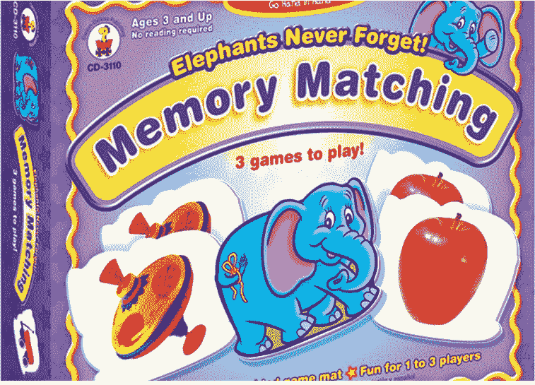

虽然它看起来是一款简单的游戏——实际上确实如此——但从制作这款游戏的过程中可以学到很多东西，而且我们还会添加一些额外功能让它更有趣一些。

## 选择文本编辑器

让我们借助Phaser和其他一些**免费软件**，免费将你的电脑变成Web开发工作站。

要开始用Phaser制作游戏，你首先需要一款编写代码的软件。免费的选择有很多。我在Windows电脑上使用**PSPad** ([http://www.pspad.com/](http://www.pspad.com/))，在Mac上使用**TextWrangler** ([http://www.barebones.com/products/textwrangler/](http://www.barebones.com/products/textwrangler/))。另一个选择是**Brackets** ([http://brackets.io/](http://brackets.io/))，但你可以使用你喜欢的任何文本编辑器，我只建议你选择一款支持JavaScript语法高亮的。

## 选择Web服务器

要测试你的Phaser游戏，以及更普遍地测试大多数Web应用，你需要在电脑上安装Web服务器，以覆盖浏览器在本地运行项目时的安全限制。

我在Windows机器上使用**WAMP** ([http://www.wampserver.com/](http://www.wampserver.com/))，在Mac上使用**MAMP** ([https://www.mamp.info/](https://www.mamp.info/))。最近，MAMP也发布了Windows版本 ([https://www.mamp.info/en/mamp_windows.html](https://www.mamp.info/en/mamp_windows.html))。

和文本编辑器一样，WAMP和MAMP都是免费使用的，因为你不需要PRO版本，尽管MAMP也提供PRO版本。

如果你愿意，如果你有FTP空间，你可以直接在线测试你的项目，通过上传并从Web直接调用它们。在这种情况下，你不需要在电脑上安装Web服务器，但我强烈建议使用WAMP或MAMP。

大多数FTP空间需要付费账户，而且你只能在有网络连接时使用它们。

## 真的要选择Web服务器，而不是合上书

我知道此时大多数人可能会想："得了吧，这只是JavaScript，什么服务器 stuff，我放弃了！"

这也是我第一次不得不安装和配置Web服务器只是为了运行一个JavaScript页面时说的话。

让我解释一下为什么你真的应该选择Web服务器，而不是放弃阅读：浏览器不仅仅是允许你正确显示网页和HTML5游戏。它们还负责你的安全。当你在浏览器中本地加载页面时，如果只是静态HTML网页，你不会遇到问题。

但当你启动更复杂的脚本，从你的硬盘加载和处理资源，比如图像、音频文件和各种数据时，为了防止恶意脚本访问你电脑上的几乎任何文件，浏览器有一系列安全措施来阻止文件被访问——不幸的是，这会导致你的游戏无法运行。

有了Web服务器，浏览器会知道它们运行在一个小而安全的环境中，只有某些文件——也就是你放在给定项目文件夹中的文件——可以被访问，它们会给你的脚本开绿灯，让一切正常工作。

相信我，这是必要的，而且比你想象的容易得多。

## 选择Web浏览器

既然你的游戏将在所有现代浏览器上运行，你也需要一个Web浏览器来运行和测试你的游戏。我使用的是**Google Chrome** ([http://www.google.com/chrome/](http://www.google.com/chrome/))，但你可以自由选择你喜欢的任何浏览器，只要它支持HTML5 `canvas` 元素。在电脑上安装最新版本的浏览器应该就足够了。

请参考你的浏览器支持页面，查看它是否支持 `canvas` 元素。


## 你可能需要的其他软件

游戏基本上就是图像和声音的集合，它们会根据玩家操作和脚本逻辑进行移动和播放，因此在创建游戏的过程中，你需要编辑和创建图像和声音。

**Audacity** ([http://sourceforge.net/projects/audacity/](http://sourceforge.net/projects/audacity/)) 是一款非常棒的免费音频处理软件，而我建议使用 **GIMP** ([http://www.gimp.org/](http://www.gimp.org/)) 来处理图像，它也是免费的。

你也可以使用 **Photoshop** ([http://www.photoshop.com/](http://www.photoshop.com/)) 的试用版，它允许你在限定时间内免费使用所有功能。

## 下载 Phaser

终于，是时候下载 **Phaser** ([http://www.phaser.io/download](http://www.phaser.io/download)) 了，下载完成后你就可以开始使用了。

Phaser 的压缩包中包含大量文档和资源，文件大小超过 30 MB，但我们只需要其中一个文件，即框架本身。

## Phaser 项目的结构

每个 HTML5 游戏都是一个带有魔法的网页，所以我们要做的就是：在本地服务器中创建一个文件夹，并在其中创建一个网页。

别忘了引入 Phaser 框架！

在你刚刚下载的压缩包的 `build` 文件夹中，你会找到 `phaser.js` 文件。这是我们开发游戏时唯一需要的 Phaser 文件。创建一个 `index.html` 文件，这是你用来启动游戏的网页，这样你就拥有了开始编写第一个 Phaser 游戏代码所需的一切。

你的项目文件夹现在应该包含两个文件。

如果你按照所有说明操作，你的文件夹结构将如下所示：

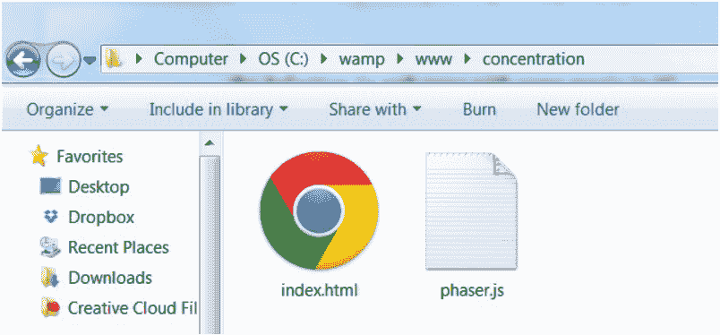

现在让我们编辑 `index.html`：

```html
<!DOCTYPE html>
<html>
    <head>
        <script type="text/javascript" src="phaser.js"></script>
        <script type="text/javascript" src="game.js"></script>
    </head>
    <body>
    </body>
</html>
```

如你所见，这只是一个空网页，只调用了两个 JavaScript 文件：`phaser.js` 是我们刚刚下载的文件，`game.js` 将包含我们的游戏脚本。

现在是在同一个文件夹中创建一个新文件的时候了，将其命名为 `game.js` 并编写以下代码：

```javascript
window.onload = function() {
    var game = new Phaser.Game(500, 500);
}
```

恭喜你，你刚刚创建了你的第一个 Phaser 脚本。

你也可以将这个脚本作为未来项目的起始模板文件。

让我们看看这些代码的含义：

`window.onload` 在文档加载过程结束时触发，在我们的情况下，当 `index.html` 中调用的所有脚本都加载完成时触发。这意味着一切都已准备好执行，因此我们可以运行该函数。

> JavaScript **函数**（function）是为执行特定任务而设计的代码块，当"某物"调用它时执行。当你让某物执行一个函数时，我们说你**调用**（call）了该函数。

函数内部只有一行：

```javascript
var game = new Phaser.Game(500, 500);
```

一切从这里开始。

> 一个函数可以包含任意数量的代码行，我们使用**花括号** { 和 } 来定义函数的开始和结束，或者更一般地说，定义代码块的开始和结束。

`Game` 对象就是游戏本身。括号中的两个数字分别代表游戏的宽度和高度，单位是像素。`Game` 对象被赋值给一个名为 `game` 的变量。

> JavaScript **变量**（variable）是用来存储数据值的容器。当你创建一个变量时，我们说你**声明**（declare）了一个变量，使用 `var` 关键字。你用 = 运算符给变量赋值。

用英文翻译我们所做的，意思是"一旦整个文档加载完成，创建一个宽度和高度均为 500 像素的新 `Game` 对象，并将其赋值给名为 `game` 的变量。"

> JavaScript **对象**（object）是一种特殊的变量，可以包含多个值。

好了，这是我们的第一个 Phaser 游戏，让我们运行它看看会发生什么。

## 运行你的游戏

要在本地服务器上运行游戏，只需将浏览器指向你的游戏文件夹，在大多数情况下将是 http://localhost/phasergame/，如果你在 Google Chrome 浏览器中运行，你应该会看到：

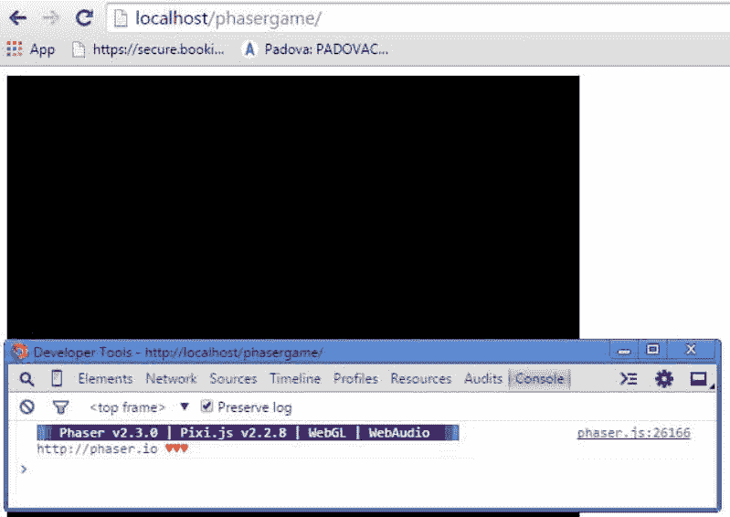

左边的黑色方块实际上就是你的 500x500 像素的游戏。默认情况下，Phaser 在黑色背景上运行。你还可以在控制台窗口中看到正在使用的 Phaser 版本。本书更新到 **2.4.4** 版本。

## 理解 Phaser 状态

虽然管理 Phaser 状态是一项高级功能，但从 Phaser 编程课程一开始就学习如何使用状态非常重要，因为它们将帮助你编写更好的代码并实现更好的资源管理。你将在制作第一个游戏的过程中理解这个重要的功能。

让我们想想一款游戏，一款你最近在玩的游戏。虽然我不知道你在玩什么游戏，但我敢打赌它们至少都有一个标题画面、一个游戏本身画面和一个游戏结束画面。

每个"画面"都可以作为一个 Phaser 状态来开发，它可以在开始前清理内存和资源，让我们能够轻松地在游戏"画面"之间切换。要创建第一个状态，请将以下代码添加到 `game.js` 中：

```javascript
window.onload = function() {
    var game = new Phaser.Game(500, 500);
    var playGame = function(game){}
    playGame.prototype = {
        create: function(){
            console.log("That's my awesome game");
        }
    }
    game.state.add("PlayGame", playGame);
    game.state.start("PlayGame");
}
```

再次启动游戏，这是你在控制台中应该看到的：

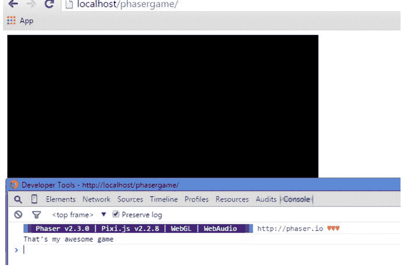

我们做了什么？让我们逐行查看代码：

```javascript
var playGame = function(game){}
```

这里我们将一个函数赋值给名为 `playGame` 的变量。我们还将 `game` 变量传递给该函数。

> 作为参数在函数内部传递的变量称为**参数**（argument）。参数通过放在括号之间传递给函数。函数可以有任意数量的参数，用逗号分隔。

```javascript
playGame.prototype = {
    ...
}
```

我们即将定义前面声明的 `playGame` 变量的原型。

> 每个 JavaScript 对象都有一个**原型**（prototype）。原型本身也是一个对象，所有 JavaScript 对象都从其原型继承属性和方法。

然后我们有另一个函数：

```javascript
create: function(){
    console.log("That's my awesome game");
}
```

在 `playGame` 对象中，我们有一个名为 `create` 的函数。这是 Phaser 使用的保留名称，用于知道状态被调用后要执行哪个函数。

> 对象内的函数称为**方法**（method）。出于同样的原因，当我们提到对象方法时，我们指的是在对象本身内部声明的函数。

在函数内部，我们只是向浏览器控制台输出一些内容。

> `console.log(text)` 将在浏览器控制台中输出 `text` 的内容。并非所有浏览器都支持 `console.log`，但 Google Chrome 支持。

最后我们可以讨论本节的主题，Phaser 状态：

```javascript
game.state.add("PlayGame", playGame);
```

这就是我们向游戏中添加状态的方式。第一个参数——从现在开始如前所述称为参数——是我们给状态命名的名称，第二个是状态启动时调用的函数。

> `state.add(key, state)` 添加一个新状态。你必须在 `key` 参数中为每个状态指定一个唯一的名称来标识它。`state` 通常是一个 JavaScript 对象或函数。

换句话说，我们将 `playGame` 函数绑定到一个名为 `PlayGame` 的状态。

```javascript
game.state.start("PlayGame");
```

最后，这就是启动状态的方式。

> `state.start(key)` 启动之前以 `key` 命名的状态。

此时，`PlayGame` 状态被启动，调用 `playGame` 函数，进而调用 `playGame.create` 函数。

## 使用精灵图创建瓦片图形

我们将创建一个 4 行 5 列的棋盘，总共 20 个瓦片在舞台上。

由于每个瓦片上都有一个符号，而且每个符号在棋盘上出现两次，我们需要绘制 20/2 = 10 张图像来表示 10 种不同的瓦片，再用一张图像表示每个瓦片的背面，总共 11 张图像。

此时，我们可以将这 11 张图像保存在十一个独立的文件中，或者将它们全部组合成一个精灵图。

> **精灵图**（sprite sheet）是将一系列图像组合成的一个较大图像。通常这些图像是一个动画的帧，因此精灵图中的单个图像


### 从零开始打造完整的HTML5跨平台游戏

**称为帧。**

为什么使用精灵图？

基本上，每款游戏都由各种图形对象构成。在太空射击游戏中，你会看到代表飞船、子弹和爆炸的图像，而在我们的记忆翻牌游戏中，则会有不同的牌面图像。图像的主题并不重要，关键在于我们都在使用它们。

每张图像都有宽度和高度，代表构成该图像的像素数量，而每个像素都需要一定的内存来存储其颜色信息。

对于每张图像——更普遍地说，对于存储在任何地方的每个文件——由于文件系统处理文件方式的一系列特性，都会有一定程度的内存被浪费。

解释这个概念超出了本书的范围，但请记住：文件数量越多，浪费的内存量就越大。当你处理十几个文件时，这并非问题；但在包含大量图像的复杂游戏中，将它们打包到更大的图像中可以节省相当多的资源。

此外，仅仅存储图像是不够的。我们还需要将它们放置到屏幕上。

无论你的设备使用何种图形引擎来显示图像，都会有一个过程：它需要知道要绘制哪张图像，从存储位置获取图像，然后知道要绘制图像的哪一部分（通常是整个图像）以及绘制到屏幕的哪个位置，最终将其放置到屏幕上。

一旦第一张图像被放置到屏幕上，这个过程就需要对每张其他图像重复进行，游戏会一直停止直到所有图像都被放置完毕。通常你不会注意到这一点，因为它发生得很快——或者至少应该在1/60秒内完成——但在性能较慢的设备上，大量需要放置到屏幕上的图像会拖慢性能。

使用精灵图，你将把所有——或大部分——图形资源放置到一个大的图像中，位于一个不可见的网格内，以避免“我应该加载哪张图像”的问题，并加速绘制过程。

遵循这个概念，我们将使用一个包含所有牌面图形的单一图像。这是我制作的：

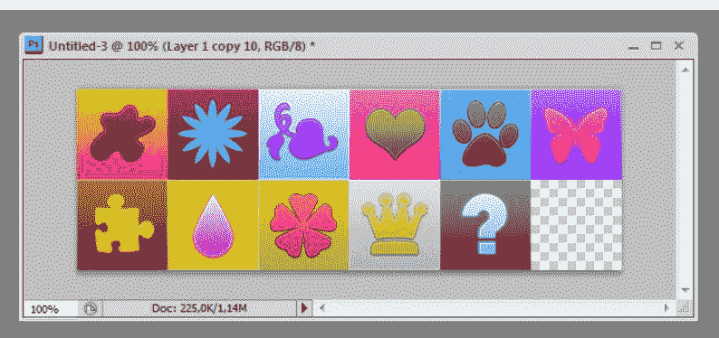

这是一个6x2的网格，每个牌面存储在一个80x80像素的单元格中。

现在，我将图像保存为 `tiles.png`，放在整个项目所在的同一文件夹中。

你的项目文件夹现在应该看起来像这样：

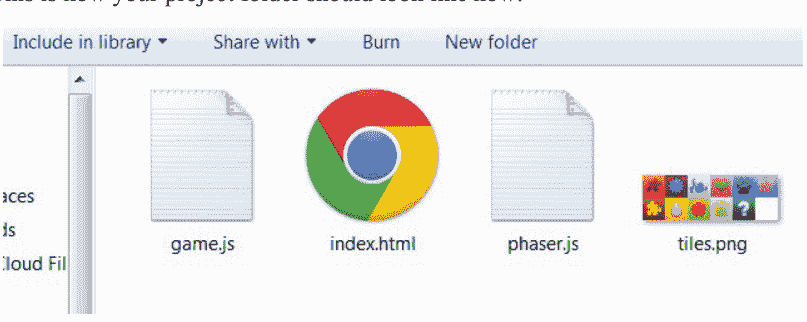

> 始终将图像保存为 **PNG** 格式，因为这种格式具有无损（保存时不会损失质量）和支持Alpha通道（透明度）的优点。

既然我们已经有了包含所有游戏牌面的精灵图，现在是时候构建游戏本身了。

### 预加载图像

在制作游戏时，最糟糕的事情之一之一是在实际加载图形资源之前就尝试处理它们。

这就是为什么我们需要预加载精灵图。让我们在 game.js 中添加几行代码：

```
window.onload = function() {
    var tileSize = 80;
    var game = new Phaser.Game(500, 500);
    var playGame = function(game){}
    playGame.prototype = {
        preload: function(){
            game.load.spritesheet("tiles", "tiles.png", tileSize, tileSize);
        },
        create: function(){
            console.log("That's my awesome game");
        }
    }
    game.state.add("PlayGame", playGame);
    game.state.start("PlayGame");
}
```

现在发生了什么？

我们预加载了刚才创建的精灵图。让我们看看新的代码行：

```
var tileSize = 80;
```

还记得我们创建的精灵图吗？每个牌面都是一个80x80像素的方块。

在制作游戏时，我们将多次引用这个数字，每次需要知道牌面尺寸时。

与其用一系列分散在各处的“80”来填充源代码，不如将这个值存储在一个名为 `tileSize` 的变量中。

从零开始打造完整的HTML5跨平台游戏

这不仅使我们的源代码更具可读性，更重要的是，如果我们决定改变牌面尺寸（比如改为60或100像素），游戏将更容易修改。

不再需要“查找和替换”操作，只需更改一个值即可。

此外，请注意该变量被放置在 `window.onLoad` 函数内部：这样我们就可以从 `window.onLoad` 函数内声明的所有函数中访问它，当然也可以在 `window.onLoad` 函数本身中访问。

> 在JavaScript中，变量只在其函数内部以及该函数内部的函数中被识别。变量在函数开始时创建，在函数完成时删除。脚本中变量被识别的部分称为 **作用域**。

现在，是时候引入另一个Phaser函数了，它要被放置在一个状态（state）中。

```
preload: function(){
    ...
}
```

`preload` 函数，顾名思义，在状态预加载时执行，并且当然会在 `create` 函数之前运行。

既然我们计划在 `create` 函数中启动游戏本身，很明显我们需要在 `preload` 函数中预加载所有素材。

```
game.load.spritesheet("tiles", "tiles.png", tileSize, tileSize);
```

最后，这就是我们加载精灵图的方式。

从现在起，精灵图被存储在游戏专用内存的某个位置，我们可以在需要时随时访问它。

> `load.spritesheet(key, url, frameWidth, frameHeight)` 加载一个精灵图，其参数分别是：精灵图文件的唯一资源键、精灵图文件的URL、每个单帧的宽度和高度。

在我们的示例中，它是这样工作的：

`tiles` 是我们想给这个精灵图起的名字。从现在起，我们将称它为“tiles”。

`tiles.png` 是我们用作精灵图的图像名称。

剩下的两个 `tileSize` 参数分别代表牌面的宽度和高度，单位为像素。

我们制作了一个精灵图图像，并将其加载到我们的Phaser游戏中。现在是时候将其显示在屏幕上了。

### 将图像放置到舞台上

既然精灵图已经预加载，现在以如下方式更改 `create` 函数：

```
create: function(){
    game.add.image(0, 0, "tiles");
}
```

现在，运行游戏，你将会看到：

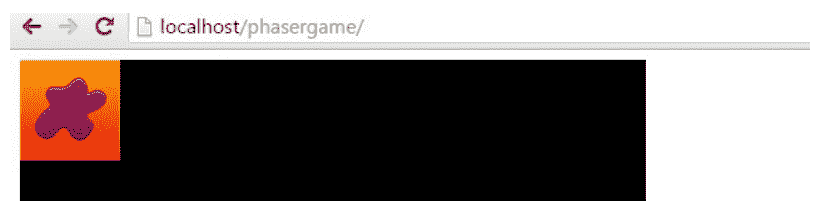

魔法开始了！我们终于在舞台的左上角放置了一张图像。是哪张图像？是我们精灵图中从左到右、从上到下数的第一张图像。

> `add.image(x, y, key)` 将一张图像放置到舞台上，其参数分别是：图像的X坐标（像素）、图像的Y坐标（像素）和所用图像的键。

在我们的情况中，一张图像被放置在坐标 (0, 0)（即左上角），使用 `tiles` 键——你可能还记得，这是我们预加载精灵图图像时分配的键。

### 设置游戏区域

还记得我们要构建一个4行x5列的游戏区域吗？

让我们在棋盘上放置一些牌面。

出于与声明 `tileSize` 变量相同的原因——即一次性分配所有主要游戏设置——我们将创建三个新变量。

```
var tileSize =  80;
var numRows = 4;
var numCols = 5;
var tileSpacing = 10;
var game = new Phaser.Game(500, 500);
```

让我们看看这些新变量的含义：

`numRows` 是要放置的行数。

`numCols` 是要放置的列数。

`tileSpacing` 是两个相邻牌面之间的距离，单位为像素。

我们不希望所有牌面都紧挨在一起放置，这就是为什么我们需要在它们之间留出一些空白空间：虽然它不影响游戏玩法，但会让我们的游戏看起来更好。你会花很多时间让你的游戏看起来更好，所以这绝对是一个值得养成的好习惯。

现在是时候再次更改 `create` 函数，添加一行新代码：

```
create: function(){
    this.placeTiles();
}
```

在这里，你会看到我们也可以定义自己的自定义函数。

实际上，你普通的编程日常将充满创建自定义函数的过程。


这是我们创建的第一个自定义函数：它叫做 `placeTiles`，将用于放置所有的游戏图块。

> 在 JavaScript 中，`this` 始终指向我们正在执行的函数的所有者，或者更准确地说，是指向该函数作为其方法的对象。

因此，我们必须将 `placeTiles` 函数编写为 `playGame` 对象的一个方法。

记住，对象内部的函数被称为方法。

我们的函数声明将放在 `create` 方法之后，就像几分钟前我们将 `create` 放在 `preload` 之后一样。

```
create: function(){
    this.placeTiles();
},
placeTiles: function(){
    // 函数代码放在这里
}
```

这就是我们创建的 `placeTiles` 函数。

它目前还没有做任何事，因为内部没有可执行的代码，只有一个注释。

> 在一行代码中，`//` 之后的所有内容都被视为 **注释**，不会被 JavaScript 执行。使用注释可以保持源代码的可读性。

另外，记住对象内部的方法要用逗号分隔，否则会出错。

最后，我们可以在 `placeTiles` 内部编写代码，将图块添加到舞台上：

```
placeTiles: function(){
    for(var i = 0; i < numCols; i++){
        for(var j = 0; j < numRows; j++){
            game.add.image(i * (tileSize + tileSpacing), j * (tileSize + tileSpacing), "tiles");
        }
    }
}
```

这里有很多新内容，所以我们先从结果开始。

运行游戏，你将看到：

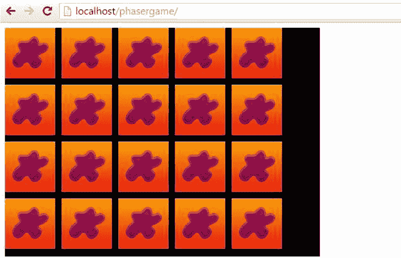

现在我们所有的图块都放置在一个 4 行 x 5 列的网格中。这正是我们想要的。现在让我们看看这是如何实现的，逐行分析 `placeTiles` 的内容：

```
for(var i = 0; i < numCols; i++){
    ...
}
```

这是你第一次遇到循环，具体来说是 `for` 循环。循环可以执行一段代码——记住，是花括号之间的所有内容——执行指定的次数。

`for` 循环在满足指定条件时执行。

如果你想一遍又一遍地运行相同的代码，每次使用不同的值，`for` 循环就非常方便。在这个例子中，变化的值是变量 `i` 的值，范围从零到小于 `numCols` 的最大整数——即舞台的列数——每次循环迭代增加一个值。

我怎么说的呢？让我们分析一下 `for` 循环的语法：

```
for (start action; condition; recurring action) {
    要执行的代码块
}
```

**start action** 仅在循环开始前执行一次，就像它在前面那一行一样。

**condition** 定义了运行循环的条件。只要条件满足，循环就会执行。

**recurring action** 在每次循环执行后执行。

所以在我们的情况下，启动操作是将变量 `i` 设置为零。条件在 `i` 小于 `numCols` 时满足。重复操作是在每次迭代结束时将 `i` 加 1。

在我们刚刚分析的循环内部，还有另一个循环：

```
for(var j = 0; j < numRows; j++){
    ...
}
```

这与前面看到的概念相同，只是它迭代的是行而不是列，并使用变量 `j`。

一旦 `for` 循环解释完毕，我们就可以跳到本步骤的核心，即放置图块的那一行：

```
game.add.image(i * (tileSize + tileSpacing), j * (tileSize + tileSpacing), "tiles");
```

你已经看过如何使用 `add.image` 放置图像，概念没有改变，只是我们根据 `i` 和 `j` 的值将每张图像放置在不同的位置，你应该知道这些值在每次循环迭代时都会改变。

在两个循环结束时，所有的图块都会正确地放置在屏幕上。

不过，有一种更好的方法来放置图块：如果你看看我们是如何放置图块的，你会发现左上角的图块紧挨着舞台的左上角。

这不是一个错误，但棋盘看起来不太好，因为它没有在舞台中居中。

这就是我们现在要做的事情。

### 根据舞台大小调整资源放置

一旦你知道了游戏大小，根据游戏大小放置资源就非常容易。

如果你查看 `game` 声明，你可以看到它的宽度和高度是 500 像素，但让我们假设我们不知道它，或者我们希望拥有通过仅更改其声明来修改游戏大小的自由，而无需进行任何进一步的搜索/替换。Phaser 给我们提供了一些属性来获取 Phaser `Game` 实例的宽度和高度。

> 对象的 **属性** 是与对象内部变量相关联的值。通常属性可以被读取和写入，但有些只能被读取。

所以我们在 `placeTiles` 函数中添加几行代码：

```
placeTiles: function(){
    var leftSpace = (game.width - (numCols * tileSize) - ((numCols - 1) * tileSpacing))/2;
    var topSpace = (game.height - (numRows * tileSize) - ((numRows - 1) * tileSpacing))/2;
    for(var i = 0; i < numCols; i++){
        for(var j = 0; j < numRows; j++){
            game.add.image(leftSpace + i * (tileSize + tileSpacing), topSpace + j * (tileSize + tileSpacing), "tiles");
        }
    }
}
```

让我们看看我们是如何确定 `leftSpace` 的值的，这基本上是用于放置图块的左偏移量：

```
var leftSpace = (game.width - (numCols * tileSize) - ((numCols - 1) * tileSpacing))/2;
```

我们用游戏宽度减去所有图块的长度（numCols * tileSize）和所有图块之间空白区域的长度（(numCols - 1) * tileSpacing），得到游戏宽度与图块实际使用宽度之间的差值。将此差值除以二，我们就可以得到将每个图块向左移动多少像素可以使棋盘在游戏舞台中居中。

> width 和 height 属性返回 Phaser Game 实例的宽度和高度。

同样的概念也适用于垂直偏移。现在启动游戏：

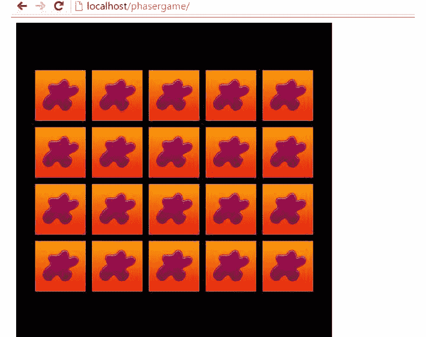

现在我们的图块棋盘在游戏舞台中居中了，这要归功于这两个游戏属性。

不过，图块不应该一开始就被覆盖，即显示问号吗？看起来我们只能显示精灵表的第一帧。

让我们正确地显示图像。

### 显示精灵表中给定的帧

在我们开始输入一些新代码之前，这里是精灵表的工作原理：每张图像由一个数字标识，称为 **索引**，它从 **零** 开始。

所以从左上角的图像开始，从左到右，从上到下，每张图像都有一个索引。

第一张图像的索引是“零”，第二张是“一”，以此类推，第三张是“二”，等等。

如果你查看精灵表，问号是第 11 张图像，这意味着我们必须显示精灵表的第 10 帧。

> 图像对象的 frame 属性允许我们显示我们想要的帧。

只需对 `placeTiles` 函数进行一点小改动：

```
placeTiles: function(){
    var leftSpace = (game.width - (numCols * tileSize) - ((numCols - 1) * tileSpacing))/2;
    var topSpace = (game.height - (numRows * tileSize) - ((numRows - 1) * tileSpacing))/2;
    for(var i = 0; i < numCols; i++){
        for(var j = 0; j < numRows; j++){
            var tile = game.add.image(leftSpace + i * (tileSize + tileSpacing),
                topSpace + j * (tileSize + tileSpacing), "tiles");
            tile.frame = 10;
        }
    }
}
```

我们能够使用 frame 属性将所有图块设置为覆盖状态，但首先我们必须将图像赋值给一个变量，这里叫做 `tile`。

启动游戏，看看会发生什么：

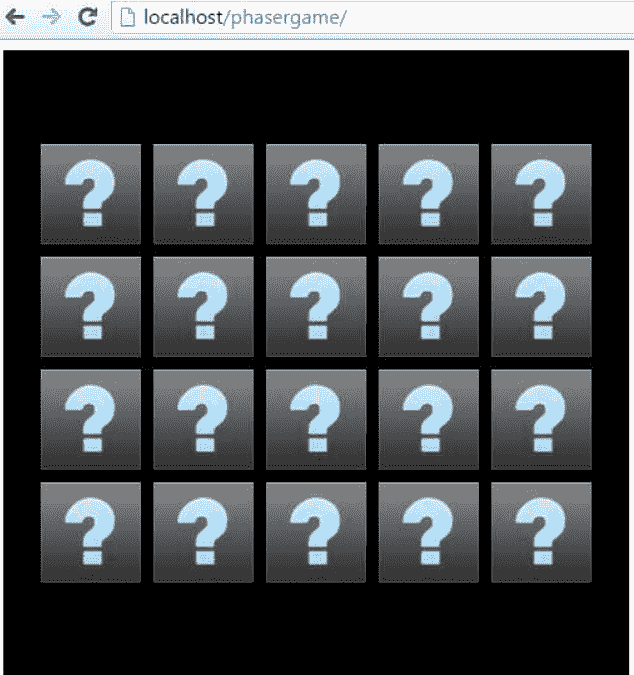

图块现在显示问号，并准备好翻转以显示它们的实际符号。现在是时候让玩家与游戏互动了。

### 通过将图像转变为可点击和可触摸的按钮来添加交互性

如你所知，我们将构建一个跨平台游戏。这意味着它必须在从台式电脑到智能手机和平板电脑的每种设备上正常运行。

不幸的是，不同的设备使用不同的方式让玩家与游戏互动：在我们的例子中，在台式电脑上，玩家将使用鼠标单击图块来选择它，而在智能手机上，图块将通过触摸来选择。

我们必须检查鼠标点击和手指触摸吗？不，因为


#### 从零开始打造全 HTML5 跨平台游戏

Phaser 在内部处理一切事务，让我们可以专注于游戏本身。

要让瓦片具备被点击或触摸的能力，我们需要将它们变成按钮。

是时候再次编辑 `placeTiles` 函数了：

```javascript
placeTiles: function(){
    var leftSpace = (game.width - (numCols * tileSize) - ((numCols - 1) *
    tileSpacing))/2;
    var topSpace = (game.height - (numRows * tileSize) - ((numRows - 1) *
    tileSpacing))/2;
    for(var i = 0; i < numCols; i++){
        for(var j = 0; j < numRows; j++){
            var tile = game.add.button(leftSpace + i * (tileSize +
            tileSpacing), topSpace + j * (tileSize + tileSpacing), "tiles",
            this.showTile, this);
            tile.frame = 10;
        }
    }
}
```

当你使用按钮而不是图片时，Phaser 会自动为其添加交互性。

`add.button(x, y, key, callback, callbackContext)` 使用以 `key` 值存储的图片，在坐标 (x,y) 处添加一个按钮。`callback` 是按钮被按下时要调用的函数。`callbackContext` 是回调函数将被调用时的上下文，通常是 `this`，因为它是对拥有当前执行代码的对象的引用。

查看创建按钮的语法，你会发现我们需要添加一个名为 `showTile` 的函数，而 `this` 的存在表明它是 `playGame` 对象的另一个方法。

```javascript
PlaceTiles: function(){
    ...
},
showTile: function(){
    console.log("show me!");
}
```

目前我们不想让 `showTile` 函数做太多事情，所以只是在控制台显示一条消息。运行游戏，点击任意瓦片，看看会发生什么：

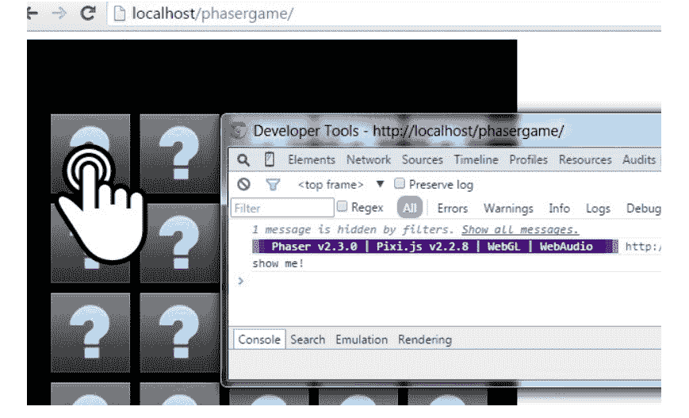

多亏了 Phaser，将图片变成交互元素变得非常容易，但现在一个艰巨的任务在等待着我们：我们必须将按钮变成更复杂的东西。由于每个按钮代表一个瓦片，我们需要存储每个瓦片的值——即翻转时显示的符号——在某个地方。

#### 为每个按钮添加自定义属性，并在被触摸/点击时访问它

在我们继续与瓦片和按钮交互之前，我们需要在某个地方存储所有瓦片的值。最重要的是，为每个瓦片分配一个值，该值将代表其图像。

由于我们有 10 种不同的瓦片类型，每种瓦片类型可以很容易地用一个从 0 到 9 的数字编码。此外，每种类型有两张瓦片，所以所有瓦片的数字表示将是：0, 0, 1, 1, 2 … 8, 8, 9, 9。在哪里存储这些值呢？在数组中。

> **数组（array）** 是一种特殊的变量，它可以在单个变量名下同时保存多个值，你可以通过索引编号来访问这些值。

你将在几分钟内掌握数组，目前让我们创建一个名为 `tilesArray` 的新变量，它将存储所有瓦片信息。最初它将是一个空数组，稍后我们将在代码中填充它。

```javascript
var tileSize = 80;
var numRows = 4;
var numCols = 5;
var tileSpacing = 10;
var tilesArray = [];
var game = new Phaser.Game(500, 500);
```

`tilesArray` 现在将如上所述填充瓦片值。

> **空数组** 用开合方括号 [] 定义。

填充数组并为瓦片分配自定义属性，修改 `placeTiles`：

```javascript
placeTiles: function(){
    var leftSpace = (game.width - (numCols * tileSize) - ((numCols - 1) * tileSpacing))/2;
    var topSpace = (game.height - (numRows * tileSize) - ((numRows - 1) * tileSpacing))/2;
    for(var i = 0; i < numRows * numCols; i++){
        tilesArray.push(Math.floor(i / 2));
    }
    console.log("my tile values: " + tilesArray);
    for(i = 0; i < numCols; i++){
        for(j = 0; j < numRows; j++){
            var tile = game.add.button(leftSpace + i * (tileSize + tileSpacing), topSpace + j * (tileSize + tileSpacing),
                "tiles", this.showTile, this);
            tile.frame = 10;
            tile.value = tilesArray[j * numCols + i];
        }
    }
}
```

如你所见，该函数已用一些新代码进行了修改：开头有一个新的 `for` 循环，遍历列的循环中有一些变化，函数末尾附近有一行新代码。让我们详细检查发生了什么变化：

```javascript
for(var i = 0; i < numRows * numCols; i++){
    tilesArray.push(Math.floor(i / 2));
}
```

这是一个 `for` 循环——你应该已经熟悉它了——它迭代 `numRows * numCols` 次，即瓦片的总数。

**`push` 将新项添加到数组的末尾。**

在每次迭代中，`push` 方法向 `tilesArray` 的末尾添加一个新项，先添加零，然后是零，然后是一，然后再是一，直到一对九。

**`Math.floor` 将数字向下取整到最接近的整数。**

为了了解此时 `tilesArray` 包含什么内容，让我们将其内容输出到浏览器控制台：

```javascript
console.log("my tile values: " + tilesArray);
```

现在，让我们看看下一个循环的开始：

```javascript
for(i = 0; i < numCols; i++){
    ...
}
```

现在是 `i = 0` 而不是 `var i = 0`。为什么？因为你在同一函数内的前一个循环中已经声明了 `i` 变量。你只需要声明一次变量。

```javascript
tile.value = tilesArray[j * numCols + i];
```

最后我们可以给每个瓦片赋予其适当的值。`value` 不是 `tile` 对象的内置属性，它只是我们分配给 `tile` 的自定义变量。换句话说，我们将每个瓦片的值存储在瓦片自身内部的某个地方。某个地方，但具体在哪里？在 `value` 属性中。

> 你可以通过将索引用方括号括起来 **访问数组元素** i。索引为 0 的数组元素——第一个元素——通过 `[0]` 访问。

这样，放置的第一个瓦片将具有等于第一个数组元素的 `value` 属性，即 `tilesArray[0]`，放置的第二个瓦片将具有等于第二个数组元素的 `value` 属性，即 `tilesArray[1]`，依此类推。

准备好试用了吗？让我们这样修改 `showTile` 函数：

```javascript
showTile: function(target){
    console.log("this tile has value = " + target.value);
}
```

被点击/触摸的按钮作为名为 `target` 的参数传递给 `showTile` 函数，然后我们访问其 `value` 属性，这是我们之前设置的。运行游戏并选择一些瓦片，在控制台窗口中查看它们的值：

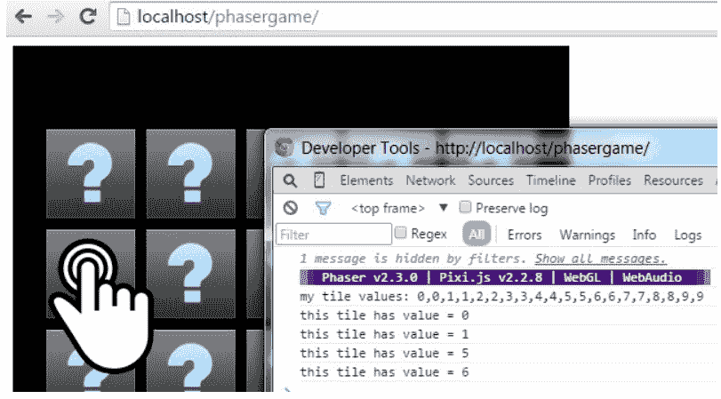

一切似乎都按正确的方式工作，至少在幕后。实际上，玩家不会看到他们选择的瓦片的值。

#### 选中后显示瓦片

为了给玩家提供他们所选瓦片的视觉反馈，我们需要在选中时根据瓦片的值改变其帧。我们知道每个瓦片的值，因为它存储在 `value` 自定义属性中，所以我们只需要在选中时改变其帧。这是我们需要写的唯一一行代码来实现这一点：

```javascript
showTile: function(target){
    target.frame = target.value;
}
```

你还记得 `frame` 属性吗？这就是我们显示实际瓦片内容所需的全部。运行游戏，选择瓦片并查看它们的内容。

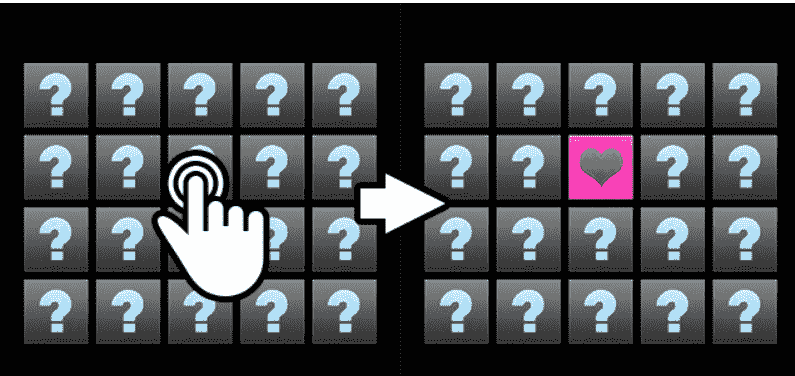

这是游戏制作中的巨大进步，但还不够，因为目前你可以选择任意数量的瓦片，而在原始游戏中，每回合你必须只选择两张瓦片。我们需要一种方法让玩家只选择两张瓦片。

#### 防止玩家每回合选择超过两张瓦片

如前所述，我们不仅要让玩家只选择两张瓦片，还要防止同一张瓦片被选择两次。已选中的瓦片不能再被选中。此外，我们必须将选中的瓦片存储在某个地方，因为在游戏的后续开发中，我们必须检查瓦片符号是否匹配。

首先，让我们创建一个新变量，一个将存储选中瓦片的数组。我们将称它为 `selectedArray`，它将从一个空数组开始：

```javascript
var tileSize = 80;
var numRows = 4;
var numCols = 5;
var tileSpacing = 10;
var tilesArray = [];
var selectedArray = [];
var game = new Phaser.Game(500, 500);
```

现在，我们说过 `selectedArray` 将包含选中的瓦片，所以这意味着当玩家选中瓦片后，我们必须将瓦片添加到其中。但根据游戏规则，在将新瓦片插入数组之前，我们必须检查玩家是否已经选择了两张瓦片，以及当前选中的瓦片是否已被选中。

这听起来可能很复杂，但只需在 `showTile` 函数中添加两行代码即可实现：

```javascript
showTile: function(target){
    if(selectedArray.length < 2 && selectedArray.indexOf(target) == -1){
        target.frame = target.value;
        selectedArray.push(target);
    }
}
```

运行游戏，你会发现你无法选择超过两张不同的瓦片。


#### 检查是否成功匹配并移除或翻回图块

一旦我们选择了两个图块，`selectedArray` 就会有两个元素，接下来我们需要检查它们的值。

如果值匹配，我们将移除这些图块；如果值不匹配，我们将再次覆盖它们。

这意味着需要在 `showTile` 函数中添加更多代码行：

```
showTile: function(target){
    if(selectedArray.length < 2 && selectedArray.indexOf(target) == -1){
        target.frame = target.value;
        selectedArray.push(target);
    }
    if(selectedArray.length == 2){
        if(selectedArray[0].value == selectedArray[1].value){
            selectedArray[0].destroy();
            selectedArray[1].destroy();
        }
        else{
            selectedArray[0].frame = 10;
            selectedArray[1].frame = 10;
        }
        selectedArray.length = 0;
    }
}
```

让我们详细查看新代码：

```
if(selectedArray.length == 2){
    ...
}
```

这就是我们检查 `selectedArray` 是否有两个元素的方式，现在是时候检查图块是否具有相同的值了：

```
if(selectedArray[0].value == selectedArray[1].value){
    ...
}
```

我们访问第一个和第二个 `selectedArray` 元素的 `value` 自定义属性，并检查它们是否相等。

如果它们相等，就是时候从舞台中移除图块了。

> `destroy` 方法会永久销毁按钮，销毁输入事件和动画处理程序（如果存在），并将其对游戏的引用置空，释放它供垃圾回收。

这是移除按钮并再也不用考虑它的最佳方式，所以让我们销毁这两个按钮。

```
selectedArray[0].destroy();
selectedArray[1].destroy();
```

现在，当玩家选择了具有相同符号的图块时，我们就完成了处理。

如果图块具有不同的符号呢？

我们需要使用 `if` 语句的一个扩展，称为 `else`。

> 使用 **else** 语句来指定当 `if` 语句中的条件为 false 时执行的代码块。

它的工作原理如下：

```
if(condition){
    // 当条件为真时执行的代码块
}
else{
    // 当条件为假时执行的代码块
}
```

所以，当条件“选中的图块具有相同的值”为 false 时，会发生以下情况：

```
else{
    selectedArray[0].frame = 10;
    selectedArray[1].frame = 10;
}
```

我们只需将两个图块的 `frame` 属性都改回 10，就能将它们翻回。
最后，无论图块是被移除还是被覆盖回去，我们都需要清空 `selectedArray` 数组，以便让玩家选择新的一组图块。
要清空一个数组，我们将其长度设置为零：

```
selectedArray.length = 0;
```

如果你浏览网络，会发现清空数组的另一种方式，例如通过将它们重新设置为空数组定义，即赋值为 `[]`。

我个人在 JavaScript 中更喜欢将数组长度设置为零，而对此原因的解释超出了本项目的范围。

你可以自由选择你偏好的方式来清空数组，只需确保 `selectedArray` 现在是空的，否则玩家将无法再选择任何图块。

是时候运行游戏，并尝试进行匹配和不匹配的选择了。

现在，匹配的图块将从舞台中移除，而不匹配的图块将被覆盖回去。

一切工作正常，只是你无法看到你选择的第二个图块，是吧？

这是因为一旦你选择了第二个图块，我们就会非常快地执行图块匹配检查并移除/覆盖选中的图块，你甚至看不清发生了什么。

这显然是一个糟糕的游戏设计实践，所以我们将在移除/覆盖它们之前，让选中的图块停留一秒钟。

#### 使用计时器来调度事件

Phaser 允许我们以简单直观的方式创建各种时间驱动事件。

> time.events.add(tick, callback, callbackContext) 添加一个计时器事件，该事件将在 tick 时间过去后，在 callbackContext 上下文中执行 callback 函数。

`Phaser.Timer.SECOND` 是一个 Phaser 保留变量，表示“一秒钟”，`checkTiles` 是我们打算在意识到玩家翻开了两个图块一秒钟后调用的函数名。

现在，对 `this` 的使用应该清晰地提示你如何声明 `checkTiles` 函数。

```
showTile: function(target){
    if(selectedArray.length < 2 && selectedArray.indexOf(target) == -1){
        target.frame = target.value;
        selectedArray.push(target);
        if(selectedArray.length == 2){
            game.time.events.add(Phaser.Timer.SECOND, this.checkTiles, this);
        }
    }
},
checkTiles: function(){
    // 函数代码写在这里
}
```

我们应该在 `checkTiles` 函数中写什么？

正是我们之前用于检查图块匹配并移除/覆盖它们的那段代码。

```
checkTiles: function(){
    if(selectedArray[0].value == selectedArray[1].value){
        selectedArray[0].destroy();
        selectedArray[1].destroy();
    }
    else{
        selectedArray[0].frame = 10;
        selectedArray[1].frame = 10;
    }
    selectedArray.length = 0;
}
```

现在运行游戏，你会看到游戏会等待一秒钟，让两个图块都显示在舞台上，然后再移除或覆盖它们。

现在，最后但同样重要的一点，我们的游戏与真正的记忆游戏（Concentration）之间的区别：我们的图块总是放置在相同、可预测的位置。
我们必须通过洗牌来增加一点游戏趣味性。

#### 洗牌

洗牌背后的基本原理是打乱图块值的数组，即 `tileArray`，该数组将用于为每个图块分配其值。

有很多种洗牌的方法，它们都基于随机数生成，这是一个有着无数理论的分支。

虽然在涉及真实金钱奖励的赌场游戏中，真正的随机性非常重要，但在一个快速益智游戏中，这没有意义，因为基本的随机函数提供了足够的随机性，足以让我们每次玩的时候都获得完全不同的棋盘。

所以，我们将以最基本的方式更改 `placeTiles` 函数，只是随机交换 `tilesArray` 中的两个元素指定次数，而 `numRows` * `numCols` 次交换足以获得一个完全打乱的棋盘。

以这种方式更改 `placeTiles` 函数：

从无到有的 HTML5 跨平台游戏

脚本中有什么变化？首先，我们添加了一些你已经熟悉的东西：

```
selectedArray.push(target);
```

你应该记得 **push** 方法向数组末尾添加一个新项，在本例中是 `selectedArray`。

然后，还有另一行代码引入了一些新概念：

```
if(selectedArray.length < 2 && selectedArray.indexOf(target) == -1){
    ...
}
```

首先，让我向你介绍 `if` 语句。

在编写代码时，你经常希望为不同的决策执行不同的操作，或者仅在某些情况下执行某些操作。

你可以使用代码中的条件语句来实现这一点，而 `if` 是最常见的语句。

如果给定的条件为真，`if` 语句将执行一段 JavaScript 代码。

我们可以用这种形式编写典型的 if 语句：

```
if(condition){
    // 当条件为真时执行的代码块
}
```

所以现在我们知道了 if 语句的工作原理。

现在让我们详细看看这个条件：

```
selectedArray.length < 2 && selectedArray.indexOf(target) == -1
```

我们正在检查 `selectedArray` 的长度。如果它小于二，这意味着我们还没有选择两个图块。

> **length** 属性返回数组中元素的数量。

我们还在检查当前选中的图块是否已经在 `selectedArray` 数组中，这意味着我们已经选择了该图块。

> **indexOf** 方法返回给定元素在数组中的位置。如果没有找到，`indexOf` 返回 **-1**。

在这种情况下，我们检查 `indexOf` 是否等于 **-1**，以确保选中的图块在 `selectedArray` 数组中没有出现。

> **==** 运算符表示 **等于**。

整个 `if` 条件只有在两个条件都为真时才会为真。

> **&&** 是 **与** 逻辑运算符，用于连接两个条件。

用日常语言来说，我们写的是“如果选中的数组元素少于两个，并且我们刚刚选择的图块在数组中不存在，那么将该图块插入数组”。

短短几行代码中包含了很多新概念，但现在玩家将遵守游戏规则，至少在选择图块时是这样。

现在还有另一个规则需要开发，也是最重要的一个，因为它将奖励玩家的记忆力：如果玩家选择了两个具有相同值的图块，它们将从舞台中移除。

否则，我们将覆盖回这些图块。


# 从零开始到完整的HTML5跨平台游戏

```
placeTiles: function(){
    var leftSpace = (game.width - (numCols * tileSize) - ((numCols - 1) *
        tileSpacing))/2;
    var topSpace = (game.height - (numRows * tileSize) - ((numRows - 1) *
        tileSpacing))/2;
    for(var i = 0; i < numRows * numCols; i++){
        tilesArray.push(Math.floor(i / 2));
    }
    for(i = 0; i < numRows * numCols; i++){
        var from = game.rnd.between(0,tilesArray.length-1);
        var to = game.rnd.between(0, tilesArray.length-1);
        var temp = tilesArray[from];
        tilesArray[from] = tilesArray[to];
        tilesArray[to] = temp;
    }
    for(i = 0; i < numCols; i++){
        for(var j = 0; j < numRows; j++){
            var tile = game.add.button(leftSpace + i * (tileSize +
                tileSpacing), topSpace + j * (tileSize + tileSpacing),
                "tiles", this.showTile, this);
            tile.frame = 10;
            tile.value = tilesArray[j * numCols + i];
        }
    }
}
```

现在运行游戏并试玩，然后再玩一次，接着再玩一次，以此类推。你会注意到每次开始游戏时，方块的排列方式都不同。

这就够了，这个过程涉及的代码只是另一个`for`循环，在每次迭代中，使用一个临时变量交换`tilesArray`数组中随机选择的两个元素，因为给定两个值A和B，JavaScript不允许我们直接交换A和B，但我们可以将A的值保存在变量C中。然后将A赋值为B，再将B赋值为C（即保存的A的值）。

我希望你在这个循环中关注的是我如何生成随机数来分配给每个数组索引以进行交换。

> `rnd.between(min, max)` 生成一个从 `min` 到 `max`（包含两端）的随机整数。

而这个最后的特性完成了我们的游戏，一个没人会想玩的好游戏。

尽管游戏运行良好，但你很难相信人们会玩一个没有主题、没有目标、没有任何变化的游戏。

也许在1970年代，玩家会喜欢你的游戏，但今天他们不会。

我们要把整个游戏扔进垃圾桶吗？

不，我们仍然可以从中做出一些有趣的东西，只需添加几个功能并对游戏进行一些优化。

### 将原型转变为真实游戏：添加带有声音/静音选项的标题屏幕

将原型转变为真实游戏时，我们需要考虑的第一件事是标题屏幕，这意味着给游戏起个名字，创造一个与标题相关的视觉外观，以及在标题屏幕上放置几个漂亮的声音/静音按钮。

由于我们即将创建一个可以在任何地方的手机和移动设备上运行的跨平台游戏，而且它是一款快速的休闲游戏，你可以预料到它会在办公室或学校里被玩到。

因此，从一个静音的标题屏幕开始非常重要，这样玩家可以清楚地选择是否播放声音。

所以我们首先需要创建一个名为`playSound`的新变量。这里我们将存储玩家的决定。

```
var tileSize = 80;
var numRows = 4;
var numCols = 5;
var tileSpacing = 10;
var tilesArray = [];
var selectedArray = [];
var playSound;
var game = new Phaser.Game(500, 500);
```

还记得在游戏刚开始创建时，我介绍了游戏状态吗？目前我们只有一个状态，但现在是时候添加更多状态，并在仅几行代码中为我们的游戏增加复杂性了。

如果你没有学会如何管理状态，这本来会困难得多。

我们将添加一个名为`TitleScreen`的新状态，它指向`titleScreen`对象，并启动游戏时启动它而不是`PlayGame`。

```
game.state.add("TitleScreen", titleScreen);
game.state.add("PlayGame", playGame);
game.state.start("TitleScreen");
```

现在，就像我们在本次旅程开始时创建带有所有`preload`和`create`方法的`playGame`对象一样，我们现在对`titleScreen`做同样的事情。你在这里看到的大部分概念都已经解释过了。

```
var titleScreen = function(game){}
titleScreen.prototype = {
    preload: function(){
        game.load.spritesheet("soundicons", "soundicons.png", 80, 80);
    },
    create: function(){
        var style = {
            font: "48px Monospace",
            fill: "#00ff00",
            align: "center"
        };
        var text = game.add.text(game.width / 2, game.height / 2 - 100,
        "Crack Alien Code", style);
        text.anchor.set(0.5);
        var soundButton = game.add.button(game.width / 2 - 100 ,
        game.height / 2 +     100, "soundicons", this.startGame, this);
        soundButton.anchor.set(0.5);
        soundButton = game.add.button(game.width / 2 + 100 , game.height /
        2 + 100, "soundicons", this.startGame, this);
        soundButton.frame = 1;
        soundButton.anchor.set(0.5);
    },
    startGame: function(target){
        if(target.frame == 0){
            playSound = true;
        }
        else{
            playSound = false;
        }
        game.state.start("PlayGame");
    }
}
```

如你所见，代码很多，但你已经知道其中使用的大部分概念了。

让我强调一下最有趣的部分：

```
preload: function(){
    game.load.spritesheet("soundicons", "soundicons.png", 80, 80);
}
```

我创建了另一个包含两张80x80像素图像的精灵表，一张代表“声音开启”按钮，另一张代表“声音关闭”。然后我预加载了它。

然后在`create`函数中将声音按钮添加到舞台：

```
var soundButton = game.add.button(game.width / 2 - 100 , game.height / 2 + 100,
"soundicons", this.startGame, this);
soundButton.anchor.set(0.5);
soundButton = game.add.button(game.width / 2 + 100 , game.height / 2 + 100,
"soundicons", this.startGame, this);
soundButton.frame = 1;
soundButton.anchor.set(0.5);
```

这是用于创建按钮的标准代码。只需看看回调函数——`startGame`——以及一个名为锚点的新概念。

**锚点**设置了纹理的原点。默认是`0,0`，这意味着纹理的原点在左上角。将锚点设置为`0.5,0.5`意味着纹理的原点居中。将锚点设置为`1,1`意味着纹理的原点将位于右下角。两个相等的值可以只写一次。`anchor.set(0.5,0.5)`可以写成`anchor.set(0.5)`。

在这种情况下，我们希望按钮的锚点位于其水平和垂直中心。只需记住图像的宽度和高度应该是偶数，否则最终结果看起来会有点模糊。

现在，让我们用一些文本来给游戏起个名字：“破解外星人密码”，这比“记忆”更吸引人。

```
var style = {
    font: "48px Monospace",
    fill: "#00ff00",
    align: "center"
}
```

首先，让我们决定文本的外观：一个名为`style`的对象，包含`font`、`fill`和`align`属性。一旦定义了样式，就可以在屏幕上写文本了：

```
var text = game.add.text(game.width / 2, game.height / 2 - 100, "Crack Alien Code", style);
```

添加文本与添加图像或按钮没有太大区别。

> add.text(x, y, text, style) 在x,y位置添加文本，使用style样式书写文本字符串

启动游戏，看看全新的游戏标题屏幕：

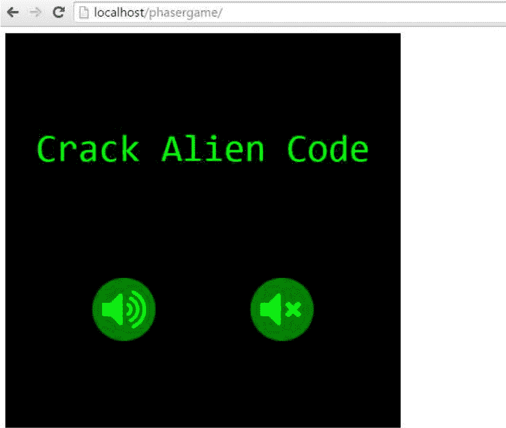

游戏名称和两个大按钮用于选择声音偏好。这开始看起来像一个真正的游戏了。

你还记得那两个调用`startGame`函数的按钮吗？就是它：

```
startGame: function(target){
    if(target.frame == 0){
        playSound = true;
    }
    else{
        playSound = false;
    }
    game.state.start("PlayGame");
}
```

第一帧——记住，帧零——代表“声音开启”图标，而第二帧——帧一——代表静音按钮。通过检查所选按钮的帧，我们可以将`playSound`设置为`true`或`false`。

> 一个只能有`true`或`false`值的变量称为**布尔变量**。

玩家按下声音按钮后要做的最后一件事是启动游戏：

```
game.state.start("PlayGame");
```

就是这样，使用状态，仅一行代码。哦，我还更改了方块的符号：

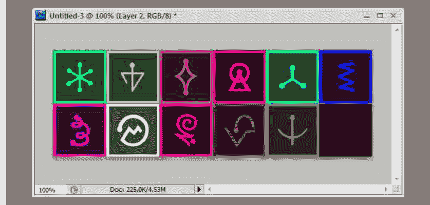


现在它们看起来不再像“我的第一幅 Photoshop 作品”，而更像是外星人符文。在制作游戏的过程中，你会发现自己需要反复修改图形，尤其是在将原型转变为可玩游戏时，所以我在书中这么做并不奇怪，这是游戏创作过程的一部分。

### 预加载音效

当玩家选择开启音效时，意味着游戏应该包含音效。Crack Alien Code 将包含三种音效：每次选择方块时播放一种，玩家成功匹配时播放一种，以及玩家匹配失败时播放一种。我在游戏文件夹中添加了三种新音效，采用两种不同的格式：**mp3** 和 **ogg**，现在文件夹看起来是这样的：

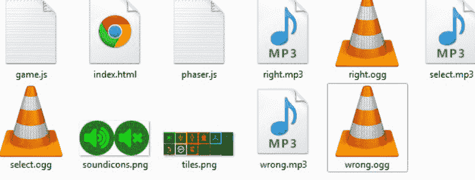

为什么我要使用两种音频格式？这是出于兼容性考虑：并非所有浏览器都能播放所有类型的音频文件。同时使用 mp3 和 ogg 应该能提供最佳的设备和浏览器覆盖率。预加载音效与预加载图片没有什么不同，正如你在 playGame 对象的 preload 函数中所见：

```
preload: function(){
    game.load.spritesheet("tiles", "tiles.png", tileSize, tileSize);
    game.load.audio("select", ["select.mp3", "select.ogg"]);
    game.load.audio("right", ["right.mp3", "right.ogg"]);
    game.load.audio("wrong", ["wrong.mp3", "wrong.ogg"]);
}
```

Phaser 会根据浏览器的支持能力选择播放哪种音频格式。

> load.audio(key, audioFiles) 用于处理音效预加载。第一个参数是键名，第二个参数是要加载的文件数组，包含不同格式的文件。

音效已经准备好可以被播放了，现在来看看我们怎样才能播放它们。

### 播放音效

思路是将所有音效存储在数组中，然后根据游戏中的情况播放对应的声音。

我们在 playGame 对象中添加一个名为 soundArray 的属性。它被定义为空数组，并且只在 playGame 对象内部可见。我们这样声明：

```
playGame.prototype = {
    soundArray: [],
    preload: function(){
        game.load.spritesheet("tiles", "tiles.png", tileSize, tileSize);
        game.load.audio("select", ["select.mp3", "select.ogg"]);
        game.load.audio("right", ["right.mp3", "right.ogg"]);
        game.load.audio("wrong", ["wrong.mp3", "wrong.ogg"]);
    },
    ...
}
```

在同一个 playGame 对象中，在 create 方法内部，一旦我们调用了 placeTiles，并且如果玩家选择了开启音效的选项（即 playSound 设置为 true），我们就添加音频。

对 create 方法做一个小的改动：

# From null to full HTML5 cross-platform game

```
create: function(){
    this.placeTiles();
    if(playSound){
        this.soundArray[0] = game.add.audio("select", 1);
        this.soundArray[1] = game.add.audio("right", 1);
        this.soundArray[2] = game.add.audio("wrong", 1);
    }
}
```

向数组中插入元素时我们之前一直使用 push 方法，但你也可以通过为给定索引赋值的方式逐个声明元素，就像我在这些最新几行代码中所做的那样。

> add.audio(key, volume) 向声音管理器添加一个新的音频文件。key 是我们给音效起的名字，而 volume 是播放音量。它的取值范围是 0 到 1。

现在音效已经预加载完毕并准备好播放了，是时候在 showTile 方法中插入我们的第一个音效了。这将在方块被展示时播放：

```
showTile: function(target){
    if(selectedArray.length < 2 && selectedArray.indexOf(target) == -1){
        if(playSound){
            this.soundArray[0].play();
        }
        target.frame = target.value;
        selectedArray.push(target);
        if(selectedArray.length == 2){
            game.time.events.add(Phaser.Timer.SECOND, this.checkTiles, this);
        }
    }
}
```

显然，在播放任何音效之前，我们必须检查 playSound 是否为 true。

> play() 方法用于播放声音。

运行游戏，点击方块，你应该能听到音效。同样地，在 checkTiles 方法中添加音效也很容易，一个用于玩家成功匹配时播放，另一个用于匹配失败时播放。

# From null to full HTML5 cross-platform game

```
checkTiles: function(){
    if(selectedArray[0].value == selectedArray[1].value){
        if(playSound){
            this.soundArray[1].play();
        }
        selectedArray[0].destroy();
        selectedArray[1].destroy();
    }
    else{
        if(playSound){
            this.soundArray[2].play();
        }
        selectedArray[0].frame = 10;
        selectedArray[1].frame = 10;
    }
    selectedArray.length = 0;
}
```

音效为游戏增添了更深层的体验，但还缺少一个关键功能，也就是我们所有人玩游戏的目的：得分。

#### 显示分数

为了跟踪分数，我相信你现在觉得这很明显了，我们需要将其存储在变量中。让我们创建一个名为 `score` 的变量。

```
var tileSize = 80;
var numRows = 4;
var numCols = 5;
var tileSpacing = 10;
var tilesArray = [];
var selectedArray = [];
var playSound;
var score;
var game = new Phaser.Game(500, 500);
```

在 `playGame` 对象内部，我们还需要另一个变量来在舞台上以可视化方式显示分数。再来一个文本怎么样？这就是为什么我要创建一个名为 `scoreText` 的 `playGame` 属性，它被声明为 `null`。

> 在 JavaScript 中，`null` 表示“无”，或一个空值。

拥有 `null` 变量并不意味着我们不能在需要时给它赋值。

```
playGame.prototype = {
    scoreText: null,
    soundArray: [],
    preload: function(){
        ...
    }
    ...
}
```

一旦 `create` 方法被执行，就意味着新游戏开始了，所以我们将 `score` 设置为零。此外，你应该能看出剩余几行的作用：

```
create: function(){
    score = 0;
    this.placeTiles();
    if(playSound){
        this.soundArray[0] = game.add.audio("select", 1);
        this.soundArray[1] = game.add.audio("right", 1);
        this.soundArray[2] = game.add.audio("wrong", 1);
    }
    var style = {
        font: "32px Monospace",
        fill: "#00ff00",
        align: "center"
    }
    this.scoreText = game.add.text(5, 5, "Score: " + score, style);
}
```

我们使用之前定义的 `scoreText` 属性添加了一个新的文本。你应该已经知道如何添加和设置文本样式了。首先，我们定义了文本样式，然后创建了文本本身并应用了该样式。还要注意，我们可以在文本内容中写任何我们想要的东西。当我们创建标题画面时，我们只写了字符串 "Crack Alien Code"，但现在我们还写了 `score` 变量的内容。此外，文本字符串不是静态的，我们可以随时更改它们的内容，文本对象的 `text` 属性将改变显示的字符串。想实时显示分数吗？看看 `checkTiles` 函数：

```
checkTiles: function(){
    if(selectedArray[0].value == selectedArray[1].value){
        if(playSound){
            this.soundArray[1].play();
        }
        score ++;
        this.scoreText.text = "Score: " + score;
        selectedArray[0].destroy();
        selectedArray[1].destroy();
    }
    else{
        if(playSound){
            this.soundArray[2].play();
        }
        selectedArray[0].frame = 10;
        selectedArray[1].frame = 10;
    }
    selectedArray.length = 0;
}
```

一旦玩家成功匹配，`score` 就会增加，然后我们可以通过设置其 `text` 属性来更新文本。运行游戏，看看你的分数如何在每次成功匹配时增加。

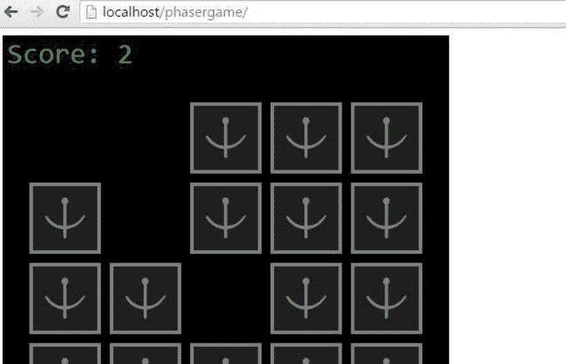

在屏幕上显示分数并不能使游戏完整。还有更多我们可以做的。

#### 通过添加计时器增加难度

如果你有时间限制来完成游戏会怎样？让我们通过只给你一分钟时间来解决游戏，以此增加难度。

`timeLeft` 变量将跟踪我们所剩的剩余时间。

```
var tileSize = 80;
var numRows = 4;
var numCols = 5;
var tileSpacing = 10;
var tilesArray = [];
var selectedArray = [];
var playSound;
var score;
var timeLeft;
var game = new Phaser.Game(500, 500);
```

现在我们必须防止玩家作弊。如果你将焦点从页面上移开，游戏将会暂停。这意味着计时器不会减少，而这是作弊。我们将通过将 `stage.disableVisibilityChange` 属性设置为 `true` 来防止这种情况。让我们在标题画面中添加它。

```
create: function(){
    game.stage.disableVisibilityChange = true;
    var style = {
        font: "48px Monospace",
        fill: "#00ff00",
        align: "center"
    };
    var soundButton = game.add.button(game.width / 2 - 100 , game.height / 2 + 100, "soundicons", this.startGame, this);
    soundButton.anchor.set(0.5);
    soundButton = game.add.button(game.width / 2 + 100 , game.height / 2 + 100, "soundicons", this.startGame, this);
    soundButton.frame = 1;
    soundButton.anchor.set(0.5);
    var text = game.add.text(game.width / 2, game.height / 2 - 100, "Crack Alien Code", style);
    text.anchor.set(0.5);
}
```

现在我们以与添加 `scoreText` 变量相同的方式来显示分数文本


当我们初始化游戏时，我们将时间限制设置为 60，这意味着你必须在一分钟内完成游戏。

无需向你解释如何创建显示剩余时间的文本：

```javascript
create: function(){
    score = 0;
    timeLeft = 60;
    this.placeTiles();
    if(playSound){
        this.soundArray[0] = game.add.audio("select", 1);
        this.soundArray[1] = game.add.audio("right", 1);
        this.soundArray[2] = game.add.audio("wrong", 1);
    }
    var style = {
        font: "32px Monospace",
        fill: "#00ff00",
        align: "center"
    }
    this.scoreText = game.add.text(5, 5, "Score: " + score, style);
    this.timeText = game.add.text(5, game.height - 5, "Time left: " + timeLeft, style);
    this.timeText.anchor.set(0, 1);
    game.time.events.loop(Phaser.Timer.SECOND, this.decreaseTime, this);
}
```

无论如何，有几行代码我想详细展示给你：

```javascript
this.timeText.anchor.set(0, 1);
```

这次 `anchor.set(0, 1)` 意味着锚点位于**左下角**。

我想让你看的第二行是处理计时器的那一行。

```javascript
game.time.events.loop(Phaser.Timer.SECOND, this.decreaseTime, this);
```

这次我们处理的不是只运行一次的计时器，而是一个循环。

> `time.events.loop(delay, callback, callbackContext)` 添加一个循环事件，该事件将永远重复，直到被停止。它会在 `callbackContext` 上下文中调用 `callback` 函数。

让我们来看看名为 `decreaseTime` 的回调函数：

```javascript
decreaseTime: function(){
    timeLeft --;
    this.timeText.text = "Time left: " + timeLeft;
}
```

它减少计时器，然后更新显示剩余时间的文本。运行游戏：

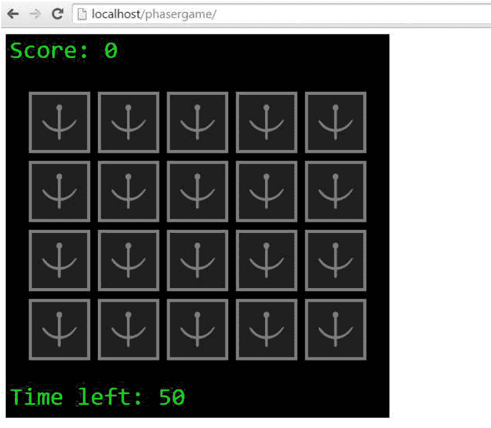

有一个计时器很好，但如果时间耗尽后什么也没发生，那就相当没用了。

#### 时间耗尽时显示游戏结束画面

当玩家时间耗尽时，我们需要停止游戏并显示一个游戏结束画面。我们如何制作游戏结束画面？

没错，用另一个状态。

```javascript
game.state.add("TitleScreen", titleScreen);
game.state.add("PlayGame", playGame);
game.state.add("GameOver", gameOver);
game.state.start("TitleScreen");
```

一旦状态被添加到游戏中，我们将在计时器到达零时调用它。看看 `decreaseTime` 方法：

```javascript
decreaseTime: function(){
    timeLeft --;
    this.timeText.text = "Time left: " + timeLeft;
    if(timeLeft == 0){
        game.state.start("GameOver");
    }
}
```

现在只需构建新状态，包括 "Game Over" 文本、分数和点击重新开始的提示。下面的代码中没有什么新内容。

```javascript
var gameOver = function(game){}
gameOver.prototype = {
    create: function(){
        var style = {
            font: "32px Monospace",
            fill: "#00ff00",
            align: "center"
        }
        var text = game.add.text(game.width / 2, game.height / 2, "Game Over\n\nYour score: " + score + "\n\nTap to restart", style);
        text.anchor.set(0.5);
    }
}
```

玩游戏，一分钟后你应该会看到类似这样的画面：

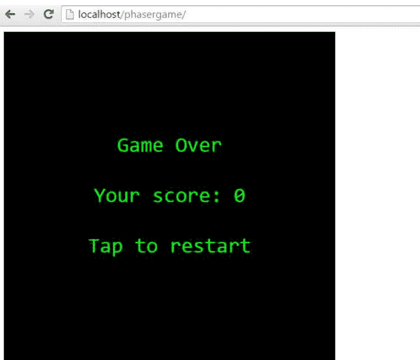

好的，现在点击重新开始。你无法做到。我们还得再写几行代码。

#### 重新开始游戏

到目前为止，我们学习了如何检测按钮上的点击/触摸，但这次舞台上没有按钮。

我们需要触发一个通用的点击/触摸。

就像 Phaser 处理按钮上的通用输入一样，它也处理通用输入事件。

看看这些新的改动：

## 从零到完整的 HTML5 跨平台游戏

```javascript
gameOver.prototype = {
    create: function(){
        var style = {
            font: "32px Monospace",
            fill: "#00ff00",
            align: "center"
        }
        var text = game.add.text(game.width / 2, game.height / 2, "Game Over\n\nYour score: " + score + "\n\nTap to restart", style);
        text.anchor.set(0.5);
        game.input.onDown.add(this.restartGame, this);
    },
    restartGame: function(){
        tilesArray.length = 0;
        selectedArray.length = 0;
        game.state.start("TitleScreen");
    }
}
```

除了 `restartGame` 函数（它只是在清空数组后通过调用 `TitleScreen` 状态来重新开始游戏）之外，我想让你关注这一行：

```javascript
game.input.onDown.add(this.restartGame, this);
```

无论你在屏幕的哪里点击或触摸，`restartGame` 方法都会被调用。

> `input.onDown(callback, callbackContext)` 每次按下指针时触发。它在 `callbackContext` 上下文中运行 `callback` 函数。

最后，游戏完成了。不过，如果你在时间耗尽前移除了所有方块会发生什么？你会发现自己看着一个黑屏，而计时器仍在滴答作响，你却什么都做不了。

这就是我们要添加另一个功能的原因。这是这个游戏的最后一个功能。

### 给游戏增加转折

当所有方块都被移除但还有剩余时间时，我们必须给玩家一些事做。

听听这个想法：如果你在时间耗尽前移除了所有方块，另一组方块会放置在屏幕上，这样你就可以通过进行更多匹配来提高分数。

为了奖励你成功匹配，每次匹配你将获得**两秒额外时间**。

这听起来复杂吗？

你还没意识到使用 Phaser 时没有什么复杂的吗？

让我们创建一个新变量，它会告知我们棋盘上还有多少方块剩余。

我们将其命名为 `tilesLeft`。

```javascript
var tileSize = 80;
var numRows = 4number of rows?
var numCols = 5;
var tileSpacing = 10;
var tilesArray = [];
var selectedArray = [];
var playSound;
var score;
var timeLeft;
var tilesLeft;
var game = new Phaser.Game(500, 500);
```

当方块显示在屏幕上时，`tilesLeft` 被设置为游戏中方块的完整数量，即 `numRows * numCols`。

```javascript
placeTiles: function(){
    tilesLeft = numRows * numCols;
    ...
}
```

剩余的代码都要放在 `checkTiles` 方法中。

当玩家成功匹配时，我们将 `timeLeft` 增加 2，实际上是给游戏增加两秒钟，并更新 `timeText` 文本。

同时，我们将剩余方块数量减少两个。

一旦桌面上没有方块剩余，我们清空数组并调用 `placeTiles` 函数再放置另一组方块。这将允许玩家继续游戏。

```javascript
checkTiles: function(){
    if(selectedArray[0].value == selectedArray[1].value){
        if(playSound){
            this.soundArray[1].play();
        }
        score ++;
        timeLeft +=2;
        this.timeText.text = "Time left: " + timeLeft;
        this.scoreText.text = "Score: " + score;
        selectedArray[0].destroy();
        selectedArray[1].destroy();
        tilesLeft -= 2;
        if(tilesLeft == 0){
            tilesArray.length = 0;
            selectedArray.length = 0;
            this.placeTiles();
        }
    }
    else{
        if(playSound){
            this.soundArray[2].play();
        }
        selectedArray[0].frame = 10;
        selectedArray[1].frame = 10;
    }
    selectedArray.length = 0;
}
```

这段代码中没有新内容，只有你在本书中已经学过的概念。

我只想评论这些会让棋盘在玩家移除所有方块时重新填满的代码：

```javascript
if(tilesLeft == 0){
    tilesArray.length = 0;
    selectedArray.length = 0;
    this.placeTiles();
}
```

我们检查 `tilesLeft` 是否为零，如果是，我们清空 `tilesArray` 数组和 `selectedArray` 数组，然后调用 `placeTiles` 方法将所有方块重新放置在棋盘上。

运行游戏并尝试在时间耗尽前清空棋盘，你会看到游戏重新开始。你能清空两次棋盘吗？


## 从零开始的HTML5跨平台游戏

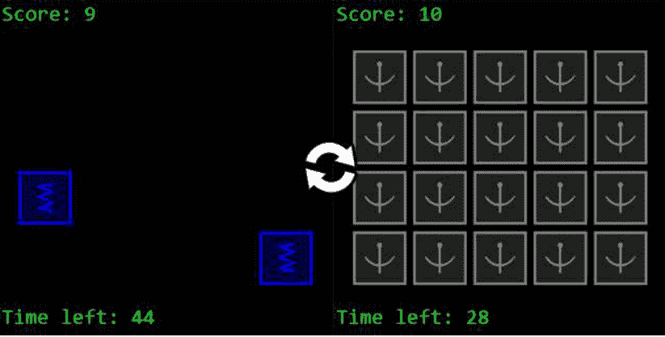

顺便问一下，你试过在移动设备上玩这个游戏吗？

这是我在iPhone 5上看到的游戏画面：

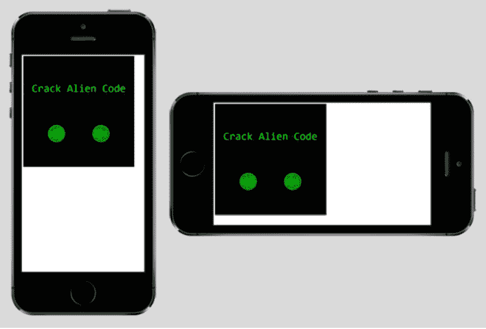

实际上这不是玩游戏的最佳方式。这里完全没有体现"跨平台"。

### 让游戏在任何移动设备上都能良好运行，无论设备方向如何

我们将分两步让游戏在任何设备上都看起来不错：首先，我们必须将游戏缩放以覆盖尽可能大的区域，然后我们将使承载游戏的HTML页面对移动设备更友好。

关于缩放游戏，请修改`TitleScreen`状态中的`create`方法：

```
create: function(){
    game.scale.pageAlignHorizontally = true;
    game.scale.pageAlignVertically = true;
    game.scale.scaleMode = Phaser.ScaleManager.SHOW_ALL;
    game.stage.disableVisibilityChange = true;
    var style = {
        font: "48px Monospace",
        fill: "#00ff00",
        align: "center"
    };
    ...
}
```

让我们逐一检查新添加的代码行：

```
game.scale.pageAlignHorizontally = true;
```

将`pageAlignHorizontally`设置为`true`会使游戏在父容器或窗口中水平居中对齐。

```
game.scale.pageAlignVertically = true;
```

同理，用于垂直对齐。

```
game.scale.scaleMode = Phaser.ScaleManager.SHOW_ALL;
```

`scaleMode`设置缩放方法，此处使用`SHOW_ALL`，我们以尽可能大的缩放比例显示游戏，同时保持原始宽高比。

最后一步是编辑`index.html`文件，添加一些专门为移动设备创建的meta标签。新的头部内容如下：

```
<head>
    <script type="text/javascript" src="phaser.js"></script>
    <script type="text/javascript" src="game.js"></script>
    <meta name="viewport" content="width=device-width, initial-scale=1.0,
        maximum-scale=1.0, minimum-scale=1.0, user-scalable=no, minimal-ui" />
    <meta name="apple-mobile-web-app-capable" content="yes" />
    <meta name="apple-mobile-web-app-status-bar-style" content="black" />
    <meta name="HandheldFriendly" content="true" />
    <meta name="mobile-web-app-capable" content="yes" />
    <style type="text/css">
        body{
            padding:0px;
            margin:0px;
            background: #000;
        }
    </style>
</head>
```

这些行无需解释，因为它们是设备制造商建议使用的标准标签。

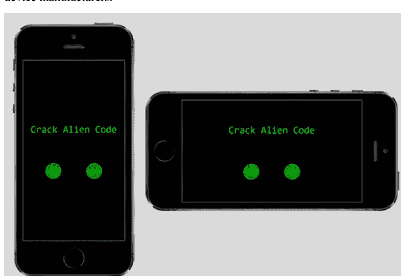

现在你终于完成了这个项目。

### 保存高分

玩游戏时，你会很快意识到，如果无法保存分数并在以后尝试打破它，那么获得高分就没有意义。

我们将介绍如何保存你的最高分，并确保即使关闭浏览器窗口或关闭电脑/设备，分数也能被保存。

所有现代浏览器都原生支持**本地存储**，这是网页以键/值对格式在本地存储数据的一种方式。

你保存的信息即使在关闭设备后也会继续存储，并且每次启动游戏时都可以读取。这正是我们需要的。

让我们创建两个新变量：

```
var tileSize = 80;
var numRows = 4;
var numCols = 5;
var tileSpacing = 10;
var localStorageName = "crackalien";
var highScore;
var tilesArray = [];
var selectedArray = [];
var playSound;
var score;
var timeLeft;
var tilesLeft;
var game = new Phaser.Game(500, 500);
```

`localStorageName`变量存储本地存储变量的名称，所以每次你将`crackalien`更改为其他内容时，你将重置你的最高分。

`highScore`将包含实际的最高分数值。

当我们启动游戏时，在进入标题屏幕之前，我们将检查本地存储，看看是否已经保存了最高分，因此我们将在启动`TitleScreen`状态之前添加一行代码。

这行代码将引入许多新概念：

```
game.state.add("TitleScreen", titleScreen);
game.state.add("PlayGame", playGame);
game.state.add("GameOver", gameOver);
highScore = localStorage.getItem(localStorageName) == null ? 0 : localStorage.getItem(localStorageName);
game.state.start("TitleScreen");
```

看起来很奇怪吗？

这是一个条件运算符，也称为三元运算符，因为它需要三个操作数。

> **条件运算符**，写作 `condition ? expr1 : expr2`，如果`condition`为真，则返回`expr1`的值；如果`condition`为假，则返回`expr2`的值。可以将其视为一个简短的`if`语句，如 `if (condition) then expr1 else expr2`。

将条件运算符写成`if`语句，它看起来会像这样：

```
if(localStorage.getItem(localStorageName) == null){
    highScore = 0;
}
else{
    highScore = localStorage.getItem(localStorageName);
}
```

`localStorage`的`getItem`方法检索`localStorageName`的数据。如果它为`null`，意味着我们从未保存过最高分。

> `localStorage.getItem(keyName)` 返回`keyName`的值。

可能这是我们第一次在这个浏览器中启动游戏，或者我们从未玩到游戏结束屏幕（在那里我们将保存分数），或者我们刚刚更改了`localStorageName`的名称。

在这种情况下，`highScore`被设置为零。

如果本地存储数据中存在一个值，这意味着我们之前保存了最高分，所以我们设置`highScore`为这个值。

这就是我们检索之前保存的最高分（如果有的话）的方法。

要保存它，我们需要在`GameOver`状态的`create`方法中添加几行代码：

```
create: function(){
    highScore = Math.max(score, highScore);
    localStorage.setItem(localStorageName, highScore);
    var style = {
        font: "32px Monospace",
        fill: "#00ff00",
        align: "center"
    }
    var text = game.add.text(game.width / 2, game.height / 2, "Game Over\n\nYour score: " + score + "\nBest score: " + highScore + "\n\nTap to restart",
        style);
    text.anchor.set(0.5);
    game.input.onDown.add(this.restartGame, this);
}
```

现在启动游戏并玩几次，然后关闭浏览器窗口甚至重启你的电脑/设备。

你的最高分将始终被保存：

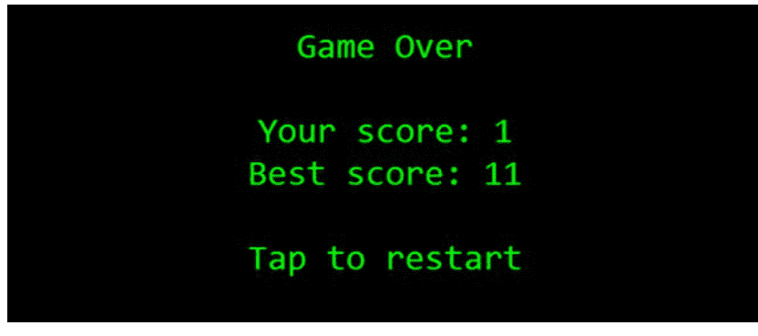

让我们看看这是如何实现的。

首先要做的事情是查看当前分数是否高于`highScore`的值，如果是，则将`highScore`变量更新为`score`的值。

我们不使用`if`语句，而是通过始终将`highScore`设置为`score`和`highScore`中的较大值来更新`highScore`，以展示一些新东西。

> Math.max(v1, v2, v3, ... , vn) 方法返回其参数中的最大数。

一旦`highScore`被更新，就该将其保存到本地存储了。

> localStorage.setItem(keyName, keyValue) 方法将`keyName`添加到存储中，如果它已存在，则将其更新为`keyValue`。

最后，我们可以输出分数以及最高分。
现在你的游戏将记住你的最佳成绩。
作为最后的建议，我不建议为你的本地存储变量使用像"bestScore"或"currentLevel"这样简单的名称，因为其他应用程序可能使用相同的名称，你会用你的数据覆盖其他设置，或者其他应用程序的数据覆盖你的数据。
使用长名称，以你的游戏名称作为前缀，例如CrakAlienCodeScore，这样当你制作另一个名为，比如，Endless Jumper的游戏时，你将把你的分数保存在名为EndlessJumperScore的变量中，你就不会有问题了。

### 整理你的文件夹

你应该为你第一个游戏感到自豪，但看看你的项目文件夹，它看起来有点杂乱无章。

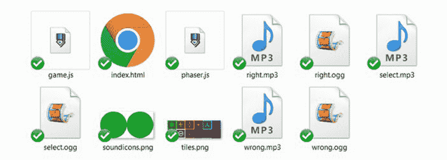

我们将图片、声音和脚本都放在同一个文件夹中。

当你处理像这个一样简单的游戏时，这不是一个大问题，但想象一下一个更大的项目，包含大量的图片和声音：你会最终得到一个塞满杂物的文件夹。这就是为什么你应该创建一个名为`assets`的文件夹，并在其中创建更多名为`sprites`和`sounds`的文件夹，用来放置你所有的文件。你可以给你的文件夹起任何名字，但请记住，我将在未来的书籍和教程中使用这些名字。现在你的项目将看起来像这样：

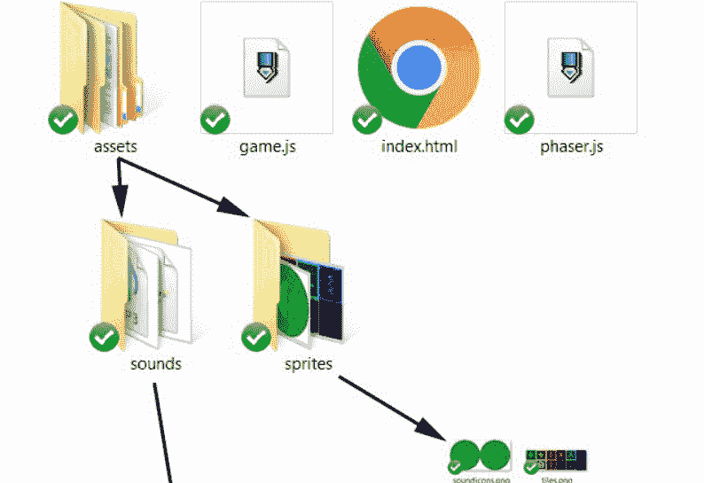


现在它更有条理了，我们只需要编辑预加载路径。


这就是我们如何在 `playGame` 对象中修改 `preload` 方法：

```
preload: function(){
    game.load.spritesheet("tiles", "assets/sprites/tiles.png", tileSize, tileSize);
    game.load.audio("select", ["assets/sounds/select.mp3", "assets/sounds/select.ogg"]);
    game.load.audio("right", ["assets/sounds/right.mp3", "assets/sounds/right.ogg"]);
    game.load.audio("wrong", ["assets/sounds/wrong.mp3", "assets/sounds/wrong.ogg"]);
}
```

同样的概念也适用于 `titleScreen` 中的 `preload` 方法：

```
preload: function(){
    game.load.spritesheet("soundicons", "assets/sprites/soundicons.png", 80, 80);
}
```

现在我们得到了一个功能相同、但组织更清晰的游戏。

### 创建一个预加载状态

为了保持代码的组织性，还有另一个小的优化可以做，特别是如果你正在开发一个不需要太多图片和声音的小游戏。

目前我们是以“按需”的方式预加载资源的。

在标题屏幕时，我们需要声音按钮，于是预加载了它们的图片；然后在游戏状态时，我们需要声音和图块，于是预加载了它们。

更好的做法是在游戏开始之前预加载所有资源，这样所有的代码以及对图片和声音的引用都可以集中在一处。

这就是为什么我们要创建一个名为 `PreloadAssets` 的新状态，它将处理所有的预加载过程，从而让其他状态无需再包含 `preload` 方法。

显然，这个新创建的状态将是游戏首先执行的状态，以确保在通过 `TitleScreen` 状态启动游戏本身之前，所有资源都已预加载完毕。

```
game.state.add("PreloadAssets", preloadAssets);
game.state.add("TitleScreen", titleScreen);
game.state.add("PlayGame", playGame);
game.state.add("GameOver", gameOver);
highScore = localStorage.getItem(localStorageName) == null ? 0 : localStorage.getItem(localStorageName);
game.state.start("PreloadAssets");
```

`PreloadAssets` 的代码只是将 `PlayGame` 和 `TitleScreen` 状态中的 `preload` 方法的内容剪切/粘贴过来：

```
var preloadAssets = function(game){}
preloadAssets.prototype = {
    preload: function(){
        game.load.spritesheet("tiles", "assets/sprites/tiles.png", tileSize, tileSize);
        game.load.audio("select", ["assets/sounds/select.mp3", "assets/sounds/select.ogg"]);
        game.load.audio("right", ["assets/sounds/right.mp3", "assets/sounds/right.ogg"]);
        game.load.audio("wrong", ["assets/sounds/wrong.mp3", "assets/sounds/wrong.ogg"]);
        game.load.spritesheet("soundicons", "assets/sprites/soundicons.png", 80, 80);
    },
    create: function(){
        game.state.start("TitleScreen");
    }
}
```

正如你所看到的，我只是复制了旧的 `preload` 方法的内容——你现在需要删除它们了——然后在 `create` 方法中，一旦所有资源加载完毕，我就启动 `TitleScreen` 状态，开始游戏。

### 接下来该怎么做

当你按照教程或书籍制作游戏时，我总是建议你做两遍：第一遍跟着教程，第二遍自己独立完成。

深呼吸，删除一切，从零开始创建游戏。

然后，添加一些基本功能，比如记录最高分，或者不匹配成功的次数。

### 感谢并保持联系

现在你已经读完了这本书。

这是我在为一个出版品牌写了三本书之后，第一本自己出版的书，所以如果你发现了一些错误，我在此表示歉意。

如果你发现任何错误，请通知我，并通过 [info@emanueleferonato.com](mailto:info@emanueleferonato.com) 给我发邮件提供反馈。

同时，请关注我的博客 [www.emanueleferonato.com](http://www.emanueleferonato.com)，你几乎每天都能找到新的教程。

最后，我的 Facebook 粉丝页面 [https://www.facebook.com/emanueleferonato](https://www.facebook.com/emanueleferonato) 和 Twitter 账号 [https://twitter.com/triqui](https://twitter.com/triqui)。

我要感谢 **Richard Davey** 和所有 **Photon Storm** 的伙伴们，感谢他们创造了令人难以置信的 Phaser 框架。

特别感谢 **Mario**（只知道叫 Mario，不知道姓氏）帮我揪出了排版和错误。

希望你喜欢阅读这本书，就像我喜欢写这本书一样。

Emanuele.
